# 网络犯罪与信息隐私研究手册

*   Maria Manuela Cruz-Cunha
    葡萄牙，卡瓦多与阿维河理工学院 (`Polytechnic Institute of Cávado and Ave`)
*   Nuno Ricardo Mateus-Coelho
    葡萄牙，管理与技术理工学院 (`Polytechnic Institute of Management and Technology`)

 

|  | | |

---

### 核心使命

随着数字技术在日常生活中变得无处不在，私营和公共实体以日益增长的方式利用互联网，对数字威胁关注变得日益迫切。

《信息安全、隐私与伦理进展》（`AISPE`）系列丛书提供了跨各行业和环境的信息与技术保护及其滥用的尖端研究。该系列书籍由涵盖身份管理、密码学、系统安全、身份验证和数据保护等主题的学术研究组成，是 IT 专业人员、学者和高年学生的理想参考。

### 涵盖范围

随着数字技术在日常生活中变得无处不在，私营和公共实体以日益增长的方式利用互联网，对数字威胁关注变得日益迫切。

《信息安全、隐私与伦理进展》（`AISPE`）系列丛书提供了跨各行业和环境的信息与技术保护及其滥用的尖端研究。该系列书籍由涵盖身份管理、密码学、系统安全、身份验证和数据保护等主题的学术研究组成，是 IT 专业人员、学者和高年学生的理想参考。

《信息安全、隐私与伦理进展》（`AISPE`）系列丛书提供了跨各行业和环境的信息与技术保护及其滥用的尖端研究。

《信息安全、隐私与伦理进展》（`AISPE`）系列丛书提供了跨各行业和环境的信息与技术保护及其滥用的尖端研究。

---

Nikolaos Koumartzis（希腊，塞萨洛尼阿里士士多德大学）和 Andreas Veglis（希腊，塞萨洛尼阿里士士多德大学）

Ismini Vasileiou（普利茅斯大学，英国）和 Steven Furnell（普利茅斯大学，英国）

T. Gunasekhar (`Koneru Lakshmaiah Education Foundation`, 印度) K. Thirupathi Rao (`Koneru Lakshmaiah Education Foundation`, 印度) P. Sai Kiran (`Koneru Lakshmaiah Education Foundation`, 印度) V. Krishna Reddy (`Koneru Lakshmaiah Education Foundation`, 印度) 以及 B. Thirumala Rao (`Koneru Lakshmaiah Education Foundation`, 印度)

Ionica Oncioiu（欧洲区域学院，比利时）

Michael Felderer（因斯布鲁克大学，奥地利）和 Riccardo Scandariato（瑞典查尔姆斯理工大学 & 瑞哥滕堡大学，瑞典）

Mohammad Tariq Banday（克什米大学，印度）

Mehdi Khosrow-Pour, D.B.A. (`Information Resources Management Association`, 美国)

Ziska Fields（夸祖鲁-纳塔尔尔大学，南非）

Yassine Maleh（哈桑一世大学，摩洛哥）Abdellah Ezzati（哈桑一世大学，摩洛哥）以及 Mustapha Belaissaoui（哈桑一世大学，摩洛哥）

Rocci Luppicini（渥太华大学，加拿大）

Chittaranjan Pradhan（`KIIT University`, 印度）Himansu Das（`KIIT University`, 印度）Bighnaraj Naik（`Veer Surendra Sai University of Technology (VSSUT)`, 印度）以及 Nilanjan Dey（`Techno India University`, 印度）

Gulshan Shrivastava（`National Institute of Technology Patna`, 印度）Prabhat Kumar（`National Institute of Technology Patna`, 印度）B. B. Gupta（`National Institute of Technology Kurukshetra`, 印度）Suman Bala（`Orange Labs`, 法国）以及 Nilanjan Dey（`Techno India University`, 印度）

Ramona S. McNeal（`University of Northern Iowa`, 美国）Susan M. Kunkle（`University of Kentucky`, 美国）以及 Mary Schmeida（`University of Kentucky`, 美国）

Yassine Maleh（哈桑一世大学，摩洛哥）

Vana Ahuja（`Jaypee Institute of Information Technology`, 印度）Shubhangini Rathore（`IBS`, 印度）

信息科学参考 • 版权 2018 • 400 页 • 平装本 (ISBN: 9781522552970) • 美元 $215.00 (我们的价格)

## 社会网络中的可扩展性、安全与匿名化

B. Tripathy（`VIT University`, 印度）Kiran（`VIT University`, 印度）

## 虚拟云中的新兴研究与机遇

信息科学参考 • 版权 2018 • 341 页 • 平装本 (ISBN: 9781522530299) • 美元 $225.00 (我们的价格)

John Forge（悉尼大学，澳大利亚）

Ihsan（独立研究员，美国）

信息科学参考 • 版权 2018 • 350 页 • 平装本 (ISBN: 9781522525066) • 美元 $225.00 (我们的价格)

Kannan Balasubanian（`Mepco Schlenk Engineering College`, 印度）以及 M. Rajak（`Mepco Schlenk Engineering College`, 印度）

Manish Gupta（`State University of New York`, 美国）Raj Sharman（`State University of New York`, 美国）John Wal（`M&T Bank`, 美国）以及 Pavankumar Mulgund（`State University of New York`, 美国）

Raghavendra Kumar（`LNCT University`, 印度）Prasant Kumar Pattnaik（`KIIT Deemed University`, 印度）以及 Priyanka Pandey（`LNCT University`, 印度）

Sunita Vikrant Dhavale（`Defence Institute of Advanced Technology (DIAT)`, 印度浦那）

Sharvari Tamane（`MGM's Jawaharlal Nehru Engineering College`, 印度）Vijender Kumar Solanki（`Gautam Buddha University`, 印度）以及 Nilanjan Dey（`Techno India University`, 印度）

Saleem Zoughbi（`United Nations APCICT`, `United Nations ESCAP`, 韩国）

N. Jeyanthi（`VIT University`, 印度）以及 R. Thandeeswaran（`VIT University`, 印度）

S. Asharaf（`Indian Institute of Information Technology and Management Kerala`, 印度）和 S. Adarsh（`Indian Institute of Information Technology and Management Kerala`, 印度）

Michelle Moore（美国，`George Mason University`）

Maximiliano E. Korstanje（阿根廷，`University of Palermo`）

Shadi A. Aljawarneh（约旦，`Jordan University of Science and Technology`）

Maurice Dawson（美国，`Illinois Institute of Technology`）Dakshina Ranjan Kisku（印度，`National Institute of Technology`）Phalguni Gupta（印度，`National Institute of Technical Teachers Training and Research`）Jamuna Kanta Sing（印度，`Jadavpur University`）和 Weifeng Li（中国，`Tsinghua University`）

Maurice Dawson（美国，`Illinois Institute of Technology`）Mohamed Eltayeb（美国，`Colorado Technical University`）和 Marwan Omar（美国，`Saint Leo University`）

Andrew Marrington（阿联酋，`Zayed University`）Don Kerr（澳大利亚，`University of the Sunshine Coast`）和 John Gammack（阿联酋，`Zayed University`）

Kashif Munir（沙特阿拉伯，`Hafr Al Batin University`）

Kannan Balasubramanian（印度，`Mepco Schlenk Engineering College`）K. Mala（印度，`Mepco Schlenk Engineering College`）和 M. Rajakani（印度，`Mepco Schlenk Engineering College`）

Brij Gupta（印度，`National Institute of Technology Kurukshetra`）Dharma P. Agrawal（美国，`University of Cincinnati`）和 Shingo Yamaguchi（日本，`Yamaguchi University`）

Ahmad Kamran Malik（巴基斯坦，`COMSATS Institute of Information Technology`）Adeel Anjum（巴基斯坦，`COMSATS Institute of Information Technology`）和 Basit Raza（巴基斯坦，`COMSATS Institute of Information Technology`）

Dileep Kumar G.（埃塞俄比亚，`Adama Science and Technology University`）Manoj Kumar Singh（埃塞俄比亚，`Adama Science and Technology University`）和 M.K. Jayanthi（沙特阿拉伯，`King Khalid University`）

Kamaljit I. Lakaria（印度，`Gujarat University`）

Kashif Munir（沙特阿拉伯，`Hafr Al Batin University`）Mubarak S. Al-Mutairi（沙特阿拉伯，`Hafr Al Batin University`）和 Ghossoon M. Waleed（巴林，`Applied Science University`）

Anonymous（印度，`Stan College`）

Manish Gupta（美国，`University at Buffalo, State University of New York`）

Anne Kayem（南非，`University of Cape Town`）和 Christoph Meinel（德国，`Hasso Plattner Institute, University of Potsdam`）

T. J. Grant（荷兰，`R-BAR`）R. H. P. Janssen（荷兰学院）和 H. Monsuur（荷兰学院）

Cecelia Wright Brown（美国，`University of Baltimore`）Kevin A. Peters（美国，`Morgan State University`）和 Kofi Adofo Nyarko（美国，`Morgan State University`）

Sattar B. Sadkhan Al Maliky（伊拉克，`University of Babylon`）和 Nidaa A. Abbas（伊拉克，`University of Babylon`）

Hamid R. Nemati（美国，`University of North Carolina at Greensboro`）

B.K. Tripathy（印度 `VIT University`, 印度）和 D. P. Acharjya（印度 `VIT University`, 印度）

Danda B. Rawat（美国 `Georgia Southern University`）Bhed B. Bista（日本 `Iwate Prefectural University`）和龚军（美国 `Indiana State University`）

Antonio Ruiz-Martinez（西班牙 `University of Murcia`）Rafael Marin-Lopez（西班牙 `University of Murcia`）和 Fernando Pereniguez-Garcia（西班牙 `University of Murcia`）

Atilla Elçi（土耳其 `Aksaray University`）Josef Pieprzyk（澳大利亚 `Macquarie University`）Alexander G. Chefranov（北塞浦路斯 `Eastern Mediterranean University`）Mehmet A. Orgun（澳大利亚 `Macquarie University`）王华雄（新加坡 `Nanyang Technological University`）和 Rajan Shankaran（澳大利亚 `Macquarie University`）

Daniel Mellado（西班牙 `Spanish Tax Agency`）Luis Enrique Sánchez（西班牙 `University of Castilla-La Mancha`）Eduardo Fernández-Medina（西班牙 `University of Castilla-La Mancha`）和 Mario G. Piattini（西班牙 `University of Castilla-La Mancha`）

Manish Gupta（美国 `University at Buffalo, State University of New York`）John Walp（美国 `M&T Bank`）和 Raj Sharman（美国 `University at Buffalo, State University of New York`）

Alfred Dudley（美国 `Towson University`）James Braman（美国 `Towson University`）和 Giovanni Vincenti（美国 `Towson University`）

Melissa Dark（美国 `Purdue University`）和 John Walp-p（美国 `Purdue University`）

Santo Banerjee（意大利 `Politecnico di Torino`）和 Adam Slag（美国 `National Center`）

Maria Manuela Cruz-Cunha（葡萄牙 `Polytechnic Institute of Cávado and Ave`）和 Nuno Ricardo Mateus-Coelho（葡萄牙 `Polytechnic Institute of Management and Technology`）

### 关于主题

我们所知的互联网，以前所未有的速度将人类与其同类拉近距离。随着这种变革，新的元素出现了，另一些则以不法活动的形式重新出现，这些活动一直是一系列后续矫正措施的对象。这些并不是技术社会的唯一特征。过去十年证明，技术无疑是人类面临的最挑战性的领域，社会面临社会、政治、经济和高环境成本的突然变化。这种波动性对社会和组织的安全产生了严重影响。

每天，个人、公司和国家都依赖这一最重要的信息公路，我们无法将互联网与为了获取任何利益而策划的庞大未知有害主体隔离开。

### 使命

对于信息安全从业人员来说，网络安全、网络犯罪和隐私保护领域不断变化的格局使得掌握该领域的最新研究变得具有挑战。这就是为什么作者和编辑非常荣幸推出了《网络犯罪与隐私保护研究手册》的第二版增强版，这是一本详尽且完整的单本版，充满了顶尖的研究和参考文献。

本书的各种研究为前沿理论和发展提供了广泛且深入的视角。它是作为概念、方法、技术和管理问题的单一参考资源，并对该领域的新兴趋势和未来机会提供洞察。

### 组织架构

本研究手册分为 33 章，由来自五大洲 14 个国家、43 个不同机构的 81 位贡献者共同编写。这种程度的参与使我们能够主张多样化的观点，从而确保了本书的严谨性。

我们感谢所有作者的卓越贡献：本研究手册反映了他们在网络犯罪、安全和信息隐私领域的相关工作和深厚知识。

所有这些工作都对本手册涉及的科学领域做出了积极贡献。我们欢迎读者对本手册提出反馈和意见。意见和建设性建议可以发送本手册开头提供的地址发送给 `IGI Global` 编辑部。

我们希望您发现它有所帮助。祝阅读愉快！

编辑部，

我们感谢 `IGI Global` 为我们提供编辑本研究手册的机会，并感谢其专业团队提供的卓越支持。我们对所有作者的卓越贡献表示赞赏和感谢：本手册包含了他们在网络犯罪、安全和隐私领域的相关工作和深厚知识。

# 第 1 章

* Carlos Alberto M. S. Teles, 巴西，里约雅内卢联邦技术教育联邦中心 (`CEFET-RJ`)
* Carlos Roberto Gonçalves Viana Filho, 巴西，里约雅内卢联邦技术教育联邦中心 (`CEFET-RJ`)
* Felipe da Rocha Henriques, 巴西，里约雅内卢联邦技术教育联邦中心 (`CEFET-RJ`)

## 摘要

随着信息和通信技术资产在日益连接的环境中增长，信息安全逐渐成为一个在日常生活中发挥重要作用的领域。由于 `ICT` 资产硬件和软件的信息安全漏洞，社会越来越多的信息面临数据泄露。为了通过检测恶意流量来识别 `ICT` 资产的故障，本文提出了一种基于黑盒的检测恶意流量的框架。黑盒方法允许在不访问软件或硬件细节的情况下监控网络。在所提出的框架中，信息安全和网络资源使用被结合在一起，以对恶意流量进行可靠检测。首先，作者收集了网络流量信息，利用开源网络工具生成了数据集。所提出的检测方案可以识别恶意软件、可疑流量等风险和威胁。该方案通过验证网络安全告警与网络资源使用之间的相关性得到了验证。

## 引言

当今技术环境的安全高度取决于构成它们的各种信息和通信技术资产的正确行为——其中 `ICT` 资产被用于考虑能够执行计算处理并参与信息技术和通信活动的各种硬件和软件。`ICT` 一词是指计算机与电信技术的结合，它在计算机网络，特别是互联网上有其最大的表现 (Miranda, 2016)。事实上，计算机系统中简单元素（无论是硬件还是软件）的功能不当都可能损害整个系统的安全性。因此，开发相关机制来确定并证明 `ICT` 资产符合理想的安全要求是非常关键的。然而，这一目标是一个巨大的挑战，因为当今计算机系统中使用的 `ICT` 资产变得日益复杂。`ICT` 资产进入日益关键的活动，并与社会福祉相关。

在产品、服务、过程、系统和人员符合法规要求方面，一种日益增强的方法是实施符合性评估计划 (`CPAs`) (Fernandes, 2011)。这些程序系统地通过使用传统的质量管理技术（如检查、测试、抽样和审计），来分析受评估的每个产品、过程、服务或专业人员对标准和法规中预设要求的合规情况。符合性评估计划已用于各个领域，以验证对各种类型要求的合规性，包括测量仪的校准、能源效率、电磁兼容性、辐射检测、隔热、人体工程学和民用建筑 (Inmetro, 2019)。

在 `ICT` 资产安全领域，使用 `CPAs` 验证是否符合网络安全要求在过去十年获得了强大的动力，这与国际标准 `ISO/IEC 15408-1:2009` (信息技术——安全评估标准) 和 `ISO/IEC 19790:2012` (信息技术——加密模块安全要求) 的发布有关 (Leszczyna, 2018)。然而，尽管信息安全领域正向国际标准化和符合性评估发展，但 `ICT` 资产行为的复杂性带来了先进的挑战，需要系统性的测试。

近年来，出现了 `ICT` 资产遭到破坏的案例 (Kirtley & Memmel, 2018)。几个婴儿监护模型遭遇了安全事件，其中某些案例向儿童发送恐怖音频，还窃取了 Apple 和 Google 商店的访问凭据，并非法获取远程控制的权限。根据 (Cziesla, Kemper, Muntermann, & Sinanaj, 2015)，许多公司的数据遭到了 `NSA` 通过 `ICT` 资产的安全漏洞的入侵。在 (Restuccia, D'Oro, & Melodia, 2018) 中，已经证明通过物联网 (`IoT`) 设备连接的汽车可以被远程控制。然而，更令人担忧的案例涉及医疗设备，一旦故障会导致致命后果 (Restuccia, D'Oro, & Melodia, 2018)。

解决 `ICT` 资产的安全问题已成为一个重要问题。因此，美国参议院最近提交了《2017 年物联网跨党派网络安全改进法案》，该法案旨在提高联网设备上的信息安全 (Restuccia, D'Oro, & Melodia, 2018)。

在这项工作中，我们提出了一种基于开源工具的黑盒框架，该框架允许收集网络安全数据，并使其能够实时检测恶意流量。通过所提出的环境，收集了来自家庭和公司网络的真实数据，并生成了数据库。通过安全信息与网络使用之间的相关性（我们称之为 `network performance`），可以对恶意流量进行可靠检测。

因此，我们可以通过以下项目总结本工作的贡献：

- 开发了一种基于虚拟化工具的 `ICT` 资产测试环境。所提的环境与文献中观察到的方案不同，因为它能够实例化复杂的测试环境，包括虚拟化 `ICT` 资产的使用。该环境以软件产品的形式发布在 `https://github.com/carlos-teles/etsg/` 上，以便学术界复现实验。


- 开发了一种侧重于安全的系统化测试方法论。所提的方法论与文献中观察的不同，因为安全和性能测试可以评估导致资产遭受攻击的安全漏洞，并能够识别被评估设备可能存在的恶意行为。

- 构建了一个参考数据库，用于研究实验期间通过监控捕获的流量对 ICT 资产进行的事件安全和攻击。

本章结构如下：我们首先在“引言”部分引入本章的主题；“背景”部分介绍了本工作中为实现我们的提议而考虑的一些基本概念；“相关工作”部分将我们提出的框架置于文献背景之中；名为“恶意流量监控黑盒框架建议”的章节介绍了用于 ICT 环境中恶意流量检测的提议框架；“实验方法论”章节介绍了用于实现实验环境的计算设置；获得的结果将在“结果”章节中讨论；结论性意见将在本工作的最后部分给出。

## 背景：基本概念

在本节中，我们介绍了本工作中使用的基本概念，如软件测试、系统及网络监控的行为分析。

### 软件测试

在 `(Khan, Khan, & others, 2012)` 中，软件测试识别代码中必须修复的错误、缺陷或故障。我们也可以将软件测试定义为通过分析访问软件功能并进行修正的过程。软件测试是质量保证的关键组成部分，代表了对规范、设计和编码的审查。其主要目标是在严格控制的情况下对系统进行系统测试，以确认系统的质量。此外，另一个目标是识别其完整性和适用性，并最终发现未发现的错误。发现错误的三种重要技术是：(i) 白盒测试，(ii) 黑盒测试和(iii) 灰盒测试。

白盒测试通过对代码内部逻辑和结构进行详细调查。在这些测试中，测试人员需要对软件源代码有完全了解。黑盒测试是在不了解软件内部运作的情况下进行的。这种测试检查系统的基本方面，与软件的内部逻辑结构几乎或完全没有关系。白盒和黑盒之间的中间测试是灰盒测试，它使用软件内部组件的有限知识。原则上，这可能意味着测试人员了解源代码的某些而非其他部分，但在实践中，这通常意味着测试人员可以获得比规范或需求更详细的设计文件 `(Michael & others, 2013)`。

下面，我们可以提到一些在白盒测试和黑盒测试中都出现的重要特征，作为对比总结。

1. 黑盒测试：

    - a. 不适用于算法测试。

    - b. 它采用试错法。

    - c. 它不那么耗精也不耗时。

    - d. 它基于外部异常，忽略了程序的内部行为。

    - e. 由最终用户、测试人员和开发者（用户验收测试）执行。

    - f. 它的粒度较低。

    - g. 我们只需要了解基本方面。

2. 白盒测试：

    - a. 它适用于算法测试。

    - b. 它可以使用其他方法，以及试错法。

    - c. 比黑盒测试更耗精、更耗时。

    - d. 没有忽略程序的内部行为。

    - e. 由开发者和测试人员共同执行。

    - f. 它的粒度很高。

    - g. 需要对软件和硬件有完全了解。

### 系统监控

监控系统是计算机网络、互联网以及最现代数据中心中的重要问题。这是因为这有助于在许多问题产生影响终端用户的麻烦并损害服务可用性之前发现它们。此外，它还有助于根据当前资源的利用情况来规划增长。仅从许多数据源中收集不同的指标是不够的；仍然需要量定制系统监控以满足业务需求和安全需求，以便设置正确的警报，从而避免系统出现任何异常 `(Girish & others, 2018)`。

### 行为分析

ICT 资产的行为分析可以分为两个主要点：网络连性和监控。

提供给 ICT 资产的网络连接必须是透明的，这样它才知道自己正在被使用，或者说正在运行。某些设备具有“测试”、演示或“存储”模式。这种操作展示了设备的一些功能，但主要是作为其核心功能的视图。然而，它们也可以隐藏功能。ICT 资产的另一种现有方法是将设备处于待机状态。通常，当设备处于上述任何模式时，其连接性不是透明的，也就是说，它可能以隐藏功能的方式传输和/或运行。

可以引用大众汽车的案例 `(Blackwelder, Coleman, Colunga-Santoyo, Harrison, & Wozniak, 2016)`，该公司承认在汽车中安装了一种软件，该软件会改变污染物排放的结果。该软件已安装在全球范围内超过 1100 万辆柴油车辆中，涵盖该集团下不同品牌的型号。不信任源于实地测试中发现的排放水平与检测人员发现水平之间的差异。在调查后，环境保护署 (`EPA`) 得出结论，汽车制造商安装的软件能够检测汽车正在进行污染物排放水平的检查，此时才开始控制车辆释放到大气中的气体。这种控制在正常行驶情况下会被关闭，导致汽车的污染远超过国家要求的水平。因此，监控 ICT 资产应该意识到其所有形式的违规运行，下将在文中简要描述。

不合规（`Non-compliance`）可以定义为未满足某项要求，即公司、机构或个人未按照要求运行。这些要求并不非仅定义在 `ISO` 标准中，也可能是客户需求、内部流程，甚至是未能满足法律要求，而当未满足这些要求时，就构成了不合规。我们也可以说，当产品表现出超出其规格的行为，或者呈现了与其规格不符的功能时，即处于不合规状态。

此外，我们可能会遇到可疑行为（`suspicious behavior`），即即使是针对产品，它所表现出的行为或功能没有明确违反规格，但可能代表了潜在的安全漏洞或恶意行为。

在本文工作中，我们通过执行网络监控来分析 ICT 资产（或计算环境）的行为。因此，其目的是在外部攻击影响设备和计算机系统之前进行检测和拦截。

# 相关工作

在文献中，已经存在实现并巩固的用于监控 ICT 资产的环境，但并非所有环境都具备我们需要的特性。这些特性是：对 ICT 资产所在网络的所有流量进行监控（兼顾信息安全和性能视角）；支持在多种架构中对 ICT 资产进行虚拟化；以及导出数据用于统计。

在对具有这些特性的环境搜索，我们发现 `GNS3` (Welsh, 2013) 是一种网络软件仿真器，它允许将虚拟设备和真实设备结合以模拟复杂的网络。它拥有工具：用于虚拟机的 `KVM/QEMU` (Goto, 2011) 和 `Dynamips` 环境。

`SIMOC` (Machado, 2018) 是一种用于数字空间训练军事战斗员的模拟器。它被电子战教学中心 (`CIGE`) 用于巴西陆军网络战课程的培训，并可用于培训平民。它的理论优势包括具有可扩展性、实施成本低以及缩短培训时间。缺点方面，经确定使用基于网络虚拟化解决方案的主流 ICT 资产具有局限性。因此，创建的场景可能会变得非常理论化，偏离了利用带有 ICT 资产的企业网络进行训练的目标。

`Docker Security Playground` (`DSP`) (Perrone & Romano, 2017) 是一种架构的实现，该架构采用微服务方法来构建专门为网络安全研究定制的复杂网络基础设施。它被设计为一种以实践方法教导计算机网络信息安全的工具。它可以实例化多个实验室，并通过 `Docker` 使用操作系统层级的虚拟化。

`Corelab` (Nakao, Ozaki, & Nishida, 2008) 提出了一种新的网络测试平台，它基于虚拟化程序作为运行网络服务的虚拟执行环境 (`VEE`)。它使用一个基于 `KVM/QEMU` 的原型。

相比之下，`GNS3` 和 `DSP` 可以适配于我们的研究；但它们需要更改源代码、更多的内存、CPU 和存储。`DSP` 和 `Corelab` 没有关联的监控平台。`SIMOC` 和 `DSP` 仅使用 `x86` 和 `x86-64` 架构，不实例化其他架构（`arm`、`mips` 等）。

因此，这项工作与本节介绍的工作主要区别在于实现了：(i) 对环境中所有 ICT 资产的数据包进行检查并带有安全事件/事故检测；(ii) 对环境中所有 ICT 资产进行性能分析；(iii) 提取用于分析和历史记录的性能及安全数据。

# 用于恶意流量监控的黑盒框架建议

在介绍完主要的备概念后，我们现在描述针对 ICT 资产中恶意流量检测的黑盒测试建议。我们将该方案划分为监控环境和 ICT 资产环境，如图 1 所示。

通常，在 ICT 资产环境（图 1 右下侧）中，除了物理元素外，可能还有虚拟化元素，必须模拟互联网访问、模拟本地网络访问以及模拟到被测 ICT 资产 (`IAUT`) 的连接。因此，基本思想是所有连接的元素（有线或无线）且具有互联网访问的元素都将被监控。网络连接将由一个准备捕获并复制通过网络的所有信息的 ICT 资产执行；也就是说，所有从被监控 ICT 资产的数据将被复制到另一个环境，该环境将处理这些信息以识别是否存在可疑、恶意（或不合规）行为。

除了 ICT 资产环境，还有一个监控环境。它将接收来自 ICT 资产环境的所有入站互联网或本地网络的流量副本。这些信息将由信息安全和性能组件进行处理。通过对此类信息的调查，识别不合规项，例如行为、未规定以及与 `IAUT` 规格不兼容的功能。值得提到作为本文工作的一项贡献是，这些信息将在监控环境中处理，而无需 `IAUT` 源代码或其工程文档的帮助。因此，监控环境将仅通过观察 ICT 资产的行为识别任何偏差。

| 图 1. 本文考虑的实验的建议架构 |
| --- |
| 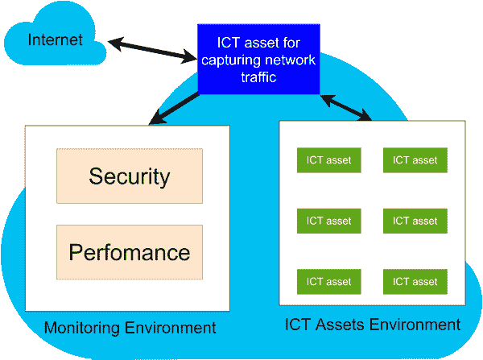 |

## 不合规项中寻求的故障

从配置的且连接互联网的黑盒测试环境中，我们可以识别被测试 ICT 资产的以下不合规项和/或故障：(i) 未授权的远程访问；(ii) `IAUT` 的远程软件更新；(iii) 隐藏设备（未检测或声明的接口）；(iv) 端口、服务和协议扫描；(v) `IAUT` 的信息外泄；(vi) 僵尸网络感染以及(vii) 恶意病毒感染。

根据 (Michael & others, 2013)，有多种安全的黑盒测试技术。每种技术根据其功能，我们可以根据所使用的工具进行分类：(i) 模糊测试，(ii) 语法测试，(iii) 探索性测试，(iv) 数据分析，(v) 测试脚架以及(vi) 软件行为监控。

在本文工作中，我们建议的方法分类为：“探索性测试”，即没有特定测试计划、仅基于对结果观察的测试；以及“软件行为监控”，当自动应用许多测试时。

# 建议的恶意流量检测算法

图 2 所示的算法 1 展示了本文所提系统用于检测恶意流量的步骤。变量 `n` 代表数据的测量瞬时；`d` 是网络上的设备数量；布尔变量 `A[r]` 在没有安全告警时接收值 `0`，在存在安全告警时接收值 `1`。在这种情况下，当 `A ← 1` 时，系统检查网络的性能（或资源使用情况）；变量 `Lr` 根据连接到网络的设备数量定义了一个识别攻击的下限，即当由于入侵尝试导致流量增加时，网络流量或 `TCP` 连接数也会随之增加。`Lr` 与连接的设备数量成正比，因为如果网络上的连接数增加，流量也会随之增加，从而扩大了检测限值。注意，检测分为两个步骤：一个是指识别告警（当 `A[r] = 1`），另一个是指通过分析 `D[r]` 验证网络资源使用的增加。这两个步骤旨在使检测系统具有健壮性，从而避免误报。此外，当检测到异常时，系统会执行应对措施，这可以代表激活防火墙甚至关闭 ICT 资产。

| 图 2. 所提的恶意流量检测算法 |
| --- |
| 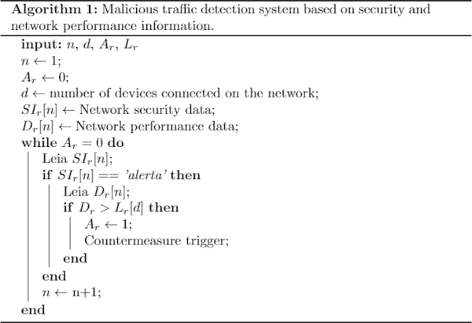 |

# 实验方法论

在本节中，我们描述了一个用于 ICT 环境的黑盒测试环境。下文介绍了构建此类环境所需的组件和工具。安装和配置细节可以在项目 GitHub 仓库找到 - `https://github.com/carlos-teles/etsg/doc_orient.pdf`。

## 网络

关于实验设置，建议了一些基本前提：(i) 互联网连接性，(ii) 内部 `IP` 地址计划，(iii) 提供互联网连接和 `IP` 地址计划的设备，(iv) 用于安装监控环境的服务器；(v) 用于安装虚拟化环境的服务器。`IP` 地址计划的定义有助于识别无需测试的 `IAUT` 和 ICT 资产。我们建议识别所有 ICT 资产的 `MAC` 地址，因为它们可能会在该范围内更改 `IP`。对于环境 ICT 资产的自动寻址（`IPv4` 和 `IPv6`），请使用 `DHCP` 服务器。这应与提供连接的 ICT 资产之一关联。此建议旨在让 ICT 资产认为它们处于运行状态而非测试模式。(Droms, 1997)

`Port Mirroring (Switched Port Analyzer)` 是一种网络流量监控，涉及从交换机源端口将每个数据包复制到目的端口。(Orebaugh, et al., 2006) (Ornaghi & Valleri, 2019)

`Sniffer` 是用于监控和分析网络流量以检测问题的软件。它捕获所有网络流量，包括未加密数据。它必须安装在连接到局域网的 ICT 资产上，且不应安装在 `IAUT` (Orebaugh, et al., 2006)。

`Port mirroring` 和 `sniffer` 是我们捕获网络流量的方法。我们强调，这被认为是捕获流量最“优雅”的方式；但 ICT 资产的网络连接必须具备这种能力。在这种情况下，对于端口镜像，需要两个网络接口：一个通过所有的网络流量（入站和出站），另一个用于接收副本。

## 监控

监控环境必须安装在带有 `Linux` 操作系统的服务器上。安装脚本位于 `https://github.com/carlos-teles/etsg/install-only-etsg.sh`。它是为 `Ubuntu` 版本 16 和 `CentOS` 7 准备的。一旦安装所有软件包，就有验证必须运行的进程。

`Influxdb`、`Telegraf`、`Grafana`、`Suricata` 和 `Evebox` 包通过脚本 (`https://github.com/carlos-teles/etsg/install-only-etsg.sh`) 安装并必须提前配置。以下是这些包的简要描述，它们将展示性能和信息安全信息。

### 性能

`Telegraf` 和 `Influxdb` 是 `TICK` 生态系统的组件。`Telegraf` 是用于收集指标的服务器代理。`InfluxDB` 是一个开源时间序列数据库，用 `Go` 语言编写。`Grafana` 是一个数据分析和监控的开放平台。

### 信息安全

入侵检测系统 (`IDS`) 是与杀病毒软件、防火墙和访问控制类似的工具，旨在增强信息系统的安全性。`IDS` 的主要功能之一是识别对特定资产的入侵，并在 `IDMEF` 中保存 `IPv4` 或 `IPv6` 地址以及 `mac` 地址。

根据 (Hallstensen, 2017)，网络安全监控 (`NSM`) 可以被视为一个循环，由收集、检测和分析网络数据组成，以解决四个主要要素：(i) 保护网络；(ii) 检测网络威胁；(iii) 阻塞网络威胁以及 (iv) 维持网络的运行能力。

入侵预防系统 (`IPS`) 是 `IDS` 的扩展，包含了尝试阻止或防止检测到的恶意活动的能力。作为 `IDS`，`IPS` 可以是基于主机、基于网络或分布式的。这可以使用异常检测来识别非合法用户的行为，或使用签名来识别已知的恶意行为。

所有的虚拟机都由一个虚拟机管理器管理和控制。这些通常被称为虚拟机监控程序（`hypervisors`），它们的主要作用是为底层硬件提供抽象。安装或运行虚拟机监控程序的系统称为主机机（`host machine`），而所有在主机机上运行的其他虚拟机都称为客机（`guest machines`）。主机机和客机通常使用与不同应用程序相同的接口。主机机和所有可用的客机彼此相互独立（Yadav, Garg, & others, 2019）。

对于虚拟化环境的配置，我们建议使用一些基本前提：(i) 互联网连接以及；(ii) 已配置的监控环境。

虚拟化环境必须安装在运行 Linux 或 Windows 操作系统的服务器上。这些环境中的每一个都可用于虚拟化目的。为了让 IAUTUT 不被视为测试对象，在我们的案例中，我们将这些环境用于以下用途：(i) 设备虚拟化以模拟真实网络，即 ICT 资产可以验证其邻居，并且考虑到存在许多其他 ICT 资产（测试中不考虑这些）；(ii) 周围设备虚拟化以模拟对 ICT 资产的访问并用于监控环境以检查网络流量；(iii) 如果可能，对 IAUT 进行虚拟化。

我们对基于开源的虚拟机监控程序的推荐是 Oracle VirtualBox、`KVM` 和 `QEMU`。`KVM`/`QEMU` 包在 Linux 系统的虚拟化中协同工作。通过这些工具，有多种方法可以创建虚拟机。在我们的示例中，系统要求之一是在 IAUT 的网络内启动几台虚拟机。

## Oracle VirtualBox

该工具可以安装在各种操作系统上，并可以在 `https://www.virtualbox.org/` 获取。它目前属于 Oracle 公司公司，旨在创建虚拟化环境（例如 x86 和 x86-64 架构），用于安装不同的操作系统。（Oracle, 2018) (Dash, 2013)。

## KVM

基于内核的虚拟机（`KVM`）是一种基于 Linux 的开源虚拟化技术。通过 `KVM`，Linux 可以作为虚拟机监控程序，允许主机机运行多个隔离的虚拟环境，称为客机或虚拟机。这种虚拟化允许继承所有的 Linux 特性，而无需额外的工程支持。（Goto, 2011）。

## QEMU

`QEMU` 是一种虚拟机模拟器软件，可以在虚拟机上运行操作系统（如 Windows 或 Linux）及其应用程序。它支持多种宿主操作系统，如 Linux、Windows 和 Mac OS X。宿主 CPU 和客机可能不同。此外，`QEMU` 与 Linux 用户模式模拟器集成。其主要特征是：(i) CPU 和设备模拟器；(ii) 调试器；(iii) 图形界面；(iv) 多种架构，如 x86、x86-64、mips、arm 等。（Bellard, 2005）。

## 结果

在本节中，在介绍了推荐的工具后，为了构建实验环境，我们将根据图 1 所示的架构建议配置组件。


为了验证本工作的提议，构建了两个场景，称为：(i) 居家办公（Home Office）；和 (ii) 互联网（Internet）。每个场景都有不同的网络拓扑和 ICT 资产特征。对于场景 (i)，我们有以下实验设置：一台 Wi-Fi 路由器、三台智能手机、一台服务器、一台台式电脑、一台多功能打印机、一个网络扩展器、一台智能电视、一台电缆电视解码器和一个防火墙。该环境是一个局域网。服务器带有监控环境和网卡，它提供连接性并接收所有网络流量进行分析。

在场景 (ii) 中，我们有以下实验设置：一台交换机、一台 IP 摄像头、一台用于监控的服务器、一台蜜罐服务器，且没有防火墙。该环境直接连接到互联网。主机机带有监控环境和网卡，它提供连接性并接收所有网络流量进行分析。

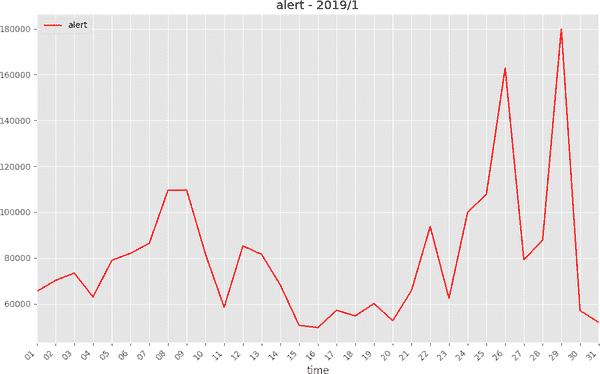

图 13 场景 (ii) 下的每日网络

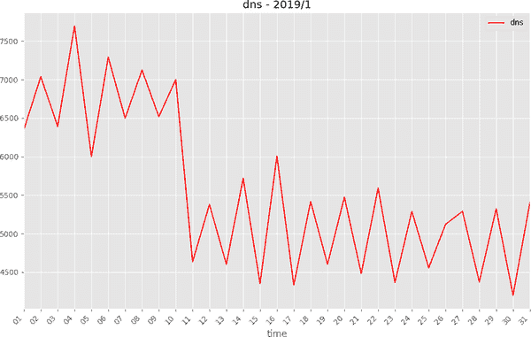

从两种实验场景获得的结果显示了信息安全与网络性能（或网络资源使用）之间的相关性。当恶意流量试图进入网络（反映在告警数量上）时，可以预期网络资源使用将会增加，这可以通过网络数据包的数量反映出来。我们的建议探索了这种相关性，以检测可能的威胁（即恶意流量）。

## 所提的恶意流量检测系统的扩展性分析

一旦我们从场景 (i) 和 (ii) 中识别出恶意流量，我们就在我们的解决方案中执行了扩展性测试。使用场景 (ii) 中已经配置的基础设施，我们添加了一台带有 `KVM` 和 `QEMU` 虚拟化解决方案的服务器。在这种场景下，我们添加了 08 台虚拟机，并针对拒绝服务攻击执行了以下测试：

- 从 2019/12/04 16:00 开始，01 台虚拟机，每隔 01 小时进行一次；
- 从 2019/12/04 23:55 开始，02 台虚拟机，每隔 01 小时进行一次；
- 从 2019/12/05 08:55 开始，04 台虚拟机，每隔 5 分钟进行一次；
- 从 2019/12/06 17:30 开始，08 台虚拟机，每隔 5 分钟进行一次；
- 在 12/07 00:00 关闭虚拟机结束测试。

扩展性实验的结果如表 1 所示，通过增加虚拟机的数量和缩短攻击间隔（增强攻击强度），我们验证了告警数量以及数据包数量的增加。此外，我们还验证了数据量随着虚拟机的扩展而增加。为了解决这个问题，必须将收集的数据传输到另一台服务器。

### 表 1. 所提恶意流量检测系统的扩展性测试

| 项目 | 01 台虚拟机 | 02 台虚拟机 | 04 台虚拟机 | 08 台虚拟机 |
| --- | --- | --- | --- | --- |
| 告警数量（最大值） | 2,488 | 2,413 | 1,202,136 | 3,577,547 |
| 数据包数量（最大值） | 2,155 | 2,598 | 3,863 | 11,010 |

因此，我们可以从表 1 所示的结果观察到，本工作提出的系统能够结合信息安全数据和网络资源使用来检测攻击，即使在具有扩展性的场景（即有更多设备连接到网络）中也是如此。考虑到连接设备数量往往越来越高的 IoT 场景，这种分析尤为重要。但需要注意的是，待分析的数据量与检测系统的处理和存储能力直接相关。

## 结语与未来方向

在这项工作中，我们提出了一种用于检测 ICT 环境中恶意流量的 `Black-Box` 框架。我们建立了实施的概念和工具建议。通过对两个场景的实施，展示了一种实验方法论。通过对 IAUT 中性能的收集和分析，两个场景获得的结果验证了我们所提环境检测恶意流量的能力，以及非合规性的信息安全事件。与文献中提到的环境相比，到为止没有其他环境能够执行此类查询，并达到分析数据以及验证 ICT 资产非合规性或告警识别的程度。

作为可以考虑的未来方向之一，可以将机器学习技术应用到本工作所提系统所收集的数据上，特别是考虑到构成此类网络的设备存在能量和内存限制。这些限制可能会影响检测算法存储和使用数据的方式。

## 参考文献

- BellardF. (2005). `QEMU`, a fast and portable translator. USENIX Annual Technical Conference, FREENIX Track, 41, 46.
- Blackwelder, B., Coleman, K., Colunga-Santoyo, S., Harrison, J., & Wozniak, D. (2016). The Volkswagen Scandal. Academic Press.
- Chen, D., Woo, M., Brumley, D., & Egele, M. (2016). Towards Automated Dynamic Analysis for Linux-based Firmware. NDSS. doi:10.1472/ndss.2016.23415
- Cziesla, T., Kemper, J., Muntermann, J., & Sinanaj, G. (2015). NSA Revelations of Privacy Breaches: Do Investors Care? Academic Press.
- Dash, P. (2013). Getting started with `oracle virtualbox`. Packt Publishing.
- Droms, R. (1997). Dynamic host configuration protocol. Dynamic host configuration protocol.
- Fernandes, W. A. (2011). O movimento da qualidade no Brasil. Essencial Idea Publishing.
- Girish, L. (2018). Efficient Monitoring of Time Series. i-Manager Journal of Computational Science, 6.
- Goncalves, J. A., Faria, V., Vieira, G., Silva, C. & Mascarenh, D. (2017). WIDIP: DDoS attacks. 2017 1st Cyber Security in Networking (CSNet), 10-3. doi:10.1109/CSNET.2017.824196
- Goto, Y., NakaoA., OzakiR., NishidaY. (2008). CoreLab: An emerging network testbed employing hosted virtual machine monitor. Proceedings of the 2008 ACM CoNEXT Conference, 73. 10.1145/1544012.1544085
- Gupta, A., & Sharma, L. (2019). Performance Evaluation of `Snort` and `Suricata` Intrusion Systems on Ubuntu Server.
- Hallstensen, C. V. (2017). Multisensor Fusion for Intrusion Detection and Situational Awareness (Master's thesis). NTNU.
- Inmetro. (2019). Avaliação da Conformidade. Retrieved from Inmetro: http://www.inmetro.gov.br/qualidade/index.asp
- Ish, J. (2017). `EveBox` The Inbox for your Suricata Events. Retrieved from https://evebox.org/
- Khan, M. E., Khan, F., & others. (2012). A comparative study of white box, black box and grey box testing techniques. Int. J. Adv. Comput. Sci. Appl, 3.
- Kirtley, J., & Memmel, S. (2018). Rewriting the “Book of the Machine”: Regulatory and Liability Issues for the Internet of Things. Minnesota Journal of Law, Science & Technology, 455.
- Leszczyna, R. (2018). Standards on cyber security assessment of smart grid. International Journal of Critical Infrastructure Protection, 22, 70–89. doi:10.1016/j.ijcip.2018.05.006
- Machado, A. F. (2018). Utilização de simuladores para a formação de guerreiros cibernéticos. Universitas: Gestão e TI, 7.
- Michael, C. C. (2013). Black box security testing tools. Black box security testing tools. Citeseer.
- Miranda, G. L. (2016). Limites e possibilidades das TIC na educação. Revista de Ciências da Educação, 41-50.
- Naqvi, S. N., Yfantidou, S., & Zimányi, E. (2017). Time Series Databases and `InfluxDB`. Academic Press.

## 参考文献

OISF. (2018). Suricata 引擎能够实现实时入侵检测 (IDS)、在线入侵防御 (IPS)、网络安全监控 (NSM) 以及离线 pcap 处理。Suricata 引擎能够实现实时入侵检测 (IDS)、在线入侵防御 (IPS)、网络安全监控 (NSM) 以及离线 pcap 处理。取自 `https://suricata-ids.org/`。

Oracle, V. M. (2018). VirtualBox。取自 VirtualBox: `https://www.virtualbox.org`

Orebaugh, A., Ramirez, G., & Beale, J. (2006). Wireshark & Ethereal 网络协议分析工具包。Elsevier。

Ornaghi, A., & Valleri, M. (2019). Ettercap。取自 Ettercap: `https://www.ettercap-project.org/`

Perrone, G., & Romano, S. P. (2017). Docker 安全游乐场：研究网络安全的实操方法。2017 年 IP 电信原理、系统与应用 (IPTComm)，1–8。

Restuccia, F., D’Oro, S., & Melodia, T. (2018). 物联网安全：新视角与研究挑战。arXiv 预印 `arXiv:1803.05022`

Stallings, W. (2017). 密码学与网络安全：原理与实践。Pearson。

Welsh, C. (2013). GNS3 网络模拟指南。Packt Publ。

Yadav, A. K., & Garg, M. L. (2019). Docker 容器对比基于虚拟机的虚拟化。见数据挖掘与信息安全中的新兴技术。Springer。

## 延伸阅读

Acharya, S., & Pandya, V. (2012). 黑盒、白盒与灰盒测试技术的桥梁。《国际电子与计算机科学工程杂志》，2(1), 175–185。

Alaba, F. A., Othman, M., Hashem, I. A. T., & Alotaibi, F. (2017). 物联网安全：综述。《网络与计算机应用杂志》，88, 10–28. doi:`10.1016/j.jnca.2017.04.002`

Bhosale, D. A., & Mane, V. M. (2015, 10 月). 网络入侵检测工具的比较研究与分析。2015 年应用与理论计算及通信技术国际会议 (iCATccT) (pp. 312-315)。IEEE。 `10.1109/ICATCCT.2015.7456901`

Dainotti, A., Pescape, A., & Claffy, K. C. (2012). 流量分类的问题与未来方向。《IEEE Network》，26(1), 35–40. doi:`10.1109/MNET.2012.6135854`

Duffy, M. (2015). DevOps 自动化手册。Packt Publishing Ltd。

Francia, G. A., III, Garrett, A., & Brookshire, T. (2012). 网络安全实验室的虚拟化。见教育前沿国际会议：计算机科学与计算机工程 (FECS) 论文集 (p. 1)。计算机科学、计算机工程与应用计算世界大会指导委员会 (WorldComp)。

Kumar, M., Singh, S. K., & Dwivedi, R. K. (2015). 黑盒测试与白盒测试技术的比较研究。《计算机科学与管理研究国际进展杂志》，3(10)。

SolaniS.JadavN. K. (2019, 12 月). 基于人工智能的侵入检测系统综述。计算机网络、大数据与物联网国际会议 (pp. 67-80)。Springer, Cham。

Stallings, W., Brown, L., Bauer, M. D., & Bhattacharjee, A. K. (2012). 计算机安全：原理与实践。Pearson Education。

## 关键术语与定义

- **黑盒测试 (Black-Box Test)**：在不了解软件内部工作原理的情况下进行的测试，通过检查系统的基本方面进行。
- **符合性评估 (Conformity Assessment)**：用于确定是否符合要求的任何程序。
- **网络安全 (Cybersecurity)**：防止未经授权的访问、使用、披露和修改的实践。
- **ICT 资产 (ICT Assets)**：所有的硬件和软件。
- **信息安全 (Information Security)**：保护信息免受未经授权的安全事件。
- **恶意流量 (Malicious Traffic)**：通过网络接收到的任何疑连接或内容。
- **网络流量 (Network Traffic)**：在给定时间点跨网络的数据量。
- **网络流量分析 (Network Traffic Analysis)**：拦截和分析网络流量的过程。
- **安全事件 (Security Event)**：任何可观测或可检测的事件。
- **虚拟化 (Virtualization)**：通过分配物理机的能力让你能够使用它。

# 第二章

Suzana M. Moreno - 巴西开发银行，巴西

Jean-Marc Seigneur - 日内瓦大学

Gueorgi Gotsev - 卢森堡律师

## 摘要

`KYC`（了解您的客户）和 `AML`（反洗钱）实践在传统金融交易中已设计并实施多年。然而，要在业务效率、创新、金融包容性和合规性之间寻找平衡变得非常复杂，无论是在应该做什么的规定上，还是在基于风险方法的实施上。本章介绍了对传统 `KYC` 和 `AML` 的综述，重点介绍了这些领域中的现有挑战，并考虑了加密货币交易的创新（如数字身份）以及无银行服务的人群的金融包容性。作者通过采用新的 `KYC`/`AML` 实践来讨论这些挑战的现有解决方案并作为结尾。

## 引言

金融系统由相互作用的机构单位和市场组成，通常以复杂的方式运作，旨在募集投资资金并为商业活动提供支付系统等设施。国家或国际货币交易的来源可能来自合法或非法的经济活动。洗钱是指利用金融系统使犯罪活动产生的资金看起来合法的过程。联合国毒品和犯罪办公室在 2013 年估计，全球国内生产总值（`GDP`）每年有 2%到 5%的结果源于洗钱，而只有不到 1%（可能约为 0.2%）被查收和冻结（UNODC, 2011）。此外，逃税、逃避制裁、欺诈和恐怖主义融资等其他犯罪也可能发生在金融系统中。

金融信息和技术的进步使得资金能够在全球范围内快速移动。这些进步为社会带来了利益并有助于防止恶意目的，但也引入了新类型的风险。例如，互联网的使用使金融系统更加高效。同时，它引入了新型犯罪，即网络犯罪，如网银攻击或信用卡欺诈。

在分析了 2018 年的统计数据（《塑造支付未来》，2019）后，国际结算银行（BIS）得出，由于金融行业的创新和消费者的采用，国内支付变得越来越便利、即时且无处不在。同时，BIS 得出现金的使用仍然非常重要。尽管如此，它越来越多地视为一种价值存储的方式，而不是支付方式。


# 区块链与加密货币中的 KYC/AML 实践：挑战与解决方案

区块链（Nakamoto, 2008）是一项基础技术，能够对许多领域（包括金融领域）产生重大影响。加密货币实现了快速、全球化且具有不同程度匿名性的点对点交易。这些创新无疑可以创造新的或更高效的业务模式，并为社会带来许多收益。尽管如此，它们也可能用于进行非法活动，如黑市支付以及与恶意软件和勒索软件攻击相关的数字转账。根据 `ChainAnalysis (Chainanalysis, 2020)`，在本文写作时，非法交易仍占所有加密货币活动的一小部分，比例仅为 1.1%。然而，报告也指出，几乎所有的黑市交易（从非法毒品到武器和敏感个人信息）都是通过加密货币交易的。`ChainAnalysis` 估计，2019 年非法实体发送和接收的加密货币总额超过了 100 亿美元。

在将涉及犯罪的加密货币转换为现实生活中使用的法币之前，必须通过洗钱来隐藏其来源。遗憾的是，目前有复杂的解决方案可以帮助罪犯实现这一目标，这给监管机构带来了新的挑战。例如混币器（mixers）、跨链操作（chain hopping）、隐私币和匿名点对点交易所（`Chainanalysis, 2020`）。

同时，世界上许多国家已尝试强制识别支付人和收款人以及转账资金来源，以保护国际金融系统免受滥用。这些国家甚至试图强制其他国家这样做，以防止犯罪分子或恐怖分子寻找并利用监管薄弱或无监管的管辖区。

如今，已经有国家和政府间的计划关注降低金融系统中犯罪活动的风险。

本文讨论了 `KYC（了解您的客户）` 和 `AML（反洗钱）` 的过去和现状。探讨了加密货币交易带来的新挑战以及未来可能的实践。本章其余结构如下：第 2 节介绍了核心概念和传统金融机构目前的 `KYC/AML` 实践。第 3 节讨论了这些当前 `KYC/AML` 实践存在的问题。在第 4 节中，我们讨论了可能的解决方案和建议。最后，第 5 节介绍了我们未来的工作并对本调查进行总结。

## 背景

本节介绍了 `KYC`、`AML`、`FATF` 和数字身份等核心概念。它还介绍了传统金融机构目前的 `KYC/AML` 实践。最后，给出了标准加密货币交易的细节。

## KYC (了解您的客户)

`KYC` 是在与金融机构建立业务关系期间识别并持续验证客户的过程，其首要目标是符合一系列监管要求。

在 `KYC` 过程中从客户处收集的数据会有很大差异，取决于金融机构、该机构必须遵守的法规以及与客户关系中涉及的风险。通常与 `KYC` 关联的两个示例是身份证明（`ID`）和地址证明。此外，作为 `KYC` 过程的一部分，`ID` 证明可能用于检查客户是否属于任何制裁名单，或客户是否为政治敏感人物（`PEP`）。`KYC` 过程还包括对业务关系期间的客户行为进行监控，以持续收集金融犯罪的风险来源。企业 `KYC`（也称为 `KYB – 了解您的业务`）应涉及对业务本身及其所有者（所有者或主要所有者）的分析。无论是个人还是公司，金融机构可能在某些业务事件后或定期重新检查某些客户数据。

在某些情况下，`KYC` 遵循分级方法，其中高风险客户在识别和验证方面需要更多努力。例如，银行可以根据客户可能交易的金额或每天可能提取的金额来创建 `KYC` 等级。在这种情况下，较低的每日交易限额与较低的监管风险相关，从而对应于较低的 `KYC` 要求。

`KYC` 对监管至关重要，因为金融机构需要防止身份窃用等犯罪行为。未能实施安全要求可能导致金融机构面临潜在的罚款、制裁和声誉损害。`KYC` 也为机构本身带来利益，因为它有助于防止因非法资金和交易导致的欺诈和损失。`KYC` 过程可能使用物理或数字通道，有时被称为 `eKYC`。与其他领域一样，数字通道可能有助于降低成本并提高效率和可追溯性。

## AML (反洗钱)

罪犯需要找到一种控制其非法资金的方法，而不引起对底层活动或相关人员的注意。因此，他们试图为资金的获取方式提供一个合理的解释。洗钱是由罪犯执行的旨在掩盖其非法资金来源的行为组成的。这一过程至关重要，因为它使罪犯能够在不危及来源的情况下享受这些利润（`FATF-GAFI - 金融行动特别工作组, n.d.`）。

将洗钱分为三个阶段是常见的。第一阶段被称为“投放”（`placement`）：即非法资金进入金融系统的时刻。这可以通过在不同账户中进行小额存款或购买货币工具来实现。第二阶段被称为“分层”（`layering`），其目标是通过转换和移动为资金赋予合法外表。例如，资金可以被转移到不配合反洗钱调查的管辖区。罪犯还可能通过将部分资金转移到多个管辖区的银行来分散金额。在数字世界中，这可能涉及法币与加密货币之间的转换，以及加密货币之间的转换。在某些情况下，第一阶段和第二阶段可能会交织在一起。例如，罪犯可以在处理大量现金支付的合法业务中伪造虚拟客户的付款。在这种情况下，为资金赋予合法外表的工作在进入金融系统之前就已经完成了。“整合”（`Integration`）是第三阶段的名称：罪犯可以在现实经济中使用这些资金。这是罪犯可以购买商品和服务并投资新业务的时期。

洗钱被视为一种犯罪，因为它让罪犯获利。打击洗钱是防止犯罪组织获利的一种方式。考虑到洗钱的运作方式，犯罪分子可以利用控制薄弱且在预防或检测犯罪方面存在困难的管辖区。政府应为负责应对问题的当局提供必要的工具，并监管私营部门以确保合作。但这些是不够的：国际合作对于协调各国计划并确保跨国协作以应对这些全球性犯罪活动至关重要。

反洗钱是一套旨在防止洗钱和维护金融机构安全的法律、法规和程序。

### FATF (金融行动特别工作组)

财务行动特别工作组（FATF-GAFI - Financial Action Task Force, n.d.）是一个独立的政府间组织，负责制定并促进政策以保护全球金融系统免受洗钱、恐怖主义融资以及大规模杀伤武器扩散融资的影响。该机构由成员司法管辖区的部长于 1989 年建立，如今已获得 200 多个司法管辖区的支持。

FATF（财务行动工作组）制定了一系列建议，这些建议被认为是打击洗钱和其他相关金融犯罪的国际标准。它们构成了协调应对这些对金融系统完整性威胁的基础，并致力于激发必要的政治意愿以促进这些领域的国家立法和监管改革，包括：

*   为主管机关建立职权和职责；
*   增强法律实体和安排的受益所有者信息的透明度和可用性；
*   促进国际合作。

FATF 的建议包含了适用于传统金融系统、虚拟资产服务提供商（称为 `VASP`）以及指定的非金融业务和职业（如赌场、房地产中介、宝石商等）的预防性措施。各国应采取措施，在公共部门和私营部门使这些建议成为现实。

由于各国拥有不同的法律、财务、行政和运营框架，它们不能采取完全相同的措施来遵循 FATF 的建议。在应用这些建议时，可以根据国情留有灵活性。FATF 建议采用基于风险的方法（`RBA`），这意味着各国、主管机关和银行应该识别、评估并理解它们所面临的洗钱和恐怖主义融资风险，并根据风险水平采取相应的缓解措施。基于风险的方法是有效实施的核心，因为它允许将资源优先分配给最关键的案例。

FATF 监控其成员实施必要措施的进展，并与其他国际利益相关者合作，致力于识别国家层面的脆弱性。

必须强调的是，FATF 的 40 项建议（FATF, 2019）并未提到 `KYC` 术语。相反，该文件在第 10 项建议中定义了客户尽职调查（`CDD`）术语。作者假设 `CDD` 实践与 `KYC` 相似，但在 `AML` 的背景下应用。例如，根据 FATF 的，在建立业务关系；进行偶发交易；怀疑存在洗钱或恐怖主义融资；或金融机构对此前获取的客户身份数据的真实性或充分性产生怀疑时，应执行 `CDD`。

## 数字身份

许多人类活动需要个人身份识别，例如开设银行账户、在大学学习、买公寓、出国旅游……政府通常通过颁发打印在纸张上的官方文件来识别其公民，例如出生证明、社会安全号码、驾照、选举证、护照等……

随着数字服务的发展，也存在远程识别在线用户的需求。创建数字身份有许多方法。第一种是在网站上创建一个带有用户名、电子邮件和密码的简单账户，这导致了用户和密码的激增。随后人们创建了管理这种复杂性的新解决方案，例如密码管理器。另一种方法是使用在线身份提供商在其他在线服务中代表用户身份。第三种方法是使用政府颁发的官方数字身份，例如印度唯一身份管理局（`UIDAI`, n.d.）提供的 `Aadhaar` 服务。最后一种方法是使用非对称加密技术将数字签名与真实身份相关联。通常情况下，它使用由认证机构颁发的数字证书，如 `X.509`（X.509: 信息技术 - 开放系统互连 - 目录: 公钥和属性证书框架, n.d., p. 509）。认证机构的信任程度取决于其是否获得在特定司法管辖区运营的认可以及其是否遵循特定的法规。一个使用数字证书概念的法规示例是欧盟使用的电子识别和信任服务条例 – `eIDAS`（`eIDAS-Ecosystem`, n.d.）。

大多数解决方案仅使用数字信息，但少数也使用物理信息。为了获得 `Aadhaar` ID，公民必须访问特定的中心，提交文件，并收集某些生物识别信息。某些认证机构可能要求他们访问物理场所领取证书。在现实世界中收集的个人额外信息通过将真实身份与在线身份关联，有助于提高身份的信任水平。

数字身份也可以分配给法律实体，例如通过为法律实体创建在线账户，或为法律实体颁发数字证书通过 `HTTPS` 证明网站的所有权。

## KYC/AML 的传统实践

银行和其他金融机构需要遵守其国家和地区的法规才能获得运营许可。它们还需要遵守合作伙伴的监管要求以开展业务。平均银行每年花费约 4800 万美元。仅在美国，银行每年在 `AML` 合规方面的支出就超过了 250 亿美元（打击金融犯罪 - KPMG Global, 2019）。

如果机构需要遵守遵循 FATF 法规的法律，它将需要按照第 1 项建议中描述的基于风险的方法，应用 FATF（FATF, 2019）描述的预防措施。影响风险的变量示例包括：(a) 涉及交易的司法管辖区，(b) 交易总额，(c) 交易交易业务关系的目的和意图性质。与本章主题最相关的实践与 FATF 第 10、14、15 和 16 项建议有关，因为它们直接受到加密货币创新的影响。

第 10 项建议描述了金融机构何时需要进行客户尽职调查以及应采取哪些措施。它包括对客户的识别和验证、对受益所有者的识别和合理的验证措施、对交易任何部分是否涉及政治敏感人物（`PEP`）或其是否在制裁名单上的验证、有关业务关系目的和意图性质的信息并进行持续评估。根据分配给交易的风险，还可能包括有关客户的额外信息，例如资金来源或资产规模，以及关于关系的其他信息。

有趣的是，根据 FATF 的观点，在执行合规的 `CDD` 时并没有强制使用官方文件。这种灵活性在至少两种场景下是有优势的。第一个是金融包容，因为欠发达国家没有银行的人可能没有必要的文件。第二种场景允许在全球范围内使用新的支付方式（`NPM`），而无需要求提供商承担持续验证不同国家颁发文件的复杂任务。

建议 14 条规定，提供资金或价值转移服务（`MVTS`）的自然人或法人应获得许可或注册，并接受有效的系统进行监控和确保合规。FATF 建议 15 条在下文的解决方案和建议部分进行了详细说明。FATF 建议 16 指出，如果电汇符合某些标准（例如，金额高于 `USD/EUR 1000` 的跨境电汇），金融机构应在电汇及相关消息中包含所需的且准确的汇款人信息以及所需的收款人信息，并且这些信息在整个支付链中应随电汇或相关消息保留。

这里值得提到 `SWIFT` 系统（`SWIFT - The Global Provider of Secure Financial Messaging Services`，无日期）的重要性，因为它可以用于在支付链中交换这些消息。`SWIFT` 的消息服务被全球 200 多个国家和地区的 11,000 多家金融机构使用。它每年传输超过五十亿条金融信息。通过 `SWIFT`，银行、托管机构、投资机构、中央银行、市场基础设施和企业客户可以相互连接，交换结构化电子消息以执行常见的业务流程，如支付或结算交易。

除了主要建议外，FATF 在 2010 年发布了一份关于利用 `NPM` 洗钱的报告（`FATF`，2010），如预付卡、互联网支付系统和移动支付系统。报告讨论了匿名性、高可协商性和资金实用性，以及通过自动取款机（`ATMs`）全球获取现金是使 `NPM` 对洗钱者产生吸引的主要因素。缓解此类风险的方法之一是对交易金额设置限制或限制这些支付的使用频率。据我们所知，FATF 对 `NPM` 甚至对使用 `ATMs` 提取常规现金没有定义标准限制。因此，每个国家和金融机构必须根据其基于风险的方法设定限制。

## 基础加密货币交易

基于区块链的第一个加密货币是 `Bitcoin`（BTC），由中本聪（`Nakamoto`，2008）提出，其真实身份尚未知。区块链技术是分布式账本技术（`DLT`）的一部分。

区块链可以被视为一种去中心化的公共账本，由全球许多实体以点对点的方式进行维护。必须使用抗攻击共识算法（`Gray et al.`，2006；`J.-M. Seigneur`，2005b）来同步所有远程实体之间的账本状态。`DLTs` 中使用的共识算法主要有四种类型：

1.  第一种基于工作量证明（`PoW`），其中某些节点运行全节点，消耗能量来解决被称为“挖掘”的计算密集型问题。如果算力小于 50%，没有人可以控制账本，这在写作时是一种成本非常高昂的攻击。每当一个节点找到这些问题之一的解决方案时，该节点就有资格将有效交易插入新区块并将此区块传播到其他节点。下一个区块与上一个区块链接，因为它必须包含上一个区块内容的哈希值。因此，所有区块都链接在一起。因此，成功更改旧区块的内容将更加昂贵。
2.  区块链使用的第二种传统共识算法基于拜庭容错（`BFT`）的变体（`Lamport et al.`，1982；`Yin et al.`，2019）。然而，基于 `BFT` 的区块链并不是完全去中心化的，因为它们通常需要选择几个节点在点对点系统中充当将军，该系统能够抵抗少于三分之一受损/故障将军的攻击。
3.  由于 `PoW` 区块链的能量成本，几种区块链正尝试使用权益证明（`PoS`）的变体，其中质押更多硬币的实体有更多机会成为下一个验证者，并获得与待验证的新交易相关的费用。如果验证者作了弊，质押的硬币可能会丢失。例如，`Ethereum`（`Buterin & others`，2013）作为重要的去中心化应用开发平台之一（`Ethereum Project`，无日期），多年来尝试从 `PoW` 迁移到 `PoS`，但在写作时尚未完成，部分由于 `PoS` 抗攻击性的不确定性。正如在任何可以随意创建多个虚拟身份的去中心化信任系统中一样（`Jean-Marc. Seigneur et al.`，2005），`PoS` 的抗攻击性很难估计，因为存在许多不同类型的攻击场景：女巫攻击（`Douceur`，2002）、合谋/卡集团……
4.  最后，还有不是基于区块链的 `DLT` 系统，它们与区块链非常不同。`DLT` 不是基于区块链，而是使用有向无环图（`DAG`）。`IOTA`（`Popov`，2016）一直是基于 `DAG` 的重大 `DLT` 之一。`IOTA` 的抗攻击性多次受到挑战（`Narula`，2017；`Wright`，2020），在写作时它仍然依赖于中心化的协调节点。另一个主要的 `DAG` 是 `Hedera Hashgraph`（`Baird`，2016），它由全球知名且多样的大公司和组织财团（`J.-M. Seigneur`，2005a）管理。

无论如何，在大多数 `DLT` 中，真实用户的账户并未与其真实身份正式关联，而是与作为伪名的账户标识符关联（`J.-M. Seigneur`，2005b）。由于账本大多数是公开的，交易并不是匿名的：每笔交易都与参与交易的伪名账户相关。`Chaum` 曾基于盲签名提出了基于不可追踪数字支付的首次尝试（`Chaum`，1983），但某些组件仍然是中心化的。最近，他与同事尝试将区块链合并（`Chaum et al.`，2016；`Praxxis`，无日期）。还创建了一些使用匿名化技术以保证匿名性的加密货币，如 `Monero`、`ZCash` 或 `Dash`，但全球监管机构已向交易所施压，下架这些匿名加密货币（`Buntix`，2018）。

区块链得益于所有同等节点达成共识并同步到相同的状态，在假设攻击性未达到阈值（例如 `PoW` 中的 51% 和 `BFT` 中的三分之一）的情况下，能够成功防止从同一账户对同一加密货币币或金额进行双重花费。此外，得益于上述调查的所有分布式账本技术（DLT）均使用的非对称加密技术，攻击者无法伪造从一个账户到另一个账户的交易，因为攻击者没有签名交易所需的私钥。一旦主节点或通用节点接收到要插入区块链的交易，它会检查签名是否有效。如果不有效，该交易将被丢弃。

当通过非对称加密算法（Gardner, 1977）生成密钥对时，用户获得一个私钥（用于签名交易且必须保密）以及一个公钥（用于为账户生成短标识符，并可以公开展示以接收该账户的资金）。尽管量子计算可能会破解某些非对称加密算法（Perlner & Cooper, 2009），但在写作时，仍有一些算法被认为是安全的。存在不同的哈希算法可以从公钥派生出短名称（通常称为哈希）（Bakhtiari et al., 1995）。短名称更容易传递给他人。然而，它仍然被认为对用户友好，因为字符列表没有任何意义，而且在写下这些字符列表时很容易出错。如果可用，建议使用复制和粘贴或扫描 `QRCode`。一些区块链公司还尝试提供一种去中心化名称服务，类似于互联网 DNS 将难以记忆的 IP 地址转换为域名，而在区块链的案例中，则是将区块链地址转换为易记的域名，例如（Ethereum Name Service, n.d.；Unstoppable Domains, n.d.）。此类去中心化名称服务要实现大规模采用，所面临的问题是，它们必须说服所有的浏览器和加密钱包使用它们的系统。

## 当前 KYC/AML 实践中的问题

加密货币交易中涉及 KYC/AML 的一个关键问题是，用户只需通过在本地计算机上运行非对称加密算法即可创建自己的账户。传统上，银行被要求创建账户，并且他们可以在创建账户之前执行 KYC/AML。在理想情况下，用户通过非对称加密算法创建的账户基于没有匿名技术的公有区块链。在这种情况下，账户之间的每笔交易都可以被追踪。然而，如上所述，真实的身份是未知的。并非所有用户都懂得使用非对称算法，但存在许多加密货币钱包应用程序，通过在钱包图形用户界面（GUI）上点击几次即可让该过程变得非常简单，例如 `My Ether Wallet` (MyEtherWallet.Com, n.d.)。


一旦创建了加密货币账户，仍然存在向这些账户初始分配货币和金额的问题。在 `Bitcoin` 中，找到当前问题解决方案的矿工有权构建新区块并将其传播给其他节点。在此过程中，矿工获得了交易费和挖矿奖励。总共只有 2100 万个比特币。因此，在某些阶段，可能只有交易费。矿工账户一旦获得了比特币，就可以将其比特币出售给其他用户并签名将比特币转移给买家。以太坊初始化是挖矿奖励和首次币发行（ICO）（Venegas, 2017）。

ICO 在新项目启动时运行，旨在创建新的加密货币并用法货币出售新加密货币。销售通常限于特定时期，以吸引可能等待购买这些加密货币的潜在投资者。项目可能会承诺筹集的资金将用于开发，但由于运营不善，许多项目并未履行承诺，或者它们欺骗了投资者（Zetzsche et al., 2017）。一些 ICO 投资者没有收到任何加密货币，因为没有自动化机制来强制加密货币创建者发送正确数量的加密货币。其他 ICO 使用了自动化机制根据发送的加密货币交付正确数量的加密货币。这些自动化机制通常被称为“智能合约”（Szabo, 1997）。初始 ICO（例如以太坊）没有执行 KYC，更不用说 AML 了。2017 年底，监管压力增大，KYC 开始成为 ICO 的一部分。然而，大多数 ICO 的 KYC 质量可能并不充分，因为它们大多数只是提供了一个上传身份证明照片的方法，这由于 ICO 创建者的安全管理漏洞，也导致了身份文件泄露的风险。

为了进一步便于访问加密货币并进行交易，出现了在线加密货币交易所（Janze & Gvozdevskiy, 2017）。用户可以轻松地在网站上创建账户，并通过信用卡或银行转账向交易所账户购买加密货币。用户也可以将他们的加密货币发送到他们在交易所的账户中。不幸的是，在这种情况下，加密货币交易所通常是交易所网站用户账户相关私钥的所有者。如果加密货币交易所遭到黑客攻击或消失，用户将失去他们的加密货币。过去曾有多多个加密货币交易所遭到攻击（Chohan, 2018）。例如，2014 年处理了约 70% 比特币交易的 `Mt. Gox` 加密货币交易所遭到攻击后关闭。再次，加密货币交易所最初没有进行的 KYC 检查。此时，仍有许多交易所未按照 FATF 建议执行 KYC。例如，`Binance`（Bitcoin Exchange | Cryptocurrency Exchange, n.d.）是拥有大量加密货币交易的交易所，但每天提币超过 2 BTC 才需要 KYC，并在 2019 年遭到过攻击（Ćirić & Ivanišević, 2018）。

关于加密货币交易所拥有的私钥问题，一种被称为去中心化交易所（DEX）的新类型已经出现。第一代 DEX 迭代速度缓慢、难以使用且流动性低，但后续的迭代正在改进。例如，Nash（Nash | Trade. Pay. Invest., n.d.）甚至是一个在欧盟受监管的 DEX，具有 `KYC/AML` 和用户友界面。尽管如此，Nash 的流动性仍然较低。原因之一可能是其用户必须通过强制性的 `KYC`。其他例子还有 `Binance DEX` 或 `Komodo DEX`（Komodo - An Open, Composable Smart Chain Platform, n.d.），后者甚至作为手机应用程序运行（Decentralized Exchanges, 2019）。由于加密货币 DEX 并不拥有私钥，仅作为促进交易的层，因此因缺乏 `KYC/AML` 而起诉加密货币 DEX 可能更加困难。如果 DEX 是通过 `Website` 或官方应用商店上的移动应用程序提供的，那么它们的责任将比仅提供可供用户本地运行的开源对等点软件更为重要。当他们通过 `Website` 或连接到其服务器的应用程序支持服务时，他们对所提供的服务负责，而这些服务如果没有应用商店中提供的 `Website` 或移动应用程序是不存在的。用户交易加密货币的最后方式是通过场外交易（OTC)（Nezamaikin & Zbirovskaya, 2019）。存在不同类型的 OTC 解决方案，通过作为托管的 OTC 促进平台进行，或者直接在买卖双方之间，后者可能存在风险。一方面，支付方可能在收到加密货币后不付款，或使用虚假或洗钱资金。另一方面，买方在付款后可能无法收到加密货币。还存在寻找潜在买卖双方的问题。这就是为什么出现了 OTC `Website` 列表的原因，例如 `LocalBitcoins`（LocalBitcoins.Com: Fastest and Easiest Way to Buy and Sell Bitcoins, n.d.）。在 `Paxful`（Buy Bitcoin Instantly | Paxful, n.d.）上，也可以通过礼品卡购买或出售比特币。通常，如果没有被强制，大多数零售 OTC 用户不会花费精力和金钱去检查 `KYC/AML`。匿名提取比特币以换取现金的最后一种是使用加密货币 ATM。例如，在瑞士，截至编写本文时，仍然可以使用 `Bity` 加密货币 ATM 在无需 `KYC` 的情况下单笔购买或提取高达 5000 法郎的比特币（Bitcoin and Cryptocurrency ATMs in Switzerland, n.d.）。

## 金融包容

25 亿人（世界成年人口的一半）缺乏银行账户。这些是低收入、农村、移民和无证件的人员，他们一直以来服务不足或被排除在正式金融部门之外。金融包容是确保以负担得起、公平且透明的方式获得适当的金融产品和服务的方法，并根据 FATF 的建议接受适当的监管（FATF et al., 2013）。

金融包容和有效的 `AML` 制度可以且应当是互为补充的国家政策目标，并具有相互支持的政策目标。如果设计得当，确保更多客户使用正式金融服务的措施将增加 `AML` 控制的覆盖范围和有效性（Bester et al., 2008）。如果这些措施设计得不当，`AML` 措施可能会对金融服务的获取和使用产生负面影响（Isern & Koker, 2009）。

FATF 表示，服务不足的客户是一个非常异质的类别，在不同的司法管辖区具有非常不同的风险状况。因此，不能仅根据他们是低收入个人就将其归类为低风险客户。这些客户的一个典型风险是他们可能充当白手，利用其账户协助第三方非法活动。另一方面，FATF 建议中也给出了低风险场景的明确示例：“为某些类型的客户提供定义适当且有限的服务的金融产品或服务，以增加金融包容目的的获取性”（FATF et al., 2013）。

某些国家或金融机构采用的坚持要求政府颁发的身份证明文件的僵化 `CDD` 要求，已成为弱势群体进入正式金融体系的障碍（FATF et al., 2013）。世界银行的研究确定了以下障碍，以及非账户持有人报告的每项障碍作为未拥有账户的原因的百分比：钱不够（30%）、太昂贵（25%）、家庭成员已有账户（23%）、距离太远（20%）、缺少必要文件（18%）、缺乏信任（13%）和宗教原因（5%）。例如，在撒哈拉以南非洲，文件要求可能会导致拥有银行账户的成年人比例减少多达 23%（Demirgüç-Kunt & Klapper, 2012）。这意味着新的、更具负担、更容易获取的——可能通过使用数字渠道——以及能够尽可能减少对正式文件需求的解决方案，对于金融包容似乎是有价值的。

# 隐私问题

`KYC/AML` 实践需要存储、处理和共享数据，以计算客户或交易的风险程度。这些实践的总体结果是一个组织中收集的数据可以分配给许多金融和政府机构用于未来的处理和评估。

根据 Hughes（Hughes, n.d.），不同国家提供的隐私保护程度不同。一些国家提供的保护很少或没有保护，而另一些国家则提供复杂、全面的隐私方案。被保护的数据类型以及数据类型的定义也可能不同。在某些国家，数据隐私保护由法律明确规定。在其他一些国家，数据隐私保护源于其一般的宪法保障。

即使考虑到这些差异，毫无疑问，`KYC/AML` 涉及个人身份信息（PII），因为需要收集身份证明。从这个意义上说，它与要求减少个人数据收集和处理的隐私法存在冲突。可以认为这些实践被视为“公共利益的重要理由”。尽管如此，即使在 `GDPR`（General Data Protection Regulation – Official Legal Text, n.d.）这一成熟的欧洲隐私法中，处理还不清楚（Shainski, 2019）。

`KYC/AML` 实践的设计应考虑适用司法管辖区的隐私要求，例如保护数据不被意外使用、告知数据将如何根据收集目的进行处理，并在处理和传输信息时获得用户同意。隐私故障可能会导致罚款和声誉损害。然而，在大多数国家，金融法被认为高于隐私法。例如，在欧盟，即使用户根据 `GDPR` 中提到的被遗忘权要求删除加密货币交易所账户，交易所也可能需要保留账户详情多年，因为金融法要求他们这样做。

## 解决方案与建议

由于新技术的发展和使用，新的 `KYC` 和 `AML` 实践正在出现。区域、国家和多国法律、法规和建议需要跟上技术的发展。FATF 建议于 1990 年发布，经过了多次修订以确保其保持更新和相关，并具有通用适用性。在本节中，我们综述了其他人以及我们提出的潜在解决方案和建议。

如上述背景部分所述，传统的身份解决方案将数字信息与在现实世界收集的个人额外信息相结合，以提高身份的信任级别。新的身份解决方案试图通过仅使用数字通道来克服通过面对面接触收集物理信息的困难。数字通道提供了一种更快速、更便利且更廉价的身份识别方式。这些新的 ID 解决方案通常通过手机收集一个人的物理信息，以便在数字身份中聚合额外信息，以提高其信任级别。这些信息是通过使用自拍照、视频、生物识别、活体检测以及视频识别服务收集的，有时还包括与身份专家小组进行在线会议。

第二类创新与身份数据的存储方式有关。绝大多数身份解决方案是中心化的。这种方法的问题在于，托管者受隐私法律的约束，且存储库成为攻击的吸引目标，可能导致数据泄露。另一方面，还有与自主主权身份（`SSI`）概念相关的新型去中心化解决方案。SSI 允许个人使用去中心化基础设施创建自己的身份，第三方可以在其上分配证明以证明有关该人的某些情况。例如，它可以证明该人年龄大于 18 岁，而无需泄露其真实年龄或任何其他信息。使用 SSI，个人不需要信任第三方来管理其数据，而是承担起自己管理的责任，这通常也会导致业务解决方案中产生更复杂的用户体验。

考虑到过去几年数字身份的进展，FATF 最近发布了指南（《数字身份指南》，`Guidance on Digital Identity`, 2020），以澄清如何利用数字 ID 系统来执行 `FATF 建议第 10 条`下 `CDD` 的某些方面。该指南明确，依赖可靠、独立的数字 ID 系统并已采取适当风险缓解措施的非面对面客户识别和交易，可以达到标准风险水平，甚至更低。某些数字 ID 解决方案可能获得授权用于 `CDD`，例如参见印度的 `Aadhaar` 解决方案（`UIDAI`, n.d.）和欧盟的 `idNow`（`IDnow - The Fastest Way to Verify Your Customer’s Identity`, n.d.）。如果解决方案未获得授权，则需要了解数字 ID 系统的稳健性和保证水平（s），并考虑到该机构基于风险的方法，评估该解决方案是否为相关的洗钱和恐怖主义融资风险状况提供了足够的保证水平。其他身份系统的示例包括 `Trulioo`（`Trulioo`, n.d.）和 `onfido`（`ONFIDO | Document ID & Facial Biometrics Verification SaaS`, n.d.）。最后，`Sovrin`（`Sovrin`, n.d.）、`WDIA`（`WDIA – Worldwide Digital Identification Association`, n.d.）以及由欧洲区块链服务基础设施（`EBSI`, n.d.）开发的自主主权系统是 SSI 的示例。`Civic`（`Civic Wallet—Digital wallet for money and cryptocurrency`, n.d.）拥有首次成功为 SSI 筹的 ICO。但到为止，它尚未交付其完整的解决方案。`DIF`（`DIF - Decentralized Identity Foundation`, n.d.）是一个拥有 `DID`（去中心化身份）领域大多数主要利益相关者的协会，旨在建立去中心化身份的开放生态系统并确保互操作性。人们也可以提到 `ID2020 数字化身份联盟`（`ID2020 | Digital Identity Alliance`, n.d.）。

我们正致力于能够从一个提供者到另一个提供者重用 `KYC` 和 `AML`。我们的想法是通过处理区块链、`DLT` 和数字货币的 `ITU` 工作组，在扩展的 `X509` 数字证书中标准化新的充分字段，以证明最近在另一个提供者处成功通过了 `KYC` 和 `AML`。例如，用户在一家瑞士银行成功通过 `KYC` 和 `AML` 后，该瑞士银行将为用户签署日期、签名并提供一份数字证书。用户可以将其存储并用作在另一家银行或用于远程交易的 `KYC` 和 `AML` 证明。`BlockPass`（`Identity for a Connected World`, n.d.）移动应用程序已经在用户的智能手机中本地存储了 `JSON` 格式的与用户相关的数字证明。

# VASP：FATF 新规定

2018 年 10 月，`FATF 建议` 进行了修订，以：(i) 采纳与“虚拟资产”（`VA`）和“虚拟资产服务提供商”（`VASP`）相关的两个新词术表定义，以及 (ii) 更新其`建议第 15 条`，以澄清 `FATF` 标准在 `VA` 活动和 `VASPs` 中的应用，并确保全球范围内监管水平的公平。此外，修订还明确了 `FATF` 标准同时适用于涉及 `VA` 的虚拟对虚拟和虚拟对法货币交易及交互。

2019 年 6 月，`FATF` 采纳了：(i) 《建议第 15 条的解释性注释》（`INR. 15`），该注释澄清了如何将 `FATF` 标准应用于 `VA` 活动、操作以及 `VASPs`；针对 `AML/CFT`（反洗钱/打击恐怖主义）的监管或监控；许可和注册；预防措施（如 `CDD`）、记录保存和可疑交易报告（`STR`）；制裁和执法措施以及国际合作；以及 (ii) 《针对虚拟资产和虚拟资产服务提供者的基于风险的方法指南》。

`FATF` 将 `VASP` 定义为任何未在《建议》其他部分涵盖的自然人或法人，其作为业务为另一自然人或法人或代表其执行以下一项或活动或操作：

1. `VA` 与法货币之间的交换；
2. 一种或多种形式的 `VA` 之间的交换；
3. `VA` 的转移；以及
4. `VA` 的托管和/或管理能够控制 `VA` 的工具；
5. 参与并提供与发行人提供和/销售 `VA` 相关的金融服务。

根据上述定义，`VAPSs` 包括加密货币交易所和转移服务、某些加密货币钱包提供商以及许多其他业务模式，如加密货币托管服务、经纪和高级交易服务。

根据 `FATF`，如果一个 `VASP` 提供加密货币交易平台，该平台仅代表用户可以在其中发布买入/卖出报价的论坛，但随后他们在平台之外自行交易并完成交易，则后者不构成 `VASP`。这类似于点对点交易平台，其中任何卖方和任何买家都可以通过公告板找到对方，然后移动到网络外的另一个地点直接之间执行预期的交易交易。

根据金融行动特别工作组（FATF）建议，对于超过指定的 1,000 美元/欧元的交易，虚拟资产服务供应商（VASP）必须对所有客户执行尽职调查（CDD）措施，包括识别客户并使用可靠、独立的来源文件、数据或信息验证客户身份；识别受益所有人；理解并获取有关业务关系目的和预期性质的信息；以及对关系进行持续尽职调查并对交易进行审查。VASP 应获取并验证客户的识别/验证信息，包括客户姓名以及进一步的标识符，如物理地址、出生日期和唯一的国家身份标识（例如，身份证号或护照号码）。此外，非核心身份信息可能包括：例如带有关联时间戳的 IP 地址；地理位置数据；设备标识符；加密钱包地址以及交易哈希值。

`INR. 15` 第 7(b) 条要求参与加密货币传输的 VASP 以及金融机构等其他义务实体还符合 FATF 建议第 16 条，包括获取、持有和传输所需的汇款人和收款人信息，以便识别和报告可疑交易、监控信息的可用性、采取冻结措施，并禁止与指定的个人和实体进行交易。

参与加密货币传输的汇款/收款 VASP 应获取并持有所需的准确汇款人和收款人信息：(i) 汇款人姓名（即发送端客户）；(ii) 汇款人账户号码，若该账户用于处理交易（例如 `VA wallet`）；(iii) 汇款人的物理（地理）地址、国家身份证号或客户身份识别号（即非交易号），用于向汇机构唯一标识汇款人，或出生日期和地点；(iv) 收款人姓名；以及 (v) 收款人账户号码，若该账户用于处理交易（例如 `VA wallet`）。没有必要将信息直接附在加密货币传输本身。信息可以根据 `INR. 15` 的规定直接或间接提交，且无需作为区块链或其他分布式账本技术（DLT）传输的一部分或并入其中。上述要求通常被称为“旅行规则”。

目前有几个行业联盟正在致力于开发技术解决方案，以解决合规旅行规则带来的挑战。其中领先的联盟包括：

*   `OpenVASP`，这是一个 VASP 组成的国际联盟，旨在定义一种协议，以便 VASP 仅基于一组原则、独立于管辖区或虚拟资产、且无需在中心化第三方进行会员或注册，即可有力地遵守旅行规则（`Open Vasp – An Open Protocol to Implement FATF’s Travel Rule for Virtual Assets`, n.d.）；
*   名为 `TRISA` 的旅行规则信息共享架构（`Trisa.Io Travel Rule Compliance – FATF Guidance`, n.d.），其目标是在不修改区块链区块链的情况下，使加密货币交易身份信息符合 FATF 和 FinCEN 旅行规则，且不会增加交易成本或修改虚拟货币的点对点交易流。

尽管日本是第一个接受旅行规则评估的 FATF 国家，但 FATF 预计此类合规措施在 2021 年之前不会生效。

## 无银行服务问题：生物识别 KYC 示例

如上所述，无银行服务群体需要更具负担能力、更易获取的金融解决方案，并在 KYC/CDD 检查中使用替代方法来代替正式文件。以下几段描述了考虑到这三项要求的五项建议。


# 第一项建议是采用“渐进式” KYC/CDD 方法

尊重基于风险的方法，通过较低的交易/支付/余额限制来降低洗钱的脆弱性。例如，在交易阈值较低、每个期间交易次数有限且无跨境交易的情况下，整体洗钱风险就会降低。因此，简化措施可能足够了（FATF et al., 2013）。

# 第二项建议是利用新渠道提供产品和服务

数字渠道与实体网点的类似交易相比，可以降低高达 90% 的成本（Grossman, 2017）。结果是，金融服务供应商（包括银行和非银行）可以在银行网点无法盈利的地区提供金融服务。

# 其余三项建议与 KYC 相关

服务提供者可以依赖更广泛的可接受身份手段，例如，过期的外国护照、领事文件或其他人士通常可以获得的记录（账单、税务证明、医疗文件等）。这种灵活性的主要缺点是，这些替代身份更难验证，且通常更容易受到欺诈和滥用（FATF et al., 2013）。

# 使用新的解决方案进行身份识别和验证是第四项建议

这些系统可以提高可靠性、安全性、隐私性和效率。当数字身份系统获得授权用于 CDD 且支持收集生物识别 KYC 信息（France & Selormey, 2009）以及基于社会信誉的信任信息时，将特别有用。一个有趣的场景是通过数字渠道为无银行服务者提供非常受限的账户。身份证明可能不那么正式，但确保账户确实是由原无银行服务人员使用的而非犯罪第三方至关重要。生物识别数字解决方案有助于保护金融系统。

# 最后一项建议是设计在 KYC 期间使用替代手段而非官方个人文件的解决方案

例如，与其要求证明地址的文件，新解决方案将允许个人或组织信托人作为身份证明背书。第二种方法是申请人定期公开其睡眠地的地理坐标。

## 用于负担离线交易的加固加密钱包

2019 年年中，Facebook 发布了一个名为 `Libra` 的联盟（`Libra | A New Global Payment System`, n.d.），旨在创建一种基于法币篮子的新加密货币，以稳定其价格，这与比特币等大多数价格波动较大的加密货币形成对比。试图保持价格稳定的加密货币通常被称为稳定币（Jean-Marc Seigneur et al., 2017）。`Libra` 联盟最初由 Paypal、Visa、Mastercard 或 Uber 等美国主要公司组成。`Libra` 稳定币可能迅速被 Facebook 的所有客户（可能达 20 亿用户）使用的事实让多个国家和监管机构感到担忧。他们迅速对这种大型项目的风险表示担忧，并迫使 Facebook 暂停了 `Libra`。

虽然 Facebook 的加密货币钱包实现 `Calibra` 符合 KYC（了解您的客户）和 AML（反洗钱），但 `Libra` 的高层设计并没有强制执行 KYC 和 AML。它默认并不执行这些规定，以便接纳来自欠发达国家的用户，这些用户可能拥有智能手机但没有官方身份文件。尝试让没有银行服务的用户接入 `Libra` 是值得赞的，但许多没有银行服务的人负担不起手机，更不用说支付每月移动流量费用了。贫困且没有银行服务的用户可能处于沙漠或丛林等孤立环境中，这些环境对于脆弱的智能手机来说太严劣了。

为了进一步扩展加密货币的使用，`Reputaction` 获得了一种新一代安全硬件加密钱包专利（Jean-Marc Seigneur, 2019）。硬件加密钱包（`Hardware Wallet - State-of-the-Art Security for Crypto Assets`, n.d.）比智能手机便宜得多，并且可以通过加固处理变得防水防震。因此，没有银行服务的用户可以负担得起加固钱包。然而，仍然存在交易时需要在线的问题。因此，他们必须支付他们同样负担不起的数据订阅费。

针对离线加密货币交易，已经提出了一些解决方案，例如 `Bitcoin Lightning`（Poon & Dryja, 2015）。然而，在任何交易之前，它们要求买家和卖双方之间建立双向通道，如果他们以前从未见过，这可能无法实现。即使 `Bitcoin Lightning` 支付可以通过许多顺序通道进行路由，也可能不存在完整的路径。这就是为什么 `Reputaction` 的解决方案不依赖于 `Bitcoin Lightning` 或类似的二层解决方案，而是改进后的加密钱包。在所有者使用他们的加固钱包之前，必须将加密货币在链上传输到他们的加固钱包中。然后，他们可以使用这些加密货币与同样配备加固钱包的用户进行线下交易。与标准硬件钱包的主要区别是，所有者永远无法看到或提取加固钱包的私钥。他们只有在重新后后将加密货币传输到这些由加固钱包管理的地址。从第一个用户传输给第二个用户的加密货币可以传输给第三个用户，但第一个用户在第一次传输后就失去了这种权利。如果加密货币当前的所有者将其再次传输给第一个用户，第一个用户就可以重新获得这种权利。

关于 KYC 和 AML，由于此类交易是在离线发生的，因此无法使用最新信息进行实时检查。尽管 `Reputaction` 的专利技术解决方案可以在没有任何 KYC 和 AML 检查的情况下运行，但 `Reputaction` 可以在加密钱包层面，基于计算的信任、风险和声誉实施额外的 KYC 和 AML 检查（Jean-Marc Seigneur et al., 2015），这是完全可能的。

## 未来方向与结论

在本章中，我们首先讨论了传统的 KYC/AML 解决方案如何受到新技术（特别是加密货币）的挑战。我们详细说明了与金融包容和新隐私法相关的问题。然后，我们给出了一些应对这些的解决方案和建议。我们打算将研究重点放在提出替代方法（主要基于技术手段），以符合 KYC/AML 监管并为贫困没有银行服务的用户提供去中心化金融服务。我们观察到 KYC/AML 监管试图保留传统金融系统中使用的原则。遗憾的是，在处理加密货币时有很多细节需要考虑。我们还没有涵盖具有匿名功能的区块链问题（`零知识证明`、`混币器`、`翻滚器`），这留给了未来的工作。

## 注意事项

作者不认可本章文中引用的任何解决方案。

## 参考文献

- `Baird, L.` (2016). `Hashgraph consensus`: 公平、快速、拜庭容错。`Swirlds Tech Report`.

- `Bakhtiari, S.`, `Safavi-Naini, R.`, & `Pieprzyk, J.` (1995). `Cryptographic hash functions`: 调查。`Citeseer`.

- `Bester, H.`, `Chamberlain, D.`, `Koker, L.`, `Hougaard, C.`, `Smith, A.`, & `Walker, R.` (2008). `Implementing FATF Standards in Developing Countries: Findings and Guidelines`. `FinDev Gateway`. `https://www.findgateway.org/paper/2008/02/implementing-fatf-standards-developing-countries-and-financial-inclusion-findings-and`

- `Bitcoin and Cryptocurrency ATMs in Switzerland`. (n.d.). `Bity`. 2020 年 4 月 1 日检索于 `https://bity.com/products/crypto-atms/`

- `Bitcoin Exchange | Cryptocurrency Exchange`. (n.d.). `Binance`. 2020 年 4 月 1 日检索于 `https://www.binance.com`

- `Bix, J.` (2018). `Coincheck Removes Monero, Dash, and Zcash Due to “Risks.”`. `The Merkle`. `https://themerkle.com/coincheck-removes-monero-dash-and-zcash-due-to-risks/`

- `Buterin, V.`, & `Associates`. (2013). `Ethereum white paper`. `Ethereum Foundation`. `https://ethereum.org/`

- `Buy bitcoin instantly | Paxful`. (n.d.). 2020 年 3 月 14 日检索于 `https://paxful.com/`

- `Chainanalysis`. (2020). `The 2020 State of Crypto Crime`. `https://go.chainalysis.com/2020-Crypto-Crime-Report.html`

- `Chaum, D.` (1983). `Blind signatures for untraceable payments`. `Advances in Cryptology`, 199–203.

- `Chaum, D.`, `Javani, F.`, `Kate, A.`, `Krasnova, A.`, `de Ruiter, J.`, `Sherman, A. T.`, & `Das, D.` (2016). `cMix: Anonymization by high-performance scalable mixing`. `USENIX Security`.

- `Chohan, U. W.` (2018). `The Problems of Cryptocurrency Thefts and Exchange Shutdowns`. Available at `SSRN 3131702`.

- `Ćirić, Z.`, & `Ivanišević, S.`.

- FATF-GAFI - 金融行动特别工作组。(n.d.). 于 2020 年 2 月 24 日检索自 `https://www.fatf-gafi.org/`

- France, F., & Selormey, D. (2009). 生物识别技术提升金融可用性。`Biometric Technology Today`, 2009(7), 10–11. doi:10.1016/S0969-4765(09)70115-8

- Gardner, M. (1977). 一种需要数百万才能破解的新型密码。`Scientific American`, 237(8), 120–124. doi:10.1038/scientificamerican0877-120

- 通用数据保护条例 – 官方法律文本。(n.d.). 通用数据保护条例 (`GDPR`)。 于 2020 年 2 月 26 日检索自 `https://gdpr-info.eu/`

- Gray, E., Jensen, C., O’Connell, P., Weber, S., Seigneur, J.-M., & Chen, Y. (2006). 协作式动态应用中安全的信任演进策略。`Electronic Notes in Theoretical Computer Science`, 157(3), 95–111. doi:10.1016/j.entcs.2005.09.038

- Grossman, J. (2017). ITU 数字金融服务专家小组输出执行摘要。`ITU`。

- 数字身份指南。(2020)。`http://www.fatf-gafi.org/media/fatf/documents/recommendations/pdfs/Guidance-on-Digital-Identity.pdf`

- 硬件钱包——加密资产的尖端安全性。(n.d.). Ledger. 于 2020 年 3 月 31 日检索自 `https://www.ledger.com/`

- Hughes, J. R. (n.d.). 将数据隐私纳入反洗钱和反腐败合规计划的重要性。`https://www.acams.org/aml-white-paper-data-privacy-anti-corruption-regulations/`

- ID2020 | 数字身份联盟。(n.d.). ID2020。 于 2020 年 6 月 22 日检索自 `https://id2020.org/`

- 连接世界中的身份。(n.d.). Blockpass. 于 2020 年 3 月 30 日检索自 `https://www.blockpass.org/`

- IDnow—验证客户身份的最快方式。(n.d.). IDnow. 于 2020 年 3 月 13 日检索自 `https://www.idnow.io/`

- Isern, J., & Koker, L. (2009). AML/CFT：加强金融包容性与完整性。`https://www.cgap.org/research/publication/amlcft-strengthening-financial-inclusion-and-integrity`

- Janze, C., & Gvozdevskiy, I. (2017). 是什么驱动了加密货币交易所的竞争？考察市场和社区的角色。

- Komodo—一个开放、可组合的智能链平台。(n.d.). Komodo. 于 2020 年 4 月 1 日检索自 `https://komodoplatform.com/`

- Lamport, L., Shostak, R., & Pease, M. (1982). 拜占庭将军。`ACM Transactions on Programming Languages`, 4(3), 382–401. doi:10.1145/357172

- Libra | 一种新的全球支付系统。(n.d.). `Libra.Org`。 于 2020 年 3 月 31 日检索自 `https://libra.org/en-US/`

- LocalBitcoins.com：买卖比特币的最快方式。(n.d.). 于 2020 年 3 月 14 日检索自 `https://localbitcoins.com/`

- MyEtherWallet.com：你的以太坊密钥。(n.d.). `MyEtherWallet.Com`。 于 2020 年 4 月 1 日检索自 `https://www.myetherwallet.com`

- Nakamoto, S. (2008). 比特币：点对点的电子现金系统。`Academic Press`。

- Narula, N. (2017, 9 月 7 日). IOTA 中的加密漏洞。`Neha`。`https://medium.com/neha/vulnerabilities-in-iota-9a6ddc367`

- Nash | 交易。支付。投资。(n.d.). 于 2020 年 3 月 14 日检索自 `https://nash.io/`

- NezamaikinV. Zbirovskaya. P. (2019, 6 月). 数字资产交易的当代挑战。第二届国际经济与创业会议 (`ICOEME`)。 10.2991/icoeme-19

- ONFIDO | 文档 ID 与面部生物识别验证。(n.d.). Onfido. 于 2020 年 2 月 26 日检索自 `https://onfido.com`

- Open Vasp – 用于实施虚拟资产 FATF 旅行规则的开放协议。(n.d.). 于 2020 年 3 月 15 日检索自 `https://www.openvasp.org/`

- PerlnerR. CooperD. A. (2009). 抗量子公钥：综述。第八次互联网信任会议，85–93。10.1145/152701.15272

- Poon, J., & Dryja, T. (2015). 比特币闪电网络：可扩展离链支付。技术报告（草案）。`https://www.usecoins.com/assets/library/Network.pdf`

- Popov, S. (2016). 网状。`Cit.`，131。

- Praxxis。(n.d.). 于 2020 年 3 月 9 日检索自 `https://praxxis.io/`

- Signore, Lafuente, Titi & Guislain (2015). OPPRIM：机会型风险管理。日内瓦大学技术报告。

- Signore, J.-M., Gray, A., & Jensen, C. (2005). 信任转移：鼓励 Sybil 攻击。第三届国际信任会议。`https://www.tcd.ie/Jean-Marc.Seigneur/publications/trusttransfer.pdf`

- Signore, J.-M. (2005a). 数字生态系统的去中心化身份。ERCIM 新闻。`http://www.ercim.org/publication/Ercim_News/63/seigneur.html`

- Signore, J.-M. (2005b). 全球计算中的信任与隐私。[都柏林学院博士论文]。`https://www.tcd.ie/publications/reports.06/TCD-CS-2006-02.pdf`

- Signore, J.-M., D’Hautefort, H., & Ballocchi, G. (2017). 将法货币篮链接加密代币的案例。ITU 数字货币专家小组第一次会议。`https://archive-ouverte.unige.ch/unige:97657`

- Signore, J.-M (2019). 终端间安全系统（世界产权组织专利 WO2019145620A1）。`https://patents.google.com/patent/WO2019145620A1/en/`

- Shainski, R. (2019, 11 月 20 日). 对于银行而言，数据隐私与反洗钱并不兼容。CPO 杂志。`https://www.cpomagazine.com/data-privacy/for-banks-data-money-laundering-dont-have-be-incompatible/`


# 参考文献

- 塑造支付的未来。(2019, 11 月 4 日)。`https://www.bis.org/statistics/payment_stats/commentary1911.htm`
- Sovrin。(n.d.). 于 2020 年 2 月 26 日检索自 `https://sovrin.org/`
- SWIFT - 全球安全消息服务提供商。(n.d.). SWIFT. 于 2020 年 2 月 26 日检索自 `https://www.swift.com`
- Szabo, N. (1997). 公共网络的关系正式化与安全化。`First Monday`, 2(9)。提前出版。doi:10.5210/fm.v29.548
- OECD 统计术语表。(n.d.). 于 2020 年 2 月 24 日检索自 `https://stats.oecd.org/`
- Trisa.io 旅行规则 – FATF 指南。(n.d.). 于 2020 年 3 月 15 日检索自 `https://trisa.io/`
- Trulioo: 全球身份服务。(n.d.). 于 2020 年 2 月 26 日检索自 `https://www.trulioo.com/`
- UIDAI。(n.d.). 印度身份认证局 | 印度政府。于 2020 年 2 月 26 日检索自 `https://uidai.gov.in/`
- UNODC (2011). 估计毒品走私和其他跨国组织犯罪产生的非法资金流动。`https://www.unodc.org/documents/data-analysis/Studies/Illicit_financial_flows_2011_web.pdf`
- Unstoppable Domains。(n.d.). 于 2020 年 3 月 30 日检索自 `https://unstoppabledomains.com/`
- Venegas, P. (2017). 区块链无信任加密市场中的首次币发行（ICO）风险、价值与成本。区块链无信任加密市场的价值与成本。
- WDIA – 全球数字身份协会。(n.d.). 于 2020 年 3 月 30 日检索自 `https://wdia.org/`
- Wright, T. (2020). 圣三一钱包被窃后 Iota 网络重新启动 | Cointelegraph。`https://cointelegraph.com/news/iota-network-relaunched-following-trinity-wallet-theft`
- X.509: 信息技术—开放系统互连—目录：公钥和属性证书框架。(n.d.). 于 2020 年 3 月 30 日检索自 `https://www.itu.int/rec/T-REC-X.509/en`
- YinM. MalkhiD. ReiterM. K. GuetaG. G. AbrahamI. (2019). Hotstuff: 具有线性和响应性的 BFT 共识。2019 年 ACM 分布式计算原理会议论文，347–356。10.1145/3293611.3331591
- Zetzsche, D. A., Buckley, R. P., Arner, D. W., & Föhr, L. (2017). ICO 金热潮：这是一场骗局、一个泡沫，也是监管机构面临的严峻挑战。卢森堡大学法律工作论文，第 11 期， 17–83。

# 核心术语与定义

- **反洗钱 (AML)**：持续尝试禁止已识别的客户进行洗钱的过程。
- **非对称加密 (Asymmetric Cryptography)**：一种用户拥有一对密钥的加密系统。私钥必须保持私密以进行签名和解密；公钥可以公开以识别用户（通常基于公钥的哈希值），并为所有者加密信息。
- **区块链 (Blockchain)**：大量点对之间的分布式账本，它通过前一个区块的哈希值链接在一起的信息块链进行保护，并凭借共识算法实现同步。
- **加密货币 (Cryptocurrency)**：价值的数字表示，使用非对称加密和区块链进行所有和保护，以确保其真实性并防止未经所有者同意的修改或篡改，同时禁止所有者进行双重支付。
- **客户尽职调查 (CDD)**：在与金融机构或其他指定的非金融企业和专业人员建立业务关系期间，识别并持续验证客户的过程。
- **了解客户 (KYC)**：在与（金融或非金融）机构建立业务关系期间，识别并持续验证客户的过程，其主要目标是符合一系列监管要求。
- **旅行规则 (Travel Rule)**：虚拟资产服务提供商（VASP）在代表用户执行交易时，交换有关加密货币交易发送方和接收方信息的要求。
- **虚拟资产服务提供商 (VASP)**：任何以业务形式为另一个自然人或法律实体开展虚拟资产（例如加密货币或加密代币）活动或运营的自然人或法律实体。

# 第三章

- **Asmita Manna**，印度贾达普尔大学
- **Anirban Sengupta**，印度贾达普尔大学
- **Chandan Mazumdar**，印度贾达普尔大学

## 摘要

在最近几年中，特别是在不同国家引入数据保护法规之后，保护用户数据隐私已成为一个重要的研究课题。信息隐私研究已涌现出不同的分支，特别是在引导隐私需求、融入隐私设计、执行隐私影响评估、开发隐私增强技术、实施这些技术以实现隐私合规、验证隐私合规性等领域。隐私工程是数据生命周期所有阶段中不可或缺的一部分，从隐私需求引导到合规性验证均如此。本章对针对隐私工程不同阶段提出的著名隐私研究和模型进行了简要调查（即隐私需求工程、隐私设计、隐私影响评估、隐私合规以及企业基础设施中的隐私建模方法）。模型和框架的选择是基于其在企业内部进行建模和实施隐私方面的适用相关性。

## 引言

当今的企业收集并处理来自客户的海量个人数据，以提高服务的定制化和质量。这开启了一个巨大的攻击面，使得此类个人数据容易受到网络犯罪的影响。隐私泄露事件事件（Dellinger, 2019; O'Flaherty, 2019）导致客户变得极其谨慎；他们担心自己的个人信息是否得到了妥善的保存和使用。随着业务模式日益依赖个人数据，企业已经意识到保护数据隐私对于留住客户群的重要性。因此，“隐私管理”已成为计算机科学人员的热门研究课题。这一领域的研究已获得动力，特别是在欧盟颁布《通用数据保护条例》（GDPR (Regulation G.D.P., 2016)）之后。

将企业的信息基础设施与不同法规规定的隐私需求、企业自身的特定业务需求或客户特定的隐私需求进行对齐，是一项艰巨的任务。只有在系统设计阶段早期就考虑隐私法规和要求，而不是在实施阶段随机性地纳入这些内容，才能实现这种对齐。一些隐私研究人员正试图制定将这些法规整合到数据生命周期不同阶段的方法。

隐私需求源于业务和法律要求，同时也源于客户的关注。因此，开发一个全面的隐私模型至关重要，该模型能够引导所有利益相关者的隐私需求，找到将这些需求整合到系统设计的方法，并根据企业的信息基础设施评估隐私风险。同样，选择合适的隐私模型并使企业符合法律机关规定的隐私法规以及自身的业务需求也同等重要。

开发此类模型的第一步是理解关于企业领域隐私不同方面的现有研究。本章旨在对针对隐私工程不同阶段提出的著名研究和模型进行简要调查。

## 背景

隐私通常被视为秘密或保密性；但实际上，它包含了源自法律层面、隐私政策和原则以及个人选择的多个参数的保护要求。隐私由 Samuel Warren 和 Louis Brandeis 在他们著名的法律评论文章《隐私权》中首次定义为“不受侵扰的权利”（Brandeis & Warren, 1890）。正如 Pfitzmann 和 Köhntopp (2001) 所提出的，隐私技术上可以用七个参数定义：保密性、完整性、可用性、匿名性、不可关联性、不可检测性和不可观测性。

企业信息系统中个人的隐私取决于企业如何管理其个人数据。个人的个人数据在企业信息基础设施中经历不同的数据生命周期阶段。由于隐私是数据生命周期所有阶段中不可或缺的，通过识别数据在系统开发生命周期（`SDLC`）不同阶段的处理方式，将与其数据生命周期对齐，有助于企业更好地管理隐私。到为止，研究人员已提出了不同的模型和框架，将隐私整合到需求工程、系统设计、影响评估、系统实施和合规检查阶段。如果遵循 `SDLC` 进行隐私感知型系统设计，第一阶段应侧重于隐私需求的引导。第二阶段应将这些需求整合到系统设计中。第三阶段应根据企业的信息基础设施评估隐私风险。第四阶段应实施隐私感知型设计，最后应根据隐私需求对系统进行合规性验证。

“隐私”一词可以从不同的视角有不同的定义。根据 Gürses (2014) 的观点，隐私可以定义为三种不同的研究范式：作为机密性的隐私、作为控制的隐私以及作为约束的隐私。第一种范式将隐私视为保护个人信息的泄露。这种方法的解决方案主要基于访问控制。“作为控制的隐私”指的是个人对其个人信息向他人披露的控制权。其解决方案大多基于如何实施隐私策略以及如何使系统符合隐私要求。“作为约束的隐私”指的是在设计系统时将隐私视为一种约束的方法；`隐私设计（privacy by design）`和将隐私整合到业务流程中中就是这种方法的示例。

为了保护企业信息基础设施中的用户数据隐私，迫切需要的是一个由隐私需求取取、隐私感知系统设计、隐私影响评估（PIA）和隐私合规机制组成的综合模型。为了开发这样一个模型，一些关于该领域当前研究的背景知识至关重要。本章的目标是对隐私需求取取、隐私设计、隐私影响评估、隐私合规的不同方法以及现有的企业隐私模型进行对比研究。

## 保护用户数据隐私的不同方法综述

### 问题、争议与挑战

尽管目前已有多种适用于企业的隐私模型，但没有一个模型能够涵盖隐私工程的所有阶段。另一方面，针对隐私工程的每个阶段已经进行了大量的研究。因此，本章介绍了针对每个领域的不同对比研究。

## 解决方案与建议

### 隐私需求工程技术

此类研究论文的主要目标是从法律或合同中的隐私原则，或定义的隐私目标中（以企业“隐私策略”的形式），提取出具体的且可实施的系统需求和规则。通常，隐私策略或原则是用自然语言编写的，表达能力不足以供工程师直接集成到系统设计中。因此，将自然语言编写的策略转换为可实施的系统需求对于实际应用非常重要。

为了对研究进行分类，根据以下参数对论文进行了分析：基本特征、处理的隐私威胁类型和目标、设计方法、隐私输入的灵活性和可扩展性，以及可以使用该方法的企业类型。“基本特征”指的是系统产生的输出类型或交付物。输出形式可以是隐私威胁和漏洞、系统设计需求或设计模式识别。隐私威胁和和的类型指的是对特定隐私参数的保护，或对隐私感知系统设计目标的实现。“设计方法”是将自然语言编写的目标转换为可实施的隐私设计特征的主要策略。“输入的灵活性和扩展性”指定了该模型是通用的还是仅适用于特定的隐私策略。

Breaux 和 Antón (2008) 提出基于自然语言处理（NLP）的系统方法，以权利、义务、规则、约束和异常的形式提取隐私指令的正式表示，以便企业更容易妥善实施这些指令并达到审计合规性。该方法包含一个获取数据访问需求及其优先级的程序。策略中的每条声明都需要根据定义进行分析和分类。通过自然语言处理和模式匹配，识别出规则的约束。该方法将“隐私”视为机密性或“访问限制”，并可以将数据隐私的监管要求提取为一组“访问规则”。

Kalloniatis、Kavakli 和 Gritzalis (2008) 提出了一种安全需求工程方法，该方法在系统开发过程早期就纳入了隐私需求。它将隐私需求视为组织目标，并检查隐私目标对组织流程及相关软件系统的影响。这些流程使用隐私过程模式进行建模。根据通用的隐私属性，使用了过程模式变量，并为每个过程的模式模式变量分配了特定值。这有助于识别需要保护其隐私属性的过程，例如匿名性、伪匿名性、不可关联性和/或不可检测性。一旦确定了每个过程对每个隐私属性的保护需求，框架就会建议一份实施技术列表。企业必须根据环境变量最合适的技术。因此，这种方法将隐私视为一种约束。

在 Hassan 和 Logrippo (2009) 的研究中，作者提出了一种基于逻辑模型的方法，从法律指令和企业原则中提取隐私需求。提出的模型提供了基于本体论和逻辑分析的隐私需求半正式表示。需求被分为三个层次：结构层、逻辑层更高层次。前两类需求使用一阶逻辑和法律本体论进行正式表示；第三类需求通过手动分解并可以进行正式表示。一旦需求被正式表示，它们会被输入工具中，并生成代表需求的逻辑分析模型。使用逻辑分析器对这些需求进行验证并检查一致性和完整性。

Young 和 Anton (2010) 引入了一种基于 NLP 的方法，通过分析企业提供的隐私策略文档中提到的承诺、隐私承诺以及权利和义务来提取软件需求。他们证明，使用他们的承诺分析方法，策略文档中的声明可以分类为承诺、权利或特权、或约束。一旦完成分类，它们就可以转化为软件需求，并作为软件设计本身中的程序被于实施。该方法已对几家医疗保健企业的隐私策略文档进行了测试，发现实际上可以从策略文档中提取出可实施的需求。然而，该方法在其他领域的有效性以及其一致性和完整性尚未得到评估。

## 隐私需求工程方法

LINDDUN (Deng, Wuyts, Scandariato, Preneel, & Joosen, 2011) 框架是一种建模特定隐私威胁的系统化方法论。这是一种基于信息流的模型，用于识别基于软件系统的隐私威胁。该软件系统通过数据流图（DFD）表示，并将隐私威胁映射到数据流图（DFDs）中。每个 DFD 元素都面临不同的隐私威胁；隐私威胁的性质通过 DFD 元素的类型来确定。一旦识别出威胁，将根据威胁树模式对其进行详细说明，并引用威胁实现的先决条件和漏洞。基于漏洞和威胁，该框架计算了不同 DFD 元素（如数据存储、数据流等）的风险。虽然该系统为隐私风险评估提供了良好的基础，但它是一个通用型框架。如果 DFD 描述得不够详尽，对威胁-漏洞的识别将会是错误的。该框架在计算风险时没有考虑资产，因此对于实际软件系统而言可能有效性较低。

Massey, Eisenstein, Antón, and Swire (2013) 提出了一种基于主题建模的分析技术，用于从隐私政策文件中识别隐私需求。研究人员研究了约 2000 份策略文档，分析了这些文档在隐私需求收集和自动化文本挖掘中的可理解性。一种基于概率主题模型的算法——隐地利普雷克分配（`LDA`）算法被用于识别策略文档的隐藏主题和隐私目标。例如，将一个文档和目标词汇输入系统；系统将识别该文档是否包含这些词汇及其相关主题。该方法的主要缺点是，由于隐私目标选择不完整，可能会漏掉某些隐私需求。

Liu and Bryant (2010) 提出了基于自然语言处理（NLP）的建模，帮助客户理解不同网站的隐私政策。他们分析了超过 1000 份隐私政策，并使用基于隐马尔可夫模型的方法论对隐私政策段落进行对齐或分组。

### 1. 隐私需求工程的不同方法研究（表 1）

| 论文 | 基本功能 | 处理的隐私威胁/目标 | 设计方法 | 是否具有通用性？ | 设计细节 |
| :--- | :--- | :--- | :--- | :--- | :--- |
| Breaux & Anton (2008) | 在系统设计中集成隐私需求 | 隐私目标，未分类 | NLP | 是 | · 识别了隐私目标 |
| Kallonitis, Kavakli & Gritz (2008) | 在系统设计中集成隐私需求 | 隐私威胁：认证、授权、数据保护、匿名性、不可关联性、不可观测性 | DFD 和用例 | 是 | · 识别了 DFD<br>· 手动识别了威胁<br>· 未考虑实际资产 |
| Hassan & Logrippo (2009) | 隐私需求的可实现化 | 可实现规则 | 本体和一阶逻辑 | 是 | · 为隐私定义了本体<br>· 将需求分为了三层<br>· 使用本体逻辑形式化了前两层隐私需求 |
| Young & Anton (2010) | 从隐私文档中识别可实现需求 | 隐私目标，未分类的威胁 | NLP | 是 | · 识别并分类了宽泛隐私目标<br>· 隐私文档已分析并分类为已知类别<br>· 针对医疗保健领域（HIPAA）进行了特定研究<br>· 未考虑其他通用领域 |
| Deng, Wuyts, Scandariato, Preneel & Joosen (2011) | 识别隐私威胁和漏洞 | 关联性、可识别性、不可否认性、可检测性、信息泄露、内容感知、同意不合规 | DFD | 是 | · 手动识别了 DFD<br>· 手动识别了威胁<br>· 有效性可能较低 |
| Massey, Eisenstein, Antón & Swire (2013) | 识别可实现的隐私需求和漏洞 | 非隐私威胁，非隐私目标 | 主题建模 | 是 | · 应用主题建模来发现文档是否包含隐私需求或漏洞 |
| Liu & Bryant (2010) | 对处理相似隐私问题的隐私政策进行分组 | 非隐私威胁，而是基于隐私目标 | NLP | 是 | · 从 1000 多份隐私政策中识别了常见隐私目标<br>· 通过语料库检查新政策，以理解其与通用标准的对齐程度 |

## 将隐私需求集成到系统设计

“设计隐私”（`PbD`）这一术语由 Ann Cavoukin (2009) 首次提出并概念化。随后，在 2010 年左右开发了将隐私集成到系统设计中的框架。之后，不同的研究人员提出了在系统设计中集成隐私的方法；事实上，这是《通用数据保护条例》（`GDPR`）中的一项强制性条款，该条例是欧盟（EU）数据保护和隐私的法律。

由于设计技术差异巨大且无法进行定量比较，本调查识别了每种技术的优缺点。这将帮助开发人员根据需求选择合适的设计技术。

Langheinirich (2001) 讨论了 `PbD` 在泛计算中的重要性，并为设计任何系统时提供了一套良好的指南。

Schaar (2010) 尝试量化 `PbD` 的目标和方法。论文列出了不同企业应遵循的一系列 `PbD` 目标。这些通用目标包括数据最小化、可控性、透明度、数据机密性、数据质量、隔离可能性等。通过分析三个示例对这些目标进行了验证。


“隐私即设计”（Privacy by Design）一术最早由 Cavoukian 提出。它包含了技术、业务实践和物理设计。在 Cavoukian (2011) 的论文中，确定了七项基本的 PbD 原则并将其应用于所有三个领域。这些原则是：在隐私泄露发生前进行预防、默认隐私、将隐私嵌入系统设计、全功能性、端到端安全或全生命周期保护、可见性和透明度以及尊重用户隐私。本文并未为系统设计提供技术性的隐私措施；但这是最早明确且无歧地提到 PbD 目标的论文。

Gürses, Troncoso 和 Diaz (2011) 展示了数据最小化如何帮助实现隐私即设计。该论文提出了一种四步方法论，以将隐私纳入设计阶段。第一步是进行功能需求分析，这主要是一个手动过程。第二步是识别实现第一步中确定的功能所需的数据集。应手动识别所需的最小数据集集。第三步是对数据集进行风险分析，以识别适当的威胁和漏洞。最后一步是实施满足所有要求且数据泄露最少的解决方案。

Antignac, Scandariato 和 Schneider (2016) 展示了说明隐私法规的法律文本如何被包含系统软件设计，以及如何对这些内容进行验证。标准的 `DFD` 符号已扩展以考虑隐私原则。一种隐私感知的 `DFD` 系统 `PA-DFD` 由三个主要的外部实体组成，即数据主体、数据控制者和数据处理者，因为它们是在数据生命周期任何阶段处理个人数据的主要实体。目的绑定和其他隐私条款已得到考虑。这是一个非常基础的模型，使用所提的表示法实施不同隐私法规（如 `GDPR` 和 `HIPAA`）的原则是不行的。

Hoepman (2014) 尝试开发与软件设计模式一致的隐私设计策略。该方法基于 Spiekermann 和 Cranor (2008) 提出的框架，并平衡结合了两种视角，即通过架构提供隐私和通过策略提供隐私。这项工作的目标是从现有的数据保护法和隐私框架中推导出隐私设计模式，例如 `OECD` 指南（OECD, 2002）和 `ISO/IEC 29100`（ISO, 2011）。该方法首先识别隐私何时以及如何可能被违反，然后尝试防止这些违规行为。论文规定了四种面向数据的隐私设计策略，即：最小化、隐藏、分离、聚合，以及四种面向过程的隐私设计策略，即：告知、控制、执行和演示。该研究的主要缺点是它没有为选择特定策略和相关的隐私模式提供任何具体的指南。

Colesky, Hoepman 和 Hillen (2016) 通过在隐私策略和隐私设计模式之间增加一个名为 `privacy tactics`（隐私策略）的抽象层，改进了 Hoepman 2014 年的方法。作者针对他们之前论文中提出的每种隐私策略识别了不同的策略。他们展示了在设计软件系统时如何恰当地使用这些策略来实施不同的数据保护法。然而，这些策略和手段过于通用，因此无法根据隐私需求自动选择。

Perera, McCormick, Bandara, Price 和 Nuseibeh (2016) 提出了一种用于评估物联网（IoT）平台的 PbD 框架。该框架通过根据每个 IoT 节点的数据生命周期阶段提供的一组指南，增强了 Hoepman 的 PbD 框架。软件工程师可以根据系统的其他需求选择适当的指南，并评估 IoT 平台的隐私能力。该方法的主要缺点是隐私隐私的法律和业务方面尚未得到充分解决。此外，该过程大部分是手动的，难以验证所选指南是否正确。

通过分析关于将隐私需求集成到系统设计的各种现有研究，可以得出结论：PbD 更多是一种抽象的约束，虽然研究人员已尝试将其概念化为一些具体的形式并提供了不同的指南，但到目前为止尚未提出一种选择合适的隐私增强技术的具体方法论。此外，社会文化隐私风险以及来自不同利益相关者需求的风险尚未被考虑。所有提出的方法都需要某种程度的人工干预，这既枯燥又容易出错。表 2 从方法论、隐私增强技术的使用、人工干预的程度及其优缺点对方法进行了分类。

### 表 2 隐私即设计不同方法研究

| 论文 | 方法 | 详细方法论 | 隐私增强技术 (PET) | 需要人工干预 | 优点 | 缺点 |
| :--- | :--- | :--- | :--- | :--- | :--- | :--- |
| Langheinrich (2001) | 无特定方法 | 通用指南 | 不适用 | 全手动 | 用于实施 PbD 的定义指南 | 无法直接实施 |
| Schaar (2010) | 无特定方法 | 通用指南 | 建议使用各种方法 | 全手动 | 理解 PbD 术语的明确建议 | 无可实施的指南 |
| Antignac, Scandariato, & Schneider (2016) | `DFD` | 隐私感知的 `DFD` | 无特定 | 是 | · 在设计系统时集成隐私的基础模型<br>· 可用于合规性验证 | · 未提供选择合适 `PET` 的建议<br>· 未考虑法律、业务和社会风险 |
| Hoepman (2014) | 设计模式 | 包含八种隐私设计策略：最小化、隐藏、分离、聚合、告知、控制、执行和演示 | · 架构隐私<br>· 策略隐私 | 是 | 将面向数据的策略和面向过程的策略分离 | 无选择合适策略的指南 |
| Colesky, Hoepman, & Hillen (2016) | 设计模式 | 隐私设计模式与策略之间的抽象层 | 技术到隐私策略的映射 | 是 | 可用于合规性验证 | · 策略宽泛<br>· 未提供实施隐私的技术自动选择规定 |
| Gürses, Troncoso, & Diaz (2011) | 数据最小化 | 由四个步骤组成:<br>· 功能需求分析<br>· 数据最小化<br>· 攻击者、威胁和风险建模；多边安全需求分析<br>· 实现与测试 | 数据最小化，<br>加密承诺和匿名凭 | 是，用于定义所需的最小数据 | · PbD 抽象概念的基础模型。<br>·案例研究有助于工程师理解所提方法的有效性 | · 不是完整的解决方案，因为它只关注单一 `PET`<br>· 未考虑伦理和法律合法性<br>· 未考虑人口监视情况下的 PbD<br>· 风险分析中未考虑社会和文化因素 |
| Perera, McCormick, Bandara, Price, & Nuseibeh (2016) | 设计模式 | · 对参与数据流的每个设备进行类别识别<br>· 根据指南对每个节点进行评估 | | 是，在主评估阶段 | · 技术需求已得到充分考虑<br>· 已考虑数据生命周期阶段<br>· 可以在隐私方面比较两个不同的平台 | · 未涵盖法律和业务方面<br>· 涉及大量的人工干预 |

# 隐私影响评估

隐私影响评估是“设计即隐私”（Privacy by Design）中不可或缺的一部分。`PIA` 的基础是“风险评估”，涉及风险识别、评估和分析。与 `PIA` 相关的现有研究工作可分为大类：(1) 与 `PIA` 相关的组织和管理层面任务的指南；以及(2) 仅关注隐私风险评估方法论的指南。多个国家已经开发了各自的开展 `PIA` 的指南。在本节中，将对现有的 `PIA` 技术进行比较研究，特别是那些提供实施级指令的技术。

隐私风险评估框架（`PIAF`）项目审查了各种现有的 `PIA` 流程和方法论，并制定了优化的 `PIA` 流程（Wright, 2013）。它可以被视为一种高层指南，尽管它规定了应从可能性和影响对风险进行评估，但并未提到如何捕捉这些细节。

在由 `Commission Nationale de l’Informatique et Libertes`（2012）提出的 `PIA` 指南中，风险评估取决于风险的严重程度和发生可能性。严重性根据隐私泄露对个人数据的潜在影响来衡量，而可能性则根据涉及数据的风险源和支持资产来衡量。这些指南采用了半定量方法，最终结果是针对已识别的隐私风险制定隐私控制措施。

Wagner 和 Boiten (2018) 提出了一种 `PIA` 方法论，他们将隐私风险值表示为一种分布而非平均分。他们提出了一种用于量化风险影响和可能性的系统方法论。然后将这些值结合，以获得整个企业的风险分布。然而，作者没有提供任何结合这些值的特定方法。

`PRIAM`（De, Le Métayer, 2016）定义了一个风险模型，其中考虑了隐私损害、隐私脆弱性、风险源和恐惧的事件。隐私损害的风险水平根据严重性和发生可能性进行评估。构建损害树来表示关键因素、隐私脆弱性和风险源之间的关系。该模型使用定量方法来衡量隐私损害发生的概率，并使用定性方法衡量其严重性。

Alshammari 和 Simpson (2018) 提出了另一种风险评估方法，扩展了 `PRIAM` 的核心概念。在这里，漏洞的可利用性和严重性的评估受到与上下文相关的处理规范的影响。对威胁背后的动机的分析是根据个人数据的价值和处理数据的动机来进行的。

Trabelsi, Salzgeber, Bezzi 和 Montagnon (2009) 提出了一种工具，用于识别具有敏感的数据集的泄露风险。该工具不仅能够识别拟议披露的重识别风险，还能在用户进行信息披露期间建议安全的组合以帮助用户。数据集中不同数据项目之间所有可能的关联以及每种组合相关的风险值都已预先定义。根据用户的披露请求，估计这些所选属性的隐私风险，并决定是否允许披露。

Spiekermann 和 Oetzel (2012) 提出了一种 `PIA` 模型，并在射频识别（`RFID`）技术领域对其进行了测试。这是标准化隐私影响评估的最早工作之一，并已成为开发隐私感知型 `RFID` 应用的指南。在所提出的方法中，隐私需求以隐私目标表示，并对目标进行加权和分配保护需求类别。对每个隐私目标的威胁进行了评估，并识别了控制措施以减轻这些威胁。

表 3 展示了不同 `PIA` 方法的比较研究。

### 表 3. 不同 PIA 方法的比较总结

| 论文 | 方法论 | 输入 | 结果 | 优点 | 缺点 |
| :--- | :--- | :--- | :--- | :--- | :--- |
| Wagner & Boiten (2018) | 定量 | 受影响人数、用户预期、泄露的信息比特以及对个人的损害 | 以概率密度函数表示的风险值 | 易于使用，考虑了用户预期 | 缺乏结合的风险值；指标不够精细 |
| De, Le Métayer (2016) | 定性 / 半定量 | 隐私损害的强度和受害者人数、恐惧事件的不可逆转性和规模、隐私脆弱性的可利用性、风险源的能力 | 每个隐私损害的风险水平 | 恐惧事件、隐私脆弱性与损害之间的相互关系 | 构建损害树需要专家干预 |
| Alshammari & Simpson (2018) | 定量 | 与 PRIAM 相同 | 以风险图绘制的基于可能性和严重性的每个隐私损害的风险水平 | 考虑了风险的法律、组织、社会和技术方面 | 构建损害树需要专家干预 |
| Trabelsi, Salzgeber, Bezzi, & Montagnon (2009) | 定量 | 拥有的数据集、披露请求 与 用户提出的披露策略相关的风险 | 使用特定工具，利用之前计算的风险值进行优化 | 定义风险组合需要专家知识 |
| Spiekermann & Oetzel (2012) | 定性 | 隐私需求、目标、目标的保护需求、威胁 | 具体的隐私风险 | 基于法律要求开发产物的早期尝试 | 基于问卷的方法，通用性不足 |

# 隐私合规

企业隐私的实施不仅涉及技术措施，还涉及对这些技术的妥善管理。许多研究人员将研究重点放在如何实施隐私增强技术，使其符合相关的法律框架和企业隐私政策。

Mont, Pearson 和 Thyne (2006) 描述了一套集成隐私技术，帮助企业自动执行隐私政策并检查实施策略与隐私需求的合规性。该解决方案已与现有的身份管理系统集成。隐私的运营方面由公平信息实践原则（`FIPP`）提出的原则组成；合规方面关于确保数据根据法律和合同要求、业务需求以及用户预期进行处理。这种方法由基于访问控制的义务执行技术组成，检查必要的控制实施；控制是否到位；配置是否正确等。该解决方案的主要缺点是它没有提供任何将通用隐私策略转换为具体隐私目标的自动化技术或指南。此外，在分析隐私义务时，没有考虑匿名性、不可链接性、不可检测性等隐私特定属性。

Guarda, Ranise, and Siswantoro (2017) 提出了一种声明式框架，以协调且统一的方式支持信息系统设计规范、目的感知型访问控制策略以及源自 `GDPR` 的法律要求。该框架旨在解决客户的隐私问题以及信息系统的安全性问题。它使用一阶逻辑，根据安全属性的不同组合来指定访问权限。访问控制策略和法律要求被形式化，以便进行合规性检查。然而，它没有考虑隐私的其他方面。

### 表 4. 企业信息系统隐私合规方法论研究

| 论文 | 合规性（确保/验证） | 考虑的隐私标准 | 使用的基础技术 | 优点 | 缺点 | 适用企业类型 |
| :--- | :--- | :--- | :--- | :--- | :--- | :--- |
| Mont, Pearson, & Thyne (2006) | 均涵盖 | 任何隐私标准或指南 | 整合了两种技术：隐私策略执行系统和策略合规性检查系统。对隐私法律和指南进行建模；将其映射到 IT 层级；分析相关事件；并检查合规性 | · 策略被分解为特定的技术需求并相应实施控制<br>· 在不同点部署代理以收集事件信息，根据实际数据验证合规性 | 缺乏关于选择适当控制措施指南 | 遵循任何主要隐私标准的企业 |
| Guarda, Ranise, & Siswantoro (2017) | 验证 | EU-DPD | 三步程序：<br>· 将识别的策略转换为访问控制需求<br>· 将法律要求实例化为访问控制<br>· 使用可满足性模理论 (SMT) 求解器进行验证 | · 法律要求可以自定义<br>· 可实施的解决方案 | 不是一个全面的合规解决方案，因为它仅基于访问控制 | 任何企业 |
| Pasquier et al. (2018) | 验证 | 可自定义 | · 收集数据流证据并创建溯源图<br>· 根据数据溯源图进行验证 | · 可以处理自定义需求<br>· 在审计图的帮助下进行基于上下文的合规检查 | · 仅基于数据流<br>· 未考虑其他方面，因此不完整<br>· 针对 IoT 领域 | 开发和部署 IoT 系统的企业 |
| Diamantoulou et al. (2018) | 确保 | GDPR | · 对 GDPR 进行静态需求摄取<br>· 根据需求对种众包方法进行评估<br>· 使用隐私设计模式可以选择合适的隐私增强技术 (PET) | · GDPR 合规需求被充分识别<br>· PET 进行了合理的分类 | · 无法为其他标准自定义<br>· 缺乏选择 PET 的合适方法<br>· 缺乏自动整合不同利益相关者需求的方法 | 依赖众包运营的企业 |
| Alshammari & Simpson (2018) | 确保 | 高级（如 GDPR, GAPP, GPS 等）中的目的绑定条款 | · 基于 UML 的建模<br>· 两步方法：<br>i) 使用立体类型 (stereo-types) 对隐私原则的关键方面进行建模:<br>ii) 使用约束扩展建模额外需求 | · 从隐私标准中识别隐私关注点<br>· 在设计阶段纳入隐私合规<br>· 有包含不同利益相关者需求的规定 | · 设计过程大部分是手动的<br>· 仅在设计阶段有效<br>· 合规性仅被视为目的绑定问题 | 遵循任何主要隐私标准的企业 |

Pasquier et al. (2018) 的研究讨论在大规模 IoT 系统中如何收集和管理隐私合规审计数据，以及如何有效利用图处理工具查询审计数据。研究人员建议捕获溯源数据以评估实际系统行为。这可以与预期系统行为（源自法律、合同要求和用户预期）进行对比以进行合规检查。该方法仅适用于 IoT 系统。

Diamantoulou, Androutsopoulou, Gritzalis, and Charalabidis (2018) 的最新工作提出了一种在使用众包的情况下使系统符合 `GDPR` 规范的方法论。研究人员识别了众包方法相对于 `GDPR` 的隐私需求，并为此建议了隐私设计模式。该论文没有提出任何新的隐私增强技术，而是建议从现有技术中选择一种。主要缺点是它仅适用于特定领域和法规（众包和 `GDPR`），无法为其他隐私领域和标准进行自定义。

在另一项近期工作中，Alshammari 和 Simpson (2018) 提出了一种名为抽象个人数据生命周期 (APDL) 模型的隐私工程模型，用状态、角色和操作来表达隐私需求。论文还提供了一种基于 `UML` 的解决方案来维护对识别需求的合规性。对于目的绑定，目的被分解为动作和事件。模型考虑了不同隐私标准的需求和利益相关者的预期。该模型将隐私合规视为目的绑定问题，并为此提出了一个设计机制。主要缺点是它仅在设计层级有效，且过程大部分是手动的。

表 4 展示了这些研究论文的总结。可以看出，目前缺乏一个用于企业信息基础设施隐私合规验证的通用框架。除了研究论文外，还有几项数据隐私标准。隐私标准是用于隐私管理的框架、最佳实践和控制措施的集合。如果企业遵循一个或多个标准，其数据隐私需求就能得到妥善管理。

### 常见的隐私标准

`ISO/IEC 29100` (`ISO`, 2011) 提供了一个适用于处理信息通信系统的组织的隐私框架，这些系统在处理个人信息 (PII) 时需要隐私控制。它规定了通隐私术语，并定义了处理 PII 的参与者及其角色。它还描述了隐私保护考量并提供了隐私原则的提示。

`ISO/IEC 29151` (`ISO`, 2017) 为 PII 的保护提供了控制和指南。根据该标准，隐私需求产生于三个来源：企业政策、法律和合同要求以及隐私风险评估。企业应根据其风险管理标准和预算识别重要需求，并选择相应的隐私控制。该标准还提到在选择控制措施时应考虑 PII 的当前生命周期阶段。大约有 14 个控制类别与 `ISO/IEC 27002` (`ISO`, 2013) 标准中的相似。`ISO/IEC 29151` (`ISO`, 2017) 包含了额外的 13 个控制类别，专门适用于企业托管期间的 PII 保护。


`ISO/IEC 27018` (`ISO`, 2019) 处理公共云中处理的 PII 保护。除了 `ISO/IEC 27002` (`ISO`, 2013) 的控制外，它还提供了一适用于云服务提供商的控制措施。它帮助服务提供商在托管数据时遵守适用义务。它还通过提供具体的实施指南帮助企业实施适当的隐私控制。

`ISO/IEC 29101` (`ISO`, 2018) 为存储和处理个人身份信息（PII）的信息与通信技术（ICT）系统描述了一个用于保护隐私的高层架构框架及相关控制措施。它为规划、设计和构建 ICT 系统架构提供了指导，通过控制对 PII 的处理、访问和传输来保护 PII 的隐私。它展示了如何利用隐私增强技术（`PETs`）作为隐私控制。

`NIST SP 800-122` (`McCallister`, 2010) 为基于风险的 PII 机密性保护方法提供了指南。它解释了在信息安全背景下保护 PII 机密性的重要性，并利用公平信息惯例（Fair Information Practices）解释了其与隐私之间的关系。它提供了基于上下文的指导，用于识别 PII 并确定每个 PII 实例适当保护水平。该标准还建议了可能为 PII 提供适当水平保护的安全措施，并对制定涉及 PII 的事件响应计划提供了建议。企业可以根据其特定的隐私需求对这些建议进行定制。

# 企业信息系统中的隐私建模

在本节中，将介绍关于在企业信息系统实施中集成隐私的可用整体模型的综述。

建模是安全和隐私研究中一种常用技术，用于理解企业的运行机制及其安全和隐私需求。通常，建模方法被分为三大类：形式模型、`BPMN` (`White`, 2004) 或过程模型，以及基于建模语言的方法。

最早的隐私实现模型之一是由 `Karjoth` 和 `Schunter` (2002) 提出的。他们提出了一种基于访问控制的模型，扩展了一个灵活的授权框架（`Jajodia`, `Samarati`, `Sapino`, & `Subrahmanian`, 2001）以适应与隐私相关的原则。除了授权外，他们还引入了管理域的概念，并展示了如何将授权其中。同意（consent）和目的绑定（purpose binding）等隐私原则已通过扩展授权建模。该模型是可实现且可验证的。然而，在定义目的绑定和同意时没有考虑企业业务流程。

在 `Barth`、`Mitchell`、`Datta` 和 `Sundaram` (2007) 的论文中，作者开发了一个用于规范和验证业务流程隐私和实用性目标的通用框架。隐私仅被视为一种机密性需求。该框架能够识别违反隐私的代理者。因此，可以说该模型在向代理披露数据方面是符合审计标准的。然而，它没有考虑同意、撤回同意和目的绑定。此外，它关注于数据存储和披露阶段，而没有关注收集、归档和删除阶段。

`Xia` 等人 (2015) 尝试对企业网络中的攻击者进行建模。作者认为，攻击者的攻击不是一次性事件，而是一系列攻击场景。他们提出了一种基于重标识的风险框架，该框架对存在去标识化数据集的真实场景中的潜在处罚和信息不确定性进行了形式化。他们得出结论：个人记录是否被利用不仅取决于去标识化数据集的可用性，还取决于数据与可用外部记录关联的难易程度。他们还表明，攻击者可能会利用等价类中的所有记录。该模型的优点是考虑了威慑机制。其主要缺点是在评估风险时无法获取外部记录。

在 `Witt`、`Feja`、`Speck` 和 `Prietz` (2012) 的研究中，作者提出了一种与现有过程模型集成的隐私建模和验证技术。该论文还提出了多视图概念，即具有集中和减少的隐私的视图。本文的目的是将隐私方面与过程架构相结合。作者通过示例展示了如何对过程进行建模。隐私规则使用图形化计算树逻辑（`Del Bimbo` & `Vicario`, 1999）进行形式化表达，该逻辑指定了系统的临时行为。

`Jung` 和 `Kim` (2015) 研究了企业环境中对持续隐私保护和监控的需求，并提出了一个隐私计划框架。该框架由四个领域、十八个指标和五十九个度组成，涵盖了隐私必要的要素。这基于 `ISACA` 和 `Gartner` 的业务模型。所提出的框架分为两个主要领域：监督和实施。实施领域由人员、流程和技术组成。监督领域由三个隐私需求来源，即隐私治理、风险管理和隐私合规。通过核心隐私专家组成员的输入，研究人员尝试衡量每个指标的可性和重要性。这项研究的主要贡献在于识别了需要解决的研究领域。

`Lam`、`Mitchell`、`Scedrov`、`Sundaram` 和 `Wang` (2012) 尝试将医疗机构的隐私政策形式化，并证明对于任何特定形式的格式化医疗政策，在某些假设下存在一个有限模型。他们还提供了一种创建有限代表模型的算法。这最终可以用于制定培训材料。研究人员尝试将逻辑形式的策略转换为与加密访问控制相关的策略形式。

在 2017 年的一篇论文中，`Ahmadian`、`Strüber`、`Riediger` 和 `Jürjens` (2017) 提出了一种基于模型的方法来支持系统隐私设计的分析。该模型可以用系统设计和开发的早期。研究人员在安全分析工具中整合了不同的模块来处理隐私要素，例如目的绑定、可见性、粒度和保留。

研究人员 `Geng`、`Liu` 和 `Bryant` (2010) 提出了一种个性化框架，帮助个人用户有效管理他们的隐私偏好。该框架将标准隐私策略转换为易理解的文本，并突出了用户需要做出隐私选择的条款。

`Angelopoulos` 等 (2017) 提供了一个名为 `VisiOn` 的平台，使公共管理部门能够从需求、威胁、信任、法律视角等不同视角分析隐私。它还考虑了电子治理系统的“用户偏好”。该框架由四个主要部分组成：桌面框架、Web 框架、VisiOn 数据库 (`VDB`) 和可视化工具 (`ViTo`)。尽管该框架在隐私实施方面采用了整体方法，但它主要依赖于访问控制机制，且仅将隐私视为机密性需求。

`Martiny`、`Elenius` 和 `Denker` (2018) 提出了一种基于本体的策略框架，该框架对于数据共享以及决定是否允许特定的数据请求非常有用。在请求某些数据时，请求者应指定相关参数，例如要查询的策略权限、数据请求者、所请求的数据项以及请求时间。对于每个请求，策略引擎将检查是否存在允许或拒绝该特定请求的规则，并相应地返回决策。策略引擎还用自然语言对决策提供解释，以便数据请求者能够轻松理解。此外，还可以指定在策略冲突时使用的覆盖机制。

`Agrafiotis`、`Creese`、`Goldsmith` 和 `Papanikolaou` (2010) 尝试以形式化的表示隐私需求。该论文识别了这些需求之间的冲突点和歧义点。它提出了两种对建模同意（consent）和撤销同意（revocation of consent）的方法：一种基于访问控制，另一种基于基于霍尔逻辑（Hoare logic）。在访问控制模型中，同意和撤销使用带标记的转移系统进行形式化。在这里，用户及其隐私偏好是主要元素，同意和撤销被视为对偏好的动态修改。在基于霍尔逻辑的模型中，同意和撤销用一组权利进行建模。该模型还考虑了与同意及其撤销相关的歧义。

`Abe` 和 `Simpson` (2016) 的研究提出了一种基于访问控制的形式化模型，以弥补自然语言编写的隐私策略与其实现之间的鸿沟。隐私被视为对处理个人数据的约束，其实现模型基于基于角色的访问控制（RBAC）。该模型的主要缺点是：(1) 它需要大量的人工干预为角色分配权限，例如分配进程标识符值等；(2) 它主要关注数据共享的义务，而没有关注空间或时间义务；(3) 它没有考虑机密性以外的隐私参数，也没有考虑目的绑定、同意撤销等主要隐私目标。

`Decroix`、`Lapon`、`De Decker` 和 `Naessens` (2013) 在一项研究中，人员建议了一种分析复杂电子服务隐私属性的形式化方法。他们基于类型一阶逻辑的框架具有灵活性，能够对服务进行形式化建模。模型的主要元素是：用户；用户凭据；用户标识符；服务提供者组织以及客户与服务提供者之间的信任关系。根据用户分配的不同信任级别，创建并分组用户配置文件，并识别了不同层级的隐私需求。该模型的优点是它考虑了数据的存储、处理、分配以及从现有隐私数据生成新数据。

`Datta` 等人 (2011) 引入了一种用于表示隐私策略的逻辑方法，以及用于表示上下文信息的相同语义模型。上下文信息包括披露事件日志、角色数据库和数据属性信息等。该逻辑框架通过将每个隐私规则建模为数据、访问这些数据的用户角色、过往规定和未来义务的组合，限制了不符合给定隐私策略的个人数据流。研究人员还提出了一种用于审计系统日志以检测隐私违规的算法。该研究论文的主要缺点是：(1) 它主要关注机密数据流，但没有关注匿名性、不可关联性、不可检测性等其他属性；(2) 尽管它关注了审计机制，但没有强调问责制（accountability）；以及(3) 没有考虑由于硬件和其他支持资产产生的隐私风险。

对不同隐私模型的审查显示，大多数形式化建模方法都使用了基于访问控制的技术。这意味着隐私仅被视为一种“机密性”需求。在基于过程模型的方法中，虽然使用了过程建模符号的不同扩展，但还没有一种通认可的隐私建模方法。很少有技术可以同时对实际隐私原则、信息系统和数据进行建模，并提供合适的隐私解决方案。因此，企业信息系统领域缺乏一个全面的隐私模型。

### 表 5. 企业信息系统隐私模型对比

| 论文 | 高层方法 | 架构视图 | 设计细节 | 考虑的隐私原则 | 组织类型 | 是否可实现 | 需求 | 隐私参数 | 阶段 |
| :--- | :--- | :--- | :--- | :--- | :--- | :--- | :--- | :--- | :--- |
| Karjoth & Schunter (2002) | 信息流访问控制 | 用于特定隐私需求的灵活授权框架 | 使用基于逻辑的授权规范语言（ASL）表示需求 | 同意、目的绑定、作为条件的义务 | 任意 | 是 | 都是 | 机密性、完整性 | 存储、访问 |
| Barth, Mitchell, Datta & Sundaram (2007) | 数据到动作的功能映射 | 基于隐私目标识别隐私违规 | P3P 语言中的策略转换并验证需求 | 数据披露、审计合规 | 任意 | 是 | 都是 | 机密性 | 数据披露、存储 |
| Xia et al. (2015) | 基于分解马尔可夫决策过程的算法 | 攻击者视图 | 工程分解马尔可夫决策过程以从对手角度规划攻击；并相应评估风险 | 隐私风险评估 | 任意 | 是 | 都是 | 机密性 | 存储 |
| Witt, Feja, Speck, & Prietz (2012) | 扩展业务过程建模以建模隐私 | 基于过程的方法 | 过程模型的多视图；基于时间逻辑和 G-CTL 的验证技术 | 目的绑定、义务 | 任意 | 是 | 都是 | 机密性 | 存储、数据披露 |
| Jung & Kim (2015) | 基于 ISACA 和 Gartner 模型的框架 | 基于过程的方法 | 包括隐私治理、风险管理和隐私合规的监管领域；以及由人员、过程和技术组成的实施领域 | 无特定 | 任意 | 否 | 全部 | 全部 | 全部 |
| Lam et al. (2012) | 医疗消息系统的合规检查 | 验证 | 使用 pLogic 对策略进行形式化表示 | 合规检查 | 医疗 | 是 | HIPAA | 全部 | 全部 |
| Angelopoulos et al. (2017) | 从需求、威胁、信任和法律合规等角度分析隐私的框架 | 基于过程的方法 | 结合 LIONoso、PAE 和 MANE 等工具 | 目的绑定 | 电子治理 | 是 | 用户预期 | 主要是机密性 | 数据访问、数据披露 |
| Martiny, Elenius, & Denker (2018) | 基于本体策略框架的访问控制 | 数据请求限制 | 策略引擎检查由数据请求相关约束触发的所有规则 | 无特定但允许或拒绝访问 | 任意 | 是 | 全部 | 机密性 | 数据共享、披露 |
| 作者 (年份) | 标题 | 类别 | 核心概念 | 目的 | 范围 | 方法 | 法律要求 | 利益者 | 关注点 |
| :--- | :--- | :--- | :--- | :--- | :--- | :--- | :--- | :--- | :--- |
| Abe & Simpson (2016) | 使用 Z 符号法的隐私形式模型 | 需求建模 | 访问控制；数据存储；进程标识符与隐私参数之间的关系 | 目的、同意、准确性、保留期以及数据主体的权利 | 任意 | 无 | 所有，特别是法律要求 | 所有 | 数据泄露 |

## 未来研究方向

在本章中，对隐私工程的不同阶段进行了综述，并识别了相应的研究空白。从这些识别出的差距可以显而易见，目前缺乏一个用于保护企业数据隐私的全面且整体的框架。需要这样一个框架来使企业能够应对数据隐私问题、打击网络犯罪并保持对相关法律和标准的合规。该框架应该能够捕捉所有利益者的隐私需求；将这些需求转换为企业信息系统的技术性和可实施需求；实施这些需求；并评估系统对隐私需求的合规性。

## 结论

通过前前的分析可以理解，为企业信息系统表达隐私需求、评估隐私影响，并考虑所有隐私属性（即`机密性`、`完整性`、`可用性`、`匿名性`、`不可关联性`、`不可检测性`和`不可观测性`）将提供一个整体性的解决方案。然而，本研究提出的综述表明，几乎没有方法在提出解决方案时同时考虑所有这些属性。同样可以理解，目前还没有一个整体性的框架来确保隐私需求被正式捕捉、隐私风险被识别，并采取适当措施来缓解这些风险。希望本研究能为致力于隐私工程各阶段研究差距的研究人员提供帮助。

## 参考文献

- Abe, A., & Simpson, A. (2016). Formal models for privacy. `EDBT/ICDT Workshops`.

- Agrafiotis, I., Creese, S., Goldsmith, M., & Papanikolaou, N. (2010, August). Applying formal methods to detect and resolve ambiguities in privacy requirements. In `IFIP PrimeLife International Summer School on Privacy and Identity Management for Life` (pp. 271–282). Springer.

- AhmadianA. S.StrüberD. RiedigerV.JürjensJ. (2017, July). Model-based privacy analysis in industrial ecosystems. In `European Conference on Modelling Foundations and Applications` (pp. 215-231). Springer. 10.1007/978-3-319-61482-3_13

- Alshammari, M., & Simpson, A. (2018). A model-based approach to support privacy compliance. `Information & Computer Security`. doi:10.1108/ICS-11-2017-0084

- AlshammariM.SimpsonA. (2018, September). Towards an effective privacy impact and risk assessment methodology: Risk assessment. In `International Conference on Trust and Privacy in Digital Business` (pp. 85-99). Springer. 10.1007/978-3-319-98385-1_7

- AngelopoulosK.DiamantopoulouV.MouratidisH.PavlidisM.SalnitriM.GiorginiP.RuizJ. F. (2017, August). A holistic approach for privacy protection in E-government. In `Proceedings of the 12th International Conference on Availability, Reliability and Security` (pp. 1-10). 10.1145/3098954.3098960

- AntignacT.ScandariatoR.SchneiderG. (2016, October). A privacy-aware conceptual model for handling personal data. In `International Symposium on Leveraging Applications of Formal Methods` (pp. 942-957). Springer. 10.1007/978-3-319-47166-2_65

- BarthA.MitchellJ.DattaA.SundaramS. (2007, July). Privacy and utility in business processes. In `20th IEEE Computer Security Foundations Symposium (CSF’07)` (pp. 279-294). IEEE. 10.1109/CSF.2007.26

- Brandeis, L., & Warren, S. (1890). The right to privacy. `Harvard Law Review`, 4(5), 193–220. doi:10.2307/1321160

- Breaux, T., & Antón, A. (2008). Analyzing regulatory rules for privacy and security requirements. `IEEE Transactions on Software Engineering`, 34(1), 5–20. doi:10.1109/TSE.2007.70746


# 参考文献

- Cavoukian, A. (2009). Privacy by design: The 7 foundational principles. `Information and Privacy Commissioner of Ontario`.

- Cavoukian, A. (2011). Privacy by design in law, policy and practice. A white paper for regulators, decision-makers and policy-makers.

- Colesky, M., Hoepman, J. H., & Hillen, C. (2016, May). A critical analysis of privacy. (Incomplete in source, kept as is)

- (Note: The provided text ends abruptly in the list. I have translated the body content above.)

- International Organization for Standardization. (2017). 信息技术—安全技术—隐私影响评估指南，ISO/IEC 29134:2017. 检索自于: https://www.iso.org/standard/62289.html

- International Organization for Standardization. (2017). 信息技术—安全技术—个人身份信息保护实践准则，ISO/IEC 29151:2017. 检索自于: https://www.iso.org/standard/62726.html

- International Organization for Standardization. (2018). 信息技术—安全技术—隐私架构框架，ISO/IEC 29101:2018. 检索自于: https://www.iso.org/standard/75293.html

- International Organization for Standardization. (2019). 信息技术 —安全技术—作为 PII 处理器的公云中个人身份信息 (PII) 保护实践准则，ISO/IEC 27018:2019. 检索自于: https://www.iso.org/standard/76559.html

- Jajodia, S., Samarati, P., Sapino, M. L., & Subrahmanian, V. S. (2001). 多重访问控制策略的灵活支持. ACM Transactions on Database Systems, 26(2), 214–260. doi:10.1145/383891.383894

- Jung J., Kim J. (2015, 8 月). 信息隐私保护框架开发的研究. 在第 17 届国际电子商务会议论文集中 (pp. 1-5). 10.1145/2781562.2781599

- Kalloniatis, C., Kavakli, E., & Gritzalis, S. (2008). 系统设计中的隐私需求处理：PriS 方法. Requirements Engineering, 13(3), 241–255. doi:10.1007/s00766-008-0067-3

- Karjoth G., Schunter M. (2002, 6 月). 企业隐私策略模型. 在第 15 届 IEEE 计算机安全基础会议 CSFW-15 集中 (pp. 271-281). IEEE. 10.1109/CSFW.2002.1021821

- Lam P. E., Mitchell J. C., Scedrov A., Sundaram S., Wang F. (2012, 1 月). 声明性隐私策略：有限模型和基于属性的加密. 在第 2 届 ACM SIGHIT 国际健康信息学研讨会论文集中 (pp. 323-332). 10.1145/2110363.2110401

- Langheinrich M. (2001, 9 月). 隐私设计—隐私感知系统的原则. 在泛泛不在国际会议上 (pp. 273-291). Springer. 10.1007/3-540-45427-6_23

- Martiny, K., Elenius, D., & Denker, G. (2018, 1 月). 使用声明性策略框架保护隐私. 在 2018 IEEE 第 12 届语义计算会议 (ICSC) 上 (pp. 227-234). IEEE. 10.1109/ICSC.2018.00039

- Massey, A. K., Eisenstein, J., Antón, A. I., & Swire, P. P. (2013, 7 月). 用于策略文档需求分析的自动化文本挖掘. 在 需求工程论文集中. 10.1109/RE.2013

- Callister, E., Grance, T., & Seltzer, A. (2010). 个人身份信息 (PII) 保护指南. 美国国家标准与技术研究院 800-123.

- 经济合作与发展组织. (2002). 关于隐私设计的指南.

- 欧洲议会和理事会 (EU) 2016/679 关于数据处理的条例. 10.1109/RE.2010.17

- Schaar, P. (2010). 隐私设计. 信息社会, 29(2), 267–274. doi:10.1080/019722

- Spiekermann, S., & Oetzel, M. (2012). 隐私工程. 在泛泛不在国际会议上 (pp. 273-291). Springer. 10.1007/3-540-45427-6_23

- Spiekermann, S., & Cranor, L. (2008). 隐私简介. IEEE 软件工程, 35(1), 67–82. doi:10.1109/TSE.2008

- Trabelsis, S., Samarati, P., & Vorobey, R. (2009). 数据风险评估. 在第 4 届国际风险与安全会议 (CRISIS) 上 (35-72). 10.1109/CRISIS.2009

- Wagner, I., & Boiten, M. (2018). 隐私风险评估：从艺术到科学. 在 数据隐私、加密货币 (pp. 225-241). Springer. 10.1007/978-3-30

- White, S. (2004). 业务流程的集成隐私建模与验证. 在 2012 年 EDB/ICDT 论文集中 (pp. 196-205). 10.1145/232076.232082

- Xia, W., Kantarcioglu, M., & Wan, Z. (2015). 过程驱动的数据隐私. 在第 24 届 ACM 信息与知识管理国际会议论文集中 (pp. 1021-1030). ACM.

- Young, J. & Anton, A. (2010). 基于策略承诺的软件需求识别方法. 在 2010 年第 18 届 IEEE 国际需求会议论文集中 (pp. 47-56). IEEE. 10.1109/RE.2010

# 第 4 章

*   **Soumi Banerjee**
    信息技术系，Ramrao Adik 学院

*   **Swapnil Shinde**
    信息技术系，Ramrao Adik 学院

*   **Anita Patil**
    信息技术系，Ramrao Adik 学院

## 摘要

新冠病毒对中国产生了巨大影响。这在世界范围内引发了恐慌。网络犯罪分子倾向于通过恶意活动利用这种恐惧心理。网络犯罪分子利用冠状病毒的名义发起钓鱼和垃圾邮件攻击来欺骗人们。根据目前的分析，犯罪分子将恶意软件隐藏在不同的文档中，这些文档是为了提高人们对新冠病毒的意识。卡巴斯基技术（`Kaspersky technologies`）发现此类文档包含病毒、木马、蠕虫等（恶意软件），这些软件可以感染受害者系统上的其他文件，并对其进行破坏或加密。在本章中，分析了不同恶意软件的性质、行为、类型及其影响。并分析了攻击者如何利用这些恶意软件来滥用受害的数据，以及执行攻击时所使用的技术。在本章中，进行了实验性分析以检测这些攻击，并提出了防止此类攻击的措施和指南。

## 引言

网络犯罪涉及利用计算机、网络、互联网通信以及任何连接互联网的数字设备的犯罪。网络犯罪是由具有恶意意图、试图破坏、窃取或修改存储在计算机或其他数字设备中的数据或信息的犯罪分子实施的。网络犯罪攻击有多种类型。钓鱼攻击是网络犯罪攻击的类型。下面讨论了一些网络攻击的示例：

*   **a. 拒绝服务攻击 (`DoS`)**：发送大量数据包以耗尽资源。

*   **b. 中间人攻击**：在这里攻击者充当服务器和客户端通信之间的入侵者。

*   **c. 钓鱼攻击**：在此类攻击中，攻击者发送伪装成来自信任网络的垃圾邮件和恶意邮件。

*   **d. 密码攻击**：在此类攻击中，黑客尝试破解密码。

*   **e. SQL 注入攻击**：在这里黑客试图通过执行无效的 SQL 查询来入侵数据库。

*   **f. 跨站脚本**：在这里网络犯罪分子在有漏洞的浏览器上运行某些脚本并破解浏览器。

*   **g. 窃听攻击**：在此类攻击中，攻击者获取个人通过网络发送的一些机密信息。

*   **h. 恶意软件攻击**：网络犯罪分子动机是在受害者系统或网络中传播病毒、木马、蠕虫等恶意软件。

钓鱼攻击是网络攻击的一种，网络犯罪分子通过虚假网站或垃圾邮件收集或获取用户名、密码或其他细节凭据。钓鱼攻击是一种社会工程攻击，网络犯罪分子通过虚假网站和垃圾邮件获得受害者的信任。钓鱼攻击的步骤如图 1 所示。

| 图 1. 钓鱼攻击的步骤 |
| --- |
| 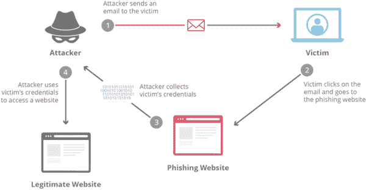 |

## 钓鱼攻击的类型

*   **a. CEO 诈骗/企业邮件**：网络犯罪分子向会计或财务部门的基层员工发送邮件。这些邮件的目标通常是让受害者将资金转移到虚假账户。在这种攻击中，攻击者克隆经过验证的消息并发送给受害者。

*   **b. 域名欺骗**：在此攻击中，攻击者创建一个虚假网站并要求用户输入凭据。

*   **c. 恶意孪生**：攻击者创建一个看似真实的虚假 Wi-Fi 访问点。如果任何受害者连接到此访问点，黑客将收集通过该点传输的数据包中的所有信息。

*   **d. HTTPS 钓鱼**：在此方法中，网络犯罪分子向受害者发送伪装成真实的垃圾邮件。邮件正文中包含恶意链接。如果用户点击链接，就会被破解。

*   **e. 短信钓鱼 (`Smishing`)**：在这里攻击者通过短信发送恶意载荷，并说服受害者下载该受感染的文件，从而导致被感染。

*   **f. 鱼叉式钓鱼**：黑客向组织个人发送大量带有恶意内容的垃圾信息，伪装成某项活动。

*   **g. 电话钓鱼 (`Vishing`)**：网络犯罪分子通过电话联系受害者，试图通过获得信任来收集机密数据。

恶意软件无非利用系统漏洞的恶意代码。这些恶意代码可能隐藏在数据包中以绕过杀毒软件、入侵检测系统 (`IDS`) 或防火墙。这些恶意软件可能会附在某些文档、程序代码中并在互联网上传播。网络犯罪分子开发此类恶意代码，并针对有漏洞的系统进行攻击和利用。各种类型的恶意软件如下：

*   **a. 病毒**：它是一种自我复制的病毒。它附在某些文档、程序代码中，但需要人类活动才能在互联网上传播。

*   **b. 蠕虫**：它与病毒相同，但不需要任何人类帮助即可传播。它利用有漏洞的操作系统。

*   **c. 木马**：这些恶意软件以伪装形式攻击。它们获得用户的信任并强制他们下载和安装此类恶意软件。使用木马恶意软件，恶意黑客可以获取目标用户的权限并窃取机密数据。

*   **d. 机器人 (`Bot`)**：它是自动化恶意代码。需要一个控制器来运行这些机器人。多个机器人形成一个僵尸网络 (`Botnet`)，导致僵尸网络攻击。

*   **e. 广告软件和间谍软件**：广告软件是网站上的弹出广告。它们为了盈利收集信息。间谍软件是一种恶意代码。这些代码隐藏在广告软件中，当用户点击此类窗口时，间谍软件就会安装到系统中。这些间谍软件记录受害者的所有活动并发送给攻击者。

*   **f. 勒索软件**：恶意者通过运行恶意代码锁定并加密受害者，并索要赎金或数据保护费。

*   **g. Rootkit**：网络犯罪分子使用 Rootkit 恶意软件获取受害系统的管理权限。

在新冠肺炎期间，恶意者大多使用木马恶意软件来破解系统。

## 背景

钓鱼诱导受害者访问虚假网站并泄露隐私数据。在钓鱼中，黑客创建一个虚假网站，并通过电子邮件或即时消息向用户发送该网站的链接。用户不知道此类网站，在无意中打开链接并与其共享信息。

不需要诱导的钓鱼类型被称为钓鱼攻击 (`Pharming`)。黑客劫持计算机系统并安装恶意代码，导致系统的网站流量转移到黑客的虚假网站。这在没有受害者许可的情况下发生。黑客随后获取在这些虚假网站上输入的隐私和个人信息。

钓鱼攻击有两种类型：

1.  **链接操纵**：在此方法中，黑客操纵链接，使用户无法轻易识别页面是从真实网站还是虚假网站打开的。

2.  **网站伪造**：在此方法中，地址栏被黑客修改。黑客通过以下技巧实现：

    *   a. 黑客隐藏地址栏
    *   b. 利用脚本修改地址栏的内容
    *   c. 在合法 URL 上方添加图片覆盖地址栏

在当前情况下，新冠病毒已影响了全球。这种疾病的传染性极强，正在全球范围内迅速传播。这在世界范围内引起了恐慌。人们正在搜索大量与该病毒相关的网站，以获取有关病毒的知识和意识。他们还在转发有关这些病毒的消息或各种文档以提高意识。同样，多个政府和私立健康组织也通过电子邮件或网站发送信息或文档。网络犯罪分子利用这些机会，通过钓鱼攻击获取机密数据或凭据。网络犯罪分子使用恶意软件进行钓鱼攻击。此类攻击被称为新冠病毒恶意软件攻击。

# 文献综述

表 1 是针对新冠病毒恶意软件钓鱼攻击的文献综述。

### 表 1. 显示了与新冠病毒相关的攻击

| 序号 | 攻击描述 | 影响 | 日期 |
| --- | --- | --- | --- |
| 1 | 钓鱼攻击通过发送伪造邮件实施，邮件包含如 `Remcos RAT` 等恶意软件载荷。网络犯罪分子利用 `Microsoft Office` 或 `PDF` 文档在目标系统中创建 `Backdoor`。（Montalbano, 2020） | 在下载或点击文档时，受害者计算机上会创建一个 `Backdoor`。犯罪分子利用后门入侵系统。通过电子邮件发送一个名为 `CoronavirusSafetyMeasures_pdf` 的伪造 PDF 文档，其中包含 `Remcos RAT` 恶意软件执行文件。该执行文件连同恶意软件运行一个 `VBS` 文件。`Remcos RAT` 向文件共享平台创建一个受 `TLS` 保护的连接以绕过防火墙。 | 2020 年 1 月 |
| 2 | 以“乌克兰卫生部公共健康中心”的名义通过电子邮件发送伪造的 `Microsoft Word` 文档。（Montalbano, 2020） | 传播了一份包含恶意宏的三页 `Microsoft Word` 文档。该文档伪装成一份以“乌克兰卫生部公共健康中心”名义通过电子邮件发送的关于新冠病毒的意识文档。恶意软件宏创建一个后门，可以从剪贴板获取信息，可以充当键盘记录器，并可以对目标系统进行截图。 | 2020 年 1 月 |
| 3 | 犯罪分子使用了一种新的钓鱼技术，他们以疾病控制中心（`CDC`）的名义发送恶意链接/URL（Montalbano, 2020） | 邮件包含一个钓鱼 URL，伪装成来自 `CDC` 的关于新冠病毒威胁的身份验证 URL。点击该 URL 后，会打开 Microsoft 登录页面。如果受害者在该页面上输入了某些凭据，该受害者就会变得危险。 | 2020 年 1 月 |
| 4 | 来自 Issue Makers Lab 的研究人员在北韩国发现了一份关于新冠病毒的恶意 Word 文档，其中包含 `BABYSHARK` 恶意软件。（Palo Alto Networks Unit 42, 2019） | 研究人员在恶意 Word 文档背后发现了 `BABYSHARK` 恶意软件。小鲨鱼恶意软件运行一个 `VB` 脚本文件。该恶意软件通过执行远程位置的 `HTA` 进行安装。随后，该恶意软件逃逸系统防火墙并将系统信息发送到 `C2` 服务器。它在系统中维持持久化。通过远程指令进行操作。（Palo Alto Networks Unit 42, 2019） | 2020 年 2 月 |
| 5 | 发送了一封关于 COVID-19 威胁的垃圾邮件，用意大利语编写，诱骗受害者打开附件并陷入危险。（Palo Alto Networks Unit 42, 2019） | 邮件包含多个具有相同名称（`f216785352XX.doc`）的附件。点击文档后，该恶意文件会强制受害者像 Microsoft Word 模板一样启用宏。启用宏后，恶意文件将连接到以下 URL<br>`45.128.134.14`<br>`Insiderppe.cloudapp.net` (Palo Alto Networks Unit 42, 2019) | 2020 年 1 月 |
| 6 | 一封伪造 FedEx 品牌邮件并伪装成经过身份验证的垃圾邮件，包含一个恶意的 PDF 附件。下载此附件后，恶意软件将安装在受害者系统中。（Palo Alto Networks Unit 42, 2019） | 一封以 FedEx 名义发送到目标系统的垃圾邮件包含一个恶意的 PDF 文件。该 PDF 文件为压缩格式。在下载并解压 PDF 文件后，它被转换为可执行格式，即 `.exe` 格式。一旦用户执行 `.exe` 文件，`Lokibot` 信息窃取器恶意软件就会安装在系统中。该恶意软件将系统数据发送到以下 URL<br>`kbfvzoboss.bid/alien/fre.php` (Palo Alto Networks Unit 42, 2019) | 2020 年 2 月 |


| 7 | 日本转发了某些垃圾邮件，其中附有恶意的 Word 文档。这些邮件伪装成从当地残障福利中心发送，赢得了受害者的信任。这些邮件声称他们拥有有关受害者地区新冠病毒患者的报告。（Hoffman, 2020） | 伪造邮件包含恶意的 Word 文件，其中嵌入了 `Emotet Trojan`。该 Word 文档引导受害者启用内容，在启用文档后，`VB` 脚本会打开 `PowerShell` 并安装 `Emotet Trojan`。该恶意软件随后感染系统，并利用这些系统发送更多的垃圾邮件和虚假消息以创建一个 `Botnet`，这可能导致如勒索软件和机密数据丢失的大规模攻击。（Hoffman, 2020)(TrendMicro.com, 2020） | 2020 年 1 月 |

| 8 | 恶意软件猎队的研究人员发现了针对新冠病毒的钓鱼活动。在这些垃圾邮件中，网络犯罪分子伪造了世界卫生组织（WHO）的域名。（Venkat, 2020） | 邮件伪造了世界卫生组织的域名，并发送有关新冠意识的垃圾信息。这些垃圾邮件包含名为 `Coronavirus Update` 的附件。该压缩文件中嵌入了作为 Excel 或电子表格文档的可执行文件 `MyHealth.exe`。该 `.exe` 文件是一个下载器，安装名为 `FormBook` 的信息窃取器。`FormBook` 恶意软件充当键盘记录器，可以截图，可以清除浏览器 Cookie，并还可以下载和执行其他恶意文件。 | 2020 年 3 月 |

| 9 | 黑客正在发送 HIV 垃圾邮件。这些邮件包含新冠病毒感染的虚假结果。这些邮件具有恶意内容。此类邮件发送给保险公司、医疗机构和制药公司。（Lytvynenko, 2020） | 这些邮件包含有关新冠病毒的虚假 HIV 检测结果，其中嵌入了 `Koadic 远程访问木马`。这些邮件伪造了范德堡大学医学中心的域名，向保险、医疗、制药公司发送带有恶意内容的垃圾邮件。受害者下载虚假的 HIV 检测附件时，`Koadic` 恶意软件被安装。该恶意软件感染受害者系统并窃取数据。（Lytvynenko, 2020） | 2020 年 1 月 |

| 10 | 黑客使用相同的 `Koadic 木马` 以人力资源部门的名义向某公司的员工发送了恶意邮件。（Lytvynenko, 2020） | 网络犯罪分子知道由于新冠病毒许多公司要求员工居家办公。因此，这些犯罪分子利用这些机会，以人力资源部门的名义向员工发送垃圾邮件。通过这些邮件，网络犯罪分子分享了一个 `DocuSign` 或 `Microsoft word` 文档并要求员工签名。该文档内部嵌入了 `Koadic 木马`。受害者在签名文档时会丢失其凭据。（Lytvynenko, 2020） | 2020 年 1 月 |

## 与新冠病毒相关的攻击

### 11. 新冠病毒勒索软件攻击

新冠病毒勒索软件攻击通过名为 `wisecleaner.best` 的伪造网站进行，该网站看起来像是真实的 Windows 系统工具网站 `wisecleaner.com` (Krebs, 2020)。在伪造网站中下载的并非实际文件而是 `WSHSetup.exe` 文件。此 `WSHSetup.exe` 是新冠病毒勒索软件的下载器。该文件还作为名为 `Kpot` 的密码窃取木马的下载器。`Kpot` 木马下载后会窃取网络浏览器、消息程序、电子邮件账户的登录凭据。它还会截图并寻找加密货币钱包。该木马还会加密目标系统上的文件。受害者计算机中的所有类型的文件都被此木马加密，并重命名为 `coronaVi2022@protonmail.ch___1. extension`。它还将受感染系统的 C 盘重命名为 `Coronavirus (C:)`。如果受感染系统重启，勒索软件将激活并用一条信息锁定屏幕 (Krebs, 2020) (Mar, 2020)。

### 12. 新冠病毒实时地图

实时新冠病毒地图是恶性的，网络犯罪通过此传播恶意软件 (Goyal et al., 2015)。实时新冠病毒地图由约翰霍普金斯大学的研究人员发现。该地图被黑客用于恶意网站以传播恶意软件。该地图显示了受新冠病毒感染区域的实时状态。黑客滥用这项技术传播病毒。他们利用此传播 `AZORult` 恶意软件。`AZORult` 是一种密码窃取木马 (Goyal et al., 2015)。

### 13. 通过 Arogya Setu App 进行的钓鱼攻击

以 Arogya Setu 移动应用为名的钓鱼攻击（以 Aarogya Setu 应用名义钓鱼攻击增加：网络机构，n.d.）。Arogya Setu 移动应用由印度政府开发，旨在提高意识并传播有关 Covid-19 的信息。网络犯罪分子伪造域名，误导用户从这些恶意域名下载 Arogya Setu 应用。他们还发送垃圾邮件和垃圾短信，假装成知名机构的人力资源或 CEO，通过发布诸如“你的邻居受影响了”、“查看谁受影响了”、“使用 Arogya Setu 应用指南”等虚假信息来针对用户。根据印度计算机应急响应小组 (CERT)，网络攻击者试图以 Arogya Setu 应用的名义吸引用户注意力。用户如果点击此类恶意链接或下载此类恶意文件，就会被恶意软件感染。（以 Aarogya Setu 应用名义钓鱼攻击增加：网络机构，n.d.） (May, 2020)

### 14. Viscous Panda 恶意软件攻击

一种针对 Windows 机器的恶意软件攻击，它利用 COVID-19 并攻击系统 (Panda, n.d.)。此类攻击中使用的恶意软件与已知恶意软件“Viscous Panda”同类型。该恶意软件被嵌入在关于新冠病毒的伪造 RTF 文档格式中。当点击此类受感染的文件时会打开一个 Microsoft Word 文件，Word 文件的公式编辑器会被利用。从而，恶意软件的初始负载得以执行。初始负载是一个恶意的 `intel.wll` 负载，是一个 `dll` 文件。该 `dll` 文件利用公式编辑器的漏洞如 `CVE-2017-11882`、`CVE-2018-0798` 并加载完整的恶意软件文件 `minisdllpub.dll`，使用 `undll32` 二进制文件执行。`minisdllpub.dll` 加载器下载远程访问木马 (RAT) 模块并执行。因此，通过此恶意软件，攻击者获得了系统的完全访问和控制。(Panda, n.d.) (May, 2020)

### 15. CovidLock 勒索软件

CovidLock 是一种针对安卓设备的新恶意软件。这是一个勒索攻击（CovidLock 更新：新冠病毒安卓 勒索软件深度分析，n.d.）。CovidLock 是嵌入在关于 COVID-19 安卓 应用中的恶意软件。这些恶意应用获得了用户的信任。当用户安装此类恶意应用时，它会请求 `BIND_DEVICE_ADMIN` 权限。如果用户允许此类权限，攻击者将通过此应用程序获得设备的完全控制。一旦攻击者获得设备的完全控制，他们就会锁定屏幕并加密数据。他们还会针对这些数据索要赎金。(CovidLock 更新：新冠病毒安卓 勒索软件深度分析，n.d.) (Mar, 2020)

### 16. 通过 ncov2019@gov.in 进行的钓鱼

印度计算机应急响应小组 (CERT) 报告了以 `ncov2019@gov.in` 为名发起的钓鱼攻击 (Massive, n.d.)。根据 CERT 的说法，在此攻击中，恶意活动分子宣传他们拥有两百万印度公民的电子邮件，并计划以虚假域名 `ncov2019@gov.in` 的名义发送邮件，主题为德里、孟买、海得拉巴、钦奈和艾哈迈达巴德公众提供免费 COVID-19 检测。这些虚假邮件包含链接或附件，引导用户进入虚假网站并窃取敏感个人和财务数据。(Massive, n.d.) (June, 2020)

### 17. Lazarus 小组钓鱼

由朝鲜运营人员 Lazarus 小组发起的钓鱼攻击（cyfirma 研究人员揭露了朝鲜运营人员 Lazarus 小组发起的全球 COVID 19 相关钓鱼活动，n.d.）。来自朝鲜的恶意黑客组织正试图入侵新加坡、日本、韩国、英国、美国的数百万用户。黑客通过宣布福利包、恢复策略计划、虚假方案等虚假信息来诱导用户。这些恶意活动分子针对这些国家中的脆弱用户和公司。邮件伪装成来自授权的政府机构。他们获得用户的信任并窃取其机密数据。这些网络犯罪分子使用的部分钓鱼链接为 `covid19notice@usda.gov`、`covid-support@mof.gov.jp`、`fppr@korea.kr` 等。（cyfirma 研究人员揭露了朝鲜运营人员 Lazarus 小组发起的全球 COVID 19 相关钓鱼活动，n.d.） (June, 2020)

## Proposed 工作

钓鱼攻击是通过伪装成受信任实体获取受害者信任来窃取凭据和其他敏感数据的方法。在钓鱼攻击中，网络犯罪分子通常有窃取用户名、密码、银行账户信息或其他敏感数据的动机。据说，即使系统完全安全，也可能通过钓鱼攻击被破解。钓鱼攻击通过两种方法进行。

1.  **方法一**：攻击者发送带有恶意附件的垃圾邮件。黑客可能伪造信任组织的域名并发送此类邮件。他们使用这些欺骗技术获取受害者的信任。当受害者点击或下载这些文件时，恶意软件就会安装并感染目标系统。

2.  **方法二**：黑客创建一个虚假的 URL 并通过电子邮件发送这些链接。受害者点击这些链接时，会打开一个请求凭据的恶意页面。受害者提供这些凭据可能会丢失加密数据。这些虚假网站包含木马，收集受害者输入的凭据并利用这些凭据进行数据窃取。

### 方法论：

*   **步骤 1**：钓鱼攻击有两种实施方式。首先，创建一个虚假 URL 并分享给受害者。用户点击虚假 URL 时输入的凭据会被攻击者捕获。其次，发送带有恶意文档的垃圾邮件。

*   **步骤 2**：上述钓鱼攻击的检测技术。本章讨论了多种句法、语义和语用技术。还讨论了检测钓鱼邮件、URL 和网页的技术。讨论了恶意软件分析的技术。

*   **步骤 3**：在本章中提到了针对此类钓鱼攻击的预防指南。预防措施是为避免此类攻击导致的任何损失而可以遵循的步骤。

## 实验与结果

新冠病毒恶意软件攻击使用相同的钓鱼方法论来破解系统。对几种钓鱼技术进行了实验，并在后续章节中讨论了检测和预防。

### 1. 钓鱼技术

#### i. 通过垃圾网站收集凭据

在这种技术中，创建一个网站的克隆版本，并将该克隆网站的 URL 通过电子邮件发送给受害者。克隆网站 URL 的 IP 地址就是黑客系统的 IP 地址。在这里，使用 `Kali Linux` 上的 `Setoolkit` 来展示如何通过克隆创建一个假网站。接下来的图 2 显示了通过 `setoolkit` 克隆网站。接下来的图 3 展示了如何创建恶意链接并通过电子邮件发送的演示。这里使用 URL 缩短工具 `tinyurl.com` 创建了一个虚假 URL。受害者在点击链接后，输入虚假网站请求的凭据。这些凭据被网络犯罪分子收集，如图 2 中红色圆圈标记所示。网络犯罪分子可能使用这些凭据来窃取数据。

| 图 2. 克隆网站并使用克隆网站收集凭据 |
| --- |
| 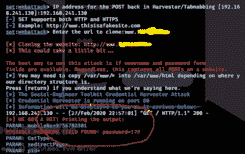 |

| 图 3. 创建虚假 URL |
| --- |
| 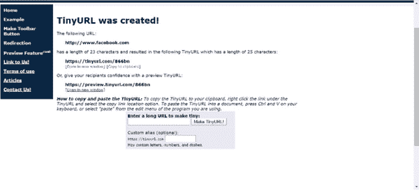 |

| 图 4. 使用欺骗技术发送带有恶意附件的垃圾邮件的演示 |
| --- |
| 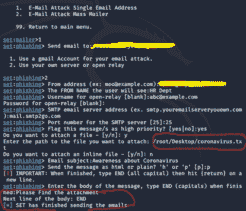 |

#### ii. 通过垃圾邮件收集凭据

在这种技术中，首先伪造一个受信任的电子邮件 ID 或域名。然后，通过伪造的电子邮件 ID 或域名，向目标系统发送一封包含恶意文件的垃圾邮件。使用 `Setoolkit` 来伪造电子邮件 ID，该 ID 被用于向目标系统发送包含关于冠状病毒恶意文件的垃圾信息。图 4 显示了伪造电子邮件 ID 并向目标系统发送垃圾邮件的截图。接下来的图 5 显示已收到垃圾邮件。受害者在下载垃圾邮件中的附件时，恶意软件被安装到系统中，黑客获得了系统的访问权限。接下来的图 6 显示了恶意软件感染系统后，黑客滥用该系统收集信息。

| 图 5. 收到垃圾邮件的演示 |
| --- |
|  |

| 图 6. 黑客获得访问并通过木马滥用感染的系统 |
| --- |
| 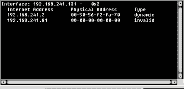 |

## 2. 钓鱼检测

钓鱼攻击可以通过电子邮件和网站/URL 进行。在钓鱼的所有类别中，都使用了句法、语义和语用特征来检测钓鱼技术。

### i. 语法技术

该技术的特征是电子邮件 ID、网站和 URL 语法的正确性。对于电子邮件 ID，应该包含本地部分（local-part）、`@` 符号和一个域名。例如 `abc@example.com`。因此，在示例中，本地部分 `ABC`，域名是 `example.com`。所以，对于一个有效的电子邮件 ID，它应该有一个有效的域名名（El Aassal et al., 2020）。顶级域名是 `.com` 或 `.net`。黑客有时使用虚假域名如 `.app`、`.ooo`、`.xyz`、`.online`、`.site`、`.club`、`.top`、`.info`、`.icu`、`.website` 等。对于 URL 和网站，有效的语法是 `scheme://host:part/path?query-string#fragment-id`。`scheme` 是访问互联网使用的协议，如 `http`、`https`、`ftp`、`mailto`。`host` 是资源所在的主机。`path` 是资源所在的路径。`query string` 由要发送到服务器的数据组成。`fragment id` 页面内片段的位置。因此，主机是访问资源的本地域名。例如，`www.example.com`。在这里 `www` 是主机的机器名，`example.com` 是域名。黑客使用虚假 URL 进行钓鱼攻击。例如，注册名为“google”，但他们使用了虚假的“goggle”。URL 通过 URL 缩短工具缩短。例如，`https://goo.gl/rkmzol`。此类 URL 可能是恶意的。此外，查看可疑邮件的头部，可以检测出邮件实际上是从哪里发送的。图 7 显示了一封关于 covid-19 数据的钓鱼邮件。图 8 显示了特定邮件的头部信息。发现该邮件未经过验证，且是使用电子邮件缩短工具 `emkei.cz` 发送的虚假邮件。

### ii. 语义技术

在这些技术中，主要目的是检查邮件内容、URL 和网站中内容的含义。这些语义技术有助于发现邮件内容中隐藏的对象的含义（El Aassal et al., 2020）。它们检查是否有任何关于更新、验证的信息。如“Click here”（点击这里）或“Act on”（立即行动）等术语（El Aassal et al., 2020）。接下来的图 9 显示了如下内容。

| 图 7. 一封关于 covid-19 数据的钓鱼邮件 |
| --- |
|  |

| 图 8. 特定邮件的头部信息 |
| --- |
|  |

| 图 9. 语义攻击检测示例（Aslan & Samet, 2020） |
| --- |
| 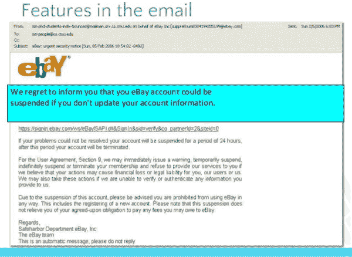 |

### iii. 语用技术

有时注册页的年龄、任何网站的详情会被网络犯罪分子禁用，导致受害者无法检查。在语用技术中可以检测到此类特征。

### iv. 词汇技术

此类特征使用语义和句法特征来检测钓鱼网站和 URL。这种技术根据黑名单词、白名单词以及邮件中的恶意内容来检测虚假网站或 URL。

### v. 网络技术

这种技术检查 URL 中是否存在端口号，以及从网站的 `HTTP` 协议中提取的特征。

### vi. 脚本技术

句法特征下，它检查 URL 脚本中的 `escape`、`eval()` 等，并检查网站中外部脚本的数量。

### vii. 邮件功能

通过分析邮件标头（Email headers）、邮件正文、文本特征、邮件 URL 特征和附件特征，可以检测钓鱼邮件。在邮件标头分析中，应用词汇技术来收集主题中某些可疑黑名单单词的信息、消息 ID 信息，并检查邮件内容是否为纯文本。在应用网络特征后，它会验证发送者和接收者的路径域名，并查找路径中的 IP 地址是否存在不匹配的情况。它还会验证域名密钥。

正文特征技术由文本类和 URL 类组成。在文本类中，通过应用词汇特征从邮件内容和 HTML 中提取文本，并验证是否存在任何黑名单单词。网络特征和脚本技术应用于文本类，以寻找网页页面等特征。在邮件 URL 类中，它会验证 `URL` 特征、安全连接、发送者地址与 `URL` 域名的差异，以及具有相同 IP 地址的 `URL` 数量。邮件附件类型，附件中是否存在恶意软件（El Aassal 等人，2020）。下面的图 10 显示了个人如何检查可疑邮件的标头。这里使用 `mxtoolbox.com` 站点来检查邮件标头内容。

| 图 10. 使用 mxtoolbox.com 检测垃圾邮件标头 |
| --- |
| 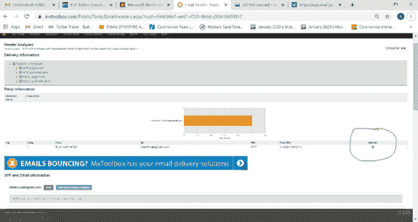 |

### viii. 恶意软件分析

使用杀毒或反恶意软件系统检测恶意软件。入侵检测/防御系统 (`IDS/IPS`)、主机入侵防御系统 (`HIPS`) 和防火墙也用于检测恶意软件。这些系统使用基于签名、基于行为和基于异常的方法来检测恶意软件。恶意软件分析师通常使用两种方法：

#### A. 静态分析


# 恶意软件分析与预防措施

恶意软件分析师分析代码并尝试寻找代码中任何隐藏的操作。他们使用反汇编代码来寻找代码中的恶意操作。杀病毒软件在执行静态分析时会进行反向工程，即使用反汇编器、调试器。在静态分析中，杀病毒软件尝试查找并匹配恶意软件数据库中的签名。因此，静态分析是一种基于签名的分析。

## B. 动态分析

这是一种基于行为或启发式的方法。在执行动态分析时，恶意软件分析师通过在沙箱环境中执行恶意软件来检查其行为。该沙箱环境有助于分析师防止恶意软件感染系统。此外，该环境还提供回滚机制，帮助系统在分析后恢复到清洁状态。

## C. 混合分析

这是静态分析和动态分析的结合。在这种方法中，恶意软件分析师首先通过动态分析检测恶意软件，然后使用静态分析分析代码。观察发现，混合分析对于新类型的恶意软件效果更好。

恶意软件使用加壳器（`packers`）来隐藏自己，使杀病毒软件无法检测。此外，某些恶意软件本身在壳程序中被加密，即使被检测到，这些恶意软件也不会被恶意软件加密。使用解壳工具（`Unpacker tools`）来检测此类隐藏自己的恶意软件。多种反汇编器或调试器工具也用于静态和动态分析。使用的一些工具包括：

*   **A. `PE Explorer`**：此工具用于反汇编代码。
*   **B. `WinDbg`**：这是一个调试工具。
*   **C. `OllyDgb`**：这是一个调试工具。
*   **D. `GNU debugger`**：这是一个调试工具。
*   **E. `Prodump32`**：这是一个解壳工具。
*   **F. `Reverse Engineering Compiler`**：一个编译器工具。
*   **G. `WinHex`**：一个十六进制编辑器。

# 恶意软件分析阶段

通常有四个分析阶段：

## A. 全自动分析

在此阶段，恶意软件分析师使用全自动工具检测恶意软件。该阶段通过 `Cuckoo` 检测恶意软件，这种分析会生成网络流量、注册表等详细报告。其他自动化工具包括 `Wine`、`Sandbox` 和 `Malheur`。

## B. 静态属性分析

通过静态分析获取恶意软件的深度信息。在此阶段，分析恶意软件代码，包括 `PE header` 信息、哈希值、嵌入字符串、嵌入资源等。`Virustotal` 是检测恶意软件的一种有效在线工具，它使用静态属性分析检测恶意软件。通过 `REMnux`，这是一种简易的检测恶意软件的方法。

## C. 交互行为分析

恶意软件分析师在隔离实验室执行恶意软件以观察其行为。分析师经常、定期地监控恶意软件的行为。这种分析可以了解恶意软件如何感染系统或如何附加到其他主机。全自动分析无法做到这些。

## D. 手动代码逆向

此阶段使用反向工程过程。逆向包括分析恶意软件存储或传输的加密数据、确定恶意程序的域名生成算法以及了解恶意软件的其他功能。调试器或反汇编器用于手动代码逆向以检测恶意代码。这种方法非常耗时，且需要专业技能。许多恶意软件分析师并不使用此阶段。

| 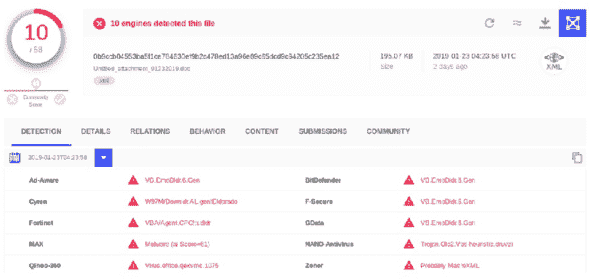 |

接下来的图 13 显示了 `coronavirusmap.com.exe` 文件的恶意软件分析。

| 图 13. 使用 `virustotal.com` 对 `Coronavirus.com.exe` 程序进行的恶意软件分析（`coronavirusmap.com.exe` 程序的恶意软件检测，n.d.） |

| 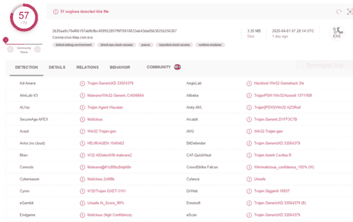 |

## 使用可执行文件头部进行恶意软件检测

使用可执行文件 (`PE`) 头部检测恶意软件。这是一种检测恶意软件的静态方法。这些是 Windows 的可执行文件，格式为 `.exe` 或 `.dll` 文件。在分析中，使用 `hex editor` 对恶意代码进行反汇编，如图 14 所示。

| 图 14. 使用 `PE` 头部进行恶意软件分析（分析, 2007) |

| 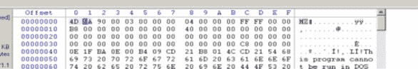 |

如图 14 所示，前两个字节的十六进制格式值为 `0x4D` 和 `0x5A`。这两个值表示 `MZ`。开头的 `MZ` 表示它是一个 `PE` 头部。通过 `PE` 头部，分析人员可以了解恶意软件是针对 32 位还是 64 位的 Windows 机器。通过头部还可以分析恶意软件是否使用了加壳器（`packer`）。使用 `PE explorer` 对恶意代码进行反汇编，如图 15 所示。在这里，如果恶意软件隐藏在壳中（如图 16 所示），`PE explorer` 会将其脱壳并反汇编恶意代码。`PE explorer` 使用了反向工程流程。

| 图 15. 使用 `PE Explorer` 反汇编的恶意代码 |

| 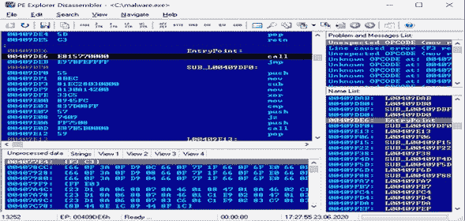 |

| 图 16. 恶意软件分析显示未使用 `UPX` 壳器 |

|  |

通过验证此代码，恶意软件尝试在代码中寻找任何隐藏活动。例如，图 17 显示了其中一个隐藏恶意活动。

| 图 17. 恶意代码显示隐藏的恶意活动（分析, 2007） |

|  |

图 17 显示在此情况下，恶意软件尝试删除 `kernel32.dll` 文件。

在静态分析之后，可以使用动态分析来分析恶意软件的行为。使用 `Windump`、`TcpView` 工具来分析恶意软件的行为，如图 18 所示。

| 图 18. `TcpView` 截图 |

| 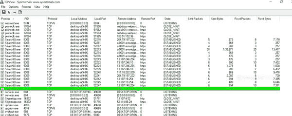 |

`TCPVIEW` 提供了所有 `TCP` 和 `UDP` 连接列表。它还显示了使用 `TCP` 协议的连接状态。使用 `TcpView` 可以检查恶意软件是否尝试通过 `WWW`、`FTP`、`DNS`、`IMAP`等协议建立连接。因此，`TcpView` 提供了恶意软件执行时的后台细节。这意味着可以通过 `TcpView` 验证恶意软件的行为。

通过结合静态和动态分析方法，可以检测恶意软件并分析其行为。

# 预防措施

防止网络钓鱼的各种方法如下：

*   **i. 使用反钓鱼技术来检测并防止网络钓鱼攻击。** 反钓鱼技术包括：
    *   **a. 基于属性的反钓鱼**：在该方法中，执行不同的属性检查，如图像属性检查、证书检查和 `URL` 检查。在这种技术中，检查方式如分配给页面的 `URL` 是相对较新的。它会验证可疑网站的图像并将其与认证网站进行相似性比较（`coronavirusmap.com.exe` 程序的恶意软件检测，n.d）。
    *   **b. 基于遗传算法的反钓鱼**：这里使用了遗传算法逻辑。这些算法根据原理生成简单的规则。利用这些规则，可以将伪造或钓鱼网站与原始网站区分开来。这些技术的优势可以在打开邮件之前检测到钓鱼邮件（`coronavirusmap.com.exe` 程序的恶意软件检测，n.d）。
    *   **c. 基于字符的反钓鱼**：在此类技术中，会检查 `URL` 是否嵌入了任何隐藏的目标地。它还会验证 `URL` 中是否存在隐藏的点点格式目标 IP 地址。使用这种方法可以避免已知的和未知的钓鱼技术，但有时这种技术会产生假阳性结果（`coronavirusmap.com.exe` 程序的恶意软件检测，n.d）。
    *   **d. 基于内容的反钓鱼**：在该方法中，它会检测具有特定特征的网站（`coronavirusmap.com.exe` 程序的恶意软件检测，n.d.）。
    *   **e. 基于身份的反钓鱼**：这种技术根据某些特征进行检测（`coronavirus.com.exe` 程序的恶意软件检测，n.d）。

*   **ii. 处理邮件：每个人都应该了解：**
    *   a. 邮件是如何到达的。
    *   b. 是否是真实的。
    *   c. 不要分享个人或财务信息。
    *   d. 应该多次检查链接或 `URL`。
    *   e. 存在某些报告。
    *   f. 手机、电脑应定期更新。
    *   g. 用户应使用强且唯一的密码。
    *   h. 应使用额外的安全防护，如双重身份验证、使用杀毒软件等。

*   **iii. 邮件内容：** 逻辑混乱且质量差的邮件可能是伪造的。在下载任何内容之前必须确认邮件。避免任何“点击此处”或“操作”字样。
*   **iv. 避免关于奖励的邮件。**
*   **v. 避免要求个人详情的网站。**
*   **vi. 要求个人续签任何政策或更新许可证的邮件可能是诈骗邮件。需要注意这种情况。**
*   **vii. 任何带有“您的系统被破解。点击此处恢复数据”等警告信息的邮件都是危险的。** 个人不应点击此类邮件，而是应该联系认证的白帽黑客。
*   **viii. 避免使用 `URL` 缩短器处理的 `URL`。**
*   **ix. `SSL` 提供了安全的通信通道。** 任何没有有效 `SSL` 证书的站点可能是假网站。需要注意。
*   **x. 个人应避免弹出窗口。** 不要在弹出窗口中输入凭据。
*   **xi. 应在个人系统中安装更新的杀毒软件，以防止恶意软件下载。**

# 总结

本节讨论了整个章节的总结，并强调了作者在教育和传播网络世界问题方面所做努力的初衷。新冠影响了全球所有地区，对人类构成了巨大威胁，某些个人正在利用这一灾难，试图通过各种手段为人们制造麻烦。章节的关键讨论如下：

*   **1. 作者讨论了过去三个月内以新冠为名的 12 种不同场景。** 黑客利用 Word 文档、PDF 文档、伪造 `URL`、垃圾邮件、域名欺骗等许多方法来执行钓鱼攻击。
*   **2. 基于上述场景讨论，作者实验了两种钓鱼技术，以演示钓鱼是如何执行的以及结果如何，这些技术包括通过垃圾邮件和钓鱼网站收集凭据。**

### 3. 钓鱼攻击的检测

在演示了钓鱼技术后，下一步是理解如何对此类钓鱼攻击进行检测至关重要。检测包括对八种不同钓鱼检测方法的详细介绍，此外作者还演示了三种检测方法。

### 4. 预防措施

最后但同样重要的是，作者们还针对钓鱼攻击提出了一些预防措施，正如俗话所说，预防胜于治疗。个人和组织都必须遵循这些预防措施以防止钓鱼攻击发生。

# 致谢

作者感谢 D.Y.Patil 博士所属的 Ramrao Adik 科技学院在实验和分析工作方面提供的支持。作者并诚心感谢校长 Mukesh D. Patil 博士的鼓励，以及信息技术系主任 Ashish Jadhav 博士的持续支持与指导。作者感谢所有朋友、家庭成员和同事，是他们有意或无意地激励了我们完成这一章节的写作。

# 参考文献

- Abrams, L. (2020). 新冠病毒勒索软件作为 Kpot 信息窃取工具的掩护。获取自 `https://www.bleepingcomputer.com/news/security/new-coronavirus-ransomware-acts-as-cover-for-kpot-infostealer/`
- Analysis, M. (2007). Dennis Distler 简介. SANS 学院。
- Aslan, Ö. A., & Samet, R. (2020). 恶意软件检测方法全面综述。IEEE Access: Practical Innovations, Open Solutions , 8, 6249–6271. doi:10.1109/ACCESS.2019.2963724
- CovidLock 更新: 新冠病毒安卓版勒索软件的深度分析。(n.d.) 获取自 `https://www.domaintools.com/resources/blog/covidlock-update-coronavirus-ransomware`
- El Aassal, A., Baki, S., Das, A., & Verma, R. M. (2020). 针对安全需求的钓鱼检测研究深度基准测试与评估。IEEE Access: Practical Innovations, Open Solutions , 8, 22170–22192. doi:10.1109/ACCESS.2020.2969780
- cyfirma 研究人员揭露由朝鲜黑客 Lazarus 组织发起的全球性 COVID-19 相关钓鱼攻击活动。(n.d.) 获取自 `https://www.cyfirma.com/early-warning/global-covid-19-related-phishing-campaign-by-north-korean-operatives-lazarus-group-exposed-by-cyfirma-researchers/`
- Goyal, T., Vakil, A., Parmar, D., Jain, R., & Jinwala, D. C. (2015). 防止钓鱼攻击：一种新方法。国际计算机与应用杂志 , 121(14)。
- Hoffman, Y. (2020). Emotet 攻击随着对新冠病毒的恐惧蔓延。获取自 `https://blog.radware.com/security/attack-types-and vectors/2020/02/emotet-attacks-spread-alongside-fears-of-coronavirus/`
- Krebs, B. (2020). 用于恶意软件的实时新冠病毒地图。`https://krebsonsecurity.com/2020/03/live-coronavirus-map-used-to-spread-malware/`
- Lytvynenko, J. (2020). 黑客正在发送虚假的 HIV 结果和新冠病毒邮件以感染他人电脑。获取自 `https://www.buzzfeednews.com/article/janelytvynenko/hackers-coronavirus-hiv-fake-emails-phishing-malware`
- Coronavirusmap.com.exe 程序的恶意软件检测。(n.d.) 获取自 `https://www.virustotal.com/gui/file/2b35aa9c70ef66197abfb9bc409952897f9f70818633ab43da85b3825b256307/detection`
- Massive, P. A. B. (n.d.) 官方预计今日将出现“恶意行为者”。获取自 `https://www.ndtv.com/india-news/cert-in-massive-phishing-attack-by-malicious-actors-expected-today-says-centre-2249657`
- 掌握恶意软件分析的四个阶段。(n.d.) 获取自 `https://zeltser.com/mastering-4-stages-of-malware-analysis/`
- Montalbano, E. (2020). 随着新攻击的出现，以新冠病毒为主题的网络攻击持续。获取自 `https://threatpost.com/coronavirus-themed-cyberattacks-persists/153493/`
- 帕洛 Alto 网络 Unit 42 团队。 (2019)。 新型 BabyShark 恶意软件针对美国国家安全智库。获取自 `https://unit42.paloaltonetworks.com/new-babyshark-malware-targets-u-s-national-security-think-tanks/`
- Panda, V. (n.d.) 利用新冠病毒的新型恶意软件活动。获取自 `https://www.buguroo.com/en/labs/vicious-panda-a-new-malware`
- 一场利用新冠病毒的新型恶意软件活动。获取自 `https://www.buguroo.com/en/labs/vicious-panda-a-new-malware`
- 官方预计今日将出现“恶意行为者”。获取自 `https://www.ndtv.com/india-news/cert-in-massive-phishing-attack-by-malicious-actors-expected-today-says-centre-2249657`
- 针对 Aarogya App 的大规模钓鱼攻击：恶意行为者。(n.d.) 获取自 `https://www.indianexpress.com/nation/2020/may/16/phishing-attacks-in-name-`
- 新冠病毒恐惧导致的新型攻击，针对日本。获取自 `https://www.bankinfosecurity.com/coronavirus-fears-lead-to-new-`
- Emotet 垃圾邮件攻击活动利用魔法。获取自 `https://sethegeek.net/598/emotet-malspam-campaign-exploits-reliance-on`
- 什么是恶意软件分析？恶意软件分析的概述。(n.d.) 获取自 `https://digitalguardian.com/what-is-malware-analysis-defining-outlining-process-`

# 第 5 章

- Tawei Wang，迪波大学，美国
- Yen-Yao Wang，奥本大学，美国

## 摘要

本章节概述了若干拟议或通过的隐私法规，包括通用数据保护条例 (`GDPR`)、加州消费者隐私法 (`CCPA`)、伊利诺伊视频法案、佛蒙特数据经纪人条例以及隐私法案。在最后，讨论了若干研究机会。这些研究机会包括 (1) 这些法规的经济影响和 (2) 捕捉这些特征的新研究框架。作者进一步讨论了解决这些研究机会可能的设计。

## 引言


# 隐私法规最新进展及相关研究概述

## 通用数据保护条例 (GDPR)

随着近年来数据隐私保护问题日益严重，《通用数据保护条例》（GDPR）于 2017 年通过并于 2018 年 5 月在欧盟（EU）实施。GDPR 的实施旨在解决与客户信息收集相关的担忧和挑战。它具有以下通用数据保护原则：
1. **公平与合法性**：处理个人数据时应针对数据主体以合法、公平且透明的方式进行。
2. **目的限制**：收集个人数据必须是出于特定、明确且合法的目的（即目的限制）。
3. **数据最小化**：数据最小化设计旨在确保组织在收集个人数据类型方面不要过度扩张。
4. **存储限制**：存储限制设计旨在将个人数据以允许识别数据主体的形式保留，时间不得超过处理个人数据目的所必需的时间。
5. **准确性、完整性与机密性**：个人数据应保持准确，并在必要时保持更新（即准确性）。完整性与机密性（安全性）规定，处理个人数据的方式应确保个人数据的适当安全。
6. **问责制**：问责制旨在确保公司能够证明其正努力遵守构成 GDPR 的其他原则（欧洲委员会，2019；Goddard，2017）。

GDPR 包含 99 条条款，涉及许多不同方面（欧洲委员会，2019）。GDPR 广泛的涉及面使其被赞誉为“游戏规则的改变者”（Goodman, 2018），也被批评为一种“财产权制度”（Victor, 2013）以及对创新和技术发展的阻碍力量（Zarsky, 2016）。在这里，我们仅讨论 GDPR 的几个主要特征。

值得注意的是，尽管它侧重于收集和处理欧盟居民信息的组织惯例，但它并不限于公司在欧洲的实体存在（即域外效力要求）。因此，在 GDPR 于 2018 年 5 月生效之前，许多美国公司也忙于准备合规，因为在当今的全球业务运营中，它们可能会收集或处理来自欧盟居民的信息。GDPR 还要求处理大量敏感个人信息的公司设立数据保护官（DPO）。数据保护官负责培训员工、进行定期评估并作为公司与数据主体之间的通信渠道。更重要的是，GDPR 允许用户要求访问公司收集的数据，并可以请求删除其数据（即“被遗忘权”）。违规罚金最高可达 2000 万欧元或公司全球营业额的 4%（以较高者为准）。例如，Google 因缺乏透明度被法国数据监管机构处以 5000 万欧元的罚款（Fox, 2019）。

自 GDPR 实施以来，我们注意到有一些但非常有限的研究在讨论 GDPR 在不同情境下的影响。此外，尽管 GDPR 声称涵盖了自动化或人工智能算法系统做出的所有决策的“解释权”，但由于缺乏精确的语言和定义良好的权利，一些学者仍对此问题存在争论，从而面临着意义不大的风险。例如，Wachter、Mittelstadt 和 Floridi（2017）作为论证 GDPR 缺乏定义良好权利的例子之一，明确讨论了解释权的含义，并指出有意义的解释权并非由 GDPR 强制规定。

大多数现有研究倾向于关注关于 GDPR 影响的观点，而非实证地检查其影响，仅有少数例外。Goddard（2017）讨论了 GDPR 的数据保护原则及其潜在的全球影响。为了实施这些原则，研究人员要求在任何数据收集活动中主动设计并将隐私概念化为默认设置（by default）。他进一步强调了将这些原则嵌入 IT 架构设计系统中以运行这些原则重要性。Rumbold 和 Pierscionek（2017）解释了适用于医学研究的数据保护法变化，并讨论了 GDPR 如何影响医学研究。特别是他们关注了基于 GDPR 的知情同意要求，这将严重限制医学数据研究。他们的结论是，由于 GDPR 产生的预期变化对生物医学数据研究的影响很小。作为探讨 GDPR 对科学研究潜在影响的另一种尝试，Chassang（2017）提供了 GDPR 的概述，并讨论了 GDPR 如何改变处理个人健康数据、基因数据或其他类型敏感信息的做法。该研究最后为科学研究人员提供了关键事实，以调整做法并确保符合 GDPR。此外，Wachter（2018）讨论了物联网（IoT）背景下隐私与可识别性之间内在的紧张，并研究了 GDPR 如何为物联网用户提供有意义的隐私保护和身份控制。

除了上述研究外，许多其他研究还专门关注从医疗保健角度来看 `GDPR` 的影响。例如，Marelli、Livevrouw 和 Van Hoyweghen (2020) 讨论了基于 `GDPR` 的当前数据治理制度与数字健康扩张带来的更广泛的社会转变之间产生的紧张关系。他们的讨论引发了对 `GDPR` 是否适用于管理当前医疗保健领域发展的怀疑，同时也呼吁采取迅速且充分的政策响应。最后，Marovic 和 Curcin (2020) 探索了 `GDPR` 对塞尔维亚健康数据管理的影响。他们的发现表明，鉴于目前法律的局限性和潜在问题，转向 `GDPR` 是否对塞尔维亚医疗体系有益仍有待观察。因此，需要在国家层面采取战略方法，以解决资源不足的问题，进一步完善个人数据保护环境。

两项近期研究强调了消费者对 `GDPR` 的响应。Aridor 等人 (2020) 研究了数据隐私法规的经济后果，这是少数实证研究 `GDPR` 影响的案例之一。他们发现，由于 `GDPR` 的影响，观察到的中间消费者减少了 12.5%，这表明相当数量的消费者行使了 `GDPR` 赋予的退出权。Zhang、Wang 和 Hsu (2020) 从另一个视角，调查了自愿采用 `GDPR` 与隐私声明的可读性与消费者信息披露意愿之间的关系。采用 `GDPR` 是影响消费者信息披露意愿和对公司信任的重要因素。该研究证明了采用 `GDPR` 可能带来的潜在收益。

尽管 `GDPR` 试图通过为数据保护活动提供指导来造福公司，但它对现有的操作实践提出了新挑战。我们观察到少数关于这一主题的研究。例如，Tikkinen-Piri、Rohunen 和 Markkula (2018) 关注 `GDPR` 对公司操作实践的影响。他们进一步展示了影响的 12 个方面，如业务策略、组织和技术措施，并就如何让公司更好地准备新的 `GDPR` 要求提供了相应的指导。

## 加州消费者隐私法案 (CCPA)

《加利福尼亚州消费者隐私法案》（`CCPA`）是加利福尼亚州新的消费者隐私权利法规，于 2020 年 1 月 1 日生效（加利福尼亚州司法部，2020）。`CCPA` 的精神与 `GDPR` 相似。它可能是美国最有影响力的州级隐私法，也是首个为消费者提供重大隐私权利的法律（Stallings, 2020）。它涉及对公司收集的个人信息的访问、删除和共享。换句话说，它让消费者对其个人信息拥有很大的控制权。该法律适用于加利福尼亚州境内收集消费者个人信息、或代表其他实体收集此类信息，且该实体单独或与其他实体共同决定消费者个人信息处理目的和手段的任何企业（加利福尼亚州司法部，2020）。在加利福尼亚州运营符合以下条件的企业受 `CCPA` 监管：
1. 年收入超过 2500 万美元；
2. 买、接收或出售 50,000 或更多消费者、家庭或设备的个人信息；
3. 年收入的 50% 或以上来自出售消费者个人信息（加利福尼亚州司法部，2020）。

`CCPA` 的主要特征之一是其对个人信息（`PI`）极其广泛且全面的定义。在 `CCPA` 下，`PI` 是任何能够与特定消费者或家庭相关，或可以合理地直接或间接关联的内容。因此，`PI` 可能包括标识符，如姓名、别名、邮政地址、唯一个人标识符、电子邮件地址、账户名称、社会安全名称、驾照号或护照号。`CCPA` 还允许加州客户要求查看公司关于他们的信息（即知情权）。关于公司需要向加州居民披露的类别，公司必须披露收集这些 `PI` 的来源、收集或出售 `PI` 的目的、出售的 `PI` 类别，以及共享 `PI` 的第三方类别。此外，公司必须允许客户选择是否与第三方共享其信息（即退出权）。客户还有权要求删除公司收集的信息（即删除权），并且不受到因数据而产生的歧视（即非歧视权）。最后，与罚款金额高达 2000 万欧元或公司全球营业额 4% 的 `GDPR` 相比，`CCPA` 并不对违规施加巨额罚款。它仅允许消费者每次违规索回高达 750 美元的赔偿或其实际损失。当企业故意违反法律时，总检察长还可以获得每次违规最高 7,500 美元的民事罚款。

鉴于 `CCPA` 于 2020 年生效，来自法律、会计或信息技术等不同领域的研究大多倾向于讨论 `CCPA` 是什么以及它可能如何影响相应领域。许多研究还检查了 `GDPR` 和 `CCPA` 之间的相似性和差异。例如，Myers、Lively 和 Andrews (2019) 比较了 `CCPA` 和 `GDPR`，并为公共会计师和顾问提供了应对这些新法律的建议。Thomas (2020) 比较了 `CCPA` 与 `GDPR` 相似和不同之处，并讨论了这如何影响企业准备的方式。

与 `GDPR` 的趋势类似，我们注意到不同领域实证研究 `CCPA` 影响的研究非常少。最后，在隐私法规实施（例如 `GDPR` 和 `CCPA`）的驱动下，Winegar 和 Sunstein (2019) 通过调查研究了消费者如何重视数据隐私。他们发现，中位数消费者每月仅愿支付 5 美元维持数据隐私，但如果允许访问个人数据则要求 80 美元。他们得出结论，由于缺乏信息和行为偏见，支付意愿和接受意愿衡量保留或放弃数据隐私的福利效应是非常不可靠的指标。

## 伊利诺伊州视频面试法案

大型酒店连锁希尔顿（Hilton）在其招聘计划中使用了一款人工智能（AI）软件 HireVue（Halzack, 2014）。该软件可能帮助公司接触到更多候选人，并让潜在候选人获得关注，因为公司现在有了初步处理更多候选人的能力。当公司使用该软件时，评估结果可能更具一致性且独立于面试官的意见。然而，这同时也引发了对收集行为信息（例如，候选人的说话方式、解释问题的方式以及面部表情和肢体语言）以及出于不同目的使用或共享此类信息的隐私担忧。

### 伊利诺伊州视频面试法

《伊利诺伊州视频面试法》或《AI 视频面试法》（伊利诺伊州州议会，2020）旨在解决这一新兴问题，并于 2020 年 1 月 1 日颁布。美国专门规定人工智能作为申请视频评估工具的法律。该立法具有以下几个关键特征。

首先，计划使用 AI 进行面试的公司必须解释这些工具的工作原理以及如何用于评估。其次，公司需要获得申请人的同意，方可以使用人工智能评估申请人的面试视频。第三，雇主仅允许将视频与其专业知识或技术对于评估申请人的职位胜任能力必要的人员共享。最后，雇主必须在申请人要求销毁后 30 天内销毁视频及所有副本。

尽管这项法律试图保护求职人在面试过程中的权利，但其某些要求相当模糊。例如，该法律没有定义 AI，也没有对雇主在视频面试中对 AI 的说明应包含的内容提供具体指导。此外，尽管该法律赋予了候选人拒绝视频面试的权利，但并没有要求雇主提供替代方案。因此，许多责任被放在了候选人身上，导致求职者感到有义务参加视频面试以免失去就业机会。最后，与 `GDPR` 和 `CCPA` 相比，该法律在执行、救济和违规惩罚方面也保持沉默。

尽管使用 AI 进行面试带来了潜在的益处和问题，但我们注意到很少有研究探讨 AI 促进招聘过程的影响。例如，Suen, Chen, & Lu (2019）探索了同步视频面试、异步视频面试以及 AI 辅助的异步视频面试的社会影响。有趣的是，他们发现申请人并没有感知到有无 AI 辅助的面试在程序公平性上的差异。然而，还没有研究尝试在伊利诺伊州 AI 视频面试法的框架下解决相关问题。

## 佛蒙特州的数据经纪人监管

随着信息技术的发展，我们看到了一种作为数据经纪人的新型业务模式。数据经纪人¹收集信息并将有关客户的有用信息出售给公司。例如，2018 年《福布斯》（Forbes）的一篇文章中提到：“Facebook 的合作伙伴类别计划在早在 2013 年就开始从 `Acxiom`、`Epsilon` 和 `Oracle Data Cloud` 等公司获得信息许可，根据用户在其‘围墙花园’之外的线下或在线活动，对其进行精准广告投放”（Leetaru, 2018）。具体而言，广泛的个人信息可能不是通过客户建立关系的公司直接收集的。相反，公司可能会通过数据经纪人获取有关客户的信息，而这正是该立法的重点。

佛蒙特州的《数据经纪人条例》（佛蒙特州总检察长办公室，2018）于 2019 年 1 月 1 日生效，专门通过以下方式监管数据经纪人。首先，该法律将数据经纪人定义为明知收集并出售或向第三方许可与该业务没有直接关系的消费者“经纪介个人信息”的业务或业务部门。该法律进一步定义了“经纪介个人信息”为：如果为了分发给第三方而进行分类或组织，则关于消费者的列表中的一个或多个计算机数据元素，以及其他使理性人士以合理的确定性识别出消费者的其他信息。

该法律对经纪介个人信息的定义导致了一些模糊地带，特别是对于数据的内部使用。例如，鉴于经纪介个人信息必须是为了分发而进行分类或组织，该业务必须对数据进行过某种处理以准备分发，这样才会触及该法律的范畴。因此，存储在业务内部数据库中供内部使用且无意图向业务外分发的数据不被视为经纪介个人信息，这导致了法律监管的某些模糊地带。

根据该条例，数据经纪人要求每年通过 `佛蒙特州州务卿`（Vermont Secretary of State）进行注册。数据经纪人还被要求维持安全标准。该法律列出了以下详细的数据安全要求。例如，数据经纪人需要拥有全面的安全计划、进行风险评估、培训员工遵守政策和程序、实施防止离职员工访问个人身份信息的措施，并至少每年审查一次安全措施范围。最后，立法明确规定，通过欺诈活动获取个人信息以及出于例如欺诈或歧视等目的是违法的。尽管这项条例引起了广泛关注，但还没有任何业务相关的研究强调过这个问题。

## 《隐私权利法案》

在美国，隐私通知法或相关的隐私立法处于州级。参议员爱德华·J·马基（Edward J. Markey）在 2019 年提出了一项名为《隐私权利法案》的新规（该法案），这是美国联邦层面的第一项隐私法规（国会，2020）。该法案考虑了 `GDPR` 和 `CCPA` 中的几个方面，如数据可携带性、删除以及对收集的个人信息的访问。法案对“个人”的定义非常广泛，包括生物识别信息（但不包括涵盖实体在个人不知情的情况下收集的此类信息）、密码以及个人偏好或特征。它还尝试建立一个包含美国所有数据经纪人的中央数据库。

该法案包含几个主要部分。首先，它要求公司保护其所拥有的个人信息。其次，公司只能收集提供服务所需的信息，并提供易读的简短隐私通知，且不允许将收集的个人信息用于歧视。第三，它提议使用中央联邦贸易委员会（Federal Trade Commission）网站向客户提供有关其隐私权利的信息。最后，拟议法案将允许州检察长对违反隐私权利的公司提起诉讼。鉴于这目前仍处于提议阶段，后期也可能发生变化，尚未研究尝试在该背景下解决相关问题。

# 未来的研究机会

我们的文献综述表明，目前对上述政策的讨论仍然较少，大多数是从总体影响的角度出发。在本节中，我们为这一特定的研究领域提供了较少的研究机会。

## 经济后果

我们观察到，目前的研究大多集中于讨论这些法规是什么，以及这些法规在法律、信息技术（`IT`）或会计等相关领域可能产生的潜在影响。然而，我们对经济后果的理解仍然非常有限。

从实证角度来看，新法规实施后，可以将新法规的采用视为一种外生变异（即冲击），从而为开展自然实验提供了一个良好的设定，随后采用双重差分法（difference-in-differences）来展示其效果。因此，我们呼吁更多关于这些新法规经济效应的研究，并建议自然实验可能是处理该问题的一种合适研究设计。

例如，如前所述，`Aridor et al. (2020)` 代表了在线旅游行业中实证研究 `GDPR` 经济后果的少数案例之一。他们显示，在采用 `GDPR` 后，具有隐私意识的消费者会从效率较低的隐私保护转向显式的“选择退出（opt out）”。然而，剩余消费者对广告商的平均价值增加了，抵消了选择退出消费者产生的大部分损失。因此，他们的研究为从业人员考虑采用诸如 `GDPR` 等新政策的成本与效益提供了重要启示。

具体而言，我们从公司和消费者的视角，针对上述新法规提出了几个可能的研究问题。

### 公司视角


首先，在 `GDPR` 和 `CCPA` 的背景下，`GDPR` 或 `CCPA` 准备好了什么？目前还不清楚 `GDPR` 和 `CCPA` 如何从根本上改变组织处理隐私的方式，或者这些新法规将如何改变公司收集用户信息的方式。`GDPR` 规定违规罚金可达 `€20 million` 或公司全球营业额的 `4 percent`。一方面，高额的违规罚金可能会激励公司重新审视其现有的政策和操作以避免罚款；另一方面，为了合规，还需要投入额外的精力或资源用于业务流程、`IT` 基础设施或数据安排的变化。

最近我们已经观察到用户在访问特定网站时允许更改 cookie 设置。然而，某些网站仅要求查看者点击“我接受”，而没有任何其他选项，这基本上迫使选择继续使用服务/购买的用户接受公司设定的拟定隐私政策。但是，这与法规的精神不符，也不会影响底层流程。业务流程的改变包括设立新的 `数据隐私官`（`DPO`）职位，并可能改变隐私挑战或战略计划的责任报告链。对每家公司组织结构的更详细了解可以帮助用户和公司理解隐私意识或信任的影响，例如，当公司意识到或将隐私提升到战略时。最后，考虑到高昂的合规成本，目前还不清楚这些法规如何在大数据和人工智能背景下影响公司进一步创新的意愿，或者它们在利用个人信息开发新业务模式或服务时如何改变公司创新策略的方向。通过研究这些法规对公司的成本和效益，将带来一种有趣的现象。

对于 `AI 面试法`（`AI interview act`），如前，该法律目前的形式没有明确定义 `AI`，也没有对雇主在视频面试中使用的 `AI` 解释应包含的内容提供特定指导。因此，这可能为公司评估 `AI 面试法` 的潜在影响带来更多挑战。其次，由于理解求职者的行为模式是一个学习过程，结果可能会因为训练数据集而产生偏差。尽管可以通过随后的面试发现假阳性案例，但公司可能会错失假阴性案例。在极端情况下，当偏差可能与文化或种族问题时，公司可能需要面临更多挑战。因此，更多的调查将有助于组织更好地评估使用 `AI` 进行职位面试的成本与效益。

`数据经纪人法`（`Data Broker Act`）为消费者、监管机构和研究人员提供了关于该领域“隐藏玩家”更多信息。目前，已有 100 多名数据经纪人根据 `Vermont` 的新规定进行了注册。对于研究人员来说，这是了解这些数据经纪人如何向其他组织提供服务的绝佳机会。他们的业务模式和表现对于研究人员向监管机构提供政策建议也具有价值。此外，这些数据经纪人的公开名单是否改变了任何数据获取活动或影响了隐私保护行为？或者公开名单如何影响这些经纪人与业务伙伴之间的关系？更深入的理解可以为监管机构形成潜在的未来政策。未来，如果我们能够在联邦层面拥有隐私法规，观察不同层级的法规如何相互作用并影响数据经纪人的合规实践将是非常有趣的，例如，它是否会通过影响公司、经纪人或用户的行为来提供新层次的保护。

### 消费者视角

除了从公司视角解决问题外，从消费者视角调查该问题也具有价值。例如，`GDPR` 和 `CCPA` 已经强制公司更改其用户隐私设置以及与用户的协议。理解这些政策变化是否能产生预期结果变得非常重要。最近观察到的一个变化是，某些公司开始允许用户在他们的网站上自定义隐私选项。调查这如何影响用户订阅服务或购买产品的意愿，以及它如何帮助公司建立信任，将是非常有趣的。

对于 `AI 面试法`，从用户的角度来看，`AI 面试` 可能会拓宽求职者的机会，尽管存在这些隐私顾虑。求职者对这一潜在变化的反应仍然是一个开放性问题。可以通过实验来了解用户对 `AI 面试` 的反应。具体来说，人们与人类面试官相比，视频面试的表现会有何不同。跨文化或跨区域的研究可以帮助组织、用户和监管机构进一步理解 `AI 面试` 带来的收益以及其局限性和潜在问题。

## 安全合规的新解释

目前关于信息安全行为的研究已经产生了不同的模型来解释安全策略合规，例如 `理性行动理论`（`theory of reasoned action`，即解释人类行为的态度与行为之间的关系）（例如 `Bulgurcu et al. (2010)`、`Siponen et al. (2014)`），`保护动机理论`（`protection motivation theory`，即人们如何根据威胁和预防行为保护自己）（例如 `Herath & Rao, 2009`），或 `威慑理论`（`deterrence theory`）和理性选择理论（`rational choice theory`，即人们根据对收益和后果的评估决定是否遵守规则）（例如 `D’Arcy et al., 2009`）。

为了整合现有理论以解释安全策略合规，`Moody et al. (2018)` 进一步提出了信息安全策略合规统一模型（`unified model of information security policy compliance`，简称 `UMISPC`）来解释不同模型之间的差异。某些特定的构念如 `反应效能`（`response efficacy`）、`威胁`（`threat`）和 `习惯`（`habit`）都包含在他们的模型中。

我们对上述五项新规的审查显示出一些新颖的特征。例如，`GDPR` 和 `CCPA` 可以被视为从消费者角度指导隐私问题的示例。`伊利诺州视频面试法`（Illinois Video Interview Act）也代表了州级的一项法律，旨在监管面试过程中应用 AI 可能导致的任何潜在不伦理问题。最后，佛蒙特州的 `数据经纪人条例`（Data Broker Regulations）是监管这一新兴产业的现有法律之一。尽管先前的研究已经在该领域积累了足够的知识，但我们对现有构念是否适用于这些新规的理解仍然有限。因此，我们呼吁加强研究，在考虑这些新规的新颖特征的同时，探讨安全监管合规性的前因因素。

例如，`GDPR` 的一个特征是其域外效力要求。也就是说，在监管收集和处理欧盟居民信息的公司行为程时，它并不限于公司在欧洲的实体存在。因此，在讨论安全监管合规性时，它将引发关于跨文化问题的有趣讨论，特别是对于那些大型国际公司而言。它也为我们的观点提供了进一步支持，即现有研究模型虽然有用，但可能不足以涵盖新政策的新颖特征。此外，对于 `CCPA`，了解客户如何选择提供信息以及如何退出出售个人信息也很重要。伊利诺州的 `AI 面试法`（AI Interview Act）为理解人力资源背景下使用 AI 的潜在偏见提供了有趣的背景。最后，佛蒙特州的 `数据经纪人条例` 是揭示这些主要数据参与者的首次尝试。合规性以及这些参与者的详细信息如何与业务实践相结合，将为研究人员和专业提供进一步的见解。

# 结论与未来阅读

本章节概述了五一项隐私法规，包括《通用数据保护条例》（`GDPR`）、《加州消费者隐私法案》（`CCPA`）、`伊利诺州视频面试法`（Illinois Video Interview Act）、佛蒙特州的 `数据经纪人条例` 以及《隐私权利法案案》（Privacy Bill of Rights Act）。关于 `GDPR` 的更多详细信息，读者可以访问 `https://gdpr.eu/`、`https://gdpr-info.eu/` 或 `https://ec.europa.eu/info/law/law-topic/data-protection_en` 进行进一步阅读。关于 `CCPA`，读者可以访问加州州司法部网站（`https://oag.ca.gov/privacy/ccpa`）以搜索活动和法规。关于 `伊利诺州视频面试法`（Illinois Video Interview Act）的信息可以通过伊利诺州州议会（`https://www.ilga.gov/legislation/BillStatus.asp?DocNum=2557&GAID=15&DocTypeID=HB&SessionID=108&GA=101`）找到。还有关于该法案的有趣的议会讨论，可以为研究人员提供更多视角。最后，关于佛蒙特州的 `数据经纪人条例`，总检察长办公室提供的指导可以在 `https://ago.vermont.gov/blog/2018/12/13/attorney-generals-office-issues-guidance-on-data-broker-regulations/` 找到，或从佛蒙特州州议会（`https://legislature.vermont.gov/`）获取更多信息。

通过对这些法规相关的现有文献进行回顾，我们注意到，这些新规的独特特征尚未在学术文献中得到讨论，尽管它们可能为理论、专业人士和监管机构提供额外的见解。基于对法规和近期文献的审查，我们强调了两个广泛的未来研究方向：经济后果和安全合规的新解释。前者强调对公司和客户可能产生的经济后果，而后者侧重于理论的潜在进展。文中还讨论了一些可能的研究设计，以便学者对这一特定研究领域做出进一步贡献。

## 参考文献

Andriotis, A., Rapoport, M., & McMillan, R. (2017). ‘We’ve Been Breached’: Inside the Equifax hack. Retrieved from `https://www.wsj.com/articles/weve-been-breached-inside-the-equifax-hack-1505693318`

Aridor, G., Che, Y.-K., Nelson, W., & Salz, T. (2020). The economic consequences of data privacy regulation: Empirical evidence from `GDPR`. Working paper.

Bulgurcu, B., Cavusoglu, H., & Benbasat, I. (2010). Information security policy compliance: An empirical study of rationality-based beliefs and information security awareness. Management Information Systems Quarterly , 34(3), 523–548. doi:10.2307/25750690

Congress—OLL19313. (2020). Privacy Bill of Rights Act. Retrieved from `https://www.markey.senate.gov/imo/media/doc/Privacy%20Bill%20of%20Rights%20Act.pdf`

Corcoran, K. (2018). Facebook is overhauling its privacy settings in response to the Cambridge Analytica scandal. Retrieved from `https://www.businessinsider.com/facebook-overhauls-privacy-settings-after-cambridge-analytica-scandal-2018-3`

D’Arcy, J., Hovav, A., & Galletta, D. (2009). User awareness of security countermeasures and its impact on information systems misuse: A deterrence approach. Information Systems Research , 20(1), 79–98. doi:10.1287/isre.1070.0160

European Commission. (2019). Data protection: Rules for the protection of personal. Retrieved from `https://ec.europa.eu/info/law/law-topic/data-protection_en`

Fox, C. (2019). Google hit with 44m fine. Retrieved from `https://www.bbc.com/news/46946`

Fruhlinger, J. (2020). Marriott breach FAQ: How did it happen and what was the impact? Retrieved from `https://www.csoonline.com/article/34122`

Goddard, M. (2017). The EU Data Protection Regulation (`GDPR`): European regulation that has global impact. International Journal of Market Research , 59(6), 703–705. doi:10.2501/IJMR-05

Goodman, S. (2018). A game changer in the personal in the EU. Retrieved from `https://www.msuilr.org/legalforum-blogs/2018/2/19`

Halzack, S. (2014). At Hilton Worldwide, job interviews are going digital. Retrieved from `https://www.washingtonpost.com/business/capitalbusiness/2014/01/31/c3e9`

Herath, T., & Rao, H. (2009). Protection motivation and deterrence: A framework for security compliance in organisations. European Journal of Information Systems , 18(2), 106–125

Illinois General Assembly. (2020). Bill status of HB2557. Retrieved from `https://www.ilga.gov/legislation/BillStatus.asp?DocNum=2557&GAID=15&DocTypeID=HB&SessionID=108&GA=101`

Leetaru, K. (2018). The data brokers so powerful even Facebook bought their data - but they got me wildly wrong. Retrieved from `https://www.forbes.com/sites/kalevleetaru/2018/04/05/the-data-brokers-so-powerful-even-facebook-bought-their-data-but-they-got-me-wildly-wrong/`

MacMillan, D., & McMillan, R. (2018). Google exposed user data, feared repercussions of disclosing to public. Retrieved from `https://www.wsj.com/articles/google-exposed-user-data-feared-repercussions-of-disclosing-to-public-1539017194`

- Moody, G. D., Siponen, M., & Pahnila, S. (2018). 通向信息安全策略合规的统一模型。《Management Information Systems Quarterly》 , 42(1), 285–311. doi:10.25300/MISQ/2018/13853

- Myers, K., Lively, H., & Andrews, C. (2019). 新法律带来了更严格的数据保护。《Journal of Accountancy》 ,, 36(39), 42–43.

- Newcomb, A. (2018). Facebook 数据采集丑闻扩大到 8700 万人。获取自 `https://www.nbcnews.com/tech/tech-news/facebook-data-harvesting-scandal-widens-87-million-people-n862771`

- Rumbold, J. M. M., & Pierscionek, B. (2017). 通用数据保护条例对医学研究的影响。《Journal of Medical Internet Research》 , 19(2), e47. doi:10.2196/jmir.7108

- Siponen, M., Mahmood, M. A., & Pahnila, S. (2014). 员工对信息安全策略的遵循情况：一项探索性现场研究。《Information & Management》 , 51(2), 217–224. doi:10.1016/j.im.2013.08.006

- Snider, M., & Baig, E. C. (2019). Facebook 被联邦贸易委员会罚款 50 亿美元，必须更新并采用新的隐私与安全措施。获取自 `https://www.usatoday.com/story/tech/news/2019/07/24/facebook-pay-record-5-billion-fine-u-s-privacy-violations/1812499001/`

- Stallings, W. (2020). 《加州消费者隐私法》下个人信息以及去标识、聚合和假名化信息的处理。《IEEE Security and Privacy》 , 18(1), 61–64. doi:10.1109/MSEC.2019.2953324

- State of California Department of Justice. (2020). CCPA 背景及规章制定流程。获取自 `https://oag.ca.gov/privacy/ccpa`


- Suen, H. Y., Chen, M. Y. C., & Lu, S. H. (2019). 视频面试中同步性和人工智能的使用是否会影响面试评分和申请人态度？《Computers in Human Behavior》 , 98, 93–101. doi:10.1016/j.chb.2019.04.012

- Thomas, I. (2020). 为《加州消费者隐私法》做准备：基于通用数据保护条例的准备。《Applied Marketing Analytics》 , 5(3), 210–222.

- Tikkinen-Piri, C., Rohunen, A., & Markkula, J. (2018). 欧盟通用数据保护条例：对个人数据收集公司的变化与影响。《Computer Law & Security Review》 , 34(1), 134–153. doi:10.1016/j.clsr.2017.05.015

- Tiku, N. (2018). Google 首席执行官表示受审查的中国搜索引擎测试结果非常好。获取自 https://www.wired.com/story/wired-25-sundar-pichai-china-censored-search-engine/

- Vermont Office of the Attorney General. (2018). 佛蒙特州 2018 年第 171 号法案数据经纪监管指南。获取自 https://ago.vermont.gov/wp-content/uploads/2018/12/2018-12-11-VT-Data-Broker-Regulation-Guidance.pdf

- Victor, J. M. (2013). 欧盟通用数据保护条例：通向保护数据隐私的财产制度。《The Yale Law Journal》 , 123(2), 266–519.

- Wachter, S. (2018). 物联网中识别的规范性挑战：隐私、画像、歧视与 GDPR。《Computer Law & Security Review》 , 34(3), 436–449. doi:10.1016/j.clsr.2018.02.002

- Wachter, S., Mittelstadt, B., & Floridi, L. (2017). 为什么通用数据保护条例中不存在自动化决策的解释权权。《International Data Privacy Law》 , 7(2), 76–99. doi:10.1093/idpl/ipx005

- Winder, D. (2019). Google 确认了令人胆不安的新隐私问题。获取自 https://www.forbes.com/sites/daveywinder/2019/06/23/google-confirms-creepy-new-privacy-problem/#1b4c96a29d8b

- Winegar, A. G., & Sunstein, C. R. (2019). 数据隐私值多少钱？一项初步调查。《Journal of Consumer Policy》 , 42(3), 425–440.

- Zarsky, T. (2016). 不兼容：大数据时代的 GDPR。《Seton Law Review》 , 47, 995–1020.

- Zhang, Y., Wang, T., & Hsu, C. (2019). 自愿采纳与信任的影响。《Journal of Intellectual Capital》。

# 第 6 章

- Walaa Alnasser, 亚利桑州大学
- Ghazaleh Beigi, 亚利桑州大学
- Huan Liu, 亚利桑州大学

## 摘要

社交网络使用户参与不同的活动并相互连接。这些活动导致了大量用户数据的产生。发布用户数据会导致隐私问题，因为这些数据包含了属性。这一隐私问题要求社交媒体发布者通过对用户数据进行匿名化来保护用户。现有的属性推理攻击可以分为两类：基于朋友的属性攻击和基于行为的属性攻击。因此，研究人员提出了多种隐私保护模型以保护用户免受 `k-anonymity` 和 `differential privacy` 等属性攻击。本章将概述并比较属性推理攻击及相应匿名技术领域的最新研究。此外，还将讨论开放性和未来的研究方向。

## 引言

随着社交网络平台信息的增加，产生了海量用户数据。这些用户数据内容丰富，包含了用户的偏好和特征，如地理位置、性别、职业和年龄。因此，用户数据被研究人员和服务提供者用于更好地了解用户行为并提供个性化服务。然而，发布用户数据会导致隐私问题，因为这些数据包含了隐私和敏感属性。隐私信息是用户不想明确披露的信息，如婚姻状况、位置、政治观点、职业、年龄和性别。恶意对手可以从用户在社交网络上的活动中推推出属性。这一隐私问题要求社交媒体发布者通过对用户数据进行匿名化来保护用户。

根据《佛蒙特州数据经纪监管条例》，数据经纪的定义如下：

(A) “数据经纪”是指以营利为目的收集并出售或许可经纪信息的业务或单位。

(B) 企业开展以下活动不被认定为数据经纪：

(i) 开发或维护第三方电子商务或应用程序平台；
(ii) 提供电信运营商或目录服务；
(iii) 企业的投资者；
(iv) 业务的捐赠者。

（佛蒙特州总检察办公室, 2018）。

关于从两个不同维度保护社交媒体用户隐私，有大量的文献：1) 漏洞识别和 2) 风险缓解。第一类研究通过引入不同变种的隐私属性推理攻击，调查社交媒体用户生成数据中潜在的隐私泄露。这些攻击的目标是识别用户生成数据在防止隐私属性信息泄露方面的可能漏洞。第二类研究则试图通过对用户生成数据进行适当的匿名化，同时保留数据的效用，来缓解与隐私属性泄露相关的现有隐私风险。

现有的隐私属性推理攻击可分为两类：基于朋友的隐私属性攻击和基于行为的隐私属性攻击。基于朋友的隐私属性推理攻击基于同性理论，该理论意味着朋友之间的属性比两个随机用户更相似。基于行为的隐私属性推理攻击依赖于利用相似用户的行为进行推理。它们假设用户之间的相似性基于他们的行为，这进一步表明他们共享相同的属性。除了这两类之外，其他方法同时利用朋友和行为信息来推断用户的隐私属性。

因此，人们提出了各种隐私保护模型以保护用户免受隐私属性推理攻击。这些工作利用了传统的隐私保护技术，如 `k-anonymity` 和 `Differential Privacy`。`k-anonymity` (Sweeney, 2002) 是传统的隐私保护技术之一，通过抑制和泛化对数据集中的实例进行匿名化。`Differential Privacy` (Dwork, 2008) (Dwork et al., 2006) 是另一种应用于对数据集进行统计查询的传统技术，旨在在保持结果准确性的同时提高隐私。

本章的目的是回顾现有的隐私属性攻击，向读者介绍保护用户隐私的不同匿名化技术，并扩展到社交媒体用户隐私问题的开放问题和未来研究方向。图 1 阐述了章的目标。

| 图 1. 用户隐私属性的攻击与保护技术 |
| --- |
| 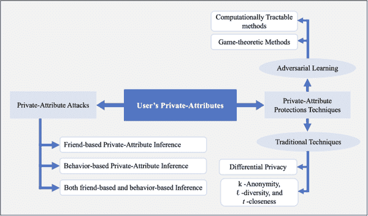 |
| --- |

## 背景

为了保护社交网络中的用户隐私，数据发布者需要使用匿名化技术保护用户数据。缓解隐私问题的一种技术是移除“个人身份信息”（PII），例如姓名、社会安全号码和年龄（Narayanan & Shmatikov, 2009）。移除这些信息并保留图结构在保护用户隐私方面具有局限性。有几种场景说明了依赖 PII 作为匿名化技术的局限性。例如，为 Netflix 奖挑战赛发布的匿名化数据集不足以保护用户的隐私。

用户的隐私属性是描述在线个人的信息和特征。隐私属性对攻击者来说有不同的目标：可能用于出售、投放个性化广告或执行针对性的社会工程攻击。在这种背景下，攻击者可以定义为：

### 定义：攻击者

攻击者可以是任何意图使用不同技术披露用户属性的方。

当攻击者意图使用可用属性来推断目标用户缺失或隐藏的属性时，就会发生隐私属性推理攻击。它可以正式定义为：

### 定义：属性推理攻击

给定 `T=(G,A,B)`，表示一个具有图 `G=(V,E)` 的社交媒体，其中 `V` 表示用户集合，`E` 表示用户之间的关系，`A` 是用户属性，`B` 是用户行为。属性推理攻击是指使用可用属性矩阵 `A` 和行为矩阵 `B`，披露 `∀v∈V[t]` 中 `v` 的属性 `a[v]`，其中 `V[t]` 是目标用户集合。

# 隐私属性推理攻击

许多社交网络包含丰富的信息作为节点属性。隐私属性推理攻击的目标是使用不同方法为给定网络填充缺失或不完整的属性信息。最近的几项研究展示了不同的隐私属性推理攻击，这些攻击可以分为基于朋友和基于行为的。本章此节详细讨论了隐私属性攻击的分类，并结合示例讨论了每一类。

## 1. 基于朋友的隐私属性推理

基于朋友的隐私属性推理攻击基于同性理论，该理论意味着朋友之间的属性比两个随机用户更相似。相似的用户似乎来自同一个社区，有较高的概率共享相同的属性值。例如，如果一个用户 20 到 25 岁之间的朋友具有这种普遍性，那么该用户可能也处于同一年龄段。最初，为了说明攻击者的过程，攻击者访问目标用户的朋友列表；然后进行一些计算以推断目标用户的隐藏属性。

一些研究考虑了使用网络结构来推断节点属性。Ali 等人 (2019) 提出了一种方案，根据节点的属性及其相邻节点的属性将图中的节点表示为特征向量。这些向量将作为标准机器学习算法的输入以预测属性。Chen 等人 (2016) 根据网络特征和社交关系提出了不同的属性推理模型。他们已使用了 `Naïve Bayes`、`Decision Tree` 和 `Logistic Regression` 进行实现，并发现用户之间的社交关系在属性推理中比网络特征更关键。另一项工作处理了成对属性之间的相关性，这有助于预测属性（Rabbany et al., 2017）。他们提出了一种名为 `ProNe` 的模型，用以衡量模式并计算属性的相关性，该模型可以用于预测和隐私保护等多个应用中。通过确定哪对属性可以披露用户的隐私属性，这些属性应该被遮蔽。

该类工作的另一个方向是预测网络结构并推断隐私属性。同时解决这两个问题的原因是，具有相似属性的个体会相互连接，而朋友之间最可能共享相似的属性（BEIGI & LIU, 2020）。GONG 等人 (2014) 将社交属性网络 (SAN) 框架扩展到用于属性推理的不同监督和无监督算法上。此外，他们观察到属性推理可以帮助为链路预测提供信息。换句话说，先推断缺失的属性将提高链路预测的准确性。他们的工作使用了网络结构和节点属性信息来增强链路预测和属性推理这两个问题的性能。

## 2. 基于行为的隐私属性推理

基于行为的隐私属性推理攻击依赖于利用相似用户的行为进行推理。它们假设用户之间的相似性基于他们的行为，这进一步表明他们共享相同的属性。例如，如果一个用户喜欢书籍、分享文章，并参与了一些与计算机科学专业用户喜欢和使用的类似标签，那么该用户可能是计算机科学专业的。事实上，攻击者需要分析目标用户的行为以推断隐藏的隐私属性。

许多研究专注于利用用户行为来推断私有属性。Alipour 等人 (2019) 针对 Facebook 用户发布的图片，利用 Facebook 生成的 `alt-text` 以及朋友、朋友之友或陌生人对图片撰写的评论，提出了一种基于 Facebook 用户的性别推断攻击。他们解释了攻击者如何设计一个包含公共属性的特征集，以推断特定的隐藏属性。另一项工作开发了一个名为 `GENEC` 的性别表达分类模型，用于预测用户的性别（Filho et al., 2016）。该分类模型使用了 60 种文本元属性，例如短文本的字符、语法、单词、结构和形态。这项工作基于性别与所用语言之间的关系。性别分类可以定义为：通过分析信息中展示的内容和行为，识别网络中每个用户是男性还是女性的任务。此外，研究人员对几种算法进行了性能评估和比较，结果显示使用 `Best First Tree` (`BFTree`) 算法可以获得卓越的结果。另一项工作同时考虑了多个社交媒体平台，而不是仅使用单一资源来推断用户属性（NIE et al., 2017）。由于大多数用户同时使用许多社交网络平台，作者研究了跨多个平台的行为以推断用户属性。他们提出了一种统一的多源学习模型来推断用户的职业，该模型将每个职业视为一个任务，并同时调整源一致性和任务相关性。从 Twitter、Foursquare、Instagram 等多个平台爬取历史多媒体帖子，该模型通过 `lasso` 和 `graph-guided fused` 联合学习特征。图结构通过利用外部和内部知识构建。

## 3. 基于朋友和行为的方法

许多方法结合网络链接和用户行为信息来推断私有属性。结合这两种方法可以提高推断私有属性的有效性。Gong 和 Liu (2018) 整合了社交结构、用户行为和用户属性，设计了一个名为社交行为属性（`social-behavior attribute`）的网络。随后，他们在 `SBA` 网络下提出了一种名为投票分布攻击 (`VIAL`) 的攻击来执行属性推断。Jia 等人 (Jia et al., 2017) 提出了一种名为 `AttriInfer` 的模型，这是一种基于马尔可夫随机场 (`MRF`) 的方法。该方法旨在通过利用朋友、行为以及具有或不具有属性的训练用户标签信息，利用公开数据推断用户的私有属性。此外，他们使用循环置信传播 (`LBP`) 对 `AttriInfer` 建模，以计算后验概率（即特定用户拥有某属性的概率），并给出训练数据集。Zhong 等人 (Zhong et al., 2015) 展示了一个名为位置到画像 (`L2P`) 的框架，用于推断在线用户的人口学属性，如性别、年龄、教育程度、婚姻状况和血型。该模型整合了嵌入签到数据中的三个方面，即空间性、时间性和位置知识特征。空间性说明签到数据在地理空间上并非均匀分布的。时间性意味着签到数据随时间变化。位置知识描述了个人与鼓励人们在不同地点旅行的位置功能之间的强相关性。另一项工作将社交结构和属性整合到概率模型中，利用背景知识预测目标用户（He & Huang, 2019）。此外，Cai 等人 (2018) 提出了一种结合属性和友谊信息进行集体推断的新型实现。集体推断是利用网络迭代传播当前的推断结果以提高准确率。他们展示了利用属性和链接信息对显著提高准确率的影响。

# 差分隐私

差分隐私是应用于对数据集进行统计查询时的一种传统技术，旨在提高隐私性的同时保持结果的准确性。差分隐私的目标是使查询的准确性最大化，并使隐私泄露最小化。它由 Dwork (2008) 开发，并提供了一种保证，即在从数据集中添加或删除单个实例后，数据集的行为几乎不会受到影响。简而言之，数据集中特定个体的存在与否是微不足道的。

例如，考虑一项关于尴尬行为的调查，向 100 名参与者提问，其中 20 名参与者回答了“是”。当一个新参与者回答问题时，通过比较其回答前后的调查结果，他的答案可以很容易被推断出来。这个例子说明了差分隐私试图解决的问题。

## 形式化定义

Dwork (2008, p.2) 对差分隐私的形式化定义如下：

对于所有差异最多一个元素的数据集 `D[1]` 和 `D[2]`，以及所有的 , ，一个随机函数 `K` 具有 `ϵ`-差分隐私，如果概率取自 `K` 的硬币掷，且 `ϵ` 被称为隐私预算，它是隐私损失的指标。`ϵ` 的值越小，保护的隐私越高，因为攻击者无法推断出添加或删除实例后数据库的变化。`K` 是独立于攻击者可能拥有的关于数据库任何知识的随机函数。

有两种广泛用于添加随机噪声以实现差分隐私的方法，即用于数值数据的拉普拉斯机制（Laplace mechanism）和用于非数值数据的指数机制（Exponential mechanism）。拉普拉斯机制是添加从拉普拉斯分布中抽取的拉普拉斯噪声的常用技术。添加的噪声量仅取决于查询函数的敏感性。查询敏感性描述了在两个数据库 `D[1]` 和 `D[2]` 上函数值之间的差异，这两个数据库最多在一个实例上有所不同，该实例需要通过添加噪声来隐藏。计算函数敏感性（Dwork, 2008, p.4）：


当 `∆f` 较小时，差分隐私引入最少的噪声。例如，只需要计数的简单查询（如计算属性 `x = 1` 的实例）具有非常小的敏感性值。

## 在社交网络的应用

差分隐私最初是为了保护统计数据库中单个实例的隐私。随后，它被用于保护社交网络的隐私。研究人员已采用不同方法应用差分隐私保护社交网络数据的隐私。

Xiao 和 Xiong (2015) 提出的使用差分隐私保护位置隐私的解决方案。他们通过定义“δ–位置集”来保护每个时间戳下用户的精确位置。为了保护用户的精确位置，他们将其隐藏在 `δ–location set` 中，结果是任何两个位置对都是不可区分的。此外，他们的工作中还提出了一种名为平面各向同性机制（PIM）的高效位置扰动机制以实现差分隐私。Liu 等 (2018) 提出了一种用于社交网络发布的局部差分隐私模型，称为 `DP-LUSN`，它保护了社区结构信息，并证明了局部差分隐私模型在保持社区结构实用的同时满足差分隐私的定义。在局部差分隐私中，社区结构被视为一个独立单元，本地相邻数据库被定义为具有不同边的社区。

# k-匿名性、ℓ-多样性和 t-接近性

根据 Sweeney (2002)，k-匿名性是传统的隐私保护技术之一，它通过抑制（Suppression）和泛化（Generalization）来匿名化。抑制意味着不发布属性。泛化涉及使属性变得更通用且不具体。这两种思想被结合起来来实现 k-匿名性。k-匿名性的基本思想是使数据集中的每个实例在至少 `k` 个实例中是相同的。准标识符（Quasi-identifiers）被定义为可以与外部数据集关联并唯一识别个人的属性（Matanavajjhala et al., 2006）。准标识符的一个例子是能够识别个人的社会号码。此外，不仅显式信息可以识别个人，属性的组合也可以识别个人。

## k-匿名性的局限性


尽管 k-匿名性保护了发布的数据集的隐私，但它无法防止隐私推断。k-匿名性容易受到同质性攻击和背景知识攻击的影响（Matanavajjhala et al., 2006）。同质性攻击定义为当等价类缺乏多样性时推断实例隐私的能力。背景知识攻击意味着攻击者拥有关于某个实例的信息。由于这些攻击，k-匿名性不足以防止隐私推断。此外，k-匿名性无法防御隐私推断。

# ℓ-多样性

为了解决 k-匿名性的局限性，Matanavajjhala 等 (2006) 引入了 ℓ-多样性，它确保了每个等价类敏感属性的多样性。如果一个数据集敏感属性至少有 `ℓ` 个良好的值，则称具有 ℓ-多样性。引入了两种 ℓ-多样性的实例化，都实现了敏感属性的多样性：熵 ℓ-多样性和递归 (c, ℓ)-多样性。熵 ℓ-多样性定义为每个等价类敏感属性分布的熵至少为 `log(ℓ)`。递归 (c, ℓ)-多样性意味着最频繁的值在数据集中出现足够频繁。显然，ℓ-多样性在防御威胁 k-匿名性的先前攻击方面具有多种优势。首先，ℓ-多样性不需要敏感和非敏感属性的知识。其次，它可以防御所有不同的背景知识攻击。参数 `ℓ` 的值越大，消除敏感属性所需的信息越多。

## ℓ-多样性的局限性

尽管 ℓ-多样性比 k-匿名性实现了更高的隐私，但它存在负面影响和脆弱性。首先，ℓ-多样性被认为很难实现。其次，ℓ-多样性可能受到偏态攻击和相似性攻击。偏态攻击被定义为当敏感属性的全局分布可用时获取有关该属性的信息。ℓ-多样性容易受到另一种名为相似性攻击的攻击，这发生在敏感属性不同但在语义上相似的情况下。这是因为 ℓ-多样性没有考虑值的语义接近性（Li 等，2007）。

引入了一种新的隐私概念 `t-closeness`，它要求敏感属性的分布需要接近整个数据集中该属性的分布。为了满足 `t-closeness`，等价类中敏感属性的分布与整个数据集中的属性分布之间的距离不能超过阈值 `t`。`t-closeness` 基于推土机距离 (`EMD`) 对数据集进行计算（Li et al., 2007）。

为了讨论这三个模型及其保护用户隐私属性的能力，`k-Anonymity` 无法防御隐私属性攻击。当等价类中敏感属性的变异性较低时就会发生这种情况，导致攻击者能够确定用户的等价类，从而泄露该用户的敏感属性信息（Soria-Comas et al., 2015）。如前所述，`ℓ-Diversity` 不足以防止隐私属性攻击；它容易受到两种类型攻击。`ℓ-diversity` 这种局限性的原因是忽略了语义上的接近性（Li et al., 2007）。`t-Closeness` 被认为这三个模型中最强的，因为它限制了攻击者可以观察到的用户隐私属性的数量。

这些传统的隐私技术侧重于保护发布的数据集，而没有考虑使用机器学习技术的推理攻击（Han et al., 2019）。下一节将讨论保护用户隐私和保护用户隐私属性的对抗学习技术。为此，本节讨论了通过保护隐私属性来保护用户隐私的传统技术。

## 2. 对抗学习

对抗学习是隐私技术的先进方法，通过防御针对推理隐私属性的机器学习模型来保护用户隐私。最近，已有大量工作开始防御隐私属性推理。

## a. 博弈论方法（不可计算）

博弈论是一门研究理性个体之间策略性交互的数学学科。它的建立基于这样假设：存在参与者和一种策略最终将使其中一个玩家赢得游戏（Wang et al., 2016）。博弈论被广泛用于解决许多领域的不同问题。使用博弈论防御隐私属性推理的目的是提出策略，在数据效用和隐私保护之间保持平衡。在这种方法中，攻击者将根据对防御算法的先验知识执行推理攻击。相反，防御系统将防御最优推理攻击。数据效用与隐私保护之间的困境可以用数据用户、数据收集者和数据提供者来说明：数据用户将执行不同的算法来提取数据收集者提供的数据中的知识。对于数据用户来说，较少的匿名化数据更好，这样就可以提取更多相关的知识和模式。另一方面，数据提供者倾向于保持私有数据的安全，因此他们希望对其进行匿名化。数据收集者负责决定数据需要多大的匿名化程度（Shah et al., 2019）。已有许多工作解决隐私与效用之间的权衡问题，并将不同实体之间的交互建模为博弈。Xu 等人（2015）通过将数据提供者、数据收集者和数据用户之间的交互建模为博弈讨论了这一概念。该工作提出了一种通用方法来寻找博弈的 `Nash 均衡`，即应用在数据上的最优匿名化水平。他们还提出了一种以 `k-Anonymity` 为匿名化方法的特定博弈公式。这些防御在应用于属性推理攻击时被认为计算上是不可行的。

已有一些相关的工作使用博弈论方法解决隐私领域中的不同问题。Shah 等人（2019）概述了博弈论在隐私保护中的应用。文中提出了一项关于隐私保护中使用不同博弈论模型的比较研究。应用博弈论的一个例子是防御位置推理攻击（Shokri et al., 2012）。作者提出了一个分析框架，使系统设计人员能够针对最优推理算法找到基于位置服务的最优隐私保护机制 (`LPPM`)。他们使用 `贝叶斯 Stackelberg 博弈` 来寻找解决方案，场景如下：用户和攻击者基于一种策略进行交互，每个人的收益都是对方的损失。用户先通过选择一个位置隐私保护机制 (`LPPM`) 并在其精确位置上运行它来执行。然后，攻击者下一步，根据用户已运行的位置隐私保护机制预测用户的位置。这是一个 `贝叶斯博弈`，因为攻击者对用户的精确位置拥有不完全信息，并且根据他对用户位置的假设来进行博弈。结果，他们根据用户信息找到了同时满足用户隐私和服务质量的最优权衡点。应用博弈论方法理论上证明了隐私保护和防御推理攻击的能力，但它们也有一些局限性。计算成本是指数级的，因为真实数据集中的公共数据向量具有高维度。此外，为了防御隐私属性推理，在用户的公共数据中加入了噪声，这可能会影响效用（Jia & Gong, 2018）。

## b. 计算可行的方法

作为计算不可行问题的解决方案，不同的研究提出了许多可追踪的方法。Salamatian 等人（2015）开发了 `量化概率映射` (`QPM`)，它依赖于通用的统计推理框架。他们通过对用户的公共数据进行聚类来减少数据量，并以类质心代表每个类。Jia 和 Gong（2018）的其他工作提出了一种实用的对抗机器学习来防御属性攻击，称为 `AttriGuard`。它为每个属性值找到最小噪声，然后随机选择之前找到的噪声之一来误导攻击者。简单来说，目标是向属性中添加随机噪声，以最小的效用损失降低攻击者的推理准确率。另一项工作采取了不同的对抗学习方法，以确保隐私属性受所有机器学习攻击者的保护（Raval et al., 2019）。作者提出了一种名为 `Olympus` 的隐私框架，通过混淆数据和保留数据效用来消除推理隐私属性的风险。他们提出的框架使用 `生成对抗网络` (`GAN`) 来解决混淆者和攻击者之间的问题。

文献中报道了多种解决如何保护文本信息隐私的方法。Beigi 等人（2019）利用对抗学习，通过提出一种名为 `DPText` 的隐私保护文本表示学习框架来对文本信息进行匿名化。该模型的最终输出是文本，它通过确保敏感属性不被捕获到潜在表示中隐藏私有属性信息，从而使攻击者无法推断这些属性。Li 等人（2018）此前的在文本领域创建私有表示的研究中，提出了一种基于生成对抗网络 `GAN` 的新型隐私保护学习方法，通过对抗学习训练深度模型，以提高神经表示的稳健性和隐私性。他们的方法已经在词性标记（POS）和情感分析任务上经过了评估，能够保护性别、年龄和位置等若干个人口统计学上的私有属性。

近期的一系列成功研究表明，可以使用深度强化学习来保护隐私。通过利用强化学习来控制隐私与效用之间的平衡，将攻击者的反馈包含在奖励函数中。Mosallanezhad 等人（2019）提出了一种新型基于强化学习的文本匿名器 `RLTA`，该工具在保持效用的同时解决了私有属性推断问题。RLTA 由两个部分组成：基于注意力的任务感知文本表示学习器和基于深度强化学习的隐私与效用保护器。这些组件的目标是通过最小化损失来提取文本的嵌入表示，然后通过学习兼顾隐私和效用的最优策略来操纵嵌入文本。深度强化学习在该模型中的引入，其作用是通过接收隐私和效用反馈，并学习恰当处理文本嵌入的最优平衡来实现文本嵌入的匿名化。

从数据提供者的角度来看，保护文本信息的隐私在两个方面具有挑战性。第一是隐私与文本语义之间的权衡，这种权衡在文本转换为新形式时会受到影响。例如，给定句子：“我是一个拥有 17 年经验的数学老师。”这将暴露用户的私有属性之一——年龄，因为它清楚地显示该用户显然超过了 40 岁。第二个挑战是私有属性的泄露是隐性的，例如某些词会被女性频繁使用（Xu et al., 2019）。目前已提出多项工作来应对这些挑战并保护文本信息中的私有属性。Xu 等人（2019）开发了一种工具，将用户的文本重写为低敏感性文本以保护隐私。他们提出的模型基于反向翻译（back translation）来减少私有信息的暴露。

其他方向的工作侧重于推荐系统背景下的用户隐私保护。推荐系统为每个用户构建画像，其中包含用户的公共信息和兴趣，然后根据这些画像为每个用户推荐相关产品。尽管推荐系统具有强大的能力，但当攻击者能够访问推荐系统的输出以及有关目标用户的信息时，它们可能成为私有属性推断攻击的来源。Beigi 等人（2020）提出了一种基于对抗学习的推荐模型，称为带有属性保护的推荐（Recommendation with Attribute Protection, RAP）。RAP 保护用户免受私有属性推断攻击并保持效用。它由两个集成组件组成：贝叶斯个性化推荐器和私有属性攻击者，它已在保护用户隐私和保持推荐物品质量方面均显示了有效性。该提出的模型通过提供相关产品来保持效用，同时通过增加攻击者推断私有属性的难度来保护隐私。

另一些工作也提出了估计在线用户私有属性推断风险的方法。不同的工作被设计用于衡量特定类型的攻击，但在现实中，攻击行为是不可预测的，不同的攻击者会执行不同的推断攻击。为了解决这一局限性，Han 等人（2019）提出了一种通用的私有属性泄露估计框架，称为 `F-PAD`，它可以根据一组不同的推断攻击模型估计用户的推断风险。F-PAD 包含三个步骤：1) 攻击模型模拟：模拟预测用户私有属性的攻击；2) 泄露模型训练：通过从正确和错误的预测中学习；3) 泄露风险估计：在泄露概率和风险水平范围内整合多个模型以构建泄露估计器。目标是泛化隐私估计函数以涵盖更多属性。此外，F-PAD 为高泄露风险的用户提供了增加隐私保护的建议。

总结来说，本文部分讨论了为防御私有属性推断而提出的不同工作。解释了传统技术并展示了它们如何缓解隐私风险。若干对抗学习算法说明了如何在防止隐私的同时保持效用，以在两者之间达到平衡。

## 未来研究方向

以下是我们在该领域发现的一些开放问题：

*   **保护文本信息的隐私**：用户生成的文本内容丰富，可能揭示有关用户偏好和特征的敏感信息，如地理位置、性别、职业和年龄。这使得文本数据需要匿名化，以保护用户免受各种攻击（BEIGI & LIU, 2020）。

*   **针对属性泄露攻击的隐私保护**：社交媒体平台上的用户数据（如画像信息、社交数据、位置和兴趣信念）对于帮助在线服务供应商为用户提供个性化服务至关重要。这些信息需要保护免受隐私泄露。然而，利用有效保护用户隐私的技术的研究有限（BEIGI & LIU, 2020）。

*   **利用强化学习保护隐私**：应用不同的强化学习算法来保护用户的私有属性并比较结果（Mosallanezhad, Beigi, & Liu, 2019）。

*   **私有属性泄露估计**：所提出的私有属性推断风险测量 `F-PAD` 的一个局限是单独考虑用户的私有属性，并为用户提供特定属性的测量。解决这一局限性的建议是设计一种防御算法，帮助在线用户隐藏最少的公共信息，在考虑用户整体私有属性的情况下保护最大的隐私（Han et al., 2019）。

## 结论

## 引言

在线数据量不断增加。社交媒体产生了大量的用户生成数据，其中可能包含敏感信息。研究人员和服务提供商对用户生成数据进行了研究，以更好地理解用户需求。然而，共享这些信息可能会危害用户的隐私，因为它包含了敏感信息或隐私属性。研究表明，`private-attribute inference`（隐私属性推理）是在线用户关注的隐私风险之一。`private-attribute inference attack`（隐私属性推理攻击）是指恶意攻击者利用可用公共属性泄露 `private-attribute`。现有工作大部分分为两类：提出新攻击来推断用户的 `private-attribute`，以及防御此类风险以最小化隐私泄露。

## 本章范围

在本章中，将从两种情况解释现有的 `private-attribute inference attacks`：`基于好友的隐私属性攻击` 和 `基于行为的隐私属性攻击`。之后，将讨论针对 `private-attribute inference attacks` 的保护技术。保护模型可分为传统技术和对抗学习几类。我们从用户的 `private-attributes` 的角度，对现有工作进行了回顾、分类和比较。

## 致谢

本工作的第一作者感谢沙特阿拉伯文化代表团（SACM）提供的资助。

## 参考文献

- Ali, S., Shakeel, M. H., Khan, I., Faizullah, S., & Khan, M. A. (2019). Predicting Attributes of Nodes Using Network Structure . Academic Press.

- AlipourB.ImineA.RusinowitchM. (2019). Gender Inference for Facebook Picture Owners. In 16th International Conference on Trust, Privacy and Security in Digital, (pp. 145–160). Linz, Austria: Academic Press.

- Beigi, G., & Liu, H. (2020). Privacy in Social Media: Identification, Mitigation and Applications. ACM/IMS Trans . Data Sci.

- BeigiG.MosallanezhadA.GuoR.AlvariH.NouA.LiuH. (2020). Privacy-Aware Recommendation with Private-Attribute Protection using Adversarial Learning. In Proceedings of the 13th International Conference on Web Search and Data Mining, (pp. 34-42). Houston, TX: Academic Press.

- Beigi, G., Shu, K., Guo, R., Wang, S., & Liu, H. (2019). I Am Not What IWrite: Privacy Preserving Text Representation Learning . Academic Press.

- Cai, Z., He, Z., Guan, X., & Li, Y. (2018). Collective Data-Sanitization for Preventing Sensitive Information Inference Attacks in Social Networks. IEEE Transactions on Dependable and Secure Computing , 15, 577–590.

- ChenJ.HeJ.CaiL.PanJ. (2016). Profiling Online Social Network Users via Relationships and Network Characteristics. In 2016 IEEE Global Communications Conference (GLOBECOM), (pp. 1-6). 10.1109/GLOCOM.2016.7842176

- Dwork, C. (2008). Differential Privacy: A Survey of Results. In International Conference on Theory and Applications (vol. 4978, pp. 1-19(. Berlin: Springer, Berlin, Heidelberg.

- Dwork, C., McSherry, F., Nissim, K., & Smith, A. (2006). Calibrating Noise to Sensitivity in Private Data Analysis. Theory of Cryptograph. 3876 . Springer.

- Filho, J., Pasti, R., & de Castro, L. (2016). Gender Classification of Twitter Data Based on Textual Meta-Attributes Extraction. New Advances in Information Systems and Technologies. 444 . Springer. doi:10.1007/978-3-319-31232-3_97

- Gong, N. Z., Talwalkar, A., Mackey, L., Huang, L., Shin, E., Stefanov, E., . . . Song, D. (2014). Joint Link Prediction and Attribute Inference Using a Social-Attribute Network. ACM Transactions on Intelligent Systems and Technology .


- Gong, N. Z., & Liu, B. (2018). Attribute Inference Attacks in Online Social Networks. *ACM Trans. Priv. Secur*, 21(1), 1–30. doi:10.1145/3154793

- Han, X., Huang, H., & Wang, L. (2019). F-PAD: Private Attribute Disclosure Risk Estimation in Online Social Networks. *IEEE Transactions on Dependable and Secure Computing*, 16(6), 1054–1069. doi:10.1109/TDSC.2019.2934096

- He, Z., & Huang, Y. (2019). Tracking Histogram of Attributes over Private Social Data in Data Markets. In *Combinatorial Optimization and Applications*. Springer.

- IdanL.FeigenbaumJ. (2019). Show me your friends, and I will tell you whom you vote for: Predicting voting behavior in social networks. In *Proceedings of the 2019 IEEE/ACM International Conference on Advances in Social Networks Analysis and Mining* (pp. 816-824). Vancouver, British Columbia, Canada: Association for Computing Machinery. 10.1145/3341161.3343676

- Jia, J., & Gong, N. Z. (2018). AttriGuard: A Practical Defense Against Attribute Inference Attacks via Adversarial Machine Learning. *arXiv:1805.04810*

- JiaJ.ZhangL.WangB.GongN. (2017). Inferring User Attributes via Mobile Social...

- Soria-Comas, J., Domingo-Ferrer, J., Sanchez, D., & Martínez, S. (2015). t-Closeness through Microaggregation: Strict. *IEEE Transactions on Knowledge and Data Engineering*, 27(11), 3098–3110. doi:10.1109/TKDE.2015.2435777

- Sweeney, L. (2002). K-anonymity: A model for protecting privacy. *International Journal of Uncertainty, Fuzziness and Knowledge-based Systems*, 10(05), 557–570. doi:10.1142/S0218488502001648

- WangY.WangY.LiuJ.HuangZ.XieP. (2016). A Survey of Game Theoretic Methods for Cyber Security. *IEEE First International Conference on Data Science in Cyberspace*, 631-636. 10.1109/DSC.2016.90

- XiaoY.XiongL. (2015). Protecting Locations with Differential Privacy under Temporal Correlations. *Proceedings of the 22nd ACM SIGSAC Conference on Computer and Communications*, 1298–1309. 10.1145/2810103.2813640

- XuL.JiangC.WangJ.RenY.YuanJ.GuizaniM. (2015). Game theoretic data privacy preservation: Equilibrium and pricing. In *2015 IEEE International Conference on Communications (ICC)* (pp. 7071-7076). 10.1109/ICC.2015.7249454

- XuQ.QuL.XuC.CuiR. (2019). Privacy-Aware Text Rewriting. In *Proceedings of the 12th International Conference on Natural Language Generation* (pp. 247-257). Tokyo, Japan: Association for Computational Linguistics. 10.18653/v1/W19-8633

- ZhongY.YuanN. J.ZhongW.ZhangF.XieX. (2015). You Are Where You Go: Inferring Demographic Attributes from Location Check-ins. In *Proceedings of the Eighth ACM International Conference on Web Search and Data Mining (WSDM ’15)* (pp. 295–304). 10.1145/2684822.2685287

## 核心术语与定义

- **对抗学习 (Adversarial Learning)**：结合机器学习与计算机安全的研究领域。

- **匿名化 (Anonymization)**：一种通过加密或移除可识别信息来对信息进行隐私保护处理的技术。

- **属性 (Attribute)**：特定对象的特征或属性。

- **去匿名化 (De-Anonymization)**：一种重新识别匿名化（加密或泛化）信息的技术。

- **博弈论 (Game Theory)**：是研究理性个体之间策略性交互的数学学科。

- **推理 (Inference)**：使用证据和逻辑得出结果的过程。

- **隐私 (Privacy)**：处于免于监控的状态。

- **强化学习 (Reinforcement Learning)**：机器学习的一个领域，通过经验进行学习以最大化奖励。

- **效用 (Utility)**：有用的能力。

# 第 7 章

## 作者

- Pallavi Chavan (印度，Ramrao Adik 科技学院)
- Dipti Jadhav (印度，Ramrao Adik 科技学院)
- Gautam M.orkar (印度，Ramrao Adik 科技学院)

## 摘要

随着社交媒体使用量的不断增加，产生了大量的图片、视频、音频和计算机图形等海量数据。随着这些数据在网络上共享，安全和隐私成为日益关注的问题。社交网络最受欢迎，已成为即时信息共享媒介。`Facebook`、`Instagram`、`WhatsApp` 是流行的社交网络。社交网络上视听数据的使用急剧增加。当多媒体数据存储在网络环境中时，数十亿用户为了不同的目的连接到它。隐私挑战包括个人身份化、骚扰、密码共享、基于位置的服务以及隐私与营销的冲突。其他挑战还包括数据语义、内容管理权和虚假信息。研究人员在开发针对这些威胁的安全系统方面做出了巨大贡献；但点击劫持、短 URL、钓鱼问题在某些网络架构中仍未解决。

## 引言

社交网络允许人们与群体建立联系。社交网络也被称为关系网络，帮助个人和组织在线连接，并允许共享信息和想法。以下是使社交媒体用户能够在网络上交互的关键点。最常用的网络是多媒体共享网络，允许共享图像、音频、视频和其他形式的多媒体。论坛（如讨论论坛、聊天机器人）允许共享时事和当前正在发生的事件。书签和内容策展网络是用于在网络上确定、包含和标记新内容的特殊网络。消费者评论网络允许发现并评价业务策略。博客和内容再创作网络有助于在网上发布内容。基于兴趣的网络是分享兴趣和爱好的网络。社交购物网络属于电子商务范畴，帮助用户在线购物。共享经济网络是社交网络的另一类别，有助于交易和服务。市场研究、品牌意识、潜在客户生成（注：此处原文为 `lead generation`，译为潜在客户获取）、关系建立、客户服务等都依赖于社交网络。本文讨论了互联网上最流行的社交网络。`Facebook` 是一个在线社交网站，人们在上面创建个人资料，分享关于自己的照片和引言等信息，并对他人发布的信息做出回应或链接。`Facebook` 属于社交网络服务类。此类社交媒体用于在互联网上与人们（以及产品）关联。这些网络通过品牌推广、社区意识、关系建立、客户服务、潜在客户获取和转化帮助企业。这些网络鼓励个人和企业在线互动并共享数据。因此，这些网络确保了互惠生产的关系。多媒体共享网络和社交网络有一系列共同特征。例如，`Facebook` 是允许共享媒体的社交网络，而 `LinkedIn` 则是专注于职业关系的社交网络。

`Twitter` 是一个微博客网站，曾用于发布当前活动。`Twitter` 允许关注他人，并让他人关注特定个人。当个人在 `Twitter` 上发布消息时，粉丝者就能看到。如果你想在不公开的情况下与人交流，可以发送短消息私信。

`Instagram` 是一个媒体共享网络，免费提供并支持在线照片分享应用程序。它是一个在 2012 年被 `Facebook` 收购的社交网络平台。`Instagram` 通过移动应用程序运行，允许用户上传和编辑图像以及视频。直播视频是 `Instagram` 的另一个功能。人们可以为每条帖子添加标题（说明），并在帖子中使用话题标签（`hashtags`）。基于位置的地理标签具有对用户的帖子进行索引的功能。这种索引进一步允许在应用程序内搜索其他用户的帖子。用户的帖子会显示在动态流（`Instagram`）中。公众可以通过话题标签和地理标签查看帖子。`Instagram` 维护了隐私保护。用户可以将个人资料设置为私密，使得只有许可的一组用户可以查看。

`LinkedIn` 是由 `Microsoft` 拥有的专业网络，侧重于职业发展和职业人脉。`LinkedIn` 帮助企业招聘员工。它显示用户的简历，允许搜索工作，并通过与其他人的互动以及发布更新来提高专业声誉。无论专业关注度如何，`LinkedIn` 与 `Facebook` 这样的社区网络非常相似。它的开发伦理与社区网络类似，即连接人们、发布更新、分享和点赞媒体内容，以及即时通讯（与其他用户的即时消息）。

`WhatsApp` 是最受欢迎的社交网络。如今，官方信息通过此应用程序传达。它是与几乎所有智能手机用户关联的最强大的社交媒体应用程序。它对于智能设备是免费下载的应用程序。这是一种不断进化的互联网应用程序，允许轻松共享图像、视频、文本和音频等媒体。由于具有状态、语音消息、位置共享和群聊等功能，它在青少年中非常流行。这是一款低成本应用程序。

在线社交网络在用户方面增长迅速，被用于不同的目的，如广告、营销、提升业务声誉以及与专业群体建立联系。由于用户数量众多，产生了海量数据，这吸引了攻击者的注意，并激励他们对社交网络进行各种攻击，以获取用户个人信息的访问权限。这就是在线社交网络面临隐私风险的原因。社交网络面临许多安全和隐私威胁。社交媒体上承载着许多信息资产，这包括财务资产、数字身份、知识产权和资源，而社交网络是垃圾邮件、点击劫持和钓鱼攻击等多种攻击的目标。

## 社交媒体上的多媒体数据

根据 Naaman (2012) 所述的工作，目前移动用户使用了几种基于 Web 的共享和公共服务。一些示例，如 `YouTube` 和 `Flickr`，随着网络上快速增长的多媒体内容数量而实现了巨大的增长。这些内容持续在线。个人参与者通过私有/公开共享选项上传多媒体内容。这些多媒体内容伴随着多种类型的元数据。`YouTube` 拥有不同类别的大量视频收藏。在 `YouTube` 上分享视频显示了业务的剧增。许多人在 `YouTube` 上经营自己的频道。智能设备的使用已经增加，这是互联网多媒体内容增加的原因。这些智能便携的设备使媒体共享变得简单，并成为用户的一项热门活动。然而，目前所有的社交网络都提供图像/视频分享功能，但根据 Temmermans 等人 (2017) 的说法，其中许多在提供隐私保护方面欠缺。随着互联网和社交网络的启动，多媒体数据通信的量正在快速增加。社交媒体数据的演变（如 `Instagram`、`YouTube` 和 `Facebook` 等社交网络所示）结合多媒体内容分析的发展，强调了被恶意使用的潜在风险：非法复制、盗版、抄袭和滥用。因此，安全的多媒体共享和叛徒溯源问题已成为社交网络中关键且紧迫的问题，C. Ye (2014)。

## 多媒体取证

多媒体取证支持了一系列用于分析多媒体数据的科学工具，旨在揭示多媒体内容的历史。这些科学工具的主要目的是从多媒体数据中提取信息。通常，数字取证技术通过免费提供的图像和视频数据集进行验证。大多数免费的数据集并不代表真实世界的场景，而且在视频方面已经过时。这一事实促使并表明了需要异构且大型的多媒体数据集作为基准，以验证数字取证技术的需求。

## VISION 数据集

在 Shullani 等人的工作中，获取了一组使用 35 款最新智能手机和平板电脑拍摄的图像和视频。作者收集了 11,732 张真实图像。其中 7,565 张图像（包括高质量和低质量）通过 `Facebook` 分享。这些图像还通过 `WhatsApp` 分享。此外，作者还选取了 648 个视频，其中 622 个视频通过 `YouTube` 分享（分辨率更高），一组视频通过 `WhatsApp` 分享。

作者获取的数据集名为 `VISION` 数据集。该数据集通过特定程序从设备获取。该数据集更适用于多媒体源识别应用。

作者将从每个设备收集的数据组织在两个文件夹中：`images` 和 `videos`。`images` 文件夹包含社交媒体图像。这些图像具有平面表面，因此对图像的场景或方向没有限制。`videos` 文件夹包含以横屏拍摄的社交媒体视频。该文件夹中的视频代表了室内和室外场景。作为工作的扩展，作者给出了在社交媒体上上传和下载图像视频的程序。尽管 `VISION` 数据集是图像和视频的巨大表征，但使用不同的视频格式扩展该数据集是有关重要的，Dasara Shullani 等人 (2017)。

## 多媒体保护机制

互联网上多媒体内容的保护已变得至关重要，系统不能依赖传统的安全和保护机制。需要额外的保护机制来鼓励内容的授权分发。多媒体指纹机制是一种保护多媒体内容的新颖方法。它提供了一种识别未经授权的用户和对数据的未经访问的机制，Z. Jane 等人 (2014)。

视觉密码学在互联网上共享秘密信息（尤其是图像）时是一种强大的技术。它被观察为共享秘密图像和文档的稳健技术。视觉密码学是一种加密多媒体内容的艺术，使得解密不需要数学计算。视觉密码学将多媒体秘密加密为若干份份额，这些份额分发给参与者。多媒体秘密信息的揭示仅通过叠加即可。尽管该方法强大且稳健，但由于为每个多媒体内容生成的份额数量，其空间复杂度很高，Weir J. 等人 (2012)。

## Cookpad 图像数据集

用户对在线食品服务的使用急剧增加。在食品相关服务中，视觉信息对于特定菜肴/食谱的搜索服务非常重要。使用不同数据集的食品图像在食品服务中促进了大量研究。然而，这些数据集存在一些限制，包括图像集的类型、不考虑烹饪过程的瞬时捕捉，以及图像与食谱之间没有关联。

`Cookpad Image Dataset` 反而是一个新颖的食品图像数据集，服务最大的食谱搜索。这是用于食品研究基础设施的图像集合。该数据集包含约 164 万张烹饪后拍摄的图像。大约有 310 万张图像是在烹饪过程中拍摄的。`Cookpad` 还与现有的食谱库关联，Jun Harashima 等人 (2017)。

# 多媒体隐私与安全挑战

攻击可以通过伴随的渠道实施：

- **电子邮件**：网络钓鱼和反向社会工程学攻击最广泛认可的渠道。

- **短信应用程序**：在社交工程师中作为网络钓鱼和反向社会工程攻击的工具具有普遍性。它们也可以有效地用于数据欺诈，以滥用信任关系。

- **电话、IP 电话 (VoIP)**：是社交工程师诱导受害者传递敏感数据的基本攻击通道。

- **非正式组织**：为社会工程攻击提供了各种机会。考虑到他们创建伪造身份的能力及其复杂的数据共享模型，它们使得攻击者能够轻松隐藏身份并获取敏感数据。

- **云服务**：可用于获取协作情况的态势。攻击者可以在公共索引中放置文档或程序，使受害者交出数据。

- **网站**：最常用于执行水坑攻击。此外，它们可以结合信息执行网络钓鱼攻击（例如，向银行的潜在客户发送电子邮件，其中包含一个看起来像银行唯一网站的恶意网站链接）。

社会工程是最著名的程序员攻击背后的策略。这是一种依赖研究和影响的策略，大多数是通过电子邮件传播的网络钓鱼和定向网络钓鱼骗术的基础。下面记录的案例提供了这些攻击如何运作以及它们对组织、个人和政府可能代价多昂贵的思路。如果你曾经怀疑过一封微不足道的 `Apple` 支持邮件可能会造成真实的伤害，那么这份摘要就是为你准备的。

# 多媒体安全定义

多媒体安全定义为保护多媒体数据（图像、音频、视频）和多媒体系统免受未经授权的访问、使用、未经授权的修改或破坏，以提供完整性、可靠性、机密性和可用性。

- **完整性**意味着防止多媒体数据受到不当的修改或破坏。

- **可靠性**表示对多媒体数据及其使用的信任度。

- **机密性**保护作者在访问权限方面的权利，并保护及维护个人和专有信息。

- **可用性**确保用户能够及时访问。

# 多媒体系统中的风险

之所以需要多媒体安全，是因为技术在多媒体系统中的应用产生了风险。多媒体数据可能会被不当泄露、错误修改、丢失或破坏，从而导致声誉损失或名誉损害。


在社交媒体的背景下，信息泄露对机构/公司来说是一个重大风险。社交媒体中存在同质群体，这些群体关注特定的兴趣领域，可能会泄露大量的敏感信息。如果人不加入此类同质群体，就能更好地保护隐私和机密性。

观察发现，用户低估了在网络上公开发布帖子的危险性。作为一种常见行为，用户信任社交媒体网站的安全性和隐私性，假设这些网站会保护个人数据。这种盲目信任正成为行业和机构面临的一个重大风险。

那些在社交媒体上过度自由分享信息的人，在申请工作时会被机构拒绝，或者因为在社交媒体上分享了不受欢迎的帖子且这些帖子导致了威胁而被解雇。从安全分析机构的角度来看，过于随意分享信息的人可能会导致安全和隐私风险。

# 未来方向与挑战

多媒体安全原则需要扩展，以纳入责任感、可信性和伦理。多媒体安全的保护级别也应该根据个人及其社交关系进行扩展。

正如 Hekkala Riitta 等人（2012）所述，社交网络引起的多媒体安全滞后重要挑战是多媒体数据的完整性和机密性。根据他们的发现，重要的挑战类型和风险包括：

1. **针对公司或员工的外部攻击**：风险包括恶意软件、垃圾邮件、不可信的应用程序和不安全的互联网连接。

2. **员工意识不足**：风险包括网络钓鱼、诈骗、身份盗窃、信息泄露和声誉损害。

3. **角色挑战**：风险包括社交网络工具、私人身份和职业身份。

# 入侵检测系统 (IDS)

存在入侵检测系统，通过安全和多媒体信息管理系统监控社交网络中的恶意活动。这些系统是基于签名或基于异常的。

## 基于签名的系统

对于基于签名的系统，可以通过监控特定的模式（如网络上的字节序列）来检测攻击。使用签名方法检测新的未知的攻击非常困难，并面临许多挑战。

## 基于异常的系统

对于基于异常的系统，使用了机器学习的概念来检测未知攻击。它可以处理恶意内部人员以及针对外部攻击。然而，基于异常的系统面临重大挑战，例如：

- 噪声（可能会限制入侵检测系统的有效性）
- 误报和真实攻击之间没有明确的区别
- 加密数据包的问题

正如 Negandhi P 等人（2019）所述，入侵检测系统如果使用机器学习算法实现，其表现会更好。此类系统能够检测实时网络攻击。但仍有一些安全挑战尚未解决。

# 社交媒体中的隐私问题

根据 Staff Writer（2018）的观点，社交媒体确实存在隐私问题。主要关注点如下：

## 身份冒充与账户破解

社交网络是黑客、入侵者和网络罪犯的目标，因此隐私受到损害。在这种情况下，网络罪犯可以冒充用户。他们关注用户账户是为了传播病毒、垃圾信息和恶意软件。人们会信任从社交媒体上收到的朋友发来的信息，这使得他们更有可能点击那些可能感染用户计算机系统的链接。

## 骚扰

在线骚扰和网络欺凌是最危险的威胁，在社交媒体上此类威胁很容易实施。骚扰通常来自陌生人以及网络上不友善的人。另一方面，某些社交网络允许在不考虑用户兴趣的情况下在其主页上投放广告。在这种情况下，社交媒体使用率可能会增加。

## 密码共享

密码共享是多媒体数据隐私和安全性的主要挑战之一。管理员密码在所有规模的机构中无处不在。管理员密码非常强大，且大多数此类密码被用于共享环境，即管理员组使用相同的密码访问共享资源。该环境中的所有成员都可以访问账户权限。除此之外，用户经常由于某些或其他原因与同事分享官方密码。这种共享模式最常见的原因是为了应对某人缺席时的紧急情况。因此，密码管理不当会导致多媒体信息被盗和无痕的信息操纵。

有必要在机构停止密码共享。这将减少机构与内部及外部威胁相关的风险。实施此机制需要遵循以下三个步骤：

1. 实施并传达强有力的组织政策。
2. 通过控制措施执行政策。
3. 监控日志。

在管理层面避免密码共享始终是好事，这也是一种理想的解决方案。可以使用标准软件集来轻松缓解与共享密码相关的威胁。

许多社交媒体公司正在采取通过用户登录发布广告的做法。用户对这些广告并没有任何金钱上的激励。更有可能是用户多次看到该广告，从而导致广告中展示的特定产品售出。用户反过来向朋友推荐该产品，也能观察到产品销售额的增长。这种营销属于目标营销，与账户隐私有密切的关联。营销人员必须意识到对客户和业务构成的隐私和安全威胁。欧盟的《通用数据保护条例》（GDPR）统一并加强了对欧盟境内所有用户的数据保护。该条例定义了以下权利：同意权、知情权、数据可携带性权、删除权、访问权、更正权、限制处理权和撤回同意权。另一方面，还存在行为营销的概念。在这种情况下，营销人员根据消费者在社交媒体和网站上的行为来将其设定为目标。这些营销人员针对这些消费者并发送特定类别的广告。行为营销存在安全和隐私问题。

# 基于位置的服务

大多数用户通过智能手机评估社交媒体服务。社交媒体利用智能设备的位置信息，为用户推荐附近的服务或设施。正因如此，对隐私和安全的威胁增加了。大多数智能设备用户的位置数据可以很容易地获取。社交媒体应用程序大量使用这些数据。

# 数据语义

多媒体数据的统一形式可以提供正确的信息和正确的媒体语义。理解图像和视频的准确含义是社交媒体面临的重要挑战之一。根据 Roy Olende (2016) 的观点，社交媒体使用了六类型的图像。

* **照片 (Photos)**：社交媒体上最流行的图像类型。发现通过智能手机拍摄照片并上传到社交媒体相对容易。挑战在于，上传的照片是拍摄照片的编辑版本，这使得很难观察到照片中特定物体的真实纹理。

* **拼图 (Collages)**：允许通过一组照片描述一个故事。

* **背景上的文字 (Text over Background)**：这类图像用于快速通信，图像中嵌入了大量文本。背景文字的挑战在于，图像上文字的措辞需要仔细设计，以保持图像所示数据的一致性。此外，短语与图像中的视觉信息之间需要保持同步。

* **照片上的文字 (Text over Photo)**：这是一种视觉故事的功能。

* **图标和插图 (Icons and Illustration)**：它们很容易被添加到社交媒体的图像中。这类图像的挑战在于图像中可能会放置错误的图标。

* **截图 (Screenshot)**：最常见的图像类型，允许在屏幕上展示最新的场景。

# 跨站脚本攻击与去匿名化

在这种攻击中，恶意的电子邮件、网站、程序或博客在用户的计算机上打开。该恶意实体利用用户的浏览器连接到另一个网站，然后使用登录凭据（这表明有效用户此时正在进行交互）。跨站请求伪造是通常通过 `RESTful API` 执行的最常见攻击。该 `API` 用于应用程序与社交网络之间的交互。社交网络网站拥有此类应用程序的 `API`，用于检索用户相关信息（例如 Facebook）。A. A. Obiniyi 等人 (2014) 表述了去匿名化的概念。在匿名化情况下，用户可以隐藏在社交网络上识别身份的个人信息。此类信息包括用户、个人头像、姓名、地址、联系电话和其他敏感数据。匿名化的目的是保护用户免受广告商、数据黑客、数据挖掘领域的研究人员以及应用程序开发者的影响。然而，社交网络上的用户去匿名化是一种可能的攻击。从不同的社交网络可以生成信息的组合，并可用于提取敏感信息。这种形式的攻击绕过了用户的隐私设置。

# 用户拥有的内容管理权

权利、权限和许可是相关的术语。权利定义了用户可以执行的活动类型。权限定义了一个用户如何处理参与该活动的用户群组，而许可定义了用户如何访问数据（读、写、删除、本地化）。内容管理的首要需求是：在正确的地方接触正确的观众。社交媒体上存在数十亿用户，媒体内容由媒体用户管理。这包括上传、下载、编辑、点赞和分享。当用户保留内容管理权时，面临的挑战是用户生成内容的真实性。大众内容出现在社交媒体上，导致对相同内容产生不同的解释。此类内容在内容之间产生了歧义，内容的机密性变得薄弱。Liu 等人 (2003) 说明了社交网络上的数字内容管理权。这种内容管理权模型包括：内容提供者、内容分发者、消费者和结算中心。作者在模型使用了加密机制来加强安全考虑。这些加密机制包括对称和非对称加密、数字签名、单向哈希函数、数字证书和数字水印。这种数字版权管理系统用于保护高价值的数字资产，并用于控制、分发和使用对这些数字资产的访问。它提供了强大的内容保护，以防止未经授权访问数字内容，同时也对允许的用户集限制访问。该模型可以灵活地管理用户对不同类型多媒体内容（例如音乐文件、电子书、视频、图像）的权利。

# 虚假信息检测

社交网络上虚假媒体（图像和视频）的传播是一个巨大的挑战，并且日益增长。商业性媒体编辑工具允许任何用户在媒体中添加、克隆和移除对象。此外，这些编辑工具允许从媒体中移除人物。此类编辑通过生成虚假图像产生虚假信息。这些图像被称为假图像。目前已经提出了多种方法来识别假图像，但每天都有针对所提方法的新攻击。社交媒体上最危险的元素是图像到翻译。这种翻译改变了图像的含义，从而影响了其语义。图像到翻译基于 `Generative Adversarial Network`（生成对抗网络）。它是危险的，因为图像的上下文随时可能改变。存在图像伪造检测方法来识别图像翻译，但这些方法在网络方面面临挑战，F. Marra 等人 (2018)。

# 点击劫持与调查诈骗横行

许多社交网络网站通过广告获利。例如，Facebook 在未获得用户许可的情况下分享了许多广告。Facebook 上常见的威胁是点击劫持（clickjacking）。它也被称为“点赞劫持”（likejacking），基于 UI 欺骗（UI redressing）。这种攻击通过欺骗用户点击网页链接来获取机密信息，并在用户点击时获取用户设备的控制。点击劫持还导致了调查诈骗（survey scam）。在这些诈骗中，用户被要求通过垃圾邮件网页链接安装应用程序。由于移动用户的意识有所提高，这种形式的攻击是无效的。调查诈骗和点击劫持在社交网络上定期发生。这些攻击可能会导致用户的个人信息泄露。

## 短链接 URL

Twitter 是一个实时信息网络，它帮助我们发现并解决问题。由于实时信息是公开的，它可能会被攻击者滥用以获取个人利益。Twitter 经常使用短 URL。这样做是为了将推文保持在特定的字符范围内。这些短 URL 没有提供关于网站的直接信息，并将用户重定向到恶意网站。如果 Twitter 上的此类链接要求输入 Facebook 或 Twitter 密码，那么立即退出总是安全的。某些 Twitter 信息是虚假的，会将用户引导到某些假页面，通过点击此类假页面，用户账户很容易被黑掉（Sophos, 2020）。社会工程学是最著名的程序员攻击背后的策略。这是一种依赖于研究和影响的策略，大部分是通过电子邮件传播的钓鱼和鱼叉式钓鱼（spear phishing）技巧的基础。下面记录的案例展示了这些攻击是如何运作的，以及对于组织、个人和政府来说成本有多高。如果你曾经怀疑过一封普通的虚假 Apple 支持邮件可能会造成真正的伤害，那么这份清单就是为你准备的。以下是最近（2017）观察到的社会工程攻击真实案例：

## 以太坊经典，2017

一群人在数字货币中损失了大量资金。这一事件发生在 2017 年，就在以太坊经典网站被黑客入侵之后。通过使用社会工程学，程序员模仿了经典以太钱包的细节。他们还访问了空间库，随后将区域重定向到他们的个人服务器。犯罪分子提取了以太坊数字货币。他们在网站上编写了代码，该代码允许他们查看用于货币交换的隐私信息（例如密钥）。

## 法律党，2016

法律党是美国最著名的社会工程学事件之一。这是 2016 年总统竞选政治决策的一部分。鱼叉式钓鱼攻击导致了民主党大量信息和数据的泄露。这些被泄出的信息可能影响了唐纳德·特朗普击败希拉里·克林顿的重大政治决定。攻击者通过 Gmail 准备了一封邮件，并试图通过他们的连接欢迎客户。此时，攻击者正试图更改客户的密码。攻击者从这次连接中收集了他们感兴趣的数据。

## Ubiquiti Networks，2015

Ubiquiti Networks 是 2015 年设计的用于系统管理的网络。由于钓鱼攻击，该网络损失了巨额资金（近 4000 万美元）。黑客的账户细节尚不确定。当时，黑客追踪活动，要求由财务部门支付的虚假款项。

## 索尼影视，2014

2014 年报道了索尼影视发生了一起数字攻击。包括业务细节和见解、预算代表和档案在内的记录被提取。这是一次通过“串式钓鱼”（Skewer phishing）进行的攻击。这次攻击通过欺骗虚假的 Apple 信息诱捕了索尼的代表。

## Target，2013

Target 的信息泄露通过钓鱼攻击提供了 4000 万客户关于分期付款的数据。钓鱼是通过电子邮件遭遇的。窃贼在 Target 的合作组织中引入了恶意软件，这允许他们在随后的分钟内访问美国第二大零售商的系统。Target 通过钓鱼获取了客户的信用卡数据。

## 纽约时报，2013

纽约时报遭受了类似于 RSA 的攻击。中国程序员通过钓鱼攻击渗透了纽约时报的计算机并获取了信息（Perlroth, 2013）。报告表明，这种攻击背后存在社会工程学。纽约时报聘请了计算机安全专家分析攻击以防止持续的风险。他们发现，用于进入计算机的技术与中国军事有关。此外，据纽约时报报道，中国程序员获取了超过 30 名西方作者的敏感数据。

卡巴斯基实验室（Kaspersky Lab）近期发布了另一份针对调解、立法和研究性协会的鱼叉式网络钓鱼（skewer phishing）攻击的调查报告。涉及的大多数协会位于东欧和中亚的前苏联共和国境内。该攻击始于 2007 年，并持续到 2013 年年初。敏感信息从研究机构、原子能和生命科学集团以及航空公司中被窃取。与针对 RSA 和《纽约时报》的攻击类似，攻击者向一组精心挑选的个人发送了针对性的网络钓鱼邮件。例如，攻击者在鱼叉式钓鱼邮件中发布了看似普通的政治车辆，其中包含了自定义的恶意软件。根据（卡巴斯基实验室）的，该恶意软件的设计包含恶意扩展程序、信息窃取模块以及一个利用 Microsoft Office 安全漏洞的次级通道木马。攻击者还从被入侵的系统中提取了大量敏感信息。获取的凭据被整理在文件中，随后被用于破解其他框架的密码。“红色十月”（Red October）APT 攻击持续了大约六年。内部和外部调查发现了恶意执行文件中的遗迹，证明攻击者位于一个俄语国家。

# 社会工程学攻击

许多社交媒体用户并没有意识到他们所产生的数据的重要性和价值。这些用户较少关注保护其数据免受各种攻击。攻击者利用用户的这种行为，并试图通过执行不同的机制来揭露机密。在反向社会工程学攻击中，攻击者通过尝试具有更高信任度的不同技术来与用户建立连接。创建假账户是攻击者最常用的做法。社会工程学攻击通过钓鱼（phishing）和诱导（pretexting）等不同机制实施。在钓鱼攻击中，攻击者强制用户执行某些活动，看起来就像通过真实来源进行的真实活动。鱼叉式钓鱼是一种特殊的钓鱼攻击，攻击者针对特定的高知名用户群体。在鱼叉式钓鱼中，攻击者开始通过各种资源收集目标用户的用户的个人信息。电子邮件地址猜测是攻击者在鱼叉式钓鱼中观察到的常见的步骤。诱导是一种攻击者强制用户泄露机密信息的方法。

社会工程学攻击是多维度的，包含了物理、社会和技术角度，这些角度被用于真实攻击的不同阶段。

## 物理方法

Katharina 等人（2015）提到，顾名思义，物理方法是指攻击者执行某些物理活动，以收集有关未来受害者的数据。这可以从个人数据（例如，标准的储蓄账户号码、出生日期）到 PC 框架的合法证明等。一种常用的技术是“翻垃圾桶”（dumpster plunging），即翻找协会的垃圾。垃圾桶可以是攻击者重要的数据源，他们可能在其中发现关于员工的个人信息、手册、备忘录，甚至是敏感数据的打印件，例如客户凭证。如果攻击者可以进入目标协会的场所（例如在开放式办公空间内），他们可能会发现一些数据，例如写在便利签条上的密码。较旧的物理攻击包括盗窃或通过强迫来获取数据。

## 技术方法

通过技术方法，人们注意到互联网对于社会工程学专家收集密码来说特别有吸引力，因为客户经常为各种账户使用相同的（基础）密码。许多人也没有意识到他们正毫无保留地向攻击者（或任何扫描它的人）提供大量的个人数据。攻击者经常使用网络爬虫来收集有关未来受害者的个人数据。此外还有工具可以收集、聚合来自各种 Web 资源的总数据。此类工具中最流行的工具之一是 `Maltego`。社交系统管理目标也成为重要的数据源。

# 身份盗用与垃圾信息

身份盗用是为了获取用户的财务或个人信息以冒充用户身份的攻击。高级身份盗窃由攻击者通过企业数据库进行，以窃取客户信息。执行身份盗用的方法包括钓鱼、接受未知的朋友请求、共享账户详情、糟糕的隐私设置、点击不必要的链接并被指向未知网站以及下载免费应用程序。这种攻击可能源于网络内部，也源于网络外部。在垃圾信息中，攻击者通过网络发送大量的垃圾邮件。攻击者的目的是从用户那里获取敏感信息，并利用这些信息为产品广告并增加销量。网络欺凌是社交网络面临的另一个严峻挑战。它是通过发送攻击性或有害的信息和材料来针对用户的攻击。材料可能包括文本、图像以及视频。一旦此类材料到达社交媒体上的大量用户，就很难对其控制并从网络中删除。网络欺凌的另一个重要方面是追踪此类攻击性信息的来源，因为此类材料通常是匿名形式发布的，Deliri S. 等人（2015）。

## 结论

尽管社交媒体的存在已变得必不可少，但网络数据用户需要遵循正确的方法。社交网络上多媒体数据的使用急剧增加，对安全和隐私提出了要求。本章报告了安全和隐私挑战。网络上需要保护数据语义。由于内容管理权被交给用户，数据的重复性增加了。虚假信息检测被报告为一项重要挑战。点击劫持（如 likejacking）行为导致了与业务相关的诈骗。通过用户账户投放产品广告是一个待解决的问题。在实时数据中使用短 URL 可能导致用户进入恶意页面，因此其使用需要受到限制。社会工程设计的策略报告了一些真实案例，并描述了社交网络上的攻击。本章描述的处理社会工程学攻击的方法涵盖了物理方法和技术方法。保护媒体共享网络上的实时多媒体数据被视为多媒体数据的未来。在技术上，隐形术、加密和水印在保护多媒体数据方面处于最佳状态，但实时环境对多媒体数据仍存在威胁，需要增强的多媒体系统来处理这些实时挑战。

参考文献


# 参考文献

- Deliri, S., & Albanese, M. (2015). Security and Privacy Issues in Social Networks. In Colace, F., De Santo, M., Moscato, V., Picariello, A., Schreiber, F., & Tanca, L. (Eds.), *Data Management in Pervasive Systems. Data-Centric Systems and Applications* (pp. 195–209). Springer. doi:10.1007/978-3-319-20062-0_10
- Harashima, J., Someya, Y., & Kikuta, Y. (2017). Cookpad 图像数据集：作为食品研究基础设施的图像集合. 第 40 届国际 ACM SIGIR 信息检索研究与开发会议论文集 (SIGIR ’17), 1229–1232. doi:10.1145/3077136.3080686
- Hekkala, R., Väyrynen, K., & Wiander, T. (2012). 企业面临社交媒体信息安全挑战. 欧洲信息系统会议论文集 (ECIS), 56.
- Krombholz, K., Hobel, H., Huber, M., & Weippl, E. (2015). 高级社会工程攻击. *信息安全与应用期刊*, 22, 113–122. doi:10.1016/j.jisa.2014.09.005
- Liu, Q., Safavi-Naini, R., & Sheppard, N. (2003). 内容分发的数字权利管理. 澳洲信息安全工作坊会议 (ACSW Frontiers) 论文集, 21, 49-58.
- Marra, F., Gragnaniello, D., Cozzolino, D., & Verdoliva, L. (2018). 社交网络中 GAN 生成虚假图像检测. IEEE 多媒体信息处理与检索会议 (MIPR) 论文集, 384-389. doi:10.1109/MIPR.2018.00084
- Naaman, M. (2012). 社交多媒体：突出社交媒体应用中多媒体数据的搜索与挖掘. *多媒体工具与应用*, 56(1), 9–34. doi:10.1007/s11042-010-0538-7
- Negandhi, P., Trivedi, Y., & Mangrulkar, R. (2019). 使用随机森林基于 NSL-KDD 数据上的入侵检测系统. 计算、信息、通信与应用的新兴研究. *智能系统与计算进展*, 906, 519-531.
- Obiniyi, A. A., Oyelade, O. N., & Obiniyi, P. (2014). 社交网络与安全问题：通过可靠的安全模型缓解威胁. *国际计算机与应用期刊*, 103(9), 1–7. doi:10.5120/18099-9163
- Roy Olende. (2016). 6 种简单而强大的社交媒体图片. https://buffer.com/resources/social-media-images.html
- Shullani, D., Fontani, M., Iuliani, M., Al Shaya, O., & Piva, A. (2017). VISION：用于来源识别的视频和图像数据集. *EURASIP 信息安全期刊*, 15(1), 1–16. doi:10.1186/s13635-017-0067-2
- Sophos. (2020). 社交网络安全威胁. https://www.sophos.com/en-us/security-news-trends/security-trends/social-networking-security-threats/twitter-linkedin-and-google-plus.aspx
- Staff Writer. (2018). 前五大社交媒体隐私关注. https://www.reputationdefender.com/blog/privacy/top-five-social-media-privacy-concerns.html
- Temmermans, F., Ebrahimi, T., Foessel, S., Delgado, J., Ishikawa, T., Natu, A., & Schelkens, P. (2017). 用于社交网络和 GLAM 服务的 JPEG 隐私与安全框架. *EURASIP 图像与视频处理期刊*, 68(1), 1–9. doi:10.1186/s13640-017-0216-z
- 史上最大的 5 大社会工程攻击. (2017). https://www.cybersecuritymastersdegree.org/2017/11/top-5-social-engineering-attacks-of-all-time/
- Wang, Z. J., Wu, M., Trappe, W., & Liu, K. J. R. (2004). 用于多媒体取证的面向组指纹. *EURASIP 应用信号处理期刊*, 2153–2173.
- Weir, J., Yan, W., & Kankanhalli, M. S. (2012). 用于视觉密码学的图像阴影线. *ACM 多媒体计算与通信应用*, 8(S2). doi:10.1145/2344436.2344438
- Ye, C., Xiong, Z., Ding, Y., & Zhang, K. (2014). 在 JPEG2000 压缩域中使用指纹和加密实现社交网络中的安全多媒体大数据共享. IEEE 第 13 届计算与通信信任安全与隐私国际会议论文集, 616-621.

# 第 8 章

- Michele Perilli（意大利福贾亚大学）
- Michelangelo De Bonis（意大利福贾亚大学）
- Crescenzio Gallo（意大利福贾亚大学）

## 摘要

在反对比逃税和欺诈的现场调查活动中，由于执法部门越来越多地遇到数字文档（这些文档正在缓慢取代纸质文档），本章旨在解释从电子设备中提取的数据如何转化为法庭证据。作者描述了隐藏数据（元数据）如何成为取证证据。特别是，本章研究了数字照片中包含的元数据，这些元数据隐藏了大量人们通常不会怀疑存在的数据。本章的第二部分由可以应用计算机取证的各种网络攻击描述。最后，描述了如何保护系统免受网络攻击。

## 引言

在调查活动期间所需的信息曾导致产生复印件、文件夹和待检查的纸质文件，而现在经常结束于获取存储在 `CD-ROM` 或硬盘上的大量数据以及少量纸质文件。

众所周知，并没有官方的方法论来描述取证获取程序，目前仍然依赖于最佳实践、`ISO` 标准、`RFC` 以及某些批准 2001 年《布达佩斯公约》的立法调整（欧洲委员会, 2001）。

首先，我们将计算机取证活动概括为：对假设的数据进行识别、保护、获取、分析和关联，例如对流程中每一步所执行的操作进行收集一套完整且详尽的文档化记录。

在工作的第二部分，我们分析了通常作为攻击目标的数据类型，例如身份、医疗、工作、教育、财务数据等。如今，这些数据也受到了《通用数据保护条例》（`GDPR`）（欧洲委员会，2018 年）的良好保护，但在过去的五年中（从 2014 年至 2019 年），网络犯罪活动日益增加。在 2019 年的所有网络攻击中，83%是由于网络犯罪引起的，而 2014 年的这一比例为 63%。技术社区对此特别关注和重视。由于信息与通信技术（`ICT`）的密集使用（Shiuh-Jeng, 2007），特别是在 `COVID-19` 疫情期间，IT 欺诈进一步增加。这段时期对 `ICT` 基础设施是一个严峻的考验，但它也表明我们在软件技术方面并未完全免受网络攻击的侵害。此外，网民和公司员工（Willison, 2006）通常不执行任何安全策略，因此许多 `ICT` 欺诈是由于天真和缺乏知识而发生的。因此，我们认为在这项工作中描述所有的网络攻击技术是合适的。

## 背景

## 阶段 1：设备识别

数字证据的非物质性是由其存储介质的物质性支撑的。对于某些类型的介质，识别它们并不困难，例如如果你考虑 `U盘`、硬盘，甚至是 `SD` 和 `Compact Flash` 存储卡。遗憾的是，如果这些设备没有被容易识别为包含数字证据的载体，我们可能会在设备识别方面遇到问题（Carrier, 2005）。事实上，在非传统或即时创建的介质内部可能存储着“隐藏”信息。

## 阶段 2：保护与隔离

此阶段被定义为“描述阶段”，包含对发现的证据进行精确清单记录的检查阶段，以及一个技术阶段，在下一次获取阶段之前防止发现的证据与周围环境发生任何交互。然而，任何类型干预应始终作为基础的最重要规则是：避免以任何方式访问设备，因为这可能会损害犯罪现场发现的证据。事实上，仅仅是开启计算机、手机或任何具有计算能力的设备，就会导致数据、内存和操作系统之间产生交互，在取证证据管理方面，这必须始终被视为对此类数据的更改，因此是对发现结果本身的更改。

在此背景下，为了正确获取所有必要数据，可能有许多操作方面。例如，在不涉及细节但仅为了突出问题的情况下，我们可以提出一些问题。

如何保护存储在 `RAM` 内存或系统缓存中的数据？事实上，`RAM` 内存也被定义为易失性内存，这意味着只要电源开启，它就会继续存储数据。这可能与上述规则发生冲突：如果我们访问系统检索信息，我们就改变了系统本身的状态。

如何检索正在检查的计算机系统（或路由器、服务器等）在特定时间内活动连接的流量数据？这些信息的一部分（如路由表）存储在临时内存中，随着时间的推移可能会发生变化（Casey, 2001）。

每当用户与设备上的操作系统进行交互时，就会有一系列对用户“不可见”的操作系统操作，修改一系列辅助数据（不可见信息），这些被称为“元数据”。

我们可以将元数据定义为“会说话的数据”，例如书籍的标题、作者、出版者、出版年份，照片的说明、照片的技术数据、电影海报图像、电影字典中的电影描述、`MP3` 歌曲的 `ID3` 标签，或关于数字照片的全系列 `EXIF` 标签。

## 阶段 3：数据获取

数据获取期间最重要的目标是确保数据传输遵守其完整性、真实性、真实真性和不可否认性（Casey, 2004）。

为了实现这一目标，我们意识到在不破坏系统的情况下是不可能访问系统的（海森堡效应）（Chisum & Turvey, 2014; Lee 等人，2001）。为了正确获取数据，通常会使用具有 `noswap` 特性的操作系统。该功能通常基于 `Linux`，其在于仅将文件加载到 `RAM` 内存中，而不访问硬盘。旨在这一目标的最著名的操作系统之一是 `Kali Linux`，它也经常用作执行渗透测试分析的操作系统。另一个是 `DEFT Linux`，一种由计算机取证专家人员创建并使用的操作系统。

数字证据的获取包括创建所谓的“位流镜像”（bit stream image），通常被称为对调查设备的“位对位”复制。这种数据获取程序必须考虑其物理结构和逻辑分配（部分、已删除、已覆盖、中断……文档）。理解文档的含义并不重要。此外，对用于获取数据的外部单元的访问必须在“只读”模式下进行，以保持其内部数据的完整性，确保数据本身及其后续的正确分析。

一旦你获得了数据的数字副本，正确的程序要求你以计算哈希函数作为结束。该函数是一个封条、一个签名，通过数学算法为未经修改的数据获取完整性提供单一的证明。

在每次获取中，一个哈希值都会与获取的数据唯一关联。我们可以将哈希值视为与数据关联的指纹。因此，如果获取的数据内部只修改了一个位，其计算出的哈希值将不等于原始值。这就是数据损坏的证明。

数字取证中最频繁采用的哈希函数通常识别为以下：

- `MD5`
- `SHA-1`

数字证据的获取无疑被认为是整个过程中最脆弱的阶段。在过去，问题集中在证据在法上的可重复性或不可重复性上。在使用哈希值之前，证明性的获取是不容易重复的，因为获取对数据具有破坏性。哈希值确保了证明的不可篡改性。

获取呈现出重大问题，但今天有一系列由最佳实践指示的标准化程序，使得在绝对可重复方面产生取证副本成为可能。尽管国家的法律并不总是要求使用特定的软件应用程序，并且不对要使用的软件实施任何限制，但显然，参考代码可以随时被检查的产品，可以为这一目的提供更大、更好的保障。

## 阶段 4：数据分析与关联

与获取不同，获取阶段可以定义标准程序以在完全安全的情况下操作，而在分析阶段，每个案例研究都可能是不同的，因此根据要分析的对象定义不同类型的分析（Beebe & Clark, 2004; DeBrota, 2005）。

## 电子计算机分析向我们揭示了什么？

首先，需要详细了解操作系统的不同结构，不仅是它们所属的家族：如 `Windows`、`Linux`、`macOS`，还有它们的特定版本。然后对于每一个版本，我们必须分析用户配置文件、相关的元数据、访问记录、邮件、配置、云端、浏览器（普通和隐私浏览）、`PDF` 文档、电子书、社交网络、连接的 `USB` 设备、临时文件、`Wi-Fi` 连接等。

如果我们考虑对便携式手机或平板电脑设备的分析，解决问题就非常不同，因为要分析的对象也非常不同。在这种情况下，为了搜索所需信息，需要熟悉的操作系统是 `Windows Phone`、`iOS` 和 `Android`。通过对移动设备分析获得的信息包括：（出站/入站）通话、联系人、浏览器、电子邮件、短信、聊天记录、`GPS`（位置存储）、阅读、购买、社交网络、云端等。

## 从数据到证据

最后，数据变成了计算机证据，在保存过程中需要极其谨慎（Casey, 2009）。计算机证据具有极易变性的特征，就像化学生物发现其本质上容易变质一样。数字数据可能会因为其存储的设备而被修改。因此，有必要根据报告的元素类型给予更多关注。然而，管理工作并不结束于仅仅起草技术和法律文件，它必须包含一系列要实施的程序，以证明所有取收的 IT 设备及其包含的数据在经过分析后，在整个调查过程中得到了妥善保护，免受损坏或可能的篡改。

近年来，计算机证据在司法调查领域以及刑事世界信息技术的引入中发挥着日益重要的作用，尽管引入时间相对较晚，但已从个人到最复杂的组织，在各个层面都得到了迅速传播。

计算机取证基于精确的科学基础，具有调查活动的典型特权。因此，它不是一项简单的支持执法的活动，相反地——计算机取证的作用是在科学方法的帮助下，尽可能精确地提供被调查事件的时空状况，从而界定事实、反驳不在场证明、关联元素或事件。

数字证据分析中最重要的目标是关联事实、元素以及刻画整个证据框架“拼图”的不同元素和线索。

很容易理解，法医生物学家通过对基因片段的检查可以科学地证明主体是否出现在犯罪现场。然而，这种情况必须与调查过程中获得的其他元素相关联，这些元素确定了特定生物痕迹是如何、何时以及为何存在的。将法医生物学家的例子翻译到计算机领域，就意味着管理数字证据，不仅限于对数字数据的获取和分析，还包括对必须与其他调查元素相关的实进行分析。数据变成证据一切都需要科学和经验。计算机取证是一门学科，也是一门必须关注法律基础的科学。

《网络犯罪公约》（`Budapest Convention on Cybercrimes`）的批准法扩大了研究证据来源的法律制度，在每个国家引入了计算机取证的核心原则。该法律在应采用的具体技术程序方面尚欠缺，但它确认了即使在出现情况下，IT 证据的保存、完整性和不可篡改性的基本原则，并提供了正确程序的应用，以避免数字元素被篡改。

《网络犯罪公约》中建议的准则要求现代调查人员在持续培训的状态下应对新技术，以便对正在调查的事实提供确定、精确且详尽的答复。因此，调查人员必须在法典程序的基础上进行操作，而不能完全基于个人直觉、临时发挥或经验。

## 元数据 (METADATA)

我们之前提到过，在计算机取证中两个核心主题非常重要：数据和相关的上下文。但是，如果我们想理解上下文，就需要分析元数据（Buchholz & Spafford, 2004）。

更好地解释元数据重要性的第一方法是用更简单的方式定义它们。爱德华·斯诺登（Edward Snowden）建议我们将元数据一词替换为“关于活动的信息”。例如，数字文档的元数据是创建日期/时间或最后修改日期/时间、作者姓名等。对于另一种数字文档，例如照片，内部元数据可以是关于拍摄活动的信息：相机类型、拍摄参数（时间和光圈）、拍摄日期/时间以及地理坐标。

## 元数据分析

但我们从元数据分析中可以推断出什么？元数据并不是难以定位或发现的元素；相反，它们是完全可以提取的数据，与真实数据共同存在。让我们来看一个例子并进行评论。在计算机取证过程中，使用 `macOS` 的 `Preview`（预览）程序打开照片并请求了“更多信息”界面。该程序提供了四个摘要。

可用的标签有四个：`General`（通用）、`Exif` 和 `TIFF`。

在第 1 页表格中，我们找到了关于文件的通用信息：照片的大小，以及它是由一个旋转了 `180°` 的设备拍摄的（即，相对于正确位置是倒置的）。

第二个标签 `Exif` 数据提供了实际拍摄的数据。`Exif` 缩写代表 `EXchangeable Image File`，即可交换图像文件。这种格式用于将每张数字照片与一组所有相机制造商共享的额外信息（元数据）相结合。

高级信息可以分为两大大组。第一组是静态信息，例如拍摄照片的相机或设备品牌型号。第二组是动态信息，随照片变化而变化，例如开启的光圈值、快门速度和 `ISO` 或照片拍摄日期。`EXIF` 数据在每次拍摄时记录并整合到图像中。通过对这张照片的分析，我们看到信息清楚地报告了关于静态部分，照片是由智能手机设备拍摄的，关于动态部分，快门速度非常慢。这意味着什么？光线很暗吗？是在黄昏时拍摄的吗？这些数据与拍摄日期时间的数据相符吗？

## 数字取证与 GPS

第三个选项卡（见图 4）与 `GPS` 位置有关。设备开启了 `GPS` 探测器，可以对照片进行地理定位。通过 `latitude` 纬度和 `longitude` 经度可以证实照片已拍摄。这似乎支持了从海面向广场的视角的照片的真实性。

| 图 4 |
| --- |
|  |

最后，最后一个选项卡（见图 5）提供了有关保存图像的信息。例如，设备的 `rotation` 可以作为转换照片证据的额外标准。我们需要对该元素进行上下文化处理以支持复杂的调查活动：事件中的人物正在使用设备自身的 `rotation` 来拍摄照片。这种态度在调查分析期间可能非常重要，例如用于识别身份。

| 图 5 |
| --- |


|  |

这只是简单照片分析所提供的可能性之一。但我们在每个数字环境中都以规模日益庞大的方式发现元数据。元数据分析的另一个领域是即时消息通信，例如移动系统最常用的应用：`WhatsApp`。`WhatsApp` 是最流行的应用之一，为所有用户提供端到端加密。在此应用中，所有消息从源地到目的地都经过加密。`WhatsApp` 无法解密并读取它们。这种技术让用户产生安全感的幻觉，而这并非事实。当背景涉及加密时，元数据如何能被利用或被认为不重要呢？

### 在线身份与个人数据

以下是一些我们只知道活动信息的例子。即使知道 `Alice` 和 `Bob` 正在交谈，能对他们做什么呢？这些示例只阐明了关于用户的元数据。

另一方面，数据可以分为个人数据和公共或私有公司数据。在第一种，有必要保护个人身份，或者说保护个人身份数据。在私有公司中，所有员工都有责任保护公司的在线声誉、数据和客户。最后，在公共公司中，我们必须考虑整个国家的安全和公民的保护。涉及到个人数据时，我们经常提到在线身份（von Solms et al., 2013）。

在互联网时代之前，个人身份是一组与物理人相关的数据，朋友和亲属在家里、学校和工作场所每天与之互动。这类数据是姓名、年龄、地址等。在线身份属于网络世界，映射了一个人在这一在线维度上向他人展示的一组个人数据。只有少量的数据涉及真实的人。其他人在线上观察到什么样的个人数据？哪些数据需要保护？我们可以在网上展示哪些个人数据？我们必须使用哪种保护措施？

上述我们列出了在在线维度可以找到的数据：

- `identity data`（身份数据）
- `medical data`（医疗数据）
- `work data`（工作数据）
- `educational data`（教育数据）
- `financial data`（财务数据）
- `visited places data`（访问地点数据）
- `food consumption data`（食物消费数据）
- `spare time data`（闲暇数据）
- `hobbies data`（爱好数据）
- `Internet surfing data`（上网数据）

通过仔细阅读元数据，有可能揭示对话本身，尽管不知道对话的内容。以下是一些我们只知道元数据的例子：

- `metadata` 显示 X 学校的学生在放学后立即向一个反对反欺凌的国家号码发送了消息，此时学生本人仍在学校附近。但对话的主题仍然是保密的。
- `metadata` 显示 Y 学校的未成年学生与她的妇科医生交换了大量信息，随后拨通了当地中心。没有人知道他们谈了什么。
- `metadata` 显示用前置摄像头拍摄的照片发送到了与同一手机连接的电话号码。但照片的内容未知。
- `metadata` 显示每天晚上向通讯录中的一个号码发送消息，该号码对应位于另一个城市的智能手机。之后，第一台和第二台设备直到第二天早上都没有激活。但消息的内容未知。

除了员工的个人信息外，公司数据还包括知识产权和财务数据。个人信息可以包含录用意向、入职邀请、劳动合同等……知识产权，如专利、注册商标、设计方案或新产品开发计划，使公司在竞争中获得可能的经济优势。

计算机取证科学需要跨学科的专业化和知识。技能超越了从工程、计算机科学或法律等传统部门和课程中学到的封闭隔间。这一新领域需要一个创新的环境，让技能与新知识相结合，以保持敏感、精确和严谨。

## 网络攻击与计算机犯罪

计算机取证广泛应用于网络安全和网络攻击（Perilli et al., 2019）。

### 什么是网络安全？

网络安全代表了保护互联系统及其数据免受未经授权的使用或意外损坏的持续努力。通常会对计算机系统和数据进行区分。

现在我们将定义哪些人通过特定技能获取私有信息、设备（智能手机、计算机、物联网等...）或使企业服务（如公司电子商务网站）无法访问。这类人物通常被称为“黑客”。然而，黑客有三种类型：“白帽”、“灰帽”和“黑帽”（Gold, 2014）。前者，即“白帽”黑客，信奉一个更安全的计算机社会，并利用自己的技能来发现任何漏洞并提高系统安全性。这些人也被称为道德黑客，他们将自己的编程技能用于善良、伦理和合法的目的。“白帽”黑客可以实施系统渗透测试，在测试中，他们试图入侵网络和系统，利用他们在网络安全系统上的技能来发现漏洞。“白帽”识别出的关键问题会报告给公司开发人员进行调试，以免这些问题对系统和网络构成真实威胁。

另一种较不那么高尚的黑客类型被认为是“灰帽”黑客。这一类包括了犯罪的人，但并非为了个人利益。他们在没有获得公司系统访问授权的情况下寻找网络或网站的漏洞。如果发现了关键问题，他们会与公司沟通以解决。最后，“黑帽”黑客是网络安全专家，他们肆无忌惮地违反服务器安全、网络、存储信息的存档，以获取个人利益或阻止公司服务。“黑帽”黑客利用漏洞入侵网络、计算机系统，并窃取机密用户信息。

# 网络攻击技术

为了理解攻击的复杂性及其在网络空间产生的影响，分析一些主要的攻击技术并提到可以实施以保护和预防的防御原则是至关重要的（Perilli et al., 2019）。

## 社会工程

社会工程是一个信息安全领域，涉及通过操纵人员来实施非法行为或窃取机密信息。这种技术利用人类的弱点来克服日益复杂和复杂的保护系统（Perilli et al., 2019）。

社会工程在以下领域发展：

* 信息收集（机密信息）
* 计算机诈骗（利用信息进行诈骗）
* 未授权访问数据（使用盗取的用户名和密码访问数据）

社会工程使用以下技术获取信息：

### 钓鱼攻击 (Phishing)

它是一种基于发送欺骗性电子邮件的实践。例如，黑客冒充银行员工，告知受害者由于可能存在的不规活动，其账户或信用卡已被锁定。虚假员工邀请受害者输入其凭据以进行验证和解锁。

### 社交设法 (Pretexting)

网络犯罪分子假装需要个人数据来验证收件者的身份。这与钓鱼攻击非常相似，但使用不同的媒介，例如电话访谈。

### 窥肩偷视 (Shoulder Surfing)

这是一种用户输入凭据时被“从肩膀后窥视”的技术。这通常由黑客实施，黑客假装对周围感兴趣，但在用户输入凭据时盯着键盘，并在脑中记住观察到的用户名和密码。

### 翻找垃圾桶 (Dumpster Diving)

这是一种基于分析受害者产生的“垃圾”的技术。收据、杂志、每一个物品对黑客重建受害者的生活方式和习惯都是可能用的。

### 鱼叉式钓鱼 (Spear Phishing)

它包含一种技术，网络犯罪分子为公司内的特定用户创建有针对性和个性化的钓鱼攻击，该用户是之前通过“翻找垃圾桶”技术分析其习惯得的。

### 垃圾邮件 (Spam)

这是一种利用垃圾邮件欺骗用户点击受感染链接或下载受感染文件的技术。

### 窃听 (Eavesdrop)

它包括秘密截获对话，以获取机密信息。

### 窃听 (Wiretap)

它包括真实的环境或电话拦截，但使用的是最现代的即时消息和电子邮件系统。

### 等价报酬 (Quid Pro Quo)

黑客将一个感染有恶意软件的物理设备（如 `USB` 闪盘）留在公司大堂或厕所等公共场所。员工发现设备并将其放入计算机以查看所有者是谁。此操作无意中安装了恶意软件。

收集的这些信息大部分旨在身份盗用，以便代表用户执行操作。身份盗用确实具有巨大的影响，范围从信誉损失到对犯罪行为或行政违规的刑事和民事责任。

在我们看来，如果我们想防御社会工程攻击，我们必须采取一些基本预防措施，例如：

* 永远不要个人和业务访问凭据；
* 离开位置时锁定计算机；
* 要求陌生人表明身份并验证声明的身份。

全球每家公司都在努力防止并提高员工对最佳实践的意识。

## 中间人 (Man-in-the-Middle)

中间人在受害者察觉的情况下窃取私有数据最有效的方法之一。正如你从这种攻击名称中想象的，黑客是位于两个用户“对话”中间的人。主要目的是从对话中窃取数据。中间人攻击（称为 `MITM`）非常有效且难以检测。这是一种易于实施但难以检测的攻击。黑客进入客户端和服务器之间的对话，拦截他们的对话，并取代服务器或客户端的位置，而不会让另一方交谈者察觉。

在大多数 `MITM` 攻击中，黑客使用 `Wi-Fi` 网络窃取数据。事实上，经常发现黑客观察到的免费热点。如果你连接到这些网络之一并访问特定网站（如家庭银行网站），黑客可以窃取你的登录信息，窃取资金或高度私密的财务信息。你可以在许多软件技术中发现这种攻击技术。

## 手机中间人 (Man-in-the-Mobile)

今天每个人都通过智能手机连接。近几年，网络犯罪分子的主要意图已大规模转向通过中间人攻击感染移动设备，以拦截短信流量。主要目标是绕过特别是于各种金融机构使用的双重身份验证。通过这种方式，黑客成功获取通过短信发送的验证码。

## 浏览器中间人 (Man-in-the-Browser)

黑客向受害者的计算机插入恶意软件。这种恶意软件作用于浏览器，以记录用户与网站之间交换的数据，以窃取隐私数据。

## 物联网中间人 (Man-in-the-IOT)

正如之前提到的，物联网是一个现实。有许多设备连接到网络：电视、洗衣机、恒温器以及许多家用电器。这些设备非常“智能”，但也非常脆弱。智能设备面临的威胁中，我们有中间人攻击，它可以用于拦截每个联网设备收集的关于用户的私有数据。

## 应用中间人 (Man-in-the-App)

应用程序也并非不受问题漏洞的影响。黑客伪造应用程序与网站安全通信时使用的安全证书。这种方法允许他直接与应用程序通信并窃取所有用户数据。

显然，要意识到自己是 `MITM` 攻击的受害者是非常难的，这由于这种攻击发起的各种形式。用户可以采取一系列措施来尝试保护他们的数据和隐私信息。

避免 `MITM` 攻击的最佳实践可以是：

* 绝不要使用未加密或免费的 `Wi-Fi` 访问点，特别是家庭银行交易等；
* 确保使用网站的加密版本，检查 `URL` 是否以“HTTPS”开头，因为这意味着在加密连接中通信使用了 `HTTP`（超文本传输协议）协议，该协议通过传输层安全（`TLS`）或安全套层（`SSL`）提供的非对称加密。这些技术提供了对访问网站的身份验证、隐私保护（机密性）以及最终的数据交换完整性保障；
* 使用最安全且最近的加密方式为家庭 `Wi-Fi` 设置密码，并更改路由器访问的默认密码；
* 定期将杀毒软件和操作系统更新到最新版本；
* 当浏览器警告我们安全证书存在问题时，不要访问该网站；
* 在每个账户（如电子邮件、银行系统、社交媒体等）中启用双因子身份验证。

# DDoS 攻击

对于网络安全专家来说，能够在几分钟内让服务器、数据中心和内容分发网络无法使用的真实攻击被称为“分布式拒绝服务”，即 `DDoS`。这些攻击是恶意尝试通过向网站加载海量流量，使网站或 `Web` 应用程序无法供合法用户，导致其停止运行或运行极其缓慢。尽管 `DDoS` 攻击是对网站最古老的威胁之一，但它们在不断演变，使得防御变得困难。今天，黑客利用庞大的自动“机器人”军队（被恶意软件感染并可以远程控制的计算机）创建极大规模的 `DDoS` 攻击（Perilli et al., 2019）。

`DDoS` 攻击是一种大型 `DoS`（拒绝服务）攻击。其目标不仅是攻击单个网站或小型服务器，而是让整个数据中心、服务器集群或 `DNS` 服务（域名命名系统）无法访问且不可用。因此，黑客发起的 `DDoS` 攻击利用了比“正常” `DoS` 攻击更多的路由和设备。通过这种方式，可以在几秒内“中和”目标，造成持续几小时到几天的损害，具体取决于服务公司的响应能力。

`DDoS` 攻击的成功源于一个被恶意软件和木马感染的大型设备网络，这些设备由单个黑客或一组黑客远程控制。这被称为 `botnet`（机器人僵尸网络），是由受损设备组成的 `Internet` 节点部分，可用于许多不同的目的，包括 `DDoS` 攻击。多年前，这些设备也被称为“僵尸”计算机，即被特定病毒感染的系统，这种病毒能够将受感染的机器变成一种傀儡。

然而，今天加入 `botnet` 的设备集合已指数级增长。除了经典的桌面式电脑和笔记本电脑，我们还有智能手机、平板电脑、路由器和网络打印机。但正如我们注意到的，由于物联网的发展，连接到网络的智能设备列表呈指数增长。智能电视、智能恒温器、智能家电、汽车以及分布在街角的各种智能传感器都可能被感染并用于对服务器发动攻击。

根据所选择的目标，黑客可以决定使用不同的技术和策略来实施攻击。特别是，`DDoS` 攻击可以分为四个大类：`TCP` 连接攻击、容量攻击、分片攻击和应用层攻击。

## TCP 连接攻击

黑客利用 `TCP`（传输控制协议）的功能快速耗尽目标网络资源。目标可以是数据中心或服务分发网络。在这种情况下，`botnet` 发送大量无后续的连接请求洪水。通过这种方式，`IT` 系统资源会迅速耗尽，导致任何其他用户无法访问内部服务内容。

## 容量攻击

此类攻击旨在通过同时向大部分内容发送大量访问请求，饱和网络节点可用的通信带宽。通过这种方式，黑客创建了极高且无法管理的流量负载，导致服务器或服务分发网络被迫拒绝任何其他连接尝试。

## 分片攻击

在这种攻击中，黑客并不试图饱和网络，而是试图通过发送被分成许多分片的请求来消耗所有目标计算资源。服务器或分发网络会使用大量的计算能力尝试重组分片数据，但无果。

## 应用层攻击

黑客最近将目标从网络层转移到了应用层，那里的攻击更难检测。他们利用软件编程漏洞使应用程序不稳定，并导致不可用。

## 如何防御黑客攻击

`DDoS` 攻击的规模和复杂性不断增加，非常难以应对。今天，大型公司已经启动了安全策略，但基础设施的实现难以应对大规模的 `DDoS` 攻击而增长。

`DDoS` 攻击针对的是 `Web` 服务提供商而非单一用户。因此，如果用户成为 `Web` 服务攻击的受害者，`Web` 服务公司的安全专家将缓解攻击并限制不可用时间。下面列出了专家采用的一些用于保护和减少效率损失的技术。

### 服务器保护

良好的服务器托管配置是缓解 `DDoS` 攻击的主要方法之一。系统管理员可以限制应用程序可使用的资源，使得应用层的攻击不会影响整个 `IT` 系统，而只会阻塞应用程序功能。

### 蜜洞技术（Sinkholing）

这种技术包括将 `botnet` 创建的所有流量重定向到数字死胡同。通过这种方式可以防止 `DDoS` 攻击导致服务完全不可用，即使运行速度变慢。

### 入侵检测

`IT` 安全专家使用的特定软件和硬件技术可以识别访问网络的尝试，并在攻击成功前中和。入侵检测系统持续监控入站数据流量，并能够识别网络操作协议何时被用于其他用途。这种软件技术通常与硬件防火墙结合使用。该设备可以阻止传入的数据流量，限制并中和其影响。

### 冗余

这种技术广泛应用于硬件和软件技术，以确保服务不中断。它通过克隆基础设施来实现重复复制。通过这种方式，即使服务分发网络的一部分不可用，仍然可以通过将流量转向“克隆”部分继续提供服务，从而缓解攻击并尝试恢复服务。

# 结论与未来研究方向

2017 年是“网络”威胁演变及其影响最糟糕的一年，无论定量还是定性角度来看，都凸显了网络攻击的增长趋势、严重性以及随之产生的损害，而这些损害在全球范围内持续不断。

近年来，全球范围内网络不安全水平记录了惊人的增长。网络攻击是全球稳定性最大的单一威胁，网络攻击带来的风险在全球主要风险中位列第三，仅次于自然灾害和极端天气事件。

网络安全不仅仅是一个词汇，更是一种心态。在世界上，它需要从根本上改变 `ICT` 安全领域的投资模型。在过去这段时间内，欧洲发布了多项法规，如《通用数据保护条例》（`GDPR`）（欧洲委员会，2018）以保护隐私，以及《网络和信息安全法》（`NIS`）（欧洲委员会，2016）。诚然的是，这些法规在网络安全心态上向前迈了一步，它们迫使公司和个人将安全主题转变为企业行为和流程的结构性元素，将数据保护和网络安全的主题从单纯的官僚问题变为直接责任问题。欧洲指令、`GDPR` 和 `NIS` 是文化变化的信号。

低估针对个人、公司或国家的网络攻击风险，推迟采取适当的措施并依赖“运气”或“善意”，并不是正确的做法。从意识到网络不安全的危险并理解攻击与防御方法开始，是出于意识地使用工具来提高全球安全水平的第一步。

## 参考文献

Beebe, N., & Clark, J. (2004). 基于分数的数字取证框架. DFRWS, Baltimore, MD.

Buchholz, F., & Spafford, E. (2004). 数字取证中文件系统元数据的角色. Digital Investigation,2(2), 20.10.1016/j.di.2004.102

Carrier, B. (2005). 文件系统分析. Addison-Wesley.

Carrier, B., & Spafford, E. (2003). 获取数字取证. International Journal of Digital Evidence,2(2), 20.

Casey, E. (2001). 计算机犯罪调查手册：工具与技术. Academic Press.

Casey, E. (2004). 数字取证与计算机犯罪：互联网. Academic Press.

Casey, E. (2009). 数字取证与调查手册. Academic Press.

Chisum, W. J., & Turvey, B. (2014). 犯罪重构. Academic Press.

Council of Europe. (2001). 网络犯罪公约 (ETS No. 185). Author.

DeBrota, S. (2005). 计算机取证分析. US Attorney’s Office, Southern District of Indiana.

Defense Act. (2000). 政府信息安全法 (P.L. 106-398) 第 X 章 标题 G.

European Commission. (2016). 网络和信息系统安全指令 (`NIS`). https://ec.europa.eu/digital-single-market/en/network-and-information-security-nis

European Commission. (2018). EU 数据保护规则. https://ec.europa.eu/info/law/law-topic/data-protection/eu-data-protection-rules


# 参考文献

Gold, S. (2014). 了解黑客心理学. *Engineering & Technology*, 9(1), 76-80. doi:10.1049/et.2014.0111

Kshetri, N. (2006). 网络犯罪的简单经济学. *IEEE Security & Privacy*, 4(1), 33-39. doi:10.1109/MSP.2006.27

Lee, H., Palmbach, T., & Miller, M. (2001). *Henry Lee 犯罪现场手册*. Academic Press.

Osterburg, J. W., & Ward, H. (2010). 计算机与技术犯罪. *刑事调查* (第 6 版). Elsevier. doi:10.1016/B978-1-4224-6328-4.50035-9

Perilli, M., De Bonis, M., Mariani, G. M., & Gallo, C. (2019). *信息调查与法律*. Edizioni del Rosone.

Reith, M., Carr, C., & Gunsch, G. (2002). 数字取证研究. *International Journal of Digital Evidence*, 1(3).

Reyes, A., O’Shea, K., Steele, J., Hansen, J. R., Jean, B. R., & Ralph, T. (2007). 网络调查角色. *Cyber Crime Investigations*. doi:10.1016/B978-159749133-4/50005-X

Shiuh-Jeng, W. (2007). 用于起诉计算机犯罪的数字证据保留措施. *Computer Standards & Interfaces* (第 29 卷). Elsevier. doi:10.1016/j.csi.2006.03.008

von Solms, R., & van Niekerk, J. (2013). 从信息安全到网络安全. *Computers & Security* (第 38 卷). Elsevier. doi:10.1016/j.cose.2013.04.004

Willison, R. (2006). 组织语境下员工计算机犯罪的实施. *Information and Organization* (第 16 卷). Elsevier. doi:10.1016/j.infoandorg.2006.08.001

# 扩展阅读

Cisco System. (2018). *CCNA 网络安全操作辅助指南*. Inc. Cisco Systems.

Farmer, D., & Venema, W. (2009). *取证发现* (第 1 版). Addison-Wesley Professional.

Greschbach, B., Kreitz, G., & Buchegger, S. (2019). 恶鬼在元数据中——去中心化在线社交网络的新隐私挑战. *IEEE International Conference on Pervasive Computing and Communications Workshops* (pp. 333-339). DOI: 10.1109/PerComW.2019

Maqbool, Z., Pammi, V. S., & Dutt, V. (2018). 网络安全：漏洞对黑客和分析师决策的影响. *网络态感知、数据分析与评估国际会议* (`Cyber SA`) (pp. 1-8). DOI: 10.1109/CyberSA.2018.855142

Marturana, F., Me, G., & Tacconi, S. (2012). 云端数字取证研究. *Cyber-Enabled Distributed.*, doi10.1109/CyberC.2012.26

Shiner, D. L., & Cross, M. (2002). *网络犯罪现场* (第 2 版). Syncress.

# 关键术语与定义

- **可用性**：硬件或软件系统始终可用的特性。
- **线索**：帮助你找到问题答案的迹象或信息。
- **完整性**：整体或完美且无任何缺的质量。
- **机密性**：用户间数据通信中的隐私内容。
- **数字证据获取**：从设备中提取数据以提供证据。
- **DNS**：连接到互联网或私有网络的计算机、服务或其他资源的分层且去中心化的命名系统。它提供了 URL 地址到网络 IP 地址的转换。
- **HTTP**：用于万维网分布式、协作和数据通信的应用协议。
- **完整**：消息在从源到目的地传输过程中不被损坏的特征。
- **物联网**：每个物体都将连接到网络，因此网络网络变成了物联网。
- **调查活动**：调查人员实施以寻找线索的一系列行动。
- **不可否认性**：确保某人无法否认某事有效性的保证。
- **路由器**：在网络上路由数据包的设备。
- **SSL, TLS**：在 TCP/IP 网络传输期间确保身份验证、隐私和完整性的加密数据协议。
- **痕迹**：对调查具有意义的线索。

检测网络犯罪的一种很有前景的方法是异常检测，它使人们能够检测新的、未见的攻击。尽管具有这种能力，但由于产生了大量的虚假警报，异常检测方法在实践中的应用有限。最近的研究表明，通过考虑这些警报发生的上下文，可以大幅减少虚假警报的数量。然而，重要问题包括：在异常检测领域，“上下文”意味着什么？如何将其整合起来以识别潜在的网络犯罪？为了解决这些问题，本章提供了上下文和上下文异常检测方法的新颖定义。基于这些定义，本文提出了一种上下文异常检测方法的新分类法，根据它们解决的特定问题对方法进行组织。此外，本章还强调了上下文异常检测在减少虚假警报方面的潜力（特别是网络异常检测），并为专业人士和研究人员提供了该领域的介绍和全面概述。

# 引言

网络犯罪对个人和组织都是持续不断增长的威胁，导致对可用新方法来检测并减少网络犯罪的需求增加。对于组织而言，检测和缓解网络犯罪的一种常用方法是入侵检测方法。入侵检测方法利用特征检测方法（允许识别预定义的已知攻击特征）或异常检测方法（允许检测新的、未见的攻击）。

虽然异常检测方法在检测新类型的攻击方面很有前景，但它们最大的问题是由于在不断变化的环境难以定义正常行为，导致产生了大量的虚假警报。这特别适用于网络异常检测和传统的安全机制，导致了大量的虚假警报（Chandola, Banerjee, & Kumar, 2009）。

减少虚假警报数量的一种方法是考虑这些警报发生的上下文。但在异常检测领域，“上下文”意味着什么？如何将其整合起来以识别潜在的网络犯罪？为了解决这些问题，本章提供了上下文和上下文异常检测方法的新定义。基于这些，本章：

- 强调了上下文异常检测在减少虚假警报方面的潜力，特别是网络异常检测。
- 为上下文异常检测方法提出了一种新的分类法，根据它们解决的特定问题对方法进行组织。
- 为专业人士和研究人员提供了该领域的介绍和全面概述。

# 传统异常检测的背景与挑战

异常检测领域随时间得到了广泛研究，但仍然面临重要的挑战。为了解决这些挑战，研究人员对 `NAD` 进行了实质性研究（例如 Bhuyan, Bhattacharyya & Kalita, 2014; Chandola, Banerjee, & Kumar, 2009; Ahmed, Naser, & Hu, survey）。

# 网络异常检测与异常类型

虽然传统的安全硬件能够保护信息是理想，但对异常行为进行持续监控是必要的。实现这一点的常用方法是在部署防火墙和防病毒软件之外，部署入侵检测系统 (`IDS`)（García-Teodoro, Verdejo, Maciá & Vázquez, 2009）。

`IDS` 可以部署在网络层、主机层或两者。网络 `IDS` 监控连接以检测可活动，而基于主机的 `IDS` 工作站的状态。当发生可活动时，会发出警报。`IDS` 通常使用的方法论可以分为特征（即误用）检测、异常（即离群点）检测或两者的结合（Axelsson, 2000）。

基于特征的检测技术使用人类专家创建的预定义特征来检测对已知漏洞的利用。这种方法对于已知攻击是有效的。然而，无法检测新攻击，因为必须先由领域专家创建新特征。尽管有此弱点，它仍然是实践中大多数 `IDS` 设备的实际标准方法（Gottwalt, Waller, & Liu, 2016）。

基于异常的检测技术将数据分类为正常行为，然后将与该行为的显著偏差视为异常（Gottwalt, Waller, & Liu, 2016）。离群点或异常的一种常用定义是（Hawkins, 1980）：“与其他观测值偏离之大，至于引起怀疑认为其是由不同的机制产生的观测”。将正常行为与异常观测区分开来是一项挑战，但这种技术提供了检测新的、未见的攻击的可能性。这种困难往往导致大量的虚假警报，阻止了该方法在实践中更广泛的部署（Zuech, Khoshgoftaar & Wald, 2015）。异常检测方法可以分为点异常、上下文异常和集体异常（Chandola, Banerjee, & Kumar, 2009）。

## 点异常

在结构上与数据集其他部分不同的单个记录（见图 1）。在三种异常类型中，绝大多数研究都集中在识别点异常的技术上（Chandola, Banerjee, & Kumar, 2009）。

| 图 1. 点异常和集体离群点示例 |
| --- |
| 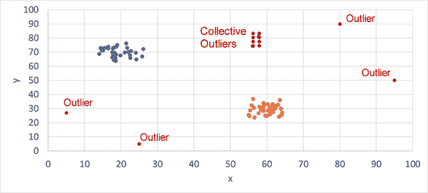 |

## 集体异常

相对于整个数据集，组合在一起的异常实例集合。如图 1 所示，单个实例并不是孤立的异常。集体异常的一个例子是信用卡欺诈中在特定时间间隔内发生的购买行为。

## 条件异常

或称为上下文异常，是指在特定语境下是异常，但在该语境之外并非异常的记录（Chandola, Banerjee, & Kumar, 2009）。一个例子是来自外国机构的一笔 10 美元的信用卡交易。假设 10 美元的交易并不罕见，那么使其成为异常的就是其语境（即地理位置）。从概率的角度来看，有性离群值检测与无条件点离群值检测的区别变得更加明显。在条件离群值检测中，实例是在条件概率的低概率区域内寻找的（Hong & Hauskrecht, 2015）：

```
P(y|x)
```

其中 `y` 是行为属性或向量，而 `x` 是数据点的上下文（Hong & Hauskrecht, 2015）。与之相反，无条件离群值检测实例是在以下概率区域寻找的：

```
P(y,x) 或 P(y)
```

最近的研究主要集中在提高点异常检测技术的准确性，尽管研究人员在 IDS（入侵检测系统）数据集上获得了良好的检测准确率，但这些技术很少进入实际的现实部署（Ahmed, Naser Mahmood, & Hu, A survey of network anomaly detection techniques, 2016），（Bhuyan, Bhattacharyya, & Kalita, 2014）。接下来的三个章节将探讨这种现象的原因。

# 网络异常检测方法

目前网络异常检测先进方法利用了以下领域的方法（Bhuyan, Bhattacharyya, & Kalita, 2014），（Ahmed, Naser Mahmood, & Hu, A survey of network anomaly detection techniques, 2016），（Catania & Garino, 2012）：

1. 统计方法。
2. 基于多变量相关性的方法（即信息论）。
3. 分类方法。
4. 聚类方法。
5. 基于知识的方法。

后续章节简要总结了这些方法。

## 统计方法

为了表征计算机网络的正常行为，统计网络异常检测（NAD）技术对正常、预流量数据拟合统计模型，并使用统计推断确定新事件是否属于该模型。由该模型生成的概率的事件被认为是异常，因为它们不是由所学习的随机模型生成的（Bhuyan, Bhattacharyya, & Kalita, 2014）。

统计异常检测方法可以分为参数化和非参数技术。参数模型假设假设正常流量的底层数据分布（例如 `Gaussian` 高斯分布），并使用给定数据估计模型参数。非参数技术不对底层数据分布做出假设，且计算开销更大（Bhuyan, Bhattacharyya, & Kalita, 2014）。

统计方法经常用于异常检测，是因为它们具有从观测中学习的能力且计算复杂度较低。取决于模型对网络流量的表征程度，它们可以实现准确的预测。统计方法的缺点包括：通常假设已知数据分布知识、参数调优困难，且大多数统计模型假设过程是平稳的，这并不总是现实，因为网络流量环境是不断变化的。

目前已经提出了多种统计方法来建模正常网络流量，最近的工作集中在利用有限混合模型的技术，例如高斯混合模型（`GMM`）、Beta 混合模型（`BMM`）（Moustafa, Creech, & Kalita, 基于混合模型的异常检测, 2018），（Moustafa, Slay, & Creech, 使用大规模网络梯形估计进行异常检测, 2017）或狄利克雷混合模型（Wang, Hao, Ma, & Huang, 异常检测的统计决策狄利克雷混合模型, 2010）来模拟网络数据。这些模型的流行是因为网络流量并非遵循 `Gaussian` 分布，而是遵循长尾分布（Ahmed, Slay, & Creech, 使用大规模网络梯形估计进行异常检测, 2017）。

## 基于多变量相关性的方法（信息论）

统计方法的其他形式包括基于多变量相关性的方法。这类方法不是通过监控变量的极值来检测异常（即一阶特征），而是通过监控特征之间的相关性变化来检测异常（即二阶特征）（Xie, Han, Tian, & Parvin, 2011）。这些方法与 CAD（异常检测）密切相关，本文稍后将介绍相关工作。

## 分类与机器学习方法

分类解决的是根据先观测对象的特征将未见对象分类到预定义类别的问题。监督机器学习算法用于学习描述各个类别特征的分类模型。训练好的模型随后用于测试新实例并判断其属于哪一类。例如，正常和攻击流量事件可用于训练模型。该模型随后可将新事件分类为正常或异常。

深度神经网络等分类技术在过去几年中变得流行，是因为它们能够以高检测率和准确率学习复杂的数据模型。然而，这种成功受到若干限制，包括大量的标记训练数据和强大的计算能力。

最近用于异常检测的最流行的分类技术是浅层和深度神经网络（例如 Ludwig, 2017）和（Yin, Zhu, Fei, & He, 2017）。另一种流行的技术是使用支持向量机（`SVMs`）。

## 聚类方法

聚类方法是无监督学习方法，它们将对象分组在一起，使得类内对象具有较高的相似性，与其他类中的对象尽可能不同。相似性是通过使用距离或相似性函数计算的。

聚类技术可以有效将网络数据分为相似组，其优点是不需要标记流量。聚类技术的缺点包括参数的选择（特别是数据应划分为多少类）、有效相似性度量的选择（针对非连续数据）以及攻击通常模拟正常行为，从而隐藏在正常流量簇中。

流行的技术包括基于密度和网格的聚类（Leung & Leckie, 2005）、k-means 聚类及其变体（Ahmed & Mahmood, 基于集体异常检测流量分析, 2014），（Bhuyan, Bhattacharyya, & Kalita, 2012）。

## 基于知识的方法

基于知识的方法依赖于预定义的规则或模式来检测攻击。它们通过搜索预定义的活动（如攻击模型）来工作。一旦检测到活动，它们会尝试将后续活动与之前检测到的活动进行匹配，以获取有关潜在攻击的进一步知识。匹配的活动越多，攻击的置信度就越高，在达到特定的异常评分后就会发出警报。

如果有有效的知识模型，基于知识的方法具有很高的检测率，但这种模型需要大量的知识，生成过程非常耗时，并且在检测零日攻击方面存在局限。文献中提出了许多技术，例如基于规则的、基于本体的、基于状态或基于逻辑的方法（Bhuyan, Bhattacharyya, & Kalita, 2014）。最近的研究还利用模糊规则为网络入侵开发了决策引擎（Chadha & Jain, 2015）。知识模型也被频繁用于表示上下文。

# 网络数据的本质

NAD（网络异常检测）技术可以利用数据包层数据（Mahoney & Chan, 2001）、流层数据（Sui Song and Li Ling and C. N. Manikopoulo, 2006）以及基于窗口的方法中的流摘要（Wenke Lee and Dong Xiang, 2001）。传统上，NAD 技术通过检查每个包的负载来检测异常。然而，在每秒吞吐量可能达到数 GB 的高速网络流量中，这是一项艰巨的任务。因此，研究人员的注意力转向基于流的技术。网络或传输层流总结了通信模式，而不是检查每个单独的数据包，并且通过排除负载，需要分析的数据显著减少（Sperotto, et al., 2010）。

然而，这种抽象是以精确性为代价的。可检测的攻击种类有限，因为网络层没有可用负载信息（Sperotto, et al., 2010）。尽管如此，对于网络中发生的许多攻击，基于流的信息已经足够。许多作者已经证明，即使直直上与网络层变化没有关联的攻击也可以检测（Moustafa, Slay, & Creech, Novel geometric area analysis technique for anomaly detection using trapezoidal area estimation on large-scale networks, 2017）。下一节将详细概述不同的攻击。

尽管网络流量从数据包级到流级进行了抽象，但基于流的 NAD 系统仍然面临通用的流式数据挑战。为了实时运行，数据只能在到达时进行处理，这限制了适用技术的数量，仅限于低复杂度的技术。正如 (Milenkoski, Vieira, Kounev, Avritzer, & Payne, 2015) 所述，大多数数据挖掘和机器学习方法没有考虑计算开销。考虑到不断增长的网络空间（这将随着 5G 等技术的普及而变得更加明显），这是一个需要解决的挑战。


NAD 技术的进一步挑战是计算机网络和攻击不断变化的本质（Sommer & Paxson, 2010），（Ahmed, Naser Mahmood, & Hu, A survey of network anomaly detection techniques, 2016），（Frecon, et al., 2016）。计算机网络是动态且频繁变化的环境，攻击者变得越来越复杂，将他们的活动伪装成合法流量。从统计建模的角度来看，这反映为非平稳、非高斯分布，这需要自适应的非平凡模型。对于分类方法来说也是一个挑战，这些方法通常学习正常行为作为基准配置，并将异常检测为偏离该正常配置的偏差。

无法随时间准确地建模正常行为和攻击行为会导致许多误报，这些需要人类分析师对有效性和重要性进行评估（Chang, Gottwalt, & Zhang, 2017）。对于分析师来说，分析警报是非常耗时的，因为异常检测技术的输出通常是原始且难以解释的。通常，可疑事件（数值）在没有任何推理的情况下显示，这导致了结果与其解释之间存在语义鸿沟。

NAD 技术的另一个挑战是缺乏真值（ground truth）。在现实世界的快速发展的计算机网络中，很难获取到没有异常行为的样本。与每个无监督或有监督问题一样，需要正常和异常事件的真值来学习模型或评估其有效性。可以使用手动分析或过滤技术来获取近似真值，尽管在正常流量和异常特征变化如此快速的环境中，这是一项挑战性任务（Frecon, et al., 2016）。

对于分类方法，正常流量和异常流量的不平衡是另一个挑战。在现实场景中，攻击流量占正常流量的比例极低，使得训练分类算法变得困难，因为理想情况下它们需要每类相似数量的事件来学习有效模型（更多信息请参见 (Sommer & Paxson, 2010)）。

为了了解常见攻击，下一节将从攻击的角度描述 NAD。

## 网络攻击的本质与入侵检测数据集

1999 年为知识发现会议（KDD）创建了一个网络入侵检测数据集，该数据集目前仍然是评估网络入侵检测技术最常用的数据集（Pfahringer, 2000）。基于该数据集，攻击被分为以下几类：

*   **拒绝服务 (Denial of Service)**：拒绝服务（DoS）或分布式拒绝服务（DDoS）攻击旨在中断或破坏服务。一种常见的程序是过载目标系统，通常使用多个连接请求。DoS 攻击可以在网络层执行（通过耗尽服务的可用带宽），也可以在应用层执行（通过利用漏洞中断服务）。DoS 攻击通常会导致网络统计数据的显著变化，并且更容易检测。DoS 攻击的示例包括 smurf、死亡 ping、邮件炸、UDP 风暴和 SYNflood。

*   **探测/侦察 (Probe / Reconnaissance)**：探测或侦察攻击的目标是收集有关网络、主机和配置的信息。虽然信息收集过程不会直接导致任何损害，但探测攻击仍被认为是关键的，因为它们可能是更大攻击的第一步。端口扫描器和漏洞扫描器是攻击者用于收集网络信息的常用技术。

*   **用户到远程 (User-to-Remote)**：这些攻击旨在获取特定系统的管理员或 root 权限（即权限提升）。利用程序（Exploit）通常用于利用软件漏洞，例如缓冲区溢出。

*   **远程到本地 (Remote-to-Local)**：远程到本地攻击旨在通过互联网发送数据包来发现机器的漏洞并利用它们，从而访问远程机器。远程到本地攻击的一个示例是猜测密码。

基于流的入侵检测社区一直关注导致网络特征发生巨大变化的攻击，例如数据包频率增加或数据包到达时间的变化（Sperotto, et al., 2010）。该类攻击包括 DoS、探测、蠕虫和僵尸网络攻击。许多研究人员已使用该数据集检测这些攻击，并在该数据集上实现了非常良好的检测性能和较低的误报率。此外，研究人员对网络特征变化较小的其他攻击也取得了良好的检测结果（Moustafa, Slay, & Creech, 大规模网络上基于梯形面积估计的异常检测的新型几何区域分析技术, 2017）。然而，这些结果在学术背景之外并没有意义，因为该数据集并不能代表真实世界中的部署情况（Zuech, Khoshgoftaar, & Wald, 2015），（Gottwalt & Karduck, 大数据背景下的 SIM, 2015）。它已经过时了，既不能代表当前的网络流量特征，也不再代表当前的攻击。

自 1999 年以来，攻击的数量和种类急剧增加，攻击者在将攻击流量伪装成正常流量方面变得越来越复杂（Moustafa & Slay, UNSW-NB15: 用于网络入侵检测系统的综合数据集 (UNSW-NB15 网络数据集), 2015）。为了解决这个问题，Nour 和 Slay 创建了一个在统计学上更合理的数据集，其中包含了大量的当代攻击——`UNSW-NB15` 数据集（Moustafa & Slay, 网络异常检测系统的评估：UNSW-NB15 数据集的统计分析以及与 KDD99 数据集的比较, 2016）。基于最新发布的网络入侵检测数据集，研究人员考虑了以下攻击：模糊测试、分析、后门、DoS、漏洞利用、通用攻击、侦察、shell 码和蠕虫。

正如（Moustafa, Slay, & Creech, 大规模网络上基于梯形面积估计的异常检测的新型几何区域分析技术, 2017）所示，还需要额外的研究来提高这些攻击的检测性能并分析它们的统计特性，特别是对于 `KDD99` 数据集中未被考虑的攻击类型。

由于网络流量和攻击的性质，异常检测（NAD）面临的突出问题（特别是高误报率的产生）导致异常检测技术很少被用于网络入侵检测（Sommer & Paxson, 2010）。

解决这些问题的一种方法是在异常检测过程中引入更多的上下文信息。下一节将分析上下文如何被用于 NAD，并强调可以利用它来解决当前技术缺陷的机遇。

## 上下文在 NAD 中的利用

计算机网络依赖于上下文，因为它们在本质上具有时间性，包含空间信息并由网络结构组成。适用于它们最直观的上下文类别是时间维度，它被用于衡量网络流随时间变化的依赖关系和差异，并此检测异常（Bereziński, Jasiul, & Szpyrka, 2015）。

其他上下文类别也适用，包括网络依赖（Staniford-Chen, et al., 1996）、根据托布勒地理定律定义的空间依赖（Tobler, 1979）以及时空模式（Chen, Huang, Xu, & Lai, 2015）。例如，运行相同服务的服务器（它们通常使用标准化的目的端口）以及同一子网的机器（它们的行为往往相似）。

这些上下文特征被用于定义“上下文增强特征”，这些特征对某些攻击具有更高的异常表达能力，例如 DoS 攻击中每个 IP 地址的入连接数（Moustafa & Slay, UNSW-NB15: 用于网络入侵检测系统的综合数据集 (UNSW-NB15 网络数据集), 2015）。

特征选择和生成是任何 NAD 系统中的重要步骤，本章分析了如何利用上下文完成这一步。利用这些特定领域的 CAD（上下文异常检测）技术是将上下文引入 NAD 的方法之一（详见（Aleroud & Karabatis, 2017）的详细综述，该综述利用了特定的上下文类别进行入侵检测）。

鉴于计算机网络的复杂性，相关上下文的定义、识别和选择并不总是简单的。任何指定实体状况或环境的信息都可以被视为上下文，这是通用 CAD 技术的假设。

使用通用 CAD 评估异常事件有效性的工作完成得较少。Song 等人在 `KDD99` 数据集上评估了他们的通用 CAD 方法，但没有进行任何进一步的说明（Song, Wu, Jermaine, & Ranka, 2007），几位作者使用了贝叶斯网络来整合观测值之间的条件依赖关系，包括 Kruegel 等人（Kruegel, Mutz, Robertson, & Valeur, 2003），他们提出了一种用于入侵检测分类的贝叶斯网络，以整合模型之间的依赖关系以减少错误分类的数量。这种方法提高了检测质量并减少了误报次数。

很少有方法考虑使用通用定义的上下文来评估异常事件的有效性，从而可能减少误报并为离群值提供解释。此外，某些方法使用领域知识手动选择上下文特征或属性之间的依赖关系，这在快速变化的环境中是一个限制因素。

许多研究人员使用行为模型来学习和预测正常行为以及各种攻击的行为，并以属性作为上下文；然而，这些方法依赖于训练数据，因此在数据和攻击快速变化的环境中并不有效（Sommer & Paxson, 2010）。

与 CAD 相关的一个领域是基于属性间依赖关系变化的异常检测，也称为多元相关性分析（Tan Z., Jamdagni, He, Nanda, & Liu, 2014）。通用 CAD 技术使用一个或多个上下文属性与目标属性之间的关系表示上下文来评估事件的有效性，而多元相关性分析通过监控属性间关系的变化作为异常活动的的直接指示。

通用全局 CAD 方法中，上下文可以通过上下文属性之间的二阶或高阶依赖关系来表示或建模，并在这种上下验证异常事件。捕捉这些关系并监控变化已成功应用于检测网络中的攻击行为（Tan Z., Jamdagni, He, Nanda, & Liu, 2014）。此外，这些方法可能作为 CAD 的轻量级上下文总结。因此，分析属性依赖关系以检测网络异常的技术总结将在后文中给出。

用于 NAD 的另一种上下文形式是基于知识的上下文，这种上下文以人类理解的水平表示，并用于为现有数据集整合并生成额外的上下文信息（即事件之间的语义关系），将事件放入生成的上下文中。

## 预处理阶段的上下文引入

通常不将原始特征作为 NAD 方法的输入（见图 2），而是会执行四个预处理步骤，以减少高维数据问题的复杂性并提高性能。

1.  使用领域知识生成额外特征。
2.  符号特征到数值值的映射。将符号或类别型特征映射到相应的数值值，以便应用常用的数学函数。
3.  将特征值归一化到同一尺度。
4.  选择最相关的特征。

| 图 2 预处理阶段中上下文的引入 |
| --- |
| 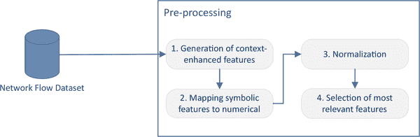 |
| --- |

接下来，将详细概述第一步和第四步预处理步骤，因为在这两个步骤中主要考虑了上下文信息。

在第一步中，利用领域知识生成额外的上下文增强特征，这些特征被证明在区分正常流量和异常流量方面更加有效。这些特征是上下文特征和行为特征的组合，例如在特定时间内每个 IP 地址的连接数（即位置）。它们通过考虑领域知识（即关于正常流量和攻击流量如何改变网络特征的知识）代表了有的总结或抽象。很多时候，这些特征已经是用于测试的数据集的一部分，例如 `KDD` 和 `UNSW-NB15` 数据集，作者引用这些数据集来提供生成特征的概述。

正如任何数据挖掘问题中常见的那样，最后一个预处理步骤是选择相关特征并减少冗余或噪声特征，其中相关性可以被视为（Blum & Langley, 1997）：“与目标概念相关”。这一步有助于改进预测模型，根据 Hall 的观点（Hall M. A., 1999），良好的特征子集是：“包含与类别相关（可预测类别）的特征，但彼此之间不相关（不可预测彼此）的特征”。目标类应该依赖于特征，同时任何两个特征之间应该是相互独立的。在网络异常检测（NAD）案例中，目标类表示为正常类和攻击类。

特征选择技术主要有三种类型：过滤（filter）、封装（wrapper）和混合组合（Chen, Li, Cheng, & Guo, 2006）。基于封装的技术利用贝叶斯网络或决策树等分类算法，结合交叉验证来识别最相关的特征。虽然这些技术性能通常优于过滤方法，但它们需要更高的计算量，这就是为什么基于过滤的技术被更频繁地使用（Chen, Li, Cheng, & Guo, 2006）。

基于过滤的技术使用统计相关方法来选择最描述目标类的特征子集。最简单的情况是使用线性相关测量（如皮尔逊相关系数）或非线性技术（如信息增益测量）评估单个特征与类属性的相关性。然后根据相关性对特征进行排序，并选择与目标类相关性最高的特征。

(Ambusaidi, He, Nanda, & Tan, 2016) 提出了一种基于非线性互信息相关性度量的特征选择方法。在他们的方法中，通过测量特征与类标签之间的互信息来获得特征的相关性。假设是特征与类标签之间共享的互信息越大，该特征预测类标签的效果越好。为了选择最相关的特征，对所有特征根据其与类标签的互信息进行排序，然后将特征逐个添加到分类器中，直到获得最高的分类准确率。

另一种流行的基于过滤的方法是利用主成分分析（`PCA`），它分析多变量属性之间的相关性，并构建高阶组件，从经验上总结属性之间的相关性。这些组件代表了原始特征的线性、不相关的变换，并根据其方差进行排序。为了减少属性的维度，目标是排除线性相关变量，即可以用其他属性的线性组合表示的属性（例如 `x[1] = β[2]x[2] + β[3]x[3]`，其中 `x` 是属性）。这些变量代表了冗余信息，可以在不丢失信息的情况下删除。

减少后的特征（组件）代表了原始特征中包含大部分信息（方差），且属性之间是独立的（正交的）。由于许多机器学习和统计方法假设特征之间存在独立性，`PCA` 等方法在改进预测模型方面流行且有效。

然而，`PCA` 有几个局限性。首先，`PCA` 只考虑二阶线性相关来总结数据，而不考虑更高水平或非线性相关。此外，对于 NAD 场景，更大的缺点是缺乏时间维度，因为该方法只总结了变量之间的相关性，而不考虑它们的时间顺序。属性之间的相关性会随时间变化，这种变化可以用于检测攻击（Tan Z., Jamdagni, He, Nanda, & Liu, 2014）。

`PCA` 也被用作检测异常的直接指标，因为底层依赖关系的变化反映在其中（Shyu, Chen, Sarinnapakorn, & Chang, 2003），（Wang & Battiti, 2006）。(Eid, Hassanien, Kim, & Banerjee, 2013) 中对用于入侵检测的不同特征选择技术进行了更全面的比较。

下一节提供了利用二阶依赖关系检测异常的 NAD 技术的概述。

### 多变量相关性分析

多变量数据中的异常通常可以检测为极值（即偏离变量均值），这些也被称为一阶特征，即变量关系或依赖关系的偏离，也被称为二阶特征或两者的结合（Ye, Emran, Chen, & Vilbert, 2002）。将这些与异常类型相比，极值异常对应于点异常，而多变量相关性异常反映了上下文异常。

虽然多变量主机入侵检测的研究表明，入侵是由属性均值的偏差引起的（Ye, Emran, Chen, & Vilbert, 2002），但网络入侵检测的研究发现属性依赖关系可以检测网络入侵（Ye, Emran, Chen, & Vilbert, 2002），（Tan Z., Jamdagni, He, Nanda, & Liu, 2014）。此外，Sarasamma 等人认为，NAD 高误报率的原因之一在于忽略了特征之间的依赖关系和相关性（Sarasamma, Zhu, & Huff, 2005）。

为了解决这个问题，最近的工作集中于研究特征之间的相关性，以使用多变量相关性分析检测异常（Tan Z., Jamdagni, He, Nanda, & Liu, 2014）。已经分析了多种线性和非线性相关测量方法来衡量属性之间的相关性变化，下面的讨论提供了最新工作的概述。

Jin 和 Yeung 分析了利用协差矩阵检测 DDoS 攻击（Jin, Yeung, & Wang, 2007）和泛洪攻击（Yeung, Jin, & Wang, 2007）。他们提出通过正常流量和不同的攻击流量训练协差矩阵，以识别不同的模式并创建类别配置（Jin, Yeung, & Wang, 2007）。通过基于窗口的方法，利用相似性度量将事件序列与创建的配置进行比较。这使他们能够检测异常的相关性变化，并推断出存在哪种攻击。他们方法最大的缺点是，类别配置或正常配置是静态的，无法适应不断变化的网络特征。此外，该检测方法可以通过线性地改变所有特征来规避，并且只能将一组事件标记为异常，而不能标记单个事件（Tan Z., Jamdagni, He, Nanda, & Liu, 2014）。

为了解决这些问题，Tan 等人引入了欧几里得距离图作为特征间多变量相关性的衡量标准（Tan Z., Jamdagni, He, Nanda, & Liu, 2011）。在他们的方法中，使用简单的欧几里得距离来衡量特征内部的相关性，并将这些距离存储在欧几里得距离图中。随后，利用马哈拉宾距离（Mahalanobis distance）的密度估计构建了表示正常流量的范数配置。为了评估新事件是否为异常，测量观测事件与生成配置之间的马哈拉宾距离，并利用阈值做出决策。他们的方法对 DoS 攻击具有良好的检测率，但由于缺乏特征选择、归一化步骤以及对正常行为相关性时间变化的考虑，某类 DoS 攻击的准确率较低。

Tan 等人随后提出了一种基于三角形面积的几何相关性度量，用于检测特征之间以及与入侵的相关性变化（Tan Z., Jamdagni, He, Nanda, & Liu, 2014）。首先将特征转换到笛卡尔坐标系，并以原点和投影特征点形成三角形。生成的三角形面积代表了相关性的更高层次判别抽象，用于区分正常事件和异常事件。通过遵循之前工作中相同的流程并预先对数据归一化，他们优于所有先进方法，并在 KDD 数据集上实现了非常高的 DoS 攻击检测准确率。此外，该方法具有线性时间复杂度，适用于实时检测。

由于网络相关性不能仅被认为是线性的，其他作者关注了非线性相关性度量。例如，Ambusaidi 等人对比了线性皮尔逊相关系数与基于互信息的非线性相关系数，以检测 DoS 攻击（Ambusaidi, et al., 2014）。在他们的方法中，利用正常流量相关系数的平均值生成正常配置，然后将该配置与输入事件的相关性进行比较。正如（Moustafa & Slay, The evaluation of network anomaly detection systems: Statistical analysis of the UNSW-NB15 data set and the comparison with the KDD99 data set, 2016）中所述的，网络流量特征的相关性是非线性的，这在 Ambusaidi 等人的结果中也得到了体现，其中熵度量导致了更高的检测率和更低的误报率。（Nychis, Sekar, Andersen, Kim, & Zhang, 2008）中介绍了针对异常检测（NAD）的更多熵方法的综述和实证评估。


尽管如此，大多数异常检测方法利用如 `PCA` 等方法在特征选择过程中消除相关性，以减少数据集的维度并提高预测模型的准确性。为了理解如何利用上下文（context）增强异常检测过程，需要理解“上下文”一词的含义和解释。下一节将讨论“上下文”一词及其在异常检测领域的应用。

# 上下文概念及其在通用异常检测中的应用

上下文（Context）是一个模糊的术语，在异常检测中有许多不同的解释。本节回顾了关于“上下文”一词的文献、其含义以及它在入侵和异常检测领域是如何被解释的。

## 异常检测中“上下文”的定义

尽管几十年来利用上下文或上下文信息进行异常检测已成为常见（例如在时间序列异常检测中（Fox, 1972）），但“上下文异常检测”或“条件异常检测”这一术语直到 Song 等人（Song, Wu, Jermaine, & Ranka, 2007）之后才受到关注。

Song 等人解决了确保检测到的异常对分析师有用的问题。他们将上下文视为一组使用领域知识指定的上下文属性（即环境属性）（Song, Wu, Jermaine, & Ranka, 2007）。基于这一假设，他们将上下文异常定义为一种新观测值，其（Song, Wu, Jermaine, & Ranka, 2007）：‘指标属性在环境属性的上下文中无法解释’。

这种对上下文异常的定义是特定的，Chandola 等人将该定义泛化如下（Chandola, Banerjee, & Kumar, 2009）：‘如果一个数据实例在特定上下文中是异常的，但在其他情况下不是，则被称为上下文异常’。他们强调上下文的概念可以有多个方面，并取决于数据结构（Chandola, Banerjee, & Kumar, 2009）和数据集的数据领域（Aggarwal, An Introduction to outlier analysis, 2017）（例如时间序列数据和空间数据）。Chandola 等人放宽了 Song 等人提出的要求，即上下文异常要求数据由一组行为属性和上下文属性组成。上下文属性可以是空间、图、序列或配置，这些代表了 Song 等人描述的通用情况（Chandola, Banerjee, & Kumar, 2009）。

在最近的一部书中，Aggarwal 等人（Aggarwal, An Introduction to outlier analysis, 2017）将上下文离群点检测认为一种确定数据记录之间上下文依赖关系以检测异常的方法，这种关系可以通过‘时间上、空间上或通过明确的网络关系链接’来实现。与非上下文离群点相比，“上下文离群点只能在与同一时间邻域内项的关系范围内被理解’（Aggarwal, An Introduction to outlier analysis, 2017）。

## 异常检测中的“相对于上下文”和“为了上下文”范式

几种不同的上下文和异常检测（CAD）概念已演变为独立的研究领域。这些领域可以大致分为 Gong 等人提出的两种使用上下文范式（Gong, Fu, & Cai）。

利用“相对于上下文”（Context Of）范式的方法通常将数据集分为上下文部分和行为部分。上下文部分被行为部分的上下文，代表这些属性组之间的依赖关系。这些方法要么关注特定的上下文（也被称为“数据领域”（Aggarwal, An Introduction to outlier analysis, 2017））以检测特定上下文信息类别（如时间、位置或关系）的离群点（AlEroud & Karabatis, 2016），要么关注通用上下文离群点，即任何指定实体状况或环境的信息都被视为上下文（Schilit, Adams, & Want, 1994）。

采用“为了上下文（context for）”范式的方法侧重于对现有数据集的额外上下文信息（即领域知识）进行集成、生成和融合，以便将事件置于一个“生成的”上下文中。异常检测技术通常没有考虑高层信息（如上下文知识表示）来提高其性能，而这些技术解决了这一问题 (Sadighian, Zargar, Fernandez, & Lemay, 2013), (Aparicio-Navarro, Kyriakopoulos, Parish, & Chambers, 2016)。尽管上下文信息融合可以在任何抽象层次上进行，但它主要被用于整合高层次的上下文知识表示。在本章的剩余部分，这些方法被称为基于知识的上下文异常检测（knowledge-based CAD）或上下文信息融合，因为这项研究主要由信息融合社区驱动。

虽然 CAD 的术语和定义相似，但其解释和应用却有所不同。在一些工作中，上下文被解释为高层次的知识表示（Aleroud & Karabatis, 2017），而另一些作者则认为上下文是通用的低级属性依赖（Liang & Parthasarathy, 2016），还有一些人侧重于针对特定应用的上下文解释（Aggarwal, Spatial outlier detection, 2013), (Gupta, Gao, Aggarwal, & Han, 2014), (Gao, et al., 2010）。这些不同的解释使得很难理解上下文的含义，以及如何利用它来增强网络异常检测。

有人认为，所有整合到异常检测中的上下文都可以被视为上下文信息融合问题，这在 (Aleroud & Karabatis, 2017) 中已经实现。然而，我们认为将其分为不同类型的实现可以提供不同语义抽象层次之间的清晰度。这种缺乏理解导致了对异常检测中上下文清晰定义的需求，以及对上下文如何纳入异常检测的分类和综述。

# 上下文网络异常检测方法的新术语与分类法

## “上下文”术语的定义及其在异常检测中的语义解释

上下文被认为是对动作的约束或动作发生的环境（Brézillon, 1999), (Devlin, 2005）。在异常检测或 CAD 问题中，动作是根据其发生的环境（即上下文）的异常程度进行评估的。为了理解之前 CAD 工作中对动作和上下文的解释，需要区分不同的语义层次。根据著名的“知识-信息-数据金字塔”（Rowley, 2007），上下文被分类为：

1. 数据级上下文
2. 信息级上下文
3. 知识级上下文

### 数据级上下文

数据级上下文描述了上下文的最低语义层次，其中上下文被认为是数据集中不直接指示异常的部分。

数据集的上下文部分（在此层次上也被称为条件部分）不能被排除，因为它为评估异常的有效性和重要性提供了重要条件。与信息级上下文的主要区别在于上下文被假设是通用的，没有特定的上下文含义（如位置或时间）。

### 信息级上下文

信息级上下文根据数据集上下文部分的语义含义来考虑上下文。

信息级上下文的示例包括时间序列数据集和空间数据集，由于数据集不同的上下文性质，它们被区别对待。与数据级上下文的主要区别在于，上下文的语义含义被认为是为了解决问题。

### 知识级上下文

知识级上下文描述了上下文最高的语义层次，其中上下文描述了实体行为的情况或以及实体之间的关系。

图 3 显示了一个高层上下文的示例，其中实体、实体的行为及其关系被模型化。使用 Zimmermann (Zimmermann, Lorenz, & Oppermann, 2007) 定义的上下文类别来模拟实体的情况。

| 图 3. 知识级上下文 |
| --- |
| 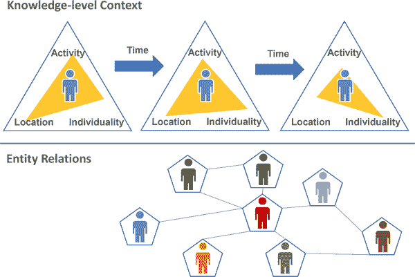 |
| --- |

将这三个上下文层次映射到图 4 的金字塔表示中，从底到上上下文的语义抽象不断增加，增加的意义和上下文越多，为人类分析师创造更多的知识和洞察。这是因为原始数据量在转换为信息和知识时会逐渐减少。

| 图 4. 语义抽象上下文金字塔 |
| --- |
| 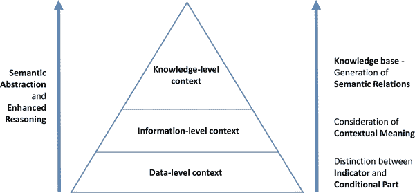 |
| --- |

为了区分不同的语义抽象层次并澄清“上下文”一词的歧义用法，表 1 总结了不同语义抽象层次上关键术语的不同术语。在下一节对上下文异常的定义中，将清楚地看出这些术语是如何相关的。

| 表 1. 上下文抽象层次术语 |
| :--- | :--- | :--- | :--- | :--- |
| 语义层次 | CAD 方法领域 | 对象定义 | 行为定义 | 上下文定义 |
| 数据级上下文 | 通用 CAD | 数据行部分 | 指示部分 | 条件部分 |
| 信息级上下文 | 特定应用 CAD | 数据行 | 活动 | 上下文 |
| 知识级上下文 | 基于知识的 CAD | 实体 | 行为 | 环境/情况 |

# 上下文网络异常检测方法的分类

根据上述内容，文献中提出的 CAD 方法被结构化如图 5 所示的分类。

为了解决异常检测中上下文使用的模糊问题，CAD 方法被分为图 6 上金字塔中描述的三个语义抽象层次。第一层分为通用 CAD（对应数据级上下文）、特定应用 CAD（代表信息级上下文）以及使用知识级上下文的基于知识的 CAD。

| 图 5. CAD 分类法 |
| --- |
| 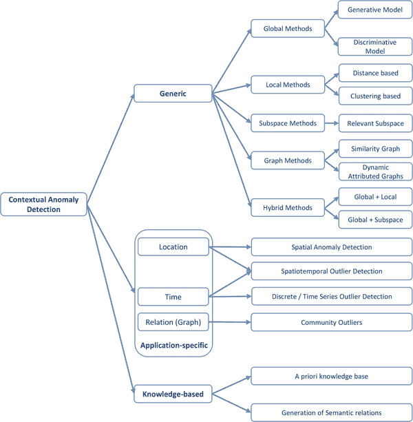 |
| --- |

## 特定应用 CAD 的概念

特定应用 CAD 方法根据问题或数据集的上下文性质采用不同的方法。随着时间的推移，对于所有不同的上下文类别（例如位置、时间和关系），独立的研究领域已经有了大量的研究工作。

以下特定应用的上下文异常检测技术随时间发展起来：

1. 时间异常检测：时间异常检测是指根据 (Gupta, Gao, Aggarwal, & Han, 2014):‘时间形成了相对于所有分析的上下文变量’的方法。除了时间序列异常检测外，考虑顺序的技术也被视为时间技术。

2. 空间异常检测

空间异常检测技术将空间数据视为上下文。这些技术的基础是托布勒地理学第一定律，该定律指出（Tobler, 1979）：“万物与万物之间相互联系，但邻近的事物比遥远的事物更为相关”。基于这一定律，Kou 等将空间离群点定义为（Kou, Lu, & Chen, 2006）：‘与其周围邻居具有显著不同特征的空间对象’。

3. 时空异常检测

在许多现实应用中，考虑到时间和位置相关性作为上下文的对不规则活动检测具有高度相关性（Aggarwal, Spatial outlier detection, 2013）。考虑空间和时间数据的技术称为时空异常检测技术，其目标是检测时空异常对象（Gupta, Gao, Aggarwal, & Han, 2014）：‘其行为属性（非空间和非时间属性）与其在时空邻域中的其他对象有显著差异’。

4. 图/网络社区异常检测

更多的现实世界数据问题具有关系结构，其关注点是实体之间的链接而非实体本身，例如社交网络。社区异常检测技术将实体社区视为上下文来处理这些数据集，并（Gao, et al., 2010）：‘旨在检测与同一社区内其他成员相比具有不一致模式的离群点’。

然而，上下文并不总是可以通过一种类型的上下文来描述。任何指定实体状况或环境的信息都可以理解为上下文（Schilit, Adams, & Want, 1994）。为了处理这种通用情况，Song 等引入了条件异常检测技术（Song, Wu, Jermaine, & Ranka, 2007）。关于这种通用情况的定义将在下一节讨论。

## 通用 CAD 的概念

基于 (Song, Wu, Jermaine, & Ranka, 2007) 中对通用 CAD 的早期工作，上下文的一种常见解释是（Valko, Kveton, Valizadegan, Cooper, & Hauskrecht, 2011）：‘上下文定义了一组变量，对另一组变量进行检查以寻找异常值’。对于通用 CAD 技术，数据集的特征空间通常被分为指示属性和上下文属性（Song, Wu, Jermaine, & Ranka, 2007）。指示属性也被定义为响应、结果（Hong & Hauskrecht, 2015）、行为、活动（Song, Wu, Jermaine, & Ranka, 2007）或目标属性。上下文属性也被数据点的上下文（Hong & Hauskrecht, 2015）、环境（Song, Wu, Jermaine, & Ranka, 2007）、条件（Song, Wu, Jermaine, & Ranka, 2007）、元数据（Hayes & Capretz, 2015）和参考组（Tang, Bailey, Pei, & Dong, 2013）。由于一组属性以另一组属性为条件，因此也被称为条件异常检测（Song, Wu, Jermaine, & Ranka, 2007）。

基于该模型，通过将这些环境属性以一组指示属性为条件，来检测上下文离群点。与这种解释类似，其他人将上下文离群点认为是（Wang & Davidson, 2009）：‘数据子集上下文下的离群点’。子集可以通过多种方式获得，并被定义为‘参考组’或‘上下文子空间’（Tang, Bailey, Pei, & Dong, 2013）以及数据对象的相关数据属性子空间（Zhang, et al., 2016）。

Chandola 等认为通用 CAD 技术基于轮廓（profiles），他们将轮廓定义为数据（Chandola, Banerjee, & Kumar, 2009）：‘可能没有显式的空间或序列结构，但仍然可以使用一组上下文属性分割或聚类为组件’的数据。其他作者从局部、实例的视角定义了通用 CAD（Hayes & Capretz, 2015），（Liang & Parthasarathy, 2016）。他们认为上下文离群点是（Liang & Parthasarathy, 2016）：‘行为偏离具有相似上下文信息的其他对象的对象’。

通用 CAD 的另一种形式随着时间的推移而发展，它侧重于数据集的相关子空间以识别上下文。许多现实世界数据集包含由不同机制生成的观测组。这反映在数据集中的几个局部分布以及对不同属性子集的不同影响（Kriegel, Kroger, Schubert, & Zimek, 2012）。相关子空间 CAD 方法旨在检测这些子空间（即观测组或上下文），以检测其中的异常。相关子空间 CAD 技术基于以下假设（Kiseleva, 2013）：‘上下文不一定以特征空间中单个变量的形式存在，它可能隐藏在数据中’。

上下文通常是使用领域知识手动定义的，例如通过将特征空间分为行为属性和上下文属性（Song, Wu, Jermaine, & Ranka, 2007）。还有从统计角度对上下文建模的方法，认为上下文是由二阶或高阶相关性定义的（Paulheim & Meusel, 2015）。二阶相关性使用相关系数定义两个属性之间的相关性，高阶相关性则利用几个属性的相关性来预测目标变量，例如简单的回归模型。

通用 CAD 方法可以分解为全局方法、局部方法、子空间方法、图方法和混合方法。

- **全局方法**：对数据集采取全局整体视角，通过考虑整个数据集的底层结构和属性之间的依赖关系，以条件属性约束指示属性。全局方法可以分解为生成模型和判别式模型。

- **局部方法**：从局部实例视角预测指示属性，通过相似性度量获取实例的‘上下文邻域’，并将指示属性与上下文相似实例的指示属性进行比较。局部方法可分为基于距离和聚类的方法。

- **子空间或相关子空间方法**：旨在识别数据集中的局部分布（由不同机制生成的观测组），并将其作为参考组来预测指示属性。

- **图方法**：旨在将图数据集分为两个子图，其中一个子图代表参考组，另一个子图（即活动）以此为条件。已经使用了相似性图和动态属性图等技术。

- **混合方法**：结合上述方法以解决它们各自的一些缺点，例如结合全局和局部方法来解决上下文稀疏问题。

## 基于知识的 CAD

受数据融合和信息融合社区的驱动，用于异常检测的上下文信息融合技术将额外信息引入检测过程，以提高推理能力和检测性能（Aparicio-Navarro, Kyriakopoulos, Parish, & Chambers, 2016）。

信息融合，也称为数据融合、传感器融合、多传感器数据融合或知识融合，简单来说（Snidaro, García, Llinas, & Blasch, 2016）：‘合并数据或信息以改进对实体状态的估计或预测的过程’。信息融合算法的输入可以包括不同抽象层次的数据，从原始数据到特征级和决策级数据（Hall & Llinas, 1997）。

关于如何在从低传感器级到高层决策的融合过程中表示并利用上下文，已经开展了相关研究。在计算机安全信息融合的更广泛领域（Corona, Giacinto, Mazzariello, Roli, & Sansone, 2009），或入侵检测的语境信息（Aleroud & Karabatis, 2017）中，可以对异常检测的上下文信息融合进行定位。

Aleroud 和 Karabatis 最新的工作将入侵检测的语境信息融合视为一种上下文增强的知识系统，并将语境定义为（Aleroud & Karabatis, 2017）：“特征的组合，用于识别在特定位置一个或多个后果发生高概率的设置或先决条件”。Aleroud 和 Karabatis 认为语境信息是任何描述了以下（Aleroud & Karabatis, 2017）内容的信息：

1. 目标系统，例如配置和漏洞。
2. 决定攻击成功的相关条件。
3. 攻击者活动之间的语义关系。

虽然 Aleroud 和 Karabatis 对上下文的定义（Aleroud & Karabatis, 2017）在将语境信息视为相关条件方面，与通用 CAD 和特定应用 CAD 技术的相似。然而，他们对语境信息的解释涉及更广泛的含义，包括更高层的信息，因为他们将其认为是上下文信息融合的一部分，而没有区分不同的抽象层次。

Mahapatra 等人对异常检测的上下文给出了另一种解释，他们将上下文解释为（Mahapatra, Srivastava, & Srivastava, 2012）：“用于向异常检测算法提供信息关于其所分析的文本数据语义上下文的侧面信息”。这种解释描述了高层基于知识信息的整合。

虽然语境信息融合可以在不同的抽象层级上进行，但异常检测领域语境信息融合的研究人员主要侧重于高层知识表示的引入或生成（Aleroud & Karabatis, 2017）。

基于这些定义，语境信息融合被视为一种将知识或语义信息整合到检测过程中的手段。下一节指出了网络入侵和异常检测方法在通用语境异常检测方法工作的基础上进行构建的机会。


## 入侵检测 CAD 的机遇与挑战

在高语义层面上引入并解释上下文（Aleroud & Karabatis, 2017），以及在低特征生成层面上（Moustafa & Slay, UNSW-NB15: 一个用于网络入侵检测系统的综合数据集（UNSW-NB15 网络数据集），2015），已被证明能够提高异常检测技术的准确性并减少误报数量。此外，利用上下文已被证明可以增强异常的语义含义，使人类分析师对事件的分析变得更容易（Aleroud & Karabatis, 2017）。尽管如此，但明确将上下文整合到网络入侵和异常检测中的工作仍然有限（Aleroud & Karabatis, 2017）。

图 6 显示了 NAD 过程的常见架构，其中整合上下文的部分用绿色标出。在预处理阶段，上下文通常用于通过结合活动特征和语境特征来生成上下文增强型特征。

特征选择是机器学习和入侵检测方法的常用过程，而 CAD 的等效过程是语境特征和指标特征的选择。在 (Gottwalt, Chang, & Dillon, 2019) 中，提出了一种名为 `CorrCorr` 的特征选择方法，它同时考虑了指标特征和语境特征。虽然 `CorrCorr` 获得的结果是积极的且远好于以前的方法，但该特征选择技术局限于基于多变量相关的异常检测技术，不能直接应用于其他通用 CAD 方法。这导致了另一个未来的工作领域，即调整 `CorrCorr` 以获得一组独立的指标特征和语境特征，使其适用于通用的 CAD 情况。

在检测引擎中，NAD 主要被视为一个特定于应用程序的时序异常检测问题，其中时间或序列代表了调查异常的上下文维度。考虑到网络流量的特点，有许多特征可以被认为主要是语境的。在这些通用语境中的异常检测已经通过通用 CAD 方法得到了解决。从前一节概述的 NAD 技术问题来看，除了这些外，只有三种方法在入侵检测数据集上评估了通用 CAD 技术，而没有进行进一步的详细阐述（Song, Wu, Jermaine, & Ranka, 2007），（Liang & Parthasarathy, 2016），（Kruegel, Mutz, Robertson, & Valeur, 2003）。

| 图 6. NAD 过程中利用上下文的概览 |
| --- |
| 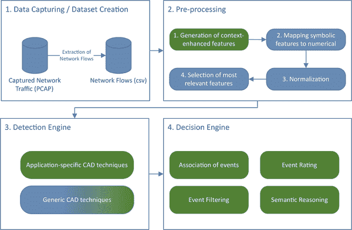 |

一些研究人员专注于使用多变量相关分析来检测网络异常，这是一种与通用 CAD 相关的技术，并且能够在适应变化环境的同时获得较低的误报率（Yeung, Jin, & Wang, 2007），并由于其线性复杂度而适用于实时性需求（Tan Z., Jamdagni, He, Nanda, & Liu, 2014）。这强调了这样一个假设：通用 CAD 技术可以解决 NAD 方法面临的问题。

为什么针对 NAD 的通用 CAD 技术没有很多研究，其中一个潜在的原因是，现有的通用 CAD 方法有几个缺点，这些缺点需要被解决，以使其适用于计算机网络的动态、流式环境。另一个潜在的原因是缺乏一个如何将通用 CAD 技术整合到 NAD 中的框架。

观察图 6 中 NAD 过程的决策引擎阶段，上下文在这一高知识层面上被用于关联攻击事件、根据上下文过滤事件、使用语义推理将事件置于上下，并根据上下文增加或减少事件的异常评分。

未来研究另一个有前景的方向是检测上下文的异常变化。诸如模糊聚类等方法可以用于识别上下文的变化，通过监控聚类成员值的变化来警报新的、异常上下文变化。

## 结论

随着网络犯罪的不断增加，需要新的方法来检测和缓解这些犯罪。

一种能够检测新网络入侵的方法是网络异常检测。虽然科学研究对这些方法显示了令人期待的结果，但它们很少进入现实部署，主要由于产生大量误报的问题。

减少误报数量的一种方法是将上下文信息整合到检测过程中。但什么代表了语境信息，它又是如何整合到传统的异常检测过程中呢？

为了回答这个问题，本章分析并强调了 NAD 方法面临的最大挑战，分析了上下文在 NAD 过程中是如何被使用的，并为上下文异常检测方法提出了新的定义和分类法，这些方法根据其语义抽象层级进行划分，分为知识级上下文、信息级上下文和数据级上下文。

基于对上下文用法的区分，本章强调了未来研究的若干机会，特别是对于通用的 CAD 方法，以减少异常检测和网络犯罪检测方法的误报数量。

## 参考文献

- Aggarwal, C. C. (2013). 空间离群点检测 . In Outlier Analysis (pp. 313–341). Springer. doi:10.1007/978-1-4614-6396-2\_10
- Aggarwal, C. C. (2017). 离群分析导论 . In Outlier Analysis (pp. 1–34). Springer International Publishing. doi:10.1007/978-3-319-47578-3\_1
- Ahmed, M., & Mahmood, A. N. (2014). 基于集体异常的网络流量分析。工业电子与应用 (ICIEA), 2014 IEEE 第 9 届会议, 1141-1146. doi:10.1109/ICIEA.2014.6931337
- Ahmed, M., Naser Mahmood, A., & Hu, J. (2016). 1). 网络异常检测技术综述。网络与计算机应用期刊，60, 19–31. doi:10.1016/j.jnca.2015.11.016
- AlEroudA.KarabatisG. (2016). 超越数据：用于网络安全分析的上下文信息融合。在第 31 届年度 ACM 应用计算会议论文集 (pp. 73–79)。 Pisa: ACM. 10.1145/2851613.2851636
- Aleroud, A., & Karabatis, G. (2017). 9 01). 用于入侵检测的上下文信息融合：综述与分类。知识与信息系统，52(3), 563–619. doi:10.1007/s10115-017-1027-3
- Ambusaidi, M. A., He, X., Nanda, P., & Tan, Z. (2016). 10). 使用基于滤波的特征选择算法构建入侵检测系统。IEEE 事务，65(10), 2986–2998. doi:10.1109/TC.2016.2519914
- Ambusaidi, M. A., Tan, Z., He, X., Nanda, P., Lu, L. F., & Jamdagni, A. (2014). 12). 基于非线性相关测量的入侵检测方法。互联网协议技术杂志，8(2/3), 77–86. doi:10.1504/IJIPT.2014.066377
- Aparicio-NavarroF. J.KyriakopoulosK. G.ParishD. J.ChambersJ. A. (2016, 3). 使用模糊认知地图向入侵检测系统添加上下文信息。2016 IEEE 国际态势感知与决策支持认知方法多学科会议 (CogSIMA), 180-186. 10.1109/COGSIMA.2016.7497807
- Axelsson, S. (2000). 入侵检测系统：综述与分类。技术报告，查尔姆斯斯理工大学。
- Bereziński, P., Jasiul, B., & Szpyrka, M. (2015). 一种基于熵的网络异常检测方法。熵（瑞士巴塞尔），17(4), 2367–2408. doi:10.3390/e17042367
- BhuyanM. H.BhattacharyyaD. K.KalitaJ. K. (2012). 一种有效的无监督网络异常检测方法。在计算、通信与信息进展国际会议论文集 (pp. 533–539)。Chennai: ACM. 10.1145/2345396.2345484
- Bhuyan, M. H., Bhattacharyya, D. K., & Kalita, J. K. (2014). 网络异常检测：方法、系统和工具。IEEE 通与教程，16(1), 303–336. doi:10.1109/SURV.2013.052213.0046
- Blum, A., & Langley, P. (1997). 机器学习中相关特征的选择。人工智能，97(1-2), 245–271. doi:10.1016/S0004-3702(97)0006-5
- Brézillon, P. (1999). 解决问题中的上下文：综述。知识工程评论，14(1), 47–80. doi:10.1017/S0269889914
- Catania, C., & Garino, C. (2012). 自动网络入侵检测：当前技术与问题。计算机与电气工程，38(5), 1062–1072. doi:10.1016/j.compe.2012.0513
- Chadha, K., & Jain, S. (2015). 用于网络入侵的混合模糊规则引擎。在 Buyya, R., & Thampi, S. (Eds.), 智能计算 (pp. 185–198)。Springer. doi:10.1007/978-3-319-4227-5
- Chandola, V., Banerjee, A., & Kumar, V. (2009). 异常检测：综述。ACM 综述，41, 15–58. doi:10.1145/154182
- Chang, E., Gottwalt, F., & Zhang, Y. (2017). CPS 和 IoT 的网络态势感知。在 Prabaharan, S., Thalmann, N., & Kanchana Baskaran, V. (Eds.), 技术前沿 (pp. 147–161)。Springer. doi:10.1007/978-3-4235-5\_10
- Chen, Y., Li, Y., Cheng, X.-Q., & Guo, L. (2006). 入侵检测中特征选择的综述与分类。在 Lipmaa, H., & Lin, D. (Eds.), 信息安全与密码学 (pp. 153–167)。Springer Berlin Heidelberg. doi:10.1007/1193780
- Chen, Y.-Z., Huang, Z.-G., Xu, S., & Lai, Y.-C. (2015). 网络攻击的时空模式与预测性。PLOS One，10(5), 1–19. doi:10.1371/journal.pone.01247
- Corona, I., Giacinto, G., Mazzariello, C., Roli, F., & Sansone, C. (2009). 计算机安全信息融合：现状与开放问题。信息融合，10(4), 274–284. doi:10.1016/j.inffus.2009.0301
- Devlin, K. (2005). 应对情报分析中的上下文影响：数学如何提供帮助。斯坦福语言与信息研究中心。
- Eid, H. F., Hassanien, A. E., Kim, T.-h., & Banerjee, S. (2013). 基于线性相关的网络入侵检测特征选择。在 Awad, A. I., Hassanien, A. E., & Baba, K. (Eds.), 信息与通信网络安全 (pp. 240–248)。Springer Berlin Heidelberg. doi:10.1007/978-3-642-40597-6\_21
- Fox, A. J. (1972). 时间序列中的离群点。英国皇家学会杂志 B 系列：方法论，34(3), 350–363. doi:10.1111/j.2517-6161.1972.tb00912.x
- Frecon, J., Fontugne, R., Didier, G., Pustelnik, N., Fukuda, K., & Abry, P. (2016). 二元自相似性的线性回归——基于数据包和字节计数联合分析的流量异常检测。2016 IEEE 声学、语音与信号处理国际会议 (ICASSP), 4184-4188. doi:10.1109/ICASSP.2016.7472465
- Gao, J., Liang, F., Fan, W., Wang, C., Sun, Y., & Han, J. (2010). 信息网络中的社区离群点及其高效检测。在第 16 届 ACM SIGKDD 知识发现与数据挖掘国际会议论文集 (pp. 813–822)。Washington, DC: ACM. doi:10.1145/1835804.1835907
- García-Teodoro, P., Díaz-Verdejo, J., Maciá-Fernández, G., & Vázquez, E. (2009). 基于异常的网络入侵检测：技术、系统与挑战。计算机与安全，28(1-2), 18–28. doi:10.1016/j.cose.2008.08.003
- Gong, W., Fu, W., & Cai, L. (n.d.). 基于神经网络的入侵检测数据融合模型。计算科学与优化 (CSO), 2010 第三届国际联合会议，2, 410-414. doi:10.1109/CSO.2010.62
- Gottwalt, F., Chang, E., & Dillon, T. (2019). Corr：用于多变量相关异常检测的特征选择方法。计算机与安全，83, 234–245. doi:10.1016/j.cose.2019.02.08
- Gottwalt, F., & Karduck, A. (2015). 大数据背景下的 SIM。2015 第 11 届技术创新会议 (IIT), 326-331. doi:10.1109/INNOVATIONS.2015.738162
- Gottwalt, F., Waller, A., & Liu, W. (2016). 自然规律作为网络异常检测的基准。2016 IEEE Trustcom/BigDataSE/ISPA, 370-377. doi:10.1109/TrustCom.2016.0086
- Gupta, M., Gao, J., Aggarwal, C. C., & Han, J. (2014). 9). 时间数据的离群点检测：综述。IEEE 知识与数据工程期刊，26(9), 2250–2267. doi:10.1109/TKDE.2013.184
- Hall, D. L., & Llinas, J. (1997). 多传感器数据融合导论。IEEE 展望，85(1), 6–23. doi:10.1109/554205
- Hall, M. A. (1999). 用于机器学习的相关特征选择 . 计算机科学系。怀卡托大学。
- Hawkins, D. M. (1980). 离群点的识别 (第 11 卷)。Springer. doi:10.1007/978-94-015-3994-4
- Hayes, M. A., & Capretz, M. A. (2015). 针对大规模传感器数据的上下文异常检测框架。Journal of Big Data , 2(1), 2. doi:10.1186/s40537-014-0011-y
- Hong, C., & Hauskrecht, M. (2015). MCODE: 多变量条件离值检测。MCODE: Multivariate Conditional Outlier Detection. 获取自 https://arxiv.org/abs/1505.04097
- Jin, S., Yeung, D. S., & Wang, X. (2007). 协方特征空间中的网络入侵检测。Pattern Recognition , 40(8), 2185–2197. doi:10.1016/j.patcog.2006.12.010
- Kiseleva, Y. (2013). 上下文挖掘及其集成到预测性网络分析中。在第 22 届国际世界维网会议会议论文集 (WWW '13 Companion, 里约热热内卢，巴西, 2013 年 5 月 13-17 日) (pp. 383–388)。美国计算机协会，有限公司。
- KouY.LuC.-T.ChenD. (2006). 空间加权离值检测。2006 年 SIAM 国际数据挖掘会议论文集, 614-618. 10.1137/1.9781611972764.71
- Kriegel, H., Kroger, P., Schubert, E., & Zimek, A. (2012). 任意方向子空间中的离值检测。2012 年 IEEE 第 12 届国际数据挖掘会议, 379-388. doi:10.1109/ICDM.2012.21
- Kruegel, C., Mutz, D., Robertson, W., & Valeur, F. (2003). 用于入侵检测的贝叶斯事件分类。在第 19 届年度计算机安全应用会议论文集中。IEEE 计算机学会。获取自 https://dl.acm.org/citation.cfm?id=956415.956436
- Lee, W., & Xiang, D. (2001). 用于异常检测的信息论度量。2001 年 IEEE 安全与隐私研讨会。S&P 2001, 130-143. doi:10.1109/SECPRI.2001.924294
- Leung, K., & Leckie, C. (2005). 使用聚类的网络入侵检测中的无监督异常检测。在第 28 届澳澳洲计算机科学会议论文集 (Vol. 38)。澳大利亚计算机协会，有限公司。获取自 https://dl.acm.org/citation.cfm?id=1082161.1082198
- LiangJ.ParthasarathyS. (2016). 鲁棒上下文离值检测：当上下文遇到稀疏性时。在第 25 届 ACM 信息与知识管理国际会议论文集中 (pp. 2167–2172)。印第安波利斯：ACM。 10.1145/2983323.298366
- LudwigS. A. (2017, 11). 使用深度神经网络的多类入侵检测。在 2017 年 IEEE 计算智能研讨会 (SSCI), (pp. 1-7)。 doi:10.1109/SSCI.2017.828025


## 参考文献

- Mahapatra, A., Srivastava, N., & Srivastava, J. (2012). 文本中的上下文异常检测。*Algorithms*, 5(4), 469–489. doi:10.3390/a504069
- Mahoney, M. V., & Chan, P. (2001). PHAD: 用于识别敌对流量的数据包头异常检测。佛罗里达计算机科学系。
- Milenki, A., Vieira, M., Kounev, S., Avritzer, A., & Payne, B. (2015). 评估计算机入侵检测：常见做法综述。*ACM. Surv.*, 48, 12:1–12:41. doi:10.1145/280869
- Moustafa, N., Creech, G., & Slay, J. (2017). 入侵系统的大数据分析：使用有限狄利克特模型的统计决策。在 Palomares Carrcosa, I., Kalutarage, H., & Huang, Y. (编), *数据分析与决策支持：方法论与应用* (pp. 127–156)。Springer 国际出版。 doi:10.1007/978-3-319-5943-5
- Moustafa, N., Creech, G., & Slay, J. (2018). 使用 Beta 混合模型和离值检测进行异常检测。在 Pattnaik, P. K., Rautaray, S., Das, H., & Nayak, J. (编), *计算、分析与网络领域的进展* (pp. 125–135)。Springer Singapore。 doi:10.1007/978-981-10-7871-13
- Moustafa, N., & Slay, J. (2015). UNSW-NB15：用于网络入侵系统的综合数据集。在 *2015 年军事通信与系统会议 (MilCIS)*, (pp. 1-6)。 doi:10.1109/MilCIS.2015.734894
- Moustafa, N., & Slay, J. (2016). 网络异常检测评估：UNSW-NB15 数据集与 KDD99 数据集比较。*Inf. Sec. J.: 全球视角*, 25, 18–31. doi:10.1080/19393555.2015.112574
- Moustafa, N., Slay, J., & Creech, G. (2017). 大规模网络中使用梯形面积估计的新型异常检测技术。*IEEE Transactions on Big Data*, 1. doi:10.1109/TBDATA.2017.271566
- Nychis, G., Sekar, V., Andersen, D., Kim, H., & Zhang, H. (2008). 基于熵的流量检测实证评估。在 *第 8 届 ACM SIGCOMM 互联网测量会议论文集* (pp. 151–156)。
- Paulheim, H., & Meusel, R. (2015). 将离值问题分解为一组监督学习问题。*Machine Learning*, 100(2-3), 509–531. doi:10.1007/s10994-015-5
- Pfahringer, B. (2000). 赢得 KDD99 杯：Bagged boosting。*SIGKDD Explorations*, 1(2), 65–66. doi:10.1145/846183.846200
- Rowley, J. (2007). 智慧层次：DIKW 层次。*Journal of Information Science*, 33(2), 163–180. doi:10.1177/01655515060706
- Sadighian, A., Zargar, S. T., Fernandez, J., & Lemay, A. (2013, 10). 分布式入侵检测中基于语义的上下文感知告警融合。在 *2013 年互联网与系统风险会议 (CRISIS)*, (pp. 1-6)。 doi:10.1109/CRISIS.2013.676352
- Sarasamma, S. T., Zhu, Q. A., & Huff, J. (2005). 分层神经网络。*IEEE Transactions on Systems, Man, and Cybernetics. Part B, Cybernetics*, 35(2), 302–312. doi:10.1109/TSMCB.2005
- Schilit, B., & Adams, N. (1994, 12). 上下文感知计算。在 *1994 年移动计算系统工作会议* (pp. 85-90)。
- Shyu, M.-L., Chen, S.-C., & Ranka, S. (2003). 一种基于主成分的新型异常检测方案。*第 19 届信息系统安全会议论文集*, 1, 172-179.
- Snidaro, L., García, J., & Llinas, E. (2016). 上下文增强信息：利用领域知识提升真实性能。Springer 出版。
- Sperotto, A., Schaffrath, G., Sadre, R., Morariu, C., Pras, A., & Stiller, B. (2010). 基于 IP 流的入侵检测概述。*IEEE Communications Surveys and Tutorials*, 12(3), 343–356. doi:10.1109/SURV.2010.03
- Staniford-Chen, S., Cheung, S., Crawford, R., Dilger, M., Frank, J., Hoagland, J., & Zerkle, D. (1996). GrIDS——一种基于图的大型网络入侵系统。*第 19 届信息系统安全会议论文集*, 1, 361-370。
- Song, S., Ling, L., & Manikoplo, C. (2006). 基于流的统计聚合。*2006 年 IEEE 网络、感知与控制国际会议*, 786-791. 10.1109/ICNSC.2006.167324
- Song, X., Wu, M., Jermaine, C., & Ranka, S. (2007). 条件异常检测。*IEEE Transactions on Knowledge and Data Engineering*, 19(5), 631–645. doi:10.1109/TKDE.2007
- Tan, Z., Jamdagni, A., He, X., Nanda, P., & Liu, R. P. (2011). 基于多变量相关分析的拒绝攻击检测。在 B.-L. Lu, L. Zhang, & J. Kwok (编), *神经信息处理：第 18 届国际会议，ICONIP 2011, 中国上海，2011 年 11 月 13-17 日, 论文集, 第三部分* (pp. 756-765)。Springer 柏林版德林。 10.1007/978-3-642-24965-5_85
- Tan, Z., Jamdagni, A., He, X., Nanda, P., & Liu, R. P. (2014). 基于多变量相关分析的拒绝攻击检测系统。*IEEE Transactions on Parallel and Distributed Systems*, 25(2), 447–456. doi:10.1109/TPDS.2013.146
- Tang, G., Bailey, J., Pei, J., & Dong, G. (2013). Mining multidimensional contextual outliers from categorical relational data. In *Proceedings of the 25th International Conference on Scientific and Statistical Database Management* (pp. 43:1–43:4). Baltimore: ACM. 10.1145/2484838.2484883
- Tobler, W. R. (1979). Cellular geography. In Gale, S., & Olsson, G. (Eds.), *Philosophy in Geography* (pp. 379–386). Springer Netherlands. doi:10.1007/978-94-009-9394-5_18
- Valko, M., Kveton, B., Valizadegan, H., Cooper, G. F., & Hauskrecht, M. (2011). Conditional anomaly detection with soft harmonic functions. In *2011 IEEE 11th International Conference on Data Mining*, (pp. 735-743). doi:10.1109/ICDM.2011.40
- Wang, G., Hao, J., Ma, J., & Huang, L. (2010). A new approach to intrusion detection using artificial neural networks and fuzzy clustering. *Expert Systems with Applications*, 37(9), 6225–6232. doi:10.1016/j.eswa.2010.02.102
- Wang, W., & Battiti, R. (2006). Identifying intrusions in computer networks with principal component analysis. In *First International Conference on Availability, Reliability and Security (ARES’06)*, (pp. 8 pp.-279). 10.1109/ARES.2006.73
- Wang, X., & Davidson, I. (2009). Discovering contexts and contextual outliers using random walks in graphs. In *2009 Ninth IEEE International Conference on Data Mining*, (pp. 1034-1039). 10.1109/ICDM.2009.95
- Xie, M., Han, S., Tian, B., & Parvin, S. (2011). Anomaly detection in wireless sensor networks: A survey. *Journal of Network and Computer Applications*, 34(4), 1302–1325. doi:10.1016/j.jnca.2011.03.004
- Ye, N., Emran, S. M., Chen, Q., & Vilbert, S. (2002). Multivariate statistical analysis of audit trails for host-based intrusion detection. *IEEE Transactions on Computers*, 51(7), 810–820. doi:10.1109/TC.2002.1017701
- Yeung, D. S., Jin, S., & Wang, X. (2007). Covariance-matrix modeling and detecting various flooding attacks. *IEEE Transactions on Systems, Man, and Cybernetics. Part A, Systems and Humans*, 37(2), 157–169. doi:10.1109/TSMCA.2006.889480
- Yin, C., Zhu, Y., Fei, J., & He, X. (2017). A Deep learning approach for intrusion detection using recurrent neural networks. *IEEE Access: Practical Innovations, Open Solutions*, 5, 21954–21961. doi:10.1109/ACCESS.2017.2762418
- Zhang, J., Yu, X., Li, Y., Zhang, S., Xun, Y., & Qin, X. (2016). A relevant subspace based contextual outlier mining algorithm. *Knowledge-Based Systems*, 99, 1–9. doi:10.1016/j.knosys.2016.01.013
- Zimmermann, A., Lorenz, A., & Oppermann, R. (2007). An operational definition of context. In *Proceedings of the 6th International and Interdisciplinary Conference on Modeling and Using Context*. Springer-Verlag. Retrieved from https://dl.acm.org/citation.cfm?id=177080
- Zuech, R., & Khosh, T. (2015). Anomaly detection in wireless sensor networks: A survey. *Journal of Network and Computer Applications*, 34(4), 1302–1325. doi:10.1016/j.jnca.2011.03.004

## 关键术语与定义

- **特定应用相关**：这些方法考虑了。
- **上下文异常检测**：检测异常行为的任务。
- **误报**：由……提出的异常。
- **通用上下文**：这些方法假设。
- **入侵检测**：检测恶意活动的任务。
- **特定应用相关**：这些方法评估了事件。
- **入侵检测**：检测异常流量的任务。
- **基于知识的**：这些方法检测上下文异常。
- **上下文异常检测**：关于行为的任务。
- **网络异常检测**：检测偏离正常的异常流量的任务。

# 第 10 章：一种文献计量学方法

- Josélia Mafalda Ribeiro Fonseca
    - 亚速尔群岛大学社会科学与人文学院
- Maria Teresa Borges-Tiago
    - 亚速尔群岛大学商务与经济学院

---

## 摘要

在过去的二十里，社交媒体已成为许多生活的一部分，带来了积极和负面的影响。在某种意义上，线下行为变得无处不在。为了了解过去 20 年的研究情况及其涉及的主题，本研究对社交媒体相关的学术文献进行了文献计量学分析。该领域的增长得到了证实，并揭示了一些研究空白。由于这是首次针对社交媒体中网络欺凌的研究之一，希望它能激发进一步的研究。

## 引言

欺凌是一种针对他人的人类行为，持续存在并会对受害者造成伤害。事实上，欺凌是对人类可持续性的攻击，在这里理解为有利于平衡、尊严人类发展的政治、社会、教育和道德条件及行为。

新通信技术的广泛使用以及网络的发展导致了新的欺凌形式：网络欺凌。如今，通过互联网、计算机、手机、平板电脑和其他设备，可以轻松访问社交网络，并对他人实施暴力、羞辱、攻击其自尊，导致他们绝望、抑郁和心理社会问题。

网络欺凌现象在 21 世纪的增长引起了不同领域研究者的兴趣，因此也激励并增加了该领域的研究。因此，了解研究过程是如何发展的、哪些国家、领域和时期存在最大差异是重要的。在本文中，我们展示了一项针对 2000 年至 2020 年间网络欺凌学术文献的文献计量学研究，对该主题的领域、作者和国家进行了调查。

随着技术的进步和人们的广泛采用，社交互动倾向于从面对面转向虚拟交流。在观察有关社交网络的理论和实证研究时可以发现，传统上它们是一项跨学科的尝试（Zych, Ortega-Ruiz, & Del Rey, 2015）。因此，这一现象的起点是人类历史之初就存在的广泛社会现象，其复杂性跨越了多个分析层级，尤其是自在线社交网络诞生以来。

## 社交网络的演变

社交网络网站在互联网上已经存在了近 20 年，在过去的八年里深刻地影响了用户之间建立的关系。根据 Marwick 和 Boyd (2011) 的观点，社交媒体应该遵循个人真实性的社会规范。因此，在这一网络化的世界中，人们发布推文、点赞并成为粉丝，探索数百万个移动应用程序，并搜索、创建和分享内容；人们倾向于积极地虚拟生活，这鼓励了年轻人与其社交网络分享个人生活的各个方面（Marwick & Boyd, 2011）。用户通过多个设备保持连接，这提高了效率、便利性、信息获取能力，提供了更广泛的信息谱和更丰富的数据源选择（Fotis, Buhalis, & Rossides, 2012），改变了通信流和信息所有权（Berthon, Hulbert, & Pitt, 2005）。

用户的通信赋能随着互联网的演变而发生，不仅改变了信息的获取，还塑造了用户的行为和动机。在互联网早期，`Web 1.0` 作为连接文档并使其在互联网上实现电子化的工具出现。这允许用户搜索和阅读广泛的信息。此时，Tim Berners-Lee 指出网页可以像文件扩展名一样是“只读”（Tiago & Veríssimo, 2014）。随着 `Web 2.0` 和 `Web 3.0`，通信流变成了双向的，允许用户之间进行互动和信息共享，用户实现了虚拟用户社区和社交网络的创建（Singh, Iyer, & Salam, 2009）。这种新现实可能促进用户之间的纽带和交流，但也使用户容易对线下人类关系现象产生较少正面的反映（Kwan & Skoric, 2013; S. Wang, 2020）。

## 网络欺凌：定义与特征

网页及其功能性的演变导致欺凌从课堂和学校环境迁移到网络空间环境，其发生频率超越了学校以及城市、地区和国家的边界，我们所说的网络欺凌。


# 网络欺凌：定义、比较与研究综述

网络欺凌被理解为通过电子设备发生的人与暴力行为。根据 Picoli 等人 (2020, p. 260) 的观点，引用 Smith 等人 (2008) 的参考文献，“网络欺凌是指‘由个人或群体利用电子形式的接触，反复且长期地针对无法轻易保护自己的受害者实施的侵略性、故意的行为’”。网络欺凌（……涉及发送骚扰或威胁信息（……），在网站或社交网络网站（如 `Facebook` 或 `Myspace`）上关于某人发布贬性评论，或在各种在线环境中对某人进行物理威胁或恐吓。”（Hinduja & Patchin, 2010, p. 208）。

然而，关于网络欺凌的定义仍然缺乏共识（Bauman, 2012; Betts, 2016; Davis, 2017）。正如 Smith, del Barrio 和 Tokunaga (2012) 所出的，这些困难源于网络欺凌中的特定特征，而这些特征在传统欺凌中并不存在：匿名性（Menesini et al., 2012）、公开性（Coyne, 2015）、可用和使用的信息通信技术的多样性（Menesini et al., 2012）、数据的持久性以及无限制的旁观者（Hayashi & Tahmasbi, 2020）。

## 欺凌与网络欺凌的比较

尽管如此，网络欺凌与欺凌之间存在概念上的相似性，被定义为个人或群体对另一个人类的侵略性行为，这使得许多作者（Olweus & Limber, 2017; Vaillancourt, Faris & Mishna, 2017）认为这两个概念并不完全不同。Fanti, Demetriou 和 Hawa (2012, p. 167) 在定义欺凌时将通过电子设备实施的攻击也包含在内，他们理解了这一点：“欺凌是一种发生在不同社会背景下的国际性、广泛现象，例如校园、工作场所，以及最近的科技领域。”

尽管两者都报告了人类针对其同类的侵略性行为，但它们通过不同手段发展的事实——欺凌是面对面发生的，网络欺凌通过电子设备发生——使得欺凌和网络欺凌成为不同的概念，使得后者更加危险和更具攻击性。“网络空间让欺凌变得更容易、更触及，并造成比传统欺凌更大的伤害”（Ansary, 2020, p. 1）。

网络空间使得暴力行为更具侵略性，因为它们不是面对面发生的，从心理学和道德角度来说，这使得它们更容易、更简单地持续。没有与受害者的直接对抗，也没有受害者痛苦可能造成的任何尴尬，没有怜悯的痕迹，攻击者那里也没有可能的良心谴回。

网络欺凌由于缺乏面对面互动而缺乏社会制裁，这意味着许多与传统直接欺凌相关的社会约束在网络欺凌中并不起作用。这增强了网络欺凌中个人调节因素的作用，这些因素在欺凌与道德之间的联系中尤为显著（Bussey, Fitzpatrick & Raman, 2015, p. 31）。

## 心理与道德脱离

在网络欺凌中，攻击者/受害者的关系通过电子设备媒介，这导致了暴力的强化，因为攻击者由于避免了面对，感到在道德上没有义务（Fang et al., 2020; X. Wang, Yang, Wang, & Lei, 2019）。在欺凌情境下，攻击者的道德义务水平非常低，也就是说他们没有表现出任何同情、对受害者尊严和完整性的尊重。在网络欺凌案例中，这种脱离程度变得更，受害者的脆弱性对攻击者来说变得越来越间接（Runions & Bak, 2015）。在欺凌背景下，攻击者被迫移开目光以避免产生怜悯，尽管他继续感受到受害者表达的脆弱环境，但通过电子手段暴力变得容易得多，且不会带来任何罪恶感，因为你看不见、听不见，甚至感觉不到对方（受害者）痛苦的眼神。

如果说欺凌已经让攻击者变得强大，因为它能够征服某人，尽管这可能会带来微不足道的罪恶感，但网络欺凌让攻击者成为一个支配受害者的英雄，没有任何罪恶感，并且可以从你的领域在全球范围内无限地展示。X. Wang 等人 (2019) 认为，网络欺凌行为与家庭因素（如父母监管和/或童年受待）之间的关系受到的研究关注较。

网络欺凌的观者人数远大于传统的欺凌案例，“一条物质欺凌可以通过一条短信发送给数百人，每个接收者都可能成为旁观者。”(Hayashi & Tahmasi, 2020, p. 2)。正如 Lazuras 等人（2019）所述，除了具有欺凌的共同特征外，网络欺凌与间接欺凌也有共同特征。对于间接欺凌，作者考虑了谣言/假新闻或误导性信息的传播、社交排斥以及对受害者的诋毁。这些在网上都能找到，并与不同的旁观者特征相关：有些人能够识别出“恶意”内容；另一些人认为自己能够识别但实际上不能；还有人则完全依赖网络上的所有信息（Borges‐Tiago, Tiago, Silva, Guaita Martínez, & Botella‐Carrubi）。

此外，在网络欺凌中，观者扮演着完全不同的角色：“……在传统的欺凌中，旁观者通常出现在网络欺凌情境中，他们可以采取三种行动：协助或强化欺凌者、支持或保护受害者，以及保持局外人身份。”(Hayashi & Tahmasi, 2020, p. 1)。

观察研究网络欺凌预测因素的，可以发现不同的视角，包括父母监管（Camerini, Marciano, Carrara, & Schulz, 2020; Dehue, Bolman, & Völlink, 2008; Ho, Lwin, Chen, & Chen, 2019）、媒体接触（Akbulut, Sahin, & Eristi, 2010; Ho et al., 2019; Van Ouytsel, Walrave, Ponnet, Willems, & Van Dam, 2019; S. Wang, 2020）、童年虐待（Emirtekin, Balta, Kircaburun, & Griffiths, 2019; X. Wang et al., 2019）或其他个人因素（Barlett & Coyne, 2014; Holfeld & Grabe, 2012; You, Lee, & Kim, 2016），以及环境因素（Holfeld & Grabe, 2012; Modecki, Minchin, Harbaugh, Guerra, & Runions, 2014）。鉴于技术采用率的提高和网络欺凌预测因素，父母和教育工作者抑制或缓解网络欺凌的任务是一项日常挑战（Guo, 2016）。

因此，在文献中可以许多方法，如表 1 所示。

### 表 1. 不同方法与研究课题

| 主要主题 | 作者（年份） |
| :--- | :--- |
| 网络欺凌中的性别和族群差异 | Casas, Del Rey, and Ortega-Ruiz (2013) <br> Barlett and Coyne (2014) <br> Vitoroulis and Vaillancourt (2015) |
| 影响网络欺凌的因素 | Reijntjes, Kamphuis, Prinzie, and Telch (2010) <br> Reijntjes et al. (2011) <br> Barlett and Coyne (2014) <br> Buelga, Iranzo, Cava, and Torralba (2015) <br> Mitsopoulou and Giovazolias (2015) <br> Luo and Bussey (2019) |
| 网络欺凌行为 | Ttofi, Farrington, Lösel, and Loeber (2011) <br> Fanti, Demetriou, and Hawa (2012) <br> Barlett and Coyne (2014) <br> Modecki et al. (2014) <br> Van Geel, Vedder, and Tanilon (2014) <br> Holt et al. (2015) <br> Luo and Bussey (2019) <br> Fang et al. (2020) |
| 反欺凌计划 | Ferguson, Miguel, Kilburn Jr, and Sanchez (2007) <br> Merrell, Gueldner, Ross, and Isava (2008) <br> Polanin, Espelage, and Pigott (2012) <br> Yeager, Fong, Lee, and Espelage (2015) <br> You et al. (2016) <br> Guo (2016) <br> Limber, Olweus, Wang, Masiello, and Breivik (2018) |
| 受害化与心生理问题 | Vazsonyi, Machackova, Sevcikova, Smahel, and Cerna (2012) <br> Gini and Pozzoli (2009) <br> Gini, Pozzoli, and Hymel (2014) <br> Hawker and Boulton (2000) <br> Reijntjes et al. (2010) <br> Reijntjes et al. (2011) <br> Ttofi et al. (2011) <br> Van Geel et al. (2014) <br> Betts (2016) <br> Fang et al. (2020) <br> You et al. (2016) |
| 道德脱离 | Perren and Gutzwiller-Helfenfinger (2012) <br> Gini et al. (2014) <br> Runions and Bak (2015) <br> Luo and Bussey (2019) <br> Fang et al. (2020) |
| 欺凌与网络欺凌 | Aoyama and Talbert (2010) <br> Smith et al. (2012) <br> Casas et al. (2013) <br> Gini et al. (2014) <br> Modecki et al. (2014) <br> Alfadari (2019) <br> Van Ouytsel, Walrave, et al. (2019) |
| 网络欺凌受害者 | Hinduja and Patchin (2010) <br> Patchin and Hinduja (2010) <br> Ttofi et al. (2011) <br> Tippett and Wolke (2014) <br> Van Geel et al. (2014) <br> Holt et al. (2015) <br> Luo and Bussey (2019) |
| 网络欺凌中的年龄段差异 | Perren and Gutzwiller-Helfenfinger (2012) <br> Modecki et al. (2014) <br> Yeager et al. (2015) <br> You et al. (2016) <br> Athanasiou et al. (2018) <br> Yoon et al. (2019) |

出版物是理解特定主题对社会的相关性和兴趣的极佳来源。社交媒体网络似乎是网络欺凌发生的“肥沃”环境。然而，在审视针对社交媒体网络网络欺凌的各种研究时，发现分析领域似乎存在低估和局限性。因此，通过对发表的文章进行仔细分析可以阐明这一问题。为了实现这一点，研究者：(a) 选择了一个知名数据库，并检索了截至 2000 年出版年的现有数据；以及 (b) 对所有学科的数据进行了分析。

# 研究方法论

## 1.1 数据收集

数据提取分为两个阶段。在第一阶段，以“欺凌”（bullying）和“社交媒体”（social media）为搜索关键词，从两个在线数据库中检索了 2000 年 1 月至 2020 年 1 月发表的共 2043 篇网络欺凌相关的研究工作。对检索到的文章进行了系统分析，并在选择纳入第二阶段的文章时采用了两项标准；这些标准如下：

1. 文章必须是 2000 年至 2020 年间发表在具有同行评审机制的认可学术期刊上；
2. 文章也应是实证研究工作，关注数字同伴受害或网络欺凌。所有仅考虑欺凌、群体欺凌（mobbing）或校园暴力（非特定）的研究均被排除，其程序与 Zych 等人（2015）遵循的方法相似。
3. 混合其他现象或社交媒体之外的网络欺凌综述也被排除在样本之外。

随后，本研究的作者精炼了分析，使用“网络欺凌”（cyberbullying）而非“欺凌”关键词重新扫描数据库并使用相同的时间段，以验证检索到的最终方案。对每篇文章的全文进行了审查，以排除与社交媒体网站中的网络欺凌不完全相关的文章。通过这一程序，筛选了 356 篇全文文章和研究报告。这些文章被用于进行以下分析：引文分析、共引分析和内容分析。从最后一个处理过程中，确定了 10 个不同的作者集群和研究流派。

## 1.2 各学科网络欺凌的计量学分析

关于网络欺凌的学术研究在过去十年中显著增加（见图 1）。

### 图 1. 发表的文章数量

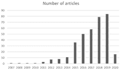

图 1 展示了 2000 年至 2020 年间发表的与网络欺凌研究相关的出版物，清楚地表明了增长趋势。在发表的 356 篇文章中，91%发表在过去的五年。正如几位作者指出的且如图 2 所示，网络欺凌是一个涵盖多学科方法的主题。

### 图 2. 不同学科的文章分布

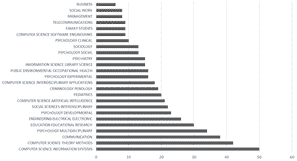

在检查分析领域时，在检索到的 356 篇参考文献中，可以注意到 25.84%的文章与计算机科学相关。为了更好地理解该领域，同时考虑到研究可能是跨学科的，使用 `VosViewer` 软件根据参考文献中涉及的主要主题构成了一个聚类图（见图 3）。

### 图 3. 所有学科领域的关键概念网络可视化

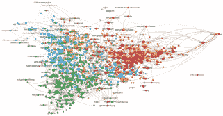

考虑主要主题的聚类程序产生了 10 个集群，源自 1418 个主题主题，如图 4 所示。

### 图 4. 聚类中发现的项目数量

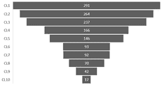

在 291 个项目中，右侧（红色）集群是最大的集群，核心是用户在网络中的角色及其产生的内容。在分析该集群多年来的形成时，可以注意到它已从更偏向技术驱动的方法转变为检测驱动的方法（见图 5）。

### 图 5. 多年来最大集群中的关键概念

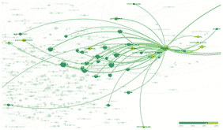

最初的研究主要由计算机科学家进行，旨在揭示技术采纳模式和动机。近期，研究转向了用于检测和防止网络欺凌的工具开发，最近的研究与利用人工智能进行自动网络欺凌检测有关（Rosa 等人，2019）。

左下侧（深绿色）包含 264 个项目，代表了与社交媒体使用（特别是与年轻用户相关）相关的、关于欺凌受害的理论和实践证据相关的研究。如前所述，网络欺凌与普通欺凌具有共同的定义特征，这导致许多研究人员研究了这些现象之间的相似性和差异。这些研究大部分在关于社交媒体背景下的年轻人的实证证据中找到了支持。

第三个集群位于左上侧（深蓝色），聚合了 237 个与网络欺凌实施相关的项目。考虑到网络欺凌通常被认为涵盖了实施和受害，预计这两个概念之间存在强有联系。然而，在过去的五年中，这种联系被网络欺凌实施与道德脱离之间的关系所覆盖，例如 Charalamp 等人（2020）以及 Fang 等人（2020）的作品。

仔细观察图中心，可以发现七个小集群，整合了不同的方法：作为学术问题的网络欺凌（166 个项目）、性相关网络欺凌的态度（146 个项目）、攻击者-害者关系（93 个项目）、使用手机和即时消息的预测和情感反应（92 个项目）、性别欺凌（70 个项目）、反社会网络行为（42 个项目）以及媒体伦理（17 个项目）。

对该数据库的整体观察得出结论：超过 80%的网络欺凌研究关注年轻人。随着职场网络欺凌的增加以及老年人使用的更加密集，预计未来对年轻人的关注将减少。

通过分析第一作者的贡献，获得了下图（见图 6）。

### 图 6. 按引文数的作者可视化

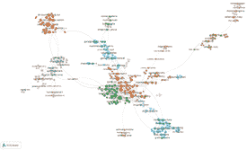

如图 6 所示，有 19 个作者小组。三个主要的作者小组（图中中心的两个——绿色和红色；以及右下角的集群）自 2004 年以来一直处于该主题的研究，并来自不同的学科领域（计算机科学和心理学）。

在完成第一组文献计量分析后，仅针对那些专门分析社交媒体上网络欺凌的文章进行了第二轮分析。初始结果呈现出一个清晰得多的图表方案，集群更少且集群之间的关系更强（见图 7）。

### 图 7. 社交媒体上网络欺凌的关键概念网络可视化

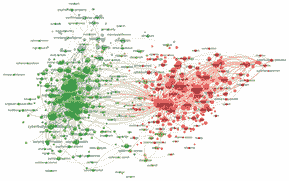

图 7 显示了四个主要集群：左下角（绿色）包含 176 个项目，以受害者化、性别差异和心理生理问题为主；而左上角（蓝色）包含 56 个项目，其特征是工具和量表的开发。与该主题相关的学术综述由离散集群（橄榄绿）中的 45 个项目表示。右侧（红色）包含 266 个项目，其特征是以“个人”为核心节点，并整合了关于社会问题、学习问题，以及网络欺凌的检测、分类和独特方法的广泛主题。比较两个网络结构（图 3 和图 7），伦理关怀在最后一个结构中缺失了，而教育和教养监督/价值观传递在左上角集群中相对较少。

大多数研究集中在美国（122 篇文章），其次是加拿大（30 篇）、英国（26 篇）和西班牙（22 篇）。

### 图 8. 研究工作密度分布图

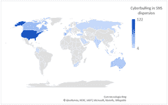


将此数据与各国社交媒体的采用率（`Statistic.com`）进行交叉分析可以发现，社交媒体渗透率高且互联网接入条件更好的国家，拥有数量最多的研究。这些结果证实了现有的研究，即在线投入时间的增加会提高参与网络欺凌的概率（Frison, Bastin, Bijttebier, & Eggermont, 2019; Hinduja & Patchin, 2008）。

为了揭示该领域的研究空白，本文列出了网络欺凌中发现的主要差异，并将其与传统欺凌进行了比较，同时在聚类分析中展示了它们的参考关系。

## 表 2. 不同的方法与集群识别

| 传统欺凌 | 社交媒体中的网络欺凌 | 集群 |
| --- | --- | --- |
| 自控力较低 | 自控力并非决定性因素，而是在线环境提供的去抑制能力 | 左下角集群——绿色集群 |
| 道德脱离，但有时欺凌者具有一定的同理心 | 与低同理心相关的道德脱离 | 左下角集群——绿色集群 |
| 家是安全的地方 | 家不是安全的地方 | 少数离散参考 |
| 时间是情境化的，仅当攻击者和受害者在一起时 | 攻击者 24 小时、7 天全候可用 | 少数离散参考 |
| 空间是情境化的 | 无边界 | 少数离散参考 |
| 攻击者和受者的角色不同 | 传统欺凌中的受害者在网络欺凌中可能是攻击者 | 左下角集群——绿色集群 |
| 受害者通常是学生 | 受害者范围已经扩大，任何人都可能成为网络欺凌的受害者 | 左下角集群——绿色集群 |
| 抑郁症是受害后的主要健康状况 | 受害者表现出更高的精神疾病证据，如抑郁症和自杀倾向 | 左下角集群——绿色集群 |
| 家长和学校是检测的主要主体 | 社交媒体、AI 机器、家长和学校负责检测 | 右侧集群——红色集群 |

关于网络欺凌的研究已进行了二十年。然而，与用户人数以及用户认可的网络欺凌投诉数量相比（`Statistic.com`），以及与网络欺凌总体研究相比，在社交媒体背景下进行的网络欺凌研究非常稀少。大量的研究仍关注于更具概念性的方法，缺乏实证证据。考虑到社交媒体的特殊性以及用户之间建立的密集社交互动性质，这种背景在用户的吸引、采用和行为方面正呈现出日益重要的性。因此，可以识别出关于社交媒体上用户画像和在线风险行为、伦理关怀、教育和教养监督/价值观传递以及旁观者反应的实证研究空白。

当我们查看所做的文献分析得到的主要结果（见表 2）时可以发现，尽管网络欺凌研究涉及跨学科维度，但事实是大多数文章处于计算机科学领域，这表明人们关注的是在电子设备和社交媒体这一新语境下理解传统欺凌现象。因此，可以理解为，心理学、教育研究等领域也是科学产出的投入领域，因为所产文章的目的实际上是为了理解网络欺凌的主角在学校期间是否仍然是学生（Alfandari, 2019; Buelga et al., 2015; Fanti et al., 2012; Hinduja & Patchin, 2010; Van Ouytsel, Lu, Ponnet, Walrave, & Temple, 2019），这些人在心理和道德方面具有相同的特征，例如低自控力和道德脱离化（Bussey, Fitzpatrick, & Raman, 2015; Perren & Gutzwiller-Helfenfinger, 2012; Vazsonyi et al., 2012）。

所分析的文章局限于对现状的描述性维度，忽视了寻求预防性行动的前瞻性立场。在我们看来，这解释了在教育领域（见图 7）无论是正式教育（学校）还是非正式语境（家庭内部）的学生道德和道德训练的研究投入不足。这些领域的研究不仅能够从这些学科的角度刻画网络欺凌的背景，还能激发行动研究项目，增强教育改进并增加对学生道德和价值意识培养的投入，这将有助于构建自主且平衡的身份认，并在团结、宽容、平等和正义等价值观的指导下建立健康的人际关系。

此外，仍然缺乏实证研究来刻画社交媒体中网络欺凌受害者和网络欺凌者的特征，并识别在线风险行为。最后一点与另一个与父母监督/价值观传递相关的研究缺口有关。此时，代际对技术应用的差异似乎导致了父母低估了自己孩子的网络欺凌风险、经历和行为。父母以及其他旁观者仍在学习如何应对网络欺凌。

尽管文献所示，网络欺凌领域相对较新，但它有潜力继续深入研究不同学科领域的见解，并为其他领域提供证据，例如最近在冠病毒传播初期看到的与公司相关网络欺凌或种族网络欺凌。探索从异构源检索到的数据之间语义丰富的联系，对于受害者、家庭、学校、社交媒体公司和政策制定者来说具有重要意义，他们每天面临着网络欺凌的新格式和新挑战。

## 参考文献

Akbulut, Y., Sahin, Y. L., & Eristi, B. (2010). Cyberbullying victimization among Turkish online social utility members. *Journal of Educational Technology & Society*, 13(4), 192–201.

Alfandari, R. (2019). Approaching the study of cyberbullying towards social workers from a systems perspective. *Aggression and Violent Behavior*, 48, 60–64. doi:10.1016/j.avb.2019.08.004

Aoyama, I., & Talbert, T. L. (2010). Cyberbullying internationally increasing: New challenges in the technology generation In *Adolescent online social communication and behavior: Relationship formation on the internet*. IGI Global.

Athanasiou, K., Melegkovits, E., Andrie, E. K., Magoulas, C., Tzavara, C. K., Richardson, C., Greydanus, D., Tsolia, M., & Tsitsika, A. K. (2018). Cross-national aspects of cyberbullying among 14-17-year-old adolescents across seven countries. *BMC Public Health*, 18(1), 800. doi:10.1186/

Bampo, M., Ewing, M., Mather, D., Stewart, D., & Wallace, M. (2008). The effects of social structure on viral marketing. *Information Systems*, 19(3), 273–290. doi:10.1287/

Barlett, C., & Coyne, S. (2014). A meta-analysis of sex differences in cyberbullying: The moderating role of age. *Aggressive Behavior*, 40(5), 474–488. doi:10.1016/2174

Bauman, S. (2012). Why it matters. *Cyberbullying: Approaches, interventions*.

Berne, S., Frisén, A., Schultze-Krumbholz, A., Narus, K., Katzer, P. (2013). Cyberbullying instruments: A systematic review. *Aggressive Behavior*, 11. doi:10.237/

Casas, J. A., Del Rey, R., & Ortega-Ruiz, R. (2013). Bullying and cyberbullying: Convergent and divergent predictor variables. *Computers in Human Behavior*, 29, 580–587. doi:10.55

Charalampous, K., Ioannou, M., Georgiou, S., & Stavrinides, P. (2020). Cyberbullying, psychopathic traits, moral disengagement, and school climate: The role of self-reported psychopathic. *Educational Psychology*, 1–20. doi:10.1080/

Correa, T., Hinsley, A. W., & De Zuniga, H. G. (2010). Who interacts on the Web?: The intersection of users’ personality and social media use. *Computers in Human Behavior*, 26(2), 247–253. doi:10.1016/

Coye, I. (2015). A Focus on Online Bullying. In *Cyberpsychology: A current, critical account of cyberpsychology that is ideally suited for use as a teaching and learning resource*. Oxford University Press.

Crowston, K., & Fagnot, I. (2018). Stages of motivation for contributing user-generated content: A theory and empirical test. *International Journal of Human-Computer Studies*, 109, 89–101. doi:10.1016/

Davis, A. C. (2017). A multidisciplinary approach to cyberbullying: An action research study. Capella University.

de Vries, L., Peluso, A. M., Romani, S., Leeflang, P. S., & Marcati, A. (2017). Explaining consumer brand-related activities on social media: An investigation of the different roles of self-expression and socializing motivations. *Computers in Human Behavior*, 75, 272–282. doi:10.1016/

Borges-Tiago, M. T., Tiago, F., & Cosme, C. (2018). Exploring users’ motivations to viral communication. *Journal of Business Research*, Advance online. doi:10.1016/

Borges-Tiago, M. T., Tiago, F., Silva, O., & Guaita Martínez, J. (n.d.). Online users' attitudes toward fake news: Implications for brand. (Note: In the reference section, I have kept the bibliographic entries in their original English format as requested by standard documentation engineering practices, ensuring the structure remains intact.)

Dehue, F., Bolman, C., & Völlink, T. (2008). 网络欺凌：青少年的经历与父母的。`Cyberpsychology & Behavior`, 11(2), 217–223. doi:10.1089/cpb.2007.0008

Emirtekin, E., Balta, S., Kircaburun, K., & Griffiths, M. D. (2019). 青少年童年情感虐待与网络欺凌行为：特质正念的中介作用。`International Journal of Mental Health and Addiction`, 1–12. doi:10.1007/s11469-019-0055-5

Fang, J., Wang, X., Yuan, K.-H., Wen, Z., Yu, X., & Zhang, G. (2020). 冷酷情感特质与网络欺凌行为：道德脱离的中介作用和同理心的调节作用。`Personality and Individual Differences`, 157, 109829. doi:10.1016/j.paid.2020.109829

Fanti, K. A., Demetriou, A. G., & Hawa, V. V. (2012). 网络欺凌的纵向研究：风险因素与保护因素。`European Journal of Developmental Psychology`, 9(2), 168–181. doi:10.1080/17405629.2011.643169

Ferguson, C. J., Miguel, C. S., Kilburn, J. C. Jr, & Sanchez, P. (2007). 校园反欺凌计划的有效性：元分析回顾。`Criminal Justice Review`, 32(4), 401–414. doi:10.1177/0734016807311712

Fotis, J., Buhalis, D., & Rossides, N. (2012). 假期旅游规划期间的社交媒体使用与影响。Springer-Verlag. doi:10.1007/978-3-7091-1142-0_2

Frison, E., Bastin, M., Bijttebier, P., & Eggermont, S. (2019). 有益还是有害？Facebook 私人互动与青少年抑郁症状之间的不同关系。`Media Psychology`, 22(2), 244–272. doi:10.1080/15213269.2018.1429933

Gini, G., & Pozzoli, T. (2009). 欺凌与身心问题之间的关联：元分析。`Pediatrics`, 123(3), 1059–1065. doi:10.1542/peds.2008-1215

Gini, G., Pozzoli, T., & Hymel, S. (2014). 儿童和青年的道德脱离：与攻击性行为关联的元分析回顾。`Aggressive Behavior`, 40(1), 56–68. doi:10.1002/ab.2150

Guo, S. (2016). 网络欺凌行为与受害的预测因素的元分析。`Psychology in the Schools`, 53(4), 432–453. doi:10.1002/pits.2191

Hartmann, B. J. (2016). 窥探生产者的面具：消费时刻与生产时刻的组织理论化。`Marketing Theory`, 16(1), 3–20. doi:10.1177/1470593115872

Hayashi, Y., & Tahmasbi, N. (2020). 旁观者帮助网络欺凌背后的决策过程：社会折扣的行为经济学。`Computers in Human Behavior`, 104, 106157. doi:10.1016/j.chb.2019.106157

Hayes, R. M., & Luther, K. (2018). 未来：新媒体时代的犯罪为何？Springer.

Hinduja, S., & Patchin, J. W. (2008). 少年上的青少年个人信息：MySpace 的定量内容分析。`Journal of Adolescence`, 31(1), 125–146. doi:10.1016/j.adolescence.2007.0504

Hinduja, S., & Patchin, J. W. (2010). 欺凌、网络欺凌与自杀。`Archives of Suicide Research`, 14(3), 206–221. doi:10.1080/1381118.2010.49413

Ho, S., Lwin, M. O., Chen, L., & Chen, M. (2019). 跨儿童和父母样本的父母社交媒体量表的开发与验证。`Internet Research`, 30(2), 677–694. doi:10.1108/INTR-02-2018-0061

Holfeld, B., & Grabe, M. (2012). 美国网络欺凌的历史、流行率和报告。`Cyberbullying in the global playground: Research from international perspectives`, 117–142.

Holt, M. K., Vivolo-Kantor, A. M., Polanin, J. R., Holland, K., DeGuey, S., Wolfe, M., & Reid, G. (2015). 欺凌与自杀意念及行为：元分析。`Pediatrics`, 135(2), e496–e509. doi:10.1542/peds.2014-1864


# 参考文献

Kaplan, A. M., & Haenlein, M. (2010). 世界用户，集合吧！社交媒体的挑战与机遇。`Business Horizons`, 53(1), 59–68. doi:10.1016/j.bushor

Kwan, G. C., & Skoric, M. (2013). Facebook 欺凌：校园战斗的延伸。`Computers in Human Behavior`, 29(1), 16–25. doi:10.1016/j.chb

Lazuras, L., Brighi, A., Barkoukis, V., Guarini, A., Tsorbatzou, H., & Genta, M. (2019). 网络欺凌背景下的道德脱离与风险模型。`Frontiers in Psychology`, 10, 1823. doi:10.3389/fpsyg.2019.01823

Limber, S. P., Olweus, D., Wang, W., Masiello, M., & Breivik, K. (2018). Olweus 欺凌预防计划的评估：美国 3-11 年级学生的大规模研究。`Journal of School Psychology`, 69, 56–72. doi:10.1016/j.jsp.2018.0404

Luo, A., & Bussey, K. (2019). 网络欺凌防御者的道德脱离选择性：情境道德脱离。`Computers in Human Behavior`, 93, 318–325. doi:10.1016/j.chb.2018.12038

Marwick, A. E., & Boyd, D. (2011). 我诚实地推文，我激情地推文：语境崩溃与想象观众。`New Media & Society`, 13(1), 114–133

Menesini, E., Nocentini, A., Palladino, B., Frisén, A., Ortega-Ruiz, R. (2012). 青少年网络欺凌：六国比较。`European Journal of Developmental Psychology`, 9(2), 455–463

Pearce, N., Cross, D., Monks, H., Waters, S., & Falconer, S. (2011). 全校欺凌干预的良好实践证据及其对网络欺凌的启示。`Journal of Psychologists and Counselors in Schools`, 21(1), 1–21

Perren, S., & Gutzwiller-Helfinger, E. (2012). 青少期的网络欺凌与传统欺凌：道德脱离、道德情感和价值观的差异作用。`European Journal of Developmental Psychology`, 9(2), 195–209. doi:10.1080/17405629.2011.643

Piccoli, V., Carnaghi, A., Grassi, M., Stragà, M., & Bianchi, M. (2020). 社会影响视角下的网络欺凌：基于同伴规范、网络空间监管和群体过程预测网络欺凌行为。`Computers in Human Behavior`, 102, 260–273. doi:10.1016/j.chb.2019.0901

Polanin, J. R., Espelage, D. L., & Pigott, T. D. (2012). 校园欺凌预防计划对旁观者干预行为影响的元分析。`School Psychology Review`, 41(1), 47–65

Modecki, K., Minchin, J., Harbaugh, A., Guerra, N. (2015). 性格特质、同理心与欺凌：元分析分解法。`Aggressive Behavior`, 21, 61–72. doi:10.1002/ab.7

Patchin, J. W., & Hinduja, S. (2010). 网络欺凌与自尊心。`Journal of School Health`, 80(12), 614–621

Reijntjes, A., Kamphuis, J. H., Prinzie, P., Boelen, P. A., Van der Schoot, M., & Telch, M. J. (2011). 儿童同伴受害与外化问题之间的前瞻性联系：元分析。`Aggressive Behavior`, 37(3), 215–222. doi:10.1002/ab.20374

Reijntjes, A., Kamphuis, J. H., Prinzie, P., & Telch, M. J. (2010). 儿童同伴受害与内化问题：纵向研究的元分析。`Child Abuse & Neglect`, 34(4), 244–252. doi:10.1016/j.chiabu.2009.07.009

Rosa, H., Pereira, N., Ribeiro, R., Ferreira, P. C., Carvalho, J. P., Oliveira, S., Coheur, L., Paulino, P., Veiga Simão, A. M., & Trancoso, I. (2019). 自动网络欺凌检测：系统性综述。《Computers in Human Behavior , 93, 333–345. doi:10.1016/j.chb.2018.12.021

Runions, K. C., & Bak, M. (2015). 在线道德脱离、网络欺凌与网络攻击。《Cyberpsychology, Behavior, and Social Networking , 18(7), 400–405. doi:10.1089/cyber.2014.0670

Singh, R., Iyer, L., & Salam, A. (2009). 语义电子商务。《电子 Business: 概念、方法论、工具与应用, 44.

Smith, P. K., del Barrio, C., & Tokunaga, R. S. (2012). 欺凌与网络欺凌的定义：这些术语有用吗？《网络欺凌研究原则》。Rout.

Tiago, T., & Veríssimo, J. (2014). 数字营销与社交媒体：为什么要费心？Business Horizons , 57(6), 703–708. doi:10.1016/j.bushor.2014.07.002

Tippett, N., & Wolke, D. (2014). 社会经济地位与欺凌：元分析。《美国公共卫生杂志 , 104(6), e48–e59. doi:10.2105/AJPH.2014.301960

Tokunaga, R. S. (2010). 从学校跟你回家：关于网络欺凌受害者研究的批判性综述与综合。《Computers in Human Behavior , 26(3), 277–287. doi:10.1016/j.chb.2009.11.014

Ttofi, M. M., Farrington, D. P., Lösel, F., & Loeber, R. (2011). 校园欺凌者的受害者在以后往往变得抑郁吗？纵向研究的系统性综述与元分析。《攻击、冲突与和平研究杂志 , 3(2), 63–73. doi:10.1108/17596591111132873

Van Geel, M., Vedder, P., & Tanilon, J. (2014). 儿童和青少年同伴受伤害、网络欺凌与自杀之间的关系：元分析。《JAMA Pediatrics , 168(5), 435–442. doi:10.1001/jamapediatrics.2013.4143

Van Ouytsel, J., Lu, Y., Ponnet, K., Walrave, M., & Temple, J. R. (2019). 青少年发送短信、网络欺凌与欺凌之间的纵向关联：交叉滞后面板分析。《青少年杂志 , 73, 36–41. doi:10.1016/j.adolescence.2019.03.008

Van Ouytsel, J., Walrave, M., Ponnet, K., Willems, A.-S., & Van Dam, M. (2019). 青少年对数字媒体在浪漫密关系中引发嫉妒、冲突和监控行为潜力的感知。《Cyberpsychology: 网络空间心理社会研究杂志, 13(3), 1-21.

Vazsonyi, A. T., Machackova, H., Sevcikova, A., Smahel, D., & Cerna, A. (2012). 语境中的网络欺凌：低自控在 25 个国家的直接和间接影响。《欧洲发展心理学杂志 , 9(2), 210–227. doi:10.1080/17405629.2011.64919

Vitoroulis, I., & Vaillancourt, T. (2015). 同伴受伤害的族裔差异元分析结果。《攻击行为 , 41(2), 149–170. doi:10.1002/ab.21564

Vollenbroek, W., de Vries, S., Constantinides, E., & Kommers, P. (2014). 社交媒体社区中的影响识别。《基于网络的国际杂志 , 10(3), 280–297. doi:10.1504/IJWBC.2014.06294

Wang, S. (2020). 站出来还是旁观：社交媒体网络欺凌中的旁观者干预。《新媒体与社会 . doi:10.1177/146144820902541

Wang, X., Yang, J., Wang, P., & Lei, L. (2019). 童虐待、道德脱离与青年的网络欺凌行为：父母道德脱离的调节作用。《Computers in Human Behavior , 95, 48–57. doi:10.1016/j.chb.2019.01.031

Yar, M. (2012). 犯罪、媒体与呈现：重新考虑新媒体时代的关系。《犯罪、媒体、文化 , 8(3), 245–260. doi:10.1177/174165901244327

Yeager, D. S., Fong, C. J., Lee, H. Y., & Espelage, D. (2015). 青反欺凌计划效力的下降：理论与三层元分析。《应用发展心理学杂志 , 37, 36–51. doi:10.1016/j.appdev.2014.11.005

Yoon, Y., Lee, J. O., Cho, J., Bello, M. S., Khoddam, R., Riggs, N. R., & Leventhal, A. M. (2019). 网络欺凌参与与青少年随后的物质使用的关联。《青少年健康杂志 , 65(5), 613–620. doi:10.1016/j.jadohealth.2019.05.006

You, S., Lee, Y., & Kim, E. (2016). 身体、社交与网络欺凌：与青少年心理社会因素的关系。《儿童指标研究 , 9(3), 805–823. doi:10.1007/s12187-015-9338-y

Zych, I., Ortega-Ruiz, R., & Del Rey, R. (2015). 欺凌与网络欺凌理论研究的系统性综述：事实、知识、预防与干预。《攻击与暴力行为 , 23, 1–21. doi:10.1016/j.avb.2015.10.001

# 关键术语

- **文献计量分析 (Bibliometric Analysis)**：使用定性和定量统计方法分析出版内容、参考文献和引用。

- **欺凌 (Bullying)**：指对他人的攻击性行为，这种行为持续一段时间，对受害者造成伤害影响。

- **网络欺凌 (Cyberbullying)**：指个人或群体通过电子设备实施的伤害性行为，导致身心问题。

- **道德脱离 (Moral Disengagement)**：社会心理学中的一个术语，指个体在任何脆弱情境下，都不承认伦理道德规范适用于自身的过程。

- **权力不平衡 (Power Imbalance)**：是欺凌与网络欺凌之间的主要区别之一，其基于单一恶意行为可能随时间多次传播并被多个用户看到。

- **身心问题 (Psychosomatic Problems)**：人类疾病，某种类型的生理或心理障碍。

- **社交媒体 (Social Media)**：基于互联网的通信形式，如社交网络网站和微博客，允许用户建立社交网络关系。

# 第 11 章

**Salma P. Z**, 印度喀拉邦邦，NSS 工程学院

**Maya Mohan**, 印度喀拉邦邦，N 工程学院

## 摘要

电子邮件是当今重要的通信手段之一。电子邮件的广泛使用导致了许多问题，其中垃圾邮件最为关键。它是当今互联网世界的主要问题之一。垃圾邮件主要包含广告和攻击性内容，通常在没有收件者请求的情况下发送，通常令人厌烦、耗费时间并浪费通信媒介空间。因此，始终需要过滤垃圾邮件将其与合法邮件分开。许多基于内容的机器学习技术已被证明在检测和过滤垃圾邮件方面是有效的。由于垃圾邮件的大幅增加，对邮件进行了研究并分类为垃圾邮件或非垃圾邮件。在本章中，三种机器学习模型`循环神经网络 (RNN)`、`长短期记忆 (LSTM)` 和`双向长短期记忆 (BLSTM)` 用于将邮件分类为垃圾和良性。

## 引言

电子邮箱或电子邮件是当今人们通过互联网使用数字设备交换信息的最显著、最快的方法之一。通信中广泛使用电子邮件导致了许多问题，其中垃圾邮件最为关键。它是当今时代主要的通信平台之一，因此电子邮件被认为是最快速且必不可少的通信手段。

## 垃圾邮件简介

垃圾邮件，通常被称为垃圾信息（junk email），是通过电子邮件通信大量发送的未经请求的消息。这些不受欢迎的邮件通常会令人厌扰、浪费时间，并占用通信媒介的资源。垃圾邮件导致了许多问题，例如邮件引擎性能下降、占用信箱中不必要的空间以及破坏邮件服务器的稳定性。在某些情况下，它还包含病毒、木马和其他对某些类用户可能具有潜在危害的材料（Shrivastava and Anju, 2017）。关于垃圾邮件已有若干项研究，显示从 20 世纪 90 年代初到 2014 年，垃圾邮件稳定增长了 90%。垃圾邮件相关的问题随时间推移呈指数级增长。用户每天收到数百封具有新内容和新来源的垃圾邮件，这些垃圾邮件是由垃圾邮件者使用自动机器人软件生成的。由于垃圾邮件的泛滥，组织面临着财务影响。垃圾邮件不仅入侵了用户的电子邮箱，还产生了大量的无效数据，从而限制了网络的使用和容量。电子邮件垃圾邮件还是组织内部针对性攻击的第一步，这目前是一项重要问题。电子邮件垃圾邮件不仅仅是无害的时间浪费（Alurkar et al., 2017）。它是恶意活动的工具，如鱼叉式钓鱼、大鲸钓鱼、克隆钓鱼、网站伪造等。因此，从安全的角度来看，将邮件分类为垃圾邮件或正常邮件（ham）至关重要。随着网络使用的增加，垃圾邮件相关问题日益升级。在每天收到的 800 亿封邮件中有 480 亿封是垃圾邮件，这一事实凸显了实施有效的邮件分类程序的紧迫性（Harisinghaney et al., 2014）。

随着网络带宽的增加和技术的改进，垃圾邮件变得更加复杂，有必要使用高级算法创建高效的垃圾过滤器。尽管在该领域已经进行了大量的研究工作，但还没有一种垃圾过滤器是 100% 高效的。因此，需要开发更复杂、更准确的分类模型来消除垃圾邮件问题。所有邮件都有共同的结构，即邮件主题和邮件正文。垃圾邮件通过邮件内容进行识别，其假设是垃圾邮件的内容与合法或正常邮件不同。垃圾邮件中频繁使用的词是与任何产品、服务推荐、约会相关内容等的词。

## 垃圾邮件检测方法

垃圾邮件检测过程大致可分为两种方法（Ma et al., 2009）：知识工程方法和机器学习方法。知识工程是一种基于网络的方法，其中通过 `IP`（网络协议）地址、网络地址以及一组定义的规则来考虑邮件分类。这是一种有效的方法，但具有耗时的局限性。规则的更新和维护对用户来说也是繁琐的。作为替代，可以使用机器学习技术，它不涉及任何规则集。相比之下，它比前者方法高效得多（Guzella and Caminhas, 2009）。使用了多种分类算法，根据其内容和属性对邮件进行分类。

## 背景

H. Karamollaoglu 等人（2018）解释了使用机器学习方法检测垃圾邮件。在这项研究中，使用 `Naive Bayes`（朴素贝叶斯）和 `Vector Space`（向量空间）方法分析了土耳其语邮件的内容信息。

为了确定研究的性能，Ergin 等人（2018）使用了由土耳其语邮件组成的数据。两种方法都经过了不同的评估。

Sharma 等人（2018）通过实现两种算法 `Naive Bayes` 和 `J48`（决策树），提出了一种基于机器学习的混合袋装方法。结果由 Tang 等人（2016）通过所提出的使用混合袋装方法的垃圾邮件检测（SMD）系统进行收集。


Olatunji 等人（2017）解释了两种机器学习方法 `极端学习机 (ELM)` 和 `支持向量机 (SVM)` 在分类和回归问题中的广泛应用。

Alurkar 等人（2017）提出了一种系统，尝试使用机器学习技术检测被分类为垃圾邮件的重复关键词模式。

Shrivastava 等人 (2017) 通过数据挖掘技术描述了垃圾邮件检测。本文提出的方法涉及使用二项概率分布和连续概率分布创建垃圾邮件过滤器。在构建分类器模型时实现的算法是 `Naive Bayes` 和 `Decision Trees`。文中分析了过拟合对决策树性能和准确率的影响。最后，根据模型在正确分类垃圾邮件和非垃圾邮件邮件的准确率，确定了更好的分类器模型。本文提出了一种使用伯努利分布和连续概率分布的垃圾邮件分类方法。在三个基准数据集上对垃圾邮件分类器进行了测试，实验结果显示，分类模型使用伯努利概率分布性能优于连续概率分布。`Naive Bayes` 和 `Decision Trees` 之间本质上没有优的分类器模型。分类器模型的性能各异，取决于多个因素，如所使用的概率分布、数据集以及涉及的问题。

DeBarr 和 Wechsler (2009) 解释了一种利用 `random forest` 算法的垃圾邮件检测系统。这里使用了基于词频和逆文档频率的基于密度的和基于不确定性的聚类方法。聚类使用了 `Partition Around Medoid` 算法（Nguyen 和 Smeulders, 2004）。提出的方法在 TREC 垃圾邮件语料库上进行了验证。绘制了受者工作特征曲线并分析了曲线下积。Amin 等人 (2012) 提出了另一项关于针对性恶意邮件检测的工作。针对性邮件是发送给单个用户或一小组用户的垃圾邮件。此文介绍了使用 `Random Forest` 技术来将合法邮件与此类针对性邮件区分来。并了真阳性值和假阳性值。Cohen 等人 (2018) 介绍了一种使用通用描述性特征检测垃圾邮件的机器学习模型。这些特征是从邮件本身中提取的。为此处使用的机器学习分类器定义了集成检测率度量，`Random Forest` 算法显示出更高的检测率。Nizamani 等人 (2014) 讨论了使用邮件高级特征检测欺诈邮件的方法。从邮件中提取提取了各种相关的特征集，并使用 `WEKA` 工具（Witten, 2005）应用了不同的机器学习算法。分析了每个机器学习算法的分类准确率。Aski 和 Sourati (2016) 解释了使用 `C4.5` 决策树分类器、`Naïve Bayes` 分类器和多层感知器模型的机器学习方法。使用 `WEKA` 工具并考虑邮件头、白名单和黑名单关键词对模型进行了评估。测试并分析了模型的效率和准确率。Samdi 等人 (2018) 在检测钓鱼邮件（一种垃圾邮件）使用了名为强化学习的先进机器学习技术。模型提出了一种名为“特征评估与压缩”的新型算法，以探索邮件行为的新变化并适应这些变化。此处使用了基于强化学习的动态进化神经网络进行分类。这是首次将强化学习用于垃圾邮件检测的工作，并在准确率、精确率和召回率方面表现出高性能。A.W Wijayanto 和 Takdir (2014) 提出了一种使用模糊聚类技术的不同方法。此文使用 `Fuzzy C-Means` 算法（Havens 等人, 2012）对垃圾邮件进行分类。此处使用了简单且流行的 `k-medoid` 方法进行模糊聚类。文中解释了该模型在网络犯罪领域的实现，并在分类中取得了理想结果。

Saidani 等人 (2020) 在垃圾邮件分类中提出了一种基于语义的方法。此处使用了两级分类。首先使用监督分类器将邮件归类到不同的主题领域，通过使用 `CN2-SD` 方法进行特征提取（Lavrac 等人, 2004）构建语义特征空间。使用了不同的机器学习算法进行分类，并获取了每种方法的准确率、精确率和召回率。Bahagt 等人 (2018) 解释了另一种语义方法。此处使用语义本体论 `WordNet` 的语义关系和相似性度量（Hristia, 2013）进行特征降维。降维模块包括语义发现、权重函数和特征选择步骤。使用了不同的机器学习算法进行分类，并分析了其性能。

Kareem 等人 (2019) 对垃圾邮件的智能检测进行了分析。分析重点关注了邮件结构的四个部分。文中讨论了使用人工智能（AI）和常规非自动化方法的垃圾邮件检测方法。并测得并比较了每种方法的准确率。Alli 等人 (2018) 描述了检测预付费用诈骗（AFF）的方法（Ofulue, 2010), (Garrett, 2014），这是一种垃圾邮件。此处使用了使用自指代词的语言分析技术。使用名为 `Diction`（Hart, 2001）的文本分析软件检测邮件中使用的代词。Chae 等人 (2017) 讨论了过滤垃圾邮件时结合使用信息增和邮件上下文。从邮件中形成模板图（Aery 和 Chakravarthy, 2005）并用于邮件分类。测得并分析了模型的准确率。

Diale 等人 (2019) 提出了一种使用小特征过滤垃圾邮件的无监督特征学习方法。此处使用了分布式词袋模型和分布式内存模型（Le 和 Mikolov, 2014）以及余弦相似度和自动编码器来捕捉邮件的词序和语义以进行学习。使用了 `Support Vector Machine`、`Random Forest` 和 `C4.5` 等机器学习模型并分析了其性能。Douzi 等人 (2017) 解释了词袋方法的扩展。此处使用了段落向量分布式内存技术（Le 和 Mikolov, 2014）来克服词袋方法中词丢失的局限性。提取了邮件上下文中的嵌入信息，并将邮件表示为特征向量。使用神经网络进行学习和分类。Faris 等人 (2018) 提出了一种识别垃圾邮件检测相关邮件特征的方法。该方法使用 `Genetic Algorithm` 和 `Random Weight Network`（Schmidt 等人, 1992）实现。该混合模型识别了相关特征并进行了分类。

Idris 等人 (2014) 了一种结合 `Negative Selection Algorithm`（Balthrop 等人, 2002）和 `Differential Evolution`（差分进化）的混合模型。使用负选择算法在垃圾空间中生成检测器，并集成差分进化以避免检测器的重叠问题，并高效覆盖垃圾和非垃圾空间。使用准确率、正预测值、负预测值和相关系数等不同矩阵衡量了模型的性能。Idris 等人 (2015) 解释了使用粒子群优化的该方法的扩展。粒子群优化方法通过局部离群因子（Sajesh 和 Srinivasan, 2011）实现。使用适应度函数来生成检测器。该方法改进了垃圾空间中检测器的随机生成，性能优于传统模型。

机器学习可以定义为对算法和统计模型的科学研究，通过这些模型，计算机系统能够高效且有效地执行任务。该研究依赖于特定的模式和推理，而不涉及任何显式指令。机器学习是人工智能的一个子集。机器学习算法利用训练数据（即从输入数据集中提取的样本数据）来构建数学模型，该模型可以在不需要任何显式程序帮助的情况下预测或决策。机器学习算法应用于许多领域。它被用于电子邮件过滤和计算机视觉，在这些领域中，开发具有特定指令的算法来执行任务是不可行的。

# 学习算法类型

机器学习算法可以根据所采用的方法、输入和输出数据的类型，以及使用该机器学习算法旨在解决的任务或问题类型进行分类。不同类型如下：

## 1. 监督学习

监督学习算法（Caruana and Niculescu-Mizil, 2006）用于构建一组数据集的数学模型。它同时包含输入和期望输出。这组数据被称为训练数据，由一组训练示例组成。对于每个训练示例，都有一个或多个输入和一个期望输出。输出也被称为监督信号。监督学习算法可以通过对目标函数的迭代优化，学习一个可以用于预测新输入相关输出的函数。最优函数是能够利用算法正确确定训练数据中不存在的输入的输出函数。监督学习算法包括分类和回归等技术。分类算法用于将数据分类为离散类别，而回归则用于预测连续的数值。

## 2. 无监督学习

无监督学习算法（Barlow, 1989）没有反馈信号；相反，它们在输入数据中寻找隐藏的模式或结构。常见技术包括聚类（根据相似性对数据点进行分组）和降维（通过在低维空间中表示数据来简化数据，同时保留其重要属性）。

## 3. 强化学习

强化学习（Kael et al., 1996）主要关注智能体如何在环境中采取行动以实现累积奖励最大化。它被应用于博弈论、控制理论、运筹学和群体智能等多个领域。环境通常被表示为 `Markov Decision Process` (`MDP`)。

# 问题定义

由于垃圾邮件的大量增加，始终需要高效地检测电子邮件。如上述，许多传统方法在检测垃圾邮件方面面临局限性。这里的目标是使用机器学习模型分析电子邮件的内容。研究考虑了英文编写的电子邮件。在该研究中，对电子邮件进行了分析，并在机器学习模型的帮助下分类为垃圾邮件或合法邮件。使用了三种机器学习模型：`RNN`、`LSTM` 和 `BLSTM`。

# 使用的机器学习模型

今天有大量的机器学习模型可用。简单的 `Artificial Neural Network` (`ANN`) 是基础学习模型。其他模型包括 `Support vector machines` (`SVM`)、`Decision Tree`、`Convolutional Neural Network` (`CNN`)、`Recurrent Neural Network` (`RNN`)、贝叶网络等。在本研究使用了三种模型：

## 1. 循环神经网络 (RNN)

循环神经网络（`RNN`）（Mikolov and Karafiát, 2010）属于人工神经网络的一类，其中节点之间的连接沿着时间序列形成一个有向图。因此，它可以表现出时间上的动态行为。与前馈神经网络不同，RNN 可以使用其内部状态（记忆）来处理输入序列。

```
Figure 1. Recurrent Neural Network
```

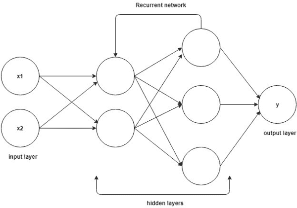

长短期记忆网络（LSTM） `(Sundermeyer and Schlüter, 2012)` 是一种主要用于深度学习领域的人工循环神经网络（`RNN`）架构。`LSTM` 网络中的反馈连接使其成为通用计算的理想选择。同样，这使得 `LSTM` 优于标准的前馈神经网络。`LSTM` 网络可以高效地处理图像等单个数据点以及像视频这样的整个数据序列。一个常见的 `LSTM` 单元由一个记忆单元、一个输入门、一个输出门和一个遗忘门组成，如图 2 所示。该单元会记住所有时间间隔内的值，而进入和离开网络的值流控制由这三个门来完成。

`LSTM` 记忆单元的职责之一是跟踪输入序列中元素之间的依赖关系。每个门都有特定的用途。新值进入单元的流向由 `输入门` 控制，值在单元中的持续时间由 `遗忘门` 决定，而使用激活函数进行的输出计算由 `输出门` 控制。这里使用了激活函数，通常是逻辑回归函数。进入和离开 `LSTM` 门的某些连接在本质上是循环的。这些连接的权重是在训练过程中学习的。这些信息被用于确定门的操作。使用像 `gradient descent` 这样的优化算法，可以使用 `LSTM` 单元的 `RNN` 在一组训练序列上以监督方式进行训练。该算法与随时间反传播（`backpropagation through time`）相结合，以计算优化过程中所需的梯度。这是为了根据误差（在 `LSTM` 网络输出层）相对于对应权重的导数，改变 `LSTM` 网络的每一个权重。

| 图 2. 长短期记忆网络 |
| --- |
| 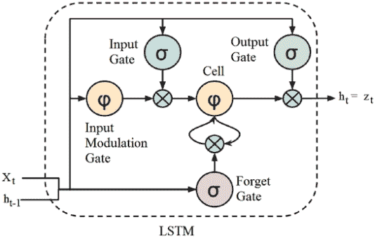 |

`LSTM` 网络被认为是分类、处理和预测时间序列数据的有效方法之一。这是因为在时间序列中重要事件之间存在未知持续时间的滞后。`LSTM` 方法解决并解决了传统 `RNNs` 训练中的问题，例如梯度爆炸和梯度消失问题。`LSTM` 相比 `RNNs` 和其他序列学习模型的优势在于对间隔长度相对不敏感。`LSTM` 具有广泛的应用领域，包括机器人控制、时间序列数据预测、语音识别、节奏学习、音乐创作、语法学习、手写识别、人类动作识别、手语翻译、蛋白质同源性检测、蛋白质亚细胞定位预测、时间序列异常检测等。

### 3. 双向长短期记忆 (BLSTM)

`LSTM` 的核心保留来自输入的信息。

| 图 3. 双向 LSTM |
| --- |
|  |

#### 使用模型进行垃圾邮件检测

在这项研究中，我们建议使用 `machine learning` 将电子邮件分类为垃圾邮件或合法邮件。

`LSTM` 被认为是分类、处理和预测的有效方法之一。

这种灵活的层可以以不同的方式使用：

*   它可以保存为单词学习的嵌入，并在以后使用它。
*   学习过程与与其使用的模型集成在一起。
*   它可以被用于加载预训练的词嵌入模型。

`Embedding` 层被视为网络中的第一个隐藏层。`Keras` 中的 `Sequential` 模型用于所有模型。它是一个线性堆栈。模型预期的输入形状是 `sequential model` 的前提。此信息必须传递给 `sequential model` 的第一层。使用的激活函数是 `sigmoid` 函数。激活可以通过使用 `Activation` 层或使用 `activation` 参数来完成。sigmoid 逻辑函数产生 `(0,1)` 范围内的输出值。使用 `rmsprop` 优化器进行优化。优化器是编译 `Keras` 模型所需的两个参数之一。使用的损失函数是 `binary cross entropy` 函数。通过二分类交叉熵，输出被分类为两类。模型使用 `Keras` 提供的 `fit()` 函数进行编译和训练。模型在提供的数据集上进行固定数量的轮次（epochs）或迭代进行训练。模型可以将训练历史保存在对象中。该对象可用于检索模型训练和测试的损失值和准确率值。

## 实验设置与模型架构

采用了 `RNN`、`LSTM` 和 `BLSTM` 等不同的循环层进行特征工程。通过实验评估了每个深度层的性能。由于所采用架构大部分深度较浅，因此没有使用批量归一化机制。所有实验均使用 `0.2` 的学习率和 `60` 的批大小（batch size）。批大小表示模型在通过反向传播机制训练 `60` 个数据样本后进行一次模型参数更新。`Recurrent` 层使用了 `RNN`、`LSTM` 和 `BLSTM` 等不同层。根据领域知识，将隐藏单元设置为 `32`。在 `RNN` 单元和 `LSTM` 记忆单元中，分别使用了范围在 `[-1,1]` 和 `[1,1]` 之间的双曲正切函数作为输入和输出激活函数。`LSTM` 记忆单元中的门控和其他神经元还使用了范围在 `[1,0]` 内的逻辑 sigmoid 函数。`BLSTM` 使用了与 `LSTM` 相同的机制，但具有双向运动。循环结构层捕获了来自嵌入层接收矩阵的依赖关系，并将其最后一个输出 `32` 传递到丢率为 `0.2` 的 dropout 层。丢率为 `0.2` 的 dropout 层被描述为正则化参数。它与 `RNN`、`LSTM` 和 `BLSTM` 等深度层交替使用。Dropout 是一种广泛采用的机制，在训练深度学习架构期间随机移除神经元及其连接。Dropout 层与单元数为 `1` 的密层交替使用，用于区分邮件为正常邮件（ham）和垃圾邮件（spam）。此外，全密层后面跟着带有 sigmoid 非线性激活函数的激活层，损失函数为二元交叉熵。该密层通常被称为全连接层。它对来自循环层的特征进行求和。因此，为最后的分类阶段构建了分层特征表示。

三个模型在相同的数据上训练了 `10` 个 epoch（epochs）。评估并比较了每个模型的性能。所有模型在精确率、召回率、`F1-score` 和支持率（support）方面的性能见表 1。

## 表 1. 三个模型的性能比较

| | | 精确率 (%) | 召回率 (%) | F1 分数(%) | 支持率 |
| --- | --- | --- | --- | --- | --- |
| `RNN` | Ham | `0.97` | `0.99` | `0.98` | `1019` |
| | Spam | `0.96` | `0.82` | `0.88` | `181` |
| `LSTM` | Ham | `0.99` | `0.99` | `0.99` | `953` |
| | Spam | `0.98` | `0.93` | `0.96` | `162` |
| `Bidirectional LSTM` | Ham | `0.99` | `0.99` | `0.99` | `953` |


| `Spam` | `0.98` | `0.93` | `0.95` | `162` |

来源：作者根据基于实验进行的计算

这些深度学习网络内部机制的解释对于初学者和高级用户来说仍然是一个黑箱。这些深度层可以存储大量信息，这可以通过展开它们（unwrapping）来看到。不可避免的是，`RNN`、`LSTM` 和 `BLSTM` 等深度架构非常复杂。通过展开它们，可以提取出大量信息。通常，嵌入层中学习到的字符表示通过深度层进行转换，以捕获它们的语义相似性。每个深度层中的非线性激活都支持学习最佳特征。使用学习到的特征表示，深度架构的最后一层应该最大限度地将邮件分为垃圾邮件和正常邮件。为了在这些实验中使用，从 `6000` 封邮件样本中随机选择了 `4187` 封正常邮件和 `1813` 封垃圾邮件。训练后的模型随后被给予样本数据。模型将其预测为垃圾邮件或正常邮件。

还计算了三个模型的分类准确率。看到双向 `LSTM` 实现了 `98%` 的高准确率。其他模型 `RNN` 和 `LSTM` 分别达到了 `96%` 和 `97%` 的准确率。

## 未来的研究方向

本研究分析了数据集中的一组邮件，并应用机器学习模型将其分类为垃圾邮件和非垃圾邮件。这项研究可以扩展到其他先进和混合的机器学习模型。该模型的准确性也可以在其他数据集上进行检查。

## 结论

邮件垃圾邮件被认为是当今互联网通信中最重要且最受关注的问题。由于垃圾邮件问题急剧增加，因此对垃圾邮件进行检测。机器学习方法在检测和预测垃圾邮件方面是有效的。本章讨论了用于检测和预测垃圾邮件的机器学习方法。本章回顾了使用各种深度学习机制对邮件进行分析、检测和预测的有效性。通过自动提取特征，在字符级别对垃圾邮件和正常邮件进行训练。从而避免了人工特征工程方法，本身就是一种稳健的方法。嵌入层随后的其他深度网络层隐式地提取特征，这些最优特征被输入到深层网络的其他层进行分析和分类。本研究考虑了 `RNN`、`LSTM` 和双向 LSTM 等机器学习模型。从分类器的评估结果显示，双向 `LSTM` 实现了 `98%` 的高准确率。其他模型也显示出良好的准确率。

## 致谢

本研究未收到任何公共、商业或非营利机构的特定资助。

## 参考文献

- AeryM.ChakravarthyS. (2005, November). `emailsift`: 基于结构和内容的邮件分类。Fifth IEEE International Conference on Data Mining (ICDM).

- Alli,R., Nicolaides,S., & Craig,R. (2018). 检测预付诈骗：初步分析。Accounting Forum `42(1),78–85`

- Alurkar,R.Niculescu-Mizil,A. (2006, June). 监督学习算法的实证比较。第 23 届机器学习会议 (pp.161-168)。

- Aski,A.S., & Sourati,N. (2016). 基于机器学习的有效垃圾邮件过滤算法。Pacific Science Review `18(2),145–149`.

- Bahgat,E.M., Rady,S., Gad,W., & Moawad,I.F. (2018). 基于语义方法的有效邮件分类方法。Ain Shams Engineering Journal `9(4),3259–3269`.

- Barlow,H.B. (1989). 无监督学习。Neural Computation `1(3),295–311`.

- BalthropJ.ForrestS.GlickmanM.R. (2002, May). 重新审视 lisys：参数和正常行为。2002 年演化计算大会 CEC’02 (Cat. No. 02TH8600) (Vol. 2, pp.1045-1050)。

- Chae,M.K., Alsadoon,A., Prasad,P.W.C., & Sreedharan,S. (2017, March). 使用增益和图挖掘算法的垃圾邮件过滤分类 (SFECM)。2017 第二届反网络犯罪国际会议 (ICACC) (pp.217-222)。

- Cohen,A., Nissim,N., & Elovici,Y. (2018). 用于增强恶意邮件检测的新型通用描述特征。Expert Systems with Applications `110,143–169`.

## 参考文献

- DeBarr, D., & Wechsler, H. (2009, 7). 使用聚类、随机森林和主动学习进行垃圾邮件检测。收于第六次电子邮件与反垃圾邮件会议 (pp. 1-6)。Academic Press。

- Diale, M., Celik, T., & Van Der Walt, C. (2019). 用于垃圾邮件过滤的无监督特征学习。Computers & Electrical Engineering , 74, 89–104. doi:10.1016/j.compeleceng.2019.01.004

- Douzi, S., Amar, M., El Ouahidi, B., & Laanaya, H. (2017). 通向基于 PV-DM（段落向量-分布式内存方法）的新型垃圾邮件过滤器。Procedia Computer Science , 110, 486–491. doi:10.1016/j.procs.2017.06.130

- Ergin, S., Sora Gunal, E., Yigit, H., & Aydin, R. (2012). 使用二进制和概率模型的土耳其反垃圾过滤。Global Journal on Technology, 1.

- Faris, H., Ala’M, A. Z., Heidari, A. A., Aljarah, I., Mafarja, M., Hassonah, M. A., & Fujita, H. (2019). 一种基于进化随机权重网络的垃圾邮件检测及最相关特征识别智能系统。Information Fusion , 48, 67–83. doi:10.1016/j.inffus.2018.08.002

- Garrett, E. V. (2014). 探索网络用户对在线约会欺骗的脆弱性：常规活动理论因素分析。达拉斯德克萨斯大学大学。

- Guzella, T. S., & Caminhas, W. M. (2009). 垃圾邮件过滤的机器学习方法综述。Expert Systems with Applications , 36(7), 10206–10222. doi:10.1016/j.eswa.2009.02.037

- HarisinghaneyA.DixitA.GuptaS.AroraA. (2014, 2). 使用 KNN、朴素贝叶斯和反 DBSCAN 算法基于文本和图像的垃圾邮件分类。收于 2014 年可靠性优化与信息技术国际会议 (ICROIT) (pp. 153-155)。IEEE. 10.1109/ICROIT.2014.6798302

- Hart, R. P. (2001). 重新开发 DICTION：理论考虑。Progress in Communication Sciences, 43-60.

- Havens, T. C., Bezdek, J. C., Leckie, C., Hall, L. O., & Palaniswami, M. (2012). 适用于超大规模数据的模糊均值算法。IEEE Transactions on Fuzzy Systems , 20(6), 1130–1146. doi:10.1109/TFUZZ.2012.2201485

- Hristea, F. T. (2013). 基于语义 WordNet 的特征选择。收于用于无监督词义消变的朴素贝叶斯模型 (pp. 17–33)。Springer. doi:10.1007/978-3-642-33693-5_3

- Idris, I., Selamat, A., & Omatu, S. (2014). 结合负选择算法和差分演化的混合垃圾邮件检测模型。Engineering Applications of Artificial Intelligence , 28, 97–110. doi:10.1016/j.engappai.2013.12.001

- Idris, I., Selamat, A., Nguyen, N. T., Omatu, S., Krejcar, O., Kuca, K., & Penhaker, M. (2015). 一种结合负选择算法-粒子群优化的垃圾邮件检测系统。Engineering Applications of Artificial Intelligence , 39, 33–44. doi:10.1016/j.engappai.2014.11.001

- Kaelbling, L. P., Littman, M., & Moore, A. (1996). 强化学习：综述。Journal of Artificial Intelligence , 4, 237–285.

- Karamoglu, H., Dogru, İ., & Dorterler, M. (2018, 10). 使用机器学习方法检测垃圾邮件。收于 2018 年智能系统与应用创新 (ASYU) (pp. 1-5). doi:10.1109/ASYU.2018.855414

- Karim, A., Azam, S., Shanmugam, B., Kannooratti, K., & Alazab, M. (2019). 智能垃圾邮件检测全面综述。IEEE Access: Practical Innovations , 7, 1682–1695. doi:10.1109/ACCESS.2019.295479

- Kaufman, L., & Rousseeuw, P. (1990). 基于质点的聚类（程序）。

- Lavrač, N., Kavšek, B., Flach, P., & Todorovski, L. (2004). 数据中的子群发现。Journal of Machine Learning , 5(2).

- Le, Q., & Mikolov, T. (2014, 1). 句子的分布式表示。收于机器学习国际会议 (pp. 1188-1196)。

- MaW.Tran.SharmaD. (2009, 11). 基于负选择的新型垃圾邮件检测。收于 2009 年第四届计算机科学与收敛会议 (pp. 987). 10.1109/ICCIT.57

- Mikolov, T., Karafi, Černý, J., & Khudanpur, S. (2010). 循环神经网络语言模型。收于第十一届国际通信会议。

- Nizamani, S., Memon, N., Glasdom, M., & Nguyen, D. (2014). 基于特征富性的垃圾邮件检测。埃及信息学报 , 15(3), 169–174. doi:10.1016/j.engappai

- Oful, C. (2010). 针对预付费诈骗邮件的数字取证分析。收于行为研究手册 (pp. 296-317)。

- Olatunji, S., Extreme Learning machines. (2017, 4). 基于极学习机的支持向量机垃圾邮件检测。收于 2017 年 IEEE 计算机工程科学国际会议 (pp. 1-6). doi:10.1109/CCECE.7946

- Saidani, N., Adi, K., & Allili, M. (2020). 用于朴素贝叶斯的最优特征选择。IEEE Transactions on Knowledge and Data Engineering , 28(9), 2508–2521.

- Shrivastava, S., HarisinghaneyA.DixitA.GuptaS.AroraA. (2014, 2). 针对高维数据的离群点检测。收于第 5 届国际通信会议。

- Sasaki, M., Sundermeyer, R., & Ney, H. (2005). 馈前神经网络。收于 2005 年国际会议。

- Tang, B., Kay, S., & He, H. (2016). 基于 LSTM 的语言模型。收于第 9 届国际通信会议。

- Vinayakumar, R., Soman, K., Poornachandran, P., Akarsh, S., & Elhoseny, M. (2019). 基于电子邮件和 URL 数据的深度学习威胁感知框架。收于网络与安全系统 (pp. 87–124)。Springer. doi:10.1007/978-3-030-16837-7

- WijayantoA. W. (2014, 11). 模糊聚类方法在分类垃圾邮件网络犯罪中的评估。收于 2014 年信息系统与创新国际会议 (ICITSI) (pp. 19-24)。IEEE. 10.1109/ICITSI.2014.7048231

- Witten, I. H., & Frank, E. (2002). 数据挖掘：带有 Java 实现的实用机器学习工具与技术。SIGMOD Record , 31(1), 76–77. doi:10.1145/507338.507355

## 其他阅读

- Cortes, C., & Vapnik, V. (1995). 支持向量网络。Machine Learning , 20(3), 273–297. doi:10.1007/BF00994018

- Hochreiter, S., & Schmidhuber, J. (1997). 长短期记忆。Neural Computation , 9(8), 1735–1780. doi:10.1162/neco.1997.9.8.1735

Kohavi, R. (1996, August). Scaling up the accuracy of naive-bayes classifiers: A decision-tree hybrid. KDD: Proceedings / International Conference on Knowledge Discovery & Data Mining. International Conference on Knowledge Discovery & Data Mining , 96, 202–207.

Mikolov, T., Karafiát, M., Burget, L., Černocký, J., & Khudanpur, S. (2010). Recurrent neural network based language model. In Eleventh annual conference of the international speech communication association.

## 关键术语与定义

- **邮件 IMAP**: 互联网消息访问协议（`IMAP`）是一种邮件协议，可以从本地客户端访问远程网络服务器上的电子邮件。

- **无害的**: 不有害或不具冒犯性。

- **知识工程**: 人工智能的一个领域，试图收集特定领域内人类专的判断和行为。

- **恶意的**: 具有有害影响或心有歹的。

- **过拟合**: 指模型学习训练数据中的细节和噪声，以至于对模型在新数据上的性能产生了负面影响的状态。

- **群智能**: 人工智能中的一个概念，考虑去中心化、自组织的自然和人工系统的集体行为。

- **特洛马**: 一种计算机病毒，形式为实用程序、游戏，有时甚至是杀毒程序软件。

## 附录 1：所用数据集描述

本研究使用的数据取自 `SpamAssasin` 和 `spam base` 数据集。该数据集总共 6000 封电子邮件，分为垃圾邮件（spam）和正常邮件（ham）。数据集分布为 `Spam` 1813 封 (30.2%) 和 `Ham` 4187 封 (69.8%)。

## 附录 2：全球垃圾邮件统计

近年来，垃圾邮件数量大幅增加。图 4 给出了 2018 年 9 月至 2020 年 1 月的全球垃圾邮件统计。

| 图 4. 全球邮件量（亿）（数据来源：Email and Spam Data, CISCO） |

| --- |

| 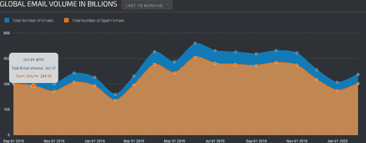 |

| --- |

# 第 12 章

- **Sanjeev Rao**

  ]

  印度 Thapar 工程与技术学院

- **Anil Kumar Verma**

  印度 Thapar 工程与技术学院

- **Tarunpreet Bhatia**

  印度 Thapar 工程与技术学院

## 摘要

在线社交网络（`OSNs`）是闻名的强大网络工具，允许全球用户通过社交互动分享共同兴趣，与朋友、家人、专业群体和社交圈建立联系。随着 OSN 的普及、易用性和高效性，它们已成为必不可少的通信工具。但许多 OSN 用户在无意中暴露了自己的个人信息，如家庭地址、电话号码、电子邮件 ID 等，这些信息可能被恶意用户用于进行各种类型的网络犯罪，如网络欺凌、垃圾邮件、点击劫持、身份盗窃、网络钓鱼、不信任、虚假资料、传播恶意内容等。本章综述了与 OSN 用户相关的各种隐私和安全威胁/攻击，并基于数据挖掘和机器学习算法推荐了应对技术。此外，还为该领域的未来研究人员提出了方向建议。

## 引言


在过去的几年里，OSN 的使用和普及以惊人的速度增长。它已成为每个在线社交用户促进通信的必要工具（Boyd & Ellison, 2007）。一些非常流行的 OSN 包括 Facebook、Twitter、Google+、Myspace、Tumblr、新微博、Snapchat、Pinterest 和 Instagram 等，拥有数百万的日活跃用户。截至 2020 年第一季度，Facebook 的月活跃用户已超过 25 亿（Statista, 2020）。社交网络的初步特征基于 3C 原则，即创建（creation）、策展（curation）和消费（consumption）。OSN 通常有在线社交媒体（`OSM`）和社交网络网站（`SNS`）等同义词，在许多研究论文中被交替使用。社交媒体就像一种通信媒介。它是一个可以向他人传输信息的地方，就像新闻机构以报纸的形式向许多人发布和传播新闻。但随着互联网的出现，媒体不再是静态的，可以作为博客、应用、网站、视频等。社交媒体是一个更广泛的术语，OSN 是社交媒体的一部分。OSN 允许用户通过发送和接收好友请求首先与其他成员建立联系，随后通过帖子、评论、点赞、不喜欢、标签、分享帖子、粉丝、关注等形式，通过社交互动与朋友、家人、专业群体和社交圈建立联系。OSN 正在帮助许多其他业务部门，如营销、广告、促销、产品评论、了解政治选举中的民意、在线学习、提升业务声誉、灾害管理、医疗保健、专业网络和推荐系统等（Fire, Goldschmidt, & Elovici, 2014; Penni, 2017）。与 OSN 相关的挑战是不断增加的用户导致以文本数据、连接和多媒体数据形式存在的大数据（Persia & D’uria, 2017）。这进一步引发了数据存储、数据管理和数据分析等问题。用户信任这些 OSN 以及这些社交网络内的用户，导致他们向陌生人透露自己的个人信息（年龄、宗教、收入、关系、位置、电话号码、性向、习惯、财务细节等）以及专业信息（如公司、项目、工作文化、团队、报告、收入等）。这些信息可能被恶意暴露和滥用，在网络世界和现实世界中伤害用户（Bilge, Strufe, Balzarotti, & Kirda, 2009; Gangavarapu, Jaidhar, & Chanduka, 2020）。

用户、黑客等。这些挑战为保护 OSN 用户隐私提供了新的研究方向，隐私正面临恶意用户和黑客滥用个人信息、传播病毒、虚假新闻、谣言和垃圾邮件的影响。任何 OSN 的成功受到许多因素影响，如活跃用户数量、设计、用户的隐私和安全，以及搜索、资料标签、消息、通话、照片和文本编辑选项等其他实用功能。OSN 开发人员非常注重设计和功能，而对 OSN 用户的安全和隐私关注较少。因此，研究、分析和应对 OSN 的隐私和安全问题已成为一个广泛的研究领域。本章的目的是提供有关 OSN 隐私和安全威胁/攻击的有用信息。在本章中，展示了与社交网络网站相关的主要网络威胁、这些威胁背后的主要原因以及应对用户安全风险的对措施。

OSNs（在线社交网络）是大众用于通信和信息传递的最佳工具。同时，它们也被垃圾邮件发送者或恶意用户滥用，在社交网络中传播垃圾邮件活动、错误信息、虚假新闻、谣言、不受欢迎的消息以及钓鱼 URL 等。图 1 展示了与社交网络相关的威胁和攻击分类。

| 图 1. 与社交网络相关的威胁和攻击分类 |
| --- |
| 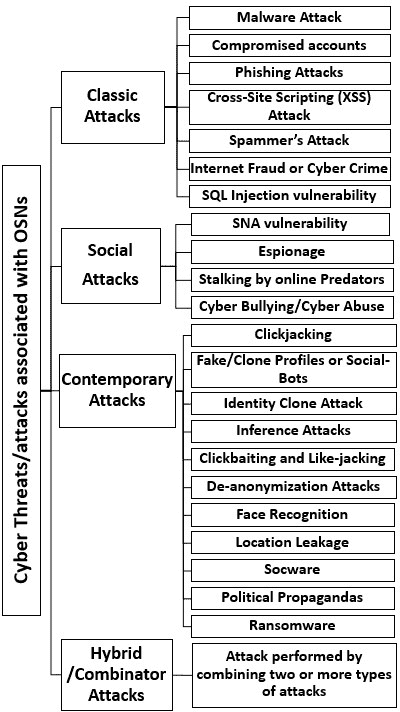 |

与在线社交网络相关的各种攻击/威胁分为以下几类：

1. 经典攻击
2. 社交攻击
3. 现代攻击
4. 混合/组合攻击

## 1. 经典攻击

* **a) 恶意软件攻击**：恶意软件是用于通过收集和操纵用户身份详情来控制其用户隐私信息的软件。恶意软件被用来通过用户的社交网络向用户及其朋友广播错误信息或垃圾信息。例如，Koobface 被认为是第一个通过社交网络成功传播的恶意软件。恶意链接在用户点击后会伤害或欺骗用户。此外，恶意软件会下载到用户的系统中以窃取其个人信息（Brown & Hermann, 2020）。

* **b) 账户被盗**：当访问在线账户的不是本人而是假身份时，该账户就被认为被盗了。攻击者试图诱导用户进入模仿原始网站的虚假网站以收集用户登录详情，随后伪装成可信实体并将这些信息用于犯罪目的。由于其社交性和信任特质，社交网络更容易受到钓鱼攻击（Adewole et al., 2017; Ravneet Kaur et al., 2018）。

* **c) 钓鱼攻击**：钓鱼是指在电子通信中伪装成可信的人员，试图骗取获取敏感信息，如用户名、密码、银行账户号码和信用卡详情，通常出于恶意目的。钓鱼者可以轻松利用社交网站上提供的免费信息，以提高钓鱼攻击的成功率（Selvaganapathy et al., 2018; Smadi et al., 2018）。

* **d) 跨站脚本 (XSS) 攻击**：`XSS` 攻击通常以恶意脚本的形式出现在网站、博客、电子邮件、即时通讯工具等 Web 应用程序中。`XSS` 利用客户端对服务器的信任，在用户的 Web 客户端上执行恶意代码以收集其详情。但在社交网络中，`XSS` 蠕虫可以在没有人工干预的情况下在社交网络用户之间传播（Faghani & Nugyen, 2017; Rodríguez et al., 2020）。

* **e) 垃圾邮件发送者攻击**：垃圾邮件发送者是指个人、组织或机器人，他们使用电子信息系统通过互联网服务向大量用户在电子邮件、社交网站和手机上发送无关或不受欢迎的消息。垃圾内容用于广告、钓鱼、色情链接共享以及传播恶意软件。通常，垃圾邮件发送者使用虚假资料在社交网络网站及社交网络发送广告信息、添加虚假评论或虚假评价。

* **f) 网络诈骗**：社交网络用户会暴露个人信息，如电话号码、家庭地址、当前位置、某些活动行程等，这些信息可以被网络捕食者利用即时通讯、社交墙、电子邮件、电话对社交网络用户进行威胁。

* **g) SQL 注入 (SQLI) 漏洞**：`SQL` 注入是 Web 应用程序中著名的漏洞。它被用于通过访问敏感数据……211 (Sadeghian, 2018)。某些 `SQL` 注入技术包括真值比较、联合查询、存储过程、推断和盲攻击。

## 2. 社交攻击

社交网络攻击 (`SNA`) 漏洞：社交网络攻击 (`SNA`) 用于建立用户之间的连接。社交网络聚合器 (`SNA`) 用于收集信息。社交网络聚合器 (`SNA`) 用于访问用户数据。

* **a) 间谍活动**：间谍活动可以是许多类型的工业间谍或经济间谍。企业间谍发生在公司和大型企业集团之间，使用黑客、传播恶意软件等社交工程方法获取公司的机密数据、客户信息、计划、贸易秘密等；而经济间谍是由政府在国际范围内进行的。

* **b) 网络捕食者的跟踪**：社交网络用户会暴露个人信息，如电话号码、家庭地址、当前位置、某些活动行程等，这些信息可以被网络捕食者利用即时通讯、社交墙、电子邮件、电话对社交网络用户进行威胁。

* **c) 网络欺凌/滥用**：网络欺凌通常影响儿童和青少年。网络滥用涉及使用互联网和通信技术 (`ICT`) 骚扰他人。网络欺凌攻击可以通过电子邮件、聊天、手机或在社交网络上发布关于受害者的恶意评论或谣言来实现。

| 图 2. 社交网络攻击 (SNA) |
| --- |
| 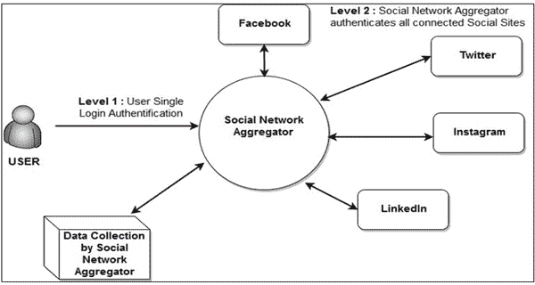 |

* **a) 勒索软件**：勒索软件是一种恶意的文件加密软件/恶意软件。勒索软件被用于基于勒索的攻击，即它锁定受害者机器上的数据，并显示赎金/费用通知，要求支付设备才能再次运行。这些分为两种类型，即锁屏勒索软件或加密勒索软件（文件锁）。锁屏勒索软件会锁定受害者的屏幕或显示一个无法关闭的弹出窗口；另一方面，文件锁勒索软件通过某些密码加密文件使其无法访问（Bijitha `et al.`, 2020）。一种常用的勒索软件是 `Scareware`（恐吓软件），它通过威胁系统存在问题和病毒来恐吓用户，并要求在线支付以修复问题。`WannaCry` 曾针对英国医疗系统并要求以比特币的形式支付巨额费用。

* **b) 点击劫持**：在这种攻击中，攻击者强迫用户点击他们无意点击的内容。在社交社交网络（OSN）中，一旦用户点击了广告或文本形式的恶意链接，攻击者就会劫持用户的账户，以便通过社交网络向其朋友进一步传播广告（Nalinipriya `& Asswini`, 2016; Rathore `et al.`, 2017）。

* **c) 虚假/克隆资料或社交机器人**：社交机器人通过发送好友请求来收集受害者的隐私数据（Kantepe `& Gañiz`, 2017）。一旦受害者接受好友请求，其所有隐私数据都会暴露给虚假资料/用户，否则将不可见。恶意用户通常为了这些目的生成许多虚假账户，以接触更多值得信任的用户和社区。虚假资料可用于操纵用户配置、发送垃圾信息、浏览资料、发消息以及广告营销。在在线购物网站中，虚假资料可以大量发布虚假评论以增加产品销量或服务吸引（Persia `& D’uria`, 2017; Ramalingam `& Chinnaiah`, 2018）。涉及的一些可能风险包括隐私和个人信息的泄露、为了广告活动传播恶意软件的垃圾信息（Yassein `et al.`, 2019）。

* **d) 身份克隆攻击**：在该攻击中，攻击者在同一网络或不同的社交网络中创建重复资料，以收集用户朋友的个人信息。随后，收集的数据可用于欺诈活动，例如通过与重复资料建立信任关系来误导原始用户的朋友、发送垃圾信息和广告，这种行为被称为 `Profile squatting`（资料劫持/占位）（Bilge `et al.`, 2009）。攻击者可以损害个人的社交形象或影响产品的品牌价值，从而导致羞辱和财务损失（Gangavarapu `et al.`, 2020; Persia `& D’uria`, 2017; van der Walt `et al.`, 2018）。

* **e) 推理攻击**：攻击者以数据分析师的形式，对公开的社交网络数据使用数据挖掘技术或从社交网络资料中窃取数据，以检测用户的兴趣（如口味、偏好、地理信息等），用于直接营销和产品推荐（Heydari `et al.`, 2015; Zheng `et al.`, 2011）。

* **f) 点击饵与点赞劫持**：点击饵是攻击者使用的一种网页链接或标题，用于诱导用户点击内容以产生在线广告收入。它通常用于博客、新闻、视频、评论、评价以吸引用户注意力，链接通常是为了转移在线流量，且与标题或网页链接无关（Guo `et al.`, 2018; Satya `et al.`, 2016; Thejas `et al.`, 2019）。

* **g) 去匿名化攻击**：去匿名化通过数据挖掘技术将未知数据源与其他源交叉引用，从而识别其真实身份。为了保护身份和隐私，社交网络用户使用假名或虚名。这些攻击利用跟踪 Cookie、用户组成员身份、网络拓扑等网络技术揭示真实身份。一些研究人员还讨论了使用 Cookie 和其他跟踪机制泄露个人身份信息导致的社交网络脆弱性（Ratandeep Kaur `et al.`, 2019; van der Walt `et al.`, 2018）。

* **h) 人脸识别**：每天都有海量的头像和其他照片被上传并分享到任何社交网络上，并供攻击者自由访问。一个名为 `Faces of Facebook` 的社交网络网站赋予了用户查看数十亿用户 Facebook 头像权限，这可以用于构建生物识别数据库。该生物识别数据库帮助攻击者识别并利用头像，在未经社交网络用户许可的情况下寻找其他个人信息。攻击者还可以使用人脸识别软件从免费的头像中提取有用特征以获取用户兴趣。这些提取的图像可用于人脸认证，成为生物识别系统和移动应用程序的重要威胁（Korshunov `& Marcel`, 2018; Sabir `et al.`, 2019）。

* **i) 位置泄露**：许多用户在使用手机设备在 `Twitter`、`Foursquare`、`Flickr` 等社交网络上发布活动、照片、视频、评论时，会分享自己及朋友的当前和未来位置信息。某些社交网络允许用户发布带有地理标记的照片，提供了照片拍摄的位置。此类信息可被攻击者和跟踪者利用进行欺诈活动，可能在勒索、家庭或办公室入室、物理攻击等方面对社交网络用户造成损害（Costa `et al.`, 2013; Nalinipriya `& Asswini`, 2016）。

* **j) 社交软件 (Socware)**：社交软件是指一种第三方移动应用程序或网站，以帖子和消息的形式链接或发布在社交网络上，用于犯罪和寄生活动（Xu `et al.`, 2015）。社交网络用户会遇到形式为人的问答内容的广告或链接，一旦用户访问或安装了该社交软件，它就会在用户同意的情况下自动向其他用户发送恶意软件、垃圾信息等。研究提到，约 49%的用户和 4000 万帖子暴露在社交软件之下。大多数关联社交网络的第三方恶意应用程序都是传播社交软件的（Thejas `et al.`, 2019）。

* **k) 政治操纵与宣传**：未经验证的消息源和虚假账户被用于在社交网络中制造假新闻以改变公众意识。基于人工智能的社交机器人自动化有助于向社交网站大众传播欺骗性内容（Qi `et al.`, 2018）。如果这种自动化与政治宣传相结合，可能会在选举、辩论和政治紧急期间显著影响舆论。2016 年美国总统大选后，假新闻已成为公众关注焦点（Howard `et al.`, 2018）。政治宣传背后的人通过在社交网络上发布虚假内容或新闻启动这一过程，其余的传播工作由在线用户完成。如今，垃圾活动活动以支持公共健康、股票市场、游戏和彩票等广告的形式进行。使用短链接的垃圾机器人和钓鱼攻击也被证明对窃取社交网络用户的个人数据是有的（Fazil `& Abulaish`, 2018; Patil `& Patil`, 2018）。

## 3. 现代攻击

（原文此处缺失“现代攻击”详细内容，仅有标题）

## 4. 混合 / 组合攻击

混合攻击是一种攻击者通过结合现有攻击和近期攻击形成的一种精细攻击形式。例如，点击劫持（`Click-jacking`）攻击可以通过：首先进行钓鱼攻击以窃取社交网络服务（`OSN`）用户的用户名和密码；通过克隆个人资料来提取与 `OSN` 用户朋友相关的信息；并结合在攻击者准备的个性化消息、电子邮件等中嵌入垃圾链接，从而实施垃圾信息攻击。同样，攻击者通过结合现有攻击，构建并执行新的攻击策略。

## 防御技术

上一节提到了与社交网络服务（`OSN`）相关的各种攻击/威胁，这些威胁可能直接或间接地损害 `OSN` 用户的安全和隐私。许多作者针对 `OSN` 攻击提出了不同的解决方案。在本章本节中，作者提供了一些基于数据挖掘和机器学习的解决方案，用于对抗钓鱼、垃圾信息、克隆资料、虚假资料和社交恶意软件（`socware`）等各种攻击，以为 `OSN` 用户提供更好的隐私和安全保障。表 1 从工具、方法、技术、算法和框架等方面给出了现有的各种防御技术。

### a) 钓鱼检测

反钓鱼方法用于检测和防止钓鱼攻击。许多研究人员针对检测 `OSN` 中的钓鱼 URL 提出了多种解决方案，例如 `WarningBird` URL 检测系统（Lee & Kim, 2013）、`PhishAri` 技术（Liew et al., 2019）、`黑名单`（Wu et al., 2017）、`基于规则的启发式方法`（Apruzzese et al., 2018）、`视觉相似性`（Fu et al., 2018）等。一些研究人员提到了用于检测钓鱼攻击的特征提取技术和机器学习算法。监督算法如 `KNN`（最近邻算法）、`SVM`（支持向量机）、`C4.5` 等，以及无监督算法如 `K-means`、`DBSCAN` 等（Gangavarapu et al., 2020; Liew et al., 2019）。

### b) 垃圾信息检测

Facebook、Twitter、Instagram 和新微博等流行的 `OSN` 被全球数十亿用户用于通信和信息共享（Zhu et al., 2012）。由于连接的用户数量巨大，垃圾邮件者利用在这些平台上传播垃圾内容的机会。可以使用现有的技术检测垃圾信息，例如 `蜜罐技术`（honeypot）、基于列表的过滤方法如 `黑名单`、`白名单`、`灰名单` 等。但这些技术在处理 `OSN` 环境时还不够高效。在最近的工作中，使用了基于机器学习和深度学习的方法来分析内容、行为、恶意链接等，这比现有的垃圾信息过滤技术要好得多（Lalitha et al., 2018; Wu et al., 2018）。此类方法的主要挑战是垃圾邮件者不断变化的行为（Guzella & Caminhas, 2009; Wu et al., 2017）。其他研究人员还提出了新的机器学习和基于集成学习的方法来提高算法性能（Mehmood et al., 2018）。

### c) 克隆资料检测

个人资料克隆对 `OSN` 用户的安全构成了严重威胁，因为它利用人们的信任来窃取个人信息进行欺诈活动。攻击者从一个 `OSN` 复制合法用户的头像和其他有用信息，并在另一个 `OSN` 上创建一个重复的资料，以获得该网络中合法用户朋友的信任，随后可用于传播垃圾信息或其他恶意内容（Bilge et al., 2009）。研究人员已开发了各种方法，通过分析相同属性、关系网络相似性、节点相似性、以及从结构性和非结构化迭代度量中得出的图相似性度量，来调查克隆资料（Devmane & Rana, 2014; Kamhoua et al., 2017）。开发了一种技术 `CloneSpotter`，利用用户的登录 IP 地址来检测克隆攻击（Shan et al., 2013; Zare et al., 2020）。

### d) 虚假资料或女巫攻击检测

虚假账号是 `OSN` 上传播垃圾信息、恶意内容、网络欺凌和其他非法活动的最常用方法之一（Adewole et al., 2017）。研究人员开发了新的技术、方法、算法和工具来处理虚假资料。文献中给出的虚假资料检测主要方法分为三类：众包、基于图的方法和机器学习（Singh et al., 2018）。研究人员使用了基于网络结构的特征、基于内容/行为的特征以及基于网络的各种特征。`SybilGuard` 协议、`SybilLimit` 协议、`SybilInfer` 防御算法、`SumUp Sybil` 防御系统、`SybilRank` 工具和 `SybilRadar` 是一些用于女巫/虚假资料检测的成功协议、方法和工具（Al-Qurishi et al., 2017; Ramalingam & Chinnaiah, 2018）。


### e) 社交恶意软件检测

社交恶意软件（Socware）是近期在 OSN 墙上传播垃圾信息和恶意软件的攻击形式。与其他 OSN 相比，Facebook 更容易受到此类攻击。`MyPagekeeper` 安全 Facebook 应用提供了重要贡献，它严格检查订阅用户的 OSN 墙和新闻动态以检测社交恶意软件（Ramkumar et al., 2016）。`FRAppE`（Facebook 严格应用评估器）被用于检测 Facebook 上的恶意应用程序。他们提供了关于社交恶意软件生态系统和社交恶意软件传播特征的文献，有助于研究人员检测和预防社交恶意软件（Rahman et al., 2017）。

### f) 网络欺凌

网络欺凌攻击攻击者通过发送这些消息或帖子来侮辱 OSN。使用词性标记（POS）、情感分析和文本挖掘，并利用机器学习、自然语言处理（NLP）和评分方案来分析 OSN 内容（Fazil & Abulaish, 2018）。

#### 表 1 针对 OSN 隐私和安全威胁采取的各种框架、技术、协议和算法的防御措施

| 攻击类型 | 使用的工具/技术/协议/算法 | 参考文献 |
| :--- | :--- | :--- |
| 钓鱼攻击 | 黑名单、基于规则的启发式、视觉相似性技术、监督和无监督学习算法 | Cao & Caverlee, 2015; Lee & Kim, 2013; Wu et al., 2017; Liew et al., 2019; Gangavarapu et al., 2020 |
| 垃圾信息、勒索软件、钓鱼和恶意软件攻击 | 黑名单、白名单、灰名单、基于图的技术和基于机器学习的方法。工具：`MailControl`、`CryptoStopper`、`CISCO 恶意软件防护 (AMP)` | Guzella & Caminhas, 2009; Zhu et al., 2012; Wu et al., 2017; Shen et al., 2017; Lalitha, Hulipalled, & Venugopal, 2018; Wu et al., 2018; Mehmood, On, Lee, Ashraf, & Sang Choi, 2018; Fu et al., 2018; Fazil & Abulaish, 2018; Rathore, Loia, & Park, 2018; Zhang, Zhang, Yuan, & Tzeng, 2019; Genç et al., 2019 |
| 克隆资料攻击 | 图相似性、`CloneSpotter` | Shan, Cao, Lv, Yan, & Liu, 2013; Devmane & Rana, 2014; Kamhoua et al., 2017; Zare, Khasteh, & Ghafouri, 2020 |
| 虚假资料或女巫攻击 | 众包、基于图的方法和机器学习。`SybilGuard` 协议、`SybilLimit` 协议、`SybilInfer` 防御算法、`SumUp Sybil` 防御系统、`SybilRank` 工具和 `SybilRadar` | Al-Qurishi et al., 2017; (Singh et al., 2018); (Ramalingam & Chinnaiah, 2018) |

| 类别 | 描述 | 参考文献 |
| :--- | :--- | :--- |
| 软件攻击 | `MyPagekeeper` 安全 Facebook 应用，`FRAppE`（Facebook 严谨应用评估器）。 | (Rahman et al., 2012); (Ramkumar, Vigneshwari, & Roodyn, 2016); |
| 网络欺凌攻击 | 词性 (POS) 标记、情感分析和文本挖掘技术、带有评分方案的监督式机器学习技术、机器学习分类器、自然语言处理 (NLP)、模糊规则集、遗传算法。 | (Rahman et al., 2012); (Ramkumar, Vigneshwari, & Roodyn, 2016); (Ioannou et al., 2018) |
| 垃圾机器人攻击 | `Botometer`, `DeBot`, `Bot-Hunter`, `Retweet-Buster` (`RTbust`)；基于 DNA 的社交指纹识别 | (Paradise et al., 2014); (Freitas, Benevenuto, Ghosh, & Veloso, 2015); (Cresci, Spognardi, Petrocchi, Tesconi, & Pietro, 2017); (Cresci, Pietro, Petrocchi, Spognardi, & Tesconi, 2018); (Yang et al., 2019) |

## 未来研究方向

在对在线社交网络（OSNs）的网络挑战进行详细文献综述后，作者确定了几个可以进一步探索的主要工作方向，例如移动 OSN 的隐私与安全、众包方法、信任计算与管理、去中心化 OSN 方案、安全与访问控制机制以及资源管理等。此外，分析 OSN 用户行为、信息传播模型、垃圾邮件及垃圾邮件者、社交机器人的检测与预防、情感分析、趋势分析、现有 OSN 功能优化、推荐系统以及大数据分析等，也是一些需要探索的重要开放研究课题。

## 结论

OSN 为通信提供了令人兴奋的新前景。但它也为黑客和垃圾邮件发送者实施欺诈活动提供了途径。作者强调了 OSN 平台上发生的许多隐私和安全威胁及攻击，随后他们提到了对抗多种类型攻击的各种技术和方法。本章提供的信息将有助于 OSN 用户理解 OSN 上的大量攻击，并为未来研究人员构建更好的安全和隐私技术以应对此类攻击提供路线图。

## 参考文献

- Adewole, K. S., Anuar, N. B., Kamsin, A., Varathan, K. D., & Razak, S. A. (2017). Malicious accounts: Dark of the social networks. Journal of Network and Computer Applications, 79, 41–67. 10.1016/j.jnca.2016.11.030
- Al-Qurishi, M., Al-Rakhami, M., Alamri, A., AlRubaian, M., Rahman, S. M. M., & Hossain, M. S. (2017). Sybil defense techniques in online social networks: A survey. IEEE Access: Practical Innovations, Open Solutions , 5, 1200–1219. doi:10.1109/ACCESS.2017.2656635
- Almarabeh, H., & Sulieman, A. (2019). The impact of cyber threats on social networking sites. International Journal of Advanced Research in Computer Science , 10(2), 1–9. Advance online publication. doi:10.26483/ijarcs.v10i2.6384
- Apruzzese, G., Colajanni, M., Ferretti, L., Guido, A., & Marchetti, M. (2018). On the effectiveness of machine and deep learning for cyber security. International Conference on Cyber Conflict, CYCON, 371–389. 10.2391/CYCON.2018.840526
- Apte, M., Palshikar, G., & Baskaran, S. (2018). Frauds in Online Social Networks . RE:view , 1–18. doi:10.1007/978-3-319-7825-1
- Bijitha, C., Sukumaran, R., & Nath, H. (2020). A survey on ransomware detection techniques. Communications in Computer and Information Science, 1186, 55–68. 10.1007/978-981-15-3817-
- Bilge, L., Strufe, T., Balzarotti, D., & Kirda, E. (2009). All your contacts belong to us. 10.1145/1526709.152678
- Boyd, D., & Ellison, N. (2007). Social network sites: Definition, history, and scholarship. Journal of Computer-Mediated Communication , 13(1), 210–230. Advance online publication. doi:10.1111/j.1083-6101.2007.00393
- Brown, S. S., & Hermann, M. G. (2020). Black Spots in Cyberspace? 10.1057/978-1-137-4967-0
- Cao, C., & Caverlee, J. (2015). Detecting Spam URLs in Social Media via The Behavior Analyst , 703–714. doi:10.1007/978-3-319-16354-7
- Costa H., Benevenuto, F., Merschmann, L. C. (2013). Detecting tip spam in location-based social networks. Proceedings of the ACM Symposium on Applied Computing, 724–729. 10.1145/2480362.2480501
- Cresci, S., Di Pietro, R., Petrocchi, M., Spognardi, A., & Tesconi, M. (2018). Social Fingerprinting: Detection of Spambot Groups through DNA-Inspired Behavioral Modeling. IEEE Transactions on Dependable and Secure Computing , 15(4), 561–576. doi:10.1109/TDSC.2017
- Cresci, Pietro, Petrocchi, Spognardi, & Tesconi. (2017). The paradigm-shift of spambots: Evidence, theories, and tools. 26th World Wide Conference, WWW, 963–972.
- Devvar, M. (2011). of profile cloning in social networks.......111...200.
- azani, M., Jaidhar, C., & Chanduka, B. (2018). On deception-based protection against ransomware. IEEE Transactions on Forensics and Security , 13(11), 270–289
- Freitas, Benevenuto, Ghosh, & Veloso. (2015). HoneySpam 2.0: Profiling web spambot behaviour. Proceedings of the ACM Symposium on Applied Computing, 724–729. 10.1145/2480362.2480501
- Fu, Q., Ding, Y., Sun, Y., Ma, S., & Li, K. (2018). Applicability of machine learning in spam. Artificial Intelligence Review , 60–73
- Hayati, P., Chai, K., Potdar, V., & Talevski, A. (2009). HoneySpam 2.0: Profiling web spambot behaviour. Lecture Notes in Computer Science (Including Subseries Lecture Notes in Artificial Intelligence and Lecture Notes in Bioinformatics), 5925, 335–344. 10.1007/978-3-642-11161-7
- Heydari, A., Tavakoli, M. A., Salim, N., & Heydari, Z. (2015). Detection of review spam: A survey. In Expert Systems with Applications (Vol. 42, Issue 7, pp. 3634–3642). Elsevier Ltd. doi:10.1016/j.eswa.2014.12.29
- Herrmann, D. (2019). Cyber Espionage and Cyber Defence. In Information Technology for Peace and Security (pp. 83–106). Springer Fachmedien Wiesbaden. doi:10.1007/978-3-658-25652-4_5
- Genç, Z., Lenzini, G., & Sgurra, D. (2019). On deception-based protection against ransomware. Lecture Notes in Computer Science (Including Subseries Lecture Notes in Artificial Intelligence and Lecture Notes in Bioinformatics), 11543, 219–239
- Grimme, C., Preuss, M., Adam, L., & Trautmann, H. (2017). Social Bots: Human-Like by Means of Human Control? Big Data , 5(4), 279–293
- Guo, B., Ding, Y., Sun, Y., Ma, S., & Li, K. (2018). Applicability of machine learning in spam. Artificial Intelligence Review , 60–73
- Guzella, T. S., & Caminhas, W. M. (2009). A review of machine learning approaches to Spam filtering. In Expert Systems with Applications (Vol. 36, Issue 7, pp. 10206–10222).
- Howard, P. N., Woolley, S., & Calo, R. (2018). 2016 年美国选举中的算法、机器人与政治传播：自动化政治传播对选举法和行政管理的挑战。《Journal of Information Technology & Politics , 15(2), 81–93. 在线优先出版。 doi:10.1080/19331681.2018.1448735
- Ioannou, A., Blackburn, J., Stringhini, G., De Cristofaro, E., Kourtellis, N., & Sirivianos, M. (2018). 从风险因素到检测与干预：对网络欺凌未来工作的实用性建议。《Behaviour & Information Technology , 37(3), 258–266. doi:10.1080/0144929X.2018.1432688
- Kamhoua, G. A., Pissinou, N., Iyengar, S. S., Beltran, J., Kamhoua, C., Hernandez, B. L., Njilla, L., & Makki, A. P. (2017). 预防在线社交网络中的合谋身份克隆攻击。《IEEE 第 37 届国际分布式计算系统研讨会议, ICDCSW 2017, 187–192. 10.1109/ICDCSW.2017.64
- Kamran, S. (2016). 社交网络时代的隐私。见《信息安全管理手册》（第 6 版，第 5 卷，第 55–66 页）。CRC Press. doi:10.1201/b11250-8
- KantepeM.GañizM. C. (2017). 用于 Twitter 机器人检测的预处理框架。第二届国际计算机科学与工程会议，UBMK 2017, 630–634. 10.1109/UBMK.2017.8093483
- Kaur, R., Singh, S., & Kumar, H. (2018). 在线社交网络中垃圾信息和被盗账户的增加：不同对抗方法的最新综述。《Journal of Network and Computer Applications , 112(3 月), 53–88. doi:10.1016/j.jnca.2018.03.015


# 参考文献

- Korshunov, P., & Marcel, S. (2018). DeepFakes：人脸识别的新威胁？评估与检测。https://arxiv.org/abs/1812.08685
- Kumar, R., Reganti, A. N., Bhatia, A., Maheshwari, T., & Rao, B. (2018). 带有攻击标注的印地-英语代码混合数据语料库。《第十一届国际语言资源与评估会议 (LREC 2018)》。https://www.aclweb.org/anthology/L18-1226
- Lalitha L. A., Hulipalled V. R., Venugopal K. R. (2018). 充斥主流：趋势性 Twitter 垃圾信息检测技术综述。《2017 年智能国家智能技术国际会议，SmartTechCon 2017》，444–448. 10.1109/SmartTechCon.2017.8358413
- Lee, S., & Kim, J. (2013). 警示鸟：Twitter 流中可疑 URL 的近实时检测系统。《IEEE 可靠与安全计算事务》，10(3), 183–195. doi:10.1109/TDSC.2013.3
- Libicki, M. C. (2018). 从网络间谍活动中推断。《网络冲突国际会议，CYCON》，109–121. 10.23919/CYCON.2018.8405013
- Liew, S. W., Sani, N. F. M., Abdullah, M. T., Yaakob, R., & Sharum, M. Y. (2019). 一种用于 Twitter 实时钓鱼推文检测的有效安全警报机制。《Computers & Security》，83, 201–207. doi:10.1016/j.cose.2019.02.004
- Mehmood, A., On, B. W., Lee, I., Ashraf, I., & Sang Choi, G. (2018). 使用集成学习堆叠的垃圾评论预测。《物理学：会议系列》，933(1), 012012. doi:10.1088/1742-6596/933/1/012012
- Nalinipriya, G., & Asswini, M. (2016). 在线社交网络中漏洞攻击综述。《2015 年 - IEEE 创新、计算技术信息国际会议，ICIICT 2015》。10.1109/ICIICT.2015.7396102
- Paradise, A., Puzis, R., & Shabtai, A. (2014). 反侦察工具：检测社交机器人。《IEEE Computing》，18(5), 11–19.
- Patil, D. R., & Patil, J. (2018). 使用决策树和多数投票检测恶意 URL。《控制论与信息技术》，18(1), 11–29. doi:10.1016/cait-2018-0002
- Penni, J. (2017). 在线社交网络(OSN)的未来：社交媒体测量。《Telematics and Informatics》，34(5), 498–517. doi:10.1016/j.tele.2016
- Persia, F., & Auria, D. (2017). 社交网络安全：挑战与机遇。《2017 年 IEEE 信息重用与集成会议，IRI 2017》，614–620. 10.1109/IRI.2017.74
- Qi, S., Alkula, L., & Broniatowski, D. (2018). 检测 Twitter 上的机器人行为。10.1007/978-3-319-937
- Rahman, M. S., Huang, T., Madhyastha, H., & Faloutsos, M. (2012). FR：检测恶意 Facebook。《CoNEXT 2012 ACM 新兴网络与技术会议》，313–324. 10.1145/241376.241321
- Ramalingam, D., & Chinnaiah, V. (2018). 大规模在线社交网络中的虚假档案检测。《Computers & Electrical Engineering》，65(3), 165–177. doi:10.1016/j.compe.2017.05.020
- Ramkumar, G., Vigneshwari, S. R. (2016). 用于识别 Facebook 恶意软件的增强系统。《IEEE 电路、电源与计算国际会议，ICCPCT 2016》。10.1109/ICCPCT.2016.753027
- Rathore, S., Loia, V., & Park, J. H. (2018). SpamSpotter：基于 Facebook 智能支持系统的垃圾邮件者检测框架。《Applied Soft Computing》，67, 920–932. doi:10.1016/j.asoc.2017.09.032
- Rathore, S., Sharma, P. K., Loia, V., Jeong, Y. S., & Park, J. H. (2017). 社交网络安全：问题、挑战与解决方案。《Information Sciences》，421, 43–69. doi:10.1016/j.ins.2017.08.063
- Rodríguez, G. E., Torres, J. G., Flores, P., & Benavides, D. E. (2020). 跨站脚本(XSS)攻击与缓解：综述。《Computer Networks》，166, 106960. doi:10.1016/j.comnet.2019.106960
- Sabir, E., Cheng, J., Jaiswal, A., Abdalmageed, W., Masi, I., Natarajan, P., & Rey, S. C. (2019). 用于视频人脸操控的递归卷积策略。《IEEE 计算机视觉与模式识别研讨会议》，80–87
- Sadeghian, A., Zamani, M., & Abdullah, S. M. (2013). SQL 注入攻击分类法。《2013 年信息化与创意多媒体国际会议，ICICM 2013》，269–273. 10.1109/ICICM.2013.53
- Satya, P. R. B., Lee, K., Lee, D., Tran, T., & Zhang, J. (2016). 发现在线社交网络中的虚假点赞。《信息与知识管理国际会议论文》，2365–2370. 10.1145/2983323.2983695
- Selvaganapathy, S. G., Nivaashini, M., & Natarajan, H. P. (2018). 基于深度信赖网络的恶意 URL 检测与分类。《Information Security Journal》，27(3), 145–161. doi:10.1080/19393555.2018.1456577
- Shan, Z., Cao, H., Lv, J., Yan, C., Liu, A. (2013). 增强与识别在线社交网络中的克隆攻击。《第七届无处不在信息管理与通信国际会议，ICUIMC 2013》，1–6. 10.1145/2448556.2448615
- Shen, H., Ma, F., Zhang, X., Zong, L., Liu, X., & Liang, W. (2017). 多视角发现社交垃圾邮件者。《Neurocomputing》，225, 49–57. 10.1016/j.neucom.2016.11.013
- Singh, N., Sharma, T., Thakral, A., Choudhury, T. (2018). 使用机器学习检测在线社交网络中的虚假档案。《2018 年计算与通信进展国际会议，ICACCE 2018》，231–234. 10.1109/ICACCE.2018.8441713
- Smadi, S., Aslam, N., & Zhang, L. (2018). 基于强化学习的动态演化神经网络检测在线钓鱼邮件。《Decision Support Systems》，107, 88–102. doi:10.1016/j.dss.2018.01.001
- Statista. (2020). 2019 年全球 Facebook 用户。https://www.statista.com/statistics/264810/number-of-monthly-active-facebook-users-worldwide/
- Thejas, G. S., Boroojeni, K. G., Chandna, K., Bhatia, I., Iyengar, S. S., & Sunitha, N. R. (2019). 用于对抗广告点击欺诈的深度学习模型。ACMSE 2019 - Proceedings of the 2019 ACM Southeast Conference, 176–181. 10.1145/3299815.3314453
- Van der Walt, E., Eloff, J. H. P., & Grobler, J. (2018). 网络安全：社交媒体平台的身份欺骗检测。Computers & Security，78, 76–89. doi:10.1016/j.cose.2018.05.015
- Vyawahare, M., & Chatterjee, M. (2020). 社交网络中网络欺凌检测与预测技术的分类。Advances in Intelligent Systems and Computing，1049, 21–37. doi:10.1007/978-981-15-0132-6_3
- Wang, Y., & Ma, J. (2014). 移动社交网络与计算：多学科整合视角。CRC Press. https://dl.acm.org/doi/book/10.5555/2721424
- Wu, T., Liu, S., Zhang, J., Xiang, Y. (2017). 基于深度学习的 Twitter 垃圾信息检测。ACM International Conference Proceeding Series. 10.1145/3014812.3014815
- Wu, T., Wen, S., Xiang, Y., & Zhou, W. (2018). Twitter 垃圾信息检测：新方法调查与对比研究。Computers & Security，76, 265–284. doi:10.1016/j.cose.2017.11.013
- Xiao, C., Freeman, D. M., & Hwa, T. (2015). 社交网络中虚假账户簇的检测。10.1145/2808769.2808779
- Xu, A., Feng, X., & Tian, Y. (2015). 揭示、表征与检测众包垃圾信息发送者：社区问答的案例研究。Proceedings - IEEE INFOCOM，26, 2533–2541. doi:10.1109/INFOCOM.2015.7218643
- Yang, K. C., Hui, P. M., & Menczer, F. (2019). 机器人选举量：选举期间社交机器人活动的可视化。The Web Conference 2019 - Companion of the World Wide Web Conference, WWW 2019. 10.1145/3308560.3316499
- Yassein, M. B., Aljawarneh, S., & Wahsheh, Y. A. (2019). 社交网络威胁与解决方案调查。2019 IEEE Jordan Joint Conference on Engineering and Information Technology, JEEIT 2019 - Proceedings, 375–380. 10.1109/JEEIT.2019.871738
- Zare, M., Khasteh, S. H., & Ghafouri, S. (2020). 基于 `PageRank` 的社交网络自动检测。Peer-to-Peer Networking and Applications，1049, 21–37.10.17
- Zhang, Y., Zhang, H., Yuan, X., & Tzeng, N. F. (2019). Pseudo-Honeot：迈向高效可扩展的嗅探器。第 49 届 IEEE/IFIP 可靠系统与网络国际会议, DSN 2019, 435–446. 10.1109/DSN.2019.00052
- Zheng, X., Lai, Y. M., Chow, K. P., Hui, L., & Yiu, S. M. (2011). 在线讨论中的水军账号（Sockpuppet）检测。第 7 届智能信息隐藏与多媒体信号处理国际会议, HMS 2011, 374–377. 10.5353/th_b466027
- Zhu, Y., Wang, X., Zhong, E., Li, H., & Yang, Q. (2012). 社交网络中的垃圾信息发送者。AAAI, 171–177. http://www.aaai.org/ocs/index.php/AAAI/12/view/5073/5135

## 扩展阅读

- Ahmad, S., Asghar, M., Alotaibi, F., & Awan, I. (2019). 使用情感分析对基于社交媒体的极端身份进行检测与分类。Human-centric Computing and Information Sciences，9(1), 24. doi:10.1186/s13673-019-0185-6
- Almeida, F., Pinheiro, J., & Oliveira, V. (2019). 企业环境下的社交网络风险与脆弱性。International Journal of Applied Management Sciences and Engineering，6(1), 14–28. doi:10.4018/IJAMSE.201901012
- Ferrara, E. (2019). 数字垃圾信息的历史。Communications of the ACM，62(8), 82–91. doi:10.1145/3299768
- Latah, M. (2020). 恶意社交机器人检测：调查与精细分类。Expert Systems with Applications，151, 113383. doi:10.1016/j.eswa.2020.113383
- Rath, M. (2019). 社交网络在现代社会中的应用与影响。Hidden Link Prediction in Stochastic Social Networks (pp. 30-49)。IGI Global. doi:10.4018/978-1-5225-9096-5.ch002
- Salahdine, F., & Kaabouch, N. (2019). 社交工程攻击：调查。Future Internet，11(4), 89. doi:10.3390/fi11049
- Wu, L., Morstatter, F., Carley, K., & Liu, H. (2019). 社交媒体中的虚假信息：定义、操纵。SIGKDD Explorations，21(2), 80–90. doi:10.1145/337464.337475

## 术语与定义

- **`Crowdsourcing`（众包）**：众包是一种营销策略，组织将其运营活动外包给大量的个人贡献者，用于广告、垃圾信息等。
- **`Machine Learning`（机器学习）**：人工智能的一个分支。机器学习研究通过经验自动改进。
- **`Natural Language Processing`（自然语言处理）**：它是语言学、计算机科学、信息工程和人工智能的交叉学科，涉及计算机与人类语言的交互，专门研究计算机如何处理和分析自然语言。
- **`Online Social Networks`（在线社交网络）**：人们用于建立社交网络或社交联系并分享相似个人或职业兴趣、活动、经历或现实生活的在线平台。
- **`Part-of-Speech (POS) Tagging`（词性标注）**：为自然语言句子中的单词分配语法类别（名词、动词、形容词等）。
- **`Sentiment Analysis`（情感分析）**：使用文本分析技术对文本数据中的情感进行解释和分类（积极、消极和中性）。情感分析允许企业识别客户对产品、品牌或服务的感倾向。
- **`Social Bots`（社交机器人）**：在社交网络上交互的自动化程序/代理，旨在影响对话进程和读者的观点。
- **`Social Network Attacks`（社交网络攻击）**：网络攻击者对社交网络进行的攻击。
- **`Socware`（社交软件）**：由网络攻击者通过恶意链接传播的恶意软件，用于执行钓鱼、破解账户等非法活动。
- **`Spam`（垃圾信息）**：指不受欢迎的、恶意的未请求的内容或行为，以多种形式存在，包括博客、推文、恶意链接、虚假联系、虚假评论等。
- **`Sybil Attack`（女巫攻击）**：在女巫攻击中，单一实体模拟多个用户活动并试图给用户造成麻烦。

# 网络犯罪与信息隐私研究手册

## 引言

我们生活的大部分实际上已经变得与数字设备和信息系统完全交织在一起：我们今天所做的一切几乎都是通过数字设备或平台或与之结合完成的。这是一个数字时代，有关信息安全和保障的问题比处不在；随着技术进步的不断，犯罪分子也在提高他们的技能，并造成越来越多的破坏。此外，数字系统还被用于政治和军事目的，以按照犯罪者意愿的方式操纵管辖内的事件发展；例如，2016 年美国总统选举被指被外国国家通过利用信息系统影响舆论进行篡改（CNN Library，2019 年）。数字取证调查用于通过发现与电子设备相关的事件是如何发生的，并可能追踪和捕获幕后人员，来确保信息的保障和安全。了解此类事件的发生过程也有助于组织加强防御，因为它揭示了组织信息安全基础设施中存在的漏洞。


# 取证就绪与电子证据发现

取证就绪（Forensic readiness）要求组织在以法证科学的方式收集、存储和分析数字数据方面保持持续警惕——此类数据在发生事件或诉讼时具有作为数字证据的潜力，而无需等到此类事件或诉讼发生。当需要它时，数字证据将派上用场，并可供组织使用以追踪事件是如何发生的、进行辩护或起诉对方。取证就绪还可以进一步展示组织的监管合规性和最佳实践。取证就绪可以保证更快速、更高效的调查，同时对正常业务运营的干扰降至最低，而且增强了证据收集方面的成本效益。

电子证据被不断收集和存储，直到由于事件、监管或法律要求产生需求，此时它将作为事件响应的证据，或作为灾难恢复和连续性的备份——这就像是未雨绸缪。因此，在发生需要调查的事件或法律/监管要求提供数字证据的情况下，证据只需出示即可，因为它已经以法证科学的方式进行了收集和存储。这有助于使证据的提交和调查快得多，并允许在对正常运营干扰最小的情况下实现业务连续性（如果调查人员必须在事后才收集证据，就会产生这种干扰）。它还有助于减少在证据源被隔离（如果可能）或攻击者在执行攻击时掩盖踪迹之前，由于组织的正常运行导致证据被侵蚀或丢失的风险，因为证据是在此类行为发生之前、期间和之后收集的——在违规后收集证据可能会给攻击者留出时间，在证据收集和调查开始之前清除踪迹。

另一方面，电子发现（eDiscovery）出现在诉讼或预期诉讼的情况下，此时对方需要在进入完全的法庭程序之前审查对方的数字证据以评估其质量。电子发现也可以被视为数字调查中涉及的所有过程的总和，包括证据的收集和分析。电子发现的工作原理是，通过提取与当前案件相关的内容，将大型存储库中需要审查的数据量减少为一种易于管理和易于审查的形式。这在电子发现参考模型（`EDRM`）中显而易见，该模型有一个指向右侧的黄色三角形，意味着从右侧开始对大量数据进行漏斗处理，导致结束时的数量最小。

电子发现可能是一个敏感的问题，其规则和指南必须得到保护；数字证据必须是法证科学的、及时的且与诉讼当相关。对证据的法律可接受性被强调，因为数字证据很可能最终被用于民事或刑事案件，要考虑到法律可接受性因国家和管辖区的不同而异。最重要的是确保是以法证科学的方式收集、存储和分析证据，以提供合理的保证证明证据未被篡改或损坏；并且不给任何人声称此类情况从而制造怀疑的空间。无论数字证据是用于法庭前的审查还是满足监管要求，都必须以高效且法律可接受（法证科学的）的方式进行收集。为了实现这一点，最好持续收集此类证据，而不仅仅是在需要出现时收集——这就是取证就绪。取证就绪确保组织为电子发现做好了充分准备。

## 背景

数字取证领域仍在每天发展，指南不断更新以适应现实。数字取证是信息安全的一个重要方面，特别是在这个数字时代，它用于调查和确定使用或结合 IT 资源的犯罪。使用 IT 系统和平台进行的每项活动都会留下数字足迹，这些足迹通常以电子存储信息（`ESI`）的形式存储。对 `ESI` 的审查可以揭示许多在系统上执行的内容。

Sule（2013）将数字取证定义为利用计算机和信息系统知识，结合法律知识，分析以法律允许的方式获取、处理和存储的数字证据。这个定义考虑了数字取证是技术与法律交汇点的事实。对证据的法律可接受性被强调，因为数字证据很可能最终被用于民事或刑事案件，要考虑到法律可接受性因国家而异。其他人对数字取证有更开放的定义，没有过多强调法律可接受性，因为数字证据可能在不需要上法的情况下被收集和分析；例如，它可以用于组织的内部消费，或供个人学习、实验，甚至是为了好玩而进行。Kassner（2011）从 Eric Huber 处获得了一个关于数字取证的定义，简单地描述为数字证据的收集、检查和报告。这取决于如何看待它，可能进行数字调查而不导致导致任何民事或刑事法庭案件，这仍然被认为是数字取证；然而，仍然必须采取谨慎措施，确保证据是以法证科学的方式收集的，因为证据仍有可能被法律案件需要。

“取证完备”（forensically sound）一术语意味着数字证据的收集、分析、处理和存储方式应确保其不受污染、损坏或销毁，以免导致对其真实性产生怀疑。确保数字证据取证完备的一种重要方法是**监管链**（chain of custody）。监管链（在某些司法管辖区也称为证据的连续性）记录了数字证据从获取到提交法庭期间发生的一切——它记录了所有信息，包括谁在何时处理了证据，以及证据是如何以及在何处被存储的等。这提供了合理的保证，证明证据是按照取证完备的方式收集和处理的。最佳实践中的一部分是，如果可以避免，不要直接从系统中分析数字证据，而是对磁盘进行**位流镜像**制备（bit stream image），该镜像会复制系统上的所有内容（包括扇区和簇），从而允许在不损害极易易失的实际数字证据的情况下进行分析。

现代组织在日常运营中会产生大量的数字证据，这些证据在需要时可以作为证据；它们还可用作备份、灾难恢复和业务连续性，并展示对文档保留政策以及类似政策和法规的合规性。这些数字证据在事件或诉讼发生之前可能没有明显的用途，一旦发生此类情况，如果之前没有以完备的方式进行收集，那么可能就太晚了，因为它们可能无法轻易获取甚至完全无法获取。另一个问题是无法预测何时需要数字证据，无论是为了内部使用、法律或监管要求等。为了避免此类陷阱，在组织中建立**取证就绪性策略**（forensic readiness policy）对于缓解此类问题大有裨益。Rowlingson（2004）将取证就绪定义为组织在最大化其数字证据潜在用途的同时，最大化降低调查成本的能力。通过确保以取证完备的方式不断收集和存储数字证据，可以实现数字证据使用的最大化；因此当需要时随时可用。由于证据在需要的事件之前、期间和之后都已收集，调查成本大大降低，因此无需聘佣调查人员并支付额外费用。此外，调查对正常运营的影响降至最低也降低了成本，因为调查可能会对组织的生产力产生不利影响。国家档案馆（2011）引用了 CESG《良好实践指南第 18 号：取证就绪》，将取证就绪定义为：

> 组织达到适当的能力，以便能够收集、保护、保护和分析数字证据，从而使这些证据可以在任何法律事务、纪律事务、雇佣裁决庭或法庭中得到有效使用。（p. 8）

这一定义为数字证据的用途提供了更多见解，其用途不仅限于法律事务，还包括内部问题，如纪律问题、保险理赔等。

法律术语中的**证据发现**（Discovery）指的是法律纠纷中的双方审查对方所占有的、可作为证据的相关的相关文件的过程；这种审查通常在正式的法庭程序之前进行，以便双方能够评估对方团队所持证据的质量，这可能导致案件的撤回或庭外和解——取决于当事人认为哪种方式对其最有利，特别是在成本方面。**电子证据发现**（eDiscovery）的出现是数字时代技术进步的结果，导致几乎所有的个人和组织活动都在数字设备和平台上进行。因此，电子证据发现成为基于**电子可存储信息**（ESI）数字证据的新型证据发现。Volonino 和 Redpath（2010）以及 Sommer（2013）采纳了这种观点，即电子证据发现是传统的纸质证据发现的电子版本——也就是说，在正式法庭程序开始之前需要审查的数字证据。然而，Rouse（2010）将电子证据发现定义为寻找、定位、保护和搜索电子数据的过程，其意图将其作为民事或刑事案件的证据。Burns（2013）支持了这一观点并给出了非常相似的定义。Brecher 和 Childress（2009）同样将电子证据发现定义为保护、收集、审查和制作 ESI 的过程——虽然没有说明这是否是用于诉讼的，尽管可以从上下文中推断出这一点。Hughes（2013）认为，之前将电子证据发现视为审判前阶段的观点已经过时了，在今天，电子证据发现指的是整个调查过程。Rouse、Burns、Brecher、Childress 和 Hughes 的这些观点将电子证据发现定义为与数字取证的首种观点非常相似——即为了法律案件以取证完备的方式对数字证据进行收集、分析和存储。然而，关于电子证据发现这些看似矛盾的观点（尤其是 Hughes，2013 的表述）并不影响本章的论述；无论如何认知，取证就绪性对于电子证据发现都是重要的。第一种认为电子证据发现只是传统发现电子版本的观点会将取证就绪性视为一种支持性措施，而第二种观点则将其视为电子证据发现过程的一部分。无论哪种，取证就绪性都是实现顺利、高效且电子证据发现的重要措施。

# 取证就绪性与电子证据发现流程

**电子发现参考模型**（`EDRM`）是一个于 2005 年开发的九步模型，旨在为电子证据发现创建最佳实践和指南，并作为法律过程中收集和同化 ESI 的概念标准（Rouse, 2014）。它之所以被称为概念标准，是因为既不需要按照其排列顺序进行，也不需要执行整个过程，可以根据当前案件的具体需求来遵循。`EDRM` 自成立以来已经过四次审查和更新，最近一次是 2014 年。电子证据发现的起源可以追溯到 2006 年的《联邦民事诉讼规则》（FRCP）修正案，该修正案将法律程序对 ESI 的需求法典化（Childress, 2012），尽管先例在 2002 年的 `Zubulake vs. UBS Warburg` 案中已确立。电子发现模型如图 1 所示。

| 图 1. 电子发现模型 (EDRM)。（© 2014, EDRM.net. 根据知识共享署名许可使用）。 |
| --- |
| 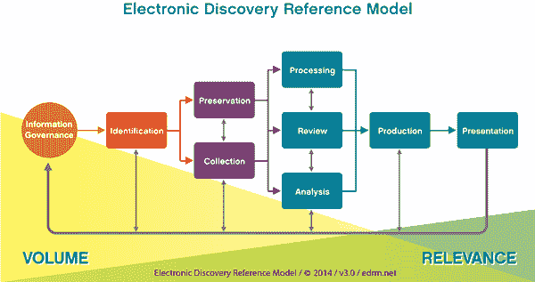 |
| --- |

`EDRM` 包含图 1 所示的阶段：

1. 信息治理（Information Governance）
2. 识别（Identification）
3. 保留（Preservation）
4. 收集（Collection）
5. 处理（Processing）
6. 审查（Review）
7. 分析（Analysis）
8. 制作（Production）
9. 演示（Presentation）

流程在体积上呈漏斗状，这通过图中三角形的形式表示，其底边位于图的左侧，顶点位于流程结束的右侧。该图的含义是，流程早期阶段的 ESI 体积量很大，因为它们是在运营过程中产生的，并经过识别、保留和收集；然后根据当前案件的关联性进行处理、审查和分析，以过滤掉不需要或未请求的信息，以及不需要制作的特权信息。与最初的内容相比，最终制作出的通常非常少，这就是演示的内容——因此；体积三角形的顶点在制作阶段结束。

图表的最右侧是绿色相关性三角形的底部。这个三角形在某种程度上是黄色数量三角形的反转，因为它始于左侧的信息治理阶段，在该阶段，数据量巨大，但大多数数据与当前案件无关；而经过过滤后，数量减小，`ESI` 的相关性增加；而这正是最终被呈现的内容。

以下是对 EDRM 模型每个阶段的简要说明。

## 信息治理

该阶段通常在没有任何诉讼或对诉讼预见的情况下进行，它被认为是组织正常运营的一部分。在这里，`ESI` 的数量最高，因为特定的数据尚未被确定为潜在证据。相反，其相关性最低，因为涉及了更多未被识别为相关的 `ESI`。

信息治理简单来说就是组织通过政策、流程、指南等手段来组织和管理数据及信息的方式。电子取证（eDiscovery）本身实际上是信息治理的一个子集，但为了实现高效有效的电子取证，必须建立健全的信息治理实践。对于电子取证而言，良好的信息治理是确保 `ESI` 在需要时能够随时可用且符合取证完备性的关键。良好的信息政策是适当信息管理和治理的基石；涵盖事件响应、文档保留、灾难恢复和业务连续性的政策可以在需要电子取证时提供帮助——一份取证完备政策（forensic readiness policy）补充了上述所有，并有助于确保发现过程的顺利、简单高效。

良好的取证完备政策使组织能够在需要时及时产生符合取证完备性的 `ESI`。在正常业务过程中不断产生的重要数据和信息以符合取证完备的方式收集和存储，这样在发生事件、诉讼或任何需要数字证据（如电子取证）的情况下，数字证据即可随时可用，而无需中断正常业务运营来收集证据，从而最大限度地减少对业务的影响。

良好的信息治理还意味着在处理组织内部的数据和信息时，不同分支和部门之间要进行适当协调。例如，法律与 IT 之间的通信对于确保法律保留（legal holds）的充分沟通和执行至关重要。取证完备政策应当吸收组织部门间合作和良好沟通的精神。

在 `AMD vs. Intel (2005)` 案中，英特尔糟糕的信息治理政策导致他们未能及时提供 `AMD` 请求的邮件证据，这是因为他们的文档保留政策不完善，且未能向 IT 部门和终端用户正确传达诉讼保留要求；最终他们在 2009 年在庭外与 `AMD` 和解，支付了 `12.5 亿美元`（Bates White Economic Consulting, nd.; Reellwayers, 2013）。电子取证相关的法律（如美国联邦民事诉讼规则（`FRCP`））要求在接到请求时，必须以符合取证完备的方式和请求方的格式提交数字证据，且应及时提交不得延迟；否则可能导致严重的制裁或后果（如 `AMD` 案中所示）。

## 识别

随着识别出与当前案件相关的内容，数量三角形开始收窄，因此数据量开始缩小。这导致包含的 `ESI` 相关性增加；因此图中绿色相关性区域得以扩大。识别与案件相关的因素有助于缩小范围并提高 `ESI` 的相关性。

一旦合理地预见到诉讼，就必须识别与当前案件相关的数字证据。对于电子取证而言，识别哪些 `ESI` 是相关的非常重要，以避免收集不必要的数据。必须过滤掉无关的 `ESI` 防止排序困难和延迟。还需要识别哪些是受特权的 `ESI`（诉讼方不希望与他人共享的机密数据和信息，如关键业务计划、专利材料、健康记录等），以便在共享之前将其移除。

良好的取证完备政策会让 `ESI` 经过适当收集和组织，以便在任何需要时（例如出现电子取证时），都能轻松地识别和排序，而无需遍历所有存储的 `ESI`——适当的归档和存储要求 `ESI` 被正确分类、标记和存储（这是良好信息治理的一部分）。识别还有帮助确定哪些数据需要进行诉讼保留；因此可以努力保护并留存此类证据免受篡改。

在 `Chura vs. Delmer Gardens of Lenexa, Inc. (2012)` 案中，被告未提交原告请求的任何数字证据，这导致法庭假设要么没有保存数字证据，要么未能通过搜索相关数据来对对方做出回应；因此，被告被法庭要求证明 `ESI` 已保存并经过搜索的证据（K&L Gates, n.d.）。良好的取证完备政策本可以帮助被告识别并提交 `ESI`，从而避免产生不利推断（adverse inference）。不利推断是指由于诉讼方的沉默或缺失请求的证据，而对诉讼方做出的不利裁定（airSlate Legal Forms, Inc., 2019）。

## 保留

在识别出与当前案件相关的数据后，进入保留和收集阶段。`ESI` 的数量进一步减少，相关性随之增加。

被确定为可能持有相关电子存证信息（ESI）的方，在可能发生诉讼且诉讼需要此类数字证据进行电子查询（eDiscovery）的情况下，有义务立即保护此类 ESI，否则该方将承担责任。保护的一个非常重要的方面是诉讼保全（litigation hold）。诉讼保全是由涉及或预见诉讼的组织向其员工发布的一种保护指令，以确保他们保护作为证据所需的数据（ESI）免受篡改或丢失。作为保护的一部分，预计组织将通过法律或人力资源部门向其 IT 部门以及此类 ESI 的终端用户传达诉讼保全，以对其保护并确保其具有取证完整性（forensically sound）——即防止其被丢失、修改或污染。IT 部门负责隔离此类 ESI 以防止损坏或丢失。如果 ESI 范围延伸到 IT 部门无法接触的终端用户，则也必须通知终端用户，以确保 ESI 不被删除，尽可能避开或进行绕过处理，以确保不被篡改或破坏。监管链（chain of custody）是证据保护的非常好的证明，应当予以重视。取证就绪（forensic readiness）确保了数字证据的保护，具备取证就绪能力实际上可以减少甚至消除诉讼保全对正常业务的负面影响——因为 ESI 被妥善收集、存储和保护。良好的取证就绪实践甚至可以在证据无需中断正常业务即可随时检索和使用的情况下，消除对传达诉讼保全的需求，从而限制干扰并使成本最小化。在 AMD 案件中，缺乏对 ESI 的保护是英特尔困扰的一部分；他们未能正确传达诉讼保全，而且邮件留存策略糟糕，导致某些被 AMD 请求查询的邮件被删除。在文档留存策略方面或配合良好的留存策略，取证就绪政策可以确保即使诉讼保全未被正确传达或执行，所要求的邮件证据依然可用。

## 收集

数字证据应以符合取证规范的方式进行收集。ESI 的收集可以是手动复制文件、扫描文档、转发电子邮件等形式；这种方式具有很高的波动性，因为数字证据在收集过程中很容易（无意或故意）受到损坏或丢失。更优的数字证据收集方法是位流取证镜像（bit-stream forensic imaging）。位流镜像复制驱动器上的几乎所有内容，包括扇区和簇；因此，删除的项目可能会被找回——但出于电子查询的考虑，这意味着可能包含特权信息和数据，因此需要过滤掉此类内容。此类过滤将在审查阶段进行。取证就绪在简化收集方面大有裨益，因为所需的 ESI 在发现之前就已经被收集了。可能出现的问题是作为取证就绪一部分的 ESI 存储格式与电子查询所需的格式之间存在差异；但这并不一定难以解决。

## 处理

在处理、审查和分析阶段，数量三角形几乎达到顶峰，因为被保护和收集的 ESI 中包含的相关数据处于相关性过滤的最后阶段；因此数量大幅减少。另一方面，相关性三角形开始接近其底边，图中两个三角形的重叠在制作（production）之前结束。

一旦收集了数字数据，就需要对其进行处理以排序和安排，并移除重复和冲突的 ESI。根据请求数字证据的方和法院的要求，可能需要将 ESI 转换为不同的格式。如果现有格式请求方或法院无法使用，也可能需要转换（可能是过时的格式或比他们拥有的更先进的格式）。取证就绪与 EDRM 的处理阶段没有直接关系，因为处理的要求在电子查询和诉讼之前不太可能设定或已知，取证就绪的作用仅是由于 ESI 被收集、排序和存储，使得处理变得更容易，便于识别并在必要时进行转换。

## 审查


# 对数字证据进行审查

对数字证据进行审查是为了确保其符合案件所需的标准（对方请求的数据和格式，以及任何可能的法院要求），并过滤掉特权数据和信息。ESI 可以以原生格式进行审查，也可以进行基于镜像的审查。

原生格式审查涉及以其原始格式审查 ESI。文件通常以只读格式进行审查（尽管电子邮件倾向于转换为 HTML 格式进行原生审查），以最小化腐损坏和损坏的风险。基于镜像的审查涉及将文件转换为图像格式，如 `PDF`、`TIFF`、`JPEG` 或位流镜像。图像转换消除了原始文件腐损坏或损坏的风险，但只有输出数据可以被审查——如果存在输入数据，如电子表格中的公式或 HTML 文档中的脚本，这些将无法审查。

审查阶段是电子查询过程中最昂贵的阶段，因为存在大量的 ESI，且并非所有都与当前案件相关。通过排序和过滤获取相关数据可能是一项艰巨的任务，因此可以使用工具和技术进行此类排序——即技术辅助审查（`TAR`）。其中一种方法是预测编码。预测编码结合人员、技术和工作流来对关键文档进行排序，减少从 ESI 中进入人工审查的无关和非响应文档数量（Recommind, Inc., 2013 and Rouse, 2012）。预测编码通过使用数学精确的技术，根据审查员设定的参数精炼搜索，减少了所需的人工审查员（从而降低了成本）。

与上一个阶段（处理）一样，取证就绪对审查阶段没有直接影响。它只是让审查更快、更容易，特别是如果 ESI 存储在易于审查的格式中时。

## 分析

在此阶段，对数字证据进行进一步分析，以确保符合法律要求和电子查询方的要求。基本上，审查阶段使用的工具和技术也用于分析，例如预测编码。事实上，分析阶段并不一定限于审查之后，它可以同步进行，而且在诉讼之前和之后都会持续发生。在文档留存策略方面，需要对 ESI 进行分析，以确定哪些应该存储和存档，如何分类存储以及哪些应该丢弃。为了减少持有大量无数据的成本，丢弃部分收集的 ESI 是至关重要的。过滤掉哪些以及不丢弃以及何时丢弃可能非常棘手，因为被认为不重要且无关的 ESI 可能会变得变得。

## 制作

这一阶段已超越了数量三角形的顶点。达到这一阶段的电子存储信息（ESI）已没有无关数据，随后呈现的将是产生的内容。至于相关性三角形，它已经消除了与数量三角形的重叠，意味着剩余的 ESI 中仅包含相关数据，无关和受特权保护的 ESI 已被过滤掉。

根据 `EDRM` (2010) 的定义，生产阶段的目标是准备并以高效且易用的格式生成 ESI，以便在符合约定生产规范和时间表的同时，最大限度地减少成本、风险和错误。决定 ESI 以何种格式生成的权利在请求 ESI 的方手中，包括生产时间范围。ESI 可以以原始格式、图像或纸质打印件生成（纸质打印件可能非常繁琐且昂贵，需求并不高）。尽管请求方有权决定生产格式，但对方团队可以会面并就电子取证（包括生产格式）达成共识，在某些情况下，如果法院根据比例原则认为格式请求不合理，则可能会拒绝该请求。如果不小心披露了具有特权的信息，可以使用回溯协议来取回已生成的 ESI。通过取证就绪，ESI 将存储在图像和原始等通用格式中，因此一旦完成所有之前的阶段，证据就可以很容易生成或在可能的情况下转换为请求的格式。如果格式不符合请求方的要求，仍然可以通过谈判来说服请求方接受可用格式，法院也可能认可这一点，特别是当可以从可用格式中检索到所需的数据和信息时。

## 演示

演示阶段远超数量三角形，因为 ESI 的数量已经减少到了必要的最低限度。相关性三角形的底部在此阶段结束；如果生产过程中可能包含了某些特权数据，这些数据在演示之前将会被撤回。

在法庭上为和解谈判而演示 ESI 是电子取证流程的最后一步。演示应当具有说服力、感召力和专业性，以证明或反驳某项主张。提交的证据应有充分的支持，以避免演示期间可能出现失望，这会对某一方的案件产生不利影响。未能提交将给人留下印象，认为提交方不严肃或没有可提供的内容（如果该方有诉求，可能被假设为没有根据；如果是辩护方，则可能被假设他们有罪且没有辩护）。不专业或不当的演示与完全不提交具有类似的效果，糟糕且缺乏说服力的演示对任何一方的案件都没有帮助，只会引起法官的反感。还建议演示应以易于理解的方式进行，不应太技术化而导致法官和陪审团无法理解——应该尽可能简化。取证就绪与演示阶段没有直接关系；演示是在所有之前的步骤完成后进行的——取证就绪是为该阶段的积累，它确保了最终阶段的成功。监管链在演示中将非常有帮助；这可以从取证就绪阶段就开始准备，以显示对 ESI 了恰当且稳妥的处理。

# 问题、争议、困难

问题、困难和争议往往出现在新的和新兴技术中，数字取证（无论是在取证就绪还是电子取证方面）也不例外。以下强调了一些与电子取证和取证就绪相关的问题。

## 归什么和不归什么，以及存档多久

为了达到取证就绪，组织需要不断收集和存储 ESI 以备不时之需。组织产生的 ESI 数量非常大，并且往往随时间呈指数级增长。显然，组织不能归档其产生的所有 ESI，因为这将是一种负担，特别是在成本方面。为了避免收集和归档不必要的 ESI 量，必须在存储和归档之前有选择地收集 ESI。这引发了一个问题：“什么应该归档，什么应该被丢弃？”应该存储和归档的应该是重要且相关的 ESI，反之则丢弃。问题在于如何确定这些；此外，被认为不重要和无关的 ESI 在进行电子取证时随后可能变成需要的内容。

## 来自员工的隐私担忧

员工可能会感到由于他们生成的 ESI 被不断收集，隐私受到了威胁，因为这意味着他们正在被监控。这产生了一种“老大哥”的感觉，使得员工隐私无处遁形。这对组织也可能产生法律影响，特别是在那些有严格隐私法的社会（如 `EU GDPR`）。这些法律可能不容忍取证就绪政策的某些方面，它们可能被认为是侵入性的并违反了员工隐私。

## 过多的 IT 安全相关策略

灾难恢复策略、业务连续性策略、文档保留策略、电子邮件策略；现在还有取证就绪策略！似乎有海量的 IT 安全策略（更不用说非 IT 相关的策略），看起来非常繁琐，而且它们有许多重叠的方面。那么为什么还需要另一个策略来增加到现有策略中呢？

## IT 与法律部门之间的沟通鸿沟

IT 和法律部门之间存在固有的沟通问题；每个部门都有自己的交流语言。法律执业人员和 IT 专业人员在交流时使用不同的术语；因此，当电子取证出现时，往往会有误解和可能的不信任。法律部门可能会使用他们认为正常的语言向 IT 请求，但对 IT 来说很奇怪或被误解，导致 IT 给出错误或不完整的回复。IT 可能理解法律部门的要求，但在沟通回复时可能会让法律部门感到困惑。这种缺乏沟通还会导致部门之间的不信任，法律部门可能认为 IT 试图掩盖某些事情，怀疑他们可能犯了某些违反行为；而 IT 可能认为法律部门正试图通过指手画来表现权力主义。

## 境外发现

当与案件相关的 ESI 在另一个国家产生或存在时会发生什么？如果该国家与进行电子取证的国家关系不良好，会发生什么？当电子取证必须跨越国界时，由于法律差异、发展水平不同和政治因素，会产生许多问题。当组织在另一个国家有部分发现所需的 ESI 时，可能会出现问题，这可能是因为有海外办事处、海外客户和合作伙伴，并将某些服务外包给位于外国的公司，或者使用了服务器位于不同司法管辖区的云服务。关系不良好的国家可能会发现他们在电子取证事项上的合作非常困难；他们几乎不在大多数事务上合作。如果 ESI 所在的外国国家存在不稳定因素，如战争、流行病、自然灾害等，也会出现问题。

## 法律和指南似乎基于美国

即使在本章中，涉及数字取证、电子取证和取证就绪的大多数法律、案例研究和指南也都是基于美国的。要获取非来自美国或英国的此类主题材料并不容易。这些国家根据其特殊性拥有自己的法律文化，其他国家无法将这些法律强加于它们。其他国家也有自己的特殊之处；而且，它们是独立的，拥有完整性和主权。

# 新技术带来的挑战

移动计算和云计算等技术的进步为取证就绪和电子取证带来了自身的挑战。这些技术扩大了电子存储信息（ESI）的范围，并且存在区分哪些数据属于组织、哪些数据属于个人的问题，特别是在 BYOD（自带设备）案例中。在工作中使用个人设备使得组织难以收集电子存储信息（ESI），因为该设备是私有的拥有的，不属于组织，并且包含了员工的个人数据。收集此类数据可能会侵犯员工的隐私权。移动设备倾向于将数据存储在云端，组织可能无法轻易访问，增加了数据收集的难度。云存储可能涉及位于国外的服务器，这又回到了外国取证的问题。在工作中使用社交网络也会导致类似的隐私问题。从智能手机和平板电脑等移动设备中进行取证所需的 ESI 成本非常高，这对于组织是不利的。

# 解决方案与建议

以下是针对上述问题和问题的建议和解决方案。

## 归档什么、不归档以及多久

确定电子存储信息（ESI）的相关性和重要性取决于行业、业务性质和监管要求等因素。某些行业和企业由于其处理的数据具有敏感性，更容易受到诉讼以及电子取证的影响——例如银行和医疗保健。此类组织将根据风险水平和诉讼的可能性存储更多的 ESI。例如，在银行中，对客户账户财务交易 ESI 的收集关注将高于对员工绩效记录的关注。监管要求也决定了什么需要归档，如果法律法规要求必须收集并存储某些 ESI，那么就必须这样做。

在存档中保留 ESI 的时间也取决于行业、业务性质和法规。在银行和医疗等极易发生诉讼的行业中，高风险数据可能会存储更久。ESI 成为电子取证对象的概率越高，存储时间就越长。监管机构可能还要求某些数据至少存储一段时间。如果数据容易受到多项法规的影响，其存储时间也可能更长；例如在银行业，同时受支付卡行业安全标准（`PCI DSS`）和反洗钱法约束的数据保留至要求较长存储期的法规期限。

良好的知识和适当的计划用于确定哪些数据与存储相关，哪些应该被丢弃。对行业、业务性质和监管要求的了解有助于组织识别哪些 ESI 对存储是有相关且重要的，哪些不是。

## 员工的隐私考量

员工有权捍卫自己的隐私，但在职场中，通常预计个人问题和交易应留在家里。虽然一些雇主允许员工在工作场所和雇主平台上进行个人事务，如普通浏览、阅读和发送个人电子邮件，但这些应该受到限制，因为它们会影响注意力和生产力。组织需要制定数据数据的政策，并让员工签署可接受使用协议，说明他们在工作场所中应该做和不应该做什么，还要教育他们将进行什么类型的监控和数据收集，以及为什么要这么做。同意此类条款的员工无需恐慌，不仅因为他们已经同意了他们生成的 ESI 将被收集和监控，还因为他们已经告知了为什么要进行此类数据收集。

组织制定和采用的任何政策都必须在法律法规的框架内运行；任何违反这些规定的内容都不应成为政策的一部分。法律通常会考虑安全需求和要求，在某些国家通常不会限制获取与工作相关的 ESI；某些法律承认这种需求，因此甚至成为监管要求的一部分。一个准备为取证就绪而收集 ESI 的组织，必须熟悉其运营所在司法管辖区或国家的隐私法和法规，并确保在执行其取证就绪政策时符合这些规定。

## 过多的 IT 安全策略

存在不同的 IT 安全策略，这些策略对于信息和信息系统的妥当安全管理、对于确保组织的顺畅安全运行以及其生存来说是必不可少的。这些策略加强并保护了组织，使其免受意外（无论是自然的、偶然的、恶意的还是监管性的）的影响。策略中某些方面的重叠意味着它们在这些方面相互增强和互补。取证就绪政策补充了灾难恢复、业务连续性、数据保留和事件响应等其他策略，并有助于确保符合监管要求。某些组织可以选择合并相似且重叠的策略；例如，可以将取证就绪与数据保留或事件响应合并。

## IT 与法律部门之间的沟通差距

解决 IT 与法律部门之间沟通差距的基本方案是，每个部门都应始终记住并不是所有人都有相同的背景和学科；因此，并不是所有人都理解某个学科或职业的术语。两个部门在与其他交流时都应该使用每个人都能轻松理解的简单术语，而不是特定于他们学科或职业的术语。尽管如此，由于电子取证现在已常见，这些部门需要相互了解——法律部门应该熟悉一些 IT 知识，特别是与电子取证相关的知识；同样，IT 部门需要学习 IT 和电子取证的法律要求。随着电子取证的发展和演变，沟通差距正在缩小；现在大学提供了涵盖数字取证、电子取证、IT 法律等的课程和专业认证，并存在熟悉数字取证和电子取证的专业人士和此类课程的毕业生。这类专业人士在沟通方面没有问题。

跨国电子取证可能会面临问题，特别是当电子存储信息（ESI）所在国家拥有非常严格的隐私法时（例如欧盟内部）。如果一个组织知晓某些 ESI 将存储在其居住地国家（无论是因为拥有海外分支机构、外包合作伙伴还是客户等原因），则应确保充分熟悉这些其他国家的法律法规，以避免在尝试进行取证准备或发生电子取证时出现复杂情况。它还应该让员工签署符合法律的服务协议，外包合作伙伴（包括云服务提供商）、客户等也是如此，他们应该拥有与其所在地国家法律兼容的协议。

在国家之间存在政治分歧和意见不合的情况下，组织应采取类似的预防措施，尽管在这种情况下可能会更加困难。在战争、自然灾害或流行病等情况下，可以采取措施以确保员工和数据的安全；例如转移到更安全的区域或完全离开动荡国家。例如，在中国疫情爆发期间，某些公司采取了居家办公措施以确保业务连续性（Plante, 2020）。关于网络安全和电子取证的国际标准和协议也有助于缓解跨境问题。

## 法律和指南似乎是基于美国的

许多与数字取证和电子取证相关的法律、指南和法律先例来自美国。没有在数字取证和电子取证方面拥有法律、指南和法规的国家，可以使用美国、英国或其他任何此类法律法规发达国家的法律作为先例，在考虑自身特殊性的情况下制定自己的法律和指南——已经有一些国家这样做了，例如将其监管指南建立在美国的 `NIST`（美国国家标准与技术研究院）的基础上。这样做在任何方面都不会损害主权或完整性。无论位置或信仰如何，数字取证和电子取证法律、指南和程序的基础通常是相同的——即以符合取证严谨性的方式收集、审查、分析和存储 ESI。

此外，国际上已经制定了数字取证国际标准，例如 `ISO/IEC 27037:2012`，以指导 ESI 的收集。`ISO/IEC 27037:2012` 为数字证据的识别、收集、获取和保护提供了指南。

## 新技术带来的挑战

涉及移动计算、社交媒体网络、云和新技术的问题最好通过良好的政策和协议来处理。例如，员工要使用其个人设备进行工作，必须根据可接受使用条款以及雇主对该设备的权限范围签署协议。这赋予了组织从个人设备中访问和检索与工作相关数据的权利。该组织还应该让员工同意，对其个人设备的工作相关使用将进行记录，并与其它数据分开存储，这样在需要检索此类 ESI 时，员工的隐私权就不会受到侵犯。从个人设备到组织的工作相关 ESI 的网络日志记录，对于在不损害员工隐私的前提下使其更易于捕获和检索 ESI 具有大有裨益的作用；同时它也有助于降低从移动设备收集 ESI 的成本。可以在员工的个人设备上创建单独账户以区分工作和个人方面，还可以使用容器化来将设备上的工作空间与私人空间分开。涉及外国服务器的云服务问题已如前所述处理。

## 新技术带来的机遇

一些正在发展的新兴技术为电子取证提供了广阔的未来，如`人工智能`、`区块链`、`物联网`（`IoT`）等。这些新技术可以帮助提高 ESI 的收集质量。`人工智能` 还可以用于技术辅助审查（`TAR`），如数据过滤和脱敏。`IoT` 意味着车辆、冰箱等设备的互连性，这在发生事故时可以提供必要的证据。

`区块链` 作为去中心化的分布式账本系统，可以确保证据的不可篡改性，并由于容错性防止 ESI 丢失。这意味着没有单点故障，因此使证据无需外部专家即可轻松检索，且证据存储在各个节点上以确保不可篡改性。

增强/虚拟现实可用于模拟事件在调查过程中可能发生的经过，并试图揭示事件是如何实施的，以防止此类事件再次发生。如果法律允许，它可能用于向小组或法庭展示可能发生情况的模拟视图。

# 未来研究方向

数字取证和电子取证正在不断发展，许多趋势和机遇仍在涌现，是未来研究的关注重点。人们倾向于认为数字取证仅适用于在和通过 IT 基础设施实施的犯罪以及数字犯罪；但实际上，它也适用于非数字犯罪。数字取证可以使用手机日志、`GPS` 等来追踪罪犯。通过电子邮件、即时消息系统、电话、社交媒体和连接设备进行的通信可以进行分析，以追踪和起诉罪犯；甚至在搜索引擎上搜索的项目和访问的网站都有助于追踪罪犯。以下是一些进一步研究的主题：

## 1. 以原生格式提供用于电子取证的 ESI

无论是对方还是法院，对电子取证中原生格式 ESI 的需求似乎日益增加。这意味着必须采取措施保护此类 ESI 免受损坏。特权信息也必须受到保护，这可以通过可能的排序和删除，或者使用脱敏等工具和技术来实现。

## 2. 大数据与取证分析

大数据的崛起意味着电子取证和数字取证变得更有压力。可以探索各种方法，看如何以成本效益高管理为了保留和分析目的而日益增加的 ESI。

## 3. 人工智能在电子发现与调查中的数字证据收集

如何利用人工智能增强数字证据的收集与展示。这还包括根据电子发现流程对电子存储信息（ESI）进行识别、保护、收集、审查和分析。

## 4. 专业电子发现培训与认证的审查

对电子发现认证和培训进行审查，以查看可以如何改进它们，从而为专业人士和组织提供额外价值。这些认证是否为电子发现过程提供了充分的要求？其需求量如何？

## 5. 电子发现的国际基准

建立有关电子发现的国际基本标准和协议，对于减少与跨境电子发现相关的复杂性至关重要。可以探索相关措施以评估制定此类国际基准的可能性。

## 6. 大流行期间的电子发现

2020 年的新冠肺炎疫情带来了许多信息管理挑战，远程办公日益增加，在封锁期间从不同物理位置收集 ESI 也面临着挑战。需要进一步微调大流行准备政策，以便在不违反封锁规定或不感染团队成员的情况下，实现高效且及时的 ESI 收集与分析。

# 结论


证据是追踪、确立和起诉所必需。数字取证是打击犯罪（无论是数字犯罪或其他犯罪）的必要工具。它被用于调查以确定违规发生的经过，并追踪和定位犯罪分子；了解这一点有助于加强组织的安全性，以防止未来发生类似事件。通过取证就绪，数字取证调查变得更容易且更具成本效益，因为数据在事件发生之前、期间和之后会被不断收集存储；因此可以收集大量的证据。在事件发生后等待收集数字证据可能会导致证据丢失或污染。攻击者可能会消除其踪迹，或者证据可能由于其易发性而丢失或损坏，可能因为正常操作而被覆盖或擦除——此外，违规可能在很长时间之后才被发现。电子发现在多大程度上已成为诉讼的常态，它要求以及时、可接受且符合取证科学的方式对数字证据进行分析提供。取证就绪通过确保数字证据在及时、高效和符合取证科学的情况下可用来辅助电子发现；节省了大量的调查成本，并提供了更可靠的证据。证据更加可靠，是因为它们基本上是实时收集和存储的，而不是为了响应可能导致潜在损失、污染或操纵的事件。

取证就绪有助于提供信息保证和安全，并通过确保可靠 `ESI` 的可用性来协助调查和电子发现。对于组织而言，采用取证就绪政策是重要的；在被采用之前，它并不必须是监管性要求。在 20 世纪 20 年代，`TJ Hooper` 案中的法官宣布，某些措施对于某个行业来说是至关重要的，即使他们普遍忽视，也不能免除其缺失的责任（Tester, 2013）。在那个时代，不需要配备接收无线电船；`TJ Hooper` 是一艘拖着三只驳船的拖船，它在风暴中行驶导致所有驳船和货物沉没。客户因损失提起诉讼，一份证词称，如果拖船上装有功能完好的无线电并用它获取有关风暴的信息，损失本是可以避免的（Tester, 2013）。正是这一证词导致了法官的声明。这适用于取证就绪案例，既然存在避免意外的方法，那么无论其是否为强制性做法，都应该被采用。尽管如此，某些司法管辖区已将取证就绪纳入其法律法规中，要求组织吸收这种精神。例如，根据该国的安全政策框架（`SPF`），英国政府部门必须制定取证就绪政策。

电子发现可用于检测数字犯罪及其犯罪实施者。诉讼可能是由于对某公司发起的数字犯罪指控而产生的，电子发现可以帮助确立此类指控或为被告辩解。随着时间的推移，随着越来越多的技术发展，数字取证和电子发现将继续演进。新的挑战也随着技术进步接踵而至——一些对数字证据收集有积极影响，另一些则有负面影响——但对发展良好的管理和理解可以利用这些进展来改进并缓解可能出现的任何问题。

## 参考文献

- airSlate Legal Forms, Inc. (2019). Adverse Inference Law and Legal Definition. 2020 年 2 月 18 日 检索于 `https://definitions.uslegal.com/a/adverse-inference/`

- Bates White Economic Consulting. (n.d.). Case Study - `AMD v. Intel`: Antitrust and Competition Practice. 2020 年 2 月 18 日 检索于 `https://www.bateswhite.com/media/publication/124_AMD%20case%20study.pdf`

- Brecher, A., & Childress, S. (2009). eDiscovery Plain & Simple. AuthorHouse.

- Burns, A. E. (2013). Corporate E-Discovery Success Starts with Information Governance. eForensics Magazine . Database (Oxford) , 2(8). `https://eforensicsmag.com/ediscovery-compendium/`

- Childress, S. (2012). Electronic Discovery: Where the Law and Technology Collide. E-Discovery – Legal Issues Guidebook. 2013 年 8 月 5 日 检索于 `https://eforensicsmag.com/e-discovery-legal-issues-guidebook-2/`

- EDRM. (2010). Production Guide. 2020 年 2 月 18 日 检索于 `https://www.edrm.net/resources/guides/edrm-framework-guides/production`

- Hughes, A. (2013). Ediscovery: Criminal Process in a Corporate World - How to. `https://eforensicsmag.com/ediscovery-compendium/`

... (剩余参考文献格式相同)

## 参考文献

Sommer, P. (2013). Digital Evidence, Digital Investigations and E-Disclosure: A Guide to Forensic Readiness for Organisations, Security Advisers and Lawyers (4^(th) ed.). Information Assurance and Advisory Council.

Sule, D. (2013). Digital Forensics 101: Case Study Using FTK Imager. eForensics Magazine Computer , 2(2). https://eforensicsmag.com/forensics-analysis-with-ftk/

Tester, D. (2013). Is the TJ Hooper Case Relevant for Today’s Information Security Environment? ISACA Journal , 2, 2013. m.isaca.org/Jounal/Past-Issues/2013/Volume-2/Pages/default.aspx

The National Archives. (2011). Digital Continuity to Support Forensic Readiness. Retrieved February 13, 2020, from https://www.nationalarchives.gov.uk/documents/information-management/forensic-readiness.pdf

Volonino, L., & Redpath, I. (2010). e-Discovery for Dummies. Wiley Publishing, Inc.

## 关键术语与定义

**不利推断 (Adverse Inference)**：指案件中由于某一方未能提供要求的证据（无论是法院要求还是对方诉讼方要求），而对其做出的不利判决。

**位流镜像 (Bit Stream Image)**：磁盘驱动器的位流镜像是其克隆副本。它复制了驱动器中几乎的所有内容，包括扇区和簇，这使得检索从驱动器中删除的文件成为可能。在进行数字取证调查时通常使用位流镜像是为了避免对数字证据的篡改，防止丢失或损坏。

**证据链 (Chain of Custody)**：证据链是一份记录数字证据从收集点开始、保存直到在法庭或其他程序中作为证据提交期间经过的所有过程的文件。它详细记录了证据是如何收集、分析和存储的，包括谁在何时为了什么原因访问了这些证据。

**数字取证 (Digital Forensics)**：数字取证也称为网络取证、电子取证或计算机取证。数字取证涉及以法律允许的方式对数字证据进行收集、检索、分析、审阅和存储，通常用于民事或刑事调查及诉讼或内部调查。数字取证有不同的类型，如磁盘取证、内存取证、网络取证、移动取证、恶意软件取证等。

**电子发现 (eDiscovery)**：电子发现是诉讼中的双方在进入完全法庭程序之前，审阅对方拥有的数字证据以评估其质量的过程。电子发现发展于“证据发现（discovery）”，即诉讼双方在法庭程序之前对证据进行的审阅。电子发现也可以被视为数字调查中从收集到分析再审阅的所有过程总和。

**电子存储信息 (ESI)**：`ESI` 代表电子存储信息。这是生成在 IT 介质和设备（如 PC、移动设备、互联网、CCTV 监控视频等）的数据和信息。`ESI` 在组织的正常运行以及个人使用过程中不断产生。

**法取证完备性 (Forensically Sound)**：如果数字证据是以法律认可的方式进行收集、分析、处理和存储的，并且有合理的证据证明，则认为其具有取证完备性。取证完备性提供了合理的保证，确保数字证据在调查过程中（故意还是无意）没有被损坏或破坏。

**取证准备性 (Forensic Readiness)**：取证准备性涉及组织习惯性地以取证完备的方式收集和存储 `ESI`，以预判 `ESI` 可能作为潜在证据的情况发生。其主要目标是最大化此类 `ESI` 的潜力，同时最小化调查中涉及的成本和干扰。

**诉讼保全 (Litigation Hold)**：诉讼保全是一种保存命令，要求组织保留可能作为与其涉及的当前或预期法律程序相关的证据的所有数据。这是为了确保证据具有取证完备性，并免受损坏、破坏和破坏。诉讼保全由律师发布，或由组织内部发布给员工。通常通过法律部门或人力资源部门传达，直接向 IT 部门或终端用户保留 `ESI`。一旦预计会有诉讼，应开始对可能成为法律案件证据的数据进行保全。

**预测编码 (Predictive Coding)**：预测编码利用 IT 工具、技术、工作流流程结合人工输入，筛选出用于电子发现的关键文档。这用于减少 `ESI` 中需要人工审阅的非响应和无关文件的数量。

# 第 14 章：系统性综述

*   **Bruno Bernardo**

    葡萄牙里斯本诺瓦大学 NOVA 信息管理学院

*   **Vitor Santos**

    

    葡萄牙里斯本诺瓦大学 NOVA 信息管理学院

## 摘要

今天讨论的主要题之一是人如何以以积极且安全的方式利用技术来改善生活。然而，随着技术的进步，挑战也随之而来；人们对隐私和敏感信息保护的担忧最大。事实上，最常用的技术之一是移动设备，它可以有不同的形式、特征和形状，并能创建、存储、删除和传输各种类型的数据，这些数据可以作为取证领域的证据。因此，本章提出了一种处理该领域的新方法，通过整合和研究所有可用信息，旨在利用 `PRISMA` 方法论对取证、数字和移动设备取证等主题构建一个全面的系统性文献综述，旨在支持和增强移动设备取证调查过程，并提供更稳健、实时的知识库。

## 1. 引言

今天，关于技术的主要主题之一，涉及到人如何以积极且安全的方式利用这些设备来改善日常生活，使其变得更健康、更高效、更方便。然而，这同时也带来了挑战，即人们对隐私和敏感信息安全的担忧。事实上，主要的科技之一是移动手机，它可以有多种品牌、格式和特征。这些设备已经出现在各个年龄段的人的日常生活中。它就像一个功能性的计算机系统，包含一个“数据宝库”，允许用户汇总和共享文档、多媒体、日志、应用程序数据，同时可以装进口袋。同样，移动手机还被用于许多不同的应用程序，这些应用程序可以通过手机系统运营商的应用程序商店下载，这种下载量每年都在增长，表明第三方应用程序的用户数量也在以同样的速度增加。

移动手机带来的挑战还包括其格局的快速变化、日益增长的多样性，以及数据与云及物联网的整合。同样，网络犯罪正在快速增长，针对对手机中信息的利用和检索，从而增加了取证及其分支——数字取证和移动取证的重要性。

从今起，这些数据可用于目的，其中之一与取证（Forensics）有关，取证可以利用手机数据解决案件，并成为案件的解决方案。因此，本章将介绍现有的工具和技术，这些工具对于调查人员预防、检测和解决任何与移动设备相关的问题非常重要，无论是刑事、民事、公司还是任何调查（Jadhav & Joshi, 2016）。

尽管如此，移动取证仍面临着挑战，即缺乏工具和标准的经过证明的方法论，这些方法能使作者能够识别移动设备存储的数据，以及在何处发现和检索这些数据（Chernyshev et al., 2017）。尽管如此，本章旨在理解手机在取证中可能发挥的力量和重要性、手机的工作原理、其流程及其主要组成部分。在定位数据后，拥有能够让调查人员检索并访问其内容和元数据的工具是很有重要的。由于移动取证是一个复杂的课题，且有不同的设备可用，目前还没有明确的工具定义，来从手机中筛选所需信息，并回答调查人员可能遇到的任何问题。

事实上，多位作者认为，对于调查人员来说，没有比移动取证更大的挑战了，因为在多个设备中存在大量数据，对于数字调查人员来说，了解从哪里开始定位数据以及如何检索数据至关重要（Graves, 2013）。因此，本章将介绍用于取证、数字取证和移动设备取证的可用技术和方法论，以及数字调查人员如何利用这些技术。因此，作者认为数字和移动设备取证、数字考古学和数字证据的概念是本章的基础。因此，作者打算在整个章节中描述并定义这些概念，以提供清晰简洁的定义和概述，分析其简要的演变、围绕这些术语的核心概念、不同的应用，以及围绕这些概念的挑战和机遇。同样，这种对研究主题相关可用文献的全面分析，不仅适用于告知数字调查人员，也适用于渴望成为调查人员的人士，或希望深入了解数字和移动设备取证，以及用于在手机手机等设备上进行数字调查的可用方法论和应用的人士。

# 2. 方法论

本研究的主要目标是对取证、数字取证和移动取证等主题进行认知和研究，这可能会支持并提高对这些主题的认识和知识，使调查人员拥有相当稳定且最新的知识，以帮助调查过程，并在未来进一步改进。同样，了解有哪些可用工具以及如何利用它们来开展与移动取证相关的数字考古学也是很有重要的。结果，作者定义并阐述了以下研究问题：

* `RQ1`: 取证领域最相关的概念、挑战和机遇是什么？以及围绕它的过去、现在和未来的未来应用及技术/方法有哪些？

* `RQ2`: 数字取证领域和数字证据主题的成熟度水平和相关背景是什么？

* `RQ3`: 现有的不同类型和形式的证据有哪些？数字证据收集的周期和阶段是什么？

* `RQ4`: 移动设备考古和移动设备取证领域最相关的概念和观点是什么？

* `RQ5`: 组成移动设备的不同环境和主要组件有哪些？它们对移动设备及其考古至关重要。

* `RQ6`: 手机上产生和可以产生、创建、操纵和存储的数据信息是什么类型？这些活动在何处可以执行？

* `RQ7`: 移动取证现有的挑战和差距是如何危及数字取证调查的？为什么这迫切需要对这一主题进行更多研究？

* `RQ8`: 取证环境面临以及可能面临的主要挑战和局限性有哪些，特别是针对数字和移动设备取证的分支？

* `RQ9`: 数字调查人员如何利用执行移动设备取证调查时的现有工具？

考虑到这些研究问题，作者应当回答、理解、研究和探索关于取证、数字取证、数字考古、移动设备取证和数字证据的文献。上述研究问题旨在建立对取证领域的认知和知识，并解决调查人员面临的危及移动设备取证调查过程的许多问题，这些问题是由于缺乏对可用工具和技术的认知。同样，定义的研究问题将允许作者从不同的时代和时期文献中检索多种定义和观点，以便在研究移动设备取证主题时进行外推和利用。

| 图 1. 本章相关且范围内的关键词 |

| --- |

| 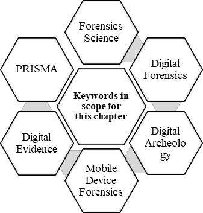 |

| --- |

此外，本文遵循前述结构：应用方法论的结果以及分析、讨论和结论。因此，论文的第一部分反映了 `PRISMA` 方法论的应用及其流程图，以协助系统地检索本章所提主题的相关文档和研究（David et al., 2015）。

第二部分展示了通过使用 `PRISMA` 方法论以及在不同数据库中搜索检索的所有相关不同文献的认知和探索。这是因为取证及其分支可能包含来自不同来源的广泛信息，这些信息对本研究的重要性各异。因此，这允许作者专注于最相关的概念，建立一条支持研究过程的路径。该结构是灵活的，允许在整个研究过程中包含被认为相关的不同主题，这些主题将为这项工作增加价值，因此包含它们是非常必要的。

此外，在对这些主题进行初步分析和背景化处理的过程中，作者注意到，IT 技术的采用（包括创新设备、工具以及它可以提供的各种类型的服务和交互）导致了大量且无处不在的机遇与挑战。这些机遇挑战并非移动设备取证领域独有，也影响和作用着 IT 取证的其他各种现有及新兴子学科，例如云取取证、计算机取证、文档和电子邮件取证，以及数字取证体系下的许多其他子领域。

此外，为了对本章旨在进行的系统综述，作者利用了 `PRISMA` 方法论及其流程图。应用该方法的意图是寻找和检索任何形式的相关文献，以期对本研究结果做出贡献，并支持前述描述的研究问题。因此，本章介绍的系统综述遵循了 `PRISMA` 方法论的指南和指示，`PRISMA` 代表“系统评价和元分析报告首选项目”。该方法论代表了为了编制系统综述和/或元分析而收集的最少数量的文章和/或其他类型的项目（David et al., 2015）。因此，作者首先考虑了哪些数据库可用于这些研究，以及哪些数据库最适合这些研究。

结果，在检索可用文献期间，考虑的学术资源和文献来自一个通用的学术数据库，该数据库对其他几个数据库或网站进行搜索，即 `NOVA Discovery` 数据库。其他数据库包括 `Google Scholar` 和 `IEEE Xplore`（一个专注于技术及其环境研究的特定数据库）。搜索是通过应用布尔逻辑运算符和查询（即 `AND` 和 `OR` 逻辑表达式和条件）完成的。


使用并构建这些逻辑参数的意图包含所有被认为与本研究最相关的文章和文献。因此，为了确定在 `PRISMA` 方法论内分析的出版物（第 1 阶段——“识别”），编写并执行了以下查询，以搜索已发表且在其标题、摘要、梗要、全文或关键词中至少（使用 `OR` 逻辑运算符）包含以下术语/表达式之一的文章：“Mobile Device Forensics”、“Mobile Devices Forensics”、“Mobile Device Forensic”、“Mobile Devices Forensic”、“Mobile Forensics”或“Mobile Forensic”。

如前所述，上述表达式通过应用布尔析取逻辑参数 `OR` 迭代共同使用并链接，这是因为在第一阶段，作者旨在检索所有包含“Mobile Device Forensics”（主题）或其任何派生词（如上述内容）的出版物。此查询于 2019 年 12 月在 `NOVA Discovery` 数据库上使用其高级搜索引擎执行。因此，在第一阶段，从 `NOVA Discovery` 数据库检索到的记录总计为 1585 篇，除了上述表达式外未应用任何其他过滤器。

此外，下一阶段是筛选阶段。在第二阶段，目标是应用所选的排除标准，以移除那些不被认为符合本研究所研究系统文献综述要求的记录。

## 筛选阶段

在第二阶段，目标是应用所选的排除标准，以移除那些不被认为符合本研究所研究系统文献综述要求的记录。

## 应用方法的结果

如前所述，本章介绍的系统综述遵循了 `PRISMA` 方法论的指南和指示……

| 图 2. PRISMA 方法论 |
| :--- |
| 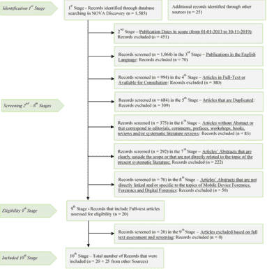 |

在 1585 篇文章中确定并设定起点后，进入了筛选阶段，即过滤掉符合排除标准的记录，这对应于流程图中第 2 阶段到第 8 阶段。

摘要筛选阶段在第 6 阶段至第 8 阶段之间进行，重点在于通过对标题和摘要（如适用）的修订和分析，排除那些被认为和考虑不合适的项目。因此，摘要筛选的第一阶段（即第 6 阶段）侧重于筛选剩余的 375 项项目，排除那些没有摘要的文章，或对应于社论、评论、前言、研讨会、书籍、综述和/或系统文献综述的文章。因此，通过对文章摘要（如适用）的分析，共有 69 项不包含摘要，14 项为社论、评论、前言、研讨会、书籍、综述和/或系统文献综述，在第 6 阶段共删除了 83 项项目。

下一阶段（第 7 阶段）侧重于筛选上一阶段未被排除的所有项目，共计 292 项。此阶段侧重于移除那些摘要明显超出本系统文献综述范围和/或与本综述范围不直接相关的文章。在本次筛选过程中，作者共删除了 175 项明显超出本分析目标和范围的项目，以及 47 篇与本研究范围（即移动设备取证调查过程主题）没有直接关联的文章。因此，在第 7 阶段总共排除了 222 项项目。

摘要筛选阶段的最后一个阶段是第 8 阶段，作者在该阶段分析了之前阶段未被排除的 70 项项目。在此阶段，主要目标是对文章摘要进行额外的评估、验证和确认，排除那些与移动设备取证、取证和数字取证主题没有直接关联和/或不特定于这些主题的文章，以及与移动设备取证领域数字证据和应用相关的主题。该阶段通过从之前第 7 阶段获得的 70 篇文章中共删除了 50 项项目告终。

由于在第 2 阶段至第 8 阶段进行了筛选阶段，共有 20 篇文章被认为适用于在第 9 阶段进行的全文评估。在此阶段，对从筛选阶段检索到的 20 篇文章通过对其内容进行全文分析，并根据其对本工作所研究主题的重要性进行评估，最终得出结论：本阶段范围内的所有 20 篇文章均被认为适用于本系统文献综述。

此外，在初始搜索过程中，作者认为识别出了额外的记录，即与移动设备取证基础的取证和数字取证主题相关的记录，并认为它们也是重要信息来源，因此在其他来源中发现了另外 25 条记录，并将其添加到第 9 阶段确定的 20 篇文章中。

# 分析、讨论与结论

讨论集中在整个研究过程中将涉及四个主要主题上，作者认为这些主题对于深入理解这些领域开展的研究环境和背景至关重要。同样，这些主题将使作者能够识别并实现回答研究问题而定义的目标和子目标。

因此，第一部分侧重于审视取证科学的概念，介绍该领域的定义，并探索和分析其随时间演变的背景摘要、其核心应用领域，以及机构和个人面临的主要及较近的机遇与挑战。随后，在第二部分中，作者将关注数字取证主题，理解其主要概念和现有的流程与方法，以及其特征和可用模型与系统。在第三部分，在描述和研究了这两个伞类学科——取证科学和数字取证后，作者将介绍移动设备取证领域及其组成部分，理解其核心概念以及相关方法和工具。至于第四部分，作者将描述移动考古学的概念，以及与取证主题密切相关的主要概念、策略和工具。随着技术的进步，带来了新的且可能被非法利用的挑战和机遇（Chernyshev et al., 2017）。

如前所述，手机的普及导致了网络犯罪活动的发展，因为它们现在是信息的“创建、传输和存储”的大库（Sathe & Dongre, 2018; Chernyshev et al., 2017）。

根据 Jadhav & Joshi (2016) 的观点，手持设备数量迅速增加，预计到 2019 年将有 26 亿手机用户。此外，手机市场主要由两个操作系统占据：Android（Google）和 iOS（Apple），在 2016 年第一季度的合并市场份额占 96.7%。因此，由于手机中存储了大量关键数据，网络犯罪的机会也增加了（Jadhav & Joshi, 2016）。例如，涉及移动设备的网络犯罪百分比正在令人担忧地加剧，在 2015 年，数字犯罪给全球经济造成了预计 4000 亿美元的损失（Jadhav & Joshi, 2016: 456）。此外，缺乏移动取证工具使得在调查中确定哪些类型的活动和工具（基于硬件或软件）可用面临挑战。例如，Graves (2013) 回顾了手机与案件及其调查人员相关的法律案件，指出对于数字取证人员来说，没有比移动取证本身更大、更复杂的问题。

本章通过整合和研究可用信息为该领域提供了一种不同的方法，并旨在建立系统文献综述，通过突破现有技术来支持和增强移动设备取证调查过程。从而使该过程能够得到有效且高效的应用，作为调查的重要基础，即“公司、民事、刑事和军事调查”（Chernyshev et al., 2017）。

| 图 3. 移动设备取证挑战 |
| --- |
| 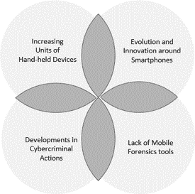 |
| --- |

## 取证科学

为了理解此处将讨论的主题，承认其随时间推演起源和演变的概念至关重要，即法医学学科。事实上，文献中存在多种定义，这是由于该领域涵盖了广泛的应用和知识领域，因此，作者可以利用几个对数字取证和移动设备取证领域也同样重要的概念。

Bell 等人 (2018) 将法医学认为是“科学实践”与“法律实践”之间的权衡”，其中前者实践要求人们对所用技术的合理性和准确性提供经验证明，而后者则代表了在这些技术或方法未经过经验实证的情况下，基于历史先例被接受的手段和方法（Bell et al., 2018: 4541）。对于 Valdez (2018) 来说，法医学可以被视为一个“新兴领域”，它涵盖了科学与法律的应用，以解决不同的犯罪。因此，Valdez (2018) 指出，法医学领域涌出了不同的学科和子学科，即“数字取证、法务会计、法医毒理学、法医牙科和刑事学……以及许多其他法医学领域，如法医心理学和法医语言学”（Valdez, 2018: 1）。

加强这一观点，Arnes (2018) 指出，在法医学中，科学及其技术的应用目的是为法律问题建立“事实性答案”，法医学科学领域在其环境中可以定义为科学在法律中的运用和实践（Arnes, 2018: 2）。上议院院长（2017）将法医学定义为一个“复杂的”领域，因为它涉及到将科学本身的各种广泛学科/领域/区域与现有的法律法规相结合，其目的是在法医鉴定或庭诉案件期间对“相关材料和数据进行恢复、分析和解释”（House of Lords, 2017: 4）。

此外，近期的文献将法医学领域视为犯罪及其现场内“人、地、物之间时空关系的科学”。这门科学受法律及其原则的限制，并涉及其他科学学科所不具备的事项及组合，因为它在其核心是通过使用和应用物理及人造材料和工艺而的一门“物质来源科学”（Houck, 2019: 359）。在 Roux, Ribaux & Crispino (2018) 看来，法医学学科被认为是一种传统学科，对应于科学和科学方法论在法律背景下（即法庭程序）的“线性应用”（Roux, Ribaux & Crispino, 2018: 608）。早些，这些作者将法医学视为“一系列科学学科”，旨在支持和协助刑事司法系统，这门科学是基于对犯罪现场获取的样本进行“开发”，对各个领域和学科进行实践和技术性的使用与应用（Roux, Crispino & Ribaux, 2012: 7）。

除了上述观点，Maras & Miranda (2014) 描述并指出，法医学代表了将“自然科学、物理科学和社会科学”应用于法律及其原则的学科（Maras & Miranda, 2014: 1）。对于 Roux, Ribaux & Crispino (2018) 来说，这一领域也可以通过检查和探索犯罪现场（事件）中最“最可能出现的、碎片化的、不完美的、不受控的元素”来刻画和说明，这被称为“痕迹”。这种机会必须被破译、揭示和掌握，以引出这方面的知识，产生证据和关键信息，从而改变有关特定事件的历史进程（Roux, Ribaux & Crispino, 2018: 612）。

此外，在承认并认可了不同作者在不同时期的不同观点后，作者可以强调，这些概念中的大多数都表达了一个观点：法医学对应于科学与法律应用之间的关系，用于恢复、调查、解码和理解相关的材料和数据，这些数据可以产生新知识或揭示某些最终用于相关背景（例如法庭程序中）的知识。因此，在下图中，作者强调并划分了在分析和探索的文献中可以检索常用术语，这些术语被用于说明和解释法医学概念，即：

| 图 4. 用于描述法医学概念的常用术语 |
| --- |
| 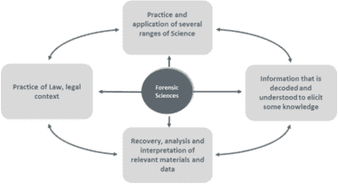 |
| --- |

此外，承认“Forensics”这一术语和表达是如何造词和创建的，该领域是如何随时间演变的，以及它如何整合并维持技术进步以及与数据分析使用不同且更复杂的技术来评估海量不同数据的新兴领域至关重要。

因此，作者可以指出，“Forensic”一词源于拉丁语“forensic”，其本质意思是“面向法庭的或用于公共讨论的”。后来，这个词获得了一个现代定义，可以表示为“与法庭相关的、用于法院的或适用于法院的”（Katz and Halámek, 2016: 1）。

因此，鉴于这一定义是最新的的，Katz and Halámek (2016) 认为，无论所分析或使用的科学类型如何，只要它被应用于法律本身的目的上，就可以被视为法医学。事实上，作者可以指出，利用科学和科学证据来解决犯罪或进行调查，与法庭机构本身一样古老（American Chemical Society, 2017）。

此外，在起源上，法医学概念的造词和揭示是因为古希腊的科学家阿基米德被国王要求调查并确保金金匠所做的可疑活动是否真的发生了。国王提出的这些可疑行为是指金匠在制作皇冠时是否将银换成了金。阿基米德利用他的科学知识，转向水来寻找这一任务的解决方案和答案。通过使用两种金属（即银和金）的特定重量，他测量并计算了它们会排开多少水。因此，他能够为国王的疑虑提供答案，同时用金匠欺骗的科学证据来证实和支持这一结论（American Chemical Society, 2017）。

因此，文献承认，即使在古代，科学也被应用于法律中，以揭示某些推理结果，而这些推理是基于对无数类型科学的使用和应用而获得的证据。

同样，理解法证科学如何运作，以及引导调查过程的活动类型和步骤至关重要。对于 Arnes (2018) 来说，法证从业人员需要对与以下提问相关的实关联负责：在该事件/犯罪现场发生了什么、它是如何发生的、谁参与了其中以及何时发生的。因此，为了做到这一点，从业人员需要开发、阐述并利用科学技术、方法和工具，以便根据可以被视为“铁如山般的确定性”的证据，对特定调查进行推断（Arnes, 2018）。

## 法证活动与阶段

关于法证活动，贵族院（2019）将此过程描述为一个四个阶段，从“痕迹或湿法法证”开始。在此阶段，法证专家在实验室进行并传递测试，以检测某些特定的证据，即从犯罪现场获取的物体，这些物体可以与某项行动或个人关联；第二阶段涉及“解释”，即对第一阶段后续测试得出的模糊推断和结果。在这一步骤中，法证调查人员将所做的推断与其发生的特定统计概率联系起来；第三阶段对应于“事件重构”，调查人员将从犯罪现场获取证据的知识，以及通过观察和证人证言获取的知识结合在一起，试图重建发生的事件安排，且这种安排应与假设在现实发生的情况相似或相等。最后一个阶段被称为“意见证据”，对应于调查人员根据前三个阶段执行的分析，以及到目前为止所积累的技能、培训和经验，对该问题发表其意见的步骤（贵族院, 2019）。

此外，Morgan 等人 (2018) 描述了法证科学应用于犯罪现场直到进入法庭本身期间发生的事件流。这些事件序列开始于实施的犯罪，随后是证据收集和提交，均在犯罪现场进行。在进行这两项活动后，将进行实验室分析和证据解释，利用以下活动：“目击者证词、情报收集、访谈和起诉决定”。在较后的阶段，在法庭上进行结果的展示，并以司法判决结束。

## 四步流程图

对于 Houck (2019) 来说，法证过程按照四步流程运行，从“检测”开始，该阶段是解码和发现物体及证据的活动，即“肉眼看不见的东西”，如果没有法证调查人员，它们将保持隐形状态。在此阶段，目标是揭示和调查可能存在的证据，这些证据可能在其原始语境发现的物体具有意义。根据作者 Houck (2019) 的观点，意义有两种类型：第一种表现为类别级证据，用于发现材料的来源，例如“一把手枪、一块石头、一张地毯”。第二种意义体现为“增加的层级”，即犯罪行为与发现的物体或材料相关的关联，例如“用于射击受害者的手枪”，因此，调查人员正在对物体进行分类，在作者看来，这是法证科学的一个必要步骤。第二步对应于多个学科的使用以及及其方法的结合。随后，Houck (2019) 指出，第三步应当是对发生事件的再现，即“一段叙述”，该叙述应该是那场犯罪的历史。最后阶段的特征是用于衡量和评估所交付结果的性能指标，即描述正在进行的调查的“准确性、及时性和成本”；因此，法证科学应该利用多种科学，将从证据中获得的物理物体和信息转化为知识（Houck, 2019）。

## 法证的应用与领域

此外，上述过程和方法可以用于并应用于多个领域和学科。因此，Katz 和 Halámek (2016) 指出法证科学领域由“法医学组成，包括法医学化学、法医学生物学、法医学人类学、法医学、法医学材料科学、法医学工程、计算法医学等（……）法植物学”。根据这些作者的观点，法证最常见的应用是“指纹和 DNA 分析，旨在识别犯罪受害者或罪犯”（Katz and Halámek, 2016: 1）。

然而，Katz 和 Halámek (2016) 也提到并指出“法证方法远超……它们已应用于人类或动物毛发、纤维、油漆、墨水以及各种人体体液的法证分析，还用于检测枪击残留物、受控物质、爆炸物和其他化学和生物制剂（……）。因此，该领域可以在多个学科和事项及其内部被使用和应用，为这些领域提供了改进以及与当今世界的技术创新和工具相结合使用的许多机会。同样，对于美国化学学会 (2017) 来说，还有野火法证，它利用并使用类似的方法解决神秘动物死亡或追踪非法材料；环境法证案件用于追踪污染源，或对核燃料进行指纹识别以获得更好的安全性”（美国化学学会, 2017: 2）。

## 法证科学面临的挑战

对法证科学进行分析和研究的文献似乎反映并传达出，对于渴望从事法证的人来说，无论领域如何，能够理解法证科学及其相关派生领域所面临的挑战至关重要，这些挑战正危及其科学在调查过程中的成功应用，防止数字调查人员获得具有见解且实用的结论和结果。

事实上，美国国家科学院 (2009) 重点关注感知和描述影响法证科学领域的主要挑战。例如，相应地，指出的主要挑战强烈指向：缺乏资金、获取能够进行调查的分析工具和仪器困难且不利、缺乏技能和经验丰富的专业人士、缺乏认证和监督，以及调查内部缺乏预设的指标和衡量标准，以及缺乏解决法证科学可能出现的变性和潜在偏见的方法论。贵族院 (2019) 反映 true，主要挑战对应于技能和工具的可用性和易用性、网络犯罪、涉及法证的调查规模，以及数字证据与物理证据之间的连接和接口。美国化学学会 (2017) 指出，法证及其领域的主要挑战之一是其涉及的评估和检查不力，即法证科学似乎未能达到科学系统化和准确的要求与原则，并且缺乏对将应用的科学方法的持续监督和评估，这些方法应该被“遵循更严格的标准”（美国化学学会, 2017: 2）。

# 取证鉴定中的认知偏差

同样，其他文献（如 Edmond 等人，2017: 145）将“认知偏差”视为法医学鉴定科学家可能面临的最大挑战之一。因此，作者指出法医学鉴定科学家面临着“认知偏差”，这意味着：

1. 作为人类，人们有不同的感知并以不同的方式体验世界，人们对世界的体验是“一种解释性过程的结果，并取决于我们的注意力、先验信念、预期、经验和知识”；
2. 人的记忆是不可靠的，因为它可能在当事人毫无察觉的情况下发生，因此，作者鼓励法医学实务人员利用记录和实证信息，建立通往“编码、存储和检索”记忆过程的桥梁；
3. 人的语境以及个人周围的环境（包括“情绪、先验经验和边缘信息”等方面）可能会导致法医学鉴定科学家做出错误或次优的决策；
4. “专业知识是特定领域特定任务的”，因为一个人的专业知识并不是从一个任务直接迁移并外推到另一个任务的；
5. 法医学鉴定科学家或任何专家的决策过程通常是在没有经过深思熟虑的情况下做出的，因为人类往往对“我们实际上是如何做出决策的洞察力有限”；
6. 法医学鉴定家的信息可能并非“外行听众所听到的”，事实上，专家在交流方面往往存在困难，因此观众获取到的信息可能与传输的信息不同；


7) Edmond 等人（2017）提到“经验并不等同于专业知识”，这意味着在某项任务或工作中的经验并不意味着与在该任务或工作中经验较少的人相比，其表现和精度就会更高；

8) 人的监督和审查可能并非真正独立，因为人各不相同；

9) 信心似乎是对准确性的一种平庸预测，尤其是当这种信心被加强时；以及，

10) 人的反馈对于辅助学习过程至关重要，但很多时候这些反馈不可用，或者对于科学家而言无关（Edmond 等人，2017: 145-150）。

考虑到这些挑战，法医学科学能够克服这些问题至关重要，其中某些挑战可能由于增加对这些主题和课题的研究与探索需求而变得难以应对，这包括通过更多的学术调查，以寻求更严谨、准确和精确的方法论、技术和工具，从而为数字调查员提供一套能够让他们应对这些挑战的工具包。此外，作者承认了法医学及其子学科可以具有的不同应用及其适用领域。根据 Maras & Miranda (2014) 和 Arnes (2018) 的观点，任何被使用和应用于法律的科学都可以被视为法医学，它有许多分支和子学科，例如“法医经济学、法人类学、法牙齿学、法病理学、法毒学、法昆虫学、法心理学、法会计、法工程和计算机司法。”

# 法医学中的大数据与机器学习

因此，近期的文献正在探索如何通过大数据和机器学习通过更好更精确的技术来改进方法，这些技术预计将产生更有力的支持结论。例如，Lefèvre (2018) 发表了一篇关于大数据如何应用于法医学和医学的论文，并注意到指出，为了实现这一目标建立可持续的大数据框架，必须包含并遵循某些行动，即：具有处理和分析信息的结构和能力；对这些主题进行培训和教育以提高和塑造技能；以及监管和伦理。

相应的，大数据可以提供“一个消除狭窄专业领域边界的卓越框架，允许人们使用标准化工具对证据进行工作”（Lefèvre, 2018: 5）。同样，Margagliotti 和 Bollé (2019) 发表了一篇关于“机器学习与法医学”主题的论文，提到“在数字取证实验室（……），需要分析的数据量在过去几年不断增加”，这是由于涉及技术本身（即互联网）的犯罪日益增加。通过这种方式，本文强化了使用机器学习算法支持和辅助法医学调查过程的需求，以处理数字痕迹的法医学问题，例如使用分类算法通过多种化学或物理特征来识别油漆的来源（Margagliotti and Bollé, 2019: 138）。

对于美国化学学会（2017）来说，存在若干机会，即在可以影响科学技术和方法论的进展。从涉及化学分析的学科到涉及数字和移动取证等技术创新的课题。根据这位作者的观点，即使在阿基米德及其分析之前，历史数据似乎表明个人已经尝试使用指纹或墨水来研究文档及其内容。

然而，近期的文献也显示法医学科学正处于“十字路口”，即处于一个需要科学界关注的阶段（Bell 等人，2018: 4541）。因此，作者指出，“随着科学——特别是法医学的不断进步，要求或期望律师、法官和陪审团独自责任批判性地评估科学证据和证词的质量和有效性，变得越来越荒谬”（Bell 等人，2018: 4541）。

# 数字取证科学

在探讨法医学科学主题后，承认数字取证概念的起源和演变是重要的。事实上，由于该领域涵盖的广泛应用、知识和兴趣领域以及其可以应用和利用之处，存在多种定义。Valdez (2018) 提到，数字取证以前被称为计算机取证，但现在这个概念涉及并包含现有电子设备的测试和分析，这些设备从计算机、手机到打印机和/或其他技术机器。根据作者的观点，这门科学并不旨在证明“某人的无罪或有罪。相反，其目的是提供通过数字取证发现的证据”（Valdez, 2018: 1）。

Arnes (2018) 认为，任何涉及数字信息的法医学活动都代表数字取证活动，而不是数字调查（后者对应于数字领域内进行的调查）。同样，Carrier (2003) 认为数字取证是一门学科，自计算机和设备具备存储可以作为证据的数据能力以来就存在了。对于 Du 等人（2017）来说，设备取证是处理从数字设备中检索的数字格式文件和数据的科学，这门科学现在由于新型和创新技术日益增出现和创新，以及在进行刑事调查时数字证据可能具有不可避免的关联性（即那些涉及数字资源的调查）。

因此，Arnes (2018: 4) 将数字取证视为任何经过证明且通过科学产生的技术，应用于对从数字设备中检索的数字证据进行“保护、收集、验证、识别、分析、解释、归记录和展示”，这些证据在司法和犯罪领域，以及在揭示与数字信息相关的事实方面可以起着重要作用（Arnes, 2018; Du et al., 2017）。此外，Aziz 等人（2015）认为，数字取证科学可以被视为 `Information Security` 领域的一个学科，其主要目标是能够检索、发现、分析并对电子和数字证据得出结论。这表明在数字取证过程中，将这些证据保持在原始状态至关重要，同时执行任何测试程序并对这些证据进行验证，以便重建特定事件并能够得出结论（Aziz et al., 2015）。根据 Valdez (2018) 的观点，在对证据进行任何测试或分析之前，对证据进行镜像是非常相关的，这可以看作是原始件的“精确复制”副本，且该副本通过比较 `hash value` 认证。该值表示一个“字符字符串”，允许识别证据（Valdez, 2018: 2）。此哈希值取自原始证据，然后与副本的值对应，如果相等，则证据经过深思考虑未被篡改。Valdez (2018) 建议，为了防止任何修改，可以使用“写保护器”，它代表并对应“用于捕取司法镜像且不允许在其上写入的产品、软件或硬件”（Valdez, 2018: 2）。

同样，对于证据分类，Maras & Miranda (2014) 指出取证证据分类有四种方案：物证，即物品/物理对象对于分析中的案件至关重要；接触证据，是指由于两个物理物体之间的互动和接触而产生的交换结果；埃蒙德·洛卡德（Edmond Locard）曾口述过这种互动和交换原则，指出当物品和表面“接触时，物质将从一个转移到另一个”；微量证据，代表灰尘、头发或土壤等可以在人们不知情的情况下改变的物质；模式证据代表其通过与经历类似现象的证据相比，可以推断其分布以确定其沉积方法（Maras & Miranda, 2014: 2-3）。

| 图 5. 取证证据分类的四种方案 |
| --- |
| 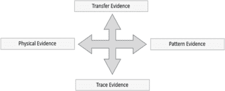 |
| --- |

对于 Carrier (2003) ，数字取证证据可以分为三类，调查将尝试对其进行划分和分配，以理解并确认可用数据以及后续证据属于这三类中的哪类。例如，第一类数字证据是“定罪证据”，对应于证实给定假设/前提的证据；而第二类 `exculpatory evidence`（无罪证据）是指用于反驳和否定给定理论的证据。最后 `evidence of tampering`（篡改证据）代表数字调查人员确认系统是否被操纵的证据（Carrier, 2003: 2）。

Sönmez 等人（2017）将数字取证过程描述为由犯罪发生触发的过程。因此，犯罪后的下一阶段是通过保护和视频录像来访问并确认犯罪现场。之后，需要将证据包装并从犯罪现场转移到某处。为了执行这些测试，确定将使用什么技术以及研究 `image` 是重要的。

结果，下一阶段是对方法论、所采取步骤和所得结果的正式记录，以便将其转换为报告。Carrier (2003) 认为数字取证过程以三个主要阶段为特征，其主要目标是检测和分类可能作为调查中潜在资源的数字证据。这些阶段是：1) `acquisition`（获取）、2) `analysis`（分析）和 3) `presentation`（展示）。在第一阶段，目标是检索所有可以提取的数字数据和信息，因为在该阶段调查人员并不具备了解哪些数据将被应用和使用的知识，因此目标是尽可能多地提取，包括内存的分配和未分配区域，这被称为 `image`。下一步是 `analysis`，反映了对收集的数据进行评估和调查，目的是识别潜在证据和模式，以便得出结论（Carrier, 2003）。

此外，数字取证过程的最后一步发生在数字调查人员能够提取、分析并展示正在进行的调查之后。因此，数字调查人员必须保证所有的分析和过程在法庭上是可采信、相关且可靠的。Carrier (2003) 指，为了使数字证据在法庭上被接受，数字调查人员必须确保：1) 对程序进行了测试和分析；2) 在程序及其测试期间，定义了已知的错误率；3) 该程序已共享、分发并经过了同行评审；以及 4) 正在使用的程序在涉及该科学社区内被广泛接受。

此外，随着智能手机的进步使得关键行动能够实时发生并执行，即关键和个人信息的创建、传输和存储。这些信息应当以某种方式得到保护，同时又要能够被恢复和检索，因为移动设备具有创建、管理和存储信息的能力，这些信息可能成为解决刑事案件的重要信息来源（Sathe & Dongre, 2018; Chernyshev et al., 2017; Graves, 2013; Jadhav & Joshi, 2016）。同样，根据 Klomklin & Lekcharoen (2016) 的观点，预计 2018 年全球约 84%的人口将拥有手机，这代表了海量的数据和潜在的关键信息，可用于犯罪调查。根据作者的说法，这可能与多种网络犯罪有关，从非法拦截数据、电子银行欺诈、个人和职业信息盗窃、电子破坏和恐怖主义、电子腐败和勒索、洗钱和恐怖主义融资。

因此，由于这类犯罪的发生率似乎上升，进行移动设备取证（Mobile Device Forensics）调查变得比任何时候都更加重要，包括可能检索和恢复存储在移动设备上、隐藏或删除的数据，这些数据可能在案件案件中起着至关重要的作用。例如，Bjornson & Hunter (2016) 反映，传统数字取证的重点已从个人计算机中的数据转移到存储在移动设备中的数据，其取证过程彼此相似，即获取手机精确副本的过程，以确保该副本不发生任何修改，并且这些数据随后可以使用基于软件的工具转换为信息。对于 Padmanabhan et al. (2016) 来说，该领域非常新，代表了数字取证领域随时间不断兴起的一个领域。同样，根据 Faheem et al. (2016) 的观点，移动取证科学是数字取证的一部分，它可以被描述为在工具帮助下使用取证技术和方法收集数字证据的过程，使过程变得更加精确准确。

此外，多位作者将移动设备取证科学视为一个可以观察并描述为步骤调查程序的流程。因此，对于 Ayers et al. (2014) 来说，表征移动设备取证程序的步骤可以描述为一个四个阶段的过程，这些结构化的过程旨在为数字调查人员执行移动取证时提供指导和支持。第一阶段是“保护”（preservation），代表了检索和安全获取可疑移动设备的过程，以防止设备及其包含的数据发生任何修改。对于这种保护，作者提到有三种操作可以防止变化或修改的发生，以及防止外部人员尝试的任何外部交互。第一个程序是开启手机的飞行模式，这将阻止与网络、Wi-fi 和蓝牙的连接，从而防止通信的发生。第二个程序是通过关闭设备来将其电源，这与第一个程序一样阻止交互的发生。最后但同样重要的是，可以采取的第三个程序是将移动设备放入屏蔽箱中，这将阻止来自外部的网络和无线通信。（Ayers et al., 2014; Faheem et al., 2016; Barmpatsalou et al., 2018）。

该过程的第二阶段是“获取”（acquisition）阶段，目标是从设备和/或与设备一起使用的任何外设中检索并收集所有可能的数据。在保护和获取移动设备以及从中可以检索的数据/信息后，为下一阶段——检查、分析和报告阶段准备正确且相关的工具至关重要。在这些阶段，目标是分析并揭示可能与特定案件相关的任何数字证据，例如删除或隐藏的数据、通话记录和消息日志、图片、文档以及任何适合在法庭上提交以证实特定案件的信息源。

同样，根据 Sathe & Dongre (2018) 的观点，在进行移动取证时，应遵循分步的流程。在这个过程中，第一步被描述为“识别”（Identification），调查人员旨在从物理上检查设备，以理解并确认移动设备是否可能是刑事调查中重要且相关的信息源。之后，接下来的步骤是“保护”和“获取”，这涉及确保手机不会从可能损害数据的外部连接访问，因为“获取”步骤涉及获取设备副本的活动。通过这种方式，调查人员降低了设备（即设备物理状况和电池本身）的风险。

在隔离设备并获取设备镜像后，下一步是“分析”（Analysis）和“记录”（Documentation）。在“分析”阶段，数字调查人员旨在审查从设备中检索的数据，以便得出见解和结论，这些见解和结论可能成为刑事调查中的相关部分；而在“记录”步骤中，目标是正式记录调查期间采取的每项活动，以便得出最终结论的所有步骤都有正式的形式存在，并在必要时可以重新执行和审计。最后一步是“呈现”（Presentation），涉及展示通过之前所有步骤得出的见解和结论。

根据 Chernyshev et al. (2017) 的观点，移动设备取证是一个相当新的取证子学科，因为在 2007 之前，关于这项科学的信息非常过时、稀少且描述不全，其特点是关于这项科学以及可能存在的工具的文档缺失或有限。此时，很少或没有从移动设备中检索数字证据的应用或技术，围绕该主题的文献集中在理解如何检索 SIM 卡上的信息，而不是手机本身。

随后，在 2007 年至 2010 年间，Chernyshev et al. (2017) 指出移动取证领域首次通过几个机构和协会提出的指南呈现，这些指南重点在于确保数字调查人员拥有的设备数据镜像能够与获取该设备时的原始手机状态相对应。通过这种方式，数字调查人员避免了在使用和对设备引入修改以满足指南定义的这一要求，这导致数据提取过程更具挑战性，产生的证据少于数字调查人员在引入修改的情况下可以检索到的证据。

# 从 2011 年到 2016 年，Chernyshev 等人（2017）描述道，在此期间，获取更多数字证据的需求比以前更加迫切，这主要是由于世界上引入了越来越多不同且新的技术；因此，移动设备取证开始扩展到可穿戴设备、云服务和移动应用程序，并发明了更先进的提取技术，能够从这些设备中检索到更好、更丰富的证据。

从这一时期开始，移动设备取证科学正以惊人的速度增长，遵循着改变人们生活的不断进步和多样化的技术。同样，新型设备和不同型号的出现也增加了手机供应商在提高此类设备安全性方面的关注和压力，这使得数字取证人员从这些设备中检索数据和信息变得更加困难。然而，尽管移动设备取证科学正积极增长，但它无法跟上技术、其演变及其移动设备更快、更复杂的增长，这些设备似乎每天都在进化并变得更好。

## 移动设备取证面临的挑战

关于数字取证分支，移动设备取证科学同样需要指出该领域面临过和正面临的主要挑战，特别是在从移动设备中提取数据时。根据 Jadhav & Joshi（2016）的观点，该领域面临着若干挑战。之一是存在多种类型的手机，每种手机都有无限的规格和设置，这导致移动取证需要具有弹性和灵活性，能够拥有许多支持不同类型设备的技术。同样，每部手机都包含其内置特性，这可能成为数字取证人员在尝试访问设备并提取信息时面临的潜在障碍。

此外，Jadhav & Joshi（2016）强化了这样一个观点，即取证工具存在局限性，这可能意味着没有任何工具能够满足访问和提取特定手机型号数据的目的。同样，随着技术的演进，网络犯罪类型也在发生变化，即恶意应用程序和文件，这些文件可能包含由于手机出现病毒而导致损坏的数据。此外，Jadhav & Joshi（2016）强调，存储在手机上的数据可能是动态数据，即数据可能在取证人员未注意的情况下被修改，并导致误判和错误的结论；而且当设备被用于国际犯罪或设备属于个人但归公司所有时，存在法律问题（Graves, 2013; Jadhav & Joshi, 2016）。

## 文档与标准化

根据 Chernyshev 等人（2017）的观点，该领域的主要挑战在于，在进行调查时所用和可用的技术缺乏文档记录和形式化；这些技术通常由几个步骤组成，涉及不同工具和技术的应用因此因此为了作为相关证据被法庭采纳，取证人员不仅需要记录所使用的方法和技术，还需要记录所取得的发现，并能够提交以支持某一论点。同样，Omeleze & Venter（2013）强调，大多数支持移动取证和其他数字取证科学的框架和方法在完全投入于取证调查之前，缺乏测试和程序分析。对于 Barmpatsalou 等人（2013）来说，移动设备取证领域缺乏标准化可以归因于该技术行业快节奏的发展及其变化，这在不同类型的手机和操作系统之间创造了日益巨大的鸿沟。

事实上，Chernyshev 等人（2017）提到，如今移动取证人员可以使用的应用程序和工具缺乏维护和生成有关所执行操作的支持性文档和日志证据的能力。此外，缺乏关于如何使用这些工具、需要哪些培训课程和认证才能充分利用这些工具并承认其能力的文档。例如，有几种工具的文档有限或完全没有文档来指导数字取证人员如何使用该特定工具。每部手机拥有的操作系统情况也是如此，因为其中一些操作系统的可用文档非常有限，特别是使用最少的操作系统，这为数字取证人员在识别这些应用程序中应该看哪里以及看什么构成了巨大的挑战（Chernyshev et al., 2017; Omeleze & Venter, 2013）。

## 技术演进与可靠性

此外，Chernyshev 等人（2017）强调，移动设备取证领域面临着更多挑战，这些挑战需要探索和研究，因为它们目前正危及移动设备取证调查的质量和认可。因此，作者提到了诸如缺乏标准化且经过测试的技术等挑战，数字取证人员在进行移动取证时预期或可以使用这些技术。例如，存在不同且差异的技术，这取决于手机和所使用的工具，因此缺乏标准化和通用支持使得调查的可靠性和信誉度降低，这在法庭上听起来可能存疑。此外，用于执行移动取证的应用程序所具有的各种工具的多样性及其不完善性也可能是数字取证人员未考虑的挑战，他们信任应用程序将完全按照其价值主张描述的那样工作。然而，每个工具都有自己的配置和功能，允许进行更深入或更高层次的分析，可能会产生不同的结果，甚至是“对比性的提取结果”，并受到漏洞、软件缺陷的影响，甚至可能被损坏和破解。

此外，手机上个人数据与云服务的接口和集成使得数字取证人员的工作变得更加困难。如今的云服务允许人们进行信息的实时交换以及无限数据的上传和下载。此外，对于如何使用移动设备取证工具检索云信息，几乎没有支持，而且难以确保和确立存储在云端的数据的所有权（Chernyshev et al., 2017）。


另外，如前所述，数字取证人员面临的最大挑战之一是无法跟上具有手机行业和市场特征的快节奏环境。移动取证工具尚无法应对日新异的技术演进和创新，这为数字取证人员带来了复杂且未知的挑战。同时，对手机进行的伪造和修改可能带来额外挑战，而现有工具无法针对这些配置和修改进行调整。

此外，安全设置和反取证技术对移动设备取证领域也提出了相关挑战。事实上，作为一种安全措施，许多手机制造商都有能力允许用户对手机数据进行加密，这被认为是防止外部人员访问的方法。这些措施为移动取证工具制造了难以逾越的强大屏障。同样，反取证技术侧重于创建各种方法来从设备中提取数据并混淆手机中的信息（Chernyshev et al., 2017）。此外，作为物联网（IoT）的主要挑战之一，如今手机不再仅仅用于拨打电话或发送短信，而是被广泛应用于各种物联网设备中，这使得数字取证人员访问手机内存和相关数据变得更加困难。此外，外围设备的出现可以与手机配合使用，需要额外的工具和方法来识别其对手机的影响，例如通过 `Bluetooth` 连接的智能手表（Chernyshev et al., 2017）。

根据 Chernyshev 等人（2017）的观点，尽管存在上述挑战，取证领域有许多机会演进并获得更多关注。根据这些作者的观点，主要机会源于移动设备环境。例如，移动设备市场和手机正在快速增长，这意味着新的技术和功能每天都在被探索和交付（Li et al., 2018）。因此，通过关注手机的关键架构和技术方面，移动取证领域可以创建并增强其方法和能力。同样，随着术语的发展以及更多新技术出现在市场上并供用户以更低的价格购买和探索，因此需要手机数据与不同数据库的集成（特别是云端）。如此，由于手机中的数据格式既不是统一的也不是通用的，市场中存在的工具和应用程序将特定于某类数据类型，或者取决于数字取证人员的知识水平。因此，存在一个巨大的缺口，需要构建并开发一种通用且快速的分析工具来从云端检索不同类型的数据，这现在是最大的存储库之一（Chernyshev et al., 2017）。

此外，这些开发的应用程序能够专注于分析和提取至关重要，因为手机可能拥有海量的数据和信息，这些在数字取证人员看来是有用的。能够执行这种分段意味着应用程序可以进行提取。此外，加强对移动取证工具可用应用程序的认识也是重要的（Chernyshev et al., 2017）。

### 手机考古学与取证可用应用程序

此外，了解手机是什么及其结构以及这些设备如何工作也是重要的。如此，根据 Graves（2013）的观点，手机被视为“双工”设备，两个人可以同时通信；这与半双工设备（例如对讲机）不同，后者一次只允许一个人说话，且预计最大距离为 8 公里。手机可用于全球范围内的通信，因为基站遍布全球。

Graves（2013）指出，通信是由基站发起的，这意味着每个基站向手机运营商提供其可以使用的特定频率范围。手机和基站利用了低带宽频率的使用，使其在不产生相邻小区内任何噪声或干扰的情况下被重复利用。通信的执行基于以下原理：当呼叫者拨打手机电话时，信号会被其最近的基站接收，接收者也是如此；如此，信号在基站之间传输并中继到目标手机。基站离呼叫者越近，信号越强。

此外，重要的是基收发电站（Base Transceiver Station）概念，它对应于与手机交互并连接的无线电设备，而基站控制器（Base Station Controller）则是无线电设备管理器和网络频率分配器。负责网络交换的是移动交换中心（`MSC`）。该系统旨在管理构建网络内的通信，并与公共移动网络建立接口；如此，每当调查进行时，都应被考虑由取证人员进行调查。该系统包含数据库，即主位置寄存器（`HLR`）和访客位置寄存器（`VLR`），允许 `MSC` 处理并与网络中出现和流动的信息交互。

根据 Graves（2013）的观点，主位置寄存器（`HLR`）负责订阅者和服务数据，而访客位置寄存器（`VLR`）负责服务覆盖范围之外（即漫游中）的手机。在涉及手机通信数据时，这两个代表了重要的数据库，并可以提供关于订阅者的信息，即地址、服务以及在网络中注册的最后位置日志。

此外，当涉及到手机的位置和定位时，必须承认全球定位系统（`GPS`）的存在，该系统如今已包含内置功能，允许对其进行追踪，从而实现手机的定位。要通过使用 `GPS` 定位手机，即在地图上确定手机的精确位置，需要 `GPS` 与其位置附近的三颗卫星进行通信（该位置由手机的 `GPS` 接收器确定），形成三个圆，通过这些所指圆的交点，就可以确定移动设备的位置。

对手机进行地理位置定位的另一种方法是使用手机基站进行三角测量或三边测量法，这代表了一种“近距离”进行三角测量的方法。例如，当第一座基站开始以信号强度和范围作为衡量标准计算其与手机之间的距离时，基站与其网络之间的三角测量就发生了。之后，第二座基站根据与第一个基站类似的信号强度测量并计算到手机的距离，据此可以推导出两个可能的区域，即第一个基站与手机之间的距离与第二个基站与手机之间的距离重叠的地方，将手机的位置缩小到两个可能的点。第三座基站将利用网络信号来追踪并将手机的位置缩小到一个可能的点，从而锁定手机的位置。

此外，如今最广泛使用的技术之一是全球移动通信系统（`GSM`），它代表了一种蜂窝网络，手机可以通过搜索范围内的蜂窝站连接到该网络并与之交互。`GSM` 涉及 `SIM Card Component` 的使用（Graves, 2013）。

此外，值得注意的是手机可能具有的几种状态以及这些状态对数字取证人员工作的影响。根据 Faheem 等人（2016）的观点，手机状态嵌入了四个子功能，第一个是锁屏，如果启用，可能需要用户输入 `pin-code`、通过 `face id` 或指纹识别器登录，或者通过绘制连接点的图案（pattern）来解锁。这些选项可能代表用户的手机没有锁屏类型，这意味着手机通过按任何键即可唤醒，而不需要任何安全类型来解锁手机。第二个子功能是屏幕保护程序，可以通过用户的配置来激活或禁用。第三和第四功能分别由开发者选项和飞行模式表示，前者是一个允许用户对手机设置更复杂的参数和设置的选项，后者如前所述，将阻止手机可能尝试的任何通信。

对于 Faheem 等人（2016）来说，其他功能可能涉及手机上配置的电子邮件以及已安装并准备好使用的应用程序，其中包括第三方应用（用户安装的程序）、被禁用和删除的程序。同样，查看 `wi-fi` 和浏览器配置及历史记录等功能也是相关的，以及 `SIM card` 功能，包括其记录的通话和短信日志。

根据 Chernyshev 等人（2017）的观点，数字取证人员应该投入更多时间并承认的一个方面是手机可能具有的潜在功能。例如，根据这些作者的观点，手机可能拥有源自设备本身、用户所属运营商以及用户终端的功能。因此，设备可以具有多种功能，例如 `Platform`（平台），包含了允许人们识别手机、网络以及用户定义或默认设置的本地定义和设置等信息。同样，设备还可能包含如电话录列表、通话和短信日志、图像和视频以及其他帮助用户提高效率的个人应用程序，如电子邮件、备忘录、待办事项、文档、网页浏览历史和日历。手机还可以存储用户所处的位置，只要手机处于开启状态即可精确锁定手机的位置。它还可以保留手机安装的每个应用程序信息，例如社交网络活动、网页浏览或云服务数据，以及用户已使用的网络（已知网络）或可见的网络（`Bluetooth devices`、`Wi-fi networks`、`mobile data network`）。同样，Tassone 等人（2013）认为，从手机中提取的数据可以用于调查，其中包括：

手机市场还包含运行 Windows Phone 操作系统的智能手机、黑莓（Blackberry）以及山域（Symbian），这些在调查过程中可能会遇到。与 Android 和 iOS 不同，由于市场流行度和份额较低，这两个操作系统收到的支持和研究也较少。因此，如果手机中使用了其中任何一个操作系统，数字取证人员将有较少的工具来执行调查过程（Sathe & Dongre, 2018; Chernyshev et al., 2017）。

如前所述，Android 操作系统占据了手机市场最大的份额，这因此增加了数字取证人员遇到运行 Android 系统的移动设备的概率。同样重要的是，该操作系统也是最开源的操作系统之一，允许用户编写并开发可在智能手机中实时使用的应用程序，这使得数字取证人员能够提取并分析该操作系统变得更加困难。

### Android 操作系统架构

Android 操作系统由开放手持联盟（OHA）开发，利用 `Linux` 内核作为其核心并构建了该操作系统的各个模块。根据 Rao & Chakravarthy (2016) 的观点，Android 操作系统的特点是拥有 Dalvik 虚拟机（VM）。这些虚拟机允许运行 Android 系统的手机能够运行多个应用程序和进程，然而，由于这些运行是由唯一 ID 处理的，应用程序和进程之间互不交互，除非为这些分配了特殊的权限和配置。需要注意的是，Android 应用程序带有 `.apk` 文件扩展名，它们存储在移动设备的内部内存中，以及应用程序缓存、用户数据和支持该操作系统的库中。Android 操作系统的架构由四个不同的层级组成，即“应用程序、应用程序框架、库与 Android 环境以及 Linux 内核”。

### 安全风险与取证挑战

Kim 等人（2018）指出，围绕 Android 操作系统的风险之一是，犯罪分子可以在系统分区上隐藏并存储信息，为了访问这些信息，数字取证人员需要设备经过 root 权限，即已解锁（拥有超级权限）。同样，手机犯罪的手段之一是，犯罪分子向系统分区中插入并注入损坏的数据，手机用户在犯罪发生前不太可能察觉，或者在最常见的情况下，手机用户才意识到手机被黑客攻击了。

Graves (2013) 提供了几个手机被送入水中以破坏证据的案例。例如，iPhone 内部有四个水指示器，如果设备浸入水中，指示器会变成粉色。当调查人员发现手机进过水时，首要任务是……一种有效的方法是将手机放入装有硅胶包的自封袋中。在所有情况下，都建议调查人员让手机干燥 3 到 5 天。

### 数据存储与硬件组件

在了解手机在工作、通信和交互方面的原理后，了解数据如何存储、存储在何处以及手机在其组件中可以包含什么类型的数据也是非常重要的。如前所述，手机及其组件（例如 SIM 卡或存储卡）中包含着无量的信息，因此对于数字取证人员了解去哪里寻找和获取这些信息至关重要，因为这些信息可能存在于手机的多个物理硬件部件中。

#### SIM 卡（用户身份识别模块）

SIM 卡是一个至关重要的组件，允许对通信加密并向网络识别手机。事实上，没有 SIM 卡，手机只能拨打其所在地区的紧急电话。如今，绝大多数智能手机使用 Nano-SIM 卡，这是 SIM 卡最小的版本。其余手机则使用 Mini-SIM 卡或 Micro-SIM（Graves, 2013）。

SIM 卡通常具有 128 KB 的存储能力，但它并不是手机上唯一的存储器。相反，还有其他只读存储器（ROM）和随机访问内存（RAM），其中前者代表存储设备操作系统（OS）的存储，而 RAM 是不稳定且易失的（Graves, 2013）。

#### 安全机制：PIN 和 PUK

手机最重要的部分之一是 SIM 卡，即用户身份识别模块，它代表手机的身份。SIM 卡包含用户的电话、通话记录、发送和接收的短信以及联系人列表。根据 Omeze & Venter (2013) 的说法，SIM 卡可以包含大量数据。

用户访问 SIM 卡需要输入一组名为 `PIN` 的数字，以便其访问信息。然而，如果 `PIN` 错误输入三次，用户将被要求输入更复杂的身份验证码 `PUK`。如果发生这种情况，服务提供商将查询位于 SIM 卡上的集成电路标识符（`ICCID`）进行验证，然后才提供 `PUK`。如果手机所有者错误地插入并输入 `PUK` 10 次，SIM 卡将被永久锁定。如果手机是公司拥有并由公司管理的，该手机可能被配置为允许覆盖此规则。

# 移动设备特性与识别

尽管如此，移动设备具有不同的特性，从不同的软件和硬件组件类型到不同的功率需求不等。因此，对于数字调查员来说，最强大且关键的信息来源之一是 `OS`。然而，必须注意手机看起来看起来是 `Android`，但移动设备可能配置了另一个 `OS` 来模拟 Android，从而导致数字调查员被这种对 `OS` 的掩盖所误导（Graves 2013）。

Venter (2013) 指出，手机行业的飞速发展使手机设计人员思考那些能够进一步开发和改进人与手机之间交互的特征，因此，引入了多种服务，从多媒体短信服务 (`MMS`)、图片和视频到社交媒体应用和游戏，这引发了对手机本身配备更大、更好闪存内存的需求，因为这种闪存内存在存储能力上与个人电脑相似。

## 设备标识符

手机手机上标记有上述的 `SIM` 和 `ICCID`，尽管如此，设备上还有其他信息可以在正在执行的调查中发挥有用作用。这些信息可能与移动电话的电子序列号 (`ESN`) 相关，也可能与移动设备标识符 (`MEID`) 以及国际移动设备识别码 (`IMEI`) 相关。`ESN` 和 `MEID` 数字对于手机及其插入的网络来说都是唯一且特定的。`IMEI` 数字是一个十六进制数，专门用于 `GSM` 手机，可以被视为设备的安全码（Graves 2013）。

根据 Graves (2013)，为了让数字调查员从手机中检索与 `MEID` 相关的信息，只需输入按键 `*#06#`。在手机为 `iPhone` 的情况下，数字调查员可以直接访问 `Settings > General > About`。同样，`IMEI` 与 `MEID` 类似，它允许在移动设备丢失或被盗时在网络进行识别。`IMEI` 打印在手机的电池仓内，由 15 位算法组成，每个都有不同的目的和意义。前八位对应型号分配代码 (`TAC`)，指示手机的型号及其产地。接下来的六位算法对应设备本身的序列号，最后一位是校验和。因此，由于这些信息打印并标记在手机本身上，个人可以移除标签，将其更改以模拟不同的信息，或使其不可见，从而导致数字调查无法在上面找到这些信息；如果发现了这些信息，也无法对其进行解释并确保其正确性。测试信息是否正确以及正确检索信息的一种方法是查看手机本身的电源线，该电源线预计特定于某个品牌和型号。

## 取证挑战

关于从手机中获取信息，数字调查员试图检索这些信息，为了做到这一点，需要在检查期间与移动设备进行通信并连接。然而，当移动设备在与逮捕相关的现场搜查 (`SITA`) 中被没收时，如果它处于开启状态并连接到网络，极有可能被远程访问、修改甚至清除存储在该设备上的关键信息。

为了克服这些挑战，可以使用所谓的“法拉第罩”（`Faraday Enclosures`），其目标是让不必要的信号或干扰远离移动手机，即让手机处于一个封闭区域。它的一个衍生产品是“法拉第袋”（`Faraday’s bag`），这是一种通过隔离移动手机来防止射频通信的设备，包含密封条以确保袋子完全隔离，阻止任何通信发生。这些工具提供了一种与设备通信的方式，防止了外部对其进行通信，但必须考虑在调查过程中打开袋子以连接电缆或执行任何其他活动的风险，从而可能发生任何外部通信（Graves 2013）。

## 文档记录与分析

此外，数字调查员记录调查期间采取的每一个步骤是非常重要的。为了做到这一点，Graves (2013) 提到了使用屏幕捕获设备，这将允许调查员记录对移动设备执行分析时采取的每一个步骤。每一步和更改将被记录并归档，确保调查员的工作可以审计和重新执行。

作者推荐两个工具：第一个是 `Paraben’s Project-A-Phone`，另一个是 `Eclipse` 屏幕捕获设备。为了充分利用这些工具的 Utility，重要的是在法拉第罩（`Faraday Enclosures`）中使用它们，以确保工作得到良好的记录，并精确检索完成这些工作所需的程序。这些设备能够创建文件、加密文件并允许在支持这些设备的软件上直接进行注释。

Cheryshev 等人 (2017) 和 Ayers 等人 (2014) 指出，移动设备可以执行五个级的数据提取水平，这可以区分不同工具的能力。承认数据提取的不同层级对于执行有效的移动取证调查至关重要，因为该过程的主要挑战之一是能够按照数据在手机中存储的方式精确获取数据并进行保护，否则这些证据数据无法在调查中作为证据（Wilson & Chi 2017）。

遵循不同的数据提取层级，可以看到第 1 级提取被称为“手动提取”（`manual extraction`），它是对设备本身存储信息的提取，对应于不需要工具即可提取且具有高技术复杂性的数据。在这一层级上，Bjornson & Hunter (2016) 描述了对手机内存进行精确复制的需要，在不进行任何修改的情况下创建镜像。

## 提取级别

第 3 级提取由“十六进制转储”（hex dumping）表示，这反映了物理提取，涉及使用特定的刷写器将手机置于诊断模式，从而允许数字调查人员下载手机的闪存。闪存是一种可以通过电子方式更改或擦除的非易性存储器（Chernyshev et al., 2017; Ayers et al., 2014）。同样，在这一提取级别，目标是访问设备的存储介质，即任何允许用户放置、维护和检索任何电子数据的技术。通过这种方式，该技术允许数字调查人员不仅可以访问分配的数据，还可以访问未分配的数据，后者包含已删除或过时的数据，提供了大量数据，这是第 1 级和第 2 级提取能够做到的（Zhang et al., 2017）。

第 4 级提取被称为“芯片拆”（Chip-off）提取，代表了检索手机闪存芯片的操作，以便获取完整的物理镜像，然后使用专业工具检索原始数据。最后一种提取级别第 5 级代表“微读”（micro read），这涉及到需要使用电子显微镜对逻辑门进行物理观测，逻辑门对应包含一个或多个输入和一个输出的电子电路。这一级别需要高水平的技术知识，因为数字调查人员需要将观测结果转换为可读数据（Chernyshev et al., 2017; Ayers et al., 2014）。

## 工具与应用

如上述，有许多工具和应用程序供数字调查人员支持数字调查过程，然而，数字调查人员理解并承认这些应用是什么、它们是免费的还是需要付费、以及它们是否符合调查人员在本次检查期间想要解决的需求和问题是至关重要的。同样，Chernyshev 等人 (2017) 指出，数字调查人员有大量可用工具，包括付费应用程序和开源应用程序。根据这些作者的观点，移动技术的进步以及这些设备目前在技术市场上的份额，给移动取证工具供应商带来了新挑战，因为设备种类繁多，且为了让数字调查人员访问这些应用程序中的数据，每个设备都需要提取提取。


同样，数字调查人员可用的商业工具往往价格昂贵，工具的价格是反映工具不同特征的因素，因此，工具的提取能力越强，价格越高。除了这些工具的获取成本外，由于移动设备取证领域的复杂性，数字调查人员还需要投入进行培训，以了解这些工具的工作原理以及如何发挥其最大价值。同样，付费工具也是一种投资，体现了需要更新以跟上快速发展的手机行业标准的风险，因为某一个工具很可能无法维持新手机的快速发布以及高度活跃的移动技术领域所开启的新新功能（Chernyshev et al., 2017）。

### 付费与开源工具

在执行移动取证的付费应用程序中，可以极力推荐 `Project-A-Phone` 工具，它包含一个高分辨率摄像头，能够与调查人员使用的工具集成，并包含一个能够从目标设备中提取数据的设备。`NFI` 内存工具包代表了同样能够执行数据提取的工具，包含一种允许更底层方式的软件。尽管如此，数字调查在进行调查时可以使用几种免费开源应用程序，例如 `BitPim` 工具，它允许调查人员从“基础功能手机”中提取数据；`LiME`（代表 `Linux Memory Extractor`）通过手机与应用程序之间的调试桥，能够执行 Android 手机的内存检索。同样，像 `Autopsy` 这样的应用可以帮助数字调查人员管理和分析数字证据。根据 Chernyshev 等人 (2017) 的观点，免费工具与付费工具的使用取决于正在分析和调查的事项，然而，作者指出两种类型都面临相同的挑战，即恢复和检索丢失及删除的数据、无法理解和解释存储的数据，以及缺乏通用支持。

### 数据获取技术

此外，对于之前已删除的数据获取，Graves (2013) 提到了两种由于其物理提取能力而可用于镜像提取的设备，均来自 Cellebrite，这些分别是 `Universal Extraction Device (UFED)` 和 `Chinex` 设备。要这样做，手机需要连接到这些设备，设备将尝试从联系人、短信、视频、图片和日志中捕获所有数据。可以通过蓝牙、红外或数据线连接。它还具有复制和克隆 SIM 卡的能力。同样，Rao & Chakravarthy (2016) 指出，对于移动数据的获取和检查，特别是像 WhatsApp 这样的消息应用，数字调查人员可以利用 `UFED (Universal Extraction Device)` 并使用 `UFED Physical Analyzer` 分析来自这些工具的证据。同样，Cellebrite 的 `UEFD Touch` 应用程序能够在非常不同的提取级别执行手机数据获取，包括物理提取，物理提取指的是创建手机内存的精确副本，同时也支持文件系统提取（Bjornson & Hunter, 2016）。

此外，能够执行手机镜像的软件对于数字调查来说非常重要且相关相关。因此，通过获取移动设备的镜像，数字调查人员将能够复制该移动设备，以便其原始状态得以保存，并防止修改或任何连接尝试。为了分析这些数据，数字调查人员可以使用 `FTK Imager`，它允许人员检查捕获的分区、数据、缓存和系统镜像，以及设备内部内存中持任何应用程序或数据，包括短信、图像、视频、浏览器和应用历史以及用户账户个人信息。为了充分使用此应用程序，用户应该对手机进行 root（根）以获得 root 用户权限，然后运行 `Linux` 命令以检索手机镜像。最后一步是使用 `FTK imager` 对此镜像进行取证分析并检索相关信息（Rao & Chakravarthy, 2016）。

## 文献概述

根据 Jadhav & Joshi (2016)，`FTK Imager` 允许数字取证人员从手机中检索重要信息，即其 `IMEI Number` 以及关于设备状态和制造商信息的其他信息。同样，对于 Shortall & Azhar (2015) 来说，`FTK Imager` 是执行手机镜像最常用的工具之一，然而，作者也提到了两种可以进行移动设备成像的工具，即 `EnCase` 和 `Linux` 本身。此外，`FTK Imager` 代表了一个免费工具，是市场上用于移动设备成像最常用的工具之一，而 `EnCase` 也是最常用的工具之一，被大不列各地的警方部门广泛使用（Shortall & Azhar, 2015）。能够执行手机镜像的软件对数字取证人员来说非常重要。鉴于之前描述的不同类型的数据提取，Omeleze & Venter (2013) 强调，对于逻辑采集（即从手机的逻辑文件分配内存中提取数据），目前有“MicroSystematics XRY、`EnCaseNeutrino`、`FTK`、`Cellebrite Universal forensics extraction devices (UFED)` 和 `Paraben Device Seizure`”等应用程序。

## 数据分析与可视化

在提取数据后，必须有一个允许人们对其进行分析和可视化的软件。Graves (2013) 提到了 `Device Seizure` 或 `BlackLight` 等软件。这些软件允许邮件提取、数据提取和分析。根据 Faheem 等人 (2016)，目前既没有付费也没有开源工具可以直接运行在手机本身上。现有的工具需要外围设备（即计算机）的支持。在可用工具中，作者提到 `XRY`、`UFED`、`OXYGEN` 或 `Paraben` 是能够分析并帮助数字取证人员可视化证据并得出任何结论的工具。

## 检索与工具

所有这些工具都允许数字取证人员从手机中检索若干信息，包括通话和短信日志、联系人列表、电子邮件、Wi-fi 网络、活动、历史及其配置、浏览器活动、安装的应用及其缓存、设备信息（如手机型号和版本、软件版本、内核信息、品牌制造商、`IMEI`、开发选项配置（是否激活）、飞行模式状态、电池状态以及在设备上执行的若干配置）（Faheem et al., 2016）。Jadhav & Joshi (2016) 建议数字取证人员应该利用 `Android SDK`、`Magnet Axiom`、`qtADB`、`FTK Imager` 和 `SQLite Forensics` 等工具。应用程序 `qtADB` 将帮助数字取证人员定位重要数据所在，即用户数据。在此阶段，取证人员应该查看包含用户数据的手机区块，该区块代表了存储在设备外部和/或内部内存中与用户在使用手机期间活动相关的所有数据。

定位用户数据后，数字取证人员可以使用 `Magnet AXIOM` 软件，该软件允许取证人员加载基于用户数据创建的镜像并分析该镜像，即“制品”（如多媒体、浏览器和活动历史、文档和个人数据）。该工具也可用于记录分析结果。

## 参考文献

- Jadhav & Joshi (2016)
- Shortall & Azhar (2015)
- Omeleze & Venter (2013)
- Graves (2013)
- Faheem et al. (2016)
- Magnet AXIOM
- qtADB
- SQLite Forensics
- Android SDK
- （等待，提供的文本末尾包含参考文献列表，我将根据提供的文本进行格式化）
- Shortall & Azhar (2015)
- Jadhav & Joshi (2016)
- Faheem et al. (2016)
- ... （遵循所提供的列表）
- American Chemical Society. (2017). Forensic Science: The Promise and Perils of Using Science in the Court.
- Årnes, A. (2018). Digital Forensics (1st ed.). John Wiley & Sons.
- Ayers, R., Brothers, S., & Jansen, W. (2014). Guidelines on Mobile Device. National Institute of Standards and Technology Special Publication 800-101 Rev. 1.
- Aziz, N., Mokhti, F., & Nozri, M. (2015). Mobile forensics for cloud data: Practical and legal considerations.
- Bjornson, J., & Hunter, A. (2016). Mobile forensics for cloud data: Practical and legal considerations. 2016 14th Annual Conference on Privacy, Security and Trust (PST).
- Chernyshev, M., Zeadally, S., Baig, Z., & Woodward, A. (2017). 移动取证：进展、挑战与研究机遇。IEEE Security and Privacy , 15(6), 42–51. doi:10.1109/MSP.2017.4251107
- Du, X., Le-Khac, N.-A., & Scanlon, M. (2017). 针对数字取证即服务的数字取证流程模型评估。学术出版社.
- Edmond, G., Towler, A., Growns, B., Ribeiro, G., Found, B., White, D., Ballantyne, K., Searston, R. A., Thompson, M. B., Tangen, J. M., Kemp, R. I., & Martire, K. (2017). 思考取证：面向法证从业人员的认知科学。Science & Justice , 57(2), 144–154. doi:10.1016/j.scijus.2016.11.005
- FaheemM.Le-KhacN.-A.KechadiT. (2016). 通向新的移动云取证框架。2016 年第六次创新计算技术国际会议 (INTECH)，创新计算技术 (INTECH)，2016 年第六次国际会议, 736–742. 10.1109/INTECH.2016.7845142
- Graves, M. W. (2013). 数字考古学：数字取证的艺术与科学。亚迪逊韦韦出版社.
- Houck, M. M. (2019). 法医学科学如何运作：法证企业的架构。澳大利亚法医学科学杂志 , 51(3), 359–368. doi:10.1080/00450618.2017.1375396
- 上议院. (2017). 法医学科学与刑事司法系统：变革的蓝图。科学与技术选择委员会，2017–19 年期第三份报告。
- 上议院科学与技术选择委员会. (2019). 法医学科学与刑事司法系统：变革的蓝图。2017-2019 年期第三份报告 HL Paper 333.
- JadhavM.JoshiK. K. (2016). 基于 Firefox OS 的移动设备数据获取与分析的法证调查程序。2016 年计算、分析与安全趋势国际会议 (CAST)，计算、分析与安全趋势 (CAST)，国际会议, 456. 10.1109/CAST.2016.7915012
- Katz, E., & Halámek, J. (2016). 法医学 – 化学、物理、生物学与工程——引论。在 Katz, E., & Halámek, J. (编辑), 法医学 . doi:10.1002/9783527693535.ch1
- Kim, D., Lee, Y., & Lee, S. (2018). 移动取证参考集 (MFReS) 与安卓设备的移动取证调查。超级计算杂志 , 74(12), 6618–6632. doi:10.1007/s11227-017-2205-5
- Klomklin, S., & Lekcharoen, S. (2016). 泰国执法机构手机取证程序的程程开发。ICCSE 2016 - 第 11 次计算机科学与教育国际会议, 473–478.
- Lefèvre, T. (2018). 法医学与医学中的大数据。法医学与法律医学杂志 , 57, 1–6. doi:10.1016/j.jflm.2017.08.001
- Li, S., Sun, Q., & Xu, X. (2018). 智能设备与在线社交网络数字图像法证分析，2018 年 IEEE 第 20 次高性能计算与通信国际会议；IEEE 第 16 次智能城市国际会议；IEEE 第 4 次数据科学与系统国际会议, 1015-1021.
- Maras & Miranda . (2014). 法医学。法律与经济百科全书.
- Margagliotti, G., & Bollé, T. (2019). 机器学习与法医学。国际法医学杂志 , 298, 138–139. doi:10.1016/j.forsciint.2019.02.045
- Morgan, R. M., Nakhaeizadeh, S., Earwaker, H., Rando, C., Harris, A. F., & Dror, I. E. (2018). 法医学科学过程中每一步的法医学证据解释：不确定性下的决策。在罗特奇犯罪科学手册中。学术出版社.
- Mumba, E. R., & Venter, H. S. (2014). 使用统一数字取证调查流程的移动取证。2014 年南非信息安全。南非信息安全 , 2014, 1–10.
- Omeleze, S. & Venter, H.. (2013). 测试统一的数字证调查模型——使用安卓手机。2013 年南非信息安全，南非信息安全, 1.
- PadmanabhanR.LoboK.GhelaniM.SujanD.role (2016). 商业与开源移动设备的对比分析。2016 年当代计算国际会议 (IC3)，当代计算 (IC3)，2016 年国际会议, 1–6. 10.1109/IC3.2016.78803
- PRISMA-P Group. (2015). 系统评价和元分析的首选报告项目 (PRISMA-P) 2015：详述。BMJ (临床研究版) , 349.
- RaoV.ChakravarthyA. S. (2016).安卓设备的分析。2016 年进展与工程国际会议 (ICRAIE)，进展与工程 (ICRAIE)，2016 年国际会议, 1–6.
- Roux, C., Ribaux, O., & Crispino, F. (2012). 从取证到法医学。刑事司法现状 , 24(1), 7–24. doi:10.1080/10345329.2012.12039
- Roux, C., Ribaux, O., & Crispino, F. (2018). 法医学 2020 - 十字口的终结？澳大利亚法医学杂志 , 50(6), 607–618. doi:10.1080/00450618.2018.148573
- Ryu, J. H., Kim, N. Y., Kwon, B. W., Suk, S., Park, J. H., & Park, J. H. (2018). 第三方应用分析。信息系统杂志 , 14(3), 680–693.
- Saleem, S., Popov, O., & Baggili, I. (2016). 选择最佳移动取证工具的方法与案例研究。数字调查 , 16(增刊), S55–S64. doi:10.1016/j.diin.2016.01.008
- SatheS. C.DongreN. M. (2018). 移动取证中的数据获取技术。第 2 次创新系统与控制国际会议论文，ICISC 2018, 280–286 10.1109/ICISC.2018.839907
- ShortallA.AzharM. A. H. (2015). 热门移动平台的 WhatsApp 数据获取。2015 年第六次新兴安全技术国际会议 (EST), 13. 10.1109/EST.2015.16
- Snyder, H. (2019). 文献综述作为研究方法：概述与指南。商业研究杂志 , 104, 333–339. doi:10.1016/j.jbusres.2019.07039
- 加强美国法医学。前进之路。(2009)。法科学界需求识别委员会，国家研究委员会。国家学院出版社。
- SuQ.XiB. (n.d.). 手机取证与应用的关键技术。2017 年第 2 次多媒体与图像处理国际会议论文，ICMIP 2017，2017–1 月, 335–340. 10.1109/ICMIP.2017.15
- Tassone, C., & Martini, B., Kim-Kwang, R. C., & Slay, J. (2013). 移动设备取证：快照。犯罪与刑事司法趋势 , 460, 1.
- Valdez, B. (2018). 学科焦点：取证。国际社会科学评论, 94(2).
- Varol, A., & Sönmez, Y. Ü. (2017). 数字取证流程中证据收集与保护阶段的回顾。国际信息安全科学杂志 , 6(4), 39–46.
- Wilson, R., & Chi, H. (2017). 移动设备取证工具的案例研究。东南部会议论文, 154–157. 10.1145/3077286.3077564
- ZhangW.MaC.YuM.LiuC.WangY. (2017). N-SVDD：用于移动取证的敏感分析模型。2017 年 IEEE 应用与网络安全国际会议 (AINS)，应用与网络安全 (AINS)，2017 年 IEEE 国际会议, 48. 10.1109/AINS.2017.82704

入侵检测系统必须在网络中持续检测漏洞，并在处理海量流量时保持高效性能。入侵检测系统必须能够检测网络中新兴的和主动的威胁。各种分类器通过监控系统活动，将威胁归类为正常或入侵。在本章中，提出了一种基于分层规则的分类器来检测各种入侵，并提出了一种基于模糊熵的特征选择方法来识别相关特征。分层模糊规则分类器旨在提高入侵检测系统的性能。`KDD`数据集包含各种攻击；这些攻击被分为四类，即拒绝服务（`DoS`）、探测（Probe）、远程登录（`R2L`）和用户到根（`U2R`）。本研究还考虑了实时数据集。实验结果表明，所提方法提供了良好的检测率，最小化了误报率，并缩短了计算时间。

## 引言


在最近，大多数人为了特定目的或其他相关目的连接互联网。因此，入侵检测系统（`IDS`）对于个人或组织保护其信息免受未经授权用户的侵害至关重要。组织使用硬件和软件设备来保护信息，但最终大多数入侵者并未被检测到。今天，信息对于任何组织都更加重要，因此需要保护信息免受未经授权用户的侵害，因为许多未经授权的用户正在使用不同的技术来检测信息并利用系统中的漏洞。当信息从一个主机传输到另一个主机时，无法提供免受未经授权用户的保护。在这些方面，安全性对于保护信息至关重要。

入侵检测系统（`IDS`）通常分为两类：基于签名和基于异常的入侵检测系统。基于签名的入侵检测系统通过与日志文件中的现有签名进行比较来检测入侵。基于异常的入侵检测系统则在观察网络行为偏离正常时进行检测。入侵检测系统可分为基于网络的入侵检测系统和基于主机的入侵检测系统。基于网络的入侵检测系统是在系统通过网络进行通信时检测错误行为的系统。基于主机的入侵检测系统是监控和分析计算机系统是否存在错误行为的系统。（Devaraju & Ramakrishnan, 2013）。

模糊规则技术用于轻松处理大量的原始数据。各种技术包括关联规则、聚类、决策树、神经网络和数据挖掘。许多作者已尝试提高入侵检测系统的性能并降低误报率。尽管入侵检测系统中发生了一些错误行为，但由于数据集包含大量数据，性能未能提高且误报率未能降低。数据包含许多特征，作者使用了所有特征进行处理，但某些特征并不是重要的。

在本文中，尝试创建基于协议特征的新的一组模糊规则集，这将帮助我们提高性能、降低误报率并缩短处理时间。考虑了三种类型的协议特征，如`tcp`、`udp`和`icmp`。攻击主要取决于任何一种协议特征，因此需要根据协议特征对数据进行分类以减少特征。本文的创新点如下：

* i) 提出了基于模糊熵的特征选择，以从`KDD`数据集中选择最相关的特征。
* ii) 提出了基于模糊规则的分类器，利用所选特征生成新的模糊规则集，利用`KDD`数据集和实时数据集对攻击分类。
* iii) 提出了分层分类器以获得更好的性能并减少计算时间。

本文的结构如下：相关工作的背景，讨论了基于模糊熵的特征选择和分层模糊规则分类器；描述了所提方法的实验工作；并提供了结论。

## 背景

使用了不同的技术用于入侵检测系统。它们是统计方法、神经网络、数据挖掘等。在本节中，讨论了用于入侵检测系统的各种技术。

`C-Means Clustering`被应用于入侵检测，它使用最少测试数据集并通过降维算法减少特征以提高检测时间（Minjie & Anqing, 2012）。一种新型双支持向量机和`SVM`被用于克服正常流量模式和分类准确性（Nie & He, 2010)(Srinivas, Andrew & Ajith, 2004)(Sumaiya & Aswani, 2017)(Horng, Chen, Kao & Perkasa 2011）。`Hidden Markov Model`被用于实现和确定基于系统调的异常入侵检测系统（Jiankun, Xinghuo, Qiu & Chen, 2009)(Xie & Yu, 2009）。`Conditional Random Fields`和`Layered Approach`通过`KDD cup ’99`数据集展示了攻击检测准确率（Gupta & Kotagiri, 2010）。`Genetic Algorithm`用于检测入侵，它在问题编码期间同时考虑了网络连接的时间和空间信息（Wei, 2010)(Jiang & Junhu, 2011）。

`Hierarchical Gaussian Mixture Model`被用于通过`KDD99`数据集的统计分类技术将基于网络的攻击作为异常。此外，它还用于减少漏报并提高攻击准确性（Suseela, Zhu & Julie, 2005)(Kabir, Jiankun, Wang & Zhuo, 2018）。各种`Neural Network`方法被用于提高入侵检测系统的性能。`KDDCup’99`数据集被用测试数据提供了稳健的结果（Devaraju & Ramakrishnan, 2011)(Ran, Steren, Nameri, Roytman, Porgador & Yuval, 2019)(Neveen, 2009）。`SVM`和`GA`用于分类，这些方法通过最小化特征来提高检测率（Iftikhar, Azween, Abdullah & Muhammad, 2011）。相关系数和数据挖掘技术被用于通过`KDD cup99`数据集提高新类型异常的检测（Ning, Chen, Xiong & Hong-Wei, 2009)(Anbalagan, Puttamadapa, Mohan, Jayaraman & Srinivasarao, 2008)(Devaraju & Ramakrishnan 2019)(Lidio, Roberto & Mauro 2012)(Devaraju 2019）。`Association rule mining algorithm`被用于入侵检测系统的攻击检测。它被视为个体攻击以构建应用于`KDD`数据集的规则集（Pan, Hariri & Pacheco, 2019)(Devaraju & Ramakrishnan, 2015）。

`Recurrent Neural Network`用于提高分类率，特别是针对`R2L`攻击。`Decision trees`和`support vector machines`用于提高检测准确率并最小化计算复杂度（Mansour, Zahra & Ali, 2010)(Sandhya, Ajith, Crina & Johnson, 2005)(Akashdeep, Ishfaq & Neeraj, 2017)(Alex, David & Aladdin, 2018）。`Data mining clustering technique`用于入侵检测，还原算法用于消除冗余属性集（Nadiammai & Hemalatha, 2014)(Srinivas, Andrew & Ajith, 2007)(Vajiheh & Shahram, 2018）。`Rule-based classification`、`decision tree methods`和新的`fuzzy class association rule-mining method`用于检测网络入侵（Anuar, Hasimi, Abdullah & Omar, 2008)(Shingo, Chen, Nannan, Shimada & Hirasawa, 2011)(Adnan & Cameron, 2017)(Devaraju & Saravana Prakash 2019)(Ashfaq, Wang, Huang, Abbas & Yu-Lin, 2017）。

所提工作侧重于基于签名和基于网络的人入侵检测系统 (Gupta & Kotagiri, 2010) (Ramakrishnan & Devaraju 2017)。该研究考虑了基准 KDD 数据集，其中包含 41 个特征 (Selvakani & Rajesh 2011)。并非所有 41 个特征与分类攻击相关。在本文中，提出了一种基于模糊熵的特征选择方法以消除无关特征。存在多种常用的特征选择方法，如主成分分析、支持向量机和遗传特征选择方法。然而，这些方法并未尝试选择那些同时具有较大类间熵和较小类内熵的相关特征。本文考虑了特征选择的类间熵和类内熵。本文提出了一种分层模糊规则分类器。该基于模糊规则的分类器旨在利用选定的特征生成新的模糊规则集以对攻击进行分类。所提方法提高了检测率，降低了误报率，并缩短了计算时间。

为了避免这些缺点，本文提出了基于模糊熵的特征选择和分层模糊规则分类器。与其他方法相比，模糊逻辑提供了最佳检测率和更短的计算时间。然而，采用的模糊逻辑 (Tajbakhsh, Rahmati & Mirzaei 2009) (Abadeh, Hamid & Habibi 2011) (Samantaray 2013) (Chan, Lee & Heng 2013) 既没有对分类器进行微调，也没有选择特征以同时获得更好的检测率并减少计算时间。

## 动机

大多数机构和行业正面临着日益严峻的威胁。入侵检测系统用于维护资源的完整性和机密性。近年来，入侵检测是管理员检测新兴威胁的首要任务和最具挑战性的任务。

## 问题描述

在入侵检测系统中，采用了多种方法，如数据挖掘技术 (Devaraju & Ramakrishnan, 2013) (Minjie & Anqing, 2012) (Nadiammai & Hemalatha, 2014) (Anuar, Hasimi, Abdullah & Omar, 2008) (Muniyandi, Rajeswari & Rajaram, 2012)、概率方法和支持向量机 (Nie & He, 2010)、神经网络 (Devaraju & Ramajaran, 2011)、模糊 C 均 (Shingo, Chen, Nannan, Shimada & Hirasawa, 2011)、遗传算法 (Wei, 2004) (Jiang & Junhu, 2011)、隐马马尔可夫模型 (Jiankun, Xinghuo, Qiu & Chen, 2009) (Xie & Yu, 2009) 等。现有系统未能提供数据安全。采用基于模糊规则的分类器是为了克服现有问题，减少误报并提高攻击检测准确性。

## 基于模糊熵的特征选择与分层模糊规则分类器

本节重点关注基于模糊熵的特征选择和分层模糊规则分类器。基于模糊熵的特征选择用于特征选择，分层模糊规则集用于分类。

## 基于模糊熵的特征选择

特征选择对于减少无关特征的数量至关重要。通常，KDD 数据集包含 41 个特征，其中少数特征对于处理并非本质，会消耗更多的内存和时间。无关特征不仅会降低检测率，还会增加计算时间 (Lin, Ying & Lee 2012)。本文中，提出了基于模糊熵的特征选择方法，根据不同类型的攻击消除无关特征 (Ramakrishnan & Devaraju 2017)。基于模糊熵的特征选择旨在同时选择不同的特征子集以进行针对攻击的检测。然而，现有的特征选择方法在分类各种攻击时选择相同的特征子集。这是由于所采用的方法不允许同时选择不同的特征子集。提出以下步骤来并发选择特征：

- 第一步，对特征值进行归一化：

```
[kdd - min] / [max - min]
```

- 第二步，使用熵计算类内熵和类间熵以寻找不同的子集：

```
 (2)
```

- 第三步，根据类内熵和类间熵，将隶属度定义为低 (0.00 到 0.15)、中 (0.16 到 0.50)、高 (0.51 到 0.85) 或极高 (0.86 到 1.00)。
- 第四步，利用模糊规则生成规则集以选择特征：
    - 规则 1：类间熵极大且类内熵极小，则选择特征。
    - 规则 2：类间熵极大且类内熵较小，则选择特征。
    - 规则 3：类间熵较大且类内熵极小，则选择特征。
- 第五步，根据隶属度生成模糊规则集。
- 第六步，采用检测率。
- 第七步，根据检测率选择特征。在本文中，28 个变量如表 1 所示。

| 编号 | 特征名称 | DoS 类 | R2L | U2R |
| :--- | :--- | :--- | :--- | :--- |
| 1 | duration | | | |
| 2 | protocol_type | | | |
| 3 | service | | | |
| 4 | flag | | | |
| 5 | src_bytes | | | |
| 6 | dst_bytes | | | |
| 7 | land | | | |
| 8 | wrong_fragment | | | |
| 9 | urgent | | | |
| 10 | hot | | | |
| 11 | num_failed_logins | | | |
| 12 | logged_in | | | |
| 13 | num_compromised | | | |
| 14 | root_shell | | | |
| 15 | su_attempted | | | |
| 16 | num_root | | | |
| 17 | num_file_creations | | | |
| 18 | num_shells | | | |
| 19 | num_access_files | | | |
| 20 | num_outbound_cmds | | | |
| 21 | is_host_login | | | |
| 22 | is_guest_login | | | |
| 23 | count | | | |
| 24 | srv_count | | | |
| 25 | serror_rate | | | |
| 26 | srv_serror_rate | | | |
| 27 | rerror_rate | | | |
| 28 | srv_rerror_rate | | | |
| 39 | `dst_host_srv_serror_rate` | × | × | × | √ |
| 40 | `dst_host_rerror_rate` | × | × | × | × |
| 41 | `dst_host_srv_rerror_rate` | × | × | × | × |
| | 选取特征 | 17 | 21 | 14 | 14 |

# KDD 数据集描述

基准 KDD 数据集和实时数据集已用于评估入侵检测系统 (Srinivas, Andrew & Ajith, 2004)。KDD 数据集包含多种攻击类型，例如 `smurf`、`neptune`、`mailbomb`、`back`、`apache2`、`teardrop`、`snmpgetattack`、`guess_passwd`、`satan`、`mscan`、`saint`、`portsweep`、`ipsweep`、`nmap`、`processtable`、`pod`、`snmpguess` 和 `warezmaster`。KDD 数据集包含 41 个特征，分为连续型和离散型。

这些攻击分为四大类：DoS、Probe、R2L 和 U2R。攻击分组如下 (Nie & He, 2010)：

- 服务 (DoS) 攻击：可以拒绝对系统的合法请求，例如 `Flood`。
- 用户到根用户 (U2R) 攻击：未经授权访问本地超级用户（`root`）权限，例如 `Buffer overflow` 攻击。
- 远程到本地 (R2L) 攻击：从远程机器的未经授权访问，例如 `Guesses a different password`。
- 探测 (Probing)：探测是一种监控和其他探测攻击，例如 `Port scanning`。

表 2 显示了用于训练和测试数据的 KDD 数据集 (Gupta & Kotagiri, 2010) (Devaraju & Ramakrishnan 2014) (Selvakani & Rajesh 2011)。

## 表 2. 训练与测试数据集

| 数据集 | DoS | Probe | U2R | R2L | Normal | 总计 |
| --- | --- | --- | --- | --- | --- | --- |
| 攻击类型 | Back,Land, Neptune, Pod, Smurf, Teardrop | Ipsweep, Nmap, Portsweep, Satan | Buffer_overflow, Loadmodule, Perl, Rootkit | Ftp_write, Multihop, Imap, Guess_passwd, Phf, Warezclient, Warezmaster, Spy | Normal | - |
| 训练数据(KDD 数据集) | | | | | | |
| 10% KDD | 391458 | 4107 | 52 | 1126 | 97278 | 494021 |
| 测试数据(KDD 数据集) | | | | | | |
| 修正后 KDD | 229853 | 4166 | 70 | 16347 | 60593 | 311029 |
| 完整 KDD | 3883370 | 41102 | 52 | 1126 | 972781 | 4898431 |
| 测试数据(实时数据集) | | | | | | |
| 带有总记录的实时数据 (TCP) | 2500 | 1500 | 4000 | | | |

KDD 数据集由三个部分组成：“10% 数据集”、“修正后数据集”和“完整数据集”(Devaraju & Ramakrishnan 2019)。在每个类别中，都有数百万条记录，每条记录包含 41 个特征，并被标记为正常或特定的攻击类型。“10% 数据集”用于训练数据，“修正后 KDD 数据集”和“完整数据集”用于测试数据 (Devaraju 2019)。

# 分层模糊规则分类器

所提的分层模糊规则分类器的架构如图 1 所示。

| 图 1. 所提的分层模糊规则分类器的架构 |
| --- |
| 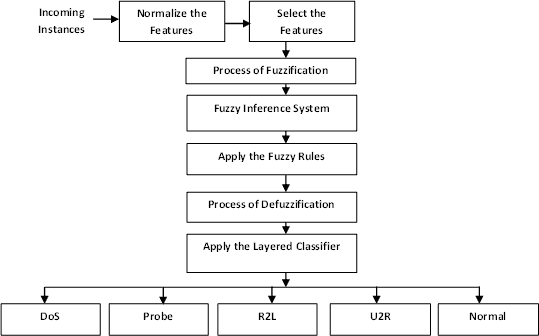 |

所提分类器包含模糊化单元、模糊推理系统、规则块和去模糊单元。模糊化单元是将精确值转换为模糊值以描述隶属函数的过程。模糊推理系统有助于根据新的模糊规则集识别攻击类型。去模糊单元是将模糊值转换为精确值以便使用分层分类器对攻击类型进行分类的过程 (Cingolani & Jesus 2012)(Cingolani & Jesus 2012)。本文中提出的分层模糊规则分类器用于预测攻击类型，降低误报率并减少计算时间。

## 模糊化

模糊化用于识别输入值，并将输入转换为模糊度。实验使用了不同的模糊函数（如 Sigmoid、高斯、梯形等）进行分类。发现三角形函数在 KDD 数据集上具有良好的结果。

表 3. 模糊化分配

| 变量编号 | 特征名称 (根据 KDD 数据集) | 极低 (VL) | 低 (L) | 中 (M) | 高 (H) | 极高 (VH) |


## 模糊推理系统与规则

使用模糊推理系统将指定的输入值转换为输出值的过程。在本文中，所提系统采用了 Mamdani 模型。Mamdani 模型通过聚合过程由隶属函数定义。规则块通过“激活”、“与（AND）”、“累积”和“模糊规则”定义。这些方法用于用于快速结果。“激活”和“与”方法使用 `MIN` 函数定义，而“累积”方法使用 `MAX` 函数定义。所提系统中生成了模糊规则。离散变量表示为 `protocol_type` (P)、`service` (S) 和 `flag` (F)。

*   **规则 1**：IF ((P IS tcp OR P IS udp OR P IS icmp) AND (S IS http OR S IS domain_u OR S IS ecr_i) AND (F IS SF) AND `kdd0` IS L AND `kdd1` IS L AND `kdd2` IS VL AND `kdd3` IS L AND `kdd4` IS L AND `kdd8` IS M AND `kdd9` IS H AND `kdd11` IS L AND `kdd14` IS M AND `kdd15` IS VL AND `kdd16` IS L AND `kdd18` IS M AND `kdd19` IS H) THEN - 正常
*   **规则 2**：IF ((P IS tcp OR P IS udp OR P IS icmp) AND (S IS ecr_i OR S IS private OR S IS telnet OR S IS smtp OR S IS http) AND (F IS SF OR F IS REJ OR F IS S AND `kdd0` IS VL AND `kdd1` IS VL AND `kdd2` IS VL AND `kdd3` IS VL AND `kdd4` IS VL AND `kdd8` IS M AND `kdd9` IS H AND `kdd11` IS L AND `kdd14` IS M AND `kdd15` IS VL AND `kdd16` IS L AND `kdd18` IS M AND `kdd19` IS H) THEN - DoS
*   **规则 3**：IF ((P IS tcp OR P IS udp OR P IS icmp) AND (S IS private OR S IS telnet OR S IS smtp OR S IS http) AND (F IS SF AND `kdd0` IS VL AND `kdd1` IS VL AND `kdd2` IS VL AND `kdd3` IS L AND `kdd4` IS L AND `kdd8` IS M AND `kdd9` IS H AND `kdd11` IS L AND `kdd14` IS M AND `kdd15` IS VL AND `kdd16` IS L AND `kdd18` IS M AND `kdd19` IS H) THEN - RL
*   **规则 4**：IF ((P IS tcp OR P IS udp OR P IS icmp) AND (S IS http OR S IS domain_u OR S IS ecr_i) AND (F IS SF AND `kdd0` IS VL AND `kdd1` IS VL AND `kdd2` IS VL AND `kdd3` IS L AND `kdd4` IS L AND `kdd8` IS M AND `kdd9` IS H AND `kdd11` IS L AND `kdd14` IS M AND `kdd15` IS VL AND `kdd16` IS L AND `kdd18` IS M AND `kdd19` IS H) THEN - Probe
*   **规则 5**：IF ((P IS tcp OR P IS udp OR P IS icmp) AND (S IS http OR S IS domain_u OR S IS ecr_i) AND (F IS SF AND `kdd0` IS VL AND `kdd1` IS VL AND `kdd2` IS VL AND `kdd3` IS L AND `kdd4` IS L AND `kdd8` IS M AND `kdd9` IS H AND `kdd11` IS L AND `kdd14` IS M AND `kdd15` IS VL AND `kdd16` IS L AND `kdd18` IS M AND `kdd19` IS H) THEN - 正常

## 模糊化

使用模糊推理系统将指定的输入值转换为输出值的过程。在本文中，所提系统采用了 Mamdani 模型。Mamdani 模型通过聚合过程由隶属函数定义。规则块通过“激活”、“与（AND）”、“累积”和“模糊规则”定义。这些方法用于获得快速结果。“激活”和“与”方法使用 `MIN` 函数定义，而“累积”方法使用 `MAX` 函数定义。所提系统中生成了模糊规则。离散变量表示为 `protocol_type` (P)、`service` (S) 和 `flag` (F)。

## 分层分类器

使用模糊推理系统将指定的输入值转换为输出值的过程。在本文中，所提系统采用了 Mamdani 模型。Mamdani 模型通过聚合过程由隶属函数定义。规则块通过“激活”、“与（AND）”、“累积”和“模糊规则”定义。这些方法用于获得快速结果。“激活”和“与”方法使用 `MIN` 函数定义，而“累积”方法使用 `MAX` 函数定义。所提系统中生成了模糊规则。离散变量表示为 `protocol_type` (P)、`service` (S) 和 `flag` (F)。

## 实现与实验设置

使用模糊推理系统将指定的输入值转换为输出值的过程。在本文中，所提系统采用了 Mamdani 模型。Mamdani 模型通过聚合过程由隶属函数定义。规则块通过“激活”、“与（AND）”、“累积”和“模糊规则”定义。这些方法用于获得快速结果。“激活”和“与”方法使用 `MIN` 函数定义，而“累积”方法使用 `MAX` 函数定义。所提系统中生成了模糊规则。离散变量表示为 `protocol_type` (P)、`service` (S) 和 `flag` (F)。

## 实验设置

使用两种不同的指标来衡量性能，即通过混淆矩阵使用的攻击检测率 (`ADR`) 和误报率 (`FPR`)(Devaraju & Ramakrishnan 2015)。使用 `jFuzzyLogic`（开源软件）进行仿真检测各种攻击。它也用于生成规则集。

## 使用 KDD 数据集

使用模糊推理系统将指定的输入值转换为输出值的过程。在本文中，所提系统采用了 Mamdani 模型。Mamdani 模型通过聚合过程由隶属函数定义。规则块通过“激活”、“与（AND）”、“累积”和“模糊规则”定义。这些方法用于获得快速结果。“激活”和“与”方法使用 `MIN` 函数定义，而“累积”方法使用 `MAX` 函数定义。所提系统中生成了模糊规则。离散变量表示为 `protocol_type` (P)、`service` (S) 和 `flag` (F)。

表 4 包含了训练结果（10% 数据集）、测试结果（修正后的数据集和完整数据集），并衡量了效率。混淆矩阵如图 4 所示。10% 数据集中 `Normal` 的 `ADR` 为 92.24%；`DoS` 的 `ADR` 为 99.73%；`Probe` 的 `ADR` 为 94.42%；`R2L` 的 `ADR` 为 93.87%；`U2R` 的 `ADR` 为 84.61%。`Normal` 的 `FPR` 为 3.35%；`DoS` 的 `FPR` 为 0.016%；`Probe` 的 `FPR` 为 2.92%；`R2L` 的 `FPR` 为 0.0%且 `U2R` 的 `FPR` 为 3.84%。修正后数据集 `Normal` 的 `ADR` 为 98.11%；`DoS` 的 `ADR` 为 99.87%；`Probe` 的 `ADR` 为 96.52%；`R2L` 的 `ADR` 为 98.13%且 `U2R` 的 `ARD` 为 90%。`Normal` 的 `FPR` 为 1.75%；`DoS` 的 `FPR` 为 0.02%；`Probe` 的 `FPR` 为 0.38%；`R2L` 的 `FPR` 为 0.06%且 `U2R` 的 `FPR` 为 0.00%。完整数据集 `Normal` 的 `ADR` 为 92.22%；`DoS` 的 `ADR` 为 99.97%；`Probe` 的 `ARD` 为 94.58%；`R2L` 的 `ADR` 为 93.87%且 `U2R` 的 `ADR` 为 84.61%。`Normal` 的 `FPR` 为 3.36%；`DoS` 的 `FPR` 为 0.003%；`Probe` 的 `FPR` 为 2.95%；`R2L` 的 `FPR` 为 0.00%且 `U2R` 的 `FPR` 为 3.84%。10% 数据集（训练）的平均耗时间为 130 秒，修正数据集（测试）为 127 秒，完整数据集（测试）为 753 秒。

### 表 4. KDD 数据集 10% 的混淆矩阵和训练结果

| 攻击类型 | 数据集名称 | Normal | DoS | Probe | R2L | U2R | DR % | FPR % |
| --- | --- | --- | --- | --- | --- | --- | --- | --- |
| Normal | 10% | 89731 | 351 | 2910 | 1 | 1 | 92.24 | 3.35 |
| Normal | Corrected | 59451 | 181 | 880 | 0 | 4 | 98.11 | 1.75 |
| Normal | Full | 897096 | 3622 | 29063 | 2 | 27 | 92.22 | 3.36 |
| DoS (Back,Land, Neptune, Pod, Smurf, Teardrop) | 10% | 65 | 390414 | 967 | 4 | 0 | 99.73 | 0.016 |
| DoS (Back,Land, Neptune, Pod, Smurf, Teardrop) | Corrected | 51 | 229551 | 239 | 2 | 0 | 99.87 | 0.02 |
| DoS (Back,Land, Neptune, Pod, Smurf, Teardrop) | Full | 121 | 388270 | 967 | 4 | 0 | 99.97 | 0.003 |
| Probe (Ipsweep, Nmap, Portsweep, Satan) | 10% | 120 | 70 | 3878 | 0 | 0 | 94.42 | 2.92 |
| Probe (Ipsweep, Nmap, Portsweep, Satan) | Corrected | 16 | 21 | 4021 | 0 | 0 | 96.52 | 0.38 |
| Probe (Ipsweep, Nmap, Portsweep, Satan) | Full | 1213 | 632 | 38874 | 0 | 0 | 94.58 | 2.95 |
| R2L (Ftp_write, Multihop, Guess_passwd, Phf, Warezclient, Imap, Warezmaster, Spy) | 10% | 0 | 0 | 0 | 1057 | 0 | 93.87 | 0.0 |
| R2L (Ftp_write, Multihop, Guess_passwd, Phf, Warezclient, Imap, Warezmaster, Spy) | Corrected | 10 | 1 | 0 | 12042 | 4 | 98.13 | 0.06 |
| R2L (Ftp_write, Multihop, Guess_passwd, Phf, Warezclient, Imap, Warezmaster, Spy) | Full | 0 | 0 | 0 | 1057 | 0 | 93.87 | 0.0 |
| U2R (Buffer_overflow, Loadmodule, Perl, Rootkit) | 10% | 2 | 0 | 0 | 2 | 44 | 84.61 | 3.84 |
| U2R (Buffer_overflow, Loadmodule, Perl, Rootkit) | Corrected | 0 | 0 | 0 | 0 | 63 | 90 | 0.0 |
| U2R (Buffer_overflow, Loadmodule, Perl, Rootkit) | Full | 2 | 0 | 0 | 2 | 44 | 84.61 | 3.84 |

### 使用实时数据集（测试）

在本文中，使用 `wireshark` 工具来获取互联网上的实时数据集。`wireshark` 工具用于生成正常活动和入侵者活动。模糊规则被用于实时数据集，其中包含了 4000 条 TCP 记录的关键使用数据，结果 1500 条被报告为正常，2500 条被报告为攻击。采用模糊规则来应用实时数据集。表 5 显示了实时数据的结果：

#### 表 5. 实时数据集结果

| 带有总记录的实时数据 (TCP) | 正常 | 攻击 | 检测率 % | 误报率 % | 耗时 (sec) |
| --- | --- | --- | --- | --- | --- |
| 正常 (1500) | 1367 | 89 | 91.13 | 5.93 | |
| 攻击 (2500) | 78 | 2384 | 95.36 | 3.12 | |

## 附录：KDD 特征参数表

| 特征编号 | 特征名称 | x1 | x2 | x3 |
| --- | --- | --- | --- | --- |
| `kdd0` | 持续 | 0.00 | 0.08 | 0.18 |
| `kdd1` | 源字节 | 0.00 | 0.15 | 0.30 |
| `kdd2` | 目的字节 | 0.00 | 0.15 | 0.30 |
| `kdd3` | 错误片段 | 0.00 | 0.08 | 0.18 |
| `kdd4` | 紧急 | 0.00 | 0.20 | 0.40 |
| `kdd5` | 热 | 0.00 | 0.10 | 0.20 |
| `kdd6` | 失败登录 | 0.00 | 0.20 | 0.40 |
| `kdd7` | 被攻破 | 0.00 | 0.20 | 0.40 |
| `kdd8` | 根 shell | 0.00 | 0.20 | 0.40 |
| `kdd9` | su 尝试 | 0.00 | 0.20 | 0.40 |
| `kdd10` | 根权限 | 0.00 | 0.20 | 0.40 |
| `kdd11` | 文件创建 | 0.00 | 0.20 | 0.40 |
| `kdd12` | shell 数 | 0.00 | 0.20 | 0.40 |
| `kdd13` | 访问文件 | 0.00 | 0.20 | 0.40 |
| `kdd14` | 输出命令 | 0.00 | 0.20 | 0.40 |
| `kdd15` | 计数 | 0.00 | 0.10 | 0.20 |
| `kdd16` | 服务计数 | 0.00 | 0.10 | 0.20 |
| `Kdd17` | serror_rate | 0.00 | 0.20 | 0.40 |
| `Kdd18` | srv_serror_rate | 0.00 | 0.20 | 0.40 |
| `Kdd19` | rerror_rate | 0.00 | 0.20 | 0.40 |
| `Kdd20` | srv_rerror_rate | 0.00 | 0.20 | 0.40 |
| `Kdd21` | same_srv_rate | 0.00 | 0.20 | 0.40 |
| `Kdd22` | dst_host_count | 0.00 | 0.10 | 0.20 |
| `Kdd23` | dst_host_srv_count | 0.00 | 0.10 | 0.20 |
| `Kdd24` | dst_host_same_srv_rate | 0.00 | 0.20 | 0.40 |
| `Kdd25` | dst_host_same_src_port_rate | 0.00 | 0.20 | 0.40 |
| `Kdd26` | dst_host_serror_rate | 0.00 | 0.20 | 0.40 |
| `Kdd27` | dst_host_srv_serror_rate | 0.00 | 0.20 | 0.40 |


## 实验结果分析

`ADR` 正常为 91.13%，攻击为 95.36%。`FPR` 正常为 5.93%，攻击为 3.12%。模糊规则被应用于实时数据集。表 5 显示了实时数据的结果。

图 6. 检测率和误报率

| --- |
| --- |
|  |

工作特征曲线（ROC）显示了检测率和误报率，涉及 `DoS`、`Probe`、`R2L` 和 `U2R`。在 ROC 曲线图中，x 轴是误报率，y 轴是检测率。当检测率高且误报率低时，达到了最佳性能。`ADR` 正常为 96.13%，`FPR` 为 0.12%。

图 6. ROC 曲线显示了检测率和误报率

## 总结

入侵检测系统用于分类正常或恶意攻击。基于模糊特征的选择和分层模糊规则分类器在 KDD 数据集上有效。攻击被分组为拒绝服务（`DoS`）、探测（`Probe`）、远程登录（`R2L`）和本地权限提升（`U2R`）。`ADR` 正常为 96.13%，`FPR` 为 0.12%。基于模糊特征的选择和分层模糊规则分类器可以提高检测率并降低误报率，还减少了计算时间。未来，基于规则的分类器可以配合成员函数进行重新生成，并应用于云入侵检测和物联网检测，以降低误报率。

### 各种算法的性能比较

显然，基于模糊特征的选择和分层模糊规则分类器在检测率、误报率和时间方面都是有效的。实验在包含正常和入侵活动的 KDD 数据集上进行。10% 数据集用于训练。修正数据集和完整数据集用于测试（样本见表 2）。模糊规则基于成员函数生成（见表 3），并仅考虑选定的特征进行规则生成（见表 1）。通过分层方法评估模糊规则（见图 2）。使用基于模糊规则的分类器衡量性能，提供了合理的检测率、较低的误报率并最小化了计算时间。在此比较中，使用修正数据集对性能与各种算法进行比较。所提出的分类器提高了检测率，降低了误报率并最小化了计算时间。还使用了完整数据集进行测试，提高了检测率并降低了误报率。表 6 显示了各种算法的性能比较。

| 算法 | DoS | Probe | R2L | U2R | 平均 | CT (sec.) |
| --- | --- | --- | --- | --- | --- | --- |
| **提的模糊规则分类器** | | | | | | |
| DR % | 99.87 | 96.52 | 98.13 | 90.00 | 96.13 | 127 |
| FPR % | 0.02 | 0.38 | 0.06 | 0.00 | 0.12 | |
| FPR % (备选) | 0.07 | 0.91 | 0.35 | 0.05 | 0.35 | |
| **混合模糊维纳法 (Sujendran & Arunachalam 2015)** | | | | | | |
| DR % | 88.92 | 87.92 | 89.12 | 89.1 | 88.77 | 343 |
| FPR % | 1.34 | 1.34 | 1.38 | 1.29 | 1.34 | |
| **聚类中心与最近邻 (Lin & Tsai 2015)** | | | | | | |
| DR % | 99.68 | 97.61 | 57.02 | 3.85 | 64.54 | 1570 |
| FPR % | 0.09 | 2.08 | 14.78 | 2.64 | 4.90 | |
| **支持向量机 (Horng, Chen, Kao & Perkasa 2011)** | | | | | | |
| DR % | 82.85 | 96.59 | 78.95 | 61.5 | 79.97 | 189 |
| FPR % | 1.05 | 2.31 | 11.74 | 4.69 | 4.95 | |
| **带有层次聚类的 SVM (Horng, Chen, Kao & Perkasa 2011)** | | | | | | |
| DR % | 99.53 | 97.55 | 28.81 | 19.7 | 61.40 | 193 |
| FPR % | 0.04 | 1.41 | 13.54 | 4.16 | 4.79 | |

## 结论

所提出的基于熵的特征选择和分层模糊规则分类器已成功应用于不同的基准 KDD 数据集（10% 数据集、修正后数据集和完整数据集）以及实时数据集。通过特征降维消除了不需要的特征。使用基于熵的特征选择算法来减少特征数量，且这些特征不会影响系统的整体性能。与各种算法相比，使用修正后的数据集来比较检测率和误报率。所提系统改进了分类率，`DoS` 达到 99.87%，`R2L` 达到 98.13%，`U2R` 达到 90%。还观察到误报率 `DoS` 降低了 0.02%，`Probe` 降低了 0.38%，`R2L` 降低了 0.06%，`U2R` 降低了 0.0%。检测率、误报率和计算时间的总体均优于其他算法。分层模糊规则分类器通过使用 KDD 数据集和实时数据集提高了检测率，并降低了误报率和计算时间。基于熵的特征选择和模糊规则分类器应用于已知和未知攻击，以提高检测率、降低误报率、最小化计算时间并提高入侵检测系统的整体性能。

为了未来的改进，模糊规则分类器可以在成员函数的帮助下重新生成规则，然后将修改后的规则应用于物联网入侵检测和云入侵检测。此外，成员函数有助于通过重新生成规则来识别各种攻击，以提高检测率、降低误报率并最小化时间。

## 参考文献

- Abadeh, M. S., Mohamadi, H., & Habibi, J. (2011). Design and analysis of genetic fuzzy systems for intrusion detection in computer networks. *Elsevier Expert Sys. with Appl.*, 38(6), 7067–7075. doi:10.1016/j.eswa.2010.12.006
- Ahmad, Abdullah, Alghamdi, & Hussain. (2011). Optimized intrusion detection mechanism using soft computing techniques. *Springer Science+Business Media*, 4, 2187-2195.
- Akashdeep, I. M., & Kumar, N. (2017). A Feature Reduced Intrusion Detection System using ANN Classifier. *Elsevier - Expert Systems with Applications*, 88, 249–257. doi:10.1016/j.eswa.2017.07.005
- Anbalagan, Puttamadappa, Mohan, Jayaraman, & Madane. (2008). Datamining and Intrusion Detection Using Back-Propagation Algorithm for Intrusion Detection. *International Journal of Soft Computing*, 3(4), 264–270.
- Anuar, N. B., Sallehudin, H., Gani, A., & Zakari, O. (2008). Identifying False Alarm for Network Intrusion Detection System using Hybrid Data Mining and Decision Tree. *Malaysian Journal of Computer Science*, 21(2), 101–115. doi:10.22452/mjcs.vol21no2.3
- Chan, G.-Y., Lee, C.-S., & Heng, S.-H. (2013). Discovering fuzzy association rule patterns and increasing sensitivity analysis of XML-related attacks. *Journal of Network and Computer Applications*, 36(2), 829–842. doi:10.1016/j.jnca.2012.11.006
- Chen, N., Chen, X.-S., Xiong, B., & Lu, H.-W. (2009). Anomaly Detection and Analysis for Network Traffic Based on Correlation Matrix. *IEEE International Conference on Scalable Computing and Communication; Eighth International Conference on Embedded Computing*, 238–244.
- Cingolani, P., & Alcala-Fdez, J. (2013). Fuzzy Control Language: A Java Library to Design Fuzzy Logic According to the Standard for Fuzzy Programming. *Int. J. of Compu. Intel.*, 6(1), 61–75. doi:10.1080/1875689.2013.8181
- Cingolani & Alcala-Fdez. (2012). Fuzzy Control Language: A Robust and Flexible-Logic Inference System. *WCCI 2012 World Congress on Compu. Intel.*, 1090-1097.
- Cup, K. D. (1999). Intrusion Detection Data. http://kdd.ics.edu/databases/kddcup99/
- Devaraju, S. (2019). Evaluation of Intrusion Detection using Gini Index. *International Journal of Engineering and Advanced*, 8(6).
- Devaraju, S., & Ramakura, S. (2011). Layered Approach Using Conditional Random Fields for Intrusion Detection. *IEEE Tr. on Dependable and Sec.*
- Devaraju, S., & Ramakura, S. (2013). Development of Intrusion System using Neural Network. *International Journal of Emerging Tech.*
- Devaraju, S., & Ramakura, S. (2013). Performance Comparison of Intrusion System using Various Techniques. *Journal of Soft Computing*.
- Devaraju, S., & Ramakura, S. (2014). Detection of Attacks using Neural Network. *IJCSNS International Journal of Computer Science and Network*.
- Devaraju, S., & Ramakura, S. (2015). Association Rule-Based Intrusion Detection. *Journal of the Institution of Electronics and Telecommunication*.


# 参考文献

- Devaraju, S., & Ramakura, S. (2019). *Intrusion Detection Handbook of Intelligent Data Processing and Information Security*.

- Devaraju, S., & Saravana Prakash, D. (2019). *Developing Efficient Web-Based International Journal of Recent Technology and Engineering*.

- Ghali, N. I. (2009). *Feature Selection for Effective Anomaly Detection IJCSNS International Journal of Computer Science and Network*.

- Hu, J., Yu, X., Qiu, D., & Chen, H.-H. (2009). *A simple and efficient hidden Markov model scheme for host-based anomaly intrusion detection J. IEEE Netw*.

- Hajisalem, V., & Babaie, S. (2018). *A hybrid intrusion detection system based on ABC-AFS algorithm for misuse and anomaly detection Computer Networks*.

- Ikram & Cherukuri. (2017). *Intrusion detection model using fusion of chi-square feature selection and multi class SVM. Journal of King Saud University–Computer and Information Sciences*.

- Kabir, E., Hu, J., Wang, H., & Zhuo, G. (2018). 一种用于入侵检测系统的新型统计技术，Elsevier - Future Generation Computer Systems, 79, 303–318. doi:10.1016/j.future.2017.01.029

- LiW. (2004). 使用遗传算法进行网络入侵检测. 美国能源部网络安全小组 2004 年培训会议论文集, 1-8.

- Lima de Campos, L. M., Limao de Oliveira, R. C., & Roisenberg, M. (2012). 使用数据挖掘的网络入侵检测系统，Springer Engg. Appl. of Neu. Netw. Comm. in Comp. and Info. Sci., 311, 104–113.

- Lin, S.-W., Ying, K.-C., Lee, C.-Y., & Lee, Z.-J. (2012). 一种应用于异常入侵检测的特征选择和决策规则的智能算法。Elsevier Applied Soft Computing, 12(10), 3285–3290. doi:10.1016/j.asoc.2012.05.004

- Lin, W.-C., Ke, S.-W., & Tsai, C.-F. (2015). CANN: 一种基于聚类中心和最近邻的入侵检测系统。Knowledge-Based Systems, 78, 13–21. doi:10.1016/j.knosys.2015.01.009

- Mabu, S., Chen, C., Lu, N., Shimada, K., & Hirasawa, K. (2011). 基于遗传网络规划的模糊类关联规则挖掘的入侵检测模型。IEEE Tr. on Systems, Man, and Cybernetics—Part C. Appl. and Rev., 41(1), 130–139.

- Mukkamala, Sung, & Abraham. (2004). 使用智能范式集成进行入侵检测。Elsevier Ltd.

- Mukkamala, S., Sung, A. H., & Abraham, A. (2007). 用于隐蔽探测检测的混合多代理框架，Elsevier B.V. Applied Soft Computing, 7(3), 631–641. doi:10.1016/j.asoc.2005.12.002

- Muniyandi, Rajeswari, & Rajaram. (2012). 通过级联 K-Means 聚类和 C4.5 决策树算法的网络异常检测。通信技术与系统设计国际会议, 30, 174-182.

- Nadiammai, G. V., & Hemalatha, M. (2014). 使用数据挖掘技术入侵检测系统的有效方法。Elsevier Egyptian Informatics Journal, 15(1), 37–50. doi:10.1016/j.eij.2013.10.003

- Pan, Z., Hariri, S., & Pacheco, J. (2019). 面向建筑自动化的上下文感知入侵检测。Computers & Security, 85, 181–201. doi:10.1016/j.cose.2019.04.011

- Peddabigari, Abraham, Grosan, & Thomas. (2005). 使用混合智能系统对入侵检测建模。Elsevier Ltd.

- Ramakrishnan, S., & Devaraju, S. (2017). 基于攻击特征选择的入侵检测。International Journal of Fuzzy Systems, 19(2), 316–328. doi:10.1007/s40815-016-60

- Rana, A. R., Wang, X.-Z., Huang, J., Abbas, H., & He, Y.-L. (2017). 用于用于入侵检测的模糊半监督学习方法，Information Sciences, 37, 484–497. doi:10.1016/j.ins.2016.04.019

- Samantar, S. R. (2013). 一种用于输电线路故障分类的系统性规则方法。Elsevier Applied Soft., 13(2), 928–938. doi:10.1016/j.asoc.2012.09-0

- Sarasamma, S. T., Zhu, Q., & Huff, J. (2005). 用于网络安全异常检测的层次化网络。IEEE Transactions on Systems, Man, and Cybernetics, 35(2), 302–312.

- Selvakani K, & Rajesh. (2011). 基于 KDD 数据集的改进入侵检测的遗传算法。Infor. and Know. Mgnt., 1(1), 99.

- Shaout, A., & Smyth, C. (2017). 模糊零日攻击漏洞。International Journal of Advanced Computer Research, 7(31), 154–163. doi:10.1910/IJACR.2017.73022

- Sheikhan, M., Jadidi, Z., & Farrokhi, A. (2010). 基于尺寸缩放神经网络的入侵检测。Springer-Verlag Neural Computing & Applications, 21(6).

- Shenfield, A., Day, D., & Ayesh, A. (2018). 使用人工神经网络的智能入侵检测系统。ICT Express, 4(2), 95–99. doi:10.1016/j.icte.2018.04

- Sujendran, R., & Arunachalam, M. (2015). 用于入侵检测的混合自适应维纳滤波。ETRI Journal, 37(3), 502–511. doi:10.4218/etrij.15.014

- Tajbakhsh, A., Rahmati, M., & Mirzaei, A. (2009). 使用模糊关联规则的入侵检测。Elsevier Applied Soft Compu, 9(2), 462–469.

- Wang, M., & Zhao, A. (2012). 基于数据挖掘的入侵检测研究。Springer 计算机科学与信息工程讲义录，电气工程, 124, 275–279. doi:10.1007/978-3-642-25781-0_41

- Wei, N. I. E., & Di, H. E. (2010). 基于双支持向量机的异常检测概率方法。上海交通大学报，15(4), 385-391.

- Xie & Yu. (2009). 用户行为异常检测的大规模隐半马尔可夫模型。IEEE/ACM Tr. on Netw., 17(1), 1 – 14.

- Yahalom, R., Steren, A., Nameri, Y., Roytman, M., Porgador, A., & Elovici, Y. (2019). 用于层次化数据的入侵检测系统的改进。Else Knowledge-Based Systems, 168, 59–69. doi:10.1016/j.knosys.2019.01.002

# 第 16 章

**作者**

- Alexander P. Ryjov - 俄罗斯莫斯科国立国立大学，俄罗斯
- Igor F. Mikhalevich - 俄罗斯运输大学（莫斯科交通学院），俄罗斯

## 摘要

企业和政府的基础设施（信息和自动化系统、电信网络和其他要素）在过去的十年中由于物联网、人工智能、移动互联网等先进技术的广泛使用发生了巨大变化。网络攻击的防御需要适应日益复杂的设施的新解决方案。这些工具的重要任务是预测网络攻击、开发并应用预防性保护措施以减少信息安全事件的风险。对于网络攻击的预测和预防措施的发展，作者建议使用混合（或增强）智能（HI）框架之一——复杂过程的评估与监控。本章的任务是讨论与智能防御基础设施网络攻击相关的各种问题、挑战和机遇。

## 引言

人工智能技术正在飞速发展。这引起了人们的担忧，并引发了对其危险性和可接受限制的讨论。人工智能不仅限于自主系统，已经深度渗透到网络空间。同时，它与关键基础设施的网络环境建立了活跃连接，而这些基础设施此前是基于与全球互联网隔离的网络或自主运行的。单一的网络环境破坏了国家关键基础设施之间的边界，增加了它们易受网络攻击的脆弱性。针对关键基础设施的网络攻击强度和重点正在不断增加。很难识别出哪些关键基础设施部门尚未受到网络攻击。同时，国际上对于关键基础设施的组成尚未达成共识。这破坏了国际水平交互的关键基础设施的防线。网络犯罪非常复杂，并积极利用人工智能。例如，在未经授权的情况下获取和使用计算资源，形式层出不穷。网络犯罪并不担心使用人工智能对社会可能产生的负面后果。社会必须提供一种智能，将人机结合，但免受机器未声明能力的侵害。在作者看来，这种智能是一种混合智能，其使用将保护国家关键基础设施和人类活动领域。

## 关键基础设施与网络空间

尚未采用关键基础设施的统一术语和标准。但确保关键基础设施安全的方法需要协调一致，因为各国的关键基础设施会影响彼此的安全。例如，一个国家缺乏核能部门，并不能免受其他国家核电站事故后果扩散的影响。

以下是国家制定关键基础设施方法的一些示例。

### 美国

在美国，关键基础设施涵盖了 16 个部门的系统和资产，这些故障或破坏可能导致国防、经济、健康和国家安全领域的灾难性后果。关键基础设施部门：化学、商业设施、通信、关键制造业、大坝、国防工业基础、应急服务、能源、金融服务、食品与农业、政府设施、公共卫生、信息技术、核反应堆、材料与废物、交通系统、水和废水系统（第 13636 号命令 (2013)，美国总统行政命令 (2017 年 5 月 11 日)，关键基础设施威胁 (2016)）。

### 欧盟

欧盟成员国的关键基础设施是指维持社会核心功能、人员健康、保护、安全、经济或社会福利所必需资产或系统，其违反或破坏将导致对成员国产生重大影响。

欧洲关键基础设施是指位于成员国内的关键基础设施，其违反或破坏将对至少两个成员国产生重大影响。影响的重要性应根据跨领域标准进行评估。这包括由于对其他类型基础设施的跨行业依赖产生的影响。欧洲关键基础设施最初由两个部门（能源、交通）组成已发生重大变化，扩大到 9 个部门：能源、信息和通信技术、交通、医疗、水务、金融和保险、政府和行政、营养与农业、媒体和文化资产（委员会指令 2008/114/EC，良好实践指南 (2013)）。

### 英国

英国的关键国家基础设施包括 13 个部门：化学、民用核、通信、国防、应急服务、能源、金融、食品、政府、健康、太空、交通和水（关键国家基础设施 (2020, cpni.gov.uk)，内阁办公室战略 (2010)，指导 (gov.uk)，曼岛政府 (2018)）。

### 俄罗斯联邦

俄罗斯联邦的关键基础设施包括五个部门：社会；政治；经济；环境；国防、安全和秩序。这些部门构成了在医疗、科学、交通、通信、能源、金融市场、燃料能源体、核能以及国防、火箭航天、矿业、冶金和化工领域运行的（第 187 号联邦法 (2017)，第 390 号联邦法 (2010)，国家安全战略 (2015)，理论体系 (2016)，战略 (2017)）。

此前，关键基础设施设施可以被认为是独立、分开运行的，如图 1 所示。

| 图 1. 隔离于网络空间的关键基础设施 |
| --- |
| 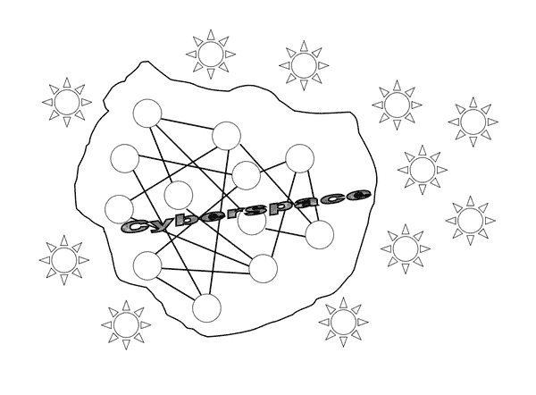 |

今天，几乎所有对象都可以通过联合网络环境（即全球互联网）连接。此前创建的“物理隔离”可能由于故意行为或人员疏忽而无法保护关键基础设施对象，这导致了图 2 所示的情况。

| 图 2. 关键基础设施与网络空间的真实关系 |
| --- |
| 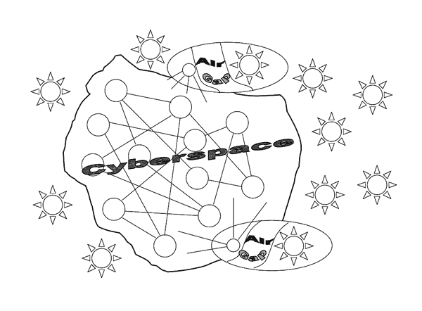 |

很难快速监控此类状况，但基于胜任人工智能资源的技术可以对此做出重大贡献。人工智能已经用于网络犯罪一方。有必要在网络防御一方找到其胜任的使用方法。为此，首先需要确定网络安全在关键基础设施整体安全系统中的地位。

图 3 展示了网络空间主要的安全类型：关键基础设施安全、信息安全、网络安全、互联网和网络安全、应用安全，这些可以与人工智能的平衡使用有效关联。

| 图 3. 网络空间安全的关系 |
| --- |
| 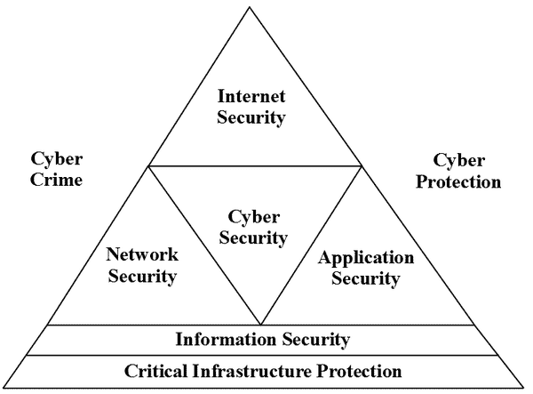 |

图 3 反映了作者对影响打击网络犯罪的安全领域关系的观点。它基于通用规定（国际标准 `ISO / IEC 27032: 2012`，`ITU-T X.1205` 建议 (2008)，标准 1.1-2002 (2002, 俄罗斯) 等）以及作者的研究结果（Mikhalevich I. (2019)，Mikhalevich I., Ryjov A. (2019)，Mikhalevich IF (2018)，Kalashnikov A., Mikhalevich I. (2018) 等）。

作者没有关于用于评估和监控这些漏洞风险人工智能工具的信息。由于时间限制、复杂性和不确定性以及许多因素，安全工程师无法提供可靠的防御水平。作者在下文描述的混合智能框架中看到了工程师与计算机能力联合使用的潜力。

我们可以将过去十年称为人工智能（AI）与大数据的时代。人工智能与管理、人工智能与领导力、人工智能与金融、人工智能与物流、人工智能与创意以及许多其他领域是许多会议、书籍、博客和文章的焦点；大数据也是如此。人工智能和大数据都有广泛的定义；它们自被描述为一系列跨越许多不同领域的各种，并可以用不同的方式进行描述。这对于科学和工程领域来说并不是好现象。一个正式的标准如 `Turing test` 已经通过了测试（雷丁大学，2014 年），非正式的标准如下国际象棋或围棋也已经通过了。因此，我们并不理解人工智能是什么；结果就是我们可以看到诸这样的观点，“人工智能在多年来积累了一些非常糟糕的声誉”（Dickson, 2017）或“一些行业专家认为，‘人工智能’这一术语与流行文化过于紧密，导致大众对人工智能产生了不现实的恐惧，并对其将如何改变工作场所和整体生活产生了不切期待”（Rouse, 2017）等。我们不想参与此类讨论，在没有像 `Turing test` 这样的共同标准的情况下，这完全是个人喜好的问题。我们将自主自适应自学习和自给自足的智能系统视为未来（问题是这个未来有多远？），但目前解决智能任务更现实的方法是人机共生。


将智能系统作为增强人类智能的工具的想法，最早是由 20 世纪 50 年代和 60 年代的控制论和早期计算机先驱提出的。`Amplifying intelligence`这一术语由 William Ross Ashby 在其经典著作中引入（Ashby, W.R., 1956, p. 271）。在他部奇妙著作的结尾，他写道：“智力像体力一样，是可以被放大的。不要说这办不到，因为基因模式每次形成一个大脑时，这个大脑都会成长比基因模式所详细指定的更好的东西。新奇之处在于，我们现在可以合成地、意识地、自觉地这样做。”（Ashby, 1956, p. 272）。人机共生的思想由心理学家、计算机科学家约瑟·卡尔·罗内特·Licklider 提出：“人机共生是人类与电子计算机之间协作互动的一种预期发展。它将涉及人类与伙伴关系中的电子成员之间非常紧密的耦合。主要目标是：1) 让计算机促进公式化的思维，就像它们现在促进公式化问题的解决一样；2) 让人类和计算机能够在决策和控制复杂状况方面合作，而不需要僵化地依赖预定义的程序。在预期的共生伙伴关系中，人类将设定目标、制定假设、确定标准并进行评估。计算机器将执行必须完成的常规工作，为技术和科学思维中的洞察和决策铺平道路。初步分析表明，共生伙伴关系执行智力操作将比人类单独执行要有效得多。”（Licklider, 1960, p. 4）。这一思想被 Douglas Carl Engelbart 进一步具体化和研究：“我们所说的‘增强人类智力’是指增加人类处理复杂问题状况的能力，获得符合其特定需求的理解，并推导出问题的解决方案。这方面的能力的提升被认为是以下因素的结合：更快速的理解、更深入的理解、在以前过于复杂的情况下获得有用程度理解的可能、更快的解决方案、更好的解决方案，以及发现以前认为不可解决的问题解决方案的可能。我们所说的‘复杂状况’包括外交官、执行官、社会科学家、生命科学家、物理学家、律师和设计师的专业问题——无论该问题状况存在二十分钟还是二十年。我们谈论的不是有助于特定情况的孤立的小技巧。我们指的是一种整合领域的生活方式，在这个领域中，直觉、试错、无形因素和人类对状况的‘感觉’与强大的概念、精简的术语和符号、复杂的方法以及高功率电子辅助工具有利地共存。”Engelbart, 1962）。

在这一浪漫时期之后，人机系统经历了数十年的停滞。从我们的观点来看，基本问题之一是人类与计算机在感知、信息处理、推理等方式上的巨大差异。`Boolean 0/1 logic`对计算机来说是自然的，但对人类来说是非常人为的；处理不确定信息对人类来说是自然的，但对计算机来说非常复杂。我们如何组织这两种完全不同的子系统的共生？

能够作为人类与计算机接口的数学工具——`fuzzy logic`由 Lotfi Zadeh 引入（Zadeh, 1965）。在（Zadeh, 1975, p. 200）中他写道：“语言方法的主要应用在于人文系统领域——特别是在人工智能、语言学、人类决策过程、模式识别、心理学、法律、医学诊断、信息检索、经济及相关领域”。他对人文系统的定义是：“我们所的人文系统是指行为受人类判断、感知或情感强烈影响的系统。人文系统的例子有：经济系统、政治系统、法律系统、教育系统等。单个个体及其思维过程也可以被视为人文系统”（Zadeh, 1975, p. 200）。`fuzzy logic`允许我们在计算机模型中使用基于感知的对象描述，并以类人的推理方式中对它们进行操作。它是认知计算以及 IBM（2018）定义的`Augmented Intelligence`的基础。“在 IBM，我们受‘增强智能’而非‘人工智能’这一术语的引导。这是增强和规模化人类专业知识的系统与试图复制所有人类智能的系统之间的关键区别。我们专注于构建实用的 AI 应用，以帮助人们完成定义明确的任务，并在过程中，在平台上展示一系列通用的 AI 服务，以支持广泛的新应用。”这种对人机共生的理解与我们最相似。我们评估和监控系统的目标是在复杂过程管理中“帮助人们完成定义明确的任务”。

在本章中，我们将介绍我们的愿景，即如何利用混合（人类+计算机）智能来改进关键基础设施的信息安全。我们将分析混合系统的一个子类——用于评估复杂过程状态和监控其进展的人机协作系统（Ryjov, 2013）。这些系统允许我们以伙伴模式解决复杂过程管理中的某些“标准”类分析任务。在理想情况下，我们可以以优化的方式结合人类的优势（例如，直觉）和计算机的优势（例如，计算能力）。

我们在不同领域开发此类系统拥有经验——包括政治（Ryjov et al., 1998; Ryjov, 2014a）、医疗保健（Ahkmedzhanov et al., 2003）、工程（Lebedev, 2009）、社会系统（Ryjov, 2014a）。我们看到对这类系统的兴趣日益增长（《经济时报》，2016）。这些系统可能是麦肯锡定义为第二大颠覆性技术——知识工作自动化技术之一（McKinsey Global Institute, 2013）。

## 评估复杂过程的状态与监控进展：主要问题、基本原则和理论基础

许多组织和专家正试图在复杂的环境中，通过对当前状态（我们在哪里？）以及实现预期状态或目标的可能途径（我们想去何哪里？）的某种理解，来实现他们的目标。我们有多种不同类型的过程（从当前状态到预期状态的历程），从定义良好的（例如，制造过程）到非常不确定的（例如，政治过程）。许多个人和机构参与到理解这些过程中，并寻找允许我们通过某些可（或在理想情况下为最佳）路径实现目标的行动。

从我们的控制能力（或可控性）角度，我们可以对过程进行如下分类：

*   a. 我们可以确定地以自动模式（仅限计算机）进行控制——技术性过程；例如制造、机械、机器人。
*   b. 我们可以可靠地以自动化模式（计算机+ 专家）进行控制——社会技术性过程；例如社会过程、政治、管理。
*   c. 我们只能在专家模式下进行控制（某些选定/独特的人可以控制）——“艺术”类过程；例如芭蕾、写诗、创意。

我们无法对独特且无法系统性复制的“艺术”类过程进行自动化或计算机化。让我们比较技术性过程和社会技术性过程；前 3 个差异汇总在表 1 中。因此，我们可以得出，由于巨大的复杂性、不确定性和模糊性，经典数学不适用于描述和建模社会经济、政治等过程。只有计算机智能与人类智能的正确结合才能解决这些问题。

评估和监控任务包括对某些过程的当前状态进行评估，以及基于真实信息对其发展的可能途径进行建模。评估与监控系统（`SEM`）是一种机系统，提供了评估和监控任务的解决方案。我们在业务（营销、管理、战略规划等）、政治（选举、双边和多边协议的控制、恐怖主义等）以及我们生活的许多其他领域都有许多评估和监控任务。

### 表 1. 过程的特征

| 技术性过程 | 社会技术性过程 |
| --- | --- |
| 我们拥有过程的充分且经过证明的数学模型（方程、自动机等形式）。 | 我们以自然语言文本、图表、参数依赖等形式对过程进行描述。 |
| 参数值信息是可测量的且具有明确的解释（我们拥有测量设备）。 | 参数值信息以评估的形式存在（测量设备是人）；对同一参数的评估可能不同。 |
| 过程的可重复性和再现性。可以进行实验（例如为了收集统计数据）。 | 过程的唯一性。无法进行一系列独立实验。 |

我们认为，大部分知识工作者专注于评估和监控任务，我们可以基于 `SEM` 为他们的工作提供自动化。我们也可以将 `SEM` 称为用于评估和监控任务的增强智能（Augmented Intelligence），它“协助人们处理定义良好的任务”。

## 用于评估复杂过程状态和监控进展的人性中心系统

从系统的角度来看，评估和监控系统属于层次模糊离散动态系统类。这类系统的理论基础由模糊集理论、离散数学、层次分析方法提供，这些方法已在 L.A. Zadeh（1965, 1975）、M.D. Mesarovich 等（1970）、T.L. Saaty（1980）等人的著作中发展。层次分析法（`AHP`）由 Saaty（1980）在 20 世纪 80 年年代开发。这是一种系统性的决策方法，包含了定性和定量技术。长期以来，它已在许多领域被广泛使用。J.J. Buckley（1985）将模糊性引入 `AHP`，称为 `FAHP`。层次模糊系统近年来引起了大量的关注。V. Torra（2002）总结了该领域的相关近期研究。详细的 `FAHP` 文献综述也发表于（Anvary et al., 2012）。

`SEM`允许统一处理关于某些过程的多样、多层次、碎片化、不可靠且随时间的信息。基于这类信息，`SEM` 可以对过程状态的演变进行监控并制定过程发展的战略计划。这些能力在业务领域开启了广泛的应用领域（例如，Ryjov, 2004），社会政治问题（双边和多边协议的控制 Ryjov et al., 1998，医疗保健 Ahkmedzhanov et al., 2003），）等。

### SEM 的基本要素

我们将对过程当前状态的评估以及对其演变的预测命名为评估和监控任务，并将确保支持此类信息任务的人机系统称为评估与监控系统。

`SEM` 的顶层基本要素是过程、过程状态信息流转的信息空间，以及处理这些信息并对过程状态和预测做出结论的分析师（知识工作者、系统用户）。`SEM` 的基本要素及其交互如图 4。

| 图 4. SEM 的基本要素及其交互 |
| --- |
| 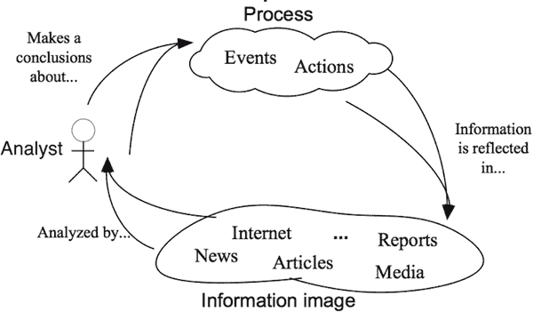 |
| --- |

信息图像代表一组各种信息元素，其特征如下：

*   • 信息载体的多样性，即以文章、报纸、电子文档、音频视频信息等形式呈现；
*   • 碎片化。信息通常与问题的任何片段有关，不同的片段被信息覆盖的程度可能不同；
*   • 多层次。信息可以涉及整个问题、其部分或过程的某个特定元素；
*   • 各种程度可靠性。信息可能包含不同可靠程度的数据点、间接数据、基于可靠信息得出的结论或间接结论；
*   • 可能的差异。来自不同来源的信息可能一致、略有差异或存在矛盾；
*   • **随时间变化**。过程随时间演变；因此，同一元素在不同时间点的信息可能是不同的；
*   • **可能偏差**。信息反映了某些源的需求；因此，它可能具有倾向性。

分析人员是系统的活跃元素，通过研究信息空间的元素，对过程的状态及其发展前景做出结论，并考虑到上述属性。

# 复杂过程评估与监控的基本原理

考虑到信息的特征及其特定的处理方法，可以得出复杂过程评估与监控的主要特征：

- 系统提供了考虑通过不同载体（期刊、视频片段、电子格式文档等）传输的数据的能力。这种功能通过在系统中数据库存储评估信息的引用来实现。如果信息是电子格式文档，则评估信息（或其部分）及其引用都存储在系统中。因此，系统能够考虑并使用与主题相关的所有信息片段，无论信息载体如何。
- 系统能够处理碎片化或多级信息。为此，模型的大部分以树或图的形式表示（图 5）。

| 图 5. SEM 模型的典型结构 |
| --- |
| 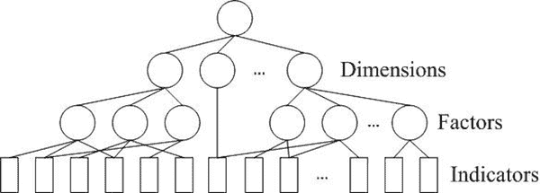 |
| --- |

- 具有不同可靠性（某些可能存在偏差）的信息可以在系统中进行处理。这是通过使用模糊语言值评估特定信息对模型元素的影响来实现的。
- 时间是系统的参数之一。这使得能够获得模型状态随变化的完整视图。

SEM 工作流如图 6 所示。

| 图 6. SEM 工作流 |
| --- |
| 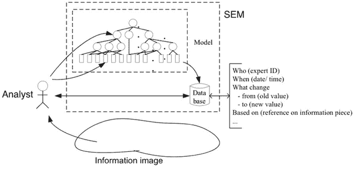 |
| --- |

因此，基于该技术构建的系统允许拥有随时间发展的过程模型。它由分析人员选择的所有信息材料以及对过程的总体和单独评估支持。将时间作为系统的参数之一，可以进行回顾分析并构建过程的发展预测。存在分配“关键点”的机会，即模型元素的微小变化就能导致整个过程状态的显著变化。此类元素的知识具有巨大的实践意义，能够揭示过程的“关键点”，制定措施来阻止不利情况或促进理想情况，即在时间上某种程度上引导过程向理想的方向发展。

# SEM 的理论基础

为了有效应用所提出的解决方案，需要解决一系列理论问题，其结果如下。

假设专家以语言值的形式描述获取信息的不一致性（例如，某个国家过程的就绪程度或就绪潜力 (Ryjov 等人，1998)）。这种描述的主观易用性程度取决于此类语言值的选择和组成 (Ryjov, 2003)。

假设系统跟踪问题的发展，即其随时间的变化。还假设它整合了多个不同专家的评估结果。这意味着一个对象可能由不同的专家进行描述。因此，最好确保不同的专家以最“统一”的方式描述同一个对象。

基于上述，我们可以将第一个问题制定如下：

## 问题 1（基于感知的物理对象描述）

考虑到人类对现实世界对象感知及其描述的某些特征，是否制定制定规则来选择特征值的最优集合，以此描述这些对象？有两种最优性标准：

-   **准则 1**。我们将在使用这些值时描述对象所产生的不确定性最小的集合视为最优。
-   **准则 2**。如果对象是由一定数量的专家描述的，那么我们将这些值集合视为最优。

已证明我们可以制定一种方法来选择最优值。此外，已证明这种方法是稳健的，即构造成员函数时产生的微小误差对最优值的选择没有显著影响。根据准则 1 和 2，集合是一致的。这些结果在 (Ryjov, 1988) 中描述。遵循该方法，我们可以以最小可能的不确定性描述对象。从这个观点来看，我们在简要描述形式化的主要思想和总结。

现实对象属性的评估作为模糊语言标（FLS）程序已有描述 (Ryjov, 2003)。FLS 的标值集是在定义在同一域上的模糊集合。让我们考虑在指定的模糊变量 `a[1]`、`a[2]`、……`a[t]`。我们将此类集合称为 FLS 的标值 `s[t]`。

| 图 7. FLS 的标值 |
| --- |
| 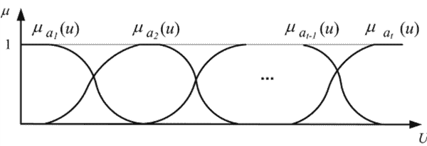 |

- 3.  最多有两个第一类间断点。

为了简单起见，我们将要求 `1-3` 标记为 `L`。

我们还对包含 `s[t]` 的模糊变量隶属函数集合引入了一个限制系统。因此，我们可以认为：

- 4. ;
- 5. 。

要求 `4` 和 `5` 也有非常自然的解释。要求 `4` 被称为**完备性要求**，意味着对于全集中的任何对象，至少存在一个可能所属的 `FLS` 概念。这意味着在我们的标度值集中没有“空洞”。要求 `5` 被称为**正交性要求**，意味着不允许使用语义相似的概念或同义词，并且要求所使用的概念具有足够的区分度。同时注意，该要求的满足与否取决于用于构建构成 `FLS` 标度值集的概念隶属函数的方法（`Ryjov`, 2003）。

为了简单起见，我们将要求 `4` 和 `5` 标记为 `G`。

我们将由模糊变量组成的标度值集、这些变量的隶属函数满足要求 `1-3`、且其总体满足要求 `4` 和 `5` 的 `FLS` 称为**完全正交 `FLS`**，并记为 `G(L)`。

不同的 `FLS` 具有不同程度的内部不确定性。让我们通过模型示例来解释。

- 示例。假设需要评估一个人的身高。让我们考虑两种极端情况。

    - 情况 1。允许仅使用两个值：“矮”和“高”。
    - 情况 2。允许使用许多值：“非常矮”、“不太高”……“不矮也不高”……、“非常高”。

情况 1 是不方便的。事实上，对于许多男性来说，这两个允许的值可能都不合适的，而且在描述他们时，我们必须在两个“坏”值之间选择。

情况 2 也是不方便的。事实上，在描述男性身高时，允许的多个值中有几个可能是合适的。我们再次遇到了问题，但现在是因为我们被迫在两个或多个“好”值之间进行选择。

可以测量这种程度的不确定性吗？对于完全正交 `FLS`，这个问题的答案是肯定的。为了证明这一事实并推导出相应的公式，我们需要引入额外的概念。

假设有一组为 `t` 个隶属函数的总体 `s[t]∈G(L)`。令 `s[t]={μ[1],…μ[t]}`。我们将 `t` 个特征函数的总体  标记为最相似的特征函数总体，如果 `∀j(1≤j≤t)`


很容易看出，如果完全正交 `FLS` 构成的不是隶属函数而是特征函数，那么在描述描述其中的对象时就不会产生不确定性。如果对象位于全集的对应区域，专家会明确地选择术语 `a[j]`。一些专家会用同一个术语描述同一个对象。这种情况可以用如下图进行说明。假设我们具有具有特定精度的标尺，并且有机会称重某种材料。此外，我们已经约定，如果材料的重量落在某个范围内，它就属于某个类别之一。那么我们将得到一个被准确描述的情况。问题在于，对于我们的任务，没有这样的标尺，我们也没有机会在标尺上称重我们感兴趣的对象。

然而，我们可以假设，在两个 `FLS` 中，不确定性最小的一个将是与由特征函数总体组成的空间最“相似”的一个。在数学中，距离可以作为相似性的一种程度。可以在 `FLS` 之间引入距离吗？对于完全正交 `FLS`，这是可能的。

首先，注意函数集 `L` 是区间上可积函数的子集，因此我们可以在 `L` 中引入距离，例如，`f∈L`，`g∈L`。

**引理 1**。令 `s[t]∈G(L)`，;`s[t]={μ[1],…μ[t]}`,, `ρ(f,g)` 为某种距离。那么 `ρ(f,g)` 是 `L` 中的一个距离。


上述的语义陈述可以形式化如下：令 `s[t]∈G(L)`。对于 `s[t]` 的不确定性度量，我们将取 `` 的值，由满足以下公理的值 `[0,1]` 决定：

- A1. ``，`s[t]` 是特征函数的集合。
- A2. ``，`t` 可能相等也不相等。

那么 ``，`f` 是 `L` 中的一个距离。那么 `` 是 `G(L)` 中的一个度量。

可以测量这种程度的不确定性吗？对于完全正交 `FLS`，这个问题的答案是肯定的。为了证明这一事实并推导出相应的公式，我们需要引入额外的概念。

最后，我们展示了对模型的分析结果，即当给定模糊集集合的成员函数不是以绝对精确的方式给出的，而是带有不超过 `δ` 的不准确性（图 9）。我们将这种特殊情况称为 `δ`-模型，并用 `` 表示。

| 图 9. `` 的展示 |
| --- |
| `` |
| --- |

在这种情况下，我们可以计算模糊度 `` 的顶部 `` 和底部 `` 值。以下定理成立（Ryjov, 1988）。

**定理 2.** 令 ``。那么 ``，``。

因此，我们可以在实际任务中使用我们的模糊度估算技术，因为我们已经证明了它的鲁棒性。

基于这些结果，我们可以提出以下选择特征值最优值集的方法：

1. 制定所有“合理的”语言值集合；
2. 将此类集合中的每一个都表示为 `G(L)` 的形式；
3. 为每个集合计算不确定性度量 ``；
4. 作为同时最小化对象描述的不确定性和用户意见分歧程度的最优集合，我们选择不确定性最小的那一个。

遵循这种方法，我们可以以最小的可能不确定性描述对象，即保证不同的用户将以尽可能统一的方式对语义专家模型（SEM）中的对象进行进行描述（见问题 1 中的准则 2）。这意味着一个真实对象在 SEM 中具有多个图像，或不同的真实对象在 SEM 中具有相同图像的情况将减少到最低。因此，从这个角度来看，SEM 作为真实世界的模型将具有最大的可能适应性。不确定性度量的鲁棒性（定理 2）允许我们在实际应用中使用这种方法。

评估和监控技术假设在系统数据库中存储信息（或其引用）及其语言化评估。与此相关，出现了以下问题。

**问题 2（基于感知的描述的信息检索）。** 是否可以在模糊（语言）数据库中定义信息检索质量指标，并制定选择此类语言值的规则以最大化信息检索质量？

如（Ryjov, 2004）所示，可以在模糊（语言）数据库中引入此类信息检索质量指标并对其进行形式化。证明了制定一种选择最优值的方法以最大化信息检索质量。此外，还证明这种方法是鲁棒的，即成员函数构造中的微小误差对最优值的选择没有显著影响。结果如（Ryjov, 2012）所示。这确保了提供的方法可以用于实际任务，并保证了复杂过程评估和监控的最优工作。

与问题 1 一样，下面简要描述问题 2 的形式化思想。与问题 1 一样，我们认为语言含义集可以提交为 `G(L)`。

在我们对具有语言描述的对象检索过程的研究中，引入了信息损失 `ILX` 和信息噪声 `INX`。这些概念适用于具有值集 `X` 的这些数据库检索，这些值由模糊集 `s[t]` 建模。这些概念的含义可以非正式地描述如下：与系统交互时，用户针对某些语言特征制定查询并获得答案。如果他知道特征的真实（非语言）值，他可能会删除系统返回的一些（信息噪声），并添加一些系统未返回的（信息损失）。信息噪声和信息损失源于描述的模糊性。

这些概念可以形式化如下（Ryjov, 2004）：

```

```

其中 `X={a[1],…a[t]}`，`pi` 是请求特征 `X` 的的概率，`N(u)` 是具有等于 `u` 的真实（物理，非语言）值的对象数量，其描述存储在数据库中。

以下定理成立（Ryjov, 2004; Ryjov, 2012）。

**定理 3.** 令 `s[t]∈G(L)`，`N(u)=N(Const)`，``。

那么 ``，其中 `c` 是取决于 `N` 的常数。

该定理表明，信息损失和信息噪声量与对象描述的不确定性成正比。这意味着通过最优方式（相对于最小化不确定性）描述对象，我们也提供了信息的最优检索。

类似于问题 1，我们可以构建 `)` 和底部 `)` 的 `ILX` 和 `INX` 值。

**定理 4.** 令 ``，``。

该定理告诉我们，对于小的显著性 `δ`，我们信息检索模型的主要规律得以保留。因此，我们可以在实际任务中使用不不确定度估算技术和模糊（语言）数据库中的信息检索模型，因为我们已经证明了它的鲁棒性。

由于过程模型具有层级结构（见图 5），为模型节点选择和选取（调优）聚合算子是 SEM 开发的另一个重要问题。

**问题 3（模糊层级动态系统中的聚合）。** 是否可以在模糊层级动态系统中找到信息聚合算子，使我们能够减少 SEM 中过程模型的矛盾性？

证明了可以根据聚合算子的不同解释提出以下方法：几何、逻辑和基于学习的方法。后者包括基于遗传算法的学习和基于神经网络的学习。这些方法在（Ryjov, 2001）中有详细描述。

## SEM 的分析能力

建立 SEM 后，我们可以解决两类问题：正向和逆向。

直接问题是找到过程中的所有的“关键路径”。这意味着揭示过程中的元素，这些元素状态的微小变化可能会从本质上改变整个过程的状态。对于大类聚合算子，我们可以计算模型中任何元素的关键性程度；对于所有聚合算子，我们可以使用通用算法（如回溯算法）来计算模型中任何元素的关键性程度。这意味着我们可以理解并衡量当前过程中任何元素的优势和缺点。这种理解是制定以优化方式控制过程的战略计划的基础。

反向问题是找到模型中的元素，为了达到模型中目标元素的给定状态，必须更改这些元素。例如，我们可以理解如何在给定预算内实现最大效果，或以最小预算达到给定效果。

我们可以通过以下方式对其进行形式化。我们使用以下符号：

*   `N` – 模型中的节点数；
*   `m[i]` – 节点 `i` 的值个数；
*   `` – 节点 `i` 的值（`i=0,1,…N-1`）—— 见图 10；
*   `X` – 预算；
*   `c[i]` – 节点 `i` 的更改成本（``）；为了简单起见，假设 `c[i]` 对于所有 `k` 都是相同的；
*   `∆a[i]` - 节点 `i` 的“改变能力”；更改 `` 时，`∆a[i]=q`。

| 图 10. 模型示例 |
| --- |
| `` |
| --- |

### 任务 1

找到一组节点 ``：``。

这是给定预算下实现最大效果的任务。

我们也可以制定一个对偶任务：

### 任务 2

找到一组节点 ``：``。

这是以最小预算达到给定效果的任务。

此类任务的示例可以是初创企业的资本评估和增加、增加公司和/或地区投资的吸引力、提高业务的可持续性等。

只有当我们拥有模型（结构和调优的聚合函数）、节点的实际状态（即用于评估和监控过程的运行系统）时，我们才能解决这些任务。这些能力与其他分析工具的比较分析如图 11 所示。

| 图 11. SEM 的分析能力 |
| --- |
| `` |
| --- |

几乎所有公司目前的水平是——`Excel`/`SQL` 或 `OLAP Analytics`；只有少数公司使用 `Big Data Analytics`；选定的国际和政府组织以及大型国际高科技企业中所使用的评估和监控系统的分析工具。使用 `SEM` 的分析系统能力是分析工具开发的一个自然演进阶段，也是知识工作自动化（Automation）的框架。

SEM 可以解决评估和监控任务，允许用户以“自然的方式”输入所有可用信息，并能够：

*   保存过程发展的历史，
*   评估当前状态，
*   对过程发展的未来进行建模。

SEM 在以下情况下是有效的：

*   我们没有（无法开发）以方程、自动机等形式的过程数学模型。
*   我们有执行监控任务的专家。

当满足以下条件时我们可以开发 `SEM`：

*   我们可以以概念及其相互依赖的形式开发过程的“语义模型”
*   我们处理真实信息（我们可以调优系统）

我们可以从以下方面开发一个最优系统：

*   用户输入信息的难易程度；
*   对评估的协调；
*   对过程的信息支持。

基于上述方法，开发了若干用于评估和监控的系统：用于和平核活动保障（DISNA）的国际原子能机构（Ryjov 等，1998）；用于心血管疾病风险评估和监控的俄罗斯联邦卫生部“国家预防医学研究中心”（Ahkmedhanov 等，2003）；用于微电子设计能力和项目进度评估与监控的 Cadence Design Systems（Lebedev，2009）等。SEM 的分析能力不仅能够分析过去，不仅能够像 `Big Data analytics` 那样模拟未来，还能让我们设计未来并回答“我们需要在何时、何地做出改变以获得我们需要的未来”的问题。

## 未来研究方向

评估和监控信息安全事件以及采取适当措施需要大量的资源，并且并不总是跟上事件的发展。使用混合智能将提高预测信息安全威胁和响应网络攻击的效率。图 12 显示了基础设施信息安全系统中使用混合智能的一种场景。该场景为安全框架提供了预测可能的网络攻击并评估其风险的机制。

| 图 12. 信息安全系统的混合智能场景 |
| --- |
| `` |
| --- |

未来的研究方向包括为所提场景开发模型（维度、因素和指标——见图 5），以及基于混合智能改进基础设施信息安全的其他场景。

## 结论

“依赖于复杂分析、细微判断和创造性问题解决的任务”（`McKinsey Global Institute`, 2013, 第 41 页）很大一部分是评估商业、经济、社会等过程的状态和进展。这些过程的建模和控制与物理技术过程非常不同。这些过程在物理意义上是独特的——无法进行系列独立实验；我们无法像物理学那样测量参数——“测量设备”是人类；我们没有像热传递方程那样适当的模型——过程是用自然语言或参数依赖的形式描述的。因此，我们可以得出结论，由于巨大的复杂性、不确定模糊性，经典数学不适用于描述和建模此类过程。只有计算机智能和人类智能正确结合才能解决这些问题。

保护基础设施的信息安全是此类问题的一个例子，`SEM` 是增强基础设施信息安全的自然方式。

## 致谢

作者对俄罗斯莫斯科莫莫夫国立大学的 `V.B. Kudrjavtcev` 教授和 `A.S. Stogalov` 教授，俄罗斯联邦卫生部联邦州机构“预防医学国家研究中心”的 `N.M. Ahkmedzhanov` 教授和 `R.G. Oganov` 教授，美国加利福尼亚州伯克林的 `L.A. Zadeh` 教授，比利时根特大学的 `E. Kerre` 教授和 `G. de Cooman` 教授，日本大阪大学的 `Y. Nishiwaki` 教授，国际原子能机构的 `A. Fattah` 先生以及德国 Cadence Design Systems 的 `W.-E. Matzke` 先生基于复杂过程评估与监控技术的项目所做的建设性工作表示深表感谢。

## 参考文献

- Ahkmedzhanov, N. M., Zhukotcky, A. V., Kudrjavtcev, V. B., Oganov, R. G., Rastorguev, V. V., Ryjov, A. P., & Stogalov, A. S. (2003). 心血管疾病风险评估与监控系统 [俄文]. Intelligent Systems , 7, 5–38.
- Ashby, W. R. (1956). 《控制论导论》. Chap and Hall. doi:10.5962/bhl.title.5851
- Buckley, J. J. (1985). 模糊层次分析. Fuzzy Sets and Systems , 17(3), 233–247. doi:10.1016/0165-0114(85)90090-9
- 内阁办公室关于提高关键基础设施抵御自然灾害干扰韧性的战略框架和政策声明，伦敦，皇室版权，2010 年 3 月。第 8 页。
- 议会指令 2008/114/EC。关于欧洲关键基础设施的识别与指定以及改进其保护需求的评估。《欧盟公报》, 2008 年 12 月 23 日。
- Dickson, B. (2017). 人工智能与增强智能之间有什么区别？获取自 https://bdtechtalks.com/2017/12/04/what-is-the-difference-between-ai-and-augmented-intelligence/
- Engelbart, D. C. (1962). 增强人类智能：一个概念框架. 获取自 https://www.dougengelbart.org/pubs/augment-3906.html
- 2010 年 12 月 28 日联邦法，第 390-FL 号。关于安全
- 2017 年 7 月 26 日联邦法，第 187-FL 号。关于俄罗斯联邦关键信息基础设施的安全，莫斯科。
- 针对来自网络空间威胁的非核关键能源保护（`NNCE`）良好实践，OSCE，2013 年，第 18 页。
- IBM. (2018). 认知计算. 为人工智能的未来做准备. 获取自 http://research.ibm.com/cognitive-computing/ostfi/response
- 信息共享框架。关键基础设施参考指南，美国，2016 年 10 月，第 5 页。获取自 https://www.cpni.gov.uk/critical-infrastructure
- 国际标准 `ISO/IEC/27032:2012`。信息技术。安全技术。
- 2018-2022 国家网络战略，曼恩岛. 获取自 https://docviewer.yandex.ru/view/?page=1
- Ryjov, A. (2009). 基于信息监控的设计能力与项目进度. 在第 5 届国际软计算会议上. IEEE. 10.1109/ICSW.2009.537942
- Kalashnikov, A., Mikhalevich. (2018). 关于重要性标准的自动控制系统统一分类系统. 在：国际科学会议论文集“2018 年通信领域信号产生与处理系统（On Board 2018）”. 10.1109/SOSG.2018.835098


# 参考文献

- Ryjov, A. (2001). 模糊层次系统中的信息聚合 [俄文]. *Intelligent Systems*, 6, 341–364.
- Ryjov, A. (2003). 模糊语言尺度：定义、属性与应用. 在 Reznik, L., & Kreinovich, V. (编.), *测量与信息获取中的软计算* (pp. 23–38). Springer. doi:10.1007/978-3-540-36216-6_3
- Mikhalevich, I. & Ryjov, A. (2019). 关键基础设施安全：观点对齐. 在 *IEEE 国际会议论文集“2019 年通信领域信号产生与处理系统（On Board 2019）”*. 获取自 http://ieeexplore.ieee.org/document/8706821
- Mikhalevich, I., & Ryjov, A. (2019). 防御网络攻击的增强智能框架. 在 *IEEE 国际工程与电信会议论文集（`EnT-MIPT`, 2018）*. 获取自 http://ieeexplore.ieee.org/document/875733
- Mikhalevich, I. F. (2018). 关键基础设施国家软硬件平台的方法论基础. *T-Comm*, 12(3), 75–81.
- 俄罗斯联邦国家安全战略. 俄罗斯联邦总统 2015 年 12 月 31 日第 683 号法令，莫斯科。
- 美国总统命令 13636 关键基础设施安全，白宫，2013 年 2 月 12 日。
- 美国总统命令加强联邦网络与关键基础设施的安全，白宫，2017 年 5 月 11 日。
- 建议 `ITU-T X.1205` (2008). 网络概述–日内瓦：ITU-T，2008。
- Rostamy, A. A., Meysam, S., Behnam, A., & Bakhshi, T. (2012). 使用模糊层次分析法评估业务流程重构的主要维度. *Journal of Applied Operational Research*, 4(2), 69–77.
- Rouse, M. (2017, 7). 增强智能. 获取自 https://whatis.techtarget.com/definition/augmented-intelligence
- Ryjov, A. (1988). 模糊集理论原理与模糊度测量 [俄文]. Dialog-MSU 出版社。
- Ryjov, A. (2004). 模糊环境下的信息检索模型 [俄文]. MSU 出版社。
- Ryjov, A. (2004). 作为战略分析与模拟工具的信息监控系统. 在 *模糊集与经济金融软计算国际会议论文集* 上. 圣彼得堡，俄罗斯：RFSA。
- Ryjov, A. (2012). 基于感知的信息检索建模与优化. 在 Zanzotto, F., Tsumoto, S., Taatgen, N., Yao, Y. Y. (编), *2012 年脑信息国际会议论文集* (pp. 140-149). 柏林：Springer. doi:10.1007/978-3-642-35139-6_14
- Ryjov, A. (2013). 复杂过程评估与监控系统及其应用 [俄语]. *Intelligent Systems*, 17(1-4), 104–117.
- Ryjov, A. (2014a). 用于评估社会政治过程状态和监控进展的人性中心系统. 收录于 *第 8 届电子治理理论与实践国际会议论文集*. 纽约：ACM 会议出版物. doi:10.1145/2691195.2691285
- Ryjov, A. (2014b). 社交网络的个性化：自适应语义层方法. 收录于 Pedrycz, W., & Chen, S.-M. (编.), *社交网络：计算智能框架* (pp. 21–40). Springer International Publishing Switzerland. doi:10.1007/978-3-319-02993-1_2
- Ryjov, A. (2015). 走向最优的任务驱动信息粒度化. 收录于 Pedrycz, W., & Chen, S.-M. (编.), *信息粒度、大数据与计算智能* (pp. 191–208). Springer International Publishing Switzerland.
- Ryjov, A., Belenki, A., Hooper, R., Pouchkarev, V., Fattah, A., & Zadeh, L. A. (1998). 用于和平核活动监控与评估的智能系统开发 (DISNA), 维纳：国际原子能机构 (IAEA), STR-310.
- Saaty, T. L. (1980). 分析层次法. McGraw-Hill。
- Standart 1.1-2002. 国家标准化体系。术语与定义。2002 年。莫斯科。出版标准，2002 年。
- 俄罗斯联邦信息安全战略. 由俄罗斯联邦总统 2016 年 12 月 5 日第 646 号总统令批准，莫斯科。
- 《经济时报》 (2016). 人机超智能可能解决世界性问题. 获取自 http://articles.economictimes.indiatimes.com/2016-01-01/news/69448299_1_systems-hci-problems
- 俄罗斯联邦 2017–2030 年信息社会发展战略. 由 2017 年 5 月 9 日第 203 号总统令批准，莫斯科。
- Torra, V. (2002). 层次模糊系统构建综述. *International Journal of Intelligent Systems*, 17(5), 531–543. doi:10.1002/int.10036
- 雷丁大学. (2014). 图灵测试的成功标志着计算史上的里程碑. 2014 年 6 月 8 日. 雷丁大学. 获取自 http://www.reading.ac.uk/news-and-events/releases/PR583836.aspx
- Zadeh, L. A. (1965). 模糊集. *Information and Control*, 8(3), 338–353. doi:10.1016/S0019-9958(65)90241-X
- Zadeh, L. A. (1975). 语言变量的概念及其在近似推理中的应用. 第 1,2,3 部分. *Information Sciences*, 8, 199-249. doi:10.1016/0020-0255(75)90036-5

## 扩展阅读

- IBM. (2017). 是增强智能，而不是人工智能！获取自 https://www.ibm.com/blogs/collaboration-solutions/2017/01/31/augmented-intelligence-not-artificial-intelligence/
- Padmanabhan, G. (2018). 行业特定增强智能：企业的催化剂. 福布斯. 获取自 https://www.forbes.com/sites/forbestechcouncil/2018/01/04/industry-specific-augmented-intelligence-a-catalyst-for-ai-in-the-enterprise/#31

## 关键术语与定义

- **人工智能 (AI)**：`AI` 是计算机系统模拟智能。
- **增强智能 (Augmented Intelligence)**：能够结合人类直觉和计算能力优势的人机系统。
- **网络环境 (Cyber Environment)**：网络环境包括用户、网络以及所有软件。
- **网络空间 (Cyberspace)**：由行动形成的没有实体的集成虚拟环境（网络环境）。
- **评估与监控 (Evaluation and Monitoring)**：这是一个改进性能并实现的过程，它建立了过去、现在和未来之间的联系。
- **模糊逻辑 (Fuzzy Logic)**：`Fuzzy Logic` 是一种数学逻辑的形式，变量的真值可以是 0 到 1 之间的任何实数。相比之下，在布尔逻辑中真值只能是整数 0 或 1。
- **模糊集 (Fuzzy Sets)**：没有严格边界的元素集合。此类集合的例子是“人”。
- **层次系统 (Hierarchical Systems)**：一种特殊的系统，其中元素（对象、名称、值、类别）被表示为彼此处于“上方”、“下方”或“同一水平”。层次结构可以直接或间接连接连接元素，也可以通过垂直或对角线连接。
- **信息空间 (Information Space)**：由信息领域主体创建的信息资源的总和。
- **信息领域 (Information Sphere)**：信息、信息化对象、信息系统、信息和电信网络中的网站、通信网络、信息技术，活动涉及信息形成和处理、这些技术的开发和使用、确保信息安全的主体，以及监管相关社会关系的一系列机制。
- **测量 (Measurement)**：测量是给对象或事件的特征分配数值（数字、符号等），以便与其他对象进行比较。

# 正文

随着智能设备的指数级增长以及对互联网和无线网络的依赖，信息安全成为近年来面临的一个主要挑战。生物识别已广泛应用于信息安全，它在最大限度地减少不当访问概率方面起着至关重要的作用。人体生物特征分为物理特征和行为特征。在本章中，作者建议使用指纹和电子签名进行信息安全。尽管生物识别提供了更高的安全性和完整性，但也受到各种攻击的威胁。数字水印是解决上述问题的答案。首先，提取人体生物图像的特征并作为其他生物识别图像的水印。假设指纹作为载体，签名作为水印。本章介绍了各种生物识别技术和水印技术。本章还回顾了不同研究人员在该领域的工作、他们所采用的算法以及利用这些算法进行生物识别保护的文献。

## 引言

过去几年，互联网访问和数字媒体的使用量巨大增长。技术和电子媒体的进步使得信息安全面临风险，因为数字数据可以在不降低内容质量的情况下进行复制。信息安全可以定义为对以打印或书写形式呈现的信息的机密性、完整性和可用性的保护过程。它不仅保护信息本身，还保护存储和传输信息的相关元素，如硬件和软件。知识产权（IPR）、版权保护和认证是信息安全的类型。知识产权防止他人在未经许可的情况下使用、处理或篡改其产品。版权保护通常适用于一系列创意性、艺术性或智力作品，如小说、诗歌、歌曲、电影、软件和建筑。它不保护信息或思想，但它保护思想和信息的原始表达。研究人员在工作中使用 `SHA-1` 160 位哈希函数而非 `MD5`，以防止网络资源被篡改（He, 2016）。此类系统的身份验证通过识别密码或个人识别码来控制。该系统的问题在于，未经授权的用户可以很容易地获取密码和数字。因此，有必要对数据添加安全检查以保护其真实所有权。

防止知识产权问题有许多解决方案，其中生物识别方法似乎是最前景的。对减少欺诈和数据泄露事件的需求日益增长，以及对物理访问控制和逻辑访问控制的需求，使得生物识别成为一种非常强大的认证技术。基于令牌和基于知识的识别系统很容易被盗窃或损坏。在密码和 `PINs` 等旧系统中，弱密码正在引发安全问题，即使是最强的密码也无法抵抗复杂的黑客攻击。数字交易的进步要求利用可靠的因素，例如人体生物识别特征，这些特征是每个人的固有部分，且无法丢失或忘记。生物识别的首要目标是提供不可否认性，确保使用资源的人以后不会否认其使用行为。

全球范围内的政府和私营组织选择生物识别技术来对抗欺诈用户、机密数据泄露、安全漏洞、降低成本、灵活性并提高整体用户体验。因此，生物识别技术对于如今的个人身份识别和验证系统是必不可少的。大多数情况下，不可感知性通过使用人体生理特征（如人类听觉系统、人类视觉系统和生物识别认证系统）来实现。尽管生物识别为个人识别提供了可靠的方法，但生物识别认证系统的安全性是一个关注点。密码可以保密并存储在安全的地方，然而，生物特征本质上是公开的，可以被黑客轻易发现。生物识别中使用的所有身体特征无论人走到哪里都会暴露给公众。人接触的任何东西都会留下指纹，当人用眼睛看东西时，眼睛信息就暴露了。旁观者可以使用智能手机轻松记录一个人的声音。用户也无法简单地像重置密码那样重置其生物识别标记。如果指纹或脸部图像被盗，用户无法简单地获得一个新的。密码可以更改，但生物识别标记在个人的寿命周期内基本上是固定的。

还需要注意的是，只有当确认数据来自合法来源且数据未被更改或篡改时，生物识别系统才能准确工作。Gaata 等人在论文中回顾了水印技术具有保护生物识别数据真实性的潜力（Gaata & Refah, 2016）。数字水印有助于将信息嵌入某些多媒体文件中，而不会在原始文件中呈现任何可见的偏差。使用这种技术的目的是引入高水平的保护。在随机位置插入信息而不损害生物识别数据的实际特征，有助于声称授权用户的身份。结果，水印技术对于未经授权的人来说是不可感知且具有鲁棒性的。

水印可以通过两种方式实现：水印生物识别或生物识别水印。在前一种情况下，载体是生物识别，水印是另一种生物识别；而在后者中，水印是一种生物识别技术，载体可以是任何数字介质。本章详述了水印生物识别的使用。在介绍各种生物识别和水印技术时，Fiez 等人在电子签名验证系统使用了 `HMM` 技术。实验显示了卓越的性能验证（Fierrez, Javier, Daniel, & Joaquin, 2007）。Low 等提出了用于离线手写签名的 `LSB` 和 `DWT` 融合生物识别水印（Low, Andrew, & Connie, 2008）。Jain 等人展示了在解码过程中使用恢复的面部来建立指纹与用户之间真实性的优势（Jain, Uludag, & Hsu, 2002）。目前依赖单一技术的生物识别系统以不同的安全级别进行部署。单模态生物识别系统可能会受到各种类型的攻击，如噪声数据、类内差异、不可接受的错误率、欺骗等（Arulalan et al., 2015）。然而，结合一种一种模态可以增强性能、可靠性，甚至增加用户的接受度。模态的选择回答了系统如何设计、如何呈现给用户以及系统如何多多准确地接受或拒绝决策的问题（Pérez Basanta, 1997）。多模态生物识别补偿了每个单模态生物识别的固有局限性。多个生物识别源提高了性能，增强了识别准确性，并提供了防欺骗和容错能力，即如果某个采集模块失败，它仍能继续运行。本章提出了使用多个生物识别特征的想法，即同一人的指纹和数字签名。

为了理解多模态生物识别的基础知识，本文首先解释了传统安全应用的基础、信息安全以及其他基本术语，随后讨论了生物识别认证及其流程。下一节将对物理生物识别特征（如指纹）进行简要介绍，并讨论指纹生物识别系统的各个阶段阶段。下一节将详细讨论行为生物识别特征（如在线签名和签名生物识别系统）以及用于生物识别系统的各种安全攻击。下一节还简要说明了数字水印及其流程，最后通过对各种多模态生物识别技术进行比较来总结本章。

# 生物识别认证

生物识别认证基于人类的物理特征和行为特征，通过两个主要过程——注册和识别，对人类进行识别或确认。物理特征包括脸部、`fingerprint`、视网膜、虹膜模式（眼睛的虹膜图案），而行为特征包括人声、手写签名等。在注册阶段，获取个人数据并将其存储在数据库中以便特征提取。通常，提取的特征集会被存储在数据库中，而剩余的原始生物数据会被丢弃。在验证阶段，会重新获取个人数据并与存储的数据进行对比，如果匹配成功，则该人员被视为合法用户，否则为未经授权的用户。使用物理/行为特征识别授权用户的生物识别系统确保了安全性远高于 `PIN` 系统。生物识别数据与个人信息不同且具有独立性。生物识别生成的模板无法反向获取个人信息。生物识别适用于用户认证，但不能用于对数据或计算机进行认证。目前已有多种生物识别系统，如自动人脸识别系统 (`AFRS`)、自动指纹识别系统 (`AFIS`) 和虹膜识别系统。基于此类系统开发了许多应用程序。用户频繁使用的应用包括考勤控制、`Aadhar Card`、护照验证、`e-KYC` 服务。

## 生物识别认证流程

通用生物识别认证系统看起来复杂，但它们将整个工作分为四个阶段：`sensor module`、特征提取模块、`matching module` 和决策模块。所有模块都按顺序工作。一个模块的输出作为另一个模块的输入。如果任何模块的结果受到影响，后续的模块将自动受到这些问题的影响并导致数据不一致。尽管生物识别系统提供了更高的准确性是一个可靠的工具，但其系统性能也受到某些因素的影响，例如使用的传感器类型、输入质量、算法效率、匹配评分的准确性等。如果追踪的生物识别特征被感知带有噪声，那么传感器模块相邻的模块将无法提供可靠的评分。匹配模块计算的分数可能不精确。认证系统特别是基于生物识别的系统以三种模式运行：注册模式、识别模式和验证模式。

- **注册模式 (Enrollment mode)**：这是个人注册的初始阶段。生物识别系统记录个人的识别特征。它使用合适的生物识别传感器采集你的图像并存储在数据库中。大多数系统并不缓存完整图像，而是分析特征并转换为模板。
- **识别模式 (Recognition mode)**：在识别模式下，通过对比采集和提取的生物识别特征搜索注册数据库，返回候选列表。候选列表由参考信息与比较子系统中的特征匹配且相似性评分高于预设阈值的个人组成。
- **验证模式 (Verification mode)**：在验证模式下，将新采集的生物识别特征与存储的模板进行比较。结果与所需的安全阈值匹配。匹配过程的结果为“是”或“否”。系统使用此结果来验证用户的真实身份 (Ross & Jain, 2003)。

生物识别认证系统遵循识别真实用户的系列程序。生物识别数据库由用户生物特征的不同样本组成，即它存储了同一用户的不同指纹表达。用户的认证有两种方式：验证和识别。在验证期间，将存储的生物识别样本与个人的现场生物识别样本进行一对一比较，结果为匹配或不匹配。而在识别中，则进行一对多比较，将个人的生物识别样本与数据库中存储的所有参考模板进行比较。如果模式匹配，则该用户被视为有效用户，否则视为无效用户。

# 物理生物识别特征


# 物理生物识别系统

物理生物识别系统是指基于 `fingerprint`、耳朵几何形状、脸部、视网膜扫描、虹膜、掌纹、`DNA` 等物理特征对用户进行授权。在所有特征中，基于指纹的识别比任何其他方法都更受认可，并为我们提供了识别身份的有效方法。事实上，作为个人的生物学特征，指纹在人的一生中始终是永久且不变的。即使由于伤痕或淤青而发生部分改变，它们也会以类似的方式再生。传统上，指纹图案是通过纸张上的墨水印记提取的，但电子时代促使使用提供数字图像的传感器。指纹采集过程在传感器上面临许多挑战，如指纹上的伤痕、皮肤湿度、手指压力等。事实上，指纹的色调、污垢、伤痕、受伤或损坏在采集过程中有巨大影响。这可能导致同一指纹的多个副本，且无法生成精确的图像。指纹用于许多应用，例如追踪许可协议的真实性、版权材料的欺诈传播、识别违反法律的罪犯。此外，它们越来越多地出现在手机和 `PDAs` 等智能设备中，作为智能指纹锁，用于银行电子交易安全，以及考试中的考生验证。

## 指纹生物识别系统

指纹表示为人类手指上脊线和谷的图形流。人类的胚胎发育在其指纹形成起着主要作用，并被认为是独特且个性的。事实上，同一个人不同手指的脊线和谷模式并不相同。在法医部门，指纹是最成熟的生物识别技术之一。基于以下基础识别指纹：(a) 指纹的全局和局部脊线模式，(b) 指纹图像灰度曲线的不变属性，以及 (c) 指纹细节。这些主要是由脊线末端和分叉产生的特征。如图 1 所示，指纹生物识别系统被分类为各种模块。扫描指纹到最后决策阶段涉及的步骤在各个模块中解释如下：

### 传感器模块

捕获或追踪的生物识别图像质量取决于所用传感器的类型。可以使用光学扫描仪、电容扫描仪、超声扫描仪或热扫描仪对图像进行扫描和处理。Hosseini 等人总结道，由于污垢和划痕，面的有效性会受到影响。超声和热扫描仪提供更高的准确性，而光学和电容扫描仪容易被欺骗，并受到接触表面污垢或水的影响（Hosseini, 2018）。

### 特征提取模块

一旦有效地收集样本，将进入指纹生物识别系统的下一阶段，即特征提取。特征提取是指将数据精炼为称为模板的方法。据说，模板仅包含足以识别个人身份的相关信息。模板存储在数据库中，并在识别用户身份时检索。由于指纹是由独特的脊线和谷线图案形成的，通常，基于微观方法（如局部脊线特征）的指纹识别系统被称为特征点（minutiae）。Jain 等人提出了一种更准确的基于对齐的特征点匹配算法，用于寻找特征点与存储模板之间的对应关系（Jain, Hong, Pankati, & Bolle, 1997）。提取指纹特征点可以通过两种技术完成：二值化和灰度图像。灰度图像被认为比二值化得多，因为后者更详尽且具有损失性。从指纹中检测特征点是此阶段提取特征的关键。

| 图 1. 指纹生物识别系统 |
| --- |
|  |

### 匹配模块

下一阶段是匹配模块。生物识别匹配器的主要目标是将生成的模板与用户记录的指纹进行比较。在给定的两个指纹之间计算匹配分数，以衡量相似程度。分数可能会因为指纹在不同方向、角度、与传感器的接触面积以及表面压力的应用而有所变化。应该选择合适的算法来处理此类不变矩。匹配模块必须对相似的指纹样本给出高相似度分，对不同的样本给出低分。

### 决策模块

最后阶段是决策模块。在这里决定获取的指纹样本是否属于某个人。决策是基于依赖应用的标准（如阈值）做出的。计算出的阈值与匹配分数进行比较。如果获得的匹配分数大于阈值，则该人员被识别为合法用户。较高的阈值意味着更高的安全性。

## 行为生物识别特征

行为生物识别系统是指根据行为特征（如手写、签名、人声）对用户进行授权。如日常生活所示，签名已广泛应用于各种文档，如银行支票、商业合同、证书以及法律程序中，并被所有人接受作为确认的标志（Khan, Wahid, Khan, Ahmad, & Zafar, 2018）。Melo 等人提出，签名可以通过两种方式获取：或者通过扫描仪，或者使用各种电子设备（如数位绘图板）（Melo, Impedovo, Bezerra, Giuseppe, & Antonio, 2018）。通过扫描仪获得的签名是离线签名，而使用电子平板板和笔获得的签名是在线签名。离线签名使用笔和纸以 2D 形式获取。法医鉴定人员从多个参数对签名进行评估，例如书写速度、线条的波动或曲线、折回和修补、自由手写期间的停顿等，以寻找伪造迹象。在线签名也称为电子签名。在线签名不仅处理签名形状，还处理签名的动态特征。因此，对于伪造者来说，复制签名者的动态是一项挑战性任务。Fahmy 等人在论文中通过笔的位置、笔移动的角度、速度、加速度和压力等参数验证了电子签名的原始性（Fahmy, 2010）。Yang 等人声称，同一人的采集样本并不一定相同，因为他们签名时的环境和心理因素是不同的（Yang, Jin, & Jiang, 2019）。因此，用户签名的变化是巨大的。

## 签名生物识别系统

签名生物识别系统根据两个主要标准（即特征选择和决策）来验证签名。全局或局部特征根据签名类型（是完整签名还是部分签名）进行选择。如果在全局特征中发现任何差异，将通过局部特征进行进一步检查。局部特征也被称为第二级验证。全局特征测试根据签名速度、签名大小和签名消耗的时间等某些参数对完整签名进行测试。而局部特征测试部分签名。考虑的参数包括从一个字母移动到另一个字母时的手部动作、曲线和签名线条、相邻字母之间圆润的变化以及字母之间的空间（Tanwar, Mohammad, Sudhanshu, & Neeraj, 2019）。签名验证系统的关键组件如图 2 所示。签名生物识别系统的每个组件讨论如下：

*   **数据采集**：第一步是以数字方式或使用笔和纸记录人的签名。离线签名使用笔和纸记录，而在线签名在数字平板板上使用电写笔或用户手指记录，以便收集签名的动态特征和图像。
*   **预处理**：在预处理阶段，收集手写签名中的运动，带有特定的变形和变换。签名在不同实例之间可能会变化。因此，需要消除这些变化和外观变化。处理后的签名被重构为数字图像。用户的详细信息与相应的注册签名链接并存储在数据库中。
*   **决策**：在此阶段，首先使用准确的算法对注册签名和验证签名之间生成的特征进行比较。计算阈值并与签名测试图像进行比较。最后，根据阈值对签名的准确性做出决定，并决定必须接受还是拒绝签名。

| 图 2. 签名生物识别系统 |
| --- |
|  |

## 生物识别中的攻击

从生物识别采集到生物识别验证并非易事。从获取生物识别样本并将其转换为模板、存储在数据库中，到生成匹配评分的整个过程，数据都很容易被篡改或伪造。与容易受到暴力攻击的密码/点码不同，生物识别系统需要更多的精力来破解。目前已经出现了多种安全漏洞，它们会损害生物识别系统的真实性，例如特洛伊马、伪装攻击、中间人攻击、重放攻击、数据拦截、窃听等。

Ratha 等人在其论文中讨论了八种攻击来源：向传感器提交虚假生物识别样本、重新提交数据库中已存储的样本、强制特征提取模块构建入侵者选择的特征集、用人工特征集转换提取出的特征集、攻击匹配模块以生成与原始计算分相比较高或较低的虚假匹配分、在数据库中或在通过某些信道将模板传输到匹配模块时篡改存储的模板（这可能导致伪造）、以及通过攻击者的选择使结果无效（Ratha et al., 2001）。Gomez 等人讨论了逆向生物识别，这意味着可能从未保护的模板中重新生成虚假样本（Gomez-Barrero & Galbally, 2020）。

模式识别系统的性能通常取决于多种因素，如使用的传感器类型、输入质量、算法效率、匹配评分的准确性。生物识别设备甚至可能出现注册或采集错误。由传感器、匹配模块或特征提取模块无意中造成的攻击被称为零成本攻击（Pérez Basanta, 1997）。这与结果固定的密码系统不同，如果密码匹配则允许访问，否则拒绝。然而，在生物识别系统中，手动可以在匹配评分上设置阈值来控制虚假接受或拒绝。生物识别系统中遇到过多种漏洞，包括固有故障、管理漏洞、不安全的基础以及生物识别的公开性（Raj, et al., 2020）。人们普遍认为生物识别系统可以直接解决身份认证问题。这就是为什么它被逐渐部署用于控制信息系统的访问。此外，重要的是，生物识别系统本身是一个完整的独立单元。如果系统被破解，整个信息都将受到影响，因此需要进行彻底的分析和审计（Pérez Basanta, 1997）。可以使用数字水印技术实现信息保护和身份认证。本章介绍了基于水印的保护生物识别模态的方法综述。

# 数字水印

数字水印被认为是实现数字信号认证的一种迷人的技术。数字水印技术是识别篡改证据、审计、定位、数据增强、所有权证明、创作权证明和版权保护的方法。其目标是独特地在不改变图像的情况下标记图像，以便很容易地检测出伪造副本。Gaata 等人将水印技术分为两个领域：空间域和频域，用于将数据嵌入数字信号中（Gaata & Refah, 2016）。

空间域技术（如 `LSB`）通过操纵数字信号某些元素的灰度级将水印插入宿主图像。而在频域技术中，对数字信号元素应用了若干种变换将其转换为频域，例如 `DWT` 和 `DCT`。这使得非常难以发现水印前后的差异。水印有许多算法，选择合适的技术并不易事。

数字水印有几个特征，但最重要的是鲁棒性、不可感知性安全安全性。鲁棒性意味着水印能够忍受裁剪、变换、压缩等简单的处理操作。不可感知性意味着水印前后的图像看起来应该是相似的。观察者不应该能够检测到嵌入的水印。安全性意味着非法人员不应该发现、捕获或操纵嵌入的水印（Saxena, Khushboo, Rishika, & V., 2014）。

# 水印过程

数字水印是通过抽象过程将任何所有知识嵌入数字媒体的方法。原始图像经过某种形式的变换以嵌入水印。特定的逆变换强制原始图像生成包含水印的签名图像。仅分发此图像。水印过程工作分为两个阶段：i) 嵌入水印和 ii) 提取水印。每个过程将在稍后解释。Saxena 等人使用 `PSNR` 和 `NC` 技术来测量水印嵌入和提取阶段的图像质量（Saxena, Khushboo, Rishika, & V., 2014）。需要一种高效、强效且适当的算法，这样嵌入的水印才不会被轻易提取。隐藏水印应该有一个特定的顺序，因为它可能会导致不同的任务。水印可以通过两种方式嵌入：可见水印和隐形水印。在可见水印中，可以使用某种光线看到水印，但这种技术的问题是它会破坏数字媒体的呈现效果。而隐形水印以一种方式嵌入，使得在不提取的情况下无法感知，并保持图像的原始性（Yadav, Sharma, Sharma, & Sharma, 2014）。

### 将水印嵌入宿主图像

水印嵌入过程在源端执行，使用密钥、信息和水印算法对数据进行加水印。嵌入程序包括将输入、原始数据和水印传递到嵌入块，其中通过归一化数据插入水印。水印嵌入的输出是图 3 所示的水印图像。仅分发带水印的图像，不发布原始图像。

| 图 3. 嵌入数字水印 |
| --- |
|  |

### 从图像中提取水印

水印提取是在带水印媒体上应用反向算法以分离水印的机制。提取程序包括带水印的数据、密钥以及通常的原始数据。嵌入的生物识别水印将从水印图像中提取以证明所有权。获得的图像是如图 4 所示的原始图像。因此，为了验证图像，需要在不损害图像质量的情况下提取水印（Saxena, Khushboo, Rishika, & V., 2014）。

| 图 4. 提取数字水印 |
| --- |
|  |

# 多模态生物识别技术对比

多种生物识别模态的结合在近年来已成为活跃研究的一个轴。生物识别保护可以通过将生物识别信息作为宿主图像整合另一个生物识别图像中，或者作为水印来实现，其中宿主可以是任何媒体或生物识别特征（Haddada, Trimech, & Amara, 2016）。在向多媒体文件中插入生物识别信息方面已有大量工作。然而，在本章中，关注点在于采用多种生物特征的想法。由于生物识别特征对每个人都是唯一的，且无法轻易损坏或更改，作者建议同时使用生物识别的物理特征和行为特征，其中 `Digital signature` 可以作为原始水印嵌入到另一个生物识别 `Fingerprint` 中，如图 5 所示。这种在应用程序中使用多种生物识别来增强系统及其信息的安全的方法，可以理解为多模态生物识别。

| 图 5. 生物识别与数字水印 |
| --- |
|  |

### 系统照明

展示该系统的目的是为了说明通过不可见数字水印秘密插入生物识别信息的方法，以便即使在经过某些失真后也能恢复水印内容。不可见水印应用于位置安全和加密的框架中。如果没有图像处理技术，无法看到原始图像与水印图像之间的区别。

在初始阶段，即注册阶段，对 `digital signature` 和指纹图像进行预处理，通过某些变换和归一化获取相关特征。可以使用特征降维技术从大型特征集中选择有用的特征。使用 `secret key` 随机选择水印嵌入位置和水印嵌入方法，将预处理后的签名图像嵌入预处理后的指纹图像中，生成水印图像。

水印信息不需要任何额外的内存资源。在这里，存储在数据库中的最终模板是通过使用 `secret key` 将 `digital signature` 嵌入到 `fingerprint image` 中而生成的水印图像。`secret key` 可以使用任何公钥加密技术生成。该水印图像不会泄露关于模板和 `secret key` 的过多信息，在未知用户生物识别数据的情况下，解码密钥或模板在计算上是困难的。多种生物识别的融合通过解释从多个源获得的匹配评分，提高了系统的速度和可靠性。Ross 等人讨论了生物识别系统中融合的各种级别和形式（Ross & Jain, 2003）。

### 认证与融合

水印解码器根据声称的身份从数据库中解码水印图像。在认证阶段，使用相同的 `secret key` 和水印提取方法从 `fingerprint` 中提取出 `digital signature`。它再次为两个图像生成模板，并计算从水印图像中提取的模板与当前模板之间的匹配评分。指纹图像和 `digital signature images` 的匹配评分融合以计算最终匹配评分。

多模态生物识别系统设计为并行模式运行，每个单模态生物识别系统独立工作，处理后的信息通过融合层进行组合。通常，融合可以在特征提取层、评分层或决策层进行。研究人员选择在评分层进行融合，因为它比其他融合层简单简单。每个生物识别的匹配评分被单独找到并组合以进行分类。研究人员在工作中讨论了组合匹配评分的各种技术（Sanjekar & Patil, 2013）。将匹配评分与定义的阈值进行比较。如果匹配评分高于阈值，则被认为是真实认证，否则为伪造认证并被拒绝。

需要仔细分析以选择最佳的图像嵌入和转换算法，使其不会损害图像质量或特征以及生物识别系统的匹配性能。这种建议的方法还可以减少类内差异的影响，即验证阶段的生物识别数据不应与生成模板时使用的数据完全相同。因此，水印图像通过不允许未经授权的用户访问，为隐藏的签名数据和宿主指纹图像提供了安全性。

### 多模态生物识别的优势

使用多模态生物识别的目的是增强性能、可靠性、识别准确性和安全性，防止指纹和签名图像受篡改。由于生物识别是一个统计过程，注册和采集阶段的波动以及身体部位的变化永远无法 100% 准确。人的生物识别特征可以从任何地方获取。指纹可以从门或玻璃窗上获取，声音可以录制，签名可以追踪。因此，并行使用较不可靠的技术可以增强系统并为系统提供更大的灵活性。即使其中一个被伪造，另一个也可以保护其安全性，因为作为个人的身份识别，很难追踪人类特征的相同模式和动态。此外，选择两种生物识别的原因是基于可用性和易用性。指纹和签名是全球范围内流行并接受的两个生物识别特征。

### 相关研究与技术

尽管研究人员选择了在线签名作为水印，但也可以反过来，即指纹作为水印，而签名作为宿主图像。然而，结果可能会有所不同，因此必须进行仔细检查以衡量此类情况的影响。

- Uludag 等人在特征提取后将数据以低可见性水印化到指纹图像中，以防止用于指纹分类的区域被水印（Uludag, Bilge, & Meltem, 2001）。
- Gaata 等人使用 `Genetic Algorithm` 为嵌入水印生成随机位置，使得生物识别特征不发生改变（Gaata & Refah, 2016）。
- Haddada 等人提出了一种指纹生物识别水印方案，其中指纹接收通过 `Gabor filter convolution` 和 `DLDA dimensionality reduction` 从脸部获取的水印（Haddada, Trimech, & Amara, 2016）。这些测试在多模态和混合生物识别数据库上完成。
- Joshi 等人使用 `histogram shifting` 和 `lossless compression` 应用可逆水印方案来保护数据库和传感器（Joshi, Raval, Gupta, Rege, & Parulkar, 2016）。
- 诸如 `Moments` 和 `SVD-based multiple watermarking technique` 等技术也被用于指纹认证。
- Abdullah 等人使用哈希函数 `SHA-2` 维护存储在数据库中的虹膜模板的完整性（Abdullah, Dlay, Woo, & Chambers, 2016）。
- Low 等使用基于 `LSB` 和 `DWT` 方法不可见地嵌入手写签名（Low, Andrew, & Connie, 2008）。实验在来自 50 位签名者的 500 个离线签名上实施。
- Khan 等人建议使用 `MD5`（哈希函数）生成签名并使用 `LSB substitution` 嵌入签名（Khan, Wahid, Khan, Ahmad, & Zafar, 2018）。


- Bedi 等人提出了 `PSO algorithm` 来维持多模态生物图像的质量（Bedi, Roli, & Priti, 2012）。他们用脸部图像指纹水印。

- Isa 等人使用 `PCA-DCT` 组合来保护脸识别系统中传输数据的真实性（Isa, Aljareh, & Yusoff, 2017）。

可以分析得出，存在多种算法可以保持图像尺寸、防止数据操纵、保护版权以及提高识别率。在所有 `MD5` 哈希函数、`SHA-1` 或 `SHA-2` 哈希函数中，`LSB-DWT`、`PSO`、`SVM` 以及 `PCA-DCT` 在抵抗性能下降、变形、鲁棒性和不可感知性方面给出了显著更好的结果。尽管 `MD5` 无法提供许多安全性，但它可以用于签名生成。因此可以得出结论，对于水印嵌入算法，`DWT`、`DCT`、`LSB` 可用于将在线签名插入到指纹图像中。提取图像的值可以通过 `SVM` 算法进行增强。这证明了目前不存在一种通用的单一算法来完成水印的嵌入和提取。

## 结论

日益增加的恐怖主义威胁和网络诈骗正促使政府和商业组织寻找更智能的身份解决方案。在本章中，研究表明，使用生物识别和水印技术进行信息安全和模板保护可以获得更好的结果，因此可以被视为密码和 `pin` 保护等传统系统的替代方案。人们注意到，指纹认证可以被许多因素伪造，但记录在线签名的动态过程非常困难。该研究还描述了生物识别系统的缺陷。融合个体的两个不同特征并不能保证完整性。然而，将生物识别与数字水印结合可以提供更好的信息性能和安全性。本章介绍了各种生物识别和数字水印技术的综述，以及使用数字签名的益处。研究还描述了研究人员在不同参数上采用的各种算法的能力。同样得出结论，不存在一种通用的最佳水印嵌入算法。这引发了针对特定问题选择最合适算法的需求。

## 未来研究方向

许多算法已被设计为信息提供真实性、完整性、机密性和安全性，但生物识别系统仍然受到内在性故障、管理漏洞、不安全基础设施、生物识别暴露攻击、逆向生物识别等攻击的影响。因此，需要处理这些漏洞，使生物识别系统能够满足安全需求。此外，由于传感器的性能下降、人为操纵和软件注入，生物识别系统变得不可靠。需要解决这些问题以提高生物识别系统的可靠性。正在进行如何破解和防止生物识别系统安全被破坏的研究。`Raj` 等人在论文中讨论了一种用于非线性优化技术来攻击指纹匹配系统（`Raj` 等, 2020）。进一步需要检测系统中的脆弱性和爆发点，以保护其免受底层攻击。基于生物识别的认证系统中的模板保护由于安全和隐私问题而变得广泛。原始模板不应从存储在数据库中的带水印图像中生成。该方向也需要未来的工作。

通过逆向算法可以形成多个与数据库中存储模板匹配的合成合成样本。为了隐私和安全，生物识别信息应以安全的形式存储和验证。多模态生物识别由于硬件计算和存储成本本质上是昂贵的。需要检查产生的成本与系统准确性之间的权衡。可以考虑多传感器、多融合、多算法。融合可以在多个级别进行。在本章中，作者仅关注评分级，因为它允许验证者进行非并行操作，而这在特征级无法实现。因此，未来也可以处理以建立高效的安全系统。

## 参考文献

- Abdullah, M. A., Dlay, S. S., Woo, W. L., & Chambers, J. A. (2016). A framework for iris biometrics protection: A marriage between watermarking and visual cryptography. `IEEE Access : Practical Innovations, Open Solutions , 4, 10180–10193`. doi:10.1109/ACCESS.2016.2623905

- Bedi, P., Bansal, R., & Sehgal, P. (2012). Multimodal Biometric Authentication using `PSO` based. `Procedia Technology , 4, 612–618. doi:10.1016/j.protcy.2012.05.098

- Fahmy, M. M. (2010). Online handwritten signature verification system based on `DWT` features extraction and neural network classification. `Ain Shams Engineering Journal , 1(1), 59–70. doi:10.1016/j.asej.2010.09.007

- Fierrez, J., Ortega-Garcia, J., Ramos, D., & Gonzalez-Rodriguez, J. (2007). HMM-based on-line signature verification: Feature extraction and signature modeling. `Pattern Recognition Letters , 28(16), 2325–2334. doi:10.1016/j.patrec.2007.07.012

- Gaata, D. M., & Jaafar, R. A. (2016). Adaptive watermarking technique for speech signal authentication. `International Journal of Computer Science & Information Technology , 8(4), 55–62. doi:10.5121/ijcsit.2016.8406

- Gomez-Barrero, M., & Galbally, J. (2020). Reversing the irreversible: A survey on inverse biometrics. `Computers & Security , 10,, 101700

- Joshi, V. B., Raval, M., Gupta, D., Rege, P., & Parulkar, S. (2016). A multiple reversible watermarking technique for fingerprint. `Multimedia Systems , 22(3), 367–378. doi:10.1007/s030-015-0465-6

- Kant, C., & Chaudhary, S. (2020). A Watermarking Based Approach for Protection of Templates in Multimodal Biometric System. `Procedia Computer Science , 167, 932–941. doi:10.1016/j.procs.2020.03.392

- Khaled, N., & Hama Ali Faraj Kamaran, L. F., & Abbas, H. N. (2018). Offline Handwritten Signature Recognition using Histogram Orientation Gradient and Support Vector Machine. `Journal of Theoretical and Applied Information Technology , 96(8), 2075–2084`.

- Khan, S., Wahid, M., Khan, T., Ahmad, N., Zafar, M., & H. (2018). Column Level Image Authentication Technique using Hidden Digital Signatures. In `International Conference on Automation and Computing (ICAC)` (pp. 1-6). IEEE. 10.23919/IConAC.2018.8748967

- Low, C.-Y., A., B.-J., & C. T. (2008). Fusion of LSB and DWT biometric watermarking for offline handwritten signature. `2008 Congress on Image and Signal Processing, 5, 702-708`.

- Melo, V. K., Impedovo, D., Bezerra, B. L., G. P., & A. L. (2018). 基于在线样本生成离线手写签名的深度学习方法。IET Biometrics, 8(3), 215-220.

- Raj, S., Pannu, J. S., Fernandes, S., Ramanathan, A., Pullum, L., & Jha, S. (2020). 使用非线性优化攻击 NIST 生物识别图像软件。Pattern Recognition Letters , 131, 79–84. doi:10.1016/j.patrec.2019.12.003

- Ross, A., & Jain, A. (2003). 生物识别中的信息融合。Pattern Recognition Letters , 24(13), 2115–2125. doi:10.1016/S0167-8655(03)00079-5

- Sanjekar, P., & Patil, J. (2013). 多模态生物识别概述。Signal and Image Processing : an International Journal , 4(1), 57. doi:10.5121/sipij.2013.4105

- Saxena, R., K. S., R. C., & V. S. (2014). 数字图像版权保护的生物识别水印。International Journal of Applied Engineering Research , 9(24), 23681–23688.

- Tanwar, S., M. S., S. T., & N. K. (2019). 基于在线签名的生物识别识别。Biometric-Based Physical and Cybersecurity Systems, 255-285.

- Uludag, U., B. G., & M. B. (2001). 一种指纹图像水印的空间方法。PRIS, 26-33.

- Yadav, U., Sharma, J., Sharma, D., & Sharma, P. K. (2014, 4). 不同的水印技术及其应用：综述。International Journal of Scientific and Engineering Research , 5(4).

- Yang, L., Jin, X., & Jiang, Q. (2019). 基于最稳定特征和划分的在线手写签名验证。Cluster Computing , 22(1), 1691–1701. doi:10.1007/s10586-018-1749-3

## 延伸阅读

- Adamović, S. (2017). 数字图像水印技术与生物识别数据安全：综述。信息技术与数据相关研究国际科学会议 (pp. 55-62)。Singidunum University.

- Jain, A. K., Ross, A. A., & Nandakumar, K. (2011). 生物识别导论。Springer Science & Business Media. doi:10.1007/978-0-387-77326-1

- Jain, R., Trivedi, M. C., & Tiwari, S. (2018). 数字音频水印：综述。Advances in Computer and Computational Sciences, 433-443.

- Kannan, D., & Gobi, D. M. (2013). 基于生物识别的数字图像水印技术及应用调查。Global journal of computer science and technology graphics and vision, 13(8).

- Karu, K., & Jain, A. K. (1996). 指纹分类。Pattern Recognition , 29(3), 389–404. doi:10.1016/0031-3203(95)00106-9

- Msiza, I. S., B. L.-B., Nelwamondo, F. V., & Msimang, N. (2009). 基于奇异点坐标几何的指纹模式分类方法。IEEE 系统、人机控制学国际会议 (pp. 510-517)。IEEE. 10.1109/ICSMC.2009.5346860

- Patel, M., Sajja, P. S., & Sheth, R. K. (2013, 10 月). 数字水印技术的分析与综述。International Journal of Advanced Research in Computer Science and Software Engineering , 3(10).

- Saini, L. K., & Shrivastava, V. (2014). 数字水印技术及其应用综述。International Journal of Computer Science Trends and Technology , 2(3).

- Sang, J., Wang, H., Qian, Q., Wu, H., & Chen, Y. (2018). 一种基于细节和不变矩的高效指纹识别算法。Personal and Ubiquitous Computing , 1(22), 71–80. doi:10.1007/s00779-017-1094-1

- Sharma, A., & Sundaram, S. (2016). 一种基于矢量量化的在线签名验证增强上下文 DTW 系统。Pattern Recognition Letters , 84, 22–28. doi:10.1016/j.patrec.2016.07.015

- Singh, L., Singh, A. K., & Singh, P. K. (2018). 安全数据隐藏技术：综述。Multimedia Tools and Applications , 1–21.

- Sowmya, K. N., & Chennamma, H. R. (2017). 使用水印和数字签名的视频认证——研究。第一届计算智能与信息国际会议论文 (pp. 53-64)。新加坡：Springer. 10.1007/978-981-10-2471-9\_6

- Sridhar, K. S. A., & Mohan, M. C. (2014). 各种水印技术的比较。International Journal of Computer Science and Information Technologies , 5(1), 350–353.

- Wu, Y.-T., & Shih, F. (2004). 一种改进的数字图像水印技术。Pattern Recognition , 37(12), 2349–2359.

# 第 18 章

### Ileana Hamburg

德国，工作与技术研究所

## 摘要

网络安全是跨学科的，要求安全专业人员和其他与计算机工作的员工都具备相应的知识。本章将提出一种跨学科的网络安全培训课程以及一种包含在创业学习中的跨学科导师计划。这有助于团队之间产生协同效应，并为解决复杂问题产生想法。创业学习是创业者教育的基础，也应该包含此类跨学科计划。作者解释了在该背景下，跨学科培训和导师计划的优势。此类计划在教育和企业中都是缺失的。

## 引言

网络安全在历史上一直是计算机科学的一个技术性领域，但它在法律、商业管理以及智能电网、汽车和其他网络物理系统等技术领域也变得日益重要。

伦理学研究领域有助于区分是非、善恶。它分析了人类行为、政策、法律和社会结构的道德性（Brey, 2005; Bynum, 2003; Hamburg & Grosch, 2017）。计算机/信息伦理侧重于软件工作缺陷的责任问题、防止访问计算机数据库中存储的私有信息、计算机化环境中的权力集中与去中心化，以及版权、知识产权和商业机密问题。涉及信息技术的伦理权利与法律责任和权利有关。法律行为往往根据其伦理价值进行评估，而对现有法律或法律行为的修订或新法律的引入日益需要伦理基础。

伦理应该是组织中每个网络安全防御策略的关键组成部分，因为没有明确的伦理标准和规则，员工无法保护系统和数据。

由于与计算机系统和互联网的联系，所有领域都必须考虑不可预见的安全漏洞（https://www.interpol.int/Crimeareas/Cybercrime/Cybercrime）。快速采取针对网络犯罪的保护措施需要学科之间的合作，但同时，网络安全领域仍然相对较新，某些方面无法标准化。

文献研究表明，网络安全领域的传统技术研究与公司、公共和私营部门处理网络安全的非技术任务之间脱节（Ramirez, 2017）。

### 网络安全研究分类

根据文献综述，Ramirez（https://www.semanticscholar.org/paper/Making-cyber-security-interdisciplinary-%3A-for-a-and-Ramirez/6dbd08f328672d8cc3ac0fc164a7212c4b0888cf）总结了以下网络安全研究类别：

*   **公共类别**包括政府关注的问题：有关法律、国际准则和国家安全的工作。由 `W3C` 等机构产生的全球技术标准虽然经常规定了规范，但属于基础设施类别。


*   **业务类别**包含了大多数解决网络安全技术问题的文章；特别是那些涉及网络空间实际基础设施的问题。
*   **基础设施类别**包含了讨论关键基础设施网络安全各个方面的论文，以及涉及网络空间运行的安全问题，例如加密密码学。
*   **通用类别**包含了所有贯穿整个网络安全领域问题的论文，以及对该领域的总体描述、对网络空间以及人类与其相互作用的特征描述，还包含了大多数社会科学的文章。

### 沟通与跨学科挑战

网络安全领域传统技术研究与公共及私营部门处理网络安全的非技术事务之间的脱节，既不是因为技术人员或企业或政府管理层没有主动与其他方交流，而是因为同一类别的研究人员之间也存在沟通问题（Ramirez, 2017）。研究人员之间、研究领域与社会其他部门之间的交流应该得到加强。

为了促进跨学科交流，Ramirez 建议作者协调其术语的使用。这种变化将改善来自不同学科作者之间的想法流动，这些作者虽然致力于解决方案，但在出版物中是为不同的读者群体写作的。为了在这种协调的背景下识别相关领域，Ramirez（https://www.semanticscholar.org/paper/Making-cyber-security-interdisciplinary-%3A-for-a-and-Ramirez/6dbd08f328672d8cc3ac0fc164a7212c4b0888cf）检查了四个安全子学科文章中使用关键词的差异程度，分析了网络安全期刊文章术语的时间序列趋势，并为作者或标准机构开发了一套方法，用于判断一个单词或短语是否具有跨学科性，或已被通用网络安全社区接受。

由于安全本质上是跨学科的（Dalal & Tetrick, 2016），期望每位安全专业人员和其他与计算机工作的员工都拥有许多其他领域的知识，并理解与其职业相关的领域，但这种情况目前并不存在。其他领域的员工也需要与安全相关的知识。`NIST` 的国家网络安全教育倡议（`NICE`）强调，这是弥补“执行网络安全工作任务所需的知识、技能和能力的人才短缺的关键步骤”。这样的员工队伍将包括“由富有知识和经验的人员担任的技术和非技术职位”。但要培养一支具有这些跨学科技能的队伍，并解决研究人员之间以及许多研究领域与社会其他部门之间的沟通问题是非常困难的。由于领域之间的术语不同且跨学科期刊出版较少，这些领域之间缺乏合作与交流。

### 培训与导师解决方案

一种解决方案可能是网络安全领域的跨学科培训计划，可以鼓励员工了解更多网络安全知识，让研究人员成为其他机构的榜范（Ramirez, 2017; Scandura & Pellegrini, 2010）。

世界经济论坛（2009）指出：“创业教育对于开发未来社会所需的人力资本至关重要。仅仅在边缘增加创业是不够的——它需要成为教育运营的核心。”

欧洲对创业学习的定义包括创业态度、技能和知识的发展，使个人能够将创意转变为行动，这也涉及网络安全。

教育导师制在过去十年中变得越来越重要，主要由于全球教育改革、国际化以及对新素养的需求。

跨学科指导也变得更加重要，是因为科学和研究日益具有多学科性，而且跨学科指导有助于产生协同效应。它能产生想法并解决复杂问题。跨学科指导要求建立一个具有指导、教育/工作经验的多样科学家/专家社区，这将为建立合作和跨学科模式工作创造机会。然而，缺乏关于网络安全跨学科指导的研究，特别是针对中小企业（`SMEs`）。促进导师关系可以作为培训课程和工作坊的替代/帮助，这些课程通常具有去语境化的性质，且对学习者实际需求的响应并不理想。

在本章，作者解释了跨学科培训和导师计划的优势，特别是在网络安全领域。文中给出跨学科培训计划的示例，该计划将在欧洲项目中进行调整和使用。该计划旨在之后应用于职业教育与培训（`VET`）机构的创业学习，并结合跨学科指导。

本文将简述跨学科导师的技能。研究显示，欧洲大学和技术学校的教育课程中不存在跨学科的网络安全研讨会，企业内部也缺乏跨学科的员工培训计划。专门跨学科的网络安全计划，其益处比现有的单部门网络安全教育/培训计划更为复杂。通过让网络安全成为任何人都可以触及的学习领域，公司员工和学生可以比在职场中按需接受培训更有效地预测并规避漏洞。文中将介绍由作者参与的、具有此类背景的欧洲项目作为案例。

# 嵌入创业学习的跨学科网络安全培训计划

网络安全是一个不断增长的市场，也是计算机科学中增长最快的子学科之一；网络安全格局是由多个部分拼凑而成的。

## 网络安全：

*   是一个多学科问题，其定义往往被误解，需要计算机科学、商业、政治科学、管理学、数学、伦理学、物理学、工程和经济学的参与；
*   专业人员与其他领域的员工的互动较少。

目前大学和职业培训机构（`VET`）的大多数课程在实质内容上缺乏多样性；大多数学生仍然没有这一问题的严重性，也无法决定独立追求它（http://www.cs.rpi.edu/research/pdf/12-03.pdf）。

网络安全运营涉及核心技术、流程和实践，旨在保护网络、计算机、程序、人员和数据免受攻击、破坏、伤害或未经授权。由于黑客攻击等网络威胁环境，有效的系统还必须计算机系统的终端用户进行管理，因为几乎所有访问计算机或网络的员工无论是否知道，在自己的组织中都扮演着网络安全角色（`VanDerwerken & Ubell, 2011`）。

机构为内部网络安全专家提供培训机会，以确保内部和客户系统的完整性，但他们必须提供培训，让终端用户也能应对日益增长的网络威胁（`West, 2008`）。

## 中小企业 (SMEs)

中小企业并非失败的大型组织，但在许多方面被认为与大型组织相似。事实上，在性质上它们非常不同，必须采取大型组织不同的管理方式（`Hamburg et al., 2018`）。它们通常缺乏信息和资源（导致其在投资这些领域时缺乏规模效应），缺乏明确的可持续愿景（因为它们关注生存），具有家长式思维（因为通常只有一个投资者，且公司的成功符合其最大利益），并且学习机制不足（由于缺乏时间和资源）。它们没有精力和资源投入长期战略，如果要在竞争中生存，它们关注的是短期生存。另一方面，它们比大型组织更灵活，因为在决策过程中没有这么多大量的利益相关者，一旦做出决策，它们可以非常地执行结果。

在许多情况下，中小企业在开展新形式的培训或涉及网络安全等新领域的培训时进展较慢，尽管其中一些企业已被证明能够提高员工生产力，从而增强企业的竞争优势（`Hamburg et al., 2018`）。

为了达到最佳效果，中小企业必须识别用户工作成功所需的网络安全能力，确定安全知识方面的差距，并制定填补差距的策略。

员工网络安全角色的性质各不相同。所需的技能可能从基础技术意识范围到业务流程技能不等（`Wagner, 2008`）。这些可能包括减轻技术风险的技能、制定政策和治理的能力，以及实现监管合规的特定实践。为了评估和加强网络防御，中小企业必须在工作和安全架构中定义角色。这样就可以评估培训需求并在更广泛的系统中组织网络安全培训（`Brummel et al., 2005`）。

世界经济论坛的《教育培养下一代创业者》报告（`2008`）指出：“并不是每个人都需要成为创业者才能从创业教育中获益，但社会的所有成员都需要更具创业精神。有必要将创业精神融入所有学科。”该报告强调需要让所有学科接触创业思维和过程（`O’Brien & Hamburg, 2014`）。

创业学习是：

*   一种可观察的现象，是创业者参与或相关的现象；
*   一个在过去十年中学术文献中开始得到明确阐述的概念，自 `Schumpeter (1950)` 以来一直是隐含的；
*   一个通过创业者实施的核心政策目标（https://www.researchgate.net/publication/22841982_The_Matter_of_Entrepreneurial_Learning_A_Literature_Review）。

创业学习仍然是一个较新的领域，自从它与全球化、信息技术的传播以及小型企业的复兴相关联，引起了更多的关注。创业研究和组织学习文献（`Dierkes, 2001; Easterby-Smith & Lyles, 2003`）在过去十年中的并行发展引发了对创业学习的兴趣。

创业学习在创业研究和新创业者的实际培养方面已成为一个重要课题。关注创业学习不同方面的理论方法可分为两大类，取决于分析对象的不同：关注个人创业者的和关注组织背景的（https://www.researchgate.net/publication/228419882_The_Matter_of_Entrepreneurial_Learning_A_Literature_Review）。

第一种方法关注“创业者个人”的学习经验和认知能力，第二种方法将创业视为“集体活动，规模从单一企业及其直接网络到国家创新体系”。创业学习可以被视为创业和建立新企业的一种管理学习；`Kolb (1984)` 使用经验学习理论描述创业者如何从经验中学习；创业是一种通过经验学习的行为。为了提高创业者培训的实用性，使其能够应对未来的网络攻击，有必要（`Gibb, 1997`）：

*   支持对创业学习的理解；
*   将其整合到教师/培训师的教育中；
*   在高等教育、研究和商业界之间建立强有合作；
*   根据数字化转型开发基础跨学科教育。

起点应该是将跨学科的网络安全计划嵌入创业学习中。

*   激发创新以及应对数字化变革和全球化的能力，
*   通过与教育、生活和工作相关的学习体验，来投入并激励学生，
*   赋能人们为社会创造价值，并应对安全挑战。

在下文中，我们建议了一项培训计划，将网络安全与法律政策发展基础以及伦理准则相结合，这些内容也应纳入创业学习中。该计划基于对公司（或教育机构）当前及未来网络安全底层技术的深入理解。开发产品和解决问题的工程师如果能够评估政策需求以及法律/合规要求（包括那些低效的规定），就可以改进政策选择。计算机伦理规则不仅对网络安全专业人士重要，而且对所有使用 `computer` 保护道德权利的人来说也至关重要。

这项培训旨在将相关技术、当前的法律现状和伦理问题结合，以便对每一个者都有更丰富的理解。涵盖的网络安全主题包括（Wilson & Bowen, 2011）：

*   理解威胁、漏洞和风险，
*   实现安全的基本概念——机密性、完整性和可用性，
*   关于互联网的基本概念：其工作原理、分组交换、路由、`DNS`等，
*   在线通信中的匿名性，当攻击难以防同时该怎么办；
*   与身份、认证和决策相关的问题。

涵盖的关键网络安全法律和政策概念包括：

*   涉及网络安全的规则以及制定规则的人——立法者、监管机构和私人团体
*   公司在保护网络和任务方面的责任；
*   涉及信息共享的规则（公共/私有以及私有/私有）；
*   网络安全措施中的监管和私人民事诉讼；
*   提供信息的义务
*   欧盟的数据隐私法规及其对网络安全的影响（例如内部人员热点监控）。

伦理方面（Brey, 2005; Bynum & Rogerson, 2003）应当：

*   明确计算机安全中涉及的利益、权利和道德价值观，
*   识别工作中的伦理问题和困境，
*   在解决此类伦理问题时，平衡不同的道德原则。

某些话题包括：

*   发生事故及在发生事故时应采取的行动，
*   应该与他人分享多少信息（以及哪些信息），
*   未来防止此类违规事件的步骤，
*   涉及互联网和网络安全的各个角色及其相关责任，
*   与版权、商业秘密和破坏相关的问题。

有必要组织跨学科的学生（员工）小组，从技术、法律/政策和伦理角度来解决问题。跨界培训的困难对于不同背景的人来说可能不同。为工程类学生提供法律和政策指导，比为几乎或没有技术背景的法律类学生提供技术指导要容易。

研究生阶段的努力不应忽视已经存在的庞大网络安全 workforce。必须采取措施为现有的网络安全专业人员和其他员工提供跨学科培训，以获得他们在工作中所需的知识。

## 工作与学习中的跨学科导师制计划

数字化和其他新发展要求员工、雇主以及学生学习新知识，并在教育、培训和工作方法发生变化（O’Brien & Hamburg, 2019; Ragins & Cotton, 1999）。导师制可以成为促进更多个人学习的桥梁，并成为支持更多个人实现个人和职业能力的选择，通过自我认知获得新的职业发展机会，并在当今快速变化的环境中致力于其个人和职业发展（https://www.researchgate.net/publication/279515191_Constructing_an_Interdisciplinary_Mentoring_Framework_for_ELT_Teacher_Education_and_Teacher_Development）。

导师制（mentoring）与教练（coaching）在教育、培训和工作之间存在差异：导师制涉及长期职业发展，而教练与教学、学习或工作语境下的特定目标相关，旨在在短期框架内提高任务表现（Delaney, 2012）。关于工作中的导师制，Kram（1985）发表了一项研究，为工作中的发展性关系提供了理论基础。导师制关系有助于理解参与者、关系背景以及方法论问题。

在关系内部和跨关系存在导师功能的差异（Hamburg et al., 2018; Ragins & Kram, 2007）：职业功能、心理功能和关系中的依恋已被研究（Kram, 1985）。职业功能和心理功能都影响着学员的满意度（Allen et al., 2008）。

伦理方面（Brey, 2005; Bynum & Rogerson, 2003）应当：

*   明确计算机安全中涉及的利益、权利和道德价值观，
*   识别工作中的伦理问题和困境，
*   在解决此类伦理问题时，平衡不同的道德原则。

某些话题包括：

*   发生事故及在发生事故时应采取的行动，
*   应该与他人分享多少信息（以及哪些信息），
*   未来防止此类违规事件的步骤，
*   涉及互联网和网络安全的各个角色及其相关责任，
*   与版权、商业秘密和破坏相关的问题。

导师制可以正式或非正式地启动。Baugh 和 Fagenson-Eland（Baugh & Fagenson, 2007）强调，由于正式计划的特点（预期、时间等），长期关系发生的概率低于非正式导师关系。

根据 Ragins 和 Cotton（亦见 Hamburg 和 Grosch, 2017），正式和非正式导师制在多个维度上可能不同。一个关键区别是关系的形成方式。非正式关系自然发生……正式关系通常是公司赞助的导师计划内某种匹配过程的结果。

前者有明确的结构和目的，后者没有规定手段或过程，并且由于缺乏更好的表达，它是“顺其自然”，并允许导师和学员根据关系中出现的任何需求或情况灵活调整（https://scholarworks.waldenu.edu/dissertations/2446/）。

根据 Scandura 和 Pellegrini（2010），电子导师（e-mentoring）“是通过互联网对学员进行指导的过程，导师通常不在学员的所在地或地点”。

导师关系并不要求特定的持续时间，但建议导师和导师生在最初几个月内频繁互动。鼓励双方每月至少见面一次，并通过通电话或电子邮件保持联系。

在最初几个月之后，他们可以决定是否有必要继续导师关系，如果有必要，则是否应该改变会议频率。在导师过程中，如果导师或导师生感到这种关系没有成效或不兼容，应通知 `Mentor Program Coordinator`（导师计划协调员）以便进行调整。

参考反馈，将定期对导师和导师生进行跟进，并要求他们提供反馈，以便对计划进行评估和改进。

### 建议的导师活动包括：

*   讨论短期和长期职业目标以及专业兴趣。
*   讨论有效的教学策略、培训开发和课程问题。
*   探索资金机会。
*   讨论学生问题，如指导、激励和处理问题。
*   分享管理时间、应对压力和有效平衡工作负载的经验。
*   探索职业发展机会。
*   解决特殊需求或问题，并协助解决困难处境。
*   与导师生的匹配应根据识别出共同兴趣领域的申请表来进行。

总的来说，导师生在关系中的主要角色是接受知识丰富且经验丰富的人的指导。导师生需要寻找并锁定适合自己的导师。关于这一点，导师生也不应害怕寻求建议。一旦导师给出建议，建议由导师生执行。


# 导师生的角色与期望

导师生在关系中的主要角色是接受知识丰富且经验丰富的人的指导。导师生需要寻找并锁定一位适合自己的导师。关于这一点，导师生也不应害怕寻求建议。一旦导师给出建议，建议由导师生执行。

# 导师制的益处

导师制提供了许多益处。研究显示对导师生有积极影响（Dierkes, 2001; Hamburg et al., 2018）。在导师过程中，如果导师或导师生感到这种关系没有成效或不兼容，应通知 `Mentor Program Coordinator`。

# 跨学科导师制

跨学科导师制在过去几年变得越来越重要。研究和不同的发展领域日益具有多学科性，并基于大量的交流。因此，导师制需要遵循这一趋势。跨学科导师制是科学家和教育工作者的工具，有助于群体产生协同效应，并产生多视角的观点和复杂的挑战。跨学科导师制的结果是让多元化的科学家社区通过导师连接在一起。这些连接将创造建立合作和以跨学科方式工作的机会。

跨学科导师的一些特质包括：

1.  **了解你自己**。更好地与自己联系有助于促进与他人的联系，改善对他人的感知，并有助于识别导师生的才赋。
2.  **善意传递**。在职业生涯中，我们许多人都以某种形式遇到过导师。因此，现在是时候将同样的经历给他人了，而他们随后也会这样做。
3.  **发现他人的闪光**。导师最重要的才华可能是能够识别出其所教个人中最优秀的技能和品质。相反，他们需要看到缺点，并具备帮助其改变或控制这些特质的能力。
4.  **开放心态**。能够与任何工作对象找到共同点。
5.  **灵活性**。随着我们在不同群体之间移动，角色转换经常发生。能够在多种角色中做出贡献是一项基本才华。

# 示例：Erasmus+ 欧洲网络安全项目

作者与来自教育、研究以及工业/界的伙伴开展了 Erasmus+ 欧洲网络安全项目（[cybersecurityplus.org](http://www.cybersecurityplus.org)）。项目支持欧洲委员会编写的网络安全战略，以预防持续针对组织和具有战略意义的机构实施的网络攻击。

在该战略的背景下，决定必须在教育和培训领域加强网络安全方面的培训。

项目的目标如下：

*   在正式和非正式教育中传播网络安全问题
*   将网络安全加入职业教育与培训（VET）课程
*   提高对安全使用互联网和安全互联网服务的意识
*   改进并传播该领域的服务
*   在此背景下促进研发活动
*   扩大能够支持网络安全型国家的熟练工人储备
*   通过关注公司培训师和伙伴在学校和公司进行多学科组织培训的教育，培养教师/培训师、导师的发展和技能以及基础伙伴关系
*   支持商业界和教育机构建立强大的伙伴关系

该项目的一些产出包括：

*   制定了关于欧洲实践和教育中网络安全研究的路线图
*   开发了网络安全教育培训课程
*   组织跨学科研讨会和会议
*   开发并发行一本关于网络安全的书籍

来自德国、土耳其、西班牙、葡萄牙、意大利和立陶宛的项目伙伴开展了关于网络安全战略的研究，包括他们国家的培训，并致力于开发欧洲措施，作为所有国家和国际措施的总和，以保护信息和通信技术的可用性以及网络空间数据的完整性、真实性和机密性 [Hamburg, 2019; Hamburg & Bucksch, 2016]。

研究的主题为：

*   根据重要性划分项目伙伴国家的网络安全战略
*   面向学生的网络安全/信息安全大纲示例
*   跨学科教育与培训方法、导师制以及创新技术在网络安全实践教学中的研究
*   项目内开发网络安全课程时应包含的结论

所有项目伙伴国面临的一个棘手问题是缺乏网络安全专家，以及对未来人才和其他组织成员的网络安全准备不足。考虑到特别是职业教育（VET）中的网络安全教育，项目伙伴国德国也没有任何负责教育和专业培训计划的机构，来提高公众意识、推广网络安全课程以及该领域的交流。职业学校和公司培训中没有网络安全课程。此外，创业学习中也没有包含网络安全课程。

因此，ERASMUS+ 网络安全项目的目标之一是在正式和非正式教育及组织中传播网络安全问题，培养 VET 教师和培训师的发展与技能，并为组织创建网络安全文化和传播策略做出贡献。

接下来的实际步骤是继续工作，伙伴开始开发网络安全跨学科培训计划，首先针对职业学校，然后将其适应高等教育和中小企业（SME）。其目的是在此背景下提高伙伴国家的创业学习。

德国伙伴目前正与中小企业合作，并处于此类计划的测试阶段。已经联系了 20 家德国中小企业并组织了采访，以了解现有的网络安全培训以及组织多学科导师计划的意愿。一本跨学科导师制的电子手册正在开发中。

此外，将在德国的一所职业学校首先组织一次多学科培训，随后在公司举行。

与项目伙伴及其他新伙伴的欧洲合作将继续。

因此，该项目有助于提高人们避免网络攻击的知识和技能。这将通过将跨学科计划整合到所有水平的创业学习来实现。与工业界的合作确保了下一个项目成果的实用性（Hamburg & Grosch, 2017）。一个通信和培训平台正在开发中，并将使用云计算作为该工具。

另一个项目 Reinnovate 将与德国、爱尔兰、西班牙、立陶宛和罗马尼亚的伙伴一起介绍，支持中小企业提高他们在网络安全以及使用内部外部数据信息方面的知识和技能。众所周知，新经济为中小企业带来了许多挑战。它们比大型组织效率更高，但往往停滞不前（欧洲委员会, 2015）。在最近的一个 Archimedes 项目中，中小企业指出了维持业务和安全方面工作量的负担。他们强调需要员工采取主动并开发包括网络安全战略在内的新业务战略。2018 年，作者在 Reinnovate 项目中工作，旨在通过关注在小公司培养创业文化，将支持创业的政策转化为实践（Hamburg et al., 2018; Hamburg and Bucksch, 2016）。

# 研究技能与中小企业发展

研究技能被认为极其重要，87% 的中小企业（SME）认为研究技能对其组织重要或非常重要；然而，技能上存在显著的缺口，62% 的中小企业没有研究技能。为了填补这些缺失技能缺口，Reinnovate 联盟联合高等教育机构、研究机构、商会和中小企业代表机构开始开发研究技能，以激发员工系统地识别新数字化机会并管理这些机会的实施的能力，从而提高公司绩效（Hamburg, 2019）。

目前已开发了四个跨学科学习模块，并提供给中小企业员工，以帮助他们：

*   利用面向职场的研究，从国家和国际视角识别机会，其中结合了数字化转型并涵盖网络安全漏洞
*   收集并分析相关数据，以便他们实施与数字化转型相关的业务机会或创新想法
*   管理自己的关于业务模式的研究项目，包括网络安全措施并对其进行评估

该培训计划得到了 ICT 学习平台、跨学科培训师和导师的支持。主要采用的方法是跨学科问题学习法（IPBL），这是一种以学生为中心的教学法，结合了两种不同的教学方法：基于问题的学习（O´Brien & Hamburg, 2019）和跨学科学习。为了培养应对网络安全和腐败问题等高度复杂问题的多视角方法，学生在跨学科团队中工作。

## 导师计划

Reinnovate 启动了在线和面对面的创业者导师计划，导师来自大学和研究机构（他们在项目内部合作），学员则是企业家。学员应来自中小企业，是希望在 Reinnovate 范围内参加培训的学习者。导师计划特别旨在培养学员的职场研究技能，通过鼓励员工寻找新想法和机会并将其应用于组织中，来增强中小企业的吸收能力。由于新冠肺炎，该培训计划仅以虚拟形式以及通过电子导师（e-mentoring）启动。

# 结论

解决网络安全培训和教育挑战需要跨学科的方法。

网络安全跨学科教育/培训计划的益处与现有单一部门网络安全教育计划不同，即通过让更多人获得安全方面的实用知识，可以更好地解决人为因素问题（Ramirez, 2017）。早期提供的教育可以避免计算机漏洞影响此前未受影响的学科（如医学和机械工程）。随着互联网——物联网的普及，这一事实是不可避免的。通过让网络安全成为任何人都可以接触的学科领域，组织的安全状况将得到改善，员工和学生可以比在职场中根据需要对当前任务接受培训时，更有效地预判和避免漏洞。

为了让社会所有成员都有可能更具创业精神、创新精神并具备安全知识，有必要创建跨学科学习环境，以鼓励创业性的思维和行为，并适应数字化环境和网络攻击等事件。创业精神应贯穿于所有学科，让所有学生和所有教职人员接触创业思维和流程。

中小企业必须合作，以优化针对员工的网络防御防护措施，并识别终端用户的知识缺口。一些网络安全专家已经意识到困扰其组织的网络欺诈类型以及漏洞所在何处。培训需求分析方法有助于确定所有员工的优势、劣势、培训需求、学习目标和绩效成果（Beyer et al., 2014）。

从业人员必须理解使用计算机的员工的角色和网络风险缓解，组织对终端用户培训的支持，动员中小企业实现与挑战匹配的能力，并撮合集成解决方案。来自公司的心理学家可以衡量培训是否设计良好、具有特定针对性且有效，并实现了预期结果。合作研究——中小企业在解决方案中发挥着不可或缺的作用。欧盟成员认可研究人员、教育机构和公司之间知识传递的重要性，并将其反映在他们在里斯本战略下制定的国家计划中。科学技术研究委员会（CREST）已在支持公共研究机构改善这一状况方面做出了努力。教育行业合作与知识技术转移有关，这种合作非常重要，因为它有助于公司更具竞争力。为了确保学术界的成果也能造福行业，并为了让学术研究和知识专门为行业服务，有必要加强合作。

研究机构与公司之间的许多互动涉及大型企业，被认为比与中小企业的互动更持久、更规律。这种情况的其他原因包括：研究和教育机构对支持企业的兴趣不足、中小企业识别创新对其业务和竞争力的重要性以及参与知识转移活动的能力不足、存在支持研究但不支持研究结果向中小企业的实际方法。作者未来的工作之一是继续发起并开展加强与中小企业合作的项目，同样在跨学科网络领域内。

## 参考文献

*   Allen, T. D., Eby, L. T., O’Brien, K. E., & Lentz, E. (2008). The state of mentoring research: A qualitative review of current research methods and future research implications. *Journal of Vocational Behavior*, 73(3), 343–357. doi:10.1016/j.jvb.2007.08.004
*   Baugh, G., & Fagenson-Eland, E. (2007). Formal mentoring programs: A “poor cousin” of informal relationships. In Ragins, B. R., & Kram, K. E. (Eds.), *The handbook of mentoring at work: Theory, research and practice* (pp. 373–399). Sage.
*   Baugh, S., & Scandura, T. (1999). The effect of multiple mentors on protégé attitudes toward the work setting. *Journal of Social Behavior and Personality*, 14(4), 503.
*   Beyer, R., Mol, M., Haney, M., Staggs, J., Brummel, B., & Hale, J. (2014). Organizational cybersecurity. Education and Training: Best Practices and Future Trends.
*   Brey, P. (2005). The Importance of Privacy in the Workplace. In Hansson, S., & Palm, E. (Eds.), *The Ethics of Privacy in the Workplace* (pp. 97–118). Peter Lang.
*   Brummel, B., Hale, J., & Mol, M. (in press). Training cyber security personnel. In *Introduction to Homeland Security*. Heinemann.
*   Bynum, T., & Rogerson, S. (Eds.). (2003). *Computer Ethics and Professional Responsibility: Introductory Text and Readings*. Blackwell.
*   Dalal & Tetrick. (Eds.). (2003). *The Psychosocial Dynamics of Cyber Security*. Taylor & Francis.
*   Delaney, Y. A. (2012). Research on mentoring language teachers: Its role in language education. *Foreign Language Annals*, 45(1), 184–202. doi:10.1111/j.1944-9720.2011.01185.x
*   Dierkes, M. (2001). *Handbook of Organizational Learning and Knowledge*. Oxford University Press.
*   Easterby-Smith, M., & Lyles, M. A. (2003). *The Blackwell Handbook of Organizational Learning and Knowledge Management*. Blackwell.
*   Gibb, A. A. (1997). 小微企业的培训与竞争力：基于学习型小微企业的构建 (Small firms Training and Competitiveness: Building Upon the Small Business as a Learning Organisation). *International Small Business Journal*, 15(3), 13–29. doi:10.1177/0266242697153001
*   Hamburg, I. (2019). 实施数字化工作场所策略驱动行为改变并提高能力 (Implementation of a digital workplace strategy to drive behavior change and improve competencies). *数字经济中的策略与行为 (Strategy and behaviors in the digital economy)*. IntechOpen.
*   Hamburg, I., & Bucksch, S. (2016). 衔接研究与行业的方法 (Approaches for bridging research an industry). *Archives of Business Research*, 4(1), 209-215. doi:10.14738/abr.41.1845
*   Hamburg, I., & Grosch, K. R. (2017). 网络安全中的伦理方面 (Ethical aspects in cyber security). *Archives of Business Research*, 5(10), 199-206. doi:10.14738/abr.51.3818


# 参考文献

Hamburg, I., O'Brien, E., & Vladut, G. (2018). 面向工作场的创业研究与导师制：大学-行业合作 (Workplace-oriented research and mentoring of entrepreneurs: cooperation university - industry). *Archives of Business Research*, 6, 243-25.

Kolb, D. A. (1984). 经验学习：作为学习与发展的经验 (Experiential Learning: Experience as the Source of Learning and Development). Prentice-Hall.

Kram, K. (1985). 工作中的导师：组织生活中的发展关系 (Mentoring at work: Developmental relationships in organizational life). Scott, Foresman.

McGowan, E. M., Stone, E. M., & Kegan, R. (2007). 导师关系的建设性发展性方法 (A Constructive-Developmental Approach to Mentoring Relationships). In *职场导师手册：理论、研究与实践* (The handbook of mentoring at work: theory, research, and practice) (pp. 401–426). Sage Publications.

O’Brien, E., & Hamburg, I. (2014). 通过培训、合作和导师制支持中小企业的可持续策略 (Supporting sustainable strategies for SMEs through training, cooperation and mentoring). In *Higher education studies* 4, no. 2, (p. 61-69). Academic Press.

O’Brien, E., & Hamburg, I. (2019). 当代社会创业教育学习方法的批判性综述 (A critical review of learning approaches for entrepreneurship education in a contemporary society). *欧洲教育杂志：研究、发展与政策*. doi:10.1111/ejed.12369

Ragins, B., & Cotton, J. (1999). 导师功能与结果：正式与非正式导师关系中男女比较 (Mentor functions and outcomes: A comparison of men and women in formal and informal mentoring relationships). *The Journal of Applied Psychology*, 84(4), 529–550. doi:10.1037/0021-9010.84.4.529

Ragins, B., & Kram, K. E. (Eds.). (2007). *职场导师手册：理论、研究与实践* (The handbook of mentoring at work: Theory, research, and practice). Sage Publications.

Ramirez, R. (2017). 使网络安全跨学科化：新颖课程和术语统一的建议 (Making Cyber Security Interdisciplinary: Recommendations for a Novel Curriculum and Terminology Harmonization). https://www.researchgate.net/publication/318987341_Making_Cyber_Security_Interdisciplinary_Recommendations_for_a_Novel_Curriculum_and_Terminology_Harmonization

Scandura, T., & Pellegrini, E. (2010). 职场导师制：理论方法与方法论问题 (Workplace mentoring: Theoretical approaches and methodological issues). In Allen, L., & Eby, T. (Eds.), *布莱克韦导师制手册：多视角视角方法* (The Blackwell handbook of mentoring: A multiple perspectives approach) (pp. 71–92). John Wiley & Sons Ltd.

Van Derwerken, J., & Ubell, R. (2011). 网络安全前线的培训 (Training on the Cyber Security Frontlines). *T + D*, 65(6), 4650.

Wagner, T. (2008). 即使是我们的“优秀”学校也未能为学生做好 21 世纪职业和公民身份的准备 (Even our “best” schools are failing to prepare students for 21st-century careers and citizenship). Retrieved from https://www.tonywagner.com/rigorredefined/

West, R. (2008). 安全心理学 (The psychology of security). *Communications of the ACM*, 51(4), 34–40. doi:10.1145/1330311.1330320

Wilson, M., Stine, K., & Bowen, P. (2011). 美国标准与技术研究院 (NIST) 特别出版物 800–16：信息技术安全培训要求：基于角色和性能的模型（草案）: 11 月.

世界经济论坛. (2009). 执行摘要：培养下一波创业者 (Executive summary: Educating the next wave of entrepreneurs). 日内瓦：世界经济论坛.

# 术语与定义

**网络安全 (Cyber Security)**：网络安全是一个术语，包含了保护网络、设备、程序和数据免受攻击、损坏或未经授权访问的技术、流程和实践。网络安全涵盖不同类型的安全。网络安全在法律和业务管理、智能电网、汽车和其他网络物理系统等领域变得重要。

**电子导师制 (E-Mentoring)**：电子导师制意味着使用在线软件或电子邮件提供指导导师关系。它的优点是允许参与者在方便的时间进行交流，不受时区限制，且不需要处于物理位置。它非常有用，例如在新冠疫情期间。

**创业学习 (Entrepreneurial Learning)**：创业学习的欧洲定义包括创业态度、技能和知识的发展，使个人能够将创意想法转化为行动。其作用是通过与教育、生活和工作的相关的学习经验来吸引和激励学生/创业者。创业学习是创业者教育的基础，也应包括跨学科学习/培训计划。

**创业 (Entrepreneurship)**：创业是指设计、启动和运营一家新企业。创业是“创造新价值的过程”，也是创业者作为个人的形成，同时也适用于数字化转型等变革。它也可以被理解为开发、组织和管理创业活动的能力和意愿，并承担风险盈利。

**跨学科导师制 (Interdisciplinary Mentoring)**：跨学科导师制可以被视为未来的导师制。科学家利用它在小组中产生协同效应，为复杂挑战产生多焦点想法和复杂的解决方案。在教育甚至包括创业教育中使用它具有许多优势。

**跨学科培训 (Interdisciplinary Training)**：跨学科培训涉及两个或多个学科培训的结合，并使用这些学科的知识。它要求在收集数据时具备技术，在提供更好实用性的同时承诺强大的隐私保护。差分隐私允许人们通过描述群体模式而不泄露任何个体树来访问数据森林。领先科技公司和学术界对差分隐私的当前采用鼓励作者详细探讨这一主题。将讨论差分隐私的不同方面、其在隐私保护和信息泄露中的应用、该领域当前研究方法的比较讨论、其在现实世界中的用途以及权衡。

# 引言 (INTRODUCTION)

人类通过对原始事件、事故或结构化现象的推断来获取“知识”。这意味着，只要没有产生意义或没有被正确推断，这些“原始数据”就无法变成帮助人类从中获取“知识”的待推断“信息”。本章引用了 (Davenport 等人，1998) 给出的知识定义。它指出，从专家的角度来看，在正确的上下文中，特定的经验和原则可以提供适当的结构，以评估和整合新的原始数据和信息。这种结构有助于数据在适当的智能头脑内部转化为“知识”。这种现象同样适用于任何组织的日常惯例、流程、规范和实践。

原始数据通过一系列处理过程在背景中添加上下文含义，从而变为“信息”。取决于数据的性质、敏感性及其对组织的效用，这些处理过程极易产生缺陷和危险。这些“信息”和“原始数据”面临的最大危险之一是“泄露”。泄露定义为——对手为了业务目的，故意泄露敏感信息，以损害个人、社区或特定目标，从而满足其个人利益。“泄露”可能发生在“信息”的预处理阶段，也可能发生在后处理阶段。

这些情况在任何情况下都是不受欢迎的。可能的解决方案包括——

*   确保所有终端都拥有基础的`网络安全`系统。
*   使用带有加密解密系统的数据备份和恢复方案。
*   在固定的时间窗口后清理 IT 资产上的数据存储。
*   将用户访问权限限制在绝对必要的范围内。
*   为员工提供`网络安全`意识培训。
*   构建一种遗自于数据本身的安全系统，该系统不需要任何类型的第三方关联，但足够强大且快速，能够同时提供足够的隐私和安全保障。

除了最后一条外，所有的承诺都需要来自第三方的审计，而该第三方可能是一个潜在的攻击者。此外，这些承诺还需要从人类角度进行持续的大量监控，这是一项艰巨且繁琐的工作。上述解决方案中的最后一点在形式上被称为“差分隐私”（`DP`），它目前是隐私解决方案的默认趋势。

“差分隐私”（`DP`）的定义将在第 4 节详细讨论。但作为一种，`DP` 可以被视为一种限制，它在算法层面针对数据库发布聚合信息时，过滤掉敏感统计数据的泄露。为了阐述上述承诺，文中讨论了一些示例（[Wikipedia – 差分隐私](https://en.wikipedia.org/wiki/Differential_privacy)）：

*   政府部门和机构在发布人口和其他类型的统计聚合分析报告时，使用 `DP` 算法以确保调查者及其回答的机密性。
*   公司在收集用户行为的每一步都使用 `DP` 算法以防止泄露。这种措施也适用于内部分析师。
*   无论业务的销售数字在隐藏过程中是如何被覆盖的，当对业务所属的大范围区域进行总计算时，通过加减减法的组合，这些数字可能会出现。即使攻击者使用健壮的交互式查询系统，`DP` 算法也能从根源上消除这些可能性。

产生差分隐私的研究和发现时间线如下：

*   1950 年代-1960 年代：统计机构开始使用电子信息处理系统，导致数据表数量增加。
*   1977 年：统计学家 Dalenius 提出了抑制法（suppression）。
*   2003 年：计算机科学家 Dinur 和 Irit 提出了基本法则（Fundamental Law）。
*   2006 年：理论计算机科学家 Dwork、McSherry 和 Nissim 引入了 `DP` 概念。
*   2014 年：Dwork & Roth 讨论了 `DP`。

不同的攻击模型、证明它们的理由、学术界和工业界可能的解决方案是本章的主要议程，将在下文详细讨论。

# 差分隐私

从引言部分的上述讨论可以看出，差分隐私是随着减少信息泄露的期望而不断发展的。在接下来的章节中，我们将讨论差分隐私不承诺的内容、差分隐私的不同承诺以及一些用的定义。

## 隐私的问题：保护数据分析

关于保护隐私的数据分析有一些重要问题将进行讨论：

### 匿名化（Anonymization）

仅对数据集进行匿名化无法创建强大的隐私。在匿名化的丰富数据库中，可以通过出生日期、邮政编码、年龄等组合对个人进行“命名”，从而创建个体的唯一性。这种“命名”可以用于链接攻击（linkage attack），将匿名数据集与非匿名数据集进行匹配。1997 年，Latanya Sweeney 教授对马诸塞州的出院数据集与公开选民数据集进行了链接攻击，导致每个人的姓名、地址和电话号码泄露。

### 重新识别（Re-identification）

重新识别是不可接受且具有风险的，因为它不仅揭示了数据库的成员身份，还泄露了个人数据记录。

### 大型查询（Large Query）

无法预测查询有多大。一组查询或一个大型查询可能会泄露特定数据库的个人信息。例如，假设 `M` 和 `N` 是两个事件，一组查询为：“有多少人参与 M？”、“有多少人同时参与 M 和 N？”、“过去两周有多少人参与 M？”以及“过去三周有多少人同时参与 M 和 N？”通过询问这些问题，可以获得他们想要的特定答案。这种情况会损害个人的隐私。

### 查询审计（Query Auditing）

在某些情况下，人们可以发送两个或多个此类查询，通过这些查询答案的差异，获得他们想要的实际答案。隐私可以通过这种方式被破坏。

### 少数（Just a few）

在某些情况下，数据保持隐私的方式使得除了“少数”个人的信息外，不会损害所有个体的隐私数据。在这里，数据库没有得到完全保护。

### 普通事实（Ordinary fact）

泄露如某人每周去超市的次数等普通事实，随着时间的推移，可能会损害敏感信息。

为了给现有隐私保护数据分析中的上述问题提供一种合理的解决方案，Cynthia Dwork 等人在他们 2006 年的工作（Dwork, 2006）中提出了 `DP` 这一概念。“差分隐私”（Dwork & Roth, 2014）是一种方法，该方法限制了对任何数据集信息的公开共享，使其仅描述数据集中的群体，而不包含关于任何个人的信息。`DP` 解决了学习中的一个悖论，即人们可以在不访问个人特定敏感信息的情况下，获有关给定数据库的有用信息。从根本上说，这提供了一种在不了解包含私有信息的单树的情况下，学习整体森林数据的能力。

# 差分隐私的承诺

引言中的“信息恢复基本法则”为理解 `DP` 提供了一个起点，他们对分析师可能提出的查询数量进行了限制，以防止通过提供过于准确的答案来泄露任何隐私信息。`DP` 由数据策展者提供了一种保证，即个人在提供数据用于任何类型的研究或调查时，无论该数据与世界上任何角落的其它数据库或数据源是否有关联，都不易受到负面或其他形式的攻击。

如果对医疗数据库进行分析，保险公司对酒精患者长期医疗成本的看法可以改进，因为他们可以在不访问个人数据记录的情况下，从数据库中得知过酒会导致各种肝疾病，最重要的是癌症。结果，如果保险公司知道特定个人饮酒，该人的保费可能会增加。在这里，医疗数据库是差分隐私的，因为个人信息没有“泄露”给保险公司，并且使得调查参与者无论是否饮酒都能独立地给出答案，而不对他们产生影响。

`DP` 不是一种算法，它是一项理论，确保了在任意选择序列（查询响应）中，输出流发生的概率在“本质上”是相等的，而“本质上”一词由一个隐私参数维持。该参数的值越小，隐私性越好。该参数用 `ϵ` 表示。

# 不同类型的差分隐私

有两种类型的 `DP`。下面将进行讨论：

*   **本地差分隐私 (LDP)**：一种引入于 1965 年的技术（Warner, 1965），名为“随机响应”，是这种 `DP` 的基础。用户仅使用硬币抛掷概率集来回答查询。这种简单模型的主要优点是，即使用户突然毫无征兆地改变响应，数据的分布也始终足够稳定。不需要第三方的授权。由于它始终为数据“森林”提供答案而非单棵“树”，维持了上述假设，因此它在工业界和学术研究中都被广泛采用。

*   **中心差分隐私 (CDP)**：整个技术依赖于数据策展者（`DC`）的信任和专业能力。`DC` 在从所有本地服务器收集所有数据后，在中心部分对聚合答案添加随机噪声。在本地服务器中，查询的答案是相互独立的，并且不知道其他服务器的身份。因此，所有答案单独都是中心化数据集的一部分。由于答案是独立的，且 `DC` 加上了外部随机噪声，整个现象导致了 `CDP`。

因此，从上述讨论可以推导出一个简单的比较，如表 1 所示。

### 表 1. LDP 和 CDP 的比较讨论

| LDP | CDP |
| --- | --- |
| 不需要受信的策展者或任何数据存储。 | 数据从相互独立的服务器中收集，并存储在受信的中心化数据库中。 |
| 报告生成的保证完全取决于受信的个人客户端。他们使用基于硬币抛掷集的随机响应技术给出响应。 | 策展者发布最终报告时，应用从拉普拉斯分布中随机抽取的拉普拉斯噪声来隐藏个人的存在。 |
| 示例：谷歌 chromium 项目中用于谷歌 搜索引擎的 RAPPOR。 | ESA 的实现、ESA 重新审、洗牌放大（Amplification by shuffling）等技术。 |

关于 `DP` 最重要的发明和发现的短时间线见图 1。

### 图 1. DP 的短时间线


# 根据时间线的顶沿 DP 技术

差分隐私是一个对安全具有巨大承诺的概念。在这里，我们将讨论工业界和学术界一些使用差分隐私的相关工作，例如“我们能私密地学习什么”、`RAPPOR`、`PROCHLO`、`OUTIS`、`ESA`、`ARA` 等，并对它们进行相互比较。

## 有限制的学习

学习问题是各种计算任务中的重要部分，这些任务被大量计算研究人员应用于现实生活中。为了找这类这类问题并找到“我们能私密地学习什么”的答案（Kasiviswanathan et. al, 2011），他们在这项工作中探索了作为背景理论的学习概念类的不同方法，最终让他们提出了一种在样本、计算、时间和交互方面的算法，该算法持有以下改进的承诺：

*   奥姆剃刀的私密版本。
*   使用高效学习器进行私密学习。


* 本地（随机响应）学习和 `SQ` 学习是等价的。
* 两种不同形式的本地学习，即交互式和非交互式。

在接下来的章节中，我们将回顾初步背景理论以及他们在过程中推导出的理论结果。

## 初步背景理论

这项工作的初步背景理论探索了差分隐私、未知学习、概率近似正确（`PAC`）学习、`SQ` 学习及其效率衡量。差分隐私的背景将在第 4 节讨论。`PAC` 模型是能够访问多项式数量标记答案的学习模型。`SQ` 模型不访问答案，但学习者可以指定示例的某些属性，并给出一个带有加性小误差的估计，即随机选择的示例遵循分布 `D` 并满足该属性的概率。`PAC` 学习强于 `SQ` 学习。表 2 给出了 `PAC`、`SQ` 和未知学习的简要讨论。

### 表 2. 不同学习模型的描述和数学公式

| 学习理论 | 描述 | 公式和数学表达式 |
| --- | --- | --- |
| PAC (概率近似正确) | 依赖于某些确定分布的概念类，如果存在一种能够维持多项式时间的算法，则使用假设类将是 PAC 可学习的，其输出将从上述假设类中产生一个确定的假设，并维持失败概率边界。 | , , 一个在 d, 1/α, log(1/β) 上维持多项式时间的算法  将给出来自假设类  的输出，满足 <br> Pr\[error(h)≤α\]≥1 – β <br> 对于抽取的示例 z[i]=(x[i], c(x[i])) |
| 归纳学习 (Agnostic Learning) | 它与 PAC 理论相同，仅在分布和失败概率界限上增加了两个附加条件。 | , , 一个算法  保持关于 `d`、`1/α`、`log(1/β)` 为多项式时间，将从假设类  中给出一个输出，使得在抽取的样本 `z[i]=(x[i], c(x[i]))` 上满足： `Pr[error(h)≤OPT+α]≥1 – β` |
| 私有 PAC 学习 (Private PAC Learning) | 与 PAC 学习相同，但对算法  增加了隐私参数 `∀ε>0`，并且  具有多项式运行时间。 | , , `∀ε>0`，一个算法  保持关于 `d`、`1/α`、`1/ε`、`log(1/β)` 为多项式时间，将从假设类  中给出一个输出，使得在抽取的样本 `z[i]=(x[i], c(x[i]))` 上满足： `Pr[error(h)≤α]≥1 – β` |
| 私有归纳学习 (Private Agnostic Learning) | 与归纳学习相同，但对算法  增加了隐私参数 `∀ε>0`，并且  具有多项式运行时间。 | , , `∀ε>0`，一个算法  保持关于 `d`、`1/α`、`1/ε`、`log(1/β)` 为多项式时间，将从假设类  中给出一个输出，使得在抽取的样本 `z[i]=(x[i], c(x[i]))` 上满足： `Pr[error(h)≤OPT+α]≥1 – β` |
| SQ（统计查询）查询机 | 它接受关于标记数据上某种分布的统计查询作为输入，并承诺输出保持在从分布中抽取的统计查询的期望容差范围内。 |  |
| SQ 学习 (SQ learning) | 如果存在一种保持多项式时间的算法，通过在容差参数的极限内以确定概率进行有限数量的查询，以假设类中元素的形式产生输出，那么确定维度上的函数类就可以使用 SQ Oracle 机是 SQ 可学习的。 | 概率为：`1 – β`，输出一个假设 `f∈C` 并保持：  |
| 本地学习 (Local Learning) | 它与 PAC 学习相同，但增加了 SQ 学习。 | 容差参数 `ϵ(0,1)` 输入： 输出 `v` 保持 SQ 学习。 |
| 高效私有学习器 (Efficient private learner) | 它保持了 PAC 学习。这里新引入了一个具有确定失败概率的函数类 。 | 给定 `r∈{0,1}^d`，`c[r]` 满足  |
| 奇偶性 (PARITY) | 它是在二进制字符串上的均匀分布的。 | |
| 掩码奇偶性 (MASKED-PARITY) | 它在多项式数量的查询下保持弱 SQ 能力 。 | 在表 3 中给出了上述学习模型的符号和描述。 |

| 符号 | 描述 |
| :--- | :--- |
| C | 通用假设类 |
| X[d] | `X[d]` |
| H | 一类假设 |
| h | 属于 `H` 的假设 |
| error(h) | 属于 `C[d]` 的概念  |
| c | 属于 `C[d]` 的概念 |
| β | 失败概率 |
| α | 期望误差 |
| z | 一个算法 |
| r | 特定的 |
|  | 统计查询机接受函数  统计查询 |
| τ | 容差 `ϵ(0,1)` |
| v | 输出 `v` 保持承诺 |

## 表 6. RAPPOR 符号与描述

| 符号 | 描述 |
| :--- | :--- |
| `h` | 客户端值 |
| `B` | 首次应用的过滤器 |
| `k` | 响应字符串的大小 |
|  | 永久随机响应 |
| `S` | 瞬时随机响应 |
| `f`, `p`, `q` | 用户可调参数 |

## RAPPOR 实验

从召回率精度图中可以看出，仅使用两个哈希函数（当 `k` 和 `m` 固定时）会产生更好的效用，因为哈希函数的减少会导致预期召回率的增加。

实验中，使用了两组模拟数据和两组真实数据来应用 `RAPPOR` 算法。第一组模拟数据用于“基础单次 RAPPOR”，发现其底层分布为具有足够噪声的正态分布。第二个模拟示例用于应用改进的 `RAPPOR` 来收集字符串，它显示出字符串频率的指数分布。第三个示例是 Windows 机器上运行进程的真实数据。在这种情况下，特定进程 `BADAPPLE.COM` 的频率是通过 128 位大小的布隆过滤器、2 个哈希函数、8 个分组进行估计的，其中 `q = 0.75`，`p = 0.5` 且 `f = 0.5`。发现 `BADAPPLE.COM` 的估计频率为 2.6%。最后一个示例使用了 Chrome 主页数据，观察到如果主页的频率超过响应人口的 0.1%，`RAPPOR` 的分析就可以以统计置信度发现主页的 URL 域名。

## PROCHLO

现在公司彻底监控用户的软件活动以提供优质的服务是一项常见做法。`PROCHLO` (Bittau et. al., 2017) 描述了一种原则性系统的架构——编码、洗牌、分析 (ESA)，通过保持强有隐私保护来维持更高的效用以执行此类活动。这里使用了一个流水线，从用户输入中随机抽取的样本首先（编码：）通过随机推入噪声进行加密，通过将整个加密字符串拆分为数据片段进行编码，然后（洗牌：）由秘密洗牌器洗牌，最后（分析：）从样本生成报告。

### 架构：PROCHLO

它使用 `Google SGX` 作为秘密洗牌器。`SGX` 内存很小，无法容纳百万数据，因此 `PROCHLO` 没有直接将用户输入的整个样本传输到洗牌器，而是创建了群 ID。假设用户输入的总数为 `N`，群 ID 的数量为 `B+`。那么具有相同群 ID 的输入数量为 。获取属于相同群 ID 的一组输入后，它们被划分为片段进行编码。

### 步骤 1：编码

编码可以通过 `t*` 个秘密共享完成，其中 `t*` 个秘密共享将域 `F` 中的一个秘密 `S*` 拆分为任意的 `S*1`、`S*2`……，使得任何 `t* − 1` 个共享都可以隐藏关于 `S*` 的所有信息。`S*` 的秘密共享是元组 `[x,ρ(x)]`，其中 `x` 是 `F` 中随机选择的非零值，`S*= ρ(x)`。任意字符串 `m` 带参数 `t*` 的 `t` 秘密共享编码为对 `(c,aux)`，其中 `c` 是密钥 `K[m]= H(m)` 的确定性加密密文，`aux` 是 `K[m]` 的 `t*` 个秘密共享。但可以通过借助 `aux[1]`、`aux[2]`……`aux[t]` 使用鲁棒解密攻击来找到 `K[m]`，并恢复 `m`，通过使用 `K[m]` 他/她可以解密 `c`，通过这样就可以创建一个攻击来披露个人的隐私数据。

因此，`PROCHLO` 使用数据分段进行加密。例如，考虑对基于观众对电影评分的数据库进行分析。在这个数据库中，每个条目都应被视为“个人”并涉及隐私。为了保护隐私，这里使用了分段。考虑一个电影评分集为 `{(m[0],r[0]), (m[1],r[1]), (m[2],r[2])}`。其中 `m[i]` (`i=0:2`) 是第 i 部电影的名字，`r[i]` (`i=0:2`) 是第 i 部电影的评分。现在，该评分集的元素可以编码为它们的两两组合，如 `(m[0],r[0]), (m[1],r[1])`，`(m[0],r[0]), (m[2],r[2])` 和 `(m[1],r[1]), (m[2],r[2])`，每一对将传输到秘密洗牌器进行独立洗牌。洗牌器是信任的，但总是对个人的隐私数据好奇。在这里，为了生成群 ID 和加密，洗牌器很难猜测任何特定个人的隐私信息。

### 步骤 2：洗牌

在流水线的下一部分，该洗牌器执行四个任务：匿名化、洗牌、阈值处理和批处理。

* **匿名化**：通过剥离不足以保护隐私的元数据来创建匿名化。
* **洗牌**：为此，`SGX` 执行盲目洗牌。基于 Melbourne 洗牌技术，`PROCHLO` 引入了 `Stash shuffle`（储备洗牌），它实际上改进了之前所有的问题。这里，考虑 `B*` 输入和输出桶，每个桶有  项。首先，每个输入桶的  项与 `B* − 1` 个桶分隔符随机洗牌。洗牌决定哪些项将落入哪个输出桶。然后对于每个输出桶，只要最大 `C` 个输出项中还有空间，就从输入桶读取、解密并存入输出桶。如果桶满了 `C` 个项，则接下来的项将进入 `Stash` 并等待下一个目标桶。最后，如果某些输出桶仍未达到 `C` 配额，则用虚拟变量填充。在所有输入桶处理完毕后，`Stash` 可能会剩下一些项。在该阶段结束时，`K` 被设置为 ，其中 `S*= stash` 且 `B*= number`。现在，所有项重新加密、洗牌并过滤掉虚拟项。
    * **阈值处理**：即使经过剥离和洗牌的数据也可能通过唯一性识别，为了防止这一点，洗牌器通过生成 `crowdID` 进行阈值处理。
* **批处理**：之后，洗牌器以批处理的形式频繁地将数据转发给分析器。

### 步骤 3：分析

分析器对来自洗牌器的数据进行解密、存储和聚合。分析器的输出被认为是公开的。分析器使用 `PINQ`、`FLEX` 或 `Airavat` 等系统来维护用户隐私最终保护。

`PROCHLO` 的所有符号和描述如表 7 所示。

### 表 7. PROCHLO 的符号与描述

| 符号 | 说明 |
| :--- | :--- |
| `S*` | 秘密字符串。 |
| `t*` | 秘密份额的数量。 |
| `F` | 包含所有秘密字符串的域。 |
| `K[m]` | 密钥。 |
| `c` | 密文。 |
| `aux[i]` | 所有 `t` 个份额之间的第 `i` 个秘密共享数量。 |
| `N` | 用户输入的总数。 |
| `B*` | 桶的数量 |
|  | 每个输出桶拥有的输出数量。 |
| `C` | 每个目标桶的最大配额。 |
| `S*` | 暂存区 (Stash)。 |
| `K` | 每个输出桶的额外元素数量。 |
|  | 每个输出桶丢弃的项目数量。 |
| `(u, v)` | 来自用户的输入。 |
| `B^+` | crowdID 的数量。 |
| `D^+` | 具有相同 crowdID 的输入数量。 |

### 实验：PROCHLO

它对 `Crowd`、`Secret Crowd`、`No-Crowd` 和 `Blinded-Crowd` 执行了四项实验，在规模为 10K、100K 和 1M 的样本上隐私地学习词频。可以看出，如果将 `No-Crowd` 的数据传输到流水线，它将没有隐私且效用最高；而如果我们传递带有 `Crowd` 的数据，隐私将得到提高，但提升并不多。通过创建 `secret Crowd`，这个问题可以解决，但结果仍然不尽人意。所有问题可以通过对数据应用 `blinded Crowd` 来消除，它提供了强隐私保证和极佳的效用。

`PROCHLO` 在保持强隐私保证的同时，提供了比 `RAPPOR` 高得多的效用。在这里，数据的噪声比 `RAPPOR` 报告更少，因此效用更高。`PROCHLO` 不仅在效用和隐私之间提供了良好的平衡，还引入了新的加密原语和新的盲洗牌算法。`PROCHLO` 系统相对简单、易于理解，并且对 `ESA` 结构的实现直接，最大限度地减少了信任问题。

### 通过洗牌进行放大

数据分析中的一项重要任务是监控数据的统计属性，这需要对涉及整个数据集进行重复计算，而这类监控可能会通过直接或间接暴露有关用户敏感属性的隐私信息来损害数据。在集中化差分模型中，当相邻数据集差异 `n` 行时，响应应该是稳定的。因此，集中化差分模型比 `LDP` 模型提供了更好的隐私。

受连续观测下差分隐私的启发，“通过洗牌进行放大”（Erlingsson et al., 2019）提供了一种算法，该算法在 `LDP` 模型中对用户输入提供高精度的在线监控，其隐私成本与用户输入的更改次数呈对数级关系。它展示了在进行在线监控时，`LDP` 如何保证隐私保护，即使用户重复报告、在多个多个时间步内进行报告，也无论他们报告的是高度相关的值、相同的值还是独立抽取的值。这种隐私放大技术表明，任何满足差分隐私的置不变算法将满足 `O()` 集中差分隐私。

## 数学模型与下界


假设我们想知道某个软件在时间跨度 `d` 时被 `n` 个用户使用的次数，且输入在时间点 `t[d]` 被重复获取。考虑一个由 `n` 个用户组成的群体，他们在每个时间段 `t∈[d]` 报告关于其状态的布尔值，其中 `[d]=(d1, d2,.....)` 且 `d` 是 2 的幂。`S[ti] = {S[ti][1], S[ti][2], ....... S[ti][d]}` 表示第 `ith` 个用户在时间点 `t∈[d]` 的状态，他们最多可以更改输入 `k` 次。假设 `x[i] = {x[i][1], x[i][2], ..... x[i][d]}` 表示第 `ith` 个用户在时间点 `t∈[d]` 的变化。那么，`S[ti][d] = ` 和 `` 将是运行计数或边际和。现在，`h` 是平衡二叉树的第 `h` 层，`Hi` 是第 `ith` 个用户树的第 `h` 层节点的数量，表示为 `H(h[i])`，对于 `h∈[log2 d+1]`。之后，`k` 和 `c` 初始化为 `k=0` 和 `c=0`，`d` 和 `k*` 在获取输入 `xt` 时设置。在每个时间步更新 `x[t],ϵ` 并修改 `k` 和 `c`，该过程是差分隐私的且 `t≤d`, `x[t]∈{-1,0,1}`。如果 `x[t]≠0`，则 `k=k+1`，当 `k` 达到 `k*` 时，`c` 取 `xt` 的值。否则，如果 `c=0` 且 `t` 可被 `2h-1` 整除，`u` 从 `{-1,1}` 中取随机值，否则 `b` 取 `2` 中的值而 `u` 取 `(b × c)`。现在对于响应，算法创建 `` 和 ``。这里 `T[h,i]` 是来自范围 `[-1, 1]` 的独立随机变量之和。现在 ``，其中 `` 缩放 `` 并乘以 `d` 得到 ``。现在 `)` 集中差分隐私 `` 满足差分隐私 `` 适用于第 `ith` 个用户。`)` 采样自 `)` 分布，`)` 局部随机化后 `)` 进行洗牌，`)`。`)` 这里的 `)`，其中，`)` 是两个数据集之间的微小距离。

每个 `)` 适用于结果的用户在集中化隐私模型中仍由 `` 因子保证，针对最坏情况。

| $H(h[i])$ | 树 $T$ 第 $h^{(th)}$ 层的节点数 |
| --- | --- |
| $T(h,i)$ | 来自范围 $[-1, 1]$ 的独立随机变量之和 |
| $D$ | 数据库 |
| $\pi$ | 集合 $[1: n]$ 的任意排列方式 |
| $\epsilon$ | 数据集的隐私预算 |
| $\epsilon[1]$ | 邻域数据集 $D’$ 的隐私预算 |
| $\epsilon[0]$ |  的隐私预算 |
| $S^{((i))$ |  的范围空间 |
|  | 第 i 个局部差分隐私算法 |

洗牌放大（Amplification by Shuffling）的结果令人鼓舞，它确保了中心差分模型中的差分隐私，并对数据集中不同的单个输入提供了稳定的响应。但该算法对纵向数据的响应非常差。这种形式化方法假设用户群体是静态的，这与现实世界不符。

# OUTIS

本文提供了一个框架，能够像 CDP 模型（Chowdhury et. al., 2019）一样提供准确性保证，且不需要任何可信的数据收集器。这里 Crypt 使用了两个互不合谋的半信服务器 `AS`（分析服务器）和 `CSP`（加密服务提供商），它们在数据所有者提供的加密数据上运行差分隐私。

## 密码原语：OUTIS

他们在论文中使用了四种密码学方案。解释如下：

* **线性同态加密 (LHE)**：该方案由三个阶段组成，即基于群 `` 的密钥生成、加密和解密。在第一阶段，一个用户可调的安全参数 `K` 作为输入通过流水线，输出一对密钥。这些是私钥和公钥——``。在第二阶段，使用公钥 `P[k]` 通过随机算法加密消息 `` 为 `c`。第三阶段也是最后一部分，使用上阶段的 `S[k]` 解密 `c`，以确定性的方式恢复明文消息 `m`。
* **标签同态加密 (LabHE)**：通过引入伪随机函数，任何 LHE 方案都可以转换为 LabHE。LabHE 方案还具有乘两个 LabHE 密文的能力。
* **其他原语**：他们还使用了另外两个原语。它们是“``”和“使用混淆电路的安全计算”。`` 主要用于重复目的。

## OUTIS 架构

OUTIS 算法如下所示：

* **设置阶段**：用户初始化 `` 隐私预算。
* **数据收集阶段**：所有者对数据进行加密并发送到 `AS`，随后聚合数据。
* **程序执行阶段**：`AS` 执行各种操作来访问数据，并检查隐私预算是否超过限制。

### 表 9 符号与描述

| 符号 | 描述 |
| --- | --- |
| `` | 隐私预算 |
| `S[k]` | 私钥 |
| `P[k]` | 公钥 |
| `c` | 消息 |

## 实验：OUTIS

ARA 的主要目标是。在第一步，计算 `` 中的 `i` 值。它使用 `` 中的 `ϵ` 来查找隐私预算。`` 中的结果 `c` 用于下一步。

prr 和 irr 字符串的加权和使用表格中的公式进行计算。这些和被存储用于实验目的。

### 表 10 使用连续采样检索的 17 个常数

| 字符串中的“1”位数量 | 常数值 |
| --- | --- |
| 1 | 1.20201279 |
| 2 | 1.0927389 |
| 3 | 0.993399 |
| 4 | 0.90309 |
| 5 | 0.80618 |
| 6 | 0.727 |
| 7 | 0.660052 |
| 8 | 0.60206 |
| 9 | 0.550907 |
| 10 | 0.50515 |
| 11 | 0.4637573 |
| 12 | 0.425969 |
| 13 | 0.3912066 |
| 14 | 0.3590219 |
| 15 | 0.329059 |
| 16 | 0.30103 |
| 17 | 0.274701 |

最后一步是测试阶段，在该阶段，将再次从创建的数据库的测试部分随机抽取 `RAPPOR` 报告，计算加权和，并与第二步中保留的结果进行匹配。每一步的公式可以参考原始的 `ARA` (Paul et. al., 2020) 论文，这些公式中所使用的术语描述见表 11。

### 表 11 ARA 的符号与描述

| 符号 | 描述 |
| --- | --- |
| `` | 词频 (Term Frequency) |
| `t”` | 词 (Term) |
| `d*` | 出现过词项 `t”` 的文档 |
| `` | `t”` 在 `d*` 中的出现频率 |
| `` | 逆文档频率 (Inverse document frequency) |
| `` | 语料库中的文档总数 |
| `N` | 出现 `t”` 的文档数量 |
| `W` | 加权和 (Weighted sum) |
| `C[prr]` | `prr` 字符串中“置位”（on bit）的计数 |
| `C[irr]` | `irr` 字符串中“置位”（on bit）的计数 |
| `V` | 队列值 (Cohort value) |
| `` | 取自表 10 中 `` 的值 |
| `` | 取自表 10 中 `` 的值 |

`ARA` 的主要缺点是平均准确率不超过 52.28%，且对第二个主要真值的检测能力较差。

### 编码、洗牌、分析、隐私重述：形式化与实证评估

在本文（Erlingsson et. al., 2020）中，他们尝试将从 `RAPPOR`、`PROCHLO`（`ESA`——编码、洗牌、分析——的实现）到通过洗牌进行放大的所有之前的工作整合起来，旨在提供一种在 `LDP`（本地差异隐私）和 `CDP`（中心差异隐私）环境中均同样良好的算法，并使用 `MNIST` 和 `CIFER-10` 数据集进行了广泛的实验结果。他们在这里讨论的关键技术如下：

* 匿名性
* 保护隐私的报告
* 基于草图的加密及其局限性
* 分片的缺点
* 洗牌的缺点

#### 背景定理

在本文提出的算法中，首先从用户处收集数据，然后通过诸如独热编码、属性分片、报告分片和基于草图的编码等技术之一进行编码，所有这些方案生成的报告都具有本地差异隐私保证。每种编码系统也有自己的优缺点。编码完成后，`LDP` 报告将通过 `k-shuffler` 进行洗牌，以便在下一步中聚合。之后，在此处应用洗牌放大算法，并生成的最终报告同时具有中心化和本地差异隐私保证。该算法的各个部分讨论如下：

* **独热编码 (One-Hot Encoding)**：编码类型对差异隐私算法的效用影响巨大。令 `D` 为元素字典且 `id D` 不大大，则数据输入 `x` 可以通过独热编码编码，其中每个数据记录 `x` 将包含 `D` 中的一个元素。但当 `D` 足够大时，应用独热编码并不是一个主意，可以使用草图算法。
* **基于草图的报告 (Sketch-Based Reports)**：该方案的核心思想是通过哈希将给定的域 `` 映射到 ``, ``，然后使用本地隐私协议在大小为 `` 的域上操作。
* **属性 (Attributes)**：在这种情况下，每个记录被编码为一个二进制向量，每个坐标被称为属性，其中 `x = Σx[i]` 经过独热编码。现在 `xi` 经过随机化器，要么 `xi` 被拆分。
* **替换 (Replacement)**：`LDP` 报告将通过 `k-shuffler` 进行洗牌，以便在下一步中聚合。有两种类型的替换随机化器。
* **删除 (Removal)**：`LDP` 报告将通过 `k-shuffler` 进行洗牌，以便在下一步中聚合。有两种类型的删除随机化器。
* **理解构建 DP 算法的工具**：这一步提供了关于概率工具的定义、备注、定理和主张，例如 `加性切诺夫界(additive Chernoff bound)`、`乘性切诺夫界(multiplicative Chernoff bound)`、`Azuma 不等式(Azuma’s inequality)` 以及 `斯特林近似(Stirling’s approximation)`。它还通过启发我们理解 `随机响应(Randomized response)`、`拉普拉斯机制(Laplace mechanism)`、`指数机制(Exponential mechanism)` 等概念，帮助我们理解如何在数据收集或结构化调查期间引入噪声。所有这些内容将在附录 2 中解释。
* **理解使用这些工具构建 DP 算法的方法**：最后一步通过让我们理解 `组合定理(Composition theorem)` 及其细节、定义、进展，`稀疏向量技术(Sparse vector technique)` 及其算法、定理、定义等，帮助我们为实际目的构建 DP 算法。所有这些内容将在附录 3 中解释。

为了判断所提出的 DP 算法优是劣，我们需要计算它的准确性和效用（`Alvim et. al., 2011`）。DP 系统内部效用和准确性的流程如图 3 所示。定义在附录 3 中解释。

| 图 3. 使用差分隐私的泄露与效用工作流 |
| --- |
| `` |
| *来源：Alvim et. al., 2011* |

## 结论与未来展望

工业界正日益依赖并投入数据。在许多情况下，根据我们从其他用户的行为中学习到的元数据可以改进用户体验。一些例子包括趋势词、相关建议、耗电量大的网站、热门表情符号等。然而，回答这些问题需要用户的个人数据。

差分隐私技术帮助我们理解用户在做什么，同时保护单个用户的隐私。它帮助我们了解用户群体，而不必了解群体中的成员。它确保数据即使对于收集数据的组织也无法被复制。它实现这一点的理念是：带偏的统计噪声足以掩盖用户数据，并且在大规模用户中聚合时，仍然能为我们提供关于社区的洞察。随着网络攻击和数据采集的增加；差分隐私是数据采集的唯一道德方式。


在本章中，我们讨论了差分隐私及其历史、起源，以及目前领先的方法。我们讨论了采用差分隐私技术的各种算法的架构或模型，并结合所需的定理、证明和实验来证明其隐私性和效用。我们相信本章将让受众了解该研究领域的当前现状，并引导读者探索差分隐私领域的研究方向。

## 致谢

本研究受科学与技术部（印度政府）支持。资助号：`NRDMS/UG/S.Mishra/Odisha/E-01/2018`

## 参考文献

*   Alvim M. S., Andrés M. E., Chatzikokolakis K., Degano P., Palamidessi C. (2011, September). Differential privacy: on the trade-off between utility and information leakage. In International Workshop on Formal Aspects in Security and Trust (pp. 39-54). Springer.
*   Armerding, T. (2018, December 20). The 18 biggest data breaches of the 21st century. Retrieved March 11, 2020, from `https://www.csoonline.com/article/2130877/the-biggest-data-breaches-of-the-21st-century.html`
*   Bittau A., Erlingsson U., Maniatis P., Mironov I., Raghunathan A., Lie D., Seefeld B. (2017, October). Prochlo: Strong privacy for analytics in the crowd. In Proceedings of the 26th Symposium on Operating Systems Principles (pp. 441-459). `10.1145/3132747.3132769`
*   Chaudhuri, K., Imola, J., & Machanavajjhala, A. (2019). Capacity bounded differential privacy. In Advances in Neural Information Processing Systems (pp. 3469-3478). Academic Press.
*   Chowdhury, A. R., Wang, C., He, X., Machanavajjhala, A., & Jha, S. (2019). Outis: crypto-assisted differential privacy on untrusted servers. arXiv preprint `arXiv:1902.07756`
*   Cynthia, D. (2006). Differential privacy. Automata, Languages and Programming, 1-12.
*   2018 Data Breaches - The Worst Breaches. IdentityForce®. (2020, February 20). Retrieved March 11, 2020, from `https://www.identityforce.com/blog/2018-data-breaches`
*   Davenport, T. H., & Prusak, L. (1998). Working knowledge: How organizations manage what they know. Harvard Business Press.
*   Dell end-user security survey-2017. (2017). Retrieved from `https://i.dell.com/sites/csdocuments/Learn_Docs/en/dell-end-user-security-survey-2017.pdf`
*   Differential Privacy. (2020, March 8). Retrieved March 11, 2020, from `https://en.wikipedia.org/wiki/Differential_privacy`
*   Dwork C., Naor M., Pitassi T. (2010, June). Differential privacy. In Proceedings of the forty-two ACM.
*   Dwork C., Naor M., Pitassi T. (2014, November). What can we..
*   R., S., Song, K., & Thakur, A. (2019). Amplification by shuffling. arXiv preprint `arXiv:2001.0361`
*   McMahan, H., Andrew, G., Erlingsson, U., Chien, S., Mironov, I., Papernot, N., & Kairouz, P. (2018). A general approach to adding differential privacy to iterative training. arXiv preprint `arXiv:1812.0610`
*   Hanzely, F., Konečný, J., Loizhou, N., Raskhodnikova, S., & Grishchenko, D. (2019). A privacy preserving algorithm. arXiv preprint `arXiv:1901.0936`
*   Kasiviswanathan, S., Lee, H., Nissim, K., Raskhodnikova, S., & Smith, A. (2011). What can we learn privately? SIAM Journal on Computing, 40(3), 793–826.
*   Larson, S. (2017, February 2). Facebook loses $500 million Oculus. `https://money.cnn.com/2017/02/01/technology/zenimax-oculus-lawsuit`
*   Reuters. (2017, March 16). To Avoid a Trial, Uber to Push for Arbitration in Waymo lawsuit. `https://fortune.com/2017/03/16/uber-arbitration-waymo`
*   Sengupta, P., Paul, S., & Mishra, S. (2020). BUDS: Balancing Utility and Differential Privacy by Shuffling. arXiv preprint `arXiv:2006.04125`
*   Wang, T., Chen, J. Q., Zhang, Z., Su, D., Cheng, Y., Li, Z., . . . Jha, S. (2020). Continuous Release of Data Streams under both Centralized and Local Differential Privacy. arXiv preprint `arXiv:2005.11753`
*   Warner, S. L. (1965). Randomized response: a survey technique for eliminating evasive answer bias. Journal of the American Statistical Association, 60(309), 63–69.

恶意软件（malicious 和 software 两个词的结合）旨在未经所有者许可即访问设备。毫无疑问，杀毒软件是与信息安全相关最流行的机制。它们存在于 95% 的个人电脑上，并与对抗恶意应用程序相关。从技术上讲，商业现用（COTS）杀毒软件的操作模式很大程度上是通过在其命名的黑名单的数据集中识别可执行恶意文件。商业现用杀毒软件所采用的策略主要问题在于，为了检测出新的恶意软件，某些机器必须已经被感染。为了证明商业现用杀毒软件的低效，作者评估了传统杀毒软件的准确性。平均而言，全球 86 种主流杀毒软件分别能检测出 54.84%、34.95%、42.17% 和 16.82% 的可执行文件 (PE)、Java、JavaScript 和 PHP 恶意软件。因此，传统杀毒软件在处理由恶意软件引起的网络大流行时存在严重的局限性。

## 引言

恶意软件（malicious 和 software 两个词的结合）旨在未经所有者许可即访问设备。用于反恶意软件工具的术语是杀毒软件，而不是反恶意软件，尽管病毒只是恶意软件的一个子类。除了病毒，还有其他类型的恶意软件，如蠕虫、后门、特洛伊马、间谍软件、Rootkit、勒索软件和僵尸网络。

恶意软件造成的损害高达数十亿美元，而对抗这些威胁的行业也成为了一个十亿级产业。正如网络犯罪分子总是创造或尝试寻找新方法来快速绕过尽可能人的安全性一样，该行业正试图让客户完全免疫，或至少在最短时间内尽可能地减少遭受的损害。

MCSI（微软计算安全指数全球报告）的研究估计，仅 2013 年，全球范围内恶意软件、社会工程或其他与数字身份盗窃相关的攻击形式造成的财务影响就超过了 230 亿美元（Microsoft, 2013）。同年，用于修复因数字诈骗造成的专业声誉损害的费用约为 45 亿美元。此外，据估计，仅 2013 年，因恶意软件损坏、盗取或删除信息而导致的时间损失接近 18 万年（Microsoft, 2013）。

随着社交网络的兴起以及人们通过移动设备日益紧密的联系，信息的机密性在维护合法用户的尊严、财务和心理健康方面发挥着重要作用。由于恶意软件感染，个人或机构可能会遭受不可恢复的损失。对于个人而言，其银行密码、社交网络、照片或亲密视频可能会在万维网上被共享，这将影响其财务状况、尊严和心理健康。另一方面，机构可能面临关键数据无法访问和/或客户及员工信息被盗的情况。

因此，由于这些损失在很大程度上是不可逆的，越来越多的投资正投入数字安全领域，通过与杀毒软件、防火墙和生物识别相关的新技术。据估计，杀毒服务存在于 95% 的个人电脑中，而 84% 的互联网用户启用了防火墙服务，82% 的用户在他们的微软操作系统（OS）上开启了自动更新（Microsoft, 2013）。

承诺的保护并不总是能实现的。解释之一涉及当前工具的被动性 Nature。商业现用杀毒软件所采用的策略主要问题在于，为了检测出新的恶意软件，某些机器必须已经被感染。为了证明商业现用杀毒软件的低效，作者评估了传统杀毒软件的准确性。平均而言，全球 86 种主流杀毒软件分别能检测出 54.84%、34.95%、42.17% 和 16.82% 的可执行文件 (PE)、Java、JavaScript 和 PHP 恶意软件。因此，传统杀毒软件在处理由恶意软件引起的网络大流行时存在严重的局限性。

## PE (Portable Executable) 文件

### 可执行文件 (PE)

按照惯例，系统应用程序是 PE（Portable Executable）文件。这些文件分别对应于 `.exe`、`.sys` 和 `.dll` 扩展名的进程、服务和库。PE 文件被广泛应用于基础系统功能和实用程序中。需要强调的是，像杀毒软件和防火墙这样的网络监视机制都是由 PE 文件构建的。

作为一种数字反取证策略，PE 恶意软件可以伪装成良程序。数字反取证是指删除、隐藏和破坏证据的技术，旨在减少数字取证分析结果的后果。简而言之，PE 恶意软件可以与良程序具有相同的名称、图标、特征和 GUI¹（图形界面）。然而，与原始合法程序相比，其功能被扭曲了。由于这种伪装，个人或机构可能会信任一个恶意应用程序，而事实上它是恶意软件。

作为一个加剧风险的因素，由于 PE 恶意软件是直接在操作系统中执行，因此它们会造成重大损失。与解释型程序不同，PE 文件的执行并不依赖虚拟机（如 `Java Virtual Machine`）。因此，PE 恶意软件可以直接在系统上执行关键操作。

PE 文件被广泛用于各种恶意活动。它们可以是木马、蠕虫、构造器、漏洞利用程序、黑客工具、骗局、后门、Rootkit、病毒、间谍软件。此外，恶意软件还可以作为僵尸网络用于泛洪、CC（命令与控制服务器）、DoS（拒绝服务）、IRC（互联网相对聊天）、CF（点击欺诈）和垃圾邮件。

僵尸网络是由受恶意软件感染的机器组成，被称为机器人（bots）或僵尸，由名为机器人主（botmaster）的个人通过命令与控制（C&C）通信通道远程控制（ZHAO, et al., 2013）。从技术上讲，僵尸的操作系统被感染。随后，在建立 C&C 通道后，僵尸会接收来自机器人主的更新和或命令，以便无意识地参与网络攻击。僵尸网络的最终目标是利用其招募的僵尸发起同步攻击。

### JAR (Java)

万维网提供的大部分内容是通过 Java 技术开发的（Java, 2020）（JavaOne, 2012）。在美国，Java 应用分别存在 97% 的企业电脑和 89% 的个人电脑中（Java, 2020）。Java 应用广泛用于各种类型的计算机，包括服务器、个人电脑、移动设备和嵌入式系统（Wagner, Gal, & Franz, 2011）。

与其流行程度相反，近年来针对 Java 技术的网络攻击呈上升趋势（IBM, 2014）。Java 中的漏洞占了所有受监控网络感染的 91%。紧随其后，Microsoft Word、Adobe Reader、Microsoft Excel 和 Microsoft Power Point 分别占了受监控网络感染的 3%、3%、2% 和 1%（Cisco, 2014）。解释是，在 2012 年到 2013 年间，Java 被利用的漏洞数量增长了 300% 以上（IBM, 2014）。

通常，漏洞针对的是个人电脑。那么，日常活动（如浏览互联网或使用实用程序）会被针对 Java 的恶意软件恶意利用。从被损坏的浏览器开始，受害者开始遭受邪恶活动，例如浏览器主页重定向、自动下载其他恶意软件以及社交网络密码的盗取/劫持。

需要强调的是，Java 中的网络感染不仅旨在损坏个人电脑。网络攻击还旨在影响企业 Web 应用程序。根据统计数据，在超过 100 万次在线银行交易中，超过一半的被利用漏洞针对的是 Java 技术（IBM, 2014）。在万维网编目录的所有威胁中，Java 编程语言的漏洞仍然是最频繁攻击目标（Cisco, 2014）。鉴于 Java 漏洞的高发率，Cisco 指出的解决方案之一是尽可能在浏览器中禁用 Java（Cisco, 2014）。结论是，Cisco 隐含地建议如果使用其他技术开发的等效应用程序，则不要使用 Java。

### JavaScript

根据源代码（GitHub）和讨论（Overflow）的排名，JavaScript 是世界上最流行的编程语言（RedMonk, 2018）。在当代，网页浏览器提供了 JavaScript 支持（Cosovan, Bencha, & Gavrilut, 2014）。尽管它作为一种网页语言而广为人知，但也有几个非浏览器环境也使用 JavaScript。例如 `Node.js`、`Apache CouchDB` 和 `Adobe Acrobat`（JavaScript, 2020）。

与其流行程度相反，JavaScript 被广泛用于网络感染。原因是，与其他语言不同，JavaScript 在执行时并不会警告用户（Cosovan, Bencha, & Gavrilut, 2014）。结果是在恶意活动中，有许多类型的漏洞利用包（Exploit Kits）利用不同浏览器的多个漏洞，但几乎所有的都是 JavaScript 写的（Cosovan, Bencha, & Gavrilut, 2014）。包含恶意 JavaScript 的网络威胁检测数量显著且持续（Cisco, 2018）。

对于 JavaScript 感染，一种常用的手段是将恶意脚本存储在 `Regedit`（注册表编辑器）中。植入 `Regedit` 的恶意脚本通常用 JavaScript 编写（Symantec, 2017）。按照一般规则，恶意软件在 `Regedit` 中插入一个项（子项），指向一个恶意程序（`.exe`），该程序在操作系统启动时执行。

除了植入 `Regedit` 和网页浏览器外，JavaScript 恶意软件还可以被嵌入到电子邮件中。根据 Symantec 的报告，2016 年平均每天有 466,028 封包含恶意 JavaScript 的邮件被拦截（Symantec, 2016）。Symantec 拦截了多个带有 JavaScript 附件的垃圾邮件（不受欢迎的广告）。在 2016 年活动的最后一天，这些拦截已达到 163 万封邮件（Symantec, 2016）。解释是，恶意 JavaScript 可以包含在各种类型的文件、邮件附件中，如 `.pdf`、`.doc`、`.ppt`。

### PHP

目前，现代网络攻击不再通过可执行文件（PE 文件）进行传统感染，而是采用无文件攻击。从技术上讲，无文件服务器攻击直接从恶意 Web 服务器启动到终端（个人电脑）的监听服务（Conrad, Misenar, and Feldman, 2017）。根据 Skybox Security 在 2017 年的监控，在 55 个被利用的新漏洞中，仅有 24% 是客户端漏洞，76% 是服务端漏洞。客户端漏洞利用的减少反映了针对客户端的漏洞利用包下降的趋势（Skybox, 2018）。


Symantec 研究估计，互联网上主要的网络感染形式实际上是被入侵并感染了恶意代码的常规网站（Symantec, 2012）。有趣的是，托管成人/色情内容的网站并未进入前五，而是排名第十（Symantec, 2012）。此外，发现宗教和意识形态网站的每个受感染网站的平均威胁数量是成人/色情网站的三倍（Symantec, 2012）。结论是，无论用户的行为如何，互联网用户都是无法免受感染的——因为传统的建议已不再适用，例如通过不访问色情网站来规避网络入侵。一旦安装在被入侵的网站上，恶意脚本就会通过客户端（个人电脑）的浏览器动态发起路过式攻击（drive-by attacks）。几乎所有运行在服务端恶意软件都是 `PHP` 代码（一种常用于网站的服务器端脚本语言）（Sophos, 2018）。

根据 Sophos 杀毒软件报告，恶意 `PHP` 脚本的使用正在增加，这些脚本旨在使 Web 服务器能够执行不法活动。作为反对，通过 `PHP` 恶意软件进行的 Web 服务器端攻击已经变得极其难以分类（Sophos, 2018）。由于托管业务的低利润率特性，当某些托管提供商发现服务器被感染时，他们通常只是简单地重建一个新的虚拟服务器实例，而不是对发生的情况进行诊断。由于他们和其安全合作伙伴都不了解发生了什么，新实例通常也会迅速被感染（Sophos, 2018）。总而言之，通过 `PHP` 恶意软件进行的服务器端攻击有能力欺骗网络托管提供商和其他网络监控机制。

网络恶意软件之所以对传统杀毒软件带来如此巨大挑战的原因有很多（PALOALTO, 2013）。其中一个问题涉及恶意软件 `PHP` 文件的获取，因为需要允许运行 `PHP` 的网络托管提供商远程访问。然而，在数字取证实践中，网络托管业务往往以碎片化的方式运行，并且与网络安全公司共享信息（Sophos, 2018）。因此，网络托管公司的行动策略阻碍并减慢了应对 `PHPs` 恶意软件的速度。

对抗恶意 `PHPs` 的另一个困难在于，网络浏览器和其他 Web 应用本质上是实时的（PALOALTO, 2013）。从技术上讲，商用（COTS）杀毒软件的工作模式大部分是在命名的黑名单数据库上识别恶意软件。传统的基于签名的检测引擎经常漏掉大量的威胁。虽然签名检测对于已知恶意软件非常有效，但要通过签名特征检测新形式是极其困难的（PALOALTO, 2013）。

## 商用杀毒软件的问题、争议与挑战

尽管十多年以来一直受到质疑，但当可疑文件在黑名单数据集中被查询时，杀毒软件的工作模式仍然基于签名的（SANS, 2016）。这时，只要调查文件的哈希值不在杀毒软件的恶意软件黑名单中，就不会被检测到。哈希函数作为给定文件的唯一标识符。

鉴于商用杀毒软件的局限性，开发和分发恶意应用程序的变体并不是困难任务。只需对原始恶意软件进行微小更改，使用在实际上没有用的例程即可，例如重复循环和在其作用范围内没有指令的条件分支。然而，这些无用的更改使得修改后的恶意软件哈希值与原始恶意软件的哈希值不同。因此，增加了空例程的恶意软件将不会被已记录原始恶意软件的杀毒软件检测到。值得提到，某些程序（利用程序）负责以自动方式创建和分发相同原始恶意软件的变体。结论是，基于签名的杀毒软件在面对同种恶意软件的变体时毫无效果（SANS, 2016）。

通过 `VirusTotal` 平台，本研究调查了 86 种商用杀毒软件，其结果分别如表 1 到表 4 所示。它们分别使用了 3136、990、998 和 200 个类型的 `PE`（可执行文件）、`Java`、`JavaScript` 和 `PHP` 恶意软件。本研究的目的是验证杀毒软件记录的虚拟病毒数量。其动机在于，新恶意软件的获取在对抗恶意程序中起着重要作用。因此，恶意软件数据库（即黑名单）越大，杀毒软件提供的防御往往越好。

图 1 以框图形式展示了建议的研究方法。最初，恶意软件被发送到属于 `VirusTotal` 平台的服务器。之后，连接 `VirusTotal` 的 86 种商用杀毒软件对恶意软件进行分析。然后，杀毒软件对提交到平台的恶意软件提供诊断。如图 1 所示，`VirusTotal` 允许发布三种不同的诊断：恶意软件、良性和漏报。

| 图 1. 建议的研究方法 |
| --- |
|  |

表 1. 商用杀毒软件检测 `PE`（可执行文件）恶意软件的结果。`REWEMA` 中的扩展结果（REWEMA, 2020）

| 杀毒软件 | 检测率 (%) | 假阴性 (%) | 漏报率 (%) |
| --- | --- | --- | --- |
| McAfee-GW-Edition | 99.11 | 0.89 | 0.00 |
| McAfee | 98.98 | 1.02 | 0.00 |
| Panda | 98.76 | 1.15 | 0.10 |
| Comodo | 98.37 | 1.59 | 0.03 |
| Kaspersky | 98.34 | 1.56 | 0.10 |
| NANO-Antivirus | 98.25 | 1.69 | 0.06 |
| Symantec | 97.64 | 2.26 | 0.10 |
| GData | 97.23 | 2.77 | 0.51 |
| BitDefender | 97.23 | 2.77 | 0.00 |
| MicroWorld-eScan | 96.94 | 2.74 | 0.32 |
| Kingsoft | 19.87 | 57.59 | 22.54 |
| Paloalto | 17.60 | 37.12 | 45.28 |
| SUPERSpyware | 7.33 | 92.67 | 0.00 |
| Malwarebytes | 7.21 | 92.19 | 0.61 |
| ByteHero | 2.36 | 23.50 | 74.14 |
| Zoner | 2.17 | 96.65 | 1.18 |
| Norman | 1.18 | 0.03 | 98.79 |
| AntiVir | 0.99 | 0.00 | 99.01 |
| Commtouch | 0.89 | 0.10 | 99.01 |
| Ahnlab | 0.03 | 0.00 | 99.97 |

作为 `VirusTotal` 的第一种可能性，杀毒软件提供了结果。对于第二种可能性，`VirusTotal` 未提供。对于第三种可能性，`VirusTotal` 允许可能。平均而言，86 种杀毒软件能够检测出 54.84% 的 `PE` 恶意软件。对于 `Java` 为 34.95%。对于 `JavaScript` 为 42.17%。在 `PHP` 场景下为 16.82%。

表 2. 商用杀毒软件检测 `Jar` 恶意软件的结果。`REWEMA` 中的扩展结果（REWJADA, 2020）

| 杀毒软件 | 检测率 (%) | 假阴性 (%) | 漏报率 (%) |
| --- | --- | --- | --- |
| GW-- | 99.11 | 0.00 | 0.00 |
| N | 97.77 | 0.22 | 0.10 |
| Kaspersky | 96.80 | 2.90 | 0.30 |
| ZoneAlarm | 96.70 | 2.90 | 0.40 |
| Avast | 96.60 | 3.30 | 0.10 |
| AVG | 96.60 | 3.30 | 0.10 |
| ESET-NOD32 | 95.90 | 4.10 | 0.00 |
| McAfee | 95.60 | 4.40 | 0.00 |
| Avira | 94.80 | 3.30 | 1.90 |
| Invincea | 0.60 | 0.10 | 99.30 |
| Zoner | 0.60 | 97.10 | 2.30 |
| Baidu | 0.60 | 99.00 | 0.40 |
| VIPRE | 0.50 | 99.50 | 0.00 |
| Malwarebytes | 0.30 | 94.10 | 5.60 |
| Cylance | 0.20 | 0.00 | 99.80 |
| WhiteArmor | 0.20 | 91.30 | 8.50 |
| Alibaba | 0.20 | 98.50 | 1.30 |
| ALYac | 0.10 | 95.80 | 4.10 |
| Bkav | 0.10 | 97.60 | 2.30 |

通过对表 1 到表 4 的分析，所提工作指向了这种困境的一个加剧因素：同一杀毒软件制造商甚至在其旗下不同的杀毒软件之间不共享数据库。例如，注意 `McAfee-GW-Edition` 和 `McAfee` 杀毒软件属于同一家公司。它们的黑名单虽然很强大，但并不相互共享。结果是同一公司内部的业务策略阻碍了恶意软件的整合。此外，杀毒软件制造商并不关注防止网络入侵，而是优化其业务收入。

平均而言，杀毒软件在 14.34% 的 `PE` 恶意软件中报告了假阴性，标准差为 21.67。对于 `Java` 恶意软件，杀毒软件平均在 25.56% 的样本中确认了假阴性，标准差为 38.97。对于 `JavaScript` 恶意软件，杀毒软件在 33.9% 的恶意软件中报告了假阴性，标准差为 40.45。在 `PHP` 恶意软件场景下，平均为 49.49%，标准差为 38.32。证明恶意软件无良可能会导致不可恢复的损害。例如，某个人或机构可能会信任某个特定的应用程序，而实际上它是恶意软件。

尽管这是一个不利的方面，平均杀毒软件在 30.82% 的 `PE` 恶意软件中被漏检，标准差为 40.97。对于 `Java` 恶意软件，杀毒软件平均在 31.15% 的样本中被漏检，标准差为 45.61。对于 `JavaScript` 恶意软件，平均杀毒软件在 32.27% 的样本中被漏检，标准差为 45.91。在 `PHP` 恶意软件场景下，平均为 33.68%，标准差为 45.61。诊断的遗漏指向了杀毒软件在实时检测恶意软件方面的局限性。

### 表 3. 商用杀毒软件检测 JavaScript 恶意软件的结果。MARADJS 中的扩展结果（`MARADJS`, 2020）

| 杀毒软件 | 检测率 (%) | 假阴性 (%) | 漏检率 (%) |
| --- | --- | --- | --- |
| Kaspersky | 99.40 | 0.30 | 0.30 |
| ZoneAlarm | 99.40 | 0.10 | 0.50 |
| NANO-Antivirus | 99.20 | 0.40 | 0.40 |
| McAfee | 99.00 | 1.00 | 0.00 |
| Sophos | 99.00 | 1.00 | 0.00 |
| Avira | 99.00 | 0.30 | 0.70 |
| Cyren | 98.90 | 0.80 | 0.30 |
| Ad-Aware | 98.70 | 0.80 | 0.50 |
| Arcabit | 98.60 | 1.40 | 0.00 |
| Fortinet | 98.60 | 1.20 | 0.20 |
| ViRobot | 28.20 | 71.70 | 0.10 |
| ClamAV | 6.30 | 92.90 | 0.80 |
| Zillya | 6.20 | 90.70 | 3.10 |
| K7AntiVirus | 5.80 | 94.10 | 0.10 |
| K7GW | 5.80 | 94.00 | 0.20 |
| VBA32 | 3.60 | 96.10 | 0.30 |
| Panda | 3.30 | 96.70 | 0.00 |
| Bkav | 2.00 | 97.70 | 0.30 |
| Zoner | 0.50 | 99.00 | 0.50 |
| Yandex | 0.20 | 99.70 | 0.10 |

图 2. 一般而言，商用杀毒软件提供的恶意软件分类未在其各自的门户中定义。

### 表 4. 商用杀毒软件检测 PHP 恶意软件的结果。PAEMAL 中的扩展结果（`PAEMAL`, 2020）。

| 杀毒软件 | 检测率 (%) | 假阴性 (%) | 漏检率 (%) |
| --- | --- | --- | --- |
| Ikarus | 78.50 | 16.00 | 5.50 |
| GData | 59.00 | 39.50 | 1.50 |
| AegisLab | 55.50 | 42.50 | 2.00 |
| Avast | 54.50 | 45.50 | 0.00 |
| MAX | 54.50 | 42.50 | 3.00 |
| AVG | 54.00 | 46.00 | 0.00 |
| Kaspersky | 50.50 | 48.00 | 1.50 |
| ZoneAlarm | 50.50 | 48.00 | 1.50 |
| Avira | 49.00 | 50.00 | 1.00 |
| MicroWorld-eScan | 47.00 | 53.00 | 0.00 |
| TotalDefense | 2.50 | 97.00 | 0.50 |
| Jiangmin | 2.50 | 96.00 | 1.50 |
| AhnLab-V3 | 2.00 | 98.00 | 0.00 |
| K7GW | 1.50 | 98.50 | 0.00 |
| K7AntiVirus | 1.50 | 98.50 | 0.00 |
| VBA32 | 1.00 | 98.50 | 0.50 |
| nProtect | 0.50 | 44.50 | 55.00 |
| ViRobot | 0.50 | 99.50 | 0.00 |
| Yandex | 0.50 | 98.50 | 1.00 |
| Panda | 0.50 | 99.50 | 0.00 |

大约 17% 的被评估杀毒软件无法诊断任何恶意样本。注意商用杀毒软件即使在完整（付费）版本在大规模服务稳定性方面的局限性。应该强调的是，数据库的恶意软件属于公共领域，被广泛用于恶意活动，其行为在论坛、博客和其他在线内容中广泛传播。尽管如此，17% 被评估的商用杀毒软件对其存在一无所知。

对抗恶意应用程序的局限性包括商用杀毒软件没有恶意软件的分类标准，如表 5 所示。从 200 个 `PHP` 恶意软件中选择了 3 个，以说明商用杀毒软件提供的分类的杂性。一般而言，商用杀毒软件提供的恶意软件分类未在其各自制造商的门户中定义，见表 2。`McAfee-GW-Edition` 和 `McAfee` 杀毒软件属于同一家公司。它们的黑名单虽然很强大，但并不相互共享。结果是同一公司内部的业务策略阻碍了恶意软件的整合。结论是监督学习将获得这种能力。

### 表 5. 商用杀毒软件的各种杂分类。所有分类都在 PAEMAL 中。

| 杀毒软件 | VirusShare_f0cba054906c7c94b6852c6088b470 | VirusShare_13f7168e7764925540d68258462bcd | VirusShare_d293667cf4aad82b862584b |
| --- | --- | --- | --- |
| Ikarus | Trojan.JS.ad | Backdoor.IRCBot.ADDS | JS:Trojan.JS.Agent.SJP |
| GData | Win.Trojan.Downloader-68 | Benign | |
| AegisLab | Trojan.Script.Agent.dtkph | Benign | |
| Avast | Trojan.JS.IFrame.ANM | Benign | HTML/Phishing.m |
| MAX | EXP/Blacole.EB.4 | malware | malware |
| AVG | JS:Decode-DB | PHP:Multicom-A | JS:Agent-DWO |
| Kaspersky | Win.Trojan.Iframe-68 | Backdoor.IRCBot.ADDS | JS:Trojan.JS.Agent.SJP |
| ZoneAlarm | Benign | Benign | Benign |
| Avira | Benign | Benign | Benign |
| MicroWorld-eScan | Benign | Benign | JS.TrojanjQuery.8C8B |
| BitDefender | Trojan.JS.Iframe.wq | Benign | HEUR:Trojan.Script.Generic |
| Ad-Aware | Benign | Benign | Benign |
| Emsisoft | Trojan.JS.IFrame.ANM | Benign | |
| ALYac | JS/BlacoleRef.E | JS.Redirector.AX | Benign |
| Baidu | Trojan.JS.IFrame.ANM | Benign | Benign |
| Bkav | Omission | Omission | Omission |
| McAfee-GW-Edition | HEUR_HTJS.HDJSFN | Benign | Benign |
| Arcabit | Exploit | TrojanDownloader:PHP/RunShell.A | Benign |
| McAfee | JS.Blacole.H | PHP/SillyDlScript.HFI | Benign |


| Antiy-AVL || Malware | PHP/Downloader.A | HTML/Infected.WebPage.Gen2 |
| F-Secure || TrojWare.JS.Agent.exi | Benign | TrojWare.JS.Agent.CUS |

## 解决方案与建议

基于统计机器学习的人工智能技术可以克服商业通用（`COTS`）杀毒软件的局限性。人工智能可以智能地自动化许多任务，分析数以千计的文件，提取特征并对其进行统计学加权。人工智能已广泛应用于多个领域，但信息安全并非其中之一（SANS, 2016）。人工智能对设备安全性的提升具有巨大贡献。虽然已有相关计划，但目前仍处于早期阶段。

为了克服商业通用杀毒软件的局限性，前沿技术建议在执行文件之前，以预防性方式从文件中提取特征。从可疑应用程序中提取特征有两种方法论：静态和动态。在静态特征提取中，应用程序需通过 `Reverse Engineering`（逆向工程）过程，将二进制应用程序反向为汇编代码。因此，可以对程序相关的特征进行研究，进而调查可疑文件的恶意意图（HUDA, MIAH, & al., 2017) (FAN, YE, & CHEN, 2016) (NISSIM, MOSKOVITH, ROKACH, & ELOVICI, 2014) (AHMED, MAAROF, BARRY, & HAMZA, 2014) (ESKANDARA & HASHEMI, 2012) (PERDISCI, LANZI, & LEE, 2008)。

`Reverse Engineering` 的目的是调查可疑应用程序所使用的特定指令集、库、`syscall³` 和 `APIs⁴`。然后，通过静态特征提取可以定义一系列可疑事件。因此，能够对应用程序的算法形成认知，并调查其恶意意图（KUMAR & VAISHAKH, 2016) (SCHLUMBERGER, KRUEGEL, & VIGNA, 2012) (KAUR & A., 2016)。

作为副作用，静态分析在面对混淆过的恶意软件时存在严重的缺陷，尽管已经开发了若干先进的静态分析技术，并显示出良好的前景（SHAHZAD, SHAHZAD, & F., 2013）。作为一种数字反取证策略，恶意软件采用了运行时代码打包和混淆。因此，来自服务器应用程序的原始指令与在个人电脑上运行的指令是不同的（SHAHZAD, SHAHZAD, & F., 2013）。结论认为，静态特征方法很容易被混淆方法绕过（SHAHZAD, SHAHZAD, & F., 2013) (ISLAM, TIAN, BATTEN, & VERSTEEG, 2013)。

静态特征提取的无力使恶意软件研究的重心转向了行为特征方法。随后，数字取证被拆解为一种动态提取的方法（SHAHZAD, SHAHZAD, & F., 2013) (ISLAM, TIAN, BATTEN, & VERSTEEG, 2013）。动态特征分析涉及当疑文件被故意调用到 `SandBox`（沙箱，受控环境）时的系统行为。动态方法的主要优势在于，行为分析能够检测低级的变异技术，如打包或运行时混淆（SALEHI, SAMI, & GHIASI, 2014）。

必须强调的是，动态分析也可以被绕过。作为一种数字反取证策略，恶意软件会进入睡眠模式，直到受控环境审计结束。另一种反取证手段涉及恶意软件关闭或重启系统，这通常用于绕过沙箱。综上所述，静态和动态分析都存在反取证策略带来的局限性。

为了产生更改进的审计结果，将从执行文件中提取的静态特征，与执行文件在受控环境中触发时的监控报告相结合。从应用程序中提取的静态和动态特征作为学习机器的输入，用于恶意软件模式识别。然后，基于一组命名为训练数据集的文件，可以对与应用程序领域相关的不同类别（例如良性文件和恶意软件）建立假设。因此，分类器可以通过将实时审计的特征与训练阶段捕获的特征进行比较，估算出一个未见文件的类别。

学习机器的目标是获得一个类别间的分类函数（例如：恶意软件、良性）。因此，当遇到一个未见的应用程序时，应用该函数，然后分配一个该文件假设所属的类别。在数学上，`c=f(x)`，其中 `x=x[1],x[2],…,x[t]` 是从调查文件中提取的特征向量，`t` 对应特征数量，`C` 是类别（标签），最后，`f` 是分类器的映射函数。针对现代恶意软件的行为识别，分类器可以构建类别间的非线性分离。这种非线性方法能够获得高于 95%的性能。

# 未来研究方向：恶意软件

本章讨论了商业通用杀毒软件在面对不同语言编写的恶意软件方面的局限性。此类恶意软件针对桌面计算机、服务器、手机手机、笔记本电脑和其他设备。令人震惊的是，一种名为 `IoT`（物联网）的电子设备类别正受到日益增长的攻击（VirusShare, 2020）。

`IoT` 是与第四次工业革命相关的趋势之一。`IoT` 涉及通过全球网连接物体，“物””指的是日常生活中使用的物体，如冰箱、炉子、地板、天花板、垃圾桶、衣柜……那么，在不久的将来，家用和商业器具将由带有互联网访问点的小型化电子设备组成。根据图 3，预计 2020 年物联网将达到 500 亿连接设备（CISCO, 2011）。

| 图 3。物联网“诞生”于 2008 年至 2009 年间。预计 2020 年物联网将达到 500 亿连接设备（CISCO, 2011）。 |
| --- |
|  |
| --- |

相反，Windows 杀毒软件对于 `IoT` 恶意软件是无效的。困难在于 `IoT` 系统的多平台特性。连接设备具有不同的计算架构（例如 `arm`、`mips`、`powerpc`），与桌面电脑不同。每种架构都有特定的指令集、库和 `APIs`。总之，Windows 杀毒软件无法识别 `IoT` 恶意软件。

同样，针对 `arm` 架构创建的杀毒软件对于针对 `powerpc` 架构设备的恶意软件也是无效的。结论认为，由于 `IoT` 设备的多平台多样性，恶意软件具有很高的恶意潜力。

从理论上讲，物联网（IoT）设备的跨平台特性将是一个巨大的挑战。物联网系统的产生将呈现与开发传统计算机系统的主权式生产相对立。在现实中，许多大型物联网设备没有任何针对恶意应用程序的保护。需要强调的是，对于商业杀毒软件来说，为市场份额低的设备分配人物资源来识别恶意软件在策略上是不可行的。此外，客户群体较小意味着关于可能由恶意应用程序引起的异常行为的报告较少。由于这些恶意软件未被用户报告，网络研究机构并未对其正式编目（`VirusShare`，2020）。

对商业杀毒软件在检测物联网恶意软件方面的预期结果令人担忧。原因在于这些商业软件在面对针对桌面电脑的恶意软件时性能脆弱。在我们的实验中，约 17% 的被评估杀毒软件无法诊断出数千个 Windows 恶意样本中的任何一个。因此，预计杀毒软件在物联网中的准确性将显著降低。

鉴于传统杀毒软件可预见的缺陷，物联网恶意软件可能会导致不可逆转和无法恢复的损害，例如交通惨剧和家庭灾难。除了对受害者造成物理伤害外，物联网恶意软件还有可能通过破坏名誉来损害心理健康。例如，考虑从监控摄像头中窃取信息。物联网恶意软件可能会损害整个社会的尊严、财务以及身心健康。

## 结论

系统性地说，在过去的十年里，恶意软件产量一直在增加。因此，杀毒软件提供稳健、大规模、实时的服务以收集新创建的恶意样本非常重要。无疑，杀毒软件是信息安全最流行的机制。它们存在于 95% 的个人电脑中，并与对抗恶意应用程序相关（`Microsoft`，2013）。

所提的研究发现，选择合适的杀毒软件在防御网络入侵方面起着重要作用，因为恶意软件的检测率在 0% 到 99.40% 之间波动，取决于所研究的 `COTS` 杀毒软件。本章节调查了 86 种 `COTS` 杀毒软件。平均，全球领先的杀毒软件能够检测出 54.84%、34.95%、42.17% 和 16.82% 的 `PE`（可执行文件）、`Java`、`JavaScript` 和 `PHP` 恶意软件。所提工作采用 `VirusTotal` 作为向 `COTS` 杀毒软件自动提交恶意软件的平台。在 `VirusTotal` 中，没有选择免费版杀毒软件的可能性。因此，作为所提研究的局限性，无法确定同一杀毒软件付费版和免费版提供的服务之间的差异。假设免费版提供的服务明显少于付费版。

很少有杀毒软件性能良好。考虑到计算出的标准差，注意到杀毒软件性能之间的差异是剧烈的。因此，可以认为，当更换杀毒软件时，用户的性能将根据所选的软件而发生巨大变化。理想的结果是，无论选择哪种杀毒软件，都能保持高度的准确性。

约 17% 的被评估杀毒软件无法诊断任何恶意样本。注意 `COTS` 杀毒软件即使在完整（付费）版本在大规模服务稳健性方面的局限性。需要强调的是，研究的恶意软件属于公共领域，被广泛用于恶意活动，其性能在论坛、博客和其他在线内容中广泛传播。尽管如此，17% 的被评估 `COTS` 杀毒软件对它们的存在一无所知。

`COTS` 杀毒软件的不准确之处可以通过人工智能技术进行补充。因此，不再使用名单，而是通过统计学习机器预防性确定恶意软件的可疑行为。人工智能可以智能地自动化许多任务，分析数千个文件，提取特征并对其进行统计加权。

## 参考文献

Ahmed. (2014). Enhancing the Detection of Metamorphic Malware Using Call Graphs. `Computers & Security`, 62–78.

Bezerra. (2019). `IoTDS`: A One-Class Classification Approach to Detect Botnets in Internet of Things Devices. `Sensors (Basel)`. Advance online publication. doi:10.3390/s19143188

CISCO. (2011). The Internet of Things: How the Next Evolution of the Internet Is Changing Everything. Available in: `https://www.cisco.com/c/dam/en_us/about/ac79/docs/innov/IoT_IBSG_0411FINAL.pdf`

CISCO. (2018). CISCO 2018 Annual Cybersecurity Report. Available in: `https://www.cisco.com/c/dam/m/hu_hu/campaigns/security-hub/pdf/acr-2018.pdf`

Cisco. (2014). Cisco 2014 Annual Security Report. Available in: `https://www.efocus.sk/images/uploads/Cisco_2014_ASR.pdf`

Conrad, E., Misenar, S., & Feldman, J. (2017). Eleventh Hour `CISSP` (Certified Information Systems Security Professional). Elsevier.

Cosovan, D., Bencha, R., & Gavrilut, D. (2014). A Practical Guide for Detecting `JavaScript`-based Malware using Hidden Markov Models and Linear Classifiers. 16th `IEEE International Symposium on Symbolic and Numeric Algorithms for Scientific Computing`.

Eskandari, M., & Hashemi, S. (2012). A Graph Mining Approach for Detecting Unknown Malwares. `Journal of Visual Languages and Computing`.

- Paemal. (2020). 应用于恶意软件机器学习的 PHP 分析环境。可用：`https://github.com/rewema/PAEMAL`

- PALOALTO. (2013). PALOALTO 2013 网络安全公司（第 1 版）. 现代恶意软件回顾. 活跃企业网络中新型及规避性恶意软件分析。

- Perdisci, R., Lanzi, A., & Lee, W. (2008). 用于精确计算机病毒检测的加壳执行文件分类. *Pattern Recognition Letters*, 29(14), 1941–1946. doi:10.1016/j.patrec.2008.06.016

- RedMonk. (2018). RedMonk 编程语言排名：2018 年 1 月。可用：`https://redmonk.com/sogrady/2018/03/07/language-rankings-1-18`

- REJAFADA. (2020). 应用于动态分析的 Jar 文件检索。可用：`https://github.com/rewema/REJAFADA`

- REWEMA. (2020). Windows 执行文件分析检索。可用：`https://github.com/rewema/REWEMA`

- Salehi. (2014). 使用 `API` 调用生成的特征进行恶意软件检测. *Computer Fraud & Security*, 9–18.

- SANS. (2016). SANS 学院信息安全阅读室. 辞旧迎新：替换传统的杀毒软件.可用：`https://www.sans.org/reading-room/whitepapers/analyst/old-new-37`

- Schlumberger, J., Kruegel, C., & Vigna, G. (2012). 恶意小 程序的 Jarhead 检测. 第 28 届年度计算机安全会议论文, 249-257.

- Shahzad, F., Shahzad, M., & Farooq, M. (2013). 通过挖掘 `Linux OS` 进程块中的信息进行执行中动态分析与检测. *Information Sciences*, 231, 45–63. doi:10.1016/j.ins.2011.09.016

- Sharme, S. E. (2018). 移动-IoT 网络恶意软件威胁与检测. 工业安全与可信计算专栏。

- Skybox. (2018). Skybox 漏洞与威胁趋势. 当前正在运行的漏洞与威胁分析.可用：`https://lp.skybox.com/skyboxsecurity/images/Skybox_Report_Vulnerability_Trends_18`

- Sophos. (2018). 安全简单化. 更智能、更阴险、更隐蔽的恶意软件.可用：`https://www.sophos.com/en-us/medibrary/pdfs/other/sophos-security-report-2014`

- Symantec. (2012). 赛安克报告. 网络安全报告：2001. 第 17 卷.

- Symantec. (2016). 赛安克报告.攻击中 `PowerShell` 使用率的增加. 版本 1.0.

- Symantec. (2017). 赛安克报告. 网络安全报告：离地攻击攻击与无文件攻击技术. ISTR 特别报告，7 月.

- VirusShare. (2020). VirusShare: 恶意软件文件.可用：`https://virusshare.com`

- Wagner, G., Gal, A., & Franz, M. (2011). 通过冷移除和乐观程序加载“瘦身” `Java` 虚拟机. *Science of Computer Programming*, 76(11), 1037–1053. doi:10.1016/j.scico.2010.008

- Zhao, D., Traore, I., Sayed, B., Lu, W., Saad, S., Ghorbani, A., & Garant, D. (2013). 基于流量分析和流间隔的僵尸网络检测. *Computers & Security*, 39, 2–16. doi:10.1016/j.cose.2013.007

## 核心术语与定义

- **黑名单 (Blacklist)**：由商业杀毒软件制作的恶意软件数据库。

- **网络召回 (Cyber Recall)**：`IoT` 设备可以通过全球网进行功能修复或增强，无需用户干预。

- **数字反取证 (Digital Anti-Forensic)**：用于删除、隐藏和破坏证据的技术，以减少数字取证分析的影响。

- **无文件攻击 (Fileless Attacks)**：无文件服务器端攻击直接从恶意 Web 服务器向终端（个人电脑）的监听的服务。在无文件攻击中，恶意软件不在个人电脑上，而是存在于远程 Web 服务器上。

- **物联网 (IoT)**：物联网涉及通过万维网将日常生活中的物体相互连接。“物”是指日常活动中使用的物体，如冰箱、炉子、地板、天花板、垃圾桶、斗柜等。在不久的将来，家用和商用具将由带有互联网接入点的微型电子设备组成。

- **低范围恶意软件 (Low-Range Malware)**：少数用户报告的恶意软件。尚未传播到互联网的恶意软件。

- **恶意软件 (Malware)**：“恶意”与“软件”的结合。

- **恶意软件疫苗 (Malware Vaccine)**：对恶意软件进行消毒。除了消除恶意软件，还需要害者的防御机制，如杀毒软件本身。

- **PE 文件 (PE Files)**：PE（可执行文件）。分别对应 `.exe`、`.sys` 和 `.dll` 扩展名。

## 注释

1. 图形：图形用户界面。

2. VirusTotal：一种通过全球主要杀毒公司识别恶意软件的在线服务。可用：`https://www.virustotal.com`。访问于 2020 年 2 月。

3. 系统调用：操作系统内核的服务。


# 第 21 章：培养巴西网络防御资源

- Edison Ishikawa, 巴西利亚大学
- Eduardo Wallier Vianna, 巴西利亚大学 (`https://orcid.org/0000-0003-3914-7352`)
- João Mello da Silva, 巴西利亚大学
- Jorge Henrique Cabral Fernandes, 巴西利亚大学
- Paulo Roberto de Lira Gondim, 巴西利亚大学
- Ricardo Zelenovsky, 巴西利亚大学

## 摘要

提供网络防御是一项复杂的任务。它涉及确保供应链中各种产品和服务的安全。在这种复杂场景下，挑战在于开发一种网络防御生态系统，在达到最低成熟度后，确保网络空间产品和服务的安全。本工作提出了一种生态系统的生态系统（BEoE）模型，包含两个需要创建或培养的生态系统：人力资源培训生态系统和产品服务许可认证生态系统。这两个网络防御生态系统是整个生产和采购链可持续增长的关键。

## 引言

我们生活在一个日益依赖信息和通信技术（ICT）的世界中，电数字控制被嵌入到我们日常生活中使用的各种产品和服务系统中。这些技术及其控制包含已知和未知的漏洞，对个人、企业、社会和国家构成风险。换句话说，ICT 是维持我们生活方式和福祉的基本需求。了解漏洞以及如何管理它们，对于在网络空间生存至关重要（FERNANDES; MEIRA, 1998）。

巴西与工业化国家相比，在几乎每一个 ICT（信息通信技术）领域都面临着高度的技术依赖，从电力系统、纳米材料、半导体、内存、微处理器、网络和收发器线路、调制解调器、交换机、路由器、防火墙、固件、软件、操作系统、编程语言甚至加密算法（FERNANDES, 2013a）。我们还依赖于标准、使用规范、运行、系统的维护和演进，而这些并不完全与我们的状况匹配。

对巴西的所有未来情景预测表明，ICT 在社会、工业和政府中的使用将加强。因此，在缺乏减少技术依赖政策的情况下，该国将会失去主权（FERNANDES, 2013c）。换句话说，ICT 生产、运行、维护和演进链的控制与国家发展和国防直接相关。

如果信息通信的自动化是工业发展和国家国防的基础，且该国家正倾向于独立性和主权的降低，那么应该制定公共政策来扭转这一局面（FERNANDES, 2013c）。

在此背景下，应该提出以下问题：国家的网络防御是否与其支撑的国家生产/经济网络防御部门的成功相关？

本文旨在构建并测试一个“生态系统的生态系统”（BEoE）模型，应用于一个生产/经济部门，即网络防御部门。本文通过调整业务生态系统的概念来探索一种新方法，该概念通常应用于公司内部，以便在政府、生产部门、学术界和社会的参与下启动部门的经济发展。值得注意的是，正在形成的不仅仅是连接不匹配部分的博，而是一个涉及所有利益相关方的共同建设，其目标是创造共识空间，随后可以建立被称为网络防御部门的生产/经济部门的机构、关系和功能（FERNANDES, 2012b）。

作为“巴西网络防御 BEoE”的生产/经济部门包含了各种业务生态系统，这使得理解巴西网络防御嵌入的环境成为可能，有助于识别参与者和生产链之间的可能联系，这些联系要么已经存在，要么应该在生态系统中被创建或被培养。

为了理解该模型的构建，以便在所有涉及的领域之间建立共识空间，本章建议了以下路线：第 2 节是业务生态系统的文献综述；随后是第 3 节介绍工作方法；接着是第 4 节提出应用于生产/经济部门的 BEoE 模型；第 5 节根据第 4 节提出的模型绘制了网络防御 BEoE 地图；最后，第 6 节给出最后的思考。

## 业务生态系统的概念

业务生态系统的概念随时间不断演变。它源于对生物生态系统的类比，被描述为一个进化的动态系统，不同物种和同种之间存在对自然资源的竞争，以复杂的方式对内部和外部干扰做出反应，在混沌的过程中寻求平衡（WRI 2000, KAUFFAMAN, 1995）。

Rothschild (1990) 将资本主义的经济体系比作一个活的生态系统，注意到竞争、专门化、合作、探索、学习和增长等现象在商业中同样重要，唯一的区别是变化的速度，经济中的变化快得多。

另一个类似的概念（但范围更广）由 Mitleton-Kelly (2003) 提出，即社会生态系统概念。在这个生态系统中，每个组织都是一个完整的参与者，影响并受到由企业、消费者、供应商之间的多样化关系以及经济、文化和法律机构所构成的社会生态系统的影响。如果一个企业或机构没有履行其在生态系统中的角色，它可能会关闭或灭绝。

然而，最应用于业务生态系统的概念是 Moore (1996) 的。最初，Moore 将业务生态系统定义为消费者、领先生产者、竞争对手和其他利益相关者组成的经济社区，领先生产者在系统的协同演化过程中起着关键作用。然而，在 Moore (1998) 中，业务生态系统的概念演变为一个平衡的系统，所有参与者都以去中心化和自组织的方式做出决策。

Iansiti 和 Levien (2004) 强调，业务生态系统的参与者就像生物生态系统的参与者一样，是大量相互关联的参与者，他们依赖相互有效性和生存。根据引用的作者，业务生态系统的成功取决于三个因素：生产力、健壮性（生存内外变化的能力）以及为新业务创建生态和机会的能力，这需要减少保护主义并增加合作的行为变化。Iansiti 和 Levien (2004b) 还确定了组织在业务生态系统中可能承担的四种角色：关键物（keystone）是少数被归类为驱动者或促进者的组织，它们对整个系统产生巨大影响；生态系统探索者（ecosystem explorers）构成了生态系统的主体；统治者（dominators）和利基玩家（niche players）是从系统中获取资源但不以互惠方式行为的者。他们强调，业务生态系统的目标是提供创新，而自然生态系统仅仅寻求生存。此外，这是一个基于外部参与者（利益相关者）的生态系统视角，换句话说，对业务所在的环境给予了更多权重。

2006 年，Moore 理论化了第三种经济组织形式的出现，即生态组织（ecosystematic organization）。现代商业思维应该基于三个支柱：市场、层级结构（企业）和生态系统，这意味着需要为竞争政策、监管和反垄断诉讼测试新的基础。然而，思维仍然集中在公司的业务上。Moore 表示，最有趣的业务生态系统工作来自发展中国家，在这些国家，创建业务生态系统所需的资源并不存在且必须建立；相比之下，高度工业化的国家的所有供应都可以被认为是存在且可用的（PRAHALAD, 2004）。在这种情况下，生态系统是为了创造财富和消除贫困而延伸的。Prahalad 的视角也是企业化的。关于业务生态系统主题的文章主要关注公司内部的业务。采用更广泛的业务生态系统方法进行的研究，例如 Rothschild (1990) 将经济视为业务生态系统，这类研究较少见。

这项工作集中于将一个生产/经济部门建模为 BEoE，换句话说，将一个由多样生态系统组成的经济/生产部门建模。这种将业务生态系统作为系统之系统（SoS）应用于网络防御的方法，与增加不同系统之间协同效应以实现共同目标的这类复杂系统类型完美契合（Jamshidi 2008）。

## 相关工作

Bauer 和 van Eeten (2009) 开发了一个框架，用于研究网络犯罪与网络安全市场之间的共同演化，及其对信息和通信技术（ICT）生态系统的影响。该研究并未将网络安全视为一种业务生态系统，而是考察了利益相关者为了促进 ICT 生态系统的安全和影响力而产生的激励机制。

Das (2015) 对构成网络安全生态系统的元素及其相互关系提出了见解，旨在识别组织信息安全泄露案例中面临的风险。

Flóres 等人 (2016) 为哥伦比亚的网络安全提出了一种业务生态系统模型，强调了网络安全是国家安全的战略性组成部分。其不同之处在于，所提模型是基于现有的生态系统参与者，而本文提出的模型旨在识别需要创建或激励的参与者，以便网络防御生态系统能够以可持续且协同的方式进行增长。

Goel (2017) 提出了一个构建网络防御能力的框架，以跨学科的方式将印度的公共部门、私营部门、学术界和社会整合在一起。该策略是在印度每个州建立“网络防御业务生态系统集群”，涉及上述部门，以创建并采用一系列“更好的政策”，从而为所有印度城市的意识、教育、安全和网络进步做出贡献。

Islam (2019) 侧重于网络犯罪和网络安全生态系统的社会技术视角，强调了人类参与者在上述生态系统业务模型中的重要性。

Huang (2019) 指出，鉴于暗网已成为一个提供组织服务的业务生态系统，有必要对网络攻击采取更主动、前瞻性的响应。

世界银行 (2019) 发布了一份关于其“全球网络安全能力计划”的报告，其目标是通过活动和技术援助，协助选定的发展中国家提升网络安全能力，以加强这些国家的网络安全生态系统。

所引用的研究证实了“网络安全业务生态系统”这一概念日益增长的重要性，它已从仅属于一家公司的业务生态系统，转变为一种涉及国家所有参与者的整体性视角。在此背景下，本工作提出了一个网络防御的生态系统的生态系统（BEoE）视角，该视角可以扩展到网络安全 BEoE，并应用于巴西。

## 方法论

有必要提出网络防御 BEoE 方案，以便对国家网络防御学校 (`ENaDCiber`) 项目和网络防御产品和服务认证与认证系统 (`SHCDCiber`) 进行语境化。网络威胁的存在以及背后应对此类威胁的个人或组织，自然会导致业务生态系统的产生，这些生态系统可能不完整或不成熟，但它们构成了网络防御生态系统。为了收集上述项目的需求，有必要概念化一个并非简单的业务生态系统，而是一个完整的网络防御元生态系统（meta-ecosystem），它由多种独立但完整且成熟的生态系统组成，以及这些不同的业务生态系统与 `ENaDCiber` 和 `SHCDCiber` 生态系统之间的关系，以促进和培养这一“生态系统的生态系统”业务系统的经济可持续性。

为了制定 `ENaDCiber` 和 `SHCDCiber` 项目，成立了一个由不同领域专家组成的多学科顾问团队，涵盖了学术界、政府和工业界。通过这些专家的互动，开发出了一幅“网络防御生态系统的生态系统”的概念图，其中涵盖了人力资源培养业务生态系统（以 `ENaDCiber` 为符号）和溯源生态系统（以 `SHCDCiber` 为符号）。

网络防御 BEoE 用于第二届国家防御网络防御会议 (DCDN)。第二届 DCDN 会议的目标是引导并验证建立国家网络防御学校 (`ENaDCiber`) 和网络防御产品和服务认证与认证系统 (`SHCDCiber`) 规划的需求。DCDN 会议的一个课程目标是展示巴西网络防御生态系统的生态系统的架构，以征求批评和建议。该课程旨在验证网络防御生态系统的生态系统。

*   **动员**：聚焦于“网络防御生态系统的生态系统”（Cyber Defense Ecosystem of Ecosystems）的可持续演进，寻求对合格人力资源、产品、服务和网络防御系统的资质、差异化、需求和供给；
*   **获取网络防御所需的充足的人力资源**：追求获取的卓越性，以便网络防御生态系统的生态系统能够提供符合型式系统（Homologation System）规定的合规性、一致性和认证要求的人力资源、产品和服务系统；
*   **网络防御生态系统的生态系统的民主化**：以透明化的获取/采购为特征。因此，需要建立目标（重点）、选择客观且有效的次要标准，并确保招聘的有效性。

| 图 2：国家国防战略原则与 ENaDCiber 指南的映射 |
| --- |
|  |

为了将此 `Cyber Defense BEoE Model` 置于网络防御教育系统的环境中，使用了图 3 流程图中的持续过程。该过程旨在引导工作方向，将其语境化并概述讨论范围，以促进将后续贡献整合并纳入到所有同时编制的不同文档中。需要注意的是，这一过程是迭代且增量的，通过执行项目中的学习产生的信息在每个周期中数量和质量上不断增加，这强调了所有团队在此过程中学习对于最终结果的质量至关重要。

| 图 3：编制 ENaDCiber 的流程映射 |
| --- |
|  |

构成该过程的活动以及为后续活动产生的输入见下文。

`Cyber Defense BEoE` 讨论论文的编制使得能够直观展示 `ENaDCiber`（网络防御教育系统）所嵌入的背景。这有助于思考 `BEoE` 映射的各种生态系统之间可能存在的关系。该 `BEoE` 允许映射网络防御中应包含的各项，并根据这些能力定义 `ENaDCiber` 应当采取的领域，从而对教育系统（以及项目编制的文档）形成一个更完整、清晰且一致的视角。

编制`国家网络防御学校概览` 讨论论文的活动提供了 `ENaDCiber` 应当构建、培养和管理的教育系统的初步视图。这篇论文尝试汇编该教育系统的初稿。它是一个初始平台，在此基础上提出了问题并进行了可行性研究。这一视角建立在在此举行的研讨会和工作坊中利益相关者提出的假设之上，并寻求满足学校为 `Cyber Defense BEoE` 所提供的在教学（能力化）、研究和扩展方面的各种需求。显然，这些假设以及 `Cyber Defense BEoE` 都经过了重新评估或修改，在工作过程中使这一视角发生了实质性的演进。

`ENaDCiber Feasibility Study` 的编制旨在收集与网络防御教育系统类似的现有内容。根据收集的信息、`Cyber Defense BEoE` 以及 `ENaDCiber Overview`，`Feasibility Study` 调查了根据 `Overview` 使学校可行的策略，确立了行动路线、优势和缺点。

基于 `Cyber Defense BEoE`、`ENaDCiber Overview` 和 `ENaDCiber Feasibility Study`，开展了两项活动：`ENaDCiber` 利益相关者调查，以及为了更好地定义学校目标而需要讨论的问题调查。

除了 `DCDN Conference` 之外，值得注意的是 `Hacker Gathering - Discussion on the ENaDCiber`，在会议中，国家黑客社区对学校提出了各种问题和建议。

## 生态系统模型提案

商业生态系统（Business Ecosystems）的概念化是为了构建一个生产业务链。拥有产品或服务的业务需要映射参与业务及其关系的多元化参与者，以便发展出具有可持续增长潜力的商业生态系统。然而，一个国家整个经济/生产部门的发展并非少数产品和服务的开发，而是属于该部门的一系列组织（包括工业界、国家、学术界和整个社会）的发展，以便在寻求发展的部门中生产产品、服务、系统、人力资源、法规和需求。

网络防御领域面临的最大困难在于，它渗透了全球不同的生产链。一个国家来说要制造一个不包含任何外部制造组件的网络产品是非常困难的，无论是芯片、软件模块还是服务。除了开发缺陷可能导致的漏洞外，组件中还可能被植入故意缺陷，这可能使创建安全网络系统的努力变得徒劳。正是在这种全球化生产的经济背景下，为了在国家或区域层面试图通过主导各种生产链来保障网络安全，正在开发 `Cyber Defense BEoE` 模型 (FERNANDES, 2013b)。

显然，在全球化的世界范围内，由一个国家主导网络领域的整个生产链在技术和经济上可能是不可行的。必须研究现有的能力，开发缺失的必要能力，所有这些都必须与其他可靠的生产链整合，以开发安全系统。通过与可靠的国家和公司建立生产伙伴关系共享共享，不仅能促进国家经济，还能促进友好国家的经济。因此需要一个作为其他网络防御项目基础的 `Cyber Defense BEoE` 模型。

该模型将 `BEoE` 结构为 `Business Ecosystems`（或元生态系统）的组合。每个 `Business Ecosystem` 都由一个建立价值网络的概念地图定义，该网络定义了生态系统本身。价值网络包含了利益相关者、输入、产品以及生产链内部的关系。每个生态系统反过来与其他生态系统相互作用，产生了一个可以用于发展生产/经济部门的 `BEoE` 视角。黄色椭圆代表的生态系统是一个引力中心，一个能够使、强化或从其他生态系统中汲养的生态系统。图 4 显示了模型的布局。

| 图 4：生态系统的生态系统 (BEoE) |
| --- |
|  |

## 巴西网络防御生态系统的生态系统设计

为了尝试直视一个新知识领域的活动及其涉及的一切，必须首先对这一新领域进行映射。因此，本节寻求提供资源，以免遗漏此处 `Cyber Defense BEoE` 的任何重要要求。

因此，将与网络防御接口的其他领域进行定位至关重要，就像通过系统外部和内部控制层级的关联所获得的安全性一样。在网络空间安全方面，规范 `ISO/IEC 27032 网络安全指南`（`ISO`，2012）与 27000 系列中固有的信息安全“精神”一致，将网络安全（网络空间安全）定义为维护网络空间中信息的机密性、完整性和可用性。此外，其他属性，如：真实性、责任追溯、不可否赖性和可信度，也可以包含在此背景下。图 5 除了阐明网络安全与其他类型安全之间的某种关系外，还指出一系列与网络防御直接密织的重要活动（VIANNA, 2015）。

| 图 5. 网络安全与其他类型安全之间的关系 来源：Vianna (2015) |
| --- |
|  |

根据 Moore (1996) 的观点，业务生态系统是一个网络，涵盖了公司及其相应的供应商、客户和其他合作伙伴，在生产和增值的良性循环中，不断关注相互依赖和合作方面。


# 定义一个包含所有组件的潜在网络防御业务生态系统（BEoE）

定义一个包含所有组件的潜在网络防御业务生态系统（BEoE）是一项复杂的任务，因为它是一个不断演进、增长的系统系统，且尚未完成。换句话说，它的存在需要被形式化，其构建需要被完成。鉴于此，它需要被培养和建设。为了实现这一点，需要识别要培养或生成的理想类型的系统系统（SoS）：在极简的术语中，网络防御 BEoE 将是由巴西国家或巴西社会及其成员组成的 SoS，这些成员包括公共机构、公司、个人（个人或集体），这些成员被整合到一个良好的环境（政治、经济、军事、科学技术以及心理社会（法律、社会、文化、教育和心理））中，以便在生产网络防御产品和服务、针对关键基础设施的生产方面建立一个生产和增值的良性循环，并保障国防工业基础（DIB）生产的防御产品的安全（FERNANDES, 2012a）。

## 图 6. 网络防御 BEoE 的简化示意图，包含其最具代表性的生态系统、某些关系以及促进整个 BEoE 的所需的生态系统核心


从这种网络防御 BEoE 的通用定义开始，其目标是培养或创建一个，必须识别出组成它的各种业务生态系统。这些生态系统（有些已经存在，有些则需要创建）都是相互依赖的，它们的关系需要被培养，以获得具有协同正效应的 BEoE。图 6 显示了生态系统系统的示意图，它以一个吸引子核心为基础并维持着其运行，并包含了可以被该吸引子核心利用的业务生态系统。表 1 描述了图 6 中的每个业务生态系统。

## 表 1. 网络防御 BEoE

| 业务生态系统 | 描述 |
| --- | --- |
| 计算机安全事件响应 (CSIR) 的分析与管理 | 这是一个已知的业务生态系统。它包括生产产品服务的公司（事件和预防设备、防病毒软件、培训课程、部署团队咨询、防火墙）、其供应商和客户（政府和私立机构）。 |
| 可靠的 ICT 服务和 ICT 的可靠服务 | 可靠的设备、软件和设施并不是安全的绝对保证。我们必须确保业务过程产生安全和服务。对于外包，我们需要聘佣可靠的外包服务。在这种情况下，必须确保每个分包商的安全流程。 |
| 关键基础设施的网络防御 | 发电配电、供水、电信基础设施、金融系统等是网络攻击的潜在目标。网络防御产品和服务成了这个非常专业的业务生态系统。 |
| 可靠的防御产品、服务和系统 | 从车辆到超音速飞机，每台战争机器都有内置计算机。此外，它们连接到指挥控制系统。所有这些设备都有已知和未知的网络漏洞。 |
| 消费者的可靠硬件和软件 | 这是最大的生态系统。它不是安全的绝对保证。我们必须确保业务过程产生安全和服务。对于外包，我们需要聘佣可靠的外包服务。在这种情况下，必须确保每个分包商的安全流程。 |
| 破解 (Cracking) | 该生态系统由向犯罪组织出售服务的罪犯组成。 |
| 黑客攻击 (Hacking) | 这是一个不寻常的社区，由于其多样性难以描述。它由具有非凡技能并在虚拟世界中进行互动的人组成。 |
| 网络防御产品、服务和系统的认证与定型 | 该业务生态系统由机构、实验室、人力资源、法律要求、标准、规范以及强制买卖可靠认证产品、服务的政治意愿组成。 |
| 人力发展（研究、教育、培训和人才留存） | 该业务生态系统由公立和私立的教育培训机构及其人员、需要培养的人力资源以及聘用这些专业人才的公司组成。该生态系统对于网络防御生态系统至关重要，因为其他业务生态系统需要数量和质量的人力资源来提供所需规模的产品和服务。 |

为了更好地理解网络防御 BEoE，理解其业务生态系统及其组成部分（如参与者、输入、输出和关系），有必要解释它源于何。这是本节的目的。

从简单的角度来看，最初网络防御 BEoE 并不是一个生态系统，而是一个生态系统。在这个生态系统中，最初的计算机之间无法相互通信，很少有人能够对其编程。他们是高度专业且可靠的人员，工作在学术（大学）、政府机构和大型公司等安全环境中。在这个环境中，关注的是产品的性能而非安全性。同样，互联网（通过使异构网络兼容允许计算机通信）出现于防御领域的学术和研究环境，研究人员在那里寻找更有效的知识共享和合作方式。换句话说，这是一个可靠且安全的环境。图 7 以简单的方式展示了该生态系统的参与者、输入、输出和关系的概念图。

## 图 7. 简单网络生态系统的概念图


然而，这些技术和工具的使用呈指数级增长，已远远超出了它们最初设计时的安全环境边界。通过这种方式，在一个敌对环境中形成了一个完全脆弱的生态系统。没多久，这个生态系统就变成了一个敌对环境。图 8 显示了两个此前生态系统未知的的新参与者（黄色）的出现，新的关系（蓝色）正在形成。黑客攻击信息系统，对机构和组织造成损害，反过来引发社会对保护社会之措施的需求。为了保护自己，社会开始为网络世界制定法律，情报机构也试图识别那些对网络损害负责责任的人。

## 图 8. 不平衡网络生态系统的概念图


在这样一个没有恶意的环境中，出现了一个新的参与者——破解者（crackers），系统对他们来说完全完全的。作为结果，另一个不必要的参与者进入了信任环境以反对破解者，即公共安全情报机构。

识别黑客（黑客将在第 5.7 节解释）和破解者并非易事。此外，社会为了生存日益依赖信息系统。因此，出现了一些新的参与者，试图保护那些本质上不安全的系统，从而产生了第一个具有网络防御 BEoE 附加价值的业务生态系统，即计算机安全事件响应业务生态系统（CSIR），将在下一节中进行简要描述。

# 计算机安全事件响应 (CSIR) 业务生态系统

CSIR 业务生态系统是网络防御 BEoE 中最为人知且最可见的部分，因为它是信息和通信安全生态系统的一部分。此类生态系统包含了生产 CSIR 产品和服务的公司（事件检测设备、事件预防设备、防病毒软件、培训课程、CSIR 团队部署咨询、防火墙等）、客户（政府和私营机构）以及其他合作伙伴，包括对其产品和服务进行审批和认证的角色（例如人力资源培训机构和组织）。图 9 显示了 CSIR 的概念图。

## 图 9. 管理和处理计算机安全事件响应 (CSIR) 的业务生态系统概念图，包含主要参与者和关系


尽管 CSIR 旨在预防或支持网络威胁，但新的威胁已经出现，而绕过其被动防御线会对社会或国家造成严重损害。此类威胁可能无法触及网络；它们可能预先嵌入在专有的闭源系统中，或者通过其他不寻常的手段出现。所涉及的系统控制着关键基础设施，如水电站、通信卫星、供水系统等，这种脆弱性在 Stuxnet 病毒攻击基于 `SCADA` 软件（广泛用于工业网络控制）的系统后变得显而易见，该系统包含了关键基础设施（FALLIERE, 2011）。这种类型漏洞的发现让人们意识到需要完全不同的攻击方法，从而为新的网络防御业务生态系统开辟了空间，即 5.9 节描述的针对关键基础设施的网络防御生态系统。

# 关键基础设施的网络防御业务生态系统

关键基础设施系统的故障是不可接受的，与传统的信息系统不同，它们会对社会造成严重损害。因此，关键基础设施的业务生态系统也包含了 CSIR 业务生态系统，但靠它是不够的。例如，一家公司的网站可能连接到互联网，但其负责的关键基础设施可能没有连接，但由于某些被利用的漏洞（这可能不是网络事件，而可能是网络攻击），其行为仍与规范不同。

然而，这种业务生态系统在更换高度专业的专有遗留系统方面面临着高昂成本。由于这种替换通常不可行，必须开发能够监控和检查特定关键基础设施的行为是否遵循其规范的系统。第二步，必须使用市场上的不安全组件设计更安全的系统；从长远来看，必须使用安全的组件创建安全的系统，如图 10 的概念图所示。换句话说，这种业务生态系统必须在长期内产生稳健的系统，同时确保不安全的遗留系统具有安全性。

## 图 10. 安全关键基础设施业务生态系统概念图


# 安全防御产品业务生态系统

巴西国防工业基地中结合网络系统的防御产品尚未具备满足所有网络防御需求的必要要求。除了之前生态系统中所报告的需求外，防御系统必须防止通过某些通信手段传输的信号被远程破坏。

然而，防御产品的任何组件都可能被刻意隐藏远程破坏的权限，从而阻碍了攻击的规避。一个防御产品可能包含成千上万具有这种不受欢迎能力的组件，挑战在于批准并认证它们是安全的，但仅此此是不够的。此类安全的组件可能会故意导致故障，从而引发远程破坏，这使我们回到第一种情况，即系统本身也必须经过安全认证和认可。

防御产品使用的整个软件、硬件和通信协议栈也存在相同的问题。几乎所有的防御产品都有漏洞组件，例如，任何汽车或卡车都有嵌入式计算机作为运行的基础部分——这种组件也出现在军事车辆中，且许多组件并非本土制造。此外，一个国家可能并不具备生产这些组件的所有技术或资源。

要确保防御产品没有漏洞是非常困难的。这个问题不仅限于它们——由于军事车辆使用的组件和系统对于国家交通系统的运行也是必须的，因此无法阻止其销售，这可能对一个国家是不安全的。

对于大多数国家而言，在该领域实现自给自足在经济上是不可行的。掌握某些关键组件及其制造技术需要对 `S,T&I`（科学、技术与创新）投入大量的资金和时间，且风险极高。一种解决方案是鼓励跨国努力，建立这种双用途产品业务生态系统，即同时用于民用和军用。毕竟，市场愿意为具有最低保障的产品付费，例如不会有被远程禁用风险的汽车，或不会被不当监控的手机。该生态系统还包括协议和加密算法的研发（R&D）活动，以及在规避或应对敌对行动后做出反应的防御设备。图 11 了了生态系统的简化概念图，仅突出了最明显的价值链。

## 图 11. 安全防护业务生态系统概念图


### 用于安全 ICT 的安全服务生态系统

如果组织流程不安全，那么安全的设备、软件和设施是不够的——此类流程必须生成安全的 ICT 产品和服务。图 12 显示了该业务生态系统的概念图。例如，在 `CSIR` 领域，社会工程防范流程必须避免“窥视”（从他人肩膀后面偷看其输入内容以获取密码的行为）。关于外包，必须聘用安全的外包服务，且外包公司的流程也必须是安全的。服务的一个示例是根据保证其安全性的规范和标准执行备份。同样，该业务生态系统的一个重要伙伴也已给出，即在下一节中解释的安全服务同型和认证业务生态系统。

## 图 12. ICT 安全服务业务生态系统概念图


### 用于民用系统的安全硬件和软件生产业务生态系统

该业务生态系统可以从国防产品业务生态系统的对应领域衍生出来。目前用于生产安全硬件和软件系统及组件的技术和流程尚不充分。然而，所有用于创建安全国防产品的技术和流程也可以应用于消费电子产品，而电子产品密集使用硬件和软件，却无法保证其安全性。区别在于规模要大得多，即产品可以在全球范围内进行制造，而使所有此类生产链安全的挑战需要国际合作或国家之间的信任，而这与现实仍有很大差距。然而，该生态系统中的某些领域需要更安全的系统（例如银行自动化，包括网上银行、电子商务等），这些领域可以投资并提供更安全的产品和服务。图 13 显示了该业务生态系统的概念图。

## 图 13. 民用系统安全硬件和软件生产业务生态系统概念图


### 黑客与破解业务生态系统

获取安全网络系统的许多挑战仍然是未知的。这一业务生态系统涉及在双方工作的专业人士，即预防漏洞以及创建或发现漏洞。此外，黑市场为犯罪活动交易新发现的漏洞（这些漏洞没有提供防御或检测——被称为 `zero-day exploit`，零日漏洞利用），而灰色市场则推动某些政府购买此类漏洞以用于其情报活动。因此，这里的核心是投入且经过高强度训练的人力。吸引具有此类背景（分类为 `hackers`，黑客）的人加入防御是当务之急，留住他们以及防止他们被招安进入网络犯罪地下世界（以免成为破解者 crackers）至关重要。必须设计一个由政府补贴并为这些个人提供工作条件的业务生态系统，以保持他们的动力，并通过对新人才的研究和培训实现对国防的贡献。

图 14 所示的业务生态系统被归类为“吸引者”，因为它为整个网络防御业务元生态系统带来了变化和挑战。

## 图 14. 黑客与破解业务生态系统概念图


### 网络防御教育、研究与扩展业务生态系统

这是一个不能简化为以传统方式运行的国家网络防御学院的业务生态系统。为了让网络防御生态系统创造价值产生和聚合的良性循环，学校必须是网络防御教学、研究和扩展系统的一部分，该系统还促进其他层次其他教育系统和机构的活动。这种网络防御教育系统与参与网络防御价值链的所有组织（无论是国内还是国际）合作；它还必须跟前水平，符合国家需求和现实，并吸引人才从事网络防御（见图 15）。

该生态系统是一个“吸引者”，因为它在规模和成本方面为可行的网络防御 BEoE（生态系统工程）提供了数量和质量上的人力资源。

## 图 15. 网络防御教育与研究业务生态系统概念图


### 网络防御产品认证与同型业务生态系统

也许后者的生态系统是网络防御 BEoE 建立价值产生和聚合所缺失的输入。它是一个吸引者，因为它为 BEoE 产生了对产品、服务系统的需求。

网络防御产品认证与同型系统（`SHCDCiber`）的业务生态系统基于控制论的概念，该理论产生了网络产品和服务，重点关注通信和控制。网络防御产品定义为包含硬件和软件组件的网络产品。网络防御服务也由硬件和软件产品实现，网络产品满足社会对信息、通信和控制的需求，会被破解者攻击。由于这种风险，此类产品必须是安全的，国家必须提供由部门和武装部队组成的机构环境、连接大学、研究中心和通用认证机构的运营战略，以及维护系统的可持续性战略。国家根据上述要素协调并提供系统的基础。同型和认证系统建立规范基础并对实验室和认证机构进行认可，以实现系统的审批和认证。图 16 显示了 SHCDCiber 业务生态系统的概念图。

## 图 16. 网络防御产品认证与同型业务生态系统


以下是该生态系统创建过程的简述：

1. 学校为网络防御 BEoE 培训工作的人力资源（HR）。
2. 国家和学校培训的人力资源可以根据上述要素，为 `SHCDCiber` 的协调并提供基础。
3. `SHCDCiber` 和学校培训的人力资源可以建立一个规范性基础，利用网络防御生态系统模型（BEoE），并对实验室和认证机构进行该系统的准入和认证。
4. 生产部门（正式和非正式部门）以及学校培训的人力资源创造了符合标准的服务和产品。
5. 国家和学校培训的人力资源为获取经 `SHCDCiber` 批准的产品和服务制定了政策和指南，从而完成循环。

# 网络防御生态系统模型（BEoE）的演进

DCDN 会议收集的观察结果证实，`ENaDCiber` 与 `SHCDCiber` 的二元关系在网络防御生态系统模型 - `CDBEoE` 转化为巴西网络防御安全系统 - `BCDSS`（如图 17 所示）的过程中应当充当精子因子的作用。

随着这一演进，`SBDC` 将允许国家对其信息资产（理解为人员、组织和技术解决方案）采取更大、更全面的行动，从而完善并放大巴西的网络防御和安全能力。国家对信息资产的这种行动可以被视为在任何时刻三项活动的并置：

* 溯源：识别、选择、招聘；
* 适用性：标准、合规与认可、认证；
* 演进：资质/差异化、识别并满足预期/需求、识别并满足需求/供给。

## 图 17. ENaDCiber 总体目标


国家在上述并置的每项活动中的努力将随时间推移而发生。因此，目前未来几年，重点在于“溯源”，因为这迫使对网络防御产品做出市场响应，而此时与“适用性”和“演进”相比，其基础规模仍然较小。同时，随着时间的推移，预计优先级将发生改变。因此，在中长期，国家能够将更大比例的能量和资源投入到网络防御安全产品的“演进”中。这种随时间变化的图如图 18 所示。

## 图 18. ENaDCiber 的活动优先级


`ENaDCiber` 应该是开放灵活的，以接受未来必要的适应和修改；由于科学、技术和创新的加速进步导致了不可预测性，这些修改可能与今天认为必要的特征有巨大差异。在这种情况下，`ENaDCiber` 项目由于其巨大的技术、政治和制度复杂性，细节不应过于详尽，也不应僵化。相反，它应该是一个务实项目，允许立即应用可用资源，并保持强大的学习、适应能力并在需要时改变方向。

在复杂领域开展的用于解决关键和紧急问题的示例方法包括：美国的创新中心；欧盟的知识与创新社区；以及巴西的国家科学技术学院和知识平台。

`ENaDCiber` 应该具有一个彻底新新的模型，与大学和军校所使用的传统模型相比具有创新性。它应该是一种新型学校，而不是传统模具中的另一所学校，因为世界重大变化速度的加速（包括 `CT&I` 的进步）要求：


* 承认实质性贡献可能来自年轻人，或来自具有创造性思维、“跳出框架”的敢于质疑专业人士。
* 终结权威论证（`argumentum ad baculum`），并促进对一切进行系统性的质疑。
* 在该国的初、高中教育中以道德的方式推广网络攻击和防御游戏，以激励学生考虑网络防御与安全领域的职业。

# 最后的考虑

本工作的目标是提出一种 BEoE 模型，作为一组业务生态系统，应用于一个国家整个生产部门的发展和培养。基于这一 BEoE 模型，对巴西网络防御 BEoE 及其随时间推演的变进行了映射和验证。

为了实现这些目标，对该主题的文献检索表明，关于业务生态系统的研究局限于单一公司的业务生态系统，因此必须开发一个涵盖多种业务生态系统的经济部门 BEoE 模型。

该 BEoE 模型被应用于巴西的网络防御部门，其中定义了八个主要的业务生态系统，这些生态系统需要被开发，以便巴西在其网络领域达到预期的主权水平。在这八个生态系统中，有三个被定义为“引力中心”，即：人力资源获取与培养业务生态系统（由 `ENaDCiber` 领导）、认证与认可业务生态系统（由 `SHCDCiber` 组成）以及黑客与破解者（Hackers e Crackers）业务生态系统。国家应在这三个业务生态系统内行动，以使 BEoE 能够以可持续的方式增长。

该国家网络防御 BEoE 通过焦点小组方法论进行了验证，涉及来自学术界、工业界、政府和社会的利益相关者。

源自巴西网络防御 BEoE 的未来工作旨在识别网络防御 BEoE 需要的能力，并据此建立人力资源需求。然后，响应这些能力开展 `ENaDCiber` 和 `SHCDCiber` 项目。

未来的工作还包括应用 BEoE 模型以建立网络防御生命周期，为获取网络和服务制定战略指南。

## 致谢

感谢巴西陆军的资使这项工作成为可能。感谢巴西海军、巴西空军、BID 代表、学术界以及参与 DCDN 会议的巴西社会，没有他们，本章节无法完成。

## 参考文献

Bauer, J. M. & Van Eeten, M. J. (2009, November). Cybersecurity: Stakeholder incentives, externalities, and policy options. Telecommunications Policy ,33(10), 706–719. doi:10.1016/j.telpol.2009.09.001

BRASIL. (2008, December). Presidency of the Republic. Decree no. 6,703, of December 18, 2008. Approves the National Defense Strategy and makes other provisions. Official Gazette \[of\] the Federative Republic of Brazil.

Creswell. (2012). Qualitative Inquiry and Research Design: Choosing Among Five Approaches. SAGE Publications, Inc.

Das, S. (2015). The Cyber Security Ecosystem: Post-global Financial Crisis. Springer Proceedings in Business and Economics. Managing in Recovering Markets . Springer.

Falliere, N., Murchu, L. O., & Chien, E. (2011, February). W32 Stuxnet Dossier Version 1.4. http://www.symantec.com/content/en/us/enterprise/media/security\_response/whitepapers/w32\_stuxnet\_dossier.pdf

Fernandes, J. H. C. (2012a). Segurança e Defesa Cibernéticas Para Reduzir Vulnerabilidades Nas Infraestruturas Críticas Nacionais. Brasília – DF. Centro de Estudos Estratégicos do Exército - CEEEx. Available at: http://www.eme.eb.mil.br/ceeex/public/arquivos/nep2012/NEP\_CEEEx\_Jorge\_Fernandes\_2012.pdf

- Fernandes, J. H. C. (2012b). 建立国家网络安全学院的初步研究。共和国总统府战略事务部 - SAE 与巴西陆军战略研究中心 - CEEEx。可用于：http://www.eme.eb.mil.br/ceeex/public/arquivos/nep2012/NEP\_CEEEx\_Jorge\_Fernandes\_2012.pdf

- Fernandes, J. H. C. (2013a). 危害性的网络陷阱与国家动员提议。巴西利亚：巴西陆军战略研究中心 - CEEEx。

- Fernandes, J. H. C. (2013b, 11 月). 南大西洋和平与合作区 (ZOPACAS) 的网络主权。巴西陆军战略研究中心 - CEEEx。

- Fernandes, J. H. C. (2013c). 旨在巴西在其战略周边投射力量的网络主权体系。收于陆军总参谋部第七副参谋部前瞻研究中心 (CEEEx/EME)。陆军总部。

- Fernandes, J. H. C., & Meira, S. R. de L. (1998) 收敛架构：打破软件、软件开发与软件使用之间的界限，旨在构建网络空间中的自持续系统。收于《系统学、控制论与信息学世界多领域会议论文及第四届信息系统分析与综合国际会议》。佛罗里达州奥兰多：国际信息学与系统学协会 (IIIS)。

- Flórez, A., Serrano, L., Gómez, U., Suárez, L., Villarraga, A., & Rodríguez, H. (2016, 7 月). 哥伦比亚网络安全生态系统的动态复杂性分析。《未来互联网》。

- Gerard Briscoe, J. O. (2010). 数字业务生态系统的 ABC。《传播与法律》。

- Goel, R., & Kumar, V. (2017, 6 月). 一个公有-私营-社会生态系统：构建网络安全能力的跨学科框架。SIGMIS-CPR ’17。2017 年 ACM SIGMIS 计算机与人员会议论文集，185–186。

- Huang, K., Siegel, M., Pearlson, K., & Madnick, S. E. (2019, 6 月). 重新审视暗网：价值链视角揭示了日益增长的网络攻击生态系统及其应对新策略。MIT 斯隆研究论文编号：工作论文 CISL# 2019-19。SSRN 可用：https://ssrn.com/abstract=3459128

- Iansiti, M., & Levien, R. (2004). 作为生态生态的策略。《哈佛商业评论》，3(82), 68–78。

- Iansiti, M., & Levien, R. (2004). 基石优势：业务生态系统的新动态对战略、创新和可持续性意味着什么。哈佛商学院出版社。

- Islam, T. (2019). 减少网络安全与网络犯罪生态系统中人类相关风险的社会技术与协同演化框架。收于 Wang, G., Bhuiyan, M., De Capitani di Vimercati, S., & Ren, Y. (编)。传感器、云与大数据系统及应用的可靠性。DependSys 2019。《计算机与信息科学丛》(第 1123 )。Springer。doi:10.1007/978-981-15-1304-6\_22

- ISO. ISO/IEC 27032. (2012). 信息技术--安全技术--网络安全指南。

- Jamshidi. (2008). 体系工程：原理与应用。CRC Press。

- Kauffman, S. (1995). 栖居宇宙：自组织与复杂性规律的探索。牛津大学出版社。

- Mitleton-Kelly, E. (2003). 复杂系统与组织演化视角：复杂性理论在组织中的应用。Elsevier。

- Moore. (1996). 竞争的死亡：业务生态时代的领导力与战略。Harper Business。

- Moore, J. F. (2006). 业务生态系统与企业视角。《反垄断公报》，51(1)。

- Moore, J. F. (1998). 新型企业形式的兴起。《华盛顿季度刊》，21(1), 167–181。doi:10.1080/01636609809550301

- Morrar, R. (2005, 8 月). 技术性公私创新网络：一种描述其结构和交互机制的概念框架。《技术创新管理评论》，5(8)。

- Prahalad, C. K. (2004, 8 月). 金字塔底部的财富：通过利润消除贫困。沃顿商学院出版社。

- Rothschild, M. (1990). 生物经济学：作为生态系统的经济。Henry Holt and Company。

- Vianna, E. W. (2015). 网络安全管理中的信息行为分析。[硕士论文]。巴西利亚大学。可用：http://repositorio.unb.br/handle/10482/17832

- 世界银行。(2019). 全球网络安全能力。https://documents.worldbank.org/curated/en/9475515614595061/pdf/Global-Cybersecurity-Capacity-Program-Lessons-Learned-and-Recommendations-towards-Strengthening-the-Program.pdf

- WRI, 世界资源研究所。(2000). 世界资源 2000-2001：人类与生态系统。报告系列。

# 第 22 章 遗忘权在欧盟引发法律问题

Anabel Casares Marcos

西班牙里昂大学

## 摘要

信息自决权在过去十年中引发了关于从互联网删除可能产生损害的个人信息的机遇和范围的激烈辩论。该主题的基石案例是 `Mario Costeja` 案，欧洲法院 2014 年 5 月 13 日的判决。近期欧洲法学的关注重点不在于承认这种权利，而在于对其某些界限进行评估，以协助数据保护机构。对该问题现状的反思考虑了第 2016/679 号条例（4 月 27 日，即新数据保护条例）所实施的权利和义务。

因此，个人数据的法律保护已成为我们时代保护公民权利和自由的一项基本问题。如果我们考虑到这种持续的技术进步还伴随着独立于其他在国际舞台上测试成功的应对措施而提出的解决方案是徒劳的，那么这一点尤为突出，因为毫无疑问，公民在这一领域所经历的风险全球性是不分国界的（Piñar, 2008, p. 40）。在当前的社会经济背景下，这些是预料中的侵行为，在这种背景下，信息显然是一种权力工具，释放了极难控制的大量数据流量。

将个人数据保护承认为基本权利在国际舞台上一直存在争议，引发了精彩的学术辩论，这些辩论有助于清晰地定义如私密性（intimacy）和隐私（privacy）等彼此贴近的核心概念，最终导致了欧盟阐述并确认了真正的信息自决权（Agúndez, 2010）。通过强调两者之间的本质区别，前者被认为比后者更广，因为私密性保护的是个人生活中中最独特且保留的领域——例如进行日常生活的家庭、通信等；而隐私则构成人格的一组更广泛、更全球性的方面，这些方面孤立时可能缺乏内在意义，但连贯地联系在一起就描勒出一幅个人有权保留的人格肖像。所谓的数据保护权，最初源于欧盟极具司法性的创造和定义，它将隐私作为其构建的核心参考，使其成为一项真正自主且独立的基本权利（Guichot, 2005）。

虽然隐私权旨在保护不受他人侵犯的个人生活，而个人数据保护权最初源于欧盟的司法创造和定义，但它将隐私作为构建一项真正自主且独立的基本权利的重要参考。在成员范围内，欧盟为隐私权提供了不同的可能性。因此，数据保护权的独特性源于它赋予所有者对个人数据的控制权，即根据当人的同意或法律规定的合法依据进行收集和使用数据，并拥有访问、纠正和删除这些数据的权利（Tornos, 2008；Troncoso, 2009）。

正如已经提到的，问题的范围远超每个国家的国界，从全球范围内考虑。由于互联网的全球性和无国界性，欧盟对该问题的关注并不意外。它确保了所有成员国通用的个人数据保护最低标准。这一目的在取代 1995 年 10 月 24 日欧洲议会和理事会第 95/46/EC 号指令后，通过 2016 年 4 月 27 日欧洲议会和理事会第(EU) 2016/679 号条例（关于个人数据保护及数据自由流动并废止该指令，简称 `GDPR`）得到了进一步加强。

与各国对个人数据保护权的司法构建将其有效性建立在以往对私密性或隐私权的更广泛承认之上不同，欧盟的法律体系在此方面依赖于更坚实的基础。因此，《基本权利宪章》第 8 条明确承认了每个人对个人数据保护的权利，此外规定了必须根据特定目的并基于当人的同意或法律规定的其他合法依据公平处理数据的义务。相应地，每个人都有权访问关于其本人收集的数据，并拥有纠正这些数据的权利，同时对这些规则的遵守受独立机构的控制。

互联网带来的惊人技术变革导致公共权力陷入了狂热的活动之中，这种活动的特征是：为了对适用法律制度进行不断修改的眩目调整，以追上该领域创新的速度。这不仅是因为了此前未知的技术出现以及针对潜在用户的新类型应用和工具的出现（这极大地扩大了与网络交互的公民数量和多样性），还因为网络上社交、商业及其他任何人类互动在数量和质量上不断进行但不可阻挡的扩张。因此，法律响应是近期的、异常的、易变的，尽管具有多学科和扩张性的愿景，但它们非常专业，最重要的是，根据网络自身的性质，在职能上是全球性的。互联网是技术安全威胁（特别是个人信息安全）的理想温床。我们的数据暴露在来源极其复杂的潜在网络攻击之下，这些攻击无处不在、成本低、极易实施，尽管在物质执行层面的风险较低，但具有极高的有效性和影响力。

在此背景下，关于可能的“被遗忘权”的社会和法律辩论（`ubi societas, ibi ius`）正源于信息在互联网上所谓的“永恒效应”，这是网络“全量记忆”的结果（`Chéliz, 2016, p. 256`）。如果过去说今天的新闻是明天的废纸，那么如今隐私权已演变为所谓的互联网上“不被骚扰”的新权利，即被遗忘权；这种权利无论如何都基于协助公民保护其个人数据和信息自决的权利，这种权利定义了他们的公众形象和声誉（`Casino, 2012; Martínez 2015`）。

因此，近年来，负责数据保护的不同机构面临了请求，要求从网页、目录、报纸档案或互联网搜索引擎搜索结果列表中删除个人数据。答案绝不简单。数据保护部门的法院和行政机构难以将一项相对年轻但过时极快的法规应用于新的法律问题，而这些问题产生于演变过于快速的技术工具和手段之中。正如此，一种具有显著法学创造色彩的新数字遗忘权（`Minero, 2014; Seligrat, 2015`）在电子领域诞生了。它从一开始就可以定义为：被搜索引擎访问其互联网网页数据的公民，有权要求此类数据被下架，并因此从搜索引擎的结果中消失，使得人们无法继续找到旧的和或过时信息，这些信息在网络上发布一段时间后，被认为根据影响人的请求应当消失（`Rallo, 2014; Simón, 2012; Touriño, 2014`）。申请人关于互联网“遗忘”某些涉及其个人信息的诉张可能不仅是行的，而且是正当的，导致了一项平衡特定案件中相互竞争的利益和权利的极其微妙的任务。

再次，个案分析是任何令人兴奋的法律辩论的起点和终点。法律如果不是根据现行的环境和社会价值观，试图将人类行为的复杂性、多样性和不可预测性客观化并分类为预定义的类型，它是什么？面对数字世界的内涵，任务更为复杂，因为数字世界在不断演变，并且对于任何进入网络的信息具有清晰的“扩音器效应”，即被 `Troncoso (2008, p. 320)` 所称为的“加州酒店效应”：你可以进入，但永远无法离开。在缺乏新的法律救济来自动应对由此引发的冲突的情况下，比例原则成为在冲突的利益或权利之间做出决策的重要工具。

无论如何，尽管被遗忘权最初源于数据保护权，但它已迅速成为一项基本权利的自主实体（`Sarrión, 2015`）。这一点被西班牙法律体系明确认可，西班牙法律体系被认为处于这一问题的“冲锋之首”（`Abril & Pizarro, 2014, p. 29`），此前在欧盟内部和国内范围内，多项法学判决为这项新权利铺平了道路并对其进行了摸索。从这一意义上说，西班牙宪法法院 6 月 4 日的 `58/2018` 号判决从逻辑推导上得出了“关于基本权利限制的判例自动适用于该判决”，特别是包含了 1 月 31 日的 `17/2013` 号判决中的学说，该判决明确坚持“数据保护权不是无限的，尽管宪法没有对其施加特定的限制，也没有将其交给公共权力来确定（正如它对其他基本权利那样），但毫无疑问，这些限制必须在宪法保护的其他基本权利和法律财产中找到，正如宪法统一原则所要求的那”（`Sancho, 2019`）。


简而言之，这是一项在技术方面仍在进行中的尖端权利，但其辩论不仅限于新信息社会（`Díez-Picazo, 1979; Moura, 2020; Sancho, 2018`）。德国联邦宪法法院 1973 年 6 月 5 日的判决（`1BvR 536/72`）引用了比例原则。它根据德国宪法第 `2.1` 条规定的格格自由发展权，支持禁止播放一部电视纪录片，该纪录片在一名被身份识别的参与者被刑事定罪后，回顾了所谓的“莱巴赫谋杀案”，因为这将给作者造成新的或额外的损害，危害其重新融入社会。欧洲和美国在构想隐私权与新闻、信息或表达自由方面的显著差异（`Abril & Pizarro, 2014; Sidhu, 2014; Moura, 2020`），并没有剥夺美国法律系统类似的辩论。事实上，更早的时间就有著名的美国判决 `Sidis v. F.-R. Publishing Corp., 1940 年 7 月 22 日，美国第二巡回上诉法院——113 F. 2d 806 (2d Cir. 1940)`，在该判决中，如果通过新闻披露的数据具有如此私密性，且从所有者的角度来看披露是不正当的违反了“社区的观念”，则为限制信息自由的可能性留了大门（`Salvador, 1987`）。

一旦将困境置于当前的社会经济技术坐标中，毫无疑问，考虑到互联网特别是网络搜索引擎对注入其中的信息所产生的双重影响，它需要深层的反思和重新解读。一方面，扩音器理论解释了搜索引擎对网络所助的放大效应；另一方面，所谓的马赛克理论（最高法院 3 月 18 日的 `179/2011` 号判决提到的）强调：“存在一种被称为马赛克理论的隐私权概念，它表现为针对新技术对个人隐私的保护。迄到为止被确认为公共或私人的领域是相对的，因为有些数据从隐私权来看是无关的，但这些数据与其他信息相结合，可以勾勒出任何个人的完整画像”（`Manzanero & Pérez, 2015`）。

欧盟司法法院 2014 年 5 月 13 日判决（案件`C-131/12`）的术语对于这一目的同样具有特别的远见，因为它们强调了对于从网络获取的数据逐层构建的个人形象所产生的这种影响：“在最初[……]由搜索引擎运营者实施的个人数据处理（如主诉程序中涉及的事项），当通过该引擎根据个人姓名进行搜索时，可能会显著影响隐私权和个人数据保护的基本权利，因为这种处理使得任何互联网用户都能通过结果列表获得有关该个人的在互联网上可见信息的结构化概述——这些信息可能涉及其私生活的许多方面，而且如果没有搜索引擎，这些信息将无法关联，或只能以极其困难的方式关联——并建立起关于他的多或少详尽的画像。此外，由于互联网和搜索引擎在现代社会中发挥的重要作用，这种对数据主体权利的干预影响也随之加剧（参见此，合并案件`C 509/09`和`C 161/10` eDate Advertising and Others EU:C:2011:685，第 45 段）。”

因此，尽管该问题是用宪法权利之间传统的对峙术语表述的，并最终根据每个具体案件进行必要的权衡以确定其中一种的优先性，但在这方面仍然引发了许多复杂问题（Chéliz, 2016）。因此，在关于被遗忘权的争议中，许多问题已经过辩并在仍在讨论，包括：互联网数据保护权应在多大程度上上被承认？是否可能将通信权（特别是信息自由和表达自由）与个人隐私相结合？在每种情况下，网络上不同的服务提供者应承担什么责任？互联网搜索引擎是否应对其索引并提供给互联网用户的内容负责？一个人的过去可以从互联网上删除吗？应该被删除吗？代价是什么？通过限制网络用户的言论自由或知情权吗？这难道没有开启通向于审查的网络内容控制大门吗？对于互联网搜索引擎列出的内容，我们应该赋予其什么样的责任和决策能力？它们可以盲目行动吗，还是应该在索引中加入机会准则，例如从其结果中移除那些具有特别犯性内容的链接？在何处设定处理个人数据的适用性（并因此设定合法性）的特定界限，以强制删除链接？谁有权要求或在适当的情况下反对此类撤回？这些问题无疑会无限增加，正如 Martínez (2015) 所述，尽管其驱动力近期已突破了纯粹法学解释的障碍，开始在欧盟实证法（`GDPR`）和成员国的法律体系中找到调和空间（在西班牙，为`LOPD-GDD`）。

# 互联网个人数据遗忘的法律制度：欧盟新的被删除权

## 历史背景：对被遗忘权发挥效力的核心坐标的法理塑造

新删除权的规定见于`RGPD`的`article 17`条。这是一项开创性的创新，源于司法法院 2014 年 5 月 13 日的判决`C-131/12`。

尽管检察官`Jääskinen`在 2013 年 6 月 25 日发表的意见书中曾公开反对基于当时所适用的法规承认被遗忘权，但该判决对这一承认持支持态度，规定`Google`有义务根据姓名撤回对某些内容的访问。

2014 年判决所取得的毫无疑问的进展得到了强调，因为它为欧洲公民反对当时该领域存在的“虚空安全”提供了一些法律确定性。尽管如此，它仍留下了一些悬而未决的问题，产生了怀疑和重大问题的阴暗区域，法律辩论将在接下来的几个月里围绕这些问题展开。

因此，`Costeja`案得出的判决的一个重要益处是，它果断将当时生效的个人数据保护指令适用于一家位于欧洲境外、管理互联网搜索引擎的公司，该公司在某个成员国设有子公司以推销其广告空间。然而，在处理每个具体案件中行使该权利可能产生的领土效应时，这一点并不明确。

关于撤回领土范围的疑问在西班牙国家法院之后仍然存在。由`Google`委托独立咨询委员会于 2015 年 1 月发表的报告得出结论认为，只需从相应搜索引擎的欧洲版本或页面中删除争议链接即可，而无需在通用搜索引擎`google.com`中删除它们，因为尽管这更符合遗忘的真实意图，但比例原则和欧盟法律难以实现的域外效力并不建议这样做。

咨询小组倾向于有限的地域范围，这与不久前为分析第 95/46/EC 号指令第 29 条设立的工作小组所维护的观点不同。在为明确执行 2014 年 11 月 26 日判决的最佳途径而制定的指南中，该小组认为，欧盟法院提供的保护必须以“这种方式实施，数据主体能够有效免受根据个人姓名进行搜索时，搜索引擎提供的个人信息的全球传播和可访问性所产生的影响”。与此一致，它主张，尽管搜索引擎所采用的解决方案可能根据其内部组织和结构而异，但去列表决定必须以一种确保“欧盟法无法被轻易绕过”的方式实施；因此，从实际角度考虑，它辩护在任何情况下都应在所有相关域名（包括 .com）上有效地执行去列表。

这些选择引发了广泛讨论，指出了每种方案可能产生的优缺点。意所当然的是，这些方案是为了应对互联网自诞生以来提出的独特问题：即在国家法律地域限制的情况下，数字工具在全球范围内的应用（Pérez 2016）。删除的全球范围被指为“加剧了”，这种解决方案不仅“野心勃勃的”，而且也可以被描述为“帝国主义的”，因为基本权利的宪法设计在国际舞台上并不总是完全相同的，因此适用于其保护的标准也不相同（Sarrión, 2015, p. 167）。互惠原则也被提及，强调了在朝鲜或中国通过互联网搜索引擎访问的信息与在欧盟内可以访问的信息大相径庭，且“这些国家无法对其边界之外的信息实施封锁”，因此，让被遗忘权仅适用于欧盟在逻辑上是成立的（Angulo, 2019, p. 3）。尽管人们也强调了“搜索引擎市场是寡头经营的，因为我们处于一个只有少数供应商的市场中，他们提供统一的服务并拥有某些市场力量”，其中最为人知的有 Google、Yahoo、Bing 和 Lycos，它们都总部位于美国（Pérez, 2016, p. 180; Torres, 2018, p. 187）。

不久通过的 RGPD（通用数据保护条例）并未深入探讨这个问题。它暗示了从指令的法律形式向条例形式的跨越，后者在所有要素上都是强制性的，并在每个成员国中直接适用（Chéliz, 2016）。它通过监管删除权延续了欧盟司法判例开辟的道路，这种权利是社会现实本身和不可阻的技术进步所要求和强制的。然而，它并没有消除关于被遗忘权地域轮廓的辩论，因为它没有提供明确的标准来确定其效力以及相关删除或去列表的范围（Villarino, 2019）。再次将由欧盟法院在 2019 年 9 月 24 日的 C-507/17 判决中解决这个问题，该案件涉及 Google LLC（继承 Google Inc 的权利）与法国信息与自由委员会（CNIL）之间的纠纷。尽管该判决的目的是解释第 95/46/EC 号指令，但它也考虑了 GDPR，并最终得出结论：

```
对第 95/46 号指令第 12 条 (b) 款和第 14 条第一款 (a) 项以及第 2016/679 号条例第 17 条第 (1) 款进行适当解释，如果搜索引擎运营者根据这些规定授予了去引用请求，则该运营者不需要在其搜索引擎的所有版本中执行该去引用，而应在其与所有成员国相对应的搜索引擎版本中执行，并在必要时使用措施，这些措施在满足法律要求的同时，能够有效防止或至少严重阻碍来自某成员国的、根据数据主体姓名进行搜索的互联网用户，通过该搜索后显示的结果列表访问该请求的标的链接。
```

简而言之，在最大主义的解决方案（即在搜索引擎的所有域名中删除搜索结果）和最小主义的解决方案（旨在仅在搜索发起地所属提供的服务中删除结果）之间面临艰难选择时，欧盟法院选择了一个中间方案，通过所谓的地理封锁（geoblocking），在所有域名中删除这些结果，但仅针对通过位于欧盟的 IP 地址发起的尝试和搜索请求（Moura, 2020, p. 231）。

无论何种，这一选择都符合欧盟数据保护条例的地域范围。RGPD 第 3 条规定，“本条例适用于在欧盟境内设立控制者或处理者的活动背景下的对个人数据的处理，无论处理是否在欧盟境内进行”。它也适用于未在欧盟设立的控制者或处理者对“位于欧盟的数据主体”进行的数据处理，只要处理活动与“向此类欧盟数据主体提供商品或服务（无论是否要求数据主体付费）”或“监测其在欧盟内的行为”有关。该判决提供了一个层层递进的论点来证明这一更局限方案的合理性。尽管它承认，“在全球世界，互联网用户（包括欧盟外的用户）对指向利益中心位于欧盟的个人信息链接的访问，可能对该个人在欧盟内产生直接且实质的影响”，但它同时强调，“许多第三方国家并不承认去引用权，或者对该权利有不同的处理”。它其次强调，个人数据保护权“不是一项绝对权利，必须根据其在社会中的功能进行考虑，并根据比例原则与其他基本权利进行平衡”，这种平衡“在全球范围内可能会有巨大差异”。也就是说，第三方国家的主权以及根据其宪法文本、组织和法规对基本权利的调节，以及在平衡和使不同权利兼容时可以达到的不同平衡点，都证明了欧盟法院为现在被 RGPD 积极肯定的新权利设定地域限制是合理的（Moura, 2020, p. 234）。

被遗忘权可以通俗地定义为“所有利益相关方都有权在最初正当收集和处理其个人数据的目的消失后，从网络中删除其个人数据的权利”（Casino, 2012, p. 202）。当涉及非法进入网络的个人信息时，该权利引发的问题较少，因为信息自决权涉及要求国家数据保护机构提供保护，或者在适当的情况下，就出版行为侵犯的基本权利（通常是对私密性、隐私、个人声誉或自我形象的侵犯）主张司法正义。一旦内容被宣布为非法，主管机关将命令网页发布者撤回相应信息，数据主体可以请求删除结果、链接或其他形式的访问方式，并须对其发布行为承担个人责任。在那些上传到互联网的内容的非法性质显而易见的情况下，互联网搜索引擎无需等待行政裁决或司法判决即可接受此类请求。

对于互联网上原则上是无害的、甚至是法律规范要求的出版物，遗忘权的诉张则更为复杂，因为这些内容涉及的数据主体随着时间的推移，可能希望将它们从网络中移除（Terwangne, 2012; Villaverde, 2013）。内容通常指向过去的信息，其发布在当时是正当且合法的，但被认为随着时间的推移失去了相关性，因此从个人信息自决权的角度来看，其在互联网上的即时可用被认为是过度负担（Palacios, 2012）。当此类内容在人们使用姓名和个人数据作为搜索标准收集有关特定主体的信息时，作为一个或多个搜索引擎搜索引擎提供的搜索结果出现，情况更是如此。

因此，最频繁引发删除申请的出版物是电子报纸档案中的新闻，以及在官方公报上发布的行政或司法裁决和通知（通常作为强制性措施）。Saura, Palos 和 Navalpotro（2017, p. 225）提到该领域“日益增长的个案动机”，将“疲倦、意识形态或习惯的变化”作为引发请求的新原因。某人决定自愿在网络分享的信息在互联网上的无限持久也引发了争议，要么是因为他她希望行使可能的被遗忘权，要么是因为这影响了被该出版物引用或影响的第三方。用户究竟在多大程度上可以同意自愿放弃部分隐私，以换取某些尽管是自愿订阅、但已成为当前生活中社交连接必不可少的工具的服务？他们的用户真的能与与其尊严固有的、且根据定义是不可转让和不可剥夺的人格权妥协吗（Pazos, 2016; Sancho, 2018）？

无论如何，取消或删除过去的有害数据或信息的要求在我们法律体系中并不是新问题。我们的法律体系包含了诸类工具，例如删除犯罪记录，或在发布前对司法判决和其他行政裁决进行匿名化处理，旨在保障隐私、重新融入、人格自由发展等基本权利，尽管新型计算机技术的出现和网络的壮性发展加剧了辩论并鼓励了其向新前提扩展（Guichot, 2012），证明了传统的法律保护工具在没有时间或空间障碍的虚拟世界中是行无效的（Chéliz, 2016, p. 269）。

然而，问题最大的案例是指涉及自然人的内容，这些内容由编辑者在互联网上合法发布，并可以通过搜索引擎根据其姓名提供的链接列表进行访问。此类搜索引擎由于其自身的特性和运行模式存在着特殊的风险。它们允许高速进行搜索，追踪网络上存在的所有信息，以提供与请求信息的关键词或数据相关的、实质上详尽的页面列表。这一切都是实时的、免费的，无需揭露身份，无需说明或处理之前的行政程序来证明搜索的合理性。这些特征加上网络中所含信息的永久性，使得人们可以在原始语境之外访问各种个人数据，将它们变成“永恒存在的过去特征”，有时会对数据主体造成损害。Pérez（2016, p. 176）在此意义上遵循 Metallinos（2016, p. 38）提到的“数字超忆症”。

简而言之，该权利可能引起冲突的主体通常属于以下四类之一：

1. 发布者：负责在过去上传了现在困扰人们、伤害人们的、且受影响者最终希望从网络中删除的信息或观点。
2. 搜索引擎：通过爬取网页对其内容进行索引，并通过包含每个特定结果链接的列表，有序地向用户显示内容。
3. 互联网用户：直接或通过搜索引擎浏览网络。
4. 最后，是被发布信息所反映的数据主体，他们通过删除内容或从搜索引擎结果中删除相应链接，寻求使其数据或某些个人信息不再在互联网上可用。

这种多样化的主体反过来转化为了受影响的各种权利、自由和利益（Cobacho, 2019）。因此，引用最重要的权利，包括其在主动（广播）和被动（接收）维度上的通信权、自由经营权，或保护个人数据、私密性、荣誉和自我形象的基本权利、隐私权、身心完整权、尊严和人格自由发展权。正如法学在所有层面确认的那样，我们的法律体系中没有绝对权利，因此当由于行使数字遗忘权导致主观权利冲突时，必须对所有争议权利进行权衡，以确定其中哪种应该优于其他权利。这方面的唯一例外是 `RGPD` 第 `17.1 f)` 条明确规定的，关于直接向儿童提供信息社会服务而收集的个人数据，在这种情况下，即使在个人不再是儿童时行使该权利，个人数据的删除也将不延迟地进行。

欧洲法院 2014 年 5 月 13 日的判决（案号 `C-131/12`）规定：“考虑到这种干扰的潜在严重性，显而易见，这种干扰不能仅通过此类引擎运营者对该处理过程具有的经济利益来合理化。然而，由于从结果列表中删除链接可能会根据所涉及的信息，对可能希望访问该信息的互联网用户的合法利益产生影响，因此在类似于主案诉讼中涉及的情况下，特别应在该利益与数据主体根据《欧盟宪章》第 `7` 和第 `8` 条所享的基本权利之间寻求公平平衡。虽然受这些条款保护的数据主体权利在一般原则上也优于互联网用户的这一利益，但在特定情况下，这种平衡可能取决于所涉信息的性质、其对数据主体私人生活的敏感性，以及公众对获取该信息的兴趣（这种兴趣可能根据数据主体在公共生活中所扮演的角色而异）。”

在任何情况下，这种平衡都会随着技术本身的发展而改变。如果说第一批搜索引擎已经倍增了编辑者发布的信息对个人声誉的存在和影响，那么由于互联网随着时间的推移经历的自身演变，这种“扩声器效应”现在被进一步增强。信息的处理达到了巨大的商业价值，通过多个应用程序和计算机程序的发展（数据挖掘和大数据）利用网络上的可用个人数据，实现了低成本的个性化商业推销（Pérez， 2016）。同样值得注意的是搜索引擎营销或搜索营销，它分为有机或自然排名、`SEO`（搜索引擎优化），以及赞助或付费的 `SEM`（搜索引擎营销）（Saura, Palos & Navalpotro, 2017）。简而言之，并非中立的技术已被置于营销服务之下，倾向于个人数据的商业化，并预配置智能电子设备以监控用户活动（Sancho, 2019）。

这些是在拟实施“被遗忘权”的特定案件中权衡涉及权利和利益时应当考虑的问题。此外，这些也与互联网创始人在网络诞生 28 周年发出的警告是一致的。伯纳斯李（Berners-Lee，2017）在公开信中分享了他对互联网在演变过程中必须面对的三个基本挑战的担忧，首先强调的是他认为我们由于许多网站通过提供免费内容来换取个人信息，以及日益严格的国家立法允许政府对在线内容进行更大控制，导致我们已经失去了对个人数据的控制；其次，他指出利用极不透明的算法在网络上传播虚假信息是多么容易，这些算法根据在网络上不断收集的个人数据，来决定显示给每个互联网用户的链接和内容。

简而言之，“遗忘”与其说是删除信息，不如说是遮蔽信息，通过个人数据阻碍对其进行即时访问，而不让信息从原始源消失。这是一项复杂的操作，没有简单的解决方案。人们担心，不应以任何方式建立一种审查或编辑虚假数字档案以迎合虚假声誉的权利。但同样，不能否认对自己个人数据的权利、保护数据的权利，以及保护和自主决定自己在互联网上形象和声誉的权利。这些也是基本权利，已在最高级的欧洲和国家监管法规以及 `RGPD`（通用数据保护条例）中获得认可。


## 个人数据处理原则

其 `article 5` 列出了整个欧盟通用的个人数据处理原则，具体而言包括：合法性、公平性和透明性（针对数据主体）、目的限制（为特定、明确且合法的目的而收集，且不以与这些目的不兼容的方式进行进一步处理）、数据最小化（就处理目的而言，充分、相关且仅实现目的所需的范围）、准确性（并在必要时保持更新；若数据不准确，则应采取措施确保不延误删除或更正）、存储限制（就处理目的而言，对数据主体标识的时间不应超过所需）、完整性和保密性，以及在非常重要的方式上，控制者（在本例中既包括原始发布者也包括搜索引擎）承担的问责制，即不仅在数据收集时要，而且在整个处理过程中都要遵守上述原则并证明这一点。

## 行使被遗忘权的程序：权衡标准

`RGPD` 并没有为行使被遗忘权设计具体的程序，而是在符合以下任何一情形的情况下，赋予数据主体“在无延误的情况下从控制者处删除其相关个人数据”的权利：

- a) 个人数据对于其收集或进行处理的目的已不再必要（合法性、公平性和透明性原则）。
- b) 数据主体撤回了基于此的同意，且没有其他法律依据，无论是否涉及特殊类个人数据（目的限制）。
- c) 数据主体反对处理，且没有其他优先于数据主体利益、权利和自由的迫切正当理由可用于建立、行使或辩护法律主张；在任何情况下，当反对是针对直接营销目的时（目的限制和存储期限）。
- d) 个人数据被非法处理。在这种情况下，这显然违反了 `RGPD` `article 5.1 a)` 在此方面的第一个原则；可能还由于数据不准确，未采取“一切合理措施”确保不准确的个人数据不延误地删除或更正；或者由于可能的完整性和保密性违规，因为未能确保“个人数据的适当安全，包括防止未经授权或非法的处理以及意外丢失、破坏或损坏”。
- e) 为了遵守欧盟或成员国的法律义务而必须删除数据（管辖权和非法性）。如果控制者受欧盟或某成员国法律约束，即使其总部位于第三国，由于适用 `RGPD` `article 17` 中新定义的被遗忘权，其也必须删除数据主体的个人数据。
- f) 个人数据是由于向成年人提供信息社会服务而收集的。

在任何情况下，当控制者已将个人数据公开且适用有效的遗忘事由时，其应“考虑到可用技术和实施成本”，应采取“合理步骤，包括技术措施，通知处理该个人数据的控制者，数据主体已要求这些控制者删除对该等个人数据的任何链接、副本或复制”，即通知互联网搜索引擎。因此，互联网的“倍增效应”引发争议（Chéliz, 2016, p. 262）。根据 `RGPD` 的 `article 83.5` 规定，对数据主体权利的侵犯，特别是 `article 17` 承认的删除权，将受到行政罚款处罚，罚款最高为 20,000,000 欧元；对于公司而言，则为相当于其上一财年全球年度营业额最高 4% 的金额，并以两者中金额最高者为准。这强化了在线的“被遗忘权”（Álvarez, 2016）。

此外，出于这些目的，赔偿权尤为重要。`RGPD` 的 `article 82` 规定，任何因违反本条例而遭受物质或非物质损害的人均有权获得赔偿。根据该条款本身的规定，当多个控制者或处理者，或一个控制者和一个处理者涉及同一处理并对处理造成的任何损害负责时，应承担连带责任，使得每个人都对整个损害负责，以确保数据主体获得有效的赔偿（Biurrun, 2017）。责任不仅可能源于数据主体被剥夺权利和自由或被阻止对其个人数据行使控制，更重要的是，还源于对 `article 4.5` 定义的匿名化的未经授权还原。

然而，`article 17` 本身规定了承认虚拟遗忘的一系列例外，在这些情况下，删除权无法适用于个人数据，因为由于优先且卓越的公共利益，这会影响必要的处理。因此，在处理必要的情况下，以下情况表现突出：

- a) 为了行使言论和信息自由。
- b) 为了遵守控制者所受的欧盟或成员国法律规定的法律义务，或者为了履行出于公共利益或行使控制者所授予的官方权力而执行的任务。
- c) 根据本条例本身，出于公共卫生领域的公共利益考虑，特别是为了预防性或职业医学的目的、评估员工的工作能力、医学诊断、提供健康或社会护理或治疗，或根据欧盟或成员国法律或根据与医疗专业人员的合同管理健康或社会护理系统及服务，或者出于诸如防止严重的跨境健康威胁，或确保医疗保健及药品或医疗器械的高质量和高标准等，而这些欧盟或成员国法律规定了保护数据主体权利和自由（特别是职业秘密）的适当且具体的措施。同样，当个人数据是由负有职业保密义务的专业人员处理，或在其责任下根据欧盟或成员国法律或国家主管机构建立的规则处理，或由另一位同样根据上述规定承担保密义务的人处理时，也可以处理个人数据。
- d) 根据 `Article 89.1`，出于公共利益的存档目的、科学或历史研究目的或统计目的，只要第 1 段所述的权利可能导致该处理目标无法实现或严重损害，简而言之，即已提供了适当的技术和组织措施，以确保对个人数据最小化原则的尊重，并优先考虑那些通过不再允许识别数据主体的后续处理来实现这些目标的措施。
- e) 或者为了法律主张的建立、行使或辩护。

除了这些排除之外，在应用 `GDPR` `article 23` 时，欧盟或成员国法律对 `article 17` 的范围可能采取可能的限制，只要这些限制本质上尊重了其他基本权利和自由，并且是民主社会中为了维护某些法律公共利益的必要且适当的措施，特别是预防、调查、检测和起诉受监管职业对伦理标准的违反行为，或保护数据主体或其他。

此外，`article 85` 迫使成员国通过法律在可能必要的豁免和例外的基础上，将“根据本条例享有的个人数据保护权与言论和信息自由权（包括出于新闻目的以及学术、艺术或文学表达目的的处理）”进行协调。所有合法进入网络的内容难道都必须留在网络中且没有时间限制吗？随着时间的推移，最初存在于发布的信息和个人数据中的公共利益可能变得无关紧要，或者至少削弱到不足以证明完全删除数据主体信息自决权的程度。

这种对于从互联网删除缺乏当前兴趣法律内容的新社会需求的范例案例正是 Costeja 先生的案件。1998 年，《加泰罗尼亚报》根据社会保障局的发布了两条关于拍卖其拥有的房产的公告，以应对对社会保障局的某些违约。尽管这对于个人来说并不愉快，但该发布在当时是完全合法的。然而，多年后在 `Google` 中输入该企业主的姓名时，未付款的拍卖广告仍出现在与他身份相关的结果前列，这显然影响了他的隐私和名誉。出于消除这些链接的想法，考虑到这是一个在禁令多年后已解决且缺乏任何公共利益的问题，Costeja 先生要求报纸和互联网搜索引擎分别删除内容和链接。他的请求被双方忽视了，他随后向 `AEPD` 提起了诉讼，`AEPD` 支持了他针对 `Google` 的诉求，但拒绝了针对该报纸的诉求。

这一冲突最终导致了欧盟法院 2014 年 5 月 13 日的判决，案件为 `C-131/12`。该判决主张，搜索引擎管理者的单纯经济利益并不能证明其对数据主体数据保护权潜在的严重干扰具有合理性。简而言之，与其说是冲突，我们不如说它是权利的并存，必须根据每个特定案件的情况进行平衡。尽管上述在被称为“谷歌西班牙案”（Google Spain）的案件中的欧盟法院判决为此提供了一些关键要素，但它仍留下了有待解决的问题（Sarrión, 2015）。例如，关于确定多长时间被认为充分或足以理解出版物中最初存在的公共利益的大幅减少已经完成。这是否可以进行监管，还是应该始终参考对每个具体案例的评估？此外，应该由谁来进行这种权衡？这项无疑具有某些内在的主观性，根据原则，其处理方式将有所不同，取决于是由负责个人数据处理的人执行（这取决于他们是媒体、社交网络还是互联网搜索引擎），还是由每个成员国设立的个人数据保护独立机构执行，或者在不遵守相关法规的情况下，由司法机关本身执行。

西班牙最高法院 2015 年 10 月 15 日的判决进一步对其中一些悬而未决的问题进行了裁决，特别是对新“被遗忘权”的限制。法院认为在实践中，即使对个人数据的处理被证明是真实的，只要其被证明对于最初收集和处理的目的是不充分的，严重扭曲了受影响者的认知，导致了防止其完全融入社会的标签化效应，应当适用（Aberasturi, 2016）。

### 媒体与数字档案的角色

事实上，媒体在报道时事新闻与保存信息和新闻时，其角色是不同的。前者由新闻自由和信息自由主导，在涉及隐私、私密、荣誉、个人形象或个人数据保护权方面要强得多。后者更多是关于为了历史、档案和研究目的保护集体记忆。欧洲人权法院也强调了这一点，其在判决中将《保护人权和基本自由公约》中有关言论自由的第 `10` 条保护扩展到数字报图书馆等，相关判决包括 2009 年 3 月 10 日的“`Times Newspapers Ltd (Nos. 1 and 2) v. the United Kingdom`”案第 45 段，以及 2013 年 7 月 16 日的“`Węgrzynowski and Smolczewski v. Poland`”案第 59 段。判决确认了网络在保护和提供新闻及信息方面的实质贡献，以及其作为教育和历史研究资源（作为公众易于获取且通常免费的来源）的作用，同时也始终强调了媒体作为公共监督者的主体功能，相比之下，其作为包含此前报道过的新闻公共档案保管者的角色仅是次要的。

尽管在互联网上保管数字报纸档案是这一角色的一个关键方面，但考虑到受托于媒体的两个核心功能具有不同的意义，法院认为，给予各国在实现潜在竞争权利（尤其是信息自由与个人数据保护之间）之间取得平衡时所享的裁量权，对于涉及过去事件新闻的档案，可能比对于时性信息更大。此外，对于可以归类为历史或古代的信息，这种裁量权进一步加强，因为在这些情况下，由于发布材料缺乏任何紧迫性，媒体根据负责任的新闻原则并要求更高精确度的义务也随之增加。

### 互联网 vs. 纸质媒体

并不意外的是，法院强调了纸质媒体与互联网之间的本质区别，后者作为一种信息通信工具，其根本目的是为了存储和传播信息。因此，将网络置于与纸质媒体相同的规则和控制之下是困难的甚至是不可能的。因此，它作为武器具有更大的潜力对某些人权和基本自由（特别是隐私和私密性）造成严重损害。为此，委员会公报 `Shaping Europe’s digital future`（`COM (2020) 67 final`）指出：“公民希望对信息空间的操纵尝试有意义的答案，这些操纵通常以针对性和协调的虚假信息活动出现。欧洲需要对互联网信息共享和管理的方式具有更高的透明度。优质媒体是民主以及文化多样性的关键。”

### 被遗忘权的标准

此外，在决定被遗忘权是否优先于受诉请求影响的其他权利时，必须权衡哪些标准或要素？尽管这些标准可以系统化和细分，以提供更具体的指南（Aberasturi, 2016; Guichot, 2019），但它们基本上可以分解为两类：发布信息对人格权构成的攻击潜力，以及将该特定信息在互联网上与同一主体的个人数据相关联的本质公共利益。

西班牙最高法院在 2015 年 10 月 15 日的判决中指出了这一点，并规定：

```
这种利益不能与对八卦的兴趣混淆。正如某些作者所说，重要的与其说是“公众兴趣”（如果你认为想知道同胞苦难的人群范围很大，即使是发生在很久以前的事实也是如此），不如说是“公共利益”，即对民主社会运行至关重要的事项形成根据充分意见的利益。这种利益可以证明，当涉及具有公众影响力的人时，影响其隐私或声誉的事件信息（即使这些发生在很久以前）也可以在自动化处理中与他们的个人数据关联，例如通过索引现有个人数据的互联网浏览器搜索等过程。人际关系很大程度上取决于我们从他人那里获得的信息，而每个人拥有的道德资本在一定取决于其生活轨迹所激发的信任程度。因此，当这种信息兴趣存在时，在处理具有公众影响力的人员时，对隐私和声誉有害且与个人数据关联的信息可以接受自动化处理，只要它们是真实的，尽管事件已经发生在很久以前。[……] 当所涉及的事实与这些特定人员的联系具有历史意义时，这种对个人数据的处理也可以被认为是合理的。
```

关于什么被理解为公众影响力人物，最高法院引用了欧洲委员会理事议会 1998 年 6 月 26 日关于隐私权的第 `1165` 号决议，该决议中认为：“公众人物是指担任公职和/或使用公共资源的人，更广泛地说，是指所有在政治、经济、艺术、社会领域、体育或其他任何领域的公共生活中发挥作用的人”。

断言“每一个自愿暴露在公众关注下的人对隐私都缺乏合理的预期，这似乎是夸张其实辞，甚至可以说是是违宪的。一旦这种亲密性丧失，想要论证为什么以及如何恢复它将变得非常困难。而且当一个人通过不光行为受到公众关注时，似乎并没有足够的理由去认为他人有义务赋予他良好的声誉”（Pazos; 2015）。这些压倒性的言论引发了许多怀疑，因为相关当事人也必须被承认重塑、重建和重新融入社会的权利。尊严难道不是每一个人类所享有的吗？人格的自由发展难道不是一项基本权利贯穿其终生吗（Pérez 2016; Sancho 2019; Torres 2018）？当某人犯下可能损害自身声誉的行为时，他们难道不是在某种程度上都需要社会或集体的宽恕措施吗（Aberasturi, 2016）？将监禁刑和安全措施指向再教育和重新回归社会，承认被判刑者拥有人格充分发展的宪法权利，在法律上建立删除犯罪和警方记录的可能性，然而却拒绝数字遗忘，并允许数据主体截断其个人数据与互联网搜索引擎搜索结果列表之间的链接，理由仅仅是一旦他们犯了不光行为，真实性必须不惜一切地优先（Pazos, 2015, p. 29）？这难道不意味着在数字领域重新发布了“永恒轮回”理论（Cobacho, 2019, p. 20）？

无论如何，高等法院指出，所谓的“数字遗忘权”并不确保每位公民都能构建一个定制的过去，阻止关于不被视为积极事件信息的传播；它也无法证明那些让自己暴露在面前的人有权建立一套符合他们自己的课程，即“控制关于自己的言论，从互联网上删除负面信息”，“随心所欲地定位搜索结果，使最有利的内容占据前排。如果这一论点被接受，公民在国家民主生活中做出决策的信息机制将受到严重破坏。”

因此，最高法院继续道，根据受影响者的请求，数字报库的责任者应采取技术措施，例如使用 `robots.txt` 代码或 `no-index` 指令等，使得出现过时且严重危害信息的数字报库网页无法被互联网搜索引擎索引，但并不禁止从报纸档案本身收集的信息中删除个人数据，也不禁止其通过内部搜索引擎进行索引。后这些措施将意味着相对于数字报库本身的存在，对信息自由本身构成了“过度的限制”（Aberasturi, 2016; López, 2015; Rallo, 2014; Simón, 2015）。总之，当被遗忘权的条件同时具备时（即主体和/或信息不具有公共相关性，且已经经过了足够的时间），要求媒体主动应用有效的技术解决方案，以防止个人数据从其网站网域之外被互联网搜索引擎索引（Angulo, 2019）。

## 解决方案与建议

所谓的数字遗忘权并不确保每位公民都能构建一个定制的过去，阻止关于不被视为积极事件信息的传播；它也无法证明那些让自己暴露在面前的人有权要求建立一套符合他们自己的课程，即“控制关于自己的言论，从互联网上删除负面信息”，“随心所欲地定位搜索结果，使最有利的内容占据前排。如果这一论点被接受，公民在国家民主生活中做出决策的信息机制将受到严重破坏。”

所谓的被遗忘权并不意味着自动抑制所有信息，而是对基本权利的评估。在言论自由和信息自由的框架内，诉诸权利权衡的极度困难性，来决定个人数据的纳入是否过度，这完全取决于每个人的个人意见，这似乎是过度简化的做法（Pazos, 2015, p. 41）。

法律不是一门精确科学，它由一套原则和规范组成，而不是可以应用于预定义案例的数学公式。相反，法律是生命，是持续的流动，而非终点。它是人类固有的属性，并渗透着人类的犹豫。正如 Duguit 所言，法治是一项强加在社会生活个体身上的行为准则，这种规则的尊重在任何时候都被社会群体视为共同利益，而对规则的违反将引发集体对违规者的反击。

在这种背景下，那些躲避在“权利权衡”这一难题之后，从而不加解释就拒绝承认这项权利本身的人，是在对问题进行漫画化处理，因为整个人权和基本自由理论正恰是通过类似的摩擦和张力构建并标记的。没有哪种权利是绝对的。所有权利在定义上都是有限的，正如黑格尔所强调的，真正的悲剧并非源于权利与不正之间的对抗，而是源于两种权利之间的冲突。平衡存在，随后的权衡对于任何权利的承认都至关重要。这在西班牙判决 `58/2018` 中得到了强调，该判决强调承认遗忘作为一项基本权利，“意味着对其自动适用关于基本权利限制的判例”，特别是“在其他基本权利和宪法保护的法律资产中，正如宪法统一原则所要求的”。

任务的困难性不应导致我们在甚至未开始时就放弃它。简而言，权衡意味着标准和要素的具体化，试图从客观角度出发，约束特定案件固有的个案主义以及每个历史时刻社会评价所产生的主观性，以决定在每个案例中哪种权利胜出，或者对另一项权利适用何种限制。为此，欧洲数据保护机构工作组针对 `95/46/EC` 指令第 `29` 条提供的投诉处理共同标准列表，提供了一个作为辅助决策过程的灵活工作工具列表：

- 搜索结果是否与自然人（即个人）有关？在对数据主体姓名进行搜索时，是否会出现该搜索结果？
- 相关人员是否在公共生活中扮演角色？该主体是否为人物？
- 该主体是否为未成年人？
- 数据是否准确？
- 数据是否相关且不过量？换句话说，数据是否与个人的工作生活相关？搜索结果链接是否指向了过量信息，或据称在针对控诉人的言论自由领域构成了仇恨言论/诽谤/中伤或类似犯罪的信息？数据显然反映了某个个人的观点，还是似乎是一个经证实的事实？
- 该信息是否属于指令 `95/46/EC` 第 8 条所涵盖的敏感信息？
- 数据是否过时？与处理目的相比，数据的公开时间是否超过了必要期限？
- 数据处理是否对数据主体造成了伤害？数据是否不成比例地负面影响了数据主体的隐私？搜索结果是否链接到了使个人面临风险的信息？
- 该信息是在什么语境下发表的？换句话说，主体是否自愿公开了该内容？该内容是否意图被公开？数据主体是否能够合理预知该内容将被公开？原始内容是否是在新闻背景下发布的？
- 数据的发布者是否有法律权限——或义务——将数据公开？
- 数据是否涉及刑事犯罪？


# 结论：遗忘权的法律解决方案

前面的章节证明了新遗忘权的构建是如何建立在其司法创造的基石之上的。欧盟法院的判例，以及成员国（特别是西班牙）宪法解释和司法机构根据国际条约、欧洲人权法院的判决以及相应的宪法文本，允许了该权的承认。它定义了该权利的轮廓，并根据每个争议案件的特定对象，规定了其与其他同样正当的基本权利和利益之间的界限。

## “遗忘权”称谓的反思

鉴于其演变以及在 `RGPD` 和不同国家法规中的积极反响，我们必须质疑保留“遗忘权”这一表述本身的意义。从一开始，它就被用来描述截然不同的诉求，这些诉求几乎总是比最终在这一新认可权利的司法配置和法律制度中找到的要求的要广泛得多。正如所明确的，在大多数情况下，它并不删除网络上的任何信息或内容（Pazos, 2015）。从意义上说，对“忘记”的引用转向了混乱。

不仅如此，遗忘无法得到真正的保障。这是一项不可能的任务或愿望。法律系统确认数据主体有权获得现实中无法完全实现的东西，这似乎是不逻辑的（Sancho, 2019）。这种参考会导致数据主体产生某种程度的挫败感，因为尽管适用的数据保护法规授予了他这样一个所谓的、某种程度上虚幻的权利（Abril & Pizarro, 2014, p. 13）。

这些矛盾在 `RGPD` 关于数据保护的新积极法规出台之前就已经凸显，它们本应为实际内容选择一个不同且更具说明性的名称。为此，针对一项最终旨在根据其对互联网上关于自己的个人信息的控制来恢复或重新建立其数字声誉的权利，不同的可选方案允许我们将其称为数据去列表权、数据过期权、在线个人数据保护权、网络遗忘权、数字消失权或数字屏蔽或黑暗权，从而将重点放在该权利承认的实际效果上（Pazos, 2015; Torres, 2018）。

尽管信息自由或言论自由通常被视为拒绝遗忘的不可逾越的边界，但行使这一权利的意图真的是为了客观原因（特别是由于时间的流逝、公共利益的消失或出版的危害性）在数字上模糊某些信息，删除的不是信息本身，而是允许通过个人数据找到它的互联网搜索引擎链接。在这个过程中，决定撤回的并不是行使言论或信息自由的人，而是对对此有直接经济利益的大跨国公司（Arenas, 2014），他们缺乏公众监督，且透明度虽然逐渐提高，但目前在很大程度上仍是自愿的（Guichot, 2019）。作为一个例子，80 位国际学者于 2015 年 5 月 13 日致信 `Google`，要求该公司在欧盟法院对涉及 Mario Costeja 的案件判决后，在评估收到的行使该权利请求的程序上提供更高的清晰度。这封信最初发表在 `Medium` 上，他们谴责无法严谨评估 `Google` 对遗忘权的应用，因为其在去列表信息的类型和数量、去列表的来源和程度、被拒绝的请求及其比例，以及搜索引擎在隐私权与言论自由之间进行平衡时使用的标准方面的透明度非常匮乏。

无论如何，这场辩论并不影响需要保护的新法律资产，也不假设我们法律体系中现行的原则和价值观发生了实质性变化。相反，这是一个关于对已知的冲突进行评估的问题，考虑到当前互联网的无节制扩张、改变了我们互动和获取信息方式的资本技术创新的快速更迭（Wittes & Liu, 2015），因此导致权利侵权可能的指数级增长以及各种新形式损害的出现，使得法律能够调节法律机制，对权利冲突的程度做出成比例的反应（Cobacho, 2019）。这一切都是对“液态现代性”的一种反应，这种性让我们沉浸在“永久的波动感”中，而且正如此，导致了“不确定性，当然还有法律不安全感”（Sancho, 2019, p. 180）。这种现实在翁伯托·埃科（Umberto Eco, 2015）的话中得到了很好的体现，他肯定他不确定“互联网是否改善了新闻业，因为在互联网上找到谎言比在路透社这样的机构更容易”。

# 法律审议与技术解决方案

无论如何，法律审议必须导致一种解决方案，如果为了保留所有涉及权利的核心内容并最大限度地减少该领域的冲突数量，这些解决方案将不得不是技术性的。例如，已经有人提到可能对某些信息传播的公共利益截止期进行规范性预设，以便在指定期满后，相应的个人数据索引将被自动屏蔽，而无需数据主体亲自行使他的信息自决权。

内容将保留在网络上，尽管无法通过基于姓名的全球搜索引擎找到它（Aberasturi, 2016; Sancho, 2019）。这种解决方案已经在某些领域得到应用，例如在官方公告的发布中，尽管也有声音质疑这种截止日期是否会变成一种仅仅形式上的、不切实际的要求（Abril & Pizarro, 2014, p. 51）。无论如何，有利于自动删除的进展，或者简而言之对自动到期的承认，都符合《通用数据保护条例》（GDPR）第 25 条的规定，以及其对“从源头设计隐私”的促进。一旦请求了该权利，随后防止搜索引擎对个人数据索引的技术措施，如 `robots.txt` 协议或类似物（称为排除协议，它们能阻止搜索引擎使用的网络爬虫），也适用于此目的（Cobacho, 2019）。

# 数字成熟度与知识悖论

然而，这一切并没有忽视对现实且真正具有预防性的政策和行政解决方案的需求，这些方案应促进负责任和安全地使用新技术的倡议，增强巴斯克监察员 Ararteko 所说的“数字成熟度”，其目标是通过教育来规避风险性行为（Lamarca, 2014）。委员会最近发布的报告《塑造欧洲的数字未来》，COM (2020) 67 final，强调了“信任数字世界也意味着帮助消费者对自己的数据和身份采取更大的控制和责任。”

这是互联网的大悖论，它是我们今天的一项基本公共服务（Arenas, 2014, p. 557），也是当前技术社会的悖论。它真的是一个知识社会，还是仅仅一个（错误）知识无节制扩张的社会？我们无疑正处于“一个崇拜原因而谴责后果的无意识社会中”（Cobacho, 2019, p. 223）。尽管如此，“更多的信息传播、更多的官方教育、更多的传播实际上与一个完整的（或者说，不再天真而是被腐蚀的）无知相，由非理性、偏见、迷信、缺乏理解和工具性组成。生活、社会等问题反映出的理性态度的严重缺乏。这看起来完全不像一个知识社会，而是一个技术和信息的社会”（Castelfranchi, 2007, p. 2）。

# 个人责任

在不缩小个人数据保护领域保障公民权利的情况下，每个人都必须对自己在社会中的行为负责，这一要求无疑也适用于由互联网无处不在推动的这种新型液态现代性。只有这样，才能成功地抑制对新技术的无知使用，避免虚假的保护和安全感（Pazos, 2015, p. 44），正如马里奥·贝内内蒂（Mario Benedetti, 2000）提醒我们的，“过去总是住所，但没有忘记忘记忘记”。

# 致谢

本研究由西班牙科学、创新和大学部支持[资助号 DER2017-83864-R]。

# 参考文献

- Aberasturi, U. (2016). Derecho a ser olvidado en internet y medios de comunicación digitales. A propósito de la Sentencia del Tribunal Supremo de 15 de octubre de 2015. *Revista Española de Derecho Administrativo*, 175, 259–290.

- Abril, P. S., & Pizarro, E. (2014). La intimidad europea frente a la privacidad americana: una visión comparativa del derecho al olvido. *Indret*, 1.

- Álvarez, M. (2016). El derecho a la supresión o al olvido. In Piñar, J. L., Álvarez, M., & Recio, M. (Eds.), *Reglamento General de Protección de Datos: hacia un nuevo modelo europeo de privacidad* (pp. 241–256). Reus.

- Agúndez, I. (2010). La protección de datos de carácter personal y la Agencia Española de Protección de Datos. In *Tratado del sector público estatal*. Madrid: La Ley.

- Angulo, A. (2019). El derecho al olvido en los motores de búsqueda y en las redes sociales a la luz de la nueva normativa de protección de datos. *Actualidad Administrativa*, 4.

- Arenas, M. (2014). Unforgettable: A propósito de la STJUE de 13 de mayo de 2014. Caso Costeja (Google vs. AEPD). *Teoría y Realidad Constitucional*, 34, 537–558.

- Bello, S. A. (2005). Las Agencias de protección de datos en la sociedad de la información: un interesante ejemplo de actuación administrativa «tutelar» e «independiente». In Murillo, A., & Bello, S. A. (Eds.), *Estudios jurídicos sobre la sociedad de la información y nuevas tecnologías* (pp. 135–150). Universidad de Burgos.

- Benedetti, M. (2000). *El olvido está lleno de memoria*. Editorialamericana.

- Berners-Lee, T. (2017, March 12). Three challenges for the web, according to its inventor. *Web Foundation*. Retrieved from `https://webfoundation.org/2017/03/web-turns-28-letter/`

- Biurrun, F. J. (2017). Accountability o responsabilidad activa en el Reglamento General de Protección de Datos. *Actualidad Jurídica Aranzadi*, 927, 28.

- Casares, A. (2012). Principio de legalidad y ejercicio de la potestad administrativeadora. *Instituto Andaluz de Administración Pública*.

- Casino, M. (2012). El periódico de ayer, el derecho al olvido en internet y otras noticias. *Revista Española de Derecho Administrativo*, 156, 201–216.

- Castelfranchi, C. (2007). Six critical remarks on science and the construction of the knowledge society. *Journal of Science Communication*, 6(04), 1–3. doi:`10.22323/2.06040303`

- Chéliz, M. C. (2016). El derecho al olvido digital. Una exigencia de las nuevas tecnologías, recogida en el futuro Reglamento General de Protección de Datos. *Actualidad Jurídica Iberoamericana*, 5, 255–271.

- Cobacho, Á. (2019). Reflexiones en torno a la última actualización del derecho al olvido digital. *Revista de Derecho Político*, 104(104), 197–227. doi:`10.5944/rdp.104.2019.24313`

- Díez-Picazo, L. (1979). *Derecho y masificación social. Tecnología y Derecho privado (dos esbozos)*. Civitas.

- Eco, U. (2015, 3 月 26 日). 关于其著作《数字零》的访谈。《世界性报》。检索自：`https://www.elmundo.es/cultura/2015/03/26/551385fc22601dfd398b456b.html`

- Guichot, E. (2005). 个人数据与公共管理。Civitas。

- Guichot, E. (2012). 公共管理在互联网上的个人数据公开与被遗忘权。《西班牙行政法杂志》(Revista Española de Derecho Administrativo), 154, 125–169。

- Guichot, E. (2019). 欧洲和西班牙法律中被遗忘权的承认与发展。《管理杂志》(Revista de Administração Pública), 209(209), 45–92。doi:`10.18042/cepc/rap.209.02`

- Lamarca, I. (2014, 3 月 2 日). 互联网上的被遗忘权是否存在？eldiario.es。检索自：`https://www.eldiario.es/norte/vientodelnorte/posible-derecho-olvido-internet_6_233836637.html`

- López, M. B. (2015). 根据欧盟法院的法学说，西班牙法律下被遗忘权的法律配置。《政治法杂志》(Revista de Derecho Político), 93, 143–175。doi:`10.5944/rdp.93.2015.15140`

- Manzanero, L., & Pérez, J. (2015). 论数字被遗忘权：搜索引擎中信息自由与个人数据保护权之间冲突的解决方案。《马德里自治大学法律杂志》(Revista Jurídica Universidad Autonómica Madrid), 32, 249–258。

- Martínez, R. (2004). 对信息自决权的批判性探讨。Civitas。

- Martínez, J. M. (2015). 互联网上的被遗忘权：欧盟法院 Google 诉 AEPD 及 Mario Costeja 案后的已结辩论与未解决问题。《政治法杂志》(Revista de Derecho Político), 93(93), 103–142。doi:`10.5944/rdp.93.2015.15139`

- Metallinos, N. (2016). 移除索引 (Déréférencement)。《电子商务通信》, 7-8, 38-41。

- Minero, G. (2014). 围绕被遗忘权的探讨。数字环境下个人数据保护权的规范与司法判例构建。《马德里自治大学法律杂志》(Revista Jurídica de la Universidad Autónoma de Madrid), 30, 129–155。

- Moura, D. (2020). 互联网被遗忘权的域外适用？《西-葡-美国际法年鉴》(Anuario Hispano-Luso-Americano de Derecho Internacional), 24, 225–235。

- Palacios, D. (2012). 互联网上个人数据的自决权力。《互联网、法律与政策杂志》(Revista de Internet, Derecho y Política), 14。

- Pazos, R. (2015). 互联网搜索引擎的运作与个人数据保护政策，一种不可能的关系吗？关于 2014 年 5 月 13 日欧盟法院的判决（Google Spain, S. L. 与 Google Inc. / 西班牙数据保护局及 Mario Costeja González, C-131/12，尚未收录官方名录）。*Indret*, 1。

- Pazos, R. (2016). 面对数字报库编辑者的被遗忘权。*Indret*, 4。

- Pérez, R. (2016). 数据保护领域的最新及重大进展分析：欧盟通用数据保护条例与“欧盟-美国隐私护盾。《行政实务》(Actualidad Administrativa), 11。

- Piñar, J. L. (2008). 隐私存在吗？2008-2009 学年开学典。CEU 出版社。

- Rallo, A. (2002). 独立行政机构的宪法性。Tecnos。

- Rallo, A. (2014). 互联网上的被遗忘权：Google 诉西班牙。政治与宪法研究中心。

- Salvador, P. (1987). 什么是诽谤？反对诽谤法的诽谤。Civitas。


Sancho, M. (2018). 隐私概念的法律保障：被遗忘权与新的欧盟通用数据保护条例之间。《拉丁美洲法律实务》(Actualidad Jurídica Iberoamericana), 9, 176–201。

Sancho, M. (2019). 被遗忘权与数字报库。西班牙判例的简要回顾。《拉丁美洲法律实务》(Actualidad Jurídica Iberoamericana), 10, 748-759。

Sarrión, J. (2015). Google Spain 案后被遗忘权的领土问题。收录于 Cotino, L., Sahuquillo, J. L., & Corredoira, L. (编).《被遗忘权中的领土问题》。马德里自治大学。

Saura, P. (2017). 隐私与被遗忘权：欧盟法院（TJUE）2019 年 9 月 24 日 C-517/17 案判决的评论。3。

Toniatti, R. (2014). 针对数据的制裁权。在寻求平衡中， 39–41。

Villarino, J. (2019). 被遗忘权的领土限制：欧盟法院（TJUE）2019 年 9 月 24 日 C-517/17 案。

Villaverde, I. (2013). 隐私与被遗忘权。《法律空间》(Espaço Jurídico), 3, 57–72。

Sidhu, D. S. (2014, 12 月 8 日). 隐私并不真空。U.S. News & World Report。检索自：`https://www.usnews.com/debate-club/should-there-be-right-to-forgotten-on-the-internet/privacy-doesnt-exist-a-vacuum`

## 延伸阅读

Cofone, I. N. (2020). 被遗忘权：加拿大视角。Routledge。

Gajda, A. (2018). 美国隐私、压力与被遗忘权。《华盛顿法律杂志》(Washington Law Review), 93, 201。

Kulk, S., & Borgesius, F. Z. (2018). 欧洲的隐私、言论自由与被遗忘权。于 Selinger, E., Polonetsky, J., & Tene, O. (编).《剑桥消费者隐私手册》（301–320 页）。剑桥大学出版社。doi:`10.1017/978136831960.018`

Jones, M. L. (2016). `Ctrl + Z`: 被遗忘权。纽约大学出版社。

Lambert, P. (2019). 被遗忘权。Blooms Professional。doi:`10.5040/9781526510136`

Martín, B. (2020) Google 诉 CNIL 与被遗忘权：所罗门式的判决。《全球隐私法杂志》(Global Privacy Law Review), 1。

Werro, F. (编). (2020). 被遗忘权。《Ius Comparatum - 全球比较法研究》（195–222 页）。Springer 国际出版社。

## 关键术语与定义

**地理封锁 (Geoblocking)**：在所有网络域中屏蔽对互联网搜索引擎通过个人数据获取的搜索结果的访问，但仅针对位于特定区域内的 IP 地址发起的尝试和搜索请求。

**信息自决权（Informational Self-Determination）**：协助公民保护个人数据的权利，并在行使该权利时自我定义并调节自己的公共形象与声誉。

**私密性（Intimacy）**：个人生活中最独特且保留的发展的领域，例如进行日常生活的家庭或通信等。

**个人数据有效期（Personal Data Expiration Period）**：对与某些信息传播相关的公共利益期限的规范化预定义，此后受影响的个人数据索引将被自动屏蔽。

**隐私（Privacy）**：比私密性更广泛，它包含了人格的一系列更广泛、全球性的方面，这些方面单独可能缺乏内在意义，但如果紧密联系在一起就构成了一个个人有权保留的人格肖像。

**去标识化（Pseudonymization）**：根据 `GDPR` 第 4.5 条，指对个人数据进行处理，使其在不使用额外信息的情况下无法指向特定的数据主体，前提是此类额外信息被单独存放，并采取技术和组织措施以确保其不会归于已识别或可识别的自然人。

**被遗忘权（Right to be Forgotten）**：数据主体的一种权利，当最初证明收集和处理其数据的目的消失后，可以使其相关的信息模糊化，阻碍通过其个人数据在网络上进行即时访问。

**权衡标准（Weighing Criteria）**：在决定被遗忘权是否优先于其他冲突权利时需要考虑的关键要素，这些权利必须根据特定案件的情况进行平衡。

# 第 23 章：用于匿名和安全网页浏览的偏执操作系统方法论

*   **Nuno Ricardo Mateus-Coelho**

    

    葡萄，Trás-os-Montes e Alto Douro 大学

*   **Benjamim Ribeiro Fonseca**

    葡萄，Trás-os-Montes e Alto Douro 大学

*   **António Vieira Castro**

    葡萄，波图高等工程学院

## 摘要

最近发现，大公司和国家正在“观察”他们的客户和公民，无视任何的道德和技术界限，能够收听电话通话并通过强大的监控和监视程序监控通信。在地球其他地方，动荡不安或被笼罩在审查之下的国家正在迫害其公民，通过拒绝他们访问自由网络来控制他们，而无需担心可能威胁其尊严的报复。为了支持本研究，对允许匿名和安全浏览的平台进行了分析，并对具有潜在隐私泄露和计算机入侵风险的技术程序进行了研究。这项工作的主要目标是分析计算机监控和监视技术，识别可用工具，寻找潜在解决方案，开发并提供一种增强任何桌面、服务器或移动操作系统的的方法论，使其具备应对摘要中所述风险的特征。

## 引言

根据 David Whitley (`Whitley, 2009`) 的观点，人类通信可以追溯到最早的历史记录，大约三万到四万年前。最初，它们是用于传递知识的符号，例如识别环境和领土的行为或平凡方面、危险或仅仅是休闲。大约 9000 年前，人类开始了编写具有意义的文字的艰巨任务，意图向后世传达或保留知识。具有语义内容的组织化写作系统也出现在大约 6000 年前。从那时起，随之而来的巨大技术演变始终伴随着活动的记录和规划，以各种可能的书面形式进行（`Whitley, 2009`）。这种演变已使得如今的写作大部分都是通过多媒体工具和计算机数据输入以数字方式完成，并通过技术手段跨越数百万的人群中原子化传播。根据 Mark Zuckerberg (`Zuckerberg, 2015`) 的说法，在 2015 年 9 月 9 日，每 7 个人中就有 1 个人同时连接到 `Facebook`（数字社交网络），预计未来会有更多增长，目标是在 2020 年底之前将这一数字翻倍，这对于人类在洞穴壁上刻画的时代来说是一项天文数字壮举。

我们生活在一个时代，社会正面临着突然变化的挑战，并伴随着社会、政治、经济和高昂的环境成本。这种波动性对社会和组织的（不）安全产生了强烈影响。事件发生的速度、新技术的提供、新趋势、产品、问题和解决方案的出现，产生了一种破坏，尽管监管人员做出了努力，这种影响在今天已几乎无法遏制或隐藏。信息的研发和大规模使用及其社交共享，是由 Web `2.0` 或 `2^(nd)` 代 Web 的出现产生的，这是 Tim O'Reilly (`O'Reilly, 2009`) 引入的术语，它与新一代 Web `3.0` 相关，其特征是语义 Web，该术语由 John Markoff (`Murugesan, 2010`)、(`Priya et al., 2019`) 引入，创造了一种独特的数字现象，仅与人类生态足迹可比。数字足迹意味着在 `Web` 上共享和暴露的一切都会存储在其中的某处，允许第三方访问并在计算集群中保存这些信息，其估计的使用寿命无法计算，因此将在许多代人之后被他人访问。

通过依赖 `Cloud` 平台（虚拟化计算环境中的数据存储）和在社交网络上发布个人信息，个人打开了网络犯罪（利用信息技术实施的犯罪）的大门，多年来这些犯罪仅针对企业。作为一种广义意义上的活体实体，全球化——这个由人和机器构成的网络——也是国家间竞争的虚假信息来源，在竞争中，谁先持有验证过的信息，谁实际上就拥有领导权 (`Zarghoon et al., 2017`)，为了实现这一目标（无论是经济还是战略上的），产生了一些机制，通过违反、解码、修改和拦截数据来主张计算机不安全，以获取自身利益。

计算机安全正不断受到考验。根据 Paulo Santos (`Santos et al., 2008`) 的说法，从被称为黑客的计算机攻击到政府情报机构，每个人都想在这个黄金领域分一杯羹，这仅仅是为了自我、经济利益或国际政治游戏中的战略优势。此外，连接到网络的计算机系统，尤其是 `Web` 这个广网，每天被数百人和组织用于存储和处理信息。根据 Herman Walker (`Walker, 2009`) 的说法，学校、大学、医疗机构、学生、老师、医护人员或任何贫民，都在通过计算机网络交换信息；现在可以说信息正在流通中，因此保持这些信息的安全至关重要。

如上所述，计算机安全是这项工作中的关键要素，并将针对相关问题提供相应的对应措施，重点关注允许在用户在使用 Web 时跟踪、验证、三角化和存储用户信息的程序与机制。如何在尊重用户对透明度需求的同时，加强用户安全？该如何维护整体安全并对抗 Web 不安全问题？

作者通过分析如何访问深网代理系统，确定了克服全球互联网服务提供商所实施的主要技术障碍的方法。对这些系统进行分析的最终结果是创建了一种方法论，包含一套适用于任何类型操作系统的基本规则和机制，能够在桌面端、服务器或移动设备上部署，并复制相同的安全原则，从而证明该方法论在不同环境中是实用且可执行的，可以从内存、硬盘或作为操作系统的安全模式运行。

### 方法论与安全原则

该方法论旨在提供安全并防止将计算机系统用于欺骗，同时确保解决方案不留痕迹。在研究中，开发了两个原型：一个是`Image`（操作系统），另一个是`IP`（互联网协议）网络。

目标是提供安全并防止将计算机系统用于欺骗，同时确保解决方案不留痕迹。在这项研究中，开发了两个原型：一个是`Image`（操作系统），另一个是`IP`（互联网协议）网络。

目标是提供安全并防止将计算机系统用于欺骗，同时确保解决方案不留痕迹。在这项研究中，开发了两个原型：一个是`Image`（操作系统），另一个是`IP`（互联网协议）网络。

### 技术框架与标准

在安全背景下，讨论了以下框架和标准：

- `ITIL`（信息技术基础库）
- `COBIT`（信息和相关技术控制目标）
- `TOGAF`（开放体系组架构框架）
- `SOA`（面向软件的架构）
- `VPN`（虚拟专用网络）
- `Tor`（洋葱路由）
- `GUI`（图形用户界面）
- `I2P`（隐形项目）
- `CISCO`
- `Symantec`
- `Microsoft`

计算机安全是一个涉及系统、标准和架构的社会性和技术问题。其目标是实施安全策略，以确保信息的机密性、完整性和可用性，尽管目前的措施往往是对日常挑战的反应性的，而非预防性的。

与生活中的其他任何事情一样，风险始终存在，因为无法保证某个系统是 100% 安全或免受威胁的。对于信息安全领域的风险管理，社会做出了努力并制定了相关规范，汇集了旨在降低入侵风险的方法。这些准则或标准通常适用于社会，并最终落实公民，因为是社会实施了这些规范供公民使用。这些规范，如标准 `ISO`（国际标准化组织）`/IEC`（国际电工委员会）`27001`（Calder & Watking, 2015），为风险管理系统提供了适当的方法。该标准为信息安全管理和 `IT` 基础设施的管理提供了一个最佳实践框架。

尽管如此，显而易见，计算机安全以及有效保护用户的机制需求已成为当务之急。`Web` 承着公共和私有信息，使得两者难以分离，而时间是不断运动的恒常因素，确保了技术的事实性演进。

# 问题

根据赛门信（Symantec）的《物联网不安全报告》，估计到 2019 年底，将有约 59 亿台设备连接到 `Web`（Barcena & Wueest, 2019）。其中许多设备缺乏足够的主动和被动安全机制。这些人们日常生活中大量使用作为常规的设备包括笔记本电脑、智能手表、健康手环和手链、手机、平板电脑和智能手机，其中许多基于 `Linux`，极不安全且是敏感信息的收集者。尽管如此，每天都有数以百万的用户通过这些设备共享信息和数据。年轻一代（不仅是他们）正是这类设备通过互联网协议（也称为 `Voice Over IP`（`VoIP`）或 `Voice over Internet Protocol`）进行视频和语音通话，以节省通信成本，并求助于那些在发布阶段声称安全的平台，但随后的安全泄露证明了事实如此，例如 `WhatsApp` (Lakshmanan, 2019), (Rösler et al., 2018)。

目前，组织已不再是致力于窃取和滥用信息的人的直接目标，由于在线共享信息量巨大，普通用户在没有数字足迹概念的情况下已成为目标。针对提供服务的系统也存在攻击，例如存储用户信息的 `Web servers`，正如 2015 年 5 月网站 `pplware.sapo.pt` 报道的针对 `EuroMillions` 在线平台的疑似攻击（Pplware, 2015）。攻击的形式尚未披露，泄露的数据类型可能被用于未来的攻击。暴露的元素包括 `username`、`hash`、`MD5`（消息摘要算法 5）、`salt`、电子邮件地址和生日。`MD5` 生成长度为 `128bit` 的哈希值，由马萨诸理工学院的 Ron Rivest 于 1991 年开发，并在 `RFC 1321` 中规定 (Barret, 2005)。鉴于该算法已有若干记录在案的漏洞 (Zúquete, 2014)，不建议使用它。然而，据称在疑似攻击发生时它仍在使用中，且考虑到该平台记录了博彩派彩数据、信用卡信息、银行账户信息和其他私人信息，系统管理员和程序员本可以也应该预见到这个问题。

## 漏洞与数据暴露

暴露的元素包括 `username`、`hash`、`MD5`（消息摘要算法 5）、`salt`、电子邮件地址和生日。`MD5` 生成长度为 `128bit` 的哈希值，由马萨诸理工学院的 Ron Rivest 于 1991 年开发，并在 `RFC 1321` 中规定 (Barret, 2005)。鉴于该算法已有若干记录在案的漏洞 (Zúquete, 2014)，不建议使用它。然而，据称在疑似攻击发生时它仍在使用中，且考虑到该平台记录了博彩派彩数据、信用卡信息、银行账户信息和其他私人信息，系统管理员和程序员本可以也应该预见到这个问题。

如果说 CPU（中央处理单元）是给定系统的核心，那么操作系统就是这一切背后的大脑。从面上说，运行在电子设备上的一切程序都需要某种操作系统。在过去，操作系统一直是计算机历史的焦点和核心，是库比诺（Cupertino）与雷德蒙（Redmond）巨头之间技术与法律大战，也是许多知名电影和电影故事的史诗级脚本。尽管带有电影化的色彩，但有一点不可否认：在世纪 80 年代中期，操作系统是所有公司的旗帜；如果我们拥有现在的技术，它是建立在像 `Linux`、`Windows` 等系统之上的。

这种全景创造了我们现在所知的世界：互联互通、便捷美观、透明且易用，尽管这对终端用户来说付出了巨大的代价——安全性。如今的操作系统旨在相互连接设备，并在同一品牌的设备之间初步创建一个生态系统，随后实现不同公司生态系统之间的互联。这些系统如果连接到特定厂商的付费系统和服务，或者在使用了特定的网络技术时，运行得最好且最顺畅。在某些情况下，甚至备份系统也有特定的语言与特定的操作系统进行通信。这可以通过特定标准、同一厂商技术以及公司之间的财团来实现。这一切都是可能的，但仅取决于使用的的透明度，这意味着要创建简单的系统，即一种“防呆”型环境。只需观察应用程序的安装方式以及它们收集的数据类型就能发现这一点。透明度甚至可以在集群或服务服务器中观察到，尽管易于使用，但可能在未来埋下危险之路（Goscinski et al., 2002）。

最后，在最近的 2018 年，Facebook 被发现出售了 8700 万用户的信息和数据，卷入了一场名为“剑桥分析”（Cambridge Analytica）的特大丑闻。2017 年，僵尸网络 `Mirai` 在物联网（IoT）行业横行，在全球数百万台设备之间反复横跳并迅速扩散，阻断了道路上的一切，从医院到大学，任何未受到适当关注的操作系统都会感染并瘫痪，加入了一个快速增长的网络，在整个互联网上传播了计算机不安全问题（Antonakakis et al., 2017）。

# 主要威胁

根据太平洋大学《教育杂志》中 Paul O'Day 的观点（O'Day, 2013），美国政府自互联网出现以来一直在监控网络。其军事化的起源使得政府机构相对于其他机构处于特权地位。当互联网成为全球性工具时，最初并未预料到这一点（例如通信的完全自由），现在如果没有复杂的监控工具，它将难以控制，而学术和科学界的大脑每天在不断的“逃避-追逐”游戏中移动着技术棋局。像史蒂夫·沃兹尼亚克、比尔·盖茨、蒂姆·伯纳斯-李、詹姆斯·高斯林、林纳斯·托瓦兹、理查德·史尔曼、阿图尔·C·克拉克、泰德·希利、玛莎·莱恩·福克斯等许多天才正在不断研究并影响世界和新一代人，在自由、高质量软件和大众控制的斗争中，有效地为那些主张侵犯隐私和信息安全的人制造了巨大困难。

破坏安全最有效的方法是在数据到达目标系统之前监听并注入 ISP（互联网服务提供商）。如果通信和连接没有加密，或者在某些情况下即使加密了，也可能发现用户位置、消息内容、关于计算机的独特信息等。

## 1. Prism


证实了前 `AT&T` 工程师 Mark Klein 的最初怀疑（Kravets, 2013), (Lind, 2015), (Bamford, 2013)——即存在一个直接在电信公司监控和分析电话通信的程序，目前 `NSA` 确实在这样做（Savage, 2013）。这诞生于 2007 年的《保护美国法案》下，在美国总统的庇护下。自从信息自由法案启动调查以来，美国政府就承认了 `Prism` 的存在（White House, 2013）。

根据 Elliot Cohen（Cohen, 2015）和 Bruce Schneider（Schneider, 2015）的说法，`Prism` 是一个允许绕过复杂加密的工具，而加密对于致力于研究和分析循环流量的人来说是最大的困难之一之一。随着越来越多的加密方法被使用，`DPI`（深度数据包检测）变得过时了。`DPI` 由过滤数据包的内容和报头组成。换句话说，它允许知道是谁发送的、谁接收的，以及给定数据包的内容。如果这些数据加密传输，并不意味着 `DPI` 是没用的，它意味着需要额外的工具。

## 2. Muscular

那是 2013 年，当时人们还没有研究或充分理解 `Prism` 应用的复杂性及其广泛范围时，`MUSCULAR` 也被暴露了。这是美国和英国通过 `NSA` 机构及其英国对应机构 `GCHQ`（政府通信总部）开展的一项联合监控工作。它以代号 `DS-200B` 又名，旨在成功入侵 `Google` 和 `Yahoo` 的信息处理中心，访问并检索存储在其计算机节点上的数据，以及来自 `Google Enterprise Cloud`（`Google Cloud`）的数据。

其起源与 `Prism` 相同，但收集的计算机数据多得多，因为不受美国大陆盛行的相同司法规则限制（Jalalzai, 2017）。它的具体位置位于英国，并于 2013 年 4 月通过 `NSA` 系统分析师爱德华·斯诺登进入公众视野，随后根据华盛顿邮报记者 Barton Gellman 和 DeLong（Gellman & DeLong, 2013）的报道，由海军战争学院的任职军官证实。

根据 Elliot Cohen (Cohen, 2015) 的观点，Muscular 收集直接数据输入 Prism 数据库等，并能够发现给定用户的位置以及在线习惯。

## 3. 金盾工程及类似解决方案

根据 Neil Huges (Huges, 2016) 的观点，技术的增长和基于技术的金融市场演变与控制其公民言论自由的社会是敌对的。根据同一作者的话，中国是一个建立在 50 多年前的共产党独裁政权。该政权提倡“铁饭碗”制度（例如，不会让民众失败，生存所需的所有物资都能得到保障，包括终身工作），并明智地控制着所有到达民众的外部信息。这类政权在历史上注定会失败或陷入痛苦，正如现在在朝鲜和前苏联的一些国家看到的那样。

根据同一作者的观点，随着金融市场的增长，中国决定进入领先的经济游戏，并开始大规模生产世界消费几乎的一切产品，在 2017 年确立了世界第二大生产市场的地位，仅次于美国。为了利润最大化（对共产主义的反资本主义管理），中国决定向其人口开放商业之门，这意味着能够与世界交流以避免错失机会。这种开放导致 Web 对于所有中国公民触手可及，特别是对于反对派来说，使得传递有关西方发展以及其大多数污染状况的信息成为可能。为了规避这个问题，公安部启动了“金盾工程”。这是一套先进的系统，由世界上最复杂的数字包验证防火墙之一组成，位于中国网络连接的入口和出口。

根据 Sarosh Kuruvilla, (Kuruvilla et al., 2011) 的观点，在互联网到来后，中国政府于 1997 年实施了第一批控制措施，发布了关于使用的规定，并对误用行为实施了第一种适当处罚。1998 年，共产党担心失去对国家的控制，指示开发一个能够控制所有进出中国 Web 流量的网络，并将其命名为“中国长城”，雇佣了 45,000 多名警察，这是一个复杂的代理服务器网络，防止中国 IP 通过（当时的）六个中国网关以外的任何其他流出。

## 4. 剑桥分析等及类似行动

根据帕森斯学院的副教授 David Carroll (The Great Hack, 2019) 的观点，发送给社交网络用户的广告准确性是惊人的。当他提到社交网络时，他指的是 Facebook。这一事实表明，收集的数据将具有不可估量的规模，因为发送给用户的广告中的细节如此精确，它只能源于广泛且复杂的预测算法。信息收集的来源比不仅仅是通过社交网络进行的自愿收集，其来源的部分更具技术性，且更接近用户的设备，即通过智能手机和其他设备中介进行收集。这些设备具有麦克风和地理定位采集器等机制，允许 Facebook 这样的实体通过与其提供的服务和输入（例如，点赞、分享等）进行交叉引用，从而感知用户的具体位置。

## 5. 移动端操作系统与第三方应用程序

安全是一项难以获得的事情，并且是一项日常任务。根据 Kai Qian, (Qian et al., 2018) 的观点，移动领域的安全威胁呈指数级增长，主要由于编程错误、预留的后门以及围绕用户的商业意图，而数据收集业务是误导性数据和不安全性的来源。

Play Store⁵ 和 App Store⁶ 中的大多数应用程序都需要用户设备提供的非必要数据，例如：访问照片库、短信内容、激活麦克风、访问存储的对话或录音、通过 GPS 模块获取手机地理位置、使用互联网时的 Web 位置以及特定设备的其它传感器，其意图只有一个：收集、存储并出售这些信息 (Han et al., 2015)，正如在前一点中通过剑桥分析公司所观察到的那样。

根据韩红木 (Han et al., 2015) 的观点，`Android` 是一个复杂且广泛的软件，只有少数用户可以正确地主和配置这个操作系统，而这个操作系统始终从用户那里收集数据发送到 Google 的知识数据库。这允许 Google 完善方法以针对其 `Android` 用户提供更多服务。

根据 Paloalto 的研究员 Cong Zheng & Tongbo Luo (Zheng & Luo, 2016) 的观点，手机中数据被误导的方式反复出现在对存储访问以及通过应用程序（合法的或病毒）进行的数据捕获。

## 6. 黑客与破解者

威胁不仅源于政府或或或不同程度的秘密组织。它也是一种有害且有利的犯罪活动，是对平台或系统中存在的计算机问题的警示，是一个允许第三方在使用这些信息时获得揭示位置以及许多其他活动的信息来源。根据 Eric Raymond (Raymond, 1997) 的观点以及 Moore (Moore, 2015) 的观点，有一群人利用他们所拥有的高计算机技能，带着非常特定的目标，致力于开发他们剥削、修改或访问他们并不拥有的系统的能力。

## 方法论

`POSMASWEB` – 用于匿名且安全的 Web 浏览的偏执操作系统方法论，由应用一套严格的规则组成。这些规则被应用于两个原型上，以证明该方法论的可行性。与原型开发相关的方法和技术经过分析和分类，例如：基础操作系统、解决方案开发的分析以及允许解决前述观点问题的模块选择。

所提的方法论使用了一些在关键系统中（如核电站）常用的技术，这些技术被称为物理隔离系统（Air Gap）和技术，由 Bruce Schneider (Blunden & Cheung, 2014) 推荐，他是一位认可的密码学专家，计算机安全主题书籍的作者，也是哈佛大学的教授。原型不是物理隔离系统，但可以被设置为此类。

该方法论规定不会启用对于安全导航至关重要的特定工具，也就是说，原型缺少此类工具。此类工具如果可用，将允许第三方通过 Web 利用它们，从而导致设备和显而易见的用户的发现。

作为一个总体目标，该方法论旨在成为一个信息和意识来源，针对目前利用大量复杂资源和矛盾信息的现状。

### 1. 原型架构

两个原型基于以下类型的架构：

*   `x86/64` - 作为一种几乎从机器内存运行的系统，从而克服任何硬件限制，并且可以在任何类型的数字介质或电子媒体上使用，例如 U 盘、内存卡或 DVD；
*   `RISC/ARM` - 作为第二个移动安装版原型，可以安装在任何兼容所选技术的设备上，在此例中为 `Android`。

在下述中，提供了桌面端和移动版本的概念模型，并简述了它们在开发、安全方法、应用选择、通信方法、事件管理、核心加固、资源等关键方面的特点。图 1 和图 2 显示了每个原型的概念模型。

# 2. 移动端原型

Android 是目前全球最使用的移动操作系统。它于 2008 年发布，最初没有相关的代号，这种情况一直持续到 1.5 版本，从那时起所有版本按照字母顺序以糖果命名。

第一个嵌入 Android 操作系统的设备是 `HTC Dream`。Google 经历了一段漫长且渐进的道路，每隔几年就会发布一个新版本，下表总结了这些版本：

### 表 1. Android 分版本与发布日期

| 版本 | 名称 | 发布日期 | Linux 内核 | API |
| --- | --- | --- | --- | --- |
| 1.0 | n/a | 08 年 9 月 | 2.6.26 | 1 |
| 1.1 | n/a | 09 年 2 月 | 2.6.26 | 2 |
| 1.5 | Cupcake | 09 年 4 月 | 2.6.27 | 3 |
| 1.6 | Donut | 09 年 9 月 | 2.6.29 | 4 |
| 2.0 | Eclair | 09 年 12 月 | 2.6.29 | 5-7 |
| 2.2 | Froyo | 10 年 5 月 | 2.6.32 | 8 |
| 2.3 | Gingerbread | 10 年 12 月 | 2.6.35 | 9-10 |
| 3.0 | Honeycomb | 11 年 2 月 | 2.6.36 | 11-13 |
| 4.0 | Ice Cream Sandwich | 11 年 10 月 | 3.0.1 | 14-15 |
| 4.1 | Jellybean | 12 年 6 月 | 3.0.31 | 16-18 |
| 4.4 | KitKat | 13 年 10 月 | 3.10 | 19-20 |
| 5.0 | Lollipop | 14 年 6 月 | 3.16.1 | 21-22 |
| 6.0 | Marshmallow | 15 年 5 月 | 3.18.10 | 23 |
| 7.0 | Nougat | 16 年 8 月 | 4.4.1 | 24-25 |
| 8.0 | Oreo | 17 年 3 月 | 4.10 | 26-27 |

为了方法论的开发，作者实验室使用 `Galaxy Young GT-S5360` 作为资源。为了一致性，原型是在该智能手机的原始操作系统版本——`Android` 的 `2.3.6` 版本上开发的。

考虑到上述陈述，移动原型不包括应用程序权限提升至 `Root` 级别的可能性。流量重定向通过操作系统的内核在最低层进行，以确保适当的匿名通信，如下方的概念模型图所示：

| 图 1. 移动端原型概念图 |
| --- |
|  |

整个研究包括对计算机安全、威胁、解决方案的广泛分析，并开发了一个具体的原型，该原型包含了最新技术，允许用户安全、匿名地浏览网页，而不泄露用户的地理位置和物理位置等其他特定信息。需要记住，移动设备通常比计算机拥有更多隐私信息，因此对用户来说更加方便。

随后，原型被提交给一组参与者进行功能和质量测试，以及可行性和安全性测试，参与者随后回答了问卷，以协助验证原型。为了实现这一目标，采取了以下措施：

*   添加确保安全的新的应用程序；
*   添加确保隐私的新的应用程序；
*   默认封锁 `JavaScript` 代码的执行；
*   加固内核并隔离应用程序；
*   将所有 `IP` 流量通过加密虚拟隧道重定向到一个确保安全、隐私和匿名性的网络；
*   移除 `GPS` 功能；
*   移除使用不安全通信协议的原生应用；
*   调查并更新原生应用的访问权限。

根据 Walter Funny 和 Jörg Sauerbrey (Funny & Sauerbrey, 2013) 的观点，完全安全的系统是一个乌托邦，因此没有系统可以声称 100% 安全并保证完全隐私和匿名。预计应用于原型的措施可以证明安全浏览网页的最佳可用技术和实践，不留下任何痕迹或定位和检测原型与网页之间通信内容的可能性。

## 2.1 需要克服的问题

手机中第一个被利用的漏洞可以追溯到 20 世纪 80 年代手机出现后不久。由于设备功能有限，当时的威胁很少。它们主要集中在运营商提供的服务上：

*   呼叫主显示 - 识别电话通话中的参与者；
*   通话 - 执行拨号并访问电话记录的应用程序；
*   短信 - 发送短信并访问电话记录的应用程序；
*   语音信 - 访问录音信息的应用程序；

如今，由于特性的演变以及智能手机与电脑的相似性，漏洞集中在设备上。2017 年第一季度检测到 150 万起涉及智能手机的安全事件 (Davis & Samani, 2019)。

大多数安全和隐私泄露来自 `Google Play Store` 上的应用，这些应用不受分析师控制并分发不安全的内容。

某些应用程序如 `Facebook` 可以访问敏感的用户数据，例如通话日志和 `SMS` 消息内容 (Gallagher, 2018)。在《谁来考虑孩子》的论文中指出，`Google Play Store` 上有 3300 个针对儿童的应用，共享用户行为数据 (Reyes et al., 2018)。根据安全公司 `MalwareBytes` 的一项研究，发现了数百个应用程序（主要是游戏），它们误导用户认为自己在玩游戏，实际上在产生货币 (Segura, 2018)。

## 2.2 方法论配置

根据 Android 开源项目 (Android Open Source Project, n.d)，`Android` 操作系统在 `Ubuntu` 操作系统上开发和测试，并且对任何其他平台都没有提供官方开发支持。

每个 `Android` 版本都与 `Ubuntu` 发行版直接相关，这是由于安装了特定的软件包，例如 `GCC` 编译器和编译所需的库。移动端和桌面原型都基于 `Ubuntu` 发行版，移动端使用 `Ubuntu 12.04 Precise Pangolin`，桌面端使用 `Ubuntu 14.04 LTS - Trusty Tahr`。移动原型的操作系统版本将与实验室的三星智能手机版本一致，即代号为 `Gingerbread` 的 `2.3.6` 版本。曾考虑过较新的 `Android` 版本，但在实验室编译耗时 12 小时且镜像大小接近 60GB 的实验后被舍弃了。

移除的组件：

*   原生 Web 浏览器 - 收集浏览历史、表单内容、用户名和密码、Cookie 存储、临时信息存储，允许不安全协议和 JavaScript 使用；
*   Play Store - 原型中未包含应用商店，因此软件提供商在此类商店中的安全性具有不确定性；
*   QuickSearchBox - 此应用已被移除，其唯一目的是在 Google 服务上进行不安全且损害用户隐私的搜索。

包含以下资源：

*   Nemus GUI - 一种内存占用低的开源用户界面，不提供可能被转移的额外功能；
*   The Orweb - 一种防止信息泄露和使用 JavaScript 的安全 Web 浏览器；
*   The Orbot - 通过端口 9050 通过 SOCKS5 连接 Tor 网络；
*   Tor Network - 一种安全技术，能够实现具有三层加密安全的三个节点；
*   Ubuntu 12.04 LTS - 这是 Precise Pangolin（精确的斑羚）操作系统，一个可靠且稳固的 Linux Ubuntu 发行版。

## 2.3 结果与验证

开发的原型是一个稳定的工具，在图形上与许多操作系统相似，但具有其自身的身份和方法论。

开发一个能够证明所提方法论成功的移动原型，要求在行为分析后必须进行分析。在开发前的实验室测试中，对行为进行了简要分析，结果表明相关信息正在泄露。

在此阶段，通过对比来验证原型在针对这些特定问题时的有效性，并返回实验室的 Wireshark 工具，在具有 `PID` `9950` 的虚拟机中对原型进行仿真，并运行在 `tcp.port` `5554` 和 `tcp.port` `5555`。

```
ps -e | grep emulator
9950 pts/0 00:03:12 emulator
```

当原型首次启动时，使用实验室网络分析工具 Wireshark 观察到，并没有发现任何异常的网络活动，这与预分析的结果相反。

开发的原型显示出对某些漏洞的有效防御能力，例如与 Google 或三星服务器或服务的通信。此前，在实验室分析中，可以识别出哪些原生应用程序具有杂散行为。详细信息见下表：

表 2. 应用程序额外内容访问

| 应用程序 | Web | 物理位置 | SMS 内容 | 音频录制 |
| --- | --- | --- | --- | --- |
| 蓝牙 | yes | no | no | no |
| 浏览器 | yes | yes | no | yes |
| 日历 | yes | no | no | no |
| 摄像头 | yes | yes | yes | yes |
| 联系人 | yes | no | no | no |
| 图库 | yes | yes | yes | yes |
| 3D 图库 | yes | yes | no | no |
| 电话 | yes | yes | yes | yes |
| QuickSearchBox | yes | no | no | no |
| 声音录音机 | yes | no | no | yes |

原型执行的所有启动均在没有任何输入的情况下完成的，且未从 `PID` `9950` 检测到任何通信或流量分析。


# 移动原型验证

此前已定义所有 Web 浏览活动将不会收集用户信息、不会运行 `JavaScript` 等脚本，并保护用户的位置，这些被定义为通过 `Orweb` 浏览器来实现。因此，如上段所述，原型没有主动通信；为了实现之前的目标，`Orweb` 在首次运行后指示没有连接，并提示用户开启 `Orbot`，`Orbot` 承担的任务是通过 `Tor` 网络代理所有 Web 流量。

为了完成对预期行为的验证，通过列出活动端口的简单请求明确，没有流量通过预期的端口 `5554` 和 `5555` 通，因此所有流量都通过 `Tor` 网络路由。

```
lsof -Pan -p 9950 -i
COMMAND PID USER FD TYPE DEVICE SIZE/OFF NODE NAME
emulator 9950 utad 16u IPv4 806315 0t0 TCP 127.0.0.1:5555 (LISTEN) 
emulator 9950 utad 17u IPv4 806316 0t0 TCP 127.0.0.1:5554 (LISTEN)
emulator 9950 utad 19u IPv4 955527 0t0 TCP 192.168.1.200:59275 -> 109.236.90.209:443 (ESTABLISHED)
emulator 9950 utad 20u IPv4 955528 0t0 TCP 192.168.1.200:37404 -> 93.90.205.104:9001 (ESTABLISHED)
emulator 9950 utad 21u IPv4 955529 0t0 TCP 192.168.1.200:35863 -> 216.218.222.10:443 (ESTABLISHED)
emulator 9950 utad 22u IPv4 954644 0t0 TCP 192.168.1.200:57258 -> 37.187.155.229:443 (ESTABLISHED)
emulator 9950 utad 23u IPv4 955531 0t0 TCP 192.168.1.200:42658 -> 134.119.3.229:443 (ESTABLISHED)
emulator 9950 utad 24u IPv4 954641 0t0 TCP 192.168.1.200:43582 -> 108.51.21.82:9001 (ESTABLISHED)
```

不久后，输入了相同的命令，关于端口的使用产生了不同的反馈。端口 `443` 和端口 `9001` 指明有 TCP 握手和与 `Tor` 网络流量相关的加密活动正在离开和进入原型，如下几行代码和图 2 所示：

```
lsof -Pan -p 9950 -i
COMMAND PID USER FD TYPE DEVICE SIZE/OFF NODE NAME
emulator 9950 utad 16u IPv4 806315 0t0 TCP 127.0.0.1:5555 (LISTEN)
emulator 9950 utad 17u IPv4 806316 0t0 TCP 127.0.0.1:5554 (LISTEN)
```

# 桌面原型

为了确认桌面方法论，桌面原型必须与市场上的其他示例不同，例如，防止其安装在物理驱动器上。该原型的主要目的是从计算机内存中运行。

该原型旨在被高效使用，在最大程度上是一个与许多其他操作系统类似的操作系统，运行安全并提高用户物理位置的安全性和匿名性。

桌面原型没有为同一种需求提供多种解决方案，并且未包含任何“办公”软件，如 `LibreOffice`。

然而，用户喜欢的此软件和其他软件可以从 `Ubuntu` 软件中心安全下载。每当关闭原型时，其内容将被不可逆地丢弃。

## 选项 2 - 使用虚拟机

用户必须从适当的仓库（`https://bit.ly/2NlCfTe`）将 `.iso` 文件下载到主机或 `USB` 闪盘中；通过选择来自 `.iso` 镜像的安装选项来启动虚拟机；系统会识别镜像内容并自动调整技术设置。如果没有发生此类情况，用户需要从选项列表中选择示例中的 `Ubuntu 32Bits`，配备 `1Gb` 内存和 `20Gb` 硬盘。这些选项对于 `Windows`、`MacOS` 和 `Linux` 的商业级虚拟化软件（`VMware`、`VirtualBox`）来说是足够且常见的。在完成前面的步骤后，虚拟机内部即可使用该原型。要终止该原型，用户可以关机并等待虚拟机的确认消息，或者将其暂停，这将挂起原型。出于安全考虑，建议在安装在操作系统（`Windows`、`MacOS` 或 `Linux`）上的虚拟机上运行它。

## 待克服的问题

正如早期所述，在使用网络时长期存在的问题是缺乏隐私保护。从操作系统到与第三方共享信息的应用程序，存在许多实体专门用于捕获、存储数据、收集互联网用户位置、监视其习惯和对话。此外，由政府实体协调的大型防火墙的存在也被认为是一个问题，它们拒绝了对网站和其他其他 Web 资源的自由访问。

通信监管机构也实施了一些规定，例如葡萄牙的 `Anacom`，它根据法律指令使得用户无法访问 `Piratebay⁸` 等种子文件共享网站。

使用信息技术面临的最大问题之一是，黑客痴迷于寻找 Web 漏洞，并以对毫无警备的人和企业为代价寻求赚钱手段。正如在本研究论文早期讨论的那样，大量的攻击和入侵机制使最常见的系统处于风口之尖，而本方法论和桌面原型正旨在规避这一点，因为它从源源上就是一个在重启后会忘记所有用户操作的系统。

开发的桌面原型通过反复使用多样化技术，能够克服上述的局限性，并作为针对日常网络使用漏洞的解决方案解决方案。目前（2019 年 2 月），它是一个独特的解决方案，因为它将在 `Tor Network` 内部使用双回路，将信息封装在三个加密层和三个额外层之中。

## 方法论配置

日常使用有多种操作系统可供。实际上，如果决定使用 `Linux` 作为操作系统，那么由个人和组织创建的系统列表是无尽的。确保这些版本能够并保持适当安全是一项潜在的困难且耗力的任务，这也是所提方法论的目标。尽管如此，类似的产品已经存在，正如本文“现有技术”章节所示。

经过仔细分析，启动了一个使用 `Linux From Scratch⁹` 从零创建的 `Linux` 版本原型。可以证实，尽管这项技术使得能够使用这些组织脚本从零开始创建一个操作系统，但在短期内它不会是一个真正安全的解决方案。这样的结果要被认为是安全的，需要经过大量用户几年的测试和使用后，获得其认证和官方认可。无论时间多久，该版本已有效启动并已提交测试和验证，并将在研究后的工作中被视为未来工作。

考虑到上述情况，科学正确的方法应该是选择一个经过社区充分认可和测试的开源基础操作系统并在其上开发，正如在移动原型上所执行的那样。最初考虑的方案是使用 `Ubuntu Server`，因为该发行版完全没有任何软件和图形化环境，可以根据安全需求开发原型。之前的方法被证明是复杂的且某种程度上是不安全的，因为在不了解应用程序的行为及其与其他应用程序之间产生或可能产生的影响的情况下随机选择应用程序，在未来可能会引发安全问题，因为再次，通过使用来衡量安全性需要一个大型团队进行数月的测试以发现不兼容之处。

考虑到之前描述的情况，方案是使用稳定版本的 `Ubuntu 14.04 LTS` 用于桌面，技术仓库中有大量关于它的信息。此版本的桌面系统应该拥有来自 `Canonical¹⁰` 的长期支持承诺，并在 `IEEE` 研究论文中有广泛的文献和使用，能够安全地为原型使用中删除所有非可配置的且无用的应用程序。

通过研究现有技术，对预计在原型中提供的每个工具都单独研究了其安全性和在未来版本中的可升级性。通常情况下，打算安装各种技术并进行测试，以检查它们是否和谐共存，即：

- 像 `Pidgin` 和 `Torchat` 的匿名聊天系统；
- 像 `DuckDuckGo` 的匿名搜索引擎；
- `Bleachbleed` 数据消除器；
- `ClamTK Av` 解决方案；
- `Cryptkeeper` 目录加密；
- `Cryptosetup LUKS` 加密工具；
- `Electron` 比特钱包；
- `HTTPS Everywhere` 扩展；
- 基于公钥基础设施的密钥和密码；
- `Tor Network` 回路和浏览器；
- 基于 `Linux Debian` 系统的 `Ubuntu 14.04 LTS` 操作系统；
- `Vidalia Tor` 浏览器。

原型中提供的生产力工具包括：

- `Audacity`；
- `ImageMagic`。

为了确保方法论的稳健和贯，进行了移除所有需要在网络上通信且无法调整以 `Tor Network` 进行更新或通信的额外软件的过程。这一过程在移动原型的开发中也执行了。

以下项目从更广泛的删除列表中移除：

- 账户管理器 - `User Account Manager`；
- 外观 - `Settings Manager`（主题、图标、额外字体、屏幕背景）；
- 音频播放器 - `RythmboxPlayer`；
- 备份 - `Backup manager` 以及针对仓库或其他类型的数据复制系统；
- 设备管理器 - `Monitor Manager`（手动调整颜色和屏幕分辨率）；
- 磁盘日志 - `Scanning system`；
- 能量控制器 - `Energy statistics system`；
- 文件管理器 - `File Manager`，即管理和更改任何需要 `root` 权限才能修改文件的能力；
- 游戏 - 需要连接的游戏；
- GUI - `Unity Graphic Environment`；
- 硬件管理器 - 额外的硬件和驱动管理器；
- 语言支持 - 除葡萄牙语或英语之外的支持，无论是图形还是文学资源；
- 邮件 - `Thunderbird Mail Client`；
- 网络 LDAP - 网络上的 `Account Manager`；
- 办公效率 - `LibreOffice`；
- 图片库 - `Hotel Photo Manager`；
- 打印 - `Printer Manager` 以及原生运行的打印相关服务；
- 远程桌面 - `Remina Remote Desktop Client`；
- 屏幕 - `Screen Sharing system`；
- 安全工具 - `Spam Assassin` 反垃圾邮件系统；
- 视频播放器 - `Video Player`；
- 摄像头 - 带有动画软件的 `Webcam Support`。

该列表很长，且不仅限于上述项目，因为为了安装必要的组件，首先需要一个在没有用户指示的情况下不会与外部通信的操作系统。

使用实验室工具集中的 `Wireshark`，没有检测到在非用户主意的情况下有任何其他通过 `http` 进行通信的尝试。

一旦实现了之前的目标，就有必要安装 `Tor` 网络代理服务并配置代理（`SOCKS5`）以便在计算机启动时原生运行。这一步与移动端原型的不同之处在于，`Ubuntu` 原生具备控制 `socks` 通信的能力。通过这样，每当任何应用程序启动并需要反复连接互联网时，它都将通过 `Tor` 网络进行，从而不会暴露用户位置，并绕过任何审查机制，最重要的是，通过 `TLSv1.2` 加密方式进行。为了这一点，需要在隔离的资源中添加 `Tor` 软件存储库：

```bash
deb http://deb.torproject.org/torproject.org utadsafe main
deb-src http://deb.torproject.org/torproject.org utadsafe main
gpg --keyserver keys.gnupg.net --recv 886DDD89
gpg --export A3C4F0F979CAA22CDBA8F512EE8CBC9E886DDD89 | sudo apt-key add -
tar xzf tor-0.2.6.10.tar.gz; cd tor-0.2.6.10
./configure && make
$ apt-get update
$ apt-get install tor deb.torproject.org-keyring
```

通过此前验证过的程序进行安装后，有必要确保每当使用 `apt-get install` 方法（从控制台安装软件的常用命令）时，它仅通过安全方式访问网络，为了这个目的，需要修改 `sources.list` 文件：

```bash
/etc/apt/sources.list
gedit /etc/apt/sources.list
deb http://deb.torproject.org/torproject.org utadsafe main
deb-src http://deb.torproject.org/torproject.org utadsafe main
gpg --keyserver keys.gnupg.net --recv 886DDD89 gpg --export A3C4F0F979CAA22CDBA8F512EE8CBC9E886DDD89 | sudo apt-key add -
sudo apt-get update
sudo apt-get install tor deb.torproject.org-keyring
sudo apt-get install apt-transport-tor
gedit /etc/apt/sources.list
```

这是原型开发中的重要一步，因为最重要的一点是 `Tor` 网络作为 Web 通信服务的安装和可用性。

在确保上述程序后，生产和常用的应用程序及工具已在操作系统内部隔离的方式重新安装，从而分别确保每个程序都运行恰当。

# IPTables 配置

原型最重要的配置之一是原生 `iptables` 设置。在桌面电脑常用的环境中，调整 `iptables` 是常见的。在移动端原型中，由于移动系统没有允许更改的防火墙，在桌面原型中是手动编程的。

在桌面原型中，通过安装其 `GUI` 解决了快速更改 `iptables` 设置的需求，从而为任何可能的更改创建了条件。在防火墙配置中定义了以下规则，允许所有防火墙定义端口（例如 `443`、`80`、`8080` 以及端口列表中可见的所有其他端口）之外流量。

尽管防火墙包含了图形界面，但仍输入了以下命令行来控制 `iptables` 并进行验证：

```bash
# 拦截所有流量
iptables -P OUTPUT
iptables -P INPUT
iptables -P FORWARD

# 拦截网络攻击
iptables -A INPUT -p tcp -m tcp --tcp-flags SYN,RST,ACK -m state NEW -j DROP
iptables -A OUTPUT -p tcp -m tcp --tcp-flags SYN,RST,ACK -m state NEW -j DROP

# 丢弃无效流量
iptables -N drop_invalid
iptables -A OUTPUT -m state INVALID -j drop_invalid
iptables -A INPUT -m state INVALID -j drop_invalid
iptables -A INPUT -p tcp -m tcp --sport:65535 --tcp-flags FIN,SYN,RST,PSH,ACK,URG -j drop_invalid
iptables -A drop_invalid -j LOG --log-level debug --log-prefix "INVALID state " --DENY
iptables -A drop_invalid -j DROP

# 接受 Tor 输出和输入
iptables -A OUTPUT -p tcp --dport 9001 -j ACCEPT
iptables -A OUTPUT -p tcp --dport 9050 -j ACCEPT
iptables -A INPUT -p tcp --dport 9001 -j ACCEPT
iptables -A INPUT -p tcp --dport 9050 -j ACCEPT
```

原型的图形环境中未启用防火墙的快捷方式，它仅可以通过命令行访问，并使用桌面说明文件中 `readme` 文件中声明的以下命令：

```bash
utadsafe@Ubuntu:~$ sudo gufw
(sudo) password for utadsafe: 123
```

# 结果与验证

开发的原型是一个稳定的工具，图形上与许多其他操作系统相似，但有自己的身份。作为一个 `Live DVD`，它包含一个自定义菜单，可以清晰地识别其来源，并包含呈现给用户的选项。您的外观经过定制，包含清晰的 `UTAD ID` 和项目名称。在以下列表中可以看到：

根据两个因素选取了两组受试者：他们的技术知识和其活跃的职业。为此，作者得到了 `Altran Portugal` 世界级中心和工业化全球离岸工程师，以及 `ISEP`、`IPCA` 和 `UTAD` 学生和研究人员的帮助。通过这些，本论文获取了来自专业技术人士的信息、他们的经验意见以及对两个原型进行测试后的结果。最后，获取了基于他们在特定场景下对原型进行日常操作的普通用户信息。

针对上述分析，项目在 `Amazon AWS` 上的 `Citrix` 实验室中实现了两个场景（桌面端和移动端），用户可以在那里测试和使用原型。他们的响应仅基于该体验。

受试者的隐私通过在开始前遵循匿名化（如果他们选择此选项）得到保障，并完全遵守 `GDPR` 的规定。收集了重要信息，如受众年龄、性别、培训领域、设置主机的技术知识、主机技术资源、漏洞、专业意见和其他数据，以供学习。

调查过程通过 Web 端由 1000 次征询中的 200 人完成并回答，分布在上述实体之间。数据收集随后在 `Microsoft Excel` 中进行处理，以构建支持 `PowerPivot` 技术的图表，并在 `IBM SPSS` 中运行以精确统计。

针对在 `Google Forms` 平台发布的在线调查（可以通过此链接找到：`https://forms.gle/xMVf1SNWY6DrcjDU9`），总共有 200 人同意测试原型并回答调查。

## 受试者分组


# 测试和调查的受试者特征

受试者特征由三组组成：A 组、B 组和 C 组：

* A - 课堂演示和表单填写；
* B - 在线演示和表单填写；
* C - 课堂及在线演示/展示和表单填写。

在 A 组中，六组每组 20 人参加了教室里的技术演示。对于 B 组，提供了视频形式的资源，演示了带有设置、说明和原型内容实际使用的示例方法，其余的 80 人参与了该活动。C 组是指参加了两种类型演示和表单填写的受试者。所有参与者都获得了一份包含测试项目的指南脚本，作为本研究的附录提供。

在教室里，两个原型均通过 `DVD` 或 `USB` 介质提供并安装在参与者的计算机上，以便他们对位置掩码、可用浏览器中的属性保护技术以及与使用原型应用相关的其他安全方面进行质量、可用性和安全有效性测试。

对于其余受试者，在 Amazon `AWS` 基础设施上提供了一个虚拟化环境的实验室，供他们对位置掩码、可用浏览器中的属性保护技术以及与使用原型应用相关的其他安全方面进行质量、可用性和安全有效性测试。为所有参与者都提供了这两种选项供他们提供反馈。

## 方法论结果

除了许多技术测试问题外，还提出了几个关于方法论的问题，结果如下：

* 针对“方法论成本对比工具和软件成本”的问题，97% 的参与者同意所提的方法论比使用工具更具效益。
* 针对“方法论的舒适度”问题，89.5% 的参与者表示他们感到舒适。
* 针对“建议使用方法论”的问题，97.5% 的参与者表示会推荐这种方法。
* 针对“配置系统的意愿”问题，94% 的参与者表示愿意配置系统。
* 针对“作为指南的方法论”问题，98% 的参与者表示认可该方法论。
* 针对“对方法论的信任度”问题，98% 的参与者表示对该方法论表示信任。
* 针对“方法论推荐”的问题，99.5% 的 IT 专业人士表示会推荐这种方法论。剩余的 0.5% 则表示不会推荐给他们的同事。

## 结论与未来研究

本章旨在展示一项严谨、科学且最重要的是实用的研究结果。技术发展迅速，对于大多数用户来说，尽管是当务之急，网络安全仍然处于落后于问题的状态。诚然，机构已经采取了非常重要的步骤来创建控制信息系统的标准，使其能够拥有在传统市场中并不常见的元素。

# 结论与未来工作

通过分析问卷调查结果，对该概念和最终产品的接受度始终在 90% 左右，这本身表明（考虑到参与者高技术水平），本研究促进了预防性和非复发性的计算机安全。根据参与者的反馈，某些成功只能在常规背景下通过使用昂贵且复杂的安全系统和机制来实现，而这种方法论减轻了这些负担。

## 未来工作

未来的工作前景是建立一个实验室，以继续和深化本论文产生的研究。为了给未来的工作奠定基础，需要涵盖更广泛的人群和更复杂的问题。目前已经接触了三家机构，以建立一个永久性实验室形式的项目，通过申请经济资金，允许建立一个常设研究团队，每个成员在本文研究范围内都有各自的硕士或博士研究方向。

目前已经开发了几个基于方法论的原型，它们需要时间来成熟以成为更稳固的替代方案，特别是从零开始创建的操作系统，但由于时间限制，由于缺乏技术资源，未能使所有测试都可行。

本研究的作者已与领先的操作系统开发组织（即 `Canonical` 和 `Microsoft`）开始接触，希望将该方法论的应用作为其操作系统的额外安全模式。该提议缺乏稳固的结构和特定的实验室资源来进一步考虑该建议，而这显然符合作者的利益。

## 参考文献

Android Open Source Project. (n.d.). 建立构建环境：Android 开源项目。检索于 2019 年 7 月 26 日，`https://source.android.com/setup/build/initializing`

Antonakakis, M., April, T., Bailey, M., Bernhard, M., Bursztein, E., Cochran, J., Durumeric, Z., Halderman, J., Invernizzi, L., Kallitsis, M., Kumar, D., Lever, C., Ma, Z., Mason, J., Menscher, D., Seaman, C., Sullivan, N., Thomas, K., & Zhou, Y. (2017). 理解 Mirai 僵尸网络。第 26 届 USENIX 安全会议由 USENIX 赞助。

Assange, J. (2013). PRISM/NSA 间谍故事的背景。检索于 2015 年 5 月 1 日，`https://twitter.com/wikileaks/status/342812446534283264`

AV-Comparatives. (2018). 真实世界保护测试 2018 年 7 月-11 月。检索于 2019 年 3 月 20 日，`https://www.av-comparatives.org/tests/real-world-protection-test-july-november-2018/`

Bamford, J. (2013). 连接 PRISM、手机监控和 NSA 大规模间谍中心的点。检索于 2017 年 2 月 12 日，`https://www.wired.com/2013/06/nsa-prism-verizon-surveillance`

Barcena, M. B., & Wueest, C. (2015). 物联网中的不稳定。物联网中的不稳定。Symantec 公司。检索自 `https://www.symantec.com/content/en/us/enterprise/media/security_response/whitepapers/insecurity-in-the-internet-of-things.pdf`

Barrett, D. J., Byrnes, R. G., & Silverman, R. E. (2005). SSH，安全外: 权威指南。OReilly.

Blunden, B., & Cheung, V. (2014). 看这一个苍白的闹剧：网络战争、威胁通胀与恶意软件工业复合。Trine Day LLC。

Boavida, F., Bernardes, M., & Vapi, P. (2013). 网络管理 (第 2 版)。FCA.

Calder, A., & Watkins, S. (2015). IT 治理：数据安全和 ISO27001/ISO27002 国际指南。Kogan Page。

Carpenter, T. (2012). Microsoft Windows 操作系统基础。Wiley。

Cohen, E. (2015). 压迫技术：在规模无证监控时代维护自由与尊严。Palgrave Pivot。

Davis, G. R. (2019). McAfee 移动威胁报告 2019 年。检索自 `https://www.mcafee.com/enterprise/en-us/assets/reports/rp-mobile-threat-report-2019.pdf`

Deibert, R., Palfrey, J., Rohozinski, R., & Zittrain, J. (2008). 拒绝访问：全球互联网过滤的实践与政策 (第 1 版)。MIT Press. doi:10.7551/mitpress/7617.001.0001

Fumy, W., & Sauerbrey, J. (编辑). (2013). 企业安全：IT 安全解决方案；概念、实战经验、技术 (第 1 版)。Publicis Corp. Publ.

Gallagher, S. (2018). Facebook 多年来从 Android 手机抓取通话、短信数据 [更新]。检索于 2019 年 3 月 7 日，`https://arstechnica.com/information-technology/2018/03/facebook-scraped-call-text-message-data-for-years-from-android-phones`

Priya, R., Vijayakumar, V., & Yang, L. (2019). 基于鲁棒权重方案的语义网络排名。《网络门户国际》(International Journal of Web Portals), 11(1), 56–72. doi:10.4018/IJWP.2019010104

QianK.PariziR.LoD. (2018). 基于 OWASP 风险分析的 Android 移动软件开发安全需求规范。2018 IEEE 可靠与安全计算会议 (DSC). 10.1109/DESEC.2018.8625114

Qinglian, H. (2006). 中国互联网被劫持的潜力。权利论坛 (China Rights Forum)。

Raymond, E. S. (1997). 《新黑客字典》(The New hackers dictionary)。MIT Press。

Reyes, I., Wijesekera, P., Reardon, J., On, A., Razaghpanah, A., Rodriguez, N., & Egelman, S. (2018). “难道没人为孩子考虑吗？” 大规模化 COPPA 合规性检查。《隐私增强技术进展》(Proceedings on Privacy Enhancing Technologies), 2018(3), 63–83. doi:10.1515/popets-2018-0021

Rösler, P., Mainka, C., & Schwenk, J. (2018). 越即是少：关于 Signal、WhatsApp 和 Threema 群聊的端到端安全性。2018 IEEE 安全与隐私欧洲会议 (EuroS&P). doi: 10.1109/eurosp.2018.00036

Santos, P., Bessa, R., & Pimentel, C. (2008). 网络战争 - 现象、技术与参与者。FCA。

Savage, C. (2013). 美国确认其在海外收集在线数据。检索于 2018 年 9 月 12 日，来自 https://www.nytimes.com/2013/06/07/us/nsa-verizon-calls.html

Schneider, B. (2015). 《数据与歌利亚》(Data and Goliath)(第 1 版，第 1 卷)。Wiley。

Segura, J. (2018). 恶意挖矿的现状。检索于 2018 年 10 月 4 日，来自 https://blog.malwarebytes.com/cybercrime/2018/02/state-malicious-cryptomining/

Shea, B. (2002). 你锁好大门了吗？家庭和小企业计算机安全。Addison-Wesley。

Shelly, G. B., & Campbell, J. T. (2012). 《发现互联网》(Discovering the Internet: complete)。Course Technology/Cengage Learning。

Simões, P. (2015). 警报：Euromilhões.com 用户数据被盗。检索于 2016 年 3 月 29 日，来自 https://pplware.sapo.pt/informacao/alerta-dados-dos-utilizadores-do-euromilhoes-com-roubados

《天才黑客》(The Great Hack)。(2019)。检索于 https://www.imdb.com/title/tt9358204/

Walker, H. E. (2009). 改善互联网接入以帮助小企业在全球经济中竞争。Nova Science Publishers。

白宫。(2013)。 科学与技术政策办公室信息自由法参考指南(第 1 版，第 1 卷)。作者。

Whitley, D. S. (2009). 洞穴画与人类精神：创造与信仰的起源。Prometheus Books。

Zarghoon, A. P., Awan, I. P., Disso, J. P., & Dennis, R. P. (2017). 针对现代恶意软件的 AV 系统评估。2017 IEEE 第 12 次国际互联网技术与安全交易会议 (ICITST)。 doi: 10.23919/icitst.2017.8356397

Zheng, C., & Luo, T. (2016). PluginPhantom: 新型 Android 木马滥用“DroidPlugin”框架。检索于 2017 年 1 月 30 日，来自 https://unit42.paloaltonetworks.com/unit42-pluginphantom-new-android-trojan-abuses-droidplugin-framework/

Zuckerberg, M. (2015)。检索于 2016 年 10 月 10 日，来自 https://www.facebook.com/zuck/posts/10102329188394581

Zúquete, A. (2014). 《计算机网络安全》(Segurança em Redes Informáticas)(第 4 版，第 1 卷)。FCA。

# 核心术语与定义

**后门 (Backdoor)**：文学翻译中的后门。它指的是用于访问程序或设备的隐藏门径。

**商业现用软件 (Commercial Off-the-Shelf)**：准备好使用、可在商业空间按标准购买的软件。

**破解者 (Cracker)**：指创建和修改计算机软件和硬件以破坏信息并为自己牟利、寻求认可、内部信息甚至金钱补偿的人员。

**窃听 (Eavesdropping)**：字面意思是以隐蔽的方式偷听。

**利用 (Exploit)**：利用软件或设备的漏洞。

**防火墙 (Firewall)**：一种调节网络间网络流量的设备。

**黑客 (Hacker)**：该词指创建和修改计算机软件和硬件以获取信息、寻求认可甚至金钱补偿的人员。

**实时刻光盘 (Live DVD)**：包含操作系统的完整启动安装光盘，可从 DVD 直接运行。

**恶意软件 (Malware)**：旨在造成损害或未经授权访问的程序。

**密码 (Password)**：与用户名配合秘密数据。

**间谍软件 (Spyware)**：通常与广告和信息交换相关的程序。

**木马 (Trojan)**：一种像特洛伊木马一样进入计算机的恶意软件。

**虚拟机 (Virtual Server)**：一种在单一机器上实现多个独立服务器的技术。

**病毒 (Virus)**：在机器上运行并针对完整性、可用性或机密性的程序。

# 脚注

1. COBIT - 信息与相关技术控制目标。
2. 计算机管理最佳实践指南。
3. TOGAF - 开放体系架构框架 - 企业信息系统框架。
4. SOA - 服务面向架构。
5. 思科葡萄牙公司 – 技术公司，网络解决方案提供商：`https://www.cisco.com/c/pt_pt/index.html`
6. Play Store - Google Android 商店。
7. App Store - Apple iOS 应用程序商店。
8. LibreOffice 是一款开源软件：`https://www.libreoffice.com`
9. Piratebay 是一个用户可以下载种子文件的链接共享网站：`http://www.thepiratebay.se`
10. LFS - Linux From Scratch 是一种基于致力于 Linux 的学术小组算法来创建 Linux 系统的方法：`http://www.linuxfromscratch.com`
11. Canonical - Ubuntu 的私有公司。
12. 常用端口列表 - `http://web.mit.edu/rhel-doc/4/RH-DOCS/rhel-sg-pt_br-4/ch-ports.html`

大多数公司用于改进信息或网络安全计划最广为人知的标准是 `ISO/IEC 27000` 系列。该标准源于 1999 年的一个英国标准，由于其提供的国际认证可以为外部实体提供公司安全水平的视角，因此被广泛使用。如今，`ISO/IEC 27000` 系列由 40 多个标准组成，涵盖了多个主题，例如信息技术——安全技术——信息安全管理体系——要求（`ISO/IEC 27001`）、网络安全（`ISO/IEC 27033`）、事件调查（`ISO/IEC 27043`）等。最新的 `ISO/IEC 27000` 标准是 `ISO/IEC 27701`，它为信息安全管理系统提出了一系列关注数据隐私的控制措施，以满足当今对数据隐私的需求，特别是为了响应新的欧洲法律（`GDPR`）以及全球其他许多类似的隐私政策。

美国商务部国家标准与技术研究院（`NIST`）自 2013 年以来维护着著名的出版物 `NIST Special Publication 800-53 Revision 4`（最后修订于 2015 年），这是一组安全控制，包括对这些控制的描述以及如何衡量、实施和管理这些控制的建议。尽管该出版物描述了方法，但它也有助于界定这些控制的范围，详细解释了实现主要目标（保护公司资产）的原因、风险和成功的关键点，更重要的是它让读者能够根据自己的目的和目标对其进行改进或优化。

更最近，在 2014 年，由于美国的一项行政命令，创建了一个网络安全框架（`CSF`），整合了不同行业部门和政府的最佳实践。结果，该框架侧重于业务安全，同时也关注个人隐私。网络安全框架的组成部分是“框架实施层级”（Framework Implementation Tiers）主题，它可以提供每项控制实施情况的整体视图，等级从 1 （`Tier 1`）到 4 （`Tier 4`）。

本章将证明这些标准尽管已有二十多年历史但仍然必须使用。书中将描述何时应该使用这些框架，解释并详细说明每个标准，并重点关注实施以及这些标准帮助避免（或大幅减轻）真实事件的成功案例；还将基于之前的场景提供经验训，结合已知案例以及我作为信息安全经理和大型公司首席信息安全官（CISO）的丰富经验。

## 背景


`ISO/IEC 27000` 是信息安全和网络安全经理最广为人知和使用的框架。它被不同公司作为最全面、深入的框架在使用。

由于该系列包含 40 多个不同的标准，本章将仅关注 `ISO/IEC 27001`，它侧重于信息技术信息安全管理体系的要求和安全技术。此外，它是唯一一个适用于认可认证的标准，这是评估并向潜在客户展示信息安全控制和关怀已到位的一种非常好方法。

`NIST SP 800-53` 是一组关注安全和隐私的控制措施，它将其交付物定义为“联邦信息系统和组织的安全与隐私控制目录，以及一种选择控制措施以保护组织运营（包括使命、功能、形象和声誉）、组织资产、个人、其他组织和国家免受包括敌对网络攻击、自然灾害、结构性故障和人为错误在内的多种威胁的流程。这些控制是可定制的，并作为组织范围内管理信息安全和隐私风险流程的一部分进行实施。控制涵盖了联邦政府和关键基础设施的各种安全和隐私需求，这些需求来自立法、行政命令、政策、指令、法规、标准和/或使命/业务需求。该出版物还描述了如何开发针对特定使命/业务功能、技术或运行环境定制的专用控制集或叠加层。最后，安全控制目录从功能角度（提供的安全功能和机制的强度）和保证角度（对所实施安全能力的置信度）处理安全问题。兼顾安全功能和安全保证，确保了信息技术产品以及使用健全系统和安全工程原则从这些产品构建的信息系统具有充分的可信度”（`NIST`，2013）。

除了著名的 `NIST SP800-53` 之外，`NIST` 还于 2014 年发布了网络安全框架（`CSF`），作为对美国总统行政命令（`13636`）的响应，该命令指示 `NIST` 根据现有标准、指南和最佳实践开发一个框架，以减少关键基础设施的网络安全风险。

## 本章重点

隐私和信息安全在全球范围内被讨论和研究，但对隐私的概念仍然具有主观性，正如 Elmaghraby & Losavio 基本描述的那样：“公民‘隐私权’的法律和社会概念与网络安全的挑战交织在一起（……）法律/社会隐私概念涉及生活的机密方面、对个人公开个人资料的控制以及一个不受无当干扰的生活”（Elmaghraby & Losavio, 2014）。

此外，各国法律正在调整以满足民众对隐私的需求。欧盟通过 `GDPR` 开始实施隐私法，它是“监管跨主权国家联邦（如欧盟 `EU`）数据使用和保护的一门学科的首要范例”（Tamburri, 2019）。

基于一个取决于个人意愿的主观概念，适当使用标准可能无法妥善解决隐私需求。由于现有标准和框架多种多样，信息安全计划必须与公司的战略规划对齐。Hernandez 解释道，“必须做出与业务使命相符的适当信息技术投资决策。在大多数业务中，信息技术不再是后台会计职能，而是业务的核心运营需求，必须获得董事会的适当透明度以及管理层对该计划的关注”（Hernandez, 2013）。

接下来是对每个最常用的网络安全框架的详细分析。

### ISO/IEC 27000:2013

`ISO/IEC 27001` (2013a) 是信息安全专业人士最广为人知和使用的标准，它列了一系列控制措施和主题，其中包括：

### 核心组件

- **术语与定义**：尽管本节仅包含 `ISO/IEC 27000` 标准的链接，但一组定义和术语对于信息安全计划的定义至关重要。测试其重要性的一种简单方法是与信息安全部门进行分组调研，问问一组信息安全专业人员：“用一句话来说，什么是信息？”你可能会收到不同的答案，例如：“信息是一组数据”；“信息是公司价值价值资产”；“信息是知识的基础”。这些是我从信息安全团队收到的答案示例。尽管许多信息安全专业人员可能有多年经验，但信息的概念是不同的，即使对于信息安全人士也是如此。那么，如果负责保护信息的人对信息的正式定义都不明确，信息安全人士又如何妥善执行工作呢？正确定义术语对于与信息安全团队及其目标保持一致非常重要；

- **领导力**：高层的承诺对于信息安全计划至关重要。考虑到大多数待实施控制将使用更多资源（财务、时间或人力），并且将与战略甚至部门目标相符，高层的承诺将确保在必要时，无论资源竞争如何，都能获得适当的优先级排序和所需的资源。领导层的承诺还将帮助支持阶段，即全公司都支持信息安全计划的实施。这可以通过意识宣传活动、沟通和报告来实现；

- **规划**：由于资源已可用，执行规划阶段是至关重要的。通常，在首次面对网络风险时，主动开始执行并尝试管理所有可能的风险是自然而然的。虽然这自然，但它并非最佳实践。规划考虑了风险管理，以便以可持续的方式定义优先级、如何管理风险以及如何响应风险。此外，规划阶段有助于定义信息安全目标以及实现目标的方法；

- **文档编制**：`ISO/IEC 27001` 可能是获得信息安全认证的良好策略，为了实现这一点，准备好所有信息和文档供审计至关重要。文档控制包括策略的创建和更新过程。由于控制措施、程序和流程可能会发生，文档必须根据这些变化进行更新；

- **绩效评估**：必须对信息安全计划的绩效进行评估并向公司高层团队报告。对于保持他们的承诺、报告实施过程中可能出现的任何问题，以及定义并获得他们对风险响应的批准非常重要。除了向领导报告外，定期的审计（内部和外部）对于维持计划的公正性和透明度也是必要的；

- **教训总结**：除了这些控制之外，必须建立教训总结和持续改进机制，以确保能够及时正确地应对任何新情况或不同情况。

### ISO/IEC 27001 附录

`ISO/IEC 27001` (`ISO/IEC, 2013a`) 的附录列出了控制措施及其目标，并对应 `ISO/IEC 27002` (`ISO/IEC, 2013b`)，后者是信息安全控制的实践规范，帮助信息安全经理实施完整的信息安全管理体系。通常，信息安全经理将附录作为必须实施的控制措施总结。当出现关于如何实施控制或范围的问题时，会参考 `ISO/IEC 27002`。

实际上，附录列出了 114 项控制措施，分为 14 个条款，并与 `ISO/IEC 27002` (`ISO/IEC, 2013b`) 的章节相关联：

- A.5 信息安全策略（2 项控制措施）；
- A.6 信息安全组织（7 项控制措施）；
- A.7 人力资源安全（6 项控制措施）；
- A.8 资产管理（10 项控制措施）；
- A.9 访问控制（14 项控制措施）；
- A.10 密码学（2 项控制措施）；
- A.11 物理和环境安全（15 项控制措施）；
- A.12 操作安全（14 项控制措施）；
- A.13 通信安全（7 项控制措施）；
- A.14 系统、开发与维护（13 项控制措施）；
- A.15 供应商关系（5 项控制措施）；
- A.16 信息安全事件管理（7 项控制措施）；
- A.17 业务连续性信息安全（4 项控制措施）；
- A.18 合规性（8 项控制措施）；

正如 Gordon 所述，`ISO 27001` 是为了技术无关而设计的，它旨在以适当的方式处理相关风险 (2016)。

### 隐私与云计算

`27018` 是第一部针对云计算的隐私控制集，专注于作为云处理者的个人信息（PII）保护。尽管其列出的大多数控制措施基于其他标准 (`ISO/IEC, 2018`)，但该标准引入了专门针对隐私的新概念，分为五个原则：

- **同意**：除非客户明确指示，否则 CSP 不得将接收的数据用于广告和营销。此外，客户可以在不同意将其数据用于广告或营销的情况下使用服务。
- **控制**：客户对 CSP 如何使用其信息拥有控制权。
- **透明度**：CSP 必须告知客户数据所在地。CSP 还需要向客户披露处理 PII 的分包商。
- **沟通**：CSP 应对任何事件及其响应保留清晰记录，并通知客户。
- **独立年度审计**：为了保持合规，CSP 必须接受第三方评审。这使得客户可以依靠结果来支持其自身的监管义务 (2016)。

`ISO/IEC 27001` 是最常用的网络安全和信息安全框架。因此，对于接下来的框架，我们将重点关注其定义，以及该框架本身与 `ISO/IEC 27001` 之间的差异。

# NIST SP 800-53

本出版包含 256 项控制措施，分为 18 个族。每个族还通过双字符标识符进行识别，例如，代表访问控制的 `AC` 和代表意识与培训的 `AT`。该标识符有助于信息安全专业人员轻松识别这些控制措施。例如，仅使用 `CM-5` 即可识别配置管理族中的“变更访问限制”控制措施（表 1）。

## 表 1. NIST SP 800-53 族控制措施 (NIST, 2013)

| ID | 族 | ID | 族 |
| --- | --- | --- | --- |
| AC | 访问控制 (Access Control) | MP | 介质保护 (Media Protection) |
| AT | 意识与培训 (Awareness and Training) | PE | 物理环境保护 (Physical and Environmental Protection) |
| AU | 审计与问责 (Audit and Accountability) | PL | 计划 (Planning) |
| CA | 安全评估与授权 (Security Assessment and Authorization) | PS | 人员安全 (Personnel Security) |
| CM | 配置管理 (Configuration Management) | RA | 风险评估 (Risk Assessment) |
| CP | 应急计划 (Contingency Planning) | SA | 系统与服务获取 (System and Services Acquisition) |
| IA | 标识与认证 (Identification and Authentication) | SC | 系统与通信保护 (System and Communications Protection) |
| IR | 事件响应 (Incident Response) | SI | 系统与信息完整性 (System and Information Integrity) |
| MA | 维护 (Maintenance) | PM | 程序管理 (Program Management) |

所有 256 项控制措施在 `NIST SP 800-53` 包含的附录中详细说明，描述了：

- `Control`（控制）：描述了组织为了实施该控制措施应该执行的工作；
- `Supplemental guidance`（补充指导）：解释了实施该控制措施以及相关控制措施的重要性。这些信息对于利用现有工作实施两个不同的控制措施非常有帮助；
- `Control Enhancements`（控制增强）：描述了其他可能提高该控制措施安全水平的活动或控制措施。有时，在风险评估期间，某些特定的控制措施可能被视为高潜在风险，可能需要额外的关注。在 `NIST SP 800-53` 中，这些关注点可能会列在相应的控制措施中；
- `References`（参考文献）：列出任何额外的参考文献；
- `Priority and Baseline Allocation`（优先级和基线分配）：建议的优先级分类，用于帮助信息安全专业人员决定哪些控制措施是关键的。

除了提议的优先级定义和控制措施本身外，`NIST SP 800-53` 一个非常重要的交付物是它为信息安全控制措施和风险管理提供了广泛且全面的视角。因此，定义风险管理框架有助于信息安全专业人员根据具体情况定义哪些控制措施是关键的，哪些控制措施的关键性较低，从而根据公司的背景投入控制资源以提供更安全的环境。

该框架提出了一种基于优先级排序论的实施控制措施的逐步过程，该过程由 `NIST SP 800-53` 描述的 6 个步骤组成：

- 步骤 1：根据 `FIPS Publication 199` 影响评估对信息系统进行分类；
- 步骤 2：根据安全分类的结果选择相应的安全控制基线，并应用裁切指南（包括可能使用的叠加层）；
- 步骤 3：实施安全控制措施，并记录控制措施的设计、开发和实施细节；
- 步骤 4：评估安全控制措施，以确定控制措施实施的程度、是否按预期运行以及在满足系统安全需求方面是否产生了预期结果；
- 步骤 5：根据对运行和使用信息系统对组织业务和资产、个人、其他组织和国家造成的风险判断，并判定该风险是可接受的，授权信息系统的运行；以及
- 步骤 6：持续监控信息系统和运行环境中的安全控制措施，以确定控制措施的有效性、对系统的变更以及对行政指令、政策、法规和标准的符合性。


# NIST RMF 六步骤流程

参考 NIST, 2013，“根据 FIPS Publication 199 影响评估对信息系统进行分类；”

- **步骤 1**：根据 FIPS Publication 199 影响评估对信息系统进行分类。
- **步骤 2**：根据安全分类的结果选择相应的安全控制基线，并应用裁切指南（包括可能使用的叠加层）。
- **步骤 3**：实施安全控制措施，并记录控制措施的设计、开发和实施细节。
- **步骤 4**：评估安全控制措施，以确定控制措施实施的程度、是否按预期运行以及在满足系统安全需求方面是否产生了预期结果。
- **步骤 5**：根据运行和使用信息系统对组织业务和资产、个人、其他组织和国家造成的风险判断，并判定该风险是可接受的，授权信息系统的运行。
- **步骤 6**：持续监控信息系统和运行环境中的安全控制措施，以确定控制措施的有效性、对系统的变更以及对行政指令、政策、法规和标准的符合性。

---

### 安全功能验证控制

许多信息安全专业人员关注实现工作，而将流程效率的优先级设较低。此控制定义了信息系统：

- 验证 `[Assignment: 组织定义的安全功能]` 的正确操作；
- 在具有适当权限的用户命令下，根据 `[Selection (一个或多个): [Assignment: 组织定义的系统转换状态]]; [Assignment: 组织定义的频率]]` 执行此类验证；
- 通知 `[Assignment: 组织定义的人员或角色]` 安全验证测试失败的事宜；以及
- 当发现异常时，执行 `[Selection (一个或多个): 关闭信息系统；重启信息系统；[Assignment: 组织定义的替代操作] ]`。

### 软件、固件和信息完整性控制

能够识别信息安全系统任何更改的良好流程或工具对于识别任何实质网络攻击至关重要。该控制必须具备良好的监控和响应流程，这是非常重要的。此控制定义了：

- 组织采用完整性验证工具来检测未经授权的更改。

### 垃圾邮件保护控制

没有什么比垃圾邮件（SPAM）更令人心烦的了。不仅是因为处理无用邮件浪费了时间，还可能面临钓鱼攻击，这是一种通过电子邮件进行的攻击。此控制定义了组织：

- 在信息系统的进出点采用垃圾邮件保护机制，以检测并对未经请求的邮件采取行动；以及


- 根据组织的配置管理策略和程序，在有新版本发布时更新垃圾邮件保护机制。

### 信息输入验证控制

事实上，无论输入来自用户还是系统，每个输入都必须经过验证。这可以防止最常见且被广泛使用的攻击：注入攻击（OWASP, 2020）。此控制定义了：

- 信息系统检查`[Assignment: 组织定义信息输入]`的有效性。

### 错误处理控制

这是一个每天发生的场景：信息安全官会被询问开发者是否访问日志或生产环境以调试任何可能的错误。信息安全官应该考虑的风险之一是错误消息不仅列出了必要信息，还列出了任何关键或敏感信息，如密码、用户凭据等。除了内部风险外，配置错误的错误处理页面可能会向攻击者提供额外信息，这可能使网络攻击的发现阶段变得更容易。此控制定义信息系统：

- 生成提供纠正措施所需信息的错误消息，而不泄露可能被对手利用的信息；以及
- 仅向`[Assignment: 组织定义的人员或角色]`显示错误消息。

### 信息处理和保留控制

遵守法律对于网络安全专业人员来说是强制性要求，正如 (ISC) 定义的道德准则规定所有 CISSP（认证信息系统安全专业人员）必须遵守（Gordon, 2015）。此控制定义了：

- 组织根据相关的联邦法律、行政命令、指令、政策、法规、标准和操作要求，处理并保留信息系统内部的信息以及系统输出的信息。

### 可预测故障预防控制

此控制与网络犯罪无关（DDoS 攻击——分布式拒绝服务除外），保持业务流程运行对于公司的生存至关重要。此控制定义了组织：

- 确定特定运行环境下`[Assignment: 组织定义的信息系统组件]`的平均故障时间 (`MTTF`)；以及
- 提供替代信息系统组件，以及在`[Assignment: 组织定义的 MTTF 替换标准]`下交换活动组件和备用组件的方法。

### 非持久性控制

高级持续性威胁 (APT) 是非常常见且特定的攻击，可能会利用机会窗口。定义非持久性策略将减少此类威胁。此控制定义：

- 组织实施非持久性的`[Assignment: 组织定义的信息系统组件和服务]`，这些组件在已知状态下启动，并在`[Selection (一个或多个): 使用会话结束时；按照 [Assignment: 组织定义的频率]]`终止。

### 信息输出过滤控制

与信息输入验证控制非常相似，但它不是保护输入，而是保护输出，通常用于识别应用程序是否易受注入攻击。此控制定义了：

- 信息系统验证来自`[Assignment: 组织定义的软件程序和/或应用程序]`的信息输出，以确保信息与预期内容一致。

### 内存保护控制

网络攻击者旨在获得随意访问计算机内存的权限，因此攻击者将能够泄露任何机密数据，或访问其可能用于收集任何其他来源机密信息的凭据信息。内存保护控制有助于缓解这些风险，不允许未经授权的软件访问受限内存地址。此控制定义了：

- 信息系统实施`[Assignment: 组织定义的安全防护]`以保护其内存免受未经授权的代码执行。

### 安全失效程序控制

与监控流程相结合，安全失效程序确保对故障（无论故意与否）做出正确响应，使系统进入安全状态。此控制定义了：

- 当`[Assignment: 组织定义的故障条件发生]`时，信息系统实施`[Assignment: 组织定义的安全失效程序]`。

此外，考虑到其他 NIST SI 控制与 A5、A6、A18、A12、A14、A16 域存在关系，可以推断该家族的核心分布在其他领域，只留下更多技术性的项目，可能是由于技术改进或任何更具体的问题。

此外，详细分析其他每个控制，这些特征行为出现在许多剩余控制中，这些控制涉及技术维护的实现，例如，并发会话控制 (`AC-10`)、数据挖掘保护 (`AC-23`)、重新身份验证 (`IA-11`) 等控制。此外，在 NIST SP800-53 的附录 J 中有一份隐私控制列表（表 3），这些控制基于公平信息实践原则 (FIPPs)，也关注个人身份信息 (PII) 的保护。

**表 3. NIST SP 800-53 附录 J 部分的隐私控制列表 (NIST, 2013)**

| ID | 隐私控制 |
| --- | --- |
| AP - 权限与目的 | |
| AP-1 | 收集权限 |
| AP-2 | 目的说明 |
| AR - 问责、审计与风险管理 | |
| AR-1 | 治理与隐私计划 |
| AR-2 | 隐私影响与风险评估 |
| AR-3 | 承包商和服务提供商的隐私要求 |
| AR-4 | 隐私监控与审计 |
| AR-5 | 隐私意识与培训 |
| AR-6 | 隐私报告 |
| AR-7 | 隐私增强系统设计与开发 |
| AR-8 | 披露计数 |
| DI - 数据质量与完整性 | |
| DI-1 | 数据质量 |
| DI-2 | 数据完整性和数据完整性委员会 |

# 隐私控制与安全框架概览

## DM - 数据最小化与保留

- `DM-1`: 个人身份识别信息的最小化
- `DM-2`: 数据保留与处置
- `DM-3`: 测试、训练和研究中个人身份信息（PII）的最小化

## IP - 个人参与与救济

- `IP-1`: 同意
- `IP-2`: 个人访问
- `IP-3`: 救济
- `IP-4`: 投诉管理

## SE - 安全

- `SE-1`: 个人身份信息清单
- `SE-2`: 隐私事件响应

## TR - 透明度

- `TR-1`: 隐私声明
- `TR-2`: 记录系统公告与隐私法法声明
- `TR-3`: 隐私计划信息的传播

## UL - 使用限制

- `UL-1`: 内部使用
- `UL-2`: 与第三方共享信息

考虑到这些控制措施的内容和结构，它们与 `NIST SP 800-53` 附录 A 部分列出的控制措施有许多相似之处。将 `NIST SP 800-53` 和 `ISO/IEC 27000` 作为任何信息安全计划的参考对于这些计划的成功至关重要，并且必须保持协调并相互补充。

# NIST 网络安全框架

“框架侧重于利用业务驱动因素指导网络安全活动，并将网络安全视为组织风险管理过程的一部分。框架由三部分组成：框架核心、实施层级和框架配置文件”（Barrett, 2018）。这些部分分别是：

### 框架核心

该部分提供了实现所需网络安全风险水平的活动和控制措施。基本上，这组活动是按功能（Functions）组织的。每个功能细划分为类别（Categories），类别又细划分为子类别（Subcategories）。每个子类别都有信息性参考（Informative References）。NIST 框架定义了这 5 个功能：

- **识别 (Identify)**：建立组织理解，以管理针对系统、人员、资产、数据和能力的网络安全风险。`识别`功能中的活动是有效使用框架的基础。理解业务背景、支持关键功能的资源以及相关的网络安全风险，使组织能够关注并优先考虑其工作，并与其风险管理策略和业务需求保持一致。该功能中的结果类别示例包括：资产管理；业务环境；治理；风险评估；风险管理策略。

- **保护 (Protect)**：开发并实施适当的保护措施以确保关键服务的交付。`保护`功能支持限制或控制潜在网络安全事件影响的能力。该功能中的结果示例包括：身份管理与访问控制；意识与培训；数据安全；信息保护流程与程序；维护和保护技术。

- **检测 (Detect)**：开发并实施适当活动以识别网络安全事件的发生。`检测`功能能够及时发现网络安全事件。该功能中的结果示例包括：异常与事件；安全持续监控和检测过程。

- **响应 (Respond)**：开发并实施适当活动以对检测到的网络安全事件采取行动。`响应`功能支持控制潜在网络安全事件影响的能力。该功能中的结果示例包括：响应计划；通信；分析；缓解和改进。

- **恢复 (Recover)**：开发并实施适当活动以维护韧性计划，并恢复任何因网络安全事件受损的能力或服务。`恢复`功能支持及时恢复正常运行，以减少网络安全事件的影响。该功能中的结果示例包括：恢复计划；改进和通信。（Barrett, 2018）。

### 实施层级 (Implementation Tiers)

该框架不仅列出了实施和管理网络安全风险计划的活动，还提供了一个衡量网络安全风险的特定工具。该工具通过 4 个层级衡量活动的实施情况，从层级 1 的部分实施到层级 4 的自适应实施。基本上，NIST 将层级定义为：

- **层级 1 – 部分实施 (Partial)**：……组织的网络风险管理实践尚未正式化，风险以一种临时且有时是响应性的方式进行管理。网络安全活动的优先排序可能没有直接参考组织风险目标、威胁环境或业务/任务需求。

- **层级 2 – 风险知情 (Risk Informed)**：…… 风险管理实践获得管理层的批准，但可能尚未建立为组织范围内的策略。网络安全活动和保护需求的优先排序直接参考了组织风险目标、威胁环境或业务/任务需求。

- **层级 3 – 可重复 (Repeatable)**：…… 组织的风险管理实践已正式批准并体现为政策。根据风险管理过程在业务/任务需求变化以及不断变化的威胁和技术格局中的应用，定期更新组织的网络安全实践。

- **层级 4 – 自适应 (Adaptive)**：…… 组织根据之前和当前的网络安全活动（包括经验教训和预测指标）调整其网络安全实践。通过包含先进网络安全技术和实践的持续改进过程，组织积极适应不断变化的威胁和技术格局，并对不断演变的复杂威胁做出及时有效的响应。（Barrett, 2018）。

尽管这可能与成熟度模型（如能力成熟度模型 – `CMM`）非常相似，但该工具并不是衡量实施成熟度的，而是提供了一个识别主要风险以及控制实施较佳功能的工具。此外，一些公司使用这些层级（或类似的层级）将他们的网络安全计划实施情况与竞争对手进行比较并创建一个基准。这是一个证明网络安全项目投资合理性的非常强大的工具。

### 框架配置文件 (Framework Profiles)

框架配置文件是功能、活动、控制措施与其他任何网络安全主题与战略及公司风险承受能力之间的联系。这一过程基于层级评分，考虑当前状态与目标状态，并在这一步中定义网络安全活动的路线图。正如 `NIST SP800-53` (NIST, 2013) 所示，该框架提供了一个逐步实施地图，但在某些步骤上有所不同：

- **第 1 步：优先级排序与范围 (Prioritize and Scope)**：在这一步中，公司确定哪些资产最有价值，并与业务战略对齐；
- **第 2 步：定位 (Orient)**：确定范围后，整合适用的法规并利用外部源识别环境中的威胁和漏洞；
- **第 3 步：创建当前配置 (Create a Current Profile)**：此步骤负责映射和衡量框架配置文件；
- **第 4 步：进行风险评估 (Conduct a Risk Assessment)**：根据上述交付物（可能的威胁和当前配置）对风险进行评估。
- **第 5 步：创建目标配置 (Create a Target Profile)**：根据风险评估和当前配置创建目标配置。
- **第 6 步：确定、分析并优先考虑差距 (Determine, Analyze and Prioritize Gaps)**：确定了当前和目标配置后可以识别它们之间的差距，并根据执行的风险评估对其进行优先排序。
- **第 7 步：实施行动计划**：现在，已经完成了差距映射和优先级排序，可以开始实施了。

在《关键基础设施网络安全框架》（Barrett, 2018）文档的附录 A 中有一份功能摘要表，以及一份包含每个子类别和信息性参考的摘要表，该表列出了具有相同控制措施的其他标准。与 `NIST SP 800-53` 与最著名的框架 `ISO/IEC 27000` 相比，两者有许多相似之处。将 `ISO/IEC27000` 与此网络安全框架——`CSF` (NIST, 2018) 进行比较，表 4 展示了 25 项与 `ISO/IEC 27000` 无直接关系的控制措施。

#### 表 4. 与 NIST CSF 相比 ISO / IEC 27000 中缺失的控制措施

| 控制 ID | 功能 | 类别 | 控制措施 |
| :--- | :--- | :--- | :--- |
| `ID.BE-2` | 识别 (ID) | 业务环境 (`ID.BE`): 理解了组织的使命、目标、利益相关者和活动，并对其进行了优先级排序；这些信息用于指导网络安全角色、职责和风险管理决策。 | 识别并传达组织在关键基础设施中的地位及其所属行业领域 |
| `ID.BE-3` | 识别 (ID) | 业务环境 (`ID.BE`): 理解了组织的使命、目标、利益相关者和活动，并对其进行了优先级排序；这些信息用于指导网络安全角色、职责和风险管理决策。 | 建立并传达组织使命、目标和活动的优先顺序 |
| `ID.GV-4` | 识别 (ID) | 治理 (`ID.GV`): 理解了用于管理和监控组织监管、法律、风险、环境和运营要求的策略、程序和流程，并指导了网络安全风险的管理。 | 治理和风险管理流程处理了网络安全风险 |
| `ID.RA-3` | 识别 (ID) | 风险评估 (`ID.RA`): 组织了解对组织运营（包括使命、功能、形象或声誉）、组织资产和个人的网络安全风险。 | 识别并记录内部和外部威胁 |
| `ID.RA-4` | 识别 (ID) | 风险评估 (`ID.RA`): 组织了解对组织运营（包括使命、功能、形象或声誉）、组织资产和个人的网络安全风险。 | 识别潜在的业务影响和可能性 |
| `ID.RA-6` | 识别 (ID) | 风险评估 (`ID.RA`): 组织了解对组织运营（包括使命、功能、形象或声誉）、组织资产和个人的网络安全风险。 | 识别并对风险响应进行优先级排序 |
| `ID.RM-1` | 识别 (ID) | 风险管理策略 (`ID.RM`): 建立了组织的优先级、约束、风险容忍度和假设，并将其用于支持运营风险决策。 | 组织利益相关者建立了、管理了并同意了风险管理流程 |
| `ID.RM-2` | 识别 (ID) | 风险管理策略 (`ID.RM`): 建立了组织的优先级、约束、风险容忍度和假设，并将其用于支持运营风险决策。 | 确定并明确表达组织的风险容忍度 |
| `ID.RM-3` | 识别 (ID) | 风险管理策略 (`ID.RM`): 建立了组织的优先级、约束、风险容忍度和假设，并将其用于支持运营风险决策。 | 组织对风险容忍度的确定参考了其在关键基础设施中的角色以及特定行业的风险分析 |
| `PR.IP-7` | 保护 (PR) | 信息保护过程和程序 (`PR.IP`): 维护了安全策略（涉及目的、范围、角色、职责、管理承诺以及组织实体间的协调）、过程和程序，用于管理信息系统和资产的保护。 | 保护过程得到持续改进 |
| `DE.AE-1` | 检测 (DE) | 异常和事件 (`DE.AE`): 检测到异常活动并理解事件的潜在影响。 | 建立并管理用户和系统的网络操作基线和预期数据流 |
| `DE.AE-3` | 检测 (DE) | 异常和事件 (`DE.AE`): 检测到异常活动并理解事件的潜在影响。 | 从多个源和传感器聚合并关联事件数据 |
| `DE.AE-4` | 检测 (DE) | 异常和事件 (`DE.AE`): 检测到异常活动并理解事件的潜在影响。 | 确定事件的影响 |
| `DE.AE-5` | 检测 (DE) | 异常和事件 (`DE.AE`): 检测到异常活动并理解事件的潜在影响。 | 建立事件告警阈值 |
| `DE.CM-1` | 检测 (DE) | 安全持续监控 (`DE.CM`): 监控信息系统和资产以识别网络安全事件并验证保护措施的有效性 | 监控网络以检测潜在的网络安全事件 |
| `DE.CM-2` | 检测 (DE) | 安全持续监控 (`DE.CM`): 监控信息系统和资产以识别网络安全事件并验证保护措施的有效性 | 监控物理环境以检测潜在的网络安全事件 |
| `DE.CM-7` | 检测 (DE) | 安全持续监控 (`DE.CM`): 监控信息系统和资产以识别网络安全事件并验证保护措施的有效性 | 对未经授权的人员、连接设备和软件进行监控 |
| `RS.CO-4` | 响应 (RS) | 通信 (`RS.CO`): 与利益相关者（包括执法部门的外部支持）协调响应活动 | 与响应计划一致的协调 |
| `RS.CO-5` | 响应 (RS) | 通信 (`RS.CO`): 与利益相关者（包括执法部门的外部支持）协调响应活动 | 与外部利益相关者进行自愿信息共享以实现更广泛的形势意识 |
| `RS.IM-2` | 响应 (RS) | 缓解 (`RS.MI`): 执行活动以防止事件扩大、减轻其影响并解决事件 | 更新响应策略 |
| `RC.IM-1` | 恢复 (RC) | 改进 (`RC.IM`): 通过将教训纳入未来的活动来改进恢复计划和流程 | 恢复计划包含了教训 |
| `RC.IM-2` | 恢复 (RC) | 改进 (`RC.IM`): 通过将教训纳入未来的活动来改进恢复计划和流程 | 响应策略得到更新 |
| `RC.CO-1` | 恢复 (RC) | 通信 (`RC.CO`): 与内部外部实体（协调中心、互联网服务提供商、攻击系统所有者、受害者、其他 CSIRT 和供应商）协调恢复活动 | 管理公共关系 |
| `RC.CO-2` | 恢复 (RC) | 通信 (`RC.CO`): 与内部外部实体（协调中心、互联网服务提供商、攻击系统所有者、受害者、其他 CSIRT 和供应商）协调恢复活动 | 事件后的声誉 |
| `RC.CO-3` | 恢复 (RC) | 通信 (`RC.CO`): 与内部外部实体（协调中心、互联网服务提供商、攻击系统所有者、受害者、其他 CSIRT 和供应商）协调恢复活动 | 向内部利益相关者以及执行和管理团队传达恢复活动 |

与作为技术控制的 `NIST SP 800-53` 不同，这些控制更多侧重于程序和治理控制，例如：“IB.BE-3 建立并传达组织使命、目标和活动的优先级”，或“RC.CO-3 恢复活动已传达给内部利益者以及执行和管理团队”。根据`Functions` 对缺失控制列表进行分析，表 5 展示了缺失的控制措施。

### 表 5. 缺失控制措施摘要

| 功能 | 缺失控制数量 |
| --- | --- |


| 检测 (DETECT) | 7 |
| 识别 (IDENTIFY) | 9 |
| 保护 (PROTECT) | 1 |
| 恢复 (RECOVERY) | 5 |
| 响应 (RESPOND) | 3 |

`Identify` 识别和 `Detect` 检测功能是 `ISO/IEC 27001` 中缺失的主要主题。通过对该分析进行深入研究，我们发现 `Risk Management` 管理缺失了 6 项控制是核心主题，该主题的详细说明和解释构成了缓解网络攻击的所有努力、项目和活动的识别、分类和优先级排序的基础。为了处理风险管理，`ISO/IEC` 于 2018 年发布了 `ISO/IEC 31000`。

此外，关于 `Recovery Function` 恢复功能，存在 `ISO/IEC 22301` (`ISO/IEC`, 2019)，它与 `ISO/IEC 27001` 类似，会对公司进行认证，但专注于 `Business continuity` 确保公司能够以适当的方式应对严重事件。如今，将 `NIST CSF`、`NIST SP 800-53` 和 `ISO/IEC 27000` 作为任何信息安全计划的参考对于这些计划至成功的重要。

## 解决方案与建议

考虑到前述主题的情况，结合隐私的主观定义以及各种标准和框架；信息安全专业人员在选择和应用正确的标准/框架时可能会感到困惑，还需要考虑与公司战略保持一致。

Adam Gordon 表示：“所有实体都面临不确定性，管理层的挑战在于如何在追求利益相关者价值的同时决定接受多少不确定性”(Gordon, 2015)。因此，为了应对这一挑战，良好的风险管理方法是保持适应活性以适应每种可能的关键，即使它是一个有着二十历史的标准/框架，也能确保适当的信息安全性能。

本章解释了目前最常用的标准/框架的主要概念，重点关注风险管理方法、其差异，并从这些标准/框架应用的实际视角方面提供贡献。

## 未来研究方向

本章列出了研究最多和最常用的框架摘要，并重点介绍了风险管理方法。Adam Gordon 提到了澳大利亚标准对风险管理框架的定义：“一组组件，为提供基础和组织安排，用于在整个组织范围内设计、实施、监控、审查和持续改进风险管理” (Gordon, 2015)。

基于这一定义，未来且自然的延伸将是扩大对其他风险管理框架或不同安排、实施方法论的分析，例如使用 `ISO/IEC 31000` (`ISO/IEC`, 2018)、`Risk IT Framework` (`ISACA`, 2009)。

其他未来研究是这些标准/框架在不同场景和公司部门的适用性，以巩固或反驳目前的发现。另一个未来研究可能是通过不同的分析点来改变建议的方法，例如威胁评估的适用性，即分析技术威胁而非风险本身。

## 结论

如今，许多国家正在制定并批准法律，以规范每个公司应有的保护个人信息的隐私关怀。此外，网络攻击的成功率每天都在增加。不仅是成功率，还有检测和响应网络攻击的复杂性。考虑到这种局面，预测网络犯罪的未来或新隐私法律的后果是不可能的。这是一场持续的“猫鼠游戏”，每一次增强都会导致对手的增强。

作为网络安全专业人员，负责维护并确保正确水平的网络安全关怀和弹性，定义网络安全实施计划的战略和方法是一项极其艰巨的任务（大力任务）。使用知名且经过测试的框架和工具可以帮助此类专业人员。

使用如 `ISO/IEC 27000` 家族这样知名且经过测试的标准可能帮助网络安全专业人员开始实施，这也可以容易由独立的外部实体进行审计和认证，提供良好的进展信号，并确定需要特别改进的控制措施。此外，使用另外两个标准将显著提高安全水平。尽管 `NIST SP 800-53` 是非常技术性的控制，但它们仍然是安全官和网络安全专业人员需要观察的重要控制。考虑到 `NIST Cybersecurity Framework`，它们非常关注网络安全环境所需的控制，对于当前的风险和网络攻击更加更新。

这些框架列了一系列程序和治理控制，这些控制在 `ISO/IEC 27000` 中未列出，将有助于专业人员对所有必要的控制有一个更全面的视角。

应该考虑所有这些框架，了解它们及其每一个细节，但只开始实施其中一个。通常，从 `ISO` 开始是最佳实践，但它们中的每一个都有许多技术实施方面的关怀，定义并举证了安全官每天的工作。

## 参考文献

- BarrettM. (2018). Framework for improving critical infrastructure cybersecurity. Proceedings of the Annual ISA Analysis Division Symposium, 535, 9–25.

- Clarke, G. E. (2012). CompTIA Security+ Study Guide. McGraw-Hill.

- Duca, S. (2018). Cybersecurity: Why prevention is better than the cure. Retrieved March 1, 2020, from The CEO Magazine website.

- Elmagaby, A. S., & Losavio, M. M. (2014). Cyber security challenges in smart cities: Safety, security and privacy. Journal of Advanced Research , 5(4), 491–497. doi:10.1016/j.jare.2014.02.006

- Gordon, A. (2015). Official (ISC)2 Guide to the CISSP CBK (4th ed.). CRC Press. doi:10.1201/b18257

- Gordon, A. (2016). The Official (ISC)2 Guide to the CCSP CBK (2nd ed.). Sybex.

- Hernandez, S. (2013). Official (ISC)2 Guide to the CISSP CBK Book 11 (3rd ed.). CRC Press.

- ISACA. (2009). The Risk IT Framework . Information Audit and Control Association.

- ISO/IEC. (2013a). ISO/IEC 27001: Information technology — Security techniques — Information security management systems — Requirements (p. 30).

- ISO/IEC. (2013b). ISO/IEC 27002: Information technology — Security techniques — Code of practice for information security controls (p. 99).

- ISO/IEC. (2018). ISO/IEC 31000:2018: Risk Management - Guidelines.

- ISO/IEC. (2019). ISO/IEC 22301: Security and resilience — Business continuity management systems — Requirements.

- ISO/IEC. (2019). ISO/IEC 27018: Information technology — Security techniques — Code of practice for protection of personally identifiable information (PII) in public clouds acting as PII processors .

- NIST. (2013). NIST Special Publication 800-53: Security and Privacy Controls for Federal Information Systems and Organizations. NIST SP-800-53r4, 400+. 10.6028/NIST.SP.800-53r4

- NIST. (2018). 改进关键基础设施网络安全框架 - CSF. v 1.1.

- OWASP. (2020). 检索于 2020 年 3 月 1 日，来自 OWASP 网站：https://owasp.org/www-project-top-ten/

- Tamburri, D. A. (2019). 通用数据保护条例 (GDPR) 的设计原则：正式概念分析及其评估。《信息系统 , 91, 101469. doi:10.1016/j.is.2019.101469

## 关键术语与定义

**高级持续性威胁 (APT)**：这是一种特定的网络攻击，攻击者使用不同类型和方法的攻击，且通常这些攻击具有针对性并指向特定目标。

**CISSP (认证信息系统安全专家)**：这是由 `(ISC)` 发行并维护的最著名的信息安全证书之一。

**网络攻击**：任何使用计算机、互联网或任何数字设备进行的攻击。

**框架**：这是一组组织并分类的工具和/或程序，旨在准备生产或构建某些东西，例如，网络安全框架是一组组织并分类的用于构建网络安全计划的工具或程序。

**钓鱼攻击**：这是一种特定的攻击，攻击者发送恶意电子邮件，其中嵌入了恶意程序或指向托管恶意程序的网站的链接。通常，这封邮件具有非常吸引人的内容，试图诱导读者点击或打开文件。

**风险**：威胁或情况发生的概率（概率）与其影响（或后果）之间的关系。它可能是正面的，也可能是负面的。

**风险管理**：一种识别、衡量、分类和比较风险的方法论。

# 附录 A

表 6 NIST SP800-53 附录 H 版本，列出了 NIST 控制与 ISO/IEC 27000 控制的关系，并突出了重点控制措施

| ID | 控制 | ISO/IEC 27001 控制 |
| --- | --- | --- |
| AC-1 | 访问控制策略和程序 | A.5.1.1, A.5.1.2, A.6.1.1, A.9.1.1, A.12.1.1, A.18.1.1, A.18.2.2 |
| AC-2 | 账户管理 | A.9.2.1, A.9.2.2, A.9.2.3, A.9.2.5, A.9.2.6 |
| AC-3 | 访问强制 | A.6.2.2, A.9.1.2, A.9.4.1, A.9.4.4, A.9.4.5, A.13.1.1, A.14.1.2, A.14.1.3, A.18.1.3 |
| AC-4 | 信息流强制 | A.13.1.3, A.13.2.1, A.14.1.2, A.14.1.3 |
| AC-5 | 职责分离 | A.6.1.2 |
| AC-6 | 最小特权 | A.9.1.2, A.9.2.3, A.9.4.4, A.9.4.5 |
| AC-7 | 失败的登录尝试 | A.9.4.2 |
| AC-8 | 系统使用通知 | A.9.4.2 |
| AC-9 | 上次登录（访问）通知 | A.9.4.2 |
| AC-10 | 并发会话控制 | 无 |
| AC-11 | 会话锁定 | A.11.2.8, A.11.2.9 |
| AC-12 | 会话终止 | 无 |
| AC-13 | 已撤回 | --- |
| AC-14 | 无标识或验证的许可操作 | 无 |
| AC-15 | 已撤回 | --- |
| AC-16 | 安全属性 | 无 |
| AC-17 | 远程访问 | A.6.2.1, A.6.2.2, A.13.1.1, A.13.2.1, A.14.1.2 |
| AC-18 | 无线访问 | A.6.2.1, A.13.1.1, A.13.2.1 |
| AC-19 | 设备访问控制 | A.6.2.1, A.11.2.6, A.13.2.1 |
| AC-20 | 外部信息系统的使用 | A.11.2.6, A.13.1.1, A.13.2.1 |
| AC-21 | 信息共享 | 无 |
| AC-22 | 公可用内容 | 无 |
| AC-23 | 数据挖掘保护 | 无 |
| AC-24 | 访问控制决策 | A.9.4.1* |
| AC-25 | 参考监器 | 无 |
| AT-1 | 安全意识和培训策略和程序 | A.5.1.1, A.5.1.2, A.6.1.1, A.12.1.1, A.18.1.1, A.18.2.2 |
| AT-2 | 安全意识培训 | A.7.2.2, A.12.2.1 |
| AT-3 | 基于角色培训 | A.7.2.2* |
| AT-4 | 安全记录 | 无 |
| AT-5 | 已撤回 | --- |
| AU-1 | 审计与责任策略和程序 | A.5.1.1, A.5.1.2, A.6.1.1, A.12.1.1, A.18.1.1, A.18.2.2 |
| AU-2 | 审计事件 | 无 |
| AU-3 | 审计记录内容 | A.12.4.1* |
| AU-4 | 审计存储 | A.12.1.3 |
| AU-5 | 对审计失败的响应 | 无 |
| AU-6 | 审计审查、分析和报告 | A.12.4.1, A.16.1.2, A.16.1.4 |
| AU-7 | 审计削减和生成 | 无 |
| AU-8 | 时间戳 | A.12.4.4 |
| AU-9 | 审计保护 | A.12.4.4, A.12.4.3, A.18.1 |
| AU-10 | 不可否认 | 无 |
| AU-11 | 审计留存 | A.12.4.1, A.16.1 |
| AU-12 | 审计生成 | A.12.4.1, A.12.4.3 |
| AU-13 | 审计披露 | 无 |
| AU-14 | 审计响应 | A.12.4.1 |
| AU-15 | 替代审计 | 无 |
| AU-16 | 跨组织审计 | 无 |
| CA-1 | 安全评估策略和程序 | A.5.1.1, A.5.1.2, A.6.1.1, A.12.1.1, A.18.1.1, A.18.2.2 |
| CA-2 | 安全性评估 | A.1.2.1, A.1.... |
| CA-3 | 连接连接 | .13.1, A.13.2 |
| CA-4 | 已撤回 | --- |
| CA-5 | 行动里程碑 | 无 |
| CA-6 | 安全性 | 无 |
| CA-7 | 持续监控 | 无 |
| CA-8 | 渗透测试 | 无 |
| CA-9 | 内部系统 | 无 |
| CM-1 | 配置策略和程序 | A.5.1.1, A.5.1.2, A.6.1.1, A.12.1.1, A.18.1.1, A.18.2.2 |
| CM-2 | 基线 | 无 |
| CM-3 | 变更控制 | A.9.2.1, A.9.2 |
| CM-4 | 功能性分析 | A.9.2, A.9.4 |
| CM-5 | 配置安全限制 | A.9.2, A.9.4 |
| CM-6 | 配置检查 | 无 |
| CM-7 | 完整性 | A.9.1 |
| CM-8 | 配置清单 | A.9.1 |
| CM-9 | 配置媒体 | A.9.2 |
| CM-10 | 媒体重写 | A.9.2 |
| CM-11 | 配置恢复 | A.12.1, A.12.3 |
| CM-12 | 配置审计 | A.9.1 |
| CP-1 | 应急计划策略和程序 | A.5.1.1, A.5.1.2, A.6.1.1, A.12.1.1, A.18.1.1, A.18.2.2 |
| CP-2 | 应急计划 | A.1.2.1, A.1.. |
| CP-3 | 备份 | A.13.1, A.13.2 |
| CP-4 | 备用站点 | 1 |
| CP-5 | 已撤回 | --- |
| CP-6 | 备用站点 | A.11.2, A.11.2 |
| CP-7 | 替代处理 | A.11.2, A.11.2 |
| CP-8 | 替代通信 | A.11.2, A.11.2 |
| CP-9 | 信息备份 | A.12.1, A.12.3 |
| CP-10 | 信息系统恢复和重建 | A17.1 |
| CP-11 | 替代站点 | A17.1 |
| CP-12 | 替代安全机制 | A17.1 |
| IA-1 | 身份识别策略和程序 | A.5.1.1, A.5.1.2, A.6.1.1, A.12.1.1, A.18.1.1, A.18.2.2 |
| IA-2 | 身份识别（组织用户） | A.9.2 |
| IA-3 | 设备身份识别 | 无 |
| IA-4 | 标识符管理 | A.9.2 |
| IA-5 | 验证器管理 | A.9.2, A.9.4, A.9.3, A.9.4 |
| IA-6 | 验证器反馈 | A.9.4 |
| IA-7 | 加密模块认证 | A.18.1 |
| IA-8 | 身份识别（非组织用户） | A.9.2 |
| IA-9 | 服务身份识别和验证 | 无 |
| IA-10 | 自适应身份识别和验证 | 无 |
| IA-11 | 重新验证 | 无 |
| IR-1 | 应急响应策略和程序 | A.5.1.1, A.5.1.2, A.6.1.1, A.12.1.1, A.18.1.1, A.18.2.2 |
| IR-2 | 应急响应培训 | A.7.2 |
| IR-3 | 应急响应测试 | 无 |
| IR-4 | 应急处理 | A.16.1.4, A.16.1.5, A.16.1.6 |
| IR-5 | 事件监控 | 无 |
| IR-6 | 事件报告 | A.6.1.3, A.16.1.2 |
| IR-7 | 应急响应协助 | 无 |
| IR-8 | 应急响应计划 | A.16.1.1 |
| IR-9 | 信息泄露响应 | 无 |
| IR-10 | 集成信息安全分析团队 | 无 |


# NIST SP 800-53 与 ISO/IEC 27001 控制映射表

| 控制 ID | 控制 | 映射 |
| :--- | :--- | :--- |
| MA-1 | 系统维护策略与程序 | A.5.1.1, A.5.1.2, A.6.1.1, A.12.1.1, A.18.1.1, A.18.2.2 |
| MA-2 | 受控维护 | A.11.2.4, A.11.2.5* |
| MA-3 | 维护工具 | 无 |
| MA-4 | 非本地维护 | 无 |
| MA-5 | 维护人员 | 无 |
| MA-6 | 及时维护 | A.11.2.4 |
| MP-1 | 介质保护策略与程序 | A.5.1.1, A.5.1.2, A.6.1.1, A.12.1.1, A.18.1.1, A.18.2.2 |
| MP-2 | 介质访问 | A.8.2.3, A.8.3.1, A.11.2.9 |
| MP-3 | 介质标记 | A.8.2.2 |
| MP-4 | 介质存储 | A.8.2.3, A.8.3.1, A.11.2.9 |
| MP-5 | 介质传输 | A.8.2.3, A.8.3.1, A.8.3.3, A.11.2.5, A.11.2.6 |
| MP-6 | 介质清理 | A.8.2.3, A.8.3.1, A.8.3.2, A.11.2.7 |
| MP-7 | 介质使用 | A.8.2.3, A.8.3.1 |
| MP-8 | 介质降级 | 无 |
| PE-1 | 物理与环境保护策略与程序 | A.5.1.1, A.5.1.2, A.6.1.1, A.12.1.1, A.18.1.1, A.18.2.2 |
| PE-2 | 物理授权 | A.11.1.2* |
| PE-3 | 物理控制 | A.11.1.1, A.11.1.2, A.11.1.3 |
| PE-4 | 传输介质控制 | A.11.1.2, A.11.2.3 |
| PE-5 | 输出设备控制 | A.11.1.2, A.11.1.3 |
| PE-6 | 物理监控 | 无 |
| PE-7 | 已撤回 | --- |
| PE-8 | 访客记录 | 无 |
| PE-9 | 电源设备与布线 | A.11.1.4, A.11.2.1, A.11.2.2, A.11.2.3 |
| PE-10 | 紧急切断 | A.11.2.2* |
| PE-11 | 紧急电源 | A.11.2.2 |
| PE-12 | 紧急照明 | A.11.2.2* |
| PE-13 | 防火 | A.11.1.4, A.11.2.1 |
| PE-14 | 温度湿度控制 | A.11.1.4, A.11.2.1, A.11.2.2 |
| PE-15 | 水水保护 | A.11.1.4, A.11.2.1, A.11.2.2 |
| PE-16 | 交付与移除 | A.8.2.3, A.11.1.6, A.11.2.5 |
| PE-17 | 备用站点 | A.6.2.2, A.11.2.6, A.13.2.1 |
| PE-18 | 信息系统组件位置 | A.8.2.3, A.11.1.4, A.11.2.1 |
| PE-19 | 信息泄露 | A.11.1.4, A.11.2.1 |
| PE-20 | 资产监控 | A.8.2.3* |
| PL-1 | 安全规划策略与程序 | A.5.1.1, A.5.1.2, A.6.1.1, A.12.1.1, A.18.1.1, A.18.2.2 |
| PL-2 | 安全计划 | A.14.1.1 |
| PL-3 | 已撤回 | --- |
| PL-4 | 行为规则 | A.7.1.2, A.7.2.1, A.8.1.3 |
| PL-5 | 已撤回 | --- |
| PL-6 | 已撤回 | --- |
| PL-7 | 安全概念 | A.14.1.1* |
| PL-8 | 信息安全架构 | A.14.1.1* |
| PL-9 | 集中管理 | 无 |
| PS-1 | 人员安全策略与程序 | A.5.1.1, A.5.1.2, A.6.1.1, A.12.1.1, A.18.1.1, A.18.2.2 |
| PS-2 | 职位定义 | 无 |
| PS-3 | 人员筛选 | A.7.1.1 |
| PS-4 | 人员离职 | A.7.3.1, A.8.1.4 |
| PS-5 | 人员转调 | A.7.3.1, A.8.1.4 |
| PS-6 | 访问协议 | A.7.1.2, A.7.2.1, A.13.2.4 |
| PS-7 | 第三方安全 | A.6.1.1*, A.7.2.1* |
| PS-8 | 人员惩罚 | A.7.2.3 |
| RA-1 | 风险评估策略与程序 | A.5.1.1, A.5.1.2, A.6.1.1, A.12.1.1, A.18.1.1, A.18.2.2 |
| RA-2 | 安全分类 | A.8.2.1 |
| RA-3 | 风险评估 | A.12.6.1* |
| RA-4 | 已撤回 | --- |
| RA-5 | 漏洞扫描 | A.12.6.1* |
| RA-6 | 技术监视 | 无 |
| SA-1 | 系统与服务获取策略与程序 | A.5.1.1, A.5.1.2, A.6.1.1, A.12.1.1, A.18.1.1, A.18.2.2 |
| SA-2 | 资源分配 | 无 |
| SA-3 | 系统开发周期 | A.6.1.1, A.6.1.5, A.14.1.1, A.14.2.1, A.14.2.6 |
| SA-4 | 获取流程 | A.14.1.1, A.14.2.7, A.14.2.9, A.15.1.2 |
| SA-5 | 信息文档 | A.12.1.1* |
| SA-6 | 已撤回 | --- |
| SA-7 | 已撤回 | --- |
| SA-8 | 安全工程 | A.14.2.5 |
| SA-9 | 外部服务 | A.6.1.1, A.6.1.5, A.7.2.1, A.13.1.2, A.13.2.2, A.15.2.1 |
| SA-10 | 配置管理 | A.12.1.2, A.14.2.2, A.14.2.4, A.14.2.7 |
| SA-11 | 安全测试与评估 | A.14.2.7, A.14.2.8 |
| SA-12 | 供应链保护 | A.14.2.7, A.15.1.1, A.15.1.2, A.15.1.3 |
| SA-13 | 可信度 | 无 |
| SA-14 | 关键性分析 | 无 |
| SA-15 | 开发流程、标准与工具 | A.6.1.5 |
| SA-16 | 培训 | 无 |
| SA-17 | 安全架构与设计 | A.14.2.1, A.14.2.5 |
| SA-18 | 防篡改与检测 | 无 |
| SA-19 | 组件真实性 | 无 |
| SA-20 | 关键组件定制 | 无 |
| SA-21 | 筛选 | A.7.1.1 |
| SA-22 | 不支持的系统 | 无 |
| SC-1 | 系统与通信策略与程序 | A.5.1.1, A.5.1.2, A.6.1.1, A.12.1.1, A.18.1.1, A.18.2.2 |
| SC-2 | 应用分区 | 无 |
| SC-3 | 安全功能隔离 | 无 |
| SC-4 | 共享资源 | 无 |
| SC-5 | 拒绝服务保护 | 无 |
| SC-6 | 资源可用性 | 无 |
| SC-7 | 边界保护 | A.13.1.1, A.13.1.3, A.13.2.1, A.14.1.3 |
| SC-8 | 传输机密性与完整性 | A.8.2.3, A.13.1.1, A.13.2.1, A.14.1.2, A.14.1.3 |
| SC-9 | 已撤回 | --- |
| SC-10 | 网络断开 | A.13.1.1 |
| SC-11 | 信任路径 | 无 |
| SC-12 | 密钥建立与管理 | A.10.1.2 |
| SC-13 | 密保护 | A.10.1.1, A.14.1.2, A.14.1.3, A.18.1.5 |
| SC-14 | 已撤回 | --- |
| SC-15 | 协作设备 | A.13.2.1* |
| SC-16 | 安全传输 | 无 |
| SC-17 | 公钥基础设施架构 | A.10.1.2 |
| SC-18 | 移动代码 | 无 |
| SC-19 | 互联网语音 | 无 |
| SC-20 | 安全名称/解析服务（权威） | 无 |
| SC-21 | 安全名称/解析服务（递归或缓存） | 无 |
| SC-22 | 用于置备的安全名称/解析服务 | 无 |
| SC-23 | 会话真实性 | 无 |
| SC-24 | 故障已知状态 | 无 |
| SC-25 | 轻节点 | 无 |
| SC-26 | 蜜罐 | 无 |
| SC-27 | 平台无关应用 | 无 |
| SC-28 | 静态数据保护 | A.8.2.3* |
| SC-29 | 异构性 | 无 |
| SC-30 | 隐藏与误导 | 无 |
| SC-31 | 隐道 | 无 |
| SC-32 | 信息系统分区 | 无 |
| SC-33 | 已撤回 | --- |
| SC-34 | 不可修改的执行程序 | 无 |
| SC-35 | 蜜客户 | 无 |
| SC-36 | 分布式处理与存储 | 无 |
| SC-37 | 带外通道 | 无 |
| SC-38 | 安全 | A.12.x |
| SC-39 | 进程隔离 | 无 |
| SC-40 | 无线链路保护 | 无 |
| SC-41 | 端口与 I/O 设备访问 | 无 |
| SC-42 | 传感器能力与数据 | 无 |
| SC-43 | 使用限制 | 无 |
| SC-44 | 爆炸室 | 无 |
| SI-1 | 系统与信息完整性策略与程序 | A.5.1.1, A.5.1.2, A.6.1.1, A.12.1.1, A.18.1.1, A.18.2.2 |
| SI-2 | 缺陷修复 | A.12.6.1, A.14.2.2, A.14.2.3, A.16.1.3 |
| SI-3 | 恶意代码保护 | A.12.2.1 |
| SI-4 | 信息系统监控 | 无 |
| SI-5 | 安全警报、公告与指令 | A.6.1.4* |
| SI-6 | 安全功能验证 | 无 |
| SI-7 | 软件、固件与信息完整性 | 无 |
| SI-8 | 垃圾邮件保护 | 无 |
| SI-9 | 已撤回 | --- |
| SI-10 | 信息输入验证 | 无 |
| SI-11 | 错误处理 | 无 |
| SI-12 | 信息处理与保留 | 无 |
| SI-13 | 预测性故障预防 | 无 |
| SI-14 | 非持久性 | 无 |
| SI-15 | 信息输出过滤 | 无 |
| SI-16 | 内存保护 | 无 |
| SI-17 | 故障安全程序 | 无 |
| PM-1 | 信息安全计划计划 | A.5.1.1, A.5.1.2, A.6.1.1, A.18.1.1, A.18.2.2 |
| PM-2 | 高级信息安全官 | A.6.1.1* |
| PM-3 | 信息安全资源 | 无 |
| PM-4 | 行动计划与里程碑流程 | 无 |
| PM-5 | 信息系统清单 | 无 |
| PM-6 | 信息安全措施绩效 | 无 |
| PM-7 | 企业架构 | 无 |
| PM-8 | 关键基础设施计划 | 无 |
| PM-9 | 风险管理策略 | 无 |
| PM-10 | 安全授权过程 | A.6.1.1* |
| PM-11 | 任务/业务流程定义 | 无 |
| PM-12 | 内部威胁计划 | 无 |
| PM-13 | 信息安全人员 | A.7.2.2* |
| PM-14 | 测试、训练与监控 | 无 |
| PM-15 | 与安全组和协会联系 | A.6.1.4 |
| PM-16 | 威胁意识计划 | 无 |

## 表 7. 缺失控制完整列表，对比 ISO/IEC 27000 和 NIST CSF

| 控制 ID | 控制 |
| :--- | :--- |
| AC-10 | 并发会话控制 |
| AC-12 | 会话终止 |
| AC-14 | 无需身份识别或认证的许可操作 |
| AC-16 | 安全属性 |
| AC-21 | 信息共享 |
| AC-22 | 公开访问内容 |
| AC-23 | 数据挖掘保护 |
| AC-25 | 参考监控 |
| AT-4 | 安全训练记录 |
| AU-2 | 审计事件 |
| AU-5 | 审计处理失败的响应 |
| AU-7 | 审计削减与报告生成 |
| AU-10 | 不否认性 |
| AU-13 | 信息泄露监控 |
| AU-15 | 替代审计能力 |
| AU-16 | 跨组织审计 |
| CA-5 | 行动计划与里程碑 |
| CA-6 | 安全授权 |
| CA-7 | 持续监控 |
| CA-8 | 渗透测试 |
| CA-9 | 内部系统连接 |
| CM-2 | 基线配置 |
| CM-6 | 配置设置 |
| CP-12 | 安全模式 |
| IA-3 | 设备识别与认证 |
| IA-9 | 服务身份识别与认证 |
| IA-10 | 自适应身份识别与认证 |
| IA-11 | 重新认证 |
| IR-3 | 应急响应测试 |
| IR-5 | 应急监控 |
| IR-7 | 应急响应协助 |
| IR-9 | 信息泄露响应 |
| IR-10 | 集成信息安全分析小组 |
| MA-3 | 维护工具 |
| MA-4 | 非本地维护 |
| MA-5 | 维护人员 |
| MP-8 | 媒体降级 |
| PE-6 | 物理访问监控 |
| PE-8 | 访客访问记录 |
| PL-9 | 中央管理 |
| PS-2 | 职位风险指定 |
| RA-6 | 技术反监视调查 |
| SA-2 | 资源分配 |
| SA-13 | 可信度 |
| SA-14 | 关键性分析 |
| SA-16 | 开发者提供的培训 |
| SA-18 | 防篡与检测 |
| SA-19 | 组件真实性 |
| SA-20 | 关键组件的定制开发 |
| SA-22 | 不支持的系统组件 |
| SC-2 | 应用分区 |
| SC-3 | 安全功能隔离 |
| SC-4 | 共享资源中的信息 |
| SC-5 | 拒绝服务保护 |
| SC-6 | 资源可用性 |
| SC-11 | 可信路径 |
| SC-16 | 安全属性传输 |
| SC-18 | 移动代码 |
| SC-19 | 越网 IP |
| SC-20 | 安全名称/地址解析服务（权威源） |
| SC-21 | 安全名称/地址解析服务（递归或缓存解析器） |
| SC-22 | 名称/地址解析服务的架构与配置 |
| SC-23 | 会话真实性 |
| SC-24 | 故障至已知状态 |
| SC-25 | 瘦节点 |
| SC-26 | 蜜罐 |
| SC-27 | 平台无关的应用程序 |
| SC-29 | 异构性 |
| SC-30 | 隐藏与误导 |
| SC-31 | 隐通道分析 |
| SC-32 | 信息系统分区 |
| SC-34 | 不可修改的执行程序 |
| SC-35 | 蜜客户端 |
| SC-36 | 分布式处理与存储 |
| SC-37 | 带外 |
| SC-39 | 进程隔离 |
| SC-40 | 无线链路保护 |
| SC-41 | I/O 设备 |
| SC-42 | 传感器能力与数据 |
| SC-43 | 使用限制 |
| SC-44 | 爆炸室 |
| SI-4 | 系统监控 |
| SI-6 | 安全功能验证 |
| SI-7 | 软件、固件与信息完整性 |
| SI-8 | 垃圾邮件保护 |
| SI-10 | 输入验证 |
| SI-11 | 错误处理 |
| SI-12 | 信息处理与保留 |
| SI-13 | 预测性故障预防 |
| SI-14 | 非持久性 |
| SI-15 | 信息输出过滤 |
| SI-16 | 内存保护 |
| SI-17 | 故障安全程序 |
| PM-3 | 信息安全资源 |
| PM-4 | 行动计划与里程碑流程 |
| PM-5 | 信息系统清单 |
| PM-6 | 信息安全措施绩效 |
| PM-7 | 企业架构 |
| PM-8 | 关键基础设施计划 |
| PM-9 | 风险管理策略 |
| PM-11 | 任务/业务流程定义 |
| PM-12 | 内部威胁计划 |
| PM-14 | 测试、训练与监控 |
| PM-16 | 威胁意识计划 |

# 第 25 章 更安全基础设施的设计

*   Pablo Pessoa Do Nascimento - 巴西佩尔南布大学
*   Isac F. A. F. Colares - 巴西佩尔南布大学
*   Ronierison Maciel - 巴西佩尔南布大学
*   Humberto Caetano Da Silva - 巴西佩尔南布大学
*   Paulo Maciel - 巴西佩尔南布大学

## 摘要

分布式拒绝服务（DDoS）攻击导致的网络服务中断多年来大幅增加，入侵检测系统（IDS）不足以检测网络威胁，即使与入侵预防系统（IPS）结合使用也是如此。考虑到路径中资产的增加（这在系统中创建了单点故障），并考虑到包含正常流量情况和攻击信息的数据使用（这种比较和分析可能会消耗大量的主机资源），本章提出了一种结合不同领域技术、方法和工具的自适应架构，以尝试在实时或检测与缓解之间保证攻击的预测、检测和缓解，这对于减少损害至关重要。本章展示了该架构能够实现针对此类威胁的强大架构。

## 引言


# 考虑到分布式拒绝服务（DDoS）攻击导致的计算机系统中断现在比以往任何时候都更加流行，且这种趋势仍在增长

仅靠入侵检测系统（`IDS`）不足以检测网络威胁，即使与入侵预防系统（`IPS`）结合使用也是如此，因为这些设备直接基于特征码工作，其有效性受到未知攻击的影响。这些攻击可以成功地模拟合法流量而不被检测，因为没有关于这些攻击的记录或特征码；因此，恶意流量可能被识别为合法流量而不被 `IDS`/`IPS` 系统检测，从而产生误报（`FP`），这种复杂的网络拓扑可能会损害 Web 服务的用户，或导致合法用户无法使用服务（Ndibawela, Govardhan, Okada, & Kadobayashi, 2015）。

同样需要考虑到，使用包含攻击情况和正常流量信息的数据集来验证检测技术和工具，是一种非常具有挑战性的方法，因为许多数据集并不能描述当前的现状，它们是不完整的，或者由于包含机密信息而无法共享（Sharafaldin, Lashkari & Ghorbani, 2018; Pelloso, Vergu, Santos & Nogueira, 2018）。使用数据集的技术需要大量的资源，并且将流量与数据集进行活跃对比会对资产产生巨大负载，取决于这种分析和比较是在哪里进行的，当特定资产成为攻击目标时，该资产可能会过载，从而导致服务不稳定甚至变得不可用（Sengupta, Chowdhary, Sabur, Huang, Alshamrani, & Kambhampati, 2019）。

多个分类器的结合可以提高检测精度，结合不同程序的技术和工具，可以提供能够尽量减少损害的行动计划，从而成为防御此类 DDoS 攻击的有力手段（Righi, 2017）。因此，提供一种自适应模型来识别恶意代理并提供决策（例如降低波特率），以确保未来威胁系统中 Web 服务的可用（Addepalli, Karri, & Jyothi, 2017）。应用程序访问日志中的信息可以被利用，例如在 Web 服务遭受犯罪的情况下；或者在确认攻击的情况下，可以通知用户，考虑到他们的机器往往在不知情的情况下被用于僵尸网络中（Maciel, Araujo, Dantas, Melo, Guedes, & Maciel, 2018）。

通过分析主机的行为并使用处理器中存在的性能计数器——硬件性能计数器（`HPCs`），可以开发出防御机制。通过监控低级硬件事件的发生，并将这些事件与网络统计（如应用程序中的请求数和连接的用户数）相关起来，可以在应用程序层创建一个过滤器。使用一个预测请求影响的性能模型，能够在识别出可疑流量时做出决策，将其发送到后续分析，这可能导致移除过滤器或向用户展示 `CAPTCHA` 以验证合法的访问（Singh, & De, 2015）。

在检测和告警方面设有固定限制的技术和工具容易受到学习限制的影响，因为一旦恶意代理知道自己可以消耗多大的网络带宽，它就会发送低于此限制的攻击，在消耗网络服务带宽的同时不被安全系统的限制检测到。在具有这种心态的背景下，实施动态变化检测限制的技术和机制，是在在这些情况下避免此类性质的攻击的一种可行策略（Compton, 2019）。

这项工作将涉及一种利用不同技术和手段防御 DDoS 攻击的自适应模型，以实现更广泛的理念——即能够执行被动分析的系统。流量路径中没有额外的硬件，从而避免了故障点，并提供了一个简单且安全的防御 DDoS 攻击系统。通过使用处理器硬件中的低级计数器，可以减少对主机资源的消耗，并缩短响应时间，能够在攻击完全耗尽主机和网络资源导致其不可用之前发出告警。通过在主机上预先配置并通监控系统监控的主动行动，管理员将拥有多种告警工具（无论是电子邮件、短信还是即时消息应用），从而提供系统实时运行的完整视图。

因此，通过在主机本身上实现的功能，将能够区分攻击情况和正常流量。通过对网络、主机资源和服务的统计分析，我们能够对属于 DDoS 攻击的家族进行分类，甚至可以根据配置的决策机制阻止系统正在遭受的攻击类型。在这种情况下，系统能够在攻击的初始阶段保护服务免受攻击，提供一个更简单的系统，不需要在流量路径中增加执行这些活动的额外资产，从而为 Web 服务提供可用性和可靠性。

## 背景

正如 Clark (2018) 在其著作中所讨论的，他明确指出我们今天拥有的互联网通常来说提供的安全水平较低，其主要问题在于其架构，并将主要原因归类为历史性的、架构性和安全性的。关于网络安全，需要决定哪些问题优先于其他问题，但在我们今天拥有的全球互联网背景下，最困难的部分是在相关方之间分配责任，其中最难解决的安全问题是应用程序由于其结构导致的不安全。这是一个自开发以来就已已知的问题，其工程师们已经预见到了如分布式拒绝服务（DDoS）攻击等问题，问题点在于他们当时并不知道如何思考这个问题。绝大多数用户更关注可用性而非安全性，这已经减轻了每个连接到网络的个体的责任。

防御机制分类分为三类，根据实施位置的不同，称为源端和端点防御、网络中间防御、基于主机的防御。这种方法是一种非常有趣的替代方案，取决于将提供的服务类型和所用设备的资源，因为网络将是提供服务所需的最小网络，通过集中资源并在这些设备上正确实施安全措施，可以实施决策，如复制、迁移和负载均衡（Bhuyan, Kashyap, Bhattacharyya & Kalita, 2014）。

Sengupta 等人 (2019) 在其工作中将通常用于防护的网络技术按照传统的工具、技术和程序（`TTP`）进行了分类，并列出了提供实现动态防御方法最有效手段的技术，例如 `SDN`（软件定义网络）和 `NFV`（网络函数虚拟化）。这些技术带来了不同于传统网络和结构的概念，即可以根据环境及其需求专门配置硬件的可能性，这使得整个结构不易受到那些利用已预配置工厂出厂软件中安全漏洞的攻击，更不用说其与传统设备相比通常具有巨大差异的成本效益优势。

可以为网络上流量的提取和分析添加加速器，因为流量路径中的资产可能是网络边界的潜在单点故障。为数据路径中的设备增加一些处理能力，对于服务的安全和保护来说可能是一个非常可行的解决方案，通过执行预处理并提供流量内容的可见性，来检测网络攻击（Mahjabin, Xiao, Sun, & Jiang, 2017）。

在集中化网络中，恶意代理可以使流控制器过载导致其不可用，从而使整个服务无法运行，因为通过网络控制器的未知流需要不断的决策；另一方面，集中化允许对整个网络进行概述和更有效的管理，使得关联资产、硬件资源和应用统计信息成为可能，从而更可靠地检测攻击（Dacier, König, Cwalinski, Kargl, & Dietrich, 2017）。

# 硬件性能计数器及其用途

拒绝服务（`DoS`）攻击和分布式拒绝服务（`DDoS`）攻击等威胁对社会构成了严重威胁，恶意代理的能力和动机日益增强，能够不断破坏互联网上的可用环境和服务务。鉴于这一事实，针对此类威胁的安全防御措施是全球关注的焦点，专注于信息安全的社区正共同努力缓解此类威胁，这就是为什么使用硬件性能计数器（`HPC`）的研究显示出良好的缓解效率，使其成为创建网络安全防御措施的一项极具前景的资源（Foreman, 2018）。

已知系统的异常行为可能导致其或应用程序的故障，有多种方法可以识别此类故障或导致计算机系统拒绝服务的恶意软件。通过硬件性能计数器（`HPCs`）识别异常在从系统提取资源进行可靠性监控方面已显示出显著结果；这些计数器是中央处理器（`CPU`）中一个特殊且专用单元——性能监控单元（`PMU`）的一部分，可以访问关于进程执行的详细信息，并在没有识别出故障时监控系统的正常行为。当行为偏离此模式时，即可识别出系统或应用程序执行过程的异常（Leng, Zwolinski, & Halak, 2017; Elnaggar, Chakrabarty & Tahoori, 2017）。

已知系统的异常行为可能导致其或应用程序的故障，有多种方法可以识别导致计算机系统拒绝服务的故障或恶意软件，但通过硬件性能计数器（`HPCs`）识别异常在从系统提取资源进行可靠性监控方面已显示出显著结果。这些计数器是中央处理器（`CPU`）中一个特殊且专用单元——性能监控单元（`PMU`）的一部分，可以访问关于进程执行的详细信息，并在未发现故障时监控系统的正常行为；当行为偏离此模式时，即可识别出系统或应用程序执行过程的异常。尽管我们如今的微处理器具有大量的事件，但只能选择有限的性能计数器来包含对应于监控事件的计数，因此，只能同时监控少数事件（Leng et al., 2017; Elnaggar et al., 2017）。

为了提高检测 DDoS 攻击的准确性，可以将传统策略（如基于包统计和包特征检测的策略）与新的技术和方法相结合，从而获得更高的检测准确性。基于主机的方案 `BRAIN` 将网络和应用统计与机器学习相结合，以创建一种具有动态阈值的防护机制（Jyothi, Addepalli & Karri, 2016）。当使用 `HPCs` 检测异常时，结合统计过程（如机器学习的使用），可以进行无监督检测，从而能够检测到未知的攻击（Garcia-serrano, 2015）。

Foreman (2018) 在其工作中分类了使用 `HPCs` 的方法，如图 1 所示，计数器可用于多种旨在检测和缓解攻击及恶意软件的方法，方法的类型取决于所提供的服务和环境结构。

### 基于签名

“基于签名”是指收集运行进程的信息，如果出现可疑进程，则将其与已分类的攻击信息进行对比，并配置执行或异常规则。

### 异常攻击检测

异常检测是指在数据中寻找不符合系统及其进程预期行为的模式，这些非符合模式通常被识别为异常。它被多个领域，如信用卡欺诈、关键系统故障检测和监控，但其主要挑战是大数据的处理（Chandola, Banerjee & Kumar, 2009）。

### 基于启发式

“基于启发式”发生在 `HPC` 计数器监控可疑进程并判断确定进程的行为处于正常还是异常；在启发式限制范围内出现大量故障时，可能指示攻击。

### 高级方法

“高级方法”是指从 `HPCs` 获取的数据被用于更高级的统计方法，例如机器学习和人工智能。

### 混合方法

“混合方法”是采用或多种方法的结合，并与其他防御措施相结合。通常将人工智能技术（如机器学习）作为其他前端技术的支持方法。

| 图 1. 使用 HPC 方法 |
| --- |
|  |

除了使用 `HPCs` 的不同方法外，Bhuyan 等人 (2014) 在其工作中，尝试检测 DDoS 攻击时，将其归分为五种主要方法，如图 2 所示。

## 统计方法

统计方法分为三个阶段：第一阶段是数据收集，第二阶段是对这些数据进行处理，并将传统的统计方法应用于收集到的数据，最后是针对收集到的数据进行决策。

统计方法分为两种类型，取决于使用的形式。它们可以通过某些参数的限值进行检测，如果超过了此限值，则假设为异常。另一种是剖面检测，其重点是当前行为资源与之前的资源的比较，在这种情况下允许偏差，且偏差被解释为系统异常。

## 通用使用方法

在威胁检测中，利用概率模型的构建、统计数学方法的使用以及概率理论的应用，这种方法是在系统正常运行期间执行的，通过不断测量用户配置相对于正常系统行为的偏差来检测行为偏差（Gogoi, Bhattacharyya, Borah, & Kalita, 2011）。

## 基于知识的方法

也称为基于规则的方法，这些方法通过对系统使用模式的先验知识进行入侵检测，将模式分类为可疑活动或正常活动。

基于知识的方法分为两类：通过规则检测异常，这涉及历史审计记录，并生成新的自动规则以识别规则中应用的渗透的标准和识别，这涉及对相关异常特征的识别和分类。

## 软计算方法

软计算方法是涉及低计算成本和资源的方法。这种使用了两种技术，例如：

- 人工神经网络（`ANNs`），通常用于开发新的非线性系统，接受大量的输入输出数据及其结果。
- 向量支持机（`SVM`）方法，根据变量的独立组和目标对数据进行分类。

Chen, Cheng 和 Hsieh (2010) 开发的方法使用 `RST`（粗集理论）和 `SVM`（支持向量机）来检测入侵，其中 `RST` 作为预处理方案来减小测试数据空间的大小和百分比，然后发送到 `SVM` 模型进行学习和测试。

## 数据挖掘方法

数据挖掘方法通常用于更复杂的系统和环境，由于对处理的需求更大，与使用签名的方法相比，其检测率较低，这些方法在大量数据中检测模式，并利用这些方法处理未来相似数据中的异常。

使用该领域的方法主要用于在大型数据集中检测新主题或事件，例如由于新的异常事件或主题引起的异常，这还提供了一个时间维度，对于随时间收集的数据，对使用这种方法并处理大量数据的技术构成了挑战。

## 机器学习方法

机器学习方法使用统计方法进行数据分析和分类。这种方法使用了多种组合的方法和技术，例如神经网络和随机森林。

机器学习有两种方法：

- **监督学习**：例如关于有效和已知恶意应用程序的 `HPC` 数据进行训练。通常，这种学习是离线的，即通过一种分类机制在执行和实施之前检测出恶意程序。
- **无监督学习**：通常称为在线训练，在训练并拥有其基本信息时执行，例如由 `HPCs` 收集的信息（Bahador, Abadi, & Tajuddin, 2014）。

| 图 2. DDoS 攻击检测方法 |
| --- |
|  |

不同形式方法的选择取决于可用的服务和所选的环境，其中签名方法需要使用威胁来创建系统进程变更的列表。启发式中的特定方法通常在通过监控获得系统趋势通用知识时使用，以创建规则和策略。在人工智能领域和 `HPCs` 使用的所有不同方法，在处理未知威胁或机器学习时，当面对未知威胁时，机器学习成为更好的选项，或者在其他方法的组合中以适应系统，由于这些方法通常作为过滤，以通过其他方法来减少对系统性能的影响，为了使系统尽可能安全，有需要增加防护层（Bhuyan 2014; 2018）。

# 检测、缓解与基础设施

值得提到，无论所讨论的技术如何，对环境进行有效的实施和配置对于确保服务的提供至关重要，遵循图 3 所示的安全三要素 `CIA`，即机密性、完整性和可用性（Rouse, Haughn, & Gibilisco, 2019）。防火墙是阻止进出流量的最佳解决方案，例如 `IP` 欺骗攻击（Keijer, 2019）。

| 图 3 安全三要素 |
| --- |
|  |

通过一个或多个设备集中化安全和保护，如果此类设备出现故障，整个系统将变得脆弱（Cleghorn, 2013）；或者恶意代理的主要攻击手段，例如通过大量数据包过载系统，由于设备的可用带宽是的（Clark, 2017）。Compton (2019) 的工作表明，通过使用 DDoS 攻击的历史数据与当前流量进行比较，可以在实际攻击发生前启动缓解方法，并将可能的威胁隔离在独立网络中，并将这些连接添加到黑名单中供未来调查和确认。通过这种方式，即使在最后也能缓解可能的攻击。

| 图 4. 攻击目标 |
| --- |
|  |

在想象尽可能安全的结构时，必须增加安全层，每一层防御在出现漏洞或故障时都可以相互覆盖，以保证服务的性（Weaver, Weaver & Farwood, 2013）。网络中防御措施的数量为恶意代理制造了障碍，一种防御策略是网络保护资产的系统配置，例如防火墙、非军事化区（`DMZ`）和入侵检测系统（`IDS`），每个设备都为恶意代理制造了障碍，其行为将受到多种安全控制措施的阻碍，其中一个或多个设备的故障不会导致服务的不可用。

根据用于实施环境的策略和其安全级别，将需要知道使用哪种机制，其中有三个大类，如图 5 所示（Addepalli, Karri, & Jyothi, 2017）。

源端和末端防御可以在用户的计算机上实施，通过限制和优化数据包的发送和接收速率，赋予更多的连接控制权。

但这变成了一种不可行的替代方案，这就是为什么恶意攻击者在启动 DDoS 攻击之前可以移除或绕过该设备。

### 网络中间防御

它们是基础设施内部的中间机制，例如入侵检测系统 (`IDS`) 和入侵预防系统 (`IPS`)，以及针对主机和服务的不同保护服务。

网络中资产的增加使得环境变得稍微复杂，增加了单点故障的风险，而且这些设备成为攻击目标的可能性迫在眉睫。

### 基于主机的防御

不需要在流量路径中添加资产，由主机本身负责防御，这可以对威胁进行预防、检测和缓解。

在实时检测方面，其他方案落后于基于主机本身的保护方法，但使用主机硬件参数（如 `CPU` 和内存使用率）至关重要，这些参数结合网络参数使用可以提高攻击检测的准确性。

| 图 5. 防御机制分类 |
| --- |
|  |

### 主动行动与决策制定

防御机制可以分为两大类，正如 Chiueh (2006) 的工作中所分类的：生存机制（Survival Mechanisms），即预测和检测方法与技术；以及响应式机制（Reactive Mechanisms），即缓解方法以及所采取的行动。

#### 生存机制

生存是指是指生存机制，涉及增加更多资源来扩展服务，以试图限制 DDoS 攻击对服务的影响，并结合传统的网络技术，如负载均衡和服务复制。

#### 响应式机制

响应式是指在环境中的恶意行为进行预测和检测后，尝试采取主动反应，试图控制动作流、尝试定位恶意代理或调用管理员的人工操作。

研究人员在开发响应式防御机制的方法和技术方面付出了巨大努力，在开发针对网络威胁的系统保护方面取得了显著进展。移动目标防御 (`MTD`) 概念作为一种主动防御方法出现，它试图在面对旨在导致服务不可用的威胁时仍保证服务的正常运行（Hong, & Kim, 2015）。考虑到攻击无法完全避免，`MTD` 的目标是适应已发生的情况并动态地防御威胁。通过对各种系统配置进行操纵可以修改并控制超级攻击，使系统适应于防御攻击的最佳方式，增加基础设施的复杂性，减少恶意代理利用系统中发现的漏洞的机会（Cho, et al., 2020）。


在 Li, Dai, & Zhang (2014) 提出的工作中，针对 Web 服务器提出了一种组件冗余方法，创建一个自保护系统，在识别攻击后，作为一种主动行动，基于合同提供软件组件的副本。这表明能够实施如前所示的响应动作，即在环境中实现的软件组件冗余。在 Sikora, Gerlich, & Malina (2019) 提出的工作中，在识别攻击后，该机制通过创建一个新的防火墙来保护服务器，拦截来自相同源的所有流量。

在 Gawande (2018) 的工作中，他提出了使用机器学习的检测和缓解系统，利用网络上的路由器来缓解攻击，使用网络虚拟化 (`NFV`) 等传统网络技术，识别攻击后，路径上的路由器可以阻止所有发往攻击目标的数据包，了解攻击来源以及攻击强度。网络虚拟化 (`NFV`) 是一种允许远程配置和管理网络设备的技术，并可以选择为这些设备添加特定功能。

通过来自应用程序的信息（如连接的用户数、每个 IP 的请求数、访问时间和其他信息），可以开发隔离机制，实现通过 IP 地址进行跟踪和拦截。基于跟踪 IP 地址的想法（即恶意代理在未经用户同意的情况下使用用户的计算机进行非法行为），Aljuhani, Alharbi, & Taylor (2019) 开发的工作表明，可以缓解拒绝服务 (`DDoS`) 攻击，将可疑流量发送进行分析，在确认后，向终端用户发送 `CAPTCHA` 请求以验证其是否为合规用户。

Chen, Chen, & Delis (2007) 提出的工作提供了一个非常全面的结构来检测 DDoS 攻击，使用基于网络的方法来克服复杂的攻击类型和恶意行为，从而能够处理海量的威胁，在识别出恶意活动后，该机制可以执行主动行动和决策制定，例如向管理员发布简单警报、拦截恶意请求并关闭连接。

| 图 6. IP 地址跟踪与通知 |
| --- |
|  |

正如 Chen & Yonezawa (2005) 的工作所示，考虑到区分合法流量与恶意流量的困难，提出了一种隔离这些流量的技术，通过根据已知攻击的特征创建规则和过滤器，可以分离好和坏流量。

在 `Doron`, `Yotam`, & `Aviv (2019)` 的工作中，他分类了几种模态，包括防御 DDoS 攻击的主动措施，这些措施最初包括接收有关已识别模式及其后续攻击步骤的信息，并提供可用资源。在由解决方案决环境中进行缓解，即针对问题情况动态选择或创建一个或多个工作流方案。响应方案是在知识库中选择的，该知识库包含了针对每种情况的攻击信息和主动行动。这是一个例子说明可以开发一种混合系统，使用不同的技术和方法针对不同的情况和威胁采取主动行动，而被动响应则是通过预配置可用的应对资源来启动的。

# 传统的网络和安全管理方法在多程度上足以预防网络犯罪？

网络犯罪是增长最快的犯罪领域之一。安全专家对计算机犯罪年度损失的估计从 5.55 亿美元到超过 130 亿美元 `Parker (1983)`。目前，防止网络犯罪的管理方法至关重要，且改进实践以确保持续预防、清除和调查具有重大意义 `Murashbekov (2015)`。然而，某些方面需要被考虑；网络攻击的事件数量逐年增长 `CERT (2019)`；据此，我们认为目前的管理方法无法保证预防网络犯罪的安全性。此外，这些系统的维护成本很高，并可能导致系统不可用。

## 未来研究方向

各种技术、方法和手段在单独实施时都有其声称的优势和相应的后果，但在考虑新形式的防护防御措施时，必须比威胁领先一步。

通过多种技术、方法和手段采用了一种通用思路，例如面对分布式拒绝服务 `(DDoS)` 攻击等威胁时的安全防护措施，这些攻击自互联网时代初期以来产生了重大问题。

展望未来，集合不同领域的力量增加保护这些环境的方法至关重要。因此，未来的研究方向是混合适应环境的实际实现及其评估，使用不同的技术、方法和手段来保护和保障服务，并探索在某一领域开发的技巧如何应用于其并非计划使用的领域。

## 结论

随着网络犯罪的增长和 DDoS 攻击的复杂化，传统的网络管理和技术在未来将不再足以保护 Web 服务，因此有必要将技术、手段和方法与新兴技术相结合，试图对抗旨在通过使服务不可用来损害或利用用户的恶意代理。

不同技术、方法和手段的结合证明是管理员的有力助手，其中混合环境可能是所有环境中最理想的，它通过适应性基础设施增加防御可能性，使用不同技术、方法和手段的组合，针对环境专门调整和配置每个结构，提供分层安全级别，其中每个资产都经过了战略性定位，以便在发生故障时，一个资产可以覆盖另一个资产的漏洞，从而避免实施失败（随之产生的必要资产会带来唯一的单点故障）。考虑到随机安装安全技术通常对安全没有贡献，甚至可能削弱它，通过开发一个具有更严格安全级别的环境，可以为提供服务的机密性、完整性和可用提供更大的保障，从而为更安全、更负责的全球网络做出贡献。

## 致谢

我要感谢支持我完成这项工作并走到这里的老师和朋友，并感谢 `FACEPE` 的资助 `[No. IBPG-1080-1.03/18]`。

## 参考文献

Addepalli, S. K., Karri, R., & Jyothi, V. (2017). U.S. Patent Application No. `15/400,568`. Washington, DC: US Patent Office.

Aljuhani, A., Alharbi, T., & Taylor, B. (2019). Mitigation of Application Layer DDoS Flood Attack Against Web Servers. Journal of Information Security and Cyber Crimes Research , `2(1)`. Advance online publication. doi:`10.26735/16587790.2019.002`

Bahador, M. B., Abadi, M., & Tajoddin, A. (2014, October). `HPCMalHunter`: Behavioral malware detection using hardware performance counters and singular value decomposition. In `2014 4th International Conference on Computer and Knowledge Engineering (ICCKE)` (pp. 703-708). IEEE.

Barna, C., Shtern, M., Smit, M., Tzerpos, V., & Litoiu, M. (2012, June). Model-based adaptive dos attack mitigation. In `2012 7th International Symposium on Software Engineering for Adaptive and Self-Managing Systems (SEAMS)` (pp. 119-128). IEEE. `10.1109/SEAMS.2012.6224398`

Bhuyan, M. H., Kashyap, H. J., Bhattacharyya, D. K., & Kalita, J. K. (2014). Detecting distributed denial of service attacks: Methods, tools and future directions. The Computer Journal , `57(4)`, 537–556. doi:`10.1093/comjnl/bxt031`

Br, C. E. R. T. (n.d.). Centro de estudos, resposta e tratamento de incidentes de segurança no Brasil. Recomendações para Melhorar o Cenário de Ataques Distribuídos de Negação.

Chandola, V., Banerjee, A., & Kumar, V. (2009). Anomaly Detection: A Survey.

Clark, D. D. (2017). Designs for an Internet.

Cleghorn, L. (2013). Network defense methodology: A comparison of defense in depth and defense in breadth.

Compton, R. A. (2019). U.S. Patent Application No. `15/880,522`. Washington, DC: US Patent Office.

Dacier, M. C., König, H., Cwalinski, R., Kargl, F., & Dietrich, S. (2017). Security challenges and opportunities of software-defined networking. IEEE Security and Privacy , `15(2)`, 96–100. doi:`10.1109/MSP.2017.46`

Doron, E., Yotam, B. E. N., & Aviv, D. (2019). U.S. Patent Application No. `16/227,912`. Washington, DC: US Patent Office.

DubendorferT., BossardtM., PlattnerB. (2005, April). Adaptive distributed traffic control service for DDoS attack mitigation. In `19th IEEE International Parallel and Distributed Processing Symposium`. IEEE. `10.1109/IPDPS.2005.76`

ElnaggarR., ChakrabartyK., TahooriM. B. (2017, October). Run-time hardware trojan detection using performance counters. In `2017 IEEE International Test Conference (ITC)` (pp. 1-10). IEEE. `10.1109/TEST.2017.8242063`

## 参考文献

Foreman, J. C. (2018). 使用硬件性能计数器的网络安全防御措施综述。arXiv 预印 arXiv:1807.10868

Garcia-Serrano, A. (2015). 使用硬件性能计数器的恶意软件识别异常检测。arXiv 预印 arXiv:1508.07482

Gawande, A. R. (2018). 基于机器学习的 DDoS 检测与缓解（博士论文）。鲁特格大学-卡登研究生学院。

Ge, Q., Yarom, Y., Cock, D., & Heiser, G. (2018). 现代硬件上的微架构计时攻击及防御措施综述。Journal of Cryptographic Engineering , 8(1), 1–27. doi:10.1007/s13389-016-0141-6

Geva, M., Herzberg, A., & Gev, Y. (2013). 带宽分布式拒绝服务攻击：攻击与防御。IEEE Security and Privacy , 12(1), 54–61. doi:10.1109/MSP.2013.55

GilT. M.PolettoM. (2001, 8). MULTOPS: 用于带宽攻击检测的数据结构。在 USENIX Security Symposium (pp. 23-38). 10.21236/ADA401819

Gogoi, P., Bhattacharyya, D. K., Borah, B., & Kalita, J. K. (2011). 网络异常识别中的离群检测方法综述。The Computer Journal , 54(4), 570–588. doi:10.1093/comjnl/bxr026

Hong, J. B., & Kim, D. S. (2015). 使用安全模型评估移动目标防御的有效性。IEEE Transactions on Dependable and Secure Computing , 13(2), 163–177. doi:10.1109/TDSC.2015.2443790

Jyothi, V., Wang, X., Addepalli, S. K., & Karri, R. (2016, 1 月). Brain: 基于行为的网络自适应入侵检测：使用硬件性能计数器检测 ddos 攻击。在 2016 第 29 届 VLSI 设计国际会议和 2016 第 15 届嵌入式系统国际会议 (VLSID) (pp. 587-588). IEEE.

Keijer, J. (2019). 基于 Web 应用防火墙的已知攻击自动化 DDoS 缓解（学士论文）。特文特大学。

Krishnamurthy, P., Karri, R., & Khorrami, F. (2019). 使用硬件性能计数器实时多线程进程中的异常检测。IEEE Transactions on Information Forensics and Security , 15, 666–680. doi:10.1109/TIFS.2019.2923577

Leng, E. W. L., Zwolinski, M., & Halak, B. (2017, 7 月). 用于系统可靠性的硬件性能计数器。在 2017 第 2 届国际验证与安全会议 (IVSW) (pp. 76-81). IEEE. 10.1109/IVSW.2017.803148

LiY.DaiR.ZhangJ. (2014, 6 月). 面向移动目标防御的物理信息系统变态通信。在 2014 IEEE 国际通信会议 (ICC) (pp. 592-598). 10.1109/ICC.2014.68338

MacielR.AraujoJ.DantasJ.Melo.GuedesP. (2018, 4 月). DDoS 攻击对计算机系统的影响：基于攻击树的方法。在 2018 IEEE 系统年度会议 (SysCon) (pp. 1-8). 10.1109/SYSCON.2018.83691

Mahabin, T., Xiao, Y., Sun, G., & Jiang, W. (2017). 分布式拒绝服务攻击、预防与缓解综述。International Journal of Distributed Sensor Networks , 13(12), 1550–1577. doi:10.1177/15501477177413

Murashbekov, O. B. (2015). 发达国家的网络犯罪治理。Journal of Internet Banking and Commerce.

Ndibawela, J. D., Govardhan, A., Okada, K., & Kadobayashi, Y. (2015). 使用机器学习和流量认证防护 Web 服务器应用层攻击。在 2015 第 39 届年度软件与应用会议 (Vol. 3, pp. 261-267). IEEE. 10.1109/COMPSAC.2015.240

Parker, D. B. (1983). 打击计算机犯罪。Scribner.

Pelloso, M., Vergu, A., Santos, A., & Nogueira, M. (月). 基于元稳定性理论的可扩展攻击预测系统。在 XXXVI 届巴西计算机与分布式系统研讨会上。SBC.

Righi, M. A. (2017). 基于动态特征提取和自适应聚类的分析进行 DDoS 检测。Academic Press.

Rouse, M., Haughn, H., & Gibilisco, S. (2019, 12 月). 通用格式。来自 https://whatis.techtarget.com/definition/Confidentiality-and-availability-CIA

Saganowski, Ł., & Andrysiak, T. (2020). 应用于网络异常检测的时间序列预测。Logic of IGPL , 28(4), 531–545. doi:10.1093/jigpal/jzz059

Sengupta, S., Chowdhary, A., Sabur, A., Huang, D., Alshamrani, A., & Kambhampati, S. (2019). 网络安全移动目标防御综述。arXiv 预印 arXiv:1905.00964

Sharafaldin, I., Lashkari, A. H., & Ghorbani, A. A. (2018, 1 月). 生成新的入侵检测数据集和入侵流量表征。在 ICISSP (pp. 108-116). doi:10.5220/00066398010816

Shatzkamer, K., Lake, D., Dodd-noble, A. S., & Bosch, P. (2018). 美国专利号 10,057,109。华盛顿特区：美国专利及商标局。

Sikora, M., Gerlich, T., & Malina, L. (2019, 10 月). 关于低速率拒绝服务攻击的检测与缓解。在 2019 第 11 届超现代电信与控制系统国际会议 (ICUMT) (pp. 1-5). IEEE. 10.1109/ICUMT48472.2019.897084

SinghK. J.DeT. (2015, 1 月). 基于 Http 计数和 CAPTCHA 验证的 DDOS 攻击检测与缓解技术。在 2015 计算智能与网络国际会议 (pp. 196-197). IEEE. 10.1109/CINE.2015.47


# 参考文献

- Torres, G., & Liu, C. (2016). 运行时使用硬件事件可以检测纯数据攻击吗？Heartbleed 漏洞的案例研究。在 2016 年安全与隐私硬件及架构支持会议集 (pp. 1-7). Academic Press.
- Weaver, R., Weaver, D., & Farwood, D. (2013). 网络防御与应对措施指南。Cengage Learning.
- Yuan, L., Xing, W., Chen, H., Zang, B. (2011). 作为 PMU 偏离的安全漏洞：使用性能计数器检测和识别安全攻击。Academic Press.

# 第 26 章

**Shafali Agarwal**  
独立研究员，美国普拉诺

## 摘要

本章旨在提出一种基于混沌映射和分形函数的混合加密系统。过程执行的顺序性提供了一种计算开销较低且简单的方法，但仍然设计了一个安全的加密系统。采用一维 Ricker 映射及其变体最初对图像像素进行两次洗乱，并使用两种映射生成伪随机序列。该算法利用图像旋转以及超越反曼德尔集合分形函数（`TAMFF`）及其曼迭代分形函数（`Sup-TAMFF`）实现了一系列像素混淆-扩散步骤。最后，将上一步获得的图像像素值与加密图像的最近两个像素与对应的伪随机矩阵值进行异或运算，以得到密文。随后，进行了多种性能测试，以验证该方法在现实世界信息传输中的适用性。

如今的互联网世界因海量数字媒体通信的使用而变得繁荣，导致网络上传输了大量数据。拥有不断增长的互联设备网络的组织加强了对其网络安全资产的保护要求。他们必须意识到网络安全法律法规，并将相应的安全标准正式化，以确保并保护其组织数据。否则，可能会为协会带来威胁。

## 数字媒体加密中面临的挑战

随着互联网世界的发展，数字媒体传输大幅增加。它可以以文本、图像、音频或视频的形式存在。信道传输的数据预计将在接收端被安全地接收。网络威胁的数量挑战着如何创建一个可靠的安全系统，以保护军事、医疗、金融等各个领域产生的敏感和机密信息。目前已有许多传统加密算法，如数据加密标准 (`DES`) (Smid & Branstad, 1988)、国际数据加密算法 (`IDEA`) (Lai & Massey, 1991)、`RSA` 算法 (Rivest, Shamir, & Adleman, n.d.)、高级加密标准 (`AES`) (FIPS 197, Advanced Encryption Standard (AES), n.d.) 等，提供了高强度的数据安全措施。然而，上述算法在加密文本数据方面提供了有效结果，但对于图像加密来说成本高昂且耗时。由于图像固有的特征，如数据量大、像素相关性强、高冗余等，需要一种高计算效率且对时间敏感的图像加密算法。

## 混沌系统与密码学

在过去的十年里，研究人员对动力混沌系统进行了广泛研究。非线性复杂混沌映射具有遍历性、不可预测的轨迹、伪随机性、敏感性以及对初始条件的依赖性。映射的初始参数发生微小变化，就会产生完全不同的混沌序列，这意味着它在密码学领域具有重要意义。这些特性使得混沌映射在数学、物理、计算机科学和工程等学科中具有优势。

一个合格的图像加密系统通常使用混合和扩散过程设计。混淆属性或像素置乱通过图像内部的随机像素洗牌来实现，以最小程度地减少相邻像素之间的相关性。这有助于增强选择明文攻击的计算复杂度。扩散属性或像素替换通过改变像素值来实现，使得对明文图像的微小改变就能影响密文图中几乎所有的像素。人们可以根据系统需求，应用单轮或多轮混合/扩散过程来设计加密系统。

## 分形在图像处理中的应用

本章讨论了一种结合了混沌映射复杂特征和分形函数的加密系统。分形图像是复杂函数在局部和全局不规则性水平上的图形表示（Pickover, 2001）。它是通过对数学函数进行预定次数迭代生成的。由于非线性行为和分维特性，分形函数被广泛用于解决复杂的数学问题。分形函数以不同的形式在整个宇宙中可视化，这进一步有助于研究实地中的问题。一些例子包括英国海岸线、阿尔茨海默症大脑、《星际迷航》和《星球大战》等剧集中的特效，以及如细菌生长模式等生物模式（Addison, 1997）。有无限资源可以生成分形图像，包括 `ChaosPro`、`Fractint`、`Fraqtive`、`Ultra Fractal` 等。

## 提出的方法

迄今为止，已经提出了几种基于混沌映射的图像加密算法。某些算法具有良好的混沌行为，但复杂的结构需要很高的计算成本。这项工作利用了简单的一维 Ricker 混沌映射及其改进函数的混沌特性。这些混沌序列被应用于像素置乱和扩散阶段。此外，计算这些混沌序列以生成伪随机矩阵，用于图像像素扩散，以在最终阶段获得密文。为了引入多步像素混合-扩散，`TAMFF` 和 `Sup-TAMFF` 结合图像旋转（顺时针 90 度）交替执行。最后，为了提高安全性，将上一步获得的图像像素与伪随机矩阵以及并发加密图像的最近两个像素进行扩散，以生成最终密文。图像像素重定位和替换的多步执行使得该方法能够抵御网络攻击。因此，它可以应用于现实世界的安全图像传输和图像存储。

## 论文结构

本文的结构如下：

- 下一节涵盖了过去十年讨论的相关的图像加密算法。
- 第 3 节结合了与 Ricker 映射和超越反曼德尔分形函数相关的基本理论。
- 第 4 节阐述了所提算法和开发的图像加密算法中使用的过程。
- 第 5 节对提出的方法进行了仿真。
- 第 6 节对该方法进行了安全性分析，并与其他相关工作进行了比较。
- 最后，在第 7 节得出结论。

# 相关工作

很久以前，Matthews 在 1989 年提出了第一种基于混沌的加密算法的想法（Matthews, 1989）。从那时起，许多科学家证明了混沌系统的特性类似于理想加密系统的设计（Baptista, 1998; Faraoun, 2010; Meligy, Diab, & El-Danaf, 2016; Vaish & Kumar, 2017）。1998 年 Fridrich 的发明带来了基于混沌的密码系统的一场革命（Fridrich, 1998），其中提出了一种使用二维和三维 Baker 映射的对称图像加密算法。

在过去的十年里，分形函数因其复杂性也被广泛用于设计加密系统。最初，在 2003 年开展了一项项目，利用随机数和曼德尔集合分形函数来加密消息。作者成功加密了数据，但未能为其设计一个完美的解码器（Howell, Reese, & Basile, 2003）。随后在 2004 年，美国海军专家发表了专利，强调了分形作为加密系统中加密/解密密钥的重要性（专利号 US6782101 B1, 2004）。复杂的、分形的几何有助于增强加密系统设计的复杂度。一种使用分形几何的新型加密方法是生成分形图像像素序列，然后利用分形轨道到相应的字母映射来加密预定长度的消息（Ivo, Jasek, & Varacha, 2012）。

为了实现加密特性，许多图像加密算法采用了标准的混淆-扩散结构。在 (Benlashram, Al-Ghamdi, AlTalhi, & Laabidi, 2020) 中，过程始于图像像素洗乱，并通过执行图像旋转和异或操作进行像素扩散。在 (Agarwal, 2019b) 中，应用 Knuth 洗牌方法进行像素置换，随后是动态扩散过程。通过 `Random Chaotic Matrix Transform` 对图像像素进行洗乱，并使用 `SHA-512` 和 `SHA-384` 方法对洗乱后的像素进行位异或扩散（Kang, Luo, Zhang, & Jiang, 2019）。M. Essaida 等 (Essaid, Akharraz, Saaidi, & Mouhib, 2018) 提出了一种改进的斜帐篷混沌映射，并通过新提出的映射对图像像素进行混淆和扩散，设计了一种图像加密方案。共轭超越分形函数被结合二维 `Sine tent composite map` 来创建密钥序列 (Agarwal, 2019a)。图像加密算法通过应用之字形扫描方法进行像素洗乱，并使用动态扩散策略改变图像像素值来实现。最近，在 (G. Zhang, Ding, & Li, 2020) 中，使用带有逻辑映射的新帐篷延迟正弦级联 (`TDSCL`) 同时实现了图像像素的混淆和扩散。在 (X. Zhang, Wang, Niu, Cui, & Geng, 2019; X. Zhang, Wang, Zhou, & Niu, 2019) 中，H-分形被与其他过程一起用于图像像素。最近，作者 (Masood, Ahmad, Shah, Jamal, & Hussain, 2020) 使用三维 Lorenz 混沌映射结合 `Julia fractal function` 实现混淆和扩散过程。

罗玉琴等人提出了一种基于双混沌映射的加密系统，其中二维 `Baker map` 和一维 `Logistic map` 用于控制系统参数（Luo, Yu, Lai, & Liu, 2019）。在 (Liu & Wang, 2010; X. Zhang, Wang, Zhou, et al., 2019) 中，使用 `Piecewise linear chaotic map` 生成伪随机密钥流序列。在 (Agarwal, 2018) 中，优越 `Mandelbrot fractal function` 结合二维 `Sine tent Composite map` 生成密钥序列。事实证明，即使简单的 `Mandelbrot fractal function` 也能产生足够的随机和复杂效果，用于图像加密算法。Majid Khan 等在 (Khan, Masood, & Alghafis, 2019) 中，通过 `Mandelbrot function` 的实值乘以 `Fibonacci series values` 生成数值序列。早些时候，作者意识到该函数对其初始参数值的敏感性，并提出了一种基于 `Mandelbrot function` 的密钥 (Rozouvan, 2009)。但 A. Chopra 等 (Chopra, Ahmad, & Malik, 2015) 发现，在直接使用明文的情况下，(Rozouvan, 2009) 中提出的加密系统容易受到选择明文攻击、选择密文攻击和已知明文攻击。他们通过在执行基于分形的密钥取模运算之前对原始图像像素进行洗乱，改进了现有方法。为了增加密钥敏感性，作者除了 `Mandelbrot fractal function` 外，还利用了复杂的 `Hilbert curve scanning pattern` 来创建密钥 (Yuanyuan Sun, Chen, Xu, & Kong, 2014; Yuan-yuan Sun, Kong, Wang, & Bi, 2010)。

分形函数与混沌映射的结合特性增强了整个加密系统的复杂性和随机性。这种优势可以在一种图像加密算法中看到，算法中作者提出了一种基于分形的密钥结合二维 `Logistic map` (Kashanian, Davoudi, & Khorramfar, 2016)。设计了一种加密系统，通过使用基于分形的密钥和通过多值 `Chen map` 获取的混沌序列执行两轮加密过程，以保护社交网络 (Sattari, Akkasi, Lari, & Khodaparasti, 2015)。2000 年，Hao 等 (Hao, Lee, & Zhang, 2000) 引入了 DNA 分形序列，该序列随后被用于 (Q. Zhang, Zhou, & Wei, 2011) 中的图像加密。作者提出了一种基于有限域变换的加密系统，其中分形被用作一次性记牌密钥流的源 (Mikhail, Abouelseoud, & ElKobrosy, 2017)。在 (Lin & Yeh, 2012) 中，应用分形图像加法和二进制编码的顺序执行来加密图像，其中二进制编码数据被转换为八组代码。同样的八组代码被用于从密文重构原始图像。在 (AbdElHaleem, Radwan, & Abd-El-Hafiz, 2013) 中，使用多个分形图像和带有延迟块的非线性网络生成伪随机密钥流，以产生更随机的输出流。多个分形图像的使用导致了复杂的系统结构，在 (Abd-El-Hafiz, Radwan, Haleem, & Barakat, 2014) 中可以可视化。作者添加了几个参数：反馈延迟、复用以及每个执行步骤的独立水平和垂直位移。多分形图像的概念在 (Hasanzadeh & Yaghoobi, 2019) 中扩展。作者使用 `Julia images` 和 `Hilbert fractal` 分别构建密钥和 S 盒。随后，使用选定的分形图像对明文进行图像扩散。在 (Shaw, Saha, & Chaudhuri, 2012) 中，通过哈希密钥获取分形种子以引入密钥大小的混乱。明文数据与生成的分形进行异或得到密文数据。在压缩图像上实现了一种流加密算法，其中分形字典方法用于图像压缩以实现良好的图像重建 (Y. Sun, Xu, Chen, & Hu, 2015)。

# 背景

## 1. Ricker 映射

Ricker 映射是一种一维非动力模型。这种增长函数由 Bill Ricker 在 1954 年引入，用于描述鱼类的连续繁殖和死亡 (Eberhardt & Ricker, 1977)。一个简单而复杂的模型在大控制参数区域表现出混沌行为。对于增长率参数 `r`，新代 `x[n+1]` 与旧代 `x[n]` 之间的关系可以定义为：

```
x[n+1] = x[n] * exp(r * (1 - x[n]))
```

与著名的离散逻辑人口增长模型相比，Ricker 映射具有更好的混沌行为区域 (Schtickzelle, 1981)。构建了两个映射的分叉图，以识别与适当控制参数值 `r` 关联的混沌和稳定/周期轨迹（见图 1）。本文关注上述的 Ricker 映射和改进的 Ricker 映射，以生成两个不同的混沌序列 (Mendoza & Peacock-López, 2018)。

Ricker 映射 (`RM`) 因其与逻辑映射 (`LM`) 的相似性而越来越受到关注，但它仍然显示出比后者更好的混沌特性。首先，在 `LM` 中，混沌轨迹变化在 `3.57 < r < 4` 之间，而 `RM` 在两个映射中都具有更好的混沌范围。方程 (1) 和 (2) 给出的两个映射中的不稳定振荡分别变化在 `2.68 < r < 7.63` 和 `1.81 < r < 4.75` 之间。另一个属性允许我们自由选择初始值，即超出值 1 的 `x`。逻辑映射函数通过考虑处于 `[0,1]` 范围内的初始值 `x` 来提供种群增长的度量，但在 `RM` 及其改进版本中情况并非如此。一维离散混沌映射具有非常简单的结构，因此生成混沌序列的计算开销较低。`RM` 和 `RMM` 的随机性、混性和定性行为可以在相图中看到（见图 2）。因此，两种映射都展示了强烈的混沌特性以及大范围的不可预测行为。

| 图 2. (a) Ricker 映射 (b) 改进的 Ricker 映射的相图 |
| --- |
|  |

## 2. 超越反曼德尔集合

在 1982 年 (Mandelbrot, 1982)，B.B. Mandelbrot 在研究 1918 年由 Gaston Julia 和 Pierre Fatou 给出的 Julia 集合的拓扑结构时 (Julia, 1918) 引入了曼德尔集合函数。他通过从一个简单的数学函数生成复杂的分形图像，创建了自相似性和粗糙性理论。具有旋涡、羽毛状、无限复杂且在每个尺度上自相似等特征的图像是通过一个简单的数学方程设计的，并重复直到逃逸为止。复平面上的曼德尔集合函数定义为：

 (3)

通过修改曼德尔集合函数，生成了许多迷人、有吸引且接近自然的分形图像 (Devaney et al., 1989)。复函数的反多项式形式是函数共轭的结果。反多项式分形函数的余弦形式显示出曼德尔集合图像的外部射线上存在小矮点，从而拓宽了整个系统的复杂性范围 (Agarwal & Negi, 2012)。超越反曼德尔分形函数 (`TAMFF`) 描述为：

, 对于 `i ∈ {2,3,……}` (4)

不同 `i` 值的分形图像是用 UltraFractal[TM] 软件绘制的，如图 3 所示。

| 图 3. (a) 曼德尔集合；超越反曼德尔分形图像 (b) i=2; (c) i=3; (d) i=4 |
| --- |
|  |

### Mann 迭代

Mann 迭代由 WR Mann 在 1953 年给出 (Mann, 1953)。为了描述该函数，假设 `X` 是实数非空集，且 `f: X → X`。对于属于 `X` 的 `x[0]`，通过两步反馈过程迭代构建序列 `x[n] = `。迭代方法给出：

```
 (5)
```

其中 `0 < β ≤ 1`。序列 `x[n]` 被称为迭代的上优序列，记为 `SO{f, x[0], β}`。在 `β = 1` 时，`SO{f, x[0], β}` 简化为 Picard 迭代函数，记为 `O{f, x[0]}`。

### 上优超越反曼德尔分形函数 (Sup-TAMFF)

对于形式为 `Qc = ` 的函数，上优超越反曼德尔分形函数 (`Sup-TAMFF`) 定义为复数集合 `c ∈ C`，点 0 的优轨道是有界的 (Agarwal & Negi, 2012)。Mann 迭代函数将是：

```
 (6)
```

序列 `x[n]` 是迭代的上优序列，图中展示了 `Sup-TAMFF` 的应用。

# 分形图像加法操作


我们从打乱图像 `P3 = {1,2,…M*N}` 以及使用上一节方程 (4) 为 `i = {2,3,4}` 生成的 TAMFF 图像 `F1`、`F2`、`F3` 开始。将分形图像调整大小为 `M*N` 以进行必要的操作。现在将 `P3` 的所有像素值与所有图像中相同位置的 `F1`、`F2` 和 `F3` 相加。经过加法操作后，所得图像相应位置将具有更新后的像素值。

```
 (14)
```

# 分形图像异或操作

分形图像异或操作涉及到像素值的修改。该过程考虑序列中最后被修改的图像（这里是 `P4`），并与 Sup-TAMFF 图像像素进行异或运算。分形 Sup-TAMFF 图像（`F1`、`F2`、`F3`）通过执行上一节讨论的数学方程 (6) 为 `β = {0.1, 0.5, 0.7}` 生成。

```
 (15)
```

# 图像旋转

图像旋转方法按照预定义的顺序移动图像像素。所提的加密系统实现了两个方向的图像旋转，即顺时针和逆时针旋转 90°。该操作的重要性仅在于确保分形函数操作的复杂性平均地影响到每一个像素。图像旋转的结果如图 5 所示的 `4*4` 矩阵。

| 图 5. (a) 示例图像矩阵；(b) 逆时针矩阵旋转结果；(c) 顺时针矩阵旋转结果 |
| --- |
|  |

# 使用伪随机矩阵进行像素扩散

在本文中，像素替换通过执行两种操作来实现，即使用分形图像进行加法和异或操作，以及使用伪随机矩阵执行算术计算来增强整个加密系统的安全性和效率。

这里，通过之前获得的两个伪随机序列 `CS1` 和 `CS2` 生成伪随机矩阵。生成伪随机矩阵（`PRM`）的函数为：

```
 (16)
```

现在像素替换过程按照其前两个相邻像素值和对应的伪随机矩阵值开始。让我们将上一步获取的修改后的明文转换为一维序列 `finalP = {1,2,…L}`，其中 `L = M*N`。然后使用 `PRM = {1,2,…L}` 生成扩散后的图像序列 `C = {1,2,…L}`，如下：

```
 (17)
```

# 加密过程

加密方案的框图如图 6 所示。黄色方框显示图像像素洗乱过程，即像素混淆；粉色方框显示图像像素值的修改，即像素扩散。

| 图 6. 加密过程 |
| --- |
|  |

假设一个上一步获取的修改后的明文图像为二维矩阵 `P = {1,2,…L}`，其中 `L = M*N`。使用 `PRM = {1,2,…L}` 生成扩散后的图像序列 `C = {1,2,…L}` 如下。分形矩阵操作的流程可以描述如下：

*   **第 1 步**：输入值 ` (15)` 并得到分形映射 `RM`。
*   **第 2 步**：输入值 ` (16)` 并得到其修改形式 `RMM`。
*   **第 3 步**：输入值 ` (17)` 得到混沌序列 `CS1`。
*   **第 4 步**：使用 `CS1` 执行一维洗乱法洗乱明文矩阵 `P1`。
*   **第 5 步**：使用 `CS2` 执行二维洗乱法洗乱明文矩阵 `P2`。
*   **第 6 步**：使用 TAMFF 执行加法操作得到 `P3`。
*   **第 7 步**：对 `P3` 应用逆时针旋转 90°得到 `P4`。
*   **第 8 步**：使用 Sup-TAMFF 执行异或操作得到 `P5`。
*   **第 9 步**：对 `P5` 应用顺时针旋转 90°得到 `P6`。
*   **第 10 步**：最后，使用伪随机矩阵执行算术计算得到 `C`。

# 解密过程

解密过程就是加密步骤的反逆。将彩色图像分解为 `R`、`G` 和 `B` 层，然后对每层执行操作。最后，合并所有层。

# 仿真结果

本节涵盖所提算法的仿真结果。环境为 MATLAB R201b，系统为 Intel® Atom™ i700GHz 和 4 GB RAM。该系统适用于两种图像。

# 算法实现的视觉表示

有效的加密系统必须能够使用密钥将不同类型的明文图像加密为不可识别的密文。图 7 显示了所提加密解密算法的结果。可以观察到所有密文看起来充满了噪声，并且在使用正确密钥解密后，解密图像与初始明文相同。

# 直方图分析

直方图是图像像素值分布的图形化表示。原始明文具有固定的像素分布模式，反映了图像特征。为了打破这种模式，密文必须具有均匀的图像像素分布。所有选定灰度和彩色图像的直方图如图 8 所示。可以观察到所有密文直方图具有均匀的像素分布模式，确保了攻击者难以从中获取明文信息。

# 卡方检验

卡方检验用于量化测量图像像素分布的均匀性。其计算函数如下：

其中 `(O[i])` 和 `(E[i])` 分别代表观测和预期的像素强度频率。像素范围为 `[0, 255]` 的图像将具有 `` 的预期频率，其中 `M*N` 是图像的大小。灰度图像的卡方检验值在显著性水平 `0.05` 下必须小于标准值 `293.2478` (Gagunashvili, 2010)。表 1 显示，密文图像的卡方值均小于上述标准值。表 2 将所提方案的卡方值与其他现有方法进行了比较，同样显示了像素分布随机性的良好前景。因此，结果验证了该算法在密文图像范围内均匀像素分布的有效性。

### 表 1. 卡方检验值

| 图像 | Lena | Cameraman | Baboon | House | Tree | Pepper |
| --- | --- | --- | --- | --- | --- | --- |
| 原图图像 | 42101.414 | 110717.305 | 107220.5 | 258019.457 | 49384.93 | 178331.469 |
| 密文图像 | 240.551 | 214.429 | 245.1836 | 404.351 | 502.344 | 495.867 |

### 表 2. 所提方法与预有方法的卡方检验值比较

| 论文 | 所提方法 | (Agarwal, 2019b) Lena | (X. Zhang, Wang, Zhou, et al., 2019) Lena | (Khan et al., 2019) Lena | (Norouzi, Mirzakuchaki, Seyedzadeh, & Mosavi, 2014) |
| --- | --- | --- | --- | --- | --- |
| 卡方检验值 | 240.551 | 230.297 | 260.4141 | 241.003 | 181.5078 |

### 密钥空间分析

密钥空间是指密钥的所有可能组合，黑客可以尝试以此入侵密码系统。足够大的密钥空间应达到 `2^100` 级，以确保系统免受破解攻击 (Alvarez & Li, 2006)。所提系统的密钥取决于混沌映射和分形函数。系统使用初始值 `(x¹`, `x²`, `r`, 和 `p)` 来执行 `Ricker maps`，并使用 `(x, y, s¹, s², 和 s³)` 执行 `TAMFF` 和 `Sup-TAMFF`。每个变量均为 `double` 数据类型，且长度为 `64` 位。根据 `IEEE 754` 格式，`double` 数据类型的计算精度约为 `10^15`。在这种情况下，总密钥空间将为 `(10^15)^9 = 10^135`，约等于 `2^446`，这足以抵抗破解攻击。表 3 显示了所提方法与其他预有方法的密钥空间值。所有值均大于 `100` 位，这是抵抗破解攻击的密钥空间最小要求。

### 表 3. 所提方法与预有方法的密钥空间比较

| 论文 | 所提方法 | (Agarwal, 2019) | (X. Zhang, Wang, Zhou, et al., 2019) | (X. Zhang, Wang, Niu, et al., 2019) | (Agarwal, 2019) | (Norouzi et al., 2014) |
| --- | --- | --- | --- | --- | --- | --- |
| 密钥空间 (位) | 446 | 495 | 274 | 128 | 200 | 200 |

### 安全性分析

一个强大的密码系统必须能够抵抗已知的数据攻击。为了证明所提算法的安全强度，本节分析了各种性能测试，包括随机性测试、差异攻击分析、密钥敏感性测试、像素相关性测试以及噪声和数据丢失攻击。此外，与其他密码系统进行了对比分析，以说明该方法的有效性。

#### NPCR 和 UACI 测试

抵抗差异攻击的能力可以通过执行 `NPCR` 和 `UACI` 测试来量化衡量。`NPCR` 或像素变化率是指在修改标准明图的一个位后对加密图像的影响。良好的扩散方法的实现是构建一个能够抵抗差异攻击的安全密码系统的基础。假设 `C1` 和 `C2` 是大小为 `M*N` 的加密图像矩阵，其中 `C1` 是正确的，`C2` 是在进行微小修改后获得的。`NPCR` 的计算方法如下：

```
 (19)
```

其中 `D(i)` 的计算方法为：

```
 (20)
```

`UACI` 或统一平均变化率测试两个图像之间的像素强度变化。计算 `UACI` 的公式如下：

```
 (21)
```

其中 `In` 表示最大像素强度。尽管 `NPCR` 的理想值是 `100%`（表示两个图像完全改变），但 `NPCR` 和 `UACI` 的值分别为 `99.6%` 和 `33.46%` (Wu, Noon, 2011)。所提方法的 `NPCR` 和 `UACI` 值如表 4 所示，这些值接近理想值，表明系统具有足够的抵抗能力。

### 表 4. NPCR 和 UACI 值

| 图像 | Lena | Cameraman | Baboon | House | Tree |
| --- | --- | --- | --- | --- | --- |
| NPCR (%) | 99.62 | 99.59 | 99.63 | 99.6 | 99.5 |
| UACI (%) | 33.54 | 33.48 | 33.44 | 33.46 | 33.51 |

### 表 5. 所提方法的 NPCR 和 UACI 值比较

| 论文 | 所提方法 | (Agarwal, 2019) Lena | (X. Zhang, Wang, Zhou, et al., 2019) Lena | (X. Zhang, Wang, Niu, et al., 2019) Lena | (Agarwal, 2019) Lena | (Norouzi et al., 2014) Lena |
| --- | --- | --- | --- | --- | --- | --- |
| NPCR (%) | 99.62 | 99.61 | 99.56 | 99.63 | 99.59 | |
| UACI (%) | 33.54 | 33.35 | 33.44 | 33.46 | 33.55 | |

#### 信息熵

为了测试密码系统的随机性和健壮性，进行了熵分析。信息熵的概念由 `Shannon` 提出，因此也称为香农熵 (Shannon, 1949)。可以使用以下公式测量信息熵：

```
 (22)
```

这里 `p(x)` 代表源符号 `x` 在 `n` 次结果中出现的概率。图像的所有像素落在 `[0, 255]` 范围内。灰度图像的标准熵值为 `8`。计算出的熵值接近 `8` 表示具有良好的随机性。所考虑图像的熵表见表 6。根据表 7，与其他现有方法相比，所提方法的熵值接近理想值。结论认为，该密码系统对于彩色图像具有很高的随机性。

### 表 6. 信息熵值

| 图像 | Lena | Cameraman | Baboon | House | Tree |
| --- | --- | --- | --- | --- | --- |
| 明图熵 | 7.414 | 7.0097 | 6.6962 | 7.0686 | 7.614 | 7.6339 |
| 全局熵 | 7.9973 | 7.9976 | 7.9973 | 7.9991 | 7.9991 | 7.9992 |

### 表 7. 熵值与现有熵值的比较

| 论文 | 所提方法 | (Agarwal, 2019) Lena | (X. Zhang, Wang, Zhou, et al., 2019) Lena | (X. Zhang, Wang, Niu, et al., 2019) Lena | (Agarwal, 2019) Lena | (Norouzi et al., 2014) Lena |
| --- | --- | --- | --- | --- | --- | --- |
| 熵值 | 7.9973 | 7.9974 | 7.9979 | 7.9974 | 7.997 | 7.998 |

#### 密钥敏感性测试

密钥敏感性

密钥是密码系统设计的核心组件。加密算法必须对秘密密钥的微小变化保持敏感。密钥敏感性可以在加密和解密两种情况下分别进行测量。

1. 在加密情况下，修改后的秘密密钥在加密明文图像时，应该产生完全不同的密文图像（见图 9(d)）。
2. 在解密情况下，修改后的秘密密钥在解密正确的密文图像时，应该无法恢复出原始明文图像（见图 9(h)）。

所提算法利用两个随机生成的初始值，即 `(x¹, x²)` 来生成混沌序列。同样，通过改变原始密钥的一个位，形成了两个新密钥 `(x¹¹, x²²)`。现在，使用密钥 `(x¹¹, x²)` 和 `(x¹, x²²)` 加密明文图像对系统进行测试。两种密文图像之间的差异在图 9 的第一行和第三行以图形形式显示，并使用 `NPCR` 和 `UACI` 测试进行定量计算。请参考表 8。

下一步，使用两个安全密钥 `(x¹¹, x²)` 和 `(x¹, x²²)` 解密正确的密文图像。图 9 第二行和第四行的结果表明，即使秘密密钥发生细微变化，无法将密文图像解密为正确的原始明文图像。因此，显然所提系统在加密和解密两个过程中对其秘密密钥值非常敏感。

| 图 9. (a)-(d) 加密敏感性，(a) 明文灰度及彩色图像；(b) 使用正确秘密密钥的加密图像；(c) 使用修改密钥的加密图像；(d) 使用正确和修改密钥加密的密文图像之间的差异 (e)-(h) 解密敏感性，(e) 使用正确密钥的解密图像；(f)-(g) 使用两个不同修改密钥的解密图像；(h) 使用两个不同修改密钥的解密图像之间的差异 |
| --- |
|  |

### 表 8. 基于 NPCR 和 UACI 的密钥敏感性评估

| 图像 | Lena | Cameraman | Baboon | House | Tree | Pepper |
| --- | --- | --- | --- | --- | --- | --- |
| NPCR1 (%) | 99.6 | 99.61 | 99.65 | 99.6 | 99.64 | 99.62 |
| UACI1 (%) | 33.39 | 33.39 | 33.52 | 33.65 | 33.38 | 33.33 |
| NPCR2 (%) | 99.6 | 99.61 | 99.62 | 99.64 | 99.6 | 99.61 |
| UACI2 (%) | 33.55 | 33.49 | 33.4 | 33.56 | 33.47 | 33.35 |

#### 相邻像素相关性分析

相关系数指的是两个相邻图像像素之间的相似性。众所周知，图像具有很强的像素相关性，这使得攻击者更容易推测图像信息。像素打乱过程负责以此分布图像像素，使得相邻像素的相关性降至最低。计算水平、垂直和对角方向相关系数的函数描述如下：

```
 (23)
```


 (24)

 (25)

 (26)

其中函数 `M(x)` 是均值，`var(x)` 是方差，`cov(x,y)` 是选定 `N` 个像素的协方差。最后，变量 `cc` 计算 `x` 和 `y` 相邻像素值的相关系数。理想情况下，对于高度相关的图像像素，相关系数值假设接近 1；对于图像像素之间几乎没有相关性的则为 0。Lena 图像像素分布的图形表示在三个方向上。在图 10 中，明文图像和密文图像像素分布的差异表明所提算法抵抗统计攻击的适用性。同样，表 9 列出了灰度图像和彩色图像的相关系数。在表 10 中，对所提算法与现有加密方法在所有方向上的相关系数值进行了对比分析。可以看出，密文图像各个方向的相关系数几乎为零。因此，所提算法能够有效地降低像素相关性。

| 图 10. (a)-(c) 明文图像和密文图像的像素分布，d)-(f) 水平、垂直和对角方向差异 |
| --- |
|  |

表 9. 灰度图像和彩色图像的相关系数

| 图像 | 明文图像 | 密文图像 |
| --- | --- | --- |
| | 水平 | 垂直 | 对角 |
| Lena | 0.9541 | 0.9778 |
| Cameraman | 0.9335 | 0.9592 |
| Baboon | 0.8626 | 0.8183 |
| House | 0.9671 | 0.9353 |
| Tree | 0.943 | 0.9457 |
| Pepper | 0.9943 | 0.9951 |

表 10. 所有方向相关系数值对比

| 算法 | 水平 | 垂直 | 对角 |
| --- | --- | --- | --- |
| 所提方法 | 0.0053 | 0.0011 | 0.0038 |
| Agarwal, 2019 | 0.0015 | 0.0014 | 0.0028 |
| X. Zhang, et al., 2019 | 0.0078 | 0.004 | 0.005 |
| X. Zhang, Wang, Niu, et al., 2019 | 0.0029 | 0.0029 | 0.0004 |
| Norouzi et al., 2014 | 0.0005 | 0.0057 | 0.0002 |

## 噪声攻击与数据丢失

传输中的数据总是受到噪声影响或由于外部因素丢失。图像加密算法应该足够健壮，能够从一定程度的错误和数据丢失中恢复。为了测试抗噪声攻击性能，在正确的密文图像中加入了 1%和 5%强度的盐噪声。图 11 显示了带噪声的密文图像及其相应的解密图像。

| 图 11. 噪声攻击敏感性，(a) 明文灰度及彩色图像；(b) 加入 1%盐噪声的密文图像；(c) 加入 5%盐噪声的密文图像；(d) 密文图像；(e)-(f) 分别对应(b)和(c)的解密图像 |
| --- |
|  |

同样，该方法在在不同程度的数据丢失（如 5%、15%和 25%）的情况下进行了测试。裁剪后的密文图像和恢复的解密图像如图 12 所示。尽管数据丢失百分比的增加导致解密质量下降，但每个恢复图像的视觉质量仍然良好。因此证明了该方法在各种噪声和数据丢失后仍能重建可识别的原始图像。

| 图 12. 数据丢失敏感性，(a) 明文灰度及彩色图像；(b) 丢失 5%数据的密文图像；(c) 丢失 15%数据的密文图像；(d) 丢失 25%数据的密文图像；(e) 密文图像 (f)-(h) 分别对应(b)-(d)的解密图像 |
| --- |
|  |

执行平均绝对误差（`MAE`）分析以测试抵抗差分攻击的能力。假设有一张明文图像 `P` 和一张大小为 `M*N` 的密文图像 `C`。那么平均绝对误差是这些图像之间逐像素绝对值差异的平均值。计算 `MAE` 的函数如下：

 (27)

`MAE` 测试值 `75` 或更高意味着加密算法足够安全，可以抵御攻击。表 11 显示了两种类型测试图像计算出的 `MAE` 值。与现有方法的对比分析表明，该算法具有更好的安全性抗攻击性。

## 均方误差分析

进行均方误差（`MSE`）分析以衡量雪崩效应。该测试计算明文图像 `P` 与密文图像 `C` 之间的累计平方误差。计算 `MSE` 的数学公式如下：

 (28)

这里 `M*N` 是图像的大小。较大的 `MSE` 需要意味着更健壮的加密系统。表 11 显示了各种测试图像的 `MSE` 值。结果表明，与灰度图像相比，彩色图像的 `MSE` 值更高。

## 峰值信噪比

除了安全性考虑外，图像加密算法在面对数据丢失、噪声等各种攻击时应具有视觉生存能力。峰值信噪比（`PSNR`）用于从视觉角度定量分析明文与加密图像之间的差异。`PSNR` 定义为：

 (29)

这里 `255` 表示最高像素值，测量 `PSNR` 的单位是分贝。当 `PSNR` 值 `≥ 30` 时，很难察觉两幅图像之间的差异。因此，`PSNR` 值越小，明文图像和密文图像之间的视觉质量差异越大。所有测试图像计算出的 `PSNR` 值已在表 11 中与 `MAE` 和 `MSE` 值列出。此外，表 12 给出了“Lena”图像的 `MAE`、`MSE` 和 `PSNR` 值以及其他参考文献。分析数据表明，所提方法符合安全加密系统的要求。

表 11. MAE, MSE 和 PSNR 值

| 图像 | MAE | MSE | PSNR |
| --- | --- | --- | --- |
| Lena | 76.06 | 8552.37 | 8.8 |
| Cameraman | 79.44 | 9480.27 | 8.36 |
| Baboon | 76.29 | 8614.36 | 8.78 |
| House | 75.28 | 8351.59 | 8.9 |
| Tree | 92.47 | 12819.65 | 7.05 |
| Pepper | 86.62 | 11265.1 | 7.61 |

表 12. 所提方法与现有方法的 MAE, MSE 和 PSNR 值对比

| 图像 | MAE | MSE | PSNR |
| --- | --- | --- | --- |
| Lena | 76.06 | 8578.2 | 8.8 |
| (Agarwal, 2019) Lena | - | 8602.6 | 8.78 |
| (Norouzi et al., 2014) Lena | 77.82 | 9032 | 8.57 |

## 加密效率分析

该算法实现在 MATLAB R2016b 平台上，系统配置为 Intel® Atom™ x7-z8700 CPU @1.60GHz 和 4 GB RAM。通过计算加密吞吐量（`ET`）和 CPU 周期数（`NCC`）来评估加密效率，如下：

 (30)

 (31)

在给定环境中，`256*256` 大小的灰度图像的加密时间约为 1.86 秒，`256*256` 大小的彩色图像约为 5.61 秒。因此，所提算法的 `ET` 为每秒 0.0336 MB (Mbps)，完成一个字节操作需要 45410.15 个 CPU 周期。表 13 显示了执行所提方法和其他一些现有加密方法所需的时间。

表 13. 所提方案与其他现有算法的加密时间结果

| 论文 | 所提方法 | (Agarwal, 2019) | (X. Zhang, 2019) | (Niu, et al., 2019) |
| --- | --- | --- | --- | --- |
| CPU 频率 (GHz) | 1.6 | 3.5 | 2.4 |
| 加密时间 (sec.) | 1.86 | 1.37 | 5.52 |

分析数据表明，所提方法符合安全加密系统的要求。

## 参考文献

- Devaney, R. L., Yorke, J. A., Keen, L., Alligood, K. T., Barnsley, M. F., Branner, B., … Holmes, P. J. (1989). 混沌与分形：计算机图形学背后的数学。美国数学学会。

- Eberhardt, L. L., & Ricker, W. E. (1977). 鱼类种群生物统计的计算与解释。野生资源管理杂志， 41(1), 154. doi:10.2307/3800109

- Essaid, M., Akharraz, I., Saaidi, A., & Mouhib, A. (2018). 基于增强斜帐篷映射混沌扩散的新图像加密方案。计算机科学进展，127, 539–548.

- Faraoun, K. (2010). 基于多映射组合的混沌流生成器及其在图像加密中的应用。国际阿拉伯信息技术杂志， 7(3), 231–240.

- FIPS 197, 高级加密标准 (AES)。(n.d.). 51.

- Fridrich, J. (1998). 基于二维混沌映射的对称密码。应用科学与工程中分叉与混沌国际期刊， 8(06), 1259–1284.

- Gagunashvili, N. D. (2010). 用于比较加权直方图的卡方检验。核仪器与物理研究方法 A 部分：加速器、光谱仪、探测器及相关设备，614(2), 287–296.

- Hao, B., Lee, H. C., & Zhang, S. (2000). 与长 DNA 序列和完整基因组相关的分形。混沌、孤子与分形， 11(6), 825–836. doi:10.1016/S0960-0779(98)00182-9

- Hasanzadeh, E., & Yaghoobi, M. (2019). 一种基于替换盒和带分形密钥的超混沌系统的彩色图像加密算法。多媒体工具与应用，1–19.

- Howell, B., Reese, A., & Basile, M. (2003). 分形密码学。新墨西哥州高中，超级计算挑战最终报告。

- Huntress, G. B. (2004). 专利 US6782101 B1。检索自 http://www.google.com/patents/US6782101

- Ivo, M., Jasek, R., & Varacha, P. (2012). 用于信息加密过程的分形结构分析。国际计算机， 6(4), 224–231.

- Julia, G. (1918). 有理函数迭代的记忆。纯数学与应用数学杂志，1, 47–246.

- Kang, X., Luo, X., Zhang, X., & Jiang, J. (2019). 均匀化切比雪-Arnold 映射及其在彩色图像加密中的应用。IEEE Access：实用创新与开放解决方案，7, 114459–114471.

- Kashanian, H., Davoudi, M., & Khorramfar, H. (2016). 使用混沌函数和分形密钥的图像加密。计算机科学与网络安全国际期刊，16(10), 87.

- Khan, M., Masood, F., & Alghafis, A. (2019). 基于斐波契序列和离散动力系统的安全图像加密方案。神经计算与应用，1–21.

- Lai, X., & Massey, J. L. (1991). 一种新的加密标准的建议。Springer-Verlag。

- Lin, K. T., & Yeh, S. (2012). 通过分形叠加法和二进制编码方法加密图像。光学通信，285(9), 2335–2342.

- Liu, H., & Wang, X. (2010). 基于一次密钥和混沌映射的彩色图像加密。计算机与数学应用（英国），59(10), 3320–3327.

- Luo, Y., Yu, J., L. (2019). 基于改进 baker 映射的新型图像加密算法。多媒体工具与应用，78(15), 2023–2043.

- Mandelbrot, B. (1982). 自然的分形几何学。Henry Holt 公司。

- Mann, W. R. (1953). 迭代中的平均值方法。美国学会会报，4(3), 506–510.

- Masood, F., Ahmad, J., Shah, S. (2020). 基于 Julia 集和 3D 混沌映射的安全图像加密。熵（巴塞尔），22(3), 274. doi:10.3390/e220374

- Matthews, R. (1989). 关于“混沌”加密的推导。密码学，13(1), 29–42.

- Meligy, A., Diab, H., & El-Danaf, M. (2016). 使用生物识别图像密钥的混沌加密。国际应用期刊。

- Mendoza, S., & Peacock-López, E. (2018). 离散一维系统的震荡。混沌、孤子与分形，115, 35–44. doi:10.1016/j.chaos.2018.01

- Mikhail, M., Abouelseoud, Y., & ElKobros, G. (2017). 基于 FFCT 的两相加密方案。doi:11155/73678

- Norouzi, B., Mirzakuchaki, S., Seyedzadeh, S., Mosavi, M. (2014). 基于分形和离散映射的简单安全图像加密。多媒体工具与应用，71(3), 1469–1497.

- Pickover, C. (2001). 计算机、模式与美：来自未见的世界。Courier 公司。

- Rivest, R. L., Shamir, A., Adleman, L. (n.d.). 获取数字签名和公钥的方法。

- Rozou, V. (2009). 带分形密钥的模图像加密。工程光学与激光，47(1), 1–6.

- Sattari, S., Akkasi, A., Lari, R., Khodaparasti, M. (2015). 使用小波变换、分形和混沌函数的社交网络密码学。应用与基础科学国际期刊，16,2627–2635.

- Schtzelle, M. (1804-1849). Pierre-François Verhulst。逻辑函数的发现（法语版）。人口。

- Shannon, C. E. (1949). 秘密通信理论。贝尔实验室技术期刊，28(4), 656–715.

- Shaw, J., Saha, O., Chaudhuri, A. (2012). 使用分形的数据安全传输方法。IJCA 通信技术及其对下一代计算的影响会议，13–17.

- Smid, M. E., Branstad, D. K. (1988). 数据加密标准：过去与未来。IEEE 学报，76(5), 550–559. doi:10.1109/5.441

- Sun, Y., Chen, L., Xu, R., Kong, R. (2014). 利用 Julia 集和希尔伯特曲线的图像加密算法。PLoS One，9(1).

- Sun, Y., Xu, R., Chen, L., Hu, X. (2015). 使用分形字典和 Julia 集的图像压缩与加密方案。IET 图像处理，9(3), 173–183. doi:10.1049/iet-ipr.2014.024

- Sun, Y-Y., Kong, R., Wang, X., Bi, L. (2010). 利用 Mandelbrot 集的图像加密算法。2010 混沌分形理论与应用国际会议，170–173.

- Vaish, A., & Kumar, M. (2017). 在分数傅里叶域中使用 `MSVD`、`DWT` 和 `Arnold 变换` 的彩色图像加密。光学（斯图图加特），145, 273–283.

- Wu, Y., Noonan, J. P., & Agaian, S. (2011). 用于图像加密的 `NPCR` 和 `UACI` 随机性测试。科学技术多学科期刊，电信选领域期刊，31–38.

- Zhang, G., Ding, W., & Li, L. (2020). 基于逻辑映射帐篷延迟-正弦级联的图像加密算法。对称性，12(3), 355. doi:10.3390/sym12030355

- Zhang, Q., Zhou, S., & Wei, X. (2011). 基于 DNA 分形图像加密的高效方法。应用数学与信息科学，5, 445–459.

- Zhang, X., Wang, L., Niu, Y., Cui, G., & Geng, S. (2019). 基于 H 分形和动态自逆矩阵的图像加密算法。计算智能与神经科学，2019.

- Zhang, X., Wang, L., Zhou, Z., & Niu, Y. (2019). 利用`希尔伯特曲线`和`H 分形`的混沌图像加密技术。IEEE Access：实用创新与开放解决方案，7, 74734–74746.

## 扩展阅读

- Crownover, R. M. (1995). 分形与混沌导论。Jones & Bartlett 出。

- Hilborn, R. C. (2000). 混沌与非线性动力学：科学家和工程师入门。牛津大学出版社。


- Stallings, W. (2006). 密码学与网络安全：原理与实践。Prentice Hall。

Wu, X., Hu, H., & Zhang, B. (2004). Parameter estimation only from the symbolic sequences generated by chaos system. Chaos, Solitons, and Fractals , 22(2), 359–366.

## 核心术语与定义

- **混沌密码学 (Chaotic Cryptography)**：利用混沌函数的随机性、不可预测行为以及对初始条件的敏感性来构建稳健的加密系统的系统。

- **密码分析 (Cryptanalysis)**：密码分析是指对密码系统或密文进行研究，以破解底层信息的机密性并尝试获得未经授权的内容访问。

- **密码系统 (Cryptosystem)**：密码系统包括密钥生成、加密和解密技术的完整过程，用于在不安全的通道上进行安全的数据通信。

- **网络安全 (Cybersecurity)**：网络安全是指通过各种工具和技术保护数据、设备、应用程序、服务器和网络免受恶意攻击。该过程还确保内容的机密性、完整性、可用性和不可否认性。

- **分形密码学 (Fractal Cryptography)**：分形密码学是一种利用分形函数设计的单一过程（密钥生成/加密和解密）或多个过程的技术。

- **轻量级密码学 (Lightweight Cryptography)**：轻量级加密是指计算成本低且适用于高约束设备的密码系统。该概念由美国国家标准与技术研究院（NIST）提出，旨在开发一种可以在物联网环境中小型电子设备运行的加密算法。

- **视觉密码学 (Visual Cryptography)**：视觉密码学技术通过将秘密图像拆分为两个或多个不同的无意义图像来工作。只有当所有图像堆叠在一起时，才能重建图像。

# 第 27 章：威胁分析与对策

- **Ramanpreet Kaur**，斯洛文尼亚卢布利亚那纳约泽夫·斯特潘研究所

- **Tomaž Klobučar**，斯洛文尼亚卢布利亚那纳约泽夫·斯特潘研究所

- **Dušan Gabrijelčič**，斯洛文尼亚卢布利亚那纳约泽夫·斯特潘研究所

## 摘要

本章关注对隐私威胁的识别，为用户提供反馈，以便他们根据自己所需的隐私级别做出知情决策。为了实现这一目标，本文完善了索洛夫（Solove）的隐私侵犯分类法，纳入了由于社交网络演变给隐私带来的现代挑战。这项工作强调，隐私保护应该是社交网络所有者和用户的共同努力，并根据采取这些对策的责任方提供了缓解策略分类。此外，它还强调了关键研究问题，以指导隐私保护领域的研究。本章可以作为理解在线用户隐私需求的第一步，并教育用户他们在社交媒体上的选择和行动。

## 引言

社交网络在人们生活中无处不在，导致了前所未有的隐私问题，正如报道的隐私丑闻所显易见（Sanders & Patterson, 2019）。用户在无意中依赖社交网络网站处理个人信息、人关系、社会参与，甚至向他人广播简短的新闻消息。这将使攻击者能够窃取敏感信息、散布并放大虚假信息、煽动暴力，并降低对媒体和民主机构的信任水平。因此，研究人员和隐私从业者应该超越简单的采用，重点关注用户与社交网络网站互动对隐私的影响，因为这些网络的所有者只求追求活跃的用户群，并将用户参与度视为成功的唯一指标。

社交网络带来的隐私风险范围从干扰和利用社交互动，到网络所有者、第三方应用程序和攻击者进行的更复杂的的数据收集、处理、分发和隐私侵犯（如图 1 所示）。索洛夫（Solove, 2006）认为，隐私侵犯涉及各种有害和成问题的活动。本章完善了索洛夫的隐私隐私侵犯分类法（Solove, 2006），以纳入社交网络带来的挑战，并提供了隐私保护的对策分类法。这些内容共同构成了一份用户确定隐私控制选择优先级的实用清单。该分类法也可供研究人员回答两个重要问题：

- 社交网络中存在的隐私威胁有哪些？

- 隐私问题为何难以处理？以及如何做出贡献？

| 图 1 侵犯隐私的活动 |
| --- |
|  |

本章主要关注 Facebook 的隐私威胁，但可以推广到其他社交网络。其结构如下：第二节描述了社交网络隐私的重要性以及潜在攻击；第三节调整了索洛夫（Solove, 2006）的社交网络隐私侵犯分类法，并对每种威胁进行了详细描述；接下来，第四节提供了缓解社交网络隐私风险的不同方法的分类法；第五节总结了发现，并提供了攻击者与前述讨论的隐私威胁之间的关系；第六节概述了社交网络服务提供未来研究方向，第七节总结了本研究。

## 背景

在讨论社交网络隐私威胁之前，我们将描述社交网络隐私的重要性，以及隐私和数据保护的技术方面。这两个方面是理解社交网络使用影响并激励用户在社交网站上保护隐私的基础概念。

### 隐私

隐私是一个多维概念，涉及关于个人信息、免受干扰以及免受搜索和监控的不同观点。1967 年，韦斯汀（Westin, 1968）将隐私定义为对信息披露的控制，即个人、团体或机构自行决定何时、如何以及在何种程度上将自己的信息传播给他人。然而，米勒（Müller）将隐私定义为控制个人数据分发使用的可能性（Müller, 2006）。该定义侧重于信息的管理。遵循韦斯汀和米勒的定义，在本项研究工作中，我们将隐私视为隐私信息管理的通用概念。换句话说，为了保护个人隐私，应该对隐私信息提供自主权和控制，并允许授予或拒绝访问、收集、处理和传播。尽管研究人员和其他专业人士努力确保个人隐私，但隐私侵犯仍然是人们活动和业务中的一个重要问题。

社交网络的演变给用户隐私带来了许多现代挑战，例如追踪、画像分析和身份盗窃。这些挑战比简单的侵入和泄露构念要复杂得多。一个简单的例子是，隐私法律可以通过限制网站发布有关用户的敏感信息来防止泄露，但社交网络在并未实际发布这些信息的情况下，正利用这些信息进行定向广告。与传统的隐私问题相比，它们具有完全不同的特征。

从隐私政策和使用条款可以看出，大多数社交网络网站将隐私视为“免受非愿访问的自由”或“期望的不可访问性”（Van Schaik et al., 2018）。他们会将分享私人信息视为一种自愿的隐私损失。然而，这一概念未能区分向某群体披露信息与向整个世界披露信息。这种隐私概念引发了对用户参与隐私设置的作用、第三方的作用以及平台所有者对数据进行商业化的严重关切。此外，这种隐私概念还没有考虑到技术带来的现代挑战，如`tracking`（Cozza et al., 2020）、`location tracking`（Li et al., 2014）、`automated profiling`（Mavri & Karyda, 2019）以及`identity theft`（Gross & Acquisti, 2005）。

在社交网络中保护个人隐私似乎是一个悖论，因为参与社交网络的主要目的是通过分享个人信息来维持关系和扩大社交圈。这种个人信息的共享吸引了黑客、数据挖掘者、第三方应用程序、政党甚至政府机构，滥用这些私人信息以获取个人利益。即使是社交网站上的朋友或其他用户也可能通过网络骚扰、损害声誉或骚扰来危害个人的隐私（Kayes & Iamnitchi, 2017; Fire et al., 2014; Pham et al., 2017; Shao & Gupta, 2019）。所有这些调查主要研究了安全攻击形式的这些威胁。然而，现有的工作中没有一项研究集中于识别引发这些隐私问题的活动。我们的研究侧重于根据侵犯隐私的各种活动来识别隐私威胁，并帮助用户更好地理解，以便他们根据隐私做出明智决策。

### 个人数据

为了保护个人隐私，数据保护旨在规范数据收集、处理和传播的条件。根据欧盟数据保护条例（Hoofnagle et al., 2019），个人数据是指任何与至少一个可识别的人相关的信息，其中可识别的人是指能够直接或间接被识别的人，特别是通过参考识别码或与其物理、生理、经济、文化或社会身份特定的因素来识别的人。个人数据的示例包括姓名、地址、电子邮件地址、IP 地址、用户画像、浏览行为和位置数据。该指令还列出了在处理时面临更大风险的个人数据特殊类别，并称为敏感数据（Hoofnagle et al., 2019），例如种族或民族起源、宗教信仰、政治取向、心理健康状况和性生活。如今，由于在线互动产生了大量轨迹形式的数据，且每条数据都与个人某种有关，个人数据与非个人数据之间的差异很难区分。因此，在本章中，个人数据指的是所有直接或间接地与个人相关的类型的数据。

## 威胁者

威胁者被定义为故意或无意地尝试或进行恶意活动以损害用户隐私的实体。由于隐私威胁的性质和影响取决于威胁者，识别威胁者进一步有助于隐私控制的有效实施。本节考察了五类重要的威胁者：用户、连接关系、社交网络平台、第三方应用程序和入侵者，如图 2 所示。

| 图 2. 威胁者 |
| --- |
|  |

1. **用户**：用户是利用社交网站提供的服务的人。粗心且不负责的数据共享以及第三方应用程序的使用，加上技术素养缺乏和隐私设置不足，导致了隐私问题并引发了社交网络中的威胁（Millham & Atkin, 2018）。

2. **连接关系**：连接关系是指用户在社交网络上的熟人。与物理世界相比，一个人在在线世界的社交圈要多样得多。此外，“连接”一词在在线世界中是模糊的，用于代表所有的社交关系，而不区分家庭、朋友、灵魂伴侣、熟人和陌生人。连接关系带来的隐私风险从由于标记导致的无意泄露，到网络喷子和故意泄露敏感信息不等（Zubiaga et al., 2018）。

3. **入侵者**：入侵者是恶意或非恶意的用户，他们可能为了个人满足、执法、间谍、损害声誉或财务利益而对社交网络用户的私人信息构成威胁。这些威胁从广为人知的身份盗窃（Navarro & Jasinski, 2014）到更严重的危害个人民主权利的国家赞助威胁（Mayer, 2018）。

4. **社交网络网站或平台**：社交网络网站为用户提供了参与社会的手段。它们正被积极地用于大量观众寻求和分享信息。其业务导向和内在的设计缺陷显著影响了用户的隐私。社交网络网站构成的威胁从数据抓取到更复杂的侵占攻击（Fire et al., 2014a）。

5. **第三方应用程序**：第三方应用程序是可以与社交网络交互的程序，如测验、在线投票、游戏。社交网络允许用户简介数据与第三方应用程序进行无缝集成。一旦用户安装了应用程序，这些第三方应用程序就会获得者的权限，无论实际应用程序的需求如何。

在线社交网络中的隐私威胁识别是一项重要任务，因为数十亿用户贡献了大量信息，且对底层的隐私风险并不熟悉。因此，需要投入巨大努力识别隐私威胁，并为社交网络用户提供建议以保护他们的安全和隐私。本节将根据侵犯隐私的不同活动类型将隐私威胁分为四类。如图 3 所示，这些活动包括：数据收集、数据处理、信息传播和隐私侵犯。根据这些活动行为背后的底层机制和意图，这些分类被进一步细化。我们的威胁分类法是对 Solove（Solove，2006）信息隐私威胁分类法的改进，引入了在线社交网络演变带来的新型数字隐私违规。例如，网络跟踪技术能够追踪并关联人的活动、交互和内容。另一个相关示例是自动化画像，它能够创建画像并实现对人的行为、态度和兴趣的预测（或歧视）。需要注意的是，这些问题与传统的隐私问题具有不同特征；它们是数字信息流、系统架构设计选择以及在线社交交互的产物。这些 Solove（Solove,2006）未知的违规类型将在本章稍后部分进行进一步分析。隐私违规导致了隐私概念的产生和应用，当应用当时，会为信息管理带来利益。下面详细描述了每个类别以及相关的威胁。

| 图 3. 隐私威胁分类法 |
| --- |
|  |

## 数据收集

在线社交网络上收集数据有多种方法：强制披露、自愿披露、无通知获取以及通过攻击进行信息推断。然而，收集信息者的意图并不一定是有害。收集信息的不同方式如下。

### 信息访问

社交网络中的可访问性是指易于访问用户的基本简介信息，以便旧友或新同事可以轻松搜索某人，利用底层社交网络平台建立联系或共享信息。这通常是无害的，是社交网络网站扩大个人社交圈的必要功能之一。

### 监控

监控由一系列用于追踪个人信息、行为和通信模式的动作组成，旨在提供更好的服务或保护其免受网络威胁。例如：Facebook 使用用户登录过的设备数据来阻止攻击者的登录尝试（Vaithyasubramanian et al., 2015）。

### 监视

社交网络网站、第三方服务提供商、政府机构、朋友或恶意用户可以在未经许可的情况下观察或记录某人的活动。这被称为监视。监视可能使个体面临各种威胁，如网络跟踪、人格画像、无搜查调查等。社交网络网站中监视的一个示例是通过通过“赞”、“+1”、“推文”或其他按钮进行在线社交跟踪。这些按钮通过 `cookies` 工作，能够实现跨不同网站的用户追踪，并记录他们的兴趣和行为（Cofone, 2017）。社交网络应用和移动社交网络的使用增加可能会通过设备生成的数据（如位置、设备 ID、联系人等）提供的实时信息进一步协助用户追踪。

### 强制披露

对于社交网络网站，为了加入，用户必须提供某些强制信息，如电子邮件、姓名、出生日期等。这些信息随后被用于构建他们的简介并发送通知，甚至可以为了商业利益而出售。

### 社会工程

恶意用户可以欺骗社交网络用户犯安全错误并分享他们的个人信息。用于此目的最广泛的攻击是钓鱼和点击劫持攻击（Caldwell, 2013）。

### 数据爬取

数据爬取是从公开简介中导出大量可用数据、保存并使其可用于不同用途的过程。爬取的数据可用于研究、营销、传播虚假信息、舆论操纵或执行社会工程攻击。数据爬取将增加信息的易访问性。这不会产生新的伤害，但会增加可能性。2020 年，Facebook 上的一次非法爬取操作暴露了近 2.67 亿用户的数据（Bischoff, 2020）。这些数据暴露了 Facebook 用户的姓名、电话号码和用户 ID，使他们容易受到垃圾邮件和钓鱼攻击。

## 数据处理

数据处理是一种隐私威胁，因为它可以被滥用为工具，利用并操纵收集的数据用于任何其他目的，而不是其预期用途。数据处理活动可分为三类：数据收割、信息聚合和不安全。下面将详细描述这些活动。

### 数据收割

数据收割涉及为了未来的奖励对数据进行收集、处理和存储。社交媒体可用个人信息和行为的敏感性使得自动化数据收割成为一个紧迫的问题。从近期事件可以看出，社交媒体上的数据具有商业、研究和政治价值（Allcott & Gentzkow, 2017）。数据收割可以根据其目的进一步分为五类：

1. 商业：社交媒体网站的业务基于对其用户的监控。通过监控收集的数据将经过处理，然后通过行为广告、位置广告或与不同的业务供应商共享用户数据来满足其商业利益（Bonchi et al., 2011; Kosinski et al., 2014）。

2. 研究：社交网络上的可用公开数据（如公开简介、公开推文、照片或消息、公开群组或社区页面信息）可以使用公司的 `API` 进行提取（Giglietto et al., 2012）。但社会科学家必须遵守社交网络网站关于其数据使用的政策。

3. 服务改进：社交网络网站可以使用其用户的数据和行为信息来实现新功能，以改进其应用程序的服务和用户体验。例如，Facebook 不断添加新功能，如好友推荐、人脸识别，所有这些服务都会访问你的个人数据进行实施。

4. 恶意使用：复杂的黑客正利用社交网络数据存储社交数据并将其出售给他人以获取财务利益（Moore, 2019）。这些数据可用于社会工程攻击，或通过生成虚假新闻和广告来监管社会的未来发展和行为。

5. 政治使用：社交网络数据日益被政党用于进行用户画像，以便向他们投放更具个性化的政治广告。许多事件报道了政党将在线社交网络作为心理战工具的使用（Barfar, 2019）。

### 信息聚合

聚合涉及用户在社交媒体上进行社交时对其个人内容的整合，或从不同的社交网络网站整合用户信息，从而损害其隐私。网内和跨网络的信息聚合解释如下：

* 1. 网内信息聚合：从创建个人资料到在社交网络上社交，网络用户会分享部分个人信息、当前的观点或随时间推移的行为模式。仔细的调查人员可以轻松聚合所有这些信息，并提取出关于其社交和个人生活的有用信息，而这些信息从个人资料中并不是显而易见的。这些关于行为、身心健康、政治和宗教观点以及当前朋友的信息随后可用于财务或政治利益、损害声誉或骚扰（Li et al.,2017）。

* 2. 跨网络信息聚合：Li 等人已经证明，用户倾向于使用多个社交网络网站来实现不同的目的，范围从职业网络到约会网站（Li et al.,2017）。然而，他们不希望混合来自不同背景的信息。但由于社交网络网站的开放性以及更复杂的信息检索和聚合技术的可用，他们的隐私面临着威胁。

### 不安全性

不安全性指的是社交网络网站对个人信息的保护和处理不当。社交网络上报告的大多数数据泄露都是由于其设计缺陷、不当的访问控制和安全措施。最近，由于 Facebook 开发者 `API` 遭到破坏，数百万用户的个人细节被暴露（Bischoff,2020）。

## 信息传播

隐私威胁的第三领域是个人信息泄露或此类泄露的威胁。根据信息传播背后的意图，这种信息泄露可以分为类：意外或故意。在意外信息传播中，受害者的信息并非故意披露的。而在故意信息传播的情况下，受害者的隐私是为了个人或财务利益而有目的地披露的。这种故意的传播根据用于披露信息的底层机制进一步分类为：数据披露、数据发布、信息扩散和扭曲。

### 意外信息传播

意外信息传播是用户或其社交关系无意中泄露个人信息。个人信息可以通过多种方式进行泄露，下文所示：

* 1. 标记：脆弱的朋友或隐私设置较弱的朋友可能会在发布更新或图片时通过标记他们，从而使社交网络用户暴露在隐私威胁之下（Rathore et al.,2017）。因此，即使是拥有最严格隐私设置的社交网络用户也容易受到隐私攻击。社交网络的不断扩张和个人社交圈的多样性进一步增加了保护隐私的复杂性。


* 2. 使用手机更新随地传播大量元数据信息：随地发布更新的便利性利用消费者使用社交网络网站的移动应用程序。然而，手机上始终开启的位置服务和社交网络帖子中的元数据已将我们的手机变成了个人追踪设备（Sadeh et al.,2009）。因此，通过移动社交网络进行实时信息共享会导致隐私泄露，并为入侵者提供新机会。

### 故意信息传播

故意信息传播是为了个人或财务利益而共享或泄露隐私信息的过程。该领域潜在的隐私来源包括：

* 1. 数据披露：社交网络网站正在向广告商泄露个人信息（Augusto & Simões,2017）。这允许第三方网站完全访问用户数据，并便于跟踪用户和在线购物行为（Cofone,2017）。

* 2. 数据发布：社交网络网站收集和整理的数据可以被研究人员、社会学家或流行病学家用于科学和安全、健康、业务、危机管理和其他数据挖掘任务。研究人员正在研究数据发布的匿名化和清理技术，以便保护用户的隐私并满足数据挖掘者的需求（Yang & Cudré-Mauroux,2018）。

* 3. 信息扩散：在线社交网络提供了一个平台，让每个人可以在几秒钟内无需花费资金向大量观众分享他们的观点和信息。这种信息传播的阴暗面是私人事实、谣言和虚假信息在社会的扩散（Zubiaga et al.,2018）。尽管敏锐的用户不在社交网络上披露其个人信息，但他并没有意识到对新闻或任何特定帖子进行简单点赞或评论的后果。这种意识的缺失很容易被恶意用户利用在社交网站上传播虚假信息和谣言，并披露用户的政治倾向、兴趣和行为（Guirakhoo,2020）。

* 4. 扭曲：在线社交网络因扩散虚假信息和谣言而受到批评。但对于故意扭曲内容以损害声誉、进行诈骗和规避审查的情况为人知之。最近，Elyashar 等人（2020）报告了 Facebook、Twitter 和 LinkedIn 网络的漏洞，这些漏洞可以被轻易利用来操纵内容显示。

## 侵入

隐私侵入包括对用户领域不受欢迎的入侵。社交网络有多种方式直接侵入其用户的隐私：

社交网络的潜力经常被攻击者滥用，他们提取无知情用户的敏感隐私信息，并利用其来冒充真实用户。这在广义上被称为身份盗窃。此外，社交网络网站在账户创建期间缺乏验证用户身份的 `Basic` 机制。因此，恶意用户可以轻松地克隆受害者的身份，并利用其凭据进行欺骗、发布虚假信息、广告、歪曲或信息收集。此类攻击中著名的攻击包括个人资料克隆（Fire et al., 2014^b）、双恶劣者攻击（Navarro & Jasinski, 2014）、鱼叉式网络钓鱼（Caldwell, 2013）、大鲸鱼攻击（Hu et al., 2015）、女巫节点攻击（Yang et al., 2014）和垃圾桶搜寻攻击（Heartfield & Loukas, 2015）。

## 暴露

在在线社交网络中，用户的隐私受到信息暴露给其他用户的影响。在本节中，我们不关注由于设计或用户行为导致的信息暴露，而是强调朋友或熟人刻意暴露用户的敏感信息。朋友可以在不当的帖子中标记用户，或在你的个人资料上发布任何不当评论，任何人都可以向你的信箱发送某些不当内容。因此，用户的朋友和熟人有能力在公共平台上暴露其生理和情感属性。

## 网络背景审查

社交媒体监控已被政府和潜在的雇主积极用于调查用户（Hanasono, 2013）。根据隐私倡导者的观点，这是对个人隐私的严重侵入，也是对人们言论自由的侵犯。

## 网络间谍

社交媒体上丰富的公共信息已被国家资助的网络团体利用，针对目标政府和军事人员制定自动化的鱼叉式网络钓鱼活动。社交媒体是政治动机网络攻击的流行武器，这从与 2016 年总统大选期间及之后俄罗斯试图操纵 Facebook 和 Twitter 的事件中得到证实（Mayer, 2018）。这些攻击的影响从诽毁个人到盗取军事计划和技术创新不一。因此，鉴于与社交媒体武器化相关的政治和军事风险，政府需要采取严厉措施来监管社交网络的隐私需求。

## 追踪

追踪用户活动是对用户隐私的一个主要威胁。但是，在线社交网络业务模式的可行性取决于收集个人数据并将其用于定向或行为广告（Binns & Bietti, 2019; Galán et al., 2019）。此外，移动社交网络应用的使用增加、对隐私政策缺乏理解、不同应用程序之间内在的数据共享能力以及用户帐户和移动设备隐私设置的错误配置，使得移动社交成为可以追踪用户导航和网页浏览行为的监控应用。随着在线社交网络与基于位置的服务之间界限的模糊，这种风险变得更加严重。

社交网站、第三方应用程序、政府机构和恶意用户可以随时间追踪个人的活动、互动、行为和移动。在互联网上追踪个人活动的传统方法是网页追踪（Li et al., 2014）。网页追踪是网站所有者的一种实践，通过 cookie 跟踪个人跨多个网站的活动和互动，并将其共享以获取财务和商业利益。社交网站通过在浏览器中包含广告和追踪代码，将用户的姓名、朋友和个人资料信息提供给追踪网站，进一步危及用户隐私。智能手机的普及使问题变得更加复杂，因为它提供了对设备相关数据的访问，以及大量关于行为和通信模式的实时信息，包括个人的位置历史。这种形式的追踪可能导致监控，并可能危及个人的身体隐私。社交网络中的易追踪性鼓励了网络跟踪者和在线捕食者，增加了身体攻击的风险。

## 画像分析

社交网络中的另一个隐私挑战是自动化画像，它将智能地处理用户的个人数据，以评估他们的行为、兴趣、健康、经济状况和态度。自动化画像基于对个人和行为数据的收集与处理，寻找不同数据库之间的相关性，以预测人的性格，如图 4 所示。自动化画像越来越多地被研究人员、企业、政党、恶意攻击者甚至国家资助的网络团体使用。

画像可以分为两种：静态画像和动态画像（Poo et al., 2003）。静态画像基于对用户静态配置的分析。静态画像洞察的质量会随着时间的推移而下降。动态画像是随时间观察用户的活动和动作以预测其兴趣的过程。此外，移动应用程序通过让用户接受权限请求，与其他应用程序、位置数据甚至其社交联系补充用户的信息披露。这些移动应用程序不断监控用户的活动，并将这些数据共享给第三方应用程序用于追踪和广告。对个人或群体的画像通常使用数据聚合技术进行，如 3.2.2 节详细说明。此类别中基础且著名的攻击包括推理攻击（Cai et al., 2016）、去匿名化攻击（Qian et al., 2017）、网络背景审查（Melton et al., 2017）、定向广告（Binns & Bietti, 2019; Galán et al., 2019）、政治宣传（Grimme et al., 2017）、推测攻击（Zhang et al., 2010）、推论攻击（Mislove et al., 2010）、间谍活动（Zhang et al., 2010）和社会工程学攻击（Krombholz et al., 2015）。

| 图 4. 用户画像的过程 |
| --- |
|  |

## 建议

在社交媒体时代，隐私保护已成为最关键的问题之一。这项研究结果表明，要达到可接受的隐私水平非常困难，需要用户付出巨大的努力。然而，这并不否认隐私保护应该是社交网络所有者和用户共同努力的事实（Fischer-Hübner & Berthold, 2017；Seničar et al., 2003）。在本节中，我们将讨论缓解社交网络隐私风险的不同方法。由于大多数已知的隐私风险是由用户的疏忽以及平台所有者固有的设计缺陷和业务导向所造成的，因此我们强调对用户进行信息教育，让他们了解其隐私的价值以及自我保护的可能性，并为社交网络平台提供易于遵循的建议、步骤和应对措施，以确保他们的隐私。基于此，建议被分为两大类：针对用户的建议和针对平台所有者的建议，如图 5 所示。用户的建议将明确社交网络用户可以采用的易于应用的方法和说明，以增强他们对安全和隐私侵害的抵抗力。针对平台的建议包括社交网络平台可以实施的应对措施，以为其用户提供一个更安全、更信赖的平台。

| 图 5. 缓解隐私风险的不同方法 |
| --- |
|  |

## 社交网络用户的建议

大多数社交网络用户缺乏对社交网络技术、移动设备和应用程序、其收集的数据，以及分享私人和虚假信息后果的基本了解（Millham & Atkin, 2018）。这使他们容易受到隐私和安全侵害的影响。隐私保护的第一步是让用户了解社交网络及其无限的后果，因为他们有责任保护自己的信息。本节将教育用户在社交网络网站上保护隐私的重要性以及采取负责任的行为。在这里，我们将为用户制定行为、技术和操作方面的建议，以在使用社交网络时缓解或防止隐私泄露。由于每个用户都有个性化的隐私需求，且这些需求会随时间变化，因此用户可以通过控制其行为、操作和技术偏好来处理不同程度的隐私需求，如图 6 所示。从图 6 可以看出，用户的隐私取决于三个维度：隐私意识、社交程度和隐私控制。如果用户对隐私风险没有意识，并且非常社交而没有隐私设置，用户的隐私就会面临危险。

| 图 6. 用户隐私控制 |
| --- |
|  |

### 行为建议

为了确保隐私和安全，在线用户在使用在线社交网络时必须表现得负责任。每个用户对他们想要发布的信息以及与谁成为朋友有绝对控制权。但一旦信息发布，它就被视为公开信息，并可以在所有者不知情的情况下分发、复制或重新利用（Debatin, 2004）。

#### 1. 仅分享必要信息

迈向隐私的第一步是仅分享所需的信息并避免使用全名和电子邮件。出生日期和电话等信息会使用户容易受到社交工程、身份盗窃和钓鱼等各种攻击的影响（Salahdine & Kaabouch, 2019）。确保隐私的基本要求是避免访问通讯录、摄像头和麦克风。如果用户考虑使用某个新功能，他/她应该仔细阅读条款和条件，以了解该功能可以如何使用。某些隐私设置仅提供空间屏障，恶意攻击者可以绕过。因此，建议始终分享有限的细节。

#### 2. 接受新连接时要谨慎

用户社交媒体圈中的一个陌生人可能会危害他/她的个人细节、照片，并危及朋友家人。用户应该始终调查发送请求的人，并向社交网络举报可疑账号。为了保护儿童和青少年的隐私和安全，要鼓励他们限制联系他们的人员，并教育他们在聊天中透露信息或同意见面时要保持谨慎。

#### 3. 保持警惕并接受教育

社交媒体网站的用户应该对社交媒体上可能存在的危险保持警惕，并通过技术、操作和谨慎的行为手段增强他们的隐私。随着黑客手段的日益复杂以及利用隐私的新方法不断出现，保持警惕是保护数字世界隐私的关键。

#### 4. 随时关注服务条款的更新

社交网络网站被指控经常更改隐私政策和服务条款，以削弱用户在维持理想隐私设置方面的警惕性（Turban et al., 2018）。此外，隐私政策中更新的功能以及它们默认的开启选项（opt-in）进一步增加了疏忽用户隐私保护的复杂性。因此，每个用户都应该定期检查其隐私设置和服务条款，以控制自己的隐私。

## 操作建议

在社交网络网站上设置和运行账户可能会导致用户隐私风险，因为他/她正在在线分享个人信息。因此，用户在浏览社交网站时应保持谨慎，因为通常很难检查账户、信息和第三方应用程序的真实性。本节将引导用户选择安全而非便利，并建议遵循的实践，以增强他们的数字隐私和安全：

#### 1. 避免社交登录

大多数社交网络鼓励第三方网站允许人们使用他们的社交账号登录或创建账户（Krämer et al., 2019）。这种功能不仅创建了一个单点故障，可能会损害用户在多个网站上的安全，还会授权这些网站共享他们的信息和活动以进行定向广告。因此，建议社交网络用户不要使用社交登录，因为该功能的安全和隐私令人怀疑。

#### 2. 始终退出登录

社交网络的设计初衷是让用户保持登录状态。因此，大多数社交网站要么有较长的会话超时时间，要么完全没有。保持浏览器会话开启为黑客访问用户的社交账户提供了绝佳途径。可能的后果各不相同，从简单的窥探到会话劫持以夺取其账户控制权（Bernard et al., 2012）。因此，建议社交媒体用户在完成系统操作后始终退出登录。

#### 3. 对受众要具有选择性

社交媒体最大的陷阱是用户个人信息泄露给公众的危险。几乎所有的社交网站都允许用户控制谁可以看到他们的帖子。因此，敏锐的用户应该始终对所分享帖子的目标受众进行选择性筛选，并考虑在社交平台分享其信息的可能后果。

#### 4. 关闭不使用的社交媒体账号

用户留留的闲置账号越多，黑客的目标就越多。这些闲置账号不仅会暴露他们的个人详情，如果用户共享了用户名和密码或使用了单点登录功能，还会提供通往更敏感、更重要账户的路径（Krämer et al., 2019）。因此，建议用户删除所有不使用的社交媒体账号，并注意“注销”与“删除账号”选项的区别，因为注销会将其数据保留在社交媒体服务器上。

#### 5. 自律原则

除了商务用户外，每个社交网络用户在操作社交媒体时都应该遵循自律原则。大多数社交网站让用户签署协议，允许网站使用其在站点发布的材料（Debatin, 2011）。此外，他们在互联网上发布的任何内容永不消失，并且可以在他们不知情的情况下被复制、分发和重新利用。因此，具有隐私意识的用户在分享任何帖子、图片、评论或位置时，应始终考虑临时的隐私保护，以限制自由流动的信息及其未来可能被滥用。

#### 6. 警惕未经验证的或不必要的链接

攻击者可以通过诱骗用户点击随机链接来安装恶意软件、收集个人信息或发起钓鱼攻击（Shahriar & Devendran, 2014）。因此，建议社交网站用户在验证其有效性之前，不要点击由第三方应用程序或朋友发布的任何链接。

#### 7. 避免使用智能手机在社交网站上发布更新

社交活动与用户活动数据的数字化整合使得移动社交网络成为一个研究隐私的有趣背景。由于其始终连接且随身携带的特性，用于移动应用程序进行社交网络活动的情况日益增加（Stroud, 2008）。但与桌面设备相比，移动设备上的隐私配置更为复杂，因为它们会揭示有关用户位置和偏好的精确且实时的信息。这种实时信息的传播就是隐私泄露，可能为社交网络服务和用户带来新的挑战与机遇。

#### 8. 警惕签到功能

大多数社交网站允许用户签到他们的地理位置。但用户应该担心通过签到广播自己的位置信息，因为人们现在会知道他们是谁、他们的地址、当前位置以及他们不在哪里。这些信息可以很容易被犯罪分子和恶意用户用来对付他们。因此，建议社交媒体用户关闭社交媒体的位置服务，以保护他们的位置数据和网络播发。

#### 9. 体谅他人

负责任的用户会考虑他人的隐私，不应在未经许可的情况下发布关于其他用户的信息。因此，如果用户必须与朋友分享帖子、图片或记忆，他们应该在发布前始终考虑询问对方。敏锐的用户还可以调整隐私设置，控制其他用户在自己主页上的标记和发布行为。

#### 10. 修剪好友列表

敏锐的用户应该经常对好友列表进行健康检查，不仅是为了限制谁看到他们的活动，还为了追踪那些可能向第三方泄露其隐私数据的粗心朋友，正如剑桥分析公司事件中所发生过 `true` 那样（Isaak & Hanna, 2018）。

#### 11. 保持怀疑

像电子邮件钓鱼攻击一样，网络攻击者可以利用社交网络的信任机制，欺骗用户进行社交媒体钓鱼。一种常见的攻击方法是黑入他们的朋友账号或假装成他们的朋友来盗取数据或财富（Krombholz et al., 2015）。因此，建议社交媒体用户在与任何人连接以及披露任何私人或财务信息时要小心。

## 技术建议

智能设备的普及、其使用和能力，以及社交网站的流行，对技术能力薄弱用户的隐私保护引起了严重关注。因此，在具备隐私意识的同时，用户还应该意识到设备、应用程序、公共网络和社交网站的技术能力和漏洞。技术素养将为用户的个人和敏感信息提供空间访问屏障。每个社交网络用户都应该遵循以下指南来保护自己的信息：

### 1. 调整账户隐私设置

社交网站的隐私设置允许用户自定义其账户，以控制分享的内容以及与谁分享。因此，敏锐的用户应该仔细调查社交媒体账号的隐私设置，以更好地保护隐私。大多数社交网站将允许用户控制以下：

* a. 帖子和数据的可见性
* b. 人如何找到该用户，以及谁可以在其主页发布内容或标记其
* c. 允许访问与其个人资料交互的第三方应用程序
* d. 在搜索引擎搜索时移除其个人资料的能力
* e. 控制定向广告
* f. 控制与其他社交网站的关联

### 2. 设备隐私设置

移动社交网络应用程序使用的增加为保护用户隐私和安全带来了巨大挑战（Sadeh et al., 2009）。丢失和被盗设备以及不足的安全措施和隐私设置会进一步增加复杂性。因此，严谨的用户应该考虑以下措施以确保其移动设备上的隐私：

* a. 使用密码、指纹或脸识别功能锁定移动设备，防止未经授权访问社交媒体应用程序。
* b. 关闭位置共享。
* c. 关闭应用程序之间的同步
* d. 始终阅读不同应用程序对手机和摄像头的隐私政策和访问请求
* e. 第三方选择加入的问责与可访问性

### 3. 选择性使用第三方应用程序

社交网络网站上提供的大多数游戏和第三方应用程序都需要访问用户的社交媒体账户权限。此外，黑客正越来越多地使用具有吸引力的应用程序来针对潜在受害者，以获取其账户访问权限或收集其个人信息（Rahman et al., 2015）。因此，建议用户仔细调查并尽量减少对第三方应用程序的使用。在实际安装之前，调查工作应检查其评分、评论和下载量。现有用户也有动力审查当前正在访问你个人资料的应用程序，并撤销对未使用和不可信应用程序的访问权限。

### 4. 安装安全软件

建立隐私设置对于保护社交网络用户的隐私至关重要，但并非充分的手段。因此，使用最新的安全软件、网络浏览器、操作系统和社交媒体应用程序，并结合足够的隐私设置，将为应对最新的已知安全和隐私威胁提供最佳防御。

### 5. 始终阅读隐私政策并关注隐私政策更新

隐私政策将解释社交网络网站如何收集和使用客户的信息。一个勤奋的用户应该始终阅读并定期关注隐私政策的更新。在审查隐私政策时，需要考虑以下几点：

* a. 隐私政策随时间推移发生巨大变化。
* b. 服务条款可能也包含重要信息。因此，考虑详细审查该条款。
* c. 隐私政策不会涵盖第三方应用程序及其与社交网络的交互。请关闭位置共享。

### 6. 使用隐私增强技术


勤奋的用户可以使用隐私增强技术来保护自己的隐私。这些隐私增强技术包括粘性策略、隐私浏览的使用、数据跟踪工具、通信匿名器和选择性披露技术（Fischer-Hübner & Berthold, 2017）。

*   a. 粘性策略用于在个人数据跨多个方共享时从技术上强制执行偏好。
*   b. 使用隐私浏览将通过不跟踪用户的数字足迹来保护隐私。
*   c. 数据跟踪将记录所有在线交易的记录，以检查哪些个人信息被泄露给了谁。
*   d. 通信匿名器用于保护用户免受网络跟踪。
*   e. 选择性披露技术用于限制向第三方披露的信息类型或数量。隐私政策随时间推移发生巨大变化。

# 社交网络平台建议

社交网络网站因违反隐私规定而受到声誉损害、合规成本和用户信任损失的惩罚。因此，社交网络平台的未来将取决于他们为保护用户隐私和安全所采取的步骤和应对措施。这些步骤可能是社交网络设计者所采取的技术或行政措施，以确保妥善处理私人信息或防止产生隐私风险的活动。社交网络网站的所有者应采取以下措施，以尽量减少重复过去隐私丑闻的风险并保障未来。

## 技术安全

考虑到通过社交网络网站共享的数据的力量和敏感性，设计者应仔细评估社交网络设计的局限性和缺陷，并采取适当措施防止潜在攻击。以下是损害用户隐私并需要处理的某些严重缺陷：

### 1. 注册过程中对用户凭据的验证

由于在新用户注册期间缺乏充分的验证方法，导致社交网络网站上虚假账户的泛滥（Adewole et al., 2017）。因此，社交网络设计者需要设计一种新机制，在注册过程中验证用户凭据。

### 2. 社交媒体上共享信息的验证

社交网络网站正逐渐成为一个新颖的信息共享平台，在不验证这些信息真实性的情况下向大量受众发布信息。大多数社交网络网站在控制政治误导信息和虚假信息方面并不严谨。然而，`Facebook`、`Twitter` 和 `Instagram` 最近在限制有关冠病毒误导信息传播方面的努力，以及结合来自当地卫生部门权威信息和 `WHO` 网站可靠信息的教育弹窗值得赞赏（Hutchinson, 2020）。

### 3. 限制用户状态披露的信息

许多社交网络网站使用的即时通讯程序提供了用户可用性的信息，即他们当前是否正在使用服务（Baccarella et al., 2018）。用户可用性的异常模式或关于用户不可用的信息可能会被恶意用户利用。因此，每个社交网络网站都需要提供用户控制功能，以限制关于用户在线活动披露的信息。

### 4. 隐私设计

社交网络的侵入隐私性质要求提供更透明、结构化且受控的平台，以满足每个用户的社交和隐私需求。现有的社交网络网站必须通过对其系统进行隐私审计来完全解构和分析其系统，以识别弱点并创建新的用户友好解决方案。由于隐私设计原则对于社交网络的设计和运行至关重要（Islam & Iannella, 2011），因此，为了有效且透明地管理用户隐私，需要遵循以下原则：

*   a. **隐私默认**确保用户无需采取步骤来保护自己的隐私，而是社交网络系统将通过遵循隐私设置的选择性加入（opt-in）做法自动保护其数据。这一功能的必要性显而易见，因为目前大多数用户坚持使用运营商选择的默认设置。
*   b. **生命周期保护原则**考虑从开始结束私人信息的安全性。这意味着信息应该安全地进入系统、安全地保留，然后妥善销毁。
*   c. **问责、开放和合规**是一个有效且信任的系统的基本特征。因此，社交网络网站需要明确其提供的隐私水平，并对通过其平台提供的服务（包括第三方服务、信息和外部链接）负责。
*   d. **尊重用户隐私**意味着确保用户隐私应该是社交网络网站的首要考虑。因此，社交网络网站针对用户及其需求进行了优化。
*   e. **主动而非被动原则**规定隐私泄露应在实际发生之前进行预测和防止。社交网络网站应该提供主动的隐私保护功能，并教育用户关注隐私问题。
*   f. **隐私嵌入设计中**规定隐私应嵌入设计中，且不会削弱社交网络的功能。
*   g. **全功能**确保了不会为了兼顾隐私或功能性而做出权衡。因此，一个可靠的社交网络平台应该防止用户活动被无意关联以及信息的实时传播。隐私政策可能会随时间推移发生巨大变化。

### 5. 使用隐私增强技术

隐私增强技术基于根据数据最小化、匿名化和伪假名化等隐私原则来塑造技术的理念（Seničar et al., 2003）。

*   a. 数据最小化的目标是尽可能减少服务提供商收集和使用的个人数据量。
*   b. 匿名化的目标是在最小化发布数据中的信息损失的同时，最大限度地保护隐私。这一过程将降低重识别的风险。
*   c. 伪假名化是对个人数据进行处理，使其在不使用额外信息的情况下无法再归类于特定的数据主体。隐私政策可能会随时间推移发生巨大变化。

### 6. 使用透明度增强技术

有多种工具可以增强用户的透明度和意识。这些工具包括隐私图标（Holtz et al., 2011）、隐私助推（Wang et al., 2013）和隐私仪表板（Talukder et al., 2010）。社交网络平台可以利用这些工具进行通知并让用户理解。

## 行政控制

行政控制是指社交网络网站所有者行为的改变，以更好地保护用户隐私，并在用户中赢得并维持良好的声誉。这些行政控制强调开放公平的信息实践。一个可靠的社交网络网站应该遵循以下做法，为用户提供一个安全且可信的环境：

*   1. **透明的隐私政策、条款和条件**：通用数据保护条例（`GDPR`）强制要求收集、存储和处理个人数据时必须获得用户同意（Hoofnagle et al., 2019）。但是，为了同意某事，用户首先需要理解它。大多数社交网络网站以技术和法律术语发布隐私政策，普通公众无法理解。因此，一个可靠的社交网络网站应该提供透明的隐私政策，明确定义他们将收集哪些数据、如何使用、存储和共享这些数据，以及持续多久。
*   2. **限制导航数据的披露**：社交网络网站积极收集大量数据，范围从用户鼠标移动等细微细节到其在线和离线活动的数据，以及来自第三方服务提供商的购买详情。一个可靠的社交网络网站应该只根据获得用户同意的特定目的收集有限数量的数据。
*   3. **知情变更**：一个可靠的社交网络网站应该始终告知用户新功能或隐私政策及使用条款的任何变化。
*   4. **隐私控制的默认激活**：在一个只有少数用户会更改软件偏好或默认设置的世界里，应该默认激活严格的隐私控制。社交网络网站在这里必须做出艰难的选择，因为他们的业务模式是基于开放网络，这种网络可以吸引用户并激励延长浏览时间。但是，为了确保用户的隐私和平台的信誉度，社交网络网站所有者必须将严格的隐私设置作为默认设置。
*   5. **对第三方应用程序更好的限制**：社交网络网站所有者应确保第三方应用程序符合用户的隐私政策。这一要求可以通过在系统设计层面引入隐私，限制第三方应用程序对用户数据的直接访问来实现。他们可以通过提供遵循匿名原则的经过精心设计的接口提供的用户信息来开展业务。Adrienne 和 David (2008) 提出了一种 `Privacy-by-Proxy` 技术，通过限制第三方应用程序对数据的访问来保护隐私。然而，由于其要求向社交网络网站披露业务策略，会使第三方应用程序产生规避。
*   6. **风险公告**：社交网络网站可以通过公开公告安全泄露和对个人资料进行监控的危险，或者每次用户向公众或大型观众分享信息时，为用户提供巨大的服务。这将教育用户参与社交媒体相关的风险以及他们行为的后果。
*   7. **符合法规和框架**：社交网络网站在存储和处理用户数据时，应遵守 `GDPR` 下的法律义务（Hoofnagle et al., 2019）。这种合规性将通过最小化数据泄露风险来保护数据，并支持透明度和问责制的要求。

## 讨论

上述章节讨论了社交网络的隐私问题，并强调了用户和社交网络所有者积极参与保护隐私的重要性。我们提供了一种分类法来识别存在问题的活动，并帮助理解在线社交网络中的隐私威胁。这项研究表明，用户缺乏自控和隐私素养、业务导向以及社交网络网站固有的设计缺陷（Hatfield, 2018）助长了入侵者的攻击策略，以获取有关用户和社会的敏感信息。在用户不知情的情况下轻松访问信息（追踪）或收集数据（聚合），加上数据处理不当（不安全）、用于非预期目的（数据处理）以及私人事实在社交网络上的扩散，进一步复杂了隐私问题。现有文献指怪社交网络网站的概念导致了隐私问题的增加，因为它促进了信息的收集、处理和传播（Houghton et al., 2010）。但我们强调，隐私问题并非仅由社交网络平台引起，而是通过其用户和所有者的活动产生。我们研究的主要结果是：

*   大多数隐私问题是疏忽和不负责任的用户行为的结果，因为大多数用户对隐私风险、隐私政策和隐私设置缺乏普遍意识。这可以通过提高隐私问题的意识和理解来解决，使用户能够实施适当的隐私控制并在隐私考虑与社交利益之间取得平衡。本章将通过从社会工程角度对隐私问题进行详细分析，并提供易于操作的说明来帮助用户理解。
*   为了赢得良好的声誉，社交网络网站需要通过提供更安全、可靠的社交平台来尊重用户隐私。这可以通过遵循 `GDPR` 和开放信息实践原则，通过培养隐私设置的选择性加入（opt-in）做法，以及解决社交网络设计局限性和缺陷的适当措施来实现。
*   为了更好地帮助理解隐私威胁和实施隐私控制，需要识别那些通过蓄意或无意的有害活动损害用户隐私的威胁者。表 1 显示了第 3 节讨论的隐私威胁与威胁者之间的关系。

# 表 1. 识别出的隐私威胁与威胁者的映射关系

| 隐私威胁 | 威胁者 | 用户 | 平台 | 第三方应用 | 入侵者 |
| :--- | :--- | :--- | :--- | :--- | :--- |
| **数据收集** | 访问个人资料 | 用户在不考虑隐私的情况下向大量观众自愿披露个人详情。 | 较少/无隐私设置导致其好友列表和信息泄露 | 向其他用户提供个人资料访问权限是该平台的基本功能。 | |
| | 监控 | 用户泄露不必要且敏感的数据，如公开的好友列表、位置信息等。 | 朋友和其他用户可以通过查看其共享的信息来追踪该用户 | 平台所有者可以使用用户的信息来提供更好的服务。例如：好友推荐服务、基于你登录账户的设备的安全服务。 | |
| | 监视 | 通过安装不必要/未经证实的第三方应用 | 社交网络平台在用户不知情的情况下追踪其活动。 | 用户通过安装第三方应用程序允许其追踪自己的活动 | 入侵者可以在用户不知情的情况下关注其更新 |
| | 强制披露 | | | 创建账户时的强制性信息披露。 | 通过欺骗收集信息 |
| | 社会工程学 | | | | 通过钓鱼/社会工程学攻击/点击劫持攻击收集用户信息 |
| | 数据抓取 | 私有数据披露 | | 不当的访问控制和安全措施 | 收集并销售社交网络数据 |
| **数据处理** | 数据捕获 | 商业 | | 行为/位置广告 | 行为/位置广告 |
| | | 研究 | | 用于研究的数据发布 | | 重新识别攻击 |
| | | 服务改进 | | 使用数据/行为信息以实施新功能 | | |
| | | 恶意使用 | | 固有设计缺陷 | 收集并销售社交网络数据 | 收集并销售社交网络数据 |
| | | 政治用途 | | 通过调查或游戏发现用户的政治和宗教观点 | 政治机器人 |
| | 信息聚合 | 网内 | | 为了个人利益的用户画像分析 | 用于商业、监控和监视的用户画像分析 | 用于商业的用户画像分析 | 用于恶意目标/审查的用户画像分析 |
| | | 跨网络 | | 为了个人利益的用户画像分析 | 用于收入或服务改进的用户画像分析 | 用于商业的用户画像分析 | 用于恶意目标/审查的高级用户画像分析 |
| | | 不安全 | | | | 不当的访问控制和安全措施 | | |
| **信息传播** | 意外 | 标记 | 不当的隐私设置 | 未经许可标记朋友 | | |
| | | 来自移动应用程序的元数据 | 不当的移动端设置和隐私控制 | 许可性隐私控制和移动应用之间的自动同步 | 提取有关照片和帖子的元数据进行监视 | |
| | 蓄意 | 数据披露 | | | 将用户数据卖给广告和互联网追踪公司 | 为了用户画像分析的财务利益泄露用户数据 | |
| | | 数据发布 | | | 在脱敏后发布用于研究的数据 | | 启动去标识化攻击 |
| | | 信息扩散 | 在未核实的情况下通过赞和分享参与虚假信息的传播 | | 固有设计缺陷以及缺乏限制虚假信息传播的动力、控制和验证机制 | | 为了财务和个人利益扩散虚假和私人事实 |
| | | 扭曲 | 在未核实来源的情况下分享内容或恶意链接 | | | | 在分享者不知情的情况下操纵内容显示以损害声誉、诈骗或规避审查 |
| **入侵** | | 身份盗用 | | | 创建个人资料时缺乏用户识别方法 | | 用于广告、声誉损害或信息收集的资料克隆 |
| | | 追踪 | | 追踪好友活动 | 行为广告 | 社交登录允许跨越不同网站追踪用户 | 通过充当假好友追踪用户活动 |
| | | 网络审查 | | | 通过搜索引擎访问用户资料 | | 潜在雇主通过其过往活动对用户进行调查 |
| | | 暴露 | | 不当的帖子或评论 | 针对不同类型关系的关系缺乏访问控制措施 | | |
| | | 网络间谍 | 粗心的用户将未知人士添加到好友列表并点击未经证实的链接 | | | | 鱼叉式钓鱼攻击 |
| | | 画像分析 | | | | 用于针对性广告和政治宣传的用户数据进行智能处理 | 用于社会工程学攻击、针对性广告、网络审查等的用户数据进行智能处理 |

## 未来研究方向

社交网站的规模加上日益严格的审查，使得社交媒体所有者面临提供更高水平隐私的压力。尽管采取了这些措施，隐私威胁仍然存在，为了保护用户和整个社会的隐私需要巨大的努力。本节将提出一些很有前景的研究方向，为潜在的隐私保护方法铺路。

*   **隐私保护技术**：社交网络的普及使得创建大量关于用户、兴趣和关系的数据成为可能。社交网络服务提供商被迫发布其数据，以更好地理解个人和群体的社会学和行为方面。数据集中潜在敏感信息的存在要求发布之前对这些数据进行脱敏。针对发布数据的攻击报告证明了重新识别和披露攻击的实用性（`Li et al., 2017; Qian et al., 2017; Li, 2019`）。因此，需要大量的研究工作来确保发布数据的隐私性，并简化数据发布者过程的复杂性。
*   **去中心化架构**：社交网络的中心化架构容易导致隐私违规，因为社交网络提供者保留了对用户数据的完全控制，包括私信和浏览历史。因此，需要大量的研究来实现数据和服务去中心化，将控制权从提供者转移给社交网络用户。
*   **风险评估与解决方案**：由于社交登录是不同网站和应用程序登录吸引的功能之一，社交网络充当了网络追踪器（`Kayes & Iamnitchi, 2017`）。因此，未来的研究工作可以探索将社交网络视为潜在追踪器的全面风险评估和解决方案。
*   **带有自动合规功能的隐私政策**：一个信誉良好的社交网络网站应该具有开放透明的隐私处理实践，明确规定社交网络中“谁”将访问用户信息、“如何”访问以及在“哪里”访问。自动合规功能应作为“安全网”，用于识别、捕捉新兴的隐私风险，并对投诉和可疑活动采取适当措施。
*   **关于风险的主动和自动化通信技术**：一个信赖的社交网站应该主动告知用户潜在的隐私风险，并为报告隐私侵入提供便捷的选项。为了实现这一点，需要一种自动化通信技术，该技术可以跟踪用户活动并告知其行为可能导致的后果。

## 结论

智能手机和其他移动设备的普及以及互联网的广泛接入，使得社交网站能够跟踪每个用户的精确位置、行为、政治倾向、购买模式、电子邮件和短信模式、社交接触甚至生物识别。这些数据收集行为引发了隐私问题，因为社交网站正滥用这些信息来污染数字生态系统并试图塑造生活的各个方面。识别威胁是一项重要任务，因为它将引导用户了解隐私被违反的方式，并激励他们在发布个人细节之前保持关注。本章对个人数据的价值进行了详细理解，它暴露在风险之中。本研究的主要发现是：

*   大多数隐私威胁源于社交网络用户的疏忽和轻率行为（Heravi 等人，22018）。因此，实现所需的隐私水平需要每位社交媒体用户付出巨大努力。为了缓解隐私泄露，用户的在线互动应遵循开放和公平的原则，以确保一个安全且值得信赖的环境。简而言，我们可以得出结论：隐私保护是社交网络所有者、个人用户和监管机构的共同责任。数字世界中的隐私保护需要比普通法律更多的数据合规性，以促进社交行为和民主。

## 参考文献

*   Adewole, K., Anuar, N., Kamsin, A., Varathan, D., & Razak, S. (2017). 恶意账号：社交网络的黑暗面。Journal of Network and Computer Applications, 79, 41–67. doi:10.1016/j.jnca.2016.030
*   Adrienne, F., & David, E. (2008). 社交网络的 API 隐私保护。在 2008 年 IEEE 安全与隐私研讨会（结合 Web 2.0）中。2008
*   Allcott, H., & Gentzkow, M. (2017). 2016 年选举中的社交媒体与虚假新闻。Journal of Economic Perspectives, 31(2), 211–236. doi:10.1257/ep.31.211
*   Augusto, F. R., & Simões, M. J. (2017). 被看到、被察觉、被知晓：Facebook 监控的感知与预防策略。Social Sciences, 56(4), 596–618. doi:10.1177/053901841773494
*   Baccarella, C., Wagner, T., Kietzmann, J., & McCarthy, I. (2018). 社交媒体？严肃！理解社交媒体的暗面。European Management Journal, 36(4), 431–438. doi:10.1016/j.emj.2018.002


# 参考文献

- Barfar, A. (2019). Facebook 上政治虚假信息的认知和情感反应。《Computers in Human Behavior》, 101, 173–179. doi:10.1016/j.chb.2019.026

- Bernard, C., Debar, H., Benayoun, S. (2012, 11). 社交网络的跨域漏洞。在 2012 年社交网络计算方面国际会议 (CASoN) 上（页 8-13）。IEEE. doi:10.1109/CASoN.2012.641237

- Binns, R., & Bietti, E. (2019). 逐一消除隐私：竞争、数据和第三方追踪。《Computer Law & Security Review》。

- Bischoff, P. (2020). 267 万 Facebook 用户的 ID 和手机号码暴露。获取自：https://www.comparitech.com/blog/information-security/267-million-phone-numbers-exposed-online

- Bonchi, F., Castillo, C., Gionis, A., & Jaimes, A. (2011). 用于业务的社交网络分析与挖掘。《ACM Transactions on Intelligent Systems and Technology》, 2(3), 1–37. doi:10.1145/1961189.1961194

- Cai, Z., He, Z., Guan, X., & Li, Y. (2016). 防止社交网络中敏感信息推理攻击的集体数据清洗。《IEEE Transactions on Dependable and Secure Computing》, 15(4), 577–590. doi:10.1109/TDSC.2016.2613521

- Caldwell, T. (2013). 叉式钓鱼：如何识别和缓解威胁。《Computer Fraud & Security》, 2013(1), 11–16. doi:10.1016/S1361-3723(13)70007-1

- Cofone, I. N. (2017). 饼干破碎：在线追踪遇到行为经济学。《International Journal of Law and Information Technology》, 25(1), 38–62

- Cozza, F., Guarino, A., Isernia, F., Malandrino, D., Rapuano, A., Schiavone, R., & Zaccagnino, R. (2020). 第三方追踪的混合轻量级检测：设计、实现与评估。《Computer Networks》, 167, 106993. doi:10.1016/j.comnet.2019.106993

- Debatin, B. (2011). 社交网络中的伦理、隐私与自律。在《Privacy online》（页 47–60）。Springer。

- Elyashar, A., Uziel, S., Paradise, A., & Puzis, R. (2020). 变龙攻击：操纵内容显示。arXiv preprint:2001.0568

- Fire, M., Goldsmidt, R., & Elovici, Y. (2014a). 在线社交网络：威胁与解决方案。《IEEE Communications Surveys and Tutorials》, 16(4), 2019–2036.

- Fire, M., Kagan, D., Elyashar, A., & Elovici, Y. (2014b). 朋友还是敌人？在线网络中的虚假身份识别。《Social Network Analysis and Mining》, 4(1), 194

- Fischer-Hübner, S., & Berthold, S. (2017). 隐私增强技术。在《计算机与信息安全手册》（页 759–778）。Morgan Kaufmann. doi:10.1016/B978-0-12-803843-7.053

- Galán, A. A., Cabañas, J. G., Cuevas, Á., & Rumin, R. C. (2019). Facebook 用户广告暴露的大规模分析。《IEEE Access: Practical Innovations, Open Solutions》, 7, 11959–11971. doi:10.1109/ACCESS.2019

- Giglietto, F., Rossi, L., & Bennato, D. (2012). 开放实验室：将 Facebook、Twitter 和 YouTube 作为研究数据源的局限性与可能性。《Journal of Technology in Human Services》, 30(3-4), 145–159. doi:10.1080/15228835.2012.74379

- Grimme, C., Preuss, M., Adam, L., & Trautmann, H. (2017). 社交机器人：通过人类控制类人类？《Big Data》, 5(4), 279–293. doi:10.1089/big.2017.0044

- Gross, R., Acquisti, A. (2005, 11). 在线社交网络中的信息泄露。在 2005 年 ACM 电子隐私会议论文集（页 71-80）。doi:10.1145/1102199.1102214

- Hanasono, L. K. (2013). 具有现实影响的虚拟声音：向学生教授网络甄别。《Communication Teacher》, 27(4), 191–197. doi:10.1080/17404622.2013.798010

- Hatfield, J. M. (2018). 网络安全中的社会工程学：一个概念的演变。《Computers & Security》, 73, 102–113. doi:10.1016/j.cose.2017.10.008

- Heartfield, R., & Loukas, G. (2015). 语义社交工程攻击的分类与防御机制综述。《ACM Computing Surveys》, 48(3), 1–39. doi:10.1145/2835375

- Heravi, A., Mubarak, S., & Choo, K. K. R. (2018). 在线社交网络中的信息隐私：使用与满足视角。《Computers in Human Behavior》, 84, 441–459. doi:10.1016/j.chb.2018.03.016

- Holtz, L. E., Zwingelberg, H., & Hansen, M. (2011). 隐私政策图标。收于《生命中的隐私与身份管理》(pp. 279–285)。Springer. doi:10.1007/978-3-642-20317-6_15

- Hoofnagle, C. J., van der Sloot, B., & Borgesius, F. Z. (2019). 欧盟通用数据保护条例：其定义及其含义。《Information & Communications Technology Law》, 28(1), 65–98. doi:10.1080/13600834.2019.1573501

- Houghton, D. J., & Joinson, A. N. (2010). 隐私、社交网络网站与社会关系。《Journal of Technology in Human Services》, 28(1-2), 74–94. doi:10.1080/15228831003770775

- Hu, W., Gong, Z., U, L. H., & Guo, J. (2015). 识别社交网络中的高影响力用户社区。《Enterprise Information Systems》, 9(7), 709–724. doi:10.1080/17517575.2013.804586

- Hutchinson, A. (2020). Instagram 增加新流程以帮助用户获取新冠病毒疫情的准确更新。获取自：https://www.socialmediatoday.com/news/instagram-adds-new-processes-to-help-users-find-accurate-updates-on-the-cor/573667/

- Isaak, J., & Hanna, M. J. (2018). 用户数据隐私：Facebook、剑桥分析公司与隐私保护。《Computer》, 51(8), 56–59. doi:10.1109/MC.2018.3191268

- Islam, M. B., & Iannella, R. (2011, 9 月). 设计隐私：它对社交网络重要吗？收于 IFIP PrimeLife 隐私与生命中的身份管理国际夏季学校(pp. 207–220)。Springer.

- Kayes, I., & Iamnitchi, A. (2017). 在线社交网络中的隐私与安全：综述。《Online Social Networks and Media》, 3, 1–21. doi:10.1016/j.osnem.2017.09.001

- Kosinski, M., Bachrach, Y., Kohli, P., Stillwell, D., & Graepel, T. (2014). 在线社交网络中网站选择和行为中用户性格的体现。《Machine Learning》, 95(3), 357–380. doi:10.1007/s10994-013-5415-y

- Krämer, J., Schnurr, D., & Wohlfarth, M. (2019). 赢家、输家与 Facebook：社交登录在在线广告生态系统中的作用。《Management Science》, 65(4), 1678–1699. doi:10.1287/mnsc.2017.3012

- Krombholz, K., Hobel, H., Huber, M., & Weippl, E. (2015). 高级社会工程学攻击。《Journal of Information Security and Applications》, 22, 113-122

- Li, G. (2019). 一种基于位置社交网络的新重识别方法。《IEEJ Transactions on Electrical and Electronic Engineering》, 14(3), 499–500. doi:10.1002/tee.22832

- Li, H., Chen, Q., Zhu, H., Ma, D., Wen, H., & Shen, X. S. (2017). 异构社交网络通过去匿名化和聚合导致的隐私泄露。《IEEE Transactions on Dependable and Secure Computing》

- Li, Z., Zhu, H., Gao, Z., Chen, S., Yu, L., & Ren, K. (2014, 8 月). 你的位置都属于我们：为了自动位置追踪而破解社交网络。收于第 15 届 ACM 移动泛机网络与计算国际会议论文(pp. 43-52)。doi:10.1109/HICSS.2003.117422

- Mavriki, P., & Karyda, M. (2019). 自动化数据驱动画像分析：群体隐私。

- Mayer, J. (2018). 社交媒体是政治动机网络攻击的流行武器，这从 2016 年选举期间及之后操纵 Facebook 和 Twitter 的事件中可以看出。获取自：https://www.newyork.com/magazine/2018/01/how-russia-helped-to-swing-election-for-trump

- Melton, J., Miller, R., Jensen, B., Shah, V. (2018). 决策，决策：《Education for Business》, 93(5), 252–259. doi:10.1080/088323-114427

- Millham, M., & Atkin, D. (2018). 管理边界：社交网络、披露。《New Media & Society》, 20(1), 67. doi:10.1145/2338.2355.

- Sadeh, N., Hong, J. (2010，2 月). 你如你所知：社交网络中的推断。收于第 36 届 ACM 会议(pp. 251-260)。doi:10.1109/HICSS.2003.1

- Moore, M. (2019). Facebook 数据泄露涉及数百万个人详情。获取自：https://www.techradar.com/news/facebook-data-breach

- Müller, G. (2006). 动态系统中的隐私。《Communications of the ACM》, 49(9), 1013–1022

- Qian, J., Li, X., Chen, Y., Jung, T. (2017). 社交网络去匿名化。《IEEE Transactions on Dependable and Secure》, 16(4), 679–692. doi:10.1009/TDSC.2014

- Rahman, S., Huang, T. (2014). 社交网络安全：问题、挑战与解决方案。《Information Sciences》, 421, 43–69. doi:10.1016/j.ins.2013.08

- Sahoo, R. R., & Gupta, B. B. (2019). 社交网络中各种攻击的分类。《Enterprise Information Systems》, 13(6), 832–864. doi:10.1080/17517575.2019.160542

- Salahdine, F., & Kaab, N. (2019). 社会工程学攻击：综述。《Future Internet》, 11(4), 89. doi:10.3390/fi110408

- Sanders, J., & Patterson, D. (2019). Facebook 数据隐私：快速指南。获取自：https://www.techpublic.com/article/facebook-data-scandal-a-cheat-sheet

- Senič, V., Jerman-Blažič, B., & Klobučar, T. (2003). 隐私保护技术——方法与开发。《Computer Standards & Interfaces》, 25(2), 147–158. doi:10.1016/S0920-5489(03)00003-

- Shahriar, H., & Devendran, V. K. (2014). 点击劫持攻击分类与检测技术。《Information Security Journal: A Global Perspective》, 23(4-6), 137-147

- Solove, D. J. (2006). 隐私的分类。《University of Pennsylvania Law》, 154(3), 477–560. doi:10.2307/40041279

- Stroud, D. (2008). 社交网络：一种年龄中商品——社交网络成为成熟的 Web 应用。《Journal of Direct, Data and Digital Marketing Practice》, 9(3), 278–292. doi:10.1057/palgrave.dddmp.435009

- Talukder, N., Ouzzani, M., Elmagarmid, A. K., Elmeleegy, H., & Yakout, M. (2010, March). Privometer: Privacy protection in social networks. In 2010 IEEE 26th International Conference on Data Engineering Workshops (ICDEW 2010) (pp. 266-269). IEEE.

- Turban, E., Pollard, C., & Wood, G. (2018). Web 2.0 and Social Technology. In *Information Technology for Management: On-demand Strategies for Performance, Growth and Sustainability*. John Wiley & Sons.

- Vaithyasubramanian, S., Christy, A., & Saravanan, D. (2015). Two factor authentications for secured login in support of effective information preservation and network security. India. *Journal of Engineering and Applied Sciences (Asian Research Publishing Network)*, 10(5).

- Van Schaik, P., Jansen, J., Onibokun, J., Camp, J., & Kusev, P. (2018). Security and privacy in online social networking: Risk perceptions and precautionary behaviour. *Computers in Human Behavior*, 78, 283–297. doi:10.1016/j.chb.2017.10.007


- WangY.LeonP. G.ScottK.ChenX.AcquistiA.CranorL. F. (2013, May). Privacy nudges for social media: an exploratory Facebook study. In Proceedings of the 22nd International Conference on World Wide Web (pp. 763-770). 10.1145/2487788.2488038

- Westin, A. F. (1968). Privacy and freedom. Washington and Lee Law Review , 25(1), 166.

- Yang, D., Qu, B., & Cudré-Mauroux, P. (2018). Privacy-preserving social media data publishing for personalized ranking-based recommendation. IEEE Transactions on Knowledge and Data Engineering , 31(3), 507–520. doi:10.1109/TKDE.2018.2840974

- Yang, Z., Wilson, C., Wang, X., Gao, T., Zhao, B. Y., & Dai, Y. (2014). Uncovering social network sybils in the wild. ACM Transactions on Knowledge Discovery from Data , 8(1), 1–29. doi:10.1145/2556609

- Zhang, C., Sun, J., Zhu, X., & Fang, Y. (2010). Privacy and security for online social networks: Challenges and opportunities. IEEE Network , 24(4), 13–18. doi:10.1109/MNET.2010.5510913

- Zubiaga, A., Aker, A., Bontcheva, K., Liakata, M., & Procter, R. (2018). Detection and resolution of rumours in social media: A survey. ACM Computing Surveys , 51(2), 1–36. doi:10.1145/3161603

## 核心术语与定义

**挪用攻击 (Appropriation Attack)**：利用社交网络传播关于某个人或组织的特定信息，以他人的目标和利益。

**网络间谍活动 (Cyber-Espionage)**：国家赞助的网络团体利用社交媒体窃取技术创新或军事计划等机密信息。

**网络审查 (Cyber-Vetting)**：从在线渠道获取并使用关于目标个人的在线信息，以调查其声誉和行为。

**扭曲 (Distortion)**：蓄意修改或操纵内容或内容的显示，以损害声誉、进行诈骗或规避审查。

**信息扩散 (Information Diffusion)**：通过互动将信息或知识传播给个人或个人群体的过程。

**入侵 (Invasion)**：利用社交网络网站入侵用户的领域。这可能包括监控、追踪、画像分析或身份盗用。

**隐私助推 (Privacy Nudges)**：利用选择架构，在不禁止任何选项的情况下，通过预测的方式改变用户行为来保护用户的隐私。

# 第 28 章

## 网络安全发展

* **Jelena L. Pisarov**
    匈牙利布达佩斯奥布达大学，安全与安全科学博士学院

* **Gyula Mester**
    匈牙利布达佩斯奥布达大学，安全与安全科学博士学院

## 摘要

即使是单个驾驶员的行为也对数百辆汽车产生巨大影响，使得交通管理变得更加困难。虽然分析和修正导致拥堵的交通模式始于 20 世纪 30 年，但直到最近，科学家才开发出仿真技术和先进算法，以创建更真实的交通流可视化。在 Alexandre Bayen 和 Liao-Cho 进行的实验中（在小型封闭式路路上包含几十辆汽车），单辆自动驾驶车辆可以通过调节道路上每辆车的速度来消除拥堵。在更大的模拟中，研究表明，一旦这些车辆的数量增加到交通车辆的 5-10%，它们就可以在复杂的环境中管理局部交通，例如将多条车道的流量合并为两条，或导航驶通过极其繁忙的路段。

## 引言

全自动驾驶的挑战要求车辆能够识别其机器感知的局限性以及处理模块的功能局限性，因为在全自动驾驶模式下，预计人类不会提供帮助。为了实现这一水平的自主性，车辆需要感知周围环境、准确解释并能够执行决策。这是反复实现的（图 1）。

| 图 1 自动驾驶信息处理结构 |
| --- |
|  |
| --- |

机器感知通过各种传感器（如车辆配备的摄像头和雷达）以及高精度地图信息来实现。如果车辆知道自己的位置，就可以进行定位，而环境模型会将车辆和其他道路用户显示为独立的运动模型。该表示还包含了道路基础设施的元素，例如交通标志、信号灯、路缘石、交通岛和道路标记。道路上所有可能的进展被称为“场景”，并预先进行计算和基于概率的评估。例如，模块可以执行绕过障碍物或超越较慢车辆，计算最优轨迹、3-5 秒的时间跨度以及乘客的安全与舒适度（Rodic, Mester, & Xu, 2019）。

然而，如果机器感知失败，情境评估中的不确定性可能会导致车辆无法安全地规划和执行操作。问题在于机器感知操作中的局限性是否可以被检测或预测，如果是，可以多早发现。下一节将讨论可能提供答案的技术可行性和已知的方法论。

### 机器感知的范围与特征

机器感知使用摄像头和雷达/激光雷达技术。摄像头将 3D 场景解释为高分辨率的灰度或彩色图像，处理模块根据纹理的对比或差异从中提取单个物体。然而，仅凭摄像头确定距离往往会导致错误，这是基于所有物体都是平面的假设。

相反，雷达和激光雷达传感器提供了精确的距离测量，误差范围与距离无关。然而，它们的角度分辨率使得它们在捕捉轮廓以及任何纹理信息方面的准确性较低。因此，需要结合不同的传感器类型来创建一个可靠的机器感知模块。

然而，由于缺乏车辆与车辆（`V2V`）通信，确定其他道路使用者的航向角和角度非常困难且不可靠。该模块还需要确定物体类别，因为例如，行人和摩托车手在可能的动力学和运动自由度上存在差异。虽然人类能够相对快速地以语义准确性解释视觉感知，但以目前的技术水平，对于机器感知来说仍然是一项相当困难的任务。为了支持机器感知，使用了高精度的数字地图作为辅助，自动驾驶车辆在物体进入传感器视野时，可以快速识别出基础设施物体和标记，因为传感器仅用于验证物体是否处于其位置（Stepanic, Mester, & Kasac, 2013）。

这种方法的缺点是标准 `GPS` 定位不够精确，且地图的更新频率必须比现有的 `GPS` 地图更高。

## 环境模型的特征

当使用机器感知创建动态环境模型时，主要使用两种表示类型——基于对象和基于网格的类型。

### 基于对象的环境模型

基于对象的环境模型具有动态数据结构，车辆周围的所有相关物体和基础设施元素在空间和时间上都被准确表示。通过高精度数字地图的辅助，利用车载传感器的融合持续进行物体的获取和跟踪（图 2）。

| 图 2. 基于对象的车辆环境表示示意图 |
| --- |
|  |
| --- |

### 基于网格的表示

基于网格的表示依赖于栅格地图将静态环境划分为相同大小的局部单元格。车辆在局部的 2D 或 3D 网格中移动，车载传感器仅提供特定单元格是否为空（允许通过）或相应单元格是否被障碍物占据的信息。这种表示更适合解释静态场景和基础设施元素。由于它依赖于关于物体类别的模型假设，因此被认为对模型误差具有很强的抵抗力（图 3）。

| 图 3. 车辆周围环境网格表示结构示意图 |
| --- |
|  |
| --- |

## 克服机器感知的不确定性

机器感知需要检测静态和动态物体并尽可能精确地对其进行物理测量，还要为检测到的物体分配正确的语义属性。在这方面，机器感知有三个不确定性领域——状态不确定性、存在性不确定性和类别不确定性。

### 状态不确定性

当环境模块估计车辆尺寸等静态道路变量时，其状态不确定性通过重复测量获得。如果没有系统性传感器误差，估计值将逐渐向真值收敛。另一方面，对于动态的、随时间变化的状态（如物体位置或速度）的估计，不存在与真值的收敛，因为物体在两次测量之间改变了其位置。状态不确定性通过通用贝叶斯滤波器进行处理，其中物体的估计状态和相关的不确定性由多维概率密度函数 `p` (`PDF`) 表示：

```

```

其中取决于 `k+1` 时可用的所有测量值 ``。

### 存在性不确定性

存在性不确定性是指车辆环境表示中的物体实际上对应于真实物体的概率。由于它依赖于关于物体类别的模型假设，因此被认为对模型误差具有很强的抵抗力（图 3）。*（注：此处原文逻辑似乎与前文有交叉，按要求不重复输出，仅翻译内容）* 这种不确定性指的是车辆环境表示中的物体真实存在的概率。例如，只有当检测到的障碍物存在概率超过阈值时，车辆才采取制动。目前，物体存在概率通过启发式方法表示。在某些情况下，所有物体被认为存在，但其存在性也取决于传感器的质量。通过通用贝叶斯滤波器进行处理，在预测步骤中后验存在概率概率

```

```

物体消失的概率为 `1 – p[S]`。在创新步骤中，计算存在概率 ``。

### 类别不确定性

用于确定物体类别（包括语义信息的确定）的分类程序日益具有传感器特定性。由于信息量大，基于图像的程序更为常用。在学习过程中，离线训练识别正负样本，并以不同程度识别经过训练的物体类别。另一种传统但有效的方法是使用传感器数据为不同类别指定尽可能确定的特征（例如长度、宽度或速度），并确定它们的特定统计变化范围。这些单个特征的均值通过正态分布进行近似。然而，这些方法不如学习程序，预计在自动驾驶的发展中地位下降。

表 1 机器感知的不确定性领域及其处理方法

| | 状态不确定性 | 存在性不确定性 | 类别不确定性 |
| --- | --- | --- | --- |
| 特征 | 状态变量（如物体位置、速度等）的不确定性 | 传感器捕捉到的物体是否真实存在的不确定性 | 类别成员身份的不确定性（如客车与卡车） |
| 原因 | 使用传感器技术的随机测量误差 | 单个传感器（如摄像头、激光雷达或雷达）检测的不确定性 | 算法分类的不确定性/传感器的局限性 |
| 建模 | 概率性；具有期望值和方差/协方差 | 通过检测概率概率概率 | 无持续方法；目前主要基于启发式 |
| 方法 | 通过通用 `Bayes filter` 封闭理论（例如 `Kalman filter` 变体） | 与状态不确定性估计结合封闭理论（例如 `JIPDA filter`） | 特征类：<br>`Bayes`、`Dempster-Shafer` <br><br>学习类：<br>神经网络、级联程序（`Viola Jones` 等） |
| 未来预测 | 通常没有；利用趋势指示的可能有限 | 通常没有 | 通常没有 |

这两种分类程序都有一个缺点，无法为当前的分类质量确定具有理论依据的概率。由于缺乏全面的理论基础，分类器的输出目前仅是一种可以针对 0-1 范围标准化的个体可靠性指标。此外，基于图像的训练分类器与依赖雷达和激光雷达传感器的特征程序差异巨大，因此难以进行标准化比较（Mester, Pletl, Nemes, & Mester, 1998）。

高层级未来不确定性的问题在于无法进行及时预测。目前用于估计状态和存在不确定性的方法（表 1）允许对机器感知能力进行当前估计，但它们无法预测单个传感器能力的退化或组件的故障。剩余的仅是趋势指示。

## 机器感知的能力预测

自动驾驶车辆感知能力的未来发展很难以足够的准确性进行预测。在将驾驶任务移交给人类驾驶员所需的 `5-10 s` 期间，其感知能力无法作为高度自动驾驶方案中的备选方案进行预测。此外，全自动驾驶车辆必须能够自主达到本质安全状态，这可能需要更长时间。预测感知能力的未来局限性还取决于外部条件，例如低太阳高度角导致的摄像头眩光，以及与天气相关的传感器限制，如雨、雪和雾墙。

然而，理论上已经存在了持续监控当前机器感知能力的方法和程序，它们能够可靠地检测系统故障和单个组件的退化。通过这种方式，开发机器感知模块时必须具备传感器冗余，以确保在驾驶员接管之前（或者全自动驾驶车辆达到本质安全状态之前），都有足够的感知能力处于激活状态。例如，如果雷达和激光雷达都提供测量数据，它们仍然在不同的传感器采集区域工作，受天气的影响也不同。此外，如果立体摄像头系统中的一个摄像头损坏，剩余的摄像头仍然能够分类物体并检测路标，而距离估计测量将由雷达或激光雷达传感器承担（Mester & Rodic, Modeling and Navigation of an Autonomous Quad-Rotor Helicopter, 2012）。

## 自动驾驶车辆的大规模引入

预计自动驾驶未来将显著改变道路交通，特别是在大规模自动化实施后。只有在满足此前定义的技术要求后，这才能成为可能。车辆自动化的最大动力之一是公共道路安全，与目前所有的主动和被动安全系统一样，绝大多数现在的事故归因于人为因素。车辆自动化的主要要求是，用自动驾驶模块取代人类驾驶员不会损害公共道路交通的安全。

考虑到图 4 中蓝色和绿色区域代表传统驾驶事故总数，德国联邦高速公路研究所的报告假设，通过车辆自动化可以避免大量的事故（绿色区域）。另一方面，自动化也可能导致新的事故，特别是与车辆自主性相关的事故。为了使全自动驾驶被被认为是安全的并获得批准，不仅需要减少事故数量，还需要在规避的风险 `R[avo]` 与额外导致的风险 `R[add]` 之间有一个可接受的比例 `V[acc]`。

```

```

| 图 4. 车辆自动化避免事故的理论潜力 |
| --- |
|  |
| --- |

如果比例大于 1，预计该系统会降低交通安全。然而，即使比例小于 1，也可能获得批准。即使在今天，也有例子表明，额外的收益使得额外的风险变得可以接受。例如，对于许多摩托车手来说，自由感和移动性的增加的抵消了与其他道路交通模式相比，骑摩托车所带来的巨大额外风险。

## 汽车行业目前的测试概念

汽车行业目前使用的安全验证概念识别了四种不同的自动化级别。

第一级包括没有自动化能力的纯驾驶员车辆。除了使用组件的可靠性外，测试还取决于驾驶员的能力，因为带有测试驾驶员的车辆可靠性预计将转移给未来的用户。这一概念已被证明是成功的安全证明——尽管道路交通的行驶里程不断增加，但死亡人数死亡人数有所下降。

第二级自动化是具有辅助系统的车辆，例如自适应巡航（`ACC`）和车道保持（`LKA`），这些功能被添加到标准测试中。根据实践规范，尽管高级驾驶辅助系统（`ADAS`）支持驾驶、提高舒适性并减轻疲劳，但车辆行为的责任仍在于人类驾驶员。

第三级是指部分自动系统，根据速度，`ACC` 和 `LKA` 可以接管驾驶员的横向和纵向控制。在这种情况下，驾驶员也负责车辆行为，因此车辆测试取决于驾驶员在紧急情况下接管的可能性。由于减轻驾驶员负担与横向和纵向运动所需的感知能力之间的冲突，这一级为安全验证带来了额外的挑战。

第四类受测系统预计将自动干预车辆控制和动力学，补偿驾驶员对情况控制的缺失。电子稳定控制（`ESC`）和紧急制动辅助（`EBA`）是可以在没有驾驶员干预的情况下增加额外或减少制动力的组件，从而自主影响车辆动力学。验证这些系统安全要求的目标是证明紧急干预系统应仅在失去控制和风险严重增加的情况下才介入。开发第四级系统的重点是允许驾驶员保留可控性或恢复可控性。因此，对当前车辆的性的验证取决于驾驶员作为备选。

这种针对驾驶员的可控性通过图 5 所示的程序模型进行开发和验证——`V-Model` 的向下分支代表开发和设计，向上分支代表验证和确认。

| 图 5. 开发过程中的安全评估方法 |
| --- |
|  |
| --- |

### 测试概念要求

为了解释为什么全自动化对安全验证是一个巨大的挑战，我们需要描述评估安全的测试概念要求。

### 有效性标准

测试用例生成需要保证所需的测试覆盖率，例如，车辆应该在非理想天气条件下以及许多现实场景中进行测试，并考虑到车辆极限样本。另一方面，测试执行必须提供包含测试用例生成定义的所有测试用例的选项。测试执行的参数也需要是观测的，因为只有可以描述的情况才能对测试的“通过”或“失败”。

### 效率标准

测试概念的经济性意味着测试执行需要尽可能快地准备和进行，并以尽可能低的成本对测试对象提供即时反馈。测试概念还需要具有可重现性，例如在测试过程中发生错误时，被测对象应在之前相同的条件下再次接受测试。产品在开发过程的所有阶段都应该进行测试，这样在发生错误时需要重复的开发步骤就会更少。最后，测试执行应该考虑所有参与者的风险。

## 当前自动化与全自动

考虑到前述对目前提供的四种自动化级别的安全验证，重点在于车辆及其受驾驶员控制的能力。代表人类目标导向行为的三级模型和驾驶任务的三级体系（图 6），该验证对应于绿色区域的元素。


在全自动领域，驾驶员的能力被忽略，人类不再充当备份——所有的驾驶任务都由驾驶机器人接管。这得出结论：对于自动驾驶，不需要控制性测试，只需要对系统的运行进行测试。对于当前系统的安全验证，安全结果必须来自驾驶员和车辆共同，但对于车辆的生产发布，目前的重点仅在于车辆。

| 图 6. 基于 Rasmussen 的人类目标导向行为三级模型和基于 Donges 的驾驶任务三级体系 |
| --- |
|  |

## 技术对航空旅行、道路交通和铁路旅行的影响

除了道路交通，自动化已经在其他交通系统中建立了自己的地位。在民用航空旅行中，目前还没有全自动的例子，即使飞行员很少执行真实的飞行任务，他们仍然以监督和操作的角色存在。表 2 显示了交通系统差异的概述，其中交通流的安全概念最好地展示了航空旅行与道路交通之间的差异。

铁路交通提供了全自动的例子，例如纽伦堡有一条自动运行的地铁。然而，根据表 2，交通系统的安全概念明确区分了道路交通和铁路，因为像航空旅行一样，它是法律规定的自包含交通空间，拥有丰富的基于逻辑系统和防止事故的外部监控。

作为一种混合系统，道路交通不符合自包含交通空间和外部监控的标准，这些旅行模式之间的差异解释了为什么生产发布的自动化解决方案不能直接应用于自动驾驶。

## 为生产发布全自动车辆的问题

自动驾驶作为被测对象的功能与当前的道路车辆有本质不同，因此有必要确定当前的测试概念如果应用于自动驾驶将有多大的意义。每个测试概念都由测试用例生成和测试执行。

### 测试用例生成

在 2.2 中讨论的测试用例生成的三个程序是基于驾驶员驾驶能力的假设的，这种能力由驾照认证，驾照通常在申请人达到最低年龄、适用于驾驶机动车、接受过培训并通过理论和实践考试后颁发。假设测试驾驶员如果掌握了示例情况，那么其他每个驾照持有者也将掌握相关情况。

表 2. 交通系统的条件比较

| 航空旅行 | 道路交通 | 铁路旅行 |
| --- | --- | --- |
| 移动选择 | 3-D（空间） | 2-D（区域） | 1-D（线） |
| 操作员 | 通常冗余 | 不冗余 | 不冗余 |
| 车辆操作员的专业性 | 几乎完全全职 | 小比例全职 | 几乎完全全职 |
| 培训 | > 750 h | > 21 h | > 800 h |
| 实践 | > 1500 h | > 9 h | > 400 h |
| 车辆类型培训 | 是 | 否 | 是 |
| 进阶培训 | 需要 | 不需要 | 需要 |
| 交通流的安全概念 | 法律规定的边界 | 某些情况 | 法律规定的边界 |
| 目视驾驶 | 否，仅在特殊情况下 | 是 | 否，仅在特殊情况下 |
| 技术设备（示例） | 强制配的碰撞预警系统 | 道路标记、交通标志 | 自动警戒设备、列车控制、自动驾驶和制动控制 |
| 外部监控 | 是，空中交通管制 | 否 | 是，集中调度、运行中心 |
| 技术框架 | | | |
| 行程/运行小时记录 | 是 | 否 | 运行性能监控、自动记录仪 |
| 保养、维修 | 仅由认证公司 | 维修工作坊、DIY | 仅由认证公司，然后是小型工作坊 |
| 事故分析 | 每起事故/严重故障，由独立国家机构执行 | 个别情况下，由认证评估员执行 | 每起事故/严重故障，由独立国家机构执行 |
| 车辆数量（欧洲） | 10³（减少中） | 10⁶（增加中） | 10³（减少中，随着每个牵引单元公里性能增加） |
| 模型更换 | 约 20 年 | 约 5–7 年 | 牵引单元约 20 年 |

### 测试执行

测试执行依赖于多种方法，从软件在环（`SiL`）、硬件在环（`HiL`）到真实驾驶。目前，真实驾驶是最重要的通过方法，然而，自动驾驶对于已知方法仍然是一个系统挑战。

## 解决测试挑战的方法

自动驾驶需要一种新的测试方法来质疑经典的测试概念。这就是为什么通过的测试功能需要重新建模，并结合进化的安全验证方法进行使用。

如果我们继续以之前相同的方式使用系统，可以采用一个已经发布的发布研究。另一方面，如果功能范围扩大了，则必须对其进行重新评估。克服测试挑战的一种方法是在所有参数上应用演化，例如速度、使用区域和自动化程度。在选择演化步骤时，我们需要区分功能开发者的视角（例如，从交通拥堵期间的州际公路开始）与之前提到的统计学考量视角（例如，驾驶员会尽可能地犯错）。

## 缩短测试时长

撇演化方法不谈，新功能的安全性仍然需要经过验证，为了加速这一过程，需要进行两项调整：哪些测试用例可以更改，以及这些测试将如何执行。

### 测试用例生成

目前使用的车辆系统基于人类的能力以及他们控制车辆的选择。这导致理论上所需的测试用例显著减少。然而，这种减少并不适用于自动驾驶汽车，因此必须找到新方法来减少自动驾驶汽车的测试用例数量。测试驱动和大规模实地研究对于定义潜在的关键情况非常有价值，但一个能够进行评估的有效风险衡量是第一步，而第二步中关键情况的选择仍然缺失。

### 测试执行工具

除了在测试用例生成期间减少测试用例的可能性外，测试执行也有加速过程的潜力（图 7）。

在这里，测试工具分为九类，根据车辆和环境的表示进行区分。在这种表示中，乘客在车内，但他们不会主动干预自动驾驶。

| 图 7. 自动驾驶汽车测试工具分类 |
| --- |
|  |

真实环境是不可控的，因此由此产生的测试情景基于现实的随机性，但它缺乏与其他道路使用者发生复杂情况的可重复性。这种测试工具仅用于第一批符合道路标准的原型车，这意味着是在开发过程结束时。

另一种方法是在人工环境中测试真实的车辆，其中情况是人工创建的，而道路使用者知晓自己正在参与测试。为了安全、变异、可观察性和可重复性的利益，现实被显著简化了。

对于自动驾驶而言，依赖真实驾驶和驾照测试的测试指标是无效的。导致测试用例减少意味着，目前的测试概念在评估新的自动驾驶系统时在经济上是不合理的。只有通过对速度、场景和自动化程度等参数进行逐步调整的演化方法，才允许采用现有组件并减少后续发布版本的任务范围。必要的测试用例必须基于实地经验和统计程序进行减少，同时在真实驾驶的同时，还需要使用替代测试工具。

## 自动驾驶汽车能学习吗？

自动驾驶汽车背后的想法是让汽车行业、大学和大型 IT 公司开发并实施技术解决方案，以替代车辆操作中的许多人类任务。这些包括感知、认知、决策和执行立即动作。然而，除了驾驶车辆的能力外，人类还拥有其他能力，例如学习，这直接改变了我们处理不同任务的方式。从这个意义上说，车辆自动化最大的挑战仍然在于，新的技术系统是否也具有学习能力。

在机器环境中复制人类学习本身就是一个研究领域，重点研究人类学习的过程，以便更好地理解如何将这些过程应用于机器学习方法。在本章中，机器学习将被理解为一种由人类生成的算法。在不将人类学习与机器人学习对比的情况下，让我们讨论为什么以及机器学习以目前的形式在自动驾驶中是否可行（Mester, Massive Open Online Courses in Education of Robotics, 2016）。

## 学习的车辆、基础设施和驾驶员

在任何环境中驾驶车辆的驾驶员表现出基于目标的行为，这种行为基于三个原则——技能、规则和知识。

*   基于技能的行为被描述为刺激反应自动式的，人们在日常情况下处理此类问题时不需要投入深度的认知能力。
*   基于规则的行为认知要求更高，因为它除了纯粹的感知和动作动作外，还需要关联分类。人们有目的地学习规则并识别相似的情形，将他们的`rules`应用于这些情况。
*   对于人们没有经过训练行为应对的新情况，人类驾驶员表现出基于知识的行为——他们依靠知识来生成和评估替代的行动方案。

随着驾驶员获得每项新经验，他们的行为就会从基于知识转变为基于规则，再从基于规则转变为基于技能。在人类行为模式中，训练允许效率的提高。

道路交通是一个包含静态和动态对象的开放系统，光水平和雨水等环境因素对驾驶员构成了持续的挑战。即使是经验丰富的驾驶员也可能遇到使用“知识-规则-技能”方法解决的未知情况。自动驾驶汽车的开发者正努力用相应的驾驶机器人能力来取代这三种人类能力。

## 技术系统的学习

机器学习通常被描述为一个处理算法设计的研究领域。这些算法的一个重要特征是基于经验的技术系统的自动改进——这种自动改进遵循人类开发者预设的规则和措施。通过机器学习，我们需要清晰定义的任务、相应的指标和训练数据。根据 Mitchell¹)：

如果一个计算机程序被认为从经验 E 关于某类任务 T 和性能衡量 P 进行学习，那么它通过 P 衡量的在 T 中的任务性能随着经验 E 的增加而提高。

机器学习在以下情况下特别有用：

*   A. 有大量包含可以自动提取的有价值信息的数据。
*   B. 人类对某个领域的理解有限，且缺乏有效的算法。
*   C. 测试需要对变化条件进行动态调整。

### 监督学习

也称为带有教师的学习，监督学习以预评估的训练数据或经验为条件，机器学习在此基础上构建。例如，在确定事故中是否需要部署气囊时，训练数据将包括加速度值以及专家/教师所做的相应评估。在将经验值转移到新的输入值，我们区分了懒惰学习（基于内存）和急进学习（基于模型）。

在懒惰学习中，训练数据在学习期间保存并定义相似性度量，而在急进学习中，在训练阶段构建基于训练数据的全局模型（Pisarov & Mester, Programming the mBot Robot in School, 2019）。

### 无监督学习

在无监督学习中，也会使用训练数据，但在这种情况下没有评估值或输出值。这里的目标是发现数据中的结构并根据该结构对数据进行分类。这里的训练数据用于揭示这些结构并对新获取输入值进行分类。

### 强化学习

与之前的两个过程不同，强化学习最初很少或没有可用训练数据。所需的训练数据是由智能体（任何通过传感器感知环境并通过执行器采取动作的实体）自身通过执行固定方案的待优化的任务来收集的。

### 批学习

也称为在线学习，在批学习中，在某一时间点应用一组训练数据以利用不同的学习方法。如果学习方法产生了一个模型，则该模型不需要通过在使用过程中收集的进一步经验来更新。

### 在线学习

在线学习是一个迭代过程，其中新的经验被整合到学习过程中。通过对任务处理方式的持续优化，该过程吸收了运行中的经验，导致系统行为随着经验和时间而改变（Pisarov, *Experience with mBot-Wheeled Mobile Robot*, 2019）。

## 自动化而非学习驱动

在汽车工业中，机器学习和人工智能对于车辆自动化特别受到关注，目前自动化被理解为：

1. 对环境和车辆状态变量的感知，
2. 对这些状态变量的认知以形成世界的表示，
3. 行为规划，
4. 所选行为的执行。

这四个组件的共同点是对车辆实际行为的干预。为了进一步讨论机器学习过程在车辆自动化中的部署，我们需要对不同的安全相关系统进行分类（Pisarov, *mBot kerekeken gördülő mobil robot irányítása*, 2019）。

## 安全系统

根据`ISO26262`，安全被定义为不存在不合理的风险。汽车系统对安全的影响可以通过以下方式确定：

* A. 不相关安全：当系统错误不会对人员或环境带来危险时。
* B. 安全相关：当系统错误可能导致人员或环境处于危险时。
* C. 安全关键：当错误直接导致人员或环境面临危险时。

自动驾驶通常被归类为安全关键系统中的无监督自动化类别，因为目前机器学习过程无法从两个较低关键性的水平转移到安全水平（Mester, *Rang lista robotičara Srbije*, 2020）（Mester, Pisarov, & Zilahy, *Magyarországi robotikai kutatók ranglistája*, 2019）。

## 安全驾驶测量

从安全角度来看，车辆的驾驶需要对机器学习过程以及运行期间的验证与确认进行评估。目标是得出一个评估结果，在超过物理驾驶限制之前就将行程分类为不安全。在此过程中，我们将危险评估划分为确定性程序和随机程序（Mester, *Academic Ranking of World Universities 2009/2010*, 2011）。

### 确定性程序

侧向、纵向、加速度和偏航率限制是最容易定的数值。在一项涉及 100 辆汽车的研究中，纵向加速度大于`0.7 g` 被用作检测安全状况的触发条件，但显而易见，车辆的安全受周围环境交通的影响。

如果观察到的环境是每个方向并行通行，碰撞时间（`TTC`）指示了前向碰撞缓解系统中的安全性，

```
TTC = (x_lead - x_ego) / (v_ego - v_lead)
```

定义了在相对速度保持不变的情况下，主车与远处的物体发生碰撞的时间。

确定性程序对于已执行操纵或状况的事后安全评估非常有价值。这些情况下的不确定性意味着，情况随时间的发展不仅具有潜在的确定性程序，而且可能发生许多不同的情况。例如，在计算用于消除关键状况的`TTC`时，前面的自动驾驶汽车可能会加速而不是减速。为了将这些不确定性包含在危险评估中，我们还需要考虑随机程序。

### 随机程序

当我们需要评估如图 8 所示的两辆车相交时的危险时，我们需要使用随机程序。假设是确定性行为和速度外推，这种相交不会产生危险，因为它们的轨迹没有交叉。如果我们考虑到不确定性，情况就会发生。如果下车道的人工驾驶车辆没有留在车道内，它会对上车道的自动驾驶车辆及其周围造成立即危险。事故的概率及其潜在严重性都涉及尽可能准确估计的未知因素。

| 图 8. 相交情况下的预测对比：确定性（上方）和随机性（下方） |
| --- |
|  |

考虑到涉及人类驾驶员、自动化传感器和执行器以及物体之间交互的不确定性，我们不能仅投影一条轨迹，而是所有相关物体状态随时间变化的概率分布。如果物体占据的潜在区域恰好重叠，则发生事故的概率很高（Mester & Rodic, *Navigation of an Autonomous Outdoor Quadrotor Helicopter*, 2012）。

## 学习群体中的自动化

尽管本章对学习车辆的分析主要关注特定车辆的系统生命周期，但车辆自动化作为一个整体，隐含地带来了整个车辆群内部硬件和软件的重复。这意味着，一方面，驾驶错误、故障和事故类型会影响整组车辆；另一方面，这为自适应系统提供了额外的自由度。

考虑到数据交换和集体学习，可以区分两种方法——基于智能体的机器学习和带有智能体的机器学习。第一种方法通常称为基于智能体的群智能，呈现了一个学习集体系统，该系统由许多认知能力有限的网络智能体组成，类似于蚂蚁或蜜蜂。在带有智能体的机器学习中，学习系统由几个智能体组成，但它们采用了上述的机器学习程序（Pisarov & Mester, *Rang lista fizičara Srbije*, 2020）。

然而，问题仍然是，从群体的哪个位置收集相关信息并将其应用于学习和性能测量中。除了车辆机器人之外，还有其他智能体，例如智能手机或个人助手，它们将收集与自动驾驶模块获取的完全不同领域的数据。

自动驾驶车辆开发的重点是车辆引导系统。然而，如果实验车辆在公共道路的交通中进行测试，总会有一名安全员监控技术系统，并在发生技术缺陷且情况超出车辆自身能力时随时准备进行干预。对技术系统进行必要的监控使得这些在公共道路上的测试行驶变成了半自动驾驶。尽管如此，未来车辆引导系统的目的仍然是实现更高水平的自动化，包括能够实现或维持所谓“安全状态”的安全功能。

# 安全状态

由于安全是一个取决于观察者个人感知的相对概念，`safe state`一词的使用具有某种歧义。根据`ISO 26262`标准，在一个系统或系统组合中，如果不存在合理的风险，则该运行模式是安全的。换句话说，只有当当前和未来的风险低于社会可接受的限制时，状态才是安全的。另一方面，风险被视为发生概率和人伤害程度的结合（Mester, The Evaluation of the Impact Factor of the Journal Acta Polytechnica Hungarica, 2011) (Mester, Baza podataka Madjarskih naučnika i publikacija, 2020) (Mester, Pisarov, & Németh, Óbudai Egyetem rangsorolása a Webometrics 2019-es ranglistákon, 2019)。

在使用`safe state`一词时，对于乘客和其他道路用户的可接受风险水平的主要挑战是确定风险水平可接受的阈值。在自动驾驶中，可接受风险水平取决于车辆的当前状况，包括：

*   与决策相关的静态和行驶物体
*   包括车辆在内的动态对象的意图
*   相关的法律条件
*   自动车辆的任务
*   车辆当前的动力能力

结论是，对于自动车辆，需要根据当前状况确定当前风险，并与被认为可的阈值进行比较。

# 量产中采用的安全概念

除了自动车辆和辅助驾驶系统，功能安全广泛应用于其他领域。

## 轨道车辆

自动化技术已经引入轨道车辆。在公共交通工具上，车员的作用主要是监控系统功能。然而，我们必须注意，与自动道路车辆不同，轨道车辆的安全功能集成在基础设施中。中央控制系统确保路段上只有一列火车，以避免碰撞。

在无人驾驶火车中（例如纽伦堡的`RUBIN`地铁系统），车速是自动调节的，除了监控轨道占用情况，车辆还带有车载监控器，允许控制中心与车辆之间进行无线通信。

## 执行器电气控制

自动车辆上的执行器由电信号触发和控制。这种所谓的`X-by-Wire`技术尚未用于量产车辆，尽管某些组件如机电转向和电力制动系统已经在使用。

对于自动车辆，执行器必须具有多个冗余控制电路，类似于飞机。所有的通信系统、执行器、控制设备和操作元件都需要安装多次，以便在发生故障时冗余系统可以接管。

## 机器人

移动机器人可能会变成危险。由于与人、动物和物体碰撞，移动机器人可能会对其周围造成危险。

# 用例的安全状态


# 自动车辆运行的安全状态与隐私保护

## 自动车辆运行的安全状态

自动车辆运行的一个重要标准是乘客是否在车上。例如，当有载车辆在选择停车位时，必须考虑安全的出口。在没有乘客的情况下，例如舒适性不再起任何作用，这意味着同样适用于危险货物。在这里我们研究了四种情况及其安全状态。

### 用例 1：带安全员的州际驾驶

通过将自动车辆限制在高速公路上，可能出现的情况比城市交通少得多。安全员具有后备角色，可以在他们认为必要时随时接管控制。在这种情况下，车辆处于安全状态当：

*   静止在停止车道、路边、停车场或紧急停车位上。
*   在车道上行驶，与其他道路用户保持规定的距离。
*   车辆引导系统对某一事件做出反应以降低当前风险，例如通过将控制权移交给人类驾驶员。

### 用例 2：自动泊车

在这种情况下，无法将控制权交给人类驾驶员，因为车辆可以在没有驾驶员的情况下运行。乘客的安全也不重要，因为车上没有乘客。但是，必须规划路线，确保车辆行驶在任何它没有控制权的道路上，例如带有平交道口的街道。在这种情况下，车辆处于安全状态当：

*   位于某一位置，不会作为障碍物威胁其他车辆，或不会阻塞应急车辆和逃生路径。
*   位于用例 1 中描述的道路车道上。然而，由于车上没有安全员，在发生故障时，车辆控制将移交给远程操作员。
*   驶过交叉路口或环岛或转弯，前提是车辆掌握状况和适用的交通优先规则。
*   在停车场内。

### 用例 3：带安全员的全自动

在这种用例中，安全性和风险都类似于用例 1 和用例 2 的结合。由于车上有安全员，可以移交控制权，同时驾驶员也可以在故障时确保车辆安全。车辆可以在州际连接线路上使用，最高速度限制为 `240 km/h`，但最高速度必须保持在车辆引导系统的性能范围内。

### 用例 4：按需出行的车辆

该用例在安全技术方面具有最大的挑战性，因为自动驾驶车辆预计需要克服人类驾驶员可能需要处理的所有情况。另一方面，风险需要处于对乘客和其他道路参与者而言合理的阈值以下。在此用例中，车辆满足以下条件时即处于安全状态：

*   **A.** 处于静止状态，如用例 1、2 和 3 所示。在每种情况下，除了潜在的乘客外，还有其他需要告知车辆状态的人员。
*   **B.** 车辆在交通道上行驶，如用例 1、2 和 3 所示。然而，在行驶过程中，车辆必须能够自主维持并达到安全状态。

按需可用性意味着自动驾驶车辆必须能够处理所有的交通状况。

## 安全相关事件

车辆在道路交通中时，会发生不同的事件，这些事件会影响当前风险及其未来发展。车辆引导系统的技术缺陷和故障可能会降低其性能，但环境条件也会发生变化，其他道路使用者的行为也可能异常。较高水平的风险特别归因于能力降低和需求增加的结合。

车辆及其引导系统的技术故障和缺陷难以预测，因为它们可能会突然发生。不利的光线和天气条件增加了对检测环境变化的传感器的需求，直接影响了行驶动力学。

另一方面，其他道路使用者的行为并不总是遵循规则，在某些情况下，自动驾驶车辆永远无法安全，因为其他道路使用者以不负责任的方式行动。

## 降低风险水平的措施

如果我们假设自动驾驶车辆始终在可接受的风险水平运行，同时保持广泛的功能范围，它的行为应该被视为对安全相关场景的反应，这些反应降低或维持了可接受水平的风险。

降低风险的措施示例包括降低车速、增加与周围车辆的距离、对驾驶操作进行注重安全的规划等。在某些情况下，即使这些行动也无法将风险降低到可接受水平，因此停止车辆或离开交通流是唯一的选择。

在技术组件故障的情况下，重启并恢复单个组件的功能也是一种降低风险的措施。传感器和执行器可以重新校准以重新获得测量值，而可以在风险增加事件发生后实施系统恢复点，以重新配置机制（Mester, Stanic Molcer, & Delic, Educational Games, Computer Games as Educational and Management Tools: Uses and Approaches, 2011）。

## 对退化情况的预判

考虑到道路交通的高度动态性，以及电气和电子系统的特性，安全敏感事件可能在几秒钟发生，并要求车辆系统做出快速响应。然而，在较有利的情况下，可以预见到高水平的风险，并在规划驾驶动作时至少将其考虑在内。人类驾驶员的预测性驾驶可以以更全面的方式转移到车辆引导系统中，因为可以直接从车辆中监控和处理许多可测量值。

车辆收集并测量值以预测情况将如何发展，在事件发生几十分之一秒之前检测到问题可能意味着更安全的状况结果。

通过与道路基础设施和其他车辆通信，自动驾驶车辆可以进一步增加其安全潜力。道路危险信息（路面损坏、结冰、拥堵等）获取得越早，就越快可以计划并执行响应。

## 困境

在某些情况下，一系列事件可能导致无法避免人身伤害的情况。在面临困境时，由于自动化车辆必须选择可能的行动方案，尽管人身伤害不可避免，但应选择造成损害最小的方案（Mester, Modeling of Autonomous Hexa-Rotor Microcopter, 2015）。

在这些情况下，物质损失和违反交通规则是次要考虑的。

在评估可能的不确定性时，车辆需要考虑交通参与者的类型和动态（Mester & Rodic, Simulation of Quad-rotor Flight Dynamics for the Analysis of Obstacle Avoidance, 2013）。

图 9 显示了一个可以解决的情况和一个导致困境的情况。

| 图 9：可能导致困境的情况示例 |
| --- |
| ![Figure978-1998-5728-0] |

## 与收集和利用额外数据相关的风险与机遇

尽管汽车长期以来一直是所有者自由和自主的象征，但现在自动驾驶引发了与相关数据流影响隐私的问题。在本章中，我们关注作为自动驾驶一部分被收集和处理的新或额外数据、哪些数据类型特别脆弱、架构如何解决隐私问题，以及长期来看还需要考虑哪些因素。

### 汽车、自由与隐私之间

拥有汽车的完全目的是选择去哪里、走什么路线，以及到达时间、休息等。然而，自动驾驶与外部的交互程度高得多。除了与其他实体的数据交换外，还有计划将自动驾驶汽车整合到同步交通中心以优化其行为（Pisarov & Mester, The Impact of 5G Technology on Life in 21st Century, 2020）。

像任何集中数据收集实体一样，这引发了隐私和安全担忧，特别是当我们知道自动驾驶汽车不仅收集处理数据，还会长期存储它们并与其他实体通信。

### 额外自动驾驶数据

在评估收集和处理额外数据的机遇和风险之前，我们必须首先识别它们。非自动驾驶汽车收集、处理甚至传输的一些敏感个人数据示例包括：

*   各种位置和导航数据。当汽车被调度系统、自身导航系统、防盗系统或道路收费基础设施跟踪时，大量的信息会被收集并传输到相应的中央实体。
*   驾驶动态数据——例如加速度，提供了关于驾驶员行为和驾驶风格的信息。
*   驾驶行为数据，可以源自位置数据。例如，比较汽车在高速公路上的位置与 15 分钟前的位置，可以判断是否可能违反了限速。
*   环境数据。车辆可以从环境中收集数据，记录行驶过程或特定的交通状况，这些数据以后可能用作证据。仪表盘记录仪可能会收集他人的个人数据，例如车牌或脸部。

虽然哪些数据真正属于个人数据仍然是一个问题，但不可否认的是，无法保证车辆数据不会与个人关联并可能被滥用。

## 数据收集用例

### 用例 1：带有安全驾驶员的州际试点

在这一用例中，自动驾驶模块接管驾驶任务，但仅限于州际公路和类似的高速公路。在自动驾驶行程期间，驾驶员变成了乘客，可以从事其他活动。如果需要，驾驶机器人会协调向驾驶员安全过渡，甚至将车辆停在安全地点。在这种情况下，车辆可以收集以下额外数据：

*   驾驶员能力，例如驾驶员能够从机器人处接管控制，过渡需要多久。
*   驾驶行为，例如驾驶员在什么情况下委托控制权以及夺回。
*   环境——额外的道路环境数据可以记录特定的交通状况，这可能对解决潜在的冲突有所帮助。然而，环境数据可能包含多个个人的个人数据混合，例如他们的脸部、车牌等。

### 用例 2：自动代泊车

在这一用例中，乘客离开并卸下行李后，驾驶模块将车辆停在远程或附近。这节省了驾驶员寻找车位以及在远程停车场往返的时间。自动汽车在此用例中可以收集的新及额外数据包括：

*   停留时长，或用户在不同目的地花费了多少时间。
*   兴趣区域——用户在哪里花费的时间最多。
*   旅行行程——用户何时休息，以及他们让车辆无人放置多久。
*   车辆被无人看管的情况。
*   访问习惯——用户访问特定地点的频率和时间表。
*   环境——虽然适用用例 1 的原则，但穿过停车场的汽车可以收集额外数据，例如更多的车牌，表明多位车主在同一时间聚集。

由于驾驶员与车辆之间没有直接交互，因此在此用例中无法收集驾驶行为数据（Pisarov, 5G i samovozeći automobili, 2020）。

### 用例 3：带有安全驾驶员的全自动

与用例 1 类似，驾驶机器人执行驾驶任务，而驾驶员可以担任从事其他活动的乘客角色。但在用例 3 中，除了高速公路外，驾驶员还可以在许多许可区域将驾驶任务委托给自动模块。车辆可以收集的新及额外数据与用例 1 相同，但由于驾驶员具有接管控制的能力，可能会收集更多关于驾驶员的数据（Nemes & Mester, 2017）。

### 用例 4：按需车辆

自动化模块在所有场景下自动驾驶车辆，并在任何请求的地点为乘客或货物提供服务。从自动驾驶的角度来看，这种场景挑战性最高，但收集的额外数据可能比用例 3 少。在这一用例中，它包括：

*   旅行行为，例如乘客何时休息。
*   车内所有乘客的普通行为和违规行为。
*   如前述用例中收集的环境数据。

## 数据控制权与潜在滥用的责任

任何形式数据的存储都为在用户最初未意识到的情况下任何形式的滥用和处理提供了可能。存储在车辆中的数据对（Mester, Backstepping Control for Hexa-Rotor Microcopter, 2015）来说特别感兴趣：

1.  执法机构，他们通常认为，为了商业和技术目的而存储的用户数据也应供执法目的使用。
2.  像 Google 这样的互联网公司，他们渴望连接和数据传输。Google 创意总监在评价限制连接传播的尝试时表示，信息总会找到出路。

## 数据传输给第三方的风险

当数据传输到车主和驾驶员范围之外的第三方实体时，这些实体可能会利用它来追求自己的利益，这些利益可能不符合相关方的利益。

### 汽车制造商

他们可能希望了解车辆行为，以获得对其复杂的自动软件解决方案性能的反馈。这些数据同时也提供了有关所有主驾驶习惯的敏感信息。

### 保险服务和车队运营商

保险提供商总是想进一步了解客户，以评估与个人客户相关的风险水平或获得其他客户洞察。虽然一方面，这些评估可能让特定客户受益（例如通过奖励降低成本的行为），但它们在没有对相关风险和机会进行清晰描述的情况下将用户置于更密的追踪之下。

### 商业基于位置的服务

广告活动的目标是向正确的目标群体传递正确的信息。这包括在关键位置投放广告，例如高速公路出口或交通拥堵频繁的地方。

### 政府授权方

政府许可的方（如执法部门或情报机构）可以使用监控数据来检测他们想要制裁或防止的行为。例如，交通警察可能对道路上的安全行为感兴趣，而犯罪警察和情报机构可能对了解可疑人员的导航模式和行踪感兴趣。某些市政府正在考虑使用众包来收集污染数据，车辆将字面上地监视前方车辆的排放。

## 隐私要求

每当任何个人数据收集并传输到数据主体范围之外时，都需要对于相关的隐私原则有一个明确的理由。这些隐私原则取决于相应的国家和行业法律，因此无法进行全面的分析。

另一方面，还有国际标准 `ISO/IEC 29100 Privacy Framework`，它列出了十项隐私原则：

1.  同意与选择
2.  目的合法性与规范
3.  收集限制
4.  数据最小化
5.  使用、保留和披露限制
6.  准确性与质量
7.  开放、透明与通知
8.  个人参与与访问
9.  问责
10. 信息安全
11. 隐私合规

在该框架下，任何绝对需要为收集数据时提供的服务的数据使用都需要明确同意。

## 架构考虑

数据架构特征源于之前讨论的隐私原则，其中收集限制、数据最小化和信息安全原则对于架构考虑特别相关。一个对于收集、使用和传输较少 `PII` 的服务的架构不仅减少了信息滥用的风险，还使信息安全变得更容易。

从这一意义上说，推荐三种架构特性：

1.  **去中心化方法**，将个人身份信息（`PII`）不传输到交通中心等中央实体，从而自动降低了滥用的风险。
    *   在任何情况下，情况都是直接在两辆车辆之间解决的，或者通过相对于中央注册数据库单独识别另一辆车辆的。
    *   使用用户拥有的“私有数据库”（`Private Data Vault`）来存储个人的 `PII`，并保护其免受未经授权的访问。
    *   如果需要存储不仅是汽车用户的个人数据，还有第三方的环境数据，则应使用“四眼原则”（`four-or-n-eye principle`）进行访问控制。
2.  **匿名化**，对为了正当目的需要收集的信息以不识别特定个人的方式收集。这包括仅需要聚合形式的信息，例如：
    *   交通和拥堵分析。
    *   与同伴交互，例如与其他车辆交换数据以确保交通安全。
    *   生成停车位的访问权限。
3.  **`PII` 的系统化删除**，架构需要包含系统化数据删除的概念，并考虑为了什么目的需要将哪些数据保留多久。

虽然有一种流行观点认为较高程度的自动驾驶会导致更多的数据处理，并导致更多监控，但事实可能并非如此。

自动驾驶车辆不需要与驾驶员交互，且从驾驶员处收集的数据并不需要比任何其他传统汽车多。如果车辆能够自主导航交通并到达目的地，它通信的数据将比任何其他车辆多，甚至比使用中心化导航系统的传统汽车数据更少。

另一方面，驾驶员必须接管的情景，结合中央监控，可能会导致更多的监控和隐私问题，因此需要一种基于个人隐私原则处理自动驾驶场景的方法。

为了防止数据安全领域出现问题或泄露，开发了一套“风险管理框架”（`RMF`），可以应用于这些实例。该框架可以实现在组织和信息系统中，因为它能够为管理安全和隐私风险提供一种有纪律、结构化且灵活的过程。它从两个角度解决安全和隐私风险——信息系统视角和通用控制视角视角。最后，`RMF` 被特意设计为技术中立，以便该方法论可以适用于任何类型的信息系统。

关于这些特性，该框架同样适用于自动驾驶机器人汽车信息系统，并针对该领域进行适当的修改和调整。

`RMF` 的灵活性建议并传播了在可行之处最大化自动化，以提高数据安全系统执行的速度、有效性和效率。这一特性还意味着在评估和监控中减少人为错误的影响——智能决策可以以实时或近实时的方式进行。

自动驾驶机器人汽车很大程度上依赖于其信息系统——以执行完成乘客所需的活动。这些动作的成功执行取决于系统本身以及车内驾驶的个人对被处理、存储和传输的数据流的保护。在这方面，在管理 `PII` 的机密性、完整性和可用性方面有一个互补目标。

此类信息系统面临许多威胁，包括设备故障、环境干扰、人为或机器错误，以及对信息系统的蓄意攻击。其中每一种情况都可能对资产和个人造成严重甚至是灾难性的损害。

`RMF` 是一个通用的数据安全和数据保护框架，描述了为了实现高效风险管理而采取的必要行动和步骤。

这些步骤如下：

*   从系统层面执行 `RMF` 的准备工作，通过建立安全和隐私风险管理的背景和优先级。
*   根据损失影响分析，对系统内部以及系统本身处理、存储和传输的信息进行分类。
*   为系统选择一组初始控制措施，并根据风险评估需要开发控制措施，将风险降低到可接受水平。
*   实现这些控制措施，并描述这些措施如何在系统中实施。
*   对控制措施进行评估，以确定其是否正确实施、按预期运行并显示出理想的结果以满足安全和隐私需求。
*   授权系统或通用控制，基于对组织运营、资产、个人和其他组织的风险是可以接受的判断。
*   持续监控系统和相关控制，包括评估控制有效性、记录系统和环境的变化、进行风险评估和影响分析，以及报告系统的安全和隐私状况。

这些通用步骤都包含了进一步的划分，描述了要解决的任务。它们还为组织中的每个参与者包含了更详细的任务。这些任务符合相应的部门。

`RMF` 中每个给定步骤的目的是指定每个元素并预测所有可能的风险并防止它们，以便在发生泄露或损害时制定适当的反应。

然而，尽管该框架非常详尽且灵活，但其实施要求很高，并且需要持续监控，这涉及到需要在时做出决策的人员。这表明自动驾驶汽车并没有那么自给自足和自主。

汽车是影响整个社会的大众消费产品之一。汽车已不再仅仅是交通工具。它们代表了一个私密空间，人们可以在其中享受某种形式的决策自主，而不会遇到任何外部干扰。然而，随着 IT 技术的发展，这种情况也发生了变化，车辆、驾驶员和乘客之间的联系变得越来越紧密。过去几年开发的许多汽车型号，尤其是自动驾驶汽车，集成了传感器和联网的车载设备，这些设备可能会收集并记录发动机性能、驾驶习惯、访问过的地点，甚至可能记录驾驶者的眼动、脉搏或其他用于身份验证或识别的生物识别数据。这些海量的各种数据不可避免地产生潜在风险，因此管理和保护产生了一个处理这些问题的行业。为了高效地处理整个领域可能的问题，已经开发了一些全球性指南——`RMF` 类似的标准，同时也必须修改法律，以维护个人以及该领域其他所有参与者的权利和隐私。这种发展要求实施特定的保护措施，以防止对个人的监控和数据的滥用（Kasac, Milic, Stepanic, & Mester, 2014）。

自动驾驶汽车自然需要一定数量的传感器，与实现目的所需的数据相比，这些传感器可能会产生过量的数据收集。新功能以及基于机器学习算法的功能开发可能需要长时间收集大量数据。这些收集的信息需要进行分类、评估和处理，正如 `RMF` 建议的那样，整个过程需要某些指南。数据可以分为几组，例如地理位置、生物识别、车辆、制造商等。

### 个人数据分组

需要考虑的个人数据主要有两类：

*   **商业和交易数据**：乘客的身份识别信息、交易相关数据、与支付方式有关的信息等。
*   **使用数据**：由汽车本身生成的个人数据，位置、速度等。


所有这些信息都需要得到充分的保护。因此，建议设计和开发相关技术以最大限度地减少个人数据的收集，提供隐私保护的默认设置，并确保数据主体充分知情，并能够轻松地修改与其个人数据相关的配置。这意味着车辆和设备制造商、服务提供商和其他数据控制者应该尽可能使用不涉及个人数据或不将个人数据传输到车辆之外的流程——数据应在内部进行处理。这种可能性优势在于可以保证乘客对其个人数据的完全控制，并呈现出更少的隐私风险，特别是禁止了在乘客不知情的情况下由其他方进行任何数据处理。它还能够对敏感数据（如生物识别数据）以及详细的位置数据进行处理，否则这些数据将受到更严格的限制。

基本上，为了提供最好的隐私和数据保护，自动驾驶汽车制造商和服务提供商应尽可能考虑本地数据处理，以减轻云处理的潜在风险（Mester, Cloud Robotics Model, 2015）。

还有一个待解决的重要问题，即数据向车外传输到某个控制中心或其他地方。这种数据传输也需要良好的保护，因为它更敏感，不是因为其内容，而是因为它不是在车内本地处理，而是在外部。

### 数据保护建议

本着 `RMF` 的精神，有几项可以确保数据安全的建议。

自动驾驶汽车制造商和设备制造商、服务提供商和其他数据控制者应该开发并实施措施，保证处理数据的安全性和机性，并采取所有有效的预防措施防止被未经授权的人控制。这意味着所有参与者都应采取以下措施：

*   通过适当算法对通信通道进行加密
*   为每辆车辆放置唯一的加密密钥管理系统
*   在远程存储时，应使用唯一的算法对数据进行加密
*   定期更换加密密钥
*   防止加密密钥的任何泄露
*   对接收数据的设备进行身份验证
*   确保数据完整性
*   使对个人数据的访问取决于可靠的用户身份验证技术（密码、电子证书等）

现如今，几乎每个国家都有一套涵盖隐私和数据保护的规则和适当立法。它们都建议了关于如何执行和提供所需水平数据的某些通用指南。本章描述了基于风险管理框架指南实现特定安全水平的一种可能方法。

因此，关于上述实例，可以公平地说，为了创造一辆安全的自动驾驶汽车，应该考虑许多方面。在当前环境下，由于互联网技术的快速发展和乘客的需求，数据安全是一个非常重要的问题。除了这一方面，自动驾驶汽车为了其目的也需要连接，这需要高程度的保护。

这一切决定了需要一个专门的部门，负责处理风险、风险评估、信息收集与审查以及基于收集的信息做出决策。虽然大部分信息收集可以自动完成，甚至部分信息分类也是如此，但最终决定必须由人类监督做出，这暗示自动驾驶汽车需要一个远程“驾驶员”。

## 参考文献

KasacJ.MilicV.StepanicJ.MesterG. (2014). A Computational Approach to Parameter Identification of Spatially Distributed Nonlinear Systems with Unknown Initial Conditions. Proceedings of the IEEE Symposium on Robotic Intelligence in Informationally Structured Space (RiiSS 2014), 55-61. 10.1109/RIISS.2014.7009170

Mester, G. (2011). Academic Ranking of World Universities 2009/2010. IPSI Journal Transactions on Internet Research , 7(1), 44–47.

Mester, G. (2011). The Evaluation of the Impact Factor of the Journal Acta Polytechnica Hungarica. Proceedings of the TREND 2011, 15th Conference: Doctoral Studies in Serbia, Region and the EU, 70-73.

Mester, G. (2015). Backstepping Control for Hexa-Rotor Microcopter. Acta Technica Corviniensis – Bulletin of Engineering, 8(3), 121-125.

Mester, G. (2015). Cloud Robotics Model. Interdisciplinary Description of Complex Systems . Croatian Interdisciplinary Society , 13(1), 1–8. doi:10.7906/indecs.13.1.1

MesterG. (2015). Modeling of Autonomous Hexa-Rotor Microcopter. Proceedings of the III International Conference and Workshop Mechatronics in Practice and Education (MechEdu 2015), 88-91.

Mester, G. (2016). Massive Open Online Courses in Education of Robotics. Interdisciplinary Description of Complex Systems . Croatian Interdisciplinary Society , 14(2), 182–187. doi:10.7906/indecs.14.2.7

Mester, G. (2020). Baza podataka Madjarskih naučnika i publikacija. Zbornik radova konferencije TREND 2020, XXVI Skup Trendovi razvoja: “Inovacije u modernom obrazovanju”, 518-521.

Mester, G. (2020). Rang lista robotičara Srbije. Zbornik radova konferencije TREND 2020, XXVI Skup Trendovi razvoja: “Inovacije u modernom obrazovanju”, 559-562.

Mester, G., Pisarov, J. & Németh, E. (2019). 奥布达什大学在 Webometrics 2019 排名中的位。第 XXXV 届纪念性 Kandó 会议 2019 (JKK2019), 234-240。

Mester, G., Pisarov, J. & Zilahy, D. (2019). 匈牙利机器人研究者排名。第 XXXV 届纪念性 Kandó 会议 2019 (JKK2019), 224-233。

MesterG.PletSz.NemesA.MesterT. (1998). 基于多群体遗传算法的模糊控制系统结构优化。第 6 届欧洲智能技术与软计算大会 (EUFIT’98), 1, 450–456。

Mester, G., & Rodic, A. (2012). 自主四旋翼直升机的建模与导航。E-society Journal . Research and Applications , 3(1), 45–53。

MesterG.RodicA. (2012). 自主室外四旋翼无人机的导航。第 2 届互联网协会技术与管理国际会议 (ICIST), 259-262。

MesterG.RodicA. (2013). 用于控制、空间导航和避障分析的四旋翼飞行动力学仿真。第 3 届高级计算智能与智能信息学研讨会 (IWACIII 2013), 1-4。

Mester, G., Stanic Molcer, P., & Delic, V. (2011). 教育游戏，作为教育和管理工具的电脑：用途与方法。《信息科学参考》(pp. 247-266)。IGI Global. doi:doi:10.4018/978-1-60960-569-8.ch015

Nemes, A., & Mester, G. (2017). 用于无人机动态建模的模糊分区无约束演化与基于梯度下降的调优。FME Transactions , 45(1), 1–8. doi:10.5937/fmet1701001N

Pisarov, J. (2019). mBot 轮式移动机器人的经验。第 XXXV 届纪念性 Kandó 会议 2019 (JKK2019), 47-51。

Pisarov, J. (2019). mBot 轮式移动机器人的控制。2019 年南部地区科学之日，瓦伊达什匈牙利科学协会 (VMTT 2019)。

Pisarov, J. (2020). 5G 自动驾驶汽车。TREND 2020 会议论文集，第 XXVI 届发展趋势会议：“现代教育中的创新”，391-394。

Pisarov, J. & Mester, G. (2019). 在学校中编程 mBot 机器人。MechEdu 会议与研讨会 2019 (MechEdu 2019), 45-48。

Pisarov, J. & Mester, G. (2020). 塞尔维物理学家排名。TREND 2020 会议论文集，第 XXVI 届发展趋势会议：“现代教育中的创新”，559-562。

Pisarov, J., & Mester, G. (2020). 5G 技术对 21 世纪生活的影响。IPSI BgD 高级研究交易，16(2), 11–14。

Rodić, A., Mester, G. & Xu, X. (2019). 人类启发双臂机器人设计与控制。第 XXXV 届纪念性 Kandó 会议 2019 (JKK2019), 3-6。

StepanicJ.MesterG.KasacJ. (2013). 合成惯性系统：案例研究。第 57 次

# 第 2 章 9 Joshua Ojo Nehinbe 大学 Oye-Ekiti 尼日利亚

## 摘要

假新闻及其影响近期对社交媒体构成了严重威胁。对社交媒体的研究揭示了严重的网络犯罪，如人格抹杀、虚假信息和勒索。因此，一些经典研究分析了社交媒体上犯罪者的问题和动机。本章详尽地讨论了上述问题，并确定了应对研究界面临挑战的解决方案。

## 引言

假新闻是一个跨学科问题，可以追溯到古代（Lazer et al, 2018; William, 2009）。然而，假新闻在社交媒体上的新维度以及其对合法新闻、新闻出版者和发送者的深度影响，是全球关注的焦点。此外，假新闻还被用于实施严重的网络犯罪，如勒索、对高望人士的人格抹杀（Kohei, 2017; Dominic, 2017）。

## 关键术语与定义

**自动驾驶汽车**：`AV`，也称为无人驾驶汽车，具备感知能力。

**机器学习**：`Machine learning` 是一个处理算法的研究领域。

**机器感知**：`Machine perception` 是计算机解释数据的能力。

**安全**：`Safety` 是远离自然力量的状态。

**安全**：`Security` 是远离蓄意意图的状态。

**传感器**：`sensor` 是一种对物理刺激（如热、声、压力、磁性）做出响应的设备。

## 讨论

由于许多原因，假新闻是一个难以预测、检测和停止的复杂问题（Pennycook and Rand, 2019; Joshua et al, 2019）。假新闻意味着犯罪者在其群体中传播的一系列逻辑上故意伪造的谎言（Allcott and Gentzkow, 2017）。研究表明，犯罪者可以传播有关疾病爆发、疫苗、科学创新、技术突破、叛乱、产品和服务的假新闻。因此，感悟者开始思考，社交媒体上的假新闻接收者在继续传播新闻之前，是否正努力思考并考虑新闻的本体论。除了假新闻犯罪者的内在动机存在差异外，遗憾的是，一些研究未能澄清鼓励假新闻在社交媒体上广泛传播的实体之间的层级和逻辑关系（Lazer et al, 2019）。

## 背景

此外，研究还确定了几类虚假新闻，其源于无意错误、新闻报道中的过度热情，以及从次级来源、新闻创作者或主要来源处继承的错误（Joanna, 2017）。虚假新闻还与误解、谣言、对新闻来源和创作者的预判性错误的个人观点有关（Kohei, 2017）。遗憾的是，Lazer 等人（2018）和 Joshua 等人（2019）已经表明，社交媒体上的虚假新闻会迅速传播给远距离受众，但在大多数研究中，其犯罪者的所有潜在动机及其对受害者影响的严重程度往往存在争议。根据 Watts（2018）的观点，某些犯罪者创建虚假新闻是为了混淆、诱导和操纵读者、特定受众和外行人士。具体而言，Dominic（2017）和古典社会人类学家认为，入侵者、宣传人员、公司实体、机构、活动家、恐怖分子和政治家在过去的二十年里曾在不同场合通过社交媒体传播了虚假新闻。

此外，对获取深度故事重要性的概念化、对公共记录进行深度研究的需求以及与信息主要来源进行面对面访谈的挑战，导致了全球新闻业调查报道在方法、评估、解释、组织和写作方面发生了范式转移。从经验来看，社交媒体的创始人通常是为信息共享设计的。`Facebook` 设计用于分享照片、视频和消息，`Twitter` 设计用于分享政治新闻、体育和其他形式的娱乐等突破新闻，`YouTube` 设计用于与朋友下载和分享视频与音乐，`Instagram` 设计用于视频分享，而 `WhatsApp` 设计用于快速分享消息和通话。出于这些原因，Joshua 等人（2019）进一步认为，大多数记者从某些名人、声誉良好的政治家和公司网站的社交媒体平台获取故事素材，以补充使用面对面访谈和目击者来探索现场和事件的传统方法。尽管如此，上述方法可能导致受害者与贬低政府及高知名人士的新闻者之间产生严重的法律纠纷，特别是当故事最终被证明是伪造和谬误时。

社会和法医学专家认为，某些入侵者故意在社交媒体上创建虚假新闻，以嘲笑、破坏、贬低、暴露、羞辱、贫困化和毁灭他们的目标或竞争对手。因此，核心问题是，对虚假新闻影响的研究将虚假新闻描述为一种需要引起关注的网络犯罪。一些记者和知名机构因报道和发布有关政府和高尊人士的错误信息，而在人格诉讼中遭受了巨额罚款和诽谤指控。

在 Wang (2017) 中，用于基准检测虚假新闻数据挖掘模型的数据集严重不足。社交媒体虚假新闻的另一个问题是，某些诈骗子利用它进行欺骗；对无数受害者的勒索以及操纵慈善家和同情者的智力，这通常需要紧急关注以遏制他们（Allcott and Gentzkow, 2017）。因此，当代研究表明，一些虚假新闻受害者遭受了严重的物质、精神和心理损害，如破产、抑郁、认知失衡、恐惧和攻击性，这些损害无法立即恢复（Allcott et al, 2019）。上述问题引发了人们对虚假新闻犯罪者的真实动机、促进社交媒体虚假新闻传播的因素，以及能够让在线用户及时识别并停止社交网络上虚假新闻传播的合适措施的严重关注。为了解决上述某些关注，已经采取了一些显著措施。

| 图 1. 虚假新闻的传统分类 |
| --- |
|  |

## 虚假新闻的分类

`Figure 978-1-7998-5728-0.ch029.f01` 中的图表明确展示了 Watts（2018）提出的五类虚假新闻。该学者根据犯罪者的传统动机对虚假新闻进行了分类。此外，关于社会人类学的古典研究根据当代社会中的政治、竞争和宗教问题，刻画了虚假新闻犯罪者的动机（Lazer et al, 2018）。然而，上述分类显然将虚假新闻的威胁限制在了文本信息上。因此，它们对社交媒体上虚假新闻的本体进行批判性探索的有效较低。

其次，现有大多数虚假新闻分类在处理社交媒体上的网络安全、法医学问题和社会动态调查方面存在统计学上的缺陷。研究表明，这些分类通常缺乏确定通过社交媒体网络传播的虚假新闻的可预测性和相似性程度所需的能力。另一个古典问题是，某些政治参与者、机构和宣传人员经常利用社交媒体故意传播虚假新闻，以聚集政治支持者、竞选选和催眠人们。由于目前事实检查服务的局限性，社交媒体平台的虚假新闻接收者很难准确检测新闻的有效性，并将蓄意欺骗人的犯罪者与通过误导公众来掩盖行径的人隔离开（Asr and Taboada, 2019；International Society for Technology in Education, 2020）。

此外，在危机管理中，很难将撒谎的政治家和宣传人员与仅仅寻求媒体关注、缓解紧张或减少大众情绪爆发的演讲者分开。因此，旨在减少与虚假新闻相关的各种问题的法医学和立法措施的效力继续引发各国严厉批评，特别是当入侵者、对手和竞争者利用虚假新闻攻击政府、机构、公众人物、执政党和媒体时。

## 章节目标

因此，本章节的主要目标是详尽讨论虚假新闻的本体，以及社交媒体虚假新闻领域研究界面临的挑战。此外，本章节提出了 `Category utility` 和 `Gini Index` 对虚假新闻的分类数据集进行统计探索。本章节的重要贡献之一是其能够识别并为社交网络虚假新闻领域研究界面临的主要挑战提供解决方案。本章节统计性地说明了如何根据虚假图片 (`HP`)、虚假视频片段 (`HVC`)、虚假文本/消息 (`HTM`)、虚假音频片段 (`HAC`) 和虚假新闻稿 (`HN`) 对社交媒体上的虚假新闻进行聚类。本章节的其余部分安排了对上述问题和社交媒体虚假新闻本体的相关讨论。章节将进一步识别上述问题的研究挑战及其解决方法。章节的一个部分将讨论虚假新闻的新分类以及检查上述问题的统计方法。本章节将以结论部分结束。该部分还将提供建议以及研究方向，以扩展本章节提出的模型。


研究建议了检测社交媒体虚假新闻的六种方法。Allcott 和 Gentzkow (2017) 同意，社交媒体新闻的接收者在传播新闻之前，应该手动且全面地审查新闻的内容、来源和目的。同样，国际图书馆协会联盟（IFLA）在 2016 年制定了八条检测虚假新闻的指南。因此，媒体用户在传播新闻之前，应该核实新闻的来源、作者、日期、报告的公平性、参考文献、确认情况，并对在线新闻进行批判性审查，以确定这些故事是笑话还是事实。此外，已有研究建议使用一种自动化算法来验证数字媒体上信息的来源（Pennycook and Rand, 2019）。然而，事实核查机构在验证全球范围内的政治虚假信息方面往往不可靠（Walter et al, 2019）。熟练的犯罪分子在使用工具包在社交媒体传播之前删除或更新虚假图片和虚假音频录带的记录日期。

Snopes、Politifact、Emergent、AllSides 和 Media Matters 等事实核查网站已经建立（国际教育技术协会，2020；Asr and Taboada，2019）。国际事实核查网络（IFCNs）发布了一项原则准则，可在信息打印前用于审查和验证信息的原创性。此外，媒体素养被提出来补充 IFLA 关于媒体教育以及在线资源用户如何如何辨别虚假新闻与真实新闻的指南。

此外，多年来提出了采用可视化框架来检测虚假图片的建模技术（Asr and Taboada, 2019）。然而，可视化的主要缺点之一是无法将带有模糊图像的虚假新闻与肉眼难以分辨、模糊且不可见的真实图片区分开。

本质上，接收者每天采用手动方法和搜索算法评估新闻所需的时间，以及在接收者想要验证新闻时来源可能离线且无法访问的可能性，往往限制了他们的能力。由于全球某些网络法律的多样性和局限性，大多数现有的检测社交媒体虚假新闻的方法对于打击其在社交媒体上的无差别传播及相关的网络犯罪往往是无效的。

# 社交媒体虚假新闻的本体论

本体论通常描述概念与其实体之间的关系（Pundt, 2007）。在本文中，虚假新闻的本体论旨在解释社交媒体虚假新闻属性内部存在的层级和逻辑关系。随着文化人类学新范式的转移，本章假设数字文化和犯罪技能可以在社交互动过程中获得和共享。

## 社交媒体上虚假新闻的简单传播

社交媒体上的虚假新闻传播者可以通过参与者小小组传播和推广虚假新闻。

| 图 2 虚假新闻的一对一共享 |
| --- |
|  |

图 2 所示的模型说明了虚假新闻如何从源头迁移，以及新闻随后如何传播到一名接收者。

| 图 3 虚假新闻的一对多共享 |
| --- |
|  |

图 3 所示的模型说明了虚假新闻如何从源头迁移，并随后传播给许多接收者。上述可能性的本体论由于多种原因传达了不同的威胁。传播给糟糕接收者的虚假新闻可能比传播给不那么糟糕接收者的类似新闻更伤害受害者。接收者可能也可能进一步传播新闻。因此，虚假新闻必须终止于不会与其他社会成员分享的接收者处。

此外，虚假新闻在上述场景中的风险和影响通常取决于社交平台、新闻、虚假新闻的源头、接收者以及接收者对收到的新闻所采取的行动。虚假新闻的影响并不由参与传播新闻的接收者数量决定。关注经济富裕人群的社会成员的反应，可能与生活在贫民窟的人的感知和反应不同。关于员工工资突然减少的虚假新闻，对发达国家中以反抗社会不公闻名的受压无产阶级的影响，与欠发达国家中劳动力微不足道的与其同胞相比，其方式会有所不同。

## 社交媒体上虚假新闻的复杂传播

虚假新闻传播者可以是青少年和成年人。每类社交媒体用户都有他们感兴趣的日常生活领域。一些年轻人对特定的名人、体育、电影和关系类新闻感兴趣。相反，成年人最容易被政治、健康、科学发现和休闲新闻吸引。一些社交媒体虚假新闻传播者通常针对大受众，以便他们能够在大量青少年和成年人中最大限度地传播新闻。

| 图 4 向所有小组成员复杂共享虚假新闻 |
| --- |
|  |

图 4 所示的模型是社交媒体上传播虚假新闻的复杂方式。新闻的源头可能决定在其社交媒体聊天群组中向所有接收者传播新闻。此外，某些接收者会反复收到他们之前分发给他人的旧闻。因此，当新闻被不同的人接收和传播时，其内在动机和质量很容易受到修改、扭曲和误导的影响。

通过社交媒体上接收者的互动来描绘激进主义和意识广泛传播的虚假新闻，其影响在某些情况下可能是严重的。风险可能涵盖巨大的网络犯罪，以及对传播媒介、受害者、参与者和整体信息隐私的威胁。该模型具有泄露在线信息的倾向，这可能会影响数百万接收者和受害者。这会进一步增加社交媒体用户对安全以及在在线披露个人信息时可能产生的担忧和怀疑。此外，在整个社交小组所有成员中传播虚假新闻可能会危及国际和双边关系。新闻可能进一步影响对社交媒体公司的信任，以及两个或多个关系紧张的国家的和平与安全。鼓励传播过时（并最终证明为虚假）新闻的社交媒体会让许多用户感到反感，特别是当新闻引发错误的情绪表达时。

虚假新闻大规模传播不断发生强调了网络物理系统（`CPS`）的脆弱性。通过泄露和传播竞争对手的事件报告程序来攻击关键基础设施的网络犯罪分子，其动机可能与传播同一受害者扭曲新闻的网络犯罪分子不同。在上述背景下，如果侦探必须审问大量涉嫌虚假新闻传播者，网络犯罪的调查、诉讼和案件结案可能会变得复杂。如果人们继续对上述问题产生反感，他们可能会开始对全球社交媒体运营和监管的国际治理产生不适、情绪和强烈批评。

| 图 5. 假新闻向某些小组成员的复杂传播机制 |
| --- |
|  |

相反，图 5 所示的假新闻模型说明了社交媒体上的假新闻发布者如何决定向圈子内的某些接收者传播新闻。每当假新闻通过复杂的社会成员群体进行传播时，就会出现三个新问题。首先，社交媒体上假新闻接收者的分类变得复杂，因为会有不同的方式对他们进行分类。例如，某些接收者（如 `recipient-5`、`recipient-7`、`recipient-9` 和 `recipient-10`）可能被归为犹豫者。他们是那些不愿且不愿意与他人传播收到的新闻的用户。该模型还表明了一些犹豫者（如 `recipient-5` 和 `recipient-10`）可以被归为一组。这些人无论收到多少次假新闻，都不会向其小组成成员传播假新闻。同样，某些接收者（如 `recipient-1`、`recipient-4`、`recipient-5`、`recipient-6` 和 `recipient-10`）可以归为一组。他们代表了反复接收他们之前拒绝或传播给他人的旧信息的社交媒体用户。某些接收者（如 `recipient-8` 和 `recipient-12`）也可以被归为类。他们象征着可能会将假新闻发送给某些曾向其小组传播新闻的社交媒体用户。

其次，新闻在不同人员接收和传播的过程中，其内在动机和质量容易受到修改、扭曲和误导。第三，上述假新闻的本体论进一步指出，新闻的传播模式可以改变社交媒体用户和互联网用户的模式，从普通用户变为网络资源的选择性用户。社交媒体用户可能会决定关闭账户以消除假新闻。因此，旨在抑制社交媒体假新闻泛滥的社会法律干预应当致力于增加不愿与他人传播收到新闻的犹豫者的数量。

# 社交媒体假新闻的概念、范围、问题与解决方案

社交媒体假新闻研究的目标和范围非常广泛。研究人员可以关注与网络安全和信息隐私相关的该主题的无数领域。一些研究人员可能会针对网络攻击受害者在私人或企业环境中使用的数字工具（如计算机和网络）探索假新闻。研究人员可能会调查利用假新闻在特定设置下攻击受害者行为和操作的网络罪犯或入侵者。同样，一些研究人员可能对对网络罪犯的研究感兴趣，他们伪造并传播假新闻与真实新闻混合以欺骗特定社会的大众。尽管如此，这些领域在许多国家仍然难以探索。

研究社区无法自由探索社交媒体假新闻可能会产生一些背景问题。如果研究人员无法在上述领域开展具有信息价值的研究，那么防止看似泄露机密信息的假新闻传播的新模型，以及社交媒体网络犯罪的检测，可能会遭受重大挫折。因此，利益相关者的努力必须放在潜在的解决方案上，以减少探索上述假新闻领域带来的挑战。

# 社交媒体假新闻的研究挑战

社交媒体假新闻领域的研究人员在过去的二十里面临着具有争议的挑战。一些研究人员在开发安全和隐私模型方面面临着严峻挑战，社交媒体的创始人和所有者可以采用这些模型来实现极强的安全性和网络系统的韧性。目前，一些年轻研究人员在最大化和协调其拥有的有限资源以参与上述领域的国际合作研究方面不断遇到困难。因此，本节进一步讨论了面临社交媒体假新闻领域研究人员的其他重要问题和困难。

## 社交媒体上假新闻的分组

跨越 `Facebook` 的假新闻与跨越 `Twitter` 迁移的假新闻不同。在社交媒体上投放虚假服务的雇主与热衷于利用假新闻在社交媒体上进行网络战的用户是不同的。因此，研究人员往往很难根据地点、目的、类型、发生时间和新闻对假新闻的影响来对假新闻及上述问题进行聚类。目前社交媒体假新闻问题的现状可能会轻易耗尽大多数研究人员进展到所需里程碑的能力。有时，年轻研究人员可能由于司法管辖权、法院判决以及全球网络法律的差异，花费多年辛勤努力，在对社交媒体假新闻类别的探索中仅获得微不足道的结果。

某些社区可能不会将社交媒体上的假新闻视为严重的网络犯罪。在独裁政体和某些宗教社会中，研究人员可能开始思考如何区分为了限制其公民或下属言论自由而故意创建的假新闻与源自未经批准来源的假新闻。一些研究人员受到国际法律和惯例的限制。当地调查人员在演进可以将网络恐怖主义与社交媒体假新闻辅助的网络犯罪隔离开的模型方面可能面临限制，特别是当研究范围扩大到跨越不同国际边界的假新闻时。某些行为者可能会将社交媒体网络犯罪外包并货币化。然而，进行实证研究以检查这些新可能性所需的参与者和志愿者招募面临许多限制。例如，在所有社交媒体类别中招募假新闻制造者可能是非常困难的。因此，研究中得出的数据有效性可靠性和主要主题多年来经常受到专家批评。

## 用于调查假新闻的数据集问题

目前没有通用的接受数据集来评估针对人们在社交媒体上特意传播的假新闻的研究模型。除了大多数现有数据集限于特定的假新闻发布者之外，研究结果显示它们并未全面反映所有形式的假新闻，例如，可用数据集如 `Liar` (Wang, 2017)、`FEVER` (Thorne et al, 2018) 的范围有限，且事实核查提供商可以验证的证据也有限。

这里的核心问题之一是，在实践中很难创建和开发出有效的假新闻数据库，以便研究人员将其作为其发现的基准。某些假新闻制造者可能会突然否认并撤回他们过去的言论和行为，因为他们随后意识到这些行为可能会引发社会敌意。一些公共关系专家可能会公开道歉，或谴责他们认为可能有害且违背社会道德责任的假新闻，而这些责任是社会通常要求公职人员作为良好领导力和优秀企业治理的象征所承担的。

此外，文本分类领域的研究人员观察到，上述领域的大多数可用数据集并不适用于评估和修改自然语言处理（`NLP`）模型（`Asr` 和 `Taboada`, 2019）。据报道，每当使用一些现有的假新闻数据集对模型进行评估时，某些深度学习模型的效能就会下降。从本质上，社交媒体上的假新闻领域持续面临着许多批评和挑战，其中包括过去二十年里缺乏合适的数据、缺乏标准数据提供者、范围有限、文档不足以及立法不健全等问题。

# 探索假新闻对社交媒体的影响

研究社区在如何设计模型以识别社交媒体上可能并未意识到遭受网络攻击的假新闻受害者方面面临着巨大挑战。社交媒体上的假新闻是定性研究的一个例子。选择符合社会行为的科学模型是另一个障碍。自由处理底层概念的过滤算法通常基于 `Neural Networks`（`NN`）、`Linear Programming`（`LP`）、遗传算法（`Genetic Algorithm`）、支持向量机（`SVM`）、脑电图（`EEG`）、离散傅里叶变换（`DFT`）和数据挖掘。然而，这些范式中的大多数并不直接适用于解释提取、过滤和交叉关联社交媒体假新闻的分类器的局限性。

意图对欠发达国家、发展中国家和发达国家执法机构及法律权威对假新闻在社交媒体上影响的感知进行探索的研究人员，可能会由于该研究领域的敏感性而耗尽其财务资源。在某些情况下，研究人员必须在允许分析上述问题之前花费额外时间获得批准。不幸的是，一种常见的现象是观察到某些研究人员等待了几个月的批准，而某些机构最终在没有真实理由的情况下拒绝了他们的请求。

# 打击社交媒体上的假新闻

由于两个原因，研究人员在获取资金以探索政府和企业个人可以用来打击社交媒体假新闻传播者的模型方面，可能面临严峻的挑战。研究表明，某些公司、政府及其机构是社交媒体假新闻的传播者。缺乏信任和职业伦理可能与实证研究的安全和隐私发生冲突。在这方面，调查人员可能会浪费努力和有限资源，而无法实现研究目标。针对政府和企业机构策划和传播的社交媒体假新闻进行打击的研究结果，最终可能被严厉批评为仇恨、误导和谬误。此类研究方案极有可能被权威人士拒绝、不发表并被一盘否决。

另一个核心问题是，由于社交媒体假新闻引起的网络犯罪与其他网络犯罪类别明显不同。因此，研究人员往往无法获得私人和公众所需的合作，以开展和设计稳健的专家系统，大规模揭露针对其社交媒体假新闻实施的网络犯罪。作为假新闻持续受害的企业人士和名人往往回避披露这些新闻对他们影响的严重性。

# 开发对社交媒体假新闻的警惕

社交媒体上的真实新闻应该传达有关近期和重要事件的信息。它可能意味着在广播中回响并在电视上传播的采访和评论。新闻可以是报纸、新闻简报或新闻杂志中报告的一系列信息。然而，很难设计出模型来区分和建立任何非新闻信息，以及对社交媒体上所有社会群体的潜在警惕者没有吸引力的信息。

开发鼓励社交平台上的用户保持警惕的措施需要跨学科的方法。获取所需的专业知识并在所有社交平台上实施这一概念非常耗时。警惕者的意图可能因人而异。某些小组成员可能因为工作量、疲劳和仇恨而拒绝参与传播假新闻。小组成员可能会举报、删除和屏蔽发送不愿信息的骚扰用户。因此，研究人员目前面临着严峻的挑战，以探索、聚合和关联 `Facebook`、`Twitter`、`YouTube` 以及其他类型社交平台上的这类用户的动机。

# 社会立法的争议

通常，社交媒体应该具有新闻性，大多数社交媒体都拥有支持新闻传播以及琐碎或非正式对话的功能。在质量方面，社交媒体上的现代新闻应该关注具有启发性或教育性、咨询性或建议性、解释性、启发性、信息性或说明性、演示性和指导性的当前事件。具有上述质量的新闻可以帮助观众增加知识并消除无知。不幸的是，大多数国家的社会立法在监管优质新闻质量方面非常薄弱。

此外，随着社交媒体面临的新威胁，很难采用定量研究来建模和隔离天真的假新闻传播者。目前，大量关于社交媒体假新闻的研究模型很少被用于减少可能想要加入隐性网络犯罪分子聊天群的用户数量。此外，模型并未用于识别那些并非明显认同旨在引诱或给天真观众提供虚假反思幻觉的戏剧性用户。

## 社交媒体上网络犯罪的多样性

对社交媒体上所有领域网络犯罪的综合发现仍然不足。主要原因是网络犯罪的范围通常很广。社交媒体网络犯罪的几个例子包括在视频和音频事件中传播录制的攻击。社交媒体上的大量网络犯罪涉及书面攻击。这些包括为了诽毁或欺骗受害者而传播的伪造支付工具（支票）或伪造信息；在社交媒体上非法披露官方事项；在线分享损害主权权威或政府的新闻；以及故意且非法传播他人的残残图像或毁损图画。

社交网络上的某些网络犯罪是对职业伦理的严重违背。这种侵犯行为违反了基本的道德准则。

图 6 所示图根据新闻发布者为了实现其内在动机可能采用的五种模式对社交媒体上的虚假新闻进行了分类。这些模式包括虚假图片 (`HP`)、虚假视频片段 (`HVC`)、虚假文本/信息 (`HTM`)、虚假新闻报 (`HN`) 和虚假音频片段 (`HAC`)。该图还阐明了五种虚假新闻模式的统计概率模式。

### 表 1. 虚假新闻的流行程度

| 类别 (X) | 概率 (X) |
| --- | --- |
| 虚假图片 (`HP`) | 0.198 |
| 虚假视频片段 (`HVC`) | 0.169 |
| 虚假文本/信息 (`HTM`) | 0.322 |
| 虚假新闻报 (`HN`) | 0.132 |
| 虚假音频片段 (`HAC`) | 0.179 |

表 1 中出的概率说明了社交媒体上虚假新闻的流行程度。上述受访者收到虚假图片 (`HP`) 的概率为 0.198。他们收到虚假视频片段 (`HVC`) 的概率 `P([HVC])` 约为 0.170。同样，他们收到虚假文本/信息 (`HTM`)、虚假新闻报 (`HN`) 和虚假音频片段 (`HAC`) 的概率 `P([HTM])`、`P([HN])` 和 `P([HAC])` 分别为 0.320、0.132 和 0.179。

从本质上说，大量的受访者认为，与虚假图片 (`HP`)、虚假视频片段 (`HVC`)、虚假新闻报 (`HN`) 和虚假音频片段 (`HAC`) 等其他虚假新闻模式相比，虚假文本/信息 (`HTM`) 在近期社交媒体上非常普遍。

### 图 7. 按发布者动机分类

| --- |
|  |

图 7 所示图将社交媒体上虚假新闻发布者的内在动机归类为前 10 个统计观测。受访者表明，宣传；竞争优势、恐怖行为、试图获得尊重；误导性信息、诈骗、勒索、欺骗、激进和试图洗脑大众是近期某些虚假新闻发布者的内在动机。此外，受访者同意社交媒体上的虚假新闻被用于误导、欺骗、催眠、激进和欺骗大众的概率分别为 0.142、0.132、0.132、0.122 和 0.103。从上述结果可以看出，政府必须加强监管人们在社交媒体上的使用情况和传播的信息。建议将禁用虚假新闻发送者的账户、制定网络法和实施严厉惩罚作为限制社交媒体虚假新闻的万灵药。

### 图 8. 按虚假新闻对受害者的影响分类

| --- |
|  |


图 8 中的柱状图根据虚假新闻对受害者的影响对社交媒体上的虚假新闻进行分类。参与评审的受访者认为，某些受害者容易受到一系列伤害，包括人格抹杀、失业、抑郁、污名化、网络恐惧症、情绪崩溃、仇恨、非法逮捕和混乱。严重的混乱可能导致并发影响，如生命损失和私人及公共财产的破坏，特别是当大众对新闻的反应刺激了骚乱、革命或动荡时。

## 用于评估虚假新闻计算机模型的类别效用

假设某个关于虚假新闻的数据集包含虚假图片 (`HP`)、虚假视频片段 (`HVC`)、虚假文本/信息 (`HTM`)、虚假新闻报 (`HN`) 和虚假音频片段 (`HAC`)，并具有时间戳、短描述、位置和来源等属性。给定一个属性，类别效用是一种衡量标准，用于确定预测器在属性所属的聚类方案中准确预测的正确属性的期望值，并将其与预测器对任何其他属性能做出的正确属性期望值进行比较（Gluck and Corter, 1985; Fisher, 1987, Scott, 2012, Nehinbe, 2011）。假设 `C[1]`、`C[2]`……`C[k]`……`C[N]` 是给定数据集属性 `A[1]`、`A[2]`、 … `A[j]` 的聚类。其中数据集的第 $i^{th}$ 个属性取值范围从 `V[i1]`、`V[i2]`、…到 `V[ij..]`。通常，如果预测器知道数据集属性所属的聚类 `C[k]`，则它能准确预测的正确属性的期望值表示为（Han and Kamber, 2006）：

```
 (1)
```

在不知道给定属性所属聚类的情况下，预测器能准确预测的正确属性的期望值表示为：

```
 (2)
```

因此，属性 `A[i]` 形成的聚类方案的类别效用表示为：

```
 (3)
```

在这种情况下，`N` 是属性 `A[i]` 类的总数。

## 用于评估虚假新闻计算机模型的 Gini 系数

在 Sagonas (2005) 中，Gini 系数可以统计排名或估计反映虚假新闻的分类数据集属性的相似性。本文假设 Gini 系数可用于评估代表社交媒体虚假新闻的分类数据集属性。数学上，Gini 系数表示为：

```
 (4)
```

其中 `p([ci])` 是待评估每个类的概率。

## 未来研究方向

社交媒体上的虚假新闻是网络安全和取证领域的一个广泛研究机会。未来的研究方向应关注社交媒体上的网络犯罪，用于勒索和敲诈善良之人的、伪装、隐瞒真相和传播错误观点的虚假新闻在社交媒体上令人担忧。调查人员也可以探索这些新趋势，以在适当解决问题。

重要的是，上述合适数据集的缺失限制了对本文提出的模型的进一步评估。研究社区可以进一步探索用于实施和评估类别效用 Gini 系数的合适数据集。

## 结论

互联网资源的普及往往鼓励人们在社交媒体上快速传播发布不标准信息，而没有经过同行评审过程。因此，社交媒体上的大量新闻缺乏独立专家的评论，这对于充分验证在线信息的质量和真实性是必要的。发送和接收虚假新闻的影响会危害、牵连并损害受害者、新闻来源以及接收者。在本章中，社交媒体上的虚假新闻、如何发现发布者的内在动机以及预测发布者的意图被视为全球范围内日益关注的经典问题。

虚假新闻可能源于发起者或激进分子对反乌托邦文学作品的反应。描述虚拟种族、贫民窟或社区（其中贫困普遍且生活不可置信）的虚构文学作品，可能会引发同情者和社会评论者的情绪问题。在现代新闻业时代，利用目击证人、面对面谈和现场评论等传统方法来实现事件直接报道的想法正在逐渐消退。通常情况下，事实查证程序往往令人存疑。因此，一些记者和公司继续依赖从 `Facebook`、`Twitter`、`YouTube`、`Instagram`、`WhatsApp` 和 `LinkedIn` 等社交媒体网站上收集的新闻。从社交媒体获取的故事往往可以很容易地整理成所需的新闻格式，并在短时间内发布甚至播报。借此，社交媒体通过让记者能够及时将滞后新闻插入已排版印刷的报纸中，间接地推动了活跃新闻的发展。从社交媒体中提取新闻的记者间接地规避了充当目击证人的风险。他们规避了暴力行为以及针对记者的常见攻击，如在事件现场的殴打、私刑、非法逮捕；非法拘留和绑架记者。对媒体的侮辱可能导致旨在压制媒体的暴政行为、残酷和野蛮策略。此外，在这种背景下，记者为了目击和报道现场本应承担的预期成本也降到了最低。但在分析和转录新闻打印以确保新闻节目、新闻节目和新闻编辑符合新闻价值时，所需的智力往往容易产生人为错误。

本章还表明，近期在报纸、简报和新闻杂志中报道的信息质量往往并非免受虚假新闻的侵害。某些记者可能会错误地采纳抽象于现实的新闻。因此，他们倾向于收集、传播和回收带有技术性错误的新闻，这些错误可能是原始新闻发布者有意或无意犯下的。根据受害者和新闻影响，记者和出版公司可能因报道虚假新闻面临不同范围的处罚。因此，本章还探讨了虚假新闻的本体论及其对受害者和社交媒体的影响。观察到，社交媒体上的虚假新闻制造者近期采用虚假图片 (`HP`)、粗糙视频片段 (`HVC`)、粗糙文本/讯息 (`HTM`)、虚假新闻报纸 (`HN`) 和粗糙音频片段 (`HAC`) 来误导、欺骗、催眠、激进化和诈骗大众。

我们认为，以虚假新闻闻名的社交媒体可能会突然记录到在线用户支持率的下降。我们已经指出，社交媒体上的虚假新闻与严重的网络犯罪有关，如人格抹杀、虚假信息传播、欺诈行为以及对企业和私人的勒索。一些私人受害者可能会表现出情绪崩溃，如哭泣、抑郁和试图自杀，而大量受害者可能会遭受症状性表现，如心脏发作和困惑。因此，本章通过对社交媒体虚假新闻的三种不同分类，扩展了对上述问题的现有经典研究。

本章根据制造者的潜在动机对社交媒体上的虚假新闻进行分类。前提是，专家可以统计性地采用提出的模型来处理网络安全、法医问题以及社交媒体社会动态的调查。我们还实证证明了社交媒体上的虚假新闻会危害人们的经济增长、生命和财产。我们指出，嵌入健康和安全问题中的虚假新闻可能会引发全球范围内严重的经济和政治危机。虚假新闻还会导致公众反应，包括失业和失去市场主导地位。

- Pennycook, G., & Rand, D. G. (2018). 利用新闻源质量众包判断在社交媒体上打击虚假信息。Proceedings of the National Academy of Sciences of the United States of America , 116(7), 2521–2526. doi:10.1073/pnas.1806781116

- PundtH. (2007). 从理念走向本体论。Proceeding of the 10th AGILE International Conference on Geographic Information Science. Aalborg University.

- Sagonas, K. (2005). 数据挖掘讲义 4：分类 2；信息技术部门/CSD . Uppsala University.

- Scott, P. D. (2012). 数据挖掘讲义，计算机与电子工程系统。University of Essex.

- Stavroulakis, P., & Stamp, M. (2010). 信息与通信安全手册。Springer-Heidelberg. doi:10.1007/978-3-642-04117-4

- Thorne, J., Vlachos, A., Christodoulopoulos, C., & Mittal, A. (2018). FEVER: 一个用于事实提取与验证的大型数据集。Proceedings of the North American Chapter of the Association for Computational Linguistics: Human Language Technologies, 1, 809-819. 10.18653/v1/N18-1074

- Walter, N., Cohen, J., Holbert, R. L., & Morag, Y. (2019). 事实核查：关于有效方法及人群的元分析。Political Communication . Advance online publication. doi:10.1080/10584609.2019.1668894

- WangW. Y. (2017). 谎子，谎子，裤子着火了：用于虚假新闻检测的新基准数据集。Proceedings of the 55th annual meeting of the Association for Computational Linguistics, 2, 422-426. 10.18653/v1/P17-2067

- Watts, N. (2018). 五种类型的“虚假新闻”以及它们为何重要。https://www.ogilvy.com/feed/5-types-of-fake-news-and-why-they-matter/

- Willian, W. (2009). 历史上最大的谎言。Fair Winds Printing Press.

## 核心术语与定义

- **类别效用 (Category Utility)**：类别效用是一个衡量同一簇中两个项目之间相似性，以及它们与其他簇项目之间差异的概念。

- **聚类 (Clustering)**：聚类使用属性将相似的物体或物品分组在一起，以简洁地表示物体或物品的集合。

- **网络犯罪 (Cybercrime)**：网络犯罪是指用户通过计算机、移动设备和互联网进行的受法律处罚的活动。网络犯罪示例包括在线欺诈、人格抹杀、虚假信息和勒索。

- **虚假新闻 (Fake News)**：虚假新闻指的是人们可能故意或无意中传播给别人的恶作剧新闻。

- **基尼指数 (Gini Index)**：基尼指数估计分类数据集属性的统计离散程度或相似程度。

- **犹豫者 (Hesitant)**：犹豫者是指不愿参与社交媒体上传播虚假新闻的人。

- **本体论 (Ontology)**：本体论描述了概念与其属性或实体之间的关系。

- **社交媒体层 (Social Media)**：社交媒体用于描述允许用户共享多媒体和文本等信息的交互式网站。社交媒体的示例包括。

## 第 3 章

- Anita Patil

- [图片](https://orcid.org/0000-0002-2161)

- Swapnil Shinde

- Soumi Banerjee

## 摘要

`Stuxnet` 是一种感染西门子制造的可编程逻辑控制器（`PLC`）的恶意代码，它利用了 `Windows` 操作系统的零日漏洞，且无法被防病毒软件检测。`Stuxnet` 蠕虫会更改 `PLC` 并发出错误警报。它利用系统中未修补的漏洞，这些漏洞可能导致事故。因此，本章探讨了网络攻击的不同模式及其预防措施。

## 引言

目前，网络战争是一种会对受害者生命产生危害操作的技术。许多国家正试图预防和对抗网络战争。根据研究人员的说法，这是一种国家赞助的进攻或防御策略，范围涵盖物理到非物理领域。网络故事始于 2010 年，当时安全公司 `VirusBlok` 检测到一个名为 `w32.Tempider` 的恶意软件。随后，`Symantec` 将标题改为 `W32.Stuxnet`。`Stuxnet` 蠕虫有三个执行阶段：

1. 它使用蠕虫脚本顺序加载所有有效负载。
2. 链接文件自动传播蠕虫脚本并创建多个副本。
3. `Rootkit` 文件隐藏所有恶意代码和支持进程以避免检测。

此外，`Stuxnet` 还利用了 `Windows` 操作系统中的打印后台程序漏洞来传播并感染所有使用共享打印机的计算机。其他漏洞利用攻击了 `Windows` 键盘文件和任务计划程序文件中的漏洞，通过这些漏洞，攻击者获得了对被感染机器的管理员权限控制权。`Stuxnet` 可以利用西门子在其 `Step7` 软件中硬编码的静态密码或默认密码。`Stuxnet` 能够使用此密码获取访问权限，并感染托管 `Step7` 的数据库服务器，进而感染了与之连接的用户和主机。攻击者不断尝试在不被安全软件检测的情况下，传播其载荷或蠕虫的感染。`Stuxnet` 蠕虫通过 `USB` 传播并感染连接的局域网（Hamdouni, 2017）。

遗憾的是，`Stuxnet` 以相同或不同的格式迅速增长，但其传播速度更为广泛，且不断以不同的方式被报道，对操作编程和硬件也造成了重大影响。它从源头到受害者的过程在一种非常静默的情况下传输，但攻击的影响是非常危险的。它曾多次用于影响经济区、发电厂、灾难设备等（ICS, 2017）。

## 零日攻击

今天的网络安全面临着应用程序软件和操作系统平台中非预期的安全缺陷。软件漏洞的发生由于应用程序软件的配置错误、未处理的错误以及被忽略的编程警告等。这类安全漏洞被攻击者用来利用并产生大规模的安全攻击。当任何漏洞未被识别且在攻击者利用的自动补丁之前时，就会导致零日利用。

网络犯罪分子试图渗透包括 `IDS` 和 `IPS` 在内的防火墙安全。但好消息是，他们总会在硬件和软件上留下一些数字足迹。因此，通过足迹发现攻击者并保护数据和设备免受大规模破坏是一件令人欣慰的事。

## STUXNET 恶意软件家族的比较研究

表 1. Stuxnet 对 PLC 感染的研究

| 蠕虫详情 | 漏洞 | 影响 | 受影响方式 | 日期 | 策略 |
| :--- | :--- | :--- | :--- | :--- | :--- |
| Shamoon (W32.Duqu, 2011) | 针对 NT 内核版本的 Windows 操作系统 | 冲击能源行业 | PLC | 2017 | 通过释放器文件传播感染，创建服务文件 `NtsSrv` 感染 Windows 操作系统。Wiper 和 Report 在局域网传播。它们是 Shamoon 恶意软件的组件 |
| Stuxnet | 零日漏洞 | 伊朗铀厂离心机 | SCADA | 2010 | 利用 Windows 操作系统漏洞并感染 `STEP7` 软件，攻击离心机。 |
| Stuxnet 的秘密孪生 | 零日漏洞 | 铀厂离心机 | PLC 软件 `STEP7` | 2013 年 11 月 | 利用远程访问控制 |
| Duqu | 未来的 Stuxnet (Resource207, 2012) | 统一发电厂 | 键盘记录器 | 2011 年 9 月 | 捕捉击键信息 |
| Flame | 零日漏洞 | 统一发电厂 | 键盘记录器 | 2012 年 5 月 | 通过 USB 传播感染 |
| Triton | WinOS 中的零日漏洞 (cv2, 2012) | 统一发电厂 | 键盘记录器 | 2017 年 12 月 | 通过 USB 传播感染 |
| 未命名 | 具有 Stuxnet 特性的未命名病毒 | 伊朗 | 病毒 | 10 月 | 攻击了未指定的网络基础设施 |

迄今为止，`Stuxnet` 已感染了特定的机构/行业，如生产单位、电网、国防组织、水管理厂、发电厂、能源行业等。这清楚地表明它主要针对关键基础设施。通常不需要担心普通用户会遭遇隐私泄露或信息泄露。但对于工业者来说，确保他们的行业安全是一个巨大的挑战。

## STUXNET 的生命周期

图 1. Stuxnet 的生命周期

| :--- |
| :--- |
|  |

*   **第 1 步**：攻击者编写 `.DLL`（蠕虫脚本）文件，其中包含有关目标软件、触发日期、自动补丁等许多信息。`Stuxnet` 衍生自 `mrxnet.sys` 文件，该文件用于在目标系统中安装根内核程序。此组合还带有经过验证的证书提供者的数字证书。
*   **第 2 步**：攻击者将其放入 `USB` 驱动器中，并物理尝试将其连接到连接在工业网络上的任何计算机。
*   **第 3 步**：进入网络后，蠕虫通过多个副本使用 `.LNK` 文件进行传播。这是一种特殊制作的文件，用于复制蠕虫副本，并创建一个类似 `Internet Explorer` 的图标。这不需要人类的任何交互。蠕虫具有高度自适应性，并在不同的操作系统中安静地传播。蠕虫感染了带有 32 位版本的操作系统，例如：
    *   `Windows 2000`
    *   `Windows Server 2000`
    *   `Windows XP`
    *   `Windows Server 2003`
    *   `Windows Vista`
    *   `Windows 7`
    *   `Windows Server 2008`
*   **第 4 步**：在找到任何目标系统之前，蠕虫理想地传播且不执行任何活动或破解。找到目标系统后，执行根内核程序代码并从可用网络获取更新。根内核程序安装在系统中，释放器代码通过两个不同的文件 `-mrxnet.sys` 和 `mrxcls.sys` 执行。这些文件带有 `Realtek` 或 `JMicron` 数字证书安装在设备驱动程序中。`mrxnet.sys` 文件负责隐藏 `Stuxnet` 蠕虫文件，`mrxcls.sys` 文件负责处理杀毒软件和监控系统以避免检测。以下是目标应用程序：
    *   西门子 `PCS 7`
    *   `STEP7`
    *   `SIMATIC WinCC 6.2`
*   **第 5 步**：`Stuxnet` 利用以下零日漏洞自我复制，并利用打印后台程序、服务器服务漏洞（如 `RPC` 远程代码执行）、带有恶意软件特征的快捷方式以及存在漏洞的 `STEP7` 软件攻击目标系统。


*   `CVE-2008-4250` Microsoft server 2003 SP1 SP2、Microsoft server 2008、Microsoft Windows XP、Windows 7 SP1 和 SP2、Window Vista Gold 和 SP1 允许攻击者通过远程登录控制服务器服务，使用易触发溢出攻击的特殊 RPC 请求执行任意代码，此类漏洞被称为服务器服务漏洞。`MS08-067` 服务器服务中的漏洞允许攻击者以未经授权的方式使用 RPC 利用此漏洞以获得控制权限并执行被利用的代码。如果利用失败，会导致 `svchost.exe` 等服务器服务崩溃。该问题负责通过互联网提供文件系统、打印机等的公共访问（cv2, 2012）。

*   `CVE-2010-2568` Microsoft server 2003 SP1 SP2、Microsoft server 2008、Microsoft Windows XP、Windows 7 SP1 和 SP2、Window Vista Gold 和 SP1 允许允许包括攻击者在内的所有用户使用隐藏的 `.LNK` 或 `.PIF` 扩展快捷方式文件触发恶意代码。这些文件基本上使用 Windows 基础应用程序图标，因此普通用户无法识别或识别。他们会盲目点击并触发利用代码/恶意软件签名。这记录了西门子 WinCC SCADA 软件上的事件，该事件发布于 `CVE-2010-2772`（cv2, 2012）。

- `CVE-2010-2729`: 在 Microsoft server 2003 SP1 SP2、Microsoft server 2008、Microsoft Windows XP、Windows 7（SP1 和 SP2）、Window Vista Gold 和 SP1 中，打印后台处理程序服务器服务允许在网络中共享打印机，但它缺乏权限方案设置，这允许黑客/攻击者在系统目录中插入恶意文件并触发感染。这种漏洞曾用于传播一种特制的 RPC 文件，被称为打印后台处理程序服务身份冒充漏洞（`cv2`，2012）。

- `CVE-2010-2743`: Microsoft Windows XP SP3 和 Windows 7 在内核模式驱动程序中存在漏洞。因此，它无法完美地支持对函数指针表进行索引以从磁盘加载键盘布局。此漏洞允许用户获取许多软件应用程序的管理员权限，从而允许本地用户获取权限。Stuxnet 蠕虫（`Win32k`）利用了相同的漏洞来获取 STEP7 软件的控制权，以感染 PLC 功能/操作。这被称为键盘布局漏洞，在 `CVE-2010-3888` / `CVE-2010-3889` 中也有记录（Falliere et al., 2011）。

- **步骤 6**: 在执行利用后，远程过程调用（`RPC`）服务器会被蠕虫启动。通过这一步骤，它会搜索相应行业网络与其他受感染机器的连接。Stuxnet 使用了某些与受感染机器及其配对的类似功能。这些功能包括：i) 下载蠕虫投放程序，其中包含 `mrxnet.sys` 和 `mrxcls.sys` 文件；ii) 查找恶意软件版本；iii) 运行目标应用程序（如 STEP7 软件）；iv) 特权文件，如读、写和删除文件。每个由 Stuxnet 安装的 `RPC` 服务器都有一个唯一的软件标识 `GUID`（例如 `001200e1-0000-0000-r000-000000000067`）。被此类 `GUID` 感染的系统能够相互检测并与他人通信。由于此唯一 ID，恶意对象能够利用目标网络查找更新并进行自我升级。攻击成功的下一个任务是寻找西门子 WinCC 软件。如果 Windows 操作系统安装了 WinCC，意味着该机器能够控制工业可编程逻辑控制器（`PLC`）。蠕虫通过搜索 Windows 系统文件（如 S7DOS 块管理文件 `s7otbxdx.dll`）来查找是否安装了 WinCC。Stuxnet 蠕虫针对某些事件处理程序（`s7b_open`、`s7blk_findfirst`、`s7blk_findnext`、`s7_event`、`s7blk_delete`、`s7ag_link_in`、`s7db_close`、`s7ag_bub_cycl_read_create`）和函数（`s7blk_write`、`s7blk_read`、`s7af_test`、`s7ag_read_szl`、`s7ag_bub_write_var s7ag_bub_read_var`、`s7ag_bub_write_var_seg`、`s7ag_bub_read_var_seg`）修改了代码。此类函数和事件处理指令被编码在 `PLC` 中用于删除和访问。

- **步骤 7**: 现在 Stuxnet 与控制服务器进行通信。

# 工业控制系统 (ICSs)

工业控制系统 (ICSs) 是基础设施建设和工业设备安全通信至关重要的部分。ICS 负责维护控制指令并确保设备操作的安全。此前 ICS 的设计并非为了安全目的，但现在已经意识到其也存在安全措施的问题。它们主要配置为与开放式软件连接的开放架构。大多数 ICS 通信协议在设计时并未考虑网络安全。随着 2010 年 `Stuxnet` 的出现，由于网络攻击导致的物理攻击变成了现实。与仅针对信息系统的攻击不同，针对 ICS 的网络攻击可以直接影响物理实体或设备。我们还面临着引发与灾难直接相关并影响人类生命的事故极高风险（Azarcon, 2017）。事故不仅可能发生在 ICS 控制的工艺中，还可能停止其提供的服务并供应不符合要求的产品。例如，对化工厂的网络攻击可能导致爆炸和化学物质超限使用等严重事故。特别是可能存在因生产中断导致财富损失以及交付含有毒化学物质的产品等事件。加强针对影响人类健康的网络攻击的防御确实是缓解某些事故的严峻问题。预防和网络安全绝不能被视为独立处理。为了避免不安全情况，网络安全始终需要根据应对措施来识别。为了应对此类问题，需要扩展企业系统的安全风险分析（Iasiello, 2013）。重点在于保持过程运行而非仅仅是网络安全。网络安全可能会导致故障点、中断操作并使维修复杂化。

## ICS 的分类

工业控制系统被分类为控制多个仪表和控制器的，这些设备用于管理自动化行业的操作。这类系统可以处理小型模块化面板安装控制器，到具有数千个现场现场连接的大规模互联分布式系统。系统使用过程变量从远程传感器收集数据或输入信号，并将数据与 `Set Points`（设定点）进行比较，生成控制函数以通过最终控制元件控制过程。

此类分布式系统通过使用监控控制数据采集系统 (`SCADA`) 和可编程逻辑控制器 (`PLCs`) 实现。这些系统用于电信行业、化工处理领域、发电厂、油气加工厂以及许多自动化行业（Azarcon, 2017）。

## ICS 环境中的过程控制器

图 3 显示了带有指令显示器的面板安装控制器。它还详细阐述了 ICS 离散控制器的不同阈值，例如`过程值` (`PV`) 以及输出值或操纵变量 (`MV`)。这些值表示在 0 到 100% 的范围内。

| 图 3. 过程控制器的架构 |
| --- |
|  |
| --- |

这些旧的通信形式一直拥有一席之地，尽管它们允许特定供应商的产品线之间进行快速、安全的互连。对于没有扩展或连接到其他组件的简单系统来说，通信是一种选择，并在未来很一段时间内将继续存在。大多数 `PLC` 供应商也支持这些旧的物理接线连接，通常基于 `RS-232C`、`RS-422` 和 `RS-485` 连接以及相关的专有通信协议。例如，许多 Automation Direct 控制系统使用串行 `RS-232C` 或 `RS-422` 介质访问连接，结合 `Direct NET` 进程间通信。使用标准的 `PLC` 指令，这种机制可以用于点对点或多点网络上的 `Siemens-to-PLC` 通信，或者连接 Automation Direct 的 `C-more HMIs`。如果控制设备在单操作员下需要同步，接口标准就会成为重点，其源于底层（Polley, 2019）。

如今，复杂系统使用基于网络的控制器，与标准协议如 `Pofinet`、`Modbus RTU`、`Modbus TCP / IP`、`EtherNet / IP` 通信。这种基于系统的系统可以使用本地或远程 `SCADA` 接口，并启用本地或远程 `SCADA` 操作接口以及控制器系统的级联和连锁。但此类系统非常昂贵且耗时。由 `Modicon` 开发的 `Modbus RTU` 是最流行的工业串行通信协议，通常运行在 `RS-485` 网络上。该协议和其他著名的串行协议由供应商网络赞助，很大比例的工程专家具有知名度。但性能较低，使得高速串行协议不是一个良好选择。`Ethernet` 已成为许多工业协议的主导标准，如 `Ethernet / IP`、`Ethernet TCP / IP`、`Modbus TCP / IP` 和 `Profinet`（Kushner, 2013）。

某些系统如 `Siemens PROFIBUS`、`Allen Bradley Information®`、`Westinghouse WDPF®` 使用各种网络提供商。此外，通过节点交换虚拟令牌，可以提供更好的连接性。

为了最小化成本和计算量，使用了可编程逻辑控制器 (`PLCs`)（图 4 显示了 `PLCs` 的架构）。`PLC` 是一种专门设计用于在恶劣环境（如高温、泥泞、干燥或多尘条件）中提供高效服务的机器。它用于自动化工业过程，如装配线、矿务设施或废水处理系统。`PLCs` 共享许多你在家里使用的个人电脑应用程序。

它们还具有电源、`CPU`（中央处理器）、输入和输出 (`I / O`)、内存和操作系统（尽管是一个不同的程序）。主要区别在于 `PLC` 可以执行 PC 无法完成的离散和连续功能，且 `PLC` 更适用于恶劣环境。

`PLC` 允许将传感器信息提供给应用程序软件，基于该数据集软件生成指令，由 `PLCs` 负责执行动作。使用 `Ethernet` 互连多个设备如 `PLCs`、`HMIs`、现场 `I / O` 和阀组组并不困难。此外，在同一电缆上与其他许多不同设备通信时，连接保持快速，因此 `Ethernet` 的连接速度优于其他网络技术。

| 图 4. 可编程逻辑控制器的架构 |
| --- |
|  |
| --- |

`PLCs` 执行功能的步骤：

*   操作系统开始运行并控制时间。
*   `CPU` 开始读取输入模块数据并检查所有输入状态。
*   `CPU` 开始运行用继电器逻辑图或其他 `PLC` 语言编写的用户或应用程序。
*   然后 `CPU` 执行所有内部诊断和通信功能。
*   根据输入信号和收集的数据产生输出信号。
*   上述过程在 `PLC` 工作期间持续发生

## 分布式控制系统

在 DCS 中，多个过程控制设备通过 `SCADA` 系统连接在一起。`SCADA` 管理所有可编程设备的运行指令，同样，许多 `SCADA` 系统协同工作以处理分布式连接。每当产生任何错误指令时，`SCADA` 系统都会发出警报。但这些系统容易受到不同类别的网络攻击。所有这些 `SCADA` 系统都配置为避免循环，并使用生产控制器与计算机系统进行受控接口交互。图 5 显示了分布式控制系统的分层架构（Hieb J et al., 2007）。

自适应控制系统与 `SCADA` 系统紧密相连`SCADA` 设备与 `DCS` 之间的差异微乎其微，随着时间的推移，两者几乎无法区分。虽然 `SCADA` 系统在历史上一直被用于涵盖更广地理区域的自动化任务，但这意味着 `SCADA` 系统的部分位于独立的建筑中。

| 图 5. 分布式控制系统的分层架构 |
| --- |
|  |
| --- |

### 分布式控制系统 (DCS)

分布式控制系统 (`DCS`) 的主要特性是其可靠性，这是因为系统的控制处理分布在各个节点上。这缓解了多个处理器发生故障的影响。每当某个处理器故障时，只有工厂的一个部分会受到影响，而中央机器故障会影响整个操作。这种将本地计算资源分配到 `Input / Output (I / O)` 链路机架域的方法还通过消除网络和中央处理中的潜在错误，为调度器提供了快速的处理速度。

图 5 的描述如下：

*   **第 0 层**：这需要现场设备，如流量和温度传感器，以及控制阀等最终执行元件。
*   **第 1 层**：包括分布式的自动化输入/输出 (`I / O`) 模块及其相关的电子处理器。
*   **第 2 层**：包括监控计算机，它们从系统上的处理器节点收集信息，并为操作员提供控制屏幕。
*   **第 3 层**：这是生产控制级，不直接控制过程，而是关注生产监控和目标跟踪。
*   **第 4 层**：不是一个层，而是输出调度层。

`DCS` 应用于许多应用领域，如化学加工厂、油炼厂、核电站、水处理和净化厂等。

### 可编程逻辑控制器的安全问题

以下是具体的类别，用于概述组织可能面临的威胁类型以及在运行期间遇到的损害：

*   **策略错误和不充分**：访问、维护程序、测试和停机可能让你容易受到攻击。
*   **内部威胁**：组织员工缺乏培训、简单的人为错误以及安全知识的缺乏导致组织每天面临风险。
*   **硬件/软件部署和配置不当**：一旦供应商部署了公司使用的 `PLC`，安全措施必须从底层到顶层分级优先考虑。此外，任何漏洞或可疑的安全漏洞都应报告并及时处理（Hieb J et al., 2007）。攻击者利用安全漏洞尝试拦截组织网络，并试图影响目标系统。

| 图 6. 通过 `https://www.shodan.io` 获取不安全 PLC 配置详情的截图 |
| --- |
|  |
| --- |

1.  `PLCs` 在功能上依赖于 `SCADA` 系统，该系统容易受到许多网络攻击，例如针对默认密码的物理安全。攻击者/黑客可以从 `https://www.shodan.io` 网站获取配置详情和默认密码信息。下图显示了关于“语义” `PLCs` 的详细信息。（这些不安全的 `PLC` 带有配置和访问凭据。因此，组织也需要确保这些信息不会泄露出去，并改进安全凭证以避免网络攻击）。

2.  利用上述信息，攻击者可以尝试向不安全的 `PLCs` 传播恶意软件，并获得不安全网络的管理权限。利用代码负责产生严重风险，导致远程代码访问、破坏破坏和间谍攻击。

3.  `PLCs` 通过 `Profinet`、`Profibus` 和 `Modbus` 等特殊协议标准连接。此类协议没有安全措施。它们的设计初衷仅是为了实现计算机系统与 `PLCs` 网络之间更好的通信。

4.  `Profibus` 容易受到数据包嗅探攻击。`Siemens PLCs` 网络使用的两种 `Profibus` 协议是 `Decentralized Peripherals` 和 `Profibus Process Automation`。两者都与以太网工作，并容易受到远程代码访问攻击。

5.  `Modbus` 是一种串行通信协议，再次归类为美国信息交换编码 (`ASCII`)、远程终端单元 (`RTU`) 和传输控制协议/网协议 (`TCP/IP`)。`Modbus` 容易响应攻击、远程代码利用和数据包嗅探攻击。有许多 `Metasploit` 扫描器用于利用 `Modbus`。

6.  `Profinet` 同样可以通过 `Metasploit` 扫描器攻击。该协议使用 `TCP` 端口检测并与附近的计算机系统通信。但它容易受到响应攻击。此外，`PLC` 与计算机系统之间的流量没有加密（Mantere，2014）。

### 伊朗核电离心机攻击场景

*   **第 1 步**：使用 `USB` 驱动器感染网络中的一台或多个计算机。
*   **第 2 步**：使用经过认证的数字证书使其来自可靠供应商，`Stuxnet` 从而隐藏检测。
*   **第 3 步**：在 Windows 中传播后，`Stuxnet` 检查是否存在目标软件（带有 `STEP7` 应用的 `SCADA` 用于浓缩燃料）。
*   **第 4 步**：如果相应系统没有目标软件，`Stuxnet` 在理想状态下运行，从控制服务器获取更新。
*   **第 5 步**：`Stuxnet` 虫尝试窃取可编程逻辑控制器的信息和配置，并利用各种 Windows 平台的漏洞。它被安全团队发现。
*   **第 6 步**：现在 `Stuxnet` 监控 `STEP7`软件的所有活动并提供给攻击者。攻击者接管软件并更改操作指令，导致离心机故障。
*   **第 7 步**：`Stuxnet` 通过 `ICS` 向计算机系统提供虚假信息，使审计团队对发生的情况感到困惑，并假设这是灾难（McAfee，2019）。

### 方法论

| 图 7. 使用 Internet Maker 生成恶意虫的截图 |
| --- |
|  |
| --- |

| 图 8. 使用 Internet Maker 生成恶意虫的截图 |
| --- |
|  |
| --- |

| 图 9. Virus Total 扫描检测任何未知签名 |
| --- |
|  |
| --- |

| 图 10. 寻找易感文件 |
| --- |
|  |
| --- |


1. 使用图 7 所示的 `Internet Worm Maker` 工具生成 `Stuxnet` 蠕虫的演示版本。生成的蠕虫具有 `.dll` 扩展名，并附加了数字签名（此处不使用任何经过验证的供应商数字签名，它是使用 `Java` 工具包生成的）。

2. 通过 `USB` 驱动器传播 `.dll` 文件，并扫描系统以寻找目标 `Windows` 操作系统。

3. 使用 `Windows Server 2008` 传播感染，并使用 `Total Virus` 工具对其进行扫描。

4. 在获取支持服务文件 `svchost.exe` 程序的详细信息后，反汇编器可以使用以下命令检测可疑的 `.dll` 文件指令：

    * 查找载荷对象文件：`#gcc payload.c -c`
    * 查找包含魔数的载荷程序堆栈详情：`#readelf -h hello.o`
    * 查找哪条指令导致感染传播或触发代码利用
    * 对载荷代码进行反汇编，并检测其中由 `svchost.exe` 触发的可执行指令

| 图 11. 探索构成上述可疑文件的机器（操作系统）细节 |
| --- |
|  |

| 图 12. 探索可疑文件头部内容的细节 |
| --- |
|  |

| 图 13. 找到可执行指令并停止该指令的执行 |
| --- |
|  |

## 渗透测试

* 根据 `NIST` 的安全指南，高素质的信息安全和智能系统团队特别关注以下 `ICS`（工业控制系统）：

    ### SCADA（监控控制与数据采集）系统

    * 目前某些 `SCADA` 网络在设计、实现和服务方面缺乏安全和身份验证问题。
    * 认为 `SCADA` 系统通过使用先进协议和专有框架产生的不确定性可以获得保护。
    * 认为 `SCADA` 网络由于其物理保护是安全的。
    * 认为 `SCADA` 网络由于其脱离了网络是安全的。
    * `SCADA` 系统用于调节和跟踪物理过程，包括电力传输、石油和天然气管道运输、供水、交通灯和其他作为现代基础的设备。

    ### DCS（分布式控制系统）

    * 对 `DCS` 协议交互进行端到端保护。
    * 基于角色的授权以监控设备访问。
    * 避免意外的运行参数更改。
    * 最小化操作系统内核以提高设备安全性。
    * 使用数字签名用于身份验证目的。
    * 使用挑战响应机制或令牌化来检查连接设备的真实性。

    ### PLC（可编程逻辑控制器）（Eric D 等，2018 年）

    * 避免泄露关于 `PLC` 的信息，例如哪些 `PLC` 操作正在维护、使用了何种拓扑结构（许多特定的拓扑结构易受到网络攻击）。
    * 仅使用专有协议栈进行通信。它们具有良好的安全性考虑，因此服务提供商会处理所有安全问题。
    * `VPN` 被许多人视为最终防御。在一次对较大工厂的审计期间，计算机操作员在午饭期间在一个用于向设施插入 `VPN` 的设备上通过 `USB` 听音乐。这对安全造成的后果是显而易见的。
    * `PLC` 仅通过接收来自位于脆弱系统中的软件指令来控制操作，但这些系统的设计并未为了从网络攻击中恢复。
    * 一旦攻击者进入 `PLC` 的攻击范围（因为他们能够访问通往控制系统网络的计算机系统），他们可以做很多事情：
        * 向系统操作员发送错误信息，以掩盖未经授权的更改或导致操作员产生不当行为。
        * 修改或禁用警告阈值。
        * 干扰工厂机械设备的操作，通过发送恶意数据包更改安全设置。
        * 阻塞和限制信息流。
        * 禁止信息或向操作员发送虚假信息，以威阻他们意识到此类状况或采取不当步措。
        * 由于大量基础设施同时故障导致人员资源过载。
        * 窃取信息（使用命令行界面形式的开源工具，即不需要配置，入侵者可以访问 `PLC` 逻辑）。
        * 上传新的固件，这不一定需要 `PLC` 重启。
        * 尝试代码利用。
        * 如果尚未运行，则触发 `PLC` 上的网站。
        * 调整网站以允许远程访问。

    ### 防火墙

    * 为了减少意外网络流量的风险，使用适当的网络监控工具，最好建立防火墙来检测恶意软件。
    * 主机防火墙适用于保护数据库服务器服务。它分析了操作系统与嵌入式自动化系统之间的流量。
    * 包过滤防火墙需要检查端口号和经过验证的 `IP` 地址。但它无法识别 `IP` 欺骗包。
    * 应用网关防火墙也有助于配置客户端的数据包过滤。此外，应用协议中适当的访问控制能力有助于验证响应。防火墙提供针对 `PLC` 的 `IP` 欺骗、`DoS` 和包嗅探攻击的保护。它还用于通过兼容的前线防病毒软件拦截感染流量。

    ### ICS 特定的、基于异常的网络监控系统

    * 系统设计不给 `ICS` 带来负担。
    * 基于机器学习的算法可以设计为低计算。这种基于异常的系统处理禁止性包，分析恶意包的行为模式，分析特殊构造的恶意包（如 `Stuxnet`）以用于大规模攻击。

    ### 减少 PLC 在公共网络上的暴露

    * 避免远程连接攻击，并尽早检测任何攻击迹象。
    * `PLC` 在公共网站（如 `www.Shodan.com`）不可检测。

    ### 零入侵方法

    * 遵循零入侵的四个步骤，即侦察、扫描、利用和恢复。
    * 使用 `Virus Total` 检测已知恶意代码的签名，如 `Stuxnet` 蠕虫家族恶意软件。
    * 使用 `TCPview` 工具可以对端口进行扫描和监控以检测漏洞访问。

| 图 14. `svchost.exe` 服务于哪个端口 |
| --- |
|  |

## 检测机制

| 图 15. 使用 Nmap 探测 PLC 漏洞 |
| --- |
|  |

* `Nmap` 类似的工具。
* 最佳实践是不在在线 `ICS` 环境中进行渗透测试。
* 零入侵方法由四个步骤组成：侦察、扫描、利用和后渗透或恢复。
    * 使用注册表软件进行侦察
    * 不要利用 `IP` 地址、`DNS` 和 `DHCP` 服务器详情、`MAC` 地址。

## 目标 PLC 的常见漏洞

## 结论

`Stuxnet` 是一种利用 `Windows` 操作系统零日漏洞的网络蠕虫。因此，对于网络安全研究人员来说，在 `Stuxnet` 家族中的其他蠕虫利用漏洞之前发现这些漏洞是一项挑战。`Stuxnet` 被用作网络武器，并不断升级到最高版本，以感染和破坏 `PLCs` 操作。检测此类恶意软件非常困难，因为它们主要针对零日漏洞。如今，黑客和攻击者正不断尝试在系统和应用层面利用零日漏洞。因此，每个部署的应用程序软件在投入商业使用之前，都必须进行漏洞评估和渗透测试。在终端用户侧，也需要持续更新并自动修补相关软件的系统漏洞。此外，`PLCs` 受到不安全协议标准的影响。`PLC` 网络需要安全的加密流量以避免重放攻击、数据包嗅探和远程代码执行攻击。该案例研究从方法论和防御机制的角度分析了 `Stuxnet` 的攻击场景。`Stuxnet` 也引起了人们对工业控制系统漏洞的理解，这些漏洞特别关注于大规模的网络攻击。随着时间的推移，这将导致它们针对攻击的防御能力增强，但这种增强与攻击概率的增加之间存在平衡。`Stuxnet` 不仅仅是一个蠕虫，它是发动网络战争的武器。

# 未来研究

* 研究社区有一种强烈认为，`PLC` 根程序可能比 `Stuxnet` 更危险，唯一原因是与 `Stuxnet` 相比，它保持沉默并直接攻击 `PLC`，而 `Stuxnet` 是为了攻击 `Windows` 平台上的 `SCADA` 系统设计的。因为它位于系统的较低层，因此被发现的概率要低得多。
* `PLC` 根程序被创建是为了操纵 `PLC` 框架的底层部分，它可以被视为一种跨阶段的 `PLC` 危险，因为它可以污染几乎由任何销售制造的 `PLC`。
* 对于攻击者或破解者来说，直接攻击 `PLC` 系统可能更简单，因为此类设备没有实现许多检测机制，这意味着运行实时操作系统的 `PLC` 可能更容易受到网络攻击的威胁。此外，还需要安全的通信协议。
* 有空间设计基于异常的最优检测系统，该系统能够发现蠕虫或病毒的不确定行为，即使恶意对象使用了经过身份验证的 `X.509` 数字证书。
* 在动态网络上工作以分析具有不确定特征边界的对象的行为是一项挑战。

## 致谢

作者感谢 `Dr. D.Y.Patil` 所在的 `Ramrao Adik Institute of Technology` 为实验和分析工作提供的支持。作者对校长 `Dr. Mukesh D. Patil` 的鼓励表示诚挚的感谢，并对信息技术系主任 `Dr. Ashish Jadhav` 的持续支持和指导表示感谢。作者还要感谢所有有意识或无意中激励我们完成这一章节的朋友、家庭成员和同事。

## 参考文献

* `W32. Duqu`. (2011). 下一个 `Stuxnet` 的前身（版本 1.2）。检索自 `https://aroundcyber.files.wordpress.com/2012/11/w32_duqu_the_precursor_to_the_next_stuxnet_research.pdf`
* `Azarcon`. (2017). 网络免疫，工业控制系统的整体视角。检索自：`https://is5com.com/uncategorized/nov-22-2017-cyber-immunity-a-holistic-view-for-industrial-control-systems/`
* `CV2`. (2008). 检索自：`https://cve.mitre.org/cgi-bin/cvename.cgi?name=CVE-2008-4250`
* `Falliere, Murchu, & Chien`. (2011). `W32.Stuxnet` 卷（版本 1.4）。检索自：`https://www.wired.com/images_blogs/threatlevel/2011/02/Symantec-Stuxnet-Update-Feb-2011.pdf`
* `Hamdouni, H`. (2017). 数字破坏：新旧战争理论下的 `Stuxnet` 案例研究。检索自：`http://www.diva-portal.org/smash/get/diva2:1141887/ATTACHMENT01.pdf`
* `HiebJ.GrahamJ.PatelS`. (2007, March). 分布式控制系统的安全性增强。载于关键基础设施保护国际会议（pp. 133-144）
* ... （其余参考文献为了简洁起见已省略）

区块链的不可篡改性及其交易记录的透明性似乎限制了将其用于犯罪活动所带来的收益。然而，区块链还提供了高程度的匿名性，类似于法币纸币；该技术的初衷是促进无需信任的交易。结合全球化、无国界的触达能力，区块链已成为网络犯罪的助推器。它们是一类新型资产，与所有其他资产一样，具有安全风险并成为受攻击的潜在目标。特别是依赖于区块链技术的加密货币，由于其高昂价值，为攻击提供了巨大的动力。本章的目标是识别和分类基于区块链的网络犯罪，并探索在个人、组织和政策层面上防范此类犯罪的途径。

## 引言

对于大多数大众而言，“区块链”一词与“比特币”是同义词。多年来，从所有实际角度来看，区块链和比特币在很大程度上是同一的。但随着时间的推移，创新者们找到了改进和扩展比特币协议的方法，并将区块链技术应用于许多其他领域。2020 年，区块链应用涵盖了广泛的技术领域，每种技术都有望改进现实世界中价值交换的方式，但每种技术都包含犯罪分子可能利用的隐藏缺陷。本章的目的是解释犯罪分子如何利用区块链技术，既为了窃取用户的资产，也为了隐藏他们参与的其他犯罪活动中获得的收益。

2020 年 3 月，根据 `coinmarketcap.com` 的数据，前 100 大区块链加密货币的市值超过了 2300 亿美元。主要交易所的日交易量超过 7200 亿美元。显然，加密货币市场为犯罪活动提供了巨大的机会。

在早期，加密货币世界被类比为“西部荒野”。缺乏监管和监督，安全松散，土匪无处不在。在最著名的区块链盗窃案之一（2014 年 2 月），85 万个比特币（当时价值约 4.5 亿美元）从领先的加密货币交易所 `Mt. Gox` 被盗取。尽管在 `Mt. Gox` 倒闭后人们对犯罪活动的意识有所增强，监管也在加强，但加密货币盗窃事件仍在继续。例如，2018 年 1 月，日本交易所 `Coincheck` 遭遇了 523 枚 `NEM` 币的盗窃，估计价值 5.33 亿美元。加密分析报告显示，非法实体在 `CY2019` 年收到了超过 110 亿美元的加密货币。

在本章中，我们将探讨区块链与网络犯罪的交叉点。首先，我们对区块链及其补充技术如何工作进行高层面的概述。接下来，我们将描述许多已知的区块链资产攻击手段。然后，我们将研究网络分子如何利用区块链为非法活动提供资金。最后，我们将给出本章的结论以及进一步研究的机会。

## 背景

为了理解网络分子可能如何攻击区块链资产，有了解什么是区块链资产以及区块链是如何维护它们的。“技术概述”子节涵盖了区块链背后的技术，以及两项相关技术：智能合约和状态通道，这些技术增强了区块链的能力。下一个子节 `扩展性三角难题` 讨论了区块链网络在去中心化、安全性和扩展性之间的技术权衡。

## 技术概述

以下描述省略了许多细节，并极大地简化了区块链的实际工作原理。尽管如此，它应该为理解可能的攻击类型提供足够的背景。

区块链的资产被称为 `tokens`（令牌）。令牌代表真实资产，如货币、商品、未来收益的承诺或拍卖出价。区块链是一个分布式账本，记录了其用户拥有的资产。区块链的用户通过地址识别，这些地址对应于他们可以在没有第三方帮助的情况下创建 `private key`（私钥）。这个 `private key` 也称为 `secret key`（密钥），用于签署用户创建的交易。任何人都可以根据签名者的地址验证签名。验证签名不需要知道 `private key`，也无法从用户的地址推导出 `private key`。然而，任何知道用户 `private key` 的人都可以生成交易，将用户的资产发送给自己。

区块链网络由 `nodes`（节点）组成，负责维护账本的完整性。资产所有者可以通过签署授权转移的交易将所有权转移给另一方。在验证者签名后，区块链节点子集（通常被称为 `miners`（矿工）或 `validators`（验证者））会将通过的交易与其他交易组合成一个交易区块。该区块传输到其他节点，这些节点更新其区块链副本以记录新的资产所有权。

`Ethereum` 将交易的概念从支付扩展到了计算机代码。该公司愿想了一个世界，复杂的法律合同——通过代码编写、自动执行并由网络本身监督——可以在全球范围内启动高速交易。他们还构想了 `Decentralized Autonomous Organization (DAO)`（去中心化自治组织），这是一种通过 `smart contracts`（智能合约）运行且规则在区块链上执行的新型组织。由于代码中可能存在漏洞，智能合约显著增加了区块链资产受到攻击的风险。

另一个增加区块链资产受攻击风险的进展是 `state channels`（状态通道）的使用。状态通道允许用户将某些交易从区块链移到通道或侧链中。它们的设计初衷是减少区块链拥堵、提高吞吐量并降低交易成本。然而，链外交易不如链上交易安全，且状态通道为攻击者破坏资产完整性创造了额外途径。

## 扩展性三角难题

区块链的核心且首要原则是在不可信实体的环境中实现去中心化的安全性。`Ethereum` 的创始人维塔利克·布特林（`Vitalik Buterin`）提出了“扩展性三角难题”这一术语来解释他的观点（如图 1 所示）：区块链只能提供以下三个特性中的两个：安全性、去中心化和扩展性（`Gomez`, 2017）。因此，由于区块链传统上关注安全性和去中心化，缺乏扩展性导致交易量变成了区块链的弱点。

| 图 1. 扩展性三角难题 (`Aziz`, n.d.) |
| --- |
|  |
| --- |

例如，`Bitcoin` 每秒 7 笔交易的吞吐量远不及 `VISA` 每秒约 24000 笔交易的常规吞吐量（`Blocksplain`, 2018）。显然，这种特定的去中心化网络无法与集中支付处理器竞争，限制了其作为支付替代方案的潜力。

`Ethereum` 链每秒可以处理约 15 笔交易，但这个限制也相当不利。2017 年 12 月，一个构建在以太坊区块链上的名为 `CryptoKitties` 的智能合约应用人气激增。该程序创建的卡通猫令牌是独特的，可以在以太坊区块链上大量买入、交易和出售。在 2017 年 12 月的高峰期，`CryptoKitties` 交易占以太坊网络所有交易的 11%（`Kharif`, 2017）。这种流量迅速阻塞了以太坊网络，减慢了所有人的交易速度。结果是交易费用（称为“gas”）也上涨了，比平均水平高出 6 倍（`Naiz`, 2018）。

状态通道在 `技术概述` 小节中描述，是为了解决扩展性问题而创建的。但正如扩展性三难困境所言，通过这种方式解决扩展性降低了区块链的安全性。其他正在开发的扩展性技术（如分片和有向无环图）也提供了更多攻击途径。

# 区块链资产攻击


# 对区块链资产的攻击

对区块链资产的攻击可以从 `Background`（背景）部分中确定的任何组件开始。接下来的小节将逐一介绍这些组件。`Node Attacks`描述了针对区块链节点或由节点发起的攻击。`Network Attacks`涉及针对连接节点之间以及资产所有者的网络攻击。`Wallet Attacks`处理针对用户钱包（存储其私钥的文件）的攻击。`Blockchain Protocol Attacks`检查了针对区块链协议本身的攻击。`Smart Contract Attacks`处理了针对智能合约的攻击。`State Channel Attacks`涉及针对状态通道的攻击。

大多数区块链资产的攻击发生在公共区块链上，因为这些区块链对参与者不加限制。因此，`Security in Public vs. Permissioned and Private Blockchains`（公共区块链与许可及私有区块链的安全性）小节描述了许可链（即对参与者实施限制的区块链）如何修改其攻击面。

## 节点攻击

区块链的理念是创建一个去中心化的节点网络，能够以不可变的方式在账本中记录交易。区块链的规则可能随链的不同而异，其设定旨在激励节点在名为 `consensus`（共识）的过程中对账本内容达成一致。大多数情况下，节点可能因为网络延迟而在短时间内存在差异，或者如果某些节点具有恶意，可能是故意为之。区块链的规则提供了强力激励，使这些链的临时分叉能够快速解决，以确保所有节点保持相同的账本。节点攻击包括节点合谋的攻击（也称为 `51% attacks`），以及攻击者中断节点达成共识机制的攻击，例如 `mempool flooding attacks`（内存池泛洪攻击）。

### 51% 攻击

如果节点集体拥有足够的力量来控制哪些交易被记录在区块链上，它们就可以通过合谋控制区块链的内容并为了自己的利益进行操纵。对于 `proof-of-work` (`PoW`) 链，控制权取决于其算力的大小；对于 `proof-of-stake` (`PoS`) 链，则取决于持有的代币数量或资产数量。节点的合谋被称为 `51%攻击`，因为它通常需要对共识机制拥有 51% 的控制权。

`PoW` 区块链（如 `bitcoin`）使用名为 `hashing`（哈希）的计算密集过程来实现共识。在链上添加新条目需要大量的能量。因此，位于廉价能源源附近的节点具有优势，导致了网络中心化并增加了合谋的可能性。节点有动力在 `mining pools`（矿池）中结盟以实现规模经济最大化，并获得频繁的小额支付，而不是稀少的大额支付。矿池进一步加剧了节点的中心化，并增加了合谋的机会。

在 2014 年 7 月的某一天，`GHash.io` 矿池拥有了 `Bitcoin` 网络超过 50% 的哈希算力 (Eyal, 2015)，使其具备了阻止交易、撤销交易甚至改变共识规则的能力。幸运的是，`GHash` 自愿减少了哈希算力并宣布专注于开放性，召集了首个 `bitcoin mining` 论坛以直接应对去中心化问题 (Matonis, 2017)。然而，隐性矿池（如 `Discus Fish`）并不愿意接受开放性 (Matonis, 2017)。矿工相对少的区块链比矿工数量大的区块链更容易受到 `51%攻击`。2020 年 1 月 23 日，矿工远少 `bitcoin` 的 `Bitcoin Gold` (`BTG`) 经历了一次 `51%攻击`，一个未知矿工分叉了链以执行双花费，获取了约 72,000 美元的 `BTG` (Hill, 2020)。

图 2 显示了 2020 年 3 月 6 日 `bitcoin` 哈希算力的集中情况。显然，没有任何矿池接近 50% 的控制率，尽管许多矿池位于中国。Draupnir (2020) 认为，尽管中国拥有约 60% 到 70% 的 `Bitcoin` 网络哈希算力，但矿池拥有大量的个体矿工，如果他们是理性的，他们遵循回报最高的挖矿路线，而不是对单一矿池保持忠诚。换句话说，矿池可能会集中哈希算力，但并不控制它。

| 图 2. 2020 年 3 月 6 日矿池哈希算力（来源：Blockchain.com/pools） |
| --- |
|  |

### 内存池泛洪攻击

根据区块链协议，交易以零个到数千个不等的区块为单位被添加到区块链中。区块添加的频率越高，由于不同节点几乎同时创建新区块以及网络延迟，链中出现临时分叉¹ 的可能性就越大。因此，实现共识所需的时间对 `interblock time`（区块间隔时间）非常敏感。`PoW` 区块链的区块间隔时间是不确定的，因为解决 `PoW puzzle` 所需的时间无法预先，尽管可以通过更改谜题难度来调整平均区块间隔时间。`PoS` 链通常具有固定的区块间隔时间。区块间隔时间结合许多区块链施加的最大区块限制限制了区块链的吞吐量。例如，在 `Bitcoin` 网络中，平均区块生成时间为 10 分钟，导致每秒 7 次交易。图 3 显示了截至 2020 年 2 月 29 日的 180 天内区块间隔时间从 4 分钟到 13 分钟不等。

| 图 3. 比特网络区块时间 |
| --- |
|  |

区块链网络节点从提议交易中汇总区块，容易受到虚假交易泛洪攻击，这种攻击会挤占真实交易并导致区块生成。未确认交易的泛洪会损害被称为 `Mempool`（内存池）的节点内存区域并使其离线。

2015 年 10 月，一个未知攻击者向 `Bitcoin` 网络发送了大量的低价值、低费用的垃圾交易（被称为 `dust`/尘埃）。他们将 `Mempool` 的大小膨胀了 88,000 笔交易，大小约为 1GB。这大约是 4MB 平均内存池的 250 倍 (Caffyn, 2015)。

在 `Bitcoin` 网络中，大多数节点是由对去中心化支付系统具有利他意的志愿者运行的。除非参与名为 `mining` 的新区块创建，否则 `Bitcoin` 协议中没有奖励节点运营者的机制。运行全验证节点需要巨大的计算资源。遇到这种 `mempool attack` 时，许多节点直接崩溃或离线。在这种特定情况下，节点数量减少了 10% 以上，导致了拒绝服务攻击 (Caffyn, 2015)。这种攻击的目标尚不，因为攻击者花费了超过 1,000 美元的交易费，且没有给攻击者带来任何利益。尽管如此，`Bitcoin` 随后实施了更高的最低交易费，以增加此类攻击的成本。

## 网络攻击

网络攻击试图破坏维护区块链节点之间的通信。节点攻击（Eclipse attack）会孤立单个节点或一组节点，允许攻击者控制子网络，从而从受害者那里窃取。双女攻击（Sybil attack）会创建大量的虚假节点。这些节点可以执行节点攻击，也可以仅用于识别交易源的 IP 地址，从而否定了公共区块链承诺的伪匿名性。

### 节点攻击

节点攻击利用了去中心化网络不允许所有节点同时连接到网络上所有其他节点的这一事实。相反，为了效率，节点会连接到一组特定的其他节点，而这些节点又连接到它们自己的特定节点组。例如，一个比特币节点有 8 个出站连接，而以太坊有 13 个。

要使节点攻击成功，攻击者必须控制一组主机节点，并通过试错法计算出目标受害者的相邻节点。当受害者节点重新加入网络时，它本质上加入了僵尸网络邻域，并与网络的其余部分隔离开。受害者节点获得的信息来自遮蔽它的攻击者节点。在 2018 年 2 月以太坊代码更新之前，Markus 等人（2018）证明了仅使用两个各有一个单一 IP 地址的主机，就可以对以太坊节点执行成功的节点攻击。相比之下，比特币网络中的攻击者需要访问数百个拥有独立 IP 地址的节点 —— 这种规模只有 ISP（互联网服务供应商）、拥有深度资源的实体或僵尸网络才能具备。以太坊仍然具有一定的脆弱性，因为节点是通过签名而非 IP 地址来识别的。

节点攻击可以被用于劫持受害者的算力，并将其用于攻击区块链的共识算法，导致双重花费漏洞。此外，攻击者可以欺骗受害者，认为支付通道已关闭（或开启）而实际上并未如此，从而迫使受害者在未付款的情况下向攻击者释放产品或服务。

### 双女攻击

双女攻击发生在个人创建多个身份以在点对点网络中获得影响时。工作量证明（PoW）和权益证明（PoS）背后的理论是，区块创建者无法通过创建多个地址获利，因为他们必须将计算资源或代币分配到这些地址之间，从而按比例减少每个地址的权力。但不产生新区块的节点可以通过创建虚假节点为其他节点产生网络问题。

2015 年 3 月，提供区块链数据分析工具和服务的公司 Chainanalysis 被指创建了超过 250 个“虚假”比特币节点，仅为了收集交易所在位置的信息。该公司并未否认，但声称创建这些节点是为了为关于比特币流量的博客文章收集数据（Caffyn, 2020）。换句话说，创建节点的唯一目的是收集情报和数据。Chainanalysis 被指控破坏了比特币网络，“越过授权的访问”，甚至面临根据美国《计算机欺诈和滥用法》（CFAA）实施的反黑客法律的指控。Chainanalysis 反驳了这些指控，认为他们的使命是帮助比特币公司遵守资金转账法规。虽然从未采取过法律行动，但任何考虑双女攻击的人都应该意识到这种可能性。

比特币网络有两种类型的节点：完全验证的“重型”节点和“轻量级”节点（简单支付验证 - SPV），后者不携带比特币区块链的完整副本，而是依赖于准确的网络数据。Chainanalysis 的节点是非同步的，但尽管如此它们仍广播为完全验证节点。连接到遇到 Chainanalysis 异常节点的 SPV 节点的钱包会被阻止与网络同步，并经历拒绝服务。

## 钱包攻击

### 钱包基础

数字钱包是物理钱包的电子等价物。虽然数字钱包可以包含任何价值物品，但它们几乎总是与加密货币相关。物理钱包和加密钱包的区别在于，用户的加密资产存储在区块链上，而不是用户的钱包中。

### 钱包类型

存在多种类型的加密钱包。有些专注于管理地址和创建交易。另一些如 `Bitcoin Core`，也可以作为与网络同步的账本节点。

从网络犯罪的角度来看，钱包最重要的特征是它是托管的（Custodial）还是非托管的（Non-Custodial）。这一特征指的是私钥的位置。由于私钥直接将所有者连接起来，私钥泄露会导致资产损失或被盗。虽然钱包可以具有许多安全层，但攻击者的目标是渗透这些层并获取私钥控制。

#### 非托管钱包

在非托管钱包中，用户直接控制其私钥。用户负责私钥的存储和备份。钱包随后成为用户创建区块链交易的界面。

#### 应用商店虚假钱包

在虚假钱包攻击中，黑客构建一个与官方网站完全相同的网站，用户通常通过钓鱼邮件引导在虚假网站上输入凭据。如今，窃取网络凭据已通过双重身份验证得到缓解，但这种方法已被复制到应用程序商店。与网站不同，应用程序商店由生态提供者控制，通常被下载者认为是可靠的。尽管如此，某些恶意应用程序可以通过验证检查并供毫无防备的公众下载。这是在网络世界中获取用户凭据非常成功的概念的演变。

同样，2017 年 12 月，在苹果应用商店中发现了一个冒充 MyEtherWallet 的开源以太坊钱包。这些应用程序似乎通过登录表单窃取用户的私钥和助记词。这种手段之所以容易实现，是因为尽管 MyEtherWallet 是开源的，但当时并没有官方应用程序。在这一非法行为被发现并报告时，它已经被下载了 3000 次（Heater & Russell, 2017）。

第二种利用手段旨在直接破坏用户的私钥，并完全绕过凭据窃取。这些伪钱包也出现在应用商店中，它们会为钱包生成一个新地址，并指示用户向该地址发送数字资金。当然，这意味着用户刚刚创建了一笔交易，将其资金不可逆转地转移给了攻击者（Spring, 2017）。

第三种利用手段使用了一种名为 PickBitPocket 的中间人攻击。考虑到当时比特币价值的飙升，这些应用程序主要针对比特币。PickBitPocket 应用程序假装成合法的比特币钱包，但其实际目的是欺骗受害者提供攻击者的比特币地址，而不是卖家的地址。如果某个人正在出售某些商品或服务并允许使用比特币支付，卖家会向买家提供比特币地址用于付款。如果卖家使用的是 PickBitPocket 钱包应用，钱包会向买家发送攻击者的比特币地址，实际上是将比特币支付路由到了攻击者处（Lookout, 2017）。

#### 硬件非托管钱包

硬件非托管钱包（也称为“冷钱包”）将用户的私钥存储在连接 USB 的硬件上。作为防止加密货币被盗的最佳实践，这成为一个日益受欢迎的选项。专家建议用户将大量加密货币存储在硬件钱包中，仅在在线钱包（也称为“热钱包”）中存储少量。

硬件钱包受到额外的安全层保护，但犯罪分子已经找到了渗透它们的方法。例如，在 Ledger 硬件钱包中，设置过程会自动生成一个 24 词的助记词，并结合用户生成的 PIN 码用于恢复过程。诈骗者通过购买硬件钱包、生成带有 PIN 代码的助记词，然后带着诈骗子生成的预填充恢复单转售硬件钱包来利用这一漏洞。当毫无防备的客户使用诈骗子的恢复单时，用户转移到硬件钱包的资金就会被拥有恢复单的诈骗者盗取（Whotookmycrypto.com, n.d.）。

攻击者还创建了额外的渠道来获取客户的助记词，例如创建一个虚假的配套应用（对于 Ledger 是 Chrome 商店），以及与官方硬件供应商非常相似的虚假客服电话和未经证的社交媒体账号（Whotookmycrypto.com, n.d.）。

#### 托管钱包 / 交易所

在托管钱包中，用户的私钥被托付给一个在线实体。绝大多数托管实体是加密货币交易所，它们提供了管理用户私钥的便利性。如图 5 所示，用户使用交易所持有加密货币密钥的情况远多于任何其他钱包。

| 图 5. 图表：根据受访者划分托管和资产存储（Binance, Research, 2019） |
| --- |
|  |

与去中心化交易所（DEX）相比，尽管去中心化交易所提供了更好的资产保护（资产分布在各个节点上），但存储在单一管理位置的中心化交易所的市场份额正在增加。在 2019 年 6 月至 10 月期间，去中心化交易所的使用率下降了 11.4%，而中心化交易所的使用率增加了 12.4%（Binance Research, 2019）。

Binance Research (2019) 报告显示，48.3% 的用户担心过“平台特定的故障”，例如交易所被黑。这并不意外，考虑到加密货币庞大的市值，以及由于超过 90% 的加密货币由中心化交易所钱包中的主钥控制。在写作时，根据 tradingview.com 显示，加密货币市值约为 1540 亿美元。因此，交易所存储的加密货币价值约有 1350 亿美元。当然，加密货币表现出巨大的波动性，2018 年的市值曾飙升至 7180 亿美元。然而，即使没有这些天文估值，交易所仍然是一个具有吸引力的目标。

自 2017 年初以来，黑客已盗走了近 20 亿美元的加密货币，大部分来自交易所。这些不仅仅是机会主义的单人攻击者。复杂的网络犯罪组织现在也在这样做：分析公司 Chainanalysis 最近表示，仅两个群体（显然都仍在活跃）就可能从交易所盗走了合计 10 亿美元（Chainanalysis, 2020）。图 6 显示了交易所加密货币被盗分布和攻击数量。显然，对交易所的攻击数量正在增加。

| 图 6. 交易所攻击趋势（Chainanalysis, 2020） |
| --- |
|  |

交易所钱包由托管钱包以及交易所热冷钱包组成。热钱包和托管钱包由于连接到网络而容易受到攻击。如果交易所未能将大部分比例的资金存储在冷钱包中，就会让自己面临可能导致瘫痪或关闭的攻击风险。

迄为止最大的损失和黑客事件之一是 Mt. Gox 交易所事件，它曾多次被成功攻击，并在 2013-2014 年间的最终攻击导致了该交易所的毁灭。在失败之前，该交易所占了所有比特币交易的 80%。Mt. Gox 遭受了人员、流程和技术问题的共同影响（Norry, 2019）。

在 2011 年之前，Mt Gox 存储的热钱包私钥完全没有加密，私钥通过复制钱包文件被盗取。为了不被发现，黑客逐渐将货币转移到其他地址。与此同时，Mt.Gox 还受到了后文所述的交易延变双花攻击。

在 2011 年，黑客（随后是客户）能够人为改变 Mt Gox 比特的名义价值为 1 分，并从交易所提取了超过 2650 个比特币。内部缺乏问责制导致没有人意识到黑客正在掏空钱包。

与 Mt.Gox 的损失相衡的是 2018 年 1 月 Coincheck 遭受的黑客攻击。盗贼通过公司热钱包的多次未经授权交易盗走了 523 个 NEM 币（被称为 XEM）。他们以某种方式获取了 Coincheck 的私钥，允许他们将钱包清空到另一个独立账户。Coincheck 表示，他们认为在热钱包中存储 NEM 并不代表安全标准低；他们既没有将资产转移到冷存储，也没有使用多签名钱包。然而，Coincheck 在事后做出了反应，并警告了交易所，以便被盗的 NEM 代币无法被洗钱（Williams, 2018a）。Coincheck 宣布打算补偿受 NEM 盗窃影响的人员。被盗 NEM 代币的用户将获得每个 NEM 代币 0.83 美元，这意味着全额退款将耗费公司约 42 亿美元（Williams, 2018b）。目前尚不清楚补偿的范围和时间表。

尽管多签名钱包被认为安全性更高，但它们并非无一不击。2016 年 8 月，黑客从 Bitfinex 的热钱包中盗走了 120,000 BTC，尽管该钱包受到了多签名和多个密钥的保护（Williams, 2018b）。按目前的价格计算，Bitfinex 的损失几乎 6.38 亿美元。与 Mt. Gox 不同，Bitfinex 至今仍在运营。

## 区块链协议攻击

比特币作为其非官方标志将区块链推向了世界。虽然比特币确实享受到了先发优势，但其加密实现并不完美。这促使了竞争性的技术实现，并在区块链中增加了许多创新，如智能合约和去中心化应用（DApps）。这些新发展创造了一个理念相似但区块链协议实现方式不同的参与者生态系统。因此，协议漏洞过去是、也将也是不可避免的。


### 交易可变性、双重花费攻击

比特币交易包含支付信息，以及告知网络源、目的地和经加密证明的真实性的元数据。所有内容都被封装在一个特定的表示（抽象语法表示法 `ASN-1`）中，然后进行哈希处理以获得交易标识符。生成的交易标识符是唯一的。然而，存在一种方法可以在不改变交易本身实质属性的情况下，为完全相同的交易创建两个不同的交易标识符（Klitzke, 2017）。由于比特币区块链是由交易标识符驱动的，单笔支付可能会被计算两次，其中一次支付是欺诈性的。

### ASN-1 格式攻击

更改 `ASN-1` 格式中的数据（而非数据本身）可以完全改变交易标识符。比特币区块链使用的底层加密验证库并未严格验证 `ASN-1` 交易数据的格式。因此，可以在 `ASN-1` 数据中添加虚假的填充内容，而不改变交易本身的任何细节。然而，额外的填充生成了完全不同的哈希值，从而生成了不同的交易标识符。

与 `ASN-1` 交易数据“软”验证相关的漏洞通过比特币改进提案 `BIP66` 软分叉得以解决。由于这是比特币区块链软件的软分叉，加密钱包并不被强制升级，因此这种交易可变性问题仍然存在。

### 签名攻击

SegWit（分离见）`BIP 141` 是比特币区块链的另一个软分叉，于 2017 年 8 月发布。尽管 SegWit 主要设计用于解决比特币网络的可扩展性问题并存在争议，但 SegWit 隐式地解决了交易可变性问题。在分叉中，SegWit 通过交易数据计算哈希，而不包含 ECDSA 签名。因为是软分叉，旧的创建交易标识符（`txid`）的方法与 SegWit 版本的交易标识符（`wtxid`）并存。某些钱包和交易所可能尚未升级此修复程序，从而导致漏洞持续存在。

并非所有基于比特币的区块链都实现了该修复。因此，其他区块链可能仍遭受交易可变性问题的影响。例如，比特币现金（由 SegWit 争论引发的比特币硬分叉）实现了一种不同的修复方法，使得第三方无法更改其未创建的交易哈希值。这意味着由攻击者创建的交易具有可变性，因此仍然可以被利用。

人们怀疑，交易可变性是应用于许多低价值“粉尘（dust）”交易的方法，这些交易被用于通过僵尸网络对多个交易所发起攻击（Spaven, 2014）。这些粉尘交易创建了分布式拒绝服务（DDoS）攻击，导致许多交易所的会计系统与网络不同步，从而使其离线。

交易可变性具有严重影响。2014 年 2 月，全球首个比特币交易所 Mt. Gox（当时处理 70% 的 BTC 交易）引用了协同的交易可变性攻击，以强制停止提币请求，因为交易所无法判断哪些提币是欺诈性的（Wong, 2015）。当时调查的 70% 交易所用户无法提取资金。情况变得糟糕到一名用户一路从澳大利亚飞到东京的 Mt. Gox 办公室，通过静坐抗议首席执行官。最终，Mt. Gox 申请了破产，理由是遭受了 5 亿美元的比特币损失（Tokemoto & Knight, 2014）。

EOS 区块链的一个漏洞是，用户签名的交易可以被延迟，但延迟交易的优先级高于普通交易。攻击者可以通过向网络发布大量延迟交易和普通交易来制造死锁。2019 年 1 月，这种攻击是通过一个名为 `EOS.Win` 的博彩去中心化应用（dApp）执行的。它阻止了许多区块生产者产生带有有效交易的区块，从而减慢了网络速度（Mappo, 2019）。

在另一个事件中，一种名为 EIDOS 的代币于 2019 年 10 月 31 日发布在 EOS 网络上。EIDOS 空投发放涉及向 EIDOS 智能合约发送 EOS 交易。交易所列出了 EIDOS/USDT 交易对，这意味着人们可以将空投代币转换为 USDT。为了利用这一交易机会，人们租赁 CPU 大量增加了 EOS 网络处理的交易数量，导致了异常拥堵。这种通胀活动导致 EOS 网络进入拥堵模式，限制了用户可以广播的交易相对于质押 CPU 资源的比例。由于质押 CPU 资源相对较少，普通用户无法获得交易处理（Yu 等，2019）。

### 智能合约攻击

智能合约是存储在区块链上的程序，响应指向它们的交易。它们接收、存储和发送区块链资产。像所有程序一样，它们存在漏洞。截至 2020 年，以太坊和 EOS 托管了大多数智能合约。以太坊生态系统创建了一些智能合约原型，例如 `ERC-20` 和 `ERC-721`，经过了广泛测试，如果按照标准进行修改，不太产生漏洞。然而，确保程序没有漏洞是极其困难的，攻击者将继续利用用户创建代码中的弱点。

### 计时攻击

针对智能合约最著名的计时攻击之一发生在一个名为“The DAO”的合约上。`The DAO` 是在 `Ethereum` 区块链上实现的风险加密基金，通过 2016 年 5 月的代币销售进行众筹资金。`The DAO` 募集 `Ether`（Ethereum 的货币），并以每个 `ETH` 100 个代币的费率发放给风险基金的支持者。`The DAO` 中的 `Ether` 将用于资助向社区提交的项目。`The DAO` 从 11,000 名参与者处筹集了 1270 万 `Ether`（当时约 1.5 亿美元）。在资金到位，`The DAO` 占了所有 `Ether` 惊人的 15%，并变得大到不能倒（Seigel, 2016）。

合约中一个看似简单但具有破坏性的漏洞允许攻击者在合约更新余额之前，递归地向 `The DAO` 请求 `Ether`。该合约先向请求者发送 `Ether` 资金，然后进行更新。这是对智能合约本身的攻击（而非 `Ethereum`，尽管 `Ethereum` 也是受害者），金额约为 5000 万美元。遗憾的是，盗窃的后果并未于此。`Ether` 的价格从 20 美元暴跌 35% 至 13 美元。`The DAO` 失败了，导致了区块链被称为 `Ethereum Classic` 的备争议性“硬叉”。此外，`Poloniex` 等热门加密交易所下架了 `The DAO` 代币，使其几乎变得毫无价值。

### 恶意交易消息

用户通过发送交易与智能合约交互，但用户有时会发送某些消息，导致编写不当的代码产生意外响应，这类似于 SQL 注入攻击对网站的影响。`EOS` 是一个基于区块链的 `dApps`（去中心化应用）平台，于 2017 年启动旨在解决 `Ethereum` 的扩展性问题，号称能够每秒处理数百万次交易。2018 年底，两个 `EOS dApps` 因为智能合约漏洞被黑客攻击（Ohle, 2018）。区块链安全提供商 `Hosho` 的创始人兼首席执行官 Kwon 发布声明称：“EOS 智能合约太新了，它们将面临 `Ethereum` 早期遇到的同样问题，只是不知道在开发中应该关注哪些问题……对智能合约进行审计至关重要，特别是如果它们将大量资金流经其中”（How, 2018）。

### 其他攻击

随着智能合约的应用普及并因证明的用例成为主流，创建专门针对智能合约的新开发和质量实践至关重要。`Ethereum` 通过建立同质化代币的 `ERC20` 标准和非同质化代币的 `ERC721` 标准引领了这一过程。更广泛的以太坊社区开始围绕智能合约最佳实践编写文档（`Consensys.net`, n.d.）。虽然这是一个良好的开始，但区块链平台和协议如果合作制定一套通用标准将使整个社区受益。

### 状态通道攻击

在加密货币世界，状态通道已在 `Bitcoin Lightning` 和 `Ethereum Raiden` 网络中实现。尽管状态通道背后的原理很简单，但实现非常复杂。在 `Lightning` 网络的实现中，双方之间的支付可以通过其他方进行路由。路由节点可以为此项服务收取费用。与正常的矿费相比，该费用非常小，但它的新颖之处在于，节点通过作为其他节点之间交易的中间人来获得费用的激励。

Lin 等人（2020）确定，10% 的 `Lightning network` 节点汇聚了网络上约 80% 的资金，导致了对去中心化的担忧，并使网络更容易受到攻击。由于路由节点在双方之间托管加密货币，移除这些节点（即隔离枢纽）将造成巨大的混乱。

`Lightning` 网络实现了哈希时间锁合约 (`HTLC`)，它要求交易接收者在特定时间范围内生成密码学证明以确认支付。如果失败，交易将回滚。在 `Lightning network attack` 中，攻击者作为路由的源和终点开启通道，并通过路径请求多次小额支付，但不确认其中任何笔支付。每笔支付都会生成一个 `HTLC`。`network` 对节点处理的 `HTLC` 数量有默认限制，大多数节点配置为默认值。由于攻击者既是源也是终点，超时可能会延迟支付的最终执行，有时长达几天。这种操作可以重复，直到节点上不再有可用的 `HTLC`，路由完全耗尽。Mizrahi & Zohar (2020) 计算出，只需以极低成本建立约 1000 个支付通道，即可阻塞 90% 的 `Lightning network`。从理论上讲，攻击者可以使用小于 0.25 BTC 的资金使 `Lightning Network` 中 650 BTC 的流动性瘫痪 3 天。

### 公有链与许可链/私有链的安全性

目前存在两种区块链：公有链和私有/许可链。公有链对于谁可以提交交易、谁可以批准交易、谁可以读取或查询链，以及谁可以更改区块链规则没有限制。如果对这些任何一个功能设置了限制，该链被视为许可链。提供许可的实体在某种程度上充当了守门人的角色，凭借这一角色，可以识别并禁止涉嫌不当的方。通常情况下，许可方的控制力越大，公有攻击者窃取区块链资产就越困难。然而，高水平的控制使得行使控制的一方更容易从区块链中窃取资金。

公有链的设计允许公共领域内不可信的实体之间进行可信交易。公有链最可见的实现是加密货币。这很大程度上是因为该技术专门为了创建一个绕过法币货币的去中心化全球支付系统而开发的。因此，大多数关于公有链安全性的讨论不可避免地指向加密货币的漏洞。

为了秘密资助非法活动，加密货币优于所有形式的法币。警方可以轻松将通过支票、信用卡、Paypal 或其他支付应用程序执行的交易追溯到该账户或信用卡的所有者。因此，为了避免被发现，犯罪分子必须使用盗取的信用卡或凭据，这为他们维护匿名性增加了难度和成本。使用硬币、钞票、黄金、钻石或其他商品支付要求支付方和接收方必须处于同一地点。美国的买家理有理由担心，寄往欧洲某方的美元或钻石包可能会被发现或偷盗。在黑暗巷中进行面对面会议交换货币也存在明显的风险。

相比之下，区块链交易消除了现金对地理位置临近性的要求。它大大降低了交易双方被识别和起诉的可能性，因为如果是通过信用卡支付，他们很可能面临这种局面。双方通过执行指定发送者和接收方加密货币地址的交易，将资金从一个账户转移到另一个。个人可以在没有银行或应用提供商等参与的情况下创建新的加密货币地址。这种能力保护了加密货币用户免受第三方为了报酬或应法院传票而暴露其地址的风险。这种地址被称为“伪匿名”的，因为它不识别地址所有者，但它允许任何人识别该地址参与的所有交易。犯罪分子利用这种程度的匿名性提供非法商品或服务以换取加密货币，从而完全消除了对法币的需求。

### 匿名性面临的挑战

尽管有伪名的掩护，犯罪分子在维护其地址匿名性方面仍面临着几个问题。第一个问题是为地址注资。被盗加密货币的接收者（参见“对区块链资产的攻击”章节）显然不必担心，因为地址是通过盗窃注资的。然而，任何需要获取加密货币用于某些其他非法活动（如性人口买卖）的犯罪分子，必须参与一项向其地址发送资金的交易。被称为“交易所”的企业为合法的加密货币用户提供此类功能。此类用户通过信用卡、银行账户或其他支付工具向交易所发送资金，交易所将加密货币发送到用户的地址。然而，要在合法交易所开设账户，用户需要提供交易所可以验证为有效的身份证明。他们的支付机制（如信用卡或银行账户）也识别了加密货币地址的所有者。犯罪分子可能面临的第二个问题是为地址注资。如果加密货币小偷计划将偷来的钱转换为以后用来购买商品的法币，或其他借此从盗窃中获利，他们就需要担心这个问题。非法获得加密货币的所有者无法在交易所兑资金，因为将加密货币发送到交易所会将接收盗窃的地址与识别所有者的账户关联。

### 保护方法

犯罪分子有几种手段来保护其地址的匿名性。其中四种方法是使用违规交易所、使用违规场外（OTC）经纪人、使用混合服务以及使用专门设计用于加密和隐藏交易双方身份的货币。违规交易所是不遵守反洗钱（`AML`）和了解客户（`KYC`）做法的交易所。在大多数国家，经营此类交易所的人很容易被发现并受到严惩。然而，这些做法的执行并不统一，特别是在寻求规避美国贸易和银行制裁的国家（Moisenko, 2019）。

`OTC`经纪人连接不想使用交易所的买卖双方，通常是担心影响市场。大多数经纪人是合规的，但 `Chainanalysis`（2020）已识别出 100 个违规经纪人，他们接受黑钱并通过多种通常是合法的交易所进行洗钱。混合服务在拆分资金并发送到特定地址之前，合并来自多个不相关来源的交易资金。这使得追踪资金的来源和目的地变得困难，因为输入和输出不需要。例如，如果我想向黑市卖家发送 100 美元，我可以创建一个交易，向混合器发送 300 美元，并指示混合器将 200 美元发回到我拥有的另一个地址，并将 100 美元发送给黑市卖家。任何跟踪发送混合器的 300 美元的人都无法看到指向任何目的地的平行的 300 美元输出。如果有足够的交易与我的交易混合在一起，可能有很多组合可以与我的 300 美元输入有效匹配。像 `Monero` 这样的加密货币通过各种手段（如改进加密和隐藏 IP 地址）增加了加密货币用户的匿名性。这种对增强隐私措施的关注使得交易更容易被隐藏，资金转移路径也更难以追踪。

### 毒品销售和其他黑市活动

许多人认为加密货币的主要用途是交易非法商品，如毒品、枪支、恐怖主义和性人口买卖。然而，最近的两项分析研究估计，出于非法目的执行的交易比例相当低，一项研究显示约为 2%（Weber et al., 2019），另一项研究则少于百分分之一十分（`Chainanalysis`, 2020）。上述两项研究结果之间的差异可能源于测量内容的不同。`Chainanalysis` 研究将洗钱视为一类独立的非法活动，将其与黑市销售区分开来，而 `Weber et al.` 研究包含了洗钱。我们将洗钱视为一类独立的非法活动，因为它是初始非法活动的次生结果，其目的是将从非法活动中获得的资金转换为干净。

虽然非法用途的交易比例可能很低，但此类活动的规模呈上升趋势。2019 年，交易超过了 7.5 亿美元（`Chainanalysis`, 2020）。交易从 2013 年的约 100 万笔增加到 2019 年的 1200 万笔，尽管同一期间的中位交易金额从每笔约 110 美元下降到约 30 美元（`Chainanalysis`, 2020）。

关于加密货币与黑市之间联系的许多假设归因于早期反文化将比特币作为支付手段的使用。`丝绸之路`（Silk Road）是一个从 2011 年 2 月运行到 2013 年 10 月的交易非法商品的在线市场名称。用户通过 `Tor` 浏览器连接到它，该浏览器通过多台计算机部署加密和中继来隐藏浏览器用户的 IP 地址以及用户连接的服务器。用户随后用比特币支付他们订购的商品，维持了自己以及市场的匿名性。最终，联邦调查局（FBI）破解了匿名性的面具，并逮捕了丝绸之路的创始人罗斯·乌尔布里特（Ross Ulbricht）（Lee, 2015）。FBI 探员在他成功加密电脑之前缴获了他的笔记本电脑，获得了了他的私钥以及对 144,000 个比特币的访问权限，这些比特币在当时价值 2850 万美元（Greenberg, 2013）。

虽然在黑市在线购物时保持匿名性仍然相对容易，但使用加密货币匿名支付黑市商品已变得更加困难，尽管并非不可能。这是因为大多数用户在交易所买卖加密货币，而合规交易所遵循 AML 和 KYC 实践，导致用户的加密货币地址与个人身份之间存在联系。

## 资助恐怖主义

利用加密货币资助恐怖活动虽处于早期阶段，但正在迅速增长（Chainanalysis, 2020）。恐怖分子筹款的主要手段之一是通过在线渠道（Cohen-Almagor, 2017; Jacobson, 2010）。互联网为恐怖组织募集资金提供了广泛的范围，但他们很难通过法币交易来收集资金。例如，在美国，银行和信用卡公司必须向美国金融犯罪执法网络（`FinCEN`）报告超过 1 万美元的交易，以确保资金不会流向已知的恐怖分子。个人还应警惕向已知恐怖地址发送较小金额的资金，因为如果这样做，可能会受到监控。然而，如果他们从钱包地址发送加密货币，追踪发送者将要困难得多。

Chainanalysis (2020) 在两个案例研究中记录了恐怖组织如何募集并接收加密货币来资助其活动。正如其中一项研究记录的，伊本·泰米亚媒体中心（`ITMC`）为名为“圣战信者舒拉委员会”的圣战组织制作宣传和武器制造说明，通过加密货币捐赠募集了数万美元，主要集中在 2017 年的两个月期间。另一个案例研究记录了与哈马斯相关的伊兹·丁·阿尔·卡萨姆旅团（`AQB`，美国将其指定为外国恐怖组织）如何募集并筹集了数万美元的加密货币。有趣的是，这些交易中超过半数的来自可以识别捐赠者的交易所。

## 洗钱

洗钱是将从非法活动获得的资金转换为可以像来自合法来源一样使用的资金的过程（Levi & Reuter, 2006），或者简单地隐藏非法获得资金的来源（Levi, 2002）。洗钱在美国及大多数其他国家都是非法活动。大多数洗钱技术并不涉及加密货币的使用。然而，由于其相对匿名性，犯罪分子可能会将非法获得的资金转换为加密货币用于合法目的，或稍后转换为法币。此外，犯罪分子需要洗白通过非法手段获得的加密货币（见背景章节），以便获得的资金无法追溯到他们身上。

作为一个使用加密货币洗白非法活动资金的示例，一名微软工程师于 2020 年被判此罪。该工程师被指控在涉及在线礼品卡的欺诈中从微软盗取了超过 100 万美元。他将其中 280 万美元转换成 `bitcoin`，然后用其购买了一栋昂贵的房屋和一辆特斯拉汽车。尽管他使用了混合服务，美国国税局仍能够追踪到他使用 `bitcoin` 洗白其不法之财（Hartmans, A., 2020; Baker, P., 2020）。

更常见的例子是洗白通过非法手段获得的加密货币。接收此类非法资金的人面临的主要困难在于，资金到达一个支出可以被追踪的地址。犯罪分子可以将这些资金发送到声良好的交易所并兑现，并将资金发送到银行账户。然而，将脏钱发送到交易所的交易是可以识别的，因为它来自被标记的账户。良好的交易所遵循“了解客户”（KYC）规定，这会识别出犯罪分子。为了解决这个问题，犯罪分子可以使用违规交易所，或者通过违规的场外交易（`OTC`）经纪人转卖他们的收益。

## 未来研究方向


# 区块链安全与攻击研究

## 区块链安全研究现状

区块链安全最大的需求之一是研究如何实时监控、识别和击败区块链的攻击。与许多网络犯罪一样，攻击者通常依靠隐蔽性，从多个受害者那里窃取小额资金以避免检测。整个行业已经发展起来帮助个人和组织保护其数据、系统和网站免受攻击，拥有防病毒软件和入侵检测与预防系统等工具。类似的行业未能围绕区块链发展起来，可能是因为市场仍然太小，或者更有可能是检测和预防技术仍然不完善且开发不足。

大量正在进行的研究正在解决如何让区块链基础设施组件（即节点、钱包和链本身）更具抗攻击能力，以及如何让共识协议更具抗攻击能力。即使是最复杂的区块链开发者也在这个问题上挣扎。可以说，这就是为什么 `Ethereum 2.0` 发布被大幅推后的原因。

最后，还需要关于如何减少或消除智能合约中使其易受攻击的漏洞的研究。从理论上讲，开发者可以将形式建模方法应用于智能合约的创建和验证（例如，参见 Abdellatif & Brousmiche, 2018; Bai, et al., 2018; 以及 Harz & Knottenbelt, 2018）。然而在实践中，这些技术的应用等待嵌入形式技术和基于证明验证方法的语言及编译器的发展（Harz & Knottenbelt, 2018）。

## 结论

区块链技术的设计目的是为互不信任的双方提供一种安全、不可篡改记录交易和交换价值的方式。随着区块链的使用和区块链代币价值的增加，区块链成为被盗的目标，也成为犯罪分子匿名资助非法活动的手段。2019 年，与区块链相关的网络犯罪活动超过了 110 亿美元（Chainanalysis, 2020）。

区块链攻击可以在区块链的节点、网络、钱包、协议、智能合约和状态通道上执行。这些组件每一个提供了从合法所有者手中窃取加密货币代币的机会。本章记录了犯罪分子执行某些最常见攻击的过程，并提供了其使用历史的示例。

减少公有链攻击成功率并抑制加密货币资助非法活动的主要手段是通过要求资金处理人员（包括交易所）遵循 `AML` 和 `KYC` 流程来限制加密货币用户的匿名性。遗憾的是，违规经纪人和交易所的兴起阻碍了加密货币入金和出金 `AML` 和 `KYC` 控制的成功。

许可链通过审查参与者和消除匿名性来限制区块链网络犯罪。然而，根据可扩展性三困境，通过许可链增加安全性会放弃去中心化的目标。作为中心化链，除非该中心化方被完全信任（例如政府机构），否则许可链无法用于加密货币。

区块链研究人员不断致力于消除区块链及相关技术的弱点，以提高其安全性和可扩展性。与此同时，犯罪分子继续识别并利用现有的及新的弱点。开发者与攻击者之间的虚拟战争，与几乎每项信息技术应用中正在进行的战斗如出一辙。未来很可能会出现更多类似的情况。

## 致谢

本研究未接受来自公共、商业或非营利部门任何机构的特定资助。

作者感谢 Martha Lanning 的帮助，她协助我们编辑了本章节。

## 参考文献

- Abddellatif, T., & Brousmiche, K. L. (2018, 2 月). 基于用户和区块链行为模型的智能合约形式化验证。见 2018 年第 9 届 IFIP 新技术、移动与安全国际会议 (NTMS) (pp. 1-5)。 IEEE. 10.1109/NTMS.2018.8328737

- Aziz. (无日期). 区块链扩展性解决方案：加密货币扩展解决方案概述。检索自 `https://masterthecrypto.com/blockchain-scalability-solutions-crypto-scaling-solutions/`

- Bai, X., Cheng, Z., Duan, Z., & Hu, K. (2018, 2 月). 智能合约的形式化建模与验证。见 2018 年第 7 届软件与计算机应用国际会议论文集 (pp. 322-326)。 10.1145/3185089.3185138

- Baker, P. (2020). 前微软工程师利用比特币从一家科技巨头处侵吞数百万美元。Coindesk。检索自 `https://finance.yahoo.com/news/ex-microsoft-engineer-used-bitcoin-100017474.html`

- Binance Research. (2019). 机构市场洞察 - 第 2 版。下载自 `https://research.binance.com/analysis/institutional-insights-2nd-edition`

- Blocksplain. (2018). 区块链速度与扩展性争论。检索自 `https://blocksplain.com/2018/02/28/transaction-speeds/`

- Caffyn, G. (2015). Chainanalysis CEO 否认对比特币网络发动“女巫攻击”。检索自 `https://www.coindesk.com/Chainanalysis-ceo-denies-launching-sybil-attack-on-bitcoin-network`

- Caffyn, G. (2020). 在遭受垃圾交易“攻击”后，比特币节点数量下降。检索自 `https://www.coindesk.com/bitcoin-node-numbers-fall-after-spam-transaction-attack`

- Chainanalysis. (2020). 2020 年加密货币犯罪现状。作者。

- Cohen-Almagor, R. (2017). 线上圣哈德：恐怖分子如何使用互联网？见 媒体与元媒体管理 (pp. 55–66)。 Springer. doi:10.1007/978-3-319-46068-0_8

- Consensys.net. (无日期). 以太坊智能合约最佳实践。检索自 `https://consensys.github.io/smart-contract-best-practices/`

- Draupnir, M. (无日期). 比特币挖矿中心化。检索自 `https://www.bitcoinmining.com/bitcoin-centralization/`

- Eyal, I. (2015, 5 月). 矿工的困境。见 2015 年安全与隐私研讨会 (pp. 89-103)。 IEEE. 10.1109/SP.2015.13

- Gomez, M. (2017). 以太坊联合创始人 Vitalerin 就区块链与扩展问题发表了看法。检索自 `https://cryptvest.com/news/ethereum-founder-vitalerin-weighs-in-blockchain--scaling-issues/`

- Greenberg, A. (2013). FBI 表示已从丝绸之路嫌疑所有者 Ross Ulbricht 处没收 2850 万美元比特币。检索自 `https://www.forbes.com/sites/andygreenberg/2013/02/25/fbi`

- Hartmans, A. (2020). 一前微软工程师从公司盗取超过 1000 万美元，并用其购买了 160 万美元的湖景。Business Insider。检索自 `https://www.yahoo.com/news/former-microsoft-engineer-stole-more-1755142`

- Harz, D., & Knottenbelt, W. (2018). 走向更安全的智能合约：语言综述。arXiv 预印 `arXiv:1809.0905`

- Heater, B., & Russell, J. (2017). 苹果允许一个全球最大钱包的副本进入 App Store。下载自 `https://techcrunch.com/2017/12/11/apple-knockoff-ios`

- Hill, E. (2020). 比特币黄金遭受 72000 美元的 51% 攻击。检索自 `https://finance.yahoo.com/news/bitcoin-gold-suffers-51-attack-14003972/`

- How, P. (2018). EOS 黑客攻击导致 58000 美元被盗。检索自 `https://coingeek.com/eos-hack-leads-to-58000-theft/`

- Jacobson, M. (2010). 恐怖主义融资与互联网。冲突与恐怖主义研究，33(4), 353–363. doi:10.1080/105761010358714

- Kharif, O. (2017). CryptoKitties 狂热压垮了以太坊网络的处理。检索自 `https://www.bloomberg.com/technology/cryptokitties-quickly-becomes-widely-used-app`

- Klitzke, E. (2017). 比特币交易的可变性。检索自 `https://eklitzke.org/bitcoin-transaction-malleability`

- Lee, A. (2015). 匿名性死亡以及来自丝绸之路的其他教训。Engadget。检索自 `https://www.engadget.com/2015/02/08/silk-road-lessons/`

- Levi, M. (2015). 匿名性已死以及来自丝绸之路的其他教训。Engadget。检索自 `https://www.engadget.com/2015/02/08/silk-road-lessons/` (注：此处原文内容与上条重复，可能为原文错误，此处按原样翻译)

- Levi, M., & Reuter, P. (2006). 洗钱。美国政治科学年报，58(1), 289–375. doi:10.1086/5017

- Moisenko, A. (2019). 恐怖主义热潮。加密学存档，23。

- Mizrahi, A., Heilman, S., Decker, C., & Tessone, C. (2020). 拒绝攻击：比特币经济的中心化。arXiv 预印本 `arXiv:2002.0654`

- Lookout. (无日期). 谷歌商店中的虚假比特币钱包。检索自 `https://blog.lookout.com/fake-bitcoin-wallet`

- Naiz, T. (2018). EOS 漏洞导致了两次 DoS 攻击。Aelf 否认存在该漏洞。检索自 `https://medium.com/eos-weakness-aelf-doesnt-have-the-same`

- Spaven, E. (2014). 比特币交易所遭受“大规模且协同的攻击”。Coindesk。检索自 `https://www.coindesk.com/massive-concerted-attack-launched-bitcoin-exchanges`

- Weber, M., Domeniconi, G., Chen, J., Weidele, D. K. I., Bellei, C., Robinson, T., & Leiserson, C. E. (2019). 比特币反洗钱：利用图卷积网络进行金融取证实验。arXiv preprint arXiv:1908.02591

- Whotookmycrypto.com. (n.d.). 恶性的 Ledger 钱包诈骗以及如何避免。检索自 `https://whotookmycrypto.com/ledger-wallet-scams/`

- Williams, S. (2018a). 不投资加密货币的 534 万个理由。检索自 `https://www.fool.com/investing/2018/02/02/534-million-reasons-not-to-invest-cryptocurrency.`

- Williams, S. (2018b). 历史上最大的加密货币黑客攻击。检索自 `https://www.fool.com/investing/2018/05/09/the-biggest-cryptocurrency-hacks-in-history.aspx`

- Wong, J. (2015). 为什么全球第一个比特币交易所门头号正在倒闭。检索自 `https://www.coindesk.com/mt-gox-first`

- Yu, D., OGrady, P., & Kacherginsky, P. (n.d.). 空投活动导致 EOS 进入拥堵模式。检索自 `https://blog.coinbase.com/eos-enters-congestion-mode-due-`

## 核心术语与定义

- **匿名性 (Anonymity)**：描述行为者姓名未知的状况。

- **加密货币 (Cryptocurrency)**：表示为存储在区块链上的令牌的数字货币，使用加密技术来调节资金的生成和传输。

- **黑市 (Dark Market)**：影子经济中的隐秘密市场。

- **分布式账本 (Distributed Ledger)**：在节点之间同步的、用以维护交易记录的数据库。

- **洗钱 (Money Laundering)**：将非法获得的资产转换为合法持有的资产。

- **节点 (Node)**：验证发布在分布式账本上的交易有效性的计算机。

- **私钥 (Private Key)**：与用户地址关联的秘密代码，用于签名交易，从而在区块链上花费加密货币。

- **安全性 (Security)**：无危险且对攻击具有高度抵抗力。

- **智能合约 (Smart Contract)**：存储在区块链上并对其地址的交易做出响应的计算机代码。

- **令牌 (Token)**：代表真实资产的东西，如货币、商品、未来收益的承诺或拍卖中的竞价。

- **钱包 (Wallet)**：持有私钥的文件，使用户能够在区块链上花费令牌。

### 尾注

1. 在共识过程中会产生临时性分叉（forks），不应与区块链底层规则软件的分叉混淆。

2. 术语 `DAO` 指去中心化自治组织，可以通过区块链上的智能合约实现。大写字母“DAO”是本节采用的专有名称。

# 第 32 章：基于椭圆曲线密码学的电子健康记录身份验证方案

- Mishall Al-Zubaidie
- 张中伟 (Zhongwei Zhang)，昆士兰南方大学
- 张洁 (Ji Zhang)，昆士兰南方大学

## 摘要

支持在电子健康记录（`EHR`）系统中进行身份验证的机制，是防止不同威胁渗透患者身份/数据的基本程序。现有的身份验证方案仍存在安全缺陷。客户端与服务器之间的医疗相关信息/数据由于其在不可靠的环境中传输，导致它们被入侵者破解。为了确保患者记录的保护，本章提出了一种新方案，可根据合法成员身份对 `EHR` 中的患者/提供者进行身份验证。该方案利用椭圆曲线密码学和轻量级哈希函数，在满足性能的同时实现了稳健的安全性。此外，它依赖于多重假名等一系列技术。理论和实验分析表明，与现有研究相比，所提方案提供了更高的性能和安全性。

## 引言

医疗应用（`HCA`）所应用的医疗记录隐私和安全性不足仍然是限制应用普及的主要缺点。医疗保健（`HC`）系统需要可靠的保护技术，通过完成身份验证来验证成员（He & Zeadally, 2015），防止患者记录被修改或篡改。保护程序（机密性、完整性和可用性）应在客户端与服务器交换医疗记录时实现。首先，身份验证可以限制由渗透性攻击请求引起的致命错误。其次，它缓解了指定剂量、药物或程序中的错误。因此，身份验证协议是防止不同威胁的重要防御措施。通常，服务器应阻止所有非法和虚假的身份验证请求（Shen et al., 2018）。它可以保护个人身份（`IDs`）、医疗数据以及血压、血糖等生理记录。尽管如此，在不可靠通道（`Internet/sensor network`）中发送身份验证请求会导致患者记录遭受破坏或更改（Li et al., 2016）。针对 `HCA` 用户身份验证的现实安全威胁示例如下：

- 2017 年，澳大利亚医疗中心、儿童医院和乔治亚州诊所的患者个人信息遭到泄露。然而，信息数据库攻击直到 2018 年才被发现（Donovan, 2018）。
- 2018 年，根据 Proofpoint 报告，全球范围内针对诊所、医院和保险公司的身份验证攻击超过 1 亿次（Proofpoint, 2018）。
- 2019 年，俄勒冈州人类服务部指出，网络威胁破解了用户的凭据（涉及 625,000 条患者记录）（Jessica Davis, 2019）。

传统的签名/加密执行复杂的操作，耗尽服务器内存和时间来处理 `HC` 大数据（Manogaran et al., 2018），因此可能导致其变得不可行。数字签名用于验证身份验证消息中成员 `ID` 的安全性（Giri et al., 2015）。许多轻量级哈希函数（`PHOTON` 和 `ARMADILLO`）被优选用于数字签名，通过执行轻量级处理来减少服务器资源的消耗。`HCA` 需要加密和签名安全以及高速技术（Liu & Chung, 2017）。为了构建身份验证方案，许多机制，如 Rivest-Shamir Adleman（`RSA`）、椭圆曲线密码学（`ECC`）、哈希函数和模糊提取器（Chandrakar & Om, 2017），已应用于 `HCA` 项目中。

威胁模型被用于确定安全协议中的漏洞。该模型基于所提出的 `Dolev-Yao (DY)` 模型（Dolev & Yao, 1983），以便在 `Internet/WSN` 等不可信信道中建立一种正确的身份验证流程。对于现实世界，`DY` 是一种解释身份验证方案的有效方法。所提的威胁模型假设入侵者可以执行内部、外部、主动或被动威胁，例如中间人攻击（`MITM`）和窃听。入侵者可以：

* 窃取用户应用程序及其文件以提取秘密信息。
* 监听身份验证请求并执行拦截、重放和 `MITM` 威胁。
* 通过伪造/假装威胁突破身份验证协议。
* 依靠 `HCA` 中用户的合法性，执行特权内部人员威胁。
* 分析大量的身份验证请求以推测用户的真实信息。

## 章节目标

所提方案的目标如下：

* 在 `HCA` 中使用轻量级加密（`ECIES`）和签名算法（`PHOTON`）。
* 应用 `OTP`、时间戳和随机数，在成员首次在 `HCA` 网络注册时进行身份验证。
* 使用多伪名技术来保护用户的真实信息。
* 将登录请求与 `MAC` 地址结合，以验证这些合法设备。


* 改进双向身份验证（`MA`）以防止身份冒充和欺骗威胁。
* 使用安全证明方法和工具，例如互联网安全协议和应用程序自动验证工具（`AVISPA`）以及 Burrows, Abadi and Needham（`BAN`）逻辑。

# 身份验证方案背景

本节根据相关现有研究的建议调查了身份验证方案的设计，以确保健康网络中 HC 用户的安全，并强调了它们的缺点。

当所有身份验证阶段使用相同且密钥长度不可 ID 时，身份验证方案会变得不安全。`He & Zeadally` (2015) 设计了一种使用高级加密标准（`AES`）和 `ECC` 密的身份验证协议。该方案的缺点是控制器和成员的 ID 被固定地传输给所有网络方。如果入侵者能够破解加密算法，他/她可能会获得与控制器和成员相关的 ID。然后，入侵者可以生成随机数、消息安全代码、时间戳和临时密钥。之后，他/她加密控制器和成员 ID 并产生请求身份验证码。然后，入侵者向服务器发送请求以成为一个经过身份验证的合法成员。他们的方案还使用了 160 位 `ECC` 密钥，这被 `NIST` 等可靠机构认为是不可信的。

在单个远程服务器上存储医疗记录（信息和数据）在性能和安全性方面存在着严重风险。`Farash et al.` (2016) 针对 HC 网络提出了基于 `ECC` 的身份验证程序。作者声称他们的验证支持前向安全性。遗憾的是，他们的方案描述数据和信息（IDs）被存储在同一服务器上。当服务器被入侵时，成员的数据和信息就会被修改和篡改。`Jiang et al.` (2016) 也提出了利用密码、生物识别和智能卡（三因子）的身份验证方案来保护 HC 仓库。他们依赖 `ECC` 和模糊提取器来提供 HC 成员的身份验证和机密性。然而，他们的方案依靠单个远程服务器验证成员，这正是入侵者的目标。此外，它执行了七次哈希函数。

成员信息或标签的泄露是一个主要关注的问题。`Giri et al.` (2015) 提出了使用 `RSA`-1024 的成员验证。`AbdAllah et al.` (2018) 建议使用 `RSA`-1024 和 `ECC`-160。`Kumar et al.` (2016) 使用了 `Petri Nets` 和 `ECC`。

HCA 正在不断扩大，如果不能提供扩展性，就会变得脆弱。`Li et al.` (2016) 利用了共享密钥技术。`Das et al.` (2017) 提出了使用安全哈希算法 1（`SHA1`）和 `AES` 的成员验证。

`MA` 和伪名是建立稳健身份验证的重要技术。云辅助的条件隐私保护身份验证（`CACPPA`）（`Rajput et al.` 2016）设计用于验证网络实体。`CACPPA` 方案利用椭圆曲线集成加密方案（`ECIES`）和 `ECDSA` 算法结合时间戳和伪名应用身份验证程序。`CACPPA` 的缺点是它不支持通过 `MA` 来防止伪造攻击。研究人员也没有证明算法密钥的长度以保证其方案能够防止已知威胁。

最近，Nizzi 等人（2019）提出了一种地址洗乱算法（`AShA`）方法，用于在 MAC 地址从发送者传输到接收者时保护设备的 MAC 地址。他们使用密钥和哈希函数来对网络中的 MAC 地址进行洗乱，防止入侵者执行碰撞或隐私泄露。然而，他们的方法容易受到安全威胁，特别是因为它没有提供对二次原像攻击的抵抗力。同样，El-Tawab 等人（2019）依赖 MAC 地址来保护用户隐私。他们使用了如 MAC 随机化和 `SHA-256` 等技术来防止用户设备的渗透。但这些技术在确保 MAC 地址的真实性方面仍然较弱。

# 认证技术的辅助概念

本节描述了认证技术的基本概念。

* **加密技术**：`椭圆曲线密码学`（`ECC`）被用于提供机密性等安全需求。它依赖于离散对数问题（`DLP`），在严格选择参数时，它对各种威胁都是免疫的（Al-Zubaidie 等人，2019a），即从曲线点中获取临时密钥非常困难。`ECC` 中使用的较小参数有助于快速计算。这些计算对于要求快速执行、内存或能量的大型/受限源网络至关重要。`ECC` 提供了密钥交换（`椭圆曲线 Diffie-Hellman`（`ECDH`））、加密（`椭圆曲线集成加密方案`（`ECIES`））和签名（`椭圆曲线数字签名算法`（`ECDSA`））。ECC 方法中完成了许多程序（如五层所示），正如图 1 所示（Al-Zubaidie 等人，2019c）。`ECIES` 提供了机密性并确保了显著的性能效率，因为它使用了较小的密钥；因此，其计算成本与其他公钥方法（如 `Elgamal`，Shen, Chang 等人，2018）相比要小。表 1（Harkanson & Kim, 2017）提供了公钥算法密钥长度的比较。

* **签名技术**：哈希函数被用于为认证消息产生签名。`PHOTON` 是一种轻量级哈希算法，对于需要可靠签名的方案非常方便。表 2 展示了轻量级函数（哈希函数的最新版本）在效率和安全性方面的比较（Guo 等人，2011；Bogdanov 等人，2011；Aumasson 等人，2010）。虽然传统的哈希函数仍用于如 `SHA1`（5527 GE, MD 160-bit）和 `SHA2`（10868 GE, MD 256-bit）等平台，但如 `PHOTON`（2177 GE, MD 256-bit）等轻量级函数为处理巨大 HCA 环境中的复杂签名提供了最有效的方法。

| 图 1. ECC 加密的分层次结构 |
| --- |
|  |

表 1. 公钥算法和密钥长度

| 算法 | 密钥大小 | 比例 | 发明者(s) | 数学问题 | 年份 |
| --- | --- | --- | --- | --- | --- |
| RSA | 1024, 2048, 3072, 7680, 15360 | 1:6-30 | Rivest, Shamir and Adleman | 整数分解 | 1978 |
| Elgamal | | | Taher Elgamal | 乘群 | 1985 |
| ECIES | 160-223, 224-255, 256-383, 384-511 | | | | |

表 2. 不同轻量级函数

| 算法 | 性能 | 安全性 | 研究者(s) | 年份 |
| --- | --- | --- | --- | --- |
| PHOTON | 2177 GE, MD 256-bit | | Guo 等人；Bogdanov 等人；Aumasson 等人 | 2010-2011 |

* **物理地址技术**：`MAC` 地址在身份验证过程中用于识别网络中合法成员的设备。各种类型的设备都有用于与本地/全局网络通信的硬件卡。每张有线/无线卡都包含一个物理地址或媒体访问控制（`MAC`）地址（一个 48 位的唯一标识符）。它可以在不同的操作系统（如 `Windows`/`Linux`）中通过程序更改。该地址的主要问题是，入侵者可以实施窃听威胁来访问网络中合法设备的 `MAC` 地址，然后选择一个合法的 `MAC` 进行使用。例如，入侵者可以利用伪造的 `MAC` ID（针对合法设备）实施 `ARP` 欺骗/投毒威胁，从而获得非法权限，授权其实施其他威胁，如 `DoS/MITM`（Xiao 等人，2016）。此外，物理地址的随机化处理在防止可追溯性威胁的安全方面已失效（Vanhoef 等人，2016）。因此，如果服务器不应用揭示 `MAC` 变更的技术，入侵者将成为合法成员并能够访问网络服务。

# 所提的 EHR 用户身份验证方案

在本节中，将提供所提方案的详细信息。表 3 列出的符号用于描述本章中使用的符号。

### 表 3. 章符号

| 符号 | 说明 |
| --- | --- |
| `C[i]`, `CS`, `AS`, `DS` | 客户端实体；中心、属性服务器和数据服务器 |
| `UID[i]`, `MID[i]` | 用户 ID 和医疗中心 ID |
| `PW[i]`, `tmpPW[i]` | `C[i]` 的密码，临时密码 |
| `CiKpu[i]`, `CSKpu[i]`, `ASKpu[i]` | `C[i]`、`CS` 和 `AS` 实体的公钥 |
| `CiKpr[i]`, `CSKpr[i]`, `ASKpr[i]` | `C[i]`、`CS` 和 `AS` 实体的私钥 |
| `TSC[i]`, `TSCS`, `TSAS` | 实体计算的时间戳 |
| `N[Ci]`, `N[CS]`, `N[AS]` | 实体计算的随机数 |
| `R[i]`, `RR[i]`, `OTP[i]` | 用户角色、撤销原因、一次性密码 |
| `C[i]Sig[j]`, `CSSig[j]`, `ASSig[j]` | `C[i]`、`CS` 和 `AS` 计算的签名，`j` 为签名编号 |
| `C[i]` 发送的 `UID[i]` 和 `MID[i]` 伪名 | `CS` 发送的 `UID[i]` 和 `MID[i]` 伪名 |
| `AS` 发送的 `UID[i]` 和 `MID[i]` 伪名 | `CS` 发送的 `UID[i]` 和 `MID[i]` 伪名 |
| `⊕`, `||` | 异或和拼接 |
| `CM`, `GM` | 检查和获取 MAC 操作 |
| `Enc[i]`, `Dec[i]`, `h(.)` | 加密、解密过程和哈希算法 |

## 实体与系统模型

图 2 显示了所提方案，该方案由 4 个实体组成：

1. **客户端（`C[i]`）**：该实体包括医疗保健提供者、患者及其亲属。
2. **中心服务器（`CS`）**：该实体作为网关，通过属性服务器验证成员。
3. **属性服务器（`AS`）**：该实体拥有成员的真实 ID 和多个伪名，用于实现用户验证。
4. **数据服务器（`DS`）**：该实体拥有成员数据和多个伪名。

总体而言，`C[i]` 基本基于 `PHOTON` 和 `ECIES` 创建身份验证请求。`C[i]` 将消息传输给 `CS` 以验证加密、签名和伪名。然后，`CS` 向 `AS` 发送消息以验证 `OTP[i]`。`AS` 向 `C[i]` 响应以验证身份参数、`CS` 和 `DS`。

*图 2. 一般模型*

## 所提方案的安全需求

所提方案包含了以下安全需求：

* **机密性**：该服务用于向攻击者隐藏身份验证信息。
* **完整性**：为了确保身份验证信息免受篡改。
* **不可否认性**：该服务防止客户端/服务器否认其身份验证行为。
* **匿名性**：该需求旨在隐藏身份验证消息。
* **伪名性**：该服务指示隐藏真实属性。
* **前向安全性**：当 HCA 使用新参数而非旧参数时，即可实现该服务。
* **MA**：该服务应用于 HCA 以减轻外部威胁。
* **可扩展性**：HCA 能够处理不断增长的用户数量。
* **时效性**：该服务表示身份验证消息已更新。

## 所提方案的协议

所提方案包含五个协议，如下：

### 协议 1：系统设置

在此协议中，所有实体都准备好开始彼此连接：

* 每个合法成员从授权系统接收一个客户端应用程序。
* 每个合法成员接收 `PW[i]` 和一个随机的 `OTP[i]`，用于首次注册。
* `C[i]`、`CS` 和 `AS` 应该生成公钥和私钥（`C[i]`（`CKpu[i]`, `CKpr[i]`），`CS`（`CSKpu[i]`, `CSpr[i]`），以及 `AS`（`ASKpu[i]`, `ASKpr[i]`））以验证身份信息。
* 所有实体广播 `CK[pui]`、`CSKpu[i]` 和 `ASKpu[i]` 以实现加密（`Enc[i]`）和解密（`Dec` 过程）。

### 协议 2：注册与登录

医疗保健提供者（`C[i]`）和患者应与 `CS` 执行注册和登录协议以成为 HCA 的合法成员。没有该协议，成员无法在所提方案中执行身份协议。成员注册完成一次，即成员后续不需要再次执行注册协议（仅需登录协议）。该协议执行后续步骤：

**C[i] 端：**

* 用户输入 `UID[i]`（即其/她的姓名）、`MID[i]`（即医疗中心名称）、`PW[i]` 和 `OTP[i]` 用于注册和登录，而在后续的登录协议中，仅需客户端（`C[i]`）应用程序输入 `UID[i]`、`MID[i]` 和 `PW[i]`。
* `C[i]` 将 `UID[i]` 替换为用户伪名，将 `MID[i]` 替换为医疗中心伪名，以确保从 `C[i]` 传输到 `CS` 时身份参数的安全。
* `C[i]` 生成时间戳（`TS[Ci]`），用于验证 `CS` 中注册/登录请求的发送时间。
* `C[i]` 通过其互联网协议地址（`IP`）获取 MAC 地址（`GM`）。MAC 检查操作（`CM`）由 `C[i]` 执行，以检查 MAC 的真实性。在 Linux 中，所提方案在 `C[i]` 应用中实现了命令 `ethtool -P interface name`（例如 `ethtool -P wlo1`）。如果结果与 `GM` 相同，则表示 MAC 是真实的（`CM = "Real_MAC"`）。在 Windows 系统中，`C[i]` 在系统注册表路径（`"HKEY_LOCAL_MACHINE\SYSTEM\CurrentControlSet\Control\Class\{4D36E97-E325-11CE-BFC1-08002BE10318}"`）搜索字符串值 `"NetworkAddress"`。如果 `"NetworkAddress" = null`，则 `CM = "Real_MAC"`；否则 `CM = "Fake MAC"`。`GM` 通过注册/登录请求加密发送，而 `CM` 通过签名值（`C[i]Sig[1]`）隐式发送。如果仅为登录协议，`C[i]` 需要从 `tmpC[i]K[pri]`、`MAC`、`PW[i]` 和 `N[Ci]` 中提取 `C[i]K[pri]`。`C[i]` 生成新的 `N[Ci]` 以更改签名和加密数据，并为注册/登录请求提供匿名。
* `C[i]` 利用 PHOTON-256 实现两个签名以确保信息免受篡改。第一个签名对参数进行哈希：检查 MAC、随机数和时间戳（`CiSig[1] = h(CM || N[Ci] || TS[Ci])`）。第二个签名对获取 MAC 的所有认证信息进行哈希，包括随机数、时间戳、第一个签名、伪名、一次性密码和密码（`CiSig[2] = h(GM || N[C] || TS[C] || CiSig[1] ||  ||  || OTP[i] || PW[i])`）。在登录协议中，`OTP[i]` 不包含在签名中。
* `C[i]` 从 `C[i]` 传输到 `CS` 时，计算 `PW[i]` 的临时值（`tmpPW[i] = PW[i] ⊕ N[Ci] ⊕ GM ⊕ C[i]Sig[1]`）。
* `C[i]` 利用 ECIES 隐藏/加密请求的所有数据（`Enc[i]`）。在登录协议中，如图 4 所示，`OTP[i]` 和 `GM` 不包含在加密中。接下来，`C[i]` 向 `CS` 发送注册和登录请求/登录。然后 `C[i]` 通过 `tmpC[i]K[pri] = C[i]K[pri] ⊕ PW[i] ⊕ C[i]Sig[2]` 隐藏 `C[i]K[pri]`。

**CS 端：**

* 接收到注册和登录请求/登录请求后，`CS` 利用 ECIES 的 `C[i]K[pui]` 和 `CSK[pri]` 解密该请求。它测试时间戳（`TS[CS] - TS[Ci] ≤ ∆T`）以确保消息无延迟。
* 在注册和登录协议中，`CS` 测试数据库中的随机 `OTP[i]`。如果找到 `OTP[i]`，则该成员对于注册协议是合法的。接下来，`CS` 从数据库中移除 `OTP[i]` 以防止后续再次使用。如果未找到 `OTP[i]`，则拒绝通信。如果是登录协议，`CS` 测试 `` 和 ``，然后检查它们与数据库中 `MAC` 的相关性。如果找到 `GM`，`CS` 执行该协议的步骤；否则拒绝通信。
* `CS` 需要确保成员设备在网络中是合法的。`CS` 计算签名值以确保 `MAC` 是原始且未被修改的（`CSSig[1] = h("Real MAC" || N[Ci] || TS[Ci])`）。它将计算出的签名结果（`CSSig[1]`）与 `C[i]` 的签名（`C[i]Sig[1]`）对比。如果签名结果相同，则设备是合法的，MAC 未修改。在注册和登录协议中，`CS` 将此 `MAC` 存储在数据库中，供后续登录协议中使用/检查。
* `CS` 执行 `tmpPW[i] ⊕ N[Ci] ⊕ GM ⊕ CSSig[1]` 计算过程以检索 `PW[i]` 值，然后利用该值计算第二个签名（`CSSig[2]`）。


- `CS` 计算第二个签名（`CSSig[2]`）以确保所有加密参数未被修改。接下来，它将计算的签名（`CSSig[2]`）与消息中收到的签名（`CiSig[2]`）比较。如果签名相同，则该请求的参数未被修改。在登录协议中，`OTP[i]` 和 `GM` 不包含在签名中。在此阶段，`CS` 准备将成员的认证消息发送给 `AS`。

图 3. 注册与登录协议


图 4. 登录协议


### 协议 3：认证

在此协议中，提方案需要将 `AS` 数据库中成员的伪名和密码与真实信息关联。注意，成员信息（即姓名、地址、电话号码、年龄和密码）存储在独立的服务器（`AS`）中，利用伪名防止泄露。图 5 显示认证协议。

#### CS 端

- `CS` 生成新的时间戳（`TS[CS]`）以确保认证请求是新的。
- `CS` 使用  和  伪名防止入侵者追踪认证请求。`CS` 生成一个随机数（`N[CS]`）。
- `CS` 通过 PHOTON-256 对信息进行签名（`CSSig[3]`）。
- `CS` 计算 `PW[i]`。
- `CS` 对认证信息进行加密（`Enc[i]`）。

图 5. 认证


#### AS 端

接收到认证请求后，`AS` 利用 ECIES 的 `CS[pui]` 和 `ASK[pri]` 解密该请求。

- 它测试时间戳（`TS[CS]`）以确保认证请求没有重放。`AS` 检查来自 `CS` 的  伪名，并与数据库中的成员真实信息（`UID[i]` 和 `MID[i]`）进行关联。`AS` 从数据库中检索 `PW[i] = tmpPW[i] ⊕ N[CS] ⊕ CSSig[3]`。
- 随后，`AS` 计算基于签名值（`ASSig[1] = h(TS[CS]||N[CS]|||))`）通过 PHOTON-256 进行认证。`AS` 将计算的签名值（`ASSig[1]`）与收到的签名（`CSSig[3]`）比较。如果签名值相同，则成员信息未被更改。在此阶段，`AS` 认为该成员是合法的。
- `AS` 创建成员请求的响应。它计算新的时间戳（`TS[AS]`）以防止后续消息重放。`AS` 利用新的伪名  和  来隐藏信息。`AS` 生成一个新的随机数（`N[AS]`）以增加匿名性并防止分析攻击。
- `AS` 计算签名（`ASSig[2] = h(TS[AS]||N[AS]|||))`以防止响应参数被篡改。
- `AS` 加密认证参数（`Enc[i]`）并将此响应发送给 `CS`。

#### CS 端

- `CS` 解密来自 `AS` 的响应（`Enc[i]`）。它测试时间戳（`TS[AS]`）以阻止延迟响应。
- `CS` 为身份验证响应计算签名（`CSSig[4]`）。它将计算出的签名结果（`CSSig[4]`）与接收到的签名值（`ASSig[2]`）进行比较。如果签名相同，则响应信息未更改。
- 在此阶段，`CS` 创建登录响应。它计算新的 `TS[CS]` 值。它利用新的伪名（Mathtype978-1-7998-5728-0.ch032.m23 和 ）生成一个新的 `N[CS]` 来隐藏签名。
- `CS` 计算新签名（`CSSig[5]`）以保护响应信息免受篡改。
- `CS` 加密响应信息（`Enc[i]`）并发送给 `C[i]`。

### `C[i]` 侧

- `C[i]` 从 `tmpCiK[pri]⊕Wi⊕CiSig[2]` 中提取其私钥（`CiK[pri]`）并解密来自 `CS` 的登录请求（`Enc[i]`）。
- `C[i]` 检查时间戳（`TS[CS]`）以确保响应没有延迟。
- `C[i]` 检查 `CS` 的伪名（Mathtype978-1-7998-5728-0.ch032.m25 和 ）是否在数据库中接收，并与 Mathtype978-1-7998-5728-0.ch032.m27 和  关联。在此阶段，提议方（`C[i]`、`CS` 和 `AS`）之间实现的多伪名是为了防止成员 ID 与伪名关联的可追踪性。
- `C[i]` 为响应计算签名值（`CiSig[3]`）。它比较计算出的签名结果（`CiSig[3]`）和接收到的签名值（`CSSig[5]`）。如果签名匹配（即响应信息未被修改），`C[i]` 接受响应；否则，`C[i]` 拒绝响应。接下来，`C[i]` 在生成随机数符后通过 `C[i]K[pri] ⊕ GM ⊕ PW[i] ⊕ N[Ci]` 隐藏其私钥，以防设备被渗透。在此阶段，如果所有操作执行正确，则通过 `MA` 的执行认为所有请求是可靠的。

### 协议 4：密码更改

更改 `PW[i]` 的协议在任何 HCA 中都非常重要，原因有二：第一，防止静态长时间使用 `PW[i]` 可以减少猜测威胁；第二，更新 `PW[i]` 为成员在选择合适的 `PW[i]` 时提供了更大的活性。图 6 描述了密码更新协议，如果成员想要更新其 `PW[i]`，下文解释提供了安全的 `PW[i]` 保护程序。

- `C[i]` 侧：`C[i]` 输入 `UID[i]`、`MID[i]`、`old PW[i]` 和 `new PW[i]`。它用伪名替换 `UID[i]` 和 `MID[i]` 以隐藏成员的真实信息。`C[i]` 获取 `MAC`，然后从 `tmpC[i]K[pri]⊕GM⊕oldPW[i]⊕N[Ci]` 中提取私钥，用于密码更新请求的加密操作。`C[i]` 生成三个随机数（`N[C1]`、`N[C2]` 和 `N[C3]`）并计算新的时间戳（`TS[Ci]`）。`C[i]` 通过 `PHOTON-256` 根据更新请求的信息计算签名值（`C[i]Sig[1]=h(TS[Ci]||N[C1]||||||oldPW[i])`）。它对 `old PW[i]` 和 `new PW[i]` 执行匿名化技术（`tmp_oldPW[i]=oldPW[i]⊕N[C2]⊕CiSig[1]` 和 `tmp_newPW[i]=new PW[i]⊕N[C3]⊕CiSig[1]`）以隐藏密码，并在 `PW[i]` 修改请求中不显式发送。它加密 `PW[i]` 修改请求（`Enci||tmp_oldPW[i]||tmp_newPW[i]Sig[1])`）并发送给 `CS`，`C[i]` 然后通过 `C[i]K[pri]⊕GM⊕newPW[i]⊕N[Ci]` 隐藏其私钥。
- `CS` 侧：`CS` 接收并解密更新请求（`Enc[i]`）。`CS` 检查时间戳以阻止延迟请求，并检查数据库中的 Mathtype978-1-7998-5728-0.ch032.m33 和  关联信息。`CS` 从 `tmp_oldPW[i]⊕N[C2]⊕CiSig[1]` 和 `tmp_newPW[i]⊕N[C3]⊕CiSig[1]` 中提取 `old PW[i]` 和 `new PW[i]`。然后，它基于 `TS[CS]`、`N[C1]`、Mathtype978-1-7998-5728-0.ch032.m35 和  以及 `old PW[i]` 来检查 `CSSig[1]` 与 `CiSig[1]` 的匹配情况。同样，在身份验证协议中，`CS` 计算 `TS[CS]` 并替换伪名。`CS` 生成三个随机数 `N[CS1]`、`N[CS2]` 和 `N[CS3]`，然后 `CS` 计算签名值（`h(TS[Ci]||N[C1]||||||oldPW[i])`）并通过 `old PW[i]⊕N[CS2]⊕CSSig[2]` 和 `new PW[i]⊕N[CS3]⊕CSSig[2]` 隐藏 `old PW[i]` 和 `new PW[i]`。`CS` 使用安全信息加密更新请求（`TS[CS]`、`N[CS1]`、`N[CS2]`、`N[CS3]`、Mathtype978-1-7998-5728-0.ch032.m39 和 、`tmp_oldPW[i]`、`tmp_newPW[i]` 和 `CSSig[2]`）并发送给 `AS`。
- `AS` 侧：`AS` 接收密码更新请求并用 `ASK[pri]`、`CSK[pui]` 解密该请求（`Enc[i]`）。`AS` 检查时间延迟，然后检查伪名与真实信息的关联。`AS` 从 `tmp_oldPW[i]⊕N[CS2]⊕CSSig[2]` 中提取 `old PW[i]`，然后检查数据库中的 `old PW[i]`。`AS` 计算签名值（`ASSig[1]=h(TS[CS]||N[CS1] ||||||oldPW[i])`），然后将计算结果（`ASSig[1]`）与接收到的签名结果（`CSSig[2]`）进行比较。如果相同，则签名正确；否则，`AS` 拒绝请求。`AS` 执行 `tmp_newPW[i]⊕N[CS3]⊕CSSig[2]` 以获取新的 `PW[i]`。

### 协议 5：撤销

撤销在 HCA 中的协议是在成员完成任务或防止攻击时使用。该协议可以由 `C[i]` 或 `AS` 实现。如果 `C[i]` 意在完成职责后从 HCA 撤销其账户，例如在有限时间内使用 HCA 的医生，并在完成任务后注销账户。此外，`AS` 可以注销任何实施了超出权限范围的可疑行为（内部威胁）的成员账户，例如想要访问特定医生或患者信息的护士。此外，成员可以要求权威提供者（`AS`）撤销与其数据关联的账户信息。所提方案包含一种撤销协议，为成员的身份验证信息提供严格保护，图 7 显示了 `C[i]` 侧的撤销协议：

从 `C[i]` 侧撤销：`C[i]` 输入 `UID[i]`、`MID[i]`、`old PW[i]` 和 `new PW[i]`，然后用伪名替换 `UID[i]` 和 `MID[i]` 以隐藏成员的真实信息（Mathtype978-1-7998-5728-0.ch032.m43 和 ）。

它从下拉列表中选择注销原因（`RR[i]`）（例如：结束研究人员学习、终止满意条件、专业人员辞职、更换医疗机构以及患者不愿使用 HCA）。这些原因通过 `PHOTON` 转换为签名，从而在数据库中获取 256 位的 `MDs`。`C[i]` 计算新的 `TS[Ci]`、`N[C1]`、`N[C2]` 和 `N[C3]`。接下来，`C[i]` 执行 `RR[i]⊕N[C1]` 过程为 `RR[i]` 增加随机性。利用这一过程有助于加固身份验证并区分 `CS` 中成员（专业人员或患者）的角色。它计算签名 `C[i]Sig[1]=h(TS[Ci]||N[C1]||![i/ch032.m45.svg)||![i/ch032.m46.svg)||RR[i]||PW[i]||”delete”)`。`C[i]` 执行计算以隐藏 `RR[i]`（`tmpRR[i]=RR[i]⊕N[C2]⊕C[i]Sig[1]`）。`C[i]` 计算临时的 `PW[i]` 值 `PW[i]⊕N[C3]⊕C[i]Sig[1]` 以隐藏 `PW[i]` 值。此外，它计算加密（`Enc[i]`）并向 `CS` 发送注销请求。之后，它以密码更新协议中的相同方式隐藏私钥。

- `CS` 解密（`Enc[i]`）并计算时间戳，检查数据库中的 `![i/ch032.m47.svg]` 和 `![i/ch032.m48.svg]`。它通过计算方程 `RR[i]=tmpRR[i]⊕N[C2]⊕CSSig[1]` 获取 `RR[i]`。它从 `tmpPW[i]⊕N[C3]⊕C[i]Sig[1]` 中提取 `PW[i]` 并检查数据库中的 `PW[i]` 是否匹配。`CS` 计算签名（`CSSig[1]`）然后比较签名结果。`CS` 计算操作 `RR[i]⊕N[C1]`，使用 `RR[i]` 的签名来比较 `RR[i]` 与成员的 `R[i]`。如果所有操作均通过了验证，`CS` 向 `AS` 发送请求，以检查伪名与真实信息的关联性并检查 `PW[i]`。`AS` 删除伪名与信息之间的关联性，并从数据库中删除成员的 `PW[i]`。`AS` 向 `CS` 发送 `MAC` 删除请求。接收 `MAC` 删除请求后，`CS` 解密该请求，然后检查签名和安全参数。如果所有参数均通过了验证，`CS` 从数据库中删除 `MAC`。在此阶段，该成员无法执行提议的身份验证协议。

### 来自 AS 侧的注销

- `AS` 删除数据库中成员信息与 `PW[i]` 之间的关联性。它向 `CS` 发送加密请求（`Enc[i]`）以移除该成员的设备 `MAC`。在该协议完成后，该成员被视为非法身份，且无法访问 HCA。

# 讨论与安全性分析

在本节提供了理论（`BAN`）、实验（`AVISPA`）分析以及安全性对比。

## 理论分析

本节将通过提供假设和证明来展示所提方案的安全性分析。

### 抵御特权内部人员攻击

**证明 1**：内部入侵者（`II`）需要窃听 `C[i]` 和 `CS` 之间的身份验证请求。然后，他/她尝试根据其对 `CS` 的权限对这些请求执行分析。首先，由于请求是加密的，`II` 通过这些请求获取私钥是不可行的。其次，如果 `II` 渗透了加密（`tmpRR[i]=RR[i]⊕N[C2]⊕C[i]Sig[1]`），由于 `RR[i]` 是隐藏的，`II` 无法获取 `RR[i]` 值，因为 `RR[i]` 依赖于 `C[i]Sig[1]` 且 `II` 并不知道 `CM` 这种已知的 `RR[i]`。因此，该方案能抵御特权内部人员威胁。

### 抵御窃取攻击

**证明 2**：在第一种场景下，入侵者（`I`）窃取了成员设备上的 `ID`。在所提方案中，由于 `PW[i]` 是隐藏的，`I` 无法提取 `PW[i]`。此外，由于 `PW[i]` 依赖于 `C[i]Sig[1]` 且 `I` 并不知道 `CM` 这种已知的 `PW[i]`，`I` 无法获取 `PW[i]` 值。在第二种场景中，`I` 无法利用 `MAC`。由于 `MAC` 是通过 `C[i]` 生成的，`I` 无法生成原始 `MAC`，这阻止了伪造的身份验证请求。因此，该方案能抵御窃取攻击。

### 抵御重放攻击

**证明 3**：`I` 尝试获取登录/身份验证请求并在稍后发送。由于所有实体（`C[i]`、`CS`）利用了时间戳（例如 `TS[Ci]≤T`），这阻止了入侵者在后续时间发送请求。此外，随机数/签名在后续不再有效。因此，该方案能有效抵御重放攻击。

### 抵御中间人攻击

**证明 4**：假设 `I` 尝试拦截加密的登录/身份验证请求（即 `Enci||![i/ch032.m50.svg)||tmpPW[i]||CiSig[2])`）并在网络实体之间篡改/更改这些请求。然而，入侵者无法替换 `C[i]`、`CS` 和 `AS` 之间的消息，原因有两个：首先，他/她不知道私钥（`C[i]K[pri]`、`CSK[pri]`、`ASK[pri]`），由于 256 位密钥长度和求解 `ECDLP` 的困难，解密操作在计算上是不可行的。其次，使用 `PHOTON-256` 签名阻止了请求的修改。因此，该方案完美解决了中间人攻击。

### 抵御破解攻击


## 证明 5

假设外部入侵者（`EI`）能够破解 `C[i]` 和 `CS` 之间的加密（`Enc[i]`）（根据证明 4，这一假设是不可行的）。该 `EI` 尝试在登录请求中破解 `PW[i]` 以并作为合法成员访问 HCA。`EI` 无法获取任何授权成员（无论离线还是在线）的 `PW[i]`，因为他/她不知道保护 `PW[i]` 的配置过程（`tmpPW[i]=PW[i]⊕N[Ci]⊕GM⊕CiSig[1]`），且不知道该成员的 `MAC`。如证明 1 所示，导出 `PW[i]` 的过程是不可行的。因此，该方案能抵御破解攻击。

## 证明 6

假设入侵者 I 尝试为合法成员伪造登录请求（例如 `Enc[i]=TS[Ci]||N[Ci] ||CiSig[1]||||||tmpPWi||CiSig[2])`）。虽然我可以创建 `TS[Ci]` 和 `N[Ci]`，但不知道合法成员的 `PW[i]` 和 `CiKpri`（证明 1 和证明 4），即我无法伪造成员 ID。此外，我还试图通过程序化手段更改 `MAC` 为合法的 MAC 来伪造合法成员的设备以访问网络。这种场景是不可行的，因为原始的 `MAC` 检查（`CM`）在 `CiSig[1] = h(CM||N[Ci]||TS[Ci])` 中检测到了黑客伪造合法成员设备的尝试（如证明 2 所示）。因此，所提方案能够抵抗伪造成员 ID 和设备的情况。

### 抵抗服务器伪造攻击

## 证明 7

假设 I 截获了从 `C[i]` 到 `CS` 的登录请求。入侵者试图通过向 `C[i]` 发送伪造请求来欺骗 `C[i]`，告知其是一个合法服务器。我需要 `CS` 的私钥来解密并执行威胁。`MA` 阻止 I 伪造 `CS` 的请求（例如 `Enci|| ||CSSig[5])`) 并将其发送给 `C[i]`。这种技术保证了 `C[i]` 处理的是合法的 `CS`。因此，所提方案有效地抵抗了服务器伪造攻击。

### 抵抗 DoS 攻击

## 证明 8

为了让 I 对 `CS` 和 `AS` 实施 DoS 威胁，他/她需要解密登录请求并修改其数据，或者重复发送相同的请求以破坏服务器。然而，在第一种情况下，由于证明 2 和 4，解密和修改签名不可行。`CS` 签名有效性并拒绝包含伪造签名的登录请求，且 I 无法执行原像/碰撞攻击，因为 `PHOTON-256` 提供了 `PR`、`SPR` 和 `CR`。在第二种情况下，入侵者频繁发送相同的请求。这种情况是不可行的，因为 `CS` 或 `AS` 会检查每个登录/身份验证请求的时间戳（`TS[Ci], TS[CS], TS[AS]`）并取消所有延迟请求（证明 3），而无需测试其他安全参数（即 `PW[i]`、`CM` 和多重假名）。如果 I 渗透了加密，他/她可以修改时间戳和随机数，但无法篡改签名。所提方案在 `CiSig[1]` 期间禁止了这种情况，无需检查其余身份验证参数。因此，所提方案有效地抵抗了 DoS 威胁。

### 抵抗密码更改攻击

## 证明 9

假设 I 截获了 `C[i]` 和 `CS` 之间修改 `PW[i]` 的请求。当 I 获取加密的密码更新请求时（即 `Enci||||tmp_oldPWi||tmp\_newPWi ||CiSig[1])`）。如果 I 可以解密（这种情况如证明 1 和 4 所示不可行），他/她将发现临时密码且无法获取新的 `PW[i]`，因为它依赖 `CiSig[1]= h(TS[Ci]||N[C1]||||||oldPWi)`）。签名操作（`CiSig[1]`）基于旧的 `PW[i]`，该密码在协议中并未显式发送给 `CS`。I 不知道旧的 `PW[i]`，因此他/她无法制作签名来完成 `PW[i]` 的更改过程。因此，所提方案针对密码更改威胁提供了可靠的解决方案。

### 抵抗窃听攻击

## 证明 10

假设 I 窃听登录/身份验证请求，以获取关于成员身份验证和网络访问的信息。然而，在所提方案中，I 不会从拦截的请求中获益，因为该方案利用 256 位密钥的 `ECIES` 算法来加密身份验证信息。I 只能通过派生密钥来解密请求，由于密钥长度，这一过程不可行（如证明 1、2）。因此，该方案防止了窃听威胁。

## 证明 11

假设 I 尝试收集尽可能多的登录/身份验证请求，并对这些请求进行分析。当 I 成功时，他/她可以追踪成员 ID。所提方案用假名替换成员的真实 ID（||)），这些假名不包含信息。在 `C[i]`、`CS` 和 `AS` 之间交换的请求（||)）不包含信息。所提方案用假名替换成员的真实 ID（||)），从而抵抗了追踪性攻击。成员之间交换的密码更新请求（||)）阻止了入侵者在 `C[i]`、`CS` 和 `AS` 之间追踪成员请求。因此，所提方案抵抗追踪性攻击。

## 证明 12

假设 I 尝试破解撤销请求。I 试图分析该请求并利用它阻止成员访问仓库。依赖证明 1、5 和 11，I 无法从撤销请求中区分/提取 `UID[i]`、`MID[i]` 和 `PW[i]`。I 不知道也无法获取 `tmpRR[i]`，该值基于 `RR[i]`、`N[C2]` 和 `CiSig[1]`。因此，该方案抵抗撤销请求的破解。

## 证明 13

假设 I 试图渗透 `CS` 中的数据库。如果 I 是 `EI`，他/她无法渗透数据库，因为他/她没有 `Kpr[i]`、`UID[i]`、`MID[i]`、`OTP[i]` 和 `PW[i]`。如果 I 是 `II`，当他渗透 `CS` 数据库并想要伪造另一个成员的 ID 时，首先，他/她无法区分特定成员的信息，因为成员的真实信息存储在 `AS` 中。其次，由于 `CS` 没有密码数据库，II 不会从渗透数据库（即假名）中获益，且由于不知道成员的密码，他/她无法向 `AS` 发送请求。因此，所提方案防止了恶意的验证者威胁。

# 基于 BAN 逻辑的安全分析

在本节中，将通过 BAN 逻辑对所提方案进行安全性证明。为了验证实体的合法性、消息来源和新鲜性，所提方案使用了 Burrows、Abadi 和 Needham (BAN) 逻辑。BAN 逻辑广泛应用于分布式医疗系统中的身份验证过程。它依赖于一组规则（`R`），即 `i.e.` 查看（`SR`）、消息含义（`MMR`）、随机数验证（`NVR`）、管辖权（`JR`）、新鲜性拼接（`FCR`）和共享秘密（`SSR`）（BAN 规则和符号的具体细节可参见 (Burrows et al., 1989; Al-Zubaidie et al., 2019b)）。该逻辑规则确保了当成员向 `CS/AS/DS` 发送消息（`M`）或反之时，所提方案中的每个方都与另一个合法方建立了连接。BAN 的部分包括目标（`G`）、理想形式（`IF`）、假设（`H`）以及通过实现假设和规则对目标的证明（`P`）。

### G: 目标

所提方案应执行后续目标，以在实体之间可靠地传输请求。

| 图 8. |
| --- |
|  |

### IF: 理想形式

`M` 在 BAN 公式中表示。正规消息所示所示：

| 图 9. |
| --- |
|  |

所提方案的 `IF` 消息所示如下：

| 图 10. |
| --- |
|  |

### H: 假设

用于检查所提方案中安全流程的一组假设。

| 图 11. |
| --- |
|  |

### P: 证明

该方案利用 BAN 实现了依赖于 `R` 和 `H` 的目标。

| 图 12. |
| --- |
|  |

| 图 13. |
| --- |
|  |

| 图 14. |
| --- |
|  |

| 图 15. |
| --- |
|  |

# 实验分析

本节将利用 `AVISPA` 工具对所提方案进行实验性分析。

## AVISPA 工具

身份验证方案必须经过测试，并在测试模型下验证其准确性，即 `i.e.` 使用 `Dolev-Yao (dy)` 模型进行理论分析、检测和追踪威胁的可能性。然而，这种分析需要通过如 `AVISPA` 等事实方式进行仿真，以检测身份验证方案设计者的错误和隐藏痕迹、统计数据以及准确的结果。

`AVISPA` 工具是一个按钮式的测试/证明模型，依赖于 `HLPSL` 语言。该语言利用丰富的术语和指令来执行安全特性。它集成了一系列后端，如即时模型检查器 (`OFMC`) 和基于约束的攻击搜索器 (`CL-AtSe`)，在 `AVISPA` 中执行仿真 (Team, 2006)。为了演示身份验证并建立仿真框架，`HLPSL` 利用角色，包括基础角色 `i.e.` 客户端和服务器（`clients`, `centralServer` 和 `attributesServer`），以及调节客户端与服务器之间收发操作的组合角色（`session` 和 `environment`）。此外，`HCA` 实体之间的通信通道由 `dy` 模型控制。在 `HLPSL` 中，使用了许多基本类型来声明常量、变量和算法（对称/非对称/哈希），即 `i.e.` 公钥、`message`、`text`。表 4 显示了部分符号和术语，更多细节见 (Team, 2006)。每个协议在与另一个方身份验证时都有一组目标（秘密性和身份验证）。在秘密性方面，目标是确保秘密未被非意图方泄露；在身份验证方面，目标是确认根据证人和请求已实现强身份验证。

### 表 4. HLPSL 部分术语和符号

| 指令 | 描述 |
| --- | --- |
| `{}\Kp` | 拼接 |
| `secy of authentication on intruder knowledge` | 非对称加密（公钥） |
| `played by` | 用于将角色与特定方关联 |
| `= >` | 将事件与动作（转换）关联 |
| `/\\` | 合与 |
| `protocol id` | 协议标识符 |
| `Secrets identifier` | 秘密标识符 |
| `Strong authentication identifier` | 攻击者关于安全参数的信息 |

## 使用 AVISPA 分析所提方案

在本节中，所提方案的仿真依赖于 `AVISPA` 中的 `HLPSL` 语言。该方案依赖于三个核心角色：分别由 `C[i]`、`CS` 和 `AS` 的 `clienti`、`centralServer` 和 `attributesServer`。此外，它还包含了支持角色如 `session` 和 `environment`，以及目标规范部分。每个角色都有参数、变量和局部常量。每个基础角色都有一个转换部分，提供了方之间的连接序列。

每个支持角色都有一个组合部分，规定了会话和角色的链接。在公钥交换（`KC[pu]`, `KCS[pu]` 和 `KAS[pu]`）期间，在方案实体（`C[i]`, `CS` 和 `AS`）之间应用非对称加密以执行机密性。此外，`MA` 用于保证所提协议中关联实体的合法性（初始设置、注册、协议）。

| 图 18. 用于 AS 角色的 HLPSL 脚本 |
| --- |
|  |

| 图 19. 支持角色的 HLPSL 脚本 |
| --- |
|  |

CS 将状态信号从 `0` 更新为 `1`，根据安全变量（`TScs’`、`Ncs’`、`UPcs`、`MPcs`、`CSSig3` 和 `TmpPW`）创建认证请求，并使用 `AS` 的公钥对其加密。在见证（`CS`、`AS`、`as_cs_auth4`、`TScts'`、`Ncts’`）期间，CS 与 `AS` 实现强身份验证，根据在 `AS` 中通过语句（`request`）验证的新随机数和时间戳来实现认证目标（`as_cs_auth4`）。在状态 `1` 中，CS 接收来自 `AS` 的认证响应，用私钥解码后测试安全参数。它将状态信号更新为 `2`，并随后创建到 `Ci` 的认证响应。CS 发带有两个强认证目标（`cs_ci_auth1` 和 `cs_ci_auth5`）的响应，取决于安全参数（`Nc`、`TScs`、`TmpPW` 和 `OTPi`）。

图 18 显示 `AS` 接收认证请求并使用私钥对其解密。它根据 `TScs’`、`Ncs’` 和 `PW’` 实现了 2 个认证目标和 5 个秘密（`as_cs_auth4` 和 `as_cs_auth6`）。当在 `CS` 中验证参数（`TSas`、`Ncs’` 和 `PW’`）时，它创建认证响应并建立强认证。图 19 显示了会话、环境和目标部分的作用。在会话角色中，对三个角色（`clienti`、`centralServer` 和 `attributeServer`）应用了组合过程。该角色分配了 `dy` 模型中的接收/传输通道。在环境角色中，定义了安全信息、目标部分指定的目标以及攻击者的已知参数（`intruder knowledge`）。在此角色中，组合了一个或多个会话。

所提方案通过会话针对冒充、中间人攻击（MITM）和重放攻击进行了检查。模拟假设攻击者（`I`）生成公钥（`ki`）并拥有 `HCA` 中合法实体的公钥（`kCpu`、`kCSpu` 和 `kASpu`）。攻击者尝试以后重发注册/登录/认证请求、拦截/修改这些请求，或利用 `i_ci`、`i_cs` 和 `i_as` 常量代替 `ci`、`cs` 和 `as` 来冒充 `HCA` 实体。

### 分析结果

`AVISPA` 工具的模拟结果取决于 `OFMC` 和 `CL-AtSe` 后端。图 20 显示了使用 `OFMC` 的结果，图 21 显示了使用 `CL-AtSe` 的结果。根据图 20 和 21 中显示的结果，所提方案在 `SUMMARY` 部分准确且清晰地指出了 `SAFE` 结果。它指出所提方案能够防止主动/被动威胁，如冒充、MITM 和重放攻击。因此，图 19 中所提方案的目标实现，防止了合法成员信息的被泄露。

| 图 20. OFMC 结果 |
| --- |
|  |

| 图 21. CL-AtSe 结果 |
| --- |
|  |

### 安全比较

本节将所提方案与现有研究进行对比，并展示了所提方案在认证方面的优越性。


# 讨论与性能分析

## 理论分析

认证方案应执行轻量级过程，以支持医疗应用中用户的可靠通信。若认证过程易受攻击，服务器将执行额外的复杂计算，导致网络性能显著下降。

所提方案采用算法与技术支持高效身份验证。它仅使用 `ECIES` 对用户信息加密。与表 1 所示的公钥加密算法相比，该算法执行轻量级操作且产生的密钥较小。此外，该方案使用哈希函数 `PHOTON`，与表 2 所示的轻量级哈希函数相比，它执行哈希操作。使用针对 `ECIES` 和 `PHOTON` 等攻击的强安全算法是性能稳定的主要原因。在该方案中，新用户仅在注册阶段使用一次 `OTP`，后续不再需要该技术。此技术减轻了服务器处理器执行复杂计算的负担。若入侵者尝试使用伪造或之前使用过的 `OTP` 连接网络，服务器将在无需检查其他身份验证的情况下尽早拒绝该请求，有助于显著减少服务器能力的消耗。

此外，所提方案依赖多伪名技术，通过执行轻量级操作保护用户信息，而非使用 `k-anonymity`，后者会消耗服务器搜索和探索合法用户真实信息所需的时间和功率。该方案还通过 `MAC` 地址技术支持身份验证过程，该技术在验证连接到网络的合法设备时极其高效。其他解决方案依赖 `IP` 验证用户设备，但 `IP` 无法证明合法设备身份，因为它是软件地址而非硬件地址。若入侵者使用合法 `IP`，会对 EHR 存储库进行恶意威胁，显著影响网络性能。该方案将轻量级操作（`GM` 和 `CM`）作为合法设备身份验证过程的一部分。因此，上述特征使其能够执行轻量且高效的身份验证。

## 实验分析

本节展示了所提方案在 `HCA` 中的性能。测试了哈希函数 `PHOTON 256-bit` 和加密算法 `ECIES 256-bit`。此外，计算了通信成本（存储开销）和计算（执行时间）以提取性能指标。应用代码 `C[i]`、`CS` 和 `AS` 使用 `Java Programming Language` 编写。实验环境为 `Ubuntu 16.04 LTS`、`CPU Intel Core i5 2.6GHz`、`OS type 32-bit`、`RAM 4 GiB` 和 `disk 32.0 GB`。

### 通信成本计算

所提方案计算所有安全参数的比特数以得出通信成本。哈希的 `MD` (`PHOTON`) 为 `256-bit`，`ECIES` 加密密钥为 `256-bit`。通过身份验证和登录协议传输的消息数为 4 个，密码更新协议为 2 个，撤销协议为 3 个。

- **`C[i]` 端**：生成 6 行文件（`TS[Ci]=8`、`GM =17`、`C[i]Sig[1]=64`、`N[C] =8`、`tmpPWi=64` 和 `C[i]Sig[2]=64`）。参数总大小为 `230-byte`。明文文件转换为大小 `210-byte` 到 `255-byte` 的加密文件（最小值 `1680-bit`），加密文件比特数为 `253-bit`。接收来自 `CS` 的身份验证响应时，解密文件大小为 `93-byte` 到 `99-byte`（最小值 `744-bit`）。`C[i]` 中加密和解密文件总大小为 `2424-bit`。
- **`CS` 端**：生成 4 行文件（`TS[CS]=8`、`tmp[i]=64` 和 `CSSig[3]=64`）。参数总大小为 `155-byte`。明文文件转换为大小 `133-byte` 到 `178-byte` 的加密文件（最小值 `1064-bit`），加密文件比特数为 `176-bit`。接收来自 `AS` 的身份验证响应时，解密文件大小为 `99-byte` 到 `125-byte`（最小值 `792-bit`）。`CS` 中加密和解密文件总大小为 `1856-bit`。
- **`AS` 端**：生成 3 行文件（`TS[AS]=8`、`N[AS]=8` 和 `ASSig[2]=64`）。参数总大小为 `97-byte`。明文文件转换为大小 `119-byte` 到 `125-byte` 的加密文件（最小值 `952-bit`），加密文件比特数为 `212-bit`。接收来自 `CS` 的身份验证响应时，解密文件大小为 `158-byte` 到 `164-byte`（最小值 `1264-bit`）。`AS` 中加密和解密文件总大小为 `2216-bit`。

此外，存储复杂度为 `8352-bit`。

### 计算成本计算

根据图 22 获取了关于 `PHOTON-256`、`ECIES-256` 加密和 `ECIES-256` 解密的初步结果（100 次，大小 `93-byte`）。根据 (Latinov, 2018) 结果，`PHOTON` 执行时间比 `SHA1` 和 `SHA256` 哈希算法更快。

- `PHOTON 256-bit` 哈希函数最小执行时间：`0.002358 ms`
- `ECIES-256-bit` 加密：`0.133672 ms`
- `ECIES-256-bit` 解密：`0.110136 ms`
- `ECIES-256-bit` 加密和 `PHOTON-256-bit`：`0.136186 ms`
- `ECIES-256-bit` 解密和 `PHOTON-256-bit`：`0.112521 ms`

此外，时间复杂度为 `0.994828 ms`。

```markdown
| 图 22. `ECIES-256 bits` 和 `PHOTON-256 bits` 的执行 |
| :--- |
|  |
```

## 性能比较

本节展示了所提性能相对于身份验证方案的优越性。

(He & Zeadally, 2015) 中的方案依赖 `ECC 512-bit` 加 `AES` 生成会话密钥，而所提方案依赖通过 NIST 认证的 `ECC 256-bit` 加密并保护身份验证请求，因此具有最佳性能，且无需增加计算费用的对称加密。(Farash et al., 2016) 和 (Jiang et al., 2016) 的方案依赖单个服务器执行所有复杂操作，消耗服务器资源；本方案将计算分配在 `CS` 和 `AS` 上，极大提高了性能。此外，如表 6 所示，与这些方案相比，其哈希次数最少（`T[h]` 为哈希函数复杂度，`T[s]` 为对称加密复杂度，`T[H]` 为生物哈希复杂度），使得所提性能适用于 HCA 环境。

```markdown
| 表 6 身份验证项目之间的计算开销对比 |
| :--- | :--- | :--- | :--- | :--- | :--- | :--- | :--- |
| 方案 | 用户端哈希次数 | 服务器端哈希次数 | 总计 | 哈希类型 | 执行时间 (ms) | 消息数 | 比特数 |
| He & Zeadally (2015) | `2T[h] + 2T[s]` | `1T[h] + 4T[s]` | `3T[h] + 6T[s]` | 标准 | `0.4+0.4` | 6 | - |
| Giri et al. (2015) | `5T[h]` | `4T[h]` | `9T[h]` | 标准 | - | 4 | 1600 |
| Jiang et al. (2016) | `7T[h]` | `7T[h]` | `14T[h]` | 标准 | - | 4 | - |
| Kumar et al. (2016) | `5T[h]` | `5T[h]` | `10T[h]` | 标准 | - | 3 | - |
| Li et al. (2016) | `6T[h] + 2T[s]` | `7T[h] + 6T[s]` | `13T[h] + 8T[s]` | 标准 | `0.0001+0.442` | 4 | 768 |
| Das et al. (2017) | `3T[h]` | `7T[h]` | `10T[h]` | 标准 | `0.0001+0.442` | 4 | 768 |
| Chandrakar & Om (2017) | `12T[h]+1T[H]` | `7T[h]` | `19T[h]+1T[H]` | 标准 | `0.0005+0.02102` | 9 | 2240 |
| 提议方案 | `3T[h]` | `5T[h]` | `8T[h]` | 轻量化 | `0.002358` | 4 | 253 |
```

## 比较与分析

与本文方案相比，(Jiang et al., 2016) 和 (Das et al., 2017) 的两种身份验证方法均使用模糊提取器，需额外操作消耗 `0.442s` 执行时间，而本文方案无需这些操作。此外，(Giri et al., 2015) 基于 `RSA` 1024 位，加解密开销较大；本文方案依赖 `ECIES` 256 位，密钥较小，适用于高性能安全领域。(Rajput et al., 2016) 的 `CACPPA` 方案面临存储开销问题，每个伪标识需 `76` 字节，加上密钥、`ECIES` 256 位加密和 `ECDSA` 256 位签名等存储需求，用户增加时服务器内存开销极高。本文方案每个伪标识仅需 `5-17` 字节，节省大量内存。(Chandrakar & Om, 2017) 在多服务器存储相同用户信息，消耗存储资源及计算成本；本文方案避免重复信息，不消耗存储源。

(El-Tawab et al., 2019) 因使用 `SHA256` 导致过程昂贵，本文方案使用轻量级 `PHOTON`。此外，(Nizzi et al., 2019) 和 (El-Tawab et al., 2019) 方案中的合法 `MAC` 冒充攻击会导致网络连接设备性能低下；本文方案通过 `CM` 技术防止在多设备上使用合法 `MAC` 地址，维持网络性能。

## 未来研究方向

本文方案的进一步改进方向如下：

1.  为支持本文方案，应增加指纹、虹膜或声音识别等生物识别属性。
2.  本文方案应从吞吐量、错误率和延迟等性能标准对其进行评估。
3.  未来工作中，通过 `shuffle MAC` 支持公钥的交换和管理。

## 结论

本章研究了现有 `HCA` 在各种威胁面前不可靠，因此提出一种可靠身份验证方案，在多服务器环境中应用多伪标识阻止对 EHR 记录传输的伪造。实施轻量级加密保证高性能，并提供高水平保护确保成员免受已知威胁，通过理论分析和实验评估验证。文献综述表明，该方案优于现有研究。

## 参考文献

AbdAllah, E., Zulkernine, M., & Hassanein, H. (2018). 防止信息中心化的未经访问。Security and Privacy, 1(4), 1–13.

Abdelraheem, M. (2012). 估计轻量级差异和线性近似的概率。在信息安全与密码学国际会议（International conference on information security and cryptology）（pp. 368–382）。

Al-Zubaidie, M., Zhang, Z., & Zhang, J. (2019a). 高效 `ECDSA` 算法及其应用：综述。通信网络与安全国际期刊（International Journal of Communication Networks and Information Security）, 11(1), 7–35.

Al-Zubaidie, M., Zhang, Z., & Zhang, J. (2019b). PAX: 使用标识化和匿名化保护患者身份和数据。环境研究与公共健康国际期刊（International Journal of Environmental Research and Public Health）, 16(9), 1–36. doi:10.3390/ijerph1609140

Al-Zubaidie, M., Zhang, Z., & Zhang, J. (2019c). RAM: 用于医疗应用的新型健棒方案。安全与通信网络（Security and Communication Networks）, 2019, 1–26. doi:10.1155/2019/326390

Al-Zubaidie, M., Zhang, Z., & Zhang, J. (2020). REISCH: 将轻量级和可靠算法整合到 WSN 应用中。应用科学（Applied Sciences, Basel, Switzerland）, 10(6), 1–36. doi:10.3390/app1062007


# 参考文献

Aumasson, J.-P., Henzen, L., Meier, W., & Naya-Plasencia, M. (2010). Quark: 轻量级哈希。在加密硬件与嵌入系统工作坊（International workshop on cryptographic hardware and embedded systems）（pp. 1–15）。

Bogdanov, A., Knezvic, M., Leander, G., Toz, D., Varci, K., & Verbauwhede, I. (2011). Spongent: 轻量级哈希函数。在加密硬件与嵌入系统工作坊（International workshop on cryptographic hardware and embedded systems）（pp. 312–325）。

Burrows, M., Abadi, M., & Needham, R. (1989). 身份验证逻辑。英国皇家学会论文（Proc. R. Soc. Lond. A）, 426(1871), 233–271.

Chandrakar, P., & Om, H. (2017). 使用 `ECC` 的多服务器环境的安全且健壮的三因子远程用户验证方案。计算机通信（Computer Communications）, 110, 26–34. doi:10.1016/j.comcom.2017.05.009

Das, A. K., Sutrala, A. K., Odelu, V., & Goswami, A. (2017). 用于无线医疗网络的安全智能卡匿名用户验证方案。无线个人通信（Wireless Personal Communications）, 94(3), 1899–1933. doi:10.1007/s11277-016-0

Dolev, D., & Yao, A. (1983). 公钥协议安全性。IEEE 信息论事务（IEEE Transactions on Information Theory）, 29(2), 198–208. doi:10.1109/TIT.1983.10565

Donovan, F. (2018). AU 最新的钓鱼攻击中暴露的 417 万名患者（技术报告）。Health IT Security。访问地址：https://healthitsecurity.com/news/417k-patients-exposed-in-latest-phishing-attack-at-au

El-Tawab, S., Yorio, Z., Salman, A., Oram, R., & Park, B. B. (2019). 基于物联网的智能公交系统源地追踪分析。在 2019 IEEE 泛在计算与通信工作坊（percom workshops）中。

Farash, M. S., Nawaz, O., Mahmood, K., Chaudhry, S. A., & Khan, M. K. (2016). 基于椭曲线的医疗环境的安全 RFID 身份验证协议。医疗系统期刊（Journal of Medical Systems）, 40(7), 1–7. doi:10.1007/s10916-016-0521-6

Giri, D., Maitra, T., Amin, R., & Srivastava, P. (2015). 用于远程医疗信息系统的高效健壮基于 `RSA` 的远程用户身份验证。医疗系统期刊（Journal of Medical Systems）, 39(1), 1–9. doi:10.1007/s10916-014-0145-7

He, D., & Zeadally, S. (2015). 用于环境辅助生活系统的身份认证协议。IEEE Communications Magazine, 53(1), 71–77. doi:10.1109/MCOM.2015.7010518

Jessica Davis. (2019). 俄勒冈州 DHS 钓鱼攻击受影响人数达 64.5 万。访问：https://healthitsecurity.com/news/breach-tally-of-oregon-dhs-phishing-attack-reaches-645k-patients

Jiang, Q., Khan, M. K., Lu, X., Ma, J., & He, D. (2016). 一种用于健康云的隐私保护三因子认证协议。The Journal of Supercomputing, 72(10), 3826–3849. doi:10.1007/s11227-015-1610-x

Kumar, N., Kaur, K., Misra, S. C., & Iqbal, R. (2016). 一种用于车载移动云医疗应用程序的智能 RFID 启用认证方案。Peer-to-Peer Networking and Applications, 9(5), 824–840. doi:10.1007/s12083-015-0332-4

Latinov, L. (2018). `md5`, `sha-1`, `sha-256` 和 `sha-512` 的速度性能。访问：https://automationrhapsody.com/md5-sha-1-sha-256-sha-512-speed-performance/

Li, X., Niu, J., Kumari, S., Liao, J., Liang, W., & Khan, M. K. (2016). 一种具有用户匿名性的无线医疗传感器网络医疗应用的新型认证协议。Security and Communication Networks, 9(15), 2643–2655. doi:10.1002/sec.1214

Liu, C.-H., & Chung, Y.-F. (2017). 无线医疗传感器网络的安全用户认证方案。Computers & Electrical Engineering, 59, 250–261. doi:10.1016/j.compeleceng.2016.01.002

Manogaran, G., Varatharajan, R., Lopez, D., Kumar, P. M., Sundarasekar, R., & Thota, C. (2018). 一种用于安全智能医疗监控和警报系统的物联网与大数据生态的新架构。Future Generation Computer Systems, 82, 375–387. doi:10.1016/j.future.2017.10.045

Naya-Plasencia, M., & Peyrin, T. (2012). `ARMADILLO2` 的实用密码分析。收于 Fast software encryption（pp. 146–162）。doi:10.1007/978-3-642-34047-5_9

Nizzi, F., Pecorella, T., Esposito, F., Pierucci, L., & Fantacci, R. (2019). 通过地址洗牌实现物联网安全：简单的方法。IEEE Internet of Things Journal, 6(2), 3764–3774. doi:10.1109/JIOT.2019.2892003

Proofpoint. (2018). 勒索软件、电子邮件欺诈和其他医疗威胁的 12 个月分析——以及如何阻止它们（技术报告）。NASDAQ: PFPT。访问：https://www.proofpoint.com/sites/default/files/pfpt-us-tr-2018-healthcare-threat-report-181005.pdf

Rajput, U., Abbas, F., Wang, J., Eun, H., & Oh, H. (2016). CACPPA：一种用于车载自机云网络 (VANET) 的云辅助条件隐私保护认证协议。收于 聚类、云与网计算 (CCGRID), 2016 第 16 届 IEEE/ACM 国际学术会议（pp. 434–442）。10.1109/CCGrid.2016.47

Shen, J., Chang, S., Shen, J., Liu, Q., & Sun, X. (2018). 一种无线体域网络的轻量级多层认证协议。Future Generation Computer Systems, 78, 956–963. doi:10.1016/j.future.2016.11.033

Shen, J., Gui, Z., Ji, S., Shen, J., Tan, H., & Tang, Y. (2018). 无线体域网络的云辅助轻量级无证书认证协议。Journal of Network and Computer Applications, 106, 117–123. doi:10.1016/j.jnca.2018.01.003

Team, T. A. (2006). `AVISPA v1.1` 用户手册。获取自：http://www.avispa-project.org

VanhoefM. (2018). 随机化是否足够：收于 第 11 届 IEEE/ACM 国际学术会议（pp. 413–424）。10.1145/2897

Xiao, L., Li, Y., Han, G., & Zhuang, W. (2016). 一种用于车载移动云的 RFID 启用认证方案。IEEE Transactions on Technology, 65(12), 10037–10047. doi:10.1009/TVT.2016.258

# 第 33 章：神经反应塑性在自动筛选中的作用

Jonathan Bishop, 英国伦敦

Darren Bellenger, 英国伦敦

## 摘要

本章通过神经经济学、法医语音学、EEG 以及面部差异提出了一种针对神经反应塑性的筛选方法，可以应用于任何带有摄像头和麦克风的设备，用于诊断自闭症和社交恐惧。

## 引言

媒体内容的融合在保护弱势群体的同时保护言论方面面临着挑战（Wright & Javid, 2019）。政府分级机构效率低下且官僚。监管滥用媒体内容（如网络喷子）并不适用于“先验”模型。网络喷子的定义在近年来发生了变化，从友好方式发布信息的经典喷子转变为伤害人的匿名喷子（Bishop, 2014）。为了娱乐他人发布的网络喷子可以被视为“赞誉喷子”（kudos trolling），而为了伤害人的可以被视为“攻击喷子”（flame trolling）（Bishop, 2012）。但这并不意味着所有的攻击喷子都是“坏的”并应该受到惩罚，这意味着所有的赞誉喷子都是“好的”并应该被允许。在某些网络论坛上，攻击是被鼓励的，例如对政治家、银行家或其他具有不受欢迎特质的人的批评。可以认为这些论坛的共识性质并不意味着其滥用评论应该是起诉的。同样，并非所有聊天室用户的在线社区用户都会发布友好评论来诱导他人，例如寻求裸照的色情狂或试图诱拐儿童或其他年轻人的性犯罪（Bishop，2012 年 7 月 19 日）。

## 术语与定义

*   **身份认证协议**：网络中验证身份的协议。
*   **电子健康记录**：患者记录的数字版本。
*   **轻量级哈希函数**：一种从任意大小数据生成固定长度摘要的算法。
*   **公钥加密**：一种基于公私私钥对对数据进行加密的技术。
*   **安全评估工具**：用于评估安全的工具，如 `AVISPA` 和 `Scyther`。
*   **安全方案**：用于认证、授权和数据收集的一系列协议。
*   **医疗记录**：患者信息的记录。

因此，需要一种更具技术性的方式来观察网络危害（通过网络骚扰等手段），这使得监管网络内容变得更容易，让成熟用户有所预期，并让网络安全软件提供商能够更好地生产父母控制功能的软件，以避免损害心智不成熟者的心智，或患有自闭症和社交恐惧症等社交取向障碍的风险成年人。这些人过去可能可能没有接触过严重或创伤性的内容，但无论如何，他们都较难以应对这些内容。

### 社会取向障碍者对媒体内容的态度和情感反应在计算其伤害风险中所起的作用

一个人承受或有效利用媒体来源的程度可以用 `knol` 来衡量。在人类大脑的背景下，`knol` 技术上是指大脑某些部位承受的压力，这种压力充当突触流的限制，从而影响了大脑高效处理执行者意识上提出的或环境强加的请求的可塑性。这些施加在执行者身上的压力或“印象”可能包括创伤性事件，例如电视上的暴力视频滥用，这会降低他们处理信息的能力，并以 `knol` 衡量。在与 `knol` 计算相关的脑部区域中，研究最多的是前额叶皮层（Bishop, 2019; Bishop, 2012 年 7 月 19 日; Bishop, 2011 年 9 月 10 日）。人们认为这部分大脑负责人类之间的许多社交互动。据假设如果前额叶皮层具有高或最优的 `0.81` `knol`，那么信息流（或神经反应可塑性）可能大于利用该大脑区域所需的水平。为了解释对媒体内容（在此情况下指艺术）的态度如何影响 `knol`，本节其余部分将应用神经经济学方程（Bishop, 2019; Bishop, 2012 年 7 月 19 日; Bishop, 2011 年 9 月 10 日）来展示 `knol` 的变化及其计算方法。

公式 1 给出了计算幻想（phantasy）的方法。幻想可以最简单地定义为对大脑执行某些任务的速度产生影响的记忆。它可能具有抑制作用（例如如果它是创伤记忆），也可以具有促进作用（例如如果它是对爱人的记忆）。幻想由两个“认知”组成，这些本质上是我们赋予这些幻想的含义，它们通过某种方式被我们联系在一起。

 (1)

在本研究中，幻想通过使用一种被称为“疏离”（detachment，评分范围从 `0` 到 `6`）和“计划”（plan，评分范围从 `-2` 到 `+2`）的认知来计算。疏离是对人的的一种态度，让人感到焦虑并被大脑试图抑制。计划是执行特定行动的意愿或缺乏。

疏离是通过连接英国的六个区域计算的，这些区域已知 2009 年至 2011 年间电子信息故障报告的数据。这样做的方法是将电磁场（EMF）事件最少的地区为 `0`，网络喷子（flame trolling）事件最多的地区为 `6`。这导致约克郡和赫汉伯郡排名为 `0`，有 `42` 起事件；英格兰东部排名为 `1`，有 `114` 起事件。威尔士排名为 `2`，有 `135` 起事件；苏格兰排名为 `3`，有 `174` 起事件；英格兰西南部排名为 `4`，有 `578` 起事件。北爱尔兰排名为 `5`，有 `1485` 起事件；英格兰东排名为 `6`，有 `1903` 起事件。

研究中使用的三个计划是：“像我这样的人不参与艺术和文化”、“除了艺术文化之外，我还有其他在闲暇时间做的事”以及“参与艺术文化很昂贵”。使用 `x[1]` 和 `y[1]` 变量的查找表（Bishop, 2011 年 9 月 10 日），利用公式 1 将每个参与者的疏离与其相关的计划相结合，产生三种幻想。

 (2)

下一阶段是使用公式 2 计算每个参与者的“压力”（Pression）。压力（`P`）是指若干幻想在特定时间点抑制或增强性能的程度。在这种情况下，是指泛指接触媒体或特指艺术。在公式 1 中，变量 `F` 反映了人类平均每周能处理的正常力量（以小时为单位），根据欧盟《工作时间指令 `[2003/88/EC]` 取为 `48`。

 (3)

最后阶段是使用公式 3 计算 `knol`，即在某些幻想被激活时，每个人执行特定任务的可能大脑生产力水平。关键在于基准（`B`）数字反映了个人感到舒适的小数。参与者被要求说明他们是全职工作、兼职、家庭主妇、注册失业、全职学生还是完全不工作。工作小时根据官方数据进行了统一，以反映“潜力”而非“实际”。全职工作者分配 `30` 小时，兼职工作者分配 `24` 小时。这些是各自税收信免系统所需的时长。家庭主妇被分配 `35` 小时，这是申请护理津贴（Carer's Allowance）所需的时间；不工作或寻找工作的人被分配 `0` 小时。失业并寻找工作的人分配 `15` 小时，这是人们可以在工作的同时仍领取失业补助的最大时长；全职学生被分配 `21` 小时，这是个人为了符合全职学生身份以获得议税减免所需的学习时长。

## 媒体内容的分级

媒体内容的分级在世界上大多数司法管辖区都有不同的制度。在英国，英国电影分级委员会（`BBFC`）负责电视、DVD、视频游戏等媒体内容的分级（Smartt, 2011）。据他们介绍，`BBFC` 每年对超过 10,000 种媒体资源进行分级，仅在 2010 年，在接受审查的 407 部电影中，就有 5 部被删减（占比 1.2%），而相比之下，1983 年的 514 部电影中有 123 部（占比 24%）被删减。`BBFC` 有权对属于若干类别的视听媒体内容进行分级。这些包括内容涉及：犯罪行为、非法毒品、暴力行为或事件、恐怖行为或事件、人类人类性活动（Smartt, 2011）。

`BBFC` 拥有对这些显性内容进行审查的权力，并不意味着它总是会进行审查，即使这些内容具有“极度冒犯、猥亵、淫秽或具有威胁性”（`GOIOM`）特征。电影监管与互联网内容监管之间差异的一个显著案例是 `DPP v Collins` 案。在该案中，被告对其当地议会议员的员工发表了被认为是种族主义的言论。这些言论包括他们的观点，即少数民族（他们称为“外国人”）应该“回到自己的国家”。因此，人们应该问，为什么通过电影在想象世界中暴露的种族主义（其对公共通信网络造成的伤害程度相当）会更容易被接受？例如，为什么在 `Twitter` 上看到某些被转发的内容，比在电影中展示的同样恶劣语言的偏见表现更容易受到起诉？


基于此，人们可能会认为，`BBFC` 作为全球最受推崇和信任的非政府组织之一（Smartt, 2011），应该被赋予对互联网媒体内容进行分级的权限。`BBFC` 在处理电影案例时平衡纯粹的冒犯内容与符合 `GOIOM` 标准的内容具有丰富经验，可能在监管在线媒体内容方面做出巨大贡献；但其坚持基于年龄进行分级的传统做法完全不适用于我们所处的信息时代。今天，年轻人（或者有时被称为“数字青少年”）在媒体内容使用方面的成熟速度远比他们的祖辈要快（Bishop, 2014a）。

因此，需要一种超越年龄的新分级系统，因为仅仅因为脆弱群体恰好处于大多数人更成熟的任意年龄，就让他们暴露在某些内容面前，这或许应该是不可接受的。事实上，`DPP v Connolly` 案发现，即使在成年专业人士中，某些人也认为某些图像（在本案中为流产胎儿）是 `GOIOM`（在本案中为药剂师），而其他人（如流产手术医生）则不太将其视为 `GOIOM` 信息。因此，媒体内容的监管需要适应并超越年龄，就他们正在访问的文件或其他媒体内容的实际内容提供更多信息，而不是简单地假设他们成年了就不可能发现内容不具有 `GOIOM` 性质。

喷子行为规模表是根据上网时长制定的（Bishop, 2013a）。

## 喷子行为规模分析

喷子行为规模表是根据上网时长制定的（Bishop, 2013a）。

| TM | N | Mean k | L k | U k | 描述 |
| :--- | :--- | :--- | :--- | :--- | :--- |
| 1 | 90 | 0.7265 | 0.6926 | 0.7604 | 前额叶皮层接近最优。 |
| 2 | 285 | 0.7061 | 0.6884 | 0.7239 | 前额叶皮层下降。 |
| 3 | 519 | 0.7094 | 0.6960 | 0.7228 | 前额叶皮层变为次优。 |
| 4 | 81 | 0.6843 | 0.6527 | 0.7160 | 前额叶皮层处于最优。 |

表 1 显示了分配给每个喷子行为规模的人数、每组的平均 knol（`k`）以及相应的上限和下限。所示，喷子行为规模与 knol 之间存在负相关。也就是说，随着喷子行为规模的增加，knol 随之减少。如表 1 所示，这可以解释为为了更高规模的喷子行为，需要在中投入更多精力。

在详细的统计分析方面，这些发现得到了证实。975 名参与者数据集的自由度分子为 3，自由度分为 971。这得出的 CV 值为 2.08380。由于该数据集的 F 值为 1.145 (0.9388)，这并不是一个理想的结果，但对数据集的进一步检查显示这是可能的最佳结果。八因子模型给出的 F 值为 0.568，CV 为 1.71672（相差 1.14872），而警察目前使用的五因子模型给出的 F 值为 0.891，CV 为 1.94486（相差 1.05386）。这表明四因子模型最适用于根据 knol 和上网时长来确定媒体分级。

## 通过使用“法庭语音学”、“神经经济学”和“特征脸”的自动化情感内容筛选来衡量神经响应塑性以计算“Knol”

上网时长——即对媒体的接触——与个人的神经响应塑性有关，通过这种测量可以计算 knol 并与喷子行为规模进行交叉引用。这使得提出干预措施以及评估个人暴露于令人痛苦媒体内容形式的在线伤害风险的方法成为可能。

法医语音学涉及对两个声源进行比较，以评估它们的差异或相似性（Elliott, 2000）。法医语音学的一个重要部分是在一段时间内对给定的声音进行监测（Eriksson, 2005）。虽然法医语音学通常用于区分不同个体（Taitechawat & Foulkes, 2011），但本文从通过持续分析来区分每个人的情感状态的角度，扩展了这一领域。在涉及法医语音学的情感识别中，一个重要的考虑因素是采样声音的真诚性（Fraser, 2009）。由于不知道语音样本是否真实而产生的不确定性可能会给情感计算带来问题。

该方法仍在开发中，它通过使用“特征脸”（EigenFaces，即特征脸分解的基向量）为高风险教育环境提供了许多优势（Turk & Pentland, 1991）。这些“特征向量”被许多人用于计算机视觉中的人脸识别问题（Kshirsagar, Baviskar, & Gaikwad, 2011）。

特征脸的概念常用于视觉脸检测，但在视觉面部情感检测中的应用并不广泛。其优势在于速度更快且所需计算较少，尽管相反，它在光线不足和摄像头状况不下的准确性仍需改进。可能的听觉/面部数据解码组件可以在此处看到。该算法涉及所测量刺激的幅度、频率和频谱分布的声学特性（Sauter, Eisner, Calder, & Scott, 2010）。该算法的设计基础是：情感状态、与音质、响度和音调相关的线索赋予了情感语音以情感特征（Sauter et al., 2010）。谱重心和频谱成分的标准差是基于快速傅里叶变换计算的（Sauter et al., 2010）。算法中的幅度线索包括强度测量、幅度包络方面和持续时间（Sauter et al., 2010）。最初的系统开发涉及创建一系列原型，以展示所需的复杂功能的每个部分，例如脸识别、视频/音频情感识别、语音识别（Bishop & Reddy, 2003; Bishop, 2011b）。该应用是最早开发用于面部和情感识别及推荐的移动应用之一。

| 图 1. 数据捕获组件（听觉/面部） |
| :--- |
|  |

| 图 2. 数据解码组件（听觉） |
| :--- |
|  |

表 2. 用于通过策略思维水平和潜在性确定成熟度的建议媒体内容分类矩阵

| TM | 等级 (均值 k) | 策略 L 下限 k (上限 k) | 潜在性 (DSS) | 描述 / 示例 |
| :--- | :--- | :--- | :--- | :--- |
| 1 | 免豁 (0.7265) | 游戏时间 0.6926 (0.7604) | 严重冒犯、不雅、猥亵或威胁（低流量，高参与度） | 采用 DPP v Connolly 案。一些高 knol 且未受过创伤的人可能会发现教育性或信息性内容属于 GOIOM，而其他人则不会。例如，色情或性内容可能会干扰或腐蚀儿童的心，但对青少年不会。 |
| 2 | 通用 (0.7061) | 战术 0.6884 (0.7239) | 骚扰、惊恐或痛苦（中流量，高参与度） | 采用 Chambers v DPP 案。如果一个人的 knol 低于免豁所需的水平，且该内容没有让他们感到恐惧，则不应认为导致了 HAD。例如，遭受创伤虐待的受害者应该通过接触来自预期适合脆弱群体的信息源的类似内容来重历那种虐待。 |
| 3 | 家长建议 (0.6960) | 策略 0.6960 (0.7228) | 骚扰、惊恐或痛苦（中流量，低参与度） | 采用 DPP v Collins 案。如果某些人属于内容所指的群体，他们可能会发现某些事情会导致 HAD。因此，内容的制作方式应让独立的第三方能够评估某些可能不会冒犯所有人的冒犯内容是否会对他们负责的少数受众造成 HAD，这些受众在某些情况下 knol 中等低，但在其他情况下则低得多。 |
| 4 | 显式 (0.6843) | 统治 0.6527 (0.7160) | 严重冒犯、不雅、猥亵或威胁（高流量，低参与度） | 采用 DPP v Connolly 案。knol 较低的人应该能够预期并忍受显性材料，如果他们使用一个包含他人可能认为 GOIOM 的显性内容的专用来源，他们可能会发现如此。例如，人们应该预期在“硬色情”网站上感到严重冒犯，但在“软色情”网站上不会。然而，对于 knol 最低的人之一来说，如果显性内容与导致其 knol 的创伤事件有关，他们可能会 GOIOM。 |

通过 `Table 2`，可以很容易区分出 `TM` 为 1 时可能极度冒犯、不雅、猥秽或具有威胁性的内容，与 `TM` 为 4 的区别。同样，它也显示了哪些内容可能会骚扰、惊恐或痛苦，以及这与 `TM` 为 2 与 `TM` 为 4 相比有何不同。

如果考虑一个被父母告诉会在学校演出中见面的孩子，父母说的话中没有任何显性的内容。然而，如果那个父母没有出现在那场演出，孩子可能会感到极度冒犯。如果他们觉得父母背叛了他们，这对他们来说可能是一次巨大的创伤。如果父母持续错过学校演出或类似的孩子想让他们感到自豪的活动，他们对最初那种“背叛”的幻想将会加强，他们的 `knol` 也会增加，这将使他们不仅不再可能对“小”波动感到极度冒犯，而且在可能以类似方式感到不悦的情况下难以注意到积极的一面。

战略性思维能力水平也与 `Trolling Magnitude`（喷子强度）有关。`Table 2` 显示了 `knol` 的上下限，以及它们如何与不同受众消费及使用内容的成熟度相关，从而使他们不会遭受 `HAD` 或将其感知为 `GOIOM`。处于战略思维 `Playtime`（游戏时间）水平的人就像婴儿，尽管他们认为自己很聪明，但也容易被引偏。这还包括那些会陷入情绪中的人，例如在智力上受到挑战或经常受害的人。

`Tactical`（战术级）战略思维水平适用于那些能够理解 `intertextuality`（互文性）等概念并能够保持幽默，同时也理解某些幽默内容在错误语境下可能具有冒犯性的人。`Strategic`（战略级）战略思维类别涉及人们必须能够区分伤害他人且不应采取的行为和实践，与他人可能从中获得满足但在其他情况下某些人可能会感到不适的行为。最后，`domination`（支配）形式的战略思维需要高级的理解水平，以便知道什么可能严重伤害他人并对自己造成伤害。具有这种战略思维成熟度应该能够理解媒体中的谋杀计划，或者能够看到性或其他暴力的暴力画面，而不以任何方式被其腐蚀。

`knol` 较低且会被此类内容引起焦虑的人应该预先知道自己是否处于风险之中。内容最适合在所有情况下（包括暴力）都具有高 `knol` 的人，这样它实际上“左耳进，右手出”。这样的人有清晰的价值观，不太可能遭受过任何严重的虐待。虽然这类人更有可能超过 18 岁，此时大多数人在高 `knol` 影响下免受腐蚀的风险较低，但情况并非总是如此。那些 18 岁可能没有接受过任何形式的个人、社会或健康教育，或公民教育的人，可能意识不到我们所处社会的风险和危险。开发一套基于这些成熟水平的媒体监管系统是关键的。

### 将“心智痛苦测试”开发为计算机程序

`Figure 3` 展示了一个整合了基于 `EEG` 的脑机接口、`EigenFaces` 和法医语音学的系统设计（Bishop, 2011a; Bishop, 2013b）。`Figure 5` 和 `Figure 6` 中应用程序的目标是保护儿童和风险成年人免受伤害。`Figure 5` 展示了 `VoisEye` 的架构。`Figure 6` 展示了在智能手机上的实现。

| 图 3. 用于诊断和支持社交定向障碍人士的系统设计 |
| --- |
|  |
| --- |

`Figure 3` 中的原型应用是用 `C#` 开发的，并使用 `EigenFaces` 的概念初步识别用户认识的人（来自用户必须在移动设备上积累的库），然后当该人说话时，应用程序将检测其面部表情中的情感（再次使用 `EigenFaces` 概念）。目前该程序作为 `Windows Tablet PC` 运行，下一项任务是用 `Xamarin` 重新开发它，以便将其发布到 `Android` 或 `iOS` 设备。原型可以在 `Figure 4` 中看到。

| 图 4. 用于可视化 16 种情绪类型中 7 种情绪的论证界面 |
| --- |
|  |
| --- |

从 `Figure 5` 可以看出，该系统能够通过面部、语调和肢体语言检测其情感并确定 `knol`，从而使社交定向障碍者可能处于风险之中。

| 图 5. 的架构 |
| --- |
|  |
| --- |

| 图 6. 应用程序的实现 |
| --- |
|  |
| --- |

`Table 3` 显示了十六种情绪集合，这些情绪不仅可以根据 `EigenFaces` 和 `EEG` 模式设计，还可以根据面部表情等脑机接口。这些输入会生成特定语境的情绪识别。这是最初设计的十一种情绪状态的扩展（Bishop, 2011; Bishop, 2013）。

Table 3. 影响“神经反应塑性”的 16 种情感状态

| 表情 | 名称 | 算法输出的情绪 |
| --- | --- | --- |
| :-# | Lurker | 恐惧、孤独、沮丧、害怕、孤独、惊恐、。 |
| :-| | Elder | 无聊、疏离、疲劳、迟钝、睡意、疲累 |
| ;-) | Chatroom Bob | 害羞、投入、渴望、色情、希望、快乐、猥秽、浪漫、紧张 |
| :-( | Ripper | 抑郁、绝望、痛苦、忧郁、内疚、无助、恐怖、悲惨、后悔、悲伤、压力、自杀、不快乐、不悦、怜悯 |
| :-D | Troll | 觉得、享受、快乐、喜悦、顽皮、愚蠢、戏弄、机智 |
| |-) | Big Man | 批判、无礼、自私、严肃、怀疑、思考、深思、势利。 |
| :-) | Flirt | 愉悦、友好、友善、满意 |
| 8o| | Snert | 蔑视、厌恶、敌对、威胁、不安全、恶毒、讨厌、怨恨 |
| 8-| | Wizad | 快乐、兴昂、兴奋、活跃、乐观 |
| ^o) | Iconoclast | 反对、不信、厌恶、怀疑、嘲讽 |
| :-@ | E-Venger | 愤怒、蔑视、不悦、恨、仇、受伤 |
| :-o | MHBFY Jenny | 感恩、善良、仁慈、后悔、惊讶、体贴、胆小、温暖、娇 |
| :-”” | Achiever | 智慧、内敛、凯旋、满意、印象深刻 |
| :-0 | Explorer | 尴尬、愤怒、蔑视、愤怒、轻蔑、愤慨、暴力、嫉妒、被拒绝 |
| :-8 | Trickster | 道德、刻板、虔诚、喜欢 |
| :-N | Sorcerer | 冷静、放松、自然、宁静、内敛 |

在本章中，开发了一种系统，它能够读取一个人的情感信息并向另一人推荐特定的行动方案（Bishop, 2011; Bishop, 2013）。利用这项技术结合评分系统，电影院可以安装自助终端，通过计算来自 `EEG` 脉冲和 `EigenFaces` 的 `knol` 来评估个体的神经反应可塑性，从而评估特定个人观看特定电影的风险。在观看可能引起不安情绪的电影片段时，通过评估其眼睛和面部的情感反应或通过基于 `EEG` 的脑机接口评估其情感反应，可以检测到他们遭受在线或其他视觉伤害的风险。特别是针对在线伤害，父母或监护人可以使用摄像头或脑机设备来校准网络安全软件，使其仅显示适合其孩子成熟水平的网站，特别是当该孩子患有自闭症或社交恐惧症等社交取向障碍时。它还可以作为一种永久性的物联网设备使用，就像音视频婴儿监视器一样，在孩子观看令人痛苦的内容时警告父母或监护人。该设备甚至可以充当“贞操带”，确保性掠夺者无法接触可能给他们带来不当思想或鼓励他们实施不良行为的内容。未来需要研究来评估这些应用，特别是它们如何帮助患有自闭症和社交恐惧症等社交取向障碍的人免受在线伤害和其他本质上可能令人不安的内容的影响。

## 讨论

本章研究了如何通过多种手段——通过面部表情、语调和 `EEG` 模式——测量神经反应可塑性，这意味着有可能帮助自闭症和社交恐惧症等社交取向障碍的人避免接触到在线伤害。本章展示了神经经济变量 `knol` 如何作为计算神经反应可塑性的合适手段，以确定某人是否具有社交取向障碍，这种障碍可能导致他们受到特定媒体内容的不利影响。文中提供了一个表格，显示了使用 `EigenFaces` 算法、`EEG` 监控和法医语音学算法能够检测的不同情感状态。

## 参考文献

Bishop, J. (2011a). Assisting human interaction (AU/GB2011/2011266844 ed.). AU: PCT/GB2011/050814.

Bishop, J. (2011b). The role of augmented E-learning systems for enhancing pro-social behaviour in socially impaired individuals . In Bee Theng, L. (Ed.), Assistive and augmentive communication for the disabled: Intelligent technologies for communication, learning and teaching (pp. 248–272). IGI Global. doi:10.4018/978-1-60960-541-4.ch009

Bishop, J. (2011c). The role of the prefrontal cortex in social orientation construction: A pilot study. Poster Presented to the BPS Welsh Conference on Wellbeing, Wrexham, UK.

Bishop, J. (2012a). Scope and limitations in the government of wales act 2006 for tackling internet abuses in the form of ‘Flame trolling’. Statute Law Review , 33(2), 207–216. doi:10.1093/slr/hms016


# 参考文献

Bishop, J. (2012b). Taming the chatroom bob: The role of brain-computer interfaces that manipulate prefrontal cortex optimization for increasing participation of victims of traumatic sex and other abuse online. *Proceedings of the 13th International Conference on Bioinformatics and Computational Biology (BIOCOMP’12)*.

Bishop, J. (2013a). The art of trolling law enforcement: A review and model for implementing ‘flame trolling’ legislation enacted in great britain (1981–2012). *International Review of Law Computers & Technology*, 27(3), 301–318. doi:10.1080/13600869.2013.796706

Bishop, J. (2013b). Assisting human interaction (US/20130095460 ed.). US: PCT/GB2011/050814/A1.

Bishop, J. (2014a). Digital teens and the ‘antisocial network’: Prevalence of troublesome online youth groups and internet trolling in Great Britain. *International Journal of E-Politics*, 5(3), 1–15. doi:10.4018/ijep.2014070101

Bishop, J. (2014b). Representations of ‘trolls’ in mass media communication: A review of media-texts and moral panics relating to ‘internet trolling’. *International Journal of Web Based Communities*, 10(1), 7–24. doi:10.1504/IJWBC.2014.058384

Bishop, J. (2019). Conceptualizing digital addiction as glutamine inhibition and glutamate acceleration (GIGA): Considering the links between productivity slow-down, wakefulness, and workfulness. In Bozoglan, B. (Ed.), *Multifaceted approach to digital addiction and its treatment* (pp. 73–99). IGI Global. doi:10.4018/978-1-5225-8449-0.ch004

Bishop, J., & Reddy, M. (2003). The role of the internet for educating individuals with social orientation impairments. *Journal of Computer Assisted Learning*, 19(4).

Elliott, (2000). Tutorial on forensic speech. Paper presented at the 17th International Congress of Phonetics.

Eriksson, A. (2005). Discrimination of speakers using tone and formant dynamics. *Interspeech*.

Fraser, H. (2009). Perceptual cues in nonverbal expressions. *Quarterly Journal of Experimental Psychology*.

Kirsagar, V., Baviskar, M., & Gaikwad, M. (2011). Face recognition using eigenfaces. *Computer Research and Development*.

Sauter, D. (2011). *Media & entertainment law*.

Taitechawat, S. (2011). Discrimination of speakers using tone and formant dynamics. *Proceedings of 17th International Congress of Phonetics*.

Turk, M. A., & Pentland, A. P. (1991). Face recognition using eigenfaces. *Computer Vision and Pattern Recognition, CV91*.

Wright, J., & Javid, S. (2019). Online harms white paper (White Paper No. CCS02196834).

# 术语与定义

- **自动情感内容筛选**：对媒体（无论是社交媒体、新媒体还是旧形式媒体）进行分析，以确定其对个人或群体的影响。
- **幻想**：对神经递质和摄入物质的潜意识反应，这些物质影响个人实现其目标的能力。
- **心流**：一个人的幻想与幻象达到平衡（即其认知保持一致）的程度，以至于他们因为感觉正在实现目标而忘记了时间。
- **投入**：一个人的幻想与幻象处于失衡（即其认知不一致）的程度，以至于他们为了实现自己的目标而必须付出巨大的精力努力。
- **`knol`**：一种衡量大脑生产力的单位，计算方法为一个人有动力进行艰苦劳动的小时除以其身体工作这些小时的能力。
- **神经反应可塑性**：大脑根据心理内容费力地对刺激产生反应的程度。
- **幻象**：大脑上的病变或其他印象，增加了个人在执行任务（如艰苦劳动）时所面临的压力水平。

# 社交取向障碍

这是许多疾病之一，从自闭症谱系障碍到表演型人格障碍，都会负面影响个人感知和回应周围他人的方式。

# 参考文献

- 2018 年数据泄露 - 最严重的泄露。IdentityForce®. (2020 年 2 月 20 日). 检索于 2020 年 3 月 11 日，源自 `https://www.identityforce.com/blog/2018-data-breaches`
- Abadeh, M. S., Mohamadi, H., & Habibi, J. (2011). 用于计算机网络入侵检测的遗传模糊系统设计与分析. *Elsevier Expert Sys. with Appl.*, 38(6), 7067–7075. doi:10.1016/j.eswa.2010.12.006
- AbdAllah, E. G., Zulkernine, M., & Hassanein, H. S. (2018). 防止信息为中心网络中的未经授权访问。 *Security and Privacy*, 1(4), 1–13.
- Abd-El-Hafiz, S. K., Radwan, A. G., Haleem, S. H. A., & Barakat, M. L. (2014). 基于分形的图像加密系统。 *IET Image Processing*, 8(12), 742–752. doi:10.1049/iet-ipr.2013.0570
- AbdElHaleem, S. H., Radwan, A. G., & Abd-El-Hafiz, S. K. (2013). 使用分形的伪随机密钥流生成器设计。 *2013 IEEE 第 20 届电子、电路与系统国际会议 (ICECS)*, 877–880. doi:10.1109/ICECS.2013.6815554
- Abdellatif, T., & Brousmiche, K. L. (2018 年 2 月). 基于用户和区块链行为模型的智能合约形式化验证。 在 *2018 年第 9 届 IFIP 新技术、移动与安全国际会议 (NTMS)* 上 (pp. 1-5)。 IEEE. doi:10.1109/NTMS.2018.8328737
- Abdelraheem, M. A. (2012). 估计类当前密码中低权重差异和线性 ap 近似的概率。 在 *信息安全与密码学国际会议* 上 (pp. 368–382)。 Academic Press.
- Abdullah, M. A., Dlay, S. S., Woo, W. L., & Chambers, J. A. (2016). 虹膜生物识别保护框架：水印与视觉密码学的结合。 *IEEE Access: 实际创新, 开放解决方案*, 4, 10180–10193. doi:10.1109/ACCESS.2016.2623905
- Abe, A., & Simpson, A. (2016). 隐私的形式化模型。 *EDBT/ICDT Workshop*。
- Aberasturi, U. (2016). 互联网和数字媒体中的被遗忘权。关于 2015 年 10 月 15 日最高法院的判决。 *西班牙行政法杂志*, 175, 259–290.
- Abrams, L. (2020). 新冠状病毒勒索软件作为 Kpot 信息窃取程序的掩护。 检索自 `https://www.bleepingcomputer.com/news/new-coronavirus-ransomware-acts-as-cover-for-kpot-infostealer/`
- Abril, P. S., & Pizarro, E. (2014). 欧洲私密性面对隐私：遗忘权的比较。 *Indret*, 1.
- Addalli, S. K., Karri, R., & Jyothi, V. (2017). 美国专利申请号 15/400,568。 华盛顿，DC：美国专利局。
- Addison, P. S. (1997). *分形与混沌：插图教程*。 CRC Press.
- Adewole, K. S., Anuar, N. B., Kamsin, A., Varathan, K., & Razak, S. (2017). 恶意账户：社交网络的暗面。 *Journal of Network and Computer Applications*, 79, 41–67. doi:10.1016/j.jnca.2016.11.030
- Adrienne, F., & David, E. (2008). 社交网络的隐私保护。 在 *The Web 2.0 安全与隐私 2008 IEEE* 中。
- Chakrathy, S. (2005 年 11 月). 基于结构和内容的电子邮件分类。 在 *第五次数据挖掘国际会议 (ICDM)* 上。 doi:10.1109/ICDM.2005.58
- Agarwal, S. (2018). 使用分形和 2D-混沌图的安全图像传输。 *Journal of Imaging*, 4(1), 17.
- Agarwal, S. (2019a). 使用共轭超越函数的混沌加密系统。 *国际网络与信息安全杂志*, 11(2), 1.
- Agarwal, S. (2019b). 使用 Knuth 洗牌和动态扩散的分形图像。 *国际计算机网络杂志*, 11(4), 81–100. doi:10.5121/ijcnc.2019.1405
- Agarwal, S., & Negi, A. (2012). 超越优越曼德尔集合。 *国际计算机科学问题杂志*, 9(4), 214–220.
- Agarwal, C. C. (2013). 空间离群点检测。 在 *离群分析* 中 (pp. 313–341)。 Springer. doi:10.1007/978-1-4614-639
- Agarwal, C. C. (2017). 离群分析简介。 在 *离群分析* 中 (pp. 1–34)。 Springer Publishing. doi:10.1007/978-3-019-4757-8
- Agrafiot, I., Creese, S., Goldsmith, M., & Papanikolaou, N. (2010 年 8 月). 应用形式化方法检测并消除歧义。 *IEEE*。
- Agúndez, I. (2010). *个人数据保护*。 马德里：国家。
- Ahmed, M., & Mahmood, A. (2017). 使用软计算优化的入侵检测系统。 *Expert Systems with Applications*, 88.
- Alghamdi, A. (2017). 针对生态系统的基于模型分析。 在 *第 9 届 IEEE 电子与应用会议* 上 (pp. 215–231)。 Springer Science+ Media。
- Aljuhani, A., Alharbi, T., & Taylor, B. (2019). 针对 Web 服务器的应用层 DDoS 洪水攻击的缓解。 *Journal of Information Security and Cyber Crimes Research*, 2(1). 提前出版。 doi:10.26735/16587790.2019.002


## 参考文献

- Agarwal, C. C. (2013). 空间离群点检测。在离群分析中 (pp. 313–341)。Springer. doi:10.1007/978-1-4614-639
- Agarwal, C. C. (2017). 离群分析简介。在离群分析中 (pp. 1–34)。Springer Publishing. doi:10.1007/978-3-019-4757-8
- Agrafiot, I., Creese, S., Goldsmith, M., & Papanikolaou, N. (2010 年 8 月). 应用形式化方法检测并消除歧义。IEEE。
- Agúndez, I. (2010). 个人数据保护。马德里：国家。
- Ahmed, M., & Mahmood, A. (2017). 使用软计算优化的入侵检测系统。Expert Systems with Applications , 88.
- Alghamdi, A. (2017). 针对生态系统的基于模型分析。在第 9 届 IEEE 电子与应用会议上 (pp. 215–231)。Springer Science+ Media。
- Aljuhani, A., Alharbi, T., & Taylor, B. (2019). 针对 Web 服务器的应用层 DDoS 洪水攻击的缓解。Journal of Information Security and Cyber Crimes Research , 2(1). 提前出版。doi:10.26735/16587790.2019.002
- Allcott, H., & Gentzkow, M. (2017). 2016 年选举中的社交媒体与虚假新闻. *经济透视期刊*, 31(2), 211–236. doi:10.1257/jep.31.2.211
- Allen, T. D., Eby, L. T., O’Brien, K. E., & Lentz, E. (2008). 导师研究现状：对当前研究方法和未来研究意义的定性回顾. *职业行为杂志*, 73(3), 343–357. doi:10.1016/j.jvb.2007.08.004
- Alli, R., Nicolaides, R., & Craig, R. (2018, 3 月). 使用自指代词检测预预费诈骗邮件：初步分析. *会计论坛*, 42(1), 78–85. doi:10.1016/j.accfor.2018.01.003
- Almarabeh, H., & Sulieman, A. (2019). 网络威胁对社交网络网站的影响. *计算机科学先进国际期刊*, 10(2), 1–9. 在线优先出版. doi:10.26483/ijarcs.v10i2.6384
- Al-Qurishi, M., Al-Rakhami, M., Alamri, A., AlRubaian, M., Rahman, S. M. M., & Hossain, M. S. (2017). 在线社交网络中的女巫防御技术：综述. *IEEE Access: 实用创新，开放解决方案*, 5, 1200–1219. doi:10.1109/ACCESS.2017.2656635
- Alshammari, M., & Simpson, A. (2018). 支持隐私合规的模型方法. *信息与计算机安全*. doi:10.1108/ICS-11-2017-0084
- Alshammari M. Simpson A. (2018, 9 月). 通向有效的隐私影响和风险评估方法论：风险评估. 在*数字业务信任与隐私国际会议*(pp. 85-99). Springer. 10.1007/978-3-319-98385-1\_7
- Alurkar, A. A., Ranade, S. B., Joshi, S. V., Ranade, S. S., Sonewar, P. A., Mahalle, P. N., & Deshpande, A. V. (2017, 11 月). 一种用于机器学习技术进行电子邮件垃圾分类的建议数据科学方法. 在*2017 物联网业务模型、用户与网络*(pp. 1-5). IEEE. doi:10.1109/CTTE.2017.8260935
- Alvarez, G., & Li, S. (2006). 基于混沌的密码系统的一些基本加密需求. *应用科学与工程分叉与混沌国际期刊*, 16(08), 2129–2151. Álvarez, M. (2016). 被删除或被遗忘的权利. 在 Piñar, J., Álvarez, M., & Recio, M. (编者), *通用数据保护条例：迈向欧洲模型*(pp. 241–256). Reus. Alvim M S. Andrés M. Chatzokolakis K. Degano Palamidessi C. (2011, 9 月). 差分隐私：效用与信息之间的权衡. 在*安全形式化方面国际会议*(pp. 39-54). Springer. Al-Zubaidie, M., Zhang, Z., & Zhang, J. (2019a). 高效安全的 ECDSA 算法及其应用：综述. *国际通信网络与信息期刊*, 11(1), 7–35. Al-Zubaidie, M., Zhang, Z., & Zhang, J. (2019b). PAX: 使用伪名化和匿名化保护医疗保健系统中的患者身份. *环境研究与公共健康国际期刊*, 16(9), 7–35. doi:10.3390/ijerph1609140. Al-Zubaidie, M., Zhang, Z., & Zhang, J. (2020). RAMHU: 一种医疗 WSN 相互认证的新型稳健方案. *应用科学（瑞士巴塞尔）*, 10(6), 10.3390/app1006207 Ambusaidi, M., A., He, X., Nanda, P., & Tan, Z. (2016). 构建基于过滤器的检测系统. *IEEE 计算机汇*, 65(10), 2986–2998. Ambusaidi, M., Tan, Z., He, X., Nanda, P., Lu, L. (2014). 一种基于非相关性的入侵检测方法. *马来西亚计算机科学杂志*, 8(3), 77–86. doi:10.1504/IJIPT.2014 American Chemical Society. (2017). 科学在法庭中的前景. Amin, R., Ryan, J., & van Dorp, J. (2011). 检测恶意邮件. *IEEE 安全与隐私*, 10(3), 64–71. Arderding, T. (2018, 12 月 20 日). 21 世纪最大的 18 次数据泄露. 检索于 2020 年 3 月 11 日，https://www.csoonline.com/article/2130877/the-biggest-data-breaches-of-the-21st-century.html. Årnes, A. (2018). *数字取证* (第 1 版). John Wiley & Sons Ltd. Aridor, G., Che, Y.-K., Nelson, W., & Salz, T. (2020). 数据隐私监管的经济后果：来自 GDPR 的实证证据. 工作论文. Armerding, T. (2018, 12 月 20 日). 21 世纪最大的 18 次数据泄露. 检索于 2020 年 3 月 11 日，https://www.csoonline.com/article/2130877/the-biggest-data-breaches-of-the-21st-century.html. Ashby, W. R. (1956). *控制论导论*. Chapman and Hall. doi:10.5962/bhl.title.5851
- Aski, A. S., & Sourati, N. K. (2016). 一种基于机器学习技术的过滤垃圾邮件的高效算法。Pacific Science Review A . Natural Science and Engineering , 18(2), 145–149.
- Aslan, Ö. A., & Samet, R. (2020). 恶意软件检测方法综合综述。IEEE Access: Practical Innovations, Open Solutions , 8, 6249–6271. doi:10.1109/ACCESS.2019.2963724
- Asr, F. T., & Taboada, M. (2019). 用于虚假新闻和误导信息检测的大数据与质量数据。SAGE Journals , 6(1). 在线优先出版。 doi:10.1177/2053951719843310
- Assange, J. (2013). PRISM/NSA 谍活动故事背景。检索于 2015 年 5 月 1 日，自自 `https://twitter.com/wikileaks/status/342812446534283264`
- Athanasiou, K., Melegkovits, E., Andrie, E. K., Magoulas, C., Tzavara, C. K., Richardson, C., Greydanus, D., Tsolia, M., & Tsitsika, A. K. (2018). 欧洲七国 14-17 岁青少年网络欺凌受害的跨国视角。BMC Public Health , 18(1), 800. doi:10.1186/s12889-018-5682-4
- Augusto, F. R., & Simões, M. J. (2017). 看与被看，知与被知：Facebook 监控的感知与预防策略。社会科学信息。Information Sur les Sciences Sociales , 56(4), 596–618. doi:10.1177/0539018417734974
- Aumasson, J.-P., Henzen, L., Meier, W., & Naya-Plasencia, M. (2010). Quark：一种轻量级哈希。在加密硬件与嵌入式系统国际工作会上（页. 1–15）。学术出版社。
- AV-Comparatives. (2018). 2018 年 7 月至 11 月真实保护测试。检索于 2019 年 3 月 20 日，自 `https://www.av-comparatives.org/tests/real-world-protection-test-july-november-2018/`
- Axelsson, S. (2000). 入侵检测系统：综述与分类。技术报告，查尔代姆理工大学。
- Ayers, R., Brothers, S. & Jansen, W. (2014). 移动设备取证指南。美国国立标准技术研究院特别出版物。800-101 Rev. 1。
- Azarcon. (2017). 网络免疫：工业控制系统的全方位视角。检索自：`https://is5com.com/uncategorized/nov-2017-immunity-holistic-view-for-industrial-systems/`
- Aziz, N. A., Mokhti, F., & Nozri, M. N. (2015). 移动设备取证：从基于安卓的手机中提取和分析数据。2015 年第四届网络安全、网络战争与数字取证会议 (CyberSec)，123–128。
- Aziz. (n.d.). 区块链扩展性解决方案：加密扩展概述。检索自 `masterthecrypto.com/blockchain-scalability-solutions/`
- Baccarella, C., Wagner, T., Kietzmann, J., & McCarthy, I. (2018). 社交媒体？严肃的！社交媒体的阴暗面。欧洲管理期刊，36(4), 431–438. doi:10.1016/j.emj.2018.0702
- Bahador, M., Abadi, M., & Tajoddin, A. (2014，10 月). HP：使用硬件计数器的检测。在 2014 年第四届计算机与知识工程会议 (ICC) 上（页. 703-708）。
- Bahgat, E., Rady, S., Gad, W., & Moawad, I. (2018). 基于语义方法的有效分类。Engineering Journal，9(4), 2259. doi:10.1016/j.asej.2018.0620
- Baird, L. (2016). Hashgraph 共识：公平、快速、拜庭容错。Swirlds.
- Bai X., Cheng, Duan Z (2018). 智能合约的形式化建模与验证。在 2018 年第七届国际软件与应用会议上（页. 322-326）。10.1145/318508.318513
- Baker, P. (2020). 微软工程师使用比特币帮助数百万人。CoinDesk。检索自 `https://finance.yahoo.com/news/microsoft-engineer-used-bitcoin-to-help-millions/`
- Bakhtiari, S., Safavi-Naini, R., & Pieprzyk, J. (1995). 加密函数：综述。Citeseer.
- Balthrop, J., Forrest S. Glickman, R. (2002，5 月). 重新审视系统：参数与正常行为。在 2002 年演化计算会议（CEC’02，编号 TH8600，第 2 卷，页. 1045-1050)。10.1109/CEC.2002.1004
- Bamford, J. (2013). 关联 PRISM、电话监控与 NSA 大中心。检索于 2017 年 2 月 12 日，自 `https://www.wired.com/2013/06/nsa-prism-surveillance`
- Bampo, M., Ewing, M. T., Mather, D. R., Stewart, D., & Wallace, M. (2008). 数字网络社交结构对病毒式营销的影响。信息系统研究，19(3), 273–290. doi:10.1287/isre.1070.0152
- Baptista, M. S. (1998). 混沌加密。物理快报 [A 部]，240(1–2), 50–54.
- Barcena, M. B., & Wueest, C. (2015). 物联网中的不安全。物联网中的不安全。赛讯公司。检索自 `https://www.symantec.com/content/en/us/media/security_response/whitepapers/insecurity-in-the-things.pdf`
- Barfar, A. (2019). 对 Facebook 上政治虚假信息的认知和情感反应。人类行为中的计算机，101, 173–179. doi:10.1016/j.chb.2019.07026
- Barlett, C., & Coyne, S. M. (2014). 网络欺凌行为性别差异的元分析：年龄的调节作用。攻击性行为，40(5), 474–488. doi:10.1002/ab.21555
- Barlow, H. B. (1989). 无监督学习。神经计算，1(3), 295–311. doi:10.1162/neco.1989.1.3.295
- Barmatsalou, K., Cruz, T., Monteiro, E., & Simoes, P. (2018). 移动设备取证的现状与未来趋势：综述。ACM Computing Surveys，51(3), 1–31. doi:10.1145/3177847
- Barmatsalou, K., Damopoulos, D., Kambourakis, G., & Katos, V. (2013). 对 7 年移动设备取证的批判性回顾。数字调查，10(4), 323–349. doi:10.1016/j.diin.2013.10.003
- Barna, C., Shtern, M., Smit, M., Tzerpos, V., & Litoiu, M. (2012，6 月). 基于模型的自适应 Do 攻击缓解。在 2012 年第七届自适应与自管理软件工程国际研讨会上（页. 119-128）。IEEE.10.1109/SEAMS.2012.622398
- Barrett, D. J., Byrnes, R., & Silverman, R. (2005). `SSH`，安全 Shell：权威指南。OReilly。
- Barrett M. (2018). 改进关键基础设施安全的框架。ISA 年度会议，535–25。
- Bates White Economic Consulting. (n.d.). 案例研究 - AMD 诉 Intel：反垄断与竞争实践。检索于 2020 年 2 月 18 日，自 `https://www.bateswhite.com/media/124_AMD%20case%20study.pdf`
- Bauer, J. M., & Van Eeten, M. J. G. (2009，11 月). 网络安全：利益相关者激励、外部性与政策选择。电信政策，33(10), 706–719. doi:10.1016/j.telpol.2009.09001
- Baugh, G., & Fagenson-Eland, E. (2007). 正式导师计划：非正式关系的“劣等品”。在 Ragins, B. R., & Kram, K. E. (编辑)，工作场导师手册：理论、研究与实践（页. 373–399）。Sage。
- Baugh, S., & Scandura, T. (1999). 多重导师对导师工作场场态的影响。社会行为与人格期刊，14(4), 503.
- Bauman, S. (2012). 为什么重要。在网络欺凌研究原则中。Routledge. doi:10.4324/9780233084601


- Bedi, P., Bansal, R., & Sehgal, P. (2012). 使用基于 PSO 的多模态生物识别认证。程序技术，4, 612–618. doi:10.1016/j.protcy.2012.05.098

- Beebe, N., & Clark, J. (2004). 一种用于数字调查过程的分层目标目标框架。发表于 DFRWS 会议，马里兰州巴尔的摩。

- Beigi, G., & Liu, H. (2020). 社交媒体中的隐私：识别、缓解与应用。ACM/IMS Trans . Data Sci.

- Beigi G. Mosallanezhad A. Guo R. Alvari H. Nou A. Liu H. (2020). 使用对抗学习具有隐私属性保护的隐私感知推荐。收录于第 13 届网络搜索与数据挖掘国际会议论文集（第 34-42 页）。德克萨斯州休斯顿：学术出版社。

- Beigi, G., Shu, K., Guo, R., Wang, S., & Liu, H. (2019). 我不是我所写的：隐私保护的文本表示学习。学术出版社。

- Bellard F. (2005). QEMU，一种快速且可移植的动态翻译器。USENIX 年技术会议，FreeENIX 轨道，41, 46。

- Bello, S. A. (2005). 信息社会中的数据保护机构：一种“监护式”与“独立”行政行为的有趣案例。在 Murillo, A., & Bello, S. A. (编辑)， 关于信息社会与新技术的法律研究（第 135–150 页）。布尔戈大学。

- Bell, S., Sah, S., Albright, T. D., Gates, S. J. Jr., Denton, M., & Casadevall, A. (2018). 呼吁法医学科学需要更多科学。*美国国家科学院报*，115(18), 4541–4544。doi:10.1073/pnas.1712615

- Benedetti, M. (2000). 遗忘充满了记忆。南美洲出版社社。

- Benlashram, A., Al-Ghamdi, M., AlTalhi, R., & Laabidi, P. (2020). 一种使用像素洗牌和 3D 混沌映射的新型图像加密方法。《物理学报：会议系列》，1447(1), 012009。doi:10.1088/1742-6596/14

- Bereziński, P., Jasiul, B., & Szpyrka, M. (2015). 基于熵的网络异常检测。《熵（（巴塞尔）》，17(4), 2367–2408。doi:10.3390/e17042367

- Bernard Debayou S. (2012). 社交网络中的跨域漏洞。收录于 2012 年第四届社交网络计算方面国际会议 (CASN)（第 8-13 页）。IEEE.10.1109/CASN.2012.641237

- Berners-Lee, T. (2017). 根据其发明者的说法，Web 面临的三个挑战。Web 基金会。获取自 `https://webfoundation.org/2017/03/web-turns/`

- Berne, S., Frisén, A., Schultze-Krumbholz, A., Naruskov, K., & Zukauski, R. (2013). 网络欺凌评估：系统性综述。《攻击与暴力行为》，18(2), 320–334。doi:10.1016/j.avb.2012.11

- Berthon, P., Hulbert, J., & Pitt, L. (2005). 消费技术：营销人员为何会出错。《加利福尼亚管理评论》，48(1), 110–128。doi:10.2307/4116330

- Bester, H., Chamberlain, D., Koker, L., Hougaard, C., Smith, A., & Walker, R. (2008). 在发展中国家实施 `FATF` 标准：发现与指南。FinDev 门关。`https://www.findgateway.org/paper/2008/implementing-fatf-standards-developing-countries-and-financial-inclusion-findings-`

- Betts, L. R. (2016). 网络欺凌：方法、后果与干预。Springer。doi:10.1057/978-1-137-50009-0

- Beyer, R., Mol, M., Haney, M., Staggs, J., Brummel, B., & Hale, J. (2014). 组织网络安全。教育与培训：最佳实践与未来趋势。

- Bezerra. (2019). IoTDS：一种检测物联网设备中僵尸网络的单类分类方法。《传感器（巴塞尔）》。在线提前出版。doi:10.3390/s19143188

- Bhuyan M. H., Bhattacharyya D. K., Kalita J. K. (2012). 一种有效的无监督网络异常检测方法。收录于计算、通信与信息进展国际会议论文集（第 533–539 页）。钦奈：ACM.10.1145/2345396.2345484

- Bhuyan, M. H., Bhattacharyya, D. K., & Kalita, J. (2014). 网络异常检测：方法与工具。《IEEE 通信综述》，16(1), 303–336.doi:10.1109/SURV.2013 

- Bijitha, C. V., Sukumaran, R., & Nath, H. (2020). 勒索软件检测综述。《计算机与信息科学》，1186, 55–68。10.1007/978-1-5225-8449-0

Bilge, L., Strufe, T., Balzarotti, D., & Kirda, E. (2009). 你所有的联系都属于我们。10.1145/152609.152678

- Binance Research. (2019). 针对数字成瘾及其治疗的多维度方法。获取自 `https://research.binance.com/analysis`

- Binns, R., & Bietti, E. (2019). 社交媒体中的隐私：识别、缓解与应用。ACM/IMS Trans . Data Sci.（注：重复项）

- Bischoff, P. (2020). 网络对社交障碍个体教育的作用。获取自 `https://www.comparitech.com/26-million-users`

- Bishop, J. (2011a). 前额叶皮层的作用。`AU/2011`

- Bishop, J. (2011b). 辅助交互。`US/2013`

- Bishop, J. (2011c). 脑机接口增加参与的作用。在 Murillo, A. (编辑)，辅助学习（第 248–272 页）。IGI Global。doi:10.4018/978-1-5225-8449-0.ch004

- Bishop, J. (2012a). 政府的范围与局限性。《法学评论》，33(2), 207–216。doi:10.1093/slr/hms`

- Bishop, J. (2014a). 数字青少年与“反社会网络”：英国问题小组的流行性。《国际电子政治杂志》，5(3), 1–15。doi:10.4018/ijep.201407

- Bishop, J. (2014b). 大众传播中对“喷子”的描述：关于“网络喷子”的媒体文本和道德恐慌综述。《国际网络期刊》，10(1), 7–24。doi:10.1504/IJWBC.2014.05834

- Bishop, J. (2019). 将数字成瘾概念化为谷氨酰抑制和谷氨酸加速（GIGA）：考虑生产力下降、清醒与工作之间的联系。

Bittau A. Erlingsson U. Maniatis P. Mironov I. Raghunathan A. Lie D. Seefeld B. (2017, 10 月). Prochlo: 用于人群分析的强隐私保护。在第 26 届操作系统原理研讨会议上 (pp. 441-459)。10.1145/3132747.3132769.

Biurrun, F. J. (2017). 《通用数据保护条例》中的积极责任（active accountability）。Actualidad Jurídica Aranzadi , 927, 28.

Bjornson, J., & Hunter, A. (2016). 云端数据的移动取证：实践与法律考量。2016 第 14 届隐私、安全与信任年度会议 (PST), 隐私、安全与信任 (PST),2016 第 14 届年度会议，203–206.

Blackwelder, B., Coleman, K., Colunga-Santoyo, S., Harrison, J. S., & Wozniak, D. (2016). 大众汽车丑闻。学术出版社。

Blocksplain. (2018). 区块链速度与扩展性争议。获取自 https://blocksplain.com/2018/02/28/transaction-speeds/.

Blum, A. L., & Langley, P. (1997). 机器学习中相关特征与样本的选择。人工智能 (Artificial Intelligence), 97(1-2), 245–271. doi:10.1016/S0004-3702(97)00063-5.

Blunden, B., & Cheung, V. (2014). 苍白的闹剧：网络战争、威胁通胀与恶意软件工业复合。Trine Day LLC.

Boavida, F., Bernardes, M., & Vapi, P. (2013). 《计算机网络管理》（第 2 版）。FCA.

Bogdanov, A., Knezˇevic´, M., Leander, G., Toz, D., Varıcı, K., & Verbauwhede, I. (2011). Spongent: 一种轻量级哈希函数。国际加密硬件与嵌入式系统会议 (pp. 312–325)。学术出版社。

Bonchi, F., Castillo, C., Gionis, A., & Jaimes, A. (2011). 用于业务应用的社交网络分析与挖掘。ACM 智能系统与技术期刊 (Transactions on Intelligent Systems and Technology), 2(3), 1–37. doi:10.1145/1961189.1961194.

Borges‐Tiago, T., Tiago, F., Silva, O., Guaita Martínez, J. M., & Botella‐Carrubi, D. (日期). 用户对虚假新闻的态度：对品牌管理的影响。心理与营销 (Psychology & Marketing)。

Borges-Tiago, M. T., Tiago, F., & Cosme, C. (2018). 探索用户参与社交媒体病毒式传播的动机。商业研究期刊 (Journal of Business Research)。在线优先出版。doi:10.1016/j.jbusres.2018.1101.

Boyd, D. M., & Ellison, N. B. (2007). 社交网络站点：定义、历史与学术研究。计算机媒介通信期刊 (Journal of Computer-Mediated Communication), 13(1), 210–230. doi:10.1111/j.1083-6101.2007.39.

Br, C. E. R. T. (日期). 巴西事件研究、响应与处理中心。改善分布式拒绝服务 (`DDoS`) 攻击的建议。获取自 http://www.cert.br/.

Brandeis, L., & Warren, S. (1890). 隐私权。哈佛法律评论 (Harvard Law Review), 4(5), 193–220. doi:10.2307/1321160.

巴西 (BRASIL). (2008, 12 月). 共和国总统。第 6703 号法令，12 月 18 日批准国家防御战略及其他规定。联邦公报。

Breaux, T., & Antón, A. (2008). 分析隐私与安全规则。IEEE 软件工程汇 (Transactions on Software Engineering), 34(1), 5–20. doi:10.1109/TSE.2007.7074.

Brecher, A., & Childress, S. (2009). 电子发现入门。AuthorHouse.

Brey, P. (2005). 职场隐私的重要性。在 Hansson, S., & Palm, E. (编),《职场隐私伦理》(pp. 97–118)。Peter Lang.

Brézillon, P. (1999). 问题解决背景：综述。知识评论 (The Knowledge Review), 14(1), 47–80. doi:10.1017/S026988914018.

Brown, S., & Hermann, G. (2020). 网络空间中的黑点？10.1057/978-1-137-4967-7.

Brummel, B., Hale, J., & Mol, M. (印刷中). 网络安全简介。Heinemann.

Buchholz, F., & Spafford, E. (2004). 文件系统元数据在数字取证中的作用。10.1016/j.di.2004.002.

Buckley, J. J. (1985). 模糊层次分析。模糊集合与系统 (Fuzzy Sets and Systems), 17(3), 233–247. doi:10.1016/0165-0114(85)9009.

Buelga, S., Iranzo, B., Cava, M.-J., & Torralba, E. (2015). 青少年网络欺凌攻击者的心理画像。社会心理学杂志 (Revista de Psicología Social), 30(2), 382–406. doi:10.1080/2171976.2015.16754.

Bulgurcu, B., Cavusoglu, H., & Benbasat, I. (2010). 信息安全策略遵守：基于理性的信念与安全意识的实证研究。管理系统季度 (Management Information Systems Quarterly), 34(3), 523–548. doi:10.2307/2575069.

Buntix, J. (2018). Coincheck 因“风险”移除 Monero、Dash 和 Zcash。The Merkle。https://themerkle.com/coincheck-removes-monero-dash-zcash-due-to-risks/.

Burns, A. E. (2013). 信息治理的企业电子发现。电子取证杂志数据库 (牛津), 2(8)。https://eforensicsmag.com/ediscovery-compendium/.

Burrows, M., Abadi, M., & Needham, R. M. (1989). 身份验证逻辑。英国皇家学会论文 (Proc. R. Soc. Lond. A), 426(1871), 233–271.

Bussey, K., Fitzpatrick, S., & Raman, A. (2015). 道德脱离与自我效能感在网络欺凌中的作用。学校暴力杂志 (Journal of School Violence), 14(1), 30–46. doi:10.1080/15388220.2014.95405.

Buterin, V., & Associates. (2013). 以太坊白皮书。以太坊基金。https://ethereum.org/.

立即购买比特币 | Paxful。(日期). 2020 年 3 月 14 日获取自 https://paxful.com/.

Bynum, T., & Rogerson, S. (编). (2003). 计算机伦理与专业责任：导读文本与阅读。Blackwell.

内阁关于提高关键基础设施应对自然灾害干扰韧性的战略框架和政策声明，伦敦，英国皇室版权，2010 年 3 月。第 8 页。

Caffyn, G. (2015). Chainanalysis CEO 否认对比特币网络发动“女巫攻击”。获取自 https://www.coindesk.com/Chainanalysis-ceo-denies-launching-sybil-attack-on-bitcoin-network.

Caffyn, G. (2020). 比特币节点数在垃圾交易“攻击”后下降。获取自 https://www.coindesk.com/bitcoin-node-numbers-fall-after-spam-transaction-attack.

Cai, Z., He, Z., Guan, X., & Li, Y. (2016). 防止社交网络敏感信息推理的集体数据清洗。IEEE 可靠与安全期刊 (Transactions on Dependable and Security), 15(4), 577–590.doi:10.1109/TDSC.2016.261352.

Cai, Z., He, Z., Guan, X., & Li, Y. (2018). 防止社交网络信息推理攻击的集体数据清洗。IEEE, 15.

Calder, A., & Watkins, S. (2015). IT 治理：ISO27001/ISO27002 国际指南。Kogan Page.

Caldwell, T. (2013). 叉式钓鱼。计算机欺诈与安全 (Computer Fraud & Security), 2013(1), 11–16.doi:10.1016/S1361-3723(13)7.


# 参考文献

Camerini, A.-L., Marciano, L., Carrara, A., & Schulz, P. (2020). 青少年网络欺凌的实施与遭受：纵向研究综述。《电信与信息学》(Telematics and Informatics), 49, 101362. doi:10.1016/j.tele.2020.101362.

Cao, C., & Caverlee, J. (2015). 社交媒体中的垃圾 URL 检测。《行为分析师》(The Behavior Analyst), 703–714. doi:10.1007/978-3-319-16354-3_77.

Carpenter, T. (2012). 《微软 Windows 操作系统基础》。Wiley.

Carrier, B. (2003). 开源数字取证工具——法律论证。@stake 研究报告, 1-11.

Carrier, B. (2005). 《文件系统取证分析》。Addison-Wesley Professional.

Carrier, B., & Spafford, E. (2003). 深入数字调查流程。《国际数字证据期刊》(International Journal of Digital Evidence), 2(2), 20.

Casares, A. (2012). 法律原则与行政处罚权的行使. 安达卢西亚行政公共管理学院.

Casas, J. A., Del Rey, R., & Ortega-Ruiz, R. (2013). 校园欺凌与网络欺凌：收敛与发散的预测变量. 《人类行为中的计算机》, 29(3), 580–587. doi:10.1016/j.chb.2012.11.015

Casey, E. (2009). 数字法法证与调查手册. 学术出版社.

Casey, E. (2001). 计算机犯罪调查手册：法医工具与技术. 学术出版社.

Casey, E. (2004). 数字证据与计算机犯罪：法医科学、计算机与互联网. 学术出版社.

Casino, M. (2012). 昨天的报，互联网上的遗忘权及其他新闻. 《西班牙行政法杂志》, 156, 201–216.

Castelfranchi, C. (2007). 关于科学与知识社会构建的六个关键意见. 《科学传播杂志》, 6(04), 1–3. doi:10.22323/2.06040303

Catania, C. A., & Garino, C. G. (2012). 自动网络入侵检测：当前技术与开放问题. 《计算机与电气工程》, 38(5), 1062–1072. doi:10.1016/j.compeleceng.2012.05.013

Cavoukian, A. (2011). 法律、政策与实践中的隐私设计. 针对监管者、决策者和政策制定者的白皮书.

Cavoukian, A. (2009). 隐私设计：七大基础原则. 安大略省信息专专员.

Chadha, K., & Jain, S. (2015). 用于检测网络入侵的混合遗传模糊规则推理引擎. 载于 Buyya, R., & Thampi, S. M. (编.), 智能分布式计算 (pp. 185–198). Springer International Publishing. doi:10.1007/978-3-319-11227-5_17

Chae, M. K., Alsadoon, A., Prasad, P. W. C., & Sreedharan, S. (2017, 3). 使用增益和图挖掘算法的垃圾邮件过滤分类 (SFECM). 载于 2017 年第二届国际反网络犯罪会议 (ICACC) (pp. 217-222). IEEE.

Chainanalysis. (2020). 2020 年加密犯罪现状. 作者.

Chainanalysis. (2020). 2020 年加密犯罪现状. https://go.chainalysis.com/2020-Crypto-Crime-Report.html

Chandola, V., Banerjee, A., & Kumar, V. (2009). 异常检测. 综述 (英国，伦敦).

Chandola, V., Banerjee, A., & Kumar, V. (2009). 异常检测：综述. 《ACM Comput. Surv.》, 41, 15:1–15:58. doi:10.1145/1541880.1541882

Chandrakar, P., & Om, H. (2017). 使用 `ECC` 的多服务器环境的安全稳健匿名三因子远程用户认证方案. 《计算机通信》, 110, 26–34. doi:10.1016/j.comcom.2017.05.009

Chan, G.-Y., Lee, C.-S., & Heng, S.-H. (2013). 发现模糊关联规则模式并增加对 XML 相关攻击的敏感性分析. 《网络与计算机应用》, 36(2), 829–842. doi:10.1016/j.jnca.2012.11.006

Chang, E., Gottwalt, F., & Zhang, Y. (2017). 针对 CPS、5G 和 IoT 的网络态势感知. 载于 Prabaharan, S. R., Thalmann, N. M., & Kanchana Bhaaskaran, V. S. (编.), 电子技术前沿 (pp. 147–161). Springer Singapore. doi:10.1007/978-981-10-4235-5_10

Charalampous, K., Ioannou, M., Georgiou, S., & Stavrinides, P. (2020). 网络欺凌、反社会人格特征、道德脱离与校园氛围：自我报告人格水平和性别的作用. 《教育心理学》, 1–20. doi:10.1080/01443410.2020.1742874

Chaudhuri, K., Imola, J., & Machanavajjhala, A. (2019). 容量边界差分隐私. 载于 神经信息处理进展 (pp. 3469-3478). 学术出版社.

Chaum, D. (1983). 盲签名. 安大略省信息专专员.

Chaum, D., Javani, F., Kate, A., Krasnova, A., de Ruiter, J., Sherman, A. (2016). 隐私设计：七大基础原则. 安大略省信息专专员.

Ćirić, Z., & Ivanišev, S. (2018). 区块链与旅游业发展：马耳他案例. 现代旅游管理工具与经济, 565.

- CISCO. (2011). 物联网：互联网的下一次演变如何改变一切。获取地址：https://www.cisco.com/c/dam/en_us/about/ac79/docs/innov/IoT_IBSG_0411FINAL.pdf

- Cisco. (2014). 思科 2014 年年度安全报告。获取地址：https://www.efocus.sk/images/uploads/Cisco_2014_ASR.pdf

- CISCO. (2018). 思科（CISCO）2018 年年度网络安全报告。获取地址：https://www.cisco.com/c/dam/m/hu_hu/campaigns/security-hub/pdf/acr-2018.pdf

- Clark, D. D. (2017). 互联网设计. 学术出版社.

- Clarke, G. E. (2012). CompTIA Security+ 认证学习指南 (考试 SY0-301) (官方 CompTIA 指南). 麦拉威尔出版社 (McGraw-Hill).

- Cleghorn, L. (2013). 网络防御方法论：深度防御与广度防御的比较. 学术出版社。

- Cobacho, Á. (2019). 关于数字遗忘权最新更新的反思。《政治法律杂志》(Revista de Derecho Político), 104(104), 197–227. doi:10.5944/rdp.104.2019.24313

- Cofone, I. N. (2017). 饼干碎的：在线追踪遭遇行为经济学。《法律与信息国际期刊》(International Journal of Law and Information Technology), 25(1), 38–62.

- Cohen, A., Nissim, N., & Elovici, Y. (2018). 用于机器学习方法增强恶意邮件检测的新型通用描述性特征集。《专家系统与应用》(Expert Systems with Applications), 110, 143–169. doi:10.1016/j.eswa.2018.05.031

- Cohen-Almagor, R. (2017). 在线圣战：恐怖分子如何使用互联网？见《媒体与元媒体管理》(Media and Metamedia Management) (pp. 55–66). Springer. doi:10.1007/978-3-319-46068-0_8

- Cohen, E. (2015). 压迫技术：在无无证监控时代维护自由与尊严. Palgrave Pivot 出社。

- Colesky, M., Hoepman, J. H., & Hillen, C. (2016, 五月). 隐私设计策略的批判性分析. 2016 IEEE 安全与隐私研讨会 (SPW) (pp. 33-40). IEEE.

- 打击金融犯罪——毕马威全球 (KPMG Global). (2019, 三月 19 日). 毕马威. https://home.kpmg/xx/en/home/insights/2019/03/combating-financial-crime-fs.html

- 法国国家信息与自由委员会 (Commission Nationale de l’Informatique et des Libertes). (2012). 隐私风险管理方法论——如何实施数据保护法. 作者。

- Compton, R. A. (2019). 美国专利号 15/880,522. 华盛顿特区：专利局。

- 国会—OLL1931. (2020). 隐私权利法案.获取自：https://www.senate.gov/media/doc/Privacy%20of%20Rights.pdf

- Conrad, E., Misenar, S., & Feldman, J. (2017). 最后一小时 CISSP (注册信息系统安全专家). Elsevier 出社.

- Consensys.net. (无日期). 以太坊智能合约最佳实践.获取自：https://consensys.github.io/smart-contract-best-practices/


- Corcoran, K. (2018). 脸书（Facebook）正在针对剑桥分析公司重新调整其隐私设置. 获取自：`https://www.businessinsider.com/facebook-overhauls-privacy-settings`

- Corona, I., Giacinto, G., Mazzariello, F., & Sansone, C. (2009). 计算机安全的信息融合：现状与开放问题。《信息融合》(Information Fusion), 10(4), 274–284. doi:10.1016/j.inff.2009.0301

- Correa, T., Hinsley, A., & Zuniga, H. (2010). 谁在 Web 网页上互动？个性与社交媒体使用的交汇点。《人类行为中的计算机》(Computers in Human Behavior), 26(2), 247–253. doi:10.1016/j.chb.2009.093

- Corter, J. E., & Gluck, M. A. (1992). 解释基本类别：信息的预测性。《心理学报告》(Psychological Bulletin), 111(2), 291–303. doi:10.1037/0022-351

- Cosovan, D., Bencha, R., & Gavrilut, D. (2014). 使用隐马尔可夫模型和分类器检测 JavaScript 恶意软件的实用指南. IEEE 会议论文, 2014.

- Costa, H., Benevenuto, F., Merschmann, L. (2013). 基于位置的社交网络中的垃圾信息检测. ACM 会议论文, 724–729.

- 欧盟指令 2008/114/EC. 关于关键基础设施的识别与保护. 欧盟公报, 285.

- 欧洲理事 (Council of Europe). (2001). 网络犯罪公约.

- Android 更新: (无日期). 勒索软件分析. 获取自：`https://www.domaintools.com/covid-update`

- Coyne, I. (2015). 在线欺凌. 学术出版社.

- Coozza, F., Guarino, A., Isernia, D. (2020). 使用受 DNA 启发的混合垃圾信息检测。《计算机网络》(Computer Networks), 167. doi:10.1007/s11277-016-3718

- Cresci, S., Di Pietro, R., Malandrino, A., Schiavone, R. (2017). 社交指纹的范式转移. 第 26 届世界 Web 会议 (WWW), 963–972. 10.1145/304102

- Cresci, S., Di Pietro, R., Petrocchi, M., & Tesoni, A. (2018). 社交指纹的检测。《IEEE 可靠与安全计算期刊》(IEEE Transactions on Dependable and Secure Computing), 15(4), 561–576.

- David, M. J. (2018). 假新闻的科学总结。《科学》(Science), 359(6380), 1094–1096. doi:10.1126/science.aao2998

- Davis, A. C. (2017). 网络欺凌的跨学科方法：一项行动研究。卡佩拉大学（Capella University）。

- de Terwangne, C. (2012). 隐私与被遗忘权/遗忘权。《互联网杂志：法律与政策》, 13, 53–56.

- de Vries, L., Peluso, A. M., Romani, S., Leeflang, P. S., & Marcati, A. (2017). 解释社交媒体上的消费者品牌相关活动：自我表达和社交动机不同作用的研究。《人类行为中的计算机》， 75, 272–282. doi:10.1016/j.chb.2017.05.016

- DeBarr, D., & Wechsler, H. (2009, 7 月). 使用聚类、随机森林和主动学习进行垃圾邮件检测. 见于第六届电子邮件与反垃圾邮件会议 (第 1-6 页). 学术出版社。

- Debatin, B. (2011). 社交网络中的伦理、隐私与自律. 见于在线隐私 (第 47–60 页). 施林格出版社。doi:10.1007/978-3-642-21521-6_5

- DeBrota, S. (2005). 计算机取证分析清单. 印第安纳州南部联邦检察官办公室。

- 去中心化交易所：前 8 大 DEX 比较. (2019, 10 月 29 日)。Komodo. `https://komodoplatform.com/decentralized-exchange/`

- Decroix K. Lapon J. De Decker B. Naessens V. (2013, 12 月). 基于复杂电子服务中信任关系的隐私属性形式化推理框架. 见于信息系统安全国际会议 (第 106-120 页). 施林格出版社。10.1007/978-3-642-45204-8_8

- 国防授权法. (2000)。政府信息安全改革。 (法律编号 P.L. 106-398) 包括第 X 节。副标题 G。

- Dehue, F., Bolman, C., & Völlink, T. (2008). 网络欺凌：青少年经历与父母感知。《网络心理学与行为》，11(2), 217–223. doi:10.1089/cpb.2007.0008

- Deibert, R., Palfrey, J., Rohozinski, R., & Zittrain, J. (2008). 拒绝访问：全球互联网过滤的实践与政策 (第 1 版). MIT Press。doi:10.7551/mitpress/7617.001.0001

- Del Bimbo, A., & Vicario, E. (1999). 计算树形逻辑的视觉形式化。《视觉语言与计算期刊》， 10(2), 165–187. doi:10.1006/jvlc.1998.0108

- Delaney, Y. A. (2012). 语言教师导师制研究：其在语言教育中的作用。《外语纪报》， 45(1), 184–202. doi:10.1111/j.1944-9720.2011.01185.x

- Deliri, S., & Albanese, M. (2015). 社交网络中的安全与隐私问题. 见于 Colace, F., De Santo, M., Moscato, V., Picariello, A., Schreiber, F., & Tanca, L. (编辑)，泛在系统中的数据管理。以数据为中心的系统与应用 (第 195–209 页). 施林格出版社。doi:10.1007/978-3-319-2006-0_10

- Dell 终端用户调查 (2017). 获取自 `https://dell.com/sites/dell-end-user-survey-2017`

- Dellinger, A. (2019, 5 月). 理解第一次美国数据泄露：发生了什么？意味着什么？福布斯 (Forbes)。访问地址：`https://www.forbes.com/sites/ajellinger/2019/05/26/understanding-the-first-american-data-leak-how-did-it-happen-and-does-it-mean/#2462758`

- Demirgüç-Kunt, A., & Klapper, L. (2012). 衡量金融包容：SSRN 学术论文 204312。社会科学网络 `https://papers.ssrn.com/abstract=204312`

- Deng, M., Wuyts, K., Scandariato, R., Neel, B., & Joosen, W. (2011). 隐私威胁分析：需求的获取与实现。《需求工程》，16(1), 3–32. doi:10.1007/s00766-0115-7

- De, S. J., & Métayer, D. (2016). PRIAM：隐私风险方法. 见于数据管理与安全 (第 221–229 页). 施林格出版社。doi:10.1007/978-3-319-47072-15

- Devaney, R., Yorke, J. A., Keen, L., Alligood, K., Barnsley, B., & Holmes, P. J. (1989). 混沌与分形：计算机图形背后的数学。美国数学学会。

- Devaraju, S., & Ramakura, S. (2011). 使用各种网络分类器的入侵检测系统性能分析。IEEE 信息技术研究国际会议论文集。

- `1varaju`

- Devaraju, S. (2019). 基于 Gini 指数的入侵检测系统效率评估。《工程与先进技术国际期刊》，8(6), 2196–2200. doi:10.35940/ijeat.F8593.08619

- Devaraju, S., & Ramakura, S. (2013). 使用神经网络分类器的入侵检测准确性。《新兴技术与先进工程国际期刊》，3(1), 338–345.

- Devaraju, S., & Ramakura, S. (2013). 使用各种技术的入侵检测系统性能比较——综述。《通信 ICTACT 期》，4(3), 802–812.

- Devaraju, S., & Ramakura, S. (2014). 使用带 KDD 数据集的神经网络入侵检测系统性能比较。《软件计算 ICTACT 期》，3(3), 743–752. doi:10.21917/ijsc.2014.0106

- Devaraju, S., & Ramakura, S. (2015). 使用关联规则挖掘算法检测 IDS 攻击。《电子与电信工程师学会期刊》，61(6), 624–633. doi:10.1080/03772063.2015.1034197

- Devaraju, S., & Ramakura, S. (2019). 基于熵的特征选择的关联规则挖掘入侵检测系统. 见于《智能数据处理与信息安全研究手册》。IGI Global。

- Devaraju, S., & Saravana Prakash, D. (2019). 开发高效的基于 Web 的 XML 工具。《最新技术与工程国际期刊》，8(3), 8580–8584. doi:10.35940/ijrte.C6505.098319

- Devlin, K. (2005). 应对分析中的上下文影响：数学如何帮助。斯坦福大学语言与信息研究中心。

- Devmane M. A. & Rana N. K. (2014, 9 月 24 日). 在线社交网络中个人文件的检测与预防。工程最新进展与创新国际会议 (ICRAIE 2014)。10.1109/ICRAIE.2014.6909237

- Diale, M., Celik, T., & Van Der Walt, C. (2019). 用于垃圾邮件过滤的无监督特征学习。《计算机与电气工程》，74, 89–104. doi:10.1016/j.compeleceng.2019.01.004

- Diamantopoulou, V., Androutsopoulou, A., Gritzalis, S., & Charalabidis, Y. (2018, 5 月). 众包方法中隐私保护的评估。第 12 届信息科学研究会议 (RCIS)。

- Dominic, S. (2017). 人工智能与增强智能的区别？获取自 bdtechts.com。

- Dierkes, M. (2001). 组织学习与知识。牛津出版社。

- Díez-Picazo, L. (1979). 技术与私法（两个草案）。Civitas。

- DIF - 去中心化身份基金. (n.d.)。2020 年 3 月 30 日获取自 `https://identity.foundation/#wgs`

- 差分隐私. (2020, 3 月 8 日)。2020 年 3 月 11 日获取自 `https://en.wikipedia.org/wiki/Differential_privacy`

- Dolev, D., & Yao, A. (1983). 论公钥协议的安全性。《IEEE 信息论事务》，29(2), 198–208.

- 10.1109/TIT.1983.105665

- Douzi, S., Amar, M., El Ouahidi, B., & Laanaya, H. (2017). 基于 `PV-DM`（段落向量-分布式内存方法）的新型垃圾邮件过滤器。Procedia Computer Science , 110, 486–491. doi:10.1016/j.procs.2017.06.130

- Draupnir, M. (n.d.). 比特币挖掘中心化。检索自 `https://www.bitcoinmining.com/bitcoin-mining-centralization/`

- Droms, R. (1997). 动态主机配置协议。动态主机配置协议。

- Du, X., Le-Khac, N.-A., & Scanlon, M. (2017). 针对数字取证服务的数字取证流程模型评估。学术出版社。

- Dubendorfer T. Bossardt M. Plattner B. (2005, 4 月). 用于缓解 DDoS 攻击的自适应分布式流量控制服务。第 19 届 IEEE 国际并行与分布式处理研讨会。IEEE。10.1109/IPDPS.2005.76

- Duca, S. (2018). 网络安全：为什么预防优于治疗。2020 年 3 月 1 日检索自 The CEO 杂志网站：`https://www.theceomagazine.com/business/innovation-technology/cybersecurity-why-prevention-is-better-than-the-cure/`

- Dwork, C. (2008). 差分隐私：结果综述。国际理论与应用会议（第 4978 卷，第 1-19 页）。柏林：Springer，柏林，海德堡。

- Dwork, C., & Roth, A. (2014). 差分隐私的算法基础。理论计算机科学基础®, 9(3–4), 211-407。

- Dwork, C., McSherry, F., Nissim, K., & Smith, A. (2006). 私有数据分析中根据敏感性校准噪声。密码学理论。3876 . Springer。

- Dwork C. Naor M. Pitassi T. Rothblum G. (2010, 6 月). 持续观测下的差分隐私。在第四十二届 ACM 计算理论研讨会论文（第 715-724 页）。ACM。

- Easterby-Smith, M., & Lyles, M. A. (2003). 布莱威尔组织学习与知识管理手册。布莱威尔。

- Eberhardt, L. L., & Ricker, W. E. (1977). 鱼类种群生物统计计算与解释。《野生动物管理杂志》，41(1), 154. doi:10.2307/3800109

- EBSI. (n.d.). 2020 年 2 月 26 日检索自 `https://ec.europa.eu/cefdigital/wiki/display/CEFDIGITAL/EBSI`

- Eco, U. (2015, 3 月 26 日). 关于其著作《数字零》介绍的采访。《世界报》(El Mundo)。 检索自：`https://www.elmundo.es/cultura/2015/03/26/551385fc22601dfd398b456b.html`

- Edmond, G., Towler, A., Growns, B., Ribeiro, G., Found, B., White, D., Ballantyne, K., Searston, R. A., Thompson, M. B., Tangen, J. M., Kemp, R. I., & Martire, K. (2017). 思考取证：取证从业者的认知科学。《科学与正义》，57(2), 144–154. doi:10.1016/j.scijus.2016.11.005

- EDRM. (2010). 制作指南。2020 年 2 月 18 日检索自 `https://www.edrm.net/resources/guides/edrm-framework-guides/production`

- EIDAS 生态系统. (n.d.). 2020 年 3 月 13 日检索自 `https://www.eid.as`

- Eid, H. F., Hassanien, A. E., Kim, T.-h., & Banerjee, S. (2013). 基于线性相关性的网络入侵检测模型特征选择。在 Awad, A. I., Hassanien, A. E., & Baba, K. (编辑)，信息与通信网络安全进展（第 240–248 页）。Springer 柏林海德堡。 doi:10.1007/978-3-642-40597-6_21

- El Aassal, A., Baki, S., Das, A., & Verma, R. M. (2020). 针对安全需求的钓鱼检测研究深度基准测试与评估。IEEE Access: 实际创新，开放解决方案，8, 22170–22192. doi:10.1109/ACCESS.2020.2969780

- Elliott J. (2000). 正常语音与大叫语音声学特性比较：法庭语音学研究。SST-2000：8 届国际语音科学与技术会议，154-159。

- Elmagrab, A., & Yigit, S. (2014). 针对智慧城市的网络安全。《高级研究杂志》，5(4), 491–497。

- Elaggar R. Chakrabarty, K. (2017, 10 月). 使用计数器的运行时木马检测。在 2017 IEEE 测试会议（第 1-10 页）。IEEE。

- El-, S., Salman, A., & Park, R. (2019). 持续观测下的差分隐私。在 2019 IEEE 会议。IEEE。


# 参考文献

Elyashar, A., Uziel, S., Paradise, A. (2003). 持续观测下的差分隐私。在 2019 IEEE 会议。IEEE。

Elyashar, A., Uziel, S., Paradise, A. (2019, 2019). 持续观测下的差分隐私。在 2019 IEEE 会议研讨会。IEEE。

Hib, S. (2018). 一种基于混淆扩散的新型图像加密。Procedia Computer Science, 127, 539–548.

Faghani, M. R., & Nugyen, U. T. (2017). 社交网络中木马软件的传播建模。`https://arxiv.org/abs/1708.00969`

Faheem M., Le-Khac N.-A., Kechadi T. (2016). 一种新的移动云取证框架。2016 第六届创新计算技术国际会议 (INTECH), 创新计算技术 (INTECH), 2016 第六届国际会议，736–742. 10.1109/INTECH.2016.7845142

Fahmy, M. M. (2010). 基于 `DWT` 特征提取和神经网络分类的在线手写签名验证系统。Ain Shams Engineering Journal, 1(1), 59–70. doi:10.1016/j.asej.2010.09.007

Falliere, Murchu, & Chien (2011). `W32.Stuxnet DossierVersion 1.4`. 检索自：https://www.wired.com/images_blogs/threatlevel/2011/02/Symantec-Stuxnet-Update-Feb-2011.pdf

Falliere, N., Murchu, L. O., & Chien, E. (2011, 2 月). W32 Stuxnet 卷版本 1.4。http://www.symantec.com/content/en/us/enterprise/media/security_response/whitepapers/w32_stuxnet_dossier.pdf

Fang, J., Wang, X., Yuan, K.-H., Wen, Z., Yu, X., & Zhang, G. (2020). 冷酷情感特征与网络欺凌行为：道德脱离的中介作用和共情能力的调节作用。Personality and Individual Differences, 157, 109829. doi:10.1016/j.paid.2020.109829

Fanti, K. A., Demetriou, A. G., & Hawa, V. V. (2012). 网络欺凌的纵向研究：风险因素与保护因素。European Journal of Developmental Psychology, 9(2), 168–181. doi:10.1080/17405629.2011.643169

Fan, Y., Ye, Y., & Chen, L. (2016). 用于自动恶意软件检测的恶性序列模式挖掘。Expert Systems with Applications, 52, 16–25. doi:10.1016/j.eswa.2016.01.002

Faraoun, K. (2010). 基于多映射组合的混沌密钥流生成器及其在图像加密中的应用。The International Arab Journal of Information Technology, 7(3), 231–240.

Farash, M. S., Nawaz, O., Mahmood, K., Chaudhry, S. A., & Khan, M. K. (2016). 一种医疗环境椭圆曲线证明安全 RFID 认证协议。Journal of Medical Systems, 40(7), 1–7. doi:10.1007/s10916-016-0521-6

Faris, H., Ala’M, A. Z., Heidari, A. A., Aljarah, I., Mafarja, M., Hassonah, M. A., & Fujita, H. (2019). 一种基于进化随机权重网络的垃圾邮件检测及最相关特征识别智能系统。Information Fusion, 48, 67–83. doi:10.1016/j.inffus.2018.08.002

FATF, APG, & World Bank (2013). 反洗钱与恐怖主义融资措施与金融包容。FATF, APG, World Bank. http://www.fatf-gafi.org/media/fatf/documents/reports/AML_CFT_Measures_and_Financial_Inclusion_2013.pdf

FATF (2010). 使用新支付方式进行洗钱。https://www.fatf-gafi.org/documents/documents/moneylaunderingusingnewpaymentmethods.html

FATF (2019). FATF 建议。https://www.fatf-gafi.org/publications/fatfrecommendations/documents/fatf-recommendations.html

FATF-GAFI - 金融行动特别工作组。(n.d.) 检索于 2020 年 2 月 24 日，https://www.fatf-gafi.org/

Fazil, M., & Abulaish, M. (2018). 检测 Twitter 上自动垃圾邮件发送者的混合方法。IEEE Transactions on Information Forensics, 13(11), 2707–2719. doi:10.1109/TIFS.2018.28258

2010 年 12 月 28 日联邦法，第 `390-FL` 号。

2017 年 7 月 26 日联邦法，第 `187-FL` 号。关于俄罗斯联邦关键基础设施安全的法律，莫斯科。

Ferguson, C. J., Miguel, C. S., Kilburn, J. C., & Sanchez, P. (2007). 学校反欺凌计划的有效性：元分析综述。Criminal Justice Review, 32(4), 414.

Fernandes, J. H. (2012a). 用于减少关键基础设施脆弱性的网络安全与防御。巴西巴西利亚。陆军战略研究中心 - `CEEEx`。可用：http://www.eme.eb.mil.br/ceeex/public/arquivos/nep2012/NEP_CEEEx_Fernandes_2012

Fernandes, J. H. (2012b). 创建国防学院的研究。巴西巴西利亚。陆军战略研究中心 - `CEEEx`。可用：http://www.eme.eb.mil.br/ceeex/public/arquivos/nep2012/NEP_CEEEx_Fernandes_2012

Fernandes, J. H. (2013a). 国家动员的有害网络陷阱。巴西巴西利亚。陆军战略研究中心 - `CEEEx`。

Fernandes, J. H. (2013b). 南大合作区的主权。巴西巴西利亚。陆军战略研究中心 - `CEEEx`。

Fernandes, J. H., & Meira, R. (1998). 收敛架构：为了创建可持续系统而进行的软件开发界限。世界控制论与信息学第四届国际系统分析与综合会议论文集。奥兰多。国际信息学院 `IIIS`。

Fernandes, J. H. (2013c). 巴西周边权力投影的主权系统。巴西巴西利亚。陆军战略研究中心第七部 `CEEEx/EME`。

Fernandes, W. (2011). 巴西的运动。Essencial Idea Publishing.

Jierrez, J., Ortega-Garcia, J., Ramos, D., & Gonzalez-Rodriguez, J. (2007). 基于 HMM 的在线签名验证：特征提取与建模。Pattern Recognition Letters, 28(16), 2325–2334. doi:10.1016/j.patrec.2007.0712

Filho, J., Pasti, R., & de Castro, L. (2016). 基于文本属性的 Twitter 数据分类。New Advances in Information Systems and Technologies, 444. Springer. doi:10.1007/978-3-7091-1142-0_2

FIPS 197, 高级加密标准 (`AES`)。(n.d.) 51。

Fire, M., Goldschmidt, R., & Elovici, Y. (2014). 在线社交网络：威胁与解决方案。IEEE Communications and Tutorials, 16(4), 2019–2036. doi:10.1109/COMST.2014.232168

Fire, M., Kagan, D., Elyashar, A., & Elovici, Y. (2014b). 朋友还是敌人？在线社交网络中的虚假资料识别。Social Network Analysis and Mining, 4(1), 194. doi:10.1007/s13278-014-0194-4

Fischer-Hübner, S., & Berthold, S. (2017). 隐私增强技术。《计算机与信息安全》(pp. 759–778)。Morgan Kaufmann. doi:10.1016/B978-0-12-803843-7.00053-3

Fisher, D. H. (1987). 通过增量概念聚类获取知识。Machine Learning, 2(1), 139–172. doi:10.1007/BF00114265

Flórez, A., Serrano, L., Gómez, U., Suárez, L., Villarraga, A., & Rodríguez, H. (2016, 7 月). 哥伦比亚网络安全生态系统的动态复杂性分析。Future Internet。

Foreman, J. C. (2018). 使用硬件计数器的网络安全防护调查。arXiv preprint arXiv:1807.10868

Fotis, J., Buhalis, D., & Rossides, N. (2012). 假期旅游规划期间的社交媒体使用和影响。Springer-Verlag. doi:10.1007/978-3-7091-1142-0_2

Fox, C. (2019). Google 因广告被处 4400 万欧元 GDPR 罚款。自：https://www.bbc.com/news/technology-46944696

Fox, A. J. (1972). 时间序列中的离群值。皇家统计学会杂志 B 系列：方法论，34(3), 350–363. doi:10.1111/j.2517-6161.1972.tb00912.x

France, F., & Selormey, D. (2009). 生物识别提高金融可用性。Biometric Technology Today, 2009(7), 10–11. doi:10.1016/S0969-4765(09)70115-8

Fraser, H. (2009). 受过教育的母语者在为判定寻求申请者的来源提供语言分析中的作用。国际语音语言与法律杂志，16(1)。

Frecon J. Fontugne R. Didier G. Pustelnik N. Fukuda K. Abry P. (2016). 用于双自相似识别的非线性回归——基于包和字节计数联合尺度分析的互联网流量异常检测的应用。2016 IEEE 声学、语音和信号处理国际会议 (ICASSP), 4184-4188. 10.1109/ICASSP.2016.7472465

Freitas C. Benevenuto F. Ghosh S. Veloso A. (2015). 推特社交机器人入侵策略的逆向工程。Proceedings of the 2015 IEEE/ACM International Conference on Advances in Social Networks Analysis and Mining, ASONAM 2015. 10.1145/2808797.2809292

Fridrich, J. (1998). 基于二维混沌映射的对称密码。应用科学与工程中分叉与混沌国际期刊（应用科学与工程学）, 8(06), 1259–1284.

Frison, E., Bastin, M., Bijttebier, P., & Eggermont, S. (2019). 有益还是有害？Facebook 私有互动与青少年抑郁症状之间的不同关系。媒体心理学, 22(2), 244–272. doi:10.1080/15213269.2018.1429933

Fruhlinger, J. (2020). 万豪数据泄露常见问题：是如何发生的？影响是什么？检索自 https://www.csoonline.com/article/3441220/marriott-data-breach-faq-how-did-it-happen-and-what-was-the-impact.html

Fumy, W., & Sauerbrey, J. (编辑). (2013). 企业安全：IT 安全解决方案；概念、实践经验、技术（第 1 版）。Publicis Corp. Publ.

Fu, Q., Feng, B., Guo, D., & Li, Q. (2018). 应对在线社交网络中不断演变的垃圾邮件者。计算机与安全, 72, 60–73. doi:10.1016/j.cose.2017.08.014

Gaata, D. M., & Jaafar, R. A. (2016). 用于语音信号认证的自适应水印技术。计算机科学与信息技术国际期刊, 8(4), 55–62. doi:10.5121/ijcsit.2016.8406

Gagunashvili, N. D. (2010). 用于比较加权直方图的卡方检验。核仪器与物理研究方法：A 部分（加速器、光谱仪、探测器及相关设备）, 614(2), 287–296.

Galán, A. A., Cabañas, J. G., Cuevas, Á., Calderón, M., & Rumin, R. C. (2019). Facebook 用户接触在线广告的大规模分析。IEEE 访问: 实际创新、开放解决方案, 7, 11959–11971. doi:10.1109/ACCESS.2019.2892237

Gallagher, S. (2018). Facebook 多年来从安卓手机中抓取通话和短信数据[已更新]。2019 年 3 月 7 日检索自 https://arstechnica.com/information-technology/2018/03/facebook-scraped-call-text-message-data-for-years-from-android-phones

Gangavarapu, T., Jaidhar, C. D., & Chanduka, B. (2020). 机器学习在垃圾邮件和钓鱼邮件过滤中的适用性：回顾与方法。人工智能评论, 1–63. doi:10.1007/s10462-020-09814-9

Gao J. Liang F. Fan W. Wang C. Sun Y. Han J. (2010). 关于信息网络中的社区离群点及其高效检测。在第 16 次 ACM SIGKDD 知识发现与数据挖掘国际会议论文集（pp. 813–822）。华盛顿，特区：ACM. 10.1145/1835804.1835907

Garcia-Serrano, A. (2015). 使用硬件性能计数器的恶意软件异常检测。arXiv 预印本 arXiv:1508.07482

García-Teodoro, P., Díaz-Verdejo, J., Maciá-Fernández, G., & Vázquez, E. (2009). 基于异常的网络入侵检测：技术、系统与挑战。计算机与安全, 28(1-2), 18–28. doi:10.1016/j.cose.2008.08.003

Gardner, M. (1977). 一种需要数百万年才能破解的新型密码。科学美国, 237(8), 120–124. doi:10.1038/scientificamerican0877-120

Garrett, E. V. (2014). 探索网络用户对在线约会欺骗的脆弱性：常规活动理论因素分析。德克萨斯大学达拉斯分分校。

Gawande, A. R. (2018). 使用机器学习进行 DDoS 检测与缓解（博士论文）。罗格斯大学-卡登研究生院。

Genç, Z. A., Lenzini, G., & Sgandurra, D. (2019). 关于基于欺骗的针对加密勒索软件的防护。计算机科学讲义（包括人工智能子系列和生物信息学讲义）, 11543, 219–239. doi:10.1007/978-3-030-2203-9

通用数据保护条例 – 官方文本 (`GDPR`)。2020 年 2 月 26 日检索自 https://gdpr-info.eu/

Geng J. Liu L. Bryant. R. (2010, 5 月). 通向个性化管理框架。在 2010 ICSE 安全系统研讨会论文集（pp. 58-64）。10.1145/180910

Ge, Q., Yarom, Y., & Heiser, G. (2018). 现代硬件的微架构攻击及应对措施综述。加密工程期刊, 8(1), 1–27. doi:10.1007/s13389-016-4

Gerard Briscoe, J. O. (2010). 数字生态系统的 ABC。通信与法律。


# 参考文献

Geva, M., Herzberg, A., & Gev, Y. (2013). 带宽拒绝服务：攻击与防御。IEEE 安全与隐私, 12(1), 54–61. doi:10.1009/MSP.2013

Ghafari, M., Gadient, P., & Nierasz, O. (2017). 安卓中的安全异味。2017 第 17 次国际代码分析与操纵会议 (`SCAM`). doi:10.1109/scam.2017

Ghali, N. I. (2009). 基于异常检测的特征选择。IJCSNS 计算机科学与网络安全期刊, 9(3), 285–289.

Gibb, A. A. (1997). 培训与竞争力：将小型企业作为学习组织。国际小型企业期刊, 15(3), 13–29. doi:10.1177/026624269715301

Giglietto, F., Rossi, L., & Bennato, D. (2012). 开放实验室：使用 Facebook、Twitter 和 YouTube 作为研究来源。人类服务技术期刊, 30(3-4), 145–159. doi:10.1080/15228835.2012.7437

Gil T. M. Poletto M. (2001, 8 月). MULTOPS：用于带宽攻击的数据结构。在 USENIX Security（pp. 23-38）。10.21236/ADA4019

Gini, G., & Pozzoli, T. (2009). 欺凌与心理问题的关联：元分析。儿科杂志, 123(3), 1059–1065. doi:10.1542/peds.2008-1215

Gini, G., Pozzoli, T., & Hymel, S. (2014). 儿童和青少年的道德脱离：攻击性行为的元分析回顾。攻击性行为, 40(1), 56–68. doi:10.1002/ab.21502

Giri, D., Maitra, T., Amin, R., & Srivastava, P. (2015). 用于远程医疗信息系统的基于 RSA 的高效稳健远程用户认证。医疗系统期刊, 39(1), 1–9. doi:10.1007/s10916-014-0145-7

Girish, L. (2018). 使用动态告警对时间序列数据进行高效监控。计算科学期刊, 6, 1.

cyfirma 研究人员揭露了朝鲜 Lazarus 组织发起的全球 COVID-19 相关钓鱼攻击。(无日期)。检索自 https://www.cyfirma.com/early-warning/global-covid-19-related-phishing-campaign-by-north-korean-operatives-lazarus-group-exposed-by-cyfirma-researchers/

Goddard, M. (2017). 欧盟通用数据保护条例 (`GDPR`)：具有全球影响的欧洲法规。国际市场研究期刊, 59(6), 703–705. doi:10.2501/IJMR-2017-050

Goel, R., & Kumar, V. (2017, 6 月). 公共-私人-社会生态系统：网络安全能力建设的跨学科框架。SIGMIS-CPR ’17。2017 年 ACM SIGMIS 计算机与人类研究会议论文集, 185–186.

Gogoi, P., Bhattacharyya, D. K., Borah, B., & Kalita, J. K. (2011). 网络异常识别中离群点检测方法综述。计算机期刊, 54(4), 570–588. doi:10.1093/comjnl/bxr026

Gold, S. (2014). 理解黑客心理。工程与技术, 9(1), 76-80. DOI: doi:10.1049/et.2014.0111

Gomez, M. (2017). 以太坊创始人 Vitalik Buterin 针对区块链改进与扩展问题发表意见。检索自 https://cryptovest.com/news/ethereum-co-founder-vitalik-buterin-weighs-in-on-blockchain-improvement--scaling-issues/ 于 2020 年 3 月 13 日。

Gomez-Barrero, M., & Galbally, J. (2020). 逆转不可逆性：逆向生物识别综述。Computers & Security , 90, 101700. doi:10.1016/j.cose.2019.101700

Goncalves, J. A., Faria, V. S., Vieira, G. B., Silva, C. A., & Mascarenhas, D. M. (2017, 10). WIDIP: 用于 DDoS 攻击的无线分布式入侵防御系统。2017 年第一届网络安全国际会议 (CSNet), 1-3. doi:10.1109/CSNET.2017.8241996

Gong, N. Z., Talwalkar, A., Mackey, L., Huang, L., Shin, E., Stefanov, E., . . . Song, D. (2014). 使用社交-属性网络进行联合链路预测与属性推断。ACM 智能系统与技术期刊。

Gong, W., Fu, W., & Cai, L. (n.d.). 基于神经网络的入侵检测数据融合模型。计算科学与优化 (CSO)，2010 年第三届国际联合会议, 2, 410-414. doi:10.1109/CSO.2010.62

Gong, N. Z., & Liu, B. (2018). 在线社交网络中的属性推断攻击。ACM 隐私安全期刊 , 21(1), 1–30. doi:10.1145/3154793

针对来自网络空间威胁的非核关键能源基础设施保护 (NNCEIP) 良好实践指南，OSCE,2013, 第 18 页。

Goodman, S. (2018). 欧盟个人数据保护领域的规则改变者。获取自 https://www.msuilr.org/msuilr-legalforum-blogs/2018/2/19/a-game-changer-in-the-personal-data-protection-in-the-eu

Gordon, A. (2015). (ISC)2 官方 CISSP 知识体系指南（第 4 版）。CRC Press. doi:10.1201/b18257

Gordon, A. (2016). (ISC)2 官方 CCSP 知识体系指南（第 2 版）。Sybex.

Goscinski, A., Hobbs, M., & Silcock, J. (2002). GENESIS：一种高效、透明且易于使用的聚类操作系统。并行计算 , 28(4), 557–606. doi:10.1016/S0167-8191(02)00077-7

Goto, Y. (2011). 基于内核的虚拟机技术。富士通科学与技术期刊 , 47, 362–368。

Gottwalt, F., & Karduck, A. P. (2015). 大数据背景下的 SIM。2015 年第 11 届信息技术创新国际会议 (IIT), 326-331. doi:10.1109/INNOVATIONS.2015.7381562

Gottwalt, F., Waller, A., & Liu, W. (2016). 自然规律作为网络异常检测的基准。2016 IEEE Trustcom/BigDataSE/ISPA, 370-377. doi:10.1109/TrustCom.2016.0086

Gottwalt, F., Chang, E., & Dillon, T. (2019). CorrCorr: 一种多变量相关网络异常检测技术的特征选择方法。Computers & Security , 83, 234–245. doi:10.1016/j.cose.2019.02.008

Goyal, T., Vakil, A., Parmar, D., Jain, R., & Jinwala, D. C. (2015). 预防钓鱼攻击：一种新方法。国际计算机与应用期刊 , 121(14)。

Graves, M. W. (2013). 数字考古学：数字取证的艺术与科学。Addison-Wesley.

Gray, E., Jensen, C., O’Connell, P., Weber, S., Seigneur, J.-M., & Chen, Y. (2006). 协作自组织应用安全中的信任演进策略。理论计算机科学电子报告，157(3), 95–111. doi:10.1016/j.entcs.2005.09.038

Greenberg, A. (2013). FBI 表示已从涉嫌丝路主人 Ross Ulbricht 处没收 2850 万美元比特币。获取自 https://www.forbes.com/sites/andygreenberg/2013/10/25/fbi-says-its-seized-20-million-in-bitcoins-from-ross-ulbricht-alleged-owner-of-silk-road/#791e60

Grimme, C., Preuss, M., & Trautmann, H. (2017). 社会机器人：类人。2017 年 IEEE 大数据与云国际会议 (BDDC) 论文集。10.1109/BDDC.2017.8089972

Grossman, R., Acquisti, A. (2005). 在线网络中的信息泄露。2005 年 IEEE 安全与隐私研讨会 (IEEE-SPW) 论文集。71-80。

Guarda, P., Ran, S., & Siswantoro, H. (2017). 设计安全分析。2017 年 IEEE 第十届计算机科学与信息国际会议 (ICCI) 论文集。247-254。

Guichot, E. (2012). 个人在互联网上的广告。管理期刊 , 154, 125-169. doi:10.1109/ra.014.

Guichot, E. (2019). 法律的承认与发展。管理期刊 , 5(10), 199-206. doi:10.14738/abr.510.

Guichot, E. (2005). 个人数据。管理期刊 , 209, 45-92.

Guzella, T., & Caminhas, W. (2009). 垃圾邮件机器学习方法综述。专家系统与应用 , 36(7), 10206-10222. doi:10.1016/j.eswa.2009.037

Hajisalem, V., & Babaie, S. (2018). 基于 AFS 算法的混合入侵检测系统。计算机网络 , 136, 37–50. doi:10.1016/j.comnet.2018.02

Hall, D. L., & Llinas, J. (1997). 多传感器数据融合简介。IEEE 发表 , 85(1), 6–23. doi:10.1109/554205

Hall, M. A. (1999). 机器学习的相关性特征选择。怀卡托大学计算机科学系。

Hallstensen, C. V. (2017). 用于入侵检测与态势感知的多传感器融合（硕士论文）。挪威科技大学 (NTNU)。

Halzack, S. (2014). 在希尔顿全球，面试正走向数字化。获取自 https://www.washingtonpost.com/business/capitalbusiness/at-hilton-worldwide-job-interviews-are-going-digital/2014/01/31/c3e96308-8775-11e3-916e-e01534b1e132_story.html

Hamburg, I., O'Brien, E., & Vladut, G. (2018). 面向工作场所的研究与创业导师制：大学与产业的合作。《商业研究档案》， 6, 243-25.

Hamburg, I. (2019). 实施数字工作场所策略以驱动行为改变并提高能力。在《数字经济中的策略与行为：数字经济中的策略与行为》中。IntechOpen。

Hamdouni, H. (2017). 数字毁灭：新旧战争理论框架下的 Stuxnet 案例研究。检索自：http://www.diva-portal.org/smash/get/diva2:1141887/ATTACHMENT01.pdf

Han, H., Li, R., Hu, J., & Qiu, M. (2015). 基于 Android 应用私有分析推理的上下文感知。2015 IEEE 第二次网络安全与云计算国际会议。doi: 10.1109/cscloud.2015.63

Hanasono, L. K. (2013). 具有现实影响的虚拟声音：教授学生进行网络审查。《传播教师》，27(4), 191–197. doi:10.1080/17404622.2013.798010

Han, J., & Kamber, M. (2006). 数据挖掘：概念与技术（第 2 版）。Morgan Kaufmann 出版社。

Han, X., Huang, H., & Wang, L. (2019). F-PAD：在线社交网络中的隐私属性泄露风险估计。《IEEE 可靠安全计算事务》，16(6), 1054–1069. doi:10.1109/TDSC.2019.2934096

Hanzely, F., Konečný, J., Loizou, N., Richtarik, P., & Grishchenko, D. (2019). 基于控制噪声插入的隐私保护随机闲话算法。arXiv 预印本 arXiv:1901.09367

Hao, B., Lee, H. C., & Zhang, S. (2000). 与长 DNA 序列和完整基因组相关的分形。《混沌、孤子与分形》，11(6), 825–836. doi:10.1016/S0960-0779(98)00182-9

Harashima J Someya Y. Kikuta Y. (2017). Cookpad 图像数据集：作为食品研究基础设施的图像集合。《第 40 次国际 ACM SIGIR 信息检索研究与发展会议》(SIGIR ’17)，1229–1232.10.1145/3077136.3080686

硬件钱包——加密资产的尖端安全。(n.d.)。Ledger。2020 年 3 月 31 日检索自 https://www.ledger.com/

Harisinghaney A. Dixit A. Gupta S. Arora A. (2014, 2 月)。使用 KNN、朴素贝叶和反向 DBSCAN 算法进行基于文本和图像的垃圾邮件分类。在 2014 国际可靠性优化与信息技术会议 (ICROIT) (pp. 153-155)。IEEE。10.1109/ICROIT.2014.6798302

Harkanson R. Kim Y. (2017)。椭圆曲线密码的应用：椭圆曲线简要介绍及其应用综述。在第 12 届年度网络与信息安全研究会议论文 (p. 6)。10.1145/3064814.3064818

Hart, R. P. (2001)。重新开发 DICTION：理论考量。《传播科学进展》，43-60。

Hartmann, B. J. (2016)。窥探生产消费者的面具：消费性生产性实践时刻的组织理论化。《营销理论》，16(1), 3–20. doi:10.1177/1470593115822

Hartmans, A. (2020)。一名前微软工程师从公司盗取了 1000 万美元并购买了一套 160 万美元的湖景房屋。《商业内部人士》。检索自 https://www.yahoo.com/news/former-engineer-stole-more-17551402

Harz, D., & Knottenbelt, W. (2018)。走向安全的智能合约：语言与验证综述。arXiv 预印本 arXiv:1809.095

Hasanzadeh, E., & Yaghoobi, M. (2019)。基于替换盒和超混沌系统的新型彩色图像加密。《多媒体工具与应用》，1–19。

Hassan W. Logrippo L. (2009, 9 月)。法律合规治理需求提取模型。在 2009 年第二次需求与法律国际研讨会 (pp. 7-12)。IEEE。10.1109/RELAW.2009.4

Hatfield, J. M. (2018)。网络安全中的社会工程：一个概念的演变。《计算机与安全》，73. doi:10.1016/j.cose.2017.008

Havens, T., Bezdek, J., Leckie, C., Hall, L., & Palaniswami, M. (2012)。用于大规模数据的模糊 均值算法。《IEEE 模糊系统事务》，20(6), 1130–1146. doi:10.1109/TFU.2012

Hawkins, D. M. (1980)。异常值识别 (Vol. 11)。Springer. doi:10.1007/978-3-01-94

Hayashi, Y., & Tahmasbi, N. (2020)。旁观者的决策过程：社会折扣分析。《人类行为中的计算机》，84, 441–459. doi:10.1016/j.chb.2018.0316

Hayati, P., Chai, K., Potdar, V., & Talevski, A. (2009)。HoneySpam 2.0：垃圾邮件机器人行为分析。《计算机科学讲义》(包括人工智能与生物信息学系列)，5925, 335–344. doi:10.1007/978-3-642-1161-23

Hayes, A., & Capretz, M. A. (2015)。用于大型传感器数据的上下文异常检测框架。《大数据》，2(1), 2. doi:10.1186/s40537-014-y

Hayes, R. M., & Luther, K. (2018)。未来犯罪：新媒体时代的犯罪？Springer。


- Heartfield, R., & Loukas, G. (2015)。社会工程攻击分类及防御机制综述。《ACM 计算机调查》，48(3), 1–39. doi:10.1145/283537

- Heater, B., & Russell, J. (2017)。苹果让加密钱包的仿制品进入 App Store。下载自 `https://techcrunch.com/2017/12/11/apple-knockoff-myetherwallet-ios`

- He, C. (2016)。基于数字水印和数字签名的网络资源保护。在智能网络与协作系统会议 (INCoS) (pp. 294-297)。IEEE。10.1109/INCoS.2016.87

- He, D., & Zeadally, S. (2015)。环境系统的认证协议。《IEEE 通杂志》，53(1), 71–77. doi:10.1109/MCOM.2015.718

- Hekkala, R., Väyrynen, K., Wiander T. (2012)。企业社交媒体的信息安全挑战。《欧洲信息系统会议》，56。

- Herath, T., & Rao, H. R. (2009)。保护动机与威慑：组织安全策略合规框架。《欧洲信息系统期刊》，18(2), 106–125. doi:10.1057/ejis.2009.6

- Heravi, A., Mubarak, S., & Choo, K. K. R. (2018)。在线社交网络中的信息隐私：使用与满足视角。《人类行为中的计算机》，84, 441–459. doi:10.1016/j.chb.2018.0316

- Hernandez, S. (2013)。(ISC)² CISSP CBK 官方指南第 11 本（第 3 版）。CRC Press。

- Herrmann, D. (2019)。间谍与网络防御。在《和平与安全信息技术》(pp. 83–106)。Springer Fachmedien Wiesbaden. doi:10.1007/978-3-658-25652-5

- Heydari, A., Tavakoli, M. A., Salim, N., & Heydari, Z. (2015)。评论垃圾检测：综述。《专家系统与应用》(第 42 卷，第 7 期，pp. 3634–3642)。Elsevier Ltd. doi:10.1016/j.eswa.2014.1229

- He, Z., & Huang, Y. (2019)。数据市场中私有社交数据的属性直方图追踪。在《组合优化与应用》中。Springer。

- Hieb J., Graham J., Patel S. (2007, 3 月)。分布式系统的安全增强。在关键基础设施保护国际会议 (pp. 133-146)。Springer. 10.1007/978-0-387-75462-8_10

Hoepman J. H. (2014, 6). 隐私设计策略。见 IFIP 国际信息安全会议 (pp. 446-459). Springer, .

Hoffman, Y. (2020). Emotet 攻击随着对新冠病毒的恐惧蔓延。获取自 `https://blog.radware.com/security/attack-types-and-vectors/2020/02/emotet-attacks-spread-alongside-fears-of-coronavirus/`

Holfeld, B., & Grabe, M. (2012). 对美国网络欺凌的历史、流行程度、特征和报告的调查。全球乐场中的网络欺凌：来自国际视角的研究， 117-142.

Holt, M. K., Vivolo-Kantor, A. M., Polanin, J. R., Holland, K. M., DeGue, S., Matjasko, J. L., Wolfe, M., & Reid, G. (2015). 欺凌与自杀意念及行为：元分析。儿科科学 , 135(2), e496–e509. doi:10.1542/peds.2014-1864

Holtz, L. E., Zwingelberg, H., & Hansen, M. (2011). 隐私政策图标。见生活中的隐私与身份管理 (pp. 279–285). Springer. doi:10.1007/978-3-642-20317-6\_15

Hong, C., & Hauskrecht, M. (2015). MCODE: 多变量条件异常值检测。MCODE: 多变量条件异常值检测。获取自 `https://arxiv.org/abs/1505.04097`

Hong, J. B., & Kim, D. S. (2015). 使用安全模型评估移动目标防御的有效性。IEEE 可靠与安全计算事务 , 13(2), 163–177. doi:10.1109/TDSC.2015.2443790

Hoofnagle, C. J., van der Sloot, B., & Borgesius, F. Z. (2019). 欧盟通用数据保护条例：其内涵及意义。信息与通信技术法 , 28(1), 65–98. doi:10.1080/13600834.2019.1573501

Horng, S.-J., Su, M.-Y., Chen, Y.-H., Kao, T.-W., Chen, R.-J., Lai, J.-L., & Perkasa, C. D. (2011). 一种基于层次聚类和支持向量机的新型入侵检测系统，应用系统专家 , 38(1), 306–313. doi:10.1016/j.eswa.2010.06.066

Ho, S., Lwin, M. O., Chen, L., & Chen, M. (2019). 跨儿童和父母样本的父母社交媒体调节量表的开发与验证。网络研究 , 30(2), 677–694. doi:10.1108/INTR-02-2018-0061

Hosseini S. (2018). 指纹漏洞：综述。见网络研究国际会议 (ICWR) (pp. 70-77). IEEE.

Houck, M. M. (2019). 法医科学如何运作：一种用于取证企业的架构。澳大利亚法医学杂志 , 51(3), 359–368. doi:10.1080/00450618.2017.137596

Houghton, D. J., & Joinson, A. N. (2010). 隐私、社交网站与关系。人类服务技术杂志 , 28(1-2), 74–94. doi:10.1080/152288310037775

上议院科学技术委员会 (2019)。 法医科学与刑事司法系统：变革的蓝图。2017-2019 会期第三份报告。333 页。

上议院 (2017)。 法医科学与刑事司法系统：变革的蓝图。2017-2019 会期第三份报告。

How, P. (2018)。 EOS 攻击导致 58,000 美被盗。获取自 `https://coingeek.com/eos-hack-leads-58000-theft/`

Howard, P. N., Woolley, S., & Calo, R. (2018). 算法、机器人与 2016 年美国政治传播：选举法的管理的挑战。信息技术杂志 , 15(2), 81–93.

Howell, B., Reese, A., & Basile, M. (2003). 分形密码学。新墨西哥州高中，超级计算最终报告。

Hristea, F. T. (2013). 基于语义 WordNet 的特征选择。见无监督消歧的朴叶斯模型 (pp. 117-142)。 Springer. doi:10.1007/978-3-642-20317-6\_15

Huang, K., Siegel, M., Pearson, K., & Madnick, S. E. (2019, 6). 以新视角审视暗网：不断增长的攻击生态系统及其应对策略。MIT Sloan 研究论文 2019-19。可用于 SSRN: `https://ssrn.com/abstract=3459128`

Huan, L., Jiliang, T., Su, W., Amy, S., & Kai, S. (2017). 社交媒体上的假新闻检测：数据挖掘视角。SIGDD 探索。

Huda, S., Meiah, S., Islam, R., Yearwood, J., Almubaian, M., & Almog, A. (2017). 半监督学习防御网络物理系统的未知攻击。信息科学 , 379, 211–228. doi:10.1016/j.ins.2016.09041

Hughes, J. R. (n.d.). 将数据纳入反洗钱和反腐计划的重要性。`https://www.acams.org/aml-white-paper/data-privacy-regulations/`

Hughes, A. (2013). Ediscovery：企业世界中的刑事程序——如何确保调查不缺失。电子法医学杂志 , 2(8)。`https://eforensicsmag.com/edcovery-compendium/`

Hughes, N. C. (2016). 中国：打破铁饭碗（第 2 版，第 1 卷）。Routledge. doi:10.4324/978131529153

Hu, J., Yu, X., Qiu, D., & Chen, H.-H. (2009). 基于主机异常检测简单高效隐藏马尔可夫方案。IEEE 网络 , 23(1), 42–47. doi:10.1109/MNET.2009.480423

Huntress, G. B. (2004). 专利号 US6782101。获取自 `http://www.google.com/patents/US6782101`

Hutchinson, A. (2020). Instagram 新增流程帮助用户获取新冠病毒疫情的准确更新。获取自：`https://www.socialmedioday.com/news/instagram-adds-new-processes-to-help-users-find-accurate-updates-on-the-cor/573667/`

Hu, W., Gong, Z., U, L. H., & Guo, J. (2015). 识别社交网络上的影响力用户社群。企业信息系统 , 9(7), 709–724. doi:10.1080/17517575.2013.804586

Hyslip, T. (2014). 比特战争：攻击报告：2014 年顶级攻击与攻击（第 1 版，第 1 卷）。CreateSpace 独立出版平台。

Iansiti, M., & Levien, R. (2004). 作为生态学的策略。哈佛商业评论 , 3(82), 68–78.

Iansiti, M., & Levien, R. (2004). 关键优势：商业生态系统对战略意味着什么。哈佛学院出版社。

Iasiello, E. (2013, 6). 网络攻击：塑造外交政策的工具。见 2013 第 5 届网络冲突会议 (CYCON) (pp. 1-18)。IEEE.

IBM. (2014). IBM X-Force 威胁情报季度报告。探索最新的安全趋势——从恶意软件交付到移动设备风险——基于 2013 年底数据及持续研究。IBM. (2018)。 认知计算。迎接人工智能的未来。获取自 `http://research.ibm.com/cognitive-computing/ostp/rfi-response.shtml`

ICS. (2017)。联合安全报告 (JSAR-12-241-0B) “Shamoon/DistTrack”恶意软件（更新 B）。获取自 `https://www.us-cert.gov/ics/jsar/JSAR-12-241`

ID2020 | 数字身份联盟。(n.d.) ID2020。2020 年 6 月 22 日获取自 `https://id2020.org/`

Idan L. Feigenbaum J. (2019)。 给我你的朋友，我告诉你你投给谁：社交网络中的投票行为预测。见 2019 年 IEEE/ACM 社交网络分析与挖掘国际会议论文集 (pp. 816-824)。温哥华，不列颠哥比亚：计算协会。10.1145/3341161.3343676

Idris, I., Selamat, A., & Omatu, S. (2014). 基于负选择算法和差分进化算法的混合电子邮件垃圾邮件检测模型。《人工智能工程应用》, 28, 97–110. doi:10.1016/j.engappai.2013.12.001

Igure, V. M., Laughter, S. A., & Williams, R. D. (2006). SCADA 网络中的安全问题。《计算机与安全》, 25(7), 498-506.

Ikram & Cherukuri (2017). 使用卡方检验融合多分类 SVM 的入侵检测模型。《沙特大学计算机与信息科学杂志》, 29, 462–472.

伊利诺伊州议会 (2020). HB2557 法案状态。来自 `https://www.ilga.gov/legislation/BillStatus.asp?DocNum=2557&GA=15&DocType=HB&SessionID=108&GA=101`

美国国土安全部 (2016 年 10 月). 基础设施共享框架：关键基础设施指南。来自 `https://www.cpni.gov.uk/national-infrastructure-0`

Inmetro (2019). 合规性评估。来自 Inmetro: `http://www.inmetro.gov.br/qualidade/index.asp`

国际标准化组织 (2011). 信息技术—安全——隐私框架，ISO/IEC 29100:2011。来自 `https://www.iso.org/standard/45123.html`

国际标准化组织 (2013). 信息技术—安全——信息安全管理规范，ISO/IEC 27002:2013。来自 `https://www.iso.org/standard/69379.html`

国际标准化组织 (2017). 信息技术—安全——个人身份信息（PII）保护规范，ISO/IEC 29151:2017。来自 `https://www.iso.org/standard/62726.html`

国际标准化组织 (2017). 信息技术—安全——隐私影响评估，ISO/IEC 29134:2017。来自 `https://www.iso.org/standard/62289.html`

国际标准化组织 (2018). 信息技术—安全——隐私架构，ISO/IEC 29101:2018。来自 `https://www.iso.org/standard/75293.html`

国际标准化组织 (2019). 信息技术—安全——作为 PII 处理者的公云个人身份信息（PII）保护，ISO/IEC 27018:2019。来自 `https://www.iso.org/standard/76559.html`

国际教育技术协会 (ISTE) (2020). 帮助学生核实事实的 10 个网站。`https://www.iste.org/explore/Digital-and-medialiteracy/Top-10-sites-to-help-students-check-facts`

国际标准 ISO/IEC 27032:2012. 信息技术—安全技术—网络安全指南。

Ioannou, A., Blackburn, J., Stringini, G., De Cristofaro, E., Kourtellis, N., & Sirivianos, M. (2018). 从风险因素到检测与干预：网络欺凌未来工作的实用建议。《行为与信息技术》, 37(3), 258–266. doi:10.1080/01449201

Isaak, J., & Hanna, M. (2018). 用户数据隐私：Facebook、剑桥分析与保护。《计算机》, 51(8), 56–59. doi:10.1109/MC.2018

ISACA (2009). Risk IT 框架。《系统审计与控制》。

Isa, M. R., Ijareh, S., & Yusoff, Z. (2017). 提高人脸识别安全性的水印技术。《多媒体工具与应用》, 22(7), 2380–2383. doi:10.1007/s11042-019

Iser, J., & Koker, L. (2009). 反洗钱/反恐怖主义（AML/CFT）：加强金融包容性。`https://www.cgap.org/research/amlft-strengthening-financial-inclusion`

Ish, J (2017). EveBox。来自 `https://evebox.org/`

Islam, M., & Iannella, R. (2011 年 9 月). 设计隐私：这对社交网络重要吗？《IFIP 隐私与身份管理国际夏季学校》（第 207–220 页）。

Islam, R., Tian, R., Batten, L., & Versteeg, S. (2013). 基于集成静态动态特征的恶意软件分类。《网络与计算机应用杂志》, 36(2), 646–656. doi:10.1016/j.jnca.2012.004

Islam, T. (2019). 用于减少网络安全和网络生态系统中人类相关风险的社会技术与协同进化框架。见 Wang, G., Bhuiyan, M., De Capitani Vimercati, S., & Ren, Y. (编辑), 传感器、云和大数据系统的可靠性。《计算机与信息科学通讯》（第 1123 卷）。Springer. doi:10.1007/978-981-15304-6


# 参考文献

- 马恩岛政府。2018-2022 国家网络安全战略，GD2018/0029。`https://docviewer.yandex.ru/view?page=7aDcb4oM4ENBKSLrDN2FTh7InVybD6Imh0dHBzOi8vd33Lmdvdi5pbS9tZWRpYS8xMzYzOD1L2hdGlvbmFsLWN5Y3VyaX5zdcmF0ZWd5BkZiZscj0yMTMmbWltZT1wZGYmbDEwbj1ydSZzaWduPWM5NjE5MjkzZ`

- Jalalzai, M. K. (2017). 保护英国和欧洲的不安全状态（第 1 版，第 1 卷）。Algora Publishing.

- Jamshidi. (2008). 体系体系工程：原理与应用。CRC Press.

- Janze, C., & Gvozdevskiy, I. (2017). 什么驱动了加密货币交易所的竞争？考察市场和社区的作用。

- Java. (2020). Java 技术。可用：`https://www.Java.com`

- JavaOne. (2012). JavaOne 2012 回顾：打造未来的 Java。可用：`https://www.oracle.com/technetwork/articles/Java/Javaone12review-1863742.html`

- JavaScript. (2020). 面向开发者 Web 技术：JavaScript。可用：`https://developer.mozilla.org/en-US/docs/Web/JavaScript`

- Jessica Davis. (2019). 俄勒冈州国土安全部（DHS）网络钓鱼攻击影响人数达到 645 万。可用：`https://healthitsecurity.com/news/breach-tally-of-oregon-dhs-phishing-attack-reaches-645k-patients`

- Jia, J., & Gong, N. Z. (2018). AttriGuard: 一种通过机器学习防御属性推理攻击的实用方法。arXiv:1805.04810

- Jia J. Zhang L. Wang B. Gong N. Z. (2017). AttriInfer: 使用马尔可夫随机场在在线社交网络中推断用户属性。见第 26 届国际万网会议论文集（第 9 卷，第 1561–1569 页）。珀斯，澳大利亚：国际万网委员会。10.1145/3038912.305295

- Jiang, M., Gan, X., Wang, C., & Wang, Z. (2011). 基于数据挖掘的入侵检测研究。Energy Procedia , 13, 855–863.

- Jiang, Q., Khan, M. K., Lu, X., Ma, J., & He, D. (2016). 一种用于医疗云隐私保护的三因子认证协议。Journal of Supercomputing , 72(10), 3826–3849.doi:10.1007/s11227-015-1610

- Jin, S., Yeung, D., & Wang, X. (2007). 协方空间中的网络入侵检测。Pattern Recognition , 40(8), 2185–2197.doi:10.1016/j.patcog.2006.120

- Joanna, B. (2017). 数字时代的虚假新闻。Library Technology Reports , 53(1), 5–33.

- Joshi, V., Raval, M. S., Gupta, D., Rege, P., & Parulkar, S. (2016). 用于指纹的多重可逆水印技术。Multimedia Systems , 22(3), 367–378.doi:10.1007/s00530-015-045

- Joshua, T., Jonathan, N., & Andrew, G. (2019). 比你想象的更多：Facebook 上虚假新闻的流行情况。Science Advances , 5(1).

- Julia, G. (1918). 关于理性函数的论文。Journal de Mathématiques Pures et Appliquées , 1, 47–246.

- Jung J. (2015, 八月). 信息保护开发框架研究。见第 17 届国际电子商务会议集（第 1-5 页）。10.1145/2781562.278159

- Jyothi, V., Wang, X., Addepalli, S., & Karri, R. (2016, 一月). 大：使用硬件计数器检测网络自适应入侵。见 2016 年第 29 届 VLSI 设计会议及第 15 届嵌入式系统会议 (VLSID)（第 587-588 页）。IEEE.

- & Gates. (无日期). 电子发现数据库。检索于 2013 年 11 月 10 日，`https://ediscovery.klgates.com/search`

- Kabir, E., Hu, J., Wang, H., & Zhuo, G. (2018). 一种新型入侵检测统计技术。Future Generation Computer Systems , 79, 303–318.doi:10.1016/future.2017.029

- Kaelbling, L. P., Littman, M. L., & Moore, A. W. (1996). 强化学习：综述。Journal of Artificial Intelligence , 4, 237–285.

- Kalashnikov A. Mikhalevich I. (2018). 关于基于重要性的自动系统统一分类。见国际科学会议集（SOSG 2018）。10.1109/SOSG.2018.835098

- Kalloniat, C., Kavakli, E., & Gritzalis, S. (2008). 系统设计中的隐私需求。Requirements Engineering , 13(3), 241–255.doi:10.1007/s00766-008

- Kamhoua, G. A., Pissinou, N., Iyengar, S., Beltran, J., Hernandez, B., Njilla, L., & Makki, A. (2017). 防止社交网络中的合谋攻击。见第 37 届分布式计算工作会议, ICDCSW，187–192。10.1109/ICDCSW.2017.64

- Kamran, S. (2016). 社交网络时代的隐私。见信息管理手册（第 6 版，第 5 卷，第 55–66 页）。CRC Press.doi:10.1201/b11250-8

- Kang, X., Luo, X., Zhang, X., & Jiang, J. (2019). 均匀化切比雪夫-阿诺德映射及其在色彩加密中的应用。IEEE Access , 7, 11449–11471

- Kant, C., & Chaudhary, S. (2020). 多模态生物识别系统中模板保护的水印方法。Procedia Computer Science , 167,932–941.doi:10.1016/j.procs.2020.392

- Kantepe M. Gañiz (2017). Twitter 机器人检测预处理框架。第 2 届国际计算机科学与工程会议，UBMK，630–634。10.1109/UBMK.2017.80934

- Kaplan, A. M., & Haenlein, M. (2010). 世界的用户，联合起来！社交媒体的挑战与机遇。Business Horizons , 53(1), 59–68.doi:10.1016/j.bushor.2009.003

- Karamollaoglu, H., Dogru, İ., & Dorterler, M. (2018, 十十月). 使用机器学习方法检测垃圾邮件。见 2018 智能系统与应用会议（ASYU）（第 1-5 页）。IEEE.doi:10.1109/ASYU.2018.855401

## 参考文献

- Kaur, R., Singh, S., & Kumar, H. (2018). 社会网络中垃圾邮件和被劫持账户的兴：不同方法的最新综述。`Journal of Network and Computer Applications`, 112(March). doi:10.1016/j.jnca.2018.0315

- Kayes, I., & Iamnitch, A. (2017). 在线网络中的隐私与安全：综述。`Online Social Networks and Media`, 3, 1–21. doi:10.1016/j.osnem.2017.05

- Keijer, J. (2019). 基于 Web 应用程序的已知攻击自动化的 DDoS 缓解（学士论文）。特温特特大学。

- Khaled, N., Ali Faraj, L., & Abbas, H. (2018). 使用直方图方向和支持向量机的离线签名识别。`Journal of Theoretical and Applied Information Technology`, 96(8), 2075–2084.

- Khan, M. E., Khan, F., & others. (2012). 白盒、黑盒和灰盒测试的对比研究。`Int. J. Adv. Comput. Sci. Appl`, 3.

- Khan, M., Masood, F., & Alghaf, A. (2019). 基于分形密钥和离散动力系统的安全图像加密。`Neural Computing & Applications`, 1–21.

- Khan S. Wahid M. Ahmad N. H. (2018). 使用隐藏数字签名的列级认证。在自动化与计算国际会议（`ICAC`）（pp.1-6）。

- Kharif, O. (2017). CryptoKies 狂潮席了以太坊的处理。获取自 `https://www.bloomberg.com/technology/cryptokitties-quickly-becomes-most-widely-used`

- Kim, D., Lee, Y., & Lee, S. (2018). 移动取证参考（`MFReS`）与针对安卓设备的移动取证调查。`The Journal of Supercomputing`, 74(12), 6618–6632. doi:10.1007/s11227-017-2205

- Kirtley, J., & Memmel, S. (2018). 重写“机器之书”：物联网的监管与法律责任问题。`Minnesota Journal of Law, Science & Technology`, 455.

- Kiseleva, Y. (2013). 上下文挖掘并集成到预测性网络分析中。在第 22 届世界维网会议论文集（`WWW '13 Companion`），巴西里约德热内卢，2013 年 5 月 13-17 日（pp. 383–388）。美国计算机协会。

- Klitzke, E. (2017). 比特币的可变性。获取自 `https://eklitzke.org/bitcoin-malleability`

- Klomklin, S., & Lekcharen, S. (2016). 泰国执法机构的手机取证发展。在`ICCSE 2016 - 第 11 届计算机科学与教育会议`，473–478。

- Knapp & Langill. (2015). 工业网络。`Industrial Network Security`（第 2 版）。Syngress. doi:10.1016/B978-0-42014-9.00002

- Kohei, W. (2017). 西方媒体在乌克兰危机期间对俄罗斯叙事的传播。`International Communication`, 23(1), 138-158.

- Kolb, D. A. (1984). 经验学习：作为发展的经验。Prentice-Hall.

- Komodo—一个开放、组合的智能链平台。(n.d.)。2020 年 4 月 1 日获取自 `https://komodatform.com/`

- Kondo, S., Sakashita, H., Sato, S., Hamaguchi, T., & Hashimoto, Y. (2018). `STAMP` 在安全与`ICS`中的应用。`Computer-Aided Chemical Engineering`, 44, 2335–2340. doi:10.1016/B978-0-44241-7.50384

- Korshunov, P., & Marcel, S. (2018). 深度伪造：对人脸识别的新威胁？`https://arxiv.org/abs/1812.0868`

- Kosinski, M., Bachrach, Y., Kohli, P., Stillwell, D., & Graepel, T. (2014). 在线网络上用户选择与行为的表现。`Machine Learning`, 95(3), 357–380. doi:10.1007/s10994-013-5415

- Kothari, C. R. (2004). 研究：方法与技术（第 2 版）。New Age Limited.

- Kou Y. C.-T., Chen D. (2006). 空间权重异常检测。`2006 年数据挖掘国际会议论文集`，614-618. doi:10.1137/1.9781619726

- Krämer, J., Schnurr, D., & Wohlfarth, M. (2019). 赢者、失败者与 Facebook：广告生态系统中的社交登录作用。`Management Science`, 65(4), 1678–1699. doi:10.1287/mnsc.2017.3012

- Kram, K. (1985). 工作指导：组织生活中的发展关系。Scott Foresman.

- Kravets, D. (2013). NSA 泄密证明了 AT&T。2016 年 3 月 30 日获取自 `https://www.wired.com/2013/06/nsa-whistleblower-klein`

- Krebs, B. (2020). 用于传播的实时病毒地图。`https://krebsonsecurity.com/2020/03/coronavirus-map-used-to-spread/`

- Kriegel, H., Kroger, P., Schubert, E., & Zimek, A. (2012). 任意方向子空间中的异常检测。`2012 年第 12 届数据挖掘国际会议`，379-388. doi:10.1109/ICDM.2012.21

- Krishnamurthy, P., Karri, R., & Khorrami, F. (2019). 使用硬件计数器的实时多线程进程中的异常检测。`IEEE Transactions on Information Forensics and Security`, 15, 666–680. doi:10.1109/TIFS.2019.292357

- Krombholz, K., Hobel, H., Huber, M., & Weippl, E. (2015). 高级社交工程攻击。`Journal of Information Security`, 22, 113-122.

- Krombholz, K., Hobel, H., Huber, M., & Weippl, E. (2015). 高级社交工程攻击。`Journal of Information Security and Applications`, 22, 113–122. doi:10.1016/j.jisa.2014.0905

- Kruegel, C., Mutz, D., Robertson, W., & Valeur, F. (2003). 用于入侵检测的贝叶斯事件分类。在第 19 届年度计算机安全应用会议论文集。IEEE 计算机学会。获取自 `https://dl.acm.org/citation.cfm?id=956415.956436`

- Kshetri, N. (2006). 网络犯罪的简单经济学。`IEEE Security & Privacy`, 4(1), 33-39.

- Kshirsagar, V., Baviskar, M., & Gaikwad, M. (2011). 使用特征脸的人脸识别。在`ICCRD 第 3 届国际会议`，2，302-306. doi:10.1109/MSP.2011.7

- Kumar, R., Reganti, A., Bhatia, A., Maheshwari, T., & Rao, B. (2018). 带有攻击性标注的印地语-英语混合语料库。在第 11 届语言资源与评估国际会议（`LREC 2018`）中。

- Kumar (2016). Java 恶意软件混淆检测。`Procedia Computer Science`, 78, 512–529.

## 参考文献

- Lamarca, I. (2014,3 月 2 日). 网上是否可能拥有“遗忘权”？eldiario.es. 检索自：`https://www.eldiario.es/norte/vientodelnorte/posible-derecho-olvido-internet_6_23383663.html`

- Lam P. E. Mitchell J. C. Scedrov A. Sundaram S. Wang F. (2012,1 月). 声明性隐私策略：有限模型与基于属性的加密。第 2 届 ACM SIGCHI 国际健康信息学会议论文集 (pp. 323-332)。10.1145/2110363.2110401


- Lamport, L., Shostak, R., & Pease, M. (1982). 拜占庭将问题。ACM 编程语言与系统事务, 4(3), 382–401. doi:10.1145/357172.357176

- Landau, S. (2014). 理解斯诺登的要点，第二部分：NSA 泄密事件的重大意义是什么。IEEE 安全与隐私 , 12(1), 62–64. doi:10.1109/MSP.2013.161

- Langheinrich M. (2001,9 月). 设计隐私——隐私感知泛在系统的原则。泛计算国际会议 (pp. 273-291). Springer. 10.1007/3-540-45427-6_23

- Larson, S. (2017,2 月 2 日). Facebook 在诉讼 5 亿美元的 Oculus 诉讼中败诉。2020 年 3 月 11 日 检索自：https://money.cnn.com/2017/02/01/technology/zenimax-oculus-lawsuit-500-million/

- Last, D. (2016,4 月). 预测零日漏洞。第 11 届年度网络与信息安全研究会议论文集 (pp. 1-4). Academic Press.

- Latinov, L. (2018). Md5, sha-1, sha-256 和 sha-512 速度性能。可用于：// automationrhapsody.com/md5-sha-1-sha-256-sha-512-speed-performance/

- Lavrač, N., Kavšek, B., Flach, P., & Todorovski, L. (2004). 使用 CN2-SD 进行子群发现。机器学习研究期刊 , 5(2 月), 153–188.

- Lazuras, L., Brighi, A., Barkoukis, V., Guarini, A., Tsorbatzoudis, H., & Genta, M. L. (2019). 青少年网凌背景下的道德脱离与风险原型：来自两个国家的发现。心理学前沿 , 10, 1823. doi:10.3389/fpsyg.2019.01823

- Le, H.-V., Ngo, Q.-D., & Le, V.-H. (2019). 使用系统调用图和单类 CNN 分类的 IoT 僵尸网络检测。创新技术与工程国际期刊, 8(10).

- Le, Q., & Mikolov, T. (2014,1 月). 句子和文档的分布式表示。国际机器学习会议 (pp. 1188-1196). Academic Press.

- Lebedev A. A. Ryjov A. P. (2009). 基于信息监控技术的设计团队能力与项目进度评估。第 5 届软计算、词汇计算与系统分析、决策与控制感知国际会议论文集。塞浦路斯法马古斯塔: IEEE. 10.1109/ICSCCW.2009.5379492

- Lee, A. (2015). 匿名已死以及来自丝绸之路审判的其他教训。Engadget. 检索自：https://www.engadget.com/2015/02/08/silk-road-trial-lessons/

- Lee, W., & Xiang, D. (2001). 用于异常检测的信息论测量。2001 年 IEEE 安全与隐私研讨会论文。S&P 2001, 130-143. doi:10.1109/SECPRI.2001.924294

- Lee, H., Palmbach, T., & Miller, M. (2001).亨利·李犯罪现场手册。Academic Press.

- Lee, R. M. (2012). Stuxnet 历史——网络决策者的关键启示。武装力量通信与电子协会。AFCEA.

- Lee, S., & Kim, J. (2013). 预警鸟：针对 Twitter 流中可疑 URL 的近实时检测系统。IEEE 可靠安全计算事务 , 10(3), 183–195. doi:10.1109/TDSC.2013.3

- Leetaru, K. (2018). 数据经纪人如此强大，以至于 Facebook 都买了他们的数据——但他们完全误解我。检索自：https://www.forbes.com/sites/kalevaru/2018/04/05/the-data-brokers-so-powerful-even-facebook-bought-their-data-but-they-got-me-wildly

- Lefèvre, T. (2018). 鉴医学科学中的大数据。法医学与法律医学杂志 , 57, 1–6. doi:10.1016/j.jfm.2017.001

- Leng, E. W., Zwolinski, M., & Halak, B. (2017,7 月). 用于系统可靠性的硬件计数器。2017 IEEE 第 2 届国际验证与安全 (IVSW) (pp. 76-81). IEEE. 10.1109/IVSW.2017.803154

- Leszczyna, R. (2018). 智能电网网络安全评估标准。国际关键保护期刊 , 22, 70–89. doi:10.1016/j.cip.2018

- Leung, K., & Leckie, C. (2005). 系统检测中的无监督异常检测。第 28 届澳大利亚计算机科学会议论文集。

- Levi, M. (2002). 洗钱。政治与科学年报 , 58(2), 181–194.

- Levi, M., & Reuter, P. (2006). 洗钱与法律。刑法 , 34(1), 289–375. doi:10.1086/5015

- Li, N., Li, T., & Venkatanian, S. (2007). 聚类性：k-匿名性。数据工程中的隐私。

- Li, S., Sun, Q., & Xu, X. (2018). 异构社交网络去匿名识别的隐私泄露。IEEE 可靠安全计算事务。

- Li, H., Chen, Q., Zhu, H., Ma, D., Wen, H., & Shen, X. (2017).

- Liang, J., Parthasarathy, S. (2014,8 月). 你的位置都属于我们：破坏移动社交网络的自动化追踪。第 15 届 ACM 移动移动网络与计算会议 (pp. 43-52)。10.1145/2632951.2632953

- Lima de Campos, L. M., Limao de Oliveira, R. C., & Roisenberg, M. (2012). 使用数据挖掘的网络入侵检测系统。Springer 计算机与信息科学工程应用 , 311, 104–113.

- Limber, S. P., Olweus, D., Wang, W., Masiello, M., & Breivik, K. (2018). Olweus 欺凌预防计划的评估：美国 3-11 年级学生的大规模研究。学校心理学杂志 , 69, 56–72. doi:10.1016/j.jsp.2018

- Lin, J. H., Primicerio, K., Squartini, T., Decker, C., & Tessone, C. J. (2020). 闪电网络：比特币经济中心化的第二条路径。arXiv 预印本 arXiv:2002.02819.

- Lind, N. S., & Rankin, E. (2015). 数字时代的隐私：21 世纪对第四修正案面临的挑战（第 1 版，第 2 卷）。Praeger 出版。

- Lin, K. T., & Yeh, S. L. (2012). 通过组合分形图像加法法和二进制编码法对图像加密。光学通信, 285(9), 2335–2342.

- Lin, S.-W., Ying, K.-C., Lee, C.-Y., & Lee, Z.-J. (2012). 一种应用于异常入侵检测的特征选择和决策规则智能算法。Elsevier Applied Soft Computing, 12(10), 3285–3290. doi:10.1016/j.asoc.2012.05.004

- Lin, W.-C., Ke, S.-W., & Tsai, C.-F. (2015). Cannon: 基于聚类中心和最近邻的入侵检测系统。知识库系统, 78, 13–21. doi:10.1016/j.knosys.2015.01.009

- Liu, C.-H., & Chung, Y.-F. (2017). 无线医疗健康传感器网络的安全用户认证方案。计算机与电气工程, 59, 250–261. doi:10.1016/j.compeleceng.2016.01.002

- Liu, H., & Wang, X. (2010). 基于一次性密钥和鲁棒混沌映射的彩色图像加密。计算机与数学应用（英国牛津）， 59(10), 3320–3327.

- Liu, P., Xu, Y., Jiang, Q., Tang, Y., Guo, Y., Wang, L.-e., & Li, X. (2018). 用于社交网络发布的本地差分隐私。神经计算。

- Liu Q. Safavi-Naini R. Sheppard N. (2003). 内容分发的数字版权管理。澳大利亚信息安全工作坊会议 ACSW Frontiers 前沿论文集, 21, 49-58.

- Li W. (2004). 使用遗传算法进行网络入侵检测。美国能源部网络安全小组 2004 培训会议论文集, 1-8。

- Li, X., Niu, J., Kumari, S., Liao, J., Liang, W., & Khan, M. K. (2016). 一种用于用户匿名无线医疗传感器网络医疗应用的新型认证协议。安全与通信网络, 9(15), 2643–2655. doi:10.1002/sec.1214

- Li Y. Baldwin T. Cohn T. (2018). 走向鲁棒且保护隐私的文本表示。在计算语言协会第 56 届年度会议论文集中（pp. 25-30）。澳大利亚墨尔本：计算语言协会。10.18653/v1/P18-2005

- Li Y. Dai R. Zhang J. (2014, 6). 面向移动目标防御的物理信息系统变形通信。在 2014 国际通信会议 (`ICC`) 上（pp. 592-598）。IEEE. 10.1109/ICC.2014.68832

- LocalBitcoins.com: 销售比特币最快最简单的方法。（不日期）。检索于 2020 年 3 月 14 日，自 localbitcoins.com。

- Locati, F. A. (2015). OpenStack 云安全：构建能够抵御所有攻击的安全 OpenStack 云。Packt 出版。

- Lookout. (不日期). 比特币钱包应用出现在 Google Store 中（并被快速移除）。检索自 lookout.com/fake-wallet

- Lopez, J., Ray, I., & Crispo, B. (2015). 互联网与系统风险与安全第 9 次国际会议，ISIS，意大利特伦托，2014 年 8 月 27-29 日，修订论文。Cham:Springer 出版。

- Oópez, M. B. (2015). 根据欧盟法院法院的原则，西班牙法中的被遗忘权。政治法律杂志, 93, 143–175. doi:10.5944/rdp.93.1514

- Low, C.-Y., A. B.-J., & C. T. (2008). 用于离线签名的 LSB 和 DWT 水印融合。2008 图像与信号处理大会, 5, 702-708.

- Ludwig, S. A. (2017, 11). 使用深度神经网络的多类入侵检测。在 2017 IEEE 智能系统研讨会上（pp. 1-7）。doi:10.1109/SSCI.2017。

- Luo, A., & Bussey, K. (2019). 网络欺凌中的选择性道德脱离。人类行为, 93, 318–325. doi:10.1016/j.chb.

- Luo, Y., Yu, J., Lai, W., & Liu, L. (2019). 基于改进 baker 映射和逻辑映射的新型加密算法。多媒体工具与应用, 78, 13–21.

- Lytvenenko, J. (2020). 黑客发送的病毒。来自 buzznews.com。

- Malware detection of `coronavirus.exe`。（不日期）。检索自 virustotal.com。

- Mabu, S., Chen, C., & Shimada, K. (2011). 基于关联规则的入侵检测。IEEE 系统、控制与工程学报, 41。

- Machado, A. F. (2018). Stuxnet 事实报告。来自 doe.org。

- Mahajalla, A., Gehrke, J., & Kifer, D. (2006). 越 k 匿名。在第 22 届数据工程会议 (`ICDE`) 上（pp. 24）。10.1109/ICDE.

- Maciel, R., Araujo J., Dantas J., Guedes E. (2018). DDoS 攻击对系统的影响。在 2018 年 IEEE 系统会议上。10.1109/SYSCON.83691.

- , D., & McMillan, R. (2018). Google 暴露的用户数据，公开的后果。来自 wsj.com。

- Mandelbrot, B. B. (1982). 自然的分形几何。Henry Holt 出版社。

- Mann, W. R. (1953). 迭代中的均值方法。美国数学学会论文, 4(3), 506–510. doi:10.2307/20321

- Manogaran, G., Varatharajan, R., Lopez, D., Kumar, P., Sundarasekar, R., & Thota, C. (2018). 用于安全医疗监控和警报系统的物联网大数据生态系统的新架构。未来代计算机系统, 82, 375–387. doi:10.1016/j.future.2017.10.045

- Mantere, M., Sailio M., Noponen S. (2014, 4). ICS 网络异常检测模块。在第 3 次高置信网络系统会议论文集中（pp. 49-56）。10.1145/2566468.2566478

- Manzanero, L., & Pérez, J. (2015). 关于数字被遗忘权：解决搜索引擎中信息自由与个人数据保护权冲突的解决方案。马德里自治自治大学法律杂志, 32, 249–258.

- Maradjs. (2020). 应用于动态 JavaScript 文件分析的机器学习库。获取自：https://github.com/rewema/MARADJS

- Maras & Miranda . (2014). 法医学科学。《法律与经济学百科全书》。

- Marcus, Y., Heilman, E., & Goldberg, S. (2018). 以太坊点对点网络中的低资源日食攻击。IACR 密码学 ePrint 存档, 2018(236)。

- Marelli, L., Lievevrouw, E., & Van Hoyweghen, I. (2020). 符合目的吗？欧盟通用数据保护条例（GDPR）与欧洲数字健康治理。《政策研究》， 1–21. doi:10.1080/01442872.2020.1724929

- Margagliotti, G., & Bollé, T. (2019). 机器学习与法医学科学。《国际法医学科学》， 298, 138–139. doi:10.1016/j.forsciint.2019.02.045

- Marovic, B., & Curcin, V. (2020). 欧盟通用数据保护条例（GDPR）对欧盟候选国健康数据管理的影响：以塞尔维亚为例。《JMIR 医学信息学》， 8(4), e14604. doi:10.2196/14604

- Marra F. Gragnaniello D. Cozzolino D. Verdoliva L. (2018). 社交网络中 GAN 生成虚假图像检测。IEEE 多媒体信息处理与检索会议（MIPR）论文集, 384-389. 10.1109/MIPR.2018.00084

- Martínez, J. M. (2015). 互联网上的被遗忘权：欧洲法院（STJUE）Google 诉 AEPD 及 Mario Costeja 判决后的终结辩论与开放问题。《政治法律杂志》， 93(93), 103–142. doi:10.5944/rdp.93.2015.15139

- Martínez, R. (2004). 信息自决权的批判性方法。《Civitas》。

- Martiny, K., Elenius, D., & Denker, G. (2018, 1 月). 使用声明性策略框架保护隐私。在 2018 IEEE 第 12 次国际语义计算会议 (ICSC)（pp. 227-234）。IEEE. 10.1109/ICSC.2018.00039

- Marwick, A. E., & Boyd, D. (2011). 我诚实地推特，我充满激情地推特：Twitter 用户、语境崩溃与想象中的观众。《新媒体与社会》， 13(1), 114–133. doi:10.1177/1461444810365313

- Masood, F., Ahmad, J., Shah, S. A., Jamal, S. S., & Hussain, I. (2020). 一基于分形 Julia 集合和 3D 伦兹混沌映射的新型混合安全图像加密。《熵》（瑞士巴塞尔）， 22(3), 274. doi:10.3390/e22030274

- Massey, A. K., Eisenstein, J., Antón, A. I., & Swire, P. P. (2013, 7 月). 用于政策文件需求分析的自动化文本挖掘。在 2013 第 21 次 IEEE 国际需求工程会议 (RE)（pp. 4-13）。IEEE. 10.1109/RE.2013.66370


- Massive, P. A. (无日期). “恶意行为者”预计今日。获取自：https://www.ndtv.com/india-news/massive-phishing-attack-by-malicious-actors-expected-today-says

- 恶意软件分析的四个阶段。（无日期）。获取自：https://zeltser.com/mastering-4-stages-of-malware/

- Matonis, J. (2015). 比特币挖掘竞赛：GHash.io 问题。获取自：https://www.coindesk.com/bitcoin-mining-ghash-io/

- Matrosov, A., Rodionov, E., Harley, D., & Malcho, J. (2010). 镜镜下的震网。ESET。

- Matthews, R. (1989). “混沌”算法的推导。《密码学》， 13(1), 29–42.

- Mavriki, P., & Karyda, M. (2019). 自动化数据驱动画像：群体隐私。《信息与安全》。

- W. Tran D. Sharma. (2009, 11 月). 基于负选择的新垃圾邮件检测系统。在 2009 第四届计算机科学与技术会议（pp. 987-992）。IEEE. 10.1109/ICCIT.2009.58

- Mayer, J. (2018). 社交媒体是 2016 年选举期间后政治动机网络攻击的流行武器。获取自：https://www.newyorker.com/magazine/2018/10/how-facebook-helped-trump-win

- McAfee (2019). 震网的遗产。获取自：https://www.mcafee.com/enterprise/in/ransomware/what-is-stuxnet.

- Callister, E., Grance, T., & Karen, A. (2010). 个人身份信息（PII）保护指南。获取自：dl.acm.org/pdf/10.5555/2006

- McGowan, E. M., & Kegan, R. (2007). 导师关系的建设性发展方法。《工作、研究与实践指导》（pp. 401–426）。Sage Publications。

- 麦肯锡全球研究院。(2013). 颠覆性技术：改变生活、商业和全球经济的进展。获取自：https://www.mckinsey.com/insights/business-technology/disruptive-technologies

- Mahan, H. B., Andrew, G., Erlingsson, U., Chien, S., Mironov, I., & Kairouz, P. (2018). 迭代训练差分隐私通用方法。arXiv:1812.0621

- Mehmood, A., Lee, I., Ashraf, I., & Choi, G. (2018). 使用集成学习的垃圾评论。《物理学会议报》，933(1), 012012。在线出版。doi:10.1088/1742-6596/933/1/012012

- Meligy, A. M., Diab, H., & El-Danaf, M. S. (2016). 使用生物识别图像生成的混沌算法。《国际计算机应用》。

- Melo, V. K., Impedovo, D., Bezerra, B. L., P., & A. L. (2018). 在在线样本上生成离线手写签名的深度学习方法。《IET 生物识别学》， 8(3), 215-220.

- Melton, J., Miller, R., Jensen, B. R., & Shah, V. (2018). 决策，决策：学生视角下的网络审查。《商业教育杂志》， 93(5), 252–259. doi:10.1080/08832323.2018.144285

- Mendoza, S. A., & Peacock-López, E. (2018). 离散一维系统中的切换引起震荡。《混沌、立子与分形》，115, 35–44. doi:10.1016/j.chaos.2018.08.001

- Menesini, E., Nocentini, A., Palladino, B. E., Frisén, A., Berne, S., Ortega-Ruiz, R., & Luik, P. (2012). 青少年的网络欺凌定义：六个欧洲国家的比较。《网络心理学、行为与社交网络》， 15(9), 455–463. doi:10.1089/cyber.2012.0040

- Merrell, K. W., Gueldner, B. A., Ross, S. W., & Isava, D. (2008). 校园欺凌干预措施有效？干预研究的元分析。《学校心理学杂志》， 23(1), 26–42.

- Mester G. (2011). 《Acta Polytechnica Hungarica》期刊影响因子的评估。TREND 2011 会议论文集，第 15 届会议：塞尔维亚、地区与欧盟的博士研究，70-73。

- Mester, G. (2015). 云机器人模型。复杂系统的跨学科描述。克罗地亚跨学科学会， 13(1), 1–8. doi:10.7906/indecs.13.1.1

- Mester G. (2015). 自主六旋翼微型飞行器的建模。第 3 届机电实践与教育国际会议及研讨会（MechEdu 2015）论文集，88-91。

- Mester, G. (2016). 机器人教育中的大规模开放课程。复杂系统的跨学科描述。克罗地亚跨学科学会，14(2), 182–187. doi:10.7906/indecs.14.2.7

- Mester G. Pletl Sz. Nemes A. Mester T. (1998). 多种群遗传算法的模糊控制系统结构优化。第 6 届欧洲智能技术与软计算大会（EUFIT’98）论文集，1, 450–456。

- Mester, G., & Rodic, A. (2012). 自主四旋翼直升机的建模与导航。《E-society 期刊：研究与应用》，3(1), 45–53。

- Mester G. Rodic A. (2012). 自主户外四旋翼直升机的导航。第 2 届国际互联网学会技术与管理国际会议（ICIST）论文集，259-262。

- Mester G. Rodic A. (2013). 四旋翼飞行动力学仿真，用于控制、空间导航和避障分析。第 3 届高级计算智能与智能信息学国际研讨会（IWACIII 2013）论文集，1-4。

- Metallinos, N. (2016). 去索引。电子商务通讯，7-8, 38-41。

- Michael, C. C. (2013). 黑盒安全测试工具。黑盒安全测试工具。Citeseer。

- Microsoft. (2013). 可信计算 | 2013 微软计算安全指数 (MCSI)。全球结果总结。

- Mikhail, M., Abouelseoud, Y., & ElKobrosy, G. (2017). 基于 FFCT 和分形的双阶段图像加密方案。doi: 10..1155/2017/7367518

- Mikhalevich, I. (2019). 关键基础设施安全：视角的对齐。收于 IEEE 国际会议“2019 年机载通信领域信号产生与处理系统（On Board 2019）”论文集。取自：`http://ieeexplore.ieee.org/document/8706821`

- Mikhalevich, I., & Ryjov, A. (2019). 用于防御网络攻击的增强智能框架。收于 IEEE 工程与电信国际会议（EnT-MIPT, 2018）论文集。取自：`http://ieeexplore.ieee.org/document/8757353`

- Mikhalevich, I. F. (2018). 关键信息基础设施国家级保护软硬件平台创建的方法论基础。莫斯科。T-Comm，12(3), 75–81。

- Mikolov, T., Karafiát, M., Burget, L., Černocký, J., & Khudan S. (2010). 循环神经网络语言模型。第 11 次 ACM 会议。

- Milenkoski, A., Vieira, M., Kounev, S., Avritzer, A., & Payne, D. (2015). 网络入侵检测系统：KDD99 数据集的统计分析。ACM Surveys，48, 12:12. doi:10.1145/19393555.1644

- Millham, M. H., & Atkin, D. (2018). 虚拟边界：社交网络中的隐私。IEEE Transactions on Big Data，20(1), 50–67. doi:10.1109/TBDATA.2017

- Minero, G. (2014). 遗忘权在数字环境中的法律保护。马德里大学法律杂志。

- Miranda, G. L. (2016). TIC 在教育中的限制与可能性。教育杂志，31-50。

- Mislove, A., Viswanath, B., Gummadi, K. (2009). 你是谁：社交网络中的推断。第 3 次 ACM 国际搜索与数据挖掘会议。10.1145/171847.171851

- Mitleton-Kelly, E. (2003). 复杂系统与组织演化视角。出版社。

- Mitsopoulou, E., & Giovazolias, T. (2015). 性格特征、共情能力与欺凌行为：元分析方法。攻击与暴力行为，21, 61–72. doi:10.1016/j.avb.2014

- Mizrahi, A., & Zohar, A. (2020). 支付通道中的拥塞攻击。arXiv 预印本：arXiv:2002.0654

- Modecki, K. (2014). 不同背景下的欺凌流行率：网络与传统欺凌的元分析。

- Moisenko, A. (2019). 网络热潮。但政府的力量够吗？Rusi。取自：`https://threatpost.com/news/heat-is-cyber-governments-enough`

- Montalbano, E. (2020). 新冠主题网络攻击持续且有新攻击。取自：`https://threatpost.com/coronavirus-themed-cyberattacks-persists`

- M. C. Pearson S. (2018). 通向信息安全的统一模型。管理信息季度，42(1)。

- Moura, D. (2020). 互联网上遗忘权的域外适用？西班牙-葡美国际法年报，24, 225–235。

- Moustafa, N., & Slay, J. (2016). 网络异常检测系统的评估：UNSW-NB15 数据集的统计分析与 KDD99 数据集的比较。信息安全：全球视角，25, 18–31. doi:10.1080/19393555.2015.1125974

- Moustafa, N., Slay, J., & Creech, G. (2017). 基于大规模网络中梯形面积估计的异常检测的新型几何区域分析技术。IEEE 大数据交易，1-1. doi:10.1109/TBDATA.2017.2715166

- Moustafa, N., Creech, G., & Slay, J. (2017). 入侵检测系统的大数据分析：使用有限狄利克特混合模型的统计决策。在 Palomares Carrascosa, I., Kalutarage, H. K., & Huang, Y. (编.), 网络安全的数据分析与决策支持：趋势、方法论与应用 (pp. 127–156). Springer International Publishing. doi:10.1007/978-3-319-59439-2\_5

- Moustafa, N., Creech, G., & Slay, J. (2018). 使用 Beta 混合模型和异常值检测的异常检测系统。在 Pattnaik, P. K., Rautaray, S. S., Das, H., & Nayak, J. (编.), 计算、分析与网络进展 (pp. 125–135). Springer Singapore. doi:10.1007/978-981-10-7871-2\_13

- Moustafa N. Slay J. (2015). UNSW-NB15：一种用于网络入侵检测系统的综合数据集 (UNSW-NB15 网络数据集)。在 2015 年军事通信与信息系统会议 (MilCIS), (pp. 1-6). doi:10.1109/MilCIS.2015.7348942

- Mueller & Yadegari. (2016). Stuxnet 蠕虫。获取自：https://pdfs.semanticscholar.org/1501/b8b7da65c8fc15846bd67765db735b23cda.pdf

- Mukkamala, Sung, & Abraham. (2004). 使用智能范式集成进行入侵检测。Elsevier Ltd.

- Mukkamala, S., Sung, A. H., & Abraham, A. (2007). 用于隐蔽探测检测的混合多代理框架，Elsevier B.V. Applied Soft Computing , 7(3), 631–641. doi:10.1016/j.asoc.2005.12.002

- Müller, G. (2006). 高动态系统中隐私与安全的引论。Communications of the ACM , 49(9), 1013–1022.

- Mumba, E. R., & Venter, H. S. (2014). 使用协调的数字取证调查过程进行移动取证。2014 南非信息安全。Information Security for South Africa , 2014, 1–10.

- Muniyandi, Rajeswari, & Rajaram. (2012). 通过级联 K-Means 聚类和 C4.5 决策树算法进行网络异常检测。通信技术与系统设计国际会议，30, 174-182.

- Murashbekov, O. B. (2015). 发达国家改进网络犯罪打击的方法。互联网银行与商业杂志。

- Murugesan, S. (2010). Web 2.0、3.0 和 X.0 研究手册：技术、业务与社交应用。Information Science Reference. doi:10.4018/978-1-60566-384-5

- Myers, K., Lively, H., & Andrews, C. (2019). 新法律带来了更严厉的数据保护。会计师杂志 , 36(3), 42–43.

- MyEtherWallet.com: 你的以太坊密钥。(n.d.)。MyEtherWallet.Com: 你的以太坊密钥。2020 年 4 月 1 日获取自 https://www.myetherwallet.com

- Naab, T. K., & Sehl, A. (2017). 用户生成内容的研究。Journalism , 18(10), 1256–1273. doi:10.1177/146488916755

- Naaman, M. (2012). 社交多媒体：社交媒体数据搜索与挖掘的机会。Multimedia Tools and Applications , 56(1), 9–34. doi:10.1007/s11042-010-5

- Nadiamma, G. V., & Hemalatha, M. (2014). 使用数据挖掘的有效入侵检测方法。Egyptian Informatics Journal , 15(1), 37–50. doi:10.1016/j.eij.2013.003

- Naiz, T. (2018). 影响交易费的 网络拥塞。获取自 https://bitcoinchaser.com/news/ethereum-congestion

- Nakamoto, S. (2008). 比特币：点对点电子现金系统。Academic Press.

- Nakao Ozaki R. Nishida Y. (2008). CoreLab：采用虚拟机监控的新兴测试平台。2008 ACM CoNEXT, 73.10.1145/54412

- Nalinipriya, G., & Asswini, M. (2016). 在线网络漏洞攻击综述。2015 IEEE 计算技术国际会议，ICIICT。10.1109/ICIICT.2015.6

- Naqvi, S. N., Yfantidou, S., & Zimányi, E. (2017). 时间序列数据库 InfluxDB。Academic Press.

- Narayanan A. Shmatikov, V. (2009). 社交网络匿名化。2009 第 30 届 IEEE 安全与隐私小组会议，173–187. 10.1109/SP.2009.2

- Narula, N. (2017, 9 月 7 日)。IOTA 中的加密漏洞。Neha。https://medium.com/@neha/cryptographic-vulnerabilities-in-iota-9a6

- Nash | Trade. Pay. Invest.(n.d.)。2020 年 3 月 14 日获取自 https://nash.io/

- 俄罗斯联邦国家安全。2015 年 12 月 31 日法令，第 683 号，莫斯科。

- Navarro, J. N., & Jasinski, J. L. (2014). 身份盗用与社交网络。作为犯罪企业的社交网络，69。

- Naya-Plasencia, M., & Peyrin, T. (2012)。ARMADLLO 的实用密码分析。在快速软件加密 (pp. 146–162)。doi:10.1007/978-3-642-340-9


- Ndibawela, J. D., Govardhan, A., Okada, K., & Kadobayashi, Y. (2015, 7 月)。使用机器学习和流量认证防护 Web 服务器应用层 DDoS 攻击。在 2015 IEEE 第 39 届年度计算机软件与应用 (卷 3, pp. 261-267)。IEEE10.1109/COMPSAC.2015.4

- Negandhi, P., Trivedi, Y., & Mangrulkar, R. (2019)。基于 NSL-KDD 数据集的随机森林入侵检测系统。计算、信息通信与应用的新兴研究。智能系统与计算进展，906, 519-531.

- Nehinbe, J. O. (2011)。入侵日志调查期间减少工作量的方法（博士论文）。埃塞克斯大学。

- Nemes, A., & Mester, G. (2017)。用于无人机动态建模的无约束进化和基于梯度下降的模糊划分调优。FME Transactions , 45(1), 1–8. doi:10.5937/fmet170

- Newcomb, A. (2018)。Facebook 数据采集丑闻扩大到 870 万人。获取自 https://www.nbcnews.com/tech/tech-news/facebook-data-harvesting-scandal-widens-87-million-people-n862771

- Nezamaikin, V. N., Zbirovskaya, E. P. (2019, 6 月)。数字资产 OTC 交易代的挑战。第二届经济、管理与创业国际会议 (ICOEME 2019)。10.2991/icoeme-19.2019.23

- Nie, L., Zhang, L., Wang, M., Hong, R., Farseev, A., & Chua, T.-S. (2017)。通过移动社交多媒体分析学习用户属性。ACM Transactions on Intelligent Systems and Technology .

- Nirmal K., Janet B., Kumar R. (2018)。比窃取 Cookie 更严重：XSS 的攻击性。2018 第二次智能控制系统会议 (ICCONS)。10.1109/ICCONS.8

## 参考文献

- Nychis G. Sekar V. Andersen D. G. Kim H. Zhang H. (2008). 基于熵的流量异常检测的实证评估。Proceedings of the 8th ACM SIGCOMM Conference on Internet Measurement (pp. 151–156). Vouliagmeni: ACM. 10.1145/1452520.1452539

- O’Brien, E., & Hamburg, I. (2014). 通过培训、合作和指导为中小企业提供可持续策略。Higher education studies 4, no. 2, (p. 61-69). Academic Press.

- O’Brien, E., & Hamburg, I. (2019): 当代社会创业教育学习方法的的批判性审查。European Journal of Education: Research, Development and Policy. doi:10.1111/ejed.12369

- O’Day, P. (2013). NSA 监控：它是如何发生的以及你为什么应该关注。The Journal of Education, Community, and Values , 13(1), 239–244. https://commons.pacificu.edu/inter13/27/

- O’Reilly, T., & Battelle, J. (2009). Web Squared：Web 2.0 五年后。于 2017 年 1 月 23 日检索自 https://conferences.oreilly.com/web2summit/web2009/public/schedule/detail/10194

- Obiniyi, A. A., Oyelade, O. N., & Obiniyi, P. (2014). 社交网络与安全问题：通过可靠的安全模型缓解威胁。International Journal of Computers and Applications , 103(9), 1–7. doi:10.5120/18099-9163

- Ofulue, C. I. (2010). 预付诈骗（419 诈骗）的数字取证分析。话语行为与数字通信研究手册：语言结构与社会互动 (pp. 296–317)。 IGI Global. doi:10.4018/978-1-61520-773-2.ch019

- Ohle, M. (2018). EOS 攻击：EOS 赌场平台被利用！$250,000 被盗。检索自 https://newsi.us/articles/EOS-Hacks-EOS-Gambling-Platforms-Taken-Advantage/2

- OISF. (2018). Suricata 引擎能够执行实时入侵检测 (IDS)、在线入侵防御 (IPS)、网络安全监控 (NSM) 和离线 pcap 处理。Suricata 引擎能够执行实时入侵检测 (IDS)、在线入侵防御 (IPS)、网络安全监控 (NSM) 和离线 pcap 处理。检索自 https://suricata-ids.org/

- Olatunji, S. O. (2017, 4). 用于邮件垃圾检测的极端学习机和支持向量机模型。2017 IEEE 第 30 届电气与计算机工程加拿大会议 (CCECE) (pp. 1-6). IEEE. 10.1109/CCECE.2017.7946806

- Omeleze, S & Venter, H. S. (2013). 测试协调的数字取证调查过程模型——使用安卓手机。2013 南非信息安全，Information Security for South Africa, 1.

- ONFIDO | 文档 ID 与面部生物识别验证 SaaS。(n.d.)。Onfido 身份验证。于 2020 年 2 月 26 日检索自 https://onfido.com/

- Open Vasp – 用于实现 FATF 虚拟资产旅行规则的开放协议。(n.d.)。于 2020 年 3 月 15 日检索自 https://www.openvasp.org/

- Oracle, V. M. (2018). VirtualBox。检索自 VirtualBox: https://www.virtualbox.org

- Oreaugh, A., Ramirez, G., & Beale, J. (2006). Wireshark & Ethereal 网络协议分析器工具包。Elsevier.

- 经济合作与组织。(2002). 关于保护隐私和个人数据跨境的 OECD 指南。OECD Publishing.

- Oriyano, S. (2016). 网络安全中的社会工程。IEEE 课程。

- Ornaghi, A., & Valleri, M. (2019). Ettercap。检索自 Ettercap: https://www.ettercap-project.org/

- Osterburg, J. W., & Ward, H. (2010). 计算机与技术犯罪。刑事调查（第 6 版）。Elsevier. doi:10.1016/B978-1-4224-6328-4.50035-9

- OWASP。(2020)。于 2020 年 3 月 1 日检索自 OWASP 网站：https://owasp.org/www-project-top-ten/

- Padmanabhan R. Lobo K. Ghelani M. Sujan D. Shirole M. (2016). 商业与开源移动设备取证工具的比较分析。2016 第 9 届当代计算国际会议 (IC3), 当代计算 (IC3), 2016，1–6. doi:10.1109/IC3.2016.788023

- Paemal.(2020). PHP 环境应用于机器学习。可用 github.com/rewema/PAEM

- Palacios, D. (2012). 互联网数据的自决权。互联网、法律与政策，14。

- Palo Alto Networks Unit 42. (2019). BabyShark Targets。国家安全库。检索自 unit42.palotonetworks.com/new-babyshark-targets-u-thinkanks/

- PALOTO (2013). 网络安全公司（第 1 版）。现代评论。

- Panda, V. (n.d.) 利用新冠病毒的新活动。检索自 www.buguro.com/en/labs/panda-a-newware-exploiting-coronavirus

- Pan, Z., Hariri, S., & Pacheco, J. (2019). 系统的上下文感知检测。计算机与安全，85, 181–201. doi:10.1016/j.cose.2019.041

- Paradise, A., Puzis, R., & Shabtai, A. (2014). 侦察工具：社交机器人。互联网计算，18(5), 11–19. doi:10.1109/MIC.2014.81

- Parker, D. (1983). 反击犯罪。Scribner.

- Pasquier, T., Singh, J., Powles, J., Seltzer, M., & Bacon, J. (2018). 物联网中审计隐私政策的数据溯源。个人与泛在计算，22(2), 333–344. doi:10.1007/s0779-017-4

- Patchin, J. W., & Hinduja, S. (2010). 网络欺凌与自尊。学校健康杂志，80(12), 614–621. doi:10.1111/j.1746-1561.2010.0548

- Patil, D. R., & Patil, J. B. (2018). 使用决策树分类器和多数投票检测恶意 URL。控制论与技术，18(1), 11–29. 提前出版。doi:10.2478/cait-2018-0002

- Paulheim, H., & Meusel, R. (2015). 将离值检测问题分解为一组监督学习问题。机器学习，100(2-3), 509–531. doi:10.1007/s10994-015-507-y

- Paul, S., & Mishra, S. (2020). ARA：集中隐私的聚合 RAPPOR 分析。SN 计算机科学，1(1), 22. doi:10.1007/s42979-019-0023-y

- Pazos, R. (2015). 互联网搜索引擎的运行与个人数据保护政策：一种不可能的关系吗？关于欧盟法院 2014 年 5 月 13 日判决（Google Spain, S. L. 与 Google Inc. / 西班牙数据保护局及 Mario Costeja González，C-131/12，尚未在官方发布）。Indret，1.

- Pazos, R. (2016). 面对数字图书馆出版商的遗忘权。Indret，4.

- Pearce, N., Cross, D., Monks, H., Waters, S., & Falconer, S. (2011). 全校欺凌干预的最佳实践证据及其对网络欺凌干预的启。学校心理学家与咨询师杂志，21(1), 1–21.

- Peddabachigari, Abraham, Grosan, & Thomas. (2005). 使用混合智能系统建模入侵检测系统。Elsevier Ltd.

- Pelloso, M., Vergu, A., Santos, A., & Nogueira, M. (2018, 5). 基于元稳定性理论的 DDoS 攻击预测自适应系统。XXXVI 巴西计算机网络与分布式系统会议论文集。SBC.

- Penni, J. (2017). 在线社交网络 (OSN) 的未来：使用社交媒体工具和应用的测量分析。电电信与信息学，34(5), 498–517. doi:10.1016/j.tele.2016.10.009

- Pennycook, G., & Rand, D. G. (2018). 利用对新闻源质量的众包判断打击社交媒体中的虚假信息。美国科学院杂志，116(7), 2521–2526. doi:10.1073/pnas.1806781116

Perdisci, R., Lanzi, A., & Lee, W. (2008). 用于精确计算机病毒检测的加壳执行文件分类. *Pattern Recognition Letters*, 29(14), 1941–1946. doi:10.1016/j.patrec.2008.06.016

Perera C. McCormick C. Bandara A. K. Price B. A. Nuseibeh B. (2016, 11). 用于评估物联网应用和平台的隐私设计框架. 第 6 届国际物联网会议论文集 (pp. 83-92). 10.1145/2991561.2991566

Pérez, R. (2016). 数据保护领域最新及重要进展的分析：欧盟数据保护条例与欧盟-美国隐私盾牌. *Actualidad Administrativa*, 11.

Perilli, M., De Bonis, M., Mariani, G. M., & Gallo, C. (2019). 计算机科学、调查与法律. Edizioni del Rosone.

Perlner R. A. Cooper D. A. (2009). 抗量子公钥密码学：综述. 第 8 届互联网身份与信任专题论文集, 85–93. 10.1145/1527017.1527028

Perren, S., & Gutzwiller-Helfenfinger, E. (2012). 青少年的网络欺凌与传统欺凌：道德脱离、道德情感和道德价值观的差异作用. *European Journal of Developmental Psychology*, 9(2), 195–209. doi:10.1080/17405629.2011.643168

Perrone, G., & Romano, S. P. (2017). Docker 安全游乐场：研究网络安全的实操方法. 2017 年 IP 电话原理、系统与应用 (IPTComm), 1–8.

Persia, F., & D’Auria, D. (2017). 社交网络综述：挑战与机遇. 2017 年 IEEE 国际信息重用与集成会议, IRI 2017, 614–620. 10.1109/IRI.2017.74

Pfahringer, B. (2000). 赢得 KDD99 分类杯：袋装增强（Bagged boosting）. *SIGKDD Explorations*, 1(2), 65–66. doi:10.1145/846183.846200

Pfitzmann, A., & Köhntopp, M. (2001). 匿名性、不可观测性和伪匿名性——术语建议. 在设计隐私增强技术 (pp. 1–9). Springer. doi:10.1007/3-540-44702-4\_1

Pham, V. V. H., Yu, S., Sood, K., & Cui, L. (2017). 社交网络中的隐私问题与分析：综合综述. *IET Networks*, 7(2), 74-84.

以 Aarogya Setu 应用为名的网络钓鱼攻击增加：网络机构. (n.d.). 检索自 https://www.newindianexpress.com/nation/2020/may/16/phishing-attacks-in-name-of-aarogya-setu-app-increasing-cyber-agency-2144206.html

Piccoli, V., Carnaghi, A., Grassi, M., Stragà, M., & Bianchi, M. (2020). 从社交影响视角看网络欺凌：基于感知同伴规范、网络空间监管和内群体过程的网络欺凌行为预测. *Computers in Human Behavior*, 102, 260–273. doi:10.1016/j.chb.2019.09.001

Pickover, C. A. (2001). 计算机、模式、混沌与美：来自未见世界的图形. Courier Corporation.

Piñar, J. L. (2008). 隐私存在吗？ 2008-2009 学年开学典礼. CEU Ediciones.

Pisarov, J. & Mester, G. (2019). 在学校里为 mBot 机器人. MechEdu Conference & Workshop 2019 (MechEdu 2019), 45-48.

Pisarov, J. & Mester, G. (2020). 塞尔维亚物理学家排行榜. TREND 2020 会议论文集, 559-562.

Pisarov, J. (2019). mBot 轮式机器人的经验. XXXV 届学术会议 (JKK2019), 47-51.

Pisarov, J. (2019). mBot 移动机器人. 2019 年学术会议 (VMTT).

Pisarov, J. (2020). 5G. TREND 2020 会议论文集, 391-394.

Pisarov, J., & Mester, G. (2020). 5G 技术对 21 世纪生活的影响. *IPSI Transactions on Advanced Research*, 16(2), 11–14.

Plante, E. (2020). 新冠病毒：面临的挑战[博客]. 检索自 https://blog.ventus.com/coronavirus


## 参考文献

Polanin, J. R., Espelage, D. L., & Pigott, T. (2012). 学校欺凌预防对旁观行为的元分析. *School Psychology Review*, 41(1), 47–65.

Polley. (2019). 网络战. 检索自 https://www.rand.org/topics/cyberfare

Poo, D., Chng, B., & Goh, J. (2003, 1). 用户画像的一种混合方法. 第 36 届夏威夷国际系统科学会议 (pp. 9-18). IEEE. 10.1109/HICSS.2003.1174

Poon, J., & Dry, T. (2015). 比特币网络：可扩展离链交易（技术报告）. https://www.usecoins.com/assets/pdf/Networkpaper.pdf

Popov, S. (2016). 纠结. 131.

Prahalad, C. K. (2004, 8). 金字塔底端的财富：通过利润消除贫困. Wharton School Publishing.

Praxxis. (n.d.). 2020 年 3 月 9 日 检索自 https://praxxis.io/

美国总统命令. 强化联邦网络和关键基础设施的网络安全. 白宫, 2017 年 5 月 11 日.

PRISMA 小组. (2015). 系统评价和元分析的首选报告项目 (PRISMA-P). *BMJ (Clinical Research Ed.)*, 349.

Priya, R., Vijayakumar, V., & Yang, L. (2019). 基于语义的健壮网络排名. *International Journal of Web Portals*, 11(1), 56–72. doi:10.4018/IJWP.20190104

Proofpoint. (2018). 勒索软件、电子邮件诈骗和其他医疗问题的 12 个月分析（技术报告）. NASDAQ: https://www.proofpoint.com/sites/default/files/pfpt-us-tr-2018-healthcare-report-181005.pdf

Pund, H. (2007). 通向本体. 第 10 届 AGILE 地理信息科学会议论文集. 奥尔堡大学.

Qian, J., Li, X. Y., Zhang, C., Chen, L., Jung, T., & Han, J. (2017). 基于知识图谱的社交网络去匿名化与隐私推理. *IEEE Transactions on Dependable and Secure Computing*, 16(4), 679–692. doi:10.1109/TDSC.2017.2697854

Qian K. Parizi R. Lo D. (2018). OWASP 风险驱动的安全 Android 移动开发规范. 2018 年 IEEE 可靠与安全计算会议 (DSC). 10.1109/DESEC.2018.8625114

Qinglian, H. (2006). 中国互联网的劫持潜力. 中国权利论坛.

Qi, S., Alkulaib, L., & Broniatowski, D. A. (2018). Twitter 上机器人行为的检测与表征. doi10.1007/978-3-319-93372-6

Rabbany, R., Eswaran, D., Dubrawski, A., & Faloutsos, C. (2017). 超同质性：属性网络的倾向指数 (ProNe). *Lecture Notes in Computer Science* (包括人工智能讲义和生物信息学讲义), 225-237.

Ragins, B., & Cotton, J. (1999). 导师功能与结果：正式与非正式导师关系中男女的比较. *The Journal of Applied Psychology*, 84(4), 529–550. doi:10.1037/0021-9010.84.4.529

Ragins, B., & Kram, K. E. (编). (2007). 职场导师手册：理论、研究与实践. Sage Publications.

Rahman, M. S., Huang, T. K., Madhyastha, H. V., & Faloutsos, M. (2012). FRAppE: 检测恶意的 Facebook 应用. CoNEXT 2012 - 2012 年 ACM 新网络实验与技术会议论文集, 313–324. 10.1145/2413176.2413213

Rahman, S., Huang, T. K., Madhyastha, H. V., & Faloutsos, M. (2015). 检测恶意的 Facebook 应用. *IEEE/ACM Transactions on Networking*, 24(2), 773–787. doi:10.1109/TNET.2014.2385831

Rajput, U., Abbas, F., Wang, J., Eun, H., & Oh, H. (2016). CACPPA: 一种用于车载自联网网络的云辅助条件隐私保护认证协议。集群、云与网格计算 (CCGRID), 2016 第 16 届 IEEE/ACM 国际会议 (pp. 434–442)。 10.1109/CCGrid.2016.47

Raj, S., Pannu, J. S., Fernandes, S., Ramanathan, A., Pullum, L., & Jha, S. (2020). 使用非线性优化攻击 NIST 生物识别图像软件。模式识别字母 , 131, 79–84. doi:10.1016/j.patrec.2019.12.003

Rallo, A. (2002). 独立行政机构的宪法。Tecnos 出社。

Rallo, A. (2014). 互联网上的遗忘权。谷歌诉西班牙。政治与宪法研究中心。

Ramakrishnan, S., & Devaraju, S. (2017). 基于模糊控制语言的攻击特征选择网络入侵检测系统。国际模糊系统杂志 , 19(2), 316–328. doi:10.1007/s40815-016-0160-6

Ramalingam, D., & Chinnaiah, V. (2018). 大规模在线社交网络中的虚假资料检测技术：综述。计算机与电气工程 , 65(3), 165–177. doi:10.1016/j.compeleceng.2017.05.020

Ramirez, R. (2017). 使网络安全跨学科化：关于新型课程和术语统一的建议。https://www.researchgate.net/publication/318987341_Making_Cyber_Security_Interdisciplinary_Recommendations_for_a_Novel_Curriculum_and_Terminology_Harmonization

Ramkumar G. Vigneshwari S. Roodyn S. (2016, 8 月 2). 一种识别 Facebook 应用程序上恶意社交软件的增强系统。IEEE 国际电路、电力与计算技术会议论文, ICCPCT 2016。10.1109/ICCPCT.2016.7530271

Rana, A. R. A., Wang, X.-Z., Huang, J. Z., Abbas, H., & He, Y.-L. (2017). 用于入侵检测系统的基于模糊半监督学习方法，Elsevier - 信息科学 , 378, 484–497. doi:10.1016/j.ins.2016.04.019

Rao V. V. Chakravarthy A. S. (2016). Android 移动设备的取证分析。2016 年工程最新进展与创新国际会议 (ICRAIE), 工程最新进展与创新 (ICRAIE), 2016 年国际会议，1–6。

Rathore, S., Loia, V., & Park, J. H. (2018). SpamSpotter: 一基于 Facebook 智能决策支持系统的高效垃圾邮件检测框架。应用软计算 , 67, 920–932. doi:10.1016/j.asoc.2017.09.032

Rathore, S., Sharma, P., Loia, V., Jeong, Y. S., & Park, J. H. (2017). 社会网络安全：问题、威胁与解决方案。信息科学 , 421, 43–69. doi:10.1016/j.ins.2017.08.063

Raval, N., Machanavhala, A., & Pan, J. (2019). Olympus: 效用感知传感器隐私。隐私增强技术会议集, 5-25。

Raymond, E. S. (1997). 新词典。MIT 出版社。

Recommendation ITU-T X.1205 (2008)。网络安全概览。日内瓦：ITU-T。

Recommind, Inc. (2013). 预测编码。检索于 2013 年 11 月 11 日，http://www.recommind.com/predictive-coding

RedMonk. (2018). RedMonk 编程语言排名：2018 年 1 月。https://redmonk.com/sogrady/2018/03/language-rankings/

Reellawyers. (2013, 3 月 12 日). AMD 诉 Intel 的教训 [视频文件]。https://www.youtube.com/watch?v=jQ8L

Regulation, G. (2016). 欧洲议会和理事会于 2016 年 4 月 27 日的第 2016/679 号条例，关于个人数据保护及此类数据自由流动的。欧盟公报 (OJ), 59(1)。

Reijntjes, A., Kamphuis, J., Prinzie, P., Boelen, P., Van Schoot, M., (2017). 关于个人数据保护的欧盟条例。

Roux, C., Ribaux, O., & Crispino, F. (2012). 从法医学到法医学科学。Current Issues in Criminal Justice , 24(1), 7–24. doi:10.1080/10345329.2012.12035941

Roux, C., Ribaux, O., & Crispino, F. (2018). 2020 年法医学科学 - 十字口的终结？澳大利亚法医学科学杂志 The Australian Journal of Forensic Sciences , 50(6), 607–618. doi:10.1080/00450618.2018.1485738

Rowley, J. (2007). 智慧层级：DIKW 层级的表征。Journal of Information Science , 33(2), 163–180. doi:10.1177/0165551506070706

Rowlingson, R. (2004). 法医就绪的十步法。国际数字证据杂志, 2(3). 获取自 https://www.utica.edu/academic/institutes/ecii/publications/articles/A0B13342-B4E0-1F6A-156F501C49CF5F51.pdf

Roy Olende. (2016). 6 种简单但强大的社交媒体图像。https://buffer.com/resources/social-media-images.html

Rozouvan, V. (2009). 基于分形密钥的模运算图像加密。Optics and Lasers in Engineering , 47(1), 1–6.

Rumbold, J. M. M., & Pierscionek, B. (2017). 通用数据保护条例对医学研究的影响。Journal of Medical Internet Research , 19(2), e47. doi:10.2196/jmir.7108

Runions, K. C., & Bak, M. (2015). 在线道德脱离、网络欺凌与网络攻击。Cyberpsychology, Behavior, and Social Networking , 18(7), 400–405. doi:10.1089/cyber.2014.0670

Ryjov, A. (2004) 信息监控系统作为商业战略分析与模拟的工具。收于经济与金融模糊集与软计算国际会议论文集。俄罗斯，圣彼得堡：RFSA。

Ryjov, A., Belenki, A., Hooper, R., Pouchkarev, V., Fattah, A., & Zadeh, L. A. (1998). 用于和平核活动监测与评估的智能系统开发 (DISNA)，维纳：国际原子能机构 (IAEA), STR-310。

Ryjov, A. (1988). 模糊集理论原理与模糊性测量[俄文]。Dialog-MSU 出版社。

Ryjov, A. (2001). 模糊分级系统中的信息聚合[俄文]。Intelligent Systems , 6, 341–364.

Ryjov, A. (2003). 模糊语言尺度：定义、属性与应用。收于 Reznik, L., & Kreinovich, V. (编)，测量与信息获取中的软计算 (pp. 23–38)。Springer. doi:10.1007/978-3-540-36216-6_3

Ryjov, A. (2004). 模糊环境下的信息检索模型[俄文]。MSU 出版社。

Ryjov A. (2012). 基于感知的信息检索建模与优化。收于 ZanzottoF.TsumotoS.TaatgenN.YaoY.Y. (编), 2012 年脑信息学国际会议论文集 (pp. 140-149)。柏林：Springer。10.1007/978-3-642-35139-6_14

Ryjov, A. (2013). 复杂过程评估与监控系统[俄文]。Intelligent Systems , 17(1-4), 104–117.

Ryjov A. (2014a). 用于评估社会政治过程状态和监控进展的人性系统。收于第 8 届电子治理理论与实践国际会议论文集。纽约：ACM 会议出版物。10.1145/2691195.2691285

Ryjov, A. (2014b). 社交网络的个性化：自适应语义层方法。收于 Pedrycz, W., & Chen, S.-M. (编)，社交网络：计算智能框架 (pp. 21–40)。Springer 国际出版瑞士。doi:10.1007/978-3-319-02993-1_2

Ryjov, A. (2015). 向优的任务驱动信息粒化迈进。收于 Pedrycz, W., & Chen, S.-M. (编)，信息粒度、大数据与计算智能 (pp. 191–208)。Springer 国际出版瑞士。

Ryu, J. H., Kim, N. Y., Kwon, B. W., Suk, S. K., Park, J. H., & Park, J. H. (2018). 移动法医调查第三方应用的分析。Journal of Information Processing Systems , 14(3), 680–693.

Saaty, T. L. (1980). 层次分析法。麦格罗希。

Sabir E. Cheng J. J. Jaiswal A. Abdalmageed W. Masi I. Natarajan P. Information U. S. C. Rey M. (2019). 视频中人脸操控检测的循环卷积策略。IEEE 计算机视觉与模式识别会议工作会议，80–87。

Sadeghian, A., Zamani, M., & Abdullah, S. M. (2013). SQL 注入攻击分类法。论文集 - 2013 年信息学与创意多媒体国际会议，ICICM 2013, 269–273.10.1109/ICICM.2013.

Sadeghian, A., Zamani, M., & Abdullah, S. M. (2013). SQL 注入攻击分类法。论文集 - 2013 年信息学与创意多媒体国际会议，ICICM 2013,

Sadeh, N., Hong, J., Cranor, L., Fette, I., Kelley, P., Prabaker, M., & Rao, J. (2009). 移动社交网络中的隐私理解与捕获。Ubiquitous Computing , 13(4), 401–412. doi:10.1007/978-3-540-36216-6_3

Salahdine, F., & Fawaz, N. (2019). 基于语义的上下文感知告警融合。Future Internet , 11(4), 89.

Salamatian, S., Zhang, A, F. (2015). 针对你的隐私与数据的数据的攻击攻击时间序列预测。IEEE Journal on Topics on Signal Processing , 9(7), 120–1255..:10.1109//JSP.2015

, S. (2014). 使用 API 调用生成的特征进行恶意软件检测。Computer Fraud & Security , 9, 9–18.

Salvador, P. (1987). 什么是诽谤？诽谤法。Civitas.

Sahoo, S., & Gupta, B. (2019). 用于输电线路分类的系统模糊规则方法。Applied Soft Computing , 13(2), 928–938. doi:10.1016/asoc.2012.09


## 参考文献

Sancho (2019). 遗忘权与数字报纸库：西班牙判例的简要回顾。*Actualidad Jurídica Iberoamericana*，10, 748-759.

Sancho, M. (2018). 隐私概念法律保障：在遗忘权与新的欧盟数据保护条例之间。*Actualidad Jurídica Iberoamericana* , 9, 176–201.

Sanjekar, P., & Patil, J. (2013). 多模态生物识别概述。*Signal and Image Processing : an International Journal* , 4(1), 57. doi:10.5121/sipij.2013.4105

- SANS. (2016). SANS 学院信息安全阅览室。辞弃旧，迎新：替代传统的杀毒软件。可用于：https://www.sans.org/reading-room/whitepapers/analyst/old-new-replacing-traditional-antivirus-37377

- Santos, P., Bessa, R., & Pimentel, C. (2008). 网络网络战争 - 现象、技术与参与者。FCA。

- Sarasamma, S. T., Zhu, Q. A., & Huff, J. (2005). 4). 用于网络安全异常检测的层次级 Kohonenen 网络。*IEEE Transactions on Systems, Man, and Cybernetics. Part B, Cybernetics* , 35(2), 302–312. doi:10.1109/TSMCB.2005.843274

- Sarasamma, S. T., Zhu, Q. A., & Huff, J. (2005). 用于网络安全异常检测的层次级 Kohonenen 网络。*IEEE Transactions on Systems, Man, and Cybernetics. Part B, Cybernetics* , 35(2), 302–312.

- Sarrión, J. (2015). Google 的遗忘权。在 Cotino, L., Sahuquillo, J., & Corredoira, L. (编辑)，开放治理模式：参与、透明度与协作 (pp. 161–170)。马德里大学。

- Sasaki M., Shinnou H. (2005, 11)。 基于文本聚类的垃圾邮件检测。2005 年国际网络世界会议 (`CW’05`) (pp. 4-)。

- Sathe S. C., Dongre N. (2018). 移动取证数据采集技术。第 2 届国际创新系统与控制会议，`ICISC 2018`, 280–286 10.1109/ICISC.2018.839907

- Sattari, S., Akkasi, A., Lari, R. A., & Khodaparasti, M. (2015). 使用小波变换、分形和混沌函数的社交网络加密。*应用与基础科学国际期刊*，1627–1635。

- Satya, P. R., Lee, K., Lee, D., Tran, T., & Zhang, J. (2016). 揭示社交网络中的伪造者。*信息与知识管理国际会议*，2365–2370.10.1145/298323.298365.

- Saura Palos & Navalpotro. (2017). 在线声誉问题与搜索引擎：遗忘权。*Cadernos de Direito Actual*,8,221-229.

- Sauter, D., Eisner, F., Calder, J., & Scott, S. (2010). 非语言情感中的感知线索。*实验心理学季刊*，63(11), 225–2272. doi:10.1080/17470210372164.

- Savage, C. (2013). 美国确认 Verizon 收集数据。2018 年 9 月 12 日，https://www.nytimes.com/2013/06/07/nsa-verizon-calls.

- Saxena, R. C., & V. S. (2014). 用于数字图像版权保护的生物识别水印。*应用工程国际期刊*，9(24), 2368.

- Scandura, T. & Pellegrini, E. (2010). 工作场所：理论方法与方法论问题。在 Allen, L., & Eby, T. (编辑)，*Blackwell 视角手册* (pp. 71–92)。John Wiley。

- Schaar, P. (2010). 设计隐私。*信息社会中的身份*，3(2), 267–274. doi:10.1007/s12394-010-055-x.

- Schilit B. Adams N. (1994). 上下文感知计算。1994 年首次移动系统与应用会议 (pp. 85-90)。10.1109/WMCSA.1994.

- Schlumberger, J., Kruegel, C., & Vigna, G. (2012). 恶意小程序的分析与检测。第 28 届年度计算机安全会议，249-257。

- Schmidt, W. F., Kraaijveld, M. A., & Duin, R. P. (1992, 8 月)。带有随机权重的前馈神经网络。模式识别国际会议 (pp. 1-1)。IEEE Society Press。

- Schneider, B. (2015). 数据与歌利亚 (第 1 版，卷 1)。Wiley。

- Schicktzelle, M. (1981). 逻辑函数的首次发现。*人口*，1804-1849.

- Schuster, M., & Paliwal, K. K. (1997). 双向递归神经网络。*IEEE 信号处理汇*，45(11), 2673–2681. doi:10.1109/7865093.

- Scott, P. D. (2012). 数据挖掘、计算机和电子系统讲义。埃塞克斯大学。

- Segura, J. (2018). 恶意挖矿的现状。2018 年 10 月 4 日，https://blog.malwarebytes.com/cybercrime/2018/02/state-malicious-cryptining/.

- Seigel, D. (2016). 理解 DAO 攻击。https://www.coindesk.com/understanding-dao-hack.

- Seigneur, J.-M. (2005a). 用于数字业务生态系统的去中心化身份。*ERCIM 新闻*。http://www.ercim.org/publication/Ercim_News/enw63/seigneur.html.

- Seigneur, J.-M. (2005b). 全球计算中的信任、安全与隐私 [博士论文，都柏林三角学院]。https://www.cs.tcd.ie/publications/tech-reports/reports.06/TCD-CS-2006-02.pdf.

- Seigneur, J.-M. (2019). 终端间的安全交易系统（世界知识产权组织专利号 `WO2019145620A1`）。https://patents.google.com/patent/WO2019145620A1/en/.

- Seigneur, J.-M., D’Hautefort, H., & Ballocchi, G. (2017). 将托管法货币篮子与加密代币链接的用例。包括数字货币的 ITU 关注小组第一次会议。

- Cao Shan Z., Lv H., Yan J., Liu C. 等 A. (2013). 在线社交网络中克隆攻击的增强与识别. 第 7 届无处不在的信息管理与通信国际会议论文集，`ICUIMC 2013`，1–6. 10.1145/2448556.2448615

- Shaout, A., & Smyth, C. (2017). 模糊零日漏洞检测系统. *国际高级计算机研究杂志*, 7(31), 154–163. doi:10.19101/IJACR.2017.730022

- 塑造支付的未来.(2019, 11 月 4 日)。https://www.bis.org/statistics/payment_stats/commentary1911.htm](https://www.bis.org/statistics/payment_stats/commentary1911.htm)

- Sharafaldin, I., Lashkari, A. H., & Ghorbani, A. A. (2018, 1 月). 面向生成新的入侵检测数据集和入侵流量特征化. `ICISSP` (pp. 108-116). doi:10.5220/0006639801080116

- Sharma, P., & Bhardwaj, U. (2018). 基于机器学习的垃圾邮件检测. *智能工程与系统国际杂志* , 11(3), 1–10. doi:10.22266/ijies2018.0630.01

- Sharmeen, S. E. (2018). 工业移动物联网网络的恶意软件威胁与检测. 工业安全可信计算特辑. IEEE.

- Shatzkamer, K., Lake, D., Dodd-noble, A. S., & Bosch, P. (2018). 美国专利第 10,057,109 号. 华盛顿特区: 美国专利和商标局.

- Shaw, J., Saha, O., & Chaudhuri, A. (2012). 基于分形混沌的数据安全传输方法. *IJCAE 关于通信技术及其对下一代计算影响的国家会议论文集*, 13–17.

- Shea, B. (2002). 你锁好城堡大门了吗？家庭和小型企业计算机安全. Addison-Wesley.

- Sheikhan, M., Jadidi, Z., & Farrokhi, A. (2010). 基于特征分组的缩减尺寸 `RNN` 入侵检测, Springer-Verlag London Limited . *神经计算与应用》* , 21(6), 1185–1190. doi:10.1007/s00521-010-0487-0

- Shelly, G. B., & Campbell, J. T. (2012). 发现互联网：完整. Course Technology/Cengage Learning.

- Shen, H., Ma, F., Zhang, X., Zong, L., Liu, X., & Liang, W. (2017). 从多视角发现社交垃圾邮件发送者. *神经计算*, 225, 49–57. 10.1016/j.neucom.2016.013

- Shenfield, A., Day, D., & Ayesh, A. (2018). 使用人工神经网络的智能入侵系统. `ICT Express` , 4(2), 95–99. doi:10.1016/j.icte.2018.043

- Shen, J., Chang, S., Shen, J., Liu, Q., & Sun, X. (2018). 针对无线体网络的轻量级多层认证. *未来世代计算机系统* , 78, 956–963. doi:10.1016/j.future

- Gui, Z, Ji, S., Shen, J., Tan, H., & Tang, Y. (2018). 针对无线体网络的云辅助无证书认证. *网络与计算机应用杂志* , 106, 117–123. doi:10.1016/j.jnca.2018.03

- Shiuh-Jeng, W. (2007). 用于起诉计算机犯罪的数字证据保留措施. *计算机标准与接口* (第 299 卷). Elsevier.

- Shokri, R., Theodoropoulos, G., Troncoso, C., Hubaux, J.-Y. (2012). 保护位置隐私：针对定位的最优策略. 2012 年 ACM 计算机与安全会议论文集 (pp. 617–627). 北卡罗莱纳州利: 计算机机器协会. 10.1145/2382196.238261

- Shortall, A. Azhar, M. H. B. (2015). 热门平台上 `WhatsApp` 的取证取证. 2015 年第六届新兴技术国际会议 (`EST`), 13. 10.1109/EST.2015.16

- Shrivastava, S. Anju, R. (2017, 12 月). 通过数据挖掘技术进行垃圾邮件检测. 2017 年智能通信与计算技术国际会议 (`ICCT`) (pp. 61-64). IEEE. 10.1109/INTELCCT.2017.832402

- Shullani, D., Fontani, M., Iuliani, M., Al Shaya, O., & Piva, A. (2017). VISION: 用于源识别的视频和图像数据集. *EURASIP 信息安全杂志* , 15(1), 1–16. doi:10.1186/s13635-017-0

- Shyu, M.-L., Chen, S.-C., Sarinnorn, K., & Chang, L. (2003). 基于主成分分类器的新型异常检测方案. *电子业务：新方向*. `DM` 工作.

- Sidhu, D. S. (2014, 12 月). 隐私在空中不存在. 美国新闻. 

- Sikora, M., Gerlich, T., & Malina, L. (2019). 针对 DDoS 攻击的检测与缓解. 2019 年第 11 届通信与控制国际会议. IEEE. 

- Simões, P. (2015). 遗忘权. 

- Singh, R., Iyer, L., & Salam, A. (2018). 社交网络中的虚假个人检测. 2018 年高级计算与工程国际会议论文集, 231–234. IEEE.

- Smid, M. E., & Branstad, D. K. (1988). 数据加密标准：过去与未来. *IEEE 进展* , 76(5), 550–559. 

- Smadi, S., Aslam, N., & Zhang, L. (2018). 基于强化学习的动态神经网络检测在线钓鱼邮件. *决策支持系统* , 107, 88–102. doi:10.1016/j.dss.2018

- Smartt, U. (2011). 媒体与娱乐法. Routledge.

- Sommer, P. (2013). 电子证据、数字调查与电子披露：组织、安全顾问和律师的法证就绪指南 (第 4 版). *信息保障与 Advisory Council*.

Sommer R. Paxson V. (2010). 封闭世界之外：关于使用机器学习进行网络入侵检测。2010 IEEE 安全与隐私综合会议, 305-316. 10.1109/SP.2010.25

Song S. Ling L. Manikopoulo C. N. (2006, 4). 用于网络异常检测的基于流的统计聚合方案。2006 IEEE 国际网络、感知与控制会议, 786-791. 10.1109/ICNSC.2006.1673246

Song, X., Wu, M., Jermaine, C., & Ranka, S. (2007. 5). 条件条件异常检测. *IEEE 知识与数据工程汇报*, 19(5), 631–645. doi:10.1109/TKDE.2007.1009

Sophos. (2018). 简单的 Sophos 安全。2014 年安全威胁报告。更智能、更阴险、更隐蔽的恶意软件。可用：https://www.sophos.com/en-us/medialibrary/pdfs/other/sophos-security-threat-report-2014.pdf

Sophos. (2020). 社交网络安全威胁。https://www.sophos.com/en-us/security-news-trends/security-trends/social-networking-security-threats/twitter-linkedin-and-google-plus.aspx

Soria-Comas, J., Domingo-Ferrer, J., Sanchez, D., & Martínez, S. (2015). 通过微聚类实现 t-类性：严格。 *IEEE 知识与数据工程汇报*, 27(11), 3098–3110. doi:10.1109/TKDE.2015.2435777

Sovrin. (n.d.). 2020 年 2 月 26 日检索，自 https://sovrin.org/

Spaven, E. (2014). 遭受“大规模且协同攻击”的比特币交易所。检索自 https://www.coindesk.com/massive-concerted-attack-launched-bitcoin-exchanges

Sperotto, A., Schaffrath, G., Sadre, R., Morariu, C., Pras, A., & Stiller, B. (2010). 基于 IP 流的入侵检测概述。 *IEEE 通信综述与教程*, 12(3), 343–356. doi:10.1109/SURV.2010.032210.00054

Spiekermann, S., & Oetzel, M. C. (2012). 内部通过系统性隐私影响评估实现“隐私设计”——一种设计科学方法。 *ECIS 会议论文集*。

Spiekermann, S., & Cranor, L. F. (2008). 隐私工程。 *IEEE 软件工程汇报*, 35(1), 67–82. doi:10.1109/TSE.2008.88

Spring, T. (2017). Google Play 植入 3 个虚假比特币钱包应用。下载自 https://threatpost.com/google-play-boots-3-fake-bitcoin-wallet-apps/129216/


# 参考文献

Staff Writer. (2018). 五大社交媒体隐私关注点。https://www.reputationdefender.com/blog/privacy/top-five-social-media-privacy-concerns.html

Stallings, W. (2017). 密码学与网络安全：原理与实践。Pearson。

Stallings, W. (2020). 《加州消费者隐私法》下的个人信息及去标识化、聚合和假名化信息处理。IEEE 安全与隐私, 18(1), 61–64. doi:10.1109/MSEC.2019.2953324

Standart 1.1-2002. 州际标准化系统。术语与定义。2002。莫斯科。出版标准，2002。

Staniford-Chen S., Cheung S., Crawford R., Dilger M., Frank J., Hoagland J., Zerkle D. (1996). GrIDS——一种用于大型网络的基于图的入侵检测系统。第 19 届国家信息系统安全会议，1, 361-370。

加利福尼亚州司法。(2020)。CCPA 背景及规则制定流程。检索自 https://oag.ca.gov/privacy/ccpa

Statista. (2020). 2019 年全球 Facebook 用户数。https://www.statista.com/statistics/264810/number-of-monthly-active-facebook-users-worldwide/

Stavroulakis, P., & Stamp, M. (2010). 信息与通信安全手册。Springer-Heidelberg. doi:10.1007/978-3-642-04117-4

Stefanko, L. (2019). 随着比特币价格上涨，Google Play 上涌现虚假加密货币应用。检索自 https://www.welivesecurity.com/2019/05/23/fake-cryptocurrency-apps-google-play-bitcoin/

Stepanic J., Mester G., Kasac J. (2013). 合成惯性导航系统：确定方向案例研究。第 57 届 ETRAN 会议论文集。

《加强美国法医科学：前进之路》(2009)。法医科学需求识别委员会，国家研究委员会。国家学院出版社。

Stroud, D. (2008). 社交网络：一种与年龄无关的商品——社交网络成为成熟的 Web 应用。直接营销、数据与数字营销实践期刊, 9(3), 278–292. doi:10.1057/palgrave.dddmp.4350099

Suen, H. Y., Chen, M. Y. C., & Lu, S. H. (2019). 视频面试中使用同步性和人工智能会影响面试评分和申请人态度吗？人类行为中的计算机, 98, 93–101. doi:10.1016/j.chb.2019

Sujendran, R., & Arunachalam, M. (2015). 混合自适应维纳滤波器用于检测。ETRI 期刊, 9

Sun, Y., Kong, R., Wang, X., & Bi, L. (2010). 使用分形集合的加密。IET 图像, 9

Sun, Y., Xu, R., Chen, L., & Hu, X. (2013). 使用 Julia 集合和希尔伯特曲线的加密。PLoS One, 9

Sun, Y., Xu, R., Chen, L., & Hu, X. (2015). 使用字典的图像压缩。Elsevier Soft Processing, 9(3), 173–183.

Sweeney, L. (2002). K-匿名：一种隐私模型。不确定性、模糊与知识国际期刊, 10(05), 557–570.

SWIFT - 全球安全消息提供商。(n.d.)。SWIFT。2020 年 2 月 26 日检索自 https://www.swift.com/node/7746

Symantec. (2012). Symantec 报告：2001 年趋势。第 17 卷。Symantec 公司。

Symantec. (2016). Symantec 报告：PowerShell 使用增加。版本 1.0。

Symantec. (2017). Symantec 报告：离地攻击。ISTR 特别报告，7 月。

Szabo, N. (1997). 公共网络关系的形式化与安全化。First Monday, 2(9). doi:10.5210/fm.v2i9

Taitechawat S., Foulkes P. (2011). 使用声调和共峰动态区分说话者。第 17 届国际语音学大会，1975-1981。

Tajbakhsh, A., Rahmati, M., & Mirzaei, A. (2009). 使用模糊关联规则的入侵检测。Elsevier Applied Soft Compu., 9(2), 462–469. doi:10.1016/j.asoc.2008.06

Takemoto, Y., & Knight, S. (2014). Mt. Gox 申请破产面临诉讼，技术新闻。路透社。检索自 https://www.reuters.com/article/us-bitcoin-mtgox-bankruptcy-idUSBREA1R0FX2014028

Talukder, N., Ouzzani, M., Elmagarmid, A. K., Elmeleegy, H., & Yakout, M. (2010). 2010 IEEE 第 26 届国际数据工程研讨会 (ICDEW 2010) (页 266-269)。IEEE。

Tamburri, D. A. (2019). 通数据保护条例 (GDPR) 设计原则：形式概念分析及其评估。信息系统, 91, 101469. doi:10.1016/j.is.2019.101469

Tan, Z., Jamdagni, A., He, X., Nanda, P., & Liu, R. P. (2011). 基于多变量相关分析的拒绝服务攻击检测。B.-L. Lu, L. Zhang, & J. Kwok (编), 神经信息处理：第 18 届国际会议，ICONIP 2011，中国上海，2011 年 11 月 13-17 日，论文集，第三部分 (pp. 756-765)。 Springer Berlin Heidelberg. 10.1007/978-3-642-24965-5_85

Tang, B., Kay, S., & He, H. (2016). 面向文本分类朴素贝叶斯中的最优特征选择。IEEE Transactions on Knowledge and Data Engineering , 28(9), 2508–2521. doi:10.1109/TKDE.2016.2563436

Tang G., Bailey J., Pei J., Dong G. (2013). 从类别关系型数据中挖掘多维上下文离群点。第 25 届国际科学与统计数据库管理会议论文集 (pp. 43:1–43:4)。 巴尔的摩：ACM. 10.1145/2484838.2484883

Tanwar, S. M. S., S. T., & N. K. (2019). 基于在线签名的生物识别。在基于生物识别的物理与网络安全系统，255-285。

Tan, Z., Jamdagni, A., He, X., Nanda, P., & Liu, R. P. (2014). 一基于多变量相关分析的拒绝服务攻击检测系统。IEEE Transactions on Parallel and Distributed Systems , 25(2), 447–456. doi:10.1109/TPDS.2013.146

Tassone, C., & Martini, B., Kim-Kwang, R. C., & Slay, J. (2013). 移动设备取证：快照。犯罪与刑事司法中的趋势与问题，460, 1。

Team, T. A. (2006). AVISPA v1.1 用户手册。获取自：http://www.avispa-project.org

Temmermans, F., Ebrahimi, T., Foessel, S., Delgado, J., Ishikawa, T., Natu, A., & Schelkens, P. (2017). 适用于社交网络和 GLAM 服务的 JPEG 隐私与安全框架。EURASIP Journal on Image and Video Processing , 68(1), 1–9. doi:10.1186/s13640-017-0216-z

Tester, D. (2013). TJ Hooper 案对今天的信息安全环境还有意义吗？ISACA Journal , 2, 2013. m.isaca.org/Jounal/Past-Issues/2013/Volume-2/Pages/default.aspx

Thabet, A. (2011). Stuxnet 恶意软件分析。获取自：https://www.codeproject.com/Articles/246545/Stuxnet-Malware-Analysis

俄罗斯联邦信息安全学说。由俄罗斯联邦 2016 年 12 月 5 日第 646 号法令批准。

《经济时报》(2016)。人机智能可能解决世界性问题。获取自：http://articles.indiatimes.com/2016-01-01/news/6944299

《大黑客》(The Great Hack)(2019)。获取自：https://www.imdb.com/title/9358204/

国家档案馆。(2011)。支持取证就绪的数字连续性。2020 年 2 月 13 日检索，自：https://www.nationalarchives.gov.uk/documents/information-management/forensic-readiness.pdf

OECD 统计术语词表。(n.d.)。2020 年 2 月 24 日检索，自：https://stats.oecd.org/glossary/

俄罗斯联邦 2017–2030 年信息社会发展战略。由总统 2017 年 5 月 9 日第 203 号令批准。

Thejas, G. S., Boroojeni, K., Chandna, K., Bhatia, I., & Sunitha, N. (2019)。基于深度学习的防欺诈模型。2019 年 ACM 东南会议论文集，176–181. 10.1145/3299815.331445

Thomas, I. (2020)。为加州消费者隐私法案做准备：建立在通用数据保护条例的基础上。应用营销分析， 5(3), 210–222。

Thorne, J., Vlachos, A., Christodoulopoulos, C., & Mittal, A. (2018)。FEVER：一个用于事实提取与验证的大型数据集。计算语言协会北美分支论文集：人类语言技术，1, 809-819. 10.18653/v1/N18-1074

Tiago, T., & Veríssimo, J. (2014)。数字营销与社交媒体：何必如此？商业视野， 57(6), 703–708. doi:10.1016/j.bushor.2014.07.002

Tikkinen-Piri, C., Rohunen, A., & Markkula, J. (2018)。欧盟通用数据保护条例：对个人数据收集的变化与影响。计算机法与安全评论， 34(1)。

Data, N. (2018)。谷歌 CEO 称测试结果被审查。获取自：https://www.wired.com/

Tiku, N. (2018)。谷歌 CEO 称测试结果被审查。获取自：https://www.wired.com/--engine/2017

Tippett, N., & Wolke, D. (2014)。网络欺凌的社会经济地位：一项纵向研究的元分析。美国公共健康，10(6), e48–e59。

Tanwar, S. M. S., S. T., & N. K. (2019)。基于在线签名的生物识别。在基于生物识别的物理与网络安全系统，255-285。

Tan, Z., Jamdagni, A., He, X., Nanda, P., & Liu, R. P. (2014)。一种基于多变量相关分析的拒绝服务攻击检测系统。IEEE Transactions on Parallel and Distributed Systems , 25(2), 447–456. doi:10.1109/TPDS.2013.146

Tassone, C., & Martini, B., Kim-Kwang, R. C., & Slay, J. (2013)。移动设备取证：快照。犯罪与刑事司法中的趋势与问题，460, 1。

Team, T. A. (2006)。AVISPA v1.1 用户手册。获取自：http://www.avispa-project.org


## 参考文献

- Temmermans, F., Ebrahimi, T., Foessel, S., Delgado, J., Ishikawa, T., Natu, A., & Schelkens, P. (2017)。适用于社交网络和 GLAM 服务的 JPEG 隐私与安全框架。*EURASIP Journal on Image and Video Processing*, 68(1), 1–9. doi:10.1186/s13640-017-0216-z

- Tester, D. (2013)。TJ Hooper 案对今天的信息安全环境还有意义吗？*ISACA Journal*, 2, 2013. m.isaca.org/Jounal/Past-Issues/2013/Volume-2/Pages/default.aspx

- Thabet, A. (2011)。Stuxnet 恶意软件分析。获取自：https://www.codeproject.com/Articles/246545/Stuxnet-Malware-Analysis

- 俄罗斯联邦信息安全学说。由俄罗斯联邦 2016 年 12 月 5 日第 646 号令批准。

- 《经济时报》(2016)。人机智能可能解决世界性问题。获取自：http://articles.indiatimes.com/2016-01-01/news/6944299

- 《大黑客》(The Great Hack)(2019)。获取自：https://www.imdb.com/title/9358204/

- 国家档案馆。(2011)。支持取证就绪的数字连续性。2020 年 2 月 13 日检索，自：https://www.nationalarchives.gov.uk/documents/information-management/forensic-readiness.pdf

- OECD 统计术语词表。(n.d.)。2020 年 2 月 24 日检索，自：https://stats.oecd.org/glossary/

- 俄罗斯联邦 2017–2030 年信息社会发展战略。由总统 2017 年 5 月 9 日第 203 号令批准。

- Thejas, G. S., Boroojeni, K., Chandna, K., Bhatia, I., & Sunitha, N. (2019)。基于深度学习的防欺诈模型。2019 年 ACM 东南会议论文集，176–181. 10.1145/3299815.331445

- Thomas, I. (2020)。为加州消费者隐私法案做准备：建立在通用数据保护条例的基础上。*应用营销分析*, 5(3), 210–222。

- Thorne, J., Vlachos, A., Christodoulopoulos, C., & Mittal, A. (2018)。FEVER：一个用于事实提取与验证的大型数据集。计算语言协会北美分支论文集：人类语言技术，1, 809-819. 10.18653/v1/N18-1074

- Tiago, T., & Veríssimo, J. (2014)。数字营销与社交媒体：何必如此？*商业视野*, 57(6), 703–708. doi:10.1016/j.bushor.2014.07.002

- Tikkinen-Piri, C., Rohunen, A., & Markkula, J. (2018)。欧盟通用数据保护条例：对个人数据收集的变化与影响。*计算机法与安全评论*, 34(1)。

- Data, N. (2018)。谷歌 CEO 称测试结果被审查。获取自：https://www.wired.com/

- Tiku, N. (2018)。谷歌 CEO 称测试结果被审查。获取自：https://www.wired.com/-2017

- Tippett, N., & Wolke, D. (2014)。网络欺凌的社会经济地位：一项纵向研究的元分析。*美国公共健康*, 10(6), e48–e59。

- Tanwar, S. M. S., S. T., & N. K. (2019)。基于在线签名的生物识别。在*基于生物识别的物理与网络安全系统*中，255-285。

- Tan, Z., Jamdagni, A., He, X., Nanda, P., & Liu, R. P. (2014)。一种基于多变量相关分析的拒绝服务攻击检测系统。*IEEE Transactions on Parallel and Distributed Systems*, 25(2), 447–456. doi:10.1109/TPDS.2013.146

- Tassone, C., & Martini, B., Kim-Kwang, R. C., & Slay, J. (2013)。移动设备取证：快照。*犯罪与刑事司法中的趋势与问题*, 460, 1。

- Team, T. A. (2006)。AVISPA v1.1 用户手册。获取自：http://www.avispa-project.org

- Temmermans, F., Ebrahimi, T., Foessel, S., Delgado, J., Ishikawa, T., Natu, A., & Schelkens, P. (2017)。适用于社交网络和 GLAM 服务的 JPEG 隐私与安全框架。*EURASIP Journal on Image and Video Processing*, 68(1), 1–9. doi:10.1186/s13640-017-0216-z

- Tester, D. (2013)。TJ Hooper 案对今天的信息安全环境还有意义吗？*ISACA Journal*, 2, 2013. m.isaca.org/Jounal/Past-Issues/2013/Volume-2/Pages/default.aspx

- Thabet, A. (2011)。Stuxnet 恶意软件分析。获取自：https://www.codeproject.com/Articles/246545/Stuxnet-Malware-Analysis

- TrendMicro.com. (2020)。Emotet Uses Coronavirus Scare in Latest Campaign, Targets Japan.获取自：https://www.trendmicro.com/vinfo/security/cybercrime-and-digital-threats/emotet-uses-coronavirus-scare-latest-campaign-targets-japan

- Trisa.io Travel Compliance – FATF guidance。(n.d.)。2020 年 3 月 15 日检索，自：https://trisa.io/

- Troncoso, A. (2008)。个人数据保护。在 2009 年，个人数据保护机构作为独立的行政机构。In Pauner, C., & Tomás, B. (编), *独立的行政机构* (pp. 27-216). Tirant lo Blanch

- Troncoso, A. (2009)。个人数据保护机构作为独立的行政机构。Tirant lo Blanch

- Ttofi, M. M., Farrington, D. P., Lösel, F., & Loeber, R. (2011)。校园欺凌受害者在日后会变得抑郁吗？一项纵向研究的元分析。*攻击、冲突与和平研究期刊*, 3(2), 63–73。

- Turban, E., Pollard, C., & Wood, G. (2018)。Web 2.0 与社交技术。在*信息技术管理：按需性能、增长与可持续战略*中。John Wiley & Sons

- Turk, M. A., & Pentland, A. P. (1991)。使用特征脸的人脸识别。计算机视觉与模式识别，1991 年论文集。CVPR'91，IEEE Computer Society Conference On,586-591

- UIDAI.(n.d.)。印度唯一身份管理局 | 印度政府。2020 年 2 月 26 日检索，自：https://uidai.gov.in/

- Uludag, U., B. G., & M. B. (2001). 指纹图像水印的空域方法。*PRIS*, 26-33。

- 雷丁大学。(2014)。图灵测试的成功标志着计算机史上的一个里程碑。2014 年 6 月 8 日。雷丁大学。检索自 http://www.reading.ac.uk/news-and-events/releases/PR583836.aspx

- 联合国毒品和犯罪办公室 (UNODC)。(2011)。毒品贩运和其他跨国组织犯罪产生的非法资金流动估计。https://www.unodc.org/documents/data-and-analysis/Studies/Illicit_financial_flows_2011_web.pdf

- Unstoppable Domains。(无日期)。2020 年 3 月 30 日检索自 https://unstoppabledomains.com/

- Vaish, A., & Kumar, M. (2017). 在分数傅里叶域中使用 MSVD、DWT 和 Arnold 变换进行彩色图像加密。*Optik (Stuttgart)*, 145, 273–283。

- Vaithyasubramanian, S., Christy, A., & Saravanan, D. (2015)。支持有效信息保护和网络安全的安全登录双重身份验证。印度。*Journal of Engineering and Applied Sciences (Asian Research Publishing Network)*, 10(5)。

- Valdez, B. (2018)。学科聚焦：法医学。*International Social Science Review*, 94(2)。

- Valko, M., Kveton, B., Valizadegan, H., Cooper, G. F., & Hauskrecht, M. (2011)。基于软谐波函数的条件异常检测。在 2011 IEEE 第 11 国际数据挖掘会议上 (第 735-743 页)。doi:10.1109/ICDM.2011.40

- Van der Walt, E., Eloff, J. H. P., & Grobler, J. (2018)。网络安全：社交媒体平台上的身份欺骗检测。*Computers & Security*, 78, 76–89。在线优先出版。doi:10.1016/j.cose.2018.05.015

- Van Derwerken, J., & Ubell, R. (2011)。在网络安全前线进行训练。*T + D*, 65(6), 4650。

- Van Geel, M., Vedder, P., & Tanilon, J. (2014)。儿童青少年同伴受伤害、网络欺凌与自杀之间的关系：元分析。*JAMA Pediatrics*, 168(5), 435–442。doi:10.1001/jamapediatrics.2013.4143

- Van Ouytsel, J., Walrave, M., Ponnet, K., Willems, A.-S., & Van Dam, M. (2019)。青少年对数字媒体潜力的感知，即其在恋爱关系中引发嫉妒、冲突和监控行为的可能能。*Cyberpsychology: Journal of Psychosocial Research on Cyberpspace*, 13(3), 1-21。

- Van Ouytsel, J., Lu, Y., Ponnet, K., Walrave, M., & Temple, J. R. (2019)。青少年性信息短信、网络欺凌与欺凌之间的纵向关联：交叉滞面板分析。*Journal of Adolescence*, 73, 36–41。doi:10.1016/j.adolescence.2019.03.008

- Van Schaik, P., Jansen, J., Onibokun, J., Camp, J., & Kusev, P. (2018)。在线社交网络中的安全与隐私：风险感知与预防性行为。*Computers in Human Behavior*, 78, 283–297。doi:10.1016/j.chb.2017.10.007

- Vanhoef M. Matte C. Cunche M. Cardoso L. S. Piessens F. (2016)。为什么 MAC 地址随机是不够的：wi-fi 网络发现机制分析。在第 11 届 ACM 亚洲计算机与通信安全会议论文 (第 413–424 页)。10.1145/2897845.2897883

- Varol, A., & Sönmez, Y. Ü. (2017)。数字取证过程中证据收集与保护阶段的评述。*International Journal of Information Security Science*, 6(4), 39–46。

- Vazsonyi, A. T., Machackova, H., Sevcikova, A., Smahel, D., & Cerna, A. (2012)。背景下的网络欺凌：25 个欧洲国家低自控制的直接和间接影响。*European Journal of Developmental Psychology*, 9(2), 210–227。doi:10.1080/17405629.2011.644919

- Venegas, P. (2017)。区块链去信任加密市场中的首次币发行 (ICO) 风险、价值与成本。区块链去信任加密市场中的价值与成本。

- Venkat, A. (2020)。新冠肺炎恐惧导致新一波网络钓鱼恶意软件。检索自 https://www.bankinfosecurity.com/coronavirus-fears-lead-to-new-wave-phishing-malware-a-13916

- 佛蒙特州检察长办公室。(2018)。关于佛蒙特 2018 年第 171 号法案数据经纪监管的指南。检索自 https://ago.vermont.gov/wp-content/uploads/2018/12/2018-12-11-VT-Data-Broker-Regulation-Guidance.pdf

- Vianna, E. W. (2015)。联邦行政网络安全管理中的信息行为分析。115 页，插图。[未发表的硕士论文 论文]。巴西巴西利亚大学。获取地址：http://repositorio.unb.br/handle/10482/17832

- Victor, J. M. (2013)。欧盟通用数据保护条例：迈向保护数据隐私的财产制度。*The Yale Law Journal*。

- Villarino, J. (2019)。被遗忘权，根据欧盟法院判决 (C-51)。

- Villaverde, I. (2013)。从信息安全到网络。*Computers & Security*, 38。

- Vinayak, R., Soman, K., & Elosen, P. (2019)。网络威胁感知框架。在*智能系统与计算*中。doi:10.1007/978-3-030-00305-0

- VirusShare. (2020)。下一个 Stuxnet 的先驱 (版本 1)。检索自 https://aroundcyber.files.wordpress.com/

- Wachter, S. (2018)。物联网中的识别规范性挑战。*Computer Law & Security*, 34。doi:10.1016/j.clsr.2018.002

- Wachter, S., Mittelstadt, B., & Floridi, L. (2017)。为什么通用数据保护条例中不存在自动决策解释权。*International Data Privacy Law*, 7(2), 76–99。doi:10.1093/idpl/ipx05

- Wagner, T. (2008)。为 21 世纪职业与公民身份严格定义。检索自 https://www.tonywagner.com/rigorredefined/

- Wagner, G., Gal, A., & Franz, M. (2011)。通过冷代码移除和优化部分加载“瘦身”虚拟机。*Science of Computer Programming*, 76(11), 1037–1053。doi:10.1016/j.scico.2010.04.008

- Wagner, I., & Boiten, E. (2018)。隐私风险评估：从艺术到科学，通过指标。在*数据隐私管理、加密货币与区块链技术*中 (第 225–241 页)。doi:10.1007/978-3-030-00305-0_17

- Walker, H. E. (2009)。帮助小企业在全球范围内竞争的改进互联网访问。Nova Science Publishers。

- Walter, N., Cohen, J., Holbert, R. L., & Morag, Y. (2019)。事实核查：关于哪些有效以及对谁有效的元分析。*Political Communication*. 在线优先出版。doi:10.1080/10584609.2019.1668894

## 参考文献

- Wang, T., Chen, J., Zhang, Z., Su, D., Cheng, Y., . . Jha, S. (2020). 集中化与本地差分隐私下的数据流发布。arXiv preprint arXiv:2005.1753

- Wang, Y., & Ma, J. (2014). 移动社交网络与计算：多学科视角。CRC Press。https://dl.acm.org/doi/book/5555/272144

- Wang, G., Hao, J., Ma, J., & Huang, L. (2010). 使用人工神经网络和模糊聚类的入侵检测新方法。《专家系统应用》，37(9), 6225–6232. doi:10.1016/j.eswa.2010.02


## 参考文献

Wang, M., & Zhao, A. (2012). 基于数据挖掘的入侵检测。《计算机科学与信息工程讲义》，124, 275–279. doi:10.1007/978-3-642-25781-41

Wang, S. (2020). 站出来还是旁观：社交媒体网凌中的旁观者干预。《新媒体与社会》。doi:10.1177/146144482092541

Wang, W. Y. (2017). 谎言穿帮：虚假新闻检测的新基准数据集。《计算语言协会第 55 年度会议论文》，2, 422-426. 10.18653/v1/P17-2067

Wang Battiti R. (2006). 使用主成分分析识别计算机网络中的入侵。《可用性、可靠性和安全性第一国际会议 (ARES’06)》(pp.-279). 10.1109/ARES.2006.73

Wang X. Davidson I. (2009). 使用图中的随机游走发现上下文和上下文离群值。《2009 年第九届 IEEE 数据挖掘国际会议》(pp. 1034-1039). 10.1109/ICDM.2009.95

Wang, X., Yang, J., Wang, P., & Lei, L. (2019). 童年虐待、道德脱离与青的网凌行为：父母道德脱离的调节作用。《人类行为中的计算机》，95, 48–57. doi:10.1016/j.chb.2019.01.031

Wang Y. Leon P. G. Scott K. Chen X. Acquisti A. Cranor L. F. (2013, 5 月). 社交媒体的隐私引导：一项探索性的 Facebook 研究。《第 22 届国际 WWW 会议论文》(pp. 763-770). 10.1145/2487788.2488038

Wang Y. Wang Y. Liu J. Huang Z. Xie P. (2016). 网络安全博弈方法综述。《IEEE 第一届空间数据科学国际会议》，631-636. 10.1109/DSC.2016.90

Wang, Z. J., Wu, M., Trappe, W., & Liu, K. J. R. (2004). 多媒体取证面向组的指纹识别。《EURASIP 应用信号处理期刊》，2153–2173.

Warner, S. L. (1965). 随机响应：一种消除规避回答偏差的调查技术。《美国统计协会杂志》，60(309), 63–69. doi:10.1080/01621459.1965.10480775

Watts, N. (2018). “虚假新闻”的 5 类以及为什么它们很重要。https://www.ogilvy.com/feed/5-types-of-fake-news-and-why-matter/

WDIA – 全球数字识别协会 (nd.). 2020 年 3 月 30 日检索自 https://wdia.org/

Weaver, R., Weaver, D., & Farwood, D. (2013). 网络防御与对策指南。Cengage Learning.

Weber, M., Domeniconi, G., Chen, J., Weidele, D., Bellei, C., Robinson, T., & Leiserson, C. (2019). 比特币反洗钱：使用图卷积网络。arXiv preprint arXiv:1908.0259

Wei, N. I., & Di, H. E. (2010). 基于支持向量机的异常检测方法。《上海大学科学》，15(4), 385-391.

Weir, J., Yan, W., & Kankanhalli, M. S. (2012). 用于视觉密码学的图像。《多媒体计算与应用》，8(S2). doi:10.1145/234436.234438

Welsh, C. (2013). 网络仿真。Publ.

West, A. F. (1968). 隐私。《华盛顿法律评论》，25(1), 166.

West, R. (2008). 安全心理学。《ACM 通讯》，51(4), 34–40. doi:10.1145/133031.133020

Whalen, S. (2019). 什么是恶意软件分析？定义与概述恶意软件分析。(nd.). 检索自 https://digitalguardian.com/what-malware-analysis-defining-outlining-process

White House. (2013). 科学与技术政策办公室。《信息自由法指南》。

White, S. A. (2004). BPM 简介。IBM.

Wilson, M., Stine, K., & Bowen, P. (2011). 国家标准与技术研究院 (NIST) 特别出版物 800–16：信息技术安全需求：基于角色和性能的模型（草案）：11 月.

Wilson, R., & Chi, H. (2017). 移动设备取证工具的案例研究。《东南地区会议论文》，154–157. 10.1145/3077286.3077564

Winder, D. (2019). Google 确认了令人不安的隐私问题。检索自 https://www.forbes.com/sites/daveywinder/2019/06/23/google-confirms-creepy-new-privacy-problem/#1b4c96a29d8b

Winegar, A. G., & Sunstein, C. R. (2019). 数据隐私值多少钱？初步调查。《消费者政策杂志》，42(3), 425–440. doi:10.1007/s10603-019-0941-y

Witten, I. H., & Frank, E. (2002). 数据挖掘：具有 Java 实现的实用机器学习工具与技术。《SIGMOD Record》，31(1), 76–77. doi:10.1145/507338.507355

Witt, B., & Liu, J. C. (2015). 隐私悖论：隐私威胁带来的隐私利益。布鲁克金技术创新中心。

Witt, S., Feja, S., Speck, A., & Prietz, C. (2012, 3 月). 针对业务流程模型的集成隐私建模与验证。《2012 年联合 EDBT/ICDT 会议论文》(pp. 196-205). 10.1145/2320765.2320821

Wong, J. I. (2015). 为什么全球首个比特币交易所 Mt Gox 正在死去。检索自 https://www.coindesk.com/mt-gox-first

World Bank. (2019). 全球网络安全能力计划。https://documents.worldbank.org/curated/en/947551561459590661/pdf/Global-Cybersecurity-Capacity-Program-Lessons-Learned-and-Recommendations-towards-Strengthening-the-Program

World Economic Forum. (2009). 执行摘要：下一代创业者。日内瓦：世界经济论坛。

WRI, World Resources Institute. (2000). 世界资源 2000-2001：人类与生态系统：生命之网。报告系列。

Wright, D. (2013). 提高隐私影响评估的有效性。《The Information Society , 29(5), 307–315. doi:10.1080/01972243.2013.825687

Wu, Y., Noonan, J. P., & Agaian, S. (2011). 用于图像加密的 NPCR 和 UACI 随机性检测。《Cyber Journals: Multidisciplinary Journals in Science and Technology, Journal of Selected Areas in Telecommunications, 31–38.

Wu T. Liu S. Zhang J. Xiang Y. (2017). 基于深度学习的 Twitter 垃圾检测。《ACM International Conference Proceeding Series. 10.1145/3014812.3014815

Wu, T., Wen, S., Xiang, Y., & Zhou, W. (2018). Twitter 垃圾检测：新方法综述与对比研究。《Computers & Security , 76, 265–284. doi:10.1016/j.cose.2017.11.013

X.509: 信息技术—开放系统互连—目录：公钥和属性证书框架。(n.d.) 检索于 2020 年 3 月 30 日，来自 https://www.itu.int/rec/T-REC-X.509/en

Xiao, C., Freeman, D. M., & Hwa, T. (2015). 在线社交网络中的虚假簇检测。10.1145/2808769.2808779

Xiao, L., Li, Y., Han, G., Liu, G., & Zhuang, W. (2016). 无线网络中基于强化学习的物理层欺骗检测。《IEEE Transactions on Vehicular Technology , 65(12), 10037–10047. doi:10.1109/TVT.2016.2524258

Xiao Y. Xiong L. (2015). 时序相关性下的差分隐私位置保护。《第 22 届 ACM SIGSAC 计算机与通信会议》，1298–1309. 10.1145/2810103.2813640

Xia W. Kantarcioglu M. Wan Z. Heatherly R. Vorobeychik Y. Malin B. (2015, 10). 过程驱动的数据隐私。在第 24 届 ACM 信息与知识管理国际会议论文集 (pp. 1021-1030)。ACM.

Xie & Yu. (2009). 用于用户行为异常检测的大规模隐藏半马尔可夫模型。《IEEE/ACM Tr. on Netw., 17(1), 1 – 14.

Xie, M., Han, S., Tian, B., & Parvin, S. (2011). 无线传感器网络中的异常检测：综述。《Journal of Network and Computer Applications , 34(4), 1302–1325. doi:10.1016/j.jnca.2011.0324

Xu, A., Feng, X., & Tian, Y. (2015). 揭示、表征和检测众包垃圾邮件者：社区&A 的案例研究。《Proceedings - IEEE INFOCOM , 26, 2533–2541. doi:10.1109/INFOCOM.2015.72184

Xu L. Wang C. Ren J. Guizani M. (2015). 博弈论数据保护：均衡与定价。2015 IEEE 国际通信会议 (ICC), pp.7071-7076)。10.1109/ICC.

Xu Q. L. Xu C. R. (2019). 隐私感知文本重写。在第 12 届国际自然语言生成会议集 (pp.247-257)。东京：计算语言协会。10.1145/v19-863

Yadav, A & Garg, M. (2019). Docker 容器对比虚拟机虚拟化。《数据挖掘与信息安全新兴技术》。Springer.

Yadav, U., Sharma, D., & Sharma, P. K. (2014, 4). 数字水印技术与应用：综述。《International Journal of Scientific and Engineering Research , 5(4).

Yahalom, R., Steren, A., Nameri, Y., Porgador, A., & Elovici, Y. (2019). 改进分层数据的入侵检测。《Elsevier-Knowledge-Based Systems , 168, 59–69. doi:10.1016/j.knys.2019.002

Yang, K. C., Hui, P. M., & Menczer, F. (2019). 机器人选举：可视化选举期间的社交活动。《The Web Conference 2019 - Companion of WWW. 10.1145/330856.331649

Yang, D., Qu, B., & Cudré-Mauroux, P. (2018). 基于排名的隐私社交媒体发布。《IEEE Transactions on Knowledge and Data Engineering , 31(3), 507–520. doi:10.1109/TKDE.2018.284097

Yang, L., Jin, X., & Jiang, Q. (2019). 在线手写签名验证。《Cluster Computing , 22(1), 1691–1701. doi:10.1007/s10586-018-1749-3

Yang, Z., Wilson, C., Wang, X., Gao, T., Zhao, B. Y., & Dai, Y. (2014). 揭露社交网络中的节点（Sybils）。。《ACM Transactions on Knowledge Discovery from Data , 8(1), 1–29. doi:10.1145/2556609

Yar, M. (2012). 犯罪、媒体与呈现：重新思考新媒体时代的关系。《Crime, Media, Culture , 8(3), 245–260. doi:10.1177/174165901244327

Yassein, M. B., Aljawarneh, S., & Wahsheh, Y. A. (2019). 在线社交网络威胁与解决方案。《2019 IEEE 约旦电气工程与技术联合会议，JEEIT 2019 - Proceedings, 375–380. 10.1109/JEEIT.2019.8717381

Ye, C., Xiong, Z., Ding, Y., & Zhang, K. (2014). `JPEG2000` 域中使用指纹和加密进行社交网络安全多媒体大数据共享。《IEEE 第 13 次计算与通信信任与隐私国际会议，616-621.

Yeager, D. S., Fong, C. J., Lee, H. Y., & Espelage, D. L. (2015). 老大青少年反欺凌计划的效果下降：理论与三级元分析。《Journal of Applied Developmental Psychology , 37, 36–51. doi:10.1016/j.appdev.2014.11.005

Ye, N., Emran, S. M., Chen, Q., & Vilbert, S. (2002). 基于主机的入侵检测审计日志的多变量统计分析。《IEEE Transactions on Computers , 51(7), 810–820. doi:10.1109/TC.2002.1017701

Yeung, D. S., Jin, S., & Wang, X. (2007). 协方差矩阵建模与各种洪水检测。《IEEE Transactions on Systems, Man, and Cybernetics. Part A, 37(2), 157–169.

Yin, C., Zhu, Y., & He, X. (2017). 一种入侵检测的深度学习方法。《IEEE Access , 5, 21954–21961.

Yin, M., Malkhi, D., & Geta G. I. (2019). `Hotstuff: 具有线性和响应性的 BFT 共识》。2019 年 ACM 分布式计算原理会议论文集，347–356. 10.1145/3293611

Yoon, Y., Lee, J. O., & Cho, E. (2019). 青少年网络欺凌与物质滥用的关联。《The Journal of Adolescent Health , 65(5), 613–620. doi:10.1016/j.jadohealth.2019.05006

Young, J. D. & Anton, A. I. (2010). 基于策略的软件需求识别方法。在第 18 次 IEEE 需求工程会议 (pp.47-56)。10.1109/RE.

You, D., O’Grady, P., & Kacherginsky, P. (n.d.) EOS 因 EIDOS 空投进入拥堵模式。检索自 https://blog.coinbase.com/eos-enters-congestion-mode-due-to-eidos-airdrop-3d3f82081074

Yuan, L., Xing, W., Chen, H., & Zang, B. (2011). 使用性能计数器的安全漏洞：检测与识别攻击。学术出版社。

Zadeh, L. A. (1975). 语言变量的概念及其在近似推理中的应用。第 1、2、3 部分。Information Sciences,8, 199-249. doi:10.1016/0020-0255(75)90036-

Zadeh, L. A. (1965). 模糊集。《Information and Control , 8(3), 338–353. doi:10.1016/S0019-9958(65)90241-

Zare, M., Khasteh, S. H., & Ghafouri, S. (2020). 基于 PageRank 的在线社交网络中 自动 ICA 检测。《Peer-to-Peer Networking and Applications , 1–15. doi:10.1007/s12083-020-00894-6


# 参考文献

Zarghoon, A. P., Awan, I. P., Disso, J. P., & Dennis, R. P. (2017). 现代恶意软件对抗 AV 系统的评估。2017 IEEE 第 12 届互联网技术与安全交易国际会议 (ICITST)。 doi: 10.23919/icitst.2017.8356397

Zarsky, T. Z. (2016). 不兼容性：大数据时代的 GDPR。《塞顿霍尔法律评论》, 47, 995–1020.

Zetzsche, D. A., Buckley, R. P., Arner, D. W., & Föhr, L. (2017). ICO 热潮：这是一场骗局、一个泡沫，监管机构面临的严峻挑战。卢森堡大学法律工作论文, 11, 17–83.

Zhang, Y., Wang, T., & Hsu, C. (2019). 自愿采用 GDPR 的影响以及隐私声明的可读性对客户信息披露意愿和信任的影响。《知识资本杂志》。

Zhang, Y., Zhang, H., Yuan, X., & Tzeng, N. F. (2019). 伪蜜罐：迈向高效且可扩展的垃圾邮件嗅器。第 49 届 IEEE/IFIP 可靠系统与网络国际会议，DSN 2019, 435–446. 10.1109/DSN.2019.00052

Zhang, C., Sun, J., Zhu, X., & Fang, Y. (2010). 在线社交网络的隐私与安全：挑战与机遇。《IEEE 网络》, 24(4), 13–18. doi:10.1109/MNET.2010.5510913

Zhang, G., Ding, W., & Li, L. (2020). 基于逻辑映射 Tent 延迟正弦波级联的图像加密算法。《对称性》, 12(3), 355. doi:10.3390/sym12030355

Zhang, G., & Liu, M. (2017). 类 present 置换的区分器及其在 SPONGENT 中的应用。《中国科学信息》, 60(7), 1–13. doi:10.1007/s11432-016-0165-6

Zhang, J., Yu, X., Li, Y., Zhang, S., Xun, Y., & Qin, X. (2016). 基于相关子空间的上下文离群点挖掘算法。《基于知识系统》, 99, 1–9. doi:10.1016/j.knosys.2016.01.013

Zhang, Q., Zhou, S., & Wei, X. (2011). 一种基于 DNA 分形的图像加密高效方法。《应用数学与信息科学》, 5, 445–459.

Zhang W. Ma C. Yu M. Liu C. Wang Y. (2017). N-SVDD：一种用于移动取证的敏感信息分析模型。2017 IEEE 应用、信息与网络安全会议 (AINS), 应用、信息与网络安全 (AINS)，2017 IEEE 会议, 48. 10.1109/AINS.2017.8270423

Zhang, X., Wang, L., Niu, Y., Cui, G., & Geng, S. (2019). 基于 H 分形和动态自逆矩阵的图像加密算法。《计算智能与神经科学》, 2019.

Zhang, X., Wang, L., Zhou, Z., & Niu, Y. (2019). 利用希尔伯特曲线和 H 分形的混沌图像加密技术。《IEEE Access：实用创新与解决方案》, 7, 74734–74746.

Zhao, D., Traore, I., Sayed, B., Lu, W., Saad, S., Ghorbani, A., & Garant, D. (2013). 基于流量行为分析的僵尸网络检测。《计算机与安全》, 39, 2–16. doi:10.1016/j.cose.2013.04.07

Zheng, C., & Luo, T. (2016). PluginPhantom：新的 Android 木马滥用框架。2017 年 1 月 30 日，取自 `https://unit42.alotonetworks.com/unit42-plugin-new-android-trojan-abuses-droidplugin/`

Zheng, X., Lai, Y. M., Chow, K. P., Hui, L. C., & Y. (2011). 在线讨论论坛中的水军（Sockpuppet）检测。第 7 届信息隐藏与多媒体处理国际会议，IIHMS 2011, 374–377. 10.5353/th_b460327

Zhong Y. Yuan N. J. Zhang F. Xie X. (2015). 你在何处：从位置推断人口统计属性。第 8 届网络与数据国际会议，295–304.

Zhu, Y., Wang, X., Liu, N., & Yang, X. (2012). 在社交网络中发现垃圾邮件发送者。第 8 届网络与数据国际会议，171–177.

Zhong, R. (2015). 上下文定义。第 7 届信息隐藏与多媒体处理国际会议，IIHMS 2011, 374–377.

Zimmermann, A. (2017). 网络安全 (Segurança em Redes)。Springer.

Zubiaga, A., Aker, A., Ortega-Ruiz, R., & Del Rey, R. (2018). 网络欺凌系统回顾：事实、知识与干预。《攻击与暴力行为》, 23, 21. doi:10.1016/j.avb.2015

Zuckerberg, M. (2015). 入侵检测与流量数据，36..10.1109/MNET.2010.551013

Zuckerberg, M. (2016). 取自 `https://www.facebook.com/posts/`

Zuckerberg, M. (2013). 基于流量行为分析的僵尸网络检测。《计算机与安全》, 39, 2–16. doi:10.1016/j.cose.2013.0407

Zuckerberg, M. (2014). 在线社交网络的隐私与安全：挑战与机遇。《IEEE 网络》, 24(4), 13–18. doi:10.1109/MNET.2010.551013

Zuckerberg, M. (2019). 伪蜜罐：迈向高效且可扩展的垃圾邮件嗅器。第 49 届 IEEE/IFIP 可靠系统与网络国际会议，DSN 2019, 435–446. 10.1109/DSN.2019.00052

Zuckerberg, M. (2016). 基于相关子空间的上下文离群点挖掘算法。《基于知识系统》, 99, 1–9. doi:10.1016/j.knosys.2016.01013

Zuckerberg, M. (2011). 一种基于 DNA 分形的图像加密高效方法。《应用数学与信息科学》, 5, 445–459.

Zuckerberg, M. (2017). N-SVDD：一种用于移动取证的敏感信息分析模型。2017 IEEE 应用、信息与网络安全会议 (AINS), 应用、信息与网络安全 (AINS)，2017 IEEE 会议, 48. 10.1109/AINS.2017.8270423

Zuckerberg, M. (2019). 基于 H 分形和动态自逆矩阵的图像加密算法。《计算智能与神经科学》, 2019.

Zuckerberg, M. (2019). 利用希尔伯特曲线和 H 分形的混沌图像加密技术。《IEEE Access：实用创新与解决方案》, 7, 74734–74746

# 作者简介

## Maria Manuela Cruz-Cunha

Maria Manuela Cruz-Cunha 是卡瓦杜和阿维理工学院（Polytechnic Institute of Cavado and Ave）技术学院的信息系统与项目管理教授。她拥有系统与信息学 5 年工程师学位、计算机制造硕士以及生产工程博士学位。她在本科和研究生阶段教授与信息系统相关的课程。她撰写并编辑了 250 篇期刊论文和书籍。

## Nuno Ricardo Mateus-Coelho

Nuno Ricardo Mateus-Coelho 是管理技术理工学院（ISLA）和卡瓦杜和阿维理工学院（IPCA）的信息安全、系统入侵、云安全、图形计算和数据隐私教授。他拥有信息与多媒体系统工程学士学位、波尔图理工学院工程学院（ISEP）云安全与操作系统方向的计算机科学硕士学位，以及特拉斯-奥斯蒙特斯和阿尔托-杜罗大学（UTAD）的计算机科学优等博士（Summa Laude）。他是欧洲委员会认证的在 Horizon 2020、COSME 和 CEF 项目信息技术领域的 R&I 项目专家。他是 TED 和主旨演讲技术与安全演讲者；多家葡萄牙公司的 GDPR 与数据保护官（DPO）专家、ISO 27K 专家、COBIT & ITIL 专家；网络安全专家以及 NRMC.PT 的 CEO 创始人。

## Mishall Al-Zubaidie

Mishall Al-Zubaidie 于 2004 年获得伊拉克巴格达大学计算机科学学士学位，2010 年获得伊拉克巴格达大学无线网络安全硕士学位。他目前在南方昆士兰大学（University of Southern Queensland）农业、计算与环境学院攻读博士学位。他目前的研究方向是公钥算法、电子健康记录（EHR）用户授权以及无线传感器网络的安全与效率。

## Soumi Banerjee

Soumi Banerjee 是位于内维孟买尼内鲁尔拉姆拉奥·阿迪克理工学院（Ramrao Adik Institute of Technology）信息技术系的助理教授，也是 EC Council 认证的伦理黑客。她于印度西孟加拉邦科技大学完成了工程技术硕士学位和工程技术学士学位。她在网络安全、密码学领域在国际国际 Springer 会议上发表了 3 篇研究论文。她指导过 12 个涵盖网络安全、密码学和机器学习领域的本科生项目小组。

## Ghazaleh Beigi

Ghazaleh Beigi 是亚利桑那州立大学计算机科学专业的博士候选生。Ghazaleh 于 2014 年获得伊朗沙里夫理工大学的人工智能硕士学位，并于 2013 年获得该校的软件工程学士学位。她的研究重点是用户行为建模、隐私保护、信任/不信任预测、有符号网络分析和推荐系统。由于其研究工作，她在多个高影响力的主要平台（包括 WSDM、SDM、TheWeb (原 WWW)、EMNLP、HyperText、ICWSM、ASONAM、SBP、ACM TIST、ACM TDS 和 ACM SigWeb Newsletter）上发表了超过 25 项创新成果，引用次数超过 300 次。她还是 2 个书籍章节和 3 项专利的作者。她的研究曾多次出现在 KDNugget、The Morning Paper 和 ASU Now 等新闻报道中。Ghazaleh 经常担任大型国际会议的程序委员会成员，并担任多个期刊和会议的审稿人。她曾在 2019 年在位于阳光维尔的 Google 公司担任软件工程师实习。Ghazaleh 将于 2020 年作为全职机器学习工程师加入 Google 公司。更多信息可以访问 `http://www.public.asu.edu/~gbeigi`。

## Tarunpreet Bhatia

Tarunpreet Bhatia 在印度旁遮普邦帕特亚拉的理工学院（TIET）CSED 担任助理教授。她在塔帕尔工程技术学院（Thapar Institute of Engineering & Technology）获得计算机科学与工程博士和硕士学位，并在库鲁克舍特拉大学（Kurukshetra University）获得计算机科学与工程学士（荣誉）学位。她获得了工程硕士金奖。她的研究兴趣包括社交网络安全、网络和信息安全、移动计算、云计算、物联网和软计算。她在声誉良好的期刊和会议上发表了 30 多篇研究论文。她是相关领域的成员。

## Pablo Philipe Do Nascimento

Pablo Philipe Do Nascimento 毕业于马里西奥·德·纳绍大学中心的计算机网络专业。他是 Estácio 学院计算机网络安全专家。他目前在佩尔南布哥联邦大学计算机中心（CIn）攻读学术硕士学位。拥有 C.E.S.A.R. 的游戏开发专业课程。他在计算机科学领域拥有经验，重点关注系统性能分析、信息安全、关键系统分析、Linux 服务器管理、计算机网络管理与监控、漏洞分析以及计算取证审计。他是 MoDCS 研究小组（分布式与竞争系统建模）的成员。

## Jorge Henrique Fernandes

Jorge Henrique Fernandes 拥有计算机科学博士和硕士学位。生物学家。巴西利亚大学计算机科学教授。他是一位从事计算、信息、管理、教育、创新和社会研究的研究员。

## Benjamim Fonseca

Benjamim Fonseca 是特拉斯-奥斯-蒙特斯和阿尔托·杜罗大学（UTAD）的特任教授以及葡萄牙 INESC TEC 的研究员。他的主要研究和开发兴趣是协作系统、移动可访问性和沉浸式系统。他在这些领域在多个国际期刊、书籍和会议论文上发表或合著了百余篇论文，并参与各类科学出版物和活动的评审与组织。他还是 4ALL Software 的联合创始人兼首席执行官，该公司是 UTAD 的衍生公司，致力于开发创新软件、实施复杂的数字平台和交互解决方案。

## Josélia Mafalda Ribeiro da Fonseca

Josélia Mafalda Ribeiro da Fonseca 是亚索尔斯大学助理教授，教育学博士（哲学教育方向），拥有米尼奥大学硕士学位。她教授教育课程，是阿尔加维大学成人教育与社区干预研究中心（CEAD）的研究员。她的主要研究兴趣包括教育、公民身份、伦理与价值观。她在上述领域的国际期刊上发表过一些文章。

## Dušan Gabrijelčič

Dušan Gabrijelčič 是约泽夫·斯特凡范研究所开放系统与网络实验室的研究员。他的主要兴趣是信息和未来通信系统安全、隐私、关键基础设施安全，以及现代机器学习技术在网络安全和物理安全中的应用。他的出版列表包括许多发表在书籍、期刊和会议论文中的著作。

## Crescenzio Gallo

Crescenzio Gallo 毕业于意大利巴里大学计算机科学专业（1978 年）；毕业于意大利米兰大学信息科学与技术专业（2007 年）；软件顾问；系统工程师和软件程序员；信息系统部门经理；商业高中信息管理终身制教师；意大利福贾亚大学临床与实验医学系信息处理系统研究教授。

## Carlos Roberto Gonçalves Viana Filho

Carlos Roberto Gonçalves Viana Filho 拥有卡里奥卡大学网络管理技术专长（2001 年）、佩特罗波利斯主教大学的计算机科学学位（1994 年）以及 CEFET / RJ 的计算机科学硕士学位（2019 年）。他目前是里约热内卢州 PRODERJ 信息与通信技术中心的常职人员，担任信息系统总监。他在项目、软件开发和计算机网络管理方面拥有经验。他是一名信息安全研究员。

## Paulo R. L. Gondim

Paulo R. L. Gondim 于 1987 年获得军事工程学院的计算机工程学士学位，1992 年获得该学院的系统与计算硕士学位，并于 1998 年在里约热内卢保主教巴西大学获得电气工程博士学位，这两所机构均位于巴西里约热内卢（RJ）。自 2003 年以来，Paulo Gondim 教授一直在巴西巴西利亚大学工作。他在国际期刊和活动上发表了 80 多篇论文，指导了 29 篇硕士论文和 4 篇博士论文。他曾担任多个技术科学活动的技术计划委员会成员，以及三份国际期刊的编辑顾问委员会成员。他在计算机科学领域拥有经验，特别是无线网络、信息安全和性能评估方面。Paulo Gondim 是 IEEE 高级会员。

## Steven Gordon

Steven Gordon 目前的研究兴趣与信息系统在支持企业创新和促进社会运动中的作用有关。他在学术出版社上广泛发表，是三本教科书的合著者和三本研究文集的编辑。他担任《信息技术案例与应用研究杂志》的顾问，此前曾担任主编。在进入 Babson 之前，Gordon 博士创立并担任了 Beta Principles, Inc. 的总裁，该公司是会计软件的开发商、营销商以及计算机硬件销售商。他曾在 Simat, Helliesen & Eichner, Inc. 为航空公司提供咨询。他拥有马萨诸塞理工学院的运输系统博士学位。

## Florian Gottwalt

Florian Gottwalt 是澳大利亚国防军学院（ADFA）新南威尔士大学堪伯拉校的高级研究员。他于 2019 年获得新南威尔士大学堪伯拉校的计算机科学博士学位。他的研究重点是来源图中的异常检测和分布式系统中的风险管理。在加入新南威尔士大学堪伯拉校之前，Gottwalt 博士在北爱尔兰贝尔法获得网络安全硕士学位，并在德国富特旺根大学获得学士学位。Gottwalt 博士的研究能力得到了不同竞争性奖学金的认可，如新南威尔士大学国际研究生奖（UNSW）、堪伯拉奖学金、ACT 政府和英国安全信息技术中心（CSIT）奖学金。作为国家车辆采样项目的研究员和技术负责人，他在 2019 年 12 月悉尼获得了国防能力与可持续性小组（CASG）创新竞赛的第一名奖（奖金 30 万美元）。

## Gueorgui Gotzev

Gueorgui Gotzev 拥有巴黎第一大学（泛神学院-索邦大学）的国际经济法法硕士学位。他专攻资本市场和金融市场微观结构。他在欧盟金融领域许可、监管和合规方面拥有专业知识：MIFID2、PSD2、招股说明书条例、AIFM、反洗及 KYC。他为资产管理公司、投资公司、金融科技公司、监管科技公司和初创企业提供金融领域许可、业务模式和产品定义、部署和分阶段，以及针对发行人和基金管理人的分布式账本技术去物质化合规智能合约结构建议。

## Felipe Henriques

Felipe Henriques 拥有 COPPE / UFRJ 的电气工程博士学位。他目前是 CEFET / RJ 计算机科学研究生项目的教授，同时也是 CEFET / RJ 佩罗波利斯校区的教授。 Felipe 对无线传感器网络、物联网和信号处理等领域感兴趣。

## Edison Ishikawa

Edison Ishikawa 是巴西巴西利亚大学计算机科学系的教授。他在里约热内卢联邦大学（COPPE-UFRJ）获得计算机与系统工程博士学位。他目前的研究兴趣包括语义计算、系统系统工程、指挥控制系统和分布式系统。他参与了这些领域的研究项目，并获得了多个巴西政府机构的资助，包括 CNPq、巴西陆军、FAPERJ 和 FAP-DF。

# 简介


Rogério Iwashita 是巴西圣保罗大学（USP）的电气工程硕士生，同时是巴西坎皮纳大学（UNICAMP）的合作教授，负责教授信息安全课程。他拥有侧重于计算的电气工程学位，并获得格图利奥·瓦加斯基金会（FGV）的项目管理 MBA 学位。他是 CISSP 和 CISM 认证专家，曾在 ISSA Brazil 为 CISSP 候选人讲授 CISSP 领域。他从事信息安全工作已超过 15 年，在多个不同行业的公司中实施并管理网络、治理、访问控制、风险管理及与其他信息安全相关的领域。

Dipti Jadhav 于 2019 年毕业于印度孟买大学拉姆拉奥·阿迪技术学院获得计算机工程博士学位。她于 2012 年获得孟买大学拉姆拉奥·阿迪技术学院的计算机工程硕士学位。她于 2004 年获得马哈拉哈特拉邦大学希瓦瓦吉大学瓦尔昌德技术学院的信息技术学士学位。她目前担任纳维孟买拉姆拉奥·阿迪技术学院信息技术系副教授。她感兴趣的研究领域包括图像处理、模式识别、计算机视觉和遗传算法。

Vinita Jindal 自 2001 年 8 月起担任德里大学 Keshav Mahavidyalaya 计算机科学系助理教授。她曾在 2017 年 6 月至 2019 年 5 月担任德里大学 Keshav Mahavidyalaya 计算机科学系主任。在加入该大学系部之前，她曾于 1999 年 7 月至 2001 年 7 月在 PCTI Ltd 担任经理/高级教师。她于 2018 年在德里大学获得计算机科学博士学位。2007 年在马杜莱卡马拉杰大学获得计算机科学硕士学位，2000 年在 IGNOU 获得计算机应用硕士（MCA），1997 年在德里大学获得数学学士学位。她主要从事人工智能和网络领域的工作。她的兴趣领域包括暗网、深度学习、自组织网络、推荐系统和车载自组织网络等。

Ramanpreet Kaur 在印度贾兰达尔国家技术学院获得计算机科学与工程博士学位。她目前是斯洛文尼亚卢布尔雅那约泽夫·斯特凡研究所开放系统与网络实验室的博士后研究员。她在研究开发领域拥有多年经验。2012 年至 2019 年间，她在印度 Jaypee 信息技术大学担任助理教授。她的主要研究兴趣包括网络安全、计算机网络和机器学习，重点关注防止 DDoS 攻击、入侵检测系统以及网络化和分布式系统的算法设计。她曾参与过多个与网络安全和隐私相关的欧洲项目。

Tomaž Klobučar 是卢布尔雅那约泽夫·斯特凡研究所开放系统与网络实验室的负责人，也是约泽夫·斯特凡国际研究生学院的助理教授，在那里教授信息安全课程。他在卢布尔雅那大学获得数学学位和计算机科学与信息学博士学位。Klobučar 博士在安全隐私增强技术的研究、开发和项目管理方面拥有多年经验。最近他参与了多个与安全和隐私相关的欧盟项目。

Sidney Lopes de Lima 目前是巴西尔南布哥联邦大学（`UPE`）电子与系统系兼任教授。他在 `UPE` 获得了计算机工程的 `B.Eng.` 和 `M.Tech.` 学位，并在 `UPE` 获得了计算机科学 `Ph.D.` 学位。

Huan Liu 是亚利桑那州立大学（`ASU`）的计算机科学与工程教授。他在南加州大学获得计算机科学博士学位，在上海交通大学获得计算机科学与工程 `B.Eng.` 学位。在加入 `ASU` 之前，他在澳大利亚电信研究实验室工作，并在新加坡国立大学任教。在亚利桑那州立大学，他的教学和研究卓越表现获得认可，并获得了 2014 年总统奖。他的研究兴趣是数据挖掘、机器学习、社会计算和人工智能。更多信息可以访问 `http://www.public.edu/~huanliu`。

Asmita Manna 最近在印度加尔各的贾达普大学（`Jadavpur University`）提交了博士论文。在攻读博士之前，她于 2009 年在贾达普大学完成了软件工程硕士学位。她的主要研究领域是信息安全与隐私。

Suzana Maranhão Moreno 是巴西开发银行（`BNDES`）`BNDES 区块链实验室`的联合创始人。她曾是 `ITU` DLT 关注小组的副主席，现在是 `ITU` 定义区块链标准工作组的副报告员。在过去的 15 年里，Suzana 参与了许多涉及数十亿美元的业务流程管理和 IT 开发项目。她拥有跨学科教育背景——IT `Bachelor` 和 `Master` 学位，此外经济学 `Bachelor` 学位以及塞浦路斯尼科斯亚大学的区块链认证。

Chandan Mazumdar 是印度加尔各贾达普大学计算机科学与工程系的资深教授。他的研究兴趣包括大数据分析、信息安全、风险评估、内部威胁评估和隐私。

João Mello da Silva 是巴西利亚大学（UnB）技术学院生产工程系的副教授。在巴西利亚大学，他还是应用计算专业级硕士项目中风险管理方向方向的成员，负责 IT 项目管理课程以及硕士论文指导。他拥有圣保罗大学圣卡洛洛斯工程学院（EESC/USP）的机械工程学士学位、巴西国家空间研究院（INPE）的系统分析与应用硕士学位、以及西储俄州凯斯西储留大学（CWRU）的运筹学硕士学位和运筹学博士学位。在担任 5 年生产工程本科专业协调员期间，他曾是 UnB 实施本科生产工程计划的团队成员之一。他还负责巴西利亚大学职业健康安全专科课程中的风险管理课程。作为圣卡洛洛斯联邦大学的教授，他曾是该校实施本科生产工程计划的团队成员之一。他曾担任 Telebras 和 Brasil Telecom 的工程师，并作为一家咨询公司的管理合伙人，从事电信服务生产工程工作，重点侧重于服务领域，涵盖了业务工程、质量管理、电信服务提供商之间的业务关系、监管和风险管理等主题。他共同编写了许多出版物，包括技术科学期刊文章、会议论文、书籍和书籍章节。感兴趣的研究领域包括生产系统中的成熟度与价值创造（特别是针对贫困地区的可持续和创新项目）、风险管理（重点关注个人数据保护相关的网络安全）以及生产工程教育（特别关注综合、集成和创业活动）。在协调研究活动方面，他曾担任特殊工作条件退休建模项目的总经理，以及一个网络防御项目的整合集协调员。

Gyula Mester，科学博士，正教授，匈牙利布达佩斯奥布乌达大学安全与安全科学博士学校。Orcid ID：`0000-0001-7796-2820`，`h-index = 30`，机器人、自动驾驶及飞行汽车、科学计量研究员。匈牙利工程学院、美国-罗马尼亚艺术科学学院全成员。世界科学、工程与技术学院成员，纽约科学院成员。他曾被美国传记研究院评为 1997 年和 2011 年度年度人物。他的简历曾发表在马基石《世界名人典 1997》上。

Igor Mikhalevich 是博士，副教授，任俄罗斯运输大学（莫斯科交通工程师学院）信息控制保护系。

Subhankar Mishra 于 2016 年获得佛罗里达大学博士学位，并于 2010 年获得 NIT Rourkela 的技术学士学位。他目前是 NISER 计算机科学学院的助理教授。他的主要研究领域是机器学习和隐私。他专注于智能电网、3D 建模和机器人等关键基础设施，并与生物科学部门合作生物统计分析。

Joshua Ojo Nehinbe 于 2011 年获得英国埃塞克斯大学计算机科学博士学位。他曾教授过计算机安全、数据挖掘、数据库管理、系统建模与仿真领域的本科及研究生。他积极发表了关于计算机安全数据挖掘的论文和书籍章节。

Anita Patil 是纳维乌尔 Ramrao 技术学院信息系的助理教授。她拥有 RGPV 的技术硕士学位和卡雅尼政府工程学院的技术学士学位。她的研究涉及人工智能、安全和生物识别。

Sudipta Paul 于 2018 年获得 NISER 计算机科学系技术硕士学位，并获得西孟加拉邦卡雅尼大学的技术学士学位。她在 `Subhankar Mishra` 的指导下加入 NISER 计算机科学学院担任助理研究员。她的兴趣领域包括机器学习和深度学习。

Michele Perilli 拥有计算机科学学位（1987）、信息技术学位（2005）和 TLC 学位（2006）。他曾于 1988 年至 2001 年担任意大利电信（Telecom Italia S.p.A.）的技术经理。自 2006 年以来，他一直是菲乔奇大学的计算机科学教授。

Jelena L. Pisarov 是匈牙利布达佩斯奥布乌达大学安全与安全科学博士学校的博士生。她是苏博蒂卡 Matkoovic 小学的物理和 IT 老师。她的研究主要关注机器人、自动驾驶汽车、无人机和 STEAM 教育。

Sanjeev Rao 在印度旁遮普邦帕特亚拉 TIET 的 CSED 助理教授。他分别于 2007 年和 2012 年获得计算机科学与工程专业的技术学士和技术硕士学位。他是 Oracle 大学认证的 `Oracle 认证专业人员`。他目前在旁遮普邦帕特亚拉 TIET 的 CSED 攻读社交网络安全领域的博士。他的兴趣领域是数据挖掘、社交网络分析和社交网络安全。

Alexander Ryjov，教授，科学博士，拥有 30 多年的商业、高级研究和教学综合经验。Alexander 拥有数学博士学位、工程科学博士学位以及布莱德管理学院的执行 MBA 学位。他是俄罗斯莫斯科国立大学（数学系）的教授，也是俄罗斯总统国家经济和公共管理学院（高科技业务）系主任，两个博士学位委员会的成员。他拥有 100 多篇科学出版物，包括 6 本著作和 14 本书中的章节。

Jean-Marc Seigneur 在在线声誉、信任、安全和隐私领域在全球范围内发表了 100 多篇科学出版物。他是日内瓦大学区块链高级学习证书主任。

Devaraju Sellappan 于 1997 年毕业于金奈的马德拉斯大学，获得化学学士学位；2001 年毕业于萨姆佩里亚尔大学获得计算机应用硕士学位（M.C.A.），2004 年毕业于萨姆佩里亚尔大学获得计算机科学硕士学位（M.Phil.），并于 2007 年毕业于马杜伊马杜莱卡马拉什大学获得人力资源管理硕士学位。他于 2017 年毕业于金奈的安纳大学，获得科学与人文博士学位。他拥有 17 年的教学经验和 2 年的行业经验。他是印度泰米尔纳德邦科义巴托尔斯里克里希纳艺术科学学院计算机科学与应用系的副教授。S.Devaraju 博士是多家知名期刊和会议的审稿人。他在国际期刊和会议论文集中发表了 20 多篇论文。他的研究领域包括网络安全、入侵检测、软计算和无线通信。

Anirban Sengupta 是印度加尔各答贾达普尔大学分布式计算中心的高级研究工程师。他的研究兴趣包括信息安全、风险评估和隐私保护。

Poushali Sengupta 正在印度西孟加拉邦卡雅尼大学统计系攻读统计学硕士，并于 2018 年毕业于加尔答大学的迪·拉布隆学院获得统计学荣誉学士学位。目前，她正在印度比巴德斯瓦 NISER 助理教授 Subhankar Mishra 博士的指导下撰写她的硕士论文。她的兴趣领域是机器学习、数据科学、安全和深度学习。

Swapnil Shinde 是孟买纳维孟买拉姆姆拉奥·阿迪克技术学院信息技术系的助理教授，同时是浦那内拉瓦莱西姆西西斯国际大学的博士研究生。他毕业于孟买大学，获得工程硕士和工程学士学位。他在图像和视频处理、生物识别安全和机器学习领域，在国际 IEEE 会议、国家级会议和期刊上发表了 16 篇研究论文。他指导了 13 个涵盖医学成像、生物识别安全和机器学习领域的本科项目小组。

Divya Singhal 是德里大学 Keshav Mahavidyalaya 计算机系的客座师师。她拥有 4 年的教学经验。她正在北方邦诺伊达的 Amity 大学攻读信息技术博士学位。她于 2018 年通过了 CBSE-NET 和 ICAR-NET 考试。她于 2016 年在 GGSIPU 完成硕士学位，并在 2013 年从德里大学获得计算机科学（荣誉）学士学位。她从事网络和信息安全领域的工作。

Ramakrishnan Srinivasan 于 1998 年毕业于特里的巴拉蒂达森大学获得电子与通信工程学士学位，并 2000 年毕业于马杜莱卡马拉什大学获得通信系统硕士学位（M.E.）。他于 2007 年毕业于金奈的安纳大学获得信息与通信工程博士学位。他拥有 20 年的教学经验和 1 年的行业经验。他是印度波尔拉奇奇博士·马哈林加姆工程与技术学院信息技术系的教授兼系主任。Ramakrishnan 博士是 IEEE Access 的副主，并担任 28 本国际期刊的审稿人，包括 7 本 IEEE Transactions、5 本 Elsevier 科学期刊、3 本 IET 期刊、ACM Computing Reviews、Springer 期刊、Wiley 期刊等。他是国际期刊的特约编辑，并担任相关期刊的审稿人。他拥有 1 项专利，并在国际期刊上发表了 181 篇论文。他在 CRC Press、InTech、Springer 期刊、IEEE 以及 McGraw-Hill 期刊上发表了 12 篇关于无线传感器的论文。他是安纳大学 2012016 会议组织者，并指导了 5 位博士研究生。他的研究领域包括数字图像处理、信息安全和软计算。

Dauda Sule 拥有 CISA 认证，以及计算机安全硕士学位。他目前在库达空军学院讲授网络安全。他是 GGL 风险咨询公司的执行官，负责信息管理、安全和控制方面的培训。他是一个专注于信息安全、保证和控制、欺诈预防与检测的持续学习者，并曾为 eForensics 杂志以及其他期刊撰写文章。

Carlos Alberto M. S. Teles 于 2005 年毕业于里约热内卢州大学获得经济学学士学位。他在 2019 年于 CEFET/RJ 获得计算机科学硕士学位。他是信息安全研究员，对无线传感器网络和物联网领域感兴趣。他目前是 CLARO BRASIL S.A 的员工，拥有超过 15 年的网络管理和系统开发经验。

Vishnu Venkatesh 是 Vibronyx 的首席安全官（CISO）兼数字化副总裁。他是一位技术企业家、商业意见领袖，专注于网络安全、商业智能和数据分析。Vishnu 还是 Babson 学院的客座讲师，教授人工智能和区块链等新兴技术。在加入 Babson 之前，他工作于 McKesson、Pfizer 和 Fidelity Investments，并创立了一家网络安全初创公司。Vishnu 持 CISSP 认证，拥有 MIT 的硕士学位和 Babson 学院的 MBA 学位。

Anil Kumar Verma 目前是帕蒂亚拉 TIET 的教授。他分别于 1991 年、2001 年 2008 年获得计算机科学与工程学士、硕士和博士学位。他在国内外期刊和会议上发表了 150 多篇论文。他曾担任国际和国家会议的多个会议。他是 MIEEE、MACM、MISCI、LMCSI、MIETE 和 GMAIMA 的活跃成员。他是印度政府 MeitY 认证的软件质量审计师。他的研究兴趣包括在线社交网络安全、移动计算、无线网络、路由算法和移动云。

Eduardo Vianna 于 2019 年毕业于巴西利亚大学获得信息科学博士学位。他活跃于公共和私营部门，特别是在数字保护和战略知识领域。他曾为国防部在“重大赛事”期间的安全和网络防御规划与运营提供建议，包括 2012 年里约运动、2013 年联合会杯、2013 年青年世界杯、2014 年足联世界杯和 2016 年奥运会。他在 2018-19 年期间担任网络防御司令顾问。他还是高级战争学院的研究员。

## 王泰维 (David Wang)

王泰维（David Wang）目前是德州大学（DePaul University）的副教授兼德里豪会员（Driehaus Fellow）。他于 2009 年在普渡渡大学 Krannert 管理学院获得博士学位。他的研究方向是信息安全管理和 IT 管理。他的论文发表在多本顶级期刊，包括`Information Systems Research`、`Accounting Horizons`、`Decision Support Systems`、`European Journal of Information Systems`、`Information and Management`、`Information Systems Journal`、`International Journal of Accounting Information Systems`、`Journal of Accounting and Public Policy`、`Journal of Banking and Finance`、`Journal of Information Systems`、`Journal of Organizational Computing and Electronic Commerce` 等。他曾获得多项研究奖，目前是 BYU 排名 AIS 研究领域产量第二的研究员。他的文章在 Science Direct 上下载量超过 36,000 次。他主要教授审计分析，并受大学和会议讨论课程设计和分析教学策略。他曾是内部审计师协会（IIA）举办的 CAE 圆桌会议的分析演讲嘉宾。他还是 2019 年 AAA AIS 训练营的网络安全和分析演讲嘉宾，并参与了 ACM 网络安全课程指南的制定。他曾受邀在联邦储备银行举办的研讨会上担任网络风险的小组专家。他于 2018 年被选为毕马威 James Marwick 驻教授。

## 王艳瑶 (Yen-Yao Wang)

王艳瑶（Yen-Yao Wang，密歇根州立大学博士）是奥伯恩大学 Harbert 商学院系统与技术系信息系统管理专业的助理教授。她的研究方向包括业务分析、社交媒体、数字营销、信息系统经济学和 IT 管理。她的工作发表在多本学术期刊和同行评审会议上，如`Industrial Marketing Management`、`Journal of Database Management`、`Information Systems and e-Business Management`以及国际信息系统会议（ICIS）等。

## Ricardo Zelenovsky

Ricardo Zelenovsky 毕业于军事工程学院（IME）的电子专业，随后在 IME 获得并行计算硕士学位，并在里约热内卢天主教大学（PUC-RJ）获得博士学位。目前任教巴西利亚大学电气工程系（ENE-UnB）。

## 张继 (Ji Zhang)


# 张继

张继于 2008 年在加拿大哈利法克斯的达尔豪斯大学获得计算机科学博士学位。2010 年至 2013 年，他担任昆士兰大学 ICT 服务部门的研究首席顾问。目前是澳大利亚昆士兰大学的计算科学副教授。他的研究方向包括知识发现与数据挖掘、健康信息学以及信息隐私与安全。他是澳大利亚探险会士（Endeavor Fellow）、昆士兰会士（Queensland Fellow）以及加拿大 Izaak Walton Killam 会士。他撰写了 160 多篇论文，其中一些发表在顶级国际期刊，包括 `IEEE TRANSACTIONS ON DEPENDABLE AND SECURE COMPUTING`、`Information Sciences`、`WWW Journal`、`Bioinformatics`、`Knowledge and Information Systems`、`Soft Computing`、`Journal of Database Management` 和 `Journal of Intelligent Information Systems`，以及国际会议，如 `VLDB`、`ACM CIKM`、`ACM SIGKDD`、`IEEE ICDE`、`IEEE ICDM`、`WWW`、`DASFAA`、`DEXA` 和 `DaWak`。

## 张中伟 (Zhongwei Zhang)

张中伟自 1999 年以来担任昆士兰大学的高级讲师。他于哈尔滨理工大学获得学士学位，荷兰阿姆斯特丹大学获得硕士学位，并 1998 年在澳大利亚蒙纳什大学获得博士学位。张博士的研究领域涉及计算机通信与网络安全、无线传感器网络及其在医疗领域的应用。他在知名期刊上发表了 26 多篇文章，并在 IEEE 国际会议上发表了约 56 篇论文。张博士曾担任多个研究项目的负责人，并在 USQ 教授许多计算课程，特别是网络性能和安全课程。
