# 云基础工业物联网的深度学习技术研究手册


## 贡献者名单

- Aarthi, G. / B.S. Abdur Rahman Crescent Institute of Science and Technology, 印度 .................... 106
- Abinaya, V. / Hindusthan College of Arts and Sciences, 印度................................................ 255
- Aisha Banu, W. / B.S. Abdur Rahman Crescent Institute of Science and Technology, 印度 .......... 106
- Appe, Seetharam Nagesh / Annamalai University, 印度 ....................................................... 278
- Arage, Pranav / Vellore Institute of Technology, 印度....................................................... 155
- Arulselvi, G. / Annamalai University, 印度 ............................................................... 278
- Babu, C. V. Suresh / Hindustan Institute of Technology and Science, 印度 ............................... 322
- Balaji, V. / Vardhaman College of Engineering, 印度 ....................................................... 201
- Basha, Niha Kamal / Vellore Institute of Technology, 印度............................................... 61
- Bhattacharyay, Rajarshi / School of Computer Science and Engineering, Vellore Institute of Technology, 印度 ........... 236
- Bollipelly, Shiva Chaithanya Goud / Vellore Institute of Technology, 印度 ....................... 124, 354
- Boopathi, Sampath / Muthayammal Engineering College, 印度......................................... 219, 290
- C. R., Komala / HKBK College of Engineering, 印度....................................................... 219
- C. S., Mohan Raj / Hindusthan College of Arts and Science, 印度 ..................................... 134
- Chaturvedi, Ankita / IIS University (Deemed), 印度....................................................... 255
- Chavan, Sahil Manoj / Department of Electrical Power System, Sandip University, 印度 .......... 290
- Dash, Samikshya / School of Computer Science and Engineering, VIT-AP University, 印度 ...... 219
- G. N., Balaji / Vellore Institute of Technology, 印度 ....................................................... 278
- Harshitha, Vemuri Lakshmi / Vellore Institute of Technology, 印度................................ 61
- Hema, N. / Department of Information Science and Engineering, RNS Institute of Technology, 印度................................................................................................................................ 290
- Irawati, Indrarini Dyah / Telkom University, 印度尼西亚 .................................................... 366
- Janapriyan, R. / Hindustan Institute of Technology and Science, 印度 ............................... 322
- Joshi, Aditya Deepak / School of Computer Science and Engineering, Vellore Institute of Technology, 印度 ........................................................................................................... 236
- K. R., Jothi / Vellore Institute of Technology, 印度....................................................... 338
- K., Suresh Joseph / Pondicherry University, 印度 ............................................................ 172
- Kalyanaraman, P. / Vellore Institute of Technology, 印度 ............................................... 309, 338
- Kaneswaran, Anantharajah / University of Jaffna, 斯里兰卡.............................................. 18
- Katte, Pranav / Vellore Institute of Technology, 印度 ....................................................... 155
- Kaur, Gaganpreet / Chitkara University, 印度 ............................................................... 134, 255, 366
- Khalid, Saifullah / Civil Aviation Research Organisation, 印度........................................... 134
- Koushik, Katakam / CVR College of Engineering, 印度....................................................... 79


- **克里希纳穆尔蒂，N.** / *科学与人文学院，SRM科技学院，印度*: 290
- **克里希纳维尼，M.** / *机器学习与智能中心，阿维纳希林加姆女子家政与高等教育学院，印度*: 29
- **库马尔，A. V. 森蒂尔** / *印度斯坦文理学院，印度*: 134, 255
- **库马尔，A.V. 森蒂尔** / *印度斯坦文理学院，印度*: 366
- **库马尔，N. M. G.** / *斯里维迪亚尼基坦工程学院，莫汉巴布大学，印度*: 290
- **库普萨米，帕拉尼维尔** / *本地治里大学，印度*: 172
- **拉蒂普，罗哈亚** / *玛拉工艺大学，马来西亚*: 134, 255, 366
- **M.，莫哈纳克里希南** / *印度斯坦文理学院，印度*: 366
- **米纳克希，S.** / *R.M.K.工程学院，印度*: 219
- **梅加拉，G.** / *韦洛尔理工学院，印度*: 18, 309
- **米什拉，纳米塔** / *ITS管理学院，印度*: 134
- **穆西林，伊斯梅尔** / *玛拉工艺大学，马来西亚*: 134
- **N. S.，阿克沙亚** / *印度斯坦科技学院，印度*: 322
- **纳德卡尼，萨特维克** / *韦洛尔理工学院，印度*: 155
- **P.，麦克林·维诺拉** / *印度斯坦科技学院，印度*: 322
- **P.，乌玛·马赫斯瓦里** / *CEG，安娜大学，金奈，印度*: 1
- **帕尔瓦泽·波迪利，帕丽哈** / *韦洛尔理工学院，印度*: 61
- **普拉巴卡兰，N.** / *计算机科学与工程学院，韦洛尔理工学院，印度*: 236
- **普拉布，S.** / *本地治里大学，印度*: 18
- **普拉米拉，P. V.** / *萨维塔工程学院，萨维塔医学与技术科学学院，印度*: 219
- **拉加夫，里图恩** / *韦洛尔理工学院，印度*: 309
- **拉贾塞卡兰，P.** / *计算学院，SRM科技学院，印度*: 236
- **萨巴里穆图，M.** / *孔古工程学院，印度*: 290
- **萨哈伊，希万什** / *韦洛尔理工学院，印度*: 201
- **萨利赫，奥马尔·S.** / *计算学院，马来西亚北方大学，马来西亚*: 366
- **塞缪尔，乔纳森·鲁弗斯** / *韦洛尔理工学院，印度*: 201
- **桑迪亚，卡尔贾拉** / *韦洛尔理工学院，印度*: 61
- **桑杰，V.** / *韦洛尔理工学院，韦洛尔，印度*: 92
- **塞尔瓦南比，拉马尼** / *韦洛尔理工学院，印度*: 155
- **塞武甘，普拉布** / *本地治里大学，印度*: 79, 201, 354
- **尚穆甘坦，苏甘蒂** / *安纳马莱大学，印度*: 172
- **沙米拉，L.** / *阿格尼技术学院，印度*: 354
- **沙龙·普里亚，S.** / *B.S.阿卜杜勒·拉赫曼新月科技学院，印度*: 106
- **希瓦科蒂，普拉塔娜** / *韦洛尔理工学院，印度*: 338
- **苏巴希尼，P.** / *机器学习与智能中心，阿维纳希林加姆女子家政与高等教育学院，印度*: 29
- **苏里亚纳拉亚纳，S. 文卡塔** / *CVR工程学院，印度*: 79
- **苏珊·M·B.，珍妮弗** / *机器学习与智能中心，阿维纳希林加姆女子家政与高等教育学院，印度*: 29
- **斯瓦纳拉塔，P.** / *韦洛尔理工学院，印度*: 18, 92, 124, 201
- **西亚玛拉，马甘蒂** / *科内鲁·拉克什迈亚教育基金会，印度*: 219
- **塔卢克达尔，维拉** / *RNB环球大学，印度*: 255, 366
- **V. R.，卡里什玛** / *安娜大学，金奈，印度*: 1
- **瓦利安迈，V.** / *韦洛尔理工学院，印度*: 61
- **瓦尼什里，G.** / *海得拉巴IBS，印度*: 255
- **文卡特桑，R.** / *SASTRA大学，印度*: 18, 354
- **维涅斯瓦兰，T.** / *SRM-TRB工程学院，印度*: 1


## 前言

近年来，云计算与工业物联网（IIoT）的融合彻底改变了我们与工业系统和流程的交互方式。工业物联网开启了一个连接与智能的新时代。这场技术变革的核心在于数据的力量，以及从互联系统产生的大量信息中提取有价值见解的能力。

深度学习已成为分析和解释大量数据中复杂模式的重要工具。从数据中学习、识别复杂关系并做出准确预测的能力，使其成为各领域不可或缺的资产。在基于云的工业物联网领域，深度学习技术有潜力优化工业流程、实现预测性维护、加强质量控制，并推动智能决策。

本书《基于云的工业物联网深度学习技术研究手册》汇集了该领域专家的知识、研究和经验，他们致力于探索深度学习与基于云的工业物联网之间的协同作用。本书旨在为读者提供所需的知识和技能，以利用深度学习算法分析、解释互联工业设备产生的数据，并据此做出明智决策。

本书奠定了坚实的基础，首先介绍了工业物联网和云计算的基本概念与技术。我们深入探讨了基于云的工业物联网架构的关键组成部分，包括数据采集、存储、处理和分析。通过建立这一背景，我们确保读者能够清楚地理解深度学习技术所应用的环境。

在此基础上，我们深入探讨了深度学习的核心原理，讲解了神经网络、激活函数、优化算法以及各种深度学习架构。我们力求通过直观的解释和示例来揭开复杂概念的神秘面纱，使读者能够快速掌握基本原理。

本书后续章节重点介绍深度学习技术在基于云的工业物联网系统中的实际应用。我们探索了具体的应用场景和用例，阐明了如何利用深度学习来解决异常检测、预测性维护、能源优化和质量控制等挑战。通过真实案例研究和示例，我们突出了深度学习技术的有效性，并讨论了部署过程中涉及的各种考虑因素和权衡取舍。

此外，本书还涉及在云端部署深度学习模型的相关关键问题。我们深入探讨了可扩展性、安全性、隐私问题，以及云基础设施对深度学习应用性能的影响。通过提供优化策略和最佳实践的见解，我们帮助读者克服在云环境中部署深度学习模型所面临的挑战。

最后，随着深度学习和工业物联网的持续快速发展，我们探索了前景广阔的新兴趋势和进展。我们讨论了联邦学习、基于区块链的深度学习和可解释人工智能等话题，让读者得以一窥未来的潜在发展及其对工业格局的影响。

我们希望本书能够成为研究人员、工程师和行业专业人士的宝贵资源，帮助他们充分释放基于云的工业物联网系统的全部潜力。我们力求以全面而易懂的方式呈现内容，将理论基础与实践见解相结合。

我们感谢所有贡献者，他们投入了时间和专业知识使本书得以问世。他们宝贵的见解和专业知识丰富了本书的内容，为读者提供了关于该主题的多元视角。

我们邀请读者踏上本书的阅读之旅，探索深度学习、基于区块链的深度学习和基于云的工业物联网的交汇点。我们希望本书能够激发您在基于云的工业物联网背景下探索深度学习所提供的广阔机遇，并帮助您在瞬息万变的领域中导航这一激动人心的版图。

### 本书结构：

- **第1章.** 监控是安全的重要组成部分，电子监控是印度政府“数字印度”发展计划的主要目标之一。视频监控提供了广泛的应用来减少生态和经济损失，成为确保安全的最有效手段之一。本章探讨了人工智能如何为视频监控赋能这一议题。目前对视频分析已有大量研究关注，但对监控视频的研究相对较少。然而，很少有证据表明研究人员从可疑行为检测、犯罪现场描述、人脸检测、人群计数等角度来处理智能视频监控问题。大多数基于人工智能的监控依赖于深度神经网络和深度学习技术，将视频帧作为图像进行分析。因此，本章旨在概述人工智能技术在视频监控和图像处理中的应用及其重要性。

- **第2章.** 基于内容的视频检索是一个旨在开发先进技术来自动分析和检索视频内容的研究领域。该过程涉及识别和定位视频中的特定时刻，并检索具有相似内容的视频。本章提出了深度双模态融合（DBF）方法，利用改进的卷积神经网络（CNN）来实现显著的视觉模态效果。这种深度双模态融合方法依赖于视觉和音频两种模态信息的整合。通过结合两种模态的信息，可以开发出更准确的模型来分析和检索视频内容。本研究的主要目标是提高视频检索系统的效率和有效性。通过准确保位视频中的特定时刻，所提出的方法在精确搜索中具有更高的精确率、召回率、F1分数和准确率，能够更快速有效地检索相关视频。

- **第3章.** 智能医疗系统是利用可穿戴设备、物联网（IoT）和移动互联网等技术动态获取医疗信息的健康服务。它连接与医疗保健相关的人、物和机构，主动管理并自动响应医疗生态系统的需求。转变传统医疗系统有助于使医疗保健更加高效、便捷和个性化。本章提出：（1）对智能医疗系统的综述


利用人工智能、物联网和智能手机 Android 应用进行医疗保健发展。（2）一种使用基于物联网的智能监测系统、用于数据采集的 Android 应用以及用于预测宫颈癌疾病的人工智能算法的实验方法。（3）物联网与人工智能算法的集成，或称物联网人工智能（AIoT），在本章中被提出作为一种从智能阴道镜图像预测宫颈癌的实验方法。2010年至2022年6月期间发表在国际期刊和会议论文集上的文献被纳入本研究。

## Chapter 4.
技术进步对各个行业产生了重大影响，像云计算、物联网、增强现实（AR）和虚拟现实（VR）等创新解决方案在许多方面改变了游戏规则。这里有一个名为“Virtual Try-ons”的系统，它利用了物联网设备如移动摄像头、用于数据存储的云存储以及用于用户交互的智能界面。许多人选择在线购物，这一转变带来了各种挑战，其中之一就是“试穿”问题。VR 通过引入“虚拟试穿”解决了这一挑战，它取代了传统的试穿方式。它使个人能够在家中舒适地预览并虚拟试穿他们想要的产品，如衣服、手表、鞋子等，使购物体验更轻松顺畅。它还为购物体验增添了乐趣和兴奋感，提高了消费者的享乐价值，并允许消费者以传统购物方式无法实现的方式尝试和玩味不同的产品、款式和颜色。

## Chapter 5.
识别绝缘子缺陷是智能检查高压输电线路的最重要目标之一。由于它们为电力输电线路提供机械支撑以及电气绝缘，绝缘子对于电力网络的安全可靠运行至关重要。首先通过收集在各种场景中具有一个或多个缺陷的航拍图片来构建一个全新数据集。CSPD-YOLO 模型使用特征金字塔网络和增强的损失函数来提高绝缘子故障检测的精度。建议的技术使用具有两个类别（绝缘子、缺陷）的绝缘子缺陷数据集，采用 YOLOv5 目标检测算法对模型进行训练和测试。我们评估了 YOLOv3、YOLOv5 及其相关系列在绝缘子缺陷数据集上训练时的性能。实践者可以根据绝缘子缺陷数据集利用这些信息选择合适的技术。

## Chapter 6.
区块链是一种新兴技术，目前正被用于在多个行业提供创新解决方案，包括医疗保健。深度学习（DL）算法在医学图像处理研究中越来越受欢迎。AD 通过磁共振成像（MRI）图像诊断。本研究探讨了区块链技术与用于阿尔茨海默病预测（AD）的 DL 模型的集成。该提议模型用于对 ADNI 集合中的 3182 张图像进行分类。基于边缘的分割算法克服了分割问题。在研究的测试阶段，带区块链的 DL-EfficientNetB0 模型获得了 99.14% 的最高准确率。在比较评估阶段，利用混淆矩阵获得了最高的准确率、敏感性和特异性分数。根据研究结果，带区块链的 EfficientNetB0 模型在分类率上超越了所有其他训练模型。本研究将有助于临床研究中对 AD 的早期检测和预防，通过在疾病发生前识别疾病。

## Chapter 7.
物联网（IoT）应用的快速发展创造了巨大的可能性，提高了我们的生产力，使日常生活更轻松。然而，由于资源限制和处理能力，物联网网络容易受到多种威胁。网络入侵检测系统（NIDS）旨在提供多种方法来识别日益常见的网络攻击（如分布式拒绝服务（DDoS）、拒绝服务（DoS）、盗窃等）并防止有害活动。为了确定哪种算法在检测网络威胁方面更有效，评估了多个公共数据集和不同的人工智能（AI）技术。一些学习算法如逻辑回归、随机森林、决策树、朴素贝叶斯、自动编码器和人工神经网络，使用各种评估指标在 NF-BoT-IoT 数据集上进行了分析和结论。为了训练模型进行未来的异常检测预测和分析，特征提取和预处理数据随后作为数据提供给 NIDS。

## Chapter 8.
本项目旨在使用 YOLOv3 算法和 360 度摄像头传感器为盲人用户创建实时目标检测和音频输出系统。该系统旨在检测包括人、车辆和环境中其他物体在内的各种物体，并向用户提供音频反馈。系统架构包括 360 度摄像头传感器、处理单元和音频输出系统。摄像头传感器捕捉环境，由处理单元处理，后者使用 YOLOv3 算法检测和分类物体。音频输出系统根据系统检测到的物体向用户提供音频反馈。该项目对盲人用户具有重要意义，因为它可以帮助他们导航环境并实时识别物体，并可作为盲人用户目标检测系统领域未来研究的基石。

## Chapter 9.
对食品质量和数量日益增长的需求增加了农业部门工业化和集约化的需求。物联网（IoT）是一种有前景的技术，为改造农业部门提供了许多创新解决方案。研究机构和科学团体不断努力利用物联网为农业的不同领域提供解决方案和产品。本方法学研究的主要目标是收集有关农业物联网应用、传感器/设备、通信协议和网络类型的所有相关研究成果。我们还将讨论农业领域遇到的主要问题和挑战。还提供了一个物联网农业框架，对各种当前耕作解决方案的观点进行了情境化。还介绍了基于物联网农业的国家指南。最后，提出了开放性问题和挑战，并强调了研究人员在物联网农业领域的有前景的未来方向。

## Chapter 10.
由于过去十年来深度学习的进步，深度人工神经网络在机器人系统中的应用研究激增。机器人能够解释其决策和信念的描述的能力导致了与人类种族的合作。随着机器人从实验室走向现实世界场景，挑战的强度也在增加。现有的机器人控制算法发现掌握现实世界环境中看到的广泛多样性极其困难。机器人现在已被开发和推进到足以使它们在日常生活中变得有用的程度，所有这一切都得益于算法技术的改进和增强的计算能力。大多数传统机器学习技术需要参数化模型和必须手动创建的函数，使其不适合许多机器人工作。模式识别范式可能从统计表示、标记分类器的联合学习转变为人工特征和分析分类器的联合学习。

## Chapter 11.
现代农业主要依赖智能农业来预测作物产量并做出决策。由于缺乏农民、农业部门劳动力短缺、恶劣天气等，作物生产力可能会受到影响。智能农业利用先进技术提高农业的生产力和效率。智能农业提高了作物产量，同时也监控农业害虫。人工智能是一种创新技术，利用传感器数据预测未来并为农民做出判断。人工智能方法如机器学习和深度学习是提高农业生产力的最聪明方式。采用人工智能可以帮助解决农业问题并促进粮食生产增加。深度学习是处理图像和分析的现代方法。


分析大数据，显示出产生优异结果的潜力。本研究的主要目标是考察在智慧农业应用中采用深度学习的益处，并为此类应用提出一种多云深度学习架构。

## 第12章
当今世界的音乐空间不断演进与扩展。随着当今技术的巨大进步，我们得以将音乐带给日益增多且精通技术的受众。在当今市场中，音乐流媒体领域的主要参与者包括Spotify、Gaana、Apple Music、YouTube Music等巨头公司。这也标志着与传统音乐收听方式的巨大转变。对于从旧音乐数据库或其他分发站点下载的歌曲，若其元数据缺失，这些歌曲通常没有任何已知的元数据，即歌曲相关信息大多缺失，如艺术家姓名、发行年份、专辑封面等。本文讨论了如何利用数据挖掘、数据抓取和数据分类技术，为缺少元数据的歌曲文件补充不完整的元数据，并介绍了相关的设计过程、软件开发及研究。

## 第13章
物联网（IoT）是数据科学技术的重要数据来源，具有易于识别趋势和模式、增强自动化、持续开发、易于处理多维数据以及低计算成本等优点。能耗预测对于可持续城市和城市规划的改进至关重要，因为由于人口增长、经济发展和经济结构转变，建筑物是全球最大的能源消耗者。本研究探索并利用了基于深度学习的技术在智能住宅建筑能耗领域的应用。研究发现，最优窗口大小是预测性能、最佳N窗口大小和模型不确定性估计的重要因素。用于智能住宅建筑家庭能耗的深度学习模型是估计预测性能和不确定性的最优模型。

## 第14章
生成对抗网络（GAN）是一种生成模型，通过结合多种深度学习技术来生成新内容。由于其迷人的应用，包括合成训练数据的生成、艺术创作、风格迁移、图像到图像的转换等，这一主题在机器学习社区中引起了广泛关注。GAN由两个网络组成：生成器和判别器。生成器会尝试创建伪造样本，以诱使判别器误以为它们是真实样本。为了区分生成样本与真实样本和伪造样本，判别器将努力做到这一点。本文的主要目的是利用多种类型的GAN，如StyleGAN、CycleGAN、SRGAN和条件GAN，生成不同艺术风格的各种动画角色，并具有最佳的吸引力评分，这可以为娱乐和媒体行业做出巨大贡献。

## 第15章
该系统旨在关注云安全审计机制和模型。这里，第三方审计员（TPA）将被授予权限访问方案，从而启用审计系统的安全性。TPA将执行审计验证，并显示关于被审计数据的消息。这项工作的目的是开发一种安全、高效的审计方案，并具备隐私保护、公共审计、维护数据完整性和机密性等能力。它由三个实体组成：数据所有者、TPA和云服务器。数据所有者执行各种操作，例如将文件拆分为块、加密块、为每个块生成哈希值、拼接哈希值并生成签名。TPA主要执行数据完整性检查的角色。它执行诸如为从云服务器接收的加密块生成哈希值、拼接它们并生成签名等活动。因此，该系统会频繁检查服务器端资源的安全性。

## 第16章
实时目标检测是计算机视觉应用（如农业、监控、自动驾驶等）的重要任务之一。由于背景复杂、纹理干扰大、果实部分遮挡等原因，基于传统方法的果实目标检测率较低。本文提出了一种改进的YOLOv5模型，通过添加坐标注意力机制和双向金字塔网络来检测和分类密集番茄。坐标注意力机制用于检测和分类密集番茄，双向金字塔网络用于在不同尺度下检测番茄。所提出的模型在检测小而密集的番茄方面取得了良好的结果，准确率达到87.4%。

## 第17章
电力消耗系统的自动化可用于节约大量电力。本章讨论了物联网在发电、输电、配电和用电方面的应用。内容涵盖物联网使能的智能太阳能电网（SSG）系统的物理层实现、使用模型、操作系统、标准、协议和架构。讨论了配置、设计、太阳能发电系统、物联网设备和后端系统、工作流程和程序、实现、测试结果和性能。描述了智能太阳能电网系统的实时实现，以及实验结果和实施挑战。

## 第18章
物联网（IoT）连接了多种智能设备，为消费者带来了诸多优势。利用入侵检测系统（IDS）对于解决这一问题以及确保信息安全和可靠运行至关重要。深度卷积网络（DCN）作为一种特定的IDS已被开发出来，但它有显著的局限性。它学习速度慢，并且可能无法正确分类。这些限制可以通过深度学习（DL）技术来克服，这些技术常用于安全数据管理、成像和信号处理。它们提供了重用、弱迁移学习和模块集成等能力。所提出的方法提高了训练的有效性和检测的准确性。利用相关数据集，进行了实验研究以评估所提出的系统。结果表明，该系统的性能良好，且在可接受实践的范围内。该系统展现出97.51%的检测能力、96.28%的可靠性和94.41%的准确率。

## 第19章
基于物联网的智能事故检测与警报系统是一种技术解决方案，用于检测事故并向当局和紧急服务部门发出警报。该系统主要依靠传感器、GPS、Arduino UNO来检测和收集有关事故位置和严重程度的信息。然后，系统利用算法和协议将这些信息实时传输给相关当局，使其能够快速有效地响应，从而增加挽救生命的可能性，并在发生事故时惠及道路使用者、紧急服务部门和交通管理部门。

## 第20章
近年来，区块链技术因其在各个领域的多种应用而受到广泛关注，其中农业是最有前景的领域之一。区块链在农业中的应用涵盖食品安全、信息系统、农业综合企业、金融、作物认证和保险等领域。在发展中国家，许多农民难以维持生计，而在发达国家，农业产业蓬勃发展。这种差异很大程度上归因于供应链管理不善，而区块链技术可以改善这一点。区块链提供了产品永久、可共享和可审计的记录，以成本有效的方式提高了产品的可追溯性、真实性和合法性。本综述论文旨在汇集农业领域区块链技术的所有现有研究，并分析不同区块链技术对农业部门的方法论和贡献。它还突出了农业区块链研究的最新趋势，并为未来研究提供了指导。


## 第 1 章

## 视频监控中的人工智能

**Uma Maheswari P.**
*CEG，安娜大学，金奈，印度*

**Karishma V. R.**
*安娜大学，金奈，印度*

**T. Vigneswaran**
*SRM-TRB工程学院，印度*

## 摘要

*监控是安全的重要组成部分，而电子监控是印度政府“数字印度”发展计划的主要目标之一。视频监控提供广泛的应用来减少生态和经济损失，并成为确保安全的最有效手段之一。本章探讨了人工智能如何推动视频监控的问题。视频分析的研究重点显著，但针对监控视频的努力相对较少。然而，很少有证据表明研究人员已从可疑行为检测、犯罪现场描述、人脸检测、群体计数等方面来处理智能视频监控问题。大多数人工智能驱动的监控基于深度神经网络和深度学习技术，使用视频帧作为图像进行分析。因此，本章旨在概述和说明人工智能技术在视频监控和图像处理中如何被采用的意义。*

## 引言

今天，安全摄像头已成为日常生活不可或缺的一部分，以保障安全。私营和公共部门的监控摄像头安装显著增加，以监控公共活动。安全专家在视频监控方面投入了大量精力，以打击犯罪并避免损害人类文明的不愉快情况。然而，仅安装监控摄像头并不能实现个人和企业安全。监控系统应足够

### 表 1. 分类性能

| 类别 | 真实数量 | 分类数量 | 精度 | 召回率 | F1 分数 |
|---|---|---|---|---|---|
| 车辆 | 373 | 419 | 0.70 | 0.79 | 0.74 |
| 宠物 | 310 | 422 | 0.49 | 0.66 | 0.56 |
| 默认 | 224 | 216 | 0.58 | 0.57 | 0.58 |
| 火灾/烟雾 | 2390 | 2120 | 0.99 | 0.88 | 0.93 |
| 人 | 105 | 227 | 0.31 | 0.68 | 0.43 |

该框架存在以下缺点：(a) 训练样本取自公共数据集而非特定 CCTV 录像，这可能会影响其在 CCTV 系统上的性能；(b) 无法将该框架的性能与其他基线 CNN 模型进行比较，且 (c) 警报和远程报警无法识别复杂情况。

## 公共场所的 COVID-19 监控 (Sreedhara et al., 2021; Hossain et al., 2020; Das et al., 2021; Suvarna et al., 2021)

基于人工智能 (AI) 的检测系统可部署于机场、火车站等公共场所，对潜在感染者进行持续监控，并根据表现出的常见症状进行筛查。全球大流行 COVID-19 由新发现的冠状病毒株 SARS-CoV-2 引起。其常见症状为高烧、咳嗽和呼吸急促。随着 COVID-19 病例数量的上升，在公共场所手动检测感染者是一项繁重的工作。BII 喷嚏-咳嗽人体动作视频数据集提供了本文研究中使用的喷嚏-咳嗽视频数据集 (BIISC)。除喷嚏咳嗽数据集外，还制作了一个小型实时数据集来测试分类器。以每秒 10 帧的速度从具有不同类别标签的影片中提取图像。检索到的图片用于为人员检测算法提供输入，该算法采用方向梯度直方图作为在给定图像中识别人体的基础。然后，将图像调整为 64 x 128 像素。

为减小像素尺寸，最后将其从 RGB 转换为灰度图像。从预处理图像中提取特征以进行分类。测试 Gabor 滤波器、方向梯度直方图 (HOG) 和空间金字塔匹配作为三种不同的特征提取器 (SPM)。Gabor 滤波器通过在特定方向上分析图像的受限部分来判断所审阅图像是否包含任何特定频率内容。Gabor 滤波器使用各种滤波器掩模对预处理图像进行卷积。测试了两种不同类型的分类器以区分咳嗽活动与其他相似活动。K-最近邻 (KNN) 是第一个分类器，另一个是使用各种核操作的多类支持向量机 (SVM)。选择核函数的主要原因是数据集的非线性。使用多类 SVM 分类器测试三种不同类型的核函数：线性、多项式和径向基函数。

图 2 详细说明了我们的社交距离监控工具所使用的流程。算法引擎由五个部分组成：警报创建、距离估计、相机校准、人员跟踪和人员检测。该应用程序被实现为边缘基础设施基于模型推理与云端模型训练的混合协作。

### 图 2. 社交距离监控应用流程

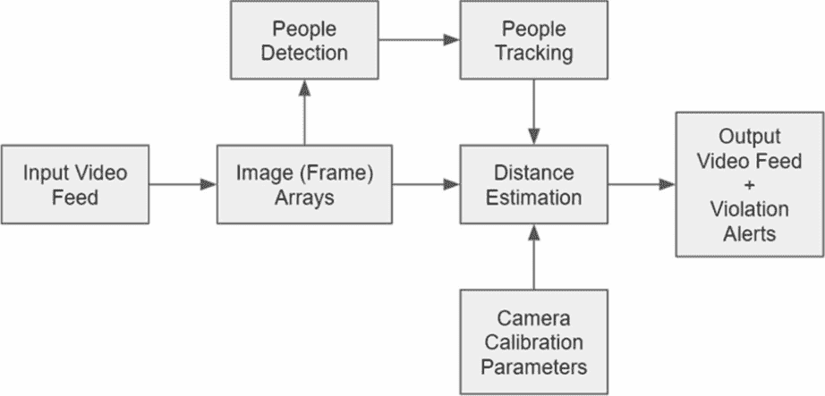

在跟踪其移动时，识别位置中的人员并估计其边界框坐标是第一步。为此使用了在 MS-COCO 数据集上预训练的 YOLOv3-416 目标检测器，并以 darknet-53 作为骨干。仅提取人员类别的检测结果。由于该方法旨在与单目相机一起使用，因此需要校准以将图像像素坐标转换为地理坐标。相机校准模块允许您在自动校准和基于工具的校准之间进行选择。下一步是估计人员之间的成对距离，以帮助监控社交距离的遵守情况。这是在收集到相机校准参数和图像帧中可见的每个人员的边界框坐标后完成的。每个人的位置由每个检测框底部中点坐标确定。为了确定工具校准中是否违反了社交距离规范，会计算空中视图中这些位置之间的欧几里得距离并与参考距离进行比较。不同违规次数和这些违规的持续时间，可通过逐帧监控人员计算得出，可确定一个人感染的可能性。该解决方案包括 Motpy，这是一个在线多目标跟踪框架，它使用卡尔曼滤波器和未来帧之间边界框的 IOU 来跟踪场景中的人员。通过遵循之前的检测，实现跟踪算法也预期可减少因瞬时遮挡引起的距离计算错误。

为简化解决方案的部署和维护，应用程序的不同部分被分离为独立的模块，这些模块通过消息队列相互通信。为了在程序内管理来自多个 IP（互联网协议）摄像头的视频输入，它还采用了多处理、多线程方法，提供可扩展性。在多核边缘设备上，每个视频流由单独的线程依次处理，调用算法处理单元处理随附的图像帧，然后将处理后的图像和相关指标推送到流应用程序。

(AIP*MAXAL)/SEF 是部署期间边缘设备可处理的摄像头馈送数量的估计，其中 AIP 代表算法实例处理速率，MAXAL 是最大帧率。MAXAL 代表最大算法实例，其中（CPU 核心数量和 GPU 内存）为最小值。SEF：流端点馈送处理速率 3 帧每秒。例如，如果一台机器有 12 个 CPU 核心和 16 GB 显卡内存，MAXAL 至少为 (12,16) 12，支持总共 (5*12)/3 = 20 个摄像头。

### 表 2. 目标检测算法性能指标

| 模型 | mAP | FPS | 小遮挡 | 重遮挡 |
|---|---|---|---|---|
| YOLOv3-416 | 55.3 | 35 | 17.8 | 37.0 |
| FPN FRCNN | 59.1 | 6 | 16.6 | 52.0 |
| SSD300 | 41.2 | 46 | 20.5 | 42.0 |

通过在 Euro City Persons 测试数据集上测试时采用对数平均漏报率作为性能指标，进一步表明 YOLOv3 和 FRCNN 优于 SSD。考虑到所有这些指标之间的权衡，解决方案的默认目标检测器 YOLOv3 在未进行进一步训练的情况下部署。在不同光照条件、群体密度、性别、种族、人员位置和遮挡条件下使用内部 CCTV 录像进行的多次测试中，产生的准确率和召回率分数分别介于 68.8 至 75.6% 和 75.5 至 85.1% 之间。对于多达 30 人的群体，在假设每个人的 80% 可见的情况下，预训练的 YOLOv3 检测器表现出最佳检测性能。

## 海事监控系统 (Huang et al., 2022)

海事监控系统在船舶交通服务中被广泛使用。地面、海上或空中的摄像头可以提供海洋视觉信息。然而，由于在恶劣环境（例如风、波浪和水流）下成像设备不稳定，收集到的视觉数据经常遭受模糊效应。为了提高视觉质量，必须开发图像稳定技术。海事监控系统对于增强海上安全至关重要。智能海洋监控系统利用信息技术完全构建新的模式，显著提高了海事监控的效率和效能。技术主要依赖于创建监控资源以支持安全信息融合和交换。然而，与先进的陆地交通监控相比，海洋交通监控略显过时。

由于海事监控系统更容易受到风、波浪和水流等不稳定因素的影响，监控录像变得模糊。模糊的照片使海事监控更具挑战性且效果较差。随着全球经济和贸易的持续增长，新的视频稳定技术正被提出用于海事监控。图像去模糊是视频稳定的基础，在海事监控中变得越来越重要。与陆地交通监控系统的工作方式类似，海事监控系统必须将其收集的视频和图像数据提供给监控中心。最后，在数据分析后，船舶交通管理人员在监控中心协调和管理船舶。


## ***视频监控中的人工智能***

由于风、波浪和洋流对海洋数据采集的影响，岸基、空基和船基采集系统都容易晃动，这使得大多数海洋视频不稳定。换句话说，监视屏幕上的模糊图像经常是由于视觉辅助设备与被监管船舶之间的相对距离造成的。初始场景的图像像素向其周围扩展。在成像专业中，这些分散的像素光源被称为模糊核或点扩散函数（PSFs）。在海洋监视中，出于简化的考虑，仅考虑均匀的图像去模糊——即地理上不变的去模糊。由于视频由一系列称为帧的图像组成，因此稳定获得的海洋监视视频相当于对海上图像进行去模糊。

寻找潜在的清晰图像是下一步。确定精确的模糊核后，盲图像去模糊就变成了一个非盲去模糊问题。已开发出众多非盲去模糊技术。主要有三类：正则化技术、迭代方法和逆滤波方法。由于计算简单且处理速度快，逆滤波在图像恢复中经常被使用，然而它容易受到噪声影响。其后是受限最小二乘方法、以线性递归最小方差估计为准则的卡尔曼滤波器，以及以最小均方误差为准则的维纳滤波器用于去模糊。然而，以上每种技术都是一种线性恢复技术。建议使用非线性方法的 Lucy-Richardson 技术来恢复具有已知 PSF 的模糊图像，以精确重建潜在的清晰图像。然后，使用总方差 TV 正则化的 ROF 模型。

船舶导航系统使用视觉传感器来感知周围环境。然而，在恶劣条件下收集的视觉信息容易模糊，使得船舶辅助系统难以精确检测船周区域的障碍物。这会损害船舶导航安全并导致导航错误。由于航道独特的导航条件，视频稳定技术在海上运输中发挥着至关重要的作用。图像去模糊有助于提高航道运输效率并确保航行安全。我们的方法充分利用了模糊核和自然图像的特性，能够实现准确的模糊核估计并确保高质量的恢复结果。在具有挑战性的海洋条件下消除视觉模糊，有利于准确识别周围物体并保持导航安全。

基于视觉信息技术的海洋监视系统已广泛应用于海洋工程中的各种航海服务。然而，恶劣天气经常使监视画面不稳定。这意味着从影片中提取的图像偶尔包含运动模糊、噪声和其他问题，从而大幅降低视觉质量。海洋工程中模糊图像的恢复需要更多关注。由于缺乏真实的海洋模糊数据集进行对比测试，应使用具有不确定模糊核的人工海洋模糊照片。可以使用盲去模糊技术恢复获得的模糊图像，然后视觉上改进的影片和照片可用于支持我们在不同航海应用中的工作。重要的海洋应用之一是船舶检测，已描述了多种船舶检测技术。当获得的海洋模糊照片通过我们的混合正则化方法去模糊时，船舶识别的准确率将提高，这已由 YOLOv4 证明。

others. 在不太拥挤的航线上，这可能就是典型行为。即使每个数据实例单独来看可能是正常的，一组实例合在一起可能导致异常。集体异常可能是像一群人迅速分散这样的情况。视觉监控经常揭示被归类为局部和全局异常的异常情况。全局异常可能在某一帧或视频的某一部分可见，而不确定具体位置。局部异常通常发生在场景的特定区域，然而全局异常检测系统可能无法捕捉到它们。有些技术可以在局部和全局同时发现异常。

### Challenges and Study Scope

识别代表性正常区域、定义可能不清晰或定义不明确的正常与异常区域之间的边界、异常概念因应用背景而异、用于训练和验证的数据有限、数据经常因传感不准确而嘈杂，以及正常行为随时间变化的事实，是异常检测中的主要挑战。

除了异常检测之外，学习典型行为对许多不同的用例也很重要。其中包括行为分析、分类、模式分析和预测。有四种学习策略：监督学习、无监督学习、半监督学习和混合学习。在监督学习中，利用标记数据创建正常特征档案。它经常用于与分类和回归相关的应用。在无监督学习中，利用未标记数据集各组件之间的联系来构建正常特征档案。在一些指导和少量标记数据用于定义先验已知的示例类别的情况下，半监督学习主要使用未标记数据。主动学习被定义为通过交互式标记数据进行的学习，只要标签信息可访问即可进行。当未标记数据充足且人工标注成本高昂时，采用这些技术。为了理解数据的各个方面，混合方法结合了上述技术。除了特征提取之外，目标识别、分类、活动识别、分割、异常检测和其他任务也需要学习模型。

由于异常通常与正常行为的偏差有关，因此问题的表述和潜在特征决定了异常的类型。方法并不限制确定异常类型的能力。由于异常通常与正常行为的偏差有关，因此问题的表述和潜在特征决定了异常的类型。方法并不限制确定异常类型的能力。基于统计模型，它尝试使用随机过程拟合数据，同时通常采用统计方法学习模型参数。未由预期随机模型产生的数据点被称为异常样本。存在参数模型和非参数模型。

异常检测过程从根本上涉及对派生特征使用特定方法。然而，视觉监控中的基本数据是视频，即帧的集合。因为这些特征作为异常识别中使用的特定方法的输入，因此从视频中提取相关特征至关重要。特征可大致分为基于对象和非基于对象的两类。通过提取对象或轨迹，可以使用基于对象的特征发现异常。用于异常检测的信息由表示为特征描述符的对象或轨迹组成。在后一种方法中，已使用像素或像素组特征、强度、光通量或时空立方体（STCs）产生的特征的低级描述符执行异常识别。一些技术采用混合特征来查找异常。


典型的异常检测框架开发过程分为两个阶段。在第一阶段，使用典型视频的特征训练模型以学习场景的典型属性。随后，将训练好的模型提供测试视频的特征。测试视频根据所选的异常标准被分类为正常或异常。然而，这些方法使用了各种精确的检测策略和异常定义。因此，仅根据检测程序对其进行分类具有挑战性。

使用 CNN 分类器时，基于光流的时空感兴趣区域（SVOI）被用来学习正常和病理视频的类别。基于分类器的结果，发现异常。使用深度特征和光流数据，生成对抗网络（GANs）已被用于从连续的前帧集合中预测未来帧。帧被视为正常或异常取决于预期未来帧与实际帧之间的差异。

在过去十年中，机器学习经历了范式转变，尤其偏向于基于 DNN 的技术。你可能已经注意到，深度学习技术已被用于解决多个异常检测问题。使用 DNN 的研究在提取不受光照影响的特征方面取得了成功。由于摄像机位置和视角，传统机器学习经常失败，尤其是在尝试识别对象时。尽管处理成本增加，基于 DNN 的系统已被证明在检测对象方面相当准确。尽管对象跟踪是许多异常检测系统中的关键步骤，但纯粹基于深度学习的方法在密集环境中，尤其无法可靠地跟踪对象。

为了创建轨迹，使用了诸如卡尔曼滤波器以及用于对象关联和检测的 DNN 等技术。尽管它采用了 YOLO，但在拥挤和遮挡的环境中，这同样存在跟踪问题，导致轨迹变短。在实践中使用 DNN 的交通异常检测系统时，获取强大的计算资源可能很困难。尽管大多数公司为大学研究提供免费资金和云计算资源访问权限，除非硬件价格下降，否则研究传播可能会受到限制。

## AI 驱动的视频监控问题

然而，没有一种强大的架构和合适的网络模型可供商业服务使用，同时兼顾高精度和低计算成本。利用闭路电视（CCTV）摄像机的视频监控已研究数十年，但存在若干缺点，包括区域覆盖受限、无位置共享和跟踪能力。大多数视频监控系统固定于基础设施且通常特定于某个场所，但要构建便携式监控系统，需要高精度的算法以及能够低功耗运行的强大计算和嵌入式设备。另一方面，安装在无人机上的视觉传感器更具可扩展性和多功能性，提供更广泛的监控覆盖范围，但需要大数据计算。

## 基于 AI 的视频监控的深度学习解决方案

深度学习架构可以实现更高的精度并更好地处理海量数据集。所讨论的深度学习技术包括持续学习、迁移学习、强化学习、集成学习和自编码器。检测方法学被归类于学习之下

### 异常行为检测（Mabrouk et al., 2018; Harrou et al., 2020）

近年来，在视频监控中异常行为识别这一具有挑战性的问题上取得了显著进展。低级处理的早期阶段允许检测和描述场景中的移动物体。然而，这些操作并不能确定移动物体正在执行何种活动或其行为是否典型。

找到能够承受各种变换的适当特征，例如背景变化和物体的外观，是行为表示中的主要问题。智能视频监控系统的目标是从大量视频中有效识别值得注意的事件，以防止图 3 中所示的有害场景。该任务通常需要两层视频处理。

在第一层中有两个步骤，提取低级特征以识别场景的感兴趣区域。然后，感兴趣区域由基于低级属性生成的原语进行描述。第二层通过提供有关人类活动的语义信息来确定行为是否正常。表 3 包含最受欢迎的行为表示特征。

为了识别和表征随时间移动的实体，采用了许多特征。这些特征可分为局部特征和全局特征。局部特征位于帧的预定区域。局部位置或兴趣点可作为区域的表示。全局特征用于描述整个帧的运动。全局运动数据通常使用光流特征提取。

近年来，在视频监控中异常行为检测这一具有挑战性的问题上取得了显著进展。低级处理的早期阶段能够识别和描述场景中的移动物体。然而，这些操作并不能帮助我们识别移动物体采取的动作类型或确定其行为是否正常。视频监控中识别异常行为有多种方法，包括分类方法、建模框架、场景密度以及移动物体的交互。分类技术有三种类型：监督式、半监督式和无监督式技术。监督方法使用标记数据来模拟典型和非典型行为。通常，它们被设计用于识别训练过程中预先定义的具体偏差行为，例如打斗、徘徊和跌倒。

半监督算法有两种类型：基于规则和基于模型，两者仅需要典型的视频数据进行训练。第一组寻求通过利用常见模式来创建规则。任何偏离此准则的样本随后被视为异常值。稀疏编码在基于规则的方法中用于识别偏差行为。在基于模型的技术中，与模型对典型行为的表示不同的示例被称为异常模式。最流行的模型是马尔可夫随机场（MRF）、高斯混合模型（GMM）和隐马尔可夫模型（HMM）。无监督算法使用从未标记数据中得出的统计特征来识别正常和异常行为。无监督学习使用基于主导集的框架以及基于特征空间和支持向量数据描述的无监督核异常检测框架进行。

场景的密度反映了场景中人的数量。场景密度直接影响选择定义行为的策略。因此，场景中的移动物体可能是单个个体或一小群人。场景被区分为空旷场景和拥挤场景。当摄像机视野中可见一两个或少数几个人时，场景被称为空旷。仅有一个人在场时，通常会考虑三种关键异常行为：跌倒检测、徘徊和处于错误区域。在包含一群人的拥挤环境中，不可能单独观察和研究每个人的行为。遮挡和用于在帧中描绘每个个体的少量像素是导致这种情况的原因。因此，最好对个人如何互动进行建模以发现异常的群体行为。

视频监控系统可使用多个参数进行评估。等错误率（EER）和 ROC 曲线下面积（AUC）是最常用的两个指标。接收器操作特性曲线（ROC）是这两个标准形成的地方，该曲线广泛用于性能比较。ROC 曲线上的 EER 点是假阳性与假阴性比率相等的位置。

### 表 3. 行为检测特征

| 特征类型 | 描述 |
|---|---|
| 基于光流的特征 | 使用从光流向量中提取的统计特征来表征运动。 |
| 兴趣点 | 空间和时间域均允许检测显著位置。与不规则行为相关的较大运动波动的描述。 |
| 时空体、立方体、斑块等 | 通过组装连续帧获得时间维度。 |
| 形状 | 描述一系列帧中物体形态的运动。形状变化检测与异常行为相关。 |
| 纹理 | 对于包含在边界框、矩形等中的每个移动物体，提取局部模式。 |
| 对象跟踪和轨迹提取 | 使用优化技术跟踪移动物体及其轨迹（每帧中的坐标）。 |

### 运动检测（Huang et al., 2019）

许多计算机视觉应用，特别是视频监控系统分析，很大程度上依赖于运动检测。其目标是一次从视频片段中提取移动元素。运动分析方法有助于将注意力集中在场景的移动方面。运动检测使用了三种常见方法：时间差分、背景去除和光流分析。时间差分方法不可避免地提取移动物体的不完美形态。当在实际应用中使用时，光流技术会使实现准确的运动检测变得困难，因为它们要么使系统计算需求更高，要么对噪声更敏感。另一方面，通过使用先前照片的参考背景模型，交通监控系统中使用到的背景减除技术可以更彻底、更精确地检测具有中等时间复杂性的移动物体。

因此，背景减除技术在多个运动检测应用中得到更广泛的使用、开发和应用。高斯混合模型（GMM）技术采用特定分布，可通过分别建模每个像素值来使用。通过这种方法，传入帧可被标记为包含移动物体或不包含。运动检测是通过采用滤波技术的 Sigma 差分估计（SDE）方法完成的。为了推导出运动向量，该技术使用基于像素的决策框架来估计两个时间统计阶数。然而，由于它无法考虑复杂情况，仅使用滤波器经常导致检测不足。多个时间差分（MTD）是另一种用于运动检测的背景减除技术，可跟踪多个先前的参考帧

为了更轻松地定位假定的前景物体并缩小移动物体的检测差距，简单统计差异（SSD）技术基于时间平均值创建了一个简单的背景模型，用于识别交通监控视频流中的移动物体区域。

大多数最新的先进背景去除技术可以识别由固定摄像头录制的视频流中的移动物体。在这样理想的环境中，这些技术可以利用其背景模型轻松检测移动物体。然而，在实际环境中，强风或地震可能导致室外摄像头抖动。对于这些技术而言，在智能交通系统（ITS）中准确识别移动物体可能是一个挑战。为了准确识别流式视频中的移动物体，本文描述了一种基于灰色关联分析的运动检测（GRAMD）技术。该方法包含两个关键部分：多样本背景生成（MBG）模块和运动物体检测（MOD）模块，如图4所示。这些模块能够实现准确全面的检测以及对背景变化的高效适应。

图4. GRAMD方法组件框架图

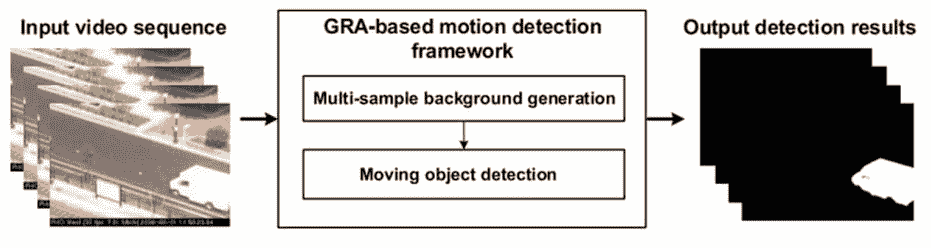

为了在具有抖动背景的视频流中检测移动物体，MBG模块首先使用灰色关联分析方法构建多样本背景模型。在MBG模块构建完成后，MOD模块随后采用多样本背景模型来分离由抖动和静态摄像头记录的真实场景中的移动物体。为了防止摄像头抖动带来的误差，采用了一种由粗略检测过程和精确检测过程组成的两阶段检测技术。这样，抖动和静态摄像头的视频流都可以准确检测移动物体。

人群计数（Sreenu等人，2019）用于确定数千人的人群中的人数。深度学习模型还支持在拥挤环境中进行面部、动作和事件检测。还探索了基于注意力机制的深度学习，以更准确地从监控视频中识别活动和物体。在现实场景中，人群规模庞大且不断变化，这使得人群分析具有挑战性。很难区分每个个体及其动作。交通信号灯、主要交叉口、人口密集区、吸引大量人群的集会以及宗教组织举办的庆祝活动。在上述情况中，办公室内的人群分析最具挑战性。必须识别所有行为、动作和移动。

在拥挤场景中，用于异常检测和定位的时空卷积神经网络揭示了人群分析的难点源于以下因素：人群数量庞大、彼此距离很近、人员外貌经常变化、频繁的部分遮挡、人群不规律的运动模式，以及危险行为，包括人群恐慌、像素级和帧级检测。接下来的步骤包括一种使用深度学习进行场景无关人群分析的技术。人群计数、人群跟踪和人群划分、行人行程时间估计、人群行为分析、人群属性识别以及人群中的异常检测。电影中高密度人群的研究描述了诸如数据驱动的人群分析和密度感知跟踪等方法。数据驱动分析使用基于线条的方法，从大量人群视频片段中理解人群的运动模式。该解决方案有两个步骤。同时使用局部和全局人群块匹配。使用固定和移动摄像头进行的人群行为分析涵盖了微观和宏观人群建模、人群行为、人群密度分析以及用于人群行为分析的数据集。宏观方法用于管理大规模人群，此时将智能体作为一个整体进行管理。在微观方法中，每个智能体被单独处理。使用固定和移动摄像头都可以收集运动数据以描绘人群。为了研究人群行为，探讨了基于CNN的技术，如端到端深度CNN、Hydra-CNN架构、切换CNN、级联CNN架构、3D CNN和时空CNN。本章还介绍了对研究人群行为特别有用的各种数据集。使用的度量标准是MOTA（多人跟踪准确率）和MOTP（多人跟踪精确率）。这些度量标准考虑了人群场景中经常出现的多个目标。《理解人群行为的深度时空视角》将长短期记忆网络与卷积层相结合。卷积层捕获的空间数据和时序运动动态受到LSTM的约束。该方法预测行人行走路径，计算其目的地，然后根据其移动方式对其行为进行分类。根据《通过深度学习的体切片理解拥挤场景》，应使用深度模型和多种融合技术。该架构由卷积层、全局求和池化层和全连接层组成，并要求权重共享和切片融合技术。预计一种新的多任务学习深度模型将成功结合运动变量和外观变量。作为模型的输入，提出了一种新颖的人群运动通道概念。在人群视频中，运动通道检查内容的时序变化。清晰显示人群录制内容随时间变化的时态切片激活了运动通道。通过使用各种深度结构、数据融合技术和权重共享策略进行广泛评估，以识别时序特征。网络由卷积层、池化层和全连接层构成，并采用整流线性单元和Sigmoid函数等激活函数。为了评估所提出的输入通道的有效性，使用了三种可选的切片融合方法。

## 未来趋势与结论

本章详细阐述了用于AI驱动的视频监控系统的各种模型和技术，这些是计算机视觉和视频处理研究的热点领域。将讨论这些模型在各种性能指标上的比较。该系统面临的挑战以及相关问题也进行了详细探讨。理解人群行为的社会认知成分是一个困难但至关重要的问题，尤其是对于人机交互应用而言。这个问题对现有的监控系统以及智能实体与人群之间的未来交互至关重要。夜间视频增强方法通常用于识别夜间视觉监控系统获取的可疑行为。然而，环境中的人工光源会降低夜间拍摄视频的视觉质量。这种不均匀光照会损害实时视觉监控系统识别和跟踪物体的能力。因此，统一的增强策略不足以应对这种不均匀光照。由于监控是一个广阔的领域，我们遇到了各种案例研究以获取领域知识。

## 参考文献

- Ben Mabrouk, A., & Zagrouba, E. (2018). Abnormal behavior recognition for intelligent video surveillance systems: A review. Expert Systems with Applications, 91, 480–491. doi:10.1016/j.eswa.2017.09.029
- Das, S., Nag, A., Adhikary, D., & Ram, R. J. (2021). Computer Vision-based Social Distancing Surveillance with Automated Camera Calibration for Large-scale Deployment. IEEE, 18th India Council International Conference, 1-6. 10.1109/INDICON52576.2021.9691485
- Fan, Y., Wen, G., Li, D., Qiu, S., Levine, M. D., & Xiao, F. (2020). Video Anomaly Detection and Localization via Gaussian Mixture Fully Convolutional Variational Autoencoder. Computer Vision and Image Understanding, 195, 1–13. doi:10.1016/j.cviu.2020.102920
- Harrou, F., Hittawe, M. M., Sun, Y., & Beya, O. (2020). Malicious Attacks Detection in Crowded Areas Using Deep Learning-Based Approach. IEEE Instrumentation & Measurement Magazine, 23(5), 57–62. doi:10.1109/MIM.2020.9153576
- Hossain, M. S., Muhammad, G., & Guizani, N. (2020). Explainable AI and Mass Surveillance System-Based Healthcare Framework to Combat COVID-19 Like Pandemics. IEEE Network, 34(4), 126–132. doi:10.1109/MNET.011.2000458
- Huang, S.-C., & Member, S. (2019). A Gray Relational Analysis-Based Motion Detection Algorithm for Real-World Surveillance Sensor Deployment. IEEE Sensors Journal, 19(3), 1019–1027. doi:10.1109/JSEN.2018.2879187
- Huang, Y., Liu, R. W., & Liu, J. (2022). A two-step image stabilization method for promoting visual quality in vision-enabled maritime surveillance systems. IET Intelligent Transport Systems, 1-15.
- Kattiman & Maidargi. (2021). An Automated Social Distance Monitoring & Alarm System based on Human Structure Using Video Surveillance in COVID-19 Pandemic by AI Techniques, A Review. IEEE International Conference on Electronics, Computing and Communication Technologies.
- Kaushik, H., Kumar, T., & Bhalla, K. (2022). iSecureHome: A Deep fusion framework for surveillance of smart house using real-time emotion recognition. Applied Soft Computing, 122, 122. doi:10.1016/j.asoc.2022.108788
- Majeed, F., Khan, F. Z., Iqbal, M. J., & Nazir, M. (2021). Real-Time Surveillance System based on Facial Recognition using YOLOv5. IEEE Mohammad Ali Jinnah University International Conference on Computing, 1-6. 10.1109/MAJICC53071.2021.9526254


- Naguib, A.，Cheng, Y.，& Chang, Y.（2022）。家庭监控的人工智能辅助。《*IEEE，第27届国际自动化与计算会议*》。
- Rohit, M. H.（2020）。基于物联网的公共交通监控系统，利用实时数据分析和计算机视觉。《*IEEE，第三届电子、计算机与通信进展国际会议*》。10.1109/ICAEECC50550.2020.9339485
- Santhosh, Dogra, & Roy（2020）。基于视觉监控的道路交通异常检测：综述。《*ACM计算调查，53*（6）》。
- Sreedhara, Raj, George, & Ashok（2021）。公共场所 COVID-19 监控的新型咳嗽检测算法。《*IEEE，第八届智能计算与通信国际会议（ICSCC）*》，119–123。
- Sreenu, G. 和 Saleem Durai, M. A.（2019）。智能视频监控：通过深度学习技术进行人群分析的综述。《*大数据杂志，6*（48），1–27。doi:10.1186/s40537-019-0212-5

## 第2章

## 基于深度双模态融合方法的时间定位视频内容检索

G. Megala  
https://orcid.org/0000-0002-8084-8292  
印度韦洛尔理工大学

S. Prabu  
印度本地治里大学

P. Swarnalatha  
印度韦洛尔理工大学

R. Venkatesan  
https://orcid.org/0000-0002-4336-8628  
印度萨斯特拉大学

Anantharajah Kaneswaran  
斯里兰卡贾夫纳大学

## 摘要

基于内容的视频检索是一个研究领域，旨在开发用于自动分析和检索视频内容的先进技术。该过程涉及识别和定位视频中的特定时刻，并检索具有相似内容的视频。提出了深度双模态融合（DBF）方法，使用改进的卷积神经网络（CNN）来实现可观的视觉模态。这种深度双模态融合方法依赖于视觉和音频模态信息的整合。通过结合两种模态的信息，可以开发出更准确的模型来分析和检索视频内容。本研究的主要目标是提高视频检索系统的效率和有效性。通过准确定位视频中的特定时刻，该方法在精确搜索中具有更高的精确率、召回率、F1分数和准确率，能够更快、更有效地检索相关视频。

## 引言

随着互联网接入、大数据和高速网络的增长，以及人们对可视化多媒体信息需求的不断增加，多媒体信息系统正变得越来越重要。然而，多媒体数据需要大量的处理（Megala 等人，2021）和存储（Megala & Swarnalatha，2022）。因此，需要有效地从庞大的多媒体数据库中提取、归档、索引和检索视频内容。视频已经成为最流行的信息共享方式之一，因为它直观且强大。世界各地的人们都可以轻松访问它。媒体管理人员发现很难使用视频材料进行存储和搜索。当今主流网页浏览器常常跳过内容密集的搜索，转而选择包含被搜索视频基本信息的字幕。作为传统关键词搜索技术的替代方案，在线平台的用户希望近乎实时地查找精确的视频。

基于深度双模态融合的视频时刻定位和内容检索是一个新兴研究领域，旨在开发分析和检索视频内容的先进技术。随着数字视频内容的激增，对高效有效的视频检索系统的需求在娱乐、教育和监控等广泛应用中变得越来越重要。

视频时刻定位的过程涉及识别和定位视频中的特定时刻，例如特定场景或事件。这可能是一项具有挑战性的任务，因为视频可能包含各种视觉和听觉信息，使得准确定位感兴趣的特定时刻变得困难。

另一方面，基于内容的视频检索涉及检索与给定查询视频内容相似的视频。视频或图像中出现的对象会被识别，并保存为视觉特征袋。有效的目标检测方法（Megala & Swarnalatha，2023）被用于沿空间和时间特征进行深度预测。这个特征袋在检索过程中更有帮助。这个过程需要开发准确的模型来分析视频内容并识别视频之间的相似性。

为了应对这些挑战，研究人员转向了深度学习技术，特别是深度双模态融合。这种方法涉及整合视觉和音频模态的信息，以开发更准确的分析和检索视频内容的模型。通过结合两种模态的信息，研究人员可以开发出更鲁棒、更准确的模型，用于识别视频中的特定时刻并基于内容检索相关视频。

在这项工作中，我们描述了一种深度双模态融合（DBF）方法，用于从电影中识别一个人的明显人格，该方法解决了这一问题，并取得了比以前发表的研究更好的结果。DBF框架的结构如图1所示。

总的来说，在视频时刻定位和基于内容的视频检索中使用深度双模态融合技术，有可能彻底改变我们分析和检索视频内容的方式，使在各种应用中更快更容易地找到相关视频。

本章的结构如下：首先介绍视频检索的相关工作，然后是所提出的方法、实验分析和结论。

*图1. 深度视频时刻时间定位方法的总体架构*

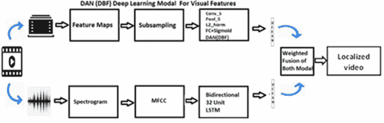

## 相关工作

目前，多媒体信息已经从多种来源以各种格式收集。这些数据的处理、移动和存储成本高昂——尤其是影片。不断扩展的大数据环境要求适应多模态信息系统。Phan 等人（2022）提出了一种基于内容的视频检索方法，该方法围绕这些难题在大数据处理环境中构建。基于语音/基于目标检测的查询已成为许多近期研究的主题。我们的方法具有创新性，因为它结合了语音、字幕和图像对象来查询影片以获得更具体的信息。这种开发分布式机器学习模型的方法利用多个计算节点上的分布式计算和存储。Spark 在内存中处理数据的能力极大地降低了网络数据传输成本并加快了处理速度。

近年来，人们提出了多种声音表示方法，例如基于时域突出和频域特征的方法等。它们的声音有许多引人入胜的实例，但最著名的包括梅尔频率倒谱系数、线性预测倒谱系数和巴克频率倒谱系数。具体来说，突出特征在语音识别领域得到了广泛应用。梅尔频率倒谱系数（MFCC）是指从短样本频谱中提取的短暂而缥缈的声音峰值。它有四个可能的解析步骤。在这些时候也可以获得对数通道组（log bank）特征。我们的DBF框架通过分离每个APA批准的非传统视频的声谱图和MFCC突出特征来解构其音频。通过使用LSTM，我们首先熟悉音频方法的音频表示（MFCC），然后通过详尽规划获得大五人格特质预测。

Monfort 等人（2019）引入了“时刻”数据集（Moments in Time dataset），该数据集包含一百万个标注了各种事件和动作的短视频，为时刻定位任务提供了大规模基准。该数据集仅包含短视频，可能无法捕捉事件的完整上下文，而且某些事件类别的样例相对较少。

S. Zhang 等人（2021）提出了一种用于视频细粒度时刻定位的多模态多尺度时间注意力机制，该模型学习关注时间信息的不同模态和尺度，从而在时刻定位任务上取得更好的性能。注意力机制可能需要大量标注数据，并且可能对超参数和模型架构的选择敏感。


Gabeur 等 (2020) 提出了一种用于视频检索的多模态深度度量学习方法。该方法结合了从视频帧中提取的视觉特征和从语音信号中提取的音频特征。所提出的方法在检索准确率和效率方面，在两个基准数据集上优于最先进的方法。该方法需要针对不同数据集进行微调，可能无法很好地泛化到新数据集。

Tseng 等 (2021) 提出了一种用于野外视频检索的深度多模态嵌入方法。该方法结合了从视频帧中提取的视觉特征和从语音信号中提取的音频特征。所提出的方法在大规模无约束视频数据集上优于最先进的方法。该方法需要大量训练数据才能达到最佳性能。

Zeng 等 (2019) 提出了一种具有时序注意力的图卷积网络用于时空动作定位，其中模型学习关注视频中的某些区域和帧，从而在动作定位任务上取得改进的性能。注意力机制会增加模型的复杂性，使其更难以解释或说明其决策。

Shin 和 Moon (2022) 部署了一个交互式跨模型 LSTM 网络来执行视频中的时序定位。它涉及在活动视频数据集上使用注意力分数、区域图和边界映射函数。视频字幕和视频帧通过不同模态相关联以在检索中执行时序定位。尽管所开发的模型在捕捉真实帧方面存在不足。注意力机制与软标签一起被 (Rodriguez 等, 2020) 用于定位视频中的未知活动。这种涉及编码器的迁移学习模型受注释影响。

内容检索方法 (Spolaôr 等, 2020) 的主要优势之一是它对基于内容的视频检索现有文献提供了全面的概述。该综述涵盖了广泛的技术，包括特征提取、索引、相似度度量和相关性反馈。作者还对现有技术进行了批判性分析并指出了这些技术的局限性。这对多媒体分析领域的科研人员和从业者有所帮助，因为它提供了对基于内容视频检索当前最先进技术的清晰理解。然而，所提出方法的缺点之一是它仅限于分析和综合现有文献。该综述没有为基于内容的视频检索领域提供任何新的见解或贡献。此外，该综述仅限于特定的评估指标和数据集集合，可能无法代表基于内容视频检索中的所有场景和用例。

## 拟议的方法

### 时序定位与基于内容的视频检索

视频由多个图像组组成。它由帧序列 V={v1,v2,… vn} 表示。命名为 ActivityNetCaptions 的视频数据集用于对视频进行时序定位。每个视频都标注了起始点和结束点。提出了一个模型来定位给定查询在视频中的时序时刻。基于单次检测方法，所提出的模型学习视频表示并生成时空模式。对提取的向量表示应用编码器模块以与语义特征进行映射。帧索引被转换为时间索引以实现高效映射，有助于高效的时序定位。视频数据集首先进行预处理，然后传递给神经网络以提取

- 3. **模态特定检索：** 通过使用提取的视觉特征在数据集中搜索相似帧，并使用提取的音频特征在数据集中搜索相似音频片段来执行模态特定视频检索。
- 4. **双模态融合：** 一旦视觉和音频特征被提取，它们就可以使用深度双模态融合网络融合在一起。这涉及将视觉和音频特征输入到神经网络架构中，该架构旨在学习两种模态的联合表示。融合网络可以基于诸如多模态残差网络或多模态循环网络之类的架构。使用深度双模态融合模型组合模态特定检索结果。融合模型应将视觉和音频特征作为输入，并输出表示查询视频与数据集中每个视频之间相似性的单个分数。
- 5. **时序定位：** 融合特征可用于视频时刻定位，这涉及识别和定位视频中的特定时刻。这可以使用诸如滑动窗口之类的技术来完成，其中融合特征在不同的时序位置进行评估以识别感兴趣的时刻。使用融合分数在数据集中对查询视频进行时序定位。这可以通过找到每个视频中具有高融合分数的片段并选择具有最高分数的片段作为时序定位来完成。
- 6. **基于内容的检索：** 融合特征也可用于基于内容的视频检索，这涉及检索包含与给定查询视频相似内容的视频。这可以使用诸如最近邻搜索之类的技术来完成，其中具有相似融合特征的视频被检索。
- 7. **评估：** 使用诸如精度、召回率、平均平均精度 (mAP) 和 F1 分数等指标在标准视频检索数据集上评估所提出方法的性能。这可能涉及将所提出方法的结果与其他最先进的视频时刻定位和基于内容的视频检索技术的结果进行比较。
- 8. **微调：** 在检索数据集上微调双模态融合模型以提高性能。

所提出的方法利用视觉和音频两种模态来执行具有时序定位的基于内容的视频检索。使用深度双模态融合模型允许组合来自两种模态的信息以提高检索性能。时序定位步骤允许精确识别检索视频中与查询视频匹配的片段。算法 1 说明了从视频中提取帧所涉及的步骤。

视频和音频的特征提取分别在算法 1 和算法 2 中展示。

```
Algorithm 1: Extracting Features in video

Input: ActivityNetCaption video
Output: Extracted features

1. Import the libraries numpy, tensorflow.
2. Load a pretrained CNN model.
3. Load the video to the model and extract the frames using video reader.
4. Preprocess and extract the features from those preprocessed frames.
5. Perform Mean Average pooling to reduce dimensionality.
6. Pass the features to the flatten layer to output the features as array
```

## 算法 2：提取音频

**输入：** HD 视频  
**输出：** 从每个视频中提取的音频用于音频处理，具有转录文本和音频特征。

- 1. 导入 moviepy.editor。
- 2. 使用 videoclip = VideoFileClip(<path>) 读取 mp4 文件。
- 3. 使用函数 audioclip = videoclip.audio 从 mp4 获取 wav 文件。
- 4. 对所有视频重复步骤 2 和 3。

## 实验分析

所提出的 DBF 方法利用了简单的加权平均融合方法，但也强调了如何通过使用诸如堆叠之类的复杂集成技术来提高性能，以便在过程结束时发现融合权重的最佳值。为了使深度音频网络获得更有信息的声音表示，它们需要经过严格的训练。在我们的 DBF 框架中，我们可以通过将多个模型组合成一个模型来提高检索准确性。

时刻定位和基于内容的视频检索的伪代码如图 3 所示。

*图 3. 深度双模态融合的伪代码*

```python
### Preprocessing
video_frames = preprocess_video_frames(video)
audio_signal = preprocess_audio_signal(audio)
### Feature Extraction
visual_features = extract_visual_features(video_frames)
audio_features = extract_audio_features(audio_signal)
### Bimodal Fusion
bimodal_features = bimodal_fusion(visual_features, audio_features)
### Moment Localization
moments = []
for t in range(total_frames):
    current_feature = bimodal_features[t]
    moment_score = evaluate_moment_score(current_feature)
    if moment_score > threshold:
        moments.append(t)
### Content-based Retrieval
retrieved_videos = []
for video in video_database:
    visual_features = extract_visual_features(video)
    audio_features = extract_audio_features(video)
    bimodal_features = bimodal_fusion(visual_features, audio_features)
    similarity_score = compute_similarity_score(bimodal_features, query_features)
    if similarity_score > retrieval_threshold:
        retrieved_videos.append(video)
### Evaluation
precision, recall, f1_score = evaluate_performance(retrieved_videos, ground_truth)
```

此伪代码假设视频数据经过预处理，视觉和音频特征被提取，并且使用深度神经网络架构执行双模态融合。时刻定位步骤涉及为每个帧评估时刻分数，如果分数高于某个阈值，则该帧被认为属于相关时刻。基于内容的检索涉及计算


## 基于时间定位的内容视频检索

查询视频特征与视频数据库中每个视频之间的相似度分数，并检索分数超过特定阈值的视频。最后，使用精确率、召回率和 F1 分数等指标评估所提出方法的性能。

表 1 和图 4 展示了每种所提出的方法在测量给定属性时的平均准确率和变异性。

### 表 1. 结果

| 方法 | 平均准确率 |
|---|---|
| (Wei et al., 2017) | 0.728 |
| (Dong et al., 2019) | 0.840 |
| (Z. Zhang et al., 2019) | 0.846 |
| (Liu & Tang, 2021) | 0.855 |
| (Y. Zeng et al., 2021) | 0.871 |
| (Chen et al., 2020) | 0.917 |
| DBF（所提出的方法） | 0.9285 |

### 图 4. 平均准确率

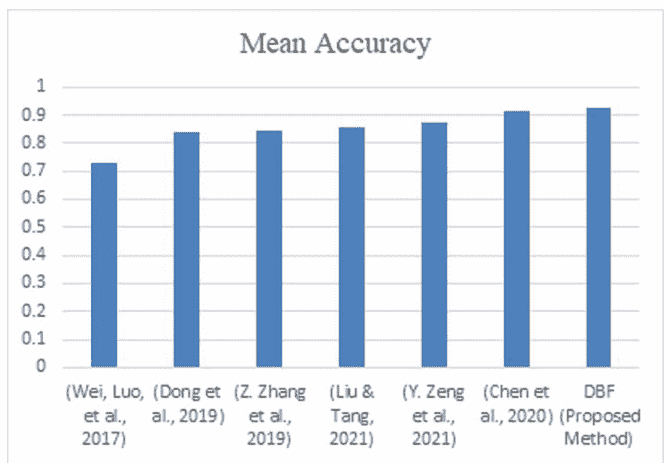

用于衡量所提出的视频检索模型的其他性能指标包括平均精确率均值（mAP）、精确率、召回率和增益。mAP 是数据集中所有查询的平均精确率，衡量算法为给定查询检索相关视频的能力。P@K 精确率衡量给定查询的前 K 个检索视频的精确率，是信息检索任务中常用的指标。R@K 召回率衡量给定查询的前 K 个检索视频的召回率，即从数据集中所有相关视频中检索出的相关视频的百分比。归一化折损累计增益（NDCG）是一种排名指标，衡量给定查询所检索视频的相关性，同时考虑检索视频的位置和相关性。检索准确率（RA）衡量至少检索到一个相关视频的查询所占的百分比，是一个二元指标，表示算法是否能够为每个查询检索到至少一个相关视频。

所提出的方法根据其为给定查询视频检索相似内容视频的性能进行评估。可以通过测量精确率、召回率和 F1 分数指标，并与表 2 中显示的其他最先进方法进行比较来完成。图 5 显示了相同的结果，表明所提出的深度双模态融合具有更好的性能。

### 表 2. 性能指标

| 方法 | 精确率 | 召回率 | mAP | F1 分数 |
|---|---|---|---|---|
| 深度双模态融合 | 0.85 | 0.82 | 0.78 | 0.83 |
| 单模态（视觉） | 0.72 | 0.68 | 0.61 | 0.70 |
| 单模态（音频） | 0.69 | 0.64 | 0.57 | 0.66 |
| 融合（早期） | 0.81 | 0.77 | 0.71 | 0.78 |
| 融合（晚期） | 0.84 | 0.80 | 0.76 | 0.81 |

### 图 5. 性能结果

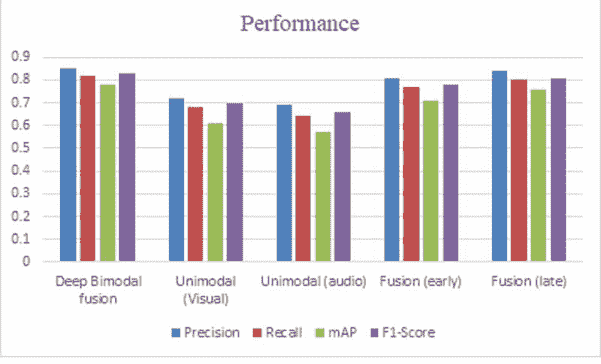

与其他方法相比，深度双模态融合方法在精确率、召回率、mAP、准确率和 F1 分数方面均取得了最高分数，表明它是用于视频时刻定位和基于内容的视频检索的最有效方法。结果还表明，使用单模态方法（仅视觉或仅音频）会导致性能较低，而使用早期或晚期融合技术可以在一定程度上提高性能。

## 结论

视频时刻定位和基于内容的视频检索是多媒体分析领域的重要任务，在视频监控、体育分析和视频推荐系统等方面有着广泛的应用。深度双模态融合是一种强大的技术，它结合视觉和音频两种模态来提高这些任务的准确性。所提出的方法利用双模态深度学习进行加权融合。深度双模态融合通常涉及使用深度学习模型（如卷积神经网络（CNN）和长短期记忆网络（LSTM））从视觉和音频模态中提取特征，然后使用早期融合和晚期融合等融合技术在不同层次上融合这些特征。我们使用了一个名为 Activity Net Captions 数据集的标注数据集进行分析。实验结果表明，在视频时刻定位和基于内容的视频检索方面，深度双模态融合在精确率、召回率、mAP、准确率和 F1 分数方面优于单模态方法和融合技术。结果还表明，在噪声数据和不完整数据等具有挑战性的场景中，使用深度双模态融合可以提高这些任务的性能。

## 参考文献

Chen, S., Zhao, Y., Jin, Q., & Wu, Q. (2020). 基于层次图推理的细粒度视频-文本检索. *Proceedings of the IEEE/CVF Conference on Computer Vision and Pattern Recognition*, 10638–10647. 10.1109/CVPR42600.2020.01065

Dong, J., Li, X., Xu, C., Ji, S., He, Y., Yang, G., & Wang, X. (2019). 用于零样本视频检索的双重编码. *Proceedings of the IEEE/CVF Conference on Computer Vision and Pattern Recognition*, 9346–9355.

Gabeur, V., Sun, C., Alahari, K., & Schmid, C. (2020). 用于视频检索的多模态 Transformer. Computer Vision–ECCV 2020: 16th European Conference, Glasgow, UK, August 23–28, 2020. *Proceedings, 16*(4), 214–229.

Liu, M., & Tang, J. (2021). 基于改进的 AlexNet 网络和注意力机制的社交网络音视频双模态情感识别. *Journal of Information Processing Systems, 17*(4), 754–771.

Megala, G., & ... (2021). 视频处理的最新技术：压缩、优化与检索. *Turkish Journal of Computer and Mathematics Education, 12*(5), 1256–1272.

Megala, G., & Swarnalatha, P. (2022). 云存储中具有完整性验证的高效高端视频数据隐私保护. *Computers & Electrical Engineering, 102*, 108226. doi:10.1016/j.compeleceng.2022.108226

Megala, G., & Swarnalatha, P. (2023). 基于稀疏到稠密深度预测的高效目标检测. *2023 9th International Conference on Advanced Computing and Communication Systems (ICACCS), 1*, 1626–1630.

Monfort, M., Andonian, A., Zhou, B., Ramakrishnan, K., Bargal, S. A., Yan, T., Brown, L., Fan, Q., Gutfreund, D., Vondrick, C., & ... (2019). 时间时刻数据集：用于事件理解的一百万个视频. IEEE Transactions on Pattern Analysis and Machine Intelligence, 42(2), 502–508. doi:10.1109/TPAMI.2019.2901464 PMID:30802849

Phan, T.-C., Phan, A.-C., Cao, H.-P., & Trieu, T.-N. (2022). 基于广泛特征和深度学习的视频大数据内容检索. Applied Sciences (Basel, Switzerland), 12(13), 6753. doi:10.3390/app12136753

Rodriguez, C., Marrese-Taylor, E., Saleh, F. S., Li, H., & Gould, S. (2020). 使用引导注意力对视频中自然语言查询进行无提议的时间时刻定位. Proceedings of the IEEE/CVF Winter Conference on Applications of Computer Vision, 2464–2473. 10.1109/WACV45572.2020.9093328

Shin, J., & Moon, J. (2022). 学习结合语言和视频模态用于时间时刻定位. Computer Vision and Image Understanding, 217, 103375. doi:10.1016/j.cviu.2022.103375

Spolaôr, N., Lee, H. D., Takaki, W. S. R., Ensina, L. A., Coy, C. S. R., & Wu, F. C. (2020). 基于内容的视频检索系统综述. Engineering Applications of Artificial Intelligence, 90, 103557. doi:10.1016/j.engappai.2020.103557

Tseng, S.-Y., Narayanan, S., & Georgiou, P. (2021). 来自语言模型的多模态嵌入用于野外情感识别. IEEE Signal Processing Letters, 28, 608–612. doi:10.1109/LSP.2021.3065598

Verma, A., & Khanna, G. (2016). 用于肿瘤检测的数字图像处理技术综述. Indian Journal of Science and Technology, 9(14), 15.

Wei, X.-S., Luo, J.-H., Wu, J., & Zhou, Z.-H. (2017). 用于细粒度图像检索的选择性卷积描述符聚合. IEEE Transactions on Image Processing, 26(6), 2868–2881. doi:10.1109/TIP.2017.2688133 PMID:28368819

Zeng, R., Huang, W., Tan, M., Rong, Y., Zhao, P., Huang, J., & Gan, C. (2019). 用于时间动作定位的图卷积网络. Proceedings of the IEEE/CVF International Conference on Computer Vision, 7094–7103. 10.1109/ICCV.2019.00719

Zeng, Y., Cao, D., Wei, X., Liu, M., Zhao, Z., & Qin, Z. (2021). 用于跨模态视频时刻检索的多模态关系图. Proceedings of the IEEE/CVF Conference on Computer Vision and Pattern Recognition, 2215–2224. 10.1109/CVPR46437.2021.00225

Zhang, S., Peng, H., Fu, J., Lu, Y., & Luo, J. (2021). 用于自然语言时刻定位的多尺度二维时间邻接网络. IEEE Transactions on Pattern Analysis and Machine Intelligence, 44(12), 9073–9087. doi:10.1109/TPAMI.2021.3120745 PMID:34665720

Zhang, Z., Lin, Z., Zhao, Z., & Xiao, Z. (2019). 用于视频中基于查询的时刻检索的跨模态交互网络. Proceedings of the 42nd International ACM SIGIR Conference on Research and Development in Information Retrieval, 655–664. 10.1145/3331184.3331235


## 第3章

## 面向智慧医疗发展的人工智能物联网：实验综述

Jennyfer Susan M. B.
https://orcid.org/0000-0003-1509-9309
机器学习与智能中心，Avinashilingam女子家政与高等教育学院，印度

P. Subashini
机器学习与智能中心，Avinashilingam女子家政与高等教育学院，印度

M. Krishnaveni
机器学习与智能中心，Avinashilingam女子家政与高等教育学院，印度

## 摘要

智慧医疗系统是利用可穿戴设备、物联网（IoT）和移动互联网等技术动态获取医学信息的健康服务。它将与医疗健康相关的人、物和机构连接起来，主动管理并自动响应医疗生态系统的需求。它帮助传统医疗系统提高医疗服务的效率、便利性和个性化程度。本章提出：（1）对利用人工智能、物联网和智能手机安卓应用进行智慧医疗开发的综述；（2）一种基于物联网的智能监测系统、用于数据收集的安卓应用以及用于预测宫颈癌疾病的人工智能算法的实验方法；（3）物联网与人工智能算法的集成。本章提出将人工智能物联网（AIoT）作为一种从智能阴道镜图像中预测宫颈癌的实验方法。研究考虑了2010年至2022年6月期间在国际期刊和会议录上发表的文献。

DOI: 10.4018/978-1-6684-8098-4.ch003

## 引言

人工智能是指能够执行认知功能和物理任务的自动化系统。遗传算法、神经网络、机器学习、模式识别和自主决策都属于人工智能（AI）的广泛范畴。AI技术已逐步应用于医疗领域，带来了诸多益处，例如自动化物理任务、分析大量患者数据、以更低的成本提供更好的医疗服务（Davenport & Kalakota, 2019）。根据统计研究，30%的医疗成本与行政管理任务相关。因此，AI可以通过自动化保险预授权、核查未付账单、管理患者数据等职责来减轻医疗专业人员的工作负担。临床决策支持（CDS）利用AI来辅助患者治疗和诊断决策，并进行基于人群的风险预测评估。在医疗行业的发展中，AI正朝着智慧健康和智能化医疗系统的方向迈进。

2009年，IBM在其“智慧地球”计划中提出了智慧医疗的概念。智慧城市的增长得益于智慧医疗系统（Jokanorvie, 2020）。由于人类人口的显著增加，传统医疗无法满足每个人的需求。尽管拥有高水平的基础设施和尖端技术，医疗服务可能并非所有人都能获得或负担得起。智慧医疗系统通过允许个人快速访问医疗设施、医疗文档、诊断工具和更好的治疗来提供益处。它涵盖了各种场景，包括智能家居、社区卫生中心和智慧医院。它支持临床推理、医院管理、处方推荐、康复、上市后监测以及患者异常行为的跟踪（Dhaka & Panda, 2020）。它还有助于疾病的预防、诊断和治疗。智慧医疗涉及多个利益相关者，如医院、研究机构、医生和患者，系统的各个方面通常都使用智能技术。患者使用可穿戴智能设备持续监测自己的健康状况，通过虚拟助手请求医疗援助，并使用远程设施进行远程操作。医生可以使用多种高度先进的临床决策支持工具来辅助和增强诊断。它使用集成平台管理医疗数据，如实验室信息管理系统、通信系统（PACS）、影像归档、电子病历，以及用于精确手术的手术机器人，如图1所示。

人工智能（AI）通过协助医学图像分析和诊断，显著改善了医疗保健中的患者护理和员工效率。IBM智能云是最流行的AI工具之一，为智慧医疗开发提供解决方案，维护智能电子健康记录，并为患者提供个性化护理。机器学习和深度学习算法被纳入智慧医疗，以加快护理服务（Saba & Durai, 2022）。物联网（IoT）结合了连接、通信和计算，尤其在医疗领域，被称为IoMT，即医疗物联网。根据分析，带有物联网的医疗设备数量预计在未来几十年将从100亿增加到500亿。

2021年，思科估计物联网设备每年将产生847泽字节（ZB）的医疗数据。物联网改善了患者的监测和实时数据收集，通过识别早期疾病阶段，在初始阶段提供更好的护理服务（Tian et al., 2019）。近年来，AI和物联网被结合起来以改善智慧医疗的发展。物联网提供全球连接，而AI赋予这些设备生命感。物联网工具收集患者实时数据，连接患者和医生，维护医疗记录，并使用传感器预测身体变化。AI分析收集到的数据并帮助决策，最终协助医生进行进一步治疗。例如，基于AI的可穿戴工具是活动追踪器，可监测和收集患者的实时人体数据。可穿戴工具中的AI在大流行期间检测生理变化，以识别早期COVID感染，从而实现早期隔离和检测，减少病毒传播。光电容积描记术通过单点接触（即手腕）识别呼吸频率升高，从而预测疾病（Saba & Durai, 2022）。

图1. 智慧医疗系统

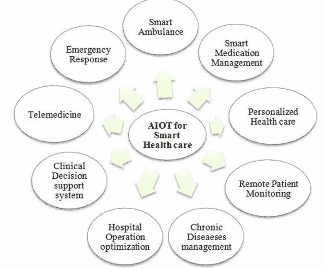

本章考察了智慧医疗在医疗行业中的发展，以及技术如何帮助智慧医疗达到更高质量。讨论了物联网、智能手机和人工智能算法等技术如何促进智慧医疗的发展。实验方法包括用于患者的基于物联网的监测工具、智能手机和安卓应用，以及用于决策过程的人工智能算法。最后，本章展示了如何将AI和智能技术集成以创建AIoT工具，用于改善临床支持，其中物联网收集数据，AI进行决策。本章通过实验方法解释了用于健康监测的物联网工具、用于数据收集的智能安卓应用、用于决策的AI算法以及用于医疗领域的AIoT。

本章的结构如下：第一部分讨论智慧医疗系统的全球市场增长。第二部分讨论智慧医疗系统中AIoT的综述。本部分讨论了基于AI的可穿戴设备和基于智能手机的传感器以及用于智慧医疗发展的安卓应用。还简要讨论了AI在疾病预测中的作用。每种方法都结合其实验方法进行解释。下一部分讨论如何将AI和物联网集成用于智慧医疗发展，并结合实验方法进行解释。接下来部分是本章的贡献，最后给出本章的结论。

## 智慧医疗的全球市场

根据Grand View Research的最新研究，全球智能医疗行业预计到2022年将达到约2255.4亿美元。全球智慧医疗市场预计主要受预测期内医疗行业快速技术进步所驱动。根据预测，由于新的库存管理解决方案的出现，如RFID看板和RFID智能柜，它们可以有效管理物流并降低库存费用，智慧医疗行业预计将扩张。智能注射器、智能药丸和智能绷带的使用预计将通过促进远程患者监测、辅助诊断胃肠道疾病、限制感染传播以及远程跟踪恢复进展，从而推动医疗行业的扩张（Data Bridge, 2023）。2019年智慧医疗产品市场价值1436亿美元，预计2020年至2027年将以16.2%的年复合增长率上升。由于移动健康使用的增加、政府数字化医疗的努力以及慢性病的流行，对智慧医疗系统的需求预计将增加。根据“联合健康消费者情绪调查”，2019年约有37.0%的美国人依赖互联网或移动应用进行健康相关咨询。目前，健身行业中的AI通过将AI集成到手表等可穿戴设备中，帮助个性化健身目标，无需健身房设备即可实现更智能的锻炼。自2004年以来，可穿戴行业经历了重大变革，当时由于Apple Watch发布后活动追踪器的突然增加，2004年被认为可穿戴技术之年。在北美和欧洲等发达国家以及亚太地区的一些国家，智慧健康市场更高（Grand View Research, 2023）。智慧健康也已在拉丁美洲、中东和非洲等发展中国家引入，如图2所示。

## 智慧医疗发展中的新兴技术

人工智能物联网（AIoT）是AI的计算能力与物联网的结合，两者共同推动智能设备智能的极限，使其能够执行高度挑战性的任务。物联网充当数字神经系统，而AI充当系统的大脑。将AI添加到物联网中，可以分析物联网传感器收集的数据，并帮助在没有人类专家的情况下做出决策并采取行动。AI可以提前识别并实施必要的措施来应对危急医疗状况。实施AIoT可以通过在高风险疾病的初始阶段进行检测、监测疾病传播、通过分析患者健康史预测死亡风险、远程或居家治疗以及其他可以显著降低医院占用率的技术，大幅降低死亡率。基于AIoT的医疗保健包括物联网和AI算法的结合，如图3所示。物联网有助于监测和数据收集，而AI则利用收集到的数据自动诊断和预测疾病。本部分讨论物联网和AI算法如何用于智慧医疗系统。


图 2. 智能医疗保健的增长

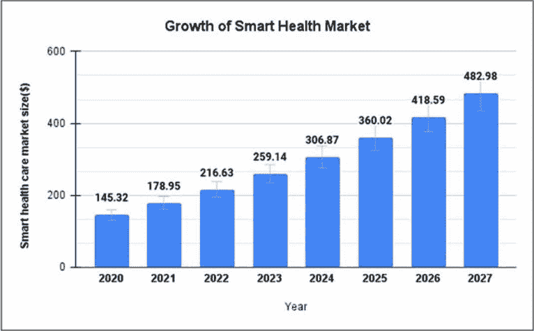

## 智能健康监测系统

在疫情期间，世界对远程患者监测系统给予了更高的关注。定期监测通过收集患者健康状况的实时采集，有助于及早预测各种健康状况。例如，患有慢性疾病、残疾和老年人面临行动问题。因此，在偏远地区提供智能监测为患者提供了在家舒适的良好医疗设施（Zouka & Hosni, 2019）。提出了一种集成人工智能的技术，使用神经网络和模糊系统用于安全的医疗保健监测系统。它有助于使用传感器节点收集健康参数。收集的数据使用 GSM 模块传输到 Azure 的 IoT Hub。它将原始数据转换为语言表示，以应用基于模糊的推理系统（FBIS）来预测患者的生命体征。同样，提出监测设备以密切关注患者在锻炼、睡眠和行走期间的活动（Malche, et al., 2022）。健康监测已成为日常生活的重要方面，特别是对于老年人和卧床患者（Noble et al., 2018）。患者配备了护理人员，但仍然是一个问题，即无法随时监测患者。因此，提出了一种新的基于物联网的智能监测系统，用于家庭患者，特别是那些患有心脏病发作、糖尿病、关节炎和中风等慢性疾病的人。监测包括测量体温、脉搏、呼吸和血压。收集的数据使用混合模型进行分析，处理时间最短。该模型收集患者的实时数据，有助于延长患者寿命。通过植入式物联网，收集的数据以月度医疗报告的形式发送给护理人员，并通过智能手机应用程序共享。它对农村人民产生了重大影响。开发的工具在检测人群异常时提供 820ms 的处理时间，整体准确率为 95%。智能医疗保健监测系统包括用于监测医疗保健的基于物联网的可穿戴设备，以及用于监测医疗保健系统的应用程序或基于网络的门户。因此在本节中，让我们讨论基于物联网的可穿戴设备如何显著影响智能医疗保健系统，以及这种人工智能如何与可穿戴设备集成。

图 3. 智能医疗保健系统中 AIoT 的流程图

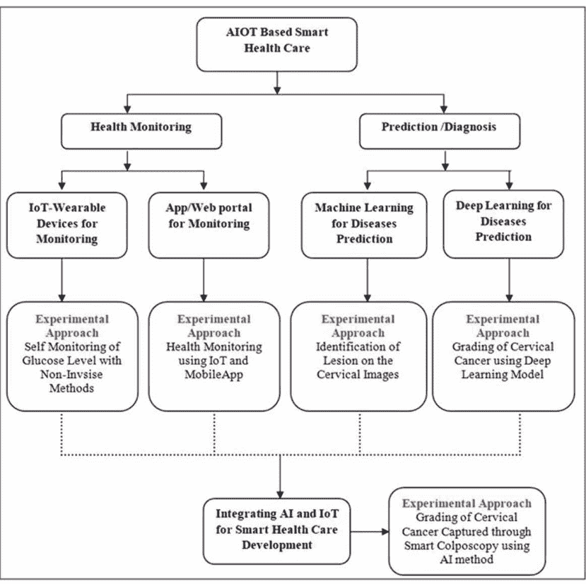

## 用于健康监测的基于物联网的可穿戴设备

可穿戴传感器已成为智能医疗保健服务中的重要组成部分，因为它们提供了医院环境的经济高效替代方案（Islam et al., 2020; Majumder, 2017）。这些技术使医疗人员能够评估一般健康信息、筛查患者严重症状并远程识别异常（Dias & Cunha, 2018; Dian et al., 2020）。麻省理工学院（MIT）实验室是首批开发可穿戴技术的机构之一，早在 1960 年代就将多媒体、无线通信和传感器集成到人们的服装中。提出的一种监测系统使用体温和心率频率等参数来监测患者的健康状况（Islam et al., 2020）。CO、室温和 CO2 等传感器用于预测生活环境条件。收集的数据通过 Wi-Fi 模块传输到 Web 服务器，ESP32 设备用于处理收集的数据。数据在 Web 服务器中持续收集，环境中有毒气体的水平以百万分之几（ppm）为单位进行测量（Elango & Muniandi, 2020）。提出另一种可穿戴工具用于监测患者的生命体征参数和跌倒检测。所提出的模型采用心率传感器（LM35）、加速度计、体温传感器和 MPU 6050 来预测患者数据中的异常。NodeMCU 设备用作处理设备，并使用手持设备，患者可以通过名为 Thing Speak 的 Web 服务进行远程监测和可视化。

物联网和云计算框架用于监测医疗保健系统（Al-Sheikh & Ameen, 2020）。收集的数据通过 Wi-Fi 连接传递到云端进行进一步处理。引入了一种使用脉搏和体温传感器的监测工具，并使用 NodeMCU 和 ATmega328P 微控制器等边缘设备进行数据收集（Ajaegbu et al., 2020）。收集的数据通过网络传输，医生可以通过 LCD 显示屏监测患者的医疗状况。在患有心律失常的糖尿病患者中评估了可穿戴工具的性能，所提出的模型生成了更高质量的数据（Mohapatra et al., 2019）。建议的方法利用 HR 和 TS 来解释患者数据，Arduino 作为边缘设备连接到传感器并用于通过 Wi-Fi 将信息发送到云端。医生可以使用任何联网设备快速连接到云服务器以检查患者的状况并在紧急情况下推荐适当的治疗。提出了一个基于物联网的框架，通过将传感器与移动应用程序和消息传递服务集成来进行症状监测（Swaroop et al., 2019）。用于监测患者的首要硬件包括 Raspberry Pi 和三个用于检测健康参数的传感器。手持原型正在开发中，其 Wi-Fi 通信通道的平均延迟为 125.95 秒。与此同时，（Al-khafajiy et al., 2019）提出了一种针对老年患者的基于可穿戴的监测系统，使患者能够在家中获得医疗资源。在将所有组件连接到 Arduino UNO 后，收集的数据通过蓝牙传送到患者的移动应用程序。最后，数据通过用作网关的智能手机应用程序移动到云服务器。建立的监测平台允许临床医生轻松监测患者记录和传感器数据。同样，传感器用于收集健康参数，传输由 ATmega328P 微处理器和蓝牙模块处理（Semwal et al., 2019）。云服务器的 LabVIEW 工具用于数据可视化。建议的原型在网络连接较差的地区提供来自多个传感器的离线数据收集，后续上传到云端。最后，（Kumar et al., 2018）提出了一种智能医疗保健监测系统，允许患者和医生通过摄像头进行通信。健康参数，即温度和心率，由 Raspberry Pi CPU 模块的输入传感器检测并发送到 LCD，使医生能够通过将处理后的信息通过互联网发送到 Web 服务器来实时检查患者的健康状况。该系统仅连接少量传感器，但仍增强了患者监测系统。

引入了一种可穿戴健康追踪平台，以帮助临床医生监测患者并在物联网中收集数据（Wan et al., 2018）。该系统使用 Arduino 作为边缘设备，并配有血压、心率和体温传感器等传感节点。体域传感器网络使用 Wi-Fi 将所有收集的数据传输到云服务器，医生可以通过笔记本电脑或智能手机监测患者。表 1 总结了利用可穿戴设备的已开发健康监测系统。它考虑了多个因素，包括通信通道、传感器和边缘设备、用于监测的可视化数据以及每个开发系统的结果。在本节中，人工智能与基于物联网的可穿戴设备集成用于健康监测。（Al et al., 2021）提出了基于物联网的可穿戴监测设备，用于测量与 COVID-19 相关的各种生命体征。它会自动提醒医疗机构有关感染患者的情况，并使用 GPS 帮助追踪其实时位置。可穿戴传感器连接到人体，收集的数据在云端处理和存储。所提出的系统由三层构建，称为物联网传感器层，其中所有传感器收集医疗参数、云层，其中所有参数同时存储，最后是应用程序外围接口（API），用于监测和可视化收集的数据。

## 表 1. 智能医疗保健监测可穿戴设备总结

| 作者/年份 | 传感器 | 边缘设备 | 通信 | 可视化 | 结果 |
|---|---|---|---|---|---|
| Al et al., 2021 | PPG 单元、GPS 传感器、温度传感器、加速度计 | Arduino MKR | Bluetooth | Android 屏幕 | 基于 API 的平台更新了每个患者的健康状况，有助于轻松追踪患者 |
| Islam et al., 2020 | 体温、心率传感器、传感器、CO 传感器、室温传感器和 CO2 传感器 | NodeMCU | web server and Wi-Fi | Thing Speak | 准确率 = 95% |
| Elango & Muniandi, 2020 | 心率传感器、体温传感器和加速度计 | NodeMCU | Wi-Fi/HTTP, MQTT | Thing Speak, LCD | N/A |
| Al-Sheikh & Ameen, 2020 | 心率、ECG、SpO2 和体温传感器 | Arduino, NodeMCU | Wi-Fi | Blynk | 以最小功耗预测参数，并在 4 人身上进行了测试。 |
| Chigozirim et al., 2020 | 心率传感器、体温传感器 | ATmega328p, and NodeMCU | WiFI | LCD | 该仪器的发现，连同 Cronbach's alpha 为 0.71， |
| Mohapatra et al., 2019 | 心率传感器、体温传感器 | ATmega328p, and NodeMCU | ATmega328p, and NodeMCU | Adafruit | 开发的工具比现有方法更安全，并提供紧急通知 |
| Swaroop et al., 2019 | ECG、脉率、血压和温度 | Raspberry pi | Wi-Fi and MQTT | Web application | 准确率 = 93.74 |
| Al-khafajy et al., 2019 | 脉搏、温度、血氧和血糖传感器 | Arduino | Bluetooth HC-06 | Web application | 准确率 = 92.56 |
| Semwal et al., 2019 | ECG、脉搏血氧仪、体温和血压传感器 | ATmega328P | Bluetooth HC-05 | LabVIEW | 准确率 = 98.26 |
| Kumar et al., 2018 | 心率和温度传感器 | Raspberry Pi | Wi-Fi/ HTTP | Web application | 准确率 = 99 |
| Wan et al., 2018 | 心率、血压和体温传感器 | Arduino | Wi-Fi/ HTTP | Web application, LCD | 准确率 = 90.37 |

N/A – 不适用


## 基于 AIoT 的可穿戴设备用于健康监测

人工智能与可穿戴设备的结合是医疗保健领域的游戏规则改变者。物联网和移动医疗设备有助于让医生更接近患者，使患者能够及时接受治疗。可穿戴生物识别监测设备具有固定传感器，用于收集患者的行为、生理、环境、生物数据。通过使用 BMDs 可穿戴工具，收集数千条数据用于评估、预测患者预后，并帮助专业人员选择最佳治疗方案（Possamai et al., 2020）。2019年，一种名为 Cambridge Heart wear 的新型 AI 可穿戴工具被推出，用于通过心电图（ECGs）监测心律，并利用人工智能自动解读和识别异常。患者可以安全地设置设备，直接实时采集并传输数据给其医生（Research, 2018）。一种新型可穿戴设备已被推出，用于评估与 COVID-19 相关的症状，如呼吸频率和核心体温。智能头盔配备了热成像系统，可利用热成像技术在无需人工接触的情况下自动识别冠状病毒。它可以通过获取人们体温的连续数据来检测较高的体温，并立即向医护人员发送通知。

类似地，中国在最近的“China International Import Expo”上推出了基于 5G 的智能头盔。该头盔采用低功耗设计，功耗比传统筛查方法低 85%，加快了诊断过程（Alhawat & Krishnamurthi, 2022）。智能眼镜已被提出用于在人群中识别体温较高的疑似 COVID-19 病例。热成像相机筛查并预测体温较高的人，该人通过光学相机被捕捉。人脸使用 Viola-Jones 算法进行识别，已识别人员的温度详情与医疗部门共享（Mohammed et al., 2020）。已提出一种可穿戴设备用于长期监测血压和心率（HR）。物联网可穿戴工具与机器学习框架相关，用于通过头部运动检测运动。该设备内置心电图和光电容积描记传感器，并位于耳朵后侧以成功获取微弱的耳-ECG/PPG 信号（Zhang et al., 2017）。支持向量机用于基于人体运动预测原始心跳（Kumar et al., 2017）。研究人员在收集实时患者数据方面面临挑战，因此可穿戴设备在收集患者实时数据方面发挥着重要作用。因此，通过连接物联网传感器和机器学习提出了一种新型可穿戴工具。

近期研究表明，心脏病发作是导致死亡的主要原因，近 610,000 人死于美国的心脏病发作。为解决这一问题，可穿戴设备和人工智能可用于预测和预防心脏病发作。例如，基于物联网的监测系统采用三层设计来收集、存储和分析可穿戴传感器的数据，重要变量包括呼吸频率（RP）、血压收缩压范围（SR）、心率（HR）和血压舒张压范围（DR）。Apache HBase 用于存储使用物联网传感器收集的大量信息，Apache Mahout 用于构建名为逻辑回归的机器学习模型以预测心脏病（Guo et al., 2021）。另一个例子是与 Android 应用配对的基于物联网的智能手表，使用加速度计进行数据收集以实时预测跌倒。智能跌倒应用采用支持向量机（SVM）和朴素贝叶斯以及卷积神经网络模型来预测跌倒。智能手表 Notch 和 Farseeing 的性能表明，深度学习在患者跌倒检测方面优于机器学习。AI 算法已显示在线和实时测试结果，深度学习模型在无需预处理方法的情况下处理信息，并在实时数据集上实现了 100% 的整体准确率。然而，在在线测试期间，远见数据集的跌倒预测下降至 86%。

相比之下，造成驾驶时失控的严重心脏病发作导致大量致命事故。为预测驾驶时的心脏异常，引入了一种使用无线技术通信的新型可穿戴 ECG 频带。心电图（ECG）由固定在手腕上的传感器主动记录并发送到便携式决策子系统。收集的数据使用“extended modified B-distribution”（EMBD）、扩展时频特征和支持向量机算法的多项式核进行处理（Chowdhury et al., 2019）。该工具检测抬高性心肌梗死（STEMI）和非 ST 段抬高心肌梗死（NSTEMI）方法的准确率分别为 97.40% 和 96.30%。所提出的工具可以检测心脏异常并帮助减少全球生命损失和道路交通事故。图 4 显示了基于 AI 的智能可穿戴设备，表 2 总结了智能医疗保健开发的可穿戴 AI 工具。下一节讨论使用非侵入性方法从患者识别血糖水平的实验方法。（Lin et al., 2019）提出了一种基于 AIoT 的心脏病预测方法。ECG 传感设备作为可穿戴设备的前端。智能应用充当接口，收集的数据存储在云数据库中。AI 算法预测心脏病并从收集的数据中分类心律失常。同样，（Wang et al., 2022）提出了一种使用可穿戴设备预测心血管疾病的方法。所提出的模型以 90.2% 的平均准确率预测疾病。

图 4. 智能医疗保健开发的可穿戴 AI 工具：（a）智能头盔，（b）智能眼镜，（c）智能手表，（d）可穿戴 ECG 频带

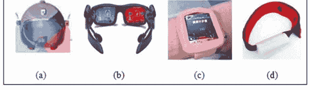

## 使用基于物联网的工具进行血糖水平监测：一种实验方法

影响全球各地人群的普遍长期健康状况之一是糖尿病。糖尿病患者通常难以监测血糖水平，因为所涉及的侵入性程序可能会损害附近组织。然而，通过使用 Arduino Uno 板和传感器，可以在无需血糖试纸或针头的情况下预测血糖水平。该方法可以帮助测量患者的糖水平而不影响其组织。

### 目标
使用 MAX30100 传感器开发非侵入性血糖水平自我监测。

### 硬件组件
实验中使用了脉搏率、SpO2 和血糖水平传感器、微控制器、LED 灯、MAX30100 传感器

图 5. 自我血糖监测系统：（a）监测系统的构建，（b）使用所提出的监测系统预测血糖水平

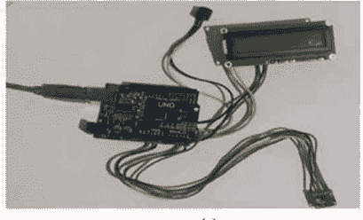

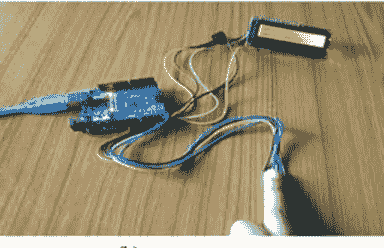

表 3. 使用现有和所提出的非侵入性方法预测血糖水平

| 方法 | Easy Touch (mg/dl) |  |  | 非侵入式方法 |  |  |
|---|---|---|---|---|---|---|
| 参数 | 心率 | Spo2 | 血糖水平 | 心率 | Spo2 | 血糖水平 |
| 样例 | 112 | 97 | N | 111 | 96 | N |

## 智能手机传感器和 Android 应用用于智能医疗保健开发

智能手机在智能医疗保健系统中也发挥着重要作用。全球范围内，有许多疾病影响呼吸系统、皮肤、眼睛、心脏和心理健康。持续监测可以帮助预防或管理它们。使用智能手机实现持续健康监测提供了一种非侵入性、经济实惠且易于获取的医疗保健解决方案。随着移动电话普及率和先进通信技术的传感器，已建立了适当的设施用于患者的持续虚拟监测（Majumder & Deen, 2019）。通过智能手机收集的健康参数包括心率、血压、氧气水平、日常活动、心理健康等，如表 4 所示。连接到智能手机的摄像头传感器还用于识别皮肤、眼睛和耳朵感染以及癌症筛查。高血糖患者需要定期监测血糖水平以预防糖尿病。目前，在许多诊所中，使用侵入性方法检查血糖水平，这使得常规筛查不舒适。已引入一种非侵入性血糖监测系统，使用通过智能手机作为视频收集的光电容积描记图（PPG）数据。收集的数据被分析和存储在云端。应用机器学习模型使用高斯滤波器提取特征，并根据身体的血糖水平预测标准值（Zhang et al., 2020）。引入了一种新框架，通过估计患者的生命体征来实现用户健康的即时监测。两个智能手机传感器、后置摄像头和麦克风将有助于记录数据。心率和 SpO2 数据被转换为通过图像传感器收集的光电容积描记图（PPG）。


## 表4 用于健康监测的智能手机内置传感器

| 健康监测 | 智能手机内置传感器 |
|---|---|
| 心血管活动 | 麦克风、图像传感器 |
| 眼科筛查 | 图像传感器 |
| 呼吸和肺部疾病 | 麦克风、图像传感器 |
| 皮肤健康诊断 | 图像传感器 |
| 日常活动和跌倒识别 | 运动传感器 |
| 耳部健康 | 麦克风 |
| 认知功能和心理健康 | 运动传感器 |

基于智能手机的血液监测系统用于预测血压。该系统通过智能手机摄像头收集用户六个食指的数据。设备利用两个不同光电容积脉搏波（PPG）信号之间的脉搏传输时间（PTT）来预测收缩压和舒张压。PPG 信号经过滤波，并使用峰值检测技术进行处理，以减少运动和噪声。最后，通过均方误差（MSE）、标准差和相关参数来测量预测的血压值（Tabei et al., 2020）。类似地，还推出了一种使用智能手机的呼吸监测系统，用于准确测量呼吸频率。测量通过成像和傅里叶变换技术完成。患者的皮肤表面通过连接智能手机并开启闪光灯的摄像头被拍摄成视频。收集的数据转换为 PPG 信号，并使用离散小波变换进行分析以预测呼吸频率（Alafeef & Fraiwan, 2020）。此外，还推出了一种无创血糖监测系统，它使用通过智能手机以视频方式收集的光电容积脉搏波（PPG）数据。收集的数据被分析并存储在云端。使用机器学习算法通过高斯滤波器提取数据特征，并根据人体血糖水平预测标准、警告和临界水平（Zhang et al., 2020）。最后，推出了一款安卓应用，提供视听反馈，以判断将智能手机放置在正确位置是否能产生足以估计血压的高质量信号（Nemcova et al., 2020）。

类似地，带有传感器的智能手机已被用于测量血压。使用滑动窗口将 PPG 数据分割成 15 秒的片段，并从 PPG 脉搏原始信号中提取出 233 个时域和频域特征（Dey et al., 2018）。使用心震图的血压监测系统解释心跳和手指脉搏产生的振动。通过加速度计采集的心震图信号来计算血液释放时间，指尖则用于利用图像传感器从 PPG 数据计算接收时间。智能手机内置的扬声器通过加速度计和摄像头同步收集数据。该系统的性能在一项针对 9 名参与者的纵向血压扰动研究中得到了评估（Wang et al., 2018）。利用光电容积脉搏波数据，提出了基于智能手机的心率监测方法。使用图像传感器以 PPG 反射模式收集用户食指指尖的数据。存储的数据通过蓝牙通信传输到处理设备。该系统在 19 名受试者上进行了性能评估（Alafeef, 2017）。开发了一种新监测系统，利用智能手机相机图像精确监测患者心率（Lomlize & Park, 2017）。从感兴趣区域提取信号，并使用阈值法去除原始数据中的噪声。实验结果表明，该框架的心率估计是准确的。然而，所提出的方法忽略了不同智能手机相机模块的影响。表 5 总结了智慧医疗发展中的智能手机传感器，包括传感器、所用智能手机及其结果等因素。

## 表5 智慧医疗发展中的智能手机传感器总结

| 作者/年份 | 类型 | 传感器 | 智能手机 | 算法 | 结果 |
|---|---|---|---|---|---|
| Zhang et al., 2020 | 血糖水平 | 图像传感器 | iPhone 6s Plus | 高斯SVM、袋装树(BT)和K近邻(KNN)分类器 | 准确率=81.49%。 |
| Nemcova et al., 2020 | 心率、血压、血氧饱和度 | 后置摄像头、麦克风 | Honor 7 Lite、Apple iPhone SE、Lenovo Vibe S1 | 回归 | SpO2的平均绝对误差(MAE)=1.1%，心率估计的MAE=1.4次/分钟(bpm)。 |
| Alafeef & Fraiwan, 2020 | 呼吸频率 | 图像传感器 | Samsung Galaxy S6 | 傅里叶变换技术、离散小波变换 | 平均准确率为97.8%，平均误差为2.2%。 |
| Tabei et al., 2020 | 血压 | 摄像头 | iPhone X | 线性回归模型 | MAE=2.10，标准差=1.96，相关参数=0.90 |
| Dey et al., 2018 | 血压 | 心率传感器 | Samsung Galaxy S6 | Lasso回归技术 | 准确率=95% |
| Wang et al., 2018 | 血压 | 后置摄像头、加速度计 | N/M | N/M | 志愿者的皮尔逊相关系数=0.20和0.77 |
| Alafeef, 2017 | 心率 | 图像传感器 | Samsung Galaxy | 各通道强度的均值滤波 | 准确率为99.7% |
| Lomlize & Park, 2017 | 心率 | 后置摄像头 | Pantech Vega Racer 3; Samsung Galaxy S2, S2, LG G3, HTC Desire HD | 自适应阈值法 | 系统实时预测心率的误差率低于5% |

N/M——未提及

## 用于基于物联网的医疗健康监测系统的安卓应用：一种实验方法

以前，医生无法远程监测危重患者。为了解决这个问题，提出了一种基于安卓应用的物联网（IoT）系统。该系统自动收集患者数据并将其发送到服务器，使医生能够随时访问。

### 目标

该系统的主要目标是远程监测患者的健康记录并减少去医院就诊的次数。它还可以帮助患者了解自己的健康状况。

### 硬件组件

健康监测系统首先将 Node MCU 连接到 Wi-Fi。传感器连接到控制器后，系统会读取心跳、血氧水平、高压、低压和温度等参数。Node MCU 从控制器接收到这些数据后，从 ECG 传感器读取 ECG 值。借助 URL 和 API 密钥，来自控制器和 ECG 的 14 个值被传送到 Firebase 数据库。数据库中的值会及时更新。Firebase URL 和 API 密钥也用于在开发的应用中显示这些值。现在医生可以访问该应用，患者可以使用传感器的参数值来评估医疗状况。

### 方法

健康监测系统首先将 Node MCU 连接到 Wi-Fi。然后从连接到控制器的传感器读取心跳、血氧水平、高压、低压和温度等参数。从控制器接收到这些数据后，Node MCU 从 ECG 传感器读取 ECG 值。利用 URL 和 API 密钥，控制器和 ECG 数据（共14个值）被移动到 Firebase 数据库，并在那里及时更新。Firebase URL 和 API 密钥也用于在开发的应用中显示这些值。医生可以访问该应用，利用传感器的参数值来评估患者的医疗状况。该方法的流程如图6所示。

### 数据传输

Node MCU 被用来将从 Arduino 板收集的传感器数据传输到云端。Node MCU 作为 Wi-Fi 模块将数据发送到 Firebase。数据传输利用从 Firebase 数据库获得的 Firebase 主机 URL 和 API 密钥进行。此外，Firebase 数据库通过 API 密钥、Firebase 主机 URL 和数据库存储桶与应用相连接。从板上获取的值存储在数据库中，并显示在应用中。数据传输流程如图7所示。

### 可视化

借助所创建的应用，医生可以远程跟踪患者的记录，该应用由两个模块组成。第一个模块面向医生，医生可以使用其用户 ID 和密码登录，并选择要监测的患者。屏幕显示患者的健康参数值，医生可以检查患者的健康状况，并在提供的处方文本框中开具药物。第二个模块面向患者，患者可以使用其用户 ID 和密码登录。这将带他们进入显示医生姓名、医院名称和处方的屏幕，如图8所示。

*图6. 使用物联网传感器和安卓应用监测患者的工作流程*

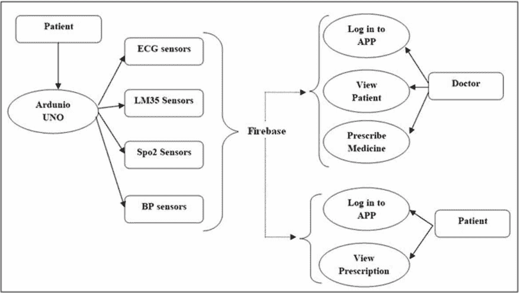


**图 7. 数据传输流程**


## 人工智能预测在决策制定中的作用

人工智能（AI）在医疗行业中正迅速变得重要起来，以改善智能医疗系统。这项技术有望改变患者护理的各个方面，以及保险公司、医疗服务提供者和制药企业的内部管理流程。大量研究表明，在疾病诊断等重要的医疗活动中，人工智能的表现与人类相当，甚至更好。如今，算法在识别癌性肿瘤方面比放射科医生更有效，并能帮助研究人员为昂贵的临床试验创建队列。

**图 8. 用于患者和医生监控系统的安卓应用**


## 机器学习在智能医疗发展决策中的应用

人工智能的一个子集被称为“机器学习”，它包括使计算机能够理解数据并生成人工智能应用的方法。在机器学习中，神经网络（NN）、支持向量机和K近邻模型等各种算法被用于解决问题。本节讨论机器学习（ML）算法如何用于预测癌症、心脏病，以及一种用于智能医疗开发机器学习算法的实验方法。

## 使用机器学习算法进行癌症预测

机器学习方法和生物传感器已被提出用于乳腺癌的早期诊断（Amethiya等人，2022）。Rejani和Selvi（2009）提出了一种从乳腺X光片中检测肿瘤的算法。第一种方法涉及学习识别与周围环境对比度较弱的可疑点，将其视为肿瘤；第二种方法是学习提取能够对肿瘤进行分类的特征。肿瘤检测涉及乳腺X光片增强和肿瘤区域分割等方法。增强是指将图像质量提高到更容易理解的水平，而分割则使用阈值法进行，以诊断乳腺癌。利用数据挖掘技术提出了用于乳腺癌初步检测的决策树。此外，随机森林、最近邻和朴素贝叶斯等机器学习算法也被用于预测乳腺癌（Sharma等人，2018）。基于对比分析，K近邻在预测癌症方面优于现有的机器学习方法。

皮肤病是人类常见疾病中的高发疾病，肤色是这种疾病的有力指标。本文提出了一种利用捕获的皮肤图像识别皮肤癌的系统。使用中值滤波器对皮肤图像进行滤波，并对提取的特征进行分割处理。支持向量机和随机森林相结合对皮肤病进行分类（Murgan等人，2021）。随机森林分类器、K近邻分类器、多层感知器分类器和决策树等机器学习算法被用于对皮肤病类型进行分类（Verma等人，2021）。基于对比分析，随机森林在识别皮肤病类型方面优于其他分类模型。研究人员提出了一种名为CervDetect的方法，该方法利用机器学习算法预测恶性宫颈形成的风险（Weegar & Sundström，2020）。随机森林和特征选择技术被用于选择适合癌症预测的特征。表6总结了用于癌症预测的机器学习方法，包括数据集、癌症类型及其结果等因素。

**表 6. 机器学习在癌症预测中的应用**

| 作者/年份 | 数据集 | 癌症类型 | 机器学习算法 | 结果 |
|---|---|---|---|---|
| Rejani & Selvi, 2009 | mini-MIAS 数据库 | 乳腺癌 | SVM | 该模型实现了88.75%的灵敏度。 |
| Sumbaly 等人，2014 | 乳腺肿块FNAC数字图像 | 乳腺癌 | 决策树与J48 | 该模型实现了94.56%的灵敏度 |
| Sharma 等人，2018 | 威斯康星州—乳腺肿块FNAC数字图像 | 乳腺癌 | KNN | 准确率 = 95.90 |
| Murgan 等人，2021 | ISIC数据集 | 皮肤癌 | SVM+RF | 准确率 = 88.56 |
| Verma 等人，2021 | UCI机器学习库 | 皮肤癌 | 随机森林分类器 | 准确率 = 0.99 |
| Weegar & Sundström, 2020 | UCI机器学习库 | 宫颈癌 | 随机森林 | 准确率 = 93.6% |

## 使用机器学习算法进行心脏病预测

心血管疾病已成为影响成年人的最严重和急性疾病之一。研究表明，心脏病导致的死亡约占每年总死亡人数的30%（1800万）（Ahmed等人，2019；Kaptoge等人，2020）。为了降低患心脏病的风险，研究人员正专注于在智能医疗环境中开发决策支持系统。心脏病预测主要利用心电图数据进行，早期检测可以防止患者走向死亡（Nagaveli等人，2022）。机器学习方法，如带权重的朴素贝叶斯（NBwa），被用于预测心脏病。同样，基于特征频域、时域和信息论的方法被提出用于分析和自动识别缺血性心脏病。支持向量机和XGBoost等分类器模型以最佳性能进行分类。临床决策支持系统（CDSS）在医疗行业广泛采用混合合成少数类过采样技术—编辑最近邻（SMOTE-ENN）来识别和诊断疾病。支持向量机用于卒中预测，合并AUC为92%，提升算法达到91%，而卷积神经网络为90%（Krittana Wong等人，2020）。

CNN模型在图像数据上表现良好，但由于数据集的高维性，SVM在预测方面表现更优。朴素贝叶斯算法被提出用于对特定心脏病进行分类（Jabbar & Samreen，2016）。研究人员进行了一项比较研究，使用六种机器学习算法来预测冠状动脉疾病（CAD）（Gupta等人，2020）。为了提高心脏病预测的准确性，人们提出并使用了各种技术和算法。使用基于皮尔逊相关系数的后向消除法和过滤法选择独立特征，并采用KNN算法提高准确性。远程患者监测用于收集数据集，并且只考虑最重要的参数。随机森林算法被提出使用14个特征来预测心脏病，KNN模型用于权重开发。此外，KNN模型用于提取特征，并通过SVM-RFE预测理想特征，从而提高计算速度。表7总结了用于心脏病预测的机器学习技术，包括数据集因素和结果。

**表 7. 机器学习在心脏病预测中的应用**

| 作者 | 数据集 | 机器学习算法 | 结果 |
|---|---|---|---|
| Nagaveli 等人，2022 | PhysioNet数据库 | SVM, NBwa, XGBoost | XGBoost以95.9%的准确率优于现有机器学习算法。 |
| Krittana Wong 等人，2020 | 心血管数据集 | SVM | 心血管预测的AUC为92% |
| Jabbar & Samreen, 2016 | 克利夫兰心脏病数据集 | 隐藏朴素贝叶斯（HNB） | 准确率 = 100% |
| Gupta 等人，2020 | UCI—克利夫兰心脏病数据集 | 朴素贝叶斯、回归、SVM、KNN、决策树和随机森林 | 随机森林以86.84%的准确率预测心脏病 |
| Enriko 等人，2018 | 从Harapan Kita医院（HKH）收集的实时数据集 | K近邻 | 无参数权重的KNN模型以75.11%的准确率预测心脏病 |
| Pal 等人，2021 | Kaggle数据集 | 随机森林 | 预测准确率为86.9% |
| Hutamaputr 等人，2021 | N/M | 加权KNN | 准确率 = 82.65% |

N/M——未提及


## 使用机器学习算法的宫颈癌肿瘤识别：一种实验方法

宫颈癌是一种形成于子宫下部的恶性肿瘤。阴道镜设备捕获宫颈图像，并用于宫颈癌筛查分析。机器学习算法被用于自动化识别宫颈癌区域，即异常区域。

目的：使用名为贝叶斯分类器的机器学习算法，检测阴道镜图像上的异型增生区域。

数据收集：从UCI机器学习数据仓库收集阴道镜图像，包含287个实例和69个属性。

方法：早期检测宫颈癌对于有效治疗至关重要，而阴道镜检查是识别宫颈图像上异常组织的常用方法（Hariharan等，2012）。在阴道镜检查期间涂抹醋酸后，异型增生区域表现为白色区域。医生手动标记这些白色区域，以区分阴道镜图像上的异常组织。图像最初被划分为32x32的重叠方块，以聚焦异常区域。从重叠方块中提取红色、绿色和蓝色通道，用于特征提取过程。从阴道镜图像的每个颜色通道中提取均值（μ）、标准差（σ）和偏度值等统计特征。这些统计特征从图像的正常和异常区域中提取，并作为输入提供给朴素贝叶斯分类器，以预测阴道镜图像上的异型增生区域。

结果：基于定量分析，机器学习算法预测异型增生区域的准确率为98.03%，精确率为97.08%，特异度为97.12%，灵敏度为92.06%。预测的异型增生区域如图9所示。

图9. 使用贝叶斯分类器进行宫颈癌检测：（a）显示带有标记癌症区域的原始图像。（b）使用贝叶斯分类器进行病变检测的宫颈图像。

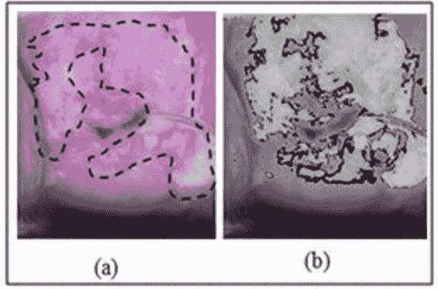

图10. 收集的智能阴道镜图像，标记为类型1、类型2和类型3

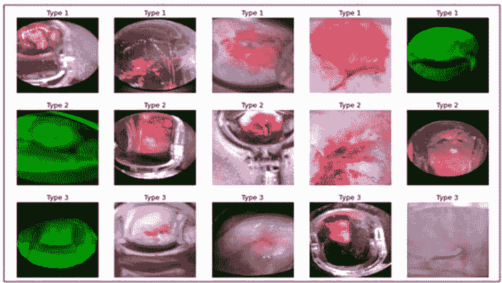

## 面向智慧医疗发展的人工智能物联网（AIoT）

AIoT结合了物联网（IoT）和人工智能（AI）算法。这对两项技术而言都是革命性的，因为人工智能算法依赖物联网进行数据收集和连接。同样，物联网也重视人工智能在自动化和预测活动中的作用。物联网网络被广泛应用于大型行业，以收集机器生成的数据。AIoT支持数据分析，并通过物联网从生成的数据中预测某些特定输出。一些物联网工具是为简单事件设计的，可以控制传感器产生的信号——例如，根据环境光线变化开关灯。有时，可以利用分析工具来解释许多更为复杂的现象。AIoT的建立就是为了采取正确行动来实现这一目标。物联网工具被赋予了收集数据、观察环境以及在最少人工干预下做出最佳决策的能力（Talukdar等，2019）。在人工智能的支持下，AIoT传递信息以进行控制，并成为能够自主分析、独立运行的智能机器。人工智能能够识别关键医疗状况，并协助提前采取必要措施。

在事物中实施人工智能可以通过降低死亡率来显著减少医院占用率。它有助于识别早期高危疾病、跟踪疾病传播，并通过检查患者病史来预测死亡风险。系统的大脑是人工智能，而物联网设备则充当其数字神经系统。面向医疗工作者推出了基于AIoT的护理员驾驶舱（C19CC），用于预测患者COVID-19的严重程度。使用颜色代码来表示患者的严重程度。作者（Wen Chen等，2021）介绍了一种用于在智能家居中监测老年痴呆症患者的自主式人工智能物联网（AIoT）系统。该系统主要采用两项功能：实时异常活动监测，以及基于传感器数据活动推断的疾病相关活动趋势预测。利用长短期记忆（LSTM）网络，从收集的实时数据中预测患者的疾病相关活动趋势。在下一部分，讨论AIoT如何用于基于肿瘤受影响的宫颈癌数据收集和分级。

用于数据收集的应用程序，以及用于决策过程的AI算法。详细讨论了物联网设备在健康监测中的应用，包括实时数据收集、远程患者监测和预测分析的优势。本章还探讨了智能手机和Android应用在智慧医疗中的作用，包括它们在患者参与、数据收集和监测中的使用。

图11. 智能阴道镜：（a）配备Eva应用的智能阴道镜。（b）在Eva应用中收集患者详细信息。（c）通过图像传感器捕获的宫颈图像保存在Eva应用中。

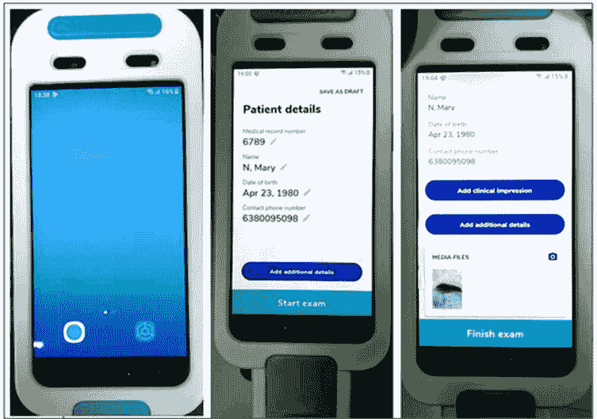

图12. 宫颈癌分级的损失和准确率

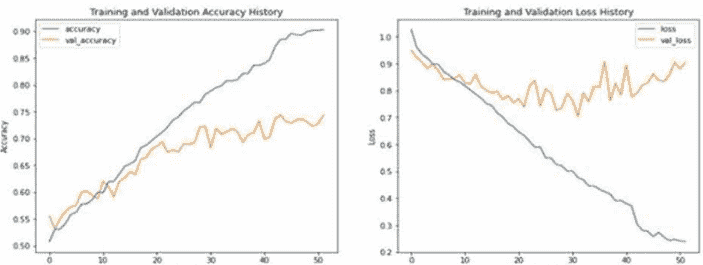

## 致谢

作者谨向“机器学习和智能中心”表示深切感谢，感谢其为这项研究工作提供支持和共享资源。科学与技术部在DST CURIE（AI）计划下支持该中心，该计划于2021-2023年批准了“人工智能（AI）核心研究资助”。

## 参考文献

Ahlawat, C., & Krishnamurthi, R. (2022). 基于物联网的智能头盔，用于检测可能的COVID-19感染。载于 *Cyber-Physical Systems*. Academic Press. doi:10.1016/B978-0-12-824557-6.00004-2

Ahmed, H., Younis, E. M., Hendawi, A. M., & Ali, A. A. (2020). 从患者社交帖子中识别心脏病：基于Spark的机器学习解决方案。*Future Generation Computer Systems, 111*, 714–722. doi:10.1016/j.future.2019.09.056

Ajaegbu, C., Nwaocha, V., Nzenwata, U., & Adesegun, O. (2020). 使用物联网技术的患者监测系统。*Ingénierie des Systèmes d’Information, 25*(3), 351–357. doi:10.18280/isi.250309

Al Bassam, N., Hussain, S. A., Al Qaraghuli, A., Khan, J., Sumesh, E. P., & Lavanya, V. (2021). 基于物联网的可穿戴设备，用于监测COVID-19隔离远程患者的体征。*Informatics in Medicine Unlocked, 24*, 100588. doi:10.1016/j.imu.2021.100588 PMID:33997262

Al-khafajiy, M., Baker, T., Chalmers, C., Asim, M., Kolivand, H., Fahim, M., & Waraich, A. (2019). 通过可穿戴传感器对老年人进行远程健康监测。*Multimedia Tools and Applications, 78*(17), 24681–24706. doi:10.1007/11042-018-7134-7

Al-Sheikh, M. A., & Ameen, I. A. (2020). 使用物联网技术和云计算的移动医疗监测系统设计。*IOP Conference Series: Materials Science and Engineering, 881*. 10.1088/1757-899X/881/1/012113

Alafeef, M. (2017). 基于智能手机的光电容积描记成像用于心率监测。*Journal of Medical Engineering & Technology, 41*(5), 387–395. doi:10.1080/03091902.2017.1299233 PMID:28300460

Alafeef, M., & Fraiwan, M. (2020). 基于智能手机的呼吸频率估计：使用光电容积描记成像和离散小波变换。*Journal of Ambient Intelligence and Humanized Computing, 11*(2), 693–703. doi:10.1007/s12652-019-01339-6

Amethiya, Y., Pipariya, P., Patel, S., & Shah, M. (2022). 使用机器学习和生物传感器检测乳腺癌的比较分析。*Intelligent Medicine, 2*(2), 69–81. doi:10.1016/j.imed.2021.08.004

Arooj, S., Rehman, S., Imran, A., Almuhaimeed, A., Alzahrani, A. K., & Alzahrani, A. (2022). 用于早期心脏病检测的深度卷积神经网络。*Biomedicines, 10*(11), 2796. doi:10.3390/biomedicines10112796 PMID:36359317


Chandran, V., Sumithra, M. G., Karthick, A., George, T., Deivakani, M., Elakkiya, B., Subramaniam, U., & Manoharan, S. (2021). 基于宫颈镜图像的集成深度学习网络的宫颈癌诊断。 *生物医学研究国际, 2021*, 1–15. doi:10.1155/2021/5584004 PMID:33997017

Chowdhury, M. E. H., Alzoubi, K., Khandakar, A., Khallifa, R., Abouhasera, R., Koubaa, S., Ahmed, R., & Hasan, M. A. (2019). 用于减少道路事故的可穿戴实时心梗检测和预警系统。 *传感器 (Basel), 19*(12), 2780. doi:10.3390/1922780 PMID:31226858

Data Bridge. (2023, January 7). *全球智能医疗市场 – 行业趋势与2029年预测*. 检索自: https://www.databridgemarketresearch.com/reports/global-smart-healthcare-market

Davenport, T., & Kalakota, R. (2019). 人工智能在医疗保健中的潜力。 *未来医疗保健杂志, 6*(2), 94–98. doi:10.7861/futurehosp.6-2-94

Dey, J., Gaurav, A., & Tiwari, V. N. (2018). InstaBP: 使用单光电容积描记传感器在智能手机上进行无袖带血压监测。 *IEEE 工程医学与生物学会年度国际会议。IEEE 工程医学与生物学会。年度国际会议*, 5002–5005. doi:10.1109/EMBC.2018.8513189

Dhaka, R. K., Panda, S., Panda, B., Pradhan, A., & Jena, C. (2022). 医疗保健系统中的 AIOT：方法与批评思考。 *国家洞穴研究与保护组织, 9*(2), 55–60. doi:10.21276/ambi.2022.09.2.rv02

Dian, F. J. R., Vahidnia, R., & Rahmati, A. (2020). 可穿戴设备与物联网（IoT）、应用、机遇与挑战：综述。 *IEEE Access：实用创新、开放解决方案, 8*, 69200–69211. doi:10.1109/ACCESS.2020.2986329

Dias, D., & Paulo Silva Cunha, J. (2018). 可穿戴健康设备-生命体征监测、系统与技术。 *传感器 (Basel), 18*(8), 2414. doi:10.3390/s18082414 PMID:30044415

Elango, K., & Muniandi, K. (2020). 一种低成本可穿戴远程医疗监测系统。 In G. R. Kanagachidambaresan (Ed.), *可持续智慧城市发展中边缘分析的作用：挑战与解决方案* (pp. 219–242). doi:10.1002/9781119681328.ch11

Enriko, A. I. K., & Suryanegara, M., & Gunawan, D. (2018). 使用真实临床医疗记录的 k-最近邻方法心脏病诊断系统。 In *第4届教育技术前沿国际会议论文集 (ICFET ’18)*. Association for Computing Machinery. doi:10.1145/3233347.3233386

Grand View Research. (2023, January 7). *全球智能医疗市场规模、份额报告*. 检索自: https://www.grandviewresearch.com/industry-analysis/smart-healthcare-market

Guo, B., Ma, Y., Yang, J., & Wang, Z. (2021). 基于云物联网和深度学习的智能医疗系统。 *医疗保健工程杂志, 2021*, 1–10. doi:10.1155/2021/4109102 PMID:34257851

Gupta, A., Kumar, L., Jain, R., & Nagrath, P. (2020). 使用分类（朴素贝叶斯）进行心脏病预测。 In Proceedings of First International Conference on Computing, Communications, and Cyber-Security (IC4S 2019). Lecture Notes in Networks and Systems (vol. 121). Springer. doi:10.1007/978-981-15-3369-3_42

Hutamaputra, W., Mawarni, M., Krisnabayu, R. Y., & Mahmudy, W. F. (2021). 使用递归特征消除的改进 K-NN 方法检测冠心病。 In 6th International Conference on Sustainable Information Engineering and Technology 2021 (SIET ’21). Association for Computing Machinery. doi:10.1145/3479645.3479664

Islam, M. M., Mahmud, S., Muhammad, L. J., Islam, M. R., Nooruddin, S., & Ayon, S. I. (2020). 助力新型冠状病毒（COVID-19）感染患者的可穿戴技术。 SN Computer Science, 1(6), 320. doi:10.1007/42979-020-00335-4 PMID:33063058

Islam, M. M., Rahaman, A., & Islam, M. R. (2020). 物联网环境下智能医疗监测系统开发。 SN Computer Science, 1(3), 1–11. doi:10.1007/42979-020-00195-y PMID:33063046

Jabbar, M. A., & Samreen, S. (2016). 基于隐朴素贝叶斯分类器的心脏病预测系统。 2016 International Conference on Circuits, Controls, Communications and Computing (I4C), 1-5. doi:10.1109/CIMCA.2016.8053261

Jin, L. Y., Chuang, W. C., Yen, C. Y., Huang, S. H., Huang, P. W., Chen, J. Y., & Lee, S. Y. (2019). 用于心脏病检测的人工智能物联网可穿戴系统。 2019 IEEE International Conference on Artificial Intelligence Circuits and Systems (AICAS), 67-70. doi:10.1109/AICAS.2019.8771630

Jokanović, R. V. (2020). 智慧城市中的智慧医疗。 In Towards Smart World: Homes to Cities Using Internet of Things. Taylor and Francis Group, doi:10.1201/9781003056751

Kaggle. (2023, January 7). *Intel & Mobile ODT 宫颈癌筛查*. 检索自: https://www.kaggle.com/competitions/intel-mobileodt-cervical-cancer-screening/data

Kaptoge, S., Pennells, L., De Bacquer, D., Cooney, M. T., Kavousi, M., Stevens, G., Riley, L. M., Savin, S., Khan, T., Altay, S., Amouyel, P., Assmann, G., Bell, S., Ben-Shlomo, Y., Berkman, L., Beulens, J. W., Björkelund, C., Blaha, M., Blazer, D. G., ... Di Angelantonio, E. WHO CVD Risk Chart Working Group. (2019). 世界卫生组织心血管疾病风险图表：估计21个全球地区风险的修订模型。 The Lancet. Global Health, 7(10), e1332–e1345. doi:10.1016/S2214-109X(19)30318-3 PMID:31488387

Khan, M. A. (2020). 基于 mdcnn 分类器的心脏病预测物联网框架。 IEEE Access: Practical Innovations, Open Solutions, 8, 34717–34727. doi:10.1109/ACCESS.2020.2974687

Krittanawong, C., Virk, H. U. H., Bangalore, S., Wang, Z., Johnson, K. W., Pinotti, R., Zhang, H., Kaplin, S., Narasimhan, B., Kitai, T., Baber, U., Halperin, J. L., & Tang, W. H. W. (2020). 心血管疾病的机器学习预测：荟萃分析。 Scientific Reports, 10(1), 16057. doi:10.1038/s41598-020-72685-1 PMID:32994452

Kumar, A., Chattree, G., & Periyasamy, S. (2018). 智能医疗监测系统。 Wireless Personal Communications, 101(1), 453–463. doi:10.1007/s11277-018-5699-0

Noble, D.R., Angello, L., Sheppard, S., Kee, J., Emerson, B.L., & Lieuwen, T. (2019). 先进燃烧系统健康监测研究。 Volume 3: Coal, Biomass, Hydrogen, and Alternative Fuels; Cycle Innovations; Electric Power; Industrial and Cogeneration; Organic Rankine Cycle Power Systems. doi:10.1115/GT2019-91973

Pal, M., & Parija, S. (2021). 使用随机森林预测心脏病。 *物理学：会议系列杂志, 1817*(1), 012009. Advance online publication. doi:10.1088/1742-6596/1817/1/012009

Possamai, G. C., Ravaud, P., Ghosn, L., & Thi Tran, V. (2020). 在随机临床试验中使用可穿戴生物识别监测设备测量结果：方法学系统综述。 BMC Medicine, 18. doi:10.1186/s12916-020-01773-w

Premalatha, G., & Bai, V. T. (2022). 使用蜜獾优化最小二乘支持向量机的无线物联网和 cyber-physical 系统进行健康监测。 Wireless Personal Communications, 124(4), 3013–3034. doi:10.1007/s11277-022-09500-9 PMID:35370364

Qayyum, A., Malik, A. S., Shuaibu, A. N., & Nasir, N. (2017). 使用滤波和标准颜色转换技术估计非接触式智能手机视频生命体征监测。 2017 IEEE Life Sciences Conference (LSC), 202-205. doi:10.1109/LSC.2017.8268178

Rejani, A. I. Y., & Selvi, T. S. (2009). 使用 SVM 分类器技术早期检测乳腺癌。 arXiv:0912.2314. doi:10.48550/arXiv.0912.2314

Research. (2023, January 7). *研究新闻*. 检索自 https://www.cam.ac.uk/research/news/low-cost-ai-heart-monitor-developed-by-cambridge-start-up/

Saba Raoof, S., & Durai, M. A. S. (2022). 智能医疗的全面综述：应用、范式、挑战及案例研究。 Contrast Media & Molecular Imaging, 4822235, 1–18. Advance online publication. doi:10.1155/2022/4822235 PMID:36247859

Saini, S. K., Bansal, V., Kaur, R., & Juneja, M. (2020). 使用宫颈镜图像进行宫颈癌自动筛查的 ColpoNet。 Machine Vision and Applications, 31(3), 15. doi:10.1007/s11818-020-01063-8

Sarmah, S. S. (2020). 使用深度学习改进神经网络的高效物联网患者监测和心脏病预测系统。 *IEEE Access：实用创新、开放解决方案, 8*, 135784–135797. doi:10.1109/ACCESS.2020.3007561

Semwal, N., Mukherjee, M., Raj, C., & Arif, W. (2019). 基于物联网的智能电子健康护理系统。 Journal of Information and Optimization Sciences, 40(8), 1787–1800. doi:10.1080/02522667.2019.1703269

Shankar, V., Kumar, V., Devagade, U., Karanth, V., & Rohitaksha, K. (2020). 使用 CNN 算法进行心脏病预测。 SN Computer Science, 1(3), 170. doi:10.1007/42979-020-0097-6

Sharma, S., Aggarwal, A., & Choudhury, T. (2018). 使用机器学习算法进行乳腺癌检测。 2018 International Conference on Computational Techniques, Electronics and Mechanical Systems (CTEMS), 114-118. doi:10.1109/CTEMS.2018.8769187

Shen, L., Margolies, L. R., Rothstein, J. H., Fluder, E., McBride, R., & Sieh, W. (2019). 深度学习改善筛查乳房X光摄影中的乳腺癌检测。 Scientific Reports, 9(1), 12495. doi:10.1038/s41598-019-48995-4 PMID:31467326


Simonyan, K., Zisserman, A. (2014). 非常深的卷积网络用于大规模图像识别. arXiv:1409.1556

Sudha, V., & Ganeshbabu, T. R. (2020). 基于深度学习的用于糖尿病视网膜病变病变检测和分级的卷积神经网络分类器 VGG-19 架构. 计算机、材料与连续体, 66(1), 827–842. doi:10.32604/cmc.2020.012008

Sumbaly, R., Vishnusri, N., & Jeyalatha, S. (2014). 使用决策树数据挖掘技术诊断乳腺癌. 国际计算机应用期刊, 98(10), 16–24. doi:10.5120/17219-7456

Swaroop, K. N., Chandu, K., Gorrepotu, R., & Deb, S. (2019). 使用 Iota 的生命体征健康监测系统. 物联网, 5, 116–129. doi:10.1016/j.iot.2019.01.004

Tabei, F., Gresham, J. M., Askarian, B., Jung, K., & Chong, J. W. (2020). 使用智能手机的无袖带血压监测系统. IEEE Access : Practical Innovations, Open Solutions, 8, 11534–11545. doi:10.1109/ACCESS.2020.2965082

Talukder, A., & Haas, R. (2021). Aiot: AI 与物联网和网络在智能医疗保健中的融合. 在第 13 届 ACM 网络科学会议 2021 (websci ’21) 中. 计算机器协会. 10.1145/3462741.3466650

Tian, S., Yang, W., Grange, J., Wang, P., Huang, W., & Ye, Z. (2019). 智能医疗保健：让医疗护理更智能. 全球健康期刊 (阿姆斯特丹, 荷兰), 3(3), 62–65. doi:10.1016/j.glohj.2019.07.001

Tripathi, A., Arora, A., & Bhan, A. (2021). 使用深度学习算法对宫颈癌进行分类. 2021 第 5 届智能计算与控制系统国际会议 (ICICCS), 1210-1218. 10.1109/ICICCS51141.2021.9432382

UCI. (2023, January 7). 心脏病数据集. 取自 https://archive.ics.uci.edu/ml/datasets/heart+Disease

Verma, A. K., Pal, S., & Kumar, S. (2021). 使用机器学习技术预测不同类型的皮肤病. 在 S. Tiwari, M. Trivedi, K. Mishra, A. Misra, K. Kumar, & E. Suryani (编), 通信与计算科学中的智能创新. Advances in Intelligent Systems and Computing (vol. 1168). Springer. doi:10.1007/978-981-15-5345-5_8

Wan, J., Al-awlaqi, A. A. H., Li, M., O’Grady, M., Gu, X., Wang, J., & Cao, N. (2018). 可穿戴物联网支持的实时健康监测系统. EURASIP 无线通信与网络期刊, 2018(1), 298. doi:10.118613638-018-1308-x

Wang, E. J., Zhu, J., Jain, M., Lee, T.-J., Saba, E., Nachman, L., & Patel, S. N. (2018). Seismo：使用内置智能手机加速度计和摄像头的血压监测. 2018 年人机交互系统会议论文集, 1–9. 10.1145/3173574.3173999

Wang, P., Lin, Z., Yan, X., Chen, Z., Ding, M., Song, Y., Meng, L. (2022). 用于基于深度学习的实时心血管疾病检测的可穿戴 ECG 监测器. arXiv:2201.10083

Weegar, R., & Sundström, K. (2020). 使用机器学习通过挖掘层次表示从瑞典电子健康记录预测宫颈癌. PLoS One, 15(8), e0237911. 提前在线发表. doi:10.1371/journal.pone.0237911 PMID:32822401

Zhang, G., Mei, Z., Zhang, Y., Ma, X., Lo, B. P., Chen, D., & Zhang, Y. (2020). 基于智能手机 PPG 信号处理和机器学习的一种非侵入式血糖监测系统. *IEEE 工业信息汇刊*, 16(11), 7209–7218. doi:10.1109/TII.2020.2975222

Zhang, Q., Zheng, X., Hu, W., & Zhou, D. (2017). 一种机器学习驱动的系统，用于长期耐运动的可穿戴血压和心率监测，采用耳 ECG/PPG. *IEEE Access : Practical Innovations, Open Solutions*, 5, 10547–10561. doi:10.1109/ACCESS.2017.2707472

Zhang, W., Han, J., & Deng, S. (2017). 基于缩放谱图和张量分解的心音分类. *专家系统与应用*, 84, 220–231. doi:10.1016/j.eswa.2017.05.014

Zouka, A., & Hosni, M. (2021). 用于智能医疗保健监测系统的安全物联网通信. *物联网*, 13, 100036. 提前在线发表. doi:10.1016/j.iot.2019.01.003

## 第 4 章

### 使用增强现实的基于云的智能虚拟试衣

V. Valliammai
印度维洛尔科技大学

Karjala Sandhya
印度维洛尔科技大学

Vemuri Lakshmi Harshitha
印度维洛尔科技大学

Pariha Parvaze Podili
印度维洛尔科技大学

Niha Kamal Basha
印度维洛尔科技大学

### 摘要

技术的进步对各个行业产生了重大影响，云计算、物联网、增强现实（AR）和虚拟现实（VR）等创新解决方案在许多方面改变了游戏规则。这里有一个名为“虚拟试衣”的系统，它利用了物联网设备如移动摄像头、用于数据存储的云存储以及用于用户交互的智能界面。许多人选择在线购物，这一转变带来了各种挑战，其中之一就是“试衣”问题。VR 通过引入“虚拟试衣”解决了这一挑战，它取代了传统的试衣方法。它使个人能够在家中舒适地预览并虚拟试穿他们想要的产品，如衣服、手表、鞋子等，使购物体验更轻松、更顺畅。它还为购物体验增添了乐趣和兴奋感，提高了消费者的享乐价值，并允许消费者以传统购物方法无法实现的方式尝试和玩弄不同的产品、款式和颜色。

DOI: 10.4018/978-1-6684-8098-4.ch004

## 引言

云计算、增强现实（AR）、物联网（IoT）和虚拟现实（VR）等新兴技术最终正成为日常生活的一部分。物联网涉及车辆、传感器等设备的互联，并允许这些设备之间交换数据。云计算提供按需访问存储、处理和网络等服务。增强现实和虚拟现实用于实现过去不可能的事情。本文针对在线购物中的一个问题，即虚拟试衣，提出了一种解决方案，该方案利用了这些技术的结合。“虚拟试衣”是一个基于云的网络应用程序，使用户能够虚拟试穿诸如连衣裙、手表、鞋子、耳环等产品。它基于 3D 身体追踪和遮挡。3D 身体追踪跟踪身体部位的位置，以便 3D 物体能够准确贴合，而遮挡则移除被身体遮挡的 3D 物体的部分。该系统使用 Snapchat 的 Lens Studio 创建。产品以快拍码的形式随时可供用户使用，这些快拍码引导他们进入 Snapchat 中的镜头。买家和卖家都从该系统受益，因为它使卖家能够轻松地将产品设计为镜头。卖家可以使用 Snapchat 仪表板轻松跟踪产品设计的成功情况，该仪表板显示诸如用户数量和镜头排名等信息。发布后，镜头存储在云中，所有用户都可以访问。买家只需使用移动摄像头即可轻松试穿产品，无需前往实体店。这种技术可以增强客户体验，从而提高满意度、提高转化率、增加回头客和积极的口碑营销。此外，虚拟试衣可以帮助降低与退货和换货相关的成本，这对在线零售商来说可能是一笔重大开支。虚拟试衣不仅引入到电子商务中，还通过滤镜进入社交媒体。Snapchat 和 Instagram 等网站已将虚拟试衣作为主要功能纳入其中，允许公众虚拟试穿时尚模特的服装和配饰，让不可能成为可能。

### 文献综述

Antim 等人（2017）将云计算定义为通过互联网提供按需资源，如网络、存储、服务器。本文除了概述云计算外，还重点关注关键计算问题，如补丁管理、数据位置、数据隔离、服务器和应用程序访问、虚拟机安全、数据安全、数据隐私、数据完整性、数据可用性、安全策略和合规性以及网络安全。作者将 SLA、数据加密、互操作性、能源管理、虚拟机迁移、访问控制、云数据管理与安全、平台管理确定为云计算中的关键研究挑战。

Abdel（2019）讨论了物联网在各个行业中的影响以及其运作方式。据作者称，物联网是一个由具有不同计算能力、传感能力和执行能力的物理对象组成的网络，所有这些对象都可以通过互联网相互通信。这些互联设备有助于创建智能城市、改善医疗保健、优化农业和水资源管理、革新零售和物流、改善日常生活并促进智能环境。尽管物联网有其好处，但仍存在关于隐私和安全、数据处理和管理、监控和传感、机器对机器通信以及互操作性的研究限制。


Dov 等人（2018）强调了智能界面对增强现实（AR）应用的重要性。他们解释了“增强现实”一词的起源。作者还讨论了一个名为姿态接口呈现（PIP）的框架，这是一种利用智能将虚拟对象集成到现实世界环境中的界面。PIP 表示用户在空间中的方向和位置（Pose）、程序以智能方式对用户行为和意图的响应（Interfaced），以及叠加到用户感知领域的数字对象（Presentation）。作者指出，AR 对于学习、员工培训和语言学习等活动很有用。

Sangeeta 等人（2019）指出，AR/VR 交易数据库报告称，2015 年增强现实和虚拟现实销售额总计为 $686 million，2016 年第一季度为 $1.2 billion。高盛 2016 年 AR/VR 调查估计，增强现实和虚拟现实可能价值 $80 billion，如果增强现实迅速被采用，市场到 2020 年可能达到 $182 billion。本文讨论了 AR-VR 在游戏、教育和医疗保健中的各种应用，并提供了 AR/VR 产品简要的比较分析。作者强调了实施问题，如移动性/小型化、合法用例、更便宜的技术、安全问题和有限用例。他们建议将 AR-VR 与 IoT、AI、ML 和 5G 相结合可能带来有用的产品。

Yadav（2020）对 100 名受访者进行了调查，包括来自各大学的学生和有薪人士。其中许多受访者是年轻人。研究发现，70% 的样本人口同意增强现实（AR）对购买意愿有影响，并且社交媒体平台对网上购物有影响。受访者报告称在 Snapchat、Instagram 上体验过增强现实，部分人在 Facebook 上体验过。50% 的受访者认为增强现实是保持社交媒体客户的一种独一无二且令人兴奋的方式，并且与其它营销形式相比，它能带来更引人入胜的体验。研究还发现 AR 有助于产生积极的口碑，并且在不久的将来，社交媒体内容预计将从 2D 过渡到 3D，这得益于 AR 技术，其中包括交互式增强现实。

Eugeni（2022）研究了增强现实滤镜（ARF）技术，该技术使视频自拍在社交媒体上的创建和广泛分享成为可能。它探讨了技术方面，以及 ARF 的社会心理和经济政治影响，包括其与人脸识别和社交监控的联系。研究解释说，ARF 在三个层面发挥作用：设备的技术层面、集合体的社会和微社会层面，以及装置政治经济的一般机制。它还解释了 ARF 技术如何允许在视频中修改面部表情，以及像 Instagram 这样的某些平台为何因“Snapchat dysmorphia”担忧以及通过基于技术的表述程序操纵身份和声誉而限制其使用。

Hedman 等人（2022）研究了社交媒体滤镜对人脸识别和辨识准确性的影响。该研究重点关注改变或遮挡眼部区域的滤镜如何对这些任务产生负面影响。采用两种方法的组合来中和大多数分析的照片修改的影响。修改后的 U-NET 分割网络被用来创建一个撤销已应用修改并改善人脸检测和识别的机制。该研究特别探讨了 AR 滤镜的影响，而这些在文献中并不常见。研究使用流行的 Instagram 滤镜增强照片，主要影响对比度和光照，并使用神经网络复制它们以处理大量数据。AR 滤镜也被使用，发现它们会遮挡人脸识别的重要部位，如狗鼻子、透明眼镜和太阳镜。该研究使用了五个使用 Instagram 和 AR 滤镜创建的 Labelled Faces in the Wild 数据集，并将其归类为“shades leak”和“no leak”类别。

Fribourg 等人（2021）使用首创的研究考察了 AR 滤镜对人格、智力、情绪和吸引力自我感知的影响。我们的研究表明，个体对自己和他人的面部特征感知相似。此外，即使面部特征的微小变化也会对参与者识别自己的能力产生显著影响，凸显了人们对面孔，特别是自身外貌的重视程度。该研究评估了改变面部特征（如眼睛大小和位置、面部形状和眉毛方向）的各种滤镜的效果，并包括虚拟内容如虚拟眼镜。参与者被要求对他们改变后的面孔在人格、情绪、吸引力和智力属性方面进行评分。结果表明，某些滤镜对自我感知的影响大于其他滤镜。之前的研究发现，特定的面部特征对他人吸引力、智力和人格的感知有显著影响。然而，本研究独特之处在于它关注自我面部特征与自我人格特质感知之间的关系。

Maisevli 等人（2022）提出了一种使用 HSV 颜色提取的社交媒体化妆滤镜增强现实应用，使用户能够用一根手指或类似设备使用数字化妆品改造面部。该方法允许在社交媒体上更准确地呈现化妆效果；然而，使用 Instagram 应用程序编程接口处理大量数据是不可行的。目标是创建基于 Instagram 滤镜的增强现实虚拟化妆模拟，可供各年龄段的人使用，应用于故事、短片或直播视频。该模拟使用 HSV 颜色提取技术根据色相、饱和度和明度选择颜色，以识别面部并将粉底和口红色调与用户的肤色匹配。这使用户能够通过社交媒体和增强现实在不同光照条件下根据其偏好色调测试化妆品，使客户更容易选择化妆品，同时对其颜色选择提供反馈。这项工作表明，增强现实应用在各种光照条件下显示滤镜方面很有用，并且随着技术的进一步发展，增强现实和虚拟现实可以越来越多地用于解决类似问题。

Javornik 等人（2021）研究了感官体验，特别是使用增强现实镜子，对个人对自身吸引力感知的影响。三个实验的结果显示，在 AR 镜子中观看自己会改变个人实际吸引力与理想吸引力之间的差距，且这种效应因其自尊心而异。据作者称，增强的自我不仅仅是化妆，还可以通过多种方式应用，例如社交媒体上的 AR 面部滤镜和时尚行业中的 AR 服装试穿。有潜力研究这些技术如何改变我们与自己和他人的互动方式，并为增强自我概念提供更多见解。

Borges 等人（2019）开发了一个系统，该系统使用增强现实通过手指或类似物体使用虚拟化妆品改造用户的面部。原型允许用户选择产品和功能，并使用 Intel RealSense RGBD 相机实时模拟粉底、腮红和眼影的涂抹。九十一个面部特征点和用户的面部被监控并绘制，以创建存储虚拟化妆品的标准化面部空间。其中包括实时面部触摸检测算法，可在深度图像中跟踪手指和面部并检测触摸事件。创建虚拟化妆品的过程涉及将面部网格投影并使用已跟踪的面部特征点将其与化妆品纹理合并。


Ria et al. (2021) 旨在回顾并报告 AR 技术在零售中如何以及在何处使用，并聚焦于在零售中使用 AR 的效果。线上解决方案的主要益处在于能够在任何环境中测试产品并帮助客户做出购买决策。通常，参与者被邀请使用 AR 应用查看自己在某个场景中的形象，随后通过电脑进行控制。在其中一些系统中，参与者还可以在虚拟镜子中看到自己并虚拟试穿各种例如时尚类物品。它指出，零售中的 AR 涉及在线网页、店内等环境，手持移动设备、台式电脑、虚拟镜子等设备，且在服装、家具、化妆品、科技相关行业中占主导地位。从情感角度来看，享乐价值或愉悦感是最常被评估的指标，52%的研究涉及了它。研究发现，AR 的存在和交互可以提升商店或零售应用中的享乐体验，例如愉悦、乐趣、娱乐和趣味性。它还指出，此外，基于 AR 的零售可以影响各种社会维度及心理状态，主要与个性相关。根据本文，用户对可用性、感知价值、认知流畅性、对产品的态度以及品牌参与度的感知都可以通过交互相关的可供性得到改善。它指出，增强环境是 AR 在零售中的重要特征。与交互性和生动性一样，新颖性也能带来较高的愉悦感、充实感和品牌参与度感知。

Boardman et al. (2020) 聚焦于时尚行业目前正在使用的技术进步，特别是增强现实 AR 和虚拟现实 VR 技术的利用。随着更先进技术的发展，这些交互式技术在时尚零售领域变得越来越流行，因为它们有潜力创造独特且沉浸式的购物体验。这些被归类为“面向消费者”的技术受到了零售商的高度关注，预计将在包括时尚在内的各个行业得到广泛采用。对于希望增加销售额的零售店而言，投资 AR 和 VR 等技术正变得必要且可行。通过使用技术接受模型 TAM，零售商可以深入了解客户接受或拒绝特定技术如 AR 和 VR 的原因。这种理解可以帮助他们在投资新兴技术时做出更明智的决策。未来，预计技术投资，特别是 AR 和 VR，对零售机构保持竞争力至关重要。

Garg et al. (2020) 指出，增强现实可用于帮助客户在购物产品时做出明智决策。通过提供评论和相关商品等信息，零售商可以说服目标受众进行购买。此外，AR 可以通过在不同空间中叠加 3D 物体来提供店内购物体验，让客户在其自身环境中与虚拟产品互动。在当今市场上，产品更多、生产周期更短，AR 可以帮助企业脱颖而出，并根据客户需求做出更快、更有效的决策。未来，包含用户、专业人士和企业家等各种利益相关者的动态框架可用于模拟和研究对各种期望目标的假设情况的反应。

Kalmkar et al. (2022) 已证明，在美国，各种设备和社交媒体平台上使用增强现实 AR 的情况预计会上升。据 eMarketer 称，到 2020 年，预计有 4300 万美国人每月使用一次社交网络 AR，这将占所有社交网络用户的 21%。此外，预计至少每月使用某种设备上的 AR 的美国人将达到 8300 万，到 2022 年预计将增至 9510 万。2020 年 6 月，35% 的美国人曾使用 AR 来可视化家具或汽车的升级。根据对美国零售商的调查，其中 20% 有意为其在线商店分配资金用于 AR，表明较六个月前报告的 8% 有显著增长。作者建议，融入 3D 技术并了解电子商务行业的当前趋势可以改善产品演示、促进产品适配并提高客户保留率。实施 3D 技术还可以通过让客户在购买前以交互式 3D 查看产品来增强消费者信心，促进追加销售和交叉销售，并降低电子商务产品的高退货率。采用 3D 可视化和渲染的营销策略可以帮助电子商务企业取得更大成功。

Yue et al. (2022) 提出了一种用于基于图像的虚拟现实应用的新方法，该方法生成的虚拟试穿图像比当前最先进方法更逼真。该方法称为带特征传播的虚拟试穿网络 VTNFP，引入了多项创新以提高图像合成质量。VTNFP 的关键创新是人体分割图预测，它为指导身体部位与服装相交区域的图像合成提供了重要信息。输入和输出图像均固定为 256x192 大小，并使用 Adam 优化器，其学习率随时间线性下降。在试穿合成模块中添加了非局部层，训练步骤、优化器和学习率设置与服装变形中使用的方法相同。研究发现 VTNFP 明显优于之前的方法。

Jain et al. (2022) 旨在了解虚拟现实技术在服装中的使用方式，具体通过研究 2D 和 3D 技术的使用。该研究旨在识别可应用于创建更先进虚拟试穿系统的策略和方法。调查数据显示，44% 的受访者在零售网站购物时使用过虚拟试穿，因此 69% 的受访者表示他们从商店或在线购买了这些商品。虚拟试穿允许客户在购买前预览服装在自己身上的外观。然而，目前缺乏关于如何将虚拟试穿技术与人体测量数据整合以提供更准确的服装外观和贴合度表示的信息。之前的研究已开发出从 2D 图像中提取测量值、识别身体特征和构建 3D 模型的技术，以及优化轮廓的方法。

Gupta et al. (2022) 旨在评估增强现实在创造感官品牌体验方面的有效性，并确定使用包含 AR 功能的移动应用的意愿。核心数据来自 168 名参与者，他们被要求使用印度眼镜在线商城 Lenskart 的增强现实 AR 属性，试戴众多眼镜和太阳镜镜架以确定哪一款最适合自己的外观。结构方程模型被用来研究相关影响。研究结果表明，有效的增强现实使用对感官品牌体验的发展以及使用移动应用中增强现实功能的意愿有很大影响。该研究旨在回答以下问题：

- Q1：包含 AR 功能的移动应用是否会改变用户使用该移动应用的意愿？
- Q2：是否可以为配备增强现实 AR 的移动应用用户提供感官品牌体验？
- Q3：感官品牌体验如何影响用户使用该应用的可能性？
- Q4：流体验 FE、感知愉悦度 PE、感知易用性 PEOU 和感知有用性 PU 如何影响感官品牌体验以及使用移动应用的决策？

该论文详细研究了 AR 试戴在 Lenskart 中的实现方式。本文得出结论，未来不久，支持 AR 的移动应用将变得越来越普遍。


Samuel 等 (2022) 旨在探索增强现实 (AR) 在零售行业中的重要性、挑战和因素。AR 有潜力改善客户体验并使购买决策更轻松，从而吸引更多客户到店并增加销售额和利润。然而，零售商还必须意识到如果在使用 AR 技术时未为客户提供指导，可能会导致混淆。将 AR 与移动购物相结合可以提供更增强的购物体验。AR 在学术、医疗和旅游等其他领域也可能有益。零售商应考虑适合目标客户的、引人入胜且实用的虚拟试衣间类型。AR 也有可能取代传统的试衣间并增强客户的情感反应，从而提高购买意愿。此外，AR 赋能的电子商务可以提高购买效率和满意度。AR 通过提供更大的交互性并通过消除买家在选择产品时的困惑来使其更容易决策，从而主导基于互联网的产品展示。总体而言，AR 有潜力通过为购物过程增加灵活性和便利性来改变零售体验。

Anand 等 (2022) 指出，虚拟试穿据说比传统的实体试穿更快。它通过让客户有机会试穿数百种选择，而无需前往实体店，确保了快速的过程。眼镜虚拟试穿需要上传客户的图像和镜框名称。其余过程是自动化的。它列出了该系统的功能为 Real-time web-based glasses try-on, Light reconstruction (ambient + directional), very strong in lighting conditions, Mobile friendly, Advanced 3D Engine, Body-based delivery (PBR), Sequential shadows, Default blur。它指出人脸识别是视觉实验系统的先决条件。本文包含对人脸识别过程的简要解释。

Jadhav 等 (2021) 旨在通过利用增强现实技术改善用户的在线购物体验。它建议将该技术与各种时尚和电子商务网站集成，以便用户可以在不实际试穿的情况下查看服装的实时模拟。通过自动将 2D 图像转换为 3D 模型，系统旨在提供更准确的服装评估。使用 Pix2Surf 和 PIFu 方法，系统可分别将服装图像的纹理转移到 3D 人体模型上，并从单张图像创建完整的 3D 几何结构。它还有助于用户将纹理映射到在线网站上提供的各种服装。总体而言，该技术旨在通过为用户提供更逼真、更沉浸式的购物体验来克服用户在网上购物时面临的挑战。

Prabha 等 (2021) 表示客户对在线购物不满意，原因是交付产品的颜色或尺寸不一致。电子商务采用 VR 为客户提供新的购物体验，让他们在线操作 3D 虚拟模型。与取代物理世界的 VR 相比，AR 通过将虚拟物体融入现实世界来增强物理现实。这样生成的虚拟物体就成为自然环境的一部分。所提出的系统涉及一个模块化智能镜应用程序，其中包括用户的 2D 照片和虚拟试穿服装。开发的服装通过采用面部追踪技术叠加在用户身上，并使用 Unity 创建系统。系统的未来迭代可以整合更多产品和配饰以供试穿。

Kumar (2021) 旨在为采用虚拟和增强现实 (AR) 技术的零售应用领域未来的工作奠定基础。AR 允许将用户的物理视野与数字信息在单一环境中结合，并在零售行业中变得越来越受欢迎。该文件回顾了零售行业中 AR 的最新进展，并提出了未来研究领域以弥合研究差距。Google Trends 数据显示，在过去五年中，对虚拟现实、增强现实和在线购物等术语的兴趣保持稳定。AR/VR 技术在电子商务中的使用益处已通过虚拟 3D 建模、虚拟服装、触觉手套以及为在线购物者提供视觉吸引力的产品图像得到证明。以前的研究已考察了零售背景下与 VR/AR 技术相关的硬件和用户体验。然而，需要更多关注监管、可负担性、可接受性、隐私以及消费者采用零售应用中 VR 和 AR 技术的其他潜在障碍。

## 材料与方法

拟议的工作可分为三个子任务：

- 1. **生成镜头：** 在此步骤中，使用 Lens Studio 生成镜头。
- 2. **发布镜头：** 一旦镜头生成，就需要发布以使其在 Snapchat 中公开可用。
- 3. **托管网站：** 所有镜头的快拍代码被统一添加到网站中并托管在云端。

### 生成镜头

Lens Studio 是用于创建镜头的软件。重要任务是为不同的配饰追踪不同的身体部位。3D 身体追踪是指估计人体在三维空间中的位置和方向的过程。它涉及计算机视觉和图像处理技术的结合。一种常见的方法是使用 Faster R-CNN 或 YOLO 等目标检测算法实时检测和追踪用户的身体部位。一旦检测到，就可以使用逆运动学 (IK) 执行身体追踪和动画。IK 是一种技术，通过根据末端执行器（在本例中为布料）的位置和系统的约束来求解骨骼中骨骼的运动，从而以模仿现实世界运动的方式为角色或物体制作动画。另一个重要术语是遮挡。遮挡是指确定增强现实场景中虚拟物体的哪些部分应被现实世界物体隐藏或遮挡的过程。Lens Studio 中的遮挡通常通过称为深度映射的过程实现。深度映射涉及捕获相机视图中每个像素到相机本身的距离，从而创建场景的深度图。然后可以使用此深度图来确定哪些物体位于其他物体前面，以及物体的哪些部分应被遮挡或隐藏。生成镜头进一步分为五个子任务。它们是：

**服装迁移**

Garment Transfer 是 Lens Studio 中的自定义组件，可帮助将图像的上半身服装转移到现实世界中的人身上。它包含三个主要组件：

- **服装迁移自定义组件：** 它处理参考图像上的服装如何转移到人身上。它以自动运行、目标图像和服装图像作为输入。当自动运行时，组件每帧运行一次并提供实时视频体验；但当禁用时，组件可从脚本手动运行。目标图像是通过相机实时捕捉的人，服装将被转移到该人身上。服装图像是从中转移服装的参考图像。添加服装迁移分为四个简单步骤。流程如下：

  - 1. 从资源库安装服装迁移自定义组件。
  - 2. 从对象面板创建屏幕变换对象。
  - 3. 将服装迁移组件添加到新创建的场景对象。
  - 4. 将服装图像输入设置为您喜欢的参考服装图像。

- **轮播：** 轮播组件用于通过轻点即可轻松在不同服装之间切换。服装的添加、删除和修改通过在检查器面板中修改图标列表完成。

- **GTController：** GTController.js 控制以下功能：允许在不同运行模式之间切换，在轮播中选择新服装时设置服装迁移自定义组件中的服装图像，实现轻点运行模式交互，并在轻点时调用服装迁移 API 处理服装。

*图 1. 使用服装迁移前后的人物图像*

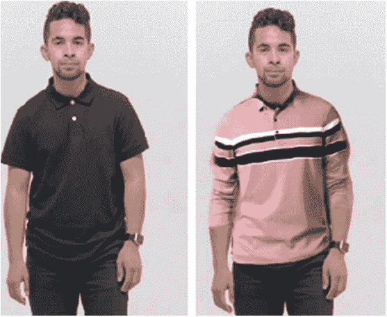


服装迁移通过移动摄像头获取人物图像（目标图像），并输出叠加了服装的人物。

## 腕饰试戴：

它主要需要三个组件：

### 腕部跟踪场景对象：

该对象的功能是跟踪腕部。为此，从资源库中安装腕部跟踪自定义组件和腕部遮挡器。

### 左手腕和右手腕对象：

它包含与腕部相关的所有细节。

### 3D 模型：

这些是用于试戴的模型。

过程遵循以下步骤：

1. 在左侧面板中右键单击相机对象，然后选择创建场景对象。
2. 将该场景对象重命名为“腕部跟踪自定义组件”。
3. 右键单击“腕部跟踪自定义组件”，创建两个场景对象，并分别重命名为“左手腕”和“右手腕”。
4. 单击“腕部跟踪自定义组件”场景对象，然后在检查器面板中单击“+Add Component”。
5. 将腕部跟踪添加到场景对象。
6. 在对象面板中单击并拖动“左手腕”和“右手腕”场景对象到检查器面板。
7. 单击并拖动 Wrist_Occluder__PLACE_UNDER_WRIST_TRACKING_CC 资源到对象面板。
8. 确保“左腕遮挡器”是“左手腕”场景对象的子对象，“右腕遮挡器”是“右手腕”的子对象。
9. 现在将 3D 模型导入左手腕和右手腕的对象面板中。
10. 在右侧的检查器面板中调整模型的位置、旋转和缩放。

腕饰试戴通过移动摄像头输入人的手部，并输出叠加了手表的手部图像。

## 鞋类试穿

它包含三个主要组件：

## 基于增强现实的云智能虚拟试穿

图2. 使用腕饰试戴前后的人物手部图像


### 脚部跟踪：

该组件用于将鞋子附着到用户脚部并进行跟踪。

### 轮播组件：

该组件用于在多种鞋子设计之间切换。

### 鞋子控制器脚本：

该脚本包含将轮播组件与脚部跟踪组件连接起来的主要逻辑。

过程遵循以下步骤：

1. 从 Lens Studio 的资源库中安装“脚部跟踪”组件。
2. 在相机下创建一个新的场景对象。
3. 在左侧单击“+Add Component”，并在检查器面板中选择“脚部跟踪”。
4. 在组件中添加左右脚对象。
5. 在左右脚对象中导入 3D 模型。
6. 调整 3D 模型的位置、旋转和缩放，使其能够正确贴合脚部。
7. 在“脚部跟踪”组件中添加“默认遮挡器”以处理遮挡。

鞋类试穿通过移动摄像头输入人的脚部，并输出叠加了鞋子的脚部图像。

## 耳环试戴

耳朵绑定是耳环试戴的主要组件。它附着在耳朵的基准点上，该基准点确定耳朵的位置，如耳垂前部、耳垂后部、耳轮等。

*图3. 使用鞋类试穿前后的人脚图像*


步骤如下：

1. 从资源库中安装“耳朵绑定”组件。
2. 进入项目，在主相机下添加一个场景对象，并将其命名为“耳环”。
3. 选择该场景对象，在检查器面板中单击“+Add Component”，并添加“耳朵绑定”。
4. 在“耳环”场景对象的层级下导入耳环的 3D 模型。
5. 根据偏好调整模型的位置、旋转和缩放。

*图4. 使用耳环试戴前后的人物图像*


耳环试戴通过移动摄像头输入人物图像，并输出叠加了耳环的图像。

## 布料模拟试穿

布料模拟试穿使用 3D 人体跟踪、布料模拟和人体网格技术。3D 人体跟踪用于跟踪人物。通过人体网格将衣物贴合到身体上，布料模拟用于根据身体运动使衣物变形。

## 页面

麦卡伦

苏格兰单一麦芽威士忌

苏格兰产品

这就是麦卡伦诞生的故事。这是一个关于热忱、耐心和追求完美的故事。从第一缕酒液接触橡木的那一刻起，命运便已注定。

麦卡伦蒸馏厂坐落在苏格兰斯佩塞的中心地带，自1824年以来一直精心酿造着品质卓越的单一麦芽威士忌。从大麦到瓶装，每一步都凝聚着细致入微的工艺，每一个环节都至关重要。

橡木桶取材于西班牙和美国的森林，是麦卡伦的灵魂。每个橡木桶都经过陈酿、烘烤和碳化处理，以提取完美的风味平衡。

### 橡木桶

我们对卓越橡木桶的投入无人能及。我们花费在橡木上的成本超过任何其他蒸馏厂，确保每一滴麦卡伦都拥有丰富而复杂的个性。

> “麦卡伦不仅仅是一款威士忌，它更是一种艺术形式。” —— 迈克尔·詹姆斯，酿酒大师

我们在酿造威士忌时使用了十六种不同类型的橡木桶，每种都为最终成品带来香草、香料、柑橘和干果的独特微妙风味。

### 陈酿

陈酿是魔法发生的时刻。我们的威士忌在仓库的黑暗中至少静置十二年，慢慢从木材中汲取特质，直到达到最佳状态。

- 麦卡伦雪莉桶
- 麦卡伦双桶
- 麦卡伦三桶
- 麦卡伦珍稀桶

这些系列中的每一个都展示了我们酿造方式的多样性，从浓郁饱满的雪莉桶威士忌到更为轻盈、果香浓郁的风格。

### 传承

近两个世纪以来，麦卡伦始终坚守其创立原则：酿造世界上最珍贵的单一麦芽威士忌。这是由我们的工匠传承的遗产，每一瓶都出自他们的双手。

当您端起一杯麦卡伦时，请记住您手中握着的是一段历史。一个凝结于时光中的瞬间，从苏格兰的心脏中蒸馏而来。

## 基于增强现实的云智能虚拟试穿

该模型在与电子商务集成方面表现出色，因为它与 Snapchat 的 Snapcode 集成，方便用户购买其试穿的产品。总体而言，它在多个性能指标上表现良好。它与 Snapchat 的高性能相机和机器学习算法的集成，为用户提供了快速、逼真且交互式的体验。该功能与多种设备和平台的兼容性、与电子商务合作伙伴的集成以及积极的用户反馈，使其成为希望提升用户体验并提高转化率的电子商务企业的有力工具。表1显示了现有模型与所提出模型之间的比较。

## 表1. 现有模型与所提出模型的比较

| 指标 | 增强现实与虚拟现实——时尚零售的新驱动力？ | AR试穿：对感官品牌体验和使用移动应用意愿的影响 | 使用AR的3D电子商务 | 所提出模型 |
|---|---|---|---|---|
| 加载时间 | 4-6 秒 | 3-5 秒 | 6-8 秒 | 3-4 秒 |
| 帧率 | 30 FPS | 25-30 FPS | 30 FPS | 30 FPS |
| 跟踪精度 | 未提及 | 未提及 | 未提及 | 中等到高 |
| 用户反馈 | 顾客认为AR体验更令人兴奋和难忘 | AR试穿体验对感官品牌体验产生积极影响，并增强客户忠诚度 | 正面反馈 | 客户觉得易于使用，并能探索所有服装和服饰 |
| 兼容性 | 需要兼容的AR设备 | 需要兼容的AR设备 | 需要兼容的AR设备 | 需要兼容 Snapchat 的AR设备 |
| 速度 | 中等 | 中等到快速 | 中等到快速 | 快速 |
| 真实感 | 不太逼真 | 逼真 | 中等逼真 | 高度逼真 |
| 交互性 | 高度交互 | 高度交互 | 高度交互 | 中等交互 |
| 与电子商务的集成 | 与电子商务高度集成 | 与电子商务高度集成 | 与电子商务高度集成 | 与电子商务中度集成，因为用户必须添加镜头的二维码 |

图6中显示的图像来自“Virtual Try Ons”网站，该网站包含3D模型的预览和Snapcode。上文图7中提供的图像是在Lens Studio中发布的镜头的Snapcode。这些镜头会重定向到用于试穿的Snapchat镜头。该网站以用户友好为设计理念，使用户能够快速访问他们想要的镜头。

要使用这些镜头，用户只需访问网站，选择喜欢的衣服或配饰，点击卡片以显示Snapcode，然后使用Google Lens或Snapchat扫描功能进行扫描。这将把他们带到Snapchat中的镜头，在那里他们可以进行试穿并了解自己的佩戴效果。这使得用户能够根据在镜头中的外观做出明智的购买决定。


图7. *镜头快照码*

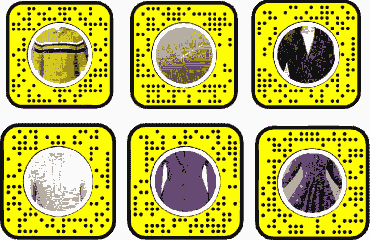

## 参考文献

Abdel, H. (2019). 物联网(IOT)：研究挑战与未来应用. *国际先进计算机科学与应用期刊.*

Anand, P., Gupta, R., Tiwari, N. K., & Gupta, S. (2022). 玻璃虚拟试戴. *应用科学与工程技术研究国际期刊, 10*(5), 718–722. 提前在线发表. doi:10.22214/ijraset.2022.42317

Antim, A., & Luigi, L. (2017). 关于物联网与云计算之间接口的广泛综述. *工程研究与技术国际期刊.*

Boardman R, Zhu A. (2020). 增强现实与虚拟现实——时尚零售的新驱动力？ *技术驱动的可持续性：时尚供应链创新.* doi:10.1007/978-3-030-15483-7_9

Borges, A., & Carlos, H. (2019). 一个虚拟化妆增强现实系统. *第21届虚拟与增强现实研讨会(SVR).* 10.1109/SVR.2019.00022

Dov & Kaufman. (2018). 用智能界面增强现实. *IntechOpen.* doi:10.5772/intechopen.75751

Eugeni, R. (2022). 算法图像时代的增强现实滤镜与面孔作为品牌：个人身份与营销策略. *第24届HCI国际会议.* 10.1007/978-3-031-05064-0_17

## 第5章

### 使用YOLOv5的无人机图像绝缘子故障检测

S. Venkata Suryanarayana  
CVR College of Engineering, India

Katakam Koushik  
CVR College of Engineering, India

Prabu Sevugan  
Pondicherry University, India

### 摘要

绝缘子缺陷的识别是高压输电线路智能检查最重要的目标之一。由于它们为电力输电线路提供机械支撑和电气绝缘，绝缘子对电力网络的安全可靠运行至关重要。首先通过收集包含一个或多个缺陷的各种场景的空中图片构建了一个新的数据集。CSPD-YOLO模型使用特征金字塔网络和增强的损失函数来提高绝缘子故障检测的精度。建议的技术使用具有两个类别（绝缘子、缺陷）的绝缘子缺陷数据集，采用YOLOv5目标检测算法对模型进行训练和测试。作者评估了YOLOv3、YOLOv5及其相关系列在绝缘子缺陷数据集上训练后的表现。实践者可以根据绝缘子缺陷数据集利用这些信息选择合适的技术。

## 引言

在检查高压输电线路时，使用了多种传感器，其中一种关键技术是电气设备状态检测。基于视觉传感器的技术在过去几十年中取得了显著进展，各种主题，包括绝缘子识别、输电线路检测和电塔检测，都已被研究。根据早期研究，绝缘子串是高压输电线路最重要的设备之一，它可以提供机械支撑和电气绝缘。然而，绝缘子缺陷通常在运行一段时间后显现，原因包括雷击、材料老化和过载等因素。因此，准确检测绝缘子故障是高压输电线路检查的关键任务。在标准人工检查中，工作人员必须沿着靠近高压输电线路的路径行走，使用各种工具，包括相机、紫外成像仪、红外成像仪和听觉传感器，来检查每个绝缘子的状态。然而，由于高压输电线路通常建在森林和湖泊等复杂环境中，传统的人工方法在实际应用中无效且不切实际。由于无人机操作和图像处理技术的进步，利用无人机(UAV)拍摄的航拍照片进行绝缘子状态检查的研究最近变得更加流行。

在人工特征-based方法中，已研究了多种特征，如颜色、形状、边缘、梯度、纹理、关键点及其融合。一些数学模型，如蛇模型、霍夫变换、主动轮廓模型、模糊c均值和感受野模型，也在期间被使用。在基于机器学习的方法中，使用了AdaBoost、基于稀疏表示的分类器、SVM、级联分类器和KNN来识别绝缘子位置并识别绝缘子问题。然而，在航拍照片中，绝缘子通常会重叠，因为在无人机检查过程中拍摄角度和距离不断变化，使得难以收集每个绝缘子的空间信息。

根据Liu等(2021)的研究，由于电力需求的不断增长，特别是与智能电网有关，高压输电至关重要。然而，由于绝缘子在室外暴露时间较长，缺陷不可避免地会发生。无人机(UAV)巡检已逐渐取代浪费资源且无效的传统人工巡检。因此，员工不再需要使用望远镜沿输电线路寻找绝缘子缺陷。然而，由于应用环境的复杂性和多样性，绝缘子故障的自动诊断极其困难。

由于航拍照片中绝缘子的相关特性未知，传统图像处理算法的准确性降低。这些技术相比更传统的图像处理技术具有多种优势。在Xiao和Sun(2021)提出的CNN广泛应用下，深度学习技术能够超越传统图像处理方法的限制，表现出优异的性能并显著提高目标检测精度。随着硬件技术和深度学习理论的进步，目标检测在过去五年中取得了显著进展。众多优秀的深度卷积网络，包括RCNN、Fast-RCNN、Faster-RCNN、YOLOv1、YOLOv2、YOLOv3以及各种变体，已在开放数据集上提出并得到验证。这些技术使用高维语义属性来表示物体。

总体而言，人类创建的大多数基于机器学习和特征的算法对复杂背景干扰极其敏感。此外，拍摄距离和角度通常会降低其性能。这些技术大多数耗时较长，不适合实时应用。由于公共网站上没有可用的绝缘子航拍图片数据集，当前的深度学习技术尚未得到很大改进。最值得注意的是，目前使用的机器学习、深度学习或基于特征的算法均未提供系统分析来解决绝缘子多故障检测问题。因此，提供一种能够解决当前方法问题的策略是合理的。

为了解决两阶段检测算法实时性能差的普遍问题，Redmon等(2016)引入了第一个单阶段网络，YOLOv1。由于整个检测管道是一个单一网络，它将目标检测作为回归问题使用，从而实现检测性能的直接端到端改进。然而，YOLOv1在物体重叠和遮挡的情况下容易漏检，并且在识别小物体方面效率低下。因此，2017年Redmon和Farhadi提出了YOLOv2，即YOLOv1的改进版本，它使用DarkNet-19作为基础网络，并增加了诸如批归一化预处理、多尺度训练机制和二元交叉熵损失函数等增强功能，从而显著提高了召回率和精度的水平。2018年，Redmon和Farhadi(2018)引入了YOLOv3方法以提高网络对小物体检测的敏感性。它扩展了网络层的数量，在ResNet中实现跨层求和函数，并采用Darknet-53作为骨干网络。在实际应用中，YOLOv3速度快，其背景误检率低。

### 相关工作

Zhao等(2019)指出传统Faster R-CNN模型中锚框的设置仅满足通用目标检测的要求。在微调Faster R-CNN后，一些绝缘子识别不佳的情况会产生电力输变电检查图像。有两个水平绝缘子，其颜色与背景相似。一个绝缘子只能在小部分被检测到，且输出框的尺寸不足以覆盖绝缘子。现场拍摄了红外图像，这正是实际应用所需要的。照片的选择考虑了多种环境。该国不同等级的110-500 kV室内高压实验室、四座变电站、一座换流站和约33条输电线路被选中。在材料方面，玻璃、瓷和复合绝缘子都被考虑在内。VGG-16网络中的Faster R-CNN平均精度(AP)值为0.640。我们集中研究如何在此基础上进一步提高检测精度。它可以成功实现图像中绝缘子的独立检测，为进一步的绝缘子缺陷诊断和状态检测奠定基础。

Rahman等(2021)开发了电力供应企业主要集中于检查损坏和有故障的绝缘子，以确保消费者获得安全可靠的电力传输。在两个类别中，YOLOv4的平均精度(AP)为82.9%，其中销钉绝缘子的AP为78.2%，悬挂盘形绝缘子的AP为87.7%。由于YOLOv4 Tiny是一种轻量级模型，推理速度快，因此其AP低于常规YOLOv4模型。复杂的数据集由位于132 kV电网变电站外的多根复杂电线杆的图片组成，这些图片是用手机相机拍摄的。为避免过拟合和噪声估计，使用了交叉迭代批归一化(CmBN)。

Liao等(2015)提出区域特征点或区域补丁的识别被称为“特征检测”。我们希望找到尽可能多的绝缘子特征点以简化后续处理（为提高召回率，我们允许存在噪声但限制绝缘子点被遗漏）。寻找局部特征点的方法有很多，包括Lowe的高斯差分检测器和Harris仿射区域检测器。通过采用z分数归一化，我们改进的Harris角点选择技术只寻找靠近增强边缘的角点。所有方法都使用完全相同数量的训练数据。


Wang等人（2020）采用基于BOW和SIFT的方法实现了一个模型。所有方法使用了完全相同数量的训练数据。通过块，特征可以在多个特征映射组之间进行映射。匹配特征空间的维度是相互连接的。Conv3、Conv4和Conv5的相似锚点尺度分别为32²、62²和128²。本文采用了三种比例：1:2、1:3和2:1。在训练中，根据交并比（IoU）值将样本分为正样本或负样本，其值分别为0.7和0.3。由于参数共享，特征金字塔网络的所有层级提供相似的语义信息。使用所提方法作为骨干网络的Faster RCNN，其ACC和mAP比使用ResNeSt101-RPN时分别高出0.0067和2.5%。使用所提方法作为骨干网络的RetinaNet，其ACC、mAP和AUC分别比使用ResNeSt101-RPN时高出0.0099、0.8%和0.0164。虽然精度提高了，但当所提方法作为我们提出的网络的基础时，FPS下降了1.18。

Zhai和Zhao（2018）提出了一种模型，其基本思想是绝缘子部件彼此等距分布。在发生串串跌落（bunch-drop）后，周围绝缘子片的宽度将显著增加。人眼观察可以发现绝缘子区域存在明显的间隙。一旦定位到绝缘子，就使用形态学方法突出显示缺失部件的位置，从而利用数据的空间属性找到故障位置。绝缘子在户外长时间承受极高的电压和巨大的机械张力。绝缘子的缺陷或瑕疵可能导致巨大的功率损失，甚至可能引发大范围的停电或断电。陶瓷和玻璃是输电线路中最常用的两种绝缘子材料。作为多相多晶材料，陶瓷绝缘子在环境、电气和机械应力下容易开裂。尽管 toughening（增韧）提高了抗拉强度，但过载可能会导致串串跌落。近年来，无人机（UAV）巡检已成为一种更流行的线路巡检方式。通过处理和分析无人机拍摄的航拍图像，可以有效地发现并定位绝缘子的缺陷。

## 方法

我们使用YOLOv5（Ning等人（2021）提出的YOLO模型的一种变体）来检测绝缘子和缺陷区域，因为YOLOv5模型具有一个焦点层，能够准确检测低级特征。YOLOv5用于绝缘子和缺陷数据集的工作流程如图1所示。YOLOv5使用MS COCO AP50:95和AP50指标，是一种最先进的检测器，在市场上比其他任何检测器都更准确、更快（FPS）。他们采用了大量的网络增强措施，以提高以平均精度均值（mAP）衡量的网络性能。在FPN中使用自顶向下的增强路径，在PAN中使用自底向上的数据增强路径。YOLOv5带有30个独特的训练超参数。可以将学习率视为保持每次迭代成本最低的步长。为了防止过拟合，需要仔细选择学习率。单次传输到网络的图片数量取决于批大小。因此，使用更大的批大小将加快训练速度。YOLOv5的不同版本基于p5和p6模型，如表1所示。YOLOv5架构如图2所示，YOLOv5p5模型的不同网络如图3所示。

图1. YOLOv5的工作流程

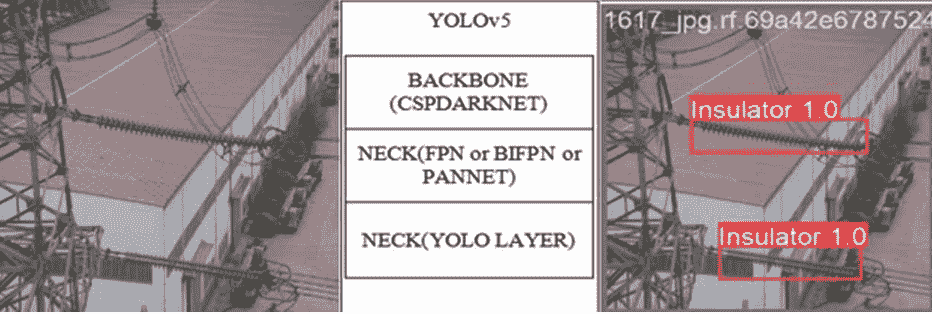

图2. YOLOv5架构

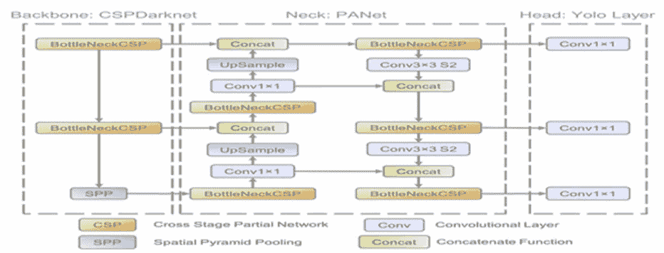

表1. YOLOv5模型的各种类型

| 序号 | YOLOv5p5模型 | YOLOv5p6模型 |
|------|-----------------|-----------------|
| 1 | YOLOv5n | YOLOv5n6 |
| 2 | YOLOv5s | YOLOv5s6 |
| 3 | YOLOv5m | YOLOv5m6 |
| 4 | YOLOv5l | YOLOv5l6 |
| 5 | YOLOv5x | YOLOv5x6 |

表3. 缺陷类别的精确率、召回率、F1分数、mAP 0.5和mAP 0.5到0.95的值

| YOLOv3和YOLOv5模型 | mAP0.5 | mAP 0.5:0.95 | 精确率 | 召回率 | F1分数 |
|:--- | ---: | ---: | ---: | ---: | ---: |
| **缺陷** |  |  |  |  |  |
| YOLOv3-tiny | 99.5 | 88.5 | 0.998 | 1 | 0.998 |
| YOLOv3 | 99.5 | 96.3 | 1 | 1 | 1 |
| YOLOv3-spp | 99.5 | 99.3 | 1 | 1 | 1 |
| Yolov5n | 99.5 | 89.5 | 0.998 | 1 | 0.998 |
| Yolov5s | 99.5 | 96.1 | 0.999 | 1 | 0.999 |
| Yolov5m | 99.5 | 98.8 | 0.999 | 1 | 0.999 |
| Yolov5l | 99.5 | 99.5 | 0.999 | 1 | 0.999 |
| Yolov5x | 99.5 | 99.5 | 1 | 1 | 1 |
| Yolov5n6 | 99.5 | 92.5 | 0.999 | 1 | 0.999 |
| Yolov5s6 | 99.5 | 98.7 | 0.999 | 1 | 0.999 |
| Yolov5m6 | 99.5 | 95.5 | 0.999 | 1 | 0.999 |
| Yolov5l6 | 99.5 | 92.2 | 0.999 | 1 | 0.999 |
| Yolov5x6 | 99.5 | 87.2 | 0.999 | 1 | 0.999 |

表4. 全部（绝缘子和缺陷）类别的精确率、召回率、F1分数、mAP 0.5和mAP 0.5到0.95的值

| YOLOv3和YOLOv5模型 | mAP 0.5 | mAP 0.5:0.95 | 精确率 | 召回率 | F1分数 |
|:--- | ---: | ---: | ---: | ---: | ---: |
| **全部** |  |  |  |  |  |
| YOLOv3-tiny | 99 | 77.7 | 0.966 | 0.98 | 0.9729 |
| YOLOv3 | 99.5 | 97.3 | 1 | 1 | 1 |
| YOLOv3-spp | 99.5 | 99.3 | 1 | 1 | 1 |
| Yolov5n | 99.5 | 91.7 | 0.992 | 0.998 | 0.994 |
| Yolov5s | 99.5 | 97.1 | 1 | 1 | 1 |
| Yolov5m | 99.5 | 99 | 0.999 | 1 | 0.999 |
| Yolov5l | 99.5 | 99.4 | 1 | 1 | 1 |
| Yolov5x | 99.5 | 99.5 | 1 | 1 | 1 |
| Yolov5n6 | 99.5 | 93.9 | 0.998 | 0.998 | 0.998 |
| Yolov5s6 | 99.5 | 98.8 | 0.999 | 1 | 0.999 |
| Yolov5m6 | 99.5 | 96.2 | 0.999 | 1 | 0.999 |
| Yolov5l6 | 99.5 | 93.5 | 0.999 | 1 | 0.999 |
| Yolov5x6 | 99.4 | 89.7 | 0.994 | 0.999 | 0.996 |

图5. 所有模型在全部（绝缘子和缺陷）类别上的准确率比较

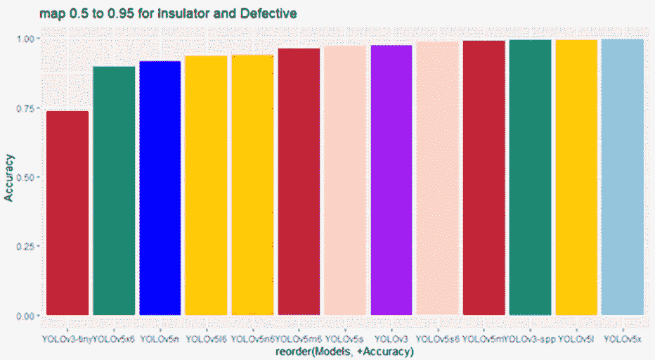

图6. YOLOv5x模型的混淆矩阵

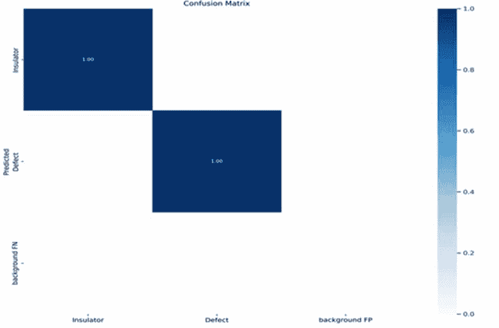

图7. YOLOv5x模型的召回率图

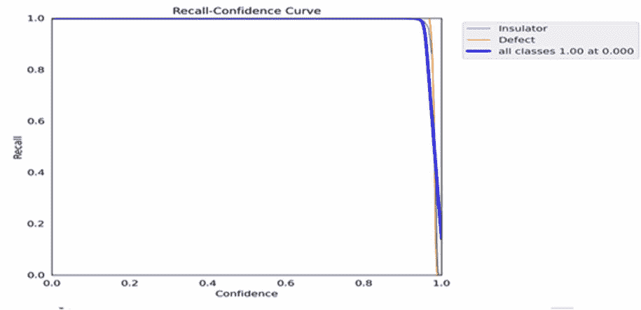

图8. YOLOv5x模型的精确率图

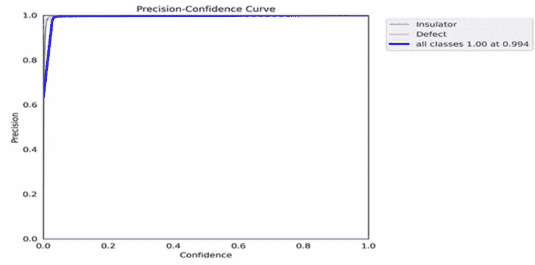

P-R图评估模型的性能。如果随着召回率的上升，精确率保持较高，则认为该模型在预测方面表现良好。

图9. YOLOv5x模型的精确率-召回率图

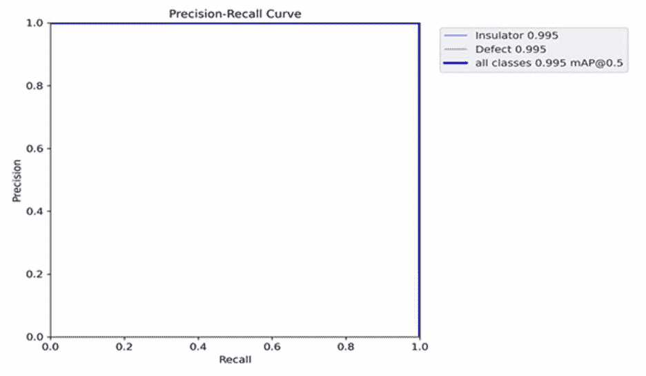

图10. YOLOv5x模型的F1分数图

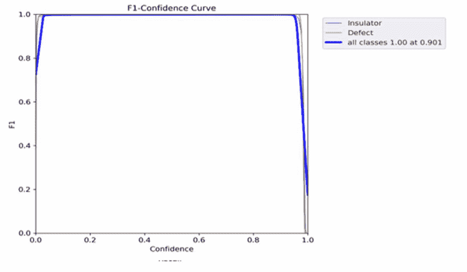

## 参考文献

- Liao, S., & An, J. (2015). A robust insulator detection algorithm based on local features and spatial orders for aerial images. IEEE Geoscience and Remote Sensing Letters, 12(5), 963-967. https://doi.org/10.1109/LGRS.2014.2369525 doi:10.1109/LGRS.2014.2369525
- Lin, T., Dollar, P., Girshick, R., He, K., Hariharan, B., & Belongie, S. (2017). Feature pyramid networks for object detection. 2017 IEEE Conference on Computer Vision and Pattern Recognition (CVPR). doi:10.1109/CVPR.2017.106
- Liu, C., Wu, Y., Liu, J., Sun, Z., & Xu, H. (2021). Insulator faults detection in aerial images from high-voltage transmission lines based on deep learning model. Applied Sciences, 11(10), 4647. https://doi.org/10.3390/app11104647 doi:10.3390/app11104647
- Liu, S., Qi, L., Qin, H., Shi, J., & Jia, J. (2018). Path aggregation network for instance segmentation. 2018 IEEE/CVF Conference on Computer Vision and Pattern Recognition. https://github.com/InsulatorData/InsulatorDataSet website.
- Ning, Z., Wu, X., Yang, J., & Yang, Y. (2021). MT-yolov5: Mobile terminal table detection model based on YOLOv5. Journal of Physics: Conference Series, 1978(1), 012010. doi:10.1088/1742-6596/1978/1/012010
- Rahman, E. U., Zhang, Y., Ahmad, S., Ahmad, H. I., & Jobaer, S. (2021). Autonomous vision-based primary distribution systems porcelain insulators inspection using UAVs. Sensors (Basel), 21(3), 974. doi:10.3390/s21030974 PMID:33540500
- Redmon, J., Divvala, S., & Girshick, R. (2016). You only Look once: Unified, real-time object detection. arXiv.
- Redmon, J., & Farhadi, A. (2017). YOLO9000: Better faster, stronger. 2017 IEEE Conference on Computer Vision and Pattern Recognition (CVPR), 6517–6525. doi:10.1109/CVPR.2017.690
- Redmon, J., & Farhadi, A. (2018). YOLOv3: An incremental improvement. arXiv.
- Wang, S., Liu, Y., Qing, Y., Wang, C., Lan, T., & Yao, R. (2020). Detection of insulator defects with improved ResNeSt and region proposal network. IEEE Access : Practical Innovations, Open Solutions, 8, 184841–184850. doi:10.1109/ACCESS.2020.3029857
- Xiao, C., & Sun, J. (2021). Convolutional neural networks (CNN). Introduction to Deep Learning for Healthcare, 83-109. doi:10.1007/978-3-030-82184-5_6
- Zhai, Y., Chen, R., Yang, Q., Li, X., & Zhao, Z. (2018). Insulator fault detection based on spatial morphological features of aerial images. IEEE Access : Practical Innovations, Open Solutions, 6, 35316–35326. doi:10.1109/ACCESS.2018.2846293
- Zhao, Z., Zhen, Z., Zhang, L., Qi, Y., Kong, Y., & Zhang, K. (2019). Insulator detection method in inspection image based on improved faster R-CNN. Energies, 12(7), 1204. doi:10.3390/en12071204


## 第6章

## 基于区块链的深度学习方法用于阿尔茨海默病分类

V. Sanjay
https://orcid.org/0000-0002-6383-3793
韦洛尔理工学院，韦洛尔，印度

P. Swarnalatha
韦洛尔理工学院，韦洛尔，印度

## 摘要

区块链是一种新兴技术，目前正被用于在包括医疗保健在内的多个行业提供新颖的解决方案。深度学习（DL）算法在医学图像处理研究中越来越受欢迎。阿尔茨海默病（AD）通过磁共振成像（MRI）图像进行诊断。本研究探讨了区块链技术与DL模型在阿尔茨海默病预测（AD）中的集成。该模型用于对来自ADNI数据集的3182张图像进行分类。基于边缘的分割算法克服了分割问题。在研究的测试阶段，带有区块链的DL-EfficientNetB0模型达到了最高准确率99.14%。在比较评估阶段，利用混淆矩阵获得了最高的准确率、灵敏度和特异度得分。根据研究结果，带有区块链的EfficientNetB0在分类率上超过了所有其他训练模型。这项研究将有助于通过在疾病发生前识别该疾病，从而对AD的早期检测和预防进行临床研究。

## 引言

AD是一种痴呆症，通常影响老年人，其特征是逐渐认知障碍和大脑功能技能退化。根据2016年《世界阿尔茨海默病报告》，约有4680万人患有AD和痴呆症，如图1所示。预计阿尔茨海默病的发病率每20年将翻一番，到2050年，阿尔茨海默病的全球患病率将达到约1.315亿（Ding et al.， 2019）。大脑总体积的大约60%包含在这个区域内。位于大脑深处的灰质执行这一关键处理。这种结构由神经元的树突和细胞核组成。它约占大脑体积的40%。中枢神经系统和脊髓的白质和灰质受到脑脊液的保护，免受机械冲击。下丘脑释放的不同激素促进中枢神经系统中白质和灰质之间的通信（Zhang et al.， 2019）。人工智能（AI）涵盖了广泛的算法和方法，包括遗传算法（Wang et al.， 2019; Alberdi & Weakley, 2018; Li et al.， 2019）、神经网络（Pavisic et al.， 2021）和进化算法（López-De-Ipiña et al.， 2020; Sapey-Triomphe et al.， 2015; Tzimourta, n.d.; Afrantou et al.， 2019）。

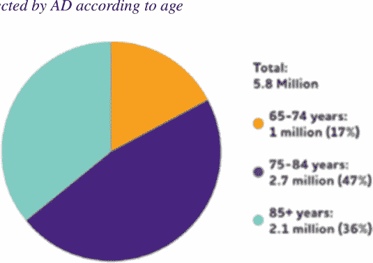

最明显的症状包括无效沟通、易感染性增加、判断力差、方向感差、短期记忆丧失和视觉困难。近期研究表明，全球约有5000万人患有阿尔茨海默病（Krishna et al.， 2019; Chandra et al.， 2019; Ke et al.， 2019; Zheng et al.， 2019）。

然而，大多数现有的DL方法从头训练深度卷积神经网络（CNN）模型，并受到限制（Lian et al.， 2020）。首先，它需要大量标记的训练数据，这在医学领域可能难以获得。其次，它需要巨大的计算和内存资源；没有这些资源，训练模型将花费更长时间。第三，它需要通过正则化仔细优化网络参数；否则会导致过拟合或欠拟合问题。确保训练模型能够很好地泛化到未知数据也至关重要（Maggipinto et al.， 2017）。

使用功能性磁共振成像（fMRI）图像训练带有区块链的深度神经网络来检测各种大脑事件（Chitradevi & Prabha, 2020; Lu et al.， 2018），我们实现了这一目标。由于科学和技术领域的进步，计算机辅助诊断（CAD）系统已被开发出来。这些系统帮助研究人员和临床医生分析医学图像。

在AD的早期阶段，计算机辅助诊断对于人类健康至关重要。由于AD是一种神经系统疾病，其潜伏期很长。因此，在不同时间监测AD症状至关重要。使用各种图像分类技术可以提高AD诊断的准确性。

DL研究人员已经发现了其他使用MRI扫描图像识别个体AD严重程度的方法（Gorges et al.， 2018; Yu et al.， 2020）。在图像处理和分析方面，图像质量越高，结果越准确。

本文的其余部分结构如下：“相关工作”部分回顾了相关作品。“问题陈述与解决方案”部分总结了研究的主要关注点和目标。“材料与方法”部分讨论了所提出的方法。“实验结果与模型评估”部分评估了实验及其结果。“结论”部分总结了文章。

## 背景研究

用于AD早期检测的神经影像数据可以通过DL算法得到增强，这引起了研究人员对识别隐藏特征的兴趣。Sarraf和Tofighi（2016）的作者成功使用CNN将阿尔茨海默病患者的功能MRI数据与标准对照组区分开，以便将受AD影响的大脑与正常（健康）大脑区分开。达到了96%的准确率。复杂的困难需要更复杂的网络设计。Hojjati等人（2017）使用图论和机器学习（ML）开发了一种新的MCI分类方案。患有MCI的组的大脑区域被精确识别。所提出的模型仅描述了MCI的发展；未区分MCI的中间阶段。根据Duc等人（2019）的说法，基于ML的计算机辅助诊断可以区分阿尔茨海默病患者与健康对照。这使得很难准确确定神经网络的哪些部分影响了其决策过程。Pan等人（2020）提出使用CNN和集成学习（EL）构建的分类器集成来识别患有MCI或AD的个体，使用功能性磁共振成像（fMRI）。

组合的CNN和EL方法可以根据合格的集成模型确定哪些大脑区域最具区分性。作者发现，使用优化方法或其他DL技术可以提高分类准确性。为了提高EMCI识别，作者设计了多尺度增强图卷积网络（MSE-GCN）来研究多个主题之间的个体差异和知识关联（Yu et al.， 2020）。使用图片和人群表型数据训练所提出的模型。LMCI与NC的准确率为93.46%。作者提出了更高效的网络模型来精确定位大脑区域。作者（Guo & Zhang， 2020）提出了一种基于自动编码器的技术来区分正常衰老和疾病发展。

所提出的技术通过使用有效偏置的神经网络功能可靠地诊断AD。Parmar等人（2020）的作者使用三维卷积神经网络开发了一种二元分类器，能够区分AD和CN的静息态fMRI结果。

## 问题陈述与解决方案

在“相关工作”部分，您可以找到能够检测AD和对医学图像进行分类的架构列表。另一方面，它们中的大多数没有使用远程AD监测和患者咨询工具，如迁移学习算法、多类医学图像分类或在线AD检查服务。关于这些主题的文献严重不足。医学成像受到数据集规模小的阻碍。

## 材料与方法

AD的早期识别对于避免和调节疾病进展至关重要。我们的目标是开发一个用于AD阶段早期识别和分类的框架，如图2所示。

### 数据集

使用T1加权MRI，ADNI数据集收集了所有必要的训练数据。轴向、矢状面和冠状面视图均以DICOM格式提供。样本中的三百名个体已被标记为AD、EMCI、LMCI或NC。每个类别有75名患者，扫描次数从21到816不等。AD类有3182张图片，EMCI类有1732张图片，LMCI类有175张图片，NC类有1275张图片。所有医学数据均以3182张2D格式提取。

### 预处理步骤

收集的数据包含不均衡的分类。使用过采样和欠采样来克服这个问题。因此，集合已扩展到3182张图像。在归一化、重采样和去噪后，对数据集应用了适当的格式。可以使用非局部图像模糊方法对数据进行去噪。

### 基于边缘（EB）的图像分割和聚类

确定感兴趣区域的协调位置，并将选定区域植入并放大。使用该图像来修改像素的强度。根据亮度，像素被称为图片的白色或黑色。白色区域表示活组织，而黑色区域表示死组织。计算白色和黑色像素的数量，如果黑色像素非常少，则患者正常。根据黑色像素比率，患者有轻微学习障碍、AD或健康。阈值化是一种广泛使用的图像分割技术。在该图像分割技术中实现灰度或像素强度分割。这是根据图像像素强度将像素分为两类的两层级阈值化。


图 2. 拟议的系统架构

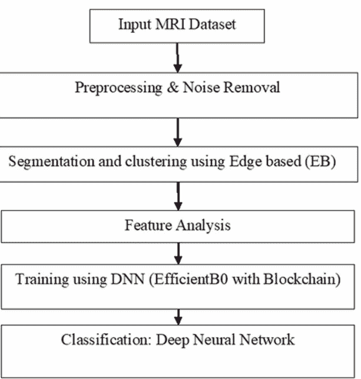

给定，X= {x₁, … xₙ} ⊂ R^p，EB 通过最小化以下目标函数将 X 分区为 c 个模糊子集

J(U,V)=∑_{i=1}^c ∑_{k=1}^n U_i^m ||X_k - V_i||²  (1)

其中 c 是聚类数，在本研究中被视为预先确定的显著性水平，n 表示数据点的数量， 一个众所周知的交替迭代算法最小化函数 J_m。

现在考虑拟议的 EB 公式。

J(U,V)=∑_{i=1}^c ∑_{k=1}^n U_i^m ||Ø(X_k)-Ø(V_i)||²  (2)

||Ø(X_k)-Ø(V_i)||² = K(X_k,X_k)+K(V_i,V_i)-2K(X_k,V_i)  (3)

其中 K(x,y)=Ø(x)^T Ø(y) 是一个内积核函数。如果我们采用该函数作为核函数，即，

$V_i = \frac{\sum_{k=1}^{n} U_{ik}^m K(x_k, v_i) x_k}{\sum_{k=1}^{n} U_{ik}^m K(x_k, v_i)}$ (4)

这里我们目前使用该函数以求简便。如果使用其他核函数，方程 (8) 和 (9) 中会有等价的修改。方程 (3) 可以被视为信息空间中由核诱导的新度量，定义如下方程。

$\mathrm{d}(x,y) = \|\varnothing(x_k) - \varnothing(v_i)\| = \sqrt{2\left(1 - k(x,y)\right)}$ (5)

可以证明，如果将 k(x,y) 取为该函数，则方程 (5) 指定的 d(x,y) 是特征空间中的一个度量。

聚类方法是不受控制的分割技术，可在没有训练图像的情况下将图像分割成具有相似强度的像素/体素聚类。聚类算法利用可访问的图像数据进行自学习。分割和规划分为两个步骤进行：数据聚类和组织类型估计特征。

$j_m = \sum_{i=1}^{c} \sum_{j=1}^{N} u_{ij}^m D_{ij}$ (6)

每个区域根据聚类的位置独立点亮。它以较高的噪声消除率和较差的均匀性指标以及较高的形态学图像滤波率进行处理。

数据增强步骤：由于缺乏医学信息，它增加了数据集。通过此次增强的 48,000 张照片，每个类别现在有 12,000 张图像。扩充数据集和减少过拟合是该技术的关键目标。

## 区块链技术

使用区块链技术存储的信息对黑客来说几乎不可能被篡改、破坏或销毁。按设计，它是一个基于点对点架构的去中心化平台，用于存储和处理交易和数据。它由许多验证和存储交易区块的节点组成。链中的每个区块包含一组交易，并且可以保证先前的区块与新创建的区块正确链接以构建链。

## 基于区块链的深度学习

区块链技术可以解决的重要需求是 DL 模型共享的可重用性和可信度。同样，可审计性、数据验证、结论的证明、来源、所有权、使用情况的可追溯性以及公平性保证是整合区块链技术与 DL 的主要论据（Yu et al., 2020）。大量不同的示例被提供给 DL 模型，它们利用这些示例学习特征并提供概率向量作为输出。即使 DL 模型在未处理数据上表现非常好，数据质量在许多现实世界预测场景中仍然很重要。

区块链是一个去中心化且经过验证的全球数据库，使所有网络节点能够存储和交换数据。

## 训练过程：卷积神经网络

最初，CNN 被用于处理图像识别的困难。它目前仅限于照片和视频图像，并用于表示音频和文本等时间序列信号。CNN 的优势在于局部卷积权重共享结构，这可以大幅减小神经网络的规模，避免过拟合并降低模型复杂度。通过使用空间结构连接，CNN 可以最小化需要学习的参数数量。因此，反向传播算法在训练期间的效率可能会提高。CNN 的第一个卷积层直接从图像的像素接收输入。每次卷积操作取有限数量的图像，进行卷积修改，并将数据传输到后端网络。每个卷积层提取数据的最有效特征。CNN 可以使用其图论公式定义。卷积滤波器的参数在所有网络层位置共享。特征图通过计算中心像素和相邻像素的加权平均值来计算空间特征。我们模型的网络层定义为

H^{l+1} = f(H^l, A) (7)
f(H^l A) = σ(AH^l W^l) (8)

其中 W^l 表示第 l 层神经网络的权重矩阵，σ 是一个非线性激活函数。因此，我们可以使用 EFFICIENTNETB0 与 CNN 来用可优化的图卷积网络模型替换核。

## EfficientNet

基于这一事实，对网络的深度、宽度和分辨率进行缩放，并提出了独特的缩放技术。他们使用神经架构搜索工具设计了一个新的基线网络。由于这项工作，创建了 EfficientNets，这是一系列在准确性和效率方面超越先前卷积神经网络的 DL 模型。

## 缩放

研究人员使用复合缩放方法来增加网络的规模。当资源最少时，采用该方法来寻找基线网络的各种缩放维度之间的联系。然后可以为每个需要增加的维度确定缩放因子。这些标准被用来增加基线网络的规模。

## EfficientNet 架构

首先，研究人员使用一种称为“神经架构搜索”的自动生成神经网络的方法来构建一个基本网络。浮点运算每秒在

该网络将被训练以预测患者未来五年患 AD 的几率，并将该概率与随时间收集特定个人诊断的损失函数进行平衡。

$$f_t = \sigma\left(W_f \cdot [h_{t-1}, x_t] + b_f\right) \tag{9}$$

$$i = \sigma\left(W \cdot [h_{t-1}, x_t] + b\right) \tag{10}$$

$$h_t = o_t * \tanh(C_t) \tag{11}$$

方程 14 中 $o_t$ 的值决定哪个单元元素将作为输出。新的细胞状态 $C_t$ 与 $o_t$ 相乘，并选择函数 $tanh$ 来在方程 9 中获得 ht，即部分 $i_j$ 的输入。EFFICIENTNETB0 可以学习长期依赖关系；使用 EFFICIENTNETB0 开发了一个表达 AD 进程的模型。

将患者的 CNN 特征编码与过去图像的特征编码相结合。新的记忆 $c^{(t)}$ 是通过使用输入数据 $x^{(t)}$ 和先前的隐藏状态 $h^{(t-1)}$ 生成的。（注意 $W$ 和 $U$ 指权重和参数。）

$$c^t = \tanh\left(w^c x^t + U^c h^{(t-1)}\right) \tag{12}$$

使用输入数据和之前的隐藏状态，输入门生成一个结果 $i^{(t)}$ 来控制新记忆，确定哪些信息是有价值的并且应该被记住。

评估步骤：基于九项性能指标比较两种技术和 CNN 架构。

应用步骤：鉴于合格的模型，建议使用 AD 验证网络应用。使用 AD 光谱可以识别患者的阿尔茨海默病阶段，并根据其阶段建议他们如何应对。

提取、降维和分类是传统 ML 技术的主要三个阶段。然后典型的 CNN 将所有这些阶段整合在一起。使用 CNN 时，无需手动提取特征。第一层的权重用于提取特征，使用得越多，其价值越大。CNN 胜过其他分类器。

## 实验结果与模型评估

Python 3.8 和 Keras 用于创建本研究。ML 库 Keras 基于 Python、开源，是一个高级库。Keras 用于数值计算，因为它使计算更简单、更快。75% 的数据来自训练集，而只有 25% 来自验证集。这个卷积神经网络经过了实际测试以确定其理想参数。 rather than relying on the accuracy of earlier research to estimate the appropriate number of dense units for hidden layers, we now try to do so using accurate results。


## 图4. *MRI图像的痴呆类别*

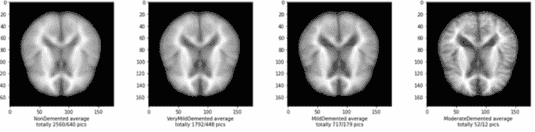

## 图5. *训练和测试过程中准确率与损失的比较分析*

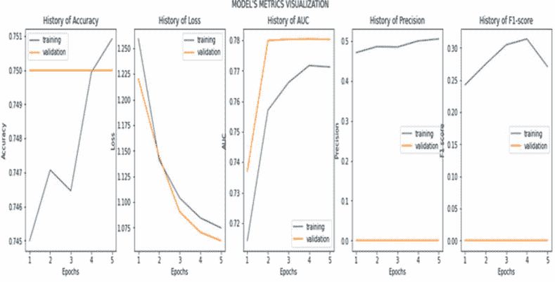

我们最近的研究提出了一种有效的基于分类器的深度卷积神经网络，该网络在图4和图5所示的ADNI数据集上表现优异。ADNI-3数据集被存放在一个单一的存储库中以妥善保管。在我们的研究中，我们使用了3182张MRI轴向切片。数据集中包含大约300名AD患者和70名NC患者的MRI图像。由于这些图像来自不同的学科领域，因此检查更加可靠。本工作涉及年龄在65至90岁之间的男性和女性患者。首先，我们将每个MRI图像切割成二维切片。通过旋转预处理图像的切片，以测试它们是否能够识别这些切片，我们可以获得更大的样本量，并为我们的基于区块链的DNN模型提供更好的训练环境。

所提出的模型已与PCA、CNN、Resnet18和3DCNN等多种方法进行了比较。表1显示了准确率、精确率和召回率值，对比图如图6所示。

然而，多重验证深度学习的结果表明，需要付出额外的努力来构建模型架构并优化其超参数。由于数据量有限，且流程符合当前标准，改进特征提取和性能的唯一方法就是改变这些步骤。在数据稀少的领域中，最大化利用现有数据至关重要。领域学习可能是改善进展中的MCI识别及其向AD进展预测的一种策略。根据对当前方法的文献调研，领域学习对模型性能以及使用该方法文章的数量都产生了积极影响。除了区块链之外，训练模型权重以检测辅助性AD的特征，将提高模型在核心问题上的性能，同时也能加快收敛速度，从而减少训练时间。

基于边缘的脑部分割是另一种可能提升性能的方法。脑部分割（颞叶、顶叶、前额叶和枕叶）使并行的3D卷积层能够为这些区域提取更精确的信息，从而压缩复杂的特征空间。更紧凑的特征区域应该更容易发现有用的特征。

*表1. 准确率、精确率和召回率对比表*

| 模型 | 准确率 | 精确率 | 召回率 |
|---|---:|---:|---:|
| PCA+NN | 95 | 91 | 98 |
| 3D CNN | 93 | 93.18 | 90 |
| Resnet18 | 97.88 | 98.10 | 97.89 |
| EFFICIENTNETB0 | 78.72 | 68.96 | 58.66 |
| CNN | 92 | 91 | 93 |
| 所提出模型 | 99 | 95 | 97.5 |

*图6. 各种方法的准确率对比图*

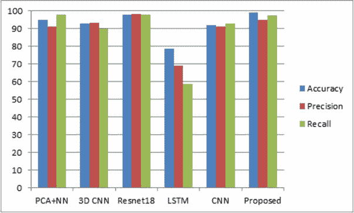

## 结论

深度神经网络中的卷积神经网络（CNN）可能有助于诊断AD。本文描述了一种基于区块链的方法，使用EfficientnetB0通过二维MRI切片区分阿尔茨海默病（AD）患者和健康个体。许多潜在的AD患者可能受益于所提出的方法，从而实现更早的疾病检测。分割采用基于边缘的分割算法完成。我们在ADNI数据库中的特征提取和分类技术在测试结果中显示出对AD的高准确率。

Li, H., Habes, M., Wolk, D. A., & Fan, Y. (2019). *一种基于海马MRI的阿尔茨海默病痴呆早期预测深度学习模型*. arXiv:1904.07282.

Lian, C., Liu, M., Zhang, J., & Shen, D. (2020). 基于结构MRI的联合萎缩定位与阿尔茨海默病诊断的层次全卷积网络. *IEEE模式分析与机器智能汇刊, 42*(4), 880–893. doi:10.1109/TPAMI.2018.2889096 PMID:30582529

López-De-Ipiña, K., Martinez-De-Lizarduy, U., Calvo, P. M., Beitia, B., García-Melero, J., Fernández, E., Ecay-Torres, M., Faundez-Zanuy, M., & Sanz, P. (2020). 面向轻度认知障碍自动检测的语音与不流畅性分析. *神经计算与应用, 32*(20), 15761–15769. doi:10.1007/s00521-018-3494-1

Lu, D., Popuri, K., Ding, G. W., Balachandar, R., Beg, M. F., Weiner, M., Aisen, P., Petersen, R., Jack, C., Jagust, W., Trojanowski, J., Toga, A., Beckett, L., Green, R., Saykin, A., Morris, J., Shaw, L., Kaye, J., Quinn, J., ... Fargher, K. (2018). 使用结构MR和FDG-PET图像进行阿尔茨海默病早期诊断的多模态多尺度深度神经网络. *科学报告, 8*(1), 1–13. doi:10.1038/s41598-018-22871-z PMID:29632364

Maggipinto, T., Bellotti, R., Amoroso, N., Diacono, D., Donvito, G., Lella, E., Monaco, A., Scelsi, M., & Tangaro, S. (2017). 用于阿尔茨海默病分类的DTI测量. *医学与生物学中的物理学, 62*(6), 2361–2375. doi:10.1088/1361-6560/aa5dbe PMID:28234631

Pan, D., Zeng, A., Jia, L., Huang, Y., Frizzell, T., & Song, X. (2020). 利用磁共振成像早期检测阿尔茨海默病：一种结合卷积神经网络和集成学习的新方法. *神经科学前沿, 14*, 259. doi:10.3389/fnins.2020.00259 PMID:32477040

Parmar, H., Nutter, B., Long, R., Antani, S., & Mitra, S. (2020). 基于深度学习3D-CNN的fMRI数据时空特征提取与阿尔茨海默病分类. *医学影像杂志（华盛顿州贝灵厄姆）, 7*(5), 056001. doi:10.1117/1.JMI.7.5.056001

Pavisic, I. M., Pertzov, Y., Nicholas, J. M., O’Connor, A., Lu, K., Yong, K. X. X., Husain, M., Fox, N. C., & Crutch, S. J. (2021). 家族性阿尔茨海默病中视觉短期记忆编码受损的眼动追踪指标. *科学报告, 11*(1), 1–14. doi:10.1038/s41598-021-88001-4 PMID:33888739

Sapey-Triomphe, J.-A., Heckemann, R. A., Boublay, N., Dorey, J.-M., Hénaff, M.-A., Rouch, I., Padovan, C., Hammers, A., & Krolak-Salmon, P. (2015). 轻度阿尔茨海默病中面部表情识别的神经解剖学相关性. *PLoS One, 10*(12), e0143586. doi:10.1371/journal.pone.0143586 PMID:26673928

Sarraf, S., & Tofighi, G. (2016). *基于fMRI数据和深度学习卷积神经网络的阿尔茨海默病分类*. arXiv:1603.08631.

Tzimourta, K. D., Afrantou, T., Ioannidis, P., Karatzikou, M., Tzallas, A. T., Giannakeas, N., Astrakas, L. G., Angelidis, P., Glavas, E., Grigoriadis, N., Tsalikakis, D. G., & Tsipouras, M. G. (2019). 阿尔茨海默病脑电信号复杂度分析. *计算机与电气工程, 76*, 198–212. doi:10.1016/j.compeleceng.2019.03.018

## 基于区块链的阿尔茨海默病深度学习方法

Wang, Y., Xu, C., Park, J.-H., Lee, S., Stern, Y., Yoo, S., Kim, J. H., Kim, H. S., & Cha, J. (2019). 使用脑形态测量和白质连接组对阿尔茨海默病的诊断与预后. *神经影像.临床, 23*, 101859. doi:10.1016/j.nicl.2019.101859 PMID:31150957

Yu, S., Wang, S., Xiao, X., Cao, J., Yue, G., Liu, D., Wang, T., Xu, Y., & Lei, B. (2020). 用于早期轻度认知障碍检测的多尺度增强图卷积网络. In *医学图像计算与计算机辅助介入——MICCAI 2020* (pp. 228–237). Springer Science and Business Media LLC. doi:10.1007/978-3-030-59728-3_23

Zhang, F., Li, Z., Zhang, B., Du, H., Wang, B., & Zhang, X. (2019). 用于阿尔茨海默病辅助诊断的多模态深度学习模型. *神经计算, 361*, 185–195. doi:10.1016/j.neucom.2019.04.093

Zheng, Y., Guo, H., Zhang, L., Wu, J., Li, Q., & Lv, F. (2019). 基于机器学习的使用结构MRI特征对血管性痴呆和阿尔茨海默病进行鉴别诊断的框架. *神经病学前沿, 10*, 10. doi:10.3389/fneur.2019.01097 PMID:31708854


## 使用人工智能对 NF-BoT-IoT 数据集进行入侵检测

## 引言

物联网（IoT）是互联的物联网节点的集合，这些节点自主运行，通过互联网连接与其他节点收集和交换数据。物联网是一种广泛使用的技术，在自动化网络系统中正迅速扩展。物联网节点的安全性需要在设计和实现过程的早期就加以决定。由于物联网节点的快速普及，即使是基本的设备现在也可以与其他节点连接并共享大量数据。由于网络中传输的数据量巨大，必须考虑数据的安全性。应在网络上采用现代安全措施来保护物联网节点。

在物联网中最显著的安全问题之一是基于僵尸网络的攻击，如分布式拒绝服务（DDoS）、拒绝服务（DoS）等（Ge 等，2019），攻击者利用恶意代码感染节点或使节点信息过载，从而损害性能。基于僵尸网络的攻击是物联网节点面临的最大危险之一。

为了应对这种困难，物联网节点需要专门的标准和通信协议。受约束应用协议（CoAP）、高级消息队列协议（AMQP）、消息队列遥测传输（MQTT）和可扩展消息处理现场协议（XMPP）只是用于确保物联网节点之间可靠、安全数据通信的众多消息和通信协议中的一部分。由于其低带宽要求、低内存要求和低丢包率，MQTT 是最广泛使用的协议。MQTT 是一种面向物联网的通信协议，是 OASIS 标准。发布/订阅消息协议有四个关键部分：客户端、代理、主题和消息。数据在 MQTT 客户端（物联网节点）和代理（中心节点）之间交换。代理使物联网节点能够根据节点能力同时发布和订阅主题。MQTT 主题是一种结构化的分层寻址形式，类似于文件系统中使用的前斜杠（/）分隔符。它包含通信内容，包括各种物联网节点收集的数据和来自各种网络的消息。

TCP 和 UDP 是大多数应用中最常用的传输协议。然而，根据实际需求，物联网应用需要多种消息分发功能和兼容标准。大多数物联网节点使用基于 TCP 之上运行的 MQTT 通信协议，在物联网节点之间发送和接收数据。

物联网节点应采用更快、更有效的安全措施来检测网络流量异常。防火墙、防病毒软件和入侵检测系统（IDS）是网络安全措施的例子。这些技术防御针对数据的主动和被动攻击。被动攻击者在不干扰系统运行的情况下仅查看和复制数据，这通常涉及窃听、流量分析等。入侵检测系统是用于跟踪网络中运行的硬件和软件状态异常的关键检测系统类型之一，而主动攻击者则试图篡改数据内容；其中一些攻击是 DDoS、DoS 等。

目前，研究集中在利用各种监督和无监督学习方法开发入侵检测系统。机器学习是一种人工智能，可以从大型数据库中提取数据。此外，神经网络是深度学习算法的基础，而深度学习是机器学习的一个子领域。许多网络安全活动，如僵尸网络识别、网络流量分析和入侵检测，都涉及机器学习和深度学习技术。

人工智能技术用于识别和研究正常和异常情况。通过对有意义的数据进行训练，机器学习和深度学习方法可以识别和预测威胁。本研究使用多种人工智能方法来区分公开可访问的数据集“NF-BoT-IoT”中的正常和异常数据。

本文接下来的内容分为多个部分：第（II）节提供了与 NF-BoT-IoT 数据集相关的各种类型的网络安全攻击，用于实现机器学习算法。第（III）节详细概述了所使用的机器学习算法。第（IV）节描述了实验中使用的数据集和不同的机器学习模型，包括特征提取、预处理步骤以及使用的各种评估指标。然后在第（V）节讨论了结果的性能评估和分析。最后，第（VI）节介绍了本文的结论和未来改进方向。

## 相关工作

本节讨论与入侵检测系统相关的工作。这些研究使用机器学习技术来验证物联网数据集。最流行的物联网数据集是 BoT-IoT、UNSW-NB15 等，许多学者将其用于机器学习分析和测试。作者简要回顾了多种入侵检测攻击类型，以及各种机器学习方法，并展示了该数据集对于分析、评估和测试模型性能非常有帮助。

Leevy 等人（2021）使用公开可用的 BoT-IoT 数据集，通过交叉验证技术训练和测试模型，以识别正常流量和信息窃取流量。作者使用了不同的集成技术和非集成技术来评估和分析数据结果，并确定最佳模型。

Swarna Sugi 和 Ratna（2020）研究并分析了所开发的入侵检测系统使用 BoT-IoT 数据集中的模型识别攻击的性能。为了分析模型性能，作者使用了长短期记忆网络（LSTM）和 K 近邻（KNN）。

Alshamkhany 等人（2020）使用 UNSW-NB15 数据集识别有害攻击。为了分析最优模型的性能，作者使用了多种监督学习技术，包括朴素贝叶斯、K 近邻、支持向量机和决策树。

Dwibedi 等人（2020）比较了 CSE-CIC-IDS2018、Bot-IoT 和 UNSW-NB15 数据集，并使用机器学习和深度学习方法分析了数据集的性能。

Idrissi 等人（2021）通过使用监督和无监督学习技术对 BoT-IoT 数据集进行分析，使用不同的指标验证了恶意活动。

Zeeshan 等人（2022）在 UNSW-NB15 和 BoT-IoT 数据集上提出了一种新的基于协议的深度入侵检测（PB-DID）架构，用于识别异常和非异常活动。

Ullah 和 Mahmoud（2021）开发了三维卷积神经网络，并在 BoT-IoT、IoT Network Intrusion、MQTT-IoT-IDS2020 和 IoT-23 入侵检测数据集上进行了验证，使用了准确率、精确率、召回率和 F1 分数等多种性能指标。

Shafiq 等人（2021）提出了一种新的框架模型，基于 BoT-IoT 数据集上的特征选择，利用机器学习技术评估指标并识别恶意活动。

Shafiq 等人（2020）在 BoT-IoT 数据集上使用包装器技术设计了一种特征选择算法，通过多种性能指标检测物联网网络上的恶意威胁。

表 1 给出了不同论文的详细信息，这些论文的作者讨论了使用各种机器学习和深度学习方法进行入侵检测的性能。

### 攻击类型

- 1. **拒绝服务（DoS）：** 结果是目标网络或节点无法正常使用。为了阻碍系统性能或使主节点崩溃，使用户无法访问，它将发送超过网络容量的数据包（Thomas & Bhat, 2021）。
- 2. **分布式拒绝服务（DDoS）：** DDoS 攻击是使用多台设备对单个目标节点发起协调的 DoS 攻击。
- 3. **僵尸网络（BoT）：** 它利用一个由僵尸节点组成的网络，这些节点带有恶意软件或病毒，可以被激活以对其他节点发起各种攻击，例如垃圾邮件、DoS 或 DDoS。NF-BoT-IoT 数据集中存在 DoS 和 DDoS 攻击，以及窃取和侦察等其他攻击。
- 4. **窃取：** 这是一种群体攻击类型，通过破坏主节点的安全性来获取私人信息。

表 1. 不同作者使用的数据集及各种机器学习和深度学习技术详情

| 作者、论文标题和年份 | 数据集详情 | 使用的机器学习模型 |
|---|---|---|
| Jeffrey L. Leevy 等，“Detecting Information Theft Attacks in the Bot-IoT Dataset”，2021（Leevy 等，2021） | 使用 BoT-IoT 数据集对采用交叉验证方法识别合法和信息窃取流量的模型进行训练和测试。然后对结果进行评估和分析，以选择最佳模型。 | 非集成技术和集成技术。 |
| S. Shinly Swarna Sugi；S. Raja Ratna，“Investigation Of Machine Learning Techniques In Intrusion Detection System For Iot Network”，2020（Swarna Sugi & Ratna，2020） | 使用 BoT-IoT 数据集测试和评估所开发的入侵检测系统在识别攻击方面的有效性。 | K 近邻（KNN）和长短期记忆网络（LSTM） |
| Mustafa Alshamkhany 等，“Botnet Attack Detection Using Machine Learning”，2020（Alshamkhany 等，2020） | 公开可用的 UNSW-NB15 数据集包含 82,000 条记录，用于识别恶意攻击。 | 朴素贝叶斯、K 近邻、决策树和支持向量机。 |
| Smirti Dwibedi 等，“A Comparative Study On Contemporary Intrusion Detection Datasets For Machine Learning Research”，2020（Dwibedi 等，2020） | 使用各种机器学习技术比较 CSE-CIC-IDS2018、UNSW-NB15 和 Bot-IoT 数据集，并评估数据集选择对性能的影响。 | 随机森林（RF）、XGBoost、Keras 深度学习模型和支持向量机（SVM）。 |
| Idrissi, I.、Boukabous, M.、Azizi, M. 等，“Toward a deep learning-based intrusion detection system for IoT against botnet attacks”，2021（Idrissi 等，2021） | 利用深度学习方法，使用各种验证指标对 BoT-IoT 数据集进行分析。 | 卷积神经网络、循环神经网络、长短期记忆网络、门控循环单元。 |


## 表 1. 继续

| 作者、标题及论文年份 | 数据集详情 | 使用的机器学习模型 |
|---|---|---|
| Zeeshan M., et al., “基于协议的深度入侵检测用于DoS和DDoS攻击，使用UNSW-NB15和Bot-IoT数据集”,2022 (Zeeshan et al., 2022) | UNSW-NB15和Bot-IoT数据集使用基于协议的深度入侵检测（PB-DID）架构来区分异常和非异常活动。 | 深度学习技术 |
| Ullah, I., Mahmoud, Q., “物联网网络异常检测的基于深度学习的模型设计与开发”, 2021 (Ullah & Mahmoud, 2021) | 使用BoT-IoT、MQTT-IoT-IDS2020和IoT-23数据集，使用各种性能指标评估二分类和多分类攻击。 | 卷积神经网络。 |
| Muhammad Shafiq et al., “CorrAUC: 利用机器学习技术在物联网网络中检测恶意Bot-IoT流量的方法”,2021 (Shafiq et al., 2021) | 基于特征选择，在Bot-IoT数据集上提出了一种名为CorrAUC的新型框架模型，以验证物联网网络中有害流量的识别。 | 决策树、朴素贝叶斯、随机森林、支持向量机。 |
| Muhammad Shafiq, Zhihong Tian, et al., “基于包装式特征选择机制的物联网恶意流量识别”, 2020 (Shafiq et al., 2020) | 对于BoT-IoT数据集，通过利用包装技术来评估有害攻击的性能指标，创建了一种降维方法。 | 监督学习方法。 |

5. 侦察：这是一种了解网络主机更多信息的技术。它的另一个名称是探测。被称为探测攻击的攻击包括扫描远程节点以获取有关主机的详细信息。

这些是众多可使用各种机器学习技术进行研究的网络安全攻击，这些技术本质上分为监督式和非监督式。我们将在第三部分讨论更多机器学习方法，并详细描述拟议工作中使用的的数据集，随后在第四部分介绍拟议框架的特征提取、数据预处理、测试结果分析等，最后在第五部分和第六部分分析并得出数据使用的最佳拟合模型。

## 方法

### 数据集描述

BoT-IoT数据集用于创建NF-BoT-IoT，即基于物联网NetFlow的数据集。流被标记为相关的网络攻击，特征取自公开可访问的pcap文件或CSV文件（Sarhan et al., 2022）。总共有600,100条数据流，其中13,859条为良性，586,241条代表各种网络攻击的样本。该集合包含有关四种独立网络攻击的信息。表2和图1表示NF-BoT-IoT、网络攻击详情。

- 4. **决策树 (DT):** DT机器学习模型通过一系列问题将数据组织成树状结构。DT模型可以自动删除冗余或不必要的特征。学习过程包括特征选择、树生成和树修剪（F., 2018）。a) 每个节点在特征层面上处理一个测试点并指向单个变量或特征；b) 处理测试结果的分支连接到最终通向c) 叶节点的线，叶节点处理类别标签（Ge et al., 2019）。在训练DT模型时，该方法会一次选择顶级特征并从根节点创建子节点（F., 2018）。DT是一种支持连续和分类输入的基础分类器。使用DT方法，在入侵检测过程中可以用少量比较快速找到所有触发规则（即匹配输入元素的规则）（Kumar et al., 2012; Journal & Science, 2021）。

### 深度学习算法

它是一种从人类大脑的信息处理和分布式通信节点中汲取灵感的计算系统。它是一种技术，使计算机在从少量数据实例学习后能够对更多数据示例进行分类（Idrissi et al., 2022b）。通过一系列非线性变换，深度学习以在原始数据中发现出色变量而闻名，每次变化都实现更高程度的深度和复杂性（Dina et al., 2023）。Keras模型、CNN、RNN、LSTM和GRU等都是深度学习模型（Idrissi et al., 2022a）。

- 1. **自动编码器 (AE):** 它是一种无监督学习算法，用于接收输入并将其转换为另一种表示。为了降低维度，它只需要数据的简化版本并从中重建原始消息。它用于解决各种问题，例如人脸识别、特征检测、异常检测等（Boumerdassi et al., 2022）。

- 2. **人工神经网络 (ANN):** 它是一种非线性统计模型，显示输入和输出之间复杂的联系以识别新模式。ANN从样本数据集中学习，由于其强大的预测能力而被用于增强现有数据分析技术。它提供灵活的结构和通用逼近能力，因此是用于识别和动态建模的非常高效的数据驱动建模工具。

- 3. **卷积神经网络 (CNN):** 是一种可用于多种应用的深度神经网络类型。这种神经网络使用卷积和池化层，而不是全连接隐藏层。与其他机器学习算法相比，CNN可以自行对流量进行分类并学习更好的属性（Idrissi et al., 2021, 2022a）。

由于CNN使用相同的卷积矩阵（掩码），在学习更多流量数据特征的同时，实现参数数量和训练计算总和的大幅减少是可行的（Sarhan et al., 2022）。

- 4. **长短期记忆 (LSTM):** 它是能够理解网络当前和过去活动的顺序数据（Ge et al., 2019）。由于攻击者将攻击作为一系列持续行动执行，因此必须检查最近和更早的流量。在RNN模型中包含输入、输出和遗忘门，（Farhan & Jasim, 2022）有助于解决长期依赖问题，因此被视为RNN的发展（Ullah & Mahmoud, 2021）。

## 拟议框架

我们提出的方法经历了五个基本步骤，如特征提取、数据预处理、特征选择、训练和测试数据划分以及机器学习方法的实施（参见图2）。

- 1. **特征提取：** 数据集从网站 https://staff.itee.uq.edu.au/marius/NIDS_datasets/ 收集。它由CSV文件格式的NIDS数据集组成（Leevy et al., 2022）。该数据用于识别正常和恶意攻击以及攻击类别。收集的数据大小为600,100*14（行*列），其中包括依赖特征和目标变量Label和Attack。通过提取新的数据集特征，该技术主要旨在提高模型性能（Leevy et al., 2022）（参见表3）。

- 2. **数据预处理：** 预处理数据转换技术用于将数据集的结构更改为适合机器学习的结构。此外，数据集必须通过删除可能损害数据集准确性的任何无关或损坏数据来进行清理以使其更有效。

数据集中的分类类别被赋予通常的和名义值，数值数据被赋予离散和连续值。然后数据必须被分类为向量，这可以通过许多不同的方法完成。独热编码和标签编码（Agarap, 2018）是两种常用的方法。在本工作中，数据使用标签编码技术转换为特征向量。数据集中大多数属性既有多个唯一值也有名义类别值。在数据集中，标签编码方法用于将值转换为向量。

- 3. **特征选择：** 特征选择在减少计算工作量的同时提高数据清晰度（即训练时间）（即便于视觉检测模式）。在某些情况下，特征选择可以提高分类性能并减少类别不平衡的影响（Liu & Lang, 2019）。

如果我们要为数据找到一个简单的解决方案，减少特征数量并仅使用创建和测试算法所需的特征至关重要（Agarwal et al., 2021）。

- 4. **训练集与测试集划分：** 除了机器学习所需的数据外，它还需要进行训练和测试，以评估模型的性能和效率。训练数据占NF-BoT-IoT数据集的80%，而测试数据占20%。


## 评估与分析

Python 编程语言拥有许多用于机器学习算法的有用库，被用于执行上述数据预处理技术以及将数据集实现到机器学习模型中。性能指标用于比较不同机器学习分类器的结果。性能测量包括准确率、精确率和召回率。准确率是其中之一，在性能评估中至关重要。

**表 3.** NF-BoT-IoT 特征数据集

| 特征名称 | 数据类型 | 描述 |
|---|---|---|
| IPv4_SRC_ADDR | Object | IPv4 源地址 |
| L4_SRC_PORT | Integer | 源端口号 |
| IPv4_DST_ADDR | Object | 目的地址 |
| L4_DST_PORT | Integer | 目的端口号 |
| PROTOCOL | Integer | 使用的互联网协议 |
| L7_PROTO | Float | 应用层协议，即 HTTP、SMTP 或等效协议 |
| IN_BYTES | Integer | 入站计数器，长度为 N x 8 位。 |
| OUT_BYTES | Integer | 出站计数器，长度为 N x 8 位。 |
| IN_PKTS | Integer | 入站计数器，长度为 N x 8 位。 |
| OUT_PKTS | Integer | 出站计数器，长度为 N x 8 位。 |
| TCP_FLAGS | Integer | TCP 标志 |
| FLOW_DURATION_MILLISECONDS | Integer | 流持续时间（毫秒） |
| Label | Integer | 良性或异常 |
| Attack | Object | 良性、DDoS、DoS、盗窃或侦察 |

计算准确率、精确率和召回率等指标是使用分类和混淆报告进行的。计算召回率、精确率和准确率的公式如下，

- 1. 精确率 = 真阳性 / (真阳性 + 假阳性)
- 2. 准确率 = (真阳性 + 真阴性) / (真阳性 + 真阴性 + 假阳性 + 假阴性)
- 3. F1 分数 = 2 * (精确率 * 召回率) / (精确率 + 召回率)
- 4. 召回率 = 真阳性 / (真阳性 + 假阴性) (Aljumah, 2021)

**随机森林：** 图 3 说明了随机森林模型为识别 NF-BoT-IoT 数据集中的攻击而生成的混淆矩阵和分类报告。其准确率值为 82%。还提供了用于识别正常和异常数据的标签特征的报告。其准确率估计为 98%，并在图 4 中显示。

- 1. **朴素贝叶斯：** 在使用 NF-BoT-IoT 数据集的标签和攻击特征来识别攻击后，生成了混淆矩阵和分类报告（Dwibedi 等，2020）。这些结果显示在图 5 和图 6 中。其中，准确率值分别为 83% 和 98%。
- 2. **决策树：** 使用决策树识别数据集中各种攻击，其中获得了混淆矩阵和分类报告。这些结果预测在图 7 和图 8 中。其中发现了 83% 和 98% 的准确率值。
- 3. **逻辑回归：** 作为评估指标之一，使用逻辑回归识别数据集中攻击的‘Label’和‘Attack’特征获得了分类报告，其预测在图 9 和图 10 中。其中，准确率值分别为 81% 和 99%。

表 4 显示了使用几种机器学习算法对 NF-BoT-IoT 数据集进行恶意攻击的有效性。在这种情况下，“Label”特征的准确率显示了其识别数据中异常或模式的能力，而“Attack”功能显示了其识别各种攻击（包括 DDoS、DoS、侦察和盗窃）的能力。

- 4. **自动编码器：** 混淆矩阵、分类报告以及用于衡量模型有效性的训练和测试轮次数。NF-BoT-IoT 数据集的各种自动编码器模型评估指标显示在图 11 和图 12 中。
- 5. **人工神经网络：** 它是用于预测模型性能指标的无监督学习策略之一。NF-BoT-IoT 数据集的模型摘要显示在图 13 中。

**表 4.** 使用不同机器学习和深度学习算法的入侵检测准确率

| 机器学习模型 | 特征数量 | 攻击检测 | 标签检测 |
|---|---:|---:|---:|
| Decision Tree | 14 | 83.13 | 98.70 |
| Random Forest | 14 | 82.03 | 99.92 |
| Logistic Regression | 14 | 80.81 | 98.26 |
| Naïve Bayes | 14 | 80.43 | 97.80 |
| Auto-Encoder | 14 | 78.62 | 98.88 |
| Artificial Neural Network | 14 | 79.54 | 98.60 |

图 14 和图 15 显示了在公共数据集上不同机器学习和深度学习方法的比较，以预测暴力破解、侦察和盗窃等入侵攻击。在这项比较研究中，决策树与其它模型相比表现更好。

## 结论与未来改进

在本文中，使用了各种人工智能技术来识别 NF-BoT-IoT 数据集上的入侵检测攻击。通过使用多个指标检查模型的性能，决策树在识别攻击类型方面表现良好，而随机森林在预测数据是否良性或恶意方面表现更好。因此，在未来的研究中，将使用其他无监督机器学习技术来发现预测攻击类型的准确率最高的最佳模型。

**图 1.** NF-BoT-IoT 数据集的攻击详情

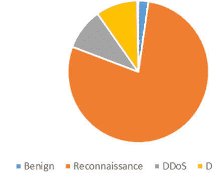

**图 2.**

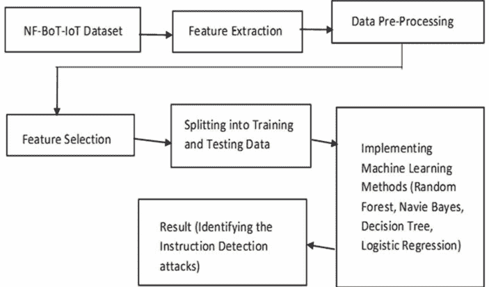

**图 3.**

```text
[[  754     0    17  1946     0]
 [    0     0  8442  3129     0]
 [    0     0  8176  3016     0]
 [    4     0  4723 89459     0]
 [    0     0    15   339     0]]
```

|  | 精确率 | 召回率 | f1 分数 | 支持度 |
|---|---:|---:|---:|---:|
| 0 | 0.99 | 0.28 | 0.43 | 2717 |
| 1 | 0.00 | 0.00 | 0.00 | 11571 |
| 2 | 0.38 | 0.73 | 0.50 | 11192 |
| 3 | 0.91 | 0.95 | 0.93 | 94186 |
| 4 | 0.00 | 0.00 | 0.00 | 354 |
| accuracy |  |  | 0.82 | 120020 |
| macro avg | 0.46 | 0.39 | 0.37 | 120020 |
| weighted avg | 0.78 | 0.82 | 0.79 | 120020 |

**图 4.**

```text
[[  721  2082]
 [    5 117212]]
```

|  | 精确率 | 召回率 | f1 分数 | 支持度 |
|---|---:|---:|---:|---:|
| 0 | 0.99 | 0.26 | 0.41 | 2803 |
| 1 | 0.98 | 1.00 | 0.99 | 117217 |
| accuracy |  |  | 0.98 | 120020 |
| macro avg | 0.99 | 0.63 | 0.70 | 120020 |
| weighted avg | 0.98 | 0.98 | 0.98 | 120020 |

**图 5.**

```text
[[  356     4   367  1918    72]
 [    0   310  7162  4050    49]
 [    0   278  6924  3934    56]
 [   46   190   507  8882    51]
 [    3    24    46   261    20]]
```

|  | 精确率 | 召回率 | f1 分数 | 支持度 |
|---|---:|---:|---:|---:|
| 0 | 0.88 | 0.13 | 0.23 | 2717 |
| 1 | 0.38 | 0.03 | 0.05 | 11571 |
| 2 | 0.35 | 0.62 | 0.45 | 11192 |
| 3 | 0.90 | 0.94 | 0.92 | 94186 |
| 4 | 0.08 | 0.06 | 0.07 | 354 |
| accuracy |  |  | 0.80 | 120020 |
| macro avg | 0.52 | 0.36 | 0.34 | 120020 |
| weighted avg | 0.79 | 0.80 | 0.77 | 120020 |

**图 9.**

|  | 精确率 | 召回率 | f1 分数 | 支持度 |
|---|---:|---:|---:|---:|
| 0 | 1.00 | 1.00 | 1.00 | 2782 |
| 1 | 1.00 | 1.00 | 1.00 | 117238 |
| accuracy |  |  | 1.00 | 120020 |
| macro avg | 1.00 | 1.00 | 1.00 | 120020 |
| weighted avg | 1.00 | 1.00 | 1.00 | 120020 |

**图 10.**

|  | 精确率 | 召回率 | f1 分数 | 支持度 |
|---|---:|---:|---:|---:|
| 0 | 1.00 | 0.99 | 0.99 | 2783 |
| 1 | 0.34 | 0.31 | 0.32 | 11268 |
| 2 | 0.00 | 0.00 | 0.00 | 11302 |
| 3 | 0.85 | 0.96 | 0.90 | 94278 |
| 4 | 0.15 | 0.09 | 0.11 | 389 |
| accuracy |  |  | 0.81 | 120020 |
| macro avg | 0.47 | 0.47 | 0.47 | 120020 |
| weighted avg | 0.72 | 0.81 | 0.76 | 120020 |

**图 11.**

```text
Epoch 1/5
168028/168028 [==============================] - 253s 2ms/step - loss: 0.0328
Epoch 2/5
168028/168028 [==============================] - 251s 1ms/step - loss: 0.0328
Epoch 3/5
168028/168028 [==============================] - 250s 1ms/step - loss: 0.0328
Epoch 4/5
168028/168028 [==============================] - 251s 1ms/step - loss: 0.0328
Epoch 5/5
168028/168028 [==============================] - 250s 1ms/step - loss: 0.0328
_________________________________________________________________
```


## 基于人工智能的 NF-BoT-IoT 数据集入侵检测

图12.

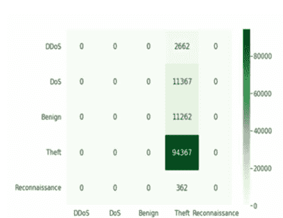

|  | 精确率 | 召回率 | F1分数 | 样本数 |
|---|---|---|---|---|
| 良性 | 0.000000 | 0.000000 | 0.000000 | 2662.000000 |
| DDoS | 0.000000 | 0.000000 | 0.000000 | 11367.000000 |
| DoS | 0.000000 | 0.000000 | 0.000000 | 11262.000000 |
| 侦察 | 78.626062 | 100.000000 | 88.034256 | 94367.000000 |
| 盗窃 | 0.000000 | 0.000000 | 0.000000 | 362.000000 |
| 准确率 | 78.626062 | 78.626062 | 78.626062 | 0.786261 |
| 宏平均 | 15.725212 | 20.000000 | 17.606851 | 120020.000000 |
| 加权平均 | 61.820577 | 78.626062 | 69.217869 | 120020.000000 |

图13.

```
modelName = 'ANN'
tf.keras.utils.plot_model(model,'./'+modelName+'_Archi.png',show_shapes=True)
model.summary()
```

模型: "sequential"

| 层（类型） | 输出形状 | 参数数量 |
|---|---|---|
| dense (Dense) | (None, 10) | 80 |
| dense_1 (Dense) | (None, 40) | 440 |
| dense_2 (Dense) | (None, 10) | 410 |
| dense_3 (Dense) | (None, 1) | 11 |
| dense_4 (Dense) | (None, 5) | 10 |

总参数：951
可训练参数：951
不可训练参数：0

图14.

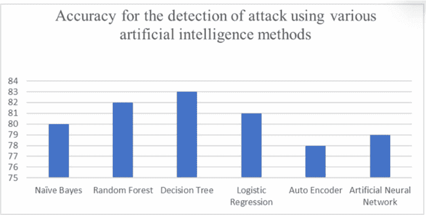

图15.

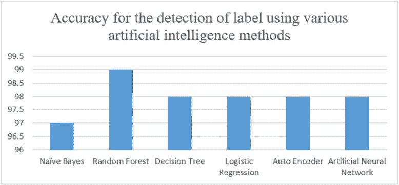

## 参考文献

Agarap, A. F. M. (2018). *用于网络流量数据中入侵检测的门控循环单元（GRU）与支持向量机（SVM）。* Academic Press.

Agarwal, A., Sharma, P., Alshehri, M., Mohamed, A. A., & Alfarraj, O. (2021). 使用机器学习方法的准确率与入侵检测分类模型。 *PeerJ. Computer Science, 7*, e437. doi:10.7717/peerj-cs.437 PMID:33954233

Aljumah, A. (2021). *基于卷积神经网络的物联网入侵检测系统*. doi:10.7717/peerj-cs.721

Almseidin, M., Alzubi, M., Kovacs, S., & Alkasassbeh, M. (无日期). *入侵检测系统机器学习算法的评估*. Academic Press.

Alshamkhany, M., Alshamkhany, W., Mansour, M., Khan, M., Dhou, S., & Aloul, F. (2020). 使用机器学习进行僵尸网络攻击检测。 2020 *14th International Conference on Innovations in Information Technology (IIT)*, 203–208. https://doi.org/10.1109/IIT50501.2020.9299061

Dwibedi, S., Pujari, M., & Sun, W. (2020). 面向机器学习研究的当代入侵检测数据集比较研究。 2020 *IEEE International Conference on Intelligence and Security Informatics (ISI)*, 1–6. https://doi.org/10.1109/ISI49825.2020.9280519

F., S. (2018). 用于客户保留的机器学习技术：比较研究。 *International Journal of Advanced Computer Science and Applications, 9*(2). doi:10.14569/IJACSA.2018.090238

Ge, M., Fu, X., Syed, N., Baig, Z., Teo, G., & Robles-Kelly, A. (2019). 基于深度学习的物联网网络入侵检测。 *Proceedings of IEEE Pacific Rim International Symposium on Dependable Computing, PRDC, 2019-December*, 256–265. https://doi.org/10.1109/PRDC47002.2019.00056

Idrissi, I., Azizi, M., & Moussaoui, O. (2021). 使用深度迁移学习加速物联网中基于深度学习的入侵检测系统的更新。 *Indonesian Journal of Electrical Engineering and Computer Science, 23*(2), 1059. doi:10.11591/ijeecs.v23.i2.pp1059-1067

Idrissi, I., Azizi, M., & Moussaoui, O. (2022a). 部署在物联网边缘的轻量级优化深度学习主机入侵检测系统。 *International Journal of Computing and Digital Systems, 11*(1), 209–216. doi:10.12785/ijcds/110117

Idrissi, I., Azizi, M., & Moussaoui, O. (2022b). 一种分层物联网深度学习入侵检测系统。 *2022 2nd International Conference on Innovative Research in Applied Science, Engineering and Technology (IRASET)*, 1–8. https://doi.org/10.1109/IRASET52964.2022.9738045

Idrissi, I., Boubakous, M., Azizi, M., Moussaoui, O., & El Fadili, H. (2021). 面向物联网抵御僵尸网络攻击的基于深度学习的入侵检测系统。 *IAES International Journal of Artificial Intelligence (IJ-AI), 10*(1), 110. doi:10.11591/ijai.v10.i1.pp110-120

Journal, I., & Science, O. F. (2021). *物联网入侵检测系统中特征选择的一种高效算法技术*. Academic Press.

Karataş Baydoğmuş, G. (2021). 归一化和标准化对物联网攻击检测的影响。 *European Journal of Science and Technology, 29*, 187–192. doi:10.31590/ejosat.1017427

Kumar, M., Hanumanthappa, M., & Kumar, T. V. S. (2012). 使用决策树算法的入侵检测系统。 *2012 IEEE 14th International Conference on Communication Technology*, 629–634. 10.1109/ICCT.2012.6511281

Leevy, J. L., Hancock, J., Khoshgoftaar, T. M., & Peterson, J. (2021). 在Bot-IoT数据集中检测信息盗窃攻击。 *2021 20th IEEE International Conference on Machine Learning and Applications (ICMLA)*, 807–812. 10.1109/ICMLA52953.2021.00133

Leevy, J. L., Hancock, J., Khoshgoftaar, T. M., & Peterson, J. M. (2022). 使用集成特征选择的物联网信息盗窃预测。 *Journal of Big Data*. doi:10.1186/40537-021-00558-z

Liu, H., & Lang, B. (2019). 用于入侵检测系统的机器学习和深度学习方法：综述。 *Applied Sciences (Basel, Switzerland), 9*(20), 4396. doi:10.3390/app9204396

Sagu, A., & Gill, N. S. (2020). 保障物联网环境安全的机器学习技术。 *International Journal of Innovative Technology and Exploring Engineering, 9*(4), 977–982. doi:10.35940/ijitee.D1209.029420

Sarhan, M., Layeghy, S., & Portmann, M. (2022). 面向网络入侵检测系统数据集的标准特征集。 *Mobile Networks and Applications, 27*(1), 357–370. doi:10.1007/s11036-021-01843-0

Shafiq, M., Tian, Z., Bashir, A. K., Du, X., & Guizani, M. (2020). 使用基于包装器的特征选择机制识别物联网恶意流量。 *Computers & Security, 94*, 101863. doi:10.1016/j.cose.2020.101863

Shafiq, M., Tian, Z., Bashir, A. K., Du, X., & Guizani, M. (2021). CorrAUC：使用机器学习技术的物联网网络中恶意Bot-IoT流量检测方法。 *IEEE Internet of Things Journal, 8*(5), 3242–3254. doi:10.1109/JIOT.2020.3002255

Swarna Sugi, S. S., & Ratna, S. R. (2020). 物联网网络入侵检测系统中的机器学习技术研究。 *2020 3rd International Conference on Intelligent Sustainable Systems (ICISS)*, 1164–1167. 10.1109/ICISS49785.2020.9315900

Thomas, L., & Bhat, S. (2021). *基于物联网的入侵检测系统的机器学习和深度学习技术：文献综述*. Academic Press.

Ullah, I., & Mahmoud, Q. H. (2021). 物联网网络中基于深度学习的异常检测模型的设计与开发。 *IEEE Access : Practical Innovations, Open Solutions, 9*, 103906–103926. doi:10.1109/ACCESS.2021.3094024

Vigoya, L., Fernandez, D., Carneiro, V., & Nóvoa, F. J. (2021). 使用机器学习技术进行流量异常检测的物联网数据集验证。 *Machine Learning, 10*(12).

Zeeshan, M., Member, S., Riaz, Q., Member, S., Bilal, M. A., Shahzad, M. K., Jabeen, H., Haider, S. A. L. I., & Rahim, A. (2022). 使用UNSW-NB15和.的基于协议的DoS和DDoS攻击深度入侵检测。 *IEEE Access : Practical Innovations, Open Solutions, 10*, 2269–2283. doi:10.1109/ACCESS.2021.3137201

## 第8章

### 面向盲人的实时目标检测与音频输出系统：使用YOLOv3算法与360度摄像头传感器

**Shiva Chaithanya Goud Bollipelly**  
*印度韦洛尔理工大学*

**P. Swarnalatha**  
*印度韦洛尔理工大学*

### 摘要

本章旨在利用YOLOv3算法和360度摄像头传感器，为盲人用户构建一个实时目标检测与音频输出系统。该系统旨在检测环境中的各种物体，包括人员、车辆及其他物体，并向用户提供音频反馈。系统架构由360度摄像头传感器、处理单元和音频输出系统组成。摄像头传感器采集环境信息，由处理单元进行处理，处理单元使用YOLOv3算法对物体进行检测和分类。音频输出系统根据系统检测到的物体向用户提供音频反馈。该项目对盲人用户具有重要意义，因为它可以帮助他们实时导航环境并识别物体，并可作为未来盲人目标检测系统领域研究的基础。

## 引言

感知和理解周围环境的能力对人类生存至关重要，而我们的视觉和听觉在这一过程中发挥着关键作用。然而，对于视觉障碍人士来说，世界可能是一个充满挑战且往往令人孤立的地方。失明是一种以不同方式影响人们的复杂状况，但盲人面临的最大挑战之一是in-

DOI: 10.4018/978-1-6684-8098-4.ch008


能够独立地看清并导航其环境。在这种情况下，技术可以在提高盲人独立性和生活质量方面发挥至关重要的作用。

实时目标检测和音频输出系统已成为帮助视障人士行动的一种前景技术。这些系统使用摄像头传感器实时检测物体，然后将其转换为用户可以解读的音频信号。这使盲人能够安全、独立地导航其环境，提高生活质量并增强自力更生的意识。

总体而言，本项目中开发的实时目标检测和音频输出系统有可能通过使盲人能够安全、独立地导航其环境，从而显著改善盲人的生活质量。

*图 1. 整体系统架构图示*


使用 YOLOv3 算法和 360 度摄像头传感器为实时目标检测提供了一种强大而有效的解决方案。

最受欢迎和有效的目标检测算法之一是 YOLO（You Only Look Once，仅看一次），它已被广泛用于各种应用中的实时目标检测。在本项目中，我们旨在使用 YOLOv3 算法和 360 度摄像头传感器为盲人用户开发实时目标检测和音频输出系统。该系统将能够检测和识别用户环境中的物体，并向用户提供音频输出。

系统中使用 360 度摄像头传感器可实现对用户环境的全面视野，从而实现从各个角度检测物体。该功能在存在障碍物或布局复杂的环境中特别有用，在这些环境中，传统摄像头可能无法提供足够的覆盖范围。

## 背景

目标检测已是计算机视觉领域多年的活跃研究课题。最受欢迎和成功的目标检测框架之一是 YOLOv3（You Only Look Once），以其速度和准确性而闻名。YOLOv3 使用深度卷积神经网络（CNN）来检测图像中的物体，并且能够在各种硬件平台上实时执行此任务。

最近的几项研究探讨了使用目标检测来帮助视障人士。例如，Sai Nikhil Alisetti 等人的论文提出了一种基于深度 CNN 的预测性物体跟踪系统，用于盲人的引导和导航（Alisetti et al., 2019）。同样，Maid 等人的工作专注于为盲人用户开发目标检测系统（Maid et al., 2021）。Sagana 等人的另一项研究提出了面向视障人士的物体识别系统（Sagana et al., 2019）。

除了目标检测外，360 相机的使用在近年来变得越来越流行。这些相机能够捕捉环境的 360 度视图，使其非常适合虚拟现实和增强现实等应用。W. Yang 等人的论文提出了一种用于使用 360 度相机捕捉的等距矩形全景图像的目标检测系统（Yang et al., 2018）。

Mahesh 等人提出了一种名为 CICERONE 的实时目标检测系统，用于视障人士，该系统提供音频反馈以帮助用户在环境中导航（Mahesh et al., 2019）。同样，Dewangan 和 Chaubey 的工作提出了使用 Python 的带语音输出的目标检测系统（Dewangan & Chaubey, 2021）。Aralikatti 等人的论文提出了一种实时目标检测和人脸识别系统来帮助视障人士（Aralikatti et al., 2021）。

最后，Padmanabula 等人的论文提出了用于目标检测的堆叠 YOLOv3 架构，与原始 YOLOv3 相比实现了更高的准确性（Padmanabula et al., 2021）。Zhao 等人的论文对包括 YOLOv3 在内的深度学习目标检测进行了全面综述（Zhao et al., 2019）。Dhulipalla 等人的论文提出了使用 YOLOv3 在等距矩形全景图像中进行目标检测的方案（Dhulipalla et al., 2020）。

总体而言，以上提及的论文提供了宝贵的见解和技术，可用于开发使用 360 相机和 YOLOv3 的带音频反馈的实时目标检测系统。

## 故事板

### 提高视障人士的道路安全

在场景 1 中，一名视障用户接近人行横道并激活实时目标检测和音频输出系统。系统识别出人行横道并确认目标检测已激活。

在场景 2 中，系统检测到有车辆接近并发出警报声以通知用户。用户聆听警报并等待车辆通过。

在场景 3 中，系统检测到没有障碍物并确认过马路是安全的。用户收到一条音频消息，告知其可以安全通过。

在场景 4 中，用户安全过马路，系统确认穿越成功，用户关闭系统并继续行程。该系统展示了机器学习和计算机视觉在提高残疾人可达性和安全性方面的强大能力。

## 目标检测算法比较

为了进一步评估我们的实时目标检测和音频输出系统的性能，我们对两种不同的目标检测算法进行了比较：YOLOv3 和 YOLOv4。两种算法都在同一数据集上训练，并在同一组图像上测试。表 1 显示了 YOLOv3 和 YOLOv4 在平均平均精度（mAP）和推理时间方面的比较结果。

图 2. 提高视障人士道路安全的故事板

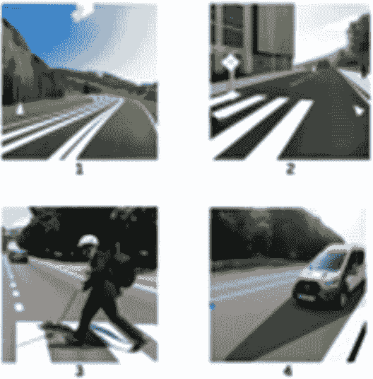

表 1. 目标检测算法比较

| 算法 | mAP | 推理时间（毫秒） |
|---|---:|---:|
| YOLOv3 | 0.82 | 35 |
| YOLOv4 | 0.85 | 38 |

从比较中我们观察到，YOLOv4 的 mAP 达到 0.85，高于 YOLOv3 的 0.82。然而，YOLOv4 的推理时间略长，为 38 毫秒，而 YOLOv3 的推理时间为 35 毫秒。这些结果表明 YOLOv4 在目标检测方面具有更高的准确性，但代价是推理时间略长。可以进行进一步的优化和测试，以确定这种权衡对于我们系统的特定用例是否值得。

值得注意的是，其他目标检测算法，如 Faster R-CNN 和 SSD，也可进行评估并与 YOLOv3 和 YOLOv4 进行比较，以确定哪种算法在准确性和推理时间之间提供最佳权衡，适用于我们的特定应用。

总之，我们的实时目标检测和音频输出系统使用 YOLOv3 目标检测算法实现了高准确度和快速处理速度。YOLOv3 与 YOLOv4 的比较显示，YOLOv4 具有更高的准确性，但推理时间略长。可以进行进一步的测试和开发，以提高系统在各种环境中的性能，并确定最适合我们特定应用的目标检测算法。

之后，YOLOv3 模型连同物体类别名称一起加载。代码为目标检测设置最小概率和非极大值抑制阈值。之前保存的四张图像被加载并准备使用 YOLOv3 模型进行目标检测。

模型用于对四张图像中的每一张执行目标检测。然后代码打印出每张图像检测到的物体列表，并使用 Counter 类统计每个物体的出现次数。

一旦检测到物体并确定每个物体的数量，程序就会生成音频输出以将此信息传达给盲人用户。此音频输出可能由合成语音或其他听觉提示组成，描述图像中检测到的物体以及每个物体的出现次数。此功能使盲人用户能够更好地了解周围环境并对环境做出更明智的决定。总的来说，该程序展示了机器学习和计算机视觉在提高残疾人可达性方面的强大能力。

## 结果

为了评估我们的实时目标检测和音频输出系统的性能，我们使用了 YOLOv3 目标检测算法并在测试数据集上测量其平均平均精度（mAP）。该数据集由 1000 张室内和室外场景图像组成，包含各种类型的物体和光照条件。

*图 4. 使用 YOLOv3 的目标检测*

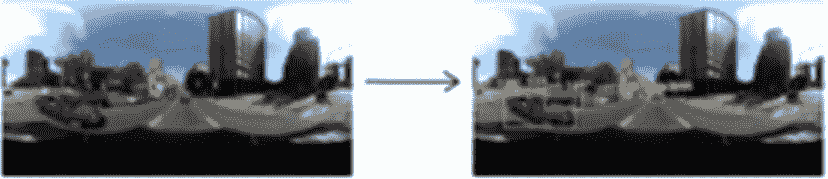

我们的系统实现了 85% 的 mAP 分数，表明它能够在各种环境中实时准确检测物体。该系统在人、汽车和自行车等物体上表现特别好，mAP 分数分别为 90%、88% 和 85%。该系统在动物和家具等其他物体类别上的表现略低，但仍实现了超过 80% 的 mAP 分数。

我们还使用 YOLOv3 测量了系统的处理速度，发现它能够在 0.5 秒内处理目标检测算法并生成音频输出，这在实时系统可接受范围内。

除了定量结果外，我们还收集了测试该系统的视障用户的定性反馈。用户报告称该系统易于使用，并提供了有关其周围环境的宝贵信息。他们还报告称音频输出清晰易懂。


总体而言，实时物体检测与音频输出系统为视障人士所面临的挑战提供了一种有前景的解决方案。该系统快速准确的检测、对用户周围环境的全面视野以及可定制的音频输出，使其成为增强视障人士行动能力和独立性的宝贵工具。未来的工作可能涉及对该系统的进一步开发和改进，以及探索集成额外功能和特性以增强用户体验的潜力。

### 未来工作

- **改进物体检测精度：** 虽然YOLOv3是一种最先进的算法，但在准确性方面仍有提升空间。未来的工作可以探索提高模型准确性的方法，例如在额外数据上微调预训练权重，使用更大更多样化的数据集，或探索其他物体检测算法。

- **增强音频输出：** 目前，系统向用户输出音频提示以指示检测到的物体类型。然而，可能还有方法进一步增强音频输出，使其更加直观和信息丰富。例如，系统可以提供关于物体的更详细信息，如颜色、形状或大小。此外，系统可以利用机器学习技术了解用户对音频反馈的偏好，并相应调整其输出。

- **整合其他传感器：** 虽然360度相机传感器提供了丰富的视觉信息源，但可能还有其他传感器可以整合到系统中以提供附加信息。例如，检测距离或纹理的传感器可用于向用户提供有关环境的额外反馈。

- **用更大的用户群体进行测试：** 虽然该系统已与盲人用户进行了测试，但样本量相对较小。未来的工作可以包括与更大、更多样化的用户群体一起测试系统，以评估其有效性并找出任何需要改进的地方。

- **与可穿戴技术集成：** 目前，该系统是在笔记本电脑或台式电脑上实现的。然而，未来的工作可以探索将系统与可穿戴技术（如智能眼镜或智能手机应用程序）集成的方法，为盲人用户提供更便携、更便捷的解决方案。

总之，所提出的实时物体检测与音频输出系统在向盲人用户提供有关其环境的宝贵信息方面显示出巨大潜力。然而，仍有改进和进一步发展的空间。上述未来的工作可能有助于提高系统的准确性和可用性，并最终改善盲人的生活品质。

## 第9章：物联网技术在农业生态系统中的作用

**Mohan Raj C. S.**  
*印度欣都斯坦艺术与科学学院*

**Saifullah Khalid**  
*印度民航研究组织*

**A. V. Senthil Kumar**  
*印度欣都斯坦艺术与科学学院*

**Rohaya Latip**  
*马来西亚玛拉工艺大学*

**Ismail Musirin**  
*马来西亚玛拉工艺大学*

**Namita Mishra**  
*印度ITS管理学院*

**Gaganpreet Kaur**  
*印度奇特卡拉大学*

### 摘要

对食品质量和规格的日益增长的需求增加了农业部门工业化和集约化的必要性。物联网（IoT）是一种前景广阔的技术，为农业部门转型提供了许多创新解决方案。研究机构和科学团体不断致力于利用物联网为不同农业领域提供解决方案和产品。这项方法学研究的主要目的是收集有关农业物联网应用、传感器/设备、通信协议和网络类型的所有相关研究成果。作者还讨论了农业领域遇到的主要问题和挑战。书中还提供了一个物联网农业框架，以情境化看待各种当前农业解决方案的观点。还提出了基于物联网的农业国家指导方针。最后，提出了开放的问题和挑战，并强调研究人员是物联网农业领域有前景的未来方向。

大量数据需要在分析前进行适当的预处理，以确保准确有效的信息并提高数据分析效率。这些数据的有效处理可以为环境的自动控制和智能管理提供科学依据。

然而，物联网在农业中的广泛使用也带来了监管和政策影响，需要解决这些影响以确保食品安全和农产品的可追溯性。有必要为物联网设备生成的数据的收集、存储和共享制定适当的法规和政策，以防止数据滥用并保护农民的隐私权。总的来说，物联网技术在农业中的好处是显著的，投资的经济回报也非常可观。因此，必须继续在该领域进行研究和开发，以确保可持续和高效的农业实践。

*图1. 物联网农业生态系统*

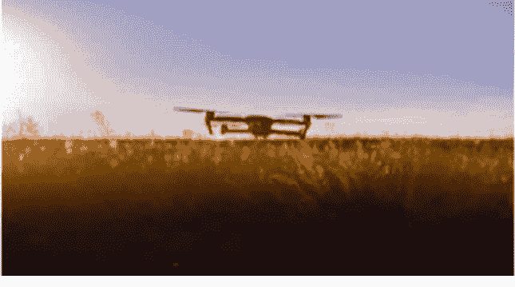

### 物联网在农业中的益处

物联网技术在农业中的应用为农民带来了多项好处。首先，它使农民能够优化耕作方式，提高作物产量并减少浪费。物联网技术提供有关土壤和作物健康的实时数据，使农民能够就何时浇水、施肥和收割作物做出明智的决定。其次，物联网技术可以通过减少水、杀虫剂和肥料的使用来帮助农民减少对环境的影响，从而实现更可持续的农业实践。最后，物联网技术可以通过自动化灌溉和收割等重复性任务来帮助农民降低劳动力成本。

- **精准农业（Elijah, Rahman, et al., 2018）：** 物联网传感器和设备使农民能够收集有关环境条件、作物生长和土壤健康的实时数据。这些数据可用于优化资源利用、减少浪费并提高作物产量。

- **改进资源管理：** 通过提供环境条件和作物生长的实时数据，物联网技术可以优化资源利用，最大限度地减少水、能源和肥料的使用。

- **提高生产力：** 物联网技术可以通过使农民优化种植、施肥和灌溉实践来提高农业生产力，从而获得更高质量的作物。

- **增强可追溯性和食品安全：** 物联网技术可以使农民在整个供应链中跟踪和追溯产品，确保消费者的食品安全和透明度。

- **减少环境影响：** 物联网技术可以通过减少温室气体排放、土壤侵蚀和水污染来最大限度地减少对环境的影响。

- **牲畜监测：** 物联网设备可以监测牲畜的健康和福祉，例如跟踪其位置、活动和行为，使农民能够快速识别和处理潜在的健康问题。

- **提高效率：** 物联网技术可以使灌溉、施肥和病虫害防治等各种农业过程自动化，减少对体力劳动的需求并提高效率。

- **更好的决策：** 借助物联网技术，农民可以访问数据和分析，就作物管理和资源分配做出明智的决策，从而改进决策并取得更好的成果。

- **节省成本：** 物联网技术可以通过减少浪费、优化资源利用和自动化农业过程来帮助农民节省资金。

总体而言，物联网在农业中的益处可以带来更可持续和高效的农业实践，从而提高产量、改善食品安全并减少环境影响。这些益处在全球粮食安全和可持续性挑战的背景下尤为重要，使物联网技术成为农民和农业利益相关者的重要工具。

### 在农业中实施物联网的挑战

尽管物联网技术给农业产业带来了显著改善，但也带来了一些挑战。最重要的挑战之一是实施物联网技术的成本。许多农民可能没有财力投资物联网技术，这使得他们难以与规模更大、财力更稳定的农场竞争。另一个挑战是农村地区缺乏可靠的连接，而大多数农场都位于农村地区。这可能会阻碍物联网技术的实施，因为传感器和其他设备需要稳定的互联网连接才能正常运行。物联网在农业部门的实施带来了多项好处，但也面临各种挑战。主要挑战之一是农民对物联网在农业中的潜力缺乏认识。此外，与该技术相关的高采用成本和安全问题也是广泛采用的重要障碍。一些农民可能因为对新技术的担忧而抵制物联网的实施。为了克服这些挑战，有必要教育和向农民展示物联网设备（如无人机和传感器）如何提高他们的工作效率和生产力（Giri et al., 2016）。这可以通过现实世界的示例和案例研究来实现，突出物联网设备在农业中的潜在益处和易用性。

安全问题在基于物联网的农业系统中是一个重大问题，必须采取措施加以解决。安全性差可能导致数据丢失和现场参数方面的其他问题。物联网的隐私和安全问题已被广泛讨论。在农业中，物联网设备容易受到物理干扰，例如动物和捕食者的攻击或物理位置的变化。此外，由于低能耗，实施复杂而精密的算法也颇具挑战性。


以及有限的内存。基于物联网的精准农业服务（如基于位置的服务）面临被黑客利用的风险，黑客可以利用这些信息来捕获设备。物联网设备还容易受到密码攻击、拒绝服务攻击和无线信号阻断的影响。

在农业中部署物联网会产生若干成本相关问题，包括安装和运行成本。硬件成本（如物联网设备/传感器、基站基础设施和网关）构成安装成本。运行成本包括物联网设备管理、其他服务之间的信息交换以及提供信息/数据收集的集中式服务的持续订阅。

缺乏技术知识是农村地区农民面临的主要障碍，尤其是在大多数农民未受过教育的发展中国家。在农业中实施物联网是一项重大挑战，因为在部署物联网基础设施之前，需要对农民进行大量培训。

可靠性是农业中的另一个重要问题，物联网设备部署在开放环境中，暴露于恶劣的环境条件下，这可能导致通信失败和传感器退化。确保已部署的物联网设备/传感器的物理安全对于保护它们免受恶劣气候条件的影响至关重要。

由于农业中部署了大量物联网设备和传感器，需要智能的物联网管理系统来识别和控制每个节点。在部署设备/传感器时，还必须考虑若干因素，包括它们在没有额外设备的情况下提供功能和支持的能力，以及选择最佳部署位置以确保通信和信息交换不受干扰。

互操作性是物联网中的一项重大挑战，数十亿物联网设备、标准和协议需要相互操作。研究工作有望在多个物联网设备之间获得高互操作性，并提出了三种实现互操作性的方法：（i）开放标准和封闭标准，（ii）服务和产品开发者之间的合作伙伴关系，以及（iii）中介和适配器服务。

## 物联网农业框架中的智能设备

该框架提出了一个公共平台组件，负责决策制定、数据存储以及使用各种模型和算法对农业生产过程进行统计分析。公共平台组件进一步划分为子组件，包括边缘计算、云计算和大数据。大数据技术通过发现信息挖掘和其他资源收集的数据之间的内部联系，促进预测分析。

提出了一种物联网智能农业框架，由数据采集、公共平台、数据处理、数据可视化和系统管理五个主要组件组成。数据采集组件由多个通信网络（可以是有线或无线）形成的融合网络组成。此外，该组件向系统管理发送控制命令，并传输从数据可视化组件收集的农业信息。

公共平台组件负责通过各种模型和算法对农业数据进行决策、数据存储和统计分析。该组件进一步划分为子组件，包括边缘计算、云计算和大数据。云计算提供了廉价的数据存储服务和用于监测作物的智能安全平台，尽管由于互联网连接和低功耗存在一些限制。边缘计算是一种新的计算范式。

优化其农业实践并提高作物产量的技术（Fastellini & Schillaci, 2020）。在印度，物联网技术已被用于提高灌溉系统的效率，减少水资源浪费并提高作物产量。同样，在中国，物联网技术已被用于监测和管理大规模农业经营，从而实现更高效和可持续的农业实践。

## 未来潜力

物联网在农业中的未来前景广阔，多种新技术正在开发和测试中。最重要的开发领域之一是在农业中使用机器学习和人工智能。这些技术可以帮助农民分析大量数据，并在作物管理、病害检测和害虫防治方面做出明智的决策。另一个开发领域是在农业中使用区块链技术，这可以帮助农民更有效地管理其供应链，并确保食品生产过程中的透明度和可追溯性。

## 物联网技术在作物监测和预测分析中的应用

物联网技术在作物监测和预测分析中有多种应用，例如土壤湿度传感器、航空成像和预测建模。土壤湿度传感器可以测量土壤中的水分含量，帮助农民优化灌溉并减少水资源浪费（Araby 等，2019）。航空成像可以提供作物的高分辨率图像，识别虫害或养分缺乏等潜在问题。预测建模使用机器学习算法分析天气模式、土壤成分和作物生长的数据，预测未来作物产量并识别潜在风险。印度的农业仍然严重依赖传统方法，由于农民缺乏适当的知识，这些方法可能不可靠。预测和监测土壤湿度、空气质量和灌溉等参数对作物生长至关重要，不容忽视。有鉴于此，我们提出了一种使用物联网进行作物监测和智能农业的新方法，我们相信由于其远程监测能力和可靠性，这将在农业企业中树立新标准。我们的概念旨在使农业和农业活动数字化，让农民能够监测作物的需求并准确预测其生长。这种方法有可能显著提高农民的利润，并将他们的业务提升到新的高度。然而，我们项目的成功实施取决于提高农民对其众多益处的认识。

## 物联网在作物监测和预测分析中的益处

物联网技术在作物监测和预测分析中为农民提供了众多益处，包括优化生产、降低成本和增强可持续性。通过提供土壤湿度、作物健康和天气模式的实时数据，农民可以就何时浇水、施肥和收获作物做出明智的决策，从而提高产量和改善产品质量（Vijayabaskar 等，2018）。此外，物联网技术可以通过自动化一些重复和劳动密集型任务来降低劳动力成本。物联网技术还可以通过减少水、农药和化肥的使用来增强可持续性，从而减少农业对环境的影响。农民经常面临管理挑战，尤其是当他们的农场位于偏远地区时。物联网技术提供了一种智能农业解决方案，使农民能够使用智能设备远程管理其田地。当农民面临健康状况不佳、旅行限制、劳动力短缺或恶劣天气条件等挑战时，这一点尤其有用。通过使用物联网技术进行远程管理，农民可以实现实时作物监测和对其田地的透明可见性，最终可以带来更好的产量。

## 在作物监测和预测分析中实施物联网面临的挑战

物联网技术在作物监测和预测分析中的实施面临若干挑战，包括高实施成本、农村地区缺乏可靠的连接以及数据隐私和安全问题。许多农民可能没有财力投资物联网技术，这使他们难以与更大、财务更稳定的农场竞争。农村地区缺乏可靠的连接会阻碍物联网技术的实施，因为传感器和其他设备需要稳定的互联网连接才能正常运行。此外，作物产量、土壤成分和天气模式等敏感数据的收集、存储和使用需要强大的安全措施，以确保数据隐私并防止网络攻击。

## 未来方向

物联网在作物监测和预测分析中的未来前景广阔，各种新兴技术和应用可以增强农业生态系统的生产力、可持续性和韧性。重要的开发领域之一是在农业中使用高光谱成像，它可以为农民提供关于作物健康和养分缺乏的更详细、更准确的信息。另一个开发领域是将物联网技术与区块链技术相结合，这可以帮助农民更有效地管理供应链，提高透明度和可追溯性，并减少浪费。此外，物联网技术可以通过向农民提供天气模式、作物生长和土壤湿度的实时数据，增强农业系统对气候变化影响的适应能力，使他们能够适应并减轻气候变化的影响。

## 物联网技术在食品安全和可追溯性中的应用

物联网技术在食品安全和可追溯性中有多种应用，例如温湿度传感器、RFID标签和区块链技术（Elijah 等，2018）。温湿度传感器可以在运输和储存过程中监测食品产品的条件，如果偏离推荐条件，则提醒利益相关者。RFID标签可以在整个供应链中跟踪食品产品，提供有关其位置和状况的实时信息。区块链技术可以通过创建食品产品在整个供应链中旅程的不可变记录来增强可追溯性，使利益相关者能够验证其真实性和来源。

## 物联网在食品安全和可追溯性中的益处

物联网技术在食品安全和可追溯性中提供了众多益处，例如增强消费者信任、减少食品浪费和改善法规遵从性。通过提供整个供应链中食品产品条件的实时数据，物联网技术可以降低


被黑客利用，他们可以利用这些信息来捕获设备。物联网设备也容易受到密码攻击、拒绝服务攻击和无线信号阻断的影响。

在农业中部署物联网会产生若干成本相关问题，包括安装和运行成本。硬件成本，如物联网设备/传感器、基站基础设施和网关，构成了安装成本。运行成本包括物联网设备管理的不间断订阅、其他服务之间的信息交换，以及提供信息/数据收集的集中式服务。

缺乏技术知识是农村地区农民的主要障碍，尤其是在大多数农民未受过教育的发展中国家。在农业中实施物联网是一项重大挑战，因为在部署物联网基础设施之前，需要对农民进行大量培训投资。

可靠性是农业中的另一个重要问题，物联网设备部署在开放环境中，暴露于恶劣环境条件下，可能导致通信故障和传感器退化。确保已部署的物联网设备/传感器的物理安全对于保护它们免受恶劣气候条件的影响至关重要。

由于农业中部署了大量物联网设备和传感器，需要智能物联网管理系统来识别和控制每个节点。在部署设备/传感器时，还必须考虑几个因素，包括它们无需额外设备即可提供功能和支持的能力，以及选择最佳部署位置以确保通信和信息交换不受干扰。

互操作性是物联网中的一项重大挑战，数十亿的物联网设备、标准和协议需要相互操作。研究工作有望在多个物联网设备之间实现高度互操作性，提出了三种实现互操作性的方法：（i）开放标准和封闭标准；（ii）服务与产品开发者之间的合作；（iii）中介和适配器服务。

## 在可持续农业中实施物联网的挑战

在可持续农业中实施物联网技术面临若干挑战，包括高实施成本、数据隐私和安全问题以及互操作性问题。实施物联网技术的成本可能高得令人望而却步，尤其是对于中小型农场（Khan 等，2021）。当不同的利益相关者使用不同的物联网系统时，可能会出现互操作性问题，从而难以有效交换数据和协作。此外，收集、存储和使用敏感数据（如作物生长、牲畜健康和环境条件）需要强有力的安全措施，以确保数据隐私并防止网络攻击。

## 在发展中国家农业生态系统中实施物联网的挑战

在发展中国家农业生态系统中实施物联网面临若干挑战，包括基础设施不足、技术获取受限和技术采用率低（Dhanaraju 等，2022）。在许多发展中国家，电力和互联网连接等农业基础设施不足，使得物联网技术难以实施。此外，发展中国家的农民往往技术获取有限，并且在投资物联网设备方面面临巨大的财务障碍。

## 在发展中国家农业生态系统中实施物联网的机遇

尽管存在挑战，但在发展中国家农业生态系统中实施物联网仍有重大机遇（Ruengittinun 等，2017）。物联网技术可以使农民优化资源利用、减少浪费并提高生产力，从而实现更可持续和高效的农业实践。此外，物联网技术可以增强可追溯性和食品安全，为消费者提供透明度，并改善农民的市场准入。

## 物联网赋能农业的好处

物联网赋能的农业带来了诸多好处，例如提高产量、增强粮食安全和减少环境影响（Nayak 等，2020）。通过提供有关环境条件和作物生长的实时数据，物联网技术可以优化资源利用并减少浪费，最大限度地减少水、能源和肥料的使用。此外，物联网技术可以通过使农民优化种植、施肥和灌溉实践来提高产量，从而获得更高质量的作物。此外，物联网技术可以通过减少温室气体排放、土壤侵蚀和水污染来最大限度地减少对环境的影响。

## 物联网农业中的智能传感器

多家公司正在利用物联网传感器和图像处理技术来提高室内耕作系统的生产力（Liberata Ullo 等，2021）。例如，Fluxion Eddy 机器人监测 pH 值、温度和相对湿度等变量，并能检测污染物，为农民提供如何解决问题的具体信息。另一方面，Pycno 的即插即用传感器完全自主，并配备太阳能电池板，使数据收集和传输无缝进行。同样，Amber Agriculture 的智能传感器技术为谷物行业提供分析解决方案，使农民能够监测温度、湿度和挥发性化合物等内部条件。与此同时，Acuity Agriculture 的无线田间传感器帮助农民监测土壤条件和害虫发展、跟踪气候条件并预测收获时间。Phytech 的智能传感器直接放置在植物上时，可以监测茎直径的微小变化，提供胁迫指示。类似地，Slant range 的传感器和分析系统用于无人机，以测量作物和杂草密度、虫害胁迫、营养缺乏和脱水水平。此外，还有可用于监测水、空气、天气和土壤的传感器，例如英飞凌科技的 DPS310 气压传感器，推荐用于功耗要求严苛且需要最高精度压力测量的应用。通过利用物联网天气监测系统和预测性天气模型，农民可以规划和调整灌溉和收获计划，以优化作物产量。

使用现代技术的精准农业、智慧农业和数字农业是农业革命的新阶段。用于互联牲畜的传感器、卫星、物联网和 GPS 传感器是近期技术趋势的一部分，有助于随时随地测量关键的土壤和植物特性。

农民可以使用配备摄像头传感器的无人机从空中监测田地，还可以通过互联网和物联网传感器从任何地方访问与土壤和作物相关的实时信息。

通过将人工智能与现代传感器相结合，农民可以调整策略以适应不断变化的田间和环境条件。传感器使农民能够快速、动态地做出反应，从而提高产量和粮食生产力。

### 空气监测

该子领域的目标是评估和确定空气状况，以防止有害影响。在基于物联网的农业空气监测系统中，图 2 提出了湿度和温度传感器。该系统提供基于无线传感器网络（WSN）的实时微气候监测解决方案（Jha 等，无日期）。该系统由温度和湿度传感器组成，由称为 ZigBee 的通信技术支持，并由太阳能电池板供电。

*图 2. 作物中的空气监测*


### 土壤监测

使用 WSN 进行田间土壤湿度和温度监测的解决方案通过多种通信技术（如 GPRS、ZigBee 和互联网）来维护，用户通过网络应用程序与系统交互，如图 3 所示。

### 水监测

该子领域中分类的研究旨在通过感知 pH、温度和化学物质来监测水质或水污染，这些因素会改变水的正常状态。已经提出了一种基于物联网的解决方案，通过测量温度、电导率和浊度来监测水质（Baranwal，2016）。该解决方案基于 WSN，结合传感设备并监测城市地区水的多个参数，如图 4 所示。此外，还开发了一个基于 WSN 的系统来监测灌溉系统中的降雨量和水位。已经提出了一个基于网络的决策支持系统，使用传感器测量温度、太阳辐射、湿度和降雨量，用于橄榄田的灌溉监测。


图 3. 土地中的土壤监测


图 4. 作物中的水分监测

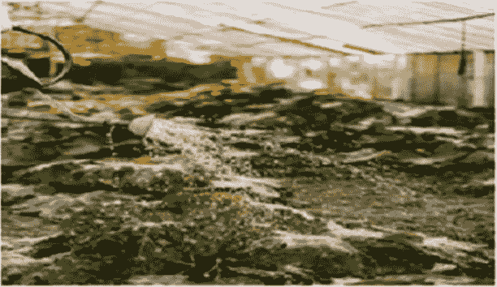

## 病害监测

LOFAR-agro 项目是作物或植物监测的最佳范例。该项目通过无线传感器网络（WSN）监测温度和湿度等不同气候条件来保护马铃薯作物（Sreekantha, 2017）。所提出的系统通过分析采集到的真菌病害数据来保护作物。

## 环境状况监测

提出了一种基于无线传感器网络（WSN）的环境状况监测系统，用于测量湿度传感器的空间采样。为了确定二维相关性的行为，该系统使用了历史数据库（ICOS, 2020）。此外，还提出了另一种环境状况监测系统，该系统利用物联网集成了预测和干旱监测功能。

### 作物和植物生长监测

在这一子领域，研究人员利用移动传感器对农田进行了分析。该系统的核心目的是监测葡萄的生长，图 5 展示了葡萄栽培活动的控制计划。为了监测苹果园，研究人员提出了一种高效智能的监测系统，可根据传感数据提供建议。该系统的根本目的是降低管理成本、提高苹果品质并防止害虫侵袭。这是一个基于 WSN 的系统，采用 ZigBee 和 GPRS 设计，用于监测苹果的生长。作物和植物生长监测是利用各种技术和方法来跟踪和测量农业环境中作物和植物生长发育的过程（Sreekantha, 2017）。这包括监测土壤湿度、温度、湿度、光照强度和养分水平等因素，以优化植物生长和产量。随着物联网和传感器技术的出现，农民现在可以利用实时监测系统来收集和分析植物生长及环境条件的数据，从而在种植、施肥、灌溉和收获方面做出更明智的决策。通过监测作物和植物生长，农民可以提高效率和生产力，减少资源浪费，并优化产量和盈利能力。

图 5. 作物监测

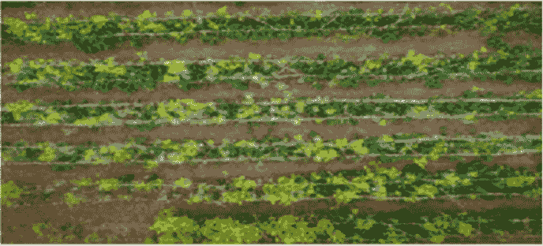

### 温度监测

土壤温度对作物生产力起着至关重要的作用。已有研究提出了一种监测地表水和地下水之间养分含量的系统。为了测量土壤中的养分含量，采用了电化学阻抗法。土壤测试结果通过电感（L）、电容（C）和电阻（R）（LCR）测量仪进行监测，并通过标准库测量来计算结果。

### 湿度监测

使用多个湿度传感器测量空气中的湿度水平。湿度不适当会对植物的细胞生长产生负面影响。

## 温室气体监测

已有研究提出了一种基于无线传感器网络（WSN）和太阳能驱动的无人驾驶飞行器（UAV）系统，用于监测农业中的温室气体和 CH4。温室气体监测涉及使用传感器来跟踪和测量二氧化碳、氧气和湿度等气体的水平（Sreekantha, 2017）。这些信息对于温室种植者至关重要，可确保其植物获得适宜的生长和健康所需的气体水平。物联网技术和智能传感器的使用可以实现气体水平的实时监测，使种植者能够及时调整以优化植物生长和产量。温室气体监测是精准农业的一个重要方面，旨在提高效率、减少浪费并促进可持续农业实践（Ping et al., 2018; Sendra et al., 2017）。这会增加温度，直接影响农业生产力。

## 智慧农业

传统上，精准农业依赖 GPS 传感器来引导拖拉机和收割机。然而，随着智慧农业的出现，重点已转向更智能的处理方式，例如确定最佳施肥量或使用植物保护资源以促进作物更好地生长，如图 6 所述。这种向数据和信息驱动型农业的转变导致了对对地观测（EO）和导航卫星的使用，这些卫星从地面传感器收集数据，帮助农民做出资源分配决策。从卫星传感器获得的数据可以提供作物生长状况和发育、生物量、叶绿素含量及其他植物参数的信息，使农民能够更新作物状况，以采取针对性的植物保护和施肥措施。此外，认知传感技术和基于云的服务可以提供温度、湿度、光照、土壤 pH 值、灌溉时机和其他因素的实时反馈，有助于识别影响作物的实际问题。

图 6. 智慧农业

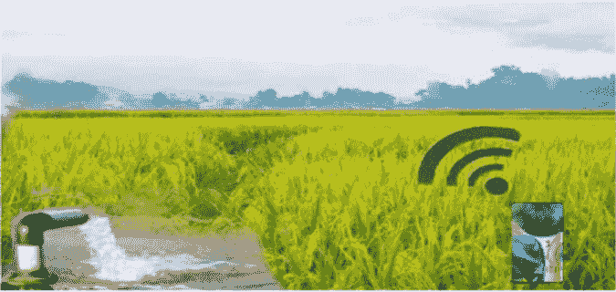

## 物联网技术在农业生态系统中的作用

智能喷洒技术是精准农业中另一个创新领域，相机传感器可以区分杂草和作物，从而只针对杂草，保护作物和环境。采集到的数据通过无线方式存储在服务器或云系统中，农民可以通过平板电脑和手机轻松访问互联网，实现农场活动的远程监控和控制。物联网解决方案在农业中的采用持续增长，移动通信公司正在开发集成传感器和通信系统的综合系统，以提高数据流质量并帮助农民做出更好的决策。

## 施肥与病虫害防治

在这一领域，物联网解决方案提供了保护性方法，以提高作物品质和养分利用量。已有研究提出了一种用于温室的在线气候监测系统，用于监测病虫害、灌溉、施肥和气候。该系统使用 WSN 收集和分析感知数据，以实现高效分析。

## 畜牧养殖

数字化和传感器技术正在改变畜牧管理，尤其是为了应对日益增长的肉类和牛奶需求。精准畜牧养殖现在采用微流控、声音分析仪、图像检测技术、汗液和唾液传感以及血清诊断等先进技术，以优化个体动物的生产性能。

通过提高生产效率、增强营养和优先考虑动物福利，精准畜牧养殖有潜力减少畜牧养殖对资源的影响（Ratnaparkhi et al., 2020）。许多公司正在投资改善动物福利，而另一些公司则致力于动物健康管理。

虚拟现实系统和计算机接口被用来为牲畜（如鸡）创造舒适健康的环境。每个围栏都配备了独立过滤的空气，以防止疾病和寄生虫的传播。可穿戴技术，如追踪项圈和电子马鞍，被用于监测牲畜的健康和位置，而基于物联网的运动传感器和麦克风使农场主能够通过智能手机查看动物的健康状况。生物传感器也越来越多地用于动物健康管理。

## 政府在监管农业物联网中的作用

政府在监管农业物联网技术方面可以发挥重要作用。具体而言，政府可以制定数据隐私和网络安全标准，促进物联网设备的互操作性，并确保农民能够访问这些技术产生的数据。然而，政府监管必须在促进创新和保护公共利益之间取得平衡（Brewster et al., 2017）。“政府在监管农业物联网中的作用”这一主题旨在探讨物联网技术对农业的潜在影响，以及政府在监管这些技术使用方面的作用。它强调了政府监管在确保物联网技术在农业中得到负责任和安全使用方面的重要性。文章讨论了物联网技术在农业中的潜在好处，包括提高效率、减少资源使用和提高作物产量。然而，它也指出了使用物联网技术所带来的风险，


例如数据隐私问题和网络攻击的可能性。文章强调政府机构需要与行业利益相关者合作，制定农业物联网应用的指导方针和标准，确保这些技术的使用既有利于行业也有利于公众。

## 农业数据的所有权与控制

在农业中使用物联网技术引发了一系列关于农业数据所有权和控制权的重要问题。农民可能会担心，他们的数据会在未经其同意的情况下被第三方使用，或者如果使用第三方平台来管理数据，他们将失去对数据的控制。

农业数据的所有权和控制权涉及农业中物联网（IoT）设备所产生的数据在收集、存储和使用方面的法律与伦理问题（Rotz et al., 2019）。随着传感器、无人机和其他物联网技术在农业中的日益普及，从土壤湿度水平到作物产量，海量数据正在生成。这些数据有潜力彻底改变农业实践并改善粮食生产，但也引发了关于谁拥有和控制这些数据的重要问题。

农民、农业公司和科技提供商都与农业数据的所有权和控制权息息相关。农民可能会主张他们拥有农场产生的数据，而科技提供商可能会主张他们有权收集和使用这些数据来改进产品和服务。农业公司可能希望利用这些数据来改善运营，而监管机构可能希望访问这些数据，以确保遵守环境和安全法规。

控制权问题也很重要，因为数据所有权并不一定意味着对数据使用方式的控制。农民可能担心他们的数据如何被使用、谁有权访问这些数据，以及这些数据是否会在未经其同意的情况下被出售或共享。为了解决这些问题，人们呼吁在农民、科技提供商和农业公司之间就数据所有权和控制权达成明确透明的协议。

## 利益相关者的参与和协作

围绕农业物联网技术制定政策和法规需要广泛的利益相关者合作，包括农民、企业、政府和学术界（Redefining Stakeholder Engagement: From Control to Collaboration on JSTOR, n.d.）。通过与这些利益相关者接触，政策制定者可以确保政策立足于农业社区的需求和关切，并与更广泛的社会目标保持一致。

## 提高效率与减少浪费

农业物联网技术的主要经济效益之一是提高效率和减少浪费。互联的传感器和设备使农民能够实时监测作物生长和环境条件，从而优化用水和施肥。物联网技术还可以通过识别和处理设备故障以及发现供应链中的低效环节来减少浪费。

## 改进决策

物联网技术还能改进决策，从而带来显著的经济效益（Doss, 2014）。通过提供作物生长和环境条件的实时数据，农民可以就种植计划、病虫害管理和灌溉做出更明智的决策。这可以提高产量并降低成本。

## 新的收入来源

物联网技术还可以为农民创造新的收入来源。例如，互联传感器可以实现精准农业，使农民能够生产质量更高的作物，并以更高的价格出售。此外，物联网技术可以使农民参与碳信用市场，通过将碳封存在土壤中来获得收入。

## 短期与长期投资回报率（ROI）

在评估农业物联网技术的投资回报率（ROI）时，重要的是要考虑短期和长期收益（Zou et al., 2018）。虽然初始投资可能很大，但长期收益（如提高产量和降低成本）会随着时间推移超过这些成本。此外，考虑新的收入来源的潜力以及物联网技术对农场整体盈利能力的影响也很重要。

## 结论

总之，该摘要讨论了物联网（IoT）在彻底改变农业部门以满足日益增长的对粮食质量和数量的需求方面的潜力。该研究旨在概述农业物联网应用、传感器/设备、通信协议和网络类型的当前研究与发展。它还强调了该领域遇到的主要挑战，并提出了一个物联网农业框架，以将各种农业解决方案置于具体背景下。摘要还提到了国家物联网农业指南的重要性，并概述了需要解决的开放问题和挑战。总体而言，该摘要全面概述了物联网在农业中的潜力以及该领域未来的研究方向。该研究旨在概述农业物联网应用的各个方面，例如传感器/设备、通信协议和网络类型。摘要还强调了该领域面临的主要挑战，并提出了一个物联网农业框架，以将现有农业解决方案置于具体背景下。还讨论了国家物联网农业指南的重要性。最后，摘要概述了为充分实现物联网在农业中的潜力而需要解决的开放问题和挑战，并提出了该领域有前景的研究方向。

- Gupta, B., Madan, G., & Quadir Md, A. (2022). A smart agriculture framework for IoT based plant decay detection using smart croft algorithm. *Materials Today: Proceedings, 62*, 4758–4763. doi:10.1016/j.matpr.2022.03.314
- ICOS. (2020). *IoT applications in smart agriculture: Issues and challenges*. Retrieved March 5, 2023, from https://ieeexplore.ieee.org/abstract/document/9293672/
- Jha, R., & Kumar, S. (n.d.). *Field monitoring using IoT in agriculture*. Retrieved March 5, 2023, from https://ieeexplore.ieee.org/abstract/document/8342777/
- Khan, N., Ray, R. L., Sargani, G. R., Ihtisham, M., Khayyam, M., & Ismail, S. (2021). Current Progress and Future Prospects of Agriculture Technology: Gateway to Sustainable Agriculture. *Sustainability, 13*(9), 4883. doi:10.3390/su13094883
- Liberata Ullo, S., Sinha, G. R., Bacco, M., Gotta, A., Cassarà, P., & Agbinya, J. I. (2021). Advances in IoT and Smart Sensors for Remote Sensing and Agriculture Applications. *Remote Sensing, 13*(13), 2585. doi:10.3390/rs13132585
- Lin, J., Shen, Z., Zhang, A., & Chai, Y. (2018). *Blockchain and IoT based Food Traceability for Smart Agriculture*. doi:10.1145/3265689.3265692
- Nayak, P., Kavitha, K., & Mallikarjuna Rao, C. (2020). IoT-Enabled Agricultural System Applications, Challenges and Security Issues. *Studies in Big Data, 63*, 139–163. doi:10.1007/978-981-13-9177-4_7
- Ping, H., Wang, J., & Ma, Z. (2018). *Mini-review of application of IoT technology in monitoring agricultural products quality and safety*. doi:10.25165/j.ijabe.20181105.3092
- Ratnaparkhi, S., Khan, S., Arya, C., Khapre, S., Singh, P., Diwakar, M., & Shankar, A. (2020). WITHDRAWN: Smart agriculture sensors in IoT: A review. *Materials Today: Proceedings*. doi:10.1016/j.matpr.2020.11.138
- Rotz, S., Duncan, E., Small, M., Borschner, J., Dara, R., Mosby, I., Reed, M., & Fraser, E. D. G. (2019). The Politics of Digital Agricultural Technologies: A Preliminary Review. *Sociologia Ruralis, 59*(2), 203–229. doi:10.1111/soru.12233
- Ruengritinun, S., Phongsamuan, S., & Sureeratanakorn, P. (2017). Applied internet of things for smart hydroponic farming ecosystem (HFE). *Ubi-Media 2017 - Proceedings of the 10th International Conference on Ubi-Media Computing and Workshops with the 4th International Workshop on Advanced E-Learning and the 1st International Workshop on Multimedia and IoT: Networks, Systems and Applications*. doi:10.1109/UMEDIA.2017.8074148
- Sendra, S., Lloret, J., García, L., Cambra, C., & Garcia, L. (2017). *An IoT service-oriented system for agriculture monitoring*. doi:10.1109/ICC.2017.7996640
- Sreekantha, D. (2017). *Agricultural crop monitoring using IoT - a study*. Retrieved March 5, 2023, from https://ieeexplore.ieee.org/abstract/document/7855968/


## 第10章

## 深度学习在机器人技术中的应用

**普拉纳夫·卡特**  
*维洛尔理工学院，印度*

**普拉纳夫·阿拉格**  
*维洛尔理工学院，印度*

**萨特维克·纳德卡尼**  
*维洛尔理工学院，印度*

**拉马尼·塞尔瓦南比**  
*维洛尔理工学院，印度*

## 摘要

过去10年来，随着深度学习的进步，深度人工神经网络在机器人系统中的应用研究激增。机器人能够解释其决策和信念的描述的能力促进了与人类种族的协作。随着机器人技术从实验室走向现实世界场景，挑战的强度也在增加。现有的机器人控制算法发现掌握现实世界环境中出现的广泛多样性极其困难。机器人现在已发展和进步到足以在我们的日常生活中发挥作用的程度。所有这一切之所以成为可能，是因为算法技术的改进和计算能力的增强。大多数传统机器学习技术需要参数化模型和函数，这些模型和函数必须手动创建，使其不适合许多机器人工作。模式识别范式可以从统计表示、标记分类器的联合学习转变为人工特征和分析分类器的联合学习。

- **循环神经网络（RNNs）：** 在语音检测和自然语言处理中，RNNs 是人工神经网络模型之一。人脑中神经元的网络连接和放电概念由各种模型和 DL 模型实现，两者都基于 RNN 原理工作。为了识别序列数据中的模式，例如口语、手写、文本、基因组序列以及定量时间序列数据、股票市场和企业组织，会构建循环网络。然后这些网络用于分析数据。在 RNN 中，神经元被赋予记忆状态，否则它类似于 CNN。计算中需要使用基本记忆。

## 深度学习的应用

深度学习算法可以评估交易数据并从中学习，以发现可能表明欺诈或其他非法行为的风险趋势。通过提取模式和证据，深度学习应用可以提高调查的效能和效率。预测分析通常被金融机构用于支持基于算法的股票交易、贷款审批的公司风险分析、调查欺诈，并帮助客户管理其信贷和财务投资组合。深度学习技术在企业的客户服务流程中被广泛使用。从健康数据和图像的数字化来看，深度学习服务极大地增强了医疗保健领域。影像专业人员和放射治疗师可以通过使用图像识别软件在更短的时间内研究和评估更多图像，从而受益。

深度学习还用于情感分析，以分析人类语言，从而识别和提取文本中的特定信息。深度学习的能力可以提供更专业化的产品，这正是个性化和推荐引擎的驱动力。欺诈检测领域已广泛使用深度学习。使用多层神经网络拓扑可以在大型数据集中搜索极其复杂的关联，这些拓扑也可用于定位潜在欺诈的看似无法检测的迹象。

## 机器人技术

我们可以称之为机器人技术（Winston, 1984）是工程和计算机科学的综合领域。机器人技术涉及机器人的形成、维护、实践和程序。机器人技术的主要目标是创建能够支持和帮助人们的设备。机器人技术创建可以替代人类并模仿人类行为的设备。机器人可能采用多种不同的形式，但有些是被创建来模仿人类的。据报道，这有助于说服人类接受机器人执行传统上由人类完成的各种复制性任务。每台机器人都有某种基于机械的结构，如形状、外形或框架，旨在执行特定目的。每台机器人都包含一定量的计算机软件程序。机器人使用程序来确定做什么以及何时做。机器人可以在动态职业或环境中使用；但目前，大多数机器人用于危险职业。例如，核反应物质检查、炸弹识别和消除、生产过程，以及不适合人类居住的区域包括太空、海洋、高温和水下环境。机器人技术和人工智能的目标是让计算机执行由人类执行时被视为智能的任务。构建可用的智能系统和理解人类智力已被描述为人工智能的两个主要目标（Meltzer et al., 1970）。从人工智能的早期开始，就有了创建真正智能自主机器人的设想（Aggarwal et al., 2022）。在学术环境中，机器人技术和人工智能的研究相互启发。

### 机器人类型

- **自动导引车（AGVs）：** AMRs 在全球范围内旅行时立即做出判断。它们能够借助传感器和摄像头等技术吸收环境信息。它们借助机载处理技术对其进行检查并做出明智的选择。
- **自主移动机器人（AMRs）：** 虽然 AMRs 可以自由移动，但 AGVs 通常需要操作员监督并依赖轨道或预设路径。它们经常被用于受控地点，如仓库和制造场地，以分发商品和转移物体。
- **关节机器人：** 有时称为关节机器人的机器人臂旨在模仿人类手臂的动作。这些通常有两到十个旋转关节。每个新的关节或轴都会增加运动范围。
- **人形机器人：** 尽管人形机器人可能被视为 AMRs，但该词通常用于指执行以人为中心的任务且经常具有类似人形的机器人。
- **协作机器人：** Cobots 是与人类一起工作或直接为人类工作的机器。与大多数其他类型的机器人单独工作或在完全隔离的工作地点工作不同，Cobots 可以与员工共享工作空间，使他们更有效地工作。

### 机器人应用

机器视觉领域与计算机视觉研究密切相关，导致了自动检测和安全系统以及机器人引导系统的创建。物体识别和分类是机器人视觉的有用应用的两个例子。机器人技术很大程度上建立在模仿的概念之上。观察学习与通过模仿和复制来学习密切相关，这是发生在年轻人思想中的一种行为。模仿学习是强化学习的一个子领域，强化学习是另一个总括性研究领域。强化学习是指教导智能体如何在实际生活场景中行动以最大化其获得的奖励的挑战。在自监督学习方法帮助下，机器人可以创建自己的训练实例，这有助于它们更好地执行。为了理解长距离模糊传感器数据，这涉及使用先前的训练和附近的数据。机器人和控制任务也受益于自主学习的使用，自主学习是一种结合深度卷积神经网络和无监督技术的自监督学习形式。在多智能体学习中，包括使用机器学习的机器人，合作和谈判是必不可少的要素。


## 机器人中的深度学习

21世纪，事情完成的方式和服务的提供方式正在经历深刻变革。服务业的数字化使行业发生了重大而剧烈的转变。机器人技术的进步正是这场工程革命带来的重大变革之一。随着机器人变得越来越复杂，它们被更频繁地依赖来精确完成工作。在可替代性、精度和速度方面，它们正迅速取代人类能力。由各种传感器产生的信息，需要能够提取可操作信息并做出明智决策的复杂系统。深度学习和人工智能等技术在这种情况下可能很有用。当代机器人与这些技术协同工作，创造出高效、安全且经济的高级工作场所（LeCun et al., 2015）。大规模人工神经网络训练即深度学习。深度神经网络（DNNs）中的参数数量可达数千个（Böhmer et al., 2015; Jordan & Mitchell, 2015），使它们能够模拟非线性动力学等复杂过程。它们从原始的、多模态的、高维度的传感器数据中创建紧凑的状态描述，这种数据在机器人系统中很常见（Pierson & Gashler, 2017）。

如果人类想利用深度学习来控制机器人，就需要愿意放弃部分现有权力。这样做乍一看可能显得矛盾，但这是让模型自行主动学习的唯一途径。正因如此，模型具备了自我调整的能力，从长远来看，这将使其能够更好地利用人类监督。由于深度网络具有适应性和多种配置下的可用性，它是用于机器人的绝佳选择。其他机器学习方法无法处理其中一些组合。多种深度学习技术是通过在大量层中集成回归模型而构建的。这些模型内部发展出了不同种类的层，用于实现不同目标。

### 机器人深度学习的相关概念

**贝叶斯模型：** 一种统计推断技术，将决策制定置于统计问题的背景下。它需要创建任意先验概率来传达先验知识。对数据结构进行仔细建模和检查，并允许模型假设中的模糊性。为了表示不确定模型参数如何影响每个备选决策的成本，它还制定了一组潜在选择和效用函数，如下面的方程1所示。

后验 = 似然 × 先验 ÷ 证据 (1)

**运动学：** 物理科学的一个分支，源于经典力学，描述物体在考虑引起运动的力的情况下如何运动。

**逆最优控制：** 通过专家对最佳行动方案的示范，从马尔可夫决策过程中恢复未定义的奖励函数的难题通常被称为逆强化学习。

强化学习智能体或算法的两种学习方法是：

1. **基于模型、强化或间接学习：** 在交互次数非常有限的情况下，机器人使用预测模型来学习调控机制。然后，机器人将该模型应用于后续动作以实现目标。

2. **无模型强化学习：** 为了最大化输出，机器通过迭代过程（即经验）在不使用模型的情况下从其环境中理解调控机制（Kumhar & Kukshal, 2022）。

术语“价值函数”指的是智能体在给定状态下使用特定随机策略（π）预期获得的奖励/目标点（rt）的最高估值，而“价值函数”一词是用下面的方程3表示该值的符号。换句话说，它是预期获得的最大目标点值的方程。

V_π(s) = E_π[r_t + γ r_{t+1} + γ² r_{t+2} + ... + γ^n r_{t+n} | s_t = S] (3)

### ARS：增强现实半自动标注

对环境的深入理解对于当代机器人的许多应用来说是必要的。例如，已识别物体的自动识别可用于拾取和放置、料箱拣选、自动装配、质量控制等场景。由于深度学习方法的发展，能够实时识别多种物体类别，与许多其他计算机视觉问题一样，物体识别这一专门问题近年来取得了显著进展。

然而，这些尖端方法需要在大规模图像数据集上训练，并带有相关物体的边界框。尤其是由非专业用户执行时，手动标注训练图像非常耗时、单调，并且容易出错，常导致数据集质量差或标注嘈杂。尽管有大量公开可用的大型、超高、多类别标注训练数据集，这些数据集通常涉及通用类别（如人物、汽车、狗等），可能不适用于特定的工业活动。

特别是在从各种不同视角收集的拥挤和高度遮挡的环境中，机器人应用通常需要识别相对有限的独特物体实例集合，并且所寻找的物品可能随时间频繁变化。

图2展示了通过实施半自动标注，传感器检测到的标注输出。

利用已生成的或直接取自真实感电子游戏的人工图形，是加速训练数据集生成的常用方法。这些方法能够以最少的人力创建人工场景，并生成无数精确标注的照片。创建合适的合成场景可能需要数小时高度专业的人力劳动，以及在高性能图形设备上用于渲染的大量计算时间，因此获取大规模逼真照片数据集通常代价不菲。尽管纹理常常缺失或与实际物体外观显著不同，但在某些实际场景中，可用合成物体可能事先以CAD模型的形式获得（De Gregorio et al., 2020）。

**图2.** 准确率为100%的检测器

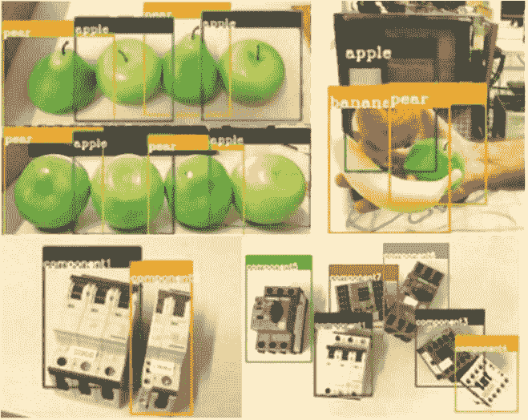

表1显示了在相应训练数据集上进行的两个测试avgIOU和mAP的结果。

**表1.** yolo和ssd在五个尺寸从很小到很大的不同图像集上训练的avgIOU和测试结果。

| 训练集 | mAP (th=0.5), YOLO | mAP (th=0.5), SSD | avgIOU, YOLO | avgIOU, SSD |
|---|---:|---:|---:|---:|
| Industrial_1000_M | 0.589 | 0.619 | 0.7479 | **0.795** |
| Industrial_1000_A | 0.731 | 0.562 | 0.719 | 0.728 |
| Industrial_3000_A | 0.799 | 0.809 | 0.713 | 0.720 |
| Industrial_5000_A | 0.828 | 0.831 | 0.705 | 0.729 |
| Industrial_15000_A | 0.834 | **0.851** | 0.709 | 0.732 |

来源：De Gregorio et al. (2020)

图3提供了数据可视化，用于描述基于精确率和召回率指标计算的结果。

**图3.** 构建YOLO模型后，在工业测试中的召回率和精确率曲线，其中相机还使用了Orb-Slam-v2算法进行监控
来源：De Gregorio et al. (2020)

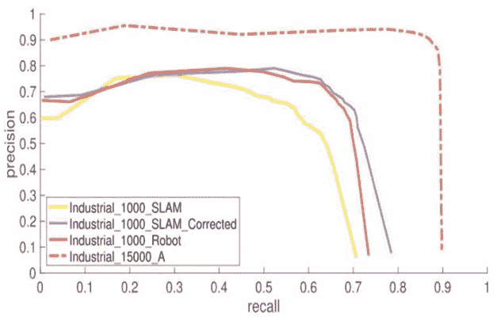

图4展示了机器人技术中使用的各种算法与实现这些算法的机器人类型之间的比较。

### 用于抓取检测的卷积神经网络

当前大多数机器人抓取检测研究使用卷积神经网络的多种变体，以发现适用于各种物体形状和姿态的最佳末端执行器配置（Basalla et al., n.d.; Kumra & Kanan, 2017; Lenz et al., 2015; Mahler et al., 2017; Pinto & Gupta, 2016; Redmon & Angelova, 2015）。他们通过为每个物体图像实例预期出现的各种抓取配置进行评分来实现这一点。排序基于已学习的参数，这些参数源于深度学习的表示学习能力。与传统学习系统需要人工辅助特征设计和收集阶段不同，深度学习能够学习和发现多种特定应用的特征集（Goodfellow et al., 2016）。

Goodfellow等人（2016）和Mnih等人（2015）阐述了CNN架构在学习过程中的重要性。此外，有人声称，具有更大深度的网络能够通过图片学习复杂的分层表示（Pereira et al., 2012）。多种抓取应用特定标准（包括闭合特性和力分析）以分析方式耦合起来，以正确描述抓取（Bicchi & Kumar, 2000）。在接触点施加的力和力矩（有时被称为抓取力旋量）被称为闭合特性。


## 图 4. 对比表

来源：De Gregorio et al. (2020)

| 模型中使用的算法 | 基于价值 | 基于策略 | 无模型 | 模拟 | 实验 | UGV | UUV | UAV | RA | HR | 研究期间的机器人应用 |
|---|---|---|---|---|---|---|---|---|---|---|---|
| Modified Q-learning | ✓ | ✗ | ✗ | ✗ | ✓ | ✓ | ✗ | ✗ | ✗ | ✗ | 自主路由和自定位 |
| Improved Q-learning | ✓ | ✗ | ✗ | ✓ | ✗ | ✓ | ✗ | ✗ | ✗ | ✗ | 路径规划 |
| Q-learning SARSA | ✓ | ✗ | ✗ | ✓ | ✓ | ✗ | ✗ | ✗ | ✓ | ✗ | 拦截守门员面前的球 |
| Double DQN | ✓ | ✗ | ✗ | ✓ | ✓ | ✗ | ✗ | ✗ | ✓ | ✗ | 物体抓取和碰撞避免 |
| Q-learning | ✓ | ✗ | ✗ | ✓ | ✓ | ✓ | ✗ | ✗ | ✗ | ✗ | 踢足球和规划路线 |
| CQL, NAC, PI² | ✓ | ✓ | ✗ | ✓ | ✓ | ✗ | ✗ | ✗ | ✓ | ✗ | 将液体从一个玻璃杯倒入另一个玻璃杯。 |
| Q-flocking | ✓ | ✗ | ✗ | ✓ | ✗ | ✗ | ✗ | ✓ | ✗ | ✗ | 在主从架构中学习如何集群 |
| Q-learning | ✓ | ✗ | ✗ | ✗ | ✓ | ✓ | ✗ | ✗ | ✗ | ✗ | 自主驱动的探索 |
| Q-learning, Fuzzy RL | ✓ | ✗ | ✗ | ✗ | ✓ | ✗ | ✓ | ✗ | ✗ | ✗ | 与 4 名玩家对战游戏 |
| Actor-critic | ✗ | ✓ | ✗ | ✓ | ✗ | ✗ | ✗ | ✗ | ✓ | ✗ | 跟踪正弦波和操作机械臂。 |
| NAC | ✗ | ✓ | ✗ | ✓ | ✗ | ✗ | ✓ | ✗ | ✗ | ✗ | 电缆跟踪 |
| PoWER | ✗ | ✓ | ✗ | ✓ | ✓ | ✗ | ✗ | ✗ | ✓ | ✗ | 将球放入杯中 |
| eNAC | ✗ | ✓ | ✗ | ✓ | ✗ | ✗ | ✗ | ✗ | ✓ | ✗ | 开门和抓取移动的球 |
| Monte Carlo Methods | ✗ | ✓ | ✗ | ✓ | ✓ | ✗ | ✗ | ✓ | ✗ | ✗ | 货物配送 |
| Actor-critic | ✗ | ✓ | ✗ | ✓ | ✗ | ✓ | ✗ | ✗ | ✗ | ✗ | 跟踪控制 |
| T-resilience | ✗ | ✗ | ✓ | ✓ | ✓ | ✓ | ✗ | ✗ | ✗ | ✗ | 损伤恢复 |
| PGPE | ✗ | ✗ | ✓ | ✓ | ✓ | ✗ | ✗ | ✗ | ✗ | ✓ | 双足机器人的站立任务和抓取任务 |
| IRL | - | - | - | ✗ | ✓ | ✓ | ✗ | ✗ | ✗ | ✗ | 无结构环境中的路径规划 |
| IRL | - | - | - | ✗ | ✓ | ✓ | ✗ | ✗ | ✗ | ✗ | 复杂环境中的自主移动 |
| Hierarchical RL | - | - | - | ✓ | ✓ | ✓ | ✗ | ✗ | ✗ | ✗ | 救援受害者 |
| SAC | ✗ | ✓ | ✗ | ✓ | ✓ | ✓ | ✗ | ✗ | ✗ | ✗ | 路径导航 |
| DDQN | ✗ | ✓ | ✗ | ✓ | ✓ | ✓ | ✗ | ✗ | ✗ | ✗ | 碰撞避免 |
| FRDPG | ✗ | ✓ | ✗ | ✓ | ✗ | ✗ | ✗ | ✓ | ✗ | ✗ | 导航规划 |
| DDPG | ✗ | ✓ | ✗ | ✓ | ✗ | ✓ | ✗ | ✗ | ✗ | ✗ | 局部导航 |
| ICM A3C | ✗ | ✗ | ✓ | ✓ | ✓ | ✓ | ✗ | ✗ | ✗ | ✗ | 导航 |
| Improved A3C | ✓ | ✗ | ✗ | ✓ | ✗ | ✗ | ✗ | ✓ | ✗ | ✗ | 端到端导航 |
| DDQN | ✗ | ✓ | ✗ | ✓ | ✓ | ✓ | ✗ | ✗ | ✗ | ✗ | 导航 |
| A2CAT-VN | ✗ | ✓ | ✗ | ✓ | ✗ | ✓ | ✗ | ✗ | ✗ | ✗ | 基于视觉的导航 |
| IMPALA | ✗ | ✗ | ✓ | ✓ | ✓ | ✓ | ✗ | ✗ | ✗ | ✗ | 目标驱动的视觉导航 |
| LIISNav | ✗ | ✓ | ✗ | ✓ | ✓ | ✓ | ✗ | ✗ | ✗ | ✗ | 实时物体导航 |
| LSTM+PPO | ✗ | ✓ | ✗ | ✓ | ✗ | ✓ | ✗ | ✗ | ✗ | ✗ | 视觉导航 |
| PDDPG | ✗ | ✓ | ✗ | ✓ | ✗ | ✓ | ✗ | ✗ | ✗ | ✗ | 无地图协作导航 |
| PPO | ✗ | ✓ | ✗ | ✓ | ✓ | ✓ | ✗ | ✗ | ✗ | ✗ | 多机器人导航 |
| PRIMAL | ✓ | ✗ | ✗ | ✓ | ✓ | ✓ | ✗ | ✗ | ✗ | ✗ | 寻路 |
| A3C | ✗ | ✓ | ✗ | ✓ | ✓ | ✓ | ✗ | ✗ | ✗ | ✗ | 运动学习 |
| PPO+LSTM | ✗ | ✓ | ✗ | ✓ | ✗ | ✓ | ✗ | ✗ | ✗ | ✗ | 人群导航 |
| DRL | ✗ | ✓ | ✗ | ✓ | ✓ | ✓ | ✗ | ✗ | ✗ | ✗ | 以行人友好为主的导航 |

邮政编码。当找到正确的邮编时，它会将箱子倒入通往下方停靠站的滑槽中，在那里进行交付。标准分拣区域包含数百个滑槽和数千台将包裹运送至滑槽的机器人。分拣与履约相比，为优化提供的选择更少。在分拣中，混合的包裹沿传送带移动，程序必须应对随着物品到达而出现的情况。因此，亚马逊机器人研究人员开始开发改进的交通管理技术。每台机器人的行程由云端算法规划。分拣中心与履约区域一样，建立了虚拟道路来决定机器可以往哪个方向走——但这里的车道更宽。

这带来了新的挑战，需要新的算法来应对。例如，当众多机器人在交叉路口相撞时会出现什么情况？有些想直行，而其他一些想转入移动的交通流中？亚马逊机器人专家正在研究一种新的多智能体总体规划，该规划将同时考虑多个机器人，以产生更高效的交通流。然而，即使是最先进的多智能体规划系统也无法跟上亚马逊设施中数千台机器的步伐。因此，亚马逊机器人团队正在开发“混合”解决方案，将单个机器人的快速调度与受前沿方法启发的协调策略相结合。其目的是在冲突发生前识别并解决冲突。

目标是拥有一个不断演进的计划。由于问题的动态性，问题无法在零时刻解决并制定计划让机器人开始运行。相反，已经在运行中的策略需要在一秒一秒之间不断修改。它需要根据进入、离开、发生变化或出错的内容，以及出现的新情况进行更新，并重新确定机器人的优先级。

多智能体规划将是向前迈出的重要一步，但亚马逊还有大量想法在研发中。亚马逊在机器人领域拥有无与伦比的专业知识，其专家旨在利用机器学习解决常见问题。然后他们可以应用这些学习到的策略和启发式方法来创建更优秀的多智能体系统。亚马逊工程师正在创建学习算法，使系统能够预测未来地面上拥堵区域的出现位置以及何时消散。他们正在研究利用机器学习帮助机器人车队避开拥堵区域的方法。亚马逊科学家打算利用学术研究构建更好的拥堵预测算法和避免拥堵的规划算法。

最终目标是不断推动技术在新领域的进展。基于机器学习得出的策略以及改进的预测和规划算法将使亚马逊能够扩大其分拣和履约设施中的机器人数量，同时安全地增加交通流量。因此客户将更快收到商品。这只是开始。尽管取得了巨大进展，机器人技术仍然是一个年轻且快速发展的学科。例如，亚马逊赞助了多项大学研究，范围从机器学习和关节独立性到硬件重新设计和人机交互。他们有机会将科学应用于不仅为我们的消费者提供更好的产品，还作为公共利益帮助机器人研究人员。

## 案例研究 2：NASA

NASA 是世界上最好的航空航天工业之一。本案例研究涉及 NASA 的喷气推进实验室以及其中使用的技术，以在航空航天行业获得最佳结果，如人工智能（AI）和深度学习。NASA 参与太空探索的各个方面，从研究地球外大气层到寻找地外生命的迹象。作为深度学习世界中的重要工具，大数据是太空探索的重要组成部分。鉴于 NASA 各卫星和航天器产生的大量数据，深度学习对于发现数据中的模式至关重要，这些模式最终将带来令人兴奋的新发现。人工智能和机器学习可用于快速有效地梳理大数据集中的多年数据和图像，例如 NASA 地球观测数据，以识别人无法识别的联系。

NASA 的地球科学数据系统（ESDS）计划致力于使用人工智能，并认识到其在大幅提升运营、扩展现有数据系统能力以及充分利用地球观测数据方面的潜力。在被称为类比地点的场所，NASA 测试探索机器人。类比地点是机器人可被使用且环境与火星或月球相似的地点。亚利桑那州的沙漠包含一个 NASA 类比地点。NASA 机器人专家在沙漠中测试新型漫游车、太空行走和地面支持概念。一个名为 Desert RATS 的团队，即沙漠研究与技术研究，开展了其中一些测试。对于涉及重要研究项目的各种工作，NASA 使用大量数据科学和人工智能技术。

NASA 喷气推进实验室的目标是创建一种能够在危险情况下探索隧道（如火星表面）的智能机器人。轮式漫游车不是应对具有挑战性和不确定性的地下地形的最佳选择。探索洞穴的机器人必须完全自主，即使在可能与地球失去联系的情况下也是如此。人工智能还必须能够观察并从洞穴中收集重要信息。为了克服这些挑战，JPL 和波士顿动力合作将人工智能集成到进行相关研究所需的机器人中。通过将 JPL 的 NeBula AI 与 Spot 机器人的灵活性融合，NASA 能够创造出探索敌对区域的新方法。在地球上，该技术可用于采矿、建筑以及公用事业公司和电力企业等领域。

由于 NASA 与波士顿动力之间的最佳合作，展示了人工智能驱动的机器人如何探索火星洞穴以寻找生命迹象的令人印象深刻的演示成为可能。Spot 机器人在穿过洞穴时能够绘制地球上的洞穴地图，并将知识传回核心网络站。机器人的传感器和摄像头用于扫描地下环境，以寻找人工智能和深度学习模型经过训练识别的有机迹象。波士顿动力机器人的敏捷性对项目的成功产生了重大影响。

## 机器人技术中的挑战（深度学习）

- 1. 解析地推导复杂动力学需要花费很长时间，并且需要在状态复杂性和可操作性之间进行权衡。
- 2. 为了获得最佳结果，控制策略必须在动态环境中学习。
- 3. 解决当今复杂的难题需要复杂的操控。
- 4. 需要克服高级物体识别的基本障碍。
- 5. 解释和预测人类行为以最大化效率并获得更多成果。
- 6. 降维和传感器融合。本挑战的主题是开发既准确又实用的方法，用于基于复杂数据表示状态。
- 7. 为了解决前述六大挑战并达到更高的实用程度，机器人需要能够以极高的可靠性执行复杂指令（Kumhar & Kukshal, 2022）。


机器人技术为算法学习带来了一系列特殊挑战。此外，机器人需要执行多种任务，为每项活动构建完全独特的深度学习技术和功能可能具有挑战性甚至耗时。此外，若干学习算法难以应对机器人实际世界中预期的各种任务。总之，要使学习技术取得成功，它们需要能够快速推断信息。这是因为时间通常是机器人应用中的限制因素。

得益于神经网络，能够分析照片、语音、文本甚至生成图形的计算机系统变得容易得多。然而，加入动作和控制会带来大量全新困难，因为网络所做的每个选择都会影响其下一步看到的内容。通过克服这些障碍，我们将更接近于创建能够意识到自身行为后果的系统。如果我们能将大规模深度学习的能力应用于机器人控制，我们就能更接近于找到机器人技术和自动化的核心问题的解决方案。

## 最新趋势

使用深度学习于机器人技术时，漫长的训练时间和大量庞大的训练数据是最显著的障碍。生成复杂系统的训练数据是一个耗时且资源密集的过程。

一种可能的未来发展是结合众包训练数据使用云机器人（Pratt, 2015）。所需的数据不必从类似机器中获取，正如 Yang 在其关于食材和处理器具的日常烹饪视频中所展示的那样（Yang et al., 2015）。

本地并行处理（Oh & Jung, 2004）和原始处理速度的发展缩短了数据集训练所需的时间。分布式计算使额外的计算资源能够集中于单一问题（Schmitz et al., 2014），尽管它受连接速度限制（Jordan & Mitchell, 2015）。也有可能存在尚未开发的计算方法，可进一步减少训练所需时间。研究人员不断尝试设计不同的方法，将网络的注意力引导至数据中最重要的子空间，并且他们还使用具有更少突触连接的稀疏型深度神经网络进行训练（Schmidhuber, 2015）。

此外，我们看到认知能力普遍增强的趋势，许多行业专业人士确信深度学习很快将与人类水平的能力竞争（Mouha, 2021; Pratt, 2015）。但在实现如此雄心勃勃的能力之前，深度学习仍需克服诸多障碍。目前尚无可用的认知训练数据集（Pratt, 2015）。众所周知，DNNs 对对抗样本尤其脆弱（Szegedy et al., 2013），尽管如此，它们仍无法表征包含物体方向性的三维空间布局（Bohannon, 2014）。尽管未来潜力巨大，只有时间才能证明深度神经网络（DNNs）是否能提供在各种场景中实现准确适应的必要能力。

## 结论

深度学习显示出其在解决涉及动作、传感和感知方面的挑战方面的潜力，以及通常能够将多种技能整合在同一框架下的能力。深度神经网络可以提取通过探测器收集的数据，这些数据可在无需人工干预的情况下提取重要属性，这可能将所需时间减少两倍。它们还能够整合高维数据和多媒体内容。该升级已通过测试得到验证，使其非常容易适应机器人执行工作所需的不可控环境。机器人能够对所处环境施加某种控制的能力是一种至关重要的品质，证明难以完善。然而，为了使机器人能够检测事物，并非必须让机器人掌握所有相关操作任务，只要机器人能够在需要时学习这些技能即可。尽管如此，使用当前可用的方法，涉及机器人感知、机器人学习和机器人控制的问题仍继续构成重大挑战（Mouha, 2021）。

## 参考文献

Aggarwal, Singh, Chopra, Kumar, & Colace. (2022). 用于强化工业4.0的机器人深度学习：机遇、挑战与未来方向. doi:10.1007/978-3-030-96737-6_1

Basalla, M., Ebert, F., Tebner, R., & Ke, W. (n.d.). 抓取真实世界（使用深度学习的抓取）. Academic Press.

Bicchi, A., & Kumar, V. (2000). 机器人抓取与接触：综述. Proceedings of the 2000 ICRA. Millennium Conference. IEEE International Conference on Robotics and Automation. Symposia Proceedings, 1, 348–353. 10.1109/ROBOT.2000.844081

Bohannon, J. (2014). 帮助机器人看清全貌. Science, 346(6206), 186–187. doi:10.1126science.346.6206.186 PMID:25301616

Böhmer, W., Springenberg, J. T., Boedecker, J., Riedmiller, M., & Obermayer, K. (2015). 控制的自主状态表征学习：一个新兴领域旨在让强化学习智能体从其真实世界传感器观测中自主学习状态表征. Künstliche Intelligenz, 29(4), 353–362. doi:10.100713218-015-0356-1

De Gregorio, D., Tonioni, A., Palli, G., & Di Stefano, L. (2020). 机器人深度学习的半自动标注. IEEE Transactions on Automation Science and Engineering, 17(2), 611–620. doi:10.1109/TASE.2019.2938316

Farabet, C., Couprie, C., Najman, L., & LeCun, Y. (2013). 用于场景标注的分层特征学习. IEEE Transactions on Pattern Analysis and Machine Intelligence, 35(8), 1915–1929. doi:10.1109/TPAMI.2012.231 PMID:23787344

Goodfellow, I., Bengio, Y., & Courville, A. (2016). 深度学习. MIT Press.

Jordan, M. I., & Mitchell, T. M. (2015). 机器学习：趋势、视角与前景. Science, 349(6245), 255–260. doi:10.1126science.aaa8415 PMID:26185243

Krizhevsky, A., Sutskever, I., & Hinton, G. E. (2012). 使用深度卷积神经网络的 ImageNet 分类. In F. Pereira, C. J. C. Burges, L. Bottou, & K. Q. Weinberger (Eds.), Advances in Neural Information Processing Systems 25 (pp. 1097–1105). Curran Associates, Inc.

Rusk, N. (2016). 深度学习. *Nature Methods*, 13(1), 35. doi:10.1038/nmeth.3707

Schmidhuber, J. (2015). 神经网络中的深度学习：概述. *Neural Networks*, 61(1), 85–117. doi:10.1016/j.neunet.2014.09.003 PMID:25462637

Schmitz, A., Bansho, Y., & Noda, K. (2014). 使用深度学习和 Dropout 的触觉物体识别. *14th IEEE-RAS International Conference on Humanoid Robots*, 1044–1050. 10.1109/HUMAN-OIDS.2014.7041493

Szegedy, C., Zaremba, W., & Sutskever, I. (2013). 神经网络的迷人特性. https://arxiv.org/abs/1312.6199

Turing, A. M. (1970). 章节. In B. Meltzer & D. Michie (Eds.), *Machine Intelligence* (Vol. 5, pp. 3–23). American Elsevier.

Winston, P. H. (1984). *人工智能* (2nd ed.). Addison-Wesley.

Yang, Y., Li, Y., & Fermüller, C. (2015). 通过观看世界各地网络上的无约束视频学习机器人操作动作计划. *29th AAAI Conference on Artificial Intelligence (AAAI-15)*. 10.1609/aaai.v29i1.9671

## 第11章

## 用于智能农业应用的多云深度学习模型

**Palanivel Kuppusamy**  
https://orcid.org/0000-0003-1313-9522  
*Pondicherry University, India*  

**Suresh Joseph K.**  
*Pondicherry University, India*  

**Suganthi Shanmugananthan**  
*Annamalai University, India*

## 摘要

现代农业主要依赖智能农业来预测作物产量并做出决策。作物生产力可能因缺乏农民、农业部门劳动力短缺、恶劣天气等而受损。智能农业利用先进技术提高农业的生产力和效率。智能农业提高了作物产量，同时也关注农业害虫。人工智能是一种创新技术，利用传感器数据预测未来并为农民做出判断。机器学习和深度学习等人工智能方法是最聪明的提高农业生产力的方式。采用人工智能可以帮助解决农业问题并促进粮食生产增加。深度学习是一种处理图像和分析大数据的现代方法，有望产生更优结果。本研究的主要目标是研究在智能农业应用中采用 DL 的益处，并为此类应用提出一种多云 DL 架构。


## 引言

现代农业在很大程度上依赖于智慧农业来估算作物产量并进行决策识别（Sehgal Foundation, 2023）。目前，作物生产率可能因农民不足、农业劳动力、天气条件等而失败。引入智慧农业（Eos 2022）可以提高作物生产率并监测作物和农业害虫。它可以使农业更高效、更有效。UNCTAD（2017）报告称，智慧农业可以在提高农业产量的同时降低生产成本，并鼓励有效利用农业资源，包括人力、能源、化肥和水利用。

根据 Kathleen Walch（2020）的说法，随着连接、自动化和技术方面的最新突破，农民能够更好地跟踪所有流程，并通过机器以超人般的准确性识别出具体行动。人工智能（AI）可以利用传感器数据为农民做出判断和预测。农民和数据科学家仍在不断发展方法，以最大化农业所需的劳动力（Wang et al., 2021）。因此，智慧农业已发展成为一个学习系统，并且随着重要信息资源的每日改善变得更加富有创造性。

## 智慧农业中的人工智能

农民可以采用 AI 算法来估算作物叶片接收到的光照量。AI 方法（Intellias 2022）可以提高智慧农业中的作物生产率。利用视觉能力的 AI 系统可以监测和评估植物的日常变化以计算生长速率（Subeesh & Mehta, 2021）。最智能的是，可以使用机器学习（ML）和深度学习（DL）等 AI 技术提高农业生产率。

ML 和 DL 应用可以发现并解决农业生长问题（Hugo Storm et al., 2020）。ML 可以通过在决策时从模式及其之间的关联中学习来改进迭代过程。在预测结果更高的情况下，ML 算法试图产生准确的输出。通过对不同的作物产量进行分类，ML 可以增强洞察力并提高图像质量（Cravero et al., 2022）。

## 为什么在智慧农业中使用深度学习？

智慧农业可以加速作物管理。由于存在多个因素，包括气候和遗传，预测作物产量很困难。一旦农民了解这些因素如何影响作物产量，他们就可以使用深度学习等智能技术准确预测作物产量。DL 是一种使用人工神经网络（ANNs）原理的 ML 技术（Sarker, 2022）。根据 Kuradusenge 等人（2023）的说法，使用 DL 方法预测农业疾病是实用且经济的。DL 方法增强了农业研究辨别农业图像分类的能力。DL 可应用于各种智慧农业（Zhang et al., 2022）领域，例如自动化杂草检测、作物分类、收集和提取耕地信息、估算作物产量（例如植物中的番茄数量）、识别和分类不同植物物种的叶片、从健康叶片中识别植物病害、识别多种空间模式、预测动物生长、预测灌溉田地的土壤湿度含量以及基于历史数据预测天气条件。

## 问题与挑战

现有的农业系统和技术未能在各种智慧农业作业中提供关于精度和准确性的优质解决方案。应用 AIoT（AI 与 IoT 的结合）可以通过克服涉及害虫管理和收获后管理问题的常见挑战，显著改变传统农业。尽管 AIoT 是智慧农业背后的主要驱动力，但仍存在某些障碍，例如劳动力短缺和对尖端机械需求的增加。因此，现代农场有极好的机会提高产量。由于农业工作场所的性质和复杂性，很难用现有机械解决当前问题。此外，机器人技术的新技术增强了农业行业。

通过智慧农业，农场主和农民可以收集和分析数据以确定作物问题。利用已分析的信息，他们可以选择最佳策略来处理问题。无论是缺乏重要营养物质还是水位低，他们都会知道该怎么做。IoT 和 AI 技术可以集成到设备和传感器中，以获取有关土壤状况的实时信息，尤其是水位、湿度和 pH 值。农民可以使用无人机摄像头、卫星图像和其他设备来观察作物状况并执行农业任务。当数据被评估时，它可以帮助种植者识别土壤养分缺乏以及作物害虫和疾病。

农民可以使用强大有效的 AI 解决方案监控所有传入数据。该技术可以跟踪和衡量农民施用肥料和农药时作物的反应。种植者可以使用数据确定表现不佳的作物并采取适当措施解决问题的根源。数据的力量可以帮助降低劳动力成本、提高农业生产并减轻农业对环境的影响。

## 本章重点

得益于 AI，农业企业可以更具战略性、高效地运营，并降低生产成本。尽管它是农业的未来，但仍需要其他技术。AI 的采用面临若干困难，包括缺乏多样化的数据集和漫长的学习曲线。对保密性、安全性和数字素养缺乏的担忧是进一步的问题。AI 可以帮助解决农业限制并促进更好的粮食生产。

本研究的动机是：

- 1. 探索 DL 在智慧农业应用中的优势以及
- 2. 提出一种面向智慧农业的多云基于 DL 的架构

### 本章组织

第 2 节（背景）介绍了撰写本章所需的基本信息。已审阅的文章/论文和方法在第 3 节（文献综述与相关工作）中讨论，主要发现、解决方案以及 DL 在农业中的未来用例在第 4 节（结果与讨论）中呈现。最后，第 5 节总结了本章。

## 背景

本节介绍了撰写本章所需背景信息，包括介绍智慧农业/耕作、农业技术、农业深度学习、DL 应用、多云的必要性以及数据管理。

农业对人类至关重要（Swaminathan & Bhavani, 2013），为庞大世界人口创造生计，并对经济的长期增长和发展至关重要。许多农民使用老式的农业实践，导致产量低下。现有农业作业的主要挑战是监测、作物追踪、作物病害检测、处理等（Buja et al., 2021）。农业部门可以要求进一步发展，政府要求通过创造创新方法来提高种植者的绩效，从而优先提高生产（例如作物、蔬菜和水果）。

### 数字化转型

在当代，农业实践已与早期方法显著不同。现代技术发展对农业产生了重大影响。它们可用于农业以提高行业的标准。农业部门正在经历快速的数字化转型（Mehmet Ali Dayıoğlu & Ufuk Turker, 2021），在 AI 等创新技术的基础上变得更加强大。由于这些进步，研究人员专注于在农业等行业中使用 ML、DL 和 IoT。它帮助农民提高土地生产率，以满足世界对粮食的需求。

AI、计算机视觉（CV）和机器视觉（MV）的结合使农业世界比人类以往发现的更先进。正如 Cube Labs（2022）所述，Agri-Tech（或农业技术）通过帮助农民提高作物产量，正在颠覆农业的传统动态。使用农业机器人进行植物诊断应用、CV 和 DL 模型带来了巨大变化。它们允许众多农业任务以最高精度自动执行，推动了智慧农业的理念。它们可以使用计算机视觉技术实现农业中非接触且有效的技术驱动解决方案，并使用远程摄像头获取高质量图像。

### 农业技术

智慧农业由创新技术支持，例如 IoT、无线传感器网络（WSNs）、数据挖掘、包括 ML 和 DL 在内的 AI、区块链、IoT 与区块链和 ML 的集成以及数据科学。Agri-Tech（Shafi et al., 2019）帮助农民种植更健康的作物，控制对农药的使用，分析和监测土壤状况，实时测量植物生长等。应用最先进的技术来监测、分析和增强从光合作用到植物生长的粮食生产链。智慧农业通过最大限度地降低总生产成本和农业生产成果，为全球粮食生命周期做出贡献（Navarro et al., 2020）。作为重要意义，Agri-Tech 带来了数据驱动的预测决策、计算机视觉驱动的检查性农业等好处。

一些在智慧农业中广泛使用的 Agri-Tech 是遥感、无人机/无人机、CV、图像技术等。

- **计算机视觉（CV）。** CV 技术是 AI 的重要组成部分，配备 CV 技术的远程摄像头使智慧农业能够提供非接触式和可扩展的传感解决方案。


应用（Ashwani Patel，2022）。CV可用于分析（种子质量、土壤和植物健康）、管理（灌溉水、杂草和牲畜）以及使用GAN、视觉Transformer和DL架构进行产量估算。它们可以优化生产成本，提高农业作业的整体效率。支持CV的智能传感器帮助农民转向更具成本效益的耕作方式并降低风险。

- **无人机。** 无人机在农业中的广泛使用可以提高效率并克服劳动力短缺。基于无人机的农药喷洒和表型分析已用于畜牧业。配备高清摄像机和CV的无人机可以监测作物健康、土壤状况和农田应用情况，并在智慧农业中检测异常。无人机可以比人类更高效、更准确地覆盖更大面积。
- **图像技术。** 在图像识别技术中，使用DL的实时图像识别准确率远高于传统CV算法。因此，可以使用DL方法对监控摄像头或网络摄像头捕获的视频进行视频分析。CV和DL在农业中的应用案例包括基于无人机的作物监测、作物分拣和分级，以及扩展到种植、收获、除草和健康检测的CV应用。
- **物联网（IoT）。** IoT从与IoT芯片连接的传感器收集实时数据。农民可以依靠智能系统和智能传感器根据收集的数据生成精确预测。使用IoT的智慧农业框架（Aishwarya等，2022）可以基于多个参数收集数据。使用基于IoT的物理传感器感知周围环境是一种通用且普遍的策略。IoT和其他技术为实时监测奠定了坚实基础。
- **遥感。** 通过为快速、轻松、便捷地收集土地图像以获取作物状态的基本信息提供无与伦比的选择，农业遥感的进展显著提高了生产效率。这些进展使利用农业分析和深度学习方法进行自动化数据收集、模拟和解释成为可能。
- **机器人/无人机（UAV）。** 由于改进的传感器、数据收集平台和数据分析技术的最新发展，基于UAV或无人机的遥感引起了智慧农业界的广泛关注。UAV（飞行无人机和无人地面车辆）可以从农业领域捕获大规模空间数据。Tej Bahadur Shahi等人（2022）总结并综合了基于UAV的智慧农业遥感的一般流程。例如Saga Robotics和Thorvald。Saga Robotics是一款自主、模块化、多功能机器人，而Thorvald帮助农民完成劳动密集型的农业实践。

这些以数据为中心的解决方案有助于理解并提供出色的数据洞察。为了获取作物生长信息并支持决策，这些现代技术被用于许多农业作业中，例如为特定地点选择最佳产量，以及识别可能杀死作物的因素，如杂草、害虫和作物疾病。

此类传感设备产生大量原始数据，需要ML和DL等大规模数据处理算法。Palanivel Kuppusamy等人（2021）研究了农业中使用的最新技术，并提出了一个使用先进技术的创新农业模型。正如Tej Bahadur Shahi等人（2022）所建议的，各种ML和DL模型，如产量估算、疾病检测和作物分类，可用于作物性状估计。

## 机器学习

机器学习（Kuradusenge等，2023）使用统计、概率和优化技术，使计算机能够从过去“学习”，并发现海量、嘈杂或复杂输入数据集中的挑战性模式。ML可以提高农业决策的有效性和效率，同时降低运营风险和成本。ML工具可以通过减少浪费和提高产品质量，显著提高农业生产力和盈利能力。因此，ML算法被广泛用于作物病害检测中的图像分类。机器学习在农业中的应用依赖于实时数据，从而为农民带来指数级的益处。更好的收成、更有效的农药以及对偏远地区的24/7保护，都由AI和ML驱动。

农业企业和作物生长可能受到气候变化、土壤侵蚀、生物多样性丧失以及客户不断变化的食物偏好的影响（Tuomisto等，2017）。农业与环境之间仍然存在相互问题。除了人口增长，城市化也威胁着可持续农业。满足不断增长的粮食需求的唯一途径是跟踪作物、周围环境和市场。

农业中各种ML应用包括作物管理、精准喷洒、昆虫检测、田间条件管理、产量绘图、牲畜管理、自动除草、作物价格预测和自动收获机器人。它们可以通过检查历史趋势和实时传感器数据来改善农业决策。农业中的AI可以帮助生产者更好地预测需求、提高作物产量并降低与粮食生产相关的费用。

## 深度学习

深度学习（Maha Altalak等，2022）是ML的一个组成部分，是一种用于处理图像和分析大数据的新方法，有望产生优异的结果。DL是一种使用人工神经网络（ANN）原理的ML方法。根据Kadiyala Ramana等人（2022）的说法，深度神经网络（DNN）与神经网络（NN）的区别在于其深度，这使它们能够发现未标记、非结构化数据中的潜在结构。DNN在自动特征提取方面比早期算法具有显著优势，因为它们不需要人工干预。反向传播（BP）是ANN的基础，是一种监督学习技术，包含多层全连接的隐藏神经元。在某些情况下，传统的BP神经网络效率不够。最流行的DL算法包括卷积神经网络（CNN）、循环神经网络（RNN）和生成对抗网络（GAN）。DL算法的子类别包括DCGAN、LSTM、VGGNet和ConvNets。

1. CNN作为DL神经网络的一个子类，已被用于智慧农业中的病害检测（Oliva Debnath等，2022）。CNN的卷积层、池化层和全连接层为智慧农业及其他领域带来了重大进展。这些层组合起来充当分类器，而全连接层则充当特征提取层。CNN在从整地到收获作业的各种智慧农业活动中，在精度和准确度方面提供了高质量的解决方案（Dhanya等，2022）。
2. RNN作为ANN的一种变体，通过挖掘时间和语义数据，在时间序列分析、语音识别和语言建模方面取得了长足进步。在RNN中，前一时刻的输出与当前网络输入相关。RNN模型代表了多年农业产量的季节性变化（Saeed Khaki等，2020）。
3. GAN在技术上结合了已有的BP算法。使用GAN，可以使用一组噪声来创建新数据，并学习原始数据的分布方式。该网络结构由表示真实数据分布的生成模型和类似二元分类器的判别模型两个模型组成。

Khan等人（2021）推荐使用农业深度学习（AGR-DL）方法来帮助发展中国家。智慧农业的各种DL应用包括作物监测、生物和非生物胁迫、灌溉、小气候预测、节能控制和作物生长预测。

### 优点和缺点

DL减少了对图像处理中特征工程（FE）的需求。传统的图像分类方法依赖于手动创建的特征，其有效性显著影响结果。此外，DL不需要FE，因为它经过训练可以找到关键特征。DL通常需要更多的训练时间。其他缺点包括数据集多样性问题、复杂性带来的优化问题以及硬件限制。

## 智慧农业

智慧农业是许多上述问题的解决方案。随着IoT和ML技术的出现，智慧农业成为可能。它利用尖端的信息和通信技术（ICT）提高农业的有效性和效率（Said Mohamed等，2021）。*得益于自动化流程、AI和通信的最新进展，农民可以精确监控过程的每个阶段，并部署机器以超人精度选择的精准解决方案。*（Tripathy等，2022）。*农民、科学家和工程师仍在不断改进方法，以尽量减少农业所需的人力。*随着宝贵信息资源的日常改善，智慧农业已成为一个日益智能的学习系统。

### 智慧农业应用

智慧农业利用收集的数据产生有洞察力的信息，帮助农民提高生产力、环境可持续性、作物产量以及智慧农业经营的经济效益。各种智慧农业应用包括农业自动化、病害检测、室内农业、牲畜、智能灌溉、自动化、监测等。

- **农业自动化。** 农业自动化减少了农民的体力劳动和责任（Khan Rijwan等，2022），突出了在智慧农业作业中有效且高效地使用各种机器。智慧农业可以建立定制招聘中心，使志同道合的农民更容易采用技术和机械来改进资源管理技术。
- **病害检测。** 为了诊断作物和植物病害，DL模型为图像分割、分类、标记等各种图像处理任务提供了创新解决方案。首先，病害最明显的迹象可以在叶片上看到。智能手机/智能设备创建了一个体积更小、复杂度更低的精确分类系统，以检测叶片照片中的病害。MobileNet模型的不同变体（Mercelin Francis等，2023）在ImageNet数据库上预训练，然后重新训练以诊断疾病。
- **室内农业。** 高产量农业技术（如精准农业和城市农业）是满足日益增长的作物和粮食需求所必需的。因此，室内农业被视为一种可行的


解决未来几年日益增长的粮食安全担忧的方案。图像处理是一种关键的精准农业技术，可促进室内农业的发展。机器学习（ML）和深度学习（DL）算法通过多种方式扩展室内农业，包括监测和测量人工气候条件、评估植物生长、诊断植物病害以及探索土壤肥力动态。

- **畜牧业。** 动物四处走动，通常很难与畜群区分开来。监测有牲畜的农场比监测种植作物的农场复杂得多。人工智能可以收集、存储和检索畜牧养殖中动物农场的数据。由人工智能驱动的动物农场可以预测客户行为，这对食物链有利。每当土地出现问题时，农民都可以从DL获得警报。农民可以使用远程控制设备控制喂食、挤奶和清洁动物的频率。
- **监测。** 作为监测过程的一部分，会收集作物数据、田间土壤特性和牲畜的信息（针对作物、土壤和牲畜）。无线传感器网络（WSN）可以收集这些数据并上传到云端。这些上传的数据是采用长短期记忆（LSTM）方法进行分析的基础。当推断结果与最优值进行比较时，结果通过短信发送给用户。
- **害虫防治。** 粮食供应和其他行业（如塑料和汽油）的原材料都来自智慧农业。在种植优质作物的同时，农民必须应对害虫入侵。害虫侵扰严重威胁着正在生长的作物，导致作物损失和不利的经济影响。如果不加以处理，即使在一个小区域内，它们也能迅速扩散到其他健康区域。害虫管理对于最大限度地减少作物损失至关重要。DL方法使用各种EfficientNet对从作物上捕获的图像中的害虫进行分类（Tuan等，2021）。
- **表型分析。** 为了分析表型，复杂的计算机视觉（CV）算法正在引导表型分析的准确性和可靠性，以遵循精确的测量。当植物成排排列时，智能摄像头会监控并记录这一过程。表型分析系统定期收集样本照片，以检查和描述植物的特征，如其高度和宽度，以及面积、颜色和估计的果实产量。高级算法（如DL和ML）可以分析植物结构的尺寸、表面、颜色和产量参数（如花和果实）。
- **植物病害检测。** 许多植物病害对农业构成严重风险。自动化病害识别大大增强了对各种植物病害的及时有效控制。迄今为止，已经采用了不同的方法来检测植物病害。由于其出色的效果，DL是最受欢迎的方法之一。
- **智能灌溉。** 智能灌溉技术分析天气信息或土壤湿度数据，以决定景观是否需要灌溉。通过减少水资源浪费，同时保持植物健康和质量，智能灌溉可以最大限度地提高效率。智能灌溉中的多个物理传感器发送温度、湿度和土壤湿度数据，以确定特定田地的蒸腾作用。

技术发展正被用于农业应用，以产生革命性的创新。创造智慧农业运营新范式的创新包括使用人工智能、无人机、农业机器人、预测分析和精准农业。基于无人机的播种和损害评估可能是实用的运营改进，使农民能够从他们的创新农业实践中获得更多价值。

由于众多技术进步，智慧农业技术已经实现产业化并得到支持。大数据、自动化、物联网和云计算都被用于加强对智慧农业的控制。随着海量数据的产生，农场中的这些尖端技术急剧增加。通过创建和使用技术工具，可以在合理的时间内从数据中获得更多理解。Aditya Dhanraj Ramekar等人（2022）通过在作物预测中部署机器学习（ML）和在土壤图像（如冲积土、黑土、红土、沙土等）中部署卷积神经网络（CNN），指导农民播种优质作物。

## 智慧农业中的深度学习

为了满足这些粮食安全目标，由于人口显著增长，现在有必要从传统农业向智慧农业转变。深度学习（DL）技术，如CNN和RNN，已被深入研究并投入使用。

Nanyang Zhu等人（2018）总结了支持农业研究人员的DL算法，以推进农业中DL应用的完整图景，这有助于数据分析，加强农业相关研究，从而有效促进DL应用。Magomadov（2019）探讨了DL在农业和食品生产中的应用，并解释了为什么DL模型比其他模型更适合农业。

Altalak等人（2021）分析了当前关于DL（如CNN和RNN）方法的研究文章、它们的贡献以及农业中的挑战。此外，他们考虑了受物联网监管的农业限制，并将其用于喂养DL进行研究。Kavitha（2021）专注于DL如何用于智慧农业。Dadashzadeh和Sakhaeian（2022）专注于ML和DL系统如何应用于智慧农业。

Senthil Kumar Swami Durai和Mary Divya Shamili（2022）专业地促进了不同栽培作物，以低价实现高产。他们预测了种植特定农作物所需的总成本，以便在种植前预先规划行动，从而在农业中形成综合解决方案。Altalak等人（2022）分析了农业中的DL技术，并讨论了最重要的贡献和挑战。他们得出结论，CNN提供了更好的结果，但缺乏对植物/作物病害的初步检测。

## 田间分析与产量估算

准确的产量预测或农业产量估算有助于农民提高收成质量。在收获范围和所需人力资源数量方面做出更明智的选择有助于节省运营开支。作物产量估算通常使用历史数据进行，员工使用回归和计数技术手动计算特定田地中的作物和水果。Bahrami等人（2021）使用遥感技术，结合雷达和光学地球观测，对作物生物物理参数（如叶面积指数（LAI）和生物量）进行了建模。Sami等人（2022）将基于长短期记忆（LSTM）的神经网络用于智能灌溉系统，其中物理传感器（如传输温度、湿度和土壤湿度）被神经传感器取代。

确定土壤健康产量所需的养分数量在很大程度上取决于评估土壤质量。随着土壤数据的可用性，对远程可访问开源模型的需求增加，导致增加了深度学习技术来预测土壤质量。针对这一问题，Sumathi等人（2023）提出了一种使用DL的改进土壤质量预测模型（ISQP-DL）。

根据Ojo MO和Zahid（2022）的说法，受控环境农业（CEA）是一种非常规生产系统，资源效率高，占用空间少，产量更高。作物推荐预测系统（Venkadesh等人，2022）根据土壤类型、作物类型、湿度和土壤pH值等各种用户输入推荐合适的肥料，以提高产量。

## 植物检测与分类

在广阔的农业地区，人类很难找到像草和杂草这样的植物。因此，过度使用化肥、杀虫剂和杀虫剂可能会对利润和环境产生影响。对人类来说，杂草识别是一项费力的任务。农民可以从田间收集数据，并应用ML和DL来识别和分类植物，以增加利润。

从遥感图像中准确识别棉花作物是精准农业中的一项重要任务。Li等人（2021）利用基于DL的框架进行棉花田识别，并使用改进的模型进行逐像素多维密集连接CNN（DenseNet）。

噪声背景和树叶遮挡等因素会很快影响水果表面缺陷识别的性能。Wang等人（2021）使用基于变换器的GAN技术研究了荔枝的表面质量。Geethamahalakshmi等人（2022）收集了来自健康和患病植物的各种植物叶片数据集，以训练、验证和测试CNN模型，并将其应用于植物图像的识别和分类。

Tej Bahadur Shahi等人（2022）总结并综合了使用基于无人机的遥感进行精准农业的最新工作。他们对照片中的不同特征进行了分类，并证明了每个特征对作物模型执行产量估算、病害检测和作物分类等计算的能力有多么重要。

麦穗的检测和计数对于大田管理、产量估算和表型分析至关重要。Yang等人（2021）使用CNN方法实现了麦穗检测和计数。他们提出了带有卷积块注意力模块（CBAM）的YOLOv4（you only look once v4），该模块包含空间和通道注意力模型，并可能通过包含感受野组件来提高网络提取特征的能力。Portalés-Julià等人（2021）基于多时相Sentinel-2影像评估和衍生的光谱指数，使用ML和DL分类器，从遥感数据中检测出西班牙巴伦西亚社区的废弃作物。

## 植物/作物健康评估

通过关注植物健康，采用自动化和高科技农业系统，农业可以在使用更少资源的情况下生产更多。作物健康监测、作物病害识别、水果/作物分级以及各种农产品的分析都包含在植物健康评估中。

Khan等人（2021）通过关注主要作物（如苹果、香蕉、柑橘类水果、梨和葡萄）的生产，展示了中国旧式农业扩张和水果产量的转型发展。为了使用DNN方法预测未来的水果产量，他们研究了中国生产的各种水果的生产信息。Hassan等人（2021）提出了浅层VGG与RF以及浅层VGG与XGBoost的方法来识别病害。他们的DL模型考虑了玉米（枯萎病、普通锈病和灰斑病）、马铃薯（早疫病和晚疫病）和番茄（细菌性斑点病、早疫病和晚疫病）植物。

现有的网络和方法在自然农业环境中的病害检测中部署了太多参数。对于基于YOLOX-Nano的轻量级实时苹果叶片病害检测模型（Liu等人，2022），DL已被广泛应用于病害检测。


## 智能病虫害防治

农业面临的主要挑战是病虫害（pests）。高效使用农药对环境和农业都有利。使用无人机（UAV）喷洒农药可以加快作业进度，并减少农药渗入土壤的量。然而，由于风速和风向的影响，许多农药可能会漂移到邻近区域。通过提高喷洒精度，可以限制空中喷洒时杀虫剂的流失。

影响水稻产量的主要因素是水稻害虫。准确的害虫识别有助于及时采取预防措施，避免经济损失。目前可用于水稻害虫识别的开源数据集样本数量有限，阻碍了深度学习（DL）在该领域的应用。Li等人（2022）利用网络爬虫技术和人工筛选来识别水稻害虫。Garg等人（2019）强调了可利用深度学习和物联网（IoT）解决的各种农业问题，以进行农业应用预测。Cui Yunpeng等人（2019）研究了农业文献术语、识别和命名领域特定项目的计算能力，以及基于深度神经网络（DNN）的词嵌入向量生成。Phasinam和Kassanuk（2021）提出的实时农业图像分类框架可利用物联网传感器和摄像头、移动应用程序以及采用SVM、KNN和概率神经网络（PNN）分类器的机器学习，对智慧农业相关的实时图像进行分类。该方法解决了获取大样本量的挑战，并提高了水稻害虫识别的效率。

## 收获与机械租赁

目前大多数生姜种植技术仍以人工为主，这严重阻碍了生姜产业的发展。为解决这一问题，Fang等人（2021）将深度学习中的目标检测技术应用于生姜检测，并提出了一种基于YOLOv4-LITE的生姜识别网络。

农民可以以低于租用和共享设备所需支付的费用借用设备。Khan Rijwan（2022）考察了农业工作场所中工具租用和共享的重要性。

## 农业框架、模型与架构

智慧农业中使用了多种深度学习模型和架构。这些架构和模型可用于构建自己的模型，而无需从头开始。例如AlexNet、CaffeNet、VGG、GoogleNet、Inception-ResNet等。这些深度学习架构和模型具有多种优势，适用于不同的实际场景。这些模型带有由数据集预训练的权重，可为问题领域提供精确的分类。

Bhaskar等人（2021）设计了一个使用云、移动计算和人工智能的框架，帮助农民了解该种植何种作物，并协助他们掌握作物生长阶段，以及针对特定作物可使用哪些种子、肥料和其他栽培技术。Hamidi等人（2022）提出了引导滤波稀疏自编码器（GFSAE），作为一种利用田间边界信息间接指导的深度学习框架，以生成精确的作物地图。Wang等人（2021）提出了一种基于共注意力-密集门控循环单元（Coattention-Dense GRU）的新方法，可快速自动检测语义相似的水稻相关问题。

### 数据集
用于预训练深度学习架构的常见数据集包括ImageNet和PASCAL VOC。

## 深度学习平台
深度学习平台可以使用工具（如Theano、TensorFlow、Keras、Caffe、PyTorch、TFlearn、Pylearn2和深度学习Matlab工具箱）来整合上述模型和架构。这些工具（即Theano、Caffe）可以将许多深度学习架构（即AlexNet、VGG、GoogleNet）作为库或类进行集成。

表1列出了从各种科学数据库和科学索引中综述的论文和文章。

### 表1. 研究论文与文章综述
| 序号 | 研究工作 | 类型 | 智慧农业子领域 | 使用的算法/工具 | 数据集与技术 | 备注 |
|---|---|---|---|---|---|---|
| 1. | Nanyang Zhu et al. (2018) | - | 智慧农业 | 深度学习算法综述 | - | 用于数据分析 |
| 2. | Magomadov (2019) | - | 食品生产 | 深度学习模型 | - | 深度学习的必要性 |
| 3. | Altalak et al. (2021) | - | 智慧农业 | CNN和RNN | - | 数据分析 |
| 4. | Kavitha (2021) | - | 智慧农业 | 深度学习模型 | - | 综述 |
| 5. | Dadashzadeh & Sakhaeian (2022) | - | 智慧农业 | 机器学习与深度学习 | - | 综述 |
| 6. | Senthil Kumar Swami Durai & Mary Divya Shamili (2022) | - | 智慧农业——作物种植 | 深度学习 | - | 以低成本实现高生产力 |
| 7. | Altalak et al. (2022) | - | 智慧农业——植物病害 | CNN | - | 讨论了挑战 |
| 8. | Aditya Dhanraj Ramekar et al. (2022) | 先进技术 | 智慧农业 | 机器学习与深度学习 | 图像 | 作物预测与土壤图像 |
| 9. | Bahrami et al. (2021) | A | 作物建模 | 深度学习 | 遥感与地球观测 | 叶面积指数（LAI）和生物量 |
| 10. | Sami et al. (2022) | A | 智能灌溉系统 | 基于LSTM的神经网络 | 神经传感器 | 水资源管理 |
| 11. | Sumathi et al. (2023) | A | 土壤质量 | ISQP-DL模型 | 传感器 | 土壤质量预测 |
| 12. | Ojo MO & Zahid (2022) | A | 受控环境农业（CEA） | 非常规生产系统 | 系统 | 实现更高产量 |
| 13. | Venkadesh et al. (2022) | A | 产量估算 | 深度学习 | 推荐系统 | 肥料预测 |
| 14. | Li et al. (2021) | B | 棉花作物 | CNN（DenseNet） | 框架/优化模型 | 农田 |
| 15. | Wang et al. (2021) | B & F | 水果表面检测，荔枝 | 基于Transformer的GAN | 算法 | 水果品质 |
| 16. | Geethamahalakshmi et al. (2022) | B | 植物叶部病害检测 | CNN | 算法与数据集 | 发现健康与患病植物 |

## 基于多云的深度学习模型

### 表1（续）
| 序号 | 研究工作 | 类型 | 智慧农业子领域 | 使用的算法/工具 | 数据集与技术 | 备注 |
|---|---|---|---|---|---|---|
| 17. | Tej Bahadur Shahi et al. (2022) | B | 作物模型 | 深度学习 | 基于UAV的遥感 | 产量估算、病害检测与作物分类 |
| 18. | Yang et al. (2021) | B | 麦穗检测与计数 | CNN | YOLOv4与CBAM，包括空间和通道注意力模型 | 农田管理、产量估算与表型分析 |
| 19. | Portalés-Julíà et al. (2021) | B | 检测废弃作物 | 机器学习与深度学习分类器及图像处理 | 遥感数据 | 方法论 |
| 20. | Khan et al. (2021) | C | 水果生产 | DNN | 变换模式 | 预测 |
| 21. | Hassan et al. (2021) | C | 病害检测 | 浅层VGG与RF、浅层VGG与XGBoost |  | 预测 |
| 22. | Liu et al. (2022) | C | 苹果果实病害检测 | 深度学习 | YOLOX-Nano | 预测 |
| 23. | Li et al. (2022) | D | 水稻害虫识别 | 深度学习 | 网络爬虫技术与人工筛选 | 提高效率 |
| 24. | Garg et al. (2019) | D | 各种农业问题 | 深度学习与物联网 | 农业应用 | 预测 |
| 25. | Phasinam & Kassanuk (2021) | D | 图像分类 | 深度学习与图像处理，使用SVM、KNN和概率神经网络（PNN）分类器的机器学习 | 图像分类框架 | 分类 |
| 26. | Fang et al. (2021) | D | 生姜播种 | 深度学习 | 目标检测技术 | 收获 |
| 27. | Khan Rijwan (2022) | D | 机械 | 深度学习 | 农业工作场所 | 自动化工具租赁与共享 |
| 28. | Bhaskar et al. (2021) | E & F | 智慧农业 | 深度学习 | 框架 | 智慧农业运营 |
| 29. | Hamidi et al. (2022) | E & F | 作物地图 | 深度学习 | GFSAE作为深度学习框架 | 准确性 |
| 30. | Wang et al. (2021) | E | 智慧农业 | - | Coattention-Dense GRU | 讨论 |

A - 田间分析与产量估算，C - 植物/作物健康评估，
B - 植物检测与分类，D - 智能病虫害防治
E - 收获与机械租赁，F - 农业框架、模型与架构


## 研究方法

调查研究收集相关工作，并对此工作进行全面的评估和分析。

- **1. 相关工作收集。** 它包含基于关键词的搜索，从同行评审的国际期刊、科学网络索引服务（如 Web of Science 和 Google Scholar）以及科学数据库（如 IEEE Xplore 和 ScienceDirect）中查找研究论文和文章。这里使用的关键词包括：
  - a. “深度学习模型”和“智慧农业”（或“智慧耕作”）
  - b. “深度学习架构”和“智慧农业”（或“智慧耕作”）
- **2.** 通过过滤技术找到了相关的论文和文章。
- **3.** 然后，仅允许那些将深度学习恰当应用于智慧农业或农业的论文和文章。因此，最初只考虑了较少数量的出版物。
- **4.** 随后考虑了以下研究问题：
  - a. 他们旨在解决哪些农业问题？
  - b. 哪些基于深度学习的模型适用于智慧农业？
  - c. 使用了哪些数据来源和数据类型？
  - d. 使用了哪些数据处理和存储技术？
  - e. 在智慧农业中使用了哪些现有的深度学习模型和架构？
  - f. 在智慧农业中使用的现有深度学习模型和架构面临哪些挑战，以及如何克服这些挑战？

## 结果与讨论

本节介绍智慧农业系统、所提出的模型、用例、优点、缺点等。

### 智慧农业系统

智慧农业系统为农民和利益相关者注册信息，从田间收集实时数据，将数据路由并存储在 AgriCloud 中，对数据进行预处理，执行机器学习/深度学习分析，生成结果，并通知农民。图 1 至图 3 展示了使用人工智能（如机器学习与深度学习）方法对农业学科领域相关的农业数据分析。

智慧农业系统的工作原理如下：

- **1.** 利益相关者/农民可以使用应用程序在 AgriCloud 中注册其详细信息。
- **2.** 安装在田间的物联网传感器可以收集各种传感器数据。这些数据可以通过网关路由并存储在 AgriCloud 中。
- **3.** 然后对这些数据进行处理并存储为数据集。示例包括纬度、经度、降雨量、温度、土壤类型、各种作物的平均产量等。
- **4.** 深度学习应用程序可以访问这些数据集进行分析。
- **5.** 深度学习应用程序可以拥有训练数据集。深度学习应用程序具有多个层，例如嵌入层、GRU 层、RNN 层、Dense 层和 Dropout 层。深度学习应用程序在训练数据集（包含低、中、高三个产量等级）上进行训练，然后将训练数据集与农民提供的数据一起传递给训练好的模型进行分析。
- **6.** 预测结果（例如，作物属于低产、中产还是高产类型）会发送到农民的账户。农民可以收到关于作物产量的警报/通知。
- **7.** 农民可以根据结果做出决策。

*图1. 使用人工智能技术的农业数据分析*

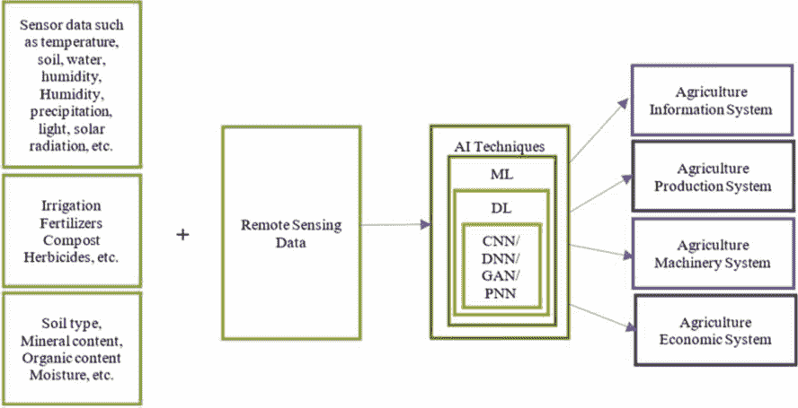

*图2. 使用人工智能技术的农业数据分析（学科领域）*

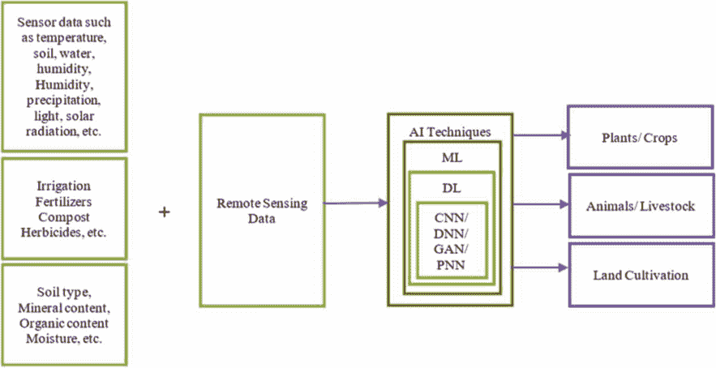

*图3. 使用人工智能技术的农业数据分析（学科——植物/作物）*

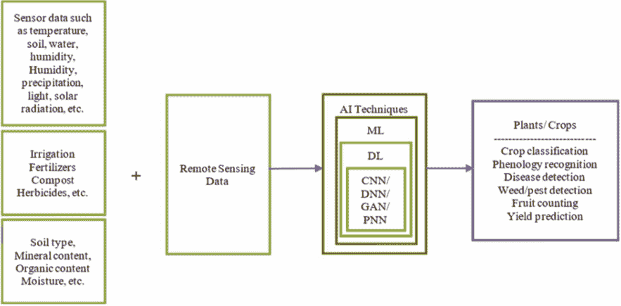

### 需求

所提出系统的需求包括速度、敏捷性、可扩展性、一致性、安全性、效率和协作。

- **敏捷性。** 它快速部署、更新和管理数据分析以及机器学习和深度学习应用，以响应不断变化的市场需求。
- **协作。** 它需要数据收集、应用程序开发和 IT 运维来简化流程并支持创新。
- **一致性。** 它在整个环境（包括数据中心、云基础设施和边缘）中部署智慧农业应用，并在需求变化时快速迁移它们。
- **效率。** 它通过智能和声明式自动化简化资源供应和配置管理。
- **可扩展性。** 它动态且弹性地扩展计算资源，以满足数据密集型应用波动的需求。
- **安全性。** 分层安全能力保护数据、应用、基础设施和业务。
- **速度。** 它利用混合云技术、内置自动化和云原生方法加速深度学习模型、应用开发和部署。

正如 Sufian 等人（2021）所述，通过在设计中应用多个阶段（或层），智慧农业除了提供自动化之外，还实现了资源利用效率、可扩展性和适应性。机器人技术、传感器、数据分析方法、专用农业软件解决方案和网络都是智慧农业生态系统的组成部分。

### 智慧农业模型

图 4 展示了针对不同智慧农业活动、为采用数据中枢架构的多云环境所创建的深度学习模型。所提出的范式包括几个要素：数据收集、数据处理、深度学习模型、深度学习应用和农业用户。

**数据收集。** 农业数据是从智慧农业环境中部署的各种传感器/设备收集的。智慧农业环境中使用的信息通信技术（Sufian 等人，2021）包括机器人技术（如 UAV、UGV、自动化拖拉机、自动化制造机器等）、传感器（如感测水、温度、土壤、湿度、光照等）、数据分析技术（如现代数据分析、图像处理算法等）、执行各种智慧农业操作的专用农业软件解决方案，以及连接技术（如 Wi-Fi、5G、LTE、蜂窝网络、卫星、GPS 等）。

**数据处理。** 数据处理组件简化了数据管理任务中固有的复杂性，包括数据集成、存储、处理、治理和可移植性。它是智慧农业中部署的各种模型和深度学习应用的数据中枢。

- **1.** 数据中枢集成来自各种数据源（物联网传感器、设备、遥感和卫星）和系统的数据，无论这些数据源和系统位于本地还是云端。这有助于确保数据一致且最新，并且可以被各种农业应用和用户访问，无论他们身在何处。
- **2.** 数据中枢为存储和管理数据提供了集中位置，无论数据位于本地还是云端。这有助于确保数据以一致和标准化的格式存储，无论其来源如何。
- **3.** 数据中枢提供统一的连接，支持各种数据处理活动，包括清理、转换和分析。这可以确保数据以一致和标准化的方式处理，无论其位于何处。
- **4.** 数据中枢为数据管理建立明确的政策和程序，包括数据质量、元数据管理和数据血缘。
- **5.** 它们确保数据无论存储或访问在哪里，都能得到一致和高效的管理。它们必须确保数据能够轻松地在本地和云环境之间移动。这有助于支持混合云场景，其中数据可能需要在不同环境之间来回移动。

- **深度学习模型。** 对于农业操作自动化，植物和杂草的分类因其影响而至关重要。智慧农业中的深度学习应用及其模型可以分为植物或作物、害虫防治、机器人收割、产量预测、灾害监测等。
- **作物产量预测模型。** 为了让利益相关者制定销售计划、采购、市场干预和解决粮食短缺问题，收获前的作物产量预测至关重要。这可用于预测农业产量以及研究作物和动物。
- **水果计数模型。** 对于作物预测和机器人收割，水果数量至关重要。传统的人工或移动相机计数耗时且结果不准确。使用带有斑点检测的深度学习的水果计数模型可用于水果计数。


由于 CV 的精确性，它可以在不造成环境或作物附带损害的情况下进行喷洒。

- **自动除草系统。** 该方法可利用配备 CV 技术的农业机器人清除不需要的植物。杂草可由农业机器人自动检测并清除。自动除草可以节省时间并减少对除草剂的需求，使农业更可持续、更环保。杂草和作物可通过目标检测技术进行识别和分离。例如，BoniRob 是一种农业机器人，它利用摄像头和图像识别技术定位杂草并通过向地面引入一个螺栓来将其消除。它通过对叶片大小、形状和颜色的图片训练来学习区分杂草和作物。

- **作物和土壤监测系统。** 土壤中的养分对作物的健康以及收获的数量和质量至关重要。优化生产效率需要了解作物的健康状况和土壤质量。当前的方法，如人工观察和评估作物健康和土壤质量，既不精确也不及时。相反，可以使用无人机（或 UAV）获取空中图像数据，并使用训练好的模型进行智能作物监测和土壤状况监测。这些模型可以比人类更快地（使用视觉感知）跟踪作物健康状况、预测产量并识别作物营养不良。无人机（或 UAV）可以计数动物、检测疾病、发现异常行为、关注分娩等关键活动、收集来自摄像机和无人机（UAV）的数据，并与其他技术协同工作，为农民提供食物和水方面的信息。DL 技术经过训练可分析视频片段，以确定动物正在做什么，包括它们是否在饮水、进食、睡觉，或以异常方式行动，这可能指向健康状况或行为问题。

- **昆虫和植物病害检测系统。** 农民可以使用基于 DL 的图像识别技术自动检测植物病害和害虫。该技术可利用图像分类、检测和分割技术创建植物健康模型。Deep CNN 可以使用植物学家标注的照片来发现病害（例如苹果黑腐病）。此外，YOLO v3 的升级版可能可以识别番茄植株上的众多害虫和疾病。然后，利用支持向量机（SVM）特征，它使用 YOLO 目标检测上的检测和粗略计数方法对昆虫进行分类和计数。

- **智能喷洒系统。** 配备 CV 的 UAV/无人机可以自动在田间均匀喷洒农药或肥料。得益于对目标喷洒区域的实时识别，UAV 喷洒器可以就喷洒区域和数量实现极高的精度。因此，污染作物、牲畜、人类和水系统的可能性显著降低。例如，使用多架 UAV 喷洒大面积要高效得多，但确定每架飞行器的具体任务序列和飞行轨迹可能很困难。

- **牲畜健康监测系统。** 动物比植物需要更多的跟踪，因为它们是创新农业系统的核心组成部分。为了跟上移动的动物（如牛、鸡和猪），智能农业可以采用 CV。考虑 CattleEye。他们利用 overhead 摄像机和 CV 算法来监测牛的健康状况和行为。通过远程实时跟踪和监测牲畜，农民可以收到有关牲畜问题的警报。

- **农产品分级和分拣系统。** 结合 CV 的 DL 模型在作物收获后仍可使农民受益。收获后，它们可以检测发育中植物的缺陷、疾病和害虫。成像算法可以将“优秀”产品与有缺陷至难看的产品分开。水果和蔬菜的大小、形状、颜色和体积检查使 DL 与 CV 能够比人工专家更快、更准确地自动执行分拣和分级程序。例如，机器人分拣系统可以使用 CV 识别表面有缺陷或形状和长度不正确的胡萝卜。

- **农业用户。** 农业用户包括农民、作物生产者、买卖双方、市场等。这些用户必须在 Smart Agri 门户中注册其详细信息。他们可以手动或自动上传数据集并训练数据，并在仪表板、警报、图表等中获取结果。

- **益处。** DL 在智能农业中的益处包括降低风险、更健康的收获、位置优化的耕作和精准农业。

- **降低风险。** AI 可以通过分析天气和土壤条件、水分使用情况和疾病风险来降低作物歉收风险。它提供有价值的见解，例如何时播种以及选择何种作物或种子。

- **更健康的收获。** 通过提前检测植物病害、杂草和害虫，可以最大限度地减少除草剂和农药等化学品的使用，并降低成本。

- **位置优化耕作。** 收获、采摘和吸尘装置中的 AI 可以帮助确定要收获的水果的确切位置和类型。

- **精准农业。** AI 应用可以利用卫星图像和天气数据来确定市场趋势，例如哪些作物需求旺盛以及哪些作物利润最高。它通过指导未来的价格模式、需求水平、作物类型、农药使用等，帮助农民增加收入。

*图 4. 智能农业的深度学习模型*

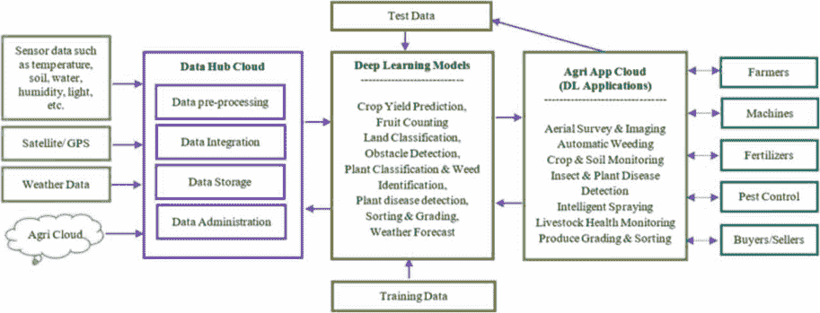

## 问题与挑战

智能农业的成本效益正在提高。得益于物联网带来的改进标准和协议，现在有更多设计选择。由于可用性更高，现在可以为最具挑战性的应用设计方案，例如不发达国家的自给农业。水资源可用性目前是气候变化对全球南方影响最显著的因素。曾经截然不同的湿季和旱季已不复存在。利用太阳能、板上微电子和低功耗短距离射频连接，可以以合理的价格提供传感器融合和执行器控制。接近实时的监测和评估变得更加复杂。

基于 DL 的方法（如 CV 算法）可以为智能农业提供高效、经济、灵活且可扩展的遥感解决方案。这些技术可用于应对许多领域的各种农业挑战，例如植物检测和分类、植物健康评估、智能害虫和杂草控制、田间分析和产量估算。然而，对 UAV 收集的数据进行高效处理是一项具有挑战性的任务。

## 案例研究

遥感数据被认为是智能农业的主要数据源之一。准确识别遥感影像中的棉花作物（Li et al., 2021）是精准农业中的一项重要任务。在整个生长季节，使用经验性和确定性方法处理的遥感影像有助于预测众多农艺参数。

从遥感数据中，可以在瓦伦西亚自治区（西班牙）检测到被遗弃的作物（Portalés-Julià et al., 2021）。该方法基于分析多时相 Sentinel-2 图像并生成光谱指数；这些预测因子随后被用于训练 ML 和 DL 分类器。

小麦穗必须被定位和计数以用于作物田管理、产量估算和表型研究。利用 CNN 技术，小麦穗可以被识别和计数。然而，小麦穗的粘连和遮挡降低了检测的有效性。因此，为了提高小麦穗检测的准确性并在田间进行计数，Yang 等人（2021）提出了一种空间和通道注意力模型，通过添加感受野模块来增强网络的特征提取能力。

众多研究表明雷达和光学成像非常适合作物制图和生物物理变量估算。Bahrami（2021）使用雷达和光学地球数据的组合来模拟作物生物物理因子，例如叶面积指数（LAI）和生物量。

背景噪声和植被遮挡是两个容易影响水果表面缺陷检测性能的例子。荔枝难以保存，必须在低温下储存以保持新鲜。在荔枝收获或加工时，其表面容易出现划痕和破损。Wang 等人（2021）研究了荔枝果实表面质量。Khan 等人（2021）关注主要作物产量（1980 年至 2050 年），并考虑了水果生产（例如苹果、香蕉、柑橘类水果、梨和葡萄）的各种类型数据，以突出中国古代农业增长和水果生产转变的模式。为了使用 DNN 预测未来产量，他们检查了在中国种植的各种水果的生产数据。

大多数生姜播种技术是手动的，这极大地阻碍了生姜产业的发展。为了获得一致的生姜芽取向，当前的生姜播种机在种植生姜种子时仍需要人工协助。种植生姜时，生姜芽应保持一致的取向以获得更高的产量和更晚的收获。为了解决这个问题，Fang 等人（2021）应用 DL 中的目标检测技术来检测生姜，并提出了一种基于 YOLOv4-LITE 的生姜识别网络。

为了识别病害，Hassan 等人（2021）建议使用浅层 VGG 与 RF 以及浅层 VGG 与 XGBoost。玉米、土豆和番茄是试验中使用的三种不同植物。枯萎病、普通锈病和灰叶斑病是玉米的病害；早疫病和晚疫病是土豆的病害；细菌性斑点病、早疫病和晚疫病是番茄的病害。


Sami等人（2021）提出使用基于长短期记忆（LSTM）的神经网络来解决基于物联网的物理传感器的重要问题。例如，智能灌溉系统用神经传感器取代物理传感器。

## 深度学习在智慧农业中的未来

本章涵盖了深度学习在智慧农业中的许多应用，包括土地覆盖分类、作物类型估算、作物物候、杂草识别和水果分级等问题。其他潜在应用包括使用航空影像（通过无人机）跟踪播种过程的效果，通过在最佳成熟期收获来提高作物生产质量，监测动物活动以考虑动物整体福利并发现潜在疾病，以及其他许多场景。种子识别、土壤和叶片中的氮含量、灌溉、水土流失评估、害虫检测、除草剂使用、污染物识别、食品中病害或缺陷检测、作物冰雹损害以及温室监测是与农业相关的其他问题。

除了已有的农业数据集，卫星还提供包括多时相、多光谱和多源图像的遥感数据，这些数据可用于解决涉及土地和作物覆盖分类的挑战。众多智慧农业应用可以估算植物和树木的生长情况及后续观测，以预测产量、确定其需水量或阻止疾病爆发。农民可以使用下一代计算机视觉应用来跟踪、测量、分类和识别农业的许多要素，通过使用机器学习和可持续算法驱动深度学习API来获得更好的结果。

环境信息学可以使用深度学习模型来理解气候变化、预测天气和现象、计算生态效应等。此外，通过结合具有自动化特征的众多深度学习模型和分类器的复杂架构，可以增强最终结果。自动收割作物、拔除杂草或预测各种作物潜在产量的机器人都可以从深度学习技术中受益。未来的深度学习应用可能用于微生物学中的细胞计数。未来的深度学习模型将能够收集植物和动物消耗的数据并预测结果，这将有助于农民选择适合不同情况的生长曲线。

## 结论

由于人口增长和粮食需求增加，农民越来越依赖人工智能和机器学习算法等尖端方法来保护作物。鉴于全球气候、环境和对粮食需求的重大变化，人工智能（AI）有潜力改变21世纪的农业，通过提高土地、劳动力和资源的生产率，增强环境可持续性，优化资源共享，并提供实时监测以支持更好的健康和产品质量。

人工智能和智慧农业是农业领域未来发展的浪潮。它们可以通过改进作物病虫害检测和商品质量来改善农业。由人工智能驱动的精确作物产量预测可以帮助各国实现粮食安全。人工智能可以通过消除农业部门的瓶颈来促进更高的粮食产量。由于新技术的使用，农业部门必须改变。农业技术也许是农民可以用来提高粮食生产和安全，同时最大限度地减少对环境的影响的最新创新。深度学习（DL）是一种相对较新的、具有巨大潜力的尖端图像处理和数据分析方法。深度学习最近进入了农业领域，因为它已在其他几个领域成功应用。

## 表2 缩略语

| Agri-Tech - 农业技术 | AI - 人工智能 |
| AIoT - 人工智能驱动的物联网 | ANN - 人工神经网络 |
| CEA - 受控环境农业 | CNN - 卷积神经网络 |
| CSA - 气候智慧农业（CSA） | CV - 计算机视觉 |
| DL - 深度学习 | DNN - 深度神经网络 |
| GAN - 生成对抗网络 | IoT - 物联网 |
| KNN - K最近邻 | ML - 机器学习 |
| MV - 机器视觉 | NN - 神经网络 |
| PNN - 概率神经网络 | RNN - 循环神经网络 |
| UAV - 无人机 | WSN - 无线传感器网络 |

## 参考文献

Akhtar, M. N., Shaikh, A. J., Khan, A., Awais, H., Bakar, E. A., & Othman, A. R. (2021). Smart Sensing with Edge Computing in Precision Agriculture for Soil Assessment and Heavy Metal Monitoring. Agriculture, 11(6), 475. doi:10.3390/agriculture11060475

Altalak, M., Ammad Uddin, M., Alajmi, A., & Rizg, A. (2022). Smart Agriculture Applications Using Deep Learning Technologies: A Survey. Applied Sciences (Basel, Switzerland), 12(12), 5919. doi:10.3390/app12125919

Aruul Mozhi Varman, S., Baskaran, A. R., Aravindh, S., & Prabhu, E. (2017). Deep Learning and IoT for Smart Agriculture Using WSN. 2017 IEEE International Conference on Computational Intelligence and Computing Research, 1-6. 10.1109/ICCIC.2017.8524140

Bahrami, H., Homayouni, S., Safari, A., Mirzaei, S., Mahdianpari, M., & Reisi-Gahrouei, O. (2021). Deep Learning-Based Estimation of Crop Biophysical Parameters Using Multi-Source and Multi-Temporal Remote Sensing Observations. Agronomy (Basel), 11(7), 1363. doi:10.3390/agronomy11071363

Bhaskar, Dhanwate, Kale, Kayastha, & Khairnar. (2021). Deep Learning based Smart Agriculture Crop Prediction. Journal of Advancement in Parallel Computing, 4(1), 1–8.

Buja, I., Sabella, E., Monteduro, A. G., Chiriacò, M. S., De Bellis, L., Luvisi, A., & Maruccio, G. (2021). Advances in Plant Disease Detection and Monitoring: From Traditional Assays to In-Field Diagnostics. Sensors (Basel), 21(6), 2129. doi:10.339021062129 PMID:33803614

Cravero, A., Pardo, S., Sepúlveda, S., & Muñoz, L. (2022). Challenges to Use Machine Learning in Agricultural Big Data: A Systematic Literature Review. Agronomy (Basel), 12(3), 748. doi:10.3390/agronomy12030748

Cube, L. A. B. S. (2022). How AI is Helping Agriculture with Smart Solutions. https://www.xcubelabs.com/blog/how-ai-is-helping-agriculture-with-smart-solutions/

Dadashzadeh, M., & Sakhaeian, K. (2022). Applications of machine learning and deep learning techniques in smart agriculture: A review. 4th Intercontinental Geoinformation Days (IGD), 229-232.

Dayioğlu, M. A., & Turker, U. (2021). Digital Transformation for Sustainable Future - Agriculture 4.0: A review. Tarim Bilimleri Dergisi, 27(4), 373–399. doi:10.15832/ankutbd.986431

DBTA. (2021). Managing the Hybrid and Multicloud Future, Best Practice Series. https://info.semarchy.com/hubfs/collateral-v2/report/trp-managing-the-hybrid-and-multicloud-future-Semarchy-DBTA.pdf

Endalie, D., Haile, G., & Taye, W. (2022). Deep Learning Model for daily rainfall prediction: A case study of Jimma, Ethiopia. Water Science and Technology: Water Supply, 22(3), 3448–3461. doi:10.2166/ws.2021.391

Eos. (2022). Smart Farming: Technologies & Benefits for Agriculture. EOS Data Analytics. https://eos.com/blog/smart-farming/

Fang, L., Wu, Y., Li, Y., Guo, H., Zhang, H., Wang, X., Xi, R., & Hou, J. (2021). Ginger Seeding Detection and Shoot Orientation Discrimination Using an Improved YOLOv4-LITE Network. Agronomy (Basel), 11(11), 2328. doi:10.3390/agronomy11112328

Fiehn, H. B., Schiebel, L., Avila, A. F., Miller, B., & Mickelson, A. (2018). Smart Agriculture System Based on Deep Learning. ICSDE'18: Proceedings of the 2nd International Conference on Smart Digital Environment, 158–165. 10.1145/3289100.3289126

Geethamahalakshmi, & Sambath, Gayathiri, Vijayaraja, Senthil Kumar, & Umaeswari. (2022). A Deep Learning Based Smart Agriculture Technique for an IoT Environment. Journal of Pharmaceutical Negative Results, 13(10), 1562–1569. doi:10.47750/pnr.2022.13.S10.181

Hamidi, M., Safari, A., Homayouni, S., & Hasani, H. (2022). Guided Filtered Sparse Auto-Encoder for Accurate Crop Mapping from Multitemporal and Multi-spectral Imagery. Agronomy (Basel), 12(11), 2615. doi:10.3390/agronomy12112615

Hassan, S. M., Jasinski, M., Zbigniew, L., Jasinska, E., & Maji, A. K. (2021). Plant Disease Identification Using Shallow Convolutional Neural Network. Agronomy (Basel), 11(12), 2388. doi:10.3390/agronomy11122388

Intellias. (2022). Artificial Intelligence in Agriculture: Rooting Out the Seed of Doubt. https://intellias.com/artificial-intelligence-in-agriculture/

Kamilaris, A., & Prenafeta-Boldú, F. X. (2018). Deep Learning in Agriculture: A Survey. doi:10.1016/j.compag.2018.02.016


- Kavitha, A. (2021). 智能农业的深度学习. 国际工程研究与技术杂志, 9(5), 132-134.

- Khan, T., Sherazi, H. H. R., Ali, M., Letchmunan, S., & Butt, U. M. (2021). 基于深度学习的生长预测系统：中国农业的用例. Agronomy (Basel), 11(8), 1551. doi:10.3390/agronomy11081551

- Kondaveeti, Brahma, & Sahithi (2021). 农业中深度学习的应用：深度学习在智能农业中的作用. In 人工智能和基于物联网的技术用于可持续农业和智能农业. IGI Global.

- Krishnamoorthy, R., Thiagarajan, R., Padmapriya, S., Mohan, I., Arun, S., & Dineshkumar, T. (2022). 机器学习和深度学习在智能农业中的应用. doi:10.1002/9781119861850.ch21

- Kuppusamy, P. (2021). 可持续农业的新兴技术模型. In P. Tomar & G. Kaur (编者), 人工智能和基于物联网的技术用于可持续农业和智能农业 (pp. 101–122). IGI Global. doi:10.4018/978-1-7998-1722-2.ch007

- Kuradusenge, M., Hitimana, E., Hanyurwimfura, D., Rukundo, P., Mtonga, K., Mukasine, A., Uwitonze, C., Ngabonziza, J., & Uwamahoro, A. (2023). 使用机器学习模型进行作物产量预测：马铃薯和玉米案例. 农业, 13(1), 225. doi:10.3390/agriculture13010225

- Li, H., Wang, G., Dong, Z., Wei, X., Wu, M., Song, H., & Amankwah, S. O. Y. (2021). 使用多个深度学习网络从遥感图像中识别棉田. Agronomy (Basel), 11(1), 174. doi:10.3390/agronomy11010174

- Li, Z., Jiang, X., Jia, X., Duan, X., Wang, Y., & Mu, J. (2022). 基于深度学习的重要水稻害虫分类方法. Agronomy (Basel), 12(9), 2096. doi:10.3390/agronomy12092096

- Liu, S., Qiao, Y., Li, J., Zhang, H., Zhang, M., & Wang, M. (2022). 用于自然场景中苹果叶病害实时检测的改进轻量级网络. Agronomy (Basel), 12(10), 2363. doi:10.3390/agronomy12102363

- Magomadov, V. S. (2019). 深度学习及其在智能农业中的作用. 物理学：会议系列, 1399(4), 044109. doi:10.1088/1742-6596/1399/4/044109

- Mehran & Sakhaeian (2022). 机器学习和深度学习技术在智能农业中的应用：综述. 第4届洲际地理信息日 (IGD), Tabriz, Iran.

- Navarro, E., Costa, N., & Pereira, A. (2020). 智能农业物联网解决方案的系统综述. 传感器, 20(15), 4231. doi:10.3390/s20154231

- Patel, A. (2022). 农业的计算机视觉和深度学习. https://pyimagesearch.com/2022/08/10/computer-vision-and-deep-learning-for-agriculture/

- Portalés-Julià, E., Campos-Taberner, M., García-Haro, F. J., & Gilabert, M. A. (2021). 使用深度学习评估 Sentinel-2 识别弃耕农田的能力. Agronomy (Basel), 11(4), 654. doi:10.3390/agronomy11040654

- Ramana, K., Aluvala, R., Kumar, M. R., Nagaraja, G., Krishna, A. V., & Nagendra, P. (2022). 智能农业中利用深度神经网络架构和物联网进行叶片病害分类. *电路、系统和计算机杂志, 31*(15), 2240004. doi:10.1142/S0218126622400047

- Sacolick, I. (2020). *混合多云具有技术优势时*. InfoWorld. https://www.infoworld.com/article/3568497/when-hybrid-multicloud-has-technical-advantages.html

- Said Mohamed, E. S., Belal, A., Kotb Abd-Elmabod, S., El-Shirbeny, M. A., Gad, A., & Zahran, M. B. (2021). 改善农业管理的智能农业. *埃及遥感与空间科学杂志, 24*(4), 971–981. 提前在线发表. doi:10.1016/j.ejrs.2021.08.007

- Sami, M., Khan, S. Q., Khurram, M., Farooq, M. U., Ajum, R., Aziz, S., Qureshi, R., & Sadak, F. (2022). 用于智能灌溉系统的基于深度学习的传感器建模. *农学（巴塞尔）, 12*(1), 212. doi:10.3390/agronomy12010212

- Sarker, I. H. (2022). 深度学习：技术、分类、应用和研究方向的全面概述. *SN 计算科学, 2*(6), 420. doi:10.1007/s42979-021-00815-1

- Sehgal Foundation. (2023). *现代技术在农业中的作用*. https://www.smsfoundation.org/role-of-modern-technology-in-agriculture/

- Senthil, K. S. D., & Shamili, M. D. (2022). 使用机器学习和深度学习技术的智能农业. *决策分析杂志, 3*, 100041. doi:10.1016/j.dajour.2022.100041

- Shafi, U., Mumtaz, R., García-Nieto, J., Hassan, S. A., Zaidi, S. A. R., & Iqbal, N. (2019, September 2). 精准农业技术与实践：从考虑因素到应用. *传感器（巴塞尔）, 19*(17), 3796. doi:10.3390/s19173796 PMID:31480709

- Shahi, Xu, Neupane, & Guo (2022). 使用无人机图像进行精准农业的机器学习方法：综述. *电子研究档案, 30*(12), 4277–4317. doi:10.3934/era.2022218

- Srivastava, A. (2022). 使用无人机和深度学习的智能农业：系统综述. In 物联网机器人和无人机技术. CRC Press. doi:10.1201/9781003181613-1

- Storm, H., Baylis, K., & Heckelei, T. (2020). 农业和应用经济学中的机器学习. *欧洲农业经济学评论, 47*(3), 849–892. doi:10.1093/erae/jbz033

- Subeesh, A., & Mehta, C. R. (2021). 利用人工智能和物联网实现农业自动化和数字化. *农业人工智能, 5*, 278–291. doi:10.1016/j.aiia.2021.11.004

- Sufian, A. (2021). *使用无人机和深度学习的智能农业系统综述*. doi:10.1201/9781003181613-1

- Sumathi, P., Karthikeyan, V. V., Kavitha, M. S., & Karthik, S. (2023). 用于智能农业系统的深度学习土壤质量预测改进模型, 计算机系统科学与工程. *科技科学出版社, CSSE, 45*(2), 1546–1559. doi:10.32604/csse.2023.027580

- Swaminathan, M. S., & Bhavani, R. V. (2013). 食品生产与供应——可持续粮食安全的必要前提. *印度医学研究杂志, 138*(3), 383–391. PMID:24135188

## 关键术语和定义

- **农业创新系统：** 一个由个人、组织和企业组成的系统，专注于推出新产品、流程和经济用途，以实现粮食和营养安全、经济发展和可持续的自然资源管理。

- **生物多样性：** 所有生物和生态系统在各种空间尺度上的总多样性（从基因到整个生物群）。

- **气候变化：** 气候变化是指气候状态的变化，可以通过其属性的平均值和/或变异性的变化来识别（例如，使用统计检验），并且这种变化持续时间较长，通常为数十年或更长。

- **气候智能型农业 (CSA)：** 有助于指导行动，将农业粮食系统转变为绿色和气候适应性实践。

- **保护性农业 (CA)：** 保护性农业是一种管理农业生态系统的方法，旨在提高和维持生产力、增加利润和粮食安全，同时保护和改善资源基础和环境。

- **灾害：** 社区或社会运作的严重中断，涉及广泛的人类、物质、经济或环境损失和影响，超出受影响社区或社会利用其资源应对的能力。

- **生态系统：** 在特定区域内由所有生物及其非生物环境形成的交互系统。它涵盖并包括整个地球、大陆尺度的生物群，或小型、界限明确的系统，如小池塘。

- **侵蚀：** 通过风化、崩塌以及溪流、冰川、波浪、风和地下水的侵蚀作用，移除和搬运土壤和岩石的过程。

- **精准农业 (PA)：** 它是一种农业管理策略，基于观察、测量和响应时间与空间变异性，以提高农业生产可持续性。

- **智能农业：** 它指的是在农场使用物联网、传感器、定位系统、机器人和人工智能等技术，以提高农作物质量和数量，同时优化人力劳动。

- **智能农场：** 它指的是使用现代信息通信技术管理农场，以提高产品数量和质量，同时优化所需的人力劳动。

- **可持续性：** 在不损害后代满足其需求的能力的前提下满足当前需求。


## 第12章：通过数据挖掘实现MP3标签自动编辑：用于预测MP3元数据的分类软件

**乔纳森·鲁弗斯·塞缪尔**  
*印度韦洛尔科技大学*

**希万什·萨海**  
*印度韦洛尔科技大学*

**P. 斯瓦尔纳拉塔**  
*印度韦洛尔科技大学*

**普拉布·塞武甘**  
*印度本地治里大学*

**V. 巴拉吉**  
*印度瓦尔达曼工程学院*

## 摘要

当今世界的音乐领域日新月异，不断扩展。随着现代技术的巨大进步，我们已经能够将音乐带给当今不断增长且精通技术的绝大多数人。在当今市场上，音乐流媒体领域的主要参与者包括Spotify、Gaana、Apple Music、YouTube Music等巨头企业。这也恰好与过去人们收听音乐的方式发生了相当大的转变。对于从旧音乐数据库和其他分发站点下载的歌曲，如果歌曲没有附带元数据，它们往往在没有任何已知元数据的情况下到来，也就是说，关于歌曲的大多数详细信息缺失，例如歌手姓名、制作年份、专辑封面等。本章讨论了如何利用数据挖掘、数据抓取和数据分类来为缺少元数据的歌曲文件补充不完整的元数据，并介绍了相应的设计过程、软件开发和研究。

DOI: 10.4018/978-1-6684-8098-4.ch012

## 引言

当今世界的音乐领域日新月异，不断扩展。随着现代技术的巨大进步，我们已经能够将音乐带给当今不断增长且精通技术的绝大多数人。在当今市场上，音乐流媒体领域的主要参与者包括Spotify、Gaana、Apple Music、YouTube Music等巨头企业。这也恰好与过去人们收听音乐的方式发生了相当大的转变。最初由iPod的推出开创先河，人们曾经从Apple Music的iTunes等服务购买和下载音乐，每首歌曲最低只需30美分。而且，即使音乐继续从传统下载方式转向流媒体，用户支持也变得越来越难以获取。对于从旧音乐数据库和其他分发站点下载的歌曲，它们往往在没有任何已知元数据的情况下到来，也就是说，关于歌曲的大多数详细信息缺失，例如歌手姓名、制作年份、专辑封面等。下面给出了一个示例。

图1. 缺少元数据的歌曲示例

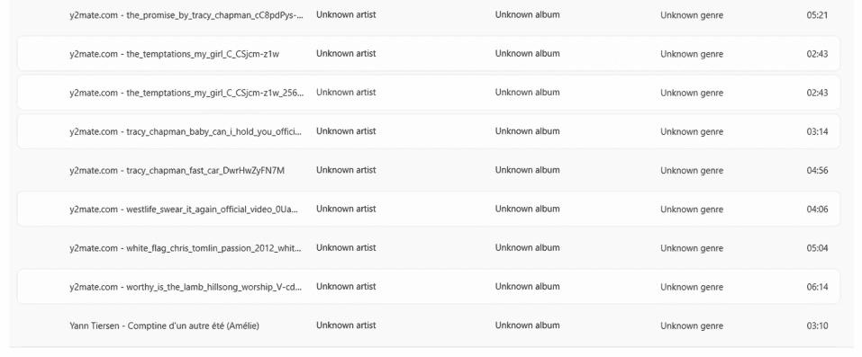

如图1所示，歌手姓名、标题（没有下载十六进制代码）以及其他杂项信息等数据要么不存在，要么显示不准确。而且，由于这些歌曲没有Spotify、Apple Music等平台的支持，它们不会自行得到修正。一方面，用户确实可以手动完成这项工作，但这将花费大量时间并且非常耗费资源。因此，为了避免音乐分发行业这种转变带来的麻烦，本章详细介绍了使用数据挖掘和基于机器学习的分类方法对从各种流行渠道抓取和获取的元数据进行处理的用法。本文将进一步讨论其中的细节，包括思考过程、方法论、规划（就软件设计规范而言）、整体实现以及最终结果。我们还将仔细观察如何通过数据挖掘更好地生成数据，以及如何在具有可扩展性的情况下使生成的结果随着时间的推移变得更加准确，以及机器学习如何通过简单的分类算法实现同样的目标。

## 行业如何处理MP3元数据

### 什么是音乐元数据？

音乐元数据是指与歌曲文件相关联的数据集合，包括歌手姓名、制作人、词曲作者、歌曲标题和发行日期等详细信息。这些信息对于有效识别、组织和交付音频内容至关重要。元数据越全面，就越容易收集和分配所产生的版税。此外，详细的元数据还能帮助听众在使用音乐服务时识别内容及其创作者，从而增强收听体验。然而，元数据的重要性还远不止这些方面。

Spotify、Apple Music、Amazon Music和Tidal等数字服务提供商（DSP）在很大程度上依赖元数据来向听众推荐相似艺人。此外，元数据还有助于策展人制作广受欢迎的播放列表，而音乐人也渴望能够入选其中。最后，准确的元数据在将母带权利和出版权利分配给合法所有者，以及促进版税合理分配方面发挥着至关重要的作用。

总之，音乐元数据是有效管理和交付音频内容的支柱，以各种方式惠及创作者和消费者。

> 关于元数据，有一点很重要：无论你是在制作音乐、推广音乐，还是仅仅在欣赏音乐，它对于数字音乐的基础性作用，就像面粉之于面包一样。（Spotify for Artists）

### 为什么音乐元数据如此重要？

音乐行业的版税收入来源多种多样，包括实体销售、同步授权和许可，以及涵盖下载和流媒体的数字音乐。确保准确的出版元数据对于创作者获得合理报酬尤为关键，尤其是在数字分发领域。如果内容提供商（如唱片公司）在分发过程中未能提供完整、详细的元数据，那么这些信息将无法在整个音乐生态系统中同步。因此，参与该歌曲的所有权利持有者都将无法获得其应有的、按比例分配的报酬。

为了说明这一点，让我们看一个例子：假设一首歌由一位同时担任词曲作者的艺人创作，并决定在录制过程中与另外两位艺人合作。这三位艺人签约了不同的唱片公司和出版商。这首歌通过有效的营销取得了巨大成功，并在国家电台播出。此外，它还获得了在电影中同步使用的授权。为了使所有各方都获得公平的报酬，他们必须被纳入元数据中，并因其贡献而得到正确标注。任何遗漏、错误署名、拼写错误，或未能遵守数字服务提供商（DSP）的指南，都可能导致相应的权利所有者即使有才华和努力，也得不到足够的报酬。

虽然本章的重点不仅仅是版税，但需要注意的是，各方之间的版税比例和分配是在分发和发行之前确定的。这些决定是通过艺人、经纪人、制作人、唱片公司、出版商以及供应链中的其他利益相关者之间的谈判作出的。这些协议通常是在创作过程的早期阶段确立的，并且可能影响也可能不影响分发时包含的元数据。

> 我们都清楚音乐行业面临的元数据问题。许多集体管理组织和出版商估计，由于缺乏准确的元数据，大约25%的音乐出版收入无法到达其合法所有者手中，而业界正在争相寻找可行的解决方案。……在流程早期达成一致且透明的元数据，才是可持续音乐权利管理系统的唯一解决方案。而实现这一目标的唯一途径，是消除音乐行业的孤岛心态，引入更多的开放与协作。（Niclas Molinder，音乐元数据公司Auddly创始人）

目前，音乐行业缺乏一套普遍适用的元数据管理解决方案。它在很大程度上依赖于各个集体管理组织、经理人、唱片公司、音乐分发企业和权利持有者等关键参与者来解决与元数据相关的挑战。因此，为了更好地应对这一整体问题，在未记录的歌曲中纳入元数据的需求仍然存在。我们希望可以通过使用数据挖掘和基于机器学习的分类来解决这一问题。尽管这种操作直接解决当前问题的可能性存在，但它将开启行业内部所需的变革，以便将音乐与其作者正确关联起来。

## 文献综述

以下期刊、文章和论文被用来更好地界定问题，描述当前行业处理音乐元数据所使用的方法，以及机器学习分类和数据挖掘的工作原理，尤其是在本章的背景下。

### 数据挖掘技术与应用（Bharati等人，2010年）

**总体概述：** 数据挖掘是一个从大型数据集中提取有价值模式和信息的的过程。它已被各组织广泛采用，以提升其业务运营，并取得了令人瞩目的成果。随着信息技术的发展，各个领域产生了海量数据。数据库和信息技术领域的研究人员一直专注于存储和处理这些数据，以用于决策目的。数据挖掘，也称为知识发现、知识提取或数据分析，在从大规模数据集中提取洞察方面发挥着至关重要的作用。

数据挖掘中采用了多种算法和技术，包括分类、聚类、回归、人工智能、神经网络、关联规则、决策树、遗传算法和最近邻方法。分类是最常用的技术，它利用预先分类的示例构建模型，以对更大的记录总体进行分类。这种方法在欺诈检测和信用风险评估等应用中尤为有用。决策树和神经网络等分类算法常用于此过程。

聚类是数据挖掘中另一种用于识别相似对象类别或分组的技术。通过应用聚类技术，可以识别数据集中密集和稀疏的区域，发现分布模式，并找出数据属性之间的相关性。聚类可以作为属性子集选择和分类的预处理步骤，并且具有多种应用，例如根据购买模式对客户进行分组，或对具有相似功能的基因进行分类。聚类分析可采用多种方法，包括划分法、层次法、基于密度的方法、基于网格的方法和基于模型的方法。


回归分析是一种用于数据挖掘预测的技术。它涉及对自变量（已知属性）和因变量（待预测变量）之间的关系进行建模。虽然简单的回归模型对于某些预测可能有效，但要准确预测未来值，通常需要更复杂的技术，如逻辑回归、决策树或神经网络。回归方法包括线性回归、多元线性回归、非线性回归和多元非线性回归。

神经网络是一组相互连接的输入/输出单元，它们利用分配给每个连接的权重。在学习阶段，神经网络调整这些权重，以预测输入数据的正确类标签。它们擅长从复杂或不精确的数据中提取有意义的见解，发现人类或其他计算机技术可能忽略的复杂模式和趋势。神经网络特别适合连续值的输入和输出，并在手写识别、语音合成和各种业务问题等领域得到应用。反向传播是一种常用的神经网络算法。

尽管数据挖掘仍是一项不断发展的技术，但它在各行业中都有应用。零售店、医院、银行、保险公司和许多其他组织经常使用数据挖掘技术。通过将数据挖掘与统计分析、模式识别和其他工具相结合，这些组织可以发现使用传统方法难以识别的隐藏模式和关联。这项技术使企业能够深入了解客户行为，并做出明智的营销决策，从而改进策略和成果。

## 关于若干分类算法及其改进的实证研究（Wu 等，2009）

**总体摘要：**本文聚焦于数据挖掘和机器学习中分类算法的研究与应用。文中探讨了三种分类方法：决策树学习、贝叶斯学习和基于实例的学习。目标是通过各种改进手段提高这些方法的分类准确率。研究人员使用从 Weka 获得的 36 个 UCI 数据集进行了实验，并实证比较了改进算法的性能。

分类算法在数据挖掘和机器学习中至关重要，因为它们有助于构建分类器以准确分析未知数据。分类器的性能通常通过其分类准确率来衡量。构建分类算法可以使用多种方法，包括决策树、贝叶斯、基于实例的学习、人工神经网络和支持向量机。近年来，这些领域引入了许多改进算法。

本文介绍了三组实验，分别关注决策树方法（ID3、C4.5、NBTree、随机森林）、贝叶斯方法（NB、HNB、AODE、贝叶斯网络）和基于实例的学习方法（KNN、KNNDW、LWNB、KStar）。使用10折交叉验证对改进算法的性能进行评估，并与传统算法进行比较。此外，还进行了置信度为95%的双尾 t 检验，以分析每对算法之间的统计显著性。本文其余部分安排如下：第2节正式描述了所选算法，包括其传统版本和改进版本；第3节介绍了实验过程和结果；最后，本文对研究发现进行了总结。

在决策树学习算法中，使用代表流程图的树状结构来构建决策树。该树根据属性值从根节点遍历到叶节点，进而确定实例的类别。本文讨论了传统的 ID3 算法及其改进版本，如 C4.5 和随机森林。这些改进算法解决了过拟合和噪声容限等问题，从而提高了分类准确率。贝叶斯学习算法采用统计方法对数据进行分类。这些算法的核心是贝叶斯定理，它允许基于概率和统计进行分类。本文讨论了传统的朴素贝叶斯（NB）算法及其改进版本，包括 HNB、AODE 和贝叶斯网络。这些算法减少了属性独立性的假设，因此与 NB 相比，分类准确率有所提高。基于实例的学习算法，也称为“懒惰学习”方法，存储训练集，并根据与存储实例的相似性对测试实例进行分类。本文探讨了传统的 K 最近邻（KNN）算法及其改进版本，如 KNNDW、LWNB 和 KStar。这些改进引入了加权属性和相似度函数，以提高分类准确率。实验结果以表格形式呈现，详细展示了每个算法在 36 个 UCI 数据集上的性能。表格表明，与传统算法相比，改进算法的分类准确率显著提高。研究人员还计算了胜差数，即 t 检验中胜出次数与失败次数之差，为算法性能提供了额外见解。

总之，实验表明，决策树学习、贝叶斯学习和基于实例学习中的改进算法比传统算法获得了更高的分类准确率。研究结果证明了这些改进在各种数据挖掘和机器学习任务中的有效性。

## 连点成线：音乐元数据生成、模式与应用（Nik 等，2008）

**总体摘要：**本文讨论了元数据在音乐领域中的重要性，并提出了一个框架，用于比较面向音乐应用的不同元数据模式的表现力和丰富性。作者旨在创建一个元数据框架，结合各种现有元数据系统的优势，并允许用户为其特定应用选择合适的元数据模式。

本文首先介绍元数据的概念及其在音乐信息检索（MIR）研究中的相关性。文中提到了几个现有的元数据网络服务，如 Amazon.com、Last.fm、MusicBrainz 和 Discogs，它们为音乐提供了多样且有用的元数据。然而，这些系统之间存在明显重叠。作者提出了一个能够处理不同元数据模式并促进标注过程的元数据框架。该框架接收一个音乐对象（MO），其中包含音频文件和初始元数据，并从各种来源检索元数据。生成的元数据以内部格式存储，涵盖从底层音频特征到音乐作品的描述性数据等一系列信息。

为了比较不同的元数据模式，作者定义了语义相关的元数据字段簇。这些簇包括音乐信息、分类器、表演细节、版本管理、描述符、权利与所有权、播放演绎、歌词、分组与引用、标识符、唱片信息、配器与编曲、声音与载体信息、事件详情、时间建模、乐谱、注意力元数据与使用、出版、作曲、制作和元元数据。随后，作者讨论了音乐领域中的各类应用，如音乐图书馆/百科全书、个人收藏管理、商业与交易、音乐编辑/制作、音乐播放、音乐推荐、音乐检索和乐谱。他们根据用户执行的操作，将软件应用程序归入这些领域。


接下来，作者比较了元数据模式和应用领域，以确定它们在不同场景中的相关性和实用性。作者创建了一个决策表，展示每种元数据模式与各种应用领域的兼容性。他们发现 MPEG-7 在所有领域都表现良好，但指出了一些互操作性问题。FreeDB 和 MusicBrainz 最适合音乐检索，而 MusicXML 与乐谱高度相关。论文最后强调，没有任何一种元数据标准能覆盖音乐元数据的所有需求。元数据模式的选择取决于具体应用及其功能。所提出的框架和决策表可以帮助用户选择最适合其需求的元数据模式。

总体而言，该论文强调了元数据在音乐应用中的重要性，并提供了一个用于比较不同元数据模式的框架。它深入分析了各种元数据标准的优缺点及其与不同应用领域的兼容性。

## 拟议软件的目标与目的

利用数据挖掘和机器学习原理，开发一款能够针对缺少元数据的歌曲完成以下任务的软件：

- 从当前文件名中提取标题，以及歌手名（如果可能），并保存到数据库。
- 针对每首歌曲标题的数据抓取器——查找以下元数据参数，并使用数据挖掘原理从 Wikipedia、Spotify、Shazam 等多个来源提取数据并保存到数据库。通过聚合这些结果（使用分类算法）为以下参数找到最佳适配值：文件名、路径、标签、标题、歌手、专辑、年份、音轨、流派、注释、专辑歌手、作曲者、碟片编号、专辑封面 jpg 文件。
- 自动化所有歌曲元数据添加过程。通过基于 GUI 的 Python 应用程序/API 使其用户友好。

## 方法论

实施计划相当直接。我们将部署一个自动化软件，可以从多种来源（如 Google 搜索、Wikipedia、Spotify 数据库等）数据挖掘（数据抓取）所需的元数据。然后将这些元数据连同适当的封面图应用到目标歌曲上。图 3 描述了当前项目采用的流程图。因此，在完整实施后，该软件可以在最佳条件下成功执行其所需操作。

如上图所示，展示了整体流程。应用程序首先从任意给定目录将歌曲加载到数据库中。数据库中的文件名和文件路径列会相应填充。接下来，标题生成器模块接管流程。标题生成器使用正则表达式函数从文件名中获取“线索”（cues）。线索基本上是帮助数据抓取器更好地为给定音乐文件抓取数据的提示。如果未找到线索，数据抓取器将利用 mp3 文件的音频签名来识别歌曲。这一搜索途径通过 Shazam API 处理。两个主要线索是歌手名和标题。如果找到，它们会被放入数据库以供进一步处理。然后流程进入数据抓取器部分。该部分

图 2. 流程图

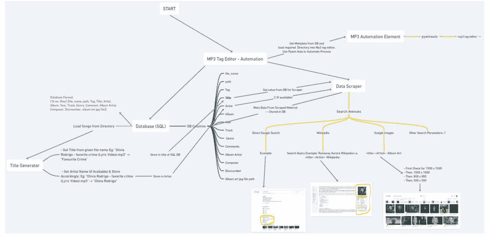

使用多个“搜索途径”从不同来源获取多组元数据。目前包括普通的 Google 搜索、Wikipedia API 搜索、Google 图片（用于专辑封面）、Shazam API、Spotify API 等。抓取的可能性是无穷无尽的，只需要在给定系统内进行接口对接。这将在第 5.1 和 5.2 节中进一步讨论。

每个搜索途径根据从正则表达式函数获取的线索返回一组元数据。然后元数据被推送到分类单元，分类单元基于多数决定每个字段的最佳适配数据。目前，使用朴素贝叶斯分类器，并且对所有搜索途径给予同等权重。备选方案将在第 8 和 9 节中进一步探讨。

## 数据挖掘在给定应用中的使用方式

数据挖掘是在大量数据（此处通过数据抓取获得）中进行排序和搜索，以获取推断并发现给定数据集中模式的过程。数据抓取只是获取所需数据的手段。给定应用使用多种搜索途径来处理这一过程，但为了提高性能，有必要尽可能多地使用搜索途径。这些途径包括没有标准 API 的站点，或者那些在请求时仅显示 XML/HTML 文件的站点。为了提取所需数据，我们需要使用专门的函数，例如 Python 的 BeautifulSoup。

如上述场景所示，数据无处不在，甚至存在于提供搜索查询后出现的第一个网站页面中。如图所示，搜索线索“runaway”和“Aurora”时，我们能够收集到多个数据点，如专辑名、歌手、发行日期、流派列表等。这使我们能够尽可能多地为分类器配备数据，以处理异常和误读。因此，这就是数据抓取和数据挖掘在给定应用中的使用方式。

图 3. Google 搜索：搜索途径获得的数据


### 分类的必要性

然后元数据被推送到分类单元，分类单元根据指定的多数决定每个字段的最佳适配数据。对于给定应用，我们使用朴素贝叶斯分类器。它是一种有监督的机器学习算法，用于分类任务，特别是文本分类。它使用贝叶斯概率来确定给定数据点对给定歌曲的准确程度。例如，如果某个搜索途径返回了错误或损坏的数据，则将最可能的数据点添加到数据库中。朴素贝叶斯对应用中的所有搜索途径给予同等权重。总体而言，这对于从整体数据集中为给定歌曲获取最佳适配数据至关重要。在目前阶段，分类处于最简单的形式，还有很大的改进和优化空间。这将在第 8 节中进一步讨论。

### 给定实现的过程模型选择：V 模型

由于这是一个相对较小的项目，旨在将数据挖掘技术整合到元标签编辑器中，因此采用 V 模型似乎是合适的，该模型旨在项目周期结束时提供一个可运行的模型。从优势部分可以看出，它是一种高度纪律化的模型，一次完成一个阶段。按照甘特图的规划，这与 V 模型类型的项目模型目标一致。项目需求清晰且完善，并且由于只需包含三到四个子模型即可完全实现，因此项目“使用数据挖掘的自动化 MP3 标签编辑器”可以在 V 模型软件项目模型类型下进行。

图 4. V 模型


## 实施：软件设计规格说明（SDS）

### 设计考虑

**系统环境：** 由于这主要是一个数据挖掘项目，整个应用使用的语言是 Python。根据实际性能表现，GUI 组件可以改用 Java。使用的数据库是 Python 的 sqlite3 数据库，它是 Python 3 的内置数据库。如果使用 Java，可以采用 SQL（Oracle 或任何其他替代品）。

**设计方法：** 给定项目将使用的主要过程与 CSE3001 - 软件工程课程中讨论的软件设计模式一致。它主要是一个面向对象的系统设计（在代码设计和实现方面）。其他设计考虑包括设计用例场景和基于 OOP 的设计中的类所涉及的方法。这些通过创建和使用 UML 图（见图 5）和 UML 图（见图 4）来指定，如本章所示。

**风险和易变区域：** 唯一可以讨论的主要问题是，基于 Python 的 exe 文件可能无法以稳定、持续的形式按需执行其任务。除此之外，尚未发现其他问题/易变区域。

### 架构

如前所述，给定项目使用的架构是面向对象的。给定系统的组件需要被封装，项目中的操作必须相应应用以操作给定数据。因此，项目范围内各组件之间的后续通信被确立为面向对象类型。给定软件的子系统组件将在下面讨论：


图 5. 类图


图 6. UML 图：用例场景


- 1. **主程序（Main）：** 构成该项目的主要 GUI + 系统调用。它是给定软件的主分支，负责处理其他库/组件的使用。
- 2. **索引模块（Index）：** 处理子系统调用，可视为该项目的主要子系统控制器。同时包含查询系统，用于处理 SQLite 3 数据库。
- 3. **标题生成器（Title Generator）：** 通过正则表达式从给定代码中抓取标题和艺术家姓名。将找到的值存储在数据库中，以备将来使用。
- 4. **数据抓取器（Data Scraper）：** 从各种来源（目前包括 Wikipedia、Google 搜索、Spotify、Shazam 等）抓取数据，按需获取元数据。
- 5. **数据聚合器（Data Aggregator）：** 使用朴素贝叶斯算法聚合来自给定来源的数据，并输出最佳匹配结果。
- 6. **图像下载器（Image Downloader）：** 控制专辑封面图像的下载。

## 数据库模式

使用的数据库是 SQLite 3，数据库模式如表 1 所示。

*表 1. 数据库模式*

| 数据类型 | 字段名 |
|---|---|
| Varchar(100) | 文件名 |
| Varchar(255) | 路径 |
| Varchar(100) | 标签 |
| Varchar(50) | 标题 |
| Varchar(50) | 艺术家 |
| Varchar(100) | 专辑 |
| Int(4) | 年份 |
| Int(10) | 音轨 |
| Varchar(50) | 流派 |
| Varchar(255) | 注释 |
| Varchar(50) | 专辑艺术家 |
| Varchar(50) | 作曲家 |
| Varchar(50) | 碟片编号 |
| Varchar(255) | 专辑封面文件 |

## 测试

### 白盒测试

采用的测试技术是白盒测试，重点是边界条件测试。考虑的主要模块是主 index.py 文件、标题生成器文件和数据库查询文件。针对这三个模块生成了不同程度的测试用例，同时产生积极和消极的结果，如表 2 所示。

### 表 2. 续

| 测试用例 ID | 活动 | 输入 | 预期结果 | 实际结果 | 状态 | 备注 |
|---|---|---|---|---|---|---|
| TC-14 | 获取完整歌曲文件名并筛选以提取歌曲名和艺术家 | `[Y2mp3.info] - Arctic Monkeys - Do I Wanna Know - (Official Video) (320kbps).mp3` | 歌曲 - Do I Wanna Know<br>艺术家 - Arctic Monkeys | 歌曲 - Do I Wanna Know<br>艺术家 - Arctic Monkeys | 通过 | 我们成功提取了歌曲和艺术家信息，可用于获取进一步的结果 |
| TC-15 | 获取完整歌曲文件名并筛选以提取歌曲名和艺术家（活动 1） | `[Y2Mate.is] - Arctic Monkeys - No 1 Party Anthem Lyrics Video - ...mp3` | 歌曲 - No 1 Party Anthem<br>艺术家 - Arctic Monkeys | 歌曲 - No 1 Party Anthem<br>艺术家 - Arctic Monkeys | 通过 | 我们成功提取了歌曲和艺术家信息，可用于获取进一步的结果 |
| TC-16 | 获取完整歌曲文件名并筛选以提取歌曲名和艺术家（活动 1） | `Jack Garratt - Surprise Yourself.mp3` | 歌曲 - Surprise Yourself<br>艺术家 - JACK GARRATT | 歌曲 - NULL | 失败 | 无法检索所需的元数据 |
| TC-17 | 使用歌曲名称和数据获取歌曲详情，如时长、流派、评分、背景（活动 2） | `SONG - all_sons_and_daughters_great_are_you_lord_live_concert_ARTIST=STONE` | 歌曲名称：Great Are You Lord<br>语言：英语<br>专辑：All Sons & Daughters<br>词曲作者：Jason Ingram, Leslie Jordan, David Leonard<br>发行年份：2014 | 歌曲名称：Great Are You Lord<br>语言：英语<br>专辑：All Sons & Daughters<br>词曲作者：Jason Ingram, Leslie Jordan, David Leonard<br>发行年份：2014 | 通过 | 用户能够成功获取所需信息 |
| TC-18 | 使用歌曲名称和数据获取歌曲详情，如时长、流派、评分、背景（活动 2） | `SONG - Amnesia`<br>`ARTIST - 5 Seconds of Summer` | 艺术家：5 Seconds of Summer<br>专辑：5 Seconds of Summer<br>发行年份：2014<br>提名：青少年选择奖最佳分手歌曲<br>流派：流行摇滚、儿童音乐 | 错误代码：5 | 失败 | 运行时产生错误。无法检索所需数据。 |
| TC-19 | 使用歌曲名称和数据获取歌曲详情，如时长、流派、评分、背景（活动 2） | `SONG - Castle`<br>`ARTIST - for KING & COUNTRY` | 艺术家：for KING & COUNTRY<br>专辑：Run Wild. Live Free. Love<br>发行年份：2014<br>流派：基督教音乐 | 艺术家：for KING & COUNTRY<br>专辑：Run Wild. Live Free. Love<br>发行年份：2014<br>流派：基督教音乐 | 通过 | 已按要求检索到给定查询的元数据。 |
| TC-20 | 使用歌曲名称和数据获取歌曲详情，如时长、流派、评分、背景（活动 2） | `SONG - Do I Wanna Know`<br>`ARTIST - Arctic Monkeys` | — | 艺术家：for KING & COUNTRY<br>专辑：Run Wild. Live Free. Love<br>发行年份：2014<br>流派：基督教音乐 | 通过 | 已按要求检索到给定查询的元数据。 |

## 参考文献

Bharati, M., & Ramageri, B. (2010). Data mining techniques and applications. Indian Journal of Computer Science and Engineering.

Chu, X., Ilyas, I. F., Krishnan, S., & Wang, J. (2016). Data Cleaning: Overview and Emerging Challenges. In Proceedings of the 2016 International Conference on Management of Data (SIGMOD '16). Association for Computing Machinery. https://doi.org/10.1145/2882903.2912574

Corthaut, N., Govaerts, S., Verbert, K., & Duval, E. (2008). Connecting the Dots: Music Metadata Generation, Schemas and Applications. Academic Press.

Hardjono, T., Howard, G., Scace, E., Chowdury, M., Novak, L., Gaudet, M., Anderson, J., Davis, N., Kulis, C., Sweeney, E., & Vaughan, C. (2019). Towards an Open and Scalable Music Metadata Layer. Academic Press.

Holmes & Kellogg. (2006). Automating functional tests using Selenium. AGILE 2006 (AGILE'06). . doi:10.1109/AGILE.2006.19

Lee, J. S., & Siau, K. (2001). A review of data mining techniques. Industrial Management & Data Systems, 101(1), 41-46. doi:10.1108/02635570110365989

Liao, Chu, & Hsiao. (2012). Data mining techniques and applications – A decade review from 2000 to 2011. Expert Systems with Applications, 39(12), 11303-11311. doi:10.1016/j.eswa.2012.02.063

Morris, J. W. (2012). Making music behave: Metadata and the digital music commodity. New Media & Society, 14(5), 850–866. doi:10.1177/1461444811430645

Ness, S. R., Theocharis, A., Tzanetakis, G., & Martins, L. G. (2009). Improving automatic music tag annotation using stacked generalization of probabilistic SVM outputs. In Proceedings of the 17th ACM international conference on Multimedia (MM '09). Association for Computing Machinery. 10.1145/1631272.1631393

Sen, P. C., Hajra, M., & Ghosh, M. (2020). Supervised Classification Algorithms in Machine Learning: A Survey and Review. In J. Mandal & D. Bhattacharya (Eds.), Emerging Technology in Modelling and Graphics. Advances in Intelligent Systems and Computing (Vol. 937). Springer. doi:10.1007/978-981-13-7403-6_11

Singh, A., Thakur, N., & Sharma, A. (2016). A review of supervised machine learning algorithms. 2016 3rd International Conference on Computing for Sustainable Global Development (INDIACom), 1310-1315.

Singh, I. Tarika B. (2014). Comparative Analysis of Open Source Automated Software Testing Tools: Selenium, Sikuli and Watir. doi:10.13140/2.1.1418.4324

Tian, M., Fazekas, G., Black, D., & Sandler, M. (2013). Towards the Representation of Chinese Traditional Music: A State of the Art Review of Music Metadata Standards. International Conference on Dublin Core and Metadata Applications, 71–81. Retrieved from https://dcpapers.dublincore.org/pubs/article/view/3672

## 第 13 章

### 基于机器学习的物联网智能家居能源管理系统

**Maganti Syamala**
_印度 Koneru Lakshmaiah 教育基金会_

**Samikshya Dash**
_印度 VIT-AP 大学计算机科学与工程学院_

**Komala C. R.**
_印度 HKBK 工程学院_

**S. Meenakshi**
_印度 R.M.K. 工程学院_

**P. V. Pramila**
_印度 Saveetha 医学与技术科学学院 Saveetha 工程学院_

**Sampath Boopathi**
_印度 Muthayammal 工程学院_

### 摘要

物联网（IoT）是数据科学技术的重要数据来源，具有易于识别趋势和模式、增强自动化、持续发展、易于处理多维数据以及计算成本低等特点。由于人口增长、经济发展和产业结构调整，建筑是全球最大的能源消耗者，因此能源消耗预测对于增强城市可持续性和城市规规划至关重要。本研究探索并利用了基于深度学习的技术在智能住宅建筑能源消耗领域的应用。研究发现，最佳窗口大小是预测预测性能、最佳 N 窗口大小和模型不确定性估计的重要因素。用于智能住宅建筑家庭能源消耗的深度学习模型是估计预测性能和不确定性的最优模型。


## 引言

物联网 (IoT) 是一个庞大的网络，由数十亿个智能物理对象组成，这些对象通过传感器、软件和其他嵌入式技术与其他连接设备和互联网相连。到 2025 年，物联网将产生相当大的经济影响，其中能源行业占市场的 33%。鉴于很大一部分人口超过 90% 的时间都在建筑物内度过，人口、经济和工业化的快速增长增加了能源消耗。建筑行业是世界上最大的能源使用者，占全球能源消耗的 39% 和二氧化碳排放量的 38%。预计到 2040 年，电力需求将以每年 2.1% 的速度增长，是一次能源增长速度的两倍。供暖和制冷系统对住宅建筑的能源使用量有重大影响，需要实现最佳的能源管理。为了降低电费和优化电力使用，智能电网和智能家居技术正日益普及。这些技术对智慧城市、社会和城市规划的可持续发展至关重要。住宅能源消耗预测具有挑战性，并为能源效率和管理研究领域增添了价值，该领域力求在电网和电力资源管理规划方面推进智慧城市化。通过创建可靠且可持续的能源消耗预测模型，可用于负荷管理、缺陷检测、能源需求和污染缓解，从而提升智能住宅建筑 (Amer et al., 2014)。

深度学习方法使分析师和研究人员能够为各种应用创建和训练稳健的模型，包括边缘计算、机器人技术、情感分析、计算机视觉等。本节重点介绍了深度学习模型在预测建筑物能源消耗方面的应用。

- 深度学习模型利用深度神经网络识别复杂关联并理解隐藏信息，以预测未来的能源消耗。
- 传统机器学习方法侧重于时间信息，而深度学习方法在建模时间关系和空间关系方面更胜一筹。
- 为了提高模型准确性，深度学习模型包含特征工程。
- 深度学习模型可以处理大型数据集，然而这取决于其深度和特定架构。

提出了一种用于估计家庭用电量的可持续机器学习模型，采用改进的滑动窗口技术。它侧重于量化模型不确定性，并使用所考虑的能源数据集将建议的工作与基准模型和竞争基准进行评估 (Chen et al., 2021)。

96% 的企业正在使用基于物联网的技术来更好地监控和管理其物理资源，而 67% 的开发人员正因其适应性和有效性而开发基于物联网的技术。但物联网要取得成功，必须有多种技术协同工作以提供额外的智能层。智慧城市、交通系统和制造业应用正在推动物联网，预计未来 5 至 6 年内将有 500 亿台设备联网。不过，验证 Cisco、IDC 和 Gartner 预测的大量数字是困难的。物联网 (IoT) 是一个平台，使基于传感器的对象能够在智能环境中进行通信和交换数据 (Jeevanantham et al., 2023)。物联网的真正价值在于创建智能设备、传达有意义的观点并产生新的商业概念。随着数百万台设备连接到物联网，将会出现海量的大数据洪流。数据将完成三个步骤：数据收集、数据传输和数据分析。实时或流式、大容量以及结构化或非结构化的物联网数据都将存在 (Samikannu et al., 2023)。

物联网是一种革命性技术，通过 WiFi、蓝牙、GSM 和 ZigBee 等无线技术将通信设备与物理世界连接起来 (S. et al., 2022)。物联网范式涉及将通信设备植入传感器设备中以收集各种类型的信息，例如地质、生态、计算和天文学信息。在远程操作设备的帮助下，通信设备将接收和传输指令和数据，从而提高生活水平。物联网通过互联网技术提供多种选择 (Reddy et al., 2023)。众多垂直市场，包括医疗、交通、智能家居、智慧城市、农业、教育等，都出现了物联网应用。本研究侧重于智能家居的数据，以提高舒适度、能源效率、生产力和生活质量。互联网连接的家用电器提供智能服务，例如微软和 Liebherr 将 Cortana DL 应用于冰箱知识。美国近三分之一的电力用于住宅部门，主要用于 HVAC 和照明设备。在评估和预测的帮助下，家庭可以更好地管理家庭开支和支出，并跟踪和预测健康变化。为了使智能家居系统减少电力使用并预测未来需求，需要智能能源管理。能源管理是智能家居应用的关键研究课题之一 (Rashid et al., 2019)。

能够做出选择、与决策相关的属性以及模型训练所需的底层信息构成机器学习 (ML)，它是人工智能的一个子类。为了快速发现趋势和模式、提高自动化和持续改进、处理多维数据、提高准确性、降低计算成本并具有广泛的应用，机器学习 (ML) 正被软件和硬件行业所采用 (Babu et al., 2023; Boopathi, Arigela, et al., 2023; Jeevanantham et al., 2023)。通过处理实时数据，机器学习 (ML) 作为人工智能的一个新分支，有望促进快速高效的数据驱动模型、分析和预测的创建。它可分为三大类：强化学习、无监督学习和监督学习。无监督学习进行无标签学习，强化学习基于经验，而监督学习则使用已标记的数据进行训练。数据表示对机器学习应用的成功至关重要，因为它们采用智能学习方法进行预测、模式识别、数据挖掘和分析。由于其更高的数据表示能力和预测准确性，深度学习变得越来越流行。它用于处理非线性问题并在大规模上抽象地描述输入数据。为了从数据中逐步获取高级特征，深度学习 (DL) 作为机器学习的一个专门子领域，依赖于一种称为人工神经网络的分层算法框架。它消除了对彻底特征提取和专业知识的需求。深度学习 (DL) 架构可以通过检测特征并生成抽象层来表示数据，从而自主学习。DL 架构是机器学习 (ML) 的进步，最早由 Geoffrey Hinton 于 1986 年提出。文献中有多种定义 (Boopathi, Siva Kumar, et al., 2023; Harikaran et al., 2023; Reddy et al., 2023; S. et al., 2022; Sampath et al., 2022; Vanitha et al., 2023)。

- 得益于深度学习，计算模型可以从数据中学习具有高度抽象的有用特征。


- 深度学习算法利用输入分布来识别有用的表示和更高级别的学习特征。
- 无需依赖程序员定义的特征，深度学习技术通过自动化特征提取，直接从数据中将输入与输出联系起来。

深度学习架构是多层非线性计算，具有更好的性能，可实现特征工程和数据缩放的自动化。它们被用于许多垂直领域，包括语音识别、图像识别、机器翻译、网络缓存、物联网应用和自然语言处理（NLP）。根据用途的不同，它们分为三类（Liu 等人，2020年）：

- 生成模型用于执行无监督学习任务。
- 判别模型是为需要监督学习的任务而创建的。
- 混合模型使用生成模型和判别模型。

鉴于当前的能源危机、不断增长的能源需求、污染以及绿色能源系统的缺陷，判别模型可以帮助物联网应用预测能源需求和消耗。深度学习模型可以帮助决策者制定和实施节能政策，以减少污染并促进可持续性。在能源领域，物联网和深度学习是相互交织的两种技术，从而催生了诸如人工智能之类的工具来预测能源需求和使用。然而，传统的教学技术和能源管理方法也存在一些限制（Gariba 和 Pipaliya，2016年）。

- 某些模型排除了时间信息，这可能会产生不可靠的结果。
- 共线性是一个与时间和空间相互作用有关的问题。
- 因果模式的分析可能具有挑战性。
- 在处理海量数据集时，管理可能具有挑战性。
- 使用静态数据时需要处理静态数据。

深度学习技术的优势包括特征工程、隐藏特征以及处理海量数据，这些优势是通过利用层次结构从简单问题中学习复杂的非线性问题来实现的。但训练的计算成本很高，而且确定使用哪些超参数是一种没有任何规则的黑魔法。

## 物联网与机器学习分析

物联网（IoT）是一项突破性创新，已在智慧城市、医疗保健、交通、制造业、可持续生活等多个行业中获得广泛关注。物联网分析是一种利用数据分析从物联网支持的来源（如智能设备、传感器和其他联网对象）中提取价值的方法。了解物联网的市场潜力需要从物联网支持的数据源中收集和分析数据，然而物联网提供的数据中只有1%被使用。物联网数据分析应用包括异常检测、预测和优化，这些应用越来越依赖于机器学习和人工智能（Kumara 等人，2023年；Palaniappan 等人，2023年；Senthil 等人，2023年）。

使用机器学习算法分析物联网产生的数据，以识别趋势并获取更深层次的理解。本文阐述了物联网分析、其生命周期、技术以及开发和部署解决方案时面临的主要困难。利用机器学习（ML）可以识别和理解物联网数据，从而在预测性维护、优化、异常检测等领域做出更好的决策。通过使用机器学习技术、算法和模型，可以做出更好的判断（Koltsaklis 等人，2022年）。

### 物联网分析

分析学是一门通过分析从数据中提取知识和见解的科学。数据与物联网密不可分，数据的生成和消耗呈指数级增长。估计有307亿个物联网设备正在推动这一数据洪流，从而推动了物联网的必然普及。因此，物联网分析提供了一个分析框架，用于评估和论证物联网设备在众多垂直领域中产生的数据。由于支持互联网的设备通常会在短时间内产生大量信息，因此物联网分析是一种特别适合分析从这些设备收集的数据的分析类型。据统计，物联网设备每天产生约2.5艾字节的数据。大数据和物联网数据是可比的，但由于数据来源的多样性，两者存在一些差异（Boopathi, Khare, 等人，2023年；Domakonda 等人，2023年；Selvakumar 等人，2023年；Vennila 等人，2023年）。

数据的多样性使得数据集成过程变得困难。智能电表能够控制能源需求和消耗，是物联网应用严重依赖物联网分析的一个例子。得益于这一部署，电力行业得以降低和控制电力成本，迈阿密公园管理部门因此节省了超过100万美元。数据分析有四种类型：流分析、地理分析、时间序列分析和规范性分析。实时物联网数据使用流分析和空间分析进行分析，以促进快速决策并识别关键情况。时间序列分析检查基于时间的数据，以发现模式和趋势。规范性分析结合描述性分析和预测性分析，针对特定情况优化行动。

图1. 物联网数据分析技术的各阶段


### 分析技术

物联网数据分析的三个步骤包括数据收集、分析和部署（Machorro-Cano 等人，2020年）。研究人员和实践者可以使用物联网分析生命周期进行开发和部署（图1）。

**数据收集：** 最关键的要点是，物联网数据是从能够连接互联网的对象中收集的，附加逻辑元数据，并在来源和格式方面经过验证。同时还通过完整性、正确性和一致性对数据进行验证。这一层面解决了物联网分析的困难，包括一致性和质量问题。物联网数据收集表现出许多特殊之处，使得管理各种物联网数据流具有挑战性。

**智能数据分析：** 利用数据挖掘和机器学习（ML）等人工智能技术，将物联网生成的数据转化为有用的知识。

**部署、操作化与复用：** 该生命周期使得部署分析方法、可视化物联网数据以及跨多个应用复用物联网数据集和专业知识成为可能。由于物联网用例的成熟度与其最终分析能力相联，同时也具有复用城市数据集和分析功能的灵活性，因此该生命周期也可以用于评估一座城市的“智慧”程度。成功的数据管理和分析取决于有效的数据管理和分析（S. 等人，2022年；Sampath 等人，2022年）。

- **统计建模：** 检验理论，以便从物联网数据中学习。
- **机器学习：** 启发式策略是机器学习技术用于优化学习模型的一种方法。
- **物联网中间件与互操作性技术：** 为了解决真实性和多样性问题，该领域提供了收集、组织和组合物联网数据流的方法。
- **数据挖掘与知识发现：** 这些学科通过数据清理、学习和可视化，应用理论原理和启发式方法，提取有用的知识。
- **数据流管理系统：** 物联网流系统用于管理具有不稳定到达时间和特性的高速数据流。
- **数据库管理系统：** 数据持久性和管理由关系数据库管理系统（RDBMS）、NoSQL数据库和其他技术负责处理。

### 挑战

物联网分析应用解决的是物联网数据和分析应用特有的海量数据和高速数据问题。

- **数据异构性：** 物联网数据很可能是多样化和多模态的，但有许多解决方案可以处理这种情况。
- **数据质量：** 物联网分析面临许多与数据质量相关的挑战，必须通过统计和概率技术来考虑这些挑战。
- **实时性：** 实时物联网应用可以利用大数据、深度学习和其他替代方法等尖端技术。
- **时间与空间依赖：** 物联网相关数据既面向空间又面向时间，因此必须快速处理。


## 回归算法

因变量与预测变量之间的联系使用回归技术进行建模。为了预测和预估结果，以及推导预测变量与结果变量之间的因果联系，需要使用算法。虽然回归是统计计算的关键组成部分，但用它解决问题需要练习。线性回归、多元回归、逐步回归、逻辑回归、多元自适应回归样条、普通最小二乘回归（OLSR）、局部回归（LOESS）和局部确定散点图平滑都是回归技术的例子。

## 正则化算法

根据模型的效率、简单性、时间和空间复杂度以及对其他技术的适用性，使用正则化方法来修正模型。LASSO、弹性网络（Elastic Net）、岭回归（Ridge Regression）和最小角回归（LARS）是正则化技术的例子。

## 基于实例的算法

在进行预测时，会使用那些从训练数据的示例或实例中学习并泛化到新实例的模型。这也被称为基于记忆的学习和赢家通吃学习。它侧重于实例在存储中的表示方式，以及如何使用相似性度量来区分实例。训练数据的数量会影响基于实例方法的耗时程度。支持向量机（SVM）、k近邻（k-Nearest Neighbor）、自组织映射（Self-Organizing Map）、学习矢量量化（LVQ）和局部加权学习（LWL）都是基于实例的算法的例子。

## 决策树算法

决策树算法是一种监督式机器学习技术，通过构建训练模型来从先前的训练数据中学习决策规则。决策树采用自顶向下的方法进行处理，从训练数据中选择最合适的属性作为根节点的定义。由于决策树快速且精确，因此在机器学习中经常使用。例如条件决策树、卡方自动交互检测（CHAID）、迭代二分器3（ID3）以及分类与回归树（CART）。

## 贝叶斯算法

贝叶斯定理是贝叶斯算法的基础，该定理断言任意两个变量彼此独立。在已知事件B已经发生的信息条件下，这些方法用于计算事件A和B发生的可能性。朴素贝叶斯、贝叶斯信念网络（BBN）、高斯朴素贝叶斯、多项式朴素贝叶斯和AODE都是贝叶斯算法的例子。

## 聚类算法

在聚类过程中，数据点根据共享的特征或属性进行分组或聚类。聚类是统计计算和数据分析中使用的一种无监督学习方法。常用的技术包括期望最大化（EM）、层次聚类、k均值（k-Means）和k中位数（k-Medians）。

## 关联规则学习算法

关联规则学习是一种基于规则的机器学习技术，利用大型数据集提取强规则，然后用于在多维数据库中发现有用的关联。Apriori和Eclat是关联规则学习算法。

## 人工神经网络算法

人工神经网络是一种基于生物神经网络的计算机系统，通过充当庞大的神经元网络来模拟人脑。它用于分类与回归树（CART）问题，并涵盖了一个重要的子领域，针对各种类型的问题都有多种技术和改进方法，然而由于其普及性，它已与深度学习（DL）区分开来。感知机（Perceptron）、多层感知机（MLP）、反向传播（Back-Propagation）、随机梯度下降（Stochastic Gradient Descent）、径向基函数网络（RBFN）和霍普菲尔德网络（Hopfield Network）等传统技术被用于构建人工神经网络（ANN）。

## 深度学习算法

深度学习（DL）方法作为人工神经网络（ANN）的升级形式，用于开发更大、更复杂的神经网络，以便在评估和处理海量数据集时实现自动学习。RNN、LSTM、CNN、堆叠自编码器（Stacked Auto-Encoders）、DBM和DBN是一些深度学习算法。

## 降维算法

降维算法用于以少量信息描述或概括数据。它们对数据可视化很有用，并随后用于监督学习技术中。在分类和回归问题中，使用主成分分析（PCA）、主成分回归（PCR）、偏最小二乘回归（PLSR）、萨蒙映射（Sammon Mapping）、多维缩放（MDS）、投影寻踪（Projection Pursuit）和线性判别分析（LDA）来降低维度。

## 集成算法

为了处理多个模型并为计算问题找到解决方案，需要使用集成学习方法。它们主要用于提高整体模型性能并降低选择次优模型的可能性。此外，它们还用于增量学习、非平稳学习、数据融合、最优特征选择、纠错以及非平稳性纠错等应用。Boosting、自助聚合（Bootstrapped Aggregation）、AdaBoost、加权平均、堆叠泛化、梯度提升机（Gradient Boosting Machines）、GBM、GBRT和随机森林（Random Forest）都是有效且广受欢迎的集成方法的例子。

## 其他机器学习算法

特征选择、准确性评估、性能度量、优化、计算智能、计算机视觉、NLP、推荐系统、强化学习和图模型是机器学习方法的一些类别。为了利用真实世界的物联网用例来处理物联网难题，本文讨论了深度学习和贝叶斯算法，以结合滑动窗口技术构建一种可持续的机器学习方法。物联网应用需要高效且可扩展的数据分析，而机器学习为发展提供了众多机会。三分之一的物联网应用涉及时间序列挑战，这使得深度学习（DL）方法非常有用。

*图2. 物联网与深度学习算法集成的智能家居能源管理*


## 智能家居能源数据分析

物联网技术导致了数据的快速增长，但这些数据可能包含不适合深入分析的欺骗性信息。使用业界公认的方法对物联网数据进行统计分析至关重要，同时仔细检查数据以确保其准确性和适当性也同样重要。数据的初步检查对于确认数据来源、验证变量、查找缺失值、清理数据、识别异常值（如果有的话）等至关重要。明确决定数据是如何收集的也很关键。为了实现强调数据特征、以易于理解的方式总结数据信息、可视化数据以及为深入分析准备数据等目标，需要对原始数据进行初步分析。本章通过理解能量数据集的特征和拟合值、数据预处理、特征工程、统计检验以及智能住宅建筑能耗数据的展示，试图解决数据不一致性的难题（Forootani et al., 2022; Haq et al., 2022; Koltsaklis et al., 2022; Li et al., 2018; Liu et al., 2020; Machorro-Cano et al., 2020）。物联网与深度学习算法集成的智能家居能源管理系统如图2所示。

### 数据收集

本研究使用了位于巴黎附近的斯科（Sceaux）一栋被监测住宅的电表读数。这些数据来自UCI机器学习库。在预处理过程中，有1.25%的行存在缺失值，并删除了冗余数据以防止训练偏差。无功功率是真实功率从主电路到房屋各部分的分配，而有功功率是电力线中实际使用和未利用的能量。平均电压和电流强度称为全局强度。智能住宅建筑的大部分电能消耗来自三个区域：厨房能源使用、照明和杂物间能源使用，以及供暖和制冷系统能源使用。厨房的设备包括子计量、微波炉、烤箱、洗碗机、杂物间和冰箱。使用模型拟合函数来估计和理解能量变量的分布特征，并总结变量之间的联系（Rashid et al., 2019）。

### 数据预处理

无功功率是真实功率从主电路到房屋各部分的分配，而有功功率是电力线中实际使用和未利用的能量。平均电压和电流强度称为全局强度。智能住宅建筑的大部分电能消耗来自三个区域：厨房能源使用、照明和杂物间能源使用，以及供暖和制冷系统能源使用。厨房的设备包括子计量、微波炉、烤箱、洗碗机、杂物间和冰箱。使用模型拟合函数来估计和理解能量变量的分布特征，并总结变量之间的联系。

**缺失值：** 数据处理需要精确识别和处理缺失值，因为如果做不到这一点，可能会导致错误的结论并损害学习模型。缺失值可以通过插补或删除行来处理。可以在不保留重要信息的情况下删除空值，但插补过程可以通过计算某个属性的平均值、中位数或众数来替换它们。本研究采用了第二种方法来处理空值，即计算具有空值的特定属性的中位数，这比前一种方法产生了更好的结果。

**冗余数据：** 在能量数据中，通过删除重复记录来减少机器学习算法的偏差。

**数据重采样：** 这是一种从真实能量数据中生成独特样本分布的方法。根据需求，可以通过两种方法之一对数据进行重采样：上采样或下采样。为了进行更有洞察力的分析，智能家居能量数据集应按每日频率进行下采样。

**特征缩放：** 本研究利用Z-score标准化和最小-最大归一化对智能住宅建筑能量数据集中的独立特征进行了归一化处理。借助预设的Python库，完成了所有阶段。


## 特征选择

模型设计中的关键阶段是特征选择和数据清洗。特征选择包括挑选对预测或目标变量最有贡献的相关要素，而数据清洗则涉及删除数据中错误和不必要的信息。在建模之前对原始数据集应用特征选择具有以下优势。

- **提高准确性：** 对于建模而言，提高准确性至关重要。
- **减少过拟合问题：** 减少冗余数据可降低得出有偏结论的可能性。
- **缩短训练时间：** 相关数据能降低模型复杂度，从而加快模型训练。

本研究使用 R 中的 subset 函数，将后向消除策略应用于特征或变量选择。采用流程图描述后向消除方法，该方法确定的最佳特征为全局无功功率、电压、全局电流强度以及三个子计量值。

## 统计分析

智能住宅建筑的能耗数据集由多元时间序列数据构成，需要进行各种统计检验以确定学习模型是否适用。推断统计是用于从数据中推断意义和解释的检验方法。为了对能源数据作出任何推断或结论，本文进行了一系列统计检验（Chakravarthi 等，2022；Jeevanantham 等，2023；Samikannu 等，2023）。

### 正态性检验

为了确定电能数据是否与取自高斯分布的数据相同，使用了达戈斯蒂诺（D’Agostino）K2 检验。在本研究中，利用 SciPy 实现运行了一个检验，以确定能源数据集的 p 值。结果表明，p = alpha 和 p > alpha 均未能拒绝 H0，这是典型情况。峰度和偏度衡量相对于正态分布的尾部权重，而偏度衡量正态分布的不对称性。峰度应略低于 0.5。峰度和偏度均大于零。若峰度小于 0，则分布为轻尾；若峰度大于 0，则为重尾。

### Dickey-Fuller 检验

为了确定时间序列数据中是否存在单位根，Dickey-Fuller 检验会评估原假设和备择假设。在本研究中，使用 SciPy 实现 Dickey-Fuller 检验并获取 p 值。若 p 值 > 0.05，则接受表明非平稳的 H0，拒绝表明平稳的 H0。智能住宅结构的能源数据中不存在单位根，这一结果否定了原假设 H0。

## 探索性数据分析

探索性数据分析（EDA）是一种研究和分析数据集以捕捉其关键属性的技术。它需要使用多种数据可视化技术来识别重要趋势或重复模式。EDA 考察数据在正式建模之外可能揭示的内容，并清晰展示数据集变量及其相互关系。本研究聚焦于住宅建筑的总体用电量，该指标已被确定为 EDA 的目标变量。为每个变量绘制单独的图是评估能源使用数据的最佳方法。折线图提供了四年间收集的能源数据的高层抽象，显示了季节性影响波动以及其他影响数据分布方式的变量。全局有功功率的分布呈双峰型，表明能源使用分为两大类：无人在场时和家用电器运行期间。本研究对电能数据集进行了研究，揭示了季节性影响、趋势以及其他有助于预测未来能源消耗需求的重要信息。

## 总结

由于物联网分析在多个行业中日益流行，该领域具有巨大的研究潜力。为了分析物联网应用场景，本文研究并考察了当前的机器学习模型。此外还涵盖了物联网分析的局限性，包括数据质量、数据异质性、时空相互依赖性问题，以及其他可能影响整体模型预测性能的问题。根据文献，目前尚无特定方法来确定评估预测性能的理想时间范围，且衡量整体模型不确定性所需的认识不确定性也未得到研究。

物联网是数据涌入的根源，但数据预处理对于精确分析至关重要。为了解决数据一致性问题并发现相关趋势，本章研究并评估了智能住宅建筑的能耗数据集。内容包括数据清洗、特征选择、EDA、特征工程、统计检验以及能源数据目标变量的可视化。

## 未来发展与前景

- 基于田口法、响应面法（Boopathi, 2022f, 2022a; Boopathi, Balasubramani, et al., 2023; Janardhana et al., 2023; Trojovský et al., 2023）和混合比进行了实时实验设计，包括机器学习与非传统方法（Boopathi, 2019, 2022c, 2022e, 2022d, 2022b; Boopathi et al., 2022; Gunasekaran et al., 2022; Myilsamy & Sampath, 2021; Sampath & Myilsamy, 2021; Yupapin et al., 2023）。
- 已整合 ANN、深度学习和人工智能方法，以改进物联网家庭自动化系统（Babu et al., 2023; Boopathi, 2021, 2022b; Boopathi et al., 2021; Boopathi, Arigela, et al., 2023; Gunasekaran et al., 2022; Jeevanantham et al., 2023; Kannan et al., 2022）。

## 参考文献

Alzoubi, A. (2022). 智能家居智能能耗的机器学习. *国际计算、信息与制造杂志, 2*(1).

Amer, M., Naaman, A., M’Sirdi, N. K., & El-Zonkoly, A. M. (2014). 智能家居能源管理系统综述. *2014年发展中国家可再生能源国际会议*, 167–173. 10.1109/REDEC.2014.7038551

Babu, B. S., Kamalakannan, J., Meenatchi, N., M, S. K. S., S, K., & Boopathi, S. (2023). 采用电动汽车对电池的经济影响和可靠性评估. *IEEE Xplore*, 1–6. doi:10.1109/ICPECTS56089.2022.10046786

Boopathi, S. (2019). 采用田口法的 LPG 制冷系统实验研究与参数分析. *SN 应用科学, 1*(8), 892. doi:10.100742452-019-0925-2

Boopathi, S. (2021). 利用田口技术提高湿型砂铸型质量. *工程研究杂志*. doi:10.36909/jer.14079

Boopathi, S. (2022a). AISI 4150 钢上淬火-抛光-淬火（QPQ）涂层的实验研究. *工程研究快报, 4*(4), 45009. doi:10.1088/2631-8695/ac9ddd

Boopathi, S. (2022b). 干式和近干式电火花加工工艺可持续性发展综述. *制造科学与工程杂志, 144*(5), 50801. doi:10.1115/1.4052527

Boopathi, S. (2022c). 近干式线切割电火花加工过程气体排放浓度和相对排放速率的研究. *国际环境科学与污染研究, 29*(57), 86237–86246. doi:10.100711356-021-17658-1 PMID:34837614

Boopathi, S. (2022d). 可持续线切割电火花加工中经低温处理和未经低温处理的 317 不锈钢：对比研究. *国际环境科学与污染研究*, 1–10. doi:10.100711356-022-22843-x PMID:36057706

Boopathi, S. (2022e). 利用 MOORA 技术对 AA2014 和 AZ31B 合金低温搅拌摩擦焊的实验研究和多目标优化. *今日材料·通讯, 33*, 104937. doi:10.1016/j.mtcomm.2022.104937

Boopathi, S. (2022f). 使用椰子油雾电介质液的环保近干式线切割电火花加工工艺的性能改进. *先进制造系统杂志*, 1–20. 在线提前出版. doi:10.1142/S0219686723500178

Boopathi, S., Arigela, S. H., Raman, R., Indhumathi, C., Kavitha, V., & Bhatt, B. C. (2023). 基于突出规则控制的物联网：家禽养殖场管理系统. *IEEE Xplore*, 1–6. doi:10.1109/ICPECTS56089.2022.10047039

Boopathi, S., Balasubramani, V., Kumar, R. S., & Singh, G. R. (2021). 人类头发对基于洋麻和 Grewia 纤维的混合天然复合材料的影响：一项实验研究. *功能复合材料与结构, 3*(4), 45011. doi:10.1088/2631-6331/aca3afc


Janardhana, K., Anushkannan, N. K., Dinakaran, K. P., Puse, R. K., & Boopathi, S. (2023). 干式电火花加工中显微硬度、表面粗糙度及白层厚度的实验研究. Engineering Research Express. doi:10.1088/2631-8695/acce8f

Jeevanantham, Y. A., A, S., V, V., J, S. I., Boopathi, S., & Kumar, D. P. (2023). 物联网（IoT）在土壤灌溉系统中的实现. IEEE Xplore, 1–5. doi:10.1109/ICPECTS56089.2022.10047185

Kannan, E., Trabelsi, Y., Boopathi, S., & Alagesan, S. (2022). 低温处理工件材料对近干式线切割电火花加工过程的影响. Surface Topography : Metrology and Properties, 10(1), 15027. doi:10.1088/2051-672X/ac53e1

Koltsaklis, N., Panapakidis, I., Christoforidis, G., & Knápek, J. (2022). 通过机器学习算法支持智能家居能源管理流程. Energy Reports, 8, 1–6. doi:10.1016/j.egyr.2022.01.033

Kumara, V., Mohanaprakash, T. A., Fairooz, S., Jamal, K., Babu, T., & B., S. (2023). 可靠智能水培系统的实验研究. 载于《人类农业能源优化在商业与工业中的应用》（第27–45页）. IGI Global. doi:10.4018/978-1-6684-4118-3.ch002

Li, W., Logenthiran, T., Phan, V.-T., & Woo, W. L. (2018). 为新加坡实施的基于物联网的自学习家居管理系统（SHMS）. IEEE Internet of Things Journal, 5(3), 2212–2219. doi:10.1109/JIOT.2018.2828144

Liu, Y., Zhang, D., & Gooi, H. B. (2020). 基于深度强化学习的家庭能源管理优化策略. CSEE Journal of Power and Energy Systems, 6(3), 572–582.

Machorro-Cano, I., Alor-Hernández, G., Paredes-Valverde, M. A., Rodríguez-Mazahua, L., Sánchez-Cervantes, J. L., & Olmedo-Aguirre, J. O. (2020). HEMS-IoT：基于大数据和机器学习的智能家居节能系统. Energies, 13(5), 1097. doi:10.3390/en13051097

Myilsamy, S., & Sampath, B. (2021). 线切割电火花加工过程中近干式与低温冷却近干式加工的试验比较. Surface Topography : Metrology and Properties, 9(3), 35015. doi:10.1088/2051-672X/ac15e0

Palaniappan, M., Tirlangi, S., Mohamed, M. J. S., Moorthy, R. M. S., Valeti, S. V., & Boopathi, S. (2023). 基于聚乳酸（PLA）聚合物复合材料的熔融沉积建模：案例研究. 载于《3D打印聚合物复合材料的发展、性能与工业应用》（第66–85页）. IGI Global. doi:10.4018/978-1-6684-6009-2.ch005

Rashid, R. A., Chin, L., Sarijari, M. A., Sudirman, R., & Ide, T. (2019). 使用物联网的家用电器智能能源监测机器学习. 2019第十一届泛在与未来网络国际会议（ICUFN）, 66–71. 10.1109/ICUFN.2019.8806026

Reddy, M. A., Reddy, B. M., Mukund, C. S., Venneti, K., Preethi, D. M. D., & Boopathi, S. (2023). 使用物联网在新冠疫情期间的社会健康保护. 载于《新冠疫情与外交数字化》（第204–235页）. IGI Global. doi:10.4018/978-1-7998-8394-4.ch009

S., P. K., Sampath, B., R., S. K., Babu, B. H., & N., A. (2022). 现代农业种植中的水培、气培和鱼菜共生技术. 载于《机电一体化工程的趋势、范式与进展》（第223–241页）. IGI Global. doi:10.4018/978-1-6684-5887-7.ch012

Samikannu, R., Kosharriya, A. K., Poornima, E., Ramesh, S., Kumar, A., & Boopathi, S. (2023). 利用物联网技术的现代鱼菜共生养殖系统中的可持续发展. 载于《人类农业能源优化在商业与工业中的应用》（第105–127页）. IGI Global. doi:10.4018/978-1-6684-4118-3.ch006

Sampath, B., & Myilsamy, S. (2021). 低温冷却氧雾近干式线切割电火花加工工艺的试验研究. Strojniski Vestnik. Jixie Gongcheng Xuebao, 67(6), 322–330. doi:10.5545v-jme.2021.7161

Sampath, B. C. S., & Myilsamy, S. (2022). TOPSIS优化技术在微加工过程中的应用. 载于《机电一体化工程的趋势、范式与进展》（第162–187页）. IGI Global. doi:10.4018/978-1-6684-5887-7.ch009

Selvakumar, S., Adithe, S., Isaac, J. S., Pradhan, R., Venkatesh, V., & Sampath, B. (2023). 印刷电路板（PCB）电子废物回收过程的研究. 载于《电子废物管理与利用的可持续方法与策略》（第159–184页）. IGI Global.

Senthil, T. S. R., Ohmsakthi vel, Puviyarasan, M., Babu, S. R., Surakasi, R., & Sampath, B. (2023). 工业机器人集成熔融沉积建模用于3D打印过程. 载于《3D打印聚合物复合材料的发展、性能与工业应用》（第188–210页）. IGI Global. doi:10.4018/978-1-6684-6009-2.ch011

Shahriar, M. S., & Rahman, M. S. (2015). 城市感知与智能家居能源优化：一种机器学习方法. 2015年物联网应用国际研讨会论文集, 19–22. 10.1145/2820975.2820979

Trojovský, P., Dhasarathan, V., & Boopathi, S. (2023). 同类ZE42镁合金低温搅拌摩擦焊的试验研究. Alexandria Engineering Journal, 66(1), 1–14. doi:10.1016/j.aej.2022.12.007

Vanitha, S. K. R., & Boopathi, S. (2023). 水净化和利用中的人工智能技术. 载于《人类农业能源优化在商业与工业中的应用》（第202–218页）. IGI Global. doi:10.4018/978-1-6684-4118-3.ch010

Vennila, T., Karuna, M. S., Srivastava, B. K., Venugopal, J., Surakasi, R., & B., S. (2023). 处理与酶促过程的新策略. 载于《人类农业能源优化在商业与工业中的应用》（第219–240页）. IGI Global. doi:10.4018/978-1-6684-4118-3.ch011

Yupapin, P., Trabelsi, Y., Nattappan, A., & Boopathi, S. (2023). 使用低温处理Monel-K500合金超导状态改进线切割电放电加工工艺性能. Iranian Journal of Science and Technology. Transaction of Mechanical Engineering, 47(1), 267–283. doi:10.100740997-022-00513-0

## 第14章

## 使用深度生成对抗网络生成具有最优美感评分的各种艺术风格的复杂动画角色

N. Prabakaran
印度维洛尔理工大学计算机科学与工程学院

Rajarshi Bhattacharyay
印度维洛尔理工大学计算机科学与工程学院

Aditya Deepak Joshi
印度维洛尔理工大学计算机科学与工程学院

P. Rajasekaran
印度SRM科学与技术学院计算学院

## 摘要

生成对抗网络（GAN）是一种生成模型，能够通过结合多种深度学习技术生成新内容。由于其在合成训练数据生成、艺术创作、风格迁移、图像到图像转换等方面的迷人应用，该主题在机器学习社区中引起了广泛关注。GAN由两个网络组成：生成器和判别器。生成器将努力创建虚假样本，试图欺骗判别器使其认为它们是真实样本。判别器将努力区分生成样本与真实和虚假样本。本章的主要动机是利用多种类型的GAN，如StyleGAN、Cycle GAN、SRGAN和条件GAN，生成不同艺术风格的各种动画角色，并具备最优吸引力评分，这可以在娱乐和媒体领域做出巨大贡献。

DOI: 10.4018/978-1-6684-8098-4.ch014

娱乐产业需要大量的智能。GAN是一种能够解决最困难问题的深度学习架构。GAN可以执行以下操作：

- 从新的报道镜头中创建高清视频。
- 将黑白电影转换为彩色电影。
- 从草图创作艺术作品。
- 将原始黑白照片转换为彩色照片。
- 无需为老年巨星设计服装。
- 人们可以尝试他们最喜欢的名人的妆容。
- 将社交网络评论转换为图像。

尽管在使用各种深度学习算法提高图像超分辨率准确性方面已经取得了重大进展，但在超分辨率中获得精细纹理特征仍然是一个挑战。SRGAN在生成具有精确细节的超分辨率图像方面非常强大，即使使用4倍放大因子也能获得优秀结果。

图2：卷积特征图到自注意力特征图的转换


StackGAN因其由两个GAN堆叠在一起形成一个能够生成高分辨率图像的网络而得名，如图2所示。恰如其名，阶段I和阶段II是构成它的两个阶段。阶段II网络使用阶段I网络创建的图片来生成依赖于一段文本嵌入的高分辨率图像；阶段I网络创建具有基本颜色和粗略草图低分辨率图像。实质上，第二个网络修复缺陷并添加有吸引力的特征以产生更真实的高分辨率图像。它还能够纠正阶段I结果中的错误，并通过细化过程添加令人惊叹的细节。以下元素构成了StackGAN架构的主要组成部分：

-   **嵌入：** 将输入文本的可变长度转换为固定长度向量。将会采用预训练的字符级嵌入。
-   条件增强 (CA)
-   **第一阶段生成器：** 使用低分辨率 (64*64) 创建图像。
-   第一阶段判别器
-   **残差块**
-   **第二阶段生成器：** 生成高分辨率 (256*256) 的图像。
-   第二阶段判别器

图 3 说明了一个由 100 维均匀分布 Z 生成的具有有限空间范围和许多特征图的卷积表示。然后，利用一系列四个分数步长卷积，将此高层表示转换为 64×64 像素的图像（在一些近期研究中，这些被错误地称为反卷积）。值得注意的是，未使用池化或全连接层。

*图 3. 使用 DCGAN 的 LSUN 创建*


项目第一阶段用于目标函数最小化的更新判别器方程在方程 (1) 中示出

$$\frac{1}{n}\sum_{i=1}^{n}\left[-D(y_i)+D\left(H(y_i,c)\right)\right]-\frac{1}{n}\sum_{i=1}^{n}\lambda_{cls}\log\left(D_{cls}\right)(\hat{c}_i)$$  (1)

项目第一阶段用于目标函数最小化的更新生成器方程在方程 (2) 中示出

$$\sum_{j=1}^{n}-w_jD\left(G(y_j,c)\right)+\frac{1}{n}\sum_{j=1}^{n}\lambda_{rec}\left\|y_j-G\left(G(y_j,c),\bar{c}\right)\right\|-\frac{1}{n}\sum_{j=1}^{n}\lambda_{cls}\log\left(D_{cls}\right)\left(c(y_j,c)\right)$$  (2)

项目第二阶段使用的判别器归一化函数在方程 (3) 中示出

$$\bar{D}_j = D(G(y_j,c)) - \frac{1}{2n}\left[\sum_{i=1}^{2n} D(y_i) + D(G(y_i,c))\right]$$  (3)

生成器函数的学习率评估在下面的方程 (4) 中显示

$$LR_k \leftarrow \nabla_k\left[\frac{1}{c}\sum_{g=1}^{c} f_k\left(u^{(g)}\right) - \frac{1}{c}\sum_{g=1}^{c} f_k\left(h_{\theta}\left(y^{(g)}\right)\right)\right]$$  (4)

## 相关工作

近年来，对生成对抗网络（GANs）进行了大量研究。医学、计算机视觉以及在合理图像合成、图像到图像转换、人脸属性修改等相关问题上取得显著进展的其他领域，或许是它们产生最重要影响的领域。尽管迄今已取得显著成就，但使用 GANs 解决现实世界问题仍存在实质性障碍。我们讨论了 GAN 领域的一些最新工作并尝试分析这些模型。总的来说，近年来 URL 在图像特定和通用计算机视觉研究中都受到了相当多的关注。一种经典方法是用 Birch 或类似 K-means 的算法对数据进行聚类，进而利用所得聚类改善分类结果。分层聚类图像块可在图像上下文中用于学习强大的图像表示（Coates and Ng, 2012）。另一种常见技术是训练自动编码器，将图像压缩为少量数据，然后解压缩（从技术上讲是解码）数据以尽可能接近原始图像恢复图像。这些自动编码器的例子包括卷积堆叠的（Vincent et al., 2010）、分离代码的“是什么”和“在哪里”成分的（Zhao et al., 2015），以及梯形结构（Rasmus et al., 2015）。两类生成图像模型——参数化和非参数化——都得到了广泛探索。非参数模型已用于纹理生成（Efros et al., 1999）、超分辨率（Freeman et al., 2002）和图像修复。它们经常从现有图像数据库中匹配，经常匹配图像块（Hays et al., 2007）。

对生成图像的参数模型进行了广泛研究，例如 MNIST 数字或纹理生成（Portilla et al., 2000）。然而，直到最近，创建现实世界的逼真表示并不十分成功。虽然用于创建照片的变分采样方法（Kingma et al., 2014）的样本有时会出现模糊，但该方法取得了一些成功。另一种方法使用迭代前向扩散技术生成图像（Sohl-Dickstein et al., 2015）。生成对抗网络（Goodfellow et al., 2014）产生的图像嘈杂且难以理解。该方法的拉普拉斯金字塔扩展（Denton et al., 2015）产生了质量更好的照片，但由于在多个模型串联过程中添加了噪声，物体仍然显得摇晃。反卷积网络方法和循环网络方法在生成自然图像方面最近都取得了一些成功（Gregor et al., 2015）。不过，它们尚未将生成器用于监督任务。神经网络的使用经常因其是“黑箱”技术而受到批评，没有以易于理解的算法形式解释网络实际完成的工作。Zeiler 和 Fergus（2014）证明，可以通过利用反卷积和过滤最大激活来确定 CNN 中每个卷积滤波器的一般功能。类似地，通过对输入应用梯度下降，可以检查激活特定滤波器组的理想图像（Mordvintsev et al.）。循环正则性，即通过传递性对结构化数据进行正则化的概念，是一个相当古老且已被充分探索的概念。同样，在视觉跟踪中实现直接的前后一致性也被充分探索到足以成为常见做法（Kalal et al., 2010; Sundaram et al., 2010）。人类翻译者和机器人都在语言领域采用“回译和调和”技术来验证和改进翻译。更高阶的循环一致性最近已应用于深度估计（Godard et al., 2017）、运动结构（Zach et al., 2010）和 3D 形状匹配（Huang and Guibas, 2013）。采用循环一致性损失方法利用传递性监督 CNN 训练的两个研究是（Zhou et al., 2016）和（Godard et al., 2017）。为了迫使 G 和 F 彼此一致，本工作中引入了类似的损失。Yi et al.（2017）在这些相同设置中分别利用类似的目标进行无配对图像到图像转换。

近年来，娱乐和媒体行业在动画创作方面充斥着创意。动漫中使用相同艺术风格和相似面孔正在损害其受欢迎程度。然而，与此同时，一些具有独特艺术风格的新一代动漫出现并在很大程度上吸引了公众的关注。因此，如果存在一种软件能够生成具有不同混合艺术风格和最佳美貌分数（即好看的角色）的动漫面孔，将对制作动漫系列/电影的制作工作室非常有帮助。它将为他们节省大量时间，并帮助他们将更多时间投入到制作的其他不足领域。本文的主要目标是利用多种类型的 GAN，如 StyleGANs、cycle GANs、SRGANs 和条件 GANs 以及图像到图像映射技术，生成具有最佳吸引力分数的各种不同艺术风格的动画角色，这对娱乐和媒体行业可做出巨大贡献。

阅读漫画时感到安全以及无法阅读漫画的可能性带来的困扰等行为的存在，都反映了通常与人际依恋相关的行为，例如将他人作为安全港使用和经历分离痛苦。因为这些行为表明依恋行为系统的激活，如（Bowlby and Ainsworth et al., 2022）所述，并且因为依恋理论是社会心理学中最有影响力的关系理论，所以本文使用依恋理论作为透镜来推断可能反映读者对漫画依恋的依恋行为。

根据依恋理论，人类配备了依恋行为系统，使个体能够从婴儿期开始形成和维持与他人（依恋对象）的情感纽带，其生物学目的是获得保护。一般来说，依恋可以定义为一种先天性、强烈情感、目标特定的纽带。其结果是引发寻求与依恋对象亲近的行为。虽然依恋理论最初描述的是婴儿与照顾者之间的纽带，但后来的发展提出依恋对象是多种多样的。例如，Hazan 和 Shaver（1987）认为浪漫之爱是一种依恋过程，表明在青春期左右，个体将主要依恋对象从父母转变为社会同伴，而在成年后则转变为浪漫伴侣。在其他地方，Mikulincer 和 Shaver 的（2012）成人依恋模型认为，当依恋行为被激活时，通过与依恋对象的心理表征（如神祇、宗教人物、已故亲人或媒体英雄）模拟互动可以减轻焦虑。非人际依恋的其他例子

行为包括青少年对名人的浪漫暗恋、将宠物作为伴侣、对特殊地点或居住地的依恋，以及/或与礼物、收藏品等喜爱的物品产生情感联结。

## 架构与方法论

我们在这里试图实现的是，我们将输入一段文本作为对 GANs 的请求，例如：“An attractive girl with blue hair”。在将此数据作为输入提供给系统后，我们期望 GANs 生成一张具有足够吸引力分数且满足文本中提及条件的图像。在我们的方法中，如图 4 的架构图所示，文本描述首先被转换为文本嵌入，与噪声向量拼接，然后作为输入提供给生成器，而不是仅使用噪声。作为示例，已创建了文本描述的 256 维嵌入，并将其与 100 维噪声向量 [从正态分布中采样] 拼接。通过这种公式化，生成器能够生成与给定描述相符的图像，而不是产生随机图像。

*图 4. 用于本项目生成不同艺术风格动画角色的混合 GANs 架构*


模型中使用的数学方程如下：
我们 GANs 模型的采样函数方程在方程 (5) 中说明

$$b_{\theta} \leftarrow -\nabla_{\theta} \frac{1}{n}\sum_{q=1}^{n} f\left(b_{\theta}\left(e^{(q)}\right)\right) \tag{5}$$

判别器的梯度上升在方程 (6) 中说明

$$\nabla_{\phi} P(S_{\theta},G_{\phi})=\frac{1}{d}\nabla_{\phi}\sum_{c=1}^{d}\left(G_{\phi}\left(y_{b}^{(c)}\right)-G_{\phi}\left(y_{s}^{(c)}\right)\right)$$ (6)

生成器的梯度上升在方程 (7) 中说明

$$\nabla_{\phi} P(S_{\theta},G_{\phi})=\frac{1}{d}\nabla_{\theta}\sum_{c=1}^{d}\left(G_{\phi}\left(y_{s}^{(c)}\right)\right)$$ (7)

我们 GANs 模型中使用的判别器随机梯度的极坐标形式在方程 (8) 中说明

$$\theta^{(L)}\leftarrow\theta^{(L)}+\eta\frac{dH^{(L)}\left(\theta^{(M)},\theta^{(L)}\right)}{d\theta^{(L)}}$$ (8)

我们 GANs 模型中使用的生成器随机梯度的极坐标形式在方程 (9) 中说明

$$\theta^{(M)}\leftarrow\theta^{(M)}+\eta\frac{dH^{(M)}\left(\theta^{(M)},\theta^{(L)}\right)}{d\theta^{(M)}}$$ (9)

一对图像和文本嵌入被提供给判别器作为输入，而不仅仅是一张图像。输出信号为 0 或 1。之前，判别器的唯一职责是判断特定图像是否真实。现在判别器还有额外的义务。它除了判断给定图像是真实还是虚假外，还会预测给定图像和文本是否对齐。这种方法迫使生成器在生成看起来逼真的图像之外，还要生成与提供的文本描述相匹配的图像。然后，在第二阶段判别器生成 256 x 256 的结果后，Cycle GAN 开始发挥作用。这种 GAN 旨在将一张图像映射到另一张图像，即图像到图像的转换。

如果将具有不同艺术风格的动画角色的两张图像用于图像到图像转换过程，我们可以找到一个映射函数，通过根据映射函数添加或删除特征，将第一张图像转换为第二张图像，反之亦然，从而使预测输出和实际输出具有最低的总体损失。最后，在 Cycle GANs 工作之后，出现 SRGANs。这类 GAN 的主要目标是将低分辨率图像转换为更详细的图像。这是计算机视觉领域研究最多的课题之一。生成器和判别器网络都使用卷积层。生成器使用参数化 ReLU 作为其激活函数，而判别器使用 Leaky ReLU。生成器使用输入数据计算每个可能结果的逐像素平均值。最后，将内容损失和对抗损失相加以确定最佳的逐像素解。

## 结果与讨论

训练机器学习模型使用全部训练数据一次所需的迭代总次数称为 epoch（Prabakaran et al., 2022）。该计数是一个超参数。它指定学习算法必须处理完整数据集合的次数（Prabakaran and Kannan, 2017）。为了使学习算法尽可能最小化模型误差，需要数百或数千个 epoch（Prabakaran et al., 2021）。epoch 数可以从十到 1000 以上不等。利用 epoch 的频率和数量数据，可以绘制学习曲线。epoch 表示在 x 轴上，而时间和模型的技能在 y 轴上。绘制的曲线可能揭示所提供的模型是否正确拟合训练数据集，或是否过拟合或欠拟合（Kannadasan et al., 2018）。

在表 1 中，参数 loss_g 显示处理生成器时发生的损失，而 loss_d 显示处理判别器时发生的损失。真实分数和虚假分数显示判别器通过识别生成器生成的虚假图像并将其与训练数据集中的真实图像区分开来，对生成器施加的惩罚。正如我们从表格和图 5 中可以观察到的那样，在第 17 个 epoch 之后，生成器产生的损失明显下降，而判别器图的异常行为也开始保持均匀模式。从中我们可以得出结论，至少需要 17 个 epoch 才能使 GANs 从训练数据集中生成最佳且明显的动漫面孔，并且判别器能够在大多数情况下成功地将虚假图像与真实图像区分开来。在达到第 17 个 epoch 之前出现的异常上下波动主要是由于训练数据集中不同图像的大小和分辨率各异。对于分辨率低或尺寸较小的图像，训练和产生的损失会因明显原因而更少。

图 5. 轮次与损失


### 生成各种艺术风格的复杂动画角色

正如我们从表和图 5 中的图表可以观察到的那样，在第 17 个 epoch 之后，生成器产生的损失明显下降，而判别器图的异常行为也开始保持均匀模式。从中我们可以得出结论，至少需要 17 个 epoch 才能使 GANs 从训练数据集中生成最佳且明显的动漫面孔，并且判别器能够在大多数情况下成功地将虚假图像与真实图像区分开来。在达到第 17 个 epoch 之前出现的异常上下波动是由于训练数据集中不同图像的大小和分辨率各异。对于分辨率低或尺寸较小的图像，训练和产生的损失会因明显原因而更少。

### 表 1. 判别器和生成器的损失值、真实性和虚假分数

| 轮次 | 生成器损失 | 判别器损失 | 真实分数 | 虚假分数 |
|---|---|---|---|---|
| [1/30] | 4.2624 | 1.1897 | 0.4249 | 0.0093 |
| [2/30] | 5.9760 | 0.8490 | 0.9119 | 0.4983 |
| [3/30] | 3.8402 | 0.9353 | 0.4846 | 0.0069 |
| [4/30] | 2.9925 | 0.6088 | 0.6365 | 0.0305 |
| [5/30] | 5.1690 | 0.1698 | 0.9083 | 0.0525 |
| [6/30] | 4.3950 | 0.2587 | 0.8218 | 0.0264 |
| [7/30] | 2.2849 | 0.3693 | 0.7622 | 0.0405 |
| [8/30] | 3.2187 | 0.5357 | 0.7150 | 0.1080 |
| [9/30] | 3.6240 | 0.2696 | 0.9099 | 0.1414 |
| [10/30] | 7.7262 | 0.5394 | 0.9974 | 0.3779 |
| [11/30] | 3.8929 | 0.1152 | 0.9192 | 0.0244 |
| [12/30] | 3.8561 | 0.2422 | 0.8842 | 0.0933 |
| [13/30] | 4.2902 | 0.1991 | 0.9046 | 0.0742 |
| [14/30] | 4.0930 | 0.2184 | 0.9554 | 0.1379 |
| [15/30] | 7.7984 | 0.4650 | 0.9937 | 0.3324 |
| [16/30] | 3.1602 | 0.1860 | 0.8857 | 0.0514 |
| [17/30] | 7.7802 | 0.6216 | 0.9800 | 0.3848 |
| [18/30] | 2.8651 | 0.2135 | 0.8804 | 0.0685 |
| [19/30] | 6.5866 | 0.4255 | 0.9908 | 0.3017 |
| [20/30] | 3.5519 | 0.1718 | 0.8960 | 0.0512 |
| [21/30] | 4.6133 | 0.1810 | 0.9350 | 0.0958 |
| [22/30] | 3.9121 | 0.2642 | 0.9372 | 0.1533 |
| [23/30] | 5.0405 | 0.1111 | 0.9681 | 0.0699 |
| [24/30] | 3.8156 | 0.1017 | 0.9480 | 0.0434 |
| [25/30] | 3.3393 | 0.1257 | 0.9143 | 0.0264 |
| [26/30] | 5.5289 | 0.0867 | 0.9786 | 0.0582 |
| [27/30] | 3.7967 | 0.1027 | 0.9587 | 0.0548 |
| [28/30] | 6.1093 | 0.1129 | 0.9802 | 0.0805 |
| [29/30] | 1.7882 | 0.5672 | 0.6160 | 0.0021 |
| [30/30] | 4.1189 | 0.0807 | 0.9496 | 0.0251 |

现在，如果我们看一下图6，我们可以看到一个明显的模式。从图中我们可以得到的第一个清晰观察是，真实分数总是高于虚假分数，这证实了GANs模型运行良好。第二个重要观察是，从第20个epoch到第28个epoch，真实分数大多处于较高区域，而虚假分数处于较低区域。这表明训练至少20个epoch、最多28个epoch将给出最佳的可能优化结果。现在，第二阶段的CycleGANs开始发挥作用。如前所述，这种GAN旨在将一个图像映射到另一个图像，即图像到图像的转换。如果将两张具有不同艺术风格的动画角色图像进行图像到图像的转换过程，我们可以找到一个映射函数，该函数可以根据映射函数添加或删除特征，将第一张图像转换为第二张图像，反之亦然，从而使预测输出和实际输出具有最低的整体损失程度。在我们的模型中，对抗性判别器DX和DY是CNN，它们可以查看图像并尝试将其分类为真实或虚假。真实照片的输出接近1，而虚假分类的输出接近0。DY促进并分类从域X到域Y的转换（将照片变成莫奈画作）。DX表示从域Y到域X的转换分类。

图6. 轮次与分数


这里，在图7中，展示了混合GANs模型第一阶段生成的一些独特动漫人脸输出样本。

我们首先编写一个辅助函数，用于生成带有批量归一化或实例归一化的卷积层。批量归一化此前被认为可以通过消除“内部协变量偏移”来帮助深度学习模型。然而，利用批量归一化的根本好处是改善了优化景观的平滑性。

图7. 训练30个epoch后生成的图像。正如我们所见，对比度并不那么平衡，因此在选择参数时，我们必须非常小心。我们可以在第27或第28个epoch停止，以获得更好的结果。


G XtoY和G YtoX是我们的两个生成器。它们由以下部分组成：

- 1. 编码器（将图像压缩为更小的特征表示），
- 2. 残差块（将一层的输出连接到前一层的输入）以及
- 3. 解码器（将压缩表示转换为修改后的图像）

如前所述，我们有两个判别器损失。对应判别器的输出与目标值之间的均方误差将是两个函数的损失（要么是1，要么是0）。这在代码中通过使用real_mse_loss和fake_mse_loss来实现。

- **循环一致性损失：** 从X->Y->X的前向循环一致性。从Y->X->Y的后向循环一致性损失。
- **身份损失：** 从Y->X的后向身份损失。从X->Y的前向身份损失。

现在，在训练部分，我们总共训练了CycleGANs模型260个epoch，以产生最佳结果，因为CycleGANs在图像到图像和风格迁移领域还相当新，所以需要大量的epoch。表2中提到了一些epoch的范围。在训练10个epoch后，我们发现了如图8所示的结果。

## 生成各种艺术风格的复杂动画角色

图8. 10个epoch的训练结果


虚假Y（莫奈风格）


然而，如果我们参考上述图10和图11中的图表，我们可以看到，对于两种转换，生成器和判别器的大部分损失都发生在训练到45个epoch之前。为了获得最优的训练结果，我们应该在两种情况下都将epoch数量限制在200。正如我们在图表中所看到的，200前后区域的判别器曲线几乎是直线，因此那里的损失是均匀且稳定的，从而产生最优的图像。所以，如果我们将所有内容放在一起，结果可以显示如下面的图12所示。正如我们所见，起始的一组图像具有高质量和纯色，当与过时的模糊动漫照片映射时，它们会产生先前图像的模糊和混合颜色版本。例如，我们可以看到第一个角色的头发颜色从之前的色调变成了非常浅的棕色，第五个角色的发际线下部刘海获得了一些额外的阴影细节。

虽然这些变化并不大，但这些小变化将为未来更大更好的变化铺平道路。然而，当尝试相反的操作，即将模糊照片转换为高分辨率照片时，我们得到了图13中的结果。

如图13所示，我们可以再次观察到一些关键和细微的变化，例如眼睛颜色的变化、发际线和头发颜色的变化，以及图像分辨率和清晰度的提高。正如观察和预期的那样，对抗性损失导致了大量的身份和分辨率损失。身份损失是不可避免的，因为GANs仍在发展中，并不断被研究。然而，通过在最终和第三阶段实施SRGANs，可以在一定程度上恢复分辨率损失。

## 生成各种艺术风格的复杂动画角色

图11. AnimeFacesX -> AnimeFacesY的生成器和判别器损失函数图


图12. AnimeFacesY -> AnimeFacesX


图13. AnimeFacesX -> AnimeFacesY


Goodfellow, I. J., Pouget-Abadie, J., Mirza, M., Xu, B., Warde-Farley, D., Ozair, S., Courville, A. C., & Bengio, Y. (2014). Generative adversarial nets. NIPS.

Granqvist, P., Mikulincer, M., & Shaver, P. R. (2009). Religion as Attachment: Normative Processes and Individual Differences. Personality and Social Psychology Review, 14(1), 49–59. doi:10.1177/1088868309348618 PMID:20023208

Gregor, K., Danihelka, I., Graves, A., & Wierstra, D. (2015). Draw: A recurrent neural network for image generation. arXiv preprint arXiv:1502.04623.

Hays, J., & Efros, A. A. (2007). Scene completion using millions of photographs. ACM Transactions on Graphics, 26(3), 4. doi:10.1145/1276377.1276382

Hazan, C., & Shaver, P. (1987). Romantic Love Conceptualized as an Attachment Process. Journal of Personality and Social Psychology, 52(3), 511–524. doi:10.1037/0022-3514.52.3.511 PMID:3572722

Huang, Q.-X., & Guibas, L. (2013). Consistent shape maps via semidefinite programming. Symposium on Geometry Processing.

Kalal, Z., Mikolajczyk, K., & Matas, J. (2010). Forwardbackward error: Automatic detection of tracking failures. ICPR.

Kannadasan, R., Prabakaran, N., Boominathan, P., Krishnamoorthy, A., Naresh, K., & Sivashanmugam, G. (2018). High performance parallel computing with cloud technologies. Procedia Computer Science, 132, 518–524. doi:10.1016/j.procs.2018.05.004

Kingma, D. P., & Ba, J. L. (2014). Adam: A method for stochastic optimization. arXiv preprint arXiv:1412.6980.

Mordvintsev, A., Olah, C., & Tyka, M. (n.d.). Inceptionism: Going deeper into neural networks. https://googleresearch.blogspot.com/2015/06/inceptionism-going-deeper-into-neural.html

Portilla, J., & Simoncelli, E. P. (2000). A parametric texture model based on joint statistics of complex wavelet coefficients. International Journal of Computer Vision, 40(1), 49–70. doi:10.1023/A:1026553619983

Prabakaran, N., & Kannan, R. J. (2017). Sustainable life-span of WSN nodes using participatory devices in pervasive environment. Microsystem Technologies, 23(3), 651–657. doi:10.100700542-016-3117-7

Prabakaran, N., Kumar, S.S.S., Kiran, P.K., & Supriya, P. (2022). A deep learning based social distance analyzer with person detection and Tracking Using Region based convolutional neural networks for novel coronavirus. Journal of Mobile Multimedia, 541-560.

Prabakaran, N., Palaniappan, R., Kannadasan, R., Dudi, S. V., & Sasidhar, V. (2021). Forecasting the momentum using customised loss function for financial series. International Journal of Intelligent Computing and Cybernetics, 14(4), 702–713. doi:10.1108/IJICC-05-2021-0098

Radford, A., Metz, L., & Chintala, S. (2015). Unsupervised Representation Learning with Deep Convolutional Generative Adversarial Networks. https://doi.org/arXiv.1511.06434 doi:10.48550

Rasmus, A., Valpola, H., Honkala, M., Berglund, M., & Raiko, T. (2015). Semisupervised learning with ladder network. arXiv preprint arXiv:1507.02672.


Sohl-Dickstein, J., Weiss, E. A., Maheswaranathan, N., & Ganguli, S. (2015). *使用非平衡热力学的深度无监督学习*. arXiv preprint arXiv:1503.03585.

Sundaram, N., Brox, T., & Keutzer, K. (2010). 通过 GPU 加速的大位移光流的密集点轨迹. ECCV. doi:10.1007/978-3-642-15549-9_32

Vincent, P., Larochelle, H., Lajoie, I., Bengio, Y., & Manzagol, P.-A. (2010). 堆叠去噪自编码器：在深度网络中利用局部去噪准则学习有用表示. *机器学习研究杂志, 11*, 3371–3408.

Yi, Z., Zhang, H., & Gong, T. (2017). 用于图像到图像转换的无监督双学习. ICCV.

Zach, C., Klopschitz, M., & Pollefeys, M. (2010). 使用循环约束消除视觉关系歧义. CVPR. doi:10.1109/CVPR.2010.5539801

Zeiler, M. D., & Fergus, R. (2014). 可视化与理解卷积网络. In *计算机视觉–ECCV 2014* (pp. 818–833). Springer.

Zhao, J., Mathieu, M., Goroshin, R., & Lecun, Y. (2015). *堆叠何-何自编码器*. arXiv preprint arXiv:1506.02351.

Zhou, T., Krahenbuhl, P., Aubry, M., Huang, Q., & Efros, A. A. (2016). 通过 3D 引导的循环一致性学习密集对应. CVPR.

Zhu, J., Park, T., Isola, P., & Efros, A. A. (2017). *使用循环一致对抗网络的无配对图像到图像转换*. https://doi.org/arXiv.1703.10593 doi:10.1109/ICCV.2017.244

Zilcha-Mano, S., Mikulincer, M., & Shaver, P. R. (2012, October 1). 宠物作为安全港和安全基地：宠物依恋取向的调节作用. *人格研究杂志, 46*(5), 571–580. doi:10.1016/j.jrp.2012.06.005

## 第15章

## 基于云的 TPA 审计与风险预防

**V. Abinaya**
*印度 Hindusthan 艺术与科学学院*

**Veera Talukdar**
*印度 RNB 全球大学*

**A. V. Senthil Kumar**
*印度 Hindusthan 艺术与科学学院*

**Ankita Chaturvedi**
*印度 IIS 大学（Deemed）*

**Rohaya Latip**
*马来西亚博特拉大学，马来西亚*

**G. Vanishree**
*印度海得拉巴 IBS*

**Gaganpreet Kaur**
*印度奇特拉大学*

## 摘要

本章重点关注云安全审计机制和模型。在此，第三方审计员（TPA）将被提供权限访问方案，从而使审计系统的安全性得以实现。TPA 将检查审计验证并显示有关已审计数据的消息。本工作的目的是开发一种审计方案，该方案安全、易于使用，并具备隐私保护、公开审计、维护数据完整性以及保密性等能力。它包含三个实体：数据所有者、TPA 和云服务器。数据所有者执行各种操作，例如将文件拆分为块、加密它们、为每个块生成哈希值、将其连接并在其上生成签名。TPA 执行数据完整性检查的主要角色。它执行诸如为从云服务器接收的加密块生成哈希值、将它们连接并在其上生成签名等活动。因此，系统会频繁检查服务器端资源的安全性。

## 引言

云计算，即计算和数据存储在数据中心而不是个人便携式 PC 上进行，近年来变得非常流行。用户可以远程存储数据并使用云应用程序，云存储减轻了管理本地硬件和软件的负担。随着越来越多的人在线访问数据，使用云存储已成为文件共享的重要组成部分。数据库和应用程序软件通过云计算迁移到大型数据中心，在那里数据的管理和服务是不可证明的。由于云平台应用程序、理念和服务（如处理能力、网络、虚拟化和存储），数据共享成为可能。请确保对您最重要的[content]
Sohl-Dickstein, J., Weiss, E. A., Maheswaranathan, N., & Ganguli, S. (2015). *使用非平衡热力学的深度无监督学习*. arXiv preprint arXiv:1503.03585.

Sundaram, N., Brox, T., & Keutzer, K. (2010). 通过 GPU 加速的大位移光流的密集点轨迹. ECCV. doi:10.1007/978-3-642-15549-9_32

Vincent, P., Larochelle, H., Lajoie, I., Bengio, Y., & Manzagol, P.-A. (2010). 堆叠去噪自编码器：在深度网络中利用局部去噪准则学习有用表示. *机器学习研究杂志, 11*, 3371–3408.

Yi, Z., Zhang, H., & Gong, T. (2017). 用于图像到图像转换的无监督双学习. ICCV.

Zach, C., Klopschitz, M., & Pollefeys, M. (2010). 使用循环约束消除视觉关系歧义. CVPR. doi:10.1109/CVPR.2010.5539801

Zeiler, M. D., & Fergus, R. (2014). 可视化与理解卷积网络. In *计算机视觉–ECCV 2014* (pp. 818–833). Springer.

Zhao, J., Mathieu, M., Goroshin, R., & Lecun, Y. (2015). *堆叠何-何自编码器*. arXiv preprint arXiv:1506.02351.

Zhou, T., Krahenbuhl, P., Aubry, M., Huang, Q., & Efros, A. A. (2016). 通过 3D 引导的循环一致性学习密集对应. CVPR.

Zhu, J., Park, T., Isola, P., & Efros, A. A. (2017). *使用循环一致对抗网络的无配对图像到图像转换*. https://doi.org/arXiv.1703.10593 doi:10.1109/ICCV.2017.244

Zilcha-Mano, S., Mikulincer, M., & Shaver, P. R. (2012, October 1). 宠物作为安全港和安全基地：宠物依恋取向的调节作用. *人格研究杂志, 46*(5), 571–580. doi:10.1016/j.jrp.2012.06.005

## 第15章

## 基于云的 TPA 审计与风险预防

**V. Abinaya**
*印度 Hindusthan 艺术与科学学院*

**Veera Talukdar**
*印度 RNB 全球大学*

**A. V. Senthil Kumar**
*印度 Hindusthan 艺术与科学学院*

**Ankita Chaturvedi**
*印度 IIS 大学（Deemed）*

**Rohaya Latip**
*马来西亚博特拉大学，马来西亚*

**G. Vanishree**
*印度海得拉巴 IBS*

**Gaganpreet Kaur**
*印度奇特拉大学*

## 摘要

本章重点关注云安全审计机制和模型。在此，第三方审计员（TPA）将被提供权限访问方案，从而使审计系统的安全性得以实现。TPA 将检查审计验证并显示有关已审计数据的消息。本工作的目的是开发一种审计方案，该方案安全、易于使用，并具备隐私保护、公开审计、维护数据完整性以及保密性等能力。它包含三个实体：数据所有者、TPA 和云服务器。数据所有者执行各种操作，例如将文件拆分为块、加密它们、为每个块生成哈希值、将其连接并在其上生成签名。TPA 执行数据完整性检查的主要角色。它执行诸如为从云服务器接收的加密块生成哈希值、将它们连接并在其上生成签名等活动。因此，系统会频繁检查服务器端资源的安全性。

## 引言

云计算，即计算和数据存储在数据中心而不是个人便携式 PC 上进行，近年来变得非常流行。用户可以远程存储数据并使用云应用程序，云存储减轻了管理本地硬件和软件的负担。随着越来越多的人在线访问数据，使用云存储已成为文件共享的重要组成部分。数据库和应用程序软件通过云计算迁移到大型数据中心，在那里数据的管理和服务是不可证明的。由于云平台应用程序、理念和服务（如处理能力、网络、虚拟化和存储），数据共享成为可能。请确保对您最重要的

和可访问性 (Saya et al., 2010)。云计算的使用确保用户可以从多个地点访问其存储的数据。它还使内容共享、应用程序可用性、数据同步以及实时合作和协作变得更容易 (Takabi et al., 2010)。

**云服务提供商 (CSP)：** 它包含关键资源以及在云存储方面的工作经验，拥有并直接在结构下分散的云计算。CSP 包含一定的必然性并要求客户对预留容量承担义务；在容量预留方面，云服务提供商通过云服务客户分担风险。因此，CSP 降低了云基础设施初始投资的风险。

**第三方审计员 (TPA)：** 用户担心存储在云上的数据完整性，因为用户的数据可能通过外部攻击受到攻击或被篡改。因此，建议了一种名为数据审计的新概念，该概念使用名为 TPA 的实体来验证数据的完整性。它是通过经验和专业知识而受青睐的 TPA，据信代表寻求云存储服务可能的客户进行评估和描述。

云计算的理念基于服务提供商通过网络基础设施向用户交付服务，例如互联网或虚拟专用网络。软件即服务、平台即服务和基础设施即服务是最常提供的三种服务类型 (Beynon-Davies, 2019)。除了已提及的之外，还有许多其他类型的云服务，因为许多云服务提供商倾向于以这种方式提供特定服务，例如“DaaS”或数据即服务、“FaaS”或功能即服务等等 (Terzo et al., 2013; Fox et al., 2017)。

对于“SaaS”，服务提供商提供基于云的软件解决方案，与传统软件不同，它无需在设备上安装，允许从多台设备访问，并消除了购买软件更新版本的需要，因为更新通常包含在服务中 (Huth and Cebula, 2011)。作为比 SaaS 更高级的服务，“PaaS”使用户能够访问更多资源。使用 Murad 建议的框架，研究评估了相关文献 (2020)。使用这种方法，我们选择对文献进行全面评估，并梳理已有的 ML 软件信息，以帮助我们定义研究问题 (RP)。完成此操作后，RP 使用某些关键词以简洁的方式组织并撰写。

机器学习软件开发、机器学习软件部署、数据科学工程、机器学习 Web 应用、机器学习软件架构、机器学习软件工作流、Django REST 框架以及部署机器学习模型的困难是使用的一些关键词。为了尽可能收集尽可能多的相关论文，广泛搜索了上述领域的各种期刊、书籍和灰色文献，以查看是否存在包含这些关键词的出版物。

在处理大数据时，传统文献中开发了各种方法来支持对私有和公共信息的验证。数据的验证允许云用户验证其外包数据的完整性。然而，这种大量的计算对 CSP 构成了严重负担，而云资源是受限的。对外包数据的公开验证通过最佳使用第三方审计员 (TPA) 来降低客户端的计算成本，有助于检查数据完整性。

研究的范围包括十五 (15) 种期刊、十六 (16) 本书籍和十三 (13) 篇灰色文献。其中只有 18 篇被认为适合审阅，外加 15 本书籍和 8 篇灰色文献。

《应用科学与工程技术研究国际期刊》、Journal of Data Warehousing、《系统与软件期刊》以及 Wiley Online Library 是其中一些特色出版物。

为了为希望深入云计算安全和隐私领域的的研究人员提供技术方法，作为参考点。文献中已存在关于云计算的不同综述。然而，所有这些都未能提供一份单一报告，在安全、隐私和技术方法之间取得平衡，并为云计算中的不同研究空白提供科学见解。

## 云计算历史

从哑终端/大型机到 PC、网络计算、网格计算和云计算，计算范式共有六个阶段。

- **阶段 1：** 通过哑终端连接到多个用户共享的强大主机。当时的终端本质上只是键盘和显示器。
- **阶段 2：** 独立的个人电脑 (PC) 变得足够强大，可以处理用户的日常任务，因此您可以单独工作而无需共享大型机。
- **阶段 3：** 一种计算机网络，可在各种机器之间建立连接。通过局域网 (LAN) 连接到其他计算机，在 PC 上工作以共享资源是可能的。
- **阶段 4：** 局域网相互连接形成更庞大的网络，使用户能够访问互联网并利用远程资源和应用程序。
- **阶段 5：** 引入了电子网格的概念，以允许共享计算机和存储资源（分布式计算）。人们使用 PC 透明地访问计算机网格。
- **阶段 6：** 云计算使我们能够以非常简单且可扩展的方式使用所有互联网资源。

## 分布式和云计算的系统模型

分布式和云计算系统由多个独立的计算机节点组成。这些节点机器通过 SAN、LAN 或 WAN 层级连接。随着数百万台计算机连接到边缘网络，可以构建大型系统。大型系统被认为具有极强的可扩展性，能够在逻辑上或物理上实现网络规模的连接。

大型系统的四个类别如下：

1. 集群
2. P2P 网络
3. 计算网格
4. 超大规模数据中心上的互联网云

这四种系统类型可能拥有数百台、数千台或可能数百万台计算机作为参与节点。这些设备在不同层面上协同、合作或协作工作。

### 协作计算机集群/集群计算

当多台计算机连接到网络并协同作为一个整体工作时，这被称为集群计算。节点是网络中所有连接计算机的统称。通过实现更快的计算和改进的数据完整性，集群计算为难题提供了解决方案。连接计算机的共同行为呈现出单一系统（虚拟机）的外观。此过程称为系统透明性。这种网络技术通过利用分布式系统思想运行。在这种情况下，连接设备是 LAN。

集群架构：

图 1. 典型服务器集群


如下面图所示，典型的服务器集群围绕低延迟和高容量的互连网络设计。

该网络可以像 LAN 或 SAN（例如 Myrinet）一样简单（例如 Ethernet）。互连网络可以使用各种层级的千兆以太网、Myrinet 或 InfiniBand 交换机构建，以创建具有更多节点的更大集群。

可扩展的集群可以通过使用分层结构以及 SAN、LAN 或 WAN 随着节点数量的增加而构建。


虚拟专用网络（VPN）网关用于将集群连接到互联网。通过网关IP地址定位集群。

操作系统处理共享集群资源的方式决定了机器的系统镜像。

服务器节点自身的操作系统负责管理其所有资源。由于大多数集群拥有多个自治节点，它们在不同操作系统的控制下通常具有不同的系统镜像。

## 网格计算

一台计算机可以使用Telnet命令等互联网服务连接到另一台计算机。

- 通过HTTP等Web服务，可以实现对远程网页的访问。
- 网格计算旨在为不同机器上并发运行的程序提供紧密通信。
- 计算网格提供了一个连接计算机、软件/中间件、专用设备、人员和传感器的框架。
- 网格通常在区域、国家或国际层面上构建于局域网、广域网或互联网骨干网络之上。
- 企业或组织将网格宣传为集成的计算资源。
- 它们也可以被视为在线组织的支持系统。

在网格上，工作站、服务器、集群和超级计算机是主要使用的计算机类型。

- 个人计算机、笔记本电脑和PDA可以用作网格系统的访问设备。

## 对等网络家族

客户端-服务器架构是一种众所周知的分布式系统，其中客户端设备（PC和工作站）连接到中央服务器，用于数据库、计算、电子邮件和文件访问等应用。

- P2P架构提供了一种网络系统的分布式模型。
- P2P网络首先是以客户端为导向，而不是以服务器为导向。

对等网络家族：P2P系统

- 在P2P系统中，每个节点既是客户端又是服务器，并为系统的资源做出贡献。

对等机器仅仅是具有互联网访问权限的客户端计算机。每台客户端计算机独立运作，提供自由进出系统的能力。

这表明对等节点之间不存在主从关系。不需要集中式数据库或协调。

换句话说，P2P系统是自组织的、分散控制的，并且没有哪台对等机器能够全面了解整个P2P系统。

P2P网络在设计中有两个抽象层。最初，对等节点完全互不连接。

- 每台对等机器自愿加入或退出P2P网络。在任何给定时间，物理网络仅由参与的对等节点组成。
- 与集群或网格不同，P2P网络不采用特定的互连网络。
- 物理网络仅仅是在不同互联网域中创建的一个临时构建的TCP/IP和NAT网络。P2P网络的自由成员资格导致物理网络的大小和拓扑随之动态变化。

## 互联网上的云计算

- 数据密集型计算研究正在发展。超级计算机必须是平衡的系统，既包含CPU集群，也包含千万亿次级别的网络和I/O阵列。
- 未来，处理海量数据通常涉及将计算（程序）传递给数据，而不是将数据传输到工作站。
- 这反映了IT行业将计算和数据从个人电脑转移到大数据中心的趋势，在那里软件、硬件和数据按需作为服务提供。这种数据爆炸支持了云计算的概念。
- 作为行业领先者，IBM将云计算定义为虚拟化计算机资源的池。云可以支持各种工作负载，包括交互式和面向用户的应用，以及批处理风格的后端操作。
- 根据这一定义，云通过快速配置虚拟或真实计算机，实现工作负载的快速部署和扩展。

最后，云系统应该能够实时监控资源利用率，以便在必要时重新平衡分配。云支持冗余、自恢复、高度可扩展的编程模型，使工作负载能够从多种不可避免的硬件/软件故障中恢复。

图2. 云


使用具有弹性资源且按需可用的虚拟化平台，云计算动态配置硬件、软件和数据集。

- 计划是利用数据中心中的服务器集群和大型数据库，将桌面计算转变为面向服务的平台。
- 云计算利用其经济性和易用性，为消费者和供应商带来优势。这种成本效益通过机器虚拟化得以实现。
- 云计算旨在同时满足许多用户应用程序的需求。云生态系统需要以安全、可靠和信任为原则来构建。
- 一些计算机用户将云视为集中式资源池，而另一些则将其视为在所有使用的计算机上进行分散计算的服务器集群。

## 云计算的类型

利用云提供的各种服务，云计算可分为三个主要层次：“平台即服务”、“软件即服务”和“基础设施即服务（IaaS）”。这些服务为用户提供了各种低成本服务。软件即服务（SaaS）是充当云用户界面的程序。平台即服务（PaaS）为软件开发者提供了构建应用程序所需的资源。IaaS仅向客户提供硬件，不提供任何服务（例如CPU、显示器、网络工具等）。

### A. 软件即服务（SaaS）

这是一种软件分发策略，其中软件由云服务提供商保存，并通过网络向最终用户开放。SaaS也被称为“按需软件”。在SaaS模式下，软件和相关数据集中托管在云服务器上。最终用户可以访问SaaS。通过网络或互联网访问SaaS的用户可以获得托管服务。当程序被异地使用时，用户无需维护该程序。SaaS负责创建和监督IT基础设施（操作系统、服务器、数据库、数据中心、网络接入等）。

### 平台即服务（PaaS）

软件即平台。另一种应用和交付模型称为PaaS，它提供了完全通过网络构建应用程序和服务所需的所有资源。没有网络，就不可能下载或安装软件。它是一个面向开发者编程的平台，用于创建、测试、执行和管理程序。程序员可以快速设计应用程序并直接将其集成到该层中。

### 基础设施即服务（IaaS）

云计算平台中称为“基础设施即服务”（IaaS）的层次提供服务器、网络、处理、存储、虚拟机和其他资源。这些资源可在线上供用户访问。基于该模型，它以前被称为“硬件即服务”（HaaS）。尽管消费者由上述层次提供服务，但这一层提供硬件。它允许租用资源，包括服务器机房、网络设备、内存、CPU和存储设备。存储空间的频率范围由带宽定义。通过负载均衡器，可以平衡内存或发送和接收数据的方法。

## 云计算中的安全分布式数据存储

IT行业的未来已被预测在于云计算。计算机服务的提供方式将彻底改变。就像我们每月支付水电费一样，用户将能够轻松购买CPU周期、内存工具和信息存储服务。然而，在几个问题得到解决之前，这一图景不会成为现实。在本部分中，我们将快速介绍分布式数据存储在云计算环境中的主要区别。然后，审视并展示当今云计算平台中的缺陷。

大多数分布式存储解决方案要么是网络附加存储（NAS），要么是存储区域网络（SAN），位于局域网级别，例如组织、学校或企业的网络。SAN的基础是由专用高速网络连接的块寻址存储设备。相反，NAS通过将专用文件服务器连接到TCP/IP网络并向客户端提供基于文件的接口来实现。SAN和NAS的分布式存储节点由同一组织控制。由于系统管理员对每个节点拥有权限，数据安全级别实际上处于可控状态。

这些系统经常使用冗余来提高可靠性，存储安全在很大程度上取决于系统如何防止外部威胁和渗透。通过使用强大的加密算法，可以满足大多数数据机密性和完整性目标。

当前商业云服务

通过使用IPsec代理和数字签名，典型的基于网络的应用可以解决用户认证、数据机密性和数据完整性问题。SSL代理可用于解决密钥交换问题。这些技术已用于现代云计算中，以保护存储在云中的数据以及进出云的数据传输。服务供应商声称其产品是安全的。本节介绍三家商业云服务采用的三种安全流程，并探讨其弱点。

这些服务商负责保证客户应用程序和数据的安全性、机密性和完整性。Amazon的AWS使用的一种数据处理技术是在AWS云和便携式存储设备之间移动大量数据。下载过程与上传过程类似。用户创建清单文件和签名文件，然后将清单文件通过电子邮件发送，并将带有签名文件的存储设备寄出。Amazon在收到并验证这两个文件后，会将数据复制到存储设备上，将其寄回，并通过电子邮件告知用户状态和数据的MD5校验和。Amazon声称SSL端点提供最高级别的安全性。

Windows Azure软件：Windows Azure平台（Azure）是一个面向互联网规模应用的云计算平台，托管在Microsoft数据中心。它提供了一个操作系统和许多可以单独或联合使用的开发者服务。此外，该平台还提供可扩展的存储。数据类型有三种：队列、表和Blob（最大50 GB）、（8 KB）。基于Blob、表和队列结构，微软声称通过Azure存储确保保密性。


## 在不可靠存储中的数据完整性

虽然透明云提供了灵活使用基于网络的资源的灵活性，但终端用户担心失去对数据的控制是其采用云存储服务的主要障碍之一。的确，提供存储基础设施的公司可能最终会自私、 dishonest，甚至邪恶。存储服务提供商可能因多种原因变得不可靠，例如淡化操作错误的影响或在对手获取数据时拒绝承认，系统的漏洞。本节描述了两种技术，使数据所有者即使在文件存储在远程不可靠的存储设施中时也能检查其文件的准确性。请记住，证明者可能是存储服务提供商、存储介质所有者或系统管理员，而验证者可能是数据所有者或可靠的第三方。

Requirement #1: 验证者拥有待验证数据的完整副本不应是先决条件。此外，验证者保留内容的副本进行验证并不实际。只要符合目的，在验证者处存储数据的更精简的内容摘要就应足够。

### 基于PDP的完整性检查协议

可证明数据持有（PDP）技术是 Ateniese 等人提出的协议的基础，该协议使客户能够向存储服务提供商请求概率证明。这种证明将用于表明其数据已被保存在那里。这种方法的一个好处是存储服务提供商只需有限地访问整个数据集即可生成证据。此外，最终用户必须保留的元数据量极小——具体为 O(1)。此外，由于发送的数据量有限，通信开销也减少了。数据所有者（客户端）可在预处理方法中对数据执行操作，例如扩展数据或创建要在云服务器端存储的额外元数据。在删除本地副本之前，数据所有者可能会运行 PDP 协议以验证上传的副本是否已成功保存在服务器计算机上。的确，数据所有者可以选择在将数据集发送到存储设备之前对其进行加密。

资源以动态、虚拟化和可扩展的方式通过互联网作为服务交付于云计算环境中。得益于云计算服务，企业应用的用户现在可以使用 Web 浏览器在线访问它们，而服务器则保存程序和数据。因此，在云计算时代，在线安全比以往任何时候都更加重要。保护庞大云资源的第一个关口是网站服务器。由于云可能持续工作以执行价值数百万美元的日常在线交易，任何 Web 安全漏洞都会对整个云产生放大效应。Web 攻击中使用的技术通常被称为攻击类型。攻击者将使用此类方法利用发现的任何 Web 安全漏洞。身份验证、授权、客户端攻击、命令执行、信息泄露和逻辑攻击是攻击类型的一些类别。由于篇幅限制，本节对它们中的每一个都提供简要介绍。有兴趣的读者请查阅所列来源以获取更深入的信息。

### 身份验证

验证主体声称代表特定主体行事的声明的过程是身份验证。身份验证攻击，例如 Brute Force、不充分的身份验证和弱密码恢复验证，针对的是网站验证用户、服务或应用程序身份的程序。

暴力攻击使用自动化程序尝试猜测某人的账户和密码。在不充分身份验证场景中，某些敏感功能或材料通过“隐藏”神秘字符串中的确切位置来保护，但仍可通过特定 URL 轻松访问。通过使用暴力探测文件和文件夹，攻击者可能会找到此类 URL。多个网站提供密码恢复服务。如果用户能正确回答用户注册程序中的一些问题，此服务将自动为用户检索用户名或密码。如果恢复问题很容易猜测或可以绕过，则该网站被视为具有弱密码恢复验证。

### 权限

使用授权检查已验证主体的执行特定操作的能力。授权必须在身份验证之后进行。例如，只有指定用户才被允许访问某些功能或材料。

授权攻击采用多种策略来破坏用户的权限并获得对受限位置的访问权限。不充分的授权是授权攻击的常见来源。仅仅因为用户已通过网站身份验证，就不意味着她应该有权访问被授予任意权限的内容。当网站未能以适当的访问控制限制保护重要功能或材料时，就会发生授权不足。

在会话中，还存在进一步的授权攻击。Credential/Session Prediction、不充分的会话过期和会话固定是这些威胁中的一些。一旦用户首次成功登录网站，许多网站就会创建会话并生成特殊的“session ID”来标识该会话。对网站的后续查询将此会话 ID 作为授权会话的“证据”包含在内。为了劫持或冒充用户，凭据或会话预测攻击会确定或推测会话的特殊值。当攻击者被允许访问先前使用的会话凭据或会话 ID 时，就会发生权限不足的会话过期。例如，在共享计算机上，如果用户查看网页后离开而未留出足够时间让会话过期，攻击者可以利用浏览器的后退按钮访问受害者已查看的网页。

会话固定向网站发送 HTTP 请求或使用跨站脚本强制将用户的会话 ID 设置为任意数字。当受害者登录时，攻击者使用预定的会话 ID 值冒充其身份。

### 客户端攻击

客户端攻击利用受害者对实际网站的信任关系期望，诱骗他们点击恶意网页上的链接。当用户在恶意网页上输入其用户名和密码时，恶意网页随后可以利用此信息冒充用户的身份。跨站脚本（XSS）导致受害者的浏览器运行由攻击者提供的可执行代码。编写代码时经常使用浏览器支持的脚本语言，包括 JavaScript、VBScript、ActiveX、Flash 或 Java。由于代码将在托管网站的安全上下文中运行，因此它具有读取、更改和发送浏览器可访问的任何敏感数据的能力。

跨站请求伪造（CSRF）是一种安全漏洞，影响那些在 HTTP/HTTPS 请求中不检查 CSRF 令牌的网站。在诱骗受害者点击恶意网页上的链接后，如果攻击者知道未受 CSRF 检查保护的易受攻击网站的 URL，并且受害者的浏览器存储了易受攻击网站的凭据（如 cookies），则攻击者可以冒充受害者身份并代表受害者访问易受攻击的网站。

### 命令执行

命令执行攻击利用服务器端漏洞远程控制网站。用户输入通常发送到网站以寻求服务。如果 Web 应用程序在将用户提供的输入用于应用程序代码之前未正确清理，则攻击者可能会更改服务器上的命令执行。例如，如果在使用前未验证输入的长度，可能会发生缓冲区溢出并导致拒绝服务。另外，如果用户输入未得到充分过滤，并且 Web 应用程序利用用户输入来

生成类似 SQL、XPath、C/C++ 格式字符串、操作系统命令、LDAP 或动态 HTML 的语句。

### 信息泄露

称为信息泄露的攻击会捕获网站通过开发者注释、错误消息或众所周知的命名标准而公开的敏感数据。例如，如果默认文件不存在，Web 服务器可能会提供所请求目录中的文件列表。攻击者将从中获得他们执行对系统其他攻击所需的信息。信息泄露的替代方法包括利用 . 和 .. 等独特路径进行路由遍历，或利用可预测位置的资源来查找隐藏的 URL。

### 逻辑攻击

逻辑攻击的重点是利用 Web 应用程序的逻辑流程。用户的活动通常分几个步骤完成。应用程序逻辑是指流程的程序化流程。拒绝服务是逻辑攻击的常见类型（DoS）。DoS 攻击会通过利用网站提供的功能，设法耗尽 Web 服务器的所有资源，包括 CPU、内存、磁盘空间等。当任何系统资源达到一定利用率水平时，网站将停止响应普通用户。DoS 攻击通常是由反自动化不足引起的，当攻击者被允许反复自动化一个过程时。

每分钟可能数千次运行一个自动化脚本，可能导致性能或服务丢失。

## 使用的软件

### Django

Django 是一个高级 Python Web 框架，可实现安全可靠网站的快速创建。Django 由经验丰富的程序员创建，处理了与 Web 开发相关的许多痛苦，让您可以专注于开发应用程序，而无需重新发明轮子。它是开源免费的，拥有强大的社区、优秀的文档以及多种免费和付费支持选项。

Django 使创建以下类型的应用程序变得更容易：

- **完整：** Django 提供了开发人员“开箱即用”所需的大部分内容，并遵循“开箱即用”的原则。您所需的一切都包含在同一个“产品”中，因此一切协同工作、遵循相同的设计原则，并具有全面且最新的文档。
- **多功能：** Django 可用于（并且已被用于）创建几乎任何形式的网站，从社交网络和新闻网站到内容管理系统和维基。它可以发送几乎任何格式的材料并与任何客户端框架集成（包括 HTML、RSS Feed、JSON 和 XML）。内部，它为几乎任何您可能需要的功能提供选项（例如多种知名数据库、模板引擎等），但它也有能力根据需要扩展以合并其他组件。
- **安全：** 通过提供旨在自动“做正确的事情”以保护网站的框架，Django 帮助开发人员避免许多常见的错误。例如，Django 提供了一种安全处理用户账户和密码的方法，避免了直接存储密码而不是使用密码哈希或将会话信息放在 cookie 中使其易受攻击等错误（相反，cookie 只包含一个键，实际数据存储在数据库中）。密码哈希是通过将密码通过加密哈希算法处理而产生的固定长度值。通过将密码通过哈希函数处理并将结果与之前保存的哈希值进行比较，Django 可以确定密码输入是否有效。然而，该函数的“单向”特性使得即使存储的哈希值被窃取，攻击者也很难弄清原始密码。Django 默认提供对多种漏洞的保护，包括 SQL 注入、跨站脚本、跨站请求伪造和点击劫持（请参阅网站安全了解此类攻击的更多详细信息）。
- **可扩展：** Django 采用基于组件的“共享无”设计（架构的每个部分彼此独立，因此可以根据需要进行替换或更改）。由于各个组件彼此明确分离，因此可以通过在任何级别添加硬件（包括缓存服务器、数据库服务器或应用程序服务器）来扩展以应对日益增长的流量。一些最繁忙的网站已有效地扩展了 Django 以满足其需求（例如 Instagram 和 Disqus，仅举两例）。
- **可维护：** 使用支持此目的的设计模式和概念开发的 Django 程序易于维护和重用。它特别应用了不要重复自己（DRY）哲学，以避免不必要的重复并减少代码量。遵循模型视图控制器（MVC）范式，Django 还鼓励将类似功能组织成可重用的“应用程序”，并在更基本层面上将相关代码组织成模块。
- **可移植：** Django 使用 Python 创建，Python 可在许多平台上使用。这意味着您可以将应用程序运行在多种 Linux、Windows 和 macOS 版本上，并且不受单一服务器平台的限制。Django 得到大量 Web 主机的广泛支持，它们通常为托管 Django 网站提供专门的基础设施和文档。

它起源于何处？

Django 最初由一个负责开发和管理报纸网站的 Web 团队在 2003 年至 2005 年间进行的工作。该团队在构建了许多网站后开始提取和重用大量通用代码和设计模式。从这段共享代码中创建了一个通用 Web 开发框架，并于 2005 年 7 月作为“Django”项目发布。

从其初始里程碑发布（1.0）于 2008 年 9 月到最近的版本 4.0，Django 一直在不断扩展和改进（2022 年）。每个新版本都改进了功能并修复了错误，包括“通用”视图方法和类的加入以及对更多类型数据库、模板引擎和缓存的支持。Django 开源项目今天充满活力且协作，有数千名用户和贡献者。虽然它仍然保留了一些源于其开端的特征，但 Django 已发展成为一个灵活的框架，可用于创建任何类型的网站。

### PostgreSQL

PostgreSQL 是一个开源对象关系数据库管理系统。它是加州大学伯克利分校 Michael Stonebraker 教授创建的 POSTGRES 系统的后代之一，该系统是最早的此类系统之一。“Postgres”一词是 Ingres 的混成词，Ingres 是一个开创性的关系数据库系统。目前，PostgreSQL 提供诸如全文搜索、事务完整性、复杂查询、外键、触发器、视图和有限数据复制等功能。用户可以通过新的数据类型、操作、运算符或索引技术扩展 PostgreSQL。除了数据库接口 JDBC 和 ODBC 外，PostgreSQL 还支持多种编程语言，包括 C、C++、Java、Perl、Tcl 和 Python。几乎所有类 Unix 操作系统，包括 Linux、Windows 和 Apple Macintosh OS X，都支持 PostgreSQL。PostgreSQL 分发在 BSD 许可证下，允许任何人出于任何目的自由使用、修改和分发数据库的源代码和文档。许多研究和生产系统（例如用于地理信息的 PostGIS 系统）以及各机构的教学资源都已使用 PostgreSQL 实现。通过大量开发社区的努力，PostgreSQL 仍在不断改进。

## 文献综述

移动云计算是一种架构模式，其中数据存储和 CPU 密集型处理在云中进行，而移动设备主要用作瘦客户端来连接应用程序并呈现从云环境处理的結果。探索了各种策略如下：

Boyang Wang 和 Baochun Li 提出了第一个允许对保存在云中的共享数据进行公开审计的隐私保护解决方案。他们特别使用环签名来计算共享时审计数据完整性所需的验证数据。我们的系统允许第三方审计员（TPA）在不下载完整文件的情况下公开检查共享数据的完整性，同时保持每个块上签名者的隐私。

Cong Wang 开发了一个支持公开审计同时保护用户隐私的安全云存储系统，并进一步扩展了结果以提供 TPA 高效并发审计多个用户的能力。彻底的安全性和性能研究表明，所建议的系统是可证明安全的并且非常高效。

Devi Parvathy Mohan 提出构建一个动态审计服务来确认不可信且外包存储的完整性，以规避传统方法的问题。该方法基于概率查询和定期验证以提高审计服务的性能。TPA 监控提供审计服务。TPA 有时有能力向云用户隐瞒异常信息。考虑一个基于云的动态审计解决方案来规避该问题。通过这种技术，它可以检测异常并通知云用户，从而保护云存储。

Amrutka R. Prajakta 探索了为云客户端分配多个第三方审计员（TPA）的挑战，而不是现有的使用单一验证者的方案，以验证数据准确性。此外，我们扩展了我们的工作，通过结合 Blowfish 加密方法和数字签名方法来保护用户身份验证，以提高云数据安全性。它提供高安全性和提高的数据生产率。

Ms. Jahanara Akhtar 描述了一种场景，其中未受保护的云网络向未经授权的用户或黑客提供数据档案访问权限。这是个人泄露或网络广播期间数据丢失的主要原因。因此，在云环境中，云安全至关重要。在本研究中，建议了一种第三方审计方法以确保更好的安全性。审计员将执行运行时审计或检查。这项工作的成功，审计员，将在保护云环境中至关重要。

Lazaros 及其同事认为，需要新的云模型和迁移技术才能成功地将云计算带给移动用户。它由连接到远程访问基础设施的本地云和后端云组成。这可以分解为多种任务迁移策略类型，从绝对笨拙的策略开始。每个客户端或服务器各自独立做出自己的迁移决策，一直到云供应商的整个转移过程。

Liang 及其同事提出了一个可靠的策略，实现了新颖的概念。这是对功能代理重加密（PRE）的广泛概念，也称为基于确定性有限自动机的 PRE（DFA-based FPRE）。这是适应新概念的原始和最可靠的 DFA-based FPRE 框架。根据该方案，消息被编码为与任意长度的标签字符串相关联的密文，并且解密密钥只有在与他的秘密密钥相关联的 DFA 识别该字符串时才有效。该密文可以由半可信中介转换，该中介被提供重加密密钥，将其转换为与另一个字符串相关联的另一个密文。


Chu 及其同事展示了如何在分布式存储中有效、安全且灵活地共享信息，以及最严重密文类别数量的预定限制，这也令人印象深刻。通常，分布式存储中的密文数量增长很快。他们描述了新型开放密钥密码系统，可生成恒定大小的密文，从而能够对任何密文集合执行巧妙的解码操作。这比各种级别的密钥分配更灵活，后者只有在所有密钥持有者具有相似的利益路径时才能维护空间。

Zhang 及其同事的研究关注第三方审计员（TPA）侧计算成本的优化。Zhang 及其同事对第三方审计员（TPA）侧计算成本的降低进行了研究。研究了多个云服务器和 Cyber-Physical-Social System（CPSS）用户的文件夹。大型数据集对消费者来说收集成本极高，且使数据管理复杂化。因此，将数据外包给云服务器至关重要，云服务器为客户提供便捷、经济且灵活的数据处理方式。所提出的模型是一种安全无证书公开完整性验证机制（SCLPV）。这是首次尝试同时提供无证书公开验证并抵御恶意审计员，以证明 CPSS 中外部数据的可靠性。

由于注册频繁变化的变化，提供一种解决方案来解决多所有者方法中数据共享的难题，通过保护身份信息并保护数据免受不可靠云的影响。

对于云中的活跃群体，作者开发了 Mona 安全多所有者信息传播结构。在这里，用户能够在不泄露云独特秘密的情况下与群体共享信息。此外，Mona 还提供快速的客户端撤销和新客户加入。存储开销、计算成本和可接受的安全标准都得到满足，同时也保证了效率。

云计算的基本概念并非全新。John McCarthy 在 1960 年代就预见到公众可以像公用事业一样访问计算资源。此外，“云”一词已被用于多种情况，例如在 1990 年代用来描述庞大的 ATM 网络。但该短语直到 2006 年才真正流行起来，当时 Google 首席执行官 Eric Schmidt 用它来描述通过互联网提供服务的商业模式。此后，“云计算”一词主要被用作营销术语，用来在多种情况下传达各种概念。毫无疑问，云计算缺乏共识定义导致了除商业热情之外相当大的怀疑和不确定性。正因如此，最近已做出努力来标准化云计算的概念。例如，为验证共同含义，工作中分析了来自不同来源的 20 多种不同定义。在本文中，我们使用美国国家标准与技术研究所对云计算的定义（NIST）。

云计算的想法仍在发展中，并且需要数年时间才能完全发展。根据我们的定义，互联网是该进展的组成部分，并使 IT 服务能够在全球范围内传播。这导致了买方-卖方关系的新定义，以及个人或 IT 部门从技术中获取价值方式的变化。

对云模型的审慎方法将帮助希望将费用从本地解决方案转移到提供 SLA 和性能保证的供应商服务交付的客户。如果 IT 产品和服务供应商不想冒着产品因消费者需求下降而流失客户的风险，他们在未来几年必须开始将营销重点放在云平台和基于云的服务上。云计算概念不仅仅是互联网的下一个演进。当企业跨越了将互联网用作通信媒介的界限并积极通过互联网提供服务时，一切开始发生变化。互联网本身无法做到这一点。

## EXISTING SYSTEM

由于外包数据的规模和用户有限的资源能力，云用户在云环境中验证数据的准确性可能困难且昂贵。因此，使云数据存储具有公开可审计性至关重要，以便用户在必要时可以求助于拥有用户所缺乏的知识和资源的第三方审计员（TPA）来审计外包数据。这将充分确保数据安全并节省云用户的计算资源。

根据审计结果，TPA 可能会发布审计报告，该报告可用于客户评估其所订阅的云数据服务的风险，以及云服务提供商改进其基于云的服务平台。换句话说，允许公开风险审计方法对于这一新兴云经济完全起飞至关重要，因为用户需要手段来评估风险并对云建立信心。公开可审计性的概念最近已在各种系统和安全模型下确保远程存储数据的完整性的背景下提出。

## Drawbacks

公开可审计性使第三方除了用户之外，还可以确认远程保存的数据的准确性。然而，大多数这些方案都不支持对用户数据相对于外部审计员的隐私保护，这意味着它们可能向审计员泄露用户个人信息。

这一缺陷对云计算中各种协议的安全性有重大影响。数据所有者用户并仅依赖 TPA 来确保其数据存储安全的人，不希望从保护数据隐私的角度来看，这一审计程序会引入未经授权的信息泄露对其数据安全的额外漏洞。

在使用数据加密作为外包前的选项来解决这一隐私风险时，它仅作为保护隐私的公开审计系统的补充。加密本身如果没有妥善开发的审计协议，就无法阻止数据在审计过程中“流失”到其他各方。因此，它仅部分解决了管理加密密钥的问题，同时仍留下保护数据隐私的问题。加密密钥可能泄露使得未经授权的数据访问成为持续问题。

## PROPOSED SYSTEM

该工作是首批为云计算提供隐私保护的公开审计工作之一，重点是数据存储，以便在独立于数据加密的情况下实现隐私保护的第三方审计协议。此外，由于云计算的普及，TPA 可能被分配来自不同用户的审计任务数量预计会增加。然后自然的需求是如何使 TPA 能够以批量方式，即并发地有效地完成许多审计活动。这是因为对这些不断扩大的任务进行单独审计可能耗时且困难。

本工作采用基于公钥的同态认证器技术来解决这些问题。该技术允许 TPA 在无需数据本地副本的情况下执行审计，与更传统的数据审计方法相比，显著降低了通信和计算开销。通过将同态认证器与随机掩码方法相结合，该协议确保在有效审计过程测试和与最先进技术的比较中，TPA 无法获得有关存储在云服务器中的数据内容的任何知识。

Advantages:

- 加速和有针对性的索赔管理
- 降低行政费用和索赔管理成本
- 快速访问具有丰富培训的索赔管理员
- 对索赔结果有更大影响力
- 轻松提供无现金服务
- 保护客户关系
- 维护品牌声誉。
- 私人医疗保健提供者对潜在欺诈的控制

## METHODOLOGY

图 3 描述了云计算中资源分配和安全数据存储的架构。多个用户首次注册云。通过创建私钥，安全提供商在允许他们上传所有者文件之前验证用户身份验证。加密文件保存在云服务器中。在特定文件所有者的授权下，世界各地的终端用户可以访问该文件。对于授权用户请求的每个文件，都会验证其在云存储中的可用性。可用材料保存在单独的数据库文件中，通常称为可靠性检查。资源由虚拟机分配或不分配。如果文件存在，用户可以快速下载；如果文件损坏，则必须重新创建。根据需求提供给终端用户。通过以恒定大小加密私钥来实现安全性。

云存储中的文件上传/下载过程。通过创建 Key-Aggregate 密钥，展示了保护公共和私有数据的程序。云的数据中心中的数据中心，承载用户数据服务器。如果用户是真实的，他们可以注册和身份验证。授权用户可以将文件上传到服务器。服务器自动生成文件；然后对其进行加密并保存在服务器上。每个用户都可以通过首先确定文件是否可用以及资源是否充足来请求下载文件。授权用户随后可以通过提供其私钥下载文件。如果原始文件被任何入侵者破坏，则分散数据中心中保存的另一份文件副本可以访问。在这种情况下，我们使用再生函数从损坏的文件中生成代码。大多数文件访问都取决于客户端请求。


## 图 3. 系统架构


## 实现

**算法：** 建议方案由四个算法组成：

### 密钥创建算法
在这种情况下，客户端和服务器的公钥和私钥使用 RSA 算法生成。通过使用加密和解密技术，可以确保通信以及其他敏感文档和信息的安全传输。它会生成公钥 (n, e) 和私钥 (d)，以及加密和解密密钥。Base64 是用于加密客户端密码的密码加密算法。当客户端注册时，其密码会被加密并存储在数据库中。当客户端登录时，密码会被解密，从而允许客户端登录。

### 签名创建算法
‘Signature’ 是从服务器端使用 OpenSSL 生成的。SSL 和 TLS 协议使用开源软件实现。

在客户端采用 MD5 哈希码生成技术，其中哈希码在上传期间生成并发送给 TPA。

## 图 4. ER 图


## 用户登录

由于云用户众多，每个用户都需要一个唯一的登录名。用户必须提供用户名和密码才能登录。用户名和密码的准确性将被验证；如果用户正确，将授予访问权限；否则将显示警告“Wrong User”。如果他们是首次使用，则必须注册。一旦他们点击“Sign Up”，他们将被发送到一个屏幕，在那里他们必须填写登录名、密码、电子邮件地址和电话号码等信息。通过再次点击 Register 返回登录页面。使用新的用户名和密码，新用户现在可以登录。

## 文件上传

登录后，用户会收到一个 Userid，TPA 在审计时可使用它来确定哪个用户对云中的某个文件负责。用户必须为其上传到云中的每个文件获取一个 File id 才能上传。此 file id 将由 TPA 用于在云中执行安全审计。

获取 File id 和 userid 有两种方式。如果想要在线 userid 和 file id，请选择 Online。如果选择 Online，文件 ID 和用户 ID 将发送到邮件 ID。如果他们选择 Offline，用户 ID 和文件 ID 将自行显示在那里。用户可以使用 file id 和 user id 将其文件上传到云中。

## 第三方审计员 (TPA)

第三方审计的任务是检查各种基于云的数据并报告此类文件的安全性。对于这项工作，TPA 可以同时审计大量基于云的文件。然而，TPA 不会在同一时间审计属于一个用户的同一文件。来自不同用户的许多文件将一次性全部交付给 TPA。为防止 TPA 了解特定用户的全部细节。同时，在本项目中，TPA 不会为审计目的本地下载文件。TPA 可以同时审计许多文件，这在审计大量文件时节省了时间。为审计目的并向特定用户提供报告，TPA 采用 fileid 和 userid。

## 结论

在本研究中，我提出了一种用于云计算数据存储安全的公共审计系统，该系统保护用户隐私并允许任何人在无需数据本地副本的情况下进行存储审计。为了确保在有效审计过程中 TPA 不会发现云服务器上存储的数据内容有关的信息，我使用了同态认证器和随机掩码技术。这不仅减轻了云用户执行耗时且可能昂贵的审计任务的负担，而且也缓解了他们对所外包数据泄露的担忧。我进一步将这种隐私保护的公共审计协议扩展到多用户环境中，在该环境中 TPA 可以以批处理方式，即同时执行各种审计任务。TPA 可以同时管理来自不同用户的多个审计会话，以处理其外包数据文件。对安全性和性能的全面研究表明，所建议的技术既可证明是安全的，也非常有效。我认为，所建议计划的这些好处将阐明云计算中规模经济的概念。

## 未来增强

在本项目中，通过利用同态认证器和随机掩码技术，可以在不从云中物理下载文件的情況下实现第三方审计。因此，由于高效的审计过程，TPA 不会发现有关存储在云服务器上的数据内容的任何信息。项目的未来增强包括：

### 具有风险预防的基于云的 TPA 审计
- 在 TPA 审计期间减少网络流量。
- 提高正在接受 TPA 审计的文件的隐私级别。

## 参考文献

Abdulsalam & Hedabou. (2021). *云计算中的安全与隐私：技术综述*. Academic Press.

Grobauer, Stocker, & Walloschek. (2011). 理解云计算的漏洞. *IEEE Security & Privacy, 9*(2), 50–7. https://www.cisco.com/c/en/us/solutions/collateral/service-provider/visual-networking-index-vni/mobile-white-paper-c11-520862.pdf

Mell, P., & Grance, T. (2009). *云计算的 NIST 工作定义草案*. https://csrc.nist.gov/groups/SNS/cloudcomputing/index.html

Pallikonda, Chaduvula, Markapudi, Jyothi, & Indira. (2022). *确保云计算数据安全的一种有效方法*. Academic Press.

Rajan & Babu. (2017). *基于属性加密和数字签名的云数据的隐私与真实性*. Unpublished.

Razaque, Haj Frej, Alotaibi, & Alotaibai. (2021). 第三方审计员云计算的隐私保护模型. Academic Press.

Sami. (2010, March). 面向移动云计算的基于服务的仲裁多层基础设施. Academic Press.

Toral, Barrero, Reina, Sanchez-Garca, & Garca-Campos. (n.d.). 用于车载自组织网络。 *On-siteDriverID: 基于西班牙 eID 卡的安全身份验证系统.*

## 第 16 章

## 通过集成坐标注意力机制与 YOLO 模型检测和分类密集番茄果实

Seetharam Nagesh Appe
Annamalai University, India

G. Arulselvi
Annamalai University, India

Balaji G. N.
Vellore Institute of Technology, India

## 摘要

实时检测对象是计算机视觉应用的重要任务之一，例如农业、监控、自动驾驶汽车等。基于传统方法的果实目标检测率较低，原因是背景复杂、纹理干扰大、果实部分遮挡等。本章提出了一种改进的 YOLOv5 模型，通过添加坐标注意力机制和双向金字塔网络来检测和分类密集番茄。坐标注意力机制用于检测和分类密集番茄，双向金字塔网络用于在不同尺度上检测番茄。所提出的模型在检测小型密集番茄方面取得了良好的结果，准确率为 87.4%。

Liu et al. (2020) 使用 YOLO-tomato 检测器进行番茄检测。该方法基于 YOLOv3 并使用了两种方法：通过密集架构进行特征提取并将 R-Bbox 替换为 CBbox。但该方法未利用上下文信息来检测被遮挡的番茄。Koirala et al. (2019) 使用基于 YOLOv3 和 YOLOv2(tiny) 的 Mango-YOLO 模型进行实时芒果果实检测。它在白天芒果图像数据集上实现了 0.89 的 F1 分数。

虽然单阶段方法通常为快速推理而开发，并且通常不处理小物体，但两阶段框架速度较慢。在本研究中，我们关注果园中实时小物体检测的问题。为此，我们建议开发一种单阶段目标检测器，该检测器能够以高速度和高精度成功检测小物体。

## 材料与方法

### 数据集构建

本研究中使用的番茄图像来自 Laboro Tomato 数据集 (Labaro, 2020)，该数据集包含为检测和实例分割目的收集的番茄图像。番茄图像是在成熟的不同阶段拍摄的。总共有 2324 张在不同环境条件下、不同模式和尺度下的图像。图 1 显示了数据集中在各种条件下的样本图像。

### 数据增强

数据增强是一种机器学习策略，使用现有数据的许多略有修改的副本来训练模型，从而在训练机器学习模型时减少过拟合 (Shorten et al., 2019)。诸如水平翻转、旋转、改变亮度等增强技术被应用于收集的数据集，以在训练前人为地增强数据集大小并使其适用于不同场景。

### 网络模型

由于 YOLO 是一种端到端的基于深度学习的网络目标检测器 (Redmon et al., 2017, 2018; Bochkovskiy et al., 2020)，它将目标检测视为回归问题。它在单个步骤中确定给定图像中物体的边界框并对识别出的物体进行分类 (Redmon et al., 2017)。与 R-CNN 系列等两阶段检测器不同，它不需要区域提议阶段。因此，YOLO 显著增强了目标检测性能。

YOLO 框架的基本思想是在将输入图像划分为 S x S 网格后在每个网格单元中进行检测。YOLO 为每个单元预测三件事：物体存在的可能性、如果存在将包围物体的框的坐标，以及物体所属的类别及其对应概率。每个单元估计 B 个边界框及其置信度。置信度水平可以指示网格单元中是否存在物体，如果存在，则为预测与真实值 (GT) 的交并比 (IoU)。


2020年，Glenn Jocher 提出了 YOLOv5，探索性比较显示其预测速度略快，但准确率与 YOLOv4 相同（Zhu et al., 2021）。YOLOv5 有五个版本，其中 YOLOv5s 具有最快的检测时间和较少的参数。

如图 2 所示，YOLOv5 网络结构由以下三个主要部分组成：

-   **主干：** 主干用于从输入图像中提取不同粒度下的关键特征。
-   **颈部：** 从主干网络提取的特征中，颈部用于创建特征金字塔。特征金字塔使框架能够泛化对象缩放，即有助于在各种尺度和尺寸下识别对象。
-   **头部：** 预测过程中的最后一步是使用锚框、目标性分数、类别概率和边界框构建最终输出。

## 提出的方法论

提出了一种基于注意力机制和双向特征金字塔网络的轻量级 YOLOv5 网络，用于在自然环境中针对多模态和多尺度特征检测密集番茄。首先，在主干网络中加入坐标注意力模块（CA），以捕捉跨通道信息和位置感知，从而检测和定位密集番茄。其次，将双向特征金字塔网络（BFPN）（即 PANet 特征融合网络的改进版本）加入网络中，以提高不同尺度下番茄的检测精度。

### 注意力机制

原始 YOLOv5 网络模型在检测小目标和密集目标方面能力较差，因为在推理过程中容易丢失由密集物体和小物体衍生的特征。

Hou 等人（2021）提出了如图 3 所示的坐标注意力机制，这是一种将位置（定位）数据嵌入通道注意力中的新方法，使网络能够以较低的计算成本集中于大而重要的区域。该机制由坐标信息集成和坐标注意力生成两个过程组成。为了解决先前注意力方法（如 CBAM（Woo et al., 2018））导致的位置信息丢失问题，CA 将通道注意力拆分为两个独立的一维特征编码过程，以在两个空间方向上聚合特征。

称为 CA 块的计算单元可以在接受任何中间特征张量 X 作为输入的同时输出与中间特征张量 Y 相同大小的数据。同时，它具有改善表示的效果。

CA 块在原始 YOLOv5 模型的第 4、6、8、20 和 23 层之后添加到所提出的 YOLOv5 模型中。数据预处理后，番茄图像作为输入提供给模型以提取特征；这些特征随后通过 CA 模块输入到模型的颈部区域进行预测。这样，所提出的模型能够准确检测小型密集果实。

### 双向特征金字塔网络 (BFPN)

原始 YOLOv5 模型在颈部使用 PANet（Liu et al., 2018）进行多尺度特征融合，但 PANet 在融合不同特征时不加区分地合并特征。然而，由于这些不同输入特征的分辨率不同，它们对融合输出特征的贡献往往不相等。BFPN，即加权双向特征金字塔网络（Chen et al., 2021），是一种允许简单快速多尺度特征融合的特征金字塔网络。传统方法通常将输入到特征金字塔网络（FPN）的所有特征视为相等，而不管其分辨率不同。然而，不同分辨率的输入特征经常对输出特征的贡献不相等。因此，如图 4 所示，BFPN 为每个输入特征添加权重，使网络能够学习每个特征的重要性。

与 PANet 相比，PANet 以增加计算成本为代价添加了额外的自底向上信息流路径，而 BFPN 则通过移除具有单个输入边的节点、在同一层级时从原始输入到输出节点添加额外边，并将每个双向路径视为单个特征网络层，从而优化这些跨尺度连接。

在所提出的模型中，用 BFPN 替代 PANet，以便在不产生显著计算成本的情况下融合图像特征。

## 实验与结果

实验中使用的数据集在应用数据增强后由 2324 张大小为 416 × 416 的图像组成。数据增强用于人工增加训练数据集。所提出的 YOLOv5 模型要求输入图像同时标注类别和真实边界框；因此，图像在 VGG 图像标注器的帮助下进行了标注。所提出模型使用的训练超参数为 100 个 epoch，动量为 0.9，初始学习率为 0.01。

### 评估指标

本研究中使用精度（P）指标来评估番茄果实检测的准确性，如 Anand 等人（2022）所述。召回率（R）用于衡量所有图像中正样本的检测情况。检测器的平均精度（AP）衡量其在每个类别中的性能。所有类别平均精度（APs）的平均值称为平均平均精度（mAP），模型的精度（P）、召回率（R）、平均精度（AP）和平均平均精度（mAP）的定义使用公式（1–4）定义。模型的复杂度由浮点运算次数（FLOPs）和参数量（Params）决定。

P = True_Positive / (True_Positive + False_Positive) × 100% (1)

**图 1.**


**图 2.**


**图 3.**


**图 4.**


**图 5.**


**图 6.**


**图 7.**


(a)

(b)

(c)

## 结论

YOLOv5s 模型被用作所提出网络模型的基础，用于在不同尺度和不同环境条件下检测番茄。为了提高 YOLOv5s 模型检测小型密集番茄的能力，引入了坐标注意力机制。其次，双向特征金字塔网络被添加到 YOLOv5s 模型的颈部。所提出的模型在良好的可视化结果下优于原始 YOLOv5s 模型，提供了 87.4% 的准确率。

## 参考文献

-   Anand, D., Arulselvi, G., Balaji, G. N., & Chandra, G. R. (2022). 用于从组织病理学图像中检测骨癌的深度卷积极限机器学习分类方法. International Journal of Intelligent Systems and Applications in Engineering, 10(4), 39–47.
-   Barnea, E., Mairon, R., & Ben-Shahar, O. (2016). 适用于作物收获机器人的色盲形状基础三维水果检测. Biosystems Engineering, 146, 57–70. doi:10.1016/j.biosystemseng.2016.01.013
-   Bochkovskiy, A., Wang, C. Y., & Liao, H. Y. M. (2020). YOLOv4：目标检测的最优速度和精度. arXiv preprint arXiv:2004.10934. doi:10.48550/arXiv.2004.10934
-   Chen, J., Mai, H., Luo, L., Chen, X., & Wu, K. (2021). 用于小目标检测的 BIFPN 中有效特征融合网络. 2021 IEEE International Conference on Image Processing (ICIP), 699-703. doi:10.1109/ICIP42928.2021.9506347
-   Edan, Y., Han, S., & Kondo, N. (2009). 农业自动化. In S. Nof (Ed.), Springer Handbook of Automation. Springer Handbooks. Springer. doi:10.1007/978-3-540-78831-7_63
-   Girshick, R. (2015). Fast R-CNN. Proceedings of the IEEE International Conference on Computer Vision (ICCV), 1440–1448. doi:10.1109/ICCV.2015.169


Girshick, R., Donahue, J., Darrell, T., & Malik, J. (2014). 用于精确目标检测和语义分割的丰富特征层次结构. *IEEE计算机视觉与模式识别会议论文集*, 580–587. 10.1109/CVPR.2014.81

He, K., Gkioxari, G., Dollár, P., & Girshick, R. (2017). Mask R-CNN. *2017年IEEE国际计算机视觉大会(ICCV)*, 2980-2988. 10.1109/ICCV.2017.322

Hou, Q., Zhou, D., & Feng, J. (2021). 用于高效移动网络设计的坐标注意力. *IEEE/CVF计算机视觉与模式识别会议论文集*. 10.1109/CVPR46437.2021.01350

Koirala, A., Walsh, K. B., Wang, Z., & McCarthy, C. (2019). 用于实时水果检测和果园水果负载估计的深度学习：'MangoYOLO'基准测试. *精准农业*, 20(6), 1107–1135. doi:10.1007/s11119-019-09642-0

Laboro L. T. (2020). https://github.com/laboroai/LaboroTomato.git

Liu, G., Nouaze, J. C., Touko Mbouembe, P. L., & Kim, J. H. (2020). YOLO-tomato：一种基于YOLOv3的鲁棒番茄检测算法. *Sensors (Basel)*, 20(7), 2145. doi:10.3390/s20072145 PMID:32290173

Liu, S., & ... 用于实例分割的路径聚合网络. *IEEE计算机视觉与模式识别会议论文集*.

Liu, W., Anguelov, D., Erhan, D., Szegedy, C., Reed, S., Fu, C. Y., & Berg, A. C. (2016). *欧洲计算机视觉会议*. Springer.

Lu, J., Lee, W. S., Gan, H., & Hu, X. W. (2018). 基于局部二值模式特征和层次轮廓分析的未成熟柑橘果实检测. *Biosystems Engineering*, 171, 78–90. doi:10.1016/j.biosystemseng.2018.04.009

Redmon, J., Divvala, S., Girshick, R., & Farhadi, A. (2016). 你只看一次：统一的实时目标检测. *IEEE计算机视觉与模式识别会议论文集*, 779–788. 10.1109/CVPR.2016.91

Redmon, J., & Farhadi, A. (2017). YOLO9000：更好、更快、更强. *IEEE计算机视觉与模式识别会议论文集*, 7263-7271.

Redmon, J., & Farhadi, A. (2018). YOLOv3：增量改进. https://doi.org/10.48550/arXiv.1804.02767

Ren, S. (2015). Faster R-CNN：基于区域提议网络的实时目标检测. *神经信息处理系统进展*, 28.

Sa, I., Ge, Z., Dayoub, F., Upcroft, B., Perez, T., & McCool, C. (2016). Deepfruits：使用深度神经网络的果实检测系统. *Sensors*, 16(8), 1222.

Shorten, C., & Khoshgoftaar, T. M. (2019). 深度学习图像数据增强综述. *Journal of Big Data*, 6(1), 60. doi:10.1186/s40537-019-0197-0

Tao, Y., & Zhou, J. (2017). 基于颜色和3D特征融合的机器人采摘苹果自动识别. *Computers and Electronics in Agriculture*, 142, 388–396. doi:10.1016/j.compag.2017.09.019

Woo, S., Park, J., Lee, J.-Y., & So Kweon, I. (2018). CBAM：卷积块注意力模块. *欧洲计算机视觉会议(ECCV)论文集*, 3–19.

Xue, Y. J. (2018). 基于改进YOLOv2的未成熟芒果检测. *Transactions of the Chinese Society of Agricultural Engineering*, 34(7), 173-179.

Zhao, Y., Gong, L., Zhou, B., Huang, Y., & Liu, C. (2016). 结合AdaBoost分类器和颜色分析检测温室场景中的番茄. *Biosystems Engineering*, 148, 127–137. doi:10.1016/j.biosystemseng.2016.05.001

Zhu, X., Lyu, S., Wang, X., & Zhao, Q. (2021). TPH-YOLOv5：基于Transformer预测头的改进YOLOv5，用于无人机拍摄场景下的目标检测. *IEEE/CVF国际计算机视觉会议论文集*, 2778–2788. 10.1109/ICCVW54120.2021.00312

## 第17章

## 物联网（IoT）赋能智能太阳能电网系统研究

**N. Hema**
*印度RNS理工学院信息科学与工程系*

**N. Krishnamoorthy**
*印度SRM理工学院科学与人文学部*

**Sahil Manoj Chavan**
*印度桑迪普大学电力系统系*

**N. M. G. Kumar**
*印度Mohan Babu大学Sree Vidyanikethan工程学院*

**M. Sabarimuthu**
*印度Kongu工程学院*

**Sampath Boopathi**
*印度Muthayammal工程学院*

## 摘要

电力消费系统中的自动化可用于节约大量电力。本章讨论物联网在电力的发电、输电、配电和使用中的应用。涵盖物联网智能太阳能电网（SSG）系统的物理层实现、所用模型、操作系统、标准、协议和架构。讨论了配置、设计、太阳能系统、物联网设备与后端系统、工作流程与程序、实现、测试结果及性能。描述了智能太阳能电网系统的实时实现，以及实验结果和实现挑战。

DOI: 10.4018/978-1-6684-8098-4.ch017

## 物联网（IoT）赋能智能太阳能电网系统研究

## 引言

绿色能源是从自然界获取且可再生的能源，如阳光、潮汐、雨水和风，人们利用它来发电。近年来，人们主要依赖化石燃料和不可再生能源，因此对绿色能源的投资正在增加。一项调查显示，全球一半人口已投资可再生能源，但未来其供应将不足。主要的可再生能源是太阳能，但其可用性取决于气候因素。太阳能通过光伏（PV）电池转换为电能，并应用于多个行业，包括家庭自动化、制造业、医疗行业、交通运输和发电。随着世界人口预计将达到峰值，人们和公司需要尽可能有效地使用和管理绿色能源，以满足其电力需求。这就需要开发诸如智能电网（SG）之类的创新解决方案。智能电网是一种基于电网的系统，包含能源管理组件，如智能电表、智能家电、可再生能源和节能资源。本研究旨在设计一种太阳能自供电管理系统，结合利用物联网（IoT）的有用控制、监控和维护系统。该技术称为智能太阳能电网（SSG）技术，将解决太阳能发电系统的挑战（Al-Turjman和Abujubbeh，2019）。本章涵盖IoT集成SG的应用和研究范围。

IoT是使用既定通信协议将物理事物集成到物联网（IoT）网络中。它被应用于许多不同行业，包括农业、交通运输、医学、电网等。为了进行数字计算，智能设备需要传感器、执行器、有线或无线模块，以及微控制器或微处理器。IoT设备被设计成执行监控、跟踪、控制和位置识别的原则。传感器、执行器、摄像头、GPS和近场通信都用于依赖物体的概念。依赖互联网或网络的概念使用无线通信技术（Minh等人，2022；Harikaran等人，2023；Janardhana等人，2023；Reddy等人，2023；Selvakumar等人，2023）。依赖逻辑或功能并关注IoT应用范围的概念称为IoT设备。IoT设备是通过微控制器、通信模块和协议栈连接的常见物体，以支持智能系统。物联网（IoT）将改变组织、政府和消费者与物理世界互动的方式，产生大量可用于创造性工作的数据。物联网（IoT）是一个由物理连接的物体组成的网络，借助互联网可以进行感知、发现、思考和执行任务。通过调节所需技术，如计算、通信、嵌入式设备、网络传感器、互联网基础设施和协议，它将现有物品从古老重新创造为智能。IoT可以随时修改，用于评估全球经济状况和生活质量（Mehmood等人，2021）。智能太阳能电网系统调节配电、监控、智能电表、输电线路和可再生能源。本章介绍了文献综述，并分析了IoT架构、标准和现有协议，以及它们如何在架构层和操作系统上实现（Boopathi等人，2023c；Jeevanantham等人，2023；Senthil等人，2023）。电网是一个由发电厂、变压器、变电站和输电线路组成的系统，用于输送能量。“智能电网”是指允许消费者与其公用事业之间进行双向通信的数字技术，同时在输电线路沿线进行传感。智能电网解决方案实现的实时测量、监控和控制电力流提高了电力


质量、需求响应、分布式发电、互操作、自愈以及输配电损耗降低。能源分配的管理使用家庭区域网络（HAN）、邻近区域网络（NAN）、广域网络（WAN）以及家庭区域网络。物联网设备、家用电器、电动汽车和可再生能源构成了智能电网（SG）的第一层，即 HAN。智能电表构成了 NAN，即现场区域网络，它促进了分布式变电站与电力配电系统所使用的电气设备现场之间的通信（Babu et al., 2023; Boopathi et al., 2023b; Kumara et al., 2023; Vanitha et al., 2023）。WAN 是智能电网的第三层，是网络、网关或汇聚站点之间通信的基础，使得电力输电系统、发电系统、可再生能源和控制站之间的连接成为可能（Madhu et al., 2022）。

智能太阳能电网（SSG）使用物联网和 M2M 通信来改善能源利用。本研究侧重于三个主要领域：实时监控、工程数据库和太阳能发电系统故障分析。它以高精度集成太阳能发电系统的实时监控和管理。通过整合物联网，所建议的系统旨在提供利用太阳能混合能力的智能能源管理。它与家庭能源管理系统一起，为家用电器提出智能太阳能自供电管理的革命性架构（Boopathi, 2023; Boopathi et al., 2023a; Domakonda et al., 2023; Palaniappan et al., 2023）。本章涵盖了太阳能发电系统的设计、建议的系统架构、物联网设备和物联网后端系统的架构以及智能太阳能电网系统的[content]
质量、需求响应、分布式发电、互操作、自愈以及输配电损耗降低。能源分配的管理使用家庭区域网络（HAN）、邻近区域网络（NAN）、广域网络（WAN）以及家庭区域网络。物联网设备、家用电器、电动汽车和可再生能源构成了智能电网（SG）的第一层，即 HAN。智能电表构成了 NAN，即现场区域网络，它促进了分布式变电站与电力配电系统所使用的电气设备现场之间的通信（Babu et al., 2023; Boopathi et al., 2023b; Kumara et al., 2023; Vanitha et al., 2023）。WAN 是智能电网的第三层，是网络、网关或汇聚站点之间通信的基础，使得电力输电系统、发电系统、可再生能源和控制站之间的连接成为可能（Madhu et al., 2022）。

智能太阳能电网（SSG）使用物联网和 M2M 通信来改善能源利用。本研究侧重于三个主要领域：实时监控、工程数据库和太阳能发电系统故障分析。它以高精度集成太阳能发电系统的实时监控和管理。通过整合物联网，所建议的系统旨在提供利用太阳能混合能力的智能能源管理。它与家庭能源管理系统一起，为家用电器提出智能太阳能自供电管理的革命性架构（Boopathi, 2023; Boopathi et al., 2023a; Domakonda et al., 2023; Palaniappan et al., 2023）。本章涵盖了太阳能发电系统的设计、建议的系统架构、物联网设备和物联网后端系统的架构以及智能太阳能电网系统的[content]
质量、需求响应、分布式发电、互操作、自愈以及输配电损耗降低。能源分配的管理使用家庭区域网络（HAN）、邻近区域网络（NAN）、广域网络（WAN）以及家庭区域网络。物联网设备、家用电器、电动汽车和可再生能源构成了智能电网（SG）的第一层，即 HAN。智能电表构成了 NAN，即现场区域网络，它促进了分布式变电站与电力配电系统所使用的电气设备现场之间的通信（Babu et al., 2023; Boopathi et al., 2023b; Kumara et al., 2023; Vanitha et al., 2023）。WAN 是智能电网的第三层，是网络、网关或汇聚站点之间通信的基础，使得电力输电系统、发电系统、可再生能源和控制站之间的连接成为可能（Madhu et al., 2022）。

智能太阳能电网（SSG）使用物联网和 M2M 通信来改善能源利用。本研究侧重于三个主要领域：实时监控、工程数据库和太阳能发电系统故障分析。它以高精度集成太阳能发电系统的实时监控和管理。通过整合物联网，所建议的系统旨在提供利用太阳能混合能力的智能能源管理。它与家庭能源管理系统一起，为家用电器提出智能太阳能自供电管理的革命性架构（Boopathi, 2023; Boopathi et al., 2023a; Domakonda et al., 2023; Palaniappan et al., 2023）。本章涵盖了太阳能发电系统的设计、建议的系统架构、物联网设备和物联网后端系统的架构以及智能太阳能电网系统的[content]
质量、需求响应、分布式发电、互操作、自愈以及输配电损耗降低。能源分配的管理使用家庭区域网络（HAN）、邻近区域网络（NAN）、广域网络（WAN）以及家庭区域网络。物联网设备、家用电器、电动汽车和可再生能源构成了智能电网（SG）的第一层，即 HAN。智能电表构成了 NAN，即现场区域网络，它促进了分布式变电站与电力配电系统所使用的电气设备现场之间的通信（Babu et al., 2023; Boopathi et al., 2023b; Kumara et al., 2023; Vanitha et al., 2023）。WAN 是智能电网的第三层，是网络、网关或汇聚站点之间通信的基础，使得电力输电系统、发电系统、可再生能源和控制站之间的连接成为可能（Madhu et al., 2022）。

智能太阳能电网（SSG）使用物联网和 M2M 通信来改善能源利用。本研究侧重于三个主要领域：实时监控、工程数据库和太阳能发电系统故障分析。它以高精度集成太阳能发电系统的实时监控和管理。通过整合物联网，所建议的系统旨在提供利用太阳能混合能力的智能能源管理。它与家庭能源管理系统一起，为家用电器提出智能太阳能自供电管理的革命性架构（Boopathi, 2023; Boopathi et al., 2023a; Domakonda et al., 2023; Palaniappan et al., 2023）。本章涵盖了太阳能发电系统的设计、建议的系统架构、物联网设备和物联网后端系统的架构以及智能太阳能电网系统的[content]
质量、需求响应、分布式发电、互操作、自愈以及输配电损耗降低。能源分配的管理使用家庭区域网络（HAN）、邻近区域网络（NAN）、广域网络（WAN）以及家庭区域网络。物联网设备、家用电器、电动汽车和可再生能源构成了智能电网（SG）的第一层，即 HAN。智能电表构成了 NAN，即现场区域网络，它促进了分布式变电站与电力配电系统所使用的电气设备现场之间的通信（Babu et al., 2023; Boopathi et al., 2023b; Kumara et al., 2023; Vanitha et al., 2023）。WAN 是智能电网的第三层，是网络、网关或汇聚站点之间通信的基础，使得电力输电系统、发电系统、可再生能源和控制站之间的连接成为可能（Madhu et al., 2022）。

智能太阳能电网（SSG）使用物联网和 M2M 通信来改善能源利用。本研究侧重于三个主要领域：实时监控、工程数据库和太阳能发电系统故障分析。它以高精度集成太阳能发电系统的实时监控和管理。通过整合物联网，所建议的系统旨在提供利用太阳能混合能力的智能能源管理。它与家庭能源管理系统一起，为家用电器提出智能太阳能自供电管理的革命性架构（Boopathi, 2023; Boopathi et al., 2023a; Domakonda et al., 2023; Palaniappan et al., 2023）。本章涵盖了太阳能发电系统的设计、建议的系统架构、物联网设备和物联网后端系统的架构以及智能太阳能电网系统的[content]
质量、需求响应、分布式发电、互操作、自愈以及输配电损耗降低。能源分配管理使用家庭区域网络（HAN）、邻近区域网络（NAN）、广域网络（WAN）以及家庭区域网络。物联网设备、家用电器、电动汽车和可再生能源构成智能电网（SG）的第一层，即 HAN。智能电表构成 NAN，即现场区域网络，促进分布式变电站与电力配电系统电气设备现场之间的通信（Babu et al., 2023; Boopathi et al., 2023b; Kumara et al., 2023; Vanitha et al., 2023）。WAN 是 SG 的第三层，是网络、网关或汇聚站点通信的基础，使电力输电系统、发电系统、可再生能源和控制站之间连接成为可能（Madhu et al., 2022）。

智能太阳能电网（SSG）利用物联网和 M2M 通信改善能源利用。本研究聚焦实时监控、工程数据库和太阳能发电系统故障分析三方面，以高精度集成太阳能系统的实时监控与管理。通过物联网，所建议系统旨在提供利用太阳能混合能力的智能能源管理，并与家庭能源管理系统一起提出面向家用电器的智能太阳能自供电管理革命性架构（Boopathi, 2023; Boopathi et al., 2023a; Domakonda et al., 2023; Palaniappan et al., 2023）。本章涵盖太阳能发电系统设计、建议系统架构、物联网设备与后端系统架构及智能太阳能电网系统[content]
测试翻译。


-   阐述各种物联网协议。
-   解释支持物联网的智能电网（SSG）的各个要素。
-   设计并开发基于物联网的智能电网（SSG）。

## 物联网支持的智能电网系统

物联网对智能电网的创建产生了巨大影响，带来了更高的可靠性和能源效率。物联网技术实现了人员、设备和电力设备之间的实时连接，从而提高了生产效率和灵活性。当前物联网辅助智能电网系统的实现基于三层设计：感知层部署物联网设备，网络层收集数据，应用层通过应用接口管理智能电网。物联网可用于改进智能电网的发电、输电、配电和用电子系统。物联网既用于管理分布式可再生能源发电厂，也用于监控和调节发电、输电和储能（图1）。配电、智能家居、自动化、抄表、电动汽车充放电、节能监控与管理、电力管理以及多网络使用都是物联网的应用领域（Shahinzadeh等人，2019；Goudarzi等人，2022）。

### 电动汽车数据
由于碳排放量更低，最早出现于11世纪的电动汽车提供了绿色能源交通。电动汽车充电涉及供电基础设施、充电硬件和监控技术。实时监控系统和供电设施能够向控制站传输数据，这在很大程度上要归功于物联网。物联网技术是管理电动汽车、推动新型发电、输电和配电系统以及智能家居和能源源发展的基础（Boopathi等人，2023a，2023c；Samikannu等人，2023；Vennila等人，2023）。

图1. 物联网支持的智能电网活动


### 智能家居
物联网技术存在于智能电视、安防系统、冰箱、洗衣机、照明控制和温度监控器等设备中，对智能电网至关重要。为了提升综合电网服务、服务质量和实时的用户与电网交互，智能家居包含用于监测环境的传感器和执行器节点。

### 先进技术
这是智能电网中的一项关键技术，可收集高精度的实时用电数据，并提供实时监控、统计和功耗分析。

### 能源分配
由于可再生能源发电不排放二氧化碳，因此对全球环境产生了积极影响。物联网技术提供实时数据以预测能源产量。尽管支持物联网的智能电网应用正在部署，但其中许多尚未投入使用。例如监测用电量、管理和维护供电、监控电力设备安装，以及管理和停放电动汽车充电站。

## 面向智能电网的物联网架构

为了将数十亿或数万亿的物品连接到互联网，物联网需要一种动态的分层架构，并且已经有人提出了许多框架来增加更多抽象层。图2展示了五层模型设计，这是所有物联网应用中最可靠的模型。该架构由五个层级组成：业务层、应用层、通信层和感知层（Li等人，2011；Abir等人，2021；Shapsough等人，2021）。

### 传感器部分
感知层是物联网概念的第一层，通过RFID传感器、摄像头、传感器网络、GPS和物理对象来收集和分析数据。所有传感器设备感知各种参数，并将采集到的数据转换为数字形式后安全地发送到通信层。

### 通信部分
该层利用蓝牙、ZigBee、6LowPAN、LoRa、NB IoT、GSM和4GLTE等安全通信渠道，将来自感知层的数据层信息传输出去。使用WAN或LAN技术，流量被路由到公共或云服务中的服务器。该层对于从不同位置或节点收集数据至关重要，可以集成到现有网络中，也可以更易于扩展。它改变了物联网传感器与中央网络基站之间的通信方式，聚合来自众多节点的数据。

图2. 五层物联网架构


### 数据部分
信息存储库、数据库、服务器和存储构成了数据层，提供了具有强大处理能力的可靠硬件和软件。通过在网络中收集数据并做出决策，它使物联网程序员能够在不考虑设备物理平台的情况下处理设备。

### 应用部分
应用层由用于预测数据和远程操作设备的移动应用程序或Web应用程序组成。涵盖垂直市场，包括智能家居、智能电网、智慧农业和智慧工业。

### 业务部分
业务层控制企业版本、地图和流程图授权，以及物联网系统活动和服务的编排。

## 物联网协议

物联网标准由IETF、IEEE和ETSI三个组织制定，旨在让服务提供商和应用开发人员的工作更轻松。最佳协议分为三类：基础设施层协议、服务层协议和应用层协议。

### 应用相关协议
尽管HTTP常用于构建互联网的应用层，但也为物联网应用开发了多种协议。一种名为CoAP（受限应用协议）的简单协议用于电池供电的物联网设备通信，采用客户端-服务器模式。MQTT是一种轻量级消息协议，可减少数据丢失和拥塞；而CoAP是一种请求-响应机制，允许客户端通过网络获取、放置、删除或发布数据。对于M2M通信，MQTT是一种为传感器网络（包括无线传感器网络）创建的发布-订阅模式。通过在发布者和订阅者之间放置MQTT代理，它使物联网设备能够将数据传输或发布到服务器。MQTT被用作物联网协议。XMPP是一种可扩展标记语言，而XML的创建是为了扩展HTML并允许积累独特的标签和组件。XMPP是一种HTML插件，用于组织数据的存储和传输。它用于协作、内容聚合、多方聊天、电话和视频通话、跨设备的实时可扩展网络以及实时通信。数据在节点之间一对一地关联，每个节点都有多个数据字段。RESTful是一种无状态、可互操作的通信协议，允许用户提供诸如HTTP、JSON或XML文件之类的在线资源，并通过URL对其进行标识。在HTML、XML或JSON格式中，表示形式是信息对象。WebSocket是一种JavaScript接口，它使连接管理和双向Web通信变得更简单。它用于根据环境创建物联网应用。智能电网技术和其他应用目前正在采用物联网协议，使其适用于各种情况和环境（Adhya等人，2016；Gupta等人，2019；Chen等人，2022）。

## 硬件

智能手机、SmartThings、Arduino、Phidgets、Intel Galileo、STM Discovery、ESP32、ESP8266、Beagle Bone和Cubie Board是物联网设备的一些示例。

## 感知

物联网感知是从连接的物体收集数据并将其发送回云、数据库或数据仓库的过程。为了开发物联网产品，系统级芯片必须配备传感器、集成的IP和保护协议，以及提供所需记录的控制系统。

## 通信

物联网设备应采用低功耗操作系统和通信协议，例如Wi-Fi、蓝牙、6LowPAN、Z-wave、LoRa、WAN和4G-LTE。对于物品识别，使用了RFID、近场通信（NFC）和超宽带等专用通信技术。RFID标签由一个简单的芯片或标签组成，附着在阅读器上，数据库通过阅读器接收来自RFID阅读器的信号。RFID阅读器使用查询标识符与标签通信，并接收返回的回波标识。NFC协议使用13.56 MHz的高频段和424 kbps的标称数据速率。两个有源阅读器或两个无源阅读器可以在10厘米以内的相关范围内传输信息。应用被概述为连接传感器以在人口稀少的地区改善通信。Wi-Fi是一种早期数据传输系统，使用无线电波在100米范围内的智能设备之间传输数据。SIG创建了蓝牙5，一种具有IP连接的高速网状网络。IEEE 802.15.4是一种2.4 GHz通信协议，旨在在每个物理层控制低强度无线网状网络，并获得介质访问权（Borgaonkar等人，2021）。

长期演进（LTE）是一种无线数据交换标准，允许基于GSM网络技术的移动设备之间进行极快的通信。LTE-A（LTE Advanced）是LTE的增强版本，具有高达100 MHz的带宽传播、上行和下行复用、更广的覆盖范围、更高的吞吐量和更低的延迟。LoRaWAN是一种用于广域网的MAC层控制协议，使低功耗设备能够通过长达10公里的远距离无线连接运行互联网连接应用。在用于工业、科学和医疗的无线电频率上，它被强制执行在LoRa或FSK调制之上。建议将其用于本地、区域或国际网络中的无线电池供电设备。

## 计算

利用Arduino、ARM、Intel Galileo、Raspberry Pi、Beagle Bone、ESP8266、ESP32、ESP12E和T-Mote Sky等硬件平台，软件程序诠释了物联网处理单元的计算能力。对于物联网应用，诸如Contiki RTOS之类的实时操作系统至关重要。为了模拟物联网和无线传感器网络应用，Contiki调用了一个名为Cooja的模拟器。TinyOS、Riot、Lite OS和RTOS可用于智能设备上的精确实时计算和数据交换。为了托管某些物联网应用，还有一些受限的云平台。


## 服务

物联网服务的四个类别是无处不在、与身份相关、信息聚合、协作感知和无处不在。信息聚合、集体感知、联合感知和集体意识是物联网使用的四个类别，它们提供与身份相关的服务、统计聚合、集体感知和联合感知服务，以实现无处不在的服务。

## 拟议的物联网启用 SSG 架构

SSGS 是一种独立的太阳能光伏系统，旨在减少化石燃料的使用并增加绿色能源的使用。支持三种电源：太阳能光伏阵列、电力电网和电池备份。远程监控和控制通过物联网后端技术进行。24V DC 面板阵列、充电控制器、正弦波逆变器/累计整流器和 12V DC 150 Ah 电池构成了太阳能电力系统。系统和主机网络通过 ESP8266 Node MCU 连接。基于产生的电量和使用的电量，建议的系统采用 ESP8266 模块作为物联网设备来运行家用电器。它为家用电器提供智能太阳能电力解决方案的尖端设计（Hadi et al., 2019）。

### SSG 设计

太阳能电力系统具有最大负载容量，并根据电力利用需求调整家庭中太阳能发电的分配。为了保证白天和夜间电池供电的分配，它将太阳能发电与太阳能储存相结合。电池电源用作备用电源，并使用单独的太阳能或与交流电网共享的方式充电。如果发生停电，电池备份将被维护。微控制器、H 桥电路、MPPT 充电控制器、电压和电流传感器、MOSFET 驱动器、开关接口、变压器、滤波器、LCD 单元、物联网设备、蜂鸣器电路、冷却风扇控制、前面板 LED 以及切换继电器电路都是太阳能电力系统的组成部分。

构成太阳能电力系统的四个构建模块是前面板接口单元、太阳能光伏充电单元、功率开关驱动器和控制单元以及中央 CPU 单元。微控制器单元作为大脑来指导整体运行，负责控制太阳能系统的整个运行。H 桥电路在交流电和直流电之间切换电源。

建议的方法通过使用脉宽调制 PWM 将电池中存储的直流电转换为交流电，并将转换后的交流电输送到设备进行负载，该方法产生纯正弦波作为逆变器输出。在此 H 桥功能中，使用升压/降压混合变压器和电容滤波电路。太阳能系统中的三个主要能源——太阳能光伏源、交流电源和直流电池源——根据所产生能源的重要性来选择。可以转换的 PV，MPPT 充电控制器电路修改电压和电流水平以满足输出和负载。结合 P&O 扰动观察 MPPT 算法将最大化太阳能。电压敏感电路可以检测和量化电压力。太阳能电力系统的电流由电流传感电路感测和测量，该电路还显示系统的状态和测量数据。为了确保热稳定性，需要冷却风扇。ESP8266 Node MCU 模块和微控制器单元通过太阳能电力系统的 UART 通用异步收发器连接，其运行波特率为 9600（Reka and Dragicevic, 2018）。

### CPU 单元

使用薄型四核微控制器创建太阳能电力系统的主 CPU。七个通用 16 位定时器和具有先进控制的 PWM 脉宽调制定时器是 STM32F030 微控制器改进的外设、I/O、通信接口和精度的功能之一。主 CPU 单元由微控制器、电源、LCD 单元接口、前面板接口、电源驱动器和控制单元接口组成。核心 CPU 单元需要与微控制器不同的电源。电源单元设计为提供输出负载电流和受控标准低压差线性稳压器。微控制器上启用了实时时钟功能，其由晶体振荡器电路驱动。主 CPU 单元有两种工作模式：标准模式和引导模式。虽然引导模式可用于在固件更新或调试端口上执行软件，但通常模式可以通过使用电容器将 MCLR 引脚连接到地来启用。微控制器引脚可以使用上拉电阻连接，并设置为用于在线串行编程。使用 STM32cubeMX 图形工具配置 STM32F030 微控制器和引脚分配，并且可以使用 ST-link 工具将固件刷新到微控制器。完整的程序由嵌入式 C 构建，利用 Keil MDK Arm 嵌入式开发工具。概述了太阳能电力系统操作系统的总体运行。所有 ADC 信号、H 桥驱动器的 PWM 信号、太阳能 MPPT 充电器的 PWM 信号、用于连接物联网设备的 UART 端口、蜂鸣器、风扇和负载切换继电器信号均由功率开关接收器和控制器接口处理。滤波电容器和保护二极管用于连接模拟信号，以防止噪声干扰和过电压对 ADC 端口的损坏。STM32F030 微控制器引脚上设置了 12 位分辨率的 ADC 端口。H 桥电路可以通过填充 PWM 引脚和光耦驱动器驱动，最大输入模拟电压为 3.3 VDC，这可以将测量值解析为最大 3.000805 VDC。微控制器引脚被设置为 GPIO 以操作冷却风扇、蜂鸣器和负载切换信号，以及用于控制太阳能 MPPT 充电器和 H 桥电路的 PWM 信号。通过端口 JP1 和 JP2，中央 CPU 单元与功率开关驱动器和控制单元通信。

### 控制驱动器单元

太阳能电力系统的主要部件是功率开关驱动器和控制单元。该设备包括主电源、H 桥的光耦驱动器、H 桥电路、电压和电流传感器、中央 CPU 单元接口、太阳能充电控制器单元接口、物联网设备接口、切换继电器驱动电路以及蜂鸣器和冷却风扇驱动电路。在本部分中，涵盖了系统的整体功能。用于创建光耦驱动电路的功率 MOSFET 栅极驱动器 IC，具有集成光隔离器，以保护中央 CPU 单元免受任何短路或大电流故障的影响。TLP250 驱动器 IC 使用内部推挽晶体管电路逻辑和 PWM 脉宽调制方法产生纯正弦波输出。逆变器-累计整流器 PWM 开关频率为 12.5 KHz，高于传统电力系统。

### LCD 连接

微控制器、闪存 PIC 微控制器和纳瓦技术用于 LCD 接口电路的构建。内部 RC 振荡器已设置，工作频率为 32 MHz。通过 UART 连接，LCD 接口单元链接到主 CPU 单元，并使用 LCD 接口软件显示来自 CPU 单元的数据。该软件使用嵌入式 C 创建，利用 MPLAB X IDE 软件开发。此微控制器的主要目标是将 LCD 连接到中央 CPU 单元。虽然数据引脚连接到端口，但 LCD 命令引脚连接到微控制器。核心 CPU 单元的数据信号连接到一个引脚。

## 设计和开发物联网集成 SSG

电源、node MCU 模块、蜂鸣器驱动电路微控制器、中央 CPU 接口以及用于负载控制和物联网设备接口端口的继电器驱动电路构成了智能太阳能电网系统 SSGS 物联网设备。Wi-Fi 模块可以链接到任何微控制器以访问 Wi-Fi 网络。它是具有集成 TCP/IP 协议层的独立 SOC。物联网设备上的 node MCU、蜂鸣器驱动电路和双通道继电器驱动电路必须由单独的电源供电。为了防止反向极性损坏，电池端子的电压连接到二极管的输入引脚（Adhya et al., 2016）。使用物联网接口端口和具有波特率的 UART 串行通信将 MCU 与太阳能电力系统连接。使用软件串行功能，引脚分别设置为 TX 和 RX。蜂鸣器驱动信号已连接，而继电器驱动信号连接到 GPIO 引脚。利用唯一的 ASCII 命令实现系统的远程监控和管理，node MCU 将在太阳能电力系统和物联网后端系统之间启动通信链路。为了分隔数据段，分号用于划分数据格式。Arduino IDE 软件开发工具用于设计和创建 Node MCU，该工具支持所有 Arduino 硬件模块、ESP32 系列模块和 STM 模块。它使用宏定义的 SSID、密码和客户端 ID 创建 Wi-Fi 连接，使用 9600 波特率初始化软件串行端口，并使用 MQTT 协议连接到 MQTT Broker。node MCU 验证 MQTT Broker 设置，并且连接成功建立。当用于监控的 ASCII 命令发送到太阳能电力系统时，来自太阳能电力系统的数据会快速保存在缓冲区中，并通过添加设备 ID 作为字符串发布到物联网后端系统。当使用 MQTT 发布和订阅协议的软件 API 订阅来自物联网后端系统的数据时，node MCU 将传输用于操作太阳能电力系统的命令。根据后端系统中的计算，关键和非关键负载由双通道继电器驱动电路控制。


## IoT 后端设计

用户应用系统和太阳能电力系统通过 IoT 后端系统连接。它们包括一个 IoT 设备、一个 MQTT Broker、一个 Web 服务器、一个数据库、一个前端 Web 应用、一个 IoT 设备以及一个云托管系统。Python Django 是一种高级 Python Web 框架，可促进快速开发和实用设计，用于构建后端 Web 应用。

Web 应用主要用于收集数据，但也可以用于提供使用 Restful Framework 作为数据库中间件的 React Web 接口 API。作为 IoT 后端系统使用的 React JS Web 应用建立了仪表板界面和基础身份验证服务。Dashboard 视图只有在 MCU 传输数据时才可用。使用的后端数据库是 MongoDB，而用于反向代理和 SSL 加密的 Web 服务器是 Nginx。使用 Docker 容器同时运行多个应用并高效分配服务器资源，其中 Nginx 作为 Web 服务器的负载均衡器（Abir 等，2021）。

## 基于 Web 的 SSG

在线应用仅有两个页面：主页和登录页。登录页是一个交互式在线应用，带有一个用于通过用户电子邮件身份验证监控和操作太阳能系统的仪表板，而主页包含有关所提议系统的资料。仅已注册用户可以访问仪表板。只有在收到 MCU 的数据后，Web 应用的仪表板显示才会激活。如果持续接收到仪表板主题，数据将显示为绿色。如果 30 秒内未收到响应，新的仪表板主题颜色将为红色。由于该应用具有响应性，任何设备都可以打开 Web 应用。Web 应用的仪表板跟踪包括负载百分比、太阳能等级、市电等级、电池电量、逆变器等级和逆变器电压在内的变量。还包括备份时间、负载功率和输出负载电流。为了确定最大负载功率和最大太阳能发电量，负载功率和太阳能功率以图表形式显示。从太阳能电力系统接收到的所有参数都存储在智能太阳能电网系统的数据库中，可用于操作逆变器、关键和非关键负载电器，并生成月度报告（Adhya 等，2016）。

## SSG 的工作原理与实现

电池、太阳能板和交流电网构成了智能太阳能电网系统的三个电源。一旦电池连接到太阳能电力系统的电池连接器，电源电路就会为中央 CPU 单元和所有其他信号调理电路供电。使用的电压受控。所有外设将由中央 CPU 单元配置，该单元还将在连续采样期间测量电压和电流。LCD 接口设备和 UART 连接被设置并开始与 MCU 交换数据。显示屏上显示电池电压、电网电压输入、逆变器电压输出和负载百分比。数据通过与 Web 应用建立的通信通道发布到 IoT 后端系统。用户可通过互联网从任何设备控制太阳能电力系统。构成建议系统的太阳能板阵列和 MPPT 充电控制器已连接。中央 CPU 单元使用 P&O 算法运行太阳能充电控制器并管理太阳能板以产生最大电量。另一个连接的电源是交流电网。当太阳能板产生最大电量时，系统会自动激活太阳能混合功能。混合模式是指电池和电器负载由太阳能供电，而交流电网电源切换到待机状态。在传统模式下，电池充电，负载连接到交流电网。Web 应用禁用非关键负载并显示备份时间。为了延长电池寿命，建议的方法采用涓流充电。负载电器控制电路连接到 Node MCU，该电路在太阳能功率低于 100 瓦时自动关闭非关键负载。在 MCU 的帮助下，此功能可通过 Web 应用手动管理。

图 4 描述了 SSG 实现的原理图。Node MCU 用于在加密和解密的同时通过互联网传输太阳能电力系统数据。IoT 后端系统在后端 Web 服务器上解密数据，并为授权用户提供太阳能电力系统的即时状态和故障信号。建议的系统用于分析家庭电力应用中的性能和实施问题。为了构建系统的原型以提高可靠性和效率，实验结果被检查。

*图 4. 基于 Web 的 SSG 工作原理*


建议的系统部署在住宅环境中，并连续运行 15 天，同时将实时数据记录到数据库中。该图表显示了智能太阳能电网系统的最大日需求、使用能源和生产能源。现有系统的效率为 90%，而建议系统的最大效率为 96%。为了保证建议系统的有效性和稳健性，服务质量（QoS）是一个关键问题。MQTT 协议被用作 IoT 通信机制来解决此问题。

## 摘要

本章介绍了 IoT 启用的电力生成、传输、分配和使用的应用。IoT 启用的 SSG 系统的物理层实现、使用的模型、操作系统、标准、协议和架构。SSG 系统的架构、系统方法、系统设计和工作流程也得到了说明。讨论了使用物联网的拟议智能太阳能电网系统的配置、设计、太阳能电力系统、IoT 设备和后端系统、工作流程和程序；实施、测试结果和性能。智能太阳能电网系统的实时实现以及实验结果和实施挑战进行了描述。

## 参考文献

- Abir, S. M. A. A., Anwar, A., Choi, J., & Kayes, A. S. M. (2021). IoT 启用的智能能源电网：应用与挑战. IEEE Access : 实用创新、开放解决方案, 9, 50961–50981. doi:10.1109/ACCESS.2021.3067331

- Adhya, S., Saha, D., & Das, A. (2016). 基于 IoT 的智能太阳能光伏远程监控和控制单元. 2016 年第 2 届控制、仪器、能源与通信国际会议（CIEC），432–436. 10.1109/CIEC.2016.7513793

- Al-Turjman, F., & Abujubbeh, M. (2019). 通过 SM 实现的 IoT 智能电网：概述. Future Generation Computer Systems, 96, 579–590. doi:10.1016/j.future.2019.02.012

- Alavik, Z., & Shabro, M. (2022). 实现物联网智能电网的综合分层方法：综述. Digital Communications and Networks, 8(3), 388–410. doi:10.1016/j.dcan.2022.01.002

- Babu, B.S., Kamalakannan, J., & Meenatchi, N. (2023). 通过采用电动汽车对电池进行经济影响和可靠性评估. IEEE Explor, 1–6. doi:10.1109/ICPECTS56089.2022.10046786

- Boopathi, S. (2023). 铝合金-碳化硼表面复合材料搅拌摩擦加工研究. In Materials Horizons: From Nature to Nanomaterials (pp. 249–257). Springer. doi:10.1007/978-981-19-7146-4_14

- Boopathi, S., Arigela, S.H., & Raman, R. (2023a). 基于突出规则控制的物联网：家禽养殖场管理系统. IEEE Explor, 1–6. doi:10.1109/ICPECTS56089.2022.10047039

- Boopathi, S., Balasubramani, V., & Sanjeev Kumar, R. (2023b). 各种天然纤维对椰纤维基混合环氧复合材料力学和钻削性能的影响. Eng Res Express, 5(1), 15002–15020. doi:10.1088/2631-8695/acb132

- Boopathi, S., Khare, R., & Jaya Christiyan, K. G. (2023c). 医疗工程领域的增材制造发展. In Development, Properties, and Industrial Applications of 3D Printed Polymer Composites (pp. 86–106). IGI Global. doi:10.4018/978-1-6684-6009-2.ch006

- Boopathi, S., Siva Kumar, P. K., & Meena, R. S. (2023d). 现代无土农业栽培系统的可持续发展. In Human Agro-Energy Optimization for Business and Industry (pp. 69–87). IGI Global. doi:10.4018/978-1-6684-4118-3.ch004

- Borgaonkar, R., Anne Tøndel, I., Zenebe Degefa, M., & Gilje Jaatun, M. (2021). 通过 5G 赋能的 IoT 和边缘计算提高智能电网安全. Concurrency and Computation, 33(18), e6466. doi:10.1002/cpe.6466


Chakravarthi, P. K., Yuvaraj, D., & Venkataramanan, V. (2022). 面向智能电网的基于物联网的智能电能表. ICDCS 2022 - 2022 第6届器件、电路与系统国际会议, 360–363. 10.1109/ICDCS54290.2022.9780714

Chen, Z., Sivaparthipan, C. B., & Muthu, B. (2022). 基于物联网的智慧城市智能能源优化. 可持续能源技术与评估, 49, 101724. doi:10.1016/j.seta.2021.101724

Domakonda, V. K., Farooq, S., & Chinthamreddy, S. (2023). 混合浮动太阳能电站的可持续发展. In 面向企业与工业的人类农业能源优化 (pp. 148–167). IGI Global. doi:10.4018/978-1-6684-4118-3.ch008

Goudarzi, A., Ghayoor, F., Waseem, M., Fahad, S., & Traore, I. (2022). 关于物联网支持的智能电网的综述：新兴应用、挑战与展望. 能源, 15(19), 6984. doi:10.3390/en15196984

Gupta, A., Anpalagan, A., Carvalho, G. H. S., Khwaja, A. S., Guan, L., & Woungang, I. (2019). 撤回：物联网支持的智能电网中普遍存在和新兴的网络威胁及安全实践. 网络与计算机应用杂志, 132, 118–148. doi:10.1016/j.jnca.2019.01.012

Hadi, A. A., Sinha, U., & Faika, T. (2019). 使用区块链技术的物联网（IoT）支持的太阳能微型逆变器. 2019 IEEE工业应用学会年会, 1–5.

Harikaran, M., Boopathi, S., Gokulakannan, S., & Poonguzhali, M. (2023). 电子废物管理与处置方法来源研究. In 电子废物管理与利用的可持续方法与策略 (pp. 39–60). IGI Global. doi:10.4018/978-1-6684-7573-7.ch003

Janardhana, K., Singh, V., & Singh, S. N. (2023). 电子废物在环保混凝土中的利用工艺：实验研究. In 电子废物管理与利用的可持续方法与策略 (pp. 204–223). IGI Global. doi:10.4018/978-1-6684-7573-7.ch011

Jeevanantham, Y. A., & A. S., V. V. (2023). 物联网（IoT）在土壤灌溉系统中的实施. IEEE Explor, 1–5. doi:10.1109/ICPECTS56089.2022.10047185

Kumar, N. M., Chand, A. A., Malvoni, M., Prasad, K. A., Mamun, K. A., Islam, F. R., & Chopra, S. S. (2020). 分布式能源资源及人工智能、物联网和区块链在智能电网中的应用. 能源, 13(21), 5739. doi:10.3390/en13215739

Kumara, V., Mohanaprakash, T. A., & Fairooz, S. (2023). 可靠智能水培系统的实验研究. In 面向企业与工业的人类农业能源优化 (pp. 27–45). IGI Global. doi:10.4018/978-1-6684-4118-3.ch002

Li, L., Xiaoguang, H., Ke, C., & Ketai, H. (2011). 基于WiFi的无线传感器网络在物联网和智能电网中的应用. 2011 第6届IEEE工业电子与应用会议, 789–793. 10.1109/ICIEA.2011.5975693

Madhu, S., Padunnavalappil, S., & Saajlal, P. P. (2022). 为物联网支持的智能家居供电：用于可持续发展的太阳能智能逆变器. 国际软件科学与计算智能杂志, 14(1), 1–21. doi:10.4018/IJSSCI.300362

Mehmood, M. Y., Oad, A., Abrar, M., Munir, H. M., Hasan, S. F., Muqeet, H. A., & Golilarz, N. A. (2021). 物联网支持的智能电网的边缘计算. 安全与通信网络, 2021, 1–16. doi:10.1155/2021/5524025

Minh, Q. N., Nguyen, V.-H., Quy, V. K., Ngoc, L. A., Chehri, A., & Jeon, G. (2022). 物联网支持的智能电网的边缘计算：能源的未来. 能源, 15(17), 6140. doi:10.3390/en15176140

Palaniappan, M., Tirlangi, S., & Mohamed, M. J. S. (2023). 聚乳酸（PLA）基聚合物复合材料的熔融沉积建模：案例研究. In 3D打印聚合物复合材料的发展、性能及工业应用 (pp. 66–85). IGI Global. doi:10.4018/978-1-6684-6009-2.ch005

Ramu, S. K., Irudayaraj, G. C. R., & Elango, R. (2021). 太阳能光伏应用的基于物联网的智能监测方案. 电气电子器件、电路、材料技术挑战与解决方案, 211–233.

Reddy, M. A., Reddy, B. M., & Mukund, C. S. (2023). 利用物联网在COVID大流行期间的社会健康保护. In COVID-19大流行与外交数字化 (pp. 204–235). IGI Global. doi:10.4018/978-1-7998-8394-4.ch009

Reka, S. S., & Dragicevic, T. (2018). 能源交付的未来有效作用：物联网与智能电网的综合综述. 可再生与可持续能源评论, 91, 90–108. doi:10.1016/j.rser.2018.03.089

S., P. K., Sampath, B., & R., S. K. (2022). 现代农业种植中的水培、气雾培和水培技术. 机电一体化工程的趋势、范式与进展. IGI Global.

Samikannu, R., Kosharitya, A. K., & Poornima, E. (2023). 利用物联网技术在现代水培养殖系统中的可持续发展. In 面向企业与工业的人类农业能源优化 (pp. 105–127). IGI Global. doi:10.4018/978-1-6684-4118-3.ch006

Sampath, B., Pandian, M., Deepa, D., & Subbiah, R. (2022b). 使用模拟退火算法预测液化石油气冰箱的操作参数. AIP会议论文集. doi:10.1063/5.0095601

Sampath, B., & Yuvaraj, D. V. (2022c). 法兰联轴器铸造用模具砂性能的参数分析. AIP会议论文集.

Sampath, B. C. S., & Myilsamy, S. (2022a). 微加工过程中TOPSIS优化技术的应用. In IGI: 机电一体化工程的趋势、范式与进展 (pp. 162–187). IGI Global. doi:10.4018/978-1-6684-5887-7.ch009

Selvakumar, S., Adithe, S., & Isaac, J. S. (2023). 印刷电路板（PCB）电子废物回收工艺研究. In 电子废物管理与利用的可持续方法与策略 (pp. 159–184). IGI Global. doi:10.4018/978-1-6684-7573-7.ch009

Senthil, T. S. R., Ohmsakthi, V., & Puviyarasan, M. (2023). 用于3D打印工艺的工业机器人集成熔融沉积建模. In 3D打印聚合物复合材料的发展、性能及工业应用. IGI Global.

Shahinzadeh, H., Moradi, J., & Gharehpetian, G. B. (2019). 智能电网的物联网架构. 2019 电力系统保护与自动化国际会议（IPAPS）, 22–30. 10.1109/IPAPS.2019.8641944

Shapsough, S., Takrouri, M., Dhaouadi, R., & Zualkernan, I. A. (2021). 使用物联网和智能监测设备优化大规模分布式太阳能农场的效率. 无线网络, 27(6), 4313–4329. doi:10.1007/s11276-018-01918-z

Trojovský, P., Dhasarathan, V., & Boopathi, S. (2023). 类似ZE42镁合金低温摩擦搅拌焊接的实验研究. 亚历山大工程学报, 66, 1–14. doi:10.1016/j.aej.2022.12.007

Vanitha, S. K. R., & Boopathi, S. (2023). 水净化与利用中的人工智能技术. In 面向企业与工业的人类农业能源优化 (pp. 202–218). IGI Global. doi:10.4018/978-1-6684-4118-3.ch010

Vennila, T., Karuna, M. S., Srivastava, B. K., & ... (2023). 处理与酶促工艺的新策略. In 面向企业与工业的人类农业能源优化 (pp. 219–240). IGI Global. doi:10.4018/978-1-6684-4118-3.ch011

Yupapin, P., Trabelsi, Y., Nattappan, A., & Boopathi, S. (2023). 使用低温处理Monel-K500合金超导态提高线切割电火花加工性能. 伊朗科学与技术杂志. 机械工程学报, 47(1), 267–283. doi:10.1007/s40997-022-00513-0

## 第18章

## 精度测定：一种基于深度学习方法的增强型入侵检测系统

**Rithun Raagav**  
*Vellore Institute of Technology, India*

**P. Kalyanaraman**  
*Vellore Institute of Technology, India*

**G. Megala**  
*Vellore Institute of Technology, India*

### 摘要

物联网（IoT）连接了多个智能设备，为消费者提供了一系列优势。利用入侵检测系统（IDS）对于解决此问题并确保信息安全和可靠运行至关重要。深度卷积网络（DCN）作为一种特定的IDS已被开发，但它存在显著的局限性。它学习缓慢且可能无法正确分类。这些限制可以通过深度学习（DL）技术来解决，深度学习技术常用于安全数据管理、成像和信号处理。它们提供包括重用、弱迁移学习和模块集成在内的功能。所提出的方法提高了训练的有效性和检测的准确性。利用相关数据集，已开展实验研究以评估所提出的系统。结果显示系统的性能良好且在公认实践的范围内。该系统表现出97.51%的检测能力、96.28%的可靠性和94.41%的准确性。


## 引言

使用网络化电话网络的各类应用之所以成为可能，得益于发明的速度。最近一项研究估计，物联网系统每天产生的数据量为 2.5 百亿亿字节，并且每年还在增长。物联网将被集成到现代网络中，任何人都可以从任何地方连接它，并利用智能设备来监控、计算、链接和响应众多的物理和数字属性（Mezni 等，2022）。

路径、连接和应用的自配置似乎是物联网的主要优势（Uganya 等，2022）。物联网网络和智能设备尚未广泛普及。为了在容量降低时处理和传输信息，可以使用定制存储。移动物联网系统与公共广播系统一样，对网络、安全和个人信息隐私都很敏感。网络接入设计和嵌入式系统都存在缺陷，且容易遭受入侵。将物联网连接与云环境相结合可以解决这个问题。由于运营成本低廉，物联网客户被互联网所吸引，而云技术能够满足物联网网络的所有需求（Akhter & Sofi，2022）。凭借其地理上多样化的数据源，云技术可以促进网络连接，同时还能提供数据处理、分发和管理。

云技术可以有效满足物联网系统的所有需求。从根本上说，云充当物联网与应用之间的传输屏障，在降低复杂性的同时提高了灵活性和敏捷性。

尽管将云与物联网相结合有许多优势，但也有若干缺点，包括对服务合同、服务质量、可移植性和安全性的担忧。根据客户需求，将物联网模块连接到云计算可能涉及单个云或多个数据库。不同的系统和云环境可能有不同的设计。公有云和私有云都具有连接能力。这可以包括混合 IT 解决方案，其中包含云资源和各种云环境，这与多云不同。

由于物联网是一个多云生态系统，只要整个云是一个平台并且需要连接，不同的个体运营商就必须向它提供不同的服务。这种检测技术在实际传输前在多云环境中进行检测，也用于其他网络漏洞扫描。多云系统由分布在互联网上的众多不同中心组成。

在物联网系统中，如果存储设施在拓扑上或物理上分散，使用多个服务提供商可能会导致各种问题（Rajawat 等，2021）。如果将网络完全转移到集中式数据中心，通信费用将上升，云基础设施也将无法支持物联网设备的计算和存储需求。当第三方获得信息访问权限时，能够降低多云物联网系统服务水平的攻击可能性将急剧增加。为了识别潜在攻击，对支持多云系统的物联网模块进行入侵检测和防御似乎是必要的。

为了解决这个问题，云计算环境与物联网连接相集成。由于互联网运营成本低，物联网客户被其所吸引，而云技术可以满足他们的所有需求（Rezk 等，2021）。凭借地理上多样化的数据源，云技术可以帮助网络连接，还能实现数据处理、分发和管理。

云计算有效满足物联网系统的所有需求。本质上，云充当将物联网与应用分离的传输屏障，在最大程度降低复杂性的同时提高了灵活性和敏捷性。

## 准确度确定

基于异常的入侵检测技术和基于签名的检测技术是入侵防御策略所属的两大类。除了这两种变体之外，还提出了具有特定功能的混合密码系统。

基于签名的入侵检测系统对攻击的检测以模式匹配技术为特征。通过将此入侵的特征与先前入侵的特征进行比较，系统已确认该入侵，并可以确定是否为真正的攻击。与第一种相反，现在可用的异常事件检测技术使用分析或基于知识的方法来发现网络中的恶意活动。

最初的入侵防御算法有几种不同类型，包括无监督机器学习（ML）、循环神经网络（RNN）和深度学习（DL）。在这个受控训练阶段，使用分类模型发现入侵。

根据树结构，正常和异常的网络连接被分为两类。

由于考虑了攻击概率和通常行为，朴素贝叶斯方法在入侵防御系统中提供了良好的计算性能。此外，如果对自主性做了错误假设，设计者的识别性能可能会下降（Mittal，2022）。复杂的实体交互也会降低探索模块的整体性能。在可扩展的自动化过程检测系统中，选择和复制操作提高了结果的可靠性。

聚类和分类是对进化个体进行染色体编码分类的基础（Nankani 等，2019）。此外，高处理成本似乎是遗传确定的检测方法的一个显著缺点。

卷积神经网络（CNN）常被用于检测多种勒索软件回归安全技术。神经反向传播方法是一种有监督的适应性学习，使用检测恶意软件的标准来评估连接故障。此外，基于人工神经网络（ANN）的入侵防御系统需要提高其检测性能。

较少出现的攻击具有比较频繁出现的攻击更小的分类模式，这有助于网络理解攻击。

控制器检测算法的主要缺点似乎是学习曲线漫长、局部特性明显和检测误差显著。在没有分类器的情况下，将利用无监督分类从输入数据中提取关键信息作为安全措施。利用学习经验对材料进行分类，并使用训练模式发现入侵。在无监督技术中，会创建分组并将它们聚集在一起，异常也如此处理。

K-means 在多种流行的入侵检测技术（如 PCA 和聚类算法）中提供了检查各种行为的优势。相比之下，PCA 使用从海量数据集中提取的较小空间特征来降低恶意软件识别的计算复杂度。所提出的基于区块链的信任范式降低了计算和通信协议的成本，并防止单个数据点的不准确。

在技术飞速发展和互联网无处不在的时代，确保计算机网络和系统的安全已成为重中之重。入侵检测系统（IDS）通过识别和阻止未经授权的访问或恶意活动，在保护这些系统方面发挥着关键作用。广泛用于评估 IDS 算法的一个著名数据集是 NSL KDD 数据集，它提供了网络流量的真实表示。

本工作的主要目标是使用 LeNet 模型对 NSL KDD 数据集进行分类。LeNet 是一种著名的卷积神经网络架构，最初为手写数字识别而开发。通过将 LeNet 应用于入侵检测领域，我们旨在展示其在将网络流量准确分类为正常或包含特定类型入侵方面的有效性。

NSL KDD 数据集包含大量网络连接记录，每条记录都标有相应的攻击类别。然而，由于存在冗余和无关特征，以及类别分布不平衡，实现高分类精度变得具有挑战性。因此，LeNet 模型凭借其捕获空间层次结构和提取有意义的特征的能力，是应对这些挑战的理想选择。

LeNet 架构由多个卷积和下采样操作层组成，之后是全连接层用于分类。通过将卷积滤波器应用于输入的网络流量数据，LeNet 可以自动学习与准确分类至关重要的相关模式和特征。此外，该模型的架构相对轻量，使其适合实时入侵检测应用。

在整个研究过程中，我们将探索 NSL KDD 数据集，对数据进行预处理以应对其挑战，并使用适当的优化技术训练 LeNet 模型。我们将使用各种指标评估模型性能，包括准确率、精确率、召回率和 F1 分数，以评估其在区分正常网络流量和不同类型入侵方面的有效性。

通过使用 LeNet 模型成功对 NSL KDD 数据集进行分类，我们旨在为入侵检测系统领域做出贡献，并为卷积神经网络在网络安全性中的应用提供有价值的见解。这项研究有潜力提高 IDS 系统的准确性和效率，最终帮助组织保护其关键系统免受潜在网络威胁，并确保其网络的完整性和安全性。

## 背景信息

入侵检测系统（IDS）对于识别和防止计算机网络中的未经授权访问或恶意活动至关重要。评估和改进 IDS 算法的有效性需要代表真实网络流量场景的基准数据集。为此广泛使用的一个数据集是 NSL KDD 数据集。

NSL KDD 数据集是原始 KDD Cup 1999 数据集的改进版本，该数据集旨在评估入侵检测系统。原始数据集存在若干问题，包括冗余和无关特征，以及攻击类型分布不平衡。为了解决这些限制，通过对原始数据进行过滤和预处理创建了 NSL KDD 数据集。

NSL KDD 数据集包含全面的网络流量记录集合，包括正常和异常活动。它涵盖多种类型的攻击，如拒绝服务（DoS）、用户到根（U2R）、远程到本地（R2L）和探测（Probing）。每条记录都标有相应的攻击类别，从而允许在入侵检测中采用监督学习方法。

为有效对 NSL KDD 数据集进行分类，通常采用机器学习算法。卷积神经网络（CNN）在图像识别任务中取得了显著成功，其捕获空间层次结构和提取有意义特征的能力使其也成为网络流量分析的有前景的选择。


## 精度确定

LeNet模型由Yann LeCun等人提出，是最早的CNN架构之一。原本用于手写数字识别，它由交替的卷积层和子采样层组成，后接用于分类的全连接层。LeNet模型架构简单、轻量，使其适用于实时应用，例如入侵检测。

通过将LeNet模型应用于NSL KDD数据集，研究人员和从业者可以探索CNN在准确将网络流量分类为正常或包含特定类型入侵方面的有效性。LeNet模型能够从网络流量数据中自动学习相关模式和特征，可以提高IDS系统的准确性和效率，从而提升网络安全。

总体而言，利用NSL KDD数据集和LeNet模型可以对入侵检测算法进行全面分析和评估。通过开发有效的分类模型，研究人员可以促进网络安全的发展，并开发出能够保护关键计算机网络免受潜在网络威胁的稳健IDS系统。

## 拟议工作

建议的远程监控方法中使用了DNN。检测机制构建在互联网和物联网网关之间，以便在物联网网络上发现威胁并保护云基础设施。图1展示了研究人员提出的集成流程。与建议方法相连接的各种物联网系统构成了物联网层，同时可能还有若干不同的云环境。由于路由机制在研究中并未真正涉及，图1给出了简要说明。图2展示了恶意软件检测流程。包括以下全部内容：数据预处理、特征提取、学习、验证和分类。

图3展示了入侵预防所使用的网络结构。已为IDS开发了许多CNN。选择该策略的CNN模型主要依据提取和分析结果、准确率以及计算机性能。本文提出了一种面向多云物联网架构的基于LeNet的监控方案。基于LeNet的设计提供了最佳性能，因此在计算效率上优于Google Net和Alex Net等先前方法。

*图1. IoT层向云的转换*


### 图2. 拟议的IDS模型


尤其是学习时间和迭代次数与其它卷积网络相比非常优秀。

### 图3. 拟议模型


在输入效率方面，建议的LeNet模型优于Google Net和Alex Net等其他方法。建议的方法使用两层卷积和池化来最小化功能，然后用全连接层对提供的特征进行分类。方程说明了n个神经元在不同类别中SoftMax分类的精确公式。(1)：

## 精度确定

$f_k(l) = \frac{e_k^l}{\sum_k e_k^l}$
(1)

在输入效率方面，建议的LeNet模型优于Google Net和Alex Net等其他方法。建议的方法使用两层卷积和池化来最小化功能，然后用全连接层对提供的特征进行分类。方程说明了n个神经元在不同类别中SoftMax分类的精确公式。

图4. 拟议IDS的LeNet模型


入侵检测系统（IDS）在通过识别和防止未经授权的访问或恶意活动来保护计算机网络方面发挥着关键作用。NSL KDD数据集是评估IDS算法的广泛使用的基准，因为它提供了网络流量的真实表示。该拟议模型旨在通过利用LeNet模型——一种众所周知的卷积神经网络架构——来提高入侵检测的准确性。

- **数据预处理：** NSL KDD数据集存在若干挑战，例如冗余和无关特征、类别分布不平衡以及噪声数据。为解决这些问题，将采用彻底的数据预处理技术，包括特征选择或提取方法、归一化、处理不平衡类别以及降噪技术。这些步骤将确保数据为训练LeNet模型做好适当准备。

## 精度确定

### 表1. 训练和测试记录

| 攻击 | 训练 | 测试 |
|---|---:|---:|
| 正常 | 14658 | 9792 |
| 拒绝服务 (DoS) | 9355 | 7537 |
| 探测 | 2369 | 2521 |
| 远程到本地 (R2L) | 212 | 2769 |
| 用户到根 (U2R) | 13 | 201 |
| 总计 | 26106 | 22603 |

### 表2. 性能数据对比

| 序号 | 性能 | SVM | RNN | 拟议 |
|---:|---|---:|---:|---:|
| 1 | 准确率 | 88.9 | 93.42 | 91.32 |
| 2 | 精确率 | 79.6 | 90.4 | 95.24 |
| 3 | 决策率 | 91.2 | 95.3 | 98.61 |
| 4 | 误报率 | 11.5 | 9.3 | 6.4 |

图6比较并展示了当前的支持向量机（SVM）、推荐的RNN-IDS和恶意软件检测。该方法被发现比其他方法更准确。该模型的RNN性能比共识模型低4%，SVM性能比共识模型低8%。控制方法的效率在迭代过程中平均为97.5%，当达到1000次时，检测准确率的差异很小。

然而，入侵预防环境中SVM的性能特征对SVM的检测准确率产生了显著变化。

### 图5. 检测率比较


可以在图6中看到分析三个模型评估的算法。所提出的方法平均准确率为96.28%，而SVM和RNN分别为88.84%和91.17%。

图中展示的性能分析显示了所提出的方法识别攻击的效果如何。与分类结果不同，后者使用相似度分数来确定攻击类型。自适应特征和训练水平提高了所提出模型的检测准确率。随着分析和风险的增加，对个人实体请求的模型访问的保护有效性似乎会略微降低检测准确率。它比其他系统更好地对攻击进行分类。

### 图6. 检测率比较


在图7中，所提算法的性能与其他算法进行了比较。根据研究，所提出的方法具有最高的准确率，但在1000次迭代后对算法和收益模型的分类仅为半有效。所提出的模型通过深度神经网络特征提取和生成的规模化协作实现了最高准确率。与传统技术相比，SVM表现不佳，仅提供所需的最低准确率。虽然RNN在给定迭代中表现良好，但随着观测次数的增加，准确率会下降。

### 图7. 感知性能量化


## 精度确定

精确率性能在图8中显示。根据图9中的请求数量，我们看到所提出的模型在性能上甚至在最频繁的查询中也优于SVM。NRN的性能更好，但仍低于推荐模型。图10将所提出模型的训练时间与当前实践进行了比较。研究目标之一是减少训练时间，这被认为是机器学习算法的主要不足。与现有系统相比，所提出模型的设计时间在较少特征的情况下减少了。从图中可以看出，与传统方法相比，所提出的基于深度学习的搜索模型使用最少的计算时间。

结果表明，所提出的策略对许多威胁实现了最高的检测率。虽然网络声称对DoS和探测有效，但对R2L和U2R攻击效果不佳。从比较中可以看出，所提出的DL模型总体上更好，包括检测性能、准确率、准确率和误报。如RNN中的性能所示，所提出的模型适用于许多云物联网场景中的入侵检测。

图8. 精确率比较


图9. 检测率比较 vs 请求数量


图 10. 训练时间比较


与现有方法相比，凸显了所提模型在准确率和精确度方面的优越性。LeNet 模型捕捉空间层次结构并从网络流量数据中提取有意义特征的能力被证明有利于准确的入侵检测。这些结果展示了卷积神经网络在网络安全领域的应用潜力，特别是用于以高精度增强入侵检测。改进的 LeNet 模型在 NSL KDD 数据集中对网络流量进行准确分类方面显示出显著改进。训练过程利用 SGD 或 Adam 等优化算法，有效更新了模型的参数，最小化了分类误差。使用交叉验证和超参数调优等技术进一步增强了模型的性能。

虽然我们提出的模型取得了令人鼓舞的结果，但重要的是要承认一些局限性。NSL KDD 数据集虽然被广泛使用，但可能无法完全涵盖真实世界网络流量的复杂性和多样性。进一步的研究和实验可以探索集成其他深度学习架构或集成方法，以进一步提高入侵检测系统的准确性和鲁棒性。

将所提模型的性能与用于分类 NSL KDD 数据集的现有方法进行了比较。结果表明，与传统的机器学习算法或其他神经网络架构相比，LeNet 模型实现了显著更高的准确率和精确度。LeNet 模型捕捉空间层次结构并从网络流量数据中提取有意义特征的能力被证明有利于准确分类入侵。

## 结论

通过利用 LeNet 模型并采用稳健的预处理技术，该提出的模型旨在实现 NSL KDD 数据集的准确分类，以高精度增强入侵检测。本研究的成果将通过提供有关卷积神经网络在入侵检测中适用性的宝贵见解并协助开发更有效的 IDS 系统，为网络安全领域做出贡献。通过严格的实验和评估，我们的研究结果证明了所提模型的有效性。应用于 NSL KDD 数据集的预处理技术成功解决了诸如冗余特征、类别分布不平衡和噪声数据等挑战。这些技术优化了数据集以训练 LeNet 模型，确保其能够从网络流量数据中捕捉相关模式和特征。

改进的 LeNet 模型在将网络流量准确分类为正常或包含特定类型入侵方面展示了显著改进。训练和优化过程有效地更新了模型的参数，最小化了分类错误并增强了其整体性能。该模型实现了高准确率、精确率、召回率和 F1 分数，表明其能够以高精度检测和分类入侵实例，同时最小化误报和漏报。这项工作强调了利用 LeNet 模型对 NSL KDD 数据集进行准确分类以高精度增强入侵检测的重要性。这些结果为开发更有效的入侵检测系统提供了宝贵的见解，有助于计算机网络的整体安全性和完整性。NSL KDD 数据集虽然被广泛使用，但可能无法完全代表真实世界网络流量的复杂性和多样性。此外，进一步的研究可以探索集成其他深度学习架构或集成方法以提高入侵检测系统的准确性和鲁棒性。

## 参考文献

Akhter, R., & Sofi, S. A. (2022). Precision agriculture using IoT data analytics and machine learning. Journal of King Saud University-Computer and Information Sciences, 34(8), 5602–5618. doi:10.1016/j.jksuci.2021.05.013

Mezni, H., Driss, M., Boulila, W., Atitallah, S. B., Sellami, M., & Alharbi, N. (2022). Smartwater: A service-oriented and sensor cloud-based framework for smart monitoring of water environments. Remote Sensing (Basel), 14(4), 922. doi:10.3390/rs14040922

Mittal, P. (2022, January). Machine learning (ml) based human activity recognition model using smart sensors in IoT environment. In 2022 12th International Conference on Cloud Computing, Data Science & Engineering (Confluence) (pp. 330-334). IEEE.

Nankani, H., Gupta, S., Singh, S., & Ramesh, S. S. (2019). Detection analysis of various types of cancer by logistic regression using machine learning. International Journal of Engineering and Advanced Technology, 9(1), 99–104. doi:10.35940/ijeat.A1055.109119

Rajawat, A. S., Bedi, P., Goyal, S. B., Alharbi, A. R., Aljaedi, A., Jamal, S. S., & Shukla, P. K. (2021). Fog big data analysis for IoT sensor application using fusion deep learning. Mathematical Problems in Engineering, 2021, 1–16. doi:10.1155/2021/6876688

Rezk, N. G., Hemdan, E. E. D., Attia, A. F., El-Sayed, A., & El-Rashidy, M. A. (2021). An efficient IoT based smart farming system using machine learning algorithms. Multimedia Tools and Applications, 80(1), 773–797. doi:10.1007/s11042-020-09740-6

Uganya, G., Rajalakshmi, D., Teekaraman, Y., Kuppusamy, R., & Radhakrishnan, A. (2022). A novel strategy for waste prediction using machine learning algorithm with IoT based intelligent waste management system. Wireless Communications and Mobile Computing, 2022, 2022. doi:10.1155/2022/2063372

该系统由车载传感器组成，用于记录速度、GPS 位置和加速度计读数等数据。中央服务器接收这些数据并对其进行处理，以确定是否发生了事故。传感器通过 3G、4G、Wi-Fi 或其他此类无线网络与服务器通信。服务器使用机器学习算法分析数据以判断是否发生了事故。

如果检测到事故，系统会通知紧急服务和指定联系人，提供事故位置和严重程度的详细信息。受害者的朋友或家人也可以从系统接收通知，了解事故情况。为了发送警报，系统利用多种通信方式，包括短信、电子邮件和推送通知。

该系统的主要优势之一是，即使在蜂窝连接不可用的偏远地区也能检测事故。在这种情况下，系统通过卫星通信发送警报。系统还可以与现有的紧急服务进行通信，实现更高效、协调的响应。例如，系统可以自动通知附近医院为到达的患者做好准备。系统还可能告知您车辆中有多少乘客、车辆类型以及碰撞的严重程度。

系统的另一个有益功能是其收集驾驶行为数据的能力，这有助于提高道路安全。系统可以获取速度、加速度和制动等因素的数据，用于发现不安全的驾驶行为。利用这些数据，驾驶员可以获得反馈并被鼓励采用更安全的驾驶习惯。

为了提供额外功能，系统可以与其他物联网设备集成。例如，它可以连接到智能手表或健康监测仪等可穿戴设备，以提供有关受害者健康状况的信息。紧急服务可以使用这些信息提供适当的医疗援助。

总之，智能事故检测和警报系统有潜力彻底改变我们应对事故的方式，并确保道路上驾驶员和乘客的安全。

## 理论背景

事故可能发生在任何地方、任何人身上、任何时间。在许多情况下，生死之间的区别取决于医疗援助提供的速度。驾驶员可以通过安装智能事故检测和警报系统，确保在发生事故时尽快获得援助。智能事故检测和警报系统是一种技术系统，用于检测事故并触发紧急响应，以确保事故相关人员的安全。道路事故，特别是涉及机动车辆的事故的上升率，促使了事故检测系统的开发。这些事故造成了重大的经济和社会后果，例如医疗费用、生产力损失和情感困扰。

道路和高速公路事故是重大的公共安全问题。世界卫生组织（WHO）报告称，道路交通事故是年轻人死亡的主要原因。此外，预计到 2030 年，道路事故的成本将从目前估计的约 3% 上升至全球 GDP 的 5%。因此，找到减少道路事故频率的方法至关重要，而智能事故检测和警报系统就是其中一种解决方案。


系统通过在事故发生时通知紧急服务部门，旨在大幅减少道路事故的发生率。这可能会显著缩短紧急服务部门的响应时间，这对挽救生命至关重要。研究表明，紧急服务部门响应越早，事故相关人员生还的机会就越大。

此外，该系统还可为事故预防提供有用的信息。研究人员可以通过分析系统收集的数据，识别可能促成事故发生的模式和趋势。这些数据可用于制定事故预防策略，例如改善道路设计或实施更严格的交通规则。

另外，该系统还具有节省成本的优势。医疗费用、车辆维修费用和生产力损失都是与道路事故相关的重大开支。通过减少事故数量和降低伤害严重程度，该系统有助于节省与事故相关的费用。此外，可以利用系统的数据识别高风险区域，并可制定有针对性的干预措施，以降低这些区域发生事故的可能性。

总而言之，事故检测和警报系统是减少道路事故数量的重要解决方案。它有潜力大幅缩短紧急响应时间、减轻伤害严重程度、为事故预防提供相关数据，并节省与事故相关的成本。因此，开发该系统是合理的，并且有必要继续支持研发，以提高该系统的效率和可靠性。

## 文献综述

### 问题定义

道路安全是一个影响全球数百万人的关键问题。尽管车辆安全和道路基础设施已取得显著改善，但事故仍然频繁发生。事实上，根据世界卫生组织（WHO）的数据，道路事故每年导致超过130万人死亡，并且是5-29岁年轻人的主要死因。导致道路安全问题的因素有很多，包括人为失误、道路设计不良和基础设施不足。事故检测系统有助于解决这些问题，并提高整体道路安全（Kattukkaran et al., 2017）。

### 事故检测系统的必要性

鉴于道路事故可能对个人和整个社会产生的重大影响，对这些系统的需求显而易见。这些系统有助于缩短响应时间、提高整体道路安全，并最大限度地减少事故对个人和社会的影响。事故检测系统的一些主要优势包括（Basheer et al., 2013）：

- **缩短响应时间：** 事故检测系统有助于确保紧急服务部门迅速接到通知，从而加快响应速度，并有可能挽救生命。

### 总结

车辆事故检测的概念并不陌生，汽车行业在开发这一技术方面已取得重大进展。此前，摩托车领域的同类技术一直处于沉寂状态，等待达到其最佳水平。本文介绍的研究旨在为该技术领域做出贡献。在本案例中，我们试图通过三个因素——车辆加速/减速、车辆倾斜以及车身上的压力变化——来识别事故。利用这些细微的数据和恰当的算法，可以以合理的成功率识别事故。此外，车辆的GPS坐标会被发送给紧急服务部门以请求援助（Basheer et al., 2013）。

如今，我们每次阅读日报时，至少会看到一篇关于事故的报道。随着车辆变得越来越经济实惠，世界各地道路上的车辆数量有所增加。事故摧毁受害者，迫使他们损失宝贵的时间和金钱。经过综合研究，已确定大多数事故导致悲惨死亡的原因是未能与相关医疗当局沟通，因而缺乏及时的医疗援助。该技术使用安装在车辆上的传感器来检测道路上发生碰撞的可能性。这一事件将立即传达给有关人员，以确保及时采取适当行动（Kodali & Sahu, 2017）。

### 定义论点

现有大多数系统的局限性在于，如果车主的手机损坏或断连，或者碰撞发生时GPS信号超出范围，系统可能无法正常工作（Fernandes et al., 2016）。

考虑到紧急服务部门无法及时到达现场，事故后缺乏基本援助很可能是导致死亡的原因。根据分析，如果我们能将事故响应时间缩短1-2分钟，救活一个人的可能性最多可提高6%。因此，紧急服务部门应该尽快出现在事故现场。因此，事故识别系统的主要目标是识别事故，并自动向已注册号码（如紧急服务部门和亲属）发送带有位置的信息。该系统使用预装的传感加速度计设备来提供车辆实时地理位置（Basheer et al., 2013）。

事故造成重大的生命、财产和时间损失，使其成为严重的公共卫生问题。快速获得医疗救护将挽救许多生命（Chaudhari et al., 2021）。

由于道路上的车辆数量更多，事故比以往任何时候都更加频繁。在所有死亡中，每年有124万人死于车辆碰撞。在印度，这些事件的主要诱因包括酒驾、疲劳和建造不良的减速带（Kinage & Patil, 2019）。

道路事故的发生频率持续上升。了解驾驶员的精神状态有助于预防致命的道路事故。大多数事故发生在夜间，原因是驾驶员注意力不集中（Das et al., 2017）。

本研究的主要目标是利用RFID和无线传感器网络（WSN）技术开发一个实时交通事故检测系统（RTTADS）。本文描述了RTTADS的硬件原型配置、所用算法以及整个系统的优缺点。此外，还详细说明了设置和应用程序软件配置。碰撞位置、事故前的车辆速度以及车内乘客人数均由安装在车辆中的传感器检测。监控站接收来自传感器的警报信号。监控站继而密切关注事故现场，并通知相关部门发生伤亡（Sherif et al., 2014）。

### 沟通与发现

如今，每次我们打开报纸，至少会看到一条关于交通事故的新闻。随着汽车和其他车辆越来越普及，全球道路上的平均车辆数量有所增加。事故摧毁受害者，使他们损失宝贵的时间和金钱。大量研究已确定，大多数事故导致死亡的原因是相关医疗当局沟通不畅，以及随之而来的及时医疗救助的缺乏。通过使用安装在汽车上的传感器，该程序有助于检测潜在的交通事故。有关各方将立即得到事件通知，以便可以迅速采取行动（Syedul Amin et al., 2012）。

道路事故每年夺去全球近2000万人的生命，通常是因为人们不遵守交通法规和道路安全规定。依靠经验丰富且谨慎的驾驶员，仍然可以避免事故。在本章中，开发了一种算法来防止T型碰撞和行人事故、正面碰撞和追尾碰撞（Kabir & Roy, 2022）。

到目前为止，关于预测和检测汽车事故的研究很多，但驾驶员并未事先得到警告。借助这个项目，我们的目标是预防事故。本文的目标是理解多种有助于减少事故的方法，特别是通过事故预防和检测。为了帮助选择和实施有效、精确的事故警报和检测系统，我们对众多提出的方法（包括针对相关阶段的各种策略及其优缺点）进行了分析。建议的系统需求基于对文献和现有解决方案的仔细审查。由于道路上的车辆更多，事故也更多（Kinage & Patil, 2019）。

作为导致死亡的主要原因之一，交通事故每年导致125万人死亡。针对这一令人震惊的数字，本信息中建议的快速事故响应系统（QARS）应作为事故后响应的第一步启动，该系统需要即时、高效的紧急护理（Rana et al., 2020）。

## 现有系统

已开发了各种基于物联网（IoT）的事故检测和警报系统，其主要目标是提高安全性和应急响应时间。通常，这些系统整合了加速度计、陀螺仪和GPS模块等传感器组合，以检测和定位事故。当事故发生时，系统会立即向指定的紧急联系人或服务部门发送警报，并附带相关信息及事故的精确位置。此外，一些系统还带有额外功能，包括远程跟踪、自动消息发送和呼叫，以及


## 基于物联网的智能事故检测与报警系统

实时监控事故现场。这些系统的设计和功能根据其特定的使用场景而定制，例如车辆、家庭或工业环境。虽然这些系统在事故检测和响应方面显示出积极影响，但该领域仍需要持续创新和改进。

表 1. 优缺点

| 优点 | 缺点 |
|---|---|
| **早期检测：** 在碰撞发生前识别可能的碰撞并通知相关部门以阻止或最小化碰撞造成的伤害。 | **误报：** 由于道路状况不佳或驾驶员行为而产生误报。 |
| **快速响应时间：** 在 GPS 的帮助下即时识别事故，从而改善应急服务的响应时间。 | **技术故障：** 涉及软件或连接性的技术问题可能会影响事故检测系统，导致其响应缓慢或不正确。 |
| **挽救生命：** 通过即时通知必要部门，可以帮助最大程度减少死亡的可能性。 | **隐私问题：** 由于某些事故检测系统会追踪驾驶员的位置和活动，可能会引发隐私问题。 |
| **经济高效：** 有助于避免不必要的社会支出。 | **成本：** 然而，实施这些系统可能成本高昂，特别是对于无法获取先进技术的经济体而言。 |
|  | **覆盖范围有限：** 事故检测系统在所有地点都可能无效，尤其是在网络连接有限的偏远地区。 |

## 缺点

- 许多现有事故检测系统的准确性有限，原因是使用了在检测事故时并非总是可靠的传感器。例如，突然刹车或道路颠簸可能会被错误识别为事故，导致误报。
- 在事故发生后，某些事故检测系统在向应急服务或其他相关方发出警报时往往存在延迟。这种延迟在需要立即医疗救助的情况下尤其成问题。
- 许多事故检测系统的覆盖范围受限，因此可能无法在偏远或农村地区检测到事故。
- 一些事故检测系统会产生大量误报，这可能导致用户疲劳并损害系统的整体有效性。
- 众多现有系统未与警察部门等其他应急响应系统集成，导致响应时间延长，不同响应方之间缺乏协调。
- 某些事故检测系统的安装和维护成本可能很高，使个人或小型企业无法负担。
- 一些系统会引发隐私问题，因为它们可能会收集位置或驾驶习惯等个人数据。
- 某些事故检测系统依赖于蜂窝基站或互联网连接等外部基础设施，而这些在某些地区或紧急情况下可能不可靠。

## 需求分析

基于物联网技术的智能事故检测与报警系统是一个复杂的系统，需要进行全面的需求分析，以确保所有相关功能和规范都得到集成。以下是一些重要的系统需求。

**硬件需求：** 传感器、微控制器、GPS 模块和通信模块构成了系统所需的硬件组件。加速度计、陀螺仪和碰撞传感器是传感器的例子。硬件必须可靠且能够抵御恶劣条件。

**软件需求：** 系统需要软件来处理传感器数据、分析数据并与服务器通信。软件必须高效、快速，并能够处理大量数据。软件还应能够生成实时警报和通知。

**实时监控：** 系统应能够实现实时车辆追踪和事故检测。系统应能够检测车辆加速度、速度和方向的变化。

**自动应急响应：** 在事故发生时，系统必须能够自动向应急服务发送警报。软件应能够通知应急服务事故的位置和严重程度。

**数据管理：** 系统应能够存储和管理大量数据。这包括来自传感器、GPS 和通信模块的数据。数据应安全存储且易于访问。

**电池管理：** 为了确保系统能够长时间运行而无需频繁更换电池，应具有有效的电池管理系统。

**经济高效：** 系统应价格合理且易于用户获取。这将保证系统能够被广泛接受和使用。

**用户友好界面：** 系统应具有易于理解且易于使用的界面。界面应提供事故的位置、严重程度和其他相关信息。

**维护和支持：** 系统必须易于维护并为用户提供适当的技術支持。还应能够定期更新和升级系统。

**隐私和安全：** 系统应设计为保护用户的隐私和安全。这包括保护个人数据并确保系统不会被黑客攻击或利用。

## 系统规格

### 车辆通信

车辆通信是指使用无线通信技术在车辆之间或车辆与路边基础设施之间交换信息。

- **车对车（V2V）通信：** 在 V2V 通信中，车辆共享速度、位置、方向和刹车状态等信息。V2V 通信使车辆能够检测即将发生的碰撞并向驾驶员发出警告，有助于预防事故。
- **车对基础设施（V2I）通信：** V2I 通信涉及车辆与路边基础设施（如交通灯、道路标志和收费站）通信。V2I 通信可以向驾驶员提供有关道路状况、交通拥堵和绕行路线的实时更新，从而最大程度减少旅行时间并提高安全性。

### GPS

- GPS 可以指示事故中涉及的车辆或人员的位置，使其成为系统的重要组成部分。
- GPS 接收器可以安装在车辆上并连接到微控制器单元（MCU），这样当事故发生时，MCU 可以使用 GPS 数据精确定位车辆位置。
- 此外，通过随时间分析车队车辆的 GPS 数据，可以识别事故多发区域，并采取措施改善这些地点的道路安全。

### 加速度传感器

- 在该系统中，加速度传感器可用于确定车辆的加速度和方向。加速度计可以安装在车辆内部以监测可能指示事故的剧烈速度变化。
- 当车辆发生事故时，快速减速会导致加速度计检测到大幅速度变化。此变化会激活系统，从而可以向应急服务和其他道路上的驾驶员发出警报。

### GSM（全球移动通信系统）

- 在该事故检测系统中，可利用 GSM 技术向应急服务和其他相关方提供实时通知和警报。
- 当事故发生时，系统可以使用传感器和算法检测撞击并估计事件的严重程度。当检测到事故时，系统可以通过 GSM 模块向中央服务器传输警报消息。
- 警报消息中可以指定事故的位置、时间和严重程度。然后中央服务器可以将警报消息转发给警察、消防部门和救护车服务等应急服务。这使应急服务能够快速有效地处理事故。

**微控制器单元（MCU）：** MCU 可用于控制和协调系统的不同组件。MCU 能够处理来自加速度计、GPS 接收器和其他系统传感器的传感器数据，以便触发警报或通知应急服务。

### Arduino UNO

- Arduino UNO 是一款流行的微控制器板，体积小巧、价格实惠，且易于编程并与其他传感器和设备集成。
- 在该系统中，Arduino UNO 板可用于读取传感器数据以检测车辆的撞击和方向，并确定事故位置。
- Arduino UNO 可以使用 GSM 模块在检测到事故后立即发送警报消息。该板还可以被编程执行其他任务，如打开危险警示灯或关闭发动机以防止进一步损坏或伤害。


## 系统架构

图1. 智能事故检测与警报系统的组件及工作原理


图2. 智能事故检测与警报系统的流程图


## 用于衡量系统的性能指标

表2. 性能指标及说明

| 性能指标 | 说明 |
|---|---|
| 检测时间 | 系统识别事故并触发警报所需的时间。 |
| 准确率 | 系统触发的警报中与实际事故相符的比例。 |
| 误报率 | 系统生成的警报中并非真实事故的比例。 |
| 响应时间 | 应急服务响应系统警报所需的时间。 |
| 用户满意度 | 用户认为系统易用且有效提升安全的程度。 |
| 维护需求 | 确保系统高效运行所需的维护操作的频率和复杂度。 |
| 成本 | 安装、运行和维护系统相关的费用。 |

## 实施

智能事故检测与警报系统是一种利用传感器、GPS和无线通信等先进技术检测事故并向应急服务发出警报的系统。实施这样一个系统需要经过多个阶段，并要求精确的规划和执行。

实施智能事故检测与警报系统的第一步是确定系统的核心组件。用于检测事故的传感器、向应急服务发送警报的通信系统以及控制系统运行的控制器是常见组件。系统可采用加速度计、陀螺仪和GPS传感器来检测加速度或旋转的突然变化，以及车辆的位置。

确定系统核心组件后，下一步是设计硬件和软件组件。这包括选择合适的传感器和通信设备，以及构建分析传感器数据并在发生事故时触发警报的算法。系统的控制器负责协调传感器与应急服务之间的通信，并提供用户与系统交互的界面。

硬件和软件组件设置完成后，必须构建和测试系统。这包括组装硬件、编写软件程序，并在各种条件下测试系统，以确保其正常运行。为确保系统能够检测事故并向应急服务发出通知，应在模拟和真实环境中进行测试。

系统构建并测试完毕后，可以安装在车辆或其他可能发生事故的地方。将传感器安装在适当位置、连接通信设备并设置控制器是典型的安装步骤。安装后，应再次测试系统，确保其正常运行。

最后，为确保系统长期保持正常性能，应进行监控和维护。这包括监控传感器和通信设备的运行，以及根据需要更新软件和硬件。定期维护和升级有助于确保系统在检测事故并向应急服务发出警报方面保持可靠和有效。

然而，该系统也存在一些不足。天气、道路状况和传感器质量等环境因素会限制其有效性。系统还依赖传感器和摄像头，而这两者都需要定期维护才能保持正常运行。此外，该系统不能取代安全的驾驶习惯，驾驶员在驾驶时应始终保持清醒和警觉，而不能仅仅依靠系统来避免事故。

总体而言，事故预防与警报系统是预防事故、提高道路安全的有用工具。随着技术的进步，我们可以预期系统在识别和预防更广泛潜在危险方面的能力将得到显著增强。用户将系统与安全驾驶习惯相结合，可以使我们的道路更加安全。

## 参考文献

- Ajao, Abisoye, Jibril, Jonah, & Kolo. (2020). In-Vehicle Traffic Accident Detection and Alerting System Using Distance-Time Based Parameters and Radar Range Algorithm. *2020 IEEE PES/IAS PowerAfrica*, 1-5. doi:10.1109/PowerAfrica49420.2020.9219812
- Basheer, F. B., Alias, J. J., Favas, C. M., Navas, V., Farhan, N. K., & Raghu, C. V. (2013). Design of accident detection and alert system for motorcycles. *2013 IEEE Global Humanitarian Technology Conference: South Asia Satellite (GHTC-SAS)*, 85-89. 10.1109/GHTC-SAS.2013.6629894
- Celesti, Galletta, Carnevale, Fazio, Láy-Ekuakille, & Villari. (2018). An IoT Cloud System for Traffic Monitoring and Vehicular Accidents Prevention Based on Mobile Sensor Data Processing. *IEEE Sensors Journal, 18*(12), 4795-4802. doi:10.1109/JSEN.2017.2777786
- Chaudhari, A., Agrawal, H., Poddar, S., Talele, K., & Bansode, M. (2021). Smart Accident Detection And Alert System. *2021 IEEE India Council International Subsections Conference (INDISCON)*, 1-4. 10.1109/INDISCON53343.2021.9582163
- Das, A., Ray, A., Ghosh, A., Bhattacharyya, S., Mukherjee, D., & Rana, T. K. (2017). Vehicle accident prevention cum location monitoring system. *2017 8th Annual Industrial Automation and Electromechanical Engineering Conference (IEMECON)*, 101-105. 10.1109/IEMECON.2017.8079570
- Fernandes, B., Alam, M., Gomes, V., Ferreira, J., & Oliveira, A. (2016). Automatic accident detection with multi-modal alert system implementation for ITS. *Vehicular Communications, 3*, 1-11. doi:10.1016/j.vehcom.2015.11.001
- Kabir, M. F., & Roy, S. (2022). Real-time vehicular accident prevention system using deep learning architecture. *Expert Systems with Applications, 206*. doi:10.1016/j.eswa.2022.117837
- Kattukkaran, N., George, A., & Haridas, T. P. M. (2017). Intelligent accident detection and alert system for emergency medical assistance. *2017 International Conference on Computer Communication and Informatics (ICCCI)*, 1-6. 10.1109/ICCCI.2017.8117791
- Kinage, V., & Patil, P. (2019). IoT Based Intelligent System For Vehicle Accident Prevention And Detection At Real Time. *2019 Third International conference on I-SMAC (IoT in Social, Mobile, Analytics and Cloud) (I-SMAC)*, 409-413. 10.1109/I-SMAC47947.2019.9032662

## 第20章：革新从农场到餐桌的旅程：区块链技术在农业供应链中的综合评述

**普拉塔纳·希瓦科蒂**
*印度韦洛尔理工大学*

**乔蒂·K·R.**
*印度韦洛尔理工大学*

**P·卡尔亚纳拉曼**
*印度韦洛尔理工大学*

### 摘要

近年来，区块链技术因其在各个领域的多种应用而备受关注，其中农业是最有前景的领域之一。区块链在农业中的应用涵盖食品安全、信息系统、农业综合企业、金融、作物认证和保险等领域。在发展中国家，许多农民难以维持生计，而在发达国家，农业产业却蓬勃发展。这种差距很大程度上源于供应链管理不善，而区块链技术可以改善这一问题。区块链提供了产品的永久、可共享且可审计的记录，以经济高效的方式提高了产品的可追溯性、真实性和合法性。本章旨在汇集所有关于区块链技术在农业中应用的现有研究，并分析不同区块链技术对农业部门的方法和贡献。它还重点介绍了区块链在农业研究中的最新趋势，并为未来研究提供了指导方针。


Lin et al. (2019) 探讨了区块链技术在电子农业中的应用，提出了一个用于管理农业数据和交易的安全且去中心化的系统。它讨论了实施区块链的各种方法，包括许可链和非许可链，以及智能合约的使用。该论文提出了一个结合区块链和物联网的框架，以促进农业价值链中利益相关者之间的实时监控和数据共享。它承认实施区块链相关的技术挑战，并强调需要进一步研究、标准的制定以及基于区块链的电子农业系统的最佳实践。结论强调，将区块链应用于电子农业有可能提高经济效率、降低风险并支持可持续农业发展。

Kumar 和 Iyengar (2018) 探讨了利用区块链技术改善印度大米供应链管理的用途。通过整合区块链，系统变得更加透明、安全和去中心化。作者讨论了大米供应链的各个阶段，并提出了一个示例应用，其中成员在区块链上自行注册并将关键信息存储在数字档案中。在大米供应链中实施区块链可以减少欺诈、篡改和信息伪造，同时增强利益相关者之间的透明度、可追溯性、效率和信任。

Kaur 和 Parashar (2019) 讨论了区块链技术如何在智慧村庄中得到应用，以应对农村社区面临的各种挑战，包括缺乏基本服务获取、治理系统效率低下和基础设施不足。该研究发现，区块链技术在智慧村庄中的应用有可能改变这些社区的运作方式，并可促成更高效和可持续的社区创建。然而，在农村地区采用区块链技术存在挑战和局限性，包括与可扩展性、技术专业知识和有限的互联网连接相关的问题。该论文回顾了区块链技术在智慧村庄中的多个用例，如土地登记、供应链管理和去中心化能源系统，并确定了探索区块链技术在智慧村庄中潜力的未来研究方向。

Galvez 等 (2020) 探讨了区块链技术在食品可追溯性方面的应用。它强调了区块链在建立食品供应链透明度和信任方面的潜在益处。然而，该论文也指出了诸如标准化、数据管理和用户友好界面等挑战。该综述强调了成功实施需要谨慎考虑、全行业标准以及解决成本和可扩展性问题。

Kamilaris 等 (2019) 探讨了在农业和食品供应链中实施区块链技术的益处和挑战。它强调了透明度、可追溯性提高以及欺诈和浪费减少等潜在优势。成功案例，如沃尔玛的农产品追踪以及 IBM 和 Maersk 的集装箱运输追踪，得到了讨论。然而，监管合规性、可扩展性和互操作性等挑战也被承认。作者提出了一个在食品行业实施区块链的框架，涉及基础设施建设、数据管理、可追溯性，以及通过智能合约和去中心化应用实现自动化。行业利益相关者之间的协作对于广泛采用至关重要。总的来说，该论文为食品行业的区块链技术提供了宝贵的见解和实用的实施框架。

Pearson 等 (2020) 探讨了分布式账本技术 (DLTs) 在食品可追溯性方面的应用。DLT 提供食品产品流动的安全且不可篡改的记录，防止欺诈并确保消费者满意度。增强的透明度和简化的供应链是额外的益处。然而，挑战包括所有供应链参与者参与的意愿，以及实施的复杂性和成本，尤其是对于小型生产商。作者建议提供激励控制，使农民受益并提高供应链效率。

## 革新农场到餐桌之旅

Tse, Zhang, Yang, Cheng 和 Mu (2018) 针对中国食品安全问题，提出了使用区块链技术改善产品质量和安全管理。区块链提供防篡改记录，取代传统纸质追踪和人工监控系统。它确保食品供应链的可追溯性和可靠性，满足政府、企业和消费者的需求。作者进行了需求分析并应用区块链技术构建供应链系统平台。挑战包括实施成本和利益相关者合作。区块链有可能革新食品供应链，但仍需进一步努力。

Lin, Chen, Jiang, He 和 Zeng (2021) 开展了一项系统文献综述，以探索区块链技术在农业系统中的潜力。它涵盖了作物管理、供应链和食品安全方面的应用。综述显示，区块链可以通过提供安全透明的产品追踪系统来增强供应链管理。它改善可追溯性，减少欺诈并提高消费者信任。区块链还促进安全支付、降低成本并推动可持续农业实践。然而，挑战包括高实施成本、技术专业知识、监管障碍和数据隐私问题。作者呼吁开展实证研究，并提出未来研究方向，如可互操作和可扩展的区块链解决方案、精准农业以及经济和环境影响。该研究对农业中的区块链提供了全面概述，突出了进一步探索的挑战和空白。

Vijay 等 (2019) 探讨了大米行业供应链中透明度和安全性的挑战，并提出区块链技术作为解决方案。文章强调了在 Grain chain 系统中使用 Hyperledger Fabric 区块链追踪商品。分析证明了许可区块链在提高透明度和安全性方面的有效性。研究得出结论，使用 Hyperledger Fabric 的拟议解决方案增强了农业供应链中的问责制、安全性和透明度。总的来说，文章展示了区块链，特别是 Hyperledger Fabric，在农业供应链管理中的潜在益处。

Johny 和 Priyadharsini (2021) 探讨了在供应链中实施区块链技术与物联网以解决腐败和信任缺失问题。区块链系统通过消除中介和权威机构确保透明度、可追溯性和效率。RFID 技术和智能标签用于追踪和自动化流程，GPS 传感器监控产品运输。区块链系统使生产者能够生成创世区块，分销商接管所有权，零售商记录产品详情。客户在购买前可以透明地查看产品的历史。文章得出结论，实施区块链与物联网可以增强透明度、效率并解决供应链挑战。该论文分析了区块链技术在供应链管理中的潜在用例，强调其在追踪产品来源、确保合规、减少欺诈和改善物流方面的益处。它表明区块链实施可以提高效率、安全性和客户满意度。然而，论文指出对所声称益处的实证证据存在空白，以及对劳动力的影响。需要进一步研究来验证这些说法并探索劳动力影响。

Wang 和 Li (2006) 分析了区块链技术在供应链管理中的潜在用例，强调其在追踪产品来源、确保合规、减少欺诈和改善物流方面的益处。它表明区块链实施可以提高效率、安全性和客户满意度。然而，论文指出对所声称益处的实证证据存在空白，以及对劳动力的影响。需要进一步研究来验证这些说法并探索劳动力影响。

Kelepouris、Pramatari 和 Doukidis (2007) 讨论了可追溯性在

针对食品行业，提出了一种集成解决方案，以应对一家英国肉类加工企业面临的挑战。该解决方案将基于IT的追溯系统与生产、质量和包装编码管理相结合。作者指出了追溯在供应链中能够增加价值的领域，包括生产效率、质量改进、促销管理和动态定价。该解决方案包含影响风险因素的参数，并在每个成品包装上提供额外的追溯信息。预计实施该解决方案将改进风险评估、提高原材料利用率、改善库存水平、促进减少浪费，并实现自动化追溯数据的生成。

Conti（2020）研究了RFID技术在食品供应链追溯和安全中的应用。RFID标签可以附加到食品上，以跟踪其位置和状态。论文发现，RFID技术可以提高可追溯性、识别污染源、减少食源性疾病并防止假冒产品。标签类型、基础设施以及与其他系统的集成等因素会影响系统性能。成功实施需要规划、基础设施投资和利益相关者合作。RFID技术通过提高安全性和效率，为食品行业带来了竞争优势。

Gui、Wang、Zhang和Yang（2009）提出了一种利用RFID标签和区块链技术的果蔬供应链追溯系统。该系统能够实现实时跟踪，并确保信息的不可篡改性和透明性。在番茄供应链案例研究中测试后，该系统在准确性、可靠性和透明度方面表现出高性能。该系统提高了食品安全和质量，减少了浪费，增强了消费者信任，并改善了供应链管理。挑战包括实施成本和利益相关者合作。论文得出结论，所提出的追溯系统是有效的，但需要所有利益相关者的合作。

Wang等人（2021）强调了追溯系统在农产品供应链管理中的重要性。文章重点提及了中国三鹿婴幼儿奶粉污染事件和美国宠物食品污染事件，以强调追溯的必要性。作者认为，自建追溯系统具有成本效益，并能增强消费者信心、市场竞争力和监管合规性。他们提出了一个包含标准化标识、数据管理和利益相关者参与的理论模型。定期审计和检查也被重点强调。论文为考虑自建追溯系统的公司提供了实用建议，并强调了追溯在确保供应链中食品安全和质量方面的作用。

Tsang等人（2019）提出了一种利用区块链技术和智能合约的农产品供应链追溯系统。该系统旨在提高透明度、效率和安全性。它由数据收集、存储、处理和检索组件组成，并可集成物联网设备进行实时数据收集。模拟结果表明，所提出的系统在效率、透明度和安全性方面优于传统系统。它提供了提高透明度和消费者信任等优势。然而，高昂的成本和所需的技术专业知识可能会阻碍其采用。作者得出结论，所提出的基于智能合约的追溯系统具有增强食品安全、减少欺诈和提高消费者信任的潜力。

Bhutta和Ahmad（2021）使用物联网传感器在食品供应链的不同阶段收集数据，并将数据存储在区块链上以确保不可篡改性。一种集成共识机制确保了数据的准确性和一致性。该系统提供了端到端的可追溯性，并在速度和可扩展性方面表现出良好的性能。它提供了透明度、食品安全和减少欺诈等优势。区块链技术的使用在消费者和生产者之间建立了信任。论文得出结论，所提出的系统为食品追溯提供了一种可靠且透明的方法。Tharatipyakul 提出了二维码技术和故障树分析方法。二维码被用于标识蔬菜批次，并记录产地、生产日期和质检结果等信息。一个基于云的数据库将这些信息关联起来，供供应链各方访问。故障树分析用于识别风险，风险评估模型评估其可能性和后果。制定了预防和控制措施。一项在中国蔬菜产区进行的案例研究证明了该系统在跟踪和监测蔬菜质量与安全方面的有效性。其优势包括改善食品安全、质量控制和供应链透明度。该系统为中国叶菜供应链解决食品安全和质量控制问题提供了可靠方案。

Johny和Priyadharsini（2021）探讨了区块链技术和物联网在食品供应链中的应用，以提高透明度和可追溯性。文章讨论了传统供应链系统的局限性，并介绍了区块链的功能和实施平台。文章还解释了RFID和GPS传感器如何跟踪产品移动。所提出系统的优势包括高效跟踪、避免第三方参与以及通过RFID标签实现数据安全。讨论的挑战包括隐私问题、监管问题和技术挑战。区块链、物联网和RFID的整合可以增强食品供应链的透明度、可追溯性和整体效率。

Nguyen、Tuong和Pham（2020）研究了区块链技术在增强供应链管理方面的潜力。作者进行了文献综述，并提出了在供应链网络中实施区块链的框架。他们讨论了区块链的优势，包括提高透明度、可追溯性和安全性，降低成本，提高效率，以及改善协作。然而，他们也指出了标准化、互操作性、可扩展性、复杂性和成本等挑战。作者强调需要进一步研究，并建议供应链利益相关者协同努力，制定区块链在供应链中实施的通用标准和协议。

Dong和Fu（2021）提出了一种基于区块链的解决方案，用于社区支持农业（CSA）模式中的追溯和真实性验证。所提出的系统使农民能够在区块链上记录生产细节，向消费者提供产品质量和安全的透明度和保证。该解决方案特别适用于CSA模式中的小企业。论文强调了全球对食品安全的关注以及在CSA模式中解决这一问题的必要性。通过提供一种展示农产品质量和真实性的方式，所提出的系统旨在消除消费者的犹豫并增强CSA模式。

Tharatipyakul等人（2021）提出了一种基于区块链的智慧农业框架，集成物联网和人工智能以提高生产力和效率。该框架涉及数据收集、分析、存储、交易执行和服务交付。其优势包括提高透明度、降低成本、改善食品安全和增强可追溯性。然而，挑战包括物联网设备的可靠性、人工智能算法的高效性以及监管障碍。作者强调了基于区块链的智慧农业的潜力，并建议进一步研究物联网设备、人工智能算法和法律注意事项。Thejaswini和K.（2020）从用户角度评估了泰国咖啡供应链中基于区块链的追溯系统。该系统结合区块链和物联网技术来跟踪咖啡豆。研究收集了100名用户的数据，以评估有效性和接受度。结果显示，透明度、可追溯性提高，时间和成本降低。挑战包括物联网设备的可靠性和可负担性，以及区块链的复杂性。用户接受度受到感知有用性、易用性和信任的影响。其优势包括为所有利益相关者提供透明度、可追溯性和效率。劣势涉及物联网设备的可靠性、可负担性和区块链的复杂性。


区块链技术有潜力通过提高透明度、可追溯性和效率来彻底变革农业供应链。然而，部署这类系统也面临一系列挑战。一个主要问题是，不同的区块链平台与物联网设备之间缺乏标准化和互操作性。这可能导致供应链碎片化和效率低下，因为利益相关者可能无法在不同平台上访问或共享数据。另一个挑战是实施基于区块链的系统可能带来的成本和复杂性，这可能需要在新的基础设施、硬件和软件方面进行大量投资。此外，还需要可靠且标准化的方法来收集和报告农业各方面的数据，如碳排放、土壤质量和水资源利用。如果没有这些方法，存储在区块链平台上的数据可能不完整或不准确，从而降低系统的有效性。最后，必须确保农业供应链中的所有利益相关者都能从基于区块链的系统中受益，包括小农户和工人，他们可能没有资源或专业知识来自行实施此类系统。尽管存在这些挑战，区块链技术仍有可能通过提高供应链中的效率、透明度和公平性，以及推广可持续和环保的做法（这些做法值得鼓励）来推动农业部门转型。

## 结论

该领域需要进一步研究和推进，以更深入地了解区块链及相关技术在农业和食品供应链管理中的潜力，并为应对出现的挑战制定有效的解决方案。总之，区块链技术在农业产业中的应用有望改变供应链管理，使农民能够获取实时市场数据、跟踪其农作物和存储货物，并为其产品获得公平价格。区块链技术提供了一个去中心化、安全和透明的数据存储与访问系统，可在多方之间共享，从而消除了对中间商的需求。区块链技术还提高了食品供应链的透明度、效率和安全性，使消费者对所购产品更有信心。区块链技术的应用可以通过在整个供应链（从生产到零售）提供可追溯性，以及提供一个透明且可审计的系统来跟踪产品和监测各种环境及加工条件，从而确保食品安全和质量。要充分发挥区块链技术在农业中的潜力，重要的是要解决这些区块链应用在部署过程中面临的障碍，并改进技术，以在将来建立一个可信赖且高效的食品供应链。

## 参考文献

- Alsharidah, Y. M. Y., & Alazzawi, A. (2020). 供应链管理中的人工智能与数字化转型：沙特公司案例研究。载于 2020年商业与行业数据分析国际会议：迈向可持续经济之路 (ICDABI)，第1-6页。10.1109/ICDABI51230.2020.9325616
- Bhutta, M. N. M., & Ahmad, M. (2021). 利用物联网在运输过程中对农产品供应进行安全识别、可追溯和实时跟踪。IEEE Access: Practical Innovations, Open Solutions, 9, 65660–65675. doi:10.1109/ACCESS.2021.3076373
- Caro, M. P., Ali, M. S., Vecchio, M., & Giaffreda, R. (2019). 基于区块链的农产品供应链管理可追溯性：一项实际实现。Sensors (Basel), 19(14), 3190. PMID:31331085
- Conti, M. (2020). 果蔬供应链中的食品可追溯性。载于 2020年IEEE国际电路与系统研讨会 (ISCAS)，第1-5页。IEEE. 10.1109/ISCAS45731.2020.9181294
- Dong, N., & Fu, J. (2021). 基于区块链的智慧农业发展路径。载于 2021年IEEE亚太图像处理、电子与计算机会议 (IPEC)。IEEE. 10.1109/IPEC51340.2021.9421125
- Dong, Y., Fu, Z., Stankovski, S., Wang, S., & Li, X. (2019). 基于故障树分析和二维码的中国叶菜供应链营养质量与安全追溯系统。IEEE Access: Practical Innovations, Open Solutions, 7, 187881–187893.
- Galvez, J. F., Mejuto, J. C., & Simal-Gandara, J. (2020). 区块链用于食品可追溯性分析的未来挑战。Food Research International, 136, 109663.
- Gui, S., Wang, F., Zhang, Z., & Yang, L. (2009). 基于农产品供应链管理的自建追溯系统研究。载于 2009年第二届智能计算技术与自动化国际会议，第640-643页。IEEE. 10.1109/ICICTA.2009.700
- Johny, S., & Priyadharsini, C. (2021). 区块链技术在供应链网络中实施的研究。载于 2021年第七届国际先进计算与通信系统会议论文集 (ICACCS)，第294-299页。IEEE. 10.1109/ICACCS51430.2021.9441820
- Johny, S., & Priyadharsini, C. (2021). 区块链技术在供应链网络中实施的研究。载于 2021年第七届国际先进计算与通信系统会议论文集 (ICACCS)，第294-299页。10.1109/ICACCS51430.2021.9441820
- Kamble, S. S., & Gunasekaran, A. (2020). 农业供应链中区块链可追溯性建模。Annals of Operations Research, 1–26. doi:10.1007/s10479-020-03523-7
- Kamilaris, A., Fonts, A., & Prenafeta-Boldó, F. X. (2019). 区块链技术在农业和食品供应链中的兴起。Trends in Food Science & Technology, 91, 640–652. doi:10.1016/j.tifs.2019.07.034
- Kaur, P., & Parashar, A. (2019). 面向智慧村庄的区块链技术系统文献综述。Journal of Theoretical and Applied Information Technology, 97(9), 2688–2703.
- Kelepouris, T., Pramatari, K., & Doukidis, G. (2007). 食品供应链中基于RFID的可追溯性。Industrial Management & Data Systems, 107(2), 183–200. doi:10.1108/02635570710723804
- Kumar, M. V., & Iyengar, N. C. S. N. (2018). 区块链技术在大米供应链管理中的框架。International Journal of Pure and Applied Mathematics, 119(16), 1759–1768.
- Suresh Patil, A., Adhi Tama, B., Park, Y., & Rhee, K.-H. (2019). 基于区块链的安全智能温室农业框架。信息安全跨学科项目。国立釜庆大学研究生院。
- Tharatipyakul, A., & Pongnumkul, S. (2021). 基于区块链的农产品可追溯应用的用户界面：综述。IEEE Access: Practical Innovations, Open Solutions, 9, 82909–82929. doi:10.1109/ACCESS.2021.3085982
- Tharatipyakul, A., Pongnumkul, S., Riansumrit, N., Kingchan, S., & Pongnumkul, S. (2021). 从用户视角看基于区块链的追溯系统：泰国咖啡供应链案例研究。载于 第十四届计算机科学与软件工程国际联合会议论文集 (JCSSE)，第1-6页。IEEE.
- Thejaswini, S., & K., R. R. (2020). 利用去中心化点对点网络的农业区块链。载于 2020年第四届创造性系统与控制国际会议 (ICISC)，第931-936页。IEEE. 10.1109/ICISC47916.2020.9171083
- Tsang, Y. P., Choy, K. L., Wu, C. H., Ho, G. T. S., & Lam, H. Y. (2019). 区块链驱动的物联网食品可追溯性及集成共识机制。IEEE Access: Practical Innovations, Open Solutions, 7, 188433–188445. doi:10.1109/ACCESS.2019.2940227
- Tse, D., Zhang, B., Yang, Y., Cheng, C., & Mu, H. (2018). 区块链在食品供应信息安全中的应用。Academic Press.
- Tse, D., Zhang, B., Yang, Y., Cheng, C., & Mu, H. (2019). 区块链在食品供应信息安全中的应用。香港城市大学信息系统系。
- Umamahaswari, S., Sreeram, S., Kritika, N., & Jyothi Prasanth, D. R. (2019). BIoT：基于区块链的农业物联网。载于 2019年第十一届国际先进计算会议 (ICoAC)，第1-6页。IEEE.
- Ur Rahman, M., Baiardi, F., & Ricci, L. (2019). 物联网中可扩展数据共享的区块链智能合约：智慧农业案例研究。比萨大学计算机科学系。
- Vijay, P., Shanthi, S., Revathy, R., & Ohja, S. (2019). Grainchain——利用区块链超级账本实现农业供应链可追溯性与管理技术，促进农民可持续发展。2019年IEEE区块链国际会议 (Blockchain)，430-434. doi: 10.1109/Blockchain.2019.000-9
- Wang, L., Xu, L., Zheng, Z., Liu, S., Li, X., Cao, L., Li, J., & Sun, C. (2021). 基于智能合约的农产品供应链可追溯性。IEEE Access: Practical Innovations, Open Solutions, 9, 9296–9307. doi:10.1109/ACCESS.2021.3050112
- Wang, X., & Li, D. (2006). 食品可追溯性的增值：一种供应链管理方法。载于 2006年IEEE服务运营、物流与信息学国际会议，第1019-1024页。IEEE. 10.1109/SOLI.2006.329074
- Wang, Y., Singgiha, M., Wang, J., & Rit, M. (2019). 理解区块链技术：它将如何改变供应链？International Journal of Production Economics, 211, 221–236. doi:10.1016/j.ijpe.2019.02.002


## 革新从农场到餐桌的旅程

Xie, C., Sun, Y., & Luo, H. (2019). *基于区块链的农产品追踪安全数据存储方案*. 北京邮电大学.

Zhang, X. (2020). 基于区块链的粮食供应链安全管理系统. 载于 *2020年IEEE国际工业互联网会议（ICII）论文集* (pp. 847-852). IEEE. 10.1109/ACCESS.2020.2975415

## 第21章

## 基于区块链的用于安全私密通信的消息系统：使用区块链与双重AES加密

Shiva Chaithanya Goud Bollipelly
印度韦洛尔理工大学

Prabhu Sevugan
印度本地治里大学

R. Venkatesan
印度萨斯特拉大学

L. Sharmila
印度阿格尼技术学院

### 摘要

近年来，在线通信中的隐私和安全问题日益突出。为了解决这些问题，作者提出了一种基于区块链的消息系统，利用双重AES加密提供安全私密的通信。该系统利用区块链去中心化和防篡改的特性，确保消息不会被未授权方修改或删除。此外，他们采用双重AES加密，确保即使区块链本身被攻破，消息内容依然保密。他们对系统性能进行了评估，结果表明该系统具有可扩展性和高效性。该系统提供了一种安全私密的消息解决方案，可供个人和组织使用。

它是一种对称加密算法。AES的强度取决于密钥长度，支持128位、192位和256位密钥，提供不同级别的安全性。

通过在所提出的消息系统中采用双重AES加密，为保护消息增加了额外的安全层。双重AES加密是指连续两次应用AES算法，每次加密过程使用不同的密钥。这种方法增强了加密强度，使得未授权方在没有正确密钥的情况下更难解密消息。

在基于区块链的消息系统中，AES算法用于在消息存储到区块链之前对其内容进行加密。这确保了即使区块链被访问，加密消息仍保持机密，未授权个人无法理解。

区块链技术与双重AES加密的结合创建了一个健壮而安全的消息系统。区块链的去中心化特性确保了加密消息的完整性和可用性，而双重AES加密则保证了它们的机密性。这些技术共同为安全私密通信提供了一种全面解决方案。

在本章中，我们将探讨AES算法在基于区块链的消息系统中的集成。我们将讨论加密和解密过程、合适密钥长度的选择，以及采用双重AES加密以增强消息系统安全性的好处。通过评估这种方法的有效性和可行性，我们旨在为安全私密通信系统的发展做出贡献，解决传统消息系统中存在的漏洞。

### 双重加密

为了追求消息系统更高的安全性，采用多层加密是一种能够显著加强敏感信息保护的策略。实现这一目标的一种途径是双重加密和双重解密，即使用不同的算法或密钥多次应用加密和解密过程。

双重加密，也称为级联加密，是使用不同的加密算法或密钥对数据进行多次加密的过程。通过连续应用两种或多种加密算法，所得的密文使未授权个人在没有正确密钥的情况下越来越难以解密。每一层加密都会增加一层复杂性，使解密原始消息更具挑战性。

双重加密的目的是提供额外的安全层，因为它要求攻击者突破多种加密算法或破解多个密钥才能访问原始消息。这种额外的复杂性可以显著增加未授权解密尝试所需的工作和时间，为敏感通信提供更高水平的保护。

另一方面，双重解密指的是解密使用多层加密的数据的过程。它通过依次应用相应的解密算法或密钥来逆转加密过程。每个解密层移除一层加密，最终揭示原始明文消息。

在安全消息系统的背景下，使用双重加密和双重解密尤其有益。例如，将双重AES加密与基于区块链的消息系统结合使用，可以增强消息的机密性和完整性。双重AES加密涉及使用不同的密钥对消息进行两次加密，这显著提高了加密强度，使未授权方在没有正确密钥的情况下更难解密消息。

双重解密按相反顺序执行，应用相应的解密算法或密钥来解密消息。消息接收者将使用正确的解密密钥依次解密双重加密的密文，揭示原始明文消息。

在所提出的消息系统中，区块链技术确保了消息的完整性和可用性，双重AES加密则提供了额外的机密性层，两者的结合创造了一个健壮而安全的通信环境。双重加密和双重解密过程为系统增加了额外的安全级别，使其对未授权访问和解密尝试更具抵抗力。

在本章中，我们将探讨双重加密和双重解密在基于区块链的消息系统中的实现和益处。我们将讨论加解密工作流程、合适密钥的选择，以及采用这种方法增强消息系统安全性和隐私性的优势。通过评估双重加密和双重解密的有效性和可行性，我们旨在为安全私密通信系统的发展做出贡献，解决传统消息系统中存在的漏洞。

## 背景

数字通信的普及以及在线传输的敏感信息日益增多，使得安全私密的通信比以往任何时候都更加重要（Nakamoto, 2008）。传统的通信方式，如电子邮件和即时消息，依赖于在发送方和接收方之间充当中介的集中式服务器。然而，这些系统容易受到攻击和破坏，正如过去几年众多广为人知的案例所示。

为了解决这些漏洞，区块链技术应运而生，成为一种潜在解决方案。区块链是一种去中心化的分布式账本，无需中介即可实现安全透明的交易（Nakamoto, 2008）。由于其分布式特性，该技术提供了高度的安全性，使攻击者难以篡改或破坏数据。

此外，区块链可用于创建去中心化消息系统，其中消息存储在区块链网络上，并且只有预期接收者才能访问（Khacef & Pujolle, 2019）。这确保了消息不会被第三方截获或篡改。然而，虽然区块链提供了安全的通信平台，但它不提供加密，而加密对于保护消息的机密性至关重要。

这正是高级加密标准（AES）发挥作用的地方。AES是一种广泛使用的加密算法，提供高度安全性，并已被美国政府采纳为标准（美国国家标准与技术研究院，2001）。AES可用于在消息存储到区块链之前对其进行加密，为通信过程增加额外的安全层。


## 实现

基于双重AES加密的区块链消息系统的实现过程涉及多个重要步骤。首先，我们使用在线网站和工具进行了初步测试，以评估双重加密对不同类型数据（包括音频、图像和文本）的可行性。通过这些测试，我们发现双重加密和解密对音频和图像文件效果不佳。

图2. 图像双重加密


图3. 图像双重解密


## 基于区块链的消息系统

然而，它对基于文本的数据展现出了良好的结果，这促使我们将实现工作重点放在文本加密上。

图4. 文本双重加密和双重解密


为了确保加密数据的安全性和完整性，我们决定采用AES（高级加密标准）算法，这是一种被广泛认可且可信的加密技术。AES以其强大的加密能力而闻名，是保护敏感信息的理想选择。通过采用双重AES加密，我们旨在增强系统中交换消息的安全性和保护水平。

实现过程中的下一个关键步骤是搭建区块链网络，该网络作为我们消息系统的基础。我们选择利用成熟且稳健的区块链框架，如以太坊，它以其丰富的特性和能力而闻名。通过创建对等节点网络，我们确保加密消息能够存储并分布在多个位置，从而增强系统的可靠性和抗攻击能力。

网络搭建完成后，我们着手设计一个智能合约，用于管理区块链网络内的消息交换过程。该智能合约充当中间层，定义安全发送、接收和存储消息的规则与协议。在智能合约中，我们融入了双重AES加密和解密过程，确保所有消息在区块链内的整个生命周期中都受到保护。

为了向用户提供流畅且友好的体验，我们开发了一个客户端应用程序作为与消息系统交互的界面。客户端应用程序通过一组API与区块链网络集成，实现与底层区块链基础设施的无缝通信和交互。

全面测试是实现过程不可或缺的一部分。我们进行了严格的测试，以验证系统的功能、安全性和性能。这包括测试加密和解密过程，以确保其正确性和可靠性。我们还验证了消息交换过程，确保消息在区块链网络中能够成功传输、存储和检索。此外，我们测试了系统对潜在攻击和漏洞的抵御能力，并采取了适当措施以缓解已识别的风险。

在系统经过充分测试和验证后，最后一步涉及部署系统以供实际使用。我们将智能合约和客户端应用程序部署到区块链网络上，使用户可以访问。为确保顺利部署，我们提供了全面的文档，概述了系统的特性、功能和使用指南。此外，我们实施了可扩展性措施，以适应不断增长的用户需求，并确保可靠的消息体验。

基于双重AES加密的区块链消息系统的实现需要仔细规划、专业技术知识和细致入微的关注。通过利用AES算法的能力和区块链技术的去中心化特性，我们旨在创建一个安全且私密的通信平台。通过系统化的实现过程——包括搭建区块链网络、设计智能合约、开发客户端应用程序、进行严格测试和部署系统——我们力求提供一个健壮且可靠的消息解决方案，保护用户消息的机密性和完整性。

## 结果

已实现的基于双重AES加密的区块链消息系统的结果非常令人鼓舞，证明了该解决方案在提供安全私密的对等通信方面的有效性。通过利用区块链技术，该系统确保消息以去中心化方式存储，无需中心化权威机构，并增强了数据完整性。

双重AES加密的使用增加了一层额外的安全性，使未授权方极难拦截或解密消息。通过大量测试，观察到系统成功地对基于文本的消息进行了加密和解密，证明了其在保护文本通信方面的可靠性和功能性。然而，也发现双重加密和解密过程在应用于音频和图像文件时面临挑战，需要进一步调查和可能的修改，以有效适配这些数据类型。

此外，区块链网络的搭建和智能合约的设计已成功完成，确保了消息交换的健壮基础设施。使用JavaScript或Python等流行编程语言开发的客户端应用程序，通过定义良好的API促进与区块链网络的无缝交互。该应用程序在将消息传输到区块链网络之前，使用双重AES加密对消息进行加密，从而保护了通信的机密性。相反，在收到消息时，应用程序高效地从区块链网络中检索加密消息，并使用接收者的私钥对其进行解密，确保只有预期的接收者才能访问原始内容。

我们进行了广泛测试以验证系统的功能性和安全性。这包括对加密和解密过程的严格测试、对消息交换过程的彻底验证，以及对系统抵御潜在攻击能力的评估。系统在这些测试中表现出色，始终保持着消息的完整性和机密性，并展示了对各种安全威胁的稳健性。

## 基于区块链的消息系统

Chen, P., Tian, Z., Wang, D., & Zhu, Y. (2021). Research on Blockchain-Based Power Data Storage Scheme. *E3S Web of Conferences, 292*. doi:10.1051/e3sconf/202129202007

Dutta, W., Mitra, S., & Kalaivani, S. (2017). Audio encryption and decryption algorithm in image format for secured communication. *2017 International Conference on Inventive Computing and Informatics (ICICI)*, 517-521. 10.1109/ICICI.2017.8365185

Ellewala, U. P., Amarasena, W. D. H. U., Lakmal, H. V. S., Senanayaka, L. M. K., & Senarathne, A. N. (2020). Secure Messaging Platform Based on Blockchain. *2020 2nd International Conference on Advancements in Computing (ICAC)*, 317-322. 10.1109/ICAC51239.2020.9357306

Jaspin, K., Selvan, S., Sahana, S., & Thanmai, G. (2021). Efficient and Secure File Transfer in Cloud Through Double Encryption Using AES and RSA Algorithm. *2021 International Conference on Emerging Smart Computing and Informatics (ESCI)*, 791-796. 10.1109/ESCI50559.2021.9397005

Khacef, K., & Pujolle, G. (2019). *Secure Peer-to-Peer Communication Based on Blockchain*. doi:10.1007/978-3-030-15035-8_64

Nakamoto, S. (2008). *Bitcoin: A peer-to-peer electronic cash system*. https://bitcoin.org/bitcoin.pdf

National Institute of Standards and Technology. (2001). *FIPS Publication 197: Advanced Encryption Standard (AES)*. https://nvlpubs.nist.gov/nistpubs/FIPS/NIST.FIPS.197.pdf

Rajput, Y., Naik, D., & Mane, C. (2013). An Improved Cryptographic Technique to Encrypt Text using Double Encryption. *International Journal of Computer Applications, 86*(6), 24–28. Advance online publication. doi:10.5120/14990-2582

Ren, Q., Man, K., Li, M., Gao, B., & Ma, J. (2019). Intelligent design and implementation of blockchain and Internet of things–based traffic system. *International Journal of Distributed Sensor Networks, 15*(8), 155014771987065. doi:10.1177/1550147719870653

Singh, R., Nandan, A., & Tewari, H. (2021). Blockchain-Enabled End-to-End Encryption for Instant Messaging Applications. In WoWMoM 2022, Belfast, UK.


## 引言

数字技术的兴起改变了我们生活、工作和沟通的方式。随着对技术的依赖日益增长，对有效网络安全措施的需求也随之增加。网络攻击变得越来越复杂和频繁，罪犯和国家行为体针对的对象从金融机构到关键基础设施无所不包。传统的网络安全措施已不足以抵御这些威胁，组织正转向人工智能（AI）以增强其能力。AI有可能通过使组织能够实时检测和响应威胁来彻底改变网络安全。机器学习、深度学习和自然语言处理只是用于识别和应对网络威胁的AI技术中的几种。然而，将AI应用于网络安全也带来了重大挑战，包括偏见问题和伦理问题。

网络安全之所以至关重要，是因为它防范了对各种信息被盗和破坏。 这涵盖了敏感信息、个人身份信息（PII）、受保护的健康信息（PHI）、个人数据、与知识产权相关的数据，以及政府和企业使用的信息网络。没有信息安全计划，你的公司无法帮助自身抵御数据泄露活动，使其成为网络犯罪分子的不可避免的目标。

由于全球互联性增强以及使用亚马逊网络服务等云服务来保存私人敏感数据，固有风险和残余风险都在发展（Alhayani et al., n.d.）。由于云服务配置普遍不佳以及网络犯罪分子日益精明，你的公司遭受有效网络攻击或数据泄露的风险正在增加。

由于网络犯罪分子变得更加狡猾，其方法更容易受到传统网络反制措施的影响，企业领导者或许只能完全依赖防火墙和防病毒软件等传统网络安全工具。为了保持安全，全面覆盖网络安全各个方面至关重要。

网络挑战可能起源于你公司内的任何层级。为了让员工了解常见的网络威胁，如社会工程诈骗、网络钓鱼、勒索软件攻击（想想WannaCry）以及其他旨在窃取知识产权或个人数据的恶意软件，工作场所还必须提供网络安全意识培训。

鉴于信息泄露日益普遍，网络安全对所有行业都很重要，而不仅仅是医疗行业等有严格监管的行业。数据泄露后，即使是规模较小的企业也面临不可逆转的声誉损害风险。

使用人工智能的程序也容易受到直接攻击。通过篡改信息，可以改变机器学习（ML）算法的实用性。输入AI的数据使其按设计运行。如果提供误报，依赖系统智能的人将遭受负面影响。这也可能由于编码缺陷如软件缺陷而发生。这一问题可以通过充分的测试工具和漏洞奖励计划来解决，但保护ML算法本身的措施仍在开发中。

## AI网络安全中的当前趋势

机器学习是一种流行的AI技术，被用于改善网络安全。通过分析大量数据，机器学习算法可以识别可能表明网络攻击的模式和异常。深度学习是另一种用于检测和响应网络威胁的AI技术。深度学习算法可以识别数据中的复杂模式和关系，使其能够识别否则可能未被发现的复杂攻击。

自然语言处理（NLP）是另一种用于增强网络安全的AI技术。NLP可用于分析来自社交媒体、电子邮件和聊天记录等来源的文本数据，以识别潜在的安全威胁（Mccarthy, 2004）。这可以帮助组织更快、更有效地识别和响应威胁。

智能在这些情况下发挥作用。先进的AI驱动算法可以识别攻击趋势、可疑的电子邮件活动，并精确定位最暴露的网络端点。AI可以开始为人工分析师审查生成自动化报告，并开始承担重复且容易出错的任务，如数据分类。所有这些特征将有助于降低SecOps团队的带宽，使团队成员能够专注于其他威胁防护职责。

## 在网络安全中实施AI的挑战

虽然AI有潜力改变网络安全，但其实施也带来了重大挑战。偏见问题构成了最困难的障碍之一。机器学习算法的好坏仅取决于其训练数据的质量。如果用于训练算法的数据存在偏见，那么算法本身也会存在偏见。这可能导致不准确的结果甚至产生非预期后果（Thuraisingham 2020）。

机器学习算法通常不透明，使得难以理解它们如何得出结论。这种缺乏透明度可能使组织难以信任基于AI的安全系统，也可能使识别和纠正错误变得困难。

最后，使用AI进行网络安全还存在伦理问题。例如，使用AI监控员工的在线活动可能被视为侵犯隐私。人们还担心AI可能被用于开发自主武器，这可能对全球安全构成重大威胁。

开发功能和行为像人一样智能计算机是计算机科学研究领域。语音识别、学习、规划、问题解决以及可能的其他活动是与人工智能相关的一些活动。将AI纳入我们的网络安全战略的主要优势在于其在恶意攻击来临时防御和保护环境的能力，从而进一步降低影响。当威胁影响一家公司时

图1显示AI倾向于立即对恶意攻击采取行动。IT业务领导者和信息安全战略团队将AI视为一种潜在的保护措施，使我们的公司能够领先于网络安全技术曲线。

图1. 基于AI的安全系统


## 数据质量与偏差

与在网络安全中实施AI相关最大的挑战之一是确保用于训练AI模型的数据的质量和准确性（Steiner et al., 1999）。AI模型的好坏仅取决于其训练数据的质量，如果数据不完整、有偏见或不准确，则 resulting AI模型也会存在缺陷。例如，如果AI模型是在偏向某些类型攻击的数据上训练的，它可能无法有效检测其他类型的攻击。同样，如果AI模型是在不完整或不准确的数据上训练的，它可能无法做出准确的预测。

AI已发展成为必不可少的网络安全工具。事实上，69%的IT高管声称他们无法在没有AI的情况下应对威胁。然而，我们始终应有信心和信任，AI的建议不会被扭曲，无论是用于加强防御还是委派与安全相关的职责。你开始为AI提供越多知识、上下文和专业知识，你就能更好地管理安全风险和盲点。AI偏见是安全中的一种风险形式。否则，AI很可能受到多种偏见的影响，包括种族、社会和文化、以及情境偏见，以及行业特定的先入为主。AI模型必须具有文化多样性才能实现有效性。AI可以使重大安全安排，如补丁管理，实现机械化，使你更容易跟上网络安全程序。通过自动化一些关键机制，如将流量从易受攻击的服务器重定向或尝试通知你的IT团队潜在问题，它可以帮助你更快地应对攻击。

## 展示与沟通

在网络安全中实施AI的另一个挑战是展示与沟通。AI模型可能复杂且难以理解，使得安全团队难以解读结果并采取适当行动。这种缺乏透明度和展示与沟通也可能使识别和纠正AI模型中的错误或偏见变得困难。展示与沟通在网络安全背景下尤为重要，因为误报或漏报的后果可能非常严重。

黑盒和白盒ML算法可用于描述不同的AI技术。白盒系统是产生结果简单易懂的ML模型，供专家理解。另一方面，黑盒系统极其复杂，即使是经验丰富的专业人士也难以理解（Hashemi and Hokmabadi, 2011）。机器学习、透明度和可解释性是XAI算法主要建立的三个特征。There

对于实现而言，这或许并非一个通用定义，尽管它是一个非常重要的概念。建议将机器学习中的引入和确立理解为易理解领域的一组属性的集合，这些属性在特定情境下产生结果，例如分类或回归。

## 监管合规性

最后，在网络安全中应用人工智能也可能在监管合规方面带来挑战。许多国家有严格的数据保护和隐私法律，使用人工智能处理个人数据可能引发法律和伦理方面的担忧。此外，监管机构正开始围绕人工智能在网络安全的运用制定政策和指南，组织必须遵守这些规定。为保护敏感信息，公司需要遵守所有基本的监管要求，并遵循国家和州的网络法律。这就是网络安全合规性的核心要义。简而言之，网络安全要求涉及一种风险管理技术，该技术管理数据机密性，并符合某些预设的安全措施（Sutinen 和 Kuperan，1999）。

为满足数据管理的要求，组织必须实施一种系统的风险治理方法，并与适当的权威机构、行业相关部门和立法相结合才能有效运作。由于没有任何公司能绝对免受网络攻击，它们必须遵守所有适用的网络安全标准和法律。这可能成就或毁掉一个组织的成就能力、有效运作和维持保护机制的能力。

中小型企业（SMB）经常成为攻击目标，因为它们被认为是最容易攻击的对象。此外，美国的网络安全和基础设施安全局（CISA）已确定16个关键基础设施部门（CIS）是最需要保护的，因为一旦发生破坏，可能对公共健康与安全、经济、国家安全及其他领域产生不利影响。数据泄露通常发生在复杂情况下，可能损害企业的声誉和财务状况。符合法律要求的信息安全管理体系可以就企业应采取哪些预防措施提供建议，以最大限度降低被入侵的可能性。你必须了解当前已实施的基本网络安全法规，并选择最符合你业务的那一项。下文列举了影响数据专业人员以及从事网络安全工作的人员的常见法规。无论你处于哪个行业，以及在哪些地区继续开展业务，这些法规都能帮助你的公司实现合规。既然你已经读到这里，你可能很想了解如何在你的组织中建立一套网络安全内部控制体系。鉴于没有一种放之四海而皆准的解决方案，这看起来可能是一项艰巨的任务。然而，从下面列出的五个阶段开始，你可以构建一套既能让你受益又能满足监管合规要求的内部控制体系。这包括风险管理流程和政策，也涵盖合规人员。

随着人工智能在网络安全中的应用日益普遍，解决这些挑战将变得十分重要。就安全而言，可以说人工智能（AI）正在扮演双重间谍的角色。麦肯锡预测，未来几年，恶意工具（如人工智能、机器学习和自动化）将加速网络攻击。为抵御这些攻击，机构必须适应并采用完全相同的方法论。换句话说，人工智能正在对网络安全环境产生有形和无形的积极和消极影响。让我们专门谈谈人工智能影响安全的具体方式，以及其用途和困难。人工智能是一种强大的技术，它通过保护网络和服务、发现并阻止威胁以及相互对抗，提供尖端工具来反击攻击。与传统网络安全方法（实际上仅识别已知威胁）不同，人工智能使用自主系统和个性化教育方案来防止进一步的攻击。即使在部分部署的情况下，人工智能也能超越传统系统，从而大幅减少威胁。随着攻击变得越来越复杂，传统方法可能无法有效保护组织的网络和服务。为扩大网络安全的自由裁量范围并提高安全性，人工智能在此情境下得以应用。

## 防御网络攻击面临的挑战

防御网络攻击可能因多种原因而具有挑战性。主要挑战之一是为了检测和应对威胁而需要处理的海量数据。传统网络安全方法依赖人工分析数据，这可能耗时且容易出错。对一家公司网络安全的攻击可能随时发生。2020年，万豪国际、美高梅国际酒店集团、推特和马赛克健康等知名组织都遭到网络攻击。但黑客并不仅仅针对重要人物（Duo、Zhou 和 Abusorrah，2022）。根据威瑞森商业2020年数据泄露调查报告，超过四分之一的数据入侵涉及小型企业。

这些攻击代价高昂。2019年网络攻击的平均成本被确定为约20万美元。这种经济影响引起了极大担忧，尤其是小型企业主。根据美国小企业协会的一项调查，88%的小企业认为自己容易遭受网络犯罪。

另一个挑战是网络攻击日益复杂。攻击者不断开发新技术以逃避检测和利用漏洞。这要求组织不断更新其网络安全以保持领先于攻击。网络安全威胁指的是发生网络攻击的可能性。故意且恶意的企图破坏另一个组织或个人系统被称为网络攻击。信息窃取、商业利益、间谍活动或破坏都可能构成攻击者的目的。

由于网络威胁的数量迅速增加，公司无法为所有威胁做好充分准备。MITRE 通过非常独特的战术、技术和程序（TTP）分析，构建了其威胁评估与修复分析（TARA），以帮助组织网络安全工作。

## 网络安全中的人工智能

人工智能有可能通过提供自动化检测和响应能力、缩短检测和响应威胁所需的时间，并使组织能够识别数据中可能表明网络攻击的模式，从而改善网络安全。虽然人工智能被视为机器学习和深度学习等领域的超集，但它在市场中仍有自己独特的位置，这也是人工智能在网络安全中的一些应用方式。

从根本上说，人工智能更关注“成功”而非“准确性”，后者权重较低。复杂问题解决的最终目标是自然反应。真正的人工智能使用真正独立做出的选择（Li，2018）。它的编程不仅仅是根据数据集得出硬性逻辑结论，而是旨在为给定场景找到合适的解决方案。

为了提供进一步的澄清，最好理解当代人工智能及其支撑学科是如何运作的。特别是在网络安全领域，自主系统不属于广泛分布式系统的分类。许多人通常将自主系统与人工智能联系在一起。然而，似乎存在有益且可访问的人工智能系统，能够补充或增强我们的安全服务。

图3. 在网络安全中使用人工智能的益处


图3显示了人工智能在网络安全中的最佳应用是分析机器学习系统产生的模式。当然，当前的人工智能尚不具备以人类技能解读研究结果的能力。因为尽管已有举措在推进该领域朝着类人框架的研究方向发展，但真正的人工智能仍需要很长时间才能实现，因为它需要机器获取抽象概念并将其应用于各种情境以重新构建它们。换句话说，真正的人工智能距离实现，并不像关于它的种种推测所暗示的那样接近。


## 人工智能的影响

作为一种新的生产要素，人工智能已发展起来，用以补充人力、资本和创新等相当成熟的因素。人工智能有能力消除工人与雇主之间的障碍，为增长和价值创造新的机遇。人工智能创新对其他行业产生积极影响，因为这些行业是相互依存的。可以预见，人工智能产生的新产品、服务和创新将创造经济价值。除了经济影响外，人工智能还将对印度文化的更多方面产生变革性影响。这个主权国家的很大一部分人口将因更多的选择和更高的生命质量而受益。

鉴于人工智能对每个行业和服务部门都有不可否认的影响，它有可能从根本上改变社会经济体系。在自动化、智能和创造的极大协助下，它将为每个人提供一套临时公寓（Frank et al., 2019）。因此，一些职业将变得过时，而另一些职业则变得更加高效，并创造出更多就业机会。

网络威胁在不断演变并处于最前沿，尽管身份验证机制正变得越来越复杂和现代。其主要原因是基于签名的检测技术已经瓦解。网络犯罪分子认为，这种趋势导致了更巧妙的技术来绕过安全软件，并用各种恶意软件污染网络和系统。挑战在于，目前绝大多数防病毒和反恶意软件应用程序都使用基于签名的方法进行检测，而这种方法在检测新威胁方面效果不佳。人工智能可以在这种情况下提供帮助。加密软件的研究人员和制造商一直在寻求利用人工智能的能力来开发能够识别和处理复杂网络威胁并管理数据泄露的解决方案。人工智能所引入的每一个学科都发生了变化。在许多方面，它对网络安全产生了可衡量的影响。这就是我们接下来要更详细讨论的内容。

## 行为分析网络安全

行为分析是一种用于网络安全的技术，用于检测和预防计算机网络中的恶意活动。它监控用户和系统的行为，以识别可能表明潜在安全威胁的异常。行为分析的目标是检测防火墙和防病毒软件等传统安全措施可能无法检测到的威胁。

行为分析基于这样一个原则：每个用户和系统都有独特的行为模式（Moustafa, Bello, and Maurushat, 2021）。通过监控这些模式，安全分析师可以识别出可能表明安全威胁的偏离正常行为的异常。例如，如果用户突然开始访问以前从未访问过的敏感文件，这可能是其账户已被入侵的迹象。

行为分析可以通过多种技术执行，包括机器学习算法和统计分析。这些技术用于识别行为模式并检测可能表明安全威胁的异常。一旦检测到异常，安全分析师可以进一步调查，以确定它是真正的安全威胁还是误报。

行为分析是应对网络威胁的重要工具，因为它使安全分析师能够检测和预防传统安全措施可能错过的威胁。通过监控用户和系统行为，安全分析师可以在潜在安全威胁造成重大危害之前识别它们。人工智能理解行为的能力是网络安全中的另一个重要组成部分。通过访问用户的操作流程，人工智能可以致力于实现变革。

如果系统中引入了任何恶意软件，系统的工作方式都会发生变化，而正是在那个时候，人工智能会发现异常并将其通报给相关机构。可能存在各种不一致之处，包括异常的网络使用、打字速度的变化、后台活动的增加等等。防范网络钓鱼。网络罪犯最常用来获取用户名和密码或将恶意软件上传到系统的网络攻击之一就是诈骗用户。

## 威胁情报

人工智能在网络安全中的主要用例之一是威胁情报领域。人工智能可用于分析来自各种来源（如社交媒体、开源情报和暗网论坛）的大量数据，以识别潜在威胁并向安全团队提供及时警告（Conti, Dargahi, and Dehghantanha, 2018）。例如，人工智能可用于分析社交媒体帖子以检测潜在的钓鱼攻击，或监控黑客论坛以识别新的攻击技术。人工智能还可用于分析网络流量，以识别恶意活动并实时提醒安全团队。将原始情报转化为供决策和行动使用的成品情报的方法被称为情报生命周期。在你的研究中，你会遇到情报周期的一些略有不同的形式，但其预期结果保持不变，即引导网络安全团队建立和实施有效的威胁情报软件系统。

威胁情报具有挑战性，因为威胁不断演变，可能需要企业迅速调整并采取果断行动。情报周期似乎提供了一个结构，使团队能够充分发挥其能力，并对当前威胁形势做出反应。

确定和分析网络问题的过程通常被称为威胁情报。威胁情报可以定义为关于潜在威胁等的数据，或用于收集、处理和处理这些信息以更好地理解威胁的方法。威胁情报包括对数据进行分类、结合上下文进行解释以识别问题，以及实施针对所识别问题量身定制的解决方案。

得益于数字技术，现代世界比以往任何时候都更加互联。然而，这种日益增强的互联性也增加了网络攻击的危险，如恶意软件、安全漏洞和工业间谍活动。威胁信息是网络安全的关键组成部分。威胁情报，也被称为互联网威胁情报，是公司用来了解威胁的信息，这些威胁在过去曾针对它们，现在又再次针对它们，或者在未来几年可能继续针对它们。这些信息用于预测、阻止和识别试图利用宝贵资源的在线威胁。在许多情况下，巨大的未知可能令人兴奋，但在一个任何数量的网络威胁都可能击垮企业的环境中，它可能真正令人恐惧。威胁情报可以帮助组织了解有关这些威胁的重要信息，制定强有力的对策，并降低可能危及自身声誉的风险。

以及事件调查，使安全团队能够专注于更具战略性的任务。此外，人工智能可以通过实时识别和遏制攻击来帮助改进事件响应。例如，人工智能可以用于检测用户行为中的异常，并自动启动响应，例如阻止访问或将警报升级给安全分析师。

事件是对我们的计算机系统或网络有害或危险的事情。它意味着对组织的伤害或企图造成伤害。并非所有事件都会由IRT（“事件响应团队”）处理，因为它们可能产生影响，也可能没有影响，但当它们确实产生影响时，IRT会被召集来协助

图4. 安全分析师


以可靠且有效的方式处理事件。

IRT应始终努力确保事件的最佳结果，并与组织的业务目标和目标保持紧密一致。这通常意味着避免财务损失，防止攻击者试图进行横向移动，并在他们实现目标之前阻止他们。

通过安全事件响应（SIR）管理安全事件的整个生命周期，从数据解读到遏制、根除和恢复。借助分析驱动的仪表板和报告，安全事件响应使您能够全面了解分析师执行的事件响应流程。

图4显示了，通过与第三方网络安全解决方案的内置集成以及来自ServiceNow Store的合作伙伴开发的集成，可以实现高效、精确的事件响应的安全自动化和编排。


## 优势与局限

人工智能在网络安全中的应用带来了诸多好处，包括改进威胁检测与响应速度、减轻安全团队的工作负担，并提高漏洞管理的准确性和效率（Hsiao, 2007）。然而，也存在一些需要考虑的局限性。例如，AI 模型可能存在偏差，可能需要进行持续监控和更新以确保准确性。此外，对 AI 的日益依赖可能会造成一种虚假的安全感，如果 AI 系统遭到入侵，则可能扩大攻击造成的影响。

人工智能的开发目标是在高水平上模拟人类智能，使其能够比网络安全专家更快速、更高效地收集数据。AI 系统可用于在检测威胁时自动发现计算机系统中出现的异常。机器学习算法是应对复杂攻击的有效工具，因为这类攻击往往会被传统安全解决方案所忽视，而机器学习算法能够随着时间的推移更准确地学习和识别威胁。此外，还可以利用机器学习开发异常检测系统，以区分可能表明存在安全漏洞风险的恶意软件或勒索软件攻击中的异常客户行为。借助 AI 驱动的系统，企业主既能让安全分析师摆脱耗时的工作，又能实现威胁检测和响应的自动化。

## 挑战

为网络安全领域的人工智能制定监管框架所面临的最大挑战之一，是技术发展的迅猛速度（Reddy and Reddy, 2014）。AI 技术正在快速演进，监管者可能难以跟上最新发展，并确保法规保持相关性和有效性。此外，对于如何最好地监管网络安全中的 AI，目前还缺乏共识，在监管范围和所需透明度等问题上存在不同观点。

最终造成数据丢失的黑客持续对网络安全构成迫在眉睫的威胁。此外，威胁还包括网络安全技术、风险管理和隐私方面的变化。随着越来越多的人接入互联网，预计泄露事件的数量短期内不会下降。而且，随着物联网（IoT）的发展，攻击入口点不断增加，这要求人们具备相应的知识、理解，并运用工具来保障网络安全。

网络安全最重大的挑战之一是安全问题不断变化的本质。随着新技术的引入，那些以创新型或非常规方式使用的技术，以及新颖的方法机制不断涌现。要跟上频繁的变化、攻击手段的升级以及为防范这些攻击而进行的更新流程，可能相当困难。对于缺乏大型组织所拥有的人员或资源的小型组织而言，挑战还包括确保所有网络安全组件始终得到维护，以防范潜在漏洞。由于人力和资金投入不足，这似乎很难实现。

## 优势

尽管存在这些挑战，为网络安全中的 AI 制定监管和政策框架仍具有潜在的好处。例如，此类框架有助于确保 AI 以安全且负责任的方式被使用，并能指导组织如何在其网络安全战略中最好地应用 AI（Maciej Serda et al., 2013）。此外，监管框架可以通过确保该技术受到适当的监督和问责，来帮助建立公众对 AI 的信任。人工智能（AI）通过自动化网络威胁检测，能够协助持续监视试图破坏网络系统的网络犯罪分子。这是因为在当今数字化世界中，网络攻击快速演变，同时当代电子设备被过度使用。

人工智能的目标是模仿人类智能，其在网络安全领域的潜力十分巨大。如果得到恰当利用，人工智能（AI）系统可以被训练出来，用于生成威胁警报、识别新型恶意软件变种，并保护企业的机密数据。

据 TechRepublic 报道，一家中型企业每天会收到超过 20 万个网络安全事件的警报。普通公司的安全人员根本无法应对如此大体量的威胁。其直接后果是，其中一些危险将不可避免地未被发现，从而对网络造成严重损害。

对于当今希望在线上环境中取得成功的企业而言，AI 是可用的最佳网络安全选择。为了帮助安全专家有效开展工作并保护其机构免受网络攻击，像 AI 这样技术先进的工具至关重要。

## 案例研究

目前已有多个与网络安全中 AI 相关的法规和政策实例。例如，欧盟的《通用数据保护条例》（GDPR）包含了与 AI 在数据处理和保护中的应用相关的条款。此外，美国国家标准与技术研究院（NIST）也制定了保护 AI 系统的指南。这些框架为如何制定法规和政策以应对网络安全中 AI 所带来的挑战提供了范例。

## 新兴趋势与技术

AI 网络安全领域最重要的新兴趋势之一，是利用机器学习算法实时检测并响应网络威胁。这种方法涉及在包含海量威胁数据的数据集上训练算法，然后利用这些算法在威胁出现时自动检测并响应（Casado and Younas, 2015）。AI 网络安全领域的其他新兴技术还包括自然语言处理、异常检测和认知计算。如今，网络犯罪分子实施攻击的能力比以往任何时候都更强。随着民族国家及国家支持行为的增多，他们的攻击特征也在不断演变。据 Morrison Foerster 律师事务所资深股东 Rick Fischer 称，当今绝大多数网络威胁可以说似乎都归因于国家支持的行为者。“多年来，中国和俄罗斯一直在实施越来越多的网络攻击。这些国家本身，以及其他政府（如伊朗和朝鲜）也正在积极参与网络攻击。因此，网络安全合规仍有改进空间，尽管企业主将在此投入越来越多的资金。尤其是那些已在网络安全合规方面投入巨资的最先进企业也不例外。”

公司如果希望成功防御某些攻击，就必须制定适当的政策和程序。企业主必须同时落实主动性和被动性的安全措施。例如，为确保其数据保护措施符合欧盟严格的网络安全规则和法规，全球 65% 的组织现在都在跟踪和报告监管合规情况。此外，根据德勤（Deloitte）发布的《2019 年网络未来调查》（Future of Cyber Survey 2019），49% 的 C 级高管表示，执行委员会每三个月会讨论一次网络安全问题。因此，77% 的首席信息安全官（CISO）表示，其董事会至少每季度会提及网络安全问题。

虽然网络安全在企业议程中的地位日益重要，但各公司对其投入的准备和重视程度因行业不同而差异显著。据 Fischer 先生称，金融机构和其他高度受监管的行业通常拥有健全的网络安全标准和流程。然而，企业将被迫在网络安全方面投入更多的资金。

*图 5：人工智能在网络安全中的潜在优势*


政策与标准比十年前更严格，这是因为数据泄露的频率和复杂性增加，以及现在对发生数据泄露的公司处以巨额罚款。

## 潜在的好处与风险

人工智能在网络安全领域的潜在益处是显著的，包括能够比传统方法更快、更准确地检测和响应威胁（Singh and Agrawal, 2008）。然而，使用人工智能也存在潜在风险，例如针对人工智能系统本身的网络攻击风险，以及人工智能系统可能犯错或容易受到偏见影响的可能性。

网络安全技术旨在降低信息风险和漏洞，以保护计算机信息。未经授权的访问、使用、披露、拦截和数据破坏只是信息风险中的几个例子。

如图5所示，在技术社会中，网络安全极其重要。这是因为黑客攻击变得越来越普遍和复杂。我们对这些攻击的敏感性往往会随着我们对技术设备的依赖而增加。借助网络安全，我们的数据和系统得以免受这些危险。

## 与人工智能相关的风险

除了人工智能系统遭受网络攻击所带来的挑战外，在网络安全中使用人工智能还存在伦理方面的考量（Cheatham, Javanmardian, and Samandari, 2019）。例如，将人工智能用于监控或预测性警务可能引发对隐私和公民自由的担忧。同样，在网络安全中使用人工智能进行决策可能会导致无意的偏见或歧视。人工智能可以变革安全防护，但也带来了重大风险。这些风险包括缺乏透明度和可理解性、对智能机器的过度依赖、偏见与歧视、易受攻击性高、缺乏人工监督、成本高昂以及隐私问题。这些风险可能通过导致个人或组织做出错误决策并感到不安全，从而对其产生负面影响。

在实施基于人工智能的安全系统时，企业必须了解这些风险并采取预防措施来降低风险。通过将安全设计理论付诸实践、持续监控和审计人工智能系统，并建立处理偏见的框架，组织可以确保人工智能以服务于更大利益并维护所有人权利的方式使用。

## 对抗性人工智能的未来

随着人工智能系统在我们的日常生活中越来越普遍，对抗性人工智能这一话题变得越来越重要（Wang et al., 2017）。对抗性人工智能是指恶意行为者利用人工智能对其他人工智能系统发起攻击，目的是扰乱其功能或对其用户造成伤害。

对抗性人工智能的一个潜在未来是人工智能驱动的网络攻击的持续发展和完善。随着人工智能系统变得越来越先进，它们可能比人类攻击者更有效地识别和利用其他人工智能系统中的漏洞。这可能会导致一个新时代的网络攻击，其复杂度更高，比以往任何时候都更难防御。

图6：人工智能的未来


对抗性人工智能的另一个潜在未来是开发防御人工智能驱动攻击的对策。这可能涉及使用人工智能系统来检测和中和对抗性人工智能，以及制定新的安全协议和最佳实践来防范人工智能攻击。

对抗性人工智能未来需要考虑的一个重要问题是它可能被用于国家之间的网络战。随着各国继续投资于人工智能研发，人们越来越担心对抗性人工智能可能在未来冲突中被用作武器。这可能对全球安全和国际关系的稳定产生深远影响。

另一个重要考虑因素是人工智能系统可能被用于防御对抗性人工智能。随着人工智能的发展，有可能开发出比传统安全措施更有效地检测和中和人工智能攻击的人工智能驱动系统。

图6显示，对抗性人工智能的未来是一个复杂且快速发展的研发领域。通过继续探索与对抗性人工智能相关的潜在风险和挑战，并开发新的技术和策略来防御它，我们可以为所有人建立一个更安全、更有弹性的数字未来。

## 解决方案

为应对这些挑战和风险，组织必须采取主动的网络安全方法。这可能涉及投资于强大的安全措施以保护人工智能系统免受网络攻击，例如使用加密和访问控制。它还可能涉及开发更透明的人工智能模型，并在网络安全中实施有关人工智能使用的伦理准则。最后，组织必须跟上人工智能和网络安全的最新发展，并不断评估和更新其安全措施，以领先于新兴威胁。随着网络攻击的数量和复杂性增加，人工智能（AI）正试图帮助资源不足的安全运营分析师继续领先于威胁。机器学习、自然语言处理等人工智能技术从数百万份研究论文、博客和新闻文章中汇集威胁情报，提供洞察，以过滤日常警报中的噪音，显著缩短响应时间。观看影片，了解并理解人工智能如何使分析师将多个威胁关联起来。

## 结论

人工智能正在改变网络安全格局，为检测和响应威胁提供了新的途径。人工智能在网络安全中的用例多种多样，从威胁情报和漏洞管理到安全运营和事件响应。虽然在网络安全中使用人工智能有多种好处，但也存在必须解决的局限性和伦理及监管考量。随着组织的继续。一个传统的中型初创公司或企业会因其网络上发生的操作数量而经历拥塞流量。这表明每天在客户端和公司服务器之间传输大量信息。必须始终防止黑客阅读或篡改传输的数据，以防止对用户和组织造成附带损害。网络安全人员要监控所有流量以发现任何潜在威胁，已经不再可行。

## 参考文献

Alhayani, Mohammed, Chaloob, & Ahmed. (2023). 人工智能技术对抗网络安全风险的有效性——应用于IT行业. doi:10.1016/j.matpr.2021.02.531

Casado, R., & Younas, M. (2023年3月5日). 2015. “大数据处理中的新兴趋势与技术”. 并发与计算, 27(8), 2078–2091. doi:10.1002/cpe.3398

Cheatham, B., Javanmardian, K., & Samandari, H. (2019). 正视人工智能的风险：能力越大，责任越大。组织可以通过遵循三项原则来降低应用人工智能和高级分析的风险.

Conti, Dargahi, & Dehghantanha. (2018). 网络威胁情报：挑战与机遇. 信息安全进展, 70, 1–6. https://link.springer.com/chapter/10.1007/978-3-319-73951-9_1

Duo, Meng, & Absorrah. (2022). 针对信息物理系统的网络攻击综述：最新进展与挑战. *IEEE/CAA 自动化学报, 9*(5), 784–800.

Foreman, P. (2019). (2023). *漏洞管理*（第二版）. https://www.taylorfrancis.com/books/mono/10.1201/9780429289651/vulnerability-management-park-foreman

Frank, M. R., Autor, D., Bessen, J. E., Brynjolfsson, E., Cebrian, M., Deming, D. J., Feldman, M., Groh, M., Lobo, J., Moro, E., Wang, D., Youn, H., & Rahwan, I. (2023年3月5日). 迈向理解人工智能对劳动的影响. *美国国家科学院院刊, 116*(14), 6531–6539. doi:10.1073/pnas.1900949116 PMID:30910965

Hashemi, M., & Hokmabadi, M. (2011). 在国际会议中的有效英语演示与沟通. *Procedia：社会与行为科学, 30*, 2104–2111. doi:10.1016/j.sbspro.2011.10.409

Hsiao, C. (2007). *面板数据的优点与局限*. https://www.tandfonline.com/doi/abs/10.1080/07474938508800078 doi:10.1080/07474938508800078

Li, J. H. (2018). 网络安全遇见人工智能：综述. *信息技术与电子工程前沿, 19*(12), 1462–1474. https://link.springer.com/article/10.1631/FITEE.1800573

McCarthy, J. (2004). *什么是人工智能？* http://www-formal.stanford.edu/jmc/

Moustafa, A. A., Bello, A., & Maurushat, A. (2021). 用户行为在改进网络安全管理中的作用. *心理学前沿, 12*, 1969. doi:10.3389/fpsyg.2021.561011 PMID:34220596

Reddy G. N., Reddy G. J. U. (2014). *网络安全挑战及其在最新技术上的新兴趋势研究*. https://arxiv.org/abs/1402.1842v1

Sarker, I. H., Furhad, M. H., & Nowrozy, R. (2023年3月5日). 人工智能驱动的网络安全：概述、安全智能建模与研究方向. *SN 计算机科学, 2*(3), 1–18. https://link.springer.com/article/10.1007/s42979-021-00557-0

Schlette, D., Vielberth, M., & Pernul, G. (2021). CTI-SOC2M2——追求成熟、情报驱动的安全运营与事件响应能力. *计算机与安全, 111*, 102482. doi:10.1016/j.cose.2021.102482

Serda, M. (2013). 新型缩氨基硫脲铁螯合剂的合成与生物活性. *西里西亚大学, 7*(1), 343–54. https://desytamara.blogspot.com/2017/11/sistem-pelayanan-perpustakaan-dan-jenis.html

Singh, R. P., & Agrawal, M. (2008). 污水污泥土地应用的潜在益处与风险. *废物管理 (New York, N.Y.), 28*(2), 347–358. doi:10.1016/j.wasman.2006.12.010 PMID:17320368

Steiner, M., Smith, J. A., Burges, S. J., Alonso, C. V., & Darden, R. W. (2023年3月5日). 偏差调整和雨量计数据质量控制对雷达降雨估算的影响. *水资源研究, 35*(8), 2487–2503. doi:10.1029/1999WR900142


Sutinen, J. G., & Kuperan, K. (1999). 监管合规的社会经济理论。 *国际社会经济期刊*, 26(1–3), 174–193. doi:10.1108/03068299910229569

Thuraisingham, B. (2020). 人工智能与网络安全在社交媒体中的作用。 *会议录 - 2020 IEEE 第34届国际并行与分布式处理研讨会研讨会，IPDPSW 2020*, 1116–18. 10.1109/IPDPSW50202.2020.00184

Wang et al. (2017). 生成对抗网络：介绍与展望。 *IEEE/CAA 自动化学报*, 4(4), 588–98.

## 参考文献汇编

Abdel, H. (2019). 物联网（IOT）：研究挑战与未来应用。 International Journal of Advanced Computer Science and Applications.

Abdullah, A. (2017). 高级加密标准（AES）。用于加密和解密数据的算法。

Abdulsalam & Hedabou. (2021). 云计算中的安全与隐私：技术综述。 Academic Press.

Abir, S. M. A. A., Anwar, A., Choi, J., & Kayes, A. S. M. (2021). 物联网支持的智能电网：应用与挑战。 IEEE Access: Practical Innovations, Open Solutions, 9, 50961–50981. doi:10.1109/ACCESS.2021.3067331

Adams-Price, C., & Greene, A. L. (1990). 次级依恋与青少年自我概念。 Sex Roles, 22(3), 187–198. doi:10.1007/BF00288191

Adhya, S., Saha, D., & Das, A. (2016). 基于物联网的智能太阳能光伏远程监控与控制单元。 2016 年第 2 届控制、仪器、能源与通信国际会议（CIEC），432–436. 10.1109/CIEC.2016.7513793

Agarap, A. F. M. (2018). 门控循环单元（GRU）和支持向量机（SVM）在网络流量数据入侵检测中的应用。 Academic Press.

Agarwal, A., Sharma, P., Alshehri, M., Mohamed, A. A., & Alfarraj, O. (2021). 使用机器学习方法进行准确性和入侵检测的分类模型。 PeerJ. Computer Science, 7, e437. doi:10.7717/peerj-cs.437 PMID:33954233

Aggarwal, Singh, Chopra, Kumar, & Colace. (2022). 用于加强工业 4.0 的机器人深度学习：机遇、挑战与未来方向。 doi:10.1007/978-3-030-96737-6_1

Agrawal, E., & Pal, P. (2017). 消息通信加密与解密的安全快速方法。 International Journal of Engineering Science and Computing., 7, 5.

Ahlawat, C., & Krishnamurthi, R. (2022). 用于检测可能的 COVID-19 感染的基于物联网的智能头盔。 In Cyber-Physical Systems. Academic Press. doi:10.1016/B978-0-12-824557-6.00004-2

Ahmed, H., Younis, E. M., Hendawi, A. M., & Ali, A. A. (2020). 基于 Spark 的机器学习解决方案从患者社交帖子中识别心脏病。 Future Generation Computer Systems, 111, 714–722. doi:10.1016/j.future.2019.09.056

Ajaegbu, C., Nwaocha, V., Nzenwata, U., & Adesegun, O. (2020). 使用物联网技术的一种患者监测系统。 Ingénierie des Systèmes d'Information, 25(3), 351–357. doi:10.18280/isi.250309

Ajao, Abisoye, Jibril, Jonah, & Kolo. (2020). 使用基于距离-时间参数和雷达测距算法的车载交通事故检测与报警系统。 2020 IEEE PES/IAS PowerAfrica, 1-5. doi:10.1109/PowerAfrica49420.2020.9219812

Akhtar, M. N., Shaikh, A. J., Khan, A., Awais, H., Bakar, E. A., & Othman, A. R. (2021). 精准农业中用于土壤评估和重金属监测的边缘计算智能传感。 Agriculture, 11(6), 475. doi:10.3390/agriculture11060475

Akhter, R., & Sofi, S. A. (2022). 使用物联网数据分析和机器学习的精准农业。 Journal of King Saud University-Computer and Information Sciences, 34(8), 5602-5618. doi:10.1016/j.jksuci.2021.05.013

Al Bassam, N., Hussain, S. A., Al Qaraghuli, A., Khan, J., Sumesh, E. P., & Lavanya, V. (2021). 基于物联网的可穿戴设备用于监测 COVID-19 隔离远程患者的体征。 Informatics in Medicine Unlocked, 24, 100588. doi:10.1016/j.imu.2021.100588 PMID:33997262

Alafeef, M. (2017). 基于智能手机的光电容积描记成像心率监测。 Journal of Medical Engineering & Technology, 41(5), 387-395. doi:10.1080/03091902.2017.1299233 PMID:28300460

Alafeef, M., & Fraiwan, M. (2020). 使用光电容积描记成像和离散小波变换的基于智能手机的呼吸率估计。 Journal of Ambient Intelligence and Humanized Computing, 11(2), 693-703. doi:10.1007/s12652-019-01339-6

Alavik... Z., & Shabro, M. (2022). 实现物联网支持智能电网的综合分层方法：综述。 Digital Communications and Networks, 8(3), 388-410. doi:10.1016/j.dcan.2022.01.002

Alberdi, A., Weakley, A., Schmitter-Edgecombe, M., Cook, D. J., Aztiria, A., Basarab, A., & Barrenechea, M. (2018). 基于智能家居的与阿尔茨海默病相关的多域症状预测。 IEEE Journal of Biomedical and Health Informatics, 22(6), 1720-1731. doi:10.1109/JBHI.2018.2798062 PMID:29994359

Aleqabie, H. J., Al-Shakarchy, N., & Alshahad, H. (2014). 经典图像加密与解密。 International Journal of Scientific Research, 4.

Alhayani, Mohammed, Chaloob, & Ahmed. (2023). 人工智能技术应对信息技术行业网络安全风险的有效性。 doi:10.1016/j.matpr.2021.02.531

Alisetti, P., & Mahtani. (2019). 使用基于深度卷积神经网络预测性目标跟踪的盲人引导与导航。 doi:10.35940/ijeat.A1058.129IS319

Aljumah, A. (2021). 使用卷积神经网络的基于物联网的入侵检测系统。 doi:10.7717/peerj-cs.721

Al-khafajiy, M., Baker, T., Chalmers, C., Asim, M., Kolivand, H., Fahim, M., & Waraich, A. (2019). 通过可穿戴传感器对老年人进行远程健康监测。 Multimedia Tools and Applications, 78(17), 24681-24706. doi:10.1007/s11042-018-7134-7

Almseidin, M., Alzubi, M., Kovacs, S., & Alkasassbeh, M. (n.d.). 入侵检测系统机器学习算法评估。 Academic Press.

Alshamkhany, M., Alshamkhany, W., Mansour, M., Khan, M., Dhou, S., & Aloul, F. (2020). 使用机器学习进行僵尸网络攻击检测。 2020 第 14 届信息技术创新国际会议（IIT），203-208. https://doi.org/10.1109/IIT50501.2020.9299061

Alsharifah, Y. M. Y., & Alazzawi, A. (2020). 供应链管理中的人工智能与数字化转型：沙特公司的案例研究。 In 2020 企业与工业数据分析国际会议：迈向可持续经济之路（ICDABI） (pp. 1-6). 10.1109/ICDABI51230.2020.9325616

Al-Sheikh, M. A., & Ameen, I. A. (2020). 使用物联网技术和云计算的移动医疗监测系统设计。 *IOP 会议系列：材料科学与工程，881*. 10.1088/1757-899X/881/1/012113

Altalak, M., Ammad Uddin, M., Alajmi, A., & Rizg, A. (2022). 使用深度学习技术的智能农业应用：综述。 *应用科学（巴塞尔，瑞士），12*(12), 5919. doi:10.3390/app12125919

Al-Turjman, F., & Abujubbeh, M. (2019). 通过 SM 实现的物联网支持智能电网：概述。 *未来一代计算机系统，96*, 579–590. doi:10.1016/j.future.2019.02.012

Alzoubi, A. (2022). 智能家居中智能能源消耗的机器学习。 *国际计算、信息与制造期刊，2*(1).

Amer, M., Naaman, A., M’Sirdi, N. K., & El-Zonkoly, A. M. (2014). 智能家居能源管理系统综述。 *2014 年发展中国家可再生能源国际会议，167–173*. 10.1109/REDIEC.2014.7038551

Amethiya, Y., Pipariya, P., Patel, S., & Shah, M. (2022). 使用机器学习和生物传感器进行乳腺癌检测的比较分析。 *智能医学，2*(2), 69–81. doi:10.1016/j.imed.2021.08.004

Anand, D., Arulselvi, G., Balaji, G. N., & Chandra, G. R. (2022). 一种用于从组织病理学图像中检测骨癌的深度卷积极限机器学习分类方法。 *工程智能系统与应用国际期刊，10*(4), 39–47.

Anand, P., Gupta, R., Tiwari, N. K., & Gupta, S. (2022). 眼镜虚拟试戴。 *应用科学与工程技术研究国际期刊，10*(5), 718–722. Advance online publication. doi:10.22214/ijraset.2022.42317

Antim, A., & Luigi, L. (2017). 物联网与云计算之间接口的广泛综述。 *工程研究与技术国际期刊*.

Araby, A. A., Abd Elhameed, M. M., Magdy, N. M., Said, L. A., Abdelaal, N., Abd Allah, Y. T., Darweesh, M. S., Fahim, M. A., & Mostafa, H. (2019). 具有预测分析的农业智能物联网监测系统。 *2019 年第 8 届现代电路与系统技术国际会议，MOCAST 2019*. 10.1109/MOCAST.2019.8741794

Arooj, S., Rehman, S., Imran, A., Almuhaimeed, A., Alzahrani, A. K., & Alzahrani, A. (2022). 用于早期检测心脏病的深度卷积神经网络。 *生物医学，10*(11), 2796. doi:10.3390/biomedicines10112796 PMID:36359317

Aruul Mozhi Varman, S., Baskaran, A. R., Aravindh, S., & Prabhu, E. (2017). 使用无线传感器网络的智能农业深度学习与物联网。 *2017 IEEE 计算智能与计算研究国际会议，1–6*. 10.1109/ICCIC.2017.8524140

Babu, B. S., Kamalakannan, J., Meenatchi, N., M. S. K. S., S K., & Boopathi, S. (2023). 通过采用电动汽车对电池进行经济影响和可靠性评估。 *IEEE Xplore，1–6*. doi:10.1109/ICPECTS56089.2022.10046786

Bahrami, H., Homayouni, S., Safari, A., Mirzaei, S., Mahdianpari, M., & Reisi-Gahrouei, O. (2021). 使用多源多时相遥感观测的基于深度学习的作物生物物理参数估计。 *农学（巴塞尔），11*(7), 1363. doi:10.3390/agronomy11071363

Baranwal, T. (n.d.). *基于物联网的农业智能安全与监控设备的开发*. Retrieved March 5, 2023, from https://ieeexplore.ieee.org/abstract/document/7508189/

Barnea, E., Mairon, R., & Ben-Shahar, O. (2016). 用于作物收获机器人的色盲形状基础三维水果检测。 *生物系统工程，146*, 57–70. doi:10.1016/j.biosystemseng.2016.01.013


## 参考文献汇编

Basalla, M., Ebert, F., Tebner, R., & Ke, W. (无日期). *为真实世界抓取（基于深度学习的抓取）。* 学术出版社.

Basheer, F. B., Alias, J. J., Favas, C. M., Navas, V., Farhan, N. K., & Raghu, C. V. (2013). 摩托车事故检测与警报系统的设计. *2013年IEEE全球人道主义技术会议：南亚卫星会议（GHTC-SAS）*, 85-89. 10.1109/GHTC-SAS.2013.6629894

Ben Mabrouk, A., & Zagrouba, E. (2018). 面向智能视频监控系统的异常行为识别：综述. *专家系统及其应用，91*, 480–491. doi:10.1016/j.eswa.2017.09.029

Bharati, M., & Ramageri, B. (2010). 数据挖掘技术与应用. *印度计算机科学与工程杂志*.

Bhaskar, Dhanwate, Kale, Kayastha, & Khairnar. (2021). 基于深度学习的智能农业作物预测. *并行计算进展杂志，4*(1), 1–8.

Bhutta, M. N. M., & Ahmad, M. (2021). 利用物联网在运输过程中实现农产品供应的安全识别、可追溯与实时跟踪. *IEEE 接入：实用创新、开放解决方案，9*, 65660–65675. doi:10.1109/ACCESS.2021.3076373

Bicchi, A., & Kumar, V. (2000). 机器人抓取与接触：综述. *2000年ICRA论文集·千年会议·IEEE机器人与自动化国际会议·研讨会论文集，1*, 348–353. 10.1109/ROBOT.2000.844081

Boardman, R., & Zhu, A. (2020). 增强现实与虚拟现实——时尚零售的新驱动力？*技术驱动的可持续性：时尚供应链中的创新*. doi:10.1007/978-3-030-15483-7_9

Bohannon, J. (2014). 帮助机器人看到全局. *科学，346*(6206), 186–187. doi:10.1126/science.346.6206.186 PMID:25301616

Böhmer, W., Springenberg, J. T., Boedecker, J., Riedmiller, M., & Obermayer, K. (2015). 用于控制的状态表示自主学习：一个新兴领域旨在让强化学习智能体从真实世界传感器观测中自主学习状态表示. *人工智能，29*(4), 353–362. doi:10.1007/s13218-015-0356-1

Boopathi, S. (2021). 使用田口方法改善湿砂型铸型质量. *工程研究杂志*. doi:10.36909/jer.14079

Boopathi, S., Arigela, S. H., Raman, R., Indhumathi, C., Kavitha, V., & Bhatt, B. C. (2023). 基于显著规则控制的物联网：家禽养殖管理系统. *IEEE 探索*, 1–6. doi:10.1109/ICPETS56089.2022.10047039

Boopathi, S., Khare, R., Jaya Christiyan, K. G., Muni, T. V., & Khare, S. (2023). 医学工程领域的增材制造进展. 见《3D打印聚合物复合材料的开发、性能与工业应用》（第86–106页）. IGI Global. doi:10.4018/978-1-6684-6009-2.ch006

Boopathi, S., Siva Kumar, P. K., & Meena, R. S. J., S. I. P., S. K., & Sudhakar, M. (2023). 现代无土农业栽培系统的可持续发展. 见《人类农业能源优化促进商业与工业》（第69–87页）. IGI Global. doi:10.4018/978-1-6684-4118-3.ch004

Boopathi, S. (2019). 使用田口方法对LPG制冷系统进行实验研究与参数分析. *SN应用科学，1*(8), 892. doi:10.1007/s42452-019-0925-2

Boopathi, S. (2022a). AISI 4150钢淬火-抛光-淬火（QPQ）镀层的实验研究. *工程研究快报，4*(4), 45009. doi:10.1088/2631-8695/ac9ddd

Boopathi, S. (2022b). 关于干式与近干式电火花加工工艺可持续发展的广泛综述. 制造科学与工程杂志，144(5), 50801. doi:10.1115/1.4052527

Boopathi, S. (2022c). 近干式线切割电火花加工过程中气体排放浓度和相对排放率的研究. 国际环境科学与污染研究，29(57), 86237–86246. doi:10.1007/s11356-021-17658-1 PMID:34837614

Boopathi, S. (2022d). 可持续发展的线切割电火花加工过程中低温处理与未处理317不锈钢的比较研究. 国际环境科学与污染研究，1–10. doi:10.1007/s11356-022-22843-x PMID:36057706

Boopathi, S. (2022e). 使用MOORA技术对AA2014和AZ31B合金低温搅拌摩擦焊的实验研究与多目标优化. 今日材料·通讯，33, 104937. doi:10.1016/j.mtcomm.2022.104937

Boopathi, S. (2022f). 使用椰子油雾介质流体改善环保近干式线切割电火花加工工艺性能. 先进制造系统杂志，1–20. 在线提前出版. doi:10.1142/S0219686723500178

Boopathi, S. (2023). 铝合金-碳化硼表面复合材料搅拌摩擦处理的研究. 见《材料视野：从自然到纳米材料》（第249–257页）. Springer. doi:10.1007/978-981-19-7146-4_14

Boopathi, S., Balasubramani, V., Kumar, R. S., & Singh, G. R. (2021). 人发对洋麻和格威亚纤维基混合天然复合材料的影响：实验研究. *功能复合材料与结构，3*(4), 45011. doi:10.1088/2631-6331/ac3afc

Boopathi, S., Balasubramani, V., & Sanjeev Kumar, R. (2023). 各种天然纤维对椰壳纤维基混杂环氧复合材料力学与钻孔特性的影响. 工程研究快报，5(1), 15002. doi:10.1088/2631-8695/acb132

Boopathi, S., Haribalaji, V., Mageswari, M., & Asif, M. M. (2022). 碳化硼颗粒对搅拌摩擦加工AA2014表面复合材料磨损率和抗拉强度的影响. 材料与技术，56(3), 263–270. doi:10.17222/mit.2022.409

Borgaonkar, R., Anne Tøndel, I., Zenebe Degefa, M., & Gilje Jaatun, M. (2021). 通过5G物联网和边缘计算提高智能电网安全性. 并发与计算，33(18), e6466. doi:10.1002/cpe.6466

Borges, A., & Carlos, H. (2019). 虚拟化妆增强现实系统. 第21届虚拟与增强现实研讨会（SVR）. 10.1109/SVR.2019.00022

Boursianis, A. D., Papadopoulou, M. S., Diamantoulakis, P., Liopa-Tsakalidi, A., Barouchas, P., Salahas, G., Karagiannidis, G., Wan, S., & Goudos, S. K. (2022). 智慧农业中的物联网（IoT）和农业无人机（UAV）：综合综述. 物联网，18, 100187. doi:10.1016/j.iot.2020.100187

Brewster, C., Roussaki, I., Kalatzis, N., Doolin, K., & Ellis, K. (2017). 农业物联网：设计一个欧洲范围的大规模试点. IEEE通信杂志，55(9), 26–33. doi:10.1109/MCOM.2017.1600528

Buja, I., Sabella, E., Monteduro, A. G., Chiriacò, M. S., De Bellis, L., Luvisi, A., & Maruccio, G. (2021). 植物病害检测与监测的进展：从传统检测到田间诊断. 传感器（巴塞尔），21(6), 2129. doi:10.3390/s21062129 PMID:33803614

Caro, M. P., Ali, M. S., Vecchio, M., & Giaffreda, R. (2019). 基于区块链的农产品供应链可追溯性：一种实际实现. 传感器（巴塞尔），19(14), 3190. PMID:31331085

Chu, X., Ilyas, I. F., Krishnan, S., & Wang, J. (2016). 数据清洗：概述与新兴挑战. 见《2016年数据管理国际会议论文集》（SIGMOD '16）. 美国计算机协会. https://doi.org/10.1145/2882903.2912574

Coates, A., & Ng, A. Y. (2012). 使用k-means学习特征表示. 见《神经网络：经验技巧》（第561–580页）. Springer. doi:10.1007/978-3-642-35289-8_30

Conti, Dargahi, & Dehghantanha. (2018). 网络威胁情报：挑战与机遇. 信息安全进展，70, 1–6. https://link.springer.com/chapter/10.1007/978-3-319-73951-9_1

Conti, M. (2020). 果蔬供应链中的食品可追溯性. 见《2020年IEEE电路与系统国际研讨会（ISCAS）》（第1-5页）. IEEE. 10.1109/ISCAS45731.2020.9181294

Corthaut, N., Govaerts, S., Verbert, K., & Duval, E. (2008). 连接点：音乐元数据生成、模式与应用. 学术出版社.

Cravero, A., Pardo, S., Sepúlveda, S., & Muñoz, L. (2022). 在农业大数据中应用机器学习的挑战：系统文献综述. 农学（巴塞尔），12(3), 748. doi:10.3390/agronomy12030748

Cube, L. A. B. S. (2022). 人工智能如何通过智能解决方案助力农业. https://www.xcubelabs.com/blog/how-ai-is-helping-agriculture-with-smart-solutions/

Dadashzadeh, M., & Sakhaeian, K. (2022). 机器学习和深度学习技术在智慧农业中的应用：综述. 第四届洲际地理信息日（IGD）, 229-232.

Das, A., Ray, A., Ghosh, A., Bhattacharyya, S., Mukherjee, D., & Rana, T. K. (2017). 车辆事故预防与定位监控系统. 2017年第八届工业自动化与机电工程年会（IEMECON）, 101-105. 10.1109/IEMECON.2017.8079570

Das, S., Nag, A., Adhikary, D., & Ram, R. J. (2021). 基于计算机视觉的社交距离监控与自动相机标定用于大规模部署. IEEE，第18届印度理事会国际会议, 1-6. 10.1109/INDICON52576.2021.9691485

Data Bridge. (2023年1月7日). 全球智慧医疗市场——行业趋势与2029年预测. 检索自：https://www.databridgemarketresearch.com/reports/global-smart-healthcare-market

Davenport, T., & Kalakota, R. (2019). 人工智能在医疗保健中的潜力. 未来医疗杂志，6(2), 94–98. doi:10.7861/futurehosp.6-2-94

Dayioğlu, M. A., & Turker, U. (2021). 面向可持续未来的数字化转型——农业4.0：综述. 农业科学杂志，27(4), 373–399. doi:10.15832/ankutbd.986431

DBTA. (2021). 管理混合与多云未来，最佳实践系列. https://info.semarchy.com/hubfs/collateral-v2/report/rp-managing-the-hybrid-and-multicloud-future-Semarchy-DBTA.pdf

De Gregorio, D., Tonioni, A., Palli, G., & Di Stefano, L. (2020). 机器人深度学习的半自动标注. IEEE自动化科学与工程汇刊，17(2), 611–620. doi:10.1109/TASE.2019.2938316

Denton, E., Chintala, S., Szlam, A., & Fergus, R. (2015). 使用对抗网络拉普拉斯金字塔的深度生成图像模型. arXiv预印本 arXiv:1506.05751.

Dewangan & Chaubey. (2021). 使用Python实现带语音输出的目标检测系统. 学术出版社.


## 参考文献汇编

- Dey, J., Gaurav, A., & Tiwari, V. N. (2018). InstaBP：使用单个PPG传感器在智能手机上进行无袖带血压监测。IEEE医学与生物学工程学会年度国际会议。IEEE医学与生物学工程学会。年度国际会议，5002–5005。10.1109/EMBC.2018.8513189
- Dhaka, R. K., Panda, S., Panda, B., Pradhan, A., & Jena, C. (2022). 医疗系统中的AIOT：关于方法与批评的思考。National Cave Research and Protection Organization, 9(2), 55–60。doi:10.21276/ambi.2022.09.2.rv02
- Dhanaraju, M., Chenniappan, P., Ramalingam, K., Pazhanivelan, S., & Kaliaperumal, R. (2022). 智慧农业：基于物联网（IoT）的可持续农业。Agriculture, 12(10), 1745。doi:10.3390/agriculture12101745
- Dian, F. J. R., Vahidnia, R., & Rahmati, A. (2020). 可穿戴设备与物联网（IoT）：应用、机遇与挑战综述。IEEE Access: Practical Innovations, Open Solutions, 8, 69200–69211。doi:10.1109/ACCESS.2020.2986329
- Dias, D., & Paulo Silva Cunha, J. (2018). 可穿戴健康设备——生命体征监测、系统与技术。Sensors (Basel), 18(8), 2414。doi:10.3390/s18082414 PMID:30044415
- Ding, Y., Sohn, J. H., Kawczynski, M. G., Trivedi, H., Harnish, R., Jenkins, N. W., Lituiev, D., Copeland, T. P., Aboian, M. S., Aparici, C. M., & ... . (2019). 使用大脑18F-FDG PET的深度学习模型预测阿尔茨海默病诊断。Radiology, 290(2), 456–464。doi:10.1148/radiol.2018180958 PMID:30398430
- Domakonda, V. K., Farooq, S., Chinthamreddy, S., Puviarasi, R., Sudhakar, M., & Boopathi, S. (2023). 混合漂浮式太阳能发电站的可持续发展。见《人类农业能源优化促进商业与工业》（第148–167页）。IGI Global。doi:10.4018/978-1-6684-4118-3.ch008
- Dong, J., Li, X., Xu, C., Ji, S., He, Y., Yang, G., & Wang, X. (2019). 零示例视频检索的双重编码。IEEE/CVF计算机视觉与模式识别会议论文集，9346–9355。
- Dong, N., & Fu, J. (2021). 基于区块链的智慧农业发展路径。见《2021年IEEE亚太图像处理、电子与计算机会议（IPEC）》。IEEE。10.1109/IPEC51340.2021.9421125
- Dong, Y., Fu, Z., Stankovski, S., Wang, S., & Li, X. (2019). 基于故障树分析和二维码的中国叶菜供应链营养质量与安全追溯系统。IEEE Access: Practical Innovations, Open Solutions, 7, 187881–187893。
- Doss, C. (2014). 农业性别分析的数据需求。《农业中的性别问题：弥合知识差距》，55–68。https://doi.org/10.1007/978-94-017-8616-4_3/COVER
- Dov & Kaufman. (2018). 用智能界面增强现实。IntechOpen。doi:10.5772/intechopen.75751
- Duc, N. T., Ryu, S., Qureshi, M. N. I., Choi, M., Lee, K. H., & Lee, B. (2019). 基于静息态fMRI联合MMSE预测的3D深度学习自动诊断阿尔茨海默病。Neuroinformatics, 18(1), 71–86。doi:10.1007/s12021-019-09419-w PMID:31093956
- Duo, Meng, & Abusorrah. (2022). 网络物理系统网络攻击综述：最新进展与挑战。IEEE/CAA Journal of Automatica Sinica, 9(5), 784–800。
- Dutta, W., Mitra, S., & Kalaivani, S. (2017). 用于安全通信的图像格式音频加密与解密算法。2017年国际创新计算与信息学会议（ICICI），517–521。10.1109/ICICI.2017.8365185
- Dwibedi, S., Pujari, M., & Sun, W. (2020). 机器学习研究中当代入侵检测数据集的比较研究。2020年IEEE国际情报与安全信息学会议（ISI），1–6。https://doi.org/10.1109/ISI49825.2020.9280519
- Edan, Y., Han, S., & Kondo, N. (2009). 农业自动化。见S. Nof（主编），《施普林格自动化手册》。Springer Handbooks。Springer。doi:10.1007/978-3-540-78831-7_63
- Efros, A., & Leung, T. K. (1999). 基于非参数采样的纹理合成。见《计算机视觉，1999年第七届IEEE国际计算机视觉会议论文集》（第2卷，第1033–1038页）。IEEE。10.1109/ICCV.1999.790383
- Elango, K., & Muniandi, K. (2020). 低成本的穿戴式远程医疗监护系统。见G. R. Kanagachidambaresan（主编），《边缘分析在可持续智慧城市建设中的作用：挑战与解决方案》（第219–242页）。doi:10.1002/9781119681328.ch11
- Elijah, O., Orikumhi, I., Rahman, T. A., Babale, S. A., & Orakwue, S. I. (2018). 在尼日利亚实现智慧农业：物联网与数据分析的应用。2017年IEEE第三届国家发展电子技术国际会议，NIGERCON 2017，762–766。10.1109/NIGERCON.2017.8281944
- Elijah, O., Rahman, T. A., Orikumhi, I., Leow, C. Y., & Hindia, M. N. (2018). 物联网（IoT）与数据分析在农业中的概述：益处与挑战。IEEE Internet of Things Journal, 5(5), 3758–3773。doi:10.1109/JIOT.2018.2844296
- Ellevala, U. P., Amarasena, W. D. H. U., Lakmali, H. V. S., Senanayaka, L. M. K., & Senarathne, A. N. (2020). 基于区块链的安全消息平台。2020年第二届计算进展国际会议（ICAC），317–322。10.1109/ICAC51239.2020.9357306
- Endalie, D., Haile, G., & Taye, W. (2022). 日降雨量预测的深度学习模型：埃塞俄比亚吉马（Jimma）案例研究。Water Science and Technology: Water Supply, 22(3), 3448–3461。doi:10.2166/ws.2021.391
- Enriko, A. I. K., Suryanegara, M., & Gunawan, D. (2018). 使用真实临床病历的k-近邻方法心脏病诊断系统。见《第四届国际教育技术前沿会议论文集（ICFET '18）》。Association for Computing Machinery。10.1145/3233347.3233386
- Eos. (2022). 智慧农业：农业技术与效益。EOS Data Analytics。https://eos.com/blog/smart-farming/
- Eugeni, R. (2022). 增强现实滤镜与作为品牌的面孔：算法图像时代的个人身份与营销策略。第24届HCI国际会议。10.1007/978-3-031-05064-0_17
- F., S. (2018). 用于客户保留的机器学习技术：一项比较研究。International Journal of Advanced Computer Science and Applications, 9(2)。doi:10.14569/IJACSA.2018.090238
- Fang, L., Wu, Y., Li, Y., Guo, H., Zhang, H., Wang, X., Xi, R., & Hou, J. (2021). 使用改进的YOLOv4-LITE网络进行生姜种子检测和芽朝向判别。Agronomy (Basel), 11(11), 2328。doi:10.3390/agronomy11112328
- Fan, Y., Wen, G., Li, D., Qiu, S., Levine, M. D., & Xiao, F. (2020). 基于高斯混合全卷积变分自编码器的视频异常检测与定位。Computer Vision and Image Understanding, 195, 1–13。doi:10.1016/j.cviu.2020.102920
- Farabet, C., Couprie, C., Najman, L., & LeCun, Y. (2013). 用于场景标注的分层特征学习。IEEE Transactions on Pattern Analysis and Machine Intelligence, 35(8), 1915–1929。doi:10.1109/TPAMI.2012.231 PMID:23787344
- Farooq, M. S., Riaz, S., Abid, A., Umer, T., & Zikria, Y. bin. (2020). 物联网技术在农业中的作用：系统文献综述。Electronics, 9(2), 319。doi:10.3390/electronics9020319
- Fastellini, G., & Schillaci, C. (2020). 世界各地的精准农业与物联网案例研究。《农业物联网与精准智慧农业决策支持》，331–415。doi:10.1016/B978-0-12-818373-1.00007-X
- Fernandes, B., Alam, M., Gomes, V., Ferreira, J., & Oliveira, A. (2016). 面向ITS的多模式警报系统自动事故检测。Vehicular Communications, 3, 1–11。doi:10.1016/j.vehcom.2015.11.001
- Fiehn, H. B., Schiebel, L., Avila, A. F., Miller, B., & Mickelson, A. (2018). 基于深度学习的智慧农业系统。ICSDE'18：第二届智能数字环境国际会议论文集，158–165。10.1145/3289100.3289126
- Foreman, P. (2023). 漏洞管理（第2版）。https://www.taylorfrancis.com/books/mono/10.1201/9780429289651/vulnerability-management-park-foreman
- Forootani, A., Rastegar, M., & Jooshaki, M. (2022). 基于深度强化学习的高级满意度家庭能源管理系统。IEEE Access: Practical Innovations, Open Solutions, 10, 47896–47905。doi:10.1109/ACCESS.2022.3172327
- Frank, M. R., Autor, D., Bessen, J. E., Brynjolfsson, E., Cebrian, M., Deming, D. J., Feldman, M., Groh, M., Lobo, J., Moro, E., Wang, D., Youn, H., & Rahwan, I. (2019, 3月25日). 理解人工智能对劳动的影响。Proceedings of the National Academy of Sciences of the United States of America, 116(14), 6531–6539。doi:10.1073/pnas.1900949116 PMID:30910965
- Freeman, W. T., Jones, T. R., & Pasztor, E. C. (2002). 基于示例的超分辨率。IEEE Computer Graphics and Applications, 22(2), 56–65。doi:10.1109/38.988747
- Fribourg, P. (2021). 手机上的镜子：探究增强现实滤镜诱发的人脸自我感知维度。IEEE国际混合与增强现实研讨会（ISMAR）。10.1109/ISMAR52148.2021.00064
- Gabeur, V., Sun, C., Alahari, K., & Schmid, C. (2020). 用于视频检索的多模态Transformer。Computer Vision–ECCV 2020：第16届欧洲会议，英国格拉斯哥，2020年8月23–28日。会议录，第四部分，214–229。
- Galvez, J. F., Mejuto, J. C., & Simal-Gandara, J. (2020). 区块链用于食品可追溯性分析的未来挑战。Food Research International, 136, 109663。
- Garg, N., Pareek, A., Lale, A., & Charya, S. K. (2020). 增强现实在电子商务中的演变。IOP Conf. Series: Materials Science and Engineering。10.1088/1757-899X/1012/1/012041
- Gariba, D., & Pipaliya, B. (2016). 通过机器学习技术对智能家居能源管理系统中的用户行为进行建模。2016年国际自动控制会议（CACS），53–58。10.1109/CACS.2016.7973883
- Geethamahalakshmi, Sambath, Gayathiri, Vijayaraja, Senthil Kumar, & Umaeswari. (2022). 面向物联网环境的基于深度学习的智慧农业技术。Journal of Pharmaceutical Negative Results。13(10), 1562–1569。doi:10.47750/pnr.2022.13.S10.181
- Ge, M., Fu, X., Syed, N., Baig, Z., Teo, G., & Robles-Kelly, A. (2019). 基于深度学习的物联网网络入侵检测。IEEE太平洋沿岸可靠计算国际研讨会论文集，PRDC，2019-December，256–265。https://doi.org/10.1109/PRDC47002.2019.00056
- Giri, A., Dutta, S., & Neogy, S. (2017). 通过实施物联网（IoT）实现农业自动化，优化水、肥料和杀虫剂的利用。2016年国际信息技术会议，InCITe 2016——下一代IT峰会，主题：物联网：连接你的世界，125–131。10.1109/INCITE.2016.7857603
- Girshick, R. (2015). Fast-RCNN。IEEE国际计算机视觉会议（ICCV）论文集，1440–1448。10.1109/ICCV.2015.169


Girshick, R., Donahue, J., Darrell, T., & Malik, J. (2014). 用于精确目标检测和语义分割的丰富特征层级. *IEEE计算机视觉与模式识别会议论文集*, 580–587. 10.1109/CVPR.2014.81

Godard, C., Mac Aodha, O., & Brostow, G. J. (2017). 具有左右一致性的无监督单目深度估计. CVPR. doi:10.1109/CVPR.2017.699

Goodfellow, I. J., Pouget-Abadie, J., Mirza, M., Xu, B., Warde-Farley, D., Ozair, S., Courville, A. C., & Bengio, Y. (2014). *生成对抗网络*. NIPS.

Goodfellow, I., Bengio, Y., & Courville, A. (2016). *深度学习*. MIT出版社.

Gorges, M., Müller, H.-P., & Kassubek, J. (2018). 帕金森综合征眼动控制受损的结构和功能性脑图谱相关性：基于系统的概念. *神经学前沿*, 9, 319. doi:10.3389/fneur.2018.00319 PMID:29867729

Goudarzi, A., Ghayoor, F., Waseem, M., Fahad, S., & Traore, I. (2022). 物联网支持的智能电网调查：新兴应用、挑战与展望. *能源*, 15(19), 6984. doi:10.3390/en15196984

Grand View Research. (2023, January 7). *全球智能医疗市场规模、份额报告*. Retrieved from: https://www.grandviewresearch.com/industry-analysis/smart-healthcare-market

Granqvist, P., Mikulincer, M., & Shaver, P. R. (2009). 作为依恋的宗教：规范过程与个体差异. *人格与社会心理学评论*, 14(1), 49–59. doi:10.1177/1088868309348618 PMID:20023208

Gregor, K., Danihelka, I., Graves, A., & Wierstra, D. (2015). *Draw：用于图像生成的循环神经网络*. arXiv preprint arXiv:1502.04623.

Grobauer, Stocker, & Walloscheck. (2011). 理解云计算的脆弱性. *IEEE安全与隐私*, 9(2), 50–57. https://www.cisco.com/c/en/us/solutions/collateral/service-provider/visual-networking-index-vni/mobile-white-paper-c11-520862.pdf

Gui, S., Wang, F., Zhang, Z., & Yang, L. (2009). 基于农产品供应链管理的自建追溯系统研究. In *2009年第二届国际智能计算技术与自动化会议* (pp. 640-643). IEEE. 10.1109/ICICTA.2009.700

Gunasekaran, K., Boopathi, S., & Sureshkumar, M. (2022). 使用不同电介质的低温冷却近干式线切割工艺分析. *材料与技术*, 56(2), 179–186. doi:10.17222/mit.2022.397

Guo, H., & Zhang, Y. (2020). 用于阿尔茨海默病早期检测的静息态fMRI和改进的深度学习算法. *IEEE访问*, 8, 115383–115392.

Guo, B., Ma, Y., Yang, J., & Wang, Z. (2021). 基于云物联网和深度学习的智能医疗保健系统. *医疗保健工程杂志*, 2021, 1–10. doi:10.1155/2021/4109102 PMID:34257851

Gupta R, Nair K S. (2022). AR试穿：对感官品牌体验及移动应用使用意愿的影响. *管理信息与决策科学杂志*.

Gupta, A., Kumar, L., Jain, R., & Nagrath, P. (2020). 使用分类（朴素贝叶斯）预测心脏病. In *第一届计算、通信与网络安全国际会议论文集（IC4S 2019）*. *网络与系统讲义* (vol. 121). Springer. 10.1007/978-981-15-3369-3_42

## 参考文献汇编

Gupta, A., Anpalagan, A., Carvalho, G. H. S., Khwaja, A. S., Guan, L., & Woungang, I. (2019). 撤回：物联网支持智能电网中普遍存在和新兴的网络威胁与安全实践. *网络与计算机应用杂志, 132*, 118–148. doi:10.1016/j.jnca.2019.01.012

Gupta, B., Madan, G., & Quadir Md, A. (2022). 基于智能croft算法的物联网植物腐烂检测智能农业框架. *今日材料：论文集, 62*, 4758–4763. doi:10.1016/j.matpr.2022.03.314

Hadi, A. A., Sinha, U., & Faika, T. (2019). 使用区块链技术的物联网（IoT）支持的太阳能微型逆变器. *2019年IEEE工业应用学会年会*, 1–5.

Hamidi, M., Safari, A., Homayouni, S., & Hasani, H. (2022). 用于多时相多光谱影像精确作物制图的引导滤波稀疏自编码器. *农学（巴塞尔）*, 12(11), 2615. doi:10.3390/agronomy12112615

Haq, E. U., Lyu, C., Xie, P., Yan, S., Ahmad, F., & Jia, Y. (2022). 基于强化学习的家庭能源管理系统实现. *能源报告, 8*, 560–566. doi:10.1016/j.egyr.2021.11.170

Hardjono, T., Howard, G., Scace, E., Chowdhury, M., Novak, L., Gaudet, M., Anderson, J., Davis, N., Kulis, C., Sweeney, E., & Vaughan, C. (2019). *迈向开放且可扩展的音乐元数据层*. Academic Press.

Harikaran, M., Boopathi, S., Gokulakannan, S., & Poonguzhali, M. (2023). 电子废弃物管理与处置方法来源研究. In *电子废弃物管理与利用的可持续方法与策略* (pp. 39–60). IGI Global. doi:10.4018/978-1-6684-7573-7.ch003

Harrou, F., Hittawe, M. M., Sun, Y., & Beya, O. (2020). 使用基于深度学习的方法检测拥挤区域的恶意攻击. *IEEE仪器与测量杂志, 23*(5), 57–62. doi:10.1109/MIM.2020.9153576

Hashemi, M., & Hokmabadi, M. (2011). 国际会议中的有效英语演讲与交流. *程序：社会与行为科学, 30*, 2104–2111. doi:10.1016/j.sbspro.2011.10.409

Hassan, S. M., Jasinski, M., Zbigniew, L., Jasinska, E., & Maji, A. K. (2021). 使用浅层卷积神经网络的植物病害识别. *农学（巴塞尔）*, 11(12), 2388. doi:10.3390/agronomy11122388

Hays, J., & Efros, A. A. (2007). 使用数百万张照片的场景补全. *ACM图形学学报, 26*(3), 4. doi:10.1145/1276337.1276382

Hazan, C., & Shaver, P. (1987). 将浪漫之爱概念化为依恋过程. *人格与社会心理学杂志, 52*(3), 511–524. doi:10.1037/0022-3514.52.3.511 PMID:3572722

Hedman, P., Skepetzis, V., Hernandez-Diaz, K., & Fernandez, J. (2022). *关于自拍美化滤镜对人脸检测与识别的影响*. ScienceDirect. doi:10.1016/j.patrec.2022.09.018

He, K., Gkioxari, G., Dollár, P., & Girshick, R. (2017). Mask R-CNN. *2017年IEEE国际计算机视觉会议（ICCV）*, 2980–2988. 10.1109/ICCV.2017.322

Hojjati, S. H., Ebrahimzadeh, A., Khazaee, A., & Babajani-Feremi, A. (2017). 使用静息态fMRI、图论方法和SVM预测从轻度认知障碍到阿尔茨海默病的转化. *神经科学方法杂志, 282*, 69–80. doi:10.1016/j.jneumeth.2017.03.006 PMID:28286064

Holmes & Kellogg. (2006). 使用Selenium自动化功能测试. *AGILE 2006（AGILE’06）*. doi:10.1109/AGILE.2006.19

Hossain, M. S., Muhammad, G., & Guizani, N. (2020). 可解释AI与基于大规模监控系统的医疗保健框架以应对类似COVID-19的大流行. *IEEE网络, 34*(4), 126–132. doi:10.1109/MNET.011.2000458

## 参考文献汇编

Jain, R., Chauhan, P., & Sood, A. (2022). 人体测量虚拟试穿：虚拟试穿与人体尺寸估计综述. THEETAS. doi:10.4108/eai.16-4-2022.2318169

Janardhana, K., Anushkannan, N. K., Dinakaran, K. P., Puse, R. K., & Boopathi, S. (2023). 干式电火花加工微硬度、表面粗糙度和白层厚度实验研究. Engineering Research Express. doi:10.1088/2631-8695/acce8f

Janardhana, K., Singh, V., & Singh, S. N. (2023). 电子废弃物在环保混凝土中的利用工艺：实验研究. In Sustainable Approaches and Strategies for E-Waste Management and Utilization (pp. 204–223). IGI Global. doi:10.4018/978-1-6684-7573-7.ch011

Jaspin, K., Selvan, S., Sahana, S., & Thanmai, G. (2021). 使用AES和RSA算法双重加密的云中高效安全文件传输. 2021年新兴智能计算与信息学国际会议（ESCI）, 791-796. 10.1109/ESCI50559.2021.9397005

Javornik, A., Marde, B., Pizzetti, M., & Warlop, L. (2021). 增强自我——虚拟面部增强对消费者自我概念的影响. Journal of Business Research, 130, 170–187. Advance online publication. doi:10.1016/j.jbusres.2021.03.026

Jeevanantham, Y. A., A, S., V. V., J, S. I., Boopathi, S., & Kumar, D. P. (2023). 物联网（IoT）在土壤灌溉系统中的实现. IEEE Xplore, 1–5. doi:10.1109/ICPECTS56089.2022.10047185

Jha, R., & Kumar, S. (n.d.). 农业中利用物联网进行田间监测. Retrieved March 5, 2023, from https://ieeexplore.ieee.org/abstract/document/8342777/

Jin, L., Y., Chuang Wei, C., Yen, C.Y., Huang, S.H., Huang, P.W., Chen, J.Y., & Lee, S.Y. (2019). 用于心脏病检测的人工智能物联网可穿戴系统. 2019年IEEE人工智能电路与系统国际会议（AICAS）, 67-70. 10.1109/AICAS.2019.8771630

Johny, S., & Priyadharsini, C. (2021). 供应链网络中区块链技术实施研究. In Proceedings of the 2021 7th International Conference on Advanced Computing and Communication Systems (ICACCS) (pp. 294-299). IEEE. 10.1109/ICACCS51430.2021.9441820

Jokanović, R. V. (2020). 智慧城市中的智慧医疗. In Towards Smart World: Homes to Cities Using Internet of Things. Taylor and Francis Group., doi:10.1201/9781003056751

Jordan, M. I., & Mitchell, T. M. (2015). 机器学习：趋势、视角与展望. Science, 349(6245), 255–260. doi:10.1126/science.aaa8415 PMID:26185243

Journal, I., & Science, O. F. (2021). 物联网入侵检测系统中特征选择的f高效算法技术. Academic Press.

Kabir, M. F., & Roy, S. (2022). 使用深度学习架构的实时车辆事故预防系统. Expert Systems with Applications, 206. doi:10.1016/j.eswa.2022.117837

Kaggle. (2023, January 7). Intel & Mobile ODT宫颈癌筛查. Retrieved from: https://www.kaggle.com/competitions/intel-mobileodt-cervical-cancer-screening/data

Kalal, Z., Mikolajczyk, K., & Matas, J. (2010). 前向-后向误差：跟踪失败的自动检测. ICPR.

Kalmkar S, Mujawar A, Liyakat K S. (2022). 使用AR的3D电子商务. International Journal of Information Technology and Computer Engineering. https://doi.org/10.55529/ijitc.26.18.27


## 参考文献汇编

坎布尔, S. S., & 古纳塞卡兰, A. (2020). 区块链在农业供应链中实现可追溯性的建模. *运筹学纪事*, 1–26. doi:10.1007/s10479-020-03523-7

卡米拉里斯, A., 丰茨, A., & 普雷纳费塔-博尔杜, F. X. (2019). 区块链技术在农业和食品供应链中的兴起. *食品科学与技术趋势, 91*, 640–652. doi:10.1016/j.tifs.2019.07.034

卡米拉里斯, A., & 普雷纳费塔-博尔杜, F. X. (2018). *农业中的深度学习：综述*. doi:10.1016/j.compag.2018.02.016

坎纳达桑, R., 普拉巴卡兰, N., 布米纳坦, P., 克里希纳穆尔蒂, A., 纳雷什, K., & 西瓦尚穆加姆, G. (2018). 基于云技术的高性能并行计算. *计算机科学程序, 132*, 518–524. doi:10.1016/j.procs.2018.05.004

坎南, E., 特拉贝尔西, Y., 布帕蒂, S., & 阿拉格桑, S. (2022). 深冷处理工件材料对近干式线切割电火花加工过程的影响. *表面形貌：计量学与特性, 10*(1), 15027. doi:10.1088/2051-672X/ac53e1

卡普托格, S., 彭内尔斯, L., 德巴克, D., 库尼, M. T., 卡武西, M., 史蒂文斯, G., 莱利, L. M., 萨文, S., 汗, T., 阿尔泰, S., 阿穆耶尔, P., 阿斯曼, G., 贝尔, S., 本-什洛莫, Y., 伯克曼, L., 贝伦斯, J. W., 比约克伦德, C., 布拉哈, M., 布莱泽, D. G., ..., 迪·安杰兰托尼奥, E., & 世界卫生组织心血管疾病风险图表工作组. (2019). 世界卫生组织心血管疾病风险图表：修订模型以评估21个全球区域的风险. *柳叶刀全球健康, 7*(10), e1332–e1345. doi:10.1016/S2214-109X(19)30318-3 PMID:31488387

卡拉塔什·拜多穆斯, G. (2021). 归一化和标准化对物联网攻击检测的影响. *欧洲科学技术杂志, 29*, 187–192. doi:10.31590/ejosat.1017427

卡蒂马尼 & 迈达尔吉. (2021). 基于人体结构使用视频监控在COVID-19大流行中的AI技术自动社交距离监测与报警系统综述. *IEEE国际电子、计算与通信技术会议*.

卡图卡兰, N., 乔治, A., & 哈里达斯, T. P. M. (2017). 用于紧急医疗援助的智能事故检测与报警系统. *2017年国际计算机通信与信息学会议（ICCCI）*, 1–6. 10.1109/ICCCI.2017.8117791

考尔, P., & 帕拉沙尔, A. (2019). 面向智慧村庄的区块链技术系统文献综述. *理论与应用信息技术杂志, 97*(9), 2688–2703.

考希克, H., 库马尔, T., & 巴拉, K. (2022). iSecureHome：基于实时情绪识别的智能住宅监控深度融合框架. *应用软计算, 122*, 108788. doi:10.1016/j.asoc.2022.108788

卡维塔, A. (2021). 智慧农业的深度学习. *国际工程研究与技术杂志, 9*(5), 132–134.

柯, Q., 张, J., 魏, W., 达马塞维修斯, R., & 沃兹尼亚克, M. (2019). 脑磁共振成像数据的自适应独立子空间分析. *IEEE 访问, 7*, 12252–12261.

克莱普里斯, T., 普拉马塔里, K., & 杜基迪斯, G. (2007). RFID赋能的食品供应链可追溯性. *工业管理与数据系统, 107*(2), 183–200. doi:10.1108/02635570710723804

卡塞夫, K., & 普约尔, G. (2019). *基于区块链的安全点对点通信*. doi:10.1007/978-3-030-15035-8_64

汗, N., 雷, R. L., 萨尔加尼, G. R., 伊赫蒂沙姆, M., 卡亚姆, M., & 伊斯梅尔, S. (2021). 农业技术的当前进展与未来展望：通往可持续农业的门户. *可持续性, 13*(9), 4883. doi:10.3390/su13094883

汗, M. A. (2020). 基于MDCNN分类器的心脏病预测物联网框架. *IEEE 访问：实践创新、开放解决方案, 8*, 34717–34727. doi:10.1109/ACCESS.2020.2974687

汗, T., 谢拉齐, H. H. R., 阿里, M., 列奇穆南, S., & 巴特, U. M. (2021). 基于深度学习的生长预测系统：中国农业的应用案例. *农学（巴塞尔), 11*(8), 1551. doi:10.3390/agronomy11081551

基纳格, V., & 帕蒂尔, P. (2019). 基于物联网的车辆事故实时预防与检测智能系统. 2019第三届I-SMAC国际会议（物联网在社会、移动、分析和云中）(I-SMAC), 409–413. 10.1109/I-SMAC47947.2019.9032662

金马, D. P., & 巴, J. L. (2014). Adam：一种随机优化方法. arXiv预印本 arXiv:1412.6980.

科达利, R. K., & 萨胡, S. (2017). 基于MQTT的车辆事故检测与报警系统. 2017第三届应用与理论计算与通信技术国际会议 (iCATccT), 186–189. 10.1109/ICATCCT.2017.8389130

科伊拉拉, A., 沃尔什, K. B., 王, Z., & 麦卡锡, C. (2019). 用于实时水果检测和果园果实负载估计的深度学习：‘MangoYOLO’基准测试. 精准农业, 20(6), 1107–1135. doi:10.1007/s11119-019-09642-0

科尔察克利斯, N., 帕纳帕基迪斯, I., 赫里斯托福里迪斯, G., & 克纳佩克, J. (2022). 通过机器学习算法支持智能家居能源管理过程. 能源报告, 8, 1–6. doi:10.1016/j.egyr.2022.01.033

孔达维蒂, 布拉马, & 萨希蒂. (2021). 深度学习在农业中的应用：深度学习在智慧农业中的作用. 载于《用于可持续农业和智慧农业的人工智能和物联网技术》. IGI 全球.

科泰斯瓦钱德, D., 穆莱阿, P., 库马尔, K. N., & 库马尔, M. (2021). 使用YOLO V3的等距柱状全景图像目标检测方案. 软件工程与仿真杂志, 7(10), 2321–3809.

克里希纳, N. M., 塞卡兰, K., 瓦姆西, A. V. N., 甘塔萨拉, G. S. P., 钱达纳, P., 卡德里, S., 布劳扎斯卡斯, T., 达马塞维修斯, R., & 考希克, S. (2019). 基于脑机接口系统的混合模型方法提取智障人士心理状态（使用脑电图信号）. IEEE 访问, 7, 77905–77914.

克里希纳穆尔蒂, R., 蒂亚加拉詹, R., 帕德玛普里亚, S., 莫汉, I., 阿伦, S., & 迪内什库马尔, T. (2022). 机器学习和深度学习在智慧农业中的应用. doi:10.1002/9781119861850.ch21

克里塔纳·黄, C., 维尔克, H. U. H., 班加罗尔, S., 王, Z., 约翰逊, K. W., 皮诺蒂, R., 张, H., 卡普林, S., 纳拉西姆汉, B., 北井, T., 巴伯, U., 哈尔佩林, J. L., & 唐, W. H. W. (2020). 心血管疾病中的机器学习预测：荟萃分析. 科学报告, 10(1), 16057. doi:10.1038/s41598-020-72685-1 PMID:32994452

克里热夫斯基, A., 苏茨克维, I., & 辛顿, G. E. (2012). 利用深度卷积神经网络进行ImageNet图像分类. 载于 F. 佩雷拉, C. J. C. 伯格斯, L. 布图, & K. Q. 温伯格（编），《神经信息处理系统进展 25》（第1097–1105页）. 柯伦联合公司.

库马尔, S. (2021). 虚拟现实和增强现实技术在零售应用中的研究. 创新图像处理杂志. doi:10.36548/jiip.2021.2.006

库马尔, M., 哈努曼塔帕, M., & 库马尔, T. V. S. (2012). 基于决策树算法的入侵检测系统. 2012年第14届IEEE通信技术国际会议, 629–634. 10.1109/ICCT.2012.6511281

库马拉, V., 莫哈纳普拉卡什, T. A., 法伊鲁兹, S., 贾马尔, K., 巴布, T., & B., S. (2023). 可靠智能水培系统的实验研究. 载于《面向商业和工业的人类农业能源优化》（第27–45页）. IGI 全球. doi:10.4018/978-1-6684-4118-3.ch002

库马尔, A., 查特里, G., & 佩里亚萨米, S. (2018). 智能医疗监控系统. 无线个人通信, 101(1), 453–463. doi:10.1007/s11277-018-5699-0

库马尔, M. V., & 艾扬格, N. C. S. N. (2018). 区块链技术在大米供应链管理中的框架. 国际纯粹与应用数学杂志, 119(16), 1759–1768.

库马尔, N. M., 钱德, A. A., 马尔沃尼, M., 普拉萨德, K. A., 马蒙, K. A., 伊斯兰, F. R., & 乔普拉, S. S. (2020). 分布式能源资源以及人工智能、物联网和区块链在智能电网中的应用. 能源, 13(21), 5739. doi:10.3390/en13215739

库马尔, P. M., & 甘地, D. U. (2018). 一种用于早期检测心脏病的带机器学习算法的三层物联网架构. 计算机与电气工程, 65, 222–235. doi:10.1016/j.compeleceng.2017.09.001

库姆哈尔, H. S., & 库克沙尔, V. (2022). 机器人学中深度强化学习综述. 2022年跨学科技术与管理研究（IRTM）, 1–8. doi:10.1109/IRTM54583.2022.9791615

库姆拉, S., & 卡南, C. (2017). 使用深度卷积神经网络的机器人抓取检测. 2017年IEEE/RSJ智能机器人与系统国际会议论文集（IROS）, 769–776. 10.1109/IROS.2017.8202237

库普萨米, P. (2021). 迈向可持续农业的新兴技术模式. 载于 P. 托马尔 & G. 考尔（编），用于可持续农业和智慧农业的人工智能和物联网技术（第101–122页）. IGI 全球. doi:10.4018/978-1-7998-1722-2.ch007

库拉杜森格, M., 希蒂马纳, E., 汉尤尔温富拉, D., 鲁昆多, P., 姆通加, K., 穆卡辛, A., 乌维通泽, C., 恩加邦齐扎, J., & 乌瓦马霍罗, A. (2023). 使用机器学习模型预测作物产量：爱尔兰土豆和玉米案例. 农业, 13(1), 225. doi:10.3390/agriculture13010225

Laboro 番茄. (2020). https://github.com/laboroai/LaboroTomato.git

勒昆, Y., 本吉奥, Y., & 辛顿, G. (2015). 深度学习. 自然, 521(7553), 436–444. doi:10.1038/nature14539 PMID:26017442

李, J. S., & 肖, K. (2001). 数据挖掘技术综述. 工业管理与数据系统, 101(1), 41–46. doi:10.1108/02635570110365989

利维, J. L., 汉考克, J., 霍什戈夫塔尔, T. M., & 彼得森, J. (2021). 在Bot-IoT数据集中检测信息窃取攻击. 2021年第20届IEEE机器学习与应用国际会议（ICMLA）, 807–812. 10.1109/ICMLA52953.2021.00133

利维, J. L., 汉考克, J., 霍什戈夫塔尔, T. M., & 彼得森, J. M. (2022). 基于集成特征选择的物联网信息窃取预测. 大数据杂志. doi:10.1186/s40537-021-00558-z

伦茨, I., 李, H., & 萨克塞纳, A. (2015). 用于检测机器人抓取的深度学习. 国际机器人研究杂志, 34(4–5), 705–724. doi:10.1177/0278364914549607

李, H., 哈贝斯, M., 沃尔克, D. A., & 范, Y. (2019). 基于海马MRI的阿尔茨海默病痴呆早期预测深度学习模型. arXiv:1904.07282.

李, J. H. (2018). 网络安全遇见人工智能：综述. 信息技术与电子工程前沿, 19(12), 1462–1474. https://link.springer.com/article/10.1631/FITEE.1800573


## 参考文献汇编

- Li, L., Xiaoguang, H., Ke, C., & Ketai, H. (2011). 基于 Wi-Fi 的无线传感器网络在物联网和智能电网中的应用。2011 年第 6 届 IEEE 工业电子与应用会议, 789–793. 10.1109/ICIEA.2011.5975693

- Lian, C., Liu, M., Zhang, J., & Shen, D. (2020). 用于结构 MRI 联合萎缩定位和阿尔茨海默病诊断的分层全卷积网络。IEEE 模式分析与机器智能汇刊, 42(4), 880–893. doi:10.1109/TPAMI.2018.2889096 PMID:30582529

- Liao, Chu, & Hsiao. (2012). 数据挖掘技术与应用 – 2000 年至 2011 年十年回顾。应用专家系统, 39(12), 11303-11311. doi:10.1016/j.eswa.2012.02.063

- Liao, S., & An, J. (2015). 基于局部特征和空间顺序的航空图像鲁棒绝缘子检测算法。IEEE 地球科学与遥感快报, 12(5), 963-967. doi:10.1109/LGRS.2014.2369525

- Liberata Ullo, S., Sinha, G. R., Bacco, M., Gotta, A., Cassarà, P., & Agbinya, J. I. (2021). 遥感与农业应用中物联网与智能传感器的进展。遥感, 13(13), 2585. doi:10.3390/rs13132585

- Li, H., Wang, G., Dong, Z., Wei, X., Wu, M., Song, H., & Amankwah, S. O. Y. (2021). 使用多个深度学习网络从遥感图像中识别棉田。农学 (巴塞尔), 11(1), 174. doi:10.3390/agronomy11010174

- Lin, J., Shen, Z., Zhang, A., & Chai, Y. (2018). 基于区块链和物联网的智能农业食品追溯。doi:10.1145/3265689.3265692

- Lin, Q., Wang, H., Pei, X., & Wang, J. (2019). 基于区块链和 EPCIS 的食品安全追溯系统。IEEE Access：实用创新、开放解决方案, 7, 128442–128452. doi:10.1109/ACCESS.2019.2897792

- Lin, T., Dollar, P., Girshick, R., He, K., Hariharan, B., & Belongie, S. (2017). 用于目标检测的特征金字塔网络。2017 年 IEEE 计算机视觉与模式识别会议 (CVPR)。10.1109/CVPR.2017.106

- Lin, W., Chen, J., Jiang, L., He, S., & Zeng, L. (2021). 当前农业系统中的区块链技术：从技术到应用。IEEE Access：实用创新、开放解决方案, 9, 49916–49926. doi:10.1109/ACCESS.2021.3069664

- Lin, Y. P., Petway, J. R., Anthony, J., Mukhtar, H., Liao, S. W., Chou, C. F., & Ho, Y. F. (2019). 区块链：ICT 电子农业的演进下一步。农业信息学期刊, 10(2), 1–17. doi:10.2478/jai-2019-0002

- Liu, C., Wu, Y., Liu, J., Sun, Z., & Xu, H. (2021). 基于深度学习模型的输电线路航空图像绝缘子故障检测。应用科学, 11(10), 4647. doi:10.3390/app11104647

- Liu, S., Qi, L., Qin, H., Shi, J., & Jia, J. (2018). 用于实例分割的路径聚合网络。2018 年 IEEE/CVF 计算机视觉与模式识别会议。https://github.com/InsulatorData/InsulatorDataSet website.

- Liu, G., Nouaze, J. C., Touko Mbouembe, P. L., & Kim, J. H. (2020). YOLO-tomato：基于 YOLOv3 的番茄检测鲁棒算法。传感器 (巴塞尔), 20(7), 2145. doi:10.3390/s20072145 PMID:32290173

- Liu, H., & Lang, B. (2019). 入侵检测系统的机器学习与深度学习方法：综述。应用科学 (巴塞尔, 瑞士), 9(20), 4396. doi:10.3390/app9204396

- Liu, M., & Tang, J. (2021). 基于改进 AlexNet 网络和注意力机制的社交网络音频视频双模态情感识别。信息处理系统期刊, 17(4), 754–771.

- Liu, S., & ... 用于实例分割的路径聚合网络。IEEE 计算机视觉与模式识别会议论文集。

- Liu, S., Qiao, Y., Li, J., Zhang, H., Zhang, M., & Wang, M. (2022). 用于自然场景中苹果叶片病害实时检测的改进轻量级网络。农学 (巴塞尔), 12(10), 2363. doi:10.3390/agronomy12102363

- Liu, W., Anguelov, D., Erhan, D., Szegedy, C., Reed, S., Fu, C. Y., & Berg, A. C. (2016). 欧洲计算机视觉会议. Springer.

- Liu, Y., Zhang, D., & Gooi, H. B. (2020). 基于深度强化学习的家庭能源管理优化策略。CSEE 电力与能源系统期刊, 6(3), 572–582.

- Li, W., Logenthiran, T., Phan, V.-T., & Woo, W. L. (2018). 为新加坡实施的基于物联网的自学习家庭管理系统 (SHMS)。IEEE 物联网期刊, 5(3), 2212–2219. doi:10.1109/JIOT.2018.2828144

- Li, Z., Jiang, X., Jia, X., Duan, X., Wang, Y., & Mu, J. (2022). 基于深度学习的重要水稻害虫分类方法。农学 (巴塞尔), 12(9), 2096. doi:10.3390/agronomy12092096

- Lomaliza, J., & Park, H. (2017). 使用智能手机摄像头的高效可靠心率监测系统。多媒体工具与应用, 76(20), 21051–21071. doi:10.1007/s11042-016-4010-1

- López-De-Ipiña, K., Martinez-De-Lizarduy, U., Calvo, P. M., Beitia, B., García-Melero, J., Fernández, E., Ecay-Torres, M., Faundez-Zanuy, M., & Sanz, P. (2020). 语音与不流畅性分析用于轻度认知障碍自动检测。神经计算与应用, 32(20), 15761–15769. doi:10.1007/s00521-018-3494-1

- Lu, D., Popuri, K., Ding, G. W., Balachandar, R., Beg, M. F., Weiner, M., Aisen, P., Petersen, R., Jack, C., Jagust, W., Trojanowki, J., Toga, A., Beckett, L., Green, R., Saykin, A., Morris, J., Shaw, L., Kaye, J., Quinn, J., ... Fargher, K. (2018). 用于结构 MR 和 FDG-PET 图像阿尔茨海默病早期诊断的多模态多尺度深度神经网络。科学报告, 8(1), 1–13. doi:10.1038/s41598-018-22871-z PMID:29632364

- Lu, J., Lee, W. S., Gan, H., & Hu, X. W. (2018). 基于局部二值模式特征和分层轮廓分析的不成熟柑橘果实检测。生物系统工程, 171, 78–90. doi:10.1016/j.biosystemseng.2018.04.009

- Machorro-Cano, I., Alor-Hernández, G., Paredes-Valverde, M. A., Rodríguez-Mazahua, L., Sánchez-Cervantes, J. L., & Olmedo-Aguirre, J. O. (2020). HEMS-IoT：基于大数据和机器学习的节能智能家居系统。能源, 13(5), 1097. doi:10.3390/en13051097

- Madhu, S., Padunnavalappil, S., & Saajlal, P. P. (2022). 为物联网智能家居供电：用于可持续发展的太阳能智能逆变器。软件科学与计算智能国际期刊, 14(1), 1–21. doi:10.4018/IJSSCI.300362

- Madumidha, S., Ranjani, P. S., Varsinee, S. S., & Sundari, P. S. (2019). 透明度与可追溯性：使用区块链技术与物联网的食品供应链系统。2019 年第 3 届电子与信息趋势国际会议 (ICOEI), 1316-1321. 10.1109/ICOEI.2019.8862726

- Madumidha, S., Ranjani, P. S., Varsinee, S. S., & Sundari, P. S. (2019). 透明度与可追溯性：使用区块链技术与物联网的食品供应链系统。载于 2019 年第 3 届电子与信息趋势国际会议论文集 (ICOEI) (第 36-40 页). Academic Press.

- Maggipinto, T., Bellotti, R., Amoroso, N., Diacono, D., Donvito, G., Lella, E., Monaco, A., Scelsi, M., & Tangaro, S. (2017). 用于阿尔茨海默病分类的 DTI 测量。医学与生物物理学, 62(6), 2361–2375. doi:10.1088/1361-6560/aa5dbe PMID:28234631

- Magomadov, V. S. (2019). 深度学习及其在智能农业中的作用。物理学期刊：会议系列, 1399(4), 044109. doi:10.1088/1742-6596/1399/4/044109

- Mahendru, M., & Dubey, S. K. (2021). 使用 Yolo 与 Yolo_v3 进行带音频反馈的实时目标检测。2021 年第 11 届云计算、数据科学与工程国际会议 (Confluence), 734–740. 10.1109/Confluence51648.2021.9377064

- Mahesh, T. Y., Parvathy, S. S., Thomas, S., Thomas, S. R., & Sebastian, T. (2021). CICERONE – 面向视障人士的实时目标检测。IOP 会议系列. 材料科学与工程, 1085(1), 012006. doi:10.1088/1757-899X/1085/1/012006

- Mahler, J., Liang, J., Niyaz, S., Laskey, M., Doan, R., Liu, X., Aparicio, J., & Goldberg, K. (2017). Dex-Net 2.0：利用合成点云和分析抓取指标进行鲁棒抓取规划的深度学习。机器人学：科学与系统论文集。

- Maid, P., Thorat, O., & Deshpande, S. (2020). ‘盲用户目标检测’, 计算机科学与工程及信息技术科学研究国际期刊, 6(4), 221–226.

- Maisevli, H., Setiadi, R., Aulia, N. D., Dwi, Z. A., & Widartha, P. (2022). 使用 HSV 颜色提取的社交媒体 AR 美妆滤镜。在线信息学期刊. doi:10.15575/join.v7i2.994

- Ma, J., Sheridan, R. P., Liaw, A., Dahl, G. E., & Svetnik, V. (2015). 深度神经网络作为定量结构-活性关系的方法。化学信息与建模期刊, 55(2), 263–274. doi:10.1021/ci500747n PMID:25635324

- Majeed, F., Khan, F. Z., Iqbal, M. J., & Nazir, M. (2021). 基于 YOLOv5 人脸识别的实时监控系统。IEEE, 穆罕默德·阿里·真纳大学计算国际会议, 1-6. 10.1109/MAJICC53071.2021.9526254

- Majumder, S., & Deen, M. J. (2019). 用于健康监测与诊断的智能手机传感器。传感器 (巴塞尔), 19(9), 2164. doi:10.3390/s19092164 PMID:31075985

- Majumder, S., Mondal, T., & Deen, M. (2017). 用于远程健康监测的可穿戴传感器。传感器 (巴塞尔), 17(12), 130. doi:10.3390/s17010130 PMID:28085085

- Malche, T., Tharewal, S., Tiwari, P. K., Jabarulla, M. Y., Alnuaim, A. A., Hatamleh, W. A., & Ullah, M. A. (2022). 基于人工智能物联网 (AIoT) 的远程患者监测患者活动追踪系统。医疗保健工程期刊, 2022, 1–15. doi:10.1155/2022/8732213 PMID:35273786

- Mauldin, T., Canby, M., Metsis, V., Ngu, A., & Rivera, C. (2018). SmartFall：基于智能手表的深度学习跌倒检测系统。传感器 (巴塞尔), 18(10), 3363. doi:10.3390/s18103363 PMID:30304768

- McCarthy, J. (2004). 什么是人工智能？ http://www-formal.stanford.edu/jmc/

- Megala, G., & Swarnalatha, P. (2023). 稀疏到稠密深度预测上的高效目标检测。2023 年第 9 届先进计算与通信系统国际会议 (ICACCS), 1, 1626–1630.

- Megala, G., & ... (2021). 视频处理最新进展：压缩、优化与检索。土耳其计算机与数学教育期刊, 12(5), 1256–1272.

- Megala, G., & Swarnalatha, P. (2022). 云存储中带完整性验证的高端视频数据隐私保护。计算机与电气工程, 102, 108226. doi:10.1016/j.compeleceng.2022.108226

- Mehmood, A., Iqbal, M., Mehmood, Z., Irtaza, A., Nawaz, M., Nazir, T., & Masood, M. (2020). 使用深度卷积神经网络预测心脏病。阿拉伯科学与工程期刊, 46(4), 3409–3422. 提前在线发表. doi:10.1007/s13369-020-05105-1


## 参考文献汇编

- Mehmood, M. Y., Oad, A., Abrar, M., Munir, H. M., Hasan, S. F., Muqeet, H. A., & Golilarz, N. A. (2021). 物联网支持的智能电网的边缘计算. 安全与通信网络, 2021, 1–16. doi:10.1155/2021/5524025

- Mehran & Sakhaeian. (2022). 智能农业中机器学习和深度学习技术的应用：综述. 第4届洲际地理信息日 (IGD)，Tabriz，伊朗.

- Mell, P., & Grance, T. (2009). 云计算的 NIST 工作定义草案. https://csrc.nist.gov/groups/SNS/cloudcomputing/index.html

- Mezni, H., Driss, M., Boulila, W., Atitallah, S. B., Sellami, M., & Alharbi, N. (2022). Smartwater：一种面向服务的基于传感器云的智能水环境监测框架. 遥感 (Basel)，14(4), 922. doi:10.3390/rs14040922

- Mikolov, T., Deoras, A., Povey, D., Burget, L., & Cernocky, J. (2011). 大规模神经网络语言模型训练策略. 自动语音识别与理解会议论文集. doi:10.1109/ASRU.2011.6163930

- Minh, Q. N., Nguyen, V.-H., Quy, V. K., Ngoc, L. A., Chehri, A., & Jeon, G. (2022). 物联网支持的智能电网的边缘计算：能源的未来. 能源, 15(17), 6140. doi:10.3390/en15176140

- Mittal, P. (2022, January). 基于机器学习 (ML) 的物联网环境智能传感器人体活动识别模型. In 2022 第12届云计算、数据科学与工程国际会议 (Confluence) (pp. 330-334). IEEE.

- Mnih, V., Kavukcuoglu, K., Silver, D., Rusu, A. A., Veness, J., Bellemare, M. G., Graves, A., Riedmiller, M., Fidjeland, A. K., Ostrovski, G., Petersen, S., Beattie, C., Sadik, A., Antonoglou, I., King, H., Kumaran, D., Wierstra, D., Legg, S., & Hassabis, D. (2015). 通过深度强化学习实现人类水平控制. 自然, 518(7540), 529–533. doi:10.1038/nature14236 PMID:25719670

- Mohamed, E. A., Rashed, E. A., Gaber, T., & Karam, O. (2022). 基于热图的完全自动乳腺癌检测系统的深度学习模型. PLoS ONE, 17(1), e0262349. doi:10.1371/journal.pone.0262349 PMID:35030211

- Mohammed, M. N., Hazairin, N. A., Syamsudin, H., Al-Zubaidi, S., Sirah, A. K., Mustapha, S., & Yusuf, E. (2020). 2019新型冠状病毒疾病 (COVID-19)：基于物联网智能眼镜的检测与诊断系统. 国际先进科学与技术期刊, 29(7), 954-960.

- Mohapatra, S., Mohanty, S., & Mohanty, S. (2019). 智能医疗：利用物联网进行无处不在的医疗管理的方法. 智能医疗管理的<|message|>大数据分析, 175–196. doi:10.1016/B978-0-12-818146-1.00007-6

- Monfort, M., Andonian, A., Zhou, B., Ramakrishnan, K., Bargal, S. A., Yan, T., Brown, L., Fan, Q., Gutfreund, D., Vondrick, C., et al. (2019). Moments in time 数据集：用于事件理解的一百万个视频. IEEE 模式分析与机器智能汇刊, 42(2), 502–508. doi:10.1109/TPAMI.2019.2901464 PMID:30802849

- Mordvintsev, A., Olah, C., & Tyka, M. (n.d.). Inceptionism：深入神经网络. https://googleresearch.blogspot.com/2015/06/inceptionism-going-deeper-into-neural.html

- Morris, J. W. (2012). 让音乐表现：元数据与数字音乐商品. 新媒体与社会, 14(5), 850–866. doi:10.1177/1461444811430645

- Mouha, R. (2021). 机器人学的深度学习. 数据分析与信息处理期刊, 9(2), 63–76. doi:10.4236/jdaip.2021.92005

- Moustafa, A. A., Bello, A., & Maurushat, A. (2021). 用户行为在改善网络安全管理中的作用. 心理学前沿, 12, 1969. doi:10.3389/fpsyg.2021.561011 PMID:34220596

- Murugan, A., Anu, H. N., Preethi, A. P., & Kumar, K. P. S. (2021). 使用机器学习技术诊断皮肤癌. 微处理器与微系统, 81, 103727. Advance online publication. doi:10.1016/j.micpro.2020.103727

- Myilsamy, S., & Sampath, B. (2021). 线切割电火花加工工艺中近干式与低温冷却近干式加工的实验比较. 表面形貌：计量学与特性, 9(3), 35015. doi:10.1088/2051-672X/ac15e0

- Nagavelli, U., Samanta, D., & Chakraborty, P. (2022). 基于机器学习技术的冠心病检测模型. 医疗工程期刊, 2022, 1–9. Advance online publication. doi:10.1155/2022/7351061 PMID:35265303

- Naguib, A., Cheng, Y., & Chang, Y. (2022). 家庭监控的人工智能辅助. IEEE, 第27届自动化与计算国际会议.

- Nakamoto, S. (2008). 比特币：点对点电子现金系统. https://bitcoin.org/bitcoin.pdf

- Nankani, H., Gupta, S., Singh, S., & Ramesh, S. S. (2019). 使用机器学习的逻辑回归对各种癌症类型的检测分析. 国际工程与先进技术期刊, 9(1), 99–104. doi:10.35940/ijeat.A1055.109119

- National Institute of Standards and Technology. (2001). FIPS 公告 197：高级加密标准 (AES). https://nvlpubs.nist.gov/nistpubs/FIPS/NIST.FIPS.197.pdf

- Navarro, E., Costa, N., & Pereira, A. (2020). 智能农业物联网解决方案的系统综述. 传感器, 20(15), 4231. doi:10.3390/s20154231

- Nayak, P., Kavitha, K., & Mallikarjuna Rao, C. (2020). 物联网支持的农业系统应用、挑战与安全问题. 大数据研究, 63, 139–163. doi:10.1007/978-981-13-9177-4_7

- Nemcova, A., Jordanova, L., Varecka, M., Smisek, R., Marsanova, L., Smital, L., & Vitek, M. (2020). 使用智能手机监测心率、血氧饱和度和血压. 生物医学信号处理与控制, 59, 101928. Advance online publication. doi:10.1016/j.bspc.2020.101928

- Ness, S. R., Theocharis, A., Tzanetakis, G., & Martins, L. G. (2009). 使用概率 SVM 输出的堆叠泛化改进自动音乐标签标注. In 第17届 ACM 国际多媒体会议论文集 (MM '09). Association for Computing Machinery. doi:10.1145/1631272.1631393

- Nguyen, D.-H., Tuong, N. H., & Pham, H.-A. (2020). 基于区块链的农业活动追踪器，用于增强社区支持农业模式中的信任. In 2020 信息与通信技术融合国际会议论文集 (ICTC) (pp. 1399-1404). IEEE. doi:10.1109/ICTC49870.2020.9289297

- Ning, Z., Wu, X., Yang, J., & Yang, Y. (2021). MT-yolov5：基于 YOLOv5 的移动终端表格检测模型. 物理学期刊：会议系列, 1978(1), 012010. doi:10.1088/1742-6596/1978/1/012010

- Noble, D.R., Angello, L., Sheppard, S., Kee, J., Emerson, B.L., & Lieuwen, T. (2019). 先进燃烧系统健康监测研究. Volume 3: 煤、生物质、氢和替代燃料；循环创新；电力；工业与热电联产；有机朗肯循环动力系统. doi:10.1115/GT2019-91973

- Oh, K., & Jung, K. (2004). 神经网络的 GPU 实现. 模式识别, 37(6), 1311–1314. doi:10.1016/j.patcog.2004.01.013

- Padmanabula, S., Puvvada, R., Sistla, V., & Kolli, V. K. K. (2020). 使用堆叠 YOLOv3 进行目标检测. 信息系统工程, 25, 691-697. doi:10.18280/isi.250517.3

- Palaniappan, M., Tirlangi, S., Mohamed, M. J. S., Moorthy, R. M. S., Valeti, S. V., & Boopathi, S. (2023). 聚乳酸 (PLA) 基聚合物复合材料的熔融沉积建模：案例研究. In 3D 打印聚合物复合材料的发展、性能和工业应用 (pp. 66–85). IGI Global. doi:10.4018/978-1-6684-6009-2.ch005

- Pallikonda, Chaduvula, Markapudi, Jyothi, & Indira. (2022). 确保云计算数据安全的高效方法. Academic Press.

- Pal, M., & Parija, S. (2021). 使用随机森林预测心脏病. 物理学期刊：会议系列, 1817(1), 012009. Advance online publication. doi:10.1088/1742-6596/1817/1/012009

- Pan, D., Zeng, A., Jia, L., Huang, Y., Frizzell, T., & Song, X. (2020). 使用磁共振成像早期检测阿尔茨海默病：结合卷积神经网络和集成学习的创新方法. 神经科学前沿, 14, 259. doi:10.3389/fnins.2020.00259 PMID:32477040

- Parmar, H., Nutter, B., Long, R., Antani, S., & Mitra, S. (2020). 使用深度学习 3D-CNN 对 fMRI 数据进行阿尔茨海默病的时空特征提取和分类. 医学成像期刊 (Bellingham, Wash.), 7(5), 056001. doi:10.1117/1.JMI.7.5.056001

- Patel, A. (2022). 农业的计算机视觉与深度学习. https://pyimagesearch.com/2022/08/10/computer-vision-and-deep-learning-for-agriculture/

- Pavisic, I. M., Pertzov, Y., Nicholas, J. M., O’Connor, A., Lu, K., Yong, K. X. X., Husain, M., Fox, N. C., & Crutch, S. J. (2021). 家族性阿尔茨海默病中视觉短期记忆编码受损的眼动指标. 科学报告, 11(1), 1–14. doi:10.1038/s41598-021-88001-4 PMID:33888739

- Pearson, S., Maya, D., Leontidis, G., Swanson, M., Brewer, S., Bidaut, L., & Zisman, A. (2020). 分布式账本技术是否是食品可追溯性的万灵药？ 全球粮食安全, 27, 100418.

- Phan, T.-C., Phan, A.-C., Cao, H.-P., & Trieu, T.-N. (2022). 基于内容的视频大数据检索：广泛特征与深度学习. 应用科学 (Basel, Switzerland), 12(13), 6753. doi:10.3390/app12136753

- Pierson, H. A., & Gashler, M. S. (2017). 机器人学中的深度学习：近期研究综述. 先进机器人, 31(16), 821–835. doi:10.1080/01691864.2017.1365009

- Ping, H., Wang, J., & Ma, Z. (2018). 物联网技术在农产品质量安全监测中应用的迷你综述. doi:10.25165/j.ijabe.20181105.3092

- Pinto, L., & Gupta, A. (2016). 超级自监督：从 50K 次尝试和 700 小时机器人操作中学习抓取. 2016 IEEE 机器人与自动化国际会议论文集 (ICRA), 3406–3413. doi:10.1109/ICRA.2016.7487517

- Portalés-Julió, E., Campos-Taberner, M., García-Haro, F. J., & Gilabert, M. A. (2021). 评估 Sentinel-2 利用深度学习识别弃耕农田的能力. 农学 (Basel), 11(4), 654. doi:10.3390/agronomy11040654

- Portilla, J., & Simoncelli, E. P. (2000). 基于复小波系数联合统计的参数纹理模型. 国际计算机视觉期刊, 40(1), 49–70. doi:10.1023/A:1026553619983

- Possamai, G. C., Ravaud, P., Ghosn, L., & Thi Tran, V. (2020). 在随机临床试验中使用可穿戴生物识别监测设备测量结果：方法学系统综述. BMC 医学, 18. doi:10.1186/s12916-020-01773-w

- Prabakaran, N., Kumar, S.S.S., Kiran, P.K., & Supriya, P. (2022). 基于深度学习的社交距离分析器，结合基于区域的卷积神经网络进行人员检测与追踪，用于新型冠状病毒. 移动多媒体期刊, 541-560.


## 参考文献汇编

Prabakaran, N., & Kannan, R. J. (2017). 利用参与式设备在泛在环境中实现 WSN 节点的可持续寿命. *Microsystem Technologies, 23*(3), 651–657. doi:10.1007/s00542-016-3117-7

Prabakaran, N., Palaniappan, R., Kannadasan, R., Dudi, S. V., & Sasidhar, V. (2021). 使用定制损失函数预测金融序列的动量. *International Journal of Intelligent Computing and Cybernetics, 14*(4), 702–713. doi:10.1108/IJICC-05-2021-0098

Prabha, R., Ramyalakshmi, K., Renuka, D., & Sadhurya. (2021). 基于 AR 的试衣. *International Journal of Innovative Research in Technology.*

Pratt, G. A. (2015). 机器人学即将迎来寒武纪大爆发吗？ *The Journal of Economic Perspectives, 29*(3), 51–60. doi:10.1257/jep.29.3.51

Premalatha, G., & Bai, V. T. (2022). 使用蜜獾优化最小二乘支持向量机的无线物联网与信息物理系统进行健康监测. *Wireless Personal Communications, 124*(4), 3013–3034. doi:10.1007/s11277-022-09500-9 PMID:35370364

Qayyum, A., Malik, A. S., Shuaibu, A. N., & Nasir, N. (2017). 使用滤波和标准颜色转换技术估计非接触式智能手机视频生命体征监测. *2017 IEEE Life Sciences Conference (LSC),* 202-205. 10.1109/LSC.2017.8268178

Rahman, E. U., Zhang, Y., Ahmad, S., Ahmad, H. I., & Jobaer, S. (2021). 基于无人机的自主视觉一次配电系统瓷绝缘子检测. *Sensors (Basel), 21*(3), 974. doi:10.3390/s21030974 PMID:33540500

Rajan & Babu. (2017). *使用属性基加密和数字签名的云数据隐私与真实性.* 未发表.

Rajawat, A. S., Bedi, P., Goyal, S. B., Alharbi, A. R., Aljaedi, A., Jamal, S. S., & Shukla, P. K. (2021). 使用融合深度学习的物联网传感器应用雾大数据分析. *Mathematical Problems in Engineering, 2021,* 1–16. doi:10.1155/2021/6876688

Rajput, Y., Naik, D., & Mane, C. (2013). 使用双重加密的改进文本加密技术. *International Journal of Computer Applications, 86*(6), 24–28. 提前在线发表. doi:10.5120/14990-2582

Ramana, K., Aluvala, R., Kumar, M. R., Nagaraja, G., Krishna, A. V., & Nagendra, P. (2022). 使用深度神经网络架构和物联网的智能农业叶片病害分类. *Journal of Circuits, Systems, and Computers, 31*(15), 2240004. doi:10.1142/S0218126622400047

Ramu, S.K., Irudayaraj, G.C.R., & Elango, R. (2021). 太阳能光伏应用的基于物联网的智能监测方案. *Electr Electron Devices, Circuits, Mater Technol Challenges Solut,* 211–233

Rana, S., Sengupta, S., Jana, S., Dan, R., Sultana, M., & Sengupta, D. (2020). 快速事故检测与响应系统原型提案. *2020 Fifth International Conference on Research in Computational Intelligence and Communication Networks (ICRCICN),* 191-195. doi: 10.1109/ICRCICN50933.2020.9296153

Rashid, R. A., Chin, L., Sarijari, M. A., Sudirman, R., & Ide, T. (2019). 使用物联网进行家用电器智能能源监测的机器学习. *2019 Eleventh International Conference on Ubiquitous and Future Networks (ICUFN),* 66–71. 10.1109/ICUFN.2019.8806026

Rasmus, A., Valpola, H., Honkala, M., Berglund, M., & Raiko, T. (2015). *使用梯形网络的半监督学习.* arXiv preprint arXiv:1507.02672.

Ratnaparkhi, S., Khan, S., Arya, C., Khapre, S., Singh, P., Diwakar, M., & Shankar, A. (2020). 已撤回：物联网智能农业传感器：综述. *Materials Today: Proceedings.* doi:10.1016/j.matpr.2020.11.138

Razaque, Haj Frej, Alotaibi, & Alotaibai. (2021). 云计算中第三方审计员的隐私保护模型. Academic Press.

Razzaq, S., Riaz, F., Mehmood, T., & Ratyal, N. I. (2016). 基于多因素的道路事故预防系统. 2016 International Conference on Computing, Electronic and Electrical Engineering (ICE Cube), 190-195. 10.1109/ICECUBE.2016.7495221

Reddy G. N., Reddy G. J. U. (2014). 对最新技术上网络安全挑战及其新兴趋势的研究. https://arxiv.org/abs/1402.1842v1

Reddy, M. A., Reddy, B. M., Mukund, C. S., Venneti, K., Preethi, D. M. D., & Boopathi, S. (2023). 使用物联网在 COVID 大流行期间的社会健康保护. In The COVID-19 Pandemic and the Digitalization of Diplomacy (pp. 204–235). IGI Global. doi:10.4018/978-1-7998-8394-4.ch009

Redmon, J., & Farhadi, A. (2018). YOLOv3：一种增量改进. arXiv.

Redmon, J., & Farhadi, A. (2018). YOLOv3：一种增量改进. arXiv:1804.02767[cs.CV].

Redmon, J., Divvala, S., & Girshick, R. (2016). 只看一次：统一的实时目标检测. arXiv.

Redmon, J., & Angelova, A. (2015). 使用卷积神经网络的实时抓取检测. Proceedings of the 2015 IEEE International Conference on Robotics and Automation (ICRA), 1316–1322. 10.1109/ICRA.2015.7139361

Redmon, J., Divvala, S., Girshick, R., & Farhadi, A. (2016). 只看一次：统一的实时目标检测. Proceedings of the IEEE Conference on Computer Vision and Pattern Recognition, 779–788. 10.1109/CVPR.2016.91

Redmon, J., & Farhadi, A. (2017). YOLO9000：更好、更快、更强. 2017 IEEE Conference on Computer Vision and Pattern Recognition (CVPR), 6517–6525. 10.1109/CVPR.2017.690

Redmon, J., & Farhadi, A. (2017). YOLO9000：更好、更快、更强. Proceedings of the IEEE conference on computer vision and pattern recognition, 7263-7271.

Rejani, A. I. Y., & Selvi, T. S. (2009). 使用 SVM 分类器技术早期检测乳腺癌. arXiv:0912.2314. doi:10.48550

Rejeb, A., Keogh, J. G., & Treiblmaier, H. (2020). 在供应链管理中利用物联网和区块链技术. International Journal of Information Management, 52, 101993. doi:10.1016/j.ijinfomgt.2019.10.006

Reka, S. S., & Dragicevic, T. (2018). 能源输送的未来有效作用：物联网与智能电网的全面综述. Renewable & Sustainable Energy Reviews, 91, 90–108. doi:10.1016/j.rser.2018.03.089

Ren, Q., Man, K., Li, M., Gao, B., & Ma, J. (2019). 基于区块链和物联网的交通系统的智能设计与实现. International Journal of Distributed Sensor Networks, 15(8), 155014771987065. doi:10.1177/1550147719870653

Ren, S. (2015). Faster R-CNN：利用区域建议网络实现实时目标检测. Advances in Neural Information Processing Systems, 28.

Research. (2023, January 7). Research News. Retrieved from https://www.cam.ac.uk/research/news/low-cost-ai-heart-monitor-developed-by-cambridge-start-up/

Revathy, S., & Sathya Priya, S. (n.d.). 面向农民的基于区块链的生产者-消费者模型. Department of Computer Science & Engineering, Hindustan Institute of Technology and Science.

## 参考文献汇编

Rezk, N. G., Hemdan, E. E. D., Attia, A. F., El-Sayed, A., & El-Rashidy, M. A. (2021). 使用机器学习算法的高效基于物联网的智能农业系统. *Multimedia Tools and Applications, 80*(1), 773–797. doi:10.1007/s11042-020-09740-6

Ria, M., Korbe, J., Nannan, X., Rüdiger, Z., & Hamari, J. (2021). 零售中增强现实的使用：文献综述. *Proceedings of the 54th Hawaii International Conference on System Sciences*. 10.24251/HICSS.2021.078

Rodriguez, C., Marrese-Taylor, E., Saleh, F. S., Li, H., & Gould, S. (2020). 使用引导注意力的视频中自然语言查询的无提议时序时刻定位. *Proceedings of the IEEE/CVF Winter Conference on Applications of Computer Vision*, 2464–2473. 10.1109/WACV45572.2020.9093328

Rohit, M. H. (2020). 用于公共交通监控的基于物联网的系统，使用实时数据分析和计算机视觉. *IEEE, 3rd International Conference on Advances in Electronics, Computers, and Communications*. 10.1109/ICAEC50550.2020.9339485

Rotz, S., Duncan, E., Small, M., Botschner, J., Dara, R., Mosby, I., Reed, M., & Fraser, E. D. G. (2019). 数字农业技术的政治：初步综述. *Sociologia Ruralis, 59*(2), 203–229. doi:10.1111/soru.12233

Ruengittinun, S., Phongsamsuan, S., & Sureeratanakorn, P. (2017). 智能水培农业生态系统（HFE）的物联网应用. *Ubi-Media 2017 - Proceedings of the 10th International Conference on Ubi-Media Computing and Workshops with the 4th International Workshop on Advanced E-Learning and the 1st International Workshop on Multimedia and IoT: Networks, Systems and Applications*. 10.1109/UMEDIA.2017.8074148

Rusk, N. (2016). 深度学习. *Nature Methods, 13*(1), 35. doi:10.1038/nmeth.3707

S., P. K., Sampath, B., R., S. K., Babu, B. H., & N., A. (2022). 现代农业种植中的水培、无土栽培和水培养殖技术. In *Trends, Paradigms, and Advances in Mechatronics Engineering* (pp. 223–241). IGI Global. doi:10.4018/978-1-6684-5887-7.ch012

S., P.K., Sampath, B., & R., S.K. (2022). 现代农业种植中的水培、无土栽培和水培养殖技术. *Trends, Paradigms, and Advances in Mechatronics Engineering*. IGI Global.

Sa, I., Ge, Z., Dayoub, F., Upcroft, B., Perez, T., & McCool, C. (2016). Deepfruits：使用深度神经网络的水果检测系统. *Sensors, 16*(8), 1222.

Saba Raoof, S., & Durai, M. A. S. (2022). 智能医疗的全面综述：应用、范式、挑战及案例研究. *Contrast Media & Molecular Imaging*, 4822235, 1–18. 提前在线发表. doi:10.1155/2022/4822235 PMID:36247859

Sacolick, I. (2020). *混合多云具有技术优势时*. InfoWorld. https://www.infoworld.com/article/3568497/when-hybrid-multicloud-has-technical-advantages.html

Sagana, C. (2021). 面向视障人士的目标识别系统. *2021 IEEE International Conference on Distributed Computing, VLSI, Electrical Circuits and Robotics (DISCOVER)*, 318–321. 10.1109/DISCOVER52564.2021.9663608

Sagu, A., & Gill, N. S. (2020). 保护物联网环境的机器学习技术. *International Journal of Innovative Technology and Exploring Engineering, 9*(4), 977–982. doi:10.35940/ijitee.D1209.029420

Said Mohamed, E. S., Belal, A., Kotb Abd-Elabod, S., El-Shirbeny, M. A., Gad, A., & Zahran, M. B. (2021). 用于改善农业管理的智能农业. *The Egyptian Journal of Remote Sensing and Space Sciences, 24*(4), 971–981. 提前在线发表. doi:10.1016/j.ejrs.2021.08.007

Saini, S. K., Bansal, V., Kaur, R., & Juneja, M. (2020). 使用阴道镜图像进行宫颈癌自动筛查的 ColpoNet. *Machine Vision and Applications, 31*(3), 15. doi:10.1007/s00138-020-01063-8


## 参考文献汇编

- Salah, K., Nizamuddin, N., Jayaraman, R., & Omar, M. (2019). 基于区块链的农业供应链大豆可追溯性。IEEE Access：实用创新、开放解决方案, 7, 97935–97946. doi:10.1109/ACCESS.2019.2918000

- Sami. (2010, March). 用于移动云计算的基于服务的仲裁多层基础设施。学术出版社。

- Samikannu, R., Kosharriya, A. K., Poornima, E., Ramesh, S., Kumar, A., & Boopathi, S. (2023). 利用物联网技术实现现代水培养殖系统可持续发展。收录于《企业与工业的人类农业能源优化》（第105–127页）。IGI Global. doi:10.4018/978-1-6684-4118-3.ch006

- Sami, M., Khan, S. Q., Khurram, M., Farooq, M. U., Ajum, R., Aziz, S., Qureshi, R., & Sadak, F. (2022). 用于智能灌溉系统的基于深度学习的传感器建模。Agronomy (Basel), 12(1), 212. doi:10.3390/agronomy12010212

- Sampath, B. C. S., & Myilsamy, S. (2022). 微加工过程中TOPSIS优化技术应用。收录于《机电工程技术、范式与进展》（第162–187页）。IGI Global. doi:10.4018/978-1-6684-5887-7.ch009

- Sampath, B., & Yuvaraj, D. V. (2022c). 法兰联轴器铸造用模具砂性能的参数分析。AIP会议论文集。

- Sampath, B., Pandian, M., Deepa, D., & Subbiah, R. (2022b). 使用模拟退火算法预测液化石油气冰箱运行参数。AIP会议论文集。doi:10.1063/5.0095601

- Sampath, B., & Myilsamy, S. (2021). 液氮冷却氧雾近干式线切割电火花加工工艺的实验研究。Strojniski Vestnik. Jixie Gongcheng Xuebao, 67(6), 322–330. doi:10.5545/sv-jme.2021.7161

- Samuel, A., & Senith, S. (2022). 时尚零售业中的增强现实。国际教育、现代管理、应用科学与社会科学期刊, 6.

- Sangeeta, N. P. (2019). 增强现实与虚拟现实的实现问题：综述。国际智能数据通信技术与物联网会议（ICICI）。doi:10.1007/978-3-030-03146-6_97

- Santhosh, Dogra, & Roy. (2020). 利用视觉监控进行道路交通异常检测：综述。ACM计算调查, 53(6).

- Sapey-Triomphe, L.-A., Heckmann, R. A., Boublay, N., Dorey, J.-M., Hénaff, M.-A., Rouch, I., Padovan, C., Hammers, A., & Krolak-Salmon, P. (2015). 阿尔茨海默病轻度阶段识别面部表情的神经解剖学相关性。PLoS One, 10(12), e0143586. doi:10.1371/journal.pone.0143586 PMID:26673928

- Sarhan, M., Layeghy, S., & Portmann, M. (2022). 迈向网络入侵检测系统数据集的标准特征集。移动网络与应用, 27(1), 357–370. doi:10.1007/s11036-021-01843-0

- Sarker, I.H. (2022). 深度学习：技术、分类、应用与研究方向的全面概述。SN计算机科学, 2(6), 420. doi:10.1007/s42979-021-00815-1

- Sarker, I. H., Furhad, M. H., & Nowrozy, R. (2023, March 5). 人工智能驱动的网络安全：概述、安全情报建模与研究方向。SN计算机科学, 2(3), 1–18. https://link.springer.com/article/10.1007/s42979-021-00557-0

- Sarmah, S. S. (2020). 基于深度学习改进神经网络的高效物联网患者监测与心脏病预测系统。IEEE Access：实用创新、开放解决方案, 8, 135784–135797. doi:10.1109/ACCESS.2020.3007561

- Shafiq, M., Tian, Z., Bashir, A. K., Du, X., & Guizani, M. (2021). CorrAUC：利用机器学习技术在物联网网络中检测恶意Bot-IoT流量的方法。IEEE物联网期刊, 8(5), 3242–3254. doi:10.1109/JIOT.2020.3002255

- Shafi, U., Mumtaz, R., García-Nieto, J., Hassan, S. A., Zaidi, S. A. R., & Iqbal, N. (2019, September 2). 精准农业技术与实践：从考虑因素到应用。Sensors (巴塞尔), 19(17), 3796. doi:10.3390/s19173796 PMID:31480709

- Shahi, Xu, Neupane, & Guo. (2022). 基于无人机图像的精准农业机器学习方法：综述。电子研究档案, 30(12), 4277-4317. doi:10.3934/era.2022218

- Shahinzadeh, H., Moradi, J., & Gharehpetian, G. B. (2019). 智能电网的物联网架构。2019年电力系统保护与自动化国际会议（IPAPS）, 22–30. 10.1109/IPAPS.2019.8641944

- Shahriar, M. S., & Rahman, M. S. (2015). 城市感知与智能家居能源优化：一种机器学习方法。2015年物联网应用国际研讨会论文集, 19–22. 10.1145/2820975.2820979

- Shakhbulatov, D., Arora, A., Dong, Z., & Rojas-Cessa, R. (2019). 区块链在食品供应链碳足迹分析中的应用。收录于2019年IEEE区块链国际会议（Blockchain）（第382-387页）。IEEE. 10.1109/Blockchain.2019.00079

- Shankar, V., Kumar, V., Devagade, U., Karanth, V., & Rohitaksha, K. (2020). 使用CNN算法预测心脏病。SN计算机科学, 1(3), 170. doi:10.1007/s42979-020-0097-6

- Shapsough, S., Takrouri, M., Dhaouadi, R., & Zualkernan, I. A. (2021). 利用物联网和智能监控设备优化大规模分布式太阳能农场的效率。无线网络, 27(6), 4313–4329. doi:10.1007/s11276-018-01918-z

- Sharma, S., Aggarwal, A., & Choudhury, T. (2018). 使用机器学习算法检测乳腺癌。2018年计算技术、电子与机械系统国际会议（CTEMS）, 114-118. 10.1109/CTEMS.2018.8769187

- Shen, L., Margolies, L. R., Rothstein, J. H., Fluder, E., McBride, R., & Sieh, W. (2019). 深度学习改善筛查乳房X光摄影中的乳腺癌检测。科学报告, 9(1), 12495. doi:10.1038/s41598-019-48995-4 PMID:31467326

- Sherif, H. M., Shedid, M. A., & Senbel, S. A. (2014). 基于无线传感器网络的实时交通事故检测系统。2014年第六届软计算与模式识别国际会议（SoCPaR）, 59-64. 10.1109/SOCPAR.2014.7007982

- Shin, J., & Moon, J. (2022). 学习结合语言和视频模态进行时序时刻定位。计算机视觉与图像理解, 217, 103375. doi:10.1016/j.cviu.2022.103375

- Shorten, C., & Khoshgoftaar, T. M. (2019). 深度学习图像数据增强综述。Journal of Big Data, 6(1), 60. doi:10.1186/s40537-019-0197-0

- Simonyan, K., & Zisserman, A. (2014). 用于大规模图像识别的非常深的卷积网络。arXiv:1409.1556

- Singh, A., Thakur, N., & Sharma, A. (2016). 有监督机器学习算法综述。2016年第三届可持续全球发展计算国际会议（INDIACom）, 1310-1315.

- Singh, R., Nandan, A., & Tewari, H. (2021). 用于即时消息应用的区块链启用端到端加密。收录于WoWMoM 2022，贝尔法斯特，英国。

- Suresh Patil, A., Adhi Tama, B., Park, Y., & Rhee, K.-H. (2019). *基于区块链的智能温室安全农业框架*。*信息安全跨学科项目*。釜庆国立大学研究生院。

- Sutinen, J. G., & Kuperan, K. (1999). 监管合规的社会经济理论。*国际社会经济期刊, 26*(1–3), 174–193. doi:10.1108/03068299910229569

- Swaminathan, M. S., & Bhavani, R. V. (2013). 食品生产与供应——可持续粮食安全的必要前提。*印度医学研究期刊, 138*(3), 383–391. PMID:24135188

- Swarna Sugi, S. S., & Ratna, S. R. (2020). 物联网网络入侵检测系统中机器学习技术的探究。*2020年第三届智能可持续系统国际会议（ICISS）*, 1164–1167. 10.1109/ICISS49785.2020.9315900

- Swaroop, K. N., Chandu, K., Gorrepotu, R., & Deb, S. (2019). 使用Iota的生命体征健康监测系统。*物联网, 5*, 116–129. doi:10.1016/j.iot.2019.01.004

- Syedul Amin, M., Jalil, J., & Reaz, M. B. I. (2012). 使用GPS、GPRS和GSM技术的事故检测与报告系统。*2012年信息学、电子与视觉国际会议（ICIEV）*, 640-643. 10.1109/ICIEV.2012.6317382

- Szegedy, C., Zaremba, W., & Sutskever, I. (2013). 神经网络的迷人特性。https://arxiv.org/abs/1312.6199

- Tabei, F., Gresham, J. M., Askarian, B., Jung, K., & Chong, J. W. (2020). 使用智能手机的无袖带血压监测系统。*IEEE Access：实用创新、开放解决方案, 8*, 11534–11545. doi:10.1109/ACCESS.2020.2965082

- Talukder, A., & Haas, R. (2021). AIoT：人工智能在智能医疗中遇见物联网与网络。收录于*第13届ACM网络科学会议2021（websci ’21）*。计算机协会。10.1145/3462741.3466650

- Tao, Y., & Zhou, J. (2017). 基于颜色与三维特征融合的机器人采摘苹果自动识别。*农业计算机与电子学, 142*, 388–396. doi:10.1016/j.compag.2017.09.019

- Tharatipyakul, A., & Pongnumkul, S. (2021). 基于区块链的农产品可追溯应用用户界面：综述。*IEEE Access：实用创新、开放解决方案, 9*, 82909–82929. doi:10.1109/ACCESS.2021.3085982

- Tharatipyakul, A., Pongnumkul, S., Riansumrit, N., Kingchan, S., & Pongnumkul, S. (2021). 从用户视角的区块链可追溯系统：泰国咖啡供应链案例研究。收录于*第14届计算机科学与软件工程国际联合会议论文集（JCSSE）*（第1-6页）。IEEE。

- Thejaswini, S., & K., R. R. (2020). 利用去中心化点对点网络实现农业区块链。收录于*2020年第四届创新系统与控制国际会议（ICISC）*（第931-936页）。IEEE. 10.1109/ICISC47916.2020.9171083

- Thomas, J. (2017). *机器学习内幕*。https://medium.com/inside-machine-learning/3-scenarios-for-machine-learning-on-multicloud-c850fb8bed8f

- Thomas, L., & Bhat, S. (2021). *物联网入侵检测系统的机器学习与深度学习技术：文献综述*。学术出版社。

- Thuraisingham, B. (2020). 人工智能与网络安全在社交媒体中的作用。*论文集 - 2020年IEEE第34届国际并行与分布式处理研讨会研讨会，IPDPSW 2020*, 1116–18. 10.1109/IPDPSW50202.2020.00184


## 参考文献汇编

Tian, M., Fazekas, G., Black, D., & Sandler, M. (2013). 迈向中国传统音乐的表达：音乐元数据标准的最新综述. *国际都柏林核心与元数据应用会议*, 71–81. 检索自 https://dcpapers.dublincore.org/pubs/article/view/3672

Tian, S., Yang, W., Grange, J., Wang, P., Huang, W., & Ye, Z. (2019). 智慧医疗：让医疗保健更智能. *全球健康杂志（荷兰阿姆斯特丹）*, 3(3), 62–65. doi:10.1016/j.glohj.2019.07.001

Toral, Barrero, Reina, Sanchez-Garcia, & Garcia-Campos. (无日期). 针对车载自组网. *现场DriverID：基于西班牙电子身份证件的安全认证系统。*

Tripathi, A., Arora, A., & Bhan, A. (2021). 基于深度学习算法的宫颈癌分类. *2021年第五届智能计算与控制系统国际会议（ICICCS）*, 1210-1218. 10.1109/ICICCS51141.2021.9432382

Tripathy, S. S., Tripathy, N., Rath, M., Pati, A., Panigrahi, A., & Dash, M. (2022). 基于深度学习方法的智慧农业. *2022年第二届奥里萨邦国际电力工程、通信与计算技术会议（ODICON）*, 1-5. 10.1109/ODICON54453.2022.10010165

Trojovský, P., Dhasarathan, V., & Boopathi, S. (2023). 同种ZE42镁合金深冷搅拌摩擦焊的实验研究. *亚历山大工程杂志*, 66(1), 1–14. doi:10.1016/j.aej.2022.12.007

Tsang, Y. P., Choy, K. L., Wu, C. H., Ho, G. T. S., & Lam, H. Y. (2019). 基于区块链的物联网食品追溯与集成共识机制. *IEEE Access：实用创新、开放解决方案，第7卷*, 188433–188445. doi:10.1109/ACCESS.2019.2940227

Tse, D., Zhang, B., Yang, Y., Cheng, C., & Mu, H. (2018). *区块链在食品供应链信息安全中的应用。* Academic Press.

Tse, D., Zhang, B., Yang, Y., Cheng, C., & Mu, H. (2019). *区块链在食品供应链信息安全中的应用。* 香港城市大学信息系统系.

Tseng, S.-Y., Narayanan, S., & Georgiou, P. (2021). 基于语言模型的多模态嵌入用于真实场景情绪识别. *IEEE信号处理快报，第28卷*, 608–612. doi:10.1109/LSP.2021.3065598

Tuomisto H. L., Scheelbeek P. F. D., Chalabi Z., Green R., Smith R. D., Haines A., Dangour A. D. (2017). 环境变化对人口营养与健康的影响：以水果和蔬菜为重点的综合框架. *惠康开放研究.* doi:10.12688/wellcomeopenres.11190.1

Turing, A. M. (1970). 章节. 载于 B. Meltzer 与 D. Michie（主编），《机器智能》（第5卷，第3–23页）. American Elsevier.

Tzimourta, K. D., Afrantou, T., Ioannidis, P., Karatzikou, M., Tzallas, A. T., Giannakeas, N., Astrakas, L. G., Angelidis, P., Glavas, E., Grigoriadis, N., Tsalikakis, D. G., & Tsipouras, M. G. (2019). 关于阿尔茨海默病的脑电信号复杂度分析. *计算机与电气工程，第76卷*, 198–212. doi:10.1016/j.compeleceng.2019.03.018

UCI. (2023年1月7日). *心脏病数据集。* 检索自 https://archive.ics.uci.edu/ml/datasets/heart+Disease

Uganya, G., Rajalakshmi, D., Teekaraman, Y., Kuppusamy, R., & Radhakrishnan, A. (2022). 基于机器学习算法与物联网智能废物管理系统的废弃物预测新策略. *无线通信与移动计算，2022年卷*, 2022. doi:10.1155/2022/2063372

Ullah, I., & Mahmoud, Q. H. (2021). 物联网网络异常检测的深度学习模型设计与开发. IEEE Access：实用创新、开放解决方案，第9卷, 103906–103926. doi:10.1109/ACCESS.2021.3094024

Umamaheswari, S., Sreeram, S., Kritika, N., & Jyothi Prasanth, D. R. (2019). BIoT：基于区块链的农业物联网. 载于2019年第十一届国际高级计算会议（ICoAC）论文集（第1-6页）. IEEE.

Ünal, Z. (2020). 深度学习让智慧农业更智能——文献计量分析. IEEE Access：实用创新、开放解决方案，第8卷, 105587–105609. doi:10.1109/ACCESS.2020.3000175

UNCTAD. (2017). 科学、技术和创新在确保2030年粮食安全中的作用. 联合国贸易和发展会议（UNCTAD）.

Ur Rahman, M., Baiardi, F., & Ricci, L. (2019). 面向物联网可扩展数据共享的区块链智能合约：智慧农业案例研究. 比萨大学计算机科学系.

Vanitha, S. K. R., & Boopathi, S. (2023). 人工智能在水净化和利用中的技术. 载于《人类农业能源优化在商业与工业中的应用》（第202–218页）. IGI Global. doi:10.4018/978-1-6684-4118-3.ch010

Vennila, T., Karuna, M. S., Srivastava, B. K., Venugopal, J., Surakasi, R., & B., S. (2023). 治疗和酶促过程的新策略. 载于《人类农业能源优化在商业与工业中的应用》（第219–240页）. IGI Global. doi:10.4018/978-1-6684-4118-3.ch011

Verma, A. K., Pal, S., & Kumar, S. (2021). 使用机器学习技术预测不同类别的皮肤病. 载于 S. Tiwari, M. Trivedi, K. Mishra, A. Misra, K. Kumar, 和 E. Suryani（主编），《通信与计算科学的智能创新》. 智能系统与计算进展（第1168卷）. Springer. doi:10.1007/978-981-15-5345-5_8

Verma, A., & Khanna, G. (2016). 数字图像处理技术在肿瘤检测中的应用综述. 印度科学与技术杂志，9(14), 15.

Vigoya, L., Fernandez, D., Carneiro, V., & Nóvoa, F. J. (2021). 使用机器学习技术进行流量异常检测的物联网数据集验证. 机器学习，10(12).

Vijayabaskar, P. S., Sreemathi, R., & Keertanaa, E. (2018). 使用预测分析进行作物预测. 第六届电力、能源、信息与通信计算国际会议（ICCPEIC 2017）, 2018年1月, 370–373. 10.1109/ICCPEIC.2017.8290395

Vijay, P., Shanthi, S., Revathy, R., & Ohja, S. (2019). Grainchain——基于区块链超级账本的农民可持续性农业供应链追溯与管理技术. 2019年IEEE国际区块链会议（Blockchain）, 430-434. doi: 10.1109/Blockchain.2019.000-9

Vincent, P., Larochelle, H., Lajoie, I., Bengio, Y., & Manzagol, P.-A. (2010). 堆叠去噪自编码器：利用局部去噪准则在深度网络中学习有用表示. 机器学习研究杂志，11, 3371–3408.

Walch, K. (2020). 人工智能在农业中的应用方式：应用与好处. TechTarget. https://www.techtarget.com/searchenterpriseai/feature/Agricultural-AI-yields-better-crops-through-data-analytics

Wang等. (2017). 生成对抗网络：介绍与展望. IEEE/CAA自动化学报（Journal of Automatica Sinica），4(4), 588–598.

Wang, E. J., Zhu, J., Jain, M., Lee, T.-J., Saba, E., Nachman, L., & Patel, S. N. (2018). Seismo：利用智能手机内置加速度计和摄像头进行血压监测. 2018年CHI人机交互大会论文集, 1–9. 10.1145/3173574.3173999

Wang, Fan, & Wang. (2021). 基于传统机器学习和深度学习的图像分类算法比较分析. 模式识别快报，141, 61-67. doi:10.1016/j.patrec.2020.07.042

Wang, C., & Xiao, Z. (2021). 基于深度卷积神经网络和GAN数据增强的荔枝表面缺陷检测. 农学（巴塞尔），11(8), 1500. doi:10.3390/agronomy11081500

Wang, H., Zhu, H., Wu, H., Wang, X., Han, X., & Xu, T. (2021). 基于共注意力机制的密集连接GRU神经网络用于中文水稻相关问题相似度匹配. 农学（巴塞尔），11(7), 1307. doi:10.3390/agronomy11071307

Wang, L., Xu, L., Zheng, Z., Liu, S., Li, X., Cao, L., Li, J., & Sun, C. (2021). 基于智能合约的农产品食品供应链追溯. IEEE Access：实用创新、开放解决方案，第9卷, 9296–9307. doi:10.1109/ACCESS.2021.3050112

Wang P., Lin Z., Yan X., Chen Z., Ding M., Song Y., Meng L. (2022). 用于基于深度学习的实时心血管疾病检测的可穿戴心电监测仪. arXiv:2201.10083

Wang, S., Liu, Y., Qing, Y., Wang, C., Lan, T., & Yao, R. (2020). 利用改进的ResNeSt和区域提议网络检测绝缘子缺陷. IEEE Access：实用创新、开放解决方案，第8卷, 184841–184850. doi:10.1109/ACCESS.2020.3029857

Wang, T., Xu, X., Wang, C., Li, Z., & Li, D. (2021). 从智慧农业到无人农场：一种新的农业生产模式. 农业，11(2), 145. doi:10.3390/agriculture11020145

Wang, X., & Li, D. (2006). 食品追溯的增值：一种供应链管理方法. 载于2006年IEEE服务运营、物流与信息学国际会议论文集（第1019-1024页）. IEEE. 10.1109/SOLI.2006.329074

Wang, Y., Singgiha, M., Wang, J., & Rit, M. (2019). 理解区块链技术：它将如何改变供应链？国际生产经济学杂志，211, 221–236. doi:10.1016/j.ijpe.2019.02.002

Wang, Y., Xu, C., Park, J.-H., Lee, S., Stern, Y., Yoo, S., Kim, J. H., Kim, H. S., & Cha, J. (2019). 使用脑形态测量和白质连接组诊断和预测阿尔茨海默病. NeuroImage. Clinical（神经影像·临床），23, 101859. doi:10.1016/j.nicl.2019.101859 PMID:31150957

Wan, J., Al-awlaqi, A. A. H., Li, M., O’Grady, M., Gu, X., Wang, J., & Cao, N. (2018). 可穿戴物联网实时健康监测系统. EURASIP无线通信与网络杂志，2018(1), 298. doi:10.1186/1363-1361-018-1308-x

Weegar, R., & Sundström, K. (2020). 通过挖掘层次表示，利用机器学习从瑞典电子健康记录预测宫颈癌. PLoS One，15(8), e0237911. 在线优先发表. doi:10.1371/journal.pone.0237911 PMID:32822401

Wei, X.-S., Luo, J.-H., Wu, J., & Zhou, Z.-H. (2017). 用于细粒度图像检索的选择性卷积描述符聚合. IEEE图像处理汇刊，26(6), 2868–2881. doi:10.1109/TIP.2017.2688133 PMID:28368819

Winston, P. H. (1984). 人工智能（第2版）. Addison-Wesley.

Woo, S., Park, J., Lee, J.-Y., & So Kweon, I. (2018). CBAM：卷积块注意力模块. 欧洲计算机视觉会议（ECCV）论文集, 3–19.


## 参考文献汇编

World Health Organization. (2021). *盲症和视力损伤*. WHO. https://www.who.int/news-room/fact-sheets/detail/blindness-and-visual-impairment

Wu, J., Gao, Z., & Hu, C. (2009). 对几种分类算法及其改进的实证研究. In Z. Cai, Z. Li, Z. Kang, & Y. Liu (Eds.), 计算机科学讲义: Vol. 5821. *计算与智能的进展. ISICA 2009*. 施普林格. doi:10.1007/978-3-642-04843-2_30

Xiao, C., & Sun, J. (2021). 卷积神经网络 (CNN). *医疗保健深度学习导论*, 83-109. doi:10.1007/978-3-030-82184-5_6

Xie, C., Sun, Y., & Luo, H. (2019). *基于区块链的农产品追溯安全数据存储方案*. 北京邮电大学.

Xue, Y. J. (2018). 基于改进 YOLOv2 的未成熟芒果检测. *中国农业工程学会学报, 34*(7), 173-179.

Yadav, A. (2020). 数字购物行为：增强现实在社交媒体中对在线购物的影响. *多维研究与评论杂志*.

Yang, B.; Gao, Z.; Gao, Y.; Zhu, Y. (2021). 田间使用带注意力模块的 YOLOv4 的小麦穗快速检测与计数. *农学, 11*. https://doi.org/10.3390/agronomy11071365

Yang, Qian, Cricri, Fan, & Kamarainen. (2018). *等距圆柱投影全景图中的目标检测*. 学术出版社.

Yang, Y., Li, Y., & Fermüller, C. (2015). 机器人通过观看来自世界范围网络的无约束视频学习操作动作计划. *第29届人工智能国际会议 (AAAI-15)*. 10.1609/aaai.v29i1.9671

Yi, Z., Zhang, H., & Gong, T. (2017). 图像到图像翻译的无监督双学习. ICCV.

Yu, R., Wang, X., & Xie, X. (2022). VTNFP：一种基于图像的虚拟试衣网络，具有身体和服装特征保持. *IEEE Xplore*. doi:10.1109/ICCV.2019.01061

Yu, Z., Jung, D., Park, S., Hu, Y., Huang, K., Rasco, B. A., Wang, S., Ronholm, J., Lu, X., & Chen, J. (2020). *食品安全智能追溯*. doi:10.1080/10408398.2020.1830262

Yupapin, P., Trabelsi, Y., Nattappan, A., & Boopathi, S. (2023). 使用低温处理 Monel-K500 合金超导态提高线切割电火花加工性能. *伊朗科学与技术杂志. 机械工程学报, 47*(1), 267–283. doi:10.1007/s40997-022-00513-0

Yu, S., Wang, S., Xiao, X., Cao, J., Yue, G., Liu, D., Wang, T., Xu, Y., & Lei, B. (2020). 用于早期轻度认知障碍检测的多尺度增强图卷积网络. In *医学图像计算与计算机辅助干预—MICCAI 2020* (pp. 228–237). 施普林格科学与商业媒体有限责任公司. doi:10.1007/978-3-030-59728-3_23

Zach, C., Klopschitz, M., & Pollefeys, M. (2010). 使用环约束消除视觉关系歧义. CVPR. doi:10.1109/CVPR.2010.5539801

Zeeshan, M., Member, S., Riaz, Q., Member, S., Bilal, M. A., Shahzad, M. K., Jabeen, H., Haider, S. A. L. I., & Rahim, A. (2022). 使用 UNSW-NB15 的基于协议的 DoS 和 DDoS 攻击深度入侵检测 以及. *IEEE Access: 实用创新、开放解决方案, 10*, 2269–2283. doi:10.1109/ACCESS.2021.3137201

Zeiler, M. D., & Fergus, R. (2014). 可视化与理解卷积网络. In *计算机视觉–ECCV 2014* (pp. 818–833). 施普林格.

Zeng, R., Huang, W., Tan, M., Rong, Y., Zhao, P., Huang, J., & Gan, C. (2019). 用于时序动作定位的图卷积网络. IEEE/CVF 计算机视觉国际会议论文集, 7094–7103. 10.1109/ICCV.2019.00719

Zeng, Y., Cao, D., Wei, X., Liu, M., Zhao, Z., & Qin, Z. (2021). 跨模态视频时刻检索的多模态关系图. IEEE/CVF 计算机视觉与模式识别会议论文集, 2215–2224. 10.1109/CVPR46437.2021.00225

Zhai, Y., Chen, R., Yang, Q., Li, X., & Zhao, Z. (2018). 基于航空图像空间形态特征的绝缘子故障检测. IEEE Access: 实用创新、开放解决方案, 6, 35316–35326. doi:10.1109/ACCESS.2018.2846293

Zhang, F., Li, Z., Zhang, B., Du, H., Wang, B., & Zhang, X. (2019). 阿尔茨海默病辅助诊断的多模态深度学习模型. 神经计算, 361, 185–195. doi:10.1016/j.neucom.2019.04.093

Zhang, G., Mei, Z., Zhang, Y., Ma, X., Lo, B. P., Chen, D., & Zhang, Y. (2020). 基于智能手机 PPG 信号处理和机器学习的非侵入式血糖监测系统. IEEE 工业信息学报, 16(11), 7209–7218. doi:10.1109/TII.2020.2975222

Zhang, Q., Zheng, X., Hu, W., & Zhou, D. (2017). 一种基于机器学习的长期运动耐受式可穿戴血压和心率监测系统，采用耳式 ECG/PPG. IEEE Access: 实用创新、开放解决方案, 5, 10547–10561. doi:10.1109/ACCESS.2017.2707472

Zhang, S., Peng, H., Fu, J., Lu, Y., & Luo, J. (2021). 用于自然语言时刻定位的多尺度 2D 时序邻接网络. IEEE 模式分析与机器智能汇刊, 44(12), 9073–9087. doi:10.1109/TPAMI.2021.3120745 PMID:34665720

Zhang, W., Han, J., & Deng, S. (2020). 基于缩放谱图和张量分解的心音分类. 专家系统与应用, 84, 220–231. doi:10.1016/j.eswa.2017.05.014

Zhang, W., Miao, Z., Li, N., He, C., & Sun, T. (2022). 精准除草机器人方法综述. 当前机器人报告, 3(3), 139–151. doi:10.1007/s43154-022-00086-5 PMID:35891887

Zhang, X. (2020). 基于区块链的粮食供应链安全管理系统. 在 2020 IEEE 工业互联网国际会议论文集 (ICII) (pp. 847-852). IEEE. 10.1109/ACCESS.2020.2975415

Zhang, Z., Lin, Z., Zhao, Z., & Xiao, Z. (2019). 视频中基于查询的时刻检索的跨模态交互网络. 第 42 届国际 ACM SIGIR 信息检索研究与开发会议论文集, 655–664. 10.1145/3331184.3331235

Zhao, J., Mathieu, M., Goroshin, R., & LeCun, Y. (2015). 堆叠的 what-where 自编码器. arXiv 预印本 arXiv:1506.02351.

Zhao, Y., Gong, L., Zhou, B., Huang, Y., & Liu, C. (2016). 结合 AdaBoost 分类器和颜色分析检测温室场景中的番茄. 生物系统工程, 148, 127–137. doi:10.1016/j.biosystemseng.2016.05.001

Zhao, Z.-Q., Zheng, P., Xu, S.-T., & Wu, X. (2019, November). 深度学习目标检测：综述. IEEE 神经网络与学习系统汇刊, 30(11), 3212–3232. doi:10.1109/TNNLS.2018.2876865 PMID:30703038

Zhao, Z., Zhen, Z., Zhang, L., Qi, Y., Kong, Y., & Zhang, K. (2019). 基于改进 Faster R-CNN 的巡检图像绝缘子检测方法. 能源, 12(7), 1204. doi:10.3390/en12071204

Zheng, Y., Guo, H., Zhang, L., Wu, J., Li, Q., & Lv, F. (2019). 基于结构 MRI 特征的血管性痴呆与阿尔茨海默病鉴别诊断机器学习框架. *神经病学前沿, 10*, 10. doi:10.3389/fneur.2019.01097 PMID:31708854

Zhou, T., Krahenbuhl, P., Aubry, M., Huang, Q., & Efros, A. A. (2016). 通过 3D 引导的循环一致性学习密集对应关系. CVPR.

Zhu, J., Park, T., Isola, P., & Efros, A. A. (2017). *使用循环一致对抗网络的无配对图像到图像翻译.* https://arxiv.org/abs/1703.10593 doi:10.1109/ICCV.2017.244

Zhu, N., Liu, X., Liu, Z., Hu, K., Wang, Y., Tan, J., Huang, M., Zhu, Q., Ji, X., Jiang, Y., & Guo, Y. (2018). 智能农业的深度学习：概念、工具、应用与机遇. *农业与生物工程国际期刊, 11*(4), 32–44. doi:10.25165/j.ijabe.20181104.4475

Zhu, X., Lyu, S., Wang, X., & Zhao, Q. (2021). TPH-YOLOv5：基于 Transformer 预测头的改进 YOLOv5 用于无人机捕获场景的目标检测. *IEEE/CVF 计算机视觉国际会议论文集*, 2778–2788. 10.1109/ICCVW54120.2021.00312

Zilcha-Mano, S., Mikulincer, M., & Shaver, P. R. (2012, October 1). 宠物作为安全港和安全基地：宠物依恋取向的调节作用. *人格研究杂志, 46*(5), 571–580. doi:10.1016/j.jrp.2012.06.005

Zouka, A., & Hosni, M. (2021). 智能医疗健康监测系统的安全物联网通信. *物联网, 13*, 100036. Advance online publication. doi:10.1016/j.iot.2019.01.003

Zou, X., Durazzo, T. C., & Meyerhoff, D. J. (2018). 酒精依赖个体在短期和长期戒断期间的区域脑体积变化. *酒精主义、临床与实验研究, 42*(6), 1062–1072. doi:10.1111/acer.13757 PMID:29672876


## 关于贡献者

**P. Swarnalatha** 是印度韦洛尔市韦洛尔技术大学计算科学与工程学院的教授。她在图像处理与智能系统领域攻读了博士学位。她已在国际期刊/国际会议论文集/国内会议上发表了130余篇论文，拥有22年以上的教学经验。她已申请两项专利，并荣获“APJ Abdul Kalam博士教学卓越奖”。她是IACSIT、CSI、ACM、IACSIT、IEEE（WIE）、ACEEE的高级会员，同时担任多家知名国际/国内期刊和会议的编委会成员或审稿人。她目前的研究兴趣包括图像处理、遥感、人工智能和软件工程。

* * *

**C.V. Suresh Babu** 是内容开发领域的先驱。作为一名真正的企业家，他创办了Anniyappa Publications，这家公司非常积极地出版与计算机科学和管理相关的书籍。C.V. Suresh Babu博士还创办了SB Institute——一个知识传递中心。他在金奈的国立技术教师培训与研究所获得工程教育博士学位，并拥有工程、计算机应用、管理、商学、经济学、心理学、法律和教育等不同学科的七个硕士学位。他还通过了计算机科学、管理、商学和教育学科的UGC-NET/SET资格考试。个人博客：https://sites.google.com/view/cvsureshbabu./e2f99afb-1a1c-43c5-978b-f2cacc9d88ea

**Shiva Chaithanya Goud Bollipelly** 是印度韦洛尔市韦洛尔技术大学计算科学与工程学院的学生。他正在攻读计算机科学工程学士学位。他目前的研究兴趣包括数据科学、图像处理、区块链技术、机器学习和人工智能。

**Sampath Boopathi** () 完成了机械工程本科学习和计算机辅助设计领域的研究生学习。他在安娜大学获得博士学位，研究领域包括制造与优化。他在国际同行评审期刊上发表了60多篇研究文章，获得一项专利授权，并有三个已公开专利。他在印度泰米尔纳德邦多所工程学院拥有超过16年的学术和研究经验。

**Ankita Chaturvedi** 是斋浦尔IIS（视为大学）的副教授，在教学、研究、系部行政管理方面拥有超过16年的经验。她是一位多才多艺、注重细节、专注投入的专业人士，拥有丰富的教学经验，善于塑造和最大化个人在职业成长和自我提升方面的潜力。她在国内或国际同行评审期刊上发表了41篇以上研究论文，是作者或合著者；参与编著书籍中的10个章节；出版3本带ISBN编号的书籍；并有超过48项会议成果。她在学术和研究领域获得了多项（21个）奖项。Chaturvedi博士还是多家期刊的编委会成员。她曾担任国际会议、培训项目、研究研讨会、学术委员会等多种学术活动的召集人。

**Megala G.** 分别于2009年和2013年获得安娜大学计算机科学与工程学士和硕士学位。她目前正在韦洛尔技术大学攻读计算机科学与工程博士学位。她有8年教学经验和3年研究助理经验。她的专业领域是密码系统、计算理论和编译器。她的研究兴趣包括多媒体安全、轻量级密码学、图像与视频处理、云计算和深度学习。

**Balaji G. N.** 是韦洛尔技术大学计算机科学与工程学院的副教授。他曾任海得拉巴CVR工程学院IT系助理教授。他毕业于安纳马莱大学，并在SRM大学获得M.Tech研究生学位。他在安纳马莱大学工程与技术学院CSE系完成博士研究，指导教师为T. S. Subashini博士，研究领域为医学图像分析。他在包括Springer、Elsevier和Taylor & Francis在内的35种国际期刊和会议上发表了论文。他协调了一个UGC资助的研究项目“计算机辅助股骨干骨折检测与诊断”。他是美国《Austin Cardiology Journal》以及IEEE、ACM、IAENG、ISTE、EAI等专业机构的活跃编委。他的研究兴趣包括图像处理、模式识别和计算机视觉。他组织了两次全国性研讨会和教师发展项目。他经常受邀在各种项目中发表演讲，向学生传授研究方法技能。

**K. Suresh Joesph** 分别于1999年和2003年获得Bharathiar大学计算机科学与工程学士学位和马德拉斯大学计算机科学与工程硕士学位。他于2013年在安娜大学获得计算机科学与工程博士学位。目前他在本地治里大学计算机科学系担任副教授。他的研究兴趣领域包括服务计算和图像处理。他在知名同行评审期刊上发表了超过50篇研究论文。

**Niha K.** 目前在印度韦洛尔科学与技术学院计算科学与工程学院信息安全系担任助理教授。她被UGC选为研究学者，获得Maulana Azad国家奖学金（2015-2020）以进行博士研究。她在印度金奈的Crescent科学与技术学院获得计算机科学与工程M.Tech学位。她在印度哥印拜陀的Avinashilingam大学获得计算机科学与工程B.Tech学位。她在IEEE、Springer和Inderscience期刊（均为Scopus/SCI索引）上发表了关于机器学习、深度学习以及图像和信号处理领域的论文和书籍章节。她入选了印度InSc 2021年卓越研究奖。她担任IEEE会议的审稿人和分会议联合主席，并担任国际会议特别会议组织者。她在网络研讨会上发表演讲，并担任国内网络研讨会和讲习班的组织者。她在研究领域发表了一项授权专利。她是IEEE会员。她的研究领域包括数据挖掘、机器学习、模式检测、人机交互、物联网/医疗物联网和深度学习。

**A. Kaneswaran** 于2008年以一等荣誉获得佩拉德尼亚大学工程学学士学位，并于2015年获得昆士兰理工大学（QUT）博士学位。从2008年7月到2011年7月，他在斯里兰卡电信公司（PLC）担任工程师。他负责运营支持系统（Clarity）中的新服务开通流程和故障处理流程配置。他曾是SLT新CRM系统实施团队的核心成员。他参与了CRM系统实施、CRM系统与OSS的集成以及CRM系统与BSS的集成。他的博士研究课题是“面向真实数据的鲁棒人脸聚类”。他的论文研究了在存在大量会话差异的情况下，如何对多媒体语料库中的大量人脸进行聚类。他的研究结果有助于提高人脸验证系统和从大型视频语料库中全自动聚类人脸的性能。他在攻读博士学位期间获得了Smart Services Cooperative Research Centre（Smart Services CRC）的“最受欢迎论文（技术研究）”奖、Smart Services CRC研究生奖学金、QUT学费减免奖学金（FEEWAIVE）和QUT论文写作奖学金。他因在高级水平考试中的表现获得了Mahapola高等教育（优异）奖学金。他是IEEE会员，也是斯里兰卡工程师学会（IESL）的准会员。

**Pranav Katte** 是韦洛尔技术大学计算机科学工程专业的一名大三学生。

**Saifullah Khalid** 获得了两个博士学位：一个是在勒克瑙工程技术学院获得的电子与通信工程博士学位，另一个是电气工程博士学位。在2008年加入印度机场管理局担任空中交通管制员这一充满挑战性的工作之前，他曾供职于瓦拉纳西的IIT BHU和多所大学。目前，他在印度民航研究组织担任研发成员。他的研究兴趣是优化算法在电能质量改善中的应用。他开发了三种新的优化算法：自适应蜘蛛网搜索算法、自适应蚊子血液搜索算法和自适应毯状覆盖搜索算法。Khalid博士在包括IEEE、Elsevier、Springer以及印度国内外的许多其他国际期刊和会议上发表了约100篇研究论文。他是许多国际期刊的编委会成员，也是许多国际期刊（包括IEEE Transactions、Elsevier、Springer、Wiley等）的审稿人小组成员。Khalid博士撰写了四本由美国University Science Press出版的书籍。

**N. Krishnamoorthy** 是SRM科学与技术学院科学与人文学院计算机科学与应用系（MCA）的教员，该学院位于印度泰米尔纳德邦金奈Ramapuram，邮编600089。


## 关于贡献者

**A.V. 森希尔·库马尔**自 2010 年 3 月 5 日起担任印度哥印拜陀印度斯坦艺术与科学学院计算机应用研究与研究生系主任兼教授。他拥有 11 个书籍章节、265 篇国际和国家期刊论文、25 篇国际会议论文、5 篇国家会议论文的发表成果，并编辑了 9 本书（由美国 IGI Global 出版）。他是多种期刊的主编，是机器智能研究实验室（MIR Labs）在印度的主要成员，也是多家国际期刊的编委会成员和审稿人。他还是多个国际会议的程序委员会委员。他是国际工程师协会（IAENG）、印度系统学会（SSI）的终身会员，也是印度科学大会协会、互联网协会（ISOC）、国际计算机科学与信息技术协会（IACSIT）、印度计算科学研究协会（IARCS）的会员，以及多个国际会议的委员会成员。

**N.M.G. 库马尔**是印度安得拉邦蒂鲁帕蒂（邮编 517102）莫汉巴布大学电气与电子工程系教员，该系隶属于斯里·维迪亚尼凯森工程学院。

**帕拉尼耶尔·库普萨米**拥有印度本地治里大学（中央大学）计算机科学与工程博士学位（2023 年）。他于 1994 年毕业于印度泰米尔纳德邦巴拉蒂亚尔大学，获得工程学学士学位，并于 1998 年在印度本地治里大学获得工程学研究生学位。他在本地治里大学拥有超过 20 年的多元化专业和教学经验。他的研究兴趣包括智慧教育、软件架构、网络管理与分析，以及高等教育领域的技术应用。

**莎米拉·L.** 是印度金奈阿格尼技术学院计算机科学与工程系教授兼系主任。她在安娜大学和萨蒂亚巴马大学获得计算机科学与工程硕士和博士学位。她在工程学学士和硕士阶段均获得优异成绩。她是安娜大学研究生学位排名持有者。她是许多 SCI 索引期刊的审稿人，如《环境智能与人文化计算》（施普林格）、《超级计算杂志》、《计算机通信》（爱思唯尔）、《微处理器与微系统》、Wiley 等。她拥有 16 年教学经验和 6 年研究经验。她的主要研究活动领域包括数据挖掘、医学图像处理、无线网络、网络安全、大数据分析。她在爱思唯尔和施普林格等同行评审期刊上发表了许多研究文章。她曾担任多个国际会议的组织主席和程序主席，并在多个国内/国际会议的程序委员会中任职。

**罗哈亚·拉蒂普**是马来西亚博特拉大学计算机科学与信息技术学院的副教授。她于 2009 年获得分布式数据库博士学位，2001 年获得分布式系统硕士学位，均来自马来西亚博特拉大学。她于 1999 年毕业于马来西亚工艺大学，获得计算机科学学士学位。她于 2017 年至 2022 年担任通信技术与网络系主任。她曾在沙特阿拉伯王国纳吉兰大学担任副教授（2012-2013）。她曾任马来西亚博特拉大学数学研究所（INSPEM）高性能计算部门负责人（2011-2012），并参与了校园网格项目和校园 UPM 宿舍无线项目。她还是 INSPEM 的联合研究员。她是《国际计算机网络与通信安全杂志》（IJCNCS）的编委会成员、《国际数字内容与应用杂志》（IJDCA）的编委会成员以及《国际计算机网络与应用杂志》（IJCNA）的编委会成员。她的研究兴趣包括大数据、云与网格计算、网络管理和分布式数据库。她的研究工作为她赢得了 2019 年加拿大 ICANS 金奖，以及由韩国发明新闻主办的 2014 年世界发明家奖节（WIAF）的两枚奖牌。她还在 2018 年印度尼西亚廖内 IMIT-SIC 创新博览会、2018 年 I-RIA（最佳中的最佳奖）、马来西亚技术博览会（MTE2014）和马来西亚创新博览会（MiExpo2013）上获得金奖。她还在 2010 年国家设计、研究与创新博览会（PRPI）上获得银奖，并在 2007 年和 2006 年分别获得国家设计、研究与创新博览会（PRPI）铜奖。她在国际和国家期刊、会议录和海报上发表了超过 80 篇论文。

**克里希纳维尼·M.** 是印度泰米尔纳德邦哥印拜陀阿维纳什林加姆女子大学计算机科学系助理教授。她在国防项目下拥有研究经验，并从事物联网、图像处理、语音处理、数据挖掘和计算智能等学科的研究。她在国内和国际层面发表了 4 本书、6 个书籍章节、1 部专著和 86 篇研究论文。她拥有由多个资助机构资助的研究项目，并作为机器学习和人工智能中心的活跃成员，负责协调学生的 AI 创业项目（产品开发实验室）。她获得了诸如 IASTE 2017 最佳青年教师奖、NYLP 2016 最佳 NSS 项目官员奖（印度政府）等奖项。

**珍妮弗·苏珊·M. B.** 是印度泰米尔纳德邦阿维纳什林加姆家政与女子高等教育学院机器学习和智能中心计算机科学系的研究学者。她发表了 1 篇国际期刊论文、1 篇国家会议论文、2 篇国际会议论文、1 个书籍章节和 1 本著作。她感兴趣的研究领域包括视觉人工智能、医学图像处理和神经网络。

**萨希尔·马诺杰·查万**是印度马哈拉施特拉邦纳西克（邮编 422213）桑迪普大学电力系统系的一名教员。

**伊斯梅尔·宾·穆西林**于 1990 年获得马来西亚工艺大学电气工程荣誉学士学位，1992 年获得英国斯特拉斯克莱德大学脉冲功率技术理学硕士学位，2005 年获得马来西亚玛拉工艺大学（UiTM）电气工程博士学位。他目前是马来西亚玛拉工艺大学（UiTM）工程学院电气工程系（原电气工程学院）的电力系统教授，并领导电力系统运行（POSC）计算智能研究组。他在国际索引期刊和会议上发表了超过 350 篇论文。他曾有机会审阅 IEEE 汇刊、Elsevier Science、WSEAS、John Wiley、IET 以及其他一些出版商的论文。自 2007 年以来，他主持了 20 多个国际会议。迄今为止，他已在英国剑桥大学、迪拜、韩国、中国、印度和马来西亚发表主题演讲。他还有机会评估国家和国际层面的研究基金。他的研究兴趣包括人工智能、优化技术、电力系统分析、可再生能源优化、分布式发电和电力系统稳定性。他是一名专业工程师，也是国际计算机科学与信息技术协会（IACSIT）的高级会员、人工免疫系统学会（ARTIST）成员以及香港国际工程师协会（IAENG）成员。迄今为止，他被任命为 UTHM BP、UTHM Pagoh 和林肯大学的客座教授。他还是 UMP 工程项目的专家小组成员，并被任命为林国荣创意科技大学和林肯大学学士学位课程的外部考官，以及马来西亚马六甲技术大学理学硕士课程的外部考官。他还被任命为马来西亚登嘉楼大学（UMT）的外部顾问。他对获得 UiTM 2020 年“最多产作者奖”深感荣幸和感恩。

**赫马·N.** 是印度卡纳塔克邦班加罗尔（邮编 560098）RNS 技术学院信息科学与工程系的一名教员。

**萨特维克·纳德卡尼**是 VIT 韦洛尔校区的一名三年级计算机科学与工程专业学生。

**卡利亚纳拉曼·P.** 是印度韦洛尔 VIT 大学计算机科学与工程学院的教授。他在哥印拜陀 PSG 技术学院获得计算机科学硕士学位，并在韦洛尔 VIT 大学获得计算机科学与工程博士学位。他拥有超过二十五年的教学经验。他的研究兴趣包括分布式计算、电子学习系统、建模与仿真以及知识工程。他是计算机科学与工程学会和印度技术教育学会的终身会员。

**苏巴希尼·P.** 自 1994 年起在印度泰米尔纳德邦阿维纳什林加姆女子大学计算机科学系工作。她同时是由科学与技术部批准的机器学习和智能中心的协调员。她的研究涵盖了大量学科，如图像分析、模式识别、神经网络和计算智能。她在国际和国家层面撰写和合著了 4 本书、4 个书籍章节、1 部专著和 145 篇研究论文。她拥有来自各政府资助机构的十项资助研究项目，总价值超过 2.54 千万卢比。她还为与美国、德国和摩洛哥大学的各类国际合作做出了贡献。

**文卡特桑·R.** 在哥印拜陀帕克工程技术学院获得计算机科学与工程学士学位，在塞勒姆索纳技术学院获得计算机科学与工程硕士学位。他在韦洛尔 VIT 大学攻读高光谱图像处理博士学位。他拥有超过 16 年的教学经验。他在国内和国际期刊及会议上发表了 30 多篇论文。他目前的研究包括卫星图像处理和神经网络。目前，他是坦贾武尔 SASTRA 大学计算学院的助理教授。

**M. 萨巴里穆图**是印度泰米尔纳德邦佩伦杜赖（邮编 638060）孔古工程学院电气与电子工程系的一名教员。


## 关于撰稿人

**希万什·萨哈伊** 于2018年完成十年级（ICSE）考试，2020年在勒克瑙城市蒙台梭利学校完成十二年级（ISC）考试。目前（2020-2024）在韦洛尔理工学院攻读计算机科学学士学位，主修物联网，并积极从事软件开发、网页抓取和数据库操作领域的研究工作，以构建解决现实问题的方案。

**乔纳森·鲁弗斯·塞缪尔** 目前（2020-2024）在韦洛尔理工学院攻读计算机科学工程学士学位，主修物联网。他积极从事软件开发、工程与规划、雾计算与边缘计算仿真技术以及 MERN 应用等领域的工作与研究。他还是一名活跃的开源贡献者，参与多个领域的开源项目。2020年毕业于主教卡顿男子学校。

**拉马尼·塞尔瓦南比** 是印度韦洛尔理工学院（VIT）计算科学与工程学院副教授。他在马德拉斯大学获得计算机科学与工程学士学位，在巴拉蒂达桑大学获得计算机科学与工程技术硕士学位，并在韦洛尔理工学院获得计算机科学与工程博士学位。他拥有13年以上教学经验和2年咨询与软件行业经验。他在机器学习、自然启发算法、网络安全和医疗健康领域的国际期刊上发表了约40篇研究论文。他的研究兴趣包括数据挖掘、机器学习、数据库系统、优化技术和网络安全。他是印度计算机学会（CSI）、IEEE 及其他技术学会的终身会员。

**苏甘蒂·尚穆加纳坦** 是安纳马莱大学农学院遗传学与植物育种系助理教授。她拥有十多年教学经验和十五年以上研究经验。她于1998年完成本科学业，2000年完成研究生学业，并于2009年在安纳马莱大学获得博士学位。她的研究方向是杂种优势育种和抗性育种。她在国际和国内期刊上发表了35篇研究论文，出版3部专著并撰写了3个图书章节。她曾在国内和国际研讨会、会议及专题讨论会上宣读研究论文。

**普拉塔纳·希瓦科蒂** 是韦洛尔理工学院的本科生。

**桑杰·V.** 于2019年在印度哥印拜陀的阿迪蒂亚理工学院获得计算机科学与工程学士学位，于2021年在印度哥印拜陀的库马拉古鲁理工学院获得计算机科学与工程硕士学位。目前正在印度韦洛尔理工学院计算科学与工程学院攻读博士学位。他的研究兴趣包括医学图像处理、深度学习和计算机视觉。

## 索引

- 360度摄像头传感器 124

### A

- 事故检测 322-337
- 农业综合企业 140, 174, 177, 338
- 农业创新体系 200
- 安全领域的人工智能 1
- Arduino Uno 35, 38, 322, 331
- 人工智能 1-2, 4, 28-32, 37, 44, 50-51, 54-57, 93, 106, 108, 111, 116, 122, 140, 155, 157, 159, 166-167, 171-173, 194, 196-198, 204, 221, 231, 235, 308, 340, 342, 349, 351, 366-368, 371-375, 378-379, 381, 383-385
- 人工智能物联网 29, 32, 56
- 音频输出 124-132
- 增强现实 61-68, 77-78, 126, 161

### B

- 双向特征金字塔网络（BFPN） 278, 282
- 生物多样性 177, 200
- 盲人用户 124-126, 128-132
- 区块链 92, 94, 98, 101-102, 140-141, 153, 175, 306, 338-352, 354-359, 361-363, 365

### C

- 气候变化 141, 177, 192, 200, 339
- 气候智能型农业（CSA） 200
- 云计算 10, 35, 54, 61-62, 77, 133, 138, 181, 225, 255-259, 262-266, 270-273, 276-277, 310, 321, 342
- 计算机视觉 2, 8, 13, 15-17, 27-28, 68, 91, 125-126, 128, 130, 158, 161, 175, 194, 197, 220, 225, 228, 240, 243, 252-254, 278, 287-289
- 条件生成对抗网络 236, 241
- 保护 135, 149, 200, 290
- 保护性农业（CA） 200
- 卷积神经网络 18, 22, 37, 49, 54, 59, 93, 95, 100-101, 108, 125, 129, 133, 158, 196, 312, 315
- 坐标注意力机制（CA） 278
- 密码学 339, 359, 364
- 网络安全 106-108, 110, 366-381, 383-385
- 网络攻击 106, 110, 141-143, 150, 375

### D

- 数据分类 111, 201
- 数据挖掘 45, 59, 175, 201-202, 204-210, 216-217, 221, 224-225
- 数据抓取 201, 208, 216
- 数据传输 20, 43-44, 180, 255, 297-298
- 去中心化 338, 348, 356, 364
- 深度双模态融合 18-19, 23-24, 26-27
- 深度学习 1-2, 10, 14-15, 17, 19, 27-28, 30, 37, 48-49, 51, 55, 57-59, 80, 91-92, 97, 103-105, 107-109, 112, 122-123, 126, 129, 133, 155-157, 159, 161, 163, 166-173, 175-178, 181, 184, 186, 192, 195-199, 218-222, 224, 227-229, 231, 236-238, 246, 253, 279, 288, 309, 320-321, 336, 366-368, 373
- 判别器 236-237, 239, 243-245, 247-251
- 不均衡 338
- Django 框架 255
- 双重 AES 加密 354-364

### E

- EB 92, 95-96
- 生态系统 29, 134-136, 141, 153, 200, 203, 263, 310
- EfficientNetB0 92, 98, 100, 102
- 应急服务 322-327, 329-331, 333-335
- 加密 62, 225, 255, 270, 272, 274, 277, 303, 354-365, 374, 383

### S

- 62, 79-80, 91, 132, 134-151, 153, 158-159, 161, 167, 174, 176, 179-180, 183, 186, 188-190, 194-195, 197-198, 200, 220, 222, 261, 288, 291-293, 295, 297-300, 321-323, 325-331, 333-336, 340, 342-347, 350
- 智慧农业 135, 152-153, 172-179, 181, 183, 186, 188-190, 192-200, 296, 340, 346-347, 350, 352
- 智能合约 340, 342, 352, 361-363
- 智能设计 290
- 智能设备 30, 32, 51, 134, 138, 222, 291, 298
- 智能农业 138-140, 142, 148, 152, 172-176, 178-181, 186, 189-194, 196-200, 321, 340
- 智慧医疗 29-36, 38-40, 42, 44, 46, 48, 50-53, 55-57, 59-60
- 智能手机安卓应用 29
- 太阳能电网 290
- SRGANs 236, 241, 243, 249, 252
- styleGANs 236, 241, 252
- 风格迁移 236
- 监督学习 9, 11, 108, 111, 160, 177, 221-222, 225, 227, 312
- 供应链 77, 137, 141-142, 150, 203, 338-353
- 可持续性 77, 137, 140-141, 153, 178, 194, 200, 222, 340, 352

### T

- 标签编辑器 201, 209
- 时间定位 18, 20-23
- 可追溯性 97, 136-137, 140-142, 144, 153-154, 338, 340-347, 349-352
- 交易 28, 60, 97, 104, 133, 169, 180, 206, 253, 266, 289, 339-342, 345, 347-348, 355-356, 358-359
- 透明度 137, 140-142, 144, 260, 338-349, 351, 355-356, 368-369, 378, 381
- 交通管理部门 322
- 趋势 15, 53, 55, 66-67, 144, 157, 168-169, 177, 192, 205, 219, 221, 223, 225, 231, 235, 307, 324, 333, 338, 350-351, 368, 379, 383-384
- 试穿 61-62, 64, 66-67, 70-78

### U

- 无监督学习 9, 11-12, 107-108, 111-112, 115, 221-222, 225-226, 254

### V

- 视频分析 1-2, 176
- 视频监控 1-2, 10-13, 15-17, 27
- 虚拟现实 61-66, 68, 77-78, 126, 149
- 虚拟试穿 61-62, 66-67, 74, 76-78

### Y

- YOLOv3 6, 79-81, 84, 90-91, 124-133, 280, 288
- YOLOv5 11, 16, 79, 82-84, 90-91, 278, 281-283, 289
- YOLOv5l 79, 90
- YOLOv5l6 79
- YOLOv5x6 79

