# 网络物理系统中机器学习实时应用研究手册（计算智能与机器人学进展）


For electronic access to this publication, please contact: eresources@igi-global.com.  

  


  

## Editorial Advisory Board  

- Patrick Acheampong, Ghana Communication Technology University, Ghana  
- Manish Dadhich, Sir Padampat Singhania University, India  
- Prashant Dhotre, MIT School of Engineering, MITADT, Pune, India  
- Hari Prabhat Gupta, Indian Institute of Technology (BHU), Varanasi, India  
- Vinesh Jain, Government Engineering College, Ajmer, India  
- Sujith Jayaprakash, Open Labs College, Ghana  
- Krishna Prasad K., Srinivas University, Bangaluru, India  
- Senthildevi K. A., Gobi Arts and Science College, India  
- Mohanasundaram K. S., SRM University, Chennai, India  
- Rajiv Kumar, Botho University, Botswana  
- Saurabh Maheshwari, Government Women Engineering College, Ajmer, India  
- Mehul Mahrisi, Swami Keshvanand Institute of Technology, Management, and Gramothan (SKIT), India  
- Otobo Firstman Noah, University of Africa, Toru-Orua, Nigeria  
- Sathishkumar P., Bannari Amman Institute of Technology, India  
- Ricardo Saavedra, Universidad Azteca, Mexico  
- Shanmugapriya, SNS College of Arts and Science, India  
- Mary Sheela, Pentecost University, Ghana  
- Mahendra Shrivas, O.P. Jindal University, India  
- Rituraj Soni, Government Engineering College, Bikaner, India  
- S. Subbaiah, Sri Krishna College, Coimbatore, India  
- Sumathi T. K., Gobi Arts and Science College, India  
- Sumarga Kumar Sah Tyagi, Zhongyuan University of Technology, China  
- Kathiresan V., SNS College of Arts and Science, India  
- Kirubanand V., Christ University, Bengaluru, India  
- Ajay K Vyas, Adani Institute of Infrastructure, India  


## Foreword
> “数据是一项宝贵的东西，将比系统本身持续更久” - 蒂姆·伯纳斯-李，万维网发明者。

在我们生活和体验数字时代的过程中，许多人被我们社会和职业生活各个方面的海量数据所淹没。数据管理的这种重要作用最近在谷歌CEO桑达尔·皮查伊先生的言论中得到了体现：“人工智能（AI）和机器学习（ML）是人类正在努力的最重要的事情”。

网络物理系统（CPS）是嵌入式系统中的一种新研究范式。网络物理系统是物理过程和计算过程的协作。使用感知、通信、计算、控制和认知等不同技术来创造新技术。CPS具有多样化的应用，包括智能电网、自动驾驶汽车系统、医疗监测、过程控制系统、分布式机器人和自动驾驶航空电子设备。CPS由于与人和系统的集成与交互而非常流行。机器学习是CPS实时应用（如绿色建筑、智能电网、医疗保健和类人机器人）的支柱。

本书以高效且实用的方法解决CPS中的各种实时问题。书的第一部分的重点是使学术机构中的学生和教职研究人员、工业实验室的研究人员以及从业者了解什么是CPS、它如何工作，以及有哪些可用的工具和框架来开发基于它的应用程序。大部分用于CPS的机器学习最先进的框架都得到了Google Colab、Jupyter笔记本以及Keras、PyTorch、TensorFlow等API的支持。书的第二部分涵盖了几种现实生活中的机器学习应用。

每个应用领域都得到了全面的覆盖，包括领域特定的数据样本、机器学习模型开发及其可操作的洞察。根据我的教学经验，我们发现本书采用的方法是高效的。

## Foreword
机器学习是一组通常在数学性质上的算法和模型。除了清晰简洁地介绍数学概念外，介绍实践工具和现实生活中的成功案例至关重要。

我们相信，编辑和本书作者为网络物理系统中机器学习实时应用所作的集体努力，将对书友和研究人员非常宝贵。我们坚定不移地推荐这本书给那些对机器学习和网络物理系统渴求的人。

帕特里克·阿切彭邦

加纳通信技术大学，阿克拉，加纳


## 前言

赛博物理系统（CPS）是当今数字时代融合硬件与软件的智能系统。它们通过网络相连，物理世界与虚拟世界融合为网络空间。CPS 的应用正渗透至每个领域并不断拓展边界。CPS 能够改变并改善生活，解决诸多关键挑战。

近年来最令人兴奋的工具之一是机器学习与深度学习。机器学习与深度学习在医疗保健、制造、营销、金融以及特别是预测等领域有多种实时应用；机器学习与深度学习算法以令人兴奋的方式被应用于许多场景。这一系列统计方法，加上大型数据集的可用性以及算法的改进，已经证明能够显著加速基础研究与应用研究，并引发了对机器学习主题前所未有的浓厚兴趣。机器学习范式分为两种类型，即受监督学习（SL）和无监督学习（UL）。在受监督学习中，每个集合中的对象都使用一组属性或特征进行分类。分类过程是一套规则，根据元素的值规定事物分配或分给唯一类别。受监督学习旨在设计一个可靠的系统，能够基于可用属性或特征精确预测新对象的类组归属。而在无监督学习（UL）中，所有数据均未贴标签，学习过程包括定义标签并将对象与其关联。深度学习范式以不同的认知方式定义。深度学习是一种高级技术，利用高阶多层神经网络对数据模式进行分类。

本书旨在介绍有关机器学习在赛博物理系统中各种实时应用的相关理论框架和最新实证研究成果。特别是，本书探讨了使用机器学习技术和人工智能对实时 CPS 的不同技术解决方案进行建模。

## 图书组织

本书分为 15 个章节，由全球知名实验室和教育机构的研究人员、学者和教授撰稿。以下是本节中各章节的简要介绍。

Chapter 1, “面向汽车赛博物理系统的基于机器学习的方法综述，”简要介绍了汽车 CPS 在不同领域的综述，特别是在带有不同传感器的自动驾驶汽车开发方面。此外，还简要介绍了机器学习模型在 CPS 构建中的作用。

Chapter 2, “面向人力资源发展的赛博物理系统兴起：具有印度潜力的国际情景，”描述了 CPS 及其在从研究生到研究不同学位层次中构建人力能力的作用。对比了印度体系与国际情景。

Chapter 3, “基于网络物理系统的农业机器学习：使用网络物理系统和机器学习进行作物产量预测，”描述了 CPS 及其在从研究生到研究不同学位层次中构建人力能力的作用。对比了印度体系与国际情景。

Chapter 4, “基于差分隐私技术的网络物理系统应用信息安全：概述，”旨在介绍 CPS 中的各种安全与隐私问题，以及差分隐私技术如何实现信息安全。讨论了多种非对称和对称加密模型，以保护 CPS 免受不同层面的威胁。

Chapter 5, “基于迁移学习框架（TLF）的 MRI 脑肿瘤分类中的医疗保健网络物理系统机器学习，”介绍了使用 TLF 的卷积神经网络（CNN）模型，用于分类 MRI 图像，以预测早期脑肿瘤并取得更好的结果。分割使用模糊 c 均值进行，纹理和形状特征提取使用支持向量机和 DNN。

Chapter 6, “基于奇偶同余图标记的安全网络物理系统应用，”旨在使用奇偶同余图标记方法结合密码学解决传感器中的数据和控制安全问题。所提出的算法使用 Python 编程实现。

Chapter 7, “用于入侵检测系统的机器学习：最新进展与未来挑战，”介绍了入侵检测系统（IDS）的综述，并讨论了用于 IDS 的各种机器学习模型，如 K-最近邻、聚类、逻辑回归、支持向量机、朴素贝叶斯、决策树和随机森林。

Chapter 8, “基于卷积神经网络架构的机器学习算法癫痫发作预测效率评估，”讨论了癫痫问题，癫痫是一种发生在大脑中的神经疾病，其特征是癫痫发作。使用从 Kaggle 仓库获取的 EEG 信号数据分析了不同机器学习算法的效率。

Chapter 9, “用于智慧农业的网络物理系统和机器学习作物保护，”介绍了 CPS 和 ML 模型，用于控制农作物免受害虫、杂草和疾病的侵害，并展示 AI 如何支持提高作物产量。

Chapter 10, “基于深度学习架构的心律失常分类，”介绍了使用 ECG 信号进行心律失常分类的深度学习模型。讨论了各种心血管异常，所提出的模型使用 MIT-BIH、PTB 数据集并与最新模型进行了实验和测试，取得了更好的结果。

Chapter 11, “用于异常检测的机器学习算法与 DNN 对比，”展示了机器学习模型在入侵检测系统中的作用。现有的机器学习模型具有较高的时间和计算复杂度，为克服这一问题，引入了一种基于 DNN 的新模型并进行了实验，取得了更好的结果。

Chapter 12, “基于视网膜图像获取算法的血管疾病预测，”介绍了用于分析视网膜图像中血管模式以预测血管疾病的机器学习方法。使用 CNN 和 SVM 方法对视网膜中的动脉和静脉进行分类，实验结果与最新模型相比，准确率更高。

Chapter 13, “面向大数据环境的基于卷积神经网络的安全数据存储机制，”演示了一种用于 IoT 中大数据的高性能集群存储方法。此外，它演示了如何使用基于语义连接的卷积神经网络将大数据分割为多个片段，以及如何通过采用称为 BCDLR 的基于区块链分布式局部再生码技术，将每个片段存储在不同节点中，并给出了实验结果。

Chapter 14, “基于区块链和机器学习的医疗保健系统（Cluniac Chain），”介绍了区块链技术如何应用于医疗领域，允许任何授权医院在不依赖中央机构的情况下安全通信和共享信息/记录。概述了此类系统的架构，并解释了其作为医疗数据存储架构的优缺点。

Chapter 15, “用于工业预测性维护的基于机器学习的网络物理系统框架，”提出了一种用于医疗保健和业务处理中 CPS 预测性维护的全球方法。

## 致谢

完成这项任务离不开许多人的坚定支持和无数贡献，必须给予认可。如果没有 IGI Global（美国）的协助，本书便无法完成。我们谨向 IGI Global 团队表示感谢，特别是 Gianna Walker、Angelina Olivas 和 Jan Travers，他们提供了这个绝佳的机会，并在本书从开始到结束的整个制作过程中表现出极高的配合度。他们的独特贡献、建议、知识和及时响应对于使本书成为现实至关重要。

我们怀着诚挚的感激与深深的谢意，谨对以下人员的持续指导和鼓励表示感谢：Prof. Kingston Nyamapfene（校长）、Prof. Francis Sikoki（基础与应用科学学院院长）、Prof. Mansi El Mansi（研究主任）、Dr. Jackson Akpojaro（非洲大学贝亚拉州数学与计算机科学系系主任）。特别感谢 Prof. Anders Henten、Prof. Knud Erik Skouby、Prof. Reza Tadayoni、Lene Tolstrup Sørensen（工程师，博士）、Anette Bysøe（奥尔堡大学，丹麦哥本哈根）以及 VDV Singh Sir、Prof. Shrihari Prakash Honwad、Dr. Mukesh Kalla、Dr. Manish Dadhich（Sir Padampat Singhania 大学，印度乌代普尔）和 Dr. Ricardo Saavedra（阿兹特卡大学，墨西哥），感谢他们提供深入的科学知识、指导和支持。

我们谨向我们的机构致以诚挚谢意：尼日利亚贝亚拉州非洲大学（UAT）、印度拉贾斯坦邦乌代普尔 Sir Padampat Singhania 大学（SPSU）、丹麦哥本哈根奥尔堡大学以及墨西哥阿兹特卡大学，感谢它们在我们工作期间提供了健康的学术和研究环境。

我们还要感谢所有评审人和作者，感谢他们在“赛博物理系统中机器学习的实时应用”领域及时响应、全心投入，并做出了高标准的贡献。


## Acknowledgment

最后，编辑团队谨向各自的家人表示感谢，感谢他们全程的理解与支持。

Balamurugan Easwaran  
University of Africa, Toru-Orua, Nigeria  

Kamal Kant Hiran  
Sir Padampat Singhania University, India  

Sangeetha Krishnan  
University of Africa, Tora-Orua, Nigeria  

Ruchi Doshi  
Azteca University, Mexico  

## 第 1 章

## 基于机器学习的汽车网络物理系统调查

Sujith Jayaprakash  
NIIT, Ghana  

Shanmugapriya N.  
Dr. S. N. S. Rajalakshmi College of Arts and Science, India  

Chitra K.  
Rathnavel Subramanian College of Arts and Science, India  

Kathiresan V.  
Dr. S. N. S. Rajalakshmi College of Arts and Science, India  

### 摘要

网络物理系统涵盖物理系统和网络系统，两者高度互联并形成网络。被视为当今世界最迷人的发明之一，CPS 应用包括自动驾驶汽车、工业控制系统、医疗监测、自动驾驶航空电子设备等。自动驾驶或半自动驾驶汽车（又称自动驾驶车辆或无人驾驶汽车）是指在操作或控制过程中需要较少或无需人工干预的汽车。CPS 通过实现人与物理系统和网络系统的无缝交互（包括物联网、人工智能、机器学习等），为汽车工业带来了多项进步。机器学习算法在增强自动驾驶汽车模型方面发挥着重要作用。本章重点介绍构建强健自动驾驶汽车时常用的各种机器学习算法。本章还重点介绍自动驾驶汽车的演进及其背后的网络技术进步。

DOI: 10.4018/978-1-7998-9308-0.ch001

### 1. 背景

从干猿猴到智人，人类的思维和吸收信息的方式发生了剧烈变化。新技术和革命性思想为社会和经济进步铺平了道路。第一次工业革命发生在18世纪，当时农业文明日益工业化。电力、铁路以及大量其他技术极大地改变了社会面貌。第一次工业革命的三大驱动力是土地、资本和劳动力。机器、金属和更丰富的燃料都为第一次工业革命做出了贡献，使人类能够扩大农产品、纺织品、机械等产品的产出。在此期间，水、煤和蒸汽被用作动力来源。

第二次工业革命建立在第一次工业革命的基础上，但更关注于最大限度地减少人力劳动和提高自动化水平。电力和石油是这次革命的主要能源。1947年，第三次工业革命作为数字革命开始，计算机、手机、互联网、可再生能源等新技术奠定了基础。研究工业革命历史可以明显看出，这些进步源于提高自动化和生产水平的需求。

### 图 1. 工业革命的演进及其主要动力来源

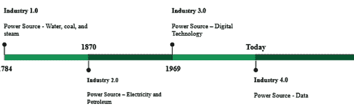

既然世界经济论坛创始人 Klaus Schwab 教授推广了“第四次工业革命”这一术语，学者、学者和商业领袖对了解更多相关信息的兴趣日益浓厚。人类现在被技术进步所包围。我们周围的一切都在经历数字革命，从闹钟到自动冷暖器、计算机化厨房电器以及自动驾驶汽车。这些数字设备不仅为人类节省了时间和精力，还能捕获每个人的大量数据。

第四次工业革命的主要动力来源是数据。第四次工业革命（常被称为工业 4.0）旨在通过更好的沟通和相关信息的分布，在企业内部不同部门之间创造协作氛围。美国国家科学基金会的 Helen Gil 创造了“网络物理系统”这一短语，它结合了计算机和物理过程。

### 图 2. 网络物理系统

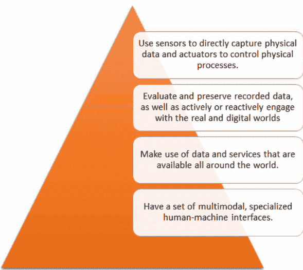

另一方面，CPS 是物理过程和计算过程的结合。具有嵌入式软件的系统称为网络物理系统（作为设备、建筑物、交通工具、交通路线、生产系统、医疗过程、物流过程、协调过程和管理过程的一部分）（Arcot, 2021）。人工智能、物联网和机器学习算法广泛应用于自动驾驶或半自动驾驶汽车中（Fulton & Platzer, 2018）。本章介绍在汽车网络物理系统领域推荐和使用的各种机器学习算法。

### 2. 机器学习

机器学习是计算机科学和人工智能的一个领域，专注于使用数据和算法来模仿人们的学习方式，并不断提高其准确性。机器学习为我们提供了有用的语音识别、强大的在线搜索、自动驾驶汽车以及对人类基因组的全面理解。机器学习现在非常普遍，你可能每天都在使用，甚至没有意识到。

机器学习是数据科学的重要组成部分，而数据科学仍处于早期阶段。算法通过统计方法进行训练，以生成预测或分类，为数据挖掘计划提供重要洞察（Hiran, Jain, Lakhwani et al, 2021）。从物联网（IoT）数据中检索信息时，机器学习是一种有价值的技术（Lakhwani et al., 2020）。在教育、安全、商业和医疗保健等多个领域，这些混合方案显著改善了决策过程。

机器学习用于解释物联网中海量数据中的隐藏模式，从而实现改进的预测和推荐系统。物联网和机器学习已应用于医疗保健，使自动化设备能够生成医疗记录、识别疾病，并最重要的是实时监测患者（Aldahiri et al., 2021）。精准农业（通常称为智能农业）已成为解决当今农业可持续性问题的尖端解决方案。这项尖端技术背后的驱动因素是机器学习。它使计算机能够在无需明确编程的情况下进行学习。机器学习和物联网支持的农业机械将是下一次农业革命的关键组成部分（Sharma et al., 2021）。

智能环境（如智慧城市和智能房屋）也是网络物理系统（CPS），在日常生活中越来越普遍。这些系统中的几个应用使用机器学习作为从原始数据中提取有价值知识的实用技术，例如通过家电识别或活动识别进行能源管理（Khamesi et al., 2020）。

网络物理系统由许多精密的多任务组件组成，这些组件协同工作，将网络部分集成到物理环境中。由于网络物理系统的大规模扩张以及智能功能和通信工具的广泛使用，出现了新的困难（Mohammadi Rouzbahani et al., 2020）。

### 图 3. 机器学习模型

- 受监督学习被定义为使用标记数据集来训练算法，以便持续对数据进行分类或预测结果。
- 无监督机器学习使用机器学习算法来分析和聚类未标记的数据集。
- 在训练过程中，半监督学习使用较小的标记数据集来协助从较大的未标记数据集中进行分类和特征提取。
- 强化机器学习是一种行为机器学习，模型通过犯错来学习。

### 3. 机器学习在 CPS 中的作用

机器学习算法已经彻底改变了几乎所有领域（Hiran, Khazanchhi, Vyas et al, 2021）。全球各地的企业通过预测未来事件或基于历史数据进行预测，提高了效率。机器学习算法在各个商业领域的使用日益增长。工业 4.0 将专注于广泛的数字应用，例如自动和半自动车辆的智能控制、健康监测、分析和流程优化。通过支持自学习和决策应用程序，机器学习算法将在实现工业 4.0 目标方面发挥关键作用。自动驾驶或半自动驾驶汽车的支柱是机器学习算法。为了执行面向未来的行动，模型从各种摄像头和传感器获取数据。通常，这些模型旨在提高安全性、高效操纵或预测道路上的物体。几位研究人员和学者合作并提出了模型，以提高自动驾驶汽车的能力。下面是几篇专注于自动驾驶汽车机器学习方法的出版物。

N. Motamedeidehkordi 等人（Motamedeidehkordi et al., 2017）提出了一种模型，用于分析人类驾驶员在变道操作过程中的战术行为。车辆 ID、帧 ID、车道 ID、局部 X、局部 Y、平均速度、平均加速度、车辆类别 ID、车辆长度、跟车 ID 和领车 ID 是用于模拟驾驶行为的公认特征。使用了朴素贝叶斯、支持向量机、线性回归、K 最近邻、决策树和随机森林来创建多个模型。决策树分类器在研究中优于其他模型。

F. Remmen 等人（Remmen et al., 2018）建议了一种模型，用于基于固定参数预测车辆的插入操作。卡车编队驾驶因改善交通效率、减少燃料消耗和排放的好处而越来越受到关注。在本文中，研究人员试图基于固定参数（如与宿主车辆的纵向距离）来预测车辆的插入操作，


相对于主车的横向距离、相对于主车的纵向速度、相对于主车的横向速度、之前相对于主车的纵向距离、之前相对于主车的横向距离、之前相对于主车的纵向速度、之前相对于主车的横向速度、矩阵位置、主车前方车辆（MIO）的距离，用于预测切入操作的准确性。

D. Yang 等人（Yang et al., 2019）提出了一种将传统机器学习与传统基于运动学的模型相结合的方法。研究人员正在努力克服基于机器学习的跟车算法的局限性。组合跟车模型是一种独特的跟车模型，它结合了基于机器学习的跟车模型和经典基于运动学的跟车模型。混合模型使用随机森林和反向传播模型构建。Hengrui Chen 等人（Chen et al., 2021）提出了一种研究自动驾驶汽车相关事故机制并评估每个特征对事故严重程度影响的模型。使用合成少数过采样方法平衡涉及自动驾驶汽车的事故报告数据集。对于事故机制分析，使用 Apriori 方法和分类模型。为了研究事故机制，使用 Apriori 方法来查找众多变量之间的因果关联。事故严重程度使用支持向量机（SVM）、分类和回归树（CART）以及极端梯度提升（XGBoost）方法进行评估。

由于行人识别被视为自动驾驶汽车最重要的任务之一，Navarro PJ 等人（Navarro et al., 2017）提出了一种机器学习技术，该技术使用高清 3D 距离数据来识别自动驾驶汽车中的行人。对传感器的点云数据进行处理，通过选择立方体形状并使用机器视觉和机器学习技术将立方体中的点投影出来，以检测行人。对于行人检测，使用 k-最近邻、朴素贝叶斯和支持向量机方法。SVM 在进行数据归一化的情况下，使用线性函数和二次函数进行了测试；kNN 在进行数据归一化的情况下，使用欧氏距离和马哈拉诺比斯距离进行了测试；NBC 在不进行数据归一化的情况下，使用高斯函数和核平滑函数（KSF）进行了测试，NBC 在不进行数据归一化的情况下，使用高斯函数和核平滑函数（KSF）进行了测试。

### 4. CPS 的组件

CPS 是目前最安全、最可靠、最高效的计算机系统。CPS 应用广泛应用于各个行业，包括医疗保健、军事、交通、能源和基础设施。RFID & IoT、互联网、嵌入式系统、无线传感器网络、移动网络和卫星网络都是网络物理系统的基本组成部分。CPS 作为现实世界与虚拟世界之间的纽带。无线传感器网络可在物理设备之间提供顺畅的通信，是 CPS 最重要的组件之一。（Gunes et al., 2014）

### 图 4. CPS 的组件

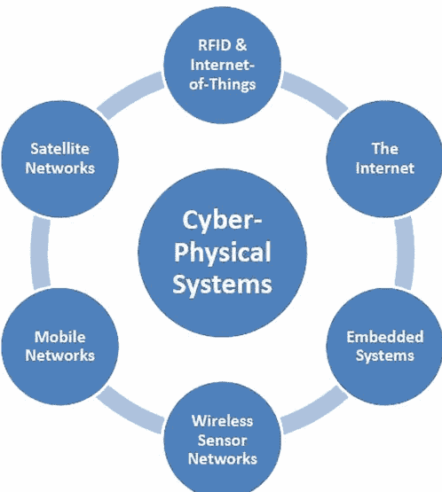

### 5. 自动驾驶汽车之旅与自动化等级

自动驾驶汽车主要关注可靠的出行、安全性和可负担性。特斯拉、苹果、Uber、亚马逊以及许多其他专注于尖端技术的顶尖企业正致力于改进自动驾驶汽车的特性。尽管自动驾驶车辆的概念早在 20 世纪 30 年代就已提出，但直到 21 世纪的第一个十年才成为现实。（Wolmar, 2020）。许多突破性发明，例如达芬奇的自行推进小车（1500 年）、罗伯特·怀特海德的水下推进鱼雷（1868 年）、机械迈克飞机自动驾驶仪（1933 年）、Teetor 巡航控制（1945 年）、斯坦福小车（1961 年）以及许多其他发明，为今天的自动驾驶汽车革命铺平了道路。自 2004 年以来，美国国防部的研究机构（DARPA）举办了一系列旨在推动自动驾驶技术发展的竞赛。在这些赛事中，汽车需要在沙漠公路和都市环境中自主导航。2007 年，11 名参赛者中有 6 辆汽车完成了挑战，在不到 6 小时的时间内行驶了大约 55 英里。这六款决赛机器人展示了被废弃的军用住房和幽灵街道中一个截然不同的未来的初步景象。（Voelcker, 2017）。卡内基梅隆大学的 Navlab 团队一直是开发用于自动驾驶和半自动驾驶车辆的计算机控制汽车的先驱。自 1984 年以来，已生产出机器人汽车、面包车、SUV 和公共汽车（卡内基梅隆大学自动驾驶地面车辆项目（NAVLAB），2021）。英国是第一个允许自动驾驶汽车以低速在公共道路上行驶的国家。美国的二十九（29）个州已制定立法允许自动驾驶汽车。除这两个国家外，澳大利亚、德国、韩国、加拿大、匈牙利、土耳其、中国、

### 表 1. 自动化等级

| 等级 | 等级名称 | 说明 |
|---|---|---|
| 0 | 无自动化 | 驾驶员全权负责车辆控制，包括转向、制动、加速和减速。0 级汽车上均可使用倒车摄像头、盲点警报和碰撞警告。 |
| 1 | 驾驶辅助 | 自动化系统开始在特定情况下控制车辆，但并未完全接管。1 级自动化的示例是自适应巡航控制，它控制加速和制动，通常用于高速驾驶。 |
| 2 | 部分自动化 | 由于对环境的感知更强，车辆可以执行更复杂的活动，将转向（横向控制）与加速和制动（纵向控制）相结合。 |
| 3 | 有条件自动化 | 驾驶员在特定情况下可以脱离驾驶任务。某些车辆速度、道路类型和天气条件可能受到限制。尽管如此，当系统请求时，驾驶员预计将接管控制权。 |
| 4 | 高度自动化 | 车辆的自动驾驶系统完全能够监控驾驶环境，并执行其运行设计范围（ODD）内描述的常规路线和情况下的所有驾驶操作。如果存在需要人工干预的环境情况（例如大雪），车辆可能会通知驾驶员其正在接近操作极限。如果驾驶员没有回应，汽车将自动进入安全状态。 |
| 5 | 完全自动化 | 车辆完全自给自足。不需要驾驶员在方向盘后面。实际上，5 级汽车可能没有方向盘，也没有油门和制动踏板。5 级汽车的乘客可能能够使用语音命令选择位置或控制内部设置（如温度和媒体选择）。 |

波兰都对技术发展做出了重大贡献（全球自动驾驶汽车指南，2021）。自动驾驶汽车的分类是根据自动化程度将其分为不同类别。美国国家公路交通安全管理局（NHTSA）于 2013 年发布了首个分类。2016 年，SAE 引入了六级自动化，成为所有自动驾驶汽车的全球标准。表 1 显示了自动驾驶汽车的不同自动化等级。

### 6. 自动驾驶汽车中的传感器

自动驾驶汽车使用传感器。没有传感器，很难设想自动驾驶汽车。传感器使汽车能够看到并感知道路上的一切，以及收集安全驾驶所需的数据。这些数据被收集和评估，以便创建从一个位置到另一个位置的路径，并向汽车提供必要的转向、加速和制动指令。

自动驾驶车辆传感器收集的信息，例如实际路径、交通拥堵和任何道路障碍，也可以通过 M2M 技术连接的汽车之间进行交换。这被称为车辆至车辆通信，在驾驶自动化方面可能会提供巨大帮助。

当今大多数汽车制造商在自动驾驶汽车中最常用的以下三种传感器

- 摄像头，
- 雷达，和
- 激光雷达。

### a. 摄像头传感器

视频摄像头和传感器通常用于自动驾驶汽车，以检测和解释道路上的事物，就像人类驾驶员用眼睛所做的那样。通过从各个角度为汽车配备这些摄像头，它们将能够保留对外部环境的 360° 视图，从而更全面地了解交通情况。现在已有 3D 摄像头可用，可用于显示非常详细和逼真的视觉效果。这些图像传感器会自动检测、分类并计算物体与车辆之间的距离。例如，其他汽车、行人、自行车、交通标志和信号、道路标记、桥梁和护栏等，均可被摄像头轻松识别。


### b. 雷达传感器

雷达（Radio Detection and Ranging）传感器对自动驾驶的通用功能至关重要：它们发出无线电波来检测物体，并实时计算物体与车辆之间的距离和速度。短程和长程雷达传感器通常分布在整个车辆上，各自承担不同的任务。短程（24 GHz）雷达应用可实现盲点监测、最佳车道保持辅助和停车辅助，而长程（77 GHz）雷达传感器负责自动距离控制和制动辅助。与摄像头传感器不同，雷达设备在雾天或雨天检测物体通常也不会有问题。

### c. 激光雷达传感器

激光雷达（Light Detection and Ranging）传感器的工作原理与雷达系统类似，区别在于它们使用激光而非无线电波。除了测量路线上各种物体的距离外，激光雷达还能为识别出的物体创建 3D 图像，并绘制周围环境的地图。此外，激光雷达不仅依赖于受限的视野，还可以设置为生成围绕车辆的完整 360 度地图。正因为这两大优势，谷歌、Uber 和丰田等自动驾驶汽车制造商更青睐激光雷达系统。

### d. ADAS（高级驾驶员辅助系统）

大多数汽车碰撞都是由人为失误引起的，使用高级驾驶员辅助系统（ADAS）可以减少或消除此类失误。ADAS 的目标是降低汽车事故的发生频率以及无法预防事故的严重程度，从而防止人员伤亡。

图 5. ADAS 应用

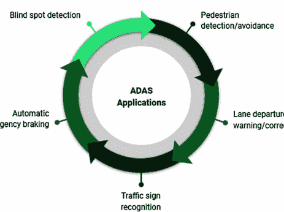

表 2. ADAS 功能

| ADAS 功能 | 使用的传感器 |
|---|---|
| ACC | Camera/LiDAR/RADAR |
| 停车辅助 | Ultrasonic/Camera |
| 盲点监测 | Camera/RADAR |
| AEB | Camera/LiDAR/RADAR |
| 疲劳驾驶监测 | Camera |
| 行人检测 | Camera |
| 交通标志识别 | Camera |
| 车道控制辅助 | Camera |
| 夜视 | Camera/Bolometer |
| 自动远光灯 | Camera |

### 7. 自动驾驶汽车中的挑战与机遇

多家汽车公司、投资者和科技公司正致力于将自动驾驶汽车带入日常生活（Khvoynitskaya, 2020）。然而，除非解决关键问题和挑战，否则这些自动驾驶汽车的全面普及是不可能的。在这个快速发展的领域中，最紧迫的问题之一是乘客安全。许多研究人员已尝试通过分析传感器接收到的数据，利用机器学习模型来解决安全相关问题。其他一些研究人员则建议通过使用机器学习算法分析用户行为，来提升无人驾驶汽车中乘客的体验。

图 6. 关键挑战

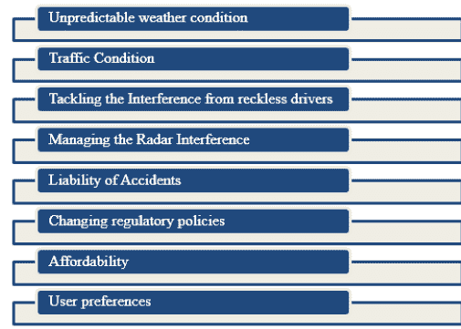

### a. 挑战

不幸的是，摄像头传感器仍远非理想。雨、雾或雪可能会遮挡道路上的障碍物，增加事故风险。此外，有时摄像头拍摄的图像不足以让计算机对汽车应采取的行动做出明智判断。当物体颜色与背景非常相似，或两者之间的对比度很小时，驾驶算法可能会失效。

行人检测算法急需改进，因为当今的汽车雷达传感器只能准确识别 90% 到 95% 的行人，这不足以保障道路安全。此外，由于传感器仅水平扫描，2D 雷达无法正确检测物体的高度，这在车辆穿越桥梁或路标下方时可能引发多种问题。为应对这些困难，目前正在开发更广泛的 3D 雷达传感器。激光雷达传感器的成本远高于自动驾驶汽车中使用的雷达传感器，因为制造足够数量的激光雷达传感器需要稀土金属。自动驾驶所需的设备成本可能高达 10,000 美元，谷歌和 Uber 的顶级传感器成本高达 80,000 美元。另一个问题是，雪或雾偶尔会遮挡激光雷达传感器，使其难以检测道路上的物体。

### b. 机遇

在自动驾驶中，自主传感器至关重要，因为它们使汽车能够监控周围环境、识别即将来临的危险并安全规划路线。它们最终将使自动化系统能够完全控制车辆，通过以更高效、更安全的方式执行任务，为驾驶员节省大量时间。想想看，在我们生活的快节奏社会中，自动驾驶汽车将带来多大的益处，考虑到平均每位驾驶员每天在车上花费约 50 分钟。虽然自动驾驶汽车技术似乎正在快速发展，但目前尚无商用车辆达到道路安全自动驾驶所需的 4 级评级。制造商仍需考虑大量技术进步，以确保自动驾驶汽车在道路上的安全。

图 7. 与工业 4.0 相关的 CPS 中的挑战与风险

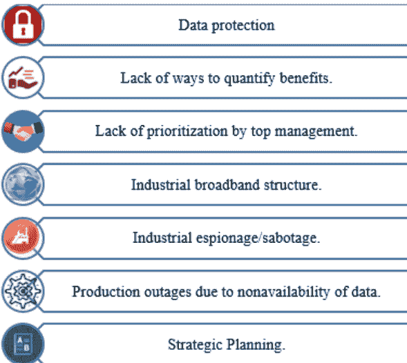

### 8. 结论

在未来的几年中，网络物理系统将占据主导地位。许多创新想法无疑将提高生产力并推动公司向前发展。得益于网络物理系统十年的进步，配备改进的传感器、子系统和机器学习算法，无人航空和地面车辆现在具备自主决策能力。自主程度由车辆的构成和传感器复杂性以及车辆的运行用途决定，后者可从昂贵的军事战斗车辆到可商业获得的民用机动车辆和极低成本的爱好者无人机不等。网络物理系统领域的这些进步在很大程度上依赖于机器学习技术。机器学习算法对于基于观察分析环境、学习模式、构建预测模型、聚类相关观察，并最终做出决策至关重要。研究人员和学者始终致力于使用机器学习算法进行新的改进，并解决安全等当前难题，因此自动驾驶汽车领域的发展将持续下去。本文进行了一项研究，以确定自动驾驶汽车中使用的机器学习算法及其应用。根据研究，开发完全自动化汽车存在障碍和风险；尽管如此，许多研究人员正在开发新方法来降低这些风险，使完全自动化汽车成为可能。

### 参考文献

- Aldahiri, A., Alrashed, B., & Hussain, W. (2021). 在健康预测系统中将 IoT 与机器学习相结合的趋势. *预测*, 3(1), 181–206. doi:10.3390/forecast3010012
- Arcot, R. (2021). *网络物理系统：工业 4.0 的核心*. https://blog.isa.org/cyber-physical-systems-the-core-of-industry-4.0
- Chen, Chen, Zhou, Liu, & Sun. (2021). 使用机器学习探索自动驾驶汽车碰撞机制. *Hindawi 工程中的数学问题*. doi:10.1155/2021/5524356
- Fulton, N., & Platzer, A. (2018). CPS 的安全 AI（邀请论文）. *IEEE 国际测试会议 (ITC)*, 1-7. 10.1109/TEST.2018.8624774
- 自动驾驶汽车全球指南. (2021). https://www.dentons.com/en/insights/guides-reports-and-whitepapers/2021/january/28/global-guide-to-autonomous-vehicles-2021
- Gunes, V., Peter, S., Givargis, T., & Vahid, F. (2014). 网络物理系统中概念、应用和挑战的综述. *互联网与信息系统期刊 (首尔)*, 8(12), 4242–4268. doi:10.3837/tiis.2014.12.001
- Hiran, K. K., Jain, R. K., Lakhwani, K., & Doshi, R. (2021). *机器学习：使用真实示例掌握监督和无监督学习算法（英文版）*. BBP Publications.
- Hiran, K. K., Khazanch, D., Vyas, A. K., & Padmanaban, S. (Eds.). (2021). *可持续发展的机器学习*（第 9 卷）. Walter de Gruyter GmbH & Co KG. doi:10.1515/9783110702514
- Khamesi, A. R., Shin, E., & Silvestri, S. (2020). 野外机器学习：网络物理系统中以用户为中心的学习案例. *国际通信系统与网络会议 (COMSNETS)*, 275-281. 10.1109/COMSNETS48256.2020.9027329


Khvoynitskaya, S. (2020年2月11日). 自动驾驶汽车中的3种自动驾驶传感器类型。自动驾驶车辆传感器。https://www.itransition.com/blog/autonomous-vehicle-sensors

Lakhwani, K., Gianey, H. K., Wireko, J. K., & Hiran, K. K. (2020). 物联网（IoT）：原理、范式和IoT应用。Bpb Publications.

Mohammadi Rouzbahani, H., Karimipour, H., Rahimnejad, A., Dehghantanha, A., & Srivastava, G. (2020). 利用机器学习进行网络物理系统中的异常检测。大数据隐私手册 Springer, 219-235. doi:10.1007/978-3-030-38557-6_10

Motamedeidehkordi, N., Amini, S., Hoffmann, S., Busch, F., & Fitriyanti, M. R. (2017). 自动驾驶车辆战术变道行为建模：一种监督机器学习方法。第5届IEEE智能交通系统模型与技术国际会议（MT-ITS）, 268-273. 10.1109/MTITS.2017.8005678

Navarro, P., Fernández-Isla, C., Borraz, R., & Alonso, D. (2017). 基于高清3D测距数据的自动驾驶车辆行人检测机器学习方法。Sensors (Basel), 17(1), 18. doi:10.3390/s17010018 PMID:28025565

Remmen, F., Cara, I., Gelder, E. D., & Willemsen, D. (2018). 自动驾驶车辆切入场景预测。IEEE车辆电子与安全国际会议（ICVES）, 1-7. 10.1109/ICVES.2018.8519594

Sharma, A., Jain, A., Gupta, P., & Chowdary, V. (2021). 精准农业机器学习应用：全面综述。IEEE Access：实用创新、开放解决方案, 9, 4843–4873. doi:10.1109/ACCESS.2020.3048415

卡内基梅隆大学自动驾驶陆地车辆项目（NAVLAB）。(2021). https://www.cs.cmu.edu/afs/cs/project/alv/www/index.html

Voelcker, J. (2017). 自动驾驶车辆完成DARPA城市挑战赛。https://spectrum.ieee.org/autonomous-vehicles-complete-darpa-urban-challenge

Wolmar, C. (2020). 无人驾驶汽车的漫长旅程。IntechOpen. https://www.intechopen.com/online-first/73420 doi:10.5772/intechopen.93856

Yang, D., Zhu, L., Liu, Y., Wu, D., & Ran, B. (2019). 一种结合机器学习与运动学模型的自动驾驶车辆新型跟车控制模型。IEEE智能交通系统期刊, 20(6), 1991–2000. doi:10.1109/TITS.2018.2854827

## 第2章
## 针对人力发展的网络物理系统涌现：具有印度潜力的国际场景

Prantosh Kumar Paul
赖甘杰大学，印度

### 摘要

网络物理系统，简称CPS，是Ellen Gill于2006年创造的术语。它是一种嵌入式系统。它是一种下一代计算系统，通过集成物理和逻辑，包含交互的数字、模拟和物理组件。这种CPS与大数据分析、云计算、物联网（IoT）等其他技术和概念相关联和结合。此外，网络物理系统通过实现智能电网、智慧城市以及其他智能和智慧事物（例如汽车、建筑、住宅、制造、医院、家电）来构建智慧事物。本章讨论了网络物理系统的各个方面，包括其基础、特征、功能以及新兴和可能的角色。此外，本章还讨论了国际上网络物理系统领域的教育项目和培训项目的当前趋势及其在印度背景下的潜力，并描绘了当代场景中的许多机遇。

### 引言

2006年，“网络物理系统”一词由Ellen Gill创造。这被认为是一种重要的嵌入式系统，属于与计算技术和各种计算利益相关者相关的下一代计算（Agarwal, P., 2007; Chen, G. et al., 2018）。在网络物理系统中，三个重要手段是计算、通信和控制。在CPS中，物联网（IoT）起着主导作用，因为它与计算和物理单元及方面相连，推动了健康和复杂通信系统实现的进步。根据一些专家的说法，“数字控制”和“物理环境”合并并发展出了网络物理系统（Colombo, A. W., et al., 2014; Paul, P.K. et al., 2017c）。在网络物理系统中，有两种组合，即与物理组件相关的网络元素基本上构成了网络物理系统，这只是一种信息处理计算机系统，并且此外嵌入到产品中，也可以集成到汽车、飞机或任何其他设备中。基本结构如图1所示。

图 1. 带属性的基本网络物理系统结构

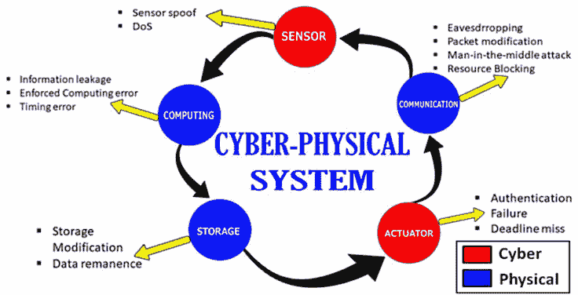

根据专家的说法，在特定汽车中，嵌入式系统可被视为用于控制制动力的防抱死/防滑制动系统。这里，特定系统通过传感器和执行器与物理环境进行交互（Alguliyev, R. et al., 2018; Ali, S. et al., 2015; Paul, P.K., et al. 2020）。因此，需要注意的是，此类嵌入式系统基本上不再是独立的，它们基本上通过互联网等高效通信网络共享内容和数据，这里可以使用云计算和类似系统，其中可以收集和处理来自各种嵌入式系统的数据。在这方面，CPS可以被视为开发系统的系统，并由计算单元去中心化。在CPS中，数据可以通过人机接口（HMI）收集和处理（Humayed, A., et al., 2017; Khaitan, S. K., et al., 2014）。在网络物理系统中，IoT被视为重要且有价值的，因为这里的设备和系统通过互联网有效连接，并远程执行实时数据收集，此外还可以与其他设备进行处理。根据专家的说法，网络物理系统可以与两种计算机系统类型一起工作，即计算机（如笔记本电脑、台式机服务器和个人电脑等）和嵌入式计算系统（即在工业、组织以及环境的不可见部分中很重要）。

因此，CPS是一种智能系统和机制，它与硬件、软件合并并连接到网络，从而使“物理系统与世界”与“虚拟世界”得到适当连接。网络物理系统的创新取决于许多技能，这些技能需要根据需求和发展及时更新（Ashibani, Y., 2017; Baheti, R., & Gill, H., 2011; Paul, P.K., 2017b）。因此，全世界许多教育机构都专注于该领域适当且专门的人力资源开发。

因此，网络物理系统与传统嵌入式系统、计算机、软件系统相关联，实际上其主要任务不是计算。由于它适用于汽车、玩具、医疗设备、工程系统等，因此它与软件、网络、建模、设计和分析技术等计算系统合并并结合到物理过程中。然而，网络物理系统可以在控制论的早期阶段被定义并标志其进步（Hiran, K. K., & Doshi, R., 2013）。

### 目标

本文标题为“针对人力发展的网络物理系统涌现：具有印度潜力的国际场景”，拟议如下议程和目标——

- 简要了解网络物理系统的特征、性质和特点。
- 简要了解计算及其他活动中的功能和作用。
- 了解CPS在不同部门和领域在构建数字化系统中的应用。
- 了解各种系统和计算中移动网络物理系统的基础。
- 简要挖掘CPS及相关领域的应用、培训和研究机会等教育机会。
- 简要了解网络物理系统在印度背景下在国际市场上的潜在学位以及教育和培训项目。

### 网络物理系统（CPS）：基本特征和组件

CPS或网络物理系统是一种基于设备、电子和信息技术的创新和智能系统，它涉及以下属性——

- 网络物理系统是一种智能、自适应和强健的系统。
- 网络在通信、合作、云解决方案等事务中，在网络物理系统中起着健康且有潜力的作用。
- 网络物理系统依赖于各种功能。
- 系统及机制的用户友好性在CPS中是必须且重要的。

因此，网络物理系统直接与计算系统和物理过程集成。在这里，软件基本上嵌入到物理系统中，重要的是CPS在此基于WSN（无线传感器网络）运行（Xu, L. D., & Duan, L., 2019; Zanero, S., 2017）。

根据专家的说法，网络物理系统具有5c（五个）结构，包括组件级、机器级、车队级、企业级等，所有这些在运营级别上都有效（另参见图 2）。

### 组件级

此级别基本上在网络空间中保留数字孪生，并且还捕捉云中发生的不同类型的变化。系统本身有助于正确开展自我意识相关活动（Darwish, A., & Hassanien, A. E., 2018; Leitão, P. et al. 2016）


### 机器层

该层主要致力于收集不同层级和组件层级的信息，因此有助于综合机器操作。

### 舰队层

借助舰队层，优化生产流程成为可能，进而实现自动配置和自动维护，并具有最大化系统组件使用寿命的优势。

### 企业层

物理网络系统的企业层整合了前一层的成果，并致力于生产高性能产品（Krämer, B. J., 2014; Kim, K. D., & Kumar, P. R., 2013）。

图2. 物理网络系统架构

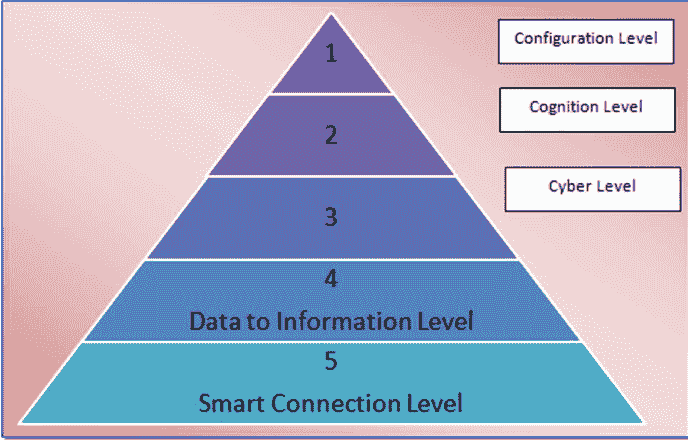

### 物理网络系统：重要性及应用

由于具有潜在优势，物理网络系统（CPS）正在新兴并广泛应用于多个领域，其中几个重要应用如下所示。物理网络系统中使用的标准、协议和测试方法基本旨在促进创新，从而间接提升经济可行性，并使系统更加高效、减少资源使用，并保持产品的及时性（Gronau, N., 2016; Iqbal, R. et al., 2020）

### 集成

物理网络系统（CPS）有助于云系统与网络系统的集成过程。它提供媒体访问控制技术、系统动态、中间件、网络事务等网络集成特性。

### 人机与计算系统的健康交互

物理网络系统在人机与计算系统的适当高效交互方面具有健康效益。此类系统在环境感知和决策制定系统方面具有价值（Guo, Y., 2010; Lee, I. et al., 2011）

### 应对不确定性

物理网络系统有助于开发特定情境和条件，因此有助于设计有效且可信赖的系统。

### 有效的系统性能

物理网络系统因反馈以及与网络及相关基础设施的适当交互中的自动重新设计等多种优势，从而促进有效的系统性能。

### 灵活性与柔性

物理网络系统的灵活性是区别于无线传感器网络和基于云系统的另一特性（Alguliyev, R., et al., 2014; Huang, Z. et al., 2014）

### 更快的响应时效

物理网络系统的一项重要特性是其更快的响应时效。它可实现更快的早期时效检测和适当的资源利用。

物理网络系统的优势是其更广泛、新兴应用背后的原因，应用领域日益增加，包括：制造业、水分布与管理系统、智能温室、医疗保健系统、交通运输系统、建筑、航空航天、虚拟现实、智能学习和教学活动等。物理网络系统或CPS是一种基于传感器以及自动化通信系统（Rocher, G., 2020; Wan, J., 2011）。不同的WSN基本用于监测环境的某些方面，并与中心节点连接/中继。物理网络系统的示例包括智能电网、自动驾驶和先进汽车系统、医疗保健监测、分布式健康机器人等。物理网络系统利用的众多实际当前示例包括：美国麻省理工学院校园的分布式机器人花园。这是一种番茄园，结合了分布式感知、导航、操作以及无线网络系统（Hehenberger, P. et al, 2016; Lieu Tran. et al, 2016）。另一个示例是爱达荷国家实验室，这是弹性控制系统的典范。通过此方式，下一代网络安全设计成为可能。类似地，在美国麻省理工学院，另一个重要示例是CarTel项目，其中出租车能够进行数据收集，有助于美国波士顿的实时交通信息管理。因此，它有助于最快路径管理。就最智能和先进的电网而言，物理网络系统非常有用，并可能能够增强分布式可再生能源的整合（Lu, T., 2015; Lun, Y. Z. et al., 2019）。物理网络系统通过云技术、大数据应用、物联网系统等推动工业4.0的发展。有许多项目/公司参与物理网络系统的开发和活动，其中重要的有—

- 欧洲委员会IMC-AESOP项目
- SAP
- Honeywell
- Microsoft 等。

据专家称，物理网络系统应用的最大领域包括先进制造业、智能水分布系统、先进复杂的交通运输、远程高效医疗保健和智能建筑等。

### 制造业及相关行业

物理网络系统在各种制造相关活动中很重要，包括对运营和生产的自监控（含控制）。借助物理网络系统应用，制造流程变得更加容易，这是因为机器、供应链、供应商、客户、中间人等之间能够进行数据共享。在智能制造中，物理网络系统对供应链管理很重要，并最终帮助实现货物的可追溯性和安全性。物联网（Internet of Things）和大数据分析/管理的应用对于健康、精密和先进的制造系统很重要。传感器基本上用于预测设备磨损和诊断故障，因此最终是减少维护和先进成本、提升运营性能的原因（Marwedel, P., et al., 2020; Paul, P.K., et al., 2017a）[25]。众所周知，制造业基于五层架构，因此物理网络系统有助于以下方面—

### 连接

物理网络系统有助于建立和维护诸如机器、工具以及产品等连接。

### 转换

这只是使用算法将数据转化为信息，而物理网络系统就是其所起的作用（Sadiku, M. N., 2017）。

### 网络

先进制造业依赖于精密和先进的制造方法，因此深度学习及类似算法在此发挥主导作用。

### 认知

在从不同设备发送数据时，可以识别潜在问题，并进一步帮助监测和诊断潜在问题及故障。

### 配置

配置已成为管理和部署系统的重要且有价值的工具，因为机器可以根据故障和工作负载修改其操作（Altbach, P. G., 1993）。

### 水分布与管理系统

就水分布系统而言，物理网络系统正在迅速发展并具有价值。在某些方面，它对水库、水箱、水泵、水井、管道、水箱等具有价值。物理网络系统有助于监测活动，例如：用于检测水位、溢流水位、管道水压力的传感器。此外，可编程逻辑控制器可以自动开启阀门、进行监督等（Kim, K. D., & Kumar, P. R., 2013; Sanislav, T., & Miclea, L., 2012）

### 农业及智能温室系统推广

物理网络系统或CPS对增强农业系统很重要，它能提高先进生产力并防止饥荒。CPS在此对健康的温度、湿度、灌溉系统很重要。可以使用特定计算机程序，在CPS的支持下可能确保更好的生长，并有助于温室。反馈及类似系统可以利用网络服务进行管理，使用传感器收集温度和湿度、土壤湿度以及光照传感器的数据。因此，物理网络系统在以下方面有益—

- 节省农民和农艺师的资金，包括时间和精力。
- 提供包含生产力在内的健康和更好的环境。
- 控制和供应自动化水及相关物流（Paul, P.K., 2017b; Sedjelmaci, H., 2020）。

### 医疗保健与医疗系统

物理网络系统基本上适用于各种医疗和保健系统，例如：收集实时数据，包括监测患者。此外，CPS通过远程感知系统收集数据，以及物理状况，有助于患者。因此，它改善并有助于提升普通患者（包括残疾和老年患者）的健康和改进治疗。此类系统将处理网络关闭


循环系统加入人工回环以改善安全性和工作流程，因此面向基于物理-信息系统的医疗保健系统正在涌现并获得潜力（Guo, Y., et al., 2017）。

### 在更智能的交通运输领域

就先进和更智能的通信而言，物理-信息系统在收集不同交通和运输相关事务（如交通系统、位置管理）的实时信息方面至关重要，因此CPS在此方面尤其有价值，具体体现在以下方面—

- 位置与时间管理
- 在防止事故和改善安全方面。
- 在减少碳排放方面，物理-信息系统也间接具有价值。

发展中国家与发达国家目前都在交通系统中向先进的智能物理-信息系统（CPS）迈进。

### 在建筑领域

就建筑管理及相关建筑活动而言，物理-信息系统同样至关重要。在智能建筑的开发和推进中，CPS非常重要，这有助于提高能源效率，降低能源消耗，并最终减少温室气体排放。在此，物理-信息系统有助于收集温度、湿度等相关数据（Baheti, R., & Gill, H., 2011; Serpanos, D., 2018）。

### 在航空应用领域

物理-信息系统在航空及相关活动中的应用和利用可被视为有价值，其中几个重要的应用包括飞行试验仪表、机组人员通信、健康和结构化医疗监测。此外，在飞行相关娱乐、无线客舱系统、飞机着陆等方面，物理-信息系统也至关重要，并且正在迅速增加。

### 在虚拟现实领域

在虚拟现实（技术上称为Claytronics）的背景下，它也是物理-信息系统应用中的一个重要名称。它结合了纳米级机器人和计算机理论，能够制造称为粘土电子原子/catoms的纳米级系统，并提供3D结构。借助粘土电子技术，3D尺寸易于创建和开发。这里正在使用两种类型的算法。在此，物理-信息系统特别是定位算法，使catoms在集合体中的定位成为可能。

### 在更智能和增强的学习系统领域

物理-信息系统在先进和更智能的教育系统应用中至关重要，它可以用于收集物理系统和环境的数据、转换测量数据、在线教育系统，以及为学生、员工和教育机构提供先进及时的服务。物理-信息系统有助于构建和开发智能学习环境系统（SLE）。

### 移动物理-信息系统：概述

移动物理-信息系统是物理-信息系统的一部分，其中物理系统发挥着重要作用，而进一步的移动性被视为有价值。移动机器人学、电子运输系统被视为移动物理系统。日益增长的移动用途推动了物理-信息系统的兴起，更确切地说，各种智能手机及其相关平台有助于为不同目的构建理想的移动物理-信息系统，具体包括：

- 包括本地存储在内的重要且显著的计算资源。
- 各种传感器设备，包括触摸屏、摄像头、GPS、扬声器、各种麦克风。
- 各种通信平台，如由互联网和类似设备运行的WiFi、3G、Bluetooth。
- 不同种类的应用程序/应用/软件分发机制，如Apple或Google的App Store。

网络连接（连接移动系统，包括服务器或云连接）负责增强移动物理-信息系统（Krämer, B. J., 2014; Törngren, M. et al, 2017）。

### 人力与人力资源发展：物理-信息系统

物理-信息系统已成为计算和信息技术领域的一项重要技术，因此现在正是将其作为一门新兴技术引入IT和计算学科的时机。即使在通信技术、网络技术等相关学科中，物理-信息系统也在迅速发展。许多国际大学不仅将物理-信息系统作为其研究领域内的一门课程或重要方向，而且将其作为专业方向和完整学科，旨在使社会更加智能、先进和智慧（参见图3）。

图3. 配备充足和适当人力的物理-信息系统潜在利用

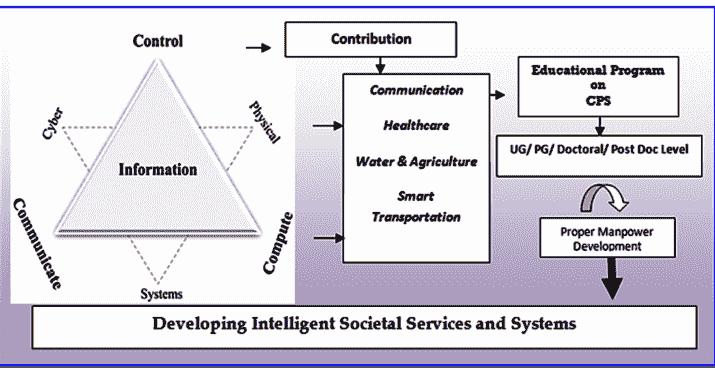

值得注意的是，即使在发展中国家，引入物理-信息系统的迹象也值得注意。物理-信息系统将计算与物理对象（如“智能”设备）相结合，涉及语音助手设备、无人驾驶车辆和汽车、医疗和健康监测设备及系统、可穿戴电子系统和设备、不同电子系统中的机器人助手等各种其他方面。因此，在印度语境下，该领域可以在以下部门/中心/单位中以完整学科的方式引入—

- 计算机科学
  - 计算机科学与工程（CSE）或计算机工程（CE）
  - 信息技术（IT）或信息科学与技术（IST）
  - 电子与通信工程（ECE）
  - 电信系统等等。

### 表1. 拟议的物理-信息系统ME/MTech课程

| 序号 | 提供的学位 | 大学 | 备注 | 国家 |
| :--- | :--- | :--- | :--- | :--- |
| 1 | MSc-物理-信息系统与嵌入式系统 | Advanced Learning and Research Institute | 120 ECTS，面向工程、计算和纯科学专业学生开放 | 瑞士 |
| 2 | MSc-物理-信息系统（专业方向：IoT） | North Eastern University | 全日制和非全日制，多地点提供 | 美国 |
| 3 | M.Engg-机电与物理-信息系统 | Deggendorf Institute of Technology | 多地点提供，3学期课程 | 德国 |
| 4 | MSc物理-信息系统 | The Polytechnic Institute of Paris | 60学分，2学期 | 法国 |
| 5 | MSc物理-信息系统 | The University of Nottingham | 2年（拥有相关课程或兴趣的毕业生） | 英国 |

根据这一结果，可以看出大多数项目采用MSc命名，而非MS和MTech，这意味着在美国和印度（及追随国家）中提供较少。在这五个项目中，物理-信息系统既作为专业方向，也作为完整学位提供。物理-信息系统的课程应与电信、计算、先进信息技术及相关基础科学相连接。以诺丁汉大学为例，该项目以MSc物理-信息系统命名，总学分为180，并进一步划分为120学分。此外，它由各种必修和选修模块组成，外加60学分的个人项目。这是一门两年制课程，第一年进行课程学习，第二年则有60学分的研究项目或类似的科研活动，最终形成论文。如果我们深入了解诺丁汉大学的这一项目，可以注意到核心课程在此分为必修课程和选修课程，如表2和表3所示。

### 表2. 拟议的物理-信息系统ME/MTech课程

| 必修课程 |
|---|
| 自主机器人系统 |
| 基于传感器的系统设计 |
| 计算机系统的时态趋势 |
| 恶意软件分析 |
| 研究方法 |
| 研究项目 |

由于物理-信息系统是跨学科项目，因此必须涵盖包括电子和管理相关学科在内的技术与计算内容。

### 表3. 拟议的物理-信息系统ME/MTech课程

| 选修课程 | |
|---|---|
| 线性与离散优化 | 先进计算机网络 |
| 设计民族志 | 先进算法与数据结构 |
| 机器学习 | 先进算法与数据结构项目 |
| 人机交互 | 数据建模与分析 |
| 模糊逻辑与系统 | 决策制定的仿真与优化 |
| 混合现实技术 | 游戏 |
| 软件工程管理 | 程序、证明与类型 |

在印度，目前没有机构提供物理-信息系统或相关/合并命名的完整学位，但在科学学位以及技术/工程学位中提供这门学科具有巨大潜力。因此，表4在此描绘了印度语境下MTech/ME的潜在可能学位列表。


### 表 4. 网络物理系统与 ME/MTech 的拟议课程

| 拟议网络物理系统课程在 MTech/ME 课程级别的潜力 |
| --- |
| MTech/ME- 网络物理系统 (CPS) |
| MTech/ME- 网络物理系统与嵌入式系统 (CPS & ES) |
| MTech/ME- 信息技术与网络物理系统 |
| MTech/ME- 网络物理系统与物联网 |

此处拟议的网络物理系统可与嵌入式系统、物联网等相关学科，甚至与信息技术等广泛学科相结合。就科学学位而言，可采用 MSc（主要在亚洲和欧洲实践）、MS（主要在美国及追随国家实践）以及 MSc/MS 研究型学位（也在全球范围内新兴）的命名方式。下表 5 提供了可能的和潜在的学位名称。

### 表 5. 网络物理系统与研究生科学学位的拟议课程

| 拟议网络物理系统课程在 MSc/ MS/ MS 研究型学位课程级别的潜力 |
| --- |
| MSc/ MS/ MS by Research- 网络物理系统 |
| MSc/ MS/ MS by Research- 网络物理系统与嵌入式系统 |
| MSc/ MS/ MS by Research- 信息技术与网络物理系统 |
| MSc/ MS/ MS by Research- 网络物理系统与物联网 |

但在此需要注意的是，在表 4 和表 5 中，潜在的命名仅涉及网络物理系统；然而，在印度语境下，由于计算机应用、信息技术等已是确立的领域，因此在这些学科中可以开设网络物理系统及相关领域，部分可能的课程已在表 6 中描述。此处所提议的学位既可作为相关课程中的“专业方向”，也可作为“研究型学位”。

### 表 6. 网络物理系统与计算机应用及信息技术命名的拟议课程

| 拟议网络物理系统课程在 CA/IT 命名下的潜力 |
| --- |
| MSc/ MS/ MS by Research (IT/CA) - 网络物理系统 |
| MSc/ MS/ MS by Research-(IT/CA) - 网络物理系统与嵌入式系统 |
| MSc/ MS/ MS by Research- (IT/CA) - 网络物理系统与物联网 |

印度是一个发展中国家，因此引入此类学位和命名方式在培养该领域适当人力资源方面可被视为有价值。这些课程和科目可以与近年来已开设的其他新兴 IT 和计算学科（如云计算、大数据与数据分析、物联网（Internet of Things）、区块链技术等）类似方式开设。表 7 描述了科学、工程领域中部分潜在的博士学位课程。需要注意的是，工程专业博士学位也已被提议。

### 表 7. 网络物理系统与计算机应用及信息技术命名的拟议课程

| 拟议网络物理系统课程在 CA/IT 命名下的潜力 |
|---|
| PhD (科学) - 网络物理系统 |
| PhD (工程) - 网络物理系统与嵌入式系统 |
| Engg. D.(IT/CA) - 网络物理系统与物联网 |

因此，在构建智能系统与社会的背景下，网络物理系统具有重要价值，而现成的人力资源对于满足工业界的需求和实际要求至关重要。

### 结论

网络物理系统正在印度信息技术系统的发展中发挥主导作用。网络物理系统学科已在不同的 IT 和计算相关课程中引入，现在是首次在硕士和研究生学位层面（通向博士、MTech 研究型学位、MS 研究型学位等）引入网络物理系统及相关领域的时机。未来，这些学科也可在本科层面（如 BSc、BS、BTech 等学位）以及研究背景下引入，同时考虑研究趋势。网络物理系统正与其他前沿领域一起新兴发展，因此将该学科与相关学科合并以产生更好、更健康的成果至关重要。此外，工业界的投入、主动性、意识以及政府支持对于在印度健康、及时地引入网络物理系统至关重要。世界各国的许多国家通过其理事会、部委、部门及相关利益相关方，正在开展网络物理系统相关的培训、教育、研究及实践/实施相关倡议，这是迈向真实语境下数字社会与经济的当务之急。

### 参考文献

- Agarwal, P. (2007). 印度高等教育：增长、关切与变革议程。Higher Education Quarterly, 61(2), 197–207. doi:10.1111/j.1468-2273.2007.00346.x
- Alguliyev, R., Imamverdiyev, Y., & Sukhostat, L. (2018). 网络物理系统及其安全问题。Computers in Industry, 100, 212–223. doi:10.1016/j.compind.2018.04.017
- Ali, S., Qaisar, S. B., Saeed, H., Khan, M. F., Naeem, M., & Anpalagan, A. (2015). 面向微型无线设备的网络物理系统网络挑战：可靠管道条件监测案例研究。Sensors (Basel), 15(4), 7172–7205. doi:10.3390/s150407172 PMID:25815444
- Altbach, P. G. (1993). 印度高等教育变革的两难困境。Higher Education, 26(1), 3–20. doi:10.1007/BF01575104
- Ashibani, Y., & Mahmoud, Q. H. (2017). 网络物理系统安全：分析、挑战与解决方案。Computers & Security, 68, 81–97. doi:10.1016/j.cose.2017.04.005
- Baheti, R., & Gill, H. (2011). 网络物理系统。控制技术的影响, 12(1), 161-166.
- Chen, G., Xu, B., Lu, M., & Chen, N. S. (2018). 探索区块链技术及其在教育中的潜在应用。Smart Learning Environments, 5(1), 1–10. doi:10.1186/s40561-017-0050-x
- Colombo, A. W., Bangemann, T., Karnouskos, S., Delsing, J., Stluka, P., Harrison, R., ... Lastra, J. L. (2014). 基于云的工业网络物理系统。The Imcaesop Approach, 22, 4–5.
- Darwish, A., & Hassaniien, A. E. (2018). 网络物理系统设计、方法论与集成：现状与未来展望。Journal of Ambient Intelligence and Humanized Computing, 9(5), 1541–1556. doi:10.1007/s12652-017-0575-4
- Gronau, N. (2016). 网络物理生产系统中适当自主程度的决定因素。Procedia CIRP, 52, 1–5. doi:10.1016/j.procir.2016.07.063
- Guo, Y., Hu, X., Hu, B., Cheng, J., Zhou, M., & Kwok, R. Y. (2017). 移动网络物理系统：当前挑战与未来网络应用。IEEE Access: Practical Innovations, Open Solutions, 6, 12360–12368. doi:10.1109/ACCESS.2017.2782881
- Hehenberger, P., Vogel-Heuser, B., Bradley, D., Eynard, B., Tomiyama, T., & Achiche, S. (2016). 网络物理系统的设计、建模、仿真与集成：方法与应用。Computers in Industry, 82, 273–289. doi:10.1016/j.compind.2016.05.006
- Hiran, K. K. (2021). 影响高等教育中 IT 云计算平台采用的因素研究：撒哈拉以南非洲 IT 专业人士案例。International Journal of Human Capital and Information Technology Professionals, 12(3), 21–36. doi:10.4018/IJHCITP.2021070102
- Hiran, K. K., & Doshi, R. (2013). 基于数字图像分割的脑肿瘤检测人工神经网络方法。Brain, 2(5), 227–231.
- Huang, Z., Wang, C., Stojmenovic, M., & Nayak, A. (2014). 相互依赖网络物理系统中级联故障的特征描述。IEEE Transactions on Computers, 64(8), 2158–2168. doi:10.1109/TC.2014.2360537
- Humayed, A., Lin, J., Li, F., & Luo, B. (2017). 网络物理系统安全——一项调查。IEEE Internet of Things Journal, 4(6), 1802–1831. doi:10.1109/JIOT.2017.2703172
- Iqbal, R., Doctor, F., More, B., Mahmud, S., & Yousuf, U. (2020). 面向网络—物理系统的大数据分析与计算智能：近期趋势与最新应用。Future Generation Computer Systems, 105, 766–778. doi:10.1016/j.future.2017.10.021
- Khaitan, S. K., & McCalley, J. D. (2014). 网络物理系统设计技术与应用：一项调查。IEEE Systems Journal, 9(2), 350–365. doi:10.1109/JSYST.2014.2322503
- Kim, K. D., & Kumar, P. R. (2013). 网络物理系统概述及一些挑战。Journal of the Indian Institute of Science, 93(3), 341–352.
- Krämer, B. J. (2014). 网络物理系统演进：简要回顾。Applied Cyber-Physical Systems, 1-3.
- Lee, I., Sokolsky, O., Chen, S., Hatcliff, J., Jee, E., Kim, B., ... Venkatasubramanian, K. K. (2011). 医疗网络—物理系统的挑战与研究方向。Proceedings of the IEEE, 100(1), 75–90.
- Leitão, P., Colombo, A. W., & Karnouskos, S. (2016). 基于网络物理系统技术的工业自动化：原型实现与挑战。Computers in Industry, 81, 11–25. doi:10.1016/j.compind.2015.08.004


Lieu Tran, T. B., Törngren, M., Nguyen, H. D., Paulen, R., Gleason, N. W., & Duong, T. H. (2019). Trends in preparing cyber-physical systems engineers. Cyber-Physical Systems, 5(2), 65–91. doi:10.1080/23335777.2019.1600034

Lu, T., Lin, J., Zhao, L., Li, Y., & Peng, Y. (2015). A security architecture in cyber-physical systems: Security theories, analysis, simulation and application fields. International Journal of Security and Its Applications, 9(7), 1–16. doi:10.14257/ijsia.2015.9.7.01

Lun, Y. Z., D’Innocenzo, A., Smarra, F., Malavolta, I., & Di Benedetto, M. D. (2019). State of the art of cyber-physical systems security: An automatic control perspective. Journal of Systems and Software, 149, 174–216. doi:10.1016/j.jss.2018.12.006

Marwedel, P., Mitra, T., Grimheden, M. E., & Andrade, H. A. (2020). Survey on education for cyber-physical systems. IEEE Design & Test, 37(6), 56–70. doi:10.1109/MDAT.2020.3009613

Paul, P. K., Aithal, P. S., Bhuimali, A., & Kumar, K. (2017b). Emerging Degrees and Collaboration: The Context of Engineering Sciences in Computing & IT—An Analysis for Enhanced Policy Formulation in India. International Journal on Recent Researches in Science, Engineering & Technology, 5(12), 13–27.

Paul, P. K., Aithal, P. S., Bhuimali, A., & Kumar, K. (2017c). Emerging Degrees and Collaboration: The Context of Engineering Sciences in Computing & IT—An Analysis for Enhanced Policy Formulation in India. International Journal on Recent Researches in Science, Engineering & Technology, 5(12), 13–27.

Paul, P.K., Aithal, P. S., Saavedra, M. R., Sinha, R. R., Aremu, P. S. B., & Mewada, S. (2020). Information Systems: The Changing Scenario of Concepts, Practice and Importance. SCHOLEDGE International Journal of Management & Development, 7(7), 118-129.

Paul, P. K., Bhuimali, A., & Aithal, P. S. (2017a). Indian higher education: With slant to information technology—a fundamental overview. International Journal on Recent Researches in Science, Engineering & Technology, 5(11), 31–50.

Rocher, G., Tigli, J. Y., Lavirotte, S., & Le Thanh, N. (2020). Effectiveness assessment of cyber-physical systems. International Journal of Approximate Reasoning, 118, 112–132. doi:10.1016/j.ijar.2019.12.002

Sadiku, M. N., Wang, Y., Cui, S., & Musa, S. M. (2017). Cyber-physical systems: A literature review. European Scientific Journal, 13(36), 52–58. doi:10.19044/esj.2017.v13n36p52

Sanislav, T., & Miclea, L. (2012). Cyber-physical systems-concept, challenges and research areas. *Journal of Control Engineering and Applied Informatics*, 14(2), 28–33.

Sedjelmaci, H., Guenab, F., Senouci, S. M., Moustafa, H., Liu, J., & Han, S. (2020). Cyber security based on artificial intelligence for cyber-physical systems. *IEEE Network*, 34(3), 6–7. doi:10.1109/MNET.2020.9105926

Serpanos, D. (2018). The cyber-physical systems revolution. *Computer*, 51(3), 70–73. doi:10.1109/MC.2018.1731058

Törngren, M., Grimheden, M. E., Gustafsson, J., & Birk, W. (2017). Strategies and considerations in shaping cyber-physical systems education. *ACM SIGBED Review*, 14(1), 53–60. doi:10.1145/3036686.3036693

Wan, J., Yan, H., Suo, H., & Li, F. (2011). Advances in cyber-physical systems research. *Transactions on Internet and Information Systems (Seoul)*, 5(11), 1891–1908. doi:10.3837/tiis.2011.11.001

Xu, L. D., & Duan, L. (2019). Big data for cyber physical systems in industry 4.0: A survey. *Enterprise Information Systems*, 13(2), 148–169. doi:10.1080/17517575.2018.1442934

Zanero, S. (2017). Cyber-physical systems. *Computer*, 50(4), 14–16. doi:10.1109/MC.2017.105

### ADDITIONAL READING

Staroverova, N. A., Shustrova, M. L., & Satdarov, M. R. (2020). Development of a cyber-physical system for the specialized on-track machine operators training. In *Cyber-Physical Systems: Industry 4.0 Challenges* (pp. 315–325). Springer. doi:10.1007/978-3-030-32648-7_25

### KEY TERMS AND DEFINITION

**Human Machine Interface:** Human machine interface, in short called as HMI, is a system and mechanism dedicated in proper communication between the machines, humans and contents.

**PC:** PC stands for Personal Computer run for the computational activities and official activities. Personal Computer is important in multipurpose activities.

WSN: Wireless Sensor Network is the sensor dedicated in collecting the data from different places. Such kind of network is able in working of different physical condition such as temperature, sound, pollution levels, humidity, and wind.

## Chapter 3

## Machine Learning in Cyber Physical Systems for Agriculture: Crop Yield Prediction Using Cyber Physical Systems and Machine Learning

Vinay Kumar Yadav
Sir Padampat Singhania University, India

Manish Dadhich
Sir Padampat Singhania University, India

### ABSTRACT

The agriculture science system is facing lots of problems from environmental change. Machine learning (ML) and cyber physical systems (CPS) are the best approaches to overcome the problems by building good and effective solutions. Crop yield prediction includes prediction of yield for the crop by analysing the existing data by considering several parameters like weather, soil, water, and temperature. This project addresses and defines the predicting yield of the crop based on the previous year's data using a linear regression algorithm into which you can type your own text.

### INTRODUCTION

Industry 4.0, often known as the fourth industrial revolution, is being realized thanks to the advent of cyber-physical systems and precision agriculture (Shubham Tripathi and Manish Gupta, 2021). One of the current concerns in this field is agricultural cyber-physical systems (ACPS), composed of computer systems and the agricultural environment (Tariq Masoodab & Paul Sontaga, 2020). The growth of systems has created a significant opportunity to improve the food supply chain system (FSC). It is imperative to humans and has a complex cycle that begins and encompasses farm produce. Logistics and distribution, retail, consumer communication, and trash management are all areas that need to be addressed. Furthermore, those cycles encounter various obstacles, mainly when using CPS technology (Goap et al., 2018). Precision agriculture, a management technique that uses conditions and specific information to precisely regulate production inputs such as soil and crop characteristics unique to each field region, is one of the most current problems in this sector (Amami & Smti, 2017; Chen et al., 2015; Dadhich, Hiran, et al., 2021).

According to (Diale et al., 2019), precision agriculture strives to optimize production inputs in tiny areas of the field in real-time, such as water, fertilizers, herbicides, insecticides, and farm equipment. The Internet of Underground Things has lately enabled precision agricultural technologies (IOUT). IOUT stands for autonomous devices that collect relevant information about the Earth and are linked through communication. Information, transactions from the fields to the farmers, and decision-making systems are all aided by networking technologies (Dusadeerungsikul et al., 2019). IOUT has the advantage of real-time sensing by using deep learning algorithms with CPS (Mahrishi, M., et al., 2020). Sensing has aided in the adoption of precision agriculture technologies while also increasing the efficiency of agricultural production and operations. Essentially, changes in the intrinsic and extrinsic conditions of underground objects such as communication mediums in soil, seasonal changes, and crop growth cycles are caused by product modifications (Goap et al., 2018). The technology should isolate and adjust the conditions to provide farmers with a precise decision-making mechanism promptly. This paper presents an early machine learning approach to handle the adaptation problem. There are five dimensions to the machine learning framework, including data normalization and handling erroneous data for a decision-making system, time-series prediction, information fusion, and a classifier are used (Cui et al., 2021). The researchers tried with a dataset of fifteen sensors to get a more accurate assessment. Several attributes are included in the sensor data, including soil moisture, air temperature, soil temperature, wind velocity, and air pressure. This chapter is organized into five sections. The first section consists of the introduction of green yield prediction. The second part outlines the applications of cyber-Physical Systems for the agriculture domain. The third section explained the related work in the selected domain. The fourth section delineates the conceptual framework based on theories followed by experimental work. The last section assessed the result, analysis, and conclusion.


### 面向农业领域的网物理系统

在农业中，机械化已广泛普及。

然而，得益于人工智能和具身系统应用的推动，机器人技术和自主系统的进步将推动农业向前发展（Tyagi, S.K.S., et al., 2020）。

无人机本身就是一种飞行机器人，但当一代嵌入式智能网物理系统（CPS）机器人系统被部署时，将会发生重大演变（Huo & Chaudhry, 2021；Rakesh Kumar Birda & Manish Dadhich, 2019）。

这些系统可以实现互联、相互依赖、协作、自主，并在各种应用中为物理组件和进程提供计算、通信、检查和控制。

换句话说，通过观察这些系统如何与物理世界（包括人类用户）通信，它们通常旨在作为具有独特感知和驱动能力的（自主）系统的智能传感器网络，在数据获取中发挥关键作用（Jimenez et al., 2020）。

网络世界和物理世界不能被视为独立的实体，但它们在所谓的网络系统中通过传感器/执行器集成而密不可分地联系在一起。

通过提供来自常规网络系统的实时控制，网络系统对物理环境变得响应灵敏。

因此，网物理系统（CPS）的概念应运而生。

“计算与物理过程的同化”正是网物理系统（CPS）的含义。

例如，传感器和执行器用于将计算系统连接到真实环境。

网物理系统（CPS）面临重大挑战，尤其是因为此类系统的物理组件引入了安全性和可靠性问题；因此，典型的计算抽象必须进行改变，以满足与通用计算截然不同的要求（Liao et al., 2021）。

此外，物理组件与面向对象的软件组件在本质上有所不同，但并发性两者皆固有。

这是计算机领域技术现状的一项重大进步（Malathi & Padmaja, 2021）。

在网物理系统（CPS）中，“网络”和“物理”方面的交互至关重要；计算、控制、感知和网络可以广泛融入每个组件，并且组件和系统行为必须安全且可互操作（Myllyaho et al., 2021；Shalendra Singh Rao, n.d.）。

网物理系统（CPS）长期以来一直是美国工程研究议程的模型，自 2010 年以来，欧洲学术和工业界已将网物理系统（CPS）作为未来系统的范式予以关注。

整个行业表现出了浓厚的兴趣。

这一点显而易见，因为嵌入式系统、无线传感器网络、物联网（IoT）、通信协议及其交互是网物理系统（CPS）中最重要的元素和支柱（Hiran & Henten, 2020；N. Sharma & Dadhich, 2014）。

为了应对网物理系统（CPS）的挑战与前景，必须就网物理系统（CPS）独有的特征和技术达成对基本原则的广泛共识和共享知识。

### 相关工作

(Nerurkar et al., 2018) 研究了基于网物理系统（CPS）的技术，用于监测地形参数，并使其在多个用户可访问的平台上可用。

(Priyadarshini et al., 2021) 研究表明，网物理系统（CPS）可以监测整个农业区域，借助蜂窝电话网关和信息监测系统，数据可以在 Web 应用程序上显示。

其他选择包括：在农业行业应用和实施网物理系统（CPS）这一新颖且有用的概念，该系统由基于 Zigbee 的网络组成，其节点在地面下方运行。

(Raza et al., 2018) 评估了某些最新项目中使用的移动设备，这些设备是先进的综合系统，用于监测环境因素，并采用闭环控制系统，执行器根据传感器数据进行控制（Hiran, K. K., 2021）。

虽然这只是一个理论解决方案，但它仍然缺乏功能性的人机交互子系统。

几项研究（Dadhich, Purohit, et al., 2021；Dinesh Setha, Minah Ahemad A.Rehman, 2018；Shen et al., 2020）开发了基于无人机的解决方案，以获取各种波段的图像数据，从而持续概览地形的物理和化学状态。

各种配备摄像头的无人机已经上市（例如，来自 Precision Hawk、senseFly 和 Agribotix 的无人机），可在各种电磁频谱区域（通常在可见光和近红外（NIR）领域）拍摄中高分辨率照片（最高 20 MP）（M. Dadhich, M. S. Pahwa, 2021；Restrepo et al., 2021）。

各种配备摄像头的无人机已经上市，可在各种电磁频谱区域（通常在可见光范围内）拍摄中高分辨率照片（最高 20 MP）。

西班牙初创公司 Agroptima 正在开发另一种独特的系统（Kumar Naresh, Dadhich Manish, 2014）。

该系统不使用传感器或执行器等硬件，但它确实为田间目录和管理以及灌溉和施肥规划提供了惊人的图形界面。

(R. Sharma et al., 2020) 研究了用于寄生虫控制的 agrodron，并使其成为作物喷洒活动的理想选择。

### 提出的框架

数据预处理、预测和分类是基于机器学习的架构中的三个主要过程（Manish Dadhich, Manvinder Singh Pahwa, Vipin Jain, 2021；Shubham Tripathi and Manish Gupta, 2021）。

然后将使用预测算法对数据进行测量，以避免下一个感知周期中出现数据短缺或数据采集不准确的情况。

数据分类器使用 Naïve Bayes 分类器，通过预测数据与先验知识的离散化融合来预测实时事件（Dadhich, Rao, et al., 2021）。

在每个时间周期中，都会计算事件预测。

### 数据归一化

解决此问题的最佳方法是使用归一化来生成相同区间内的数据。

归一化方法用于将每个特征元素缩放到范围为 [0–1] 的区间值中。

第一个公式展示了实现方式。i 表示每个源索引，j 是传感器 I 中归一化元素的索引。

```
\(\hat{x}_{ij} = \frac{x_{ij} - x_{i\max}}{x_{i\max} - x_{i\min}}\)
```

### 处理错误数据

由于各种因素，从传感器等不同来源获取的数据偶尔可能是不正确的或为空。

我们建议采用一种新方法来预测错误数据，而不是丢弃所有数据或将错误值更改为随机数，以解决此问题。

之后，我们估算了在发生错误值事件的 time_t () 和源 (i) 处，所有数据中所有现有归一化值之间的平均接近度。

预测不准确数据的过程在第二、第三和第四个公式中有所展示。

```
\(\phi(i) = \sum_{j=1}^{N-1} (\hat{x}_j - \hat{x}_{(j+1)}) \text{ for } \hat{x}_{(j+1)} \neq null\)
```

```
\(k_i = \phi_i x_{i\max}\)
```

```
\(xf(i)_j = \frac{\sum_{i=1}^N k_{(j+1)} + \sum_{i=1}^N k_{(j-1)}}{2}\)
```

### 信息融合

之后，我们估算了在发生错误值事件的 time_t () 和源 (i) 处，所有数据中所有现有归一化值之间的平均接近度。预测不准确数据的过程在第二、第三和第四个公式中有所展示。

```
\(\hat{x}_t = \frac{\sum_{i=1}^N x_i^t w_i}{N}\)
```

### 预测方法

为了预测某一时刻的连续数据，我们采用一种单激进平滑预测方法。

该方法适用于在每个后续时刻都不具有显著趋势和季节性行为的实际值。

指数平滑方法定义为第 6 个公式。

```
\(F_t = F_{(t-1)} + \left(A_{(t-1)} - F_{(t-1)}\right)\)
```

### 朴素贝叶斯分类器

基于时刻 (t) 可用的数据来源进行选择。

概率或条件机会使用贝叶斯定理表示为第 7 个公式

```
\(P\left(H \mid X\right) = \frac{P\left(X \mid H\right) P\left(H\right)}{P\left(X\right)}\)
```

P(H | X) 是给定真实证据 X 时 H 假设具有正确值的概率，即带有 H 的 X 的后验概率，其中 X 是证据，H 是假设；P(H | X) 是给定真实证据 X 时 H 假设具有正确值的概率，即带有 H 的 X 的后验概率，其中 X 是证据，H 是假设；P(H | X) 是具有正确值的（H）是证据 X 的先验概率，P(X) 是 H 的先前假设概率。存在一个假设，即元组 X 位于


在类 C 中，元组 X 或数据对象通常表示 X。在分类问题中，P(H|X) 是假设 H 对元组 X 成立的概率，换句话说，P(H|X) 是将元组 X 放入类 C 的可能性。P(H) 是假设 H 对任何元组（无论其属性值如何）都有效的概率，而 P(X) 是元组 X 的先验概率。下面的步骤将向您展示如何使用朴素贝叶斯分类器（Kumar & Dadhich, 2014）。

- 1. 假设 Dx 是一个训练集，包含元组元素、属性以及每个属性中的类标签。每个 n 维元组可以写为 X = (x1, x2, ..., xN)，源自特征 A1、A2 和 AN。

- 2. 假设存在 m 个类，每个类包含 C1、C2、...、Cn。朴素贝叶斯分类器将假设元组 X 属于 Ci 类，当且仅当元组 X 的输入满足第 8 个方程。

P(C_i|X) > P(C_j|X) for j <= m, j != i

朴素贝叶斯分类器的 P(Ci|X) 值已展开。最大后验 i 是指形成 P(Ci | X) 并具有最高值的 Ci 类。P(Ci|X) 值将使用朴素贝叶斯定理和第 9 个方程进行估计。

P(C_i|X) = P(X|C_i)P(C_i)

- 3. 鉴于 P(X) 对所有类都相同，元组 X 被接受到任何类的机会相同。唯一需要最大化的是 P(X|Ci) P(Ci)。如果每个类的先验概率未知，每个类的概率可能会改变，朴素贝叶斯分类器必须最大化 P(X|Ci) P(Ci)。此外，在处理具有许多属性的数据集时，需要通过假设一个类具有条件（例如互独立的属性值）来简化 P(X|Ci) 计算的复杂性。至于第 10 个方程，该朴素贝叶斯分类器将按第 10 个方程最大化计算。

P(C_i | X) = \prod_{k=1}^n P(x_k | C_i)

基于元组，我们可以估计 P(X1|Ci) x P(X2|Ci) x ... x P(Xn|Ci) 的值。对于类别值类型，P(Xk|Ci) 定义为在 Ak 属性中具有 Xk 值的数据集类元组数除以由 C_kl 指示的数据集 Dk 类 Ci 中可访问的元组数。同时，我们可以使用高斯分布方法作为第 11 个方程来计算连续值特征的 P(Xk | Ci) 值。

P(x_k | C_i) = \frac{1}{\sigma \sqrt{2\pi}} \frac{-(x - \mu_{C_i})^2}{2\sigma_{C_i}^2} (11)

最后，对于每个 Ci 类，必须进行 P(X|Ci) P(Ci) 的概率计算以预测 Dx 元组的类标签。下一步是通过选择产生最高概率 P(X|Ci) P(Ci) 的 Ci 类作为决策类来最大化概率。元组 X 在数学上被指定为 Ci 类，当且仅当它们满足第 12 个方程。

P(X|Ci)P(Ci) > P(X|Cj)P(Cj) for 1 <= j <= m and j != i (12)

### 实验

### 数据集与工具

本调查使用了印度卡纳塔克邦 15 个地点的实时土壤湿度和温度观测数据。该网络评估该地区多种土壤质地和土地覆盖物非饱和带中的土壤湿度。五个传感器分别放置在 5 厘米、10 厘米、20 厘米、40 厘米和 80 厘米深度。记录的时间间隔设置为 15 分钟。

### 先验知识

研究人员使用水喷淋监测系统作为示例来创建机器学习模型。我们设置了与我们的数据集相关的多个属性的先验知识，以实时预测水喷淋监测系统的精确动作。每个特征都作为属性存储在我们的知识库中。我们使用四个变量来计算降雨的可能性：气温、风速、气压和空气湿度。然后将降雨属性确定为类属性。四种降雨量为小雨、中雨、大雨和无雨。在发现所有类别后，我们使用降雨可能性作为输入特性来决定洒水喷灌系统的动作。存在三个水属性和一个喷淋监测系统属性。存在四种不同类型的类别：

表 1. 降雨概率先验知识

| 气温 | 风速 | 气压 | 空气湿度 | 降雨 |
|---|---|---|---|---|
| 低 | 慢 | 低 | 低 | 中雨 |
| 高 | 中 | 高 | 高 | 中雨 |

表 2. 水喷淋监测系统先验知识

| 土壤湿度 | 土壤温度 | 水喷淋系统 |
|---|---|---|
| 低 | 中 | 长时长 |
| 高 | 高 | 不活跃 |

不活跃、短时长、中时长和长时长。

### 精度测量

实验中使用实际数据与预期数据之间最小的误差值来计算精度——误差值越小，数值越好。MAE（平均绝对误差）是我们使用的第 13 个方程。

MAE = \left(\frac{1}{N}\right) \sum_{i=1}^n |F_i - A_i| (13)

### 结果与分析

研究人员使用了十五个站点的数据。每个站点安装了五个土壤温度和土壤湿度传感器，深度各异，包括 5 厘米、10 厘米、20 厘米、40 厘米和 80 厘米。使用朴素贝叶斯分类器，利用包含气压、风速、气温和空气湿度四个属性的气象传感器来预测降雨事件。每十五分钟收集一次数据。

同时，我们的算法会调整环境属性以管理有故障的数据或缺失值。随后，我们合并了具有相同属性的所有来源的结果，例如传感器土壤湿度和土壤温度。之后，我们使用预测方法论来预测数据并决定对水监测喷灌系统采取什么行动。预测过程受到仔细监控，以随时（t）提供实时预测策略。我们可以通过采用预测方法制定程序来应对未知条件。我们为每个来源获得了更好的预测结果，如表 3 所示。

表 3. 预测精度

| 属性 | MAE（我们的框架） | MAE（常规方法） |
|---|---|---|
| 土壤湿度 | 8.0692890536838E-05 | 0.01837208 |
| 土壤温度 | 0.0157778494 | 0.018956886 |
| 空气湿度 | 0.7707157827 | 0.7707157827 |
| 气温 | 1.7928824762 | 1.79528824762 |
| 风速 | 1.5754473642 | 1.5754473642 |
| 空气湿度 | 0.8202079639 | 0.8202079639 |

表 3 中的 MAE 值代表预测值与实际值之差的平均值。土壤湿度和土壤温度是两个最低的 MAE 值，表明 15 分钟内湿度和温度差异很小。表 3 中的 MAE 值代表预测值与实际值之差的平均值。土壤湿度和土壤温度是两个最低的 MAE 值，表明 15 分钟内湿度和温度差异很小。朴素贝叶斯分类器基于我们之前基于我们的信息的技术进行监督。预测的事件总数为 24.187，每个时间阶段相差 15 分钟。表 4 显示了假设降雨和水喷淋监测系统活动的适当结果。真实假设是通过从预测事件中减去实际事件总数来计算的。他们在这些表格中观察到我们的方法与传统方法之间有更清晰的对比，特别是关于精确降雨预测，这也与之前的工作一致（Manrique-silupu et al., 2021; Sujatha et al., 2021）。由于传统技术无法管理传感器故障或电池关闭时产生的 -9999、NaN 和 Null 值等不准确数据问题，我们的框架为水喷淋监测系统操作提供了更多必要数据。此外，原始技术无法处理具有准确权重的信息融合，因为起始权重仅使用静态数字建立。


### 表 4. 朴素贝叶斯分类器准确率

| 序号 | 事件 | 真实预测（我们的框架） | 真实预测（我们的框架） | % | % |
|---|---|---|---|---|---|
| 1. | 降雨预测 | 23,218 | 21,417 | 91.85% | 88.55% |
| 2. | 灌溉喷淋监测系统 | 22,314 | 21,630 | 91.51% | 89.43% |

### 表 5. 计算速度

| 序号 | 编程语言 | 计算速度(s)（我们的框架） | 计算速度(s)（常规） |
|---|---|---|---|
| 1. | C++ | 0.228 | 0.117 |
| 2. | Python | 0.521 | 0.432 |
| 3. | Java | 0.627 | 0.511 |

表 5 显示了这些广泛用于物联网编程和数据处理的编程语言的计算速度。测量计算速率旨在为实时场景找到最佳工具。代码采用精确常量架构而非向量构建。计算环境在同一系统上创建，即英特尔 i7 处理器和 16 GB 内存。总体而言，由于内存占用少且缓存量适中，C++ 编程语言速度最快。本文提出了基于智能体概念的网物理作物灌溉系统的制定与仿真。该系统允许通过传感器收集现场数据、根据决策系统应用水资源，并激活控制阀。

### 研究局限性

虽然所提议的网物理基础设施具有这三项优势，但它确实存在一些缺点。首先，整个基础设施结构比早期方法稍微复杂一些。未来工作仍需平衡基础设施的功能性和可用性。全面性是第二个局限性。因为这项工作侧重于基于传感器的精准农业（PA）监测，而非完整运营，所提方法旨在处理农业传感器而非传统 PA 数据。因此，如果需要全面的 PA 解决方案，所提技术必须与其他常规 PA 信息系统配合使用，以继续提供通用的 PA 数据和记录管理。

另一个局限性是所提议基础设施的多服务注册、查询和管理。如果可以在业务逻辑中添加目录服务，则设施集成将更加高效。

### 参考文献

- Amami, R., & Smiti, A. (2017). 结合密度聚类和支持向量机的语音病理检测增量方法. *计算机与电气工程*, 57, 257–265. doi:10.1016/j.compeleceng.2016.08.021
- Birda, R. K., & Dadhich, M. (2019). Rajasthan 部落地区 ICT 和电子政务设施研究. *ZENITH 多学科研究国际期刊*, 9(7), 39–49.
- Chen, N., Zhang, X., & Hiran, K. K. (2021). 启用网物理信息基础设施的集成开放地理空间 Web 服务用于精准农业监测. *农业计算机与电子学*, 111, 78–91. doi:10.1016/j.compag.2014.12.009
- Cui, L., Hou, Y., Liu, Y., & Zhang, L. (2021). 文本挖掘以探索共享经济驱动数字平台促进社会经济发展的影响因素. *信息技术与发展*, 27(4), 779–801. doi:10.1080/02681102.2020.1815636
- Dadhich, Pahwa, S. G., & S. S. R. (2021). 选定公共和私营银行金融福祉分析研究：CAMEL 方法. *IEEE 探索，第四次工业革命新兴趋势 (ETI 4.0)*, 1–6. doi:10.1109/ETI14.051663.2021.9619424
- Dadhich, M., Hiran, K. K., & Rao, S. S. (2021). *大流行封锁期间混合电子学习门户的教学–学习认知*. Springer Singapore. doi:10.1007/978-981-16-1696-9
- Dadhich, M., Pahwa, M. S., Jain, V., & Doshi, R. (2021). 新兴经济体股票市场指数随机时间序列 ARIMA 建模预测模型. *机械工程进展*, 281–290. doi:10.1007/978-981-16-0942-8_26
- Dadhich, M., Purohit, H., & Bhasker, A. A. (2021). 制造业中小企业绿色倡议和运营绩效的决定因素. *材料今日: 会议录*, 46(20), 10870–10874. doi:10.1016/j.matpr.2021.01.889
- Dadhich, M., Rao, S. S., Sethy, S., & Sharma, R. (2021). 图书管理系统 (LMS) 中云计算实施影响因素的确定：高阶 PLS-ANN 方法. 图书馆哲学与实践, 6281.
- Diale, M., Celik, T., & Van Der Walt, C. (2019). 垃圾邮件过滤的非监督特征学习. 计算机与电气工程, 74, 89–104. doi:10.1016/j.compeleceng.2019.01.004
- Dusadeerungsikul, P. O., Nof, S. Y., Bechar, A., & Tao, Y. (2019). 农业网物理系统协作控制协议. 制造业程序, 39, 235–242. doi:10.1016/j.promfg.2020.01.330
- Goap, A., Sharma, D., Shukla, A. K., & Rama Krishna, C. (2018). 基于机器学习和开源技术的物联网智能灌溉管理系统. 农业计算机与电子学, 155(9 月), 41–49. doi:10.1016/j.compag.2018.09.040
- Hiran, K. K. (2021). 高等教育中 IT 云计算平台采用影响因素调查：撒哈拉以南非洲 IT 专业人员案例. 人力资本与信息技术专业人员国际期刊, 12(3), 21–36. doi:10.4018/IJHCITP.2021070102
- Hiran, K. K., & Henten, A. (2020). 高等教育领域云计算采用的综合 TOE – DoI 框架：撒哈拉以南非洲案例研究. 系统保证工程与管理国际期刊, 11(2), 441–449. doi:10.1007/s13198-019-00872-z
- Huo, D., & Chaudhry, H. R. (2021). 使用机器学习评估全球扩张地点决策：中国制造业分析. 技术预测与社会变革, 163, 1–15. doi:10.1016/j.techfore.2020.120436
- Jimenez, A. F., Cardenas, P. F., Jimenez, F., Canales, A., & López, A. (2020). 园艺作物灌溉调度的网物理智能代理. 农业计算机与电子学, 178, 1–15. doi:10.1016/j.compag.2020.105777
- Kumar, N., & Dadhich, M. (2014). 股票市场投资者风险管理. EXCEL 多学科管理研究国际期刊, 4(3), 103–108.
- Liao, Y., Ragai, I., Huang, Z., & Kerner, S. (2021). 使用时频表示和深度神经网络迁移学习进行制造过程监测. 制造过程期刊, 68(PA), 231–248. doi:10.1016/j.jmapro.2021.05.046
- Mahrishi, M., Hiran, K. K., Meena, G., & Sharma, P. (Eds.). (2020). 实时应用中的机器学习和深度学习. IGI Global. doi:10.4018/978-1-7998-3095-5
- Malathi, C., & Padmaja, I. N. (2021). 智能 IoT 网络中使用机器学习识别网络攻击. 材料今日: 会议录, 3. 提前在线出版. doi:10.1016/j.matpr.2021.06.400
- Manrique-silupu, J., Campos, J. C., Paiva, E., & Ipanaqu, W. (2021). 有机香蕉作物中使用机器学习的行程发生预测. Heliyon, 7(12), 1–27. doi:10.1016/j.heliyon.2021.e08575 PMID:34977405
- Masoodab, T., & Sonntaga, P. (2020). 工业 4.0：中小企业采用挑战与收益. 工业计算机, 121, 103261. doi:10.1016/j.compind.2020.103261
- Myllyaho, L., Raatikainen, M., Männistö, T., Mikkonen, T., & Nurminen, J. K. (2021). AI 系统验证方法的系统文献综述. 系统与软件期刊, 181, 111050. doi:10.1016/j.jss.2021.111050
- Naresh, K., & Manish, D. (2014). 客户对 RTGS 和 NEFT 服务认知的决定因素. 银行与金融亚洲研究杂志, 4(9), 253–260. doi:10.5958/2249-7323.2014.00960.2
- Nerurkar, P., Shirke, A., Chandane, M., & Bhrud, S. (2018). 数据聚类算法实证分析. 计算机科学程序, 125, 770–779. doi:10.1016/j.procs.2017.12.099
- Priyadarshini, I., Kumar, R., Sharma, R., Singh, P. K., & Satapathy, S. C. (2021). 面向智能电网的可信空间和能源领域中的网络不安全识别. 计算机与电气工程, 93(7 月), 107204. doi:10.1016/j.compeleceng.2021.107204
- Raza, B., Kumar, Y. J., Malik, A. K., Anjum, A., & Faheem, M. (2018). 基于基于案例推理方法的数据库管理系统工作负载性能预测和适应. 信息系统, 76, 46–58. doi:10.1016/j.is.2018.04.005
- Restrepo, L., Aguilar, J., Toro, M., & Suescún, E. (2021). 自适应网物理系统生命周期的可持续发展方法：系统映射研究. 系统与软件期刊, 180, 111010. doi:10.1016/j.jss.2021.111010
- Setha, D., & Minhaj, A. A. (2018). 中小型和大型企业绿色制造驱动因素及其关系. 清洁生产期刊, 198(10), 1381–1405. doi:10.1016/j.jclepro.2018.07.106


Shalendra Singh Rao, M. D. (n.d.). 印度资本市场中外国直接投资的影响. 经济与社会科学研究国际期刊, 7(6), 172–178.

Sharma, N., & Dadhich, M. (2014). 预测性商业分析：未来之路. 商业与管理思想期刊, 5(4), 652. doi:10.5958/0976-478X.2014.00012.3

Sharma, R., Kamble, S. S., Gunasekaran, A., Kumar, V., & Kumar, A. (2020). 机器学习在可持续农业供应链绩效中的应用系统文献综述. 计算机与运筹学, 119, 1–12. doi:10.1016/j.cor.2020.104926

Shen, Z., Shehzad, A., Chen, S., Sun, H., & Liu, J. (2020). 基于机器学习的食物识别与营养估计方法. 程序计算机科学, 174, 448–453. doi:10.1016/j.procs.2020.06.113

Sujatha, R., Chatterjee, J. M., Jhanjhi, N. Z., & Brohi, S. N. (2021). 植物叶片病害检测中深度学习与机器学习的性能比较. 微处理器与微系统, 80(December). doi:10.1016/j.micpro.2020.103615

Tripathi, S., & Gupta, M. (2021). 工业4.0场景下智能供应链挑战及其解决方案的识别：一种中性模糊DEMATEL方法. 物流系统与管理国际期刊, 40(1), 70–94. doi:10.1504/IJLSM.2021.117691

Tyagi, S. K. S., Mukherjee, A., Pokhrel, S. R., & Hiran, K. K. (2020). 面向智能农业物联网传感器网络的智能最优资源分配方法. IEEE传感器期刊.

## 第4章
基于差分隐私技术的物理网络系统应用信息安全：概述

A. Kanagaraj
印度纳拉穆图恩德·马哈林伽姆学院, 印度

A. Linda Sherin
印度A.M.贾因学院, 印度

S. Sharmila
印度纳拉穆图恩德·马哈林伽姆学院, 印度

Antony Selvadoss Thanamani
印度纳拉穆图恩德·马哈林伽姆学院, 印度

A. Finny Belwin
印度安加帕文理科学院,
印度

### 摘要

物理网络系统（CPS）是一种监控和控制所有互连设备的机制。CPS系统中安全数据传输是一个主要问题。为CPS应用提供信息安全，需要遵循某些隐私保护策略。加密和匿名化是现有的传统隐私保护技术，不适合为称为CPS的先进系统提供信息安全。差分技术是一种新兴的隐私技术，在CPS设备之间共享信息时，使用各种数学算法将所需量的噪声添加到数据中。将噪声与数据添加的过程称为数据扰动。为提供信息安全而遵循的三种主要数据扰动机制是指数机制、拉普拉斯机制和高斯机制。本章详细综述了CPS的应用、实施差分隐私技术的重要性、挑战以及CPS的未来研究方向。

### 引言

物理网络系统（CPS）的研究最近对社会、经济和环境产生了广泛影响。差分隐私目前正在成为隐私的未来。差分隐私通过引入所需水平的噪声来保护统计或实时数据，同时在隐私和准确性之间保持良好平衡。在差分隐私中，用户可以选择隐私水平或可区分性，从而为数据集中的任何个人提供最大可行的隐私保护。过去十年，CPS的改进引起了广泛关注。CPS的双重特性，即将嵌入式计算机的动态属性与信息和通信技术（ICT）相结合，是引起这种巨大兴趣的主要原因。

为保护数据隐私，许多研究人员提出了密码学方法。许多密码学算法计算成本高昂，因为用户需要维护大量加密密钥。当需要公共数据共享时，维护隐私也变得更加困难。研究人员还提出了k-匿名性等匿名化技术来解决隐私问题。然而，由于随着数据集中属性数量的增加，再识别的机会增加，这种匿名化技术无法确保对抗对手的完美安全性。差分隐私目前正在成为隐私的潜在未来。尽管安全和隐私是现代技术的主要难题，但隐私和安全问题会影响物理网络系统。本章为CPS的安全问题提供了建议和解决方案。

### 背景

CPS是指一组可以监控和操纵现实世界对象和过程的互连系统。CPS关注物理、网络和计算过程之间的相互作用。由于与物联网（IoT）的集成，一种新的CPS元素——物理网络事物互联网（IoCPT）应运而生。本文讨论了CPS的主要特征以及相关应用、技术和标准（Jean-Paul A. Yaacoub, 2020）。此外，还考察了CPS安全漏洞、威胁和攻击，以及主要困难和挑战。此外，给出并考察了现有安全方法，并确定了其主要弱点。最后，基于这一详尽考察过程中吸取的教训，提出了各种建议和推荐。由于复杂的控制论以及（独立）CPS领域之间的相互作用，物理网络系统（CPS）的指数级扩张造成了各种安全漏洞，特别是在安全关键型应用中。（Muhammad Shafique, 2018）对当前静态和自适应检测与预防策略及其固有缺陷（例如无法检测潜伏或基于不确定性的运行时安全攻击）进行了简洁而全面的概述。该研究还针对CPS堆栈不同层级上描述的许多攻击，提出了智能安全方法来解决这些问题。

CPS被应用于各个行业，以实现流程优化和以前无法实现的功能（Muhammad Shafique, 2018）。网络数字系统和模拟物理过程的固有特性影响安全理论的应用。因此，安全和隐私是CPS设计、开发和运营中的重要考虑因素。（Glenn A. Fink, 2018）解释了CPS安全和隐私与纯网络或物理系统的不同之处，以及可以采取哪些措施使这些系统更安全。其目的是协助年轻的CPS设计师在未来创建更安全、增强隐私的产品。CPS是物理网络系统，在人为干预、交互和利用的帮助下，通过反馈循环进行交互。作为开发未来智能服务的基础，这些系统将支撑关键基础设施，并有可能对日常生活产生重大影响。另一方面，CPS使用量的增加为用户引入了可能产生严重后果的新危险。新的危险和网络攻击将继续被利用，迫切需要制定新的策略来防御CPS。（Yosef Ashbani, 2017）考察了CPS架构各层的安全挑战、风险评估以及保障CPS安全的方法。最后，给出并讨论了障碍、潜在研究领域和潜在解决方案。

(Muneeb Ul Hassan, 2019)中介绍了针对CPS的差分隐私方法的完整研究。作者考察了差分隐私在四个重要CPS应用中的使用和实施：能源系统、运输系统、医疗保健和医疗系统以及工业物联网（IIoT）。本章还讨论了CPS差分隐私方法的未解决问题、挑战和未来研究方向。该研究可用于帮助开发新的差分隐私策略，以处理各种CPS困难和数据隐私场景。利用VERIS社区数据库，（Steven Walker Roberts, 2020）探讨了在网络物理启用环境中发生网络安全事件的风险范围。已知肇事者的大部分


根据研究，攻击者来自美国和俄罗斯，受害者大多数来自西方国家，地理起源往往跟随全球事件。信息是最常被攻击的资产，绝大多数攻击技术集中于滥用特权。这表明有必要对网络安全的核心理念进行重大重新评估。

### 网络物理系统

网络物理系统是一种新型的时间关键型和安全关键型实时嵌入式系统，计算与通信之间具有强大的交互作用，旨在调节广泛而复杂的全球世界。科学、社会和技术问题的挑战对网络物理系统产生影响。以下部分将详细讨论网络物理系统。

### CPS 层

CPS 系统的架构由多种层和组件组成，它们使用各种通信协议和技术相互通信。感知层、传输层和应用层是 CPS 架构的三个主要层。传感器、执行器、聚合器、射频识别（RFID）标签、全球定位系统（GPS）和其他设备均属于感知层。为了监控、跟踪和理解物理世界，这些设备获取实时数据。在感知层和应用层之间，传输层交换和处理数据。局域网（LAN）和通信协议用于通过互联网传输和交互数据。该层还确保通过云计算平台、路由设备、交换机和互联网网关、防火墙以及入侵检测和防御系统进行数据路由和传输（Jean-Paul A. Yaacoub, 2020）。应用层解释从数据传输层接收的数据，并向传感器和执行器等物理设备发送命令。这是通过基于聚合数据的复杂决策算法实现的。此外，在决定适当的自动化操作之前，该层接收并处理来自感知层的信息。

### 组件

CPS 组件可用于检测信息或调节信号。感知组件（SC）收集和检测数据，控制组件（CC）监控和控制信号，这是 CPS 组件的两个基本类别。

传感器使用一种称为“校准”的关联过程来捕获和记录现实世界数据，以确保收集的数据准确。数据感知至关重要，因为将基于对这些数据的分析做出判断。聚合器通常位于传输层，在发出适当决策之前评估传感器输入。

实际上，数据聚合是基于对某个特定目标的收集信息，这些信息在统计分析后被收集和总结。执行器位于应用层，负责根据聚合器的判断使信息对周围环境可见。由于执行器高度依赖其他网络节点，CPS 采取的每个动作都依赖于先前的数据聚合过程。执行器还从操作角度处理电气信号（Jean-Paul A. Yaacoub, 2020）。信号控制组件用于控制信号，并在信号控制、监控和管理方面发挥重要作用，以便获得更高的准确性并保护免受蓄意攻击或事故，例如信号干扰、噪声和干扰。

### CPS 的特征

CPS 是一种具有高度自动化、多种空间和时间尺度复杂性以及所有尺度闭环控制的自组织和可重构控制系统。嵌入式系统、实时系统、（有线和无线）网络以及控制理论均由 CPS 体现。由于许多直接与现实世界交互的计算机只执行少数专用操作，因此不需要传统计算机甚至移动系统的通用计算能力，因而资源有限。在安全关键系统中执行计算所需的时间对于确保系统的正确性至关重要。开发人员可以使用实时编程语言为其系统指定时序要求，而实时操作系统则保证应用程序接受和完成任务所需的时间。CPS 的另一特征是它们相互通信，这越来越多地使用 IP 兼容网络来实现。无线网络也是 CPS 的常见特征。当前的任务是在低功耗、易丢失的无线通信之上构建网络。控制理论旨在使用微分方程来表征物理过程，然后开发出满足稳定性和效率等一组所需特性的控制器。

### CPS 安全

在物理层，攻击者可能直接干预或破坏正在被监控和控制的物理对象，例如传感器和控制器，导致错误的感知测量、不正确的控制决策以及不当的执行器动作。在传感器或执行器层，攻击者可以使用暴力攻击来破坏或黑客攻击传感器或执行器，以收集关键信息并对其进行修改。攻击者可以利用传感器和执行器的电源分配机制来耗尽能量以进行拒绝服务攻击，或利用该能量激活恶意电路（Yosef Ashhibani, 2017）。CPS 的网络层存在与通信相关的安全漏洞。网络攻击分为两类：重放攻击和拒绝服务攻击。由于控制机制高度依赖及时性，不同步是 CPS 控制层中常见的安全问题。因此，控制信号中即使是微小的不同步也可能被视为灾难性的，因为错误的判断可能导致 CPS 故障。信息层中的大多数攻击通过窃听或分析流量数据来窃取信息。另一方面，关键信息的操纵可用于实施各种攻击，例如干扰、碰撞、拒绝服务等等。

### CPS 的应用

网络物理系统可以应用于各种场景。以下部分描述了 CPS 的一些应用。用于患者诊断、监测和治疗的医疗设备，如 X 射线机、磁共振成像（MRI）、手术和其他医疗仪器，都已从技术进步中受益。在可植入式医疗设备、体域网和可穿戴设备等医疗相关 CPS 领域，由于计算能力有限、通信复杂性高和电池寿命短，因此需要隐私、安全和信任。CPS 的较新领域之一是智能交通系统（ITSs）（D. Li, Q. Yang. 2017）。

ITS 关注交通系统、汽车、大众运输及其他可比变量的发展，以提高效率、缓解拥堵、增强可持续性和安全性（M. Gohar, 2018）。通信网络、控制自动化系统与中心以及智能电子设备等网络系统已安装在电网组件中（A. V. Kayem 2017）。智能电网被描述为下一代基础设施，能够通过提供可靠、经济高效且环保的电力来满足所有能源和环境需求。

不幸的是，尽管智能家居网络安全非常重要，它是智能家居系统研究的关键部分，但研究不足。智能家居的安全问题在系统和设备两个层面上得到解决。智能城市应用旨在管理城市交通，并针对能源效率、需求侧响应和能源管理等问题提供实时响应。术语


"智慧城市"涵盖广泛的主题，包括"智慧"电力、"智慧"电网系统、"智慧"环境、"智慧"交通、"智慧"家庭和"智慧"管理。(M.-C. Chuang, 2011)

智能计量最重要的优势之一是在动态定价系统中进行精确的账单计算 (D. Alahakoon, 2016)。这种定价策略需要详细的能源消耗数据，但另一方面，可能会暴露智能电表用户的个人信息。因此，研究人员在提供与正确动态定价账单相结合的差分隐私方面面临挑战。许多学者正在致力于开发高效算法，以最大限度地克服这种权衡。工业物联网系统有独特的需求，包括在恶劣环境中运行、可预测的吞吐量、由非通信专家进行维护，以及极低的停机时间。

差分隐私是保护IIoT系统隐私的新标准。差分隐私定义了详细的攻击模型，降低了数据暴露的隐私威胁，同时在查询或决策时确保数据可用性。

### CPS威胁与攻击

对手始终试图入侵关键系统，以获得对数据的全部或部分访问权。在披露攻击中，对手可以根据观察到的流量识别定义的接收者列表，这是一种流量模式分析攻击 (Muneeb Ul Hassan, 2019)。对手采用这种攻击方法来识别并破坏特定接收者的通信。关联攻击是一种将外部数据与匿名化或受保护的数据相结合以推导关键信息的攻击类型。为避免任何隐私违规，在查询评估期间通常禁止针对任何个人的直接请求。

差分攻击就是这样一种攻击类型 (Steven Walker-Roberts, 2020)。在使用相关性攻击时，现实世界数据中可能出现强相关性，例如各种社交网络数据集中共享的关系和家庭成员共享的属性。如果对手试图使用类似数据集进行相关性攻击，现有的相关性可能会导致比计划更多的信息被泄露。需要一个具有高效数据处理能力的隐私保护系统来防止相关性攻击，这可以降低即使在公共查询评估的情况下信息泄露的危险 (P. L. Ambassa, 2018)。

### CPS安全解决方案与建议

随着CPS在许多关键领域的日益广泛应用，安全已成为一个紧迫的问题，需要进行彻底的风险评估。由于对互联网的高度依赖，风险评估的安全重点已从计算机风险评估转移到网络风险评估 (Ann A. Fink, 2018)。评估CPS安全的目的是创建可量化的风险，以便用于保护未来的系统。在评估CPS风险时，应考虑三个因素：资产识别、威胁识别和漏洞识别。

资产识别是指必须保护的资源价值，可以是有形的或无形的。事实上，大多数资产都是无形的；因此，资产在许多日常交易和服务中具有直接价值，并应得到保护。资产量化也可以通过直接和间接经济损失及其产生的损失来评估。威胁识别用于协助识别CPS领域中高优先级的威胁，这是一项艰巨的任务。可以利用历史数据来量化威胁的频率，而入侵检测系统(IDS)的采样记录和日志可用于确定风险的频率等。

### 差分隐私

差分隐私可以从数据库和实时数据中保存大量数据。大多数差分隐私技术使用数据扰动。在数据扰动中，使用差分隐私技术确定噪声的数量，然后将其添加到查询数据中，以使其对观察者来说安全且不可识别。这种扰动直接影响数据报告的准确性。另一方面，更多的扰动数据确保隐私得到良好维护。因此，在采用差分隐私时，重要的是在准确性和隐私之间取得平衡。由于隐私和准确性之间的这种权衡，在CPS中实现差分隐私是一项艰巨的问题，因为许多CPS应用（例如医疗保健和医疗系统）需要准确的数据报告。

迄今为止，研究人员已开发出各种隐私保护解决方案来应对不同的隐私威胁。由于加密提供了对未经授权用户的数据不可访问性，因此它是大多数系统用于保护数据免受对手和未经授权用户侵害的常规隐私保护技术之一。由于传感器的计算能力有限，当前CPS中只能少量使用加密。在公钥密码学（也称为非对称密码学）中生成和分发公钥和私钥是一项计算开销大的工作，无法轻易在资源有限的小型设备上执行。

此外，任何弱点都可能利用多种方法（例如暴力攻击）来攻击加密的CPS数据。同样，在众多传感器的网络中，加密方案需要互连每个节点以在网络中生成和传输私钥。因此，如果n节点网络中的一个节点失败，由于网络中缺少密钥，从CPS节点解密和收集数据将几乎不可能。此外，通过更改差分隐私中的噪声添加参数，CPS用户可以根据自己的需求控制隐私级别。三种主要的数据扰动机制是拉普拉斯机制、高斯机制和指数机制。

### 未来研究方向

由于CPS的动态特性，差分隐私在网络物理系统中的实施目前面临各种障碍。CPS研究挑战包括：

- 智能电网是能源系统的未来，因为它结合了传统能源系统和现代信息通信技术的功能。这种定价模型需要详尽的能源使用数据，但另一方面，可能会暴露智能电表客户的个人信息。因此，研究人员在提供与正确动态定价账单相结合的差分隐私方面面临挑战。

- 小型风力涡轮机和太阳能电池板将用于为智能家居中的大部分能源供电。一些智能家庭可能会将多余的能源出售给其他购买者；他们可以拍卖这种能源，买家可以根据自己的需求购买。然而，买卖双方在此过程中通常不想向对方透露自己的身份。因此，保护这些数据对于智能电网拍卖机制的正常运行至关重要。

- 智能电表通常由确定其所有功能的编程控制。这种固件通常由智能电表供应商生成，然后由供应商进行更新以改进功能或修复发现的任何错误。当只需要更新一部分智能电表而不是全部时，公用事业可能需要个别访问控制。但是，需要特定的基于安全和隐私的方法来保护此固件文件。

- 微电网资源受限设计是偏远地区成本效益高的供电和电力管理解决方案的最佳选择。为了降低运营成本，某些有损网络被用于这些资源受限系统之间的通信。由于其不稳定的特性，这些有损网络易受各种对手和隐私攻击的影响。这种隐私入侵可能导致各种犯罪，例如能源窃盗。

- 智慧城市需要智能交通系统。路线规划应用程序经常包含实时交通数据。如果网络是开放的，任何入侵者都可以通过黑客攻击这些应用程序的系统来获取联网汽车的实时位置监控。差分隐私可以通过干扰位置或身份来保护驾驶员的隐私，从而提供实时位置隐私。

- V2V（车辆到车辆）通信变得越来越普遍。近年来，V2V通信出现了某些隐私和安全问题。差分隐私可能是保持两辆车辆之间通信隐私的最佳方法。

- 在医疗保健和医疗系统中，在线世界与物理世界融合的趋势已经爆发。随着无线技术的发展，使用身体传感器进行医疗应用变得越来越流行。这些传感器会跟踪您的当前数据并将其发送给您的医生或教练。针对这种类型的应用，一种解决方案是加密，但计算困难。另一方面，基于差分隐私的实时数据报告可能是解决这一挑战的轻量级方案。

- 养老院和老年之家需要特别关注，因为居民需要全天候的护理和关注。保护包含居住在该机构人员的所有有用信息、身份和医疗记录的电子病历，是差分隐私在老年之家中的潜在应用之一。

- 现代物联网技术对工业进步有重大影响。这些恶意对手还可以控制机械，甚至可能摧毁工业系统。因此，必须首先保护关键IIoT领域，以便工业物联网系统能够顺利运行。

- 差分隐私最困难的方面之一是确定确切的隐私。即使有数学证明和严格的隐私模型，差分隐私在海量数据环境下也无法提供可理解的隐私概念。在大数据分析中计算差分隐私的最佳组合问题尚未解决。同样，在处理巨大数据量和计算开销导致的维度问题的同时确保隐私保护，是大数据领域研究人员面临的一大难题。


- 任何机器学习算法的主要目标都是从给定数据中提取有用信息。然而，未来机器学习算法最困难的任务之一是在收集数据的同时维护个人隐私。

- 智能设备之间普遍连接产生的海量数据为云计算（一种可靠且安全的存储系统）铺平了道路。将此信息外包给第三方可能会引发隐私问题。来自各种来源的大数据中的信息冗余、多租户以及云计算平台的普遍访问等方面，都是导致这些隐私问题的因素。差分隐私目前正作为应对云计算所带来隐私挑战的可行解决方案而日益受到重视。研究人员已开始通过采用差分隐私来保护云计算数据的隐私。

- 大量私有数据存储在无线边缘计算网络中，不能直接用于数据预测和处理。因此，在评估任何查询之前，有必要确保无线边缘计算的关键元素受到保护。为了解决这个问题，研究人员提出基于差分隐私的技术作为最佳方法。

- 区块链在近年来已发展成为一种独特的分布式技术，可在无需任何预设集中式数据机构的前提下，安全地存储交易或任何其他类型的数据。其无需集中式机构即可公开访问的特性使其在用户中广受欢迎，但也带来了某些安全和隐私问题。

### 结论

物理 cyber 系统（CPSs）已成为日常生活中不可或缺的一部分。它是计算、通信与控制的协作。CPSs 是物联网的先进技术。CPSs 基本上整合了大量传感器和私有数据。攻击者可以通过两种方式发起攻击：被动攻击或主动攻击。在此，被动攻击是面向隐私的攻击，而主动攻击是面向安全的攻击。加密和匿名化技术是现有的传统技术，不适合为称为 CPSs 的先进系统提供信息安全。由于 CPSs 是一种先进系统，基于加密技术的隐私保护技术无法提供更高的准确性。该技术不适用于资源有限的小型设备。在多传感器网络中，为每个节点之间的连接共享和维护公钥和私钥是一项困难的任务。这会导致数据丢失。因此，加密技术计算复杂、成本更高，并且会降低系统速度。除此之外，它也不适用于公共数据库。匿名化是另一种用于提供数据安全的隐私保护技术。由于它适用于处理高维数据，因此存在很多缺点。如果属性大小增加，该技术中重新识别信息的可能性也会增加。在匿名数据与非匿名数据之间相互转换时，可能会损失 100% 的原始数据。

克服这些隐私风险的最优解决方案之一是使用差分隐私扰动机制通过添加噪声来保护数据。在此情况下，用户可以控制隐私级别。这种数据扰动直接影响数据准确性。添加更多噪声可提供更高的安全性但较低的准确性，而添加较少噪声则提供较低的安全性但更高的准确性。因此，用户需要同时兼顾准确性和安全性。该技术有能力在实时和数据库中保护大量数据。该技术的主要目标是在查询输出中不提供任何个人的足够信息。指数机制、拉普拉斯机制和高斯机制是三种主要的数据扰动机制，将为 CPSs 提供更多的信息安全。本章详细且最新地调查了 CPSs 应用的安全威胁、攻击、解决方案和建议。本章通过强调 CPSs 差分隐私技术中的挑战、未解决问题和未来研究方向，总结了这篇调查文章。

### 致谢

本研究未获得公共、商业或非营利部门任何资助机构的特定资助。

### 参考文献

- Alahakoon, D., & Yu, X. (2016). 面向未来能源系统的智能电表数据智能：一项调查。*IEEE 工业信息学学报*，12(1), 425–436. doi:10.1109/TII.2015.2414355
- Ambassa, P. L., Kayem, A. V. D. M., Wolthusen, S. D., & Meinel, C. (2018). 资源受限智能微电网中的隐私风险。*IEEE 第 32 届先进信息网络与应用研讨会 (WAINA)*，527–532。
- Ashibani, Y., & Mahmoud, Q. H. (2017). 物理 cyber 系统安全：分析、挑战与解决方案。*计算机与安全，ELSEVIER*，68, 81–97. doi:10.1016/j.cose.2017.04.005
- Chuang, M.-C., & Lee, J.-F. (2011). PPAS：面向车辆到基础设施通信网络的隐私保护认证方案。IEEE 消费电子、通信与网络国际会议 (CECNet)，1509-1512。10.1109/CECNET.2011.5768254
- Fink, G. A., Edgar, T. W., Rice, T. R., MacDonald, D. G., & Crawford, C. E. (2018). 物理 cyber 系统安全与隐私概述。物理 cyber 系统安全与隐私概述：基础、原理与应用。doi:10.1002/9781119226079.ch1
- Gohar, M., Muhammad, M., & Rahman, A. U. (2018). 智能 TSS：利用大数据分析在智慧城市中定义交通系统行为。可持续城市与社会，41, 114–119. doi:10.1016/j.scs.2018.05.008
- Hassan, Rehmani, & Chen. (2019). 物理 cyber 系统差分隐私技术：一项调查。IEEE Xplore，1-44。
- Kayem, A. V., Meinel, C., & Wolthusen, S. D. (2017). 面向资源受限环境的智能微电网架构。IEEE 第 31 届先进信息网络与应用国际会议 (AINA)，857-864。
- Li, D., Yang, Q., Yu, W., An, D., Yang, X., & Zhao, W. (2017). 微电网中电动汽车需求响应的策略证明隐私保护双拍卖机制。IEEE 第 36 届性能计算与通信国际会议 (IPCCC)，1–8。
- Shafique, M., Khalid, F., & Rehman, S. (2018). 智能物理 cyber 系统的智能安全措施。载于第 21 届欧微数字系统设计会议。会议出版服务。10.1109/DSD.2018.00058
- Walker-Roberts, S., Hammoudeh, M., Aldabbas, O., Aydin, M., & Dehghantanha, A. (2020). 地平线上的威胁：理解物理 cyber 系统时代的安全威胁。超级计算杂志，Springer，76(4)，2643–2664. doi:10.100711227-019-03028-9
- Yaacoub, J.-P. A., Salman, O., Noura, H. N., Kaaniche, N., Chehab, A., & Malli, M. (2020). 物理 cyber 系统安全：局限性、问题与未来趋势。微处理器与微系统，ELSEVIER，77，1–33. doi:10.1016/j.micpro.2020.103201 PMID:32834204

## 第 5 章

## 医疗保健中物理 cyber 系统的机器学习：基于迁移学习框架的 MRI 脑肿瘤分类

Jayaraj Ramasamy
阿兹特卡大学，墨西哥

Ruchi Doshi
阿兹特卡大学，墨西哥

### 摘要

脑肿瘤是一种普遍且具有侵略性的疾病，其最严重形式的预期寿命相对较短。因此，治疗规划是改善患者生活质量的重要因素。一般来说，计算机断层扫描 (CT)、磁共振成像 (MRI) 和超声成像等影像技术用于检查大脑、肺、肝和乳腺中的肿瘤。本研究使用 MRI 扫描来诊断脑肿瘤。因此，需要一种可靠且自动化的分类技术来防止死亡。本章提出了一种使用卷积神经网络 (CNN) 分类的自动脑肿瘤检测方法。使用小内核来进行更深层的架构设计。在机器学习中，脑肿瘤分类是通过使用二进制分类器从 MRI 扫描图像中检测脑肿瘤来完成的。在本章中，使用迁移学习来构建分类器，实现了良好的准确性并可视化模型的整体性能。


### INTRODUCTION

脑肿瘤是人体的重要器官之一，由数以十亿计的细胞组成。这种异常的细胞集合是由细胞不受控制的分裂产生的，这也被称为肿瘤。脑肿瘤分为两种类型：低级别（1级和2级）肿瘤和高级别（3级和4级）肿瘤（Auzias, 2015）。良性脑肿瘤是指低级别肿瘤。同样，高级别肿瘤有时也被称为恶性肿瘤。良性肿瘤是指非癌性肿瘤。因此，它不会扩散到大脑的其他区域。另一方面，恶性肿瘤是癌性肿瘤。因此，它以不明确的边界迅速扩散到身体的其他部位。这会导致立即死亡。脑部 MRI 图像主要用于检测肿瘤和模拟肿瘤进展。早期发现脑肿瘤可以改变疾病的进程并挽救生命。另一方面，计算机可以在相对较短的时间内执行复杂任务。由于计算机能提供自动化、快速且精确的结果，因此它们被广泛应用于医疗保健等多个领域（Bauer, 2015）。因此，计算机辅助诊断（CAD）系统现在被广泛使用。使用 CAD 系统分析复杂的关系。对脑肿瘤进行早期诊断和分类对于患者的成功和及时治疗至关重要。

已知人类视觉皮层区分不同灰色阶的能力有限，磁共振成像（MRI）也证明了这一点。这促成了计算机辅助诊断（CAD）或脑肿瘤分类（BTC）技术，可以帮助放射学家可视化和分类肿瘤形式。对于脑肿瘤的分类，传统的 BTC 技术依赖于低级特征和统计学习方法的使用。这一组分割方法专注于估计肿瘤的边界和定位，包括对比度增强、图像锐化和边缘检测/优化等某些预处理过程。图像采集、预处理、ROI 分割、特征提取与选择、降维、分类和性能评估是经典 BTC 技术基本工作流程中的步骤（Fresilli, 2020）。与传统方法相反，基于深度学习的方法主要依赖训练数据，且所需的准备工作远少。深度学习研究表明，特别是在 BTC 领域，系统的准确性高度依赖于数据量。大多数 BTC 的深度学习方法都使用卷积神经网络（CNN）。的确，CNN 在许多领域的各种计算机视觉问题中的日益广泛应用，鼓励它们在 BTC 中的使用，特别是用于智能健康监测。这些自动化的脑肿瘤识别、分割和分类技术通过最大限度地减少手术（活检）的需求，造福于人类。这些方法始终可用于帮助那些对肿瘤类型不确定或希望更详细地视觉研究肿瘤的放射学家。从事图像处理和计算机视觉的科学家有兴趣开发精确且高效的技术，以自动检测、分类和分割肿瘤。这些数据主要用于肿瘤诊断和治疗程序。与 CT 或超声图像相比，MRI 图像包含关于特定医学影像的更多信息（Feng, 2019）。MRI 图像提供关于大脑解剖结构以及脑组织异常检测的精确信息。自能够将医学图像扫描并传输到计算机以来，学者们确实提出了利用脑部 MRI 图像识别和分类脑癌的独特自动化方法（Hiran, K. K., et al., 2013）。相比之下，在过去几年中，神经网络（NN）和支持向量机（SVM）因其实现良好而成为最常用的方法。另一方面，深度学习（DL）模型（Mahrishi, M., et al., 2020）最近在机器学习领域掀起了一股新趋势，因为其深层架构可以高效地表示复杂关系，而无需像 K 近邻（KNN）和支持向量机（SVM）等浅层架构那样需要大量节点。因此，与健康信息学不同，它们很快扩展并成为尖端技术（Hiran, K. K., et al. 2021）。

### MRI IMAGE PREPROCESSING

图像采集、去噪、预处理、分割、特征提取和匹配都是 MRI 识别系统的各个阶段。检测设备中的 MRI 图像会受到噪声的严重失真。在采集过程中，各种干扰，如椒盐噪声、高斯噪声和斑点噪声，会损坏 MRI 图像。对损坏的图像进行去噪可以得到高质量的照片。在大多数情况下，机器的传统程序会从信号中去除噪声。噪声的存在会显著降低诊断效果，并且在 MRI 图像解释中需要较高的主观性。每种 MRI 去噪方法都有其自身的优点和缺点。已开发出许多基于统计特性和频谱分布的去噪方法。在图像采集单元的每个级别都会添加噪声。噪声可能是高斯噪声或非高斯噪声，其产生原因各不相同。信号和噪声在统计上无法区分。最重要的工作之一是从 MRI 图像中去除噪声。去噪技术在最大程度保留 MRI 边缘的同时降低噪声。为了消除 MRI 中的噪声，有多种滤波器可供选择，每种都有其独特的特性。去噪技术分为两类：空间滤波和变换域滤波。线性滤波和非线性滤波是空间域滤波的两种类型。由于线性方法去噪速度快，因此常被使用（Kumar, 2020）。然而，线性方法的缺点是不能有效地保留图像边缘。另一方面，非线性技术处理图像边缘的效果远优于线性技术。我们也在使用非线性滤波来去除这种脉冲噪声。

算术滤波器和几何滤波器可以有效消除 MRI 中的随机噪声，可用于去除高斯噪声。可以使用 max-min 等非线性滤波器来消除椒噪声，但是，MRI 图像中包含重要信息的暗像素也会被删除。当图像中存在暗像素时，应避免使用非线性滤波器。去除噪声后，使用 MRI 图像增强对肿瘤边缘进行锐化。文献中使用了基于空间微分的空间滤波器、Sobel、高斯、Prewitt 和拉普拉斯滤波器等边缘检测滤波器，以确定肿瘤的精确位置和大小。图像中的边缘和不连续性将被强调。然而，由于拉普拉斯滤波器的输出不是增强后的图像，必须从原始图像中减去锐化后的增强图像。根据方法研究的结果，单一技术无法产生更好的效果。混合方法正在取得积极成果。

尽管之前的研究已经很广泛，但图像去噪仍然是研究人员面临的问题，因为噪声降低过程会引入伪影并导致图像模糊。涵盖了小波变换、离散小波变换、双正交小波滤波器、Haar 小波滤波器、Coiflet 小波滤波器、正交小波滤波器、Symlet 小波滤波器、对数 Gabor 滤波器等主题。小波变换提供了出色的 MRI 图像去噪，并被归类为离散域变换。

### LITERATURE REVIEW

Auzias, G et al. (2015) 提出在大脑的肿瘤区域和非肿瘤区域之间，使用模糊 C-Means（FCM）分割。还使用多层离散小波变换来提取小波特征（DWT）。最后，使用深度神经网络（DNN）以高精度对脑肿瘤进行分类。该方法与 KNN、线性判别分析（LDA）和序列最小优化（SMO）等分类技术进行了比较。

Bauer, S et al. (2015) 对于脑肿瘤分割和分类，采用基于模糊的控制理论。模糊推理系统（FIS）是一种独特的技术，主要用于分割大脑。为了为模糊控制器构建隶属函数，采用监督分类。性能优异，但精度较差。

Feng C et al. (2019) 使用了新颖的元胞自动机（CA）方法来展示一种基于种子的肿瘤分割方法，并将其与基于图割的


分割方法。为实现有效的脑肿瘤分割，计算种子选择和感兴趣区域（VOI）。本研究还包括肿瘤切割分割。难度较低。

Fresilli 等人 (2020) 本文介绍了一种独特的生物物理机械肿瘤生长模拟，用于模拟患者的逐步肿瘤生长。它将用于胶质瘤和实体肿瘤的个体边缘，以防止主要肿瘤体积影响。通过结合离散和连续技术，创建了一个肿瘤生长模型。基于图册式配准，所提方法提供了隐式分割带肿瘤脑部图像的可能性。该方法主要用于分割脑组织。但是，计算时间较长。

S Kumar 等人 (2020) 提出了一种关于脑体素的方法，该体素使用局部独立投影分类（LIPC）技术进行分类。该技术还提取路径特征。因此，LIPC 不需要显式正则化。

J Y Jim 等人 (2020) 使用新型多重分形（MultiFD）特征提取和增强 AdaBoost 分类算法检测和分割脑肿瘤。使用 MultiFD 特征提取技术，提取脑肿瘤组织的纹理。为了确定特定脑组织是肿瘤还是非肿瘤组织，使用增强 AdaBoost 分类技术。复杂度较高。

### 拟议系统

该方法的主要阶段包括数据收集、预处理和通过神经网络进行检测。一般来说，需要准确的半自动和自动检测方法。基于这些因素，使用基于 CNN 的完全自动分割系统。

### 数据收集

我们将数据作为 MRI 图像获取，因为我们的方法主要集中在脑肿瘤检测上。获取的数据集包括 159 张带肿瘤的图像和 99 张不带肿瘤的图像。

### 预处理

主要目标是增强图像高亮区域，这对于后续处理是必需的。输入图像转换为灰度图，用于其余的预处理步骤。然后对图像进行阈值处理，阈值处理后的图像进一步经过腐蚀和膨胀。从此图像中提取轮廓和极值点。

### 卷积神经网络

使用 CNN 来改进结果。前一层通过内核权重相互连接。使用反向传播计算来提高信息图像的质量。由于所有内核共享单元的特征映射。这将有助于减少过拟合。内核用于收集邻域中的所有数据。内核是上下文信息的重要来源。激活函数应用于神经网络输出。

人脑通过神经网络架构和执行来表示。向量量化、近似、数据聚类、模式匹配、优化函数和分类算法都是神经网络的常见用途（Hiran, K. K., et al., 2021）。神经网络的互连将其分为三类。有三种类型的神经网络：反馈神经网络、前馈神经网络和循环神经网络。前馈神经网络分为两种类型：单层和多层。在单层网络中，隐藏层不可见（Kim, 2020）。然而，它仅具有输入层和输出层。另一方面，多层网络由三层组成：输入层、隐藏层和输出层（Liu, 2017）。循环网络是一种基于闭环的反馈网络。在传统神经网络中，无法实现图像缩放。然而，使用卷积神经网络，图像可以缩放（即，可以从 3D 输入体积变为 3D 输出体积）（长度、宽度、高度）。输入层、卷积层、修正线性单元（ReLU）层、池化层和全连接层构成了卷积神经网络（CNN）。

在卷积层中，提供的输入图像被分成小块。ReLU 层执行逐元素激活。使用池化层是可选的。我们可以选择使用或跳过（Pereira, 2016）。另一方面，池化层主要用于下采样。类分数或标签分数值在最后一层（即全连接层）中根据 0 到 1 之间的可能性生成。

图 1 和图 2 显示了基于卷积神经网络的脑肿瘤分类系统的框图（Pellakuri, 2016）。基于 CNN 的脑肿瘤分类的训练和测试阶段是分开的。图像数量使用肿瘤和非肿瘤脑部成像等标签分为几个类别。为了创建预测模型，在训练阶段进行预处理、特征提取和使用损失函数的分类。首先标记训练图像集。预处理中使用图像大小调整来修改图像的尺寸。最后，使用卷积神经网络自动分类脑肿瘤。

ImageNet 提供了脑部图像数据集。ImageNet 是预训练模型之一。如果您希望从第一层开始训练，则必须训练完整的层（一直到结束）。

因此，花费了大量时间。这将影响结果。为了解决这个问题，使用基于脑数据集的预训练模型进行分类阶段。仅在 Python 中训练所提 CNN 的最后一层。我们不想同时训练所有层。因此，所提自动脑肿瘤分类系统计算时间短且性能高（Liu, 2017）。使用梯度下降技术来确定损失函数。使用评分函数，将原始图像像素映射到类分数。损失函数用于评估一组参数的质量。它由诱导分数与训练数据基准真值标签的匹配程度决定。为了提高精度，损失函数计算至关重要。当精度低且损失函数大时。同样，当损失函数低时，精度高。为了计算梯度下降算法，确定损失函数的梯度值（Auzias, 2015）。为了计算损失函数的梯度，多次评估梯度值。

### 图 1. 训练阶段

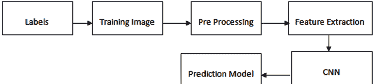

### 图 2. 测试阶段

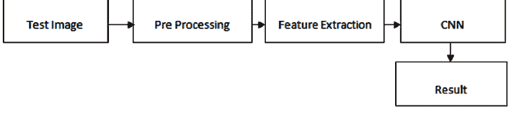

基于 CNN 的分类算法：

- 步骤 1. 在第一层中，应用卷积滤波器。
- 步骤 2. 平滑卷积滤波器（即子采样）降低滤波器的灵敏度。
- 步骤 3. 激活层调节一层到下一层的信号传输。
- 步骤 4. 使用修正线性单元缩短训练时间（ReLU）
- 步骤 5. 前一层中的每个神经元都与下一层中的每个神经元相连。
- 步骤 6. 在训练过程结束时添加一个损失层，以向神经网络提供反馈。

### 结果与讨论

我们的数据集包含肿瘤和非肿瘤 MRI 图像，并从不同在线资源收集。在本作品中，使用卷积神经网络进行高效的自动脑肿瘤检测。使用 Python 语言进行仿真。计算并比较了准确率与所有其他最先进的方法。为了确定所提脑肿瘤分类方法的有效性，计算了训练准确率、验证准确率和验证损失。当前方法中使用基于支持向量机（SVM）的分类来检测脑肿瘤。它需要特征提取的输出。根据特征值创建分类输出并确定准确率。在基于 SVM 的肿瘤和非肿瘤识别中，计算时间长且准确率低。所提基于 CNN 的分类不需要单独的特征提取过程。使用 CNN 计算特征值。图 3 和图 4 显示了脑肿瘤分类的损失和准确率。结果，复杂性和计算时间最小，但准确率良好。


图 3. 训练损失

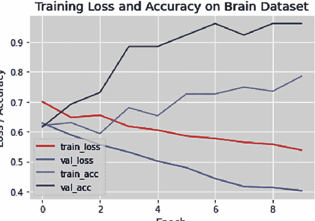

图 4. 准确率

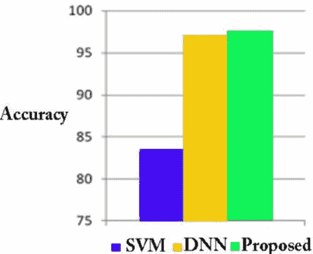

最后，图 5 取决于似然分数值，分类结果为脑肿瘤或非脑肿瘤。

### 图 5. 拟议系统

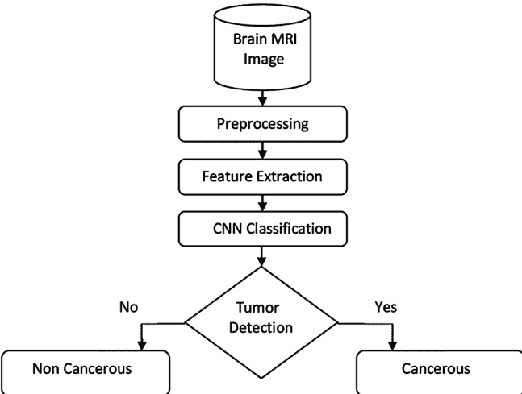

### 结论

本研究的主要目标是开发一个高精度、高速度、简单的高效自动化脑肿瘤分类系统。采用基于模糊 C 均值（FCM）的分割、纹理和形状特征提取，以及基于 SVM 和 DNN 的分类，进行传统的脑肿瘤分类。为了最小化计算时间，引入了基于卷积神经网络的分类。对于分类，使用 ImageNet 数据库。这是已经训练好的模型之一。因此，只训练最后一层。CNN 还提取具有深度、宽度和高度特征值的原始像素值。最后，为了获得高精度，使用基于梯度下降的损失函数。验证准确率、验证损失和训练准确率均已计算。训练准确率为 97.5%。同样，验证准确率较高，验证损失较小。

### 参考文献

Auzias, G., Takerkart, S., & Deruelle, C. (2015). 关于发育性病理多站点脑形态学研究中混杂因素的影响：应用于自闭症谱系障碍. IEEE Journal of Biomedical and Health Informatics, 20(3), 810–817. doi:10.1109/JBHI.2015.2460012 PMID:26208373

Bauer, S., Wiest, R., Nolte, L. P., & Reyes, M. (2013). 基于 MRI 的脑肿瘤研究医学影像分析综述. Physics in Medicine and Biology, 58(13), R97–R129. doi:10.1088/0031-9155/58/13/R97 PMID:23743802

Feng, C. M., Xu, Y., Liu, J. X., Gao, Y. L., & Zheng, C. H. (2019). 用于多视图生物数据中共特征基因选择和肿瘤分类的有监督判别稀疏 PCA. IEEE Transactions on Neural Networks and Learning Systems, 30(10), 2926–2937. doi:10.1109/TNNLS.2019.2893190 PMID:30802874

Fresilli, D., Grani, G., De Pascali, M. L., Alagna, G., Tassone, E., Ramundo, V., & Cantisani, V. (2020). 用于甲状腺结节超声评价的计算机辅助诊断系统优于经验较少检查者的特异性. Journal of Ultrasound, 23(2), 169–174. doi:10.100740477-020-00453-y PMID:32246401

Hiran, K. K., & Doshi, R. (2013). 基于数字图像分割的脑肿瘤检测人工神经网络方法. Brain, 2(5), 227–231.

Hiran, K. K., Jain, R. K., Lakhwani, K., & Doshi, R. (2021). 机器学习：使用真实示例掌握有监督和无监督学习算法（英文版）. BPB Publications.

Hiran, K. K., Khazanchchi, D., Vyas, A. K., & Padmanaban, S. (编). (2021). 用于可持续发展的机器学习（第 9 卷）. Walter de Gruyter GmbH & Co KG. doi:10.1515/9783110702514

Kim, J. Y., Kim, J. J., Hwangbo, L., Suh, H. B., Kim, S., Choo, K. S., & Kang, T. (2020). 使用术前 MRI 扫描计算机辅助诊断确定的乳腺癌动力学异质性：与远处转移无存活率的关系. Radiology, 295(3), 517–526. doi:10.1148/radiol.2020192039 PMID:32228293

Kumar, S. N., & Ismail, B. M. (2020). 使用机器学习方法对多类皮肤癌分类的系统性调查. Materials Today: Proceedings.

Liu, D., & Kumar, S. A. (2017). 极罕见的肾上腺碰撞肿瘤：肾上腺腺瘤–转移性乳腺癌–髓脂瘤. Journal of Community Hospital Internal Medicine Perspectives, 7(4), 241–244. doi:10.1080/20009666.2017.1362315 PMID:29046752

Mahrishi, M., Hiran, K. K., Meena, G., & Sharma, P. (编). (2020). 实时应用中的机器学习与深度学习. IGI Global. doi:10.4018/978-1-7998-3095-5

Pellakuri, V., Rao, D. R., & Murthy, J. V. R. (2016 年 12 月). 有监督 ADALINE 神经网络学习技术的建模. 在 2016 年第 2 届当代计算与信息学国际会议 (IC3I) (第 17-22 页). IEEE 10.1109/IC3I.2016.7917928

Pereira, S., Pinto, A., Alves, V., & Silva, C. A. (2016). 使用卷积神经网络在 MRI 图像中进行脑肿瘤分割. IEEE Transactions on Medical Imaging, 35(5), 1240–1251. doi:10.1109/TMI.2016.2538465 PMID:26960222

Razmjooy, N., Ashourian, M., Karimifard, M., Estrela, V. V., Loschi, H. J., Do Nascimento, D., & Vishnevski, M. (2020). 皮肤癌计算机辅助诊断：综述. Current Medical Imaging, 16(7), 781-793.

## 第 6 章

## 网络物理系统中奇偶同余图标注的应用

**Kanakambika K.**
Vellalar 女子学院，印度

**Thamizhendhi G.**
Sri Vasavi 学院，印度

### 摘要

最近几十年技术的进步提高了人类生活的质量。当前机器学习（ML）研究展现出自主决策的模型，并应用于包括医疗诊断、电子邮件过滤、银行、计算机视觉、金融营销、图像处理、网络安全在内的各个领域。通过互联网在全球互联的系统受到黑客攻击，而网络安全可以防止此类攻击。针对网络攻击的最优解是通过将机器学习技术与网络安全相结合来实现的，而设想的问题则由网络机器学习模型设计。在本章中，提出了一种算法，通过在密码学中应用图标注，将文本编码为无意义文本，并将其解码回原始文本，以保护数据。基于奇偶同余图的边标签设计对称密钥，以实现 CPS 中的安全通信。此外，建议使用 Python 编程来获得密文及其逆转。

### 引言

本章旨在为网络物理系统（CPS）设计一个受保护的结构。CPS 对于后一代智能物理系统是必要的，它被构建为实体模型与虚拟模型之间关系的网络。其运行依赖于具体过程及其反馈回路。新概念的揭示每天都在改变信息技术，CPS 就是这样一个在 2006 年引入的强制性系统。2006 年底，美国国家基金会将 CPS 确定为研究的重点领域，并资助了众多与 CPS 相关的研讨会。最初，CPS 用于电网基础设施、家庭自动化系统，后来几乎应用于所有领域。2006 至 2009 年期间，分析了 CPS 及其安全控制系统的安全挑战（Jairo Giraldo, Esha Sarkar, Alvaro A. Cardenas Michali Maniatakos 和 Murat Kantarcioglu, 2017）。在随后的几年中，CPS 转变为一个复杂的领域，具有无数属性，例如复杂系统（Vegh and Miclea, 2014），并从传感器设备获取数据，在有或没有机器与人类交互的情况下通过网络传输数据（Bhabad and Scholar, 2015）。出现了几个安全挑战，包括保护协议以及 CPS 子系统之间确定性的初始化（Lu et al., 2013）。随后，调查了 CPS 的安全责任，并为保密性启动了其安全措施（Jacub Wrm, Yier Lice, Yang Lice 和 Shiyan Hu, 2016）。

密码学与隐写术合并，为数据安全提供了新的解决方案，此外，分层方法被应用于信息以实现通用安全（L. Vegh 和 L. Miclea, 2014）。密码学被应用于使用模糊提取器构建安全的物理不可克隆函数，以克服安全障碍，但反馈协议中仍存在挑战（Jin C, Herder L, Nguyen P.H, Fuller B, Devadas 和 Van Dijk M, 2017）。为了保护传感器通信信道中的信息，使用非确定性自动机建立了基于事件的加密函数（Publio M. Lima, Lilian K. Carvalho, Marcos V. Moreira, 2020）。为了减少加密时间，提出了一种新的加密算法，将 CPS 中需要保护的敏感信息分离出来并对其加密，而不是对所有通信进行加密（Xiaogang Zhu, Gautam Srivastara 和 Reza M. Parizi, 2019）。一种高级密码学方法被用于直接对加密值执行操作而无需解密文本，但它占用更多内存空间（Junsoo Kim, Chanhwa Lee, Hyungbo Shim, Jung Hee Cheon, Andrey Kim, Miran Kim 和 Yongsoo Song, 2016）。此外，为了增强安全性，采用了各种图标注技术，例如乘积模标注（Deepa B, Maheswari 和 Balaji V, 2019）、顶点魔术全标注（Rahul Chawla, Sagar Deshpande, Manas M. N, Saahil Chhabria 和 Krishnappa H. K, 2019）、内部魔术和内部反魔术标注（Auparajita Krishnaa, 2019）、超魔术标注（Giridaran


M, 2020)，反魔标记 (Dharmendra Kumar Gurjar, Auparajita Krishnaa, 2021)被用于提出加密算法。

在本章中，作者提出了一种新算法，通过在密码学中采用奇-偶同余图标记技术来加密和解密消息，以确保CPS中数据的保密性和安全性。在密码学中处理图更安全，因为难以识别用于加密的图及其标记技术。此外，此前已开发出一种Python代码来生成密文。

### CPS与密码学面临的挑战

### 网络物理系统

网络物理系统是一个连接网络世界与物理世界的独特网络。它由传感器、控制器和执行器组成。传感器通过估算现有物理量，将物理世界的数据传输到网络世界，并向控制器提供估算结果。控制器根据传感器提供的数据向执行器分配指令，执行器执行这些指令。执行器将网络方案转换回物理方案，并将其传输到传感器。控制器背后的技术是监控控制与数据采集系统，它由人机界面、网络设备和工作站组成。

CPS改变了人类生活和实体世界，包括智能电网、交通、能源系统、供水系统、传感器、机器人技术、交通控制、汽车系统以及全球经济的不同领域。CPS是一种用于结合传感器工具和电力系统的方法。在这一过程中，信息安全至关重要，因为CPS是一个庞大复杂的系统，需要可靠性和安全性。CPS的主要挑战特性是数据保密性，即在传输和存储期间保护记录的能力，防止信息泄露给未授权群体。

CPS通过强调活动管理和接口的实时反馈，关注各领域中现有的机制。网络层涉及多种多样的网络，采用不同的技术以各种方式抵御安全威胁，因此系统必须构建得能够兼具网络层的兼容性和一致性，以克服安全威胁。为了提高安全性，系统采用两种方式构建，例如点对点安全和端到端安全。一致性技术在端到端可靠通信中结合节点之间的相互可靠通信，使用隐藏的保密密钥。保密密钥处理机制、密码算法、分层架构和端口拦截是构建安全CPS的主要组成部分。

### CPS的挑战

功能精良的CPS拥有复杂的结构，凭借其成就吸引了年轻研究人员和行业。由于其组件与互联网相连而面临威胁，且对这些攻击没有直接的解决方案，（Teixeira et al, 2012）。同时，攻击者反复开发并向CPS馈送信号，以跟踪系统结构并获取输入和输出数据。因此，通过加密反馈环来保护通信，从而提升CPS的安全性（Junsoo Kim, Chanhwa Lee, Hyungbo Shim, Jung Hee Cheon, Andrey Kim, Miran Kim and Yongsoo Song, 2016）。加密数据必须被解密才能对输入进行操作，因此保密密钥保存在控制器内部，可能被攻击窃取。因此，密钥必须足够强且不可破解以抵御攻击，所以希望利用奇-偶同余图的边标签来设计密钥。

### 密码学

密码学的基本原理是通过将数据压缩为无法理解的句子来隐蔽地转换信息，只有在解码压缩后的内容后才能阅读。密码保护框架抵御攻击和恶意渗透，取决于保密密钥的鲁棒性以及与密钥相关的连贯机制和协议。密码算法的主要组件是保密密钥，通常使用大密钥来获得更好的算法。该算法改变数据并将其构建为复杂的不可读文本，应用保密密钥后可以识别。该算法用于实现数据保密性和消息认证服务。将明文转换为不可理解文本的过程称为加密（Sarita Kumari, 2017）。加密后的不可理解文本称为密文。将不可理解文本转换回原始文本的过程称为解密。用于加密和解密过程的密钥称为对称密钥（Ayushi, 2010）。加密通过将普通文本修改为密文来提供数据保密性，而解密将密文转换回原始文本。密码学是维持近期发展的互联网通信社会的领先高效技术之一。密码算法被评估为基于保密密钥的强大工具，如果密钥是使用图标记生成的，则它会更强。

### 同余图标记

图标记由A. Rosa于1966年提出。将自然数分配给顶点和/或整数称为图标记。受图标记技术在现实问题中广泛应用的启发，许多研究人员采用并研究了多种标记策略。同余图标记是基于模算术性质，将自然数作为图中边和顶点的标签分配。奇-偶同余标记是在同余图标记基础上，将奇数整数分配给顶点，偶数整数分配给边。同余图标记在众多领域中发挥重要作用，可以应用于包括编码理论、X射线、心理学、晶体学、电路设计、通信网络、天文学、雷达、数据安全、秘密共享和数据库管理在内的众多学科。除了这些应用，标记技术还为数学的其他领域提供了帮助。近年来，所有文档都已数字化，并主要通过基于虚拟网络的网络共享，面临高风险。为了提高安全性，应用奇-偶同余标记技术，从边标签值生成强大且安全的密钥来加密和解密内容。

### 奇-偶同余标记

假设G = (V,E)是一个具有|V| = p和|E| = q的图，如果对于V中的每个vi存在顶点标记函数f: V → {1,3.....2k+1}，并诱导边标记g: E → {2,4,6,....2k}，使得对于每条e_i = v_i v_j都有 f(v_i) ≡ f(v_j) mod g(e_i)，其中 k = min{2|V|, 2|E|}，则该图称为奇-偶同余图。

允许奇-偶同余标记的图称为奇-偶同余图。

### 3. 奇-偶同余图在安全网络物理系统中的应用

CPS中的两大主要威胁是数据安全和控制安全，必须在数据收集、存储、处理和传输过程中保护数据。其中最重要的是数据安全，可通过加密来实现。本章致力于通过融合密码学和图标记来建立数据安全。

### 方法论

提出了一种加密和解密算法，重点关注CPS传感器通信通道的安全性。从传感器节点接收到的信息通过有线或无线网络使用无线电信号进行通信，这控制着CPS的决策策略。因此，这些通信必须保密。为了实现这一点，传感器中的原始消息必须在传输到控制器之前使用加密算法加密为密文。控制器接收密文，使用解密算法将其解密为原始文本并执行必要操作，然后将其决策转换为密文并发送到执行器。该加密和解密算法建立在传感器、控制器和执行器中，以便在与其他通道通信前准备密文，并将密文转换回原始消息。

为了加强安全性，从奇-偶同余图的边标签中派生保密密钥，以便将明文转换为密文，反之亦然。在所提议的通信中，所有数据均作为密文传输，攻击者无法读取。即使他们追踪安全程序，也难以识别所实现的图及其标记方法。流程如图1所示。

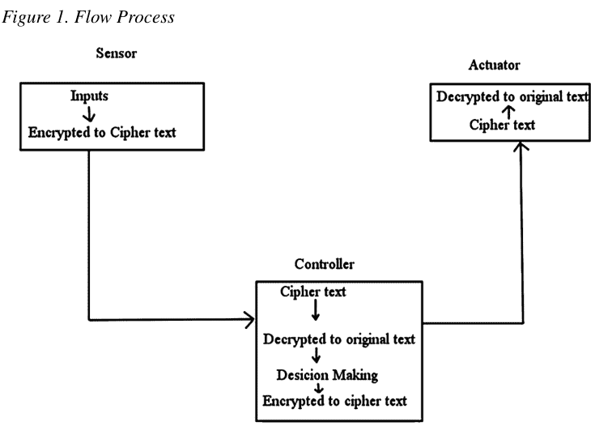


下面的算法用于加密和解密。

### 加密算法

- **步骤 1：** 考虑任意图 G。
- **步骤 2：** 使用第 2.5 节中所述的定义对图 G 的顶点和边进行标记。
- **步骤 3：** 图 G 的边权被分配给字母并相互替换，例如图 G 中第一条边的边权为 12，则将其分配给 A，随后用第 12 个字母 L 替换 A。由于每条边都有明确区分的标记，所有字母都会被互不相同地替换。
- **步骤 4：** 特殊字符也通过扩展图 G 中的边进行加密。

### 解密算法

- **步骤 1：** 识别加密中使用的图。
- **步骤 2：** 使用边标记函数，计算边权并用于交换字母。
- **步骤 3：** 解释密文以获取原始文本。

### 示例说明

考虑一个图 G，设其为具有 28 个顶点和 27 条边的梳状图，并使用奇偶同余标记技术进行标记。其边权被用于为字母分配不同的顺序以生成密文。

### 加密

- **步骤 1：** 考虑梳状图 G(V, E) = P_n ⊙ K_1，其中 n = 14。
- **步骤 2：** 使用奇偶同余标记函数评估图 G 的边权

```
g(e_i) = 4(n-i), i = 1 to n-1
g(s_j) = 4(n-j) + 2, j = 1 to n
```

其中 e_i（i = 1, 2, ....,13）是 P_n 的边，s_i（j = 1, 2, .....,14）是与 P_n 和 K_1 相邻的边，如图 2 所示。

Step 3: 由于边权为偶数，将其除以 2 以得到连续整数，这里 e1 的边权为 52，因此 (52/2) = 26 被分配给 'a'，随后 'a' 被替换为 'z'，并一直持续到 e13，接着由 s1 开始并一直持续到最后一条边。这里考虑了特殊字符点 '.'，并将最后一条边的边权分配给它。

Step 4: 由于每条边都被分配了互不相同的权重，包括特殊字符在内的字母被互不相同地重新排列，如表 1 所示。

奇偶同余梳状图如图 2 所示。

图 2. 奇偶同余梳状图

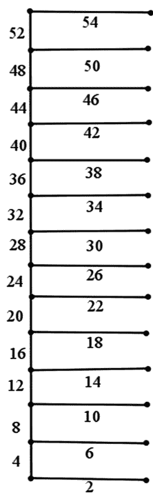

### 表 1. 基于边权的编码字母

| 原始字母 | 分配的边权 | 编码字母 | 原始字母 | 分配的边权 | 编码字母 | 原始字母 | 分配的边权 | 编码字母 |
|---|---|---|---|---|---|---|---|---|
| a | 26 | z | j | 8 | h | s | 17 | q |
| b | 24 | x | k | 6 | f | t | 15 | o |
| c | 22 | v | l | 4 | d | u | 13 | m |
| d | 20 | t | m | 2 | b | v | 11 | k |
| e | 18 | r | n | 27 | . | w | 9 | i |
| f | 16 | p | o | 25 | y | x | 7 | g |
| g | 14 | n | p | 23 | w | y | 5 | e |
| h | 12 | l | q | 21 | u | z | 3 | c |
| i | 10 | j | r | 19 | s | . | 1 | a |

文本可以手动编码，但对大量内容进行编码比较模糊不清，为减少时间，提出以下 Python 代码来加密给定文本。

```
print("Enter the text: ")
text = input ()
text = text.replace("a", "z")
text = text.replace("b", "x")
text = text.replace("c", "v")
text = text.replace("d", "t")
text = text.replace("e", "r")
text = text.replace("f", "p")
text = text.replace("g", "n")
text = text.replace("h", "l")
text = text.replace("i", "j")
text = text.replace("j", "h")
text = text.replace("k", "f")
text = text.replace("l", "d")
text = text.replace("m", "b")
text = text.replace("n", ".")
text = text.replace("o", "y")
text = text.replace("p", "w")
text = text.replace("q", "u")
text = text.replace("r", "s")
text = text.replace("s", "q")
text = text.replace("t", "o")
text = text.replace("u", "m")
text = text.replace("v", "k")
text = text.replace("w", "i")
text = text.replace("x", "g")
text = text.replace("y", "e")
text = text.replace("z", "c")
text = text.replace(".", "a")
print("\n Cipher text: ")
print(text)
```

### 输出

### 输入文本：

奇偶同余图及其应用

### 密文：

ytt rkr. vy.nsmr.vr nszwl z.t joq zwwdjvzojy.q

### 解密

Step 1: 由于使用了对称密钥方法，使用奇偶同余标记计算图 G 的边权。

Step 2: 解释密文以获取原始文本。

使用以下 PYTHON 代码来自动解密密文并获得原始文本。

```
print("Enter the Cipher text: ")
cipher = input()
cipher = cipher.replace("z", "a")
cipher = cipher.replace("x", "b")
cipher = cipher.replace("v", "c")
cipher = cipher.replace("t", "d")
cipher = cipher.replace("r", "e")
cipher = cipher.replace("p", "f")
cipher = cipher.replace("n", "g")
cipher = cipher.replace("l", "h")
cipher = cipher.replace("j", "i")
cipher = cipher.replace("h", "j")
cipher = cipher.replace("f", "k")
cipher = cipher.replace("d", "l")
cipher = cipher.replace("b", "m")
cipher = cipher.replace(".", "n")
cipher = cipher.replace("y", "o")
cipher = cipher.replace("w", "p")
cipher = cipher.replace("u", "q")
cipher = cipher.replace("s", "r")
cipher = cipher.replace("q", "s")
cipher = cipher.replace("o", "t")
cipher = cipher.replace("m", "u")
cipher = cipher.replace("k", "v")
cipher = cipher.replace("i", "w")
cipher = cipher.replace("g", "x")
cipher = cipher.replace("e", "y")
cipher = cipher.replace("c", "z")
cipher = cipher.replace("a", ".")
print("\n Original text: ")
print(cipher)
```

### 输出

### 输入密文：

ytt rkr. vy.nsmr.vr nszwl z.t joq zwwdjvzojy.q

### 原始文本：

奇偶同余图及其应用

### 讨论

CPS 用于解决日常生活中更具挑战性的问题，这表明有必要为当前和未来的场景有效地加强操作流程。这些算法面临威胁，因为 CPS 的所有功能都通过互联网连接，且没有针对网络攻击的永久解决方案。为了实现 CPS 中敏感信息的安全，可以使用密码学对数据进行加密以实现安全通信。

密码学是一种旨在实现两方之间安全通信的技术。密码保护依赖于密钥的可靠性。通信通过编码被压缩成不可理解的文本，并在解码后还原。由于信息会被黑客追踪，保护数据至关重要。

在所提议的通信中，所有数据在传输到 CPS 的其他部分之前都以密文形式传输。在上面的示例中，考虑了梳状图用于加密，同样，任何其他图，如二分图、环图等，也可以使用。由于加密中考虑了一个特殊字符，因此使用了具有 27 条边的图用于加密。假设，如果需要加密多个特殊字符，则增加 n 的值以实现同样的目的。通常加密字母，为了提高安全性并加强密钥，作者添加了攻击者意想不到的特殊字符，并且难以识别加密中使用的特殊字符。例如，如果点被替换为 g，即使他们黑客攻击了通信并进行了研究，他们也不会猜到点是代替字母给出的。因此，他们会尝试通过重新排列字母来读取密文，并将点视为句子的结尾，这会给出与原始消息不同的消息。n = 14 的梳状图的第一条边接收 52 作为边权，但对于不同的 n 值会有所不同。

CPS 的架构包括多个边缘节点、执行器等，从数据中提取的信息驱动 CPS 的决策策略。因此，安全通信在 CPS 中至关重要，它是通过从奇偶同余图的边权生成密钥来实现的，它保持了 CPS 通信的可靠性和安全性。这一独特概念将开发一种新算法来保护通信网络。

### 未来研究方向

在本章中，奇偶同余梳状图被应用于建立密钥，根据情况，为了增强安全性，作者可以使用任何奇偶同余图来构成密钥，用于数据身份验证。在梳状图中，第一条边权为 52，但其他图会有不同的值。因此，不同图的密钥也不同，因此所提算法可以应用于构建多种具有安全数据的 CPS。还可以添加一些额外的特殊字符用于加密，图的边数可以根据需要增加或减少。

### 结论

在科学进步期间保护数据至关重要。当使用图来构建密钥时，密码系统更加安全，因为很难识别用于加密的图及其边权。在所提算法中，奇偶同余图的边权被用于构建加密和解密文本的密钥。该过程保护了传感器到控制器及控制器到执行器之间的交互，也可以应用于 CPS 中的所有通信。此外，使用梳状图详细解释了执行过程，并进一步介绍了 Python 编码


用于将原始文本转换为密文，反之亦然，以降低执行时间。

该研究未获得公共、商业或非营利部门任何资助机构的特定资助。

### 参考文献

- Anand, M. (2006). 下一代网络物理系统的安全挑战. Beyond SCADA: 面向网络物理系统的联网嵌入式控制.

- Ashibani & Mahmoud. (2017). 网络物理系统安全：分析、挑战与解决方案. In 计算机与安全. Elsevier.

- Ayushi. (2010). 一种对称密钥加密算法. 计算机应用国际期刊.

- Bondy, J. A., & Murty, U. S. R. (2008). 图论（国际版）. Springer. doi:10.1007/978-1-84628-970-5

- Cardenas, A. (2009). 保障网络物理系统安全的挑战. 面向网络物理系统安全未来方向研讨会.

- Cardenas, A. A., Amin, S., & Sastry, S. (2008). 安全控制：迈向可生存的网络物理系统. IEEE 第 28 届国际会议.

- Cardenas, A. A., Amin, S., & Sastry, S. (2008). 控制系统安全的研究挑战. 第 3 届安全热点会议.

- Chawla, Deshpande, Manas, Chhabria, & Krishnappa. (2019). 顶点魔标记及其在密码学中的应用. 智能计算技术最新发现.

- Lima, Carvalho, & Moreira. (2020). 基于事件密码学的网络物理系统. IFAC-PapersOnLine.

- Deepa, Maheswari, & Balaji. (2019). 使用图标记技术创建密文和解密. 工程与先进技术国际期刊.

- Dooley, J. F. (2003). 密码学与密码算法简史. Springer.

- Gallian, J.A. (2011). #DS6，图标记动态综述. 组合数学电子期刊.

- Ganesan, V., & Lavanya, S. (2019). 星图 K$_{1,n}$ 分割图的质素标记. IOSR 数学期刊.

- Garagad, V. G., & Iyer, N. (2020). 物联网和网络物理系统的安全威胁. 2020 年计算性能评估国际会议. 10.1109/ComPE49325.2020.9200170

- Giraldo, Sarkar, Cardenas, Maniatakos, & Kantarcioglu. (2017). 网络物理系统的安全与隐私：综述的综述. IEEE CEDA, IEEE CASS, IEEE SSCS, and TTTC.

- Giridaran, M. (2020). 超魔标记在密码学中的应用. 科学、工程与技术创新研究国际期刊.

- Gurjar. (2021). 密码学中的词典标记图. Auparajita Krishnaa, 27(2), 209–232.

- Harary, F. (1969). 图论. Addison-Wesley. doi:10.21236/AD0705364

- Jin, Herder, Nguyen, & Fuller, Devadas, & Van Dijk. (2017). 基于带噪声奇偶性学习的密码学安全 PUF 的 FPGA 实现. 密码学, 105, 1028–1042.

- Jirwan, Singh, & Vijay. (2013). 密码技术回顾与分析. 科学与工程研究国际期刊.

- Kim, Lee, Shim, Cheon, Kim, Kim, & Song. (2016). 使用全同态加密对控制器进行加密以保障网络物理系统安全. IFAC-PapersOnLine.

- Krishnaa. (2019). 密码学中的内部魔图与内部反魔图. 离散数学科学与密码学期刊.

- Kumari. (2017). 关于密码学加密与压缩技术的研究论文. 工程与计算机科学国际期刊.

- Lee, E. A. (2006) 网络物理系统——计算基础是否充足. 网络物理系统：研究动机、技术与路线图研讨会.

- Merely & Anto. (2016). 梳图与冠图分裂图的顶点多项式. 工程研究新兴技术国际期刊.

- Mueller, F. (2006). 网络物理系统的挑战：安全性、时序分析与软错误防护. 高可信软件平台与网络物理系统 (HCSP-CPS) 研讨会.

- Neuman, C. (2009). 网络物理系统安全中的挑战. 美国国土安全部网络物理系统安全未来方向研讨会.

- Oman, P., Schweitzer, E., & Fincke, D. (2000). 关于远程可访问变电站控制器和 SCADA 系统入侵的担忧. 第 27 届年度西部保护继电器会议.

- Orman, H. (2014). 密码学中的近期寓言. IEEE 互联网计算.

- Prasanna, L. (2014). 通信网络中图标记的应用. 东方计算机科学与技术期刊, 7(1), 139–145.

- Preneel, B. (2010). 理解密码学：面向学生和从业者的教科书. Springer.

- Ratnadewi, Hutama, & Ahmar, & Setiawan. (2016). 基于近场通信的通信系统中数据加密标准和三重数据加密标准方法的密码学实现. 物理学：会议系列期刊.

- Rosa, A. (1966). 关于图中顶点的某些估价. 图论：国际研讨会.

- Sadu. (2020). 图论中的图标记. 马拉亚数学期刊.

- Sun, M. (2009). 应对网络物理系统中的安全与安保矛盾. 面向网络物理系统安全未来方向第 1 届研讨会.

- Tang, H., & McMillin, B. M. (2008). 通过时序违反 CPS 中的安全属性. IEEE 第 28 届国际会议.

- Teixeira, Shames, Sandberg, & Johansson. (2012). 揭示控制系统中的隐蔽攻击. 第 50 届年度 Allerton 通信、控制与计算会议论文集.

- Vegh & Miclea. (2014). 通过密码学和隐写技术增强网络物理系统安全. IEEE 自动化、质量与测试、机器人国际会议.

- Wurm. (2017). 网络物理系统安全导论：跨层视角. IEEE 多尺度计算系统事务.

- Zhu, X., Srivastara, G., & Parizi, R. M. (2019). 网络物理系统中敏感私人信息安全的高效加密算法. MDPI 电子学.

### 关键术语与定义

**Cipher Text:** 它是编码算法生成的不可读输出。

**Congruence Labelling:** 假设 G = (V,E) 是一个具有 |V| = p 和 |E| = q 的图，若存在顶点标记函数 f: V →{1,2,....k}，对 V 中的每个 vᵢ，并诱导边标记 g: E→{1,2,3,...,k}，使得对每条 eᵢ = vᵢvⱼ 有 f(vᵢ) ≡ f(vⱼ) mod g(eᵢ)，则称 G 为同余图，其中 k = min{2|V|,2|E|}。

**Cryptography:** 密码学是一种通过使用代码来保护计算机系统中信息和通信的方法。

**Encoding:** 将数据从一种形式转换为另一种形式的过程称为编码。

**Graph:** 图由顶点和边组成，用于表示数学结构以模拟对象之间的成对关系。

**Graph Labelling:** 图标记是将整数分配给顶点和边的过程。

## 第 7 章

## 基于机器学习的入侵检测系统：最新进展与未来挑战

**Quang-Vinh Dang**
https://orcid.org/0000-0002-3877-8024
越南胡志明市工业大学

### 摘要

互联网和基于网络的服务的增长为我们带来了许多新机遇，但也带来了许多新的安全威胁。入侵检测系统（IDS）多年来一直被研究和开发，以应对来自互联网的外部攻击。IDS 的任务是分类并阻止外部恶意流量进入计算机系统。近年来，基于机器学习的 IDS 引起了工业界和学术界的大量关注。基于最先进机器学习算法的 IDS 通常比传统方法实现非常高的预测性能。另一方面，已引入多个开放数据集供研究人员评估和比较其算法。本章回顾了 IDS 中使用的分类技术，主要是机器学习算法和已发布的数据集。作者讨论了取得的成就和一些未解决的问题，并提出了未来的几个研究方向。


### 简介

网络安全在我们现代世界中扮演着至关重要的角色。它有助于保障我们的通信和信息安全，减少财务损失，并防止因攻击导致的网络中断。特别是，由于互联网的增长及其重要性，世界上几乎每台计算机都已连接，因此它们容易受到攻击。我们可以断言，对于任何计算机，攻击迟早都会发生。入侵检测系统（IDSs）旨在通过分类和阻止任何进入的恶意流量，帮助计算机系统应对外部攻击（Tsai et al., 2009）。值得注意的是，IDS 不处理内部攻击，即从本地网络内的一台计算机发起的攻击。IDS 的角色如图 1 所示。

图 1. 计算机系统中的 IDS


(Tsai et al., 2009) 将 IDSs 分为两大类：一类依赖异常检测，另一类依赖签名检测。然而，关于 IDS 研究的最新进展，我们提议将 IDSs 分为三大类：基于签名的方法、异常检测方法和分类方法。

基于签名的 IDS 依赖于安全专家定义的签名或规则。例如，专家可能会定义，任何源 IP 地址与目标 IP 地址相同的数据包都是恶意的。基于签名的 IDS 在互联网早期非常流行。如今它仍在业界广泛使用（Dang, 2020a）。

基于异常检测的 IDS 依赖于这样的假设：良性数据本身形成一个共同的流量组，而恶意流量是一个离群点，不共享其属性。异常检测如图 2 所示。我们可以看到，数据的大部分被假设为正常数据（或良性数据），而异常被定义为与正常数据不同的东西。

图 2. 异常检测

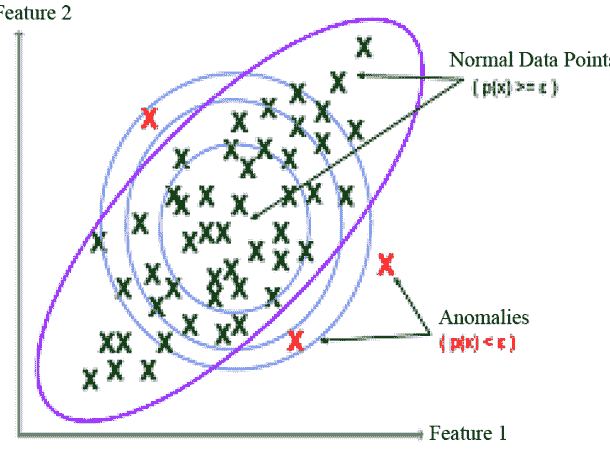

基于分类的 IDS 依赖于一种或多种机器学习分类算法（Umadevi and Marseline, 2017）。要执行分类，算法需要一个标记的数据集（Ring et al., 2019）。所需的数据集通常非常大，并且需要频繁更新。异常检测与分类的区别在于，在分类设置中，我们确切地知道什么是攻击，而在异常检测设置中，我们只是有一个模糊的定义，即攻击与良性流量不同。因此，分类算法是受监督学习技术，而异常检测算法是无监督学习技术。分类算法是近年来文献中使用的主导算法（Alqahtani et al., 2021）。

近年来，机器学习技术在赋能 IDS 方面取得了许多成功（Ahmad et al., 2021）。在本章的其余部分，我们将讨论文献中研究的机器学习算法以及用于训练和测试模型的已发布数据集。然后我们将讨论所介绍方法的结果和局限性。我们将提出一些进一步的研究方向，并总结我们的论文。

### 数据集

在本节中，我们回顾一些最流行的已发布入侵数据集。这些数据集可供研究人员用于训练和测试入侵检测算法。

### DARPA

数据集 DARPA 98/99 (McHugh, 2000) 是最早引入的入侵数据集之一（Ring et al., 2019）。该数据集包含两部分：一部分用于离线评估，另一部分用于在线评估。该数据集是使用模拟网络系统创建的。1998 版包含七周的数据，而 1999 版包含五周的数据。该数据集因包含过多冗余而受到批评（McHugh, 2000）。

### KDD'99

KDD'99 数据集 (Stolfo et al., 2000) 可能是迄今文献中使用最广泛的入侵数据集。KDD'99 及其扩展版本 NSL-KDD 在研究中被广泛使用。数据包括四种攻击类型（表 1）。

表 1. NSL-KDD 数据集中的攻击类型

| 攻击类型 | 描述 |
|---|---|
| DOS | 拒绝服务攻击，例如 syn flood |
| R2L | 来自远程机器的未授权访问，例如猜测密码； |
| U2R | 未授权访问本地超级用户（root）权限，例如，各种缓冲区溢出攻击； |
| Probing | 监视和另一种探测，例如，端口扫描。 |

虽然 KDD'99 在今天已有些过时（Dang, 2019），但该数据集对网络安全研究的重要性是不可否认的。此外，KDD'99 数据集设计的功能是许多后来入侵数据集的基础，包括最近的 CICIDS 和 InSDN 数据集。

表 2. KDD 数据集的基本特征

| 特征名称 | 描述 | 类型 |
|---|---|---|
| duration | 连接的长度（秒数） | 连续 |
| protocol_type | 协议类型，例如 tcp, udp 等 | 离散 |
| service | 目标上的网络服务，例如，http, telnet 等 | 离散 |
| src_bytes | 从源到目标的数据字节数 | 连续 |
| dst_bytes | 从目标到源的数据字节数 | 连续 |
| flag | 连接的正常或错误状态 | 离散 |
| land | 如果连接是来自/到同一主机/端口，则为 1；否则为 0 | 离散 |
| wrong_fragment | “错误”片段的数量 | 连续 |
| urgent | 紧急数据包的数量 | 连续 |

表 3. KDD 数据集的内容特征

| 特征名称 | 描述 | 类型 |
|---|---|---|
| hot | “热”指标的数量 | 连续 |
| num_failed_logins | 失败登录尝试的次数 | 连续 |
| logged_in | 如果成功登录，则为 1；否则为 0 | 离散 |
| num_compromised | “受损”条件的数量 | 连续 |
| root_shell | 如果获得 root shell，则为 1；否则为 0 | 离散 |
| su_attempted | 如果尝试了“su root”命令，则为 1；否则为 0 | 离散 |
| num_root | “root”访问的数量 | 连续 |
| num_file_creations | 文件创建操作的数量 | 连续 |
| num_shells | shell 提示符的数量 | 连续 |
| num_access_files | 对访问控制文件的操作数量 | 连续 |
| num_outbound_cmds | ftp 会话中出站命令的数量 | 连续 |
| is_hot_login | 如果登录属于“热”列表，则为 1；否则为 0 | 离散 |
| is_guest_login | 如果登录是“访客”登录，则为 1；否则为 0 | 离散 |

表 4. KDD 数据集的流量特征

| 特征名称 | 描述 | 类型 |
|---|---|---|
| count | 在过去两秒内与当前连接相同主机的连接数量 | 连续 |
| | 注意：以下特征指的是这些相同主机的连接。 | |
| serror_rate | 有 "SYN" 错误的连接百分比 | 连续 |
| rerror_rate | 有 "REJ" 错误的连接百分比 | 连续 |
| same_srv_rate | 到相同服务的连接百分比 | 连续 |
| diff_srv_rate | 到不同服务的连接百分比 | 连续 |
| srv_count | 在过去两秒内与当前连接相同服务的连接数量 | 连续 |
| | 注意：以下特征指的是这些相同服务的连接。 | |
| srv_serror_rate | 有 "SYN" 错误的连接百分比 | 连续 |
| srv_rerror_rate | 有 "REJ" 错误的连接百分比 | 连续 |
| srv_diff_host_rate | 到不同主机的连接百分比 | 连续 |

### CICIDS

CICIDS 是加拿大网络安全研究所发布的一系列入侵数据集。截至撰写本文时，已有三个版本的 CICIDS 推出，分别称为 2012 版、2017 版和 2018 版。

第一个版本 CICIDS 2012 (Shiravi et al., 2012) 是收集于 2010 年七天内的网络活动，总大小为 84.4 GB。该数据集包含多种攻击类型，例如使用 IRC 僵尸网络的 HTTP DoS 和 DDoS，以及正常活动。

第二个版本 CICIDS 2017 (Sharafaldin et al., 2018) 是为了解决 2012 版的一些局限性而引入的。CICIDS 2017 是在五天内收集的，总大小为 48 GB。

CICIDS 2018 是截至撰写本文时最新的入侵攻击数据集。该数据集可被视为 2017 版的改进。


图 3. 建立 CICIDS 2018 数据集的网络拓扑。

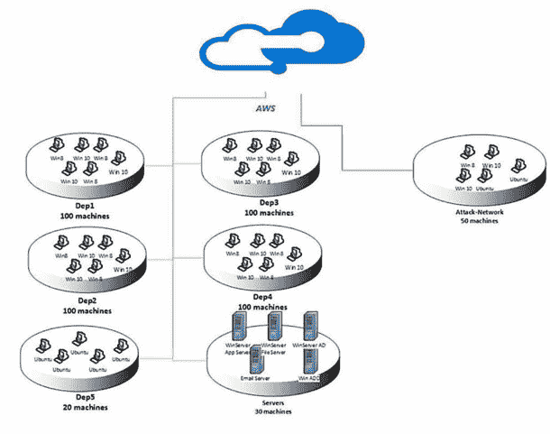

### CIDDS

CIDDS 数据集旨在提供一个基于异常的检测评估数据集 (Ring et al., 2017)。该数据集在一个模拟的小型企业环境中创建。

### DoHBRw'2020

DoHBRw 数据集 (MontazeriShatoori et al., 2020) 是针对 DNS 系统的第一个攻击数据集。该数据集关注 DNS over HTTPS (DoH)，由 IETF 在 RFC8484 中引入，旨在增强 DNS 的隐私性和保护性。

图 4. 建立 DoHBRw 2020 数据集的网络拓扑。

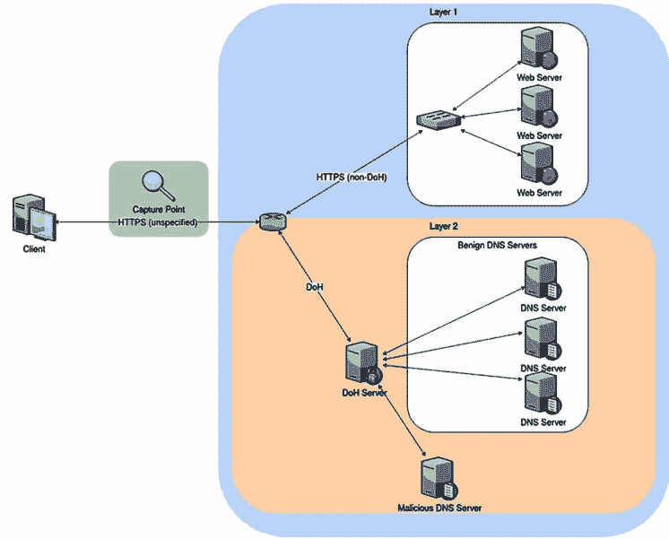

### InSDN'2021

InSDN 数据集 (Elsayed et al., 2020) 是一个最近的数据集，专注于软件定义网络环境上的攻击。

### 指标

在本节中，我们讨论用于评估入侵检测算法的常用指标。

第一组常用指标基于如下所示的混淆矩阵。

| | | 预测 | |
|---|---|---|---|
| | | 正例 | 负例 |
| 真实标签 | 正例 | TP | FN |
| | 负例 | FP | TN |

准确率计算为正确预测数除以预测总数。

```
accuracy = \frac{TP + TN}{TP + FP + FN + TN}
```

精确率指标计算为真正例预测数除以正例预测总数。

```
precision = \frac{TP}{TP + FP}
```

召回率指标计算为真正例预测数除以实际正例总数。召回率也称为真正例率 (TPR)。

```
recall = \frac{TP}{TP + FN}
```

假正例率 (FPR) 的计算公式为：

```
FPR = \frac{FP}{FP + TN}
```

如果准确率高，意味着我们可以正确预测哪些流量是恶意的，哪些是良性的。如果精确率高，意味着如果我们预测流量是恶意的，那么该预测很可能是正确的。如果召回率高，意味着我们不太可能漏掉恶意流量。然而，我们通常需要在精确率和召回率指标之间进行权衡：当我们试图提高一个指标时，另一个指标会下降。

此外，为了计算准确率、精确率和召回率，我们需要定义决策阈值。这将限制我们的模型适应不同场景的灵活性。此外，准确率在不平衡数据集的情况下被认为存在偏差：如果 95% 的流量是良性的，一个简单的预测器只需要将所有内容预测为良性，就能达到 95% 的准确率。为了克服硬决策阈值指标的局限性，引入了 ROC AUC 分数 (Fawcett, 2006)。

图 5. ROC AUC

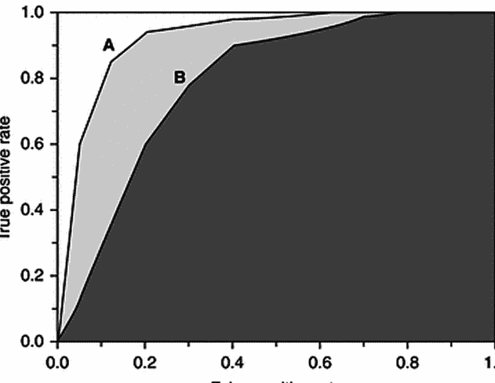

ROC AUC 分数在图 4 中可视化。我们绘制 FPR (假正例率) 和 TPR (真正例率) 的曲线。当我们改变决策阈值时，FPR 和 TPR 都会发生变化，并且如图 4 所示，它们会形成一条曲线。曲线下方的面积 (AUC) 被视为 ROC AUC 分数。例如，在图 4 中我们可以看到两个算法 A 和 B 的 ROC 曲线，算法 A 被认为优于算法 B。从图表中我们可以得知，如果使用算法 A 并接受 20% 的 FPR，我们可以达到大约 90% 的 TPR。但是，如果只接受 10% 的 FPR，TPR 只有大约 70%。因此，ROC AUC 分数和 ROC 曲线不仅能告诉我们整体性能，还能告诉我们每个决策阈值下的详细性能。

### 入侵检测的机器学习算法

### k-NN

k-最近邻 (k-NN) 算法可能是最简单的分类算法之一。k-NN 的思路是根据数据点的 k 个最近邻将其分类。当引入一个新数据点时，我们从带标签的数据集中找到该数据点的 k 个最近邻，然后根据邻居的多数类别来决定新数据点的类别。

图 6. k-NN 算法的可视化。k 的值可以通过超参数调优技术进行优化。

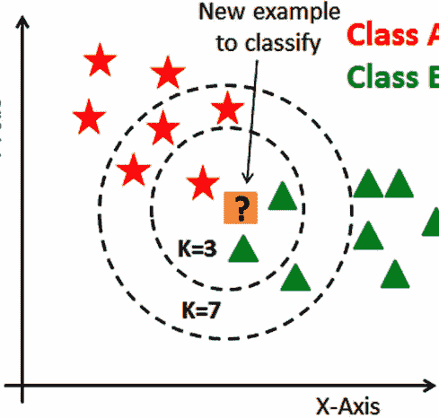

k-NN 算法在一些早期研究 (Liao and Vemuri, 2002) 中进行了研究并有一些改进。(Liao and Vemuri, 2002) 提出的伪代码如图 5 所示。

图 7. 入侵检测的 kNN 伪代码 (Liao and Vemuri, 2002)

```
build the training normal data set D;
for each process X in the test data do
if X has an unknown system call then
X is abnormal;
else then
for each process Dj in training data do
calculate sim(X, Dj);
if sim(X, Dj) equals 1.0 then
X is normal; exit;
find k biggest scores of sim(X, D);
calculate sim_avg for k-nearest neighbors;
if sim_avg is greater than threshold then
X is normal;
else then
X is abnormal;
```

k-NN 的一个问题是处理速度慢，因为对于每个需要分类的新数据点，我们都需要计算该数据点与训练集中每个数据点之间的距离。因此，处理时间将与训练数据量相关。(Rao and Swathi, 2017) 提出使用两种改进版本的 k-NN，即索引部分距离搜索 k 近邻 (IKPDS) 和部分距离搜索 k 近邻 (KPDS)，以加速算法。

### 聚类算法

聚类算法是无监督机器学习算法，试图将相似项目分为一组。聚类算法可分为两类：硬聚类，例如 k-means，或模糊聚类，例如 FCC (Wang et al., 2010; Wang and Megalooikonomou, 2005)。

图 8. 硬聚类和软聚类

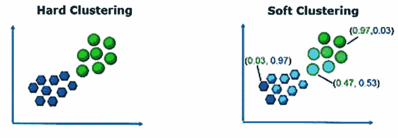

图 6 可视化了硬聚类和软聚类算法。在硬聚类算法中，一个数据点只属于一个簇。另一方面，软聚类算法允许一个数据点以权重或隶属度的形式属于多个簇。

图 9. k-means 的伪代码

```
1. Initialize cluster centroids \(\mu_1, \mu_2, \dots, \mu_k \in \mathbb{R}^n\) randomly.

2. Repeat until convergence: {

    For every \(i\), set
    
    \(c^{(i)} := \arg\min_j \|x^{(i)} - \mu_j\|^2.\)

    For each \(j\), set
    
    \(\mu_j := \frac{\sum_{i=1}^m 1\{c^{(i)} = j\}x^{(i)}}{\sum_{i=1}^m 1\{c^{(i)} = j\}}.\)

}
```

图 7 显示了 k-means 算法的伪代码。我们希望将数据聚类为 k 个簇。为此，我们首先随机初始化 k 个质心，然后迭代地将每个数据点分配到最近的质心，接着将质心重新计算为簇中所有点的中心点。当算法收敛时停止。

### 逻辑回归

逻辑回归是一种线性分类算法，因此适用于入侵检测问题 (Subba et al., 2015)。逻辑回归是一个形式为以下的预测函数：

```
f(x) = θ(w^T x)
```

其中 X 是输入特征矩阵，w 是权重向量。激活函数 θ 可从多个激活函数族中选择。最流行的激活函数是 sigmoid 函数，定义为：

```
σ(s) = \frac{1}{1 + e^{-s}}
```

逻辑回归使用对数似然损失函数，定义为：

逻辑回归模型可以使用随机梯度下降算法进行训练。今天，逻辑回归算法已得到大多数流行数据分析语言的支持。然而，逻辑回归算法无法处理缺失值，因此在实际应用中并不十分有用。

### 支持向量机

支持向量机 (SVM) 是一种广泛用于入侵检测的知名分类算法 (Chen et al., 2005)。SVM 的思想如图 8 可视化所示。一般来说，SVM 试图找到一个超平面来分离两类数据，并使边缘最大化。SVM 与逻辑回归的区别在于，SVM 仅关注类别边界上的数据点，而逻辑回归关注类中的所有数据点。


**图 10. 使用 SVM 的二元分类 (Chen et al., 2005)**

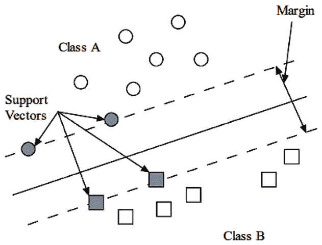

在图 9 中，我们展示了 SVM 的伪代码。

**图 11. SVM 的伪代码 (Chen et al., 2005)**

```
Support vector machine
Problem def:
For a classification problem, we try to estimate a function \( f : \Re^n \mapsto \{\pm 1\} \)
using training data. So, let us denote two classes - A and B. The class A with \( x \in A, y = 1 \) and the class B with \( x \in B, y = -1 \). \( (x, y)_i \in \Re^n \times \{\pm 1\} \). If the
training data are linearly separable then there exists a pair (w,b) \(\in \Re^n \times R \)
such that \( y_i(w^t x + b) \ge 1, \) for all \( x \in A \cup B \).
1. SVM belongs to the type of maximal margin classifier, in which the
classification problem can be represented as an optimization problem

Minimize \( \Phi(w) = \frac{1}{2} \|w\|^2 \quad s.t. \quad y(w^t x + b) \ge 1 \)

2. The dual of the optimization problem: find multipliers \( \lambda_i \) which maximize

\( W(\Lambda) = \sum_{i=1}^l \lambda_i - \frac{1}{2} \|w\|^2 = \sum_{i=1}^l \lambda_i - \frac{1}{2} \sum_{i=1}^l \sum_{j=1}^l \lambda_i \lambda_j y_i y_j x_i^T x_j, \)

and by the Karush-Kuhn-Tucker (KKT) complementary conditions

\( \lambda_i [y_i(w^T x_i + b) - 1] = 0, \quad i = 1, ...., l, \)
```

在他们的工作中，(Chen et al., 2005) 使用 SVM 算法达到了 99.6% 的攻击检测率，误报率为 2.87%，为最佳结果。

### 朴素贝叶斯

朴素贝叶斯算法是一种基于概率中贝叶斯规则的分类算法。

贝叶斯规则如下：

P(A|B) = \frac{P(B|A)P(A)}{P(B)}

使用朴素贝叶斯分类时，我们假设特征之间相互独立。然后我们有：

P(y | x_1, ..., x_n) = \frac{P(y) \prod_{i=1}^n P(x_i | y)}{\prod_{i=1}^n P(x_i)}

朴素贝叶斯算法的优势在于其计算速度非常快，适合低功耗设备。朴素贝叶斯算法在 (Panda and Patra, 2007) 的研究中已被用于入侵检测问题。如今，朴素贝叶斯算法被认为是针对现代数据集的弱分类算法，通常用作基准算法 (Dang, 2020)。

### 决策树

决策树算法是机器学习中最重要的算法之一。决策树算法的目标是自动构建一系列 if-else 规则，然后通过依次应用这些规则将新数据点分类到某个组中。由于其本质，决策树适用于入侵检测问题 (Amor et al., 2005)。

**图 12. 入侵检测系统中的决策树示例 (Botes et al., 2017)**

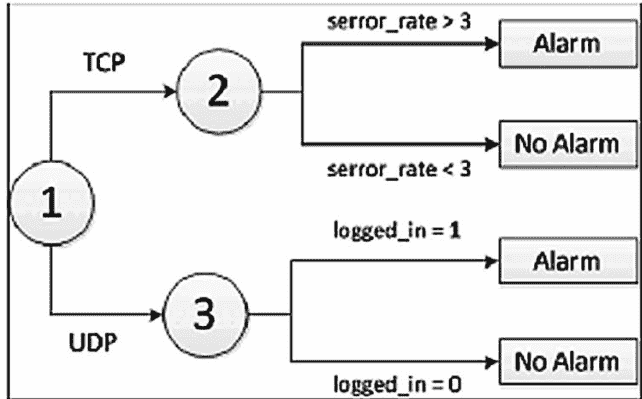

决策树的另一个优势是它非常非常易于理解。例如，图 9 展示了一个为入侵检测问题设计的决策树示例。普通用户可以在无需任何进一步知识的情况下立即理解决策树的工作流程。

与朴素贝叶斯算法类似，如今决策树被认为是弱分类器 (Dang, 2019)。然而，决策树是构建更复杂算法（即我们将在下一节讨论的袋装和提升树）的基本模块。这些算法通常被选为 Kaggle 组织的机器学习竞赛中的最佳算法。

### 随机森林

即使决策树被认为是弱算法，对其进行集成也能讲出不同的故事。集成决策树有两种方法：袋装和提升。

随机森林 (Breiman, 2001) 是一种袋装算法。随机森林的思路是创建多棵决策树，每棵树在特征和训练数据上与其他树略有不同。然后可以将预测视为这些树之间的投票。

**图 13. 随机森林算法**

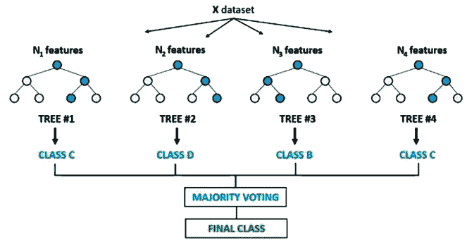

随机森林在图 11 中得到可视化。随机森林在文献中被广泛用于入侵检测问题 (Resende and Drummond, 2018)。然而，根据 (Dang, 2019)，随机森林被类似 xgboost 这样的提升机器算法所超越。

### 提升机器

提升是改进决策树性能的另一种方法。而在袋装方法中，多棵树是同时且独立构建的，提升模型则按顺序构建多棵决策树。核心思想是让后续树修正前一棵树产生的预测误差。

**图 14. 提升树**

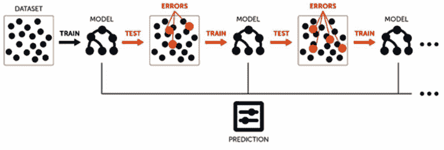

近年来，已引入多种提升模型并取得了许多成功。举几例，我们有 xgboost (Chen and Guestrin, 2016)、lightgbm (Ke et al., 2017) 和 catboost (Dorogoush et al., 2018)。xgboost 模型在现代入侵数据集上达到了近乎完美的预测性能 (Dang, 2019)。在最近的研究中 (Dang, 2021)，研究人员表明 catboost 可能与 xgboost 达到近似的结果，但训练和推理时间要短得多。在某些实验中，catboost 算法运行速度可能比 xgboost 快约十倍，而预测性能的差异小于 0.0001%。

### 隔离森林

隔离森林 (Liu et al., 2008) 是一种基于随机森林思想的无监督机器学习方法。

**图 15. 隔离森林**

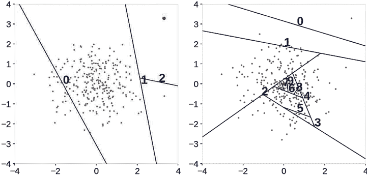

- (a) 异常
- (b) 正常

隔离森林的思想是，我们将使用随机森林将每个数据点与所有其他数据点分类开。我们需要对单个数据点进行分类的树越深，该点就越正常。因此，通过对所有数据点应用隔离森林，我们可以衡量每个数据点的异常程度并将其从数据中移除。隔离森林可用于清洗数据或直接检测入侵 (Dang, 2018)。

隔离森林算法的主要缺点之一是其处理速度慢。此外，该算法不支持空值，而空值在实际应用中非常普遍。

### 深度学习

深度学习 (Goodfellow et al., 2016) 是当今一个活跃的研究领域，近年来取得了许多成就。将深度学习技术应用于入侵检测系统并不奇怪。(Vinayakumar et al., 2017) 研究了多种卷积神经网络及其变体，以使用 KDD-99 数据集检测入侵。然而，由于大多数入侵数据集以表格数据形式呈现，深度学习技术相比集成学习并未显示出任何改进 (Dang, 2021)。

### 强化学习

强化学习 (Dang and Vo, 2021) 是机器学习的一个分支，可被视为监督学习与无监督学习之间的中间点。

与监督机器学习算法需要标记数据集不同，强化学习算法与环境交互并观察响应以调整其策略。

然而，正如许多其他研究所指出的，强化学习要求算法通过试错来学习，因此在学习阶段的初始阶段，模型必须允许一些恶意数据包进入系统。在现实世界的网络系统中，这可能不可行。

**图 16. 强化学习**

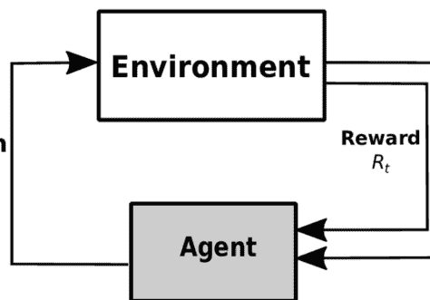

### 主动学习

主动学习 (Dang, 2020) 是一种主动选择下一实例加入训练集的方法。通过使用主动学习，我们可以用训练数据的一个小子集开始训练过程，然后从池中选择可能提高模型性能的下一实例。核心思想是，我们选择一些未标记的数据点，预计如果将其标记并添加到训练集中，预测性能将显著提高。用于确定数据点的一些常见指标是熵或预测分数。然后，我们可以请一些专家手动标记这些数据点。这样做，我们减少了手动标记任务所需的精力，而该任务成本高昂。

(Dang, 2020) 表明，通过使用主动学习，计算能力降低但预测性能得以保持。

### 公开问题和未来研究方向

近年来，基于机器学习的入侵检测系统取得了许多成功。然而，该领域存在一些我们将在此讨论的公开问题。

- 如何生成大量现实的标记数据集？如前一节所讨论，近年来已引入许多攻击数据集。然而，其中大多数是使用模拟环境创建的。我们可以将这些数据集用于教育目的，但确实需要来自现实世界攻击的数据集。然而，如何生成真实攻击并非微不足道的问题。可能我们需要一些退休的黑帽黑客的合作。

- 如何应对零日攻击？应对零日攻击对研究人员来说仍然是一个关键挑战。即使是 xgboost 这样的高性能分类器，如果需要处理未知攻击也会失败。强化学习算法具有很大的潜力，但其最先进的性能尚未赶上其他监督学习技术。一种混合方法可能是一种解决方案：当监督学习模型处理已知攻击时，我们同时训练一种强化学习算法来捕捉第一个模型遗漏的攻击。

- 如何使用低功耗设备训练模型？用于入侵检测问题的最先进模型都是复杂模型，因此需要大量计算能力。将它们放置在低功耗设备（如家用路由器或 IoT 设备）中并不合适，特别是如果我们需要


为了动态更新模型。分布式学习可能是一个解决方案：我们将训练过程分发到网络中的多个设备。

- 如何遗忘过时的训练点？在许多情况下，如果我们检测到某些训练数据点已过时或不再有用，我们需要从训练数据集中删除这些数据点。朴素的方法是从头重新训练所有内容。然而，这不是一种实用的方法（Dang, 2021）。

### 结论

在本章中，我们回顾了入侵检测问题。入侵检测问题是当今许多网络安全系统的核心问题。在本文中，我们将该问题描述并表述为分类任务。我们回顾了文献中已为入侵检测研究的机器学习算法。我们解决了未决挑战，并提出了一些潜在的研究想法来解决这些挑战。

### 参考文献

Ahmad, Z., Shahid Khan, A., Wai Shang, C., Abdullah, J., & Ahmad, F. (2021). 网络入侵检测系统：机器学习和深度学习方法的系统研究。*新兴电信技术交易*, 32(1), e4150. doi:10.1002/ett.4150

Alqahtani, H., Sarker, I. H., Kalim, A., Hossain, S. M. M., Ikhtlaq, S., & Hossain, S. (2020年3月). 使用机器学习分类技术进行网络入侵检测。在《计算科学、通信与安全国际会议》中（第121-131页）。Springer. 10.1007/978-981-15-6648-6_10

Amor, N. B., Benferhat, S., & Elouedi, Z. (2004年3月). 入侵检测系统中的朴素贝叶斯与决策树。在《2004年ACM应用计算研讨会论文集》中（第420-424页）。10.1145/967900.967989

Botes, F. H., Leenen, L., & De La Harpe, R. (2017年6月). 蚁群诱导的入侵检测决策树。在第16届欧洲网络战与安全会议中（第53-62页）。ACPI.

Breiman, L. (2001). 随机森林。*机器学习*, 45(1), 5–32. doi:10.1023/A:1010933404324

Chen, T., & Guestrin, C. (2016年8月). Xgboost：可扩展的树增强系统。在第22届ACM SIGKDD知识发现与数据挖掘国际会议论文集中（第785-794页）。10.1145/2939672.2939785

Chen, W. H., Hsu, S. H., & Shen, H. P. (2005). 入侵检测中SVM和ANN的应用。*计算机与运筹学*, 32(10), 2617–2634. doi:10.1016/j.cor.2004.03.019

Dang, Q. V. (2018). 网络流量分析中的异常检测。arXiv预印本 arXiv:1808.02024.

Dang, Q. V. (2019年11月). 入侵检测系统的机器学习技术研究。在未来数据与安全工程国际会议中（第411-426页）。Springer. 10.1007/978-3-030-35653-8_28

Dang, Q. V. (2020年11月). 理解基于机器学习的入侵检测系统的决策。在未来数据与安全工程国际会议中（第379-396页）。Springer. 10.1007/978-3-030-63924-2_22

Dang, Q. V. (2020年10月). 入侵检测系统的主动学习。在2020年RIVF计算与通信技术国际会议（RIVF）中（第1-3页）。IEEE.

Dang, Q. V. (2021年7月). 针对域名系统攻击的入侵检测模糊聚类算法研究。在2021年第五届系统安全与可持续性智能趋势世界会议（WorldS4）中（第271-274页）。IEEE. 10.1109/WorldS451998.2021.9514038

Dang, Q. V. (2021). 通过机器学习可解释性提高入侵检测系统的性能。*Web信息系统国际期刊*.

Dang, Q. V. (2021年2月). 机器学习时代的被遗忘权。在数字科学进步国际会议中（第403-411页）。Springer. 10.1007/978-3-030-71782-7_35

Dang, Q. V., & Vo, T. H. (2021年5月). 入侵检测问题的强化学习技术研究。在2021年第4届人工智能与大数据国际会议（ICAIBD）中（第87-91页）。IEEE. 10.1109/ICAIBD51990.2021.9459006

Dorogush, A. V., Ershov, V., & Gulin, A. (2018). CatBoost：支持类别特征的梯度增强。arXiv预印本 arXiv:1810.11363.

Elsayed, M. S., Le-Khac, N. A., & Jurcut, A. D. (2020). InSDN：一种新型SDN入侵数据集。*IEEE Access：实用创新、开放解决方案*, 8, 165263–165284. doi:10.1109/ACCESS.2020.3022633

Fawcett, T. (2006). ROC分析简介。*模式识别快报*, 27(8), 861–874. doi:10.1016/j.patrec.2005.10.010

Goodfellow, I., Bengio, Y., & Courville, A. (2016). 深度学习。MIT出版社.

Huai-bin, W., Hong-liang, Y., Zhi-Jian, X. U., & Zheng, Y. (2010年5月). 入侵检测中使用SOM和K-Means的聚类算法。在2010年电子商务与电子政务国际会议中（第1281-1284页）。IEEE. 10.1007/ICEE.2010.327

Ke, G., Meng, Q., Finley, T., Wang, T., Chen, W., Ma, W., ... Liu, T. Y. (2017). LightGBM：一种高效的梯度增强决策树。*神经信息处理系统进展*, 30, 3146–3154.

Liao, Y., & Vemuri, V. R. (2002). 入侵检测中K-近邻分类器的应用。*计算机与安全*, 21(5), 439–448. doi:10.1016/S0167-4048(02)00514-X

Liu, F. T., Ting, K. M., & Zhou, Z. H. (2008年12月). 隔离森林。在第八届IEEE国际数据挖掘会议中（第413-422页）。IEEE. 10.1109/ICDM.2008.17

Maseer, Z. K., Yusof, R., Bahaman, N., Mostafa, S. A., & Foozy, C. F. M. (2021). 基于CICIDS2017数据集的异常入侵检测系统机器学习基准测试。*IEEE Access：实用创新、开放解决方案*, 9, 22351–22370. doi:10.1109/ACCESS.2021.3056614

McHugh, J. (2000). 入侵检测系统测试：对林肯实验室执行的1998年和1999年DARPA入侵检测系统评估的批判。*ACM信息与系统安全期刊*, 3(4), 262–294. doi:10.1145/382912.382923

Panda, M., & Patra, M. R. (2007). 使用朴素贝叶斯进行网络入侵检测。*计算机科学与网络安全国际期刊*, 7(12), 258-263.

Rao, B. B., & Swathi, K. (2017). 网络入侵检测系统的快速kNN分类器。*印度科学与技术期刊*, 10(14), 1–10. doi:10.17485/ijst/2017/v10i29/109053

Resende, P. A. A., & Drummond, A. C. (2018). 基于随机森林的入侵检测系统方法综述。*ACM计算机调查*, 51(3), 1–36. doi:10.1145/3178582

Ring, M., Wunderlich, S., Grüdl, D., Landes, D., & Hotho, A. (2017年6月). 入侵检测的基于流的基准数据集。在第16届欧洲网络战与安全会议论文集中（第361-369页）。ACPI.

Ring, M., Wunderlich, S., Scheuring, D., Landes, D., & Hotho, A. (2019). 基于网络的入侵检测数据集综述。*计算机与安全*, 86, 147–167. doi:10.1016/j.cose.2019.06.005

Shahraki, A., Abbasi, M., Taherkordi, A., & Jurcut, A. D. (2021). *网络流量分类主动学习：技术综述*. arXiv预印本 arXiv:2106.06933.

Sharafaldin, I., Lashkari, A. H., & Ghorbani, A. A. (2018). 生成新的入侵检测数据集和入侵流量特征化的迈向。*ICISSp*, 1, 108–116. doi:10.5220/0006639801080116

Shatoori, M., Davidson, L., Kaur, G., & Lashkari, A. H. (2020年8月). 使用加密流量时间序列分类检测DOH隧道。在2020年IEEE可信、自治和安全计算国际会议、普适智能计算国际会议、云与大数据计算国际会议、网络科学与技术大会（DASC/PiCom/CBDCom/CyberSciTech）中（第63-70页）。IEEE.

Shiravi, A., Shiravi, H., Tavallaee, M., & Ghorbani, A. A. (2012). 开发生成入侵检测基准数据集的系统方法的迈向。*计算机与安全*, 31(3), 357-374.

Stolfo, J., Fan, W., Lee, W., Prodromidis, A., & Chan, P. K. (2000). 针对欺诈和入侵检测应用的数据挖掘成本建模与评估。*Salvatore的JAM项目结果*, 1-15.

Subba, B., Biswas, S., & Karmakar, S. (2015年12月). 使用线性判别分析和逻辑回归的入侵检测系统。在2015年年度IEEE印度会议（INDICON）中（第1-6页）。IEEE. 10.1109/INDICON.2015.7443533

Tsai, C. F., Hsu, Y. F., Lin, C. Y., & Lin, W. Y. (2009). 机器学习入侵检测：综述。*专家系统与应用*, 36(10), 11994-12000.

Umadevi, S., & Marseline, K. J. (2017年7月). 数据挖掘分类算法综述。在2017年信号处理与通信国际会议（ICSPC）中（第264-268页）。IEEE. 10.1109/CSPC.2017.8305851


Vinayakumar, R., Soman, K. P., & Poornachandran, P. (2017, September). 应用卷积神经网络进行网络入侵检测。在2017年计算、通信与信息学先进国际会议（ICACCI）中（第1222-1228页）。IEEE。10.1109/ICACCI.2017.8126009

Wang, Q., & Megalooikonomou, V. (2005, March). 用于入侵检测的聚类算法。在2005年数据挖掘、入侵检测、信息保障和数据网络安全中（第5812卷，第31-38页）。国际光学与光子学学会。doi:10.1117/12.603567

### 扩展阅读

Agarwal, A., & Gupta, N. (2021). 结构化数据异常检测技术比较。arXiv预印本 arXiv:2106.08779。

Kuhn, M., & Johnson, K. (2019). 特征工程与选择：预测模型的实用方法。CRC Press。doi:10.1201/9781315108230

Zhou, Z. H. (2013). 集成方法：基础与算法。Chapman and Hall/CRC。

## 第8章
## 基于卷积神经网络架构的癫痫发作预测中机器学习算法效率的估计：机器学习算法分类

Jamunadevi C.
孔古工程学院，佩伦杜赖，印度

Arul P.
政府艺术学院（特里奇），巴拉蒂达桑大学，印度

### 摘要

EEG癫痫发作普遍检测的趋势有助于分析EEG信号的各种特征，以定制并去除读取EEG信号时的视觉检查。癫痫是一种疾病，其特征是无原因的癫痫发作，与意外不当的神经放电有关，会导致各种健康问题，甚至死亡。检测痉挛性发作最常见的方法之一是脑电图。使用机器学习方法，可以轻松提取有助于检测癫痫发作的EEG信号特征。卷积神经网络（CNN）包含输入层和输出层，有助于训练获取的数据，因为它有助于分析大规模高维数据。在随机森林、梯度提升和决策树等多个分类器下进行性能分析，这些分类器用于特征提取。其中，随机森林被证明是实现高准确度的最佳分类器。

### 引言

癫痫是大脑中发生的一种神经疾病，其特征是无原因的癫痫发作。全球超过5000万人严重受这种神经系统疾病影响。这些患者患有包括社会和心理障碍在内的神经生物学疾病。如果在早期阶段被识别，可以挽救患者的生命。EEG信号包括两种所述活动：发作间期和发作期。EEG癫痫发作之间的时间间隔称为发作间期。EEG癫痫发作偏移和发作之间的时间间隔称为发作期。但是，癫痫发作检测的大多数常见研究表明使用头皮脑电图，因为它可以通过非侵入性方法轻松获得（T. N. Alotaiby, 2014）。EEG读数的视觉审查是一个非常耗时的过程，受过训练的医生在从多通道中识别EEG癫痫发作的特征方面也面临困难（L. J. Greenfield, 2012）。检测EEG信号时的手工制作特征分为两大类：时域特征和频域特征（M. Ahmad, 2016）。近年来，由于准确率不断提高，许多深度学习技术在信号处理方面取得了最佳效果（Y. Bengio, 2013）。使用卷积神经网络（CNN）提取的特征在检测评估中被证明是最好的，CNN中的层支持准确的分类和预测（Z. Mei, 2018）。尽管现有深度学习技术在癫痫发作检测中所声称的结果，但仍有若干挑战需要识别。其中之一是由于从多通道提取特征而导致的无关通道和多信息的存在（A. Temko, 2012），（E. Keogh, 2011）。为了应对现有方法（Y. Yuan, 2017）中的这些挑战，设计了深度学习模型来关注与EEG癫痫发作相关的脑部异常。该提议模型的演示在各种分类方法下进行评估，以衡量模型的性能。脑电图（EEG）在观察癫痫患者的大脑活动方面发挥着重要作用，并对分析癫痫产生影响。

### 文献综述

各研究人员提出了一种方法，即结合使用支持向量机（SVM）分类器（C. Cortes, 2015）或神经网络（Y.-H. Shih, 2012）（NN）来构建多阶段癫痫发作检测系统。在时域中识别了许多特征，这些特征经历了阶段（B. Erem, 2015）、统计量度（Q. Lin, 2016）和熵（H. R. Mohseni, 2016）。小波变换（V. Srinivasan, 2014）和傅里叶变换（P. E. McSharry, 2003）可用于特征提取目的。在描述EEG信号中癫痫发作检测的图像相关时频描述符方面可能存在一些新兴趋势，此外可以加入精确率和召回率以提高准确性（A. S. Engur, 2016）。EEG系统由多电极通道组成，随着通道数量增加，特征也随之增长（N. D. Truong, 2017）。为了消除这个维数问题，已经识别出大量特征选择机制，在训练分类器之前消除无关和冗余特征，从而有效预测癫痫。大量方法一直在利用多通道EEG癫痫发作检测中所强加的思想，包括主成分分析（PCA）（U. R. Acharya, 2012）、独立成分分析（ICA）（Y.H. Shih, 2012）和拉普拉斯特征映射（B. Erem, 2015）。此外，许多堆叠自动编码器已被证明比手工制作提取更适合特征提取的方法（Q. Lin, 2016）。上述文献综述识别出以下局限性：

- 现有分类器发现了多个局部最小值，而不是找到一个明确的全局最小值。
- 需要更多的训练时间。
- 将从EEG信号中提取的特征数量保持在较低水平。
- 需要集中式计算，可能不支持实时癫痫发作检测系统。
- 准确度非常低。
- 用于估计效率的参数数量非常少。
- 预测癫痫发作的发作间期相当复杂。

### 数据收集

数据集已从Kaggle存储库获取。由于数据来自开源，因此包含无关、空值和冗余特征。进行预处理以归一化数据集。从预处理后的数据集中提取特征。时频特征和小波特征的提取在卷积神经网络（CNN）下进行训练。使用决策树算法和支持向量机为训练数据集制定了指标。计算准确率、混淆矩阵、平均精度和ROC，以分析训练数据集的性能度量。数据集分为测试集、训练集、整体训练集和验证集。然后实现随机森林、梯度提升、决策树等分类算法，以比较最适合的特征提取分类器。随机森林被认为更适合于分类癫痫发作模式是否为癫痫。应用基于相关性的改进特征选择（ICFS），从小波和时频中选择突出特征。

### 架构

以下是分析用于提高癫痫患者癫痫发作预测清晰度的机器学习算法所涉及的步骤：

- 1. 数据收集
- 2. 数据预处理
- 3. 实现CNN
- 4. 使用机器学习算法进行分类


### 图 1。

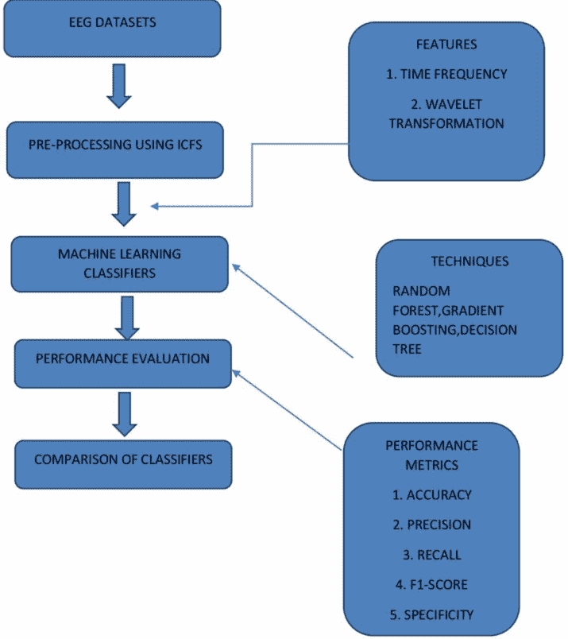

### EEG 数据集

数据从 Kaggle 仓库获得。各患者的 EEG 信号被采集为数据值。从开源提取的原始数据文件包含 5 组不同的文件夹。每个文件包含大脑活动 23.6 秒的记录。支持的时间序列数据被采样为 4097 个数据点。此外，数据点被分为 23 个块，每个块包含 178 个数据点，相当于 1 秒。解释变量值 x1、x2、x3...x178 表示 178 维输入值。更重要的是，y 表示一定时间内眼睛的状态。它表示于类别 {1, 2, 3, 4, 5}，其中 5 表示眼睛已睁开，4 表示眼睛已闭合，3 表示肿瘤区域的识别，2 表示发现肿瘤的位置，1 表示癫痫发作活动的记录。类别 1 属于癫痫发作类别，所有其他类别属于非癫痫发作类别。

### 数据预处理

预处理方法涉及多个步骤，包括从提取的数据集中识别单个试验集。然后是滤波和伪迹拒绝。识别通过触发信号完成。数据集参考平均通道。滤波旨在移除不需要的频率。诸如眨眼等伪迹的拒绝通过多伪迹拒绝算法完成，并在检查信号功率后将更改保存到同一个 csv 文件中。

### 卷积神经网络 (CNN) 的实现

CNN 是一种深度神经网络，可以识别和分类图像中的特定方面，常用于图像分析。CNN 架构计算高效，涉及特殊卷积、池化操作并执行参数共享。图像、视频识别，医学图像分析与分类，计算机视觉，自然语言处理只是其应用中的一部分。提取的小波特征已被训练，以检测 EEG 信号数据值中的任何癫痫瞬变。CNN 用于训练数据集值，尤其是相关的小波特征。卷积神经网络 (CNN) 是基于 TensorFlow 开发的。要实现的参数用于优化模型并防止过拟合，包括丢弃层 (dropout)、一维层、平衡训练、批处理以及用于确定停止准则的交叉验证。在丢弃层中，完全连接层相关的百分比已被丢弃以防止数据值过拟合。训练后的数据集值进一步使用决策树和支持向量机 (SVM) 进行评估。数据集被分为训练集、测试集、整体训练值和验证集。提供给 SVM 和决策树的输入特征是基于 CNN 的峰值检测中提取的输出。模型获得的指标包括准确率、混淆矩阵、平均精确率、召回率、支持数和 F1 分数。

### 机器学习算法

机器学习专注于改进计算机程序，使其能够获取信息并利用它来自我学习。由于能够高效发现隐藏信息和有价值知识，机器学习在大数据系统中发挥了关键作用。得益于机器学习和医学影像的先进技术，计算机化医疗迅速发展。机器学习是一种数据分析应用，旨在通过预测和统计特征为现有数据构建模型以获得所需的预测输出。

### 使用机器学习算法进行分类

分类器用于从 EEG 信号数据值中提取特征。在各种机器学习算法中，随机森林、梯度提升和决策树被用于识别提取数据值中的变化。随机森林是一种受监督的学习算法。它从一组决策树中构建“森林”，这些决策树通常使用“袋装”方法准备。袋装方法的基本前提是组合多个学习模型可以改善整体结果。主要，特征涉及时频和小波变换。由于随机森林是受监督学习算法，它证明更合适并且也降低了复杂性。随机森林是一种基于树的机器学习系统，通过组合多个决策树来发挥作用。随机数量的训练数据用于分类目的。D 表示提取的输入特征的维度。所选子集特征的维度表示为 d。d 值小于 D。在三个分类器中，随机森林 (RF) 的性能表现更好。错误率基于两个方面。一，在构建森林时，从 EEG 数据集中提取有价值特征集所形成的树之间的相关性。二，所选森林中特定树的强度。当强度增加时，错误率大幅降低。另一个采用的算法是梯度提升技术。在机器学习算法中，故障可分为两类：偏差误差和方差误差。梯度提升是用于减少模型偏差误差的提升策略之一。对于分类和回归，决策树 (DT) 是一种非参数受监督学习方法。决策树算法可用于解决回归和分类问题；目标是从数据属性中学习简单的决策规则，以开发预测目标变量值的模型。随机森林在分类中非常有效，有助于在训练时构建，类别的输出可以是分类或回归。随机森林分类器有助于减少模型过拟合，在某些情况下，它们比决策树更准确。

### 结果与讨论

这项研究得出了基于 EEG 信号检测癫痫发作的新方法。脑电活动是脑电图，本文用于分析大脑检测癫痫问题。电极的空间表示以及 EEG 数据的小波信号用于分析癫痫。训练好的模型在各种性能指标下进行分析。评估模型所选的指标包括准确率、平均精确率、支持数、召回率、混淆指标和 F1 分数。随机森林在训练过程中随机选择特征。因此，它不高度依赖任何特定的特征集。这是随机森林相对于袋装树的一个特殊特征。在比较隐含分类算法下的训练和验证数据值时，与决策树和梯度提升相比，随机森林 (RF) 给出了最佳准确率。特异性决定被准确捕获的分类癫痫活动与标记数据总数的比率。用于评估的参数包括准确率、精确率、召回率、F1 分数和特异性，这些支持癫痫发作检测的准确预测。

### 图 2. 使用随机森林分类器对训练数据集的混淆矩阵

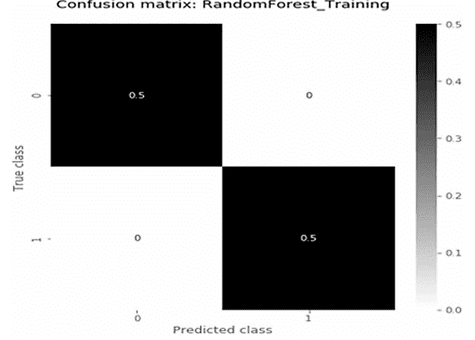

### 图 3. 使用随机森林分类器对验证数据集的混淆矩阵

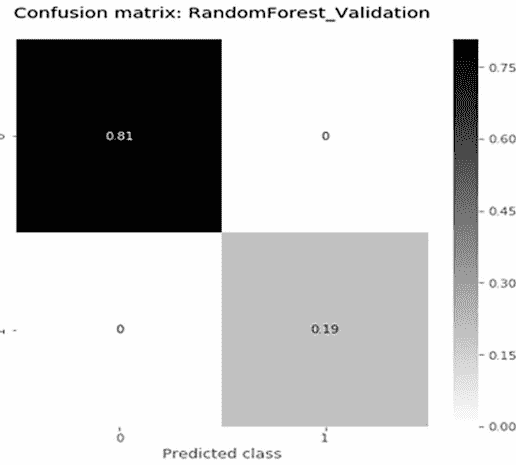

### 图 4. 使用梯度提升分类器对训练数据集的混淆矩阵

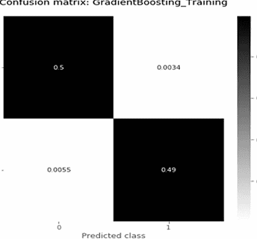


### 图 5. 使用梯度提升分类器对验证数据集的混淆矩阵

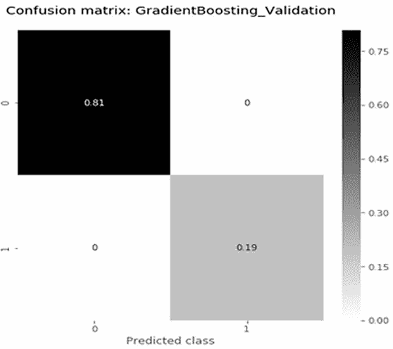

### 图 6. 使用决策树分类器对训练数据集的混淆矩阵

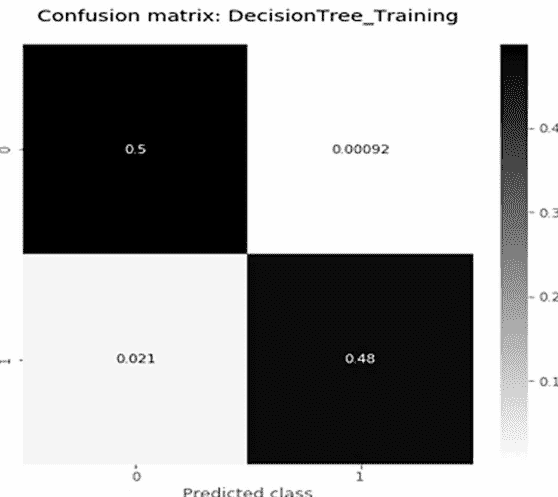

### 图 7. 使用决策树分类器对验证数据集的混淆矩阵

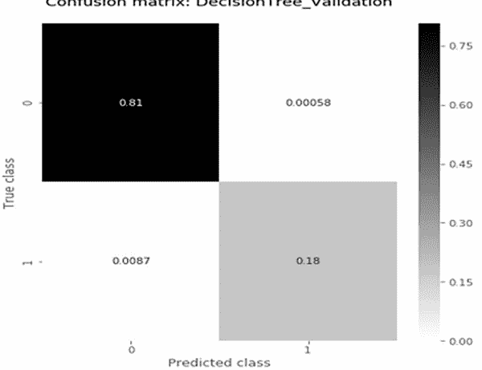

### 图 8. 分类器（随机森林、梯度提升和决策树）在训练和验证数据集上的比较

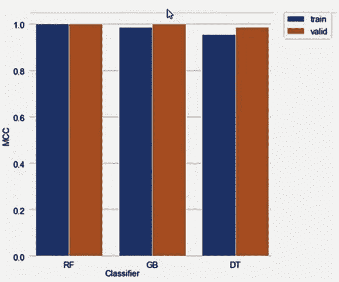

实现CNN架构所得的训练值在各种性能分析指标下得到验证。CNN模型在特异度为90%的条件下，帮助实现了91.85%的ROC和83.16%的平均精确度。现有文献中关于癫痫发作检测的各项研究使用了多种数据集，并提供了大量的评估指标。给定的表格讨论了三种分类器的性能指标，这有助于检测大脑中的癫痫活动。

### 表 1. 训练数据集的性能指标

| 分类器类型 | 准确率 | 精确率 | 召回率 | F1得分 | 特异度 |
|---|---|---|---|---|---|
| 随机森林 | 100.000% | 1.000 | 1.000 | 1.000 | 1.000 |
| 梯度提升 | 99.111% | 0.993 | 0.989 | 0.991 | 0.993 |
| 决策树 | 97.793% | 0.998 | 0.958 | 0.977 | 0.998 |

### 表 2. 验证数据集的性能指标

| 分类器类型 | 准确率 | 精确率 | 召回率 | F1得分 | 特异度 |
|---|---|---|---|---|---|
| 随机森林 | 100.000% | 1.000 | 1.000 | 1.000 | 1.000 |
| 梯度提升 | 100.000% | 1.000 | 1.000 | 1.000 | 1.000 |
| 决策树 | 99.072% | 0.997 | 0.955 | 0.975 | 0.999 |

### 结论

在本拟议研究中，EEG癫痫发作检测的初步结果已实现自动化。它有助于对癫痫发作检测的最佳算法进行分类。从EEG数据值中提取时频和小波特征所选分类器获得的准确率值有助于分析性能。与梯度提升和决策树相比，随机森林分类器在训练数据集上具有良好的性能指标。CNN通过引入不同层数而无需将特征数量设置得很小，克服了选择局部最小值的问题。未来，对于预处理中已施加的伪影拒绝，可以施加并整合各种算法以移除误检。它也可以使用相同的数据结构值应用于医疗任务，特别是在健康感知方面，意识仍被确定为一个主要问题。

### 参考文献

Acharya, U. R., Fujita, H., Sudarshan, V. K., Bhat, S., & Koh, J. E. (2015). 基于EEG信号的癫痫自动诊断熵应用：综述. 基于知识的系统, 88, 85–96. doi:10.1016/j.knosys.2015.08.004

Acharya, U. R., Sree, S. V., Alvin, A. P. C., & Suri, J. S. (2012). 小波框架中基于主成分分析的癫痫EEG活动自动分类. 专家系统与应用, 39(10), 9072–9078. doi:10.1016/j.eswa.2012.02.040

Ahmad, M., Saeed, M., Saleem, S., & Kamboh, A. M. (2016). 基于EEG的癫痫发作检测：不同技术综述. 发表于：新兴技术(ICET)国际会议. IEEE. 10.1109/ICET.2016.7813209

Alotaiby, T. N., Alshebeili, S. A., Alshawi, T., Ahmad, I., & El-Samie, F. E. A. (2014). EEG癫痫发作检测和预测算法：综述. EURASIP信号处理进展杂志, 2014(1), 183. doi:10.1186/1687-6180-2014-183

Bengio, Y., Courville, A., & Vincent, P. (2013). 表征学习：综述与新视角. IEEE模式分析与机器智能汇刊, 35(8), 1798–1828. doi:10.1109/TPAMI.2013.50 PMID:23787338

Bhattacharyya, A., & Pachori, R. B. (2017). 基于经验小波变换的患者特定EEG癫痫发作检测多变量方法. IEEE生物医学工程汇刊, 64(9), 2003–2015. doi:10.1109/TBME.2017.2650259 PMID:28092514

Cortes, C., & Vapnik, V. (2015). 支持向量网络. 机器学习, 20(3), 273–297. doi:10.1007/BF00994018

Dalton, A., Patel, S., Chowdhury, A. R., Welsh, M., Pang, T., Schachter, S., Olaighin, G., & Bonato, P. (2012). 开发身体传感器网络以检测癫痫发作的运动模式. IEEE生物医学工程汇刊, 59(11), 3204–3211. doi:10.1109/TBME.2012.2204990 PMID:22717505

Engur, Guo, & Akbulut. (2016). 用于高效检测癫痫发作的EEG信号时频纹理描述符. 脑信息学, 3(2), 101–108. doi:10.1007/s40708-015-0029-8 PMID:27747603

Erem, B., Hyde, D. E., Peters, J. M., Duffy, F. H., Brooks, D. H., & Warfield, S. K. (2015). EEG中癫痫放电的组合延迟与图嵌入揭示了复杂的重复非线性动力学. 发表于：2015年第12届IEEE国际生物医学成像研讨会(ISBI). IEEE. 10.1109/ISBI.2015.7163884

Greenfield, L. J., Geyer, J. D., & Carney, P. R. (2012). 阅读EEG：实用方法. Lippincott Williams & Wilkins.

Keogh, E., & Mueen, A. (2011). 维度灾难. 发表于：机器学习百科全书. Springer.

Lin, Q., Ye, S.-q., Huang, X.-m., Li, S.-y., Zhang, M.-z., Xue, Y., & Chen, W.-S. (2016). 基于深度学习堆栈稀疏自编码器的癫痫EEG信号分类. 发表于：智能计算国际会议. Springer. 10.1007/978-3-319-42297-8_74

McCulloch, W. S., & Pitts, W. (2012). 神经活动中内在于想法的逻辑演算. 数学生物物理学通报, 5(4), 115–133. doi:10.1007/BF02478259

McSharry, P. E., Smith, L. A., & Tarassenko, L. (2003). 癫痫发作预测：非线性方法是否相关？自然医学, 9(3), 241–242. doi:10.1038/nm0303-241 PMID:12612550

Mei, Z., Zhao, X., Chen, H., & Chen, W. (2018). 癫痫发作监测中生物信号复杂性分析：专题综述. 传感器(巴塞尔), 18(6), 1720. doi:10.3390/s18061720 PMID:29861451

Mohseni, H. R., Maghsoudi, A., & Shamsollahi, M. B. (2016). EEG信号中的癫痫发作检测：不同方法比较. 第28届IEEE EMBS国际会议论文集.

Shih, Chen, Yang, & Chiueh. (2012). 用于癫痫发作检测的FastICA中硬件高效的EVD处理器架构. APSIPA, 1–4.

Song, J.-L., Hu, W., & Zhang, R. (2016). 使用新型融合特征和极端学习机自动检测癫痫EEG. 神经计算, 175, 383–391. doi:10.1016/j.neucom.2015.10.070

Srinivasan, V., Eswaran, C., & Sriraam, N. (2014). 使用人工神经网络进行癫痫检测. 信号处理与通信国际会议(SPCOM).

Temko, A., Lightbody, G., Thomas, E. M., Boylan, G. B., & Marnane, W. (2012). 用于改善自适应新生儿癫痫发作检测的EEG通道重要性即时度量. IEEE生物医学工程汇刊, 59(3), 717–727. doi:10.1109/TBME.2011.2178411 PMID:22156948

Truong, N. D., Kuhlmann, L., Bonyadi, M. R., Yang, J., Faulks, A., & Kavehei, O. (2017). 癫痫发作检测自动通道选择中的监督学习. 专家系统与应用, 86, 199–207. doi:10.1016/j.eswa.2017.05.055

Yuan, Y., Xun, G., Jia, K., & Zhang, A. (2017). 使用短时傅里叶变换的癫痫发作检测多视图深度学习方法. 发表于：第8届ACM生物信息学、计算生物学和健康信息学国际会议论文集. ACM. 10.1145/3107411.3107419

## 第 9 章

## 基于网络物理系统和机器学习的智慧农业作物保护

Manish Choubisa
普尔尼玛工程学院，斋普尔，印度

Ruchi Doshi
阿兹特卡大学，墨西哥

### 摘要

当前，世界正在经历网物系统（CPS）和人工智能领域第四次工业革命的全球数字化转型。此外，通过利用人工智能，网物系统将能够更熟练、协作和充满活力地运行。农业作物控制是一种尽可能保护作物的过程，使其不受不同种类害虫的侵害。害虫是指包括昆虫、动物、杂草、病原体和其他生物在内的任何可能危害农业作物的生物。害虫和其他疾病每年造成全球农作物潜在产量平均20-30%的损失。因此，需要作物保护来减少这些损失。本章探讨了利用机器学习和网物系统的CPS概念，以提高作物产量并保护作物免受野生动物的侵害。CPS下的智慧农业流程包括作物建议、灌溉和施肥自动化、作物保护、植物监测和收获。


### 介绍

在这个数字化时代，将生物技术、信息技术与物理空间相融合，推动了工业的第4次革命，即工业4.0。这场工业革命改变了人类的生活方式。该革命的主要特征是从半适应制造转向大规模、完全适应的制造。此类革命的新兴技术包括嵌入式系统、物联网（IoT）、人工智能与机器学习，以及基于下一代互联网技术的众多云服务。在生产线的基础层面，配备有线或无线通信网络的执行器和传感器设备相结合，将嵌入式系统的设计转化为CPS。主要处理单元用于在物理空间中监控和控制CPS。

作物保护方法按以下几方面介绍：(i) 工业4.0新革命与网络物理系统的简要介绍，(ii) 智慧农业流程，(iii) 基于机器学习的作物保护原型设计，以及(iv) 基于不同传感器技术的病虫害识别。

本章探讨了工业4.0新革命的简要介绍以及网络物理系统在技术中的应用。为了介绍智慧农业中网络物理系统的应用，对网络物理系统（CPS）的定义和特征进行了解释和定义，并附带该系统的模型架构。在 CPS 中，嵌入式系统和计算机网络大多用于控制整个处理环境，以实时保护作物生产。实施此类 CPS 系统需要了解网络、软件、嵌入式系统和物理过程。本文概述了先进的研究和应用，以突出该领域的最新进展。

最后，通过在准确的时间、精确的位置施用适量资源，将改善作物产量。

本节对工业4.0和网络物理系统进行了简要介绍。

### 工业4.0

“工业革命”一词被定义为从手工制造向机器制造转变的过程。新的工业革命称为工业4.0。在工业4.0中，制造业中的自动化与信息交换采用网络物理系统（CPS）（Gil 等人，2019）、智慧农业（Tyagi, Sumarga Kumar Sah, 等人，2020）、物联网（Lakhwani, Kamlesh, 等人，2020）、机器学习（Hiran, Kamal Kant, 等人，2021）、云计算、人工智能、区块链技术以及更多新兴趋势。

谈到第一次工业革命时，它使用蒸汽机动力和机械装置。第二次工业革命则采用电力进行大规模制造和装配线作业。第三次工业革命由电子芯片和信息技术主导。如今，工业4.0与 CPS 相关联。

工业4.0为制造业引入了新原则，包括：

- 通过将传感器生成的信号与虚拟工厂和再创建模型相连接，实现装配方法的虚拟化。
- 通过扩展可用性，提升装配流程之间的互操作性。
- 分布式和智能决策计划。
- 实时数据收集。

### 网络物理系统

网络物理系统融合了“网络”和“物理”两个词。术语“cyber”用于描述作为计算机一部分的人或事物，而“Physical”指物理设备。因此，网络物理设备结合了网络能力与物理能力。

海伦·吉尔（Helen Gill）于2006年在美国国家科学基金会首次提出了网络物理系统（CPS）一词。CPS 这一术语历史更悠久，并与嵌入式系统设计相关。由于计算机化控制算法与物理系统紧密耦合，且需要在实时系统中正常工作，因此设计此类算法更具挑战性。CPS 还与工业4.0、物联网（IoT）、无线传感器网络（WSN）自动化以及云计算等先进技术相关（Hiran, K. K., 等人，2019）。自动驾驶汽车系统、健康监测系统、智慧农业系统和机器人制造都是 CPS 的示例（Feeney 等人，2017）。

### 图1. 网络物理系统通信模型

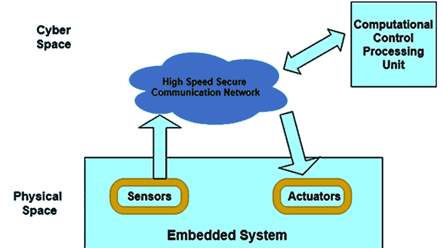

图1详细说明了网络物理系统中网络空间与物理空间之间基本通信的框图（Ghobakhllo, 2018）。传感器将物理参数转换为电信号，这些信号被传输到执行器，执行器将电信号转换为物理输出。传感器与执行器之间的信息转换通过高速安全互联网完成。

### 通用参考架构模型

本节介绍了工业4.0和网络物理系统的原型架构模型。该架构模型可用于制定战略计划，并评估制造流程的其他组织策略。

### 工业4.0架构

B. Chen 和 J. Wan 在图2中介绍了工业4.0的分层全球架构。工业4.0架构采用混合有线/无线通信技术。该分层架构由四层组成，描述如下（Schweichhart 等人，2016）：

- 1. 物理资源层：这是底层，包含工业中使用的所有物理设备，例如机械臂、自动车辆、传感器和无人驾驶航空器（UAV）。
- 2. 网络层：网络层位于物理资源层之上，包含用于在物理资源层与云应用层之间传输信息的各种网络设备。这些网络设备包括高速互联网，即5G技术（Ordonez-Lucena 等人，2019）。
- 3. 云应用层：云应用层利用数据挖掘和分析技术来改进其上方的层，即终端层。该层还显示用于控制数据库服务的云服务领域（Yeboah, T., 等人，2015）。
- 4. 终端层：此层包含所有用于改进制造生产和设计的先进工业服务。

### 图2. 工业4.0的分层架构

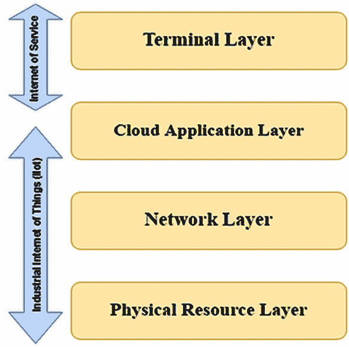

### 网络物理系统架构

Al-Ali 为网络物理系统引入了一种分层架构。该架构由5层组成，即：物理层、网络层、数据存储层、处理分析层和应用层。

- 1. 物理层：物理层包含所有物理系统组件，包括传感器、执行器、片上系统（SoC）、追踪设备（GPS 和 RFID）以及微控制器计算元件。传感器捕获所有实时数据并将其发送到云服务以进行进一步处理。
- 2. 网络层：网络层包含用于与云服务通信的所有网络设备和协议，包括无线保真（IEEE 802.11）、微波接入全球互操作性（IEEE 802.16）、分组无线通用业务以及5G技术等协议。这些协议根据可扩展性、带宽、速度、可靠性、延迟和安全性等属性进行区分。网络物理系统在许多应用中使用这些协议，例如水电站监测系统、健康监测系统、智慧农业、智慧城市、无人驾驶汽车和风力发电厂。
- 3. 数据存储层：物理层从物理对象收集大量数据，这些数据可能存储在 CPS 的云域中。数据存储层包含云域中的数据管理服务，例如 Hadoop，存储数据的副本通过副本管理技术分布在不同的从节点上。
- 4. 处理分析层：在第四层中，不同的仿真模型使用维度建模算法处理存储的信息。实施了用于受监督和无监督学习的机器学习方法，包括分类、聚类和回归模型，以预测最终输出值（Mahrishi, Mehul, 等人，2020）。
- 5. 应用层：应用层包含智慧农业、绿色建筑、智能交通系统、健康监测和机器人领域使用的所有用户级界面。

### 网络物理系统的特征

网络物理系统具有多种特征，用于其快速决策过程，以赋能制造技术，提高灵活性和效率。网络物理系统同样应与外部


世界共享数据并触发活动。CPS 的不同特性列于下表 1 中。

表 1. 网络物理系统特性

| 序号 | 特性 | 描述 |
| :--- | :--- | :--- |
| 1 | 复杂性 | CPS 很复杂，因为所有使用的元素在本质上都不同 |
| 2 | 互操作性 | 互操作性允许 CPS 交换可理解的数据。 |
| 3 | 网络能力 | CPS 应由互连的处理组件和物理组件群组成，规模巨大，涵盖有线和无线网络，通过各种传感器和执行器，旨在在不同领域发展洞察力。 |
| 4 | 服务导向 | CPS 使用面向服务的模型提供数字服务。 |
| 5 | 模块化 | CPS 组件可以分离和重新组合以实现模块化，从而使 CPS 可以根据消费者要求保持灵活。 |
| 6 | 自主性 | CPS 的自主性是单独学习并适应系统环境的能力。 |
| 7 | 分散化 | 它是指在 CPS 中转移控制命令和决策规则，使其作为独立实体工作。 |
| 8 | 集成 | CPS 集成所有新的先进技术，使设计过程更快速、更准确。 |
| 9 | 虚拟化 | 制造业中的虚拟化包括实际物理制造过程应用的副本。 |
| 10 | 实时能力 | CPS 具有在实时环境中工作的能力，以精良的性能以良好的可预测方式运行。 |
| 11 | 计算能力 | CPS 具有各种数值计算能力，并为现实世界物理计算提供强健的准确性。 |
| 12 | 智能性 | CPS 能够融合智能功能，用于容错、感知行为识别和决策能力。 |

### 网络物理系统最新应用进展

本节介绍了 CPS 的最新应用进展。

### 绿色建筑

被视为消除对气候和自然环境产生负面影响并能产生积极影响的实体建筑，即绿色建筑。CPS 在绿色建筑基础设施领域扮演着积极主角的角色。它扩展了施工过程并节省了人力时间。CPS 主要关注湿度、温度、水位、光照等环境参数，用于构建绿色建筑。由各种传感器收集的感知实时热度、湿度并激活执行器的环境数据被植入建筑中，以感知环境变化。总体而言，该功能提高了能源效率，减少了能源消耗和温室气体排放。

### 医疗 CPS

医疗网络物理系统 (MCPS) 是用于关键医疗管理的不同医疗设备网络。为实现大型医院的质量，使用了 MCPS。MCPS 包含一个无线传感器网络 (WSN) 来收集诊断数据，并用于患者的健康监测和药物管理。医疗领域的 CPS 或 MCPS 广泛应用于医院、制药行业、诊断中心、患者实时助理系统等众多健康行业。MCPS 的复杂性取决于用于健康监测环境的特定应用。CPS 架构需要大量数据来维护患者健康，例如患者病史、历史数据和疾病类别等。(Kritzinger et al., 2018)。

### 智能电网结构

简单的“网格”一词代表电网、输电线路网络、变电站、变压器和其他供电设备。智能电网结构是一种依赖数据采集方法的电力系统。智能电网包含网络物理系统的先进部分。电网控制将成为智能电网的一部分，以及自动化技术和能够以数字方式快速响应不断变化的能源需求的网络物理系统 (Al-Ali, et al., 2018)。

### 远程类人机器人

类人机器人用于娱乐、教育、医疗、制造、农业等许多领域帮助人类。尽管如此，当前场景仍要求人类在自给自足的环境中参与，以完成可能更适合采用人机协同方式完成的任务。人类、机器和软件程序结构需要相互交互和理解，并以有效且稳定的方式协同工作 (Kim et al., 2021)。

### 智能交通系统 (ITS)

ITS 不仅用于控制道路交通，还为道路事故和高效基础设施利用提供安全机制。智能交通系统 (ITS) 是交通领域的一项先进技术，可提高交通管理质量，并使用全球定位系统 (GPS) 监控所有车辆的移动。除了智能交通监控外，智能交通系统还应用于实时停车管理、电子收费、救护车通知、车辆速度跟踪与警报、实时交通信号灯管理、防碰撞系统等多个领域。

### 航空应用

CPS 在航空领域的主要和关键应用。航空应用包括实时空中交通管理、自动驾驶管理、飞机行为、系统健康监测和飞机着陆等。

### 制造业

在制造环境中，网络物理系统用于自动化制造过程并调节整个制造过程。因此，生产流程得到改善，供应商和客户之间发生更好的数据通信。智能生产在供应链中提供卓越的可见性控制，从而改善货物可追溯性和安全性。IoT 和 CPS 在制造业中的重要性正在迅速增长。传感器用于预测设备磨损并分析负载。分析降低了维护成本并改善了整体流程性能 (Grassi et al., 2020)。

### 网络物理系统的安全问题

在工业革命的数字化转型中，安全是网络物理系统面临的主要挑战，而在这个数字时代，最重要的元素是现代网络空间。CPS 安全系统需要平衡三个特性：机密性、可用性和完整性。机密性的主要目标是通过防止信息被不当披露来保护数据。可用性是指授权的计算机用户随时都能访问合法系统的概念。完整性是保护系统数据免受未经授权的信息修改 (Bakirtzis et al., 2021)。

网络安全可以通过网络物理系统领域的健全信息结构和专业专家来实现 (Gupta et al., 2020)。在本单元中，我们通过按以下两个目标类别分类攻击，描述了工业 4.0 中网络物理系统的漏洞：

- 物理设备中的漏洞
- 中间网络中的漏洞

### 物理设备中的漏洞

网络物理系统与多种具有计算和通信功能的物理设备集成。物理设备包括机械臂、无线传感器、机器人车辆、自动化机器、监控设备等。几种内部或外部攻击类型可能会影响这些物理设备，例如：

- **物理攻击**：在物理攻击中，未经授权的人员获得对物理设备的物理访问权限，以攻击其结构以窃取信息或破坏所有基础设施。
- **数据注入攻击**：攻击者将恶意程序注入计算机网络，从而损坏所有设备信息或通过网络将机密信息发送给攻击者。这种攻击是网络物理系统中的主要安全问题。
- **侧信道攻击 (SCAs)**：侧信道攻击通过分析处理时间、施加电压、电流流动等物理参数，从集成电路 (IC) 或设备中窃取机密信息。
- **时间延迟攻击**：时间延迟将机械和电子设备中的两个事件发生分开。时间延迟攻击通过分析系统对不同输入的响应时间来识别物理设备中的漏洞。
- **应用层攻击**：应用层攻击（也称为 DDoS 攻击，分布式拒绝服务攻击）专门设计用于干扰应用程序服务，使特定设备应用程序无法向用户提供其服务。
- **零日攻击**：零日攻击是攻击者最近暴露的与软件相关的漏洞，用于利用开发者未知的系统故障。该术语源于软件开发者知晓该问题的天数。


### 中间网络中的漏洞

网络-物理系统也集成通信网络功能，以连接网络空间与物理空间。漏洞也影响了制造业（You et al., 2020）。它还增加了通信网络中的漏洞。通常网络攻击分为两类：主动攻击和被动攻击。在主动攻击中，攻击者会修改、加密或损坏通信信道中的信息。在被动攻击中，攻击者仅访问未授权网络并窃取个人信息。在被动攻击中，攻击者不会更改网络中的原始信息流。

### 网络攻击类型：

- 1. 中间人攻击：顾名思义，这种攻击会访问任意通信网络之间的信息以获取私钥。位于两个通信方之间的人或攻击者被称为中间人。中间人攻击者可读取、监控或访问通信控制，并可更改任意两方之间的信息流。中间人攻击难以识别。它是网络中主动攻击的一种。

- 2. IP 欺骗：在 IP 欺骗中，攻击者会更改 Internet Protocol（IP）数据包头部中的源地址，使用户认为数据包来自可信源。利用 IP 欺骗，成千上万台计算机会使用相同的源 IP 地址向大量目标发送消息。IP 欺骗通常是一种拒绝服务（DoS）攻击，会增加网络流量。IP 欺骗也称为数据包修改攻击。

- 3. 窃听：一般来说，窃听是指未经他人同意而窃听他人私人谈话的行为。在窃听攻击中，攻击者会监控网络数据包并在薄弱网络中窃取个人信息。

- 4. 干扰攻击：在干扰攻击中，攻击者会在无线网络中发送多个无线电信号，通过最小化信噪比来破坏通信。无线信号干扰设备最常用于干扰无线网络，是一种拒绝服务（DoS）攻击。

- 5. 碰撞攻击：在碰撞攻击中，攻击者会更改发送数据包中的校验位，并将修改后的数据包重新传输给接收方。

- 6. 虫洞攻击：在虫洞攻击中，两名攻击者会在网络中部署于战略位置，跟踪网络并记录无线信息。

- 7. 黑洞攻击：在黑洞攻击中，被攻破的节点会通过向其邻居发送虚假信息来吸引网络流量。

### 结论

可以清楚地看到，工业 4.0 的增长正在受到网络-物理系统（CPS）在自动化和制造方面的影响。通过对工业 4.0 和机器学习的网络物理系统进行简要介绍，本章讨论了物理空间和网络空间不同层级的通用架构模型，涵盖了 CPS 的复杂性、互操作性和网络功能。更具体地说，本章重点关注了网络物理系统的安全相关问题及其应用。分别探讨了网络物理系统对工业 4.0 的影响。现在是时候关注下一次工业革命，即工业 5.0，以便在网络物理系统中实现更高安全性，提升制造过程的生产力和效率。

### 致谢

我们声明，本章中描述的作品是原创的，未经必要许可，未从其他来源复制或摘取任何部分，且该作品未以任何形式（任何语言）在任何地方出版，目前也未在任何出版物形式中作为出版物/发表被考虑。本研究未获得公共、商业或非营利部门的任何资助机构的特定资助。

### 参考文献

Aheleroff, S., Xu, X., Zhong, R. Y., & Lu, Y. (2021). 工业 4.0 中数字孪生即服务（DTaaS）：架构参考模型. Advanced Engineering Informatics, 47, 101225. doi:10.1016/j.aei.2020.101225

Al-Ali, A. R., Gupta, R., & Nabusi, A. A. (2018, April). 网络物理系统在制造技术中的作用. 载于 AIP Conference Proceedings (Vol. 1957, No. 1, p. 050007). AIP Publishing LLC. doi:10.1063/1.5034337

Bakirtzis, G., Sherburne, T., Adams, S., Horowitz, B. M., Beling, P. A., & Fleming, C. H. (2021). 面向网络-物理系统安全、安全性和弹性协同工程的本体元模型. Software & Systems Modeling, 1–25. doi:10.1007/s10270-021-00892-z

Feeney, A. B., Frechette, S., & Srinivasan, V. (2017). 面向制造业的网络物理系统工程. 载于 Industrial internet of things (pp. 81–110). Springer. doi:10.1007/978-3-319-42559-7_4

Ghobakhloo, M. (2018). 制造业的未来：迈向工业 4.0 的战略路线图. Journal of Manufacturing Technology Management, 29(6), 910–936. doi:10.1108/JMTM-02-2018-0057

Gil, S., Zapata-Madrigal, G. D., & García-Sierra, R. (2019, October). 电气物联网（EIoT）：电气系统数据管理平台. 载于 Future Technologies Conference 论文集 (pp. 49–65). Springer.

Grassi, A., Guizzi, G., Santillo, L. C., & Vespoli, S. (2020). 基于工业 4.0 的制造系统的半异构生产控制架构. Manufacturing Letters, 24, 43–46. doi:10.1016/j.mfglet.2020.03.007

Gupta, N., Tiwari, A., Bukkapatnam, S. T., & Karri, R. (2020). 增材制造网络物理系统：供应链网络安全与风险. IEEE Access: Practical Innovations, Open Solutions, 8, 47322–47333. doi:10.1109/ACCESS.2020.2978815

Hiran, K. K., Doshi, R., Fagbola, T., & Mahrishi, M. (2019). 云计算：掌握概念、架构与应用，附真实世界示例和案例研究. BPB Publications.

Hiran, K. K., Jain, R. K., Lakhwani, K., & Doshi, R. (2021). 机器学习：掌握带真实示例的监督和非监督学习算法（英文版）. BPB Publications.

Kim, J., & Lee, J. Y. (2021). 面向网络物理系统应用的服务器-边缘双重化闭环数据分析系统. Robotics and Computer-integrated Manufacturing, 67, 102040. doi:10.1016/j.rcim.2020.102040

Kritzinger, W., Karner, M., Traar, G., Henjes, J., & Sihn, W. (2018). 制造业中的数字孪生：分类文献综述与分类. 第 16 届 IFAC 制造信息控制问题研讨会 INCOM. 10.1016/j.ifacol.2018.08.474

Lakhwani, K., Gianey, H. K., Wireko, J. K., & Hiran, K. K. (2020). 物联网（IoT）：IoT 的原理、范式与应用. BPB Publications.

Li, N., Liu, K., Chen, Z., & Jiao, W. (2020). 网络物理系统的环境感知建模与参考架构. IEEE Access: Practical Innovations, Open Solutions, 8, 200322–200337. doi:10.1109/ACCESS.2020.3034390

Mahrishi, M., Hiran, K. K., Meena, G., & Sharma, P. (Eds.). (2020). *实时应用中的机器学习与深度学习*. IGI Global. doi:10.4018/978-1-7998-3095-5

Ordonez-Lucena, J., Chavarria, J. F., Contreras, L. M., & Pastor, A. (2019, October). 使用 5G 非公共网络支持工业 4.0 场景. 载于 *2019 年 IEEE 通信与网络标准会议 (CSCN)* (pp. 1-7). IEEE. 10.1109/CSCN.2019.8931325

Schweichhart, K. (2016). *工业 4.0 参考架构模型（RAMI 4.0）简介*. 可在线查阅: https://www.plattform-i40.de

Tyagi, S. K. S., Mukherjee, A., Pokhrel, S. R., & Hiran, K. K. (2020). 面向智慧农业物联网的传感器网络智能优化资源分配方法. *IEEE Sensors Journal*.

Yeboah, T., Odabi, I., & Hiran, K. K. (2015, April). 面向云计算环境的轮询与最短作业优先算法集成. 载于 International Conference On Management. *Tongxin Jishu*, 3(1), 1–5.

You, Z., & Feng, L. (2020). 建筑行业中工业 4.0 相关技术的集成：网络物理系统框架. *IEEE Access: Practical Innovations, Open Solutions*, 8, 122908–122922. doi:10.1109/ACCESS.2020.3007206


## 第 10 章
## 基于深度学习架构的心律失常分类

- **库尔迪普·辛格·乔汉**
  阿杰梅尔工程学院，印度
- **乔蒂·加杰拉尼**
  阿杰梅尔工程学院，印度
- **布哈纳·夏尔马**
  JECRC 大学，斋普尔，印度
- **萨蒂亚·纳拉扬·塔齐**
  阿杰梅尔工程学院，印度

### 摘要

由于心血管疾病 (CVDs) 是现代医学在早期诊断中面临的严重问题，因此构建一个能够及时为数百万人治疗并有效降低死亡率的分类模型至关重要。心电图 (ECG) 是一种专门用于测量心脏生理反应的仪器。为了准确诊断患者的急性和慢性心脏问题，对这些 ECG 信号进行深入检查至关重要。所提出的模型由一个卷积神经网络组成，包含三个卷积层、两个池化层和两个全连接层。所提出的模型在 MIT-BIH 心律失常和 PTB 诊断数据集上进行训练和评估。分类准确率为 99.16%，高于同类心律失常的最新研究。所提出模型的召回率、精确率和 F1 分数分别为 96.53%、95.15% 和 99.17%。所提出的模型可以明确帮助医生检测和分类心律失常。

DOI: 10.4018/978-1-7998-9308-0.ch010

### 引言

心血管疾病 (CVDs) 对人们构成严重威胁。它们也是全球死亡率上升的原因。在全球所有死亡病例中，CVDs 导致了 31% 的死亡 (Sahoo et al., 2019)。CVDs 的主要原因包括高血压、不健康饮食、吸烟和不健康的生活方式。

根据世界卫生组织 (WHO) 统计数据，2019 年心脏病夺走了 1790 万人的生命，其中大部分死亡发生在低到中等收入国家 (Gupta, 2016; “CVDs,” 2021)。印度心血管疾病的死亡率约为 0.27% (Prabhakaran et al., 2016)。建议采用健康的生活方式可以预防 90% 的 CVDs (McGill et al., 2008)。

本文提出了一种基于深度学习的模型，用于对心电图 (ECG) 上的不同心律失常进行分类。本文的组织结构如下。第 2 节介绍了该领域的背景。第 3 节介绍了最新技术。第 4 节描述了所提出的方法，包括分类、模型配置和所用数据集。第 5 节描述了实验结果。最后，第 6 节展示了我们所提模型的研究结果。

### 背景

本节描述了心脏、ECG 信号、各种心血管异常以及用于心律失常分类的各种方法的比较。

心脏是一个肌肉器官，负责向人体所有其他部位供血 (Aje, 2009)。如图 1 所示，供应血液和氧气给心脏的冠状动脉阻塞会导致心脏病发作，这是一大健康风险。

**图 1.** 心梗或心肌缺血
(Sahoo et al., 2019).

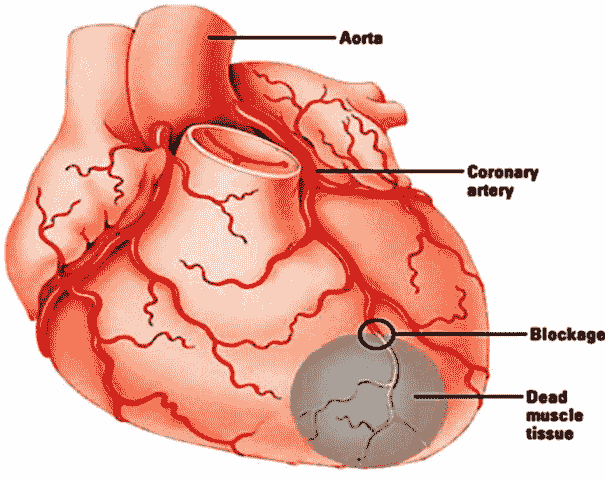

**图 2.** 标准心电图 (ECG) 信号。

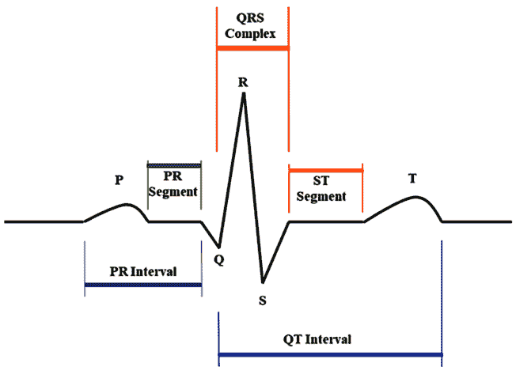

正常 ECG 信号的特征如图 2 所示。其中 P 波和 QRS 波群分别代表心房和心室的去极化/收缩，而 T 波代表心室的复极化。ECG 信号源自心电图 (ECG)，该设备记录心脏在一段时间内的生理活动。ECG 数据用于诊断各种心血管异常，例如房性早搏 (PAC)、心肌梗死 (MI)、心房颤动 (AF)、室性早搏 (PVC)、充血性心力衰竭 (CHF) 和室上性心动过速 (SVT)。近年来，Holter 动态心电图仪 (Nikolic et al., 1982)、Apple Watch 等便携设备得到快速发展，用于检测 ECG 信号，为研究人员和人类心脏病学家更准确地分析 ECG 数据提供了大量数据集。因此，自动且可靠地分析 ECG 数据已成为一个热门研究课题。ECG 数据还可以以睡眠分期和生物特征人类识别等创新方式使用。为了管理大型数据集，我们需要一种高效的分析方法。因此，数据集被应用于机器学习和深度学习算法 (Hiran, K. K. et al. 2021)。图 3 和图 4 分别展示了机器学习和深度学习方法的基础 (Xia et al., 2018)。传统机器学习方法需要专家（人类心脏病学家）从原始数据中提取特征，然后使用机器学习模型或决策规则生成最终输出，而深度学习使用深度神经网络并自动提取特征 (Mahrishi, M., et al., 2020)。在此，专家特征包括 a) 统计特征（心率变异性、密度直方图、样本熵等），b) 频域特征 (Romero et al., 2001)，c) 医学特征（P、Q、R、S 和 T 波参数）。

**图 3.** 传统机器学习。

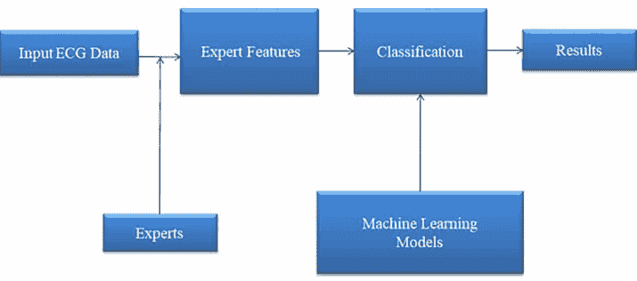

**图 4.** 深度学习方法。

输入 ECG 数据（原始或低级处理数据）

深度学习特征 + 分类

结果

深度神经网络

多项研究表明，ECG 数据的深度学习特征比专家特征产生更多信息 (Huang et al., 2019)。在许多 ECG 分析任务中，如睡眠分期 (Wei et al., 2019) 和疾病诊断 (Li et al., 2019)。传统图像识别方法需要将图像矩阵拉伸为一维向量，这会导致图像中相邻数据的丢失以及某些关键特征的遗漏。我们所提方法包含 CNN 架构。

### 相关工作

ECG 信号由人类心脏的电位差产生。它还携带噪声和基线漂移，必须通过平滑和基线消除来去除 (Caroubalos et al., 1988)。从 ECG 信号中提取各种功能（包括 QRS 间隔、RR 间隔和每分钟心跳数），以使用特征提取策略（如主成分分析 (PCA) (Caroubalos et al., 1988) 和离散小波变换 (DWT) (Caroubalos et al., 1988)）对不同心律失常进行分类。DWT 计算信号的谱功率，并生成特征，PCA 用于抑制不需要的特征。特征提取后，使用机器学习算法对特征进行分类。各种分类器（包括支持向量机 (SVM)、最小二乘支持向量机 (LS-SVM)、卷积神经网络 (CNN)、人工神经网络 (ANN)、循环神经网络 (RNN)）已被应用于分类。

(Acharya et al., 2017) 使用深度学习技术自动检测 ECG 信号中五组不同的心跳。作者使用 1D ECG 信号作为输入，并设计了一个 9 层 1D CNN 模型。所提方法在 109,449 个心跳上实现了 94.03% 的分类准确率。通过对输入信号进行过滤以滤除高频噪声，然后使用模型识别和分类有噪声和无噪声的 ECG 信号，模型的泛化能力得以提高。

(Abayarathne et al., 2019) 提出了两种方法，第一种方法是基于规则的异常识别，使用 Hamilton-Tompkins 算法计算 R 波峰，在 705,000 个心跳上实现了 97.55% 的准确率。第二种方法使用 RNN 和 LSTM 模型，对 15 类心脏心律失常进行分类，在 96,265 个心跳上平均准确率为 94.7%。

(Kommireddy et al., 2020) 提出了一种四层混合 CNN 与 LSTM 并关联带有 ReLU 和 Sigmoid 操作在最终层内的 ANN，在 MIT-BIH 心脏心律失常数据集（107,620 个心跳）上达到了 98.64% 的准确率。

(Hasan et al., 2020) 提供了一种包含十六层 CNN 的方法，其最后一层使用 SoftMax 激活函数，对 MIT-BIH 心律失常数据集的五种心律失常类型（N, F, V, Q, S）进行分类，平均准确率为 98.28%。

(Izci et al., 2019) 提出了一个 5 层的 CNN 版本，卷积层使用 ReLU，最终层使用 Softmax，在包含 27,789 个心跳的可比数据集上达到了 97.42% 的关联准确率。

(Ullah et al., 2020) 提出了一个 10 层的 CNN 版本，对 MIT-BIH 心律失常数据集的八种心脏心律失常类型进行分类，准确率为 99.11%。

(Oh et al., 2018) 提出了混合 CNN 和 LSTM 层，输入为一维 ECG 信号。通过在处理阶段插入波形，ECG 数据被分割成多个时长各异的 ECG 数据段，每个数据段亦被扩展至相同长度。所设计的架构将 ECG 信号分类为 5 类：N（正常）、LBBB（左束支传导阻滞）、VPC（室性期前收缩）、RBBB（右束支传导阻滞）和 APC（房性期前收缩）。作者使用了 MIT-BIH 数据集中的 16,499 个 ECG 心跳，获得了 98.10% 的准确率。

(Mondéjar-Guerra et al., 2019) 开发了一种包含多种不同类型支持向量机 (SVM) 的方法。该方法依赖于 R-R 间隔、小波以及 ECG 信号的 HOS（高阶统计）。每种类型的特征都有自己的 SVM 模型 (Hiran, K. K., et al.)。使用共有 49,691 个心跳的 MIT-BIH 心律失常数据集，该方法将正常和异常心跳分为四类（N, F, V 和 S），准确率为 94.50%。

(Subramanian et al., 2020) 提出了一种基于 SVM 分类器的模型来分类 ECG 心跳，训练数据和测试数据分别为 15 个和 23 个心跳，准确率为 91%，F1 分数为 90.65%。进行了两种比较，即心跳对心跳的比较，分别取决于 QRS 变化和 P 轴。


### 提议方法

本节包含第4.1节，描述从原始ECG信号到数据转换的过程。第4.2节描述对输入数据进行必要修改以提高模型性能。第4.3节描述提议模型的架构。第4.4节描述提议模型中使用的激活函数。第4.5节描述优化模型的一种技术。第4.6节描述一种克服模型过拟合的技术，与现有技术相比可提高准确性。最后，第4.7节详细概述了我们的模型所使用的数据集。

总体而言，提议模型由以下四个步骤组成，如图5所示。

- **步骤1：** 数据转换步骤，从原始ECG信号中提取ECG心拍。
- **步骤2：** 数据转换步骤之后，对信号进行进一步预处理。
- **步骤3：** 预处理步骤之后，数据作为输入发送到提议模型（本研究工作中为CNN）。在此，提供训练集和验证集以根据输入数据拟合模型，最后，我们的模型在给定的输入数据上进行训练，并准备进行测试。
- **步骤4：** 最后，开发的模型用于六种心律失常类型的分类，并向模型提供一组新的数据集，即测试集，用于分类过程。

图5. 提议模型对ECG信号的分类流程。

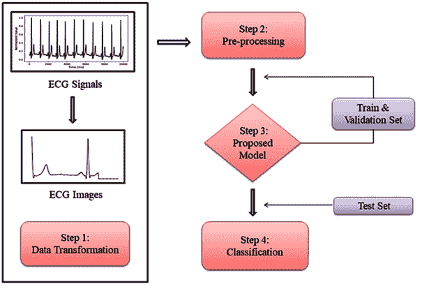

### 数据转换

数据转换是第一步，在此过程中，原始ECG信号被转换为ECG图像以提取相关特征，如下图6所示。它通过抑制不必要的畸变并增强模型准确训练所需的某些方面来改进数据。输入ECG图像数据集来自Kaggle开源数据集，该数据集由(Kachuee et al., 2018)将原始ECG信号转换为432x288像素的二维RGB图像。一些研究工作将时间序列数据作为模型输入；然而，提议的方法使用二维图像作为输入，因为机器学习方法已被深度学习方法所超越。机器学习方法旨在处理一维向量数据，这需要将图像矩阵拉伸为一维向量，导致图像中相邻信息的丢失以及某些关键特征的遗漏。因此，我们不使用一维信号，而是使用图像以便与卷积神经网络获得更好的性能。它可用于实时心律失常分类，可帮助医生(Ying, 2019)，也可帮助智能设备和医疗设备通过向设备提供图像数据作为输入来自动分类心律失常。

图6. 从ECG信号中提取ECG心拍。

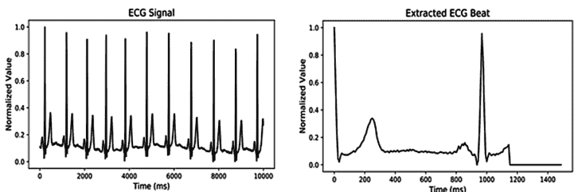

以下步骤用于从ECG信号中提取ECG心拍：

- 1. 对连续ECG信号进行10秒分割。
- 2. 将ECG信号的幅度归一化到零到一的范围。
- 3. 通过一阶导数的零交叉确定所有局部最大值。
- 4. 使用归一化局部最大值上的0.9准则，计算一组ECG R峰值。
- 5. 使用R-R间隔（T）的中位数计算相关窗口的标称心跳。
- 6. 为每个R峰选择长度为1.2T的信号分量。
- 7. 根据预设的固定长度，用零对相应选定部分进行填充。

提议的心拍提取方法易于实现且高效，可从具有各种形态的ECG信号中提取R-R间隔。此外，所有提取的心拍长度相同，这对于它们被用作后续处理步骤的输入是必要的。

### 预处理

为了提高模型性能，在提议的方法中对ECG图像进行了进一步预处理。使用ImageDataGenerator库（“IDP，”2021），预处理首先通过实现rescale = 1./255来执行。Rescale是一个乘数，将在任何额外处理之前应用于数据。由于原始图像包含0-255范围的RGB系数，但对于模型来说，这些值太高（考虑正常学习率），因此我们使用1./255的缩放因子将目标值缩放到0到1之间。

其次，shear-range = 0.2，将图像剪切20%，我们添加了zoom-range = 0.2，意味着20%的放大和缩小。此外，color mode = “grayscale”将输入图像转换为64x64像素的灰度图像。由于(Kachuee et al., 2018)将原始ECG信号中的ECG波形转换为彩色图像，我们必须将RGB（彩色图像）转换为灰度图像作为CNN模型的输入（Hiran, K. K., et al., 2013），因为在本作品中，颜色不是从图像中区分心律失常类型的重要特征。

ImageDataGenerator还具有内存占用更少的优势。这是因为如果我们不使用此类，将一次性加载所有图像。但是，当我们使用它时，我们分批加载图像，节省大量内存空间。当在新的、略有变化的图像上训练时，模型会变得更加强健。

### 模型架构

深度学习(Deng et al., 2013)是人工智能和模式识别领域中一种相对较新的方法，已迅速证明其受欢迎程度。本作品创建了一种识别六种不同形式ECG信号心律失常的新方法。我们的提议CNN模型包含三个卷积层、两个池化层、一个展平层和两个全连接层，如图7所示，以使用MIT-BIH和PTB心律失常诊断记录自动将心律失常分类为六个不同类别。所使用的ECG数据集包括标识心律失常类型的标签。这些标签由专家心脏病学家分配。模型的权重使用核初始化器进行统计初始化。这将创建和分布权重，并可作为起点。提取的心拍被用作输入，如第4.1节所示。所有卷积层使用二维卷积并包含32个大小为3的核，核初始化器为‘he-uniform’，其中he-uniform是一种方差缩放初始化器，从[-limit, limit]范围选择值，其中limit等于sqrt(6/fan-in)，fan-in是权重张量的输入单元数。由于我们正在使用ReLU激活函数，he-uniform与ReLU激活函数相比，比其他核初始化器（即Glorot/Xavier初始化器等）表现更好（“LWI，”2021）。所有三个卷积层和倒数第二个全连接层使用ReLU激活函数。我们在模型中使用ReLU，因为它比sigmoid和tanh函数计算效率更高，因为它只激活有限数量的神经元并将所有负值设置为零。

图7. 提议方法的架构。

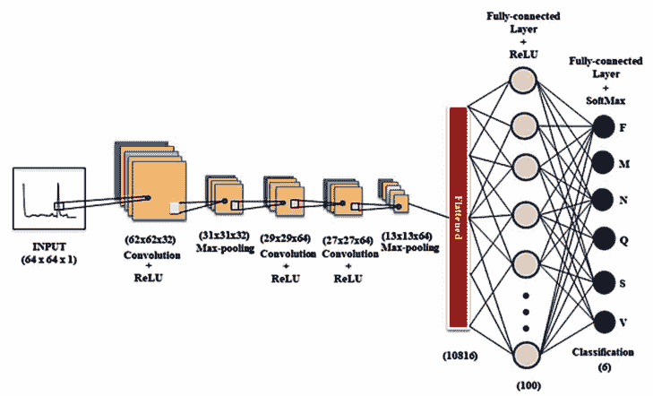

此外，我们使用大小为2、步幅为2的最大池化层。最后，最后一个卷积层用于表示输入心拍。对于分类，该表示被馈送到一个包含两个全连接层的网络中，每个层分别有100和6个神经元。由于它执行多类分类，最终全连接层使用Softmax激活函数。

通过调整优化器和学习率，可以增强模型的训练阶段。因此，我们使用了0.01的学习率，并使用动量值为0.9的SGD（随机梯度优化器）进行优化。此外，使用早期停止技术来防止模型过拟合。提议架构的深入介绍见表1。

表1. 提议方法的深入介绍。

| 层 | 类型 | 激活函数 | 输出形状 | 过滤器数量 | 参数 |
| :--- | :--- | :--- | :--- | :--- | :--- |
| 0 | 输入 | - | 64x64x1 | - | - |
| 1 | 卷积 (Conv2D) | ReLU | 62x62x32 | 32 | 320 |
| 2 | 最大池化 | - | 31x31x32 | - | 0 |
| 3 | 卷积 (Conv2D) | ReLU | 29x29x64 | 64 | 18496 |
| 4 | 卷积 (Conv2D) | ReLU | 27x27x64 | 64 | 36928 |
| 5 | 最大池化 | - | 13x13x64 | - | 0 |
| 6 | 展平 | - | 10816 | - | 0 |
| 7 | 全连接 | ReLU | 100 | 100 | 1081700 |
| 8 | 全连接 | Softmax | 6 | 6 | 606 |

### 激活函数 (AF)

我们的模型在三个卷积层和一个全连接层中使用ReLU激活函数，并在最终全连接层中使用Softmax函数，如第4.3节所示。

### Softmax函数

Softmax函数用于计算一组实数的概率分布(Goodfellow et al., 2016)。Softmax函数生成一组0到1之间的值，概率总和为1。在多类模型中，Softmax算法返回每个类别的概率，概率值最高者对应目标类别。几乎所有深度学习系统都在其输出层中使用Softmax函数。两种激活函数Sigmoid和Softmax分别用于二分类和多分类。


标准Softmax函数 \(\sigma\): \(\mathbb{R}^K \to [0,1]^K\) 由以下方程定义：

\(\sigma(z)_i = \frac{e^{z_i}}{\sum_{j=1}^K e^{z_j}} \text{ for i=1, ..., K and } z = (z_1, ..., z_K) \in \mathbb{R}^K\) (1)

其中 z 是输入向量。

### 整流线性单元函数

Nair 和 Hinton 于 2010 年创建了整流线性单元（ReLU）激活函数（Nair et al., 2010）。在性能和泛化方面，它在深度学习中优于 Sigmoid 和 Tanh 激活函数。由于它是一种更快的学习激活函数，因此是使用最广泛的函数。ReLU 类似于线性函数，保留了使梯度下降优化变得简单的线性模型特征。

y = f(x) = max(0,x) (2)

其中 x 表示 ReLU 的输入，y 是相应的输出值。

它通过将负输入值驱动到零，消除了之前激活函数中出现的梯度消失问题。实现 ReLU 单元的优势在于它们能够加快计算速度，因为它们不计算除法或指数运算，从而提高整体计算性能。

ReLU 还将值压缩在零和最大值之间，导致隐藏单元中的稀疏性。由于其简单性和可靠性，ReLU 已被用于多种架构中。

### 成本函数

成本函数用于计算 CNN 模型估计误差与真实误差之间的差异（Ullah et al., 2020）。误差函数使用优化器函数来最小化。在神经网络理论中，已经使用了各种成本函数。我们采用了交叉熵函数，其方程如下：

C = - \frac{1}{n} \sum_{i=1}^{n} (y_i * ln(a_i) + (1-y_i) * ln(1-a_i)) (3)

其中 C、y、N、c、a 和 n 分别表示要减少的成本、目标值、类总数、类索引、实际值和训练点数量。

研究结果使用梯度下降方法进行优化。在我们的模型中，我们使用带有 0.9 动量和 0.01 学习率的 SGD 优化器。SGD 每次通过神经网络传递一个训练样本后，使用计算出的梯度更新每一层的参数（权重）。结果是，每次向网络传输一个训练样本，并计算与之相关的损失。在每个训练样本之后，更新所有网络层的参数。由于网络只处理一个训练样本，因此更容易记忆。它在计算上很快，因为一次只处理一个样本。方程如下：

w = w - \eta \nabla Q(w) = w - \frac{\eta}{n} \sum_{i=1}^{n} \nabla Q_i(w)

其中

Q(w) = \frac{1}{n} \sum_{i=1}^{n} Q_i(w)

其中 \eta 是学习率，Q 是损失函数，w 是网络参数。

与批量梯度下降和小批量梯度下降等类似方法相比，对于更大的数据集，它可以更快地收敛，因为它导致更频繁的参数更新（Bottou et al., 2012）。

### 早期停止 (Ying, 2019)

该技术用于防止“学习速度减慢”问题。由于噪声学习，算法准确率在超过某个点后停止增加或恶化。

因此，目标是确定应该停止训练的精确点。通过这种方式，我们能够获得欠拟合和过拟合之间的理想平衡。人工神经网络的学习过程旨在识别理想的权重和偏置。神经元的学习过程和学习速度取决于成本函数的偏导数值，即 \frac{\partial C}{\partial w} 和 \frac{\partial C}{\partial b}，如下文公式 6 和 7 中分别描述：

\frac{\partial C}{\partial W_j} = \frac{1}{n} \sum_{x_j} X_j (\sigma(z) - y)

其中 C 是成本，W_j 是第 j 个权重，X_j 是第 j 个输入，b 是偏置，a 是输入值为 1 时的输出，y 是输出（Ying, 2019）。

### 数据集详情

ECG 图像信号源自公开可用的 MIT-BIH 心律失常（Moody & Mark, 2001）和 PTB 诊断（Kachuee et al., 2018）数据集。MIT-BIH 心律失常数据集有 48 条记录，每条记录持续约 30 分钟，来自 1975 年至 1979 年间获得的双通道动态心电图记录。从 4000 份 24 小时动态心电图记录集中随机选择了 23 条记录，其中室内患者占 60% 和室外患者占 40%。

其余二十五条记录从类似的集合中选择。所选心电图记录以每通道 10mV 范围内的 360 个采样点/秒和 11 位分辨率进行数字化。两名或更多心脏病学家独立分析每条记录，为相关问题提供相关解决方案，以提供计算机可读的结果。此外，该数据集包含约 110,000 条解释。

PTB 诊断数据集包含来自 290 人的心电图记录，其中 148 人被诊断为心肌梗死（MI），52 人拥有健康心脏，其余人患有其他七种疾病。每条记录以 1000Hz 捕获 12 个导联的心电图信号。

该数据集包含六种类型的心电图信号，即：正常心拍（N）、室性期前收缩（V）、融合心拍（F）、未分类心拍（Q）、室上性期前收缩（S）和心肌梗死（M）。表 2 显示了心电图心拍的分类情况。

### 表 2. 六类心拍的分类情况。

| 类型 | 心拍数量 |
|---|---|
| F | 803 |
| M | 10,506 |
| N | 94,635 |
| Q | 8,039 |
| S | 2,779 |
| V | 7,236 |
| 总计 | 123,998 |

图 8 显示了本工作中使用的各种心电图信号片段。

图 8. 心电图信号片段，即：正常心拍（N）、未分类心拍（Q）、融合心拍（F）、室性期前收缩（V）、室上性期前收缩（S）和心肌梗死（M）。

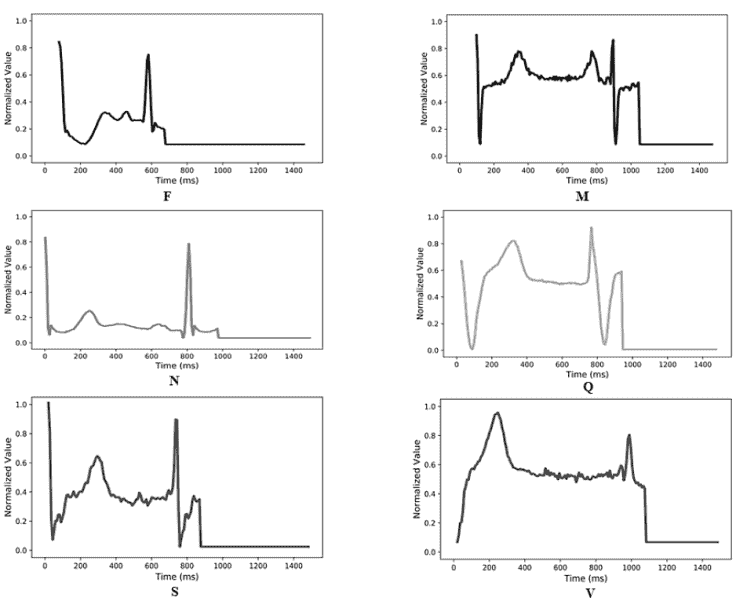

### 结果与分析

本节描述了实验方法和实验结果。所提模型的实验数据源自 MIT-BIH 和 PTB 诊断数据库，这是国际标准心电图数据库。由于包含准确且描述性的专家注释，它经常被用于心律失常研究领域的开发。实验使用了 64% 的数据集进行训练，16% 用于验证，20% 用于测试，即分别为 79357、19842、24799。在最终模型中，训练有 50 个时代。数据集在每个时代中分为 32 个批次。

二维图像被调整大小为 64x64 灰度图像，作为 CNN 模型的输入。所提 CNN 模型使用 Python 软件包 Tensorflow（Abadi et al., 2016）实现。运行我们模型的硬件规格是 GPU TITAN XP。训练过程总共耗时 31448.33 秒。

所提模型的优化参数包括卷积层数量、池化层数量和早期停止技术（一种克服过拟合的正则化技术（Ying, 2019））。由于所提模型使用大数据集，因此需要更多的卷积操作来从训练数据集中提取特征，以便在测试数据集上表现更好。根据模型中存在的卷积层和池化层数量，我们评估了两种实验方法并进行了实验验证。在实验 CNN-A 中，我们使用了一个五层 CNN 模型，包含一个卷积层、一个池化层，使用 SGD 优化器，学习率、动量、批量大小、时代分别为 0.01、0.9、32 和 30。在实验 CNN-B 中，我们使用了一个八层 CNN 模型，包含三个卷积层、两个池化层，使用 SGD 优化器，学习率、动量、批量大小、时代分别为 0.01、0.9、32 和 50。平均准确率从 CNN-A 的 98.04% 提高到 CNN-B 的 99.16%。

图 9. 两个训练模型 CNN-A 和 CNN-B 的准确率。

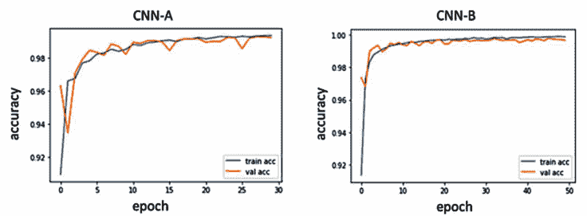


### 图 10. 两个训练模型 CNN-A 和 CNN-B 的损失。

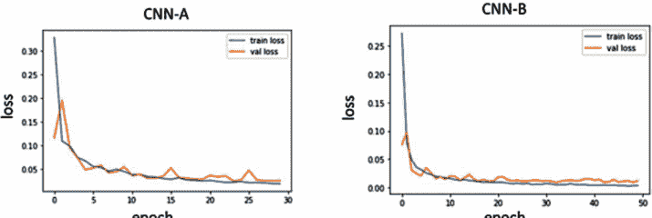

在 CNN-B 中，卷积操作、最大池化操作的数量更多，epoch 值分别从 30 增加到 50。

图 9 和图 10 分别表示了 CNN-A 和 CNN-B 模型的训练和验证的准确率及损失曲线。

为了进一步理解训练模型的学习情况，我们为训练模型 CNN-A 包含了分类报告和混淆矩阵，分别在图 11 和表 3 中说明了该模型在测试数据上的实际预测。

F 类预测中较低的精确率反映了模型过拟合和分类错误。因此，通过在 CNN-B 模型中追加更多卷积层和最大池化层，我们能够改进分类报告和混淆矩阵，如下图 12 和表 5 所示。

分类报告展示了所提模型的总体性能指标，如准确率、精确率、召回率和 F1 分数，如下方公式所示。

### 图 11. CNN-A 模型的分类报告。

| | 精确率 | 召回率 | F1 分数 | 支持度 |
|---|---|---|---|---|
| F | 0.596 | 0.888 | 0.713 | 161 |
| M | 0.934 | 0.998 | 0.965 | 2101 |
| N | 0.994 | 0.996 | 0.995 | 18926 |
| Q | 1.000 | 0.930 | 0.964 | 1608 |
| S | 0.908 | 0.797 | 0.849 | 556 |
| V | 0.940 | 0.895 | 0.917 | 1447 |
| 准确率 | | | 0.980 | 24799 |
| 宏观平均 | 0.895 | 0.917 | 0.900 | 24799 |
| 加权平均 | 0.982 | 0.980 | 0.981 | 24799 |

### 表 3. CNN-A 模型的混淆矩阵。

| 预测/真实 | F | M | N | Q | S | V |
|---|---|---|---|---|---|---|
| F | 143 | 17 | 0 | 0 | 0 | 1 |
| M | 4 | 2097 | 0 | 0 | 0 | 0 |
| N | 0 | 0 | 18842 | 0 | 28 | 56 |
| Q | 0 | 0 | 113 | 1495 | 0 | 0 |
| S | 19 | 69 | 0 | 0 | 443 | 25 |
| V | 74 | 61 | 0 | 0 | 17 | 1295 |

准确率 = \frac{TP+TN}{TP+TN+FP+FN} (8)

精确率 = \frac{TP}{TP+FP} (9)

召回率 = \frac{TP}{TP+FN} (10)

F1 分数 = \frac{2 * 召回率 * 精确率}{召回率 + 精确率} (11)

真阳性、假阳性、真阴性和假阴性预测分别用 TP、FP、TN 和 FN 表示。TP 表示将正常 ECG 数据分类为正常，而 TN 表示将异常值数据分类为异常类别。FP 表示将异常 ECG 数据分类为正常，而 FN 表示将正常数据分类为异常类别。此外，TP 和 TN 表示正确分类，而 FP 和 FN 表示分类错误。两项实验的评估指标也进行了比较。表 4 比较了两种实验方法的结果。与 CNN-B 相比，CNN-A 的卷积层和池化层较少，导致过拟合和较低的准确率。
如图 12 所示，所有类别（即 F、M、N、Q、S、V）的总体性能均有所提高。

### 表 4. CNN-A 和 CNN-B 的平均分类性能。

| 实验 | 方案 | 准确率 | 召回率 | 精确率 | F1 分数 |
|---|---|---|---|---|---|
| CNN-A | 一个 Conv2D 层 | 98.04% | 91.72% | 89.54% | 98.06% |
| CNN-B | 三个 Conv2D 层 | 99.16% | 96.53% | 95.15% | 99.17% |

### 图 12. CNN-B 模型的分类报告。

| | 精确率 | 召回率 | F1 分数 | 支持度 |
|---|---|---|---|---|
| F | 0.840 | 0.882 | 0.861 | 161 |
| M | 0.985 | 1.000 | 0.992 | 2101 |
| N | 1.000 | 0.994 | 0.997 | 18926 |
| Q | 1.000 | 0.994 | 0.997 | 1608 |
| S | 0.964 | 0.955 | 0.959 | 556 |
| V | 0.922 | 0.966 | 0.943 | 1447 |
| 准确率 | | | 0.992 | 24799 |
| 宏观平均 | 0.952 | 0.965 | 0.958 | 24799 |
| 加权平均 | 0.992 | 0.992 | 0.992 | 24799 |

下表 5 描绘了最终 CNN-B 模型的混淆矩阵。该模型在 M、N、Q 和 S 类别上的表现要好得多，而 F 类别的分类效果平平。这可能是由学习过程中波形的轻微形态变化产生的。

### 表 5. CNN-B 模型的混淆矩阵。

| 预测/真实 | F | M | N | Q | S | V |
|---|---|---|---|---|---|---|
| F | 142 | 19 | 0 | 0 | 0 | 0 |
| M | 0 | 2101 | 0 | 0 | 0 | 0 |
| N | 0 | 0 | 18820 | 0 | 4 | 102 |
| Q | 0 | 0 | 9 | 1599 | 0 | 0 |
| S | 4 | 4 | 0 | 0 | 531 | 17 |
| V | 23 | 10 | 0 | 0 | 16 | 1398 |

### 图 13. CNN-B 归一化混淆矩阵。

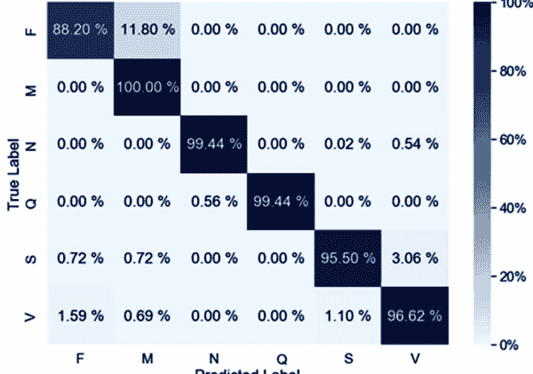

图 13 显示了带有真实标签和预测标签的最终 CNN-B 模型的归一化混淆矩阵。类似于所提方法，由于深度学习技术的进步，基于卷积计算的应用可以用于集成众多特征提取任务（Lai, 2019）。

### 讨论

在本节中，我们的模型与当前的 ECG 分类方法进行了比较。深度学习技术已被近期研究工作用于建立更准确、更可靠的心律失常分类方法，大多数研究者使用 MIT-BIH 心律失常数据集。在我们的所提方法中，如果选择机器学习模型，则需要在 csv 文件中自行提取特征。在此，在我们的方法中，我们直接将图像作为输入提供给 CNN 模型，该模型自动从输入图像中提取特征。所提模型优于最先进的研究。CNN-B 模型的混淆矩阵提供了关于模型在实际标签和预测标签方面的性能的洞察。此外，表 6 以各种性能指标展示了所提模型的性能比较。
使用 CNN 模型的好处：

- 1. CNN 模型是一个自动模型，不需要额外的特征提取、选择或分类。
- 2. 它在所有类型的 ECG 信号上均优于其他方法。
- 3. F1 分数提供了所提模型准确率方面的性能衡量。

### 表 6. 所提工作与最先进技术的比较。

| 作者 | 类别数 | 分类器 | 平均准确率 | 灵敏度 | ECG 心拍数/数据集 |
|---|---|---|---|---|---|
| 机器学习方法 | | | | | |
| (Mondéjar-Guerra et al., 2019) | 4 | Combination of Multiple SVM | 94.50% | 70.3% | 49,691 |
| (Subramanian et al., 2020) | 3 | SVM | 91% F1-90.65% | - | Train = 15, test = 23 |
| 深度学习方法 | | | | | |
| (Acharya et al., 2017) | 5 | CNN | 94.03% | 96.71% | 109,449 |
| (Oh et al., 2018) | 5 | CNN+LSTM | 98.10% | - | 16,499 |
| (Abayaratne et al., 2019) | 15 | Combined RNN-LSTM | 94.7% P-98.3% F1-94.1% | 98.34% | 96,265 |
| (Izci et al., 2019) | 5 | CNN | 97.25% | - | 27,789 |
| (Komireddy et al., 2020) | 4 | CNN+LSTM and ANN | 98.64% | - | 107,620 |
| (Hasan et al., 2020) | 5 | CNN | 98.28% | - | MIT-BIH |
| (Ullah et al., 2020) | 8 | CNN | 99.11% P-98.59% F1-98.00% | 99.61% | MIT-BIH |
| 所提模型 (CNN-A) | 6 | CNN | 98.04% P-89.54% F1-98.06% | 91.72% | 1,23,998 |
| 所提模型 (CNN-B) | 6 | CNN | 99.16% P-95.15% F1-99.17% | 96.53% | 1,23,998 |

P：精确率，F1：F1 分数

所提深度学习模型在平均准确率、精确率、召回率和 F1 分数方面优于竞争对手，即在六类 ECG 信号分类中分别为 99.16%、95.15%、96.53% 和 99.17%，优于其他方法。这六类包括：正常心拍（N）、未分类心拍（Q）、融合心拍（F）、室性早搏（V）、室上性早搏（S）和心肌梗死（M），共在 1,23,998 个 ECG 心拍上进行测试。我们的方法包含随机梯度下降优化器和早停技术，提高了所提方法的性能。随机梯度下降优化器允许深度神经网络更高效地训练，使得网络的每一层能够更独立地学习。另一方面，早停技术用于防止过拟合。我们的所提模型可以明确帮助医生检测和分类心律失常。

### 结论

本研究工作提出了一种基于 CNN 的分类模型，用于利用 ECG 信号自动分类心律失常。从 MIT-BIH 和 PTB 数据集中获取二维图像作为输入。该模型以 99.16% 的分类准确率对六种类型的 ECG 进行分类，高于类似心律失常的最先进研究。本研究采用 CNN 深度学习方法，实现了 ECG 心律失常分类的更高效方式。这将有助于医生更好地诊断心血管疾病，并最终提高早期症状的检测和识别率。

### 参考文献

Abadi, M., Agarwal, A., Barham, P., Brevdo, E., Chen, Z., Citro, C., ... Devin, M. (2016). TensorFlow：异构分布式系统上的大规模机器学习。arXiv 2016, arXiv:1603.04467.

Abayaratne, H., Perera, S., De Silva, E., Atapattu, P., & Wijesundara, M. (2019). 一种实时心律失常分类器。2019 National Information Technology Conference (NITC)。10.1109/NITC48475.2019.9114464

Acharya, U., Oh, S., Hagiwara, Y., Tan, J., Adam, M., Gertych, A., & Tan, R. (2017). 一种用于分类心跳的深度卷积神经网络模型。Computers in Biology and Medicine, 89, 389–396. doi:10.1016/j.compbiomed.2017.08.022 PMID:28869899


Aje, T. (2009). 心血管疾病：扩展到发展中国家的全球性问题. 世界心脏病学杂志, 1(1), 3. doi:10.4330/wjc.v1.i1.3 PMID:21160570

Bottou, L., & Bousquet, O. (2012). 大规模学习的权衡. 收录于《机器学习优化》. MIT Press.

Cardiovascular Diseases (CVDs). (无日期). 世卫组织. 2021年4月15日检索，来自 https://www.who.int/news-room/fact-sheets/detail/cardiovascular-diseases-(cvds)

Caroubalos, C., Perche, C., Metaxaki-Kossionides, C., Sangriotis, E., & Maroulis, D. (1988年7月). ECG自动分析方法. 生物医学工程杂志, 10(4), 343–347. doi:10.1016/0141-5425(88)90065-9 PMID:3236854

Deng, L., Abdel-Hamid, O., & Yu, D. (2013). 用于交易声学不变性的异质池化深度卷积神经网络. IEEE国际声学、语音和信号处理会议（ICASSP）论文集. 10.1109/ICASSP.2013.6638952

Goodfellow, I., Bengio, Y., & Courville, A. (2016). 6.2.2.3 用于多项分布输出的Softmax单元. 收录于《深度学习》. MIT Press.

Gupta, R., Mohan, I., & Narula, J. (2016). 印度冠心病流行病学趋势. 全球健康年鉴, 82(2), 307. doi:10.1016/j.aogh.2016.04.002 PMID:27372534

Hasan, M. A., Munia, E. J., Pritom, S. K., Setu, M. H., Ali, M. T., & Fahim, S. C. (2020). 使用1D卷积神经网络在ECG心拍信号中检测心脏心律失常. 2020年IEEE第10区研讨会（TENSYMP）. doi:923058110.1109/tensymp50017.2020

Hiran, K. K., & Doshi, R. (2013). 基于数字图像分割的脑肿瘤检测人工神经网络方法. 脑, 2(5), 227–231.

Hiran, K. K., Jain, R. K., Lakhwani, K., & Doshi, R. (2021). 机器学习：掌握带有真实示例的监督和无监督学习算法（英文版）. BPB Publications.

Hiran, K. K., Khazanchi, D., Vyas, A. K., & Padmanaban, S. (编). (2021). 可持续发展的机器学习（第9卷）. Walter de Gruyter GmbH & Co KG. doi:10.1515/9783110702514

Huang, J., Chen, B., Yao, B., & He, W. (2019). 使用基于STFT的频谱图和卷积神经网络进行ECG心律失常分类. IEEE Access：实用创新，开放解决方案, 7, 92871–92880. doi:10.1109/ACCESS.2019.2928017

Image Data Preprocessing (IDP). (无日期). Keras文档：图像数据预处理（IDP）. Keras.io. 2021年4月15日检索，来自 https://keras.io/api/preprocessing/image/

Izci, E., Ozdemir, M. A., Degirmenci, M., & Akan, A. (2019). 使用深度学习技术从2D ECG图像中检测心脏心律失常. 收录于2019年医疗技术大会（TIPTEKNO）论文集. IEEE. 10.1109/TIPTEKNO.2019.8895011

Kachuee, M., Fazeli, S., & Sarrafzadeh, M. (2018). ECG心拍分类：一种深度可迁移表示. 2018年IEEE国际医疗信息学会议（ICHI）, 443-444. 10.1109/ICHI.2018.00092

Kommireddy, S., Pandey, P. R., & Kishore NeeliSetti, R. (2020). 使用混合神经网络检测心脏心律失常. 2020年IEEE第10区会议（TENCON）. doi:10.1109/TENCON50793.2020.9293831

Lai, Y. (2019). 图像识别中传统机器学习与深度学习的比较. 物理学杂志：会议系列, 1314(1), 012148. doi:10.1088/1742-6596/1314/1/012148

Layer Weight Initializers (LWI). (无日期). Keras文档：层权重初始化器（LWI）. Keras.io. 2021年4月25日检索，来自 https://keras.io/api/layers/initializers/

Mahrishi, M., Hiran, K. K., Meena, G., & Sharma, P. (编). (2020). 实时应用中的机器学习和深度学习. IGI Global. doi:10.4018/978-1-7998-3095-5

McGill, H. Jr, McMahan, C., & Gidding, S. (2008). 21世纪预防心脏病. 循环, 117(9), 1216–1227. doi:10.1161/CIRCULATIONAHA.107.717033 PMID:18316498

Mondéjar-Guerra, V., Novo, J., Rouco, J., Penedo, M., & Ortega, M. (2019). 通过分类器组合融合ECG的时间和形态信息进行心拍分类. 生物医学信号处理与控制, 47, 41–48. doi:10.1016/j.bspc.2018.08.007

Moody, G., & Mark, R. (2001). MIT-BIH心律失常数据库的影响. IEEE医学与生物学工程杂志, 20(3), 45–50. doi:10.1109/51.932724 PMID:11446209

Nair, V., & Hinton, G. E. (2010). 整流线性单元改进受限玻尔兹曼机. 第27届国际机器学习会议, 807–814.

Nikolic, G., Bishop, R., & Singh, J. (1982). Holter监测期间记录的猝死. 循环, 66(1), 218–225. doi:10.1161/01.CIR.66.1.218 PMID:7083510

Oh, S., Ng, E., Tan, R., & Acharya, U. (2018). 使用变长心拍的CNN和LSTM技术组合进行心律失常自动诊断. 生物学与医学中的计算机, 102, 278–287. doi:10.1016/j.compbiomed.2018.06.002 PMID:29903630

Prabhakaran, D., Jeemon, P., & Roy, A. (2016). 印度的心血管疾病. 循环, 133(16), 1605–1620. doi:10.1161/CIRCULATIONAHA.114.008729 PMID:27142605

Romero, I., & Serrano, L. (2001). ECG频域特征提取：心律失常分类的新特征. 收录于2001年IEEE医学与生物学工程学会第23届年会国际会议论文集. IEEE.

Sahoo, S., Dash, M., Behera, S., & Sabut, S. (2019). ECG信号中检测心脏心律失常的机器学习方法：一项调查. IRBM, 41(4), 185–194. doi:10.1016/j.irbm.2019.12.001

Subramanian, K., & Prakash, N. K. (2020). 基于机器学习的ECG信号心脏心律失常检测. 2020年第三届智能系统与创新技术国际会议（ICSSIT）. .921407710.1109/ICSSIT48917.2020.9214077

Ullah, A., Anwar, S. M., Bilal, M., & Mehmood, R. M. (2020). 使用带有2-D ECG谱图像表示的深度学习进行心律失常分类. 遥感, 12(10), 1685. doi:10.3390/rs12101685

Wei, Y., Qi, X., Wang, H., Liu, Z., Wang, G., & Yan, X. (2019). 基于长短期记忆网络的单导联心电图信号多类自动睡眠分期方法. IEEE Access：实用创新，开放解决方案, 7, 85959–85970. doi:10.1109/ACCESS.2019.2924980

Xia, Y., Zhang, H., Xu, L., Gao, Z., Zhang, H., Liu, H., & Li, S. (2018). 一种带有可穿戴心电图的自动心脏心律失常分类系统. IEEE Access：实用创新，开放解决方案, 6, 16529–16538. doi:10.1109/ACCESS.2018.2807700

Ying, X. (2019). 过拟合及其解决方案概述. 物理学杂志：会议系列, 1168, 022022. doi:10.1088/1742-6596/1168/2/022022

## 第11章

## 用于异常检测的机器学习算法与深度神经网络比较

Apinaya Prethi K. N.
计算机科学与工程系，印度科伊姆巴托尔技术学院，印度

Sangeetha M.
印度科伊姆巴托尔技术学院，印度

Nithya S.
印度科伊姆巴托尔技术学院，印度

### 摘要

当今世界，网络空间已不可或缺。需要一种安全技术来保护整个系统免受外部入侵。入侵检测系统充当一道坚固的屏障，用于筛查漏洞。网络攻击数量不断增加，例如DoS（拒绝服务）、R2L（远程到本地）攻击、U2R（用户到根）和探测攻击。这些网络攻击会导致医疗、银行、汽车维护和成就等各类应用中的数据被非法使用。这将带来经济利益，并阻止授权人员访问网络。入侵检测系统已在需要安全性的系统中实施。传统系统采用随机森林和决策树等机器学习技术，这些技术需要大量计算资源且时间复杂度较高。为克服这一问题，提出了一种基于DNN的入侵检测系统。该IDS不仅能检测异常，而且相比现有系统能提高准确性。这也提高了系统的速度、准确性和稳定性。


### INTRODUCTION

入侵检测系统用于保护系统免受入侵者攻击。它是一种现代安全技术，用于防止漏洞被利用。在互联网中，安全可能通过多种方式被破坏。随着物联网网络、互联网使用和数据传输的增加，异常问题也随之增多。因此，研究人员需要关注无需任何人工交互的自适应入侵检测系统（Jabez & Muthukumar, 2015）。IDS 监控并检测网络中的任何恶意活动和策略违规行为。防火墙、防病毒软件等安全系统也用于保护系统。当企业规模扩大时，现有的安全措施不足以保护整个系统免受入侵者攻击。许多时候，防病毒软件也会被入侵者攻破并导致误报（Aung & Min, 2017）。安全网络拥有入侵管理系统（IMS），它由入侵检测系统（IDS）和入侵防御系统（IPS）组成。IDS 检测恶意活动，而 IPS 防止网络遭受任何恶意活动。入侵检测系统会监控网络中的常规活动，并将正常事件和异常事件分类。它不会对发生的事件做出任何更改。困难的部分是识别与正常活动非常相似的恶意事件（Mustafa, Jae, Muhammad & Sugwon, 2021）。入侵防御系统控制整个系统，如果数据包存在风险，会主动阻止它。它在数据包到达目标之前发现并丢弃危险数据包。如果检测到任何恶意活动，则 IDS 将警报发送给管理员。然后管理员根据系统中检测到的异常采取必要措施。无论如何，IDS 中都需要人工干预来防止整个系统遭受任何类型的危险。在机器学习算法等现代技术发展之后，IDS 交互中不再需要人工干预（Jabez & Muthukumar, 2015）。机器学习算法检测系统中的异常，并根据其拥有的数据库采取必要措施。在数据库中，存储了所有类型的异常及其行为。通过将系统活动与数据库进行比较，IDS 感知任何异常并采取所需措施，从而使系统更安全。

### Types of IDS

IDS 有两种类型：网络入侵检测系统（NIDS）和主机入侵检测系统（HIDS）。NIDS 在网络层工作。它安装在网络的战略点上，用于监控威胁或异常。NIDS 分析网络中是否存在大量流量。如果发生流量，攻击的可能性也会很高。例如，防火墙配置在网络上以查找良好和不良的发送方。HIDS 安装在所有具有互联网连接的网络设备上。这种入侵检测系统作为防御恶意攻击的第二道防线。只有当 NIDS 未能在网络中检测到攻击时，HIDS 的作用才会发挥出来。当攻击者进入网络时，NIDS 应该能够检测到它，否则入侵者将入侵网络设备。然后，安装在设备上的 HIDS 必须检测攻击以提供安全保障。例如，监控本地系统，如果任何未经授权的人员尝试更改本地文件系统或文件丢失，则提醒管理员（Cuelogic Technologies, 2019）。

### Cloud Computing and Edge Computing

云计算处理大数据，并因安全问题而遭受影响。在云计算中，所有数据存储在集中式云数据中心，并在需要时发送给请求者。这个集中式数据中心始终处于威胁之下，并有被攻破的可能。为了克服这个问题，引入了边缘计算，其中数据分布并存储在靠近用户的小型数据中心。边缘计算位于云和用户之间。边缘计算也可以称为雾计算。一个小型分布式本地数据中心称为边缘设备。边缘设备可以是网关、路由器和任何网络设备。例如，Amazon Prime Video 使用边缘计算技术，其中数据中心位于靠近消费者的不同本地区域。当用户请求页面时，请求发送到更近的数据中心并进行处理。如果找到，视频将在请求者屏幕上开始播放。如果在更近的数据中心找不到，请求将转发到集中式，即云数据中心。从集中式云中，请求的视频复制到用户最近的数据中心，并在请求者屏幕上开始播放。当你播放最受欢迎的视频时，数据流量相对较少，因为热门视频分布到所有小型数据中心以避免缓冲。由于大小限制，并非所有视频都可以存储在边缘数据中心。

### Artificial Intelligence

人工智能、机器学习和深度学习相互关联，旨在实现相同的目标。机器学习和深度学习是人工智能的分类。人工智能使系统能够以人类智能运行。也就是说，就是表现得像人类的机器。人工智能和机器学习将大多数组织推向最高水平。

图 1 显示了人工智能、机器学习算法和深度学习之间的关系。在人工智能中，使用部分数据集进行训练，并使用其余数据来查找训练后系统的输出。通过在所有应用中使用人工智能，智能环境在当今成为可能。智能应用可以在汽车、家用电器和许多企业中找到。系统通过使用人类智能成为专家系统。它能够在没有任何人工干预的情况下执行应用的所有功能。

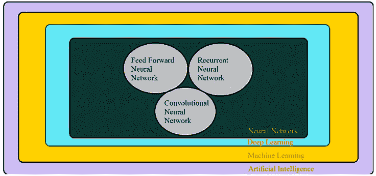

### Machine Learning

机器学习在当今的机器世界中变得至关重要。物联网设备和 WhatsApp、Facebook 等社交网络产生了大量数据。入侵检测系统无法处理动态和复杂的网络攻击，因此需要使用机器学习的高效自适应系统（Anish & Sundarakkantham, 2019）。机器学习算法可以处理、发现并利用数十亿创建的数据，用于未来预测。机器学习可分为监督学习、无监督学习和强化学习。监督学习有一套规则来决定结果，而无监督学习则没有遵循的策略。强化学习通过允许代理根据当前状态决定动作来增加奖励。无监督算法可以轻松检测入侵系统中的异常，但容易产生误报警报。为了减少误报警报，可以使用监督算法。在监督算法中，入侵检测系统将使用正常和异常活动进行训练。随机森林、决策树等监督机器学习算法已在 IDS 中实现。

机器学习算法监控并学习网络行为，以分类正常和异常活动（Mustafa, Jae, Muhammad & Sugwon, 2021）。如果检测到任何攻击（异常活动），算法将按照编程采取必要措施。在机器学习算法中，特征提取和分类过程需要分开完成。在深度学习中，神经网络本身提取必要特征并进行分类。物联网（IoT）网络迅速扩大，并成为日常生活中必不可少的事物。物联网设备可用于各种应用，如医疗、保险、军事等（Zhenhai, Haoran & Chenglong, 2020）。入侵检测在所有领域都成为强制性要求，以防止入侵者。主要挑战是防止误导系统的误报（Alif & Tohari, 2020）。SVM 与随机森林结合，分类过程运行速度快。提案中未进行参数变化，直接使用（Chang, Li & Yang, 2017）。使用 RF 与 k-means 结合提高了系统性能并减少了处理时间（Iftikhar, Mohammad, Muhammad & Aneel, 2018）。

### Decision Tree

决策树是监督机器学习技术之一。它基于 ID3 算法构建（He & Runjing, 2017）。在 ID3 算法中，对于每个单独属性，将分别考虑（1）和（2）中给出的熵和信息增益。熵计算目标特征中的混乱程度。由于拟议模型使用二进制分类，熵值要么是 0 要么是 1。信息增益衡量能够正确分类目标类的特征。信息增益高的特征被指定为最佳结果（Ahmed, Leandro, Mohamed, Makhlouf & Helge, 2019）

```
Entropy(S) = - ∑ p_i * log2(p_i)
```

其中 i = 1 到 n，n 是目标输出中类的总数，p_i 是类 ‘i’ 的概率

```
IG(S, A) = Entropy(S) - ∑((|S_v| / |S|) * Entropy(S_v))
```

其中 S_v 是 S 中的行集，|S_v| 是 S_v 中的行数，|S| 是 S 中的行数。


### 随机森林

它是一组决策树（DTree）。与单棵树相比，这种方法具有更高的准确性，且较少出现过拟合。该方法既可用于分类算法，也可用于回归算法（Chang, Li & Yang, 2017）。在所提系统中，它用于入侵检测系统的分类。数据预处理后用于分类。分类后，数据将构建成 n 棵树。根据多数投票，每棵树进行分类并生成结果（Ibrahim, Ali, Essam, Raed & 2016）。

### 深度学习

深度学习是机器学习的一种，它使用可编程神经网络。它通过处理训练数据集进行学习，并利用其学习测试数据集的特征。深度学习使用人工神经网络的多层结构作为架构，称为深度神经网络。DNN 发展出一种自适应系统，具有更好的分析和模式匹配能力。该网络通过实现机器学习算法来帮助实现人工智能。Python、R 等语言主要用于开发神经网络。深度学习应用于许多实时应用，如无人驾驶汽车、医疗领域、推荐系统等。人们认为，深度学习作为机器学习的进步，将主导未来世界。DNN 可根据其架构分为三种类型，即：前馈神经网络（FFNN）、循环神经网络（RNN）和卷积神经网络（CNN）。

### i) 前馈神经网络

通常，DNN 是一种前馈神经网络（FFNN），数据从输入层到输出层是单向传播的。连接将所有层的神经元按前向方向连接。FFNN 中的监督学习使用反向传播来获得最佳准确率。

### ii) 循环神经网络

RNN 看起来像一个有向图，信息流向下一层，下一层也流向上一层。它在内部状态中具有记忆，用于记住信息。在 RNN 中，数据在层之间前向和后向流动，以根据当前输入和过去输出值进行工作。RNN 通过使用长短期记忆网络（LSTM）变得更加智能，LSTM 是一种特殊的 RNN。LSTM 具有一个输入门、遗忘门和输出门。

### iii) 卷积神经网络

卷积神经网络通常应用于视觉应用，如目标检测、图像分类和自然语言处理。CNN 以图像作为输入，而 DNN 和 RNN 以数值作为输入。CNN 还使用 LSTM 以获得良好的性能。CNN 的输出将是图像特定区域的提取。该区域展示所需特征，称为特征图。为了解决这个问题，构建了基于 DNN 的入侵检测系统。IDS 通过评估不同数量隐藏层的 DNN，以在 KDD-99 数据集上获得高准确率。

### DNN 架构

DNN 是神经元的集合，包含一个输入层、隐藏层和一个输出层。输入层具有用于获取输入并将其转发到隐藏层的神经元。隐藏层中的神经元根据激活函数被激活。激活的神经元将信息转发到下一层。此过程持续进行，直到到达输出层。在输出层，神经元的存在取决于输入类型。如果是二分类，则输出层将只有两个神经元，一个对应真，一个对应假。传播函数在神经网络中发挥着重要作用，以实现高精度。前向传播和反向传播是神经网络中使用的两种传播函数。前向传播会提供“预测值”，而反向传播提供“误差率”。神经网络根据相似性对未标记数据进行分组，并基于此对训练数据进行标记。它会机械地适应不断变化的输入并产生最佳输出。根据误差值调整神经元权重的技术，帮助 DNN 达到比机器学习算法更高的精度。快速或缓慢调整神经元权重被定义为模型的学习率。无论神经网络类型是 FFNN 还是 RNN，反向传播都用作问题求解方法。这使得神经网络在语音识别、文本分类、语言处理、入侵检测系统和语义分析等方面更加适用。在本提案中，构建并训练了具有不同隐藏层的 DNN。数据集的训练和测试可以分别按 80% 和 20% 或 70% 和 30% 划分。在本提案中，80% 的数据集用于训练，20% 的输入数据集用于测试集。三种不同的 DNN（单层感知机和多层感知机，包括一个隐藏层、两个隐藏层和三个隐藏层）已训练（80% 的数据集）并测试（20% 的数据集）。训练后，将测试数据作为输入提供给所有三个 DNN 并比较结果。使用准确率、精确率、召回率和 F1 分数分析了所有三个 DNN 的性能。应注意，预测攻击可能性的模块将帮助组织采取必要的预防措施。图 2 描述了所提系统的工作流程。

图 2。

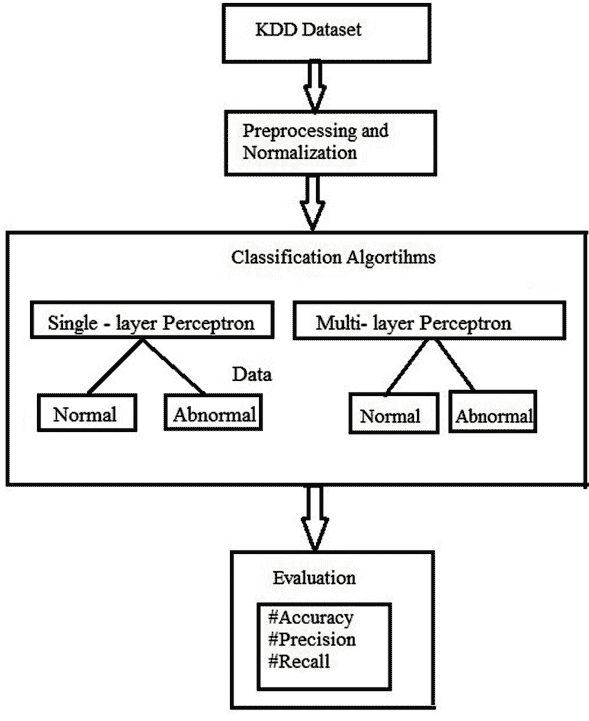

DNN 的工作原理如下所述。所提模型在分类过程中执行，以对正常数据和异常数据进行分类。异常数据可能由攻击者创建，也存在系统被攻破的可能性。这种数据是伪造数据，会阻止系统执行其功能。最初，KDD 数据集通过清洗、填充缺失值和消除噪声进行预处理。在分类过程中，不同层数的 DNN 进行了训练和测试。

### i) 输入层和隐藏层

输入层由 41 个神经元组成。输入层的输出被传递到隐藏层。隐藏层使用 ReLU 作为非线性激活函数。整流线性单元是最流行的激活函数，因为其简单和快速。在训练过程中，权重被调整并输入到下一个即将到来的层。从第一层到最后一层减少神经元数量，可得到高准确率的输出。

### ii) 正则化

为了正则化神经网络，DNN 中使用了丢弃法。丢弃法也称为退避法。退避法用于神经网络以避免过拟合问题。为了使整个过程更高效、节省时间，使用了 Dropout（0.01）。当丢弃值较小时，神经网络的准确率会逐渐提高。

### iii) 输出层和分类

输出层是神经网络中的最后一层。它仅包含两个神经元，即：受攻破和未受攻破，因为它使用二分类。隐藏层有 1024 个神经元，其输出传递到输出层。从隐藏层到最后一层的映射由 sigmoid 激活函数完成。sigmoid 函数的值在 0 到 1 的范围内。

### iv) 预测阶段

在此阶段，数据被输入到所提系统中，以预测输入数据是否为攻击。系统将输入数据和权重与预期输出相关联，并进行预测。在此阶段，系统的准确率、精确率和召回率被用于基准测试目的。

### 性能评估

神经网络先训练然后测试。训练和测试阶段后，三个 DNN 从准确率和混淆矩阵方面进行了关联。准确率是正确分类的数据占所有分类数据的百分比。混淆矩阵用于识别正常数据和异常数据。正确分类的数据称为真阳性（TP）。正确分类的正常数据称为真阴性（TN）。错误识别的异常数据称为假阳性（FP）。错误识别的正常数据称为假阴性（FN）。


图 3 展示了不同层数的 DNN 在准确率、精确率、召回率和 F1 分数方面的评估。准确率是指总正确预测数与数据集总数的比例。精确率是指总正确阳性预测数与总阳性预测数的比例。召回率是指正确分类的阳性预测数与总正确分类数据数的比例。F1 分数提供了错误分类数据的程度。该提出的模型使用 TensorFlow 和 Python 编程执行。提出模型的结果分别使用准确率、精确率、召回率和 F1 分数进行测量，如 (3)、(4)、(5) 和 (6) 所示。

```
Accuracy= (TP+TN) / (TP+TN+FP+FN) (3)
```

```
Precision = (TP) / (TP+FP) (4)
```

```
Recall = (TP) / (TP + FN) (5)
```

```
F1-score = 2*((Precision * Recall) / (Precision + Recall)) (6)
```

### 结论

互联网已成为日常生活中必不可少的一部分。互联网应用在医疗、交通等众多领域发挥着至关重要的作用。当今，基于物联网（IoT）的智慧城市、智慧农业、智能交通等开始赋能智慧世界。物联网设备产生的大数据面临严重威胁。安全是一个主要问题，这带来了检测异常活动的需求。入侵检测系统能够感知各类应用中异常发生的情况并提供安全保障。在使用互联网技术的社区中，IDS 已成为不可或缺的一部分。在入侵检测中实施 DNN 能够以高精度发现异常并加以防范。由两个隐藏层组成的 DNN 达到 93.1% 的准确率。具有一个隐藏层的 DNN 达到 99.9% 的精确率。由两个隐藏层组成的 DNN 达到最高召回率 91.6%。具有两个隐藏层的 DNN 达到 95.6% 的 F1 分数。与单层和多层感知机相比，我们得出结论：具有多层感知机（两个隐藏层）的 DNN 表现更好。因此确定，对于 KDD-99 数据集（80% 训练集和 20% 测试集），具有两个隐藏层的 DNN 可提供高达 93.1% 的准确率。

### 参考文献

Ahmad, I., Basheri, M., Iqbal, M. J., & Rahim, A. (2018). 入侵检测中支持向量机、随机森林和极端学习机的性能比较. 《计算机与电气工程》, 274–282. doi:10.1109/ACCESS.2018.2841987

Ahmim, A., Maglaras, L., Ferrag, M. A., Derdour, M., & Janicke, H. (2019). 基于决策树和基于规则模型的新型分层入侵检测系统. 第 15 届分布式计算在传感器系统国际会议. 10.1109/DCOSS.2019.00059

Alrashdi, I., Alqazzaz, A., Aloufi, E., & Alharthi, R. (2016). AD-IoT: 使用机器学习在智慧城市中进行 IoT 网络攻击异常检测. 《医学影像理解与分析国际会议论文集》. MIUA. 10.1109/CCWC.2019.8666450

Altaha, M., Lee, J.-M., Aslam, M., & Hong, S. (2021). 针对 SCADA 系统的基于自动编码器的网络入侵检测系统. 《通信期刊》, 16(6), 889–905. doi:10.12720/jcm.16.6.210-216

Aung, Y. Y., & Min, M. M. (2017). 基于随机森林算法的网络入侵检测系统分析. 第 18 届 IEEE/ACIS 软件工程、人工智能、网络与并行/分布式计算国际会议, 127-132. 10.1109/SNPD.2017.8022711

Chang, Y., Li, W., & Yang, Z. (2017). 基于随机森林和支持向量机的网络入侵检测. 《2017 年 IEEE 计算机科学与工程国际会议及 IEEE/IFIP 嵌入式与普适计算国际会议论文集，CSE 和 EUC》, 635–638. 10.1109/CSE-EUC.2017.118

入侵检测系统机器学习算法评估. (2019). Cuelogic Technologies. https://medium.com/cuelogic-technologies/evaluation-of-machine-learning-algorithms-for-intrusion-detection-system-6854645f9211

Halimaaa & Sundarakantham. (2019). 基于机器学习的入侵检测系统. 第三届电子与信息学趋势国际会议. 10.1109/ICOEI.2019.8862784

Iman, A. N., & Ahmad, T. (2020). 通过在 Boruta 中估计随机森林参数改进入侵检测系统. 智能技术与应用国际会议. 10.1109/ICoSTA48221.2020.1570609975

Jabez, J., & Muthukumar, B. (2015). 入侵检测系统 (IDS): 使用异常检测方法进行异常检测. 《计算机科学进展》, 48, 338–346. doi:10.1016/j.procs.2015.04.191

Mu, Z., Liu, H., & Liu, C. (2020). 网络入侵检测系统的设计与实现. 智能交通、大数据与智慧城市国际会议 (ICITBS). 10.1109/ICITBS49701.2020.00107

Zhang, H., & Zhou, R. (2017). 基于 ID3 算法的决策树分析与优化. 第 9 届建模、识别与控制国际会议. 10.1109/ICMIC.2017.8321588

## 第 12 章

## 使用视网膜图像获取算法的血管疾病预测

**Deepa S.**
孔古工程学院, 印度

**Vivek D.**
SRM 科学技术学院, 印度

**Suguna R.**
班纳里阿曼技术学院, 印度

**Arunkumar M. S.**
维尔泰克·兰加拉詹·古松塔拉研发科学技术学院, 印度

**Sathishkumar P.**
班纳里阿曼技术学院, 印度

### 摘要

人们受到视网膜血管疾病的影响。本研究使用视网膜图像获取技术自动化此类疾病的预测。视网膜血管的状况表现为人体血管疾病的镜像。人眼视网膜图像提供了由局部眼部疾病引起的诊断变化的大量数据，这些变化揭示了糖尿病、心血管疾病、高血压、血管刺激和中风等一些血管疾病。无限周长主动轮廓与混合区域信息（IPACHI）模型用于分割和计算血管周长。下一阶段是使用支持向量模型（SVM）和人工神经网络（ANN）模型对受影响的视网膜血管进行分类。分类后，计算动静脉比（ANR）以确定视网膜疾病的确切类型。该工作在 MATLAB 软件中完成，并在视网膜疾病预测中证明了 95% 的准确率。

DOI: 10.4018/978-1-7998-9308-0.ch012

### 引言

图像处理引出图像分析，涉及对预处理图像中的特征提取、基于血管的分割以及对预处理图像进行分类的研究。该技术使用视网膜血管图像分析模式。糖尿病视网膜病变是影响人眼视网膜的主要棘手疾病，其后果是失明。分割识别输入图像中每个像素的实际部分，以便找出与各种实体的对应关系。所提出的系统主要专注于分割，该分割高度自动化，避免了所有手工制作的工具，并反复检查从视网膜延伸出的血管。最后，它允许进行初步视力筛查测试，以识别与视网膜相关的各种疾病。这使我们能够预防和最大限度地减少视力障碍，以及许多与年龄和血管疾病相关的疾病。此外，它降低了筛查成本。

视网膜是人眼的内部部分。视盘是一个椭圆形的圆盘，位于视网膜中心。有助于辐射主要血管的内部位置是视神经。视网膜血管被很好地观察，有助于诊断疾病，与现有技术相比。在各种血管疾病（包括糖尿病视网膜病变、动脉硬化、青光眼、视网膜动脉阻塞、中风和高血压）的计算机化诊断和治疗中，提取血管是最重要的步骤。除了中央凹和视盘外，视网膜血管源自眼底相机捕获的视网膜血管的广泛特征，其大多数特性通常与糖尿病、中风、动脉硬化和高血压等疾病相关。此外，最流行的眼部疾病（主要是视网膜动脉阻塞和脉络膜新生血管化）意味着视网膜血管网络的广泛变化。眼底图像中的视网膜血管分割被证明有助于糖尿病视网膜病变检测和青光眼诊断。在考虑网络物理系统（CPS）时，它主要关注根据外部世界可用信息解释数据的能力。当今，大多数研究人员都在使用 CPS 进行攻击检测。一些机器学习算法在使用 CPS 时，其结果优于一些传统机器学习模型。

### 文献综述

在本文（Timo Hellsted 等人，1996 年）中，作者提出了对微血管瘤（MA）、眼底荧光血管造影（FAG）以及相反时间进行评估，该


在彩色照片中以红点形式捕获。广泛的新型自动化视网膜血管分割方法用于人眼视网膜共平面彩色图像（Joes Staal 等人，2004）。自动化方法可用于视网膜血管图像的计算机化分析。该研究的主要目标是将图像中的每个像素分类和分类为血管或非血管。商业世界中导致失明的主要原因包括许多原因，例如糖尿病视网膜病变、高血压、中风、年龄相关性黄斑变性和青光眼。具体光学相干断层扫描（OCT）的共平面眼底图像处理技术方法论也已得到评估。对视网膜眼底照片的可感知技术审查给予了独特关注（Michael D.AbràmOff 等人，2010），重点在于临床相关的人眼视网膜血管网络评估、视网膜病变识别、特定视神经头（ONH）区域评估以及计算机化视网膜疾病识别技术。

本拟议系统的目的是通过简要描述、标记必要要点以及主要性能指标，分析、评审和分类各种血管提取算法（M.Fraz 等人，2012）。其意图是为现有探索提供结构设计，并启动广泛的分割算法（Annunziata 等人，2016）。算法的行为几乎在公开可用的巨量视网膜图像数据集（DRIVE 和 STARE）上进行汇总和检验，使用了大量指标，包括真实匹配和误匹配的阳性率。它还考虑了准确率、灵敏率、特异率以及接收者操作特征（ROC）曲线下面积。研究发现，对相似图像进行多种血管分割，以加强对汇合点的检测（M. V. Usha、Vidyashree 等人，2015）。该研究背后的概念是收敛，即在完全不同的尺度上可检测到血管分割。DR 是亚洲国家视觉缺陷的主要原因，占该国九十九个病例（N. Otsu，1979）。亚洲国家和中国目前有九千多万糖尿病患者患有糖尿病。已提出一种视网膜血管血管提取程序（S. Roy Chowdhury 等人，2016）。最主要步骤是在原始血管网络中使用各向同性扩散滤波，以恢复特定的血管结构线并去除蒸发线。在次要阶段，四维线追踪部分允许所有血管搜索指定体积。为选定图像绘制硬地图需要多个步骤。

多种组织工程技术的发展（Abdulhannan P 等人，2012）有望为自体物质生成一些匹配的通畅图谱。需要在动脉粥样硬化病理生理学方面进行阐明，以提供专门靶向且适合药物治疗的材料。

激光治疗（Raval 等人，2020）即光凝结联合抗血管组织生长因子的重点在于，有助于测量视力适当变化状态以及眼内压（IOP）控制。传感器在网络物理系统（CPSs）的日益增长中发挥着重要功能（Iarovyi S 等人，2016）。这些工作不仅保证了可靠运行，还提供了理想性能，表明此类机器学习技术和算法的设计和部署将主要依赖于 CPS，与线性模型在计算血管宽度时获得的值相比，它能确保有希望的结果。

### 拟议系统

拟议系统旨在实现自动化处理并分析各种深度学习模型。首先从彩色图像中选择绿色通道，通过使用 CLAHE（受限自适应直方图均衡化）算法修改颜色范围标准来帮助增强对比度。它使用主动轮廓进行增强、去除背景噪声、标记视网膜血管边缘，并计算血管宽度以帮助识别疾病。一种使用深度神经网络算法的机器学习概念，包括支持向量分类模型和人工神经网络，用于分割血管。最后，这种自动化的拟议方法提供了更高性能比率的血管分割，用于预测血管疾病，并在与训练集比较后确定血管受影响的比例。

### 深度学习模型

### 卷积神经网络

由于数据预处理涉及大量工作量和复杂性，CNN 是分类问题（尤其是图像处理方法）中非常适合的方法。不仅对图像效果良好，还承诺在非成像数据上也能取得出色结果。将数据导入模型后，卷积神经网络使用 4 个不同的部分构建：-

- 卷积 – 输入数据用于创建特征映射，进一步应用于滤波映射。
- 最大池化 – 它使 CNN 模型能够检测是否遇到任何修改。
- 展平 – 数据通过展平方法进一步转换为数组，使 CNN 更容易读取数据。
- 全连接 – CNN 模型的损失函数计算将由隐藏层完成。

### 支持向量机 (SVM)

SVM 中使用的核函数将低维空间中的输入转换为高维空间。它非常适合涉及大量复杂数据转换的非线性问题。此处的数据基于标签标准或用户定义的输出进行分离。正负率两个主要类别通过线性平面（即超平面）变得可分。一种称为核技巧的技术用于分离这些类别，即在创建超平面时手动添加一些特征。该算法特别适用于相对于所用数据集合增加数学函数。与其他深度学习模型相比，SVM 技术能够很好地识别大量临床数据集中的隐藏模式。

### 视网膜图像获取

图像获取允许从数据集中获取视网膜图像并将其设置为进一步处理的输入。给定的输入图像在数据集中存储为标记图像文件格式。测试数据集（图 1）和训练集图像（图 2）均用于预测血管疾病。

### 图 1. 测试数据集


### 图 2. 训练数据集


### 预处理

图像预处理通常包括消除低频背景噪声、去除反射、合理化单粒子图像的强度、应用滤波器以及遮盖图像的不需要部分。高斯滤波器已应用于整个图像以降低（S P Meshram 等人，2013）对比度，并使用小波滤波器模糊边缘并提取血管特征（图 3）。

### 图 3. 特征提取


### 滤波

报道了形态滤波器（如膨胀、腐蚀、闭合和开放），这些滤波器可以通过滤波图像来收缩或扩大图像空间，以处理输入图像中的微小空间，某些详细特征在特定结构元素中编码（图 4）。

### 膨胀和腐蚀

膨胀和腐蚀是在考虑数学形态学提取区域时的两个基本运算符。当前景像素的某些关键区域增大时，内部区域内的一些斑点孔会变小。腐蚀对图像的主要影响是使外部边界的前景像素（通常包括白色像素）发生腐蚀。而在前景像素减小的情况下，孔会变大。


### 开放

主要，开运算源于基本的形态学操作：腐蚀和膨胀。开运算基本上类似于腐蚀；它试图从各个侧面去除相当数量的前景图像像素。总体而言，它比腐蚀稍微平滑一些。

### 闭合

闭运算方法是以相反顺序执行的操作，其轮廓为对每个像素先进行膨胀，随后使用相同的结构元素对两个操作进行腐蚀。闭运算在视网膜血管图像处理中倾向于扩大前景区域的边界，这通常被视为椒盐噪声。

图 4. 滤波


### 视网膜血管分割

在血管分割（N. Patton 等人，2006年）中，实现了图像处理的神经网络机制。初始血管值被跟踪和记录，同时记录血管特征。基于为相应特征提取的值，实现后续算法。执行从视网膜图像及其组成部分分离输入值的操作。实现深度神经网络模型用于视网膜血管的分割和特征提取。它创建了使用神经活性色轮廓通过邻域函数测量的已跟踪血管网络。它可以提取已映射的血管网络，其中每个节点表示血管树中的汇聚点。分割过程中的二值掩码通过从锐化图像中查找血管和边缘生成。最后，它为预处理的视网膜图像提供分割掩码（图 5）。

图 5. 视网膜血管分割


### 视网膜血管分类

血管通过血管分类方法进行跟踪，计算时考虑每个血管的宽度。动脉和静脉的分类基于宽度值，并使用 NN 模型和支持向量机模型进行表示。

血管提取后，涉及动脉和静脉属性的特征向量被映射。这用于提取线条的图像，并为每条线条指定一个标签名称，代表动脉和静脉像素。基于这些标记部分，当前的最终目标是将一个标签分配给相应的动脉类别 (A)，另一个分配给静脉类别 (V)。为了授权 A/V 类别之间的最终分类以及血管强度数据，还使用结构数据（图 6）。这可用于 SVM 分类。亮度级别改进（Naik, S. K 等人，2003年）增强了在合适的灰度级别变化时自适应伽马校正（AGC）技术的利用，因此该技术不会引起‘色域问题’。

图 6. 边缘检测


### 疾病诊断

在诊断阶段，对测试和训练视网膜图像数据集进行测量。使用包括真阳性率和假阳性率、灵敏度、特异度和准确度在内的阳性和阴性匹配，进而用于计算 AVR 比率以预测疾病。该疾病基于动脉和静脉的血管测量值使用动脉小管-静脉小管比率进行诊断，主要发现中央视网膜静脉小管当量（CRVE）和中央视网膜动脉小管当量（CRAE）与血管疾病的风险因素相关，并被发现为正实数（图 7 和图 8）。

图 7. 正常图像的性能度量


图 8. 受影响图像的性能度量


### 结果与讨论

从 Kaggle 竞赛提供的数据库中获得的眼底视网膜图像数据约为 90,000 张图像。我们从训练数据集中分离出 1500 张图像以提供给验证数据集。概率分布提供了更高维度的特征。特征列如下：

- 人类视网膜 50% 裁剪图像中红、绿、蓝通道值的平均值。
- 此外，针对 50% 居中裁剪图像计算了原始图像的总体标准差。
- 总共，一个视网膜眼底图像有十二个特征。
- 由概率分布获得的维度特征向量用作 SVM 分类的向量输入。

自动预测糖尿病视网膜病变可能降低糖尿病患者的视力受损高风险。在本研究中，提出了模糊 C 均值聚类和 ANN，针对超过 2500 张测试图像的最终准确率为 88.03%，并被证明是更好的解决方案。结果表明，使用 AUC 的 SVM 分类器与预测值匹配，并伴随降低的误差率计算。

结果有助于分析获得的 AUC 值，其在解决基本临床查询方面具有共同的高值。在提升算法中，支持向量似乎效果更好，因为它处理大部分线性数据，并且数据拟合使用后续非线性核值来实现改进的泛化特征。

### 结论

使用此应用程序消除了分割噪声图像的难题。它减少了分割中的计算开销。界面有助于有效分析照片。系统经过良好测试，用户满意度较高。集成了仿真工具结构的节点加入后将执行该应用程序并识别最有效的网站。光谱一致性在分类功能方面优于现有方法获得了更好的质量。在特征提取的光谱质量保持高于可接受最小值的前提下，最好尽可能争取更好的空间质量。该系统消除了现有系统中的困难。所提出的方法在应用分割规则时非常快速，同时在减少分割算法的整体困难方面也非常精确。CLAHE_RGB 和 CLAHE_Lab 措施的增强结果（Zhou 等人，2018年）提高了处理图像中的可见性。

### 未来工作

开发新系统时，未来的改进通常会以最少的集成工作与现有当前模块合并。如果在未来包括以下进一步改进，上述系统将被证明是有帮助的。该算法将应用于所有种类的图像格式，如 tiff（标记图像文件格式）和其他格式。分类算法中使用的因素将被泛化，以便默认值产生通用分割。分割规则一次只用于分割单个图像。在未来，包括卷积神经网络（CNN）及其层在内的多个分割算法可以用于同时对多个视网膜图像进行分割。在未来，将使用适合于给定输入数据与先前模式进行精确匹配的模式识别算法，以高效区分相似模式。

在分析来自线性和预测模型的模式值及其相关性时，还可以考虑 CPS（网络物理系统），使其具备适应和学习特征模型的能力。当大量测试输入被采集和处理时，这种预测学习类型可以轻松提供帮助。它还涉及高监控，并伴随对预测模型的持续维护。因此，机器学习可以被评估为此类开发模型中发挥关键作用的创新。

### 参考文献

Abdulhannan, P., Russell, D. A., & Homer-Vanniasinkam, S. (2012). 外周动脉疾病：文献综述. 《英国医学公报》, 104(1), 21–39. doi:10.1093/bmb/lds027 PMID:23080419

Abràmoff, Garvin, & Sonka. (2010). 视网膜成像与图像分析临床应用. IEEE 生物医学工程评论.

Annunziata, R. (2016). 利用基于多尺度海森的增强与新型渗出物修补技术进行视网膜血管分割. IEEE 生物医学与健康信息学期刊.


Fraz, M., Remagnino, P., Hoppe, A., Uyyanonvara, B., Rudnicka, A., Owen, C., & Barman, S. (2012). 视网膜图像中血管分割方法。IEEE 出版物。

Hellsted, Vesti, & Immonen. (1996). 单个微血肿的识别：荧光素眼底血管造影与无红光及彩色照片的比较。IEEE 出版物。

Iarovyi, S., Mohammed, W. M., Lobov, A., Ferrer, B. R., & Lastra, J. L. M. (2016). 面向开放知识驱动制造执行系统的物理 - 网络系统。IEEE 论文集，104(5)，1142–1154。doi:10.1109/JPROC.2015.2509498

Meshram, S. P., & Pawar, M. S. (2013). 基于对比度受限自适应直方图均衡化的糖尿病视网膜病变图像中视网膜血管提取。IEEE 生物医学与健康信息学杂志，20(6)，1562–1574。

Naik, S. K., & Murthy, C. A. (2003). 无色域问题的色调保持彩色图像增强。IEEE 图像处理学报，12(12)，1591–1598。doi:10.1109/TIP.2003.819231 PMID:18244713

Otsu, N. (1979). 来自灰度直方图的阈值选择方法。IEEE 系统、人与控制论学报，9(1)，62–66。doi:10.1109/TSMC.1979.4310076

Patton, N., Aslam, T. M., MacGillivray, M., Deary, I. J., Dhillon, B. R., Eikelboom, H., Yogesan, K., & Constable, I. J. (2006). 视网膜与眼科研究，25，99–127。PMID:16154379

Raval, V., Nayak, S., Saldanha, M., Jalali, S., Pappuru, R. R., Narayanan, R., & Das, T. (2020). 组合性视网膜血管阻塞。印度眼科学杂志，68(10)，2136-2142。

Roy Chowdhury, S., Koozekanani, D. D., Kochanski, S. N., & Parhi, K. K. (2016). 眼底图像中视盘边界与血管起始分割。IEEE 生物医学与健康信息学杂志，20(6)，1562–1574。

Staal, Abramoff, Niemeijer, Viergever, & van Ginneken. (2004). 基于脊的视网膜彩色图像血管分割。IEEE 医学成像学报。

Usha, M. V., & Vidyashree, M. R. (2015). 基于图分割方法的视网膜图像中视神经和血管定位。Academic Press。

Zhou, M., Jin, K., Wang, S., Ye, J., & Qian, D. (2018). 基于亮度和对比度调整的彩色视网膜图像增强。IEEE 生物医学工程学报，99(3)，1。doi:10.1109/TBME.2017.2700627 PMID:28475043

## 第 13 章

## 基于卷积神经网络的大数据环境安全数据存储机制

Balamurugan Easwaran https://orcid.org/0000-0003-2492-9589 非洲大学，尼日利亚 Toru-Orua

Anitha P. T. 沃莱加大学，埃塞俄比亚

Jackson Akpojaro 非洲大学，尼日利亚 Toru-Orua

Sangeetha Krishnan 非洲大学，尼日利亚 Toru-Orua

Kirubanand V. B. 印度基督大学（被认可），印度

### 摘要

人类社会中的数据类型和数量正以惊人的速度增长，这是由云计算和物联网（IoT）等新兴服务引起的。由于数据已成为基本资源，大数据研究引起了广泛关注。提出了一种针对 IoT 中大数据的优化集群存储方法。首先，根据数据访问的时间局部性计算每个历史访问周期中数据块的权重，并通过权重预测下一个周期数据块的访问频率。其次，根据先前数据访问计算的阈值确定数据块的热点。在此工作中，大数据基于语义连接的卷积神经网络被分为多个段。每个段将通过采用名为 BCDLR 的基于区块链分布式的本地再生代码技术存储在不同节点中。实验结果表明，该模型在分组投递率、端到端延迟、能耗和吞吐量方面表现出高效性。

### 1. 引言

物联网在企业应用开发中越来越流行。由于这些分布式传感器产生了海量数据，收集、整合、存储、处理和利用这些数据已成为企业的关键问题。研究人员和工程师都面临着处理这些存储在 CCSs（Sezer et al., 2017）等广泛分布式系统中的海量异构数据的挑战。基于 CCSs 中 IoT 的数据存储系统正在尝试在三个参数上平衡分布式执行，即统一基础设施资源管理、具有隔离性能的多租户存储以及系统的灵活可扩展性（Ding, Z. et al, 2013）

物联网的传输、处理和集成需要大规模、实时、非结构化数据处理，涉及数据存储和分析等层级（Borthakur, D, et al, 2017）。传统数据存储系统通过容错机制（数据副本）解决这些问题，但由于利用率低下和数据存储成本增加而导致冗余，尽管只访问了部分信息（Zhang, Q., et al, 2017 和 Zhang, Q., et al, 2013）。

目前的研究针对这些来自 IoT 的海量数据提出了有效的集群存储方案，该方案基于数据访问的时间定位，并根据访问历史以及数据块访问频率的预期/预测权重为数据块建立权重（Barik, R.K., et al., 2018）。随后，从先前数据访问中确定的阈值用于识别数据块的热点（Marjani, M., et al, 2017 和 Jan, B., et al, 2019）。

通过更改数据块副本并将其作为不同组存储在高性能低负载节点中，以提高访问效率和资源利用率同时降低存储成本，从而维持数据平衡（Kumari, A., et al, 2018）。采用可靠数据存储的聚类技术以及在多个节点中存储频繁访问数据的副本，确保了数据随时可用。然而，当重复数据较多时，存储开销会变得非常高（Ding, Z., et al, 2013）。

为解决这些问题，本章引入了一种改进的框架。所提工作的主要目标是确保在降低存储开销并保证数据完整性的前提下，实现最佳可靠的数据存储。在此工作中，大数据基于语义连接的卷积神经网络被分为多个段。每个段将通过采用基于区块链分布式的本地再生代码技术存储在不同节点中。该工作通过采用再生代码技术确保数据完整性，并确保数据恢复。

本研究工作的第 I 节探讨了 IOT 网络中大数据存储的重要性，第 II 节概述了用于大数据存储的经典方法，第 III 节比较了研究策略及其优缺点，第 IV 节讨论了仿真结果。第 V 节讨论了结论和未来工作方向。

### 2. 文献综述

本节回顾了大数据中用于 IOT 安全存储的方法。Ding（Ding et al, 2013）针对 IOTs 数据中的大数据分析提出了通用统计数据库聚类方法。该研究在 DBMS 内核中使用了统计函数，将复杂的统计查询转换为常规 SQL 查询。此外，使用分布式/并行服务器进行基于统计的分析，在实验中提高了性能。

Tripathi（Tripathi et al, 2020）建议基于 MapReduce 能力的元启发式聚类来处理海量数据。该研究建议的方法使用军犬队的搜索能力来识别最佳质心，而 MapReduce 处理海量数据。该研究对拟方案针对 17 个基准函数进行了优化效率测试，并将实验结果与 5 种当代算法进行了比较，即 BOAs（蝙蝠优化算法）、PSOs（粒子群优化算法）、ABCs（人工蜂群）、MVOs（多元宇宙优化算法）和 WOAs（鲸鱼优化算法）。此外，该研究的并行版本使用 MapReduce [基于 MapReduce 的 MDBO（MR-MDBO）] 对工业 IoT 的大数据集进行聚类。

Hosseini（Hosseini et al., 2017）在研究中提出了一种新的癫痫发作预测和定位方法，随后使用包括堆叠自动编码器、CNN、基于 PCA（主成分分析）的增强优化、ICA（独立成分分析）和 DSA（差分搜索算法）在内的深度学习架构。该研究针对 IoT 的 CCS 解决方案为实时进程、自主计算和海量数据存储制定了推荐架构。

Wu（Wu et al., 2019）提出了一种日志融合方法，通过去除噪声、添加时间戳和标记数据，将组件日志转换为结构化数据。该研究为海量数据引入了预测模型并改进了序列—


基于注意力机制的序列到序列（seq2seq）方法，通过添加注意力机制并使用调整器改变全局数据分布。他们的研究表明，经过训练的 NN（神经网络）在现实世界数据上表现良好，与先前的预测技术相比，其 RMSE（均方根误差）降低了 46.65%，而 R2（R 平方）拟合度提高了 14.28%。

切尔维亚科夫（Chervyakov et al., 2019）在其研究中使用分布式数据存储系统进行数据加密和治理。他们的 RRNS（冗余剩余数系统）包含一种用于纠错码和秘密共享机制的革命性策略。该研究在从 RNS 解码为二进制格式时，对数字的 AR（近似秩）值进行了处理，以最小化计算复杂性和系数大小。该研究的 AR-RRNS 方法在基于近似值和 RNS 算术特性控制计算的同时检测错误。他们关于配置信息丢失、数据冗余以及编解码速度的理论基础可以适应首选的工作负载和存储。他们的理论研究表明，对 RRN 参数的适当选择不仅可以提高安全性和可靠性，还可以凭借处理加密数据的能力降低存储开销。

穆罕默德（Mohammed et al., 2014）使用 IOIO 微控制器、信号、通信协议、用于大文件传输的安全高效机制、数据库管理系统和集中式云构建了医疗基础设施。他们的研究重点是开发 IoT CCS 医疗应用所需的系统/软件架构设计。他们提出的基础设施可供医疗其他领域使用，他们在其中对已识别的医疗解决方案提出了建议和扩展。

郭（Guo et al., 2017）提出了 CSF（众包语义融合），利用社交用户的聚合专业知识和混合众包计算来实现语义融合。他们首先挖掘跨模态语义相关性并标准化语义对象以进行融合。随后，采用降维和相关性反馈来消除非主要成分和噪声。在检查存储和分布时，他们的结果说明了其所提方法的有效性和准确性，因为它是一种针对异构社交媒体数据的有效且实用的跨模态语义融合和分布机制，适用于新型社交媒体语义处理。该研究使用交互式可视化框架来挖掘社交媒体信息，从而增强了语义知识和数据表示。

### 3. 拟议方法论

本节详细介绍了拟议模型的大数据存储。在第一阶段，大数据基于语义连通性使用卷积神经网络被分割为多个片段；在第二阶段，每个片段将通过采用基于区块链的分布式局部再生码技术（Li, J., 等，2017）存储在不同节点中。拟议模型的总体架构如图 1 所示。

图 1. 拟议模型的总体架构


### 3.1. 使用基于语义分割的 CNN 将大数据分割为多个块

大数据会产生存储开销，为降低此问题，需要将其划分为小片段。本工作使用基于语义连通性的 CNN 分割方法（Eggert, C., 等，2017）。

- **输入：** 它接受大量数据作为输入。在将信息传递到第一个卷积层之前，先执行归一化。
- **卷积层：** 卷积层（Abbas, S.M. 和 Singh, S.N., 2018）是复合卷积，随后接批归一化，以引入非线性并使用 ReLU（修正线性单元）。归一化消除了协方差，允许更快的学习率并提高泛化能力（Pandey, A. 和 Wang, D., 2019）。ReLU 非常适合深度学习技术，并通过卷积层的零填充避免信息丢失（Nguyen, K., 等，2017 和 Biswas, A. 和 Chandrakasan, A.P., 2018）。
- **残差可分离瓶颈：** 为了实现更快的处理并保持感受野，网络的主要构建块基于残差连接、瓶颈和可分离卷积，其中 [5 x 5] 卷积和 16 个内核的相应层参数针对设计从 6 减少到 896（Zhang, Q., 等，2020）。
- **带共享索引的反池化：** 解码器中的这些过程共享编码器对称池化操作的池化索引，从而使网络无需使用转置卷积即可跟踪编码器上最大激活的空间位置，但转置卷积代价高昂（Kim, T.Y. 和 Cho, S.B., 2019）。因此，反池化操作生成稀疏特征图，随后的卷积使用这些特征图进行学习并提高密度。池化层是步幅为 2 的 [2 x 2] 卷积。
- **输出：** 最后一层使用线性操作，随后接 softmax 激活函数，预测伪概率向量，其中元素表示特征属于某个类别的可能性，以便进行分段划分。

### 图 2. CNN 结构


### 3.2. 用于不同节点数据存储的基于区块链的分布式局部再生码技术

数据分割后，必须存储在安全位置，例如独立节点。这通过使用基于区块链的分布式局部再生码技术来实现。

工业区块链的分布式存储容错结构由高容错局部代码块命名空间、索引记录以及从代码块到存储节点的映射组成。感知模块评估存储节点的数据丢失情况，并将丢失情况通知元数据信息管理模块。当客户端读取文件时，首先从存储服务器获取文件编码块的偏移信息。然后，通过使用系统的局部代码（即高容错局部代码）直接从区块链存储节点检索原始终端数据。为了提高工业区块链存储系统的整体可靠性和弹性，为存储服务器配置缓存服务器，并将容错局部代码编码的数据传输并缓存到存储服务器上。缓存服务器负责文件备份缓存，当存储服务器被物理破坏时，缓存服务器接管并开始运行，从而减少数据文件重建的延迟开销，但会增加存储开销（Sajjad, M., 等，2019）。

### 容错分布式存储算法

由于区块链云存储系统中节点数量庞大，许多存储节点被销毁，因此需要创建能够有效修复失败节点的局部代码（Md. Shahidul Hasan, 等，2020）。本研究根据区块链中云存储系统节点的数量选择适当的 n 和 k 值，以构建具有 (n, k) 局部性的局部代码。研究了在开发具有 (n, k) 局部性的单个局部代码时使用向量代码的方法，因为向量代码包含 n 个离散修复组，且众多失败节点可以从 k 个离散局部修复组中并行修复。局部修复组的数量指定了可同时修复的失败节点数量，而修复组中的节点数量决定了修复局部性。使用柯西矩阵和多维线性向量代码，可以创建具有 (n, k) 局部性的局部代码（Balamurugan E 等，2020）。

首先，将源文件 M 分为 n 个数据块 {X1, X2, ..., Xn} 并存储在节点中，每个节点包含三个块。第一个块是数据块 Xi，第二个块是校验块 Yi = XiAi1 + XiAi2 + ... · XkAim，第三个块是时间戳块 Ti，组合为编码向量 Bi = {Xi, Yi, Ti}，1 ≤ i ≤ n，从而构建容错局部再生码。每当一个节点


假设节点 1 失败，源文件 M 可通过 (14) 快速定位非节点 1 的节点并下载其第一个块 {X_2, X_3, ..., X_n'}，随后由任意存活节点 j (j ≠ 1) 下载其第二个块 Y_j 来恢复。

每当 i (i ≤ n) 个节点失败时，源文件 M 可通过快速定位其他 n - i 个节点并下载第一个块 {X_i1, X_i2, ..., X_i,n-1}，再从任意 i 个存活节点 j_1, j_2, ..., j_i (j_i > i, l = 1, 2, ..., i) 下载第二个块 Y_{j1}, Y_{j2}, ..., Y_{ji} 来恢复。

每个再生码包含三部分，即数据域 X_i'、校验域 Y_i' 和时间戳 T_i'。

如算法 1 所示，在分布式存储再生码的设计中，当一个节点失败时，源文件可由其他存活节点恢复。

创建区块链网络的匹配流图信息（图 4），理解区块链网络中容错本地再生码的结构，即容错本地再生码中邻近本地码从故障本地码恢复的过程。

工业区块链网络中有上传数据至网络的节点，当网络中节点数据损坏时会触发数据恢复，通过从存活节点下载相关数据 X_i、Y_i、T_i 来完全恢复节点数据。

### Algorithm 1.

```
Input:
Source file M, non-singular matrix U, V ;
Output:
Coding matrix G;
1: Divide source file M into n data blocks
X_i = x_i1', x_i2', ... , x_in', i = 1, 2, ... , n;
2: for i ≤ n, j ≤ n do
3: Compute A_ij = (Vi)'U_j + c_ij E;
4: end for
5: Compute Y_i = X_i A_i1 + X_i A_i2 + ... + X_i A_in;
6: Record T_i to get coding vector B_i = X_i', Y_i', T_i';
7: Generate code B = B_1, B_2, ... , B_n;
8: return Coding matrix G.
```

图 3. 基于区块链的容错分布式存储结构


### 基于区块链的高效恢复算法

### 1. 单节点故障的数据恢复

在开发再生码时，数据存储和节点修复通常被隔离但不公开。在修复节点数据时，下载数据不需要编码和解码操作，系统中单个失败节点可使用简单的 XOR 操作进行精确修复。研究发现，通过调整当前基本再生码，可以提取出能够恰当修复同时失败的多个节点的编码形式；节点修复方法和带宽已详细说明。所提出的这种独特再生码的编码方法易于实现，存储容量更接近理论最小节点存储。由于局部修复能力提升且磁盘输入/输出开销低，当满足特定条件时，连接系统中的多个节点可以快速修复多个失败节点，具有很高的实际应用价值。

当新存储节点添加到区块链云存储系统时，应将其均匀分布到本地码中，同时在本地码长度增加的前提下保持本地码数量不变，以确保构建高容错本地再生码。如果向本地码添加 l 个存储节点，则创建高容错本地再生码的带宽成本降低，扩展码中系统的信息比特被保留，但校验比特增加到 l/2。正在构建与本地码 (n_L, k, d'min) 对应的增强码 (n_L + l/2, k, d'min + l/2)。目前，扩展码的系统最小距离为 d'min + l/2。

此外，系统的改进代码能够更有效地修复失败节点。附加码 ($n_L + l/2, k, d'min + l/2$) 基于系统扩展码，利用网络编码生成一组高容错本地再生码，以发展本地码的分布式局部校验。此时，分布式局部校验增加 l/2 比特，本地码总共增加 l 比特。

当单个节点（例如节点 1）损坏时，使用以下过程：通过区块链网络和未损坏节点查找受损节点 1，然后使用网络中除节点 1 外的所有数据构建校验域 \(Y_i(i \neq 2)\)，任何其他节点都可以恢复节点 1 的数据。算法 2 以伪代码形式描述了此过程。

### Algorithm 2.

```
Input:
Coding matrix G, failure node 1 ;
Output:
First block X_1 stored in node 1 ;
1: Locate other n - 1 nodes other than node 1 by the third block of storage nodes quickly;
2: Download its first block X_2,X_3, ... , X_n;
3: Select any surviving node j(j ≠ 1) to download its second block Y_j ;
4: Use formula (14) to recover the first block X_1 in node 1;
5: return First block X_1 in node 1.
```

### 2. 多节点故障的数据恢复

为了降低故障节点修复过程中的再生时间和带宽开销，探讨了从存活节点中适当选择修复节点以及修复节点到新节点的传输通道，用于容错本地再生码。该图表示失败节点数量的修复方法，并包含以下阶段（Balamurugan E., 等人，2020）。

### 步骤 1

在异构云存储系统中创建修复节点选择的数学模型，目标是最小化 \(\sum_{i=1}^n c_i \lambda_i\)，其中 \(c_i\) 是节点 \(i\) 的下载成本，\(\{\lambda_1, \lambda_2, \ldots, \lambda_n\}\) 是所选修复节点的下载分布。当问题节点放置在容错本地再生码中每个本地码的系统本地码部分时，每个故障节点可能有多个本地修复组可用，会考虑修复成本最低的修复组。

### 步骤 2

在选择修复节点时考虑所有约束，包括再生时间可能超过修复节点到新节点的数据传输时间、链路带宽可能限制修复节点到新节点的传输速率，以及异构网络云存储节点上的流量守恒。

### 步骤 3

寻找函数 Minimize \(\sum_{i=1}^n c_i \lambda_i\) 的最优值。当工业区块链云存储系统的范围有限时，线性编程技术用于优化新/修复节点和数据传输线路的选择。随着工业区块链云存储系统规模的扩大，线性技术的计算复杂度会增加。此外，研究了包括遗传算法、模拟退火和蚁群算法在内的启发式选择技术，以识别估计最优的新/修复节点和传输通道，旨在降低故障节点修复的再生时间和带宽开销。

当 n 个工业节点中的 i 个节点损坏时，最好假设节点 1 到节点 i 失败。可以利用除节点 1 到节点 i 以外的 n-i 个节点的初始块 \(X_{i+1}, X_{i+2}, \dots, X_n\) 以及任意存活节点 \(j_1, j_2, \dots, j_i (j_l > i, l = 1, 2, \dots, i)\) 的第二块 \(Y_{j_1}, Y_{j_2}, \dots, Y_{j_i}\) 来恢复节点 1 到节点 i。算法 3 表示伪代码。

### Algorithm 3.

```
Input:
Coding matrix G, failure nodes 1 - i;
Output:
First block \(X_1, X_2, \dots, X_i\) stored in node 1 to node \(i\) ;
1: Locate other \(n - 1\) nodes other than node 1 by the third block of storage nodes;
2: Download its first block \(X_{i+1}, X_{i+2}, \dots, X_n\);
3: Select any surviving nodes \(j_1, j_2, \dots, j_i (j_l > i, l = 1, 2, \dots, i)\) to download its second blocks \(Y_{j_1}, Y_{j_2}, \dots, Y_{j_i}\) ;
4: Use formula (15) to recover the first blocks \(X_1, X_2, \dots, X_i\) in node 1 to node i;
5: return First blocks \(X_1, X_2, \dots, X_i\) in node 1 to node i.
```

### 4. 结果与讨论

本节讨论了所提出模型 BCDLR 的实验结果。NS2 用于实现所提出的模型。在数据访问速度、数据消耗、成本和存储开销方面，该模型与现有的 RRNS 和 CSF 进行了比较。使用 Ubuntu 14.04 作为操作系统，安装 Hadoop 云平台，并采用配备 Intel Xeon 4 核 CPU、8G 内存、1 TB SATA 硬盘和 Gigabit 网卡的计算机，模拟了六个机架的实验，用于存储集群数据节点连接。

图 4. 数据访问速度 (Gbps)


上图显示了所提 BCDLR 方法与现有 RRNS 和 CSF 方法在数据访问速度方面的性能比较结果。在上图中，不同方法作为 X 轴，数据访问速度值作为 Y 轴。所提模型使用基于区块链分布式的本地再生码技术，从而提高访问速度。从


结果表明，所提 BCDLR 模型产生的数据访问速度更高，为 85 (Gbps)，而现有 RRNS 和 CSF 方法仅分别产生 65 (Gbps) 和 70 (Gbps)。

### 图 5. 数据利用率 (%)


图 5. 显示了所提 BCDLR 方法与现有 RRNS 和 CSF 方法在数据利用率方面的性能对比结果。在上图中，不同方法作为 X 轴，数据利用率值作为 Y 轴。所提模型利用基于语义连接的分割，提高了数据利用率。从结果中可以得出，所提 BCDLR 模型产生的数据利用率更高，为 88 (%), 而现有 RRNS 和 CSF 方法仅分别产生 75 (%) 和 85 (%).

### 图 6. 成本 ($)


图 6 对比了所提 BCDLR 方法和现有 RRNS 和 CSF 方法在成本方面的性能指标成本结果。在上图中，不同方法作为 X 轴，成本值作为 Y 轴。从结果中可以得出，所提 BCDLR 模型消耗较低成本 500 ($)，而现有 RRNS 和 CSF 方法消耗较高成本 350 ($) 和 270 ($) 分别.

### 图 7. 存储开销 (bits)


图 7. 显示了所提 BCDLR 方法与现有 RRNS 和 CSF 方法在存储开销方面的性能对比结果。在上图中，不同方法作为 X 轴，存储开销值作为 Y 轴。从结果中可以得出，所提 BCDLR 模型产生较低存储开销结果为 88 (%), 而现有 RRNS 和 CSF 方法产生较高存储开销 75 (%) 和 85 (%) 分别.

### 5. 结论与未来工作

随着数据采集和检索技术的发展，在大数据和物联网背景下，可用数据数量以每分钟的速度增长。因此，需要一种新的数据管理架构。在这项工作中，首先根据基于语义连接的卷积神经网络将大数据划分为多个段。每个段将通过采用基于区块链的分布式局部再生码技术存储在不同节点中。这项工作确保了数据完整性，并通过采用再生码技术确保了数据恢复。实验结果表明，所提模型在数据访问速度、数据利用率、成本和存储开销方面优于其他最新模型。然而，深度学习增加了计算难度，未来需要采用另一种机器学习模型进行数据分割。

### 参考文献

Abbas, S. M., & Singh, S. N. 2018 年 2 月. 基于区域的目标检测和分类，使用 faster R-CNN. 载于 2018 年第 4 届计算智能与通信技术国际会议 (CICT) (第 1-6 页). IEEE.

Balamurugan, Hasan, Almunun, & Sangeetha. (无日期). 基于修正克隆选择算法的云基软件服务节能自适应资源分配框架. 心理社会康复杂志, 24(2), 5182-5203.

Balamurugan, E., Dr Sangeetha, K., Dr Sathishkumar, K., & Dr Akpajaro, J. (2020). 基于修正支持向量机的云数据中心高效虚拟机整合程序. 动态与控制系统先进研究杂志, 12(4), 501-508.

Barik, R. K., Dubey, H., Misra, C., Borthakur, D., Constant, N., Sasane, S. A., Lenka, R. K., Mishra, B. S. P., Das, H., & Mankodiya, K. (2018). 大数据和物联网时代的雾辅助云计算：系统、架构和应用. 载于 云计算优化：基础、应用和挑战 (第 367–394 页). Springer.

Biswas, A., & Chandrakasan, A. P. 2018 年 2 月. Conv-RAM：一种用于低功耗基于 CNN 的机器学习应用的内嵌卷积计算节能 SRAM. 载于 2018 年 IEEE 国际固态电路会议 (ISSCC) (第 488-490 页). IEEE.

Borthakur, D., Dubey, H., Constant, N., Mahler, L., & Mankodiya, K. 2017 年 11 月. 智能雾：可穿戴物联网无监督聚类分析雾计算框架. 载于 2017 年 IEEE 全球信号与信息处理会议 (GlobalSIP) (第 472-476 页). IEEE.

Chervyakov, N., Babenko, M., Tchernykh, A., Kucherov, N., Miranda-López, V., & Cortés-Mendoza, J. M. (2019). AR-RRNS：面向物联网的可配置可靠分布式数据存储系统，以确保安全. 未来计算机系统, 92, 1080–1092.

Ding, Z., Gao, X., Xu, J., & Wu, H. (2013 年 8 月). IOT-StatisticDB：面向物联网大数据分析的通用统计数据库集群机制. 载于 2013 年 IEEE 绿色计算与通信国际会议和 IEEE 物联网及 IEEE 网络、物理和社会计算 (第 535-543 页). IEEE.

Eggert, C., Brehm, S., Winschel, A., Zecha, D., & Lienhart, R. (2017 年 7 月). 更仔细地看：faster R-CNN 中的小目标检测. 载于 2017 年 IEEE 多媒体与博览会国际会议 (ICME) (第 421-426 页). IEEE.

Guo, K., Tang, Y., & Zhang, P. (2017). CSF：面向物联网异构媒体大数据的众包语义融合. 信息融合, 37, 77–85.

Hasan, Balamurugan, Almamun, & Sangeetha. (2020). 云计算环境下智能机器学习自适应资源分配框架. EAI 云系统事务.

Hosseini, M. P., Pompili, D., Elisevich, K., & Soltanian-Zadeh, H. (2017). 基于物联网的 EEG 大数据和癫痫发作预测 BCI 的优化深度学习. IEEE 大数据期刊, 3(4), 392–404.

Jan, B., Farman, H., Khan, M., Talha, M., & Din, I. U. (2019). 设计智能交通系统：一种物联网和大数据方法. IEEE 无线通信, 26(4), 73–79.

Kim, T. Y., & Cho, S. B. (2019). 使用 CNN-LSTM 神经网络预测住宅能源消耗. 能源, 182, 72–81.

Kumari, A., Tanwar, S., Tyagi, S., Kumar, N., Maasberg, M., & Choo, K. K. R. (2018). 多媒体大数据计算和物联网应用：一种分类和过程模型. 网络和计算机应用杂志, 124, 169–195.

Li, J., Qu, C., & Shao, J. (2017 年 11 月). 基于改进 faster R-CNN 的 SAR 图像船舶检测. 载于 2017 年大数据时代 SAR：模型、方法和应用 (BIGSARDATA) (第 1-6 页). IEEE.

Marjani, M., Nasaruddin, F., Gani, A., Karim, A., Hashem, I.A.T., Siddiqa, A. and Yaqoob, I. 2017. 大 IoT 数据分析：架构、机会和开放研究挑战. IEEE Access, 5, 5247-5261.

Mohammed, J., Lung, C.H., Ocneanu, A., Thakral, A., Jones, C., & Adler, A. (2014 年 9 月). 物联网：使用 Web 服务和云计算的远程患者监测. 载于 2014 年 IEEE 物联网国际会议 (iThings)、IEEE 绿色计算与通信 (GreenCom) 和 IEEE 网络、物理和社会计算 (CPSCom) (第 256-263 页). IEEE.

Nguyen, K., Fookes, C., Ross, A., & Sridharan, S. (2017). 使用现成 CNN 特征的虹膜识别：深度学习视角. IEEE Access：实用创新，开放解决方案, 6, 18848–18855.

Pandey, A., & Wang, D. (2019). 基于 CNN 的时域语音增强新框架. IEEE/ACM 音频、语音和语言处理事务, 27(7), 1179–1188.

Sajjad, M., Khan, S., Muhammad, K., Wu, W., Ullah, A., & Baik, S. W. (2019). 使用带有大量数据增强的深度 CNN 进行多级脑肿瘤分类. 计算机科学杂志, 30, 174–182.

Sezer, O. B., Dogdu, E., & Ozbayoglu, A. M. (2017). 物联网中的上下文感知计算、学习和大数据：一项调查. IEEE 物联网期刊, 5(1), 1–27.


Tripathi, A. K., Sharma, K., Bala, M., Kumar, A., Menon, V. G., & Bashir, A. K. (2020). 基于军犬的并行算法用于认知工业物联网中的大数据聚类. IEEE 工业信息学学报, 17(3), 2134–2142.

Wu, P., Lu, Z., Zhou, Q., Lei, Z., Li, X., Qiu, M., & Hung, P. C. (2019). 基于 seq2seq 网络的认知物联网大数据日志分析. Future Generation Computer Systems, 90, 477–488.

Zhang, Q., Chen, Z., Lv, A., Zhao, L., Liu, F., & Zou, J. 2013, August. 云环境下大数据的通用存储架构. In 2013 IEEE 绿色计算与通信国际会议及 IEEE 物联网和 IEEE 网络、物理和社会计算国际会议 (pp. 476-480). IEEE.

Zhang, Q., Wang, X., Cao, R., Wu, Y. N., Shi, F., & Zhu, S. C. (2020). 提取解释图以解释 CNN. IEEE 模式分析与机器智能学报.

Zhang, Q., Zhu, C., Yang, L. T., Chen, Z., Zhao, L., & Li, P. (2017). 工业物联网中大数据聚类的增量 CFS 算法. IEEE 工业信息学学报, 13(3), 1193–1201.

## 第 14 章

## CluniacChain: 基于区块链和机器学习的医疗保健系统

Suganthi K.
https://orcid.org/0000-0003-4064-6394
维洛尔技术学院, 印度

Mayank K. Tolani
维洛尔技术学院, 印度

Apratim Shukla
https://orcid.org/0000-0002-2356-5333
维洛尔技术学院, 印度

Swapnil Vinod Mishra
维洛尔技术学院, 印度

Abhishek Thazhethe Kalathil
维洛尔技术学院, 印度

Manojkumar R.
维洛尔技术学院, 印度

### 摘要

区块链技术通常与金融应用相关联，其中它起着维护记录的作用。然而，这种抗篡改的分布式账本可用于构建医疗领域的应用程序。利用区块链作为健康记录数据存储的潜力可以确保其安全性，因为多份副本以去中心化的方式保存，以确保数据冗余和安全性。借助这项技术，医疗部门可以利用区块链技术，让任何授权医院安全地通信、共享信息/记录，而不依赖于中央机构。共享的信息将仅包含与利益相关者之间查询相关的相关数据，并将适当的权限附加到其角色。本章阐述了此类系统的架构，说明其作为医疗数据存储架构的优点和局限性。

### 引言

在当前场景中，大量电子病历（EMRs）的处理依赖于健康信息系统（HISs）（Haux, R., 2006）。这些系统是集中式的，并提供多种功能，如患者排程、入院/出院/转院日志和账单信息。这种集中式基础设施的主要缺点是缺乏透明度、数据泄露风险增加，随后维修成本更高（Menachemi, N., & Collum, 2011）。HIS 通常只处理来自单一医院的电子病历（EMRs）。这意味着患者来自多家医院和医生的累积报告不属于 EMR 的一部分。这些信息对于提供详细洞察以识别症状和预测患者反应可能至关重要。因此，电子健康记录（EHR）是更好的替代方案。EHRs 提供了患者健康的整体长期视图（Heart, T., Ben-Assuli, O., & Shabtai, I. 2017）。

区块链一词似乎不言自明，因为人们最初会将其视为一组线性链接的块的集合。但在现实世界中，区块链可能很复杂。从基本层面来看，它只是一个存储信息的数据库。但是，该数据库中使用的结构和概念使其如此独特（Pilkington, M., 2016）。在过去十年中，随着加密货币的出现，区块链获得了极大的流行度。它构成了任何加密货币或去中心化系统的核心（Eyal, I. 2017）。谈到去中心化，它是指系统活动分布且不受中央机构直接控制的过程。

我们的工作提出了一种联盟区块链（Hasselgren, A., Kralevska, K., Gligoroski, D., Pedersen, S. A., & Faxvaag, A., 2020），以支持透明的电子健康记录（EHRs）并增强疾病预测系统。所提出的架构通过利用智能合约原则，在保持匿名性的同时确保透明度。该提议的一些主要亮点包括在医院集群（HCs）下组织多家医院。医院集群（HCs）根据七个参数聚合多家医院。这些参数包括专业、地理位置、阈值评级、平均治疗成本、容量、死亡率和康复率。这些 HC 的组合形成了一个共享联盟区块链的去中心化网络。然后，根据每个医院集群（HC）调制的聊天机器人与用户界面交织在一起。该架构涵盖以下主要目标：

- 基于渠道的规则患者信息收集。
- 透明且富有洞察力的电子健康记录维护。
- 账本上适当信息的安全存储。

通过实时聊天界面与客户沟通已成为在电子商务和医疗服务领域提供实时客户服务的一种越来越流行的方式。客户使用这些聊天服务来获取信息、寻求帮助或咨询预订。聊天服务的实时性质已将客户服务转变为双向通信（Mero, J., 2018）。添加聊天机器人以收集用户输入可以进一步增强所提议的系统。

至少四种不同的结构是聊天机器人运作的基础（Davenport, T., & Kalakota, R., 2019）：

- 自然语言处理：用于理解需求。
- 知识管理：用于处理相关细节并提供答案。
- 深度学习帮助聊天机器人改进其对每次交互的响应。
- 情感分析：用于检测挫折感并将其转移给人工客服。

想法是用户将症状作为输入在聊天机器人的输入部分中输入。然后聊天机器人从给定文本中找到关键词，并使用状态跟踪系统更新对话状态（Noroozi, V., Zhang, Y., Bakhturina, E., & Kornuta, T., 2020）。在用户提供所有输入后，聊天机器人将结果转换为自然语言，并以用户（人类）可以理解的形式给出输出。

论文第 2 节探讨了文献中现有的基于区块链的医疗保健系统。系统 CluniacChain 的所提议架构描述在第 3 节。第 4 节提供实现，第 5 节提供结论，强调 CluniacChain 的优势。所描述系统使用的数据库蓝图附录中。

### 文献综述

区块链应用扩展到药品可追溯性、数据共享、临床试验和设备追踪（Bell, L., Buchanan, W. J., Cameron, J., & Lo, O. 2018）。将医疗数据通过第三方、保险公司和医疗服务提供者传输会使其面临相当高的风险。因此，医疗数据交换是一个问题。只有当所提议的系统考虑隐私时，数据共享和互操作性才能协同工作。我们的系统将通过安全实施电子健康记录（EHRs）（Reisman, & Miriam., 2017）来实现全国互操作性。

随着互联网使用量的增加，人们开始出于好奇使用它来浏览相关症状，这导致了基于自然语言的聊天机器人和预测系统的发展。基于提供的文本，这些系统利用


各种 NLP 算法用于与用户交互并预测用户的疾病。在此情况下，从文本中作为症状的特征被提取和分析，以预测输出（Rajput, A.E., 2019）。

然而，将这些预测系统与区块链技术相结合的应用数量有限。许多障碍阻碍了区块链技术在医疗保健领域的发展。其中一个显著障碍是本质上不愿改变当前做法并转向区块链。我们的系统将通过以患者为中心并关注其隐私来帮助消除这种不情愿。在联盟链上，患者与医院之间存储数据的一种极佳方式是智能合约。智能合约在医疗保健领域的先前应用有限。因此，需要进一步分析权限管理机构上的数据存储技术。

一些服务（HealthCoin, 2019）已将其愿景扩展到构建全球电子健康记录系统。其他举措正在结合 AI/ML 以改进医疗保健服务。现有系统会发放智能卡，将 EHR 数据与基于区块链的身份相关联。其他系统以去中心化的方式管理数据的权限和授权。这些系统（BurstIQ, 2017）认为区块链技术是医疗保健的未来，因为它们相信这能让患者处于中心地位。

关于区块链安全与挑战已有大量研究。其中一些研究成果（Park, J., & Park, J., 2017）通过多重签名技术提出了合约，以确保交易安全。此类系统会丢弃配置不当的交易。使用 AES（Uthayashangar et al., 2021）等加密算法，还可实现额外的数据安全性。系统可以将 AES 与基于属性的加密相结合，以便在不受信任的云服务器上安全存储加密数据（Yadav et al., 2020, p. 2321-2336）。医疗保健系统可以从中受益，并实现患者数据的安全存储与共享。

此外，将聊天机器人与医疗保健系统相结合可以增强应用（Athota et al., 2020）。聊天机器人的概念并非新鲜事物。聊天机器人经历了长时间的演进。计算能力有限是其发展滞后的主要原因。目前，性能、功能和人性化是评判聊天机器人的指标（Radziwill, & Benton, 2017）。医疗保健系统可以利用根据这些参数调优的聊天机器人，以交互式方式收集患者数据。

最后，医疗保健系统可以引入聚类技术，根据相似性对医院进行分组，并将患者匹配到理想医院。使用 K-Means 进行聚类是一种对大型数据集进行聚类的简单技术。简单 K-Means 聚类算法的复杂性取决于初始质心的选择。基本 K-Means 聚类算法对大型数据集需要最大的空间和处理速度。并行 K-Means 算法更高效，因为其质心选择过程比简单 K-Means 更优化。并行算法的结果始终一致，这提高了聚类质量、迭代次数和耗时。因此，并行 K-Means 相对于简单 K-Means 的优势使其成为聚类应用及随后在医疗保健系统中使用的理想选择（Shang et al., 2021, p. 1-20）。

### 提议方法

名为 CluniacChain (CC) 的提议架构包含多个子组件。提议架构的工作流如图 1 和图 2 所示

*图 1. CluniacChain 系统工作流*


图 2. CluniacChain 存储系统工作流


### 疾病预测

聊天机器人旨在以自然语言形式获取用户输入，患者在此描述自己的感受。机器学习模型使用患者的自然语言描述来预测疾病。疾病会映射到一个专科，这是推荐集群时考虑的参数之一。为此使用的数据集来自 UCI 机器学习库（Drug review dataset, 2018）。该模型在 27453 个数据实例和七个属性上进行了训练，其中只有三个是我们关心的，即：

- UniqueId - 每个数据实例的唯一 ID
- Condition - 已诊断疾病
- Review - 患者用自然语言描述的病情

机器学习模型使用 BERT (Devlin et al., 2019) 算法。它是由 Google 开发的基于 NLP 的最先进模型。在我们的测试集上，其准确率为 80.37%。对于预处理，需从用户输入中删除停用词，仅向模型提供关键词。在此过程中，还会删除连词和介词等不必要的词。

还有另一种选择：患者可以手动选择想要就诊的科室，而不使用疾病预测系统。一些没有病历且不确定自身病情的患者可以使用聊天机器人进行疾病预测。

用户还会输入所在位置。这是向患者推荐医院集群的核心参数之一。其他额外输入包括阈值评分（患者期望的最低医院评分）和预算（患者的预算）。疾病预测完成后，将患者分配到相应的专科。然后系统的下一部分处理集群分配和医院选择。

### 推荐系统

推荐系统是 CluniacChain 的关键组件之一。该系统使用聚类算法将医院分为若干集群，随后可根据表 1 中描述的若干参数进行选择。

表 1. CluniacChain 推荐系统的参数列表

| 序号 | 参数 | 描述 |
| :--- | :--- | :--- |
| 1 | Specialization | 医院专科 |
| 2 | Location | 医院经纬度/地理追踪 |
| 3 | Threshold Rating | 患者反馈 |
| 4 | Average cost of treatment | 任何手术的中位治疗费用 |
| 5 | Capacity | 座位可用性 |
| 6 | Fatalities | 医院死亡人数 |
| 7 | Recovery rate | 平均出院生存率 |

表 2. 适用于拟议推荐系统的聚类算法比较

| 算法 | 复杂度 |
|---|---|
| K Means | O(n^2) |
| Mean Shift | O(n^2) |
| Agglomerative Clustering | O(n^3) |
| Affinity Propagation | O(n ^2 * T)，T = 迭代次数 |

各算法的时间复杂度（*n 为数据点数量）

根据表 2 所示的时间复杂度，K-Means 和 Mean Shift 聚类耗时最少，而 Agglomerative Clustering 的时间复杂度最高。较高的时间复杂度可能导致显著延迟，并需要更多计算能力才能处理大量数据。通过在图 3 所示的 2D 数据上运行每个算法，测试了各算法的区分能力。

图 3. 任意数据绘图


图 4. 不同算法的聚类形成


图 4 描绘了 K-Means、Agglomerative Clustering、Affinity Propagation 和 Mean Shift 在将图 3 所示的任意数据作为输入时形成的集群。结论是，K-Means、Affinity Propagation 和 Agglomerative Clustering 在同一数据集上形成了相似的集群，且 K-Means 耗时最少，为 0.10 秒。Mean Shift 耗时最多，为 15.92 秒。图表显示，K-Means 算法在速度与聚类识别方面最为通用，其次是 Agglomerative Clustering，它以可比的速度展示了相似的聚类效果。

随后，在具有不同数据点数量的基准数据集上对这些算法进行了测试，以评估各算法的可扩展性。该模拟数据集由具有固定 7 个属性维度的数据点组成（与推荐系统使用的因素数量相同）。


### 图 5. 聚类实现性能比较


图 5 清楚地表明，K-Means 算法在可扩展性方面表现良好，而可扩展性对本应用至关重要，因为数据点的数量增长相当迅速。基于上述结果，K-Means 聚类被选作推荐系统聚类算法的理想候选。

### 医院聚类中的 K-Means 算法

- 1. 选择 k 个簇。
- 2. 从医院数据集中随机选择 k 个质心。
- 3. 通过确定医院与这些质心之间的欧几里得距离 d 来计算其与每个质心的亲近度。

```
d=√((s₁-s₂)²+(l₁-l₂)²+(t₁-t₂)²+(a₁-a₂)²+(c₁-c₂)²+(f₁-f₂)²+(r₁-r₂)²)   (1)
```

此处下标 (1) 表示质心的值，下标 (2) 表示待聚类数据点（即医院）的属性值。

- s = 专科（分类变量）
- l = 位置
- t = 阈值评级
- a = 平均治疗费用
- c = 容量
- f = 死亡病例数
- r = 恢复率

- 4. 根据给定质心周围计算的最小距离 d 将医院分组为 k 个集合。
- 5. 计算围绕这些质心形成的每个簇内每个属性的平均值。
- 6. 更新后的质心的属性值为分配给其簇的医院计算的平均值。
- 7. 继续执行步骤 3、6，直至这些质心不再更新。
- 8. 获得最终簇。

初始时，质心以随机方式选择。这确保了聚类过程执行迅速。所提算法的时间复杂度为 O(n^2)，其中 n 是待聚类医院的数量。

如果新医院加入 CluniacChain 系统，将使用上述描述的 K-Means 算法将其分类到其他具有相似属性的医院所在的簇中。

当聚类医院数量与未聚类医院数量之比严重偏离预设阈值时，CluniacChain 会重新对医院进行聚类。在比例计算中，系统从已定义的医院簇表中获取上一次迭代以来聚类的医院数量以及上次聚类以来新增/移除的医院数量的值。重新聚类后，将根据新医院的更新分配形成更准确的簇。现在，系统会重新初始化未聚类医院的新增/移除数量。

CluniacChain 推荐系统为新患者分配簇的方式是计算查询中带有表 1 详细信息的公式 (1) 所示的欧几里得距离 d。这些详细信息将发送到推荐系统，并与每个 k 个质心进行比较以形成簇。簇分配后，系统会向患者呈现一个列表，按所选簇中欧几里得距离最低的医院进行排名。在以下各节中，将解释 CluniacChain 系统用于存储和共享 EHR 记录的区块链规范和数据库架构。

### 区块链规范

联盟链（也称为联邦链）是本系统使用的区块链类型。在此，医院簇充当联邦实体，负责将数据推送到区块链上。患者需要为医院访问其医疗记录提供同意。将电子健康记录保存在簇的数据库中，并创建指向医疗记录的指针。仅将这些指针作为医院与患者之间的智能合约推送到区块链网络。由于医疗记录非常耗费数据，将其存储在区块链上会使整个区块链网络在数据方面效率低下。基于指针的方法有助于克服这一问题。因此，医疗保健记录将保存在簇的数据库中。

存储在簇数据库中的数据以加密形式存在，因此在发生数据泄露的情况下，可确保数据不会被滥用。加密基于属性颁发者颁发的属性进行。当患者对数据进行加密和签名后，将其写入簇数据库。应用程序的数据库使用 firebase 管理，firebase 是一个 NoSQL 云托管数据库。它可以根据要求进行扩展。这是 Google 开发的一个平台，用于为移动和 Web 应用程序提供数据库支持。Firebase 提供 CRUD API，以便与应用程序无缝集成。由于患者记录包含敏感数据，因此在推送到 firebase 之前会先进行加密。使用的加密算法是 AES，用于数据加密和解密的密钥是 firebase 提供的用户文档密钥。后续章节将详细讨论基于属性的加密和签名。

由于本系统包含联盟链，所使用的共识算法是权益证明（PoS）。由于医院簇已获预先授权可将数据推送到区块链上，因此使用工作量证明（PoW）共识将是浪费计算能力和资源（Cao et al., 2020, 第 480-485 页）。对于区块验证，选择另一个医院簇进行验证。这是基于医院簇的年龄因素完成的。年龄越大，被选中的机会越大。医院簇完成其验证任务后，将其年龄重置为零，以避免饥饿。将向区块链推送欺诈交易的医院会在推荐系统中获得较低优先级，这是负责推荐医院的因素之一。由于没有医院希望其声誉下降，这确保了它不断向链上推送正确数据。为每个医院保留一个计数器，每次遇到来自该医院的欺诈交易时，该计数器就会增加一次。一旦超过欺诈交易的阈值，该医院将被从系统中移除。因此，CluniacChain 的惩罚系统优先处理有效交易，并激励医院向链上推送正确数据。

图 6 展示了带有 PoW 实现的 CluniacChain 原型的性能。它展示了 PoW 是一种耗时的机制。块大小固定为 1 KB，数学谜题涉及找到一个数字 q，使得 hash(pq) 包含前导五个零，其中 p 是前一个证明，q 是新证明。该原型在 Intel(R) Core (TM) i5-7300HQ CPU @ 2.50GHz, 2496 Mhz, 4 Core(s), 4 Logical Processor(s) 上使用 Python 3.8.10 进行了测试。

基于先前的工作 (Gervais et al., 2016) 和 (Wu, Song, & Wang, 2020, 第 1-13 页)，表 3 显示了 Proof of Work (PoW) 与 Proof of Stake (PoS) 在共识、最终性、延迟、吞吐量和可扩展性方面的比较。

### 图 6. CluniacChain PoW 实现的性能分析


### 表 3. PoW 与 PoS 的比较

| 参数 | PoW | PoS 联盟 |
| :--- | :--- | :--- |
| 共识 | 无监管权限 | 需要监管权限 |
| 最终性 | 未确保 | 已确保 |
| 延迟 | 6 个区块时间 | 网络延迟 |
| 吞吐量 | 每秒交易数较少 | 每秒交易数巨大 |
| 可扩展性 | 大量矿工 | 少量验证者 |

### 为权限颁发属性密钥

在 SHA-1、BLAKE2、SHA-3 和 MD5 等流行的加密哈希函数中，BLAKE2 似乎是出于以下原因而最适合我们目的的候选：

- 它适用于分布式系统，因为它可以快速计算大量安全哈希数据。
- 它在单核 CPU 上也相当高效。
- 它是目前唯一未遭受过成功攻击的哈希函数。

根据所审阅的工作 (Sharma & Yasmin, 2018)，得出结论：与 MD5 和 SHA-1 等流行哈希算法相比，BLAKE2 没有公认的安全威胁。

为确保仅允许患者授权的实体访问其数据，需对其进行加密和签名，以提供数据真实性。为了理解属性密钥的生成，需要定义其他术语。

生成一个密钥来加密患者数据。此步骤涉及使用 AES (Daor et al., 1999) 算法加密患者的 EHR，并使用 ABE（基于属性的加密）加密该密钥。

设患者的私钥表示为 K1，公钥表示为 K2。设密钥颁发者表示为 KI（在本系统中，KI 是医院簇）。该簇根据授予的权限生成不同的密钥（读/写/更新/删除）。

设秘密密钥表示为 Skey。设属性密钥集表示为 AKS，它可以称为密钥 Skey 的秘密密钥。设患者的电子健康记录表示为 EHR。设对密文应用哈希算法 BLAKE2b (Aumasson et al., 2013) 后生成的最终签名表示为 ζ。

现在，生成密文：

```
T = AES (Skey, EHR)
```

假设用户拥有由某个密钥颁发者 KI 颁发的多个属性密钥，则密文将表示为：

```
U = { ABE (AKS_r, Skey), ABE (AKS_r, Skey) ..., ABE (AKS_r, Skey) }
```

其中 AKS1 可能是用户读取权限的秘密密钥，AKS2 是用户写入权限的秘密密钥，依此类推。

现在，在将其存储到数据库之前，请使用合适的哈希算法对这些密文进行哈希处理。基于先前讨论的优势，此处使用 BLAKE2b 算法进行哈希处理。因此，对这两个密文进行哈希处理后，可以表示为：


V = blake2b (T, U)

最后，将使用
ED25519, ζ = Sign (KI, V) 生成签名。

签名生成后，Eq. (2) 中的密文 T、Eq. (3) 中的密文 U 以及 Eq. (5) 中的签名 ζ 即可上传至数据库。

如果医生想要访问任何患者的 EHR，则会下载密文和 Eq. (5) 中的签名 ζ。如果 Eq. (5) 中的 ζ 有效，且医生拥有加密时所需的属性（用作属性密钥），则将被允许解密 Eq. (3) 中的 U 以获取 Skey，进而使用该密钥解密 Eq. (2) 中 T 可用的 EHR。

图 7、图 8、图 9 和图 10 显示了不同加密和哈希算法组合生成密钥及签名所需时间的比较。Read x 标签表示仅提供了 Read 权限，基于该权限在哈希后生成了签名。同样，Read + Write x 标签表示仅提供了 Read 和 Write 权限，而 Read + Write + Delete 表示提供了所有三种权限。y 轴上的所有值均以秒为单位。

图 7. 3DES 和 Blake2b 组合


图 8. 3DES 和 SHA256 组合


图 9. AES 和 Blake2b 组合


图 10. AES 和 SHA256 组合


观察安全性与计算时间的权衡，AES 与 Blake2b 的组合被证明是 CluniacChain 的理想选择，如图 9 所示。此外，集群权限表存储了签名（Eq. (5) 中的 \zeta）、属性密钥（Eq. (3) 中的 U）以及权限列表，其中包括每位患者的患者 ID、医院 ID 和签发的密钥。

### 操作

患者的电子病历（EMRs）与其他信息相结合，以提供作为电子健康记录（EHRs）的全面画面。加密后存储 EHRs 将确保数据安全。同样，数字签名将确保 EHR 的完整性。作为未来增强，sign-encrypt-sign 方法将是理想的选择。

如前几节所述，加密和签名是多阶段流程的一部分。医院集群（HC）将在该过程中充当属性颁发机构。它负责为患者颁发秘密密钥。在下一步中，用户授权医院获得特定权限，例如 Read、Write、Update 和 Delete。基于允许的属性，医院集群颁发相应的属性密钥。应用于 EHR 的四项操作（Read、Write、Update 和 Delete）将同步到区块链。

### 记录读取与添加（Read and Write）

EHR 读取和添加操作需要 Read 和 Write 两个属性。第一步，患者的秘密密钥加密 EHR。下一步，患者对加密文本进行签名，以确保数据完整性。使用医院与患者之间商定的一组属性密钥，患者的秘密密钥加密同时进行。下一步，用户将加密的 EHR 上传到服务器。服务器将关于加密数据的信息作为智能合约发送到区块链。验证后，将新块添加到区块链。最后，将加密数据存储在数据库中，患者将收到信息添加通知。

如果另一家医院想要读取加密数据，患者需要通过医院集群向医院授予读取权限。将为信息检索创建智能合约。然后，该事务的块将被验证并添加到链中。由于患者授予了读取权限，医院可以使用读取属性密钥获取用于解密加密 EHR 的秘密密钥。

### 记录更新（Update）

如果患者想要更新其特定医院的 EHR，则需要更新属性密钥。获得授权后，患者可以将其修改后的 EHR 上传到服务器。使用患者的秘密密钥对 EHR 进行加密并由患者签名的过程与记录读取和写入操作类似。再次，服务器将关于加密 EHR 的信息作为智能合约发送到区块链。验证后，将新块添加到区块链。旧 EHR 与新 EHR 的替换通过先取消链接再链接来完成。最后，数据库中将删除旧 EHR 并添加新 EHR。成功后，患者将收到信息更新通知。

### 记录删除（Delete）

如果患者想要删除其 EHR，则需要删除属性密钥。在患者与医院之间获得删除 EHR 的权限授权后，删除属性密钥便发挥作用。然后，患者需要确认对 EHR 的删除操作。随后，服务器将关于删除 EHR 的信息作为智能合约发送到区块链。验证后，将新块添加到区块链。然后，EHR 将被取消链接并从数据库中删除。成功后，患者将收到信息删除通知。

### 实现

要使用 CluniacChain 提供的服务，新用户应先注册，然后才能解锁所有服务，例如疾病预测、药物处方、将其医疗报告安全地保存在 Cluniac 数据库中，以及根据疾病严重程度请求与医生预约。

用户注册后，需提交其血型、出生日期、电子邮件 ID、姓名和地址，这些信息将被存储并映射到生成的唯一 ID。假设用户希望通过提供头痛、恶心和对光敏感等症状来识别其患有的特定疾病。CluniacChain 推荐系统预测偏头痛，并向用户开具布洛芬处方。如果用户对药物满意，其医疗记录将通过记录读取和添加操作存储在 CluniacChain 中。否则，他们可以继续预约医生。

为预约，CluniacChain 使用用户注册时的地址。系统将搜索附近包含医院列表的医院集群，并根据患者的要求分配医院。在此案例中，用户被分配给医院集群 A 中的一家神经内科医院，以进一步诊断偏头痛。然后，预约请求将发送到预订队列，由医院管理员处理。预约确认后，医生将开具药物，患者的 EHR 更新将通过记录更新操作进行。图 11 以逐步方式展示了所述示例。

图 11. 展示 CluniacChain 实际实现工作流程的示例


### 结论

所提系统融入区块链技术来存储医疗记录，以发挥其在医疗领域的潜在优势。该系统使用基于属性的加密方法对用户的 EHR 进行签名，使得只有获授权的人员才能使用其持有的指定属性密钥检索 EHR，从而确保 EHR 安全且不允许未经授权的访问。

用户可以输入其位置，根据评分和预算筛选医院。所提系统随后将其与最佳可能的医院集群匹配，然后用户可以从医院列表中选择任何喜欢的医院。试图访问 EHR 的医院必须通过用户共享的属性密钥获得许可。如果用户不想去医院，他们可以使用聊天机器人描述其症状。系统随后将使用 BERT 算法基于输入给出可能的疾病。基于预测，向用户推荐专科医生。如果用户不满意，他们可以预约就诊最近的专科医生。

架构中实现的惩罚系统确保特权不被滥用。惩罚分数跟踪不当行为。如果它超过预设阈值，则该医院将被禁止使用本系统。此外，为了跟踪不同的集群，本系统使用全局集群连接器。通过区块链保障数据安全是本系统的主要优势。数据受到保护，发生泄露的可能性较小。

### 参考文献

Athota, L., Shukla, V. K., Pandey, N., & Rana, A. (2020). 使用人工智能的医疗系统聊天机器人。2020 8th International Conference on Reliability, Infocom Technologies and Optimization (Trends and Future Directions) (ICRITO). 10.1109/ICRITO48877.2020.9197833

Aumasson, J-P., Neves, S., Wilcox-O'Hearn, Z., & Winnerlein, C. (2013). BLAKE2: 更简单、更小、速度如 MD5。. doi:10.1007/978-3-642-38980-1_8

Bell, L., Buchanan, W. J., Cameron, J., & Lo, O. (2018). 区块链在医疗保健中的应用。Blockchain in Healthcare Today, 1. Advance online publication. doi:10.30953/bhty.v1.8

Burst, I. Q. (2017). 将健康带入生命白皮书 [白皮书]。从 https://www.burstiq.com/wp-content/uploads/2017/08/BurstIQ-whitepaper_19Jul2017reduced.pdf 检索

Cao, B., Zhang, Z., Feng, D., Zhang, S., Zhang, L., Peng, M., & Li, Y. (2020). 基于 PoW、PoS 和 DAG 的区块链性能分析与比较。Digital Communications and Networks, 6(4), 480–485. doi:10.1016/j.dcan.2019.12.001

Daor, J., Daemen, J., & Rijmen, V. (1999). AES 建议：Rijndael。Academic Press.


Davenport, T., & Kalakota, R. (2019). 医疗保健中人工智能的潜力. Future Healthcare Journal, 6(2), 94–98. doi:10.7861/futurehosp.6-2-94 PMID:31363513

Devlin, J., Chang, M., Lee, K., & Toutanova, K. (2019). BERT: 用于语言理解的深度双向Transformer预训练. ArXiv, abs/1810.04805.

Drug Review Dataset (Drugs.com) 数据集. (2018 年 10 月 4 日). UCI 机器学习库. https://archive.ics.uci.edu/ml/datasets/Drug+Review+Dataset+%28Drugs.com%29

Eyal, I. (2017). 区块链技术：将自由意志主义加密货币梦想转变为金融和银行业现实. Computer, 50(9), 38–49. doi:10.1109/MC.2017.3571042

Gervais, A., Karame, G. O., Wüst, K., Glykantzis, V., Ritzdorf, H., & Capkun, S. (2016). 工作量证明区块链的安全性与性能. 2016 年 ACM 计算机与通信安全会议论文集. 10.1145/2976749.2978341

Hasselgren, A., Kralevska, K., Gligoroski, D., Pedersen, S. A., & Faxvaag, A. (2020). 医疗保健与健康科学中的区块链——范围综述. International Journal of Medical Informatics, 134, 104040. doi:10.1016/j.ijmedinf.2019.104040 PMID:31865055

Haux, R. (2006). 健康信息系统——过去、现在与未来. International Journal of Medical Informatics, 75(3–4), 268–281. doi:10.1016/j.ijmedinf.2005.08.002 PMID:16169771

HealthCoin. (2019). 健康币白皮书 [白皮书]. 检索自 https://thehealthcoin.io/wp-content/uploads/2018/04/HEALTHCOIN-WHITE-PAPER.pdf

Heart, T., Ben-Assuli, O., & Shabtai, I. (2017). PHR、EMR 和 EHR 集成综述：更个性化的医疗保健和公共卫生政策. Health Policy and Technology, 6(1), 20–25. doi:10.1016/j.hlpt.2016.08.002

Menachemi, N., & Collum. (2011). 电子健康记录系统的益处与弊端. Risk Management and Healthcare Policy, 47, 47. 在线先行出版. doi:10.2147/RMHP.S12985 PMID:22312227

Mero, J. (2018). 双向沟通和聊天服务使用对电子商务零售领域消费者态度的影响. Electronic Markets, 28(2), 205–217. doi:10.1007/s12525-017-0281-2

Noroozi, V., Zhang, Y., Bakhturina, E., & Kornuta, T. (2020). 用于架构引导对话数据集的快速鲁棒 BERT 基础对话状态跟踪器. ArXiv. arXiv:2008.12335

Park, J., & Park, J. (2017). 云计算中的区块链安全：用例、挑战与解决方案. Symmetry, 9(8), 164. doi:10.3390/sym9080164

Pilkington, M. (2016). 区块链技术：原理与应用. 数字化转型研究手册, 225–253. doi:10.4337/9781784717766.00019

Radziwill, N., & Benton, M. (2017). 评估聊天机器人和智能对话代理的质量. arXiv:1704.04579

Rajput, A.E. (2019). 自然语言处理、情感分析和临床分析. ArXiv, abs/1902.00679.

Reisman & Miriam. (2017). 电子健康记录：使电子数据可用且互操作的挑战. P & T：一种用于处方集管理的同行评议期刊, 42, 572–575.

Shang, R., Ara, B., Zada, I., Nazir, S., Ullah, Z., & Khan, S. U. (2021). 基于教育领域数据集的简单 K-均值和并行 K-均值聚类在软件产品和组织绩效中的分析. Scientific Programming, 2021, 1–20. doi:10.1155/2021/9988318

Sharma, V. & Yasmin, N. (2018). 哈希函数概述—比较研究. International Journal of Engineering Research, 5(6).

Uthayashangar, S., Dhanya, T., Dharshini, S., & Gayathri, R. (2021). 基于区块链的去中心化安全云数据存储系统. 2021 年系统、计算、自动化与网络国际会议 (ICSCAN). 10.1109/ICSCAN53069.2021.9526408

Wu, Y., Song, P., & Wang, F. (2020). 混合共识算法优化：基于 POS 和 PBFT 的数学方法及其在区块链中的应用. Mathematical Problems in Engineering, 2020, 1–13. doi:10.1155/2020/7270624

Yadav, C. (2021). 基于 AES-轻量级 CP-ABE 的隐私保护框架设计工程，具有云框架中的有效访问控制机制. Design Engineering.

## 第 15 章

## 利用机器学习的工业预测性维护网络物理系统框架

Sharanya S.

SRM 科学技术学院，印度

### 摘要

预测分析、人工智能、大数据以及信息和通信技术领域的迅猛发展，为网络物理系统（CPS）开辟了新的领域。CPS 提供的广泛机遇推动了工业流程的大规模转型，这些转型汇聚于在工业 4.0 的框架下构建智能系统。制造业和能源领域目前正将重点转向预测性维护，以预先规划维护活动，在优化成本的同时减少停机时间。这种主动性维护规划涉及整合大数据分析、机器学习和物联网等多种技术，以构建一个完整、全面的框架，从早期预警信号中预测故障的发生。本工作的主要重点是基于状态监测数据，为工业预测性维护（PdM）开发一个通用的 CPS 框架。

### 状态监测和工业 4.0 简要概述

状态监测（CM）是制造业领域的最新热门词汇。CM 被定义为在诊断故障或失效的背景下，对系统进行不间断监测的过程。该过程可以分解为一系列活动，例如监测、故障检测、故障原因诊断和故障预后。CM 涉及密切监测能够有效表征研究系统或设备健康状态的关键参数。并非所有参数都有助于 CM，CM 随后会进行故障检测。领域专家必须界定关键变量或参数，其偏差值可能直接暗示故障的发生。

CM 大致分为反应式 CM 和主动式 CM。前者在故障发生后诊断故障原因，而后者则力求在故障发生前预见故障。世界正在更深入地进入人工智能（AI）及其相关技术的时代，这一点已非常明显。工业领域的维护部门也通过在 CM 和设备故障预测中采用机器学习（ML）、大数据分析（BDA）和深度学习（DL）来利用其优势。故障预后是智能制造的组成部分，而智能制造是工业 4.0 的核心目标。从早期迹象预测故障为工业带来诸多优势：

- 减少设备总体维护时间和停机时间
- 提高生产率
- 增加工作时间
- 降低维护成本
- 确保安全

CM 是故障预后的有效工具，因为它可以降低非计划维护活动的频率。预测故障已成为任何智能基础设施不可或缺的一部分。物联网（IoT）、云计算、数字孪生、边缘计算和边缘 AI 等技术的出现加速了工业的进步，推动了工业 4.0 的发展。

### 工业 4.0 的演变

工业向智能化转型，通过使用现代控制系统嵌入智能并赋能工人，是工业 4.0 的首要宗旨。工业 4.0 的理念旨在实现以下特征：

- 融合物理世界与数字世界
- 安全数据传输
- 智能自动化
- 提高产品定制化程度
- 智能装配线
- 更紧密的产业价值链

向工业 4.0 的转变是多年来众多进步的结果，这些进步被划分为不同的世代。每个世代都将作为一种演进过程，在此过程中，旧系统将被更强大的现代版本所取代。每个世代的变化都是渐进且渐增的。各次工业革命的显著特征将在下文中讨论。

### 工业 1.0

18 世纪见证了第一次工业革命的时代，该革命由蒸汽动力触发。生产线实现了机械化，从而能够大批量生产商品。动力织机和蒸汽机车成为现实。这给人类生活方式和工业活动带来了巨大变化。福特装配线是提高生产率的大规模生产的著名示例。

### 工业 2.0

第二代的伟大突破是电力的生成。1870 年代设想了由电能驱动的大规模工业生产。这导致了大规模的人力劳动力就业。巨型传送带和大型装配线得以实现。

### 工业 3.0

第三代主要以电子产品和计算机的出现为特征。ARPANET（即当今互联网的前身）的部署进一步增加了计算机和数据交换的使用。这些发展利用尖端技术进一步实现了制造业生产线的自动化。存储式可编程控制器减少了对人工协助的需求。


### 第四次工业革命（Industry 4.0）

第四次工业革命的核心驱动力是信息和通信技术（ICT）的崭露头角，它构成了网络世界。这个时代实际上是一系列技术的集合体，如AI、数字孪生、3D打印、增材制造、云计算、边缘计算、物联网（IoT）等。第四次工业革命是由所有这些技术编织而成的网格，旨在实现智能工厂，在其中，组件、系统与人员之间的通信完全联网（Ricardo, 2018）。预计生产线几乎完全自动化，人工控制极少。这个时代的基本特征是完整性、速度和普遍性。其中一个关键应用领域是预测性维护，通过预见故障来安排维护活动。因此，现代工业正在通过引入未来主义和最先进的技术，转型为更智能的工业，以在降低维护和制造成本的同时提高产量。

### 状态监测

CM的主要目标是控制设备故障的不利影响，从而减少停机时间。可用性一词关注机器可以按预期性能运行的时间长度。这相当于运行时间。各行业的维护政策是基于其采用的CM策略设计的。维护政策主要分为两种类型：反应性维护和主动性维护。反应性维护政策在系统发生故障后生效。这种维护成本相对较低。主动性维护政策从故障的早期预警迹象预测故障的发生。因此，这些策略在智能工业中具有更广泛的应用前景。主动性策略分为预防性维护和预测性维护。维护活动的分类法如图1所示。

### 预防性维护

该政策按固定时间间隔计划维护活动。维护团队根据运行小时数或时间定期进行常规检查。基于使用量或运行量的维护活动是在设备超过阈值运行时间后执行的。基于时间的维护是在预设时间后进行。这两种方法在制造业中被广泛应用，以节省时间和成本。这里的主要局限是：无论机器的健康状况如何，都会触发维护活动。

### 预测性维护

这种主动性维护策略通过分析关键变量值中的趋势和模式，预测设备的使用寿命。它将状态监测作为一种工具，用于从数据中检测异常模式（Thyago, 2019）。这增强了主动性，从而降低了维护活动的频率。预测性维护的范围进一步通过预测分析、基于AI的技术和物联网得到扩展。

### 预防性维护与预测性维护的区别

尽管预测性维护和预防性维护都属于主动性维护策略的范畴，但它们存在一些固有差异。预防性维护涉及对设备进行周期性检查，而不论是否需要。另一方面，预测性维护仅在有维护需求时才执行。预防性维护不一定需要任何状态监测活动，因为它们是定期进行的，无需任何检查。因此，它们不需要额外投资来开发基础设施。但预测性维护是一种按需策略，需要在基础设施和技能培训方面进行初始投资。预防性维护受设备平均寿命限制，而预测性维护则基于机器预设的健康状况来确定。简而言之，预防性维护看起来更经济、更简单，但预测性维护的长期效益远胜于前者。

图1. 维护策略分类法


### 预测性维护中网络物理系统的作用

第四次工业革命、传感器密集部署、数据分析工具、预测分析和BDA的发展，共同促进了智能制造领域的卓越成就（Saeed, 2019）。网络物理系统（CPS）的概念似乎是连接物理世界与数字世界的计算实体的融合（Monostori, 2014）。网络物理系统基于3C运行，即连接（Connect）、通信（Communicate）和控制（Control）。这使它们非常适合工业自动化等用例。CPS通过将工业转变为完整的认知企业，重新定义了整个制造业的前景。推动工业中CPS增长的三大支柱是：

- 各种边缘设备之间的互连
- 工业大数据分析与可视化
- 智能决策系统

图2. CPS连接物理世界与数字世界


图2描绘了通过CPS实现的物理世界与数字世界之间的互连。物理实体的原始数据通过传感器记录。执行器以反向方向运行，从传感器值中实现物理过程。这些数据被缓存在存储介质中。所有这些活动确保物理世界的数据被解码，并由虚拟计算系统进一步处理。网络世界包含用于智能数据分析的众多先进技术，例如预测分析、边缘AI、机器学习、深度学习、雾计算等。物理世界的数据通过WAN、LAN、短距离通信和无线介质等多种互连介质在网络世界中流动。CPS的总体视图如图3所示。

图3. 第四次工业革命背景下CPS的各种视角（Lee, 2015）


- **更精细层面的智能连接：** 各种网络技术（如LAN、WAN、光纤电缆和无线介质）被部署用于收集安装在各种地理位置的边缘设备的数据。合适的传感器、执行器、数据传输协议和数据安全措施是CPS的关键组件。对这些实体的不当选择将严重影响CPS系统的最终性能。
- **数据解码：** 从各种传感器收集的数据实际上代表物理过程。适当的分析将这些数据转化为有用的信息，进而升级为更高层次的知识。可视化和探索数据之间的相互依赖性将对该领域提供详细的理解。这些结果随后转化为有价值的业务洞察。
- **虚拟层级：** 这是一个更复杂、更先进的层级，其中获取的信息汇集到中央存储库。CPS系统仅在从自由漂浮的数据中提取有用信息后才在此层级构建。提取信息的常见方法包括相似性分析、异常检测、突发事件检测等。这些构成了任何CPS中构建的高级决策支持系统的关键组成部分。
- **认知层级：** 获取详细知识后，现场或远程模式下进行智能决策。认知数据分析、从数据中得出的洞察、领域探索和诊断程序被用于实现更高层次的知识，以构建决策支持系统。
- **配置：** 该层级掌控整个CPS的监督控制。从网络空间获得的反馈用于使CPS更具适应性、可靠性、可自配置性和可自优化性。从认知层级得出的含义被应用于实时采取纠正性、预防性和预测性决策。

### 失效模式与影响分析

失效模式与影响分析（FMEA）是一种传统的失效预测工具，在工业界广泛采用。该策略列举设备可能运行的所有可能失效模式，并配以恢复措施（Okoh, 2014）。除了隔离失效模式，FMEA还关注故障的影响及其严重程度。失效的严重程度基于三个主要变量来衡量：损坏严重程度、发生次数以及确定故障组件。所有这三个因素被整合形成风险优先级数（RPN），如公式1.1所示。

RPN = Severity x Occurrence x Isolation (1.1)

RPN评分被视为评估特定故障或失效影响的重要指标。RPN值是评估风险影响的主要因素。评分越高，风险越大。历史数据和启发式方法也用于确定风险发生的程度。完整的FMEA图表如图4所示。


### 图 4. 失效模式及影响分析


对被调查设备的连续状态监测将有助于故障识别过程。故障的因果影响分析用于确定故障的原因。风险优先级基于 RPN 估计，RPN 在开展维护活动中起主要作用。这将大大减少工业中故障和设备失效的影响。制造业广泛采用的两种常见 FMEA 类型是：

- **设计失效模式及影响分析（DFMEA）：** 这主要深入系统以检测与设计相关的故障及其控制措施。DFMEA 评估成品的故障、产品设计背景下的可靠性和安全性。这非常可取，因为故障在设计层面得到控制，而不会对资产造成太大损害。
- **过程失效模式及影响分析（PFMEA）：** 这主要关注设备在各种制造过程（如装配、制造和安装）中可能发生的故障和失效。这种分析对于识别缺失部件、错位、尺寸标注不当等非常有用。

FMEA 是制造业广泛采用的经典维护解决方案。虽然它非常简单但有效，FMEA 依赖于专家的决策。初级故障和失效可以轻松识别和隔离。这是一种人力密集型的、更经济的预测性故障诊断程序。

### FMEA 分析的优点和缺点

FMEA 是一种结构清晰且逻辑严密的方法，以低成本方式识别故障。这是一种经过验证的方法，能够突出需要关注的关键绩效领域。这里分析了 FMEA 的优点和局限性：

### FMEA 分析的优点

- 早期识别故障和失效
- 轻松突出系统接口问题
- 跟踪产品和流程故障，相关知识对改进滞后领域将非常有帮助。
- 帮助架构师或设计师了解设计阶段产品的潜在问题
- 对失效模式及其缓解策略进行适当文档化
- 可以通过手绘表格或计算机软件轻松设计
- 恢复措施可以根据 RPN 分数进行规划

### FMEA 分析的局限性

- 是一种需要繁琐且人力密集型跟踪活动的传统方法。
- 如果 FMEA 未在适当时间进行，则无法实现其目的
- 多重故障的检测以及故障向不同点的传播常常被忽视
- 这是一种完全主观的分析
- FMEA 应构建为动态系统，应频繁进行分析和更新
- 对失效率和恢复率评估的不确定性

### 预测性维护中 CPS 的依据

工业 4.0 主要关注在其范围内每个可行位置赋予智能性。最有利可图的领域之一是预测性维护，其中设备的故障时间根据早期预警信号进行预测。预测性维护是预测与健康管理（PHM）的功能之一。ML 和 DL 算法用于通过定量监测设备的关键健康参数（如散热/温度、工艺效率、听觉信号、压力、振动、任何液体的流量和湿度）来预测任何设备的健康状态（Shankar Sankararaman, 2015）。被研究设备的任何正常运行特征的偏差都将被视为异常。这是故障或设备失效的早期症状。文献表明，在维护系统中部署 CPS 有许多实例。这里讨论了一些值得注意的工作。

Maxim Shcherbakov 提出了一种基于概念的 CPS 模型，用于主动维护，以优化设备的停机时间（Scherbakov, 2020）。这项工作提出了两种方法。第一种方法专注于在故障发生前预测故障，而后者有助于自动化决策过程。这为构建预测性维护的 CPS 系统提供了一个绝佳平台。Fang-Ning Yang (Yang, 2019) 提出了集成 BDA、IoT 和云计算等多种计算技术来开发预测性维护 CPS 的方法。机械大数据中的关键变量通过离线关联规则进行处理，以实现预测性维护。这项工作的显著特点是，它考虑了导致工业故障和设备失效的各种因素之间的相互关系。

在工业维护中将 CPS 定位到正确位置方面已经进行了大量研究。Sascha Julian Oks (2018) 从组织角度提出了一种整体且结构良好的 CPS 开发流程，包含多个阶段。该框架将大大帮助中小型企业适应建立 CPS。Sascha Julian Oks (2019) 在网络物理建模与仿真概念下，提出了一种将物理系统的建模和仿真交织到 CPS 中的综合工作。拟议工作中的参考架构为工业活动提供了指导和结构，这些活动可以模拟 CPS。该系统提供了更高的可扩展性、鲁棒性和模块化。这项工作可以扩展到任何特定的工业案例研究，这是拟议工作的一大成功。

Santiago Ruiz-Arenas (Santiago Ruiz-Arenas, 2014) 描述了 CPS 与维护原则的紧密耦合。该工作详细说明，CPS 的一些功能无法与物理世界连接，一些将部分连接。一些功能将与 CPS 强连接。这些原则通过实际示例实施，为开发完整的维护咨询系统提供更详细的见解。Olivier (Olivier Sénéchal, 2019) 提出了一个完整可部署的框架，探索 CPS 以实现智能决策。关键组成部分是可持续状态基础维护，它指导评估任何设备的剩余可持续寿命或剩余使用寿命。该框架非常通用，并倾向于构建全息结构。

Behrad Bagheri (Bagheri, 2015) 讨论了多工况条件下 CPS 增量构建的 5C 方法。拟议架构涵盖了数据的整个生命周期，从采集阶段到决策阶段。这利用云计算等新兴计算技术来提供高效的数据访问。该工作中提出了高度自适应聚类，可在无需人工干预的情况下检测新的运行工况。CPS 在预后后阶段也有应用。Sata et. al (Sata, 2018) 提出了一个基于云的框架，利用 IoT 连接物理空间和网络空间。云服务在 PaaS、SaaS 和 IaaS 级别使用。该框架用于估计技术人员的差旅成本。遗传算法（GA）方法用于优化问题。最短距离使用基于随机的搜索技术计算。

Hehenberger (Hehenberger, 2016) 提出了一种基于云和 IoT 的 CPS，专注于将单个物理组件集成到综合计算系统中。该工作详细说明了从行业角度看 CPS 的要求，以及交互和集成以形成网络物理生产系统（CPPSs）。Rauniyar (2010) 提出了一种将统一建模语言（UML）和系统建模语言（SysML）结合到名为并发建模和架构设计（COMET）的新框架中的新方法，该框架有助于创建维护活动的原型和蓝图。Fei Tao (Fei Tao, 2019) 提出了另一种将 CPS 与数字孪生（DTs）集成的方法，以开发更高效、更具弹性且强实时的 CPS。尽管 CPS 和 DTs 并非基于相同目标，但它们的相关性肯定有助于构建协作组件。CPS 系统不仅局限于机械行业。网络物理能源系统（CPES）是一种新型的能源管理和维护系统，具有智能协调和通信（Faruque, 2014）。该模型验证了使用多种技术构建住宅微电网的用途。Jazdi et al. (Jazdi, 2014) 引入了一种新框架，用于集成 CPS 以实现更可靠、更安全的开发周期。该框架解决了工业 4.0 中 CPS 的主要挑战。

### 预测性维护中机器学习和深度学习的作用

在工业中部署预测性维护的特征手工制作是一项艰苦且具有挑战性的任务。加权长循环卷积长短期记忆网络（LSTM）通过建模双层内部 LSTM 和双层外部 LSTM 来应对这一挑战（Zhenyu Wu, 2018）。该模型使用 under


此处使用的采样和目标函数为加权代价敏感损失函数。该模型的主要优势在于其最适合高度不平衡的类别，而这在故障诊断中更为常见。该模型能够以相当低的开销从时序信号中学习。Eva Masero Rúbio 等人（Rúbio, 2019）提出了另一种基于 CPS 的模型，用于检测电机中旋转部件的剩余使用寿命（RUL）。电机的健康状况通过无监督 K-最近邻（KNN）算法分为四类，即不可接受、不理想、合格和良好。除了检测故障外，该 CPS 还能检测故障的严重程度。

Jay Lee 等人（Lee, 2020）提出了一种基于深度学习的架构，以实现数字孪生（DT）的概念。该参考架构为制造业提供了必要的指南，这些指南极具合作性、高度透明，并具有高度的效率和韧性。这证明了培育深度学习等基于 AI 的方法的发展可以为制造业的逐步发展做出贡献。除了从文本或数值数据中学习特征外，可视化表现也非常有助于学习特征。Rafael Penna 等人（Penna, 2014）提出了一种用于智能预测性维护的改进 2D/3D 可视化工具。HTTP 使远程访问更加可行。该工具 Toggle 的完整实现使得创建或编辑维护场景成为可能。Blender 2D 用于 2D 可视化。

Erkki Jantunen 等人（Jantunen, 2016）全面概述了工业 4.0 的期望。设备的磨损和老化通过振动和光学方法进行测量。作者提出了基于 CPS 的优化解决方案，以解决预测性维护方面的问题。Olivier Senechal 等人（Olivier Senechal, 2019）提出了一种有助于基于维护的决策的框架。关键要素包括可持续的基于状态的维护、剩余使用寿命预测以及构建预测性业务环境。该框架已在现实世界用例中实现。

制造企业维护运营中的挑战和陷阱能够通过计算机化维护管理系统（CMMS）得到有效解决。这些系统在运行中缺乏动态性。Jun Ni 等人（Jun Ni, 2012）为制造业中的预测性维护提出了一种有效的决策支持工具。该工具基于启发式方法对维护活动进行优先级排序，在汽车工业中的实时实现取得了令人期待的结果。Sheikhlishahi 等人（Sheikhlishahi, 2014）提出了一种将遗传算法与数据包络分析相结合的新型混合方法，以提高整体可靠性。该方法涉及多目标解，用于确定帕累托最优解，以便高层管理找到最佳维护策略。Wang（2014）建议采用一种双目标遗传算法，该算法保留了维护策略的优选选择，并辅以单位成本累积可靠性期望度量，以评估单个部件维护成本的影响。

Piero Baraldi 等人（Piero Baraldi, 2014）使用了一种简单的 K-近邻分类算法，用于在变速和变载条件下检测轴承故障。特征工程通过受二进制差分进化技术支持的多目标优化来完成。该方法非常简单，但在实际工业场景中的实施只有在根据外部条件对方法进行测试和修改后才能进行。极端学习机（ELM）因其能简化特征选择过程而日益受到重视。Ye Tian 等人（Ye Tian, 2015）提出了一种使用局部均值分解和奇异值分解来检测轴承故障的 ELM。该工作提取了故障特征向量，将故障轴承与健康轴承进行分类，并可扩展到轴等旋转部件。

基于小波函数的自编码器与 ELM 一起部署，用于从轴承振动信号中提取重要特征（Shao Haidong, 2018）。这种无监督技术能够更有效地表征原始信号，然后使用 ELM 对故障进行分类。该工作在处理多变量数据时的性能未得到研究。S. S. Udmale 等人（S. S. Udmale, 2019）提出了一种使用通过振动信号谱峭度提取的特征的 ELM 应用。隐藏节点的超参数调整通过修改的双向搜索完成，这是开发更简洁的用于轴承故障分类的 ELM 的主要原因。该方法为故障分类中更多进化算法的分析提供了范围。

文献表明，在预测性维护中实施整合传感器、执行器和智能元素的基于 CPS 的框架有着悠久的历史。尽管基于 CPS 的解决方案的益处远大于挑战这一点非常明显，但开发一个能够轻松部署到现实世界工业场景的综合框架至关重要。

### 预后与健康管理三角形

CPS 技术实际上是一种复杂的异构主动和被动元素的融合，这些元素能够定义动态环境。CPS 需要在内部和外部方面自主适应不断变化的环境。需要诊断故障、错误和威胁，并必须安排恢复操作以避免灾难性灾难。构建基于 CPS 的预后与健康管理（PHM）框架必须固有地将韧性作为一个关键要素。CPS 中的关键元素是传感器、执行器和智能元素。这可以被视为在机电系统中注入智能或智能元素。图 5 显示了一种使用传统网络传输数据的非常原始的架构。传感器和执行器通过传统网络连接，该网络已经在工业中存在。

### 图 5. 通过传统网络连接的原始 CPS


PHM 关注设备因疲劳、腐蚀、磨损和老化而发生的性能退化，通过评估设备健康状况来管理维护活动。PHM 的进步促使工业界将重点转向从运行至失效数据中预测设备的剩余使用寿命（RUL）。任何部件的 RUL 是指其发挥最大性能的时间段（Shankar Sankararaman, 2015）。RUL 预测在规划维护活动以及通过完整的因果分析减轻故障负面影响方面起着关键作用。尽管在 PHM 旗下存在多种预测性维护策略，例如分析模型和物理模型，但数据驱动模型优于其他模型（Okoh, 2014）。PHM 领域面临的真正挑战是运行至失效数据的可用性，这种数据非常稀缺。工业界的 PHM 可以实现两种形式：

- 预后，即通过评估当前健康状态来对未来健康状况进行预后的预测过程，该过程建模降解速率。这还包括风险估计
- 健康管理，即基于预后结果安排维护活动和恢复操作

国际标准化组织提出的预后定义指出，任何领域的预后过程都是对一个或多个故障模式中失效时间和风险的实际估计（Tobon-Mejia, 2012）。图 6 显示了 PHM 范畴下发生的过程的详细视图。

### 图 6. 工业中的 PHM 过程


PHM 过程涵盖了一系列活动，可分为三大类，即数据收集、智能决策和与外部世界的交互。这些实体之间的连接由最近的通信协议实现，具体取决于工业要求和标准。PHM 三角形对于理解预测性维护成功所涉及活动的规模至关重要。此外，在任何工业部门实施 PHM 策略所需的专业知识和其他相关资源，可以从 PHM 三角形中进行规划和组织。

### 实施基于 CPS 的 PHM 的业务流程

工业中引入的所有变化都有着悠久的业务流程和高层管理人员做出的高层次决策的血统。确定正确的时间和


合适的背景对于在智能制造中引入 PHM 并实现先进的健康监测至关重要。在制定工业维护最佳实践时，需要考虑和阐明其依据，并以战略性业务目的来减少、评估和跟踪故障。PHM 领域甚至能发现较小子系统中的错误和故障，从而在整体设备效率 (OEE) 层面提升整个制造流程的性能。这一术语是制造业设定的用于提高生产力的黄金标准和独特业务指标。该指标在隔离损失和跟踪故障进展方面发挥着重要作用。OEE 由三个因素决定，即可用性 (A)、性能 (P) 和质量 (Q)。OEE 的计算依据公式 1 进行。这构成了估算设备运行可靠性以达到所需质量指标的基准。

OEE=A x P x Q

该指标是评估维护工具流程或策略的寿命和性能的黄金标准。可基于 OEE 对设备性能和维护措施进行成本效益分析。将 PHM 融入制造业涉及各管理层级做出的决策。这些战略决策主要关注：

- 以 OEE 为准隔离有改进空间的领域
- 勾勒运行剖面并将其映射到成本、环境和安全因素
- 为维护实践建立基准
- 部署具成本效益的状态监测策略
- 制定高层管理维护政策

### 基于 CPS 的 PHM 业务流程

制造业的重大变化是由高层管理和技术熟练的员工协作共同推动的。在工业中实现 PHM 涉及两个主要阶段，即主要由高层和中层管理人员参与的构思阶段。他们负责在维护背景下做出战略决策。决策过程是迭代的，决策依据优化空间和成本效益进行评估。这些决策由由维护工程师组成的技术熟练员工在实时场景中执行。图 7 提供了详细概述。

图 7. 基于 CPS 的 PHM 业务流程


因此，维护工程师对在最终系统中实施维护政策负全部责任。适当的培训和技能提升将使工业中基于 CPS 的 PHM 解决方案的实施成为更有效的任务。

### 基于 CPS 的预测性维护循环框架

显而易见，CPS 通过连接物理世界和网络世界来改变技术 (Baheti, 2011)。计算能力的飙升和传感器的可负担性使得大数据、AI 和 IoT 等尖端技术成为工业 4.0 中的热门术语。CPS 是与通信和高科技计算技术相结合的物理工程系统 (Rajkumar, 2010)。这些系统的新模式涉及融合多种技术，通过计算来监控、评估、控制和协调各种物理过程。将物理空间平稳移交给网络世界以进行智能决策，并将这些决策转移回物理世界，这是 CPS 的核心。

在多学科研究致力于构建智能解决方案以解决维护问题之后，预测性维护时代出现了井喷式增长。PHM 和预测性维护已成为实现许多 CPS 框架的潜在候选方案。由于 CPS 仍处于起步阶段，因此肯定有空间开发新框架，以支持制造系统中预测性维护解决方案的部署。详细框架见图 8。

图 8. 基于 CPS 的预测性维护循环框架


显然，在智能制造中实施预测性维护解决方案涉及设备的物理状态监控，以隔离运行剖面。并非所有运行剖面都有助于检测故障的存在。极有必要勾勒能够有效表征设备健康状况的故障剖面。因此，从退化信号中学习重要趋势和模式被称为特征提取。这些趋势和模式随后被送入决策支持系统，其中部署学习算法来诊断或预测故障的发生。随着世界迅速进入可视化时代，结果和详细分析被转换为可视化内容，以便有效理解。维护决策由高层管理人员就维护活动做出，随后又被转移回物理世界。本文对所提框架做了更细致的说明。

### 数据采集

从传感器进行数据采集是收集环境中物理属性及其相关事件的主要手段。预测性维护涉及使用异构类型的传感器，如振动、温度、油液分析、流量、压力等。传感器的观测值可以是以下类型之一：

- 结构化数据：它们以某种固定模式或格式明确定义。这些数据可以被高层级直接处理。
- 非结构化数据：这些数据未组织或无法装入指定格式。它们是带有大量噪声的原始数据。这些数据必须经过密集的预处理才能转换为可用形式。
- 半结构化数据：它们是不遵循特定模式但带有某些固有组织结构的数据元素。处理此数据需要最少到中等量的数据清洗。

### 知识表示

传感器获取的数据实际上是一个信息仓库。知识表示过程着重于原始数据，以提取适合由智能环境处理的判断和信念。经过状态监控的数据被转换为维护知识空间，以实现业务层面的知识共享 (Guo Jian-wen, 2010)。或者也会进行基于本体论的知识表示。除此之外，逻辑且明确的规则表示、语义网络表示、谓词和一阶逻辑、模糊规则、基于属性的帧表示和条件规则等也是其他常见的结构化知识表示形式。知识表示的选择取决于工业用例。

任何形式的表示都必须遵循以下重要属性：

- **准确表示**：表示策略必须能够以足够的准确性表征和表示多样且异构的知识。
- **推理充分性**：这指的是从已有表示结构中动态形成新表示结构的特性。
- **高效推理**：知识表示形式必须简单有效，以便从中得出推理结论很容易。
- **获取效率**：这是自动达到更高知识水平的能力。

### 决策支持系统

工程预测性维护在很大程度上得到决策算法和模型的支持。前一阶段符号推理获得的知识被学习算法和基于 AI 的方法论用于基于状态监控数据诊断故障。这些算法降低了传统状态基础维护系统中普遍存在的不确定性程度。智能预测性维护决策支持系统通过基于退化趋势和模式加入更强的预测能力来补充传统维护流程。智能决策支持系统的首要目标列如下：

- 识别传统维护系统中的漏洞
- 发现创新的新机遇
- 分配基于优先级的维护任务
- 提升维护技能集
- 集成生产和维护活动

决策支持系统通常通过融合大数据、模糊逻辑、机器学习模型和工具、深度学习技术、物联网和预测分析等技术来实现。作为研究结果，目前大量的算法、框架、工具和模型正在涌现。决策支持系统的结果有四种形式：

- 智能状态监控
- 故障诊断
- 故障预后
- 设备剩余使用寿命预测

这些结果大致可分为两类，即反应性维护策略和主动维护策略。故障发生后执行的维护活动称为反应性策略。故障诊断是一种反应性策略，而故障预后是主动


策略，通过早期预警信号预测故障。预后可以是将设备标记为故障或健康状态的分类机制；也可以是预测设备完全失效时间的回归算法（RUL）。

### 数据可视化

数据、信息、中间结果、探索性数据分析和信号表示的图形化表现，是理解固有模式、趋势甚至异常值的简便方法。可视化有助于提取各种物理实体之间的潜在相关性。预测性维护中的可视化服务于以下目的：

- 通过深入数据，可获取关于各种物理量的更深入洞察。
- 更高的动态程度。
- 可视化能够有效地描绘各种预处理、信号提取和预测模型的结果。
- 它们是节省时间的方法，也是关于预测性维护的有效沟通工具。

另一个值得关注的领域是人机交互（Human–machine interaction, HMI），它实际上是人类与机器通过用户界面进行的通信，如图9所示。该交互过程的阶段包括意图、选择、执行和评估 [28]。工作流管理器负责生产过程中机器对机器和机器对人之间的数据交换与通信（Ziqiu Kang, 2012）。

图9. HMI序列


可视化工具能够处理动态场景，例如飞机发动机的RUL预测、核电和火电厂的健康状态（Scheifele, 2014）。人机协作是HMI的一种高级形式，解决了人机关联中出现的新问题。便携式和手持设备、模型-视图-控制器（Model-View-Controller, MVC）和有形用户界面是一些流行的HMI技术。

### 业务级维护政策

维护是一个持续的活动，涉及将设备工作状态保持在最佳阈值。维护管理涉及一系列相关流程，通过高效、规范地利用资源并符合性能标准来实现。每家公司都有自己独特的维护政策，这些政策是全体员工必须遵守的准则。这些政策的显著特点如下：

- 保证设备可靠性和工人安全。
- 保持设备适当校准，以避免意外和频繁故障。
- 正确遵守维护政策可降低库存和设备损失的可能性。
- 疏忽维护政策可能导致毁灭性后果，例如：
  - 设备利用不足
  - 维护成本和劳动成本激增
  - 工业备件采购成本增加
  - 职业危害

制定业务级维护政策预设了详细规划。按需妥善规划和安排维护活动且不中断服务与生产，是任何维护规划委员会的重要标准。可以得出结论：每家制造公司都有权拥有符合其业务目标的定制化、有效且强大的维护政策。

### 实时工业场景中所提方案的实现

物理世界与网络/数字世界的融合是CPS最显著的特征。所提框架的实时部署需要使用各种计算技术以及全面的数据处理机制。

- **数据采集：** 这通常通过在现场安装同质或异质传感器来完成。近年来，许多数字传感器减少了在测量物理世界数据时的人工干预。
- **知识提取：** 这是任何CPS的关键阶段。现实世界数据经过处理，从底层原始数据中提取有用信息。可以探索RapidMiner、Oracle data miner等数据挖掘工具来获取数据洞察。或者，特征提取算法和深度学习算法是一些结合知识提取和决策制定的潜在候选方案。
- **维护和可视化解决方案：** 基于CPS的维护解决方案由AI、ML和DL算法辅助，能够从历史数据中有效诊断和预后故障。可视化数据和预测结果是向维护团队传达机器健康状态的更简便方式。Tableau、Zoho analytics、Sisense是可用于可视化内部细节的一些工具。

### 制造业中实施基于CPS的预测性维护系统面临的挑战

CPS是一个快速发展的领域，面临着三个方面的挑战，即动态重构、提高生产力以及通信与信息技术（Dafflon, 2014）。

图10. 实施基于CPS的预测性维护系统面临的挑战


图10列举了三个伞形分类下的一些突出挑战。除此之外，现实世界工业场景中的基于CPS的预测性维护还存在一些固有复杂性，例如：

- 整合高度易变的客户需求和不尽如人意的设计，要求频繁修改维护系统的功能需求。
- 在工厂车间注入智能化需要清晰的长期业务视角。基于CPS的预测性维护系统的熟悉程度只能在长期实现。
- 从传统手动维护系统向基于CPS的系统过渡正在快速进行。这也需要高额的初始投资。因此，高层管理人员必须将维护系统作为其战略业务计划的一部分。
- 在正确上下文中获取和挖掘正确的数据是维护系统设计中的一个艰巨障碍。
- 在设备控制和监测中注入智能化需要多种技术的融合，进而要求对劳动力进行技能提升。必须对熟练劳动力进行适当的培训和意识培养，以便应对高度动态的环境。
- 安全问题、HCI和M2M交互无法通过现有形式化方法进行验证。
- 任何设备的运行至失效数据非常稀缺。这使得训练和开发预测性维护模型成为一项艰巨任务。
- 新产品不可预测的失效模式挑战了维护系统的可靠性。
- 摆脱模糊系统行为和因果分析需要广泛的领域知识。

尽管基于CPS的预测性维护系统面临诸多挑战，但实际上被视为化险为夷的因素。这些是当前引起关注的一些基础研究领域。

### 结论

基于CPS的预测性维护系统在工业4.0中正稳步获得动力，因为它们用AI驱动的智能解决方案取代了传统的被动状态监测策略。由于基于CPS的解决方案非常适合实时部署，它自然为高效的实时设备状态监测的新框架和模型演进提供了空间。本章介绍了一种新型循环式基于CPS的预测性维护框架，该框架很好地确立了网络世界与物理世界的共存。所提框架的完善结果可作为勤勉的驱动力，将预测性维护政策阐述为业务战略计划的一部分。这是一个非常通用且强大的框架，可定制以适应任何类型的设备甚至复杂系统。在不久的将来，该框架将作为在实时工业环境中开发和部署基于CPS的预测性维护系统的蓝图。

### 参考文献

Bagheri, B., Yang, S., Kao, H.-A., & Lee, J. (2015). 工业4.0环境中自我感知机器的网络物理系统架构. IFAC-PapersOnLine, 48(3), 1622–1627. doi:10.1016/j.ifacol.2015.06.318

Baheti, R., & Gill, H. (2011). 控制技术的影响：网络物理系统. IEEE Control Systems Society.

Baraldi, P., Cannarile, F., Di Maio, F., & Zio, E. (2016). 用于可变条件下汽车轴承故障诊断的分层k近邻分类和二进制差分进化. Engineering Applications of Artificial Intelligence, 56, 1–13. doi:10.1016/j.engappai.2016.08.011

Dafflon, B., Moalla, N., & Ouzrout, Y. (2021). Ouzrout, “工业4.0制造业中CPS的挑战、方法和所用技术：文献综述. International Journal of Advanced Manufacturing Technology, 113(7–8), 2395–2412. doi:10.1007/s00170-020-06572-4

Guo, J., Yu, D., Jian, L., & Xu, C. (2010). 基于知识网格的设备维护联合体知识共享模型. Jisuanji Jicheng Zhiyao Xitong, 16(1), 47–56.

Hehenberger, V.-H., Bradley, E., & Tomiyama, A. (2016). 网络物理系统的设计、建模、仿真与集成：方法与应用. Computers in Industry, 82, 273–289. doi:10.1016/j.compind.2016.05.006

Jantunen, E., Zurutuza, U., Ferreira, L. L., & Varga, P. (2016). 优化维护：对网络物理系统的期望是什么. 2016年第3届新兴理念与网络物理系统工程趋势国际研讨会 (EITEC), 53-58. 10.1109/EITEC.2016.7503697


## 参考文献汇编

- Jazdi. (2014). 工业4.0背景下的 cyber-物理系统. 2014 IEEE International Conference on Automation, Quality and Testing, Robotics, 1-4.

- Kang, Z., Catal, C., & Tekinerdogan, B. (2021). 基于人工神经网络的生产线设备剩余寿命（RUL）预测. Sensors (Basel), 21(3), 21. doi:10.339021030932 PMID:33573297

- Lee, J., Azamfar, M., Singh, J., & Siahpour, S. (2020). 网络-物理系统中数字孪生与深度学习集成：迈向智能制造. IET Collaborative Intelligent Manufacturing, 2(1), 34–36. doi:10.1049/iet-cim.2020.0009

- Lee, J., Bagheri, B., & Kao, H.-A. (2015). 基于工业4.0的制造系统网络-物理系统架构. Manufacturing Letters, 3, 18–23. doi:10.1016/j.mfglet.2014.12.001

- Meraghni, S., Terrissa, L. S., Ayad, S., Zerhouni, N., & Varnier, C. (2018). 网络-物理系统中的预后决策. 2018 International Conference on Advanced Systems and Electric Technologies (IC_ASET), 201–205. 10.1109/ASET.2018.8379859

- Monostori, L. (2014). 网络-物理生产系统：根源、期望与研发挑战. Procedia CIRP, 17, 9–13. doi:10.1016/j.procir.2014.03.115

- Ni, J., & Jin, X. (2012). 有效维护运营的决策支持系统. CIRP Annals, 61(1), 411–414. doi:10.1016/j.cirp.2012.03.065

- Norman, D. A. (1984). 人机交互的阶段与水平. International Journal of Man-Machine Studies, 21(4), 365–375. doi:10.1016/S0020-7373(84)80054-1

- Okoh, C., Roy, R., Mehenen, J., & Redding, L. (2014). 贯穿生命周期工程服务中剩余寿命预测技术概述. Procedia CIRP, 16, 158–163. doi:10.1016/j.procir.2014.02.006

- Oks, S. J., Fritzsche, A., & Möslein, K. M. (2018). 基于应用图的工业网络-物理系统工程. Procedia CIRP, 72, 456–461. doi:10.1016/j.procir.2018.03.126

- Oks, S. J., Jałowski, M., Fritzsche, A., & Möslein, K. M. (2019). 网络-物理建模与仿真：工业网络-物理系统演示器设计参考架构. Procedia CIRP, 84, 257–264. doi:10.1016/j.procir.2019.04.239

- Penna. (2014). 网络-物理维护系统可视化工具. 2014 12th IEEE International Conference on Industrial Informatics (INDIN), 566–571. 10.1109/INDIN.2014.6945575

- Peres, R. S., Rocha, A. D., Leitão, P., & Barata, J. (2018). IDARTS – 迈向工业4.0的智能数据分析与实时监督. Computers in Industry, 101, 138–146. doi:10.1016/j.compind.2018.07.004

- Rajkumar, R., Lee, I., Sha, L., & Stankovic, J. (2010). 网络-物理系统：下一轮计算革命. Design Automation Conference, 731-736. 10.1145/1837274.1837461

- Rauniyar, T. (2014). 利用标准化建模语言和方法论的网络-物理系统集成产品开发方法. Journal of Integrated Design & Process Science, 14(3), 1–11.

- Rubio, E. M., Dionísio, R. P., & Torres, P. M. B. (2019). 工业 IoT 设备和网络-物理生产系统：综述与用例. In Innovation, Engineering and Entrepreneurship, Lecture Notes in Electrical Engineering (Vol. 505). Springer. doi:10.1007/978-3-319-91334-6_40

- Ruiz-Arenas, S., Horváth, I., Mejía-Gutiérrez, R., & Opioyo, E. Z. (2014). 迈向网络-物理系统的维护原则. Jixie Gongcheng Xuebao, 60(12), 815–831.

- Saber, V., & Venayagamoorthy, G. K. (2010). 网络-物理能源系统中可插电车辆对可再生能源的高效利用. IEEE Systems Journal, 4(3), 285–294. doi:10.1109/JSYST.2010.2059212

- Sankararaman, S. (2015). 预后与剩余寿命预测中不确定性的意义、解释与量化. Mechanical Systems and Signal Processing, 52-53, 228–247. doi:10.1016/j.ymssp.2014.05.029

- Scheifele, S., Friedrich, J., Lechler, A., & Verl, A. (2014). 模块化生产系统的灵活自配置控制系统. Procedia Technology, 15, 398–405.

- Sénéchal, O., & Trentesaux, D. (2019). 帮助决策者在网络-物理系统维护过程中具备环保意识的框架. Environmental Impact Assessment Review, 77, 11–22. doi:10.1016/j.eiar.2019.02.007

- Shao, H., Jiang, H., Li, X., & Wu, S. (2018). 基于深度小波自编码器与极端学习机的滚动轴承智能故障诊断. Knowledge-Based Systems, 140, 1–14. doi:10.1016/j.knosys.2017.10.024

- Shcherbakov, M. V., Glotov, A. V., & Cheremisinov, S. V. (2020). 网络-物理系统的主动与预测性维护. In Cyber-Physical Systems: Advances in Design & Modelling, Studies in Systems, Decision and Control, 259. Springer. doi:10.1007/978-3-030-32579-4_21

- Sheikhalishahi, E., Ebrahimipour, V., & Farahani, M. H. (2014). 用于确定 k-out-of-n 问题最有效维护策略的集成 GA-DEA 算法. Journal of Intelligent Manufacturing, 25(6), 1455–1462. doi:10.1007/s10845-013-0752-z

- Tao, F., Qi, Q., Wang, L., & Nee, A. Y. C. (2014). 面向智能制造和工业4.0的数字孪生与 cyber-物理系统：关联与比较. Engineering, 5(4), 653–661. doi:10.1016/j.eng.2019.01.014

- Thyago, Carvalho, Soaresa, Vita, & Francisco, Basto, & Alcal. (2019). 应用于预测性维护的机器学习方法系统文献综述. Computers & Industrial Engineering, 137. doi:10.1016/j.cie.2019.106024

- Tian, Y., Ma, J., Lu, C., & Wang, Z. (2015). 利用 LMD-SVD 和极端学习机在变工况下进行滚动轴承故障诊断. Journal of Mechanism and Machine Theory, 90, 175–186. doi:10.1016/j.mechmachtheory.2015.03.014

- Tobon-Mejia, D. A., Medjaher, K., & Zerhouni, N. (2012). 利用动态贝叶斯网络进行 CNC 机床磨损诊断与预后. Mechanical Systems and Signal Processing, 28, 167–182. doi:10.1016/j.ymssp.2011.10.018

- Udmale, S. (2019). 基于谱峭度和改进极端学习机的轴承故障分类. IEEE Transactions on Instrumentation and Measurement, 68(11), 4222–4233.

- Wang, T., & Tsai, S.-W. (2014). 利用已建立的混合遗传算法优化串并联系统双目标不完善预防性维护模型. Journal of Intelligent Manufacturing, 25(3), 603–616. doi:10.1007/s10845-012-0708-8

- Wu, Z., Guo, Y., Lin, W., Yu, S., & Ji, Y. (2018). 网络-物理系统中不平衡故障诊断的加权深度表征学习模型. Sensors (Basel), 18(4), 1096. Advance online publication. doi:10.3390/s18041096 PMID:29621131

- Yang, F.-N., & Lin, H.-Y. (2019). 网络-物理系统预测性维护平台的开发. 2019 IEEE International Conference on Industrial Cyber Physical Systems (ICPS), 331-335. 10.1109/ICPHYS.2019.8780144

- Abadi, M., Agarwal, A., Barham, P., Brevdo, E., Chen, Z., Citro, C., . . . Devin, M. (2016). Tensorflow：异构分布式系统上的大规模机器学习. arXiv 2016, arXiv:1603.04467.

- Abayaratne, H., Perera, S., De Silva, E., Atapattu, P., & Wijesundara, M. (2019). 实时心脏心律失常分类器. 2019 National Information Technology Conference (NITC). 10.1109/NITC48475.2019.9114464

- Abbas, S. M., & Singh, S. N. 2018, February. 基于 faster R-CNN 的区域对象检测与分类. In 2018 4th International Conference on Computational Intelligence & Communication Technology (CICT) (pp. 1-6). IEEE.

- Abdullahann, P., Russell, D. A., & Homer-Vanniasinkam, S. (2012). 外周动脉疾病：文献综述. British Medical Bulletin, 104(1), 21–39. doi:10.1093/bmb/lds027 PMID:23080419

- Abramoff, Garvin, & Sonka. (2010). 视网膜成像与图像分析临床应用. IEEE Reviews in Biomedical Engineering.

- Acharya, U. R., Fujita, H., Sudarshan, V. K., Bhat, S., & Koh, J. E. (2015). 基于熵的 EEG 信号自动癫痫诊断应用：综述. Knowledge-Based Systems, 88, 85–96. doi:10.1016/j.knosys.2015.08.004

- Acharya, U. R., Sree, S. V., Alvin, A. P. C., & Suri, J. S. (2012). 小波框架中用于癫痫 EEG 活动自动分类的主成分分析应用. Expert Systems with Applications, 39(10), 9072–9078. doi:10.1016/j.eswa.2012.02.040

- Acharya, U., Oh, S., Hagiwara, Y., Tan, J., Adam, M., Gertych, A., & Tan, R. (2017). 用于心跳分类的深度卷积神经网络模型. Computers in Biology and Medicine, 89, 389–396. doi:10.1016/j.compbiomed.2017.08.022 PMID:28869899

- Agarwal, P. (2007). 印度高等教育：增长、担忧与变革议程. Higher Education Quarterly, 61(2), 197–207. doi:10.1111/j.1468-2273.2007.00346.x


## 参考文献汇编

Ahleroff, S., Xu, X., Zhong, R. Y., & Lu, Y. (2021). 工业4.0中数字孪生即服务（DTaaS）：一种架构参考模型. Advanced Engineering Informatics, 47, 101225. doi:10.1016/j.aei.2020.101225

Ahmad, M., Saeed, M., Saleem, S., & Kamboh, A. M. (2016). 基于EEG的癫痫发作检测：不同技术综述. In 新兴技术(ICET)国际会议. IEEE. 10.1109/ICET.2016.7813209

Ahmad, I., Basheni, M., Iqbal, M. J., & Rahim, A. (2018). 支持向量机、随机森林和极端学习机在入侵检测中的性能比较. Computers & Electrical Engineering, 274–282. doi:10.1109/ACCESS.2018.2841987

Ahmad, Z., Shahid Khan, A., Wai Shiang, C., Abdullah, J., & Ahmad, F. (2021). 网络入侵检测系统：机器学习和深度学习方法的系统研究. Transactions on Emerging Telecommunications Technologies, 32(1), e4150. doi:10.1002/ett.4150

Ahmim, A., Maglaras, L., Ferrag, M. A., Derdour, M., & Janicke, H. (2019). 一种基于决策树和基于规则模型的新型分层入侵检测系统. 第15届分布式计算在传感器系统国际会议. 10.1109/DCOSS.2019.00059

Aje, T. (2009). 心血管疾病：扩展至发展中国家的全球性问题. World Journal of Cardiology, 1(1), 3. doi:10.4330/wjc.v1.i1.3 PMID:21160570

Alahakoon, D., & Yu, X. (2016). 未来能源系统智能电表数据智能：一项综述. IEEE Transactions on Industrial Informatics, 12(1), 425–436. doi:10.1109/TII.2015.2414355

Al-Ali, A. R., Gupta, R., & Nabusi, A. A. (2018年4月). 网络物理系统在制造技术中的作用. In AIP会议录（第1957卷，第1期，第050007页）. AIP Publishing LLC. doi:10.1063/1.5034337

Alguliyev, R., Imamverdiyev, Y., & Sukhostat, L. (2018). 网络物理系统及其安全问题. Computers in Industry, 100, 212–223. doi:10.1016/j.compind.2018.04.017

Ali, S., Qaisar, S. B., Saeed, H., Khan, M. F., Naeem, M., & Anpalagan, A. (2015). 面向微型无线设备的网络物理系统网络挑战：可靠管道状况监测案例研究. Sensors (Basel), 15(4), 7172–7205. doi:10.3390/s150407172 PMID:25815444

Alotaiby, T. N., Alshebeili, S. A., Alshawi, T., Ahmad, I., & El-Samie, F. E. A. (2014). EEG癫痫发作检测和预测算法：一项综述. EURASIP Journal on Advances in Signal Processing, 2014(1), 183. doi:10.1186/1687-6180-2014-183

Alqahtani, H., Sarker, I. H., Kalim, A., Hossain, S. M. M., Ikhlaq Q., & Hossain, S. (2020年3月). 使用机器学习分类技术的网络入侵检测. In 计算机科学、通信与安全国际会议（第121-131页）. Springer. 10.1007/978-981-15-6648-6_10

Alrashdi, I., Alqazzaz, A., Aloufi, E., & Alharthi, R. (2016). AD-IoT：使用机器学习在智慧城市中进行物联网网络攻击异常检测. In 医学影像理解与分析国际会议. MIUA. 10.1109/CCWC.2019.8666450

Altaha, M., Lee, J.-M., Aslam, M., & Hong, S. (2021). 基于自编码器的SCADA系统网络入侵检测系统. Journal of Communication, 16(6), 889–905. doi:10.12720/jcm.16.6.210-216

Altbach, P. G. (1993). 印度高等教育变革的困境. Higher Education, 26(1), 3–20. doi:10.1007/BF01575104

Amami, R., & Smiti, A. (2017). 一种结合密度聚类和支持向量机的语音病理检测增量方法. Computers & Electrical Engineering, 57, 257–265. doi:10.1016/j.compeleceng.2016.08.021

Ambassa, P. L., Kayem, A. V. D. M., Wolthusen, S. D., & Meinel, C. (2018). 资源受限智能微电网中的隐私风险. IEEE第32届高级信息网络与应用研讨会(WAINA), 527–532.

Amor, N. B., Benferhat, S., & Elouedi, Z. (2004年3月). 入侵检测系统中的朴素贝叶斯与决策树. In 2004年ACM应用计算研讨会论文集（第420-424页）. doi:10.1145/967900.967989

Anand, M. (2006). 下一代网络物理系统的安全挑战. Beyond SCADA: 面向网络物理系统的网络嵌入式控制.

Annunziata, R. (2016). 利用基于多尺度Hessian的增强和新型渗出物修补技术进行视网膜血管分割. IEEE Journal of Biomedical and Health Informatics.

Ashibani & Mahmoud. (2017). 网络物理系统安全：分析、挑战与解决方案. In Computers & Security. Elsevier.

Ashibani, Y., & Mahmoud, Q. H. (2017). 网络物理系统安全：分析、挑战与解决方案. Computers & Security, 68, 81–97. doi:10.1016/j.cose.2017.04.005

Athota, L., Shukla, V. K., Pandey, N., & Rana, A. (2020). 基于人工智能的医疗保健系统聊天机器人. 2020年第8届可靠性、Infocom技术和优化国际会议（趋势与未来方向）（ICRITO）. 10.1109/ICRITO48877.2020.9197833

Aumasson, J-P, Neves, S., Wilcox-O'Hearn, Z., & Winnerlein, C. (2013). BLAKE2：更简单、更小、速度如MD5. doi:10.1007/978-3-642-38980-1_8

Aung, Y. Y., & Min, M. M. (2017). 基于随机森林算法的网络入侵检测系统分析. 第18届IEEE/ACIS软件工程、人工智能、网络和平行/分布式计算国际会议, 127-132. doi:10.1109/SNPD.2017.8022711

Auzias, G., Takerkart, S., & Deruelle, C. (2015). 多站点脑形态学研究中混杂因素的影响：以自闭症谱系障碍为例. IEEE Journal of Biomedical and Health Informatics, 20(3), 810–817. doi:10.1109/JBHI.2015.2460012 PMID:26208373

Ayushi. (2010). 一种对称密钥加密算法. International Journal of Computer Applications.

Bagheri, B., Yang, S., Kao, H.-A., & Lee, J. (2015). 工业4.0环境中自感知机器的网络物理系统架构. IFAC-PapersOnLine, 48(3), 1622–1627. doi:10.1016/j.ifacol.2015.06.318

Baheti, R., & Gill, H. (2011). 网络物理系统. The Impact of Control Technology, 12(1), 161–166.

Baheti, R., & Gill, H. (2011). 控制技术的影响：网络物理系统. IEEE Control Systems Society.

Bakirtzis, G., Sherburne, T., Adams, S., Horowitz, B. M., Beling, P. A., & Fleming, C. H. (2021). 网络物理系统安全、安保与韧性协同工程的本体元模型. Software & Systems Modeling, 1–25. doi:10.1007/s10270-021-00892-z

Balamurugan, E., Dr Sangeetha, K., Dr Sathishkumar, K., & Dr Akpajaro, J. (2020). 基于修正支持向量机的云数据中心高效虚拟机整合程序. Journal of Advanced Research in Dynamical and Control Systems, 12(4), 501-508.

Balamurugan, Hasan, Almamun, & Sangeetha. (无日期). 基于修正克隆选择算法的面向云基础软件服务的节能自适应资源分配框架. Journal of Psychosocial Rehabilitation, 24(2), 5182-5203.

Baraldi, P., Cannarile, F., Di Maio, F., & Zio, E. (2016). 分层k近邻分类和二进制差分进化用于在可变条件下运行的汽车轴承故障诊断. Engineering Applications of Artificial Intelligence, 56, 1–13. doi:10.1016/j.engappai.2016.08.011

Barik, R. K., Dubey, H., Misra, C., Borthakur, D., Constant, N., Sasane, S. A., Lenka, R. K., Mishra, B. S. P., Das, H., & Mankodiya, K. (2018). 大数据和物联网时代的雾辅助云计算：系统、架构与应用. In 面向优化的云计算：基础、应用与挑战（第367–394页）. Springer.

Bauer, S., Wiest, R., Nolte, L. P., & Reyes, M. (2013). 基于MRI的脑肿瘤研究医学影像分析综述. Physics in Medicine and Biology, 58(13), R97–R129. doi:10.1088/0031-9155/58/13/R97 PMID:23743802

Bell, L., Buchanan, W. J., Cameron, J., & Lo, O. (2018). 医疗保健领域内区块链应用. Blockchain in Healthcare Today, 1. 提前在线出版. doi:10.30953/bhty.v1.8


## 参考文献汇编

Bengio, Y., Courville, A., & Vincent, P. (2013). 表示学习：综述与新视角. IEEE 模式分析与机器智能汇刊, 35(8), 1798–1828. doi:10.1109/TPAMI.2013.50 PMID:23787338

Bhattacharyya, A., & Pachori, R. B. (2017). 基于经验小波变换的患者特异性 EEG 癫痫发作检测的多变量方法. IEEE 生物医学工程汇刊, 64(9), 2003–2015. doi:10.1109/TBME.2017.2650259 PMID:28092514

Birda, R. K., & Dadhich, M. (2019). 拉贾斯坦邦部落地区 ICT 和电子政务设施研究. ZENITH 国际多学科研究杂志, 9(7), 39–49.

Biswas, A., & Chandrakasan, A. P. 2018 年 2 月. Conv-RAM：一种用于低功耗基于 CNN 的机器学习应用的嵌入式卷积计算节能 SRAM. 在 2018 年 IEEE 国际固态电路会议 (ISSCC) (第 488-490 页). IEEE.

Bondy, J. A., & Murty, U. S. R. (2008). 图论（国际版）. Springer. doi:10.1007/978-1-84628-970-5

Borthakur, D., Dubey, H., Constant, N., Mahler, L., & Mankodiya, K. 2017 年 11 月. 智能雾计算：可穿戴物联网中无监督聚类分析的雾计算框架. 在 2017 年 IEEE 全球信号与信息处理会议 (GlobalSIP) (第 472-476 页). IEEE.

Botes, F. H., Leenen, L., & De La Harpe, R. (2017 年 6 月). 蚁群诱导的用于入侵检测的决策树. 在第 16 届欧洲网络战与安全会议 (第 53-62 页). ACPI.

Bottou, L., & Bousquet, O. (2012). 大规模学习的权衡. 在机器学习优化. MIT Press.

Breiman, L. (2001). 随机森林. 机器学习, 45(1), 5–32. doi:10.1023/A:1010933404324

Burst, I. Q. (2017). 带来健康到生活白皮书 [白皮书]. 检索自 https://www.burstiq.com/wp-content/uploads/2017/08/BurstiQ-whitepaper_19Jul2017reduced.pdf

Cao, B., Zhang, Z., Feng, D., Zhang, S., Zhang, L., Peng, M., & Li, Y. (2020). 基于 PoW、PoS 和 DAG 的区块链性能分析与比较. 数字通信与网络, 6(4), 480–485. doi:10.1016/j.dcan.2019.12.001

Cardenas, A. (2009). 保护网络物理系统的挑战. 网络物理系统安全未来方向研讨会.

Cardenas, A. A., Amin, S., & Sastry, S. (2008). 控制系统安全的研究挑战. 第 3 届安全热点会议.

Cardenas, A. A., Amin, S., & Sastry, S. (2008). 安全控制：迈向可生存的网络物理系统. IEEE 第 28 届国际会议.

心血管疾病（CVD）. (无日期). 世界卫生组织. 2021 年 4 月 15 日检索自 https://www.who.int/news-room/fact-sheets/detail/cardiovascular-diseases-(cvds)

Caroubakos, C., Perche, C., Metaxaki-Kossionides, C., Sangriotis, E., & Maroulis, D. (1988 年 7 月). 心电图自动分析方法. 生物医学工程杂志, 10(4), 343–347. doi:10.1016/0141-5425(88)90065-9 PMID:3236854

Chang, Y., Li, W., & Yang, Z. (2017). 基于随机森林和支持向量机的网络入侵检测. 2017 年 IEEE 计算科学与工程国际会议及 IEEE/IFIP 嵌入式与普适计算国际会议论文集，CSE 和 EUC, 635–638. 10.1109/CSE-EUC.2017.118

Chawla, Deshpande, Manas, Chhabria, & Krishnappa. (2019). Vetrtex Magic 标记及其在密码学中的应用. 智能计算技术最新发现.

Chen, G., Xu, B., Lu, M., & Chen, N. S. (2018). 探索区块链技术及其在教育中的潜在应用. 智能学习环境, 5(1), 1–10. doi:10.1186/s40561-017-0050-x

Chen, N., Zhang, X., & Hiran, K. K. (2021). 面向精准农业监测的集成开放地理空间 Web 服务支持的网络物理信息基础设施. 农业计算机与电子学, 111, 78–91. doi:10.1016/j.compag.2014.12.009

Chen, T., & Guestrin, C. (2016 年 8 月). Xgboost：可扩展的树增强系统. 在第 22 届 ACM SIGKDD 知识发现与数据挖掘国际会议论文集 (第 785-794 页). 10.1145/2939672.2939785

Chen, W. H., Hsu, S. H., & Shen, H. P. (2005). SVM 和 ANN 在入侵检测中的应用. 计算机与运筹学, 32(10), 2617–2634. doi:10.1016/j.cor.2004.03.019

Chervyakov, N., Babenko, M., Tchernykh, A., Kucherov, N., Miranda-López, V., & Cortés-Mendoza, J. M. (2019). AR-RRNS：面向物联网的可配置可靠分布式数据存储系统以确保安全. 未来生成计算机系统, 92, 1080–1092.

Chuang, M.-C., & Lee, J.-F. (2011). PPas：车辆对基础设施通信网络的隐私保护认证方案. IEEE 消费电子、通信与网络国际会议 (CECNet), 1509-1512. 10.1109/CECNET.2011.5768254

Colombo, A. W., Bangemann, T., Karnouskos, S., Delsing, J., Stluka, P., Harrison, R., ... Lastra, J. L. (2014). 基于工业云的网络物理系统. IMC-ASEOP 方法, 22, 4–5.

Cortes, C., & Vapnik, V. (2015). 支持向量网络. 机器学习, 20(3), 273–297. doi:10.1007/BF00994018

Cui, L., Hou, Y., Liu, Y., & Zhang, L. (2021). 文本挖掘以探索共享经济驱动的数字平台对社会经济发展的影响因素. 发展信息技术, 27(4), 779–801. doi:10.1080/02681102.2020.1815636

Dadhich, M., Hiran, K. K., & Rao, S. S. (2021). 疫情封锁期间混合式电子学习门户的教学–学习感知. 新加坡 Springer. doi:10.1007/978-981-16-1696-9

Dadhich, M., Rao, S. S., Sethy, S., & Sharma, R. (2021). 确定图书馆管理系统 (LMS) 中云计算实施的影响因素：一种高阶 PLS-ANN 方法. 图书馆哲学与实践, 6281.

Dadhich, Pahwa, S. G., & S. S. R. (2021). 选定公共和私营部门银行财务状况分析研究：一种 CAMEL 方法. IEEE Xplore，工业 4.0 新兴趋势 (ETI 4.0), 1–6. doi:10.1109/ETI4.051663.2021.9619424

Dadhich, M., Pahwa, M. S., Jain, V., & Doshi, R. (2021). 新兴经济体中基于随机时间序列 ARIMA 建模的股票市场指数预测模型. 机械工程进展, 281–290. doi:10.1007/978-981-16-0942-8_26

Dadhich, M., Purohit, H., & Bhasker, A. A. (2021). 制造业中小企业绿色倡议和运营绩效的决定因素. 材料今日：会议录, 46(20), 10870–10874. doi:10.1016/j.matpr.2021.01.889

Dafflon, B., Moalla, N., & Ouzrout, Y. (2021). 工业 4.0 中制造业网络物理系统的挑战、方法和所用技术：文献综述. 先进制造技术国际杂志, 113(7-8), 2395–2412. doi:10.1007/s00170-020-06572-4

Dalton, A., Patel, S., Chowdhury, A. R., Welsh, M., Pang, T., Schachter, S., Olaighin, G., & Bonato, P. (2012). 开发身体传感器网络以检测癫痫发作的运动模式. IEEE 生物医学工程汇刊, 59(11), 3204–3211. doi:10.1109/TBME.2012.2204990 PMID:22717505

Dang, Q. V. (2018). 网络流量分析中的异常检测. arXiv 预印本 arXiv:1808.02024.

Dang, Q. V. (2021). 通过机器学习可解释性提高入侵检测系统的性能. Web 信息系统国际杂志.

Dang, Q. V., & Vo, T. H. (2021 年 5 月). 研究入侵检测问题的强化学习技术. 在 2021 年第 4 届人工智能与大数据国际会议 (ICAIBD) (第 87-91 页). IEEE. 10.1109/ICAIBD51990.2021.9459006

Dang, Q. V. (2019 年 11 月). 研究入侵检测系统的机器学习技术. 在未来数据与安全工程国际会议 (第 411-426 页). Springer. 10.1007/978-3-030-35653-8_28

Dang, Q. V. (2020 年 11 月). 理解基于机器学习的入侵检测系统的决策. 在未来数据与安全工程国际会议 (第 379-396 页). Springer. 10.1007/978-3-030-63924-2_22

Dang, Q. V. (2020 年 10 月). 入侵检测系统的主动学习. 在 2020 年 RIVF 计算与通信技术国际会议 (RIVF) (第 1-3 页). IEEE.

Dang, Q. V. (2021 年 2 月). 机器学习时代的被遗忘权. 在数字科学进步国际会议 (第 403-411 页). Springer. 10.1007/978-3-030-71782-7_35


Dang, Q. V. (2021年7月). 研究用于域名系统攻击入侵检测的模糊聚类算法. 收录于 2021年第五届系统安全与可持续性智能趋势世界会议 (WorldS4) (第271-274页). IEEE. 10.1109/WorldS451998.2021.9514038

Daor, J., Daemen, J., & Rijmen, V. (1999). AES建议: Rijndael. 学术出版社.

Darwish, A., & Hassanieh, A. E. (2018). 物理网络系统设计、方法与集成: 现状与未来展望. 环境智能与人性化计算杂志, 9(5), 1541–1556. doi:10.1007/s12652-017-0575-4

Davenport, T., & Kalakota, R. (2019). 人工智能在医疗保健中的潜力. 未来医疗期刊, 6(2), 94-98. doi:10.7861/futurehosp.6-2-94 PMID:31363513

Deepa, Maheswari, & Balaji. (2019). 使用图标注技术创建密文与解密. 工程与先进技术国际杂志.

Deng, L., Abdel-Hamid, O., & Yu, D. (2013). 一种使用异构池化的深度卷积神经网络用于交易声学不变性. IEEE声学、语音和信号处理国际会议论文集 (ICASSP). 10.1109/ICASSP.2013.6638952

Devlin, J., Chang, M., Lee, K., & Toutanova, K. (2019). BERT: 用于语言理解的深度双向Transformer预训练. ArXiv, abs/1810.04805.

Diale, M., Celik, T., & Van Der Walt, C. (2019). 垃圾邮件过滤的无监督特征学习. 计算机与电气工程, 74, 89–104. doi:10.1016/j.compeleceng.2019.01.004

Ding, Z., Gao, X., Xu, J., & Wu, H. (2013年8月). IOT-StatisticDB: 面向物联网大数据分析的通用统计数据库集群机制. 收录于 2013年IEEE绿色计算与通信国际会议及IEEE物联网和IEEE cyber、物理和社会计算国际会议 (第535-543页). IEEE.

Dooley, J. F. (2003). 密码学与密码算法简史. Springer.

Dorogush, A. V., Ershov, V., & Gulin, A. (2018). CatBoost: 带有分类特征支持的梯度提升. arXiv预印本 arXiv:1810.11363.

Drug Review Dataset (Drugs.com) DataSet. (2018年10月4日). UCI机器学习库. https://archive.ics.uci.edu/ml/datasets/Drug+Review+Dataset+%28Drugs.com%29

Dusaadeerngsikul, P. O., Nof, S. Y., Bechar, A., & Tao, Y. (2019). 农业物理网络系统的协作控制协议. 制造业程序, 39, 235–242. doi:10.1016/j.promfg.2020.01.330

Eggert, C., Brehm, S., Winschel, A., Zecha, D., & Lienhart, R. (2017年7月). 深入观察: Faster R-CNN中的小目标检测. 收录于 2017年IEEE多媒体与博览会国际会议 (ICME) (第421-426页). IEEE.

Elsayed, M. S., Le-Khac, N. A., & Jurcut, A. D. (2020). InSDN: 一种新型SDN入侵数据集. IEEE Access: 实用创新、开放解决方案, 8, 165263–165284. doi:10.1109/ACCESS.2020.3022633

Engur, Guo, & Akbulut. (2016). 脑电图信号的时频纹理描述符, 用于高效检测癫痫发作. 脑信息学, 3(2), 101–108. doi:10.1007/s40708-015-0029-8 PMID:27747603

Erem, B., Hyde, D. E., Peters, J. M., Duffy, F. H., Brooks, D. H., & Warfield, S. K. (2015). 脑电图中癫痫放电的组合延迟与图嵌入揭示了复杂且反复的非线性动力学. 收录于 生物医学成像 (ISBI), 2015年IEEE第12届国际研讨会. IEEE. 10.1109/ISBI.2015.7163884

Evaluation of Machine Learning Algorithms for Intrusion Detection System. (2019). Cuelogic Technologies. https://medium.com/cuelogic-technologies/evaluation-of-machine-learning-algorithms-for-intrusion-detection-system-6854645f9211

Eyal, I. (2017). 区块链技术: 将自由主义加密货币梦想转变为金融和银行业现实. 计算机, 50(9), 38–49. doi:10.1109/MC.2017.3571042

Fawcett, T. (2006). ROC分析导论. 模式识别快报, 27(8), 861–874. doi:10.1016/j.patrec.2005.10.010

Feeney, A. B., Frechette, S., & Srinivasan, V. (2017). 制造业的物理网络系统工程. 收录于 工业物联网 (第81–110页). Springer. doi:10.1007/978-3-319-42559-7_4

Feng, C. M., Xu, Y., Liu, J. X., Gao, Y. L., & Zheng, C. H. (2019). 面向多视图生物数据的受监督判别稀疏PCA用于共同特征基因选择和肿瘤分类. IEEE神经网络与学习系统汇刊, 30(10), 2926–2937. doi:10.1109/TNNLS.2019.2893190 PMID:30802874

Fink, G. A., Edgar, T. W., Rice, T. R., MacDonald, D. G., & Crawford, C. E. (2018). 物理网络系统安全与隐私概述. 物理网络系统安全与隐私概述: 基础、原理与应用. doi:10.1002/9781119226079.ch1

Fraz, M., Remagnino, P., Hoppe, A., Uyyanonvara, B., Rudnicka, A., Owen, C., & Barman, S. (2012). 视网膜图像中血管分割方法学. IEEE出版物.

Fresilli, D., Grani, G., De Pasculi, M. L., Alagna, G., Tassone, E., Ramundo, V., & Cantisani, V. (2020). 甲状腺结节超声评估计算机辅助诊断系统优于经验较少检查者的特异性. 超声杂志, 23(2), 169–174. doi:10.1007/s40477-020-00453-y PMID:32246401

Gallian, J.A. (2011). DS6, 图标注动态调查. 组合数学电子期刊.

Ganesan, V., & Lavanya, S. (2019). 星图K_1,n分割图的质数标注. IOSR数学杂志.

## 参考文献汇编

Garagad, V. G., & Iyer, N. (2020). 物联网和物理网络系统的安全威胁. 2020年计算性能评估国际会议. 10.1109/ComPE49325.2020.9200170

Gervais, A., Karame, G. O., Wüst, K., Glykantzis, V., Ritzdorf, H., & Capkun, S. (2016). 关于工作量证明区块链的安全与性能. 2016年ACM SIGSAC计算机与通信安全会议论文集. 10.1145/2976749.2978341

Ghobakhloo, M. (2018). 制造业的未来: 迈向工业4.0的战略路线图. 制造技术管理杂志, 29(6), 910–936. doi:10.1108/JMTM-02-2018-0057

Gil, S., Zapata-Madrigal, G. D., & García-Sierra, R. (2019年10月). 电气物联网-EIoT: 电气系统数据管理平台. 收录于 未来技术会议论文集 (第49–65页). Springer.

Giraldo, Sarkar, Cardenas, Maniatakos, & Kantarcioglu. (2017). 物理网络系统中的安全与隐私: 调查的调查. IEEE CEDA, IEEE CASS, IEEE SSCS, and TTTC.

Giridaran, M. (2020). 超魔标注在密码学中的应用. 科学、工程与技术创新研究国际杂志.

Goap, A., Sharma, D., Shukla, A. K., & Rama Krishna, C. (2018). 基于物联网的使用机器学习和开源技术的智能灌溉管理系统. 农业中的计算机与电子学, 155(September), 41–49. doi:10.1016/j.compag.2018.09.040

Gohar, M., Muhammad, M., & Rahman, A. U. (2018). 智能TSS: 使用智慧城市大数据分析定义交通系统行为. 可持续城市与社会, 41, 114–119. doi:10.1016/j.scs.2018.05.008

Goodfellow, I., Bengio, Y., & Courville, A. (2016). 6.2.2.3 多项输出分布的Softmax单元. 收录于 深度学习. MIT出版社.

Goodfellow, I., Bengio, Y., & Courville, A. (2016). 深度学习. MIT出版社.

Grassi, A., Guizzi, G., Santillo, L. C., & Vespoli, S. (2020). 面向基于工业4.0的制造系统的半异构生产控制架构. 制造信息, 24, 43–46. doi:10.1016/j.mfglet.2020.03.007

Greenfield, L. J., Geyer, J. D., & Carney, P. R. (2012). 读脑电图: 实用方法. 利平科特·威廉姆斯与威尔金斯.

Gronau, N. (2016). 物理网络生产系统中适当自主程度的决定因素. 程序CIRP, 52, 1–5. doi:10.1016/j.procir.2016.07.063

Guo, J., Yu, D., Jian, L., & Xu, C. (2010). 基于知识网格的设备维护联合体知识共享模型. 计算机集成制造系统, 16(1), 47–56.


## 参考文献汇编

- Guo, K., Tang, Y., & Zhang, P. (2017). CSF：面向物联网异构媒体大数据的语义融合众包。信息融合，37，77–85。

- Guo, Y., Hu, X., Hu, B., Cheng, J., Zhou, M., & Kwok, R. Y. (2017). 移动网络物理系统：当前挑战与未来网络应用。IEEE Access：实用创新，开放解决方案，6，12360–12368。doi:10.1109/ACCESS.2017.2782881

- Gupta, N., Tiwari, A., Bukkapatnam, S. T., & Karri, R. (2020). 增材制造网络物理系统：供应链网络安全与风险。IEEE Access：实用创新，开放解决方案，8，47322–47333。doi:10.1109/ACCESS.2020.2978815

- Gupta, R., Mohan, I., & Narula, J. (2016). 印度冠状动脉心脏病流行病学趋势。全球健康年鉴，82(2)，307。doi:10.1016/j.aogh.2016.04.002 PMID:27372534

- Gurjar. (2021). 密码学中的词汇标号图。Auparajita Krishnaam，27(2)，209–232。

- Halimaa & Sundarakantham. (2019). 基于机器学习的入侵检测系统。电子与信息学趋势第三届国际会议。10.1109/ICOEI.2019.8862784

- Hasan, Balamurugan, Almunun, & Sangeetha. (2020). 面向云计算环境的智能机器学习与自适应资源分配框架。EAI 云系统事务。

- Hasan, M. A., Munia, E. J., Pritom, S. K., Setu, M. H., Ali, M. T., & Fahim, S. C. (2020). 基于 1D 卷积神经网络的心电图搏动信号心律失常检测。2020 IEEE 第 10 区研讨会 (TENSYMP)。doi:923058110.1109/tensymp50017.2020

- Hassan, Rehmani, & Chen. (2019). 网络物理系统差分隐私技术：一项综述。IEEE Explore，1–44。

- Hasselgren, A., Kralevska, K., Gligoroski, D., Pedersen, S. A., & Faxvaag, A. (2020). 医疗保健和健康科学中的区块链：一项范围综述。医学信息学国际期刊，134，104040。doi:10.1016/j.ijmedinf.2019.104040 PMID:31865055

- Haux, R. (2006). 健康信息系统——过去、现在与未来。医学信息学国际期刊，75(3–4)，268–281。doi:10.1016/j.ijmedinf.2005.08.002 PMID:16169771

- HealthCoin. (2019). 健康币白皮书 [白皮书]。检索自 https://thehealthcoin.io/wp-content/uploads/2018/04/HEALTHCOIN-WHITE-PAPER.pdf

- Heart, T., Ben-Assuli, O., & Shabtai, I. (2017). PHR、EMR 和 EHR 集成综述：更个性化的医疗保健和公共卫生政策。健康政策与技术，6(1)，20–25。doi:10.1016/j.hlpt.2016.08.002

- Hehenberger, P., Vogel-Heuser, B., Bradley, D., Eynard, B., Tomiyama, T., & Achiche, S. (2016). 网络物理系统的设计、建模、仿真与集成：方法与应用。工业中的计算机，82，273–289。doi:10.1016/j.compind.2016.05.006

- Hellsted, Vesti, & Immonen. (1996). 个体微动脉瘤的识别：荧光素眼底造影与无红光及彩色照片的比较。IEEE 出版物。

- Hiran, K. K. (2021). 高等教育中 IT 云计算平台采用影响因素的研究：撒哈拉以南非洲 IT 专业人员案例。人力资本与信息技术专业国际期刊，12(3)，21–36。doi:10.4018/IJHCITP.2021070102

- Hiran, K. K., & Doshi, R. (2013). 基于数字图像分割的脑肿瘤检测人工神经网络方法。脑，2(5)，227–231。

- Hiran, K. K., Doshi, R., Fagbola, T., & Mahrishi, M. (2019). 云计算：掌握带有现实示例和案例研究的概念、架构与应用。BPB 出版社。

- Hiran, K. K., & Henten, A. (2020). 高等教育领域云计算采用的集成 TOE–DoI 框架：撒哈拉以南非洲案例研究。系统保证工程与管理国际期刊，11(2)，441–449。doi:10.1007/s13198-019-00872-z

- Hiran, K. K., Jain, R. K., Lakhwani, K., & Doshi, R. (2021). 机器学习：掌握带有真实示例的监督和无监督学习算法（英文版）。BPB 出版社。

- Hiran, K. K., Khazanch_i, D., Vyas, A. K., & Padmanaban, S. (编). (2021). 可持续发展机器学习（第 9 卷）。Walter de Gruyter GmbH & Co KG。doi:10.1515/9783110702514

- Hosseini, M. P., Pompili, D., Elisevich, K., & Soltanian-Zadeh, H. (2017). 基于物联网的脑电图大数据与癫痫发作预测 BCI 的优化深度学习。IEEE 大数据交易，3(4)，392–404。

- Huai-bin, W., Hong-liang, Y., Zhi-Jian, X. U., & Zheng, Y. (2010 年，5 月). 入侵检测中使用 SOM 和 k-means 的聚类算法。载于 2010 电子商务与电子政务国际会议（第 1281–1284 页）。IEEE。10.1109/ICEE.2010.327

- Huang, J., Chen, B., Yao, B., & He, W. (2019). 基于 STFT 谱图和卷积神经网络的心电图心律失常分类。IEEE Access：实用创新，开放解决方案，7，92871–92880。doi:10.1109/ACCESS.2019.2928017

- Huang, Z., Wang, C., Stojmenovic, M., & Nayak, A. (2014). 相互依赖网络物理系统中级联故障的表征。IEEE 计算机交易，64(8)，2158–2168。doi:10.1109/TC.2014.2360537

- Humayed, A., Lin, J., Li, F., & Luo, B. (2017). 网络物理系统安全——一项综述。IEEE 物联网杂志，4(6)，1802–1831。doi:10.1109/JIOT.2017.2703172

- Huo, D., & Chaudhry, H. R. (2021). 利用机器学习评估全球扩张地点决策：对中国制造业的分析。技术预测与社会变革，163，1–15。doi:10.1016/j.techfore.2020.120436

- Iarovyi, S., Mohammed, W. M., Lobov, A., Ferrer, B. R., & Lastra, J. L. M. (2016). 面向开放知识驱动制造执行系统的网络物理系统。IEEE 论文集，104(5)，1142–1154。doi:10.1109/JPROC.2015.2509498

- 图像数据预处理 (IDP)。(无日期). Keras 文档：图像数据预处理 (IDP)。Keras.io。2021 年 4 月 15 日检索，来自 https://keras.io/api/preprocessing/image/

- Iman, A. N., & Ahmad, T. (2020). 通过在 Boruta 中估计随机森林参数改进入侵检测系统。智能技术与应用国际会议。10.1109/ICoSTA48221.2020.1570609975

- Iqbal, R., Doctor, F., More, B., Mahmud, S., & Yousuf, U. (2020). 网络物理系统的大数据分析与计算智能：最新趋势与前沿应用。未来生成计算机系统，105，766–778。doi:10.1016/j.future.2017.10.021

- Izci, E., Ozdemir, M. A., Degirmenci, M., & Akan, A. (2019). 利用深度学习技术从 2D 心电图图像中检测心律失常。载于 2019 医疗技术大会 (TIPTEKNO) 论文集。IEEE。10.1109/TIPTEKNO.2019.8895011

- Jabez, J., & Muthukumar, B. (2015). 入侵检测系统 (IDS)：基于异常检测方法的异常检测。程序化计算机科学，48，338–346。doi:10.1016/j.procs.2015.04.191

- Jan, B., Farman, H., Khan, M., Talha, M., & Din, I. U. (2019). 设计智能交通系统：一种物联网和大数据方法。IEEE 无线通信，26(4)，73–79。

- Jantunen, E., Zurutuza, U., Ferreira, L. L., & Varga, P. (2016). 优化维护：对网络物理系统的期望是什么。2016 年第 3 届网络物理系统工程新兴思想与趋势国际研讨会 (EITEC)，53–58。10.1109/EITEC.2016.7503697

- Jazdi. (2014). 工业 4.0 背景下的网络物理系统。2014 年 IEEE 自动化、质量与测试、机器人国际会议，1–4。

- Jimenez, A. F., Cardenas, P. F., Jimenez, F., Canales, A., & López, A. (2020). 园艺作物灌溉调度的网络物理智能代理。农业中的计算机与电子学，178，1–15。doi:10.1016/j.compag.2020.105777

- Jin, Herder, Nguyen, & Fuller, Devadas, & Van Dijk. (2017). 基于带噪声奇偶性学习的加密安全 PUF 的 FPGA 实现。密码学，105，1028–1042。

- Jirwan, Singh, & Vijay. (2013). 密码技术综述与分析。科学与工程研究国际期刊。

- Kachuee, M., Fazeli, S., & Sarrafzadeh, M. (2018). 心电图心跳分类：一种深度可迁移表示。2018 年 IEEE 医疗信息学国际会议 (ICHI)，443–444。10.1109/ICHI.2018.00092


## 参考文献汇编

Kang, Z., Catal, C., & Tekinerdogan, B. (2021). 基于人工神经网络的生产线设备剩余使用寿命（RUL）预测. Sensors (Basel), 21(3), 21. doi:10.3390/s21030932 PMID:33573297

Kayem, A. V., Meinel, C., & Wolthusen, S. D. (2017). 面向资源受限环境的智能微电网架构. IEEE 第 31 届先进信息网络与应用国际会议（AINA）, 857-864.

Ke, G., Meng, Q., Finley, T., Wang, T., Chen, W., Ma, W., ... Liu, T. Y. (2017). LightGBM：一种高效的梯度提升决策树. 神经信息处理系统进展, 30, 3146–3154.

Keogh, E., & Mueen, A. (2011). 维度灾难. 机器学习百科全书. Springer.

Khaitan, S. K., & McCalley, J. D. (2014). 网络物理系统的设计技术与应用：综述. IEEE 系统期刊, 9(2), 350–365. doi:10.1109/JSYST.2014.2322503

Kim, J. Y., Kim, J. J., Hwangbo, L., Suh, H. B., Kim, S., Choo, K. S., & Kang, T. (2020). 基于术前 MRI 扫描计算机辅助诊断确定的乳腺癌动力学异质性：与远处转移无生存率的关系. 放射学, 295(3), 517–526. doi:10.1148/radiol.2020192039 PMID:32228293

Kim, J., & Lee, J. Y. (2021). 面向网络物理系统应用的服务器-边缘双闭环数据分析系统. 机器人与计算机集成制造, 67, 102040. doi:10.1016/j.rcim.2020.102040

Kim, K. D., & Kumar, P. R. (2013). 网络物理系统概述及挑战. 印度科学院期刊, 93(3), 341–352.

Kim, Lee, Shim, Cheon, Kim, Kim, & Song. (2016). 基于全同态加密的控制器加密，用于网络物理系统安全. IFAC-PapersOnLine.

Kim, T. Y., & Cho, S. B. (2019). 基于 CNN-LSTM 神经网络预测住宅能源消耗. 能源, 182, 72–81.

Kommirreddy, S., Pandey, P. R., & Kishore NeeliSetti, R. (2020). 基于混合神经网络的心律失常检测. 2020 IEEE 第 10 区会议（TENCON）. doi:10.1109/TENCON50793.2020.9293831

Krämer, B. J. (2014). 网络物理系统的演进：简要综述. 应用网络物理系统, 1-3.

Krishnaa. (2019). 密码学中的内部魔图与内部反魔图. 离散数学科学与密码学期刊.

Kritzinger, W., Karner, M., Traar, G., Henjes, J., & Sihn, W. (2018). 制造业中的数字孪生：分类文献综述与分类. 第 16 届 IFAC 制造信息控制问题研讨会 INCOM. 10.1016/j.ifacol.2018.08.474

## 参考文献汇编

Kumari. (2017). 密码学加密与压缩技术研究论文. 工程与计算机科学国际期刊.

Kumari, A., Tanwar, S., Tyagi, S., Kumar, N., Maasberg, M., & Choo, K. K. R. (2018). 多媒体大数据计算与物联网应用：分类法与流程模型. 网络与计算机应用期刊, 124, 169–195.

Kumar, N., & Dadhich, M. (2014). 股市投资者风险管理. EXCEL 多学科管理研究国际期刊, 4(3), 103–108.

Kumar, S. N., & Ismail, B. M. (2020). 基于机器学习方法的多类皮肤癌分类系统性研究. 材料今日：会议录.

Lai, Y. (2019). 图像识别中传统机器学习与深度学习的比较. 物理学期刊：会议系列, 1314(1), 012148. doi:10.1088/1742-6596/1314/1/012148

Lakhwani, K., Ganey, H. K., Wireko, J. K., & Hiran, K. K. (2020). 物联网（IoT）：原理、范式与应用. BPB Publications.

层权重初始化器（LWI）. (n.d.). Keras 文档：层权重初始化器（LWI）. Keras.io. 2021 年 4 月 25 日检索，来自 https://keras.io/api/layers/initializers/

Lee, E. A. (2006) 网络物理系统——计算基础是否充足. 网络物理系统研讨会：研究动机、技术与路线图.

Lee, I., Sokolsky, O., Chen, S., Hatcliff, J., Jee, E., Kim, B., ... Venkatasubramanian, K. K. (2011). 医疗网络物理系统的挑战与研究方向. IEEE 论文集, 100(1), 75–90.

Lee, J., Azamfar, M., Singh, J., & Siahpour, S. (2020). 网络物理系统中数字孪生与深度学习集成：迈向智能制造. IET 协作智能制造, 2(1), 34–36. doi:10.1049/iet-cim.2020.0009

Lee, J., Bagheri, B., & Kao, H.-A. (2015). 基于工业 4.0 的制造系统的网络物理系统架构. 制造快报, 3, 18–23. doi:10.1016/j.mfglet.2014.12.001

Leitão, P., Colombo, A. W., & Karnouskos, S. (2016). 基于网络物理系统技术的工业自动化：原型实现与挑战. 工业中的计算机, 81, 11–25. doi:10.1016/j.compind.2015.08.004

Li, D., Yang, Q., Yu, W., An, D., Yang, X., & Zhao, W. (2017). 微电网中电动汽车需求响应的策略防范隐私保护双拍卖机制. IEEE 第 36 届性能计算与通信国际会议（IPCCC）, 1–8.

Li, J., Qu, C., & Shao, J. (2017, 11 月). 基于改进 Faster R-CNN 的 SAR 图像船舶检测. 2017 大数据时代 SAR：模型、方法与应用（BIGSARDATA）（第 1-6 页）. IEEE.

## 参考文献汇编

Liao, Y., Ragai, I., Huang, Z., & Kerner, S. (2021). 基于深度神经网络时频表示与迁移学习的制造过程监控. 制造过程期刊, 68(PA), 231–248. doi:10.1016/j.jmapro.2021.05.046

Liao, Y., & Vemuri, V. R. (2002). 基于 k 近邻分类器的入侵检测. 计算机与安全, 21(5), 439–448. doi:10.1016/S0167-4048(02)00514-X

Lieu Tran, T. B., Törngren, M., Nguyen, H. D., Paulen, R., Gleason, N. W., & Duong, T. H. (2019). 网络物理系统工程师培养的趋势. 网络物理系统, 5(2), 65–91. doi:10.1080/23335777.2019.1600034

Lima, Carvalho, & Moreira. (2020). 基于事件密码学的网络物理系统. IFAC-PapersOnLine.

Li, N., Liu, K., Chen, Z., & Jiao, W. (2020). 网络物理系统的环境感知建模与参考架构. IEEE Access：实用创新，开放解决方案, 8, 200322–200337. doi:10.1109/ACCESS.2020.3034390

Lin, Q., Ye, S.-q., Huang, X.-m., Li, S.-y., Zhang, M.-z., Xue, Y., & Chen, W.-S. (2016). 基于深度学习堆栈稀疏自编码器的癫痫脑电信号分类. 智能计算国际会议. Springer: 10.1007/978-3-319-42297-8_74

Liu, F. T., Ting, K. M., & Zhou, Z. H. (2008, 12 月). 孤立森林. 2008 年第八届 IEEE 数据挖掘国际会议（第 413-422 页）. IEEE. 10.1109/ICDM.2008.17

Liu, D., & Kumar, S. A. (2017). 一种极罕见的肾上腺碰撞肿瘤：肾上腺腺瘤—转移性乳腺癌—髓样脂瘤. 社区医院内科透视期刊, 7(4), 241–244. doi:10.1080/20009666.2017.1362315 PMID:29046752

Lun, Y. Z., D’Innocenzo, A., Smarra, F., Malavolta, I., & Di Benedetto, M. D. (2019). 网络物理系统安全现状：自动控制视角. 系统与软件期刊, 149, 174–216. doi:10.1016/j.jss.2018.12.006

Lu, T., Lin, J., Zhao, L., Li, Y., & Peng, Y. (2015). 网络物理系统中的安全架构：安全理论、分析、仿真与应用领域. 安全及其应用国际期刊, 9(7), 1–16. doi:10.14257/ijsia.2015.9.7.01

Mahrishi, M., Hiran, K. K., Meena, G., & Sharma, P. (编). (2020). 实时应用中的机器学习与深度学习. IGI Global. doi:10.4018/978-1-7998-3095-5

Malathi, C., & Padmaja, I. N. (2021). 基于机器学习的智能物联网网络中的网络攻击识别. 材料今日：会议录, 3. 在线先行出版. doi:10.1016/j.matpr.2021.06.400

Manrique-silupu, J., Campos, J. C., Paiva, E., & Ipanaqu, W. (2021). 基于机器学习的有机香蕉种植行程发生率预测. Heliyon, 7(12), 1–27. doi:10.1016/j.heliyon.2021.e08575 PMID:34977405


Marjani, M., Nasaruddin, F., Gani, A., Karim, A., Hashem, I.A.T., Siddiqa, A. and Yaqoob, I., 2017. 基于物联网的大数据分析：架构、机遇与开放研究挑战. IEEE 访问, 5, 5247-5261.

Marwedel, P., Mitra, T., Grimmheden, M. E., & Andrade, H. A. (2020). 控制信息物理系统教育调查. IEEE 设计与测试, 37(6), 56–70. doi:10.1109/MDAT.2020.3009613

Maseer, Z. K., Yusuf, R., Bahaman, N., Mostafa, S. A., & Foozy, C. F. M. (2021). 基于CICIDS2017数据集的异常入侵检测系统机器学习基准测试. IEEE 访问：实用创新与开放解决方案, 9, 22351–22370. doi:10.1109/ACCESS.2021.3056614

Masoodah, T., & Sonntag, P. (2020). 工业4.0：中小企业的采用挑战与收益. 工业计算机, 121, 103261. doi:10.1016/j.compind.2020.103261

McCulloch, W. S., & Pitts, W. (2012). 神经活动中内在于理念的逻辑演算. 数学生物物理学通报, 5(4), 115–133. doi:10.1007/BF02478259

McGill, H. Jr, McMahan, C., & Gidding, S. (2008). 21世纪心脏病预防. 循环, 117(9), 1216–1227. doi:10.1161/CIRCULATIONAHA.107.717033 PMID:18316498

McHugh, J. (2000). 入侵检测系统测试：对林肯实验室执行的1998年和1999年DARPA入侵检测系统评估的批判. ACM信息与系统安全事务, 3(4), 262–294. doi:10.1145/382912.382923

McSharry, P. E., Smith, L. A., & Tarassenko, L. (2003). 癫痫发作预测：非线性方法是否相关？. 自然医学, 9(3), 241–242. doi:10.1038/nm0303-241 PMID:12612550

Mei, Z., Zhao, X., Chen, H., & Chen, W. (2018). 癫痫发作监测中生物信号复杂性分析：专题综述. 传感器（巴塞尔）, 18(6), 1720. doi:10.3390/s18061720 PMID:29861451

Menachemi, N., & Collum. (2011). 电子健康记录系统的利弊. 风险管理与卫生政策, 47, 47. Advance online publication. doi:10.2147/RMHP.S12985 PMID:22312227

Meraghni, S., Terrissa, L. S., Ayad, S., Zerhouni, N., & Varnier, C. (2018). 控制信息物理系统中的后预后决策. 2018年先进系统与电气技术国际会议（IC_ASET）, 201-205. 10.1109/ASET.2018.8379859

Merely & Anto. (2016). Comd与Crown分割图的顶点多项式. 工程研究新兴技术国际期刊.

Mero, J. (2018). 双向通信和聊天服务使用对电子商务零售部门消费者态度的影响. 电子市场, 28(2), 205–217. doi:10.1007/s12525-017-0281-2

## 参考文献汇编

Meshram, S. P., & Pawar, M. S. (2013). 使用对比度受限自适应直方图均衡化从糖尿病视网膜病变图像中提取视网膜血管. IEEE生物医学与健康信息学期刊, 20(6), 1562–1574.

Mohammed, J., Lung, C. H., Oceanu, A., Thakral, A., Jones, C., & Adler, A. (2014, September). 物联网：使用Web服务和云计算进行远程患者监护. In 2014年IEEE物联网国际会议（IThings）、IEEE绿色计算与通信（GreenCom）及IEEE控制信息物理与社会计算（CPSCom） (pp. 256-263). IEEE.

Mohseni, H. R., Maghsoudi, A., & Shamsollahi, M. B. (2016). EEG信号中的癫痫发作检测：不同方法的比较. Proc. of the 28th IEEE EMBS Int. Conf.

Mondéjar-Guerra, V., Novo, J., Rouco, J., Penedo, M., & Ortega, M. (2019). 通过分类器组合融合心电图时间和形态信息的心跳分类. 生物医学信号处理与控制, 47, 41–48. doi:10.1016/j.bspc.2018.08.007

Monostori, L. (2014). 控制信息物理生产系统：根源、期望与研发挑战. Procedia CIRP, 17, 9–13. doi:10.1016/j.procir.2014.03.115

Moody, G., & Mark, R. (2001). MIT-BIH心律失常数据库的影响. IEEE医学与生物学工程杂志, 20(3), 45–50. doi:10.1109/51.932724 PMID:11446209

Mueller, F. (2006). 控制信息物理系统的挑战：安全性、时序分析与软错误防护. 高可信软件平台控制信息物理系统（HCSP-CPS）研讨会.

Mu, Z., Liu, H., & Liu, C. (2020). 网络入侵检测系统的设计与实现. 智能交通、大数据与智慧城市国际会议（ICITBS）. 10.1109/ICITBS49701.2020.00107

Myllyaho, L., Raatikainen, M., Männistö, T., Mikkonen, T., & Nurminen, J. K. (2021). AI系统验证方法的系统文献综述. 系统与软件期刊, 181, 111050. doi:10.1016/j.jss.2021.111050

Naik, S. K., & Murthy, C. A. (2003). 无色域问题的色调保持彩色图像增强. IEEE图像处理学报, 12(12), 1591–1598. doi:10.1109/TIP.2003.819231 PMID:18244713

Nair, V., & Hinton, G. E. (2010). 修正线性单元改进受限玻尔兹曼机. 第27届国际机器学习会议, 807–814.

Naresh, K., & Manish, D. (2014). 客户对RTGS和NEFT服务认知的决定因素. 亚洲银行与金融研究杂志, 4(9), 253–260. doi:10.5958/2249-7323.2014.00960.2

Nerurkar, P., Shirke, A., Chandane, M., & Bhirud, S. (2018). 数据聚类算法的实证分析. Procedia计算机科学, 125, 770–779. doi:10.1016/j.procs.2017.12.099

Neuman, C. (2009). 控制信息物理系统安全性的挑战. DHS控制信息物理系统安全未来方向研讨会.

Nguyen, K., Fookes, C., Ross, A., & Sridharan, S. (2017). 基于现成CNN特征的虹膜识别：深度学习视角. IEEE 访问：实用创新与开放解决方案, 6, 18848–18855.

Ni, J., & Jin, X. (2012). 有效维护运营的决策支持系统. CIRP年鉴, 61(1), 411–414. doi:10.1016/j.cirp.2012.03.065

Nikolic, G., Bishop, R., & Singh, J. (1982). Holter监测期间记录的猝死. 循环, 66(1), 218–225. doi:10.1161/01.CIR.66.1.218 PMID:7083510

Norman, D. A. (1984). 人机交互的阶段与水平. 人机系统国际杂志, 21(4), 365–375. doi:10.1016/S0020-7373(84)80054-1

Noroozi, V., Zhang, Y., Bakhturina, E., & Kornuta, T. (2020). 面向架构导向对话数据集的快速稳健BERT-based对话状态跟踪器. arXiv:2008.12335

Oh, S., Ng, E., Tan, R., & Acharya, U. (2018). 使用变长心跳的CNN和LSTM技术组合进行心律失常自动诊断. 生物学与医学计算机, 102, 278–287. doi:10.1016/j.compbiomed.2018.06.002 PMID:29903630

Okoh, C., Roy, R., Menhen, J., & Redding, L. (2014). 全寿命周期工程服务中剩余使用寿命预测技术概述. Procedia CIRP, 16, 158–163. doi:10.1016/j.procir.2014.02.006

Oks, S. J., Fritzsche, A., & Möslein, K. M. (2018). 工业控制信息物理系统工程：基于应用映射的方法. Procedia CIRP, 72, 456–461. doi:10.1016/j.procir.2018.03.126

Oks, S. J., Jalowski, M., Fritzsche, A., & Möslein, K. M. (2019). 控制信息物理建模与仿真：工业控制信息物理系统演示器设计参考架构. Procedia CIRP, 84, 257–264. doi:10.1016/j.procir.2019.04.239

Oman, P., Schweitzer, E., & Fincke, D. (2000). 关于远程可访问变电站控制器和SCADA系统入侵的担忧. 第27届年度西部保护继电器会议.

Ordonez-Lucena, J., Chavarria, J. F., Contreras, L. M., & Pastor, A. (2019, October). 使用5G非公共网络支持工业4.0场景. In 2019年IEEE通信与网络标准会议（CSCN） (pp. 1–7). IEEE. 10.1109/CSCN.2019.8931325

Orman, H. (2014). 密码学中的近期寓言. IEEE互联网计算.

Otsu, N. (1979). 基于灰度直方图的阈值选择方法. IEEE系统、人与控制论学报, 9(1), 62–66. doi:10.1109/TSMC.1979.4310076

Panda, M., & Patra, M. R. (2007). 使用朴素贝叶斯进行网络入侵检测. 计算机科学与网络安全国际杂志, 7(12), 258-263.

Panda, M., & Patra, M. R. (2007). 使用朴素贝叶斯进行网络入侵检测. 计算机科学与网络安全国际杂志, 7(12), 258-263.


## 参考文献汇编

- Pandey, A., & Wang, D. (2019). 基于时域 CNN 的语音增强新框架. IEEE/ACM Transactions on Audio, Speech, and Language Processing, 27(7), 1179–1188.

- Park, J., & Park, J. (2017). 云计算中的区块链安全：用例、挑战与解决方案. Symmetry, 9(8), 164. doi:10.3390/sym9080164

- Patton, N., Aslam, T. M., MacGillivray, M., Deary, I. J., Dhillon, B. R., Eikelboom, H., Yogesan, K., & Constable, I. J. (2006). 视网膜图像分析：概念、应用与潜力. Retinal and Eye Research, 25, 99–127. PMID:16154379

- Paul, P.K., Aithal, P. S., Saavedra, M. R., Sinha, R. R., Aremu, P. S. B., & Mewada, S. (2020). 信息系统：概念、实践与重要性的不断变化的场景. SCHOLEDGE International Journal of Management & Development, 7(7), 118-129.

- Paul, P.K., Aithal, P. S., Bhuimali, A., & Kumar, K. (2017b). 新兴学位与协作：计算与 IT 中工程科学的背景——为了加强印度政策制定的分析. International Journal on Recent Researches in Science, Engineering & Technology, 5(12), 13–27.

- Paul, P.K., Bhuimali, A., & Aithal, P. S. (2017a). 印度高等教育：侧重信息技术——基本概述. International Journal on Recent Researches in Science, Engineering & Technology, 5(11), 31–50.

- Pellakuri, V., Rao, D. R., & Murthy, J. V. R. (2016, December). 受监督 ADALINE 神经网络学习技术的建模. 在 2016 年第 2 届当代计算与信息学国际会议 (IC3I) (pp. 17-22). IEEE. doi:10.1109/IC3I.2016.7917928

- Penna. (2014). 面向物理网络维护系统的可视化工具. 2014 年第 12 届 IEEE 工业信息学国际会议 (INDIN), 566-571. doi:10.1109/INDIN.2014.6945575

- Pereira, S., Pinto, A., Alves, V., & Silva, C. A. (2016). 使用 MRI 图像中的卷积神经网络进行脑肿瘤分割. IEEE Transactions on Medical Imaging, 35(5), 1240–1251. doi:10.1109/TMI.2016.2538465 PMID:26960222

- Peres, R. S., Rocha, A. D., Leitao, P., & Barata, J. (2018). IDARTS——面向工业 4.0 的智能数据分析与实时监督. Computers in Industry, 101, 138–146. doi:10.1016/j.compind.2018.07.004

- Pilkington, M. (2016). 区块链技术：原理与应用. Research Handbook on Digital Transformations, 225–253. doi:10.4337/9781784717766.00019

- Prabhakaran, D., Jeemon, P., & Roy, A. (2016). 印度的心血管疾病. Circulation, 133(16), 1605–1620. doi:10.1161/CIRCULATIONAHA.114.008729 PMID:27142605

- Prasanna, L. (2014). 通信网络中图标记的应用. Oriental Journal of Computer Science & Technology, 7(1), 139–145.

- Preneel, B. (2010). 理解密码学：面向学生和从业者的教科书. Springer.

- Priyadarshini, I., Kumar, R., Sharma, R., Singh, P. K., & Satapathy, S. C. (2021). 面向智能电网在可信空间和能源领域识别网络不安全性. Computers and Electrical Engineering, 93(July), 107204. doi:10.1016/j.compeleceng.2021.107204

- Radziwill, N., & Benton, M. (2017). 评估聊天机器人和智能对话代理的质量. arXiv:1704.04579

- Rajkumar, R., Lee, I., Sha, L., & Stankovic, J. (2010). 物理网络系统：下一次计算革命. Design Automation Conference, 731-736. doi:10.1145/1837274.1837461

- Rajput, A.E. (2019). 自然语言处理、情感分析和临床分析. ArXiv, abs/1902.00679.

- Rao, B. B., & Swathi, K. (2017). 面向网络入侵检测系统的快速 kNN 分类器. Indian Journal of Science and Technology, 10(14), 1–10. doi:10.17485/ijst/2017/v10i29/109053

- Ratnadewi, Hutama, Ahmar, & Setiawan. (2016). 基于近场通信的通信系统中数据加密标准和三重数据加密标准密码学实现. Journal of Physics: Conference Series.

- Rauniyar, T. (2014). 利用标准化建模语言和方法的物理网络系统集成产品开发方法. Journal of Integrated Design & Process Science, 14(3), 1–11.

- Raval, V., Nayak, S., Saldanha, M., Jalali, S., Pappuru, R. R., Narayanan, R., & Das, T. (2020). 联合视网膜血管闭塞. Indian Journal of Ophthalmology, 68(10), 2136-2142.

- Raza, B., Kumar, Y. J., Malik, A. K., Anjum, A., & Faheem, M. (2018). 使用基于案例推理方法的数据库管理系统工作负载性能预测与自适应. Information Systems, 76, 46–58. doi:10.1016/j.is.2018.04.005

- Razmjooy, N., Ashourian, M., Karimifard, M., Estrela, V. V., Loschi, H. J., Do Nascimento, D., & Vishnevski, M. (2020). 皮肤癌计算机辅助诊断：一篇综述. Current Medical Imaging, 16(7), 781-793.

- Reisman & Miriam. (2017). 电子健康记录：使电子数据可用且可互操作的挑战. P & T: A Peer-Reviewed Journal for Formulary Management, 42, 572–575.

- Resende, P. A. A., & Drummond, A. C. (2018). 基于随机森林的入侵检测系统方法综述. ACM Computing Surveys, 51(3), 1–36. doi:10.1145/3178582

- Restrepo, L., Aguilar, J., Toro, M., & Suescún, E. (2021). 自适应物理网络系统生命周期的可持续发展方法：一项系统映射研究. Journal of Systems and Software, 180, 111010. doi:10.1016/j.jss.2021.111010

- Ring, M., Wunderlich, S., Grüdl, D., Landes, D., & Hotho, A. (2017, June). 面向入侵检测的基于流的基准数据集. 在 第 16 次欧洲网络战与安全会议论文集 (pp. 361–369). ACPI.

- Ring, M., Wunderlich, S., Scheuring, D., Landes, D., & Hotho, A. (2019). 基于网络的入侵检测数据集综述. Computers & Security, 86, 147–167. doi:10.1016/j.cose.2019.06.005

- Rocher, G., Tigli, J. Y., Lavirotte, S., & Le Thanh, N. (2020). 物理网络系统有效性评估. International Journal of Approximate Reasoning, 118, 112–132. doi:10.1016/j.ijar.2019.12.002

- Romero, I., & Serrano, L. (2001). 心电图频域特征提取：用于心律失常分类的新特征. 在 2001 年第 23 届 IEEE 医学与生物学工程国际会议论文集. IEEE.

- Rosa, A. (1966). 关于图中顶点的某些估价. Graph Theory: Int Symp.

- Roy Chowdhury, S., Koozekanani, D. D., Kochanski, S. N., & Parhi, K. K. (2016). 眼底图像中视盘边界和血管起始分割. IEEE J. Biomed. Health Inform., 20(6), 1562–1574.

- Rúbio, E. M., Dionísio, R. P., & Torres, P. M. B. (2019). 工业 IoT 设备和物理网络生产系统：综述与用例. 在 Innovation, Engineering and Entrepreneurship, Lecture Notes in Electrical Engineering (Vol. 505). Springer. doi:10.1007/978-3-319-91334-6_40

- Ruiz-Arenas, S., Horváth, I., Mejía-Gutiérrez, R., & Opiyo, E. Z. (2014). 迈向物理网络系统的维护原则. Jixie Gongcheng Xuebao, 60(12), 815–831.

- Saber, V., & Venayagamoorthy, G. K. (2010). 物理网络能源系统中通过电网车辆高效利用可再生能源. IEEE Systems Journal, 4(3), 285–294. doi:10.1109/JSYST.2010.2059212

- Sadiku, M. N., Wang, Y., Cui, S., & Musa, S. M. (2017). 物理网络系统：文献综述. European Scientific Journal, 13(36), 52–58. doi:10.19044/esj.2017.v13n36p52

- Sadhu. (2020). 图论中的图标记. Malaya Journal of Matematik.

- Sahoo, S., Dash, M., Behera, S., & Sabut, S. (2019). 心电图信号中心脏心律失常检测的机器学习方法：一项综述. IRBM, 41(4), 185–194. doi:10.1016/j.irbm.2019.12.001

- Sajjad, M., Khan, S., Muhammad, K., Wu, W., Ullah, A., & Baik, S. W. (2019). 使用带有大量数据增强的深度 CNN 进行多级脑肿瘤分类. Journal of Computational Science, 30, 174–182.

- Sanislav, T., & Miclea, L. (2012). 物理网络系统—概念、挑战与研究领域. Journal of Control Engineering and Applied Informatics, 14(2), 28–33.


## 参考文献汇编

- Sankararaman, S. (2015). 预后与剩余寿命预测中不确定性的重要性、解释与量化. 机械系统与信号处理, 52–53, 228–247. doi:10.1016/j.ymssp.2014.05.029

- Scheifele, S., Friedrich, J., Lechler, A., & Verl, A. (2014). 用于模块化生产系统的灵活自配置控制系统. 程序技术, 15, 398–405.

- Schweighart, K. (2016). 工业4.0参考架构模型（RAMI 4.0）：简介. 可在线查阅: https://www.plattform-i40.de

- Sedjelmaci, H., Guenab, F., Senouci, S. M., Mousafa, H., Liu, J., & Han, S. (2020). 基于人工智能的网络物理系统网络安全. IEEE 网络, 34(3), 6–7. doi:10.1109/MNET.2020.9105926

- Sénéchal, O., & Trentesaux, D. (2019). 帮助决策者在网络物理系统维护过程中提高环境意识的框架. 环境影响评价评论, 77, 11–22. doi:10.1016/j.eiar.2019.02.007

- Serpanos, D. (2018). 网络物理系统革命. 计算机, 51(3), 70–73. doi:10.1109/MC.2018.1731058

- Setha, D., & Minhaj, A. A. (2018). 中小型(SME)和大型行业的绿色制造驱动因素及其关系. 清洁生产杂志, 198(10), 1381–1405. doi:10.1016/j.jclepro.2018.07.106

- Sezer, O. B., Dogdu, E., & Ozbayoglu, A. M. (2017). 物联网中的上下文感知计算、学习与大数据：一项综述. IEEE 物联网杂志, 5(1), 1–27.

- Shafique, M., Khalid, F., & Rehman, S. (2018). 智能网络物理系统的智能安全措施. 在：第21届欧微数字系统设计会议. 会议出版服务. 10.1109/DSD.2018.00058

- Shahraki, A., Abbasi, M., Taherkordi, A., & Jurcut, A. D. (2021). 网络流量分类主动学习：技术综述. arXiv预印本 arXiv:2106.06933.

- Shalendra Singh Rao, M. D. (无日期). 印度资本市场中外国直接投资的影响. 经济与社会科学研究国际期刊, 7(6), 172–178.

- Shang, R., Ara, B., Zada, I., Nazir, S., Ullah, Z., & Khan, S. U. (2021). 使用教育部门数据集对软件产品和组织绩效进行简单K-均值和并行K-均值聚类分析. 科学编程, 2021, 1–20. doi:10.1155/2021/9988318

- Shao, H., Jiang, H., Li, X., & Wu, S. (2018). 使用极端学习机的深度小波自编码器进行滚动轴承智能故障诊断. 基于知识的系统, 140, 1–14. doi:10.1016/j.knosys.2017.10.024

- Sharafaldin, I., Lashkari, A. H., & Ghorbani, A. A. (2018). 朝着生成新的入侵检测数据集和入侵流量特征化方向. ICISSp, 1, 108–116. doi:10.5220/0006639801080116

- Sharma, V. & Yasmin, N. (2018). 哈希函数概述比较研究. 工程研究国际期刊, 5(6).

- Sharma, N., & Dadhich, M. (2014). 预测性商业分析：未来之路. 商业与管理思想期刊, 5(4), 652. doi:10.5958/0976-478X.2014.00012.3

- Sharma, R., Kamble, S. S., Gunasekaran, A., Kumar, V., & Kumar, A. (2020). 机器学习在可持续农业供应链绩效中的应用系统文献综述. 计算机与运筹学, 119, 1–12. doi:10.1016/j.cor.2020.104926

- Shatoori, M., Davidson, L., Kaur, G., & Lashkari, A. H. (2020年8月). 使用加密流量时间序列分类检测DoH隧道. 在：2020年IEEE可靠性、自动化和安全计算国际会议、普遍性智能计算国际会议、云与大数据计算国际会议、网络科学和技术大会(DASC/PiCom/CBDCom/CyberSciTech)（第63–70页）. IEEE.

- Shcherbakov, M. V., Glotov, A. V., & Cheremisinov, S. V. (2020). 网络物理系统的主动与预测性维护. 在：网络物理系统：设计与建模进展，系统、决策与控制研究，259. Springer. doi:10.1007/978-3-030-32579-4_21

- Sheikhalishahi, E., Ebrahimipour, V., & Farahani, M. H. (2014). 一种用于确定k-备件n问题最有效维护策略的集成GA-DEA算法. 智能制造期刊, 25(6), 1455–1462. doi:10.1007/s10845-013-0752-z

- Shen, Z., Shehzad, A., Chen, S., Sun, H., & Liu, J. (2020). 基于机器学习的食物识别与营养估计方法. 计算机科学程序, 174, 448–453. doi:10.1016/j.procs.2020.06.113

- Shih, Chen, Yang, & Chiueh. (2012). 用于癫痫发作检测的FastICA中硬件高效EVD处理器架构. APSIPA, 1–4.

- Shiravi, A., Shiravi, H., Tavallaee, M., & Ghorbani, A. A. (2012). 朝着开发生成入侵检测基准数据集的系统方法方向. 计算机与安全, 31(3), 357–374.

- Song, J.-L., Hu, W., & Zhang, R. (2016). 使用新型融合特征和极端学习机自动检测癫痫脑电图. 神经计算, 175, 383–391. doi:10.1016/j.neucom.2015.10.070

- Srinivasan, V., Eswaran, C., & Sriraam, N. (2014). 使用人工神经网络进行癫痫检测. 信号处理与通信国际会议(SPCOM).

- Staal, Abramoff, & Niemeijer, Viergever, & van Ginneisen. (2004). 基于脊的视网膜彩色图像血管分割. IEEE医学图像学刊.

- Stolfo, J., Fan, W., Lee, W., Prodromidis, A., & Chan, P. K. (2000). 数据挖掘的成本建模与评估及其在欺诈和入侵检测中的应用. 萨尔瓦多的JAM项目成果, 1–15.

- Subba, B., Biswas, S., & Karmakar, S. (2015年12月). 使用线性判别分析和逻辑回归的入侵检测系统. 在 *2015年IEEE印度年度会议（INDICON）* (第1–6页). IEEE. 10.1109/INDICON.2015.7443533

- Subramanian, K., & Prakash, N. K. (2020). 来自ECG信号的基于机器学习的心脏心律失常检测. *2020年第三届智能系统与创新技术国际会议（ICSSIT）*. 9214077. 10.1109/ICSSIT48917.2020.9214077

- Sujatha, R., Chatterjee, J. M., Jhanjhi, N. Z., & Brohi, S. N. (2021). 植物叶片病害检测中深度学习与机器学习的性能对比. *微处理器与微系统*, 80(12月). doi:10.1016/j.micpro.2020.103615

- Sun, M. (2009). 解决网络物理系统中的安全与安全性矛盾. *第一届网络物理系统安全未来方向研讨会*.

- Tang, H., & McMillin, B. M. (2008). 通过时序违反CPS中的安全属性. *IEEE第28届国际会议*.

- Tao, F., Qi, Q., Wang, L., & Nee, A. Y. C. (2014). 数字孪生与面向智能制造和工业4.0的网络物理系统：相关性与比较. *工程*, 5(4), 653–661. doi:10.1016/j.eng.2019.01.014

- Teixeira, Shames, Sandberg, & Johansson. (2012). 揭示控制系统中的隐蔽攻击. *第50届年度阿尔顿通信、控制与计算会议论文集*.

- Temko, A., Lightbody, G., Thomas, E. M., Boylan, G. B., & Marnane, W. (2012). 用于改善新生儿癫痫患者自适应检测的脑电图通道重要性即时度量. IEEE生物医学工程学报, 59(3), 717–727. doi:10.1109/TBME.2011.2178411 PMID:22156948

- Thyago, Carvalho, Soaresa, Vita, & Francisco, Basto, & Alcal. (2019). 应用于预测性维护的机器学习方法系统文献综述. *计算机与工业工程*, 137. doi:10.1016/j.cie.2019.106024

- Tian, Y., Ma, J., Lu, C., & Wang, Z. (2015). 使用LMD-SVD和极端学习机在可变条件下进行滚动轴承故障诊断. 机械与机器理论期刊, 90, 175–186. doi:10.1016/j.mechmachtheory.2015.03.014

- Tobon-Mejia, D. A., Medjaher, K., & Zerhouni, N. (2012). 使用动态贝叶斯网络对CNC机床磨损进行诊断和预后. 机械系统与信号处理, 28, 167–182. doi:10.1016/j.ymssp.2011.10.018

- Törngren, M., Grimheden, M. E., Gustafsson, J., & Birk, W. (2017). 塑造网络物理系统教育的策略与考虑因素. ACM SIGBED评论, 14(1), 53–60. doi:10.1145/3036686.3036693

- Tripathi, A. K., Sharma, K., Bala, M., Kumar, A., Menon, V. G., & Bashir, A. K. (2020). 一种用于认知工业物联网中大数据聚类的并行军犬算法. IEEE工业信息学学报, 17(3), 2134–2142.


## 参考文献汇编

- Tripathi, S., & Gupta, M. (2021). 智能供应链在工业4.0场景中的挑战及其解决方案识别：一种神经营养DEMATEL方法。 *物流系统与管理国际期刊*, *40*(1), 70–94. doi:10.1504/IJLSM.2021.117691

- Truong, N. D., Kuhlmann, L., Bonyadi, M. R., Yang, J., Faulks, A., & Kavehei, O. (2017). 癫痫发作检测自动信道选择中的监督学习。 *专家系统与应用*, *86*, 199–207. doi:10.1016/j.eswa.2017.05.055

- Tsai, C. F., Hsu, Y. F., Lin, C. Y., & Lin, W. Y. (2009). 基于机器学习的入侵检测：综述。 *专家系统与应用*, *36*(10), 11994–12000.

- Tyagi, S. K. S., Mukherjee, A., Pokhrel, S. R., & Hiran, K. K. (2020). 面向智慧农业物联网传感器网络的智能最优资源分配方法。 *IEEE传感器期刊*.

- Udmale, S. (2019). 基于谱峭度和改进极端学习机的轴承故障分类方法。 *IEEE仪器与测量交易*, *68*(11), 4222–4233.

- Ullah, A., Anwar, S. M., Bilal, M., & Mehmood, R. M. (2020). 利用带2D ECG谱图像表示的深度学习进行心律失常分类。 *遥感*, *12*(10), 1685. doi:10.3390/rs12101685

- Umadevi, S., & Marseline, K. J. (2017, July). 数据挖掘分类算法综述。载于：*2017年信号处理与通信国际会议(ICSPC)*（第264–268页）。IEEE. 10.1109/CSPC.2017.8305851

- Usha, M. V., & Vidyashrее, M. R. (2015). *基于图分割方法定位视网膜图像中的视神经和血管*. Academic Press.

- Uthayasangar, S., Dhanya, T., Dharshini, S., & Gayathri, R. (2021). 面向云安全数据存储的去中心化区块链系统。 *2021年系统、计算、自动化和网络国际会议(ICSCAN).* 10.1109/ICSCAN53069.2021.9526408

- Vegh & Miclea. (2014). 通过密码学和隐写技术增强网络物理系统的安全性。 *IEEE自动化、质量与测试、机器人国际会议*.

- Vinayakumar, R., Soman, K. P., & Poornachandran, P. (2017, September). 应用卷积神经网络进行网络入侵检测。载于：*2017年计算、通信与信息学国际会议(ICACCI)*（第1222–1228页）。IEEE. 10.1109/ICACCI.2017.8126009

- Walker-Roberts, S., Hammoudeh, M., Aldabbas, O., Aydin, M., & Dehghantanha, A. (2020). 前瞻性威胁：理解网络物理系统时代的安全威胁。 *超级计算期刊, Springer*, *76*(4), 2643–2664. doi:10.1007/s11227-019-03028-9

- Wang, Q., & Megalooikonomou, V. (2005, March). 入侵检测聚类算法。载于：2005年数据挖掘、入侵检测、信息保障和数据网络安全（第5812卷，第31–38页）。国际光学与光子学学会。doi:10.1117/12.603567

- Wang, T., & Tsai, S.-W. (2014). 使用成熟混合遗传算法优化串并联系统双目标不完善预防性维护模型。智能制造期刊, 25(3), 603–616. doi:10.1007/s10845-012-0708-8

- Wan, J., Yan, H., Suo, H., & Li, F. (2011). 网络物理系统研究进展。互联网与信息系统交易（首尔）, 5(11), 1891–1908. doi:10.3837/tiis.2011.11.001

- Wei, Y., Qi, X., Wang, H., Liu, Z., Wang, G., & Yan, X. (2019). 基于单导联心电图信号的长短期记忆网络多类自动睡眠分期方法。IEEE ACCESS：实用创新，开放解决方案, 7, 85959–85970. doi:10.1109/ACCESS.2019.2924980

- Wu, P., Lu, Z., Zhou, Q., Lei, Z., Li, X., Qiu, M., & Hung, P. C. (2019). 面向认知物联网的基于seq2seq网络的大数据日志分析。未来计算机系统, 90, 477–488.

- Wurm. (2017). 网络物理系统安全导论：跨层视角。IEEE多尺度计算系统交易.

- Wu, Y., Song, P., & Wang, F. (2020). 混合共识算法优化：基于POS和PBFT及其在区块链中的应用的数学方法。工程数学问题, 2020, 1–13. doi:10.1155/2020/7270624

- Wu, Z., Guo, Y., Lin, W., Yu, S., & Ji, Y. (2018). 面向网络物理系统不平衡故障诊断的加权深度表征学习模型。传感器（巴塞尔）, 18(4), 1096. 提前在线出版. doi:10.3390/s18041096 PMID:29621131

- Xia, Y., Zhang, H., Xu, L., Gao, Z., Zhang, H., Liu, H., & Li, S. (2018). 可穿戴心电图自动心脏心律失常分类系统。IEEE Access：实用创新，开放解决方案, 6, 16529–16538. doi:10.1109/ACCESS.2018.2807700

- Xu, L. Dal., & Duan, L. (2019). 工业4.0中网络物理系统的大数据：综述。企业信息系统, 13(2), 148–169. doi:10.1080/17517575.2018.1442934

- Yaacoub, J.-P. A., Salman, O., Noura, H. N., Kaaniche, N., Chehab, A., & Malli, M. (2020). 网络物理系统安全：局限性、问题及未来趋势。微处理器与微系统, ELSEVIER, 77, 1–33. doi:10.1016/j.micpro.2020.103201 PMID:32834204

- Yadav, C. (2021). 面向云框架的基于AES轻量级CP-ABE的隐私保护框架及有效访问控制机制。设计工程.

- Yang, F.-N., & Lin, H.-Y. (2019). 网络物理系统预测性维护平台的开发。2019年IEEE工业网络物理系统国际会议(ICPS), 331–335, . 10.1109/ICPHYS.2019.8780144

- Yeboah, T., Odabi, I., & Hiran, K. K. (2015, April). 云计算环境中轮询与最短作业优先算法的集成。载于：管理国际会议。通信技术, 3(1), 1–5.

## 参考文献汇编

- Ying, X. (2019). 过拟合及其解决方案概述。 *物理学杂志：会议系列, 1168, 022022. doi:10.1088/1742-6596/1168/2/022022*

- You, Z., & Feng, L. (2020). 建筑行业中工业4.0相关技术的集成：一种网络物理系统框架。 *IEEE ACCESS：实用创新，开放解决方案, 8, 122908–122922. doi:10.1109/ACCESS.2020.3007206*

- Yuan, Y., Xun, G., Jia, K., & Zhang, A. (2017). 使用短时傅里叶变换的癫痫发作检测多视图深度学习方法。载于：*第8届ACM生物信息学、计算生物学和健康信息学国际会议论文集. ACM. 10.1145/3107411.3107419*

- Zanero, S. (2017). 网络物理系统。 *计算机, 50(4), 14–16. doi:10.1109/MC.2017.105*

- Zhang, H., & Zhou, R. (2017). 基于ID3算法的决策树分析与优化。 *第9届模型、辨识与控制国际会议. 10.1109/ICMIC.2017.8321588*

- Zhang, Q., Chen, Z., Lv, A., Zhao, L., Liu, F., & Zou, J. 2013, August. 云环境中大数据的通用存储架构。载于：*2013年IEEE绿色计算与通信和IEEE物联网和IEEE网络、物理与社会计算国际会议（第476-480页）。IEEE.*

- Zhang, Q., Wang, X., Cao, R., Wu, Y. N., Shi, F., & Zhu, S. C. (2020). 提取解释图以解释CNN。 *IEEE模式分析与机器智能交易.*

- Zhang, Q., Zhu, C., Yang, L. T., Chen, Z., Zhao, L., & Li, P. (2017). 工业物联网中大数据聚类的增量CFS算法。 *IEEE工业信息学交易, 13(3), 1193–1201.*

- Zhou, M., Jin, K., Wang, S., Ye, J., & Qian, D. (2018). 基于亮度和对比度调整的彩色视网膜图像增强。 *IEEE生物医学工程交易, 99(3), 1. doi:10.1109/TBME.2017.2700627 PMID:28475043*

- Zhu, X., Srivastava, G., & Parizi, R. M. (2019). *面向网络物理系统中敏感私人信息安全的高效加密算法. MDPI电子期刊.*


## 关于贡献者

### Kamal Hiran
Kamal Hiran 是一位充满创新精神和热情的学术专业人士，在印度、欧洲和非洲拥有超过 14 年的学术管理、教学和研究经验。他曾担任过讲师、高级讲师、助理教授、副教授、IT 负责人、学术负责人、创始人、IEEE 利比里亚分会、IEEE 加纳技术与专业活动主席、IEEE 学生分会协调员等多个学术职位。作为工作的一部分，他还开展了学术与产业合作，例如 Turnitin（抄袭检查器）、加纳 IEEE 学生分会创始人以及 Oracle WDP。他在印度、丹麦、美国、德国、约旦、加纳和埃及的同行评审期刊以及国际会议上发表和展示了研究论文。他担任国际期刊国际方案委员会的评审员和委员，包括《医学与生物工程杂志》(JMBE)、德国 Springer、美国 IJCA、美国 IGI-Global 和印度 IJERT。

### Manish Choubisa
Manish Choubisa 于 2009 年获得印度乌代布尔莫汉拉尔苏库达里亚大学的计算机科学与工程学士学位，并于 2011 年获得印度斋普尔苏雷什·吉亚恩·维哈大学的信息通信硕士学位。他目前正在墨西哥查尔科阿兹特卡大学攻读计算机科学与工程博士学位。他的研究兴趣包括图像处理、机器学习、物联网和网络安全。他曾获得 Infosys Campus Connect 颁发的微软创新教育者 (MIE) 和金牌合作伙伴教师奖。

### Ruchi Doshi
Ruchi Doshi 在亚洲和非洲拥有超过 16 年的学术、研究和软件开发经验。目前她是墨西哥阿兹特卡大学的研究主管，以及印度拉贾斯坦邦斋普尔 Jyoti Vidyapeeth 女士大学的兼职教授。她曾在利比里亚、西非的蓝石学院担任注册主任和考试部主任；蓝石学院加纳分校；印度拉贾斯坦邦阿米蒂大学；印度乌代布尔的 Trimax IT 基础设施与服务公司。她曾担任 IEEE 利比里亚分会妇女工程师 (WIE) 创始主席和秘书职位。她曾与利比里亚和加纳的高等教育部 (MoHE) 合作开展学位审批和认证流程。她对机器学习和云计算框架开发领域感兴趣。她在同行评审的国际期刊和会议上发表了大量研究论文。她是多家享有盛誉的国际期刊和会议的评审员、顾问、大使和编辑委员会成员。

### A. Finny Belwin
A. Finny Belwin，MCA，博士，是一位生活在印度泰米尔纳德邦的教学专业人士。目前他担任印度科伊姆巴托尔安加帕文理科学院的助理教授。他拥有超过 2 年的教学经验。他在国家/国际期刊和会议上发表了许多论文。他感兴趣的领域是数据挖掘和物联网。

### Sujith Jayaprakash
Sujith Jayaprakash 目前是加纳阿克拉 NIIT 的负责人。

### Chitra K.
Chitra K. 是一位经验丰富的计算机科学学术界人士。她拥有近十年的教学、编程和管理经验。目前她是印度科伊姆巴托尔苏卢尔拉特纳维尔·斯布拉马尼亚文理科学院（自治）计算机研究学院（研究生院）的助理教授。她是一位充满技术热情的多产研究人员。她的专业领域包括大数据、机器学习、数据科学及其他相关领域。她还拥有计算机科学博士学位。Chitra 还持有多项专业认证，包括大数据工程、Python 以及数据结构与算法。

### Suganthi K.
Suganthi K. 于 2001 年获得马德拉斯大学计算机科学与工程学士学位，分别于 2006 年和 2016 年获得安娜大学系统工程与运筹学硕士学位和无线传感器网络博士学位。自 2016 年以来，她一直在印度 VIT 大学钦奈校区电子工程学院 (SENSE) 担任高级助理教授。她在同行评审期刊和会议上发表了 25 多篇科学出版物。她的研究兴趣包括无线传感器网络、物联网、数据分析和人工智能。她是 Elsevier、IEEE、Springer 和 Nature 出版期刊的活跃评审员。

### Apinaya Prethi K. N.
Apinaya Prethi K. N. 于 2013 年获得印度钦奈安娜大学计算机科学与工程硕士学位。她目前正在印度钦奈安娜大学信息与通信工程系攻读博士学位。她是印度科伊姆巴托尔理工学院计算机科学与工程系的助理教授。她目前的兴趣包括边缘计算、网络安全、自组织无线通信和传感器网络等领域。

### A. Kanagaraj
A. Kanagaraj，MCA、MSc、M.Phil、博士、DIR，是一位生活在印度泰米尔纳德邦的教学专业人士。目前他担任印度波拉奇 Nallamuthu Gounder Mahalingam 学院计算机科学系助理教授。他拥有大约 2 年工业经验、3 年研究员研究经验以及超过 6 年教学经验。他有处理 UGC 主要研究项目的经验。他在国家/国际期刊和会议上发表了许多论文。他是《普适计算研究范式》一书的作者。他是印度科学大会终身会员、互联网学会终身会员、印度技术教育学会终身会员、国际工程师协会终身会员、计算机科学教师协会终身会员以及国际研究与发展学会高级会员。他的研究领域是数据挖掘、物联网和普适计算。

### A. Linda Sherin
A. Linda Sherin 是一位生活在印度泰米尔纳德邦的教学专业人士。她目前在印度钦奈 AMJAIN 学院担任助理教授。她拥有超过 2 年的教学经验。她在国家/国际期刊和会议上发表了许多论文。她感兴趣的领域是数据挖掘、软件测试和物联网。

### Kathiresan M.
Kathiresan M. 在教学、学术管理和研究方面拥有近二十年的经验。他目前担任印度科伊姆巴托尔 Dr. SNS Rajalakshmi 文理科学院的副教授兼副校长（行政）。Dr. Kathiresan 监督并指导了多项计算机科学研究项目。他在国家和国际期刊上发表了 25 多篇文章。他还担任多家国际期刊的外部博士论文评阅员和评审员。除了课程创建、项目关联与认证以及质量保证之外，Dr. V. Kathiresan 在研究方面拥有丰富经验。在计算机科学领域，他拥有两项专利，并合著了几本书。他是计算机协会 (ACM) 和印度计算机学会 (CSI) 的成员。他的专长包括数据挖掘、算法、机器学习和机器人技术。

### Sangeetha M.
Sangeetha M. 目前在印度科伊姆巴托尔科伊姆巴托尔理工学院担任副教授。她拥有 17 年教学经验。她在印度钦奈安娜大学完成了计算机科学与工程博士学位。她于 2009 年获得印度科伊姆巴托尔安娜技术大学的信息技术硕士学位、印度科伊姆巴托尔巴拉蒂亚大学的工商管理硕士 (M.B.A) 学位，以及 2003 年获得 Jayam 工程与技术学院的计算机科学工程学士学位。她精通网络安全、数字取证、人工智能、软计算、计算理论、软件工程、软件测试和质量保证等教学领域。她正在指导 8 位大数据、网络和人工智能领域的博士研究生。她是安娜大学关联委员会成员之一。她还担任 CIT 和 Sri Krishna 工程技术学院的学术委员会和研究委员会成员，Sri Ramakrishna 工程学院和 United 技术学院的课程咨询委员会成员。她还担任多个国际会议的技术委员会成员和会议主席。她曾获得“最佳教授”奖——Girl Power Summit Awards，印度企业家委员会 2018 年；“FSIPD 项目大师培训师”——NASSCOM 和安娜大学 2016 年；“青年女性成就者（工程）奖”——VIWA 2016 女性奖；并被 CIPR 钦奈认证为“专利撰写人”。

### Prantosh Kumar Paul
Prantosh Kumar Paul 拥有信息科学与技术博士学位、双硕士学位、MBA-信息系统学位，积极从事与信息处理和管理相关的 IST 和工程科学领域的研究和学术活动。他是印度 IIEST 西布普尔、NBU、SMU、VMU 和 CVRU 的校友。他一直与西孟加拉邦赖甘杰赖甘杰大学的教学和学习活动相关联。他还是 IST 基金会的首席执行官和副主席。实际上，他是为数不多的拥有信息科学所有维度研究生资格的印度信息科学专业人士之一；范围涵盖计算机科学、管理科学、图书馆科学和信息技术。他还负责为锡金 VMS 大学设计了该国第一个 MBA-信息管理课程。他是众多研究/写作首创者之一，也是少数几位印度研究人员之一，其成就包括：撰写了关于信息科学中的云计算应用、系统、信息中心/信息领域中的绿色计算或绿色 IT/I 学校方面/信息科学和服务的可用性工程/信息用途中的人机交互/信息科学教育方面/[IST]/信息科学家/地理信息科学、量子信息科学等方面的首篇论文。他是 40 多家国家和国际期刊的编辑委员会成员和评审员，例如 IJASE（副主编）、IJIDT（编辑委员会成员）等。

### Suguna R.
Suguna R. 在 Bannari Amman 理工学院计算机科学与工程系担任助理教授，地点在 Sathyamangalam，


泰米尔纳德邦。她的研究领域包括 Web 推荐、云安全和疾病预测。

**曼诺杰·库马尔·拉贾戈帕尔** 于 2003 年获得马德拉斯大学的 B.E 学位，并于 2012 年获得法国苏德巴黎电信学院的 Ph.D. 学位。目前，他是印度 VIT 大学钦奈校区的副教授。他的研究兴趣包括计算机视觉、机器学习和图像处理、情感计算。他在同行评议的国际期刊和会议上发表了近 10 篇论文。

**尼蒂亚·S.** 于 2013 年获得安娜大学钦奈分校计算机科学与工程专业的 ME 学位。她目前正在安娜大学钦奈分校信息与通信工程系攻读 Ph.D. 学位。她是印度科伊姆巴托尔理工学院计算机科学与工程系的助理教授。她目前的研究兴趣包括网络物理系统、非结构化数据库和网络觅食。

**沙兰亚·S.** 目前担任 SRM 科学与技术学院计算机学院的助理教授。她获得了利用机器学习算法进行机器健康预后领域的博士学位。她在 SCI 收录和 Scopus 收录的期刊上发表了许多重要论文。她还拥有一项设备状态监测专利。她的研究兴趣包括机器学习、深度学习和网络物理系统。

**N. 尚穆加普里亚** 在计算机科学教学、管理和研究方面拥有近二十年的专业知识。她拥有计算机科学博士学位，并在国内外出版物上撰写了 25 多篇期刊文章。她在科伊姆巴托尔的 Dr. SNS 拉贾拉克希米文理科学院担任副教授兼计算机应用系(PG)系主任。她擅长为资助机构准备投标书、附属程序、课程开发、法规，以及本科和研究生学位课程的教学大纲。她是计算机协会 (ACM) 以及印度计算机学会 (CSI) 的成员。N. 尚穆加普里亚博士是多家国际期刊的外部博士论文评阅员和评审员。语音增强、机器学习和机器人学属于她的研究兴趣范畴，她刚刚提交了一项关于移动传感器的专利。

**巴夫娜·沙尔玛** 于 2002 年获得巴纳斯特利维迪亚皮特计算机科学 M.Tech 学位，并于 2015 年获得乌代浦莫汉拉尔·苏克迪亚大学计算机科学与工程专业 Ph.D. 学位。她在多家知名学院和大学拥有 18 年经验，目前担任斋普尔 JECRC 大学计算机科学与工程系副教授。她的主要研究兴趣包括图像处理、机器学习和软计算。她在知名国际期刊和会议上发表和介绍了二十多篇研究论文。

## 关于贡献者

**S. 舒尔米拉**，MCA，M.Phil.，是一名居住在印度泰米尔纳德邦的教学专业人士。目前，她正在攻读博士学位，并在印度科伊姆巴托尔波拉奇纳拉穆蒂·冈德·马哈林伽姆学院担任助理教授。她拥有 7 多年的教学经验。她在国家/国际期刊和会议上发表了许多论文。她感兴趣的领域包括数据挖掘、软件测试、物联网和绿色计算。

**阿普拉蒂姆·舒克拉** 目前正在攻读钦奈维洛尔技术学院电子与计算机工程专业的 B.Tech 学位。他的研究兴趣包括区块链、机器学习、密码学和信息安全。

**安东尼·塞尔瓦多斯·塔纳马尼**，MSc.，M.Phil.，PhD.，目前担任印度科伊姆巴托尔波拉奇纳拉穆蒂·冈德·马哈林伽姆学院（隶属于科伊姆巴托尔巴拉蒂亚大学）计算机科学系教授兼系主任。他在国际/国家期刊上发表了许多论文，并撰写了多本书籍。他的研究领域包括电子学习、软件工程、数据挖掘、网络、并行与分布式计算。他在教学和研究方面拥有 34 年的经验。他目前的研究兴趣包括网格计算、云计算和语义网。他是印度计算机学会终身会员、印度技术教育学会终身会员、印度科学大会终身会员、纽约计算机科学教师协会终身会员以及印度计算机科学教师协会成员。

**阿比谢克·塔泽特·卡拉蒂尔** 目前正在攻读钦奈维洛尔技术学院电子与计算机工程专业的 B.Tech 学位。他的研究兴趣包括区块链、机器学习、密码学和信息安全。

**曼克·K·托拉尼** 目前正在攻读钦奈维洛尔技术学院电子与计算机工程专业的 B.Tech 学位。他的研究兴趣包括区块链、机器学习和密码学。

## 关于贡献者

**K. V. 基鲁巴南德** 目前在班加罗尔 CHRIST（被认定为大学）担任副教授。他完成了科伊姆巴托尔巴拉蒂亚大学的电子学本科和计算机应用硕士学位。他从塞勒姆佩里亚大学获得哲学硕士学位，从钦奈安娜大学获得博士学位。他在教学方面拥有二十年经验，并精通无线网络和物联网。V.B. 基鲁巴南德博士在国际和国内会议、Scopus 和 UGC 期刊上有 60 多篇研究论文发表。他还曾作为许多知名机构会议和研讨会的资深人士。他还参与了各种咨询项目和研究项目。他曾在 2001-2004 年担任巴拉蒂亚大学参议院成员。他获得过各种奖项，如 2010 年印度科伊姆巴托尔扶轮社的职业服务卓越奖、2014 年印度科伊姆巴托尔斯里克里希纳工程技术学院的最佳教学教职员工奖、2018 年印度埃罗德文理科学院的最佳校友奖。

**米什拉·斯瓦普尼尔·维诺德** 目前正在攻读钦奈维洛尔技术学院电子与计算机工程专业的 B.Tech 学位。他的研究兴趣包括区块链、机器学习和数据分析。

**维奈·亚达夫** 精通 DevOps、自动化、云计算、Web 开发，拥有一年创建自动化模型和重新训练系统以及将数据科学原型转化为生产级解决方案的经验。他通过评估策略和在 Docker 中测试更改，持续优化和改进实时推荐系统。他始终采用统计方法和设计，从模型更改中获得实际收益。

## 索引

- A
- 访问效率 200
- 农业作物 37, 134
- ANN 115, 152-153, 185, 196
- 异常检测 15, 93-95, 173, 183-184, 248
- 匿名化 52-53, 62
- 心律失常 148, 153, 155-157, 161, 163, 167, 169-172
- 动脉硬化 185-186
- 人工智能 1, 3-4, 35, 39, 115, 134-135, 156, 175-176, 178, 184, 238-239, 241-242, 266
- 自动驾驶汽车 1, 6, 9, 11-12, 14-15
- AVR 194
- B
- 大数据 15-16, 22-23, 31, 33, 35, 61-62, 64, 115, 117, 125, 175, 183-184, 200-202, 204, 214-217, 241-242, 246, 251, 258, 261
- 区块链 31-32, 201-202, 204, 206, 208-211, 218-221, 228-229, 234-235, 237-240
- BTC 66
- C
- CAD 66
- CIC-IDS 93
- 密文 77, 79-80, 82-83, 86-89, 92
- 分类 6, 9, 43, 65-66, 68-72, 74-75, 93-95, 103, 106-108, 114, 117, 119-120, 122, 124-126, 131-132, 139, 146, 148-149, 152-155, 157-158, 164-172, 175, 177-181, 185-186, 188, 193-194, 196-197, 214, 216, 254, 266, 269
- 聚类 13, 48, 50, 70, 104-105, 115-116, 118, 139, 196, 201-202, 215, 217, 221-222, 224-228, 240, 252
- 聚类算法 50, 104-105, 225
- CNN 65, 69-72, 74, 119-120, 122, 124, 130, 152-154, 156, 159, 163, 168-169, 172, 178-179, 188-189, 197, 204-205, 216-217
- 梳状图 77, 83-84, 87-88
- 通信系统 14, 17, 22
- 状态监测 32, 242, 244-245, 249, 257, 259, 261, 265-266
- 同余标记 81, 83, 86, 92
- 卷积神经网络 70, 118-119, 148, 152, 169-170, 178-179, 214
- CPS 1, 3, 5-7, 13-14, 16-19, 21-22, 24-25, 28, 37-40, 52-60, 77-82, 87-88, 91, 134-136, 139-142, 145, 186, 188, 197, 241, 246-248, 250-259, 263-266
- 密码学 59-60, 77-81, 87, 89-92
- CT 65, 67
- 网络物理系统 1, 3-4, 13-21, 26-35, 37-40, 53-55, 60, 62-65, 77, 89-91, 134-136, 139-141, 145-146, 188, 198, 241, 246, 266-269
- D
- 数据完整性 201-202, 214, 235
- 数据挖掘 4, 37, 115-118, 138, 264
- 数据存储方法 200


- 决策树 5, 108-110, 116, 120, 122, 124-126, 128-130, 176-177, 183-184
- 解密 60, 80, 82-83, 86, 229
- 深度学习 23, 37-38, 50-51, 66-67, 76, 112, 114, 116, 120, 132-133, 147-149, 151-153, 155-156, 158-159, 167, 169-172, 175-178, 188-189, 202, 205, 214-216, 220, 242, 247, 252-253, 261, 264, 267
- 拒绝服务 57, 143-144, 173
- 分布式账本 218
- DNN 68, 74, 173, 178-183

### E

- ECG 148-157, 161-163, 165, 167-172
- 教育系统 26
- EEG 发作 119-121, 130-131
- 脑电图 119
- 电子健康记录 219-220, 228, 234
- 嵌入式系统 16-17, 134-136
- 新兴学位 34
- 新兴技术 16, 90, 131, 135
- 编码 77, 92, 206, 208
- 加密 52-53, 59-62, 78-83, 87-88, 90-91, 221, 229, 231-232, 234-235, 237
- 集成学习 112
- 癫痫 119-121, 131
- 指数机制 52-53, 60, 63

### F

- 故障预后 261
- 食品供应链 38

### G

- 高斯机制 53, 60, 63
- 青光眼 185-187
- 梯度提升 6, 115-116, 120, 122, 125-130
- 图 68, 77-84, 86-92, 132, 178, 198, 207, 217
- 图标记 77-81, 89, 91-92

### H

- 健康信息学 67, 75, 133, 197-198
- 人机界面 18, 35

### I

- Industry4.0 143
- InSDN 93, 97, 100, 116
- 物联网 3-4, 15-17, 23, 31, 33, 47, 54, 90, 135, 146, 177, 183, 200, 214-217, 241-242, 261
- 地下物联网 38
- 入侵检测系统 93-94, 112-117, 173-174
- IoT 1, 4, 6, 14-18, 22-23, 30-31, 39, 49-50, 53, 58, 61-62, 113, 135-136, 142, 146, 174, 176-177, 183, 200, 202, 216, 242, 244-245, 251-252, 258, 268
- IPACHI 185
- it 2, 4, 7, 9, 12, 16-24, 26-31, 33-34, 38-40, 43, 47, 49, 56, 59-63, 66-72, 74, 77-85, 87-88, 92, 94, 101-102, 105-106, 109, 111-114, 119-121, 124-126, 130, 136, 138, 140, 143-145, 148-149, 152, 155-157, 159-160, 163, 168, 173-179, 181, 183, 185-189, 192-193, 196-197, 203-204, 206-208, 210, 212-214, 218-225, 228-229, 231, 234, 238, 242, 250-251, 253-255, 258-259, 263, 265

### L

- 拉普拉斯机制 52-53, 60, 63
- Lidar 10, 12
- 局限性 6, 47, 64, 95, 98, 121, 175, 218, 250

### M

- 机器学习 1, 3-6, 12-15, 37-38, 44, 49-51, 62, 65, 67, 75-77, 93, 95, 103-104, 108-109, 111-112, 114-117, 119, 122, 125, 131-132, 134-135, 139, 145-147, 151-152, 155, 167, 169-178, 183-184, 186, 188, 197, 214-215, 223, 239, 241-242, 247, 252, 261, 269
- 机器学习算法 1, 3, 5, 12-14, 62, 93, 95, 103-104, 112, 114, 119, 122, 125, 152, 173-174, 176-178, 184, 186
- MATLAB 185
- MRI 57, 65-69, 72, 75-76
- 多段 201-202, 204, 214

- 机器人学 22, 26, 39, 79, 91, 136, 139, 146, 267

### N

- 神经放电 119
- NLP 221
- NN 67, 121, 193
- NSL-KDD 93, 96

### O

- 奇偶同余图标记 79
- 异常检测 115, 118, 184

### P

- PC 35
- 预测性维护 241, 244-246, 250-256, 258-262, 264-266, 269
- 预后与健康管理 241
- 权益证明 229-230

### R

- 雷达 10, 12, 81
- 随机森林 5-6, 109-111, 117, 120, 122, 125-127, 129-130, 173, 176-178, 183-184
- 远程到本地 173
- 视网膜动脉阻塞 185-186
- 风险评估 54, 59

### S

- 安全 4-5, 13, 22-23, 32-35, 52-57, 59-64, 77-82, 88-91, 93-94, 114-118, 139, 142-143, 145, 173-175, 183, 203, 215, 218, 221, 231, 234, 238-240, 247, 265
- 语义连通性 204, 214
- 传感器 5, 9-10, 12-13, 15, 17, 23-24, 32, 38-41, 44-47, 51, 55-57, 59-62, 79, 82, 132, 135, 137-139, 141-143, 147, 188, 201, 246-247, 254-255, 258, 260, 263-264, 267, 269
- 智慧农业 134-136, 139, 183
- 智能制造 23, 242, 246, 257, 259, 267, 269
- 存储开销 201, 204, 206, 211, 213-214
- SVM 6, 67, 72, 74, 106-108, 115, 121, 124, 152-153, 177, 185, 189, 194, 196
- 对称密钥 77, 80, 86, 89

### U

- 用户到 root 173

### W

- WSN 19, 22, 36, 136, 141
