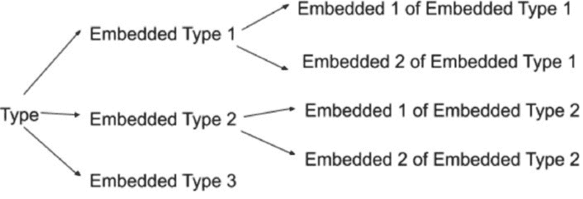
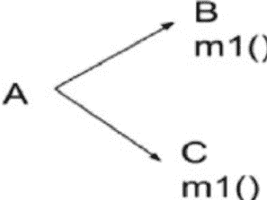
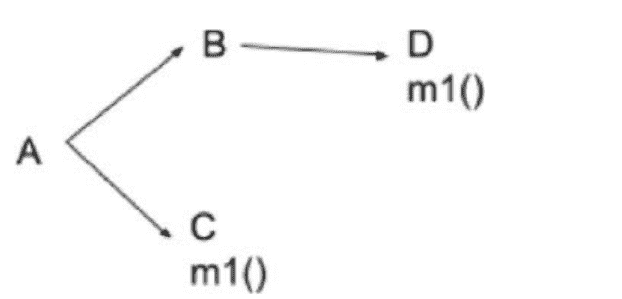

# Go 编程实用指南：学习谷歌的Golang编程、数据结构、错误处理和并发（英文版）


## 分销商

### BPB Publications

20, Ansari Road, Darya Ganj  
New Delhi-110002  
电话: 23254990/23254991

### Micro Media

Shop No. 5, Mahendra Chambers,  
150 DN Rd. Next to Capital Cinema,  
V.T. (C.S.T.) Station, MUMBAI-400 001  
电话: 22078296/22078297

### Deccan Agencies

4-3-329, Bank Street,  
Hyderabad-500195  
电话: 24756967/24756400

### BPB Book Centre

376 Old Lajpat Rai Market,  
Delhi-110006  
电话: 23861747


由 Manish Jain 为 BPB Publications 出版，地址为 20 Ansari Road, Darya Ganj, New Delhi-110002，并由其在 Repro India Ltd, Mumbai 印刷

www.bpbonline.com

## 献给

我的父母、妻子 Nirmala  
&  
深爱的女儿 Anvi 和儿子 Vansh

— Sachchidanand Singh

我的父母、妻子 Rajani  
&  
深爱的儿子 Parthiv

— Prithvipal Singh

## 关于作者

**Mr. Sachchidanand Singh** 在 IBM India Software Labs (ISL), Pune 担任高级分析、BI 和数据科学 SME。他拥有来自 Birla Institute of Technology and Science (BITS), Pilani 的 M.Tech 学位。他在 IEEE、国际计算机期刊以及国家/国际会议上发表了十多篇技术研究论文。

他在人工智能、机器学习、云和认知领域拥有多项专利。他在高级分析和商业智能 (BI) 等技术方面的架构设计和解决方案实施方面拥有丰富的经验。他是 IEEE 审稿人、多个国家/国际会议技术程序委员会 (TPC) 成员，以及美国《美国计算机科学与信息工程期刊》审稿委员会成员。

**Mr. Prithvipal Singh** 在 IT 行业工作近十年。他在 Java、Golang、Spring、Node.js 和 Python 方面拥有丰富的经验。他在微服务架构和云领域具有专业知识。他拥有 Savitribai Phule Pune University 的 MCA 学位。

## 关于审阅者

**Dolly Talreja** 目前担任开发 5G 核心网络 (Golang Linux) 的团队的技术负责人和核心成员，是 Altran Technologies 的重要组成部分。在其职责范围内，她是节点 UDM 和 AUSF 的负责人，并参与完成 SDLC。她也是分析网络跟踪的专家。她是团队的一员，该团队处于创新前沿，旨在解决云和数字平台不断发展的世界中客户的各种机会。她是 NIT Warangal 的校友，在行业内拥有超过 6 年的经验。她曾担任 HP 的首席工程师，在 LEDM 的开发中发挥了关键作用。她是 HP 的 Scan to Feature 的负责人。她还曾担任三星印度研发院的高级软件工程师，并参与开发了三星 MPF 的 SMB 3.0 协议。她还发表了一篇关于去中心化点对点网络的 IEEE 论文。

## 致谢

在这一重要提升的时刻，在我们深入正题之前，我们想对那些给予我们无尽支持、始终保持幽默和温暖祝愿的人们表达几句衷心的感谢。首先，最重要的是赞美和感谢全能的上帝，在完成本书的过程中赐予我们无尽的祝福。

我们要感谢我们的同事，他们为我们撰写更合适的文本提供了动力。我们感谢管理层、前辈和同事不断推动我们不断向上攀登。除他们之外，我们还要感谢所有朋友、好心人、受访者和学者，他们从构思到完成的全程帮助了我们。

## 前言

Golang 被认为是一种快速而无懈可击的编程语言，拥有大量有用的功能，如高效的内置并发、具有自动垃圾检测和清理的垃圾收集器、goroutine 的动态可增长调用栈、极快的编译器和跨平台多功能性等。大量云、网络和 DevOps 软件都是用 Golang 编写的，如 Docker、Kubernetes、Terraform、etcd 和 Istio。Go 开发者社区是 GitHub 上最活跃的开源社区之一。

本书专注于学习 Golang，从基本概念到接口、指针、并发等。我们使用编程示例详细解释了每个概念。我们从基础开始，随着每一章的深入进入更复杂的内容。每章都有练习，这将帮助你更清晰地理解概念。

在本书的 12 章中，你将学习以下内容：

## 第 1 章：介绍

本章涵盖数据类型、常量、变量、运算符、重新赋值和重新声明等基本概念。你将学习如何在 Go 编程语言中使用它们。

## 第 2 章：函数

本章将涵盖函数声明、参数、多返回值、可变参数函数和 defer 语句。它还将涵盖传值调用的概念以及如何将变量的地址作为值传递。

## 第 3 章：控制流

本章的目的是向读者介绍控制流和循环的概念，并展示如何使用它们。

## 第 4 章：数组

本章的目的是向读者介绍数组的概念。它还将展示如何声明和初始化数组，以及如何将数组传递给函数。

## 第 5 章：切片

本章的目的是向读者介绍切片的概念，并告诉他们如何声明切片、创建切片的各种方法、修改和比较切片、关于多维切片、排序切片以及遍历切片。

## 第 6 章：映射

本章解释了映射的基本概念以及如何在 Go 编程语言中使用它。它涵盖了如何声明和初始化映射、遍历映射、如何对映射执行检索、更新和删除操作，以及如何检查映射中是否存在某个键等。

## 第 7 章：结构体

本章解释了结构体的基本概念以及如何在 Go 编程语言中使用它。它涵盖了如何声明和初始化结构体类型、访问结构体的字段、指向结构体的指针、导出的和未导出的结构体以及结构体字段。

## 第 8 章：方法

本章涵盖了 Go 编程语言中方法的概念。你将学习如何声明方法、如何调用方法、不同类型方法的语法以及方法解析过程。

## 第 9 章：接口

本章将涵盖 Golang 中接口的概念。你将学习 Golang 中的接口是什么，Golang 接口与其他语言有何不同，如何声明接口，以及 Golang 中隐式实现是如何发生的及其好处。我们将创建没有方法的接口，并通过内置函数看到其好处。我们将看到在实现接口和创建多态对象时使用值接收器和指针接收器的影响。


## 第10章：[指针]

在本章中，你将了解 Go 语言中的指针是什么。本章将向你解释指针的用途、如何声明指针变量，以及理解指针类型。你还将了解为什么在 Go 语言中不允许对指针变量进行算术运算。

## 第11章：[并发]

本章将介绍 goroutine 和 channel（通道）。你将学习如何定义 goroutine、WaitGroup 是什么，以及如何使用 WaitGroup 等待其他 goroutine 完成。你将理解 channel 的概念。我们将使用 channel 在 goroutine 之间进行通信。我们将创建两种类型的 goroutine：有缓冲和无缓冲。

## 第12章：[错误处理]

本章将介绍错误处理。学完本章后，你将了解 Go 语言中的错误是什么、如何从函数或方法中返回错误，以及如何在调用函数中处理这些错误。我们还将看到内置的 error 接口、错误处理包，以及 errors 包中的方法、函数和结构体。你将学习如何定义一个新错误、创建自定义错误类型、什么是 panic、如何使用 recover 处理 panic、什么是 defer，以及处理 panic 时 defer 函数的重要性，等等。

## 下载彩色图像：

请通过以下链接下载本书的彩色图像：

https://rebrand.ly/xqrsibm

## 勘误

在 BPB Publications，我们对自己的工作深感自豪，并遵循最佳实践来确保内容的准确性，为读者提供愉悦的阅读体验。读者是我们的镜子，我们会借助他们的意见来反思和改进出版过程中可能出现的任何人为错误。为了让我们保持质量，并帮助可能因任何意外错误而遇到困难的读者，请写信至：

errata@bpbonline.com

BPB Publications 大家庭非常感谢您的支持、建议和反馈。

您是否知道，BPB 为每本已出版的图书都提供电子书版本，包含 PDF 和 ePub 文件？您可以在 [www.bpbonline.com](http://www.bpbonline.com) 升级到电子书版本，作为印刷版图书的客户，您有权享受电子书折扣。如需了解更多详情，请通过 [business@bpbonline.com](mailto:business@bpbonline.com) 与我们联系。

您还可以阅读一系列免费技术文章，订阅多种免费新闻通讯，并享受 BPB 图书和电子书的专属折扣和优惠。

## BPB 正在寻找像您一样的作者

如果您有兴趣成为 BPB 的作者，请访问 [www.bpbonline.com](www.bpbonline.com) 并立即申请。我们曾与数千名像您一样的开发人员和技术专业人士合作，帮助他们与全球技术社区分享见解。您可以进行一般申请，申请我们正在招募作者的特定热门主题，或提交您自己的想法。

本书的配套代码包也托管在 GitHub 上。如果代码有任何更新，都会更新到现有的 GitHub 仓库中。

我们丰富的图书和视频目录中还有其他代码包，欢迎查看！

## 盗版

如果您在互联网上以任何形式发现我们作品的非法副本，请将位置地址或网站名称告诉我们，我们将不胜感激。请通过 [business@bpbonline.com](mailto:business@bpbonline.com) 联系我们并提供材料链接。

## 如果您有兴趣成为作者

如果您在某个主题上有专长，并且有兴趣撰写或参与撰写一本书，请访问

## 评论

请留下评论。当您阅读并使用本书后，何不在您购买本书的网站上留下评论呢？潜在读者可以看到并参考您的客观意见来做出购买决定，我们 BPB 也能了解您对我们产品的看法，我们的作者也能看到您对本书的反馈。谢谢！

如需了解更多 BPB 信息，请访问


## 第 1 章

### 介绍

Go 编程语言由 Robert Griesemer、Rob Pike 和 Ken Thompson 于 2007 年在 Google 构思。它是一种开源的通用编程语言，支持高性能网络和多处理。Go 编译器最初用 C 编写，但现在是用 Go 本身编写的。

### 结构

- 数据类型
- 常量、变量和运算符
- 具类型常量和无类型常量
- 多个常量声明
- 重新声明概念
- 重新赋值概念
- 代码结构

### 目标

本章涵盖数据类型、常量、变量、运算符、重新赋值和重新声明的基本概念。你将学习如何在 Go 编程语言中使用它们。

### 介绍

Go 是一种用于大型分布式系统和高度可扩展网络服务器的系统级编程语言。它非常适合构建网络服务器和工具等基础设施，并适用于云、移动应用、机器学习等。Go 提供高效的并发、灵活的数据抽象方法，并支持自动内存管理，即垃圾回收。

### 为什么使用 Go 编程？

大多数编程语言都支持多线程，但竞争条件和死锁给创建多线程应用程序带来了困难。例如，在 Java 中创建新线程大约消耗 1 MB 的内存堆大小。现在，考虑一种需要启动数千个此类线程的情况。那么，它将导致内存不足。

此外，您可以添加到处理器（如四核和八核）以提高处理能力的核心数量是有限的。由于成本问题，您无法不断向处理器添加更多缓存以提高性能。因此，我们只剩下一种选择，即构建性能更高的更高效的软件。

Go 通过 goroutine 为该问题提供了解决方案。您一次可以启动数百万个，因为它们消耗 ~2KB 堆内存。Goroutine 启动时间更快，并且仅在需要时才使用更多内存。此外，单个 goroutine 可以在多个线程上运行，因为 goroutine 和操作系统线程没有 1:1 映射。

### 1.1 数据类型

数据类型对一组相关值进行分类并描述可以执行的操作。

#### 1.1.1 数值类型

它们是算术类型，表示整数类型或浮点值。

**整数类型：**

|  |  |  |  |  |  |
|---|---|---|---|---|---|
| types: | types: | types: | types: | types: | types: |
| types: | types: | types: | types: | types: | types: |
| types: | types: | types: | types: | types: | types: |
| types: | types: | types: | types: | types: | types: |
| types: | types: | types: | types: | types: | types: |
| types: | types: | types: | types: | types: | types: |
| types: | types: | types: | types: | types: | types: |
| types: | types: | types: | types: | types: | types: |

表 1.1

**浮点类型：**

|  |  |  |  |
|---|---|---|---|
| types: | types: | types: | types: |
| types: | types: | types: | types: |

|  |  |  |  |  |  |  |  |
|---|---|---|---|---|---|---|---|
| types: | types: | types: | types: | types: | types: | types: | types: |
| types: | types: | types: | types: | types: | types: | types: | types: |

表 1.2

```go
y := "apple\norange"
fmt.Println(y)

z := `apple\norange`
fmt.Println(z)
}
```

以下是上述程序的输出：

**apple**
**orange**
**apple\norange**

#### 1.1.3 布尔类型

**程序 1.2**

```go
// Go program to explain boolean types

package main

import "fmt"

func main() {
    var b bool
    fmt.Println(b)
    b = true
    fmt.Println(b)
}
```

以下是上述程序的输出：

**false**

**true**

#### 1.1.4 派生类型

派生类型可能包括结构体类型、函数类型、切片类型、接口类型、映射类型和通道类型。

### 1.2 常量

在 Go 中，const 是引入标量值（如 3.14159）名称的关键字。此类值称为常量。

**类型：** 当变量在未指定显式类型的情况下声明（使用 `:=` 语法或 `var =` 表达式语法）时，变量的类型会从右侧的值推断出来。

常量使用 const 关键字声明，可以是数值、字符串、布尔或字符值。

常量不能使用 `:=` 语法声明

例如：`const Pi = 3.14`

#### 1.2.1 变量声明

未显式初始化值的变量会被赋予数值类型的默认值零，布尔类型的 false，以及字符串类型的 ""（空字符串）。让我们看下面的程序：

**程序 1.3**

```go
// Go program showing variables declared
// without an explicit initial value

package main

import "fmt"

func main() {
    var f float64
    var i int
    var b bool
    var s string
    fmt.Printf("%v %v %v %q\n", f, i, b, s)
}
```

以下是上述程序的输出：

- `0 0 false ""`

在 Go 中，变量的类型在变量名之后指定。

如果您想在一行上放置两个（或更多）语句，它们必须用分号分隔。

声明变量时，它会被赋予该类型的 *自然* 空值。

这意味着在这里，在 `var i int` 之后，i 的值为 0。

使用 `var s`，s 被赋予零字符串，即 `""`。

比较以下具有相同效果的代码片段：

**使用 = 的声明**

```go
var a int = 20
var b bool = true
```

`var` 关键字用于声明变量然后为其赋值。

**使用 := 的声明**

您可以在此语法中省略 `var` 和数据类型。

```go
a := 20
b := true
```

当 Go 找到 `:=` 赋值语法时，它理解需要用初始值声明一个新变量。但您不能使用此语法为预定义变量赋值。变量类型从值推断出来。例如，值 20 表示 int，值 true 告诉 Go 类型应为布尔。

#### 1.2.2 短变量声明

在 Go 中，您可以通过以下两种方式声明变量：

- 使用 `var` 关键字
- 使用短声明运算符

短变量声明运算符用于在函数内部声明和初始化局部变量。它缩小了变量的作用域。

使用短声明运算符，变量在不指定类型的情况下声明。变量的类型由 `:=` 运算符右侧表达式的类型决定。

短变量声明运算符的语法：

```
variable_name := expression or value
```

示例：

```
a := 10
```

```
x, y := 100, 200
```

```
p, q, r := 150, 250, 300
```

**短变量声明：**

- 它仅用于在函数内部声明和初始化变量。
- 变量的声明和初始化同时进行。
- 变量在函数内部声明，因此它们具有局部作用域。
- 在短变量声明中不需要提及变量的类型。


### 1.3 运算符

运算符用于执行指定的数学或逻辑计算。Golang 支持以下内置运算符：

- 算术运算符
- 关系运算符
- 逻辑运算符
- 位运算符
- 赋值运算符
- 其他运算符

#### 1.3.1 算术运算符

请参考下表：

| table: table: table: |
| table: table: table: table: table: table: table: table: |
| table: table: table: |
| table: table: table: table: |
| table: table: table: table: table: table: table: table: table: table: |
| table: table: table: table: table: table: table: table: table: |
| table: table: table: table: table: table: table: table: table: |

*表 1.3*

#### 1.3.2 关系运算符

请参考下表：

table: table: table: table: table: table: table: table: table: table:
table: table: table: table: table: table: table: table: table:

table: table: table: table: table: table: table: table: table: table:
table: table: table: table: table: table: table: table: table: table:
table: table: table:

table: table: table: table: table: table: table: table: table: table:
table: table: table: table: table: table: table: table: table: table:
table: table: table: table: table:

table: table: table: table: table: table: table: table: table: table:
table: table: table: table: table: table: table: table: table: table:
table: table: table: table: table: table: table:

table: table: table: table: table: table: table: table: table: table:
table: table: table: table: table: table: table: table: table: table:
table: table: table: table: table: table: table: table:

table: table: table: table: table: table: table: table: table: table:
table: table: table: table: table: table: table: table: table: table:
table: table: table: table: table: table: table: table:

*表 1.4*

#### 1.3.3 逻辑运算符

请参考下表：

table: table: table:
table: table: table:
table: table: table: table: table: table: table: table: table: table:
table: table: table: table: table: table: table: table: table: table:
table: table: table: table: table: table: table: table: table: table:
table:

*表 1.5*

#### 程序 1.4

```
// Go program to explain logical operators

package main

import "fmt"

func main() {
var a int = 10
var b int = 20
```

#### 1.3.4 位运算符

位运算符作用于位，并逐位执行运算。请参考下表：

| table: table: table: table: table: table: table: table: table: table: | table: table: table: table: table: |
| table: table: table: table: table: table: table: table: table: table: | table: table: |
| table: table: table: table: table: table: table: table: table: table: | table: table: table: table: table: table: |

*表 1.6*

下面是 and 与 ^ 的真值表：

| below: below: below: |
|---| 
| below: |
| below: |
| below: |
| below: |

*表 1.7*

#### 1.3.5 赋值运算符

请参考下表：

| |
|---|
| table: table: table: table: table: table: table: table: table: table: table: table: table: table: table: table: |
| table: table: table: table: table: table: table: table: table: table: table: table: table: table: table: table: table: table: table: table: table: |
| table: table: table: table: table: table: table: table: table: table: table: table: table: table: table: table: table: table: table: table: table: |
| table: table: table: table: table: table: table: table: table: table: table: table: table: table: table: table: table: table: table: table: table: |
| table: table: table: table: table: table: table: table: table: table: table: table: table: table: table: table: table: table: table: table: table: |
| table: table: table: table: table: table: table: table: table: table: table: table: table: table: table: table: table: table: |
| table: table: table: table: table: |
| table: table: table: table: table: |
| table: table: table: table: |
| table: table: table: table: table: table: |

#### 表 1.8

#### 程序 1.5

```go
// Go program to explain Left shift AND assignment operator

package main

import (
"fmt"
)

func main() {
var a, b uint
a, b = 1, 1

for b = 1; b < 5; b++ {
fmt.Printf("%d << %d = %d \n", a, b, a<<b)
}
}
```

我们将得到以下输出：

```text
1 << 1 = 2
1 << 2 = 4
1 << 3 = 8
1 << 4 = 16
```

#### 程序 1.6

```go
// Go program to explain Right shift AND assignment operator

package main

import (
"fmt"
)

func main() {
var a, b uint
a, b = 512, 1

for b = 1; b < 5; b++ {
fmt.Printf("%d >> %d = %d \\n", a, b, a>>b)
}
}
```

我们将得到以下输出：

```text
512 >> 1 = 256
512 >> 2 = 128
512 >> 3 = 64
512 >> 4 = 32
```

#### 程序 1.7

```go
/* Go program to explain bitwise AND assignment operator,
```
bitwise exclusive OR and assignment operator and bitwise inclusive OR and assignment operator */
```go
package main

import "fmt"

func main() {
var a, b, c int //default value of a, b, c is 0

a &= 2 //Its same as a = a & 2, here & is Binary AND Operator
fmt.Printf("Example of &= Operator: value of a = %d\n", a)

b ^= 2 //Its same as b = b ^ 2, here ^ is Binary XOR Operator
fmt.Printf("Example of ^= Operator: value of b = %d\n", b)

c |= 2 //Its same as c = c | 2, here | is Binary OR Operator
fmt.Printf("Example of |= Operator: value of c = %d\n", c)
}
```

我们将得到以下输出：

**&= 运算符示例：a 的值 = 0**
**^= 运算符示例：b 的值 = 2**
**|= 运算符示例：c 的值 = 2**

#### 1.4.1 类型化常量

在 Go 中，如果显式指定了常量的类型，则该常量是类型化常量。例如：

```
const x float64 = 9.75 //It's typed constant
const x int = 10 //It's typed constant
```

#### 1.4.2 无类型常量

在 Go 中，如果未显式提及常量的类型，则任何常量（有名称或无名称）都是无类型常量。例如：

```
20  // untyped integer constant
"Golang"  // untyped string constant
false  // untyped boolean constant
```

### 1.5 多重常量声明

我们可以在一条语句中声明多个常量，并在一条语句中声明多个同一类型的变量。例如：

```
const x, y, z int = 10, 20, 30
```

### 1.6 重新声明概念

如果一个变量已经被声明，则不能在同一个块中重新声明该变量。重新声明只是将新值赋给原值，如下所示：

#### 程序 1.8

```
//Go redeclaration concept

package main

import "fmt"

func main() {
a := 10
a := 20
fmt.Println(a)
}
```

我们将得到以下输出：

**:= 左侧没有新变量**

你可以使用短多变量声明重新声明变量，其中至少引入一个新变量，如下所示：

#### 程序 1.9

//用于短多变量声明的 Go 程序

```
package main

import "fmt"

func main() {
 a := 10
 a, b := 20, 30
 fmt.Println("value of a:", a)
 fmt.Println("value of b:", b)
}
```

我们将得到以下输出：

a 的值：20
b 的值：30

### 1.7 重新赋值概念

你可以在 Golang 中对变量进行重新赋值。允许存储在变量中的值集合由变量的类型决定。用于管理允许值的规则称为可赋值性。让我们看下面的例子：

#### 程序 1.10

```
//Go reassignment concept

package main

import "fmt"

func main() {
    x := 10
    {
        fmt.Println("value of x:", x)
        //new local variable x
        x, y := 20, 30
        fmt.Println("value of x:", x)
        fmt.Println("value of y:", y)
    }
    fmt.Println("value of x:", x)
}
```

我们将得到以下输出：

x 的值：10
x 的值：20
y 的值：30
x 的值：10

在程序中，变量 x 由于 y := 而被遮蔽。内部作用域之外的 x 值保持不变，即 10；而在内部作用域中，x 被遮蔽后其值为 20。


### 结论

Golang 是一种开源的通用编程语言，支持高性能网络和多处理等。

Go 非常适合构建网络服务器和工具等基础设施，也适用于云、移动应用和机器学习。

Goroutine 启动时间更快，并且仅在需要时才使用额外内存。此外，单个 goroutine 可以在多个线程上运行，因为 goroutine 和操作系统线程之间没有 1:1 映射。

Go 支持数据类型，如数值类型、字符串类型、布尔类型、派生类型等。

Golang 提供内置的关系运算符、算术运算符、逻辑运算符、位运算符、赋值运算符等。

Go 中每个变量的类型在编译时由编译器推断。因此，Go 被称为静态类型编程语言。

你可以使用短多变量声明重新声明变量，其中至少引入一个新变量。

Go 程序由多个包构建，以便高效管理依赖关系。

### 问题

- Golang 是什么？它的优点是什么？
- 如何在 Golang 中打印变量的类型？
- Goroutine 是什么？解释使用它们的优点。
- Golang 中变量的静态类型声明是什么？
- 有类型常量和无类型常量是什么？
- = 和 := 运算符有什么区别？
- Golang 中的字符串字面量是什么？
- Golang 中的包是什么？
- Golang 中局部变量的默认值是什么？
- Golang 中的静态类型变量声明是什么？
- 如何在 Golang 中查找字符串的长度？
- Golang 中的字符串数据类型是什么？可以更改字符串中的特定字符吗？

## 第 2 章

## 函数

Go 中的函数是一组共同执行任务的语句。每个 Go 程序都会有一个。函数帮助你将大任务分解成较小的代码片段并提高程序的可读性和可维护性。

## 结构

- 函数声明
- 参数和返回值
- 多返回值和命名返回值
- 按值调用
- 变参函数
- 延迟
- 编程示例

## 目标

本章将涵盖函数声明、参数、多返回值、变参函数和 defer 语句。它还将涵盖按值调用的概念以及如何将变量的地址作为值传递。你将学习如何在 Go 编程语言中使用它们。

### 2.1 函数

函数是映射输入参数到输出参数的独立代码段。它是一组用于执行特定任务并将结果返回给调用者的语句。

函数是 Go 程序的构建块。它们有输入、输出，以及按顺序执行的称为语句的一系列步骤。

### 2.2 参数和返回值

Go 编程语言中的函数定义如下：

```go
func function_name([parameter_list]) [return_types] {
//Body of function
}
```

#### 2.2.1 参数

当函数被调用时，你会向参数传递一个值。参数就像占位符。这个值被称为实际参数或参数。参数列表指的是函数的参数的类型、顺序和数量。参数在函数中是可选的。因此，函数可能不包含任何参数。

#### 2.2.2 返回值

函数可能返回一系列值。return_types 是函数返回的值的数据类型列表。某些函数在不返回值的情况下执行所需操作。在这种情况下，return_type 不是必需的。

以下是解释参数和返回值的示例 Go 程序：

#### 程序 2.1

```go
// Go program to explain parameters and returns

package main

import "fmt"

func main() {
/* declare local variables*/
var x int = 50
var y int = 40
var sum_value int

/* calling a function to get sum of values */
sum_value = sum(x, y)

fmt.Printf("Sum value is: %d\n", sum_value)
}

/* function returns the sum of two numbers */
func sum(num1, num2 int) int {
/* declare local variables */
var result int
result = num1 + num2
return result
}
```

上述程序的输出如下：

**和值为：90**

在创建 Go 函数时，你定义函数将执行的任务。要使用函数，你必须调用该函数来执行预定义的任务。

当程序调用函数时，程序控制权转移到被调用函数。被调用函数执行定义好的任务，并在执行其 return 语句或到达其函数结束的闭合大括号时，将程序控制权返回给主程序。

要调用函数，你只需将所需参数与其函数名一起传递。如果函数返回值，则可以存储返回值。

### 2.3 多返回值和命名返回值

Golang 允许在函数定义中为函数的返回或结果参数命名。此外，Go 内置支持多返回值。此功能用于从函数返回结果和错误值。

#### 2.3.1 多返回值

在 Go 中，函数可以使用 return 语句返回多个值。返回值的类型取决于参数列表中定义的参数类型，如下所示：

#### 程序 2.2

```go
// Go program to explain multiple returns

package main

import "fmt"

// testfunc return 2 values of int type
func testfunc(x, y int) (int, int) {
return x + y, x - y
}

func main() {
// Return values are assigned into different variables
var testvar1, testvar2 = testfunc(10, 20)

fmt.Printf("addition result: %d", testvar1)
fmt.Printf("\nsubtraction result: %d", testvar2)
}
```

上述程序的输出如下：

**加法结果：30**

**减法结果：-10**

#### 2.3.2 命名返回值

Golang 允许在函数定义中为函数的返回参数命名，即在函数定义中显式命名返回变量。它消除了在 return 语句中提及变量名的需要。

这个概念通常用于函数需要返回多个值时。Golang 提供此功能以方便用户并增强代码可读性。

命名返回的语法：

```go
func func_name(Par-list)(result_par1 data_type, result_par2
data_type, ...){
// function body

return
}
```

让我们看一个例子：

#### 程序 2.3

```go
// Golang program to show the use of named return arguments

package main

import "fmt"

// Main Method
func main() {

// calling the function which returns one values
x := sum(10, 20)

fmt.Println("10 + 20 =", x)
}

// function with named arguments
func sum(a, b int) (add int) {
add = a + b

// return keyword without any resultant parameters

return
}
```

上述程序的输出如下：

10 + 20 = 30

### 2.4 按值调用

Golang 支持按值调用来向函数传递参数。Go 没有按引用调用，因为它没有引用变量。然而，我们可以按值传递变量的地址。Golang 默认使用按值方式向函数传递参数。

```go
// call by value
replace(x)
fmt.Printf("\nvalue of x after function call = %d", x)
}
```

上述程序的输出如下：

```text
value of x before function call = 10
value of x after function call = 10
```

如前所述，Go 没有按引用调用，因为它没有引用变量。然而，我们可以按值传递变量的地址。在这里，我们将使用指针和解引用运算符的概念。地址运算符 & 用于获取任何数据类型的变量的地址，而解引用运算符 * 用于访问地址处的值。

由于实际参数和形式参数引用相同的位置，因此在函数内部所做的任何更改都会反映在调用者的实际参数中。这如下所示：

#### 程序 2.5

```go
// Go program to explain call by passing the address of the variable

package main
```


```
import "fmt"

// function to change the value of given variable
func replace(x *int) {
*x = 20
}

// main function
func main() {

var x int = 10
fmt.Printf("value of x before function call = %d", x)

// call by reference
replace(&x)
fmt.Printf("\nvalue of x after function call = %d", x)
}
```

以下是上述程序的输出：

**函数调用前 x 的值 = 10**
**函数调用后 x 的值 = 20**

### 2.5 可变参数函数

通常情况下，函数只接受固定数量的参数，但可变参数函数可以接受可变数量的参数。

只有函数的最后一个参数可以是可变参数。如果函数定义的最后一个参数前面加上省略号，则该函数可以为该参数接受任意数量的参数。示例如下：

```
func variadic_function(a int, b ...int) {
// Body of variadic function
}
```

在上面的函数中，参数 b 是可变参数，因为它前面加上了省略号，并且可以接受任意数量的参数。

让我们使 variadic_function 的第一个参数变为可变参数。语法如下所示：

```
func variadic_function(a ...int, b int) {
// Body of variadic function
}
```

上述 variadic_function 将无法编译，并出现语法错误：

**不能对非最后一个参数 a 使用 ...**

在上面的函数中，不可能向参数 b 传递参数，因为我们传递的任何参数都会被分配给第一个参数 a，因为它是可变参数。因此，可变参数只能出现在函数定义的最后。可变参数函数的工作方式是将可变数量的参数转换为可变参数类型的一个切片。你将在 *第 5 章：切片* 中详细学习切片的概念：

#### 程序 2.6

// 用于解释可变参数函数的 Go 程序

```
package main

import (
"fmt"
"strings"
)

// Variadic function to join strings
func join(element ...string) string {
return strings.Join(element, "_")
}
```

```
func main() {

// multiple arguments
fmt.Println(join("GO", "language", "book"))
}
```

以下是上述程序的输出：

```
GO_language_book
```

可变参数函数提高了程序的可读性。它可以在参数数量未知等场景中使用。

让我们看下面的程序：

#### 程序 2.7

```
// Go program to explain the variadic function

package main

import (
"fmt"
"strings"
)

// Variadic function to join strings

func join(element ...string) string {
```

```
return strings.Join(element, "_")
}

func main() {

// pass a slice in variadic function
element := []string{"GO", "language", "book"}
fmt.Println(join(element...))
}
```

以下是上述程序的输出：

```
GO_language_book
```

让我们再看另一个程序：

#### 程序 2.8

```
//Select single argument from all arguments of variadic function

package main

import "fmt"

func main() {
variadicExample("IT", "Finance", "HR", "Recruitment", "Payroll")
}

func variadicExample(x ...string) {
fmt.Println(x[1])
```

```
fmt.Println(x[4])
}
```

以下是上述程序的输出：

**Finance**

**Payroll**

### 2.6 Defer

Go 有控制流机制：等，但其中一些使用较少的是 defer、panic 和 recover。

#### 2.6.1 Defer

defer 语句会推迟函数的执行，并将函数调用推入一个列表，直到包含的函数返回，无论是正常返回还是通过 panic。defer 通常用于简化执行各种清理操作的函数，如下所示：

#### 程序 2.9

```
//Program to explain defer

package main

import "fmt"

func main() {
defer fmt.Println("GO")
fmt.Println("Book")
}
```

以下是上述程序的输出：

Book
GO

### 结论

函数声明由关键字、函数名、参数列表（main 为空）、结果列表以及函数体——定义其行为的语句——用大括号括起来组成。

当函数被调用时，你会向参数传递一个值。这个值被称为实际参数或参数。参数列表指的是函数的参数的类型、顺序和数量。

当程序调用函数时，程序控制权转移到被调用的函数。被调用的函数执行定义的任务，并在其 return 语句执行或其函数结束的闭合大括号到达时，将程序控制权返回给主程序。

在 Go 中，函数可以使用 return 语句返回多个值。返回值的类型取决于参数列表中定义的参数类型。

Golang 允许在函数定义中为函数的返回参数命名，即在函数定义中显式命名返回变量。它消除了在 return 语句中提及变量名的需要。

Go 没有按引用调用，因为它没有引用变量。然而，我们可以按值传递变量的地址。这里，我们将使用指针和解引用运算符的概念。地址运算符 & 用于获取任何数据类型变量的地址，而解引用运算符 * 用于访问地址处的值。

通常情况下，函数只接受固定数量的参数，但可变参数函数可以接受可变数量的参数。只有一个函数的最后一个参数可以是可变参数。如果函数定义的最后一个参数前面加上省略号，则该函数可以为该参数接受任意数量的参数。

可变参数函数提高了程序的可读性。它可以在参数数量未知的情况下使用。

defer 语句会推迟函数的执行，并将函数调用推入一个列表，直到包含的函数返回，无论是正常返回还是通过 panic。defer 通常用于简化执行各种清理操作的函数。

### 问题

编写 Golang 中创建函数的语法。

多返回值和命名返回值之间有什么区别？请用 Go 程序解释。

编写一个 Go 程序来解释 Golang 中的按值调用。

什么是可变参数函数？解释其可使用的场景。

Golang 中的 defer 语句是什么？

## 控制流

在 Go 中，控制流语句用于中断执行流程并使程序能够基于某些条件执行代码。本章将介绍 Go 中的控制流概念。它将介绍使用 if...else switch...case 和 fallthrough 语句在 Golang 中的决策制定。它还将介绍循环的概念 - for 循环、嵌套 for 循环、循环控制语句 – 等。

## 结构

决策（if, if...else, if...else if...else, switch...case）

循环（for 循环、嵌套 for 循环、循环控制语句-break、goto、continue、无限循环）和 fallthrough

编程示例

## 目标

本章的目的是向读者介绍控制流和循环的概念，并介绍如何在 Go 编程语言中使用它们。

### 3.1 决策

Golang 使用控制语句根据某些条件控制程序的执行流程。它们用于根据程序状态的变化确保程序执行期间的逻辑流程。

#### 3.1.1 If 语句

如果一个条件被发现为真，则语句会执行一段代码。如果该语句看起来像 C 或 Java 中的那样，只有一个区别，那就是我们需要使用 {} 而不是 ()。语句声明的变量仅在 if 结束之前处于作用域内。

**语法：**

```
if condition {
// piece of code to be executed when the condition is true
}
```

例如，下面的程序将在变量 a 为 true 时打印。

#### 程序 3.1

```
// Go program to explain if statement

package main

import (
"fmt"
)
```


```go
func main() {
    var x = "Cricket"
    a := true
    if a {
        fmt.Println(x)
    }
}
```

上述程序的输出如下：

**Cricket**

#### 3.1.2 if...else 语句

if 语句在条件为真时执行一段语句块，如果条件为假，则会跳转到 else 块并执行它。

**语法：**

```go
if condition {
    // piece of code to be executed if condition is true
} else {
    // piece of code to be executed if condition is false
}
```

以下示例将在 x 为 New Delhi 时显示输出 Capital of India。

**程序 3.2**

```go
// Go program to explain if ...else statement

package main

import (
    "fmt"
)

func main() {
    x := "New Delhi"

    if x == "New Delhi" {
        fmt.Println("Capital of India")
    } else {
        fmt.Println("City is not the capital of India")
    }
}
```

上述程序的输出如下：

**Capital of India**

#### 3.1.3 if...else if...else 语句

if...else if...else 语句允许组合多个 if...else 语句。

**语法：**

```go
if condition-1 {
    // piece of code to be executed if condition-1 is true
} else if condition-2 {
    // piece of code to be executed if condition-2 is true
} else {
    // piece of code to be executed if both condition1 and condition2 are false
}
```

下面的示例将显示以下输出：

"**Capital of Maharashtra**" if x is "Mumbai"
"**City of Maharashtra**" if x is "Pune" and
"**Neither Pune nor Mumbai**" if x is other than "Pune" or "Mumbai"

让我们看下面的示例：

**程序 3.3**

## 具结书

日期：2023年05月22日

申请编号：20230522-001

具结人：张三

申请塘主：李四

| 鱼塘名称 | 塘口面积（亩） | 养殖品种 | 预计产量（斤） |
| --- | --- | --- | --- |
| 东塘 | 25 | 草鱼 | 5000 |
| 西塘 | 30 | 鲢鱼 | 6000 |
| 南塘 | 20 | 鲤鱼 | 4000 |

- 一、具结人承诺已仔细阅读并充分理解《养殖水域滩涂规划》和《水域滩涂养殖证管理办法》等法律法规，保证所提交的申请材料真实、合法、有效。
- 二、具结人承诺在取得水域滩涂养殖证后，严格按照规划依法从事养殖生产，不擅自改变养殖水域滩涂用途，不破坏水域生态环境。
- 三、具结人承诺积极配合渔业主管部门的监督管理，如实提供有关养殖生产信息，按期参加养殖证年度核查。
- 四、具结人承诺如实填报《水域滩涂养殖证申请表》，因虚假申报造成的法律后果由本人承担。
- 五、本具结书自签署之日起生效。

具结人签字：________________

申请塘主签字：________________

#### 3.1.4 switch...case 语句

switch 语句是多分支语句。它提供了一种根据表达式的值将执行高效转移到代码不同部分的方式。switch 语句在多个分支上表达条件。案例从上到下进行评估，在某个案例成功时停止。如果没有案例匹配且存在 default 案例，则执行其语句。

下面的示例将根据 switch 变量的值显示星期几：

**程序 3.4**

```go
// Go program to explain switch...case statement

package main

import "fmt"

func main() {
    switch day := 7; day {
    case 1:
        fmt.Println("Monday")
    case 2:
        fmt.Println("Tuesday")
    case 3:
        fmt.Println("Wednesday")
    case 4:
        fmt.Println("Thursday")
    case 5:
        fmt.Println("Friday")
    case 6:
        fmt.Println("Saturday")
    case 7:
        fmt.Println("Sunday")
    default:
        fmt.Println("Invalid")
    }
}
```

上述程序将显示以下输出：

**Sunday**

### 3.2 循环

循环语句用于重复执行一段代码。For 是 Go 中唯一可用的循环。Go 没有像 C 等其他语言中存在的 while 或 do...while 循环。

#### 3.2.1 For 循环

for 循环是一种重复控制结构。它允许你编写需要执行特定次数的循环。

**语法：**

```go
for [Initial Statement] ; [Condition] ; [Post Statement] {
    [Action]
}
```

下面的示例将使用 for 循环显示从 1 到 10 的数字之和：

**程序 3.5**

```go
// Go program to explain for loops

package main

import "fmt"

func main() {
    sum := 0
    for i := 0; i <= 10; i++ {
        sum += i
    }
    fmt.Println("Sum of numbers from 1 to 10:", sum)
}
```

上述程序将显示以下输出：

**Sum of numbers from 1 to 10: 55**

#### 3.2.2 嵌套 for 循环

循环可以在 Go 中像其他编程语言一样嵌套。嵌套循环是在另一个循环内发生的循环。当你希望对数据集的每个元素执行循环操作时，这些循环很有用。

```go
for {
    [Action to be performed]
    for {
        [Action to be performed]
    }
}
```

下面的示例将使用嵌套 for 循环显示从 1 到 20 的质数：

**程序 3.6**

```go
// Go program to explain nested for loops

package main

import "fmt"

func main() {
    /* local variable declaration */
    var i, j int

    for i = 2; i < 20; i++ {
        for j = 2; j <= (i / j); j++ {
            if i%j == 0 {
                break
            }
        }
        if j > (i / j) {
            fmt.Printf("Prime number between 1 to 20: %d\n", i)
        }
    }
}
```

上述程序将显示以下输出：

Prime number between 1 to 20: 2
Prime number between 1 to 20: 3
Prime number between 1 to 20: 5
Prime number between 1 to 20: 7
Prime number between 1 to 20: 11
Prime number between 1 to 20: 13
Prime number between 1 to 20: 17
Prime number between 1 to 20: 19

#### 3.2.3 循环控制语句

循环控制语句用于改变程序的执行。当给定循环离开其作用域时，在该作用域内创建的对象也会被销毁。

Go 语言支持 3 种循环控制语句：break、goto 和 continue。

##### 3.2.3.1 Break 语句

break 语句用于终止其所在的循环或语句。break 语句用于终止当前循环的执行。

下面的示例给出从 1 开始输出数字，并在遇到 break 时退出循环：

**程序 3.7**

```go
// Go program to explain break statements

package main

import "fmt"

// Main function
func main() {
    for x := 1; x <= 5; x++ {
        fmt.Println("Number:", x)

        // For loop breaks when the value of x = 4
        if x == 4 {
            break
        }
    }
}
```

上述程序将显示以下输出：

- **Number: 1**
- **Number: 2**
- **Number: 3**
- **Number: 4**

##### 3.2.3.2 Goto 语句

Goto 语句用于将控制转移到程序中的标记语句。标签是一个有效的标识符，放置在控制从其转移的语句之前。

下面的示例显示从 1 开始输出数字，并在遇到 goto 时不打印 3，控制转移到 Lable1。

**程序 3.8**

```go
// Go program to explain Goto statement

package main

import "fmt"

func main() {
    var a int = 1

Lable1:
    for a <= 5 {
        if a == 3 {
            a = a + 1
            goto Lable1
        }
        fmt.Printf("Number is: %d\n", a)
        a++
    }
}
```

上述程序将显示以下输出：

```
Number is: 1
Number is: 2
Number is: 4
Number is: 5
```

##### 3.2.3.3 Continue 语句

continue 语句用于在特定条件下跳过循环的执行部分。之后，它将控制转移到循环的开头。

continue 语句用于当你想跳过循环的剩余部分并返回到循环顶部继续新迭代时。下面的示例显示从 1 开始输出数字，并在遇到 continue 语句时不打印该数字，控制转移到循环顶部进行下一次迭代。

**程序 3.9**

```go
// Go program to explain Continue statement

package main

import "fmt"

func main() {
    var a int = 1

    for a <= 10 {
        if a == 7 {
            // skip one iteration
            a++
            continue
        }
        fmt.Printf("Number is: %d\n", a)
        a++
    }
}
```

上述程序将显示以下输出：

- **Number is: 1**
- **Number is: 2**
- **Number is: 3**
- **Number is: 4**
- **Number is: 5**
- **Number is: 6**
- **Number is: 8**
- **Number is: 9**
- **Number is: 10**

##### 3.2.3.4 无限循环

在 Go 中，如果省略循环条件或使用 true 布尔值，for 循环可以作为无限循环工作。下面的示例会一直打印 Infinite Loop：

**程序 3.10**

```go
// Go program to explain Infinite loop

package main

import (
    "fmt"
    "time"
)

func main() {
    for true {
        fmt.Println("Infinite Loop")
        time.Sleep(time.Second)
    }
}
```

上述程序将显示以下输出：

**Infinite Loop**


```text
Infinite Loop
Infinite Loop
Infinite Loop
Infinite Loop
...
...
```

##### 3.2.3.5 穿透

在 Go 中，程序控制在执行完某个 case 后会立即退出 switch 语句。但通过使用 `fallthrough` 语句，可以将控制转移到表达式 switch 语句中下一个 case 子句的第一个语句。

**程序 3.11**

```go
// Go program to explain fallthrough

package main

import (
"fmt"
)

func main() {
switch number := 200; {
case number < 300:
fmt.Printf("%d is less than 300\n", number)
fallthrough
case number > 100:
fmt.Printf("%d is greater than 100", number)
}
}
```

上述程序将显示以下输出：

```text
200 is less than 300
200 is greater than 100
```

`fallthrough` 不能在 switch 的最后一个 case 中使用，因为后面没有更多 case 了。如果在最后一个 case 中使用 `fallthrough`，将出现以下编译错误：

```text
cannot fallthrough final case in switch
```

**程序 3.12**

```go
// Go program using fallthrough in last case

package main

import (
"fmt"
)

func number() int {
 sum := 10 + 20
 return sum
}

func main() {

switch sum := number(); {
case sum < 40:
fmt.Printf("%d is lesser than 40\n", sum)
fallthrough
case sum > 20:
fmt.Printf("%d is greater than 20", sum)
fallthrough
}
}
```

上述程序将显示以下输出：

```text
cannot fallthrough final case in switch
```

### 结论

Golang 中的控制语句用于根据某些条件控制给定程序的执行流程。它们用于确保程序执行期间根据程序状态的变化保持逻辑流程。

在 `if...else` 语句中，`if` 语句会在条件为真时执行一段语句；如果条件为假，则会转到 `else` 块并执行它。

该语句允许组合多个 `if...else` 语句。

`switch` 语句是多路分支语句，可根据表达式的值高效地将执行转移到代码的不同部分。case 会从上到下进行评估，并在找到为真的 case 时停止。如果没有 case 匹配且存在 `default` case，则会执行它。

循环语句用于重复执行给定的代码块。`for` 循环是 Go 语言中唯一的循环。与 C 不同，Go 不支持 `while` 或 `do...while` 循环。

嵌套循环是在另一个循环内发生的循环，当需要在数据集的每个元素上执行循环操作时非常有用。在 Go 中，循环可以像其他编程语言一样嵌套。

当给定循环的执行离开其作用域时，在该作用域内创建的对象也会被销毁。循环控制语句用于更改程序的执行。

`break` 语句用于终止当前所在的循环或语句。

`goto` 语句用于将控制转移到 Go 程序中的标记语句。标签是一个有效的标识符，并放置在控制从其转移的语句之前。

`continue` 语句用于在特定条件下跳过给定循环的执行部分。之后，它将控制转移到循环的开头。

在 Go 语言中，如果省略循环条件或使用 `true` 布尔值，`for` 循环可以作为无限循环工作。

在 Golang 中，程序控制在执行完某个 case 后会立即退出 switch 语句。但通过使用 `fallthrough` 语句，可以将控制转移到表达式 switch 语句中下一个 case 子句的第一个语句。

### 问题

- 编写一个 Go 程序来解释 `if..else` 语句的使用。
- 判断正误：
  - `for` 循环在 Golang 中不可用。
  - Go 没有 `while` 或 `do...while` 循环。
  - `for` 循环在 Golang 中可用。
- 写出 `if...else if...else` 语句的语法。
- 什么是 `switch...case` 语句？编写一个 Go 程序来解释 `switch...case` 语句的使用。
- `goto` 语句在 Go 程序中的作用是什么？用 Go 程序解释。
- Go 支持多少种类型的循环控制语句？编写一个 Go 程序来解释它。
- 判断正误：
  - `goto` 语句用于将控制转移到 Go 程序中的标记语句。
  - `continue` 语句不用于在特定条件下跳过循环的执行部分。
  - 在 Go 中，如果省略循环条件或使用 `true` 布尔值，`for` 循环可以作为无限循环工作。
- 写出 Golang 中嵌套 `for` 循环的语法。

## 第 4 章 数组

在 Go 中，数组是相同类型的固定大小元素的集合。数组的元素按顺序存储，可以通过其索引访问。一旦在 Go 中定义了数组，就不能扩展以容纳更多数据。Go 是一种静态类型语言。不允许在数组中混合属于不同数据类型的不同值。

### 结构

- 数组声明
- 数组初始化
- 数组字面量
- 默认值和数组类型
- 访问和赋值数组元素
- 2D 和 3D 数组
- 数组迭代
- 将数组传递给函数
- 编程示例

### 目标

本章的目的是向读者介绍数组的概念。它还涵盖了在 Go 编程语言中声明、初始化和将数组传递给函数。

### 4.1 数组

数组是一种容纳相同类型值的容器。Go 中的数组具有固定长度；一旦定义，就不能扩展以容纳更多数据。然而，这个问题可以通过使用切片来解决，你将在下一章学习它。

数组是一个固定长度的序列，用于在内存中存储同质元素。在 Go 中，像许多其他语言一样，数组是固定的。声明数组需要我们指定大小。一旦指定大小，就不能增长。数组是具有固定长度的单一类型元素的编号序列。

数组的元素通过使用 `[]` 索引运算符与其基于零的位置进行索引，这意味着第一个元素的索引是 `array[0]`，最后一个元素的索引是 `n-1`。

### 4.2 数组声明

在 Go 语言中，数组可以通过两种不同的方式创建：使用 `var` 关键字或简写声明。在 Go 中，数组索引从 0 开始，即第一个元素。因此，最后一个元素的索引是 `n-1`，其中 `n` 是数组的长度。要访问数组中的任何元素，我们需要使用 `a[index]` 语法，其中 `a` 是数组变量。

#### 4.2.1 使用 var 关键字

使用 `var` 关键字、类型、名称、大小和元素创建数组。

**语法：**

```
var array_name [length]Type
```

例如，`var team [15]int` 可以使用索引 `team[0]` 到 `team[14]` 保存多达 15 个分数。尝试访问数组中超出范围的索引将导致编译器或运行时错误。

以下示例将打印大小为 5 的数组：

**程序 4.1**

```go
// Go program to explain the use of var keyword

package main

import "fmt"

func main() {
var x [5]int
fmt.Println(x)
}
```

上述代码的输出如下：

```text
[0 0 0 0 0]
```

由于我们没有为 `x` 分配任何值，我们只是定义了数组但没有定义数组元素的值。因此，它将具有其数据类型的零值。

#### 4.2.2 简写声明

**语法：**

```
array_name := [length]Type{item1, item2, item3, ... itemN}
```

让我们看下面的程序：

**程序 4.2**

```go
// Go program to explain use shorthand declaration

package main

import "fmt"

func main() {

arr := [5]string{"Ganga", "Yamuna", "Godavari", "Kaveri", "Narmada"}
fmt.Println("Array elements:")

for i := 0; i <= 4; i++ {
fmt.Println(arr[i])
}
}
```

上述程序的输出如下：

```text
Array elements:
Ganga
Yamuna
Godavari
Kaveri
Narmada
```


### 4.3 数组初始化

如果数组没有被显式初始化，那么数组的默认值将为零。在 Go 中，可以使用数组字面量（array literal）以预定义的值来初始化数组。

数组字面量在方括号中包含它将容纳的元素数量，后面跟着元素类型。接着在花括号内是用逗号分隔的每个元素的初始值列表。不需要定义数组的所有元素。

让我们看下面的程序：

#### 程序 4-3

```go
// Go program to explain array initialization

package main

import "fmt"

func main() {
 a := [5]int{2, 4, 6, 8, 10} // Initialized with values
 var b [5]int = [5]int{1, 3} // Partial assignment

 fmt.Println("Array a:", a)
 fmt.Println("Array b:", b)
}
```

以下是上述程序的输出：

```text
Array a: [2 4 6 8 10]
Array b: [1 3 0 0 0]
```

当我们使用 `...` 而不是指定长度来初始化数组时，编译器会根据数组声明中指定的元素来确定数组的长度。Go 编译器会自行计算出长度。你只能在定义带有初始值的数组时使用该运算符。Go 提供了一个内置函数 `len`，用于计算许多数据类型的长度。在本例中，我们可以使用它来计算数组的长度，如下所示：

#### 程序 4.4

```go
// Go program for array length

package main

import (
    "fmt"
    "reflect"
)

func main() {
    a := [...]int{5, 10, 15, 20, 25}
    fmt.Println(reflect.ValueOf(a).Kind())
    fmt.Println("Length of Array:", len(a))
}
```

以下是上述程序的输出：

```text
array
Length of Array: 5
```

当使用数组字面量声明数组时，可以为特定的数组元素初始化值。每个元素都有一个关联的整数索引，用于表示其在数组中的位置。

#### 程序 4.5

```go
// Go program to initialize the value of specific array element

package main

import "fmt"

func main() {
    a := [5]int{0: 5, 2: 10, 4: 15}
    fmt.Println("Array a:", a)
}
```

以下是上述程序的输出：

```text
Array a: [5 0 10 0 15]
```

我们可以使用 `array[index] = value` 语法在某个索引处设置值，并使用 `array[index]` 获取值。要访问数组中的任何元素，我们需要使用 `a[index]` 语法，其中 a 是一个数组变量。如下所示：

#### 程序 4.6

```go
// Go program to set the value at a particular array index and access it

package main

import "fmt"

func main() {

var x [5]int
fmt.Println("Empty array:", x)

x[3] = 10 //value assigned at 3rd array index
fmt.Println("Array x:", x)
fmt.Println("Value assigned at 3rd array index:", x[3])
}
```

以下是上述程序的输出：

```text
Empty array: [0 0 0 0 0]
Array x: [0 0 0 10 0]
Value assigned at 3rd array index: 10
```

### 4.4 二维和三维数组

数组类型是一维的，但你可以组合类型来构建多维数据结构。数组本身是 Go 语言中的一种类型。数组是相同数据类型的集合。例如，整数数组或字符串数组。

#### 程序 4.7

// 用于解释二维数组的 Go 程序

```go
package main

import "fmt"

func main() {
var a [2][3]int
for i := 0; i < 2; i++ {
for j := 0; j < 3; j++ {
a[i][j] = i + j
}
}
fmt.Println("2D Array:", a)
}
```

以下是上述程序的输出：

### 4.5 数组遍历

在 Go 中，我们可以使用 for 循环遍历数组。此外，Go 还提供了 range 运算符，它在 for 循环中返回数组每个元素的索引和值。

#### 程序 4.9

// 用于遍历数组的 Go 程序

```go
package main

import "fmt"

func main() {
 x := [...]int{10, 20, 30, 40, 50}
 for index := 0; index < len(x); index++ {
 fmt.Printf("x[%d] = %d\n", index, x[index])
 }
}
```

以下是上述程序的输出：

```text
x[0] = 10
x[1] = 20
x[2] = 30
x[3] = 40
x[4] = 50
```

让我们看看下面的代码：

#### 程序 4.10

// 使用 range 遍历数组的 Go 程序

```go
package main

import "fmt"

func main() {
 x := [...]int{10, 20, 30, 40, 50}
 for index, value := range x {
 fmt.Printf("x[%d] = %d\n", index, value)
 }
}
```

以下是上述程序的输出：

```text
x[0] = 10
x[1] = 20
x[2] = 30
x[3] = 40
x[4] = 50
```

如果你不关心索引，可以将其赋值给空白标识符，如下所示：

### 4.6 将数组传递给函数

当你将数组传递给函数时，它们与 int 或 string 数据类型一样按值传递。函数只接收到它的一个副本。因此，当你修改函数内部的数组时，它不会反映到原始数组中。但切片（slice）不是这种情况，你将在下一章学习。

在 Go 语言中，你可以将数组作为参数传递给函数。要将数组作为参数传递给函数，你应首先使用以下语法创建一个形参。

对于固定大小的数组：

```
func function_name(variable_name [size]type){
// function body
}
```

或者，对于不指定大小的数组：

```
func function_name(variable_name []type){
// function body
}
```

在下面的示例中，我们有一个名为 arr_sum() 的函数，它接受一个数组作为参数。在 main 函数中，我们向该函数传递了 int 类型的 x[5] 以及数组的大小，该函数返回数组元素的总和。

#### 程序 4.12

```go
// Go program for passing arrays to a function

package main

import "fmt"

// This function accepts array as an argument
func arr_sum(a [5]int, size int) int {
    var i, sum int

    for i = 0; i < size; i++ {
        sum += a[i]
    }
    return sum
}

// Main function

func main() {

    // Create and initialize array
    var x = [5]int{10, 20, 30, 40, 50}
    var sum int

    // Pass array as an argument
    sum = arr_sum(x, 5)
    fmt.Printf("Sum of array elements: %d ", sum)
}
```

以下是上述程序的输出：

```text
Sum of array elements: 150
```

在下面的示例中，我们使用一个名为 arr_avg() 的函数解释了将数组传递给函数的概念，该函数接受一个数组作为参数。在 main 函数中，我们向该函数传递了 int 类型的 x[4] 以及数组的大小，该函数返回数组元素的平均值，如下所示：

#### 程序 4.13

```go
// Go program for passing arrays to a function (another example)

package main

import "fmt"

// This function accepts array as an argument

func arr_avg(a [4]int, size int) int {
    var i, sum, avg int

    for i = 0; i < size; i++ {
     sum += a[i]
    }
     avg = sum / size
     return avg
}

// Main function
func main() {

// Create and initialize array
var x = [4]int{20, 40, 60, 80}
var avg int

// Pass array as an argument
avg = arr_avg(x, 4)
fmt.Printf("Average of array elements: %d ", avg)
}
```

以下是上述程序的输出：

```text
Average of array elements: 50
```

在数组中，我们可以使用 array[index] = value 语法在某个索引处设置值，并使用 array[index] 获取值。要访问数组中的任何元素，我们需要使用 a[index] 语法，其中 a 是一个数组变量。

数组本身是 Go 语言中的一种类型。数组类型是一维的，但你可以组合类型来构建多维数据结构。

Go 是一种静态类型语言，因此，不允许在数组中混合属于不同数据类型的值。

在 Go 语言中，我们可以使用 for 循环遍历数组。此外，Go 还提供了 range 运算符，它在 for 循环中返回数组每个元素的索引和值。

当你将数组传递给函数时，它们与 int 或 string 数据类型一样按值传递，函数只接收到它的一个副本。因此，当你修改函数内部的数组时，原始数组不会反映这些更改。


### 问题

我们如何检查Golang中的数组是否为空？

编写一个Go程序来查找数组的长度。

编写一个Go程序来设置数组索引处的值并访问它。

解释数组在Golang中的作用。编写一个Go程序来遍历数组。

我们如何在Golang中将数组传递给函数？使用一个Go程序进行解释。

## 结构

- 切片的概念
- 切片的声明
- 创建切片
- 修改切片
- 零值切片
- 切片的比较
- 多维切片
- 对切片进行排序
- 遍历切片

## 目标

本章的目标是向读者介绍切片的概念，并展示如何声明切片、创建切片的各种方法、修改和比较切片、多维切片、排序切片，以及遍历切片的各种方法。

### 5.1 切片的概念

切片是数组的一个片段，可以调整大小，因此与数组相比，它更加灵活。与数组一样，切片可以被索引，并且有长度。切片是一种轻量级结构，它包装并表示数组的一部分。切片使用make函数创建。

切片是一个可变长度的序列，存储相似类型的元素，并且不允许在同一片中存储不同类型的元素。切片中的第一个索引位置始终为0，最后一个索引位置为（切片长度 - 1）。

### 5.2 切片的声明

切片与数组的声明方式类似，但不包含切片的大小。因此，它变得灵活且具有动态大小，以适应需求。

#### 语法：

```
var my_slice []int
```

例如，我们创建了一个长度为0的team。

```
var team []int
```

### 5.3 创建切片

切片由三部分组成——指针、长度和容量。

对底层数组的引用。

切片所包含的数组段的长度。

该段可以增长到的最大大小。

#### 5.3.1 使用切片字面量创建切片

可以使用切片字面量创建切片。如下所示：

```
var s = []int{2, 4, 6, 8, 10}
```

当你使用切片字面量创建切片时，它首先创建一个数组，然后返回对该数组的切片引用，如下所示：

#### 程序5.1

// 使用切片字面量创建切片的Go程序

```
package main

import "fmt"

func main() {
// Create a slice using a slice literal
var s = []int{2, 4, 6, 8, 10}

fmt.Println("slice =", s)
}
```

以下将是上述程序的输出：

```
slice = [2 4 6 8 10]
```

以下是使用简写声明创建切片的另一种方法：

#### 程序5.2

```go
// Go program to create a slice

package main

import "fmt"

func main() {
    // Create a slice using a slice literal using short hand declaration
    s := []int{1, 3, 5, 7, 9}

    fmt.Println("slice =", s)
}
```

以下将是上述程序的输出：

```
slice = [1 3 5 7 9]
```

#### 5.3.2 从数组创建切片

要从数组创建切片，我们需要指定两个索引，即由冒号分隔的下界和上界。假设你有一个数组，并且你想从这个数组中获得一个切片。

```
array_name[low:high]
```

上述表达式从给定数组中选择一个切片。生成的切片包括从索引low到high的所有元素，但不包括索引high处的元素。

#### 程序5.3

```go
// Go program to create a slice from array

package main

import "fmt"

func main() {
var a = [6]string{"Jaipur", "Gorakhpur", "Pune", "Bengaluru",
"Mumbai", "Delhi"}

// Create a slice from the array
var s []string = a[1:5]

fmt.Println("Array a =", a)
fmt.Println("Slice s =", s)
}
```

以下将是上述程序的输出：

**数组a = [Jaipur Gorakhpur Pune Bengaluru Mumbai Delhi]**

**切片s = [Gorakhpur Pune Bengaluru Mumbai]**

切片表达式中的下界和上界索引是可选的。low的默认值为0，high的默认值是切片的长度。

#### 程序5.4

```go
// Go program to create a slice from array

package main

import "fmt"

func main() {
	a := [6]string{"Pune", "Bengaluru", "Mumbai", "Delhi", "Gorakhpur",
	"Jaipur"}

	slice := a[:2]
	slice2 := a[3:]
	slice3 := a[:]

fmt.Println("Array a =", a)
fmt.Println("slice1 =", slice1)
fmt.Println("slice2 =", slice2)
fmt.Println("slice3 =", slice3)
}
```

以下将是上述程序的输出：

```
Array a = [Pune Bengaluru Mumbai Delhi Gorakhpur Jaipur]
slice1 = [Pune Bengaluru]
slice2 = [Delhi Gorakhpur Jaipur]
slice3 = [Pune Bengaluru Mumbai Delhi Gorakhpur Jaipur]
```

#### 5.3.3 从另一个切片创建切片

你可以从现有切片创建一个切片：

#### 程序5.5

```go
// Go program to create a slice from another slice

package main

import "fmt"

func main() {
a := [8]string{"Shanghai", "Hiroshima", "Jaipur", "Gorakhpur", "Nagpur", "Mumbai", "Nashik", "Lucknow"}

ind_cities := a[2:]
maha_cities := ind_cities[2:5]

fmt.Println("Cities =", a)
fmt.Println("Indian Cities =", ind_cities)
fmt.Println("Maharashtra Cities =", maha_cities)
}
```

以下将是上述程序的输出：

```
Cities = [Shanghai Hiroshima Jaipur Gorakhpur Nagpur Mumbai Nashik Lucknow]
Indian Cities = [Jaipur Gorakhpur Nagpur Mumbai Nashik Lucknow]
Maharashtra Cities = [Nagpur Mumbai Nashik]
```

#### 5.3.4 使用make()函数创建切片

你也可以使用Go库提供的make()函数创建一个切片。这个函数接受三个参数——类型、长度和容量。在这里，容量值是可选的。它分配一个大小等于给定容量的底层数组，并返回一个切片，该切片引用底层数组。

#### 程序5.6

// 使用make()函数创建切片的Go程序

```go
package main

import "fmt"

func main() {
// Creating an array of size 8 and slice this array till 5
// and return the reference of the slice using make function
var my_slice = make([]int, 5, 8)
fmt.Printf("Slice = %v", my_slice)
fmt.Printf("\nLength = %d", len(my_slice))
fmt.Printf("\nCapacity = %d", cap(my_slice))
}
```

以下将是上述程序的输出：

切片 = [0 0 0 0 0]
长度 = 5
容量 = 8

### 5.4 修改切片

切片是引用类型，它们引用一个底层数组。因此，修改切片的一个元素将修改所引用数组中的相应元素，并且引用同一数组的其他切片也会看到这些修改。

#### 程序5.7

```go
// Go program to modify a slice

package main

import "fmt"

func main() {
    a := []string{"One", "Two", "Three", "Four", "Five", "Six", "Seven"}

    slice1 := a[:]
    slice2 := a[3:]

    fmt.Println("***** Before Modifications *****")
    fmt.Println("Array =", a)
    fmt.Println("slice1 =", slice1)
    fmt.Println("slice2 =", slice2)

slice1[0] = "TWO"
slice1[2] = "FOUR"

slice2[1] = "FIVE"

fmt.Println("\n***** After Modifications *****")
fmt.Println("Array =", a)
fmt.Println("slice1 =", slice1)
fmt.Println("slice2 =", slice2)
}
```

以下将是上述程序的输出：

***** 修改前 *****
数组 = [One Two Three Four Five Six Seven]
slice1 = [Two Three Four Five Six Seven]
slice2 = [Four Five Six Seven]

****** 修改后 ******
数组 = [One TWO Three FOUR FIVE Six Seven]
slice1 = [TWO Three FOUR FIVE Six Seven]
slice2 = [FOUR FIVE Six Seven]

### 5.5 零值切片

Nil切片不包含任何元素。因此，该切片的容量和长度为0。Nil切片不包含数组引用。让我们看下面的例子：

#### 程序5.8

```go
// Go program to create zero value slice

package main

import "fmt"

func main() {
// Creating a zero value slice
var my_slice []string
fmt.Printf("Length of Slice = %d\n", len(my_slice))
fmt.Printf("Capacity of Slice = %d", cap(my_slice))
}
```

以下将是上述程序的输出：

```
Length of Slice = 0
Capacity of Slice = 0
```


### 5.6 切片的比较

你可以使用切片中的 == 运算符来检查给定的切片是否为 nil。让我们看看下面的例子：

#### 程序 5.9

// 用于检查切片是否为 nil 的 Go 程序

```
package main

import "fmt"

func main() {
// creating slices
s1 := []int{1, 2, 3, 4, 5}
var s2 []int

// Check if slice is nil or not
fmt.Println(s1 == nil)
fmt.Println(s2 == nil)
}
```

上述程序的输出如下：

false
true

### 5.7 多维切片

多维切片与多维数组非常相似，只不过切片不包含大小。让我们看看下面的例子：

#### 程序 5.10

// 用于创建和访问多维切片的 Go 程序

```
package main

import "fmt"

func main() {
// Creating multi-dimensional slice
s1 := [][]int{{10, 20},
{40, 80},
{50, 100},
{200, 400},
}

// Accessing multi-dimensional slice
fmt.Println("Slice 1 :", s1)

// Creating multi-dimensional slice
s2 := [][]string{
```

```
[]string{"Rajasthan", "Jaipur"},
[]string{"Maharashtra", "Mumbai"},
[]string{"Karnataka", "Bengaluru"},
}

// Accessing multi-dimensional slice
fmt.Println("Slice 2 :", s2)
}
```

上述程序的输出如下：

Slice 1 : [[10 20] [40 80] [50 100] [200 400]]

Slice 2 : [[Rajasthan Jaipur] [Maharashtra Mumbai] [Karnataka Bengaluru]]

### 5.8 切片的排序

在 Go 语言中，你可以对切片中的元素进行排序。标准 Go 库提供了 sort 包，其中包含不同类型的排序方法，用于对字符串和整数切片进行排序。让我们看看下面的例子：

#### 程序 5.11

// 用于创建切片并执行排序操作的 Go 程序

```
```go
package main

import (
"fmt"
"sort"
)

func main() {

// Creating Slice
slice1 := []string{"India", "Japan", "China", "Russia", "Singapore"}
slice2 := []int{200, 500, 700, 400, 800, 300, 600, 900}

fmt.Println("***** Before sorting *****")
fmt.Println("Slice 1:", slice1)
fmt.Println("Slice 2:", slice2)
```
```

```
// Performing sort operation on slice
sort.Strings(slice1)
sort.Ints(slice2)

fmt.Println("\n***** After sorting *****")
fmt.Println("Slice 1:", slice1)
fmt.Println("Slice 2:", slice2)
}
```

上述程序的输出如下：

```
****** Before sorting ******
Slice 1: [India Japan China Russia Singapore]
Slice 2: [200 500 700 400 800 300 600 900]

****** After sorting ******
Slice 1: [China India Japan Russia Singapore]
Slice 2: [200 300 400 500 600 700 800 900]
```

### 5.9 遍历切片

你可以使用 for 循环或 for 循环中的 range 来遍历切片。

#### 5.9.1 使用 for 循环遍历切片

让我们看看下面的例子：

#### 程序 5.12

```
```go
// Go program to iterate over slice using for loop

package main

import "fmt"

func main() {
// Creating a slice
my_slice := []string{"Golang", "program",
"to", "iterate", "over", "slice", "using", "for", "loop"}

// Iterate using for loop
for i := 0; i < len(my_slice); i++ {
fmt.Println(my_slice[i])
}
}
```
```

上述程序的输出如下：

Golang
program

#### 5.9.2 使用 for 循环中的 range 遍历切片

你可以使用 for 循环中的 range 来遍历切片。通过在 for 循环中使用 range，你还可以获取索引和元素值。让我们看看下面的程序：

#### 程序 5.13

```
```go
// Go program to iterate over slice using a range in for loop

package main

import "fmt"

func main() {
// Creating a slice
my_slice := []string{"Golang", "program", "to", "iterate",
"over", "slice", "using", "range", "in", "for", "loop"}

// Iterate slice using range in for loop
for index, element := range my_slice {
fmt.Printf("Index = %d and Element = %s\\n", index, element)
}
}
```
```

上述程序的输出如下：

Index = 0 and Element = Golang
Index = 1 and Element = program
Index = 2 and Element = to
Index = 3 and Element = iterate
Index = 4 and Element = over
Index = 5 and Element = slice
Index = 6 and Element = using
Index = 7 and Element = range
Index = 8 and Element = in
Index = 9 and Element = for
Index = 10 and Element = loop

### 总结

在 Go 中，切片是数组的一个片段，可以调整大小，并且与数组相比更加灵活。与数组一样，切片支持索引并且具有长度。

切片是一种轻量级结构，它包装并表示数组的一部分。切片由三部分组成——指针、长度和容量。

在 Go 语言中，切片的声明方式与数组类似，但它不包含切片的大小。因此，它的大小变得灵活和动态，以适应需求。

为了从数组创建切片，我们指定两个索引，即下界和上界，用冒号分隔。low 的默认值为 0，high 为切片的长度。切片表达式中的 low 和 high 索引是可选的。

在 Go 中，你可以使用 Go 库提供的 make() 函数创建切片。该函数接受三个参数——类型、长度和容量。其中容量值是可选的。它会分配一个大小等于给定容量的底层数组，并返回一个引用该底层数组的切片。

切片是 Go 语言中的引用类型，它们引用一个底层数组。因此，修改切片的一个元素将会

修改被引用数组中对应的元素，并且引用同一数组的其他切片也会看到这些修改。

在 Go 中，nil 切片不包含任何元素。因此，该切片的容量和长度都为 0，并且 nil 切片不包含数组引用。此外，你可以使用切片中的 == 运算符来检查给定的切片是否为 nil。

在 Go 中，多维切片与多维数组非常相似，只不过切片不包含大小。

你可以使用 for 循环或 for 循环中的 range 来遍历切片。通过在 for 循环中使用 range，你还可以获取索引和元素值。

在 Go 中，你可以对切片中存在的元素进行排序。标准 Go 库提供了 sort 包，其中包含不同类型的排序方法，用于对字符串和整数切片进行排序。

### 问题

如何使用切片字面量创建切片？请用 Go 程序解释。

编写一个 Go 程序，从数组创建切片。

如何从另一个切片创建切片？请用 Go 程序解释。

编写一个 Go 程序，使用 make() 函数创建切片。

编写一个 Go 程序来修改切片。

如何在 Golang 中比较两个切片？编写一个 Go 程序。

编写一个 Go 程序来创建并访问多维切片。

编写一个 Go 程序，使用 sort 包对切片进行排序。

如何遍历切片？请用 Go 程序解释。

解释在 Golang 中遍历切片的不同方式。

## 第 6 章

## 映射

Golang 映射是无序键值对的集合。它提供快速查找，我们可以借助键来检索、更新或删除值。给定一个键值对，你可以将值存储在映射对象中。值被存储后，你可以通过引用相关键来调用映射的值。

## 结构

- 什么是 Go 映射？
- Go 映射的声明
- Go 映射的初始化
- 遍历 Go 映射
- 在映射中添加键值对
- 在映射中更新键值对
- 在映射中检索键的值
- 检查键是否存在于 Go 映射中
- 从映射中删除键
- 映射是引用类型

### 6.1 什么是 Go 映射？

映射是无序键值对的集合。键在映射中是唯一的，但值可能不唯一。它被广泛使用，因为它提供快速查找，并且可以借助键来检索、更新或删除值。

映射也称为关联数组、哈希表或字典。映射用于根据关联的键查找值。


### 6.2 Go map 的声明

一个 map 使用以下语法声明：

```
var m map[key_type]value_type
```

例如，您可以按如下所示声明一个字符串键到 int 值的 map：

```
var m map[string]int
```

map 的零值为 nil。nil map 没有键。因此，任何尝试向 nil map 添加键的操作都会导致运行时错误。让我们看下面的示例：

#### 程序 6.1

```go
// Go program to explain the declaration of a map

package main

import "fmt"

func main() {
    var m1 map[string]int
    fmt.Println(m1)
    if m1 == nil {
        fmt.Println("Map is empty")
    } else {
        fmt.Println("Map is not empty")
    }

    // Attempt to add keys to a nil map will throw runtime error
    //m1["ten"] = 10
}
```

以下是上述代码的输出：

```
map[]
Map is empty
```

如果取消注释语句 m1["ten"] = 10，程序将给出运行时错误。因此，在向其中添加项目之前，必须初始化一个 map。

### 6.3 Go Map 的初始化

map 可以通过使用 map 字面量或内置的 make() 函数进行初始化。

#### 6.3.1 使用 map 字面量初始化 map

map 字面量是使用一些数据初始化 map 的最简单方法。您只需在花括号内传递用冒号分隔的键值对，并且最后一个尾随逗号是必要的，否则您会收到编译器错误。

#### 程序 6.2

// Go program to initialize a map using map literal

```
package main

import "fmt"

func main() {
var m1 = map[string]int{
"a": 10,
"b": 20,
"c": 30,
"d": 40,
"e": 50,
}
fmt.Println(m1)
}
```

以下是上述代码的输出：

```
map[a:10 b:20 c:30 d:40 e:50]
```

您还可以通过将花括号留空，使用 map 字面量创建一个空 map。

#### 6.3.2 使用 make() 函数初始化 map

您可以使用内置的 make() 函数初始化 map。您只需将 map 的类型传递给 make() 函数，它将返回一个已初始化且可用的 map。让我们看下面的程序：

#### 程序 6.3

```go
// Go program to initialize a map using make() function

var m = make(map[string]int)

package main

import "fmt"

func main() {
var m1 = make(map[string]int)
fmt.Println(m1)
if m1 == nil {
fmt.Println("Map is empty")
} else {
fmt.Println("Map is not empty")
}

// make() function returns an initialized and ready to use map
```
```go
// you can add new keys
m["ten"] = 10
fmt.Println(m)
}
```
```

以下是上述代码的输出：

```text
map[]
Map is not empty
map[ten:10]
```

### 6.4 遍历 Go map

您可以使用 for 循环的 range 形式遍历 map。它在每次迭代中为您提供键值对。让我们看下面的程序：

#### 程序 6.4

```go
// Go program to explain iteration over a map

package main

import "fmt"

func main() {
var my_map = map[string]string{
"Maharashtra": "Mumbai",
"Uttar_Pradesh": "Lucknow",
"Rajasthan": "Jaipur",
"Karnataka": "Bengaluru",
}

for state, capital := range my_map {
fmt.Println(state, capital)
}
}
```

以下是上述代码的输出：

```
Maharashtra Mumbai
Uttar_Pradesh Lucknow
Rajasthan Jaipur
Karnataka Bengaluru
```

让我们看下面的示例：

#### 程序 6.5

```go
// Go program to explain iteration over a map

package main

import "fmt"

func main() {
var my_map = map[string]int{
"India": 1947,
"Singapore": 1965,
"Australia": 1901,
"Malaysia": 1957,
}

for country, year_of_independence := range my_map {
fmt.Println(country, year_of_independence)
}
}
```

以下是上述代码的输出：

```
India 1947
Singapore 1965
Australia 1901
Malaysia 1957
```

map 是一个无序集合，因此，遍历 map 的顺序不能保证每次都相同。因此，如果您多次运行上述程序，您将得到不同的结果顺序。

### 6.5 在 map 中添加键值对

在 map 中，您可以使用以下语法在已初始化的 map 中添加键值对：

```
map_name[key]=value
```

让我们看下面的示例：

#### 程序 6.6

// Go program to add key-value pairs in a map

```go
package main

import "fmt"

func main() {
// Create and initialize a map
var my_map = map[int]string{
1: "US",
91: "India",
86: "China",
44: "UK",
}

fmt.Println("Original Map\n", my_map)
```
```
// Adding new key-value pairs in the map
my_map[39] = "Italy"
my_map[81] = "Japan"
fmt.Println("\nMap after adding new key-value pairs \n", my_map)
}
```

以下是上述代码的输出：

原始 Map

```
map[1:US 44:UK 86:China 91:India]
```

添加新键值对后的 Map

```
map[1:US 39:Italy 44:UK 81:Japan 86:China 91:India]
```

### 6.6 更新 map 中的键值对

在 map 中，如果您尝试添加已存在的键，它只会覆盖或用新值更新该键的值。让我们看下面的程序：

#### 程序 6.7

// Go program to update key-value pairs in a map

```
package main

import "fmt"

func main() {
// Create and initialize a map
var my_map = map[int]string{
1: "US",
91: "India",
86: "China",
44: "UK",
}

fmt.Println("Original Map\n", my_map)
// Updating values of the map
my_map[1] = "United States"
my_map[44] = "United Kingdom"
fmt.Println("\nAfter updating values of the map \n", my_map)
}
```

### 6.7 在 map 中检索键的值

在 map 中，您可以使用以下语法借助键检索值：

```
map_name[key]
```

如果给定的 map 中不存在键，它将返回零值，即 nil；如果键存在于给定的 map 中，它将返回与该键相关的值。

#### 程序 6.8

```go
// Go program to retrieve the value of a key in a map

package main

import "fmt"

func main() {
// Create and initialize a map
var my_map = map[int]string{
1: "US",
91: "India",
86: "China",
44: "UK",
}
```
```
fmt.Println("Original Map:", my_map)

// Retrieve values with the help of keys
v1 := my_map[91]
v2 := my_map[93]
v3 := my_map[44]
fmt.Println("Value of key[91]:", v1)
fmt.Println("Value of key[93]:", v2)
fmt.Println("Value of key[44]:", v3)
}
```

以下是上述代码的输出：

```
Original Map: map[1:US 44:UK 86:China 91:India]
Value of key[91]: India
Value of key[93]:
Value of key[44]: UK
```

### 6.8 检查键是否存在于 Go map 中

当您使用语法检索分配给给定键的值时，它也会返回一个额外的布尔值，如果键存在于 map 中则为 true，如果不存在则为 false。

您可以通过使用以下两值赋值来检查 map 中是否存在键：

```
value, variable_name := map_name[key]
```

布尔变量如果键存在则为 true，否则为 false。

#### 程序 6.9

```go
// Go program to check if a key exists in a map

package main

import "fmt"

func main() {
    // Create and initialize a map
    var my_map = map[int]string{
        1: "US",
        91: "India",
```
```
86: "China",
44: "UK",
}
```

```
fmt.Println("Original Map:", my_map)
```

```
// Checking key is available or not in map
country, x := my_map[91]
fmt.Println("\nKey present or not:", x)
fmt.Println("Value:", country)
}
```

以下是上述代码的输出：

原始 Map: map[1:US 44:UK 86:China 91:India]

键是否存在：true
值：India

如果您只想检查键是否存在而不检索与该键关联的值，则可以使用 _（下划线）代替第一个值。

```
_, variable_name := map_name[key]
```

让我们看下面的示例：

#### 程序 6.10


Key 91 是否存在：true

Key 95 是否存在：false

### 6.9 从映射中删除键

在映射中，允许使用 delete() 函数删除映射中存在的键。它是一个内置函数。它不返回任何值，并且如果给定映射中不存在该键，则不执行任何操作：

```
delete(map_name, key)
```

让我们看下面的示例：

#### 程序 6.11

```go
// Go program to explain key deletion from a map

package main

import "fmt"

func main() {
// Create and initialize a map
var my_map = map[int]string{
1: "US",
91: "India",
86: "China",
44: "UK",
}
}
```

```go
fmt.Println("Map before deletion:\n", my_map)

// Delete keys in a Map using delete()
delete(my_map, 1)
delete(my_map, 44)
fmt.Println("\nMap after deletion:\n", my_map)
}
```

以下是上述代码的输出：

```
Map before deletion:
map[1:US 44:UK 86:China 91:India]

Map after deletion:
map[86:China 91:India]
```

```go
// Assigned the map into a new variable
new_map := my_map

// Perform modification in new_map
new_map[86] = "China"
new_map[33] = "France"

// Display map after modification
fmt.Println("New map:\n", new_map)
fmt.Println("Modification in old map:\n", my_map)
}
```

以下是上述代码的输出：

```
Original Map:
map[1:US 44:UK 81:Japan 91:India 972:Israel]
New map:
map[1:US 33:France 44:UK 81:Japan 86:China 91:India 972:Israel]
Modification in old map:
map[1:US 33:France 44:UK 81:Japan 86:China 91:India 972:Israel]
```

### 结论

映射是 Golang 中无序的键值对集合。映射中的键是唯一的，但值可能不是。它被广泛使用，因为它提供了快速查找，并且值可以通过键进行检索、更新或删除。

在 Golang 中，映射也称为关联数组、哈希表或字典。映射用于通过关联键查找值。

映射的零值为 nil，而 nil 映射没有键。因此，任何向 nil 映射添加键的尝试都会导致运行时错误。

在 Go 中，映射可以通过使用映射字面量或内置 make() 函数进行初始化。

映射字面量是在 Go 编程中用一些数据初始化映射的最简单方法。您只需在花括号内传递用冒号分隔的键值对即可。最后一个尾随逗号是必要的，否则您会收到编译器错误。

在 Go 中，您可以使用内置的 make() 函数初始化映射。您只需将映射的类型传递给 make() 函数，它将返回一个已初始化且可立即使用的映射。

您可以使用 Go 编程语言中 for 循环的 range 形式遍历映射。它在每次迭代中为您提供键值对。

在 Golang 中，映射是一个无序集合，因此，遍历映射的迭代顺序每次都不保证相同。因此，如果您多次运行任何程序，您将得到不同顺序的结果。

在映射中，如果您尝试添加已存在的键，它只会覆盖或用新值更新该键的值。

如果给定映射中不存在键，它将返回零值，即 nil；如果键存在于给定映射中，它将返回与该键相关的值。

在 Go 中，当您使用语法检索分配给给定键的值时，它还会返回一个额外的布尔值，如果键存在于映射中则为 true，如果不存在则为 false。

在映射中，允许使用 delete() 函数删除映射中存在的键。它是 Golang 中的内置函数。它不返回任何值，并且如果给定映射中不存在该键，则不执行任何操作。

映射是 Golang 中的引用类型。当您将映射分配给新变量时，两者都引用相同的底层数据结构。因此，由一个变量所做的更改对另一个变量可见。

### 问题

Golang 映射是什么？编写一个 Go 程序使用映射字面量初始化映射。

解释在 Golang 中使用 make() 函数初始化映射。

编写一个 Go 程序来解释遍历映射。

如何在 Golang 映射中添加键值对？使用 Go 程序进行解释。

编写一个 Go 程序来更新 Golang 映射中的键值对。

如何检索映射中键的值？借助 Go 程序进行解释。

如何检查键是否存在于 Golang 映射中？编写一个 Go 程序来解释它。

编写一个 Go 程序来解释从映射中删除键。

## 第 7 章

## 结构体

结构体是一种用户定义的类型，表示字段的集合。结构具有相同或不同数据类型的不同字段。结构体或结构可以与面向对象编程范式中的类进行比较。结构主要用于需要定义由不同单个字段或属性组成的模式时。

## 结构

- 什么是结构体？
- 声明和初始化结构体类型
- 结构体的零值
- 访问结构体的字段
- 指向结构体的指针
- 使用指针更新结构体成员的值
- 导出的与未导出的结构体和结构体字段
- 结构体是值类型
- 结构体相等性

## 目标

本章解释了结构体的基本概念以及如何在 Go 编程语言中使用它。它涵盖了如何声明和初始化结构体类型、访问结构体的字段、指向结构体的指针、导出的和未导出的结构体以及结构体字段。

### 7.1 什么是结构体？

结构体是包含命名字段和属性集合的用户定义类型。结构体使用分组相关数据形成一个单一单元。Golang 可以通过组合一个或多个类型（包括内置类型和用户定义类型）来声明和创建其数据类型。

结构体是在 Golang 中创建具体用户定义类型的唯一方法。它们提高了模块化，并允许在系统中创建和传递复杂的数据结构。

### 7.2 声明和初始化结构体类型

结构体的声明以关键字 type 开始，然后是新结构体的名称，最后是关键字 struct。在大括号内，一系列数据字段以名称和类型指定。

您可以使用结构体字面量初始化结构体类型变量。您还需要按结构体中声明的相同顺序传递字段值。

**结构体语法：**

```text
type identifier struct{
field_1 data_type
field_2 data_type
}
```

让我们看下面的程序：

### 程序 7.1

```go
// Golang program to declare and define struct

package main

import "fmt"
```

```go
// Define a struct type
type city_list struct {
city string
state string
country string
}

func main() {
// Declare and initialize struct using a struct literal
c1 := city_list{"Mumbai", "Maharashtra", "India"}
c2 := city_list{"Chicago", "Illinois", "US"}
c3 := city_list{"Sydney", "New South Wales", "Australia"}

fmt.Println("City1:", c1)
fmt.Println("City2:", c2)
fmt.Println("City3:", c3)
}
```

以下是上述代码的输出：

City1: {Mumbai Maharashtra India}
City2: {Chicago Illinois US}
City3: {Sydney New South Wales Australia}

让我们看下面的程序：

### 程序 7.2

```go
// Golang program to declare and define struct
```

```go
package main

import "fmt"

// Define a struct type
type city_list struct {
city string
state string
country string
}

func main() {
// Naming fields while initializing a struct
c1 := city_list{city: "Mumbai", state: "Maharashtra", country: "India"}
c2 := city_list{city: "Chicago", state: "Illinois", country: "US"}
c3 := city_list{city: "Sydney", state: "New South Wales", country: "Australia"}

fmt.Println("City1:", c1)
fmt.Println("City2:", c2)
fmt.Println("City3:", c3)
}
```

以下是上述代码的输出：

**City1:** {Mumbai Maharashtra India}
**City2:** {Chicago Illinois US}


城市3: {Sydney New South Wales Australia}

### 7.3 结构体的零值

当定义一个结构体时，它不会被显式初始化为任何值。结构体的字段默认会被赋予其零值。

#### 程序 7.3

```go
// Golang program to explain zero value of a struct

package main

import (
    "fmt"
)

type employee struct {
    name string
    age int
    city string
}

func main() {
    var emp1 employee //zero valued struct
    fmt.Println("Employee1 details:", emp1)
}
```

以下是上述代码的输出：

```text
Employee1 details: {0}
```

上述程序定义了 emp1，但未对其进行初始化。因此，name 和 city 被赋予零值，即 ""，age 被赋予零值，即 0。因此，程序输出如下：

```text
Employee1 details: {0}
```

也可以为某些字段指定值而忽略其余字段。在这种情况下，被忽略的字段名将被赋予零值。让我们看下面的程序：

#### 程序 7.4

```go
// Golang program to explain zero value of a struct

package main

import (
    "fmt"
)

type employee struct {
    name string
    age int
    location string
}

func main() {
    emp1 := employee{
        age: 30,
        location: "Pune",
    }
    fmt.Println("Employee1 details:", emp1)
}
```

以下是上述代码的输出：

```text
Employee1 details: {30 Pune}
```

### 7.4 访问结构体字段

要访问结构体的各个字段，必须使用点运算符：

#### 程序 7.5

```go
// Golang program to access fields of struct

package main

import "fmt"

// define struct
type bike struct {
    name, model, color string
    weight_in_kg float64
}

// Main Function
func main() {
    b := bike{name: "Bajaj", model: "Pulsar_150cc",
        color: "Black Grey", weight_in_kg: 148}

    // Access struct fields using the dot operator
    fmt.Println("bike name:", b.name)
    fmt.Println("bike color:", b.color)

    // Assign a new value to a struct field
    b.color = "Neon Red"

    // Display result
    fmt.Println("bike:", b)
}
```

以下是上述代码的输出：

```text
bike name: Bajaj
bike color: Black Grey
bike: {Bajaj Pulsar_150cc Neon Red 148}
```

### 7.5 指向结构体的指针

Golang 中的指针是一个用于存储另一个变量内存地址的变量。变量用于在系统中某个内存地址存储一些数据。

你也可以借助 & 运算符，即地址运算符，使用指针指向结构体。Golang 允许程序员使用指针访问结构体的字段，而无需显式解引用。让我们看下面的程序：

#### 程序 7.6

```go
// Golang program to explain the concept of the pointer in the struct

package main

import "fmt"

type my_struct struct {
    city string
    country string
}

func main() {
    // create instance of my_struct
    my_struct1 := my_struct{"New Delhi", "India"}

    // pointer to the struct
    my_pointer := &my_struct1

    fmt.Println(my_pointer)

    // accessing struct field using a pointer
    fmt.Println(my_pointer.country)

    // accessing struct field using dereferencing concept
    fmt.Println((*my_pointer).country)
}
```

以下是上述代码的输出：

```text
&{New Delhi India}
India
India
```

上述程序表明你可以将结构体的地址传递给指针，这代表了指向结构体的指针概念。无需显式使用解引用，因为它会得到相同的结果。

#### 7.5.1 使用指针更新结构体成员的值

你也可以使用指针修改结构成员或结构字面量的值。让我们看下面的例子：

#### 程序 7.7

```go
// Golang program to update values of struct members using pointer

package main

import "fmt"

type my_struct struct {
    city string
    country string
}

func main() {
    // create instance of my_struct
    my_struct1 := my_struct{"New Delhi", "India"}

    // pointer to the struct
    my_pointer := &my_struct1

    // display struct values
    fmt.Println("Before updating value of struct member:\n", my_pointer)

    // update city name
    my_pointer.city = "Pune"
    fmt.Println("After updating value of struct member:\n", my_pointer)
}
```

以下是上述代码的输出：

```text
Before updating value of struct member:
&{New Delhi India}

After updating value of struct member:
&{Pune India}
```

### 7.6 导出的与未导出的结构体和结构体字段

任何以大写字母开头的结构体类型都是导出的，可以从外部包访问。同样，任何以大写字母开头的结构体字段都是导出的，而任何以小写字母开头的结构体类型只能在同一包内可见。

考虑以下 Go 程序的包层级结构：

- program
  - main
    - main.go
  - module
    - city.go
    - employee.go

你需要在 GOPATH 目录中放置上述文件夹结构和 Go 程序。

让我们看下面的程序：

#### 程序 7.8

**city.go**

```go
//non-main package
package module

// Unexported struct (accessible inside package module only)
type city struct {
    city_name string // unexported field (accessible inside package module only)
    state string // unexported field (accessible inside package module only)
}
```

**employee.go**

```go
//non-main package
package module

type Employee struct { // exported struct type
    Id int // exported field
    employee_name string // unexported field (accessible inside package module)
    City string // exported field
}
```

**main.go**

```go
//Go program with the main package
package main

import (
    "fmt"
    "program/module"
)

func main() {
    e := module.Employee{
        Id: 100,
        //employee_name: "Singh",
        City: "Pune",
    }
    fmt.Println("Employee ID and City= ", e)

    // c := module.city{
    //     city_name: "Pune",
    //     state: "Maharashtra",
    // }
    // fmt.Println("City and State= ", c)
}
```

以下是上述代码的输出：

```text
Employee ID and City= {100 Pune}
```

当你运行程序时，结构体 Employee 的 Id 和 City 字段可以从外部包访问，但 employee_name 字段不能从中访问。尝试从 main 访问 employee_name 结构体字段会因其以小写字母开头而导致错误信息。

当你运行程序时，结构体 city 的 city_name 和 state 字段不能从外部包访问。尝试从 main 访问 city_name 和 state 结构体字段会因其以小写字母开头而导致错误信息。

### 7.7 结构体是值类型

结构体是值类型，即当创建值类型实例时，会分配一块内存空间来存储该值。

当你将一个结构体变量赋给另一个时，会创建并分配结构体的新副本。同样，当你将结构体传递给另一个函数时，函数会获得结构体的副本。让我们看下面的程序：

#### 程序 7.9

```go
// Go program to explain Structs are value types

package main

import "fmt"

type city struct {
    city1 string
    city2 string
    city3 string
}

func main() {
    // Structs are value types
    c1 := city{"Pune", "Delhi", "Lucknow"}

    c2 := c1 // A copy of the struct 'c1' is assigned to 'c2'
    fmt.Println("city list c1 =", c1)
    fmt.Println("city list c2 =", c2)

    c2.city2 = "Bengaluru"
    c2.city3 = "Mumbai"
    fmt.Println("\nAfter modifying c2:")
    fmt.Println("city list c1 =", c1)
    fmt.Println("city list c2 =", c2)
}
```

以下是上述代码的输出：

```text
city list c1 = {Pune Delhi Lucknow}
city list c2 = {Pune Delhi Lucknow}

After modifying c2:
city list c1 = {Pune Delhi Lucknow}
city list c2 = {Pune Bengaluru Mumbai}
```

### 结论

在 Go 中，结构体是一种用户定义的类型，包含一组命名字段和属性。它用于将相关数据分组形成一个单一单元。

结构体是 Go 语言中创建具体用户定义类型的唯一方式，它们也提高了模块化。

在 Go 中，结构体的声明以关键字 type 开始，然后是新结构体的名称，最后是关键字 struct。在大括号内，一系列数据字段以名称和其类型指定。

你可以使用结构体字面量初始化结构体类型变量。你需要按结构体中声明的顺序传递字段值。

当结构体被定义且未显式初始化为任何值时，在 Go 语言中，结构体的字段默认会被赋予其零值。

要访问结构体的各个字段，必须使用点运算符。

Go 编程中的指针是一个用于存储另一个变量内存地址的变量。变量用于

在系统中存储一些数据到内存地址中。

你也可以借助 & 运算符，即地址运算符，使用指向结构体的指针。它允许在 Golang 中不显式解引用即可使用指针访问结构体的字段。

在 Go 中，任何以大写字母开头的结构体类型都是导出的，可以从外部包访问。同样，任何以大写字母开头的结构体字段都是导出的。任何以小写字母开头的结构体类型仅在同一包内可见。

Golang 中的结构体是值类型，即当创建值类型实例时，会在内存中分配一个单一空间来存储该值。当你将一个结构体变量赋给另一个时，会创建并赋予结构体的新副本。同样，当你将结构体传递给另一个函数时，该函数会得到其副本的

如果两个结构体变量的对应字段全部相等，则它们相等。

### 问题

编写一个 Go 程序声明并初始化一个结构体。

结构体的零值是什么？编写一个 Go 程序来解释结构体的零值。

编写一个 Go 程序访问给定结构体的字段。

我们如何使用指向结构体的指针？编写一个 Go 程序来解释结构体中指针的概念。

编写一个 Go 程序使用指针更新结构体成员的值。

使用 Go 程序解释结构体如何是值类型。

编写一个 Go 程序检查两个结构体是否相等。

## 第 8 章

### 方法

方法类似于函数。方法始终与一种类型相关联。可以为任何数据类型创建方法。数据类型可以是基本类型 like 等等。或者，它可以是复合类型 like 数组 map 等。方法可以访问和修改类型的属性。

### 结构
- 定义
- 值接收器和指针接收器
- 不同类型的方法
- 嵌入类型的方法

### 8.1 定义

方法的语法几乎与函数相似，只有一个区别——方法总是在 func 关键字和方法名之间有一个接收器，如下所示：

```
func (receiverName receiverType) methodName(param1 paramType) (returnType1) {
...
}
```

接收器放在 func 关键字之后、方法名之前 的括号 () 中。其余语法与函数相似。它有一组参数。方法可以有一个或多个参数。方法参数可以有不同的类型，也可以全部是同一类型。返回类型也适用相同规则。然而，如果方法返回多个值，则返回类型必须放在括号中；否则，我们可以省略括号。

你可能会想知道为什么方法需要接收器。我们在其他基于类的面向对象语言如 C++ 和 Java 中不需要接收器。这是因为在 C++ 和 Java 中方法被分组到类中。方法始终声明为类体的一部分。因此编译器可以通过类定义理解该类具有某些方法。但在 Go 中并非如此。类型及其方法
未分组。方法不是其类型声明的一部分。甚至方法也不需要在与类型相同的源文件中。你可以在不同的源文件中声明方法和其类型。因此，我们需要在方法上使用接收器，以便 Go 编译器能够理解它属于哪种类型。

这里最关键的一点是，方法和其类型必须在同一包中声明。你不能在与类型不同的包中声明方法。这就是我们不能为预定义命名类型添加方法的原因。示例：你不能为添加方法。然而，对于这个问题有一个变通方法，我们将在后面的章节中看到。

### 程序 8.1

```go
type rectangle struct {
length float32
width float32
}
func (r rectangle) area() float32 {
return r.length * r.width
}
```

_程序 8.1_ 声明了一个名为 rectangle 的结构体，其字段为 length 和 width。Both length and width are declared as float32。The rectangle struct has a method named as area。The method is not declared as part of the rectangle body. Instead, it is declared separately. It is considered a method of the rectangle struct because the rectangle is used as the receiver type. The receiver is placed between the func keyword and the method name。The receiver is declared with the receiver variable r。We can access fields of the receiver in a
method body by applying the dot operator on the receiver variable. We have accessed length and width in the method body by `r.length` and `r.width`。The method calculates the area of the rectangle by multiplying length and width and finally, it returns the result. The return type of the method is float32。

你可以为接收器名称提供任何有效的标识符。你可以像我们在 Java 或 Python 中分别定义的那样将接收器名称定义为 *this* 或 *self*，但这不是强制性的。也可以为所有方法定义不同的接收器名称。为所有接收器提供简短且相同的名称是一个好习惯。*程序 8.2* 声明了两个方法，area 和 perimeter，并且这两个方法具有不同的接收器名称，分别为 r 和 rect。

### 程序 8.2

```go
type rectangle struct {
length float32
width float32
}
func (r rectangle) area() float32 {
return r.length * r.width
}
func (rect rectangle) perimeter() float32 {
return (2 * rect.length) + (2 * rect.width)
}
```

接收器名称在方法声明中不是强制性的。你可以通过仅提供接收器类型来声明方法。如果方法不读取或修改接收器的任何字段，我们可以省略接收器名称（尽管这不是一个有效的用例，因为
如果方法确实读取/修改字段，那么声明该方法就没有意义了）。

程序 8.3 声明了一个方法名 doSomething，仅使用接收器类型。此方法不读取/修改任何 rectangle 字段 相反，它只是将字符串打印到控制台，因此我们已删除接收器变量，如下所示：

### 程序 8.3

```
type rectangle struct {
length float32
width float32
}
func (rectangle) doSomething() {
fmt.Println("I don't know what to do")
}
```

到目前为止，我们已经学习了如何声明方法。现在，让我们学习如何调用方法。方法可以使用点运算符在类型值上调用。下面给出的代码在 rectangle 结构体的 rect 变量上调用 area() 方法。它返回一个 float32 值，因此我们已将其分配给变量 a。最后，它将结果打印到控制台：

### 程序 8.4

```
func main() {
rect := rectangle{12.3, 21.45}
a := rect.area()
fmt.Println(a)
}
```

### 全部整合

### 程序 8.5

```
package main
import "fmt"
func main() {
rect := rectangle{12.3, 21.45}
a := rect.area()
fmt.Println(a)
}
type rectangle struct {

length float32
width float32
}
func (r rectangle) area() float32 {
return r.length * r.width
}
func (r rectangle) perimeter() float32 {
return (2 * r.length) + (2 * r.width)
}
```

### 8.2 值接收器和指针接收器

我们在第 节的所有示例中都使用了值接收器。我们正在尝试从值接收器读取值。然而，如果我们尝试修改值接收器上的值，它不会反映在调用者中，因为修改是由方法中的值接收器完成的，并且更改对调用者不可见。让我们在以下程序中验证这一点：

### 程序 8.6

```go
package main
import "fmt"
func main() {
rect := rectangle{12.3, 21.45}
rect.increaseLength(3.4)
fmt.Println(rect)
}
type rectangle struct {
length float32
width float32
}
func (r rectangle) increaseLength(a float32) {
r.length = r.length + a
}
```

以下将是上述程序的输出：

```text
{12.3 21.45}
```

*程序 8.6* 添加了一个新方法，使用值接收器。此方法根据提供的输入增加矩形的长度。main 方法为 rectangle 结构体创建了一个变量 rect，长度和宽度值分别为 12.3 和 21.45。main 方法通过传递 3.4 作为参数调用 increaseLength 方法。最后，它将 rect 打印到控制台。根据代码，它应该打印具有更新长度的 rect，但事实并非如此。它在控制台上打印 {12.3 21.45}，其中长度仍然是 12.3。原因非常简单。increaseLength 是使用值接收器定义的。

如果你想修改接收器并希望更改对调用者可见？你可以使用指针接收器。指针接收器方法的语法与值接收器方法相似，除了一个区别，即接收器定义为指针。请注意下面给出的语法。receiverType 前缀为星号

```go
func (receiverName *receiverType) methodName(param1
paramType) (returnType) {
...
}
```

让我们使用指针接收器重新声明 increaseLength 方法：

### 程序 8.7


```
package main

import "fmt"

func main() {
rect := rectangle{12.3, 21.45}
p := &rect
p.increaseLength(3.4)
fmt.Println(rect)
}
type rectangle struct {
length float32

width float32
}
func (r *rectangle) increaseLength(a float32) {
r.length = r.length + a
}
```

上述程序的输出如下：

**{15.7 21.45}**

运行此程序时，它将打印 length 的更新值。这里最需要注意的重要点是 increaseLength 方法是使用指针调用的

并非必须使用指针变量调用指针接收者方法。你也可以使用非指针变量调用这些方法。当指针接收者方法在没有指针的情况下被调用时，Go 编译器会获取变量的地址。反之亦然。你也可以使用指针变量调用值接收者方法。当 Go 发现指针被用于值接收者方法时，会自动进行解引用。引用和解引用仅在变量被使用时才有效。当找不到变量时，Go 编译器无法执行引用和解引用。以下程序会导致编译错误：

### 程序 8.8
```
func main() {
rectangle{12.3, 21.45}.increaseLength(3.5)
}
```

上述程序的输出如下：

### 错误 8.1：
```
cannot call the pointer method on composite literal
cannot take the address of composite literal
```

一个类型可以同时拥有指针接收者和值接收者方法。但最佳实践是全部使用指针接收者方法或全部使用值接收者方法。在选择值接收者之前请三思。指针接收者因两个原因总是优于值接收者：

当使用值接收者调用方法时，会创建实例的副本然后传递给方法。当实例非常大时成本很高。始终传递指针接收者是一个良好的实践，因为它传递的是地址而不是完整副本。

只有当你非常确定该方法只在有限的地方被调用，并且未来不需要更新接收者时，才应选择值接收者。否则，应选择指针接收者。

一个类型可以同时拥有值接收者和指针接收者方法。某些方法可以声明为值接收者，某些方法可以声明为指针接收者。它始终是一个良好的实践，要么所有方法都是值接收者，要么都是指针接收者。除非极其必要，否则我们不应混合使用两者。

#### 8.3.2 复合类型上的方法

本节我们将在切片上定义方法。就像我们需要定义切片的自定义类型以便在其上定义方法一样。

### 程序 8.10
```
```go
package main

import "fmt"

func main() {
var l list = []string{"A", "B", "C"}
var input list = []string{"B", "C", "D"}
intersResult := l.intersect(input)
fmt.Println("Intersection:", intersResult)
l.remove("B")
fmt.Println("After deletion:", l)
fmt.Println("Index of B:", l.indexOf("B"))
fmt.Println("Index of C:", l.indexOf("C"))
}

type list []string
func (l list) intersect(input list) list {
mp := make(map[string]bool)
for _, ele := range l {
mp[ele] = true
```
```

#### 8.3.3 函数类型上的方法

我们也可以在函数类型上定义方法。此功能在 一直使用很多。一个很好的 stdlib 示例是 net/http 包。该包具有如下所示的函数类型：

```
type HandlerFunc *Request)
```

HandlerFunc 类型具有如下所示的 ServeHTTP 方法：

```
func (f HandlerFunc) ServeHTTP(w ResponseWriter, r *Request)
```

函数上的方法在需要为多种场景提供相似功能时非常有用。以下代码实现了相同的功能。此代码在 By 函数类型上有一个 Filter 方法。Filter 方法按年龄、获赞最多、访问最多和关注最多来过滤用户的切片。

### 程序 8.11
```
package main

import "fmt"

type User struct {
id int
```
```
name string
age int
visitDays int
totalLikes int
followers int
}
```
```
var users []User = []User{
User{101, "A", 18, 20, 645, 2342},
User{102, "B", 23, 110, 323, 110},
User{103, "C", 40, 125, 1120, 4577},

User{104, "D", 36, 45, 323, 1201},
User{105, "D", 42, 45, 323, 1201},
}
```
```
type By func(user User) bool

func (by By) Filter(s1 []User) []User {
filtered := make([]User, 0)
for _, ele := range s1 {
if by(ele) {
filtered = append(filtered, ele)
}
}
return filtered
}
```
```
func main() {
//Frequent User
frequent := func(user User) bool {
```
```
return user.visitDays > 100
}

//Liked User
appreciated := func(user User) bool {
return user.totalLikes > 500
}

// Large followers
respected := func(user User) bool {
return user.followers > 1000
}

// Matured User
matured := func(user User) bool {
return user.age > 35

}

frequentUsers := By(frequent).Filter(users)
fmt.Println(frequentUsers)

appreciatedUsers := By(appreciated).Filter(users)
fmt.Println(appreciatedUsers)

respectedUsers := By(respected).Filter(users)
fmt.Println(respectedUsers)

maturedUsers := By(matured).Filter(users)
fmt.Println(maturedUsers)
```

}

我们创建了一个名为 User 的结构体，包含字段并且我们有一个 users 变量，它是 User 的切片，已存储了五个用户值。By 是一个函数类型，它接受 User 类型作为参数并返回 bool 类型。Filter 是 By 函数类型上的一个方法，它接受 User 的切片作为参数并返回一个切片。Filter 方法根据在 By 类型函数的实际值上调用它来返回过滤后的用户。它遍历 s1（User 切片）并在 if 条件中调用 by 函数。if 条件中的 by 值根据其实现返回 true 或 false。main 函数为 By 函数类型定义了四个值，即，并且所有这些值都有其对 By 函数类型的实现。frequent 函数如果访问总数超过 100 则返回 true。appreciated 函数如果点赞总数超过则返回 true。respected 函数如果关注者总数超过则返回 true。matured 函数如果年龄超过则返回 true

所有函数值在调用 Filter 方法之前都会被转换为 By 类型。因此，结论是 Filter 的功能被重用了。一个过滤功能可以应用于不同类型的过滤器，因此它被重用了。我们不必为不同类型的条件重写或重复过滤函数。

### 8.4 嵌入类型的方法

继承是 OOP 最重要的支柱之一，但 Go 没有继承（IS-A），即没有父子关系。我们可以通过使用嵌入（HAS-A）来实现类似的功能。我们需要将一个类型嵌入到另一个类型中而不指定变量名，如下所示：

#### 程序 8.12
```
```go
package main

import "fmt"

type Person struct {
	id        int
	firstName string
	lastName  string
}

func (p Person) getFullName() string {
	return p.firstName + " " + p.lastName
}

type Student struct {
	Person
```
```
```
marks []float32
}

func (s Student) getTotalMarks() (total float32) {
for _, val := range s.marks {
total += val
}
return
}

func main() {
p := Person{101, "Prithvi", "Singh"}

marks := []float32{10.2, 23.3, 19.5}
s := Student{p, marks}
fmt.Println(s.getFullName())
fmt.Println(s.getTotalMarks())
}
```

我们声明了 Person 结构体，包含字段并且 Person 结构体有一个方法 getFullName，它通过组合 firstName 和返回全名。我们声明了另一个结构体，即 Student，包含字段 marks 和方法。Person 被嵌入到。请注意，这里我们没有为 Person 定义变量名。在 main 函数中，我们为 Student 类型声明了值 s。请注意，这里我们正在 Student 的变量上调用 getFullName() 方法。像继承一样，它可以直接在 Student 类型中使用。这称为方法


我们还可以通过指定 `s.Person.getFullName()` 在 Student 类型上调用 getFullName() 方法：

```go
s.Person.getFullName()
```

#### 8.4.1 方法解析过程

编译器使用方法解析过程来查找方法。当在某个类型上调用方法时，它首先尝试在该类型本身中查找。如果在同一类型中未找到，则会在所有嵌入类型中查找；如果所有嵌入类型都没有该方法，它会在嵌入类型的嵌入类型中继续查找：



**图 8.1：** *方法解析过程*

如果某个方法在同一层级的两个嵌入类型中都有定义，那就会产生歧义。因此编译器会给出编译错误：



**图 8.2：** *方法解析过程中的歧义*

在*程序*中，方法 m1() 在类型 B 和 C 中都有定义。B 和 C 都被嵌入到 A 中。当在 A 类型的变量上调用 m1() 时，main() 函数中会出现编译错误。这是因为编译器在 A 中找不到 m1() 方法时，尝试在嵌入类型（即 B 和 C）中查找，而 m1() 在 B 和 C 中都有定义。

**程序 8.13**

```go
package main

type A struct {
B
C
}

type B struct {
}
func (b B) m1() {
}

type C struct {
}
func (c C) m1() {
}
func main() {
a := A{}
a.m1()
}
```

上述程序的输出如下：

**错误 8.2：**

```text
./main.go:20:3: ambiguous selector a.m1
```

可以通过在调用方法时指定嵌入类型来解决这个问题。如果我们想调用 C 的 m1 方法，可以在变量 a 后面用点运算符指定 C，然后再写方法名。示例如下：

```go
a.C.m1()
```

当同一个方法定义在嵌入类型中但在不同层级时，不会出现任何问题。如果 B 和 C 嵌入在 A 中，D 嵌入在 B 中，m1() 方法定义在 C 和 D 中，而它们位于不同层级。这种情况下没有歧义。当在 A 类型的变量上调用 m1() 时，它总是会调用 C 的 m1()。



图 8.3：方法解析过程没有歧义

**程序 8.14**

```go
package main
import "fmt"

type A struct {
B
C
}

type B struct {
D
}

type D struct {
}

func (d D) m1() {
fmt.Println("m1 of D")

}

type C struct {
}

func (c C) m1() {
fmt.Println("m1 of C")
}
func main() {
a := A{}
a.m1()
}
```

如果我们想调用 D 的方法，可以显式指定：

```go
a.B.D.m1()
```

#### 8.4.2 不允许多态

嵌入类型不允许多态。多态可以通过接口实现；我们将在下一章介绍接口。以 Person 和 Student 为例。Person 被嵌入到 Student 中。如果一个函数期望接收 Person 作为参数，我们不能传入 Student 的值。

**程序 8.15**

```go
package main

type Person struct {
    id int
    name string
}
type Student struct {
    Person
    marks []float32
}
func processPerson(person Person) {
}
func main() {
    s := Student{Person{101, "Prithvi"}, []float32{9.3, 3.4, 6.7}}
    processPerson(s)
}
```

上述程序的输出如下：

**错误 8.3：**

```text
./main.go:16:15: cannot use s (type Student) as type Person in
argument to processPerson
```

在程序 8.15 中，我们定义了带有 id 和 name 字段的 Person，以及以 Person 为嵌入字段并带有 marks 的 Student。函数 processPerson() 期望接收一个 Person 参数。我们创建了一个 Student 类型的值，并尝试将其传递给 processPerson() 函数。结果产生了编译错误，提示我们不能在 processPerson 的参数中将 Student 类型当作 Person 类型使用。

我们可以传入 Student 值中作为其一部分的 Person 值来调用 processPerson() 函数：

```go
processPerson(s.Person)
```

Go 中也不允许方法重载。如果我们尝试进行方法重载，编译器会报错。

### 结论

函数和方法的声明几乎相同。它们的声明只有一个区别——方法声明包含接收者，而函数没有。

方法总是可以与任何类型关联。我们可以通过接收者来指定该类型。

我们不能在缺少类型主体的情况下声明方法。我们可以在任何地方为类型声明方法。

当我们想要修改和获取类型的属性时，我们会为该类型声明方法。

接收者有两种类型：

**指针接收者** 用于修改类型的属性。

**值接收者** 用于获取类型的属性。值接收者方法所做的修改不会在方法外部产生影响。

我们可以在基本数据类型、复合类型甚至函数上声明方法。

可以通过点运算符在类型的实例上调用方法。

如果方法在嵌入类型中可用，那么 Golang 会使用方法解析过程来查找方法。如果在同一层级嵌入的两个类型中都找到了该方法，则可能存在歧义。

### 问题

以下代码的输出是什么？

```go
package main
import "fmt"
type person struct {
id int
name string
}
func (p person) setName(name string) {
p.name = name
}
func main() {
p := person{101, "Xyz"}
p.setName("Abc")
fmt.Println(p)
}
```

判断正误：

- 我们可以在 Golang 中创建重载方法。

- 指针接收者方法只能在声明该方法的类型的地址上调用。

```go
}
func main() {
	b := B{}
	b.m1()
}
```

接口在 Golang 中提供了纯粹的抽象。接口体中只能包含方法声明和嵌入的接口。接口中的方法没有函数体，只能定义方法签名。我们不能创建接口的对象。接口是为了实现而设计的。任何实现接口的类型都会提供方法的函数体。

## 结构

- 引言
- 实现接口
- 空接口
- 方法集
- 常用的内置/stdlib 接口
- 接口与结构体
- 一些重要要点

## 目标

本章将介绍 Golang 中接口的概念。你将学习 Golang 中的接口是什么、Golang 接口与其他语言有何不同、如何声明接口、Golang 中的隐式实现是如何发生的，以及它的好处。我们将创建不带方法的接口，并了解它在内置函数中的好处。我们将看到在实现接口和创建多态对象时值接收者和指针接收者的影响。

### 9.1 引言

接口的语法类似于结构体。语法如下：

```go
type InterfaceName interface{
MethodName(argument argumentType) returnType
}
```

上述语法有一个带一个参数和一个返回值的方法。参数类型和返回值类型必须是有效的 Go 类型。上面语法中定义的类型只是为了解释语法。

**程序 9.1** 有一个有效的语法：

```go
type Executor interface {
Execute()
}
```

接口名为 Executor。它有一个方法，即 Execute。该方法没有参数，也没有返回值。如果接口只有一个方法，那么按照接口命名约定，接口名应该是方法名加 er。在我们的示例中，方法名是 Execute。因此，通过在方法名末尾附加 r，接口名就是 Executor。这不是硬性规则，而是一种约定。

接口中可以有多个方法。所有方法可以有不同签名。下面给出的代码定义了一个名为 Connection 的接口。从接口的定义可以看出，任何可以连接到外部资源（如数据库、套接字等）的类型都可以实现它。它有两个方法，即 Open 和 Close。Open() 方法期望一个用于连接的字符串 URI。它返回两个值：session 和 error。Close() 方法不期望任何参数，但返回 error 类型。

**程序 9.2**

```go
type Connection interface {
Open(uri string) (Session, error)
Close() error
}
```


### 9.2 实现接口

正如我们刚才所讨论的，接口是纯抽象的。它的方法没有方法体。我们不能创建接口的值/对象。接口的全部意义在于某些类型会实现它。Go 中没有专门的关键字来实现接口。在 Go 中，实现接口是隐式的。如果一个类型拥有某个接口中定义的所有方法，那么它默认就实现了该接口。

**程序 9.3**

```go
package main

import "fmt"

type Executor interface {
	Execute()
}

type Thread struct {
}

func (t Thread) Execute() {
	fmt.Println("Executing thread")
}

func main() {
	var exe Executor
	exe = Thread{}
	exe.Execute()
}
```

上述程序的输出如下：

```
Executing thread
```

上面代码中的 `Thread` 类型隐式实现了 `Executor` 接口。与 Java 不同，我们没有使用任何特定的关键字来实现接口。有什么证据能证明 `Thread` 实现了 `Executor` 接口？答案就在 main 函数中。我们创建了一个 `Executor` 的多态对象。我们定义了一个 `Executor` 类型的变量，即 `exe`，并将一个 `Thread` 对象赋值给它。

如果在 `Thread` 类型中没有定义 `Execute()` 方法，那么在创建多态对象时，main 函数中就会得到一个编译错误。

`cannot use (Thread literal) (value of type Thread) as Executor value in the assignment: missing method Execute`

正如我们在程序 9.3 中看到的，我们可以创建一个接口变量，并为它赋予一个实际的实现值。如果我们不给接口变量赋予实际的实现值，这个接口变量将是无用的，因为该变量会被赋予 `nil`。如果我们对该变量调用方法，代码将会 panic。如果我们修改上述代码并移除 `Thread` 到 `exe` 的赋值，那么这段代码将会 panic，并产生以下错误信息：

**错误 9.1：**

```
panic: runtime error: invalid memory address or nil pointer dereference
[signal SIGSEGV: segmentation violation code=0x1 addr=0x0 pc=0x108909f]
goroutine 1 [running]:
main.main()
/Users/prithvipalsingh/go/src/workspace/main.go:17 +0x1f
exit status 2
```

要实现任意接口，你需要在类型中定义/实现该接口的所有方法。在下面代码的 main 函数中，我们会得到一个编译错误，因为我们在 `DbConnection` 中只定义了 `Connection` 的 `Close()` 方法，而缺少 `Open()` 方法。

**程序 9.4**

```go
package main

import "fmt"

type Session struct {
}

type Connection interface {
	Open(uri string) (Session, error)
	Close() error
}

type DbConnection struct {
}

func (conn DbConnection) Close() error {
	fmt.Println("Closing Database Connection")
	return nil
}

func main() {
	var conn Connection
	conn = DbConnection{}
	conn.Close()
}
```

上述程序将出现以下错误：

**错误 9.2：** `cannot use (DbConnection literal) (value of type DbConnection) as Connection value in assignment: missing method Open`

你可以通过在 `DbConnection` 类型中定义 `Open()` 方法来解决这个错误。

#### 9.2.1 为什么采用隐式实现？

如果你有 Java 背景，你可能会疑惑为什么我们要采用接口的隐式实现。你可能会认为显式实现总是更合适，因为通过查看类型就能清楚它实现了哪个接口。但隐式实现有其好处：

-   你可能希望在一个来自第三方库的类型上实现你的自定义接口。你无法访问其代码，因此不能修改代码。在这种情况下，隐式实现是有益的。如果该类型具有能够满足你接口的方法，那么它就会隐式地实现该接口。

-   如果你想创建一个方法很少的新接口，并且想在许多类型中实现该接口，你不需要在所有地方修改代码。

**程序 9.5**

```go
package main

import "fmt"

type Bird interface {
	Fly()
}

type Eagle struct {
}

func (e Eagle) Fly() {
	fmt.Println("Eagle is flying over the cloud")
}

type Pigeon struct {
}

func (p Pigeon) Fly() {
	fmt.Println("Pigeon is flying on normal height")
}

type Penguin struct {
}

func (p Penguin) Fly() {
	fmt.Println("Penguin cannot fly")
}

func flyNow(b Bird) {
	b.Fly()
}

func main() {
	flyNow(Eagle{})
	flyNow(Pigeon{})
	flyNow(Penguin{})
}
```

上述程序的输出如下：

```
Eagle is flying over the cloud
Pigeon is flying on normal height
Penguin cannot fly
```

我们创建了一个名为 `Bird` 的接口。`Bird` 接口有一个方法 `Fly()`。我们创建了三个结构体 `Eagle`、`Pigeon` 和 `Penguin`，它们都通过覆写 `Fly()` 方法实现了 `Bird` 接口。最重要的是，我们定义了一个函数 `flyNow(b Bird)`。`flyNow` 函数期望一个 Bird 作为参数，并在 `Bird` 类型的变量上调用 `Fly` 方法。`flyNow` 函数并不知道会传入哪一个 Bird 的实现；它只知道该实现会有一个 `Fly` 方法。我们可以传入任何实现了 Bird 接口的类型的对象。在 `main()` 函数中，我们调用了 `flyNow` 函数三次，并分别传入了 `Eagle{}`、`Pigeon{}` 和 `Penguin{}` 的值。当 `flyNow` 函数调用 `Fly` 方法时，实际调用会进入 `Eagle`、`Pigeon` 或 `Penguin` 的接收者。

### 9.3 空接口

到目前为止，我们已经看到，如果一个类型拥有某个接口的所有方法，那么它便满足该接口，并隐式地实现了该接口。但假如一个接口没有任何方法会怎样？在这种情况下，所有类型都满足该接口。没有任何方法的接口被称为空接口。

因为所有类型都满足空接口，所以我们可以将任意类型的值赋给该接口的变量。

**程序 9.6**

```go
package main

import "fmt"

type MyEmpty interface {
}

type Student struct {
	id   int
	name string
}

func main() {
	var empty MyEmpty
	empty = 10
	fmt.Println(empty)
	empty = "a"
	fmt.Println(empty)
	empty = 22.3
	fmt.Println(empty)
	empty = Student{101, "Shyam"}
	fmt.Println(empty)
}
```

上述程序的输出如下：

```
10
a
22.3
{101 Shyam}
```

我们创建了一个名为 `MyEmpty` 的空接口。接口 `MyEmpty` 没有任何方法。我们还创建了一个 `Student` 结构体，其字段为 `id` 和 `name`。在 main 函数中，我们创建了一个名为 `empty` 的 `MyEmpty` 接口变量。我们向该变量赋予了不同类型的值，如 `10`、`"a"`、`22.3` 和 `Student{101, "Shyam"}`，并打印了这些值。

但是空接口有什么好处呢？我们通过查看标准库代码来理解它的好处。我们经常使用 `fmt` 包在控制台打印输出。你是否曾尝试理解 `fmt.Println()` 函数是如何工作的？为什么它允许我们传入任意值？让我们先看一下这个函数的签名：

```go
func Println(a ...interface{}) (n int, err error) {
	return Fprintln(os.Stdout, a...)
}
```

请注意该函数的参数。它接受空接口的可变参数。也就是说，可变参数意味着你可以传入任意数量的参数，空接口则意味着你可以传入任意类型的值。

### 9.4 方法集

方法集是使类型隐式实现接口的方法集合。到目前为止，我们已经看到，当一个类型定义了某个接口的所有方法时，该类型就会隐式地实现该接口的所有方法。但我们还没有看到方法应该是指针接收者方法还是值接收者方法。接口方法并不指定实现类型应该使用指针接收者还是值接收者。

如果类型 T 具有（某个接口的）指针接收者方法，那么实现该接口的是 `*T`，而不是 `T`。我们可以将 T 的地址赋给接口变量。如果我们尝试将 T 的值赋给接口变量，就会得到一个编译错误。让我们通过下面的程序来理解这一点：

**程序 9.7**

```go
package main

import "fmt"

type ltr interface {
	m1()
	m2()
}
type St struct {
}
```


#### 程序 9.7

```go
package main

import "fmt"

type Itr interface {
    m1()
    m2()
}

type St struct {
}

func (s *St) m1() {
    fmt.Println("In m1 of St")
}
func (s *St) m2() {
    fmt.Println("In m2 of St")
}

func main() {
    var i Itr
    i = St{}
    i.m1()
    i.m2()
}
```

上述程序的错误如下：

#### 错误 9.3

```text
./main.go:20:4: cannot use St literal (type St) as type Itr in assignment:
St does not implement Itr (m1 method has pointer receiver)
```

在程序 9.7 中，我们定义了一个接口 `Itr`。该接口有两个方法：`m1` 和 `m2`。我们定义了一个结构体类型 `St`。类型 `St` 通过使用指针接收器定义 `m1` 和 `m2` 方法来实现 `Itr` 接口。在 main 函数中，我们使用 `var` 关键字声明了一个 `Itr` 的变量，并将 `St` 的值赋给它。然后，我们在接口变量上调用了 `m1` 和 `m2` 方法。但运行此代码时，我们会得到编译错误。错误提示 `St` 未实现 `Itr`。出现此错误的原因是 `*St` 实现 `Itr` 接口，而不是 `St`。

如果我们重新运行上述代码，将 `St` 的地址赋给变量 `i`，代码将正常工作。

当我们通过值接收器实现接口时，可以将该类型的值和地址都赋给接口。让我们在以下代码中查看这一点：

#### 程序 9.8

```go
package main

import "fmt"

type Itr interface {
    m1()
    m2()
}

type St struct {
}

func (s St) m1() {
    fmt.Println("In m1 of St")
}

func (s St) m2() {
    fmt.Println("In m2 of St")
}

func main() {
    var i Itr
    fmt.Println("Assigning value of St")
    i = St{}
    i.m1()
    i.m2()
    fmt.Println("Assigning Address of St")
    i = &St{}
    i.m1()
    i.m2()
}
```

上述程序的输出如下：

**分配 St 的值**  
**在 St 的 m1 中**  
**在 St 的 m2 中**  
**分配 St 的地址**  
**在 St 的 m1 中**  
**在 St 的 m2 中**

在上述代码中，我们通过使用值接收器定义 `m1` 和 `m2` 方法来实现 `Itr` 接口。在 main 函数中，我们尝试将 `St` 的值和地址都赋给一个接口变量，并且它工作正常。在此代码中我们不会得到编译错误。

### 方法集的结论

- 如果类型 `T` 通过定义指针接收器方法来实现接口 `I`，那么只有 `*T` 会实现接口 `I`，而 `T` 不会。因此，我们只能将 `T` 的地址赋给接口变量。
- 如果类型 `T` 通过定义值接收器来实现接口 `I`，那么 `T` 和 `*T` 都实现接口 `I`。因此，我们可以将 `T` 的值和地址都赋给接口变量。

### 9.5 经常使用的内置/stdlib 接口

标准库中有太多常用的接口。我们无法在此涵盖所有这些接口。我们将在本节中介绍 `Stringer` 接口，并在第 9.5.3 节中看到 error 接口的实现。

#### 9.5.1 Stringer 接口

`Stringer` 接口对于打印自定义输出非常有用。它只有一个名为 `String` 的方法，该方法返回一个字符串。当我们使用 `fmt.Println` 打印某个类型的值时，如果该类型重写了 `String()` 方法，则 `String()` 方法会在内部被调用。`fmt` 包会打印 `String()` 方法返回的内容。

#### 程序 9.9

```go
package main

import "fmt"

type Dollar float64

func (d Dollar) String() string {
    return fmt.Sprintf("$%f", d)
}

func main() {
    var d Dollar = 23.3
    fmt.Println(d)
}
```

上述程序的输出如下：

```text
$23.300000
```

#### 9.5.2 sort 包的 Interface 接口

Golang 标准库中有一个名为 `sort.Interface` 的接口。请注意，接口名称本身就是 `Interface`。该接口在 `sort` 包中定义，用于对用户定义类型的切片进行排序。该接口有三个方法：`Len`、`Less` 和 `Swap`。下面给出的代码片段是来自 `sort` 包的 `Interface` 接口的定义：

#### 程序 9.10

```go
package sort

type Interface interface {
    Len() int
    Less(i, j int) bool
    Swap(i, j int)
}
```

如果我们想对任何类型的切片进行排序，则需要调用 `sort` 包的 `Sort` 函数。`Sort` 函数期望 `Interface` 类型。因此，我们可以传递任何实现 `sort.Interface` 的类型。该类型可以通过实现全部三个方法来实现 `Interface` 接口：

#### 程序 9.11

```go
package main

import (
    "fmt"
    "sort"
)

type Student struct {
    Name  string
    Marks int
}

func (s Student) String() string {
    return fmt.Sprintf("%s: %d", s.Name, s.Marks)
}

type ByMarks []Student

func (a ByMarks) Len() int           { return len(a) }
func (a ByMarks) Swap(i, j int)      { a[i], a[j] = a[j], a[i] }
func (a ByMarks) Less(i, j int) bool { return a[i].Marks < a[j].Marks }

func main() {
    students := []Student{
        {"Bob", 31},
        {"John", 42},
        {"Michael", 17},
        {"Jenny", 26},
    }
    fmt.Println("Before sorting =", students)
    sort.Sort(ByMarks(students))
    fmt.Println("After sorting =", students)
}
```

上述程序的输出如下：

```text
Before sorting = [Bob: 31 John: 42 Michael: 17 Jenny: 26]
After sorting = [Michael: 17 Jenny: 26 Bob: 31 John: 42]
```

在程序 9.11 中，我们声明了一个名为 `Student` 的结构体。我们在 `Student` 中定义了 `String()` 方法，以便以美观的方式打印 `Student` 对象。然后，我们创建了一个新的 `Student` 切片类型，即 `ByMarks`，并按如下方式在 `ByMarks` 类型上定义了 `Interface` 的全部三个方法：

- `Len()` 返回切片的长度。
- `Swap()` 将第 i 个索引元素与第 j 个索引元素交换。
- `Less()` 具有判断第 i 个索引元素和第 j 个元素中哪个更小的逻辑。

在 `main` 函数中，我们有一个包含四个元素的 `Student` 切片。当我们打印 `students` 变量时，它按这些元素插入的顺序打印。在下一行，我们通过传递 `sort.Sort()` 函数对 `students` 变量进行排序。在将其传递给 `sort.Sort()` 函数之前，我们已将 `students` 强制转换为 `ByMarks` 类型。

上述方法对于排序来说不必要地复杂。`Len` 和 `Swap` 方法是不必要的，因为 `Sort` 函数应该具有内部逻辑来查找切片的长度并交换元素。`sort` 包有一个函数可以克服这种复杂性。我们可以使用 `sort` 包的 `Slice` 函数。我们不需要实现任何接口。`sort.Slice` 函数期望两个参数：

- 我们想要排序的元素切片。
- 用于排序逻辑的函数。

以下代码演示了 `Slice` 函数：

#### 程序 9.12

```go
package main

import (
    "fmt"
    "sort"
)

type Student struct {
    Name  string
    Marks int
}

func (s Student) String() string {
    return fmt.Sprintf("%s: %d", s.Name, s.Marks)
}

func main() {
    students := []Student{
        {"Bob", 31},
        {"John", 42},
        {"Michael", 17},
        {"Jenny", 26},
    }
    fmt.Println("Before sorting", students)
    sort.Slice(students, func(i, j int) bool {
        return students[i].Marks < students[j].Marks
    })
    fmt.Println("After sorting", students)
}
```

上述程序的输出如下：

```text
Before sorting [Bob: 31 John: 42 Michael: 17 Jenny: 26]
After sorting [Michael: 17 Jenny: 26 Bob: 31 John: 42]
```

在程序 9.12 中，`Student` 结构体未实现任何接口。此代码调用 `sort.Slice()` 方法。我们传递了一个学生切片和一个匿名函数。匿名函数具有按 Marks 升序对学生进行排序的逻辑。

### 9.6 结构体中的接口

接口可以在结构体体内使用。我们既可以将接口用作嵌入类型，也可以定义接口变量。我们不能在创建结构体值时传递接口的实际值，因为接口是抽象的。我们需要传递实际实现类型的值。因此，当我们在结构体上调用接口的方法时，调用将转到实际实现类型。

#### 9.6.1 接口变量作为结构体字段

接口变量可以用作结构体字段。当创建该结构体的对象时，我们需要按如下所示为接口传递实际实现值：

#### 程序 9.13

```go
package main

import "fmt"

type Executor interface {
    Execute()
}

type Thread struct {
}

func (t Thread) Execute() {
    fmt.Println("Executing thread")
}

type Process struct {
    exe Executor
}

func main() {
    p := Process{Thread{}}
    p.exe.Execute()
}
```

上述程序的输出如下：

```text
Executing thread
```

在程序 9.13 中，我们创建了一个名为 `Process` 的结构体，其中接口变量 `exe` 作为字段。`exe` 字段是 `Executor` 接口的变量。`Thread` 结构体实现了 `Executor` 接口。在 main 函数中，我们创建了一个 `Process` 的变量，并为 `Executor` 字段传递了 `Thread` 值。我们在 `p` 变量的 `exe` 字段上调用了 `Execute` 方法。


### 结论

- 接口中的方法没有主体。接口的所有方法都是纯抽象的。
- 接口的方法可以有参数和返回类型。
- 任何自定义类型都可以实现接口。
- 没有显式语法来实现接口。当任何类型定义了接口的所有方法时，该类型就会隐式实现接口。
- 实现接口的类型也可以有其他方法。
- 一个类型可以实现多个接口。
- 一个接口可以被许多类型实现。
- 当接口没有任何方法时，它被称为空接口。空接口默认由所有类型实现。
- 接口可以作为结构体字段使用。当使用时，我们需要在创建结构体对象时传递接口的实际实现。
- 在 Golang 中可以使用接口实现多态。

### 问题

以下程序的结果是什么？

```go
package main

import "fmt"

type I interface {
	m1()
}

type T struct {
}

func (t *T) m1() {
	fmt.Println("M1 of T")
}

func main() {
	var i I
	t := T{}
	i = t
	i.m1()
}
```

- M1 of T
- 编译错误

以下程序的结果是什么？

```go
package main

import "fmt"

type I interface {
    m1()
}

type T struct {
}

func (t *T) m1() {
    fmt.Println("M1 of T")
}
func (t *T) m2() {
    fmt.Println("M2 of T")
}

func main() {
    var i I
    t := T{}
    i = &t
    i.m2()
}
```

- M2 of T
- M1 of T
- 编译错误

stringer 接口是什么？

- 它将每个对象转换为字符串。
- 它是一个空接口，每个类型默认都实现此接口。
- 它有一个名为 `String()` 的方法。当你在任何类型上实现 `String` 方法时，我们可以自定义该类型的输出。
- Golang 中没有这样的接口。

可用于排序的接口名称是什么？

- Sorter
- SortInterface
- Comparator

## 接口

请选择以下正确的陈述：

- 可以使用 `implements` 关键字来实现接口。
- 一个类型可以实现多个接口。
- 一个接口可以被许多类型实现。
- 没有实现接口的语法。
- 要在任何类型中实现接口，该类型需要实现接口的所有方法。

## 指针

指针变量可以保存另一个变量的内存地址。当变量的值被更改时，它会在指针变量中反映出来。指针在变量传递给函数时非常有用。当变量发生任何更改时，它会在调用函数中反映出来。

## 结构

- 什么是指针？
- 如何使用指针？
- 指针概念
- 编程示例

## 目标

在本章中，你将学习 Golang 中指针是什么。本章将解释指针的用途，如何声明指针变量，以及指针类型是什么。你还将学习为什么在 Golang 中不允许对指针变量进行算术运算。

### 10.1 声明

符号 `&` 可用于访问任何值的内存地址。在程序中，变量 `x` 的地址使用 `&x` 访问并赋给变量 `a`。程序 10.1 将打印变量的值和地址。

#### 程序 10.1

```go
package main

import "fmt"

func main() {
    x := 15
    a := &x
    fmt.Println("Value of x:", x)
    fmt.Println("Address of x:", a)
}
```

上述程序的输出如下：

```
Value of x: 15
Address of x: 0xc000014058
```

> **注意：** x 的内存地址在每次运行中可能不同。

变量 `a` 被称为指针变量，因为它保存了变量的内存地址。指针变量指向的值可以使用星号 (`*`) 访问。使用 `*` 访问指针的底层值称为 *解引用*。程序 10.2 将打印...

#### 程序 10.2

```go
package main

import "fmt"

func main() {
    x := 15
    a := &x

    fmt.Println("Value at address of x:", *a)
}
```

上述程序的输出如下：

```
Value at address of x: 15
```

上面的解引用语句等价于下面的语句：

```go
fmt.Println("Value of x:", *(&x))
```

由于指针变量保存了任何值的地址，对指针变量指向的值的任何修改都将反映在实际值中。程序 10.3 修改了 `*a` 的值，它也将反映在变量 `x` 中。

#### 程序 10.3

```go
package main

import "fmt"

func main() {
    x := 15
    a := &x
    fmt.Println("Value of x(before modification):", x)
    fmt.Println("Value of *a:(before modification):", *a)
    *a = 20
    fmt.Println("Value of x(After modification):", x)
    fmt.Println("Value of *a:(After modification):", *a)
}
```

上述程序的输出如下：

```
Value of x(before modification): 15
Value of *a:(before modification): 15
Value of x(After modification): 20
Value of *a:(After modification): 20
```

内置函数 `new()` 可用于创建指针：

#### 程序 10.4

```go
package main

import "fmt"

func main() {
    a := new(int)
    *a = 15
    fmt.Println(*a)
    fmt.Println(a)
}
```

上述程序的输出如下：

```
15
0xc000014058
```

指针变量也可以使用 `var` 关键字创建。以下语句创建了类型为 `*int` 的指针并将 `x` 的地址赋给该指针：

```go
x := 15
var a *int
a = &x
```

### 10.2 指针类型

到目前为止，我们使用 `:=` 创建了指针变量，变量的类型被推断为 `*int`。我们可以使用 `reflect` 包打印变量的类型，如下所示：

#### 程序 10.5

```go
package main

import (
    "fmt"
    "reflect"
)

func main() {
    x := 15
    a := &x
    fmt.Println(reflect.TypeOf(a))
}
```

上述程序的输出如下：

```
*int
```

还需要注意一个重要点，即类型 `T` 的地址只能赋给类型 `*T`。违反此规则会导致编译错误。程序 10.6 将无法编译，因为 `int` 变量的地址被赋给了 `*float64` 变量，这是一个类型不匹配。

#### 程序 10.6

```go
package main

func main() {
    x := 15
    var a *float64
    a = &x
}
```

上述程序的输出如下：

```
Error 10.1: cannot use &x (type *int) as type *float64 in assignment
```

如果使用 `var` 关键字创建的指针变量未被赋予内存地址，它将指向 `nil` 指针。如果我们尝试打印它，控制台上将打印 `<nil>`。

```go
var a *float64
fmt.Println(a)
```

如果我们尝试使用星号访问指针的值会发生什么？

如果我们尝试访问 `nil` 指针处的值，Go 程序将 panic 并出现运行时错误。以下程序给出了演示：

#### 程序 10.7

```go
package main

import "fmt"

func main() {
    var a *float64
    fmt.Println(*a)
}
```

上述程序的输出如下：

```
Error 10.2: panic: runtime error: invalid memory address or nil
pointer dereference
[signal SIGSEGV: segmentation violation code=0x1 addr=0x0
pc=0x1091507]
```

### 10.3 指针上的操作符

像 C 和 C++ 一样，我们可以在指针上应用操作符，但使用有限。我们可以在 Golang 中对指针使用关系操作符。我们不能对指针使用算术或其他操作符。

#### 10.3.1 关系操作符

在指针上允许的唯一关系操作符是相等操作符。相等操作符可用于检查两个指针是否指向相同的内存地址。这在程序 10.8 中进行了演示。

#### 程序 10.8

```go
package main

import "fmt"

func main() {
    x := 15
    y := 15
    a := &x
    b := &x
    c := &y
    fmt.Println(a == b)
    fmt.Println(a == c)
}
```

上述程序的输出如下：

```
true
false
```

相等操作符 `==` 或 `!=` 可用于检查特定指针变量是否指向内存地址或指向 `nil`，如图所示。


#### 10.3.2 算术运算符

那些具有 C/C++ 背景的人会期望指针上支持算术运算符。但为了简单起见，Go 语言不允许在指针上使用算术运算符。指针上的算术运算符可能会导致非法地址，这是非常危险的。

在 C 系列语言中，指针算术在遍历数组时非常有用，因为它速度很快。然而，如今的硬件和编译器已经非常先进，使用索引遍历数组比使用指针算术更高效。因此，没有必要使用指针算术来快速遍历数组。

### 10.4 复合类型上的指针

我们已经了解了基本数据类型上的指针。现在，我们将了解数组和切片等复合数据类型上的指针。

##### 10.4.1.1 声明

创建指向数组的指针有两种方法：使用 `var` 关键字和使用 `:=` 运算符。

### 使用 var 关键字声明

[程序 10.9](#) 使用 `var` 关键字声明了一个指向数组的指针：

### 程序 10.9

```go
package main

import "fmt"

func main() {
	var arr1 *[5]int
	var arr2 = [5]int{1, 2, 3, 4, 5}
	arr1 = &arr2
	fmt.Println((*arr1)[0])
}
```

上述程序的输出如下：

```text
1
```

在**程序 10.9**中，我们使用星号声明了一个指向数组变量的指针。我们声明了 `[5]int` 类型的数组，即 `[5]int{1, 2, 3, 4, 5}`。然后，我们将 arr2 的地址赋值给了 arr1。我们打印了 arr1 的第 0 个元素。从输出中可以看到，arr1 的第 0 个元素是 1，因为我们将 arr2 赋值给了 arr1，而 arr2 在数组第 0 个位置的值是 1。请注意，我们使用了星号来访问指针数组上的值，即 `(*arr1)[0]`。

访问指针数组上的元素并不一定要使用星号。我们可以像访问数组变量一样访问指针数组的元素。这样看起来非常清晰。**程序 10.10** 在没有使用星号的情况下访问了指针数组元素：

### 程序 10.10

```go
package main

import "fmt"

func main() {
var arr1 *[5]int
var arr2 = [5]int{1, 2, 3, 4, 5}
arr1 = &arr2
fmt.Println(arr1[0])
}
```

上述程序的输出如下：

```text
1
```

程序 10.10 的输出与程序 10.9 类似。代码几乎相同，除了一个变化，即我们访问指针数组元素时没有使用星号。这不仅看起来更清晰，而且更易读。

当使用 `var` 关键字声明指针数组但尚未分配任何数组地址，并且我们尝试访问指针数组的任何元素时，程序将会发生 panic。程序 10.11 对此进行了演示：

### 程序 10.11

```
package main

import "fmt"

func main() {
var arr1 *[5]int
fmt.Println(arr1[0])
}
```

上述程序的错误如下：

### 错误 10.3

```
panic: runtime error: invalid memory address or nil pointer dereference
[signal SIGSEGV: segmentation violation code=0x1 addr=0x0 pc=0x109d09f]

goroutine 1 [running]:
```

main.main()
/Users/prithvipalsingh/go/src/workspace/main.go:7 +0x1f
exit status 2

在程序 10.11 中，我们声明了指针数组，但没有分配任何数组的地址。当我们运行时，它会发生 panic，因为我们试图获取指针数组的第 0 个元素，但不存在底层数组。

### 使用 := 运算符声明

程序 10.12 使用 `:=` 运算符创建指针数组：

### 程序 10.12

```go
package main

import "fmt"

func main() {
var arr2 = [5]int{1, 2, 3, 4, 5}
arr1 := &arr2
fmt.Println("Zeroth element of arr1:", arr1[0])
}
```

上述程序的输出如下：

arr1 的第 0 个元素：1

##### 10.4.1.2 指针数组作为函数参数

我们可以将指针数组作为函数参数传递。当我们在被调用函数中修改指针数组的任何元素时，该修改将反映在调用函数中。在程序 10.13 中，我们将修改被调用函数中的一个数组索引，并且新值将在调用函数中可用：

### 程序 10.13

```
package main

import "fmt"

func main() {
arr := [5]int{10, 20, 30, 40, 50}
modify(&arr)
fmt.Println("Array Elements", arr)
}

func modify(arr *[5]int) {
arr[0] = 100
}
```

上述程序的输出如下：

数组元素 [100 20 30 40 50]

在程序 10.13 中，我们初始化了一个大小为 5 的 int 数组。我们将数组的地址传递给了 `modify` 函数。在 `modify` 函数中，我们修改了数组的第 0 个元素，并为其赋值为 100。在 `main` 函数中，我们打印了数组。它会打印程序输出中提到的数组元素。您可以看到，在 `main` 函数中，数组的第 0 个元素也是 100。这意味着在被调用函数中进行的修改在调用函数中是可见的。

注意：将数组的地址传递给函数并不是一种好的做法。我们应该从数组创建默认索引的切片，并将切片传递给函数。

当我们使用默认索引从数组创建切片时，起始索引将为 0，最后一个索引将是数组长度减 1。这意味着它将创建一个包含整个数组的切片，并且该切片的底层数据结构将是原始数组。对切片的任何修改都会反映在原始数组中。

### 程序 10.14

```
package main
import "fmt"

func main() {
arr := [5]int{10, 20, 30, 40, 50}
modify(arr[:])
```

```
fmt.Println("Slice Elements", arr)
}
```

```
func modify(arr []int) {
arr[0] = 100
}
```

上述程序的输出如下：

**切片元素 [100 20 30 40 50]**

在程序 10.14 中，我们定义了一个以切片为参数的函数。`modify` 函数修改了切片的第 0 个元素并为其赋值为 100。在 `main` 函数中，我们声明了一个具有默认值的数组。在下一行中，我们调用了 `modify` 函数。请注意，我们从数组创建了一个切片（使用 `arr[:]`）并传递给了函数。最后，我们打印了数组。从程序 10.14 的输出中可以看到，数组的第 0 个元素已经

#### 10.4.2 指向切片的指针

我们可以创建指向切片的指针，但为什么需要指向切片的指针呢？我们在 9.4.1.3 节中已经看到，如果我们修改切片的任何元素，它对调用函数是可见的。那么指向切片的指针有什么用呢？

指向切片的指针在标准库或自定义库中非常常用。让我们了解在 Go 语言中指向切片的指针的重要性。我们知道，切片是一种动态数据结构。我们可以根据需要向切片追加任意数量的元素。在程序 10.14 中，我们已经看到，当我们在被调用函数中修改切片的现有元素时，它会反映在调用函数中。但是，当我们在被调用函数中向切片追加新元素时，它不会反映在调用函数中。让我们在程序 10.15 中看看这一点：

#### 程序 10.15

```
package main

import "fmt"

func main() {
 s1 := []int{10, 20, 30, 40, 50}
 modify(s1)
 fmt.Println("Slice Elements", s1)
}
```

```
func modify(s1 []int) {
s1[0] = 100
s1 = append(s1, 60)
s1 = append(s1, 70)
}
```

上述程序的输出如下：

# 切片元素 [100 20 30 40 50]

在程序 10.15 中，我们修改了 `modify` 函数。除了修改切片的第 0 个元素外，我们还向切片追加了 60 和 70。在 `main` 函数中，我们调用了 `modify` 函数，并在下一行打印了切片。请注意，在程序 10.15 的输出中，追加的值没有被打印出来。只有第 0 个元素发生了变化。这说明了当新元素在被调用函数中被追加到切片时，追加的值不会反映在调用函数中。

由于切片是一种动态数据结构，当被调用函数向切片添加新值时，它也应该反映在调用函数中，这一点非常重要；否则，在切片中添加新值就没有意义了。这可以通过指向切片的指针来实现。

#### 程序 10.16

```
package main
```


```go
package main

import "fmt"

func main() {
	s1 := []int{10, 20, 30, 40, 50}
	modify(&s1)
	fmt.Println("Slice Elements", s1)
}

func modify(s1 *[]int) {
	(*s1)[0] = 100
	*s1 = append(*s1, 60)
	*s1 = append(*s1, 70)
}
```

上述程序的输出如下：

```text
Slice Elements [100 20 30 40 50 60 70]
```

在这个程序中，我们将 `modify` 函数改为接收一个指向切片的指针作为参数。现在当我们运行这个程序时，输出将与之前程序的输出不同。我们可以看到，追加的元素在 `main` 函数中得到了体现。因此，指向切片的指针非常有用。

#### 10.4.3 指向结构体的指针

可以使用 `&` 创建指向结构体的指针。我们可以使用或不使用星号来访问或修改指向结构体变量的字段。我们可以将一个结构体的地址赋值给结构体变量的指针。当对指向结构体变量的指针进行任何更改时，这些更改都会反映在原始结构体上。

#### 程序 10.17

```go
package main

import "fmt"

type person struct {
	id int
	name string
}

func main() {
	p1 := person{101, "XYX"}
	p2 := &p1
	fmt.Println("Person *p2.id:", (*p2).id)
	fmt.Println("Person p2.id:", p2.id)
	p2.name = "ABC"
	fmt.Println("Person p1:", p1)
}
```

上述程序的输出如下：

```text
Person *p2.id: 101
Person p2.id: 101
Person p1: {101 ABC}
```

在程序 10.17 中，我们定义了一个名为 `person` 的结构体，包含 `id` 和 `name` 字段。在 `main` 函数中，我们创建了一个 person 结构体的对象，即 `p1`。我们创建了一个指向结构体变量的指针 `p2`，并将 `p1` 的地址赋值给它。我们有两个打印语句来打印 `p2` 变量的 `id`。第一个打印语句使用了星号，而第二个打印语句没有使用星号。两个打印语句输出相同的结果。在下一行中，我们修改了 `p2` 变量的 `name` 字段。由于 `p2` 保存着 `p1` 的地址，修改后的 `name` 字段在 `p1` 中得到了体现。

指向结构体的指针也可以在结构体初始化时创建。我们可以在初始化结构体时使用与号（`&`）：

```go
p1 := &person{101, "XYX"}
```

与数组和切片类似，指向结构体的指针可以作为函数参数传递。当被调函数修改指向结构体的变量的任何字段时，这些修改都会反映到调用函数中。

#### 程序 10.18

```go
package main

import "fmt"

type person struct {
	id int
	name string
}

func main() {
	p1 := &person{101, "XYZ"}
	modify(p1)
	fmt.Println("Person p1:", p1)
}

func modify(p1 *person) {
	p1.name = "NewXYZ"
}
```

上述程序的输出如下：

```text
Person p1: &{101 NewXYZ}
```

在程序 10.18 中，`modify` 函数将 person 结构体的指针作为参数。`modify` 函数将 `name` 字段从 `XYZ` 改为 `NewXYZ`。在 `main` 函数中，我们创建了一个指向结构体变量的指针 `p1`，并将其传递给 `modify` 函数。当我们打印它时，它输出的是 `name` 字段修改后的值。

### 结论

- 指针变量可以保存另一个变量的地址。
- 可以使用与号（`&`）访问变量的内存地址。
- 可以使用星号（`*`）访问地址处的值。
- 可以使用 reflect 包来查找指针变量的类型。
- 指针变量必须先被赋值为另一个变量的地址，才能访问指针变量的值；否则，代码会 panic。
- `int` 变量的地址只能赋给 `int` 类型的指针变量。这同样适用于其他类型。
- 唯一可以用于指针变量的关系运算符是相等运算符。
- 我们可以创建指向数组的指针，但不建议使用它。我们应该从数组创建切片并将其传递给另一个函数。
- 当我们需要向作为函数参数的切片追加值时，必须将该参数定义为指向切片的指针。

### 问题

以下程序的输出是什么？

```go
package main

import "fmt"

type person struct {
	id int
	name string
}

func main() {
	p1 := &person{101, "XYX"}
	modify(p1)
	fmt.Println("Person p1:", *p1)
}

func modify(p1 *person) {
	p1 = &person{202, "ABC"}
}
```

- Person p1: {101 XYX}
- Person p1: {202 ABC}

以下程序的结果是什么？

```go
package main

import "fmt"

func main() {
	var a *int
	b := 10.3
	a = &b
	fmt.Println(*a)
}
```

- 程序将因 nil 指针解引用错误而 panic。
- 它将打印 10.3。
- 会出现编译错误，因为不能将 float 变量的地址赋给 int 类型的指针变量。

指出以下程序中的错误：

```go
package main

import "fmt"

func main() {
	var a *int
	fmt.Println(*a)
}
```

以下哪些语句将返回 true？

```go
var a *int
fmt.Println(a == nil)
```

```go
var a *int
var b *int
fmt.Println(a == b)
```

```go
a := 10
b := 10
x := &a
y := &b
fmt.Println(x == y)
```

以下程序的输出是什么？

```go
package main
import "fmt"

func main() {
	a := 10
	b := &a
	fmt.Println(a == b)
}
```

- true
- false
- 编译错误

## 结构

- 使用 goroutine 实现并发
- 使用 channel 在 goroutine 之间进行通信
- 编程示例

## 目标

本章将介绍 goroutine 和 channel。你将学习如何定义 goroutine，什么是 WaitGroup，以及如何使用 WaitGroup 等待其他 goroutine 完成。你将理解 channel 的概念。我们将使用 channel 进行 goroutine 之间的通信。我们将创建两种类型的 goroutine：有缓冲和无缓冲。

### 11.1 Goroutine

Golang 中的并发程序称为 goroutine。多个 goroutine 可以并行运行。每个 Go 程序至少有一个 goroutine，称为主 goroutine。主 goroutine 可以衍生任意数量的 goroutine。

#### 11.1.1 简介

我们需要在函数调用前加上 `go` 关键字，以将该函数作为新的 goroutine 启动，并且它会有一个独立的调用栈。新的 goroutine 将是主 goroutine 的子 goroutine。当主 goroutine 结束时，Go 运行时将终止其所有子 goroutine。

#### 程序 11.1

```go
package main

import (
	"fmt"
	"time"
)

func main() {
	go f1("F1")
	go f1("F2")
	fmt.Println("Sleeping for 5 second")
	time.Sleep(5 * time.Second)
	fmt.Println("Main completed")
}

func f1(name string) {
	for index := 0; index < 10; index++ {
		fmt.Printf("%v: index %d\n", name, index)
		time.Sleep(1 * time.Second)
	}
}
```

上述程序的输出如下：

```text
F1: index 0
F2: index 0
Sleeping for 5 second

F2: index 1
F1: index 1
F2: index 2
F1: index 2
F2: index 3
F1: index 3
F2: index 4
F1: index 4
Main completed
```

请注意，上述输出是不可预测的。每次执行这段代码时，可能会有不同的输出。

在程序 11.1 中，我们定义了一个函数 `f1`，带有一个字符串参数，即 `name`。该函数有一个 `for` 循环，从 0 到 9 迭代 10 次。在循环内，它打印循环的名称和索引，然后休眠 1 秒。因此，在循环的每次迭代中，它会在打印语句之后休眠一秒。

在 `main` 函数中，我们将 `f1` 函数作为 goroutine 调用了两次。之所以称为 goroutine，是因为我们在函数调用前添加了 `go` 关键字。我们在第一个函数调用中传入 `F1` 作为参数，在第二个调用中传入 `F2`。`main` 函数在调用 goroutine 后休眠五秒，因此 goroutine 有了一些执行时间。

请注意上述代码的输出。goroutine 并没有打印出所有迭代的值。它只打印到两个 goroutine 的索引 4，然后程序就结束了，而我们编写的 `for` 循环是从 0 到 9 进行打印。这是因为每次迭代休眠 1 秒。`for` 循环迭代 10 次，因此总休眠时间为 10 秒。但 `main` 函数只休眠了 5 秒。所以当主函数结束时，它不会等待子 goroutine 完成。它会在主 goroutine 结束时终止子 goroutine。同样，输出是不可预测的，你运行这个程序时可能会得到不同的输出。


#### 11.1.2 WaitGroup

在上一节中，我们使用 Sleep 函数来等待子 goroutine 结束。但使用 Sleep 函数等待子 goroutine 结束并不是一种好的做法。我们可以使用 sync 包中的 WaitGroup 来等待子 goroutine 结束。

sync.WaitGroup 是一个结构体类型。它有三个有用的方法：

Add 方法向计数器添加一个整数。这个整数是一个计数，表示 main 函数将等待多少个 goroutine 完成。

Done 方法减少在 Add 函数中添加的计数。我们应该在 goroutine 结束时调用它。

Wait 方法等待所有 goroutine 完成。当计数达到 0 时，等待结束。

让我们看看下面的程序：

#### 程序 11.2

```go
package main

import (
"fmt"
"sync"
"time"
)

func main() {
var wg sync.WaitGroup
wg.Add(2)
go f1("F1", &wg)

go f1("F2", &wg)
fmt.Println("Main: Waiting for Goroutines to finish")
wg.Wait()
fmt.Println("Main completed")
}

func f1(name string, wg *sync.WaitGroup) {
for index := 0; index < 10; index++ {
fmt.Printf("%v: index %d\n", name, index)
time.Sleep(1 * time.Second)
}
wg.Done()
}
```

上述程序的输出如下：

Main: Waiting for Goroutines to finish
F1: index 0
F2: index 0
F2: index 1
F1: index 1
F1: index 2
F2: index 2
F2: index 3
F1: index 3
F2: index 4
F1: index 4
F1: index 5
F2: index 5
F2: index 6
F1: index 6
F1: index 7
F2: index 7
F1: index 8
F2: index 8
F2: index 9
F1: index 9
Main completed

程序 11.2 与程序 11.1 几乎相同。唯一的区别是，我们定义了一个 sync.WaitGroup 类型的变量 wg。我们调用了 Add 方法并传入了参数 2。我们把 wg 变量的地址传给了 goroutine。我们以 goroutine 的方式两次调用了同一个函数。我们在函数末尾对 wg 变量调用了 Done 函数，表示该 goroutine 已执行完毕。我们在 main 函数末尾调用了 Wait 方法。

如果所有 goroutine 都已完成，但计数尚未达到 0，Wait 方法就会发生死锁。因此，代码会在调用 Wait 方法时 panic。请把这个当作练习试一下。

#### 11.1.3 互斥锁

当多个 goroutine 更新同一个共享变量时，这种情况称为竞态条件。竞态条件会导致共享变量更新不一致。导致变量更新不一致的代码称为临界区。我们可以使用 sync.Mutex 结构体来锁定临界区，这样同一时刻只有一个 goroutine 能更新变量：

#### 程序 11.3

```go
package main

import (
"fmt"
"sync"
)
var amount = 1000
func main() {
var wg sync.WaitGroup
wg.Add(100)
for index := 0; index < 100; index++ {
go withdraw(&wg)
}
wg.Wait()
fmt.Println(amount)
}

func withdraw(wg *sync.WaitGroup) {
defer wg.Done()
amount = amount - 1
}
```

程序 11.3 的输出不可预测。预期输出是 900，但当你运行该程序时，会得到 900 到 1000 之间的值。

我们将 withdraw 函数作为 100 个 goroutine 执行。每次 goroutine 调用，withdraw 函数都会将 amount 减去 1。amount 变量是一个共享变量，因此将 amount 减 1 是一个临界区。我们需要将递减语句包裹在互斥锁中。我们在程序 11.4 中完成了这一操作。

#### 程序 11.4

```go
package main

import (
"fmt"
"sync"
)

var amount = 1000

func main() {
var wg sync.WaitGroup
var m sync.Mutex
wg.Add(100)
for index := 0; index < 100; index++ {
 go withdraw(&wg, &m)
}
wg.Wait()
fmt.Println(amount)
}

func withdraw(wg *sync.WaitGroup, m *sync.Mutex) {
defer wg.Done()
m.Lock()
amount = amount - 1
m.Unlock()
}
```

上述程序的输出如下：

900

我们在 main 方法中创建了一个 sync.Mutex 变量，并将其地址传给了 withdraw 函数。我们在递减语句之前调用 Lock，在它之后调用 Unlock，因此现在的递减操作是安全的。它总会给出相同的结果。

互斥锁的一个缺点是：由于它会对临界区加锁，使其他 goroutine 无法访问，因此会降低程序的整体执行速度。

### 11.2 一些重要的函数

Go 标准库中提供了一些函数，我们可以使用这些函数来控制 goroutine 的执行。

#### 程序 11.5

```
var wg sync.WaitGroup
wg.Add(2)
go f1("F1", &wg)
go f1("F2", &wg)
fmt.Println("Main: Waiting for Goroutines to finish")
wg.Wait()
fmt.Println("Main completed")

}
func f1(name string, wg *sync.WaitGroup) {
for index := 0; index < 10; index++ {
fmt.Printf("%v: index %d\n", name, index)
}
wg.Done()
}
```

程序 11.5 的输出不可预测，但它会并行运行。我们在 main 函数的第一行调用了 runtime.GOMAXPROCS。

#### 11.2.2 Goexit 函数

我们可以使用 Goexit 函数来停止 goroutine 的执行。Goexit 函数会停止调用它的 goroutine。

#### 程序 11.6

```go
package main

import (
    "fmt"
    "runtime"
    "sync"
)

func main() {
    var wg sync.WaitGroup
    wg.Add(1)
    go f1("F1", &wg)
    fmt.Println("Main: Waiting for Goroutines to finish")
    wg.Wait()
    fmt.Println("Main completed")
}
func f1(name string, wg *sync.WaitGroup) {
    defer wg.Done()
    for index := 0; index < 10; index++ {
        if index == 5 {
runtime.Goexit()
}
fmt.Printf("%v: index %d\n", name, index)
}
}
```

上述程序的输出如下：

Main: Waiting for Goroutines to finish
F1: index 0
F1: index 1
F1: index 2
F1: index 3
F1: index 4
Main completed

在程序 11.6 中，我们将 f1 函数作为一个 goroutine 执行。f1 函数有一个从 0 到 9 的 for 循环。在 for 循环中，我们设置了一个条件：如果 index 的值为 5，就调用 Goexit 函数。因此，for 循环从 index 0 执行到 index 5 后退出，并打印出 0 到 4。main 函数会一直等待，直到 f1 函数完成。

### 11.3 *通道*

Channel 是 Golang 中的一种类型，两个 goroutine 可以通过它进行通信。一个 goroutine 可以发送数据，另一个 goroutine 可以接收数据。它就像一条管道。Golang 中的 channel 引入了一种新的并发方式。使用 channel 实现并发时，遵循的原则如下：

> *不要通过共享内存来通信；而应该通过通信来共享内存。*

我们在[11.1.3 节]中已经看到过：我们把 amount 作为共享变量，多个 goroutine 同时访问它。Golang 并不鼓励以这种方式实现并发。它强烈主张：*不要通过共享来通信*。它建议我们在需要通信的地方使用 channel。

#### 11.3.1 简介

内置函数 make 可以用来声明 channel。

```
make(chan Type, size)
```

chan 关键字用于声明 channel。

类型可以是任意有效类型，channel 将保存该类型的值。类型可以是基本数据类型，也可以是自定义类型。

buffer 是一个可选值，默认值为 0。通过提供该值，我们可以声明一个带缓冲的 channel。本章后面将讨论带缓冲和不带缓冲的 channel。

让我们声明一个可以容纳整数值的 channel。

```
ch := make(chan int)
```

`<-` 运算符用于向 channel 写入值或从 channel 读取值。

```
ch <- 10
```

上面的语句向 channel 写入 10。

```
a := <-ch
```

上面的语句从 channel 读取值，并将其存储到变量 a 中。

下面我们把这些内容组合起来。我们将编写一个程序：定义一个 channel，一个 goroutine 向 channel 写入值，main 方法从 channel 读取这个值。

#### 程序 11.7

```go
package main

import (
"fmt"
)

func main() {
ch := make(chan int, 0)
go writeVal(ch)
a := <-ch
fmt.Println(a)
}

func writeVal(ch chan int) {
ch <- 10
}
```

上述程序的输出如下：

10


我们在 main 函数中定义了一个 int 类型的通道。我们调用 writeVal 函数作为 goroutine，并将通道变量传递给它。在 main 函数中，我们从通道中读取值，将其赋给变量并打印该值。请注意，main 函数中的读取操作将一直阻塞，直到 writeVal 函数向通道中写入数据。因此，main 函数将等待通道上有可用的值。

由于上述代码中的读写操作都是阻塞调用，如果 main 函数正在等待从通道读取，却不存在任何 goroutine，Go 运行时会将其判定为死锁，程序将发生 panic。这可以在程序 11.8 中看到。

**程序 11.8**

```go
package main

import (
"fmt"
)

func main() {

ch := make(chan int, 0)
a := <-ch
fmt.Println(a)
}
```

上述程序的输出如下：

```text
fatal error: all goroutines are asleep - deadlock!

goroutine 1 [chan receive]:
main.main()
		/Users/prithvipalsingh/PRITHVI/Github/src/go-practice/main.go:9 +0x5b
exit status 2
```

**图 11.1**

**注意：理解通道中的读取和发送操作是原子性的，这一点非常重要。**

#### 11.3.2 通道上的操作

我们可以对通道执行操作。我们可以关闭通道，也可以遍历通道。这些操作在通道中非常常用。

```
}
```

上述程序将产生如下错误：

```text
panic: send on closed channel

goroutine 19 [running]:
main.writeVal(0xc000094060, 0xc000098000)
/Users/prithvipalsingh/go/src/workspace/main.go:17 +0x37
created by main.main

/Users/prithvipalsingh/go/src/workspace/main.go:12 +0xa5
exit status 2
```

在程序 11.9 中，我们在创建通道之后将其关闭。我们将已关闭的通道传递给了 writeVal() 函数。当 writeVal 函数中执行发送操作时，程序会发生 panic，因为不允许对已关闭的通道执行发送/写入操作。我们在 main 函数中使用 WaitGroup 进行等待，因此在 writeVal goroutine 有机会启动之前，main 函数不会结束。

可以对已关闭的通道执行读取操作。当我们对已关闭的通道执行读取操作时，它总是返回零值。零值可能是通道中的有效值。我们可以区分从通道返回的零值究竟是通道中实际存在的零值，还是因为通道已关闭而导致的返回值。通道会返回两个值：第一个是值，第二个是检查通道是否已关闭的标志。当通道关闭时，我们会收到第二个值为 false：

**程序 11.10**

```go
package main

import (
"fmt"
)

func main() {
ch := make(chan int)
close(ch)
val, ok := <-ch
if !ok {

fmt.Printf("Value %v is returned. the channel is closed\n", val)
}
}
```

上述程序的输出如下：

**返回了值 0。通道已关闭**

##### 11.3.2.2 遍历通道

我们可以在读取通道时遍历通道。遍历通道读取数据有两种方式。一种方式是使用通道返回的第二个值。我们可以使用无限循环进行遍历，并在第二个值为 false 时跳出循环。另一种方式是使用 range 子句。

程序 11.11 演示了第一种方式：

**程序 11.11**

```go
package main

import "fmt"

func main() {

ch := make(chan int)
go func() {
for i := 0; i < 10; i++ {
ch <- i
}
close(ch)
}()

for {
val, ok := <-ch
if !ok {
    break
}
fmt.Println(val)
}
}
```

上述程序的输出如下：

```text
0
1
2
3
4
5
6
7
8
9
```

*程序 11.11* 可以重构，读取代码可以精简为：

**程序 11.12**

```go
package main

import "fmt"

func main() {

ch := make(chan int)

go func() {
for i := 0; i < 10; i++ {
ch <- i
}
close(ch)
}()

for val, ok := <-ch; ok; val, ok = <-ch {
fmt.Println(val)
}
}
```

上述程序的输出如下：

```text
0
1
2
3
4
5
6
7
8
9
```

我们对 for 循环进行了重构。我们在 for 循环的初始化部分读取了值和 ok。在条件部分检查 ok 变量的值，并在后置条件中再次读取值和 ok。

第二种方式是使用 range 子句。这是最好的方式，因为我们不需要条件，当通道被关闭且通道中的所有值都已被读取时，range 子句会自动结束：

**程序 11.13**

```go
package main

import "fmt"

func main() {

ch := make(chan int)

go func() {
for i := 0; i < 10; i++ {
ch <- i
}
close(ch)
}()

for val := range ch {
fmt.Println(val)

}
}
```

上述程序的输出如下：

```text
0
1
2
3
4
5
6
7
8
9
```

#### 11.3.3 通道的类型

通道有两种类型：无缓冲通道和有缓冲通道。当我们声明一个通道时如果没有指定容量，它将被声明为无缓冲通道。当我们声明一个通道时如果指定了容量，它将被声明为有缓冲通道。

##### 11.3.3.1 无缓冲通道

当通道中没有容量时，该通道被称为无缓冲通道。在无缓冲通道中，发送操作将会被阻塞，直到某个 goroutine 执行读取。读取操作也是如此。读取操作会一直阻塞，直到某个 goroutine 向其中发送数据。

让我们编写一个生产者-消费者程序，看看读取操作只会在某个 goroutine 向通道写入值时才会执行。

**程序 11.14**

```go
package main

import (
"fmt"
)

func main() {

ch := make(chan int)
done := make(chan bool)
go producer(ch, done)
go consumer(ch)
<-done
}
```

上述程序的输出如下：

```text
PRODUCER: sending 6
PRODUCER: sending 7
CONSUMER: read 6
CONSUMER: read 7
PRODUCER: sending 8
PRODUCER: sending 9
CONSUMER: read 8
CONSUMER: read 9
```

请注意 *程序 11.14* 的输出。生产者会一直等待，直到消费者从通道中读取一个值，反之亦然。我们会看到发送和读取分别连续出现两次，因为当消费者读取后打印时，生产者已经打印了发送消息，尽管它还没有发送。同样的情况也发生在：生产者已经发送了一个值，打印了第二个值，并在发送第二个值前阻塞；当消费者第一次读取并打印时，生产者已经打印了下一个值。因此，生产者发送第二个值，然后消费者读取并打印。这就是为什么我们会看到生产者和消费者各打印两次。

##### 11.3.3.2 有缓冲通道

有缓冲通道是那些在创建时指定了容量的通道。例如：

```go
ch := make(chan int, 5)
```

在有缓冲通道中，当通道的容量/缓冲区已满时，写入操作会被阻塞。在上述语句中，当通道中已经有五个值，而我们尝试发送第 6 个值时，操作会被阻塞，因为没有可用空间。

当通道为空时，读取操作会被阻塞。

让我们再次使用有缓冲通道编写生产者-消费者问题：

**程序 11.15**

```go
package main

import (
    "fmt"
)

func main() {

ch := make(chan int, 5)
done := make(chan bool)
go producer(ch, done)
go consumer(ch)
<-done
}

func producer(ch chan int, done chan bool) {
for index := 0; index < 10; index++ {
fmt.Printf("PRODUCER: sending %v\n", index)
ch <- index
}

close(ch)
done <- true
}

func consumer(ch chan int) {
for val := range ch {
fmt.Printf("CONSUMER: read %v\n", val)
}
}
```

上述程序的输出如下：

```text
PRODUCER: sending 0
PRODUCER: sending 1
PRODUCER: sending 2
PRODUCER: sending 3
```


### 11.4 只读和只发送通道

我们可以将只读或只发送通道变量定义为函数参数。如果一个函数有一个只读通道并且我们尝试向该通道发送数据，程序将给出编译错误，反之亦然：

```go
func readVal(ch <-chan int) {
	ch <- 10
}
```

上述代码将给出编译错误，因为 ch 变量被声明为只读变量。

现在让我们将只发送通道声明为函数参数，看看从中接收值时会发生什么。

```go
func writeVal(ch chan<- int) {
	<-ch
}
```

同样，上述代码无法编译，因为我们尝试从只发送通道读取。

### 11.5 Select 语句

select 语句用于存在多个 goroutine 向多个通道发送数据的情况。我们需要并发地处理所有通道的值。select 语句的语法几乎与 switch 语句相似。select 语句中可以有多个 case。每个 case 语句可以有一个通道操作。当一个 case 语句可以从通道接收时，则该 case 将被执行。像 switch 语句一样，select 也可以有 default。当没有任何 case 从通道接收时，则执行 default 部分。select 语句主要用于 for 循环中，但不是必须的：

**程序 11.16**

```go
package main

import (
	"fmt"
	"time"
)

func main() {
	ch1 := make(chan string)
	ch2 := make(chan string)
	go producer(ch1, "P1", time.Millisecond*1000)
	go producer(ch2, "P2", time.Millisecond*1300)

	receiver(ch1, ch2)
}

func receiver(ch1 chan string, ch2 chan string) {
	for {
		select {
		case msg, ok := <-ch1:
			fmt.Println("Message from ch1", msg)
			if !ok {
				return
			}
		case msg, ok := <-ch2:
			fmt.Println("Message from ch2", msg)
			if !ok {
				return
			}
		}
	}
}

func producer(ch chan string, name string, sleep time.Duration) {
	for index := 0; index < 10; index++ {
		time.Sleep(sleep)
		ch <- fmt.Sprintf("%v: %v", name, index)
	}
	close(ch)
}
```

以下为上述程序的输出：

```
Message from ch1 P1: 0
Message from ch2 P2: 0
Message from ch1 P1: 1
Message from ch2 P2: 1
Message from ch1 P1: 2
Message from ch2 P2: 2
Message from ch1 P1: 3
Message from ch1 P1: 4

Message from ch2 P2: 3
Message from ch1 P1: 5
Message from ch2 P2: 4
Message from ch1 P1: 6
Message from ch2 P2: 5
Message from ch1 P1: 7
Message from ch1 P1: 8
Message from ch2 P2: 6
Message from ch1 P1: 9
Message from ch1
```

在程序 11.16 中，我们在 main 函数中创建了两个通道 ch1 和 ch2。我们创建了一个函数，即 producer。producer 函数接收三个参数：类型为 `chan string` 的 channel，类型为 `string` 的 name，以及类型为 `time.Duration` 的 sleep。producer 函数有一个 for 循环，迭代 10 次，并在 for 循环结束时关闭通道。在每次迭代中，它会按参数给定的 sleep 时长休眠，并向通道发送 name: index 格式的字符串。在 main 函数中，我们两次以 goroutine 的形式调用了 producer 函数。第一次调用 producer 时，name 为 P1，sleep 时间为 1000 毫秒。第二次调用 producer 函数时，name 为 P2，sleep 时间为 1300 毫秒。

我们创建了一个函数，即 receiver。receiver 函数接收两个通道变量作为参数。它有一个无限 for 循环，在 for 循环内部我们有一个包含两个 case 的 select 语句。两个 case 语句都从通道读取。第一个 case 从 ch1 读取，第二个 case 从 ch2 读取。读取后，这些 case 语句打印值并检查 ok 变量是否为 false。如果 ok 变量的值为 false，则返回。

运行此程序时，receiver 函数从有值的通道读取值。当通道关闭且 case 得到 ok 为 false 时，程序结束。

### 11.6 time 包中的通道

time 包中有两个通道：Ticker 和 Timer。两者都是结构体，并有一个类型为 Time 的通道作为字段。

#### 11.6.1 Ticker

Ticker 在给定时间内发送连续事件。当我们需要在特定时间内获得连续事件时使用 Ticker。

我们可以通过 time 包的 NewTicker 函数声明一个 Ticker：

```go
ticker := time.NewTicker(time.Millisecond * 1000)
```

我们可以使用 <- 运算符从 ticker 的通道，即 C，读取事件：

```go
msg := <-ticker.C
```

我们可以通过在 ticker 变量上调用 Stop 方法来关闭 Ticker 的通道。当我们停止一个 Ticker 时，Ticker 停止发送事件：

```go
ticker.Stop()
```

让我们写一个程序，把上面讨论的所有内容整合在一起。此程序几乎与我们在第 11.5 节中编写的程序相似。

**程序 11.17**

```go
package main

import (
	"fmt"
	"time"
)

func main() {
	ticker1 := time.NewTicker(time.Millisecond * 1000)
	ticker2 := time.NewTicker(time.Millisecond * 1300)
	go receiver(ticker1, ticker2)
	time.Sleep(time.Millisecond * 3000)
	ticker1.Stop()
	time.Sleep(time.Millisecond * 10000)
}

func receiver(ticker1 *time.Ticker, ticker2 *time.Ticker) {
	for {
		select {
		case msg := <-ticker1.C:
			fmt.Println("Message from ticker1", msg)
		case msg := <-ticker2.C:
			fmt.Println("Message from ticker2", msg)
		}
	}
}
```

在程序 11.17 中，我们声明了两个 ticker 变量：ticker1 和 ticker2。ticker1 每 1000 毫秒发送一次事件，ticker2 每 1300 毫秒发送一次事件。我们以 goroutine 的形式调用了 receiver 函数。receiver 函数有一个 for 循环。for 循环内有一个 select 语句。select 语句有两个 case。每个 case 分别从 ticker1 和 ticker2 读取并打印返回的值。main 函数等待 3000 毫秒并在 ticker1 上调用 Stop 方法。由于 ticker1 已关闭，第一个 case 停止接收事件。main 函数再次等待 10000 毫秒，以给 goroutine 一些执行时间。

#### 11.6.2 Timer

Timer 与 Ticker 类似，但有一个区别：Timer 只发送一次事件，而 Ticker 连续发送事件。

我们可以通过 time 包的 NewTimer 函数声明一个 Timer。NewTimer 函数以 duration 作为参数：

```go
timer := time.NewTimer(1000 * time.Millisecond)
```

我们可以使用 <- 运算符从 Timer 读取值：

```go
<-timer.C
```

我们可以用 Timer 代替 Sleep。使用 Timer 而不是 Sleep 的好处是我们可以停止一个 Timer。因此它不会在给定时间接收任何事件。我们可以使用 Stop 方法停止 Timer：

```go
timer.Stop()
```

我们不能从 Timer 读取值超过一次。如果这样做，程序将 panic。

### 结论

- Goroutine 可用于在 Golang 中编写并发程序。
- 当多个 goroutine 同时执行时，其顺序不可预测。任何 goroutine 都可能先启动或先完成。
- 当主 goroutine 退出时，其所有子 goroutine 也会退出。
- 如果我们希望父 goroutine 等待子 goroutine 完成，则使用 WaitGroup 来控制。
- WaitGroup 类型有三个有用的方法：Add、Done 和 Wait。
- 我们可以使用 MutexLock 来保护临界区，以确保只有一个 goroutine 进入临界区。
- 我们可以使用通道在两个 goroutine 之间进行通信。
- <- 运算符可用于向通道发送/从通道读取消息。
- 当通道关闭时，我们不能再向通道发送消息。
- 我们可以使用 range 子句从通道读取消息。当通道关闭且所有消息都被读取时，for 循环结束。
- 通道有两种类型：带缓冲和无缓冲。
- 在将通道定义为函数参数时，我们可以定义只读或只写通道。
- 当通信发生在多个通道之间时，可以使用 select 语句。

### 问题

编写一个生产者-消费者程序，其中有两个生产者 goroutine 以不同的间隔生产 int 类型的数据。一个 goroutine 每 300 毫秒生产一次数据，另一个 goroutine 每 400 毫秒生产一次数据。将有一个消费者 goroutine 来消费数据。请注意，生产者只能生产 100 次数据。

找出以下程序中的错误：

```go
package main

import (
	"fmt"
	"sync"
)

func main() {
	wg := sync.WaitGroup{}
	wg.Add(2)
	go func() {
		fmt.Println("Running go routine")
		wg.Done()
	}()
	wg.Wait()
}
```


有缓冲通道和无缓冲通道有什么区别？

以下哪个代码定义了一个只读通道作为函数参数？

```
func read(ch <-chan int) {
ch <- 10

}
```

```
func read(ch chan<- int) {
ch <- 10
}
```

```
func read(ch chan int) {
ch <- 10
}
```

```
func read(<-ch chan int) {
ch <- 10
}
```

当数据被发送到无缓冲通道但没有 goroutine 读取该数据时，会发生什么？

程序将无限期卡住。

程序将因死锁而 panic。

无论是否有监听者，程序都会结束。

大多数语言将意外行为称为异常。当抛出异常时，我们需要使用 try/catch 块优雅地处理这些异常。导致异常的代码片段称为临界块。可能导致错误的临界代码块需要放在 try/catch 块中。在 Golang 中，意外行为被称为错误。Go 使用不同的方法来处理错误。

## 目标

本章将涵盖错误处理。在本章结束时，你将学习 Golang 中的错误是什么，如何从函数或方法中返回错误，以及如何在调用函数中处理这些错误。我们还将看到内置的 error 接口、errors 包中的错误包和方法、函数以及结构体。你将学习如何定义一个新错误、创建自定义错误类型、什么是 panic、如何使用 defer 处理 panic、什么是 defer，以及 defer 函数在处理 panic 时的重要性。

### 12.1 错误

Go 有一个内置的 error 类型。错误可以赋值给变量并从函数返回。12.1.1 节更详细地解释了 error 接口。Go 中任何可能导致意外行为的方法/函数都会将错误作为最后一个返回值返回。

我们已经在 2.3.1 节中看到，函数可以返回多个值。当我们说最后一个返回值是错误时，意味着函数返回多个值，而最后一个值是错误。将错误作为最后一个返回值并不是强制性的，但这是一种约定。

标准库中有许多返回错误的函数。一个例子是下面所示的 os.Open，它打开一个文件并返回 *File 和 error。如果出现错误，比如文件未找到或你没有权限打开文件，该函数将返回一个错误值；否则，它将返回文件句柄作为第一个返回值，并将 nil 作为第二个返回值（错误值）：

```
```go
func Open(name string) (*File, error) {
    return OpenFile(name, O_RDONLY, 0)
}
```
```

该函数的调用者可以在处理打开的文件之前检查函数返回的错误是否为 nil。如果错误不是 nil，则说明存在错误，我们不能继续处理：

```
file, err := os.Open("myfile.txt")
if err != nil {
log.Fatal(err)
}
```

有时函数可能不返回任何有意义的值，但它可能引发错误。在这种情况下，该函数将只返回一个错误。一个例子是 os 包的 Mkdir 函数，如下所示：

```
func Mkdir(name string, perm FileMode) error
```

#### 12.1.1 error 接口

Go 有一个名为 error 的内置接口，它只有一个方法，即 Error 方法返回字符串类型，如下所示：

```
type error interface {
Error() string
}
```

Go 有一个名为 errors 的包。errors 包有一个未导出的 errorString 结构体类型。errorString 是 error 接口的一个实现，因为它实现了 Error() 方法。下面给出的代码片段是 error 包的完整代码：

```
package errors
```

```
func New(text string) error {
return &errorString{text}
}
```

```
type errorString struct {
s string
}
```

```
func (e *errorString) Error() string {
```

```
return e.s
}
```

errorString 是 error 接口最常用的实现。由于它是未导出的，我们不能直接创建 errorString 的值。我们需要调用 New() 函数来创建 errorString 类型的值，如下所示：

```
err := errors.New("Invalid Inputs")
```

fmt 包也可以用来创建错误值。Errorf 函数使用 errors.New() 函数创建错误，并使用 Sprintf 格式化字符串。fmt 包的 Errorf 函数有助于格式化错误消息。它返回错误值，如下所示：

```
err := fmt.Errorf("Invalid Input: %v", 12)
```

程序 12.1 中的 create() 函数为 student 类型创建值，放入 map 中，并返回学生的 id。如果 name 为空或 age <= 0，则返回错误。main() 函数将返回值赋给 err 变量。它检查 err 变量的值，如果它不是 nil，则打印错误消息并返回。如果 err 为 nil，则意味着 create() 函数没有返回错误，因此它会继续处理其余代码。此代码使用 fmt 包的 Errorf 函数创建错误值：

#### 程序 12.1

```
```go
package main

import "fmt"

func main() {
	id, err := create("John", 10)
	if err != nil {
		fmt.Println("Error while creating student")
		fmt.Println(err)
		return
	}
	fmt.Println("Student created with Id=", id)
}

type student struct {
	id   int
	name string
	age  int
}

var stuMap = make(map[int]student)

func create(name string, age int) (int, error) {
	if name == "" {
		return 0, fmt.Errorf("Invalid Name, Name can’t be Empty")
	} else if age <= 0 {
		return 0, fmt.Errorf("Invalid Age %v, Age can’t be <= 0", age)
	}
	id := len(stuMap) + 1
```

```
stu := student{id, name, age}
stuMap[id] = stu
return id, nil
}
```

请尝试在 create() 函数中传递不同的值，看看输出。

#### 12.1.2 用户自定义错误

自定义错误也可以通过实现 error 接口来创建。我们之前已经看到 error 接口只有一个方法，即，以下代码片段创建了

#### 代码片段 12.1

```
type InvalidAgeError struct {
age int
}
func (i InvalidAgeError) Error() string {
return fmt.Sprintf("Invalid Age %v, Age can’t be <= 0", i.age)
}
```

现在，我们可以在程序 12.1 中返回 InvalidAgeError，而不是通用错误。代码片段 12.2 展示了如何更改程序的 else if 部分

#### 代码片段 12.2

```
if name == "" {
return 0, fmt.Errorf("Invalid Name, Name can’t be Empty")
} else if age <= 0 {
return 0, InvalidAgeError{age}
}
```

用户定义的错误对于根据不同的错误类型采取不同的操作非常有帮助。一个函数可以返回不同的

### 12.2 Panic

意外的运行时错误会突然停止程序的执行流程。panic 最常见的例子是除以零、索引越界等。当遇到 panic 时，程序终止，延迟函数被调用，控制权转到调用者。这个过程一直持续到控制权到达 goroutine 调用栈的第一个方法。

最后，它在控制台上打印堆栈跟踪：

#### 程序 12.2

```
```go
package main

import "fmt"

func main() {
	fmt.Println("Dividing by Zero")
	a := 10
	b := 0
	c := a / b
	fmt.Println("Result:", c)
}
```
```

对于上述程序，我们将得到以下错误：

#### 错误 12.1

Dividing by Zero

panic: runtime error: integer divide by zero

goroutine 1 [running]:

main.main()

/Users/prithvipalsingh/go/src/workspace/main.go:9 +0x7a

exit status 2

上述代码不会打印最后一行。相反，它会 panic 并停止程序流程，并显示一条消息。该消息显示了 panic 的原因、goroutine 名称以及带有文件名和行号的完整堆栈跟踪。

可以显式地触发 panic。内置的 panic 函数可以用来显式地引发 panic：

#### 程序 12.3

```
```go
package main

import "fmt"

func main() {
fmt.Println("Start of Main Func")
fn()
fmt.Println("End of Main Func")
}
func fn() {
fmt.Println("Start of fn Func")
```


```go
panic("Calling panic explicitly")
fmt.Println("End of fn Func")
}
```

对于上述程序，我们将得到如下错误：

```
Error 12.2
Start of Main Func
Start of fn Func
panic: Calling panic explicitly

goroutine 1 [running]:
main.fn()
/Users/prithvipalsingh/go/src/workspace/main.go:12 +0x95
main.main()
/Users/prithvipalsingh/go/src/workspace/main.go:7 +0x7e
exit status 2
```

在*程序*中，我们定义了一个名为 `fn` 的函数。在 `fn` 函数中，我们打印了一个字符串，调用了 panic 函数，然后在末尾又打印了一次。在 main 函数中，我们在控制台打印一个字符串，调用 `fn` 函数，然后在末尾打印一个字符串。运行该程序时，程序在 `fn` 函数的第二行发生 panic。从程序输出中可以看到，只有开头的打印语句被执行了；而末尾的打印语句没有执行，因为一旦 panic 被引发，程序会立即退出，panic 之后的任何代码都不会执行。

注意：任何好的编辑器/IDE 都会对 `fn` 函数的最后一行发出警告，因为它是不可达的。

#### 12.2.1 Panic 和 defer

到目前为止，我们已经看到，当程序发生 panic 时，程序流程会停止并打印堆栈跟踪。我们还在前面的章节中看到了 defer 函数。defer 在函数调用结束时执行。如果调用堆栈中有任何 defer 函数，那么程序停止执行之前，调用堆栈中所有函数的 defer 函数都会被调用。

下面给出的程序有四个函数：每个函数都有一个 defer 函数。当程序在某个函数中发生 panic 时，它会按逆序执行所有 defer 函数，并在程序停止前将输出打印到控制台。另外，注意它不会打印所有函数的最后一行：

#### 程序 12.4

```go
package main

import "fmt"

func main() {
fmt.Println("Start of Main Func")
defer func() {fmt.Println("Defer in Main func")}()
fn1()
fmt.Println("End of Main Func")
}
func fn1() {
```

```
goroutine 1 [running]:
main.fn3()
/Users/prithvipalsingh/go/src/workspace/main.go:27 +0xb7
main.fn2()
/Users/prithvipalsingh/go/src/workspace/main.go:20 +0xa0
main.fn1()
/Users/prithvipalsingh/go/src/workspace/main.go:14 +0xa0
main.main()

/Users/prithvipalsingh/go/src/workspace/main.go:8 +0xa0
exit status 2
```

### 12.3 *恢复*

内置函数 `recover` 可以从 panic 中恢复。程序通常在 recover 调用之后继续执行。recover 应该从 defer 函数中调用；否则不会有任何效果。

recover 函数可以从调用堆栈中的任何函数中调用。不一定要在遇到 panic 的同一个函数中调用 recover 函数。在下面给出的代码中，recover 函数在 `fn2` 函数中被调用。在 `fn2` 调用之后，程序不会终止。相反，它恢复流程并优雅地结束程序。需要重点注意的是，`fn2` 的最后一行不会执行：

#### 程序 12.5

```go
package main

import "fmt"

func main() {
    fmt.Println("Start of Main Func")
    defer func() {fmt.Println("Defer in Main func")}()
    fn1()
    fmt.Println("End of Main Func")
}
func fn1() {
    fmt.Println("Start of Fn1 Func")
```

```
defer func() {fmt.Println("Defer in Fn1 func")}()
fn2()
fmt.Println("End of Fn1 Func")
}
func fn2() {
fmt.Println("Start of Fn2 Func")
defer func() {

fmt.Println("Defer in Fn2 func")
if rec := recover(); rec != nil {
fmt.Println("Recovered:", rec)
}
}()
fn3()
fmt.Println("End of Fn2 Func")
}
func fn3() {
fmt.Println("Start of Fn3 Func")
defer func() {fmt.Println("Defer in Fn3 func")}()
panic("Calling panic explicitly in Fn3")
}
```

对于上述程序，我们将得到以下输出：

Start of Main Func
Start of Fn1 Func
Start of Fn2 Func
Start of Fn3 Func
Defer in Fn3 func
Defer in Fn2 func
Recovered: Calling panic explicitly in Fn3

End of Fn1 Func
Defer in Fn1 func
End of Main Func
Defer in Main func

如果调用堆栈中没有 panic，`recover` 函数返回 nil。这在程序 12.6 中得到了演示。

#### 程序 12.6

```
package main

import "fmt"

func main() {
fmt.Println("Start of Main Func")
defer func() {fmt.Println("Defer in Main func")}()
fn1()
fmt.Println("End of Main Func")
}
func fn1() {
fmt.Println("Start of Fn1 Func")
defer func() {
fmt.Println("Defer in Fn1 func")
fmt.Println("Recovered:", recover())
}()
fmt.Println("End of Fn1 Func")
}
```

对于上述程序，我们将得到以下输出：

Start of Main Func
Start of Fn1 Func
End of Fn1 Func
Defer in Fn1 func
Recovered:
End of Main Func
Defer in Main func

程序 12.7 展示了，如果 `recover` 函数在 defer 函数之外被调用，它不会有任何影响，并且它总是返回 nil。

#### 程序 12.7

```
package main

import "fmt"


func main() {
fmt.Println("Start of Main Func")
defer func() {fmt.Println("Defer in Main func")}()
fn1()
fmt.Println("End of Main Func")
}
func fn1() {
fmt.Println("Start of Fn1 Func")
fmt.Println("Recovered", recover())
defer func() {
fmt.Println("Defer in Fn1 func")
```

```
}()
panic("Panicking from fn1")
}
```

对于上述程序，我们将得到以下输出：

```
Start of Main Func
Start of Fn1 Func
Recovered
Defer in Fn1 func
Defer in Main func
panic: Panicking from fn1
```

```
goroutine 1 [running]:
main.fn1()
/Users/prithvipalsingh/go/src/workspace/main.go:17 +0x147
main.main()
/Users/prithvipalsingh/go/src/workspace/main.go:8 +0xa0
exit status 2
```

### 12.4 最佳实践

在程序逻辑中显式调用 panic 并不是好的做法。你的函数的调用者不会知道你的函数可能发生 panic，因此调用者可能不会编写 recover 函数。在这种情况下，整个程序将终止。始终最好的做法是让函数返回错误，而不是显式调用 panic。

当函数返回错误时，我们应该处理该错误，不应该忽略它。

### 结论

Golang 使用 error 类型进行错误处理。

如果函数可能引发错误，则函数可以将 error 类型作为最后一个返回类型返回。

将 error 类型作为最后一个返回类型返回并不是强制性的，这只是一个约定。

当函数没有返回错误时，函数会返回 nil 作为错误。调用方函数检查错误是否为 nil，以判断调用函数时是否出现了错误。

我们可以通过实现 error 接口的 Error() 方法来创建自定义错误。

如果出现意外行为，Golang 代码会发生 panic。预期行为的一个示例是使用大于长度的索引访问数组元素。

recover 函数可用于处理 panic。

无

## 索引

### 符号

- 二维数组 [56](#)
- 三维数组 [56](#)

### A

- 算术运算符 [161](#)
- 数组
- 关于 [50](#)
- 传递至函数
- 切片，从数组创建 [67](#)
- 数组声明
- 关于 [50](#)
- 简写声明 [52](#)
- var 关键字，使用 [51](#)
- 数组初始化
- 数组迭代
- 赋值运算符

### B

- 位运算符 [10](#)
- 布尔类型 [4](#)
- break 语句 [41](#)
- 有缓冲通道 [194](#)

内置接口
使用 144

### C

按值调用方法
被调用的函数 22

通道

通道，操作
关于 185

通道，关闭

通道，迭代

通道，类型
关于 191

有缓冲通道 194

无缓冲通道

代码结构 17.

常量 5

continue 语句 43

临界区 178

### D

数据类型
关于 2

布尔类型 4.

派生类型 5

数值类型 2

字符串类型 4

决策

- 关于 34
- if...else if...else 语句 37
- if...else 语句 35
- if 语句 34
- switch 语句 38
- 声明
- defer 函数 211
- defer 语句 30

- 派生类型 5

### E

- 嵌入类型，方法
- 关于 125
- 方法解析过程
- 多态，避免 130
- 嵌入接口
- 到结构体 150
- 空接口 141
- 错误 204
- 错误接口
- 错误包 205
- 导出的结构体
- 与结构体字段对比 104
- 与未导出的结构体对比 104

### F

- fallthrough 语句 46
- for 循环 39


func 关键字
定义
函数
约 20
数组，传递给
函数声明 20
函数，在 Go 标准库中
约 180
Goexit 函数 182
GOMAXPROCS 函数 181

### G
Goexit 函数 182
Go 映射
约 80
声明 81
初始化 81
使用 make() 函数初始化 82
使用 map 字面量初始化 82
迭代 84
键，删除 91
键存在性，检查
键值对，添加 85
键值对，检索 88
键值对，更新 86
GOMAXPROCS 函数 181
Go 编程
需要 2
goroutine 约 175

Mutex 锁

WaitGroup

Goto 语句 42

### I
if...else if...else 语句 37
if...else 语句 35
if 语句 34
隐式实现
优点 138
接口
约 134
作为契约 139
实现
隐式实现 137
接口变量
作为结构体字段 150

### L
逻辑运算符 9
循环控制语句
约 40
break 语句 41
continue 语句 43
Fallthrough 语句 46
Goto 语句 42
无限循环 44
循环语句
约 38
for 循环 39
循环控制语句 40
嵌套 for 循环 40

### M
make() 函数
用于创建切片 69
映射
引用类型 93
方法
定义
方法提升 125
方法解析过程
方法集
约
结论 144
方法类型
约 118
基本类型 119
复合类型
函数类型 124
多维切片 73
多个常量
声明 14
多返回值 23
Mutex 锁

### N
- 命名返回值
- 嵌套 for 循环 40
- 数字类型 2

### O
- 运算符
- 约 7
- 算术运算符 8
- 赋值运算符
- 位运算符 10
- 逻辑运算符 9
- 关系运算符 8

### P
- panic 函数
- 参数函数 20
- 指针数组
- 约 161
- 作为函数参数
- 声明
- 指针，在复合类型中
- 约 161
- 指针数组 161
- 指针切片 167
指针结构体
指针运算符
约 160
算术运算符 161
关系运算符 160
指针接收者
指针切片 167
指针结构体
指针类型 159
指针变量 156

### R
竞态条件 178
只读通道 195
重新赋值概念 16
recover 函数
重新声明概念 15
关系运算符 160
返回函数
约 21
最佳实践 216

### S
select 语句 198
只发送通道 195
简写声明 52
短变量声明 7
切片
- 容量 64
- 比较 72
- 概念 64
- 创建 64
- 从数组创建 67
- 从现有切片创建 68
- 使用 make() 函数创建 69
- 使用切片字面量创建 65
- 声明 64
- 迭代 75
- 使用 for 循环迭代 75
- 使用 for 循环中的 range 迭代 76
- 长度 64
- 修改 70
- 指针 64
- 排序 74
- 切片字面量
- 用于创建切片 65
- sort 包接口
- stdlib 接口
- 使用 144
- Stringer 接口 145
- 字符串字面量 3
- 字符串字面量，样式
- 反引号样式 3
- 双引号样式 3
- 字符串类型 4
- 结构体相等性 108
- 结构体字段
- 与导出的结构体对比 104
- 与未导出的结构体对比 104

### V
值接收者
变量声明 6
变参函数
var 关键字
使用 51

### W
WaitGroup
WaitGroup，方法
Add 方法 176
Done 方法 176
Wait 方法 176

### Z
零值切片 71
