## Julia 编程实用指南：面向生产就绪系统的权威指南


# 前言

我在 Julia 语言早期就认识了 Sambit。事实上，我们最初的电子邮件交流集中在 Julia 为了成为一门对数据科学家和程序员有用的语言所需要的所有改进上。在过去的几年里，Julia 持续发展，并于 2018 年发布了 Julia 1.0。那些年里，Sambit 为多个 Julia 包做出了多项贡献，Julia 社区对此始终心存感激。然而，仅靠代码不足以建立社区。拥有高质量的文档和书籍来帮助程序员学习一门新语言同样重要。《实战 Julia 编程》为这门年轻、现代且呈指数级增长的语言做出了宝贵贡献。

“为什么”始终是对任何新事物最有趣的提问。创造者为什么要创建一门新语言？这有什么意义？通常，一旦你理解了驱动创新的动机，其余的就很容易理解了。《实战 Julia 编程》在搭建舞台、让读者真正理解 Julia 背后的理由和动机方面做得非常出色。指向 JuliaCon 演讲和访谈的脚注同样引人入胜。

从那里开始，Sambit 带领读者踏上了一段旅程，手敲键盘，涵盖了大量内容：从安装 Julia、运行惯例的“Hello, World”、笔记本、语言基础和标准库开始。第二模块涵盖 IDE、开发实践和部署，而第三模块涵盖用于各种数据科学任务的 Julia 包，如数据操作、文本分析和深度学习。

鉴于 Julia 通过在一门语言中结合性能与生产力解决了“两语言问题”，且数学和机器学习几乎是所有事物的核心，《实战 Julia 编程》为程序员学习 Julia 并参与开源社区提供了一个快速入门坡道。

**——Viral Shah**

CEO

*Julia Computing Inc.*

# 献给

*我的父母*

# 作者简介

**Sambit Kumar Dash** 是一位成就卓著的业务经理，专注于技术，拥有将技术产品创意变为现实的 20 多年产品与业务管理、架构、研发经验。

他在文档技术、计算机安全、人工智能和自然语言处理方面拥有深厚的技术和产品知识。他构思并开发了一个用 Julia 语言编写的 PDF 阅读器库。该库可在 GitHub 上查看（**[`github.com/sambitdash/PDFIO.jl`](https://github.com/sambitdash/PDFIO.jl)**）。他热衷于开发新技术，在文档技术、计算机安全、虚拟化和人机界面方面拥有八项专利申请。他目前正通过其初创公司 Lenatics Solutions Private Limited，利用 AI 和机器学习开发法律分析产品。

## 教育背景

- B.Tech.（机械工程）IIT Kharagpur
- M.Tech.（机器人工程）IIT Kanpur
- PGSEM (MBA) IIM Bangalore
- MBL, NLSIU Bangalore

# 审稿人简介

**Daniel Molina Cabrera** 目前是西班牙格拉纳达大学计算机科学副教授。他是人工智能领域的知名研究者，特别是在大规模全局优化方面，曾在 2010 年和 2018 年赢得两项国际竞赛。直到 2019 年，他一直担任 IEEE CIS 大规模优化任务组主席。他在国际科学期刊上发表了 32 多篇研究论文，引用次数超过 4800 次。他在编程方面也拥有多年经验，特别是在自动化和 Web（作为后端开发者）以及 Python 和 Julia 等高级语言方面。在这两种语言中，他都开发了多个注册包，如 `DaemonMode.jl`。他一直是自由软件社区和开放知识的一部分，开发软件以使研究更轻松，如 **tacolab.org**，并在 PythonES 和 JuliaCon 2021 等技术会议上发表过演讲。

**Prashant Verma** 拥有 25 年以上的软件开发经验。他拥有 MNNIT Allahabad 的工程学士学位和 IIFT 的 MBA (IB) 学位。目前，他在 Google Cloud Platform 担任工程经理，管理一支从事备份和灾难恢复工作的软件工程师团队。此前，Prashant 曾在 Adobe 工作，负责为移动平台、Linux 和多种 Unix 构建 PDF 阅读器。他还曾在 Amazon 工作，领导其空间管理团队，并在 Microsoft 工作，领导移动平台上 PowerPoint 的开发。

**Tanmay Mohapatra** (**[`github.com/tanmaykm`](https://github.com/tanmaykm)**) 撰写并贡献了多个用于并行和云计算的 Julia 包。他目前在 Julia Computing Inc. 担任首席软件工程师。

# 致谢

首先，我要感谢我的父母和妻子，感谢他们在本书创作过程中给予我的支持。对于我以写作为由推迟的无数家庭活动和事件，向他们致歉。

Tanmay Mohapatra 向我介绍了 Julia 编程语言，并就多个章节提供了宝贵的反馈，使本书更加完善。Niloy Ghosh 和 Gopal Sharma 审阅了部分章节，并提供了宝贵的意见。

我感谢 Julia 语言的先驱 Viral Shah、Jeff Bezanson 和 Stefan Karpinski 的持续帮助和支持。他们在论坛上的笔记交流或讨论让我对这门语言的兴趣保持活跃。我要感谢所有社区成员和维护者，我作为贡献各种包或通过讨论和论坛帖子分享知识的一部分与他们互动，这增加了我对 Julia 语言的理解。

特别感谢 BPB Publications。特别是 Nrip Jain，感谢他们在创作和出版本书过程中的支持、建议和协助。

# 序言

四年前，我开始为我的创业项目寻找技术；当时只有 Python 和 R 可供选择。Go 语言正在崛起，但当时在 AI 社区并不流行。Julia 语言的 1.0 版本尚未发布。围绕其功效声称普遍存在怀疑态度。


# 前言

我是从 Tanmay 那里听说 Julia 的。他并没有向我推销这门语言，只是希望我了解一下。仅仅将其视为一个开源项目。我喜欢这门语言。它拥有简洁的语法。所宣称的性能基准测试令人印象深刻；且有扎实的理论基础作为支撑。我面临的挑战是缺乏一致的包管理或环境。简而言之，没有 `pip` 或 `conda` 可供查找。作为一名 90 年代末和 21 世纪初的开发者，我精通面向对象编程。因此，像 Python 这样的语言非常适合我。Julia 不符合那种模型。为了获得在高性能环境中编程的能力——无需为生产环境重写代码——这点代价微不足道。

我面临的最大挑战是库的匮乏。当时大约有 1500 个库，但并非每一个都维护良好或各方面都完善。但在 1.0 版本发布后，新增了大量包。包的数量已超过 4000 个。大多数新技术或研究都被转化为 Julia 的新包。一旦你变得熟练，即使实现部分代码也不难。这可能成为选择开源技术的一个重要标准，因为当今大多数软件应用的代码都处于永久的 Beta 状态。Julia 社区非常欢迎提交 PR。在交流中存在意见分歧，但你会知道技术和产品因此受益。

我总是问这个问题：怀疑者是否仍认为 Julia 是一门实验性语言？他们知道可以轻松开发生产就绪的应用程序吗？本书旨在肯定这一点，并建立读者的信心；面向希望将 Julia 用于下一个生产就绪应用程序的从业程序员或研究人员。由于本书涉及跨领域内容且包含重大的概念转变，没有编程经验的新手可能会觉得本书令人望而生畏。考虑到现代平台涵盖的领域广泛，没有一本书能让你完全理解 Julia 平台。如果你能找到一个非平凡的应用并用 Julia 构建它，我会认为我的任务完成了。其次，你开始查阅 Julia 仓库源码，以深入了解从本书中学到的概念。

本书是从业者手册。因此，练习题不是为了测试你对某一章节内容的掌握程度；它们旨在引人深思。其中一些在后续章节中也有涉及。如果你在章节结束时无法解决它们，这完全正常。然而，读完本书后，所有练习题都将让你更好地理解概念；驱使你进行额外的实验和知识获取。有些问题可能没有单一答案，属于系统设计性质。

本书由三个部分组成。第一部分包含九章，将向你介绍语言基础。除非你熟悉该语言，否则建议你至少浏览所有章节，以对 Julia 语言有个整体了解。一些概念讲解详细；初读时可略读。第二部分包含五章。本部分涵盖编程指南、IDE、调试器、包管理、部署等。你可以将其视为工具与技术部分。最后一部分介绍几个知名包，特别与数据分析和 AI/ML 相关。虽然 Julia 生态系统在许多其他领域也有广泛的布局，但由于当前市场的关注点和兴趣，我们重点关注了这些包。

非常感谢你选择本书。希望你能像我通过本书向你介绍 Julia 一样，享受学习 Julia 的乐趣。

# 下载代码包和彩色图片

请访问以下链接下载本书的**代码包**和**彩色图片**：

<https://rebrand.ly/96ae0c>

# 勘误表

我们在 BPB Publications 为我们的工作感到无比自豪，并遵循最佳实践以确保内容的准确性，为订阅者提供沉浸式的阅读体验。我们的读者是我们的镜子，我们利用他们的反馈来反思并改进出版过程中可能发生的人为错误。为了让我们保持质量，并帮助我们联系到可能因任何不可预见的错误而遇到困难的读者，请写信给我们：

<errata@bpbonline.com>

BPB Publications 全家高度赞赏您的支持、建议和反馈。

您知道吗？BPB 为每本出版的书籍提供电子书版本，提供 PDF 和 ePub 文件。您可以在 <http://www.bpbonline.com> 升级到电子书版本，作为纸质书客户，您有权享受电子书副本的折扣。请联系 <business@bpbonline.com> 了解更多详情。

在 <http://www.bpbonline.com>，您还可以阅读免费技术文章合集，订阅一系列免费通讯，并获得 BPB 书籍和电子书的独家折扣和优惠。

# BPB 正在寻找像您这样的作者

如果您有兴趣成为 BPB 的作者，请访问 <http://www.bpbonline.com/> 并立即申请。我们已与数千名像您一样的开发者和技术专业人士合作，帮助他们与全球技术社区分享见解。您可以提交一般申请，申请我们正在招募作者的特定热门主题，或提交您自己的想法。

本书的代码包也托管在 GitHub 上：<https://github.com/bpbpublications/Hands-on-Julia-Programming>。如果代码有更新，将在现有的 GitHub 仓库中更新。

我们还在 <https://github.com/bpbpublications> 提供了来自我们丰富图书和视频目录的其他代码包。去看看吧！

# 盗版

如果您在互联网上以任何形式发现我们作品的非法副本，如果您能向我们提供位置地址或网站名称，我们将不胜感激。请联系 <business@bpbonline.com> 并附上相关材料链接。

# 如果您有兴趣成为作者

如果您在某个主题上有专长，并有兴趣撰写或为书籍做贡献，请访问 <http://www.bpbonline.com/>。

# 评论

请留下评论。一旦您阅读并使用了本书，为什么不在购买网站上留下评论呢？潜在读者可以看到并利用您的公正意见做出购买决定，我们 BPB 可以了解您对我们产品的看法，我们的作者也能看到您对他们书籍的反馈。谢谢！

有关 BPB 的更多信息，请访问 <http://www.bpbonline.com/>。


# Julia 入门指南

一本入门指南如果没有 "Hello World" 程序作为开篇，那可真是少见！请不要过于担心，我们很快就会讲到。不过，我们希望您先了解一些 Julia 的概念和约定，以便理解该语言为何要这样设计。本书旨在成为一本从业者手册，帮助您理解 Julia 编程平台。我们坚持认为，您应将 Julia 视为一个完整的平台，而不仅仅是一种简单的编程语言，从而利用它实现实用且具备生产质量的软件。有十几个理由值得您将 Julia 作为当前科学编程工具的替代方案来考量。

## 性能为核心的设计

与 Python、R、SPSS 或 MATLAB 等其他动态语言不同，Julia 的设计将性能作为开发的核心焦点。在大多数解释型语言中，类型确定和转换会消耗大量时间。Julia 从根本上说是一门 **Just-in-Time (JIT)** 编译语言。类型在运行时确定，并根据类型编译多个代码片段。基于数据类型的多重分发架构[1] 确保调用最高效的实现。Julia 的性能基准测试是以 C/C++ 等编译型语言为参照的。在许多测试中，Julia 的性能几乎接近 C/C++ 的水平[2]。得益于这些性能提升，开发者可以用原生 Julia 编写高性能库。这与 Python 或 R 等语言形成鲜明对比，后者作为优秀的前端接口，将后端高性能代码留给 C/C++ 等原生编译语言实现。

## 现代平台的优势

在编程世界中，半个世纪前编写的 COBOL 和 FORTRAN 程序至今仍在运行，十年绝对算不上长时间。让我们看看一些竞争语言，如 Python (1990)、R (1993)、S (1976)、SPSS (1968) 和 MATLAB (20 世纪 70 年代末)。这些语言最初都不是为了开发生产就绪的数据科学应用平台而设计的。Python 起步于通用脚本语言，为非专业程序员提供简单的编程接口以快速开发解决方案；而 R、S、SPSS 和 MATLAB 则为研究人员提供了优秀的原型基础设施。2012 年的首次亮相让 Julia 显得像个 "新来的小孩"。随着阅读的深入，您会发现 Julia 其实是个 "聪明的小鬼"。维护与旧系统的向后兼容性并不总是切合实际。Python 3.x 有许多特性与 Python 2.x 不兼容，让程序员面临迁移和用新语言重写同等难度的困境。Julia 是一门现代语言，基于更新的编程范式构建，充分考虑了研究人员和数据科学家的需求[3]；同时，它能与原生平台轻松集成。

## 基于成熟技术栈构建

优秀的平台提供卓越的接口和 API 以构建灵活、大型的系统；更优秀的平台则拥抱行业最佳实践，而非重复造轮子。Julia 是后者的完美典范。它与 LLVM (高级编译器工具)、OpenBLAS (线性代数)、LAPACK (线性代数)、Intel MKL、OpenLibm、Nvidia CUDA、PCRE (正则表达式) 等实现了原生集成。这确保了平台建立在经过验证的技术之上。此外，Julia 还提供了与 C、C++、Python、Java 和 FORTRAN 等语言的外部接口绑定。如果您习惯了这些库的灵活性或强大功能，可以继续在 Julia 中使用它们。例如，Julia 的绘图接口可以轻松与 Python 的 `matplotlib` 或 `GR` 联邦集成。包生态系统正持续为 TensorFlow[4] (机器学习)、Cairo[5] (底层图形)、Qt[6] (窗口系统) 或 Electron JS[7][8] (基于 HTML 的客户端应用) 等构建和维护包，还有更多。所有这些都是事实上的行业标准框架。此外，Julia 还为常用的原生二进制库[9] (如 Zlib、OpenSSL 和 Qt 等) 构建了封装包，并以二进制分发形式提供。

## 面向研究者的生产级设计

Julia 的设计初衷是服务于希望将贡献直接应用于生产代码的研究人员，而非被迫为了性能和可维护性而重新设计和重写代码。函数式编程范式确保任何程序都可以通过组合轻松扩展，而非死守僵化的纯面向对象层级。数据封装是一项指导原则，语言结构不会严格阻止访问对象的底层属性。多重分发接口提供了类似面向对象系统的简易多态设计。像大多数函数式编程语言一样，在需要时鼓励递归编程，同时也完全支持迭代编程。缺乏原生尾调用优化支持可视为一个小瓶颈。Julia 支持 Unicode 变量和原生集合论表达式，帮助研究人员在 Julia 中编写完整的数学表达式。社区中许多研究人员结合 LaTeX 文档管理系统开发应用，以便以可导出的出版格式展示研究成果。此外，Julia 社区的一些成果已发表在各类研究出版物[10] 中。`IJulia` 和 `Jupyter` 等交互模式提供了易于原型开发的环境，此外还有基于控制台的 **REPL**。

## 强大的元编程能力

元编程是指生成代码并动态执行。在 C++ 等语言中，模板基于类型，在编译过程中为确切的数据类型生成代码。Julia 在参数化数据类型下也存在这种机制。虽然这种泛型编程在 C++ 等面向对象语言中非常有用，但 Julia 更进一步：它能虚拟创建完整的 Julia 代码语法树，并根据输入数据执行该树。这是一种在 Lisp 或 Scheme 等语言中支持的极其灵活的元编程形式。Julia 具有深厚的 Lisp 血统，并附带 *FemtoLisp* 编译器用于部分底层解析功能。这不仅使程序易于编写，也让函数式编程变得异常强大；但也有一个缺点，即代码可能变得过于复杂，不利于新手程序员理解。

## 开箱即用的工具链

就整个代码生成基础设施而言，Julia 平台是自给自足的。如果您安装平台用于常规开发工作，无需安装任何额外组件。不过，它与 `Emacs`、`vi` 和 `Sublime`[11] 等编辑器有集成。基于 `Atom` 和 `Microsoft Code` (VS Code) 实现了功能齐全且托管的 IDE。您可以使用这些 IDE 进行功能导航、行调试、显示交互式绘图等。工具链与源代码控制 (如 `GitHub`、`GitLab` 等 Git 衍生工具)、覆盖率工具 (`CoverAll.io`、`CodeCov`)、持续集成系统 (`GitHub Actions`) 等无缝集成。


# Julia 生态系统与社区

任何不可扩展的平台在当今世界都是不完整的。Julia 深谙这一需求，提供了完整的包开发和管理生态系统。你可以使用 `JuliaHub`[¹] 搜索所需的包并将其部署到你的环境中。目前约有 4500+ 个包，与 `Python`、`R`、`MATLAB` 等其他平台相比，这个数量相当有限。然而，对于一门在 2018 年 10 月才达到稳定接口 **版本 1.0** 的语言来说，这个数字显示了持续增强平台生态系统的兴趣。虽然某些功能可能在 Julia 中不存在，但考虑等效的 C/C++ 或 Java 二进制文件，并使用原生接口将它们与你的 Julia 代码集成并不难。Julia 包基础设施基于 `git`，这使得人们开发自己的私有仓库变得非常容易。此外，完整的包和环境管理系统 `Pkg` 提供了独立的环境，从而保持了包之间的兼容性。

## 云原生应用开发

当你开始使用 Julia 时，你会意识到该系统非常适合基于云的应用程序开发。Julia 将在后端系统中用于计算层，而将渲染和连接管理接口留给定义良好的应用程序和 Web 服务器。虽然一些基于 Web 的应用程序服务器是用 Julia 开发的，但它们大多处于实验阶段。大多数用 Julia 编写的代码都以源代码形式保存，适合 JIT 编译。因此，静态编译代码不是 Julia 中最常见的部署实践，尽管通过某些包[²] 可以实现这种灵活性。作为一个基于服务器的平台，Julia 及其包集合可以轻松部署在 AWS、Azure 等云平台上，或作为 `Docker` 包交付。

## 开源许可与企业支持

Julia 是作为一系列开源项目开发的。我们坚持使用“开源项目集合”这一术语，因为大多数使用的包作为开源分发，但其许可证可能与 Julia 语言不同。Julia 语言是在 **MIT 许可证**[³] 下开发的，这在使用和扩展源代码方面提供了显著的灵活性。这也使得任何人都可以轻松地将完整的 Julia 或其衍生版本作为他们正在开发的其他应用程序的一部分。大多数用 Julia 开发的包也遵循类似的许可方案。请务必在将包[⁴] 用于商业许可产品之前查看其许可灵活性。

正如许可证一样，Julia 在架构上也是为联邦企业环境设计的。人们可以使用自己的私有仓库来管理应用程序和包，部署在以企业为中心的内部云基础设施上，并使用包来集成企业联邦身份验证和授权方案。Julia 语言还维护所有主要版本（如 1.0）作为 **长期支持** (**LTS**) 版本，以满足企业支持需求[⁵]。最重要的是，Julia 得到 `Julia Computing Inc.`[⁶] 的支持，这是一家提供工具、支持 Julia 并积极参与 Julia 编程社区活动的企业。对 Julia Computing 工具感兴趣的企业将能够从他们那里获得各种支持计划。Julia 语言的所有创始成员目前都在 Julia Computing 任职。

## 社区与贡献

任何开源软件只要社区持续感兴趣就是好的。Julia 最初仅由三位研究人员及其导师发起，随后团队不断壮大，吸引了许多学术机构和研究人员的积极参与。语言的主仓库拥有约一千名贡献者、30,000+ 星标[⁷] 和 4200+ 复刻[⁸]。除了主语言仓库外，许多开发者还为 Julia 包生态系统中可用的 4500+ 个包做出贡献。仓库维护在 GitHub 上。虽然大多数交流作为 GitHub 上拉取请求和问题跟踪的一部分进行，但特定项目组也通过 Discourse、Slack 和 GitHub Projects 进行交流。Julia 社区举办 `JuliaCon`[⁹]，这是一个致力于 Julia 生态系统开发和推广的会议。还有许多聚会小组，社区在其中互动和交流想法。提供免费和付费课程以更好地了解生态系统[¹⁰]。

在像 Julia 这样相对较新的编程语言上工作最重要的优势是，可以灵活地查看代码、理解实现、通过提出问题建议更改、提交 PR 并积极地为环境做贡献。对于有眼光的程序员来说，有能力并有兴趣在你希望带来改变的地方做出贡献，这绝对值得探索。对于学生来说，对 Julia 的贡献可以通过 `Google Summer of Code` 赞助[¹¹] 项目获得资助；从而满足他们的专业实习需求。如果你是一位喜欢深入一线的开发者，这里是一个你既可以工作又可以贡献的平台。而且，社区在鼓励甚至新手程序员的更改方面是最热情的之一。这也是快速学习和更好地理解系统的途径。

## 语言历史

Julia 大约在十年前构想出来，但在 2012 年作为一个开源项目崭露头角。由三位计算机科学家 `Jeff Bezanson`、`Stefan Karpinski` 和 `Viral B. Shah` 在 `MIT` 的 `Prof. Alan Edelman` 指导下发起，Julia 作为一个开源项目有着非常谦逊的开端。他们意识到的一个重大问题是：研究人员需要先开发原型，然后将代码产品化为较低级别的预编译语言，以获得编译语言的额外性能。Julia 试图打破原型与生产之间的这一障碍。Julia 的作者选择 Julia 这个名字是为了向 Julia 集合这一数学概念致敬。他们坚持在交流时使用“Julia 编程语言”或“Julia 语言”。当 Julia 用作专有名词时，必须使用中性形式。我们将在本书中遵守相同的惯例。

## 本书缘起

作者大约三年前开始使用该系统，寻找一门专门为数据科学项目设计的编程语言。当时 Julia 1.0 仍处于开发阶段，需要更深入的投入来理解该语言。令人惊讶的是，对于一门仅有几年历史的语言，已经有不少书籍出版。已经有质量不错的文档可用。然而，许多基于 1.0 版本之前写的书已不再相关，因为语言的接口已经改变。其次，没有一本书能提供经验丰富的专业人士所寻找的整个 Julia 生态系统的全面视野。本书旨在解决这两个需求。

本书由 3 个模块和 17 章组成。

### 模块一：理解 Julia 编程语言

本模块专注于理解 Julia 编程语言。

### 第一章：简介

本章阐述 Julia 语言背后的基本原理和历史，提供初始安装和配置过程，并在章节末尾展示一些简单的示例。

[¹]: 文中引用标记 12
[²]: 文中引用标记 13
[³]: 文中引用标记 14
[⁴]: 文中引用标记 15
[⁵]: 文中引用标记 16
[⁶]: 文中引用标记 17
[⁷]: 文中引用标记 18
[⁸]: 文中引用标记 19
[⁹]: 文中引用标记 20
[¹⁰]: 文中引用标记 21
[¹¹]: 文中引用标记 22


# Julia 数据类型与控制流概述

Julia 是一门可选类型语言。虽然程序中无需指定数据类型，且类型会在按需 JIT 编译期间自动推断，但 Julia 提供了指定数据类型的灵活性。这使得动态类型语言具备了行为多态性，其次，分派到特定方法变得更容易，从而实现更快的执行和性能提升。

类型可以是简单类型，如 `int`、`float`、`Boolean` 等；也可以是用户定义的类型，如结构体；还可以是元组等不可变对象。本章将帮助我们快速浏览所有这些数据类型。

# 控制流

编程离不开清晰的数据和指令控制流。在大多数情况下，流程是在满足条件时受到控制的。有时条件可以是简单的变量与另一个值的比较，也可以是重复执行直到满足特定条件。当发生异常条件时，可能需要控制流逻辑来采取补救措施。这些多样的控制流通过专门的语言结构来实现。

在 Julia 中，`if…else`、`for`、`while` 循环用于大多数常规循环结构，而 `try…catch` 用于异常条件。同样，Julia 提供了基于任务的控制流，用于协作式多任务的并行执行，以及使用线程的抢占式多任务。

# 函数与多重分派

如果数据类型是通信的名词，那么函数就是动词。函数提供了一种机制，将代码分割成能有意义地完成任务的小块；任务可以是重复的，也可以代表一个逻辑上可分离的概念。函数可以接受多个输入，并以元组形式返回一个或多个输出值。

Julia 的多重分派架构使得根据输入参数的数据类型调用不同的函数成为可能。这实现了函数的多态行为，被称为**方法**。带有参数化数据类型的多态行为能够实现可复用算法的实现。Julia 不支持跨数据类型的自动提升，但为程序员定义自己的类型转换和提升规则提供了支持。

我们将了解递归，它被认为是许多算法任务中控制流的基本方法，因此在函数式语言中受到重视。最后，我们将了解匿名函数，它类似于 Lisp 等语言中的 lambda 概念。匿名函数在许多函数式语言应用中用作谓词或回调。

# 迭代与集合

迭代是在对象集合上进行的，以实现满足特定谓词的重复任务。其次，对象存储在集合中是为了确保某些操作最高效。例如，沿向量进行基于线性整数的迭代非常高效，而字典非常适合根据给定键匹配值。同样，集合是检查成员资格的有用数据类型。

Julia 提供了某些标准数据类型，如 `Array`、`Dict` 和 `Set`。虽然这些解决了特定类计算问题的需求，但不足以解决科学计算中面临的绝大多数问题。因此，Julia 提供了可由自定义数据结构实现的迭代架构。`DataStructures.jl` 包提供了一类常用的数据结构。

# 数组与矩阵运算

数学或科学计算编程离不开矩阵和矩阵运算。数组是这一概念的基础。数组可以是一维、二维或多维的。一维数组称为**向量**，二维数组称为**矩阵**，也存在稀疏数组。例如，对角矩阵只有对角线元素被填充。同样，数组的稠密表示可以有大量元素被填充。

理解数组表示、数组可表示的索引方案、如何访问数组的一个小子集并对其进行局部操作，或任何能使线性代数运算更易用的表示方面，都很重要。

# 字符串与正则表达式

字符串用于信息的文本表示；当没有其他结构能有效表示数据时，数据可以作为字符串呈现。Julia 字符串遵循 Unicode 规范，并使用 UTF-8 编码。不过，可以轻松转换为其他编码。字符串也可以被视为字符集合。

在本章中，我们将了解适用于字符串的方法及其应用。非标准字符串可为自定义应用开发，同时继续支持字符串框架。正则表达式是另一个重要概念，广泛用于文本模式匹配。Julia 使用 PCRE 引擎处理正则表达式。最后，我们将了解如何为对象创建格式化输出，以输出到终端或文件系统。

# 元编程

元编程概念上是一种动态生成可稍后运行代码的机制。这种晚绑定方法提供了基于应用动态状态创建代码段的灵活性。大多数此类代码编写为宏。作为本章的一部分，我们将分析如何编写宏。某些宏（如字符串字面量）具有特殊含义，有助于紧凑地表示类字符串序列。我们还将回顾生成函数，它们有助于创建复杂的非标准分派规则。最后，我们将查看某些常用宏的实现，理解其意图和实现。

# 标准库

标准库是编程语言的核心。Julia 功能安排在各个模块中。`Core`、`Base` 和 `Main` 是一些预定义模块。在本章中，我们将涉及 `Base` 模块中的一些 API，然后查看代表标准库的其他模块。Julia 为常用任务提供了丰富的预定义功能。

# 开发环境

本模块使读者熟悉开发环境。

# 编码风格与设计指南

每种编程语言都有编写程序的建议指南，以提高可读性、可维护性和性能。有些纯粹基于语言开发实践建议的风格指南，有些是有助于在整个生命周期中保持代码可扩展和可维护的设计指南。最后是有助于编写高性能代码的指南。我们将在本章讨论前两者，最后一个将在下一章详述性能管理时讨论。

# 性能优化

性能是科学计算的关键，对 Julia 而言是基本设计考量之一 23。因此，极度关注确保 Julia 中编写的每段代码都能轻松计时，并可检查任何可能导致性能损失的异常。Julia 提供了性能改进的通用指南，提供了许多分析性能瓶颈和针对标准进行基准测试的工具。在本章中，我们将回顾许多有助于提高代码性能的工具。


# 集成开发环境 (IDE)

**集成开发环境** (**IDE**) 在当今的应用程序开发中变得越来越普遍。它们不仅提供多文件及其相互关系的多种视图，还能帮助完成编译、运行代码以及通过可视化查看结果等任务。作为一门科学计算语言，Julia 用于开发算法驱动的应用程序。`REPL` 被广泛用于在将小块代码最终添加到大型应用程序之前进行试运行。在某些情况下，也会使用行调试器逐行进行调试。我们将探讨 Julia 与 `emacs` 和 `vi` 等编辑器的集成。此外，还将介绍如何使用 `Atom` 和 `Microsoft Code` 以获得完整的 IDE 体验。

# 代码组织与包管理

尽管称为包管理，但本章的重点是代码组织，旨在实现应用程序的轻松管理和部署。随着代码可能依赖其他组件，管理代码可能会变得复杂。由于版本不兼容，可能会出现依赖问题。代码需要在签入时自动测试，持续集成框架应能运行，且任何所需的版本管理都应能轻松完成。在 Julia 中，代码通常由项目、包和模块组成。包是代码的良好定义组织，有助于以最小的工作量管理持续集成、自动化测试、文档创建和部署。包管理与 `git` API 之间存在固有结构，使包管理成为开发过程的一部分。此外，Julia 提供了环境，可用于为特定应用程序需求建立隔离且一致的包集合。

# 云部署

应用程序的好坏取决于其是否部署在生产环境的云中。我们将回顾如何高效地使用 Julia 调用 `AWS` 服务并使用 `AWS` 云服务部署解决方案。同样，Julia 也可以轻松用于 `Azure` 环境。此外，还有一个与 `Kubernetes` 集成的强大框架。

# 数据科学包概览

最后一个模块介绍了数据科学及相关应用中常用的一些包。

# 数据获取与可视化

数据是所有数据科学应用的核心。数据可能以各种文件类型提供。我们将从 `FileIO` 数据获取 API 集开始，它们有助于将数据从各种文件类型读入 Julia。我们还将探讨 `PDFIO`，这是一个专门用于读取 PDF 文件的包。此外，数据可以被读入 `DataFrames` 以执行特定的数据转换任务。我们还将了解如何为各种以数据为中心的应用程序有效地对数据进行采样。我们将回顾 Julia 绘图在数据可视化方面的应用。

# 文本分析

文本分析是从非结构化文本数据中获取有意义见解的科学。虽然自然语言处理是文本分析的一种形式，但文本分析甚至可以通过更简单的技术和规则来进行。简单的模式匹配和正则表达式可以提供最基本的文本分析。将利用 `TextAnalysis.jl` 和相关包在 Julia 中展示一些高级文本分析。

# 神经网络与深度学习

神经网络已成为机器学习技术的通用语言。Julia 中的 `Flux.jl` 包为建模各种复杂度的神经网络提供了优秀的 API。作为本章的一部分，我们将深入探讨如何编写简单的深度学习模型，并尝试使用神经网络解决一些简单问题。大多数模型选自 `model-zoo` 示例代码，用于使用 `Flux` API 进行神经网络建模。

# 支持的平台

Julia 平台二进制文件适用于以下操作系统：

*   Linux (x86 和 ARM)
*   Windows
*   Mac OS
*   FreeBSD (x86)

在本书的所有讨论中，我们将仅关注 Windows 和 Linux (x86) 平台。

# 安装

Julia 的预构建二进制包可在 Julia 语言官网获取：<https://julialang.org/downloads/>

虽然某些 Linux 发行版可能将 Julia 作为其发行版的一部分进行打包，但请确保您从 Julia 语言官网安装最新版本。

Julia 二进制文件通常命名为：`julia-<version>-<arch>.<package-ext>`

例如，Julia 1.6.1 Linux x86 64 位包命名为：`julia-1.6.1-linux-x86_64.tar.gz`

同样，Windows 64 位版本命名为：`julia-1.6.1-win64.exe`

Julia 平台在持续演进。因此，在学习本书时，建议使用最新的次要版本。当前发布的稳定版本是 `Julia 1.6`。Julia 的次要版本会引入许多新功能，值得定期关注。然而，`Julia 1.0.x` 版本是 Julia 的长期支持版本。博客文章详细解释了 Julia 的版本控制流程：<https://julialang.org/blog/2019/08/release-process/>

> **注意：** 本书基于 Julia 1.6.x 版本编写，这是 Julia 当前发布的版本。书中描述的概念具有通用性，适用于语言的后续版本。然而，后续版本的 Julia 的某些输出可能与本书提供的结果和示例不匹配。因此，书中使用的源代码以 Jupyter 笔记本的形式提供在 GitHub 仓库中：<https://github.com/bpbpublications/Hands-on-Julia-Programming>。请读者访问该仓库以获取源代码的最新更新。

## Linux 安装

Julia 二进制文件只是 `.tar.gz` 包，可以轻松安装在用户的主目录中。我们建议按照以下说明在主目录中进行简单安装。

1.  打开一个带有 bash shell 的终端。
2.  使用以下命令创建一个 `julia-versions` 目录并进入该目录：
    ```
    $ mkdir ~/julia-versions
    $ cd ~/julia-versions
    ```
3.  现在解压下载到 Julia-versions 文件夹中的包。
    ```
    $ tar -xvzf julia-x.y.z-linux-x86_64.tar.gz
    ```
4.  现在切换到主目录并创建一个指向已安装 Julia 版本的符号链接。
    ```
    $ cd
    $ ln -s ~/julia-versions/julia-x.y.z julia
    ```
5.  通过以下命令将 Julia bin 目录添加到 bash 启动脚本 (`.bashrc` 或 `.bash_profile`) 的 `PATH` 变量中：
    ```
    $ export PATH="/home/user/julia/bin:$PATH"
    ```
6.  重新启动 bash shell。

## Windows 安装

Julia 为 Windows 平台提供了安装程序。用户无需管理员权限即可启动安装程序。以下是在 Windows 平台上的推荐步骤：

1.  点击安装程序可执行文件以启动它。
2.  浏览到您想要安装 Julia 的路径：
    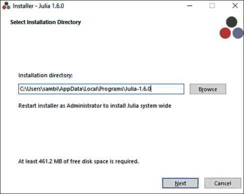
    **图 1.1：** Julia Windows 安装程序
    默认路径为：`%LOCALAPPDATA%\Programs\Julia x.y.z`
3.  按照链接中描述的步骤，将 Julia bin 目录：`%LOCALAPPDATA%\Programs\Julia x.y.z\bin` 添加到环境变量中：<https://julialang.org/downloads/platform/#windows>

# 验证安装

现在您已按照前面步骤的建议安装并配置了变量，在命令提示符下输入 `julia`。您应该会看到 Julia 的版本信息和一个 `julia` 提示符。这被称为 **REPL**，您可以用它来输入代码并快速验证结果。

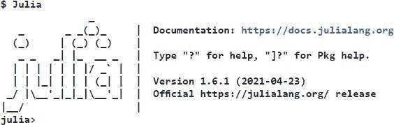


让我们在 REPL 提示符下尝试几个实验。

```
julia> 2 + 2
4
julia> 2.0 + 2
4.0
julia> println("Hello, World!!!")
Hello, World!!!
```

这些示例相当简单，只是在每次计算后都会打印结果。如果你不想在 REPL 中打印某些内容，请在语句末尾使用分号（`;`）符号。然而，在使用显式 `println` 的地方，使用分号将不起作用。现在让我们看看使用分号的相同样本。

```
julia> 2 + 2;
julia> 2.0 + 2;
julia> println("Hello, World!!!");
Hello, World!!!
```

为什么会有这种行为？我们将把答案留到下一章，届时我们将讨论数据类型和 `nothing` 的概念。

REPL 提供了一个基于 Shell 的控制台，用于以交互方式与 Julia 进行交互。然而，这对于绘图或图像等图形输出并不十分有用。

## Jupyter 集成

Jupyter 旨在为 Julia、Python 和 R 等语言创建交互式、浏览器兼容的 Shell。可以创建简单的基于 Web 的笔记本用于教程和培训材料。在 Julia 中，这种集成是通过一个名为 `IJulia` 的包来实现的。需要在 `julia` Shell 中执行以下步骤，以便配置 Jupyter 并启动 Jupyter Notebook。

```
julia> ]add IJulia
Updating registry at `~/.julia/registries/General` …
julia> using IJulia
[Info: Precompiling IJulia [7073ff75-…-fcdaad2a7d2a]
julia> notebook()
Info: running `/home/sambit/anaconda3/bin/jupyter notebook`
```

命令结束时，将打开一个新的浏览器窗口，显示如下截图所示的 Jupyter：

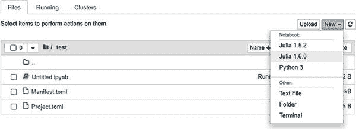

**图 1.3：** 创建一个带有 Julia 1.6.0 内核的新笔记本

最后，输入命令并运行它们，如下截图所示：

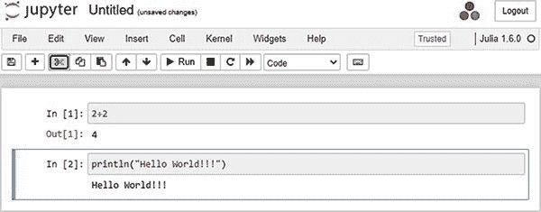

**图 1.4：** 具有示例代码的交互式 Jupyter 笔记本

你可以输入并运行代码；结果将显示在同一个浏览器窗口中。

## 运行 Julia 程序

虽然交互式表达式是在终端上快速尝试某事并查看输出的方法，但现实世界的应用程序需要运行大量代码块。在 Julia 中，你将所有相关代码输入到一个文件中。Julia 程序通常具有 `.jl` 扩展名。打开你选择的文本编辑器，在文件中输入以下代码并另存为 `example01.jl`。

```
# example01.jl
println("2 + 2 = ", 2+2)
println("2 + 2.0 = ", 2+2.0)
println("Hello World!!!")
```

提供了我们之前编写的代码。每一行都使用 `println` 命令来展示该行已运行且输出已打印在终端上。

在命令提示符下运行 `julia`。然后在 julia 提示符下调用命令，如图所示，你应该会看到输出：

```
$ julia
julia> include("example01.jl")
2 + 2 = 4
2 + 2.0 = 4.0
Hello World!!!
```

另一种运行 Julia 程序的方法是在命令行运行，如图所示：

```
$ julia example01.jl
2 + 2 = 4
2 + 2.0 = 4.0
Hello World!!!
```

我们将在后面的章节中了解更多关于如何编写复杂程序和组织它们的细节。`include` 也用于将代码从一个 Julia 文件嵌入到另一个文件中。

## 总结

Julia 是一门非常强大的语言。虽然它是为数据科学应用而设计的，但该语言也可以作为通用语言使用。我们开始探索该语言提供的各种功能，并了解了本书的组织结构。我们安装了 Julia。我们启动了 REPL 和 Jupyter 笔记本，以尝试一些简单的 Julia 语言特性。现在环境已经设置完毕，我们将深入探究 Julia 平台。在下一章中，我们将研究 Julia 中的类型系统，动态类型语言如何在内部解释数据类型，并通过一些突出这些内容的代码示例进行更深入的探讨。

# 练习

1.  在你选择的机器上安装 Julia 并启动 REPL。
2.  安装 IJulia 和 Jupyter。确保你可以在 Jupyter 笔记本中运行 Julia 代码。

---

# 参考文献

[1] Stefan Karpinski, The Unreasonable Effectiveness of Multiple Dispatch, JuliaCon 2019, [`www.youtube.com/watch?v=kc9HwsxE1OY`](https://www.youtube.com/watch?v=kc9HwsxE1OY)

[2] Julia Micro-Benchmarks [`julialang.org/benchmarks/`](https://julialang.org/benchmarks/)

[3] Peter Norvig, Director of Research at Google, would have preferred Julia over Python for his research work, Gradient Descent Podcast, [`www.youtube.com/watch?v=hVW1mwLtDcI`](https://www.youtube.com/watch?v=hVW1mwLtDcI)

[4] TensorFlow.jl GitHub Repository [`github.com/malmaud/TensorFlow.jl`](https://github.com/malmaud/TensorFlow.jl)

[5] Cairo.jl GitHub Repository

[6] QML.jl GitHub Repository

[7] Blink.jl ([`github.com/JuliaGizmos/Blink.jl`](https://github.com/JuliaGizmos/Blink.jl))

[8] Electron.jl ([`github.com/davidanthoff/Electron.jl`](https://github.com/davidanthoff/Electron.jl))

[9] JuliaBinaryWrappers [`github.com/JuliaBinaryWrappers`](https://github.com/JuliaBinaryWrappers)

[10] Research, Julia Language Website, [`julialang.org/research/`](https://julialang.org/research/) last accessed 4th Dec 2020

[11] JuliaEditorSupport, GitHub Repositories, [`github.com/JuliaEditorSupport`](https://github.com/JuliaEditorSupport)

[12] JuliaHub, [`juliahub.com/ui/Home`](https://juliahub.com/ui/Home)

[13] PackageCompiler, [`github.com/JuliaLang/PackageCompiler.jl`](https://github.com/JuliaLang/PackageCompiler.jl)

[14] Julia Language is licensed under the MIT License. An exception statement is made on specific components that may have different licenses. [`github.com/JuliaLang/julia/blob/master/LICENSE.md`](https://github.com/JuliaLang/julia/blob/master/LICENSE.md)

[15] JuliaHub provides UI to search based on licenses

[16] Julia’s Release Process, [`julialang.org/blog/2019/08/release-process/`](https://julialang.org/blog/2019/08/release-process/)

[17] Julia Computing, [`juliacomputing.com/`](https://juliacomputing.com/)

[18] In a GitHub repository, a user can assign a star to a repository. This is one way to suggest, a developer is interested in the repository. Some people use these stars as bookmarks for future references.

[19] Julia GitHub repository, [`github.com/JuliaLang/julia`](https://github.com/JuliaLang/julia) as on 4th Dec. 2020.

[20] This annual conference is being organized from 2014. JuliaCon, 2020, [`juliacon.org/2020/`](https://juliacon.org/2020/)

[21] The Julia Community, [`julialang.org/community/`](https://julialang.org/community/)


## 参考文献与资源

[22] Julia Seasons of Contribution, <https://julialang.org/jsoc/>

[23] Jeff Bezanson, Stefan Karpinski, Viral B. Shah, Alan Edelman, *Why We Created Julia?*, 14th Feb 2012, Julia Blogs, <https://julialang.org/blog/2012/02/why-we-created-julia/>

[24] **Pluto** 是专为 Julia 环境开发的另一种笔记本技术。详情请参考 <https://github.com/fonsp/Pluto.jl>

`]` 在命令开头时，会使 REPL 进入 `pkg` 模式。在此模式下，可以执行添加、移除或更新包等包管理任务。

只要社区保持持续的兴趣，任何开源软件都是好的。Julia 最初仅由三位研究人员及其导师发起，随后团队不断壮大，吸引了众多学术机构和研究人员的积极参与。该语言的主代码库拥有约一千名贡献者、30,000+ 星标和 4200+ 复刻。除了主语言代码库外，许多开发者还为 Julia 包生态系统中 4500+ 个可用包做出贡献。代码库托管在 GitHub 上。虽然大多数沟通作为 GitHub 上拉取请求和问题跟踪的一部分进行，但特定项目组也通过 Discourse、Slack 和 GitHub Projects 进行交流。Julia 社区举办 JuliaCon，这是一个致力于 Julia 生态系统发展与推广的会议。还有许多聚会小组供社区互动交流。提供免费和付费课程以帮助更好地了解生态系统。

Julia 的发布流程, <https://julialang.org/blog/2019/08/release-process/>

JuliaHub 提供基于许可证的 UI 搜索功能。

Julia 语言采用 MIT 许可证授权。针对可能具有不同许可证的特定组件，另有例外声明。 <https://github.com/JuliaLang/julia/blob/master/LICENSE.md>

PackageCompiler, <https://github.com/JuliaLang/PackageCompiler.jl>

Julia GitHub 代码库, <https://github.com/JuliaLang/julia> (截至 2020 年 12 月 4 日)。

在 GitHub 代码库中，用户可以给代码库分配星标。这是表明开发者对该代码库感兴趣的一种方式。有些人将这些星标用作未来参考的书签。

Julia Computing, <https://juliacomputing.com/>

JuliaHub, <https://juliahub.com/ui/Home>

JuliaEditorSupport, GitHub 代码库, <https://github.com/JuliaEditorSupport>

Research, Julia 语言官网, <https://julialang.org/research/> (最后访问 2020 年 12 月 4 日)

Stefan Karpinski, *The Unreasonable Effectiveness of Multiple Dispatch*, JuliaCon 2019, <https://www.youtube.com/watch?v=kc9HwsxE1OY>

Cairo.jl GitHub 代码库

TensorFlow.jl GitHub 代码库 <https://github.com/malmaud/TensorFlow.jl>

Peter Norvig (Google 研究总监) 表示，对于他的研究工作，他本更倾向于使用 Julia 而非 Python，Gradient Descent Podcast, <https://www.youtube.com/watch?v=hVW1mwLtDcI>

Julia Micro-Benchmarks <https://julialang.org/benchmarks/>

JuliaBinaryWrappers <https://github.com/JuliaBinaryWrappers>

Electron.jl (<https://github.com/davidanthoff/Electron.jl>)

Blink.jl (<https://github.com/JuliaGizmos/Blink.jl>)

QML.jl GitHub 代码库

Julia 平台在整个代码生成基础设施方面是自给自足的。如果您安装该平台用于常规开发工作，无需安装任何额外组件。不过，它与 Emacs、vi 和 Sublime 等编辑器有集成。完整集成和托管的 IDE 通过 Atom 和 Microsoft Code (VS Code) 实现。您可以使用这些 IDE 进行函数导航、行调试、显示交互式绘图等。工具集与源代码控制 (GitHub、GitLab 等 Git 衍生工具)、覆盖率工具 (CoverAll.io、CodeCov)、持续集成系统 (GitHub Actions) 等无缝集成。

性能是科学计算的关键，对 Julia 而言，它是基本设计考量之一。因此，极其关注确保用 Julia 编写的每段代码都能轻松计时，并可检查任何可能导致性能损失的异常。Julia 提供了性能改进的通用指南，提供了许多分析性能瓶颈和根据标准进行基准测试的工具。在本章中，我们将回顾许多有助于提高代码性能的此类工具。

与 Python、R、SPSS 或 MATLAB 等其他动态语言不同，Julia 的设计将性能作为其开发的核心焦点。类型确定和转换在大多数解释型语言中消耗大量时间。Julia 从根本上说是一种 **Just-in-Time (JIT)** 编译语言。类型在运行时确定，并根据类型编译多个代码段。基于数据类型的 **多重分发** 架构确保调用最高效的实现。Julia 性能基准测试参考 C/C++ 等编译型语言。在许多测试中，Julia 的性能几乎接近 C/C++ 的水平。得益于这些性能增益，开发者可以用原生 Julia 编写高性能库。这与 Python 或 R 等语言不同，后者作为优秀的前端接口，将后端高性能代码留给 C/C++ 等原生编译语言。

**Pluto** 是专为 Julia 环境开发的另一种笔记本技术。详情请参考 <https://github.com/fonsp/Pluto.jl>

Jeff Bezanson, Stefan Karpinski, Viral B. Shah, Alan Edelman, *Why We Created Julia?*, 14th Feb 2012, Julia Blogs, <https://julialang.org/blog/2012/02/why-we-created-julia/>

Julia Seasons of Contribution, <https://julialang.org/jsoc/>

The Julia Community, <https://julialang.org/community/>


# Julia 语言概述与优势

## 年度会议

JuliaCon 自 2014 年起每年举办一次。2020 年会详情请访问 **[`juliacon.org/2020/`](https://juliacon.org/2020/)**。

## 核心优势：开放性与社区贡献

使用像 Julia 这样相对较新的编程语言最大的优势在于其灵活性：开发者可以深入代码内部理解实现细节，通过提交 Issue 建议变更，提交 PR 并积极贡献生态系统。对于有意愿和能力贡献代码、推动期望变更的开发者来说，这绝对是一个值得深入探索的领域。

对于学生而言，参与 Julia 贡献可通过 *Google Summer of Code* 赞助项目获得资助，从而满足职业实习需求。如果你是一名喜欢深入一线实战的开发者，Julia 提供了一个既可工作又可贡献的平台。社区对新手程序员的贡献极其包容鼓励，这也是快速学习和深入理解系统的捷径。

## 面向研究者的设计理念

Julia 专为研究人员设计，旨在让他们的贡献直接进入生产代码，而无需为性能和可维护性而重写重构。

- **函数式编程范式**：确保程序可通过组合轻松扩展，而非僵化地遵循纯面向对象层级。
- **数据封装**：是一项指导原则，语言结构不会严格阻止访问对象的底层属性。
- **多重分发**：提供类似面向对象系统的简易多态设计。
- **递归与迭代**：像大多数函数式语言一样，在需要时鼓励递归编程，同时完全支持迭代编程。缺乏原生尾调用优化支持可视为一个小瓶颈。
- **数学表达支持**：原生支持 Unicode 变量和集合论表达式，帮助研究人员在 Julia 中编写完整的数学表达式。
- **文档系统**：许多社区研究人员结合 LaTeX 文档管理系统开发应用，以便以可导出出版格式展示研究成果。部分社区成果已发表于各类研究出版物。
- **交互模式**：`IJulia` 和 `Jupyter` 等交互模式提供了易于原型开发的环境，控制台 **REPL** 同样可用。

## 云原生与部署特性

Julia 非常适合基于云的应用开发。它在后端系统中作为计算层运行，将渲染和连接管理接口留给定义良好的应用程序和 Web 服务器。虽然存在一些基于 Julia 的 Web 应用服务器，但大多处于实验阶段。

大多数 Julia 代码以源代码形式保存，适合 JIT 编译。因此，静态编译代码并非 Julia 中最常见的部署实践，尽管通过特定包（如 `PackageCompiler`）可实现该灵活性。作为服务端平台，Julia 及其包集合可轻松部署于 AWS、Azure 等云平台，或作为 *Docker* 镜像交付。

## 语言演进与竞争格局

在编程世界中，半个世纪前编写的 COBOL 和 FORTRAN 程序至今仍在运行，十年只是很短的时期。对比竞争语言：Python (1990)、R (1993)、S (1976)、SPSS (1968)、MATLAB (20 世纪 70 年代末)。这些语言最初均未为“生产就绪的数据科学应用开发平台”而设计。

- Python 起步于通用脚本语言，为非专业程序员提供快速开发接口。
- R、S、SPSS、MATLAB 为研究人员提供卓越的原型基础设施。

Julia 2012 年首次亮相，是“新来的小伙子”。但正如你将看到的，它是一个“聪明的后生晚辈”。维护与旧系统的向后兼容并不总是切实际（如 Python 3.x 与 2.x 不兼容，让程序员面临同等迁移/重写困难）。Julia 采用现代编程范式构建，专为研究人员和数据科学家设计，却能与原生平台无缝集成。

## 包管理生态系统

任何不可扩展的平台在今天都是不完整的。Julia 深谙此道，提供了完整的包开发和管理生态系统。

- **JuliaHub**：可用于搜索所需包并部署到环境中（参考文献 12）。
- **包数量**：约 4500+ 个包，相比 *Python*、*R*、*MATLAB* 等平台数量有限。但考虑到 Julia 于 2018 年 10 月发布稳定的 *version 1.0*，这一数字显示出持续增强生态系统的浓厚兴趣。
- **外部集成**：若功能缺失，可轻松集成等效的 C/C++ 或 Java 二进制文件，通过原生接口与 Julia 代码交互。
- **基础设施**：包基础设施基于 `git`，极易开发私有仓库。
- **环境管理**：完整的包和环境管理系统 `Pkg` 提供独立环境，确保包间兼容性。

---

# 性能与架构设计

## JIT 编译与类型系统

与 Python、R、SPSS、MATLAB 等动态语言不同，**性能**是 Julia 设计的核心焦点。类型判断和转换在大多数解释型语言中消耗大量时间。Julia 本质上是一门 **Just-in-Time (JIT)** 编译语言。

- 类型在运行时确定，多个代码片段基于类型进行编译。
- 基于数据类型的 **多重分发** 架构确保调用最高效的实现。
- 性能基准测试以 C/C++ 等编译型语言为参照。在许多测试中，Julia 性能接近 C/C++ 水平。

## 原生高性能库开发

得益于性能优势，开发者可用原生 Julia 编写高性能库。这与 Python 或 R 形成鲜明对比：后者作为优秀的前端接口，将高性能后端代码委托给 C/C++ 等原生编译语言。

## 开源协议与许可

Julia 作为开源项目集合开发。我们强调“开源项目集合”这一术语，因为大多数包虽为开源分发，但许可证可能与 Julia 语言核心不同。

- **Julia 语言核心**：采用 **MIT License** (参考文献 14)，在使用和扩展源代码方面提供极大灵活性，也便于将完整 Julia 或其衍生版包含在其他应用开发中。
- **生态包**：大多数 Julia 包遵循类似许可方案。请在商业授权产品中使用前，务必审查相关包的许可灵活性 (参考文献 15)。


# Julia 平台优势与企业级特性

## 优秀的平台接口与行业最佳实践

优秀的平台提供卓越的接口和 API，用于构建灵活且大规模的系统。更优秀的平台拥抱行业最佳实践，而非重复造轮子。Julia 正是后者的完美典范。它与以下技术实现了原生集成：

- **LLVM**（高级编译器工具）
- **OpenBLAS**（线性代数）
- **LAPACK**（线性代数）
- **Intel MKL**
- **OpenLibm**
- **Nvidia CUDA**
- **PCRE**（正则表达式）

这确保了平台建立在经过验证的技术之上。此外，Julia 还提供了与 C、C++、Python、Java 和 FORTRAN 等语言的外部接口绑定。如果您习惯了这些库的灵活性或强大功能，可以继续在 Julia 中使用它们。例如，Julia 绘图接口可以轻松与 Python `matplotlib` 或 `GR` 联合使用。包生态系统持续构建和维护着用于机器学习的 `TensorFlow`、用于低级图形的 `Cairo`、用于窗口管理的 `Qt` 或用于基于 HTML 客户端应用的 `Electron JS` 等包，还有更多。所有这些都是事实上的行业标准框架。此外，针对常用原生二进制库（如 `Zlib`、`OpenSSL` 和 `Qt` 等）的 Julia 封装包也在持续构建中，并作为二进制分发版提供。

## 开源项目集合与许可模式

Julia 是作为一个**开源项目集合**进行开发的。我们坚持使用“开源项目集合”这一术语，因为虽然大多数使用的包作为开源分发，但它们的许可证可能与 Julia 语言本身不同。Julia 语言在 **MIT 许可证** 下开发，这在使用和扩展源代码方面提供了极大的灵活性。这也使得任何人都能轻松地将完整的 Julia 或其衍生版作为其他应用程序开发的一部分。大多数用 Julia 开发的包也遵循类似的许可方案。请务必在将包用于商业许可产品之前，审查其许可灵活性。

## 面向联邦企业环境的架构设计

正如许可模式一样，Julia 在架构上也是为联邦企业环境设计的。用户可以：

- 使用自己的私有仓库管理应用程序和包
- 部署在以企业为中心的内部云基础设施上
- 使用包集成企业联邦认证和授权方案

Julia 语言还维护所有主要版本（如 1.0）作为**长期支持（LTS）**版本，以满足企业支持需求。最重要的是，Julia 由 **Julia Computing Inc.** 支持，这是一家提供工具、支持 Julia 并积极参与 Julia 编程社区活动的企业。对 Julia Computing 工具感兴趣的企业可以从他们那里获得各种支持计划。Julia 语言的所有创始成员目前均受雇于 Julia Computing。


# Julia 社区与类型系统概述

## 社区生态

任何开源软件只要社区持续保持兴趣，就会蓬勃发展。Julia 最初仅由三位研究人员及其导师发起，随后团队不断壮大，吸引了众多学术机构和研究人员的积极参与。该语言的主代码库拥有约一千名贡献者、30,000+ 星标和 4,200+ 复刻。除了主语言仓库外，许多开发者还为 Julia 包生态系统中 4,500+ 个可用包做出贡献。代码库托管在 GitHub 上。虽然大多数沟通作为 GitHub 上拉取请求和问题跟踪的一部分进行，但特定项目组也通过 Discourse、Slack 和 GitHub Projects 进行交流。Julia 社区举办 JuliaCon，这是一个致力于 Julia 生态系统开发和推广的会议。还有许多聚会小组供社区互动和交流想法。提供免费和付费课程以帮助更好地了解生态系统。

## 类型系统简介

类型是 Julia 语言的核心。虽然它们不必显式定义，但 Julia 语言会尝试推断类型。系统中预定义了类型，用户也可以定义自己的类型。某些类型可以通过参数进行修饰。本章将使您熟悉其中一些概念。

## 本章主题

在本章中，我们将涵盖以下主题：

*   Julia 中的类型
*   内置类型
*   用户定义类型
*   `Any` 类型
*   参数化数据类型
*   类型上的操作
*   打印数据类型

## 学习目标

用户将能够理解 Julia 的类型系统，理解系统定义和用户定义的类型。因此，他们将能够了解这些类型在 Julia 编程中的重要性和用法。

## 变量、常量与字面量

动态类型编程语言通常不以拥有完善的类型系统而闻名。在 Python 中数据类型是可选的。人们使用各种包（如 NumPy）来定义数值数据类型。Julia 的类型系统是动态的，并且几乎总是在变量实例化时推断。数据类型在代码段执行或 Julia 代码**即时编译**（`JIT`）之前就已知晓。简而言之，Julia 原生支持数据类型，这些类型可以在任何变量或字面量使用前被定义或推断。在深入探讨数据类型之前，让我们先了解一些关于变量、常量和字面量的知识。

### 变量

Julia 中的变量是与值关联的名称。名称通常是以字母开头的字母数字表示。与其给出什么可以构成名称的语法上准确的定义，不如列出 Julia 中一些有效的变量示例。

```julia
julia> a = 1
1

julia> abc = 1
1

julia> 1abc = 2
ERROR: syntax: "1" is not a valid function argument name around
REPL[3]:1
Stacktrace:
 [1] top-level scope at REPL[3]:1

julia> πi = 30
30

julia> aπi = 30
30
```

如上所示，变量名不能以数字开头。变量名可以包含 Unicode 字符。变量命名有其限制，作者建议查阅 Julia 文档以详细了解变量命名规则。Julia 中的关键字不能用作变量。Julia 的关键字很少。其中一些包括：`baremodule`、`begin`、`break`、`catch`、`const`、`continue`、`do`、`else`、`elseif`、`end`、`export`、`false`、`finally`、`for`、`function`、`global`、`if`、`import`、`let`、`local`、`macro`、`module`、`quote`、`return`、`struct`、`true`、`try`、`using`、`while`。Julia 还有多词关键字（如 `mutable struct`、`abstract type` 等）和中缀运算符关键字（如 `in`、`isa` 等）。作者建议详细查阅语言文档中的关键字以获得详尽的理解。

### 变量定义与初始化

某些语言（如 C/C++）将声明定义与初始化分开。以下是一个突出此点的简单 C/C++ 示例。

```c
...
int i;      /* Definition of i as an integer type */
i = 10;     /* Initialization of i now */
int j = 20; /* Definition and initialization in the same statement */
...
```

Julia 不区分这两者。大多数 Julia 变量在初始化为感兴趣的类型时即被定义。事实上，类型作为初始化过程的一部分被赋给变量。不过，显式赋值给特定类型也是可能的，尽管不建议这样做。在 REPL 环境中，不允许全局变量显式赋值类型。但是，可以对函数内部定义的变量执行此操作。

```julia
julia> i::Int=1
ERROR: syntax: type declarations on global variables are not yet supported
Stacktrace:
 [1] top-level scope at REPL[8]:1

julia> function f()
           i::Int=5
           return i
       end
f (generic function with 1 method)

julia> f()
5
```

这种行为显而易见，因为假定所有变量在使用前都已初始化。未初始化的变量在使用时会报错，如下所示：

```julia
julia> i
ERROR: UndefVarError: i not defined

julia> function f()
           i
           return i
       end
f (generic function with 1 method)

julia> f()
ERROR: UndefVarError: i not defined
Stacktrace:
 [1] f() at .\REPL[12]:2
 [2] top-level scope at REPL[13]:1
```

## 常量

常量可以被视为不可修改的变量。然而，Julia 对常量变量的可变性不遵循严格条件。它只是警告可能覆盖常量表达式。

```julia
julia> const ICONSTANT=1
1

julia> ICONSTANT=5
WARNING: redefinition of constant ICONSTANT. This may fail, cause incorrect answers, or produce other errors.
5
```


# Julia 常量、字面量与基础类型

## 常量

```julia
julia> ICONSTANT
5
```

在上述示例中，常量被覆盖了，但这类用法必须避免，因为它可能导致执行时的潜在错误。

## 字面量

字面量是表示值的常量表达式。有时它们也被称为右值，因为它们出现在变量定义的右侧。它们也是值在其原子表示形式下的表现。以下是各种类型的字面量表达式示例：

```julia
julia> 2              # Integer
2

julia> 2.0            # Double precision Float (Float64)
2.0

julia> 2f0            # Single precision Float (Float32)
2.0f0

julia> "string"       # String
"string"

julia> 'a'            # Char
'a': ASCII/Unicode U+0061 (category Ll: Letter, lowercase)
```

随着我们深入类型系统，将在具体类型的上下文中进一步详细回顾字面量。通常，变量初始化形式为 `var = <literals>`。

## 变量值交换

在编程中，将值从一个变量传递给另一个变量（以及反之）是最基础的示例之一。以下是 C/C++ 中的典型代码：

```c
int i=1, j=2, t;
t = i;
i = j;
j = t;
/* Now i = 2 and j = 1 */
```

在 Julia 中，同等逻辑可简写为：

```julia
julia> i=1; j = 2;

julia> i, j = j, i
(2, 1)

julia> i
2

julia> j
1
```

# 元组

元组是特殊用途的不可变集合，在 Julia 中通过指定逗号分隔的值来创建。也可以用大括号将多个逗号分隔的值括起来表示。

```julia
julia> 1, 2
(1, 2)

julia> a = (2, 3)
(2, 3)

julia> typeof(a)
Tuple{Int64,Int64}

julia> a[1]
2

julia> a[1] = 5
ERROR: MethodError: no method matching setindex!(::Tuple{Int64,Int64}, ::Int64, ::Int64)…
```

可以看到，元组元素可通过索引访问，但**不可修改**。以下是基于位置从元组向变量进行多重赋值的示例：

```julia
julia> i, j = 1, 2
(1, 2)

julia> i
1

julia> j
2

julia> i = 1, 2 # i is a Tuple
(1, 2)

julia> i
(1, 2)

julia> i, = 1, 2 # i is an Int
(1, 2)

julia> i
1

julia> i, j = 1, 2, 3 # i and j get assigned 3 is ignored
(1, 2, 3)

julia> i
1

julia> j
2
```

## 内置类型

Julia 语言内置了许多类型，更多类型定义于 Julia 标准库中，语言也提供了扩展这些类型的灵活性。此外，类型名并非保留关键字。以下是语言中几个常用的类型。

### `Nothing`

`Nothing` 是值 `nothing` 的类型。在 C/C++ 等语言中，`void` 等类似值常用于类似目的。但在 Julia 中，`nothing` 不是关键字。

```julia
julia> typeof(nothing)
Nothing
```

我们还引入了 `typeof()` 方法，它提供值所属类型的信息。`nothing` 的用法相当普遍，常用于代码中存在变量可能未初始化的条件场景。

```julia
julia> a = nothing

julia> i = 5
5

julia> if i < 5
           a = 5
       end

julia> typeof(a)
Nothing
```

此处，若 `i` 小于 5，则 `a` 被赋值为 5；否则保持为 `nothing`。`Nothing` 和 `nothing` 在函数参数和返回类型中也被广泛使用。

### 布尔类型

`true` 和 `false` 在 Julia 中属于 `Bool` 类型。数值上，`true` 值为 1，`false` 值为 0。

### 整数类型

整数数值类型分为无符号和有符号，具有不同的字节大小。有符号数类型包括：`Int8`、`Int16`、`Int32`、`Int64` 和 `Int128`。对应的无符号数类型分别为：`UInt8`、`UInt16`、`UInt32`、`UInt64` 和 `UInt128`。

```julia
julia> typeof(1)
Int64
```

数字字面量的默认数值类型是 `Int`，它根据机器架构映射到 `Int32` 或 `Int64`。

不过，对于无符号数字面量，通过 `0<representation specifier><number>` 指定。

```julia
julia> typeof(0b1), typeof(0o7), typeof(0xff)
(UInt8, UInt8, UInt8)
```

这些数字在二进制、八进制和十六进制表示下均映射到 `UInt8`。数字的大小由容纳该字面量所需的最小字节数决定。

```julia
julia> typeof(0xf), typeof(0xfff), typeof(0xfffff), typeof(0xfffffffff), typeof(0xfffffffffffffffff)
(UInt8, UInt16, UInt32, UInt64, UInt128)
```

与大多数其他语言一样，`+/-` 可在 Julia 中用作符号限定符。

### 浮点数类型

Julia 提供 `Float16`、`Float32` 和 `Float64`，分别按 IEEE 754 标准表示半精度、单精度和双精度浮点数。字面量可使用 `f` 或 `e` 作为指数分隔符，分别对应 `Float32` 和 `Float64`。

```julia
julia> typeof(1.0), typeof(1e0), typeof(1.e4)
(Float64, Float64, Float64)

julia> typeof(1.0f0), typeof(1f-6), typeof(1.f4)
(Float32, Float32, Float32)
```

## 类型层级与抽象类型

Julia 中的类型可以从抽象类型派生。大多数面向对象语言将此类关系视为描述类层级中对象的手段。抽象类型仅为概念表示（类似接口），不包含数据元素。

```julia
julia> abstract type MyAbstractType end

julia> struct MyConcreteType <: MyAbstractType
           member
       end

julia> a = MyConcreteType(5)
MyConcreteType(5)

julia> a isa MyAbstractType
true
```

稍后我们将详细探讨此概念。值得注意的是，一个类型只能从一个抽象类型派生。中缀运算符 `isa` 用于判断某对象是否为特定类型，该类型可以是具体类型或抽象类型。以下是 Julia 数值类型的类型层级图：

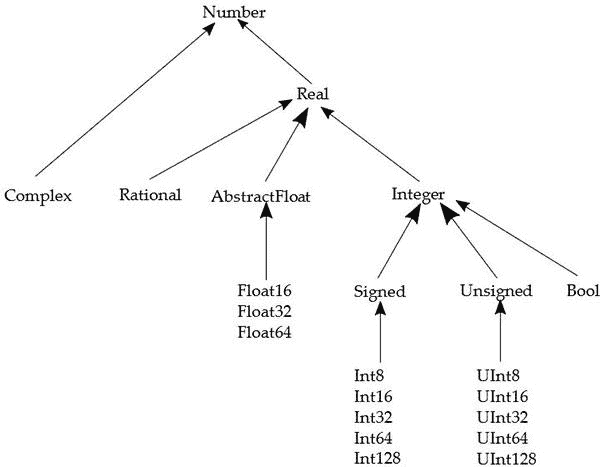


**图 2.1：** 数值类型层级

# 基本类型

基本类型是 LLVM 支持的数据类型。Julia 将代码编译为 LLVM 对应的中间表示，随后再编译为原生 CPU 机器码以 **JIT**（即时编译）方式执行。因此，将 LLVM 类型引入 Julia 是非常合乎逻辑的。这些基本类型是位值。以下是在 Julia 中定义的一组基本类型。

```julia
primitive type <<name>> <: <<supertype>> <<bits>> end
primitive type Float16 <: AbstractFloat 16 end
primitive type Float32 <: AbstractFloat 32 end
primitive type Float64 <: AbstractFloat 64 end
primitive type Bool <: Integer 8 end
primitive type Char <: AbstractChar 32 end
primitive type Int8     <: Signed    8 end
primitive type UInt8    <: Unsigned  8 end
primitive type Int16    <: Signed    16 end
primitive type UInt16   <: Unsigned  16 end
primitive type Int32    <: Signed    32 end
primitive type UInt32   <: Unsigned  32 end
primitive type Int64    <: Signed    64 end
primitive type UInt64   <: Unsigned  64 end
primitive type Int128   <: Signed    128 end
primitive type UInt128  <: Unsigned  128 end
```

虽然用户可以定义自己的基本类型，但建议使用已定义的基本类型，仅在现有类型无法满足需求时才定义新类型。其次，具有相同位值的基本类型并非本质上可互换，也无法无缝转换。类型层级在这些类型的行为中起着重要作用。

```julia
julia> UInt32(3f-1)
ERROR: InexactError: UInt32(0.3)
```

尽管它们都是 32 位实体，但单精度浮点数并非在所有情况下都能表示为无符号整数。第三，你不能创建任意位大小的基本类型。仅支持 8 位的倍数作为位大小。

```julia
julia> primitive type MyType1 40 end
julia> primitive type MyType2 4 end
ERROR: invalid number of bits in primitive type MyType2 …
```

# 位类型

Julia 与在二进制接口上运行的语言（如 C/C++、FORTRAN 及其他原生编译语言）实现无缝互操作。在这种情况下，必须确保 Julia 中定义的某些数据类型在二进制布局上保持一致，以便这些原生编译语言使用。此类类型称为**位类型**。基本类型均为位类型数据类型。某些复合数据类型也是位类型。遇到时我们将进一步讨论它们。可以通过在实例上调用函数 `isbits` 以及在类型上调用 `isbitstype` 来查询位类型。

```julia
julia> a = 10
10

julia> isbits(a)
true

julia> isbitstype(Int)
true
```

# 有理数和复数类型

虽然 `Rational`（有理数）和 `Complex`（复数）数据类型属于数值类型，但它们不是基本类型。它们是使用复合数据类型创建的，我们将在用户定义类型部分对其进行回顾。

# Char 类型

`Char` 是表示为 32 位值的字符。它可以是 Unicode 字符的有效 UCS-4 表示。我们将在字符串章节中详细讨论 `Char` 及其与 `String` 的关系。提供了 `AbstractChar` 抽象类型，以便用户开发自己的类字符数据类型。

# 字符串

字符串是字符的集合。虽然大多数字符串由 Unicode 字符代码组成，但它们也可以存储其他类型的二进制数据。提供了 `AbstractString` 抽象类型，以便高级用户定义自定义字符串类型。我们将在后续章节中详细讨论这些内容。

# 复合类型

虽然 Julia 提供了相当多的内置类型，但始终存在对复合数据类型的需求，这类类型可能需要将各种属性组合在一起。

## 不可变复合类型 (`struct`)

这些类型一旦定义，其属性就不能被修改。这些不可变数据类型在 Julia 中表示为 `struct`。

```julia
julia> struct Rectangle
           h::Float64
           w::Float64
       end

julia> r = Rectangle(10.0, 20.0)
Rectangle(10.0, 20.0)

julia> r.h = 15
ERROR: setfield! immutable struct of type Rectangle cannot be changed …
```

如上所示，`Rectangle` 是一个定义的 `struct`，并使用值 `10.0` 和 `20.0` 进行初始化。属性的值无法被修改。初始化通过 `Rectangle(10.0, 20.0)` 进行。这是一个特殊用途的函数。当我们讨论函数和方法时将了解更多相关内容。

## 可变复合类型 (`mutable struct`)

假设我们要使 `Rectangle` 可变，可以创建一个可变结构体，如下所示：

```julia
julia> mutable struct MRectangle
           h::Float64
           w::Float64
       end

julia> mr = MRectangle(10.0, 20.0)
MRectangle(10.0, 20.0)

julia> mr.h = 15.0
15.0

julia> mr
MRectangle(15.0, 20.0)
```

如上所示，实例化对象后可以修改属性值。Julia 中的复合数据类型也可以从 `abstract type`（抽象类型）派生。

```julia
julia> abstract type Shape end

julia> struct Rectangle <: Shape
           w::Float64
           h::Float64
       end

julia> struct Square <: Shape
           l::Float64
       end
```

## 复合类型行为与构造函数

Julia 中的复合类型拥有成员属性，但没有成员函数或方法。Julia 的多重分发架构用于使函数表现得像特定类型的方法，但它们与面向对象语言中的方法并不相同。有一类特殊的函数可以成为类型的成员，它们被称为**构造函数**。当我们讨论函数时将详细回顾构造函数。复合类型中成员的类型信息并不总是必须指定。

```julia
julia> mutable struct A
           member
       end

julia> a = A(5)
A(5)

julia> typeof(a.member)
Int64

julia> a1 = A("String")
A("String")

julia> typeof(a1.member)
String
```

虽然在前面的示例中，实例化对象时消除了歧义，但永远无法确定类型，因为成员属性可以动态地赋值为另一种类型。

```julia
julia> a.member = "String"
"String"

julia> typeof(a.member)
String
```


`<strong>a.member</strong>` 曾为 `<strong>Int64</strong>` 类型，现在变为 `<strong>String</strong>` 类型。Julia 会将此类未指定的类型推定为 `<strong>Any</strong>`。在无法确定类型的场景下，Julia 会将类型推定为 `<strong>Any</strong>`。从性能角度来看，使用 `<strong>Any</strong>` 是不可取的。每次访问 `<strong>Any</strong>` 类型的对象时，都会发生一次额外的重定向以访问实际对象。`Any` 类型对象的大小无法提前得知。它将是一个指针，指向内存中实际对象驻留的另一位置：

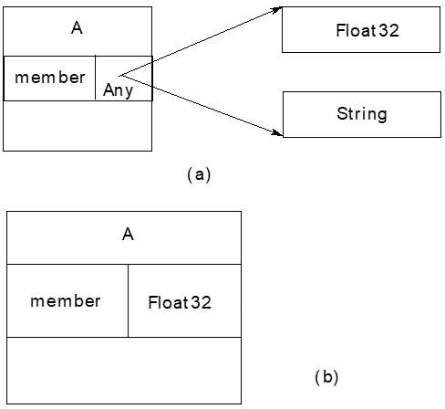

**图 2.2：** (a) 成员定义为 Any (b) 成员定义为 Float32

将 `<strong>Any</strong>` 作为类型会引入不必要的间接寻址，因此可能效率低下。有时类型不一定影响算法，但会引入不同的数据位宽。例如，前文在数值数据类型背景下介绍的 `<strong>Rational</strong>` 数据类型，其分子和分母可以是任意整数数据类型，如 `<strong>Int8</strong>`、`<strong>Int16</strong>`、`<strong>Int32</strong>`、`<strong>Int64</strong>` 或 `<strong>Int128</strong>`。`<strong>Rational</strong>` 数据类型的定义如下 6：

`<strong>:</strong>`

```
struct Rational{T<:Integer} <: Real
    num::T
    den::T
end
```

该类型的两个属性 `<strong>num</strong>` 和 `<strong>den</strong>` 均为 `<strong>T</strong>` 类型，其中 `<strong>T</strong>` 是 Integer 的子类型。`<strong>Rational</strong>` 是 Real 的子类型。以下是关于参数化数据类型的一些观察。

```
julia> Rational{Any}
ERROR: TypeError: in Rational, in T, expected T<:Integer, got Type{Any}
…
```

**Any 不是 Integer 的子类型。因此无法实例化 Rational{Any}。**

```
julia> Rational{Int32} <: Rational
true
julia> Rational{Int32} <: Rational{Integer}
false
```

理解这种行为尤为重要。尽管 `<strong>Int32</strong>` 是 Integer 的子类型，但参数化表示 `<strong>Rational{Int32}</strong>` 并不是 `<strong>Rational{Integer}</strong>` 的子类型。然而 `<strong>Rational{Int32}</strong>` 是 Rational 的子类型。

正如具体数据类型一样，抽象数据类型也可以被参数化。

```
julia> abstract type Shape{T<:AbstractFloat} end
julia> struct Rectangle{T<:AbstractFloat} <: Shape{T}
           w::T
           h::T
       end
julia> struct Square{T<:AbstractFloat} <: Shape{T}
           s::T
       end
```

可以使用上述方案为 `<strong>Float32</strong>` 或 `<strong>Float64</strong>` 开发两套功能。为 `<strong>Rectangle{Float32}</strong>` 生成的类型与 `<strong>Rectangle{Float64}</strong>` 不同，它们在实例化具体类型时于编译期间生成。

虽然类型参数化是 Julia 语言一项非常有用的特性，但参数化也可以针对整数值进行。

```
julia> struct Point{T<:AbstractFloat, N}
           x::Vector{T}
       end
```

```
julia> p = Point{Float32, 2}([1f0, 2f0])
Point{Float32,2}(Float32[1.0, 2.0])
```

正如所见，类型中使用的 `<strong>N</strong>` 是一个作为类型参数使用的整数。

## 类型操作

有一些适用于类型的操作。我们迄今已见过其中一些，将在本节详细阐述。

### typeof

此函数提供与类型实例相关联的具体类型。

```
julia> a = 1//2<a id="ftn7a" href="#ftn7"><sup>7</sup></a>

1//2
julia> typeof(a)
Rational{Int64}
```

#### 别名

类型本身是 `<strong>DataType</strong>` 类型的实例。

```
julia> typeof(Int)
DataType
julia> typeof(Rational{Int})
DataType
```

像其他实例对象一样，它们可以被比较和赋值。以下是来自 base/boot.jl 的代码片段。8

```
if Int ===<a id="ftn9a" href="#ftn9"><sup>9</sup></a> Int64
    const UInt = UInt64
else
    const UInt = UInt32
end
```

`<strong>Int</strong>` 对象与 `<strong>Int64</strong>` 进行比较，如果它们相同，则 `<strong>UInt</strong>` 初始化为 `<strong>UInt64</strong>`，否则初始化为 `<strong>UInt32</strong>`。因此 `<strong>UInt</strong>` 根据机器架构充当 `<strong>UInt64</strong>` 或 `<strong>UInt32</strong>` 的别名。

### isa

提供实例是否为特定类型的信息。`<strong>isa</strong>` 也可用作中缀运算符。

```
julia> isa(1, Number)
true
julia> isa(1, Matrix)
false
julia> isa(1, Int)
true
julia> 1 isa Number
true
```

### supertype

此函数返回类型的直接父类型。

```
julia> supertype(Int32)
Signed
```

### <:

此运算符用于表示一个类型是否为另一个类型的子类型。

```
julia> Int32 <: Integer
true
julia> Int32 <: AbstractFloat
false
julia> Int32 <: Real
true
julia> Int32 <: Signed
true
```

## 显示与输出

定义复杂数据类型时，需要以有意义的方式呈现数据。默认情况下，所有成员将作为元组打印。

```
julia> struct A
           a1::Int32
           a2::Float64
       end
julia> a = A(1, 2)
A(1, 2.0)
```

其次，数据总是会在 REPL 中打印。要禁止在 REPL 中打印数据，可以在语句末尾加上分号 (;)。

```
julia> a;
julia> a
A(1, 2.0)
```

但为什么会有这种行为？让我们看更多示例。

```
julia> b = 2.0
2.0
julia> a; b
2.0
```

用分号分隔行时，仅打印最后一个表达式的输出，本例中即为 b。

```
julia> nothing
```

`<strong>Nothing</strong>` 默认不标记输出。当分号用作语句结束时，其行为类似于在分号末尾添加了一个 `<strong>nothing</strong>`。因此无输出被打印。

```
julia> a
A(1, 2.0)
julia> a;
julia> a; nothing
```

### 使用 show 自定义显示

默认情况下，要在 REPL 上显示输出，会在数据类型上调用关联的 show 方法。

```
julia> struct A
           a1::Int32
           a2::Float64
       end
julia> a = A(1, 2)
A(1, 2.0)
julia> function Base.show(io::IO, a::A)
           println(io, "a1: ", a.a1, " a2: ", a.a2)
       end
julia> a
a1: 1 a2: 2.0
```


`show` 用于在任何类型的输出设备上显示数据，而 `print` 只能用于输出文本表示形式。当没有引入特定的 `print` 例程时，调用 `print` 时内部会使用 `show`。

```
julia> print(a)
a1: 1 a2: 2.0
```

# 

此函数可用于将任何类型转换为其字符串表示形式。当未提供合适的转换方法时，会在内部调用 `print` 函数以获取数据类型的文本表示形式。

```
julia> string(a)
"a1: 1 a2: 2.0\n"
```

在前面的代码中可以清楚地看到 `print` 或底层 `show` 的用法。此外，`String` 中额外的行尾可以归因于 `println` 的使用，它会在语句后添加一个 EOL（行尾符）。

# 

尽管 Julia 是一门动态类型语言，但类型是该语言的基础。它们在 JIT 编译期间被推断，并在很大程度上促成了 Julia 语言的性能提升。虽然我们在本章中简要概述了数据类型，但随着我们学习函数和方法，数据类型的很大一部分将被揭示出来。通过数据类型使用多重分发接口是语言基础的重要组成部分，我们也将对此进行介绍。

# 

1.  是否有为半精度浮点数（`Float16`）定义的字面量？如何初始化它们？

2.  使用别名 `Int`，如何判断机器是 32 位还是 64 位机器？

3.  元组可以有超过 2 个元素吗？

4.  `struct` 的默认打印形式是结构体名称，后跟大括号内作为元组的成员。这种表示形式有什么优势吗？（你可能需要了解构造函数才能体会到这一点）。

5.  复合类型的成员可以是 `nothing` 吗？这种情况有什么优势吗？

---

1 Julia 文档（手册 --> 变量） **[`docs.julialang.org/en/v1/manual/variables/`](https://docs.julialang.org/en/v1/manual/variables/)**

2 LLVM 项目是模块化且可复用的编译器和工具链技术的集合。该工具提供了一种中间语言，有助于以平台中立的方式编写编译器。 **[`llvm.org/`](https://llvm.org/)**

3 基本类型，Julia 文档， **[`docs.julialang.org/en/v1/manual/types/#Primitive-Types`](https://docs.julialang.org/en/v1/manual/types/#Primitive-Types)**

4 有理数是分数的一种表示，具有整数分子和整数分母。它们是实数。然而，有理数在计算中相对较少使用。分数大多表示为浮点数。

5 大多数基于对象的语言都有成员属性和方法。方法提供了多态的灵活性。然而，Julia 类型没有任何成员方法。当使用具有不同函数参数的函数来模拟多态行为时，它们被称为方法。对于大多数实际用途，函数和方法是相似的。这是一个方法 `f()` 的示例：

```
f(x) = 2x
f(x, y) = x*y
```

6 代码示例取自 Julia 语言 GitHub 仓库中的 `base/rational.jl`。未包含一些高级表达式。

有理数除法运算符，写作 `<<numerator>>//<<denominator>>`。

8 Julia GitHub 仓库

按位相等，通常意味着两个对象是同一个。此运算符不能被重载。类型也是对象。

Julia GitHub 仓库

有理数是分数的一种表示，具有整数分子和整数分母。它们是实数。然而，有理数在计算中相对较少使用。分数大多表示为浮点数。

基本类型，Julia 文档， **[`docs.julialang.org/en/v1/manual/types/#Primitive-Types`](https://docs.julialang.org/en/v1/manual/types/#Primitive-Types)**

代码示例取自 Julia 语言 GitHub 仓库中的 `base/rational.jl`。未包含一些高级表达式。

大多数基于对象的语言都有成员属性和方法。方法提供了多态的灵活性。然而，Julia 类型没有任何成员方法。当使用具有不同函数参数的函数来模拟多态行为时，它们被称为方法。对于大多数实际用途，函数和方法是相似的。这是一个方法 `f()` 的示例：

```
f(x) = 2x
f(x, y) = x*y
```

LLVM 项目是模块化且可复用的编译器和工具链技术的集合。该工具提供了一种中间语言，有助于以平台中立的方式编写编译器。 **[`llvm.org/`](https://llvm.org/)**

Julia 文档（手册 --> 变量） **[`docs.julialang.org/en/v1/manual/variables/`](https://docs.julialang.org/en/v1/manual/variables/)**

可以看出，变量名不能以数字开头。变量名可以包含 Unicode 字符。变量命名有诸多限制，作者建议查阅 Julia 文档[1] 以详细了解变量命名规则。Julia 中的关键字不能用作变量。Julia 的关键字很少。其中一些包括：`baremodule`、`begin`、`break`、`catch`、`const`、`continue`、`do`、`else`、`elseif`、`end`、`export`、`false`、`finally`、`for`、`function`、`global`、`if`、`import`、`let`、`local`、`macro`、`module`、`quote`、`return`、`struct`、`true`、`try`、`using`、`while`。Julia 还有多词关键字（`mutable struct`、`abstract type` 等）和中缀运算符关键字（`in`、`isa` 等）。作者建议详细查阅语言文档中的关键字以获得详尽的理解。

基本类型是 LLVM[2] 支持的数据类型。Julia 将代码编译为 LLVM 等价形式，随后再编译为原生 CPU 机器码，以 **JIT** 方式执行。因此，将 LLVM 类型引入 Julia 是非常合乎逻辑的。这些基本类型是位值。以下是 Julia[3] 中定义的一组基本类型。

基本类型是 LLVM[2] 支持的数据类型。Julia 将代码编译为 LLVM 等价形式，随后再编译为原生 CPU 机器码，以 **JIT** 方式执行。因此，将 LLVM 类型引入 Julia 是非常合乎逻辑的。这些基本类型是位值。以下是 Julia[3] 中定义的一组基本类型。

与其他实例对象一样，它们可以被比较和赋值。这是来自 `base/boot.jl` 的代码片段。[8]

Julia 中的复合类型具有成员属性，没有成员函数或方法。Julia 的多重分发架构用于使函数针对特定类型表现得像方法[5]，但它们与面向对象语言中的方法并不相同。有一类特殊的函数可以成为类型的成员。它们被称为 **构造函数**。当我们讨论函数时，将详细回顾构造函数。复合类型中成员的类型信息并不总是需要指定。


# Rational4 和 Complex 数据类型

`Rational4` 和 `Complex` 数据类型虽然属于数值类型，但并非原始类型。它们是使用复合数据类型创建的，我们将在用户定义类型部分回顾这些内容。

`Any` 作为一种类型会引入不必要的间接层，因此可能效率低下。有时类型并不一定影响算法，但会引入不同的数据位大小。例如，前面在数值数据类型背景下介绍的 `Rational` 数据类型：分子和分母可以是任意整数数据类型，如 `Int8`、`Int16`、`Int32`、`Int64` 或 `Int128`。`Rational` 数据类型的定义如下：

# 分支与控制流

分支与控制流是命令式编程风格的核心。作为一门函数式编程语言，Julia 支持所有著名的命令式风格和构造。本章将向你展示其中的大部分内容。

## 章节主题

在本章中，我们将涵盖以下主题：

*   复合语句
*   条件执行
*   迭代执行
*   异常处理
*   并行执行

## 学习目标

在本章中，读者将能够理解复合语句。我们将讨论分支与控制流，如 `if…else`，循环如 `while` 和 `for`，以及异常处理。控制流是编程逻辑的核心，有助于构建复杂的应用程序。

# 复合语句

位于 `begin` 和 `end` 块之间的任何一组语句都被视为一个大的复合执行单元。

```
julia> z = begin
           x = 1
           y = 2
           x + y
         end
3
julia> z
3
```

块中最后一个表达式的值被视为复合块的值。同一个表达式也可以使用分号和大括号写成单行。

```
julia> z = (x = 1; y = 2; x+y)
3
```

以下也是有效的复合语句。

```
julia> z = (x = 1;
           y = 2;
           x + y)
3
```

```
julia> z = begin x=1; y=2; x+y end
3
```

# 条件语句

条件语句是任何编程语言的核心。它们为代码中定义分支提供了途径，也是迭代编程的基础。带有局部 `goto` 的分支足以模拟编程语言中的任何迭代模型。

## `if…else`

`if…else` 是 Julia 中最常见的条件执行形式。典型的 if 条件如下所示：

```
if <Boolean condition>
    #do something
else
    #do the something else
end
```

`else` 部分是可选的。条件必须是布尔值。具有与布尔值 true 或 false 相同值的整数不能替代它们。

```
julia> if 1
           println("I am here")
       end
ERROR: TypeError: non-boolean (Int64) used in boolean context
```

```
julia> if Bool(1)
           println("I am here")
       end
I am here
```

`if` 表达式返回被执行的那个分支的值。

```
julia> i = 1
1
julia> str = if i > 1
               "Greater"
           else
               "Less"
           end
"Less"
julia> str
"Less"
```

同一个表达式也可以使用 `?` 和 `:` 表示为三元运算符：

```
julia> str = i > 1 ? "Greater" : "Less"
"Less"
```

虽然在大多数表达式中通常不需要空白字符，但这里强制要求在 `?` 和 `:` 周围有空白字符。

```
julia> str = i > 1? "Greater" : "Less"
ERROR: syntax: space required before "?" operator
julia> str = i > 1 ? "Greater": "Less"
ERROR: syntax: space required before colon in "?" expression
```

## `switch…case` 替代方案

`switch…case` 表达式通常用于需要大量比较作为多重分支操作的情况。C/C++ 中的示例 `switch…case` 语句可能如下所示：

```
res = ""
switch (val) {
case 1: res = "One"; break;
case 2: res = "Two"; break;
case 3: res = "Three"; break;
case 4: res = "Four"; break;
...
default: res = "Unknown"; break
}
```

Java 和其他语言也有类似的构造。然而，此类表达式在 Julia 中不存在。关于在 Julia 中包含或排除类似结构一直有大量争论。虽然这是一种简洁的表示，但 `switch…case` 结构存在两个已知的重要问题：回落到下一个 case 需要特定的 break 语句；其次，C/C++ switch 语句仅适用于整数类型。

Julia 通过 `if…else if…else` 结构来满足此类构造的需求。以下内容可以阐明语法：

```
julia> val = 3
3
julia> if val == 1
           "one"
       elseif val == 2
           "two"
       elseif val == 3
           "three"
       elseif val == 4
           "four"
       else
           "unknown"
       end

"three"
```

### `else if` 对比 `elseif`

让我们看看以下代码片段：

```
julia> if val == 1
           "one"
       elseif val == 2
           "two"
       elseif val == 3
           "three"
       elseif val == 4
           "four"
       else if val >= 5
ERROR: syntax: use "elseif" instead of "else if"
```


# Julia 控制流：条件分支与循环

## if-elseif-else 结构化分支

```julia
julia> if val == 1
           "one"
       elseif val == 2
           "two"
       elseif val == 3
           "three"
       elseif val == 4
           "four"
       else
           if val >= 5
               "above five"
           else
               "below five"
           end
       end
"three"
```

可以看到，`<strong>else if</strong>` 是语法错误。因此，由于 `<strong>elseif</strong>` 和跟在 `<strong>else</strong>` 表达式后面的 `<strong>if</strong>`，不会产生任何歧义。

## @goto 和 @label 非结构化跳转

结构化分支（如 `<strong>if…elseif…else</strong>`）是编程语言中条件执行的首选模式。然而，一些语言拥有额外的 `<strong>goto</strong>` 语句，用于将执行分支跳转到代码中的特定位置。Julia 通过宏 `<strong>@goto</strong>` 和 `<strong>@label</strong>` 提供了此类功能。它们有以下限制：

1.  它们被限制在特定的代码块内。`<strong>@goto</strong>` 只能跳转到同一代码块作用域内的 `<strong>@label</strong>`。
2.  它们不能跨函数使用。不过，异常非常适合用于执行栈中的跨函数场景。
3.  它们影响代码的可读性。因此，通常不在大多数结构化编程语言中使用。

结构化分支与迭代的结合，使得非结构化跳转在大多数 Julia 程序中变得多余。以下代码使用 `<strong>@goto</strong>` 和 `<strong>@label</strong>` 计算 1 到 10 的连续整数和：

```julia
julia> begin
           s = 0
           n = 10
           @label loop
           s = s + n
           n = n - 1
           if n > 0
               @goto loop
           end
           s
       end
55
```

同样的逻辑使用 `for` 循环迭代执行会简单得多：

```julia
julia> s = 0
0

julia> for i = 1:10
           s = s + i
       end

julia> s
55
```

显然，迭代执行的语法比通过非结构化跳转实现序列求和要简单得多。

## for 循环迭代执行

虽然我们通过非结构化跳转和 goto 实现了代码的迭代执行，但作为高级语言，Julia 提供了特定的语言结构来辅助迭代执行。最常见的是 `<strong>for</strong>` 和 `<strong>while</strong>`，我们将在接下来回顾它们。

```julia
julia> s = 0;

julia> for i = 1:10
           s = s + i
       end

julia> s
55
```

在前面的代码片段中，我们从 1 枚举到 10 并将值加到 `s` 上。在 `for` 循环中，参数 `i` 被赋值为一个步长为 1 的 `Range` 对象 `1:10`。这也可以写成 `1:1:10`，表示 `<strong>&lt;initial value&gt;:&lt;step size&gt;:&lt;final value&gt;</strong>`。现在如果我们修改代码，只加奇数值：

```julia
julia> s = 0;

julia> for i = 1:2:10
           println(i)
           s = s + i
       end
1
3
5
7
9

julia> s
25
```

可以看到，将范围对象的步长改为 2 就足以达到预期结果。

### continue 与 break 控制流

现在让我们在求和时忽略所有能被 3 整除的数字。

```julia
julia> s = 0;

julia> for i = 1:10
           if i % 3 == 0
               continue
           end
           println(i)
           s = s + i
       end
1
2
4
5
7
8
10

julia> s
37
```

在这种情况下，`<strong>continue</strong>` 用于跳过所有能被 3 整除的数字，使其不加到 `s` 上。`<strong>continue</strong>` 确保表达式后续的代码块被排除在计算之外，而迭代器保持活跃；而在代码中使用 `<strong>break</strong>` 将终止循环。

```julia
julia> s = 0;

julia> for i = 1:10
           if i % 3 == 0
               break
           end
           println(i)
           s = s + i
       end
1
2

julia> s
3
```

### 遍历通用序列与多重迭代

不仅是 `<strong>Range</strong>` 对象，`<strong>for</strong>` 还可以用于其他具有迭代器的序列对象。我们将在后面的章节查看迭代器接口时更详细地讨论这一点。这是一个使用 `<strong>for…in</strong>` 语法的示例：

```julia
julia> for i in [5 10 15]
           println(i)
       end
5
10
15
```

单个 `<strong>for</strong>` 循环可以迭代多个 `<strong>Range</strong>` 对象。其效果将是迭代这些范围的笛卡尔积，左侧指定的为外层循环。

```julia
julia> for i=1:3, j=1:2
           println((i, j))
       end
(1, 1)
(1, 2)
(2, 1)
(2, 2)
(3, 1)
(3, 2)
```

内层范围也可以受外层范围值的影响。

```julia
julia> for i=1:3, j=1:i
           println((i, j))
       end
(1, 1)
(2, 1)
(2, 2)
(3, 1)
(3, 2)
(3, 3)
```

这里的 `<strong>for</strong>` 循环是单个循环，遇到 `<strong>break</strong>` 语句时会终止。`<strong>break</strong>` 不会像嵌套 `<strong>for</strong>` 循环那样仅终止内层循环。


# Julia 控制流：循环与异常处理

## for 循环嵌套与 break 行为

在 Julia 中，`for` 循环可用于迭代器和范围对象。以下示例展示了嵌套循环中 `break` 的不同行为：

```julia
julia> for i=1:3, j=1:2
           println((i, j))
           if i == j
               break
           end
       end
(1, 1)
```

```julia
julia> for i=1:3
           for j=1:2
               println((i, j))
               if i == j
                   break
               end
           end
       end
(1, 1)
(2, 1)
(2, 2)
(3, 1)
(3, 2)
```

第一个示例中，`break` 直接跳出了最外层循环；第二个示例中，`break` 仅跳出内层循环。

## while 循环

`while` 循环更灵活，可作用于任意条件。只要条件为真，循环就会持续执行。通用语法如下：

```julia
while <Boolean_condition is true>
    <loop>
end
```

例如计算 1 到 10 的和：

```julia
julia> s, n = 0, 10
julia> while n > 0
           s = s + n
           n = n - 1
       end
julia> s
55
```

与 `for` 循环一样，可使用 `continue` 跳过本次迭代，用 `break` 终止循环。

## do-while 循环的变通实现

`while` 循环在开头判断条件。若需无条件执行一次循环体，再在末尾判断条件决定是否继续（即 `do...while` 结构），Julia 目前不直接支持，但可通过变通实现：

```julia
skip_eval = true
while skip_eval || Boolean_condition_is_true
    if skip_eval
        skip_eval = false
    end
    loop
end
```

示例：持续读取 REPL 输入，直到输入 `q` 为止：

```julia
julia> skip_eval, ch = true, Char(0)
(true, '\0')
julia> println("press q <enter> to end the loop")
press q <enter> to end the loop
julia> while skip_eval || ch != 'q'
           skip_eval = false
           ch = read(stdin, Char)
       end
a
q
```

## 异常处理

当程序出现异常状况，执行函数可能无法返回有效值或使程序恢复。Julia 提供 `try...catch` 机制捕获异常并恢复执行。

### 基本语法

```julia
julia> try
           sqrt(-1)
       catch e
           println(e)
       end
DomainError(-1.0, "sqrt will only return a complex result if called with a complex argument. Try sqrt(Complex(x)).")
```

- 预期可能抛出异常的代码放在 `try` 后。
- 异常处理代码放在 `catch` 后。
- `end` 结束 `try` 块。

若无 `try...catch`，REPL 会打印默认错误信息和堆栈跟踪：

```julia
julia> sqrt(-1)
ERROR: DomainError with -1.0:
sqrt will only return a complex result if called with a complex argument. Try sqrt(Complex(x)).
Stacktrace:
 [1] throw_complex_domainerror(::Symbol, ::Float64) at .\math.jl:33
 [2] sqrt at .\math.jl:573 [inlined]
 [3] sqrt(::Int64) at .\math.jl:599
 [4] top-level scope at REPL[10]:1
```

Julia 内置多种标准异常类型，如 `ErrorException`、`DomainError`、`ArgumentError`、`BoundsError` 等，均派生自抽象类型 `Exception`。

### 重新抛出异常

使用 `rethrow()` 可将捕获的异常继续向上传播：

```julia
julia> try
           sqrt(-1)
       catch e
           rethrow()
       end
ERROR: DomainError with -1.0:
sqrt will only return a complex result if called with a complex argument. Try sqrt(Complex(x)).
Stacktrace:
 [1] throw_complex_domainerror(::Symbol, ::Float64) at .\math.jl:33
 [2] sqrt at .\math.jl:573 [inlined]
 [3] sqrt(::Int64) at .\math.jl:599
 [4] top-level scope at REPL[11]:2
```

### 抛出自定义异常

可用 `throw` 抛出任意对象作为异常，不一定非要是 `Exception` 类型：

```julia
julia> try
           throw(1)
       catch e
           println(typeof(e))
       end
Int64
```

### 最佳实践

- 异常仅用于处理**异常状况**；常规控制流请用 `if...else` 等结构。
- 异常处理有显著性能开销，请谨慎使用，仅在必要时启用。


当资源正在使用时，异常情况可能会强制突然退出函数执行；在这种情况下，资源无法被回收。`finally` 子句确保代码在正常执行和异常条件下都能执行，从而确保资源被回收。在示例中，即使发生异常，文件句柄 `f` 也会被关闭，就像没有异常时一样。

```
julia> f = open("file")
julia> try
           b = read(f)
       finally
           close(f)
       end
```

## 异常对象和栈追踪

如此精细的架构中，异常对象增加了什么价值？它们会影响执行速度，因为每次发生栈展开时，都需要验证异常对象。它们提供的主要优势之一是能够追踪发生异常的栈位置。因此，可以获得错误传播的追踪。其次，异常对象的形成提供了提供关于错误的充足信息的能力。

```
julia> sqrt(-1)
ERROR: DomainError with -1.0:
sqrt will only return a complex result if called with a complex argument. Try sqrt(Complex(x)).
```

```
Stacktrace:
 [1] throw_complex_domainerror(::Symbol, ::Float64) at .\math.jl:33
 [2] sqrt at .\math.jl:573 [inlined]
 [3] sqrt(::Int64) at .\math.jl:599
 [4] top-level scope at REPL[1]:1
```

`DomainError` 有两个属性。`val` 属性代表导致错误的值，`msg` 属性详细说明消息细节。你可以通过创建 `Exception` 抽象类型的子类型来定义自己的异常。

```
julia> struct MyException <: Exception
           params1
           params2
           …
           paramsn
       end
```

## 栈追踪函数

栈追踪是从异常处理中获得的非常重要的信息集。函数 `catch_backtrace()` 报告引发异常时刻的栈追踪，而 `stacktrace()` 函数提供对其的解读。

```
julia> try
           sqrt(-1)
       catch e
           stacktrace(catch_backtrace())
       end
16-element Array{Base.StackTraces.StackFrame,1}:
 throw_complex_domainerror(::Symbol, ::Float64) at math.jl:33
 sqrt at math.jl:573 [inlined]
 sqrt(::Int64) at math.jl:599
 top-level scope at REPL[17]:2
 eval(::Module, ::Any) at boot.jl:331
 eval_user_input(::Any, ::REPL.REPLBackend) at REPL.jl:134
 repl_backend_loop(::REPL.REPLBackend) at REPL.jl:195
 start_repl_backend(::REPL.REPLBackend, ::Any) at REPL.jl:180
 run_repl(::REPL.AbstractREPL, ::Any; …) at REPL.jl:292
 run_repl(::REPL.AbstractREPL, ::Any) at REPL.jl:288
 (::Base.var"#806#808"{…})(::Module) at client.jl:399
 #invokelatest#1 at essentials.jl:710 [inlined]
 invokelatest at essentials.jl:709 [inlined]
 run_main_repl(::Bool, …) at client.jl:383
 exec_options(::Base.JLOptions) at client.jl:313
 _start() at client.jl:506
```

## Julia 中的并行编程

Julia 将并行编程作为语言/平台特性的一部分予以支持。并行编程接口围绕任务框架设计，该框架利用协作式多道程序架构。实验性的线程应用程序编程接口 (API) 利用操作系统线程作为抢占式多道程序接口。在讨论函数和方法的细节时，我们将回顾这两种接口。

## 总结

Julia 提供了多种控制流架构，以辅助分支、迭代编程、并行执行和异常处理。可以被视为分支策略一部分的一个方面是递归编程，由于 Julia 函数的多重分派架构，它受益匪浅。在下一章中，我们将探讨 Julia 函数和方法。分支和控制流作为编程语言的基本概念；我们将结合函数和方法回顾其中一些概念。

# 练习

1.  使用非结构化分支实现 `do…while` 条件并添加 10 个数字。
2.  编写一个循环，将 51 到 100 之间能被 5 整除的数字相加。
3.  正如所讨论的，当使用未定义变量时会显示错误消息。那也是异常处理场景吗？如果是，使用的是什么类型的异常。
4.  `continue` 和 `break` 有什么区别？结合示例讨论。
5.  在单个 `for` 循环中迭代多个范围或迭代器有什么局限性？为什么应该利用多个 `for` 循环进行迭代？

---

[1] [`github.com/JuliaLang/julia/issues/18285`](https://github.com/JuliaLang/julia/issues/18285)

`file` 必须存在于当前工作目录中。你可以使用函数 `pwd()` 查看当前工作目录。

Java 和其他语言也有类似的结构。然而，此类表达式在 Julia 中不存在。关于在 Julia 中包含或排除类似结构，已经进行了大量辩论。虽然这是一种简洁的表示，但已知 `switch…case` 结构存在两个重大问题：回退到下一个 case 需要特定的 `break` 语句；其次，C/C++ 的 switch 语句仅适用于整数类型。

[`github.com/JuliaLang/julia/issues/18285`](https://github.com/JuliaLang/julia/issues/18285)

# 章节：函数和方法

大多数代码可以在类 shell 的 REPL 界面中输入，就像编写脚本一样。但当你使用函数、向其中传入或传出数据时，真正的能力才会被发掘。利用多重分派接口的力量。了解函数和方法成为 Julia 编程的基础需求。

# 章节概览

在本章中，我们将涵盖以下主题：

*   简介
*   短形式
*   输入参数
*   返回值
*   递归
*   多态方法
*   类型交互

## 学习目标

在本章中，读者将能够理解函数及其多种语法形式。我们将回顾运算符及其与可变参数函数的数学关系。我们将讨论函数的多态行为、多返回值，以及最重要的递归。

## 动机

没有生产应用程序是在单个文件中通过一系列程序语句开发的。大多数程序员倾向于将程序分离成小的可执行单元。这解决了两个问题。首先，它创建了可从大型程序中的各个地方多次调用的可复用单元。其次，小单元可以轻松进行单元测试。因此，它们提高了代码可靠性。在本章中，我们将尝试以编程方式求解 8 皇后问题，并在此过程中理解 Julia 中的函数。


这是算法和人工智能领域的一个经典问题。目标是在棋盘上放置尽可能多的皇后，使得没有皇后能攻击到另一个。下图展示了一种可能的排列。然而，这个解并不唯一。我们将编写一个程序来求解八皇后问题的一种排列：


**图 4.1：** 八皇后问题——众多可能解之一

在设计完整的解决方案之前，我们必须先有一个程序单元，它接受两个皇后的位置作为输入，并报告它们是否互相攻击。

# 函数

Julia 中这些小型编程单元被称为**函数**。我们将创建一个函数，接受两个皇后的位置作为输入，并返回它们的路径是否重叠。以下是皇后互相攻击的条件：

1.  皇后拥有相同的 x 或 y 坐标：`x[2] = x[1]` 或 `y[2] = y[1]`
2.  皇后位于彼此的对角线上，即：`|x[2] - x[1]| = |y[2] - y[1]|`

如果两边符号相同，我们得到：`x[1] - y[1] = x[2] - y[2]`。类似地，如果符号相反，我们得到：`x[1] + y[1] = x[2] + y[2]`。

基于上述观察，我们在 Julia 中有如下函数：

```julia
julia> function attacks(x1, y1, x2, y2)
           if x1 == x2
               return true
           elseif y1 == y2
               return true
           elseif x1 - y1 == x2 - y2
               return true
           elseif x1 + y1 == x2 + y2
               return true
           else
               return false
           end
       end
julia> attacks(1, 2, 4, 5)
true
julia> attacks(1, 2, 4, 6)
false
```

`function…end` 是定义函数的分隔符。`return` 语句用于从函数返回最终输出。一个函数可以有多条 `return` 语句。前面的函数有多条返回语句，均返回 `Bool` 值。

# 运算符与简化写法

在前面的函数中，我们结合几个变量使用了一些运算符。显然，`+` 和 `-` 是两个数字之间的加法和减法二元运算符。C/C++ 程序员能认出 `==` 是两个数字之间的相等运算符。在 Julia 中，运算符被视为普通函数，它们可以返回值。`==` 运算符返回 `Bool` 值。该函数仅由 `if` 条件和 `Bool` 返回值组成；我们可以使用逻辑“或”运算符（写作 `||`）的简单组合来重写该函数。

```julia
julia> function attacks(x1, y1, x2, y2)
           return x1 == x2 || y1 == y2 || x1 - y1 == x2 - y2 || x1 + y1 == x2 + y2
       end
```

虽然推荐使用 `return` 关键字，但它对于 Julia 函数来说并非强制。如果未指定，`end` 语句前的表达式值将作为函数的返回值返回。因此，以下是前面函数的另一种表示形式：

```julia
julia> function attacks(x1, y1, x2, y2)
           x1 == x2 || y1 == y2 || x1 - y1 == x2 - y2 ||
           x1 + y1 == x2 + y2
       end
```

Julia 进一步简化了函数，使其看起来更像数学表达式。同一个函数也可以写成：

```julia
julia> attacks(x1, y1, x2, y2) =
           (x1 == x2 || y1 == y2 || x1 - y1 == x2 - y2 ||
           x1 + y1 == x2 + y2)
attacks (generic function with 1 method)
```

Julia 通过在 `begin…end` 之间指定复杂的复合表达式，提供了表示它们的灵活性。然而，对于超过单条语句的 Julia 短函数形式，这不被视为良好的实践。虽然以下是一个有效的 Julia 函数，但作为风格指南，它是不推荐的。

```julia
julia> attacks(x1, y1, x2, y2) = begin
           if x1 == x2
               return true
           elseif y1 == y2
               return true
           elseif x1 - y1 == x2 - y2
               return true
           elseif x1 + y1 == x2 + y2
               return true
           else
               return false
           end
       end
attacks (generic function with 1 method)
```

# 匿名函数与变量赋值

Julia 中的函数可以像任何其他对象一样，被赋值给变量。我们可以定义一个匿名函数并将其赋值给变量 `attacks_var`，代码如下：

```julia
julia> attacks_var = (x1, y1, x2, y2) ->
           (x1 == x2 || y1 == y2 ||
           x1 - y1 == x2 - y2 || x1 + y1 == x2 + y2)
#1 (generic function with 1 method)
julia> attacks_var(1, 2, 3, 4)
true
```

`attacks_var` 虽然表现得像个函数，但实际上是一个被赋予了匿名函数的变量。这赋予了 Julia 实质性的灵活性，其功能可以被视为类似于 Python 或 Lisp 中的 lambda 表达式。

# 函数参数与错误处理

函数 `attacks` 有四个输入参数，并返回皇后路径是否重叠。

如果我们用 5 个或 3 个参数调用该方法会怎样？

```julia
julia> attacks(1, 2, 3, 4, 5)
ERROR: MethodError: no method matching attacks(::Int64, ::Int64, ::Int64, ::Int64, ::Int64)
Closest candidates are:
  attacks(::Any, ::Any, ::Any, ::Any) at REPL[1]:1

julia> attacks(1, 2, 3)
ERROR: MethodError: no method matching attacks(::Int64, ::Int64, ::Int64)
Closest candidates are:
  attacks(::Any, ::Any, ::Any, ::Any) at REPL[1]:1
```

报告错误称该函数仅定义为接受 4 个参数或输入参数。然而，该函数可以接受任何类型作为数据输入。这之所以可能，是因为参数类型是 `Any`，考虑到函数定义中未指定参数类型。

输入参数是可选的。以下是一个没有输入参数的函数：


# Julia 函数进阶：可变参数、返回值与类型稳定性

## 定义函数基础

```julia
julia> function hello_world()
           println("Hello World!!!")
       end
hello_world (generic function with 1 method)

julia> hello_world()
Hello World!!!
```

## 可变参数函数

在 Julia 中可以定义接受可变数量参数（`varargs`）的函数。参数通过模式匹配和递归进行匹配。以下是几个示例：

### 求和函数 `mysum`

```julia
julia> mysum(x, y...) = x + mysum(y...)
mysum (generic function with 1 method)

julia> mysum(x) = x
mysum (generic function with 2 methods)

julia> mysum(1, 2)
3

julia> mysum(1, 2, 3)
6

julia> mysum(1, 2, 3, 4, 5, 6, 7)
28
```

### 最大值函数 `mymax`

```julia
julia> mymax(x, y...) = mymax(x, mymax(y...))
mymax (generic function with 1 method)

julia> mymax(x, y) = x > y ? x : y
mymax (generic function with 2 methods)

julia> mymax(1, 2, 3)
3

julia> mymax(3, 2, 1)
3

julia> mymax(4, 10, 3, 2, 1)
10
```

#### 单参数调用错误

当调用 `mymax(x)` 时，会报错，因为没有匹配单参数的方法：

```julia
julia> mymax(1)
ERROR: MethodError: no method matching mymax()
Closest candidates are:
  mymax(::Any, ::Any) at REPL[7]:1
  mymax(::Any, ::Any...) at REPL[6]:1
```

#### 修复：添加单参数方法

```julia
julia> mymax(x) = x
mymax (generic function with 3 methods)

julia> mymax(1)
1
```

#### 查看方法列表

```julia
julia> methods(mymax)
# 3 methods for generic function "mymax":
[1] mymax(x) in Main at REPL[12]:1
[2] mymax(x, y) in Main at REPL[7]:1
[3] mymax(x, y...) in Main at REPL[6]:1
```

此时 `mymax` 共有 3 个方法，分别接受 1 个、2 个和可变数量的参数。

## 使用默认参数简化定义

可以通过默认参数避免显式定义单参数方法：

```julia
julia> mymax(x, y...) = mymax(x, mymax(y...))
mymax (generic function with 1 method)

julia> mymax(x, y=x) = x > y ? x : y
mymax (generic function with 3 methods)

julia> methods(mymax)
# 3 methods for generic function "mymax":
[1] mymax(x) in Main at REPL[2]:1
[2] mymax(x, y) in Main at REPL[2]:1
[3] mymax(x, y...) in Main at REPL[1]:1

julia> mymax(1)
1
```

这里只定义了两个函数（一个可变参数，一个带默认值的双参数），系统内部自动生成了单参数方法。

## 吞吐与展开

### 吞吐

在函数定义中使用 `...` 操作符称为 **吞吐**，它将多个输入收集为单个变量（元组）。

```julia
julia> function test(args...)
           println(typeof(args))
       end
test (generic function with 1 method)

julia> test(1, 2, 3, 4.0)
Tuple{Int64,Int64,Int64,Float64}
```

由于 `args` 是元组，可通过索引访问参数值。部分实现可利用递归处理 `varargs` 函数（如前文 `mymax` 和 `mysum` 所示）。

### 展开

`...` 操作符在函数调用中可将集合展平为独立参数。例如 `attacks` 函数原需 4 个参数，若皇后位置用元组表示（如 `(1, 2)`），可用展开传参：

```julia
julia> q1 = (1, 2);
julia> q2 = (3, 4);
julia> attacks(q1..., q2...)
true
```

> **注意**：吞吐和展开虽便利，但可能影响性能，应谨慎按需使用。

## 返回值与 `nothing`

所有 Julia 函数均返回值（显式或隐式）。若无显式返回，则返回 `nothing`（类型 `Nothing` 的单例）。前文 `hello_world()` 即为例：

```julia
julia> a = hello_world()
Hello World!!!

julia> typeof(a)
Nothing
```

## 类型稳定性问题

考虑移除 `else` 分支的 `attacks` 函数：

```julia
julia> function attacks(x1, y1, x2, y2)
           if x1 == x2
               return true
           elseif y1 == y2
               return true
           elseif x1 - y1 == x2 - y2
               return true
           elseif x1 + y1 == x2 + y2
               return true
           end
       end
attacks (generic function with 1 method)

julia> attacks(1, 2, 3, 4)
true

julia> attacks(1, 2, 3, 5)

julia> a = attacks(1, 2, 3, 4)
true

julia> b = attacks(1, 2, 3, 5)

julia> typeof(a), typeof(b)
(Bool, Nothing)
```

该函数可能返回 `Bool` 或 `Nothing`，导致**类型不稳定**。调用者无法预知返回类型，可能引发额外内存分配或被迫使用 `Any` 类型，影响性能。虽类型不稳定不总损性能，但建议函数返回类型一致。Julia 提供工具检测此类问题，后续章节将详述。类型不稳定源不限于返回类型，可选类型系统、多样输入参数及其与常量表达式的交互均可能导致，性能管理章节将举例说明。

## 多返回值

多数语言要求函数仅返回单值，Julia 亦然。但可利用 `Tuple` 类型返回多值。下文将扩展 `attacks` 函数，使其除返回 `Bool` 外，同时返回路径相交的原因。


## Julia 代码示例：`attacks_with_reason` 函数

```julia
julia> function attacks_with_reason(x1, y1, x2, y2)
           if x1 == x2
               return true, :x
           elseif y1 == y2
               return true, :y
           elseif x1 - y1 == x2 - y2
               return true, :diag
           elseif x1 + y1 == x2 + y2
               return true, :xdiag
           else
               return false, :na
           end
       end
attacks_with_reason (generic function with 1 method)

julia> attacks_with_reason(1, 2, 3, 4)
(true, :diag)

julia> attacks_with_reason(1, 2, 3, 1)
(false, :na)

julia> attacks_with_reason(1, 2, 3, 2)
(true, :y)

julia> attacks_with_reason(1, 2, 2, 1)
(true, :xdiag)
```

# 递归与 N 皇后问题

递归是函数式编程中常用的编程范式，在 Julia 中同样流行。在递归编程中，遵循以下过程：

1. 函数应针对问题的一个子集调用自身。
2. 必须有一个确定的终止条件，使递归停止。
3. 结果需聚合以呈现输出。

我们将把所有这些条件应用于开发 8 皇后谜题的解决方案。到目前为止，我们已经找到了一种判断一个皇后是否攻击另一个皇后的机制。我们将通过从上到下逐行递归地添加皇后来解决该问题。假设我们考虑一个 8×8 的棋盘。

1. 我们将考虑第 8 行，并从第 1 列开始在第 8 行放置一个皇后。
2. 然后我们将皇后放在第 7 行。
    1. 我们从第 1 列开始不断增加列号，以便在某一列放置皇后，使其不攻击其他皇后。我们将使用之前开发的 `attacks` 函数来实现这一点。
    2. 如果可以放置皇后，则放置它，并递归调用函数以检查是否可以在第 6 行放置皇后，依此类推，直到第 5 行、第 4 行，直到到达第 1 行。
    3. 如果无法放置皇后，则跳过该行。
        同样，我们继续将皇后添加到第 5 行、第 4 行等，直到到达第 1 行。
3. 如果我们能在第 1 行成功添加皇后，则返回 0。
4. 如果我们无法在某一行添加皇后，则返回 -1。
5. 当我们无法在某一行添加皇后时，我们回溯，尝试在前一行的不同位置添加皇后，并重复该过程。
6. Julia 的 `varargs` 函数作为递归方法非常有用，因为它提供了一种自然的机制来跟踪所有已添加的列。

该方法不局限于标准棋盘上的 8 皇后问题，也可用于任意大小的棋盘，即 N 皇后问题。

## 核心实现代码

```julia
julia> attacks(x1, y1, x2, y2) =
           (x1 == x2 || y1 == y2 || x1 - y1 == x2 - y2 ||
            x1 + y1 == x2 + y2)
attacks (generic function with 1 method)

julia> function queens(N, xs…)
           lxs = length(xs)
           c = N - lxs                                              ## Step 6
           if c == 0                                                ## Step 3
               println("Final Positions: ", reverse(xs))
               return 0
           end
           for i = 1:N                                              ## Step 1 & 2
               res = false                                          ## Step 2(a)
               for j = 1:lxs
                   res = res || attacks(xs[j], N - j + 1, i, c)
               end
               res && continue
               v = queens(N, xs…, i)                                ## Step 2(c)
               v < 0 || return v
           end
           return -1                                                ## Step 4
       end
queens (generic function with 1 method)
```

## 运行示例

```julia
julia> queens(8)
Final Positions: (4, 2, 7, 3, 6, 8, 5, 1)
0
```

为了观察 `varargs` 作为递归一部分的行为，可以在函数开头添加一条 `println` 语句。

```julia
julia> function queens(N, xs…)
           println(xs)
           lxs = length(xs)
           c = N - lxs
           …
       end
```

`queens(8)` 的输出如下：

```julia
julia> queens(8)
()
(1,)
(1, 3)
(1, 3, 5)
(1, 3, 5, 2)
(1, 3, 5, 2, 4)
(1, 3, 5, 2, 8)
(1, 3, 5, 7)
…
(1, 5, 7, 2)
(1, 5, 7, 2, 4)
(1, 5, 7, 2, 4, 8)
(1, 5, 7, 2, 6)
(1, 5, 7, 2, 6, 3)
(1, 5, 7, 2, 6, 8)
(1, 5, 8)
(1, 5, 8, 2)
(1, 5, 8, 2, 4)
(1, 5, 8, 2, 4, 7)
(1, 5, 8, 2, 4, 7, 3)
(1, 5, 8, 2, 7)
(1, 5, 8, 2, 7, 3)
(1, 5, 8, 2, 7, 3, 6)
(1, 5, 8, 6)
(1, 5, 8, 6, 3)
(1, 5, 8, 6, 3, 7)
(1, 5, 8, 6, 3, 7, 2)
(1, 5, 8, 6, 3, 7, 2, 4)
Final Positions: (4, 2, 7, 3, 6, 8, 5, 1)
0
```


**图 4.2：** 代码输出的解决方案

# 累积和计算

让我们看看为任意自然数计算累积和的代码。


```julia
function mycumsum(n)
    if n <= 0
        return 0
    else
        return n + mycumsum(n-1)
    end
end
```

虽然这段代码相当简单，但在每次函数调用后，都必须将上一次调用的计算结果聚合并加到当前函数栈变量中。因此，在每次函数调用时，必须先构建栈帧，然后才能调用新函数。为什么？

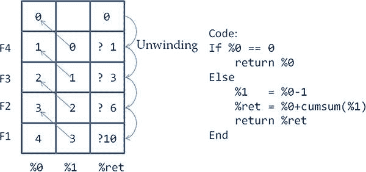

**图 4.3：** 在函数调用中，必须创建栈帧，所有内部临时变量都存储在栈上。`%0` 必须在栈展开期间保留，以便计算返回值。每一行代表在调用递归函数之前的一个栈帧。

让我们用以下方式重写此函数，在函数参数中加入一个累加器（`acc`）。

```julia
julia> function mycumsum(n, acc=0)
           if n <= 0
               return acc
           else
               return mycumsum(n-1, n+acc)
           end
       end
mycumsum (generic function with 2 methods)

julia> mycumsum(4)
10

julia> mycumsum(10)
55
```

在递归函数调用之后没有进一步的计算。聚合工作将通过累加器来完成。无需在每次函数调用时构建栈帧。

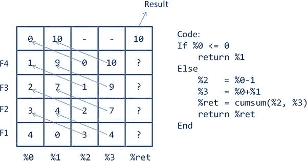

**图 4.4：** 每当调用递归函数时，都会创建一个新帧。计算按前向方向进行。由于最后一次函数调用已包含计算结果，因此无需展开栈来聚合结果。展开栈仅用于传递返回值和回收资源。

因此，函数调用可以被一条跳转指令所替代。一些函数式编程语言（如 *Lisp* 或 *Lua*）能以编程方式识别此类条件并消除栈帧的创建。这一过程称为**尾调用优化**（`TCO`）。在函数式编程中，递归比迭代编程更受重视。栈帧的创建会消耗内存。因此，深度递归函数调用可能导致栈溢出。与 Lisp 不同，Julia 没有原生支持 TCO[³]。

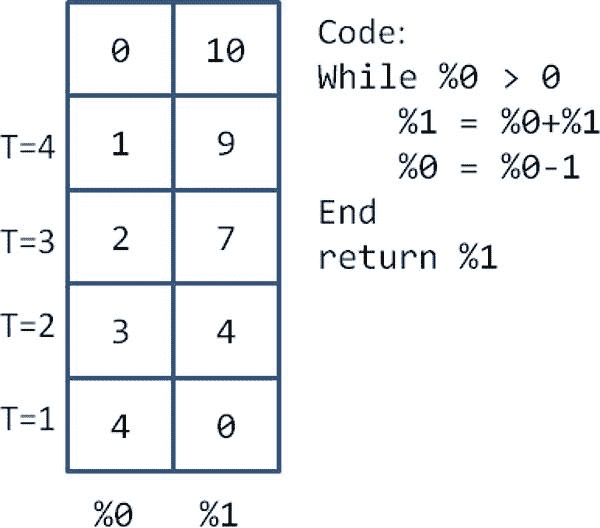

**图 4.5：** 一个支持 TCO 的优化编译器会将其转换为迭代代码。

虽然 Julia 是一门函数式编程语言，但它也完全支持迭代编程。一些程序员利用 Julia 的宏和生成式编程来模拟类 TCO 的行为。

## 多重分发

在面向对象编程中，多态用于描述方法根据其作用的对象而改变行为。简单来说，在 `rectangle` 对象上调用的 `area` 方法与在 `triangle` 对象上调用的 `area` 方法将是不同的计算。我们在前面的示例中已经看到函数会根据参数数量的不同而表现出不同的行为。在本节中，我们将看到函数可以根据参数的**类型**表现出不同的行为。在 Julia 中，当同名函数根据参数的类型和数量具有不同的行为时，它们被称为**方法**。

## 示例：面积计算

以下示例展示了两个 `area` 函数：一个用于 `Triangle` 类型，另一个用于 `Rectangle` 类型。由于这两种形状都是父抽象类型 `Shape` 的子类型，我们将修改默认的 `show` 方法，以便从 `show` 方法中调用相关的 `area` 函数。`Base.show` 是在 REPL 中显示对象时调用的默认方法。

```julia
abstract type Shape end

struct Rectangle <: Shape
    w::Float32
    h::Float32
end

struct Triangle <: Shape
    a::Float32
    b::Float32
    c::Float32
end

area(r::Rectangle) = r.w * r.h

function area(t::Triangle)
    a, b, c = t.a, t.b, t.c
    s = (a + b + c) / 2
    return sqrt(s * (s-a) * (s-b) * (s-c))
end

julia> r, t = Rectangle(3, 4), Triangle(3, 4, 5)
(Rectangle(3.0f0, 4.0f0), Triangle(3.0f0, 4.0f0, 5.0f0))

julia> area(r)
12.0f0

julia> area(t)
6.0f0

julia> Base.show(io::IO, s::Shape) =
           print(io, "Shape Type:", typeof(s), " Area:", area(s))

julia> r
Shape Type:Rectangle Area:12.0

julia> t
Shape Type:Triangle Area:6.0
```

[⁴]: 参考链接占位符。

在典型的面向对象语言中，方法与对象相关联。根据对象类型调用特定函数。这种方法分发称为**单分发接口**。然而，支持多重分发接口的语言不会将函数与特定类型关联。它们根据对象的运行时类型解析到相关的方法接口，并调用最相关的方法。`area` 方法既不是 `Rectangle` 类型的方法，也不是 `Triangle` 类型的方法。相反，它们根据对象类型从多重分发查找表中查找。这种架构在 *Lisp* 等语言中也可见。

## 构造函数

对象可能具有内在约束。创建对象时必须强制执行这些约束，以免创建无效对象。构造函数确保此类行为。在 `Rectangle` 或 `Triangle` 类型中，如果为边提供负值，就可能创建无效对象。

```julia
struct RectangleA
    w::Float32
    h::Float32
    function RectangleA(w::Real, h::Real)
        (w > 0 && h > 0) ||
            error("invalid rectangle with non-positive h or w")
        return new(w, h)
    end
end
```

现在对象的创建会调用构造函数。

```julia
julia> a = RectangleA(1.0, -4.0)
ERROR: invalid rectangle with non-positive h or w
Stacktrace:
…

julia> a = RectangleA(1//5, 4//5)
Rectangle(0.2f0, 0.8f0)

julia> a = RectangleA(1, 4)
Rectangle(1.0f0, 4.0f0)

julia> a = RectangleA(1.0, 4.0)
Rectangle(1.0f0, 4.0f0)

julia> a = RectangleA(1.0, 4)
Rectangle(1.0f0, 4.0f0)
```

构造函数可以接受任意 `Real` 数字作为参数，并确保不允许非正值作为参数的一部分。假设我们要创建两个额外的构造函数来构建正方形。


```
RectangleA(a=1.0)=RectangleA(a, a)

julia> RectangleA()
RectangleA(1.0f0, 1.0f0)
julia> RectangleA(2.0)
RectangleA(2.0f0, 2.0f0)
julia> methods(RectangleA)
# 3 methods for type constructor:
[1] RectangleA() in Main at REPL[7]:1
[2] RectangleA(w::Real, h::Real) in Main at REPL[1]:4
[3] RectangleA(a) in Main at REPL[7]:1
```

我们用一条语句创建了两个构造函数，因为另一个是由于默认参数而创建的。现在可以看到创建了 3 个构造函数。其中两个是外部构造函数，在类型定义之外声明。一个是内部构造函数，在类型定义内部声明。创建内部构造函数是为了确保强制执行构造约束。外部构造函数主要用于提供便利性和构造灵活性。当未提供构造函数时，会提供一个默认构造函数来初始化类型的属性。在前面的 `RectangleA` 示例中，当未定义其他内部构造函数时，将创建以下默认内部构造函数：

```
RectangleA(h::Float32, w::Float32)=new(h, w)
```

函数 `new` 是一个特殊函数，只能在内部构造函数内部使用。它按照字段定义的顺序初始化参数来创建对象。

## 构造函数要求

构造函数必须返回一个初始化良好的对象。在 Julia 中，预期对象在构造函数调用结束时已正确初始化。虽然出于性能原因，复合对象可能未初始化的情况确实存在，但这属于例外而非规则。构造函数必须返回其试图构造的类型的对象。

## 参数化类型与构造函数

在[前一节]中，当我们讨论参数化数据类型时，并未详细阐述它们对函数和调度接口或构造函数的影响。在我们创建的以下 `RectangleB` 类型中，我们希望将任意 Real 类型用作 Rectangle 属性的参数化类型。

```
struct RectangleB{T <: Real}
    w::T
    h::T
end
```

```
julia> RectangleB(2//3, 1//4)
RectangleB{Rational{Int64}}(2//3, 1//4)
```

```
julia> RectangleB(1f0, 2f0)
RectangleB{Float32}(1.0f0, 2.0f0)
```

```
julia> RectangleB(2//3, 1f0)
ERROR: MethodError: no method matching RectangleB(::Rational{Int64}, ::Float32)
Closest candidates are:
  RectangleB(::T, ::T) where T<:Real at REPL[6]:2
```

默认构造函数 `RectangleB(::T, ::T)` where `T<:Real` 被创建了，但 `T` 只能是一个特定类型。它不能同时是 `Rational{Int64}` 和 `Float32`。

```
julia> RectangleB{Int}('a', 1f0)
RectangleB{Int64}(97, 1)
```

然而，当我们将参数类型显式指定为构造函数的一部分时，类型会被转换为合适的类型。

## RectangleB 的方法

让我们创建两个名为 `aspect_ratio` 和 `area` 的方法。长宽比是矩形中宽度与高度的比率。面积是矩形中高度与宽度的乘积。我们在前面的示例中已经看到了 `area` 方法的实现。

```
area(r::RectangleB)=r.w*r.h
```

```
aspect_ratio(r::RectangleB)=r.w/r.h
```

```
r, r1, r2 = RectangleB(1//2, 2//3), RectangleB(1.5, 0.5), RectangleB(1, 2)
```

```
julia> area(r), area(r1), area(r2)
(1//3, 0.75, 2)
```

```
julia> aspect_ratio(r), aspect_ratio(r1), aspect_ratio(r2)
(3//4, 3.0, 0.5)
```

虽然 `area` 函数根据 Rectangle 的参数化类型返回了 `Rational{Int}` 和 `Int` 值，但在 `aspect_ratio` 函数中似乎忽略了这一点。运算符 (`/`) 显式地是浮点除法运算符。Julia 中的有理数或除法运算符是 (`//`)。让我们为 `aspect_ratio` 引入两个专门针对整数和有理数类型的额外方法。

```
aspect_ratio(r::RectangleB{T}) where T<:Union{Integer, Rational} = r.w//r.h

julia> aspect_ratio(r), aspect_ratio(r1), aspect_ratio(r2)
(3//4, 3.0, 1//2)
```

显然，`Rational` 和 `Integer` 类型的方法被调度到了新方法，而其余数值类型（如 Float64）则被调度到了旧方法。`T<:Union{Integer, Rational}` 本质上意味着该类型可以派生自 Integer 类型，也可以是 Rational 类型。Union 在 Julia 中被广泛用于表示类型是其中一种类型的情况。也可以像以下示例那样使用 3 个方法，而不使用 Union。

```
aspect_ratio(r::RectangleB{T}) where T<:Integer = r.w//r.h
```

```
aspect_ratio(r::RectangleB{T}) where T<:Rational = r.w//r.h
```

从子类型关系如何流向参数化类型的角度来理解调度规则非常重要。

```
julia> RectangleB{Rational{Int}} <: RectangleB{Rational}
false
julia> RectangleB{Rational{Int}} <: RectangleB
true
julia> RectangleB{Rational} <: RectangleB
true
```

子类型关系仅与直接参数类型相关。`RectangleB{Rational{Int}}` 不是 `RectangleB{Rational}` 的子类型，但它是 `RectangleB` 的子类型。

## 类型提升示例

让我们看看以下一些示例：

```
julia> 1f0+2
3.0f0
julia> 1f0+2.0
3.0
```

我们将一个 `Float32` 与一个 `Int` 相加，返回的结果是 `Float32`。同样，我们将 `Float32` 与 `Float64` 相加，得到的结果是 `Float64`。所有这些看起来都很自然。看起来 `Int` 被提升为 `Float32`，然后执行了加法。与其他编程语言不同，Julia 中的类型提升不是隐式的。任何类型转换都需要显式进行。Julia 核心库内部定义了许多此类规则，并显式调用它们，以便我们看到这些无缝转换。

## 类型转换

初始化任何值的典型方法是通过构造函数。例如，你可以通过指定 `Int(1.0)` 将整数浮点值 1.0 转换为 `Int`。但 `Int(1.5)` 将抛出 `InexactError`。在大多数情况下，这需要由程序员显式调用来执行。但有时转换需要通过隐式调用来执行。在这种情况下，会调用 `convert(T, x)`。

```
julia> function f()
           i::Int = 0
           i = 1.5
           return i
       end
f (generic function with 1 method)
```

```
julia> f()
ERROR: InexactError: Int64(1.5)
Stacktrace:
 [1] Int64 at .\float.jl:710 [inlined]
 [2] convert(::Type{Int64}, ::Float64) at .\number.jl:7
 [3] f() at .\REPL[88]:3
 [4] top-level scope at REPL[89]:1
```


`<strong>i</strong>` 是一个被定义为 `<strong>Int</strong>` 类型的变量。现在当值 `<strong>1.5</strong>` 被赋给它时，会调用 `convert` 方法，该方法抛出一个 `<strong>InexactError</strong>`。对于数值类型，`convert` 方法会调用 `<strong>T(x)</strong>` 或构造函数，在本例中即为 `<strong>Int64(1.5)</strong>`。一个更详尽的情况在前面的 `<strong>RectangleB</strong>` 示例中展示过。

```
julia> RectangleB{Int}('a', 1.0)
RectangleB{Int64}(97, 1)
```

在这种情况下，由于提供了 `<strong>RectangleB{Int}</strong>` 作为构造函数，`<strong>convert(Int, 'a')</strong>` 和 `<strong>convert(Int, 1.0)</strong>` 会被隐式调用，从而将 `<strong>Char</strong>` 和 `<strong>Float64</strong>` 转换为 `<strong>Int</strong>`。

```
julia> RectangleB{Int}("abc", 1.0)
ERROR: MethodError: Cannot `convert` an object of type String to an object of type Int64
Closest candidates are:
  convert(::Type{T}, ::T) where T<:Number at number.jl:6
  convert(::Type{T}, ::Number) where T<:Number at number.jl:7
  convert(::Type{T}, ::Ptr) where T<:Integer at pointer.jl:23
```

由于不存在从 `<strong>String</strong>` 到 `<strong>Int</strong>` 的 `convert` 方法，导致构造函数调用失败。

## 让我们再次看看 `<strong>RectangleP</strong>` 类型。

```
struct RectangleP{T <: Real}
    w::T
    h::T
end
```

当未指定构造函数时，会定义一个默认构造函数，其形式如下：

```
struct RectangleP{T<:Real}
    w::T
    h::T
    RectangleP(w::T, h::T) where T<:Real = new{T}(w, h)
end
```

```
julia> RectangleP(1, 2.0)
ERROR: MethodError: no method matching Rectangle(::Int64, ::Float64)
Closest candidates are:
  RectangleP(::T, ::T) where T<:Real at REPL[96]:4
```

`<strong>RectangleP(1, 2.0) 正在失败。有办法解决这个问题吗？</strong>`

```
function RectangleP(w::T1, h::T2) where {T1<:Real, T2<:Real}
    w1, h1 = promote(w, h)
    return RectangleP(w1, h1)
end

julia> RectangleP(1, 2.0)
RectangleP{Float64}(1.0, 2.0)
```

我们定义了一个支持两个参数的外部构造函数。这些参数可以源自 `<strong>Real</strong>` 但彼此不同。我们在参数上调用 `<strong>promote</strong>` 方法以获取提升后的函数参数，随后用这些提升后的参数创建 `<strong>RectangleP</strong>`。这里可以理解为，在 `<strong>Int</strong>` 和 `<strong>Float64</strong>` 的提升中，`<strong>Float64</strong>` 将是提升后的类型。这种行为将在以下示例中变得清晰。假设我们要找到能分别放入两个 `<strong>RectangleP</strong>` 对象内部的最小尺寸 `<strong>RectangleP</strong>`。

```
julia> function minrect(r1::RectangleP, r2::RectangleP)
           w = r1.w < r2.w ? r1.w : r2.w
           h = r1.h < r2.h ? r1.h : r2.h
           return RectangleP(w, h)
       end
minrect (generic function with 1 method)
julia> minrect(RectangleP(1, 2), RectangleP(2.0, 0.5))
RectangleP{Float64}(1.0, 0.5)
julia> minrect(RectangleP(1, 2), RectangleP(3.0, 4.0))
RectangleP{Int64}(1, 2)
```

虽然前面的代码没有错误，但你可以注意到一个异常：函数根据输入数据返回 `<strong>RectangleP{Float64}</strong>` 或 `<strong>RectangleP{Int}</strong>`。从类型稳定性的角度来看，这绝对是不可取的。当 `<strong>RectangleP{Float64}</strong>` 和 `<strong>RectangleP{Int}</strong>` 发生交互时，我们可以创建一个 `<strong>Base.promote_rule</strong>`，以便发生正确的提升。

```
Base.promote_rule(::Type{RectangleP{T}}, ::Type{RectangleP{S}}) where {T<:Real, S<:Real} = RectangleP{promote_type(S, T)}

Base.convert(::Type{RectangleP{T}}, x::RectangleP{S}) where {T<:Real, S<:Real} = S === T ? x : RectangleP(T(x.w), T(x.h))
```

```
function minrect(tr1::RectangleP, tr2::RectangleP)
    r1, r2 = promote(tr1, tr2)
    w = r1.w < r2.w ? r1.w : r2.w
    h = r1.h < r2.h ? r1.h : r2.h
    return RectangleP(w, h)
end
```

```
julia> minrect(RectangleP(1, 2), RectangleP(3.0, 4.0))
RectangleP{Float64}(1.0, 2.0)
```

为了保持一致性，我们必须确保提升发生在一致的类型上。由于 `<strong>Float64</strong>` 与 `<strong>Int64</strong>` 的提升结果是 `<strong>Float64</strong>`，我们希望确保 `<strong>RectangleP{Float64}</strong>` 和 `<strong>RectangleP{Int}</strong>` 之间的提升结果为 `<strong>RectangleP{Float64}</strong>`。其次，我们创建一个 convert 方法，用于从 `<strong>RectangleP{S}</strong>` 转换到 `<strong>RectangleP{T}</strong>`。当在 `<strong>minrect</strong>` 中调用 `promote` 时，`<strong>promote_rule</strong>` 和 convert 方法会在内部被调用。数据被转换为 `<strong>RectangleP{Float64}</strong>`。因此，最终的返回类型将是 `<strong>RectangleP{Float64}</strong>`。

## 函数是 Julia 的核心

函数是 Julia 的核心。凭借类型变体和分发架构，Julia 从函数和方法中获得了最大的威力。我们探讨了函数和方法的各种用例，并讨论了参数化数据类型所带来的复杂性。在下一章中，我们将了解集合，并学习如何遍历它们以及如何在其中提取和存储数据。

# 练习

1.  在八皇后谜题中，我们只得到了一个解。还有其他可能的解吗？扩展代码以找到所有可能的解。

2.  随着棋盘尺寸的增加，求解 N 皇后谜题所需的时间会增加。作者在他的环境中发现，求解棋盘尺寸为 30 时的等待时间极高。在你的环境中是多少？如何使程序更高效以降低该限制？

3.  由于 Julia 不支持尾调用优化，栈溢出的可能性可能很大。你认为如何克服栈溢出？

4.  当显式指定参数类型时，Julia 构造函数的表现会有所不同。为什么会这样？

5.  内部构造函数和外部构造函数有什么区别？外部构造函数是必需的吗？

---

## 参考资料

[1] Julia 拥有一套详尽的运算符和符号，它们可以是 Unicode 集合的一部分。借助内联运算符，你可以像编写数学方程一样编写表达式。我们将保持一个简化的观点，即运算符在 Julia 中是函数。然而，建议读者查阅 Julia 文档 ([`docs.julialang.org/en/v1/manual/mathematical-operations/`](https://docs.julialang.org/en/v1/manual/mathematical-operations/))，以详细了解运算符的优先级和结合性。

[2] `:x` 的类型是 `Symbol`。符号是 Julia 中用于创建自定义关键字的特殊用途类型。我们将在第 8 章“元编程”中回顾它们。

[3] Julia GitHub Issue 4964 ([`github.com/JuliaLang/julia/issues/4964`](https://github.com/JuliaLang/julia/issues/4964))


4 维基百科关于多重分派的文章 (`https://en.wikipedia.org/wiki/Multiple_dispatch`)

`1//5` 是 Julia 中分数的一种表示形式。

# 4

因此，函数调用可以被替换为跳转指令。一些函数式编程语言，如 *Lisp* 或 *Lua*，会以编程方式识别此类条件并消除栈帧的创建。此过程称为**尾调用优化** (`TCO`)。在函数式编程中，递归比迭代编程更受重视。栈帧的创建会消耗内存。因此，深层的递归函数调用可能导致栈溢出。与 Lisp 不同，Julia 没有原生支持 TCO3。

# 1

Julia 拥有一套精心设计的运算符和符号，它们可以是 Unicode 集合的一部分。借助内联运算符，你可以像编写数学方程一样编写表达式。我们将保持一个简化的观点，即运算符在 Julia 中就是函数。不过，建议读者查阅 Julia 文档（**https://docs.julialang.org/en/v1/manual/mathematical-operations/**）以详细了解运算符的优先级和结合性。

Julia Github Issue 4964（**https://github.com/JuliaLang/julia/issues/4964**）

维基百科关于多重分派的文章 (`https://en.wikipedia.org/wiki/Multiple_dispatch`)

# 集合

每种编程语言都提供一组最基本的数据结构，用于将多个数据元素作为容器表示；即数组、字典、集合和列表等。Julia 提供的集合是本章讨论的主题。

## 涵盖主题

在本章中，我们将涵盖以下主题：

*   预定义数据结构
*   元组
*   范围
*   数组
*   关联集合
*   迭代
*   迭代框架
*   生成器和推导式

## 学习目标

在本章中，读者将能够学习数组、元组、字典和集合。集合为某些算法的解决方案提供了基础。它们实现了一个迭代器框架，可帮助遍历集合的各个元素。生成器和推导式提供按需的类集合接口，也可用于迭代。

## 简介

1975 年，*Niklaus Wirth*——一位著名的计算机科学家和编程语言 PASCAL 的作者——撰写了《算法 + 数据结构 = 程序》1 一书；明确强调了数据结构和算法在编程中的重要性。几乎没有任何现代编程语言不提供对数据结构的内置支持。Julia 也不例外。许多数据结构定义在 Julia 核心语言中，而大量数据结构则定义在诸如 `DataStructures.jl` 之类的包中。在本章中，我们的重点将是语言中定义的、无需使用任何额外包即可使用的数据结构。举几个例子：

1.  元组
2.  数组
3.  字典
4.  集合

虽然这些是 Julia 核心语言中定义的一些主要数据结构，但还有许多用于专门应用的次要数据结构。我们可能无法在一章中谈论所有这些结构，但如果需要，会在各种语境中不时讨论它们。

# 元组

元组在 Julia 中非常常见，以至于我们往往会忽略它们作为一种专门的数据结构。在前面的章节中，我们已经看到了元组的一些属性。以下是其功能的总结：

1.  不可变
2.  异构
3.  可用于模式匹配
4.  元素可通过索引访问

以下是一些示例：

```
julia> a = (1, "string", 1.0)
(1, "string", 1.0)
julia> typeof(a)                                          # 异构
Tuple{Int64,String,Float64}
julia> a[1]                                               # 通过索引访问
1
julia> a[1] = 6                                           # 不可变
ERROR: MethodError: no method matching setindex!(::Tuple{Int64,String,Float64}, ::Int64, ::Int64)
Stacktrace:
 [1] top-level scope at REPL[29]:1
julia> b, c = a                                           # 模式匹配
(1, "string", 1.0)
julia> b
1
julia> c
"string"
```

我们还看到了元组类型在可变参数函数中的一些用法。

## NTuple

`NTuple{N, T}` 是一个包含 `N` 个类型为 `T` 元素的 `Tuple` 的参数化定义。

```
julia> NTuple{3, Int}
Tuple{Int64,Int64,Int64}
```

你可以创建一个接受元组参数的方法，如下所示：

`f(::NTuple{3, Int})` 代替 `f(::Tuple{Int64,Int64,Int64})`。

当你想要创建一个具有特定模式的 `N` 个参数的 `Tuple` 时，可以使用 `ntuple` 函数。

```
julia> a = ntuple(x->4, 10)
(4, 4, 4, 4, 4, 4, 4, 4, 4, 4)
julia> typeof(a)
NTuple{10,Int64}
```

```
julia> a = ntuple(i->i*1.0, 10)
(1.0, 2.0, 3.0, 4.0, 5.0, 6.0, 7.0, 8.0, 9.0, 10.0)
julia> typeof(a)
NTuple{10,Float64}
```

## 元组作为集合

`Tuple` 可用作项目的集合。这意味着它们可以被迭代，并将拥有集合典型的函数，如 `length`。

```
julia> length(a)
10
julia> for i=1:length(a)
           println(a[i])
       end
1.0
2.0
3.0
4.0
5.0
6.0
7.0
8.0
9.0
10.0
```

## 带有 NTuple 的参数化类型

在 `NTuple` 类型中一个相关的观察是，它有一个整数类型的参数。同样的适用于任何可变或不可变类型。让我们创建一个可用于 2 维或 3 维的 `Point` 类型。

```
struct Point{N}
    data::NTuple{N, Float32}
    Point(d…)=new{length(d)}(d)
end
```

```
const Point2D = Point{2}
const Point3D = Point{3}

function dist(p1::Point2D, p2::Point2D)
    dx, dy = (p1.data[1] - p2.data[1], p1.data[2] - p2.data[2])
    return sqrt(dx*dx+dy*dy)
end
```

```
function dist(p1::Point3D, p2::Point3D)
    dx, dy, dz = (p1.data[1] - p2.data[1],
                  p1.data[2] - p2.data[2],
                  p1.data[3] - p2.data[3])
    return sqrt(dx*dx+dy*dy+dz*dz)
end
```

```
julia> dist(Point(1, 2), Point(3, 4))
2.828427f0
julia> dist(Point(1, 2, 3), Point(3, 4, 5))
3.4641016f0
```


在前面的示例中，我们可以将 `Point2D` 和 `Point3D` 定义为 `Point{N}` 的别名。我们为这两种类型定义了两个 `dist` 函数，并确保了基于整数值 2 或 3 的分发可用。`Point{2}` 和 `Point{3}` 是两种截然不同的类型。以 `NTuple` 作为集合类型，让我们尝试拥有一个适用于 `Point{N}` 的 `dist` 方法。

```julia
function dist(p1::Point{N}, p2::Point{N}) where N
    sumval = 0f0
    for i=1:N
        d = p1.data[i] - p2.data[i]
        sumval += d*d
    end
    return sqrt(sumval)
end
```

```julia
julia> dist(Point(1, 2), Point(3, 4))
2.828427f0
julia> dist(Point(1, 2, 3), Point(3, 4, 5))
3.4641016f0
```

如果我们使用不带参数形式 `Point{N}` 的 `Point`，会不会是错的？`Point{2}` 和 `Point{3}` 是两种不同的类型。因此 `dist` 函数将为这两种不同的类型编译。我们本可以创建一个单一的 `dist` 函数。

```julia
function dist(p1::Point, p2::Point)
    N = length(p1.data)
    sumval = 0f0
    for i=1:N
        d = p1.data[i] - p2.data[i]
        sumval += d*d
    end
    return sqrt(sumval)
end
```

```julia
julia> dist(Point(1, 2), Point(3, 4))
2.828427f0
julia> dist(Point(1f0, 2f0, 3f0), Point(1, 2))
ERROR: BoundsError: attempt to access (1.0f0, 2.0f0) at index [3]
Stacktrace:
…
```

现在我们可以将 `Point{2}` 和 `Point{3}` 的参数传递给同一个函数。只创建了一个方法。没有为 `Point{2}` 和 `Point{3}` 版本编译两个方法。什么是正确的方法？不幸的是，这是一个设计决策，而不是编程语言概念。你认为 `Point2D` 和 `Point3D` 是可互操作的，我们应该支持一个针对 `Point{N1}` 和 `Point{N2}` 的可互操作的 `dist` 方法吗？这里是一个可能的实现。

```julia
function dist(p1::Point{N}, p2::Point{N}) where N
    sumval = 0f0
    for i=1:N
        d = p1.data[i] - p2.data[i]
        sumval += d*d
    end
    return sqrt(sumval)
end

function dist(p1::Point{N1}, p2::Point{N2}) where {N1, N2}
    N1 > N2 && return dist(p2, p1)
    tp = Point(p1.data..., ntuple(i->0f0, N2-N1)...)
    return dist(tp, p2)
end
```

*   我们为具有相同维度 `N` 的 `Point{N}` 创建了一个方法。
*   然后我们创建了一个方法，其中不同维度的 `Point` 可以作为输入。
*   这里，我们假设第一个参数的维度将小于第二个。
*   如果不是这样，我们通过翻转参数来调用该方法。从而确保第一个参数的维度小于第二个（N1 < N2）。
*   我们通过为更高维度填充零来创建一个与 `p2` 维度相同的 `temporary point`（`tp`），并调用 `dist(tp, p2)`。

## 

让我们看看以下代码的控制流：

```julia
if val == 1
    f1()
elseif val == 2
    f2()
elseif val == 3
    f3()
else
    f4()
end
```

这些函数能否使用多重分发代替 `if…elseif…else`？

```julia
struct MyVal{N}
    MyVal(N)=new{N}()
end
```

```julia
f(::MyVal{N}) where N = N
```

```julia
function f(::MyVal{1})
    println("Called from 1")
end
```

```julia
julia> f(MyVal(2))
2
julia> f(MyVal(1))
Called from 1
```

*   `MyVal{N}` 基于 `N` 的值定义类型。
*   方法 `f` 适用于 `MyVal{N}` 的所有值。
*   仅为 `MyVal{1}` 定义了一个特化的方法 `f`。
*   现在 `f(MyVal(2))` 调用了通用方法，而 `f(MyVal(1))` 调用了特定方法。

## 

当一个类型没有属性时，只为它创建一个对象。这样的对象称为 `singletons`。创建的值类型也是一个单例，因为该类型没有属性。

```julia
julia> MyVal(1) === MyVal(1)
true
julia> MyVal(1) === MyVal(2)
false
```

`MyVal{1}` 与 `MyVal{2}` 是不同的类型。因此，作为初始化一部分创建的对象是两个不同的对象。虽然值参数在 Julia 中是可能的，但它可能不是最优性能的方法。Julia 原生提供了一个类型 `Val{N}`，符合建议的原则。我们将在 Julia 性能管理章节进一步讨论这一点。

**注意**：不仅是 `Integer` 类型，甚至 `Symbol` 也可以用作值类型参数。

```julia
julia> MyVal(:a)
MyVal{:a}()
```

## 

有时我们需要连续的数字或具有固定步长的数字，无论是增加还是减少。这些被称为 **ranges**（范围）。以下是一些示例：

## 

```julia
julia> a=1:5
1:5
julia> typeof(a)
UnitRange{Int64}
```

`a` 是一个 `UnitRange`，意味着它包含从 1 到 5 的所有数字。`UnitRange` 的增量步长始终为 1。

```julia
julia> for i=a
           println(i)
       end
1
2
3
4
5
```

## 

```julia
julia> b=1:2:5
1:2:5
julia> typeof(b)
StepRange{Int64,Int64}
julia> for i=b
           println(i)
       end
1
3
5
```

`b` 是一个步长为 2 的 `StepRange`。

## 

```julia
julia> c=5:-1:1
5:-1:1
julia> typeof(c)
StepRange{Int64,Int64}
julia> for i=c
           println(i)
       end
5
4
3
2
1
```

`c` 是一个步长为 -1 的 `StepRange`。因此迭代时我们按从 5 到 1 的递减顺序打印。

范围用于迭代、索引和初始化集合。它们可以具有更复杂的参数，也可以对初始值、步长和最终值使用浮点数。我们将在后面的章节中回顾涉及的范围对象。这里只是一个带有浮点值的范围示例。

```julia
julia> d=1:2.1:6.0
1.0:2.1:5.2
julia> typeof(d)
StepRangeLen{Float64,Base.TwicePrecision{Float64},Base.TwicePrecision{Float64}}
```


# 数组基础

数组可以被视为特定类型的连续内存位置，作为容器存放对象。它们可以通过索引访问并进行迭代。与 `Tuple` 不同，数组是可变的。数组中的元素可以被追加、移除或修改。甚至可以将数组作为容器来实现队列和栈等其他数据结构。在本节中，我们将介绍数组的基础知识，详细内容将在专门的数组章节中解释。

数组表示为 `Array{T, N}`，其中 `T` 是类型，`N` 是维度数。`Array{T, 1}`（一维数组）别名为 `Vector`，`Array{T, 2}` 别名为 `Matrix`。这两者在科学计算中具有特殊含义。

```julia
julia> v = [1, 2, 3]
3-element Vector{Int64}:
 1
 2
 3
```

```julia
julia> m = [1 2 3]
1×3 Matrix{Int64}:
 1  2  3
```

`v` 是 `Vector{Int64}` 或 `Array{Int64,1}`。类似地，`m` 是 `Matrix{Int64}` 或 `Array{Int64, 2}`。多维数组可以通过在一对方括号 `[]` 内组合逗号 `,` 和分号 `;` 符号来构造。

```julia
julia> m1 = [1 2 3; 4 5 6]
2×3 Matrix{Int64}:
 1  2  3
 4  5  6

julia> m2 = [1 2; 3 4; 5 6]
3×2 Matrix{Int64}:
 1  2
 3  4
 5  6
```

可以看到，分号 `;` 在定义中充当行分隔符。

## 索引访问

数组成员可以通过索引访问。以下是使用前面定义的矩阵 `m1` 和 `m2` 的一些示例：

```julia
julia> m1[1, 2]
2

julia> m1[2, 2]
5

julia> m2[1, 2]
2

julia> m2[2, 2]
4
```

因此，数组成员的访问方式为：

`array[row_index, column_index]`

数组中的数据作为分配给某个位置的连续内存块存储。索引根据索引值指向数组的特定位置。下图展示了 `m1` 和 `m2` 的内存布局：

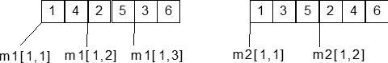

**图 5.1：** m1 和 m2 的内存布局

与 C/C++ 中数据按 1, 2, 3, 4, 5, 6 顺序存储不同，Julia 在两种情况下的存储顺序看起来都有显著差异。Julia 按列主序存储数据，这与 FORTRAN 类似。这本质上意味着数据将按行的所有元素相邻存储，然后是下一列。这对于习惯用 C/C++ 或 Python 编程的程序员来说可能有点困惑。其次，Julia 的索引从 1 开始，而不是像 C/C++ 或 Python 那样从 0 开始（这与 FORTRAN 一致）。作为一门科学计算语言，而 FORTRAN 在该社区仍然流行，这种选择并不完全格格不入。

## 循环优化

虽然对于小数组尺寸这可能不相关，但对于大到超大数组尺寸（内存分页可能很显著的情况），在行上运行内层循环、在列上运行外层循环可能是有益的。在多维数组中，最右边的维度必须构成外层循环，而左边的维度必须指定为内层循环。推荐的伪代码如下：

```julia
for col = 1:100000
    for row = 1:1000
        do_something(m[row, col])
    end
end
```

## 数组构造函数

以下是一些示例构造函数：

```julia
julia> Array{Int}(undef, 1, 2)
1×2 Matrix{Int64}:
 2728944785  4294967297

julia> Array{Int}(undef, 2)
2-element Vector{Int64}:
 1
 1

julia> Array{Int, 2}(undef, (2, 3))
2×3 Matrix{Int64}:
 150  377672960  41
 41   152        377672961

julia> Array{Float32}(undef, (2, 3))
2×3 Matrix{Float32}:
 1.55068f-25  1.55069f-25  1.09216f-24
 0.0          0.0          0.0
```

`undef` 是一种特殊类型的对象，用于定义包含未定义值的数组。Julia 对象通常在实例化时初始化。数组作为一种容器类型，有时需要在内部值未知时定义它们。通用构造函数的类型为 `Array{T,N}(undef, dims)`，其中 `dims` 是大小为 N 的元组或包含 N 个值的可变参数。在模板参数中指定 N 是可选的。也可以调用 `Array{T}(undef, dims)`。

对于 `Array{T,N}`，当 T 是 `isbits` 类型时，数组会完全分配并填充未初始化的位模式。因此打印的值是不可预测的。例如：

```julia
julia> struct A
           i::Int
           f::Float64
       end

julia> a = A(1, 1); isbits(a)
true

julia> aarr = Array{A}(undef, (2, 2))
2×2 Matrix{A}:
 A(164260512, 8.08607e-316)  A(163663952, 1.81629e-315)
 A(164260512, 8.08607e-316)  A(163679936, 1.84617e-315)
```

现在让我们看看非位类型数组的场景：

```julia
julia> struct T
           a::A
           b
       end

julia> b = T(A(1, 1), 1); isbits(b)
false

julia> barr = Array{T}(undef, (2, 2))
2×2 Matrix{T}:
 #undef  #undef
 #undef  #undef
```

当 `isbits` 为 `false` 时，虽然分配的 `Array` 拥有容器，但实际对象未被初始化。实际对象需要被赋值以正确初始化数组。

```julia
julia> barr[1,1] = barr[2,1] = barr[1,2] = barr[2,2] = b
T(A(1, 1.0), 1)

julia> barr
2×2 Matrix{T}:
 T(A(1, 1.0), 1)  T(A(1, 1.0), 1)
 T(A(1, 1.0), 1)  T(A(1, 1.0), 1)
```

你也可以体会到数组的可变性，元素可以在数组用 `undef` 值初始化后被赋值。

就像 N 维通用 `Array{T,N}` 一样，`Vector{T}` 和 `Matrix{T}` 也可以有类似的构造函数。

```julia
julia> Vector{Int}(undef, 3)
3-element Vector{Int64}:
 230300096
 397935296
 336143200

julia> Matrix{Int}(undef, 3, 3)
3×3 Matrix{Int64}:
 163998752  163998752  163998752
 163998752  163998752  163998752
 163998752  163998752  163998752
```

虽然构造函数是初始化数组的一种方式，但还有其他便捷方法，我们将在接下来回顾。


# Julia 数组与关联集合操作

## 创建填充数组

给定类型和维度，函数会创建一个指定类型的、填充了零或一的 `Array`。

```julia
julia> zeros(Float32, (2, 3))
2×3 Matrix{Float32}:
 0.0  0.0  0.0
 0.0  0.0  0.0

julia> ones(Float32, (2, 3))
2×3 Matrix{Float32}:
 1.0  1.0  1.0
 1.0  1.0  1.0

julia> ones(UInt8, (2, 3))
2×3 Matrix{UInt8}:
 0x01  0x01  0x01
 0x01  0x01  0x01
```

让我们看看以下两段代码的对比：

```julia
julia> zb = zeros(Bool, (8, 8))
8×8 Matrix{Bool}:
 0  0  0  0  0  0  0  0
 …
 0  0  0  0  0  0  0  0

julia> sizeof(zb)
64
```
可以看到，一个 `Bool` 变量占用 1 字节存储空间，因此该数组需要 64 字节的数据空间。

```julia
julia> z = falses(8, 8)
8×8 BitMatrix:
 0  0  0  0  0  0  0  0
 …
 0  0  0  0  0  0  0  0

julia> sizeof(z)
8
```

变量 `z` 的大小仅为 8 字节（64 位），因为所有条目都用单个位表示。此时创建的不是 `Array`，而是 `BitArray`。`BitArray` 是存储布尔值数组的高效方式，因为它用 1 位存储 1 位信息，而不是 1 字节。类似于 `falses`，`trues(dims)` 可用真值位初始化 `BitArray`。

## `fill` 函数

`fill(val, dims)` 创建一个填充 `val` 值的数组。数组的类型取决于 `val` 值的类型。

```julia
julia> a = fill(5.0, (2, 2))
2×2 Matrix{Float64}:
 5.0  5.0
 5.0  5.0

julia> a = fill(5, (2, 2))
2×2 Matrix{Int64}:
 5  5
 5  5
```

## `similar` 函数

`similar(a, elem_type, dims)` 通过使用数组 `a` 的默认元素类型和/或 `dims` 维度，创建一个未初始化的指定 `elem_type` 类型的 `Array`。

```julia
julia> b = similar(a, Int)
2×2 Matrix{Int64}:
 665953152  665953936
 665953600                    0
```

## `collect` 函数

`collect(elem_type, collection)` 是一个实用方法，用于从集合中的所有数据创建一个 `Array`。

```julia
julia> collect(1:3)
3-element Vector{Int64}:
 1
 2
 3

julia> collect(Float64, 1:2:3)
2-element Vector{Float64}:
 1.0
 3.0
```

## `reshape` 函数

数组在内存中作为线性连续块分配，索引以行优先格式覆盖在其上。`reshape` 是实现这一目的的便捷方法。

```julia
julia> a = collect(1:16)
16-element Vector{Int64}:
  1
  2
  3
  …
 16

julia> b = reshape(a, (4, 4))
4×4 Matrix{Int64}:
 1  5   9  13
 2  6  10  14
 3  7  11  15
 4  8  12  16

julia> c = reshape(b, (2, 8))
2×8 Matrix{Int64}:
 1  3  5  7   9  11  13  15
 2  4  6  8  10  12  14  16

julia> d = reshape(c, (8, 2))
8×2 Matrix{Int64}:
 1   9
 2  10
 3  11
 4  12
 5  13
 6  14
 7  15
 8  16
```

虽然数组的形状发生了变化，但数据的行优先排序仍保持原有序列。

## 数组拼接方法

这些方法通过组合输入数组创建新的 `Array` 对象。

### `vcat` (垂直拼接)

`vcat` 创建一个数组，将输入数组沿维度 1（垂直方向）放置。对于矩阵集合，效果类似于将数组一个接一个地向下堆叠。

```julia
julia> vcat([1 2; 3 4], [5 6; 7 8], [9 10; 11 12])
6×2 Matrix{Int64}:
  1   2
  3   4
  5   6
  7   8
  9  10
 11  12
```

### `hcat` (水平拼接)

`hcat` 创建一个数组，将输入数组沿维度 2（水平方向）放置。对于矩阵集合，效果类似于将数组一个接一个地向右放置。

```julia
julia> hcat([1 2; 3 4], [5 6; 7 8], [9 10; 11 12])
2×6 Matrix{Int64}:
 1  2  5  6   9  10
 3  4  7  8  11  12
```

### `hvcat` (分块拼接)

`hvcat(rows::Tuple{Int}, arrays…)` 利用第一个参数中 `rows` 元组的数据形成行，然后将形成的行堆叠在一起形成最终数组。

```julia
julia> hvcat((2, 2, 2), [1, 2], [3, 4], [5, 6], [7, 8], [9, 10], [11, 12])
6×2 Matrix{Int64}:
  1   3
  2   4
  5   7
  6   8
  9  11
 10  12
```

在上述示例中，向量以每组 2 个并排放置，从而创建了 3 个间歇矩阵。

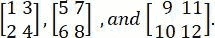

将它们垂直堆叠即可得到最终输出。

```julia
julia> hvcat(6, [1, 2], [3, 4], [5, 6], [7, 8], [9, 10], [11, 12])
2×6 Matrix{Int64}:
 1  3  5  7   9  11
 2  4  6  8  10  12
```

同样地，在上述示例中，6 个向量并排放置形成一个矩阵。

## 关联集合

在关联集合中，集合的元素以键值对形式存储。值可以通过索引键或对键的高效搜索来访问。常见的集合包括字典、多重字典、集合（集合仅保留键，忽略值）。大多数关联集合派生自抽象类型 `AbstractDict{K, V}`。

### `Dict{K,V}`

`Dict{K,V}` 是 Julia 中使用的简单关联集合。参数类型 `K` 用作键，类型 `V` 用作值。唯一的要求是为类型 `K` 定义了哈希函数。

```julia
julia> d = Dict("a"=>1, "c"=>2, "b"=>3)
Dict{String,Int64} with 3 entries:
  "c" => 2
  "b" => 3
  "a" => 1

julia> d["b"]
3

julia> d["a"] = 5
5

julia> println(d)
Dict("c" => 2,"b" => 3,"a" => 5)
```

`Dict{K,V}` 不能为同一个键保存多个值。定义中重复的键会覆盖先前定义的值。

```julia
julia> d = Dict("a"=>1, "c"=>2, "b"=>3, "a"=>4)
Dict{String,Int64} with 3 entries:
  "c" => 2
  "b" => 3
  "a" => 4
```

### `get` 函数

`get(dict, key, defval)` 方法用于从 `Dict` 对象中提取信息。以下是几个示例：

```julia
julia> get(d, "a", 3)
4

julia> get(d, "e", 0)
0
```


当键是 `<strong>Dict</strong>` 的一部分时，将返回与该键关联的值。然而，当键不可用时，将返回函数中指定的默认值。

大多数情况下，`<strong>Dict{K,V}</strong>` 对象的使用方式类似于数组，键作为索引。使用 `<strong>getindex</strong>` 或其别名 `[]` 从字典中获取值。与 `get` 方法不同，当键在字典中未找到时，`<strong>getindex</strong>` 会抛出 `ErrorException`。

```
julia> getindex(d, "e")
ERROR: KeyError: key "e" not found
Stacktrace:
 [1] getindex(::Dict{String,Int64}, ::String) at .\dict.jl:467
 [2] top-level scope at REPL[21]:1
julia> getindex(d, "a")
4
julia> d["e"]
ERROR: KeyError: key "e" not found
Stacktrace:
 [1] getindex(::Dict{String,Int64}, ::String) at .\dict.jl:467
 [2] top-level scope at REPL[23]:1
```

`<strong>get!(dict, key, value)</strong>` 方法类似于 `<strong>get(dict, key, defval)</strong>` 方法，但会在键不可用时将键及其值插入字典。在前面的示例中：

```
julia> get!(d, "a", 0)
4
julia> get!(d, "e", 0)
0
julia> d
Dict{String,Int64} with 4 entries:
  "c" => 2
  "e" => 0
  "b" => 3
  "a" => 4
```

**注意：** 在 Julia 中，有一个通用约定，即在会修改参数值的函数名称末尾添加感叹号（`!`）。由于 `<strong>get!(dict, key, value)</strong>` 方法会改变对象 `<strong>dict</strong>`，因此在末尾添加了感叹号。

---

就像 `get` 方法一样，`<strong>setindex!</strong>` 方法或作为左值使用的别名 `[]`。

```
julia> d["e"] = 10
10
```

或者不太常见的用法：

```
julia> setindex!(d, 11, "e")
Dict{String,Int64} with 4 entries:
  "c" => 2
  "e" => 11
  "b" => 3
  "a" => 4
```

---

为了使 `<strong>Dict{K,V}</strong>` 正常工作，应实现 `<strong>hash(k::K, h::Int)</strong>`。该函数为 `<strong>k</strong>` 的每个实例返回一个唯一的整数。这种唯一性确保 `<strong>Dict{K,V}</strong>` 中只存储一个键。

---

`<strong>Set</strong>` 是一种集合，其中每个元素只能存在一个实例。`<strong>Set</strong>` 中元素的顺序并不重要。以下示例突出了一些 `<strong>Set</strong>` 方法。

```
julia> s = Set([2 3 4 5 1 2 3])
Set{Int64} with 5 elements:
  4
  2
  3
  5
  1
julia> 6 in s
false
julia> 5 in s
true
julia> t = Set([4 5 7 8 9])
Set{Int64} with 5 elements:
  7
  4
  9
  5
  8
```

```
julia> union(s, t)
Set{Int64} with 8 elements:
  7
  4
  9
  2
  3
  5
  8
  1
julia> intersect(s, t)
Set{Int64} with 2 elements:
  4
  5
julia> union!(s, t)
Set{Int64} with 8 elements:
  7
  4
  9
  2
  3
  5
  8
  1
julia> s
Set{Int64} with 8 elements:
  7
  4
  9
  2
  3
  5
  8
  1
```

`<strong>union!</strong>` 的工作方式类似于 `union`，但会更新第一个参数。就像 `<strong>union</strong>` 一样，`<strong>symdiff</strong>` 和 `<strong>setdiff</strong>` 方法分别定义用于对称差集和差集。`<strong>issubset</strong>` 方法提供一个集合与另一个集合的子集关系。

---

迭代是集合的基本操作之一。我们将观察如何将各种迭代操作用于集合。

---

经典的 Julia `<strong>for</strong>` 循环将索引变量映射到范围对象并对其进行迭代。

```
julia> for i=5:-2:1
            println(i)
        end
5
3
1
```

循环不限于范围对象。也可以使用其他类型的集合。以下是一些示例：

```
julia> b = [1.0 2 3; 4 5 6; 7 8 9];
julia> for i=b
            println(i)
        end
1.0
4.0
7.0
2.0
5.0
8.0
3.0
6.0
9.0
```

除了 `<strong>for…=</strong>`，也可以使用 `<strong>for…in</strong>`。这种 for 循环的表示法与前一种类似，只是语法看起来更适合集合。让我们看看针对字典对象的用法。

```
julia> for p in d
            println(p)
        end
"e" => 2
"b" => 4
"a" => 1
"d" => 3
```

`<strong>Dict{K,V}</strong>` 元素作为 `<strong>Pair{K,V}</strong>` 存储，默认打印为：`k => v`。

```
julia> for (k, v) in d
            println("Key:", k," Value:", v)
        end
Key:e Value:2
Key:b Value:4
Key:a Value:1
Key:d Value:3
```

---

让我们看一个以数组为输入并返回所有值的平方作为数组的函数。

```
function collect_square(v)
    a = similar(v)
    for i=1:length(v)
        a[i] = v[i]*v[i]
    end
    return a
end
julia> collect_square(1:4)
4-element Vector{Int64}:
 1
 4
 9
 16
```

如果我们要扩展此函数，使其返回计算任意函数后的值而不是平方，可以按以下方式扩展：

```
function collect_function(f::Function, v)
    a = similar(v)
    for i=1:length(v)
        a[i] = f(v[i])
    end
    return a
end
julia> collect_function(x->x³, 1:4)
4-element Vector{Int64}:
 1
 8
 27
 64
```

调用同一方法的另一种方法是 `<strong>function…do</strong>` 表示法，如下所示。

```
julia> collect_function(1:4) do x
            return x³
        end
4-element Vector{Int64}:
 1
 8
 27
 64
```

`<strong>map</strong>` 是一个具有类似表示法的函数。它将集合的每个元素值映射并对每个元素应用一个函数，将函数求值的结果作为集合返回。

```
julia> map(1:4) do x
            return x³
        end
4-element Vector{Int64}:
 1
 8
 27
 64
```


# Julia 中的迭代框架与自定义迭代器

我们已经看到了一些使用 `for` 循环迭代序列和集合的示例。之所以能够实现这一点，是因为所有这些类型都实现了迭代框架。如果你要编写自定义迭代器，可能需要实现这个框架。虽然此处强调了一些基本概念，但建议你阅读 Julia 文档 3 以获取相关细节。

```
julia> v = collect(3:2:10)
4-element Vector{Int64}:
 3
 5
 7
 9
julia> for i=v
           println(i)
       end
3
5
7
9
```

同样的操作可以用以下形式编写：

```
julia> next = iterate(v)
(3, 2)
julia> while next !== nothing
           value, state = next
           println(value)
           next = iterate(v, state)
       end
3
5
7
9
```

## 核心迭代方法

`iterate(collection)` 返回第一个元素和初始状态，如果不存在值则返回 `nothing`。

在前面示例的返回值 `(3, 2)` 中，`3` 是第一个元素的值，`2` 是一个代表状态的内部参数。虽然它看起来像下一个值的索引，但不应做此假设，因为这些完全取决于具体实现。

`iterate(collection, state)` 返回下一个元素和下一个状态，如果不存在额外元素则返回 `nothing`。

所有迭代器类型都必须实现 `iterate` 方法。

## 可选迭代器方法

这些是迭代器作者可选择定义的方法。

`IteratorSize(IterType)` 是一个辅助方法，用于说明迭代器是否具有长度或形状。根据此方法，集合迭代器必须定义 `size` 和/或 `length` 方法。

```
julia> Base.IteratorSize(Vector{Int})
Base.HasShape{1}()
```

`IteratorEltype(IterType)` 是一个辅助方法，用于决定迭代器是否具有特定的元素类型。

```
julia> Base.IteratorEltype(Vector{Int})
Base.HasEltype()
```

`eltype(IterType)` 返回 `iterate` 方法第一个参数的类型。

```
julia> eltype(Vector{Int})
Int64
```

这些方法的详细解释可以在 Julia 的文档中找到。

## 示例：自定义 `Squares` 迭代器

我们创建一个 `Squares` 类型，它将提供一个数字平方序列，直到存储在该类型中的值。

```
struct Squares
    value::Int
end
```

```
Base.iterate(s::Squares) = s.value <= 0 ? nothing : (1, 2)

Base.iterate(s::Squares, state) = s.value < state ? nothing :
                                   (state*state, state+1)

julia> for i=Squares(3)
           println(i)
       end
1
4
9
```

虽然前面的代码适用于简单的 `for` 循环，但尝试使用 `collect` 创建数组将无法工作。

```
julia> collect(Squares(3))
ERROR: MethodError: no method matching length(::Squares)
…
```

因此我们添加一个 `length` 方法来实现相同功能。

```
julia> Base.length(s::Squares)=s.value
julia> collect(Squares(3))
3-element Vector{Any}:
 1
 4
 9
```

虽然数组已正确填充，但类型却是 `Any`。定义 `eltype(IteratorType)` 方法将确保创建具有正确类型的 `Array`。

```
Base.eltype(::Type{Squares})=Int

julia> eltype(Squares)
Int64

julia> collect(Squares(3))
3-element Vector{Int64}:
 1
 4
 9
```

**注意：** `Type{Squares}` 是一种特殊类型，其唯一的实例对象是 `Squares`。这是必需的，因为 `eltype` 是类型本身的函数，而不是类型实例的函数。

## 推导式与生成器

在 Julia 中，数组和集合广泛用于科学计算。语言提供对数组创建和操作的便捷访问显得尤为重要。推导式提供了创建此类数组的便利性。

```
julia> [i*i for i=1:3]
3-element Vector{Int64}:
 1
 4
 9
julia> [i*j for i=1:3, j=1:3]
3×3 Matrix{Int64}:
 1  2  3
 2  4  6
 3  6  9
```

在前面的示例中，推导式被用来创建一维和多维数组。以下是一个索引可能依赖于另一个索引的示例。

```
julia> [i*j for i=1:3 for j=i:3]
6-element Vector{Int64}:
 1
 2
 3
 4
 6
 9
```

推导式会计算完整的数组，有时也需要一种延迟执行的迭代器，即仅在需要时计算值，而不是一次性计算所有元素。这些被称为**生成器**。

```
julia> gen=(i*j for i=1:3 for j=i:3)
Base.Iterators.Flatten{Base.Generator{UnitRange{Int64},var"#6#7"}}(Base.Generator{UnitRange{Int64},var"#6#7"}(var"#6#7"(), 1:3))
julia> for v=gen
           println(v)
       end
1
2
3
4
6
9
```

## 总结

集合为一类算法提供了简单且可扩展的接口，并提供了统一的迭代器接口来访问元素。在本章中，我们回顾了 Julia 核心语言中定义的几个简单数据结构。然而，对于像 Julia 这样以计算为中心的语言来说，这些只是冰山一角。建议你查看 `DataStructures.jl` 包，以更详细地了解 Julia 可用的数据结构。同样，如果你正在实现自定义数据结构，建议为你的数据结构实现迭代器接口，使其兼容 Julia 语言的迭代框架，如 `for`、`while` 循环等。

# 练习

1.  在初始化数组时，空格 (` `)、逗号 (`,`) 和分号 (`;`) 符号被使用。当它们被包含在方括号 (`[]`) 内时，是否有任何特殊的运算符含义？

2.  选择一个你喜欢的数据结构并在 Julia 中实现它。编写该数据结构所需的基本操作。为其编写迭代器接口，以便可以使用 `for…in` 语法迭代该数据结构。

3.  `Dict` 类型要求必须为键定义哈希函数。尝试实现一个表现得像 `Dict` 但不强制要求键具有 `hash` 函数的 `MyDict` 类型。

4.  `Dict` 使用 `hash` 函数。但是，几乎所有 Julia 类型都存在 `hash` 函数。为什么要使用 `hash` 函数？如果未定义 `hash` 函数，是否还有其他功能可能无法工作？

5.  创建一个生成器，从 1 迭代到 100，并返回除能被 3 整除的数字之外的所有数字。

____________________________________

1 Wirth, Nicklaus, Algorithms + Data Structures = Programs, Prentice-Hall, 1976.


# Julia 数组与数据结构

## 类型别名

在 Julia 1.5 及更早版本中，你可能会看到 `Matrix` 类型被打印为 `Array{T, 2}`，`Vector` 类型被打印为 `Array{T, 1}`。`Matrix` 和 `Vector` 类型是 `Array{T, N}` 的别名。

# 参考文献

3. Julia 文档：迭代接口。([`docs.julialang.org/en/v1/manual/interfaces/#man-interface-iteration`](https://docs.julialang.org/en/v1/manual/interfaces/#man-interface-iteration))

Wirth, Nicklaus, *Algorithms + Data Structures = Programs*, Prentice-Hall, 1976.

## 迭代框架

我们已经看到了一些使用 `for` 循环迭代序列和集合的示例。之所以能够实现这一点，是因为所有这些类型都实现了迭代框架。如果你要编写自定义迭代器，可能需要实现此框架。虽然此处强调了一些基本概念，但建议阅读 Julia 文档[3]以获取相关详细信息。

## 数据结构概述

1975 年，著名计算机科学家、PASCAL 语言作者 *Niklaus Wirth* 撰写了《算法 + 数据结构 = 程序》[1]，明确强调了数据结构和算法在编程中的重要性。几乎没有现代编程语言不提供内置的数据结构支持。Julia 也不例外。许多数据结构定义在核心 Julia 语言中，大量数据结构定义在诸如 `DataStructures.jl` 之类的包中。本章将重点介绍语言中定义的、无需使用额外包即可使用的数据结构。例如：

## 数组进阶应用

在上一章中，我们介绍了简单数组以及其他形式的集合，并演示了如何迭代集合。然而，数组在 Julia 中扮演着重要角色，它提供高性能容器，由内存管理，并能在原生应用程序间传输数据。本章将介绍数组的一些高级应用。有时操作直接定义在数组上；或者通过简单的语法修改即可执行复杂的数组操作。

## 本章主题

*   容器
*   维度
*   索引
*   切片
*   广播
*   归约
*   抽象数组类型
*   稀疏数组
*   线性代数

## 学习目标

读者将能够了解数组、向量和矩阵的用例，以及与数组相关的抽象数据类型，从而设计自己的数组类型。数组具有多种索引方案。它们可以被切片为多个部分，组合成数组视图以减少大规模分配。稀疏数组可减少空间或内存分配。

## 数组特性

数组是用于各种操作的最常见集合，因为它们是可变的、可扩展的，且在正确使用时效率很高。本章讨论的某些主题对新手用户可能较为高级。因此，建议随着你对语言经验的积累，稍后再回顾本章的相关部分。

## 向量作为容器

向量作为容器是一种非常常见的用例。栈、队列、二叉堆等数据结构通常使用一维数组或向量实现。Julia 提供了简单的函数来处理这些情况，无需额外实现。以下示例展示了向量用作栈的能力。

```julia
julia> a = []
Any[]

julia> push!(a, 5)
1-element Vector{Any}:
 5

julia> push!(a, 5, 6, 7, 8)
5-element Vector{Any}:
 5
 5
 6
 7
 8

julia> pop!(a)
8
```

上述方法的应用将导致向量按以下方式修改。操作结束时，也可以使用 `empty!(vector)` 方法清空容器。

```julia
julia> length(a)
4

julia> isempty(a)
false

julia> empty!(a)
Any[]

julia> isempty(a)
true
```

让我们看看数组作为队列的操作。

```julia
julia> push!(a, 1, 2, 3, 4, 5)
5-element Vector{Any}:
 1
 2
 3
 4
 5

julia> popfirst!(a)
1

julia> a
4-element Vector{Any}:
 2
 3
 4
 5

julia> pushfirst!(a, 1)
5-element Vector{Any}:
 1
 2
 3
 4
 5
```

`pushfirst!(v, value)` 是在向量开头添加 `value` 的方法。

> **注意**：虽然 `pushfirst!` 和 `popfirst!` 方法存在，但它们不是最高效的，因为插入和删除第一个元素可能需要复制或移动元素。

## 数组维度

数组可以是任意维度的。虽然我们在上一章主要学习了向量（维度 1）和矩阵（维度 2），但本章将介绍更多高维数组。

```julia
julia> a = reshape(collect(1:24), 4, 3, 2)
4×3×2 Array{Int64, 3}:
[:, :, 1] =
 1  5  9
 2  6 10
 3  7 11
 4  8 12
[:, :, 2] =
 13 17 21
 14 18 22
 15 19 23
 16 20 24

julia> ndims(a)
3

julia> size(a)
(4, 3, 2)

julia> size(a, 3)
2
```

`reshape` 接受一个集合并创建指定形状的数组。`ndims` 提供数组的维度数，而 `size` 提供每个维度的元素数量。特定维度的数组大小由 `size(array, dim)` 报告。数组的内存布局如下图所示：

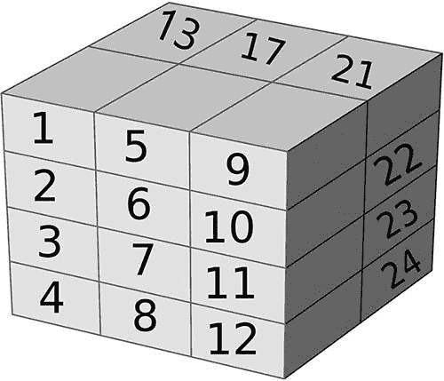

**Figure 6.1:** Array shown in 3-D with row-major indexing in Julia

# 索引

数组使用类型为 `A[I_1, I_2, …, I_n]` 的表达式进行索引。`I_i` 是索引，可以是我们将在本节探讨的各种类型。

### 标量索引

索引表达式最简单的形式可以是标量或数字。以下是一些示例：

```julia
julia> a = reshape(collect(1:24), 4, 3, 2, 1)
4×3×2×1 Array{Int64,4}:
[:, :, 1, 1] =
 1  5  9
 2  6 10
 3  7 11
 4  8 12
[:, :, 2, 1] =
 13 17 21
 14 18 22
 15 19 23
 16 20 24

julia> a[1, 2, 1, 1]
5
```

### 范围索引

索引表达式也可以是范围。`Colon(:)` 具有特殊含义，表示该维度的所有索引。

```julia
julia> a[:, 1, 1, 1]
4-element Vector{Int64}:
 1
 2
 3
 4

julia> a[2:3, 1, 1, 1]
2-element Vector{Int64}:
 2
 3

julia> a[1:2:3, 1, 1, 1]
2-element Vector{Int64}:
 1
 3
```

如所见，范围对象可以是任何整数范围类型，如 `UnitRange`、`StepRange` 等。也可以使用多个范围索引作为索引表达式。这将生成多维数组，其中包含从范围指定位置选取的元素。

```julia
julia> a[1:2:3, 1:2:3, 1, 1]
2×2 Matrix{Int64}:
 1  9
 3 11
```


# 索引表达式与维度

当索引表达式为向量或非标量时，会向输出引入额外的维度。以下是一些示例：

```
julia> a[1:2:3, 1:2:3, [1], [1]]
2×2×1×1 Array{Int64,4}:
[:, :, 1, 1] =
 1   9
 3  11
```

如前面的示例所示，创建的是一个 `2×2×1×1` 的数组，而不是 `2×2` 的数组。默认情况下，索引向量被假定为具有行向量的一维结构。

```
julia> a[1:2:3, [1; 3], 1, 1]
2×2 Matrix{Int64}:
 1   9
 3  11
julia> a[1:2:3, [1, 3], 1, 1]
2×2 Matrix{Int64}:
 1   9
 3  11
```

当索引不按行顺序排列时，输出将无法在此情况下合并为 `2×2` 矩阵：

```
julia> b = a[1:2:3, [1 3], 1, 1]
2×1×2 Array{Int64,3}:
[:, :, 1] =
 1
 3
[:, :, 2] =
 9
 11
```

生成了一个 `2×1×2` 的矩阵。同样，通过提供多维索引，可以创建更复杂的矩阵。

```
julia> a[:, [2], [1], [1]]
4×1×1×1 Array{Int64,4}:
[:, :, 1, 1] =
 5
 6
 7
 8
julia> a[[1 2; 3 4], [2], [1], [1]]
2×2×1×1×1 Array{Int64,5}:
[:, :, 1, 1, 1] =
 5  6
 7  8
```

这里，第一个索引中引入多维索引给矩阵增加了一个额外的维度。该矩阵具有 `2×2×1×1×1` 的维度。前两列是基于索引参数 `[1 2; 3 4]` 对 `a[:, [1], [1], [1]]` 的第 1 列进行重新排列得到的。

# 线性索引

我们在上一章讨论过，数组以行优先的方式存储在连续的内存位置中，索引作为底层数据的覆盖层进行操作。底层数据可以作为单个整数索引访问。这种索引方式称为 `linear indexing`（线性索引）。

```
julia> a = reshape(collect(1:6), (2, 3))
2×3 Matrix{Int64}:
 1  3  5
 2  4  6
julia> a[5]
5
julia> a[1, 3]
5
```

存在一个名为 `LinearIndices` 的类型，有助于创建这种映射。

```
julia> LinearIndices(a)
2×3 LinearIndices{2,Tuple{Base.OneTo{Int64},Base.OneTo{Int64}}}:
 1  3  5
 2  4  6
```

# 笛卡尔索引

笛卡尔索引是一个数字元组，作为数组的维度来表示一个元素。

```
julia> A = reshape(collect(1:6), 3, 2)
3×2 Matrix{Int64}:
 1  4
 2  5
 3  6
julia> ci = CartesianIndices(A)
3×2 CartesianIndices{2,Tuple{Base.OneTo{Int64},Base.OneTo{Int64}}}:
 CartesianIndex(1, 1)  CartesianIndex(1, 2)
 CartesianIndex(2, 1)  CartesianIndex(2, 2)
 CartesianIndex(3, 1)  CartesianIndex(3, 2)
```

使用笛卡尔索引还是线性索引取决于对象和数据的组织方式。随着我们查看视图和子数组，稍后将进一步回顾这些主题的细节。

# 布尔索引

布尔索引更像是作用于数据的过滤器。

```
julia> x = reshape(collect(1:16), 4, 4)
4×4 Matrix{Int64}:
 1  5   9  13
 2  6  10  14
 3  7  11  15
 4  8  12  16
julia> filter = map(ispow2, x)
4×4 Matrix{Bool}:
 1  0  0  0
 1  0  0  0
 0  0  0  0
 1  1  0  1
julia> x[filter]
5-element Vector{Int64}:
  1
  2
  4
  8
 16
```

虽然逻辑索引似乎仅用于选取过滤器值为 `true` 的特定值，但结合范围索引可以观察到有趣的变化。例如，以下示例完整选取了第 2 行和第 3 行。

```
julia> x[[false, true, true, false], :]
2×4 Matrix{Int64}:
 2  6  10  14
 3  7  11  15
```

# 赋值索引

我们处理的大多数索引示例都与从数组中提取信息有关，即所谓的 `l-valued expressions`（左值表达式）。然而，类似的表达式也可用于为数组元素赋值。

```
julia> a = reshape(collect(1:24), 4, 3, 2, 1);
julia> a[:, 2, 1, 1] = fill(25, 4)
4-element Vector{Int64}:
 25
 25
 25
 25
julia> a
4×3×2×1 Array{Int64,4}:
[:, :, 1, 1] =
 1  25   9
 2  25  10
 3  25  11
 4  25  12
[:, :, 2, 1] =
 13  17  21
 14  18  22
 15  19  23
 16  20  24
```

# `begin` 和 `end` 关键字索引

为了方便在集合中遍历，有时会使用 `begin` 和 `end` 等专用关键字作为索引。甚至可以将这些索引与某些数值运算结合使用。前面数组的元素可以按如下方式访问：

```
julia> a[begin, :, 2, 1], a[begin+1, :, 2, 1]
([13, 17, 21], [14, 18, 22])

julia> a[end, :, 2, 1], a[end-1, :, 2, 1]
([16, 20, 24], [15, 19, 23])
```

# 索引访问相关方法

以下方法针对数组或所有支持索引访问元素的集合（如 `Dict`）定义。

- `getindex(X, i)`：当访问 `X[i]` 时，返回位置 `i` 处元素的值。在多维数组中，当访问 `X[I_1, I_2, …, I_n]` 时，扩展为使用表达式 `getindex(X, I_1, I_2, …, I_n)`。
- `setindex!(X, v, i)`：将值 `v` 赋给位置 `i` 处的数组元素。在多维数组中，表达式 `X[I_1, I_2, …, I_n] = v` 在内部会调用 `setindex!(X, v, I_1, I_2, …, I_n)`。
- `firstindex(X)`：提供使用表达式 `X[begin]` 时的索引。`firstindex(X, dim)` 也可用于特定维度 `dim`。
- `lastindex(X)`：提供使用表达式 `X[end]` 时的索引。与 `firstindex` 类似，`lastindex` 也可以接受维度作为参数。

```
julia> firstindex(a)
1
julia> lastindex(a)
24
julia> lastindex(a, 1)
4
julia> lastindex(a, 2)
3
julia> lastindex(a, 3)
2
julia> lastindex(a, 4)
1
```

# 切片

切片是通过指定索引来使用数组的一部分。以下是一些示例：

```
julia> a = reshape(collect(1:9), 3, 3)
3×3 Matrix{Int64}:
 1  4  7
 2  5  8
 3  6  9
julia> a[:, 1]
3-element Vector{Int64}:
 1
 2
 3
julia> a[1, :]
3-element Vector{Int64}:
 1
 4
 7
julia> a[1, 2:3]
2-element Vector{Int64}:
 4
 7
```

虽然大多数示例都很简单，但我们想引起您对 `a[1, :]` 和 `a[1, 2:3]` 的注意。这两者本应是行矩阵。然而，Julia 会返回一个一维向量。


# Julia 数组切片、视图与广播操作

## 数组切片与内存分配

```julia
julia> b = a[1:2, :]
2×3 Matrix{Int64}:
 1  4  7
 2  5  8

julia> b[1, 2] = 10
10

julia> b
2×3 Matrix{Int64}:
 1  10  7
 2   5  8

julia> a
3×3 Matrix{Int64}:
 1  4  7
 2  5  8
 3  6  9
```

使用索引进行切片操作会分配新数组。如上所示，修改数组 `b` 不会影响数组 `a` 中的数据。这会导致大量内存分配，并可能碎片化应用程序内存池。其次，非增值分配会影响性能。让我们重写该示例：

## 使用 `@view` 宏创建视图

```julia
julia> v = @view a[1:2, :]
2×3 view(::Matrix{Int64}, 1:2, :) with eltype Int64:
 1  4  7
 2  5  8

julia> v[1, 2] = 10
10

julia> v
2×3 view(::Matrix{Int64}, 1:2, :) with eltype Int64:
 1  10  7
 2   5  8
```

宏 `@view`（我们将在后续章节讨论宏）在引用数组 `a` 的相同对象的同时，在数组周围创建一个视图。由于视图没有自己的数据，修改视图也会导致底层容器数组中的数据被修改。

```julia
julia> a
3×3 Matrix{Int64}:
 1  10  7
 2   5  8
 3   6  9
```

## 矩阵运算

让我们看一些矩阵运算。

```julia
julia> a = reshape(collect(1:9), 3, 3)
3×3 Matrix{Int64}:
 1  4  7
 2  5  8
 3  6  9

julia> b = reshape(collect(9:-1:1), 3, 3)
3×3 Matrix{Int64}:
 9  6  3
 8  5  2
 7  4  1

julia> a + b
3×3 Matrix{Int64}:
 10  10  10
 10  10  10
 10  10  10
```

数组 `a` 的每个元素都与数组 `b` 的对应元素相加，最终结果是一个与输入数组维度相同的数组。这之所以可行，是因为对于矩阵或数组，运算符 `+` 被定义为逐元素操作。让我们看看乘法运算或运算符 `*`。

```julia
julia> a * b
3×3 Matrix{Int64}:
  90  54  18
 114  69  24
 138  84  30
```

返回的结果不是逐元素乘法，而是矩阵乘法，也称为**数组内积**。如果我们要对数组进行逐元素操作，可以使用 `broadcast` 方法。

```julia
julia> broadcast(*, a, b)
3×3 Matrix{Int64}:
  9  24  21
 16  25  16
 21  24   9
```

同样的操作也可以用内联点号语法（`.*`）表示。

```julia
julia> a .* b
3×3 Matrix{Int64}:
  9  24  21
 16  25  16
 21  24   9
```

如果数组 `a` 和 `b` 大小不同会怎样？它们能在元素层面交互吗？保持 `a` 不变，让我们把 `b` 变成行向量和列向量并观察结果。

```julia
julia> a = reshape(collect(1:9), 3, 3)
3×3 Matrix{Int64}:
 1  4  7
 2  5  8
 3  6  9

julia> b = [1 2 3]
1×3 Matrix{Int64}:
 1  2  3

julia> a .+ b
3×3 Matrix{Int64}:
 2  6  10
 3  7  11
 4  8  12
```

同样地，当 `b` 是列向量时：

```julia
julia> b = [1, 2, 3]
3-element Vector{Int64}:
 1
 2
 3

julia> a .+ b
3×3 Matrix{Int64}:
 2  5  8
 4  7  10
 6  9  12
```

当其中一个数组是行向量或列向量时，如果维度在该方向上与另一个向量匹配，它们会沿着向量长度进行广播。虽然是在数组上下文中讨论的，但广播可以应用于任何集合类型。以下示例展示了跨集合的字符串逐元素连接。

```julia
julia> broadcast(string, ("one","two","three","four"), ": ", 1:4)
4-element Vector{String}:
 "one: 1"
 "two: 2"
 "three: 3"
 "four: 4"
```

```julia
# 你可以将前面的示例写为：
# string.(("one","two","three","four"), ": ", 1:4)
# string 后面的点号 (.) 会调用 broadcast 方法。
```

`": "` 只有一个条目，它重复 4 次以便与其他被广播的集合保持一致的映射。

## `broadcast` 与 `repeat` 的对比

有人可能会想，`broadcast` 的效果可以用 `repeat` 轻松模拟。`repeat` 接受数组的元素，并沿指定的各个维度重复它们。

```julia
julia> v = [1, 2]
2-element Vector{Int64}:
 1
 2

julia> repeat(v, 2, 3)  # 在维度 1 重复两次，维度 2 重复三次
4×3 Matrix{Int64}:
 1  1  1
 2  2  2
 1  1  1
 2  2  2
```

这种说法不完全错。然而，每次调用 `repeat` 都会分配数组，并带来性能惩罚。`broadcast` 消除了这种额外分配的需求。

```julia
julia> a + repeat(b, 1, 3)
3×3 Matrix{Int64}:
 2  5  8
 4  7  10
 6  9  12
```

## `map` 与 `broadcast` 的区别

在讨论 `broadcast` 时，重新审视我们之前讨论的 `map` 函数是有价值的。与 `broadcast` 在需要时重复元素不同，`map` 函数执行一对一映射。如下例所示，`map` 函数只返回一个长度为 3 的数组，匹配 `a` 和 `b` 的最小维度。

```julia
julia> a
3×3 Matrix{Int64}:
 1  4  7
 2  5  8
 3  6  9

julia> b
3-element Vector{Int64}:
 1
 2
 3

julia> map(+, a, b)
3-element Vector{Int64}:
 2
 4
 6
```

## 数组归约操作

数组上的归约操作类似于汇总。类似于数据库聚合和 `GROUP BY` 子句，可以沿行和列对数组进行聚合。将数组元素映射到特定函数并按行和列归约结果是相当常见的结果。就像 `broadcast`、`map` 和 `reduce` 方法一样，确保中间分配最小化。


# Julia 数组操作与抽象数组

## Reduce、Foldl 与 Foldr

```julia
julia> a = reshape(collect(1:16), (2, 2, 2, 2))
2×2×2×2 Array{Int64,4}:
[:, :, 1, 1] =
 1  3
 2  4
[:, :, 2, 1] =
 5  7
 6  8
[:, :, 1, 2] =
  9  11
 10  12
[:, :, 2, 2] =
 13  15
 14  16

julia> reduce(+, a)
136
```

给定集合 `a`，`reduce` 方法对所有元素应用二元操作（`+`）并返回所有元素的和。

让我们将前面的示例从操作符 `+` 替换为操作符 `-`。左结合性将产生与右结合性完全不同的结果。Julia 提供了两个方法 `foldl` 和 `foldr`，它们本质上是 `reduce` 方法在左结合性和右结合性下的表现形式。我们可以使用结合性操作符（`=>`）来仔细观察这些差异。

```julia
julia> foldl(=>, [1, 2, 3, 4])
((1 => 2) => 3) => 4

julia> foldr(=>, [1, 2, 3, 4])
1 => (2 => (3 => 4))

julia> reduce(=>, [1, 2, 3, 4])
((1 => 2) => 3) => 4
```

通过将操作符（`=>`）替换为操作符（`-`），可以观察到结果的差异。

```julia
julia> foldl(-, [1, 2, 3, 4])
-8

julia> foldr(-, [1, 2, 3, 4])
-2

julia> reduce(-, [1, 2, 3, 4])
-8
```

## Mapreduce

集合可以映射到特定函数，并将结果归约为聚合结果。一个名为 `mapreduce` 的专用函数可以同时结合这两种操作。

```julia
julia> mapreduce(x->x*x, +, [1, 2, 3, 4])
30
```

前面的示例计算集合元素平方和。

## Mapslices

我们迄今为止处理的所有映射和归约方法，对其他集合类型同样适用，正如它们对数组适用一样。`mapslices` 是一个特殊函数，它与数组特别是数组切片紧密相关。

```julia
julia> a = reshape(collect(1:16), 2, 2, 2, 2);

julia> mapslices(sum, a, dims=[1, 2])
1×1×2×2 Array{Int64,4}:
[:, :, 1, 1] =
 10
[:, :, 2, 1] =
 26
[:, :, 1, 2] =
 42
[:, :, 2, 2] =
 58
```

该函数在数组的前 2 个维度上应用 `sum` 函数并报告结果。

## 抽象数组接口

到目前为止，我们观察到数组有两个不同的操作。首先，它提供数据存储的容器；其次，它提供访问和修改数据的各种方法。迭代、索引和切片可以被视为数据的各种访问方法。具体类型如 `Array{T,N}` 满足这两种需求，但在存储要求上是僵化的。例如，一个只有对角线元素的矩阵只需要 `N` 个元素来存储数据。一个三对角矩阵，其对角线及平行于对角线的前后元素被定义，只需要 `3N-2` 个元素来存储数据。使用 `Array{T,2}` 或 `Matrix` 存储此类数据将是浪费的，因为需要 `N*N` 的存储空间。`AbstractArray{T,N}` 是一个用于解决此类需求的接口。以下是派生类型预期实现的一些功能，以便它们能与其他数组类型无缝协作。

1.  `size` 接口，提供数组在所有已定义维度上的大小。
2.  索引接口 `getindex` 和 `setindex!`，用于访问和修改数组数据。
3.  迭代器接口，使数组表现得像一个集合。
4.  `similar` 接口，在需要时将专用数组转换为等效的 `Array{T,N}` 类型。
5.  `axes` 方法，支持非标准索引（如从 0 开始索引等）。

虽然我们建议读者查阅 Julia 文档[1]以获得完整理解，但我们通过示例代码展示一些实现以便于理解。

> **注意：** `AbstractVector{T}` 和 `AbstractMatrix{T}` 分别是 `AbstractArray{T,1}` 和 `AbstractArray{T,2}` 的别名。

我们实现一个单位矩阵。单位矩阵的对角线元素定义为 1，所有其他元素为 0。由于它们具有固定模式，不需要 `setindex!` 方法。

```julia
struct MyIdentity{T} <: AbstractMatrix{T}
    l::Int
end

Base.size(m::MyIdentity) = (m.l, m.l)

Base.size(m::MyIdentity, d) = (d == 1 || d == 2) ? m.l :
    error("Invalid dimensions")

function Base.getindex(m::MyIdentity{T}, i, j) where {T}
    1 <= i <= m.l && 1 <= j <= m.l || error("Invalid indices")
    i == j && return one(T)
    return zero(T)
end
```

仅这一简单定义就能提供一个功能几乎完备的单位矩阵。

```julia
julia> a = MyIdentity{Int}(3)
3×3 MyIdentity{Int64}:
 1  0  0
 0  1  0
 0  0  1

julia> a[2, 1]
0

julia> a = MyIdentity{Float32}(3)
3×3 MyIdentity{Float32}:
 1.0  0.0  0.0
 0.0  1.0  0.0
 0.0  0.0  1.0

julia> size(a)
(3, 3)

julia> size(a, 2)
3

julia> length(a)
9
```

仅定义 `size` 和 `getindex` 方法就能处理矩阵的大部分行为。这是由于 Julia 基础库中定义的默认行为。现在如果我们将一个向量与 `MyIdentity{T}` 矩阵相乘，应该得到相同的向量。

```julia
julia> a[5] # Linear Indexing
1.0f0

julia> a * [1, 2, 3]
3-element Vector{Float32}:
 1.0
 2.0
 3.0
```

## 稀疏数组

稀疏数组是我们之前讨论的 `AbstractArray` 概念的扩展。稀疏数组的本质是减少数组所需的总体存储。在许多数值应用中，任意行和列组合中的大多数值可以是 0，而非零值仅出现在特定位置。例如，对角矩阵仅在对角线元素上有数据。稀疏数组更进一步，允许将值存储在一个向量中，并使用一个或多个索引向量存储值的位置[2]。

> **注意：** 稀疏数组是 Julia 标准库（`stdlib`）中 `SparseArrays` 模块的一部分。请确保在使用任何与稀疏数组相关的类型或方法之前，通过命令 `using SparseArrays` 导入符号。我们将在后续章节详细讨论模块。

```julia
using SparseArrays

struct SparseVector{Tv, Ti<:Integer} <:
    AbstractSparseVector{Tv, Ti}
    n::Int                  # Length of the sparse vector
    nzind::Vector{Ti}       # Indices of stored values
    nzval::Vector{Tv}       # Stored values, typically nonzeros
end
```


`nzval` 是存储所有非零值的向量，而 `nzind` 是这些值的索引位置，其中 `n` 是稀疏向量的长度。

```julia
using SparseArrays
I = [1, 4, 3, 5]; V = [1, 2, -5, 3];
R = sparsevec(I,V)
```

```text
5-element SparseVector{Int64,Int64} with 4 stored entries:
  [1]  =  1
  [3]  =  -5
  [4]  =  2
  [5]  =  3
```

由于 `I` 向量中的最大索引值为 5，因此创建了一个 5 元素的向量。向量 `R` 的成员可以像普通向量一样访问。

```julia
R[2]
```

```text
0
```

`findnz` 方法提供存储非零值的所有索引位置。本质上，给定一个稀疏向量或矩阵，它会报告 `nzind` 和 `nzval` 向量。

```julia
findnz(R)
```

```text
([1, 3, 4, 5], [1, -5, 2, 3])
```

# 稀疏矩阵存储（CSC 格式）

进一步推广稀疏向量的概念，可以通过为第二维度添加一个向量来存储矩阵。然而，为了更好的存储管理，通常采用以下方法。

1.  列索引按递增顺序存储在一个向量中。
2.  行索引存储在第二个向量中，当列索引发生冲突时，按递增顺序存储。
3.  值存储在一个单独的向量中，用于相同的目的。

这个概念称为**压缩稀疏列**（`CSC`）。虽然该格式存储效率极高，但不利于插入或修改，因为任何插入都可能需要将向量中的所有值向右移动。

```julia
struct SparseMatrixCSC{Tv,Ti<:Integer} <: AbstractSparseMatrix{Tv,Ti}
    m::Int                  # 行数
    n::Int                  # 列数
    colptr::Vector{Ti}      # 第 j 列位于
                            # colptr[j]:(colptr[j+1]-1)
    rowval::Vector{Ti}      # 存储值的行索引
    nzval::Vector{Tv}       # 存储的值，通常为非零值
end
```

```julia
I = [1, 4, 3, 5]; J = [4, 7, 18, 9]; V = [1, 2, -5, 3];
S = sparse(I, J, V)
```

```text
5×18 SparseMatrixCSC{Int64, Int64} with 4 stored entries:
⠀⠈⠀⡀⠀⠀⠀⠀⠠
⠀⠀⠀⠀⠁⠀⠀⠀⠀
```

```julia
findnz(S)
```

```text
([1, 4, 5, 3], [4, 7, 9, 18], [1, 2, 3, -5])
```

```julia
S[1, 2]
```

```text
0
```

```julia
size(S)
```

```text
(5, 18)
```

正如稀疏向量示例所示，`SparseMatrixCSC` 具有创建、访问和操作矩阵的类似函数。我们将把使用这些数据结构的细节留给读者，并建议参考语言文档以了解相关内容，这既是为了节省篇幅，也因为这些结构可能增加的复杂性。

### 性能考量

虽然稀疏数据结构利于存储，但可能不是索引和迭代的最佳选择。使用这些结构时，务必小心数据访问的复杂性。即使是简单的索引访问，也可能需要扫描索引和数据向量的很大一部分。虽然非零值的增量迭代访问可能很高效，但特定索引的随机访问可能不那么高效。

# Julia 中的线性代数

虽然我们迄今为止回顾的大多数概念都是数组、向量和矩阵的表示层面，但本节是关于将它们应用于解决数学和科学计算问题。Julia 的线性代数功能聚合在 `stdlib` 下的一个名为 `LinearAlgebra` 的模块中。因此，在使用这些方法和数据结构之前，需要使用以下语句。

```julia
using LinearAlgebra
```

Julia 线性代数模块可以被认为包含 3 个不同的部分。

1.  Julia 原生的基本矩阵和向量运算
2.  LAPACK 函数
3.  BLAS 函数

基础模块包含矩阵运算，如转置（`tr`）、求逆（`inv`）、点积（`dot`）等。还有进一步的方法，如奇异值分解（`svd`）、下三角和上三角分解等。还有一个特征模块，提供各种矩阵类型的特征值计算。我们将不在这里深入探讨这些概念。不过，我们建议读者查阅语言文档 3。在后续章节中，我们将根据需要有选择地介绍其中一些方法。

## 总结

作为一门面向研究社区的科学编程语言，Julia 提供了先进的数组、向量和矩阵表示及方法。我们在这里探讨了一些概念，并介绍了一些高级主题的存在。虽然数组是 Julia 的关键数据结构之一，但字符串也是编程中同样重要的方面。我们将在下一章探讨字符串，这将帮助我们更好地理解文本处理。

# 练习

1.  使用 `Vector` 实现一个二叉堆。
2.  通过 `@view` 宏创建的 View 类型中，数组索引是如何转换的？是否可能存在一个数组，其某一维度中的某些索引是无效的？
3.  使用 `AbstractMatrix` 接口创建一个 `MyTridiagonal` 矩阵，并与其维度之一大小相同的行矩阵进行广播加法（`+`）运算。
4.  如果要表示一个对角矩阵，应该使用 `SparseMatrixCSC` 吗？为什么这样做不是个好主意？
5.  Julia 是否提供矩阵 LU 分解的线性代数方法？如果有，请通过示例展示其应用。

---

1 抽象数组接口，Julia 文档，[`docs.julialang.org/en/v1/manual/interfaces/#man-interface-array`](https://docs.julialang.org/en/v1/manual/interfaces/#man-interface-array)

2 稀疏数组，Julia 文档，[`docs.julialang.org/en/v1/stdlib/SparseArrays/#Sparse-Arrays`](https://docs.julialang.org/en/v1/stdlib/SparseArrays/#Sparse-Arrays)

3 线性代数，Julia 语言文档，[`docs.julialang.org/en/v1/stdlib/LinearAlgebra/`](https://docs.julialang.org/en/v1/stdlib/LinearAlgebra/)

稀疏数组是我们之前讨论的 `AbstractArray` 概念的扩展。稀疏数组的本质是减少数组所需的总体存储。在许多数值应用中，任意行和列组合的大多数值可以是 0，而非零值仅出现在特定位置。例如，对角矩阵仅在对角线元素上有数据。稀疏数组更进一步，允许将值存储在一个向量中，并用一个或多个索引向量存储值的位置 2。


基础模块包含矩阵运算，如转置（`tr`）、求逆（`inv`）、点积（`dot`）等。还有进一步的方法，如奇异值分解（`svd`）、下三角和上三角分解等。还有一个特征值模块，提供各种矩阵类型的特征值计算。我们将不在这里深入探讨这些概念。不过，我们建议读者查阅语言文档 3。在后面的章节中，我们将根据需要有选择地介绍其中一些方法。

虽然我们建议读者通读 Julia 文档 1 以全面理解该概念，但我们将通过示例代码展示一些实现，以便于理解。

**参考资料**

*   线性代数，Julia 语言文档，[`docs.julialang.org/en/v1/stdlib/LinearAlgebra/`](https://docs.julialang.org/en/v1/stdlib/LinearAlgebra/)
*   抽象数组接口，Julia 文档，[`docs.julialang.org/en/v1/manual/interfaces/#man-interface-array`](https://docs.julialang.org/en/v1/manual/interfaces/#man-interface-array)
*   稀疏数组，Julia 文档，[`docs.julialang.org/en/v1/stdlib/SparseArrays/#Sparse-Arrays`](https://docs.julialang.org/en/v1/stdlib/SparseArrays/#Sparse-Arrays)

# Julia 中的文本处理

文本是当今计算中最常用的数据类型之一。文本可以表示特定自然语言中的特定表达，如英语句子；也可以表示任意字符的二进制转储，如字节二进制数组；还可以表示多语言表达，其中一个句子可能包含来自另一种语言的单词。我们将回顾文本在 Julia 中是如何表示的。

## 本章主题

在本章中，我们将涵盖以下主题：

*   背景
*   字符串
*   字符串方法
*   编码
*   字符数组
*   自定义字符串

## 学习成果

读者将能够理解与字符串相关的抽象数据类型，从而设计自己的字符串类型。他们将学习与字符串相关的访问和转换方案，包括访问子字符串。他们将学习搜索、正则表达式、拼接以及其他字符串常用操作。对编码的了解将帮助读者处理多语言和复杂的字符串类型。

# 背景

一个句子可能包含来自多种语言的符号和字符。例如，数学符号和希腊语表达式可以用在英语句子中。最后，文本常被用作实体的最后手段表示，这些实体可能没有替代表达，就像文本关键字的情况一样。虽然 Julia 符号非常适合最后一种场景，但文本也用于许多此类情况 1。在本章中，我们将尝试深入探讨前面讨论的所有方面的细节。文本用途的多样性带来了许多表示挑战，我们必须从概念上理解 Julia 语言的设计。虽然文本结构可能达到文档结构和表示的复杂程度，但我们将讨论范围限制在字符串的概念上。

## 字符串基础

字符串是充当文本表示的字符集合。虽然它们可以是特定语言中有意义的句子，但也可以是完全无意义的字符集合。

> *This is a valid sentence.*
>
> *Abccnajkvnkavnak*

前面两行都代表有效的字符串，但它们并不都是有效的英语句子。

字符的集合构成一个字符串。在前面的示例中：

`[' ', 'T', 'a', 'c', 'd', 'e', 'h', 'i', 'l', 'n', 's', 't', 'v']` 这些字符组成了句子 *This is a valid sentence.*。

字符在集合中的顺序和位置也很重要。

## 编码

字符的书写形式对计算机没有意义。在计算机中，每个实体都表示为数学值或数字的二进制等价物。这样的数字称为**编码**。在使用**美国信息交换标准代码**作为编码方案的计算机中，字符 **a** 表示为代码值 97 或 0x61。ASCII 只是能够表示英语字符集的一种编码表示。另一种是扩展**二进制编码十进制交换码（EBCDIC）**。这种编码过去在 IBM 大型机中很受青睐，但现在已不再流行。在开始使用 Julia 语言的文本构造之前，我们将在这里讨论几种编码以建立概念理解——在深入具体编码之前先进行一些理论理解。此介绍可能偏离时间顺序的准确性，因为建立直观理解是这里的主要重点。

### ASCII

7 位字符表示法，旨在表示英语中所有可打印字符，以及用于设备间通信（如串行或并行通信通道）的少数不可打印字符。ASCII 的设计使得大写和小写字母分别分组在特定范围内；同样，所有数字也分组在一个范围内。这使得编程和识别字符变得容易。这是 EBCDIC 所缺乏的。与此同时，字节已成为微处理器中的计算单元，这留出了 1 位空间来容纳额外的 128 个字符。**美国国家标准学会（ANSI）** 考虑了常用的额外非英语字符，并试图将其中 128 个作为 ANSI 字符代码纳入。微软和苹果等操作系统供应商推出了自己的字符编码，如 Windows-1252 编码或 Mac Roman 编码等。它们本质上都支持 ASCII 规范中字符代码 0 到 127 的通用部分，但为各自的便利，在字符代码 128 到 255 中添加了独特的字符集。这导致了在跨各种操作系统和设备显示和转换文档时出现了一种“编码战争”。业界开始使用*高位 ASCII 或扩展 ASCII* 这一术语，它本质上是指字符代码 128–255，这部分因标准而异。

### ISO-8859

ISO-8859 是一组编码，为代码段 1–15 定义了字符，每个代码段代表一类可以一起表示的欧洲语言——有时也称为 Latin-1、Latin-2 编码。所有此类代码页的 0–127 都支持基本 ASCII 字符，而 128–255 可能支持一类特殊的欧洲区域语言，如西里尔字母、波罗的海语言等。这种安排确保了欧洲语言能在计算机中轻松得到支持。通常，多语言文档或屏幕会使用某种代码页切换命令，将字符编码切换为从新代码页获取。其优势当然在于所有字符串都可以表示为 8 位值的二进制转储。

### C 字符串

20 世纪 70 年代末推出的“C”语言对文本使用了一个非常简单的范式。任何二进制 8 位字节数组都是一个字符串。数组的最后一个字节必须以字符代码 (0) 或 NULL 结尾。这种被称为以 NULL 结尾的字符串或 C 字符串的概念，确保了代码解释保持在字符串操作之外。C 语言本身在语言内部完全忽略编码解释来实现所有字符串方法，并期望程序员在他们开发的应用程序或系统中处理它。由于缺乏更好的术语，一些计算机系统（如 GNU Linux）称之为 C 编码。在某些系统（如 UNIX）中，C 编码是系统的默认编码。


随着计算机的普及，计算不再局限于特定区域变得显而易见。其次，数据交换要求数据能在任何可用的计算系统中呈现。第三，随着存储和内存价格下降，表示文本所需的内存可超越单字节限制。一群来自各组织和学术界的计算机科学家与语言学家在 Unicode Consortium（Unicode 联盟）旗下共同推出了 **Universal Coded Character Set**（**UCS**，通用编码字符集）。1991 年首批引入的字符集包含约 7000 个字符，采用 2 字节表示，称为 UCS-2。但随着更多语言加入规范，字符迅速增长，随即决定采用 4 字节表示，称为 UCS-4。实际上，Unicode 规范定义了 16 个码位平面，每个大小为 65536（2¹⁶），但仅少数值被实际使用。技术上讲，32 位中仅 20 位用于实际用途。然而，许多计算机系统在操作系统中实现了宽字符：Windows 通过 Windows NT 开发了原生 16 位操作系统，并停止了旧版 Windows 95 代码库。在 90 年代末和千禧年初，代码需通过宏分别编译 8 位和 16 位版本。

## 宽字符与 UTF-8 的诞生

世界另一端正忙于重写操作系统内核以支持宽字符。甚至一些类 UNIX 系统也将宽字符实现为 4 字节。Ken Thompson 提出了一个新颖想法：复用 C 语言编码作为 Unicode 字符的基础。但 C 编码或 C 字符串无法直接用于 UCS-2 和 UCS-4，因为它们包含整字节的 NULL 数据，而 C 语言以 0 作为字符串终止符。例如，UCS-2 中字符 ‘a’ 为 U+0061，其前导字节为 0。

他希望 Unicode 字符以如下方式表示：

1.  ASCII 字符在新编码中保持有效，即 0x00-0x7F 范围内的字符无需转换。
2.  值 ≥ 128 的字符必须用多字节表示。
3.  新编码必须有前导字节指示后续读取的字节数。
4.  歧义时，选择字节数最少的编码。
5.  前导字节和尾随字节的模式需使违规易于识别，便于在无 CRC 等冗余检查的情况下传输。
6.  除实际 NUL 字符外，无其他字符包含全零字节。

最终方案如下：

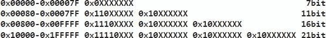

**Figure 7.1:** UTF-8 Representation of the Unicode Characters

该表示称为 **UTF-8**。超出 21 位的编码如何处理？目前 Unicode 规范未使用超过 21 位信息，但该方案可容纳高达 36 位信息，覆盖整个 UCS-4 范围。类似地，还引入了 **UTF-16**，以 2 字节为单位扩展字符码；也存在 **UTF-32** 转换方案。

## Julia 对 Unicode 的原生支持

Julia 语言原生支持 Unicode，甚至变量和常量可使用 Unicode 字符。内部上，Julia 字符串（`String` 类型）以 UTF-8 编码存储为 Unicode 字符流。Julia 中的字符（`Char`）在 UTF-8 编码下表示为最多 4 字节值。原始字节用 `UInt8` 表示，而非 `Char`。不过，Julia 支持用其他编码表示字符串，也可通过 Julia 接口开发自定义字符码和字符串。与原生 C/C++ 应用交互时，可能需要将字符串作为 `Cstring` 传递。`Cstring` 是 C 语言期望的以零结尾的字符串。

## 字体、字形与文本计算

观察不同字体下字符 a 的表示：


**Figure 7.2:** Character'a' written with glyphs from various fonts

字体和字形提供字符的视觉外观。作为编程语言，Julia 不提供控制字体或字形选择的机制，这些通常属于文字处理或渲染软件（如 Microsoft Word、Adobe InDesign）范畴。

了解文本计算各方面后，我们来评估 Julia 如何满足这些需求。

## Julia 字符串初始化

在 Julia 中，`String` 对象可通过以下字面量表达式初始化。

```julia
julia> str = "This is a string"
"This is a string"
```

字符串不可变。创建后无法修改。另一种定义方式可保留格式和换行符，特殊字符无需额外引用。

```julia
julia> str = """
This is a preformatted
"string" """
" \nThis is a preformatted \n\"string\" "
```

字符串可插入其他变量的计算结果以生成最终输出。

```julia
julia> a = "Jack";
julia> b = "Jill";
julia> c = "100";
julia> str = "$a owes $b $c dollars"
"Jack owes Jill 100 dollars"
```

字符串中的特殊字符（如引号 `"` 或反斜杠 `\`）需用反斜杠 `\` 转义。

```julia
julia> str = "This is a \"quoted\\  ' string"
"This is a \"quoted\\  ' string"
```

下节将介绍与字符串交互的各种方法。

> **Note:** 字符串不可变，因此即使垃圾回收发生，它们仍可驻留在系统内存中而不被覆盖。内存调试器可读取随机内存位置。若有密码等敏感数据，应考虑使用字节或字符数组结构，并在数据消费后覆盖内存位置。取消引用内存对象并强制调用垃圾回收可能不是最安全的选项。

## 字符串标准方法回顾

### 字符串比较

`String` 对象可使用标准比较运算符 `isequal(==)`、`isless(<)` 或 `>` 进行比较，通常采用字典序。

```julia
julia> s1 = "abc"
julia> s2 = "def"
julia> s1 < s2
true
julia> s2 > s1
true
julia> s1 = "abc"
julia> s2 = "abc"
julia> s1 == s2
true
```

“egal” 运算符（`===`）比较对象身份，对于不可变的 `String` 对象，将进行逐位比较。

```julia
julia> s1 === s2
true
```

### 字符串迭代

正如数组和集合，字符串也是字符序列的自然集合。因此遍历 `String` 时可枚举字符。

```julia
julia> s = "Julia";
julia> for c in s
       println(c)
       end
J
u
```


# Julia 字符串操作

## 字符串索引

就像其他集合一样，Julia 字符串也支持基于 1 的索引，并在每个位置呈现字符。

```julia
julia> s[1], s[2], s[3], s[4], s[5]
('J', 'u', 'l', 'i', 'a')
```

`begin` 和 `end` 可以像用于其他类型的集合一样使用。

```julia
julia> s[begin], s[begin+2], s[end-1], s[end]
('J', 'l', 'i', 'a')
```

让我们看一个包含多字节 UTF-8 字符的字符串。

```julia
julia> s = "\u2200 x \u2203 y"
"∀ x ∃ y"
julia> length(s)   # 字符串中的字符数
7
julia> sizeof(s)   # 字符串中的字节数
11
```

```julia
julia> s[1]
'∀': Unicode U+2200 (category Sm: Symbol, math)
```

```julia
julia> s[2]
StringIndexError("∀ x ∃ y", 2)

Stacktrace:
 [1] string_index_err(::String, ::Int64) at .\strings\string.jl:12
 [2] getindex_continued(::String, ::Int64, ::UInt32) at .\strings\string.jl:220
 …
```

```julia
julia> s[4]
' ': ASCII/Unicode U+0020 (category Zs: Separator, space)
```

所以，`getindex` 方法以字节索引作为输入并返回一个有效字符。然而，当索引不映射到有效字符时，会抛出异常，如 `s[2]` 所示。不过，`for...in` 循环可以按字符迭代。

```julia
julia> for c in s
       println(c)
       end
∀
x
∃
y
```

使用索引变量的另一种方法是 `nextind()` 方法。该方法返回包含有效字符的下一个索引。

```julia
julia> i, l = firstindex(s), lastindex(s);

julia> while i <= l
       println(s[i])
       i = nextind(s, i)
       end
∀
x
∃
y
```

## 字符串分割与拼接

将字符串分割为子字符串的最简单方法之一是使用索引和 `*` 运算符进行拼接。

```julia
julia> str = "This is a String"

julia> str[1:4]
"This"

julia> str[1:4]*str[end-6:end]
"This String"
```

- 由于字符串是不可变的，每次子字符串或拼接操作都会在拼接前分配中间字符串。可以使用 `repeat` 函数或别名运算符 `^` 创建文本模式的重复序列。

```julia
julia> repeat("A:-", 5)
"A:-A:-A:-A:-A:-"

julia> "A:="⁴
"A:=A:=A:=A:="
```

- `join()` 组合输入的字符串集合。可以选择提供分隔符（如逗号 `,`）和最后的连接词（如 `and`）。

```julia
julia> join(["1", "2", "3", "4", "5"])
"12345"

julia> join(["Jack", "Jill", "Cathy", "Trevor"], ", ", " and ")
"Jack, Jill, Cathy and Trevor"
```

- `chomp()` 移除字符串中最后的行尾字符。

```julia
julia> str = "This is a\nString\n"

julia> chomp(str)
"This is a\nString"
```

- `chop()` 从头部和尾部移除字符。默认情况下，头部不移除字符，尾部仅移除一个字符。不过，可以使用关键字 `head` 和 `tail` 分别指定从头部和尾部移除的具体字符数。

```julia
julia> chop("October")
"Octobe"

julia> chop("October", head=2, tail=3)
"to"
```

- `split()` 方法沿空格字符分割 `String` 并返回 `SubString` 对象数组。

```julia
julia> s = "\u2200 x \u2203 y"

julia> ss = split(s)
4-element Array{SubString{String},1}:
 "∀"
 "x"
 "∃"
 "y"
```

- `String` 对象是不可变的，任何提取字符串一部分的表达式都会分配一个新的 `String`。`SubString` 是 `String` 对象的视图。在前面的示例中，数组中所有分割的 `SubString` 对象都指向同一个 `String` 对象。`SubString` 对象扩展了 `AbstractString` 接口，因此在需要时可以转换为 `String` 对象。`split()` 方法也支持分隔符。

```julia
julia> s = "\u2200,x,\u2203,y"

julia> ss = split(s, ',', limit=2)
2-element Array{SubString{String},1}:
 "∀"
 "x,∃,y"

julia> s = "\u2200,x,\u2203,y"

julia> ss = rsplit(s, ',', limit=2)
2-element Array{SubString{String},1}:
 "∀,x,∃"
 "y"
```

`split()` 示例使用逗号 `,` 作为分隔符，并将分割部分的数量限制为 2。与从左侧分割字符串的 `split` 非常相似，`rsplit` 从右侧分割字符串。

- `lpad` 和 `rpad` 向字符串添加前缀或后缀，使其达到特定长度。

```julia
julia> lpad("string", 10, "p")
"ppppstring"

julia> rpad("string", 10, "s")
"stringssss"
```

- `strip` 函数移除字符串两侧的空格字符。该函数的一个方法可以选择性地接受一个字符数组，从两端移除这些字符。返回 true 的谓词也可用于从两端剥离。`lstrip` 和 `rstrip` 是两个功能类似的函数，但分别仅作用于字符串的左端和右端。

```julia
julia> strip("    string 123  ")
"string 123"

julia> strip(" {a}    string 123  ", ['{', 'a', '}', ' '])
"string 123"

julia> strip("    string 123  aaa") do x
       return x == ' ' || x == 'a'
       end
"string 123"
```

## 大小写转换

一些函数及其预期结果：

```julia
julia> uppercase("Julia")
"JULIA"

julia> lowercase("JUliA")
"julia"

julia> titlecase("hands on programming in julia")
"Hands On Programming In Julia"

julia> uppercasefirst("julia")
"Julia"

julia> lowercasefirst("Julia")
"julia"
```

## 模式匹配

模式匹配函数可分为多种类别。其中一些如下：

- `startswith()`、`endswith()` 和 `contains()` 在字符串的开头、结尾和任意位置搜索一部分字符串，并返回它们是否存在于字符串中。`occursin(needle, haystack)` 是 `contains(haystack, needle)` 的另一种形式。

```julia
julia> str = "Introduction to Julia";
```


# 字符串搜索与替换

## 基础搜索函数

`findfirst` 和 `findnext` 协助在 `String` 对象中搜索模式序列。`findlast` 提供模式的最后一次出现位置。

```julia
julia> r = findfirst("o", "Introduction to Julia");

julia> while r !== nothing
       println(r)
       r = findnext("o", "Introduction to Julia", r.stop+1)
       end
5:5
11:11
15:15

julia> findlast("o", "Introduction to Julia")
15:15
```

## 字符串替换

`replace` 将搜索到的输入模式更改为指定的文本。

```julia
julia> replace("Introduction to Julia", "o"=>"a")
"Intraductian ta Julia"
```

# 正则表达式

正则表达式是一种模式匹配语言构造，使计算机程序员能够定义可匹配到文本字符串的复杂模式。这些模式在编译器设计和分词器中被大量使用。一些常用于正则表达式模式匹配的 UNIX 应用程序有 `lex`、`grep` 和 `egrep`。PERL、Python 和 R 等编程语言也提供了比标准 `grep` 支持更多的扩展正则语法。**PERL 兼容正则表达式** (**PCRE**) 库 2 集成到了 Julia 中。因此，Julia 对正则表达式的支持与其他语言一样强大。虽然我们在此展示了一些正则示例，但这并非专门介绍正则所有细节的章节。建议读者从该主题的权威文献中深入掌握正则表达式。

可以看到，示例中创建了一个 `Regex` 对象。它与字符串匹配，匹配结果存储在 `RegexMatch` 对象中。

```julia
julia> rx = Regex("a.a")
r"a.a"

julia> m = match(rx, "abracadabra")
RegexMatch("aca")

julia> m.match
"aca"
```

偏移匹配会匹配到 `“ada”` 而不是 `“aca”`。

```julia
julia> m = match(rx, "abracadabra", 5)
RegexMatch("ada")
```

在下面的示例中，使用 `@r_str` 宏（将在下一章详细讨论）来初始化 `Regex` 对象。`rx` 对象定义了一个捕获组，匹配的正则表达式可将捕获内容保存在 `captures` 属性中。

```julia
julia> rx = r"a(.)a";

julia> m = match(rx, "abracadabra");

julia> m.captures
1-element Array{Union{Nothing, SubString{String}},1}:
 "c"
```

下面展示了一个带命名捕获的类似示例。捕获的数据可以通过索引 `RegexMatch` 对象并使用捕获组名称来收集。

```julia
julia> rx = Regex("a(?<key>.)a");

julia> m = match(rx, "abracadabra");

julia> m.captures
1-element Array{Union{Nothing, SubString{String}},1}:
 "c"

julia> m["key"]
"c"
```

你也可以在 `String` 中将模式匹配到多个出现位置。

```julia
julia> rx = r"a.a"

julia> m = eachmatch(rx, "abracadabra", overlap=true)
Base.RegexMatchIterator(r"a.a", "abracadabra", true)

julia> collect(m)
2-element Array{RegexMatch,1}:
 RegexMatch("aca")
 RegexMatch("ada")
```

由于允许重叠字符串，`“aca”` 和 `“ada”` 都被匹配。当 `overlap` 参数设为 `false` 时，仅匹配 `“aca”`。

```julia
julia> m = eachmatch(rx, "abracadabra", overlap=false)
Base.RegexMatchIterator(r"a.a", "abracadabra", false)

julia> collect(m)
1-element Array{RegexMatch,1}:
 RegexMatch("aca")
```

不仅 `match` 或 `eachmatch`，正则匹配也可作为模式参数用于 `findfirst`、`findnext`、`occursin`、`replace`、`split`、`rsplit`、`startswith` 和 `endswith` 等函数中。

# 字符串编码与转码

`String` 对象在 Julia 中本质上是 Unicode 表示。是否有特定的转换规则？转换能否设置为其他格式？这些问题很自然。如果你回顾迭代章节的讨论，`nextind()` 方法将索引对齐到下一个 UTF-8 字符位置。这保证了 `String` 对象本质上是 UTF-8 表示。不过，你可以通过 `transcode` 函数提取 UTF-8、16 和 32 数组表示。

```julia
julia> s = "\u2200 x \u2203 y"
"∀ x ∃ y"

julia> transcode(UInt16, s)
7-element Array{UInt16,1}:
 0x2200
 0x0020
 0x0078
 0x0020
 0x2203
 0x0020
 0x0079

julia> transcode(UInt32, s)
7-element Array{UInt32,1}:
 0x00002200
 0x00000020
 0x00000078
 0x00000020
 0x00002203
 0x00000020
 0x00000079
```

`transcode` 也可将 UTF 字节数组转换回 `String` 对象。

```julia
julia> transcode(String, transcode(UInt16, s))
"∀ x ∃ y"
```

# 字符属性判断函数

以下函数都很直观。然而，所有这些方法都作用于所有相关语言的 Unicode 字符，不仅限于 ASCII 字符集或英文字符。这得益于它们利用 Unicode 表中的字符类别定义来确定这些属性。例如，属于 `Lu` 或 `Lt` 类别的所有字符都会被 `isuppercase` 方法返回。类似地，查询 `isspace` 方法时会匹配 `Zs` 类别。

```julia
julia> isascii("∀ x ∃ y"), isascii("abcd ef")
(false, true)

julia> iscntrl('a'), iscntrl('\x1')
(false, true)

julia> isdigit('a'), isdigit('9')
(false, true)

julia> isxdigit('a'), isxdigit('x')
(true, false)

julia> isletter('1'), isletter('a')
(false, true)

julia> isnumeric('1'), isnumeric('௰') # 泰米尔语(印度)中的数字 10
(true, true)

julia> isuppercase('A'), islowercase('a')
(true, true)

julia> isspace('\n'), isspace('\r'), isspace(' '), isspace('\x20')
(true, true, true, true)
```


在处理字符串和编码的过程中，我们意识到某些函数提供了单个字符的属性。因此，将 `String` 转换为字符数组对我们来说非常重要。我们将在下一节中探讨这一点。

## 将字符串转换为字符数组

正如我们之前所见，`String` 对象是字符的集合。但是，它们无法被修改。你无法像操作数组或其他容器类型那样灵活地操作它们。不过，有许多函数可用于转换 `String` 对象并创建新的 `String` 对象。然而，如果需要，你可以通过简单地使用 `collect` 方法将 String 转换为 Char 数组。

```julia
julia> collect("∀ x ∃ y")
7-element Array{Char,1}:
 '∀': Unicode U+2200 (category Sm: Symbol, math)
 ' ': ASCII/Unicode U+0020 (category Zs: Separator, space)
 'x': ASCII/Unicode U+0078 (category Ll: Letter, lowercase)
 ' ': ASCII/Unicode U+0020 (category Zs: Separator, space)
 '∃': Unicode U+2203 (category Sm: Symbol, math)
 ' ': ASCII/Unicode U+0020 (category Zs: Separator, space)
 'y': ASCII/Unicode U+0079 (category Ll: Letter, lowercase)
```

你也可以像之前展示的那样，使用 `transcode` 方法获取 `String` 对象的 UTF-8、16、32 转换向量。一旦你拥有了一个 `Char` 数组，就可以通过数组操作以任何你想要的方式使用它。

## AbstractString 和 AbstractChar 架构

罗马不是一天建成的；Julia 字符串 API 也是如此。虽然 `String` 仍然是包装在集合内的 UTF-8 表示形式，该集合以 `Char` 对象作为 `eltype` 进行交付。

```julia
julia> eltype("abcd")
Char
```

该架构进一步扩展，定义了一个抽象的 `AbstractString` 类型，它将 `AbstractChar` 视为元素类型。Julia 在 1.0 版本之前的版本中有许多此类实现，如 `ASCIIString`、`UTF8String` 等，它们本质上提供了一些常用编码方案的基础 3。许多经典字符串类型在功能上已合并到 `String` 类型中，而一些则被移至一个名为 `LegacyStrings.jl` 的可选包中。虽然使用该包没有显著优势，但对于有兴趣尝试并实现自己字符串类型的人来说，它们可以作为很好的参考资料。如果你有兴趣实现自己的字符串类型，请确保已实现 `AbstractString` 和 `AbstractChar` 接口。对抽象类型没有太多要求，只是期望你在需要时能更轻松地实现与 `String` 和 `Char` 对象的相互转换。

## 实现自定义字符类型

该接口本质上要求任何派生字符都应具有 Unicode 表示值。同样，给定一个有效的 Unicode 值，必须能够创建一个字符。

```julia
struct MyChar <: AbstractChar end

MyChar(::UInt32)    # 返回具有有效码位的 MyChar
codepoint(::MyChar) # 以 UInt32 返回 Unicode 值
```

如果 `codepoint` 输入值不在编码范围内，构造函数必须抛出错误。

## AbstractString 接口要求

`AbstractString` 接口要复杂得多，并对字符串对象的内部组成做出了一定假设。例如，这些接口定义了在字符串中定义一个字符所需的最小字节数的假设。如果你使用 `LegacyStrings`，你会发现 `ASCIIString` 使用 `UInt8` 作为 `codeunit`，而 `UTF16String` 使用 `UInt16` 作为 `codeunit`。但两者在代码单元中的内部数据长度大小相同。

```julia
julia> ]add LegacyStrings;

julia> using LegacyStrings;
julia> s = ASCIIString("abcd");

julia> codeunit(s)
UInt8

julia> ncodeunits(s)
4

julia> s16 = UTF16String(transcode(UInt16, "abcd\0")); # NULL 终止
julia> codeunit(s16)
UInt16

julia> ncodeunits(s16)
4

julia> eltype(s), eltype(s16)
(Char, Char)
```

> **注意：** `add` 和 `using` 命令用于 Julia 的包管理和模块使用上下文中。当我们讨论包管理时，将详细讨论它们。

尽管前面示例中的 `ASCIIString` 和 `UTF16String` 具有完全不同的存储内部数据的内部表示，但它们都使用 `Char` 作为迭代的 `eltype`。这两种数据类型都没有定义额外的字符类型。

除了上述方法外，`AbstractString` 的派生类型还需要实现所有迭代和索引方法，如 `iterate`、`getindex`、`nextind`、`prevind`、`lastindex`、`firstindex` 以及一些与集合相关的方法，如 `length` 等 4。

## 总结与后续步骤

字符串是编程语言中许多文本转换和分析的基础。我们讨论了 Julia 中支持的编码。Julia 如何应对各种文本匹配场景。我们还探讨了如何使用抽象类型支持各种自定义编码。像 `StringEncodings.jl` 这样的包是 Unix `iconv` 库的封装器，可用于轻松地将字符串从任意编码转换为另一种编码。接下来，我们将回顾如何利用 Julia 的元编程能力动态地创建和执行代码。

# 练习

1.  编写一个方法来验证字节序列是否为 UTF-8 编码流。为之做出所有必要的假设。
2.  编写一个方法来匹配句子中的闭合括号与打开括号。可以使用什么正则表达式？注意：括号可以嵌套。
3.  实现一种字符串类型，其元素可以表示所有 ISO-8859-1 字符。
4.  编写一个方法来匹配回文字符串。
5.  `String("abc") === String("abc")` 会返回 `true` 还是 `false`？通过查看 Julia 语言源代码仓库中的实现来解释该行为。

______

1 在 Julia 中，符号以 `:` 字符开头。可以使用符号在文件中表示关键字，如 `:key1`、`:key2` 等。在 JSON 对象中，关键字也以文本形式书写，如 `{"key1": value1, "key2": 32,…}`。

2 Perl 兼容正则表达式，维基百科，[`en.wikipedia.org/wiki/Perl_Compatible_Regular_Expressions`](https://en.wikipedia.org/wiki/Perl_Compatible_Regular_Expressions)

3 Stringapalooza，Issue 16107，Julia GitHub 仓库 [`github.com/JuliaLang/julia/issues/16107`](https://github.com/JuliaLang/julia/issues/16107)


# `LegacyStrings.jl` 中 `ASCIIString` 的 GitHub 仓库

[`github.com/JuliaStrings/LegacyStrings.jl/blob/master/src/ascii.jl`](https://github.com/JuliaStrings/LegacyStrings.jl/blob/master/src/ascii.jl)

正则表达式是一种模式匹配语言结构，使计算机程序员能够定义可匹配文本字符串的复杂模式。这些模式在编译器设计和分词器等方面被大量使用。一些常用的用于正则表达式（regex）模式匹配的 UNIX 应用程序有 `lex`、`grep` 和 `egrep`。像 PERL、Python 和 R 等编程语言也提供了比 `grep` 支持的标准语法更丰富的扩展 regex 语法支持。**PERL 兼容正则表达式**（**PCRE**）库 2 已集成到 Julia 中。因此，Julia 对 regex 的支持与其他任何语言一样强大。虽然我们在此展示了一些 regex 示例，但这并非专门介绍 regex 所有细微差别的章节。我们建议读者从该主题的其他权威文献中很好地掌握 regex。

该架构进一步扩展，以定义一个抽象的 `AbstractString` 类型，该类型将 `AbstractChar` 视为元素类型。Julia 在 1.0 版本之前的实现中有许多此类实现，如 `ASCIIString`、`UTF8String` 等，它们本质上提供了一些常用编码方案的基础 3。许多经典字符串类型在功能上已合并到 `String` 类型中，一些被移至一个名为 `LegacyStrings.jl` 的可选包中。虽然使用该包没有显著优势，但对于有兴趣尝试并实现自己字符串类型的人来说，它们可以作为很好的参考资料。如果您有兴趣实现自己的字符串类型，请确保已实现 `AbstractString` 和 `AbstractChar` 接口。抽象类型没有太多要求，只是期望您在需要时能更轻松地实现与 `String` 和 `Char` 对象的相互转换。

一个句子可能包含来自多种语言的符号和字符。例如，数学符号和希腊语表达式可用于英语句子中。最后，文本通常被用作实体的最后手段表示，这些实体可能没有替代表达形式，就像文本关键字的情况一样。虽然 Julia 符号非常符合最后一种场景，但文本也用于许多此类情况 1。在本章中，我们将尝试深入探讨前面讨论的所有方面的细节。文本用途的多样性带来了许多表示挑战，我们必须从概念上理解 Julia 语言的设计。虽然文本结构可能达到文档结构和表示的复杂程度，但我们将讨论范围限制在字符串的概念上。

除了上述方法外，`AbstractString` 的派生类型还需要实现所有迭代和索引方法，如 `iterate`、`getindex`、`nextind`、`prevind`、`lastindex`、`firstindex` 以及一些集合相关的方法，如 `length` 等 4。

`LegacyStrings.jl` 中 `ASCIIString` 的 GitHub 仓库 [`github.com/JuliaStrings/LegacyStrings.jl/blob/master/src/ascii.jl`](https://github.com/JuliaStrings/LegacyStrings.jl/blob/master/src/ascii.jl)

在 Julia 中，符号以 `:` 字符开头。可以使用像 `:key1`、`:key2` 这样的符号来表示文件中的关键字。在 JSON 对象中，关键字也以文本形式书写，如 `{"key1": value1, "key2": 32,…}`。

Stringapalooza，Issue 16107，Julia GitHub 仓库 [`github.com/JuliaLang/julia/issues/16107`](https://github.com/JuliaLang/julia/issues/16107)

PERL 兼容正则表达式，维基百科，[`en.wikipedia.org/wiki/Perl_Compatible_Regular_Expressions`](https://en.wikipedia.org/wiki/Perl_Compatible_Regular_Expressions)

# 元编程

Julia 受 Lisp 影响很大，并附带一个 Lisp 变体解释器（`FemtoLisp`）用于其部分内部解析。因此，它理所当然地采用了元编程，这是 Lisp 衍生语言最灵活的特性之一。我们将在本章中回顾 Julia 是如何采用元编程的。

## 本章将涵盖以下主题：

*   背景
*   宏
*   自定义字符串字面量
*   生成函数
*   常用宏

## 学习目标

读者将能够理解 Julia 中的表达式和结构。他们将能够以编程方式操作表达式。他们将了解宏以及宏与函数的区别。他们将能够定义自己的字符串字面量类型。最后，读者将了解生成函数及其在 Julia 中的用法。

# 背景

元编程 1 本质上利用数据生成可在应用程序相同上下文中执行的代码。一些语言会在编译期间进行此类代码生成；一些则将其视为执行的一部分。虽然代码生成并注入执行单元的阶段可能因语言内部架构而异，但所有语言都会在后处理之前先生成基础语言的代码。这是一个来自 C/C++ 的示例：

```
#define twice(x) 2*(x)
int main()
{
int y = twice(2);
}
```

如果您通过 C/C++ 预处理器运行它，将得到如下输出：

```
#line 1 "a.c"
int main()
{
int y = 2*(2);
}
```

您可以看到预处理器将 twice 宏替换为代码中的值。一旦运行预处理器，新生成的代码将在 C 编译器中编译。让我们看看 C++ 语言中相同代码的模板元编程：

```
template <typename T>
T twice(T x) {
return 2*x
}
int main()
{
int y = twice(2);
}
```

通过预处理器运行不会实质性地改变代码。而且，人们很可能会认为这不是元编程。但这也是一种形式的元编程。在编译时，函数 `twice<T>` 的模板类型将被解析，并生成 `twice<int>()` 函数。基于模板的元编程在 Julia 中受支持，我们已经在函数和方法章节中看到了这一点。Julia 能够将任何文本字符串转换并内部化为可在程序上下文中执行的代码。虽然对某些人来说这听起来令人兴奋，但也可能引发对安全性的担忧。这一概念与 Lisp 类语言执行宏非常相似。


# 抽象语法树 (AST)

抽象语法树 (AST) 是计算机科学中代码表达式的一种句法结构。这种结构形式使得机器更容易理解代码，并消除了运算符优先级或使用括号来修改优先级的需求。Julia 中代码片段的 AST 是一个有效的 Julia 对象。因此，你可以灵活地获取一段代码，生成其 AST，并将该 AST 作为 Julia 对象进行操作或处理，从而创建可执行的有趣衍生 AST。这是 Julia 元编程架构的基础。简单来说，你可以生成任意有效的代码字符串，并通过有效操作在程序上下文中执行它。让我们在以下示例中看看其中一些实际操作：

```
julia> s = "1+1"
"1+2"
julia> ex = Meta.parse(s)
:(1 + 1)
julia> typeof(ex)
Expr
julia> dump(ex)
Expr
  head: Symbol call
  args: Array{Any}((3,))
    1: Symbol +
    2: Int64 1
    3: Int64 2
```

我们获取了一个可以作为 Julia 表达式的有效字符串。我们用 Julia 解析器对其进行了解析，输出以内部字符串格式返回。内部字符串格式的类型为 `Expr`。`dump` 方法提供了表达式的 AST。从 AST 中可以得出以下信息：

1.  `ex` 的类型是 `Expr`。
2.  `ex.head` 是一个调用符号。
3.  `ex.args` 有 3 个元素。
4.  `args[1]` 是符号 `+`，将由 call 调用。
5.  `args[2]` 和 `[3]` 是函数调用的参数。

让我们对表达式求值，应该得到 `2`。

```
julia> eval(ex)
2
```

让我们修改内部表达式 `ex`，将 `ex.args[1]` 从 `+` 改为 `-`。

```
julia> ex.args[1] = :(-);
julia> dump(ex)
Expr
  head: Symbol call
  args: Array{Any}((3,))
    1: Symbol -
    2: Int64 1
    3: Int64 1
julia> eval(ex)
0
```

调用序列中参数的简单修改就能改变求值时调用的函数。

## Symbol 对象

`Symbol` 对象在 Julia AST 中用作函数名和终结符。字符 (`:`) 作为标记的前缀，可用于快速定义 `Symbol`。`Symbol` 构造函数也可用。它会将所有参数连接起来形成一个符号。

```
julia> Symbol("A")
:A

julia> Symbol("A", "_", 5, "32")
:A_532

julia> :A_532
:A_532

julia> :(==)
:(==)
```

当使用冒号定义符号时，某些字母可能需要消除歧义，如本例中的 `==` 运算符。你可以使用冒号字符 (`:`) 来定义表达式或内部字符串，而不必使用 `Expr` 构造函数或像上一节那样对字符串使用 `Meta.parse`。

```
julia> ex = :(z = 1 + 2);
julia> typeof(ex)
Expr
```

这里生成的 `Expr` 在 AST 中有两个部分：

1.  第一部分：对变量的赋值。
2.  第二部分：对运算符 `+` 的调用，其结果是赋值的右值。

```
julia> dump(ex)
Expr
head: Symbol =
args: Array{Any}((2,))
1: Symbol z
2: Expr
head: Symbol call
args: Array{Any}((3,))
1: Symbol +
2: Int64 1
3: Int64 2

julia> eval(ex)
3

julia> z
3
```

赋值表达式将新的赋值变量 `z` 引入程序状态。因此，表达式的操作和求值可以修改程序状态。在操作它们时，必须小心变量的作用域。

## 插值

虽然可以按选择设计表达式，但除非你能包含预先求值的表达式，否则不是很有用。例如：

```
julia> x = 5;
julia> ex = :($x + 1)
:(5 + 1)
```

你也可以在内联求值中引入计算表达式。例如：

```
julia> ex = :($(x*x)+1)
:(25 + 1)
julia> y = eval(ex)
26
```

这种技术在 Julia 编程中也被称为**插值**。

## 复杂表达式和 Quote 块

到目前为止，我们已经看到了作为内部字符串的简单表达式及其 AST。然而，现实生活中的函数和表达式可能要复杂得多。人们自然会怀疑是否存在可以程序化操作的表达式的特定限制。

```
julia> ex = quote
x = 1
y = 2
x + y
end
quote
#= In[38]:2 =#
x = 1
#= In[38]:3 =#
y = 2
#= In[38]:4 =#
x + y
end
```

多行表达式包含在 `quote…end` 块之间。正如你所见，添加了行号表达式以跟踪行号，用于行调试目的。表达式的 dump 将显示 AST 的更详细视图。较长的 AST 具有以下特征：

1.  它以类型为 block 的 `head` 属性开始。
2.  行节点和后续表达式作为 `args` 数组的一部分可用。
3.  行包含行号部分和文件部分，设置表达式的上下文。

```
julia> dump(ex)
Expr
head: Symbol block
args: Array{Any}((6,))
1: LineNumberNode
  line: Int64 2
  file: Symbol In[38]
2: Expr
  head: Symbol =
  args: Array{Any}((2,))
    1: Symbol x
    2: Int64 1
3: LineNumberNode
  line: Int64 3
  file: Symbol In[38]
4: Expr
  head: Symbol =
  args: Array{Any}((2,))
    1: Symbol y
    2: Int64 2
5: LineNumberNode
  line: Int64 4
  file: Symbol In[38]
6: Expr
  head: Symbol call
  args: Array{Any}((3,))
    1: Symbol +
    2: Symbol x
    3: Symbol y
```

让我们将第 2 行的赋值从 `x = 1` 修改为 `z = 1`。

```
julia> ex.args[2].args[1] = :z
:z

julia> ex
quote
#= In[38]:2 =#
z = 1
#= In[38]:3 =#
y = 2
#= In[38]:4 =#
x + y
end

julia> eval(ex)
7

julia> z
1
```


创建了一个值为 `1` 的新变量 `z`，并从上一节中获取了值为 `5` 的 `x`。因此，表达式 `ex` 的求值结果为 `7`。

## 复杂引用表达式

让我们看一些更复杂的引用表达式，其中一个 `quote…end` 包含在另一个引用表达式内部。

```
julia> e = :(1 + 1);
julia> eval(:e)
:(1 + 1)
julia> eval(e)
2
```

在前面的示例中，符号 `:e` 的 `eval` 求值结果为变量 `e` 的内容。然而，对变量 `e` 进行 `eval` 实际上会对表达式求值，因此产生了差异。

我们将在嵌套引用中重新审视一个类似的概念。

```
julia> e = :(1+2)
julia> ex = quote
           quote
           $e
           end
           end
quote
#= In[32]:3 =#
$(Expr(:quote, quote
#= In[32]:4 =#
$(Expr(:$, :e))
end))
end
julia> eval(ex)
quote
#= In[32]:4 =#
1 + 2
end
```

在前面的示例中，`$e` 绑定到内层引用，等同于 `eval(:e)`。因此，表达式 `1+2` 出现在 `quote…end` 之间。

```
julia> ex = quote
           quote
             $$e
           end
           end
quote
#= In[34]:2 =#
$(Expr(:quote, quote
#= In[34]:3 =#
$(Expr(:$, :(1 + 2)))
end))
end
julia> eval(ex)
quote
#= In[34]:3 =#
3
end
```

当使用 `$$e` 代替 `$e` 时，计算的是 `eval(eval(:e))`，因此计算出的值 `3` 被放置在 `quote…end` 之间。

## 从输入参数生成表达式的函数

以下函数可以根据输入参数生成并返回一个内部化表达式。

```
Julia> function math_exp(op, p1, p2)
           p1f, p2f = map(x-> x isa Number ? 2x :
                          error("Parameters have to be numbers"),
                          (p1, p2))
           return Expr(:call, op, p1f, p2f)
       end
julia> ex = math_exp(:+, 2, 3)
:(4 + 6)
julia> eval(ex)
10
```

该函数返回一个 Julia 表达式。不过，你需要额外调用 `eval` 来计算值。

## 宏与函数的区别

函数可以返回表达式，但必须显式调用 `eval` 来对表达式求值。宏返回的表达式会自动求值，如下所示：

```
julia> macro sayhello()
           return :(println("Hello, World!!!"))
       end
@sayhello (macro with 1 method)
julia> @sayhello()
Hello, World!!!

julia> macro sayhello(name)
           return :(println("Hello, ", $name, "!!!"))
       end
@sayhello (macro with 2 methods)
julia> @sayhello("John")
Hello, John!!!
```

## 宏的调用形式

宏可以通过以下任意形式调用：

```
@mymacro(param1, param2, …, paramN) 或
@mymacro param1 param2 … paramN
```

因此，这两个 `@sayhello` 宏可以按如下方式调用：

```
julia> @sayhello
Hello, World!!!
julia> @sayhello "John"
Hello, John!!!
```

让我们添加一个更复杂的表达式。

```
julia> @sayhello begin
           1 + 3
       end
Hello, 4!!!
```

正如方法遵循多重分派架构一样，宏也同样适用。引入一个新的宏 `@sayhello(x::Int)` 会以以下方式影响行为：

```
julia> macro sayhello(x::Int)
           println("Calling Int ", x)
           return :(println("Hello Int, ", $x))
       end
@sayhello (macro with 3 methods)
julia> @sayhello 21
Calling Int 21
Hello Int, 21
julia> x = 21;
julia> @sayhello x
Hello, 21!!!
```

当使用 `Int` 字面量作为参数时，会专门调用宏 `@sayhello(::Int)`。然而，当使用变量 `x` 作为参数时，调用的是 `@sayhello(x)`。宏接受 AST 对象作为输入参数。因此，调用 `@sayhello x` 将被解释为使用符号 `x` 作为参数调用 `sayhello`，而不是将 `21` 作为参数。以下示例将进一步阐明这一说法：

```
julia> macro intype(x)
           println(typeof(x))
       end
@intype (macro with 1 method)
julia> @intype begin
           x = 5
       end
Expr
julia> @intype x
Symbol
julia> @intype 21
Int64
julia> @intype "John"
String
```

## 字符串宏

这些本质上是用于替代构造函数的便利宏。我们已经在字符串章节的正则表达式上下文中见过这些宏的示例。Julia 中定义的正则表达式宏如下所示：

```
macro r_str(p)
    Regex(p)
end
```

可以如下所示调用正则表达式匹配表达式。

```
julia> m = match(r"a.a", "abracadabra")
RegexMatch("aca")
```

表达式 `r"…"` 等同于调用宏 `@r_str()`。让我们为大写字符串创建一个自定义表达式。

```
julia> struct CapsString
           s::String
           CapsString(s::String)=new(uppercase(s))
       end
julia> macro C_str(s)
           CapsString(s)
       end
julia> C"This is upper case string"
CapsString("THIS IS UPPER CASE STRING")
```

## 生成函数

Julia 中使用多重分派架构来调用函数和方法。然而，有时可能希望创建比语言支持的更复杂的分派模型并自行构建。生成函数在这些场景中提供帮助。让我们考虑一个简单的分派场景。

```
julia> f(x::Integer) = x²;
julia> f(x) = x;
julia> f(4)
16
julia> f("John")
"John"
```


在前面的示例中，使用标准调度规则，`<strong>f(4)</strong>` 将调用 `<strong>f(::Integer)</strong>`，而 `<strong>f("John")</strong>` 将调用 `<strong>f(x)</strong>`。如果必须构建自定义调度规则，可以使用 `<strong>@generated</strong>` 宏来创建函数，如下所示：

```
julia> @generated function genf(x)
if x <: Integer
return :(x²)
else
return :x
end
end
genf (generic function with 1 method)
```

在前面的函数中，仅在生成的函数中使用了 `<strong>x</strong>` 的类型。`<strong>x</strong>` 的值被忽略。该函数返回一个表达式，该表达式是基于自定义调度过程所期望的函数行为。

```
julia> genf(4)
16
julia> genf("John")
"John"
```

当这些方法被调用时，带有 `Integer` 参数的函数会被编译并缓存。后续对 `<strong>genf(3)</strong>` 的调用将调用已编译的表达式，效率可能更高。关于生成宏的更详细示例，建议参阅 Julia 文档 2。

**注意：**

*   **函数的缓存生成是非确定性的。因此，与生成器一起使用的函数不得有副作用。它们也不应修改全局变量。**
*   **生成函数用于难以消除歧义的复杂调度规则。对于标准场景，使用语言默认的调度规则始终更高效。**

# Julia 内置宏

Julia 有许多内置宏，用于简化某些任务。我们在前几章中已经接触过它们，如 `<strong>@view</strong>`、`<strong>@goto</strong>`、`<strong>@label</strong>` 等。在本节中，我们将了解其中的一些宏并欣赏其实现。

# 宏的内部变量

每个宏都可以访问变量 `<strong>__source__</strong>`（包含文件名、行号）和 `<strong>__module__</strong>`（包含定义该宏的模块名称）。

```
julia> macro test()
println(__module__)
println(__source__)
end
@test (macro with 1 method)

julia> @test
Main
#= In[6]:1 =#
```

这些变量用于开发一些实用的位置宏，如 `<strong>@__FILE__</strong>`、`<strong>@__LINE__</strong>` 和 `<strong>@__DIR__</strong>`。

```
function macro_usage()
println("Dir:", @__DIR__, " file:", @__FILE__, " Line no:", @__LINE__)
end

julia> macro_usage()
Dir:C:\mydir\GitHub\HOPJ\Chapter-8 file:In[9] Line no:2
```

**注意：** 当代码在 REPL 或 IJulia 上下文中使用时，`<strong>@__FILE__</strong>` **宏不返回文件名。它返回命令标识符。**

# @eval 宏

当需要生成大量样板代码时，可以有效地使用 `<strong>@eval</strong>`。

```
julia> struct MyNumber
v::Float64
end
```

假设我们想在这些数字上定义所有数学方法，如 `<strong>sin</strong>`、`<strong>cos</strong>` 和 `<strong>tan</strong>`。代码可能如下所示：

```
Base.sin(m::MyNumber)=Base.sin(m.v)
Base.cos(m::MyNumber)=Base.cos(m.v)
Base.tan(m::MyNumber)=Base.tan(m.v)
```

可以通过以下表达式避免重复代码：

```
julia> for op in [:sin, :cos, :tan]
eval(quote
Base.$op(m::MyNumber)=Base.$op(m.v)
end)
end
```

`<strong>eval(quote…end)</strong>` 是许多 Julia 应用程序中常用的表达式。同一功能以宏 `<strong>@eval</strong>` 表示，表达式如下所示：

```
julia> for op in [:sin, :cos, :tan]
@eval Base.$op(m::MyNumber)=Base.$op(m.v)
end
```

# @assert 宏

`<strong>@assert</strong>` 是一个宏，用于验证表达式的真值，如果表达式评估为 `<strong>false</strong>`，则抛出 `<strong>AssertionError</strong>`。C/C++ 等其他语言也有类似的宏。在某些语言中，断言验证仅在调试模式下执行代码时生效，在优化的发布模式代码中会被忽略。Julia 也建议仅将 `<strong>assert</strong>` 宏用于调试操作。因此，不应将其用作程序逻辑。`<strong>assert</strong>` 的最简单形式如下，完整代码可见 Julia GitHub 仓库 3：

```
macro myassert(ex, msg)
return :($(ex) ? nothing : throw(AssertionError($msg)))
end

julia> @myassert 1==0 "1 is not same as 0"
AssertionError: 1 is not same as 0
Stacktrace:
[1] top-level scope at In[24]:4
…
```

实际的 `<strong>assert</strong>` 宏不限制传递给它的参数数量，但仅将第一个消息作为有效消息。如果没有消息，则将 `<strong>ex</strong>` 作为消息。

```
macro myassert(ex, msgs...)
msg = isempty(msgs) ? ex : msgs[1]
msg = msg isa AbstractString ? String(msg) : string(msg)
return :($(ex) ? nothing : throw(AssertionError($msg)))
end

julia> @myassert 1==0
AssertionError: 1 == 0

Stacktrace:
[1] top-level scope at In[34]:10
…
```

最终代码与前面的代码略有不同，因为它解决了简单示例代码未处理的一些错误条件。将 `<strong>assert</strong>` 定义为宏是恰当的，因为 `<strong>ex</strong>` 参数在 Julia 中可以是任何表达式。

# @time 宏

`<strong>@time</strong>` 宏用于计算执行代码块的耗时和内存分配。

```
julia> @time begin
sleep(0.3)
1+1
end
0.310595 seconds (15 allocations: 672 bytes)
2
```

`<strong>@time</strong>` 宏的一部分实现如下代码所示：

```
macro mytime(ex)
return quote
local elapsedtime = time_ns()
local val = $(ex)
elapsedtime = time_ns() - elapsedtime
println("Elapsed time: ", elapsedtime/1e9)
val
end
end
```

`<strong>val</strong>` 在 `<strong>elapsedtime</strong>` 之前计算。因此，两者都需要存储在局部变量中。由于返回值是一个带引用的表达式。如果变量 `<strong>val</strong>` 和 `<strong>elapsedtime</strong>` 没有显式定义为局部变量，则会覆盖全局作用域中的 `<strong>val</strong>` 和 `<strong>elapsedtime</strong>` 变量。这仅适用于从宏返回的 `<strong>Expr</strong>`，不影响宏中使用的变量（如前一个示例中的 `<strong>msg</strong>`）。


元编程在 Julia 中非常精细，且可能相当复杂。我们探讨了几种场景，并理解了如何在使用 Julia 开发应用程序时利用它们。我们还理解了宏的概念以及如何有效地使用它们。初次接触元编程的人可能会觉得这个概念很复杂。随着经验的积累和实践，你将能更好地领会这些概念。在下一章中，我们将介绍 Julia 语言的标准库以及这些库提供的一些功能。

# 练习

1.  为什么运算符优先级与 AST 无关？
2.  编写一个自定义字符串字面量，将输入转换为小写字母。
3.  为什么 Julia 实现中的 `@assert` 宏如此复杂？它还解决了哪些本章建议的简单代码未涵盖的其他有用情况？
4.  `@view` 宏为子数组类型增加了什么价值？
5.  使用 `@eval` 宏，展示如何利用该宏有效地实现对象组合。

---

## 参考资料

[1] Metaprogramming, Wikipedia, [`en.wikipedia.org/wiki/Metaprogramming`](https://en.wikipedia.org/wiki/Metaprogramming)

[2] Generated Functions, Julia Documentation, [`docs.julialang.org/en/v1/manual/metaprogramming/#Generated-functions`](https://docs.julialang.org/en/v1/manual/metaprogramming/#Generated-functions)

[3] Julia GitHub Repository, [`github.com/JuliaLang/julia/blob/788b2c77c10c2160f4794a4d4b6b81a95a90940c/base/error.jl#L189-L209`](https://github.com/JuliaLang/julia/blob/788b2c77c10c2160f4794a4d4b6b81a95a90940c/base/error.jl#L189-L209)

当调用这些方法时，带有 `Integer` 参数的函数会被编译并缓存。对 `genf(3)` 的后续调用将执行已编译的表达式，效率可能更高。关于生成宏的更详尽示例，建议您参阅 Julia 文档[²]。

`@assert` 是一个验证表达式真值的宏，如果表达式求值为 `false`，则抛出 `AssertionError`。C/C++ 等其他语言也有类似的宏。在某些语言中，断言验证仅在代码以调试模式执行时生效，在优化后的发布模式代码中会被忽略。Julia 也建议仅将 `assert` 宏用于调试操作。因此，它不应被用作程序逻辑。`assert` 的最简形式如下，完整代码可见 Julia GitHub 仓库[³]：

元编程[¹] 本质上是利用数据生成可在应用程序相同上下文中执行的代码。某些语言会在编译期间进行此类代码生成；某些语言则将其视为执行的一部分。虽然代码生成并注入执行单元的阶段可能因语言内部架构而异，但所有语言都会在后处理之前，先生成基础语言的代码。以下是一个来自 C/C++ 的示例。

# Julia 标准库

Julia 是一个精细的编程系统。编程系统提供的功能超越了基础编程语言。大多数现代语言都提供完整的运行时编程系统，它们与底层操作系统无缝协作，给开发者一种跨平台的体验。

# 章节概览

本章将涵盖以下主题：

*   背景
*   标准模块
*   系统
*   文件系统
*   并行编程
*   I/O 和网络
*   常量
*   值得注意的模块

## 学习目标

阅读本章后，读者将能够理解 Julia 的代码是如何组织为模块的。我们将回顾一些常用方法，帮助用户访问文件、文件系统以及使用 I/O 框架。我们将回顾多线程和异步编程。我们将回顾与操作系统的交互。

# 背景

提供精细的运行时环境已成为当今大多数编程语言的基本范式。Java 可能是这一理念的早期采用者之一。随后，Perl、Python、Ruby、R、SPSS 等大多数编程语言都延续了类似的理念。例如，当 C/C++ 编程在开发者中最流行时，Windows 等操作系统会在发布新版本时随附 C/C++ 语言的 Windows 运行时库。程序员会将其与应用程序代码集成，以实现适当的互操作性和兼容性。现在人们期望随编程语言发布的运行时能确保与操作系统的此类兼容性。这将确保应用程序开发者不必过多担心操作系统内部的细微差别及其跨版本的行为变化。鉴于此背景，在 Julia 编程系统中期望同样的特性也是合乎逻辑的。

> **注意：** `stdlib`。`stdlib` 只是 Julia 的库之一。本章的范围涵盖随语言运行时发布的所有 Julia 语言组件，包括 `stdlib`。

> **我们将提供库的概念概览，并建议读者在 Julia 文档中查找详细信息。**

## 模块与命名空间

Julia 是一个庞大的编程环境。它拥有核心语言，并为许多操作系统功能提供了抽象子系统。我们将在后续章节讨论其中一些。这需要层次化的组织和避免命名空间冲突，因为两个同名函数可能位于两个不同的命名空间中，服务于两个完全不同的目的。例如，`Line` 的 `length` 与一维 `Array` 的 `length` 目的截然不同。

Julia 解决此类情况的方式如下：

```julia
module m1
    function f()
        println("Defined in m1.f")
    end
    function g()
        println("Defined in m1.g")
    end
    function h()
        println("Defined as m1.h")
    end
    export f
end

module m2
    function f()
        println("Defined in m2.f")
    end
    function g()
        println("Defined in m2.g")
    end
    export g
end
```

我们在执行环境（IJulia 或 REPL）中定义了两个模块 `m1` 和 `m2`。我们定义了两个方法 `f` 和 `g`。我们想了解模块 `m1` 和 `m2` 中定义的名称。这可以通过 `names()` 方法实现。

```julia
julia> names(m1)
2-element Array{Symbol,1}:
 :f
 :m1

julia> names(m2)
2-element Array{Symbol,1}:
```


# Julia 模块与命名空间

## 模块定义与导出

可以看到，模块名 `m1` 和 `m2` 分别在各自的模块命名空间中定义。然而，只有函数 `f` 在模块 `m1` 的命名空间中可用，而函数 `g` 在模块 `m2` 的命名空间中可用。`names()` 函数仅报告从模块导出的符号。现在让我们在代码中使用函数 `f`。

```julia
julia> f()
UndefVarError: f not defined
Stacktrace:
 [1] top-level scope at In[6]:1
 [2] include_string(::Function, ::Module, ::String, ::String) at .\loading.jl:1091
 …
```

`f` 仅在模块内部定义，但无法从外部执行环境访问。然而，通过限定模块名调用 `f()` 可以正确执行该函数。

```julia
julia> m1.f()
Defined as m1.f

julia> m2.f()
Defined as m2.f
```

你可以使用命令 `using` 访问模块导出的所有名称。

```julia
julia> using .m1

julia> f()
Defined as m1.f

julia> g()
UndefVarError: g not defined
Stacktrace:
 [1] top-level scope at In[10]:1
 [2] include_string(::Function, ::Module, ::String, ::String) at .\loading.jl:1091
 …
```

只有 `f` 能够被调用，因为 `m1` 仅导出了函数 `f`。函数 `g` 未被导出，因此该符号无法被调用。这里第二点值得注意的是 `using` 语句中 `m1` 前的点号 (`.`)。该模块定义在当前环境中，`m1` 是当前模块的成员模块，而非最高层级模块。`.m1` 明确了模块的层级关系。

```julia
julia> using Main.m2

julia> g()
Defined as m2.g
```

也可以使用 `Main.m2` 代替 `.m2`，前者是模块 `m2` 的相对位置，而后者是完全限定的模块名。`Main` 是 Julia 执行环境的最高层级。当从 REPL 或 IJulia 环境进行调用时，所有交互发生的模块命名空间即为 `Main` 模块。我们将在下一节查看一些预定义模块。你可以通过 `using` 命令专门请求访问来导入未导出的函数（如 `m1.g()`），但这不会成功，因为 `g()` 已经可用（来自 `m2.g()`）。

```julia
julia> using .m1: g
WARNING: ignoring conflicting import of m1.g into Main

julia> g()
Defined as m2.g
```

然而，`m1.h()` 可以通过 `using` 命令访问，尽管它未从 `m1` 导出。

```julia
julia> using .m1: h

julia> h()
Defined as m1.h
```

我们简要了解了 Julia 的模块设计。稍后章节将在讨论包的同时回顾更多细节。目前，你可能已经能够使用 Julia 运行时中标准模块定义的各种功能。

## 预定义模块

在上一节中，我们了解到代码可以组织为模块。我们也理解了定义在一个模块中的函数可以在另一个模块中使用。一些模块内置于 Julia 系统中。启动 Julia 执行环境时，会初始化一个 `Main` 模块。函数 `varinfo()` 报告当前执行环境中定义的变量。

```julia
julia> varinfo()
name                    size summary
–––––––––––––––– ––––––––––– –––––––
Base                                    Module
Core                                    Module
InteractiveUtils        198.387 KiB Module
Main                                    Module
m1                        5.866 KiB Module
m2                        4.992 KiB Module
```

如上所示，报告显示 `Main`、`Core` 和 `Base` 均可用。`InteractiveUtils` 因 REPL 而加载。使用 IJulia 启动 Julia 环境时，可能不会加载该模块。之前定义的模块 `m1` 和 `m2` 也已加载。让我们定义几个变量。

```julia
julia> varinfo()
name                    size summary
–––––––––––––––– ––––––––––– –––––––
Base                                    Module
Core                                    Module
InteractiveUtils        198.387 KiB Module
Main                                    Module
m1                        5.866 KiB Module
m2                        4.992 KiB Module
ans                          8 bytes Int64
x                            8 bytes Int64
```

在上表中：

*   变量 `ans` 可能在 REPL 环境中报告，因为它存储了在 REPL 屏幕上最后打印的值。
*   `Core` 模块包含核心语言特性，没有它们系统根本无法运行。像 `String`、`Int` 等数据类型定义在 `Core` 模块中。
*   `Base` 模块也包含语言特性。但在某种意义上，它们可被视为比 `Core` 模块更外围的功能。例如，文件输入/输出 (`IO`) 定义在 `Base` 模块中。虽然 IO 是系统的基本特性，但可以构建不直接使用 IO 的应用程序。然而，许多内部系统组件可能需要 IO 来实现其功能。


因此，可以将 `Base`、`Core` 和 `Main` 视为 Julia 的构建模块。我们定义的模块 `m1` 和 `m2` 作为 `Main` 模块的子模块出现。它们将根据需要选择性使用。我们将在后续章节中探讨这些内容。

> **注意**：Julia 支持需要与操作系统交互的功能。我们将在本章中回顾其中的一些功能。本书无法详尽涵盖所有内容。建议读者参考 Julia 官方文档以获得详细理解。

# 系统 Shell 访问

在使用 Julia 时，经常需要快速访问系统 Shell 以执行命令、启动编辑器或进行其他类似操作。如果你在 Julia REPL 中，只需输入分号（`;`），即可在 REPL 内启动一个系统子 Shell 以便快速访问。你可以运行你选择的 Shell（如 `cmd`）并调用相应的 Shell 命令。

```julia
julia> ;
shell> cmd
Microsoft Windows [Version 10.0.18363.1139]
(c) 2019 Microsoft Corporation. All rights reserved.
C:\Users\juser>dir
Volume in drive C has no label.
Volume Serial Number is E285-F8B9
Directory of C:\Users\juser
19-11-2020  15:05    <DIR>          .
19-11-2020  15:05    <DIR>          ..
...
2 File(s)           769 bytes
20 Dir(s)  41,198,710,784 bytes free
C:\Users\juser>^C
```

也可以使用 `run` 函数在命令对象上启动相同的操作。

```julia
julia> run(`cmd /c dir`)
Volume in drive C has no label.
Volume Serial Number is E285-F8B9
Directory of C:\Users\HOPJ\Chapter-9
19-11-2020  18:01    <DIR>          .
19-11-2020  18:01    <DIR>          ..
18-11-2020  12:26    <DIR>          .ipynb_checkpoints
19-11-2020  18:01             16,850 Chapter-9 Standard Libraries.ipynb
1 File(s)         16,850 bytes
3 Dir(s)  41,193,525,248 bytes free
Process(`cmd /c dir`, ProcessExited(0))
```

`Cmd` 对象通过使用反引号（` `）引用外部命令来创建。`Cmd` 对象也有显式的构造函数[¹]。

有时需要根据操作系统类型执行特定操作。此外，某些代码可能特定于某个操作系统，在其他平台上不存在，从而导致编译错误。在这种情况下，可以将此类代码放在 `@static` 宏中。这样，不适用于当前操作系统的代码将不会被检查。

```julia
julia> using Main.Sys
julia> @static if iswindows()
           do_something_windows_specific()
       end
```

在非 Windows 机器上，由于 `@static` 宏的存在，此类代码将不会被求值。在 `Base.Sys` 模块中，有针对机器操作系统的特定测试方法，如 `isunix`、`islinux`、`isapple`、`isbsd`、`isfreebsd` 和 `iswindows`。

# 文件系统操作

`Filesystem` 是 `Base` 模块下的一个模块，它以跨平台的方式为 Julia 程序提供文件级访问。例如，如果你想在类 Unix 系统中复制文件，需使用 `cp source.ext dest.ext` 命令；而在 Windows 中则需使用 `copy source.ext dest.ext`。Julia 提供了一个简单的跨平台方法 `cp()`，可同时在 Unix 和 Windows 系统中使用。在 Julia 环境中，还有许多类似的方法可供你在代码中使用。

下面列出了一些方法以便理解其功能。

```julia
julia> old_dir = pwd()
"C:\\Users\\juser\\OneDrive\\Documents\\GitHub\\HOPJ\\Chapter-9"

julia> cd("..")

julia> pwd()
"C:\\Users\\juser\\OneDrive\\Documents\\GitHub\\HOPJ"

julia> cd(old_dir)

julia> pwd()
"C:\\Users\\juser\\OneDrive\\Documents\\GitHub\\HOPJ\\Chapter-9"
```

在前面的示例中：

1. 我们通过 `pwd` 方法查询并缓存了当前工作目录。
2. 我们使用 `cd()` 更改了目录。
3. 我们将目录改回缓存的值。

可以使用 `readdir()` 获取目录列表。不过，它可能不是最有用的，因为它无法让你知道报告的数组元素是目录还是文件。默认情况下，`readdir()` 列出当前工作目录。

```julia
julia> readdir()  # Same as readdir(pwd())
10-element Array{String,1}:
 ".git"
 ".ipynb_checkpoints"
 "Chapter-2"
 "Chapter-3"
 "Chapter-4"
 "Chapter-5"
 "Chapter-6"
 "Chapter-7"
 "Chapter-8"
 "Chapter-9"
```

还有一个名为 `walkdir()` 的方法，它会遍历完整的目录树，可用于访问目录中的每个文件和目录。`joinpath()` 有助于使用正确的文件分隔符（Windows 中为反斜杠 `\`，类 Unix 操作系统中为正斜杠 `/`）连接路径的各个部分。

```julia
julia> for (root, dirs, files) in walkdir("Chapter-9")
           println("Directories in $root")
           for dir in dirs
               println(joinpath(root, dir))  # path to directories
           end
           println("Files in $root")
           for file in files
               println(joinpath(root, file))  # path to files
           end
       end
Directories in Chapter-9
Chapter-9\.ipynb_checkpoints
Files in Chapter-9
Chapter-9\Chapter-9 Standard Libraries.ipynb
Directories in Chapter-9\.ipynb_checkpoints
Files in Chapter-9\.ipynb_checkpoints
Chapter-9\.ipynb_checkpoints\Chapter-9 Standard Libraries-checkpoint.ipynb
```

Julia 中的 `stat` 命令返回一个 `stat` 结构体，相当于 Unix `stat` 命令，包含文件的各种参数，如大小、创建时间等。

```julia
julia> fs = stat("Chapter-9 Standard Libraries.ipynb")
StatStruct(mode=0o100666, size=21901)
```

[¹]: 参考文献链接：`#iesbkwfi.html#n4upl4fndmr`


`isdir`、`isfile` 和 `islink` 可以返回 `true`，分别表示某个名称是目录、普通文件或符号链接。`mkdir()` 和 `rmdir()` 等函数可以创建和删除目录。简而言之，Julia 提供了精细的方法来操作文件，就像使用系统调用或 Shell 命令一样。

# Julia 并行编程

Julia 在并行编程方面提供了灵活性，支持异步计算、多线程和分布式计算。

1. **异步编程**：一种编程范式，将代码拆分为小的独立并行任务。任务可以在特定条件下同步，并通过通道进行通信。

2. **多线程**：Julia 默认作为单线程应用程序运行。但是，在操作系统支持的情况下，它可以运行在多个线程上。Julia 提供了 API，使应用程序能够利用这些可用的线程。

3. **分布式计算**：超越了单个进程的范畴。两个独立的进程通常无法共享任何资源，但它们可以通过专为 Julia 设计的消息传递接口进行通信。像 `MPI.jl` 这样的包也支持行业标准的 MPI 协议。

我们将在本节中探讨 Julia 处理这些场景的方式。

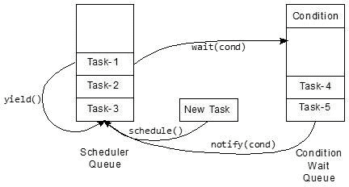

**图 9.1：** 基于各种操作的任务状态转换

Julia 的异步编程模型可以从上图中理解：

1. 新创建的任务通过 `schedule` 方法被添加到调度器的可运行任务队列中。
2. 当任务正在执行时，它可以调用 `yield` 并将控制权交还给调度器，以调度下一个可运行的任务。
3. 任务可以在条件上 `wait`，并移动到该条件的等待队列中。
4. 当条件满足时，可以在该条件上调用 `notify`，这会将分配给该条件的所有任务移动到调度器的可运行队列中。

任务不是函数。它们可以轻松切换，因为不需要像函数那样重新创建栈帧。调度器如何决定挑选哪个任务取决于 Julia 运行时的架构。例如，具有多线程执行可用性的调度器可能能够挑选多个任务进行执行。同样，条件也是另一个系统相关的实体。例如，条件可以是文件被锁定、设备忙碌，或通道已满或为空。

# Task 对象

`Task` 对象可以通过将一个无参数的函数作为参数传递给其构造函数来构造。这样创建的 `Task` 尚未运行，当在其上调用 `schedule` 函数时，它会被放入调度器队列。

```julia
julia> t = Task() do
           sleep(10)
           println("done")
       end

julia> schedule(t)
```

在调用 `schedule(t)` 时提示符会立即返回，因为该调用仅将任务放入队列。打印操作将在 10 秒后执行。

```julia
julia> t = Task() do
           sleep(10)
           println("done")
       end

julia> schedule(t); wait(t)
```

调用 `wait` 将确保执行等待直到任务完成。`@task x` 是一种常见方式，通过 `Task(()->x)` 获取任意代码并将其转换为 `Task` 对象。

```julia
t = @task begin
    sleep(10)
    println("done")
end
```

异步任务是指一个 `Task` 后跟一个 `schedule()` 调用，通常由宏 `@async` 表示。如果在任务上调用 `wait`，则该调用将等待任务完成。这样的系统称为同步任务。宏 `@sync` 可以满足这种需求。

# 通道

通道是共享内存队列，有助于设计任务之间生产者和消费者类型的数据交换。通道可以包含固定数量的特定类型的数据元素，如果未指定特定类型，则为 `Any` 类型。

```julia
julia> c = Channel(8)
Channel{Any}(sz_max:8,sz_curr:0)
```

你也可以创建一个队列中包含特定数据类型（如 `Int`）的通道。

```julia
julia> c = Channel{Int}(8)
Channel{Int64}(sz_max:8,sz_curr:0)
```

让我们使用一个异步生产者向通道写入数据。

```julia
@async begin
    for i = 1:6
        println("Adding $i to channel")
        put!(c, i)
    end
end
```

异步消费者也从通道读取数据。

```julia
@async begin
    for i = 1:6
        v = take!(c)
        println("Removing value: $v")
    end
end
```

结果分批打印，一旦通道填满，生产者就会等待。同样，一旦通道变空，消费者就会等待。

```text
Adding 1 to channel
Adding 2 to channel
Adding 3 to channel
Adding 4 to channel
Removing value: 1
Removing value: 2
Removing value: 3
Removing value: 4
Adding 5 to channel
Adding 6 to channel
Removing value: 5
Removing value: 6
```

最后，可以通过 `close` 调用关闭通道。一旦通道关闭，就无法再通过它们进行通信。

# 锁

锁是用于同步任务的同步对象。如果资源可以被多个任务访问，最好在锁的管理下进行访问，以避免在访问时状态被修改。锁的基本前提是一个条件。当条件被通知时，等待在该条件上的任务会被释放，如前所述。典型的锁代码如下所示：

```julia
lock(c)
try
    while !condition_to_wait
        wait(c)
    end
finally
    unlock(c)
end
```

解决此场景的更聪明方法是使用 `lock...do` 语法和 `lock(f, cond)` 函数，它们会自动包含 `unlock()` 调用。

```julia
lock(c) do
    # Access the resource when the lock is active
    work_on_resource()
end
```

锁在多线程场景中尤为关键，因为任务可能同时访问资源。

### 多线程

Julia 进程启动时为单线程。但是，可以使用命令 `julia -t <no_of_threads>` 或 `julia --threads <no_of_threads>` 启动多线程。也可以通过将环境变量 `JULIA_NUM_THREADS` 设置为所需的线程数来实现相同效果。通过 `julia -t 4` 启动 Julia 后，以下代码提供 Julia 环境中活动线程的数量。

```julia
julia> Threads.nthreads()
4
```

`@spawn` 将使用任何可用的线程并在其上运行任务。


# Julia 多线程与分布式计算

## 多线程示例

### `@spawn` 单线程执行

```julia
julia> Threads.@spawn for i=1:100
       sleep(1)
       println("Step: $i")
       end
Task (runnable) @0x0000000016a73990

julia> Step: 1
Step: 2
Step: 3
Step: 4
…
Step: 100
```

数值按顺序打印，因为任务在当前可用的 4 个线程中的单个线程上运行。

### `@threads` 并行执行

如果您想并行化 `for` 循环，可以使用 `Threads.@threads` 宏。从输出可以看出，打印现在是并行的。可以清楚地看到 `for` 循环已被分割成 4 个不同的执行线程。

```julia
julia> Threads.@threads for i=1:100
       sleep(1)
       println("Step: $i")
       end
Step: 26
Step: 51
Step: 1
Step: 76
Step: 77
Step: 52
Step: 2
Step: 27
…
Step: 100
Step: 25
Step: 50
Step: 75
```

## 线程同步

当程序中执行多个线程时，跨线程同步可能是一个问题。锁是解决这些需求的有用编程范式。`Threads.Conditions()` 是线程安全的条件对象，必须用于线程安全。第二个问题是低级原子操作。Julia 支持部分 LLVM 定义的低级原子操作。最后，终结器和垃圾回收可能会受到多线程程序的影响。建议用户查阅多线程手册以更好地理解该主题 3。

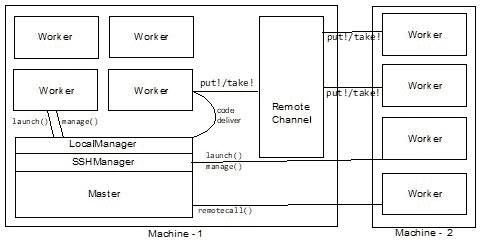

**Figure 9.2:** Julia 中的分布式计算架构

Julia 的分布式架构包含前几章讨论的异步编程和多线程编程的所有类似模型。然而，由于分布式架构的特性，存在某些额外的复杂性：

1.  一个主进程管理计算基础设施。
2.  它利用 `LocalManager` 在同一台机器上启动和管理 Julia 工作进程以执行本地负载。
3.  还有一个 `SSHManager`，可以通过 SSL 连接连接到远程主机并传达要执行的远程操作。
4.  连接管理保持在架构之外，假设所有必需的安全限制和协议均由网络层处理。
5.  远程工作进程可由主进程启动，并将为该工作进程分配一个新 ID。ID 1 保留给主进程。
6.  由工作进程启动的任何代码均通过 `remotecall` 启动。远程调用可能返回 `Future` 类型的对象，可通过 `fetch` 调用等待以获取远程调用的输出。
7.  另一种数据交换模式是 `RemoteChannel`，它可以在其中一个进程中设置，而其他工作进程可以向其中 `put!()` 数据或 `take!()` 数据。就像本地 `Channel` 对象一样，它们为发布-订阅模型编程提供了便捷方式。
8.  许多远程连接可能不需要知道运行工作负载的机器的具体细节。它们使用带有 `:Any` 参数的 `@spawnat` 等宏，以便可以在任何一台机器上启动工作负载。因此返回的 `Future` 对象将能够通过适当的 SSH 连接进行通信，以与另一台物理机器上的正确工作进程通信。
9.  同样，所有工作进程要运行的代码必须对它们可用。一种选择是将其部署为包，使包在所有进程中可用。但包需要在每个单独的进程中通过 `using` 单独选择。

虽然 Julia 提供了详尽的分布式架构，但为简洁起见并减少文本复杂性，我们将讨论保持在最低限度。不过，建议感兴趣的读者参考 Julia 文档手册中的多进程和分布式计算章节 4。

## 输入与输出 (I/O)

输入输出（I/O 或 IO）涉及从各种设备读取和写入数据。Julia 可以通过操作系统与各种 I/O 设备通信。然而，Julia 创建了高级基于流的接口来连接 TTY、文件和网络套接字。基于 I/O 的方法在底层适用于所有这些不同类型的设备。一些 Julia 方法将支持 `IO` 作为参数，它是高级流接口的抽象类型，具体的 IO 设备由此派生。

### 标准流

`Base.stdin`、`Base.stdout` 和 `Base.stderr` 是用于输入、输出和错误的标准流（如果未指定其他流）。对于像 REPL 这样的交互式环境，终端可以充当这三者。您也可以使用 `redirect_stdout` 等函数将它们重定向到其他位置。

```julia
julia> write(stdout, "Hello World")
Hello World
11
```

`write()` 写入了 11 个字节。

```julia
julia> write(stdout, "\u2200 x \u2203 y")
∀ x ∃ y
11
```

`write` 命令返回写入的字节数，与要写入的字符数无关。

> **注意：** 从 Jupyter Notebook 中 `read()` `stdin` 可能无法工作，示例中的任何此类代码都应在 REPL 环境中执行。

### 从 `stdin` 读取文本

从 `stdin` 读取文本在 TTY 终端上相当常见。但同样重要的是知道何时停止读取。通常数据被读取到固定大小的缓冲区中，当读取到所需数据时停止。

```julia
julia> read(stdin, Char)
a
'a': ASCII/Unicode U+0061 (category Ll: Letter, lowercase)
```

预期一个字符，一旦得到一个，`read` 命令即完成。该方法将数据返回到一个 `Char` 常量。对 `String` 执行相同操作可能导致无休止的条件。

```julia
julia> read(stdin, String)
abcd
ccsdcsacd
cdsacdss
ERROR: InterruptException:
…
```

您可以使用 *Ctrl-C*；这将引发中断异常并退出 `read` 方法，但您的 `String` 无法被读取 5。这是使用 `readline` 方法的完美场景。`readline` 将读取一行，直到获得 `end of line` (`EOL`) 字符。

```julia
julia> readline(stdin)
12345
"12345 "
```

然而，对于多行输入，`eachline(stdin)` 提供了一个迭代器，用于从终端获取每一行。以下代码在空新行时终止进一步读取。

```julia
julia> for line in eachline(stdin)
       isempty(line) && break
       println(line)
       end
1st line
1st line
2nd line
2nd line
```


与读取类似，写入也要求终端支持将输出显示为文本。

```julia
julia> print(stdout, 0x61)
97
```

```julia
julia> write(stdout, 0x61);
a
```

在前面的示例中，`print` 试图显示 `UInt8` 的数值，而 `write` 方法则向终端进行文本输出。

## `read()` 和 `write()` 操作

`read()` 和 `write()` 操作通常用于将二进制数据流读取到对象数组中，或从对象数组写入二进制数据流，它们会等待读取特定大小的数据，或直到到达文件末尾。

```julia
julia> read(stdin, 4)
abcd
4-element Array{UInt8,1}:
 0x61
 0x62
 0x63
 0x64
```

在前面的示例中，仅从 `stdin` 读取了 4 个字节。`read` 方法还有许多其他变体，包括 `read(io, String)`，它将把完整的 `io` 作为单个字符串读取；以及 `read(filepath)`，它将把 `filepath` 表示的整个文件作为单个字节数组读取。

## Julia 中的文件 I/O

Julia 中的文件 I/O 与流操作非常相似。以下是 Julia 文件操作中的一些通用步骤：

1.  打开文件并获取相关的流句柄。
2.  访问流中的相关位置。
3.  从文件读取数据或向文件写入数据。
4.  关闭流句柄。

虽然文件本身可能未缓冲，但流会在缓存中使用少量内存进行缓冲，以便预读或回滚。虽然 Julia 中的流具有许多操作的接口，但它们可能受限于设备的内部能力。例如，如果文件是只读的，则不能以写入模式打开。因此，在只读流上进行写入操作将会失败。

```julia
julia> write("hello.txt", "Hello World")
11

julia> f = open("hello.txt", "r");

julia> data = read(f);

julia> write(f, "This is second line")
ArgumentError: write failed, IOStream is not writeable
Stacktrace:
 [1] unsafe_write(::IOStream, ::Ptr{UInt8}, ::UInt64) at .\iostream.jl:363
 [2] write(::IOStream, ::String) at .\strings\io.jl:183
 …

julia> close(f)

julia> write(stdout, data)
Hello World
11
```

在前面所示的示例中：

1.  `write(filename, data)` 将创建一个新文件并将 `data` 写入其中。该函数返回写入的字节数。
2.  随后，我们通过 `open(filename, mode)` 以只读模式打开文件，并将数据作为字节数组从文件中读取。
3.  尝试向只读流写入额外数据，这正如预期那样失败了。
4.  关闭流。
5.  将读取的数据写入 `stdout` 以进行打印。

`open(fn, filename, mode)` 是一种替代方法，它会关闭已打开的文件句柄。

```julia
julia> open("hello.txt", "r") do f
           data = read(f)
           write(stdout, data);
       end
Hello World
11
```

对于许多数据科学问题，文件被用于归档。基于文件路径进行读写被认为很方便，如下面的代码所示：

```julia
julia> write("hello.txt", "Hello World");

julia> data = read("hello.txt");

julia> write(stdout, data);
Hello World
```

基于文件位置的操作（如 `seek`、`seekstart`、`seekend` 和 `position`）也受 API 支持。我们使用了 `read` 方法，它会一次性读取直到 EOF。虽然方便，但可能不是最节省内存的。某些应用程序（如解析器）可能会像以下代码那样逐字节读取文件：

```julia
julia> open("hello.txt", "r") do f
           while !eof(f)
               b = read(f, 1)
               write(stdout, b)
           end
       end
Hello World
```

在前面的示例中，`eof(f)` 提供了停止文件遍历所需的检查。

## 分隔文件 (CSV)

Julia **标准库** (`stdlib`) 包含一个 `DelimitedFiles` 模块，有助于读写分隔值格式的数据，其中每一行代表一条记录。**逗号分隔值** (**CSV**) 广泛用于电子表格中导出和导入数据，就是一种此类格式。以下代码可以帮助将数据写入带有一行表头的类 CSV 格式：

```julia
julia> using DelimitedFiles

julia> x = collect(1:100);

julia> y = Float64.(collect(101:200));

julia> open("values.csv", "w") do f
           println(f, "X,Y")
           writedlm(f, [x y], ',')
       end
```

同样，可以通过以下代码将数据读回变量 `data` 和 `header` 中：

```julia
julia> data, header = readdlm("values.csv", ',', header=true)

julia> size(data, 1)
100

julia> header
1×2 Array{AbstractString,2}:
 "X"  "Y"
```

## 网络 I/O

当系统安装了 `curl`、`fetch` 或 `wget` 时，Julia 提供了 `download(url, [localfile])` 方法，通过 ftp、http 或基于 SSL 的通信通道下载文件。但是，它不能用于基于互联网的应用程序开发所需的通用网络通信。该 API 返回下载文件被写入的本地文件路径。

```julia
julia> download("https://github.com/JuliaLang/julia/releases/download/v1.5.3/julia-1.5.3.tar.gz", "julia-1.5.3.tar.gz")
"julia-1.5.3.tar.gz"
```

TCP 套接字用于互联网上的客户端-服务器通信和应用程序开发。虽然在大多数情况下，您可能不需要使用原始套接字进行通信，并且可以使用 Julia 包（如 `HTTP.jl`）提供的特定协议 API，但了解标准库中的 `Sockets` 模块仍然很有价值。

联网客户端-服务器通信的基础可以用以下基本工作流来描述：

1.  服务器绑定到一个通信端点（端口）并持续监听。
2.  客户端连接到同一端口并获取一个通信套接字句柄。
3.  客户端将请求作为命令写入服务器。
4.  服务器响应数据。
5.  当客户端获得所需数据时，它关闭连接。
6.  在异常条件下，服务器也可能终止连接。

客户端和服务器均作为后台任务运行，示例如下：

### 服务器代码（后台任务 1）

```julia
julia> using Sockets

julia> @async begin
           server = listen(3000)
           while true
               s = accept(server)
               @async while isopen(s)
                   msg = readline(s, keep=true)
                   write(s, "Server Response: $msg")
               end
           end
       end
```

### 客户端读取服务器响应（后台任务 2）

```julia
julia> c = connect(3000)

julia> @async while isopen(c)
           println(stdout, readline(c, keep=true))
       end
```


# 客户端发送请求代码（前台任务）

```julia
for i = 1:5
    println(c, "Client Msg id: $i")
end
```

服务器响应：Client Msg id: 1
服务器响应：Client Msg id: 2
服务器响应：Client Msg id: 3
服务器响应：Client Msg id: 4
服务器响应：Client Msg id: 5

```julia
close(c)
```

该示例代码可视为包含三个部分。

## 1. 服务器在后台运行并监听 3000 端口。

1. 一旦客户端连接到 3000 端口，服务器接受连接并获取一个套接字，以便通过该连接响应客户端。
2. 服务器生成另一个并行任务，以便客户端和服务器可以通过它进行通信，而主服务器任务则持续监听 3000 端口，无限期地等待下一个客户端进行通信。
3. 在新任务中，服务器读取客户端请求，附加自己的消息，并将其写回套接字供客户端读取。

## 2. 客户端连接到 3000 端口上的服务器。

1. 连接成功后，它持续读取服务器写入套接字的任何内容，并写入 `stdout`。

## 3. 客户端通过前台任务向服务器发送请求。

通信任务完成后，客户端可以 `close` 与服务器的连接。服务器将继续在后台运行，等待其他客户端连接。

---

在字符串章节中我们了解到，由于字符串不可变，因此不适合进行修改。然而，可能需要持续修改大块内存或向其追加新数据。以下是将内存用作 IO 并稍后聚合为 `String` 的简单方法。

```julia
io = IOBuffer()
println(io, "This is Line 1")
println(io, "This is Line 2")
str = String(take!(io))
```

```
"This is Line 1\nThis is Line 2\n"
```

反向场景是内存映射。文件可以映射到内存地址。文件中的数据可以像访问内存位置一样被访问。内存映射通常能提高对文件数据的访问速度，在大块数据可能无法放入计算机内存的情况下也很有帮助。映射内存可用作进程间通信的共享内存。内存映射函数定义在标准库模块 `Mmap` 中。

### 步骤 1：创建一个我们想要进行内存映射的文件。

```julia
A = fill(10, (5, 20))
A[2, 3] = 20
open("mmap.bin", "w+") do f
    write(f, size(A, 1))
    write(f, size(A, 2))
    write(f, A)
end
```

### 步骤 2：对文件进行内存映射并读取值，确保正确数据已填充。

```julia
using Mmap
f = open("mmap.bin", "r")
nr = read(f, Int)
nc = read(f, Int)
A2 = Mmap.mmap(f, Matrix{Int}, (nr, nc))
println("A2[1, 1]: ", A2[1, 1], " A2[2, 3]: ", A2[2, 3])
close(f)
```

### 步骤 3：清理

```julia
A2 = nothing
GC.gc()
rm("mmap.bin")
```

在 Windows 等操作系统中，文件会被锁定以进行读写，在使用 mmap 分配的数组未被回收之前，无法删除该文件。调用 `GC.gc()` 可确保调用垃圾收集器来清理未被引用的数组 `A2`。然而，在 Julia 中手动调用垃圾收集器不被视为高效实践，应尽量减少使用。

---

系统中有一些标准常量，用于提供文件路径、线程数等信息。Julia 预定义了相当一部分作为其库的一部分。许多从其命名即可显然看出含义；一些我们将作为本节的一部分进行讨论。语言中有数百个此类常量，详细解释超出了本书范围。请参阅 Julia 文档以获得详细理解。

```julia
VERSION
```

```
v"1.5.2"
```

```julia
Sys.BINDIR
```

```
"D:\\Users\\juser\\AppData\\Local\\Programs\\Julia 1.5.2\\bin"
```

```julia
Sys.CPU_THREADS
```

```
4
```

```julia
Sys.WORD_SIZE
```

```
64
```

```julia
Sys.KERNEL
```

```
:NT
```

```julia
Sys.MACHINE
```

```
"x86_64-w64-mingw32"
```

```julia
Sys.ARCH
```

```
:x86_64
```

```julia
Sys.ENV
```

```
Base.EnvDict with 48 entries:
"ALLUSERSPROFILE"       => "C:\\ProgramData"
"APPDATA"               => "C:\\Users\\usr\\AppData\\Roaming"
"COMMONPROGRAMFILES"    => "C:\\Program Files\\Common Files"
⋮                       => ⋮
```

其他子模块中也定义了常量。数学常量如 `pi` 和 `e` 等也在语言中定义。

```julia
MathConstants.pi
```

```
pi = 3.1415926535897…
```

```julia
MathConstants.e
```

```
e = 2.7182818284590…
```

---

标准库拥有许多额外模块，可为程序员提供实用函数。我们在此概述几个常用模块。

## `Dates` 模块

`Dates` 模块提供面向用户展示的日期和时间功能。虽然我们在前面章节中看到了有助于调试和分析 `code` 的 `@time` 宏，但 `Date` 和 `DateTime` 类型以用户展示格式表示时间。例如，`Date` 能够按日、月、年展示，而 `DateTime` 还可额外按时、分、秒展示。然而，这些表示不包含任何时区信息。任何需要将时区与日期和时间结合使用的人都需要使用 `TimeZones.jl` 包。`Date` 和 `DateTime` 内部均以逝去的 `Int64` 跟踪时间，且均为不可变类型。例如，函数 `now` 将当前时间作为 `DateTime` 对象报告。

```julia
using Dates
now()
```

```
2020-11-27T22:52:36.318
```

`DateTime` 和 `Date` 构造函数可通过提供部分数据来构造。未提供日、月时默认为第一天和第一月。未提供的任何时间参数默认为 0。

```julia
DateTime(2020)
```

```
2020-01-01T00:00:00
```

```julia
t = DateTime(2020, 10, 31, 01, 02, 03)
```

```
2020-10-31T01:02:03
```

```julia
Date(2020)
```

```
2020-01-01
```

`Date` 和 `DateTime` 类型可相互转换。当 `DateTime` 转换为 `Date` 时，时间数据设为零。

```julia
d = Date(t)
```


# Julia 日期时间与日志记录

## 日期时间比较与运算

`DateTime` 和 `Date` 可以相互比较，也可以在同类型内部比较。

```julia
julia> DateTime(d)
2020-10-31T00:00:00

julia> t > d  # t is DateTime and d is a Date
true

julia> DateTime(2020) < now()  # both date time
true

julia> DateTime(2020) == Date(2020)
true
```

两个 `Date` 的差值，或两个 `DateTime` 的差值，会产生 `Period` 类型的子类型。常用的周期类型有 `Year`、`Day`、`Month`、`Hour`、`Minute`、`Second` 和 `Millisecond`。这些类型的组合可形成 `CompositePeriod` 类型。`Periods` 可与 `Date` 和 `DateTime` 结合，生成相应的 `Date` 和 `DateTime`。

```julia
julia> p = Month(3) + Day(10) + Hour(15)
3 months, 10 days, 15 hours

julia> typeof(p)
Dates.CompoundPeriod

julia> now() + p
2021-03-11T01:24:53.251

julia> Date(now()) + Day(300)
2021-09-24

julia> now() - DateTime(2020)
28728026709 milliseconds

julia> now() - Date(2020)
MethodError: no method matching -(::DateTime, ::Date)

julia> Date(now()) - Date(2020)
332 days
```

### 访问器构造函数

访问器构造函数用于估算从上一个较大周期过去的周期。例如，`Month()` 计算从年初过去的月数，`Day()` 计算从上个月结束过去的天数。不过，`Week()` 计算从年初过去的周数。小写函数返回 `Int64` 数量而非 `Period`。

```julia
julia> Year(now())
2020 years

julia> Month(now())
11 months

julia> Day(now())
28 days

julia> Week(now())
48 weeks

julia> year(now())
2020
```

### 调整器

Julia 提供了许多称为 **adjustors** 的有趣函数，有助于计算特定日期。例如，查找下一个感恩节（11 月的第 4 个周四）可基于以下代码：

```julia
julia> tonext(today()) do d
           dayofweek(d) == Thursday &&
           dayofweekofmonth(d) == 4 &&
           month(d) == November
       end
2021-11-25
```

---

## 日志记录

Julia 广泛用于后端服务器编程，这意味着必须跟踪长时间运行进程的错误和故障。标准库中的 `Logging` 模块在一定程度上满足了这一需求。Julia 中的消息可以在不同的日志级别记录。以下是按严重程度递增顺序排列的示例：

```julia
julia> @error "This is an error"
┌ Error: This is an error
└ @ Main REPL[1]:1

julia> @warn "This is a warning"
┌ Warning: This is a warning
└ @ Main REPL[2]:1

julia> @info "This is an info"
[Info: This is an info

julia> @debug "This is debug message $(sum(rand(10)))"
julia>
```

由于默认日志级别设为 `info`，而 `debug` 级别低于该级别，因此调试消息根本未被计算。根据系统终端能力和所用记录器，日志消息可能以各种颜色和高亮渲染。上述渲染来自 REPL 的默认渲染。例如，info 消息中不报告行号。

当宏参数不是字符串时，它们将显示为键，后跟其实际计算值。

```julia
julia> A = ones((3, 4))

julia> @info "A is all ones" A
┌ Info: A is all ones
│   A =
│    3×4 Array{Float64,2}:
│     1.0  1.0  1.0  1.0
│     1.0  1.0  1.0  1.0
└     1.0  1.0  1.0  1.0
```

每个应用程序都有一个注册的记录器，它将日志事件作为输入并根据记录器能力有效渲染。能力包括应用程序日志的写入流，如文件系统、`stderr` 或任何其他流。迄今为止我们一直在使用全局记录器。全局记录器可通过 `global_logger(logger::AbstractLogger)` 方法覆盖。应用程序也可使用 `with_logger(f, logger)` 方法设置局部记录器。以下代码使用 `SimpleLogger` 将日志写入文件：

```julia
julia> using Logging

julia> open("file.log", "w") do f
           with_logger(SimpleLogger(f)) do
               @info "This is my simple info log"
               @error "This is an error written to file"
               @warn "This is a warning message"
               @info "Current logger is same as global logger" current_logger() == global_logger()
           end
       end

julia> write(stdout, read("file.log"));
┌ Info: This is my simple info log
└ @ Main In[72]:3
┌ Error: This is an error written to file
└ @ Main In[72]:4
┌ Warning: This is a warning message
└ @ Main In[72]:5
┌ Info: Current logger is same as global logger
│   current_logger() == global_logger() = false
└ @ Main In[72]:6

julia> @info "Current logger is same as global logger" current_logger() == global_logger()
┌ Info: Current logger is same as global logger
│   current_logger() == global_logger() = true
└ @ Main In[72]:10
```

由于局部记录器在 `with_logger` 块内覆盖了当前记录器，因此当前记录器不同于全局记录器。然而，在 `with_logger` 块外部，`current_logger()` 与 `global_logger()` 相同。`SimpleLogger` 提供了一个非常简单的接口，用于覆盖日志流和要在记录器中显示的消息级别。日志事件还可以包含模块、消息标识符、文件、行号、日志消息显示的最大次数以及作为日志一部分显示的异常。


任何有兴趣实现自己记录器的人都可以创建 `AbstractLogger` 类型的子类型，并实现 `AbstractLogger` 所需的方法。详细信息记录在 Julia 文档的 `Logging` 模块 6 中。

# 统计

Julia 标准库中的 `Statistics` 模块提供了计算集中趋势的方法。这些只是用于计算均值、中位数、相关性、标准差和协方差等的简单函数。更复杂的统计函数由诸如 `BaseStats.jl` 之类的包提供。下面列出了一些简单统计函数的实际运用。

```julia
julia> using Statistics

julia> mean(1:10)
5.5

julia> median(1:10)
5.5

julia> std(1:10)
3.0276503540974917

julia> var(1:10)
9.166666666666666

julia> cor(1:10, rand(10))
-0.5776975622356152

julia> cor(1:10, 11:20)
1.0

julia> cov(1:10, rand(10))
-0.25738214577938084
```

# 随机数

随机数在数据科学中被广泛用于初始化数据。它们也可用作各种概率分布的样本创建。加密安全的随机数也是加密和解密算法的要求。以下是一些示例：

```julia
julia> using Random

julia> rand(Int, 2)
2-element Array{Int64,1}:
 -6387591687841801404
 -5718816187088355789

julia> rand(2, 3)
2×3 Array{Float64,2}:
 0.395316  0.413728  0.738543
 0.505417  0.0773799 0.560448

julia> rand!(zeros(2, 3))
2×3 Array{Float64,2}:
 0.30912   0.797688  0.324596
 0.586434  0.0213767 0.110147

julia> rand(1:4, (2, 3))
2×3 Array{Int64,2}:
 2  3  1
 2  2  4
```

`rand()` 方法生成特定类型、数据范围或任何所需形状或输出的均匀随机数。给定一个预分配的数组，`rand!()` 函数可以用新的随机值填充同一个数组。与 `rand` 方法类似，`randn` 方法用正态分布填充随机数，而 `randexp` 用指数分布填充数据。

`rand` 方法的第一个参数是可选的，称为随机引擎（`rng`）。Julia 使用 *Mersenne Twister* 库进行随机数生成。可以用足够的熵初始化自己的 *Mersenne Twister*，使得随机数生成器生成的伪随机序列足够安全。不提供引擎将使用作为 Julia 运行时一部分初始化的引擎。Julia 还提供了随机排列、随机子序列和随机循环排列等方法。

# 标准库总结

Julia 中的标准库对于访问操作系统和满足开发者日常编程需求至关重要。虽然有些可能具有实用方法的有效性，但许多方法对于与生态系统中的其他系统交互是必需的。我们简要浏览了这些库并理解了 Julia 模块架构。这使我们对介绍 Julia 编程语言的第一部分内容画上了句号。在下一部分中，我们将致力于了解 Julia 开发环境，如 IDE、调试器、包管理器、与原生库的交互以及云部署架构。我们还将了解 Julia 编程的最佳实践以及生产就绪的 Julia 应用程序所需遵守的性能考量。

# 练习

1.  模块能否定义在另一个模块内部？如果可以，其函数将如何被导出到外部？

2.  编写一个命令，从 Julia REPL 启动命令提示符窗口或 Unix 终端窗口。这与在 REPL 中使用分号（`;`）切换到 Shell 模式有何不同？查看 Julia 源代码以了解 REPL 是如何实现相同功能的。

3.  遍历一个目录并列出所有 PDF 文件。PDF 文件的文件扩展名为 `".pdf"`。

4.  读取一个文本文件并在行与行之间增加额外的行间距后重写它。

5.  编写一个函数，给出从今天起 n 天后的日期。

6.  给定一个数字 `Vector`，将元素按随机顺序重新排列。

---

# 参考文献

1 Running External Programs, Julia Documentation, [`docs.julialang.org/en/v1/manual/running-external-programs/#Running-External-Programs`](https://docs.julialang.org/en/v1/manual/running-external-programs/#Running-External-Programs)

2 你可以如下所示启动 Julia：`$ JULIA_NUM_THREADS=4 julia`。如果你正在使用 IJulia，可以遵循以下步骤。

```julia
ENV["JULIA_NUM_THREADS"] = 4
using IJulia
notebook()
```

3 Multi-Threading, Julia Documentation Manuals, [`docs.julialang.org/en/v1/manual/multi-threading/`](https://docs.julialang.org/en/v1/manual/multi-threading/)

4 Multiprocessing and Distributed Computing, Julia Documentation Manual, [`docs.julialang.org/en/v1/manual/distributed-computing/`](https://docs.julialang.org/en/v1/manual/distributed-computing/)

5 另一种方法是在输入提供后的新行上使用 `ctrl-D`，或连续 2 次 `ctrl-D` 字符来通知输入结束。

6 Logging, Standard Libraries, Julia Documentation, [`docs.julialang.org/en/v1/stdlib/Logging/`](https://docs.julialang.org/en/v1/stdlib/Logging/)

Julia 进程启动时为单线程。但是，可以通过使用命令 `julia -t <no_of_threads>` 或 `julia --threads <no_of_threads>` 以多线程启动。也可以通过将环境变量 `JULIA_NUM_THREADS` 设置为所需的线程数来实现相同目的 2。通过使用 `julia -t 4` 启动 Julia，以下代码提供 Julia 环境中活动线程的数量。


当程序中执行多个线程时，跨线程同步可能是一个问题。锁是解决这些需求的有用编程范式。`Threads.Conditions()` 是线程安全的条件对象，必须用于线程安全。第二个问题是低级原子操作。Julia 支持部分 LLVM 定义的低级原子操作。最后，终结器和垃圾回收可能会受到多线程程序的影响。我们建议用户查阅多线程手册，以更好地理解该主题 3。

`Cmd` 对象是通过使用反引号（`）引用外部命令来创建的。`Cmd` 对象也有显式的构造函数 1。

任何有兴趣实现自己记录器的人都可以创建 `AbstractLogger` 类型的子类型，并实现 `AbstractLogger` 所需的方法。详细信息记录在 Julia 文档的 `Logging` 模块中 6。

虽然 Julia 提供了精心设计的分布式架构，但为了简洁起见并减少其给文本带来的复杂性，我们将把讨论保持在最低限度。不过，建议感兴趣的读者参考 Julia 文档手册中的多进程和分布式计算章节 4。

你可以使用 `ctrl-C`；这将引发一个中断异常并退出 `read` 方法，但你的 `String` 将无法被读取 5。这是使用 `readline` 方法的绝佳时机。`readline` 将读取一行，直到遇到 `行尾` (`EOL`) 字符。

# 编程是一门比科学更宏大的艺术

大多数程序员为自己的技艺感到自豪。他们在一段时间内掌握这门艺术，并在职业生涯的大部分时间里精通一种编程风格。习惯于命令式编程或面向对象编程的人可能会觉得 Julia 有点令人困惑。本章将帮助熟悉这些区别。

# 本章将涵盖以下主题

*   背景
*   可维护性指南
*   函数式编程原则
*   常用模式
*   为开源做贡献

# 在本章中，读者将能够了解 Julia 代码该如何编写

社区遵循大多数 Julia 程序员都遵守的特定风格指南。我们将回顾函数式编程的某些模式以及它们在 Julia 中是如何使用的。

# Julia 拥有许多类 LISP 的特性

同时，它也拥有足够的构造来支持命令式编程风格。虽然计算机程序员倾向于命令式编码风格，但数学家和研究人员倾向于函数式编程，因为它易于将程序表示为数学函数的等价形式。我们将在后续章节中深入探讨其中一些差异。

编程的第二部分是通用的代码编写指南和风格。这些有助于维护代码库。一个潜在的例子可以是编码标准、函数约定和变量命名法。与 Python 等语言不同，Julia 在语法上不依赖空白字符的位置。这意味着人们很容易编写出让其他程序员难以阅读的代码。Julia 社区遵循严格的建议或实践，作为检入 Julia GitHub 仓库代码的一部分。大多数 Julia 程序员倾向于欣赏并在他们的代码中遵循这些规范。当我们讨论为可维护性编码时，将讨论其中一些方面。

# 软件行业经典的需求分类之一 1 是 FURPS

1.  功能性
2.  易用性
3.  可靠性
4.  性能
5.  可支持性

这里特别关注可支持性，因为良好的支持要求代码可读。编码约定有助于满足更大范围开发人员的需求。我们将查看 Julia 文档中建议的风格指南 2。

## 1. 使用函数

基于 REPL 的语言很容易被误认为是脚本语言。动态类型，加上所有代码都写在全局作用域（`Main` 模块）中，使该语言具有脚本语言的风味。然而，使用适当的函数可以使代码可维护；此外，由于函数可以以类型安全的方式编写，因此它们可以被更好地优化。

## 2. 代码必须是泛化的，而非特定于类型的

这个概念可以通过以下代码轻松解释：

```
julia> addone(x) = x + one(x);
julia> addone(5), addone(5.0), addone(5f0)
(6, 6.0, 6.0f0)
```

Julia 有许多像 `one()` 和 `zero()` 这样的方法，它们利用操作数的类型，审慎地提供在计算中不需要显式类型提升的值。同样的原则可以应用到你的代码中，使其易于扩展。

## 3. 如果这是意图，请保持函数作用域狭窄

当函数参数期望特定类型时，必须指定该类型。这确保了运行时错误不会进一步传播，也不需要额外的断言。

```
calc1() = 2, 1
calc2() = 1.1, 1.2
myvalidate(x::Int, y::Int) = x == y
julia> myvalidate(calc1()…)
false
julia> myvalidate(calc2()…)
MethodError: no method matching myvalidate(::Float64, ::Float64)
```

虽然 `calc1()` 是正确类型的计算，但 `calc2()` 肯定是错误的，而 `myvalidate()` 确保错误被局部化。其次，如果需要任何显式类型转换，必须由调用者执行，而不是被调用者。

```
function myvalidate2(x, y)
    xi, yi = Int(x), Int(y)
    return xi == yi
end
julia> myvalidate2(2, 3.0) # 不好的风格
false
julia> myvalidate(2, Int(3.0)) # 更好的风格
false
```

## 4. 为修改参数的函数追加感叹号 (!)

在参数值被修改的地方，函数名应有清晰的感叹号指示符。这一点将在后续章节中进一步阐明。

```
function double!(v::Vector)
    for i=firstindex(v):lastindex(v)
        v[i] *= 2
    end
    return v
end
julia> double!([1,2,3])
3-element Array{Int64,1}:
2
4
6
```

## 5. 避免复杂的数据类型

特别是与集合结合使用的数据类型必须保持简单。`Vector{Union{Int, Float, Function, MyType}}` 最好指定为 `Vector{Any}`。对于编译器来说，拥有更简单的类型可能更高效。同样，`Union{Function, AbstractString}` 可能暗示代码中存在不当的设计选择。

## 6. 命名约定

Julia 编码者习惯于特定的命名约定。以下是一些：

*   类型以大写字母开头，可以采用驼峰命名法：`MyType`、`AbstractArray{T}` 等。
*   模块名遵循与常规类型相同的约定。
*   函数必须全小写。
    *   简单的谓词采用合并单词：`beginswith`、`isequal`、`haskey` 等。


# 代码风格指南

## 7. 使用与 `Base` 匹配的函数参数

以下是一些常用的实践：

*   当函数或 lambda 作为参数时，最好将它们分配在参数列表的开头，这样可以使用 `function…do` 语法编写。

    ```julia
    mymap(f, arr) = f.(arr)
    julia> mymap([1, 2, 3]) do x
        2x
    end
    ```

*   类似地，`Vararg` 参数出现在函数参数的末尾。`IO` 参数通常是函数的第一个参数。`::Type{T}` 类型的参数构成函数的第一个参数。

## 8. 审慎使用静态参数

仅当参数实际被需要时，才推荐使用静态参数。

```julia
double(x::T) where {T<:Real} = 2x
double(x::Real) = 2x
```

这两个方法是等价的。只会创建一个方法，第二个方法会覆盖第一个。`methods()` 调用将只列出一个方法。虽然声明了参数 `T`，但它未在函数体中使用。因此，它被视为冗余并被优化掉了。

```julia
julia> methods(double)
# 1 method for generic function double:
 double(x::Real) in Main at In[20]:1
```

然而，以下方法是非常相关且有必要的。

```julia
myeltype(v::Vector{T}) where {T<:Real} = T

julia> myeltype([1.0, 2, 3])
Float64
```

## 9. 仅在需要时使用 Lambda

当你需要一个函数但又不想污染命名空间时，Lambda 非常有用。其次，它们为 `function…do` 类语法提供了非常简洁的接口。然而，当函数已经有定义的名称时，将函数包装在 lambda 中不会增加任何价值。例如，`map(f, array)` 优于 `map(x->f(x), array)`。

## 10. 不要为定义良好的数据类型重载 `Base` 方法

以下代码将阐明这一观点。

```julia
module MyModule
Base.:(*)(x::Symbol, y::Symbol) = Symbol(string(x)*string(y))
end

julia> :a*:b
:ab
```

上述代码不仅限于 `MyModule`。加载 `MyModule` 后，可以从任何地方访问它。这可能有风险，因为人们可能会无意中更改未由自己定义的类型的行为。与经典的面向对象语言不同，Julia 在数据隐藏、私有和公共区分方面相对灵活。因此，这些准则对于更好的系统设计是必要的。

## 11. 仅在绝对必要时使用 `try…catch`

异常是一个有用的特性，但异常处理也意味着必须跟踪堆栈，专门识别异常并采取所需行动。理想的编程实践应确保异常仅偶尔发生，而由于输入或分支条件检查导致的正常故障应作为常规工作流的一部分来处理。这确保了异常处理的性能开销受到限制。

---

在上一节中，我们看到了一些可能影响性能或通用编程范式约束的风格问题，还有一些与代码可读性、展示以及代码在社区中的整体接受度相关的风格问题。这是一个 C/C++ 的例子，你的风格是什么？

```c
int main(int argc, char** argv){
    …
    return 0;
    …
}
```

或者

```c
int main(int argc, char** argv)
{
    …
    return 0;
    …
}
```

两者没有错。然而，一群程序员在争论用 C/C++ 编程的正确方式时，更倾向于其中一种。Julia 中也存在同样的情况。一些包倾向于一种风格，另一些包倾向于另一种。它们都有支持其偏好的理由。一个通用的指导原则是遵循社区坚持的风格。我们将在这里看几个，但我们建议首选 Julia GitHub 仓库的风格，因为大多数开发者习惯了它。然而，如果你偏好另一种风格，请确保始终如一地遵循它。没有什么比不一致的代码风格看起来更糟糕的了。

### 1. 缩进

空格始终比制表符更适合缩进。人们可以将制表符设置为不同的位移位置，这可能会影响缩进。最好的方法是在签入代码时将制表符转换为空格，以避免这些制表符不一致的问题。许多编辑器会自动为你执行此操作。Julia 语言 GitHub 仓库倾向于使用四个空格。一些包也倾向于使用两个空格缩进。由于分支中的短路求值，很多时候不需要高深度的缩进。这是一个例子：

```julia
for i = 1:200
    if a != 0
        if b != 0
            # Do something
        end
    end
end
```

对比：

```julia
for i = 1:200
    (a == 0 || b == 0) && continue
    # Do something
end
```

正如你所见，短路求值节省了大量的缩进深度，从而允许更宽的缩进空间。

### 2. 括号的使用

除非确实需要打破 Julia 中正常的运算符优先级，否则不常用大括号。

```julia
if a == 0 && b == 0
    # Do something
end
```

优于：

```julia
if (a == 0) && (b == 0)
    # Do something
end
```

因此，建议使用最少的括号，仅在绝对需要时使用。

### 3. 运算符周围的空白

Julia 在大多数情况下不依赖空白进行语法解析。然而，在某些地方，空白是强制要求的。例如，在三元分支 `i > 0 ? 1 : -1` 中，问号 (`?`) 和冒号 (`:`) 周围需要有空格。`elseif` 是一个单词；`else if` 是语法错误。通常，在所有运算符周围使用空白被认为是一种好习惯。

`x = x + 1` 优于 `x=x+1`。

然而，在函数参数中可能不提供此类空白。

`f(arg1, key=v+1)` 优于 `f(arg1, key = v + 1)`。

### 4. 使用详细语法定义多行函数

以下代码也是一个函数的定义，但绝对不是很好读。

```julia
F(x) = begin
    if iseven(x)
        2x
    else
        3x
    end
end
```

首选的风格如下：

```julia
function F(x)
    if iseven(x)
        return 2x
    else
        return 3x
    end
end
```


## 代码格式指南

### 5. 行字符长度限制

这因项目而异。Julia GitHub 仓库倾向于将字符限制设置为 92 个字符。一些项目也建议 120 个字符，甚至有些不设限制。然而，限制有助于使代码保持一致和可读。作者倾向于 80 个字符，因为如果你在 1080p 显示器上使用像 emacs 这样的编辑器，可以并排编辑两个文件。无论决定何种值，所有贡献者都必须遵守。

请参考 Julia 语言的代码格式指南 4 以更好地理解其他一些格式相关的建议。其他一些组织和个人也提出了他们自己的风格 5, 6，在社区中也相当流行。

## 函数式编程

函数式编程并非新事物。事实上，它是由于 Alonzo Church 对 Lambda 演算 7 的研究而出现的最古老的编程形式。甚至在 *Von Neumann* 计算机概念成为主流之前——即计算机拥有内存，状态机根据采取的每一步动作对其进行转换。内存在代码执行的每一步都被跟踪。这种顺序编程风格被称为**命令式编程**。

### 遍历列表示例

让我们遍历一个列表并打印所有值。

```julia
julia> a = [1, 2, 3];
julia> for i=firstindex(a):lastindex(a)
           println(a[i])
       end
1
2
3
```

在命令式编程中，遍历列表的声明性陈述被以相当详细的分步方式解释：

1. 从数组的第一个索引开始并初始化计数器（`i`）。
2. 如果计数器（`i`）小于或等于数组的最后一个索引。
    1. 取出存储在数组（`a`）计数器（`i`）位置的值。
    2. 将该值打印到 `stdout`。
    3. 将计数器（`i`）加 1。
3. 转到步骤 2。

与之对比，以下代码：

```julia
foreach(println, a)
```

解释该代码最接近的英文陈述是：遍历数组并将所有值打印到 `stdout`。这是一种声明式编程风格。Julia 为你提供了命令式编程的所有构造，同时也提供了声明式编程的灵活性。虽然声明式编程风格是函数式编程的核心，但还有其他一些属性。

### 数学函数与不可变性

数学上函数的定义是一种映射。你从函数的定义域输入一个参数，获得的输出是映射到函数值域中一个值的映射：

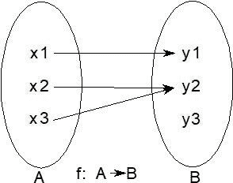

**Figure 10.1:** Function f mapping from domain A to range B

这种映射是刚性的，例如 `y1 = f(x1)`。且 `f` 永远不能改变 `x1` 的值。这本质上意味着函数不能改变输入的状态，输入数据是不可变的。你可以将其与定义不可变结构体（`struct`）的能力联系起来。在 Julia 中，可以改变输入参数的函数建议以感叹号（`!`）结尾命名。这些是会引起副作用的函数。

```julia
julia> a = [1, 2, 3];
julia> pop!(a)
3
julia> a
2-element Array{Int64,1}:
 1
 2
```

前面的 `pop!()` 方法改变了数组状态并引入了副作用。当函数依赖于其状态可变的全局变量时，副作用会变得更难追踪，因为函数不再对相同的输入返回相同的输出。

### 高阶函数

高阶函数表现得像函数的函数。它们本质上可以被视为函数的函数：

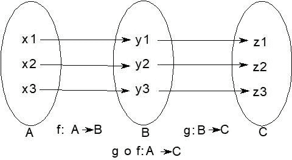

**Figure 10.2:** g o f(x) = g(f(x)) is a higher order function h(x)

在前面的例子中，`h = g ∘ f` 是一个函数组合。Julia 也支持此类定义。

```julia
julia> f(x) = 2x;
julia> g(x) = x*x;
julia> h = g ∘ f
julia> h(3)
36
```

如果 `h` 是一个以 `f` 作为参数的函数呢？这些函数类型在数学中很常见。函数的导数就是这种关系。我们之前多次见过的 `map()` 函数也接受一个函数作为参数。这些本质上都是高阶函数。它们有助于声明式编程。

### 性能考量

在无副作用函数一节中，我们讨论了不可变性。`String` 和 `struct` 类型也是不可变的。因此，无副作用的函数在操作字符串或 `struct` 数据类型集合时可能会分配额外的临时内存。大量的小分配可能会成为性能损耗。使用 `map`、`reduce` 或 `mapreduce` 可以帮助最小化临时空间分配，使不可变函数更高效。

我们讨论了函数式编程的几个方面。有兴趣通过多种编程语言简明地理解函数式编程概念的读者可以参考 *Functional Thinking*8。读者自然会想知道应该遵循命令式风格还是函数式风格。在这方面 Julia 是一种相当灵活的语言。虽然在许多地方你会发现声明式程序、递归函数、推导式或类似特性，但 Julia 并不强制规定任何特定的编程风格。该语言提供了同样有用的构造来进行命令式编程。有时不可变性可能导致中间变量分配增加，影响代码性能。在这种情况下，使用有副作用的函数可能是理想的选择。

## 函数式编程模式

在上一节中，我们访问了函数式编程的基础知识，并了解了它们与 Julia 编程的相关性。然而，函数式编程原则在任何语言中的应用都可能因语言能力而异。在本节中，我们将看一些常用模式及其在 Julia 中的实现方式。关于此主题的详细论述请参阅 *Hands-On Design Patterns and Best Practices with Julia*9。

### 接口定义

Julia 中的任何函数定义都可以充当接口。假设我们想创建一个 2D 几何模块，并规定 2D 形状必须拥有计算面积和包围盒的方法。接口可能如下所示：

```julia
module geom
# All shape objects must have implementation for the following methods.
# area(x): shall return the area of a 2-D shape
function area end
# bbox(x): shall return the bounding box of a 2-D shape
function bbox end
end
```

接口仅仅是指令。然而，可以通过强制一个抛出错误的默认实现，使它们成为硬性接口。

```julia
julia> module geom
       area(x) = throw(Base.MethodError(area, (x,)))
```


# Julia 几何模块设计与 Traits 模式

## 初始实现与问题

```julia
bbox(x) = throw(Base.MethodError(bbox, (x,)))

struct Rectangle
    x; y; w; h
end

export Rectangle, area, bbox
end

Main.geom

julia> using .geom

julia> r = Rectangle(0, 0, 10, 20)
Rectangle(0, 0, 10, 20)

julia> area(r)
ERROR: MethodError: no method matching area(::Rectangle)
…
```

## 尝试 1：默认实现作为软接口

默认实现可以是一个返回输入的恒等函数，从而使接口充当软接口。

```julia
julia> module geom1
area(x) = identity(x)
bbox(x) = identity(x)

struct Rectangle
    x; y; w; h
end

export Rectangle, area, bbox
end

julia> r = geom1.Rectangle(0, 0, 10, 20)
Main.geom1.Rectangle(0, 0, 10, 20)

julia> geom1.area(r)
Main.geom1.Rectangle(0, 0, 10, 20)
```

## 尝试 2：基于继承的接口强制

函数 `area` 和 `bbox` 对泛型类型 `Any` 不承载任何含义。强制 `Rectangle`、`Triangle` 或 `Circle` 等形状遵循接口的一种方法是让它们派生自 `Shape` 超类型。

```julia
julia> module geom2
abstract type Shape end
area(x::Shape) = nothing
bbox(x::Shape) = nothing

struct Rectangle <: Shape
    x; y; w; h
end
end

julia> r = geom2.Rectangle(0, 0, 10, 20)
Main.geom2.Rectangle(0, 0, 10, 20)

julia> geom2.area(r)
```

我们可以向模块引入 `Polygon`。多边形是由直线连接的多个点组成的闭合形状。

```julia
julia> module geom2
…
struct Polygon <: Shape
    pts::Vector{Tuple{Any, Any}}
end
…
end
```

假设考虑直线不闭合的形状，会得到 `PolyLine` 类型。对于开放形状，不存在面积概念，因此 `area()` 函数应抛出错误。通常，良好的面向对象设计要求 `isa` 关系在各方面都完备。`Polygon` 和 `PolyLine` 都必须表现出 `Shape` 的所有属性。如果 `area(::PolyLine)` 抛出错误，`PolyLine isa Shape` 关系将受损。因此有人建议引入 `OpenShape` 和 `ClosedShape` 作为抽象类型。`area()` 函数仅对 `ClosedShape` 存在。以下是可能的实现：

```julia
julia> module geom3
abstract type Shape end
bbox(x::Shape) = nothing

abstract type OpenShape end
struct PolyLine <: OpenShape
    pts::Vector{Tuple{Any, Any}}
end

abstract type ClosedShape end
area(x::ClosedShape) = nothing

struct Rectangle <: ClosedShape
    x; y; w; h
end

struct Polygon <: ClosedShape
    pts::Vector{Tuple{Any, Any}}
end
end
```

如果想引入 `Circle` 和 `Arc`，它们都是不包含直线的形状。若再引入 `LinearShape` 和 `NonLinearShape` 等新抽象类型，由于 Julia 不支持多重继承，无法很好地扩展。最终会创建 `NonLinearClosedShape` 容纳 `Circle`，`NonLinearOpenShape` 容纳 `Arc` 等人为类型。虽然继承自抽象类型是强制接口的好方法，但受单继承限制，对于大量分类可能不切实际。此时可行的解决方案是 **Traits（特征）**。

## Traits 模式设计

Traits 由 Julia 贡献者 *Tim Holy* 提出，旨在区分功能差异与 `isa` 关系。这些功能区分称为 **Holy Traits** 或简称 Traits。针对 `geom` 模块，可按以下概念简化设计：

1. 所有几何形状派生自抽象类型 `Shape`。
2. 所有形状有包围盒，可通过 `bbox(::Shape)` 获取。
3. 部分形状具有有效封闭面积的特征。对这些形状实现 `area()` 函数，其他形状不实现。

根据上述描述，所有几何形状必须仅派生自 `Shape`。所有形状将拥有 `bbox()` 方法。

```julia
module geom4
abstract type Shape end
bbox(x::Shape) = nothing

struct PolyLine <: Shape
    pts::Vector{Tuple{Any, Any}}
end

struct Rectangle <: Shape
    x; y; w; h
end

struct Polygon <: Shape
    pts::Vector{Tuple{Any, Any}}
end

### Here, we will add the traits code ###
end
```

但只有部分形状拥有 `area()` 方法，这些将填入高亮区域。Trait 本质上包含两个无属性类型：一个表示特征存在，另一个表示不存在。

```julia
abstract type HasAreaTrait end
struct HasArea <: HasAreaTrait end
struct HasNoArea <: HasAreaTrait end
```

还需指定哪个形状具有该特征。默认情况下，形状无面积。

```julia
HasAreaTrait(::Type) = HasNoArea()
HasAreaTrait(::Type{Polygon}) = HasArea()
HasAreaTrait(::Type{Rectangle}) = HasArea()
```

最后，确保 `area` 函数正确利用 Trait。

```julia
area(x::T) where {T<:Shape} = area(HasAreaTrait(T), x)
area(::HasArea, x::T) where {T <: Shape} =
    error("area(::HasArea, $T) method must be implemented")
area(::HasArea, r::Rectangle) = r.w * r.h
```

## 运行结果

```julia
julia> geom4.area(geom4.Rectangle(0, 0, 10, 20))
200

pl = geom4.PolyLine([(0, 0), (10, 0), (10, 20), (0, 20)])
```

`area(::Rectangle)` 通过 Traits 框架分派到 `area(::HasArea, ::Rectangle)`，该方法已实现并返回 200。

```julia
julia> geom4.area(geom4.Polygon([(0, 0), (10, 0), (10, 20), (0, 20)]))
area(::HasArea, Main.geom4.Polygon) method must be implemented
…
```


# Julia 中的 Traits、组合与开源贡献

## Trait 分发机制

`area(::Polygon)` 被分发到 `area(::HasArea, ::Polygon)`，这是一个请求具体实现的通用参数化方法。

```julia
julia> geom4.area(geom4.PolyLine([(0, 0), (10, 0), (10, 20), (0, 20)]))
```

```text
MethodError: no method matching area(::Main.geom4.HasNoArea, ::Main.geom4.PolyLine)
```

```text
Closest candidates are:
area(!Matched::Main.geom4.HasArea, ::T) where T<:Main.geom4.Shape at In[24]:26
...
```

`area(::PolyLine)` 被分发到 `area(::HasNoArea, ::PolyLine)`，该方法未实现，因此报告通用的 `MethodError`。

Traits 是 Julia 中非常有用的模式，在多处被使用。集合是一组功能多样的特性，在其实现中可以看到多种此类模式。例如，大多数集合都支持迭代器框架，而迭代器的行为则通过 traits 来区分。

## 组合与委托

有时我们希望为类型引入额外功能，而其中很大一部分功能已然存在。但可能只需要特定的额外功能。Julia 类型不从具体类型继承属性，因此扩展对象的唯一方式是组合对象并将其委托给组合类型。通过下面的例子会更清晰。

假设我们要引入一个 `Square` 类型，它拥有 `Rectangle` 类型定义的所有函数，同时其构造函数只接受 3 个参数（因为宽高相同）。

```julia
module geom4

abstract type Shape end
bbox(x::Shape) = nothing

struct Rectangle <: Shape
    x; y; w; h
end

bbox(x::Rectangle) = x

### Square has Rectangle as an attribute ###
struct Square <: Shape
    r::Rectangle
    Square(x, y, w) = new(Rectangle(x, y, w, w))
end

abstract type HasAreaTrait end
struct HasArea <: HasAreaTrait end
struct HasNoArea <: HasAreaTrait end

HasAreaTrait(::Type) = HasNoArea()
HasAreaTrait(::Type{Rectangle}) = HasArea()

area(x::T) where {T<:Shape} = area(HasAreaTrait(T), x)
area(::HasArea, x::T) where {T <: Shape} = error("area(::HasArea, $T) method must be implemented")
area(::HasArea, r::Rectangle) = r.w * r.h

### Code for delegation ###
for op in [:bbox, :area]
    @eval $op(s::Square) = ($op)(s.r)
end

end
```

`Square` 对象拥有一个 `Rectangle` 实例作为其属性。因此，为 `Rectangle` 对象定义的 `bbox` 和 `area` 可直接用于 `Square` 对象。`Lazy.jl` 包提供了一些额外的宏（如 `@forward`）来辅助委托。

## 数据封装与访问器

Julia 中的类型属性是公开且透明的，几乎无法实现数据封装。然而，有时需要数据隐藏，此时会使用访问器方法（getter 和 setter）来访问此类变量。一个可能的原因是在设置值前进行数据验证。

```julia
module geom

mutable struct Rectangle
    _x; _y; _w; _h

    function Rectangle(x, y, w, h)
        (w <= 0 || h <= 0) &&
            error("width and height must be positive")
        new(x, y, w, h)
    end
end

w(r::Rectangle) = r._w

function w!(r::Rectangle, tw)
    tw <= 0 && error("width cannot be negative")
    r._w = tw
end

end
```

`w()` 和 `w!()` 分别作为 getter 和 setter 方法；而以下划线（`_`）开头的 `_w` 属性是一种约定，指示该属性不应被直接访问。

## 开源贡献的价值

10–15 年前，应届毕业生会寻找各类组织或在职员工寻求实战项目。这些学生中许多人几乎没有编程接触经历，只是从各类辅导或培训班学会了编码，对真实系统毫无理解。毫无疑问，他们作为软件专业人士很难找到机会。如今，如果有此类学生询问，我会建议她查看 *GitHub*、*GitLab* 或其他开源仓库以进行贡献。当然，主动编码的学习曲线可能很陡峭，但很快会意识到，优秀的编码很大程度上在于阅读他人代码，而不仅仅是从头开发代码。这对希望转型学习新技能的资深开发者同样有帮助。

如今很难找到不使用任何开源代码的组织。同时，在组织中工作的人很少为开源做贡献。我们认为为开源做贡献具有显著价值，既有利于组织也有利于个人：

*   **可见性**：大多数开源贡献、变更历史和讨论都体现在评论和代码贡献中。你对问题的理解清晰度、影响力以及说服他人接受你想法的能力，都会从讨论中显现出来。
*   **学习**：你可以从其他贡献者和维护者那里学到新想法。此外，阅读代码、变更注释和讨论线程能提供足够的学习经验。
*   **远程工作**：在疫情推动大规模远程工作之前，人们对远程工作天生怀疑。全球开源社区的协作让人们成为能够远程贡献的优秀工作者。
*   **消除未知恐惧**：大多数组织难以使用第三方开源软件，因为他们认为这很难用，且项目可能缺乏好的维护者。参与贡献能让你消除对项目的一些未知因素。你可以与项目活跃人员互动，在需要时联系他们。
*   **回馈**：作为组织，你可能使用了开源技术。通过积极贡献直接回馈，是金钱支付之外的另一种选择。

## Julia 社区的贡献流程

Julia 是接受贡献最开放的社区之一。任何人都可以通过 GitHub **pull requests (PR)** 向代码库提交内容。审查者会审查 PR 的正确性并将其合并到代码库中。这可能需要多次迭代来更新代码。代码会接受算法和逻辑正确性的检查，编码和风格指南也被赋予同等重要性。不仅是核心语言，还可以为 4000+ 个正在积极开发的包做贡献。


# 编程指南

编程指南帮助程序员理解语言的细微差别，以及如何为开发者社区编写可维护的代码。在本章中，我们介绍了一些编程风格、代码格式化和风格注意事项。最后，我们探讨了几个与 Julia 相关的模式。我们还探讨了函数式编程的各个方面。实践是掌握编程范式的唯一途径。虽然我们讨论了一些关于功能如何工作的提示，但读者仍有大量工作要做，需要针对各种用例进行练习，以熟悉该语言。在下一章中，我们将探讨提升 Julia 应用程序性能的方法，以及有助于此类编码的实践。

# 练习

1.  在 Julia 中如何定义函数？Julia 中是否有前向声明函数的概念？
2.  `map()` 和 `foreach()` 都作用于集合的每个元素。是否存在应该使用其中一个而非另一个的情况？
3.  集合中的迭代器行为是作为特征实现的。解释一下这是如何为 `Array` 和 `Dict` 集合实现的。这两种实现之间有区别吗？
4.  什么是硬接口和软接口？请举例说明两者。
5.  引入你自己的整数类型，使其能以罗马数字的形式读取和写入。使用委托模式来增强你的实现。你可以参考 Julia 包 `RomanNumerals.jl`。

---

## 参考资料

1.  FURPS, Wikipedia, [`en.wikipedia.org/wiki/FURPS`](https://en.wikipedia.org/wiki/FURPS)
2.  Style Guide, Julia Documentation, [`docs.julialang.org/en/v1/manual/style-guide/`](https://docs.julialang.org/en/v1/manual/style-guide/)
3.  Operator Precedence and Associativity, Julia Documentation, [`docs.julialang.org/en/v1/manual/mathematical-operations/#Operator-Precedence-and-Associativity`](https://docs.julialang.org/en/v1/manual/mathematical-operations/#Operator-Precedence-and-Associativity)
4.  Notes for Julia Contributors, [`github.com/JuliaLang/julia/blob/master/CONTRIBUTING.md`](https://github.com/JuliaLang/julia/blob/master/CONTRIBUTING.md)
5.  Blue: a Style Guide for Julia, [`github.com/invenia/BlueStyle`](https://github.com/invenia/BlueStyle)
6.  YASGuide - Yet Another Style Guide For Julia, [`github.com/jrevels/YASGuide`](https://github.com/jrevels/YASGuide)
7.  Mike Loukides, What is Functional Programming, O'Reilly Radar Blogs, 8th Dec 2020, [`www.oreilly.com/radar/what-is-functional-programming/`](https://www.oreilly.com/radar/what-is-functional-programming/)
8.  Neal Ford, Functional Thinking, O'Reilly Media, 2014
9.  Tom Kwong, Stefan Karpinski, Hands-On Design Patterns and Best Practices with Julia, Packt Publishing, January 2020
10. Lazy.jl, [`github.com/MikeInnes/Lazy.jl`](https://github.com/MikeInnes/Lazy.jl)

## Julia 中的函数式编程

我们讨论了函数式编程的几个方面。有兴趣通过多种编程语言简明地理解函数式编程概念的读者可以参考 *Functional Thinking* [8]。读者很自然地会想知道应该遵循命令式风格还是函数式风格。在这方面，Julia 是一种相当灵活的语言。虽然在很多地方你会发现声明式程序、递归函数、推导式或类似特性，但 Julia 并不强制规定任何特定的编程风格。该语言提供了同样有用的构造来进行命令式编程。有时不可变性可能导致中间变量分配增加，从而影响代码性能。在这种情况下，使用有副作用的函数可能是理想的选择。

## 设计模式与最佳实践

在上一节中，我们了解了函数式编程的基础知识，并探讨了它们与 Julia 编程的相关性。然而，函数式编程原则在任何语言中的应用都可能因语言能力而异。在本节中，我们将介绍几种常用模式及其在 Julia 中的实现方式。关于该主题的详细论述，请参阅 *Hands-On Design Patterns and Best Practices with Julia* [9]。

请参考 Julia 语言的代码格式化指南 [4]，以更好地理解其他一些与格式化相关的建议。其他一些组织和个人也提出了他们自己的风格 [5, 6]，这些风格在社区中也相当流行。

### 括号的使用

除非确实需要打破 Julia 中正常的运算符优先级 [3]，否则不常用大括号。

```
if a == 0 && b == 0
    # Do something
end
```

**优于：**

```
if (a == 0) && (b == 0)
    # Do something
end
```

因此，建议使用最少的括号，仅在绝对必要时使用。

## 函数式编程史

函数式编程并非新事物。事实上，它是由于阿隆佐·丘奇对 Lambda 演算 [7] 的研究而出现的最古老的编程形式。甚至在冯·诺依曼计算机概念成为主流之前——即计算机拥有内存，状态机根据采取的每一步动作对其进行转换。内存在代码执行的每一步都被跟踪。这种顺序编程风格被称为**命令式编程**。

## 委托模式

`Square` 对象拥有一个 `Rectangle` 实例作为其属性。因此，`Rectangle` 对象已定义的 `bbox` 和 `area` 可用于 `Square` 对象。`Lazy.jl` [10] 包定义了一些额外的宏（如 `@forward`）来辅助委托。

## FURPS 分类

软件行业中经典的需求分类之一 [1] 是 FURPS：


# 可维护性与性能

可维护性在此尤为关键，因为良好的维护要求代码具有可读性。编码规范有助于满足更广泛开发者群体的需求。我们将探讨 Julia 文档中建议的风格指南。

性能是 Julia 语言开发所基于的核心特性和基本前提。因此，了解系统中可用的各种工具和技术以帮助编写高性能代理是很自然的。

## 章节主题

在本章中，我们将涵盖以下主题：

*   背景
*   基准测试
*   代码生成工具
*   性能分析
*   高性能代码编写指南

## 学习目标

在本章中，读者将能够为获得更好的性能而编写代码。我们将了解基准测试工具并理解如何对代码进行性能分析。Julia 代码生成是一个分阶段的过程，我们可以在生成的各个阶段查看生成的代码，以此作为理解所执行优化的一种手段。最后，我们将回顾一些有助于用户编写高性能代码的模式和风格。

# 背景

*优化的第一原则是不要*[¹]。这一建议由 Unix 操作系统大师 *Kernighan* 和 *Pike* 在其开创性著作 *The Practice of Programming* 中提出。二十多年来，情况并没有太大变化。一个正确运行的程序远胜过一个运行快但不正确的程序。然而，为确保程序表现出可接受的性能，往往会采取许多变通方法。不存在绝对的性能，也不存在针对所有条件都优化的代码。按今天标准的高性能代码，其计算能力可能远不如未来一个相对简单的应用程序。旅行者号是离开太阳系的第一个人造物体，其计算能力远不如现代手机[²]。人们并不真的需要手动优化每一行代码。在大多数情况下，许多最优代码生成器和编译器编译出的代码远优于手动优化的代码。像 Julia 这样的现代语言利用 `LLVM` 来处理跨平台最优代码生成，并在编译或代码生成期间解决许多已知的优化问题。人们可能会问，既然硬件便宜且易于获取，为什么还要费心去优化代码？答案在于：无论硬件变得多么便宜，你都需要从中榨取那额外的一丁点性能。

在单个处理器的单个线程上运行多个应用程序并非真正的同时多任务处理。操作系统根据调度抢占任务，让处理器一次只执行一个任务。用户会感觉所有任务都在同时运行，而实际上它们只是在很短的时间间隔内执行，然后切换到下一个任务。在基于**图形用户界面 (GUI)** 的应用程序中，用户界面对用户输入的响应速度被赋予了比其他后台任务完成执行更高的优先级。对于在单处理器系统上运行长时间计算密集型任务的多任务应用程序，惯例做法是间歇性地处理 UI 事件以保持 UI 响应。这在 Windows 系统中被称为**空闲循环处理**[³]。这里最优响应时间优先于原始执行速度。因此，代码的纯执行速度可能并非所有代码优化项目的目标。

当处理器指令集中没有三角函数时，三角函数的计算会非常耗时，因为它们必须通过软件模拟来计算。像游戏程序这样的性能敏感型应用程序会使用以下数学方程来模拟其行为。

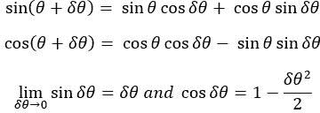

它们基本上会保留 `sinθ` 和 `cosθ` 在 15 度或 30 度间隔处的查找值，并使用前面给出的增量方程计算中间值。使用前面的方程按 15 度间隔生成的表格仍处于显著精度范围内。

```julia
julia> n = 6;
δ = pi/180*(90/n);
sinδ, cosδ = δ, (1 - δ*δ/2);

m = Matrix{Float64}(undef, (n+1, 2));
m[1, 1], m[1, 2] = 0.0, 1.0;

for i = 1:n
    m[i+1, 1] = m[i, 1]*cosδ + m[i, 2]*sinδ
    m[i+1, 2] = m[i, 2]*cosδ - m[i, 1]*sinδ
end

julia> m
7×2 Array{Float64,2}:
 0.0        1.0
 0.261799   0.965731
 0.505655   0.864097
 0.714547   0.702104
 0.87387    0.490976
 0.97246    0.245371
 1.00337   -0.0176268

julia> m1 = [[sin(i*δ) for i=0:n] [cos(i*δ) for i=0:n]]
7×2 Array{Float64,2}:
 0.0        1.0
 0.258819   0.965926
 0.5        0.866025
 0.707107   0.707107
 0.866025   0.5
 0.965926   0.258819
 1.0        6.12323e-17

julia> using Statistics
julia> mean(m1-m), std(m1-m)
(0.0009570353971457324, 0.00784842483267987)
```

这种粗略的估算可以在保持计算足够快的同时产生合理准确的计算结果。随着拥有内置三角函数指令的现代 CPU 的出现，这些权衡可能不再需要。然而，性能与精度的权衡在优化中很常见，这正是一个例证。而且，它们大多是特定领域的。

## 云计算与资源管理

云计算资源可根据需求添加到项目或问题中。然而，资源成本正给项目增加显著成本。增加更多硬件或处理能力可以解决大得多的问题。但它们也增加了总体成本。例如，如今的智能手机能够处理设备端语音识别以及涉及深度学习和神经计算的许多计算复杂任务。十年前，即使是先进的台式机也无法做到这一点。如今智能手机的硬件比十年前的台式机更先进。因此，增加更多资源来解决复杂问题从来都不是解决方案。最优利用资源以减少成本超支是一种必要。因此，性能管理将永远是每个软件系统的需求。

[¹]: 参考脚注 1
[²]: 参考脚注 2
[³]: 参考脚注 3


计算机科学家通常将最大精力集中在完善问题的这一部分。精心挑选的算法能为问题带来的收益，往往是对不合适的算法进行任何程度的微调都无法比拟的。每当代码性能不佳时，最好审视核心设计，了解是否采用了正确的算法。在设计阶段关注性能可大幅降低返工成本。例如，`binary search`（二分查找）的复杂度为 `O(log n)`，而数组搜索的复杂度为线性时间，即 `O(n)`。直观上似乎二分查找将始终优于线性搜索。但考虑到现代处理器缓存和数组内存管理的效率，对较小的数组使用线性搜索可能更高效 4。B 树是基于磁盘存储的数据库索引的首选；而二叉树可能是内存数据库的首选数据结构。必须结合整个系统的性能来选择合适的数据结构，而不仅仅考虑理论上的渐近时间复杂度或最坏情况性能。

## 

在整个代码库中进行绝对的性能优化于事无补。过度优化的代码难以理解，最终可能变成为特定平台量身定制的代码。Julia 建议编写可读性强且使用适当算法的代码，将代码生成和底层针对特定目标的优化留给 JIT 编译器和 LLVM 工具集。它提供了有助于分析代码性能并找出性能瓶颈的工具。从程序员的角度来看，编写可在跨平台保持高性能的通用高层代码，始终优于特定平台的修复方案。如果代码库中必须进行优化，最好将其局限于一小组函数中。

## 

大多数开始优化代码的人都难以确定他们的目标性能应是什么。他们能达到设定的目标吗？这本质上是将你的结果与行业基准进行比较。Julia 采取了极端的立场，将性能基准测试对标至最接近 C 语言编译代码的性能。C 语言编译代码是裸机可执行文件，且 C 运行时非常轻量级。它被预加载，因为许多操作系统使用相同的运行时。Julia 可能没有与基于 C 的系统相对应的比较基准。

Julia 运行时需要在程序首次执行时加载，并在执行完成时退出。其次，Julia 是一种 JIT 编译语言。不常执行的 Julia 代码可能在被调用前尚未编译为原生二进制文件。调用代码时，部分时间可能会花费在将代码编译为原生格式上。为了使两个系统处于可比较的状态，Julia 支持者建议在稳态条件下测量性能。当所有 Julia 代码至少运行一次并由 JIT 编译器编译为原生二进制文件时，即达到稳态。语言的批评者不同意该基准测试，因为他们认为加载时间未被视为过程的一部分。Julia 社区发布了一组微基准测试 5，针对多个竞争平台的若干算法任务：

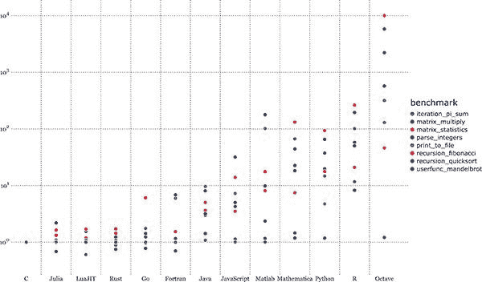

**图 11.1：** Julia 与竞争平台对比 6

可以看到，在许多任务中，Julia 的表现优于竞争对手，且非常接近原生 C 语言的性能。性能优化是任何编程语言都相当复杂的主题。我们无法对性能优化的每一个可能方面做到面面俱到。我们将仅回顾一些有助于编写优化代码的工具和指南。

## 

基准测试是将预期性能与已知目标进行比较。`BenchmarkTool.jl` 包可以帮助开发者测量执行 Julia 代码所花费的时间和分配的内存。让我们对之前看到的基于表查找的正弦函数计算方案进行基准测试，看看是否真的有显著收益。我们将利用 Julia `BenchmarkTools.jl` 库提供的工具来测量时间周期和内存分配。

`sin(x)` 函数假设变量 `x` 为弧度。然而，我们将有一个 `sindeg(x)` 函数，其中 `x` 为角度。我们还将评估 Julia Base 中可用的 `sin(x)` 函数是否为我们应该使用的，还是应采用我们之前讨论的表查找方案进行近似。

```
julia> using BenchmarkTools;
julia> deg2rad(x) = pi/180.0*x;
julia> sindeg = sin ∘ deg2rad;
julia> cosdeg = cos ∘ deg2rad;
julia> @benchmark sindeg(52.0)
BenchmarkTools.Trial:
memory estimate:  16 bytes
allocs estimate:  1
--------------
minimum time:      94.110 ns (0.00% GC)
median time:       95.795 ns (0.00% GC)
mean time:         104.901 ns (1.20% GC)
maximum time:      19.238 μs (0.00% GC)
--------------
samples:           10000
evals/sample:      951
```

`@benchmark` 将多次运行代码；聚合多个样本的性能并报告结果统计信息。最小时间是更好的估计，因为它受系统开销或噪声最小。`@btime` 报告类似 `@time` 的结果，报告在多次样本运行中单次函数调用的内存分配和最小耗时。我们将在大多数示例中使用 `@btime`。95ns 是我们希望通过新实现达到的时长。我们能做得更好吗？

我们创建了一个备忘录查找表，包含 0 到 90 度之间的 6 个中间值，每个间隔 15 度。对于区间范围内的值，我们使用 `sin(A + δ)` 表达式，并采用我们之前看到的 `sin δ` 和 `cos δ` 的近似值。

```
struct MemoLookup
    n
    lookup
    function MemoLookup(n)
        step = 90/n
        δ = pi/180*step
        lookup = [[sin(i*δ) for i=0:n] [cos(i*δ) for i=0:n]]
        new(n, lookup)
    end
end
```

```
step(m::MemoLookup) = 90/m.n
m = MemoLookup(6)
function sindegmemo(m::MemoLookup, x)
    s, lookup = step(m), m.lookup
    i = 1
    while x >= s
        x -= s
        i += 1
    end
    iszero(x) && return lookup[i, 1]
    x = deg2rad(x)
    sinx, cosx = x, 1 - x*x/2
    return lookup[i, 1]*cosx + lookup[i, 2]*sinx
end
```

现在我们将对函数 `sindegmemo` 进行基准测试。

```
julia> @benchmark sindegmemo($m, 52)
BenchmarkTools.Trial:
memory estimate:  208 bytes
allocs estimate:  13
--------------
minimum time:      1.170 μs (0.00% GC)
```


**中位时间：1.280 μs (0.00% GC)**

**平均时间：1.438 μs (0.00% GC)**

**最大时间：23.120 μs (0.00% GC)**

**--------------**

**样本数：10000**

**每样本评估次数：10**

该代码比之前计算的要慢。计算过程中需要 13 次内存分配和 208 字节的额外内存。什么可以解释这些分配？微小但频繁的内存分配块可能是显著的性能开销。

# 代码生成调试工具

这些是调试工具，可提供对代码生成各阶段代码的洞察。这些工具命名为 `@code_XXX`，其中 `xxx` 代表特定阶段。Julia 的代码翻译分阶段进行。代码被翻译成抽象语法树，然后翻译成 LLVM 代码，最后生成最终的原生输出。不同的宏帮助我们窥探代码生成过程的各个阶段。Julia 内部并不使用它们进行实际的代码生成。

## 类型稳定性分析

我们在讨论函数及其返回值时已经看到了一些类型稳定性的示例。我们知道不确定的类型会导致低效的代码。让我们评估一下前面基准测试部分提供的代码是否具有无法确定性推断的类型。

```julia
julia> @code_warntype sindegmemo(m, 52)
```

**变量**

```
#self#::Core.Compiler.Const(sindegmemo, false)
m::MemoLookup
x@_3::Float64
s::Any
lookup::Any
i::Int64
sinx::Any
cosx::Any
x@_9::Any
Body::Any
1 — (x@_9 = x@_3)
│   Core.NewvarNode(:(sinx))
│   Core.NewvarNode(:(cosx))
│   %4 = Main.step(m)::Any
│   %5 = Base.getproperty(m, :lookup)::Any
│   (s = %4)
│   (lookup = %5)
└── (i = 1)
2 — %9 = (x@_9 >= s)::Any
└── goto #4 if not %9
3 — (x@_9 = x@_9 - s)
│   (i = i + 1)
└── goto #2
4 — %14 = Main.iszero(x@_9)::Any
└── goto #6 if not %14
5 — %16 = Base.getindex(lookup, i, 1)::Any
└── return %16
6 — (x@_9 = Main.deg2rad(x@_9))
│   (sinx = x@_9)
│   %20 = (x@_9 * x@_9)::Any
│   %21 = (%20 / 2)::Any
│   %22 = (1 - %21)::Any
│   (cosx = %22)
│   %24 = Base.getindex(lookup, i, 1)::Any
│   %25 = (%24 * cosx)::Any
│   %26 = Base.getindex(lookup, i, 2)::Any
│   %27 = (%26 * sinx)::Any
│   %28 = (%25 + %27)::Any
└── return %28
```

`@code_warntype` 以 AST（抽象语法树）的形式报告 Julia 代码。AST 在每一步都带有类型推断进行报告。在终端或 Jupyter 控制台中，不确定的类型会用颜色高亮显示。有许多变量被分配为类型 `Any`。这本质上意味着在任何计算过程中，都会为内存位置进行分配，并通过间接寻址访问实际的 `Float64` 值。我们将为参数 `x` 的声明添加一个类型，看看这如何影响类型推断。

```julia
julia> function sindegmemo(m::MemoLookup, x::Float64)
           s, lookup = step(m), m.lookup
           i = 1
           while x >= s
               x -= s
               i += 1
           end
           iszero(x) && return lookup[i, 1]
           x = deg2rad(x)
           sinx, cosx = x, 1 - x*x/2
           return lookup[i, 1]*cosx + lookup[i, 2]*sinx
       end
```

```julia
julia> @code_warntype sindegmemo(m, 52)
```

该更改对类型推断的影响微乎其微。只有变量 `x` 被正确推断为 `Float64`。然而，大多数临时变量仍被分配为类型 `Any`。`Any` 作为一种模糊类型，对 `Any` 类型进行的任何操作都可能导致 `Any` 类型。

**变量**

```
#self#::Core.Compiler.Const(sindegmemo, false)
m::MemoLookup
x@_3::Float64
s::Any
lookup::Any
i::Int64
sinx::Any
cosx::Any
x@_9::Any
Body::Any
1 — (x@_9 = x@_3)
│   Core.NewvarNode(:(sinx))
│   Core.NewvarNode(:(cosx))
│   %4 = Main.step(m)::Any
│   %5 = Base.getproperty(m, :lookup)::Any
│   (s = %4)
│   (lookup = %5)
└── (i = 1)
2 — %9 = (x@_9 >= s)::Any
└── goto #4 if not %9
3 — (x@_9 = x@_9 - s)
│   (i = i + 1)
└── goto #2
4 — %14 = Main.iszero(x@_9)::Any
└── goto #6 if not %14
5 — %16 = Base.getindex(lookup, i, 1)::Any
└── return %16
6 — (x@_9 = Main.deg2rad(x@_9))
│   (sinx = x@_9)
│   %20 = (x@_9 * x@_9)::Any
│   %21 = (%20 / 2)::Any
│   %22 = (1 - %21)::Any
│   (cosx = %22)
│   %24 = Base.getindex(lookup, i, 1)::Any
│   %25 = (%24 * cosx)::Any
│   %26 = Base.getindex(lookup, i, 2)::Any
│   %27 = (%26 * sinx)::Any
```


# 性能优化：从类型稳定到参数化类型与边界检查消除

## 类型稳定性分析

进入 `@code_warntype` 输出分析阶段。观察以下 IR 片段：

```
│   %28 = (%25 + %27)::Any
└──     return %28
```

引入新的 `MemoLookup` 结构体，为 `n` 和 `lookup` 等属性定义了正确的类型。

```julia
struct MemoLookup
    n::Int
    lookup::Matrix{Float64}
    
    function MemoLookup(n)
        step = 90/n
        δ = pi/180*step
        lookup = [[sin(i*δ) for i=0:n] [cos(i*δ) for i=0:n]]
        new(n, lookup)
    end
end

step(m::MemoLookup) = 90/m.n

m = MemoLookup(6)
```

执行 `@code_warntype sindegmemo(m, 52.0)` 检查类型推断结果：

**Variables**
- `#self#::Core.Compiler.Const(sindegmemo, false)`
- `m::MemoLookup2`
- `x@_3::Float64`
- `s::Float64`
- `lookup::Array{Float64,2}`
- `i::Int64`
- `sinx::Float64`
- `cosx::Float64`
- `x@_9::Float64`
- `Body::Float64`

**Body 片段**
```
…
│   %4  = Main.step(m)::Float64
…
2 ┄ %9  = (x@_9 >= s)::Bool
└──     goto #4 if not %9
…
4 — %14 = Main.iszero(x@_9)::Bool
└──     goto #6 if not %14
5 — %16 = Base.getindex(lookup, i, 1)::Float64
└──     return %16
…
│   %20 = (x@_9 * x@_9)::Float64
│   %21 = (%20 / 2)::Float64
│   %22 = (1 - %21)::Float64
…
│   %24 = Base.getindex(lookup, i, 1)::Float64
│   %25 = (%24 * cosx)::Float64
│   %26 = Base.getindex(lookup, i, 2)::Float64
│   %27 = (%26 * sinx)::Float64
│   %28 = (%25 + %27)::Float64
└──     return %28
```

不存在标记为 `Any` 类型的变量。验证性能提升情况：

```julia
julia> @btime sindegmemo($m, 52.0)
19.257 ns (0 allocations: 0 bytes)
0.788218944092369
```

性能显著提升：从 `1170ns` 降至 `19ns`。但回顾之前编写的 `sindeg(x)` 函数，其执行时间为 `95ns`。`sindeg(x)` 是否构建得当？

## `@code_warntype` 深度检查

检查 `sindeg(52.0)` 的类型推断转储：

```julia
julia> @code_warntype sindeg(52.0)
```

**Variables**
- `#self#::Core.Compiler.Const(Base.var"#62#63"{typeof(sin),typeof(deg2rad)}(sin, deg2rad), false)`
- `x::Tuple{Float64}`
- `Body::Float64`

**Body**
```
1 — %1 = Core.getfield(#self#, :f)::Core.Compiler.Const(sin, false)
│   %2 = Core.getfield(#self#, :g)::Core.Compiler.Const(deg2rad, false)
│   %3 = Core._apply_iterate(Base.iterate, %2, x)::Float64
│   %4 = (%1)(%3)::Float64
└──     return %4
```

虽然类型推断无 `Any` 类型问题，但 `x` 被推断为 `Tuple{Float64}`。这意味着会创建新变量，函数输入被赋值给新创建的元组。重新定义 `sindeg` 函数：

```julia
julia> sindeg(x) = sin(deg2rad(x))

julia> @btime sindeg(x)
2.799 ns (0 allocations: 0 bytes)
0.49999999999999994
```

性能相当于 Julia 内置函数 `sind(x)`（计算角度为度数时的正弦值）。

## 参数化类型优化

参数化数据类型在编译期而非运行时解析，可提升性能。关键在于识别合适的参数属性。以 `MemoLookup` 为例，表大小属性 `n` 是常量，且无需构建过多查找表，适合作为类型参数。

```julia
struct MemoLookupP{N}
    lookup::Matrix{Float64}
    
    function MemoLookupP{N}() where N
        δ = pi/2N
        lookup = [[sin(i*δ) for i=0:N] [cos(i*δ) for i=0:N]]
        new{N}(lookup)
    end
end

step(m::MemoLookupP{N}) where N = 90.0/N

const m3 = MemoLookupP{6}()
```

定义接受 `MemoLookupP` 的新 `sindegmemo` 函数：

```julia
function sindegmemo(m::MemoLookupP, x::Float64)
    s, lookup = step(m), m.lookup
    i = 1
    while x >= s
        x -= s
        i += 1
    end
    x, sini = deg2rad(x), lookup[i, 1]
    iszero(x) && return sini
    sinx, cosx, cosi = x, 1 - x*x/2, lookup[i, 2]
    return sini*cosx + cosi*sinx
end

julia> @btime sindegmemo(m3, 60.0)
13.012 ns (0 allocations: 0 bytes)
0.8660254037844386
```

从 `19ns` 优化至 `13ns`，仍有提升空间。接下来审查 LLVM 位码。

## LLVM 位码分析与 `@inbounds` 优化

LLVM 生成的位码描述性强，需理解助记符。此处仅识别明显问题，不做深度分析。截断转储示例：

```llvm
julia> @code_llvm sindegmemo($m3, 60.0)

; @ In[38]:1 within `sindegmemo'
; Function Attrs: uwtable
define double @julia_sindegmemo_2316([1 x %jl_value_t*]* nocapture nonnull readonly dereferenceable(8), double) #0 {
top:
ib:     ; preds = %L9
; @ In[38]:8 within `sindegmemo'
; @ array.jl:810 within `getindex'
…
oob:    ; preds = %ib, %L9
    %19 = alloca [2 x i64], align 8
    %.sub = getelementptr inbounds [2 x i64], [2 x i64]* %19, i64 0, i64 0
…
    ret double %37
}
```

每当通过 `getindex` 方法访问数组时，都会进行边界检查。`ib` 标签在数组索引在范围内时执行，`oob` 在索引越界时执行。若能确保索引不越界，可消除越界检查代码。使用宏 `@inbounds` 实现此目的。

```julia
function sindegmemo(m::MemoLookupP, x::Float64)
    s, lookup = step(m), m.lookup
    i = 1
    while x >= s
        x -= s
        i += 1
    end
    x, sini = deg2rad(x), @inbounds lookup[i, 1]
    iszero(x) && return sini
    sinx, cosx, cosi = x, 1 - x*x/2, @inbounds lookup[i, 2]
    return sini*cosx + cosi*sinx
end
```


`<strong>end</strong>`

`<strong>julia&gt; @btime sindegmemo($m3, 60.0)</strong>`

`<strong>2.699 ns (0 allocations: 0 bytes)</strong>`

`<strong>0.8660254037844386</strong>`

`<strong>julia&gt; @btime sindegmemo($m3, 22.0)</strong>`

`<strong>3.799 ns (0 allocations: 0 bytes)</strong>`

`<strong>0.3748975477461437</strong>`

我们已经非常接近 `sind(x)` 的性能，但尚未完全达到 9。一个显而易见的问题是，为什么输入为 60° 时 `sindegmemo` 的表现比输入为 22° 时更好？

# 性能分析

在我们迄今分析的示例中，我们知道某个特定函数存在我们想要克服的性能瓶颈。在许多大型应用程序中，这种先验知识是不太可能具备的。例如，某个文字处理器打开文件并在屏幕上渲染内容的速度很慢。这背后可能有许多因素。文件读取可能很慢，文档中的某个特定功能在计算上很复杂，或者文件太大，读取所有数据并将数据缓存在内存中可能成为瓶颈。性能分析有助于识别此类场景。以特定的固定间隔（例如每毫秒），统计分析器会查看代码执行栈，并记录栈的状态，如查询期间执行所在的行号和函数。运行完成后，它们会关联所有此类数据，并报告遇到特定函数的次数，以及为到达该函数而被调用的所有函数的回溯跟踪。

Julia 拥有内置的统计分析器。`Profiler` 位于名为 `Profile` 的模块中。我们将使用此工具来分析函数 `profile_test`10 的性能。

```julia
using Profile

function profile_test(n)
    for i = 1:n
        A = randn(100,100,20)
        m = maximum(A)
        Am = mapslices(sum, A; dims=2)
        B = A[:,:,5]
        Bsort = mapslices(sort, B; dims=1)
        b = rand(100)
        C = B.*b
    end
end
```

```julia
julia> profile_test(1)
```

代码运行一次以便进行编译，这样编译所花费的时间就不会被作为分析器采样的一部分捕获。现在我们运行该函数进行 100 次迭代并分析该运行过程。

```julia
julia> @profile profile_test(100)
```

数据由分析器生成并缓存，可以通过 `Profile.print()` 调用来打印。截断视图如下：

```julia
julia> Profile.print()
Overhead ╎ [+additional indent] Count File:Line; Function
=========================================================
╎410 @Base\ttask.jl:356; (::IJulia.var"#15#18")()
╎ 410 @IJulia\src\eventloop.jl:8; eventloop(::ZMQ.Socket)
╎  410 @Base\essentials.jl:709; invokelatest
…
╎      ⎎  84  In[29]:3; profile_test(::Int64)
╎      ⎎  84  …dom\src\normal.jl:210; randn
╎      ⎎   84  …dom\src\normal.jl:204; randn
…
╎      ⎎  8   In[29]:4; profile_test(::Int64)
╎      ⎎  8   @Base\reducedim.jl:722; maximum
╎      ⎎   8   @Base\reducedim.jl:722; #maximum#631
…
╎      ⎎  264 In[29]:5; profile_test(::Int64)
╎      ⎎  264 …\abstractarray.jl:2062; mapslices##kw
…
╎      ⎎  9   In[29]:9; profile_test(::Int64)
╎      ⎎  9   @Base\broadcast.jl:837; materialize
╎      ⎎   9   @Base\broadcast.jl:862; copy
…
Total snapshots: 413
```

高亮部分来自顶层函数 `profile_test`。第 5 行花费的时间最长，因为在总共 413 次采样中，它被采样了 264 次。你可以使用 `ProfileView` 包获得更直观的输出视图。可以使用以下命令安装该包：

```julia
julia> ]add ProfileView
```

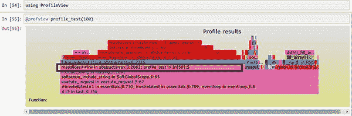

**图 11.2：** 使用 ProfileView 进行可视化。高亮区域代表函数的第 5 行代码占用了最多的时间。

我们已经了解了一些性能调优过程。在下一节中，我们将回顾一些编写高性能代码的指导原则。

# 性能设计模式

在[前一节]中，我们探讨了与函数式编程相关的设计模式。在本节中，我们将回顾一些有助于提高代码性能的模式。

## 备忘录模式

当一个纯函数被多次调用时，它应产生相同的输出。与其反复计算结果，如果我们能缓存该值，就能减少计算开销。这个过程称为 `memoization`（备忘录模式/记忆化）。在备忘录模式的语境下，最常见的例子之一是斐波那契数列 11。斐波那契数列最适合用以下代码进行递归描述：

```julia
fib(n) = n < 3 ? 1 : fib(n-1) + fib(n-2)
```

该函数每次调用都会递归调用自身两次。如果我们通过稍微修改函数来记录调用次数，可以看到函数调用次数呈指数级增长。

```julia
function fib(n)
    if n < 3
        return (result=1, calls=1)
    else
        r1, c1 = fib(n-2)
        r2, c2 = fib(n-1)
        return (result=r1+r2, calls=1+c1+c2)
    end
end
```

```julia
julia> for i = 1:10
           r, c = fib(i)
           println("n:", i, "\tresult: ", r, "\tcalls: ", c)
       end
n:1 result: 1 calls: 1
n:2 result: 1 calls: 1
n:3 result: 2 calls: 3
n:4 result: 3 calls: 5
n:5 result: 5 calls: 9
n:6 result: 8 calls: 15
n:7 result: 13 calls: 25
n:8 result: 21 calls: 41
n:9 result: 34 calls: 67
n:10 result: 55 calls: 109
```

```julia
julia> @btime fib(20)
112.899 μs (0 allocations: 0 bytes)
(result = 6765, calls = 13529)
```

考虑到只涉及加法操作，该函数的开销仍然相当大。`fib(6) = fib(5) + fib(4)`。我们在计算 `fib(5)` 的过程中已经见过 `fib(4)`。如果我们在计算 `f(4)` 后立即将其缓存，那么在计算 `f(5)` 和 `f(6)` 时就无需再次计算。我们可以复用之前计算的值。我们在以下代码中采用了相同的概念：

```julia
const mem = Dict()

function fib(n)
    haskey(mem, n) && return mem[n]
    println("Calling fib: ", n)
    res = n < 3 ? 1 : fib(n-1) + fib(n-2)
    mem[n] = res
    return res
end
```

```julia
julia> fib(5)
Calling fib: 5
Calling fib: 4
```


# Julia 中的备忘录模式与全局变量

## 备忘录模式示例

**Calling fib: 3**

**Calling fib: 2**

**Calling fib: 1**

**julia> @btime fib(20)**

**85.758 ns (0 allocations: 0 bytes)**

**6765**

`fib(5)` 仅被调用了 5 次，而 `fib(20)` 耗时仅 86ns；这几乎只是从字典中读取并相加所需的时间。我们能否将这一概念泛化为适用于任何备忘任务的通用形式？

```julia
function memoize(f)
    memo = Dict()
    (args...; kwargs...) -> begin
        x = (args, kwargs)
        haskey(memo, x) && return memo[x]
        v = f(args...; kwargs...)
        memo[x] = v
        return v
    end
end
```

`memoize(f)` 是一个高阶函数，可对函数及其参数进行备忘，以便后续检索值。`memo` 字典通过闭包 12 被 `memoize` 返回的匿名函数访问。有了这样的 `memoize` 函数，你可以按如下方式定义 `fib(n)` 方法：

```julia
fib(n) = n < 3 ? 1 : fib(n-1) + fib(n-2)
fib! = memoize(fib)
```

然而，`Memoize.jl` 包 13 提供了一个 `@memoize` 宏，可帮助指定函数是否支持备忘。

```julia
julia> Pkg.add("Memoize")
julia> using Memoize
julia> @memoize fib(n) = n < 3 ? 1 : fib(n-1) + fib(n-2)
```

## 全局变量与性能

这并非真正的设计模式。我们希望你了解使用全局变量所面临的挑战。Julia 的全局变量没有指定的类型。它们可以根据赋给它们的数据被赋予任何类型。

```julia
GLOBAL_VAR = 3
function add_to_global(x)
    x + GLOBAL_VAR
end
```

```julia
julia> @btime add_to_global(10)
65.745 ns (0 allocations: 0 bytes)
13
```

现在，让我们将全局变量传递给基本的加法运算符。

```julia
julia> @btime 10 + $GLOBAL_VAR
0.001 ns (0 allocations: 0 bytes)
13
```

仅仅在函数中包装全局变量就带来了显著的开销；但为什么呢？让我们考虑一下全局常量而非变量的情况。

```julia
julia> const GLOBAL_CONST = 20;
julia> add_to_global_const(x) = x + GLOBAL_CONST
julia> @btime add_to_global_const(3)
0.001 ns (0 allocations: 0 bytes)
23
```

返回值的速度相当快，且比全局变量好得多。让我们看看 LLVM 位码。

```julia
julia> @code_llvm add_to_global_const(3)
; @ In[108]:1 within `add_to_global_const'
; Function Attrs: uwtable
define i64 @julia_add_to_global_const_4267(i64) #0 {
top:
; ┌ @ int.jl:86 within `+'
  %1 = add i64 %0, 20
; └
ret i64 %1
}
```

常量 20 被直接替换。因此，不存在类型歧义。加法将在 CPU 寄存器中进行。没有内存访问。全局变量有两个作用：它们分配特定的内存位置并提供指向该内存位置的句柄。然而，它们不是类型安全的。不过，`Ref{T}` 分配内存且是类型安全的。通过将变量声明为 `const`，可以确保内存位置也被固定。

```julia
julia> const GLOBAL_REF = Ref(10)
Base.RefValue{Int64}(10)
julia> add_to_global_ref(x) = x + GLOBAL_REF[]
julia> @btime add_to_global_ref(3)
2.499 ns (0 allocations: 0 bytes)
23
```

与全局变量相比，性能有明确提升，但仍不如 `const` 或函数参数快。查看 LLVM 位码会发现，代码本质上分为两部分。

1. 从特定内存位置将值加载到变量、寄存器或易失性内存位置
2. 将该值加到另一个易失性内存位置

```julia
julia> @code_llvm add_to_global_ref(3)
; @ In[116]:1 within `add_to_global_ref'
; Function Attrs: uwtable
define i64 @julia_add_to_global_ref_4338(i64) #0 {
top:
; ┌ @ refvalue.jl:32 within `getindex'
; │┌ @ Base.jl:33 within `getproperty'
  %1 = load i64, i64* inttoptr (i64 380471024 to i64*), align 16
; └└
; ┌ @ int.jl:86 within `+'
  %2 = add i64 %1, %0
; └
ret i64 %2
}
```

如果你不喜欢使用方括号 (`[]`) 访问 `Ref{T}` 的语法，也可以使用访问器模式。

```julia
let _x = Ref(5)
    global X() = _x[]
    global X(y) = (_x[] = y)
end
```

我们建议读者查看 `add_to_global_var` 的 LLVM 位码。由于全局变量没有类型推断，函数将不得不假设类型为 `Any`，并在每次使用时解决类型冲突。

## 性能调优总结

Julia 系统专为高性能计算设计。我们在本章中看到了此类实现的缩影。然而，性能调优是一个复杂的主题，在此领域发展技能需要足够的接触和实践。因此，我们建议读者审查性能敏感的代码，并通过定期练习尝试对其进行改进。在下一章中，我们将回顾可用于 Julia 开发的 IDE，以及如何使用各种调试技术。

# 练习

1.  选择一个你喜欢的函数，对其运行 `@code_warntype`。尝试识别类型稳定性问题，并修复它们以消除类型不稳定。

2.  考虑推导式 `f() = [x*x for x = 1:10000]`。使用 `@btime` 为其计时，并与以下代码进行比较：

   ```julia
   function g()
       y = Vector{Int}(undef, 10000)
       for i in 1:10000
           y[i] = i*i
       end
   end
   ```

   你如何解释这种差异？

3.  为什么 `BenchmarkTools.jl` 的 `@btime` 比 `Base.@time` 更受推荐？你将如何对有副作用的函数使用 `@btime`？

4.  有哪些 `@code_XXX` 宏？为什么它们用于性能分析？

5.  Julia 性能分析建议仅在代码已使用多次并涵盖所有相关数据类型后进行。众所周知 Julia 启动较慢。你认为原因是什么？

---

1 Brian W. Kernighan and Rob Pike, The Practice of Programming, Chapter 7, Addison-Wesley, 1999


# 参考文献

[2] Voyager 1 just left the solar system using less computing power than your iPhone, Washington Post, [`www.washingtonpost.com/news/the-switch/wp/2013/09/12/voyager-1-just-left-the-solar-system-using-less-computing-power-than-your-iphone/`](https://www.washingtonpost.com/news/the-switch/wp/2013/09/12/voyager-1-just-left-the-solar-system-using-less-computing-power-than-your-iphone/), September 13, 2013, last accessed January 12, 2021

[3] Ideal Loop Processing, Microsoft MSDN Documentation, Visual Studio 2019, [`docs.microsoft.com/en-us/cpp/mfc/idle-loop-processing?view=msvc-160`](https://docs.microsoft.com/en-us/cpp/mfc/idle-loop-processing?view=msvc-160), last accessed January 12, 2021

[4] Evan Jones, The Unreasonable Effectiveness of Linear Search, Blog Post, September 10, 2018, [`www.evanjones.ca/linear-search.html`](https://www.evanjones.ca/linear-search.html), last accessed: January 14, 2021.

[5] 这些被称为微基准测试，因为它们是针对特定任务而非完整系统进行的性能测量。

[6] Julia 微基准测试, [`julialang.org/benchmarks/`](https://julialang.org/benchmarks/), last accessed: 1423^(th) January 2021

[7] 我们仅将映射到类型 `Any` 的变量加粗显示。在终端输出中，您将看到具有非确定性类型的变量以红色或棕色高亮显示，而具有确定性类型的变量以绿色或青色高亮显示。`@code_typed` 也报告与 `@code_warntype` 几乎相似的信息。但是，它不高亮显示类型警告。

[8] 此代码取自 Julia 1.5.3 版本。相关代码如下：

```
∘(f, g) = (x…) -> f(g(x…))
```

两个函数上的复合运算符本质上将创建一个匿名函数并将其赋值给变量。`sindeg` 只是一个被赋予了类型为 `Base.var"#62#63"{typeof(sin), typeof(deg2rad)}` 的匿名函数的变量。

[9] 原生 Julia 函数 `sin` 和 `cos` 并未使用 Intel 芯片组中包含的 CPU 指令 `FSIN` 或 `FSINCOS`。而是使用优化的霍纳法则计算 13 次多项式。感兴趣的读者可以在 GitHub 链接处查看代码：[`github.com/JuliaLang/julia/blob/cf9bcc7a49863ea47facbd93a2d920b0bf1e96ff/base/special/trig.jl#L69`](https://github.com/JuliaLang/julia/blob/cf9bcc7a49863ea47facbd93a2d920b0bf1e96ff/base/special/trig.jl#L69)。您可以使用宏 `@code_native` 为其原生处理器生成位码并进行验证。

[10] 该代码取自 ProfileView.jl 的示例，这是一个用于更好地可视化 Julia 分析器输出的包。[`github.com/timholy/ProfileView.jl`](https://github.com/timholy/ProfileView.jl)

[11] Tom Kwong, Stefan Karpinski, Hands-On Design Patterns and Best Practices with Julia, Packt Publishing, 2020, Chapter 6

[12] 闭包（计算机编程）, Wikipedia [`en.wikipedia.org/wiki/Closure_(computer_programming)`](https://en.wikipedia.org/wiki/Closure_(computer_programming))

[13] `Memoize.jl` [`github.com/JuliaCollections/Memoize.jl`](https://github.com/JuliaCollections/Memoize.jl)

## 优化的第一原则

*优化的第一原则是不要*[¹]。这一建议由 Unix 操作系统大师 *Kernighan* 和 *Pike* 在其开创性著作 *The Practice of Programming* 中提出。二十多年来，这点并未有太大变化。一个正确运行的程序远胜过一个运行错误的快速程序。然而，为了确保程序表现出接近可接受的性能，采取了许多变通方法。不存在绝对的性能，也不存在针对所有条件都优化的代码。按今天的标准高性能的代码，其计算能力在未来可能远不如一个相对简单的应用程序。Voyager（旅行者号）是离开太阳系的首个人造物体，其计算能力远不如现代手机[²]。人们并不必真正手动优化每一行代码。在大多数情况下，许多最优代码生成器和编译器编译出的代码远优于手动优化的代码。像 Julia 这样的现代语言利用 LLVM 来处理跨平台最优代码生成，并在编译或代码生成期间解决许多已知的优化问题。有人可能会问，既然硬件便宜且易于获取，为什么还要费心去优化代码？答案在于：无论硬件变得多么便宜，你都需要从中榨取那额外的一丁点性能。

## 空闲循环处理与响应性

在单线程的单处理器上运行多个应用程序并非真正的同时多任务处理。操作系统根据计划抢占任务，让处理器一次执行一个任务。用户会感觉所有任务都在同时运行，而实际上它们只是在很短的时间间隔内执行，然后切换到下一个任务。在基于**图形用户界面 (GUI)** 的应用程序中，用户界面对用户输入的响应性被赋予了高于将其他后台任务执行完成的重要性。在单处理器系统上运行长时间计算密集型任务的多任务应用程序中，惯常的做法是间歇性地处理 UI 事件以保持 UI 响应。这在 Windows 系统中称为**空闲循环处理**[³]。这里最优响应时间优先于原始执行速度。因此，代码的纯执行速度可能并非所有代码优化项目的目标。

[¹]: Tom Kwong, Stefan Karpinski, Hands-On Design Patterns and Best Practices with Julia, Packt Publishing, 2020, Chapter 6
[²]: Voyager 1 just left the solar system using less computing power than your iPhone, Washington Post, [`www.washingtonpost.com/news/the-switch/wp/2013/09/12/voyager-1-just-left-the-solar-system-using-less-computing-power-than-your-iphone/`](https://www.washingtonpost.com/news/the-switch/wp/2013/09/12/voyager-1-just-left-the-solar-system-using-less-computing-power-than-your-iphone/), September 13, 2013
[³]: Ideal Loop Processing, Microsoft MSDN Documentation, Visual Studio 2019, [`docs.microsoft.com/en-us/cpp/mfc/idle-loop-processing?view=msvc-160`](https://docs.microsoft.com/en-us/cpp/mfc/idle-loop-processing?view=msvc-160)


# 背景

计算机科学家通常会将最大精力集中在完善问题的这一部分。精心挑选的算法能为问题带来的收益，往往是对不合适的算法进行任何数量的微调都无法比拟的。每当代码性能不佳时，最好审视核心设计，了解是否采用了正确的算法。在设计阶段关注性能可显著降低返工成本。

例如，*二分查找的复杂度为 O(log n)，而数组查找的复杂度为线性时间或 O(n)*。直观上似乎二分查找将始终优于线性查找。但考虑到现代处理器缓存和数组内存管理的效率，对较小的数组使用线性查找可能更高效。虽然 B 树是基于磁盘存储的数据库索引的首选，但二叉树可能是内存数据库的首选数据结构。必须考虑完整的系统性能来选择合适的数据结构，而不仅仅看理论上的渐近时间复杂度或最坏情况性能。

Julia 内置了统计分析器。分析器位于名为 `Profile` 的模块中。我们将使用此工具来分析函数 `profile_test`。

Julia 运行时在程序首次执行时加载，并在执行完成时退出。其次，Julia 是一种 JIT 编译语言。很少执行的 Julia 代码可能在被调用前尚未编译为原生二进制文件。当代码被调用时，部分时间可能会花费在将代码编译为原生格式上。为了使两个系统处于可比较的状态，Julia 的支持者建议在稳态条件下测量性能。当所有 Julia 代码至少运行一次并由 JIT 编译器编译为原生二进制文件时，即达到稳态。该语言的批评者不同意这种基准测试，因为他们认为加载时间未被视为过程的一部分。Julia 社区发布了一组针对许多竞争平台的微基准测试，涉及一些算法任务：

当纯函数被多次调用时，它应产生相同的输出。与其反复计算结果，不如缓存该值，这将减少计算开销。这个过程称为 `memoization`（备忘录模式/记忆化）。在备忘录模式的讨论中，最常见的例子之一是斐波那契数列。斐波那契数列最适合用以下代码递归描述：

`@code_warntype` 将 Julia 代码作为 AST（抽象语法树）报告。AST 在每一步都带有类型推断进行报告。不确定的类型在终端或 Jupyter 控制台上会以颜色高亮显示。有许多变量被分配为 `Any` 类型。这本质上意味着在任何计算期间，都会为内存位置进行分配，并通过间接寻址访问实际的 `Float64` 值。我们将为参数 `x` 的声明添加类型，并观察这如何影响类型推断。

**图 11.1：** Julia 与竞争平台对比

`memoize(f)` 是一个高阶函数，可将函数及其参数进行备忘录化，以便后续检索值。备忘录字典通过 `memoize` 返回的匿名函数作为闭包被访问。借助像 `memoize` 这样的函数，你可以按如下方式定义 `fib(n)` 方法：

虽然在类型推断方面代码没有问题（没有 `Any` 类型），但 `x` 被分配了 `Tuple{Float64}` 类型。这本质上意味着将创建一个新变量，并将函数输入赋值给这个新创建的元组。如果我们将 `sindeg` 函数重新定义为：

我们非常接近 `sind(x)` 的性能，但还不完全是。一个显而易见的问题是，为什么输入 60° 时 `sindegmemo` 的表现优于输入 22°？

然而，`Memoize.jl` 包提供了一个 `@memoize` 宏，可以帮助指定函数是否支持备忘录化。

Evan Jones, The Unreasonable Effectiveness of Linear Search, Blog Post, September 10, 2018, [`www.evanjones.ca/linear-search.html`](https://www.evanjones.ca/linear-search.html) 最后访问：2021 年 1 月 14 日。

Ideal Loop Processing, Microsoft MSDN Documentation, Visual Studio 2019, [`docs.microsoft.com/en-us/cpp/mfc/idle-loop-processing?view=msvc-160`](https://docs.microsoft.com/en-us/cpp/mfc/idle-loop-processing?view=msvc-160), 最后访问 2021 年 1 月 12 日

Voyager 1 just left the solar system using less computing power than your iPhone, Washington Post, [`www.washingtonpost.com/news/the-switch/wp/2013/09/12/voyager-1-just-left-the-solar-system-using-less-computing-power-than-your-iphone/`](https://www.washingtonpost.com/news/the-switch/wp/2013/09/12/voyager-1-just-left-the-solar-system-using-less-computing-power-than-your-iphone/) 2013 年 9 月 13 日, 最后访问 2021 年 1 月 12 日

Brian W. Kernighan and Rob Pike, The Practice of Programming, Chapter 7, Addison-Wesley, 1999

原生 Julia 函数 `sin` 和 `cos` 并未使用 Intel 芯片组中包含的 CPU 指令 `FSIN` 或 `FSINCOS`。而是使用优化的霍纳法则计算 13 次多项式。感兴趣的读者可在 GitHub 链接查看代码：[`github.com/JuliaLang/julia/blob/cf9bcc7a49863ea47facbd93a2d920b0bf1e96ff/base/special/trig.jl#L69`](https://github.com/JuliaLang/julia/blob/cf9bcc7a49863ea47facbd93a2d920b0bf1e96ff/base/special/trig.jl#L69)。你可以使用宏 `@code_native` 为其原生处理器生成位码并进行验证。

此代码来自 Julia 1.5.3 版本。相关代码如下：

```
∘(f, g) = (x…) -> f(g(x…))
```

两个函数上的复合运算符本质上将创建一个匿名函数并赋值给变量。`sindeg` 只是一个被赋值为类型 `Base.var"#62#63"{typeof(sin), typeof(deg2rad)}` 的匿名函数的变量。

我们仅对映射到 `Any` 类型的变量进行了加粗标记。在终端输出中，你将看到具有非确定性类型的变量以红色或棕色高亮显示，确定性类型以绿色或青色高亮显示。`@code_typed` 也报告与 `@code_warntype` 几乎相同的信息。但是，它不高亮显示类型警告。

Julia Micro-Benchmarks, [`julialang.org/benchmarks/`](https://julialang.org/benchmarks/) 最后访问：2021 年 1 月 1423 日

这些被称为微基准测试，因为它们针对特定任务测量性能，而非完整系统。

# IDE 和基于 GUI 的行调试工具

IDE 和基于 GUI 的行调试工具是当今应用程序开发的常用工具。虽然函数式程序员倾向于偏好可独立验证的短小代码单元，但调试仍然是任何编程环境中备受追捧的工具。Julia 拥有功能相当完善的基于 GUI 的 IDE 和调试环境。

# 章节概览

在本章中，我们将涵盖以下主题：

*   背景
*   编辑器集成
*   IDE
*   调试
*   代码-运行-修复

## 学习目标

在本章中，读者将能够了解知名编辑器在渲染 Julia 代码方面的能力。有几个知名的 **集成开发环境 (IDE)** 为 Julia 开发提供支持。程序调试是一项有用的技能，IDE 有助于逐行调试代码。我们将在本章中探讨一些有助于调试的技术。


REPL 是在为原型设计尝试简单代码片段时的绝佳工具。然而，生产级代码开发需要编写、调试和验证大量代码。虽然普通工程师每天可能只编写 20 行以下的代码，但维护中的代码行数却非常庞大 1。除非你拥有信息丰富的可视化手段，否则维护此类代码是不切实际的。虽然大多数代码是作为纯文本编写的，但源代码编辑要求编辑器理解语言的某些方面。

1.  **语法高亮**：程序员在编辑代码时使用各种缩进方案；例如：制表符与空格、括号等定界符的匹配、诸如 `function…end` 或 `try…end` 之类的关键字。高亮也是动态的；在输入时，相关的匹配括号会被高亮显示。输入时自动插入匹配括号是编辑器提供帮助的另一个方面。高亮可以采用多种颜色文本，将字体更改为粗体或斜体。一些编辑器为用户提供了定义自己高亮方案的灵活性。

2.  **声明或定义到用处的匹配**：当使用某个函数时，程序员希望查看该函数的定义以了解其工作原理。在较旧的编辑器中，引用标签是作为编译过程的一部分，通过 `ctags` 或 `etags` 等工具生成的。这些标签被加载到编辑器中，以便跳转到函数的引用位置。一些集成开发平台（如 Visual Studio）会在代码编译过程中生成标签，以便能够追踪函数的调用者和被调用者图谱。

3.  **文档引用**：开发者希望在使用函数前查看其文档。虽然像文学编程 2 这样的集成文档生成系统已经存在了几十年，但函数的帮助查找功能因 Javadoc 与 IDE 的集成而变得特别有用且普及。Visual Studio 和许多针对 Python 语言的 IDE 提供了类似的功能。

4.  **代码与数据捆绑**：代码执行期间使用的数据（如用户界面或字符串资源）可以使用 IDE 创建，并作为编译和链接过程的一部分嵌入到可执行文件中。代码和数据按特定的目录结构组织，并维护在称为项目或解决方案文件的元数据中。这些元数据确保代码在 IDE 中的一致性组织。

5.  **可执行文件构建**：构建工具与 IDE 的集成提供了无缝的构建体验；例如，随着代码修改自动执行构建步骤。构建可以针对特定的环境配置，如调试版与发布版可执行文件。特定环境启动脚本的调用可以作为运行时活动的一部分执行。

6.  **测试执行与调试**：构建完成的代码可以立即运行，无论是否有额外输入，以验证代码。集成测试套件还针对修改后的代码提供完整的单元测试验证。能够设置断点并逐行调试代码执行，同时验证变量的值，是 IDE 最重要的功能之一。

7.  **源代码控制**：许多 IDE 提供与源代码控制的集成。代码可以从远程仓库检出、修改，再签入到最终的远程仓库。一些高级 IDE 甚至提供开发者之间私有工作区的共享，以实现协作式应用程序开发 ^(\[3,4\]).

8.  **部署**：随着云部署成为大多数生产部署的标准，最终输出需要集成到运维框架中。例如，最终代码需要打包成可部署的容器或虚拟机模板，以便推送到私有云或公有云。这是 DevOps 框架的一部分，开发和运维在此获得统一视图，从而降低成本和管理开销。

Julia 是一个相对较新的平台。在 Julia 作为一门语言流行之前，上述所有组件的生态系统就已经存在。开发者希望看到 Julia 能与他们最熟悉的工具无缝配合使用。在 UNIX 环境的文本编辑器世界里，`vi` 与 `emacs`5 之间几乎存在着狂热的追随之争。GitHub 下的 JuliaEditorSupport6 组织维护着与多个知名编辑器的集成，功能水平各异；这些编辑器包括 *Vim*、*Emacs*、*Sublime*、*Atom*、*Notepad++* 和 *Eclipse*。其中一些集成处于活跃状态，而许多因缺乏关注和使用而已弃用。针对 *Atom* 的 Julia IDE 正在 *Juno*7 项目下开发，针对微软 **Visual Studio Code** (**VS Code**)8 的也在开发中。

## 编辑器集成

通过编辑器集成，用户可以体验简单的语法高亮、一些导航辅助、代码标记以定位代码块。这种体验不会像 IDE 那样完备。虽然一些集成被称为插件，但它们仅限于用于语法高亮和追踪的简单脚本和正则表达式。

## vi 和 vim

`vi` 作为最古老的多行文本编辑器之一，在 UNIX 社区占据了重要的心智份额。`vi` 的扩展版本 `vim` 才是该编辑器最流行的变体：

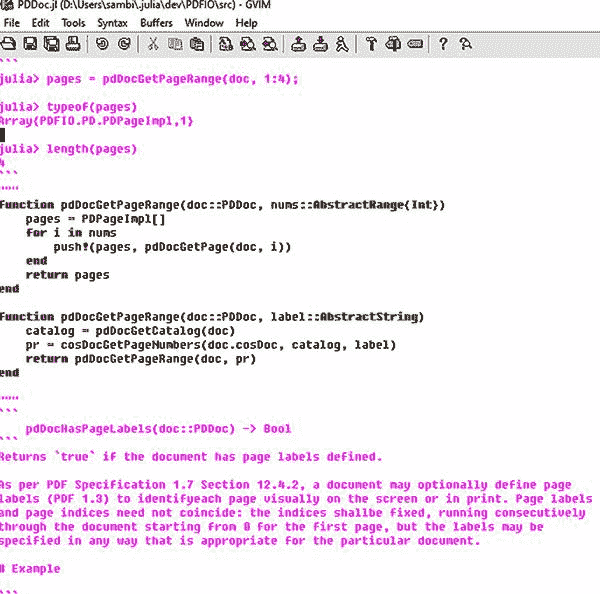

**图 12.1：** 使用 julia-vim 进行语法高亮

`vim` 的 Julia 插件名为 `julia-vim`，是一个 *GitHub* 项目 9，可安装在 Mac OS X、UNIX 和 Windows 操作系统的 `vim` 环境中 10。该插件是一组 vim 脚本，提供以下功能：

*   Julia 代码、文档和链接的语法高亮。
*   与 `ctags` 集成以实现导航。
*   沿代码块移动，匹配代码正则表达式或匹配的括号等。
*   LaTeX 到 Unicode 的替换，用于将 Julia 变量和参数指定为 Unicode 字符。
*   虽然有些人使用带有 vim 的终端模拟来使用 Julia REPL，但这本身并不属于该插件的一部分 11。
*   `vim` 集成没有工作区或项目的概念来将 Julia 代码组织为包。

## Emacs

它是 UNIX 平台上最流行的编辑器之一，与 `vi` 齐名。与专注于文本编辑的 vi 不同，`Emacs` 的开发更像是一个程序员的开发环境。它集成了终端、构建系统、源代码控制、电子邮件、互联网浏览器等。虽然最初是作为基于文本的系统启动的，但现在它集成到大多数 GUI 中，并在 Windows、UNIX 和 Mac OS X 操作系统上同样良好地运行。它还附带了一个类 LISP 的脚本接口（Emacs Lisp）用于开发定制解决方案。因此，你会看到它与 Julia 的集成要详尽和成熟得多。Emacs 还拥有像 `GNU elpa` 和 `melpa` 这样的包管理系统，用于查找和使用所需的各种包：

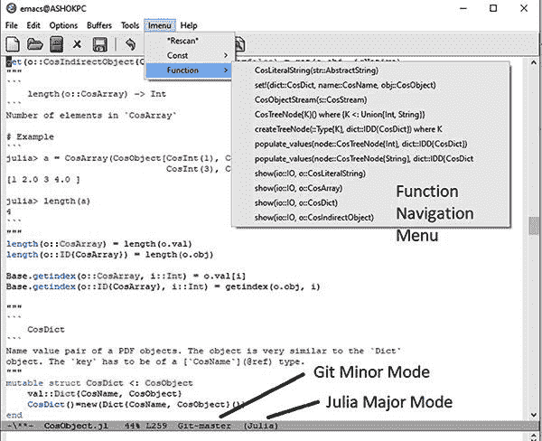

**图 12.2：** julia-emacs 运行演示


显示了将 Julia 作为主模式、Git 集成为次模式的 `<strong>julia-emacs</strong>` 界面。函数和常量显示为菜单项，有助于在文件内快速导航。Emacs 集成还允许在加载 `<strong>julia-emacs</strong>` 的同时加载 REPL，从而加载一个用于求值和调试的环境。Julia 还与一个名为 Emacs Speaks Statistics 的包集成，该包支持 R、S-plus、SAS 和 Stata 等其他语言。该包提供 Julia 代码块的细粒度求值，以及 Emacs 代码片段的求值，用于快速原型设计。这有助于在继续开发代码的同时，独立调试和测试小块代码：

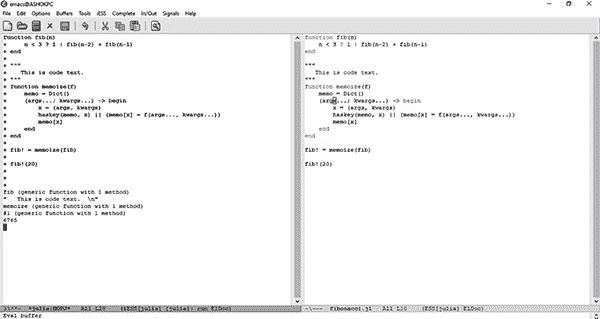

**图 12.3：** Julia 源代码和 ESS 求值缓冲区结果并排显示

虽然 Julia 与 `<strong>emacs</strong>` 的集成在功能上比 `<strong>vim</strong>` 深得多，但某些平台（如 Windows）可能无法通过 REPL 提供良好的终端体验。

正如 `<strong>vi</strong>` 和 `<strong>emacs</strong>` 是 UNIX 世界中最流行的编辑器一样，*Notepad++* 一直是 Windows 操作系统中流行的编辑器，没有直接移植到 Unix 或 Mac OS X 操作系统 12。但它不应与 `<strong>notepad.exe</strong>` 混淆，后者随 Windows 操作系统默认附带，仅提供最基本的文本编辑功能。*Notepad++* 是一个相对高级的文本编辑器，具有完整的插件功能，可用于编程和增强编辑器渲染体验。它还可以通过 **User Defined Languages** (**UDL**) 自定义语言语法高亮。UDL 是一种在 XML 文件中提供特定语法结构的更简便方法，可用于有效识别和渲染文件：

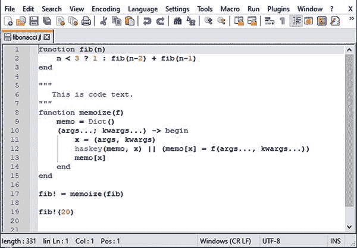

**图 12.4：** Julia-NotepadPlusPlus UDL 实际效果

Julia 的 UDL 可在 GitHub 项目 `<strong>Julia-NotepadPlusPlus</strong>`13 中获取。

`<strong>IDEs</strong>` 是完整的开发平台，有助于管理工作区、项目，并充当编辑器、构建、测试、调试和部署工具。虽然行业中有许多流行的标准 IDE，但 Julia 与 *Atom* 和 *Microsoft Visual Studio Code* 拥有最详尽的集成，我们将在后续章节中探讨。Julia 还与 *IntelliJ*14 有进行中的集成工作，并与 Eclipse15 有已归档的集成。

Atom 是一个基于 Electron 框架的 HTML 5 富客户端应用程序，基于 JavaScript、HTML 和 CSS。它利用 *NodeJS* 和 *Chromium* 浏览器的组件进行渲染。虽然 Atom 是最常用的应用程序之一，但跨平台框架上发布了近千个应用程序，为其提供了坚实的基础：

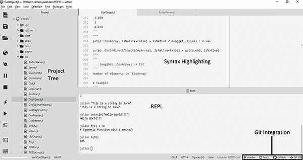

**图 12.5：** 带有目录、代码、REPL 视图的 Juno IDE

作为 Julia 与 *Atom* 集成骨干的 Juno IDE，也是 Julia PRO16（Julia Computing 的商业产品）的首选编辑器。然而，随着 Microsoft VS Code 集成的出现，部分关注点正慢慢从该编辑器转移 17：

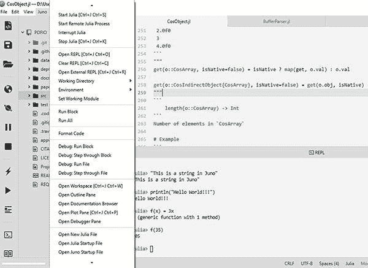

**图 12.6：** 显示功能的展开 Juno 菜单项

Juno 标签页聚合了大量 Julia 集成功能，如：

*   启动 Julia
*   运行部分代码并验证结果
*   格式化代码
*   调试完整代码或代码块

Microsoft Visual Studio 是 Microsoft 生态系统中几乎所有软件开发的知名前端。然而，随着 Microsoft 试图在云基础设施市场确立主导地位，推出不受 Windows 生态系统束缚的工具变得必要。Microsoft 于 2015 年推出 Visual Studio Code 以满足此类需求。VS Code 使用基于 Electron 框架的开源代码库开发，可在 Windows、Linux 和 Mac OS X 平台上使用 18。可以发现 VS Code 的体验与 Atom 相似：

*   与 *Git* 和 *GitHub* 集成
*   用于项目文件夹和文件、运行时输出及结果的各种面板
*   启动 Julia 以运行和调试的能力
*   与 Julia 绘图输出集成，等等：

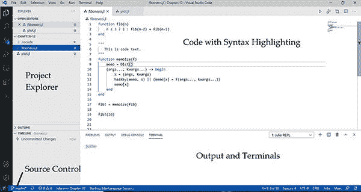

**图 12.7：** 带有 Julia 扩展的 VS Code

你可以在安装了 Julia 扩展的 VS Code 中打开示例代码中的文件 `<strong>plot.jl</strong>`。如果通过右键点击运行该文件，你将看到以下屏幕，绘图结果直接显示在代码旁边：

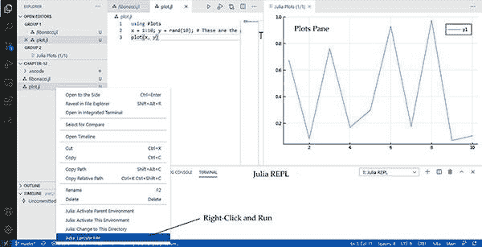

**图 12.8：** VS Code UI 中显示的 Julia 绘图

可以看出，*Atom* 和 *VS Code* 都是有用且重要的开发工具。目前，开发重心更多地倾向于 *VS Code*。我们建议从业者在决定选择哪一个之前，先同时接触这两种 IDE。

一则轶事 19 称，Grace Hopper 团队的成员在计算机电路中发现并移除了一个实体 Bug，从而修复了一个无法运行的程序。在计算机程序中查找故障并修复它的科学因此被称为 `<strong>debugging</strong>`。调试可能是一个令人沮丧且充满挑战的过程，特别是当代码不是由试图修复它的开发人员编写时。同时，对于新程序员来说，这是从他人代码中学习并了解外界各种编程风格的最有益经历。程序员约有 35%–50% 的生产时间和 50%–75% 的软件成本花在调试上 20。虽然工具减少了在单个调试任务上花费的时间，但总体用于此类活动的时间保持不变。虽然该研究强调了增强学习行为，但也发现调试需要有效掌握工具知识。

在大多数情况下，我们知道程序将经历哪些状态转换，但可能无法准确预测所有状态。打印或日志消息是在中间步骤传达可能输出的好方法。甚至 `<strong>assert</strong>` 宏也是验证预期假设的好方法。虽然这些验证正确行为的过程比较粗糙，但它们仍然是最常用的调试步骤。

单元测试是将代码中的 Bug 降到最低的另一个好方法。Julia 拥有一个详尽的单元测试框架，我们将在下一章回顾。作为一种良好的实践，单元测试必须确保以下几点：

*   测试用例必须包含足够的条件以及正常操作范围。
*   它们还应考虑所有负面条件和边界条件。
*   每个测试用例必须仅验证一项功能。测试多项功能会在代码中造成不必要的混淆。
*   如果函数是纯函数且无副作用，上一步将提高测试功效。在这种情况下，需要管理的内部状态较少，且之前结果的残留不会影响测试用例。

REPL 是另一个很好的调试工具。然而，要使此类工具有效，必须练习将小块代码编写进可复用的函数中。纯函数会让效果更好。当一种语言拥有过多特性时，程序员更难掌握其所有语法和语义。出错的可能性大幅增加。在这种情况下，在实际使用前在 REPL 中独立测试小块代码具有重要价值。让我们看看之前的斐波那契数列代码。


`fib(n) = n < 3 ? 1 : fib(n-1) + fib(n-2)`

以下是在 REPL 中运行代码得到的一些测试结果。

```
julia> fib(3)
2
julia> fib(10)
55
julia> fib(-1)
1
julia> fib(0)
1
```

递归函数之所以终止，是因为对于所有 `n < 3` 的值都存在终止条件。根本问题在于斐波那契数列对于负数 `n` 是否有效。拥有一个小型纯函数并在 REPL 中验证它，使得确保代码正常运行并将其引入实际代码变得更加容易。在 IDE 中运行代码片段是实现相同结果的另一种方式。

虽然前述方法是测试和使用小块代码的一些较简单途径，但它们不同于用于原生二进制文件的 `gdb` 等工具所采用的行调试。Julia 拥有一个功能齐全的命令行调试器 21。

## 行调试

行调试最好在 IDE 中进行，因为使用指针设置断点、添加变量监视并查看这些值在单步进入、单步跳出或单步越过代码块或函数时如何变化会更加容易。你可以运行代码直到满足特定条件或触发断点。虽然行调试是大多数程序员最青睐的技术，但对于像 Julia 这样的解释型语言，它可能不是最高效的选择。

*   初始化调试器环境可能非常缓慢。
*   调试可能需要更多的内存。
*   单步执行代码并验证监视变量本身可能也是一个缓慢的过程。
*   当一个人对代码缺乏足够理解，或没有更简便的方法来排除已正常运行的代码时，行调试是最后的选择。
*   当错误代码可以被定位到非常小的部分并进行专门验证时，行调试可以非常有效：

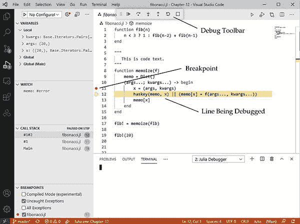

**图 12.9：** 在 VS Code 中调试的 Julia 源代码

读者可以使用 VS Code 或 Atom 在 IDE 中打开文件 `fibonacci.jl` 并调试代码。

## Revise.jl 与运行时限制

无论程序员多么熟练，她都希望能快速尝试脑海中的想法，体验结果，修复更改，然后继续处理下一块代码。Julia 的运行时是预加载的。随着你将更多数据结构、模块和包加载到系统中，旧的符号和代码块会被加载到运行时中。如果不影响运行时其他地方的整体工作，可能无法修改已定义的符号。例如，在 REPL 中更改函数定义很简单。但是，不允许添加或删除 `struct` 数据类型的属性。当修改包时，后续使用 `using <<module>>` 命令不会重新加载它。为克服这些限制，可以使用 `Revise.jl`22 包。该包可以自动加载，并能作为代码-运行-修复开发周期的一部分更新符号。我们建议读者查阅该包文档以获得详细了解。

## 总结

在与 Julia 同行的旅程中，我们已经走过了漫长的道路。我们从理解语言开始，处理了一些示例；尝试使用 REPL 或 Jupyter 来体验语言能力。在本章中，我们介绍了一些用于获得更好代码编辑和调试体验的工具。在下一章中，我们将尝试掌握构建 Julia 项目的专业知识，并以普遍期望的方式组织它们。

# 练习

1.  为你选择的文本编辑器安装 Julia 扩展或插件。观察编辑器提供的各种功能。
2.  安装 Emacs。如何将 Julia 模式与 Emacs Speaks Statistics 集成？你是否看到任何问题或顾虑？
3.  安装 Juno 并打开一个你选择的 Julia 包，尝试调试它。
4.  安装 Julia for VSCode 并打开一个你选择的 Julia 包，尝试调试它。
5.  有哪些有效的调试技术？你认为行调试是唯一的出路吗？

---

1 Sage McEnery, How much computer code has been written?, 18th July 2020, **[`medium.com/modern-stack/how-much-computer-code-has-been-written-c8c03100f459`](https://medium.com/modern-stack/how-much-computer-code-has-been-written-c8c03100f459)** 最后访问：2021 年 1 月 23 日。

2 D. E. Knuth, Literate Programming, The Computer Journal, September 1983

3 IBM Rational ClearCase, **[`www.ibm.com/support/knowledgecenter/SSSH27_9.1/com.ibm.rational.clearcase.help.ic.doc/topics/c_product_ovw.htm`](https://www.ibm.com/support/knowledgecenter/SSSH27_9.1/com.ibm.rational.clearcase.help.ic.doc/topics/c_product_ovw.htm)**

4 Microsoft Visual Studio Teams Services, **[`visualstudio.microsoft.com/vs/features/collaborate/`](https://visualstudio.microsoft.com/vs/features/collaborate/)**

5 Editor War, **[`en.wikipedia.org/wiki/Editor_war`](https://en.wikipedia.org/wiki/Editor_war)**

6 Julia Editor Support, **[`github.com/JuliaEditorSupport`](https://github.com/JuliaEditorSupport)**

7 The Juno Project, **[`junolab.org/`](https://junolab.org/)**

8 Julia for VS Code **[`www.julia-vscode.org/`](https://www.julia-vscode.org/)**

9 `julia-vim`, **[`github.com/JuliaEditorSupport/julia-vim`](https://github.com/JuliaEditorSupport/julia-vim)**

10 Installation Guideline `julia-vim`, **[`github.com/JuliaEditorSupport/julia-vim/blob/master/INSTALL.md`](https://github.com/JuliaEditorSupport/julia-vim/blob/master/INSTALL.md)**

11 Julia-vim tutorial for newbies, Julia Discourse Post, **[`discourse.julialang.org/t/julia-vim-tutorial-for-newbies/36636/6`](https://discourse.julialang.org/t/julia-vim-tutorial-for-newbies/36636/6)**

12 Some attempts have been made to run `Notepad++` in Linux using Wine emulator. Editors like `Sublime Text` have Julia integrations as well.

13 `Julia-NotepadPlusPlus`, Git Hub Repository, **[`github.com/JuliaEditorSupport/julia-NotepadPlusPlus`](https://github.com/JuliaEditorSupport/julia-NotepadPlusPlus)**

14 `julia-intellij`, GitHub Project, **[`github.com/JuliaEditorSupport/julia-intellij`](https://github.com/JuliaEditorSupport/julia-intellij)**

15 juliaDT, GitHub Project, **[`github.com/JuliaEditorSupport/JuliaDT`](https://github.com/JuliaEditorSupport/JuliaDT)**

16 Julia PRO, **[`juliacomputing.com/products/juliapro/`](https://juliacomputing.com/products/juliapro/)**

17 Julia client for Atom is entering maintenance mode, **[`atom.io/packages/julia-client`](https://atom.io/packages/julia-client)** 最后访问：2021 年 1 月 27 日

18 Visual Studio Code, **[`code.visualstudio.com/`](https://code.visualstudio.com/)**

19 Anecdotes, Grace Hopper, Wikipedia, **[`en.wikipedia.org/wiki/Grace_Hopper`](https://en.wikipedia.org/wiki/Grace_Hopper)**

20 Devon H. O'Dell, The Debugging Mindset, acmqueue, Jan-Feb 2017


# 参考文献

[21] Tim Holy, Kristoffer Carlsson, Sebastian Pfitzner, Keno Fischer, *A Julia interpreter and debugger*, 2019 年 3 月 19 日, The JuliaLang Blogs, [`julialang.org/blog/2019/03/debuggers/`](https://julialang.org/blog/2019/03/debuggers/) 最后访问：2021 年 1 月 30 日

[22] `Revise.jl`, 在运行中的 Julia 会话中自动更新函数定义, [`github.com/timholy/Revise.jl`](https://github.com/timholy/Revise.jl)

# 调试

有个轶事说 Grace Hopper 的团队成员在计算机电路中发现并移除了一只实体虫子，从而修复了一个无法运行的程序。因此，在计算机程序中查找故障并修复它的科学被称为**调试**。调试可能是一个令人沮丧且充满挑战的过程，特别是当代码不是由试图修复它的开发人员编写时。同时，对于新程序员来说，这是从他人代码中学习并了解外面世界中各种程序风格的最有益的经历。程序员大约将 35%–50% 的高效时间和 50%–75% 的软件成本花在调试上。虽然工具减少了在单个调试任务上花费的时间，但总体在调试活动上花费的时间保持不变。虽然该研究强调了增强学习行为，但也发现调试需要对工具的有效了解。

## 编辑器集成

**vim** 的 Julia 插件，称为 **julia-vim**，是一个 *GitHub* 项目，可安装在 Mac OS X、UNIX 和 Windows 操作系统的 **vim** 设置中。该插件是一组 vim 脚本，提供以下功能：

无论程序员多么熟练，她都希望尝试脑海中的想法，快速体验结果，修复更改，然后继续处理下一块代码。Julia 的运行时是预加载的。随着你向系统加载更多数据结构、模块和包，旧的符号和代码块会被加载到运行时中。如果不影响运行时其他地方的整体工作，可能无法修改已定义的符号。例如，在 REPL 中更改函数定义很简单。但是，不允许添加或删除 `struct` 数据类型的属性。当修改包时，后续使用 `<<module>>` 命令不会加载它。为克服这些限制，可以使用 `Revise.jl` 包。该包可以自动加载，并可作为代码-运行-修复开发周期的一部分更新符号。我们建议读者查阅包文档以获得详细了解。

虽然前述方法是测试和使用小块代码的一些较简单途径，但它们不同于使用 **gdb** 等工具对原生二进制文件进行的行调试。Julia 拥有一个功能齐全的命令行调试器。

Julia 是一个相对较新的平台。在 Julia 作为一门语言流行之前，所有前述组件的生态系统就已存在。开发人员希望看到 Julia 能与他们最熟悉的工具无缝配合使用。在 UNIX 环境的文本编辑器世界中，**vi** 与 **emacs** 之间几乎存在狂热般的追随之争。*GitHub* 下的 JuliaEditorSupport 组织维护着与多个知名编辑器的集成，能力水平各异；其中一些编辑器包括 *Vim*、*Emacs*、*Sublime*、*Atom*、*Notepad++* 和 *Eclipse*。一些集成处于活跃状态，而由于缺乏关注和使用，许多已被弃用。*Atom* 的 Julia IDE 正在 *Juno* 项目下开发，Microsoft **Visual Studio Code** (**VS Code**) 也是如此。

Julia client for Atom 正进入维护模式，[`atom.io/packages/julia-client`](https://atom.io/packages/julia-client) 最后访问：2021 年 1 月 27 日

Visual Studio Code，[`code.visualstudio.com/`](https://code.visualstudio.com/)

轶事，Grace Hopper，维基百科，[`en.wikipedia.org/wiki/Grace_Hopper`](https://en.wikipedia.org/wiki/Grace_Hopper)

`Julia-NotepadPlusPlus`, Git Hub 仓库，[`github.com/JuliaEditorSupport/julia-NotepadPlusPlus`](https://github.com/JuliaEditorSupport/julia-NotepadPlusPlus)

`julia-intellij`, GitHub 项目，[`github.com/JuliaEditorSupport/julia-intellij`](https://github.com/JuliaEditorSupport/julia-intellij)

juliaDT, GitHub 项目，[`github.com/JuliaEditorSupport/JuliaDT`](https://github.com/JuliaEditorSupport/JuliaDT)

Julia PRO，[`juliacomputing.com/products/juliapro/`](https://juliacomputing.com/products/juliapro/)

安装指南 `julia-vim`，[`github.com/JuliaEditorSupport/julia-vim/blob/master/INSTALL.md`](https://github.com/JuliaEditorSupport/julia-vim/blob/master/INSTALL.md)

Julia-vim 新手教程，Julia Discourse 帖子，[`discourse.julialang.org/t/julia-vim-tutorial-for-newbies/36636/6`](https://discourse.julialang.org/t/julia-vim-tutorial-for-newbies/36636/6)

已有尝试使用 Wine 模拟器在 Linux 中运行 `Notepad++`。`Sublime Text` 等编辑器也有 Julia 集成。

Devon H. O'Dell, *The Debugging Mindset*, acmqueue, 2017 年 1-2 月

Tim Holy, Kristoffer Carlsson, Sebastian Pfitzner, Keno Fischer, *A Julia interpreter and debugger*, 2019 年 3 月 19 日, The JuliaLang Blogs, [`julialang.org/blog/2019/03/debuggers/`](https://julialang.org/blog/2019/03/debuggers/) 最后访问：2021 年 1 月 30 日

`Revise.jl`, 在运行中的 Julia 会话中自动更新函数定义, [`github.com/timholy/Revise.jl`](https://github.com/timholy/Revise.jl)


# 开发环境与工具

REPL 是原型设计时尝试简单代码片段的绝佳工具。然而，生产级代码开发需要编写、调试和验证大量代码。虽然普通工程师每天可能只编写 20 行左右的代码，但维护的代码行数却非常庞大。除非拥有信息丰富的可视化工具，否则难以维护此类代码。虽然大多数代码以纯文本形式编写，但源代码编辑要求编辑器理解语言的某些特性。

*   **文档引用**：开发者倾向于在使用函数前查看其文档。虽然像文学编程这样的集成文档生成系统已存在数十年，但函数帮助查找功能因 Javadoc 与 IDE 的集成而变得特别实用且普及。Visual Studio 和许多 Python 语言的 IDE 提供了类似功能。

# 参考文献

1. Sage McEnery, *How much computer code has been written?*, 18th July 2020, [`medium.com/modern-stack/how-much-computer-code-has-been-written-c8c03100f459`](https://medium.com/modern-stack/how-much-computer-code-has-been-written-c8c03100f459) (last accessed: 23rd Jan 2021).
2. D. E. Knuth, *Literate Programming*, The Computer Journal, September 1983.
3. IBM Rational ClearCase, [`www.ibm.com/support/knowledgecenter/SSSH27_9.1/com.ibm.rational.clearcase.help.ic.doc/topics/c_product_ovw.htm`](https://www.ibm.com/support/knowledgecenter/SSSH27_9.1/com.ibm.rational.clearcase.help.ic.doc/topics/c_product_ovw.htm)
4. Microsoft Visual Studio Teams Services, [`visualstudio.microsoft.com/vs/features/collaborate/`](https://visualstudio.microsoft.com/vs/features/collaborate/)
5. Editor War, [`en.wikipedia.org/wiki/Editor_war`](https://en.wikipedia.org/wiki/Editor_war)

## IDE 与编辑器生态

Microsoft Visual Studio 是 Microsoft 生态系统中几乎所有软件开发的知名前端。然而，随着 Microsoft 试图在云基础设施市场确立主导地位，推出不绑定 Windows 生态系统的工具变得必要。Microsoft 于 2015 年推出 Visual Studio Code 以满足此类需求。VS Code 基于 Electron 框架使用开源代码库开发，可在 Windows、Linux 和 Mac OS X 平台上运行。其使用体验与 Atom 相似。

Juno IDE 是 Julia 与 Atom 集成的核心，也是 Julia Computing 商业产品 Julia PRO 的首选编辑器。然而，随着 Microsoft VS Code 集成的推出，关注点正逐渐从该编辑器转移。

**IDE** 是完整的开发平台，有助于管理工作区、项目，并充当编辑器、构建、测试、调试和部署工具。虽然业界有许多标准 IDE，但 Julia 与 Atom 和 Microsoft Visual Studio Code (VS Code) 的集成最为完善，我们将在后续章节中探讨。Julia 还与 IntelliJ 有进行中的集成工作，并有已归档的 Eclipse 集成。

Julia 是一个相对较新的平台。所有前序组件的生态系统在 Julia 作为语言流行之前就已存在。开发者希望 Julia 能与他们最熟悉的工具无缝配合。在 UNIX 环境的文本编辑器世界中，vi 与 emacs 拥有近乎狂热的追随者。GitHub 下的 JuliaEditorSupport 组织维护着与多款知名编辑器（如 Vim、Emacs、Sublime、Atom、Notepad++ 和 Eclipse）的不同层级集成。部分集成处于活跃状态，但许多因缺乏关注和使用而已弃用。Julia IDE 正在 Atom 的 Juno 项目和 Microsoft Visual Studio Code (VS Code) 下开发。

### Vim 集成

用于 vim 的 Julia 插件 julia-vim 是一个 GitHub 项目，可安装在 Mac OS X、UNIX 和 Windows 操作系统的 vim 环境中。该插件是一组 vim 脚本，提供以下功能：

*   虽然有人使用终端模拟器配合 vim 来使用 Julia REPL，但这并非插件本身的功能。

### Notepad++ 集成

正如 vi 和 emacs 是 UNIX 世界最流行的编辑器，Notepad++ 在 Windows 操作系统中广受欢迎，且无直接移植到 Unix 或 Mac OS X 系统。切勿将其与 Windows 系统默认自带、仅具备基本文本编辑功能的 notepad.exe 混淆。Notepad++ 是一款相对高级的文本编辑器，拥有完整的插件功能以编程和增强编辑器渲染体验。它还支持通过 **用户定义语言 (UDL)** 自定义语言语法高亮。UDL 通过 XML 文件提供特定语法结构的简易方式，可用于有效识别和渲染文件。

Julia 的 UDL 可在 GitHub 项目 Julia-NotepadPlusPlus 中获取。

## 相关链接

*   Julia Editor Support: [`github.com/JuliaEditorSupport`](https://github.com/JuliaEditorSupport)
*   The Juno Project: [`junolab.org/`](https://junolab.org/)
*   Julia for VS Code: [`www.julia-vscode.org/`](https://www.julia-vscode.org/)
*   julia-vim: [`github.com/JuliaEditorSupport/julia-vim`](https://github.com/JuliaEditorSupport/julia-vim)

---

# 构建生产级应用

在过去的几章中，您可能一直在思考如何开发生产就绪的应用程序。等待即将结束。本章将提供构建真实应用程序的知识；从解决玩具问题转向您真正想从事的项目。

## 本章主题

在本章中，我们将涵盖以下主题：

*   背景
*   项目、模块和包
*   测试自动化
*   文档
*   持续集成
*   二进制依赖
*   环境
*   包架构


在本章中，读者将能够了解如何为生产用途打包代码。你也可以在包中使用其他语言构建的二进制文件。为你的包添加单元测试和持续集成框架，并设置一致的环境，以便在不同的安装中执行，确保跨包维护正确的版本依赖。

# 学习任何编程语言的最佳方式

学习任何编程语言的最佳方式是选择一个具有实际应用价值的问题。如果你能以开源许可证开发该项目，并让他人使用并从中获益，那将是理想的 1。Julia 也是许多暑期实习计划（如 Summer of Code）的一部分，可能帮助学生通过贡献获得收入。在阅读本章时，思考一个问题并为其设计解决方案可能会有所帮助。按照本章讨论的方式设计你的代码和包。虽然我们试图通过示例向你介绍一些工具和框架，但对每个工具提供详尽的细节会让人应接不暇。

# 模块、包和项目

你将在多处讨论中看到术语 module（模块）、package（包）和 project（项目）的用法。虽然这些概念相关，但每个术语都有特定的特征。

## 模块

我们已经在 中见过模块。它们代表 Julia 中的命名空间。模块可以：

*   在代码的任何位置定义。它们不必在文件开头指定。
*   文件名不必与模块名匹配。
*   一个模块可以定义在另一个模块内部，从而创建层级结构。

在 中讨论的示例中，我们已经看到了上述所有特征，也意识到需要从模块导出符号以便在另一个模块中使用。不过，也可以使用关键字 `using` 来访问符号。

## 项目

Julia 中的任何代码都可以构成一个项目。项目没有特定的定义。它们仅仅是 Julia 或非 Julia 文件的集合。然而，没有源代码能孤立工作；它们依赖其他知名库来实现主要功能。这些依赖关系作为两个元数据文件的一部分被记录下来：`Project.toml` 和 `Manifest.toml`。这种设置称为 `environment`（环境）。环境确保项目使用一组一致的依赖库执行。我们稍后将详细了解这些文件的组成部分。

## 库

我们在 中讨论过标准库。然而，如果从语言层面看 Julia，库没有特定的定义。任何你可以与 Julia 集成的、用任何语言编写的代码或二进制文件都可以被视为库。库可以是 Julia 包、原生 C/C++ 共享对象、Java `*.jar` 文件或 Python 包等。每种类型的库都需要不同形式的集成。例如，标准库是随 Julia 安装一起提供的 Julia 库。然而，并非所有 Julia 库都是如此。`FileIO` 作为一个外部 Julia 包发布，如果用户需要利用其某些功能，就必须将其添加到项目中。

## 包

包为 Julia 项目或库提供了正式的结构。以下是包的一些特征：

*   **Git 仓库**：Julia 包可以是 Git 仓库。其部署机制基于 Git 库与 Julia 的集成。因此，创建后，包默认可以推送到 GitHub2。包也可以部署在本地目录中。
*   **文件夹结构**：包按定义良好的文件夹结构组织：
    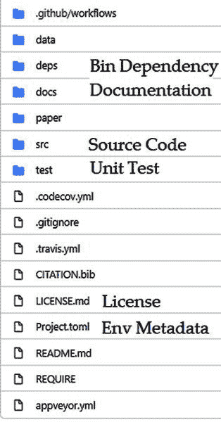
    **图 13.1：** PDFIO 包的文件夹结构
    虽然 `src` 和 `test` 文件夹几乎存在于所有包中，但 `deps`、`docs` 和 `data` 等文件夹可能在某些包中缺失。同样，非公开的包可能没有 `LICENCE.md` 文件。
*   **环境**：包拥有其固有的环境元数据文件 `Project.toml` 和 `Manifest.toml`。这确保了部署时，它们维护着一致的库依赖。
*   **模块**：包被包裹在最高层级的模块内。该模块即包的名称，定义在 `src` 文件夹下名为 `<ModuleName>.jl` 的文件中。不过，你也可以在最高层级模块内定义子模块。

# 带 UI 的 N 皇后示例

还记得我们在 中讨论的 N 皇后问题示例 3 吗？假设我们想在棋盘上放置皇后并展示可视化结果。我们该如何着手？

1.  **UI 渲染 API**：浏览器是最容易渲染的，我们将前往 JuliaHub4 搜索几个可用选项。这些都是相当不错的包选项，如：`Electron`、`Blink` 等。我们建议使用 `WebIO`，因为它是一个聚合器，可以在 Blink、Jupyter、Julia REPL 或 Atom IDE 的自定义窗口等所有前端进行渲染 5。
2.  **添加包**：既然你决定使用 WebIO，可以使用命令 `add WebIO` 将其添加到项目中。
3.  **添加相关前端**：如果你决定使用 Jupyter 渲染 UI，请确保添加 `IJulia` 包。如果你想使用基于 Electron 的 Blink 作为前端，则需要将 Blink 添加到项目中：
    
    **图 13.2：** 使用 WebIO 和 Blink 进行示例渲染

起始代码位于文件夹 `Chapter-13/NQueens` 中。提供了两个选项，一个使用 Jupyter notebook，另一个使用 REPL。你可以使用以下命令在 REPL 中启动应用程序：

```
julia> cd("Chapter-13/NQueens")
julia> ]
(@v1.6) pkg> activate .
(@v1.5) pkg> instantiate
Activating environment at `Chapter-13\NQueens\Project.toml`
julia> include("NQueens.jl")
```

对于 Jupyter notebooks，启动 `IJulia` 并打开 Jupyter notebook `Chapter-13/NQueens/NQueens.ipynb`。运行 notebook 以在 notebook 中查看渲染结果。

如果你打开 `Project.toml` 文件，将看到以下内容：

```
[deps]
Blink = "ad839575-38b3-5650-b840-f874b8c74a25"
IJulia = "7073ff75-c697-5162-941a-fcdaad2a7d2a"
WebIO = "0f1e0344-ec1d-5b48-a673-e5cf874b6c29"
```

这些都是你的应用程序所依赖的包。然而，在内部，这些包也依赖其他包。如果你打开 `Manifest.toml`，将能看到项目实际上所依赖的所有那些包及其版本。通常，提供 `Project.toml` 是为了设置环境。当调用 instantiate 命令时，它会分析 `Project.toml` 并计算所有依赖关系，如果 `Manifest.toml` 不存在则创建它。随后，它会安装所有所需的包（如果它们尚不可用）。从而确保环境已设置好以启动应用程序。

# 创建一个简单的包

我们看了一个项目示例，其中已定义了一些依赖项，我们想在另一台机器上复制该环境并扩展代码以添加用户界面。在本示例中，我们将创建一个简单的包，并了解如何在其生命周期中进行开发。为了获得最佳体验，我们建议你使用 REPL 执行本节内容。


当两点之间的距离小于某个称为 `point coincident tolerance`（点重合公差）的微小值时，这两点被称为重合点。[⁶] 鉴于上述条件，我们如何判断三个这样的点是共线的或构成一条直线？

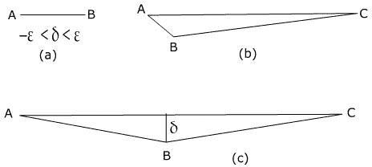

**Figure 13.3:** (a) 如果 –ε < δ < ε，则点 A 和 B 为同一点。(b) 如果 AB、BC 或 AC 中任意两点过于接近，则三点 ABC 共线。(c) 但 (b) 不充分，如图所示 B 点可以非常接近直线 AC。

从图中显然可知，要使 ABC 共线，三角形面积必须非常小：

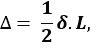

其中 δ 为高，L 为最长边的长度（在本例中为 BC）。如果

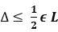

其中 ϵ 为点重合公差，则我们知道这些点是共线的。三角形面积（可使用行列式计算[⁷]）：

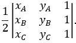

---

我们将该包命名为 `PointLib`，并通过以下步骤进行初始化：

1.  将目录切换到您想要创建 `PointLib` 包的工作区。
2.  在 Julia REPL 提示符 `julia>` 下输入字符 `]`。提示符将变为 `(@1.6) pkg>`。此提示符称为包模式。
3.  使用命令：`generate PointLib`。
4.  将创建一个名为 PointLib 的新目录，包含以下文件：

    ```
    shell> tree /F[⁸]
    Folder PATH listing
    Volume serial number is E285-F8B9
    C:.
    │   Project.toml
    └───src
            PointLib.jl
    ```

5.  `Project.toml` 将包含以下元数据：

    ```
    shell> more Project.toml
    name = "PointLib"
    uuid = "7de1f589-fb91-4994-b265-ccfc43c44ada"
    authors = ["Sambit Kumar Dash <sambitdash@gmail.com>"]
    version = "0.1.0"
    ```

6.  `src/PointLib.jl` 是包的代码入口点，将包含以下代码。一个与包名匹配的默认模块。一个作为示例代码的 greet 函数。

    ```julia
    module PointLib
    greet() = print("Hello World!")
    end # module
    ```

7.  使用 `cd("PointLib")` 进入该文件夹，并使用命令 `]activate .`。activate 后面的点 (`.`) 确保在当前目录中激活环境。这会将提示符更改为 `(PointLib) pkg>`，确认正在使用 `PointLib/Project.toml` 中定义的环境。

8.  向 `PointLib` 包添加 `LinearAlgebra` 库。根据注册表更新情况，这可能需要一些时间。

    ```
    (PointLib) pkg> add LinearAlgebra
     Updating registry at `D:\Users\sambi\.julia\registries\General`
    Resolving package versions…
     Updating `C:\Users\sambi\PointLib\Project.toml`
    [37e2e46d] + LinearAlgebra
     Updating `C:\Users\sambi\PointLib\Manifest.toml`
    [8f399da3] + Libdl
    [37e2e46d] + LinearAlgebra
    ```

    `Project.toml` 将包含一个依赖项条目。并将创建一个新文件 `Manifest.toml`，用于解析所需的完整包列表。例如，`LinearAlgebra` 需要 `Libdl`，该信息将更新在 `Manifest.toml` 中。

    ```
    shell> more Project.toml
    name = "PointLib"
    uuid = "7de1f589-fb91-4994-b265-ccfc43c44ada"
    authors = ["Sambit Kumar Dash <sambitdash@gmail.com>"]
    version = "0.1.0"
    [deps]
    LinearAlgebra = "37e2e46d-f89d-539d-b4ee-838fcccc9c8e"

    shell> more Manifest.toml
    # This file is machine-generated - editing it directly is not advised
    [[Libdl]]
    uuid = "8f399da3-3557-5675-b5ff-fb832c97cbdb"
    [[LinearAlgebra]]
    deps = ["Libdl"]
    uuid = "37e2e46d-f89d-539d-b4ee-838fcccc9c8e"
    ```

因此，我们得到了一个用于开发所需功能的包，也可以将其添加到源代码控制中，以便更好地维护和共享代码。Git 管理的包可以通过 Julia 包管理器进行分发。

---

以下代码足以满足我们想要开发的功能。虽然这是初始代码，但我们将把增强功能、添加更多用例作为练习留给读者。

```julia
module PointLib
greet() = print("Hello World!") # Created by generate command
using LinearAlgebra
export Point2D, iscollinear, ϵ

struct Point2D
    x::Float64
    y::Float64
end

function ϵ end
let _epsilon = 1e-5
    global ϵ() = _epsilon
end

function length(pA::Point2D, pB::Point2D)
    x1, y1, x2, y2 = pA.x, pA.y, pB.x, pB.y
    dx, dy = x1 - x2, y1 - y2
    return sqrt(dx*dx + dy*dy)
end

∆(pA::Point2D, pB::Point2D, pC::Point2D) =
    0.5 * det([pA.x pA.y 1; pB.x pB.y 1; pC.x pC.y 1])

L(pA::Point2D, pB::Point2D, pC::Point2D) =
    max(length(pA, pB), length(pB, pC), length(pC, pA))

function iscollinear(pA::Point2D, pB::Point2D, pC::Point2D)
    l = L(pA, pB, pC)
    # The longest length is too small if all the points
    # are coincident
    # This a special case to avoid divide by zero.
    l <= ϵ() && return true
    return 2∆(pA, pB, pC) / l <= ϵ()
end

end # module
```

模块一旦加载后不会自动更新。您需要关闭 Julia 会话，或使用像 `Revise.jl`[⁹] 这样的包，才能在包内重新加载新的符号。

---

程序开发完成后，理想情况下应将其签入源代码控制系统的项目中。我们建议为此使用基于 Git 的在线仓库，如 GitHub。请遵循以下步骤操作：

1.  登录 GitHub：<https://www.github.com>
2.  创建一个名为 `PointLib.jl` 的新仓库。按照惯例，Julia 包的名称通常带有 `.jl` 后缀。
3.  您可以使用 GitHub Desktop 将 `PointLib` 文件夹添加到仓库，
    或
    在 `PointLib` 文件夹中执行以下 `git` 命令：

    ```bash
    echo "# PointLib.jl" >> README.md
    git init
    git add .[¹⁰]
    git commit -m "first commit"
    # U 为 GitHub 用户名
    git remote add origin https://github.com/U/PointLib.jl.git
    git push -u origin master
    ```


您的最终结果可能类似于项目 `sambitdash/PointLib.jl`11。

# 测试框架集成

除非代码经过彻底测试，且测试用例频繁运行以检测新增代码带来的回归问题，否则代码永远不算合格。Julia 包应当包含单元测试用例以满足此类需求。可以通过以下步骤集成测试框架：

1.  使用 `cd("PointLib")` 进入 `PointLib` 文件夹。

2.  现在编辑 `Project.toml` 以添加**粗体**所示代码，从而添加 Test 包。

    ```toml
    name = "PointLib"
    uuid = "7de1f589-fb91-4994-b265-ccfc43c44ada"
    authors = ["Sambit Kumar Dash <sambitdash@gmail.com>"]
    version = "0.1.0"
    [deps]
    LinearAlgebra = "37e2e46d-f89d-539d-b4ee-838fcccc9c8e"
    [extras]
    Test = "8dfed614-e22c-5e08-85e1-65c5234f0b40"
    [targets]
    test = ["Test"]
    ```

3.  `test/runtests.jl` 包含该包的测试用例。我们向该文件添加以下代码：

    ```julia
    using Test
    using PointLib

    @test iscollinear(Point2D(0, 0), Point2D(10, 0),
                      Point2D(20, 2ϵ()))
    @test !iscollinear(Point2D(0, 0), Point2D(10, 0),
                       Point2D(20, 3ϵ()))
    @test iscollinear(Point2D(10, 0), Point2D(10, 0),
                      Point2D(20, 3ϵ()))
    ```

4.  现在在包模式下使用命令 `]test` 运行测试。

    ```
    (PointLib) pkg> test
    Testing PointLib
    Status `C:\Users\sambi\AppData\Local\Temp\jl_quSiap\Project.toml`
    [7de1f589] PointLib v0.1.0 `C:\Users\sambi\PointLib`
    [37e2e46d] LinearAlgebra
    [8dfed614] Test
    Status `C:\Users\sambi\AppData\Local\Temp\jl_quSiap\Manifest.toml`
    [7de1f589] PointLib v0.1.0 `C:\Users\sambi\PointLib`
    [2a0f44e3] Base64
    [8ba89e20] Distributed
    [b77e0a4c] InteractiveUtils
    [8f399da3] Libdl
    [37e2e46d] LinearAlgebra
    [56ddb016] Logging
    [d6f4376e] Markdown
    [9a3f8284] Random
    [9e88b42a] Serialization
    [6462fe0b] Sockets
    [8dfed614] Test
    Testing PointLib tests passed
    ```

5.  当测试失败时，您可能会看到如下错误信息。

    ```
    Test Failed at C:\Users\sambi\PointLib\test\runtests.jl:5
    Expression: iscollinear(Point2D(0, 0), Point2D(10, 0), Point2D(20, 3 * ϵ()))
    ERROR: LoadError: There was an error during testing
    in expression starting at C:\Users\sambi\PointLib\test\runtests.jl:5
    ERROR: Package PointLib errored during testing
    ```

`@test` 表达式用于验证表达式是否为真。不过，还有其他命令，如 `@test_throws`，用于验证是否抛出了特定异常。一组测试可以归入一个测试集，并汇总报告通过的测试数量。虽然我们使用了简单的测试用例创建，并了解了如何从 REPL 通过命令触发它们，但我们需要确保它们作为持续集成框架的一部分进行集成。这样，每当有推送到 GitHub 仓库时，就会触发持续集成框架。它确保代码被构建、测试被运行并报告结果。

# 代码覆盖率分析

测试充分性是大多数软件项目关注的焦点，也是工程部门不满的常见原因之一。Julia 测试可以通过生成覆盖率数据来调用。

```
(PointLib) pkg> test --coverage
Testing PointLib
Status `C:\Users\sambi\AppData\Local\Temp\jl_0MhaZh\Project.toml`
[7de1f589] PointLib v0.1.0 `C:\Users\sambi\PointLib`
[37e2e46d] LinearAlgebra
[8dfed614] Test
Status `C:\Users\sambi\AppData\Local\Temp\jl_0MhaZh\Manifest.toml`
[7de1f589] PointLib v0.1.0 `C:\Users\sambi\PointLib`
[2a0f44e3] Base64
[8ba89e20] Distributed
[b77e0a4c] InteractiveUtils
[8f399da3] Libdl
[37e2e46d] LinearAlgebra
[56ddb016] Logging
[d6f4376e] Markdown
[9a3f8284] Random
[9e88b42a] Serialization
[6462fe0b] Sockets
[8dfed614] Test
Testing PointLib tests passed
```

每个 `src` 目录下文件的数据均可获取。在本例中，您将看到一个名为 `src/PointLib.jl.<pid>.cov` 的文件。该文件包含代码的完整文本，并带有数字指示该行在单元测试执行过程中被执行的次数。某些行带有连字符，表示它们未被执行。

```
- module PointLib
-
- using LinearAlgebra
-
- export Point2D, iscollinear, ϵ
-
- greet() = print("Hello World!")
-
- struct Point2D
9   x::Float64
-   y::Float64
- end
-
- let _epsilon = 1e-5
9   global ϵ() = _epsilon
- end
-
- function length(pA::Point2D, pB::Point2D)
9   x1, y1, x2, y2 = pA.x, pA.y, pB.x, pB.y
9   dx, dy = x1 - x2, y1 - y2
9   return sqrt(dx*dx+dy*dy)
- end
-
3 ∆(pA::Point2D, pB::Point2D, pC::Point2D) =
-   0.5*det([pA.x pA.y 1; pB.x pB.y 1; pC.x pC.y 1])
-
3 L(pA::Point2D, pB::Point2D, pC::Point2D) =
-   max(length(pA, pB), length(pB, pC), length(pC, pA))
-
- function iscollinear(pA::Point2D, pB::Point2D, pC::Point2D)
3       l = L(pA, pB, pC)
-   # The longest length is too small if all the points are coincident
-   # This a special case to avoid divide by zero.
3   l <= ϵ() && return true
3   return 2∆(pA, pB, pC)/l <= ϵ()
- end
-
- end # module
```

报告必须仔细阅读，因为函数声明行不会被执行，本就不应被执行。然而，`greet()` 函数未被执行；这清楚地表明测试用例不足。可以使用 `Codecov.io` 等测试覆盖率工具来可视化覆盖率结果，我们将在后面的章节中介绍。


# Julia 包文档开发

文档并非包管理的核心功能。然而，要使包对受众有用，文档起着重要作用。因此，我们在此讨论如何为 Julia 包开发和传播文档。

Julia 文档字符串可以作为简单字符串或三重引用字符串块添加在任何函数或类型定义之前。文档字符串可以包含用于文档标记的 Markdown 语法，如标题、粗体、斜体或表格等。让我们为 `PointLib` 包的所有公共 API 添加一些此类文档字符串。

```julia
"Sample module to show how packages are built"
module PointLib
    …
    """
    Point2D

    ``` 
    x: Float64 x-cordinates
    y: Float64 y-cordinates
    ```
    """
    struct Point2D
        …
    end

    "Returns the point coincident tolerance value"
    function ϵ end
    …
end
```

你可以通过在帮助模式下输入函数或类型名称来测试文档字符串。当你输入字符 `?` 时，REPL 会切换到帮助模式。

```julia
julia> using PointLib
help?> Point2D
search: Point2D pointer PointLib pointer_from_objref codepoint unsafe_pointer_to_objref
Point2D
  x: Float64 x-coordinates
  y: Float64 y-coordinates

help?> PointLib
search: PointLib
Sample module to show how packages are built
```

虽然文档字符串对于查找特定方法和类型的帮助很有用，但你也需要为整个包提供详尽的文档。这通过一个名为 `Documenter.jl` 的包来实现。

## 文档构建流程

按照惯例，文档在包下的 `docs` 文件夹中创建。在我们的示例中：

1. 我们将创建一个 `PointLib/docs` 文件夹。
2. 进入该文件夹并启动 Julia。
3. 我们需要通过命令 `]activate` 实例化项目。这会将包模式提示符更改为 `(docs) pkg>`。
4. 在包模式下，我们需要使用以下命令：
   ```julia
   (docs) pkg> add ..
   (docs) pkg> add Documenter
   ```
   `add ..` 命令将添加未在 Julia 注册表中注册但文档交叉引用所需的 `PointLib` 包。
5. 在 `docs` 文件夹中，我们将创建一个包含以下内容的 `make.jl` 文件：
   ```julia
   if Base.HOME_PROJECT[] !== nothing
       # JuliaLang/julia/pull/28625
       Base.HOME_PROJECT[] = abspath(Base.HOME_PROJECT[])
   end
   using Documenter, PointLib
   makedocs(
       format = Documenter.HTML(),
       modules = [PointLib],
       sitename = "PointLib",
       pages = [
           "README.md",
           "API Reference" => "index.md"
       ]
   )
   deploydocs(
       repo = "github.com/sambitdash/PointLib.jl.git",
   )
   ```
6. `makedocs` 方法中引用的页面在 `PointLib/docs/src` 目录中查找。用户必须创建此目录。并且应将以下文件放置在 `src` 目录中。
7. `README.md` 文件包含项目的标准 README。
8. `index.md` 文件包含 API 参考。相关文档字符串将从源代码中提取并插入到参考位置。`index.md` 包含代码 ```` ```@docs <methods or types> ``` ````，文档字符串将在构建过程中嵌入其中。

   ```markdown
   # Reference
   This page has references to all the exported types and functions.
   ## Types
   ```@docs
   Point2D
   ```
   ## Functions
   ```@docs
   ϵ
   iscollinear
   ```
   ```


# 9. 使用 Documenter.jl 构建文档

现在，在 docs 目录下运行 `make.jl`。您将在 build 目录中看到 HTML 模式下的文档。

```julia
julia> include("make.jl")
Info: SetupBuildDirectory: 正在设置构建目录。
[Info: Doctest: 正在运行文档测试。
[Info: ExpandTemplates: 正在扩展 Markdown 模板。
[Info: CrossReferences: 正在构建交叉引用。
[Info: CheckDocument: 正在运行文档检查。
┌ Warning: 2 个文档字符串未包含在手册中：
│     PointLib.PointLib
│     PointLib.greet :: Tuple{}
│ 这些是受检查模块中的文档字符串（通过 modules 关键字配置）
│ 未包含在 @docs 或 @autodocs 块中。
└ @ Documenter.DocChecks D:\Users\sambi\.julia\packages\Documenter\FuXcO\src\DocChecks.jl:69
[Info: Populate: 正在填充索引。
[Info: RenderDocument: 正在渲染文档。
[Info: HTMLWriter: 正在渲染 HTML 页面。
┌ Warning: Documenter 无法自动检测构建环境，跳过部署。
└ @ Documenter D:\Users\sambi\.julia\packages\Documenter\FuXcO\src\deployconfig.jl:75
```

在流程结束时，我们将看到 *Reference API* 页面已填充在 `build/index.html` 页面中：

![

**图 13.4：** PointLib 的示例 API 参考

文档可以使用像 GitHub Actions 这样的持续集成工具部署到 GitHub Pages。

## 10. 为源代码控制做准备

然而，在继续之前，请确保您已将所有源文件添加到源代码控制中。

1.  向您的包 `PointLib` 添加一个包含 `docs/build/*` 的 `.gitignore` 文件。此文件夹作为 Documenter 的输出被创建，无需同步到源代码控制。
2.  运行 `git add .`，以便将所有其他源文件添加到您的仓库中。
3.  现在使用 `git commit` 命令或您习惯的任何其他 GUI 工具提交您的源代码。
4.  将您的更改推送到 GitHub 仓库以完全更新它。

现在所有源代码都已在源代码控制中，您将希望确保触发持续集成工作流，以便在创建文档的同时进行自动化测试。文档也必须发布到预定义的位置。

# 使用 GitHub Actions 进行持续集成

市场上有许多持续集成平台。GitHub Actions 是 GitHub 环境中使用最广泛的框架之一。我们将使用 GitHub Actions 来自动化 Julia 项目的测试、覆盖率和文档创建任务的执行。

1.  GitHub Actions 位于一个名为 `.github/workflows` 的文件夹中，以 yaml 文件的形式存在。我们将创建一个名为 `ci.yml` 的文件并研究集成框架的各个方面。
2.  **事件**：yaml 文件的第一部分是触发 action 的事件。

    ```yaml
    name: CI
    on:
      push:
        branches: [master]
        tags: ["*"]
    ```

3.  **作业**：接下来我们指定作为 action 触发一部分运行的作业。作业的 id 可以是任何名称，如 `myjob`。我们使用 `test` 和 `doc` 来表示我们想要执行的两类作业。
4.  **测试作业**：测试作业所做的远不止运行单元测试。它们有助于设置环境、检出代码、运行相关的单元测试，并将覆盖率结果提交到 `codecov.io` 以进行可视化。
5.  **设置操作环境**：

    ```yaml
    jobs:
      test:
        name: Julia ${{matrix.version}} - ${{matrix.os}} - ${{matrix.arch}} - ${{github.event_name}}
        runs-on: ${{matrix.os}}
        strategy:
          fail-fast: false
          matrix:
            version:
              - '1.0'
              - '1' # 自动扩展到最新的稳定 1.x 版本 Julia
              - nightly
            os:
              - ubuntu-latest
            arch:
              - x64
            include:
              # 仅使用最新 Julia 测试 macOS 和 Windows
              - os: macOS-latest
                arch: x64
                version: 1
              - os: windows-latest
                arch: x64
                version: 1
    ```

    您可以选择指定操作系统版本、Julia 版本，也可以指定特定操作系统与 Julia 版本的细粒度组合。最好选取一个示例 `ci.yml` 并根据需要进行修改，而不是从头编写。

6.  **步骤**：测试作业要执行的步骤如下：

    ```yaml
    steps:
      - uses: actions/checkout@v2
      - uses: julia-actions/setup-julia@v1
        with:
          version: ${{matrix.version}}
          arch: ${{matrix.arch}}
      - uses: actions/cache@v1
        env:
          cache-name: cache-artifacts
        with:
          path: ~/.julia/artifacts
          key: ${{runner.os}}-test-${{env.cache-name}}-${{hashFiles('**/Project.toml')}}
          restore-keys: |
            ${{runner.os}}-test-${{env.cache-name}}-
            ${{runner.os}}-test-
            ${{runner.os}}-
      - uses: julia-actions/julia-buildpkg@v1
      - uses: julia-actions/julia-runtest@v1
      - uses: julia-actions/julia-processcoverage@v1
      - uses: codecov/codecov-action@v1
        with:
          file: lcov.info
    ```

    步骤不必在 steps 部分定义。相反，它们是从 GitHub Actions 和 Julia Actions 项目中开发的几个预定义脚本中获取的。这使得步骤具有声明性。

7.  **文档作业**：调用 `makedocs` 并作为文档构建过程的一部分创建文档，这是我们之前见过的。

    ```yaml
    docs:
      name: Documentation
      runs-on: ubuntu-latest
      steps:
        - uses: actions/checkout@v2
        - uses: julia-actions/setup-julia@v1
          with:
            version: '1'
        - run: |
            julia --project=docs -e '
            using Pkg
            Pkg.develop(PackageSpec(path=pwd()))
            Pkg.instantiate()'
        - run: julia --project=docs docs/make.jl
          env:
            GITHUB_TOKEN: ${{secrets.GITHUB_TOKEN}}
            DOCUMENTER_KEY: ${{secrets.DOCUMENTER_KEY}}
    ```

8.  部署后，文档需要作为 GitHub Pages 显示。您需要使用以下代码创建一对密钥：

    ```julia
    julia> using DocumenterTools
    julia> DocumenterTools.genkeys()
    Info: 将下面的公钥添加到 https://github.com/$USER/$REPO/settings/keys 并授予读/写权限：
    …
    [Info: 添加一个名为 'DOCUMENTER_KEY' 的安全环境变量到 https://travis-ci.com/$USER/$REPO/settings (如果使用 Travis CI 部署) 或 https://github.com/$USER/$REPO/settings/secrets (如果使用 GitHub Actions 部署)，值为：
    …
    ```

    您需要将公钥添加到 `keys` 部分。您可以使用 DOCUMENTER 作为标题。现在将私钥添加到 GitHub GUI 中项目设置的 `secrets` 部分，名称为 `DOCUMENTER_KEY`。

    **gh-pages 分支：** GitHub Pages 通常从与 master 分支分离的单独分支填充。这被称为 `gh-pages` 分支。该分支是从 master 分离创建的。命令可以从 `PointLib` 目录运行。由于代码运行是为了创建一个分离分支，请确保在继续之前已将所有代码更改提交到 master 分支。

    以下是手动创建 `gh-pages` 分支的命令：

    ```bash
    # 创建 gh-pages 分支
    git checkout --orphan gh-pages
    git rm -rf .
    touch README.md
    git add README.md
    git commit -m 'initial gh-pages commit'
    git push origin gh-pages
    ```

9.  配置带有 GitHub Pages 的 gh-pages 分支：在 PointLib 设置页面的 `GitHub Pages` 部分，您可以将 `gh-pages` 配置为网页的来源：

    **。确保您的包 `PointLib.jl` 在您的个人资料中显示为列出的包。如果尚未配置，您将需要使用用户界面为该包设置 codecov。
3.  等待持续集成被触发并完成。
4.  如果您登录 **[`codecov.io`](https://codecov.io)**，您将看到带有丰富多彩可视化的代码覆盖率统计：

    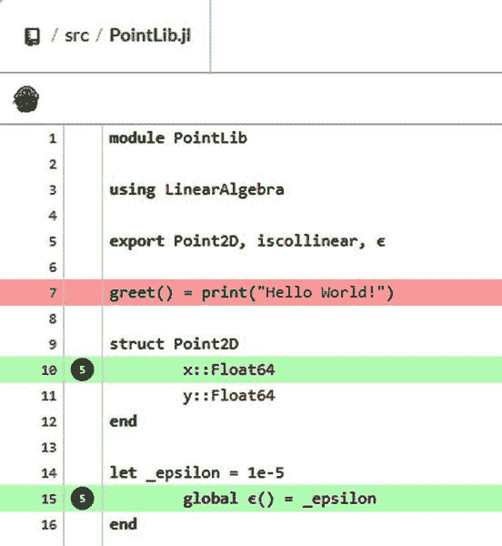

    **图 13.7：** 测试用例未覆盖 `greet()` 而覆盖了 `ϵ()`。由 codecov.io 报告

因此，我们生成了包代码，创建了测试用例，创建了相关文档。我们在每次测试运行时将覆盖率数据更新到可视化工具，并将文档作为持续集成的一部分部署到 `GitHub Pages`。这确保了源代码的每次更改都能在适当的测试用例运行中得到反映，在覆盖率工具的帮助下确保为新引入的功能添加测试用例，并保持文档是最新的。

# 构建步骤和二进制依赖

当部署包时，会运行一个可选的预部署构建步骤，以下载包外部的数据文件、执行构建过程或将构建的二进制文件放在正确的位置等。某些构建步骤可能相当复杂；我们将以 PDFIO 包为例，看看其中执行的一些构建步骤。

*   `PDFIO` 依赖于来自 OpenSSL 库的二进制库 `zlib` 和 `libcrypto`。
*   这些库可能在操作系统中可用。库的名称可能因操作系统或发行版而异。Julia 提供 `library_dependency` 工具来解决此类问题。
*   采取的行动可能因操作系统而异。
    *   **Windows**：从特定 URL 下载预构建的二进制文件。
    *   **非 Windows**：从源代码构建库并部署到特定位置，以便只有 PDFIO 可以使用它们。

该过程可能相当复杂，但在解决所有可能的构建和部署需求方面具有高度灵活性。

然而，如果您仔细查看 `PDFIO` 的 `build.jl` 第 3 行，对于 Julia 1.3 或更高版本，构建步骤会被完全忽略。这之所以成为可能，是因为 Julia 社区现在为许多知名的二进制库提供预构建的二进制文件，并用像 `<libraryname>_jll` 这样的包名进行封装。

`PDFIO` 依赖于：

*   OpenSSL_jll
*   Zlib_jll

这些包是使用一个名为 *BinaryBuilder* 的构建模板生成工具构建的。如果您需要预构建的二进制文件，可以参考 *JuliaBinaryWrappers* 组织并查找您感兴趣的仓库，或在项目 `JuliaPackaging/Yggdrasil` 中提交 issue。您也可以使用 `BinaryBuilder` 模板构建二进制文件并为该项目做贡献。

# 调用 C 和 Fortran 代码

在 Julia 中使用原生二进制库要求 Julia 和原生库之间具有兼容的 `应用程序二进制接口` (`ABI`)。最常见的二进制文件具有 C 兼容接口，可从 Julia 访问。此类函数可以使用关键字 `ccall()` 调用。

```julia
_zlibVersion() = ccall((:zlibVersion, libz), Ptr{Cstring}, ())
```

库 `libz` 有一个名为 `zlibVersion` 的方法符号，它没有输入参数，但返回一个指向 `Cstring` 的指针。`Cstring` 是 C 风格字符串的表示，即字节数组。

或者，C 中的函数可以使用宏 `@cfunction` 调用 Julia 函数作为回调。建议感兴趣的读者查阅关于调用 C 和 Fortran 代码的手册。调用约定要求正确设置类型映射，以便能够在 C 中使用 Julia 中分配的对象，反之亦然。

`CXX.jl` 可用于将 C++ 代码与 Julia 集成。同样，`PyCall.jl` 提供 Python 库与 Julia 的集成。`JavaCall.jl` 提供从 Julia 调用 Java 代码的方法。

# 包环境：Project.toml 和 Manifest.toml

项目环境由文件 `Project.toml` 和 `Manifest.toml` 控制。`Project.toml` 包含包名、UUID、版本和直接依赖。每个依赖可能进一步依赖其他包。依赖包可能依赖于特定版本的包。

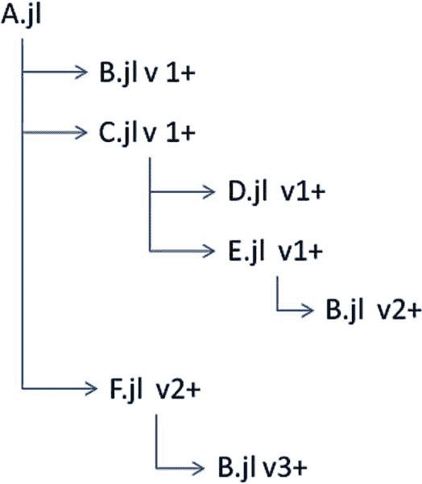

**图 13.8：** 包 A 依赖 B 的 v1。A 依赖 F，而 F 需要 B 的版本 3。因此，B 的 v3 将是 A 最终使用的包

在上面的示例中，假设包具有完美的向前兼容性。因此，包的任何更高版本都可以提供该包较低版本的所有功能。情况并不总是如此。有时，包会指定其依赖包的版本范围。在这种情况下，必须决定最有用或兼容的包版本。`A.jl` 的 `Project.toml` 将列出 `B.jl`、`C.jl` 和 `F.jl` 的依赖。然而，`Manifest.toml` 将在解析特定版本后计算得出，并将包含 `B.jl v3`、`C.jl v1`、`D.jl v1`、`E.jl v1`、`F.jl v2` 的信息。每当您需要复现环境时，共享 `Project.toml` 和 `Manifest.toml` 会有所帮助。然而，在大多数源代码控制 (Git) 的包中，只签入 `Project.toml`，因为 `Manifest.toml` 保持灵活，可根据环境中的其他包进行更新。虽然我们意识到包具有版本信息，但我们迄今为止尚未讨论包管理器如何知道包的位置。此类信息保存在中央注册表中。

# Julia 包注册表

包是交付功能的核心单元。一旦您开发了这样的包，自然希望将其推广给外部世界，以便能够访问和使用它。传达包信息的最佳方式是使其可供所有人使用，并通过交付生态系统进行分发。GitHub 是实现这一目标的非常有用的机制。高质量的文档充当最低限度的广告媒介。第二部分是通过 Julia 的包注册表使其可用。Julia 包生态系统拥有超过 4000 个包。这些包大多是托管在 GitHub 或 GitLab 等公共 Git 仓库中的 Git 包。注册包会被分析并变得易于搜索，文档会发布到 JuliaHub 以便于访问和云部署。每个 Julia 安装都有一个本地注册表，它会定期或在请求包更新时按需与 Julia 全局注册表同步：

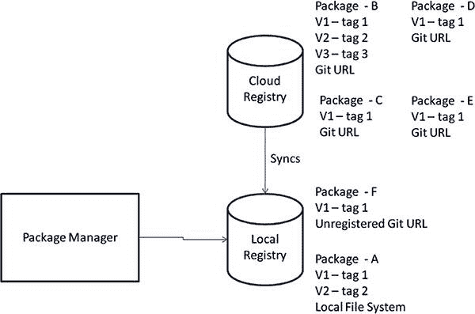

**图 13.9：** Julia 注册表的运作。本地注册表拥有未向全局注册表注册的包的信息。然而，它会为所有已注册的包进行同步

假设在上面的示例中，我们在本地系统上开发 `A.jl` 包。因此，关于 `A.jl` 的信息目前仅在本地注册表中可用。它依赖于包 `F.jl`，后者在 GitHub 上但未向 Julia 注册表注册。当您使用 GitHub URL 而非注册包名添加包时，这是可能的。

```julia
(dir) pkg> add https://github.com/user_name/F.jl
```

然而，关于 B、C、D 和 E 包的信息都在全局云注册表中可用。注册表拥有关于包的以下信息：

1.  包的版本
2.  包的位置：这可以是带有版本标签的 Git 地址或文件系统路径
3.  包对其他包的依赖：即通常在 `Project.toml` 文件中找到的信息。

位置和依赖按包的每个版本存储。例如，如果您想在 `A.jl` 中使用 `C.jl` 时修改它，您将需要制作一个开发副本。这是使用 develop 或 `dev` 命令完成的。

```julia
(A) pkg> dev C
```

`C.jl` 的 GitHub 仓库将被克隆到本地的 `$JULIA_DEPOT_PATH/dev` 中。包管理器与本地注册表交互，在需要更新此类信息时用云注册表的内容更新它。它还确保包与项目的环境要求一致。`Manifest.toml` 也是由包管理器在为项目解析依赖后生成的：

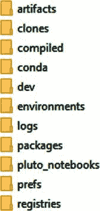

**图 13.10：** Julia depot 文件夹结构

`JULIA_DEPOT_PATH` 是一个有用的目录，所有包及其相关信息都驻留于此。它们还包含包的预编译副本和构建的二进制文件。默认配置为 `$USER_HOME/.julia` 文件夹。必须注意，无论项目环境的数量如何，Julia 安装中只存在一个 depot。相关版本的包会根据各种环境的需要下载并在它们之间共享。Julia depot 或任何其他文件或包相关的数据结构不应直接操作。Julia 提供了广泛的命令行接口和 API 来帮助满足此类需求。

# 包管理器 REPL 模式

可以使用字符 `]` 切换到 REPL 的 pkg 模式。进入 pkg 模式后，您可以使用 `add` 向项目添加包，使用 `rm` 从项目中移除包。`update` 命令更新注册表并从全局服务器下载最新注册表。像包一样，注册表在 Julia 中也是一个 Git 仓库。就像方法和类型一样，可以通过在前面加上问号 (`?`) 来请求包命令的帮助。`?add` 将在 REPL 上打印命令行帮助。

# 使用 Pkg.jl 进行编程式包管理

虽然 REPL 命令对交互式会话非常有帮助，但在脚本或包含在 Julia 程序中时可能并不完全有用。在这种情况下 `Pkg` 模块非常方便。像 `add()`、`rm()` 等方法提供了与命令行类似的功能。就像命令行的参数一样，参数可以提供给函数调用。

Julia 中的包管理非常详尽。然而，我们只是通过概览触及了表面。用户应该习惯使用包，并在使用 Julia 的过程中学习复杂操作。由于 Julia 包管理的许多方面都是使用 Git 实现的，良好的 Git 知识也会非常有帮助。

# 章节总结

在本章中，我们从理解模块、包和项目开始。我们扩展了 8 皇后谜题以包含用户界面和图形。我们还创建了一个示例包，开发了测试用例、文档，并确保代码覆盖率相对于测试用例是充分的。然后我们讨论了 Julia 包注册的工作原理。简而言之，我们讨论了开发生产就绪 Julia 应用程序所需的初始级别细节。在下一章中，我们将学习在云环境中部署应用程序。

# 练习

1.  选择一个您想解决的实际问题。研究您想如何解决该问题的设计。Julia 中是否有解决该问题的所有功能？您是否知道有任何原生库可以解决此类问题？创建您的项目并开始构建您的解决方案。
2.  一旦您构建了解决方案并使其达到合理的形状，将其注册为 Julia 生态系统的包。其他人使用它真的需要注册包吗？
3.  您开发的 `PointLib` 包中是否有足够的测试用例？如何扩展测试用例？添加一些相关的用例，并确保添加了更好的用例。
4.  `PointLib` 中的 `iscollinear` 函数接受三个点作为参数。是否有办法将其扩展到 N 个点，其中 N 大于 3？
5.  开发一个项目，利用您已有的 PointLib。

---

# 参考文献

[1] 作者开发了一个 PDF 读取库 (PDFIO) 作为他的第一个实际 Julia 项目。虽然第一个项目可能有一定的局限性和不足，但它提供了一个从错误中学习并从社区用户和贡献者那里获得反馈的绝佳机会。

Dash, Sambit Kumar, PDFIO: PDF Reader Library for native Julia, The Journal of Open Source, Nov. 2019, **[`doi.org/10.21105%2Fjoss.01453`](https://doi.org/10.21105%2Fjoss.01453)**

[2] 与其他 Git 仓库（如 GitLab 或任何私有仓库）的集成也存在。

[3] 启动代码可在关联目录 Chaper-13/NQueens 中找到。

[4] Packages, JuliaHub, **[`juliahub.com/ui/Packages`](https://juliahub.com/ui/Packages)**。还有其他一些可以搜索 Julia 包的位置。 **[`julialang.org/packages/`](https://julialang.org/packages/)**

[5] VS Code IDE 不受支持。 **[`github.com/JuliaGizmos/WebIO.jl/issues/168`](https://github.com/JuliaGizmos/WebIO.jl/issues/168)**

[6] 浮点数本质上是不精确的。您无法在有限的二进制系统中精确表示 0.1。它将是无限级数：0.000110011… 这类似于十进制浮点系统中 ⅓ 表示为 0.333…。因此，大多数浮点比较都在容差范围内进行，而不是判断相等。当 –ε < a-b < ε 时，您说 a = b，其中 a 和 b 是浮点数。这里将其扩展到 CAD 系统中的二维。

[7] 通常使用代数表达式 1 ⁄ 2 *\[(x[A] - x[B]) (y[B] - y[C]) - (x[B] - x[C]) (y[A] - y[B])*\]。我们使用行列式表达式只是为了给项目增加额外的模块。

[8] `trees` 命令仅在 Windows 中可用。对于 Linux 和 Mac OS X，可以使用 `ls –lR`。

[9] Revise.jl, GitHub Repository, **[`github.com/timholy/Revise.jl`](https://github.com/timholy/Revise.jl)**

[10] `git add .` 将整个目录及其内容添加到 Git 仓库。如果您想排除某些文件，请有选择地将它们从同步中移除。

[11] `sambitdash/PointLib.jl` 是供参考的示例项目副本。这不是解决方案。读者应开发自己的个人仓库并进行扩展。 **[`github.com/sambitdash/PointLib.jl`](https://github.com/sambitdash/PointLib.jl)**

[12] Documenter.jl: A Documentation Generator for Julia, GitHub Repository, **[`github.com/JuliaDocs/Documenter.jl`](https://github.com/JuliaDocs/Documenter.jl)**

[13] 与其从头编写 ci.yml，不如查看 `Example.jl` 包中包含的一个： **[`github.com/JuliaLang/Example.jl`](https://github.com/JuliaLang/Example.jl)**

[14] GitHub Actions Scripts, **[`github.com/actions`](https://github.com/actions)**

[15] Julia Actions, **[`github.com/julia-actions`](https://github.com/julia-actions)**

[16] 您可以暂时向您的包添加 `DocumenterTools` 包，并在生成密钥对后从包依赖中移除该包。

[17] **[`gist.github.com/skratchdot/1ef433c666066389201a`](https://gist.github.com/skratchdot/1ef433c666066389201a)**

[18] Codecov 为 GitHub 公共包提供免费集成。此外，公共仓库无需配置任何仓库密钥。

[19] 构建步骤在文件 `deps/build.jl` 中描述，可通过包模式命令 `build` 调用。该文件可从以下链接引用： **[`github.com/sambitdash/PDFIO.jl/blob/v0.1.12/deps/build.jl`](https://github.com/sambitdash/PDFIO.jl/blob/v0.1.12/deps/build.jl)**

[20] 高级用户请参考 `BinDeps` 包以获取更多详情。 **[`github.com/JuliaPackaging/BinDeps.jl`](https://github.com/JuliaPackaging/BinDeps.jl)**

[21] BinaryBuilder, GitHub Repository, **[`github.com/JuliaPackaging/BinaryBuilder.jl`](https://github.com/JuliaPackaging/BinaryBuilder.jl)**

[22] JuliaBinaryWrappers, GitHub Organization, **[`github.com/JuliaBinaryWrappers/`](https://github.com/JuliaBinaryWrappers/)**

[23] Yggdrasil, GitHub Repository, **[`github.com/JuliaPackaging/Yggdrasil/`](https://github.com/JuliaPackaging/Yggdrasil/)**

[24] `Inflate.jl`, `PDFIO` GitHub Repository, **[`github.com/sambitdash/PDFIO.jl/blob/v0.1.12/src/Inflate.jl`](https://github.com/sambitdash/PDFIO.jl/blob/v0.1.12/src/Inflate.jl)**

[25] Calling C and Fortran Code, Julia Documentation Manuals, **[`docs.julialang.org/en/v1/manual/calling-c-and-fortran-code/`](https://docs.julialang.org/en/v1/manual/calling-c-and-fortran-code/)**

[26] `Cxx.jl`, GitHub Repository, **[`github.com/JuliaInterop/Cxx.jl`](https://github.com/JuliaInterop/Cxx.jl)**

[27] `PyCall.jl`, GitHub Repository, **[`github.com/JuliaPy/PyCall.jl`](https://github.com/JuliaPy/PyCall.jl)**

[28] `JavaCall.jl`, GitHub Repository, **[`github.com/JuliaInterop/JavaCall.jl`](https://github.com/JuliaInterop/JavaCall.jl)**

# 第 14 章：在云端部署 Julia 应用程序

我们已经了解了开发 Julia 应用程序所使用的工具。现在我们将在云环境中部署我们的应用程序。Julia 适合基于服务器的计算，云是此类系统的自然部署选择。

## 本章我们将学习以下主题：

*   云环境
*   部署 Julia
*   Kubernetes
*   公共云基础设施

您将大致了解如何将 Julia 应用程序作为 Web 服务部署在 Docker 容器中，然后使用 Julia 命令将容器带到 Kubernetes 服务进行部署和编排。您还可以使用 Julia 命令作为集成平台来管理 *AWS*、*Azure* 和 *Google Cloud* 服务。因此，您可以将 Julia 用作许多云部署活动的客户端接口。

## JuliaHub：原生 Julia 云环境

Julia 是为科学计算设计的环境。它广泛用于基于服务器的计算。因此，许多生产 Julia 部署都在云环境中进行。云环境有其独特的挑战。Julia 作为一种语言不限制自己于任何特定的云平台。然而，与云提供商的集成程度在不断演变，并且在任何时间点能力各异。Julia Computing 提供了一个 *JuliaHub* 环境，它与 Julia 开发环境紧密集成。我们之前已经看到了与 VS Code IDE 的集成。提供了一个详尽的教程，通过该教程可以将工作负载部署到 *JuliaHub* 并作为分布式应用程序运行。

*JuliaHub* 提供用户界面来搜索和发现包，并允许开发和注册自己的包。包可以构建并注册为应用程序，这本质上意味着添加 main 方法并指定环境，然后可以多次运行或与 *JuliaHub* 的其他用户共享。*JuliaHub* 还提供企业计划，用户可以拥有私有注册表和包，并对包有更严格的控制以符合公司政策。分布式应用程序可以按需扩展，只需按一下按钮即可从单节点扩展到数百个节点。*JuliaHub* 可以是使用纯 Julia 环境的人的一个好选择。但对于不同类型的应用程序、大型基础设施，甚至纯粹的商业原因，人们可能更倾向于其他知名的 IaaS 或 PaaS 解决方案。

*JuliaHub* 界面简单，只需要最少的资源配置，如下截图所示：

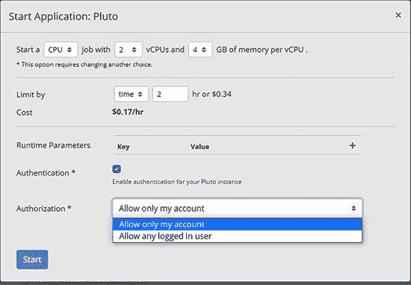

**图 14.1：** JuliaHub 提供一个简单的分布式环境，可配置 CPU 和内存数量

在后台，*JuliaHub* 以透明的方式管理日志监控、调度和分布式处理。这显著减少了复杂系统的管理和部署开销。建议读者参考文档以详细了解 *JuliaHub*。

## Docker：容器化 Julia 应用程序

如果您查看任何 Julia 包的 GitHub Actions，您会意识到大多数都遵循以下高级步骤：

1.  **安装 Julia**：根据平台和操作系统，需要下载并安装正确的二进制文件。
2.  **设置 Julia**：安装需要配置在路径中，以便相关用户可以使用。
3.  检出要测试的包。
4.  **实例化包环境**：这可能会安装运行应用程序所需的所有依赖包。
5.  启动环境并测试包。

虽然大多数这些可以通过自定义脚本实现，但考虑到工作的重复性和部署平台的广泛多样性，这可能并不理想。基于 Docker 的包被视为部署交付的事实标准。然而，自己维护此类镜像可能很困难。Julia 的自定义包管理参考实现 `PkgServer` 是一个了解使用 Docker 脚本部署完整服务器配置的好包。在下面的示例中，我们将看看更简单的示例，并将 `NQueens` 问题作为服务暴露。

### 将 Julia 函数作为 REST API 暴露

Julia 是基于服务器计算的首选环境。如果 Julia 方法可以作为 REST 端点暴露，并可从浏览器或普通 HTTP 客户端访问，那将是理想的。我们将从第 13 章中选取 N-queens 问题，尝试将计算元素作为服务器部署，而我们在本地渲染客户端，这将是典型的部署方式。`JuliaWebAPI` 提供了将 API 作为 Web 接口暴露的完美接口。

```julia
webqueens(N) = queens(parse(Int, N))

process(
    JuliaWebAPI.create_responder([
        (webqueens, true)
    ], "tcp://127.0.0.1:9999", true, ""), async=true
)

const apiclnt = APIInvoker("tcp://127.0.0.1:9999")
run_http(apiclnt, 8888)
```

这只是暴露 `queens(N)` 函数的相关代码片段。让我们详细看看：

*   服务器应用程序在端口 8888 上监听 HTTP 请求。
*   当它收到有效的 REST 请求时，它使用 JMQ 传输和 JSON 格式通过 `APIInvoker` 调用。
*   在端口 9999 上运行的 `APIResponder` 在启动相关函数并将返回值转换为 JSON 格式后进行响应。

客户端将连接到 REST 端点并获取皇后的位置并在画布上渲染。客户端代码的相关部分如下所示：

```julia
using HTTP
using JSON
using Blink
using WebIO

try
    N, W = 8, 30
    resp = HTTP.get("http://172.17.0.2:8888/webqueens/$N")
    json = JSON.parse(String(resp.body))
    allqueens = json["data"]
    w = Window()
    …
    ### 更新画布的代码
catch e
    return "Error occurred : $e"
end
```

### 构建 Docker 镜像

Docker 已成为私有和公共云基础设施容器管理的事实标准。Julia 已经在 Docker Hub 上注册了具有不同基础镜像的 Docker 镜像，可以使用以下命令拉取：

```bash
$ docker pull julia
```

所需的额外包可以在名为 `Dockerfile` 的配置文件中更新。我们现在将服务器代码部署到 Docker 容器中。示例 DockerFile 如下所示：

```dockerfile
FROM julia:latest
COPY Project.toml server.jl nqueens/
WORKDIR nqueens
RUN julia -e "using Pkg; pkg\"activate .\"; pkg\"instantiate\"; "
CMD julia server.jl
```

让我们讨论前面的代码行：

1.  我们采用基础 Julia Docker 容器。
2.  将 `Project.toml` 和 `server.jl` 复制到工作目录。
3.  我们使用 Julia 包管理更新容器。
4.  最后，我们设置容器运行时要启动的命令。

您可以使用以下命令构建 Docker 镜像：

```bash
$ sudo docker build –t queens .
```

可以使用 `docker run queens` 启动容器。您可以使用与之前相同的客户端，但请确保将服务器的 IP 地址更改为 Docker 容器的 IP 地址。`SimpleContainerGenerator` 包有助于根据某些元数据构建 DockerFile 配置。

## Kubernetes：编排容器

虽然 Docker 是容器管理的事实标准，但 Kubernetes 是云部署最常用的编排平台。云原生计算基金会认证了 90 多个支持 Kubernetes 的平台以符合 API 标准。一些知名的产品如下：

*   亚马逊网络服务的 **弹性 Kubernetes 服务 (EKS)**
*   微软 Azure 的 **Azure Kubernetes 服务 (AKS)**
*   Google 的 **Google Kubernetes Engine (GKE)**

因此，使用 Docker 创建的 Julia 容器可以使用 Kubernetes 在几乎所有知名的云平台上进行编排。`Kuber` 包提供了管理 Kubernetes 编排环境的 Julia API。关于在 Azure AKS 上使用 Kuber 编排容器的教程已经可用。该教程提供了创建新节点、启动它们的方法，并提供了删除和清理资源的步骤。各种 Kubernetes 节点和 Pod 的指标也可以从 Julia 查询。我们将尝试使用以下步骤将我们之前创建的容器部署到 **Azure Kubernetes 服务 (AKS)**：

我们需要安装 Azure **命令行界面 (CLI)**。这适用于 Windows、Mac OS X 和 Linux。

1.  使用管理员登录和以下命令登录 Azure 环境：
    ```bash
    $ az login
    ```
2.  使用以下命令在 Azure 门户中创建资源组：
    ```bash
    az group create --name HOJP --location centralindia
    ```
    您也可以使用门户执行相同操作。
3.  在 HOJP 资源组中创建 Kubernetes 集群，如下所示：
    ```bash
    $ az aks create --resource-group HOJP --name hojpcluster --node-count 1 --enable-addons monitoring --generate-ssh-keys
    ```
    对于这个实验性集群，我们仅使用一个节点。
4.  我们需要使用以下命令缓存凭据以供将来使用：
    ```bash
    $ az aks get-credentials --resource-group HOJP --name hojpcluster
    ```
5.  此外，我们需要 AKS 客户端进行某些操作，必须使用以下命令安装它：
    ```bash
    $ sudo az aks install-cli
    ```
    您将能够使用 `kubectl` 执行许多 Kubernetes 命令。
6.  `kubectl proxy` 对于通过 Web 服务连接到 Azure Kubernetes 服务很有用。
7.  您需要将 Docker 容器安装到 AKS 中。镜像必须驻留在 AKS 环境中，并必须在 Azure 容器注册表中注册，以便它们可以被拉取到容器中。您可以使用以下命令执行此操作：
    ```bash
    $ az acr create -n hojpreg -g HOJP --sku Standard
    ```
8.  注册表可能需要身份验证才能推送和拉取镜像。一种为注册表提供 Azure 管理员访问权限的方法是将注册表附加到集群。但这不建议用于真正的生产 Azure 部署。
    ```bash
    $ az aks update -n hojpcluster -g HOJP --attach-acr hojpreg
    ```
9.  现在您可以使用以下命令创建 Docker 镜像并将其推送到 Azure 容器注册表：
    ```bash
    $ docker build . -f Dockerfile -t hojpreg.azurecr.io/kubqueens
    $ docker push hojpreg.azurecr.io/kubqueens
    ```
    考虑到您的网络连接，这可能需要一些时间。镜像大小可能有几百兆字节。

### 使用 Kuber.jl 部署

现在镜像已在 AKS 注册表中注册，我们将使用 `Kuber` 包部署服务，如下所示：

1.  启动一个通过代理连接 AKS 的上下文：
    ```julia
    using Kuber
    ctx = Kuber.KuberContext()
    ```
2.  从 kubqueens 镜像获取由一个或多个容器服务的 Pod，如下所示：
    ```julia
    kubqueens_pod = kuber_obj(ctx, """
    {
    "kind": "Pod",
    "metadata":{
    "name": "kubqueens-pod",
    "namespace": "default",
    "labels": {
    "name": "kubqueens-pod"
    }
    },
    "spec": {
    "containers": [{
    "name": "kubqueens",
    "image": "hojpreg.azurecr.io/kubqueens",
    "ports": [{"containerPort": 8888}]
    }]
    }
    }""")
    ```
3.  创建一个负载均衡器服务，以便容器可以通过公共 URL 暴露。
    ```julia
    kubqueens_service = kuber_obj(ctx, """
    {
    "kind": "Service",
    "metadata": {
    "name": "kubqueens-service",
    "namespace": "default",
    "labels": {"name": "kubqueens-service"}
    },
    "spec": {
    "type": "LoadBalancer",
    "ports": [{"port": 8888}],
    "selector": {"name": "kubqueens-pod"}
    }
    }""")
    ```
4.  两个对象都必须附加到上下文以将它们部署到 AKS 集群，如下所示：
    ```julia
    put!(ctx, kubqueens_pod);
    put!(ctx, kubqueens_service);
    ```
5.  现在等待负载均衡器启动：
    ```julia
    while true
        println("waiting for loadbalancer to be configured…")
        status = get(ctx, :Service, "kubqueens-service").status
        if nothing !== status.loadBalancer.ingress &&
            !isempty(status.loadBalancer.ingress)
            println(status.loadBalancer.ingress[1])
            break
        end
        sleep(5)
    end
    ```
6.  我们可以通过使用公共 IP 地址访问 REST 端点来访问 AKS 部署的服务，如下所示：
    ```bash
    C:\>curl http://<public_IP>:8888/webqueens/8
    {"data":[4,2,7,3,6,8,5,1],"code":0}
    ```
    您也可以使用前面提到的客户端代码连接到 AKS 并渲染 UI。完整的 Kubernetes 编排器代码可以在 `Chapter-14/kubernetes/kubserver.jl` 中看到。可以通过调用 `delete!` 方法轻松移除服务，如下所示：
    ```julia
    delete!(ctx, kubqueens_service)
    delete!(ctx, kubqueens_pod)
    ```

## 公共云提供商：AWS、Azure 和 GCP

亚马逊网络服务、微软 Azure 和 Google Cloud Platform 几乎是当今可用的默认公共云基础设施。Julia 包可以连接到所有这些平台并提供服务管理 API。在大多数情况下，它们是使用这些平台的 Web 服务架构生成的，因此可以扩展以适应新开发的 API。

### AWS.jl

虽然我们可以使用 Kubernetes 编排工作负载，但原生平台提供细粒度的控制，并能跨更大的服务堆栈使用。它们不局限于基于容器的工作负载。Julia 使用包 `AWS` 提供了管理基于 AWS 服务的广泛覆盖。在所有公共云基础设施中，AWS 对 Julia 的集成迄今为止是最全面的。这很大程度上归功于使用 *GitHub Action* 的自动化代码生成，该操作每天 UTC 时间上午 6:00 执行。它查询 *GitHub* 仓库 `aws-sdk-js` 以获取基于 REST 的 API。此操作为 Julia 中的 AWS 服务生成包装函数。文档也从 AWS 文档中提取并作为 Juliadocs 展示。这确保了源代码可以适应 AWS API 和文档的所有变更。API 通常设计为两类：

*   低级 API
*   高级 API

低级 API 将 AWS 作为 URL 和 GET 或 POST 等命令进行查询。高级 API 是函数调用。每当为 AWS 函数生成 Julia 函数时，函数的驼峰命名会被修改为小写，单词以下划线 (`_`) 分隔。例如，`S3` 函数调用 `ListObjectsV2` 将变为 `list_objects_v2`。

### Azure.jl

就像 AWS 一样，`Azure` 包提供了从 Julia 客户端连接到 Azure 云基础设施的功能。客户端具有与 AWS 非常相似的架构。它使用 Swagger Java 库为 Azure 框架暴露的 REST API 生成 Julia 签名。与 AWS 不同，Azure API 的 Julia 签名是间歇性生成的，并不是自动化 GitHub Action 的一部分。我们建议读者探索这些 API 并将其用于他们的 Azure 管理需求。

### GoogleCloud.jl

`GoogleCloud` 提供了连接到 `Google Cloud Platform` (`GCP`) 的功能。它封装了 Google JSON API 并提供了一个轻量级框架来调用 GCP API。就像 AWS 和 Azure 一样，这使用 Web 服务连接框架提供了到 GCP 的连接。

## 总结

我们了解了 JuliaHub，一个简单而理想的环境，供 Julia 程序利用并行执行环境运行原生 Julia 应用程序。随后，我们创建了 Docker 容器来部署 Julia 服务。这些 Docker 容器可以使用 Julia 客户端部署在 Kubernetes 环境中，并使用 Kubernetes API 进行编排。最后，我们讨论了连接到 AWS、Azure 和 GCP 等原生公共云平台的 Julia 客户端。云环境多样且庞大。它们可能极其复杂。虽然我们只是蜻蜓点水，但我们期望读者深入研究他/她关注的特定领域，并最大程度地使用 Julia。至此，第二模块结束，在后续模块中，我们将回顾一些用于数据分析、文本分析和深度学习的库。

# 练习

1.  使用多个工作负载在分布式模式下启动 JuliaHub 教程。估算计算 π 值所需的时间。
2.  在上一章中，我们创建了一个解决点共线性问题的应用程序。现在创建一个可以部署在另一台机器上的 Docker 容器。
3.  使用 Kuber 教程在您选择的 Kubernetes 平台上编排工作负载。
4.  使用 Julia AWS 启动任何 AWS 服务并在您的应用程序中使用它。
5.  Azure 和 Google Cloud 有连接器吗？

---

# 参考文献

[1] Running a JuliaHub job script from your local Julia IDE, **[`docs.juliahub.com/run_tutorials/basics/`](https://docs.juliahub.com/run_tutorials/basics/)**

[2] JuliaHub, **[`docs.juliahub.com/`](https://docs.juliahub.com/)**

[3] PkgServer, **[`github.com/JuliaPackaging/PkgServer.jl`](https://github.com/JuliaPackaging/PkgServer.jl)**

[4] JuliaWebAPI, Julia package for deploying APIs, **[`github.com/JuliaWeb/JuliaWebAPI.jl`](https://github.com/JuliaWeb/JuliaWebAPI.jl)**

[5] The complete code is available at Chapter-14/server/server.jl

[6] The complete code is available at Chapter-14/client/client.jl

[7] Docker Hub, **[`hub.docker.com/`](https://hub.docker.com/)**

[8] `docker network ls` and `docker network inspect` can be utilized to find the container IP address.

[9] SimpleContainerGenerator, create container images for using Julia packages (especially useful in environments without Internet access), **[`github.com/bcbi/SimpleContainerGenerator.jl`](https://github.com/bcbi/SimpleContainerGenerator.jl)**

[10] Software Conformance (Certified Kubernetes), Cloud Native Computing Foundation, **[`www.cncf.io/certification/software-conformance/`](https://www.cncf.io/certification/software-conformance/)**

[11] Kuber, Julia Kubernetes Client, **[`github.com/JuliaComputing/Kuber.jl`](https://github.com/JuliaComputing/Kuber.jl)**

[12] Tanmay Mohapatra, Kubernetes in Julia with Kuber.jl, **[`juliacomputing.com/blog/2018/12/kuber/`](https://juliacomputing.com/blog/2018/12/kuber/)**

[13] Kuber.jl, Julia Kubernetes Client, **[`github.com/JuliaComputing/Kuber.jl`](https://github.com/JuliaComputing/Kuber.jl)**

[14] AWS, Julia interface to AWS, **[`github.com/JuliaCloud/AWS.jl`](https://github.com/JuliaCloud/AWS.jl)**

[15] aws-sdk-js, AWS SDK for JavaScript in the browser and Node.js, **[`github.com/aws/aws-sdk-js`](https://github.com/aws/aws-sdk-js)**

[16] Azure, Julia interface to Azure API, **[`github.com/JuliaComputing/Azure.jl`](https://github.com/JuliaComputing/Azure.jl)**

[17] GoogleCloud, Google Cloud APIs for Julia, **[`github.com/JuliaCloud/GoogleCloud.jl`](https://github.com/JuliaCloud/GoogleCloud.jl)**

# 第 15 章：数据分析与可视化

Julia 是一个为科学计算和从事数据中心应用的人员设计的系统。在本章中，我们将学习如何使用该语言从结构化和非结构化源获取所需的有用数据。它们还需要获取数据并对其进行处理，以便从数据中获得有用的见解。

## 本章我们将涵盖以下主题：

*   设置环境
*   FileIO
*   文本数据
*   分隔文件
*   XML 文件
*   HTML 文件
*   PDF 文件
*   Microsoft Office 文档
*   图像数据
*   表格数据
*   数据可视化

我们将研究访问各种文件类型，访问文本和图像类型的数据。我们将把它们表示在数据框中，用于类似数据库的集体计算。然后我们将回顾一些绘图和可视化技术。所有这些都是不断增长的添加到 Julia 生态系统中的包的一部分。

我们意识到 Julia 是一门强大的编程语言。我们还看到了在解决许多程序员挑战时的优势和集成体验。现在是时候使用 Julia 访问各种数据源并从中收集有用的见解了。此类应用程序由 Julia 社区开发者在其持续开发新包以巩固 Julia 包生态系统的兴趣中得到支持。虽然我们将只是在识别和使用其中一些方面蜻蜓点水，但还有许多有趣的包要么在计划中，要么正在积极开发中。因此建议读者定期查看包以了解新增功能。

## 设置环境

启动 Julia REPL 并执行以下命令：

```julia
julia> cd("<sample_code>\\Chapter-15")
(@v1.5) pkg> activate .
Activating environment at `Chapter-15\Project.toml`
(Chapter-15) pkg> instantiate
```

如果您是第一次运行，可能需要大量时间。最后，您将拥有运行本章中使用的示例代码所需的所有相关包。您可以继续在 REPL 中运行示例，或启动 Jupyter Notebook（推荐）来尝试本章中的示例。

## FileIO：统一的文件接口

Julia 在概念上倾向于使用类似驱动程序的架构来解决一类问题。在第 13 章中，我们看到了 `WebIO` 框架，其中 HTML5 可以利用一组通用的函数 API 在各种前端上渲染。`FileIO` 本质上是一个类似的 API 框架。它使用框架方法 `load` 和 `save` 来加载完整文件的内容或将其保存出去。根据底层文件类型，将调用相关的读取器和写入器，并将文件加载到内存中。该框架目前支持许多文件类型。其中一些包括：PBM、PGM、PPM、NRRD、AVI、JPG、PDF、TIFF，或大量的图像、声音和视频格式。以下代码将在 Jupyter Notebook 中显示一张图像：

```julia
using FileIO
using ImageShow

tiff = joinpath(pathof(FileIO), "..", "..", "test", "files", "magic2.tiff")
image = load(tiff)
```

您不需要对 `ImageMagick` 库有任何复杂的理解。由于 `.tiff` 文件在 `FileIO` 注册表中注册为受支持的文件类型，并由 `ImageMagick` 库处理，一个简单的 `load` 方法就可以调用必要的模块和函数并提供所需的图像。同样，使用文件名调用 `save` 方法可以将文件转换为 `.jpg` 文件。

```julia
save("magic2.jpg", image)
```

## 文本数据

文本数据是迄今为止最简单的数据形式，只有在有一致的表示时才易于访问和操作。普通文本文件并不常见，因为它们没有任何格式或样式信息。文本数据的格式化以及将它们与图像和表格内容交织在一起，使得访问变得繁琐且通常不可访问。文本数据通常可分为两类。结构化文本数据，如分隔文件、Excel 和 XML；或非结构化数据，如 Word 和 PDF 文件。

### 分隔文件

我们已经在第 13 章中讨论了这些特定的文件类型，在那里我们写了一个带有表头的 CSV 文件。随后，我们读取该文件并将数据作为数组提取。

### XML 文件

没有提到 XML 的结构化数据讨论是不完整的。Julia 中同时提供了 **文档对象模型 (DOM)** 树和基于流事件的解析器。您可以依赖的 XML 包有：基于 `libxml2` 的 `LightXML` 和 `EzXML`，或基于 `libexpat` 的 `LibExpat`。`LightXML` 是最简单的 DOM API，它将 XML 读入树并提供遍历它的接口。

```julia
using LightXML

xdoc = parse_file("books.xml")
xroot = root(xdoc)
println("Root Name: ", name(xroot))
```

上述表达式将打印 `Root Name: bookstore`。进一步查询可以从 `xroot` 对象访问完整的 DOM。

```julia
julia> for c in child_nodes(xroot)
           println("Node type:", nodetype(c))
           if is_elementnode(c)
               e = XMLElement(c)
               println("Element Name: ", name(e))
           end
       end
Node type:3
Node type:1
Element Name: book
Node type:3
Node type:1
Element Name: book
Node type:3
```

可以使用 xpath 搜索文档，或使用 `EzXML` API 验证 DTD。

```julia
julia> using EzXML;
julia> doc = readxml("books.xml");
julia> validate(doc);
julia> for author in nodecontent.(findall("//author/text()", doc))
           println(author)
       end
Giada De Laurentiis
J K. Rowling
```

您也可以使用 `LibExpat` 库加载文档并从文档中搜索 xpath。

```julia
julia> using LibExpat
julia> esm = xp_parse(read("books.xml", String));
julia> authors = LibExpat.find(esm, "//author")
2-element Array{ETree,1}:
 <author>Giada De Laurentiis</author>
 <author>J K. Rowling</author>
```

### HTML 文件

虽然 HTML 文档可以像 XML 文档一样解析，但也有可用的 HTML 解析器，它们可以修复格式不良的文档并优雅地处理它们。

`Gumbo.jl` 是一个建立在 Google Gumbo 库之上的 HTML 5 包。我们将从这个基于 DOM 的解析器中看到一些示例用法。一个简单的 HTML 字符串将被读取为完整的 HTML 文档，库将添加所有缺失的标签。API 的简洁性使其成为阅读大型 HTML 文档（如网页扫描期间的文档）的非常容易使用的工具。

```julia
julia> doc = parsehtml("<h1> Hello, world! </h1>")
HTML Document:
<!DOCTYPE >
HTMLElement{:HTML}:<HTML>
<head></head>
<body>
<h1>
Hello, world!
</h1>
</body>
</HTML>
```

由于元素是具有 `parent` 和 `children` 属性的 `HTMLNode` 类型，您将能够使用 `AbstractTrees` 接口遍历它们。

```julia
julia> for elem in PreOrderDFS(doc.root) println(hasmethod(tag, (typeof(elem),)) ? tag(elem) : elem) end
HTML
head
body
h1
Hello, world!
```

元素也可以通过 `getindex` 接口访问。

```julia
julia> doc.root[2][1][1]
HTML Text: ` Hello, world! `
```

这不意味着是 HTML 的 XML 表示。因此，此包不支持 `CDATA`。

### PDF 文件

`PDFIO` 是牢记 PDF 规范而开发的。虽然目前作为读取器 API 开发，但其意图也一直是将其扩展为写入器以写入 PDF 内容。因此，API 中使用的 PDF 对象可以紧密映射到规范。与 `FileIO` 的文件加载机制不同，`PDFIO` 利用对象句柄来存储对象引用，这些引用可以稍后访问以在需要时获取文件信息。对于许多程序员来说，加载 PDF 文件中的所有文本可能就足够了。使用 `PDFIO` 实现此目的的代码块如下：

```julia
julia> using PDFIO
julia> """
```


`getPDFText(src, out) -> Dict`


# PDFIO API

## 函数：`getPDFText`

**参数：**
- `src` - 要从中提取文本的输入 PDF 文件路径
- `out` - 将写入输出的输出 TXT 文件路径

**返回：** 包含文档元数据的字典

```julia
function getPDFText(src, out)
    doc = pdDocOpen(src)
    docinfo = pdDocGetInfo(doc)
    open(out, "w") do io
        npage = pdDocGetPageCount(doc)
        for i = 1:npage
            page = pdDocGetPage(doc, i)
            pdPageExtractText(io, page)
        end
    end
    pdDocClose(doc)
    return docinfo
end
```

**示例：**
```julia
julia> getPDFText("sample-google-doc.pdf", "sample-google-doc.txt")
Dict{String,Union{CDDate, String, CosObject}} with 1 entry:
  "Producer" => "Skia/PDF m79"
```

该 API 也可用于密码保护的 PDF 文件。它还可用于验证 PDF 文档中的数字签名。

### Microsoft Office 文档

Microsoft Office 文档是常见的文档形式。虽然文档格式是一个名为 **Office Open XML** (**OOXML**) 的开放标准[⁹]，最初由 Microsoft 支持，但庞大的规范给文档消费者直接在其应用程序中使用它们带来了重大挑战。基于 *Apache Tika*、*Apache POI* 和 *Apache FOP* 编写的 Taro[¹⁰] 提供了基于 JavaCall 的与 Julia 的集成。同一系统还支持 PDF 文件的读取和写入。界面相当简单，具有以下功能：

- 从 Word 文档中提取文本
- 访问 Excel 文档的表格数据
- 使用 XSL-FO 生成 PDF 报告

```julia
julia> docxfile = joinpath(pathof(Taro), "..", "..", "test", "WhyJulia.docx");
julia> meta, text = Taro.extract(docxfile);
julia> meta["meta:author"]
"Avik Sengupta"
julia> text[1:54]
"Why we created Julia\n\nIn short, because we are greedy."
```

让我们从测试目录访问一个 Excel 文件。

```julia
julia> xlsxfile = joinpath(pathof(Taro), "..", "..", "test", "df-test.xlsx");
julia> df = DataFrame(Taro.readxl(xlsxfile, "Sheet1", "B2:F8"))
6×5 DataFrame
│ Row │ H1     │ H2     │ H3     │ H4     │ H5   │
│     │ Any    │ Any    │ Any    │ Any    │ Any  │
├─────┼────────┼────────┼────────┼────────┼──────┤
│ 1   │ a      │ 1.0    │ 1.0    │ 1.0    │ a a  │
│ 2   │ b      │ 2.0    │ 2.0    │ 1.0    │ b b  │
│ 3   │ c      │ missing│ 3.0    │ 0.0    │ c c  │
│ 4   │ d      │ 4.0    │ missing│ missing│ d d  │
│ 5   │ e      │ 5.0    │ 5.0    │ 1.0    │ e e  │
│ 6   │ missing│ 6.0    │ 6.0    │ 1.0    │      │
```

我们将在后面的章节讨论 `DataFrames`[¹¹]。就我们的理解而言，它们有助于轻松访问表格数据。由于 MS Excel 用于表格数据，因此已经开发了许多用于此目的的包。其中之一是 `XLSX.jl`[¹²]。该包用纯 Julia 编写，不需要配置 Java 的开销。`XLSX.jl` 是使用 ECMA-376 标准编写的。这也使其能够灵活地使用类似 WorkSheet、Cell IDs 等文件结构来访问 MS Excel 文件。

```julia
julia> using XLSX
julia> xlsx = XLSX.readxlsx("df-test.xlsx")
XLSXFile("df-test.xlsx") containing 1 Worksheet
  sheetname size    range
-------------------------------------------------
      Sheet1 9x5     B2:F10
julia> sheet = xlsx["Sheet1"]
9×5 XLSX.Worksheet: "Sheet1"
```

可以使用 Excel 单元格 ID 范围访问数据中的单元格。结果将是一个矩阵。

```julia
julia> sheet["B2"]
"H1"
julia> sheet["C4:E9"]
6×3 Matrix{Any}:
 2        2        1.0
 missing  3        0.0
 4        missing  missing
 5        5        1.0
 6        6        1.0
 7        7        1.0
```

可以使用 `XLSX.jl` 接口获得 `DataFrame`，如下所示：

```julia
julia> DataFrame(XLSX.readtable("df-test.xlsx", "Sheet1")…)
8 rows × 5 columns
 H1 H2 H3 H4 H5
 Any Any Any Any Any
 1 a 1 1 1.0 a a
 2 b 2 2 1.0 b b
 3 c missing 3 0.0 c c
 4 d 4 missing missing d d
 5 e 5 5 1.0 e e
 6 missing 6 6 1.0
 7 g 7 7 1.0 g g
 8 h 8 8 1.0 h h
```

# 图像数据

光栅图像存储为数字数组。这些数字排列为矩阵。它们可以表示为分离通道或交织通道，如图 15.1 所示。

**图 15.1：** 作为数字矩阵的图像 (a) H 和 W 为图像的高度和宽度，C 为通道数。例如，RGBA 图像将有 4 个通道。(b) 同一图像处于交织模式，像素分量水平依次放置。因此得到一个 2-D 矩阵而不是 3-D 数组。

虽然内存似乎按 2 维或 3 维排列，但实际并非如此。这意味着在图像中所有红色分量在一起，随后是绿色强度值，依此类推。图像文件格式不一定以这种方式存储数据。它们应用多种变换并压缩数据，将其作为数字二进制流存储。然而，几乎所有图像应用在消费或渲染图像前，都会将数据转换为上述排列之一。在 FileIO 部分，我们加载了一个 tiff 文件，创建的图像对象类型为 `Array{ColorTypes.Gray{FixedPointNumbers.Normed{UInt8,8}},2}`。如果我们暂且不考虑复杂的类型，它只是一个 2 维数组。由于灰度图像只有一个分量，因此分量类型的第三个维度不相关。类型 `ColorTypes.Gray{FixedPointNumbers.Normed{UInt8,8}}` 本身就相当复杂。传统上，图像分量被归一化为 0.0 到 1.0 的浮点值。由于浮点数需要更大的存储空间，可以用一个字节的数据表示，其中 0 映射到 0.0，255 映射到 1.0；因此是数字的定点表示。在一个字节的数据中，甚至所有 8 位可能不都被一个值消耗。可能只使用 4 位。因此，一个字节可用于存储两个像素强度。`ImageCore`[¹³] 包有许多此类图像表示，建议读者参考以了解各种图像格式。您也可以使用 JuliaImages[¹⁴] 进行图像处理。OpenCV 库提供了一个教程[¹⁵]，用于与 Julia 前端集成。

# 表格数据

表格数据在许多数据应用中非常常见。RDBMS 的使用充当了表格数据的广泛来源。此外，我们看到像 R 和 Python Pandas 这样的语言将表格数据作为其维护记录的基础。我们已经看到了带有 CSV 等分隔文件的表格数据源。我们之前也使用 Taro 将 Excel 文件作为 `DataFrame` 加载。Julia 创建了一个名为 `Tables.jl`[¹⁶] 的抽象接口，可用于访问表格数据。

**图 15.2：** (a) 表格数据就像不同类型的向量，可以通过行和列访问器访问 (b) 复合类型的向量，每个属性并排存储。

`Tables.jl` 接口提供了更简单的界面来访问列并抽象行，以便轻松访问数据。

```julia
julia> using Tables
julia> rows = Tables.rows(df)
6×5 DataFrameRows
  H1   H2   H3   H4   H5
  Any  Any  Any  Any  Any
1 a    1.0  1.0  1.0  a a
2 b    2.0  2.0  1.0  b b
3 c    missing 3.0  0.0  c c
4 d    4.0  missing missing d d
5 e    5.0  5.0  1.0  e e
6 missing 6.0  6.0  1.0
```

创建了一种新的 `DataFrameRows` 类型，本质上是原始 `DataFrame` 的一个视图。您可以访问表的列名。您也可以使用列名索引表。

```julia
julia> Tables.columnnames(df)
5-element Array{Symbol,1}:
 :H1
 :H2
 :H3
 :H4
 :H5

julia> cols = Tables.columns(df);
julia> cols[:H1]
6-element Array{Any,1}:
 "a"
 "b"
 "c"
 "d"
 "e"
 missing
```

虽然 Matrix 不是表，但可以使用 `DataFrames` 将它们转换为表。

```julia
julia> rows = Tables.rows(DataFrame([1 2 3; 4 5 6; 7 8 9]))
3×3 DataFrameRows
x1 x2 x3
Int64 Int64 Int64
1 1 2 3
2 4 5 6
3 7 8 9
```

可以使用 `Tables.schema` 方法查找模式信息。

```julia
julia> Tables.schema(df)
Tables.Schema:
:H1  Any
:H2  Any
:H3  Any
:H4  Any
:H5  Any
```

此外，您可以使用 `TableOperations` 包对表格数据进行 `select`、`map` 和 `filter` 等操作。Julia 还提供了一个名为 `JuliaDB`[¹⁷] 的高性能数据库。建议读者将了解其功能作为练习的一部分。

# 数据可视化

视觉反馈是人们从数据中获得的最直观的洞察。虽然在可视化表示数据方面存在维度限制，但绘图迄今为止是用于数据可视化最常用的方法之一。

```julia
julia> using Plots
julia> x = 1:10; y = rand(10); z = rand(10);
julia> plot(x, [y, z])
```

您将看到如下内容渲染在新窗口中（REPL 的情况）或 Jupyter 屏幕上（图 15.3）。

**图 15.3：** 多系列数据的绘图。

然而，向 plot 函数传递 3 个参数（如 `plot(x, y, z)`）可以绘制数据的 3-D 图（图 15.4）。

**图 15.4：** 一个 3-D 图。

`Plots`[¹⁸] 是一个抽象绘图聚合库，它利用 `GR`、`pyplot`、`Plotly` 等其他包来渲染图表。这些也被称为 `backends`（后端）。GR 是用于绘图的最快库之一，在大多数 Julia 安装中作为默认值使用，而 `pyplot (matplotlib)` 是功能最丰富的后端。Plots 将函数转换为相关后端并显示结果。建议读者阅读 Plots 文档和教程以获得更好的理解和使用场景。

## 总结

我们浅略地介绍了 Julia 中可用的各种数据表示和转换工具，为您提供一个概览以便探索。不幸的是，列表详尽且广泛。我们可能无法对所有这些类别的工具提供详细视图。我们假设您将利用这个机会深入研究这些包，并致力于解决一些实际用例。

# 练习

1.  假设您想使用 `FileIO` 接口读取并从 PDF 文件中提取文本内容。您将如何实现此功能？您可以在实现中使用 PDFIO 提取文本内容。
2.  使用 Taro 编辑 Microsoft Excel 文件。
3.  使用 `matplotlib` 渲染示例，而不是 `GR`。
4.  JuliaDB 提供持久数据集。在您的应用程序中使用 JuliaDB 来持久化应用程序所需的数据。
5.  为您拥有的 Julia 安装设置 OpenCV 绑定。
6.  使用 `XLSX.jl` 从 Microsoft Excel 文件读取表格数据并在您的应用程序中使用该数据。

---

[¹]: ImageMagick、MeshIO、Netpbm 等支持的文件类型。 <https://github.com/JuliaIO/FileIO.jl/blob/master/docs/registry.md>
[²]: 当前 FileIO 注册表中支持的文件类型。它们也可以通过代码动态更新。 <https://github.com/JuliaIO/FileIO.jl/blob/master/docs/registry.md>
[³]: LightXML，基于 libxml2 的轻量级 Julia XML 包， <https://github.com/JuliaIO/LightXML.jl>
[⁴]: EzXML，灵长类动物的 XML/HTML 处理工具， <https://github.com/JuliaIO/EzXML.jl>
[⁵]: LibExpat，Expat XML 解析器库的 Julia 接口， <https://github.com/JuliaIO/LibExpat.jl>
[⁶]: Gumbo，围绕 Google 的 gumbo C 库的 Julia 包装器，用于解析 HTML， <https://github.com/JuliaWeb/Gumbo.jl>
[⁷]: AbstractTrees.jl，树状数据结构的抽象树接口， <https://juliacollections.github.io/AbstractTrees.jl/stable/>
[⁸]: PDFIO，原生 Julia 的 PDF 阅读器库， <https://github.com/sambitdash/PDFIO.jl>
[⁹]: ECMA-376，也发布为 ISO/IEC 29500， <https://www.ecma-international.org/publications-and-standards/standards/ecma-376/>
[¹⁰]: Taro.jl，在 Julia 中处理 Excel、Word 和 PDF 文件， <https://aviks.github.io/Taro.jl/>
[¹¹]: `DataFrames.jl`，Julia 中的内存表格数据， <https://github.com/JuliaData/DataFrames.jl>
[¹²]: `XLSX.jl`，Julia 语言的 Excel 文件读写器， <https://github.com/felipenoris/XLSX.jl>
[¹³]: ImageCore.jl，表示图像的 Julia 类型， <https://github.com/JuliaImages/ImageCore.jl>
[¹⁴]: JuliaImaging，Julia 的图像处理和机器视觉， <https://juliaimages.org/stable/>
[¹⁵]: Julia OpenCV 绑定简介， <https://docs.opencv.org/4.5.1/d8/da4/tutorial_julia.html>
[¹⁶]: Tables，Julia 中表格的接口， <https://github.com/JuliaData/Tables.jl>
[¹⁷]: `JuliaDB`，纯 Julia 并行分析数据库， <https://juliadb.org/>
[¹⁸]: Plots，强大的 Julia 可视化和数据分析便利工具， <https://github.com/JuliaPlots/Plots.jl>

# 第 16 章：自然语言处理

在上一章中，我们学习了获取数据的技术。我们将尝试为 **自然语言处理** (`NLP`) 任务进行有意义的信息提取。虽然 NLP 是一个不断增长且活跃研究的领域，但本章将介绍 Julia 中可用的一些工具，以满足您的文本分析需求。

## 涵盖主题

- 文本处理管道
- 预处理
    - 分词
    - 词表示
    - 嵌入
- 语义分析
- 分类器
- 抽取式摘要
    - 评估指标
- 命名实体识别
- ULMFiT

## 学习目标

读者将能够理解各种文档语料库模型，理解文本分词、向量表示、语义分析技术的使用、命名实体识别、一些标准文本分类模型如 `ULMFit`。

## 文本处理管道

文本分析领域的研究发展如此迅速，以至于几年前仍然相关的许多概念正在不断地通过更新的概念和知识得到增强。神经计算已显著渗透到大多数文本处理任务中。相关的传统统计方法正与深度学习技术一起被实验。我们将讨论几个常用的文本分析包，并建议读者在拓展视野的过程中探索和学习更新的技术。此处描述的代码或文本是为了便于学习和理解，比较简单。不应将其视为生产性能的参考。

**图 16.1：** 典型的文本处理管道。

大多数文本处理任务可以被视为图 16.1 所示的活动简化管道。然而，这相对于您的实际用例是一种过度简化，可能存在某些重叠的任务。我们将管道组件描述如下：

- **获取**：我们在此讨论的文本获取是指从网络抓取、从磁盘读取 MS Word 或 PDF 等各种格式的文件、社交媒体源等获得的非结构化文本。虽然我们在上一章讨论了部分任务，但挑战在于创建文档的粒度级别。例如，文档可以短至一条 Twitter 动态，也可以大至一整本书。这种区分需要从您试图解决的问题中理解。
- **分词**：文本块需要被分词为构建块，以便进行有意义的解释。例如，文档可以包含多个段落，每个段落可能包含句子，句子可以由单词组成。而单词以特定方式排列将形成有意义的文档。不仅是单词，甚至某些子词也可能有含义；例如 *unforgettable* 作为一个单词与 *forget* 有有意义的关联。尽管读者从未见过这个单词，但他会将其分析为 *un-forget-able* 这样的子词，并能推导出有意义的关联。
- **表示**：最终，计算机中的所有内容都需要表示为数字或符号的集合，以便进行后续分析。通过分词创建的标记需要表示为数字数组，该数组考虑标记的上下文及其相互关系。它们应具有所代表语言的某些固有属性。虽然最初是作为词矩阵或独热向量开始的，但它们被表示为较大维度的稠密向量（300 维很典型），甚至如 GPT-2 那样具有极大参数量的语言模型。
- **模型**：这些不是上一节的语言模型，而是我们想要解决的实际任务。假设我们有单词的合理语言模型表示，比如词向量，我们想用它们来找出特定句子可能代表的情感。如果问题是情感分析，模型将把词向量作为输入并完成分类任务。这个分类任务可以是逻辑回归、神经网络或条件随机场等。同样，构建文本摘要任务的人可能会利用文本生成神经模型。

如果您仔细观察，前三个任务是无监督或半监督的，目的是更好地理解语言。为什么？例如，在训练词向量时，会根据周围的单词估计一个单词的概率。在某些任务中，从句子中随机删除单词，以便语言模型正确猜测这些单词。此外，训练是在包含数万亿单词的大型语料库上进行的，这些语料库来自网络抓取或维基百科内容等，且不对单词进行标记。因此，关于单词及其与其他单词关联的信息被捕获为数学向量表示的一部分。由于训练表示可能耗时且资源密集，可能由利用云端专用资源进行数月训练的研究团队完成。

让我们看看这句话："Can you pass me the can?" 这里的同形异义词 *can* 代表两种不同的含义。因此，单词仅仅存在于句子中是不够的，除非周围的上下文也被捕获。同音词会使情况变得更糟。由于 NLP 中文本和语音相关技术很多时候是相似的，将标记表示为中间形式绝对增加了显著的好处。经典句子："Tell me a tale about a tail" 将为发音相似的语音标记生成实质上不同的特征。越来越多的研究集中在从语言模型中获取表示，并将其作为任务模型的输入。

Julia 包生态系统为所有四个管道任务[¹]提供了解决方案。一个贯穿管道的包是 `TextAnalysis`[²]。我们将详细讨论它。还有其他包我们也会涉及。不过，可以使用像 `Flux` 这样的建模工具来实际开发特定任务的模型。我们将在下一章详细讨论 Flux。

## 预处理

我们可以宽泛地将管道中的前三步称为预处理。`TextAnalysis` 包和 JuliaText GitHub 组织维护的几个相关包提供了此类功能。Julia 中的文档可以是各种类型。`TextAnalysis` 提供以下文档类型：

- **StringDocument**：文档被视为 Julia 字符串。
- **FileDocument**：文档作为文件驻留在操作系统的文件系统上。
- **NGramDocument**：文档被视为单词或词对或三元组的袋或集合，取决于 N。单词的顺序和上下文不保留。
- **TokenDocument**：文档作为标记序列存储。标记可以是单词，也可以是单词的衍生形式。

每种文档类型都有特定用途。例如，`NGramDocument` 不能用于单词序列重要的操作。根据定义，序列标注要求数据以正确的语言序列呈现。然而，N-gram 在垃圾邮件分类中非常有用，其中文档中单词的存在足以区分 HAM（好文档）和 SPAM。文档可以作为一组处理；也称为语料库。

通常，语料库中的文档将具有相似的属性；因此可以对语料库应用通用转换。`TextAnalysis` 有一个 `Corpus` 类型，能有效捕捉这一概念。`CorpusLoader`[³] 包可以下载标准文本语料库并按需惰性加载。

### 分词

分词是将文档细分为有用文本块的过程。文档可以在段落、句子、单词甚至字符级别进行分词。`MultiresolutionIterator`[⁴] 包提供了一个迭代器框架来访问这种级别的分词。然而，有一个 `WordTokenizer`[⁵] 包提供了各种分词单词和句子的方法。每种分词方案都有特定的局限性，需要审慎使用。

```julia
using WordTokenizers
s1 = """This is a multi-line text. And the sentence splitter
may not do a great job on this. But if no line ending
is provided it works like a charm. Even keeps Dr. Smith intact."""

split_sentences(s1)
```

```
7-element Array{SubString{String},1}:
 "This is a multi-line text."
 "And the sentence splitter"
 "may not do a great job on this."
 "But if no line ending"
 "is provided it works like a charm."
 "Even keeps Dr. Smith"
 "intact."
```

没有行分隔符的相同句子：

```julia
s2 = "This is a multi-line text. And the sentence splitter " *
     "is provided it works like a charm. Even keeps Dr. Smith " *
     "intact."

split_sentences(s2)
```

```
3-element Array{SubString{String},1}:
 "This is a multi-line text."
 "And the sentence splitter is provided it works like a charm."
 "Even keeps Dr. Smith intact."
```

单词分词也类似。穷人的单词分词器表现得有些不完美。

```julia
s3 = "I won't be able to attend the meeting. This isn't possible."
set_tokenizer(poormans_tokenize);
println("Poorman: \t", tokenize(s3))
set_tokenizer(nltk_word_tokenize);
println("NLTK: \t", tokenize(s3))
```

```
Poorman:  SubString{String}["I", "wont", "be", "able", "to", "attend", "the", "meeting", "This", "isnt", "possible"]
NLTK:     ["I", "wo", "n't", "be", "able", "to", "attend", "the", "meeting.", "This", "is", "n't", "possible", "."]
```

### 词表示

虽然我们讨论了分词，但并非所有单词都相同。让我们比较句子：*Educate to add value to a person* 与 *Education is valued for a person*。两个句子含义相似，但分词后的单词 *education* 与 *educated* 是不同的。*value* 和 *valued* 也是如此。它们可能被截断为可能没有相关含义但可用于比较目的的形式。这些截断表示称为 **词干**。单词 *is*、*to*、*a* 和 *for* 存在于大多数句子中，并不给交流增加显著上下文。它们被称为 **停用词**。同样，消除大小写可以改善比较。

```julia
doc1 = StringDocument("Educate to add value to a person")
prepare!(doc1, strip_case | strip_stopwords | stem_words)
println(doc1.text)

doc2 = StringDocument("Education is valued for a person")
prepare!(doc2, strip_case | strip_stopwords | stem_words)
println(doc2.text)
```

```
---
educ add valu person
educ valu person
```

现在，两个句子更容易比较。让我们看看一个称为 `cos_similarity` 的相似度度量。在此之前，我们使用语料库来简化字符串。

```julia
using LinearAlgebra
doc1 = StringDocument("Educate to add value to a person")
doc2 = StringDocument("Education is valued for a person")
doc3 = StringDocument("Education is valuable asset for a human")
c = Corpus([doc1, doc2, doc3])
prepare!(c, strip_case | strip_stopwords | stem_words)
update_lexicon!(c)
```

这产生输出：`("educ add valu person", "educ valu person", "educ valuabl asset human")`。

现在，我们可以计算文档术语矩阵并将其转换以获得 `tf-idf` 或词频-逆文档频率。`tf-idf` 特别有用，因为它找出一个术语的频率，但惩罚所有文档中最常用的单词；因此是文档的一个有用特征。如果您使用余弦相似度矩阵[⁶]，您会发现 `doc1` 和 `doc2` 比 `doc3` 更相似。`educ` 作为词干被忽略，因为它存在于所有文档中。

```julia
tfm = tf_idf(dtm(c))
cs = Matrix(tfm * tfm')
d = sqrt.(diag(cs))
cs ./ (d * d')
```

```
3×3 Array{Float64,2}:
 1.0        0.462709  0.0
 0.462709   1.0       0.0
 0.0        0.0       1.0
```

### 嵌入

虽然 `tf-idf` 是一种有用的表示，独热向量也是，但它们有特定的局限性。它们是稀疏的，且考虑文档中单词的计数。它们不考虑单词的局部上下文。例如，单词 *Apple* 可以指水果或科技公司。因此，周围的单词对于识别同形异义词的相关上下文至关重要。

文本嵌入提供稠密的固定大小的词到向量转换，考虑了单词及其与其他单词的关联或关系。因此，它们比经典 NLP 技术具有更好的上下文信息。在某种意义上，它们已成为当今事实上的代表性语言模型。`Embeddings`[⁷] 包提供了各种语言中常用的嵌入。我们将在下面的示例中使用最简单、最古老的 `Word2Vec` 嵌入。

```julia
using Embeddings
const et = load_embeddings(Word2Vec)
const w2idx = Dict((w => i for (i, w) in enumerate(et.vocab)))
embedding(w) = et.embeddings[:, w2idx[w]]
res = embedding("king") - embedding("man") + embedding("woman")
cosdist = vec(sum(res .* et.embeddings, dims=1))
ids = partialsortperm(cosdist, 1:5, rev=true)
[(et.vocab[ii], cosdist[ii]) for ii in ids]
```

```
5-element Array{Tuple{String,Float32},1}:
 ("king", 0.8990531)
 ("queen", 0.80069506)
 ("monarch", 0.69625)
 ("princess", 0.6639391)
 ("prince", 0.6048718)
```

虽然，通常的假设是结果应最接近 `queen`，但可能并非如此。余弦相似度有效但不万无一失。因此，最好考虑几个最接近预期结果的单词。余弦相似度仅在由 `Word2Vec`、`GloVe` 或 `Transformers` 等技术进行的通用大型语料库无监督训练范围内有效。它们可以通过监督学习进一步针对特定任务进行微调。

## 语义分析

`TextAnalysis` 包支持的语义分析方法是 **潜在语义分析** (**LSA**) 和 **潜在狄利克雷分布** (**LDA**)。这两种技术都是降维技术，特别适用于在语料库中查找主题。这两种模型的基本假设是，在文档中独特确立主题的单词仅仅是少数。

同样，文档集合中存在的主题也只有少数。LSA 在 Julia 中的计算利用奇异值分解 (SVD) 将主题与单词相关联，而在 LDA 中则进行吉布斯采样以模拟预测结果。建议读者查阅一些关于这两个主题的权威文本，以正式理解 LSA 和 LDA 中使用的技术。

```julia
using LinearAlgebra
doc1 = StringDocument("Educate to add value to a person")
doc2 = StringDocument("Education is valued for a person")
doc3 = StringDocument("Education is valuable asset for a human")
c = Corpus([doc1, doc2, doc3])
prepare!(c, strip_case | strip_stopwords | stem_words)
update_lexicon!(c)
println((c[1].text, c[2].text, c[3].text))
lsa(c)
```

直观上可以看到第三个文档与其他两个大致不同。此外，`educ` 作为一个常见词干存在于所有文档中，不贡献于任何特定主题分类的归属。`SVD` 输出将验证结果中显示的类似发现。

```
("educ add valu person", "educ valu person", "educ valuabl asset human")
SVD{Float64,Float64,Array{Float64,2}}
U factor:
3×3 Array{Float64,2}:
 0.0  -0.931471  -0.363815
 0.0  -0.363815   0.931471
 1.0   0.0        0.0
singular values:
3-element Array{Float64,1}:
 0.47571307544817304
 0.3266291290597002
 0.16072253690428198
Vt factor:
3×7 Array{Float64,2}:
 -3.63e-17  0.57735  0.0  0.57735  4.92e-17  4.92e-17  0.57735
 -0.783248  0.0      0.0  0.0      -0.439615  -0.439615  0.0
 -0.62171   0.0      0.0  0.0       0.55384   0.55384   0.0
 # add      asset    educ human    person     valu      valuabl
```

相同的发现也将在 LDA 结果中重现。

```julia
m = DocumentTermMatrix(c)
lda(m, 2, 2000, 0.1, 0.1)
```

```
(
 [2, 1] = 0.142857
 [1, 2] = 0.25
 [1, 3] = 0.25
 [2, 3] = 0.285714
 [1, 4] = 0.25
 [2, 5] = 0.285714
 [2, 6] = 0.285714
 [1, 7] = 0.25, [0.0 0.0 1.0; 1.0 1.0 0.0])
```

当我们为 LDA 创建 2 个主题时，第三个文档与其他两个截然不同地被分类。

## 分类器

`TextAnalysis` 包实现了朴素贝叶斯分类器。朴素贝叶斯假设分类独立地取决于单词。因此，它仅与词袋或标记模型相关，对 seq2seq 任务无用。这是一个使用我们之前用过的句子的示例。

```julia
using TextAnalysis
m = NaiveBayesClassifier([:g1, :g2])
fit!(m, "Education is valued for a person", :g1)
fit!(m, "Education is valuable asset for a human", :g2)
predict(m, "Education is valued for a man")
```

```
Dict{Symbol,Float64} with 2 entries:
 :g2 => 0.278623
 :g1 => 0.721377
```

句子 "Education is valued for a man" 属于 `:g1` 而非 `:g2`。

## 抽取式摘要

虽然不完全是预处理步骤，但 Julia 中的摘要基于 `TextRank`[⁸] 算法，这是从 `PageRank` 算法修改而来的。拥有最多不同单词的句子排名较高或作为领导者，其他句子链接到它们。链接的句子以一定概率从领导者处跟随。此练习作为模拟进行多个深度。被跟随次数最多的句子排名较高，并作为摘要的一部分。文本处理管道第一段的摘要可能如下所示：

```julia
s = "Research in the text analysis space has been so rapid… real life use cases and there may be certain tasks that are overlapping."
summary = *(summarize(StringDocument(s), ns=4)…)
```

```
"Neural computing has made significant inroads into most text processing tasks. The traditional statistical approaches though relevant are being experimented alongside deep learning techniques. The codes or texts described here are for the ease of learning and understanding and should not be considered for a production performance. However, it is an over simplification from your real-life use cases and there may be certain tasks that are overlapping."
```

由于句子是从段落中挑选的，它们不是生成式的。

### 评估指标

**面向回顾的替补评估** (`ROUGE`) 可用于针对人工创建的参考摘要测试指标质量。

```julia
ref = ["Text analysis research has been rapid. ",
       "Neural computing is being used alongwith statistical techniques. ",
       "Deep learning is gaining popularity as well. ",
       "Code and text provides here are for ease of learning and should not be used for production performance."]

julia> rouge_n(ref, summary, 2, avg=true)
0.3645833333333333

julia> rouge_n(ref, summary, 1, avg=true)
0.956140350877193
```

虽然就单个单词而言有很多重叠，但 2-gram 得分不如单词重叠那样重叠。

## 命名实体识别

`TextModels`[⁹] 包抽象出一些建模任务，并为它们提供预定义模型。其中一个模型是 **命名实体识别** (`NER`) 标注。这类问题也称为 **端到端序列标注**[¹⁰]。**词性标注** (`POS`) 是另一个类似的问题。虽然我们将快速浏览示例代码，但详细模型已在论文中讨论。由于名字在句子中很常见，在 NLU 任务中识别它们至关重要，以便执行后续操作，如在聊天机器人中；例如，问候某人或为她的航空旅行查找订票目的地等。

```julia
using TextModels
ner = NERTagger()
s1 = "Kumar is from Bangalore and works for Julia Computing."
println(ner(s1))
s2 = "Julia language is easy to learn."
println(ner(s2))
```

```
["PER", "O", "O", "LOC", "O", "O", "O", "ORG", "ORG", "O"]
["PER", "O", "O", "O", "O", "O", "O"]
```

虽然第一句能轻松识别人名、地点和组织，但第二句中的 Julia 被映射为人名。NER 标注中会有一些误识别，尽管通常在大多数情况下匹配得相当合理。其次，NER API 仅支持 5 类实体：人名(PER)、地点(LOC)、组织(ORG)、杂项(MISC) 和其他(O)。第三，该模型还通过 CNN 嵌入捕获子词信息（详细解释请参阅论文）。

## ULMFiT

**通用语言模型微调** (**ULMFiT**)[¹¹] 用于文本分类，最初用于文本分类任务。然而，学到的相同权重可被重新用于其他下游文本任务。`TextModels` 包对此有实现，可用于一些高级文本处理任务。模型使用分四步：

1.  数据加载和预处理
2.  语言模型预训练
3.  微调语言模型
4.  为下游任务微调分类器

也可以向模型添加特定目的的 dropout 作为层。我们建议读者查阅 `TextModels` 文档，以详细了解和使用 ULMFiT 模型。

## 总结

文本分析是一个广阔的探索领域，需要合适的工具以获得最佳结果。大多数 Julia 包的重点是解决手头的特定问题，而不是投资大型语言模型开发。虽然这并不难，但利用迁移学习并微调嵌入以解决领域问题对许多从业者更具吸引力。当我们浏览了一些开发该领域认知的技术后，细节留给读者持续开发和积累专业知识。

# 练习

1.  词干提取与词形还原有什么区别？使用其中一个相比另一个有什么好处？为什么词形还原比词干提取更难实现？
2.  TF-IDF 作为语言表示已使用很长时间。为什么它不用于大规模语言模型？您是否仍然看到 TF-IDF 的应用？它有哪些优势？
3.  有许多著名的嵌入可用于 NLP 任务。Word2vec 和 GLOVE 是相当流行的嵌入。然而，它们有特定的局限性。其中一些是什么？
4.  NER 标注以特定方式对单词进行分词。是否可以将分词器修改为其他方式？您能找到一个您想使用不同分词方案的用例吗？
5.  在您的实际用例中使用 ULMFit。您在这样做时面临哪些挑战？

---

[¹]: 建议读者观看视频：Ayush Kaushal, Natural Language Processing in Julia, JuliaCon 2020, <https://www.youtube.com/watch?v=hHCi8ojazqk>
[²]: TextAnalysis，文本分析的 Julia 包， <https://github.com/JuliaText/TextAnalysis.jl>
[³]: CorpusLoader，各种 NLP 语料库的多种加载器， <https://github.com/JuliaText/CorpusLoaders.jl>
[⁴]: MultiResolutionsIterators，用于处理迭代器的迭代器的工具……， <https://github.com/oxinabox/MultiResolutionIterators.jl>
[⁵]: WordTokenizers，用于自然语言处理和其他相关任务的高性能分词器， <https://github.com/JuliaText/WordTokenizers.jl>
[⁶]: `cos_similarity` 方法已在 `TextAnalysis` 包的主分支中可用，但本书使用了 v0.7.2 发布版本。
[⁷]: Embeddings，加载各种词嵌入的函数和数据依赖， <https://github.com/JuliaText/Embeddings.jl>
[⁸]: Rada Mihalcea and Paul Tarau, 2004: TextRank: Bringing Order into Texts, Department of Computer Science University of North Texas, <https://web.eecs.umich.edu/~mihalcea/papers/mihalcea.emnlp04.pdf>
[⁹]: TextModels，基于神经网络的自然语言处理模型， <https://github.com/JuliaText/TextModels.jl>
[¹⁰]: Xuezhe Ma and Eduard Hovy, End-to-end Sequence Labeling via Bi-directional LSTM-CNNs-CRF, 2016, Proceedings of the 54th Annual Meeting of the Association for Computational Linguistics (Volume 1: Long Papers), <http://dx.doi.org/10.18653/v1/P16-1101>
[¹¹]: Jeremy Howard and Sebastian Ruder, Universal Language Model Fine-tuning for Text Classification, ACL 2018, <https://www.aclweb.org/anthology/P18-1031.pdf>

# 第 17 章：使用 Flux 进行深度学习

在上一章中，我们学习了 NLP 任务的包。我们在某些任务中使用了神经计算。在本章中，我们将使用神经网络原语对 Flux 进行建模。我们假设您对深度学习有基本的理解，并正在探索如何使用 Julia 进行建模。本章不旨在作为深度学习的介绍。

## 涵盖主题

- 深度学习
- 什么是 Flux？
- 模型动物园
- 神经网络类型
    - 全连接
    - CNN
    - RNN

## 学习目标

在本章中，读者将能够通过示例理解全连接、**卷积神经网络** (**CNN**) 和 **循环神经网络** (**RNN**)。示例选自 Flux 包的模型动物园样本。这将帮助用户理解建模框架，并帮助他们构建复杂模型或理解用 Flux 构建的模型。

## 深度学习

数字代理帮助我们更好或更快地完成任务；例如聊天机器人助手。学习过程提高了此类代理的效率。当代理学习时，随着时间的推移，它要么更快、要么更准确地执行相同任务。**人工神经网络** (`ANN`) 是用于解决许多分类问题的此类学习技术。

给定一组输入，我们想知道哪一组属于它。手写黑白图像的 MNIST 数据集是一个很好的例子。

**图 17.1：** 来自 MNIST 数据集[²] 的样本图像[¹]。图像被分类为它们代表的数字。数据集包含 60,000 个训练图像和 10,000 个测试图像。图像为黑白，大小为 。手写数据来自近 500 位不同的书写者。

此处的示例是监督学习的情况，其中提供了输入和输出类。系统将使用 ANN 进行训练。它将从数据集预测值，并将与图 17.2 进行比较。

**图 17.2：** 数字 2 的输入图像作为二进制值向量进入神经网络。它与每个连接的权重 wij 相乘。所有值在进入中间层时相加。ANN 在传递到输出层之前可以有多个中间层。输出层具有与预期输出类相同数量的节点。本例中为 10 个。应用非线性激活函数将值转换为更接近 0 或 1 的二进制值。

这可以用以下数学方程解释。非线性激活函数 (σ)[³] 可应用于每一层。

**图 17.2 方程** (参见图像)。

如上所示，神经网络主要是值的加权和。我们有兴趣找到最适合将输入 X 拟合到输出 Y 的权重值。激活函数为系统引入了所需的非线性。在输出层，激活函数 (`softmax`) 将较小的值推向零，较大的值推向 1。`softmax`、`sigmoid` 和 `tanh` 是分类任务中常用的激活函数。

系统运作以找到使损失最小化的最佳 值。使用梯度下降的反向传播是更新权重[⁴] 的最常用技术。我们将不在此详述神经网络概念，但期望读者参考更权威的文本，以获得该主题所需的详尽数学处理。然而，本章的重点将是向读者介绍 `Flux`[⁵] 包，它为深度学习或其他机器学习应用提供了详尽的建模原语。

## 什么是 Flux？

Flux 是一个设计用于建模机器学习问题的平台。建模能力可被认为类似于 *Tensorflow*[⁶] 或 *PyTorch*。Flux 利用许多标准 Julia 能力，如宏、带有 `Zygote` 的 **自动微分** (`AD`)、带有 `CUDA` 包的 GPU 计算。它还利用 `DataLoader` 来惰性加载和批处理计算所需的数据。虽然 Flux 看起来像一个简单的包，但它有许多有趣的宏用法，可作为理解高级 Julia 编程的良好示例代码。

我们将尝试使用 Flux 解决一个线性回归问题。让我们看看以下方程组。我们采用一个线性方程，添加一点高斯噪声来模拟我们的数据集。这是数据科学中非常常见的技术，用于模拟人工数据以解决一些简单任务或展示依赖真实世界数据的概念。

```julia
x = 5 * rand(100)
y = 3 * x .+ 4 .+ randn(100);
```

**图 17.3：** x 和 y 的绘图。y1 表示原始数据的散点图。y2 是方程的线图，y3 是线性回归线的线图。

回归方程的系数使用公式计算（参见图像）。

代码如下所示，带有结果输出。

```julia
using Statistics
xy = x .* y
xm = mean(x)
ym = mean(y)
xym = mean(xy)
x2 = x .^ 2
x2m = mean(x2)
ac = (xym - xm * ym) / (x2m - xm * xm)
bc = ym - ac * xm
ac, bc
```

```
(3.040366776530602, 3.7358219564957356)
```

在 `Flux` 中，我们可以建模类似的回归方程，并使用梯度下降法估计 `a` 和 `b`。最初，我们将定义参数 `a` 和 `b` 并使用参数计算模型。

```julia
using Flux
a, b = rand(1), rand(1)
ps = params([a, b])
model(x) = a .* x .+ b
```

我们将定义一个损失函数，并通过计算参数 `a` 和 `b` 的适当值来最小化它。

```julia
function loss(x, y)
    yp = model(x)
    sum((y .- yp) .^ 2)
end
```

损失是误差平方和；我们使用梯度下降优化器并更新参数。

```julia
data = zip(x, y)
opt = Descent(0.02)
for d in data
    gs = Flux.gradient(ps) do
        loss(d...)
    end
    Flux.Optimise.update!(opt, ps, gs)
    @info ps
end
```

模型、损失函数、优化器和数据获取技术可能因问题而异。

**图 17.4：** x 和 y 的绘图。y1 表示原始数据的散点图。y2 是 Flux 模型输出的散点图。y3 是线性回归线的线图。

模型输出是线性回归方程的近似。模型可能无法找到确切的最优值，因为随机梯度下降只是沿参数空间中损失函数梯度的搜索技术。可能需要更好的收敛策略来确保搜索达到最优值。以下图像显示了优化一次运行的结果。此处省略了绘图细节。然而，完整代码可在 Jupyter 笔记本 `Chapter-17/Chapter-17 Deep Learning.ipynb` 中获得。

**图 17.5：** 随机梯度下降搜索沿着由参数 a 和 b 参考的损失函数创建的表面的梯度进行。因此获得的最佳结果仍远离从分析方法计算出的绝对最优值。

## 模型动物园

机器学习是一个耗时且费力的过程。开发高质量模型、相关数据集和参数调优以展示结果，即使对于高级数据科学家也可能非常繁重。因此，拥有一组高质量的样本作为开发其他模型的参考非常重要。`Flux` 的模型动物园[⁷] 正是基于这一前提启动的。有一类代表性问题的样本，数据科学家可以查看它们来设计自己的模型。请注意，这些问题仅具有代表性，仅用于学习目的。它们可能不是性能最优的代码。`Flux` 提供了一个通用建模框架。对于特定的图像分类问题，可以查看 `Metalhead`[⁸] 等包。

## 神经网络类型

在深度学习中，我们讨论了 ANN。然而，ANN 有各种类型。类型大致基于计算单元或节点如何相互交互，或节点的拓扑结构。我们将通过从模型动物园改编的示例讨论三类神经网络。

- 全连接 (Dense) 网络
- 卷积网络 (CNN)
- 循环网络 (RNN)

### 全连接网络

我们解决如图 17.1 所示的 MNIST 手写数字分类问题。我们使用类似于图 17.2 的全连接 ANN 层，具有以下细节：

- 具有 784 个节点的输入层
- 具有 32 个节点和 ReLU 激活的中间层
- 具有 10 个节点和 softmax 激活的输出层

使用全连接层的一个缺点是参数数量。由于节点全连接，总参数数量将为：784 × 32 + 32 × 10 = 25,408 个参数。我们建议您查看随附 Jupyter 笔记本中的完整代码。

图像被展平为向量。它们被加载到数据加载器中，以 1024 的批次大小采样数据。

```julia
function getdata(args)
    ...
    xtrain, ytrain = MLDatasets.MNIST.traindata(Float32)
    # Flatten images to vector
    xtrain = Flux.flatten(xtrain)
    # One-hot-encode the labels
    ytrain = onehotbatch(ytrain, 0:9)
    # Batching
    train_data = DataLoader(xtrain, ytrain, batchsize=args.batchsize, shuffle=true)
    ...
    return train_data, test_data
end
```

这可以使用原语层轻松设计。

```julia
function build_model(; imgsize=(28,28,1), nclasses=10)
    return Chain(Dense(prod(imgsize), 32, relu),
                 Dense(32, nclasses))
end
```

作为训练的一部分，将执行以下代码：

```julia
function train(; kws...)
    # Initializing Model parameters
    args = Args(; kws...)
    # Load Data
    train_data, test_data = getdata(args)
    # Construct model
    m = build_model()
    train_data = args.device.(train_data)
    test_data = args.device.(test_data)
    m = args.device(m)
    loss(x, y) = logitcrossentropy(m(x), y)
    ## Training
    evalcb = () -> @show(loss_all(train_data, m))
    opt = ADAM(args.η)
    @epochs args.epochs Flux.train!(loss, params(m), train_data, opt, cb = evalcb)
    @show accuracy(train_data, m)
    @show accuracy(test_data, m)
end
```

高亮部分是 `Flux` 中实际的训练代码。数据按批次加载到模型中。使用 `ADAM` 作为优化器，在每批计算后更新梯度。您还需要使用优化器设置学习率。进度将使用 `evalcb` 回调间歇性报告。`train!` 函数仅接受一个回调作为输入，并在每批后调用它。训练将执行 `args.epochs` 次。这意味着整个训练数据将被用于训练模型 10 次。`logitcrossentropy` 用作损失函数。运行结束时，经过 10 个 epoch 可达到 91.77% 的分类准确率。MNIST 数据集的最先进准确率接近 99.9%。虽然我们不热衷于尝试最先进的准确率，但我们将看看 CNN，这是图像处理常用的网络。

### 卷积网络 (CNN)

CNN 基本源于经典卷积和图像处理特征工程的概念。图像处理工程师会设计卷积核并将其应用于图像以从图像中提取特征。例如，使用 Sobel 滤波器进行边缘提取。神经网络可用作自动计算滤波器参数[⁹] 的手段；从而成为 CNN 模型的基础。

**图 17.6：** 一个卷积核将在图像两侧各截断一个像素。您可以使用填充，使这种缩减不受影响。卷积核实际上是 3 维的，这给输出图像引入了额外的通道。如果一个 3 通道图像与一个 3×3×8 的卷积核卷积，将需要 3×3×3×8 个参数。这些参数是相同的，并应用于像素的每个位置。参数共享减少了 CNN 中使用的总体参数。

虽然 CNN 重用参数，但卷积核在多个分辨率下应用。例如，maxpool 操作取图像的 2×2 像素网格，并用最高像素值替换这 4 个像素。由于这种子采样，maxpool 操作将图像的宽度和高度减半。

`getdata` 函数与之前看到的非常相似，只是我们取更小的图像批次 (CNN 中为 128)，并引入一个额外维度，使图像大小为 28×28×1。模型设计为原语层。

```julia
function build_model(args; imgsize = (28,28,1), nclasses = 10)
    return Chain(
    # Input image 28x28x1 image
    Conv((3, 3), imgsize[3]=>4, relu),
    #Output: 26x26x4 Params: 3x3x1x4=36
    BatchNorm(4),
    Conv((3, 3), 4=>4, relu),
    #Output: 24x24x4 Params: 3x3x4x4=144
    BatchNorm(4),
    MaxPool((2,2)), #Output: 12x12x4
    Dropout(0.1),
    Conv((3, 3), 4=>8, relu),
    #Output: 10x10x8 Params: 3x3x4x8=288
    BatchNorm(8),
    Conv((3, 3), 8=>8, relu),
    #Output: 8x8x8 Params: 3x3x8x8=576
    BatchNorm(8),
    MaxPool((2,2)), #Output: 4x4x8
    Dropout(0.1),
    Conv((3, 3), 8=>32, pad=(1, 1), relu),
    #Output: 4x4x32 Params: 3x3x8x32=2304
    BatchNorm(32),
    Conv((3, 3), 32=>nclasses, relu),
    #Output: 2x2x10 Params: 3x3x32x10=2880
    BatchNorm(10),
    AdaptiveMeanPool((1, 1)), #Output: 1x1x10
    flatten #Output: 10
    )
end
```

它是卷积、批量归一化、最大池化和 dropout 的层。`Flux` 提供简单的层，如原语，以非常类似于 *Keras* 等框架的方式建模 DNN 层。模型本身表现得像一个可调用对象。因此，您可以像 `model(x)` 这样调用以获得预测值。

训练代码与前一个类似，增加了在达到 99% 测试准确率后停止执行的功能。为提供最大测试准确率的运行保存模型。加载保存的模型以打印测试结果。

```julia
function train(; kws...)
    ...
    best_acc = 0.0
    last_improvement = 0
    for epoch_idx in 1:args.epochs
        Flux.train!(loss, params(model), train_set, opt)
        acc = accuracy(test_set, model)
        if acc >= best_acc
            BSON.@save joinpath(args.savepath, "mnist_conv.bson")
                model=cpu(model) epoch_idx acc
            best_acc = acc
            last_improvement = epoch_idx
        end
        acc >= 0.99 && break
        if epoch_idx - last_improvement >= 5 && opt.eta > 1e-6
            opt.eta /= 10.0
            last_improvement = epoch_idx
        end
    end
end
```

当模型准确率在 5 个 epoch 内没有提高时，学习率会动态更新。如果您运行此模型约 10 次迭代，您将能够为测试数据达到 99% 的准确率，比全连接模型有显著提升。CNN 代码在 GPU 或 TPU 上执行得更好。如果您使用基于 CPU 的系统，可能会发现示例执行速度比您预期的慢。

### 循环网络 (RNN)

RNN[¹⁰] 用于解决序列问题。例如，文本和语音涉及单词或字符或语音音素的序列。由于标记出现的顺序，它们具有有意义的上下文。同样，输出也可以是序列化的。例如，给定一个单词序列猜测下一个单词，如填空练习。

**图 17.7：** RNN 随序列的每个输入更新状态。节点在时间尺度上的展开如上图所示。

RNN 的前向传递可能有如下方程：

```
s[t] = tanh(U * x[t] + W * s[t-1])
o[t] = softmax(V * s[t])
```

在求解 RNN 参数时，网络按时间尺度展开，如图所示。由于序列可以是任意大小，要么将它们视为一个大尺寸序列，用空输入填充有限的大序列，要么使用序列结束标记来结束序列。通常，对展开的网络进行反向传播。状态参数存储在宽度为 H 的向量中。U、W 和 V 向量独立于时间。虽然它们作为反向传播步骤的一部分被更新，但更新的值将用于后续的前向传递。

在我们尝试解决的问题中，我们采用 5 种语言的字符序列并将它们输入循环网络。我们想推断字符序列代表的语言。由于我们使用字符序列并忽略所有重音和大小写敏感字符，我们的词汇量大小为 39。输出类别数为 5 (`:en`, `:fr`, `:it`, `:da` 和 `:es`)。因此矩阵将具有以下维度：

- U - 5 × 39
- W - 5 × 5
- V - 5 × 5 (V 在 `Flux RNNCell` 中被忽略)

虽然 RNN 是一个有用的工具，但可能不是大序列的最佳选择。随着序列变长，梯度可能消失，反向传播可能无法有效更新权重。因此，网络会慢慢遗忘序列中较早的输入。**长短期记忆** (`LSTM`)[¹¹] 和 **门控循环单元** (`GRU`) 等网络提供额外的门来选择性地忽略输入、输出或之前的状态值。我们使用 LSTM 为语言标识器建模。模型可能如下所示。完整代码可从相关的 Jupyter 笔记本获得。

```julia
function build_model(args)
    return LSTM(args.alphabet_len, args.langs_len)
end

function model(x, scanner)
    return scanner.(x.data)[end]
end
```

`build_model` 创建一个扫描器，扫描字符序列并产生输出序列。然而，我们只对序列的最后一个值感兴趣，并将其用于损失计算。训练约 5 个 epoch 后获得的最佳测试准确率为 0.78。虽然对于这样一个简单的模型这很合理，但最先进水平在 8 种语言的 USENET 组上接近 99.8%[¹²]。此外，就像其他原语一样，RNN、LSTM 或 GRU 可以堆叠成层以形成复杂的深度网络。它们也可以与 CNN 和 Dense 网络堆叠。Transformers[¹³] 是有用的序列建模原语，广泛用于语言建模。BERT 和 GPT 是一些著名的基于 Transformer 的架构。

## 总结

`ANN` 如今在工业中被广泛使用。应用目前可见于所有可能的领域。我们快速回顾了作为模型动物园一部分提供的示例。虽然示例提供了关于 Flux 建模能力的一些见解，但您需要进一步探索深度学习理论的细节，并尝试使用 Flux 解决实际问题，才能有效地构建模型。

# 练习

1.  在全连接网络的示例中，softmax 未用作最后一层的激活函数。然而，这已通过某种替代方式得到适应。您能识别出来吗？
2.  什么是批量归一化？为什么它在 CNN 中使用？
3.  我们看到 CNN 与 2-D 卷积核和图像一起使用。CNN 可以用于文本吗？您必须引入什么样的变化才能将它们用于文本？
4.  计算基于 LSTM 的语言识别问题所需的参数。参数数量的增加是否合理？
5.  回顾语言识别模型的综述论文，并使用 Flux 实现其中一个模型，使其在测试集上提供 99% 或更高的准确率。

---

[¹]: Seung-Hwan Lim, Steven Robert Young, and Robert Patton, An analysis of image storage systems for scalable training of deep neural networks, The Seventh workshop on Big Data Benchmarks, Performance Optimization, and Emerging Hardware (in conjunction with ASPLOS'16), 2016.
[²]: Lecun et al., THE MNIST DATABASE of handwritten digits, <http://yann.lecun.com/exdb/mnist/index.html>
[³]: 非线性函数的选择取决于问题。在 CNN 中，线性整流单元，*LU(x) = x if x > 0 else 0*，常用作激活函数。
[⁴]: Goodfellow et al., The Deep Learning Book, page 200, <https://www.deeplearningbook.org/contents/mlp.html#pf25>
[⁵]: Flux, The Elegant Machine Learning Stack, <https://fluxml.ai/>
[⁶]: TensorFlow, Julia 的 TensorFlow 包装器，该包处于最低维护模式，没有添加新功能，并绑定到较旧版本的 `libtensorflow` <https://github.com/malmaud/TensorFlow.jl>
[⁷]: model-zoo, Do not feed the models, <https://github.com/FluxML/model-zoo>
[⁸]: `Metalhead.jl`, Flux 的计算机视觉模型, <https://github.com/FluxML/Metalhead.jl>
[⁹]: Dan Ciresan, Ueli Meier, Jurgen Schmidhuber, Multi-column Deep Neural Networks for Image Classification, Technical Report No. IDSIA-04-12
[¹⁰]: 要详细了解 RNN 概念，您可以参考 Denny Britz 于 2015 年 9 月的博客文章：<http://www.wildml.com/2015/09/recurrent-neural-networks-tutorial-part-1-introduction-to-rnns/>
[¹¹]: Christpher Olah, Understanding LSTM Networks, August 2015. <http://colah.github.io/posts/2015-08-Understanding-LSTMs/>
[¹²]: Tommi Jauhiainen et al, Automatic language identification in texts: a survey, JAIR, May 2019, <https://doi.org/10.1613/jair.1.11675>
[¹³]: Transformers, Transformer 模型的 Julia 实现, <https://github.com/chengchingwen/Transformers.jl/>

# 索引

**符号**

- 8-queens problem

**A**

- about
  - functions 55
  - operators
- abstract array types, 122
- AbstractChar
- AbstractString, 145
- Abstract Syntax Trees (AST) 149, 150
- abstract type 28
- accessor method 218
- Amazon Web Services 304, 305
- American National Standard Institute (ANSI) 129
- American Standard Code for Information Interchange (ASCII) 129
- anonymous function 57
- Any type, 33
- area method 71
- array 85
- array inner product
- Artificial Neural Networks (ANN)
- aspect_ratio method 71
- assignment
- associative collection
  - about 92
  - dict object 92, 93
  - set object
- asynchronous programming
  - about 174, 175
  - channel, 178
  - lock 178
  - task 176
- Atom, 256
- Automated Differentiation (AD) 340
- Azure Kubernetes Services (AKS)
  - about 301
  - orchestrating, from Julia 302–304

**B**

- backends 321
- benchmarking 226–229
- Binary Coded Decimal Interchange Code (EBCDIC) 129
- binary dependencies
  - about 289
  - native binaries, using 290
- bit type
- Bool 27
- broadcast
  - about, 117
  - performance 118
  - versus map 118

**C**

- C encoding
- character array 143
- character (Char)
- characters, 129
- cloud environment 296
- code generation tools
  - about 229
  - allocations 234, 235
  - code, removing 236
  - parametric data types 235, 236
  - type stability 229, 231, 233, 234
- code-run-fix, 262
- Command Line Interface (CLI) 301
- Comma separated values (CSV) 186
- compound statements
  - about 40
  - begin end 40
- comprehensions 101, 102
- compressed sparse column (CSC) 124
- conditional statements
  - about 40
  - if else 40, 41
  - switch case 41–
  - unstructured branching, 44
- constants, 190, 191
- constructors
  - about, 70, 87, 88
  - return value 70
- container 106, 107
- continuous integration
  - about 283–287
  - code coverage, visualizing 288
- convolutional network (CNN) 346–349
- custom string literals 158, 159
- custom strings
  - about
  - AbstractChar
  - AbstractString, 145

**D**

- data environment
  - setting up 308
- data types
  - about 68
  - multiple dispatch
- data visualization 319–321
- debugging
  - about 258
  - assert
  - line debugging, in IDE 260
  - log
  - print
  - REPL tool, using, 260
  - unit tests
- decreasing ranges, 85
- deep learning –340
- default streams
  - about
  - binary I/O 184
  - file I/O 184–186
  - text I/O, 183
- Defined Languages (UDL) 254
- delegation, 218
- dict object
  - about 92, 93
  - get method 93, 94
  - hashing 94
  - setindex method 94
- dimension 107, 108
- distributed computing 175, 181
- documentation
  - about 278, 279
  - configuring 279–283
- Document Object Models (DOM) 309

**E**

- editor integration
  - about 250
  - emacs 251–253
  - Notepad++ 253, 254
  - vim (vi) 250
- efficiency 125
- Elastic Kubernetes Services (EKS) 301
- emacs 251–253
- encoding
  - about 129, 141, 142
  - function 142, 143
- end-to-end sequence labeling
- exception handling
  - about
  - exception information, 51
  - finally
  - rethrow 49
  - throw 49
  - try catch 49
- extractive summarization
  - about 333
- evaluation metrics

**F**

- FileIO 308, 309
- Filesystem 172–174
- floating point numbers 27
- Flux 340–343
- font and glyphs 132
- for loop 96, 97
- for statement
  - about 44, 45
  - continue and break 45
  - do while
  - for in
  - multiple range objects, 47
  - while 47
- fully connected network
- function
  - about 55, 156
  - collect
  - constructors 87, 88
  - fill and similar
  - hcat 91, 92
  - hvcat 91, 92
  - reshape, 91
  - true and false
  - vcat 91, 92
  - zeros and ones
- functional programming principles
  - about 207
  - declarative programming
  - functions, with no side effects
  - higher-order functions
  - immutability, 211
- function do 97, 98

**G**

- Gated Recurrent Units (GRU) 350
- generated functions 159, 160
- generators 101, 102
- GitHub
  - registration 273
- Git Repositories 265
- Google Clouds Platform (GCP) 305
- Google Kubernetes Engine (GKE) 301
- Graphical User Interfaces (GUI) 222

**H**

- high-performance code
  - global variables 243–245
  - guidelines 240
  - memoization 240–243

**I**

- idle loop processing 223
- image data, 317
- Imperative Programming 207
- indexing,
- index types
  - assignment
  - Boolean index 112
  - Cartesian index 111, 112
  - interface, 114
  - linear index 111
  - ranges, 110
  - scalars
  - special indices
  - vectors 110, 111
- inline evaluation 152
- Input and Output (I/O)
  - about
  - default streams
  - delimited files 186
  - memory and I/O 189, 190
  - network communication –189
- input arguments
  - about 57
  - default values 59
  - fixed arguments length 57, 58
  - slurping
  - splatting
  - variable number of arguments 58, 59
- integral type 27
- integrated development environment (IDE)
  - about, 254
  - Atom, 256
  - Visual Studio Code (VS Code), 258
- Interactive Julia (IJulia) 16
- interface
  - about, 114, 211, 212
  - holy traits 214–216
  - super type 212–214
- interned strings 150, 151
- interpolation 152, 154–156
- ISO-8859
- iterate methods 99
- iteration
  - about 96
  - for loop 96, 97
  - function do 97, 98
- iteration framework
  - about 98, 99
  - example 100, 101
- iterative statements
  - about 44
  - for statement 44, 45

**J**

- Julia
  - Azure Kubernetes Services (AKS), orchestrating 302–304
  - deploying, 298
  - Docker container 299, 300
  - REST-based web services 298, 299
- Julia built-in types
  - about 26
  - character (Char)
  - nothing 26
  - numeric type 27
  - string
- Julia concepts
  - about
  - active community 6
  - advantage
  - design for researcher 3, 4
  - development toolset 4
  - enterprise-friendly architecture 6
  - flexible licensing
  - integration, with platforms 3
  - metaprogramming 4
  - modern programming language, 3
  - open source
  - package ecosystem
  - performance
  - server platform
- Julia language
  - about
  - arrays 9
  - collections 9
  - conditions
  - control flow
  - data types
  - functions and methods, 9
  - installer binaries, downloading
  - installer binaries, for Linux
  - installer binaries, for Windows, 15
  - iterations
  - metaprogramming 10
  - modules –169
  - overview
  - runtime environment, elaborating
  - setting up
  - standard libraries 10
  - standard modules 169, 170
  - strings 9
  - version
- Julia language, development environment
  - about 10
  - debugging
  - deployment
  - IDE
  - package management
  - performance management
  - programming guidelines 10
- Julia language, packages
  - about
  - data transformation
  - deep learning
  - text analytics
- Julia performance
  - about 222
  - algorithm 224, 225
  - cloud computing resources 224
  - optimization 225
  - optimizing 222–224
  - runtime, comparing 225, 226
- Julia programs 18
- Julia type
  - about
  - constants
  - literals
  - tuples 25
  - variables, 23
- Jupyter
  - about 16
  - configuring 17
- Just-in-Time (JIT) compilation,

**K**

- Kubernetes 300–302

**L**

- Latent Dirichlet Allocation (LDA)
- Latent Semantic Analysis (LSA)
- linear algebra 125, 126
- linear index 111
- literals
- Long Short Term Memory (LSTM) 350
- long-term support (LTS) 6
- l-valued expressions

**M**

- macros
  - about 156, 160
  - assert 162
  - calling convention, 158
  - eval 161
  - source locations 160, 161
  - time 163
- maintainability guidelines
  - about –204
  - coding style 204–207
- map
  - versus broadcast 118
- mapreduce 120
- members
- memoization 240
- memory layout
- metaprogramming, 149
- Microsoft Azure 305
- Microsoft office documents 313–315
- model zoo
- module
  - about
  - usage
- multiline expression 152–154
- multithreading 175, 178–180
- mutable struct

**N**

- Naïve Bayes Classifier 332
- Named Entity Recognition (NER), 335
- nested quotes 154–156
- network
- neural network, types
  - about
  - convolutional network (CNN) 346–349
  - fully connected network –346
  - recurrent neural network (RNN) 349–351
- notable modules
  - about 191
  - dates 191–193
  - logging –196
  - random number 196, 197
  - statistics 196
- Notepad++ 253, 254
- N-queens, 268
- NTuple 79
- numeric type
  - about 27
  - abstract type 28
  - bit type
  - Bool 27
  - floating point numbers 27
  - integral type 27
  - primitive type
  - rational and complex type

**O**

- Office Open XML (OOXML) 313
- open source
  - about 219
  - contributing, to Julia 220
- operation types
  - about 34
  - isa
  - supertype
  - typeof
- optional methods 99, 100

**P**

- package
  - about 265
  - creating 268
  - functionality, developing 272, 273
  - initializing –272
  - problem statement
  - usage
- package architecture
  - about –293
- package module
  - REPL command 293
- package, characteristics
  - environment 266
  - folder structure 266
  - Git Repositories 265
  - module 266
- paging effect
- parallel programming
  - about, 174
  - asynchronous programming 175
  - distributed computing 181
  - multithreading 178–180
- parametric data type
  - about 33, 34, 71
  - dispatch interface 71, 72
- Part of Speech (POS)
- patterns
  - about 211
  - accessor method 218
  - delegation, 218
  - interface 211
  - point coincident tolerance
- polymorphic method
  - about 68
  - constructors, 70
  - data types 68
  - parametric data type 71
- predefined data structures
- primitive type
- printing data types
  - about, 37
  - print 37
  - show 37
  - string 37
- profiling –240
- project
  - about 265
  - usage
- project environment 290
- public cloud infrastructures
  - about 304
  - Amazon Web Services 304
  - Google Clouds Platform (GCP) 305
- pull requests (PR) 220

**R**

- ranges
  - about 83, 110
  - decreasing ranges, 85
  - StepRange
  - UnitRange
- rational and complex type
- Read-Eval-Print Loop (REPL) 15, 16
- Recall Oriented Understudy for Gisting Evaluation (ROUGE)
- recurrent neural network (RNN) 349–351
- recursion
  - about –64
  - code, computing 65–67
- reduction operations
  - about
  - associativity, 120
  - mapreduce 120
  - slices 120
- return value
  - about
  - multiple values
  - type safety

**S**

- scalars
- semantic analysis, 332
- set object
  - about
  - union and intersection 96
- short form
- single dispatch interface
- singleton 83
- slicing 114, 115
- slurping
- sparse array
  - about
  - efficiency 125
- sparse matrix storage 124, 125
- sparse vector storage
- sparse matrix storage 124, 125
- sparse vector storage
- special indices
- stack traces 51
- standard library (stdlib) 186
- StepRange
- string, 132, 133
- string method
  - about 133
  - case conversion 138
  - comparison 133, 134
  - iteration 134, 135
  - pattern matching
  - regular expression, 141
  - split and concatenate 136–138
- struct
- symbol 150, 151
- system shell
  - accessing 171, 172

**T**

- tabular data 317–319
- Tail Call Optimization (TCO) 67
- test automation
  - about 274–276
  - coverage 276–278
- TextAnalysis
  - embeddings 329, 330
  - preprocessing 326
  - tokenization 327, 328
  - word representation 328, 329
- TextAnalysis, document types
  - FileDocument 326
  - NGramDocument 326
  - StringDocument 326
  - TokenDocument 326
- text data
  - about 309
  - delimited files 309
  - HTML files 311, 312
  - Microsoft office documents 313–315
  - PDF files 312, 313
  - XML files 309–311
- text processing pipeline
  - about 324, 325, 326
  - acquisition 324
  - models 325
  - representation 325
  - tokenization 325
- Tuple
  - about, 79
  - as collection 79
  - integers type parameter 80, 81
  - integer type parameter
  - NTuple 79
  - value parameter, 83
- tuples 25
- type interaction
  - about 72, 73
  - conversion 73, 74
  - promotion 74, 75

**U**

- Unicode
  - about
  - in Julia 132
- Unicode transformation 131, 132
- UnitRange
- Universal Coded Character Set (UCS)
- Universal Language Model Fine Tuning (ULMFiT) 335
- user-defined types
  - about
  - members
  - mutable struct
  - struct

**V**

- variables
  - about, 23
  - definition, versus initialization 23
- vectors 110, 111
- vim (vi) 250
- Visual Studio Code (VS Code) 250, 258

**W**

- walkdir() method 173
- word stems 328


**表达式：** `iscollinear(Point2D(0, 0), Point2D(10, 0), Point2D(20, 3 * ϵ()))`

**3 L(pA::Point2D, pB::Point2D, pC::Point2D) =**

`deps = ["Libdl"]`

`git add .`

`L(pA::Point2D, pB::Point2D, pC::Point2D) =`

递归函数会终止，因为对于所有 `n < 3` 的值都存在终止条件。根本问题在于斐波那契数列对于负数 `n` 值是否有效。拥有一个微小的纯函数并在 REPL 中验证它，使得确保代码正常运行并将其引入实际代码变得更加容易。在 IDE 中运行部分代码是实现相同结果的另一种方式。

然而，无论程序员多么熟练，她都希望尝试脑海中的想法，快速体验结果，修复更改，然后继续处理下一块代码。Julia 的运行时是预加载的。随着你将更多数据结构、模块和包加载到系统中，旧的符号和代码块会被加载到运行时中。如果不影响运行时在其他地方的整体工作，可能无法修改已定义的符号。例如，在 REPL 中更改函数定义很简单。但是，不允许添加或移除 `struct` 数据类型的属性。当修改包时，在后续使用 `using <<module>>` 命令时不会重新加载它。为克服这些限制，可以使用 `Revise.jl` 包。该包可以自动加载，并能在开发的代码-运行-修复周期中更新符号。我们建议读者查阅该包文档以获得详细了解。

用于 `vim` 的 Julia 插件，称为 `julia-vim`，是一个 *GitHub* 项目，可安装在 Mac OS X、UNIX 和 Windows 操作系统的 `vim` 设置中。该插件是一组 vim 脚本，提供以下功能：

Julia 是一个相对较新的平台。在 Julia 作为一种语言流行之前，所有上述组件的生态系统就已存在。开发者希望看到 Julia 能与他们最熟悉的工具无缝协作。在 UNIX 环境的文本编辑器世界中，`vi` 与 `emacs` 近乎拥有狂热的追随者。*GitHub* 下的 JuliaEditorSupport 组织维护着与多个知名编辑器的集成，功能水平各异；其中一些编辑器包括 *Vim*、*Emacs*、*Sublime*、*Atom*、*Notepad++* 和 *Eclipse*。一些集成处于活跃状态，而许多因缺乏关注和使用而已弃用。Julia IDE 正在为 *Atom* 开发，项目名为 *Juno*，以及微软的 **Visual Studio Code** (**VS Code**)。

[图示说明：显示带有 Julia 主模式的 `julia-emacs` 界面，而 Git 集成显示为次要模式。] 函数和常量作为菜单项显示，有助于在文件内快速导航。Emacs 集成进一步允许 REPL 与 `julia-emacs` 一起加载，从而加载一个用于评估和调试的环境。Julia 还与一个名为 Emacs Speaks Statistics 的包集成，该包支持 R、S-plus、SAS 和 Stata 等其他语言。该包提供 Julia 代码块的细粒度评估，以及部分 Emacs 代码用于快速原型设计。这有助于在继续开发代码的同时，独立调试和测试小块代码：

*   现在等待负载均衡器启动：

```
while true
    println("waiting for loadbalancer to be configured…")
    status = get(ctx, :Service, "kubqueens-service").status
    if nothing !== status.loadBalancer.ingress && !isempty(status.loadBalancer.ingress)
        println(status.loadBalancer.ingress[1])
        break
    end
    sleep(5)
end
```

虽然我们可以使用 Kubernetes 编排工作负载，但原生平台提供细粒度的控制，并能跨更大的服务栈使用。它们不局限于基于容器的工作负载。Julia 通过 AWS 包提供了对管理基于 AWS 服务的广泛覆盖。在所有公共云基础设施中，AWS 是 Julia 集成最全面的。这很大程度上归功于使用 *GitHub* Action 进行自动代码生成，该操作每天 UTC 时间上午 6:00 执行一次。它查询 *GitHub* 仓库 `aws-sdk-js` 仓库以获取基于 REST 的 API。此操作为 Julia 中的 AWS 服务生成包装函数。文档也从 AWS 文档中提取并呈现为 Juliadocs。这确保来源能够适应 AWS API 和文档的所有变更。API 通常设计为两类：

正如 `vi` 和 `emacs` 是 UNIX 世界中最流行的编辑器，*Notepad++* 一直是 Windows 操作系统中流行的编辑器，没有直接移植到 Unix 或 Mac OS X 操作系统。然而，它不应与 `notepad.exe` 混淆，后者随 Windows 操作系统默认附带，仅具备最基本的文本编辑功能。*Notepad++* 是一个相对高级的文本编辑器，拥有完整的插件功能，可对编程和增强编辑器渲染体验进行编程。它还可以通过 **用户定义语言** (**UDL**) 自定义语言语法高亮。UDL 是在 XML 文件中提供特定语法结构的一种更简单方法，可用于有效识别和渲染文件：

作为 Julia 与 *Atom* 集成骨干的 Juno IDE，也是 Julia Computing 商业产品 Julia PRO 的首选编辑器。然而，随着微软 VS Code 集成的出现，部分关注点正慢慢从该编辑器转移：

你可以在安装了 Julia 扩展的 VS Code 中打开示例代码中的文件 `plot.jl`。如果你通过右键点击运行该文件，将能看到以下屏幕，绘图显示在代码旁边：

`using TextAnalysis`

**奇异值：**

虽然 `tf-idf` 是一种有用的表示，独热向量也是如此，但它们有特定的局限性。它们是稀疏的，且考虑文档中词语的计数。它们不考虑词语的局部上下文。例如，*Apple* 一词可以指水果，也可以指科技公司。因此，周围的词语对于识别同音词的相关上下文至关重要。

```
$docker pull julia
```

*   **弹性 Kubernetes 服务** (**EKS**) 由 Amazon Web Services 提供
*   `kubectl proxy` 对于通过 Web 服务连接到 Azure Kubernetes 服务很有用。

现在，这两个句子都变得更容易比较了。让我们看看一种称为 `cos_similarity` 的相似度度量。在这样做之前，我们使用语料库来简化字符串。

词标记化也是类似的。简陋的词标记器表现得有些不完美。

通常，语料库中的文档将具有相似的属性；因此可以对语料库应用通用转换。`TextAnalysis` 有一个 `Corpus` 类型，能有效捕捉这一概念。`CorpusLoader` 包可以下载标准文本语料库，并按需惰性加载。


让我们看看这句话：`Can you pass me the can?` 这里的同形异义词 `can` 代表两种不同的含义。因此，句子中单词的存在本身是不够的，除非同时捕获了周围的上下文。同音词会让情况变得更糟。由于 NLP 中文本和语音相关技术往往相似，将标记表示为中间形式绝对会增加显著的益处。经典句子：`Tell me a tale about a tail` 将为发音相似的音位标记生成截然不同的特征向量。越来越多的研究集中于从语言模型中提取表示，并将其作为输入用于任务模型。

### 获取

我们这里讨论的文本获取是指从网页抓取、从磁盘读取 MS Word 或 PDF 等各种格式的文件、社交媒体信息流等获得的非结构化文本。虽然我们在上一章讨论了部分任务，但挑战仍在于创建文档的粒度级别。例如，文档可以短至一条 Twitter 信息流，也可以大至一整本书。这种区分需要从你试图解决的问题来理解。

### 评估指标

### Microsoft Office 文档

Julia 在概念上倾向于采用驱动程序式架构来解决一类问题。在 中，我们看到了 `WebIO` 框架，它利用一组通用的函数 API，可在各种前端上渲染 HTML5。`FileIO` 本质上是一个类似的 API 框架。它有助于使用框架方法 `load` 和 `save` 加载完整文件的内容或将其保存。根据底层文件类型，将调用相关的读取器和写入器，并将文件加载到内存中。该框架目前支持许多文件类型。其中包括：PBM、PGM、PPM、NRRD、AVI、JPG、PDF、TIFF，或大量的图像、声音和视频格式。以下代码将在 Jupyter 笔记本中显示一张图片：

```
julia> for author in nodecontent.(findall("//author/text()", doc))
```

由于这些元素属于 `HTMLNode` 类型，具有 `parent` 和 `children` 属性，你将能够使用 `AbstractTrees` 接口遍历它们。

```
getPDFText(src, out) -> Dict
```

然而，`Memoize.jl` 包有一个 `@memoize` 宏，可以帮助指定函数是否支持记忆化。

高亮部分来自顶层函数 `profile_test`。最大时间花费在第 5 行，因为在总共 413 次采样中，该行被采样了 264 次。你可以使用 `ProfileView` 包获得更好的输出可视化。可以使用以下命令安装该包：

```
julia>]add ProfileView
```

```
define i64 @julia_add_to_global_ref_4338(i64) #0 {
```

RNN 的前向传播可能包含如下所示的方程：

`build_model` 创建一个扫描器，用于扫描字符序列并生成输出序列。然而，我们只对序列的最后一个值感兴趣，并将其用于损失计算。训练约 5 个 epoch 后，获得的最佳测试准确率为 0.78。虽然对于如此简单的模型来说这很合理，但最先进水平在 USENET 组的 8 种语言上几乎达到 99.8%。此外，就像其他基元一样，RNN、LSTM 或 GRU 可以堆叠成层以形成复杂的深度网络。它们也可以与 CNN 和全连接网络堆叠。Transformer 是有用的序列建模基元，广泛用于语言建模。BERT 和 GPT 是一些著名的基于 Transformer 的架构。

Julia 是作为一系列开源项目的集合进行开发的。我们将坚持使用“开源项目集合”这一术语，因为大多数使用的包都是作为开源分发的，但它们的许可证可能与 Julia 语言不同。Julia 语言是在 MIT 许可证下开发的，这在使用和扩展源代码方面提供了极大的灵活性。这也使得任何人都可以轻松地将完整的 Julia 或其衍生版本作为他们正在开发的其他应用程序的一部分。用 Julia 开发的大多数包也遵循类似的许可方案。请务必在将包用于商业许可产品之前，查看其许可的灵活性。

Julia 专为希望看到自己的贡献进入生产代码、而非不得不为性能和可维护性而重写和重新设计的研究人员而设计。函数式编程范式确保任何程序都可以通过组合轻松扩展，而非死板地遵循纯面向对象的层级结构。数据封装是一种指导原则，语言结构不会严格阻止访问对象的底层属性。多重分发接口提供了类似面向对象系统的简易多态设计。像大多数函数式编程语言一样，在需要时鼓励递归编程，同时完全支持迭代编程。缺乏原生尾调用优化支持可被视为一个小瓶颈。它支持 Unicode 变量和原生集合论表达式，帮助研究人员在 Julia 中编写完整的数学表达式。社区中的许多研究人员结合 LaTeX 文档管理系统开发应用程序，以便能够以可导出的出版格式展示他们的研究。此外，Julia 社区的一些成果发表在各种研究出版物中。IJulia 和 Jupyter 等交互模式提供了易于原型设计的环境，控制台式的 `REPL` 也同样可用。

在编程世界中，大约半个世纪前编写的 COBOL 和 FORTRAN 程序至今仍在运行，十年绝对是一个很短的时间段。让我们看看一些竞争语言，如 Python (1990)、R (1993)、S (1976)、SPSS (1968) 和 MATLAB (20 世纪 70 年代末)。这些语言都不是为了生产就绪的数据科学应用开发平台而开发的。Python 最初是一种通用脚本语言；为非专业程序员也能快速开发解决方案提供了简单的编程接口，而 R、S、SPSS 和 MATLAB 为研究人员提供了出色的原型设计基础设施。2012 年的首次亮相让 Julia 有了“新来的小子”形象。随着阅读的深入，你会意识到 Julia 真的是一个聪明的“小鬼”。与旧系统保持向后兼容并不总是切合实际。Python 3.x 有许多特性与 Python 2.x 不兼容；这让程序员面临同样的迁移困难，不得不重写为新语言。Julia 是现代的，采用较新的编程范式构建，考虑到了研究人员和数据科学家的需求；然而，它却能与原生平台轻松集成。

```
julia> i, l = firstindex(s), lastindex(s);
```

```
julia> s[begin], s[begin+2], s[end-1], s[end]
('J', 'l', 'i', 'a')
```

`split()` 示例使用逗号 (`,`) 作为分隔符，并将分割部分的数量限制为 2。与 `split` 从左侧分割字符串非常相似，`rsplit` 从右侧分割字符串。


基础模块包含矩阵运算，如转置（`tr`）、求逆（`inv`）、点积（`dot`）等。还有其他方法，如奇异值分解（`svd`）、下三角和上三角分解等。还有一个特征值模块，提供各种矩阵类型的特征值计算。我们将不在这里深入探讨这些概念。不过，我们建议读者查阅语言文档。在后续章节中，我们将根据需要有选择地介绍其中一些方法。

正如稀疏向量示例所示，`SparseMatrixCSC` 具有创建、访问和操作矩阵的类似函数。出于篇幅考虑以及这些数据结构可能增加的复杂性，我们将这些数据结构的使用细节留给读者，并建议查阅语言文档以了解相关内容。

下面展示了一个使用命名捕获的类似示例。捕获的数据可以通过捕获组名称索引 `RegexMatch` 来收集。

```
julia> isascii("∀ x ∃ y"), isascii("abcd ef")
```

```
julia> s = "\u2200 x \u2203 y"
"∀ x ∃ y"
```

`AbstractString` 接口要复杂得多，并且对字符串对象的内部组成做出了一定的假设。例如，这些接口定义了在字符串中定义一个字符所需的最小字节数的假设。如果你使用 `LegacyStrings`，你会发现 `ASCIIString` 使用 `UInt8` 的 `codeunit`，而 `UTF16String` 使用 `UInt16` 的 `codeunit`。但两者在代码单元中的内部数据长度大小相同。

高亮部分是 `Flux` 中实际的训练代码。数据以批次形式加载到模型中。每批计算后，使用 `ADAM` 作为优化器更新梯度。你还需要为优化器设置学习率。进度将通过 `evalcb` 回调间歇性地报告。`train!` 函数仅接受一个回调作为输入，并在每个批次后调用它。训练将执行 `args.epochs` 次。这意味着全部训练数据将被用于训练模型 10 次。`logitcrossentropy` 被用作损失函数。运行结束时，经过 10 个 epoch 可以达到 91.77% 的分类准确率。在 MNIST 数据集上，最先进的准确率接近 99.9%。虽然我们不追求最先进的准确率，但我们将介绍 CNN，这是图像处理中常用的网络。

学习率是动态的，当模型准确率在 5 个 epoch 内没有提高时会进行更新。如果你运行此模型约 10 次迭代，你应该能够在测试数据上达到 99% 的准确率，这比全连接模型有显著提升。CNN 代码在 GPU 或 TPU 上执行效果更好。如果你使用基于 CPU 的系统，可能会发现示例运行速度比预期慢。

```
["PER", "O", "O", "LOC", "O", "O", "O", "ORG", "ORG", "O"]
["PER", "O", "O", "O", "O", "O", "O"]
```

如上所示，神经网络主要是值的加权和。我们有兴趣找到最适合将输入 X 映射到输出 Y 的权重值。激活函数为系统引入了所需的非线性。在输出层，激活函数（`softmax`）将较小的值推向零，将较大的值推向 1。`softmax`、`sigmoid` 和 `tanh` 常被用作分类任务中的激活函数。

模型、损失函数、优化器和数据获取技术可能因问题而异：

```
[' ', 'T', 'a', 'c', 'd', 'e', 'h', 'i', 'l', 'n', 's', 't', 'v']
```
这些字符组成了句子 *This is a valid sentence.*。

上述表示称为 **UTF-8**。那超过 21 位的编码呢？到目前为止，Unicode 规范并未使用超过 21 位的信息，但该方案最多可容纳 36 位的信息，覆盖整个 UCS-4 范围。与 UTF-8 类似，UTF-16 也被引入，它考虑将字符代码一次扩展为 2 字节字符。还有 UTF-32 转换方案。

随着计算机的普及，很明显计算不再能局限于特定区域。其次，数据交换也要求数据能在任何可用的计算系统中呈现。第三，表示文本所需的内存可以超过一个字节，因为计算机中的存储和内存都变得更便宜了。不再需要对字符进行单字节限制。来自各种组织和学术界的计算机科学家和语言学家在 Unicode Consortium（Unicode 联盟）的旗下聚集在一起，推出了 **通用编码字符集**（**UCS**）。1991 年推出的第一组字符包含约 7000 个字符，采用称为 UCS-2 的 2 字节字符表示。然而，随着更多语言被添加到规范中，字符数量很快开始增长。于是决定在称为 UCS-4 的表示中为每个字符采用 4 个字节。实际上，Unicode 规范定义了 16 个代码平面，每个平面大小为 65536 (2¹⁶)，但实际上只使用了少数值。从技术上讲，32 位中只有 20 位真正用于实际目的。然而，许多计算机系统继续在操作系统中实现宽字符，Windows 通过 Windows NT 开发了原生 16 位操作系统，并停止了旧的 Windows 95 代码库。在 90 年代末和千禧年初，代码需要通过使用宏分别为 8 位和 16 位版本进行编译。

```
julia> s1 = "abc"
```

字符串是不可变的。一旦创建，就无法修改。这是另一种定义字符串的方式，其中会保留格式和换行符。特殊字符不需要额外的引号。

```
[:, :, 1] =
```

```
julia> length(a)
4
julia> isempty(a)
false
julia> empty!(a)
Any[]
julia> isempty(a)
true
```

*   抽象数组类型

```
julia> a[:, [2], [1], [1]]
4×1×1×1 Array{Int64,4}:
[:, :, 1, 1] =
 5
 6
 7
 8
julia> a[[1 2; 3 4], [2], [1], [1]]
2×2×1×1×1 Array{Int64,5}:
[:, :, 1, 1, 1] =
 5  6
 7  8
```

如所见，范围对象可以是任何整数范围类型，如 `UnitRange`、`StepRange` 等。多个范围索引也可以用作索引表达式。这会导致多维数组，其元素从范围中指定的位置选取。

```
julia> A = reshape(collect(1:6), 3, 2)
3×2 Matrix{Int64}:
 1  4
 2  5
 3  6
julia> ci = CartesianIndices(A)
3×2 CartesianIndices{2,Tuple{Base.OneTo{Int64},Base.OneTo{Int64}}}:
 CartesianIndex(1, 1)  CartesianIndex(1, 2)
 CartesianIndex(2, 1)  CartesianIndex(2, 2)
 CartesianIndex(3, 1)  CartesianIndex(3, 2)
```

": " 只有一个条目，它重复 4 次以便与其他被广播的集合映射保持一致。


虽然大多数示例都相当直观，但我们想引起您对 `a[1, :]` 和 `a[1, 2:3]` 的注意。这两者本应是行矩阵。然而，Julia 会返回一个一维向量。

`getindex(X, i)` 在访问 `X[i]` 时返回位置 `i` 处元素的值。在多维数组中，当访问 `X[I_1, I_2, …, I_n]` 时，同样的逻辑扩展为使用表达式 `getindex(X, I_1, I_2, …, I_n)`。

如果数组 `a` 和 `b` 大小不同会怎样？它们能在元素层面交互吗？保持 `a` 为前者，让我们把 `b` 设为行向量和列向量并观察结果。

```
Base.size(m::MyIdentity) = (m.l, m.l)
```

创建了一个 5 元素向量，因为索引向量 `I` 中的最大值为 5。向量 `R` 的成员可以像普通向量一样访问。

```
julia> foldl(=>, [1, 2, 3, 4])
((1 => 2) => 3) => 4
julia> foldr(=>, [1, 2, 3, 4])
1 => (2 => (3 => 4))
julia> reduce(=>, [1, 2, 3, 4])
((1 => 2) => 3) => 4
```

您将对使用 Docker 容器将 Julia 应用程序作为 Web 服务部署有一个很好的了解，然后也可以将容器移至 Kubernetes 服务，使用 Julia 命令进行部署和编排。您还可以使用 Julia 命令作为集成平台来管理 `AWS`、`Azure` 和 `Google Cloud` 服务。因此，您可以将 Julia 用作许多云部署活动的客户端接口。

*   **实例化包环境**：这可能会安装运行应用程序所需的所有依赖包。

这只是供您从中暴露 `queens(N)` 函数的相关代码片段。让我们详细了解一下：

```
# create gh-pages branch
```

因此，我们生成了包代码、创建了测试用例、创建了相关文档。我们在每次测试运行时将覆盖率数据更新到可视化工具，并将文档部署到 `GitHub Pages`，作为持续集成的一部分。这确保了源代码中的每次更改都能在适当的测试用例运行中得到反映，确保在覆盖率工具的帮助下为新引入的功能添加测试用例，并保持文档最新。

*   最终文档可从以下位置访问：`https://<USER>.github.io/PointLib.jl/dev/`
*   运行 `git add .`，以便将所有其他源文件添加到您的仓库中。

位置和依赖项按包版本存储。例如，如果您想在 `A.jl` 中使用 `C.jl` 时对其进行修改，您将需要制作一个开发副本。这是使用 `develop` 或 `dev` 命令完成的。

这些包是使用一个名为 `BinaryBuilder` 的构建模板生成工具构建的。如果您需要预构建的二进制文件，可以参考 `JuliaBinaryWrappers` 组织并查找您感兴趣的仓库，或在项目 `JuliaPackaging/Yggdrasil` 中提交问题。您也可以使用 `BinaryBuilder` 模板构建二进制文件并为该项目做贡献。

构造函数可以接受任何 `Real` 数字作为参数，并确保不允许非正值作为参数的一部分。假设我们要创建两个额外的构造函数来构造正方形。

```
julia> a = collect(1:16)
16-element Vector{Int64}:
 1
 2
 3
 …
 16
julia> b = reshape(a, (4, 4))
4×4 Matrix{Int64}:
 1  5  9  13
 2  6  10  14
 3  7  11  15
 4  8  12  16
julia> c = reshape(b, (2, 8))
2×8 Matrix{Int64}:
 1  3  5  7  9  11  13  15
 2  4  6  8  10  12  14  16
```

```
julia> vcat([1 2; 3 4], [5 6; 7 8], [9 10; 11 12])
6×2 Matrix{Int64}:
  1   2
  3   4
  5   6
  7   8
  9  10
 11  12
```

如此精心设计的异常对象架构增加了什么价值？它们会影响执行速度，因为每次发生栈展开时，都需要验证异常对象。它们提供的主要优势之一是能够跟踪异常发生时的堆栈。因此，可以获得错误传播的追踪。其次，异常对象的形成提供了提供关于错误的足够信息的能力。

```
julia> d = Dict("a"=>1, "c"=>2, "b"=>3)
Dict{String,Int64} with 3 entries:
  "c" => 2
  "b" => 3
  "a" => 1
julia> d["b"]
3
julia> d["a"] = 5
5
julia> println(d)
Dict("c" => 2,"b" => 3,"a" => 5)
```

*   浏览到您想要安装 Julia 的路径：

    **图 1.1：** Julia Windows 安装程序

    默认路径为：`%LOCALAPPDATA%\Programs\Julia x.y.z`

命令结束时，将打开一个新的浏览器窗口，显示 Jupyter，如下面的屏幕截图所示：

类型为 `num` 和 `den` 的两个属性属于类型 `T`，其中 `T` 是 `Integer` 的子类型。`Rational` 是 `Real` 的子类型。以下是关于参数化数据类型的一些观察。

`a.member` 最初是 `Int64` 类型，现在变为 `String` 类型。Julia 推测此类未指定类型为 `Any`。在无法确定类型的场景中，Julia 会假定类型为 `Any`。从性能角度来看，使用 `Any` 是不可取的。每次访问类型为 `Any` 的对象时，都会进行另一次重定向以访问实际对象。`Any` 对象的大小无法提前获得。它将是一个指针，指向内存中实际对象所在的另一个位置：

让我们在 REPL 提示符下尝试一些实验。

字符串用于信息的文本表示；当没有其他结构能有效表示数据时，数据可以作为字符串呈现。Julia 字符串遵循 Unicode 规范，并使用 UTF-8 编码。但是，可以轻松地转换为其他编码。字符串也可以被视为字符的集合。在本章中，我们将介绍适用于字符串的方法及其应用。非标准字符串可以为自定义应用程序开发，同时它们继续支持 String 框架。正则表达式是另一个广泛用于文本模式匹配的重要概念。Julia 使用 PCRE 引擎进行正则表达式处理。最后，我们将了解如何为对象创建格式化输出，以输出到终端或文件系统。

`Nothing` 默认不标记输出。当分号用作语句结束时，其行为类似于在分号末尾添加 `nothing`。因此不会打印任何输出。


## 代码示例：`collect_function`

```julia
function collect_function(f::Function, v)
    a = similar(v)
    for i = 1:length(v)
        a[i] = f(v[i])
    end
    return a
end

julia> collect_function(x -> x³, 1:4)
4-element Vector{Int64}:
 1
 8
 27
 64
```

## 代码示例：区间收集与循环

```julia
julia> v = collect(3:2:10)
4-element Vector{Int64}:
 3
 5
 7
 9

julia> for i = v
           println(i)
       end
3
5
7
9
```

## 代码示例：`minrect` 函数

```julia
julia> function minrect(r1::RectangleP, r2::RectangleP)
           w = r1.w < r2.w ? r1.w : r2.w
           h = r1.h < r2.h ? r1.h : r2.h
           return RectangleP(w, h)
       end
minrect (generic function with 1 method)

julia> minrect(RectangleP(1, 2), RectangleP(2.0, 0.5))
RectangleP{Float64}(1.0, 0.5)

julia> minrect(RectangleP(1, 2), RectangleP(3.0, 4.0))
RectangleP{Int64}(1, 2)
```

## `get!` 方法

`get!(dict, key, value)` 方法类似于 `get(dict, key, defval)` 方法，但会在键不存在于字典中时插入该键及其值。

在前面的示例中，从 `String` 到 `Int` 的 `convert` 方法不存在，导致构造函数失败。

## 浮点数字面量运算

```julia
julia> 1f0 + 2
3.0f0

julia> 1f0 + 2.0
3.0
```

## 集合操作

`union!` 的工作方式类似于 `union`，但会更新第一个参数。就像 `union` 一样，`symdiff` 和 `setdiff` 方法分别定义用于对称差集和差集。`issubset` 方法提供一个集合与另一个集合的子集关系。

## 类型稳定性与除法运算符

`area` 函数根据 `Rectangle` 的参数类型返回 `Rational{Int}` 和 `Int` 值，但这种行为在 `aspect_ratio` 函数中似乎被忽略了。运算符 `/` 显式为浮点除法运算符。Julia 中的有理数或整除运算符是 `//`。让我们为整数和有理数类型专门引入两个额外的 `aspect_ratio` 方法。

## 构造函数规则

构造函数必须返回一个初始化良好的对象。在 Julia 中，预期对象在构造函数调用结束时已正确初始化。虽然出于性能原因复合对象可能未初始化的情况存在，但这属于例外而非规则。构造函数必须返回其试图构造的类型的对象。

## `for...in` 循环

除了 `for...=`，也可以使用 `for...in`。这种 for 循环的表示法与前一种类似，只是语法看起来更适合集合。让我们看看针对字典对象的用法。

## 代码示例：索引循环

```julia
julia> length(a)
10

julia> for i = 1:length(a)
           println(a[i])
       end
1.0
2.0
3.0
4.0
5.0
6.0
7.0
8.0
9.0
10.0
```

## 本章概览

在本章中，读者将能够理解复合语句。我们将讨论分支和控制流，如 `if...else`，循环如 `while` 和 `for`，以及异常处理。控制流是编程逻辑的核心，有助于构建复杂的应用程序。

## 参数化类型与多重分发

在前面的示例中，我们可以将 `Point2D` 和 `Point3D` 定义为 `Point{N}` 的别名。我们为这两种类型定义了两个 `dist` 函数，并确保基于整数值 2 或 3 可用分发。`Point{2}` 和 `Point{3}` 是两个不同的类型。以 `NTuple` 作为集合类型，让我们尝试拥有一个适用于 `Point{N}` 的 `dist` 方法。

## `if...else` 语法结构

```julia
if <Boolean condition>
    # do something
else
    # do the something else
end
```

## 代码示例：`@goto` 与 `@label`

```julia
julia> begin
           s = 0
           n = 10
           @label loop
           s = s + n
           n = n - 1
           if n > 0
               @goto loop
           end
           s
       end
55
```

## 代码示例：步长循环与累加

```julia
julia> s = 0;

julia> for i = 1:2:10
           println(i)
           s = s + i
       end
1
3
5
7
9

julia> s
25
```

## `break` 行为说明

这里的 `for` 循环是单层循环，遇到 `break` 语句将终止。`break` 不会像嵌套 `for` 循环那样仅终止内层循环。

## 异常处理机制

当程序中发生异常条件时，执行函数可能无法返回有效值或将程序带入可恢复状态。某些程序可能会报告错误并终止执行。然而，可能希望从这种条件中恢复，并在报告异常条件的同时将程序带入可恢复状态。其次，恢复的状态必须位于跨多个函数调用深度的调用栈中。因此，异常可能导致控制流移动到调用栈中的另一个函数，而不仅仅是调用者的地址空间。

## 代码示例：嵌套循环列优先访问

```julia
for col = 1:100000
    for row = 1:1000
        do_something(m[row, col])
    end
end
```

## 非位类型数组场景

现在让我们看看非位类型数组的以下场景：

```julia
function f(::MyVal{1})
    println("Called from 1")
end
```

## 区间对象

区间用于迭代、索引和初始化集合。它们可以具有更复杂的参数，也可以对初始值、步长和最终值使用浮点数。我们将在后面的章节中回顾涉及的区间对象。这里只是一个带有浮点值的区间示例。

## 结构体定义

```julia
struct PolyLine <: OpenShape
```

```julia
struct Rectangle
```

## 访问器模式

`w()` 和 `w!()` 分别作为 getter 和 setter 方法；而以下划线（`_`）开头的 `_w` 属性是一种指示，表明不应直接访问此类属性。

## Trait 分发示例

```julia
area(x::T) where {T <: Shape} = area(HasAreaTrait(T), x)
```

最后，我们必须确保 `area` 函数正确利用了 trait。


# 函数式编程与 Julia 语言特性

我们讨论了函数式编程的几个方面。对于有兴趣通过多种编程语言简洁地理解函数式编程概念的读者，可以参考 *Functional Thinking*。读者自然会想知道应该遵循命令式风格还是函数式风格。在这方面，Julia 是一种相当灵活的语言。虽然在许多地方你会发现声明式程序、递归函数、推导式或类似特性，但 Julia 并不强制规定任何特定的编程风格。该语言提供了同样有用的构造来进行命令式编程。有时不可变性可能导致中间变量分配增加，从而影响代码性能。在这种情况下，使用有副作用的函数可能是理想的选择。

## 函数调用与错误处理

当你指定 `mymax(x)` 时会发生什么？自然地，它必须报错，因为没有函数只接受一个参数作为输入。

错误提示指出该函数仅定义为接受 4 个参数或输入参数。然而，该函数可以接受任意类型作为数据输入。这之所以可能，是因为参数类型是 `Any`，考虑到函数定义中未指定参数类型。

```julia
julia> attacks(x1, y1, x2, y2) = begin
           if x1 == x2
               return true
           elseif y1 == y2
               return true
           elseif x1 - y1 == x2 - y2
               return true
           elseif x1 + y1 == x2 + y2
               return true
           else
               return false
           end
       end
attacks (generic function with 1 method)
```

在设计问题的完整解决方案之前，我们必须有一个程序单元，它接受两个皇后的位置作为输入，并报告它们是否互相攻击。

### 设计准则

*   **不要重载** `Base` **中针对定义良好的数据类型的方法**：以下代码将阐明这一想法。

    ```julia
    module MyModule
    Base.:(*)(x::Symbol, y::Symbol) =
    Symbol(string(x)*string(y))
    end
    ```

    ```julia
    julia> :a*:b
    :ab
    ```

    前述代码不仅限于 `MyModule`。加载 `MyModule` 后，可以从任何地方访问它。这可能有风险，因为人们可能无意中更改了未由自己定义的类型的行为。与经典的面向对象语言不同，Julia 在数据隐藏、私有和公共区分方面相对灵活。因此，这些准则对于更好的系统设计是必要的。

## 函数定义形式

简短形式用于单行数学构造，而较长形式用于函数体中的多行。

你可以输入并运行；结果显示在同一个浏览器窗口中。

虽然 Julia 是一门函数式编程语言，但它也具有完整的迭代编程支持。一些程序员使用 Julia 宏和生成式编程来模拟类 TCO（尾调用优化）的行为。

递归函数调用后没有进一步的计算。聚合通过累加器进行。每次函数调用都不需要构建栈帧。

```julia
julia> queens(8)
()
(1,)
(1, 3)
(1, 3, 5)
(1, 3, 5, 2)
(1, 3, 5, 2, 4)
(1, 3, 5, 2, 8)
(1, 3, 5, 7)
…
(1, 5, 7, 2)
(1, 5, 7, 2, 4)
(1, 5, 7, 2, 4, 8)
(1, 5, 7, 2, 6)
(1, 5, 7, 2, 6, 3)
(1, 5, 7, 2, 6, 8)
(1, 5, 8)
(1, 5, 8, 2)
(1, 5, 8, 2, 4)
(1, 5, 8, 2, 4, 7)
(1, 5, 8, 2, 4, 7, 3)
(1, 5, 8, 2, 7)
(1, 5, 8, 2, 7, 3)
(1, 5, 8, 2, 7, 3, 6)
(1, 5, 8, 6)
(1, 5, 8, 6, 3)
(1, 5, 8, 6, 3, 7)
(1, 5, 8, 6, 3, 7, 2)
(1, 5, 8, 6, 3, 7, 2, 4)
Final Positions: (4, 2, 7, 3, 6, 8, 5, 1)
```

要观察可变参数作为递归一部分的行为，可以在函数调用开头添加一条 `println` 语句。

## 任务与并发

任务不是函数。它们可以轻松切换，因为不需要像函数那样重新创建栈帧。调度程序如何决定拾取哪个任务取决于 Julia 运行时的架构。例如，具有多线程执行可用性的调度程序可能能够拾取多个任务进行执行。同样，`Condition` 是另一个依赖于系统的实体。例如，条件可以是文件被锁定、设备忙碌、通道已满或为空。

### 多线程

Julia 默认作为单线程应用程序运行。然而，在操作系统支持的情况下，它可以运行多个线程。Julia 提供了 API，应用程序可以利用这些可用的线程。

```julia
for dir in dirs
```

```julia
julia> old_dir = pwd()
```

```text
Directory of C:\Users\juser
```

> **注意**：Julia 支持需要与操作系统交互的功能。我们将在本章中回顾其中的一些功能。本书中的介绍不可能面面俱到。建议读者参考 Julia 文档以获得详细理解。

## 模块与命名空间

可以看到，`Main`、`Core` 和 `Base` 被报告为可用。`InteractiveUtils` 因 REPL 而加载。使用 IJulia 启动 Julia 环境时，可能不会加载相同的模块。之前定义的模块 `m1` 和 `m2` 也已加载。让我们定义一些变量。

也可以使用 `Main.m2` 代替 `.m2`，后者是模块 `m2` 的相对位置，而 `Main.m2` 是完全限定的模块名。`Main` 是 Julia 执行环境的最高层级。当从 REPL 或 IJulia 环境进行调用时，所有交互发生的模块命名空间是 `Main` 模块。我们将在下一节查看一些预定义模块。你可以通过专门请求访问的命令导入未导出的函数，如 `m1.g()`。然而，这不会成功，因为 `m2.g()` 已经提供了 `g()`。

```julia
julia> write("hello.txt", "Hello World");
```

在前面的示例中，`print` 尝试显示 `UInt8` 的数值，而 `write` 方法则向终端进行文本输出。

预期一个字符，一旦得到一个，`read` 命令就完成了。该方法将数据返回到一个 `Char` 常量中。对于 `String` 来说，同样的情况可能导致无休止的条件。

Julia 中的分布式架构具有前几章讨论的与异步编程以及多线程编程相关的所有类似模型。然而，由于分布式架构，存在某些额外的复杂性。

**Step: 1**


## 回馈

作为一个组织，您可能已经使用了开源技术。通过积极贡献直接回馈，是货币支付的一种替代方式。

**移除价值：4**

如果数据类型是交流中的名词，那么函数则扮演动词的角色。函数提供了一种机制，将代码分割成能有意义地完成任务的小块；该任务可以是重复性的，也可以代表一个逻辑上可分离的概念。函数可以接受多个输入，并以元组形式返回一个或多个输出值。Julia 的多重分派架构允许根据输入参数的数据类型调用不同的函数。这使得函数具有多态行为，并可被称为**方法**。带有参数化数据类型的多态行为能够实现可复用的算法。Julia 不支持跨数据类型的自动提升，但为程序员提供了定义自己的类型转换和提升规则的机制。我们将了解递归，它在许多算法任务中被视为一种基本的控制流方法，因此在函数式语言中备受重视。最后，我们将了解匿名函数，它类似于 *Lisp* 等语言中的 lambda 概念。匿名函数在许多函数式语言应用中被用作谓词或回调。

`template <typename T>`

`mean time:       1.438 μs (0.00% GC)`

Julia 运行时需要在程序首次执行时加载，并在执行完成时退出。其次，Julia 是一种 JIT 编译语言。很少执行的 Julia 代码可能在被调用前尚未编译为原生二进制文件。当代码被调用时，部分时间可能会花费在将代码编译为原生格式上。为了使两个系统处于可比较的状态，Julia 的支持者建议在稳态条件下测量性能。当所有 Julia 代码至少运行一次并由 JIT 编译器编译为原生二进制文件时，即达到稳态。该语言的批评者不同意该基准测试，因为他们认为加载时间未被视为过程的一部分。Julia 社区发布了一组微基准测试，涵盖多个竞争平台的若干算法任务：

```
0.97246       0.245371

1.00337       -0.0176268
```

计算机科学家通常最专注于完善问题的这一部分。精心挑选的算法能为问题带来的收益，往往是任何针对不合适算法的调优所无法比拟的。每当代码性能不佳时，最好审视核心设计，了解是否采用了正确的算法。在设计阶段关注性能可显著降低返工成本。例如，*二分查找的复杂度为 O(log n)，而数组查找的复杂度为线性时间或 O(n)*。直观上似乎二分查找将始终优于线性查找。但考虑到现代处理器缓存和数组内存管理的效率，对较小的数组使用线性查找可能更高效。虽然 B 树是基于磁盘存储的数据库索引的选择；二叉树可能是内存数据库的首选数据结构。必须考虑完整的系统性能来选择合适的数据结构，而不仅仅是理论上的渐近时间复杂度或最坏情况性能。

在本章中，读者将能够编写性能更好的代码。我们将了解基准测试工具并理解如何分析代码。Julia 代码生成是一个分阶段的过程，我们可以查看生成各阶段的代码，以此理解所进行的优化。最后，我们将回顾一些有助于用户编写高性能代码的模式和风格。

在单线程的单处理器上运行多个应用程序并非真正的同时多任务处理。操作系统根据调度抢占任务，让处理器一次执行一个任务。用户感觉所有任务都在同时运行，而实际上它们只是在极短的时间间隔内执行并切换到下一个任务。在基于**图形用户界面 (GUI)** 的应用程序中，用户界面对用户输入的响应能力被赋予了高于后台任务完成执行的优先级。在单处理器系统上运行长时间计算密集型任务的多任务应用程序中，惯例做法是间歇性地处理 UI 事件以保持 UI 响应。这在 Windows 系统中称为**空闲循环处理**。这里优先考虑最佳响应时间而非原始执行速度。因此，单纯的代码执行速度可能并非所有代码优化项目的目标。

赋值表达式向程序状态引入了一个新的赋值变量 `z`。因此，表达式的操作和求值可以修改程序状态。在操作它们时，必须小心变量的作用域。

让我们将第 2 行的赋值从 `x = 1` 修改为 `z = 1`。

以下是一些示例：

我们获取了一个可以作为 Julia 表达式的有效字符串。我们用 Julia 解析器对其进行解析，输出以内部字符串格式返回。内部字符串格式的类型为 `Expr`。`dump` 方法提供表达式的 AST。从 AST 中可以辨别出以下信息：

当使用冒号定义符号时，某些字母可能需要消歧义，例如本例中的 `==` 运算符。您可以使用冒号字符 (`:`) 来定义表达式或内部字符串，而不是使用 `Expr` 构造函数或像上一节那样 `Meta.parse` 一个字符串。

`@code_warntype` 以 AST 形式报告 Julia 代码。AST 在每一步都带有类型推断进行报告。非确定性类型在终端或 Jupyter 控制台上会以颜色高亮显示。有许多变量被赋予了 `Any` 类型。这本质上意味着在任何计算期间，该内存位置将发生分配，并间接指向实际的 `Float64` 值。我们将为参数 `x` 的声明添加一个类型，看看这如何影响类型推断。

当使用 `$$e` 代替 `$e` 时，将计算 `eval(eval(:e))`，因此计算出的值 3 被放置在 `quote…end` 之间。

```
julia> macro sayhello(x::Int)
```

可以如下所示调用正则表达式匹配表达式。

`Body::Float64`

我们定义了另一个 `sindegmemo` 函数，它接受 `MemoLookupP` 作为输入。

我们将引入一个新的 `MemoLookup`，其属性（如 n 和 lookup）的类型定义正确。

`4 — %14 = Main.iszero(x@_9)::Bool`

`Stacktrace:`

`return :(x²)`

`println(__module__)`

`eval(quote…end)` 是许多 Julia 应用程序中常用的表达式。同一内容也表示为宏 `@eval`，表达式如下所示：

随机数在数据科学中被广泛用于初始化数据。它们也可用于为各种概率分布创建样本。加密安全的随机数也是加密和解密算法的要求。以下是一些示例：


由于局部记录器在 `with_logger` 代码块内覆盖了当前记录器，因此当前记录器不同于全局记录器。然而，在 `with_logger` 代码块外部，`current_logger()` 与 `global_logger()` 相同。`SimpleLogger` 提供了一个非常简单的接口，用于覆盖日志流以及要在记录器中显示的消息级别。日志事件还可以包含模块、消息标识符、文件、行号、日志消息显示的最大次数以及作为日志一部分显示的异常。

```
julia> p = Month(3) + Day(10) + Hour(15)
```

```
4
```

**步骤 2**：将文件映射到内存并读取数值，确保正确的数据已填充。

*   服务器生成另一个并行任务，以便客户端和服务器可以通过它进行通信，而主服务器任务则在端口 3000 上无限期地保持监听，等待下一个客户端进行通信。

随着我们深入探讨类型，我们将在特定类型的上下文中进一步详细回顾字面量。一般来说，变量初始化为 `var = <literals>`。

可以看出，变量名不能以数字开头。变量名可以包含 Unicode 字符。变量命名有诸多限制，作者建议查阅 Julia 文档以详细了解变量命名规范。Julia 中的关键字不能用作变量。Julia 的关键字很少。其中一些包括：`baremodule`、`begin`、`break`、`catch`、`const`、`continue`、`do`、`else`、`elseif`、`end`、`export`、`false`、`finally`、`for`、`function`、`global`、`if`、`import`、`let`、`local`、`macro`、`module`、`quote`、`return`、`struct`、`true`、`try`、`using`、`while`。Julia 还有多词关键字（如 `mutable struct`、`abstract type` 等）和中缀运算符关键字（如 `in`、`isa` 等）。作者建议详细查阅语言文档中的关键字以获得更详尽的理解。

```
julia> typeof(1.0), typeof(1e0), typeof(1.e4) (Float64, Float64, Float64)
```

这里，如果 `i` 变得小于 5，则 `a` 被赋值为 5。否则，它保持为 nothing。Nothing 和 nothing 在函数参数和返回类型中也被广泛使用。

```
1
```
