# Python 机器学习实用指南：面向初学者的概念与应用


---


## 献词

献给我的妻子 Chelsea

## 作者简介

John Anderson 是一位数据科学研究员和机器学习专家。他在 2007 年完成计算机科学本科学位后，前往加利福尼亚从事数据分析工作。他现在是社交媒体、金融和统计计算应用领域的活跃数据科学家研究员。

## 来自 AI Sciences 出版社

|  | |  |
| --- | --- | --- |
|  | |  |

[WWW.AISCIENCES.NET](http://WWW.aisciences.net)

电子书、电子书免费赠阅和在线学习课程。

您知道吗？AI Sciences 提供其出版的每一本书的免费电子书版本。请订阅我们的邮件列表以了解我们的免费电子书促销活动。如需更多详情，请通过 `contact@aisciences.net` 与我们联系。


在 [www.aisciences.net](http://www.aisciences.net)，您还可以阅读一系列免费书籍并获得独家免费电子书。

## 前言

> “机器学习将实现自动化，接管大多数人认为只能由人完成的工作。”
>
> — Dave Waters

## 为什么要读这本书

机器学习正在改变商业、科学和工程的运作方式。如今，机器学习可能已经影响到了您。如果您使用过搜索 engine 或寻找过产品，机器学习可能正在后台运行，使结果呈现得更快或更个性化。

机器学习正在直接或间接地改变着我们的生活。许多专家甚至表示，我们只是触及了皮毛。我们尚未充分利用机器学习所能带来的优势。

因此，如果您想利用机器学习并识别机会，最好对其有一定的实用知识。除了学习该领域并让自己在组织中变得更有价值（或创办一家专注于机器学习的企业）之外，学习机器学习本身也能成为一次令人惊叹的体验。这并不容易，且需要大量时间。即使您阅读这本书 5 次，也不足以真正探索机器学习的潜力和当前能力。这只是您旅程的开始。

## 这本书适合谁

首先，您现在应该至少熟悉编程和 Python。我们将在此提供一个速成课程，并讨论关于 Python 和编程最重要的内容。每当您卡住或遇到不熟悉的内容时，随时可以进行 Google 搜索（Stack Overflow 和 Stack Exchange 是非常好的资源和社区）。

许多其他读者拿起这本书是因为他们想转行（数据科学家和机器学习工程师目前是最热门的工作，薪资简直令人难以置信）。除了令人惊叹的经济激励（包括非常酷的技术办公室），机器学习工程师还有机会与来自不同领域的最聪明的大脑一起工作。事实上，一些拥有物理学和统计学博士学位的人将他们的专业知识应用于解决机器学习挑战。

还有一些读者只是对机器学习感到好奇。它是什么？它有潜力消灭人类吗？我们无法给出确切答案，因为即使是专家也不知道机器学习真正能带来的潜在机遇和威胁。如果您想自己弄清楚并满足好奇心，请继续阅读，并希望您能搜索其他资源以了解更多。

## 您将学到的内容概览

我们的目标是向您展示如何进行机器学习的示例和见解（正如承诺的那样，循序渐进），以便您在不久的将来能够自主发起和处理项目。更重要的是，我们将专注于如何正确思考机器学习（获得理解）。工具和技术会来来去去，但如果您有坚实的基础，您将始终处于利用这项仍在发展的技术的有利位置。

首先，我们将下载并安装必要的工具以让您入门。这里我们将主要使用 Python、Anaconda、Jupyter Notebook 和 TensorFlow。接下来您将获得一个 Python 速成课程，以便您快速回顾最重要的概念并直接深入机器学习。

为了激励您，我们将快速探索一个简单（且流行）的机器学习用例（泰坦尼克号生存预测）。这是一个具有广泛应用和意义的通用示例。一旦您理解了如何预测生存率，您就已经为应对许多机器学习项目做好了半准备。

这只是成功的一半。随后您应该建立关于机器学习的坚实基础（监督学习、无监督学习、深度学习）。我们将探索多个示例，以便您真正看到机器学习的潜力和当前应用。然后在后续章节中，我们将详细讨论其中的每一个。

接近尾声时，我们将讨论如何改进我们的机器学习模型。我们将尝试提高模型的准确性和性能，使其在预测、优化和其他应用中更有用。

读完这本书并跟随示例操作后，您将更有能力判断机器学习是否只是炒作。但这只是开始。虽然这是一本使用 Python 3 的循序渐进机器学习指南，但继续这段旅程，并对该领域和未来保持好奇心，始终是好的。

## 为什么选择这本书？

本书旨在帮助您使用 Python 编程学习机器学习。如果您是该领域的绝对初学者，您会发现本书以易于理解的方式解释复杂概念，无需数学或复杂的理论要素。如果您是经验丰富的数据科学家，本书将为您探索机器学习应用提供一个良好的基础。


## 主题概览

主题经过精心挑选，旨在让您广泛接触机器学习应用，同时避免信息过载。

示例和案例研究经过精心选择，用于演示每种算法和模型，以便您能更深入地理解机器学习。在本书正文及书末的附录中，我们为您提供了便捷的参考资料。

您可以在以下网址下载项目源代码和其他免费书籍：

<http://aisciences.net/code>book5

## 赠送礼物

作为对您购买本书的感谢，AI Sciences 出版公司赠送您一本由数据科学家 Alain Kaufmann 编写的免费电子书《Python 机器学习》。


这是一本完整的书籍，包含使用 Python 的实用机器学习技术。全书共 100 页，外加一个专注于 Anaconda 设置与 Python 快速入门的额外章节。AI Sciences 鼓励您打印、保存和分享。[您可以通过访问下方链接下载](http://aisciences.net/free-books/)，或点击上方的书籍封面。

<http://aisciences.net/free-books/>

[如果您希望我们制作更多此类资料，请在 Amazon 上留下真实评价。这确实很有帮助。](https://www.amazon.com/dp/B07FTPKJMM)

## 安装与设置

您对机器学习感到兴奋吗？我们稍后再深入探讨。但首先，我们必须完成所有设置。我们将使用最流行、最便捷的工具，以便您能更专注于机器学习本身。

## 下载 Anaconda

如果您尚未安装 Anaconda，请访问 <https://www.anaconda.com/download/>，下载安装程序并双击运行（大多情况下只需标准安装即可）。请选择 Python 3+ 版本，这样结果将保持一致，且您不会遇到太多问题。此外，Python 3 是未来的方向（Python 2 于 2020 年停止维护）。

无论如何，为什么选择 Anaconda？它是全球众多数据科学家和机器学习工程师的热门选择（已有超过 600 万用户）。它已预装 Python 3 和许多对机器学习有用的库和包，这也是安装文件较大（500+ MB）的原因。

您将在本书中反复遇到的一些最强大的包包括：

*   `Numpy`
*   `Scipy`
*   `Matplotlib`
*   `Pandas`
*   `Scikit-learn`
*   `NLTK`（自然语言工具包）
*   `Jupyter Notebook`

如果您想快速熟悉 Anaconda，这里有一份 PDF 速查表（您也可以将其作为未来的参考资料）：

<https://docs.anaconda.com/_downloads/Anaconda-Starter-Guide-Cheat-Sheet.pdf>

## 运行 Jupyter Notebook

此时，您应该已经安装好 Anaconda。下一步是运行 `Jupyter Notebook`。它是一个基于浏览器的笔记本，您可以在其中添加代码、文本和笔记。从字面上理解，我们可以把它看作一个笔记本，这也是许多大学教授和研究人员使用它的原因。

如果您已安装 Anaconda，请在已安装的程序中找到 `Anaconda Prompt`。打开它，然后输入 `jupyter notebook`（不含引号），这将在您的默认浏览器中启动笔记本。您可以在那里看到您的文件和文件夹。您可以导航到目标文件夹并在其中创建新的笔记本。

它非常直观易用，随着您阅读后面的示例，您将学会如何使用它。您也可以通过阅读他们的快速入门指南进一步了解 `Jupyter Notebook`：

<http://jupyter-notebook-beginner-guide.readthedocs.io/en/latest/>

无论如何，这里是 Python 之禅（Python 设计的指导原则，见 <https://www.python.org/dev/peps/pep-0020/>）。我们将其放在此处，旨在提醒您遵循优秀的编码和工作实践：

```
Beautiful is better than ugly.

Explicit is better than implicit.

Simple is better than complex.

Complex is better than complicated.

Flat is better than nested.

Sparse is better than dense.

Readability counts.

Special cases aren't special enough to break the rules.

Although practicality beats purity.

Errors should never pass silently.

Unless explicitly silenced.

In the face of ambiguity, refuse the temptation to guess.

There should be one-- and preferably only one --obvious way to do it.

Although that way may not be obvious at first unless you're Dutch.

Now is better than never.

Although never is often better than *right* now.

If the implementation is hard to explain, it's a bad idea.

If the implementation is easy to explain, it may be a good idea.

Namespaces are one honking great idea -- let's do more of those!
```

## Python 快速入门

现在您已安装好必要的工具和包。下一步是快速回顾 Python，以便您能跟上后续的讨论和示例。

这不会是最全面的 Python 指南。但这可能足以支撑您继续学习，因为我们将涵盖基础知识以及您日后用于机器学习的最重要内容。而且得益于 Python 直观的语法，您仍能跟上后续章节的课程。

## 字符串、列表、函数及更多

我们可以将值（字符串、整数和浮点数）赋给变量，稍后访问它们（并对它们进行许多其他操作）。这是一个示例：

```
yourName = 'Felicity'

print(yourName)
```

返回 `'Felicity'`

```
print(yourName[0])
```

这将打印 `'F'`，即 `'Felicity'` 的第一个字母。Python 中索引从零开始。

```
print(yourName[0:3])
```

结果将是 `'Fel'`。从零索引开始，但不包含索引 3。

```
print(len(yourName))
```

计算字母数量或查明字符串的“长度”。所以这里的结果将是 8。

说到数字，我们也可以将数值赋给变量：

```
yourAge = 22

print(yourAge)  # 这是一条注释。无论如何，这将打印 '22'

print(yourAge * 2)  # 打印 22*2，即 44

yourAge = 25  # 我们也可以重新给变量赋值。
```

现在让我们谈谈 `Lists`（列表，Python 中最实用、最流行的数据结构之一）：

```
myList = [1,2,3,4]

myList.append(5)  # myList 变为 [1,2,3,4,5]

myList[0]  # 这将返回列表中的第一个值，即 1。请记住 Python 中索引从零开始。

print(len(myList))  # 打印列表的“长度”，在本例中为 5。
```

现在让我们深入了解 `Functions`（函数）和 `Flow Control`（流程控制）（`If`、`Elif` 和 `Else` 语句）：

```
def add_numbers(a,b):
    return a + b

print(add_numbers(3,4))
```

首先我们定义一个函数并包含一条指令。然后我们调用或测试它，但这次包含数字。函数 `add_numbers` 将把 3 和 4 相加，并打印 7。

```
def if_even(num):
    if num % 2 == 0:
        print("Number is even.")
    else:
        print("It's odd.")

if_even(24)  # 这将返回 "Number is even."
if_even(25)  # 这将返回 "It's odd."
```

好了，我们的 Python 快速入门到此结束。接下来，让我们讨论如何使用 `Modules`（模块）。

## Jupyter Notebook


## 使用 Jupyter Notebook 和 Python 库进行数据科学

数据科学是一项实验性工作，因为需要测试假设以查看数据是否支持它们。**Jupyter Notebook** 是一个交互式 Web 应用程序，它捆绑了一个 **IPython shell**，这是一个用于 Python 计算的增强型 shell。代码、文本和可视化内容可以并排编写，并存储在一种特殊的笔记本格式中。这意味着项目可以轻松地在团队间共享，并且代码可以轻松复现，因为执行项目所需的每项功能都捆绑在笔记本中。Jupyter Notebook 支持多种编程语言，如 R、Julia、Python 等。Python 中的 Jupyter 由 `IPython` shell 提供支持，它提供了标准 Python 中没有但通常对交互式计算很有用的额外“魔法”函数。

Jupyter Notebook 还支持 **LaTeX**，因此可以在单元格块中内联编写数学公式。数据可视化也可以内联进行，并且可以通过使用 Markdown 语法在笔记本中加入详细的文档或解释。

`IPython` 和 `Jupyter Notebook` 会随 Anaconda 自动安装。要访问 Jupyter Notebook 界面，请从终端运行以下命令：

```
$ jupyter notebook  # 启动 jupyter notebook web 界面的命令
```

上述命令会在浏览器会话中打开一个包含 Jupyter Notebook Web 界面的窗口。Jupyter Notebook 会话在运行命令的同一目录中打开。

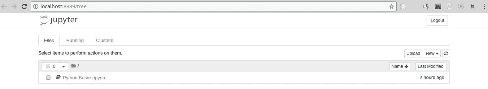

您可以导航到笔记本文件并单击它以运行，或从界面创建新笔记本。


创建新笔记本后，它会启动一个新实例，从中可以交互式地进行编码。

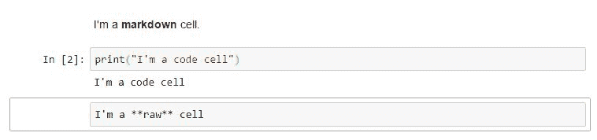

Jupyter Notebook 在数据科学和机器学习领域非常流行，因为它们提供了一种专门的格式，封装了编码、可视化和文档。

### 核心库：NumPy、Pandas、SciPy、Matplotlib、Scikit-learn

方便的是，我们将在机器学习示例和项目中使用模块和库。这些库包含预构建的代码，因此我们不必从头编写所有内容。通常这些库不会默认加载，所以我们首先必须 `import` 它们才能使用。

这就是我们在使用 `numpy`、`pandas`、`matplotlib` 和 `scikit-learn` 时要做的事情。以下是导入它们的示例：

```python
import numpy as np
import pandas as pd
import matplotlib.pyplot as plt

### 导入数据集、分类器和指标
from sklearn import datasets, svm, metrics
```

无论如何，为什么要使用 `numpy` 和其他模块？

#### NumPy

**NumPy** 是用于 Python 科学计算的基础包。此外，与传统的列表相比，使用 `numpy` 可以更快地访问项目。

## Pandas

那 `pandas` 呢？在本书中，`pandas` 将用于导入和读取数据。根据其网站 ([`pandas.pydata.org/`](https://pandas.pydata.org/))：

> “pandas 是一个开源的、BSD 许可的库，为 Python 编程语言提供高性能、易于使用的数据结构和数据分析工具。”

## Matplotlib

除了访问数据，我们通常还必须对其进行可视化。这就是 `matplotlib` 的用武之地 ([`matplotlib.org/`](https://matplotlib.org/))：

> “Matplotlib 是一个 Python 2D 绘图库，它能在各种平台上生成多种硬拷贝格式和交互式环境下的出版质量图形。”

还有其他数据可视化库，如 **Bokeh** 和 **seaborn**。这些库可以生成更酷炫的视觉效果，但本书主要使用 `matplotlib`。

#### Scikit-learn

最后，让我们谈谈 `scikit-learn`。根据其网站 ([`scikit-learn.org/stable/index.html`](http://scikit-learn.org/stable/index.html))：

> **scikit-learn: Python 中的机器学习**
>
> *   用于数据挖掘和数据分析的简单高效工具
> *   人人可用，可在各种上下文中复用
> *   构建于 `NumPy`、`SciPy` 和 `matplotlib` 之上
> *   开源，可商业使用 - BSD 许可证

使用 `scikit-learn`，您可以执行以下机器学习任务：

*   **分类**（某项目属于哪个类别？）
*   **回归**（预测一个值）
*   **聚类**（揭示数据中的子群）
*   **降维**（减少需考虑的随机变量数量，以便于可视化）
*   **模型选择**（选择并比较模型及其准确性）
*   **预处理**（数据集标准化和特征提取）

简而言之，`scikit-learn` 是在 Python 中进行机器学习的便捷且强大的工具。它可能不是最好或最高效的，但对于大多数用途（尤其是学习机器学习）来说已经足够好了。

## Numerical Python (NumPy)

**NumPy** 是 Python 中主要的数值计算库。它提供对多维数组对象的访问，并通过若干方法暴露了可对这些数组执行的操作。它支持线性代数运算，如矩阵乘法、内积、单位运算等。`NumPy` 与用 C 和 Fortran 编写的底层库进行交互，并将实际计算传递给这些更快、更高效的库。因此，在执行数值计算时，绝不使用原生 Python 控制结构（如循环），因为它们要慢得多。`NumPy` 可以被视为提供了一组 Python API，从而实现高效的科学计算。

`NumPy` 数组可以通过嵌套的 Python 列表来初始化。嵌套的层级指定了数组的秩。

```python
import numpy as np

a = np.array([[1, 2, 3], [4, 5, 6]])  # 创建一个秩为 2 的数组
print(type(a))
print(a.shape)
```

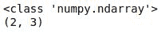

创建的数组秩为 2，这意味着它是一个矩阵。从打印的数组大小可以清楚地看到这一点。它包含 2 行 3 列，因此大小为 `(m, n)`。

数组也可以从分布（如正态分布）中随机初始化。模型的可训练参数（如权重）通常随机初始化。

```python
b = np.random.random((2, 2))  # 创建一个填充随机值的数组
print(b)
print(b.shape)
```

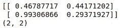

`NumPy` 包含许多用于操作数组的方法；其中一种方法是矩阵乘积。让我们看一个使用 `NumPy` 进行矩阵乘积的示例。

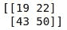

```python
x = np.array([[1, 2], [3, 4]])
y = np.array([[5, 6], [7, 8]])

### 矩阵乘积
print(np.dot(x, y))
```

上述示例几乎是瞬间计算完成的，展示了 `NumPy` 的强大功能。

## Pandas

**Pandas** 是一个用 Python 编写的数据操作库，具有用于表格和时间序列数据的高性能数据结构。`Pandas` 广泛用于数据分析，大多数数据加载、清洗和转换任务都在 `Pandas` 中执行。`Pandas` 是 Python 数据科学生态系统不可或缺的一部分，因为数据很少以可以直接输入机器学习模型的形式存在。现实世界的数据通常很混乱，包含缺失值，并且需要转换。`Pandas` 支持许多文件类型，如 CSV、Excel 电子表格、Python pickle 格式、JSON、SQL 等。

`Pandas` 有两种主要数据结构：`Series` 和 `DataFrame`。`Series` 是单列数据的数据结构，而 `DataFrame` 存储类似于矩阵的二维数据。换句话说，`DataFrame` 包含存储在许多列中的数据。

下面的代码展示了如何在 `Pandas` 中创建 `Series` 对象。

```python
import pandas as pd
import numpy as np

s = pd.Series([1, 3, 5, np.nan, 6, 8])
print(s)
```

要创建 `DataFrame`，可以运行以下代码。

```python
df = pd.DataFrame(np.random.randn(6, 4), columns=list('ABCD'))
print(df)
```

`Pandas` 将其支持的文件格式加载到 `DataFrame` 中，然后可以使用 `Pandas` 方法对 `DataFrame` 进行操作。

## Scientific Python (SciPy)


### Scipy

Scipy 是一个面向数学、科学和工程领域的科学计算库。它构建在 Numpy 之上，并通过提供优化、技术计算、统计、信号处理等额外模块对其进行了扩展。Scipy 主要与生态系统中的其他工具（如 Pandas 和 matplotlib）配合使用。

下面是一个使用 scipy 求矩阵逆的简单示例。

```python
from scipy import linalg

z = np.array([[1,2],[3,4]])

print(linalg.inv(z))
```

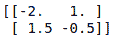

## Matplotlib

Matplotlib 是一个绘图库，能与 Numpy 及 Python 中的其他数值计算库良好集成。它能够生成高质量的图表，并广泛用于数据探索，因为在该领域可视化技术非常重要。Matplotlib 暴露了面向对象的 API，使得在 Python 中创建强大的可视化变得容易。请注意，要在 Jupyter notebook 中查看图表，必须使用 `matplotlib inline` 魔法命令。

下面是一个使用 Matplotlib 绘制正弦波形的示例。

```python
## Jupyter notebooks 的魔法命令
%matplotlib inline

import matplotlib.pyplot as plt

### 计算正弦曲线上点的 x 和 y 坐标
x = np.arange(0, 3 * np.pi, 0.1)
y = np.sin(x)

### 使用 matplotlib 绘制点
plt.plot(x, y)
plt.show()  # 通过调用 plt.show() 显示图表
```

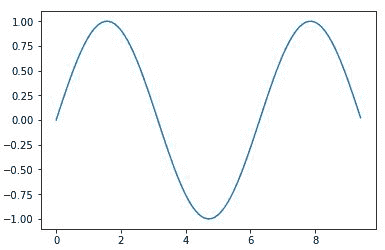

## Scikit-Learn

Scikit-Learn 是 Python 生态系统中最流行的机器学习库。它是一个非常成熟的库，包含用于分类、回归和聚类的多种算法。Scikit-Learn 中提供了许多常用算法，并暴露了统一的接口来访问它们，因此学会在 Scikit-Learn 中使用一种分类器，就意味着你能使用其他的分类器，因为训练分类器所调用的方法名称是相同的，无论底层实现如何。

随着我们在本书后续章节中深入数据科学，我们将严重依赖 Scikit-Learn 完成建模任务。下面是一个创建分类器并使用内置数据集对其进行训练的简单示例。

```python
### 示例决策树分类器
from sklearn import datasets
from sklearn import metrics
from sklearn.tree import DecisionTreeClassifier

#### 加载鸢尾花数据集
dataset = datasets.load_iris()

#### 将 CART 模型拟合到数据
model = DecisionTreeClassifier()
model.fit(dataset.data, dataset.target)
print(model)

#### 进行预测
expected = dataset.target
predicted = model.predict(dataset.data)

#### 总结模型的拟合情况
print(metrics.classification_report(expected, predicted))
print(metrics.confusion_matrix(expected, predicted))
```

这是输出结果。如果你看不懂代码也不用担心。我们将在后续章节中更详细地讲解代码的每一部分。

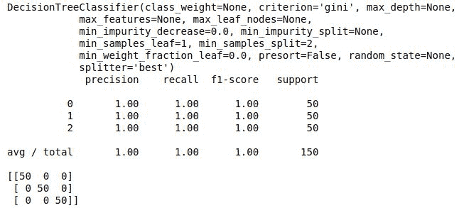

### 关于 Google TensorFlow

TensorFlow 是“面向所有人的开源机器学习框架”。此外，

“……它为机器学习和深度学习提供了强有力的支持，其灵活的数值计算核心被应用于许多其他科学领域。”

换句话说，如果你的项目主要涉及机器学习和深度学习，那么 TensorFlow 可以让你的工作变得更轻松、更高效。但为什么不用 scikit-learn 呢？

Scikit-learn 自带开箱即用的算法，这意味着你只需几行代码就能进行机器学习。另一方面，如果你想专注于深度学习，TensorFlow 则大放异彩。

在这个现代机器学习时代，同时学习 TensorFlow 和 scikit-learn 是很好的。此外，在使用 TensorFlow 之前，后者对于许多数据预处理任务仍然很有用。所以总的来说，熟悉最流行的工具是好的。别担心，只需专注于基础和原理。一旦你掌握了这些，你就会拥有一个坚实的知识库，可以带到任何地方。

## 你的第一个机器学习项目

演示胜过讲述。

这仍然是解释和说明事物的最佳方式。与其再写 1000 个字来解释什么是机器学习，不如直接深入一个例子。

### 泰坦尼克号生存预测

1912 年 4 月泰坦尼克号的沉没是历史上最惨重的海难之一。超过 1500 人失去了生命。幸运的是，有 700 多名幸存者（泰坦尼克号最后一位幸存者已于 97 岁高龄去世）。

为了学习，我们这里的目标是将机器学习应用于生存预测。请注意，我们已经拥有标记数据（乘客及其是否幸存）。这里的目标是从数据（训练数据）中学习，并将该学习应用到新的或未见过的数据（测试集）中。

换句话说，我们的计算机和模型将从数据中推导出模式和“洞察”，以便进行预测。在这里，目标是根据可用数据预测谁会是幸存者。正如 Kaggle ([`www.kaggle.com/c/titanic`](https://www.kaggle.com/c/titanic)) 所述，问题定义如下：

> “已知一个训练样本集，其中列出了在泰坦尼克号灾难中幸存或未幸存的乘客，我们的模型能否根据不包含生存信息的给定测试数据集，确定测试数据集中的这些乘客是否幸存。”

确实，运气在生存中起着巨大作用。但其他因素也会影响生存概率。例如，如果乘客是儿童或处于上层舱位，他或她生存的几率会更大。

无论如何，让我们直接开始机器学习，以便更好地解释这一点（来源：[`www.kaggle.com/startupsci/titanic-data-science-solutions/notebook`](https://www.kaggle.com/startupsci/titanic-data-science-solutions/notebook)）：

第一步是关注问题，然后查看数据。我们不应急于实现复杂的算法。通常，非机器学习任务在定义和解决问题方面更为重要。

为了访问数据，我们首先使用 pandas：

```python
import pandas as pd
```

下一步是访问数据并使其准备好供后续处理和分析：

```python
train_df = pd.read_csv('../input/train.csv')
test_df = pd.read_csv('../input/test.csv')
combine = [train_df, test_df]
```

请记住，过程是先从训练集（`train_df`）学习，然后将该学习应用到 `test_df` 中，看看我们的预测有多好。

数据准备好后，让我们看一眼：

```python
train_df.head(10)
```

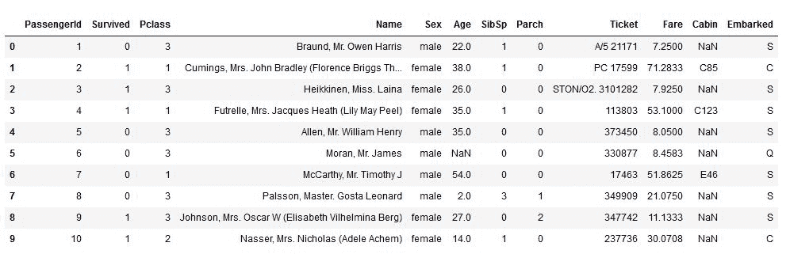

```python
print(train_df.columns.values)
```

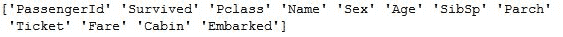

请注意，这里有分类特征、有序特征（`Passenger Class`）和数值特征。此外，训练数据和测试数据中都可能存在大量空白、空值和空值（例如，某些乘客的 `Cabin` 值为 `NaN`）。我们应该在正式的机器学习之前先纠正它们：

```python
train_df.info()
print('_' * 40)
test_df.info()
```

```
<class 'pandas.core.frame.DataFrame'>
RangeIndex: 891 entries, 0 to 890
Data columns (total 12 columns):
PassengerId    891 non-null int64
Survived       891 non-null int64
Pclass         891 non-null int64
Name           891 non-null object
Sex            891 non-null object
Age            714 non-null float64
SibSp          891 non-null int64
Parch          891 non-null int64
Ticket         891 non-null object
Fare           891 non-null float64
Cabin          204 non-null object
Embarked       889 non-null object
dtypes: float64(2), int64(5), object(5)
memory usage: 83.6+ KB
____________________________________________________________
<class 'pandas.core.frame.DataFrame'>
RangeIndex: 418 entries, 0 to 417
Data columns (total 11 columns):
PassengerId    418 non-null int64
Pclass         418 non-null int64
Name           418 non-null object
```


## 数据探索与特征工程

### 数据概览

```text
Sex              418 non-null object
Age              332 non-null float64
SibSp            418 non-null int64
Parch            418 non-null int64
Ticket           418 non-null object
Fare             417 non-null float64
Cabin             91 non-null object
Embarked         418 non-null object

dtypes: float64(2), int64(4), object(5)
memory usage: 36.0+ KB
```

注意不同特征中存在大量空值。下一步是进一步探索数据以获取早期洞察和总体认识：

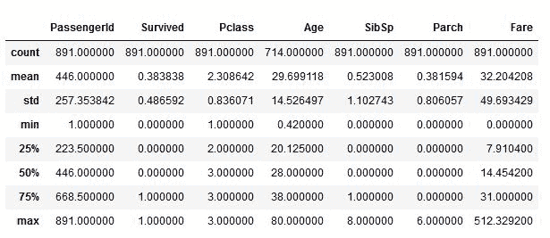

以下是数据摘要中最值得注意的几点：

* 891 名乘客，约占泰坦尼克号实际乘客总数（2,224 人）的 40%。
* 近 30% 的乘客有兄弟姐妹和/或配偶同行（`SibSp` 列）。
* 大多数乘客（> 75%）没有父母或子女同行（`Parch` 列）。

### 特征筛选

现在我们已对数据有了初步了解。下一步是剔除与生存率无关的明显特征。这是一个重要步骤：在应用复杂算法之前，首先排除不必要的特征总是好的。

* **姓名 (`Name`)**：一个人的名字与生存有关吗？可以肯定答案是否定的。因此我们删除 `Name` 并将其从后续模型中排除。
* **票号 (`Ticket`)**：哪个人获得特定票号是随机的。因此可以安全地从数据中排除 `Ticket` 特征。`PassengerId` 也是同理。
* **船舱 (`Cabin`)**：该特征有大量空值（891 条记录中仅 204 个非空对象，意味着绝大部分值为空）。

### 假设与验证

除了剔除特征，我们还需要做一些假设。这是数据分析和机器学习的自然组成部分。我们从几个假设开始，最后验证它们是否合理。

**假设 1**：女性（数据集中 `Sex = female`）更有可能生存（例如在紧急救援中享有优先权）。儿童和头等舱乘客（`Pclass = 1`）也有更好的生存机会。

好消息是我们可以实际检验这些假设，并尽早查看它们是否合理：

#### 乘客等级 (`Pclass`) 与生存率

```python
train_df[['Pclass', 'Survived']].groupby(['Pclass'], as_index=False).mean().sort_values(by='Survived', ascending=False)
```

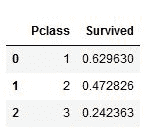

注意 `Pclass = 1`（头等舱乘客）拥有最高的生存率。

#### 性别 (`Sex`) 与生存率

```python
train_df[["Sex", "Survived"]].groupby(['Sex'], as_index=False).mean().sort_values(by='Survived', ascending=False)
```

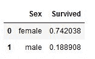

女性的生存率超过 74%。

#### 同行兄弟姐妹/配偶 (`SibSp`) 与生存率

```python
train_df[["SibSp", "Survived"]].groupby(['SibSp'], as_index=False).mean().sort_values(by='Survived', ascending=False)
```

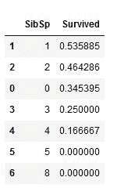

#### 同行父母/子女 (`Parch`) 与生存率

```python
train_df[["Parch", "Survived"]].groupby(['Parch'], as_index=False).mean().sort_values(by='Survived', ascending=False)
```

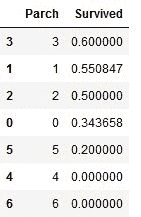

上述特征可能以某种方式影响乘客的生存几率（但请记住运气仍然发挥作用，因此 100% 正确的预测可能是不可能实现的）。

### 数据可视化

为了进一步分析，让我们可视化数据（这可能更容易解释）。首先，导入必要的库和包：

```python
import seaborn as sns
import matplotlib.pyplot as plt
%matplotlib inline  # 以便绘图在笔记本中内联显示
```

#### 年龄 (`Age`) 分布

```python
g = sns.FacetGrid(train_df, col='Survived')
g.map(plt.hist, 'Age', bins=20)
```

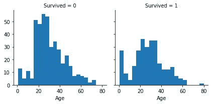

注意右侧直方图（显示数值频率）中，许多婴儿存活（看接近 0 岁处）。还要注意一些老年乘客（接近 80 岁）也存活了。这证实了我们之前的假设：`Age` 是后续分析的相关特征。

#### 乘客等级 (`Pclass`) 与生存情况

```python
grid = sns.FacetGrid(train_df, col='Survived', row='Pclass', size=2.2, aspect=1.6)
grid.map(plt.hist, 'Age', alpha=.5, bins=20)
grid.add_legend()
```

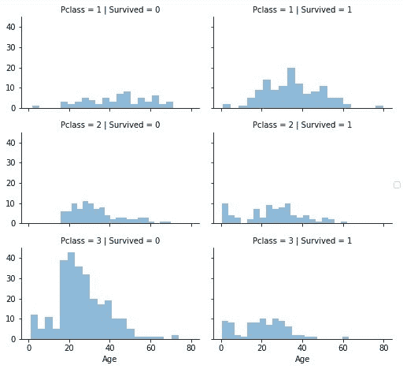

注意右上角（`Pclass = 1` | `Survived = 1`）即头等舱幸存者所在区域相当密集（高密度）。同时注意左下角（`Pclass = 3` | `Survived = 0`）即三等舱非幸存者也很密集。换句话说，乘客等级与生存率相关（例如头等舱乘客机会更大）。

#### 登船港口 (`Embarked`) 的影响

如果乘客在不同地点登船，是否会影响其生存几率？这比较棘手，但我们还是探索一下：

```python
grid = sns.FacetGrid(train_df, row='Embarked', size=2.2, aspect=1.6)
grid.map(sns.pointplot, 'Pclass', 'Survived', 'Sex', palette='deep')
grid.add_legend()
```

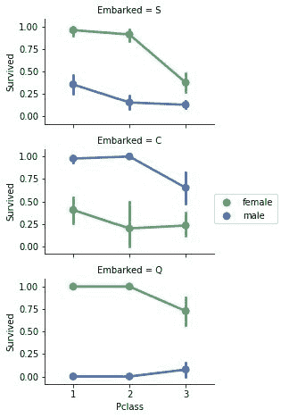

**登船港口说明**：S = 南安普顿；C = 瑟堡；Q = 皇后镇。

注意在瑟堡登船的男性（`Embarked = C`）有更高的生存率。这是否意味着 `Embarked` 特征影响生存？一个可能的原因是：在瑟堡登船的男性多为 `Pclass = 1` 或 `2`。换句话说，生存率与 `Pclass` 的关系更大，而非 `Embarked` 特征本身。但如何确认这一点？这里有一种方法：

```python
grid = sns.FacetGrid(train_df, row='Embarked', col='Survived', size=2.2, aspect=1.6)
grid.map(sns.barplot, 'Sex', 'Fare', alpha=.5, ci=None)
grid.add_legend()
```

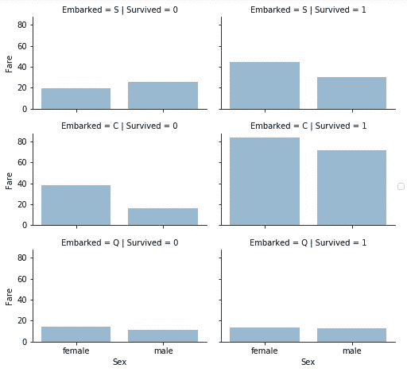

这里我们还考虑了一个额外特征（`Fare`）。注意支付更高票价的乘客有更好的生存机会。还要注意登船港口与生存率之间存在相关性。因此，在后续分析中包含 `Fare` 是好的。

### 特征工程实施

下一步是排除无关特征并包含相关特征。

```python
print("Before", train_df.shape, test_df.shape, combine[0].shape, combine[1].shape)
train_df = train_df.drop(['Ticket', 'Cabin'], axis=1)
test_df = test_df.drop(['Ticket', 'Cabin'], axis=1)
combine = [train_df, test_df]
print("After", train_df.shape, test_df.shape, combine[0].shape, combine[1].shape)
```

结果如下：

```text
Before (891, 12) (418, 11) (891, 12) (418, 11)
After (891, 10) (418, 9) (891, 10) (418, 9)
```

因为我们从训练和测试数据中删除了 `Ticket` 和 `Cabin`，所以特征变少了。

请记住，我们之前也要移除 `Name` 和 `PassengerId`，因为它们似乎与生存率无关。但 `Name` 实际上可能是一个人生存的“信号”。例如，如果名字中包含 "Miss" 或 "Mrs."，很可能是女性（意味着更高的生存率，因为女性生存率较高）。

因此，创建一个新特征 `Title`（称谓）可能是好的，因为这可能与生存率相关。我们可以通过以下代码实现（你应该熟悉 Python 中的正则表达式）：

```python
for dataset in combine:
    dataset['Title'] = dataset.Name.str.extract(' ([A-Za-z]+)\.', expand=False)

pd.crosstab(train_df['Title'], train_df['Sex'])
```

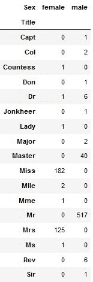

称谓种类太多。也许将大多数称谓归类为 "Rare" 以便于处理，然后查看称谓及对应的生存百分比：

```python
for dataset in combine:
    dataset['Title'] = dataset['Title'].replace(['Lady', 'Countess','Capt', 'Col',
                                                 'Don', 'Dr', 'Major', 'Rev', 'Sir', 'Jonkheer', 'Dona'], 'Rare')
    dataset['Title'] = dataset['Title'].replace('Mlle', 'Miss')
    dataset['Title'] = dataset['Title'].replace('Ms', 'Miss')
    dataset['Title'] = dataset['Title'].replace('Mme', 'Mrs')

train_df[['Title', 'Survived']].groupby(['Title'], as_index=False).mean()
```

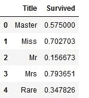


注意到 Miss 和 Mrs 的存活率最高（甚至远高于 Rare 头衔的总和）。换句话说，Name 中的 Title（而非名字本身）与存活率相关。

同样，为方便起见，让我们将这些 Title（分类特征）转换为有序特征（就像 Pclass 一样）。

```python
title_mapping = {"Mr": 1, "Miss": 2, "Mrs": 3, "Master": 4, "Rare": 5}

for dataset in combine:
    dataset['Title'] = dataset['Title'].map(title_mapping)
    dataset['Title'] = dataset['Title'].fillna(0)

train_df.head()
```

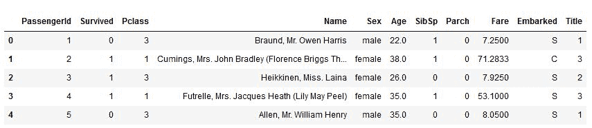

既然我们已经从 Name 中提取了有用信息并将其制成新特征，便可以安全地删除 Name 特征。同时也应删除 PassengerId。

```python
train_df = train_df.drop(['Name', 'PassengerId'], axis=1)
test_df = test_df.drop(['Name'], axis=1)
combine = [train_df, test_df]
train_df.shape, test_df.shape
```

((891, 9), (418, 9))

```python
train_df.head()
```

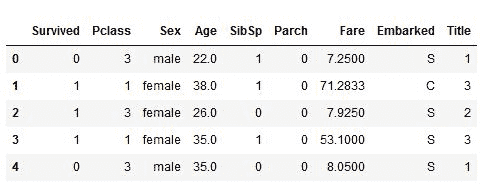

现在数据整洁多了，特征数量大幅减少。这将使后续分析更轻松、更快捷。

此外，我们必须将包含字符串的特征（Sex = female 或 male）转换为数值。这通常是大多数机器学习算法的要求。毕竟，处理文本数据与数值需要不同的方法（稍后提到自然语言处理时再详述）。

将分类特征转换为数值：

```python
for dataset in combine:
    dataset['Sex'] = dataset['Sex'].map({'female': 1, 'male': 0}).astype(int)

train_df.head()
```

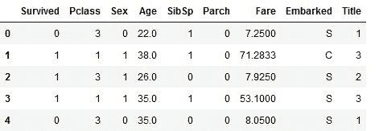

搞定。现在全是数值，且已排除无关特征。

特别提示：注意我们还没进行任何机器学习。因为大多数数据科学和机器学习项目会先花大量时间在思考和预处理上。在使用 `scikit-learn` 或 `TensorFlow` 之前，必须在真实数据分析的基础上投入大量精力。

但这还没完。在进行真正的机器学习前，还得处理前面提到的空值。我们得通过注入新值使其“非空”，但注入的值必须合理。

一种方法是利用其他相关特征（如观察 Age、Gender 和 Pclass 间的相关性）。代码如下：

```python
grid = sns.FacetGrid(train_df, row='Pclass', col='Sex', size=2.2, aspect=1.6)
grid.map(plt.hist, 'Age', alpha=.5, bins=20)
grid.add_legend()
```

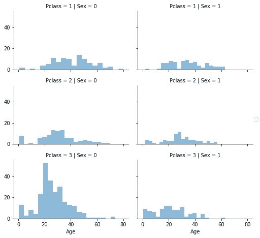

接下来准备一个空数组（使用 `numpy`），用于存放将替换空值的 Age 值。猜测值基于 Pclass × Gender 组合：

```python
import numpy as np

guess_ages = np.zeros((2,3))
guess_ages
```

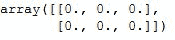

然后遍历 Pclass（1, 2, 3）和 Sex（0 或 1），计算 6 种组合的猜测 Age 值：

```python
for dataset in combine:
    for i in range(0, 2):
        for j in range(0, 3):
            guess_df = dataset[(dataset['Sex'] == i) &
                               (dataset['Pclass'] == j+1)]['Age'].dropna()
            age_guess = guess_df.median()
            guess_ages[i,j] = int(age_guess/0.5 + 0.5) * 0.5
    for i in range(0, 2):
        for j in range(0, 3):
            dataset.loc[(dataset.Age.isnull()) & (dataset.Sex == i) & (dataset.Pclass == j+1),
                        'Age'] = guess_ages[i,j]
    dataset['Age'] = dataset['Age'].astype(int)

train_df.head()
```

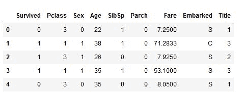

现在已处理缺失值。下一步创建 Age bands（年龄区间）并与 Survived 并列：

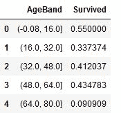

为方便整洁，可将这些 Age Bands 转换为有序值：

```python
for dataset in combine:
    dataset.loc[dataset['Age'] <= 16, 'Age'] = 0
    dataset.loc[(dataset['Age'] > 16) & (dataset['Age'] <= 32), 'Age'] = 1
    dataset.loc[(dataset['Age'] > 32) & (dataset['Age'] <= 48), 'Age'] = 2
    dataset.loc[(dataset['Age'] > 48) & (dataset['Age'] <= 64), 'Age'] = 3
    dataset.loc[dataset['Age'] > 64, 'Age']

train_df.head()
```

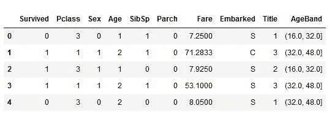

Age 特征现为有序型（而非宽数值范围）。现可“删除” AgeBand 特征（因已提取重要信息并存入 Age）：

```python
train_df = train_df.drop(['AgeBand'], axis=1)
combine = [train_df, test_df]
train_df.head()
```

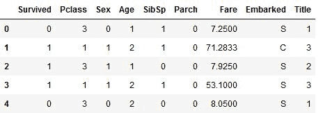

回到 Parch（父母子女数）和 SibSp（兄弟姐妹配偶数）。其实可将二者合并为一个特征（为方便），命名为“FamilySize”（并与 Survived 并列以获取洞察）：

```python
for dataset in combine:
    dataset['FamilySize'] = dataset['SibSp'] + dataset['Parch'] + 1

train_df[['FamilySize', 'Survived']].groupby(['FamilySize'], as_index=False).mean().sort_values(by='Survived', ascending=False)
```

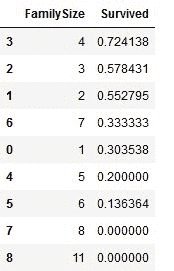

我们可能还想知道存活率与乘客是否独自一人的相关性：

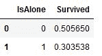

这表明有同伴的乘客存活几率更大。因此直接丢弃 Parch、SibSp 和 FamilySize，专注于 isAlone：

```python
train_df = train_df.drop(['Parch', 'SibSp', 'FamilySize'], axis=1)
test_df = test_df.drop(['Parch', 'SibSp', 'FamilySize'], axis=1)
combine = [train_df, test_df]
train_df.head()
```

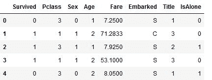

我们尚未进入实际机器学习阶段。迄今大多是数据转换和操作。许多步骤其实是可选的。你甚至可能想出丢弃或创建新特征的新方法。也可能丢弃大部分特征，但模型无法从可用资源中最优学习。

还记得我们做了假设。好在能早期测试其有效性。

继续前进。数据转换和操作还没结束（我知道你急于投入机器学习）。我们可以创建一个结合 Pclass 和 Age 的人工特征（进一步简化并减少特征数量）：

```python
for dataset in combine:
    dataset['Age*Class'] = dataset.Age * dataset.Pclass

train_df.loc[:, ['Age*Class', 'Age', 'Pclass']].head(10)
```

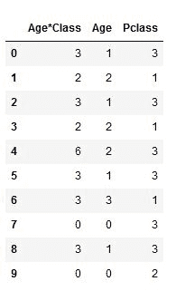

此外注意到分类特征 Embarked 在数据集中有两个缺失值。为求快捷，可用最高频值（即众数）填补：

```python
freq_port = train_df.Embarked.dropna().mode()[0]
freq_port
```

‘S’

```python
for dataset in combine:
    dataset['Embarked'] = dataset['Embarked'].fillna(freq_port)

train_df[['Embarked', 'Survived']].groupby(['Embarked'], as_index=False).mean().sort_values(by='Survived', ascending=False)
```

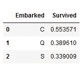

你可能已意识到，需将分类特征 Embarked 的值转为数值。映射方法如下（类似 Gender 处理）：

```python
for dataset in combine:
    dataset['Embarked'] = dataset['Embarked'].map({'S': 0, 'C': 1, 'Q': 2}).astype(int)

train_df.head()
```

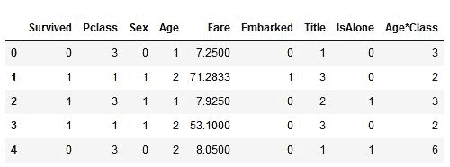

我们也可以像处理 Embarked 那样补全 Fare 特征的缺失值。这通常是模型或算法良好运行的必要条件：

```python
test_df['Fare'].fillna(test_df['Fare'].dropna().median(), inplace=True)
test_df.head()
```

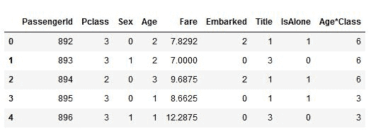

然后创建 FareBand 以简化：


## 数据预处理与模型训练

### Fare 特征分箱与序数化

```python
train_df['FareBand'] = pd.qcut(train_df['Fare'], 4)
```

```python
train_df[['FareBand', 'Survived']].groupby(['FareBand'], as_index=False).mean().sort_values(by='FareBand', ascending=True)
```

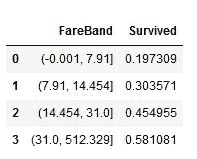

然后我们将其转换为序数值（类似于我们在 AgeBand 中所做的操作）。

```python
for dataset in combine:
    dataset.loc[dataset['Fare'] <= 7.91, 'Fare'] = 0
    dataset.loc[(dataset['Fare'] > 7.91) & (dataset['Fare'] <= 14.454), 'Fare'] = 1
    dataset.loc[(dataset['Fare'] > 14.454) & (dataset['Fare'] <= 31), 'Fare'] = 2
    dataset.loc[dataset['Fare'] > 31, 'Fare'] = 3
    dataset['Fare'] = dataset['Fare'].astype(int)
```

```python
train_df = train_df.drop(['FareBand'], axis=1)
combine = [train_df, test_df]
train_df.head(10)
```

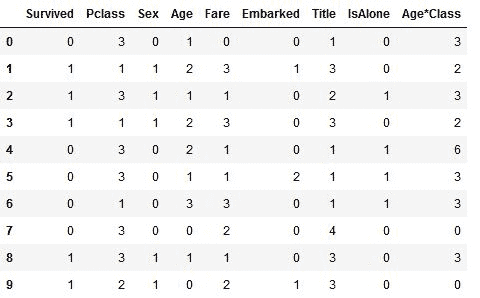

这是测试集。让我们也看一眼测试数据集：

```python
test_df.head(10)
```

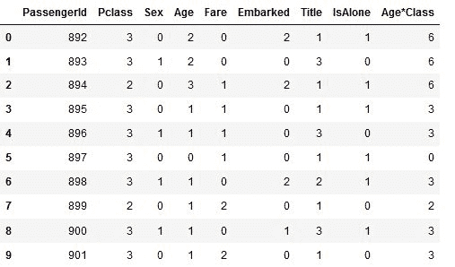

呼！我们终于完成了数据分析和机器学习中严谨的部分。请注意，我们还没有进行任何机器学习。还要注意，在几乎每一步中，我们都查看了数据集，观察数值是如何转换的。这是为了进行合理性检查，确保我们做的是正确的事情。

### 模型选择与训练

现在到了最令人期待的部分。我们现在准备好训练模型了。请始终牢记，我们的目标是从数据中学习，然后基于之前的学习对未见过的数据进行预测。但首先有几十种预测算法可供选择。让我们尝试以下 6 种算法，因为它们在分类任务中很流行（我们稍后会详细讨论它们）：

1.  逻辑回归
2.  K 近邻算法或 KNN
3.  支持向量机 (SVM)
4.  朴素贝叶斯分类器
5.  决策树
6.  随机森林

首先，我们在训练集中定义自变量 (`X_train`) 和目标变量 (`Y_train`)（我们在测试集中同样这么做）：

```python
X_train = train_df.drop("Survived", axis=1)
Y_train = train_df["Survived"]
X_test  = test_df.drop("PassengerId", axis=1).copy()
X_train.shape, Y_train.shape, X_test.shape
```

```
((891, 8), (891,), (418, 8))
```

## 逻辑回归

然后让我们使用第一个选项（逻辑回归）来训练模型：

```python
from sklearn.linear_model import LogisticRegression

logreg = LogisticRegression()
logreg.fit(X_train, Y_train)
Y_pred = logreg.predict(X_test)
acc_log = round(logreg.score(X_train, Y_train) * 100, 2)
acc_log
```

```
80.36
```

80.36% 是逻辑回归在预测乘客是否生还时的准确率。

#### 随机森林分类器

让我们尝试另一个模型（随机森林分类器）：

```python
from sklearn.ensemble import RandomForestClassifier

random_forest = RandomForestClassifier(n_estimators=100)
random_forest.fit(X_train, Y_train)
Y_pred = random_forest.predict(X_test)
random_forest.score(X_train, Y_train)
acc_random_forest = round(random_forest.score(X_train, Y_train) * 100, 2)
acc_random_forest
```

```
86.76
```

这是使用随机森林时的准确率水平。请注意，它明显高于我们从逻辑回归中获得的结果。

这是很自然的，因为不同的算法具有不同的机制，会产生不同的准确率水平。一个好的方法是选择准确率最高的那个，或者使用所有合适的算法并对结果取平均值。

### 启示与可能性

这大致就是机器学习在现实生活中的工作流程。我们获取数据，执行数据操作和转换，最后应用几行代码（实际的机器学习部分），然后就可以进行预测了。

前面的例子（泰坦尼克号生还预测）是一个极好的例子，因为我们已经了解了典型机器学习项目的不同方面。好吧，请注意，其中大部分远非机器学习，而更多是关于做假设和操作数据。

这是一个极好且简单的例子。但如果我们将这些概念同样应用于其他问题，潜力将是巨大的。事实上，许多现实世界的商业和科学挑战都可以用二元方式表示（生还或未生还）。

- 一个人会购买某个产品吗（购买或未购买）？
- 肿瘤是良性还是恶性（0 代表良性，1 代表恶性）？
- 邮件是垃圾邮件吗？
- 某人会偿还她的贷款吗（基于其他客户的记录和还款倾向）？
- 基于 12 个变量，是否应该将某人送入重症监护室？

这只是开始，这只是机器学习的一个子集。这就是为什么许多专家说我们才刚刚触及皮毛。随着计算能力的增强和海量数据集的出现，我们将能够深入挖掘，并将机器学习应用于几乎所有领域。

## 通用工作流程

无论领域或主题的复杂程度如何，总有一些共同的原则贯穿始终。机器学习也是类似的情况，其通用原则保持不变。

首先，我们必须获得具有足够数值的高质量数据。如果数据集很混乱，我们将花费额外的时间进行清理和整理。第二步是查看数据本身并将其可视化。这使我们能快速从数据中获得洞察。事实上，即使不使用机器学习，仅通过可视化和查看数据摘要（均值、中位数、众数、标准差等），我们也能快速获得洞察。

第三步可能涉及大量的数据转换和操作，就像我们之前所做的那样。我们可能需要丢弃一些无关特征。我们也可以为了简单起见将特征合并为一个。我们还可以创建新特征供模型算法使用。

而在最令人期待的部分，我们现在选择模型和算法，开始从数据中学习。有了 `scikit-learn`，我们已经有了预建的代码，所以不必从头编写。这就是为什么我们只花了 1% 的时间在实际的机器学习上。但如果我们从头写所有东西，将会花费我们非常长的时间。

你可以随时深入研究模型和算法是如何工作的。幕后原理通常因数学而复杂。但如果你仍选择学习所有这些，你将比其他人更有优势。

无论如何，让我们先专注于基础。毕竟，“第一性原理”永远适用。让我们开始吧。

## 通用机器学习概念

在上一章中，我们讨论了一个机器学习如何应用于真实数据集的例子。这是为了快速展示和说明机器学习的威力。

但在深入之前，让我们先探索基础知识。这样你将拥有一个心智框架，让各个碎片拼凑在一起。这能让你更扎实地学习，并牢固掌握机器学习的真谛。工具和技术将永远在变。但有了正确的基础，你将始终能随之调整。

那么，让我们从机器学习的主要“类别”开始。数量虽有争议，但这些是你在阅读其他关于机器学习和数据科学资源时最常遇到的最重要内容：监督学习、无监督学习和深度学习。

### 什么是机器学习


## 机器学习概述

机器学习最近因多种原因在媒体上备受关注，主要是因为它在各种认知任务中取得了令人印象深刻的成果，例如图像分类、自然语言理解、客户流失预测等。然而，它被视为一种能够预测未来的“魔法公式”，但机器学习到底是什么？

从最简单的形式来看，机器学习的核心在于让计算机通过经验，在特定任务上不断改进性能，从而从数据中学习。这类似于人类通过尝试新事物并从经验中学习的方式，机器学习算法通过从大量示例中学习模式来提升自身能力。随着接触到更多的数据（经验），这些算法的性能通常会随之提高。因此，机器学习是人工智能的一个分支，旨在使机器能够在未被显式编程的情况下执行特定任务。这意味着这些算法并非基于规则；整个学习过程的构建方式旨在最小化或完全消除人工干预。

机器学习算法通常用于解决各种学习问题，如分类、回归、聚类、相似性检测等。如今现实世界中使用的许多应用程序都由机器学习提供支持。例如，手机上的个人助理应用利用机器学习算法理解自然语言语音指令；手机键盘根据之前的单词预测用户正在输入的下一个单词；电子邮件客户端提供智能回复功能，扫描邮件内容并生成合适的回复；电商应用根据用户以往的购买记录和消费习惯提供推荐等。几乎每个行业都将受到机器学习的影响，因为只要有足够的训练数据，大多数流程都可以实现自动化。机器学习算法主要擅长那些输入与输出之间存在明确关系、且可通过训练数据建模的任务。尽管机器学习是一个快速发展的领域，但目前尚不存在人类所展现的那种通用智能的概念。这是因为在某一任务上训练的模型无法将获得的知识泛化到执行另一任务；也就是说，机器学习算法学习的是狭窄的垂直任务领域。

### 机器学习的三大主要分支

机器学习有三大主要分支，分别是：监督学习、无监督学习和强化学习。在某些情况下会提到第四个分支：半监督学习，但正如我们在下文解释中将看到的，这实际上只是监督学习的一个特例。

#### 监督学习

它是关于从**标记数据**（例如：生存或未生存）中学习，然后将这种学习应用到“未见过的”数据中。正如你可能已经意识到的，泰坦尼克号生存预测就属于这一类。

具体来说，该示例属于**分类**范畴。换句话说，这一监督学习任务专注于“分类”。除了分类之外的另一个子类别是**回归**。在回归中，目标是基于变量间的关系预测一个数值（例如：给定房屋面积（平方米），房屋价格是多少？）。回归仍然是关于从“标记”数据中学习，因为模型从 A 对应 B、C 对应 D 等关系中学习（这只是一个示意）。它仍然是从历史数据中学习，并应用该学习来预测数值。

无论如何，如果你从事机器学习职业或创建一家专注于这一激动人心领域的初创公司，你可能会大量进行监督学习。请记住，它关乎预测，无论是预测某个项目应属于哪个类别（分类），还是基于变量与目标之间的关系预测数值（回归）。

#### 无监督学习

相比之下，**无监督学习**是关于从**非结构化数据**（无标签）中学习。我们可以将其视为允许模型自由地从数据中学习并处理数据（无监督或训练），这与监督学习（存在训练集和测试集）形成对比。

无监督学习的目标通常是发现隐藏模式，并揭示数据点之间自然形成的有机簇。这就是**聚类**的本质（我们将在单独的章节中讨论），其目标是揭示数据点的自然聚集。这在数据可视化和发现数据集的内在结构方面非常有用。

#### 半监督学习算法

半监督学习算法是监督学习算法的一种特例。在半监督学习中，虽然没有显式标签，但存在一种隐式启发式方法，它在训练循环中充当监督者的角色。半监督模型不包含任何外部标签来源，仅依赖输入特征。然而，学习任务的设置方式使得监督仍然以通过启发式算法从输入中提取伪标签的形式发生。半监督学习算法的一个流行示例是**自编码器**。让我们通过一个例子来加深理解。

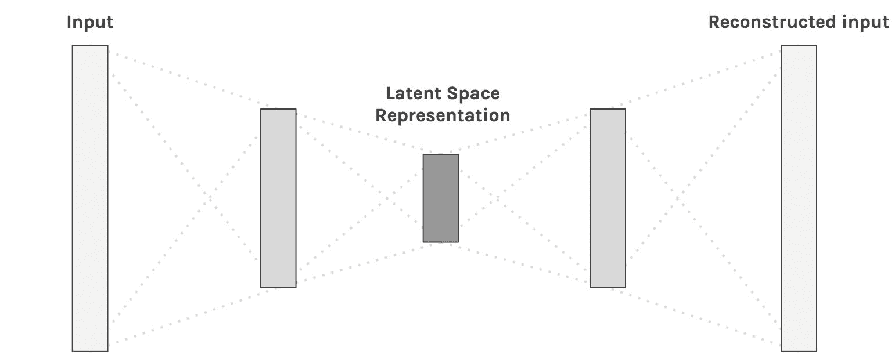

在上述自编码器中，学习任务是将输入的维度降低到一个代表最重要隐藏特征的较小潜在空间，然后从这个低维空间重构输入。因此，给定一个输入（例如一张图像），自编码器将图像压缩成一个较小的潜在表示，该表示仍包含关于图像的大部分信息，然后从这个低维空间重构原始输入图像。即使没有显式标签，也会观察到输入充当了监督者，因为学习任务是重构输入。一旦这样的模型被训练为将特征压缩到较小维度，压缩后的特征就可以作为监督学习算法的起点，类似于使用 PCA 进行降维。网络中减少输入维度的第一部分称为**编码器**，而将编码特征缩放回全尺寸输入的第二部分称为**解码器**。

#### 强化学习算法

在强化学习中有三个主要组件：**智能体**、**环境**和**动作**。强化学习的目标是训练一个智能体，使其能够在环境中导航并执行动作，以最大化其达到某个最终目标的机会。智能体执行的动作会改变环境的状态，并根据智能体采取的动作发放奖励或惩罚。挑战在于让智能体在特定时期结束时最大化累积奖励，从而实现最终目标（目标函数）。

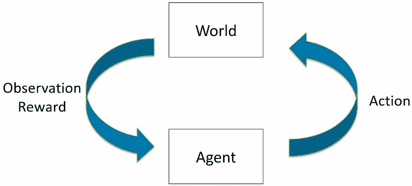

在上述强化学习示意图中，智能体（强化学习算法）通过动作与世界（环境）进行交互。环境根据智能体采取的动作类型，向智能体提供观测值和奖励。智能体利用这些反馈，通过学习执行与积极结果相关的动作，来改进其决策过程。

### 深度学习

实际上，**深度学习**可以涵盖监督学习和无监督学习。这是因为通过深度学习，你可以进行回归、分类和聚类。


## 那么有什么区别呢？

如果你正在分析海量数据集，尤其是那些包含文本、图像、音频甚至视频数据的数据集，深度学习真正大放异彩。请记住，在泰坦尼克号生存预测中，我们主要处理的是数值。但当我们要处理的数据由文本组成时，我们将采取不同的方法。

对于海量和复杂的数据集，使用传统机器学习技术是可行的。但对于大规模分析和项目，无论是在学术界还是商业界，深度学习仍然是最流行的方法。

深度学习的灵感源于我们大脑的工作原理。这就是为什么在深度学习中你会遇到“神经网络”这一术语。我们仍然不完全了解大脑究竟是如何工作的。但基于主流模型，它对机器学习非常有帮助。在后续章节中，我们将更深入地探讨这一点。

无论如何，无论你选择哪种方法（传统机器学习还是深度学习），你仍然必须经历泰坦尼克号生存预测中讨论的大多数过程。你的大部分时间实际上可能花在数据操作和转换上，而不是实际令人兴奋的机器学习方面。你经常可能需要检查特征（丢弃或创建新特征）并查看数据。你也经常需要可视化数据点，以便快速获得洞察并检测异常值。

换句话说，机器学习（无论你选择什么模型或方法）可能更多地关乎其外部的过程（数据可视化、操作、转换、领域知识）。这就是为什么专注于基础知识总是好的。很快，新工具将会涌现，使机器学习变得快速直观（例如拖放或仅给出语音命令）。但大部分艰苦的工作仍将是准备数据和获取所需的领域知识，以便我们能有效地利用机器学习的力量。

在后续章节中，让我们探索更多那些必不可少的基础知识。我们还将探讨更多机器学习应用于不同项目和领域的示例。

### 过拟合与欠拟合

过拟合和欠拟合共同构成了机器学习的核心问题。在训练模型时，我们希望通过在训练集上获得更好的性能来改进其优化。然而，一旦模型训练完成，我们关心的是泛化能力。简而言之，泛化能力处理的是训练好的机器学习模型在未见过的新数据上表现如何，即它未曾训练过的数据。换句话说，模型将在训练集上学到的模式泛化到现实世界示例的能力如何，以便它能达到相似或更好的性能。这是学习的核心。模型应该能够从数据中真正学习到能提升测试时性能的有用表示，而不仅仅是记忆特征，因为记忆不是学习。

当模型未能仅学习数据中的有用表示，而是调整自己去学习噪声以获得人为的高训练集准确率时，我们称该模型对训练集**过拟合**。欠拟合意味着模型未利用其可用的信息，仅学习了一小部分表示并丢弃了大部分有用信息，从而导致其做出毫无根据的假设。理想情况是找到一个既不欠拟合也不**过拟合**，而是在优化和泛化之间表现出正确平衡的模型。这可以通过维护第三组称为验证集的示例来实现。验证集用于调整（改进）模型性能，而不会使模型对训练集过拟合。解决过拟合的其他技术包括应用正则化（惩罚更复杂的模型）和获取更多训练示例。可以通过增加学习算法的容量来遏制欠拟合，以便它能利用可用的特征。

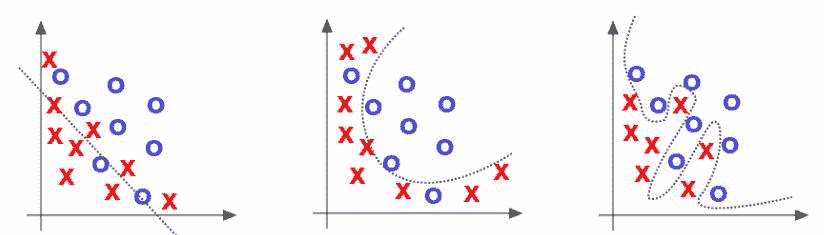

上图展示了三个简单的基于线的分类模型。第一张图使用一条直线分离类别。然而，直线是对数据分布过于简化的表示，因此它错误分类了许多示例。直线模型显然**欠拟合**，因为它未能利用大部分可用信息来发现固有的数据分布。

第二张图展示了一个最优情况，其中优化目标已由泛化标准平衡。尽管模型在训练集上错误分类了一些点，但它仍然能够捕捉到两个类别之间有效的决策边界。这样的分类器很可能能很好地泛化到未训练过的示例，因为它学习了驱动预测的判别特征。最后一张图说明了**过拟合**的情况。决策边界变得曲折复杂，因为分类器通过试图正确分类训练集中的每一个数据点来响应噪声。该分类器在训练集上的准确率将是完美的，但在新示例上表现将极其糟糕，因为它仅针对训练集优化了性能。诀窍是始终选择实现最大性能的最简单模型。

### 正确性

为了评估机器学习算法，我们总是指定预测性能的具体度量。这些指标使我们能够以无偏的方式判断模型的性能。应当注意，所选的评估指标取决于学习问题的类型。准确率是一个流行的评估指标，但它并不适用于所有学习问题。其他评估度量包括召回率、精确率、灵敏度、特异度、真阳性率、假阳性率等。所使用的评估应与建模问题的目标保持一致。

为确保报告指标的保真度，一个经验法则是模型永远不应在整个数据集上训练，因为指标报告的任何评估都可能有偏，因为模型在面对新数据时的性能是未确定的。数据集应划分为训练集、验证集和测试集。模型在训练集上训练，验证集保留用于超参数调整以获得表现最佳的模型，测试集仅在所有实验结束时使用一次。

混淆矩阵被广泛用作一种简单的可视化技术，以评估分类器在监督学习任务中的性能。它是一个表格，其中行代表实际类别中的实例（真实标签），而列代表预测结果。在某些情况下，顺序可能相反。之所以称为混淆矩阵，是因为它很容易看出模型将哪些类别误分类为另一类，即哪些类别让模型感到“困惑”。

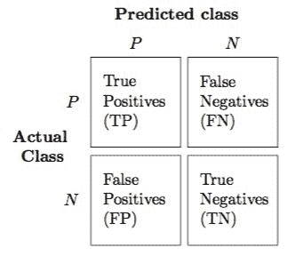

模型正确分类的示例位于从左上角到右下角的对角线上。假阴性是分类器错误预测为阴性的阳性类别，而假阳性是分类器错误地认为是阳性的阴性实例。真阳性率、假阳性率、精确率等多个指标均源自混淆矩阵中的项目。

### 偏差-方差权衡


模型的偏差被定义为模型为简化学习任务而做出的假设。高偏差模型做出的假设与数据不相关。这会导致错误，因为预测值通常与实际值有偏差。另一方面，方差是指模型对训练数据中噪声的敏感程度。模型的性能会因其评估所用的数据而有多大差异。一个好的机器学习算法应致力于实现低偏差和低方差。偏差和方差与前面遇到的过拟合和欠拟合有关。高偏差模型欠拟合训练数据，因为它做了过于简化的假设，而不是从可用信息中学习。同样，高方差模型过拟合，因为它对噪声建模，导致其性能在训练集、验证集和测试集上差异很大。

让我们用飞镖类比来进一步解释这些概念。

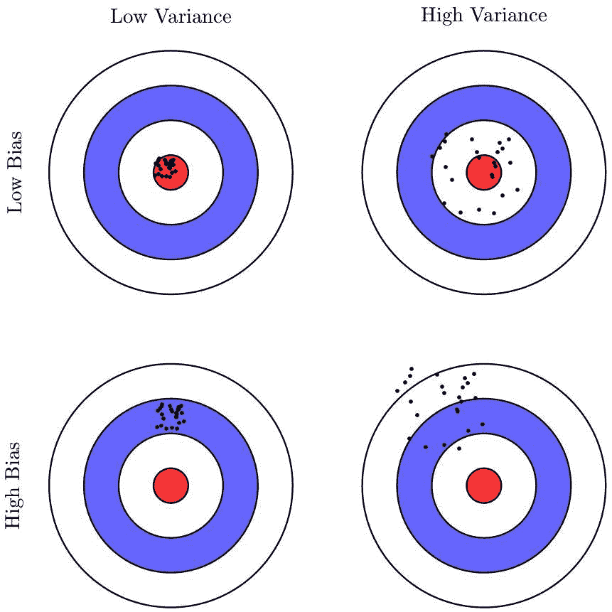

左上图代表一个低偏差、低方差的模型。这是理想模型，因为它学会了击中靶心（产生正确分类），且大多数时候都能击中靶心（不随每次投掷而变化）。右上图显示了一个高方差、低偏差的模型。即使它不做太多假设，其预测也分布在整个靶面上，意味着其性能变化很大（高方差）。左下图描绘了一个高偏差、低方差的模型。投掷点不分布在整个靶面上，而是在特定位置。然而，该位置远离靶心，意味着模型因过于简化的假设而存在偏差。最后，右下图显示了一个高偏差、高方差的模型。靶面上的投掷点分布广泛且远离靶心。这是最差的模型类型，因为它未学到任何有用的表示。

### 特征提取与选择

特征提取涉及对输入特征执行转换，以生成更易分析和更有信息量的其他特征。特征提取可通过组合原始特征来创建更适合建模问题的新特征。这类似于特征工程，即我们创建新特征输入模型。特征提取的一个例子是主成分分析（`PCA`）。

特征选择是从原始输入特征中选择一个特征子集。选定的特征是那些与目标变量相关性最高的特征，即驱动模型预测能力的特征。特征提取和特征选择都会导致降维。它们的主要区别在于：特征提取是创建新特征的转换，而特征选择仅选择可用特征的一个子集。由于特征选择会移除某些特征，因此总是建议先对数据集进行特征提取，然后通过特征选择挑选最重要的预测因子。

### 机器学习为何流行

机器学习在人工智能界和社会大众中广受欢迎，主要因为机器学习技术已被证明在各个细分领域非常成功，为从欺诈检测到语音识别再到推荐系统等大量运营提供了商业价值。它嵌入在我们每天使用的产品中。当你在亚马逊购买商品并获得一系列搭配商品推荐时，这就是机器学习在起作用。当你打开邮箱，邮件根据相似性自动分类到文件夹时，那是机器学习模型在后台工作。甚至当你在线使用信用卡且交易成功时，是机器学习模型批准了你的交易，判定其正常而非欺诈。

鉴于此，公司和组织投入更多资金，通过研究和产学合作开发性能更好的模型。

机器学习并非一直是计算机科学界的宠儿，但近年来三大因素共同作用，使其地位崇高。

- 随着互联网的兴起，收集的数据更多，从而迎来了大数据时代。
- 随着图形处理单元（`GPU`）的出现，计算资源变得更快、更便宜。`GPU`最初由游戏行业开发用于渲染图形，但非常适合并行计算。
- 开发出了更好的算法，从而提高了模型的准确性。

## 回归

是时候复习一下你的高中代数了。因为事实是，监督学习的这个子类别看起来根本不像机器学习。

`y = mx + b`

这是直线方程。这意味着如果你知道 `x` 的值，也就知道 `y` 的值（`m` 和 `b` 是常数）。一旦确定了这些常数并得到了 `x` 的值，我们也能预测 `y` 的值。

机器学习语境下的回归与此类似。例如，我们可能根据给定的房间数量或房屋面积（多少平方米）来预测房价。这是一种监督学习形式，因为我们首先拥有房间数量或平方米数（自变量）以及对应的房价（目标值）。

### 简单线性回归与多元线性回归

回归可以有多种形式。在上面的例子中，只有两组定量值。第一是房间数量或平方米数。第二（即目标）是对应的房价。我们可以绘制这些数据点，并拟合一条最能近似两者关系的直线。

当然，直线不会穿过所有点。它只是两组值关系的近似。以下是示意图：

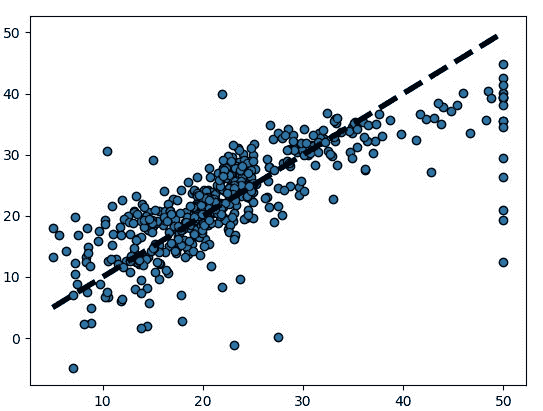

直观上，我们可以看到该线试图最小化其与所有点的距离。但无法让所有人都满意，因此直线实际上是通过最小化线与所有点之间的平方误差之和（最小二乘解）得到的。

在多元线性回归中，有两个或更多自变量，即决定结果 `y` 的预测因子不止一个。关系仍然是线性的，但 `y` 取决于更多变量。

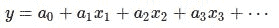

现在让我们看一个实际例子。我们将使用上述回归技术，根据以特征形式提供的房屋信息，预测某社区的房价。我们将使用波士顿房价数据集，它包含 506 个观测值。该数据集可从此 URL 下载（`https://forge.scilab.org/index.php/p/rdataset/source/file/master/csv/MASS/Boston.csv`）。

首先导入相关库并使用 `Pandas` 加载数据集。

```
import numpy as np
import pandas as pd
import matplotlib.pyplot as plt
## matplotlib magic command for Jupyter notebook
%matplotlib inline
dataset = pd.read_csv('Boston.csv')
dataset.head()
```

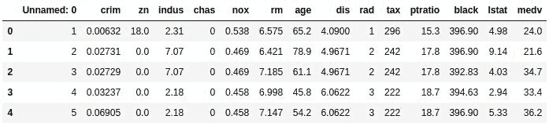

该数据集有 13 个预测因子，如房间数量、房龄、城镇师生比等。

让我们绘制其中一个预测因子与房价的关系，看看能否从可视化中获得解释。我们将使用的预测因子是城镇人均犯罪率，它反映了社区的犯罪率。


## 线性回归示例

```python
plt.scatter(dataset['crim'], dataset['medv'])
plt.xlabel('Per capita crime rate by town')
plt.ylabel('Price')
plt.title("Prices vs Crime rate")
```

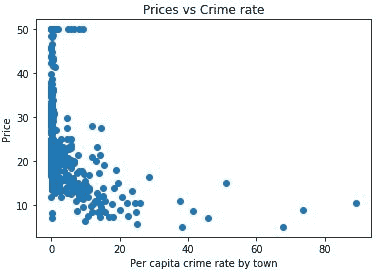

我们可以看到，对于犯罪率极低的城镇（图表开头部分），房价覆盖了全范围，既有便宜的也有昂贵的。这由沿 y 轴垂直分布的点来表示。如果我们排除 x 轴上前 10 个单位，会注意到价格与犯罪率之间存在负相关。这毫不奇怪，因为我们预期随着社区犯罪率上升，房价会下降。

### 数据准备

接下来我们将数据集拆分为预测变量和目标变量。然后创建训练集和测试集。

```python
X = dataset.drop(['Unnamed: 0', 'medv'], axis=1)
y = dataset['medv']

from sklearn.model_selection import train_test_split

x_train, x_test, y_train, y_test = train_test_split(X, y, test_size=0.3)
```

### 模型训练

下一步是从 Scikit-Learn 导入线性回归分类器，对其进行初始化，并在数据上拟合分类器。

```python
### import linear regression classifier, initialize and fit the model
from sklearn.linear_model import LinearRegression

regressor = LinearRegression()
regressor.fit(x_train, y_train)
```

### 预测

拟合分类器后，我们可以使用它根据测试集中的特征来预测房价。

```python
y_pred = regressor.predict(x_test)
```

### 评估

下一步是使用均方误差和决定系数 R 平方等指标来评估分类器。

```python
from sklearn.metrics import mean_squared_error, r2_score

### The coefficients
print('Coefficients: \n', regressor.coef_)

### The mean squared error
print('Mean squared error: {:.2f}'.format(mean_squared_error(y_test, y_pred)))

### Explained variance score: 1 is perfect prediction
print('Variance score: {:.2f}'.format(r2_score(y_test, y_pred)))
```

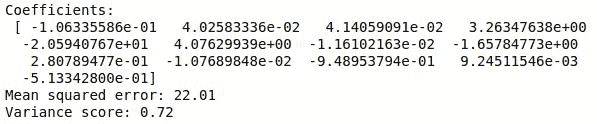

系数是每个预测变量的学习参数，均方误差表示我们的预测偏离实际值的程度，方差分数是决定系数，给出了模型的整体性能。方差分数为 1 表示完美模型，因此显然，得分为 0.72 说明模型已经从数据中学到了东西。

### 结果可视化

最后，我们可以绘制模型预测的价格与真实值（实际价格）的对比图。

```python
plt.scatter(y_test, y_pred)
plt.xlabel("Prices: $Y_i$")
plt.ylabel("Predicted prices: $\hat{Y}_i$")
plt.title("Prices vs Predicted prices: $Y_i$ vs $\hat{Y}_i$")
```


上图散点图显示预测价格与实际价格之间存在正相关关系。这表明我们的模型成功捕捉到了潜在关系，并能将输入特征映射到输出价格。

### 完整代码

这是完整的代码。

```python
#### import libraries
import numpy as np
import pandas as pd
import matplotlib.pyplot as plt
%matplotlib inline

#### load dataset
dataset = pd.read_csv('Boston.csv')
dataset.head()

### plot crime vs price
plt.scatter(dataset['crim'], dataset['medv'])
plt.xlabel('Per capita crime rate by town')
plt.ylabel('Price')
plt.title("Prices vs Crime rate")

### separate predictors and targets
X = dataset.drop(['Unnamed: 0', 'medv'], axis=1)
y = dataset['medv']

from sklearn.model_selection import train_test_split
x_train, x_test, y_train, y_test = train_test_split(X, y, test_size=0.3)

### import linear regression classifier, initialize and fit the model
from sklearn.linear_model import LinearRegression
regressor = LinearRegression()
regressor.fit(x_train, y_train)

y_pred = regressor.predict(x_test)

from sklearn.metrics import mean_squared_error, r2_score

### The coefficients
print('Coefficients: \n', regressor.coef_)

### The mean squared error
print('Mean squared error: {:.2f}'.format(mean_squared_error(y_test, y_pred)))

### Explained variance score: 1 is perfect prediction
print('Variance score: {:.2f}'.format(r2_score(y_test, y_pred)))

### plot predicted prices vs actual prices
plt.scatter(y_test, y_pred)
plt.xlabel("Prices: $Y_i$")
plt.ylabel("Predicted prices: $\hat{Y}_i$")
plt.title("Prices vs Predicted prices: $Y_i$ vs $\hat{Y}_i$")
```

## 逻辑回归

**逻辑回归** 尽管名字中带有“回归”，但它是一种分类算法。当因变量本质上是二元时，即只能取两个值（类别）之一（例如真或假）时，使用逻辑回归。它是加权输入特征的线性组合应用于 Sigmoid 函数。Logit 或 Sigmoid 函数是逻辑回归的核心，并在 0 到 1 的范围内对数据建模。


在上图中，`z` 代表加权输入特征。这意味着 `z` 是输入特征的线性相加，而输入特征的重要性（它们有多大）受其权重（系数）影响。通常会设置一个阈值将样本分为不同类别。该阈值可视为决策边界。经过线性计算和 Sigmoid 或 Logit 函数的应用后，将结果值与阈值进行比较。如果该值等于或大于阈值，则考虑中的样本属于正类，否则属于负类。阈值通常设置为 0.5。

逻辑回归的输出可以解释为概率，显示数据点属于某个类别的可能性。Logistic 函数的公式如下所示。


逻辑回归与简单回归的主要区别在于：逻辑回归用于分类，此时只有两个类别（负类或正类）；而简单回归用于预测实际值，如连续数值，而不是类别或类。

### Pima 印第安人糖尿病分类

我们现在将逻辑回归应用于一个二元分类问题。我们将利用的数据集是 Pima 印第安人糖尿病数据库，该数据集来自国家糖尿病、消化和肾脏疾病研究所。数据集包含一个目标变量，用于指示患者是否患上糖尿病。因此，我们的任务是使用诊断测量值作为预测变量来确定患者的糖尿病状况。

该数据集可在以下网址下载：[`www.kaggle.com/uciml/pima-indians-diabetes-database/data`](https://www.kaggle.com/uciml/pima-indians-diabetes-database/data)

让我们导入相关库并加载数据集，以了解其内容。

```python
import numpy as np
import pandas as pd
import matplotlib.pyplot as plt

dataset = pd.read_csv('diabetes.csv')
dataset.head(5)
```


该数据集有 8 个预测变量，如患者的葡萄糖水平、年龄、皮肤厚度、身体质量指数、胰岛素水平、年龄等。这些构成了我们模型的特征，用回归术语来说，即自变量。

接下来我们将数据集中的列分为特征和标签。标签或类别由 "Outcome" 列表示。

```python
features = dataset.drop(['Outcome'], axis=1)
labels = dataset['Outcome']

from sklearn.model_selection import train_test_split
features_train, features_test, labels_train, labels_test = train_test_split(features, labels, test_size=0.25)
```

下一步是初始化一个逻辑回归模型并将其拟合到 Pima 印第安人糖尿病数据上。

```python
### Training the model
from sklearn.linear_model import LogisticRegression

classifier = LogisticRegression()
classifier.fit(features_train, labels_train)
```

现在可以在测试集上评估训练好的模型。

```python
pred = classifier.predict(features_test)

from sklearn.metrics import accuracy_score
accuracy = accuracy_score(labels_test, pred)
print('Accuracy: {:.2f}'.format(accuracy))
```


训练好的逻辑回归模型在测试集上达到了 72% 的准确率。

### 广义线性模型

广义线性模型是线性模型的一种扩展，其中因变量不属于正态分布或高斯分布。广义线性模型能够建模自变量和因变量之间更复杂的关系。GLM 通常可以对各种概率分布进行建模，例如泊松分布、二项分布、多项分布等。逻辑回归就是广义线性模型的一个例子，其中因变量使用二项分布进行建模。这使其能够创建从输入到输出的映射，且输出本质上是二元的。

泊松回归是一种广义线性模型，用于建模计数数据。计数数据是只能为正的整数值。泊松回归假设因变量 `y` 服从泊松分布，这是一种指数概率分布。泊松回归与线性回归的主要区别在于：线性回归假设输出来自正态分布，而泊松回归假设 `y` 来自泊松分布。泊松回归中的输出建模如下所示。

```

```

广义线性模型由三个部分组成：随机成分（即输出的概率分布）、系统成分（描述解释变量 `X` 或预测变量）以及连接函数（指定解释变量与随机成分之间的关系）。

由于泊松回归的超参数（权重）不能取负值，因此它们通过自然对数进行变换以确保始终为正。泊松分布的均值在数学上表述为：

```

```

用于训练模型以发现可学习参数的目标函数或损失函数如下所示：

```

```

在我们的实操示例中，我们将使用 `statsmodels` 包，它提供了各种用于统计建模、统计数据探索等的函数和类。我们将使用 `statsmodels` 自带的数据集——苏格兰投票数据集，该数据集包含 1997 年关于授予苏格兰议会征税权的投票记录。该数据集包含 8 个解释变量（预测变量）和 32 个观测值，每个地区一个。

首先我们按如下方式导入 `Statsmodels` 包。

```
import statsmodels.api as sm
```

接下来我们加载数据集并提取解释变量 (`X`)。

```
data = sm.datasets.scotland.load()

### data.exog 是自变量 X
data.exog = sm.add_constant(data.exog)
```

类似于 Scikit-Learn，我们导入合适的模型并实例化一个对象。在这种情况下，我们指定一个广义线性模型并将分布族设置为泊松分布。

```
### 使用默认连接函数实例化一个泊松族模型。
poisson_model = sm.GLM(data.endog, data.exog, family=sm.families.Poisson())
```

然后我们在数据上拟合模型。

```
poisson_results = poisson_model.fit()
```

我们现在可以打印结果摘要，以更好地了解训练好的模型。

```
print(poisson_results.summary())
```

```

```

摘要包含自变量的系数或权重、标准误和 z 分数等值。

### 回归示例：预测波士顿房价

为了更好地理解迄今为止讨论的概念，我们将引入一个贯穿始终的示例，其中我们面临一个回归问题：给定波士顿郊区房屋的特征信息，预测其价格。

我们将使用的数据集可以在以下链接找到：[`forge.scilab.org/index.php/p/rdataset/source/file/master/csv/MASS/Boston.csv`](https://forge.scilab.org/index.php/p/rdataset/source/file/master/csv/MASS/Boston.csv)

#### 执行分析的步骤

为了执行分析并构建模型，我们首先需要明确问题，执行探索性数据分析以更好地了解数据内容，选择机器学习算法，训练模型，最后评估其性能。以下步骤将以实操方式进行，建议读者跟随操作。

##### 导入库：

```
import numpy as np

import pandas as pd

import matplotlib.pyplot as plt
```

Numpy 是一个流行的 Python 数值计算库，支持计算的向量化实现，并显著加快计算速度。Pandas 是一个用于在数据框中操作数据的库，而 Matplotlib 用于绘制图表和数据可视化。

让我们使用 Pandas 库的 `read_csv` 方法并传入数据位置来加载数据。

```
dataset = pd.read_csv('Boston.csv')
```

下一步是查看数据包含的内容

```
dataset.head(5)
```

```

```

这将显示单个观测值作为行。一行代表一个数据点，而列代表特征。共有 13 个特征，因为最后一列 `medv` 是我们要预测的回归值（自住房中位数价格，单位：千美元），`Unnamed:0` 列是一种标识符，无信息量。每个特征代表一部分信息，例如 `crim` 表示城镇人均犯罪率，`rm` 表示每户平均房间数。

接下来我们运行

```
dataset.shape
```

这给出了数据集的形状，包含 506 个观测值。我们首先需要将列分离为自变量和因变量

```
X = dataset.drop(['Unnamed: 0', 'medv'], axis=1)

y = dataset['medv']
```

我们需要将数据集拆分为训练集和测试集，因为我们想在训练集上训练模型，然后在测试集上评估其性能。

```
from sklearn.model_selection import train_test_split

x_train, x_test, y_train, y_test = train_test_split(X, y, test_size=0.3)
```

`x_train`、`x_test` 包含我们的特征，而 `y_train`、`y_test` 分别是训练集和测试集的预测目标。`test_size=0.3` 意味着我们希望 70% 的数据用于训练，30% 用于测试阶段。

下一步是从 Scikit-Learn 库导入线性回归模型。Scikit-Learn 是 Python 中事实上的标准机器学习库，开箱即用地包含了许多机器学习模型和工具。

线性回归使用直线方程来拟合参数。

```
### 导入模型
from sklearn.linear_model import LinearRegression

regressor = LinearRegression()
```

上述代码导入线性回归模型并实例化一个对象。

```
regressor.fit(x_train,y_train)
```

这行代码使用 `fit` 方法拟合数据。这意味着它找到解释数据的自变量的适当值。

##### 如何预测

为了评估我们的模型，我们使用测试集来了解模型是否能很好地泛化到未训练过的数据。

```
y_pred = regressor.predict(x_test,y_test)

from sklearn.metrics import mean_squared_error

mse = mean_squared_error(y_test, y_pred)
```

在 `regressor` 对象上调用的 `predict` 方法返回预测值，我们用它来评估模型的误差。我们使用均方误差作为度量标准。均方误差 (MSE) 衡量预测值偏离真实（实际）值的程度。该模型获得的 MSE 为 20.584。

最后，我们绘制输出图以了解分布情况。

```
plt.scatter(y_test, y_pred)

plt.xlabel("Prices: $Y_i$")

plt.ylabel("Predicted prices: $\hat{Y}_i$")

plt.title("Prices vs Predicted prices: $Y_i$ vs $\hat{Y}_i$")
```

```

```

从上述散点图可以看出，我们模型的预测值接近实际房价，因此点集中分布。


## K 近邻算法

### K 近邻算法简介

要理解 K 近邻算法，我们首先需要了解最近邻算法。最近邻算法是一种可用于回归和分类任务的算法，但通常用于分类，因为它简单直观。

在训练阶段，最近邻算法仅仅是记住输入和输出的所有数据值。在测试阶段，当提供一个数据点并期望得到类别标签时，它会在其记忆中搜索具有与测试数据点最相似特征的任何数据点，然后返回该相关数据点的标签作为预测结果。最近邻分类器的训练时间非常快，因为它只是存储所有样本。然而，在测试时，其速度较慢，因为它需要搜索所有存储的示例以找到最佳匹配。随着数据集的增加，获得分类预测所花费的时间也会增加。

K 近邻算法是最近邻算法的一种修改，其中输入的类别标签由距离它最近的 k 个示例进行投票决定。也就是说，预测标签将是其邻近代表中多数投票的标签。因此，k 值为 5 意味着，获取待分类输入的五个最相似示例，并根据这五个示例的多数类别标签来选择类别标签。

现在让我们看一个示例图像来加深理解：


待分类的新示例被放置在向量空间中，当 k=1 时，选择离它最近的示例的标签作为其标签。在这种情况下，新示例被归类为属于类别 1。当 k=1 时，K 近邻算法退化为最近邻算法。

从图中可以看出，当 k=3 时，我们使用一种称为距离度量的相似性指标选择离新示例最近的 3 个示例。我们看到有两个近邻示例预测类别为类别 2（红色三角形），而剩余的一个示例预测类别为类别 1（蓝色正方形）。因此，新数据点的预测类别为类别 2，因为它拥有多数票。

用于衡量示例邻近性的距离度量可以是 L1 或 L2 距离。L1 距离是两点之间差值绝对值的和，公式如下：


L1 距离有时被称为曼哈顿距离。

L2 是另一种可使用的距离度量。它是两点之间使用直线的欧几里得距离。公式如下：


k 值为 1 会正确分类所有训练示例，因为与某点最相似的示例将是它自己。这将是一种次优方法，因为分类器将无法学到任何东西，也就没有能力泛化到未训练过的数据。更好的解决方案是以一种在验证集上表现良好的方式选择 k 值。验证集通常用于调整超参数 k。较高的 k 值对决策边界有平滑作用，因为异常类别被多数投票模式“吞没”。增加 k 值通常最初会带来更高的准确率，但在变得过大之前，我们会达到边际效益递减的点，此时准确率下降，验证误差开始上升。


k 的最优值是验证误差最低的点。

### 如何创建和测试 K 近邻分类器

现在我们将所学知识应用到一个二分类问题中。我们将使用的数据集是 Pima 印第安人糖尿病数据库，该数据集来自国家糖尿病、消化和肾脏疾病研究所。该数据集的主要目的是根据对患者进行的诊断测量，预测患者是否患有糖尿病。研究中的患者为女性，具有 Pima 印第安人血统，且年龄至少 21 岁。

数据集可在以下网址找到：

[`www.kaggle.com/uciml/pima-indians-diabetes-database/data`](https://www.kaggle.com/uciml/pima-indians-diabetes-database/data)

由于我们处理的是两个互斥的类别，患者要么患有糖尿病，要么没有，这可以建模为二分类任务，为了示例目的，我们将使用 K 近邻分类器进行分类。

第一步是导入我们将使用的库。

```
import numpy as np
import pandas as pd
import matplotlib.pyplot as plt
```

接下来我们使用 Pandas 加载数据。

```
dataset = pd.read_csv('diabetes.csv')
```

一如既往，我们应该做的是了解我们的数据集和可用的特征。

```
dataset.head(5)
```


我们看到有 8 个特征和 9 列，其中`Outcome`是我们要预测的二元标签。

要了解数据集中的观测值数量，我们运行

```
dataset.shape
```

这显示数据集包含 768 个观测值。

现在让我们获取数据的摘要，以便了解属性的分布情况。

```
dataset.describe()
```


count 行显示所有特征的值恒为 768.0，应该记得这与我们数据集中的行数相同。这表明我们没有任何特征的缺失值。mean、std 分别给出了数据集中各属性的平均值和标准差。mean 是该特征的平均值，而标准差衡量值的分布变化。

在进行分类之前，我们检查特征间的相关性，以免存在冗余特征。

```
corr = dataset.corr()   # 数据框相关性函数
fig, ax = plt.subplots(figsize=(13, 13))
ax.matshow(corr)   # 按相关性值对矩形进行颜色编码
plt.xticks(range(len(corr.columns)), corr.columns)  # 绘制 x 轴刻度标记
plt.yticks(range(len(corr.columns)), corr.columns)  # 绘制 y 轴刻度标记
```


该图未显示特征间存在 1 对 1 的相关性，因此所有特征都具有信息量并提供了判别力。

我们需要将列分为特征和标签。

```
features = dataset.drop(['Outcome'], axis=1)
labels = dataset['Outcome']
```

我们将再次将数据集分为训练集和测试集，因为我们想在训练集上训练模型，然后在测试集上评估其性能。

```
from sklearn.model_selection import train_test_split
features_train, features_test, labels_train, labels_test = train_test_split(features, labels, test_size=0.25)
```

`features_train`、`features_test`包含属性，而`labels_train`、`labels_test`分别是训练集和测试集的离散类别标签。我们使用`test_size`为 0.25，表示我们想用 75%的观测值进行训练，保留剩余 25%用于测试。

下一步是使用 Scikit-Learn 机器学习库中的 K 近邻分类器。

```
### 导入模型
from sklearn.neighbors import KNeighborsClassifier
```


### K 近邻分类器实现

#### 使用 Scikit-Learn 的基础实现

```python
classifier = KNeighborsClassifier()
```

上述代码导入 K 近邻分类器并实例化一个对象。

```python
classifier.fit(features_train, labels_train)
```

我们使用训练集的特征和标签来拟合分类器。要从训练好的模型获取预测结果，我们在分类器上使用 `predict` 方法，并传入测试集的特征。

```python
pred = classifier.predict(features_test)
```

为了评估模型的性能，我们使用准确率作为指标。Scikit-Learn 包含一个实用工具，使我们能够轻松计算训练模型的准确率。要使用它，我们需要从 metrics 模块导入 `accuracy_score`。

```python
from sklearn.metrics import accuracy_score

accuracy = accuracy_score(labels_test, pred)

print('Accuracy: {}'.format(accuracy))
```

我们获得了 0.74 的准确率，这意味着对于 74% 的样本，预测标签与真实标签相同。

##### 完整代码示例

```python
#### import libraries
import numpy as np
import pandas as pd
import matplotlib.pyplot as plt

#### read dataset from csv file
dataset = pd.read_csv('diabetes.csv')

#### display first five observations
dataset.head(5)

###### get shape of dataset, number of observations, number of features
dataset.shape

###### get information on data distribution
dataset.describe()

###### plot correlation between features
corr = dataset.corr()          # data frame correlation function
fig, ax = plt.subplots(figsize=(13, 13))
ax.matshow(corr)               # color code the rectangles by correlation value
plt.xticks(range(len(corr.columns)), corr.columns)  # draw x tick marks
plt.yticks(range(len(corr.columns)), corr.columns)  # draw y tick marks

#### create features and labels
features = dataset.drop(['Outcome'], axis=1)
labels = dataset['Outcome']

#### split dataset into training set and test set
from sklearn.model_selection import train_test_split
features_train, features_test, labels_train, labels_test = train_test_split(features, labels, test_size=0.25)

###### import nearest neighbor classifier
from sklearn.neighbors import KNeighborsClassifier
classifier = KNeighborsClassifier()

#### fit data
classifier.fit(features_train, labels_train)

#### get predicted class labels
pred = classifier.predict(features_test)

#### get accuracy of model on test set
from sklearn.metrics import accuracy_score
accuracy = accuracy_score(labels_test, pred)
print('Accuracy: {}'.format(accuracy))
```

#### 另一个应用：鸢尾花分类

我们将用于此任务的数据集是鸢尾花分类数据集。该数据集包含 150 个样本，涵盖 3 类鸢尾花品种，分别是山鸢尾、变色鸢尾和维吉尼亚鸢尾。该数据集可从 Kaggle 下载（[`www.kaggle.com/saurabh00007/iriscsv/downloads/Iris.csv/1`](https://www.kaggle.com/saurabh00007/iriscsv/downloads/Iris.csv/1)）。

数据科学流程的第一步是获取数据，我们已经完成。接下来我们需要处理数据或对其进行预处理，使其转换为适合的形式，然后再传递给机器学习分类器。

##### 导入库

```python
import numpy as np
import pandas as pd
import matplotlib.pyplot as plt
import scipy as sp
```

接下来我们使用 Pandas 加载包含在 CSV 文件中的数据集，并打印前几行，以便了解数据集包含的内容。

```python
dataset = pd.read_csv('Iris.csv')
dataset.head(5)
```


正如我们所见，有 4 个预测变量，分别是萼片长度、萼片宽度、花瓣长度和花瓣宽度。品种是我们感兴趣预测的目标变量。由于有 3 个类别，这是一个多分类问题。

根据我们的观察，我们将列分离为特征（`X`）和目标（`y`）。

```python
X = dataset.iloc[:, 1:5].values  # select features ignoring non-informative column Id
y = dataset.iloc[:, 5].values    # Species contains targets for our model
```

我们的目标目前以文本形式存储。我们需要将它们转换为分类变量。为此，我们利用 Scikit-Learn 的标签编码器。

```python
from sklearn.preprocessing import LabelEncoder
le = LabelEncoder()
y = le.fit_transform(y)  # transform species names into categorical values
```

接下来，我们将数据集分割为训练集和测试集，以便能够适当地评估训练模型的性能。

```python
from sklearn.model_selection import train_test_split
X_train, X_test, y_train, y_test = train_test_split(X, y, test_size=0.3)
```

### 计算相似度

在上一节中，我们成功准备了数据，并从高层解释了 K-NN 算法的内部工作原理。现在我们将在 Python 中实现一个可工作的版本。K-NN 算法最重要的部分是相似度度量，在本例中是距离度量。有几种距离度量，但我们将使用欧几里得距离，即欧几里得平面上两点之间的直线距离。该平面可以是二维、三维等。欧几里得距离有时被称为 L2 距离。其公式如下。


L2 距离是从测试样本计算到训练集中每个样本的距离，以确定它们有多近。我们可以使用 Numpy 在 Python 中实现 L2 距离，如下所示。

```python
def euclidean_distance(training_set, test_instance):
    # number of samples inside training set
    n_samples = training_set.shape[0]
    # create array for distances
    distances = np.empty(n_samples, dtype=np.float64)
    # euclidean distance calculation
    for i in range(n_samples):
        distances[i] = np.sqrt(np.sum(np.square(test_instance - training_set[i])))
    return distances
```

### 定位邻居

实现了相似度度量后，我们可以构建一个功能齐全的类，能够识别最近邻并返回分类。值得注意的是，K 近邻算法没有训练阶段。它只是将所有数据点存储在内存中。只有在测试阶段计算距离并返回预测时，它才执行计算。下面是一个利用上述距离函数的 K-NN 算法实现。

```python
class MyKNeighborsClassifier():
    """
    Vanilla implementation of KNN algorithm.
    """
    def __init__(self, n_neighbors=5):
        self.n_neighbors = n_neighbors

    def fit(self, X, y):
        """
        Fit the model using X as array of features and y as array of labels.
        """
        n_samples = X.shape[0]
        # number of neighbors can't be larger then number of samples
        if self.n_neighbors > n_samples:
            raise ValueError("Number of neighbors can't be larger then number of samples in training set.")
        # X and y need to have the same number of samples
        if X.shape[0] != y.shape[0]:
            raise ValueError("Number of samples in X and y need to be equal.")
        # finding and saving all possible class labels
        self.classes_ = np.unique(y)
        self.X = X
        self.y = y

    def pred_from_neighbors(self, training_set, labels, test_instance, k):
        distances = euclidean_distance(training_set, test_instance)
        # combining arrays as columns
        distances = sp.c_[distances, labels]
        # sorting array by value of first column
        sorted_distances = distances[distances[:, 0].argsort()]
        # selecting labels associeted with k smallest distances
        targets = sorted_distances[0:k, 1]
        unique, counts = np.unique(targets, return_counts=True)
        return unique[np.argmax(counts)]

    def predict(self, X_test):
        # number of predictions to make and number of features inside single sample
        n_predictions, n_features = X_test.shape
        # allocationg space for array of predictions
        predictions = np.empty(n_predictions, dtype=int)
```


### K 近邻算法实现

```python
#### loop over all observations
for i in range(n_predictions):
    # calculation of single prediction
    predictions[i] = self.pred_from_neighbors(self.X, self.y, X_test[i, :], self.n_neighbors)
return(predictions)
```

上述类的工作流程是：在测试阶段，输入一个测试样本（实例），并计算其到整个训练集中每个样本的欧氏距离。根据要考虑的最近邻居数量（`k`值），这些邻居的标签参与投票，以确定测试样本的类别。

### 生成响应

为了生成响应或创建预测，我们首先必须初始化自定义分类器。`k` 的值不能超过数据集中的样本数量。这是意料之中的，因为我们无法与训练集中可用数量以上的邻居进行比较。

```python
#### instantiate learning model (k = 3)
my_classifier = MyKNeighborsClassifier(n_neighbors=3)
```

接下来，我们可以在数据上训练模型。请记住，在 K-NN 中实际上不发生训练过程。

```python
#### fitting the model
my_classifier.fit(X_train, y_train)
```

### 评估准确率

为了评估模型的准确率，我们在模型未见过的示例（如测试集中的样本）上测试其性能。

```python
#### predicting the test set results
my_y_pred = my_classifier.predict(X_test)
```

然后我们将预测类别与真实标签进行核对，并使用 Scikit-Learn 的准确率模块来计算分类器的准确率。

```python
from sklearn.metrics import confusion_matrix, accuracy_score

accuracy = accuracy_score(y_test, my_y_pred) * 100
print('Accuracy: ' + str(round(accuracy, 2)) + ' %.')
```


我们的模型达到了 97.8% 的准确率，对于这样一个简单而优雅的模型来说，这令人印象深刻。

### 维度灾难

当输入空间的维度较小时（如本例所示），K 近邻算法表现最佳。我们有四个预测变量（花萼长度、花萼宽度、花瓣长度、花瓣宽度）输入算法。K-NN 在高维输入空间（如图像处理中遇到的空间）中表现吃力。这是因为距离度量所表达的相似性度量非常有限，无法正确建模这种高维空间。通常，机器学习算法试图降低维度，以便我们对低维空间的直觉仍然适用。当维度数量增加时，算法的准确率或性能通常会下降。这被称为**维度灾难**。

## 朴素贝叶斯

### 朴素贝叶斯的应用

朴素贝叶斯算法是一种基于贝叶斯定理的**急切学习算法**，其假设是：给定类别标签的情况下，所有特征相互独立。朴素贝叶斯算法非常适合文本分类，因为其测试阶段的预测速度很快，因此可以部署在大型数据集上进行推理。

朴素贝叶斯通常用于需要实时预测的应用场景，例如信用卡交易的欺诈检测。在这些应用中，需要一个能够近乎瞬间完成分类的分类器。朴素贝叶斯还广泛用于文本分类、垃圾邮件过滤和情感分析。在垃圾邮件过滤中，邮件或短信的单词作为模型的输入特征，并假设每个单词与其他单词相互独立。当这种独立性假设成立时，朴素贝叶斯通常能产生良好的结果，加上其推理时间短，有时比更复杂的分类器更受青睐。

朴素贝叶斯算法广泛应用的另一个领域是**多类分类**。在该领域，给定输入特征可以预测多个类别或类别，并为预测类别分配概率。

### 如何在 Python 中使用朴素贝叶斯构建基础模型

在我们的实战示例中，我们将使用 Python 构建一个朴素贝叶斯模型来解决垃圾短信分类问题。我们将使用 SMS 垃圾邮件收集数据集，这是一个包含 5,574 条英语短信的集合，并已标注类别。共有两个类别——ham（正常短信）和 spam（垃圾短信）。该数据集可从以下 URL 下载（`https://www.kaggle.com/uciml/sms-spam-collection-dataset/downloads/spam.csv/1`）。

我们将使用 Scikit-Learn 机器学习库中的多项式朴素贝叶斯分类器。像往常一样，我们首先导入将要使用的库。

```python
import numpy as np
import pandas as pd
import matplotlib.pyplot as plt

### comment the magic command below if not running in Jupyter notebook
%matplotlib inline
```

接下来，我们使用 Pandas 加载数据集并显示前 5 行。

```python
data = pd.read_csv('spam.csv', encoding='latin-1')
data.head(5)
```


列 `v1` 包含类别标签，而 `v2` 是短信内容，我们将其作为模型的特征。

让我们绘制一个柱状图来直观展示正常短信和垃圾短信的分布。

```python
count_class = pd.value_counts(data['v1'], sort=True)
count_class.plot(kind='bar', color=[['blue', 'red']])
plt.title('Bar chart')
plt.show()
```


单词不能直接作为特征输入模型，因此我们必须将它们向量化以创建新特征。我们通过考虑单词频率（在移除英语句子中常见的词如 "the"、"a"、"of" 等之后）来实现这一点。我们可以使用 Scikit-Learn 轻松完成此特征提取。

```python
from sklearn.feature_extraction.text import CountVectorizer

f = CountVectorizer(stop_words='english')
X = f.fit_transform(data["v2"])
print(np.shape(X))
```


向量化后，创建了 8,404 个新特征。

接下来，我们将目标变量映射为类别，并将数据集划分为训练集和测试集。

```python
from sklearn.model_selection import train_test_split

data["v1"] = data["v1"].map({'spam': 1, 'ham': 0})
X_train, X_test, y_train, y_test = train_test_split(X, data['v1'], test_size=0.25, random_state=42)
```

下一步是初始化朴素贝叶斯模型并在数据上对其进行训练。

```python
from sklearn.naive_bayes import MultinomialNB

clf = MultinomialNB()
clf.fit(X_train, y_train)
```

最后，我们在测试集上评估模型性能。

```python
score = clf.score(X_test, y_test)
print('Accuracy: {}'.format(score))
```


朴素贝叶斯分类器达到了 0.976 的准确率，这意味着它正确预测了 97.6% 样本的类别。

## 决策树与随机森林

### 分区的熵

熵可以定义为随机事件序列中不确定性的度量。它是样本空间中无序程度的比率，与知识直接对立。当系统的熵较高时，从系统中获得的知识较低，反之亦然。对熵的一个直观理解是将其视为为了获得某些知识所需提出的问题数量。例如，如果我选了一个随机数字，你试图猜出它是什么。问一个问题，“它是奇数吗”，会将可能性空间减半。这意味着试图确定我选择的数字时的熵或不确定性降低了。同样，信息增益量很大，因为该问题通过划分样本空间让你更接近答案。熵通常在 0 到 1 之间。熵为 0 的系统高度稳定，从这种系统中获得的知识很高。一般来说，系统中低熵表示高知识，而高熵表示低知识或不稳定。

熵可以用数学公式表示为：


### 熵与决策树

上述公式是事件发生的对数概率之和的负值。请记住，概率表示我们对事件发生的置信度；因此，熵是一系列事件同时发生的惊讶程度。

在机器学习中，正如我们稍后将在决策树中看到的那样，分类器两个或多个属性的熵定义为：


决策树是一种严重依赖属性熵和信息增益来确定如何在分类问题中对样本进行分类的机器学习算法。让我们在下一节深入了解决策树。

### 创建决策树

决策树是一种主要用于分类的机器学习算法，它构建一棵可能性之树，其中树的分支代表决策，叶子代表标签分类。决策树的目的是创建一种结构，使每个分支中的样本是同质的或属于同一类型。它通过根据特定属性拆分训练数据中的样本来实现这一点，这些属性增加了分支的同质性。这些属性形成决策节点，样本沿这些节点被分离。该过程持续进行，直到所有样本都被正确预测，这由树的叶子表示。

为了进一步解释决策树的概念，让我们看看下面的一个简单示例，它演示了其能力。


假设我们是一家笔记本电脑制造商，我们想预测在线商店的哪些客户可能购买我们新款的高端笔记本电脑，以便我们能相应地集中营销力度。这个问题可以用一个具有两个类别（是或否）的决策树来建模，用于判断一个人是否可能购买。

在树的根节点，我们想选择一个关于客户的属性，使熵减少最多。正如我们在上一节所看到的，通过减少熵，我们增加了系统包含的知识量。我们通过计算每个分支的熵和目标（是或否）的熵来选择合适的属性。信息增益与熵密切相关，定义为目标的熵（最终熵）与选择特定属性作为根节点时给定的熵之间的差值。


上述公式用于计算熵的减少量。具有最大信息增益或熵减少量的属性被选为根节点。这意味着与其他属性相比，该属性最大程度地减少了决策空间。该过程重复进行，通过属性寻找其他决策节点，直到所有样本都通过决策树的叶子被正确分类。

在上面的示例中，`age` 是提供最大信息增益的属性，因此样本在该决策节点上被分割。如果客户是中年人，他们很可能购买新笔记本电脑，因为他们可能正在工作且拥有更高的消费能力。如果客户是年轻人，这将引导我们到另一个决策节点。使用的属性是该年轻人是否为学生。如果是学生，他们很可能购买；否则，他们不会。这将我们带到了树的年轻人分支后的叶子节点（类别）。对于老年人分支，我们再次根据一个信息量大的属性拆分样本，在本例中是信用评级。如果老年人拥有极好的信用评级，意味着他们很可能购买；否则，该分支上该样本的叶子节点或分类为否。

现在让我们使用 Python、Scikit-Learn 和决策树来处理一个示例。我们将解决一个多类分类问题，挑战是利用酒精度、颜色强度、色调等特征将葡萄酒分为三类。我们将使用的数据来自 UC Irvine 的葡萄酒识别数据集。可在 [`gist.github.com/tijptjik/9408623/archive/b237fa5848349a14a14e5d4107dc7897c21951f5.zip`](https://gist.github.com/tijptjik/9408623/archive/b237fa5848349a14a14e5d4107dc7897c21951f5.zip) 下载。

首先，让我们加载数据集并使用 Pandas 的 `head()` 方法查看一下。

```python
import numpy as np
import pandas as pd
import matplotlib.pyplot as plt

### 如果不在 Jupyter notebook 中运行，请注释掉下面的魔法命令
%matplotlib inline

dataset = pd.read_csv('wine.csv')
dataset.head(5)
```


共有 13 个预测变量，第一列 "wine" 包含目标值。接下来我们要做的是将数据集拆分为预测变量和目标变量，有时分别称为特征和标签。

```python
features = dataset.drop(['Wine'], axis=1)
labels = dataset['Wine']
```

按照惯例，为了确保对模型进行良好的评估，我们将数据集划分为训练集和测试集。

```python
from sklearn.model_selection import train_test_split
features_train, features_test, labels_train, labels_test = train_test_split(features, labels, test_size=0.25)
```

剩下的就是导入决策树分类器并将其拟合到我们的数据上。

```python
from sklearn.tree import DecisionTreeClassifier
classifier = DecisionTreeClassifier()
classifier.fit(features_train, labels_train)
```

现在我们可以在测试集上评估训练好的模型并打印出准确率。

```python
pred = classifier.predict(features_test)
from sklearn.metrics import accuracy_score
accuracy = accuracy_score(labels_test, pred)
print('Accuracy: {:.2f}'.format(accuracy))
```


我们达到了 0.91 的准确率，这非常令人印象深刻。这意味着测试集中 91% 的样本被正确分类。

### 随机森林

随机森林是一种集成模型。集成模型是由其他模型构建的模型。这意味着它是几个弱学习器的组合，形成一个强学习器。集成模型的预测可能是其包含的所有学习器的平均值或加权平均值。

随机森林是决策树的扩展，通过生长多棵决策树来形成一个森林。随机森林模型的最终预测是所有组成部分决策树的组合。对于回归，它可能是输出的简单平均值；对于分类，则可能是标签投票。虽然随机森林由多棵决策树组成，但每棵决策树都是在随机选择的数据子集上训练的，因此得名随机森林。随机森林的另一个技巧是，与决策树从所有可用属性中选择最佳属性以在决策节点拆分样本不同，随机森林仅从为每个决策节点随机选择的属性子集中挑选最佳属性。结果是，树中的每个节点都是非确定性的；也就是说，每次运行算法，我们最终得到的树结构可能不同。然而，最有信息量的属性仍会找到进入森林中树木的路径，并出现在许多树中。这使得随机森林算法的结果不太容易因输入数据的变化而产生错误。

组成随机森林的决策树所训练的数据子集称为装袋数据，通常约占整个数据集的 60%。用于测试单个树性能的剩余数据称为袋外数据。因此，森林中的每棵树都通过随机化过程在不同的数据子集上进行训练和评估。


上图展示了随机森林的图示表示。它由多棵在不同数据集实例上训练的树组成。每个决策节点的属性也是随机的。最终，输出预测是每棵决策树分类的集成。


我们现在将在葡萄酒数据集上尝试随机森林分类器，并将其在测试集上的表现与上一节中的决策树模型进行比较。使用 Scikit-Learn 中的机器学习模型的美妙之处在于，无论使用何种算法，训练和测试模型的 API 都是相同的。因此你会注意到，我们只需要导入正确的分类器并将其初始化，所有其他代码部分将保持不变。我们已经熟悉代码各部分的工作原理，因此这里是随机森林的完整代码。

```python
import numpy as np
import pandas as pd

#### load dataset
dataset = pd.read_csv('wine.csv')

#### separate features and labels
features = dataset.drop(['Wine'], axis=1)
labels = dataset['Wine']

#### split dataset into train and test sets
from sklearn.model_selection import train_test_split
features_train, features_test, labels_train, labels_test = train_test_split(features, labels, test_size=0.25)

#### import random forest classifier from sklearn
from sklearn.ensemble import RandomForestClassifier
classifier = RandomForestClassifier()

#### fit classifier on data
classifier.fit(features_train, labels_train)

#### predict classes of test set samples
pred = classifier.predict(features_test)

#### evaluate classifier performance using accuracy metric
from sklearn.metrics import accuracy_score
accuracy = accuracy_score(labels_test, pred)
print('Accuracy: {:.2f}'.format(accuracy))
```


我们在测试集上达到了 98% 的准确率，这比使用决策树分类器时的 91% 有了巨大的飞跃。我们可以看到，随机森林的随机化方法使算法能够更好地泛化，因此在测试集上记录了更高的准确率。

## 神经网络

### 感知机

感知机是一种二元线性分类器，仅当样本可以通过一条直线分离时，它才能预测样本的类别。感知机算法由 Frank Rosenblatt 于 1957 年提出。它使用手工制作的特征对样本进行分类，这些特征代表了关于样本的信息，根据特征对最终预测的重要程度对其进行加权，然后将计算结果与一个阈值进行比较。


在上图中，`X` 代表模型的输入，`W` 代表权重（各个特征有多重要）。在下面的公式中，会对特征的加权和进行线性计算：


然后将 `z` 的值传递给阶跃函数以预测样本的类别。阶跃函数是将值从 0 瞬间转换为 1。这意味着如果 `z` 大于或等于 0，则预测为一类，否则预测为另一类。阶跃函数可以用数学方式表示为：


在每次迭代中，预测类别会与实际类别进行比较，如果预测错误则更新权重，如果预测正确则保持不变。权重更新持续进行，直到所有样本都被正确预测，此时我们可以说感知机分类器已经找到了一个线性决策边界，能完美地将所有样本分离为两个互斥的类别。

在训练过程中，通过向原始权重添加一个小值来更新权重。添加的量由感知机学习规则决定。权重更新过程可以用数学方式表示如下。


权重更新的量由下面的感知机学习规则给出。


等式右侧的第一个系数称为学习率，它作为一个缩放因子，用于增加或减少更新的幅度。上述等式的直观理解是：每遍历一遍训练集，错误分类样本的权重就会被朝正确方向轻推一下，以便 `z` 的值能使阶跃函数正确分类该样本。应当注意，上述描述的感知机学习算法存在严重局限，因为它只能学习具有清晰线性边界的简单函数。感知机在实践中几乎从不使用，但它在人工神经网络的早期发展中充当了不可或缺的基础构建模块。

现代版本被称为多层感知机。多层感知机是前馈神经网络，其结构中包含多个感知机节点。然而，存在重要差异。多层感知机由多层堆叠的神经元组成网络。所使用的激活函数是非线性的，这与使用阶跃函数的感知机模型不同。非线性激活能够捕捉数据更有趣的表示，因此不要求输入数据线性可分。另一个重要区别是，多层感知机使用一种称为反向传播的不同算法进行训练，这使得跨多层训练成为可能。

### 反向传播

反向传播是一种算法技术，用于解决人工神经网络中的信用分配问题。这意味着它用于确定输入的特征和权重在多大程度上对模型的最终输出做出了贡献。与感知机学习规则不同，反向传播用于计算梯度，梯度告诉我们模型参数的变化在多大程度上影响最终输出。梯度被用作误差信号来训练模型，指示模型的预测偏离真实值有多远。反向传播算法可以被视为应用于各层的导数链式法则。

让我们看一个完整的多层感知机图解以进一步理解。


上述网络由三层组成：输入层（即输入网络的特征）、隐藏层（之所以这样称呼是因为我们无法观察其内部发生的情况）和输出层（通过它获得模型的预测）。在训练期间，为了计算每个节点对最终预测的贡献程度并相应地调整它们以提高样本上的准确率，我们需要使用反向传播算法来改变权重。权重是在训练过程中学习到的，因此有时被称为模型的可学习参数。为了直观理解反向传播期间发生的事情，让我们看看下面单个节点的图像。


在上图节点中，`x` 和 `y` 是输入特征，而 `f` 是非线性激活函数。在训练期间，计算从输入开始，跨过隐藏层，一直到输出，以正向方式进行。这被称为正向传播，在图中用绿色箭头表示。然后将模型的预测与真实值进行比较，并将误差反向传播。这被称为反向传播，通过反向传播算法分配每个节点对计算出的误差所承担的责任量。在上图中用红色箭头表示。此过程持续进行，直到模型找到一组能捕捉底层数据表示并正确预测大多数样本的权重。

### 如何使用 TensorFlow 运行神经网络

对于我们的实战示例，我们将使用 MNIST 手写数字数据库进行图像分类，该数据库包含 0 到 9 的黑白手写数字图片。任务是训练一个神经网络，给定一个输入数字图像，它能预测其中包含的数字类别。

### 如何获取数据


### TensorFlow MNIST 教程

TensorFlow 包含若干预加载的数据集，我们可以在实验过程中用它们来学习或测试想法。MNIST 数据库就是其中一个经过清理的数据集，简单且易于理解。每个数据点是一张黑白图像，仅有一个颜色通道。图像中的每个像素表示该点的亮度，0 表示黑色，255 表示白色。数值范围为 0 到 255，对应 28 × 28 网格中的 784 个点。

#### 加载数据和库

让我们继续从 TensorFlow 加载数据，并导入其他相关库。

```python
##### Import MNIST data
from tensorflow.examples.tutorials.mnist import input_data

mnist = input_data.read_data_sets("/tmp/data/", one_hot=True)

import numpy as np
import tensorflow as tf
import matplotlib.pyplot as plt
```

让我们使用 `matplotlib` 库来显示一张图像，看看它的样子，运行以下代码行。

```python
plt.imshow(np.reshape(mnist.train.images[8], [28, 28]), cmap='gray')
plt.show()
```


显示的图像是一张手写数字 9 的图片。

#### 如何训练和测试数据

为了在我们的数据上训练一个人工神经网络模型，我们首先需要定义描述计算图的参数，例如每个隐藏层的神经元数量、隐藏层数量、输入大小、输出类别数量等。数据集中的每张图像都是 28 × 28 像素，因此输入形状为 784（即 28 × 28）。

##### 参数

```python
##### Parameters
learning_rate = 0.1
num_steps = 500
batch_size = 128
display_step = 100

##### Network Parameters
n_hidden_1 = 10 # 1st layer number of neurons
n_hidden_2 = 10 # 2nd layer number of neurons
num_input = 784 # MNIST data input (img shape: 28*28)
num_classes = 10 # MNIST total classes (0-9 digits)
```

##### 图输入

```python
##### tf Graph input
X = tf.placeholder("float", [None, num_input])
Y = tf.placeholder("float", [None, num_classes])
```

然后我们声明权重和偏置，它们是可训练参数，并将它们随机初始化为非常小的值。这些声明存储在一个 Python 字典中。

```python
##### Store layers weight & bias
weights = {
    'h1': tf.Variable(tf.random_normal([num_input, n_hidden_1])),
    'h2': tf.Variable(tf.random_normal([n_hidden_1, n_hidden_2])),
    'out': tf.Variable(tf.random_normal([n_hidden_2, num_classes]))
}

biases = {
    'b1': tf.Variable(tf.random_normal([n_hidden_1])),
    'b2': tf.Variable(tf.random_normal([n_hidden_2])),
    'out': tf.Variable(tf.random_normal([num_classes]))
}
```

然后我们将描述一个 3 层神经网络，输出层针对每个类别数字有 10 个单元，并通过创建一个函数来定义模型，该函数将输入通过各层前向传播。请注意，我们仍在计算图上描述所有这些操作。

##### 创建模型

```python
##### Create model
def neural_net(x):
    # Hidden fully connected layer with 10 neurons
    layer_1 = tf.add(tf.matmul(x, weights['h1']), biases['b1'])
    # Hidden fully connected layer with 10 neurons
    layer_2 = tf.add(tf.matmul(layer_1, weights['h2']), biases['b2'])
    # Output fully connected layer with a neuron for each class
    out_layer = tf.matmul(layer_2, weights['out']) + biases['out']
    return out_layer
```

接下来我们调用该函数，定义损失目标，选择用于训练模型的优化器，并初始化所有变量。

##### 构建模型、损失函数和优化器

```python
##### Construct model
logits = neural_net(X)

##### Define loss and optimizer
loss_op = tf.reduce_mean(tf.nn.softmax_cross_entropy_with_logits(
    logits=logits, labels=Y))
optimizer = tf.train.AdamOptimizer(learning_rate=learning_rate)
train_op = optimizer.minimize(loss_op)

##### Evaluate model (with test logits, for dropout to be disabled)
correct_pred = tf.equal(tf.argmax(logits, 1), tf.argmax(Y, 1))
accuracy = tf.reduce_mean(tf.cast(correct_pred, tf.float32))

##### Initialize the variables (i.e. assign their default value)
init = tf.global_variables_initializer()
```

最后，我们创建一个会话，按批次向模型提供图像进行训练，并打印每个小批次的损失和准确率。

##### 开始训练

```python
##### Start training
with tf.Session() as sess:
    # Run the initializer
    sess.run(init)
    for step in range(1, num_steps+1):
        batch_x, batch_y = mnist.train.next_batch(batch_size)
        # Run optimization op (backprop)
        sess.run(train_op, feed_dict={X: batch_x, Y: batch_y})
        if step % display_step == 0 or step == 1:
            # Calculate batch loss and accuracy
            loss, acc = sess.run([loss_op, accuracy], feed_dict={X: batch_x,
                                                                  Y: batch_y})
            print("Step " + str(step) + ", Minibatch Loss= " + \
                  "{:.4f}".format(loss) + ", Training Accuracy= " + \
                  "{:.3f}".format(acc))
    print("Optimization Finished!")
    # Calculate accuracy for MNIST test images
    print("Testing Accuracy:", \
          sess.run(accuracy, feed_dict={X: mnist.test.images,
                                        Y: mnist.test.labels}))
```

会话是使用 `with` 创建的，因此执行完毕后会自动关闭。这是运行会话的推荐方式，因为我们不需要手动关闭它。以下是输出结果：


训练 500 步后，损失下降到 0.4863，我们在测试集上达到了 85% 的准确率。

#### 完整代码清单

这是完整的代码：

```python
##### Parameters
learning_rate = 0.1
num_steps = 500
batch_size = 128
display_step = 100

##### Network Parameters
n_hidden_1 = 10 # 1st layer number of neurons
n_hidden_2 = 10 # 2nd layer number of neurons
num_input = 784 # MNIST data input (img shape: 28*28)
num_classes = 10 # MNIST total classes (0-9 digits)

##### tf Graph input
X = tf.placeholder("float", [None, num_input])
Y = tf.placeholder("float", [None, num_classes])

##### Store layers weight & bias
weights = {
    'h1': tf.Variable(tf.random_normal([num_input, n_hidden_1])),
    'h2': tf.Variable(tf.random_normal([n_hidden_1, n_hidden_2])),
    'out': tf.Variable(tf.random_normal([n_hidden_2, num_classes]))
}

biases = {
    'b1': tf.Variable(tf.random_normal([n_hidden_1])),
    'b2': tf.Variable(tf.random_normal([n_hidden_2])),
    'out': tf.Variable(tf.random_normal([num_classes]))
}

##### Create model
def neural_net(x):
    # Hidden fully connected layer with 10 neurons
    layer_1 = tf.add(tf.matmul(x, weights['h1']), biases['b1'])
    # Hidden fully connected layer with 10 neurons
    layer_2 = tf.add(tf.matmul(layer_1, weights['h2']), biases['b2'])
    # Output fully connected layer with a neuron for each class
    out_layer = tf.matmul(layer_2, weights['out']) + biases['out']
    return out_layer

##### Construct model
logits = neural_net(X)

##### Define loss and optimizer
loss_op = tf.reduce_mean(tf.nn.softmax_cross_entropy_with_logits(
    logits=logits, labels=Y))
optimizer = tf.train.AdamOptimizer(learning_rate=learning_rate)
train_op = optimizer.minimize(loss_op)

##### Evaluate model (with test logits, for dropout to be disabled)
correct_pred = tf.equal(tf.argmax(logits, 1), tf.argmax(Y, 1))
accuracy = tf.reduce_mean(tf.cast(correct_pred, tf.float32))

##### Initialize the variables (i.e. assign their default value)
init = tf.global_variables_initializer()

##### Start training
with tf.Session() as sess:
    # Run the initializer
    sess.run(init)
    for step in range(1, num_steps+1):
        batch_x, batch_y = mnist.train.next_batch(batch_size)
        # Run optimization op (backprop)
        sess.run(train_op, feed_dict={X: batch_x, Y: batch_y})
        if step % display_step == 0 or step == 1:
            # Calculate batch loss and accuracy
            loss, acc = sess.run([loss_op, accuracy], feed_dict={X: batch_x,
                                                                  Y: batch_y})
            print("Step " + str(step) + ", Minibatch Loss= " + \
                  "{:.4f}".format(loss) + ", Training Accuracy= " + \
                  "{:.3f}".format(acc))
    print("Optimization Finished!")
    # Calculate accuracy for MNIST test images
    print("Testing Accuracy:", \
          sess.run(accuracy, feed_dict={X: mnist.test.images,
                                        Y: mnist.test.labels}))
```


```python
Y: batch_y})

print("Step " + str(step) + ", Minibatch Loss= " + \
      "{:.4f}".format(loss) + ", Training Accuracy= " + \
      "{:.3f}".format(acc))

print("Optimization Finished!")

##### Calculate accuracy for MNIST test images
print("Testing Accuracy:", \
      sess.run(accuracy, feed_dict={X: mnist.test.images,
                                    Y: mnist.test.labels}))
```

## 聚类

聚类是无监督学习最常见的形式。聚类涉及根据相似度度量将对象或实体分组到簇（组）中。聚类算法旨在使一个组的所有成员尽可能相似，但使该簇与其他簇不相似。乍一看，聚类很像分类，因为我们都在将数据点放入类别中，虽然情况可能如此，但主要区别在于在聚类中，我们在没有人类教师帮助的情况下创建类别。而在分类中，对象是根据人类专家的领域知识被分配到类别中的。也就是说，在分类中，我们拥有人类标注的样本，这意味着标签充当了监督者，教会算法如何识别各种类别。

在聚类中，发现的簇或组纯粹取决于数据本身。数据分布驱动算法发现的簇的类型。没有标签，因此聚类算法被迫在没有直接人工干预的情况下，以无监督的方式学习表征。

聚类算法分为两大类——硬聚类算法和软聚类算法。硬聚类算法是指那些从数据中寻找簇的聚类算法，使得一个数据点只能属于一个簇，不能更多。软聚类算法采用一种技术，即一个数据点可能属于多个簇，也就是说，数据点通过概率估计跨簇分布来表示，该估计分配了该点属于某个簇的可能性大小。


从上图的数据分布中，我们可以推断出聚类算法已经能够使用诸如欧氏距离之类的距离度量找到 5 个簇。会观察到，靠近簇边界的数据点同样有可能落入任何相邻簇。一些聚类算法是确定性的，意味着无论初始化条件或运行多少次，它们总是产生相同的簇集合。其他聚类算法每次运行都会产生不同的簇集合，因此可能不容易复现结果。

### 聚类简介

聚类算法最重要的输入是距离度量。这是因为它用于确定两个或多个点彼此有多相似。它构成了所有聚类算法的基础，因为聚类本质上是基于相似性来区分实体。

对聚类算法进行分类的另一种方式是使用簇之间的关系结构。有两个子组——平坦聚类和层次聚类算法。在平坦聚类中，簇之间不共享任何显式结构，因此没有确定的方式将一个簇与另一个簇联系起来。一种非常流行的平坦聚类算法实现是 `K-means` 算法，我们将其作为案例研究。

层次聚类算法首先让每个数据点属于其自己的簇，然后将相似的数据点合并成一个更大的簇，并持续这一过程，直到所有数据点都成为一个大簇的一部分。作为寻找簇这一过程的结果，发现的簇之间存在清晰的层次关系。

平坦和层次方法各有优缺点。层次算法通常是确定性的，并且不要求我们预先提供簇的数量。然而，这导致了计算效率低下，因为我们遭受了平方成本。层次聚类算法发现簇所需的时间随着数据规模的增加而增加。

平坦聚类算法直观易懂，且具有线性复杂度，因此运行算法所需的时间随着数据点数量的线性增加而增加，正因如此，平坦聚类算法能很好地扩展到海量数据。根据经验法则，平坦聚类算法通常用于大型数据集，其中距离度量可以捕捉相似性；而层次算法用于较小的数据集。

### 聚类示例

我们将详细查看一个平坦聚类算法 `K-means` 的示例。我们还将在数据集上使用它来查看其性能。

`K-means` 是一种迭代聚类算法，旨在将数据点分配给簇。要运行 `K-means` 算法，我们首先需要提供我们想要找到的簇的数量。接下来，算法随机将每个点分配给一个簇并计算簇质心（簇的中心）。在此阶段，根据点与簇质心的接近程度，将点重新分配给新簇。我们再次重新计算簇质心。最后，我们重复最后两个步骤，直到没有数据点被重新分配到新簇。算法现已收敛，我们得到了最终的簇。

### 使用 Scikit-Learn 运行 K-means

对于我们的实战示例，我们将使用 `K-means` 算法在鸢尾花数据集中寻找簇。鸢尾花数据集是机器学习社区的经典数据集。它包含 4 个属性（萼片长度、萼片宽度、花瓣长度、花瓣宽度），用于描述鸢尾花的 3 个品种。该数据集可以在以下位置找到：

<https://www.kaggle.com/saurabh00007/iriscsv/downloads/Iris.csv/1>

第一步是加载数据并在数据集上运行 `head()` 方法以了解我们的特征。

```python
#### import libraries
import numpy as np
import pandas as pd
import matplotlib.pyplot as plt

#### read dataset from csv file
dataset = pd.read_csv('Iris.csv')

#### display first five observations
dataset.head(5)
```


我们有 4 个信息特征和 6 列。`Id` 是标识符，而 `Species` 列包含标签。由于这是一个聚类任务，我们不需要标签，因为我们将以无监督的方式寻找簇。

```python
x = dataset.drop(['Id', 'Species'], axis=1)
x = x.values # select values and convert dataframe to numpy array
```

上述代码行选择所有特征到 `x` 中，丢弃 `Id` 和 `Species`。

正如之前讨论的，因为 `K-means` 是一种平坦聚类算法，我们需要在运行算法之前指定 `k` 的值（簇的数量）。然而，我们不知道 `k` 的最优值，所以我们使用一种称为肘部法则的技术。肘部法则绘制由簇的数量导致的解释方差百分比。图中 `k` 的最优值将是随着簇数量增加，误差平方和（`SSE`）不再显著改善的那个点。

让我们看看这些概念的实际应用。

```python
#### finding the optimum number of clusters for k-means classification
from sklearn.cluster import KMeans

wcss = [] # array to hold sum of squared distances within clusters

for i in range(1, 11):
    kmeans = KMeans(n_clusters = i, init = 'k-means++', max_iter = 300, n_init = 10, random_state = 0)
    kmeans.fit(x)
    wcss.append(kmeans.inertia_)

#### plotting the results onto a line graph, allowing us to observe 'The elbow'
plt.plot(range(1, 11), wcss)
plt.title('The elbow method')
plt.xlabel('Number of clusters')
```


### K-means 聚类与层次聚类

#### 用于寻找最优 K 的肘部法则

K-means 算法运行 10 次迭代，`n_clusters`（聚类数）范围从 1 到 10。每次迭代都会记录误差平方和（SSE）。然后将每种聚类配置下的簇内平方距离之和与聚类数量绘制成图。图中的“肘部”位于 3，这是 `k` 的最优值。

```python
plt.ylabel('Within Cluster Sum of Squares') # 簇内平方和
plt.show()
```


#### 创建 K-means 模型

现在我们知道 `k` 的最优值是 3，我们使用 Scikit-Learn 创建一个 K-means 对象，并将 `n_clusters` 参数（要生成的聚类数量）设置为 3。

```python
##### 创建 kmeans 对象
kmeans = KMeans(n_clusters = 3, init = 'k-means++', max_iter = 300, n_init = 10, random_state = 0)
```

接下来我们在该对象上使用 `fit_predict()` 方法。这将返回聚类中心的计算结果以及每个样本的聚类预测。

```python
y_kmeans = kmeans.fit_predict(x)
```

##### 可视化聚类

然后我们使用前两个特征的散点图来绘制聚类的预测结果。

```python
##### 可视化聚类
plt.scatter(x[y_kmeans == 0, 0], x[y_kmeans == 0, 1], s = 100, c = 'red', label = 'Iris-setosa')
plt.scatter(x[y_kmeans == 1, 0], x[y_kmeans == 1, 1], s = 100, c = 'blue', label = 'Iris-versicolour')
plt.scatter(x[y_kmeans == 2, 0], x[y_kmeans == 2, 1], s = 100, c = 'green', label = 'Iris-virginica')

##### 绘制聚类的质心
plt.scatter(kmeans.cluster_centers_[:, 0], kmeans.cluster_centers_[:,1], s = 100, c = 'yellow', label = 'Centroids')
plt.legend()
```


该图显示了 3 个聚类——红、蓝、绿分别代表鸢尾花的三种类型：setosa（山鸢尾）、versicolour（变色鸢尾）和 virginica（维吉尼亚鸢尾）。黄点表示质心，位于每个聚类的中心。

因为我们使用了肘部法则，K-means 算法能够找到正确的聚类数量 3。可以观察到，原始数据集包含三种类别的鸢尾花：Iris setosa、Iris versicolour 和 Iris virginica。如果这是一个分类问题，我们会将数据点分类到这 3 个类别中。然而，因为这是一个聚类问题，我们仍然能够找到最优聚类数——3，这等于数据集中的类别数量。

这告诉我们，大多数分类问题和数据集都可用于无监督学习，特别是聚类任务。主要的直觉是：如果我们想将分类数据集用于聚类，必须移除标签，即移除由人工标注以实现监督的数据成分。然后我们在原始数据集上训练，以发现数据分布中固有的模式。

虽然我们只是涉及了无监督学习的一部分，但重要的是要注意，它是机器学习的一个至关重要的分支，拥有大量实际应用。例如，聚类可用于发现数据群体，在将数据输入传统监督学习算法之前，获得对数据的独特视角。

#### 模型实现

聚类是一种无监督学习技术，其中没有显式标签。聚类用于发现数据集中的数据点群体。一个群体或聚类由彼此相似但与其他聚类整体不同的成员组成。一个好的聚类算法必须有能力发现数据集中部分或全部隐藏的聚类，应表现出簇内相似性，但不同簇之间应不相似或相距较远。聚类算法还应具有可扩展性以处理更大的数据集，并能处理噪声数据点和异常值。

聚类算法主要分为两大类——层次聚类算法和划分聚类算法。在层次聚类中，发现的聚类之间存在清晰的关系。这可以呈现为层级或顺序的形式。而在划分算法中，聚类之间的关系不明确，有时被称为扁平结构。聚类算法也可以从另一个角度来看。允许数据点属于多个聚类的算法称为软聚类算法。在此过程中，会为每个数据点分配概率，以指示其属于某个特定聚类的可能性。另一方面，硬聚类算法要求数据点仅且恰好属于一个聚类。

层次聚类算法是确定性的，这意味着每次在数据集上部署算法时，我们都能找到相同的聚类。这保证了结果的可复现性。划分算法是非确定性的，每次遍历数据集都会产生略微不同的聚类表示。

#### 自底向上层次聚类

自底向上层次聚类是一种层次聚类技术，其中每个数据点最初都在自己的聚类中。然后使用欧氏距离等距离度量来计算所有点之间的距离。距离最短的点被合并形成自己的聚类。该过程持续进行，直到所有点都属于一个大聚类。其直觉是：相似的数据点在特征空间中可能仅相隔一小段距离。

一种流行的自底向上聚类是层次凝聚聚类算法。这里的距离度量可以是欧氏距离、曼哈顿距离或闵可夫斯基距离。当聚类形成时，聚类间的距离可以是两个聚类中任意两点之间的最短距离，称为单链接；或两点之间的最远距离，称为全链接；也可以是两个聚类中所有数据点距离的平均值（平均链接）。

下面是上述单链接的数学表达式。


其中 `D` 是距离度量，例如曼哈顿距离。曼哈顿距离可以用数学方式表示为：


让我们看一张树状图，这只是使用层次凝聚聚类算法时表示聚类的方式。


在树状图中，每个点（A 到 G）开始时都在自己的聚类中。然后它们与距离不远的其他点合并成聚类。该过程以自底向上的方式进行，高度表示聚类在合并时的相似度。所有数据点归为一个聚类后，可以传入一个阈值来回溯任意数量的期望聚类。这在图中表示为水平线。因此，上图树状图中有三个聚类。

#### K-means 聚类

K-means 是一种划分聚类算法，它将数据点分配到预定数量的聚类中。聚类数量必须作为指标传递给算法。K-means 通过在数据分布中随机选择质心，并将数据点分配给最近的质心来工作。质心的数量与要确定的聚类数量相同。然后通过计算分配给该质心聚类的所有数据点的均值来重新计算质心。该过程是迭代的。数据点被重新分配给现在最近的质心，并更新每个聚类的质心。当数据点不再被重新分配到新聚类时，达到收敛。


上图展示了一个收敛数据集的示例。共有两个簇，数据点归属于距离其最近的簇。每个簇的中心由其质心表示。K-means 算法对簇的数量和质心的初始化很敏感。根据质心的初始化方式不同，我们最终会得到不同簇中的数据点。由于 K-means 要求将簇的数量作为一个指标传入，因此了解数据集的最佳簇数量是很有必要的。这可以通过肘部法则来完成。一般来说，随着簇数量的增加，错误率会迅速下降，直到在某个点达到饱和，此时增加簇的大小不再带来成比例的错误率降低。肘部法则告诉我们，应选择错误率尚未趋于平稳时对应的簇数量作为最佳簇数量。

## 网络分析

### 介数中心性

图是一种用于表示高连通性数据的数据结构，即数据具有使其相互连接的关系。网络理论是将图作为一种手段来研究构成图的实体之间的关系。许多分析问题都可以建模为图问题，但当数据因其相互关联性而变得复杂时，使用图是最佳选择。此类数据一个非常流行的例子是社交媒体数据，可以说其天生就具备网络结构。用关系型数据库中常见的传统技术来分析此类数据并不合适。因此，社交媒体数据可以建模为一个图网络，其中顶点或节点相互连接。节点可以代表人等实体，边可以代表关系。以这种方式建模数据，使我们能够回答关于人际关系本质的重要问题，以及鉴于核心圈子的反应，人们如何对事件做出反应。

这就引出了网络分析中的中心性概念。中心性可以定义为确定哪些节点（在我们的例子中是人）对特定网络至关重要。另一种表述方式是：哪个节点或实体是网络运作方式的核心。在网络中计算重要性有多种方法，这些被称为中心性指标。其中包括度中心性、接近中心性、介数中心性和特征向量中心性。


上图是一个网络，展示了社交情境下朋友关系的图表示。节点代表个体，边代表关系。这是一个无向图的例子。这意味着连接（边）没有方向性。如果我们想找出在这个网络中谁很重要，可以使用上述任一中心性指标。

度中心性是指与节点相连的边的数量，可以看作是受欢迎程度或对网络的暴露度。尽管它是一个非常简单的指标，但在某些情况下很有效。接近中心性度量一个节点到网络中所有其他节点的平均距离。它可以被视为对网络具有间接影响力，或是信息能轻松传播至整个网络的节点。

介数中心性度量一个节点位于任意两个随机选择节点的最短路径上的频率。换句话说，介数衡量的是一个节点在网络中任意两个节点的最短路径中充当桥梁的次数。介数中心性可以被视为赋予节点一种非正式权力，使其成为网络各部分之间的守门人或中介。节点 v 的介数中心性可以用数学公式表示为：


其中分母是从节点 s 到 t 的最短路径总数，分子是经过节点 v 的那些最短路径的数量。

### 特征向量中心性

特征向量中心性是一种中心性指标，它不仅考虑特定节点连接了多少节点，还在计算中考虑了这些节点的质量或重要性。直观上，特征向量中心性衡量的是“不是你知道什么，而是你认识谁”。因此，每个节点的中心性是基于其连接的质量计算的，而不仅仅是连接的数量（如度中心性那样）。特征向量中心性可以被视为衡量一个节点与其他有影响力节点连接程度的指标。

Google 核心使用的 PageRank 算法是特征向量中心性的一种变体，用于根据用户的搜索查询对结果的相关性进行排名。其直觉是：网站被建模为网络上的节点，整个万维网被表示为一个巨大的网络。节点（网站）的排名基于指向它们的其他网站的质量或声誉。仅仅增加指向某网站的链接数量，并不会增加其在搜索结果排名中的影响力。指向某网站的链接必须来自重要网站，该网站的排名才会提高。这是合理的，因为热门网站更有可能指向最相关的内容。特征向量中心性是分析网络时使用的一个强大指标。

## 推荐系统

互联网导致的信息过载使用户面对海量选择而陷入某种瘫痪。推荐系统是一种过滤信息的方式，以便向用户展示最相关的内容。推荐系力求根据用户在平台上的过往交互或行为，预测用户对某个项目或产品的偏好。这是机器学习最具商业价值的应用场景之一，从亚马逊到奈飞等公司，其商业模式都极大地受益于向用户展示相关内容，以增加销售或平台互动。

根据所采用的技术，推荐系统分为三大类：基于内容的过滤、协同过滤和混合推荐系统。基于内容的过滤依赖于项目的特征和用户的画像。推荐项目是基于它们与用户口味的相似程度。例如，一部电影可能具有演员、类型、导演等特征。具有特定偏好的用户会收到特征与其信息匹配的电影推荐。

协同过滤结合用户的过往行为、偏好以及其他用户的偏好来确定推荐项目。用户倾向于喜欢那些具有相似偏好的其他用户所喜欢的项目。

混合推荐系统结合了基于内容的过滤和协同过滤的方法。它们可用于弥补某一方法的不足，例如当新项目加入但我们尚无足够信息时，或当用户在平台上交互不足、无法准确衡量其偏好时。

## 分类

在机器学习中，大多数学习问题都可以建模为分类问题。分类问题的核心目标是从一组输入中学习一个映射函数，映射到一个或多个离散类别。离散类别有时被称为标签，这两个术语经常互换使用。


## Overview of Classification Algorithms

A class or label can be understood as representing a specific number of categories; therefore, the role of a classification algorithm is to identify the category to which a sample belongs. If the classification problem setup contains two distinct classes, it is a binary classification problem. When the number of classes (labels) exceeds two, the learning problem is called multi-class classification, indicating that an observation may fall into one of $n$ possible categories. The last type of classification is when a sample can belong to multiple classes (i.e., have multiple labels), in which case we are dealing with a multi-label classification task.

To understand classification more intuitively, please refer to the figure below:


As can be seen from the figure above, there are two features describing the data: `X1` and `X2`. The classification task aims to divide the data into different categories such that there exists a decision boundary that best separates the classes. In this example, there are two classes—bankrupt companies and surviving companies—and the data points representing companies can only belong to one of these two categories. This is clearly a binary classification example because there are only two classes.

Another point worth noting in the figure is that the classes are linearly separable, meaning they can be separated by a straight line. In other problems, this may not be achievable, but there are more robust machine learning algorithms that can handle such situations.

### Multi-class Classification

We must understand classification deeply based on the number of predicted classes because classification has many real-world applications. To further deepen intuition, please analyze the figure below:


The data is projected onto a 2D plane for visualization. There are three classes, represented by red squares, blue triangles, and green circles, respectively. There are also three decision boundaries dividing the data points into three regions, with the class colors projected onto the background. This is a classic three-class (0, 1, 2) multi-class classification example; although there are some misclassified points, they are few in number and mostly appear near the decision boundaries.

When evaluating this model, we will use accuracy as the evaluation metric. Model accuracy is determined by the ratio of samples correctly predicted by the classifier to misclassified samples. Accuracy is usually a good metric for classification tasks, but remember there are other metrics such as precision and recall that can be explored depending on the modeling intent.

### Common Classification Algorithms

Some machine learning models perform exceptionally well on classification tasks, and a few of them will be analyzed in depth in the following sections. The workflow for running a classification task is fairly standard across models.

First, we need a dataset containing a set of inputs and a corresponding set of labels. This is important because classification is a supervised learning task; we need to obtain the true classes (ground truth) of observations to minimize the model's misclassification error. Therefore, to get a good model, we train the classifier on samples and provide the true values via a feedback mechanism, forcing the classifier to learn and reduce the error rate with each iteration or pass through the training set (epoch).

Examples of models used for classification include Logistic Regression, Decision Trees, Random Forest, K-Nearest Neighbors, Support Vector Machines, etc. We will practice classification using the last two models as case studies.

### Support Vector Machines

Support Vector Machines (SVM), also known as Support Vector Networks, are a popular machine learning algorithm for classification. The core intuition of SVM is to find an optimal hyperplane that separates the data into the correct classes using only the data points close to the hyperplane. The data points closest to the hyperplane are called support vectors.

There may be multiple hyperplanes that can correctly separate the classes, but the SVM algorithm selects the hyperplane with the maximum distance (margin) to the support vectors. The benefit of choosing the hyperplane with the widest margin is that it reduces the probability of misclassifying data points during testing.


The SVM algorithm is robust to outliers in the class distribution; it works by ignoring outliers when searching for the best hyperplane with a good margin width.

However, data distributions are not always linearly separable. SVMs transform the features representing the data from a low-dimensional space to a high-dimensional space by introducing new features based on the original features. This process is performed automatically via kernel functions. Examples of kernel functions in SVM include Linear, Polynomial, Radial Basis Function (RBF), and others.

Compared to other machine learning models, SVMs have several advantages. They perform particularly well in high-dimensional spaces and are memory-efficient and computationally efficient because they rely only on a subset of data points (support vectors) for classification. They are also versatile because we can choose different kernel functions depending on the data representation at hand.

### How to Create and Test a Support Vector Machine Classifier

In this section, we will use an SVM classifier on the Pima Indians Diabetes dataset and compare its results with a K-Nearest Neighbors classifier.

The complete code is as follows:

```python
#### import libraries
import numpy as np
import pandas as pd
import matplotlib.pyplot as plt

#### read dataset from csv file
dataset = pd.read_csv('diabetes.csv')

#### create features and labels
features = dataset.drop(['Outcome'], axis=1)
labels = dataset['Outcome']

#### split dataset into training set and test set
from sklearn.model_selection import train_test_split
features_train, features_test, labels_train, labels_test = train_test_split(features, labels, test_size=0.25)

#### import support vector machine classifier
from sklearn.svm import SVC
classifier = SVC()

#### fit data
classifier.fit(features_train, labels_train)

#### get predicted class labels
pred = classifier.predict(features_test)

#### get accuracy of model on test set
from sklearn.metrics import accuracy_score
accuracy = accuracy_score(labels_test, pred)
print('Accuracy: {}'.format(accuracy))
```

We obtained an accuracy of 0.66, which is worse than the 0.74 of the K-Nearest Neighbors classifier. There are many hyperparameters to try, such as changing the type of kernel function used.

```python
from sklearn.svm import SVC
classifier = SVC(kernel='linear')
```

When we use a linear kernel, the accuracy jumps to 0.76. This is an important lesson in machine learning: we often cannot know in advance what the best hyperparameters are. Therefore, we need to try multiple values to determine the best-performing hyperparameters.

## Deep Learning with TensorFlow


## 深度学习概述

深度学习是机器学习的一个子领域，它利用执行特征学习的算法来自动发现数据中的特征表示。深度学习中的“深度”是指这种学习是在多个层级上进行的，较高层级的特征表示由链条早期检测到的更简单的特征组成。深度学习中使用的主要算法是由多层组成的深度神经网络。深度学习也被称为分层学习，因为它学习的是特征的层级结构。随着我们在网络中移向更深层，学习到的特征复杂度会增加。

深度学习技术大致受到目前已知的大脑功能原理的启发。主要思想是大脑由数十亿个神经元组成，它们通过化学反应产生的电信号以某种方式相互作用。神经元之间的这种相互作用结合其他器官，帮助人类执行认知任务，如视觉、听觉、决策等。深度学习算法所做的是将神经元网络排列成一种称为**人工神经网络（ANN）**的结构，以学习从输入直接到输出的映射函数。深度学习与经典人工神经网络的区别在于网络的层级大几个数量级，因此通常被称为**深度神经网络（DNN）**或前馈神经网络。

要获得扎实的理解，我们有必要退一步，尝试理解单个神经元的概念。


首先，让我们对生物神经元建立简单的直觉。上图展示了一个由不同部分组成的单个生物神经元。大脑由数十亿个类似的神经元连接在一起形成网络。树突是将网络中前面神经元的信息信号传递到特定神经元的组件。在机器学习的背景下，将其视为其他神经元迄今为止关于我们数据所学到的特征是有帮助的。包含细胞核的细胞体是进行计算的地方，这些计算将决定我们是否识别出了我们感兴趣检测的特征的存在。通常，如果神经元因流入的信息导致其化学成分而被激发，它可以决定以电信号的形式向连接的神经元发送通知。该电信号通过轴突发送。对于我们的人工用例，我们可以认为人工神经元仅在其内部计算满足某些条件时才会发射信号。最后，这种神经元网络以这样的方式学习表示：它们之间的连接根据当前的任务要么被加强，要么被削弱。生物神经元之间的连接称为突触，我们将在人工神经网络中看到突触的类比，称为权重，这些是我们要训练以承担学习问题的参数。


现在让我们将目前所知转化为作为计算单元实现的人工神经元。从图中，我们可以设想 `X1`、`X2` 到 `Xn` 作为传入神经元的特征。特征代表数据点的一个数据维度。特征的组合完全描述了数据所捕获的该数据点。`W1` 到 `Wn` 是权重，它们的作用是告诉我们应该给特征多高的排名。即权重的较低值意味着连接的特征不那么重要，较高值意味着更大的重要性。然后，所有人工神经网络的输入都被线性求和（并排相加）。此时，我们使用作为阈值的条件来决定是否向下一个神经元发送信号。如果线性计算的结果大于或等于阈值，我们发送信号，否则不发送。

从解释中，现在很清楚地看到为什么这些技术大致基于生物神经元的操作。然而，必须注意的是，深度学习超越这一点后并不依赖神经科学，因为大脑功能的完整运作方式尚不清楚。

在深度神经网络中，激活标准（我们决定是否发射信号）通常被非线性激活函数所取代，例如 `sigmoid`、`tanh` 或**修正线性单元（ReLU）**。使用非线性激活函数的原因是为了让人工神经网络打破线性，从而使其能够学习更复杂的表示。如果没有非线性激活函数，无论网络的深度（层数）如何，它学到的仍然是一个线性函数，这严重限制了其能力。

现在让我们看看如何使用下图将这些神经元排列成人工神经网络来解释概念。


在示例中，变量 1 到 4 代表以特征形式输入网络的输入。输入可以是图像、文本或序列数据。包含变量（特征）的输入层连接到隐藏层中的神经元。之所以称为隐藏层，是因为我们无法直接检查其内部发生的情况，这与我们可以直接访问的输入层或输出层不同。隐藏层中有 3 个单元或神经元。最后一层是输出层。这是我们获得预测的地方。在本例中，它由单个神经元组成，表明它渲染单个输出。这样的神经元可用于在回归问题中获得单个实值数字，或在二元分类问题中获得一个类别。

可以观察到，一层中的神经元连接到下一层中的所有神经元，由于这种配置，我们称之为全连接层。神经元之间连接的强度由权重控制。最后，上述网络被称为 2 层神经网络，因为在描述网络包含的层数时不计算输入层。

深度神经网络有各种架构，一些架构对模型预期处理的数据类型做出假设。这些假设通常能提高此类模型在其设计任务上的性能。**卷积神经网络（CNN）** 的设计假设它们将处理二维数据，如图像，是计算机视觉任务（如图像检测、图像分类、图像分割、目标识别等）的事实标准。另一方面，**循环神经网络（RNN）** 特别适合处理序列和时间数据，如文本和时间序列。这些架构中的每一个都有进一步的变体，这些变体是为了适应特定的学习问题而进行的修改。

### 深度学习与其他机器学习方法的比较

深度学习的流行主要基于这样一个事实：它在不同领域取得了令人印象深刻的结果，并开始在某些任务（如目标识别）上超越人类。与其他机器学习技术相比，它能够在许多基准测试中达到最先进的结果，并且只需稍作修改即可应用于广泛的学习问题。原因不仅在于人工神经网络已被证明能够学习任何函数（如通用近似定理所示），深度神经网络似乎还能随着数据的增加而提高性能。它们摆脱了传统机器学习算法遭受的平台效应，即在某个时刻，算法的性能不再随着额外数据的可用性而提高。


## 深度学习概述

深度学习算法被视为数据密集型，因为它们需要海量数据才能达到高准确度，且更多数据似乎总能有助于提升性能。随着互联网的出现，海量数据变得触手可及，深度学习正迅速成为解决许多机器学习问题的首选方案。

### 深度学习的应用

深度学习已被应用于解决许多具有现实应用价值的问题，并正逐步转化为商业产品。

在计算机视觉领域，深度学习技术被用于自动上色，以修复古老的黑白照片；用于社交网络中照片中好友的自动标记；以及基于内容将照片分组归类到文件夹中。

在自然语言处理（NLP）中，这些算法被用于数字助手、智能家居音箱等设备的语音识别。随着自然语言理解（NLU）的进步，聊天机器人正被部署为客服代理，机器翻译则实现了语言之间的实时翻译。

另一个显著领域是推荐系统，根据用户的偏好和过往消费习惯提供个性化建议。简而言之，深度学习算法大有裨益，学习它们是对时间和资源的优质投资。

### Python 深度学习框架

Python 拥有成熟的生态系统，包含多个可用于生产环境的深度学习框架。其中包括 `Pytorch`、`Chainer`、`MXNet Keras`、`TensorFlow` 等。本书将重点使用 `TensorFlow`，因为它是一个极其流行且受支持的深度学习框架，由 Google 于 2015 年开源。

`TensorFlow` 使用计算图的概念来构建模型。节点和操作预先在图上声明，然后在训练时编译模型。在下一节中，我们将了解如何安装 `TensorFlow` 并通过一个实际例子使用它来执行深度学习任务。

### 安装 TensorFlow

`TensorFlow` 是跨平台的，可安装在各种操作系统上。本节将介绍如何在三种广泛使用的操作系统（Linux、macOS 和 Windows）上安装它。`TensorFlow` 可以使用 `pip`（Python 原生包管理器）、`virtualenv`（创建虚拟环境）或通过捆绑的科学计算发行版（如 `Anaconda`）进行安装。为了本书的目的，我们将使用 `pip`。

#### 在 Windows 上安装 TensorFlow

要在 Windows 上安装 `TensorFlow`，首先需要安装 Python，它捆绑了作为包管理器的 `pip`。Python 可在 <https://www.python.org/downloads/windows> 下载为可执行文件。

安装完成后，启动终端并运行以下命令：

```
C:\> pip3 install --upgrade tensorflow
```

#### 在 Linux 上安装 TensorFlow

对于 Ubuntu 等 Linux 发行版及其变体，`pip` 通常已预装。要检查安装的 `pip` 版本，请在终端运行：

```
$ pip -V
```

或

```
$ pip3 -V
```

这取决于你安装的 Python 版本：Python 2.7 使用 `pip`，Python 3.x 使用 `pip3`。

如果未安装 `pip`，请根据你的 Python 版本运行相应命令：

```
$ sudo apt-get install python-pip python-dev   # 适用于 Python 2.7
$ sudo apt-get install python3-pip python3-dev # 适用于 Python 3.n
```

建议你的 `pip` 或 `pip3` 版本为 8.1 或更高。现在可以使用以下命令安装 `TensorFlow`：

```
$ pip install tensorflow    # Python 2.7
$ pip3 install tensorflow   # Python 3.x
```

#### 在 macOS 上安装 TensorFlow

要在 macOS 上安装 `TensorFlow`，需要先安装 Python，因为它是先决条件。要检查是否安装了 `pip`，请运行：

```
$ pip -V
```

或

```
$ pip3 -V
```

这取决于你安装的 Python 版本：Python 2.7 使用 `pip`，Python 3.x 使用 `pip3`。

如果未安装 `pip`，或版本低于 8.1，请运行以下命令进行安装或升级：

```
$ sudo easy_install --upgrade pip
$ sudo easy_install --upgrade six
```

现在可以使用以下命令安装 `TensorFlow`：

```
$ pip install tensorflow    # Python 2.7
$ pip3 install tensorflow   # Python 3.x
```

### 如何创建神经网络模型

要在 `TensorFlow` 中创建神经网络，理解 `TensorFlow` 的工作原理至关重要。以下步骤将帮助我们了解需要做什么：

1.  **构建计算图**：首先，我们需要定义将在张量上执行的数学运算。我们可以将张量视为高阶矩阵。矩阵是按行和列排列数字的数组。图像等数据结构可以表示为矩阵，由于深度学习使用几何变换，任何模型的输入都必须是数值型的。
2.  **变量初始化**：在训练模型之前，所有先前声明的变量都必须初始化。在 `TensorFlow` 中，变量通常使用占位符声明，它们在计算图上注册，但实际值稍后才提供。
3.  **创建会话**：在描述完计算图并初始化变量后，下一步是创建一个会话，在其中执行计算图。
4.  **在会话中运行图**：将完整的图连同占位符的值一起传递给会话执行。这是图中定义的数学运算发生的时候。
5.  **关闭会话**：当图及相关计算执行完毕后，我们需要关闭或结束会话。


上图展示了一个函数的简单计算图。在下一章中，我们将使用 `TensorFlow` 描述类似的内容来定义神经网络。

### 深度学习案例研究

在本章中，我们将处理可用于现实应用的数据。将进行两个案例研究：第一个涉及预测客户流失，即客户停止光顾某家企业并转向其竞争对手的可能性有多大。第二个研究涉及自动句子分类，可用于评论网站根据用户评论检测用户情绪。

为了让我们能快速开发模型并测试假设，使用 `TensorFlow` 的高级 API 是合理的，这些 API 通过 `TFLearn` 暴露。`TFLearn` 捆绑了类似于 `Scikit-Learn` 的组件，但用于构建深度神经网络。`TFLearn` 只是 `TensorFlow` 底层计算图组件的一个便捷封装。因此 `TensorFlow` 是 `TFLearn` 的依赖项，也就是说，要使用或安装 `TFLearn`，首先需要安装 `TensorFlow`。

既然我们已在上一章安装了 `Tensorflow`，现在可以继续安装 `TFLearn`。`TFLearn` 可通过 Python 原生包管理器 `pip` 在上一章涵盖的三大主流操作系统上安装。要安装 `TFLearn`，请在终端运行以下命令：

```
$ pip install tflearn
```

### 银行客户流失建模

这里呈现这样一个案例：一家银行希望利用多年收集的客户数据，预测哪些客户可能会停止使用该银行服务并转投竞争对手。此类分析对银行的回报极为丰厚，因为它可以针对不满意的客户提供激励措施，从而降低流失率，帮助银行扩大客户群并巩固地位。


## 使用深度学习进行客户流失建模

该数据集包含许多信息丰富的属性，如账户余额、订阅产品数量、信用卡状态、预估客户薪资等。目标变量是客户是否离开银行，因此这是一个二分类任务。还有一些分类特征，如性别和地理位置，在将它们输入神经网络之前，我们需要对其进行转换。

客户流失建模数据集可在以下链接下载：

[`www.kaggle.com/aakash50897/churn-modellingcsv/data`](https://www.kaggle.com/aakash50897/churn-modellingcsv/data)

和往常一样，我们首先导入所有相关库，使用 Pandas 加载数据集，并对数据集调用 `head()` 方法以查看其内容。

```python
### import all relevant libraries
import numpy as np
import matplotlib.pyplot as plt
import pandas as pd
import tensorflow as tf
import tflearn

### load the dataset
dataset = pd.read_csv('Churn_Modelling.csv')

### get first five rows (observations)
dataset.head()
```


该数据集包含 14 列。前 3 列无信息量，分别是 `RowNumber`、`CustomerId` 和 `Surname`。这三列可视为标识符，因为它们不提供任何有助于洞察客户是留下还是离开的信息。在进行分析前，它们将被移除。最后一列 `Exited` 是类别标签，我们的模型将学习预测它。

在对数据集有了整体了解后，下一步是将列拆分为特征和标签。我们使用 Pandas 切片操作来完成，该操作从指定索引中选择信息。在本例中，特征从第 3 列开始，到第 12 列结束。请记住，数组索引从 0 开始，而不是 1。

```python
X = dataset.iloc[:, 3:13].values
y = dataset.iloc[:, 13].values
```

由于数据集中包含分类特征（`Geography` 和 `Gender`），我们必须将它们转换为深度学习算法可处理的形式。我们使用独热编码来实现。独热编码创建一个稀疏矩阵，所有位置为零，仅在代表待评估类别的位置为 1。我们使用 Scikit-Learn 的预处理模块先创建标签编码器，然后从中创建独热表示。

```python
### encoding categorical data
from sklearn.preprocessing import LabelEncoder, OneHotEncoder

labelencoder_X_1 = LabelEncoder()
X[:, 1] = labelencoder_X_1.fit_transform(X[:, 1])

labelencoder_X_2 = LabelEncoder()
X[:, 2] = labelencoder_X_2.fit_transform(X[:, 2])

onehotencoder = OneHotEncoder(categorical_features=[1])
X = onehotencoder.fit_transform(X).toarray()
X = X[:, 1:]
```

我们将数据拆分为训练集和测试集。一个用于训练模型，另一个用于测试性能。

```python
### splitting the dataset into the training set and test set
from sklearn.model_selection import train_test_split

X_train, X_test, y_train, y_test = train_test_split(X, y, test_size=0.2, random_state=0)

y_train = np.reshape(y_train, (-1, 1))  # reshape y_train to [None, 1]
y_test = np.reshape(y_test, (-1, 1))    # reshape y_test to [None, 1]
```

目前 `X` 中包含的特征不在同一尺度上，因此我们应用标准化缩放，使所有特征的均值为 0，标准差为 1。

```python
### feature scaling
from sklearn.preprocessing import StandardScaler

sc = StandardScaler()
X_train = sc.fit_transform(X_train)
X_test = sc.transform(X_test)
```

我们通过使用 TFLearn API 来描述深度神经网络，从而开始创建它。

```python
### build the neural network
net = tflearn.input_data(shape=[None, 11])
net = tflearn.fully_connected(net, 6, activation='relu')
net = tflearn.dropout(net, 0.5)
net = tflearn.fully_connected(net, 6, activation='relu')
net = tflearn.dropout(net, 0.5)
net = tflearn.fully_connected(net, 1, activation='tanh')
net = tflearn.regression(net)
```

该网络有 11 个输入特征和 3 个全连接层。我们还使用 Dropout 作为正则化手段，以防止模型过拟合。接下来，我们使用 TFLearn 的 `DNN` 来定义模型。

```python
### define model
model = tflearn.DNN(net)

### we start training by applying gradient descent algorithm
model.fit(X_train, y_train, n_epoch=10, batch_size=16, validation_set=(X_test, y_test),
          show_metric=True, run_id="dense_model")
```


我们训练模型 10 个 epoch，批次大小为 16。模型在用于验证性能的测试集上达到了 0.7885 的准确率。

## 情感分析

对于这个真实世界的用例，我们解决一个来自自然语言处理（NLP）领域的问题。任务是将电影评论分类为表达对电影积极情感或消极情感的类别。要执行此类任务，模型必须能够理解自然语言；也就是说，它必须知道整个句子的含义，并通过其类别预测来表达。循环神经网络（RNN）通常非常适合涉及句子等序列数据的任务；然而，我们将对该任务应用一维卷积神经网络（CNN）模型，因为它更容易训练且能产生可比的结果。

我们将使用的数据集是 IMDB 情感数据库，它包含 25,000 条训练集电影评论和 25,000 条测试集评论。TFLearn 将该数据集与其他数据集捆绑在一起，因此我们将从 `datasets` 模块访问它。

首先，我们导入 IMDB 情感数据集模块以及来自 TFLearn 的其他相关组件，如卷积层、全连接层、数据工具等。

```python
import tensorflow as tf
import tflearn
from tflearn.layers.core import input_data, dropout, fully_connected
from tflearn.layers.conv import conv_1d, global_max_pool
from tflearn.layers.merge_ops import merge
from tflearn.layers.estimator import regression
from tflearn.data_utils import to_categorical, pad_sequences
from tflearn.datasets import imdb
```

下一步是实际将数据集加载到训练集和测试集中。

```python
### load IMDB dataset
train, test, _ = imdb.load_data(path='imdb.pkl', n_words=10000,
                                valid_portion=0.1)

trainX, trainY = train
testX, testY = test
```

下一阶段涉及数据预处理，我们对序列进行填充，这意味着我们设置一个最大句子长度，对于长度小于最大句子长度的句子，我们在其后添加零。这样做是为了确保在将句子传递给神经网络模型之前，所有句子长度相同。训练集和测试集中的标签也被转换为分类值。

```python
### data preprocessing
### sequence padding
trainX = pad_sequences(trainX, maxlen=100, value=0.)
testX = pad_sequences(testX, maxlen=100, value=0.)

### converting labels to binary vectors
trainY = to_categorical(trainY, nb_classes=2)
testY = to_categorical(testY, nb_classes=2)
```

正如我们在前一个示例中看到的，下一步是使用 TFLearn 提供的构建块来描述一个一维卷积神经网络模型。

```python
### building the convolutional network
network = input_data(shape=[None, 100], name='input')
network = tflearn.embedding(network, input_dim=10000, output_dim=128)

branch1 = conv_1d(network, 128, 3, padding='valid', activation='relu', regularizer="L2")
branch2 = conv_1d(network, 128, 4, padding='valid', activation='relu', regularizer="L2")
branch3 = conv_1d(network, 128, 5, padding='valid', activation='relu', regularizer="L2")

network = merge([branch1, branch2, branch3], mode='concat', axis=1)
network = tf.expand_dims(network, 2)
network = global_max_pool(network)
network = dropout(network, 0.5)
network = fully_connected(network, 2, activation='softmax')
network = regression(network, optimizer='adam', learning_rate=0.001)
```


该网络包含 3 个一维卷积层、一个用于降低卷积维度的全局最大池化层、一个用于正则化的 Dropout 层以及一个全连接层。最后，我们声明模型并调用其 `fit()` 方法开始训练。

## 训练

```python
model = tflearn.DNN(network, tensorboard_verbose=0)

model.fit(trainX, trainY, n_epoch=5, shuffle=True, validation_set=(testX, testY), show_metric=True, batch_size=32)
```


训练好的模型在测试集上达到了 0.80 的准确率，也就是说它正确分类了 80% 句子所表达的情感。

以下是用于训练模型的完整代码：

```python
### import tflearn, layers and data utilties
import tensorflow as tf
import tflearn
from tflearn.layers.core import input_data, dropout, fully_connected
from tflearn.layers.conv import conv_1d, global_max_pool
from tflearn.layers.merge_ops import merge
from tflearn.layers.estimator import regression
from tflearn.data_utils import to_categorical, pad_sequences
from tflearn.datasets import imdb

### load IMDB dataset
train, test, _ = imdb.load_data(path='imdb.pkl', n_words=10000,
                                valid_portion=0.1)

trainX, trainY = train
testX, testY = test

### data preprocessing
### sequence padding
trainX = pad_sequences(trainX, maxlen=100, value=0.)
testX = pad_sequences(testX, maxlen=100, value=0.)

### converting labels to binary vectors
trainY = to_categorical(trainY, nb_classes=2)
testY = to_categorical(testY, nb_classes=2)

### building the convolutional network
network = input_data(shape=[None, 100], name='input')
network = tflearn.embedding(network, input_dim=10000, output_dim=128)

branch1 = conv_1d(network, 128, 3, padding='valid', activation='relu', regularizer="L2")
branch2 = conv_1d(network, 128, 4, padding='valid', activation='relu', regularizer="L2")
branch3 = conv_1d(network, 128, 5, padding='valid', activation='relu', regularizer="L2")

network = merge([branch1, branch2, branch3], mode='concat', axis=1)
network = tf.expand_dims(network, 2)
network = global_max_pool(network)
network = dropout(network, 0.5)
network = fully_connected(network, 2, activation='softmax')
network = regression(network, optimizer='adam', learning_rate=0.001,
                     loss='categorical_crossentropy', name='target')

### training
model = tflearn.DNN(network, tensorboard_verbose=0)
model.fit(trainX, trainY, n_epoch=5, shuffle=True, validation_set=(testX, testY), show_metric=True, batch_size=32)
```

谢谢！

感谢您购买本书！本书旨在帮助您理解如何使用 Python 进行机器学习。如果您喜欢这本书，并觉得它为您的生活增添了价值，我们恳请您抽出时间为其撰写评论。

您的诚实反馈将不胜感激。这确实能产生巨大影响。


我们是一家非常小的出版公司，我们的生存依赖于您的评论。请花一分钟时间为我们写下您的评价。

## 来源与参考

### 软件、库与编程语言

*   **Python** ([`www.python.org/`](https://www.python.org/))
*   **Anaconda** ([`anaconda.org/`](https://anaconda.org/))
*   **Virtualenv** ([`virtualenv.pypa.io/en/stable/`](https://virtualenv.pypa.io/en/stable/))
*   **Numpy** ([`www.numpy.org/`](http://www.numpy.org/))
*   **Pandas** ([`pandas.pydata.org/`](https://pandas.pydata.org/))
*   **Matplotlib** ([`matplotlib.org/`](https://matplotlib.org/))
*   **Scikit-learn** ([`scikit-learn.org/`](http://scikit-learn.org/))
*   **TensorFlow** ([`www.tensorflow.org/`](https://www.tensorflow.org/))
*   **TFLearn** ([`tflearn.org/`](http://tflearn.org/))

### 数据集

*   **Kaggle** ([`www.kaggle.com/datasets`](https://www.kaggle.com/datasets))
*   **波士顿房价数据集** ([`forge.scilab.org/index.php/p/rdataset/source/file/master/csv/MASS/Boston.csv`](https://forge.scilab.org/index.php/p/rdataset/source/file/master/csv/MASS/Boston.csv))
*   **皮马印第安人糖尿病数据库** ([`www.kaggle.com/uciml/pima-indians-diabetes-database/data`](https://www.kaggle.com/uciml/pima-indians-diabetes-database/data))
*   **鸢尾花数据集** ([`www.kaggle.com/saurabh00007/iriscsv/downloads/Iris.csv/1`](https://www.kaggle.com/saurabh00007/iriscsv/downloads/Iris.csv/1))
*   **银行客户流失建模** ([`www.kaggle.com/aakash50897/churn-modellingcsv/data`](https://www.kaggle.com/aakash50897/churn-modellingcsv/data))

### 在线书籍、教程与其他参考资料

*   **Coursera 深度学习专项课程** ([`www.coursera.org/specializations/deep-learning`](https://www.coursera.org/specializations/deep-learning))
*   **fast.ai - 面向程序员的深度学习** (http://course.fast.ai/)
*   **过拟合** ([`en.wikipedia.org/wiki/Overfitting`](https://en.wikipedia.org/wiki/Overfitting))
*   **神经网络演示程序** ([`playground.tensorflow.org/`](https://playground.tensorflow.org/))
*   **TensorFlow 示例** ([`github.com/aymericdamien/TensorFlow-Examples`](https://github.com/aymericdamien/TensorFlow-Examples))
*   **TFLearn 示例** ([`github.com/tflearn/tflearn/tree/master/examples`](https://github.com/tflearn/tflearn/tree/master/examples))
*   **Google 机器学习速成课程** ([`playground.tensorflow.org/`](https://playground.tensorflow.org/))
*   **选择合适的估计器** ([`scikit-learn.org/stable/tutorial/machine_learning_map/index.html`](http://scikit-learn.org/stable/tutorial/machine_learning_map/index.html))
*   **交叉验证：评估估计器性能** ([`scikit-learn.org/stable/modules/cross_validation.html`](http://scikit-learn.org/stable/modules/cross_validation.html))

谢谢！

感谢您购买本书！本书旨在帮助您理解如何使用 Python 进行机器学习。如果您喜欢这本书，并觉得它为您的生活增添了价值，我们恳请您抽出时间为其撰写评论。

[您的诚实反馈将不胜感激。这确实能产生巨大影响。](https://www.amazon.com/dp/B07FTPKJMM)


[我们是一家非常小的出版公司，我们的生存依赖于您的评论。请花一分钟时间为我们写下您的评价。](https://www.amazon.com/dp/B07F193447)

[`www.amazon.com/dp/B07FTPKJMM`](https://www.amazon.com/dp/B07FTPKJMM)


