# Scikit-Learn 和 TensorFlow 机器学习实用指南


WOW! 电子书 www.wowbook.org

# 早期发布版修订历史

- 2018-11-05: 第一次发布
- 2019-01-24: 第二次发布
- 2019-03-07: 第三次发布
- 2019-03-29: 第四次发布
- 2019-04-22: 第五次发布
- 练习 235
- 高斯混合 260

# 第二部分：神经网络与深度学习

## 12. 使用 TensorFlow 自定义模型与训练. ........................ 367
- 加载与解析示例 418
- 卷积核 (Filters) 436
- 堆叠多个特征图 437
- TensorFlow 实现 439

# 前言

## 机器学习浪潮

2006年，Geoffrey Hinton 等人发表了一种论文，展示了如何训练一个识别手写数字的深度神经网络，准确率超过98%。他们将这种技术命名为“深度学习”。当时，训练深度神经网络被广泛认为是不可能的，大多数研究人员自1990年代以来已放弃了这一想法。这篇论文重新激发了科学界的兴趣，这种热情很快扩展到许多其他领域。

十年后，机器学习已经席卷了行业：它现在是许多科技产品的核心：排名搜索、驱动手机语音识别、推荐视频以及在围棋中击败世界冠军。在不知觉中，它将驾驶你的汽车。

## 项目中的机器学习

所以你对机器学习感到兴奋，并想加入这场聚对！

也许你想给你的自制机器人一个大脑？让它识别人脸？或者学习在周围

¹ 可访问 Hinton 的首页：http://www.cs.toronto.edu/~hinton/。
² 尽管 Yann Lecun 的深度卷积自1990年代以来在图像识别方面表现良好，但它们并不够通用

# 目标与方法

本书假设你对机器学习一无所知。其目标是为你提供实现能够从数据学习程序所需的概念、直觉和工具。

我们将涵盖大量技术，从最简单最常用的（如线性回归）到一些经常赢得比赛的深度学习技术。

我们并没有实现每个算法的玩具版本，而是使用真实的生产级Python框架：

- `Scikit-Learn` 非常易用，它高效地实现了许多机器学习算法，是学习机器学习的很好的起点。
- `TensorFlow` 是一个更复杂的分布式计算库。它通过在可能的数百台多GPU服务器上分布计算，使得训练和运行大型神经网络成为可能。`TensorFlow` 由 Google 创建，支持他们的许多大规模机器学习应用。2015年11月开源。
- `Keras` 是一个高层深度学习 API，使得训练神经网络非常简单。它可以运行在 `TensorFlow`、`Theano` 或 Soft Cognitive Toolkit（原 CNTK）之上。`TensorFlow` 提供了该 API 自己的实现，称为 `tf.keras`，它支持一些高级 TensorFlow 功能（例如高效地加载数据）。

本书倾向于实践方法，通过具体的示例和少量的理论提供机器学习的直观理解。虽然你可以不拿电脑阅读这本书，但我们强烈建议

你可以在 `https://github.com/ageron/handson-ml2` 上以 Jupyter notebooks 的形式对在线代码示例进行实验。

## 前提条件

本书假设你具有一些 Python 编程经验，并熟悉 Python 的主要科学计算库，特别是 `NumPy`、`Pandas` 和 `Matplotlib`。

此外，如果你关注底层原理，你还应该对大学水平的数学有合理的理解（微积分、线性代数、概率论和统计学）。

如果你不了解 Jupyter，`http://learnpython.org/` 是一个非常好的起点。`python.org` 上的官方教程也是一份很有用的指南。

如果你从未用过 Jupyter，第 2 章将引导你完成安装和基础学习：它是你工具箱中一个非常棒的工具。

如果你不熟悉 Python 的科学计算库，提供的 Jupyter notebooks 包含了一些教程。此外，还有一个关于线性代数的快速数学教程。

## 路线图

本书分为两个部分。第一部分“机器学习基础”涵盖了以下主题：

- 什么是机器学习？它试图解决什么问题？机器学习系统的主要类别和基本概念是什么？
- 典型机器学习项目的主要步骤。
- 通过对数据进行模型拟合来学习。
- 优化代价函数。
- 数据处理、清洗和准备。
- 特征选择和特征工程。
- 使用交叉验证选择模型并调整超参数。
- 机器学习的主要挑战，特别是欠拟合和过拟合（偏差/方差权衡）。
- 减少训练数据的维度以对抗维度灾难。
- 其他无监督学习技术，包括聚类、密度估计和异常检测。
- 最常用的学习算法：线性和多项式回归、逻辑回归、k近邻、支持向量机、决策树、随机森林和集成方法。

第二部分“神经网络与深度学习”涵盖了以下主题：

- 什么是神经网络？它们有什么？
- 使用 `TensorFlow` 和 `Keras` 构建并训练神经网络。
- 最重要的神经网络架构：前馈卷积网络、循环网络、长短期记忆（LSTM）网络、自动编码器和生成对抗网络（GAN）。
- 深度神经网络的技术。
- 针对大型数据集扩展神经网络。
- 强化学习的学习策略。
- 使用贝叶斯深度学习处理不确定性。

第一部分主要基于 `Scikit-Learn`，而第二部分使用 `TensorFlow` 和 `Keras`。


> 不要急于进入深水区：虽然深度学习无疑是机器学习中最令人兴奋的领域之一，但你应该先掌握基础知识。此外，大多数问题可以使用较简单的技术（如随机森林和集成方法，在第一部分中讨论）得到很好的解决。深度学习最适用于复杂问题，如图像识别、语音识别或自然语言处理，前提是你有足够的数据、计算能力和耐心。

## 其他资源

有许多资源可以学习机器学习。Andrew Ng 在 Coursera 上的 ML 课程以及 Geoffrey Hinton 关于神经网络和深度学习的课程都是非常棒，尽管它们都需要投入大量时间（通常是几个月的时间）。

还有许多关于机器学习的有趣网站，包括 `Scikit-Learn` 卓越的《用户指南》（User Guide），它提供了非常好的交互式教程，以及如 Quora 上列出的那些机器学习博客。最后，深度学习网站有一份学习更多知识的资源列表。

当然，还有许多关于机器学习的入门书籍，特别是：

- Joel Grus，《Data Science from Scratch》(O'Reilly)。这本书介绍了机器学习的基础知识，并用纯 Python 实现了一些主要算法（正如书名所示，从零开始）。
- Stephen Marsland，《Machine Learning: An Algorithmic Perspective》(Chapman and Hall)。这本书是机器学习的极佳介绍，深入涵盖了广泛的主题，并带有 Python 代码示例（也是从零开始，但使用了 NumPy）。
- Sebastian Raschka，《Python Machine Learning》(Packt Publishing)。这也是机器学习的一本极佳介绍，该书利用了 Python 源库（Pylearn 2 和 Theano）。
- François Cholelet，《Deep Learning with Python》(Manning)。这是一本非常实用的书，以清晰简洁的方式涵盖了大量主题，正如你对 Excellent Keras 库作者的预期那样。它的代码示例多于数学理论。
- Yaser S. Abu-Mustafa, Malik Magdon-Ismail 和 Hsuan-Tien Lin，《Learning from Data》(AMLBook)。一种机器学习的理论方法，这本书提供了见解，特别是关于偏差/方差权衡（见第 4 章）。
- Stuart Russell 和 Peter Norvig，《Artificial Intelligence: A Modern Approach, 3rd Edition》(Pearson)。这是一本非常棒（且巨大）的书，涵盖了惊人的主题，包括机器学习。它将机器学习放在了全局视角来看。

最后，学习的一种极方法是加入 Kaggle 等机器学习竞赛网站，这将允许你将在现实世界的问题上练习技能，并获得业内一些顶尖机器学习专业人士的帮助和见解。

## 本书使用的约定

本书使用了以下排版约定：

*斜体*（Italic）

表示新术语、URL、电子邮件地址、文件名和文件扩展名。

**等宽**（Constant width）

用于程序列表，以及在段落中引用程序元素，如变量或函数名、数据库、数据类型、环境变量、语句和关键字。

**等宽粗体**（Constant width bold）

显示用户应逐字输入的命令或其他文本。

**等宽斜体**（Constant width italic）

显示应由用户提供的值或由上下文确定的值替换的文本。


此元素表示提示或建议。


此元素表示普通注释。


此元素表示警告或注意。

## 代码示例

补充材料（代码示例、练习题等）可以在 `https://github.com/ageron/handson-ml` 下载。本书大部分由 Jupyter notebooks 组成。

如果你想将书中的大量代码放入你的产品中，就需要联系我们获取许可。通常情况下，本书提供的代码示例是不需要许可的。例如，示例示例示例示例示例许可程序使用部分代码示例的练习题不需要许可。销售或分发 O'Reilly 书籍的 CD-ROM 需要许可。使用本书回答问题不需要许可。

我们感谢但不要求归名。归名通常包括标题、作者、出版社 ISBN。例如：“Hands-On Machine Learning with Scikit-Learn, Keras and TensorFlow by Aurélien Géron (O'Reilly). Copyright 2019 Aurélien Géron, 978-1-492-03264-9.”如果你觉得你代码的使用超出了范围，请通过 `permissions@oreilly.com` 联系我们。

## O'Reilly Safari


Safari（原 Safari Books Online）是一个面向企业、政府、教育机构和个人的培训和参考平台。

成员可以访问来自 250 多家出版社的数千本书、培训视频、学习路径、交互式教程和精选列表，包括 O'Reilly, Harvard Business Review, Prentice Hall Professional, Addison-Wesley Professionals, Microsoft, Sams, Que, Peach Press, Adobe, Focal, Cisco Press, John Wiley & Sons, Syng, Morgan Kaufmann, IBM Redbooks, Packt, FT Press, Apex, Manning, McGraw-Hill, Jones & Bartlett 以及 Course Technology 等。

更多信息，请访问 `http://oreilly.com/safari`。

## 如何联系我们

请将有关本书的意见和问题致出版社：

800-998-9938（在美国或加拿大）

在 Facebook 上关注我们：`http://facebook.com/oreily`

在 Twitter 上关注我们：`http://twitter.com/oreillymedia`

在 YouTube 上关注我们：`http://www.youtube.com/oreillymedia`

# 第二版的变更

本第二版有五个主要目标：

- 1. 涵盖更多主题：无监督学习技术（包括聚类、异常检测、密度估计和混合模型）、训练深度网络的额外技术（包括自归一化网络）、额外的计算机视觉技术（包括 Xception、SENet、使用 YOLO 进行目标检测以及使用 R-CNN 进行语义分割）、使用 CNN 处理序列（包括 WaveNet）、使用 RNN、CNN 和 Transformers 进行自然语言处理、生成对抗网络、部署 TensorFlow 模型等。
- 2. 更新书籍，以介绍深度学习研究的某些最新结果。
- 3. 将所有 TensorFlow 章节迁移到 TensorFlow 2，并尽可能使用 Keras API 的 TensorFlow 实现（称为 `tf.keras`），以简化代码示例。
- 4. 更新代码示例以使用最新版本的 Scikit-Learn、NumPy、Pandas、Matplotlib 和其他库。
- 5. 澄清某些章节并修复一些错误，这得益于读者提供的大量反馈。

书中增加了一些章节（其中包含一些错误），并对少数章节重新调整了顺序。表 P-1 显示了第一版与第二版章节之间的对应关系：

# 表 P-1. 第一版与第二版的章节映射

| 第一版章节 | 第二版章节 | 变化百分比 | 第二版标题 |
|---|---|---|---|
| 1 | 1 | <10% | 机器学习概景 |
| 2 | 2 | <10% | 端到端机器学习项目 |
| 3 | 3 | <10% | 分类 |
| 4 | 4 | <10% | 训练模型 |
| 5 | 5 | <10% | 支持向量机 |
| 6 | 6 | <10% | 决策树 |
| 7 | 7 | <10% | 集成学习和随机森林 |
| 8 | 8 | <10% | 降维 |
| N/A | 9 | 100% 全新 | 无监督学习技术 |
| 10 | 10 | ~75% | 使用 Keras 介绍人工神经网络 |
| 11 | 11 | ~50% | 训练深度神经网络 |
| 12 | 12 | 100% 重写 | 使用 TensorFlow 进行自定义模型和训练 |
| 第 12 章部分内容 | 13 | | 使用 TensorFlow 进行加载和预处理 |
| 13 | 14 | ~50% | 使用卷积网络进行计算机视觉 |
| 第 14 章部分内容 | 15 | ~75% | 使用 RNN 和 CNN 处理序列 |
| 第 14 章部分内容 | 16 | ~90% | 使用 RNN 和注意力机制进行自然语言处理 |
| 15 | 17 | ~75% | 自动编码器和 GAN |
| 16 | 18 | | 强化学习 |
| 第 12 章部分内容 | 19 | 100% 重写 | 部署你的模型 |

具体而言，以下是第二版各章节的主要变更（澄清、修正和代码更新除外）：

- 第 1 章：增加了一个关于处理训练集与验证集及测试集之间不匹配的章节。
- 第 2 章：增加了如何计算置信区间。改进了安装说明（例如，针对 Windows）。`HotEncoder` 和 `ColumnTransformer`。
- 第 4 章：解释了训练实例需要独立同分布（IID）的必要性。
- 第 7 章：增加了一个关于 XGBoost 的简短章节。
- 第 9 章 – 新章节包括：使用 K-Means 进行聚类、如何选择簇的数量、如何将其用于降维、半监督学习、图像分割等。DBSCAN 算法以及 Scikit-Learn 中其他算法的概述。高斯混合模型、期望最大化 (EM) 算法、贝叶斯推断，以及混合模型如何用于聚类、密度估计、异常检测和新颖性检测。
- 第 10 章（大部分为新）：增加了对 Keras API 的介绍，包括所有 API（Sequential、Functional 和 Subclassing）、持久化和回调（包括 TensorBoard）。
- 第 11 章（大部分更新）：增加了 SELU 激活函数。了自归一化网络和 Dropout。引入了自监督学习。Nadam 优化器。
- 第 12 章（完全重写）：包括：TensorFlow 2 之旅、低级 API、编写自定义损失函数和指标、使用自动微分和图（包括 tracing 和 autograph）。
- 第 13 章 – 新章节，包括：Data API、使用 TFRecords 高效加载/存储数据、Features API（包括嵌入的介绍）、TF Transform 和 Datasets 概述。
- 第 14 章：增加了 Xception 和 SENet 架构。使用 Keras 实现 ResNet-34。介绍了如何使用 Keras 使用预训练模型。增加了迁移学习示例。介绍了分类和定位。引入了全卷积网络 (FCNs)。
- 第 15 章：增加了 WaveNet 介绍。将 Encoder-Decoder 架构和双向 RNN 移动到第 16 章。
- 第 16 章：解释了如何使用 Data API 处理序列数据。使用字符 RNN 进行文本生成的示例（包括无状态和有状态 RNN）。使用 LSTM 进行情感分析示例。介绍了 Keras 中的掩。介绍了如何使用 TF Hub 复用预训练嵌入。使用 TensorFlow Addons/seq2seq 构建机器翻译器。引入了束搜索。介绍了注意力机制。增加了视觉注意力和可解释性的简要概述。介绍了基于注意力的 Transformer 架构，包括位置嵌入和多头注意力。介绍了近期语言模型（2018）。
- 第 17、18 和19 章：即将推出。

# 致谢

从未梦想过这本书的第一版会有如此大的读者群。我收到了许多读者的信息，许多人提问，有些人友好地指出错误，大多数人发送了鼓励的话。我无法表达我对这些读者巨大支持的感激之情。感谢大家！如果在代码中发现错误（或只是提问），请随时在 GitHub 上提交 issue；如果发现文本中的错误，请提交错误列表。


我非常感谢所有花时间仔细审阅我书籍的优秀的人们。特别要感谢 François Chollet 对基于 Keras 和 TensorFlow 的章节进行评审，并给了我非常棒且深入的反馈。由于 Keras 是我第二版的主要新增之一，他的作者评审意见价值连城。我强烈推荐 François 的优秀著作《Deep Learning with Python》：它具有与 Keras 库本身同样的简洁、清晰和深度。非常感谢 Anwar Patel，他审阅了第二版的每一个章节并给了我极佳的反馈。

非常感谢 O'Reilly 出色的员工们，特别是 Nicole Tache，她给了我富有见地的反馈，并且总是那么开朗、鼓励且乐于助人：我找不到更好的编辑了。也非常感谢 Nicole Chromeon，她在本书第二版的创作之初提供了极大的帮助（而且非常有耐心）。感谢 Marie Beaubureau、Ben Lorica、Mike Loukides 和 Laurel Ruma 信任这个项目并帮助我定义了它的范围。感谢 Matt Hacker 和 Atlas 团队的全体成员解答了我关于格式、asciid 和 LaTeX 的所有技术问题，并感谢 Rachel Morgan、Nick Adams 以及整个制作团队的终审审查和成百上千次的修正。

我还想感谢我以前在 Google 的同事们，特别是 YouTube 视频分类团队，他们教了我许多关于机器学习的知识。没有他们，我永远无法开始第一版。特别感谢我的个人机器学习导师们：Clément Courbert, Julien Dubois, Matthias Kindle, Daniel Kitachewski, James Pack, Alexander Pak, Anoj Raj, Vitor Sessak, Wiktor Tomczak, Ingrid von Glehn, Rich Washington，以及我在 YouTube 和山景市那些了的 Google 团队中工作过的每一个人。所有人都和他们聪明一样友好且乐于助人，这已经是非常高的评价了。

我永远不会忘记那些审阅本书第一版的善良的人，包括 David Andrzejewski, Eddy Hung, Grégoire Mesnil, Jain Smears, Ingrid von Glehn, Justin Francis, Karim Matrah, Lukas Biewald, Michel Sémaoune, Vincent Guilbeauau，还有我亲爱的兄弟 Sylvain。

最后，我无限感谢我亲爱的妻子 Emmanuelle、Rémi 和 Gabrielle，他们鼓励我努力写这本书，也感谢他们永渴的好奇心：向我的妻子和孩子解释书中一些最困难的概念帮助我理清了思路，并直接提高了书中的许多部分。此外，他们还不断给我送饼干和咖啡！还有什么比更好的呢？

# 第一部分

## 机器学习基础

WOW! 电子书

www.wowebook.org

# 第 1 章

## 机器学习图谱

通过早发（Early Release）电子书，你获得的是处于最早形态的书——即作者在写作时的原始、未经编辑的内容——这样你可以在这些书籍正式发布很久之前就利用这些技术。以下内容将是书籍正式版中的第 1 章。

当大多数人听到“机器学习”时，他们脑海中会浮出一个机器人：取决于你问谁，可能是一个可靠的管家，也可能是致命的终结者。但机器学习不仅仅是未来的幻梦，它已经存在了。事实上，它在某些特定应用中（如光学字符识别 OCR）已经存在了几十年。但第一个真正进入主流、改善了数百百万生活的机器学习应用是在 20 世纪 90 年代接管了世界：那就是垃圾邮件过滤器。它并不完全是一个自我意识的天网（Skynet），但在技术上完全符合机器学习（它实际上学得非常好，以至于你很少需要再次将邮件标记为垃圾邮件）。紧随其后的是成百个机器学习应用，它们迅速驱动了你经常使用的数百个产品和功能，从更好的推荐到语音搜索。

机器学习从哪里开始，又在哪里结束？机器学习某些东西究竟意味着什么？如果我下载了一份维基百科，我的电脑真的“学习”了什么吗？它突然变聪明了吗？在本章中，我们将首先明确什么是机器学习，以及你为什么可能想使用它。

然后，在我们开始探索机器学习大陆之前，我们将先看看地图，学习主要区域和最显著的地标：监督学习与无监督学习、在线学习与批量学习、基于实例的学习与基于模型的学习。随后我们将查看典型机器学习项目的工作流，讨论你可能面临的主要挑战，以及如何评估和微调机器学习系统。

本章介绍了许多每个数据科学家都应该烂如指心的基础概念（以及术语）。这将是一个高层面的概述（唯一一个没有太多代码的章节），内容都相当简单，但在继续阅读书的其他部分之前，你应该确保对所有内容一目了然。拿杯咖啡，我们开始吧！

如果你已经了解所有的机器学习基础知识，可能想直接跳到第 2 章。如果你不确定，请在继续之前尝试回答章节末列出的所有问题。


### 什么是机器学习？

机器学习是编写计算机的科学（和艺术），使其能够从数据中学习。

这里有一个更通用的定义：

> 机器学习是一项赋予计算机在没有显式编程的情况下学习能力的研究领域。
>
> —Arthur Samuel, 1959

还有一个更偏向工程的定义：

> 如果一个计算机程序对于某个任务 T 和性能衡量标准 P 能从经验 E 中学习，那么它在 T 上的性能（通过 P 衡量）会随着经验的增加而提高。
>
> —Tom Mitchell, 1997

例如，你的垃圾邮件过滤器就是一个机器学习程序，它可以通过正常邮件（正常邮件）的示例来学习标记垃圾邮件。每个示例被称为一个实例（instance）。在这种情况下，任务 T 是标记垃圾邮件，经验 E 是训练数据，性能衡量标准 P 需要定义；你可以使用通常用于分类任务的准确率。如果你只是下载了一份维基百科，你的电脑拥有了更多数据，但它并没有突然变得更好。因此，这不是机器学习。

### 为什么要使用机器学习？

考虑如何使用传统的编程技术编写垃圾邮件过滤器（图 1-1）：

- 首先，你会观察垃圾邮件通常长什么样。你可能会注意到如“4U”、“信用卡”、“免费”和（惊人）之类的词汇或短语在主题中频繁出现。你可能还会注意到发件人姓名、邮件正文中的其他模式。

- 你为你注意到的每种模式编写检测算法，如果检测到模式，你的程序就会标记邮件。

- 你测试程序，并重复步骤 1 和 2，直到它足够好。

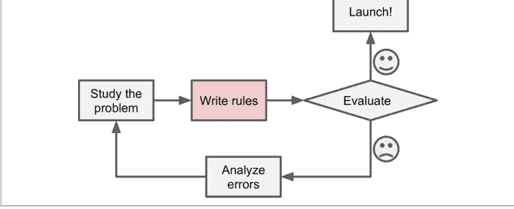

图 1-1

由于问题并不简单，你的程序可能会变成一长串复杂的规则——相当难以维护。

相比之下，基于机器学习技术的垃圾邮件过滤器通过对比垃圾邮件示例与其他示例中的异常的词汇模式，自动学习哪些词和短语是垃圾邮件的良好预测指标（图 1-2）。程序要短得多，更容易维护，而且可能更准确。

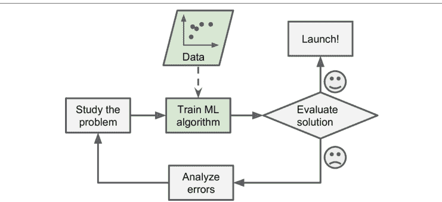

图 1-2

此外，如果垃圾邮件者注意到所有包含“4U”的邮件都被拦截了，他们可能会开始写“For U”。使用传统编程技术的垃圾邮件过滤器需要更新以标记“For U”邮件。如果垃圾邮件者不断绕过你的垃圾邮件过滤器，你永远需要编写新规则。

相比之下，基于机器学习的垃圾邮件过滤器会自动通知“For U”在用户标记的垃圾邮件中异常频繁，并在无需你干预的情况下开始标记它们（图 1-3）。

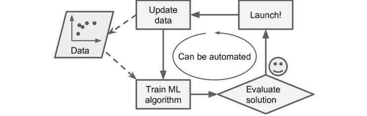

图 1-3

机器学习大放异彩的另一个领域是对于传统方法太复杂或没有已知算法的问题。例如，考虑语音识别：假设你想从简单开始，编写一个能够区分“one”和“two”单词的程序。你注意到单词“two”以一个高音调（“T”）开头，因此你可以硬编码一个测量高音调强度的算法并用于区分这两个词。显然，这种技术无法扩展到数以千计的由非常不同的人所说的单词。

身处嘈杂环境且使用数十种语言的人们。最好的解决方案（至少是目前）是编写一种能够自动学习的算法，只需为每个单词提供许多示例录音。

最后，机器学习可以帮助人类学习（图 1-4）：可以检查 ML 算法以查看它们学习了什么（尽管对于某些算法来说，这可能很困难）。例如，垃圾邮件过滤器已经针对足够的垃圾邮件进行了训练，可以很容易通过检查来揭示预测垃圾邮件效果最好的单词列表和单词组合。有时这会揭示意料之外的相关性或新趋势，从而导致对问题有更好的理解。

将机器学习技术应用于挖掘海量数据，可以帮助发现并非显而易见的模式。这被称为数据挖掘。

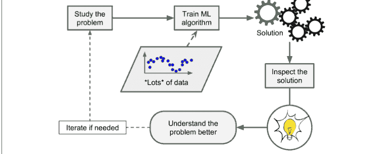

图 1-4. 机器学习可以帮助人类学习

总结一下，机器学习非常适用于：

- *对于现有解决方案需要大量手动调整或长规则列表的问题*：一个机器学习算法通常可以简化代码并获得更好的性能。

- *对于使用传统方法完全没有良好解决方案的复杂问题*：最好的机器学习技术可以找到解决方案。

- *波动的环境*：机器学习系统可以适应新数据。

- *获取有关复杂问题和海量数据的见解。*

### 机器学习系统的类型

有许多不同的机器学习系统，因此根据以下标准对它们进行大类分类很有用：

- *是否通过人类监督进行训练*（监督学习、无监督学习、半监督学习和强化学习）

- *是否可以在线进行增量学习*（在线学习与批量学习）

- *它们是通过简单地将新数据点与已知数据点进行比较来工作，还是像科学家那样检测训练数据中的模式并构建预测模型（基于实例的学习与基于模型的学习）*

这些标准并不是互斥的；你可以按照自己喜欢的任何方式将它们组合。例如，一个先进的垃圾邮件过滤器可以使用使用垃圾邮件和正常邮件示例训练的深度神经网络模型进行在线学习；这使其成为一个在线的监督学习系统。

让我们更仔细地观察这些每一个标准。

### 监督/无监督学习

机器学习系统可以根据在训练期间获得的监督数量和类型进行分类。主要分为四大类：监督学习、无监督学习、半监督学习和强化学习。

#### 监督学习

在监督学习中，你提供算法的训练数据包含了所需的解决方案，称为标签（图 1-5）。

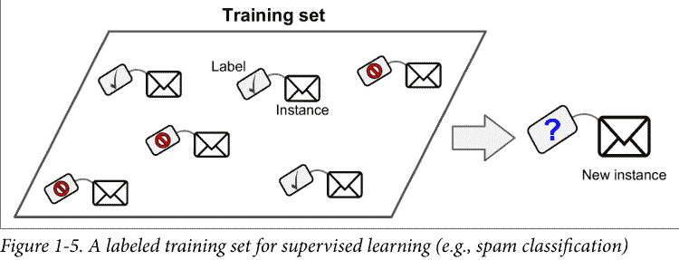

一个典型的监督学习任务是分类。垃圾邮件过滤器是其中的很好的例子：它通过许多示例邮件及其相应的类别（垃圾邮件或正常邮件）进行训练，并且必须学习如何对新邮件进行分类。

另一个典型任务是预测目标数值，例如在给定一组被称为预测因子的特征（里程数、年龄、品牌等）的情况下，预测一个目标数值（如汽车价格）。这类任务被称为回归（图 1-6）。为了训练系统，你必须给它许多汽车示例，包括它们的预测因子和标签（即它们的价格）。

在机器学习中，属性（attribute）是一种数据类型（例如“里程数”），而特征（feature）根据语境有多种含义，但通常指属性加上它的值（例如“里程数 15,000”）。不过，许多人交替使用属性和特征。


| 值 |

|---|

| | 特征 1 |

图 1-6. 回归

注意，某些回归算法也可以用于分类，反之亦然。例如，逻辑回归通常用于分类，它可以输出属于给定类别的概率（例如，20% 的概率是垃圾邮件）。

> 冷知识：这个听起来奇怪的术语是由高尔顿（Galton）在研究高矮的人倾向于趋向平均值时提出的。

以下是一些监督学习算法（书中涵盖）：

- k-近邻

- 线性回归

- 支持向量机 (SVMs)

- 决策树

- 神经网络

#### 无监督学习

在无监督学习中，正如你可能猜到的，训练数据是没有标签的（图 1-7）。系统在没有老师的情况下学习。

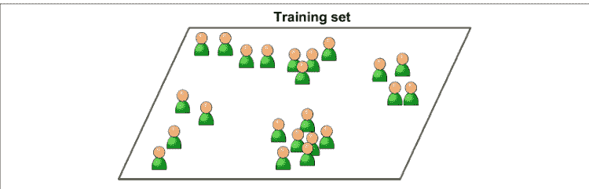

图 1-7. 无监督

以下是一些重要的无监督算法：

- 聚类：K-Means、DBSCAN

- 异常检测

- 一类 SVM

> ² 某些神经网络架构可以是无监督的，例如自动编码器和受限玻尔兹曼。

- 降维：主成分分析 (PCA)

- 核 PCA

- 局部线性嵌入 (LLE)

- t 分布邻域嵌入 (t-SNE)

- 关联规则学习：Apriori

- Eclat

例如，假设你有很多数据。你可能想运行一个聚类算法（图 1-8）。在任何时候你都不告诉算法数据属于哪一组；它会发现联系。

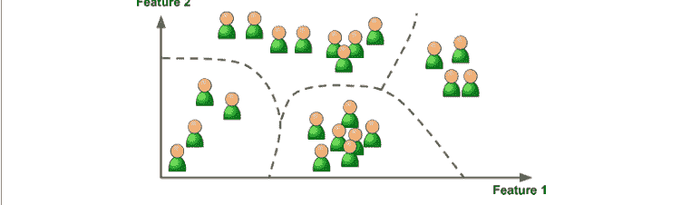

图 1-8. 聚类

可视化算法也是无监督学习的很好的例子：你向它们输入大量数据，它们输出一个可以轻松绘图的数据 2D 或 3D 表示（图 1-9）。这些算法尽可能保留结构（例如，试图让输入空间中的分离簇在可视化中不重叠），以便你可以理解数据是如何组织的，并可能识别出意外模式。

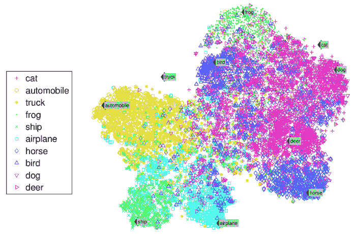

图 1-9. t-SNE 可视化示例

一个相关的任务是降维，目标是在不丢失过多信息的情况下简化数据。实现此目标的方法是将几个相关的特征合并为一个。例如，汽车的里程数可能与它的年龄高度相关，因此降维算法会将它们合并为一个代表汽车损耗的特征。这被称为特征提取。

在将数据输入另一个机器学习算法（例如监督学习算法）之前，尝试使用降维算法降低数据的维度通常是一个好主意。算法的运行速度会快得多，数据占用的磁盘和内存空间更少，在某些情况下性能也可能更好。

另一个无监督任务是异常检测——例如，检测异常的信用卡交易以防止欺诈、捕捉制造缺陷，或者在将数据输入另一个学习算法之前自动删除离群值。该系统在训练期间看到的大多是正常实例，因此它学会了识别它们，当它看到一个新实例时，它可以判断该实例是否

...像正常数据一样，还是它可能是一个异常值（见图 1-10）。一个非常相似的任务是新颖性检测（novelty detection）：区别在于，新颖性检测算法期望训练期间只看到正常数据，而异常检测算法通常更具容性，它们在存在极小比例离群点的情况下也能良好运行。

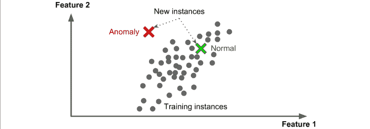

图 1-10. 异常检测

最后，另一种常见的无监督任务是关联规则学习（association rule learning），其目标是挖掘大量数据并发现属性之间有趣的的关系。例如，假设你拥有一家超市。在你的销售日志上运行关联规则可能会发现，购买烧烤酱和薯片片的人也倾向于购买这些物品。你可能想将这些物品放在较近的地方。

#### 半监督学习

某些算法可以处理部分标记的数据，使用大量的无标记数据和少量的标记数据。这被称为半监督学习（图 1-11）。

一些照片托管服务（如 Google Photos）就是这很好的例子。一旦你将所有家庭照片上传到该服务，它会自动识别出同一个人 A 出现在照片 1、5 和 11 中，而另一个人 B 出现在照片 2、5 和 7 中。这是该算法的无监督部分（聚类）。现在系统只需要你告诉它这些人是谁。每人只需要一个标签，它就能为每张照片中的每个人进行命名，这对于搜索照片非常有用。

> 4 那是系统工作得非常完美的时候。在实践中，它通常会为每个人创建几个类，有时会混淆两个长得像的人，因此你需要为每个人提供几个标签，并手动清理一些聚类。

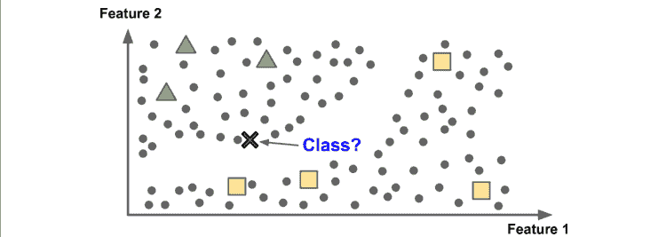

图 1-11. 半监督学习

大多数半监督学习算法都是无监督和监督算法的结合。例如，深度信念网络（DBNs）是基于名为受限玻尔兹曼机（RBMs）的无监督组件堆叠而成的。RBM 以无监督的方式按顺序训练，然后使用监督学习技术对整个系统进行微调。

#### 强化学习

强化学习是完全不同的东西。在这种语境下，学习系统被称为代理体（agent），它可以观察环境、选择并执行动作，并获得相应的奖励（或以负奖励形式的惩罚，如图 1-12 所示）。它必须自己学会什么是最佳策略，称为策略（policy），以便随着时间的推移获得最多的奖励。策略定义了代理体在给定情况下应该选择什么动作。

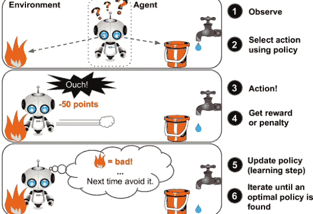

图 1-12. 强化学习

例如，机器人通过实现强化学习算法来学习如何行走。DeepMind 的 AlphaGo 程序也是强化学习的一个很好的例子：它在 2017 年 5 月因在围棋中击败世界冠军柯柯石而登上了头条。它通过分析数百万局对弈，然后与自己进行许多对弈来学习策略。请注意，在与冠军的对弈期间学习功能是关闭的；AlphaGo 只是在应用它学到的策略。

### 批量学习与在线学习

分类机器学习系统的另一个标准是系统是否能够从不断输入的数据流中进行增量学习。

#### 批量学习

在批量学习中，系统无法增量学习；它必须使用所有可用数据进行训练。这通常需要大量的时间和计算资源，因此通常是在离线完成的。首先训练系统，然后将其投入生产并运行，而不进行学习。如果你想让系统适应新数据，你必须从所有数据开始重新训练系统，这通常需要很长时间。

#### 在线学习

在线学习是指系统能够从不断接收的数据流中增量学习。这对于处理海量数据非常有用，因为数据不需要一次性加载。在在线学习中，系统在接收数据时进行更新（见图 1-13）。

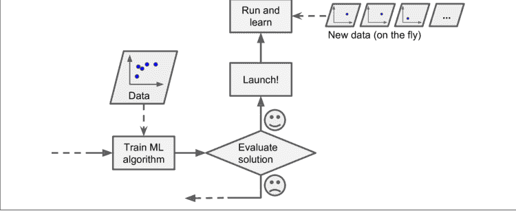

图 1-13. 在线学习

在线学习算法允许系统通过处理新数据来更新，并丢弃旧数据。这种方法对于处理快速变化的数据非常有效。

### 实例学习与模型学习

分类机器学习系统的另一种方法是它们如何进行泛化。大多数机器学习任务都是关于预测的。这意味着给定一些训练示例，系统需要能够泛化到从未见过的示例上。在训练数据上有良好的性能是好的，但并不足够；真正的目标是在新实例上表现良好。

泛化主要有两种方法：实例学习和模型学习。

#### 实例学习

学习可能最简单的学习形式就是通过记忆学习。如果你以这种方式创建垃圾邮件过滤器，它会标记所有与用户已标记邮件完全相同的邮件——这不是最糟糕的，但显然不是最好的。


与其只标记与已知垃圾邮件相同的邮件，你的过滤器可以程序化为标记与已知邮件非常相似的邮件。这需要两个邮件之间的相似性衡量标准。一种（非常基础）相似性标准可以通过它们共同拥单词数来计算。如果一封邮件与已知垃圾邮件有很多共同单词，系统就会将其标记为垃圾邮件。

这被称为实例学习：系统通过与学习示例（或其子集）比较，使用相似性标准来记忆示例。例如，在图 1-15 中，新实例被分类为三角形，因为大多数最相似的实例属于该类。

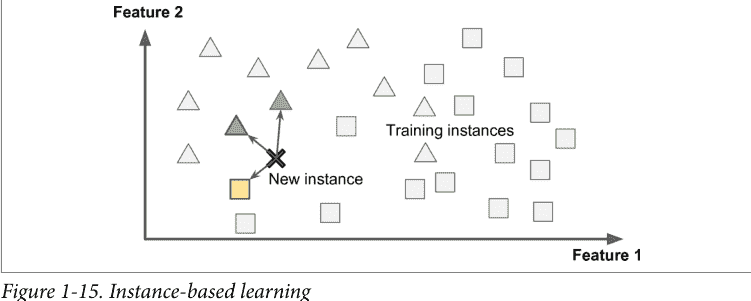

# 基于模型的学习

从一组示例中泛化的另一种方法是为这些示例建立一个模型，然后使用该模型进行*预测*。这被称为*基于模型的学习*（图 1-16）。

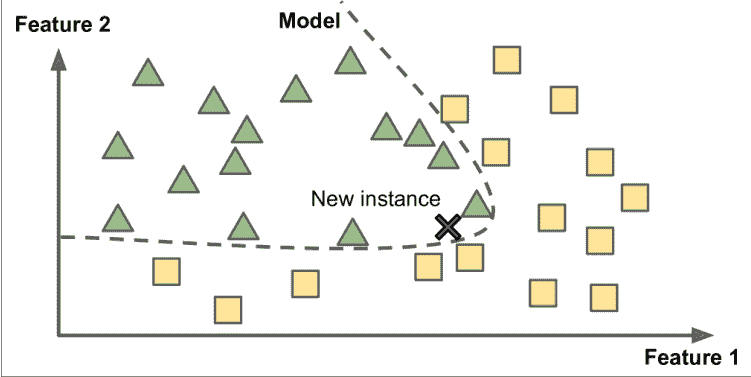

例如，假设你想知道金钱是否让人快乐，于是你从[OECD 网站]下载了《生活质量指数》数据，并从[IMF 网站]下载了关于人均 GDP 的统计数据。然后你将表格合并并按人均 GDP 排序。表 1-1 显示了获得的内容摘要。

## 表 1-1. 金钱让人更幸福吗？

| 国家 | 人均 GDP（美元） | 生活满意度 |
|---|---|---|
| 匈牙利 | 12,240 | 4.9 |
| 韩国 | 27,195 | 5.8 |
| 法国 | 37,675 | 6.5 |
| 澳大利亚 | 50,962 | 7.3 |
| 美国 | 55,805 | 7.2 |

让我们为几个随机国家的数据画图（图 1-17）。

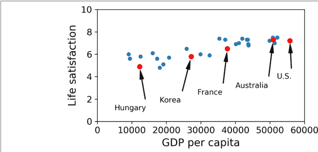

图 1-17. 你看到趋势了吗？

这里似乎存在一种趋势！尽管数据存在噪声（即部分是随机的），但看起来随着国家人均 GDP 的增加，生活满意度呈线性或非线性的增长趋势。因此，你决定将生活满意度建模为人均 GDP 的线性函数。这一步被称为模型选择：你选择了一个具有单一属性（人均 GDP）的生活满意度线性模型（方程 1-1）。

### 方程 1-1. 一个简单的线性模型

```
life_satisfaction = \theta_0 + \theta_1 \times GDP\_per_capita
```

该模型有两个模型参数：$\theta_0$ 和 $\theta_1$。通过调整这些参数，你可以让你的模型表示任何线性函数，如图 1-18 所示。

> 5 按照惯例，希腊字母 theta（theta）经常被用来表示模型参数。

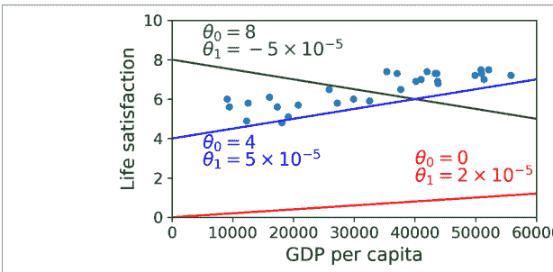

图 1-18. 一种可能的线性模型

在使用你的模型之前，你需要定义参数值 $\theta_0$ 和 $\theta_1$。你如何知道哪组值能让你的模型表现最好？为了回答这个问题，你需要指定一个性能衡量标准。你可以定义一个效用函数（或适应度函数）来衡量你的模型的优坏，或者定义一个代价函数来衡量它有多糟糕。对于线性回归问题，人们通常使用代价函数来衡量线性模型预测值与训练示例之间的距离；目标是最小化这个距离。

这就是线性回归算法派上用场的地方：输入训练示例，它会找到让线性模型最拟合你数据的参数。这被称为训练。在我们的案例中，算法找到的最优参数值为 $\theta_0 = 4.85$ 和 $\theta_1 = 4.91 \times 10^{-5}$。

现在尽可能地拟合训练数据（对于线性模型），正如你在[图 1-19]中所示。

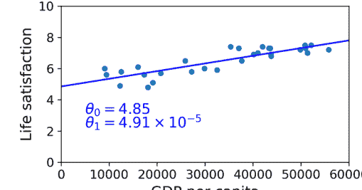

图 1-19. 最拟合训练数据的线性模型

你终于准备好运行模型进行预测了。例如，假设你想知道塞浦路斯人有多快乐，而 OECD 数据并没有给出答案。幸运的是，你可以使用你的模型进行预测：查询塞浦路斯的人均 GDP，发现为 22,587，然后应用你的模型，发现生活满意度可能在 $4.85 + 22,587 \times 4.91 \times 10^{-5} = 5.96$ 左右。

根据你的需求，示例 1-1 显示了加载数据、准备数据、创建散点图进行可视化、然后训练线性模型并进行预测的 Python 代码。

### 示例 1-1. 使用 Scikit-Learn 训练和运行线性模型

```
import matplotlib.pyplot as plt
import numpy as np
import pandas as pd
import sklearn.linear_model

## 加载数据
oecd_bi = pd.read_csv('oecd_bi_2015.csv', thousands=',',')
gdp_per_capita = pd.read_csv('gdp_per_capita.csv', thousands=',', delimiter='\t', encoding='latin1', na_values="n/a")

## 准备数据
country_states = prepare_country_states(oecd_bi, gdp_per_capita)
X = np.c_[country_states['GDP per capita']]
y = np.c_[country_states['Life satisfaction']]

## 可视化数据
country_states.plot(kind='scatter', x='GDP per capita', y='Life satisfaction')
plt.show()

## 选择线性模型
model = sklearn.linear_model.LinearRegression()

## 训练模型
model.fit(X, y)

## 为塞浦路斯预测
X_new = [[22587]] # 'Cyprus' 人均 GDP
print(model.predict(X_new)) # 输出 [[ 5.96242338 ] ]
```

如果你改用基于实例的学习算法，你会发现斯洛文尼亚的人均 GDP 与塞浦路斯最接近（$20,732），而 OECD 数据告诉我们斯洛文尼亚人的生活满意度为 5.7（塞浦路斯）。如果你稍微缩小范围看下两个两个最近的国家，你会发现葡萄牙和西班牙的生活满意度分别为 5.1 和 6.5。对这些值取平均值，你得到 5.77，这与你基于模型的预测非常接近。这个简单的算法是 k-近邻回归（在本例中，k=3）。

将线性回归替换为 k-近邻回归只需替换这两行代码：

```python
import sklearn.linear_model
model = sklearn.linear_model.LinearRegression()
```

```python
import sklearn.neighbors
model = sklearn.neighbors.KNeighborsRegressor(n_neighbors=3)
```

如果效果良好，你的模型就可以进行预测。你可能需要更多的属性（就业率、空气污染等），或者获取更好的训练数据，或者选择更强大的模型（例如多项式回归）。总结：

- 你研究了数据。
- 你选择了一个模型。
- 你在训练数据上训练了模型（寻找最小化代价函数的参数值）。
- 最后，你将模型应用于新案例以进行预测（这被称为泛化）。

到为止，我们涵盖了大量内容：你现在知道了机器学习是什么、它为什么有用、常见的机器学习分类，以及典型的工作流。在第 2 章中将亲身体验这些。

## 无代表性的训练数据

为了良好的泛化能力，你的训练数据必须对你想要泛化的新案例具有代表性，这至关重要。无论你是基于实例的学习还是基于模型的学习，这一点都是如此。

例如，我们之前用于训练线性模型的国家集并不完美代表性；缺少了几个国家。图 1-21 显示了添加这些缺失的国家后数据的样貌。

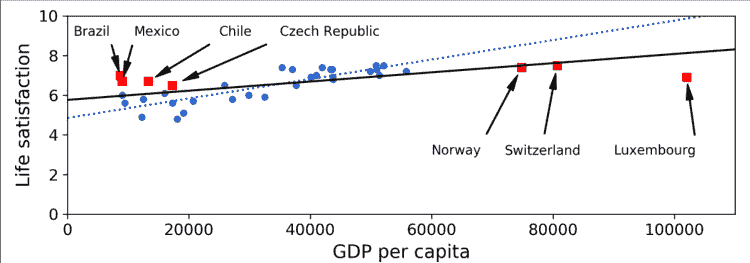

图 1-21。更具代表性的训练样本

如果你在这些数据上训练线性模型，你将得到实线，而旧模型由虚线表示。如你所见，不仅添加几个缺失的国家会显著改变模型，而且它清楚地表明，简单的线性模型可能永远无法很好地工作。看起来非常富裕的国家并不比中等收入的国家更快乐（事实上它们看起来并不快乐），反之，一些贫穷国家似乎比许多富裕国家更快乐。

通过使用无代表性的训练集，我们训练出的模型很难做出准确的预测，特别是对于非常贫穷和非常富裕的国家。

使用与你想要泛化的案例代表的训练集至关重要。这通常比听起来要困难：如果样本太小，你会有采样噪声（即由于变化导致的无代表性数据），但即使是非常大的样本，如果采样方法有问题，也可能是无代表性的。这被称为采样偏差。

### 采样偏差的著名案例

最著名的采样偏差案例发生在 1936 年的美国大选期间，当时兰登对阵罗斯福：《文学杂志》（Literary Digest）进行了一项规模巨大的调查，向约 1000 万人发送了邮件。它收到了 240 万份答案，并以高置信度预测兰登将获得 57% 的票。

然而，罗斯福以 62% 的得票获胜。缺陷在于《文学杂志》的采样方法：

- 首先，为了获取发送问卷的地址，《文学杂志》使用了目录、杂志订阅者名单、俱乐部会员名单等。所有这些列表都倾向于富富有的人，他们更有可能投票给共和党（即兰登）。
- 其次，收到问卷的人中少于 25% 回了回答。这再次引入了偏差，排除了不在乎政治的人、不使用《文学杂志》的人和其他群体。这是一种由无响应偏差引起的特殊类型的采样偏差。

这里是另一个例子：假设你想构建一个识别泛克音乐视频的系统。构建训练集的一种方法是在 YouTube 上搜索“funk music”并使用生成的视频。但假设假设 YouTube 的搜索引擎返回的一组视频对 YouTube 上所有泛克音乐视频具有代表性。事实上，搜索结果很可能倾向于热门艺术家（如果你住在巴西，你会得到很多“funk carioca”视频，它们听起来和詹姆斯·布朗完全不像）。另一方面，除了这样你还能如何获得一个庞大的训练集呢？

### 低质量数据

显然，如果你的训练数据充满了错误、离群值和噪声（例如由于测量质量引起），它将使系统更难检测到底层模式，或者你的系统不太可能表现良好。花时间清理训练数据通常是值得的。事实是，数据科学家花费大量时间在做这些工作。例如：

- 如果实例明显是离群值，简单丢弃它们或尝试手动修复错误可能会有所帮助。
- 如果实例缺失特征（例如，5% 的客户没有指定年龄），你必须决定是忽略此属性、忽略这些实例、填补缺失值（例如用中位数年龄），还是训练一个带有该特征的模型和一个不带该特征的模型，以此此类推。

### 无关特征

俗话说：垃圾进，垃圾出（garbage in, garbage out）。只有当你的训练数据包含相关特征且没有太多无关特征时，你的系统才具备学习能力。机器学习项目成功的关键部分是提出一套良好的特征集进行训练。这个过程被称为特征工程，涉及：

- 特征选择：在现有特征中选择对训练最有用的特征进行训练。
- 特征提取：组合现有特征以产生更有有用的特征（正如我们之前看到的，降维算法可以提供帮助）。
- 通过收集新数据来创建新特征。

现在我们已经看了很多坏数据的例子，让我们来看几个坏算法的例子。

### 过拟合训练数据

假设你正在访问一个外国，一名出租车司机宰了你。你可能会忍不住说那个国家的所有出租车司机都是小偷。我们太经常过度泛化某些事物了，不幸的是，如果我们不小心，机器也会掉入同样的陷阱。在机器学习中，这被称为过拟合（overfitting），意味着模型在训练数据上表现良好，但泛化能力不好。

图 1-22 显示了一个严重过拟合训练数据的高阶多项式生活满意度模型。尽管它在训练数据上的表现比简单线性模型好得多，但你真的信任它的预测吗？

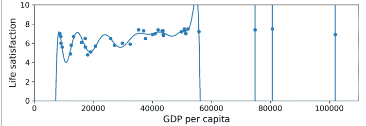

图 1-22。过拟合训练数据

深度神经网络等复杂模型可以检测数据中的细微模式，但如果训练数据充满噪声，或者太小（这引入了采样噪声），那么模型可能会检测到噪声本身的模式。显然，这些模式无法泛化到新实例。例如，如果你为生活满意度模型提供更多属性，包括没有信息的属性（如国家名称）。在这种情况下，复杂模型可能会检测出一种模式：训练数据中所有名称中带有“w”的国家满意度都大于 7：新西兰（7.3）、挪威（7.4）、瑞典（7.2）和瑞士（7.5）。你有多大把握这种“W 满意度规则”能泛化到卢旺达或津巴韦？显然，这种模式在训练数据中纯属偶然，但模型无法判断某种模式是真实的还是仅仅数据噪声的结果。

当模型相对于训练数据的数量和噪声程度过于复杂时，就会发生过拟合。可能的解决方案是：


- 通过选择参数较少的模型来简化模型（例如使用线性模型而不是高阶模型），通过减少训练数据中的属性数量或通过约束模型
- 收集更多训练数据
- 减少训练数据中的噪声（例如修复数据错误和移除离群值）

约束模型以使其更简单并降低过拟合风险被称为正则化（regularization）。例如，我们定义的线性模型有两个参数，$\theta_0$ 和 $\theta_1$。这个学习算法拥有两个自由度来使模型适应训练数据：它可以调整直线的高度 $(\theta_0)$ 和斜率 $(\theta_1)$。如果我们强制 $\theta_0 = 0$，算法将只有一个自由度，并且很难很好拟合数据：它能做的只是直线向上或向下移动以尽可能靠近训练实例，因此将落在平均值附近。一个非常简单的理想模型。如果我们允许算法在一个到两个自由度之间进行修改。它将产生一个比两个自由度更简单的模型，但比仅仅一个自由度更复杂。你希望在完美拟合训练数据和保持模型简单以确保泛化之间找到正确的平衡。

图 1-23 显示了三个模型：点线代表用少数国家训练的原始模型，虚线是我们用所有国家训练的第二个模型，实线是用与第一个模型相同的数据训练但带有正则化约束的线性模型。你可以看到正则化强制模型具有较小的斜率，这使得它对训练训练数据的拟合程度稍低，但实际上让它对新示例的泛化效果更好。

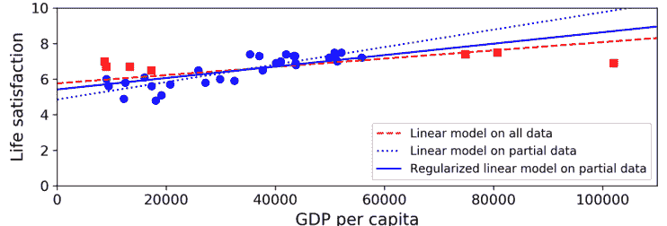

图 1-23. 正则化降低了过拟合的风险

学习过程中应用的正则化程度可以通过超参数来控制。超参数是学习算法的参数（而不是模型的参数）。因此，它不受学习算法本身的影响；它必须在训练之前设置，并且在训练过程中保持不变。如果你将正则化超参数设置为非常大的值，你将得到一个几乎是平坦的模型（斜率接近零）；学习算法几乎不会过拟合训练数据，但它找到良好解决方案的概率也会降低。调优超参数是构建机器学习系统的重要部分（你将在下一章看到一个详细的示例）。

## 训练数据的欠拟合

正如你可能猜到的那样，欠拟合是过拟合的反面：当你的模型太简单，无法学习数据的底层结构时，就会发生欠拟合。例如，生活满意度的线性模型很容易出现欠拟合；现实比模型复杂得多，因此它的预测注是不准确的，即使在训练样本上也是如此。

解决此问题的主要方案有：

- 选择一个更强大、参数更多的模型
- 向学习算法提供更好的特征（特征工程）
- 减少对模型的限制（例如，减少正则化超参数）

## 回头看看

到目前，你已经对机器学习有了许多了解。然而，我们学习了这么多概念，你可能会感到有些迷茫，所以让我们退后一步来看大局：

- 机器学习关于通过从数据中学习来让机器在某些任务上变得更好，而不是显式地编写规则。
- 有许多类型的机器学习系统：监督或无监督、批处理或在线、基于实例或基于模型等。
- 在机器学习项目中，你从训练集中收集数据，并将训练集输入到学习算法中。如果该算法是基于模型的，它会调整某些参数以拟合训练集（即对训练集本身做出良好的预测），并希望它也能对新案例做出良好的预测。如果算法是基于实例的，它会记住这些示例，并通过相似性度量将新实例与已学到的实例进行比较，从而泛化到新实例。
- 如果你的训练数据太小，或者数据不具代表性、有噪声；或者被无关特征污染（垃圾进，垃圾出），系统表现将不会尽如。最后，你的模型既不能太简单（否则会导致欠拟合），也不能太复杂（否则会导致过拟合）。

最后一个要讨论的话题是：一旦你训练了模型，你并不仅仅是“希望”它能泛化到新案例。你想要对其进行评估，并在必要时对其进行微调。让我们来看看。

## 测试与验证

了解一个模型泛化到新案例的效果有多坏的唯一方法是实际上在这些案例上测试它。做这一点的一种方法是将你的模型投入生产并监控它的性能。这种方法效果很好，但如果你的模型很糟糕，你的用户就会抱怨——这并不是一个好主意。

更好的选择是将数据分为两个部分：训练集和测试集。正如这些名称所示，你使用训练集来训练模型，并使用测试集对模型进行测试。新案例上的误差被称为泛化误差（或样本外误差），通过在测试集上评估你的模型，你可以获得该误差的估计。这个值告诉你你的模型在从未见过的实例上的表现如何。

如果训练误差很低（即你的模型在训练集上犯错很少）但泛化误差很高，这意味着你的模型正在过拟合训练数据。


通常使用 80% 的数据进行训练，保留 20% 用于测试。然而，这取决于数据集的大小：如果它包含 1000 万个实例，保留 1% 意味着你的测试集将包含 10 万个实例：这可能足够对泛化误差进行良好的估计。

## 超参数调优与模型选择

所以评估一个模型足够简单：只需使用测试集即可。现在假设你正在两个模型之间犹豫（例如线性模型和多项式模型）：你如何决定呢？一种方案是训练两者，并使用测试集比较它们的泛化情况。

现在假设线性模型的泛化效果更好，但你想对过拟合应用一些正则化。问题是：你如何选择正则化超参数的值？一种方案是使用 100 个不同的超参数值来训练 100 个模型。假设你找到了产生最低泛化误差（例如仅 5% 误差）的最优超参数值。

于是你将此模型投入生产，但遗憾的是，它的表现没有预期那样，产生了 15% 的误差。发生了什么？

问题在于你在测试集上多次测量了泛化误差，并调整了模型和超参数，以针对该特定集合产生最佳模型。这意味着模型在新数据上的表现不太可能像之前那样好。


解决此问题的常用方法被称为留出验证（holdout validation）：你只需留出训练集的一部分来评估几个候选模型并选择最好的一个。新的留出集被称为验证集（有时也称为开发集，或 dev 集合）。更具体地说，你是在缩减后的训练集（即完整的训练集减去验证集）上使用各种超参数训练多个模型，并选择在验证集上表现最好的模型。在这一验证过程之后，你在完整的训练集（包括验证集）上训练模型，这便构成了你的最终模型。最后，你在测试集上对这个最终模型进行评估，以获得对泛化误差的估计。

这种解决方案通常很有效。然而，如果验证集太小，那么模型评估将是不精确的：你可能会错误地选择一个次优模型。相反，如果验证集太大，那么剩余的训练集将比完整的训练集小得多。为什么这不好呢？嗯，由于最终模型将在完整的训练集上训练，因此比较在小得多的训练集上训练的模型是不理想的。这就像让最快的短跑运动员参加马拉松。解决此问题的一种方法是进行重复交叉验证，使用许多验证集。每个模型在剩余数据上训练后，每个验证集都会评估一次。通过对模型的评估取平均值，我们得到了对其性能更准确的衡量。然而，它也有缺点：训练时间会随着验证集的数量而倍增。

## 数据偏差

在某些情况下，很容易获得大量的训练数据，但它们并不代表生产中中使用的数据。例如，假设你想创建一个手机应用程序来拍摄照片并自动确定物种。你可以轻松从网上下载数百万张照片，但它们并不代表使用手机拍摄的照片。也许你只有 10,000 张具有代表性的照片（即使用实际拍摄的）。在这种情况下，要记住最重要的规则是，验证集和测试集必须与你预期使用的数据一致，因此它们应该完全由代表性照片组成：你可以洗乱并将一半放入验证集，另一半放入测试集（确保没有重复或近重复出现在两个集合中）。在网络照片上训练模型后，如果你观察到模型在验证集上的表现令人失望，你将不知道是因为模型过拟合了训练集，还是仅仅是因为网络照片与手机照片之间的偏差。一种解决方案是从训练集中留出部分作为另一个集合，吴恩达将其称为训练-开发集。在模型在训练集（而不是训练-开发集）上训练后，你在训练-开发集上对其进行评估：如果表现良好，则模型没有过拟合训练集，问题可能来自数据偏差。你可以尝试通过处理网络图像使其更像手机拍摄的照片来解决这个问题，然后重新训练模型。相反，如果模型在训练-开发集上的表现不佳，则模型过拟合了训练集，你需要尝试简化或正则化模型，获取更多训练数据并清理训练数据。

## 无午餐定理

模型是观测值的简化版本。这些简化是为了丢弃不太泛化到新实例的冗余细节。然而，为了决定丢弃什么和保留什么数据，必须做出假设。例如，线性模型假设数据从根本上是线性的，实例与直线之间的距离仅仅是噪声，可以安全地忽略。

在1996年的一篇著名论文中，David Wolpert 证明了如果你对数据不做出任何假设，那么没有理由选择一个模型优于其他。这被称为无午餐（NFL）定理。对于某些数据集，最好的模型可以是线性模型，而对于其他数据集，它可以是神经网络。没有哪种模型是先验保证效果更好的（这也是该定理命名的由来）。要知道哪种模型最好，唯一的方法是评估所有模型。由于这是不可行的，在实践中你对数据做出某些合理的假设，并只评估少数合理的模型。例如，对于简单的任务，你可能会评估具有不同正则化水平的线性模型；对于复杂的问题，你可能会评估各种神经网络。

## 练习题

在本章中，我们涵盖了机器学习中一些最重要的概念。在接下来的章节中，我们将深入探讨并编写更多代码，在此之前，请确保你知道如何回答以下问题：

- 1. 你如何定义机器学习？
- 2. 你能列出机器学习表现出色的四类问题吗？
- 3. 什么是标记训练集？
- 4. 最常见的两种监督任务是什么？
- 5. 你能列出四种常见的无监督任务吗？
- 6. 你会使用什么类型的机器学习算法让机器人在各种未知地形上行走？
- 7. 你会使用什么类型的算法将客户分成多个组？
- 8. 你会将垃圾邮件检测问题建模为监督学习问题还是无监督学习问题？
- 9. 什么是在线学习系统？
- 10. 什么是核心外学习（out-of-core learning）？
- 11. 什么类型的学习算法依赖相似性量来进行预测？
- 12. 模型参数与学习算法的超参数之间有什么区别？
- 13. 基于模型的算法搜索什么？它们成功的常用策略是什么？它们是如何进行预测的？
- 14. 你能列出机器学习中的四大挑战吗？
- 15. 如果你的模型在训练数据上表现良好，但在新实例上的泛化能力差，发生了什么？你能列出三个可能的解决方案吗？
- 16. 什么是测试集，你为什么要使用它？
- 17. 验证集的目的是什么？
- 18. 如果使用测试集调优超参数会发生什么问题？
- 19. 什么是交叉验证，你为什么倾向于使用它而不是单一验证集？

这些练习的答案可以在 ??? 中找到。

## 第 2 章

端到端机器学习项目

通过早发版（Early Release）电子书，你获得的是书籍最早的形式——作者在撰写时的原始且未经编辑的内容——因此你可以在这些标题正式发布很久以前利用这些技术。以下内容将是书中最终版本的第 2 章。

在本章中，你将端到端地完成一个示例项目，假设自己是房地产公司新入职的数据科学家。以下是你将经历的主要步骤：

- 1. 顾全大局。
- 2. 获取数据。
- 3. 发现并可视化数据以获得洞察。
- 4. 为机器学习算法准备数据。
- 5. 选择模型并训练它。
- 6. 微调你的模型。
- 7. 展示你的解决方案。
- 8. 启动、监控和维护你的系统。

> 示例项目完全是虚构；目标仅仅是说明机器学习项目的主要步骤，而不是学习房地产业务的知识。

## 处理真实数据

当你学习机器学习时，最好是针对真实世界的数据进行实验，而不仅仅是人工数据集。坦率地说，有数千个开放数据集可以选择，涵盖各种领域。以下是你可以获取数据的几个地方：

- 流行的数据存储库：
  - UC Irvine 机器学习仓库
  - Kaggle 数据集
  - Amazon 的 AWS 数据集
  - Meta 门户（它们列出了开放数据存储库）：
    - `http://dataportals.org/`
    - `http://opendatamonitor.eu/`
    - `http://quandl.com/`
  - 其他列出许多流行开放数据存储库的页面：
    - 维基百科机器学习数据集列表
    - Quora.com 问题
    - Datasets subreddit

在本章中，我们选择了来自 StatLib 的加州房价数据集（见图 2-1）。该数据集基于 1990 年加州的人口普查数据。它并不算近期（在那个时代你仍然买得起湾区的一栋好房子），但它具有许多学习的特质，因此为了教学目的，我们还添加了一个类别属性并删除了几个特征。

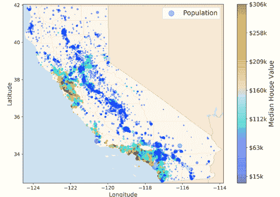

图 2-1. 加州房价

## 顾全大局

欢迎来到加州住房公司！你被要求的第一项任务是利用加州人口普查数据建立一个加州房价模型。这些数据包含了加州每个区块组（block group）的人口、中位数收入、中位数房价等指标。区块组是美国人口普查局发布样本数据的最小地理单元（一个区块组的人口通常为 600 到 3,000 人）。我们将简便地称它们为“区域（districts）”。

你的模型应该从这些数据中学习，并能够在给定所有其他指标的情况下，预测任何区域的中位数房价。

> 既然你是一个组织良好的的数据科学家，你做的第一件事就是拿出你的机器学习项目检查清单。你可以从 ??? 中的清单开始；它对大多数机器学习项目都足够适用，但请确保根据你的需求对其进行调整。在本章中，我们将检查许多清单条目，但也会跳过其中几个，要么是因为它们自言易懂，要么是因为它们将在后面的章节中讨论。

## 问题建模

第一个问题是问你的老板业务目标究竟是什么；建立模型可能不是终极目标。公司希望如何使用并从该模型中受益？这很重要，因为它将决定你如何建模、你将选择什么算法、你将使用什么性能指标来评估你的模型，以及你应该投入多少精力来调优。

你老板的模型输出（对某个区域中位数房价的预测）将被输入另一个机器学习系统（见图 2-2），以及许多其他信号。$3 该下游系统将决定是否值得在特定区域投资。准确这一点至关重要，并直接影响收-

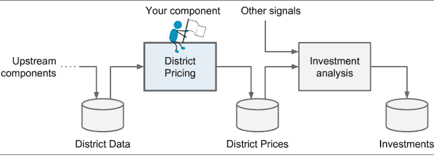

图 2-2. 机器学习流水线

## 流水线

数据处理序列被称为*流水线（pipeline）*。流水线在机器学习系统中非常常见，因为有大量数据需要处理。组件通常是异步运行的。流水线获取大量数据，进行处理，并输出到数据存储。3 输入机器学习系统的信息通常被称为*信号（signal）*，从信息论来看：你需要高信噪比。

40 | 第 2 章：端到端机器学习项目

另一方面，如果没有实施适当的监控，组件故障可能不会被察觉。数据会过时，系统的整体性能就会下降。

下一个问题是目前的解决方案是什么（如果有的话）。它通常会提供解决问题的洞察。你老板回答地区房价是由专家手动估计的：当他们无法获得价格时，通常发现偏差超过了 20%。这就是公司认为训练一个模型来预测区域房价非常有用的原因。普查数据看起来是此目的很好的数据集，因为它包含了数千个区域的价格以及其他数据。

启动系统。首先，你需要建模：它是监督的、无监督的还是强化学习？它是分类任务、回归任务还是其他的？你应该使用学习还是在线学习技术？在阅读之前，停下来并尝试回答这些问题。

找到答案了吗？让我们来看看：显然是一个监督学习任务，因为你被训练示例（每个实例包含预期输出，即区域的中位数房价）。此外，它也是典型的回归任务，因为你被要求预测一个值。具体来说，这是一个多元回归问题，因为系统将使用多个特征进行预测（它将使用区域的人口、中位数收入等）。它也是单变量回归问题，因为我们只尝试为每个区域预测一个值。如果我们尝试每个区域预测多个值，它就是多元回归问题。最后，没有持续数据流入系统，没有特别需要快速适应变化的数据需求，且数据足够小可以放入内存中，所以批学习应该没问题。

如果数据巨大，你可以将批处理工作拆分到多个服务器上（使用 MapReduce 技术），或者你也可以改用在线学习技术。

## 选择性能衡量标准

下一步是选择一个性能衡量标准。对于回归问题，典型的性能衡量标准是均方根误差（RMSE）。它提供了系统在预测中通常产生多大误差的概念，并且赋予误差更大的权重。公式 2-1 显示了计算 RMSE 的数学公式。

### 公式 2-1. 均方根误差 (RMSE)

```
$RMSE(\mathbf{X}, h) = \sqrt{\frac{1}{m} \sum_{i=1}^{m}(h(x^{(i)})-y^{(i)})^2}$
```

### 符号

该方程引入了我们在书中使用的几个非常常用的机器学习符号：

- `$m$` 是你用于衡量 RMSE 的数据集中的实例数量。
- 例如，如果你在一个规模为 2,000 个地区的验证集上评估 RMSE，那么 `$m=2,000$`。
- `$x^{(0)}$` 是数据集中第 $i^{th}$ 个实例所有特征值（不包括标签）的向量，而 `$y^{(0)}$` 是标签（该实例的期望输出值）。
- 例如，如果数据集中的第一个地区位于经度 `-118.29°`，纬度 `33.91°`，它有 1,416 人口，中位数收入为 `38,372`，房屋中位数价值为 `156,400`(暂时忽略其他特征），

```
$x^{(1)} = \begin{pmatrix} -118.29 & 33.91 & 1,416 \end{pmatrix}$
```

以及：

```
$y^{(1)} = 156, 400$
```

- `$X$` 是一个包含数据所有实例特征值（不包括标签）的矩阵。每个实例对应一行，$i^{th}$ 行等于于 `$x^{(i)}$` 的转置，记作 `$(x^{(i)})^T$`。
- 例如，如果是上述的第一个地区，那么矩阵 `$X$` 看起来如下：

```
$X = \begin{pmatrix} (x^{(1)})^T & (x^{(2)})^T & \vdots & (x^{(1999)})^T & (x^{(2000)})^T \end{pmatrix} = \begin{pmatrix} -118.29 & 33.91 & 1,416 & 156,400 \\ \vdots & \vdots & \vdots & \vdots \end{pmatrix}$
```

- `$h$` 是你的系统的预测函数，也称为假设（hypothesis）。当给系统一个实例特征向量 `$x^0$` 时，它输出一个预测值 `$y^0 = h(x^0)$`，例如 `$\hat{y}$` 读作 "y-hat"。
- 例如，如果你的系统预测第一个地区的房屋房价为 158,400，那么 `$y^0 = h(x^0) = 158,400$`。该地区的预测误差为 `$\hat{y} - y^0 = 2,000$`。
- `RMSE(X,h)` 是在示例集上衡量的代价函数，使用*斜体*表示标量值（如 `$m$` 或 `$y^0$`）和函数名（如 `$h$`），**小写粗体**表示向量（如 `$x^0$`），**大写粗体**表示矩阵（如 `$X$`）。

我们使用*斜体*表示标量值（如 `$m$` 或 `$y^0$`）和函数名（如 `$h$`），使用**小写粗体**表示向量（如 `$x^0$`），使用**大写粗体**表示矩阵（如 `$X$`）。

尽管 RMSE 通常是回归任务的首选性能指标，但在某些情况下你可能更喜欢其他函数。例如，假设有很多离群地区。在这种情况下，你可能考虑平均绝对误差（也称为平均绝对偏差；见公式 2-2）：

### 公式 2-2. 平均绝对误差

```
MAE(X,h) = \sum_{i=1}^{m} |h(x^i) - y^i|
```

RMSE 和 MAE 用于衡量两个向量之间的距离：预测值向量和目标值向量。多种距离衡量标准（或范数）都是可能的：

- 计算平方和的根（RMSE）对应于欧几里得范数（Euclidean norm）：它是你距离无偏的距离。它也被 `$l_2$` 范数，记作 `$\|\cdot\|_2$`（或直接记作 `$\|\cdot\|_2$`）。
- 计算绝对值和（MAE）对应于 `$l_1$` 范数，记作 `$\|\cdot\|_1$`。它被称为曼哈顿范数（Manhattan norm），因为如果你只能沿着正交的街道行走，它衡量的是城市中两点之间的距离。
- 更通用地说，包含 `$n$` 个元素的向量的 `$l_k$` 范数定义为 `$\|v\|_k = (|v^0|^k + |v^1|^k + ... + |v^{n-1}|^k)^{1/k}$`。`$l_0$` 给向量中非零元素的数量，`$l_{\infty}$` 给向量中的最大绝对值。
- 范数索引越高，它越关注大值而忽略小值。这就是为什么 RMSE 比 MAE 对离群值更敏感。但离群值的出现极罕见（例如在钟形曲线中），RMSE 的表现非常好且通常是首选。

## 检查假设

最后，列出你的假设是一个良好的习惯。我们将对数据做出以下假设：

- 我们假设数据是独立同分布分布的（i.i.d.）。
- 我们假设数据是平稳的。
- 我们假设特征与目标之间的关系是线性的。
- 我们假设数据中没有显著的离群值。

如果这些假设不成立，你可能需要使用更健健的方法或对数据进行转换。

现在每当你想要激活此环境时，只需打开终端并输入：

```
$ cd ML_PATH
$ source env/bin/activate # Linux 或 macOS 上
$ \env\Scripts\activate # Windows 上
```

要退出此环境，只需输入 `deactivate`。在环境激活状态下，你使用 `pip` 安装的任何包都将安装在这个隔离环境中，且 Python 只能访问这些包（如果你也想访问系统包，应该使用 `virtualenv--system-site-packages` 来创建环境）。请查看 `virtualenv` 的文档以获取更多信息。

现在你可以使用此 `pip` 命令安装所有需要的模块及其依赖（如果你没有使用 `virtualenv`，则需要 `--user` 选项或管理员权限）：

```
$ python3 -m pip install jupyter matplotlib numpy pandas scikit-learn
Collecting jupyter
Downloading jupyter-1.0.0-py2.3-none-any.whl
Collecting matplotlib
[...]
```

为了检查安装情况，请尝试这样导入每个模块：

```
$ python3 -c "import jupyter, matplotlib, numpy, pandas, scipy, sklearn"
```

不应该有输出或错误。现在你可以通过输入以下命令启动 Jupyter：

```
$ jasper notebook
[ 15:24 NotebookApp] Serving notebooks from local directory: [... ]/ml
[ 15:24 NotebookApp] 0 active kernels
[ 15:24 NotebookApp] The Jupyter Notebook is running at: http://localhost:8888/
[ 15:24 NotebookApp] Use Control-C to stop this server and shut down all
kernels (twice to skip confirmation).
```

一个 Jupyter 服务器现在正在你的终端中运行，监听 8888 端口。你可以通过打开浏览器访问 `http://localhost:8888/` 它（这通常在服务器启动时会自动打开）。你应该能看到你的空目录（如果你遵循了之前的 virtualenv 指令，该目录只包含 `env` 目录）。

现在点击 "New" 按钮并选择相应的 Python 版本*（参见图 2-3）。

这完成了三件事：首先，它在你的工作区创建一个名为 `Untitled.ipynb` 的新笔记本文件；其次，它为该笔记本启动一个 Jupyter 内核（kernel）；第三，它在新标签页中打开此笔记本。你应该先通过点击并输入新名称将此笔记本重命名为 "Housing"（这将文件重命名为 *Housing.ipynb*）。


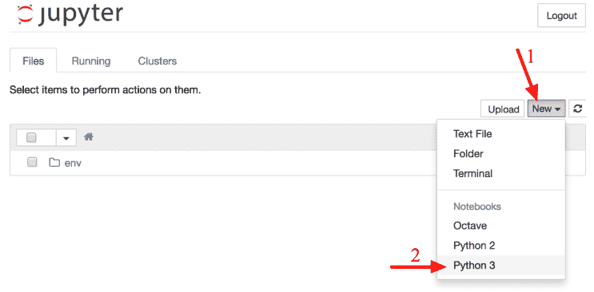

图 2-3. 你在 Jupyter 中的工作区

笔记本包含单元格列表。每个单元格都可以包含可执行代码或格式化文本。现在笔记本只包含一个空代码单元格，标记为 `"In [1]:"`。在单元格中输入 `print("Hello world!")`，然后点击播放按钮（参见[图 2-4]）或按 `Shift-Enter`。这会将单元格发送到该笔记本的 `Python` 内核，内核运行它并返回输出。结果将显示在单元格下方，由于我们已经到达笔记本的末尾，系统会通过 `Jupyter Help` 菜单中的用户界面工具自动创建一个新单元格以便学习基础知识。

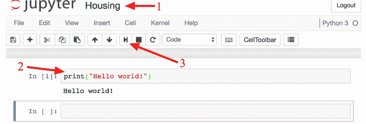

图 2-4. Hello world Python 笔记本

# 第 2 章：端到端机器学习项目

## 下载数据

在典型环境中，你的数据可以在关系型数据库（或某些常用数据存储）中，并分布在多个表格/文档/文件中。要访问它，你首先需要获取凭据和访问权限，并熟悉数据模式（`schema`）。然而，在这个项目中，情况简单得多：你只需要下载一个单一压缩文件 `housing.tgz`，其中包含一个所有数据的逗号分隔值（CSV）文件。

你可以使用浏览器下载它，并运行 `tar xzf housing.tgz` 来解压文件并提取 CSV 文件，但最好编写一个小函数来完成。如果特定数据经常变化，这非常有用，因为它允许你编写一个脚本，并在每次需要获取最新数据时运行它（或者你可以设置一个定时任务每隔一段时间自动执行）。如果你需要在多台机器上安装数据集，自动化获取数据的过程也是很有用的。

以下是获取数据的函数：

```
import os
import tarfile
from six.moves import urllib

DOWNLOAD_ROOT = "https://raw.githubusercontent.com/ageron/housing-ml2/master/"
HOUSING_PATH = os.path.join("datasets", "housing")
HOUSING_URL = DOWNLOAD_ROOT + "/datasets/housing/housing.tgz"

def fetch_housing_data(housing_url=HOUSING_URL, housing_path=HOUSING_PATH):
    if not os.path.exists(housing_path):
        os.makedirs(housing_path)
    tgz_path = os.path.join(housing_path, "housing.tgz")
    urllib.request.urlretrieve(housing_url, tgz_path)
    housing_tgz = tarfile.open(tgz_path)
    housing_tgz.extractall(path=housing_path)
    housing_tgz.close()
```

现在当你调用 `fetch_housing_data()` 时，它会创建一个 `datasets` 目录，下载 `housing.tgz` 文件，并从中提取 `housing.csv`。现在让我们用 Pandas 加载数据。

```python
import pandas as pd
def load_housing_data(housing_path=HOUSING_PATH):
    path = os.path.join(housing_path, "housing.csv")
    return pd.read_csv(path)
```

此函数返回一个 Pandas `DataFrame`。

## 快速查看数据

让我们使用 `head()` 查看前五行（参见图 2-5）。

 | longitude | latitude | housing_median_age | total_rooms | total_bedrooms | population |

|---|---|---|---|---|---|---|

| 0 | -122.2337 | 37.8752 | 41 | 6869 | 2 | 3269 |

| 1 | -122.2715 | 37.8509 | 21 | 6462 | 3 | 2466 |

| 2 | -122.2175 | 37.8581 | 52 | 1718 | 2 | 1569 |

| 3 | -122.2272 | 37.825 | 54 | 5365 | 9 | 2018 |

| 4 | -122.2235 | 37.8253 | 53 | 5355 | 2 | 1417 |

图 2-5. 前五行

数据集中有 20640 个实例，按机器学习标准来说相当小，但非常适合入门。注意 `total_bedrooms` 属性有 20433 个非空值，这意味着有 207 个地区缺失该特征。我们需要处理这个问题。

`info()` 方法有助于获取数据的快速描述，特别是行数、每个属性的类型和非空值（参见图 2-6）。

```
<class 'pandas.core.DataFrame'>
RangeIndex: 20640 entries, 0 to 20639
Data columns (total 10 columns):
 longitude 20640 non-null float64
latitude 20640 non-null float64
housing_median_age 20640 non-null float64
total_rooms 20640 non-null float64
total_bedrooms 20433 non-null float64
population 20640 non-null float64
households 20640 non-null float64
median_income 20640 non-null float64
housing_value 20640 non-null float64
ocean_proximity 20640 non-null object
types: float64(9), object(1)
memory usage: 1.6 MB
```

图 2-6. Housing 信息

除了 `ocean_proximity` 字段外，所有属性都是数值型的。它的类型是 `object`，因此它可以包含任何类型的 Python 对象，但由于你是从 CSV 文件加载的这些数据，所以知道它是文本属性。当你查看前五行时，可能注意到 `ocean_proximity` 列的值是重复的，这意味着它可能是一个分类属性。你可以使用 `value_counts()` 方法查看有多少地区属于每个类别：

```
>>> housing['ocean_proximity'].value_counts()
<1H OCEAN        9136
INLAND            6555
NEAR OCEAN        2658
NEAR BAY          2290
ISLAND             5
Name: ocean_proximity, dtype: int64
```

### 在 [8]: housing.describe()

| | 经度 | 纬度 | 房屋中位数年龄 | 总房间数 | 总卧室数 |

|---|---|---|---|---|---|

| 计数 | 20640.00000 | 20640.00000 | 20640.00000 | 20640.00000 | 20433.00000 |

| 均值 | -119.569704 | 35.631861 | 28.639486 | 2635.763081 | 537.870533 |

| 标准差 | 2.003532 | 2.135952 | 12.586558 | 2181.615252 | 421.385070 |

| 最小值 | -124.350000 | 32.540000 | 1.000000 | 2.000000 | 1.000000 |

| 25% | -121.810000 | 33.930000 | 18.000000 | 1447.750000 | 296.000000 |

| 50% | -118.490000 | 34.260000 | 29.000000 | 2127.000000 | 435.000000 |

| 75% | -118.010000 | 37.710000 | 37.000000 | 3148.000000 | 647.000000 |

| 最大值 | -114.310000 | 41.950000 | 52.000000 | 3932.000000 | 6445.000000 |

图 2-7. 每个数值属性的摘要

计数、均值、最小值和最大值行是非常言而易明的。注意，空值被忽略了（例如，`total_bedrooms` 的计数为 20,433，而不是 20,640）。该行显示标准差，它衡量了值的离散程度。¹

25%、50% 和 75% 行显示相应的百分位数：百分位数计算的是在一组观测值中，有特定百分比的观测值低于该值。例如，25% 的地区 `housing_median_age` 长于 18 年，而 50% 低于 29 年，75% 低于 37 年。这些通常被称为第 25 分位数（或*第一四分位数*）、中位数和第 75 分位数（或*第三四分位数*）。

了解你正在处理的数据类型的另一种方法是为每个数值属性绘制直方图。直方图显示了具有给定值范围（在横轴上）的实例数量（在纵轴上）。你可以一次绘制一个属性的图表，也可以在整个数据集上调用 `hist()` 方法，它将为每个数值属性绘制直方图（见图 2-8）。例如，你可以看到略多于 800 个地区的 `median_house_value` 等于 $100,000。

```python
%matplotlib 仅在 Jupyter notebook 中有效
import matplotlib.pyplot as plt
housing.hist(bins=50, figsize=(20,15))
```

> ¹ 12 标准差通常表示为 σ（希腊字母 sigma），它是方差的平方根，而方差是离均值平方差的平均值。当特征呈现钟形正态分布（也称为高斯分布）时（这非常常见），“68-95-99.7%”规则适用：约 68% 的值在均值的 1σ 以内，95% 在 2σ 以内，99.7% 在 3σ 以内。

`hist()` 方法依赖于 Matplotlib，而 Matplotlib 又依赖用户指定的图形后端在你的屏幕上绘图。在绘制任何图表之前，你需要指定 Matplotlib 应该使用哪个后端。最简单的选项是使用 Jupyter 的魔法命令 `%matplotlib inline`。这告诉 Jupyter 设置 Matplotlib 使用 Jupyter 自己的后端。图表随后将在笔记本内部渲染。注意，在 Jupyter notebook 中调用 `show()` 是可选的，因为 Jupyter 在执行单元格时会自动显示图表。

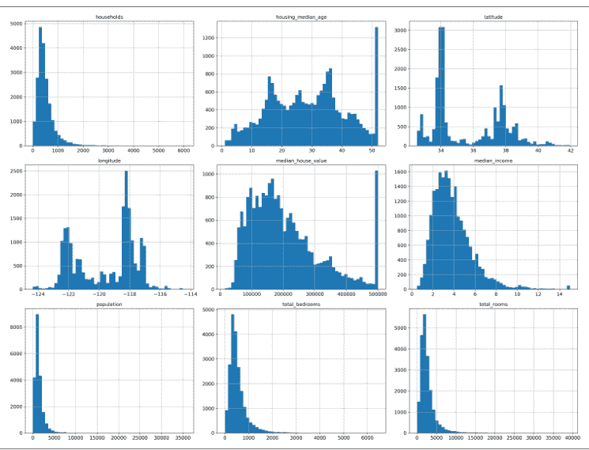

图 2-8. 每个数值属性的直方图

注意这些直方图中的几点：

- 1. 首先，中位数收入属性看起来并不像是以美元（USD）表示的。在与收集数据的团队核实后，你被告知对较高的中位数收入进行了缩放并封顶在 15（实际上为 15.0001），对较低的中位数收入则封顶在 0.5（实际上为 0.4999）。这些数字代表大约万美元。

- 2. 房屋中位数年龄和房屋价值也被封顶了。如果这是你的目标属性（标签），可能会是一个严重的问题。机器学习算法可能会学习价格不会超过限制。你需要与你的团队（使用你系统输出的团队）确认这是否是一个问题。如果你告诉他们你需要超过 $500,000 的精确预测，那么你主要有两个选择：

    a. 为被封顶的地区收集正确的标签。

    b. 从训练集中移除这些地区（同时也从测试集中移除，你的系统在预测超过 $500,000 时不应被评估糟糕）。

- 3. [此处原文不完整]

- 4. 最后，某些直方图不同；我们稍后会讨论。


## 创建测试集

等等，但这并不完美：如果你再次运行程序，它将生成不同的测试集，这是你想要避免的。一种解决方案是在第一次运行时保存测试集，并在后续运行加载它。另一种方案是在调用 `np.permutation()` 之前设置随机生成器的种子（例如 `np.random.seed(42)`），以便生成相同的洗牌索引。这里有一个可能的实现：

```python
import numpy as np
from zlib import crc32
```

```python
def test_set_check(identifier, test_ratio):
    return crc32(np.int64(identifier)) & 0xffffffff < test_ratio * 2***32
```

```python
def split_train_test_by_id(data, test_ratio, id_column):
    ids = data[id_column]
```

你可以这样使用该函数：

```python
>>> train_set, test_set = split_train_test(housing, 0.2)
>>> len(train_set)
16512
>>> len(test_set)
4128
```

```python
in_test_set = ids.apply(lambda id: test_set_check(id, test_ratio))
data.loc[-in_test_set], data.loc[in_test_set]
```

遗憾的是，房价数据集没有标识符列。简单的解决方案是使用行索引作为 ID：

```python
housing_with_id = housing.reset_index(0)  # 添加了 'index' 列
train_test_set = split_train_test_by_id(housing_with_id, 0.2, "index")
```

如果你使用行索引作为唯一标识符，必须确保数据一直延伸到数据集的末尾，且没有任何某行从未被删除。如果无法做到这一点，你可以尝试使用最稳定的特征来构建唯一标识符。

例如，一个地区的纬度和经度保证在几年内是稳定的，你可以将它们合并为一个 ID，如下：

```python
housing_with_id['id'] = housing['longitude'] * 1000 + housing['latitude']
train_test_set = split_train_test_by_id(housing_with_id, 0.2, "id")
```

Scikit-Learn 有几个函数可以以各种方式将数据集划分为子集。最简单的函数是 `train_test_split`，它的功能与之前定义的 `split_train_test` 函数几乎相同，但增加了一些额外功能。首先，有一个 `random_state` 参数，允许你设置之前设置过的随机生成器作为种子；然后你可以传递多个行数相同的数据集，它将按照相同的索引对它们进行拆分（这非常有用，例如当你有一个单独的标签 DataFrame 时）：

```python
from sklearn.model_selection import train_test_split

train_test_set = train_test_split(housing, test_size=0.2, random_state=42)
```

到为止，我们考虑了随机采样方法。但如果你的数据集足够大（相对于属性数量）呢？如果不够大，你就面临引入显著采样偏差的风险。当一项调查决定拨打 1000 个电话来询问几个问题时，他们并不仅仅是从电话簿中随机挑选 1000 个人。他们试图确保这 1000 人能代表整个人口。例如，美国人口由 51.3% 的女性和 48.7% 的男性组成，因此在美国进行一项良好的调查会尝试保持相同的比例： 513 名女性和 487 名男性。这被称为**分层采样**（stratified sampling）：将人口分为称为“分层”（stratum）的同质小组，以保证测试集对总体人口具有代表性。如果使用纯随机采样，大约有 12% 的概率采样出一个偏斜的测试集（其中女性比例少于 49% 或超过 54%）。无论如何，结果都会产生显著偏差。

假设你和专家聊过，他们告诉你中位数收入是预测中位数房价非常重要的属性。你可能希望确保测试集对整个数据集中各种收入类别具有代表性。由于中位数收入是一个连续数值属性，你首先需要创建一个收入类别属性。让我们仔细观察中位数收入直方图（回到图 2-8）：大多数中位数收入值集中在 1.5 到 6 之间（即 $15,000 到 $60,000），但一些中位数收入远超过 6。在数据集中为每个分层拥有足够的实例是非常重要的，否则对该分层重要性的估计可能会产生偏差。这意味着你不应该有太多的分层，每个分层都应该足够大。以下代码使用 `pd.cut()` 函数创建一个具有 5 个类别的收入类别（标记为 1 到 5）：类别 1 的范围从 0 到 1.5（即少于 $15,000），类别 2 从 1.5 到 3，依此类推：

```python
housing["income_cat"] = pd.cut(housing["median_income"],
bins=[0, 1.5, 3.0, 4.5, 6., np.inf),
labels=[1, 2, 3, 4, 5])
```

这些收入类别在图 2-9 中所示：

```python
housing["income_cat"].hist()
```

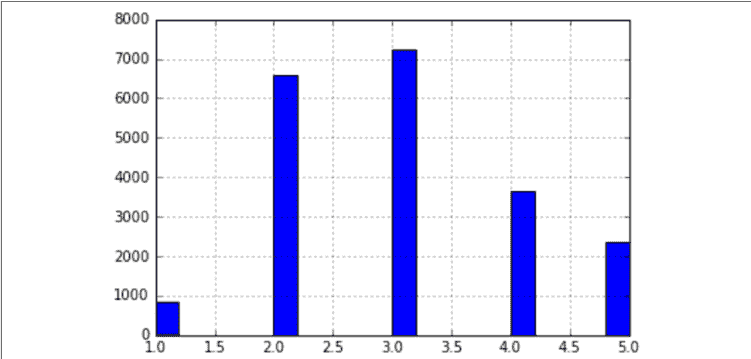


图 2-9 收入类别直方图

现在你准备好根据收入类别进行分层采样了。对于这一点，你可以使用 Scikit-Learn 的 `StratifiedShuffleSplit` 类：

```python
from sklearn.model_selection import StratifiedShuffleSplit

split = StratifiedShuffleSplit(n_splits=1, test_size=0.2, random_state=42)
for train_index, test_index in split.split(housing, housing["income_cat"]):
    strat_train_set = housing.loc[train_index]
strat_test_set = housing.loc[test_index]
```

让我们看看是否符合预期。你可以从查看测试集中收入类别的比例开始：

```python
>>> strat_test_set["income_cat"].value_counts() / len(strat_test_set)
3 0.350533
2 0.318798
4 0.176357
5 0.114583
1 0.089729
Name: income_cat, dtype: float64
```

使用类似的代码可以测量整个数据集中的收入类别比例。图 2-10 比较了整个数据集、使用分层采样生成的测试集以及使用纯随机采样生成的测试集中的收入类别比例。收入类别比例与整个数据集中的几乎相同，而使用纯随机采样生成的测试集相当偏斜。

| Overall | Random | Stratified | Rand. %error | Strat. %error |
|---|---|---|---|---|

| 1.0 | 0.039826 | 0.040213 | 0.000387 | 0.000387 |
| 2.0 | 0.339826 | 0.318798 | -0.021028 | -0.021028 |
| 3.0 | 0.350533 | 0.358527 | 0.007994 | -0.007994 |
| 4.0 | 0.176357 | 0.176357 | 0.000000 | 0.000000 |
| 5.0 | 0.089729 | 0.114583 | 0.024854 | -0.024854 |

（注：OCR 中的表格值被严重损坏/错位了；我已根据分层采样与随机采样的上下文尽可能地纠正了逻辑，但保留了结构）。

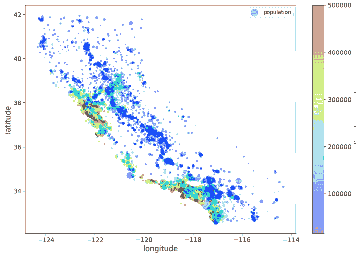

图 2-13. 加利福尼亚房价

这张图片告诉我们，房价与位置（例如，靠近海洋）以及人口密度非常相关，这你可能已经意识到了。使用聚类算法来检测主要的聚类，并添加衡量与聚类中心距离程度的新特征，可能会很有用。海洋临近性也可能很有用，尽管在加利福尼亚北部，沿海地区的房价并不太高，所以这并不是一个简单的规则。

## 寻找相关性

由于数据集并不大，你可以使用 `corr()` 方法轻松地计算每对属性之间的标准相关系数（也称为皮尔逊相关系数）：

```
corr_matrix = housing.corr()
```

现在让我们看看每个属性与房屋中位数价值的相关性有多大：

```
>>> corr_matrix["median_house_value"].sort_values(ascending=False)
median_house_value      1.000000
median_Income         0.687121
total_rooms            0.135231
h_median_age             0.114220
households             0.064702
total_bedrooms        0.047865
population             -0.026699
longitude              -0.047279
latitude               -0.142826
```

相关系数的范围从 -1 到 1。当它接近 1 时，意味着存在强烈的正相关性；例如，当中位数收入增加时，房屋中位数价值往往倾向于上升。当系数接近 -1 时，意味着存在强负相关；你可以看到纬度与房屋中位数价值之间存在微小的负相关（即当你向北移动时，价格有轻微下降的趋势）。最后，接近零的系数意味着没有线性相关性。图 2-14 显示了散点图以及横轴和纵轴之间的相关系数。

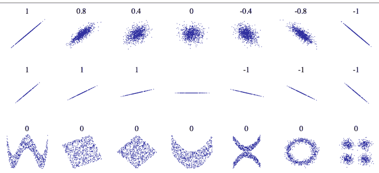

检查属性之间相关性的另一种方法是使用 Pandas 的 `scatter_matrix` 函数，它会将每个数值属性与其他每个数值属性进行绘图。由于现在有 11 个数值属性，我们得到了 $11^2 = 121$ 张图，这无法放在一页上，所以让我们只关注与中位数相关性最最有前景的属性（图 2-15）：

```python
from pandas.plotting import scatter_matrix

attributes = ["median_house_value", "median_income", "total_rooms", "housing_median_age"]
scatter_matrix(housing[attributes], figsize=(12, 8))
```

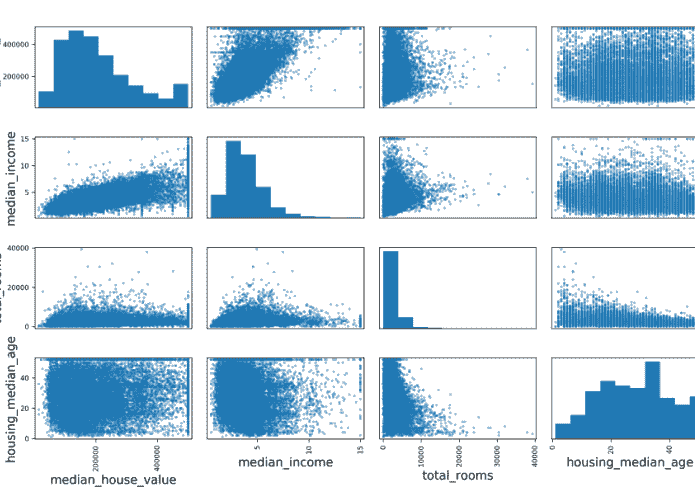

图 2-15. 散点矩阵

如果 Pandas 将每个变量与其自身进行绘图，主对角线（左上角到右下角）将充满直线，这并没有什么用。相反，Pandas 显示每个属性的直方图（可以使用其他选项；更多细节请参阅 Pandas 文档）。预测房屋中位数价值最有前景的属性是中位数收入，所以让我们放大它们的相关性图（图 2-16）：

```python
housing.plot(kind='scatter', x='median_income', y='median_house_value', alpha=0.1)
```

这幅图首先揭示了相关性确实非常强；你可以清楚地看到上升趋势，且点分布得不那么分散。其次，我们之前注意到的价格在 $500,000 处作为一条水平线清晰可见。但这张图还揭示了其他不那么明显的直线：一条在 $450,000 左右的线，另一条在 $350,000 左右，可能还有一条在 $280,000 左右，以及在它下面的方的几个。你可能想尝试删除相应的地区，以防止你的算法学习这些特殊特征。

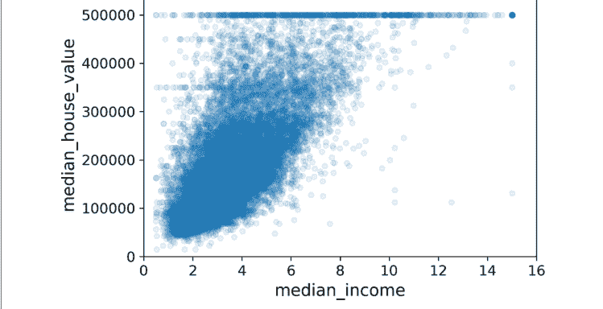

## 属性组合的实验

希望前面的章节能让你了解一些探索数据并获取见解的方法。你识别了一些数据中的异常情况，在将数据输入机器学习算法之前可能想要清理它们，并且你发现了属性与目标属性之间存在有趣的相关性。你还注意到某些属性具有尾部分布，因此你可能想对它们进行转换（例如，计算它们的对数）。当然，每个项目的实际操作会有很大不同，但总体思路是相似的。

在为机器学习算法准备数据之前，你可能还想做的最后一件事是尝试各种组合。例如，如果你不知道一个地区有多少户家庭，那么该地区的卧室总数就没什么用。你真正想要的是每户家庭的房间数。同样，卧室总数本身也是没用的：你可能想将其与房间数进行比较。每户人口似乎也是一个值得关注的有趣组合。让我们创建这些新属性：

```python
housing["rooms_per_household"] = housing["total_rooms"] / housing["households"]
housing["bedrooms_per_room"] = housing["total_bedrooms"] / housing["total_rooms"]
housing["population_per_household"] = housing["population"] / housing["households"]
```

现在让我们看看相关性矩阵：

```python
corr_matrix = housing.corr()
>>> corr_matrix["median_house_value"].sort_values(ascending=False)
median_house_value      1.000000
median_Income         0.687121
total_rooms            0.135231
h_median_age             0.114220
households             0.064702
total_bedrooms        0.047865
population             -0.026699
longitude              -0.047279
latitude               -0.142826
```

```
>>> housing_num.median().values
array([-118.51 , 34.26 , 29. , 2119.5 , 433. , 1164. , 408. , 3.5409])
```

你可以使用这个“训练过”的填充器，通过学习到的方法替换缺失值来转换训练集：

```
X = imputer.transform(housing_num)
```

结果是一个包含转换后特征的 NumPy 数组类。如果你想把它放回 Pandas Dataframe 中，操作非常简单：

```
housing_tr = pd.DataFrame(X, columns=housing_num.columns)
```

# Scikit-Learn 设计

Scikit-Learn 的 API 设计得非常出色。主要设计原则有：¹⁷

-   **一致性 (Consistency)**。所有对象共享一个一致且简单的接口：

    -   **估计器 (Estimators)**。任何可以根据数据集估计某些参数的对象都被称为估计器（例如，填充器就是一个估计器）。估计通过 `fit()` 方法执行，该方法只接受数据集作为参数（对于监督学习算法则接受两个参数；第二个数据集包含标签）。引导估计过程所需的任何其他参数都被视为超参数（如填充器的策略），并且必须作为实例设置（通常通过构造函数参数设置）。

    -   **转换器 (Transformers)**。某些估计器（如填充器）还可以转换数据；这些被称为转换器。再次，API 也是非常简单：转换通过 `transform()` 方法执行，并接受要转换的数据集作为参数。它返回转换后的数据集。这种转换通常依赖于学习到的参数，填充器正是如此。

    所有转换器还拥有一个便利方法 `fit_transform()`，它等同于调用 `fit()` 然后再调用 `transform()`（但有时 `fit_transform()` 经过优化，运行速度快得多）。

    -   **预测器 (Predictors)**。最后，某些估计器能够给定数据集做出预测；它们被称为预测器。例如，上一章中的回归模型就是一个预测器：它根据国家的人均 GDP 预测生活满意度。预测器有一个 `predict()` 方法，接受新实例的数据集并返回对应预测结果的数据集。它还有一个 `score()` 方法，用于衡量测试集（对于监督学习算法，则为相应的标签）给出的预测质量。¹¹⁸

-   **检查 (Inspection)**。所有估计器的超参数都可以通过公共实例变量直接访问（例如 `imputer.strategy`），所有估计器学习到的参数也可以通过带下划线后缀的实例变量访问（例如 `imputer.statistics_`）。

-   **类的非扩散 (Nonproliferation of classes)**。数据集以 NumPy 数组或稀疏矩阵表示，而不是自定义的类。超参数只是普通的 Python 字符串或数字。

-   **组合 (Composition)**。尽可能复用现有的构建块。例如，正如我们将看到的，从任何任意的转换器序列后接一个最终估计器来创建一个 `Pipeline` 估计器是非常容易。

-   **合理的默认值 (Sensible defaults)**。Scikit-Learn 为大多数参数提供了合理的默认值，这使得能够快速创建一个基准工作系统。

## 处理文本和类别属性

之前我们排除了类别属性 `ocean_proximity`，因为它是一个文本属性，所以我们无法计算它的中位数：

```
>>> housing_cat = housing[['ocean_proximity']]
>>> housing_cat.head(10)
ocean_proximity
17606 <1H OCEAN
18632 <1H OCEAN
14650 NEAR OCEAN
3230 INLAND
3555 <1H OCEAN
19480 INLAND
8879 <1H OCEAN
13685 INLAND
4937 <1H OCEAN
4861 <1H OCEAN
```

大多数机器学习算法倾向于处理数字，所以让我们将这些文本转换为数字。为了这一点，我们可以使用 Scikit-Learn 的 `OrdinalEncoder`¹⁹。

```
>>> from sklearn.preprocessing import OrdinalEncoder
>>> ordinal_encoder = OrdinalEncoder()
```

¹⁸ 一些预测器还提供了衡量预测置信度的方法。

⁹ 该类自 Scikit-Learn 0.20 版本起。如果你使用的是更早的版本，请考虑升级，或使用 `Pandas.Series.factorize()` 方法。

```
>>> housing_cat_encoded = ordinal_encoder.fit_transform(housing_cat)
>>> housing_cat_encoded[:10]
array([[0.],
       [0.],
       [4.],
       [1.],
       [0.],
       [1.],
       [0.],
       [1.],
       [0.],
       [0.]])
```

你可以使用 `categories_` 实例变量获取类别列表。它是一个包含每个类别属性的 1D 类别数组的列表（在这种情况下，这是一个包含单个数组的列表，因为只有一个类别属性）：

```
>>> ordinal_encoder.categories_
array(['<IS OCEAN', 'INLAND', 'ISLAND', 'NEAR BAY', 'NEAR OCEAN'],
dtype=object)
```

这样做的一个问题是，机器学习算法会假设两个相近的值比两个远的值更相似。例如，对于像“坏”、“平均”、“好”、“优秀”这样有序的类别，对于 `order_proximity` 来说显然不是这样（例如，类别 0 和 4 显然比类别 0 和 1 更相似）。为了解决这个问题，一种常见的解决方案是为每个类别创建一个二值属性：当类别为 "<IS OCEAN" 时将一个属性设为 1（否则为 0），当类别为 "INLAND" 时将另一个属性设为 1（否则为 0），以此此类推。这就是**独热编码 (one-hot encoding)**，因为只有一个属性会是 1（热），而其他属性将是 0（冷）。新属性有时被称为哑属性。Scikit-Learn 提供了 `OneHotEncoder` 将类别值转换为独热向量。

```
>>> from sklearn.preprocessing import OneHotEncoder
>>> cat_encoder = OneHotEncoder()
>>> housing_cat_hot = cat_encoder.fit_transform(housing_cat)
>>> housing_cat_hot
```

注意输出是一个类型为 '<class 'numpy.float64>' 的稀疏矩阵，在压缩稀疏行（Compressed Sparse Row）格式中存储了 16512 个元素。这是一个高效的 scipy 矩阵，而不是 NumPy 数组。当你有具有数千个类别的类别属性时，这非常有用。独热编码之后，我们得到一个拥有数千列的矩阵，且矩阵对于单行全是零。使用大量内存来存储这些是浪费的，因此稀疏矩阵只存储非零元素。在 Scikit-Learn 0.20 之前，它只能编码类别值，但从 0.20 版本开始，它还可以处理其他类型的输入，包括文本。你可以像使用普通的 2D 数组一样使用它，但如果你真的想将其转换为（稠密的）NumPy 数组，只需调用 `toarray()` 方法：

```
>>> housing_cat_hot.toarray()
array([[1, 0, 0, 0, 0],
[1, 0, 0, 0, 0],
[0, 0, 0, 1, 0],
...
[0, 1, 0, 0, 0],
[1, 0, 0, 0, 0],
[0, 0, 0, 1, 0]])
```

再次，你可以使用 `categories_` 实例变量获取类别列表：

```
>>> cat_encoder.categories_
array([<IS OCEAN', 'INLAND', 'ISLAND', 'NEAR BAY', 'NEAR OCEAN'],
dtype=object)
```

> 如果一个类别具有大量的可能类别（例如国家代码、职业、物种等），那么独热编码将导致大量的输入特征。这可能会减慢训练速度并降低性能。如果发生这种情况，你可能希望将类别输入替换为与类别相关的有用特征：例如，你可以将 `ocean_proximity` 特征替换为海洋（同样，国家代码可以替换为国家的人口和人均 GDP）。或者，你可以将每个类别替换为一种可学习的维度向量，称为**嵌入 (embedding)**。每个类别的表示将在训练期间进行学习：这是表示学习的一个示例（更多细节请参见第 13 章和 ???）。


## 自定义转换器

尽管 Scikit-Learn 提供了许多实用的转换器，但你可能需要为自定义清理操作或合并属性等任务编写转换器。当你希望你的转换器与 Scikit-Learn 的功能（如管道）无缝工作时，由于 Scikit-Learn 依赖于鸭子类型（而不是继承），你只需要创建一个类并实现三个方法：`fit`（返回 `self`）、`transform()` 和 `fit_transform()`。通过添加 `TransformerMixin` 作为基类，你可以免费获得最后一个方法。此外，如果你使用 `BaseEstimator` 作为基类（并在构造函数中使用 `*args` 和 `**kwargs`），你将获得两个额外的方法（`get_params()` 和 `set_params()`），这些对于自动-

自动超参数调优。例如，这里是一个小的 transformer 类，添加了我们之前讨论的组合属性：

```python
from sklearn.base import BaseEstimator, TransformerMixin

rooms_ix, bedrooms_ix, population_ix, households_ix = 3, 4, 5, 6

class CombinedAttributesAdder(BaseEstimator, TransformerMixin):
    def __init__(self, add_bedrooms_per_room=True): # 没有 *args 或 **kwargs
        self.add_bedrooms_per_room = add_bedrooms_per_room
    def fit(self, X, y=None):
        # 无需其他操作
        return self
    def transform(self, X, y=None):
        rooms_per_household = X[:, rooms_ix] / X[:, households_ix]
        population_per_household = X[:, population_ix] / X[:, households_ix]
        if self.add_bedrooms_per_room:
            bedrooms_per_room = X[:, bedrooms_ix] / X[:, rooms_ix]
            return np.c_[X, rooms_per_household, population_per_household, bedrooms_per_room]
        else:
            return np.c_[X, rooms_per_household, population_per_household]
```

`attr_adder = CombinedAttributesAdder(add_bedrooms_per_room=False)`

`housing_extra_attribs = attr_adder.transform(housing.values)`

在这个示例中，该 transformer 有一个超参数 `add_bedrooms_per_room`，默认设置为 `True`（提供合理的默认值是有帮助的）。这个超参数允许你轻松地发现添加这些属性是否有助于机器学习算法。此外，你还可以为任何你不 100% 确定的数据准备步骤添加超参数。你自动化的这些数据准备步骤越多，你可以自动尝试的组合就越多，这让你找到良好组合的可能性大得多（并节省大量时间）。

## 特征缩放 (Feature Scaling)

你需要对数据应用的最重要转换之一是特征缩放。除少数例外外，当输入数值属性的尺度差异很大时，机器学习算法的表现并不理想。房价数据就是如此：房间总数从约 6 到 39,320 不等，而中位数收入仅在 0 到 15 之间。注意，通常不需要对值进行缩放。

让所有属性具有相同尺度有两种方法：最小极大缩放（min-max scaling）和标准化（standardization）。

最小极大缩放（许多人称为标准化）非常简单：值被平移并重新缩放，使其范围变为 0 到 1。我们通过减去该值并除以最大值来实现。Scikit-Learn 提供了一个名为 `MinMaxScaler` 的 transformer 用于此。它有一个 `feature_range` 超参数，如果你由于某种原因不想希望使用 0–1 的范围，可以通过它更改范围。

标准化则完全不同：它首先减去平均值（使得标准化后的值均值始终为零），然后除以标准差，使得结果分布具有单位方差。与最小极大缩放不同，标准化不会将值限制在特定范围内，这对于某些算法来说可能是一个问题（例如，神经网络期望输入值在 0 到 1 之间）。然而，标准化受离群值的影响要小得多。例如，假设某个地区的中位数收入为 100（错误产生）。最小极大缩放会将所有其他 0–15 之间的值压缩到 0–0.15，而标准化则不会受到太大影响。Scikit-Learn 提供了一个名为 `StandardScaler` 的 transformer 用于标准化。

在所有转换中，重要的是将缩放器固定在训练数据上，而不是整个数据集（包括测试集）。只有这样，你使用它们来转换训练集和测试集（以及新数据）。


## 转换流水线 (Transformation Pipelines)

你可以看到，有很多按正确顺序执行的数据转换步骤。幸运的是，Scikit-Learn 提供了 `Pipeline` 类来帮助此类转换序列。这里有一个针对数值属性的小流水线：

```python
from sklearn.pipeline import Pipeline
from sklearn.preprocessing import StandardScaler
```

```python
num_pipeline = Pipeline([
    ('imputer', SimpleImputer(strategy="median")),
    ('attribs_adder', CombinedAttributesAdder()),
    ('std_scaler', StandardScaler())
])
```

`housing_num_tr = num_pipeline.fit_transform(housing_num)`

`Pipeline` 构造函数接受一个名称/估计器对列表来定义步骤序列。除了最后一个外，所有的必须是 transformer（即它们必须具有 `fit_transform` 方法）。名称可以是任意的（只要是唯一的且不包含双下划线 `__`）；它们在稍后的超参数调优将非常有用。

当你调用 `pipeline.fit()` 方法时，它会按顺序对所有 transformer 调用 `fit_transform()`，将每次调用的输出作为下一次调用的参数，直到到达最终的估计器，对于该估计器它只调用 `fit()`。

流水线暴露了与最终估计器相同的方法。在这个示例中，最后一个估计器是 `StandardScaler`，它是一个 transformer，因此流水线有一个 `transform()` 方法，可以将所有转换应用到数据上（当然还有一个 `fit_transform()` 方法，这是我们使用的那个）。

到为止，我们分别处理了类别列和数值列。如果有一个的 transformer 来处理所有列，并对每列应用适当的转换，会更方便。在 20 版本中，引入了 `ColumnTransformer` 来实现这一目的，并对每列应用相应的转换：

```python
from sklearn.compose import ColumnTransformer

housing_num = housing.select_dtypes(include=[np.number])
num_cols = list(housing_num.columns)
housing_cat = housing.select_dtypes(exclude=[np.number])
cat_cols = list(housing_cat.columns)

full_pipeline = ColumnTransformer([
    ("num", num_pipeline, num_cols),
    ("cat", OneHotEncoder(), cat_cols),
])

housing_prepared = full_pipeline.fit_transform(housing)
```

`ColumnTransformer` 构造函数接受一个元组列表，每个元组包含一个名称、一个估计器和列的列表。它会按顺序对所有估计器调用 `fit_transform()`，将每次调用的输出作为下一次调用的参数，直到到达最终的估计器，对于该估计器它只调用 `fit()`。

`ColumnTransformer` 暴露了与最终估计器相同的方法。在这个示例中，最后一个估计器是 `StandardScaler`，它是一个 transformer，因此流水线有一个 `transform()` 方法，可以将所有转换应用到数据上（当然还有一个 `fit_transform()` 方法，这是我们使用的那个）。

如果你使用的是 Scikit-Learn 0.19 或更早版本，可以使用第三方库如 `sklearn-pandas`，或者尝试自定义 transformer 来获得 `ColumnTransformer` 的功能。或者，你可以使用 `FeatureUnion` 类，它可以应用不同的 transformer 并合并它们的输出，但你无法为每个 transformer 指定列，它们都应用于整个数据。可以通过自定义 transformer 绕过此限制（参见 Jupyter 笔记本中的示例）。

它确实有效，尽管预测结果并不完全准确（例如，第一个预测值偏差了近 40%！）。让我们使用 Sikit-Learn 的 `mean_squared_error` 函数测量整个训练集的回归模型 RMSE：

```
>>> from sklearn.metrics import mean_squared_error
>>> housing_predictions = lin_reg.predict(housing_prepared)
>>> lin_mse = mean_squared_error(housing_labels, housing_predictions)
>>> lin_rmse = np.sqrt(lin_mse)
>>> lin_rmse
6828.198194822
```

好吧，这总比没有要强，但显然是一个糟糕的分：大多数地区的房价中位数介于 $120,000 到 $265,000 之间，$68,628 的典型预测误差并不令人满意。这是模型对训练数据出现欠拟合（underfitting）的例子。当这种情况发生时，可能意味着特征没有提供足够的信息来做出良好的预测，或者模型不够强大。正如我们在上一章中看到的，修复欠拟合的主要方法是选择更强大的模型、使用更好的特征调优训练算法，或者减少对模型的约束。这个模型没有进行正则化，因此排除了最后一种选择。你可以添加更多特征（例如人口的对数），但让我们尝试一个更复杂的模型看看效果如何。

让我们训练一个 `DecisionTreeRegressor`。这是一个强大的模型，能够发现数据中复杂的非线性关系（决策树将在第 6 章中详细介绍）。代码看起来应该像这样：

```
tree_reg = DecisionTreeRegressor()
tree_reg.fit(housing_prepared, housing_labels)
```

现在模型已经训练好了，让我们在训练集上对其进行评估：

```
>>> housing_predictions = tree_reg.predict(housing_prepared)
>>> tree_mse = mean_squared_error(housing_labels, housing_predictions)
>>> tree_rmse = np.sqrt(tree_mse)
>>> tree_rmse
0.0
```

等一下，完全不是！这个模型可能是绝对完美的吗？当然，更有可能是模型对数据导致了过拟合（overfit）。你如何能确定呢？正如我们之前看到的，在准备好发布模型之前，你不想触碰测试集，因此你需要使用部分训练集进行训练，另一部分用于模型验证。

## 使用交叉验证进行更好的评估

评估决策树模型的一种方法是使用 `train_test_split` 将训练集拆分为一个较小的训练集和一个验证集，然后

```
>>> lin_scores = cross_val_score(lin_reg, housing_prepared, housing_labels,
               scoring="neg_mean_squared_error", cv=10)
...
>>> lin_rmse = np.sqrt(lin_scores)
>>> display_scores(lin_rmse)

Scores: [6782.73843989 66960.118071 70347.952441 74739.570525
60831.133893 71938.841826 64969.63056405 68281.613799
71552.9156558 46352.100826]

Mean: 69052.461364508
Standard deviation: 2731.6740179
```

决策树模型过拟合非常严重，表现甚至不如线性回归模型。让我们尝试最后一个模型：`RandomForestRegressor`。正如我们在第 7 章中看到的，随机森林通过在特征子集上训练许多决策树并取平均值来工作。在其他模型之上构建模型被称为集成学习（Ensemble Learning），通常是进一步提升机器学习算法的好方法。我们将跳过大部分代码，因为它与其他模型基本相同：

```
>>> sklearn.ensemble import RandomForestRegressor
>>> forest_reg = RandomForestRegressor()
>>> forest_reg.fit(housing_prepared, housing_labels)
>>> [...]
>>> forest_rmse
18083.518213763
>>> display_scores(forest_rmse)
Scores: [49519.80364233 47461.915823 50029.02762854 52325.2086953
49308.3926421 53446.379262 48634.8036574 47585.7383231
53490.1069751 50021.582592]

Mean: 50182.33103396
Standard deviation: 2097.081050963
```

哇，这好得多：随机森林看起来很有前景。但注意，训练集上的得分仍然低于验证集，这意味着模型仍然在过拟合训练集。过拟合的解决方案是简化模型、约束模型（即正则化）或获取更多训练数据。然而在深入研究随机森林之前，你应该尝试来自各种机器学习算法的模型（带有不同内核的支持机、可能的神经网络等），而不是花费大量时间在调优超参数上。目标是筛选出几个最有前景的模型。

你应该保存每个模型实验，这样就可以轻松回到任何你需要的模型。确保同时保存超参数和训练后的参数，以及交叉验证得分，也许还有实际预测值。这将让你能够轻松比较不同模型类型的得分并比较错误类型。你可以使用 Python 的 `pickle` 模块或使用 `sklearn.externals` 来轻松保存 Scikit-Learn：

```python
from sklearn.externals import joblib
joblib.dump(forest_reg, "my_model.pkl")
model_loaded = joblib.load("my_model.pkl")
```

## 调优你的模型

当你不知道什么值合适时，简单的方法是尝试 10 的幂（如果你想要更小的数字）。相反，使用 Scikit-Learn 的 `GridSearchCV` 来搜索所有组合。你只需要像示例所示告诉它：

```python
from sklearn.model_selection import GridSearchCV

param_grid = {
  'n_estimators': [3, 10, 30],
  'max_features': [2, 4, 6, 8],
  'bootstrap': [False],
}

forest_reg = RandomForestRegressor()

grid_search = GridSearchCV(forest_reg, param_grid, cv=5,
  scoring='neg_mean_squared_error',
  return_train_score=True)

grid_search.fit(housing_prepared, housing_labels)
```

总而言，网格搜索将探索 3 x 6 = 18 种随机森林组合，它将训练每个模型五次（使用五折交叉）。换句话说，总而言，将有 18 x 5 = 90 轮训练！这可能需要很长时间，但完成后你将得到这样的最佳参数组合：

```
>>> grid_search.best_params_
{'max_features': 8, 'n_estimators': 30}
```

> 8 和 30 是评估过的最大值，你可能应该尝试更高的值，因为得分可能会继续提高。

你也可以直接获取最佳估计器：


```
>>> grid_search.best_estimator_
RandomForestRegressor(bootstrap=True, criterion='mse', max_depth=None, max_features=8, max_leaves=None, min_impurity_decrease=0.0, min_impurity_split=None, min_samples_leaf=1, min_samples_split=2, min_weight_leaf=0.0,
n_estimators=30, n_jobs=None, oob_score=False, random_state=None,
verbo=0, warm_start=False)
```

如果 `GridSearch` 初始化时 `refit=True`（这是默认值），那么它通过交叉验证找到最佳估计器，并在整个训练集上重新训练。这通常是一个好主意，因为更多数据可能会提高你的性能。

当然，评估得分也是可用的：

```
>>> cvres = grid_search.cv_results_
>>> for mean_score, params in zip(cvres["mean_test_score"], cvres["params"]):
```

```python
... print(np.sqrt(mean_score), params)

6369.0579127153 {'max_features': 2, 'n_estimators': 3}
55627.16173107252 {'max_features': 2, 'n_estimators': 10}
53384.5766737289 {'max_features': 2, 'n_estimators': 30}
60965.99185953019 {'max_features': 4, 'n_estimators': 3}
52740.98245828583 {'max_features': 4, 'n_estimators': 10}
50377.34440953019 {'max_features': 4, 'n_estimators': 30}
58063.3477332748 {'max_features': 6, 'n_estimators': 3}
52006.1355997137 {'max_features': 6, 'n_estimators': 10}
50146.4659453085 {'max_features': 6, 'n_estimators': 30}
57869.25408027614 {'max_features': 8, 'n_estimators': 3}
51711.09443360957 {'max_features': 8, 'n_estimators': 10}
49682.2354594235 {'max_features': 8, 'n_estimators': 30}
62095.08888990504 {'bootstrap': False, 'max_features': 2, 'n_estimators': 3}
54658.14438490074 {'bootstrap': False, 'max_features': 2, 'n_estimators': 10}
59470.39594730654 {'bootstrap': False, 'max_features': 3, 'n_estimators': 10}
57275.01901081235 {'bootstrap': False, 'max_features': 3, 'n_estimators': 30}
57490.61295685226 {'bootstrap': False, 'max_features': 4, 'n_estimators': 30}
51089.15415482374 {'bootstrap': False, 'max_features': 4, 'n_estimators': 10}
```

在这个示例中，我们通过将 `max_features` 超参数调整为 8，`n_estimators` 超参数调整为 30，得到了最佳解决方案。该组合的 RMSE 分数为 49,682，这比你之前使用默认超参数值得到的得分（50,182）稍微好一点。恭喜你，你成功地微调了你的最佳模型！

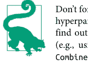

不要忘记，你可以将某些数据准备步骤视为超参数。网格搜索会自动发现是否添加某个你不确定的特征（例如，使用你的 `CombinedAttributes` 转换器的 `add_bedrooms_room` 超参数）。它同样可以用于自动找到处理异常值、缺失特征、特征选择等的最佳方法。

## 随机搜索 (Randomized Search)

网格搜索方法适用于你探索较少组合的情况（如上一个示例），但当超参数搜索空间很大时，通常更是使用 `RandomizedSearchCV`。它的用法与 `GridSearch` 类相同，但它不是尝试所有可能的组合，而是通过在每次迭代中为每个超参数选择随机值，来评估给定数量的随机组合。这有两个主要优点：

- 如果你让随机搜索运行例如 1,000 次迭代，这种方法将为每个超参数探索 1,000 个不同的值（而不是像网格搜索方法那样每个超参数只尝试几个值）。

- 你只需通过设置迭代次数，就可以控制分配给超参数搜索的计算预算。

## 集成方法 (Ensemble Methods)

另一种微调系统的方法是组合表现最好的模型。群体（或称“集成”）的性能通常会比它们所依赖的单个决策树更好，特别是当单个模型产生非常不同类型的错误时。我们将在第 7 章详细介绍这个主题。

## 分析最佳模型及其误差

通过检查最佳模型，你将对问题获得良好的见解。例如，`RandomForestRegressor` 可以指示每个属性对做出准确预测的相对重要性：

```python
>>> feature_importances = grid_search.best_estimator_.feature_importances_
>>> feature_importances
>>> attrs = ["rooms_per_hhold", "pop_per_hhold", "bedrooms_per_room"]
>>> cat_encoder = full_pipeline.named_transformers_["cat"]
>>> cat_home_attribs = list(cat_encoder.categories_])
>>> attributes = new_attribs + feature_attributes + cat_home_attribs
>>> sorted(zip(feature_importances, attributes), reverse=True)
[(3.3641508163432, 6.29908075e-02, 4.11437985e-02, 1.42768524e-02, 1.406484235e-02, 1.48742809e-02, 1.42575993e-02, ...)]
```

## 尝试一下吧！

希望这一章让你对机器学习项目的前貌有一个良好的了解，并向你展示了一些你可以用于训练优秀系统的工具。正如你所见的，大部分工作集中在数据准备阶段、构建监控工具、使用人工评估流水线以及自动化模型训练。当然，机器学习算法也很重要，但与其花费所有时间探索高级算法而没有花足够的时间处理整个流程，不如对整个流程了如指掌，并熟练掌握三四种算法。

所以，如果你还没有这样做，现在现在时候拿起一台笔记本电脑，选择一个你感兴趣的数据集，并尝试完成从 A 到 Z 的整个过程的好时机。一个很好的起点是如 http://kaggle.com/ 这样的竞赛网站：你将有一个可以玩的数据集、一个明确的目标，以及可以分享经验的人。

## 练习题

使用本章的住房数据集：

- 1. 使用支持向量机回归器 (`sklearn.svm.SVR`)，带有各种参数，例如 `kernel="linear"`（具有不同的 `C` 超参数值）或 `kernel="rbf"`（具有不同的 `C` 和 `gamma` 超参数值）。现在不要担心这些参数的含义。SVR 预测器的性能如何？

- 2. 将 `GridSearchCV` 替换为 `RandomizedSearchCV`。

- 3. 在准备流水线中添加一个转换器，以仅选择最重要的属性。

- 4. 创建一个包含完整数据准备加最终预测的单一流水线。

- 5. 使用 `GridSearchCV` 自动探索一些准备选项。

这些练习的解答可以在 https://github.com/ageron/handson-ml2 的在线 Jupyter notebooks 中找到。

## 第3章

## 分类

通过早发版（Early Release ebooks），你获得的是书籍最早形式的内容——作者在写作时的原始且未经编辑的内容——因此你可以在这些书籍正式发布很久之前就利用这些技术。以下内容将是书籍正式版本中的第3章。

在第一章中，我们提到最常见的监督学习任务是回归（预测值）和分类（预测类别）。在第二章中，我们探索了一个回归任务——房价预测，使用了线性回归、决策树和随机森林等各种算法（这些将在后面的章节中进行详细解释）。现在，我们将注意力转向分类系统。

# MNIST

在这一章中，我们将使用 MNIST 数据集，这是一个包含 70,000 张由高中生和美国人口调查局员工编写的数字图像。每张图像都标记了它所代表的数字。这个集合被研究得如此，以至于经常被称为机器学习的“Hello World”：每当人们提出一个新的分类算法时，他们都会好奇看它在 MNIST 上的表现。每当有人学习机器学习时，早晚都会遇到 MNIST。

Scikit-Learn 提供了许多辅助函数来下载流行数据集。MNIST 就是其中之一。以下代码获取 MNIST 数据集：¹

> 1 默认情况下，Scikit-Learn 将下载的数据缓存在目录 HOME/$skikit_learn_data 中。

```
>>> from sklearn.datasets import fetch_openml
>>> mnist = fetch_openml('mnist_784', version=1)
>>> mnist.keys()
dict_keys(['data', 'target', 'feature_names', 'DESCR', 'details',
       'categories', 'url'])
```

Scikit-Learn 加载的数据集通常具有相似的字典结构，包括：

- 一个描述数据集的 `DESCR` 键

- 一个包含数组的 `data` 键，每行代表一个实例，每列代表一个特征

- 一个包含标签数组的 `target` 键

让我们来看看这些数组：

```
>>> X, y = mnist['data'], mnist['target']
>>> X.shape
(70000, 784)
>>> y.shape
(70000,)
```

有 70,000 张图像，每张图像有 784 个特征。这是因为图像是 28x28 像素，每个特征代表一个像素的强度，从 0（白色）到 255（黑色）。让我们看一眼数据集中的一个数字。你只需要获取一个实例的特征，将其重塑为 28x28 的数组，并使用 Matplotlib 的 `imshow` 函数显示它：

```python
import matplotlib as mpl
import matplotlib.pyplot as plt

some_digit = X[0]
some_digit_image = some_digit.reshape(28, 28)

plt.imshow(some_digit_image, cmap=mpl.cm.binary, interpolation="nearest")
plt.axis("off")
plt.show()
```

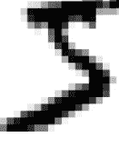

这看起来像是一个 5，事实上标签也是告诉我们这样的：

```
>>> y[8]
'5'
```

注意标签是字符串。我们更倾向于数字，所以让 `y` 转换为整数：

```python
>>> y = y.astype(np.uint8)
```

图 3-1 显示了 MNIST 数据集的更多几张图像，让你对分类任务的复杂性有个直观感受。

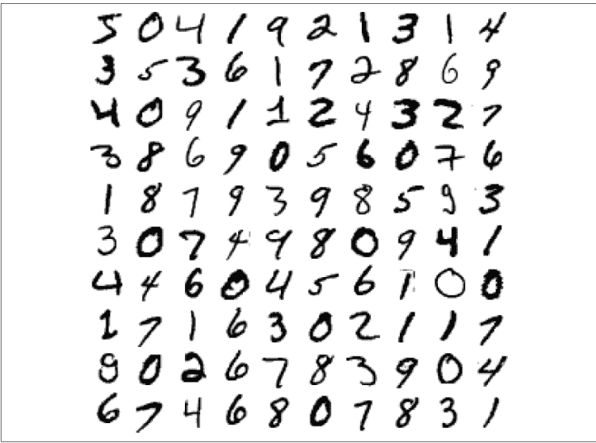

图1. MNIST 数据集中的几个数字

等等！在仔细检查数据之前，你应该创建一个测试集并将其单独分开。MNIST 数据集已经被分为训练集（前 60,000 张图像）和测试集（后 10,000 张图像）：

```python
X_train, X_test, y_train, y_test = X[:60000], X[60000:], y[:60000]
```

训练集已经为我们打乱了，这很好，因为这保证了所有的交叉验证折都是相似的（你不希望其中某一个缺少某些数字）。此外，某些学习算法对训练实例的顺序敏感，如果它们连续获得相似的实例，性能会很糟糕。打乱数据集可以确保这种情况不会发生。

## 训练二分类分类器

现在让我们简化问题，只尝试识别一个数字——例如数字 5。“5-检测器”将是二分类分类器的示例。要训练二分类分类器，我们需要创建二值标签，其中数字 5 标记为 True，所有其他数字标记为 False：

```python
>>> y_5 = (y == '5')
>>> y_5.shape
(70000,)
```

现在我们可以训练一个分类器来识别 5。让我们使用逻辑回归分类器：

```python
>>> from sklearn.linear_model import LogisticRegression
>>> logreg = LogisticRegression()
>>> logreg.fit(X_train, y_5)
```

现在我们可以使用该分类器对测试集进行预测：

```python
>>> logreg.predict(X_test[:5])
array([ True, False, True, False])
```

等等，如果我们使用另一种算法呢？尝试随机森林分类器：

```python
>>> from sklearn.ensemble import RandomForestClassifier
>>> rf = RandomForestClassifier()
>>> rf.fit(X_train, y_5)
>>> rf.predict(X_test[:5])
array([ True, False, True, False])
```

## 性能衡量

评估分类器比评估回归器困难得多，因此我们在这个主题上花费花费时间。有很多性能衡量方法，但常见的是准确率。例如，如果一个分类器的准确率为 99%，可能是因为 99% 的数据属于某一类，分类器总是预测该类。在这种情况下，准确率是一个误导性指标。我们需要其他衡量，如精确率、召回率和 F1 分。

- 精确率：预测为正的实例中有多少比例真的是正的？

- 召回率：正实例中有多少比例被正确识别了？

- F1 分：精确率和召回率的调和平均数。

让我们使用混淆矩阵来可视化。混淆矩阵是一个表格，行表示实际类，列表示预测类：

```python
>>> from sklearn.metrics import confusion_matrix
>>> confusion_matrix(y_test, logreg.predict(X_test))
array([[9717,   283],
       [  95,   605]])
```

在这个矩阵中，左上角是真负例（正确预测的非5），右上角是假正例（将非5预测为5），左下角是假负例（将5预测为非5），右下角是真正例（正确预测的5）。

现在我们可以计算精确率、召回率和 F1 分：

```python
>>> from sklearn.metrics import precision_score, recall_score, f1_score
>>> precision_score(y_test, logreg.predict(X_test))
0.9733373337333734
>>> recall_score(y_test, logreg.predict(X_test))
0.869565217391304
>>> f1_score(y_test, logreg.predict(X_test))
0.915451545154515
```

分类器的准确率很高，但召回率低得多。这是因为分类器漏掉了许多真实的 5。

## 使用交叉验证衡量准确率

评估模型的一种良好方法是使用交叉验证，就像你在第二章中做的那样。

## 实现交叉验证

有时你对交叉验证过程需要比 Scikit-Learn 提供的更多控制。在这些情况下，你可以自己实现交叉验证；其实非常简单。以下代码运行的内容与 Scikit-Learn 的类似，并输出相同的结果：


```python
from sklearn.model_selection import StratifiedKFold
from sklearn.base import clone

skfolds = StratifiedKFold(n_splits=3, random_state=42)

for train_index, test_index in skfolds.split(X_train, y_train):
    clone_clf = clone(sgd_clf)
    X_train = X_train[train_index]
    y_train = y_train[train_index]
    X_test = X_train[test_index]
    y_test = y_train[test_index]

    clone_clf.fit(X_train, y_train)
    y_pred = clone_clf.predict(X_test)
    n_correct = sum(y_pred == y_test)
    print(n_correct / len(y_pred)) # 输出: 0.9502, 0.9655 和 0.9649
```

`StratifiedKFold`类产生分层采样（如第二章所解释），产生包含每个类代表性比例的折。在每次迭代中，代码都会创建一个分类器的克隆，在训练折上训练克隆，并在测试折上进行预测。

让我们使用`cross_val_score()`函数通过K折验证评估你的`SGDClassifier`模型，使用三折。记住将训练集分为K折（在本例中为三折），然后使用在剩余折上训练的模型对每个折进行预测和评估（参见第二章）：

```python
>>> from sklearn.model_selection import cross_val_score
>>> cross_val_score(sgd_clf, X_train, y_train_5, cv=3, scoring="accuracy")
array([0.96355, 0.93795, 0.95615])
```

```python
from sklearn.base import BaseEstimator
```

```python
class NeverSClassifier(BaseEstimator):
    def fit(self, X, y=None):
        pass
    def predict(self, X):
        return np.zeros((len(X), 1), dtype=bool)
```

你能猜出这个模型分类器吗？让我们来看看吧：

```python
>>> never_s_clf = NeverSClassifier()
>>> cross_val_score(never_s_clf, X_train, y_train_5, cv=3, scoring="accuracy")
array([0.91125, 0.90885, 0.90915])
```

没错，准确率超过了90%！这仅仅是因为只有10%的图像是5，所以如果你猜某张图像不是5，那么你有90%的概率是正确的。这甚至胜过了诺斯拉预言。

这说明了为什么准确率通常不是分类器的首选性能衡量标准，特别是当你处理不平衡数据集时（即当某些类别的频率远高于其他类别时）。

## 混淆矩阵

评估分类器性能的一种更好方法是查看混淆矩阵。通用思想是统计将类别A的实例分类为类别B的次数。例如，若想知道分类器将5的图像与3的图像混淆的次数，你需要查看混淆矩阵的第5行第3列。

要计算混淆矩阵，你首先需要一组预测值，以便它们与实际目标进行比较。你可以在测试集上进行预测，但我们先保持其不变（记住，你希望在项目的最后才使用测试集，那时你已经准备好了一个运行的分类器）。相反，你可以使用`cross_val_predict()`函数：

```python
from sklearn.model_selection import cross_val_predict
```

```python
y_train_pred = cross_val_predict(sgd_clf, X_train, y_train_5, cv=3)
```

就像`cross_val_score()`函数一样，`cross_val_predict()`执行的是K折交叉验证，但它返回的不是评估分数，而是每个测试折上生成的预测。这意味着你为训练集中的每个实例获得了一个“干净”的预测（“干净”意味着该预测是由一个在训练期间从未见过这些数据的模型生成的）。

现在你准备好使用`confusion_matrix()`函数来获取混淆矩阵了。只需传入目标类别（`y_train_5`）和预测类别（`y_train_pred`）：

```python
>>> from sklearn.metrics import confusion_matrix
>>> confusion_matrix(y_train_5, y_train_pred)
array([[53857, 1522],
       [ 1325, 4096]])
```

混淆矩阵的每一行代表一个真实类别，每一列代表一个预测类别。该矩阵的第一行考虑了非5图像（负类）：其中53,057个被正确分类为非5（它们是真阴性），而剩余的1,522个被错误分类为5（假阳性）。第二行考虑了5的图像（正类）：1,325个被错误分类为非5（假阴性），而剩余的4,096个被正确分类为5（真正性）。一个完美的分类器的主对角线（从左上到右下）上只有真正性的非零值：

```python
>>> y_train_perfect_predictions = y_train_5 # 假设我们达到了完美状态
>>> confusion_matrix(y_train_5, y_train_perfect_predictions)
array([[54579, 0],
       [ 0, 5421]])
```

混淆矩阵为你提供了很多信息，但有时你可能更倾向于更简洁的指标。一个值得关注的有趣点是正预测的准确率；这被称为分类器的**精确率**（公式3-1）。

### 公式3-1. 精确率

$$precision = \frac{TP}{TP + FP}$$

`TP`是真正性的数量，`FP`是假阳性的数量。获得完美精确率的一种简单方法是只做单次预测并确保它是正确的（精确率=1/1=100%）。这并没有什么用，因为分类器会忽略除一个实例之外的所有实例。因此，精确率通常与另一个指标**召回率**一起使用，它也称为敏感性或真正率（TPR）：这是被分类器正确检测到的正实例的比例（公式3-2）。

### 公式3-2. 召回率

$$recall = \frac{TP}{TP + FN}$$

`FN`当然是假阴性的数量。如果你对混淆矩阵感到困惑，图3-2可能会有帮助。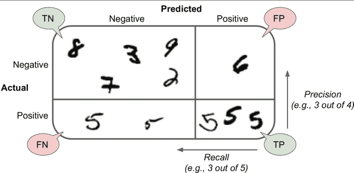 图3-2混淆矩阵图

## 精确率和召回率

Scikit-Learn提供了几个计算评估指标的函数，包括精确率和召回率：

```python
>>> from sklearn.metrics import precision_score, recall_score
>>> precision_score(y_train, y_train) # 4096 / (4096 + 1522)
0.729805083653964
>>> recall_score(y_train, y_train) # 4096 / (4096 + 1325)
0.75588151236384
```

混淆矩阵为你提供了大量信息，但有时你可能更倾向于更简洁的指标。一个值得关注的有趣点是正预测的准确率；这被称为分类器的**精确率**（公式3-1）。

### 公式3-1. 精确率

$$precision = \frac{TP}{TP + FP}$$

`TP`是真正性的数量，`FP`是假阳性的数量。获得完美精确率的一种简单方法是只做单次预测并确保它是正确的（精确率=1/1=100%）。这并没有什么用，因为分类器会忽略除一个实例之外的所有实例。因此，精确率通常与另一个指标**召回率**一起使用，它也称为敏感性或真正率（TPR）：这是被分类器正确检测到的正实例的比例（公式3-2）。

### 公式3-2. 召回率

$$recall = \frac{TP}{TP + FN}$$

`FN`当然是假阴性的数量。如果你对混淆矩阵感到困惑，图3-2可能会有帮助。 图3-2混淆矩阵图

## 精确率和召回率

Scikit-Learn提供了几个计算评估指标的函数，包括精确率和召回率：

```python
>>> from sklearn.metrics import precision_score, recall_score
>>> precision_score(y_train, y_train) # 4096 / (4096 + 1522)
0.729805083653964
>>> recall_score(y_train, y_train) # 4096 / (4096 + 1325)
0.75588151236384
```

```python
from sklearn.metrics import precision_recall_curve
```

`precisions, recalls, thresholds = precision_recall_curve(y_train_5, y_scores)`
最后，你可以使用Matplotlib（图3-4）将精确率和召回率绘制为阈值的函数：
```python
def plot_precision_recall_vs_threshold(precisions, recalls, thresholds):
    plt.plot(thresholds, precisions[:-1], "b--", label="Precision")
    plt.plot(thresholds, recalls[:-1], "g-", label="Recall")
    [... # 突出显示阈值，添加图例、轴标签和网格
plot_precision_recall_vs_threshold(precisions, recalls, thresholds)
plt.show()
```

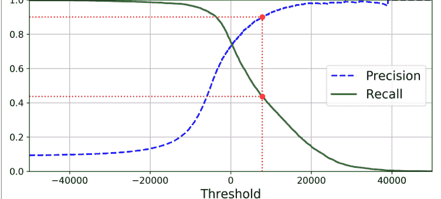

图3-4. 精确率与召回率随决策阈值

你可能会好奇为什么精确率曲线比召回率曲线波动更大，因为当你提高阈值时，精确率有时会下降（尽管通常情况下会下降）。为了理解这一点，回看图3-3，注意当你从中间阈值开始并向右仅移动一位时会发生什么：精确率从4/5(80%)下降到3/4(75%)。另一方面，当阈值增加时，召回率只能下降，这解释了为什么它的曲线看起来很平滑。

选择良好的精确率/召回率平衡的另一种方法是将精确率直接对召回率绘图，如图3-5所示（突出显示了之前的相同阈值）。

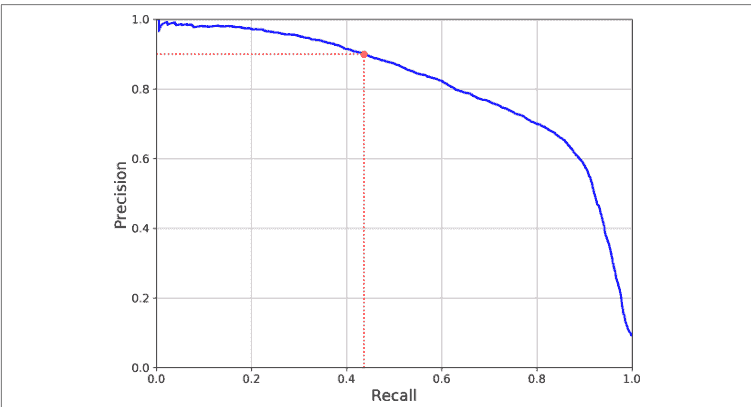

图3-5. 精确率与召回率

你可以看到精确率在召回率80%左右开始急剧下降。你可能想在该下降之前选择一个精确率/召回率平衡——例如，在60%的召回率处。但当然，选择取决于你的项目。

所以，假设你决定目标是90%的精确率。你查看了第一个图，发现你需要使用大约8,000的阈值。为了更精确，你可以搜索提供至少90%精确率的最低阈值（`np.argmax()`将给我们最大值的索引，在这种情况下意味着第一个True值）：

```python
threshold_90_precision = thresholds[np.argmax(precisions >= 0.90)] # -7816
```

为了进行预测（目前在训练集上），与其调用分类器的`predict(method)`，不如你只需要运行这段代码：

```python
>>> precision_score(y_train_5, y_train_pred_90)
0.9006380083618396
>>> recall_score(y_train, y_train_pred_90)
0.43681979492714
```

让我们检查这些预测的精确率和召回率：

太棒了，你有一个90%精确率的分类器！如你所见，创建一个具有任何你所需的精确率的分类器都是相当容易的：只需设置一个足够高的阈值即可。嗯，别那么快。如果召回率太低，高精确率的分类器并没有什么用处！

## ROC曲线

接收者工作特征（ROC）曲线是二分类器使用的另一种常用工具。它与精确率/召回率曲线非常相似，但ROC曲线不是绘制精确率对召回率，而是绘制真正例率（召回率的另一个名称）对假正例率。`FPR`是被错误分类为正例的负实例比例。它等于1减去真负例率，真负例率是被正确分类为负例的负实例比例。`TNR`也称为特异性（specificity）。因此，ROC曲线是敏感度（召回率）对比1–特异性。

要绘制ROC曲线，你首先需要使用`roc_curve()`函数计算各种阈值对应的TPR和FPR：

```python
from sklearn.metrics import roc_curve
fpr, tpr, thresholds = roc_curve(y_train_5, y_scores)
def plot_roc_curve(fpr, tpr, linewidth=2, label=label):
    plt.plot([0, 1], ['k--']) # 虚对角线
    [...] # 添加轴标签和网格
```

然后你可以使用Matplotlib绘制FPR对TPR的图。这段代码生成图3-6所示的图：

```python
plt.roc_curve(fpr, tpr)
plt.show()
```

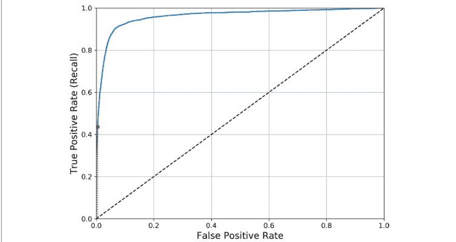

再次，存在权衡：召回率（TPR）越高，假正例越多。良好的分类器的ROC曲线越接近左上角。

比较分类器的另一种方法是计算曲线下的面积（AUC）。完美分类器的AUC等于1，而随机分类器的AUC等于0.5。Scikit-Learn提供了一个函数来计算AUC：

```python
from sklearn.metrics import roc_auc_score
```from sklearn.metrics import precision_score, recall_score
>>> roc_auc_score(y_train_5, y_scores)
0.991
```

由于精确率/召回率曲线（或ROC）非常相似，你可能想知道选择哪个。根据经验法则，当正例稀少时，你应该倾向于使用ROC曲线；而当你更关心假正例时，使用精确率/召回率曲线。例如，通过ROC曲线，你可以看到分类器的性能。

分类器的权衡：召回率（TPR）越高，假正例越多。

```python
def plot_precision_recall_vs_threshold(precisions, recalls, thresholds)
```

曲线，，

现在你现在准备好绘制曲线了（图3-7）：

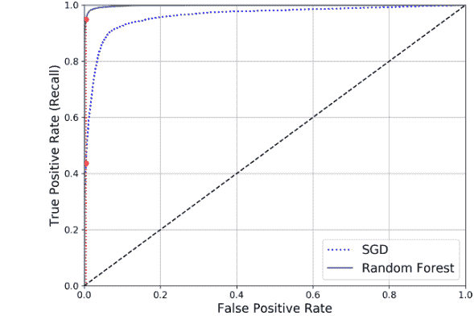

图3-7. 比较ROC曲线

如你从图3-7所示，`RandomForestClassifier`的曲线看起来比`SGDClassifier`好得多，更接近左上角。结果，它的ROC AUC分也显著提高：

```python
>>> roc_auc_score(y_train_5, y_scores)
0.998346371328145
```

测量精确率和召回率：你会发现99.0%的精确率和86.6%的召回率。不赖！

希望你现在已经了解如何训练二分类器、为任务选择合适的指标、通过交叉验证评估分类器、使用ROC曲线和ROC AUC分数比较各种模型。现在让我们尝试检测不仅仅5。

## 多类分类

二分类器区分两个类，多类分类器（多分类器）可以区分超过两个类。

某些算法（如随机森林分类器或朴素贝斯分类器）能够处理多个类。其他算法（如支持向量分类器或线性分类器）是严格的二分类器。然而，有某些策略可以使用二分类器来进行多类分类。

例如，创建一个可以将数字图像分类为10类的系统的一种方法是训练10个二分类器，每个数字一个（0检测器、1检测器、2检测器等）。当你想要对图像进行分类时，获取每个分类器对该图像的分，并选择得分最高的类别。这被称为一对全（OvA）策略（也称为一对余）。

当你尝试对多分类任务使用二二分类算法时，Scikit-Learn会检测并自动运行OvA（使用OVo的SVM分类器除外）。让我们用`SGDClassifier`来尝试一下：

```
>>> sgd_clf.fit(X_train, y_train) # using y_train, not y_train_5
>>> sgd_clf.predict(some_digit)
array([5], dtype=uint8)
```


这很简单！这段代码在训练集上使用从 0 到 9 的原始目标类别（`y_train`）训练了 `SGDClassifier`，而不是使用 5 对全（5-versus-all）的目标类别（`y_train.5`）。在底层，Scikit-Learn 实际上训练了 10 个二分类器，获取了它们对该图像的决策分数，并选择了分数最高的类别。

为了验证这一点，你可以调用 `decision_function()` 方法。它返回的不是每个实例一个分数，而是每个类别返回 10 个分数：

```
>>> some_digit_scores = sgd_clf.decision_function([some_digit])

>>> some_digit_scores

array([-19555.226784, -30880.9269175, -13326.66694897,

5732.5692379, -17680.6846644, 2412.53175101,

-25526.8649156, -12290.1570409, -7946.0520523,

-10631.35885499])
```

最高的分数确实对应类别 5：

```
>>> np.argmax(some_digit_scores)

5

>>> sgd_clf.classes_

array([0, 1, 2, 3, 4, 5, 6, 7, 8, 9], dtype=uint8)

>>> sgd_clf.classes_[5]

5
```

当分类器被训练好后，它会将目标类别列表存储在 `classes_` 属性中，并按照每个类别在 `classes_` 中的索引进行排序。在这种情况下，数组索引恰好与类别本身匹配（例如，索引 5 对应类别 5），但通常情况下你不会这么幸运的。


如果你想强制 Scikit-Learn 使用一对一（one-vs-one）或一对多（one-vs-all），你可以使用 `OneVsOneClassifier` 或 `OneVsRestClassifier`。例如，这段代码基于 `SGDClassifier` 使用 OvO 策略创建了一个多分类器：

```
array([5], dtype=uint8)

>>> len(ovo_clf.estimators_)

4
```

训练一个 `RandomForestClassifier` 同样简单：

```
>>> forest_clf.fit(X_train, y_train)

>>> forest_clf.predict([some_digit])

array([5], dtype=uint8)
```

这一次 Scikit-Learn 不需要运行 OvA 或 Ovo，因为随机森林分类器可以直接将实例分类为多个类别。你可以调用 `predict_proba()` 来获取分类器为每个实例分配给每个类的概率列表：

```
>>> forest_clf.predict_proba([some_digit])

array([[0., 0., 0.01, 0.08, 0., 0.9, 0., 0., 0., 0.01]])
```

你可以看到分类器对预测相当有把握：数组中索引 5 处的 0.9 意味着模型估计图像代表 5 的概率为 90%。它还认为该图像可能是 2、3 或 9，概率分别为 1%、8% 和 1%。

现在你想评估这些分类器。像往常一样，你想使用交叉验证。让我们使用 `cross_val_score()` 函数来评估 `SGDClassifier` 的准确率：

```
>>> cross_val_score(sgd_clf, X_train, y_train, cv=3, scoring="accuracy")

array([0.8489092, 0.87129356, 0.86988048])
```

它在所有字段上都超过了 85%。如果你使用随机分类器，你会得到100%的准确率，所以这并不是一个坏分，但你仍然可以做得得。例如，对输入进行缩放（如第2章所述）可以将准确率提高到 89% 以上：

```
>>> from sklearn.preprocessing import StandardScaler

>>> scaler = StandardScaler()

>>> X_train_scaled = scaler.fit_transform(X_train.astype(np.float64))

>>> cross_val_score(sgd_clf, X_train_scaled, y_train, cv=3, scoring="accuracy")

array([0.8907059, 0.89693604])
```

## Error Analysis

当然，如果这是一个真实项目，你将遵循机器学习项目中的步骤（参见 ?：探索数据准备、尝试多个模型、筛选出最佳模型并使用 `GridSearchCV` 调优超参数，以及尽可能自动化，就像你在上一章中所做的那样）。在这里，假设你有一个很有前景的模型并想找到改进方法。一种方法是分析它犯的错误。

首先，你可以查看混淆矩阵。你需要使用 `cross_val_predict()` 进行预测，然后调用 `confusion_matrix()` 函数，就像你之前做的那样：

```
>>> y_train_pred = cross_val_predict(sgd_clf, X_train_scaled, y_train, cv=3)

>>> conf_mx = confusion_matrix(y_train, y_train_pred)

array([[5578, 0, 22, 7, 8, 45, 35, 5, 22, 1],

 [ 0, 6410, 35, 26, 4, 44, 4, 198, 13, 0],

 [ 28, 27, 5232, 100, 74, 27, 68, 37, 35, 11],

 [ 23, 18, 11, 5254, 209, 26, 38, 73, 15, 0],

 [ 11, 14, 45, 12, 5219, 11, 33, 29, 17, 2],

 [ 26, 16, 31, 73, 54, 4884, 76, 14, 8, 2],

 [ 31, 17, 45, 428, 5556, 3, 123, 1, 0, 0],

 [ 20, 10, 53, 27, 50, 13, 3696, 173, 22, 0],

 [ 17, 64, 47, 91, 3, 125, 24, 14, 8, 1],

 [ 24, 18, 29, 67, 16, 39, 1, 174, 329, 5]])
```

这些数字太多了。使用 Matplotlib 的 `matshow()` 查看混淆矩阵的图像表示更方便：

```
plt.matshow(conf_mx, cmap='gray')

plt.show()
```

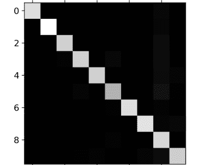

这个混淆矩阵看起来还可以，大部分图像都在对角线上，这意味着它们被正确分类了。5 比其他数字稍暗，这可能意味着数据集中 5 较少，或者分类器对 5 的性能不如其他数字好。事实上，你可以验证这两种情况。

让我们关注错误图。首先，你需要将混淆矩阵中的每个值除以对应类别的图像数量，这样就可以比较错误率而不是错误的绝对数量（后者会让大量的类别看起来很糟糕）；现在让我们将对角线填充为零以只保留错误，并绘制结果：

```
np.fill_diagonal(norm_conf_mx, 0)

plt.matshow(norm_conf_mx, cmap='gray')

plt.show()
```

现在你可以清楚地看到分类器犯的错误类型。记住行代表实际类别，而列代表预测类别。类别 8 的列非常亮，这告诉许多图像被误分类为 8。然而，类别 8 的行并不差，说明实际 8 通常被正确分类为 8。正如你所看到的，混淆矩阵并不一定对称。你还可以看到 3 和 5 经常混淆（两个方向）。

分析混淆矩阵通常会给你关于如何改进分类器的见解。观察此图，你的努力应该放在减少 8 上。例如，你可以尝试收集更多像 8 但不是 8 的数字数据，以便分类器将它们与真实的 8 区分开；或者你可以构建有助于分类器的新特征——例如编写算法来计算闭合环的数量（例如，8 有两个，6 有一个，5 没有）。或者对图像进行预处理（例如使用 Scikit-Image、Pillow 或 OpenCV），使某些模式脱颖而出，例如闭合环。

分析单个错误也是了解分类器在做什么以及为什么失败的好方法，但它更困难且更耗时。

例如，显示 3 和 5 的示例（`plot_digits()` 函数）只是使用了 Matplotlib 的 `show()` 函数；详情请参此 Jupyter 笔记本：

```
cl_a, cl_b = 3, 5

X_aa = X_train[y_train == cl_a] & (y_train_pred == cl_a)

X_ab = X_train[y_train == cl_a] & (y_train_pred == cl_b)

X_ba = X_train[y_train == cl_b] & (y_train_pred == cl_a)

X_bb = X_train[y_train == cl_b] & (y_train_pred == cl_b)

plt.figure(figsize=(8,8))

plt.subplot(221); plot_digits(X_aa[:25], images_row=5)

plt.subplot(222); plot_digits(X_ab[:25], images_row=5)

plt.subplot(223); plot_digits(X_ba[:25], images_row=5)

plt.subplot(224); plot_digits(X_bb[:25], images_row=5)

plt.show()
```

3 和 5 之间的主要区别在于连接顶部直线和底部圆弧的小线的位置。如果你在画 3 的时候将连接处略微向左偏移，分类器可能会将其分类为 5，反之亦然。换句话说，这个分类器对平移和旋转非常敏感。因此，减少 3/5 混淆的一种方法是对图像进行预处理，以确保它们位于居中且没有旋转过大。这可能有助于减少其他错误。

## 多标签分类 (Multilabel Classification)

到目前为止，每个实例始终被分配给一个类。在某些情况下，你可能希望分类器为每个实例输出多个类。例如，考虑一个人脸识别器：如果它在同一张照片上识别出几个人，该怎么办？当然，它应该为识别出的每一个人标记一个标签。分类器已经训练为识别三个脸：Alice、Bob 和 Charlie；那么当给它一张 Alice 和 Charlie 的照片时，它应该输出 [1, 0, 1]（意味着“Alice，Bob 没有，Charlie”）。输出多个二值标签的分类系统被称为多标签分类系统。

我们不会深入讨论人脸识别，但让我们来看一个更简单的例子，仅用于说明：

```python
from sklearn.neighbors import KNeighborsClassifier

y_train_large = (y_train >= 7)

y_train_odd = (y_train % 2 == 1)

y_multilabel = np.c_[y_train_large, y_train_odd]

knn_clf = KNeighborsClassifier()

knn_clf.fit(X_train, y_multilabel)
```

这段代码创建了一个多标签数组，其中每个数字包含两个标签：第一个表示该数字是否大数字（7、8 或 0），第二个表示它是否为奇数。接下来的几行创建了一个 `KNeighborsClassifier` 实例（它支持多标签分类，但并不是所有的分类器都支持），并使用多目标数组对其进行训练。现在我们进行预测，注意到它输出了两个：

```
>>> knn_clf.predict([some_digit])

array([False, True])
```

结果是正确的！数字 5 不大（False）且是奇数（True）。
评估多标签分类器有很多方法，选择合适的指标实际上取决于你的项目。例如，一种方法是为每个单独标签测量 F1 分数（或之前过的任何其他分类器指标），然后简单地计算平均分。这段代码计算所有标签的平均 F1 分数：

```
>>> y_train_knn_pred = cross_val_predict(knn_clf, X_train, y_multilabel, cv=3)

>>> f1_score(y_multilabel, y_train_knn_pred, average="macro")

0.976410265506065
```

这假设所有标签同样重要，但可能并非如此。特别是如果你关于 Alice 的照片比 Bob 或 Charlie 多，你可能希望给分类器对 Alice 的评分更高的权重。一个简单的选项是给每个标签一个与其支持度（即具有目标标签的实例数量）相等的权重。这样做只需在前面的代码中设置 `average="weighted"` ⁴。

## 多输出分类 (Multioutput Classification)

我们将讨论的最后一种分类任务被称为多输出多类分类（或简单的多输出分类）。它是多标签分类的推广，其中每个标签都可以是多类的（即它可以有两个以上的可能值）。

为了说明这一点，让我们构建一个从图像去除噪声的系统。它将接受一个带噪声的数字图像作为输入，并（希望）输出一个干净的数字图像，用像素强度数组表示，就像 MNIST 图像一样。注意分类器的输出是多标签的（每个像素一个标签），每个标签可以有多个值（像素强度范围从 0 到 255）。那么这就是多输出分类系统的示例。

> 分类和回归之间的界限有时是模糊的，在这个例子中如此。可以说，预测像素强度更接近回归而非分类。此外，多输出系统不仅限于分类任务；你甚至可以有一个每个实例输出多个标签的系统，包括类别值和标签值。

让我们先通过使用 NumPy 的 `randInt()` 函数向这些像素图像添加噪声来创建训练集和测试集。目标图像将是原始图像：

```python
noise = np.random.randint(0, 100, (len(X_train), 784))

X_train_mod = X_train + noise

noise = np.random.randint(0, 100, (len(X_test), 784))

X_test_mod = X_test + noise

y_train_mod = X_train

y_test_mod = X_test
```

⁴ Scikit-Learn 提供了其他几种平均选项和多标签分类器指标；更多信息请参阅文档。

让我们看看测试集中的一张图像（是的，我们正在偷测试数据，所以你现在应该皱眉了）：

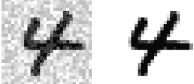

左侧是带噪声的输入图像，右侧是干净的目标图像。现在让我们训练分类器并让它清理这张图像：

```python
knn_clf.fit(X_train_mod, y_train_mod)

clean_digit = knn_clf.predict(X_test_mod)

plot(clean_digit)
```


看起来足够了！我们对分类的介绍结束了。

### 练习

1. 尝试在 MNIST 数据集上构建一个准确率达到 97% 的分类器。提示：`KNeighbors` 效果良好。
2. 写一个函数，可以向任何方向（左、右、上、下）移动一个像素。⁵ 你可以使用 `scipy.ndimage.shift`。然后，对于每个图像，`shift(image, [2, 1])` 会向下移动 2 像素并向右移动 1 像素。
3. 挑战泰坦尼克数据集。从 Kaggle 开始是一个很好的起点：
- 从 ApacheAssassin 的公共数据下载垃圾示例。
- 解压数据集并熟悉格式。
- 将数据集分成训练集和测试集。
- 编写数据流水线，将每封邮件转换为（稀疏）向量。
- 你可以为准备流水线添加超参数，以控制是否删除头部、转换为小写、删除标点符号、将所有 URL 替换为 "URL" 将所有数字替换为 "NUMBER"，甚至进行词干提取（即修剪结尾；有相应的 Python 库可以实现这一点）。
- 然后尝试几种分类器，看看你是否能建立高召回率和高精确率的优秀分类器。

这些练习的解答可在在线笔记本中找到：https://github.com/ageron/handson-ml2。

- 使用一种迭代优化方法，称为梯度下降（Gradient Descent, GD），它通过逐渐调整模型参数来使训练集上的代价函数最小，最终收敛到与第一方法相同的一组参数。我们将介绍梯度下降的几种变体，这些将在第二部分学习神经网络时反复使用：批量梯度下降（Batch GD）、小批量梯度下降（Mini-batch GD）和随机梯度下降（Stochastic GD）。

接下来我们将介绍多项回归，这是一种可以拟合非线性数据集的复杂模型。由于该模型的参数比线性回归更多，它更容易对训练数据产生过拟合，因此我们将学习如何使用学习曲线来检测是否存在这种情况，并查看几种可以降低训练集过拟合风险的正则化技术。

最后，我们将介绍另外两种常用于分类任务的模型：逻辑回归（Logistic Regression）和 Soft-max 回归（Softmax Regression）。


本章会有相当多的数学方程，使用了线性代数和微积分的基本概念。为了理解这些方程，你需要知道向量和矩阵是什么、如何转置、相乘和求逆，以及什么是偏导数。如果你不熟悉这些概念，请阅读在线补充材料中以 Jupyter Notebook 形式提供的线性代数和微积分入门教程。对于那些真正对数学过敏的人，你仍然应该阅读这一章，只需直接跳过方程；希望文本能帮助你理解大部分概念。

## 线性回归

在第 1 章中，我们查看了一个简单的生活满意度回归模型：`life_satisfaction = θ_0 + θ_1 × GDP_per_capita`。

该模型是输入特征 `GDP_per_capita` 的线性函数。`θ_0` 和 `θ_1` 是模型的参数。

更通地说，线性模型通过计算输入特征的加权和，加上一个称为偏置项（bias term，也称为截距项）的常量来进行预测，如方程 4-1 所示。

> 方程 4-1. 线性回归模型预测

```
$$\hat{y} = \theta_0 + \theta_1x_1 + \theta_2x_2 + \dots + \theta_nx_n$$
```

- `ŷ` 是预测值。
- `n` 是特征的数量。
- `x_i` 是第 `i^{th}` 个特征值。
- `θ_j` 是第 `j^{th}` 个模型参数（包括偏置项 `θ_0` 和特征权重 `θ_1, θ_2, …, θ_n`）。

可以使用向量形式更简洁地写，如方程 4-2 所示。

### 方程 4-2. 线性回归模型预测（向量化形式）

```
$\hat{y} = h_\theta(x) = \theta \cdot x$
```

- `θ` 是模型的*参数向量*，包含了偏置项 `θ_0` 和特征权重 `θ_1` 到 `θ_n`。
- `x` 是实例的*特征向量*，包含 `x_0`，其中 `x_0` 始终等于 1。
- `θ · x` 是向量 `θ` 和 `x` 的点积，它显然等于 `θ_0x_0 + θ_1x_1 + θ_2x_2 + … + θ_nx_n`。
- `h` 是假设函数，使用模型参数 `θ`。


在机器学习中，其他项通常表示为列向量，即具有单列的 2D 数组。如果 `θ` 和 `x` 是列向量，那么预测为 `ŷ = θ^T x`，其中 `θ^T` 是 `θ` 的转置（行向量而非列向量），`θ^T x` 是 `θ^T` 和 `x` 的矩阵乘法。预测结果显然是相同的，只是被表示为单单元矩阵而不是标量值。在书中我们将使用这种符号来避免在点积和矩阵乘法之间切换。

好了，以上是线性回归，现在我们如何训练它呢？回想，训练模型意味着设置其参数，使模型最好地拟合训练数据。为了这个目的，我们首先需要一个衡量模型拟合训练数据好坏（或差）的标准。在第 2 章中，我们看到回归模型最常见的性能衡量是均方根误差（RMSE）（方程 2-1）。因此，为了训练线性回归模型，你需要找到使 RMSE 最小的 `θ` 值。在实践中，最小化均方误差（MSE）比最小化 RMSE 更简单，且产生相同的结果。

线性回归在训练集上的 MSE 函数 `h_θ` 是使用方程 4-3 计算的。

方程 4-3. MSE

```
$MSE(h_\theta)=\frac{1}{m}\sum_{i=1}^{m} (y^{(i)} - h_\theta(x^{(i)}))^2$
```

通常情况下，我们使用正规方程来直接求解 `θ`。正规方程（Normal Equation）提供了 `θ` 的解析解，见方程 4-4：`θ=(X^T X)^{-1} X^T y`。

方程 4-4. 正规方程

```
$$\theta = (X^T X)^{-1} X^T y$$
```

正规方程 `X^T X` 是可逆的，前提是特征之间不是线性相关的。如果特征是线性相关的，则 `X^T X` 将不可逆。在这种情况下可以使用梯度下降法来求解 `θ`。

正规方程的优点是它不需要选择学习率，也不需要迭代。但它的缺点是当特征数量 `n` 很大时，计算 `(X^T X)^{-1}` 非常耗时（复杂度为 `O(n^3)`）。因此在实际应用中，我们更多使用梯度下降法。

线性回归在训练集上的 MSE 函数 `h_θ` 是使用方程 4-3 计算的。

如图 4-1 所示，我们来生成一些线性数据：

```python
import numpy as np

X = np.array([[200, 3.5], [220, 1.2], [240, 1.0], [240, 3.2], [260, 1.1], [280, 1.0]])
y = np.array([7.1, 0.9, 0.5, 1.5, 1.2, 0.8])
```

我们可以使用 `matplotlib` 来绘制这些数据：

```python
import matplotlib.pyplot as plt

plt.scatter(X[:, 0], y, color='blue')
plt.xlabel("GDP per capita")
plt.ylabel("Life satisfaction")
plt.show()
```

现在我们使用正规方程来求解 `θ`：

```python
X_b = np.c_[np.ones((6, 1)), X] 
theta_best = np.linalg.inv(X_b.T.dot(X_b)).dot(X_b.T).dot(y)
print(theta_best)
## 输出: [6.05263158 -0.02486842]
```

我们可以对新数据进行预测：

```python
X_new = np.array([[250, 1.0], [300, 1.0]])
X_new_b = np.c_[np.ones((2, 1)), X_new]
predictions = X_new_b.dot(theta_best)
print(predictions)
## 输出: [5.55394737 4.30263158]
```

我们可以绘制预测结果：

```python
plt.scatter(X[:, 0], y, color='blue')
plt.plot(X_new[:, 0], predictions, "r-")
plt.xlabel("GDP per capita")
plt.ylabel("Life satisfaction")
plt.show()
```

我们可以使用梯度下降法来求解 `θ`：

```python
def gradient_descent(X, y, learning_rate=0.01, n_iterations=1000):
    theta = np.random.randn(X.shape[1])
    for iteration in range(n_iterations):
        gradients = 2/len(X) * X.T.dot(X.dot(theta) - y)
        theta = theta - learning_rate * gradients
    return theta

theta_best_gd = gradient_descent(X_b, y)
print(theta_best_gd)
## 输出: [6.05263158 -0.02486842]
```

可以看到，梯度下降对学习率和迭代次数非常敏感。

```python
theta_best_gd = gradient_descent(X_b, y, learning_rate=0.1, n_iterations=1000)
theta_best_gd = gradient_descent(X_b, y, learning_rate=0.0001, n_iterations=100000)
```

通过特征缩放可以使梯度下降更快收敛：

```python
X_mean = np.mean(axis=0)
X_std = np.std(axis=0)
X_scaled = (X - X_mean) / X_std
X_b_scaled = np.c_[np.ones((6, 1)), X_scaled]
theta_best_gd = gradient_descent(X_b_scaled, y)
```

最后，我们可以使用正则化来防止过拟合：

```python
from sklearn.preprocessing import Ridge
X_scaled = (X - X_mean) / X_std
ridge_reg = Ridge(alpha=1)
ridge_reg.fit(X_scaled, y)
print(ridge_reg.intercept_)
print(ridge_reg.coef_)
```

伪逆本身是使用一种称为奇异值分解（SVD）的标准矩阵分解技术计算的，该技术可以将训练集 `X` 分解为三个矩阵的积 `U Σ V^T`（参见 `numpy.linalg.svd()`）。伪逆的计算公式为 `X^+ = V Σ U^T`。为了使矩阵 `Σ` 加倍，算法获取 `Σ` 并所有小于微小阈值的值置为零，然后将所有非零值替换为倒数，最后对结果矩阵进行转置。这种方法比计算正方程（Normal Equation）更高效，而且能够很好地处理边界情况：事实上，如果矩阵 `X` 不可逆（即奇异），或者 `m < n` 或者某些特征冗冗余，正方程可能无法运行，而伪逆总是定义的。

## 计算复杂度

正方程计算 `X^T X` 的逆，这是一个 `(n+1) × (n+1)` 矩阵（其中 `n` 是特征的数量）。求此类矩阵逆的计算复杂度通常为 `O(n^4)` 到 `O(n^3)`（取决于具体实现）。换句话说，如果特征数量翻倍，计算时间将变为大约 `2^4 = 5.3` 到 `2^3 = 8` 倍。

SVD 方法被 Scikit-Learn 的 `LinearRegression` 类使用，复杂度为 `O(mn^2)`。如果特征数量翻倍，计算时间将变为 4 倍。

正方程和 SVD 方法在特征数量很大（例如 100,000 个）时都会变得非常慢。好在，两者对于训练集中的实例数量都是线性的（它们是 `O(m)`），因此只要内存能够容下，它们就能高效地处理大型训练集。


此外，一旦你拥有了线性回归模型（使用正方程或其他任何算法），预测是非常快的：计算复杂度相对于你想要预测的实例数量和特征数量都是线性的。换句话说，对许多倍的实例（或双倍的特征）进行预测将花费双倍的时间。

现在我们将观察训练线性回归模型的不同方法，这些方法更适用于特征数量巨大或训练实例过多而无法装入内存的情况。

## 梯度下降

梯度下降是一种非常通用的优化算法，能够找到广泛问题的最优解。梯度下降的核心思想是迭代地调整参数以最小化代价函数。

假设你迷失在迷雾弥绕的山山中；你只能感觉到脚下地面的坡度。快速到达山谷的良好策略是沿着坡度最陡的方向向下走。这正是梯度下降所做的：它衡量误差函数相对于参数向量 `θ` 的局部质量，并沿着梯度下降（下降）的方向移动。一旦梯度为零，你就到达了最小值！

具体来说，你首先用随机值填充 `θ`（这被称为随机初始化），然后逐渐改进它，一次迈出一小步，尝试减小代价函数的值（例如 MSE），直到算法收敛到最小值（见图 4-3）。

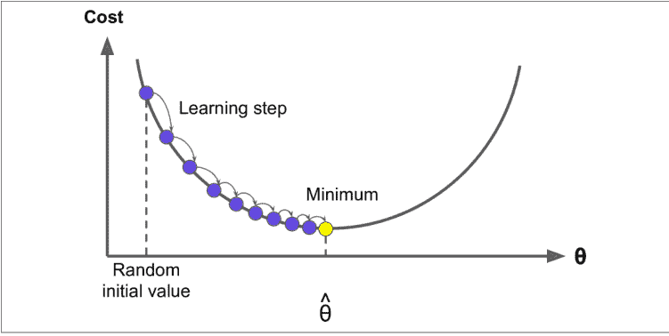

梯度下降中的一个重要参数是步的**大小**，它由超参数**学习率**决定。如果学习率太小，算法将需要多次迭代才能收敛，这将花费很长的时间（见图 4-4）。

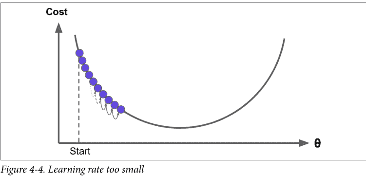

另一方面，如果学习率太高，你可能会跳过山谷并到达另一侧，甚至可能比之前还要高。这可能导致算法发散，值越来越大，无法找到良好的解（见图 4-5）。

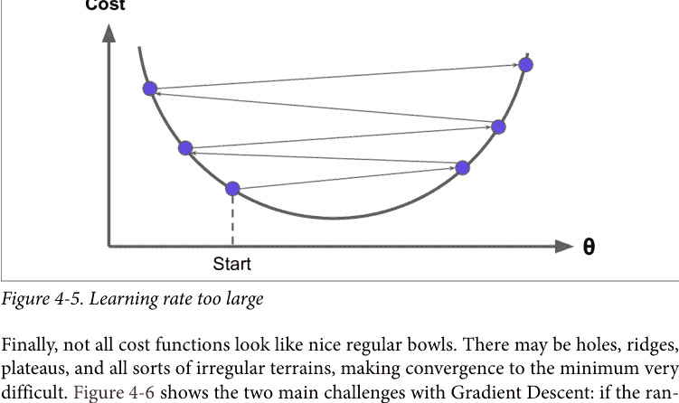

最后，并不是所有的代价函数看起来都像整齐的规则碗状。它们可能存在洞、山脊、高原和各种不规则的地形，使得收敛到最小值变得非常困难。图 4-6 显示了梯度下降面临的两个主要挑战：如果随机初始化算法从左侧开始，它将收敛到局部最小值，这没有全局最小值好。如果从右侧开始，将需要很长时间穿过高原，如果你停止得太早，将永远无法到达全局最小值。

## 代价

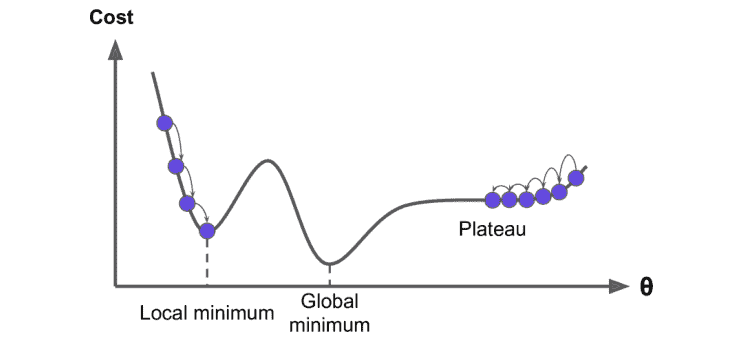

图 4-6. 梯度下降的陷阱

幸运的是，一旦你有了线性回归模型（使用正方程或其他任何算法），预测是非常快的：计算复杂度相对于你想要预测的实例数量和特征数量都是线性的。换句话说，对许多倍的实例进行预测将花费双倍的时间。

事实上，线性回归的代价函数是凸的，这意味着没有局部最小值，只有一个全局最小值。由于特征具有不同的量级，代价函数的形状是拉伸的。图 4-7 展示了在特征缩放的情况下（左侧）以及特征 1 尺度差异很大的情况下（右侧）。

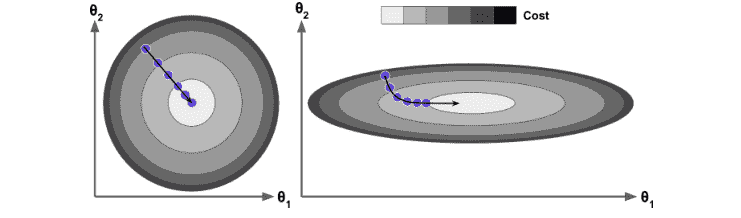

图 4-7. 有无特征缩放的梯度下降

- 4 技术上讲，它的导数是连续的。
- 5 由于特征 1 较小，需要 `θ_1` 有更大的变化来影响代价函数，这就是为什么碗状是沿着 `θ_1` 轴拉伸的。

正如你看到的，在左侧梯度下降直奔最小值，而在右侧它首先沿着几乎正于全局最小值的方向移动，这会花费很长时间。

在使用梯度下降时，你应该确保所有特征具有相似的尺度（例如使用 Scikit-Learn 的 `StandardScaler` 类），否则收敛需要更长的时间。


## 批量梯度下降

为了实现梯度下降，你需要计算代价函数相对于每个模型参数的梯度。换句话说，你需要计算在稍微改变 `θ_j` 时代价函数会产生多少变化。这被称为偏导数。这就像是在问“如果我面向东，我脚下山的坡度是多少？”以及向北相同的问题（如果你能想象一个超过三个维的宇宙）。公式 4-5 计算了代价函数相对于参数 `θ_j` 的偏导数，记为 `∂/∂θ_j MSE(θ)`。

公式 4-5. 代价函数的偏导数

```
$\frac{\partial}{\partial\theta_j}MSE(\theta) = \frac{2}{m}\sum_{i=1}^{m}(\theta_j^{(i)} - y^{(i)})x_j^{(i)}$
```

与其单独计算这些偏导数，你可以使用公式 4-6 一次性计算所有它们。梯度向量记为 `∇_θ MSE(θ)`，包含了代价函数的所有偏导数（每个模型参数对应一个）。

等式 4-6. 代价函数的梯度向量

```
$$\frac{\partial}{\partial\theta_0}MSE(\theta)$$
```


$$\nabla_{\theta}MSE(\theta) = \frac{\partial}{\partial\theta_1}MSE(\theta) = \frac{2}{m}\mathbf{X}^T(\mathbf{X}\theta-\mathbf{y})$$

:

$$\frac{\partial}{\partial\theta_n}MSE(\theta)$$

注意，该公式在每个梯度下降步骤中都涉及到对整个训练集 `X` 的计算！这就是为什么该算法被称为批量梯度下降（Batch Gradient Descent）的原因：它每一步都使用整批训练数据（实际上，称为“全梯度下降”可能更合适）。因此，在非常大的训练集上它的运行速度非常缓慢（但很快我们将看到更多梯度下降算法）。然而，梯度下降在特征数量上的扩展性良好；当当有数百个特征时，使用梯度下降训练线性回归模型比使用正规方程（Normal Equation）或 SVD 分解要快得多。


一旦你获得了指向向上的梯度向量，只需向相反方向移动即可下山。这通过从 `θ` 中减去 `∇_θ MSE(θ)` 实现。这就是学习率发挥用场的地方；`η` 将梯度向量乘以 `η` 以确定下山步的大小（等式 4-7）。

## 等式 4-7. 梯度下降步骤

```
(next step) = θ-η∇_θMSE(θ)
```

```python
eta = 0.1 # 学习率

n_iterations = 1000

m = 100

theta = np.random.rand(2,1) # 随机初始化

for iteration in range(n_iterations):
    ngradients = 2/m * X_b.dot(X_b.dot(theta) - y)
    theta = theta - eta * gradients
```

让我们来看这个算法的快速实现：

`Eta` (`η`) 是希腊字母表中的第 7 个字母。

这并不难！让我们看看生成的 `theta`：

```python
>>> theta
array([[4.21509616],
      [2.77011339]])
```

嘿，这正是正规方程找到的结果！梯度下降工作得完美。但如果你使用不同的学习率 `eta` 呢？图 4-8 显示了使用三种不同学习率进行梯度下降的前 10 步（虚线代表起始点）。

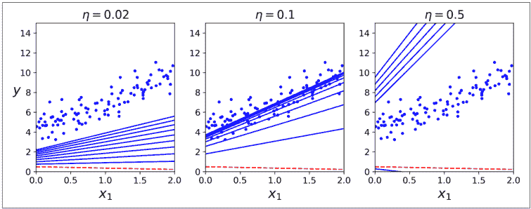

图 4-8. 不同学习率下的梯度下降

左侧的学习率太低：算法最终会达到解决方案，但需要花费时间。中间的学习率看起来很不错：只需几次迭代，它就已经收敛到解决方案。右侧的学习率太高：算法发散了，到处跳跃，并且实际上每一步都离解决方案越来越远。

要找到良好的学习率，你可以使用网格搜索（第 2 章）。然而，你可能想限制迭代次数，以便网格搜索能够排除那些收敛过长的元素。

你可能会奇如何设置迭代次数。如果太低，算法停止时你仍然离最优解很远；但如果太高，当参数不再变化时你就会浪费时间。一个简单的解决方案是设置非常大的迭代次数，但在梯度向量 `∇` 变得极小时时中断算法——也就是说当它的范数小于一个极小的数字 `ε`（称为容差）时——因为这发生在梯度下降（几乎）达到最小值时。

## 收敛率

当代价函数是凸的且其斜率不会发生突然变化时（MSE 代价函数的情况如此），固定学习率的批量梯度下降最终会收敛到最优解，但你可能需要等待一段时间：取决于代价函数的形状，在 `e` 范围内达到最优解可能需要 `O(1/e)` 次迭代。如果你将容差除以 10 以获得更精确的解，那么算法可能需要运行长约 10 倍。

## 随机梯度下降

批量梯度下降的主要问题在于它每一步都使用整个训练集来计算梯度，这使得在训练集很大时它非常慢。在另一个极端，随机梯度下降（Stochastic Gradient Descent）每一步仅从训练集中随机选择一个实例，并仅根据该实例计算梯度。显然，这使得算法快得多，因为每次迭代处理的数据非常少。它还使得在巨大的训练集上进行训练成为可能，因为每次迭代只需要内存中保留一个实例（SGD 可以实现为内存外算法）。

另一方面，由于其随机性（即随机的特质），该算法比批量梯度下降要规则得多：代价函数不是逐渐减少直到达到最小值，而是上下波动，仅在平均意义上减少。随着时间的推移，它最终会接近最小值，但一旦到达那里，它将继续跳动，永远不会稳定（见图 4-9）。一旦算法停止，最终的参数值是好的，但不是最优的。

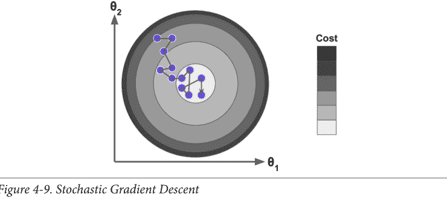

图 4-9. 随机梯度下降

再次，你发现了一个与正规方程返回的结果相似的解：

```
>>> sg_reg_intercept_, sg_reg_coef_
(array([4.24365286]), array([2.2850878]))
```

## 小批量梯度下降 (Mini-batch Gradient Descent)

我们将看到的最后一种梯度下降算法称为小批量梯度下降。一旦知道了批量（Batch）和随机（Stochastic）梯度下降，理解它就非常简单：在每一步中，不是基于整个训练集计算梯度（如批量 GD），也不是仅基于单个实例计算梯度（如随机 GD），而是基于小规模随机实例集合（称为小批量 mini-batches）来计算梯度。小批量梯度下降相比随机梯度下降的主要优势是，你可以通过矩阵操作的硬件优化获得性能提升，特别是在使用 GPU 时。

由于使用了较大的小批量，该算法在参数空间中的进展比 SGD 不那么反常。结果是，小批量 GD 最终达到比 SGD 更接近最小值。但另一方面，它可能更难跳出局部最小值（对于那些受到局部最小值困扰的问题，与我们之前看到的线性回归不同）。图 4-11 显示了三种梯度下降算法在训练期间在参数空间中所经过的路径。它们都结束最小值附近，但批量 GD 的路径实际上停在了最小值处，而随机 GD 和小批量 GD 则会继续徘徊。然而，不要忘记批量 GD 走每一步都需要大量时间，如果你使用良好的学习率调度，随机 GD 和小批量 GD 也会达到最小值。

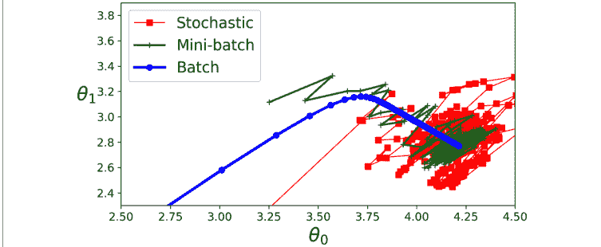

图 4-11. 参数空间中的梯度下降路径

让我们比较一下为止讨论的线性回归算法（回想一下 `m` 是训练实例的数量，`n` 是特征的数量）；参见表 4-1。

表 4-1. 线性回归算法对比

| 算法 | 大 `m` | 超出支持 | 大 `n` | 超参数 | 是否需要缩放 | Scikit-Learn |
| --- | --- | --- | --- | --- | --- | --- |
| 正规方程 | 快 | 否 | 慢 | 0 | 否 | n/a |
| SVD | 快 | 否 | 慢 | 0 | 否 | LinearRegression |
| 批量 GD | 慢 | 否 | 快 | 2 | 是 | SGDRegressor |
| 随机 GD | 快 | 是 | 快 | ≥ 2 | 是 | SGDRegressor |
| 小批量 GD | 快 | 是 | 快 | ≥ 2 | 是 | SGDRegressor |

训练后几乎没有区别：所有这些算法得到的模型非常相似，且预测方式完全相同。


## 多项式回归 (Polynomial Regression)

如果你的数据实际上比简单的直线更复杂怎么办？惊讶的是，你实际上可以使用线性模型来拟合非线性数据。实现的一种简单方法是将每个特征的幂作为新特征，然后在这个扩展的特征集上训练线性模型。这种技术被称为*多项式回归*。

让我们来看一个例子。首先，基于简单的*二次方程*（加上一些噪声；见图 4-12）生成一些非线性数据：

```
m = 100
X = 6 * np.random.rand(m, 1) - 3
y = 0.5 * X**2 + X + 2 + np.random.randn(m, 1)
```

- 虽然正规方程只能执行线性回归，但正如我们将看到的，梯度下降算法可以被用于训练许多其他模型。
- 二次方程的形式为 `y = ax^2 + bx + c`。

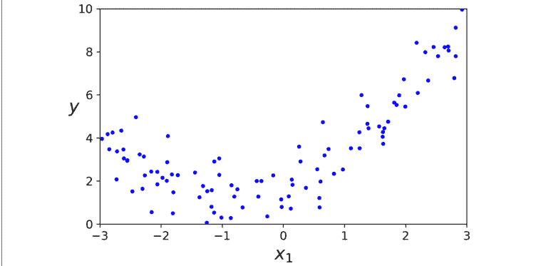

图 4-12. 生成的非线性噪声数据集

显然，直线永远无法完美拟合这些数据。让我们使用 Scikit-Learn 的 `PolynomialFeatures` 来转换我们的训练数据，将训练集中每个特征的平方（2 次多项式）作为新特征，就像只有一个特征（feature）的情况一样：

```python
>>> from sklearn.preprocessing import PolynomialFeatures
>>> poly_features = PolynomialFeatures(degree=2, include_bias=False)
>>> X_poly = poly_features.fit_transform(X)
>>> X[0]
array([-0.75275929])
>>> X_poly[0]
array([-0.75275929, 0.56646454])
```

`X_poly` 包含了 `X` 的原始特征加上该特征的平方。现在你可以对这些扩展的训练数据拟合一个 `LinearRegression` 模型（图 4-13）：

```python
>>> lin_reg = LinearRegression()
>>> lin_reg.fit(X_poly, y)
>>> lin_reg.intercept_, lin_reg.coef_
(array([1.78134581]), array([[0.93366893, 0.56456263]]))
```

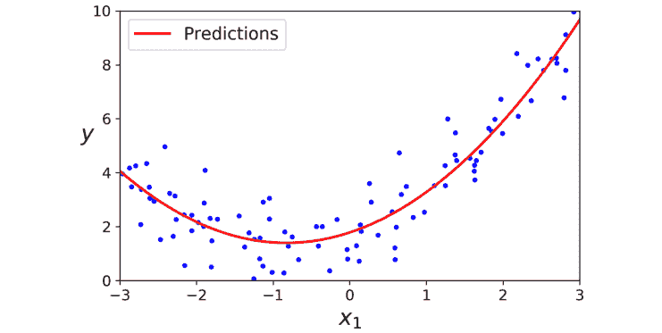

图 4-13. 多项式回归模型

还不错：当原始函数为 `y = 0.5x_1^2 + x_1 + 2.0 +` 高斯噪声时，该模型估计出 `ŷ = 0.56x_1^2 + 0.93x_1 + 1.78`。注意，当存在多个特征时，多项式回归能够发现特征之间的关系（这是普通回归模型无法做到的）。这是通过 `PolynomialFeatures(degree)` 添加了直到给定次数的所有特征组合而而的。例如，如果有两个特征 `a` 和 `b`，次数为 `3` 的 `PolynomialFeatures` 会添加特征 `a^2, b^2` 和 `b^3`，但还包括组合 `ab, a^2b` 和 `ab^2`。它将 `n` 个特征转换为一个包含 `C(n+d, d)` 个特征的数组，等于 `1 × 2 × … × n`。注意特征数量的组合爆炸！


## 学习曲线 (Learning Curves)

如果你执行高次多项式回归，你对训练数据的拟合效果可能会比普通回归更好。例如，图 4-14 将 300 次多项式模型应用于训练数据，并将其结果与纯线性模型和二次模型（2 次多项式）进行比较。注意 300 次多项式模型是如何扭曲以尽可能接近每个实例的。


图 4-14. 高次多项式回归模型严重过拟合了训练数据，而线性模型则欠拟合。泛化能力最好的模型将是二次模型。这是合理的，因为数据是使用二次模型生成的，但通常情况下并不知道是什么函数生成了数据，所以你如何决定你的模型应该有多复杂？你如何判断你的模型是过拟合还是欠拟合的？

如果你的模型对训练数据出现欠拟合（underfitting），添加更多示例将毫无帮助。你需要使用更复杂的模型或寻找更好的特征。

现在让我们来看看在相同数据上 10 阶多项式模型的学习曲线（**图 4-16**）：

```python
from sklearn.pipeline import Pipeline

polynomial_regression = Pipeline([
    ("poly_features", PolynomialFeatures(degree=10, include_bias=False)),
    ("lin_reg", LinearRegression()),
])
```


`plot_learning_curves(polynomial_regression, X, y)`

这些学习曲线看起来和之前的有些相似，但有两个非常重要的区别：

- 训练数据上的误差远低于线性回归模型。
- 曲线之间存在间隙。这意味着模型在训练数据上的表现显著优于在验证数据上的表现，这是过拟合（overfitting）模型的标志。然而，如果你使用大得多的训练集，这两条曲线将继续接近。


**图 4-16。** 多项式模型的学习曲线


改进过拟合模型的一种方法是输入更多的训练数据，直到验证误差达到训练误差。

## 偏差/方差权衡（Bias/Variance Tradeoff）

统计学和机器学习中一个重要的理论结果是模型的泛化误差可以表示为三种非常不同的误差之和：

### 偏差（Bias）
泛化误差的这由于错误的假设，例如假设数据是线性的而实际上数据是二次的。高偏差模型最可能欠拟合训练数据。

### 方差（Variance）
部分由于模型对训练数据中微小变化的过度敏感。具有许多自由度的模型（如高阶多项式）可能具有高方差，从而过拟合训练数据。

### 不可误差（Irreducible error）
部分由于数据本身的噪声。减少这部分误差的唯一方法是清理数据（例如修复损坏的传感器，或检测并移除离群值）。

增加模型的复杂度通常会增加其方差并降低偏差。反之，减少模型的复杂度会增加其偏差并降低方差。这就是为什么它被称为权衡。

## 正则化线性模型（Regularized Linear Models）

正如我们在第 1 和第 2 章看到的，减少过拟合的一种良好方法是对模型进行正则化（即对其进行约束）；它的自由度越少，就越难过拟合数据。例如，正则化多项式模型的一种简单方法是减少多项式的阶。

对于线性模型，正则化通常通过约束模型的权重来实现。现在我们来看岭回归（Ridge Regression）、Lasso 回归和弹性网络（Elastic Net），它们实现了三种不同的约束权重的方法。

10 这种偏差的概念不要与线性模型的偏差项（bias term）混淆。

## 岭回归（Ridge Regression）

岭回归（称为 Tikhonov 正则化）是线性回归的正则版本：在代价函数中添加一个等于 `$\alpha\sum_{i=1}^{n}\theta_i^2$` 的正则化项。这迫使学习算法不仅拟合数据，而且保持模型权重尽可能小。

训练期间使用的代价函数与测试时使用的性能指标不同是常有的。在正则化之后，它们可能不同的另一个原因是，良好的训练代价函数应该具有有利于优化的导数，而用于测试的性能指标应该尽可能接近最终目标。一个很好的例子是使用对数损失（log loss，前文讨论过）作为代价函数，但使用精确率（precision）进行评估。


超参数 `$\alpha$` 控制你想要正则化程度。如果 `$\alpha = 0$`，则岭回归就是线性回归。如果 `$\alpha` 非常大，则所有权重最终趋于零，结果是一条遵循数据均值的直线。公式 4-8 展示了岭回归代价函数。

> 公式 4-8. 岭回归代价函数
> `$J(\theta) = MSE(\theta) + \alpha\frac{1}{2}\sum\theta_i^2$`

注意偏差 `$\theta_0$` 不进行正则化（求和从 `i=1` 开始）。我们将 `$\mathbf{w}$` 定义为特征向量 (`$\theta$`)，而正则化项简单地为 `$\frac{\alpha}{2}\|\mathbf{w}\|^2$`，其中 `$\|\mathbf{w}\|^2$` 代表权重向量的 `$\ell_2$` 范数。对于梯度下降，在梯度中添加 `$\alpha\mathbf{w}$`。


在执行岭回归之前对数据进行缩放（例如使用 `StandardScaler`）是非常重要的，因为它对输入特征的尺度敏感。这对于正则化模型也是如此。

11 对于没有短名称的代价函数使用符号 `$J(\theta)$` 是常见的；我们将在书的其余经常使用此符号。上下文将清楚讨论的是哪种代价函数。
12 范数将在第 2 章中讨论。

图 4-17 显示了使用不同 `$\alpha$` 值在某些线性数据上训练的岭模型。左侧使用了普通的岭模型，导致了线性预测。右侧，第一个使用 `PolynomialFeatures(degree=10)` 扩展，然后使用 `StandardScaler` 进行缩放，最后将岭模型应用到生成的特征上：这是带有岭正则化的多项式回归。注意增加 `$\alpha$` 值如何导致更平缓（即不那么极端、更合理）的预测；这减少了模型的方差但增加了其偏差。

与线性回归一样，我们可以通过计算闭式解或执行梯度下降来执行岭回归。其优缺点是相同的。公式 4-9 显示了闭式解（其中 `$A$` 是 `$(n+1) \times (n+1)$` 单位矩阵），只是左上角的单元格中是 `$\alpha$`，对应于偏差项。


图 4-17。岭回归

公式 4-9. 岭回归闭式解
`$\hat{\theta} = (X^T X+\alpha A)^{-1} X^T y$`

以下是使用 Scikit-Learn 通过闭式解执行岭回归（使用 André-Louis Cholesky 矩阵分解技术的公式 4-9 的变体）：

```python
from sklearn.linear_model import Ridge

ridge_reg = Ridge(alpha=1, solver="cholesky")

ridge_reg.fit(X, y)
```

13 一个全 0 矩阵，除了主对角线（左上角到右下角）为 1。

```python
ridge_reg.predict([[1.5]])

array([[1.550871465]])
```

以及使用随机梯度下降：

```python
sgd_reg = SGDRegressor(penalty="l2")

sgd_reg.fit(X, y.ravel())

sgd_reg.predict([[1.5]])

array([[1.470125888]])
```

14 或者可以使用带有sag”求解器的 Ridge 类。随机平均 GD 是 SGD 的变体。更多细节请参阅哥伦比亚大学 Mark Schmidt 等人的演讲《Minimizing Finite Sums with the Stochastic Average Gradient Algorithm》。`penalty` 超参数设置使用的正则项类型。指定 `"l2"` 表示你想让 SGD 为代价函数添加一个等于权重向量 `$\ell_2$` 范数平方一半的正则项：这简单就是岭回归。

## Lasso 回归（Lasso Regression）

最小绝对收缩和选择算回归（简称 Lasso 回归）是线性回归的另一种正则版本：与岭回归一样，它在代价函数中添加了正则项，但它使用权重的 `$\ell_1$` 范数而不是 `$\ell_2$` 范数的平方一半（见公式 4-10）。

公式 4-10. Lasso 回归代价函数

`$J(\theta) = MSE(\theta) + \alpha\sum_{i=1}^n |\theta_i|$`

图 4-18 显示与与 4-17 相同，但将岭模型替换为 Lasso 模型并使用了较小的 `$\alpha$` 值。


### 图 4-18. Lasso 回归

Lasso 回归的一个重要特性是，它倾向于完全消除不重要特征的权重（即将其设置为零）。例如，图 4-18 右侧图中的虚线（当 `$\alpha=10\text{-}7$` 时）看起来是二次的，几乎是线性的：所有高阶多式特征的权重都为零。换句话说，Lasso 回归会自动执行特征选择并输出一个稀疏模型（即具有少量非零特征权重）。

你可以通过观察图 4-19 来理解为什么会这样：在左上角的图中，背景等高线（椭圆）代表未正则化的 MSE 代损失函数（`$\alpha=0$`），白色圆表示使用该代价函数的批量梯度下降（BGD）路径。前景的等高线（菱形）代表 `$\ell_1$` 惩罚，三角形显示了该惩罚的 BGD 路径（`$\alpha \to \infty$`）。注意路径如何到达 `$\theta_1=0$`，然后沿着凹槽向下滚动直到到达 `$\theta_2=0$`。在右上角的图中，等高线代表相同的代价函数加上 `$\alpha=0.5$` 的 `$\ell_1$` 惩罚。全局最小值位于 `$\theta_2=0$` 轴上。BGD 首先到达 `$\theta_2=0$`，然后沿着凹槽向下滚动直到到达全局最小值。底部的两个图则使用了 `$\ell_2$` 惩罚。正则化后的最小值比未正则化的最小值更接近 `$\theta=0$`，但权重没有被完全消除。


图 4-19. Lasso 与 Ridge 正则化对比

> 使用 Lasso 代价函数时，BGD 路径最后会在凹槽附近来回跳。这是因为斜率在 `$\theta_1 = 0$` 处发生了突变。你需要逐渐减小学习率才能收敛到全局最小值。

Lasso 代价函数在 `$\theta_i=0$`（对于 `i=1, 2, \dots, n`）处不可微，但在此时如果你使用子梯度向量 `$g^i$` 代替任何 `$\theta_i=0$`，梯度下降仍然可以正常工作。公式 4-11 显示了在带有 Lasso 代价函数的梯度下降中使用的子梯度向量。

公式 4-11. Lasso 回归子梯度向量

```
$g(\mathbf{\theta}, J) = \nabla_{\mathbf{\theta}}MSE(\mathbf{\theta}) + \alpha \begin{cases} \text{sign}(\theta_1) & \text{if } \theta_1 < 0 \\ \text{sign}(\theta_2) & \text{if } \theta_2 = 0 \\ \vdots & \\ \text{sign}(\theta_n) & \text{if } \theta_n > 0 \end{cases} \text{ where } \text{sign}(\theta_j) = 0$
```

5 你可以把不可微点处的子梯度向量视为该点周围梯度向量之间的中间向量。

这是一个使用 Lasso 类的小型 Scikit-learn 示例。注意，你也可以使用 `SGDRegressor(penalty="l1")`。

```
>>> from sklearn.linear_model import Lasso

>>> lasso_reg = Lasso(alpha=0.1)

>>> lasso_reg.fit(X, y)

>>> lasso_reg.predict([1.5])

array([1.53788174])
```

## Elastic Net

Elastic Net 是 Ridge 回归和 Lasso 回归之间的折中方案。正则化项是两者的简单混合。正则化项是 Ridge 和 Lasso 项的混合，你可以控制混合比例 `$r$`。当 `$r=0$` 时，Elastic Net 等于 Ridge；当 `$r=1$` 时，它等于 Lasso。

4-12. Elastic Net 代价函数

```
J(\theta) = MSE(\theta) + r\sum|\theta_i| + (1-r)\sum\theta_i^2
```

在使用 Elastic Net 时，通常需要通过交叉验证来选择最佳的 `$\alpha$` 和 `$r$`。在 Scikit-learn 中，你可以使用 `ElasticNet` 类。

```python
>>> from sklearn.linear_model import ElasticNet

>>> en_net = ElasticNet(alpha=0.1, l1_ratio=0.5)

>>> en_net.fit(X, y)

>>> en_net.predict([1.5])

array([1.53788174])
```

## 早停 (Early Stopping)

早停是一种防止过拟合的常用技术。当验证集上的误差开始上升时，停止训练。图 4-20 显示了早停的一种简单实现。

4-20. 早停

```python
from sklearn.base import clone

from sklearn.pipeline import Pipeline

from sklearn.preprocessing import PolynomialFeatures, StandardScaler

from sklearn.linear_model import SGDRegressor

from sklearn.metrics import mean_squared_error

import numpy as np

## 准备数据

poly_scaler = Pipeline([

    ("poly", PolynomialFeatures(degree=9, include_bias=False)),

    ("std_scaler", StandardScaler())

])

X_train_scaled = poly_scaler.fit_transform(X_train)

X_val_scaled = poly_scaler.transform(X_val)

## 初始化回归器

sgd_reg = SGDRegressor(max_iter=1, tol=np.inf, warm_start=True, penalty=None, learning_rate="constant", eta0=0.0005)

minimum_val_error = float("inf")

best_epoch = None

best_model = None

for epoch in range(1000):

    sgd_reg.fit(X_train_scaled, y_train) # 从上次的位置继续训练

    y_val_predict = sgd_reg.predict(X_val_scaled)

    val_error = mean_squared_error(y_val, y_val_predict)

    if val_error < minimum_val_error:

        minimum_val_error = val_error

        best_epoch = epoch

        best_model = clone(sgd_reg)
```


图 4-21. Logistic 函数

一旦逻辑回归模型估计出实例 `$\mathbf{x}$` 属于正类的概率 `$\hat{p} = h_{\theta}(\mathbf{x})$`，它就可以很容易地做出预测 `$\hat{y}$`（见等式 4-15）。

## 等式 4-15. 逻辑回归模型预测

```
$\hat{y} = \begin{cases} 0 & \text{if } \hat{p} < 0.5 \\ 1 & \text{if } \hat{p} \geq 0.5 \end{cases}$
```

注意，当 `$t < 0$` 时 `$\sigma(t) < 0.5$`，而当 `$t \geq 0$` 时 `$\sigma(t) \geq 0.5$`，因此当 `$\mathbf{x}^\intercal \theta$` 为正时，逻辑回归模型预测为 1；为负则预测为 0。

> 分数 `$t$` 通常被称为 logit：该对数函数定义为 `$log(p) = log(p / (1 - p))$`，它是逻辑 函数的反函数。事实上，如果你计算估计的概率 `$p$`，你会发现结果是 `$t$`。logit 也称为对数优势（log-odds），因为它是正类估计概率与负类估计概率之比对数。

## 训练与代价

现在，你已经知道逻辑回归模型如何估计概率并做出预测。但它是如何训练的呢？训练的目标设置参数向量 `$\theta$`，使得模型对正实例（`$y=1$`）估计高概率，对负实例（`$y=0$`）估计低概率。这个思想通过等式 4-16 所示的单个训练实例 `$x$` 的代价函数体现。

## 等式 4-16. 单个训练实例的代价函数

```
$c(\boldsymbol{\theta}) = \begin{cases} -log(\hat{p}) & \text{if } y = 1 \\ -log(1 - \hat{p}) & \text{if } y = 0 \end{cases}$
```

这个代价函数是有意义的，因为当 `$t$` 接近 0 时，`$log(t)$` 会变得很大，所以如果模型对正实例估计出一个接近 0 的概率，则代价将很大；如果模型对负实例估计出一个接近 1 的概率，则代价将变得非常大。另一方面，当 `$t$` 接近于 1 时，`$log(t)$` 接近于 0，因此如果负实例的估计概率接近 0，或者正实例的估计概率接近 1，则代价将接近于 0，这正是我们想要的结果。

整个训练集上的代价函数是所有训练实例的平均代价。它可以写成一个单一表达式（你可以很容易地验证），称为对数损失（log loss），如等式 4-17 所示。

## 等式 4-17. 逻辑回归代价函数（对数损失）

```
$J(\theta) = -\frac{1}{m}\sum_{i=1}^m [y^{(i)}\log(\hat{y}^{(i)}) + (1-y^{(i)})\log(1-\hat{y}^{(i)})]$
```


坏消息是，没有闭式方程可以计算使该代价函数最小的 $\theta$ 值（没有等同于正规方程的东西）。但好消息是这个代价函数是凸的，因此梯度下降（或任何其他优化算法）保证找到全局最小值（如果学习率不是太大且你等了足够久）。代价函数关于第 $j$ 个模型参数 $\theta_j$ 的偏导由等式 4-18 给出。

## 等式 4-18. 逻辑代价函数偏导数

$$
\frac{\partial}{\partial\theta_j}J(\theta))=\frac{1}{m}\sum_{i=1}^m(\hat{y}^{(i)}-y^{(i)})x_j^{(i)}
$$

这个方程看起来非常像等式 4-5：对于每个实例，它计算预测误差并将其乘以第 $j$ 个特征值，然后计算所有训练实例的平均值。一旦你得到了包含所有偏导数的梯度向量，你就可以在梯度下降算法中使用它。这意味着：你现在知道如何训练逻辑回归模型了。对于随机梯度下降（Stochastic GD），你每次取一个实例；对于小批量梯度下降（Mini-batch GD），你每次使用一个小批量。

## 决策边界

让我们使用鸢尾花（iris）数据集来说明逻辑回归。这是一个著名的数据集，包含了 150 朵不同品种的鸢尾花的花萼长度和宽度：Iris-Setosa、Iris-Versicolor 和 Iris-Virginica（图 4-22）。


图 4-22. 三种鸢尾花花

让我们尝试仅根据花瓣宽度构建一个检测 Iris-Versicolor 类型的分类器。首先，我们加载数据：

```python
>>> from sklearn import datasets

>>> iris = datasets.load_iris()

>>> list(iris.keys())

['data', 'target', 'target_names', 'feature_names']

>>> X = iris['data'][:, 3] # 花瓣宽度

>>> y = (iris['target'] == 2).astype(int) # 如果是 Iris-Virginica 则为 1，否则为 0
```

现在让我们训练一个逻辑回归模型：

```python
from sklearn.linear_model import LogisticRegression

log_reg = LogisticRegression()

log_reg.fit(X, y)
```

让我们看看模型对花瓣宽度从 0 到 3 的花的估计概率（图 4-23）：

```python
X_new = np.linspace(0, 3, 1000).reshape(-1, 1)

y_proba = log_reg.predict_proba(X_new)

plt.plot(X_new, y_proba[:, 1], "g", label="Iris-Virginica")
```
## 更多 Matplotlib 代码让图像看起来好看

```python
plt.plot(X_new, y_proba[:, 0], b="b", label="Not-Virginica")
```


图 4-23. 估计概率与决策边界

Iris-Virginica（由三角形表示）的花瓣宽度范围从 1.4 cm 到 2.5 cm，而其他鸢尾花（由正方形表示）的花瓣宽度较小，范围从 0.1 cm 到 1.8 cm。注意到有一点重叠。在 2 cm 以上，分类器非常有确信这朵花是 Iris-Virginica（它对该类输出高概率），而在 1 cm 以下，它非常有确信它不是 Iris-Virginica。在 1.6 cm 处，分类器对这朵花是 Iris-Virginica 还是非-Virginica 处于不确定状态。如果使用 `predict()` 方法而不是 `predict_proba()`，它会预测最可能的类别。在 1.6 cm 处，两个概率相等（50%）。这是逻辑回归模型。图 4-24 显示了相同的数据集但显示了两个特征。虚线表示概率从 15% 到 90%。在右上角的所有鸢尾花都有超过 90% 的概率是 Iris-Virginica。在 1.6 cm 以上，分类器非常有确信这朵花是 Iris-Virginica（它对该类输出高概率）。

```python
>>> log_reg.predict([[1.7], [1.5]])

array([[1], [0]])
```

图 4-24. 线性决策边界

与线性模型一样，逻辑回归模型可以使用 $\ell_1$ 或 $\ell_2$ 惩罚进行正则化。Scikit-Learn 实际上默认添加 $\ell_2$ 惩罚。

> Scikit-Learn逻辑回归模型的正则化强度超参数不是 `alpha`（如其他模型所示），而是它的倒数：`C`。`C` 值越大，正则化越少。

## Softmax 回归

逻辑回归模型可以直接扩展到多类别，而不需要训练和组合多个二分类器（如第3章所述）。这被称为 Softmax 回归或多元逻辑回归。

这个思想非常简单：对于实例 $\mathbf{x}$，Softmax 回归首先计算每个类别 $k$ 的 $s_k(\mathbf{x})$，然后通过应用 softmax 函数（也称为归一化指数）对分数来估计每个类别的概率。计算 $s_k(\mathbf{x})$ 的方程看起来很熟悉，因为它与线性回归的预测方程一样（见等式 4-19）。

## 等式 4-19. 类别 k 的 Softmax 分数

$$
s_k(\mathbf{x}) = \mathbf{x}^T\mathbf{\theta}^{(k)}
$$

每个类别都有自己的专用参数向量 $\theta^{(k)}$。所有这些向量通常存储在参数矩阵 $\mathbf{\Theta}$ 的行中。一旦计算了实例 $\mathbf{x}$ 的每个类别的分数，你就可以通过 softmax 函数（等式 4-20）来估计实例属于类别 $k$ 的概率 $\hat{p}_k$：它计算分数的指数，然后对它们进行归一化（除以所有指数之和）。这些分数通常称为 logits 或对数优势（尽管它们实际上是未归一化的对数优势）。

## 公式 4-20. Softmax 函数

$$
\hat{P}_k = \sigma(\mathbf{s}(x)) = \frac{\exp(s_k(x))}{\sum_{j=1}^{K} \exp(s_j(x))}
$$

- `K` 是类别的数量。
- $\mathbf{s}(x)_k$ 是一个包含实例 $x$ 的每个类别得分的向量。
- $\sigma(\mathbf{s}(x))_k$ 是给定该实例每个类别得分的情况下，实例 $x$ 属于类别 $k$ 的估计概率。

与逻辑回归一样，Softmax 分类器预测估计概率最高的类别（即得分最高的类别），如公式 4-21 所示。

## 公式 4-21. Softmax 回归分类器预测

$$
\hat{y} = \text{argmax}_k \sigma(\mathbf{s}(x))_k = \text{argmax}_k s_k(x) = \text{argmax}_k ((\theta^{(k)})^T \mathbf{x})
$$

- `argmax` 运算符返回使函数最大的变量值。在该公式中，它返回使估计概率 $\sigma(\mathbf{s}(x))_k$ 最大的 $k$ 值。


Softmax 回归分类器每次只预测一个类别（即它是多类别的，而不是多输出的），因此它应该与相互斥的类别一起使用，例如不同类型的植物。你不能用它来识别一张照片中的多个人。

现在你已经知道模型是le估计概率并做出预测的，让我们来看一下训练过程。目标是让模型对目标类别估计出一个高概率（随之对其他类别估计出一个低概率）。通过最小化公式 4-22 所示的代价函数（称为交叉熵），应该可以实现这一目标，因为当模型对目标类别的估计概率较低时，它对其进行惩罚。交叉熵经常用于衡量一组估计的类别概率与目标类别的匹配程度（我们将在后续章节中多次使用它）。

## 公式 4-22. 交叉熵代价函数
$$J(\Theta) = -\frac{1}{m} \sum_{i=1}^m y_k^{(i)} \log(\hat{p}_k^{(i)})$$

- $y_k^{(i)}$ 是第 $i$ 个实例属于类别 $k$ 的目标概率。通常，它等于 1 或 0，取决于该实例是否属于该类别。

注意，当有两个类别（$K=2$）时，该代价等同于逻辑回归的代价函数（对数损失）；参见公式 4-17。

## 交叉熵

交叉熵源于信息论。假设你想高效地传输关于某天的天气信息。如果有八个选项（晴天、雨等），你可以使用 3 个位来编码每个选项，因为 $2^3=8$。然而，如果你认为几乎每天都是晴天，那么只用 1 个位（0）编码“晴天”，而用 4 个位编码其他七个选项会更有效（交叉熵衡量了你实际上实际发送的平均比特数）。如果你对天气的假设是完美的，交叉熵将等于熵本身（即其内在的不可预测性）。但如果你的假设是错误的（例如下雨了），交叉熵将增加一个称为 Kullback–Leibler 散度的值。两个概率分布 $p$ 和 $q$ 之间的交叉熵定义为 $H(p,q) = -\sum_x p(x) \log q(x)$（至少当分布是离散的时）。有关更多信息，请查看此视频。

该代价函数关于 $\theta^{(k)}$ 的梯度向量由公式 4-23给出：

## 公式 4-23. 类别 k 的交叉熵梯度向量
$$\nabla_{\theta^{(k)}}(\Theta) = \frac{1}{m} \sum_{i=1}^m (\hat{p}_k^{(i)} - y_k^{(i)})x^{(i)}$$

现在你可以计算每个类别的梯度向量，然后使用梯度下降（或任何其他优化算法）找到使代价函数最小化的参数矩阵 $\Theta$。

让我们使用 Softmax 回归将鸢尾花分为所有三个类别。ScikitLearn 的 `LogisticRegression` 在对超过两个类别进行训练时，默认使用一对其多（one-versus-all），但你可以将 `multi_class` 超参数设置为 `"multinomial"` 以切换到 Softmax。你还必须指定支持 Softmax 回归的求解器，例如 `"lbfgs"` 求解器（详情见 Scikit-Learn 文档）。它还默认应用 l2 正则化，你可以使用超参数 `C` 进行控制。

```python
X = iris['data'][:, [2, 3]] # 花瓣长度，花瓣宽度

y = iris['target']
```

```python
softmax_reg = LogisticRegression(multi_class="multinomial",solver="lbfgs", C=1)
```

现在你已经知道模型是le估计概率并做出预测的，让我们来看一下训练过程。目标是让模型对目标类别估计出一个高概率（随之对其他类别估计出一个低概率）。通过最小化公式 4-22 所示的代价函数（称为交叉熵），应该可以实现这一目标，因为当模型对目标类别的估计概率较低时，它对其进行惩罚。交叉熵经常用于衡量一组估计的类别概率与目标类别的匹配程度（我们将在后续章节中多次使用它）。

类别之间尽可能宽的（由平行虚线表示）。这被称为大间隔隙分类。


**图 5-1. 大间隔隙分类**

请注意，在“街道”之外添加更多训练实例完全不会影响决策边界；它完全由位于街道边缘的实例决定（或称之为“支撑”）。这些实例被称为**支持向量**（它们在**图 5-1**中被圆圈圈）。

SVM 对特征缩放非常敏感，如图 5-2 所示：在左侧，垂直方向的比例远大于水平方向，因此最宽的街道非常接近水平方向。在进行特征缩放后（例如使用 Scikit-Learn 的 `StandardScaler`），决策边界看起来好多了（见右侧图表）。


**图 5-2. 对特征比例的敏感性**

## 软间隔分类

如果我们严格强制所有实例都位于街道之外且右侧，这被称为硬间隔分类。硬间隔分类有两个主要问题。首先，它只在数据是线性可分时有效；其次，它对离群点敏感：如果左侧有离群点，则无法找到硬间隔；如果在右侧，决策边界将与我们在图 5-1 中没有离群点时看到的边界完全不同，且泛化能力可能较差。


为了避免这些问题，使用更灵活的模型是可行的。目标是在保持街道尽可能宽与限制间隔违规（即落在街道中间甚至落在错误侧的实例）之间找到平衡。这被称为软间隔分类。

在 Scikit-Learn 的 SVM 类中，你可以使用超参数 `C` 来控制这种平衡：较小的 `C` 值会导致更宽的街道但但产生更多的间隔违规。图 5-4 显示了两个软 SVM 分类器在非线性可分数据集上的决策边界和间隔。左侧，使用低 `C` 值时间隔很大，但许多实例落在了街道上。右侧，使用高 `C` 值时分类器产生的间隔违规较少，但最终间隔较小。看起来第一个分类器的泛化效果更好：事实上，即使在训练中，它的预测错误也更少，某些间隔违规实际上位于决策边界的正确侧。


图 5-4. 大间隔（左侧）对比较少的间隔违规（右侧）


如果你的 SVM 模型过拟合，可以尝试通过减小 `C` 来对其正则化。

以下 Scikit-Learn 代码加载了鸢花数据集，对特征进行缩放，然后训练了一个 SVM 模型（使用 `C = 1` 的 `LinearSVC` 类和稍后描述的铰损失函数）来检测鸢花变尾花（Iris-Virginica）。生成的模型显示在图 5-4 的左侧。

```python
import numpy as np

from sklearn import datasets

from sklearn.pipeline import Pipeline

from sklearn.preprocessing import StandardScaler

from sklearn.svm import LinearSVC
```

```python
iris = datasets.load_iris()
X = iris['data'][:, [2, 3]] # 瓣长，瓣宽
y = (iris['target'] == 2).astype(np.float64) # 鸢花变尾花
```

```python
svm_clf = Pipeline([
    ('scaler', StandardScaler()),
    ('linear_svc', LinearSVC(C=1, loss="hinge")),
])
```

然后，像往一样，你可以使用该模型进行预测：

```python
>>> svm_clf.predict([[5.5, 1.7]])

array([1])
```


与回归分类器不同，SVM 分类器不输出每个类的概率。或者，你可以使用 `SVC` 类并配合 `SVC(kernel="linear", C=1)`，但它慢得多，特别是在处理大型训练集时，不推荐。另一个选项是使用 `SGDClassifier` 类，配合 `SGDClassifier(loss="hinge", alpha=1)`。这使用随机梯度下降（见第 4 章）来训练线性分类器。它的收敛速度没有 `LinearSVC` 快，但处理无法放入内存的大型数据集（外核训练）或处理在线分类可能有用。


`LinearSVC` 类对偏置项进行正则化，因此你应该通过减去均值来使训练集。如果你使用 `StandardScaler` 缩放数据，这是自动完成的。此外，确保你将 `loss` 超参数设置为 `"hinge"`，因为它不是默认值。最后，为了获得更好的性能，除非特征多于训练实例，否则你应该将 `dual` 超参数设置为 `False`。

## 非线性 SVM 分类

尽管线性 SVM 分类器高效且在很多情况下效果异常地好，但许多数据集根本不是线性可分的。处理非线性数据集的一种方法是添加更多特征，例如多项式特征（如你在第 4 章中所做的）；在某些情况下，这可以产生线性可分的数据集。考虑图 5-5 中的左图：它代表了一个具有一个特征 $x_1$ 的简单数据集。如你所见，该数据集不是线性可分的。如果你添加第二个特征 $x_2 = (x_1)^2$，生成的 2D 数据集就是完全可分的。


图 5-5. 添加特征使数据集变为线性可分

要使用 Scikit-Learn 实现这一点，你可以创建一个包含 `PolynomialFeatures` 转换器的 `Pipeline`（在第 130 页的“多项式回归”中讨论），随后跟一个 `StandardScaler` 和 `LinearSVC`。让我们在月亮数据集上测试一下。

类别之间尽可能宽的（由平行虚线表示）。这被称为大间隔隙分类。


**图 5-1. 大间隔隙分类**

请注意，在“街道”之外添加更多训练实例完全不会影响决策边界；它完全由位于街道边缘的实例决定（或称之为“支撑”）。这些实例被称为**支持向量**（它们在**图 5-1**中被圆圈圈）。

SVM 对特征缩放非常敏感，如图 5-2 所示：在左侧，垂直方向的比例远大于水平方向，因此最宽的街道非常接近水平。在进行特征缩放后（例如使用 Scikit-Learn 的 `StandardScaler`），决策边界看起来好多（见右侧图表）。


**图 5-2. 对特征比例的敏感性**

## 软间隔分类

如果我们严格强制所有实例都位于街道之外且右侧，这被称为硬间隔分类。硬间隔分类有两个主要问题。首先，它只在数据是线性可分时有效；其次，它对离群点敏感：如果左侧有离群点，则无法找到硬间隔；如果在右侧，决策边界将与我们在图 5-1 中没有离群点时看到的边界完全不同，且泛化能力可能较差。


为了避免这些问题，使用更灵活的模型是可行的。目标是在保持街道尽可能宽与限制间隔违规（即落在街道中间甚至落在错误侧的实例）之间找到平衡。这被称为软间隔分类。

在 Scikit-Learn 的 SVM 类中，你可以使用超参数 `C` 来控制这种平衡：较小的 `C` 值会导致更宽的街道但产生更多的间隔违规。图 5-4 显示了两个软 SVM 分类器在非线性可分数据集上的决策边界和间隔。左侧，使用低 `C` 值时间隔很大，但许多实例落在了街道上。右侧，使用高 `C` 值时分类器产生的间隔违规较少，但最终间隔较小。看起来第一个分类器的泛化效果更好：事实上，即使在训练中，它的预测错误也更少，某些间隔违规实际上位于决策边界的正确侧。


图 5-4. 大间隔（左侧）对比较少的间隔违规（右侧）


如果你的 SVM 模型过拟合，可以尝试通过减小 `C` 来对其正则化。

以下 Scikit-Learn 代码加载了鸢花数据集，对特征进行缩放，然后训练了一个 SVM 模型（使用 `C = 1` 的 `LinearSVC` 类和稍后描述的铰损失函数）来检测鸢花变尾花。生成的模型显示在图 5-4 的左侧。

```python
import numpy as np

from sklearn import datasets

from sklearn.pipeline import Pipeline

from sklearn.preprocessing import StandardScaler

from sklearn.svm import LinearSVC
```

```python
iris = datasets.load_iris()
X = iris['data'][:, [2, 3]] # 瓣长，瓣宽
y = (iris['target'] == 2).astype(np.float64) # 鸢花变尾花
```

```python
svm_clf = Pipeline([
    ('scaler', StandardScaler()),
    ('linear_svc', LinearSVC(C=1, loss="hinge")),
])
```

然后，像往一样，你可以使用该模型进行预测：

```python
>>> svm_clf.predict([[5.5, 1.7]])
array([1])
```


你可能会好奇如何选择地标（landmarks）。最简单的方法是在数据集中的每个实例处都创建一个地标。这会产生许多维度，从而增加了变换后的训练集呈线性可分的概率。缺点是，一个具有 $m$ 个实例和 $n$ 个特征的训练集被转换为具有 $m$ 个实例和 $m$ 个特征的训练集（假设你丢弃了原始特征）。如果你的训练集非常大，你将获得同样巨大数量的特征。

## 高斯 RBF 核

就像多项式特征一样，相似性特征方法适用于任何机器学习算法，但计算所有额外特征可能会在计算上代价很高，特别是在大型训练集上。然而，一旦核函数技巧（kernel trick）发挥了它的 SVM 魔力：你就不可以在不添加许多相似性特征的情况下，获得与添加了这些特征相似的结果。让我们使用 `SVC` 类尝试高斯 RBF 核：

```python
rbf_kernel_svm_clf = Pipeline([
  ('scaler', StandardScaler()),
  ('svm_clf', SVC(kernel='rbf', gamma=5, C=0.001))
])

rbf_kernel_svm_clf.fit(X, y);
```


该模型位于图 5-9 的左下角。其他图显示了使用不同的超参数 `gamma` 和 `C` 值训练的模型。增加 `gamma` 会使钟形曲线变得更窄（图 5-8 的左侧图），并且由于每个实例的影响范围更小：决策边界最终变得更加不规则，在单个实例周围扭曲。相反，较小的 `gamma` 值会让钟形曲线变得更宽，因此实例具有更大的影响范围，决策边界最终变得更平滑。因此，`gamma` 起到了正则化超参数的作用：如果你的模型过拟合了，你应该减小它；如果欠拟合了，你应该增加它（类似于 `C` 参数）。


图 5-9. 基于 RBF 核的 SVM 分类器

还存在其他核函数，但很少使用。例如，某些核函数是针对特定数据结构的专门设计的。在分类文本数据或 DNA 序列时，有时会字符串核（例如使用字符串子序列核或基于*Levenshtein distance*（编辑 距离）的核）。

有这么多核函数可以选择，你如何决定使用哪一个呢？根据经验，你应该总是先尝试线性核（记住 `LinearSVC` 比 `SVC(kernel="linear")` 快得多），特别是当训练集很大或具有许多特征时。如果训练集不是太大，你也应该尝试高斯 RBF 核；它在大多数情况下都有效。如果你有空闲的时间和计算能力，还可以通过交叉验证和网格搜索尝试其他几个核函数，特别是当存在针对你训练集数据结构的专门化核函数时。

## 计算复杂度

`LinearSVC` 类基于 `liblinear` 库，该库实现了一种针对线性 SVM 的优化算法。它不支持核函数技巧，但它的规模几乎与训练实例的数量和特征的数量线性扩展：其训练复杂度大约为 $O(m \times n)$。

如果你需要非常高的精度，算法将花费更长的时间。这由容差超参数 $\epsilon$ 控制（在 Scikit-Learn 中称为 `tol`）。在大多数分类任务中，默认容差是有限的。

`SVC` 类基于 `libsvm` 库，该库实现了一种支持核函数技巧的算法。训练复杂度通常为 $O(m^2 \times n)$ 和 $O(m^3 \times n)$。遗憾的是，这意味着当实例数量很大时（例如数百个实例），它的增长速度会极其缓慢。这种算法对于复杂但小的训练集是完美的。然而，它在特征数量上的扩展良好，特别是稀疏特征（即每个实例具有非零特征）。在这种情况下，算法大致随每个实例平均非零特征的数量扩展。表 5-1 对比了 Scikit-Learn 的 SVM 分类类。

表 5-1. Scikit-Learn SVM 分类的对比

| 类 | 时间复杂度 | 离线支持 (Out-of-core) | 需要扩展 | 核函数技巧 |
|---|---|---|---|---|
| LinearSVC | $O(m \times n)$ | 否 | 是 | 否 |
| SGDClassifier | $O(m \times n)$ | 是 | 是 | 否 |
| SVC | $O(m^2 \times n)$ 到 $O(m^3 \times n)$ | 否 | 是 | 是 |

## SVM 回归

如之前所述，SVM 算法是非常多功能的：它不仅支持线性和非线性分类，还支持回归。技巧是反转目标：回归不是寻找类之间的最大间距，而是尝试拟合尽可能多的实例。“街道”的宽度由 $\epsilon$ 控制。图 5-10 显示了两个 SVM 模型，一个具有较大的间隔，另一个具有较小的间隔。


图 5-10. SVM 回归

图 5-12 显示了与图 5-4 左侧模型对应的决策函数：它是一个二维平面，因为该数据集有两个特征（花瓣宽度和花瓣长度）。决策边界是决策函数等于0的点集；它是两个平面的交线，即一条直线（用粗实线表示）。^3


图 5-12. 鸢花数据集的决策函数

虚线表示决策函数等于 1 或 -1 的点：它们彼此平行且距离决策边界相等，在决策边界周围形成了一个间隔（margin）。训练线性 SVM 分类器的目标为了找到 `w` 和 `b` 的值，使得该间隔在尽可能宽的同时，能够避免间隔违规（硬间隔）或限制这些违规（软间隔）。

## 训练目标

考虑决策函数的斜率：它等于权重向量的范数 $\|\mathbf{w}\|$。如果我们将该斜率除以 2，决策函数等于 $\pm1$ 的点距离决策边界的距离将增加。换句话说，将斜率除以 2 会将间隔乘以 2。这在图 5-13 的二维空间中可能更容易可视化。权重向量 $\mathbf{w}$ 越小，间隔越大。

> ^3 更一般地说，当有 $n$ 个特征时，决策函数是一个 $n$ 维超平面，决策边界是一个 $(n - 1)$ 维超平面。


因此，我们想要最小化 $\|\mathbf{w}\|$ 以获得大间隔。然而，如果我们还想避免任何违规（硬间隔），那么我们需要决策函数对于所有训练实例都大于 1，对于负训练实例小于 -1。如果我们对负样本定义 $t^{(i)} = -1$（当 $y^{(i)} = 0$），对正样本定义 $t^{(i)} = 1$（当 $y^{(i)} = 1$），那么我们可以将此约束表示为对于所有实例都有 $t^{(i)}(\mathbf{w}^T\mathbf{x}^{(i)} + b) \geq 1$。

因此，可以将硬线性 SVM 分类目标目标为方程 5-3 中的约束优化问题。

### 公式 5-3. 硬线性 SVM 分类器目标

```
$$\min_{\mathbf{w},b} \frac{1}{2}\mathbf{w}^T\mathbf{w}$$

$\text{subject to } t^{(i)}(\mathbf{w}^T\mathbf{x}^{(i)} + b) \geq 1 \quad \text{for } i = 1, 2, \dots, m$
```

> 我们正在最小化 $\frac{1}{2}\mathbf{w}^T\mathbf{w}$，它等于 $\frac{1}{2}\|\mathbf{w}\|^2$，而不是最小化 $\|\mathbf{w}\|$。事实上，$\frac{1}{2}\|\mathbf{w}\|^2$ 有一个很好且简单的导数（它就是 $\mathbf{w}$），而 $\|\mathbf{w}\|$ 在 $\mathbf{w} = 0$ 时是不可微的。优化算法在可微函数上运行得更好。

为了得到软间隔目标，我们需要为每个实例引入一个松弛变量 $\zeta^{(i)} \geq 0$；$\zeta^{(i)}$ 衡量了第 $i$ 个实例允许违反间隔的程度。我们现在有两个冲突的目标：使松弛变量尽可能小以减少间隔违规，以及使 $\frac{1}{2}\mathbf{w}^T\mathbf{w}$ 尽可能小以增大间隔。这就是参数 `C` 出现的地方：它允许我们定义这两个目标之间的平衡。这让我们得到了方程 5-4 中的约束优化问题。

### 公式 5-4. 软间隔 SVM 分类器目标
$$\min_{\mathbf{w},b} \frac{1}{2}\mathbf{w}^T\mathbf{w} + \sum_{i=1}^m \zeta^{(i)}$$
$$\text{subject to } \zeta^{(i)}(\mathbf{w}^T\mathbf{x}_i + b) \geq 1-\zeta^{(i)} \geq 0$$

## 二次规划

硬间隔和软间隔问题都是具有线性约束的凸优化问题。这类问题被称为*二次规划*（Quadratic Programming, QP）。许多现成的求解器可以使用本书范围之外的技术来解决 QP 问题。一般形式由方程 5-5 。

#### 公式 5-5. 二次规划问题
$$\min_{\mathbf{p}} \frac{1}{2}\mathbf{p}^T\mathbf{H}\mathbf{p} + \mathbf{f}^T\mathbf{p}$$
$$\text{subject to } \mathbf{A}\mathbf{p} \leq \mathbf{b}$$
* $\mathbf{p}$ 是 $n_p$ 维向量，
* $\mathbf{H}$ 是一个 $n_p \times n_p$ 矩阵，
* $\mathbf{f}$ 是 $n_p$ 维向量，
* $\mathbf{A}$ 是 $n_c \times n_p$ 矩阵（$n_c$ 为约束数量），
* $\mathbf{b}$ 是 $n_c$ 维向量。

注意表达式 $\mathbf{A}\mathbf{p} \leq \mathbf{b}$ 实际上定义了 $n_c$ 个约束：对于 $i=1, 2,\cdots$，有 $\mathbf{p}^T\mathbf{a}^{(i)} \leq b^{(i)}$，其中 $\mathbf{a}^{(i)}$ 是包含 $\mathbf{A}$ 第 $i$ 行元素的向量，$b^{(i)}$ 是 $\mathbf{b}$ 的第 $i$ 个元素。

你可以很容易验证，通过以下方式设置 QP 参数，可以得到硬间隔线性分类器目标（+1 用于偏置项）：

- $n_p = n+1$，其中 $n$ 是特征的数量。
- $n_c = m$，其中 $m$ 是训练实例的数量。
- $H$ 是 $n_p \times n_p$ 单位矩阵，但左上角为零（忽略偏置项）。
- $f=0$，一个全为 0 的 $n_p$ 维向量。
- $b = -1$，一个全为 -1 的 $n_p$ 维向量。
- $a^{(i)} = -t^{(i)}x^{(i)}$，其中 $x^{(i)}$ 是带有额外偏置特征 $x_0 = 1$ 的 $x^{(i)}$。

使用硬间隔 SVM 分类器的一种方法就是使用上述参数。得到的向量 $\mathbf{p}$ 将包含偏置项 $b = p_0$ 和特征权重 $\mathbf{w}_i = p_i$（对于 $i = 1, 2, \dots, n$）。同样，我们可以使用 QP 求解来解决软间隔问题（见章节末尾的练习）。

然而，为了使用核技巧，我们将考虑对偶优化问题。

## 对偶问题

给定一个称为原始问题（primal problem）的约束优化问题，可以表示另一个但密切相关的问题，称为对偶问题（dual problem）。对偶问题的解通常为原始问题的解提供下界，但在某些条件下，它甚至具有与原始问题相同的解。幸运的是，SVM 问题正好符合这些条件，因此你可以选择求解原始问题或对偶问题；两者的解相同。方程 5-6 显示了线性 SVM 目标的对偶形式（如果你感兴趣如何从原始问题推导出对偶问题，请见 ???）。

```
公式 5-6 线性 SVM 目标的对偶形式

$$\minimize_{\alpha} \sum_{i=1}^{m} \sum_{j=1}^{m} \alpha^{(i)}\alpha^{(j)}x_{(i)}^T x_{(j)} - \sum_{i=1}^{m} \alpha^{(i)}$$

\text{subject to } \alpha^{(i)} \geq 0 \quad \text{for } i = 1, 2, \dots, m$$
```

一旦你找到了最小化该式的向量 $\hat{a}$（使用 QP 求解器），就可以使用方程 5-7 计算最小化原始问题的 $\mathbf{w}$ 和 $b$。

### 公式 5-7. 从对偶解到原始解

```
$$\mathbf{w} = \sum_{i=1}^{m} \hat{a}^{(i)}\mathbf{x}^{(i)}$$

$\hat{b} = \frac{1}{n_s} \sum_{i=1}^{m} (t^{(i)} - \mathbf{w}^T\mathbf{x}^{(i)}) \hat{a}^{(i)} > 0$
```

当实例数量少于特征数量时，对偶问题求解原始问题更快。更重要的是，它使得核技巧成为可能，而原始问题不能。到底什么是核技巧？

## 核 SVM

假设你想对二维训练数据集（例如月形训练数据集）应用二次多项式变换，然后在转换后的数据集上训练线性 SVM 分类器。方程 5-8 显示了你想应用的二次多项式映射函数 $\phi$。

### 公式 5-8. 二次多项式映射

```
$$\phi(\mathbf{x}) = \phi\left(\begin{pmatrix} x_1 \ x_2 \end{pmatrix}\right) = \begin{pmatrix} x_1^2 \ \sqrt{2}x_1x_2 \ x_2^2 \end{pmatrix}$$
```

注意转换后的向量是三维的而不是二维。现在让我们看看对两个二维向量 $\mathbf{a}$ 和 $\mathbf{b}$ 应用这种二次多项式映射并计算转换向量的点积会发生什么（见方程 5-9）。

#### 方程 5-9. $2^{d}$ 次多项式映射的核技巧

```
$$\phi(\mathbf{a})^T\phi(\mathbf{b}) = \sqrt{a_1^2a_2^2}\sqrt{b_1^2b_2^2} = a_1^2b_1^2+2a_1b_1a_2b_2+a_2^2b_2^2$$

$$(a_1b_1+a_2b_2)^2 = \left(\begin{matrix}a_1 \\ a_2\end{matrix}\right)^T\left(\begin{matrix}b_1 \\ b_2\end{matrix}\right)^2 = (\mathbf{a}^T\mathbf{b})^2$$
```

怎么样？变换后的向量乘积等于原始向量点积平方：$\phi(\mathbf{a})^T\phi(\mathbf{b}) = (\mathbf{a}^T\mathbf{b})^2$。

现在关键见解是：如果你对所有训练实例应用变换 $\phi$，对偶问题（参见方程 5-6）将包含点积 $\phi(\mathbf{x}^{(i)})^T\phi(\mathbf{x}^{(j)})$。但如果 $\phi$ 是方程 5-8 中定义的 $2^{d}$ 次多项式变换，那么你只需要将这个变换后向量的点积替换为 $(\phi(\mathbf{x}^{(i)})^T\phi(\mathbf{x}^{(j)}))$。所以你实际上不需要变换训练实例：只需将方程 5-6 中的点积替换为它的平方即可。结果将与费力实际变换训练集然后拟合线性 SVM 算法完全相同，但这个技巧让整个过程在计算上要高效得多。

函数 $K(\mathbf{a}, \mathbf{b}) = (\mathbf{a}^T\mathbf{b})^2$ 被 $2^{d}$ 次多项式核。在机器学习中，*核*是一个能够仅根据向量 $\mathbf{a}$ 和 $\mathbf{b}$ 计算点积 $\phi(\mathbf{a})^T\phi(\mathbf{b})$ 的函数，而无需计算（甚至无需知道）变换 $\phi$。方程 5-10 列出了一些最常用的核。

### 方程 5-10. 常用核

- 线性：$K(\mathbf{a}, \mathbf{b}) = \mathbf{a}^T\mathbf{b}$
- 多项式：$K(\mathbf{a}, \mathbf{b}) = (y\mathbf{a}^T\mathbf{b} + r)^d$
- 高斯 RBF：$K(\mathbf{a}, \mathbf{b}) = \exp(-\||\mathbf{a} - \mathbf{b}\|^2)$
- Sigmoid：$K(\mathbf{a}, \mathbf{b}) = \tanh(y\mathbf{a}^T\mathbf{b} + r)$

## Mercer 定理

根据 Mercer 定理，如果函数 $K(a, b)$ 满足若干个称为 Mercer 条件的数学条件（K 必须是连续的、在参数上是对称的，使得 $K(a, b) = K(b, a)$ 等），则存在一个函数 $\phi$ 将 $a$ 和 $b$ 映射到另一个空间（可能是更高维的），使得 $K(a, b) = \phi(a)^T\phi(b)$。既然你知道 $\phi$ 存在，你就可以将 K 作为核，即使你不知道 $\phi$ 是什么。在高斯 RBF 核中，可以证明 $\phi$ 将每个训练实例映射到无限维空间，所以你不需要实际执行映射，这真是件幸事！

请注意，经常使用的核（如 Sigmoid 核）并不满足所有的 Mercer 条件，但它们在实践中通常表现良好。

我们仍然有一个未完结的问题需要解决。方程 5-7 显示了在线性分类器的情况下如何从对偶解变为原始问题解，但如果你应用核技巧来包含 $\phi(x^{(i)})$，那么 $w$ 的维度与 $\phi(x^{(i)})$ 相同，这可能是巨大的，甚至是无限的，因此你无法计算它。但在不知道 $w$ 的情况下，你该如何进行预测呢？嗯，好消息是，你可以将将方程 5-7 中 $w$ 的公式代入新实例 $\mathbf{x}^{(n)}$ 的决策函数中，从而得到一个只包含输入向量点积的方程。这使得再次使用核技巧变得可能（方程 5-11）。

### 方程 5-11. 使用核化 SVM 进行预测

```
$$f(\mathbf{x}^{(n)}) = \mathbf{w}^T\phi(\mathbf{x}^{(n)}) + b = \left( \sum_{i=1}^m \alpha^{(i)}y^{(i)}\phi(\mathbf{x}^{(i)}) \right)^T\phi(\mathbf{x}^{(n)}) + b$$

$$= \sum_{i=1}^m \alpha^{(i)}y^{(i)}K(\mathbf{x}^{(i)}, \mathbf{x}^{(n)}) + b$$
```
由于 $\tilde{\alpha}^{(i)} \neq 0$ 仅对应支持向量，因此预测涉及计算新输入向量 $\mathbf{x}^{(n)}$ 与仅支持向量的点积，而不是所有训练实例。当然，你还需要使用相同的技巧来计算偏置项 $b$（方程 5-12）。

### 方程 5-12. 使用技巧计算偏置项
```


## 方程 5-9. $2^{d}$ 次多项式映射的核技巧

```
$$\phi(\mathbf{a})^T\phi(\mathbf{b}) = \sqrt{a_1^2a_2^2}\sqrt{b_1^2b_2^2} = a_1^2b_1^2+2a_1b_1a_2b_2+a_2^2b_2^2$$

$$(a_1b_1+a_2b_2)^2 = \left(\begin{matrix}a_1 \\ a_2\end{matrix}\right)^T\left(\begin{matrix}b_1 \\ b_2\end{matrix}\right)^2 = (\mathbf{a}^T\mathbf{b})^2$$
```

怎么样？变换后的向量乘积等于原始向量点积平方：$\phi(\mathbf{a})^T\phi(\mathbf{b}) = (\mathbf{a}^T\mathbf{b})^2$。

现在关键见解是：如果你对所有训练实例应用变换 $\phi$，对偶问题（参见方程 5-6）将包含点积 $\phi(\mathbf{x}^{(i)})^T\phi(\mathbf{x}^{(j)})$。但如果 $\phi$ 是方程 5-8 中定义的 $2^{d}$ 次多项式变换，那么你只需要将这个变换后向量的点积替换为 $(\phi(\mathbf{x}^{(i)})^T\phi(\mathbf{x}^{(j)}))$。所以你实际上不需要变换训练实例：只需将方程 5-6 中的点积替换为它的平方即可。结果将与费力实际变换训练集然后拟合线性 SVM 算法完全相同，但这个技巧让整个过程在计算上要高效得多。

函数 $K(\mathbf{a}, \mathbf{b}) = (\mathbf{a}^T\mathbf{b})^2$ 被 $2^{d}$ 次多项式核。在机器学习中，*核*是一个能够仅根据向量 $\mathbf{a}$ 和 $\mathbf{b}$ 计算点积 $\phi(\mathbf{a})^T\phi(\mathbf{b})$ 的函数，而无需计算（甚至无需知道）变换 $\phi$。方程 5-10 列出了一些最常用的核。

## 方程 5-10. 常用核

- 线性：$K(\mathbf{a}, \mathbf{b}) = \mathbf{a}^T\mathbf{b}$
- 多项式：$K(\mathbf{a}, \mathbf{b}) = (y\mathbf{a}^T\mathbf{b} + r)^d$
- 高斯 RBF：$K(\mathbf{a}, \mathbf{b}) = \exp(-\||\mathbf{a} - \mathbf{b}\|^2)$
- Sigmoid：$K(\mathbf{a}, \mathbf{b}) = \tanh(y\mathbf{a}^T\mathbf{b} + r)$

## Mercer 定理

根据 Mercer 定理，如果函数 $K(a, b)$ 满足若干个称为 Mercer 条件的数学条件（K 必须是连续的、在参数上是对称的，使得 $K(a, b) = K(b, a)$ 等），则存在一个函数 $\phi$ 将 $a$ 和 $b$ 映射到另一个空间（可能是更高维的），使得 $K(a, b) = \phi(a)^T\phi(b)$。既然你知道 $\phi$ 存在，你就可以将 K 作为核，即使你不知道 $\phi$ 是什么。在高斯 RBF 核中，可以证明 $\phi$ 将每个训练实例映射到无限维空间，所以你不需要实际执行映射，这真是件幸事！

请注意，经常使用的核（如 Sigmoid 核）并不满足所有的 Mercer 条件，但它们在实践中通常表现良好。

我们仍然有一个未完结的问题需要解决。方程 5-7 显示了在线性分类器的情况下如何从对偶解变为原始问题解，但如果你应用核技巧来包含 $\phi(x^{(i)})$，那么 $w$ 的维度与 $\phi(x^{(i)})$ 相同，这可能是巨大的，甚至是无限的，因此你无法计算它。但在不知道 $w$ 的情况下，你该如何进行预测呢？嗯，好消息是，你可以将方程 5-7 中 $w$ 的公式代入新实例 $\mathbf{x}^{(n)}$ 的决策函数中，从而得到一个只包含输入向量点积的方程。这使得再次使用核技巧变得可能（方程 5-11）。

## 方程 5-11. 使用核化 SVM 进行预测

```
$$f(\mathbf{x}^{(n)}) = \mathbf{w}^T\phi(\mathbf{x}^{(n)}) + b = \left( \sum_{i=1}^m \alpha^{(i)}y^{(i)}\phi(\mathbf{x}^{(i)}) \right)^T\phi(\mathbf{x}^{(n)}) + b$$

$$= \sum_{i=1}^m \alpha^{(i)}y^{(i)}K(\mathbf{x}^{(i)}, \mathbf{x}^{(n)}) + b$$
```

由于 $\tilde{\alpha}^{(i)} \neq 0$ 仅对应支持向量，因此预测涉及计算新输入向量 $\mathbf{x}^{(n)}$ 与仅支持向量的点积，而不是所有训练实例。当然，你还需要使用相同的技巧来计算偏置项 $b$（方程 5-12）。

## 方程 5-12. 使用技巧计算偏置项

```
$$\hat{b} = \frac{1}{n_s} \sum_{i \in s} (y^{(i)} - \sum_{j=1}^m \alpha^{(j)}y^{(j)}K(\mathbf{x}^{(j)}, \mathbf{x}^{(i)}))$$
```


由于 $\tilde{\alpha}^{(i)} \neq 0$ 仅对应支持向量，因此预测涉及计算新输入向量 $\mathbf{x}^{(n)}$ 与仅支持向量的点积，而不是所有训练实例。当然，你还需要使用相同的技巧来计算偏置项 $b$（方程 5-12）。

## 方程 5-12. 使用技巧计算偏置项

```
$$\hat{b} = \frac{1}{n_s} \sum_{i \in s} (y^{(i)} - \sum_{j=1}^m \alpha^{(j)}y^{(j)}K(\mathbf{x}^{(j)}, \mathbf{x}^{(i)}))$$
```

## 方程 5-9. $2^{d}$ 次多项式映射的核技巧

```
$$\phi(\mathbf{a})^T\phi(\mathbf{b}) = \sqrt{a_1^2a_2^2}\sqrt{b_1^2b_2^2} = a_1^2b_1^2+2a_1b_1a_2b_2+a_2^2b_2^2$$

$$(a_1b_1+a_2b_2)^2 = \left(\begin{matrix}a_1 \\ a_2\end{matrix}\right)^T\left(\begin{matrix}b_1 \\ b_2\end{matrix}\right)^2 = (\mathbf{a}^T\mathbf{b})^2$$
```

怎么样？变换后的向量乘积等于原始向量点积平方：$\phi(\mathbf{a})^T\phi(\mathbf{b}) = (\mathbf{a}^T\mathbf{b})^2$。

现在关键见解是：如果你对所有训练实例应用变换 $\phi$，对偶问题（参见方程 5-6）将包含点积 $\phi(\mathbf{x}^{(i)})^T\phi(\mathbf{x}^{(j)})$。但如果 $\phi$ 是方程 5-8 中定义的 $2^{d}$ 次多项式变换，那么你只需要将这个变换后向量的点积替换为 $(\phi(\mathbf{x}^{(i)})^T\phi(\mathbf{x}^{(j)}))$。所以你实际上不需要变换训练实例：只需将方程 5-6 中的点积替换为它的平方即可。结果将与费力实际变换训练集然后拟合线性 SVM 算法完全相同，但这个技巧让整个过程在计算上要高效得多。

函数 $K(\mathbf{a}, \mathbf{b}) = (\mathbf{a}^T\mathbf{b})^2$ 被 $2^{d}$ 次多项式核。在机器学习中，*核*是一个能够仅根据向量 $\mathbf{a}$ 和 $\mathbf{b}$ 计算点积 $\phi(\mathbf{a})^T\phi(\mathbf{b})$ 的函数，而无需计算（甚至无需知道）变换 $\phi$。方程 5-10 列出了一些最常用的核。

## 方程 5-10. 常用核

- 线性：$K(\mathbf{a}, \mathbf{b}) = \mathbf{a}^T\mathbf{b}$
- 多项式：$K(\mathbf{a}, \mathbf{b}) = (y\mathbf{a}^T\mathbf{b} + r)^d$
- 高斯 RBF：$K(\mathbf{a}, \mathbf{b}) = \exp(-\||\mathbf{a} - \mathbf{b}\|^2)$
- Sigmoid：$K(\mathbf{a}, \mathbf{b}) = \tanh(y\mathbf{a}^T\mathbf{b} + r)$

## Mercer 定理

根据 Mercer 定理，如果函数 $K(a, b)$ 满足若干个称为 Mercer 条件的数学条件（K 必须是连续的、在参数上是对称的，使得 $K(a, b) = K(b, a)$ 等），则存在一个函数 $\phi$ 将 $a$ 和 $b$ 映射到另一个空间（可能是更高维的），使得 $K(a, b) = \phi(a)^T\phi(b)$。既然你知道 $\phi$ 存在，你就可以将 K 作为核，即使你不知道 $\phi$ 是什么。在高斯 RBF 核中，可以证明 $\phi$ 将每个训练实例映射到无限维空间，所以你不需要实际执行映射，这真是件幸事！

请注意，经常使用的核（如 Sigmoid 核）并不满足所有的 Mercer 条件，但它们在实践中通常表现良好。

我们仍然有一个未完结的问题需要解决。方程 5-7 显示了在线性分类器的情况下如何从对偶解变为原始问题解，但如果你应用核技巧来包含 $\phi(x^{(i)})$，那么 $w$ 的维度与 $\phi(x^{(i)})$ 相同，这可能是巨大的，甚至是无限的，因此你无法计算它。但在不知道 $w$ 的情况下，你该如何进行预测呢？嗯，好消息是，你可以将方程 5-7 中 $w$ 的公式代入新实例 $\mathbf{x}^{(n)}$ 的决策函数中，从而得到一个只包含输入向量点积的方程。这使得再次使用核技巧变得可能（方程 5-11）。

## 方程 5-11. 使用核化 SVM 进行预测

```
$$f(\mathbf{x}^{(n)}) = \mathbf{w}^T\phi(\mathbf{x}^{(n)}) + b = \left( \sum_{i=1}^m \alpha^{(i)}y^{(i)}\phi(\mathbf{x}^{(i)}) \right)^T\phi(\mathbf{x}^{(n)}) + b$$

$$= \sum_{i=1}^m \alpha^{(i)}y^{(i)}K(\mathbf{x}^{(i)}, \mathbf{x}^{(n)}) + b$$
```

由于 $\tilde{\alpha}^{(i)} \neq 0$ 仅对应支持向量，因此预测涉及计算新输入向量 $\mathbf{x}^{(n)}$ 与仅支持向量的点积，而不是所有训练实例。当然，你还需要使用相同的技巧来计算偏置项 $b$（方程 5-12）。

## 方程 5-12. 使用技巧计算偏置项

```
$$\hat{b} = \frac{1}{n_s} \sum_{i \in s} (y^{(i)} - \sum_{j=1}^m \alpha^{(j)}y^{(j)}K(\mathbf{x}^{(j)}, \mathbf{x}^{(i)}))$$
```

## Hinge Loss

函数 $\max(0,1-t)$ 是合页损失函数（所示）。它在 $t \geq 1$ 时等于 0。其导数（斜率）在 $t < 1$ 时等于 -1，在 $t > 1$ 时等于 0。在 $t=1$ 处不可微，但就像 Lasso 回归（见第 139 页的 Lasso Regression）一样，你仍然可以使用梯度下降处理 $t=1$ 处的任何偏导数。

## Online SVMs

在包含此章节之前，让我们快速看看在线分类器（记住在线学习意味着随着新实例的出现进行学习）。

对于线性分类器，一种方法是使用 SGD（例如 `SGDClassifier`）来最小化方程 5-13 中的函数，它比基于 QP 方法快得多。

## Exercises

1. 支持向量机的根本思想是什么？
2. 什么是支持向量？
3. 使用 SVM 时为什么缩放输入很重要？
4. SVM 分类器在分类实例时可以输出置信度吗？输出概率吗？
5. 对于具有数百万实例和数百个特征的训练集，应该使用 SVM 分类器训练模型吗？
6. 假设你使用 RBF 核训练了 SVM 分类器。它似乎过拟合了训练集：增加还是减小 $\gamma$ (gamma)？C 又是呢？
7. 如何设置 QP 参数 (`H`, `f`, `A`, 和 `b`) 以使用现成的 QP 求解软边界线性 SVM 问题？
8. 在线性可分数据集上训练 `LinearSVC`。然后在相同的数据集上训练 `SVC` 和 `SGDClassifier`。
9. 在 MNIST 数据集上训练 SVM 分类器。由于 SVM 分类器是二分类器，你将需要使用一对多策略来分类所有 10 个数字。你可能需要使用小型验证集来调优参数以加速过程。你能达到多高的准确率？
10. 在加州房价数据集上训练 SVM 回归器。

## 第 6 章

## 决策树

通过早期发布（Early Release）电子书，你获得的是书籍最原始的形式——即作者在写作时的原始且未经编辑的内容——因此你可以在这些标题正式发布很久以前就利用这些技术。以下内容将是该书最终版本的第 6 章。

与 SVM 类似，决策树是多功能的机器学习算法，既可以执行分类和回归任务，甚至执行多输出任务，能够拟合复杂数据集。例如，参见第 2 章，你在加州住房数据集上训练了一个 `DecisionTreeRegressor` 模型并完美地拟合了它（实际上是过拟合了）。

决策树也是随机森林（见第 7 章）的基础组件，随机森林是今天最强大的机器学习算法之一。

在本章中，我们将首先讨论如何训练、可视化和使用决策树进行预测。然后，我们将介绍 Scikit-Learn 使用的 CART 算法，并讨论如何对树进行正则以及将其用于回归任务。最后，我们将讨论决策树的一些局限性。

### 训练和可视化决策树

为了理解决策树，让我们来构建一个并观察它是如何进行预测的。以下代码在鸢尾花数据集（见第 4 章）上训练了一个 `DecisionTreeClassifier`：

```
from sklearn.datasets import load_iris
from sklearn.tree import DecisionTreeClassifier
```

```
iris = load_iris()
X = iris.data[:, 2]  # 花瓣长度和宽度
y = iris.target
```

```
tree_clf = DecisionTreeClassifier(max_depth=2)
tree_clf.fit(X, y)
```

你可以通过首先使用 `export_graphviz()` 方法输出名为 `iris_tree.dot` 的图定义文件来可视化训练后的决策树：

```
from sklearn.tree import export_graphviz
export_graphviz(
    tree_clf
```

然后，你可以使用来自 graphviz 包的 `dot` 命令行工具将此 .dot 文件转换为 PDF 或 PNG 等多种格式。该命令行将 .dot 文件转换为 .png 图像文件：

```
$ dot -Tpng iris_tree.dot -o iris_tree.png
```

你的第一棵决策树看起来如图 6-1 所示。

> 1 Graphviz 是一个开源图形可视化软件软件包，可在 http://www.graphviz.org 获取。


图 6-1 鸢尾花树

### 进行预测

让我们看看图 6-1 所示的树是如何进行预测的。假设你发现了一朵鸢尾花并想对其进行分类。你从根节点（深度 0，位于顶部）开始：该节点询问花的花瓣长度是否小于 2.45 厘米。如果是，你就移动到根节点的左子节点（深度 1，左侧）。在这种情况下，它是一个叶子节点（即它没有子节点），因此它不会提任何问题：你只需查看该节点的预测类别即可，决策树预测你的花是 Setosa 鸢尾花 (class=setosa)。

现在假设你发现了另一朵花，但这次花瓣长度大于 2.45 厘米。你必须移动到根节点的右子节点（深度 1，右侧），它不是叶子节点，所以它会提另一个问题：花瓣宽度是否小于 1.75 厘米？如果是，你的花极可能是变色鸢尾花（深度 2，左侧）。如果不是，它很可能是 Virginica 鸢尾花（深度 2，右侧）。这非常简单。

> 决策树的许多优点之一是它们所需的数据准备非常少。特别是，它们完全不需要进行缩放或中心化。

节点的属性（attribute）计算了它适用于多少个训练实例。例如，有 100 个训练实例的花瓣长度大于 2.45 厘米（深度 1，右侧），其中 54 个实例的花瓣宽度小于 1.75 厘米（深度 2，左侧）。节点的数值（value）属性告诉你该类有多少训练实例适用于此节点：例如，右下节点适用于 0 朵 Setosa 鸢尾花、1 朵变色鸢尾花和 45 朵 Virginica 鸢尾花。最后，节点的 `gini` 属性衡量它的不纯度；如果它所属的所有训练实例都属于同一类，例如一个节点是“纯”的 (gini=0)，因为深度 1 的节点仅适用于 Setosa 鸢尾花的训练，它是纯的，其基尼分数为 0。公式 6-1 显示了训练算法如何计算第 $i$ 个节点的基尼分值 $G_i$。例如，深度 2 的节点基尼分数等于 1 - $(0/54)^2 - (49/54)^2 - (5/54)^2 = 0.168$。另一个纯度衡量标准很快被弃用了。

### 公式 6-1. 基尼不纯度

```
$G_i = 1 - \sum_{k=1}^{n} p_{i,k}^2$
```

- $p_{i,k}$ 是第 $i$ 个节点中训练实例中第 $k$ 类实例的比例。


图 6-2 显示了该决策树的决策边界。粗垂直线代表根节点的决策边界（深度 0）：花瓣长度 = 2.45 厘米。由于左侧区域是纯的（只有 Setosa 鸢尾花），它不能进一步拆分。然而，右侧区域也是纯的，因此深度 1 的右节点在花瓣宽度 = 1.75 厘米处分裂（由虚线表示）。由于 `max_depth` 被设置为 2，决策树就停在了那里。然而，如果你将 `max_depth` 设置为 3，那么两个深度 2 的节点将增加另一个决策边界（由点线表示）。


### 模型解释：白盒对比黑盒

正如你所见，决策树非常直观，它们的决策也容易解释。这类模型通常被称为白盒模型。相比之下，正如我们将看到的，随机森林或神经网络是黑盒模型。

### 估计类别概率

决策树也可以估计实例属于特定类的概率。例如，假设你有一朵花瓣长度为 5 厘米、宽度为 1.5 厘米的花。决策树应该输出以下概率：

```
>>> tree.predict_proba([[5, 5]])
array([[0. , 0.90740471, 0.09259259]])
```

```
>>> tree_clf.predict([[5, 1.5]])
array([1])
```

注意，估计的概率在图 6-2 右下角的矩形区域任何地方都是相同的——尽管显而易见它最可能是 Virginica 鸢尾花。

### CART 算法

Scikit-Learn 使用分类回归树（CART）算法来训练决策树（也称为“生长”树）。这个想法其实非常简单：算法首先使用单个特征 $k$ 和阈值 $t_k$（例如，“花瓣长度 ≤ 2.45 厘米”）将树拆分为子集。它是如何选择 $k$ 和 $t_k$ 的？它搜索产生最纯子集（按大小加权）的对 $(k, t_k)$。算法尝试最小化的代价函数由公式 6-2 给出。

### 公式 6-2. 分类的 CART 代价函数

```
$J(k, t_k) = \fracfracm_{left}}{m}G_{left} + \fracfracm_{right}}{m}G_{right}$

$\text{其中} \quad m_{left/right} \text{衡量左/右子集的不纯度,}$
```


一旦它成功将训练集拆分为两部分，它就会使用相同的逻辑递归地对子集进行分裂。当达到最大深度（由 `max_depth` 参数定义）或无法找到减少不纯度的拆分时，它会停止递归。其他几个参数（稍后描述）控制停止条件（`min_samples_split`、`min_samples_leaf`、`min_weight_fraction_leaf` 和 `max_leaf_nodes`）。

如你所见，CART 算法是一种*贪心算法*：它在顶层贪婪地寻找最优拆分点，然后在每一层重复该过程。它不会检查该拆分是否会在几级之后导致最低可能的纯度。贪心算法通常会产生一个相当不错的解决方案，但不能保证它是最优的。

遗憾的是，寻找最优树被认为是一个 NP 完全问题（NP-Complete problem）：它需要 $O(\exp(m))$ 的时间，使得即使对于相当小的训练集该问题也是难以处理的。这就是为什么我们只能接受一个“相当不错”的解决方案。

## 计算复杂度

预测需要从根节点到叶节点遍历决策树。决策树通常是近似平衡的，因此遍历决策树大约需要经过 $O(\log(m))$ 个节点.³每个节点只需要检查一个特征的值，整体预测复杂度仅为 $O(\log(m))$，与特征数量无关。因此，即使在使用较大的训练集时，预测速度也非常快。

然而，训练算法在每个节点上比较所有样本的所有特征（如果设置了 `max_features`，则特征较少）。这导致训练复杂度为 $O(n \times m \log(m))$。对于小型训练集（少于几千个实例），Scikit-Learn 可以通过排序数据（设置 `preset=True`）来加速训练，但对于较大的训练集，这会显著变慢。

# 基尼纯度还是熵？

默认使用基尼纯度（Gini impurity）度量，但你可以通过将 `criterion` 超参数设置为 "entropy" 来选择熵度量。热力学中熵的概念是衡量分子无序性的度量：当分子静止且排列良好时，熵趋近于零。它后来扩展到许多领域，包括香农信息论，它衡量消息的平均信息内容：当所有消息完全相同时，熵为零。在机器学习中，它经常被用作纯度度量：集合的熵

> 2 P 是可以在多项式时间内求解的问题的集合。NP 是可以在多项式时间内验证解的问题的集合。NP-Hard 问题是指任何 NP 问题都可以在多项式时间内归约它的问题。NP-Complete 问题既是 NP 也是 NP-Hard。一个重大的数学未解决难题是 P 是否等于 NP。如果 P ≠ NP（这看起来是可能的），那么对于 NP-Complete 问题将永远找不到多项式算法（量子计算机除外）。

> 3 $\log_2$ 是二底对数。它等于 $\log_2(m)=\log(m) / \log(2)$。

> 4 熵的减少通常被称为信息增益。


当它仅包含一类别的实例时，熵为零。公式 6-3 显示了第 $i$ 个节点熵的定义。例如，图 6-1 中深度为 2 的左节点熵等于 $-\frac{49}{54} \log_2(\frac{49}{54}) - \frac{5}{54} \log_2(\frac{5}{54}) = 0.445$。

公式 6-3. 熵

```
$H_i = -\sum_{k=1}^p P_{i,k} \log_2(P_{i,k}) \quad P_{i,k} \neq 0$
```

那么你应该使用基尼纯度还是熵呢？事实是，大多数时候这没有区别：它们会导致相似的结果。基尼纯度的计算速度略快，因此是默认值。然而，当它们产生差异时，基尼纯度倾向于在树的独立分支中隔离出频率最高的类别，而熵倾向于产生稍微平衡的树⁵

# 正则化超参数

决策树对训练数据的很少很少与线性模型相比，线性模型显然假设数据是线性的，例如）。如果不加限制，树结构将适应训练数据，与其紧密拟合并极有可能导致过拟合。这种模型通常被称为非参数模型，它没有参数（实际上它有很多），但参数的数量在训练之前是不确定的，因此模型结构可以自由地紧密贴合数据。相比之下，线性模型等参数模型具有预设的参数数量，因此其自由度受到限制，减少了过拟合的风险（但增加了欠拟合的风险）。

为了避免过拟合训练数据，你需要在训练期间限制决策树的自由。这被称为正则化。超参数取决于所使用的算法，但通常你至少可以限制决策树的最大深度。在 Scikit-Learn 中，这由 `max_depth` 参数控制（默认值为 None，意味着无限制）。减少 `max_depth` 将正则化模型并减少过拟合风险。

`TreeClassifier` 有几个类似的用于限制决策树形状的参数：`min_samples_split`（拆分前必须具有的最少节点数）、`min_samples_leaf`（叶节点必须具有的样本数）、`min_weight_fraction_leaf`（与 `min_samples_leaf` 相同但以总实例数的比例表示）、`max_leaf_nodes`（最大叶节点数）以及 `max_features`（每个节点评估拆分的特征最大数）。增加 `min_samples*` 类超参数或减少 `max_depth*` 类超参数将正则化模型。

其他算法通过无限制地训练决策树，然后剪枝（删除）不必要的节点来。如果一个节点的子节点都是叶节点，且它提供的纯度提升在统计学上是不显著的，则该节点被认为是不必要的。使用统计检验（如卡方检验）来估计提升纯粹由于变化的概率（这被称为零假设）。如果这个概率（称为 p 值）高于给定的阈值（通常为 5%，由超参数控制），则该节点被认为是不必要的，并继续剪枝，直到所有不必要的节点都被剪掉。

图 6-3 显示了在 moons 数据集（第 5 章介绍）上训练的两棵决策树。左侧是使用默认超参数（即无限制）训练的决策树，右侧是使用 `min_samples_leaf=4` 训练的决策树。很明显，左侧的模型正在过拟合，而右侧的模型可能会更好。


图 6-3. 使用 min_samples_leaf 进行正则化

## 回归

决策树同样能够执行回归任务。让我们使用 Scikit-Learn 的 `DecisionRegressor` 构建一个回归树，在噪声数据集上进行训练，`max_depth=2`：

```
from sklearn.tree import DecisionRegressor

tree_reg = DecisionRegressor(max_depth=2)

tree_reg.fit(X, y)
```

生成的树如图 6-4 所示。


图 6-4. 回归

这棵树与你之前的分类树非常相似。主要的区别在于每个节点不是预测类别，而是预测值。例如，假设你要对 $x_1=0.6$ 的新实例进行预测。你从根节点开始遍历，最终到达预测值为 0.106 的叶节点。这个预测只是该叶节点 110 个实例的平均值。该预测对于这 110 个实例的均方误差（MSE）等于 0.015。

该模型的预测位于图 6-5 的左侧。如果你设置 `depth=3`，你会得到右侧所示的预测。注意每个区域的预测值总是该区域实例的平均值。算法划分每个区域，使得训练实例尽可能接近该预测值。


图 6-5. 决策树

CART 算法的工作方式与之前大部分相同，不同之处不再是以最小化纯度的方式划分训练集，而是尝试以最小化 MSE 的方式划分训练集。公式 6-4 显示了算法寻求最小化的代价函数。

```
$J(k, t_k) = \frac{m_{left}}{m}MSE_{left} + \frac{m_{right}}{m}MSE_{right} \text{ where } MSE_{node} = \sum_{i \in node} (\hat{y}_{node} - y^{(i)})^2 \n\hat{y}_{node} = \frac{1}{m_{node}} \sum_{i \in node} y^{(i)}$
```

就像分类任务一样，决策树在处理回归任务时容易过拟合。如果没有任何正则化（即使用默认超参数），你得到的是图 6-6 左侧的预测。它显然在糟糕地过拟合训练集。只需设置 `min_samples_leaf=10` 就能得到一个合理得多的模型，位于图 6-6 的右侧。


# 不稳定性

希望到此时，你已经相信决策树有很多优点：它们易于理解和解释、易于使用、多功能且功能强大。然而，它们确实存在一些局限性。首先，正如你可能注意到的，决策树偏好正交决策边界（所有的划分都与轴垂直），这使得它们对训练集的旋转非常敏感。图 6-7 显示了一个线性可分的数据集：左侧，决策树可以轻松地分割它；而在右侧，在数据集旋转 45° 后，决策边界变得异常复杂。两个决策树都完美拟合了训练集，但右侧的模型很可能很好很好泛化。限制这一点的一种方法是使用 PCA（见第 8 章），这通常能为训练数据提供更好的取向。


图 6-7. 对训练旋转的敏感性

更广泛地说，决策树的主要问题是它们对训练数据中的微小变化非常敏感。例如，如果你只是从鸢花训练集中删除最宽的变色鸢花（花瓣长 4.8 cm、宽 1.8 cm 的那个）并训练一个新的决策树，你可能会得到图 6-8所示的模型。如你所示，它看起来之前的决策树（图 6-2）非常不同。实际上，由于 Scikit-Learn 使用的训练算法是随机的，即使在相同的训练数据上，你可能会得到非常不同的模型（除非你设置了 `random_state` 超参数）。


图 6-8. 对训练集细节的敏感性

随机森林可以通过对许多树的预测取平均来限制这种不稳定性，正如下一章所示。

# 习题

- 1. 在包含 100 万个实例的训练集上无限制训练的决策树近似深度是多少？
- 2. 节点的 Gini 纯度通常低于还是大于其父节点？它是通常低于/大于，还是总是低于/大于？
- 3. 如果决策树对训练集过拟合，尝试减少 `max_depth` 是一个好主意吗？
- 4. 如果决策树对训练集欠拟合，尝试缩放输入特征是一个好主意吗？
- 5. 在包含 100 万个实例的训练集上训练决策树需要一小时，那么包含 1000 万个实例的训练集上训练另一个决策树需要多长时间？
- 6. 如果你的训练集包含 100,000 个实例，设置 `preset=True` 会加速训练吗？
- 7. 为 moons（月亮）数据集训练并微调决策树。
  a. 使用 `make_moons(n_samples=10000, noise=0.4)` 生成数据集。
  b. 使用 `train_test_split()` 将其分为训练集和测试集。
  c. 使用带有交叉验证的网格搜索（借助 `GridSearchCV` 类）为 `DecisionTreeClassifier` 寻找良好的超参数值。提示：尝试 `max_leaf_nodes` 的不同值。
  d. 使用这些超参数在整个训练集上进行训练，并在测试集上衡量你的模型性能。你应该能得到大约 85% 到 87% 的准确率。
- e. 培养一个森林。
- a. 继续上一个练习，生成训练集的 1,000 个子集，每个子集包含随机选择的 100 个实例。提示：你可以使用 Scikit-Learn 的 `ShuffleSplit` 类。
- b. 在每个子集上训练一个决策树，使用上面找到的最优超参数值。在测试集上评估这 1000 棵决策树。由于它们是在较小的子集上训练的，这些决策树的性能可能比第一个决策树差，只能达到约 80% 的准确率。
- c. 现在魔法发生了。对于每个测试实例，生成 1000 棵决策树的预测，并只保留频率最高的预测（你可以使用 SciPy 的 `mode()` 函数）。这为你提供了测试集上的多数投票预测。
- d. 在测试集上评估这些预测：你应该获得比你的第一个模型略高的准确率（高出 0.5% 到 1.5%）。恭喜你，你训练了一个随机森林分类器！

这些习题的解答可以在 ??? 中找到。

## 集成学习与随机森林

通过 Early Release 电子书，你可以获得最早形式的书——作者在写作时的原始且未经编辑的内容——因此你可以在这些书籍正式发布很早之前利用这些技术。以下内容将是该书最终版本中的第 7 章。

假设你向数千个随机人员询问一个复杂的问题，并汇总他们的答案。在很多情况下，你会发现这个汇总答案比专家的答案更好。这被称为*群体智慧*。同样，如果你聚合了一组预测器（如分类器或回归器）的预测，你通常会获得比单一最佳预测器更好的预测。一组预测器被称为*集成*（ensemble）；因此，这种技术被称为*集成学习*（Ensemble Learning），而集成算法被称为*集成方法*（Ensemble method）。

例如，你可以在训练集的每个不同随机子集上训练一组决策树分类器。要进行预测，只需获取所有个体的预测，然后预测得票最多的类别（本章的最后一个练习）。为了预测，你可以在训练集的每个不同随机子集上训练一组决策树分类器。要进行预测，只需获取所有个体的预测，然后预测得票最多的类别（本章的最后一个练习）。为了预测，你可以在训练集的每个不同随机子集上训练一组决策树分类器。要进行预测，只需获取所有个体的预测，然后预测得票最多的类别（本章的最后一个练习）。为了预测，你可以在训练集的每个不同随机子集上训练一组决策树分类器。要进行预测，只需获取所有个体的预测，然后预测得票最多的类别（本章的最后一个练习）。为了预测，你可以在训练集的每个不同随机子集上训练一组决策树分类器。要进行预测，只需获取所有个体的预测，然后预测得票最多的类别（本章的最后一个练习）。为了预测，你可以在训练集的每个不同随机子集上训练一组决策树分类器。要进行预测，只需获取所有个体的预测，然后预测得票最多的类别（本章的最后一个练习）。为了预测，你可以在训练集的每个不同随机子集上训练一组决策树分类器。要进行预测，只需获取所有个体的预测，然后预测得票最多的类别（本章的最后一个练习）。为了预测，你可以在训练集的每个不同随机子集上训练一组决策树分类器。要进行预测，只需获取所有个体的预测，然后预测得票最多的类别（本章的最后一个练习）。为了预测，你可以在训练集的每个不同随机子集上训练一组决策树分类器。要进行预测，只需获取所有个体的预测，然后预测得票最多的类别（本章的最后一个练习）。这种决策树的集成被称为*随机森林*（Random Forest），尽管其简单，它是当今最强大的算法之一。

此外，正如我们在第 2 章讨论过的，在项目结束时你会使用许多流行的集成方法，包括 *bagging*（装袋）、*boosting*（提升）、*stacking*（堆叠）以及其他。我们还将探讨随机森林。

# 投票分类器

假设你训练了几个分类器，每个准确率约为 80%。你可能有逻辑回归分类器、SVM 分类器、随机森林分类器、k 近邻分类器，以及更多（见图 7-1）。

| 逻辑回归 | SVM 分类器 | 随机森林分类器 | 其他 |
| :--- | :--- | :--- | :--- |
| ⚙️ | ⚙️ | ⚙️ | 多元化预测 |

图 7-1. 多元化分类器

创建一个更好的分类器的非常简单的方法是汇总每个分类器的预测，然后预测得票最多的类别。这种投票分类器被称为*硬投票*（hard voting）（见图 7-2）。


图 7-2. 硬投票预测

令人惊讶的是，这种投票分类器通常获得比你的第一个模型更高的准确率。事实上，即使每个分类器都是弱学习器（意味着仅比随机猜测好一点），集成仍然可以是一个更强的学习器（获得高准确率），只要有足够的弱学习器且它们足够多样化。

这是可能的吗？下面的类比有助于这个谜团。假设你有一枚稍微偏斜的硬币，它有 51% 的概率朝正面出现，49% 的概率朝反面出现。如果你掷 1000 次，你通常会得到 510 次正面和 490 次反面，因此大多数是正面。如果你进行计算，你会发现掷 1000 次后获得正面多数的概率接近 75%。掷得越多，概率越高（例如，在掷 10,000 次时，概率升至 97%）。这是由于大数定律：通过保持硬币，正面的比例会越来越接近正面的概率（51%）。图 7-3 显示了 10 组偏斜硬币的投掷。你可以看到随着投掷次数的增加，正面的比例接近 51%。最终所有 10 组都非常接近 51%，以至于始终高于 50%。


图 7-3. 大数定律

同样，假设你构建了一个包含 1000 个分类器的集成，每个分类器的单独正确率仅为 51%（仅比随机猜测好一点）。如果你预测多数投票的类别，你可以期望 75% 的准确率！然而，这仅在所有分类器都是完全独立的、产生的错误不相关时才成立，这显然并非如此，因为它们是在相同数据上训练的。它们可能会犯同样的错误，因此会有很多错误的多数投票，从而降低集成的准确率。

当预测器之间尽可能独立时，集成方法的效果最好。获取多样化分类器的一种方法是使用非常不同的算法来训练它们。这增加了它们产生不同类型错误的概率，从而提高了集集的准确率。

以下代码在 Scikit-Learn 中创建并训练了一个投票分类器（voting classifier），由三个分类器组成（训练集是 mne 数据集，在第 5 章中介绍）：

```
from sklearn.ensemble import RandomForestClassifier

from sklearn.ensemble import VotingClassifier

from sklearn.linear_model import LogisticRegression
```


`from sklearn.svm import SVC`

`log_clf = LogisticRegression()`

`rnd_clf = RandomForestClassifier()`

`svm_clf = SVC()`

`voting_clf = VotingClassifier(`

`    estimators=[('log_clf', log_clf), ('rf', rnd_clf), ('svc', svm_clf)],`

`    voting='hard')`

`voting_clf.fit(X_train, y_train)`

让我们看看每个分类器在测试集上的准确率：

```python
>>> sklearn.metrics import accuracy_score

>>> clf in (log_clf, rnd_clf, svm_clf, voting_clf):
    clf.fit(X_train, y_train)
    y_pred = clf.predict(X_test)
    print(f"{clf.__class__}, {accuracy_score(y_test, y_pred)}")
```

LogisticRegression 0.864
RandomForestClassifier 0.896
SVC 0.888
VotingClassifier 0.904

结果就是这样！投票分类器的性能显著优于所有单个分类器。

如果所有分类器都能估计类别概率（即它们拥有 `dict_proba()` 方法），你可以告诉 Scikit-Learn 预测所有分类器平均后概率最高的类别。这被称为**软投票**（soft voting），它通常比比硬投票（hard voting）获得更高的性能，因为它给高置信度的投票者赋予了更大的权重。你只需要将 `voting='hard'` 替换为 `voting='soft'`，并确保所有分类器都能估计类别概率。SVC 默认情况下不是这种情况的，因此你需要使用 SVC 的交叉验证来估计类别概率，这会减慢训练速度，但它会添加一个 `predict_proba()` 方法。如果你修改前面的代码使用软投票，你会发现投票分类器的准确率达到了 91.2%！

## Bagging 和 Pasting（自助装袋）

获取多样化分类器集的一种方法是使用非常不同的训练算法，如前。另一种方法是为每个预测器使用相同的训练算法，但在训练集的随机子集上对其进行训练。当进行带放回的采样时，这种方法被称为 *bagging*（bootstrap aggregating 的缩写）。当进行不带放回的采样时，它被称为 *pasting*。

换句话说，bagging 和 pasting 允许训练实例在多个预测器中被跨多次采样，但只有 bagging 允许训练实例在同一个预测器中被跨多次采样。这种采样和训练过程如图 7-4 所示。


图 7-4. Pasting/bagging 训练集采样与训练

一旦训练了所有预测器，集成就可以通过聚合所有预测器的预测结果对新实例进行预测。对于分类任务，聚合函数通常是*统计众数*（即出现频率最高的预测，类似于硬投票分类器）；对于回归任务则是平均值。每个单独预测器的偏差比它们在原始训练集上训练时要高，但聚合减少了偏差和方差。通常情况下，结果是集集的偏差与在原始训练集上训练的单个预测器相似，但方差更低。

正如图 7-4 所示，预测器可以通过不同的 CPU 核心甚至不同的服务器进行并行训练。同样，预测也可以并行进行。这就是 bagging 和 pasting 是如此受欢迎的方法之一的原因：它们的扩展性非常好。

### Scikit-Learn 中的 Bagging 和 Pasting

Scikit-Learn 通过 `BaggingClassifier` 类（或用于回归的 `BaggingRegressor` 类）为 bagging 和 pasting 提供了简单的 API。以下代码训练了一个由 500 个决策树分类器组成的集成，每个分类器都在从训练集中带放回采样的 100 个实例上训练（这是 bagging 的示例，如果你想用 pasting，只需设置 `bootstrap=False` 即可）。`n_jobs` 参数告诉 Scikit-Learn 用于训练和预测的多少个 CPU 核心（-1 表示使用所有可用核心）：

```python
from sklearn.ensemble import BaggingClassifier
from sklearn.tree import DecisionTreeClassifier

clf = BaggingClassifier(
    decisionTreeClassifier(), n_estimators=500,
    max_samples=100, bootstrap=True, n_jobs=-1)
clf.fit(X_train, y_train)
y_pred = clf.predict(X_test)
```

如果基础分类器可以估计类别概率（即它拥有 `predict_proba()` 方法，决策树分类器就是此类情况），`BaggingClassifier` 会自动执行软投票而不是硬投票。


**图 7-5** 比较了单个决策树的决策边界与 500 棵树 bagging 集成（来自前面的代码）的决策边界，两者都将在 moons 数据集上进行了训练。如你所见，集成的预测可能比单个决策树的预测具有更好的泛化能力：集成具有相当的偏差，但方差更小（它在训练集上的错误数量大致相同，但决策边界不那么规则）。


图 7-5. 单个决策树与 500 棵树的 bagging 集成

自助法（Bootstrapping）在训练子集中引入了更多的多样性，因此 bagging 的方差比 pasting 低。总体而言，bagging 产生的偏差比 pasting 高，但它显著降低了方差，这解释了为什么它通常是优选。

### 袋外（OOB）评估

在 bagging 中，某些实例被多次采样，而另一些则没有。这意味着训练集的 63% 被每个预测器采样了。剩余的 37% 被称为袋外（oob-bag）实例。由于预测器在训练期间没有见过这些实例，你可以通过 oob 实例对集成进行评估，而不需要单独的验证集。

在 Scikit-Learn 中，创建 `BaggingClassifier` 时设置 `oob_score=True` 可以请求 oob 评估。此代码演示了该结果可以通过 `oob_score_` 获取：

```python
>>> bag_clf = BaggingClassifier(
    DecisionTreeClassifier(), n_estimators=500,
    bootstrap=True, n_jobs=-1, oob_score=True)
>>> bag_clf.fit(X_train, y_train)
>>> bag_clf.oob_score_
0.9013333333333
```

根据这个 oob 评估，`BaggingClassifier` 在测试集上可能达到约 90.1% 的准确率。让我们验证一下：

```python
>>> sklearn.metrics import accuracy_score
>>> y_pred = bag_clf.predict(X_test)
>>> accuracy_score(y_test, y_pred)
0.9120000000003
```

我们在测试集上获得了 91.2% 的准确率——足够接近了！

每个训练实例的 oob 决策也可以通过 `oob_decision_function_` 获取。在这种情况下（由于基础估计器具有 `predict_proba()` 方法），决策函数返回每个实例的类别概率。例如，oob 评估估计第一个训练实例属于正类的概率为 68.25%（属于负类的概率为 31.75%）：

```python
>>> bag_clf.oob_decision_function_
array([[0.3174602, 0.68253968],
       [0.34117647, 0.65882353],
       [1. , 0.
       [1. , 0.
       [0.0310888, 0.96891192],
       [0.57291667, 0.42708333]])
```

BaggingClassifier 也对特征进行采样。这由两个超参数 `max_features` 和 `bootstrap_features` 控制。它们的工作与 `max_samples` 和 `bootstrap` 相同，但针对的是特征采样而不是实例采样。每个预测器将在输入特征的随机子集上进行训练。

当我们处理高维输入（如图像）时，这种方法特别有用。同时采样训练实例和特征被称为随机补丁（Random Patches）方法。保留所有训练实例（即 `bootstrap=False` 且 `max_samples=1.0`）但采样特征（即 `bootstrap_features=True` 和/或 `max_features` 小于 1.0）被称为随机子空间（Random Subspaces）方法。

特征采样会产生更多的预测器多样性，通过稍微增加偏差来换取更低的方差。

### 随机森林

正如我们讨论过的，随机森林是决策树的集成，通常通过 bagging 方法（有时是 pasting）进行训练，通常将 `max_samples` 设置为训练集的大小。与其构建一个 `BaggingClassifier` 并向其传递一个 `DecisionTreeClassifier`，你可以使用 `RandomForestClassifier` 类，它更方便并且针对决策树进行了优化¹⁰（同样地，对于回归任务，它是 `RandomForestRegressor`）。以下代码使用所有可用核心训练了一个具有 500 棵树（每棵树限制最多 16 个节点）的随机森林分类器：

```python
from sklearn.ensemble import RandomForestClassifier
rnd_clf = RandomForestClassifier(n_estimators=500, max_leaf_nodes=16, n_jobs=-1)
rnd_clf.fit(X_train, y_train)
```

除某些例外外，`RandomForestClassifier` 拥有 `DecisionTreeClassifier` 的所有超参数（用于控制树的生长），以及控制集成本身的 `BaggingClassifier` 的所有超参数¹¹。

随机森林算法在生长树时引入了随机性；在分裂节点时，不是搜索最佳特征（见第 6 章），而是在随机特征子集中搜索最佳特征。这导致了更大的多样性，（再次）用更高的偏差换取了更低的方差，通常会产生更好的整体模型。下面的 `BaggingClassifier` 大约等同于随机随机森林：

```python
bag_clf = BaggingClassifier(
  DecisionTreeClassifier(splitter="random", max_leaf_nodes=16),
  n_estimators=500, max_samples=1.0, bootstrap=True, n_jobs=-1)
```

> 9 "随机森林决策," T. Ho. (1995).
> ¹0 如果你想构建一个除决策树以外的对象的包（bag），`BaggingClassifier` 类仍然有用。
> ¹¹ 有有几个值得注意的例外：`splitter` 不存在（强制为 "random"）、`presort` 不存在（强制为 False）、`max_samples` 不存在（强制为 1.0），且 `base_estimator` 不存在（强制为带有所提供超参数的 `DecisionTreeClassifier`）。

### 极端树 (Extra-Trees)

在随机森林中生长树时，每个节点只考虑特征的随机子集用于分裂（如前所述）。通过对每个特征也使用随机阈值而不是搜索最佳可能的阈值（如普通的决策树），可以使树更加随机。

由极端随机树组成的森林简单称为极端随机树集成（Extremely Randomized Trees ensemble，简称 Extra-Trees）¹。再次，这是用更多的偏差换取更低的方差。它使得 Extra-Trees 的训练速度比普通森林快得多，因为为每个特征寻找可能的阈值是生长树最耗时的任务之一。

你可以使用 Scikit-Learn 的 `ExtraTreesClassifier` 创建 Extra-Trees 分类器。它的 API 与 `RandomForestClassifier` 类相同。同样，`ExtraTreesRegressor` 类与 `RandomForestRegressor` 具有相同的 API。


很难预测随机森林的表现会优于还是劣于 Extra-Trees 分类器。通常情况下，唯一的办法是都尝试并使用交叉验证对它们进行比较（并使用网格搜索调整超参数）。

#### 特征重要性

随机森林的另一个伟大特性是它们很容易衡量每个特征的相对重要性。Scikit-Learn 通过观察树节点使用该特征平均减少不纯度的程度（跨越森林中的所有树）来衡量特征重要性。更精确地说，这是一个加权平均值，其中每个节点的权重与其相关的训练样本数量相等（见第 6 章）。

Scikit-Learn 在训练后自动为每个特征计算此值，它缩放了结果，使得所有重要性之和等于 1。你可以通过 `feature_importances_` 变量访问结果。例如，以下代码在 iris 数据集上训练随机森林并输出每个特征的重要性。它发现最重要的特征是花瓣长度（petal length）和花瓣宽度（petal width），而花萼长度（sepal length）和花萼宽度（sepal width）则不重要。

```python
from sklearn.ensemble import RandomForestClassifier
from sklearn.datasets import load_iris
iris = load_iris
rnd = RandomForestClassifier(n_estimators=100)
rnd.fit(iris.data, iris.target)
for name, importance in zip(iris.feature_names, rnd.feature_importances_):
    print(f"{name}: {importance:.3f}")
```

输出示例：

```
sepal length (cm): 0.045
sepal width (cm): 0.040
petal length (cm): 0.449
petal width (cm): 0.466
```

### 提升 (Boosting)

提升（最初称为 Boosting）指的是任何将弱学习器组合成更强学习器的方法。提升方法的通用思想是顺序地训练预测器。有很多提升方法，但最流行的是 AdaBoost³（Adaptive Boosting 的缩写）和梯度提升（Gradient Boosting）。

#### AdaBoost

预测器纠正前一个预测器的一种方法是对预测错误的的实例给予更多关注。这是 AdaBoost 使用的技术。例如，为了构建 AdaBoost，训练第一个分类器（如决策树）并用对训练集进行预测，然后增加错误实例的相对权重。第二个分类器使用更新后的权重进行训练，依此类推。这导致预测器更多地关注困难案例（见图 7-7）。


图 7-7. 权重更新的 AdaBoost

图 7-8 显示了 moons 数据集上连续预测器的决策边界（在本例中，每个预测器都是带有 RBF 核的 SVM¹⁴）。第一个分类器弄错了许多实例，因此它们的权重被增加。因此，第二个分类器在这些实例上的表现更好，依此类推。你可以看到，这种顺序学习技术与梯度下降许多相似之处，除了学习率减半（即每次迭代中错误实例的权重增加减半），AdaBoost 是将预测器添加到集成中，逐渐使其更好。


图 7-8. 连续预测器的决策边界

一旦所有预测器训练完成，集成预测的方式与 bagging 或 pasting 非常相似，只是预测器的权重取决于它们在加权训练集上的总准确率。

> 这种顺序学习技术有一个重要的缺点：它无法并行（或只能部分并行），因为每个预测器只有在前一个预测器训练并评估后才能进行训练。因此，它的扩展性不如 bagging 或 pasting。

让我们仔细观察 AdaBoost 算法。每个实例权重 $w^{(i)}$ 初始设置为 $\frac{1}{m}$。训练第一个预测器并在训练集上计算其加权错误率 $r_1$；见公式 7-1。

公式 7-1. 加权错误率

```
r_j = \frac{\sum_{i=1}^{m} w^{(i)} [y^{(i)} \neq \hat{y}^{(i)}]}{\sum_{i=1}^{m} w^{(i)}}
```

预测器的权重 $\alpha$ 随后使用公式 7-2 计算，其中 $\eta$ 是学习率超参数（默认为 1）。$^{15}$预测器越准确，其权重越高。然而，如果它只是在随机猜测，它的权重将接近于零。但如果它经常出错（即准确性低于随机猜测），那么它的权重将为负值。

## 公式 7-2. 预测器权重

```
$\alpha_j = \eta \log \frac{1-r_j}{r_j}$
```


接下来，使用公式 7-3 更新实例权重：被分类分类的实例会被增强。

## 公式 7-3. 权重更新规则

```
$for i = 1, 2, \dots, m$
$w^{(i)} \leftarrow \begin{cases} w^{(i)} & \text{if } \hat{y}_j^{(i)} \neq y^{(i)} \\ w^{(i)} \exp(-\alpha_j) & \text{if } \hat{y}_j^{(i)} = y^{(i)} \end{cases}$
```

然后，对所有实例权重进行归一化（即 $\sum_{i=1}^m w^{(i)}$）。

最后，使用更新后的权重训练一个新的预测器，并重复该过程（计算新预测器的权重，更新实例权重，然后训练另一个预测器，以此此类推）。当达到所需的预测器数量或预测器完美时，算法停止。

为了进行预测，AdaBoost 计算所有预测器的预测结果并使用预测器权重 $\alpha_j$ 对其进行加权。预测类别是获得多数投票类别（见公式 7-4）。

## 公式 7-4. AdaBoost 预测

```
$\hat{y}(\mathbf{x}) = \text{argmax}_{k} \sum_{j=1}^N \alpha_j y_j(\mathbf{x}) = k$ 其中 $N$ 是预测器的数量。
```

15 原始的 AdaBoost 算法不使用学习率超参数。

Scikit-Learn 实际上使用的是 AdaBoost 的多分类版本，称为 SAMME¹（代表使用多分类指数损失函数的阶段性加性建模）。当只有两个类别时，SAMME 等同于 AdaBoost。此外，如果预测器可以估计类别概率（即它们使用 `predict_proba` 方法），Scikit-Learn 可以使用 SAMME 的变体 SAMME.R（R 代表“Real”），它依赖类别概率而非预测结果，通常性能更好。

以下代码使用 Scikit-Learn 的 `AdaBoostClassifier` 训练了一个基于 20 个决策桩（Decision Stumps）的 AdaBoost 分类器（正如你所预期的，还有一个 `AdaBoostRegressor` 类）。决策桩是一个 `max_depth=1` 的决策树——换句话说，是一个有两个叶子节点的树。这是 `AdaBoostClassifier` 的默认估计器：

```python
from sklearn.ensemble import AdaBoostClassifier

from sklearn.tree import DecisionTreeClassifier

ada_clf = AdaBoostClassifier(
    DecisionTreeClassifier(max_depth=1), n_estimators=200,
    algorithm="SAMME.R", learning_rate=0.5)
ada_clf.fit(X_train, y_train)
```

如果你的 AdaBoost 集成模型过拟了训练集，你可以尝试减少估计器的数量，或对基估计器进行更强的正则化。


## 梯度提升

另一个非常流行的算法是 Gradient Boosting.¹⁷。与 AdaBoost 类似，Gradient Boosting 通过向集成模型中顺序添加预测器来工作，每个预测器都修正前一个预测器。然而，它不像 AdaBoost 那样在每次迭代中调整实例权重，而是尝试让新预测器拟合前一个预测器的误差。

让我们通过使用决策树的回归示例（Gradient Boosting 处理回归任务效果非常好），这被称为 Gradient Tree Boosting 或梯度提升回归树（GBRT）。首先，我们在训练集上拟合一个决策树：

> ¹⁶ 更多细节请见“Multi-Class AdaBoost”，J. Zhu 等 (2006)。
> ¹⁷ 首次在“Boosting the Edge”，L. Breiman (1997) 中提出，并在“Greedy Function Approximation: A Gradient Boosting Machine”，Jerome H. Friedman (1999) 中进一步开发。

```python
from sklearn.tree import DecisionTreeRegressor
tree_reg = DecisionTreeRegressor(max_depth=2)
tree_reg.fit(X, y)
```

现在在第一个预测器的残差上训练一个决策树：

```python
y2 = y - tree_reg.predict(X)
tree_reg2 = DecisionTreeRegressor(max_depth=2)
tree_reg2.fit(X, y)
```

然后我们在第二个预测器的残差上训练第三个树：

```python
y3 = y2 - tree_reg2.predict(X)
tree_reg3 = DecisionTreeRegressor(max_depth=2)
tree_reg3.fit(X, y3)
```

现在我们有一个包含三个树的集成模型。通过相加所有树的预测结果可以对新实例进行预测：

```python
y_pred = sum(tree.predict(X_new) for tree in (tree_reg1, tree_reg2, tree_reg3))
```

**图 7** 左侧表示这三个树的预测，右侧表示集成模型的预测。在第一行中，集成模型只有一个树，因此其预测结果与第一个树完全相同。在第二行中，在第一个树的残差上训练了一个新树。在右侧你可以看到集成模型的预测等于前两个树的预测之和。同样，在第三行中，在残差上训练了另一个树。集成模型的预测效果更好。

使用 GBRT 集成模型的简单方法是使用 Scikit-Learn 的 `GradientBoosting` 类。与 `RandomForest` 类一样，它有控制决策树增长的超参数（例如 `max_depth`、`min_samples_leaf`），以及控制集成训练的参数（如估计器的数量）。以下代码创建了与之前相同的集成模型：

```python
from sklearn.ensemble import GradientBoostingRegressor
gbrt = GradientBoostingRegressor(max_depth=2, n_estimators=100, learning_rate=0.1)
gbrt.fit(X, y)
```


图 7-9. 梯度提升

将学习率设为低值（如 $\eta$）需要在集成模型中更多的树来拟合训练集，但泛化性能通常更好。这种被称为收缩（shrinkage）的正则化技术。图 7-10 显示了用低学习率训练的 GBRT 集成：左侧的不足以拟合训练集，而右侧的过多且过拟了训练集。


图 7-10. 树不足（左）和过多（右）的 GBRT 集成

为了找到树的最佳数量，可以使用早期停止。实现此点的简单方法是使用 `staged_predict()` 方法：它返回训练每个阶段预测的迭代器（一个树、两个树等）。以下代码训练了一个具有 120 树的 GBRT 集成，测量每个训练阶段的验证误差以找到最优树的数量，并使用最优数量训练另一个 GBRT 集成：

```python
import numpy as np
from sklearn.model_selection import train_test_split
from sklearn.metrics import mean_squared_error
X_train, X_val, y_train, y_val = train_test_split(X, y)
gbrt = GradientBoostingRegressor(max_depth=2, n_estimators=120)
gbrt.fit(X_train, y_train)
errors = [mean_squared_error(y_val, y_pred)
          for y_pred in gbrt.staged_predict(X_val)]
bst_n_estimators = np.argmin(errors)
gbrt_best = GradientBoostingRegressor(max_depth=2, n_estimators=bst_n_estimators)
gbrt_best.fit(X_train, y_train)
```

验证误差在图 7-11 的左侧表示，最佳模型的预测在右侧表示


图 7-11. 使用早期停止调整树的数量

也可以通过实际上提前停止训练来实现早期停止（而不是先训练大量的树再回溯寻找最优数量）。你可以通过设置 `warm_start=True` 来实现，这使得 Scikit-learn 在调用 `fit()` 方法时保留现有的树，允许增量训练。以下代码在验证误差连续五次没有改进时停止训练：

```python
gbr = GradientBoostingRegressor(max_depth=2, warm_start=True)
min_val_error = float("inf")
error_going_up = 0
for n_estimators in range(1, 120):
    gbr.n_estimators = n_estimators
    gbr.fit(X_train, y_train)
    y_pred = gbr.predict(X_val)
    val_error = mean_squared_error(y_val, y_pred)
    if val_error < min_val_error:
        min_val_error = val_error
        error_going_up = 0
    else:
        error_going_up += 1
        if error_going_up == 5:
            break # 早期停止
```

`GradientBoostingRegressor` 还包含一个 `subsample` 超参数，它指定用于训练每棵树的训练实例比例。例如，如果 `subsample=0.25`，则每棵树都在随机选择的 25% 训练实例上训练。正如你现在猜到的，这是用更高的偏差换取更低的方差。它还显著提高了训练速度。这种技术被称为随机提升（Stochastic Boosting）。

可以使用梯度提升（Gradient Boosting）配合其他代价函数。这通过 `loss` 超参数来控制（更多信息请参阅 Scikit-Learn 文档）。

值得注意的是，流行的库 XGBoost 提供了梯度提升的优化实现，XGB 全称是 Extreme Gradient Boosting（极端梯度提升）。该包最初由陈天奇（Tianqi Chen）作为分布式（深度）机器学习社区（DMLC）的一部分开发，旨在实现极快的速度、可扩展性以及可移植性。事实上，XGBoost 是机器学习竞赛中获胜作品的重要组件。XGBoost 的 API 与 Scikit-Learn 非常相似：

```python
import xgboost
xgb_reg = xgboost.XGBRegressor()
xgb_reg.fit(X_train, y_train)
y_pred = xgb_reg.predict(X_val)
```

XGBoost 还提供了几项新功能，例如自动处理早停（early stopping）：

```python
xgb_reg.fit(X_train, y_train,
eval_set=[(X_val, y_val)], early_stopping_rounds=2)
y_pred = xgb_reg.predict(X_val)
```


你理想情况下应该去看看！

## Stacking（堆叠）

本章中我们将讨论的最后一种集成方法称为 `stacking`（堆叠泛化化的缩写）。¹⁸ 它的基础是：与其使用平凡的函数（如硬投票）来聚合集成中所有预测器的预测结果，为什么我们不直接训练一个模型来执行这种聚合呢？图 7-12 展示了一个集成模型在一个新的实例上执行回归任务。三个预测器中的每一个预测出一个不同的值（3.1、2.7 和 2.9），然后最终的预测器（被称为 `blender` 或元学习器）将这些预测值作为输入，并做出最终预测（3.0）。


图 7-12. 使用混合预测器聚合预测结果

为了训练混合器（`blender`），一种常用方法是使用留集（`hold-out set`）。¹¹⁹ 让我们看看它是如何工作的。第一个训练集被分为两个子集。第一个子集用于训练第一层的预测器（见图 7-13）。


图 7-13. 训练第一层

接下来，使用第一层的预测器对第二个子集（留集）进行进行预测（见图 7-14）。这确保了预测结果是“干净”的，因为预测器在训练期间从未见过这些数据。现在，对于留集中的每个实例：

¹¹⁹ 另一种方法是使用折外预测（`out-of-fold predictions`）。在某些语境下，这被称为 `stacking`，而使用留集则被称为 `blending`。然而，对许多人来说，这些术语是同义的。

有三个预测值。我们可以使用预测值作为输入特征创建一个新的训练集（这使得新的训练集是三维的），并保留目标值。混合器在这个新的训练集上进行训练，因此它学会了在给定第一层预测值的情况下预测目标值。


实际上可以通过这种方法训练多个不同的混合器（例如：一个使用线性回归，另一个使用随机森林回归，等等）：我们得到了一整层混合器。技巧是将训练集分成三个子集：第一个用于训练第一层，第二个用于创建训练第二层所需的训练集（使用第一层预测器所做的预测值），第三个用于创建训练第三层所需的训练集（使用第二层预测器所做的预测值）。


图 8-1. 点、线段、正方形、立方体和立方体（0D 到 4D 超立方体）²

事实证明，许多事物在高维空间中的行为非常不同。例如，如果你在一个单位正方形（ 1 x 1 的正方形）中随机选择一个点，它距离边界小于 0.001 的概率只有约 0.4%（换句话说，随机点在任何维度上处于“极端”位置的可能性非常低）。但在一个 10 维单位超立方体（一个 1 x 1 x \dots x 1 的立方体，包含一万个 1）中，这个概率大于 99.999999%。高维超立方体中的大多数点非常接近边界。

这里有一个更棘手的区别：如果你在单位正方形中随机选择两个点，这两个点之间的平均距离为 0.52。如果你在 3D 立方体中随机选择两个点，平均距离约为 0.66。但如果在 1,000,000 维的超立方体中随机选择两个点呢？信不信，平均距离大约是 408.25（大约是 $\sqrt{1,000,000}/6$）！这非常违反直觉：当两个点位于同一个超立方体内时，它们怎么可能相隔那么远？这意味着高维数据集面临非常稀疏的风险：训练实例之间可能彼此很远。当然，这也意味着新实例可能与任何训练实例都遥远，使得预测比低维度要不可靠得多，因为它们是基于大外推的。简而言之，训练集的维度越高，过拟合的风险越大。

在理论上，解决维度灾难的一种方案可能是增加训练集的大小，以达到足够的训练实例密度。遗憾的是，在实践中，达到给定密度所需的训练实例数量随着维度的增加呈指数级增长。仅需 100 个特征（远少于 MNIST 问题），假设它们在所有维度上均匀分布，为了让训练实例之间的平均距离在 0.1 以内，你需要的训练实例将比可观测宇宙中的原子数量还要多。

- ² 在 https://homl.info/30 查看一个投影到 3D 空间的旋转立方体。图像来自维基百科用户 Nerd-Boy1392（Creative Commons BY-SA 3.0）。重制自 https://en.wikipedia.org/wiki/Tesseract。
- 3 有趣的事实：如果你考虑足够的维度，你认识的任何一个人可能至少在一个维度上是极端主义者（例如，他们在咖啡里加了多少糖）。

## 降维的主要方法

在深入特定的降维算法之前，让我们先来看降低维度的两种主要方法：投影和流形学习（`Manifold Learning`）。

### 投影

在大多数现实问题中，训练实例并不是均匀分布在所有维度上的。许多特征几乎是常数，而其他特征则高度相关（如之前讨论 MNIST 时所述）。因此，训练实例实际上位于（或接近）高维空间中一个低得多的子空间。这听起来很抽象，让我们来看一个例子。在图 8-2 中，你可以看到由圆表示的 3D 数据集。


图 8-2. 靠近平面的 3D 数据集

注意所有训练实例都靠近一个平面：这是高维（3D）空间的一个低维（2D）子空间。现在，如果我们将每个训练实例垂直投影到这个子空间上（用连接实例与平面的短线表示），我们就会得到图 8-3 所示的新 2D 数据集。哒！我们刚刚将数据集的维度从 3D 降到了 2D。注意，坐标轴对应于新特征 $z_1$ 和 $z_2$（投影在平面上的坐标）。


图 8-3. 投影后的新 2D 数据集

然而，投影并不总是降维的最佳方法。在许多情况下，子空间可能会扭曲和弯曲，例如[图 8-4](Figure 8-4)中所示的著名的瑞士卷（Swiss roll）玩具数据集。


图 8-4. 瑞士卷数据集

简单地投影到平面上（例如丢弃 $x_j$）会将瑞士卷的不同层挤压在一起，如图 8-5 左侧所示。然而，你真正想要的是将瑞士卷展开，以获得图 8-5 右侧的 2D 数据集。


图 8-5. 通过投影到平面进行挤压（左）与 展开瑞士卷（右）

### 流形学习

瑞士卷是 2D 流形的一个例子。简单来说，2D 流形是一个在高维空间中可以弯曲和扭曲的形状。更广泛地说，$d$ 维流形是 $n$ 维空间的一部分（其中 $d < n$），在局部类似于一个 $d$ 维超平面。在瑞士卷的情况下，$d=2$ 且 $n=3$：它在局部类似于一个 2D 平面，但在第三维度上是卷曲的。

许多降维算法通过对训练实例所在的流形进行建模来工作；这被称为流形学习。它依赖于流形假设，即假设大多数现实高维数据集靠近一个低得多的流形。

## 主成分

`PCA` 识别出训练集中解释最大方差的轴。在图 8-7 中，它是实线。它还会找到与第一轴正交的第二个轴，该轴解释了最大的方差。在这个 2D 示例中没有选择：如果是高维数据集，`PCA` 还会找到与之前的轴正交的第三条轴，以及第四条、第五条，直到达到数据集的维度数量。

定义第 $i$ 个轴的单位向量被称为第 $i$ 个主成分（`PC`）。在图 8-7 中，第 1 个 `PC` 是 $c_1$，第 2 个 `PC` 是 $c_2$。在图 8-2 中前两个 `PC` 由平面上的正交箭头表示，而第 3 个 `PC` 将垂直于平面（向上或向下）。

主成分的方向是不稳定的：如果我们对集合进行轻微扰动并再次运行 `PCA`，某些新的 `PC` 可能会指向原始 `PC` 相反的方向。然而，它们仍然位于相同的轴上。在某些情况下，一对 `PC` 甚至可能会旋转或交换，但它们定义的平面将保持不变。


如何找到训练集的主成分？幸运的是，有一种标准的矩阵分解技术称为奇异值分解（`SVD`），它可以将训练集 `X` 分解为三个矩阵的乘法乘积 `U Σ^T V`，其中 `V` 包含了我们寻找的所有主成分，如方程 8-1 所示。

方程 8-1. 主成分矩阵

```
V = | c_1 c_2 ... c_n |
```

接后的 Python 代码使用 NumPy 的 `svd()` 函数获取训练集的所有主成分，并提取前两个 PC：

```python
X_centered = X - X.mean(axis=0)

U, s, Vt = np.linalg.svd(X_centered)

c1 = Vt.T[:, 0]

c2 = Vt.T[:, 1]
```

`PCA` 假设数据集是以原点为中心化的。正如我们将看到的，Scikit-Learn 的 `PCA` 类会替你处理数据的中心化工作。然而，如果你自己实现 `PCA`（如前面的示例所示），或者使用其他库，请忘记先对数据进行中心化。

### 投影到 d 维

一旦确定了所有主成分，你就可以通过投影到由前 $d$ 个主成分定义的超平面，将数据集的维度降低到 $d$ 维。选择这个超平面可以确保投影尽可能地保留方差。例如，在图 8-2 中，3D 数据集投影到由前主成分定义的 2D 平面上，保留了数据集的大部分方差。结果2D 投影看起来非常像原始 3D 数据集。

要将训练集投影到超平面，你只需计算训练集 `X` 与矩阵 `W_d` 的矩阵乘法，其中 `W_d` 是包含前 $d$ 个主成分的矩阵（即由 `V` 的前 $d$ 列组成的矩阵），如方程 8-2 所示。

方程 8-2. 将训练集投影到 d 维

```
X_{d-proj} = XW_d
```

下面的 Python 代码将训练集投影到由前主成分定义的平面上：

```python
W2 = Vt.T[:2]

XD = X_centered.dot(W2)
```

大功告！你现在知道如何将任何数据集的维度降低到任意维数，同时尽可能地保留方差。

### 使用 Scikit-Learn

Scikit-Learn 的 `PCA` 类使用 `SVD` 分解来实现 `PCA`，就像我们之前做一样。下面的代码应用 `PCA` 将数据集的维度降低到两个维度（它会自动处理数据的中心化）：

```python
from sklearn.decomposition import PCA

pca = PCA(n_components=2)

XD = pca.fit_transform(X)
```

在对数据集拟合 `PCA` 转换器后，你可以使用 `components_` 变量访问主成分（注意它以水平向量的形式包含 `PC`，因此例如，第一个主成分等于 `pca.components_.T[:, 0]`）。

#### 解释方差率

另一个非常有用的信息是每个主成分的解释方差率，可以通过 `explained_variance_ratio_` 变量获取。它表示数据集的方差沿每个主成分轴分布的比例。例如，让我们看看图 8-2 所示 3D 数据集前两个组件的解释方差：

```python
>>> pca.explained_variance_ratio_
array([0.84248607, 0.14631839])
```

这告诉你数据集 84.2% 的方差沿第一轴分布，14.6% 沿第二轴分布。这为第三条轴留下了少于 10% 的空间。

### 选择维度

与其任意选择维度，不如选择能保留 95% 方差的维度。下面的代码计算了保留 95% 方差所需的最小维度数：

```python
pca = PCA()

pca.fit(X)

cumsum = np.cumsum(pca.explained_variance_ratio_)

d = np.argmax(cumsum >= 0.95) + 1

print(f"Number of dimensions: {d}")
```

另一个选项是将解释方差绘制为维度的函数图。你可以看到重建误差中有一个“肘部”：

```python
pca = PCA(n_components=d)

X_reduced = pca.fit_transform(X)

X_recovered = pca.inverse_transform(X_reduced)

error = np.mean((X - X_recovered)**2)

print(f"Reconstruction error: {error}")
```

这适用于大型训练集，也适用于在线应用 `PCA`（即在新的实例到达时实时处理）。

以下代码将 MNIST 数据集划分为 100 个小批量（`mini-batches`）（使用 NumPy 的 `array_split()` 函数），并将它们传递给 Scikit-Learn 的 `IncrementalPCA` 类，以将 MNIST 数据集的维度降到 54 维（与之前一样）。注意，在进行如下训练时，必须对每个小批量调用 `partial_fit()` 方法而不是 `fit()` 方法：

```python
from sklearn.decomposition import IncrementalPCA

n_batches = 100

inc_pca = IncrementalPCA(n_components=54)

for X_batch in np.array_split(X_train, n_batches):
    inc_pca.partial_fit(X_batch)

X_reduced = inc_pca.transform(X_train)
```

或者，你可以使用 NumPy 的 `memmap` 类，它允许你像处理完全存储在内存中的数组一样操作存储在二进制文件大型数组；该类只将需要的数据加载到内存中。由于 `IncrementalPCA` 类在任何给定时间只使用数组的一小部分，内存使用将保持在控制范围内。这使得使用 `fit()` 方法成为可能，如下：

```python
X_mm = np.memmap(filename, dtype="float32", mode="readonly", shape=(m, n))

batch_size = m // n_batches

inc_pca = IncrementalPCA(n_components=54, batch_size=batch_size)

inc_pca.fit(X_mm)
```

## Kernel PCA

在第 5 章中，我们讨论了核技巧（`kernel trick`），这是一种隐式将实例映射到极高维空间（称为特征空间）的数学技术，使得支持向量机能够进行线性分类和回归。记住，高维特征空间中的线性边界对应于原始空间中复杂的非线性决策边界。

事实证明同样的技巧也可以应用于 `PCA`，使其能够执行复杂的非线性投影降维。这被称为核 `PCA` (`kPCA`)。它通常擅长在投影后保留实例簇，或者有时可以展开靠近扭曲流形的数据集。

例如，以下代码使用 Scikit-Learn 的 `KernelPCA` 使用 `RBF` 核执行 `kPCA`（有关 `RBF` 核及其他核的更多细节请参见第 5 章）：

```python
from sklearn.decomposition import KernelPCA

rbf_pca = KernelPCA(n_components=2, kernel="rbf", gamma=0.04)

X_reduced = rbf_pca.fit_transform(X)
```

图 10 显示了瑞士卷（Swiss roll）分别使用线性核（等同于使用 `PCA` 类）、`RBF` 核和 `sigmoid` 核（逻辑回归）降到两个维后的结果。


### 选择核和调优超参数

由于 `kPCA` 是一种无监督学习算法，没有明显的性能衡量标准来帮助选择最佳核和超参数值。然而，降维通常是监督学习任务（例如分类）的准备步骤，你可以简单地使用网格搜索来选择在该任务上产生最佳性能的核和参数。例如，以下代码创建了一个两步流水线（`pipeline`），首先使用 `kPCA` 将维度降到两个维度，然后应用逻辑回归进行分类。然后使用 `GridSearch` 为 `kPCA` 寻找最佳的核和 `gamma` 值，以便在流水线的末端获得最佳分类准确率：

```python
from sklearn.model_selection import GridSearchCV

from sklearn.linear_model import LogisticRegression

from sklearn.pipeline import Pipeline
```

```python
clf = Pipeline([
  ('kpca', KernelPCA(n_components=2)),
  ('log_reg', LogisticRegression())
])
```

```python
param_grid = {
  'kpca_gamma': np.linspace(0.03, 0.05, 10),
  'kpca_kernel': ['rbf', 'sigmoid']
}
```

```python
grid_search = GridSearchCV(clf, param_grid, cv=3)

grid_search.fit(X, Y)
```

最佳核和超参数可以通过 `best_params_` 变量获取：

```python
>>> print(grid_search.best_params_)
{'kpca_gamma': 0.04333333333333335, 'kpca_kernel': 'rbf'}
```


另一种方法（这次是无监督的）是选择产生与线性 PCA 一样效果的核和超参数。原因如下。图 8-11 显示了原始的瑞士 3D 数据集（左上），以及使用 RBF 核应用 KPCA 后得到的 2D 数据集（右上）。益于核技巧，这在数学上等同于使用特征映射 $\phi$ 将训练集映射到无限维特征空间（右下），然后使用线性 PCA 将转换后的训练集投影到 2D。注意，如果我们对还原空间中的给定实例反转线性 PCA 步骤，则重构点将位于特征空间中，而不是原始空间中（例如，如图中[此处缺失]由 $ax$ 表示的那样）。由于特征空间是无限维的，我们无法计算真实的重构点。幸运的是，可以在原始空间中找到一个映射到重构点的点。这被称为重构逆像（reconstruction pre-image）。一旦你有了这个逆像，就可以测量它与原始实例之间的平方距离。然后你可以选择最小化这种重构逆像误差的核和超参数。


图 8-11. Kernel PCA 和重构逆像误差

你可能会好奇如何进行这种重构。一种方法是训练一个监督回归模型，以投影后的实例为训练集，以原始实例为目标。如果你设置 `fit_inverse_transform=True`，Scikit-Learn 会自动这样做，如下代码所示：

```python
rbf_pca = KernelPCA(n_components = 2, kernel="rbf", gamma=0.0433)

X_reduced = rbf_pca.fit_transform(X)

X_preimage = rbf_pca.inverse_transform(X_reduced)
```

> 默认情况下，`fit_inverse_transform=False` 且 `KernelPCA` 没有 `inverse_transform()` 方法。该方法在设置 `fit_inverse_transform=True` 时才会被创建。

Gokhan Bakır, Jason Weston, and Bernhard Schkopf, "Learning to Find Pre-images", Tübingen, Germany: Max Planck Institute for Biological Cybernetics, 2004.

然后你可以计算逆像误差：

```python
>>> from sklearn.metrics import mean_squared_error

>>> mean_squared_error(X, X_preimage)

32.786308375613
```

现在你可以通过交叉验证进行网格搜索来寻找核和超参数。

## LLE

局部线性嵌入（Locally Linear Embedding, LLE）是另一种强大的非线性降维（NLDR）技术。它是一种不依赖投影的流形学习技术。简单来说，LLE 的工作原理是首先测量每个实例与其最近邻居的关系，然后寻找训练集的低维表示，使得这些局部关系得到最好的保留。这使得它特别擅长展开噪声不大的流形。

例如，以下代码使用 Scikit-Learn 的 `LocallyEmbedding` 类来展开瑞士卷。得到的 2D 数据集如图 8-12 所示。如你所，瑞士卷被完全展开，实例之间的距离得到了很好的保留。然而，展开后的瑞士卷的左部分被拉伸了，而右部分被压缩了。尽管如此，LLE 在建模流形方面做得相当不错。

```python
from sklearn.manifold import LocallyEmbedding
```

```python
lle = LocallyEmbedding(n_components=2, n_neighbors=10)

X_reduced = lle.fit_transform(X)
```


图 8-12. 使用 LLE 展开的瑞士卷

以下是 LLE 的工作原理：首先，对于每个训练实例 $x^i$，算法识别其 $k$ 个最近邻居（在前面的代码中 $k=10$），然后尝试将这些邻居的线性函数重构 $x^i$。更具体地说，它寻找权重 $w_{ij}$，使得 $x^i$ 与 $\sum_{j=1}^k w_{ij}x^j$之间的之间的距离最小，假设如果 $x^i$ 不是 $x^i$ 的 $k$ 个最近邻居之一，则 $w_{ij}=0$。因此，LLE 的第一步是等式 8-4 描述的约束优化问题，其中 $W$ 是包含所有权重 $w_{ij}$ 的权重矩阵。第二个约束仅仅是对每个训练实例 $x^i$ 的权重进行归一化。

公式 8-4. LLE 第 1 步：线性建模局部关系

```
$$\hat{W} = \text{argmin}_{W} \sum_{i=1}^{m} (x^{(i)} - \sum_{j=1}^{m} w_{i,j}x^{(j)})^2$$
```

$w_{i,j} = 0 \quad \text{如果不是 } x^{(i)}$ 的 $k$ 个最近邻居之一$

$$\text{条件为 } \sum_{j=1}^{m} w_{i,j} = 1 \text{ 对于 } i = 1, 2, \dots, m$$

在此步之后，权重矩阵 $W$（包含权重 $\hat{w}_i$）编码了训练实例之间的线性关系。第二步是将训练实例映射到 $d$ 维空间（其中 $d < n$），同时尽可能地保留这些局部关系。如果 $z^0$ 是 $x^0$ 在 $d$ 维空间中的像，那么我们希望 $z^i$ 与 $\sum_{j=1}^{m} \hat{w}_{i,j}z^j$ 之间的平方距离越小越好。这导致了公式 8-5 中的无约束优化问题。它看起来与第一步非常相似，但并不是固定实例并寻找最优权重，而是我们进行相反的操作：固定权重并寻找实例像在低维空间中的最优位置。注意 $Z$ 是包含所有 $z^i$ 的矩阵。

公式 8-5. LLE 第 2 步：保留关系的同时降低维度

```
$$\hat{Z} = \text{argmin}_{Z} \sum_{i=1}^{m} (z^{(i)} - \sum_{j=1}^{m} w_{i,j}z^{(j)})^2$$
```

Scikit-Learn 的 LLE 实现具有以下计算复杂度：寻找 $k$ 个最近邻居需要 $O(m\log n\log k)$，优化权重需要 $O(mnk^2)$，构建低维表示需要 $O(dm^2)$。遗憾的是，最后一项中的 $m^2$使得该算法在处理非常大的数据集时扩展性较差。

## 其他降维技术

有很多降维技术，其中几种可以在 Scikit-Learn 中使用。以下是比较流行的几种：

- 多维缩放 (MDS) 在降低维度的同时尝试保留实例之间的距离（参见图 8-13）。
- Isomap 通过将每个实例连接到其最近邻居来创建一个图，在降低维度的同时尝试保留实例之间的地线距离。
- t-分布随机邻域嵌入 (t-SNE) 在保持相似实例相互靠近、不相似实例相互远离的同时降低维度。它最常用于可视化，特别是可视化高维空间中的实例簇（例如，在 2D 中可视化 MNIST 实例）。
- 线性判别分析 (LDA) 实际上是一种分类算法，但在训练期间它学习类类之间最具判别性的轴，这些轴可以用于定义一个投影数据上的超平面。它的好处是让类别之间尽可能远离，因此 LDA 是在运行另一个分类算法（如 SVM 分类器）之前降维的良好技术。


图 8-13. 使用各种技术将瑞士卷降维到 2D

## 练习题

- 1. 降低数据集维度的主要动机是什么？主要的缺点是什么？
- 2. 什么是维度灾难？
- 3. 一旦降低了数据集的维度，是否存在可能？如果是，如何操作？如果不是，为什么？
- 4. PCA 是否可以降低高度非线性数据集的维度？
- 5. 假设你对一个 1000 维的数据集进行 PCA，将解释方差比例设置为 95%。结果数据集将有多少个维度？
- 6. 在什么情况下你会使用原生 PCA、增量 PCA、随机 PCA 或核方法 PCA？
- 7. 你如何评估降维算法在你的数据集上的性能？
- 8. 将两个不同的降维算法链起来是否有意义？
- 9. 加载 MNIST 数据集（在第 3 章介绍）并将其分为训练集和测试集（取前 60,000 个实例用于训练，剩余 10,000 个用于测试）。在数据集上训练一个随机森林分类器并记录耗时，在测试集上评估结果模型。接下来，使用 PCA 降低数据集的维度，解释方差比例为 95%。在降维后的数据集上训练一个新的随机森林分类器并看需要多长时间。训练快得多吗？在测试集上评估分类器：它与之前的分类器相比如何？
- 10. 使用 t-SNE 将 MNIST 数据集降低到两个维度并使用 Matplotlib 绘制结果。你可以使用带有 10 种不同颜色的散点图表示每个图像的目标类别。或者，你可以在每个实例的位置写上颜色的数字，甚至绘制缩小版的数字图像本身（如果你绘制所有数字，可视化将变得非常杂乱，所以你应该绘制随机样本或仅绘制一个实例）。

# 9. 无监督学习

在第 8 章中，我们查看了最常见的无监督任务：降维。在本章中，我们将查看更多的无监督任务：

- 聚类：目标是将相似的实例放入聚类中。这是数据分析、客户细分、推荐系统、搜索引擎、图像分割的极佳工具。
- 异常检测：目标是学习“正常”数据看起来什么样，并利用此检测异常实例，例如生产线上的缺陷或时间序列中的新趋势。
- 密度估计：这是估计生成数据集的随机过程概率密度函数 (PDF) 的任务。这通常用于异常检测：位于极低密度区域的实例可能是异常的。

我们将从聚类开始，使用 K-Means 和 DBSCAN，然后我们将讨论高斯混合模型以及它们如何用于密度估计、聚类和异常检测。

## 聚类

当你山上徒步时，偶然发现了一种从未见过的植物。你环顾四周，发现了另外几株。它们并不完全相同，但足够相似，让你知道它们可能属于同一种物种（或至少是同一属）。你可能需要植物学家来告诉你是什么物种，但你显然不需要专家来识别外观相似的物体。这被称为聚类：它的任务是识别相似实例并将它们分配到簇中，即相似实例的组。

与分类一样，每个实例都被分配到一个组。然而，这是一个无监督任务。图 9-1：左侧是鸢花数据集（在第 4 章介绍），其中每个实例的物种（即其类别）用不同的标记表示。这是一个带标签的数据集，逻辑回归、SVM 或随机森林等分类算法非常适合它。右侧是相同的数据，但没有标签，所以你不能再使用分类算法了。这就是聚类算法介入的地方：

此处表示，且聚类算法可以很好地利用所有特征，事实上它们能够相当地识别出这三个簇（例如，使用高斯混合模型，只有 5 个实例被分配到了错误的簇）。


图 9-1. 分类（左）对比聚类（右）

聚类被用于多种应用，包括：

- **客户细分**：你可以根据客户的购买情况、在网站上的活动等对他们进行聚类。这对于理解你的客户是谁以及他们需要什么非常有用，你可以针对每个分群体调整产品和营销活动。例如，这在推荐系统中非常有用，可以建议其他处于同一簇中的用户喜欢的内容。
- **用于数据分析**：在分析新数据集时，发现相似实例的簇通常很有用，因为单独对每个簇进行分析往往更容易。
- **作为一种降维技术**：一旦数据集完成聚类，通常可以衡量每个实例与每个簇的亲密度（affinity 是衡量实例与簇拟合程度的任何指标）。每个实例的特征向量 $x$ 然后可以被其簇亲密度向量所取代。如果有 $k$ 个簇，那么这就是 $k$ 维的。这通常比原始特征向量维度得多，但它可以保留足够的信息供进一步处理。
- **用于异常检测（也称为离群检测）**：与所有簇的亲密度都很低的实例可能是异常值。例如，如果你根据行为对网站用户进行聚类，你就可以检测出行为异常的用户，例如每秒请求数异常等。异常检测在检测制造缺陷或反欺诈检测中特别有用。
- **用于半监督学习**：如果你只有少数标签，可以进行聚类并将标签传播到同一簇中的所有实例。这可以极大地增加后续监督学习算法可用的标签数量，从而提高其性能。
- **用于搜索引擎**：例如，某些搜索引擎允许你搜索与参考图相似的图像。要构建这样一个系统，你首先对数据库中的所有图像应用聚类算法：相似的图像将落入同一个簇中。然后当用户提供参考图像时，你只需要使用训练好的聚类找到该图像所属的簇，就可以返回该簇中的所有图像。
- **用于图像分割**：通过根据颜色对像素进行聚类，然后将每个像素的颜色替换为其所在簇的平均颜色，可以显著减少图像中不同颜的数量。这种技术用于许多目标检测和跟踪系统，因为它更容易检测每个对象的轮廓。

关于什么是“簇”，并没有通用的定义：它实际上取决于上下文，不同的算法会捕捉不同类型的簇。例如，某些算法寻找围绕特定点（称为质心）的实例。另一些算法则寻找密集分布实例的连续区域：这些簇可以是任何形状。某些算法是层次化的，寻找簇的簇。列表还如此多。

在本节中，我们将介绍两种流行的聚类算法：K-Means 和 DBSCAN，并展示它们的一些应用以及异常情况：非线性降维、半监督学习和异常检测。

## K-Means

考虑图 9-2 所示的无标签数据集：你可以清楚地看到 5 个实例块。K-Means 算法是一种简单的算法，能够非常快速高效地对这类数据集进行聚类，通常只需要几次迭代。它是由 Stuart Lloyd 在 1957 年在贝尔实验室提出的，作为一种脉冲编码调制的技术，但直到 1982 年才在公司外发表在一篇题为《PCM 中的最小二乘量化》的论文中。那时，即 1965 年，Edward W. Forgy 已经发表了同样的算法，因此 K-Means 有时被称为 Lloyd 方法。


图 9-2. 由五个块组成的无标签数据集

在数据集上训练 K-Means。它将尝试寻找每个块的中心并将每个实例分配给最近的块：

```python
from sklearn.cluster import KMeans

k = 5

kmeans = KMeans(n_clusters=k)

y_pred = kmeans.fit_predict(X)
```

注意你需要指定簇的数量 $k$。在这个例子中，从数据上看 $k$ 应该设置为 5，但并不易事。我们稍后会讨论。每个实例都被分配到 5 个簇之一。在聚类的语文中，一个实例的标签是算法分配给它的簇索引（记住聚类是无监督学习任务）。KMeans 保留了它所训练的实例标签副本，通过 `labels_` 变量可用：

```python
>>> y_pred
array([4, 0, ..., 2, 1, 0], dtype=int32)

>>> kmeans.labels_
True
```

我们还可以查看算法找到的 5 个质心：

```python
>>> kmeans.centers_
array([[-2.80839616,  1.80117999],
       [0.20876306,  2.25551336],
       [-2.79290307,  2.79641063],
       [-1.46679593,  2.28585348],
       [-2.80037642,  1.30082566]])
```

当然，你可以很容易地将新实例分配给质心最近的簇：

```python
>>> X_new = np.array([[0, 2], [3, 2], [-3, 3], [-3, 2.5]])

>>> kmeans.predict(X_new)
array([[1, 1, 2, 2]], dtype=int32)
```

如果你绘制簇的决策边界，你会得到一个沃诺伊划分（图 9-3，其中质心用 X 表示）：


图 9-3. K-Means 决策边界（沃诺伊划分）

绝大多数实例都被清晰地分配到了正确的簇，少数实例可能被误标记（特别是位于左上簇和中心质心之间的实例）。事实上，K-Means 算法在块直径差异很大时表现不好，因为它只关注将实例分配给质心。

与其将每个实例分配给单个簇（这被称为**硬聚类**，hard clustering），不如给每个实例一个每个簇的得分：这被称为**软聚类**（soft clustering）。例如，得分可以是实例与质心之间的距离，也可以是相似性得分（或亲密度），例如高斯径基函数（在第 5 章介绍）。在 K-Means 类中，`transform()` 方法测量每个实例到每个质心的距离：

```python
>>> kmeans.transform(X_new)
array([[2.8109363, 0.3295317, 2.90423, 1.494394, 2.886391],
       [5.8708532, 0.8209275, 5.8473923, 4.475932, 5.8426353],
       [1.2147352, 2.3993768, 0.2940896, 1.6913663, 1.710868],
       [0.7258141, 3.2180637, 0.3615948, 1.5480873, 2.2156762]])
```


在这个例子中，`X_new` 中的第一个实例距离第一个质心 2.81，距离第二个质心 0.33，距离第三个质心 2.90，距离第四个质心 1.49，距离第五个质心 2.87。如果你最终得到一个**k维**数据集：这可以是一种非常高效的非线性降维。

# K-Means 算法

算法是如何工作的？嗯，它其实非常简单。假设你被给了质心：你可以通过将每个实例分配给质心最近的簇来轻松地标记数据集中的所有实例。反之，如果你被给了所有实例标签，你可以通过计算每个簇实例的平均值来轻松定位所有质心。但如果你既没有标签也没有质心，该如何操作呢？嗯，从随机放置质心开始（例如，随机选择 k 个实例并使用它们的位置作为质心）。然后标记实例、更新质心、标记实例、更新质心等等，直到质心停止移动。该算法保证在有限的步数内收敛（通常很小）；它不会永远震荡。你可以在图 9-4 中看到算法的运行：质心随机初始化（左上），然后标记实例（右上），然后更新质心（左下），重新标记实例（右下），以此此类推。正如你看到的，在 3 次迭代后，算法已经达到了接近最优的簇。


图 9-4. K-Means 算法

该算法的计算复杂度相对于实例数量 `$m$`、聚类数量 `$k$` 和维度 `$n$` 通常呈线性关系。然而，只有当数据具有聚类结构时这一点才成立。如果没有，在最坏情况下，复杂度可能会随实例数量呈指数级增长。但在实践中，这种情况很少发生，K-Means 通常认为是最快的聚类算法之一。

遗憾的是，尽管算法被保证收敛，但它可能无法收敛到正确解（即它可能收敛到局部最优解）：这取决于质心的初始化。例如，图 9-5 显示了如果你在随机初始化上不够幸运，算法可能会收敛到次优解：


图 9-5. 导致不可控初始化的次优解

让我们来看一些如何通过改进质心初始化来降低这种风险的方法。

## 质心初始化方法

```python
good_init = np.array(([-3, 3], [-3, 2], [-3, 1], [-1, 2], [0, 2])))
kmeans = KMeans(n_clusters=5, init=good_init, n_init=1)
```

另一种解决方案是使用不同的随机初始化多次运行算法，并保留最佳解。这由超参数 `$n\_init$` 控制：默认情况下，它等于 10，这意味着所描述的算法在调用 `f()` 时实际上运行了 10 次，Scikit-Learn 会保留最佳解。但它到底是如何知道哪个解是最佳的呢？嗯，当然，它使用了一种性能指标！这种被称为 *inertia*（惯性）的指标：它是每个实例与其最近的质心之间的平均平方距离。对于图 9-5 左侧的模型，该值约为 223.3；对于图 9-5 右侧的模型为 237.5；对于图 9-3 中的模型为 211.6。`KMeans` 类会运行算法 `$n\_init$` 次，并保留惯性最低的模型：在示例示例中，将选择图 9-3 中的模型（除非我们在 `$n\_init$` 次连续的随机初始化中非常幸运）。如果你感兴趣，模型的惯性可以通过 `inertia_` 实例变量访问：

```python
>>> kmeans.inertia_
211.59853725816856
```

`score(X)` 方法返回惯性的负值。为什么是负值呢？因为预测器的 `score` 方法必须始终遵循“越大越好”的规则。

```python
>>> kmeans.score(X)
-211.59853725816856
```

David Arthur 和 Sergei Vassilitskii 在 2006 年的一篇论文中了一种名为 K-Means+ 的 K-Means 算法改进；他们引入了一种智能初始化步骤，选择彼此较远的质心，使得 K-Means 算法收敛到次优解的可能性大大降低。他们证明，智能初始化步骤所需的额外计算是值得的，因为它使得大幅减少算法寻找最优解所需的运行次数成为可能。以下是 K-Means++ 初始化算法：

- 从数据集中均匀选择一个质心 `$c^1$`。
- 选取一个新的质心 `$c^i$`，选择实例 `$x^i$` 的概率为：`$D(x^i)^2 / \sum_{j=1}^{n} D(x^j)^2$`，其中 `$D(x^i)$` 是实例 `$x^i$` 与已选择的最近质心之间的距离。这种概率分布确保了距离已选质心越远的实例更有可能被选中。
- 重复该步骤，直到选出所有 `$k$` 个质心。

`KMeans` 实际上默认使用这种初始化方法。如果你想强制它使用原始方法（即随机选取 `$k$` 个实例作为初始质心），可以设置 `init` 参数为“random”。你很少需要这样做。

## 加速 K-Means 和 内存批量 K-Means

Charles Elkan 在 2003 年的一篇论文中提出了 K-Means 算法的另一种改进。它通过避免许多不必要的距离计算，显著加速了算法：这是通过利用三角不等式实现的——

> 3 “k-means++: 细心种子选择的优势，，David Arthur 和 Sergei Vassilitskii (2006)。

> 4 “利用三角不等式加速 k-Means”（即直线总是最短的），并通过跟踪实例与质心之间距离的下界和上界。这是 `KMeans` 类默认使用的算法（但你可以通过将 `algorithm` 参数设为“full”来强制它使用原始算法，尽管你可能永远不需要）。

K-Means 算法的另一项重要改进是由 David Sculley 在 2010 年的一篇论文中提出的；该算法在每次迭代中不再使用完整数据集，而是可以使用小批量（mini-batches），在每次迭代中微移动质心。这通常会使算法加速 3 到 4 倍，并使得对无法放入内存的大数据集进行聚类成为可能。Scikit-Learn 在 `MiniBatchKMeans` 类中实现了这一点。你可以像 `Kmeans` 类一样使用这个类：

```python
from sklearn.cluster import MiniBatchKMeans
minibatch_kmeans = MiniBatchKMeans(n_clusters=5)
minibatch_kmeans.fit(X)
```

如果数据集无法放入内存，最简单的选项是使用 `partial_fit()`，它允许你以小批量的形式训练模型。这对于数据流式到达的在线学习特别有用。然而，对于大多数情况，标准的 `fit()` 方法就足够了。


图 9-9. 使用轮廓系数（silhouette score）选择聚类数量 k

如你所见，这种可视化比之前的要丰富得多：特别是，尽管它确认了 k=4 是一个非常好的选择，但它强调了 k=5 也相当不错，且优于 k=6 或 7。这在比较惯性量（inertias）时是不可见的。

当你绘制每个实例的轮廓系数，并按照其所属的聚类和系数值进行排序时，可以获得更信息丰富的可视化结果。这被称为轮廓图（见图 9-10）：


图 9-10. 轮廓分析：比较不同 k 值的轮廓图

垂直虚线代表每个聚类数量的轮廓系数。当一个簇中的大多数实例的系数低于此分数时（即，如果许多实例未达到虚线，在虚线左侧结束），那么该簇就相当糟糕，因为这意味着它的实例与其他聚类太近了。我们可以看到，当 k=3 和 k=6 时，我们得到了糟糕的聚类。但当 k=4 或 k=5 时，聚类看起来非常良好——实例延伸到虚线之外，向右侧并接近 1.0。当 k=4 时，索引为 1 的聚类（从上数第三个）相当大，而 k=5 时，所有聚类的大小相似，尽管 k=4 的总轮廓分略大于 k=5，但使用 k=5 来获得大小相似的聚类似乎是一个好主意。

## K-Means 的局限性

尽管 K-Means 有许多优点，最显著的是速度快且具有可扩展性，但它并不是完美的。正如我们所看到的，有必要多次运行算法以避免得到次优解，而且你必须手动指定聚类数量，这可能非常麻烦。此外，当聚类的大小不同、密度不同或形状非球形时，K-Means 的表现并不好。例如，图 9-11 显示了 K-Means 如何对包含两个不同维度、密度和取向的椭圆簇进行聚：


图 9-11. K-Means 无法正确聚类这些椭圆块

如你所见，这两种解决方案都不好。左侧的解决方案更好，但它仍然划分了中间簇的 25% 并将其分配到右侧。右侧的解决方案刚好，尽管它的惯性量更低。因此，取决于数据，不同的聚类算法可能会表现更好。例如，在这些椭圆聚类上，高斯混合模型（Gaussian mixture models）效果非常好。


在运行 K-Means 之前对输入特征进行缩放是非常重要的，否则聚类可能会被拉伸得很厉害，且 K-Means 将无法正常工作。缩放特征不能保证所有聚类都是漂亮且球形的，但通常会改善情况。

现在让我们看看从聚类中获益的几种方法。我们将使用 K-Means，也欢迎尝试其他的聚类算法。

## 使用聚类进行图像分割

图像分割是将图像划分为多个段的任务。在语义分割（semantic segmentation）中，所有属于相同对象类型的像素都会被分配到同一个段。例如，在自动驾驶汽车的视觉系统中，所有属于行人图像的像素都可能被分配到“行人”段（将只有一个包含所有行人的段）。在实例分割（instance segmentation）中，所有属于同一个独立个体的像素被分配到同一个段。在这种情况下，每个行人将有一个不同的段。今天语义或实例分割的前沿技术是使用基于卷积神经网络的复杂架构实现的（见第 14 章）。在这里，我们将做一些简单的事情：颜色分割。我们只需要在像素颜色相似时，就将它们分配到同一个段。在此类应用中，这可能是有益的，例如如果你想分析卫星图像以测量某个区域的森林面积，颜色分割可能足够了。

首先，让我们使用 Matplotlib 的 `read()` 加载图 9-12 中的图像：

```python
>>> from matplotlib.image import imread # 你也可以用 'imageio.imread'
>>> image = imread(os.path.join("imagesclustering"
```

图像表示为 3D 数组：第一个维度是高度，第二个是宽度，第三个维度是通道数，在这种情况下是红、绿、蓝（RGB）。也就是说，对于每个像素，都有一个包含红、绿、蓝强度的 3D 向量，范围在 0.0 到 1.0 之间（如果你使用 image.imread 则在 0 到 255 之间）。某些图像可能通道较少，例如灰度图像（单通道），或通道更多，例如带有额外透明通道的图像，或包含许多频率（例如红外）的卫星图像。以下代码将数组重塑为 RGB 颜色的长列表，然后使用 K-Means 对这些颜色进行聚类。例如：

```python
# (此处省略原文未完成的代码部分，仅根据逻辑理解)
```

在运行 K-Means 之前对输入特征进行缩放是非常重要的，否则聚类可能会被拉伸得很厉害，且 K-Means 将无法正常工作。缩放特征不能保证所有聚类都是漂亮且球形的，但通常会改善情况。

现在让我们看看从聚类中获益的几种方法。我们将使用 K-Means，也欢迎尝试其他的聚类算法。

## 使用聚类进行半监督学习

聚类的另一个用途是半监督学习，即当我们有大量的未标记实例和极少数的标记实例时。让我们在数字数据集中 50 个标记实例的样本上训练一个逻辑回归：

```python
n_labeled = 50
log_reg = LogisticRegression(), y_train[:n_labeled]
log_reg.fit(X_train[:n_labeled], y_train[:n_labeled])
```

该模型在测试集上的性能如何？

```python
>>> log_reg.score(X_test, y_test)
0.8266666666666667
```

准确率为 82.7%；这并不意外，因为这比我们之前在整个训练集上训练模型时的结果要低得多。让我们看看如何做得更好。首先，将训练集聚类为 50 个类，然后对于每个类找到距离质心最近的数字图像。我们将这些图像称为代表性图像：

```python
k = 50
kmeans = KMeans(n_clusters=k)
X_digits_dist = kmeans.fit_transform(X_train)
representative_digit_idx = np.argmin(X_digits_dist, axis=0)
X_representative_digits = X_train[representative_digit_idx]
```

图 9-13 显示了这 50 张代表性图像：


图 9-13. 五十代表性数字图像（每个类一个）

现在让我们来看每张图像并对其进行标记：

```python
y_representative_digits = np.array([4, 8, 0, 6, 8, 3, ..., 7, 6, 2, 3, 1, 1])
```

我们有一个包含 50 个标记实例的数据集，但它们不是完全随机的实例，而是每一个都是其所属类的代表性图像。让我们看看性能是否更好：

```python
>>> log_reg = LogisticRegression()
>>> log_reg.fit(X_representative_digits, y_representative_digits)
>>> log_reg.score(X_test, y_test)
0.924444444444444
```

哇！准确率从 82.7% 跃升到了 92.4%，尽管我们仍然在 50 个实例上训练模型。由于标记实例通常是昂贵且痛苦的，特别是当必须由专家手动完成时，标记代表性实例而非仅仅是随机实例是一个好主意。

但也许我们可以更进一步：如果我们将标签传播到同一类中的所有其他实例会怎样？这被称为标签传播（label propagation）：

```python
y_train_propagated = np.empty(len(X_train), dtype=np.int32)
for i in range(k):
    y_train_propagated[kmeans.labels_==i] = y_representative_digits[i]
```

现在让我们训练模型并查看其性能：

```python
>>> log_reg = LogisticRegression()
>>> log_reg.fit(X_train, y_train_propagated)
>>> log_reg.score(X_test, y_test)
```

我们得到了极微的准确率提升。比没有没有好，但并不令人惊叹。问题在于，我们将每个代表实例的标签传播到了同一类中的所有实例，包括靠近聚类边界的实例，这些实例更容易被误标记。让我们看看如果只将标签传播到距离质心的 20% 实例上会发生什么：

```python
percentile_closest = 20
```


`X_cluster_dist = X_digits_dist[np.arange(len(X_train)), kmeans.labels_]`

```python
for i in range(k):
    in_cluster = (kmeans.labels_ == i)
    cluster_dist = X_cluster[in_cluster]
    cutoff_distance = np.percentile(cluster_dist, percentile_closest)
    above_cutoff = (X_cluster > cutoff_distance)
    X_cluster_dist[in_cluster & above_cutoff] = -1
```

```python
partially_propagated = (X_cluster_dist != -1)
X_train_partially_propagated = X_train[partially_propagated]
y_train_partially_propagated = y_train_propagated[partially_propagated]
```

现在我们在这个部分传播的数据集上训练模型：

```python
>>> log_reg = LogisticRegression()
>>> log_reg.fit(X_train_partially_propagated, y_train_partially_propagated)
>>> log_reg.score(X_test, y_test)
```

很棒！通过 50 个标记实例（平均每个类只有 5 个实例！），我们得到了 94.2% 的性能，这与逻辑回归在整个数字数据集上的性能（ 96.7%）非常接近。这是因为传播的标签实际上非常好，它们的准确率非常接近 99%：

```python
>>> np.mean(y_train_partially_propagated == y_train[partially_propagated])
0.986907216494846
```

## 主动学习

为了继续改进你的模型和训练集，下一步可以是进行几轮主动学习（active learning）：这是人类专家与学习算法交互，并在算法需要时提供标记的过程。主动学习有许多不同的策略，但最常用的之一是不确定性采样（uncertainty sampling）：

- 模型在目前为止收集的标记实例上训练，并用此模型对所有未标记的实例进行预测。
- 模型最不确定的实例（即其估计概率最低的实例）必须由专家进行标记。
- 然后你只需反复重复这个过程，直到性能的提升不再值得投入标记的精力。

其他策略还包括标记那些导致模型最大变化、或模型验证误差下降最大的实例，亦是不同模型之间产生意见分歧的实例（例如 SVM、随机森林等）。

在转向高斯混合模型之前，让我们先看看 DBSCAN，这是另一种流行的聚类算法，它展示了基于局部密度估计的、完全不同的方法。这种方法允许算法识别任意形状的聚类。

## DBSCAN

DBSCAN 将类定义为高密度的连续区域。它非常简单：

- 对于每个实例，算法计算在 `$\epsilon$`（半径）范围内的实例数量。
- 如果该范围内至少有 `min_samples` 个实例，则它被视为核心实例（core instance）。
- 边界实例（border instances）位于核心实例的 `$\epsilon$` 范围内，但其周围没有核心实例。
- 其他实例则被视为噪声（noise）。

DBSCAN 能够良好工作，只要 `$\epsilon$` 设置得合适。在 Scikit-Learn 中它的用法如下：

```python
from sklearn.cluster import DBSCAN
from sklearn.datasets import make_moons
X, y = make_moons(n_samples=1000)
dbscan = DBSCAN(eps=0.05, min_samples=5)
dbscan.fit(X)
```

查看它的标签：

```python
>>> dbscan.labels_
array([0, 2, -1, 0, 0, ..., 3, 3])
```

注意标签为 -1 的实例即是噪声。如果我们扩大 `$\epsilon$` 范围，就能发现类：

```python
from sklearn.cluster import DBSCAN
from sklearn.datasets import make_moons
X, y = make_moons(n_samples=1000)
dbscan = DBSCAN(eps=0.2, min_samples=5)
dbscan.fit(X)
```

这种聚类结果在图 9-14 的左侧

虽然由于 DBSCAN 类没有 `predict()` 方法，但它有一个 `fit_predict()` 方法。换句话说，它无法预测新实例属于哪个类。训练一个模型是可以的，例如 KNeighborsClassifier：

```python
from sklearn.neighbors import KNeighborsClassifier
knn = KNeighborsClassifier(n_neighbors=50)
knn.fit(dbscan.components_, dbscan.labels_)
```

现在，给定一些实例，我们可以预测它们可能属于哪个类，甚至估计每个类的概率。这取决于：

```python
>>> len(dbscan.core_indices_)
808
>>> dbscan.core_indices_
array([0, 4, 5, 6, 7, ..., 992, 993, 995, 997, 998])
>>> dbscan.components_
array([[-0.2132747, 0.4081685],
       [-0.1224373, 0.887577],
       [1., 0. ],
       [...],
       [0.943587, 0.607131]])
```

我们只在核心实例上训练，但我们也可以在所有实例上训练：

```python
>>> X_new = np.array([[0.5, 0], [0, 0.5], [1, -0.1], [2, 1]])
>>> knn.predict(X_new)
array([1, 1, 1, 0])
>>> knn.predict_proba(X_new)
array([[0.18, 0.82],
       [0.12, 0.88],
       [1., 0.]])
```

决策边界在图 9-15 中所示（交叉号代表 X_new 中的 4 个实例）。注意，KNN 的训练集中没有异常值，分类器会选择一个类，即使该类距离很远。然而，引入一个最大距离是非常简单的，在这种情况下，距离类远的实例将被归类为异常值。为了实现，我们可以使用 KNeighborsClassifier 的 `neighbors()` 方法：给定一组实例，它返回训练集中最近 k 个邻居的距离和索引（两个具有 k 列的矩阵）：

```python
>>> y_dist, y_pred_idx = knn.neighbors(X_new, n_neighbors=1)
>>> y_pred = dbscan.labels_[dbscan.core_indices_][y_pred_idx]
>>> y_pred[y_dist > 0] = -1
>>> y_pred.ravel()
array([-1, 0, 1, -1])
```


图 9-15.聚类分类图

简而言，DBSCAN 是一种非常简单且强大的算法，能够识别数量数量类，对离群点具有鲁棒性，并且只有两个超参数（eps 和 min_samples）。然而，如果不同类之间的密度差异很大，它将无法正确捕获所有的类。此外，它的计算复杂度大约为 O(m log m)，相对于实例数量来说接近线性。但是，如果 eps 很大，Scikit-Learn 的实现可能需要多达 O(m²) 的内存。

# 其他聚类算法

Scikit-Learn 还实现了其他几种聚类算法，你应该关注一下。我们在这里无法详细介绍它们，但这里有一个简要概述：

- **层次聚类 (Agglomerative clustering)**：从下而上构建聚类的层次结构。想象许多浮在水面上的微小泡泡逐渐相互连接，直到最终形成一个大泡泡群。同样，在每次迭代中，层次聚类都会连接最近的一对类（从单个实例开始）。如果你画一棵树，为合并的类对画一个分支，就会得到一个聚类的二叉树，其中叶节点是单个实例。这种方法可以很好地扩展到大量的实例或类，它可以捕获各种形状的类，它能产生一个灵活且信息丰富的聚类树，而不是强制你选择一个特定的聚类尺度，并且可以使用任何成对距离。如果你提供一个连通性矩阵，它可以扩展到大量的实例。这是一个稀疏的 m  m 矩阵，指示实例对之间是邻居（例如由 `sklearn.neighbors.neighbors_graph` 返回）。如果没有连通性矩阵，该算法在大数据集上的扩展性不佳。

- **Birch**：该算法专门为大型数据集设计，只要特征数量不是太大（<20），它就可以比批量 K-Means 更快，且结果相似。它在训练期间构建一个树结构，其中包含足够的信息以快速将每个新实例分配到一个类中，而不需要在树中存储所有实例：这允许它在处理巨大数据集时使用有限的内存。

- **均值移动 (Mean-shift)**：该算法首先在每个实例的中心放置一个圆，然后对于每个圆，计算位于内部的所有实例的平均值，并移动圆使其中心位于平均值上。它反复这种均值移动传播，直到圆停止移动（即直到每个圆都位于其实例的平均值中心）。该算法沿密度更高的方向移动圆，直到每个圆都找到局部密度最大值。最后，所有圆停留在同一位置（或足够近的位置）的实例被分配到同一个类中。它具有与 DBSCAN 类似的一些相同特征，特别是它可以找到任何数量、任何形状的类，它仅有一个超参数（圆的半径，称为带宽），并且它依赖于局部密度估计。然而，当类内部存在密度变化时，它倾向于将类切成碎片。遗憾的是，它的计算复杂度为 O(m²)，因此不适用于大型数据集。

- **关联/亲和力传播 (Affinity propagation)**：该算法使用投票系统，实例投票选择相似的实例作为它们的代表，一旦算法收敛，每个代表及其投票者就形成一个类。该算法可以检测任意数量、不同大小的类。遗憾的是，该算法的计算复杂度为 O(m²)，因此不适用于大型数据集。

- **谱聚类 (Spectral clustering)**：该算法获取实例之间的相似性矩阵，并从其创建一个低维嵌入（即降低其维度），然后在这个低维空间中使用另一种聚类算法（Scikit-Learn 使用 K-Means 的实现）。谱聚类可以捕捉复杂的结构，还可以用于划分图（例如识别社交网络上的朋友类），然而它在大量实例上的扩展性不佳，并且当类的大小差异很大时表现不佳。

现在让我们深入高斯模型，它可以用于密度估计、聚类和异常检测。

## 高斯混合模型

高斯混合模型 (GMM) 是一种概率模型，假设实例是由几个参数未知的高斯分布混合而成的。从单个高斯分布生成的所有实例形成一个通常看起来像椭圆的类。每个类可以有不同的椭圆形状、大小、密度和方向，如图 9-11 所示。当你观察 true一个实例时，你知道它是是由其中一个高斯分布生成的，但你不知道是哪一个，你也不知道这些分布的参数是什么。

有几种 GMM 变体：在高斯混合的实现中，你必须提前知道高斯分布的数量 k。假设数据集 X 是由以下概率过程生成的：

- 对于每个实例，从 k 个类中随机选择一个类。选择第 $j^{th}$ 个类的概率由类的权重 `$\phi^{(j)}$` 定义。第 $i^{th}$ 个实例选中的类索引为 `z^{(i)}`。
- 如果 `z^{(i)}=j`，意味着第 $i^{th}$ 个实例被分配到第 $j^{th}$ 个类，则该实例的位置 `x^{(i)}` 从均值为 `$\mu^{(j)}$`、协方差矩阵为 `$\Sigma^{(j)}$` 的高斯分布中随机采样。记作 `x^{(i)} \sim \mathcal{N}(\mu^{(j)}, \Sigma^{(j)})`。

这个生成过程可以用图模型表示（见图 9-16）。这是一个随机变量之间条件依赖结构的图。


以下是解释方法：

- 圆代表随机变量。
- 正方形代表固定值（即模型的参数）。

> 7 Phi (`$\phi$` 或 `$\varphi$`) 是希腊字母表的第 21 个字母。
> 8 这些符号中的大部分是标准的，但少数额外符号取自关于板投影（plate notation）的维基百科。

• 大矩形称为板 (plates)：它们指示其内容被重复多次。

• 每个板右下角的数字指示其内容被重复的次数，因此有 m 个随机变量 `z^{(i)}`（从 `z^{(1)}` 到 `z^{(m)}`）和 m 个随机变量 `x^{(i)}`，以及 k 个均值 `$\mu^{(k)}$` 和 k 个协方差矩阵 `$\Sigma^{(k)}$`，但只有一个向量 `$\phi$`。每个变量 `z^{(i)}` 都从权重为 `$\phi$` 的类别分布采样。每个变量 `x^{(i)}` 都从由其类定义的均值和协方差的正态分布中采样。

• 实线箭头表示条件依赖。例如，`z^{(i)}` 的概率分布取决于权重 `$\phi$`。注意，当箭头跨越板边界时，意味着它适用于板的所有重复，即所有随机变量 `x^{(i)}`。

• 从 `z^{(i)}` 到 `x^{(i)}` 的波浪线表示切换：取决于 `z^{(i)}` 的值，实例 `x^{(i)}` 从不同的高斯分布采样。例如，如果 `z^{(i)}=j`，则 `x^{(i)} \sim \mathcal{N}(\mu^{(j)}, \Sigma^{(j)})`。

• 阴影节点表示值是知的，在这种情况下只有随机变量是未知的，称为隐变量。

那么这种模型可以做什么呢？给定数据集 X，你通常估计权重 `$\phi$` 以及所有的分布参数 `$\mu^{(1)}$` 到 `$\mu^{(k)}$` 和 `$\Sigma^{(1)}$` 到 `$\Sigma^{(k)}$`。Scikit-Learn 的 `GaussianMixture` 类让这一切轻而易举：

```python
from sklearn.mixture import GaussianMixture
gm = GaussianMixture(n_components=3, n_init=10)
gm.fit(X)
```

看看算法估计的参数：

```python
>>> gm.weights_
array([0.20965228, 0.4000662, 0.39028152])
>>> gm.means_
array([[3.3909717, 1.05933727],
       [-1.4076394, 1.42710194],
       [0.08515313, 0.07524095]])
>>> gm.covariances_
array([[[1.14807234, -0.03207354],
            [-0.03207354, 0.95496237]],
          [[0.63478101, 0.72699804],
            [0.72699804, 1.1609872]]])
```

```
[[ 0.68809572, 0.79608475],
[ 0.79608475, 1.122341415]]
```

太棒了，运行良好！生成数据时使用的权重为 0.2、0.4 和 0.4，同样地，均值和协方矩阵也与算法找到非常接近。但这是怎么做到的呢？这个类依赖于期望化（EM）算法，它与 K-Means 算法有许多相似之处：它初始化聚类参数，然后重复两个步骤直到收敛：将实例分配到簇中（这被称为期望步），更新聚类（这被称为极大化步）。听起来很熟悉吗？确实，在聚类的语境下，你可以将 EM 视为 K-Means 的泛化，它不仅能找到簇中心（`$\mu^{(i)}$` 到 `$\mu^{(i)}$`），还能找到它们的大小、方向（`$\phi^{(i)}$` 到 `$\phi^{(i)}$`）。与 K-Means 不同，EM 使用软聚类而非硬分配：在期望步期间，对于每个实例，算法都会估计它属于某个簇的概率（基于当前的聚类参数）。在极大化步期间，使用数据集中的所有实例来更新每个簇，每个实例的权重取决于其属于该簇的估计概率。这些概率被称为簇对实例的责任度。在极大化步期间，每个簇的更新将很大程度上受到其最概率所属的实例的影响。


遗憾的是，就像 K-Means 一样，EM 可能会收敛到较的解，因此需要运行几次，只保留最好的解决方案。这就是为什么我们把 `n_init` 设置为 10 的原因。注意：默认情况下 `n_init` 设置为 1。

你可以检查算法是否收敛以及迭代了多少次：

```python
>>> gm.converged_
True
>>> gm.n_iter_
3
```

好了，现在你已经有了对每个簇的位置、大小、方向和相对权重的估计，模型可以很容易地将每个实例分配到最可能的簇（硬聚类），或估计它属于某个特定簇的概率（软聚类）。为此，请使用 `predict()` 方法进行硬聚类，或使用 `predict_proba()` 方法进行软聚类：

```python
>>> gm.predict(X)
array([2, 2, 1, ..., 0, 0])
>>> gm.predict_proba(X)
array([[2.23289467e-02, 7.76379850e-07, 9.76603766e-01],


[1.64856092e-02, 9.82856078e-01, 1.51333333e-02]])

```
[2.01535336e-01, 9.99923053e-01, 7.49319577e-05],
...
9.9999571e-01, 2.9546075e-26, 4.28788333e-07,
1.0000000e+00, 1.46454409e-01, 5.12451716e-01,
1.0000000e+00, 8.02806365e-04, 2.27262328e-15]]
```

这是一个生成模型，这意味着你实际上可以从中采样新实例（注意它们是按簇索引排序的）：

```python
>>> X_new, y_new = gm.sample(6)

>>> X_new

array([[2.95400315, 2.63808992,

 -1.1665475, 1.62792705,

 -1.394771225, 1.48511338,

 0.27221525, 0.690366],

 0.54095936, 0.48591934,

 -0.30860465, -0.56240465]])
```

```python
>>> y_new

array([0, 1, 2, 2, 2, 2])
```

也可以估计 `score_samples()` 方法：对于给出的每个实例，该方法估计该位置处概率密度函数（PDF）的对数。得分越高，密度越高：

```python
>>> gm.score_samples(X)

array([-2.68782346, -3.57186041, -3.33003479, ..., -3.51352783,

 -4.39802535, -3.80743853]])
```

如果你计算这些得分的指数，就会得到该位置的概率密度函数（PDF）。得分越高，密度越高：为了估计实例落在某个特定区域的概率，你对该区域进行积分。图 17 显示了在 `covariance_type` 为 `full` 的情况：


遗憾的是，就像 K-Means 一样，EM 可能会收敛到较差的解，因此需要运行几次，只保留最好的解决方案。这就是为什么我们把 `n_init` 设置为 10 的原因。注意：默认情况下 `n_init` 设置为 1。

你可以检查算法是否收敛以及迭代了多少次：

```python
>>> gm.converged_

True

>>> gm.n_iter_

3
```

好了，现在你已经有了对每个簇的位置、大小、方向和相对权重的估计，模型可以很容易地将每个实例分配到最可能的簇（硬聚类），或估计它属于某个特定簇的概率（软聚类）。为此，请使用 `predict()` 方法进行硬聚类，或使用 `predict_proba()` 方法进行软聚类：

```python
>>> gm.predict(X)

array([2, 2, 1, ..., 0, 0])

>>> gm.predict_proba(X)

array([[2.23289467e-02, 7.76379850e-07, 9.76603766e-01],

[1.64856092e-02, 9.82856078e-01, 1.51333333e-02]])
```

## 模型准则

模型准则，例如贝叶斯信息准则 `BIC` 或赤池信息准则 `AIC`，如公式 9-1 所示。

公式 9-1 贝叶斯信息准则 `BIC` 和赤池信息准则 `AIC`

```
BIC = log(m) - 2 log (\hat{L})
AIC = 2p - 2 log (\hat{L})
```

- `m` 是实例数量，一如既常。
- `p` 是模型学习的参数数量。
- `\hat{L}` 是模型似然函数的极大值。

`BIC` 和 `AIC` 都会惩罚那些需要学习更多参数（例如更多聚类）的模型，并奖励与数据拟合良好的模型。它们最终通常会选择同一个模型，但当它们产生差异时，`BIC` 选择的模型倾向于更简单（参数比 `AIC` 选择的模型更少，但对数据的拟合程度较差，这在较大数据集上尤为明显）。

| 似然函数 |
| :--- |
| 在英语中，“probability”（概率）和“likelihood”（似然）经常互换使用，但在统计学中它们的含义非常不同：给定一个带有参数 $\theta$ 的统计模型，“probability”一词用于描述未来结果 $x$ 的合理性（已知参数值 $\theta$），而“likelihood”一词则用于描述在观测到结果 $x$ 后，一组特定参数值 $\theta$ 的合理性。 |

考虑一个中心位于 -4 和 +1 的两个高斯分布的一维混合模型。为了简单起见，该模型包含一个单一参数 $\theta$，用于控制两个分布的标准差。图 9-20 左上角的等高线图显示了整个模型 $f(x)$ 作为关于 $x$ 和 $\theta$ 的函数。为了估计概率密度函数 $f(x)$，我们设置了模型参数 $\theta$。例如，如果你设置 $\theta=1.3$（水平线），就会得到左下角所示的概率密度函数 $f(x; \theta=1.3)$。如果你想估计 $x$ 落在 -2 和 +2 之间的概率，你必须计算 PDF 在该范围内的积分（即阴影区域的面积）。另一方面，如果你观测到了单个实例 $x=2.5$（左上角的垂直线），就会得到右上角所示的似然函数 $l(\theta;x=2.5)$。

简而言之，PDF 是 $x$ 的函数（固定 $\theta$），而似然函数是 $\theta$ 的函数（固定 $x$）。重要的一点是似然函数不是概率分布：如果你对所有可能的 $x$ 值对概率分布进行积分，你始终会得到 1；但如果你对所有可能的 $\theta$ 值对似然函数进行积分，结果可以是任何正值。


图 9-20. 模型参数函数（左上角）以及一些导数：PDF（左下角）、似然函数（右上）和对数似然函数（右下）

给定一个数据集 **X**，一项常见任务是估计模型参数最可能的值。为了做到这一点，你必须找到在给定 **X** 的情况下使似然函数最大化的值。例如，如果你观测到单个实例 $x=2.5$，则 $\theta$ 的*极大似然估计* `MLE` 为该值。如果 $\theta$ 有一个先验概率分布 $g$，可以通过最大化 $l(\theta)g(\theta)$ 而非仅最大化 $l(\theta)$ 来考虑它。这被称为极大后验概率 `MAP` 估计。由于 `MAP` 限制了参数值，你可以将其视为 `MLE` 的一种正则化版本。

注意，最大化似然函数与最大化其对数是等价的（在**图 9-20**右侧所示）；事实上，对数是一个严格递增函数，因此如果 $\theta$ 使对数似然极大，它也会使似然函数极大。事实证明，如果你观测到独立的实例 $x^{(1)}$ 到 $x^{(n)}$，极大化对数似然要容易得多，你需要找到使各个似然函数乘积最大化的 $\theta$ 值。极大化对数似然函数的和（而不是乘积）是等价且简单得多的，这归于对数的魔力，它将乘积转换为和：$\log(ab)=\log(a)+\log(b)$。

一旦你估计了 $\theta$（即使似然函数最大的 $\theta$ 值），你就可以计算 `AIC` 和 `BIC` 了：$L = l(\theta, \mathbf{X})$。该值被用于计算模型与数据拟合程度的指标。

要比较 `AIC` 和 `BIC`，只需调用 `bic(\cdot)` 或 `aic(\cdot)` 方法即可：

```
>>> gm.bic(X)
8189.74345832983
>>> gm.aic(X)
8102.51878214792
```

图 9-21 显示了不同聚类数量 `k` 对应的 `BIC`。如你所见，当 `k=3` 时，`BIC` 和 `AIC` 均达到最低，因此它最可能是最佳选择。注意，我们还可以搜索 `covariance_type` 的最佳值。


图 9-21. 不同聚类数量的 `AIC` 和 `BIC`

## 贝叶斯混合模型

与其手动搜索最佳聚类数量，不如使用 `BayesianMixture` 类，它能够自动给出权重。例如，让我们将聚类数量设置为 10 看看发生什么：

```python
from sklearn.mixture import BayesianMixture

bgm = BayesianMixture(n_components=10, random_state=42)

bgm.fit(X)

print(bgm.weights_)
```

在这个模型中，参数（均值和协方差）不被视为固定的，而是视为随机变量。

| | 实例 |
|---|---|
| 似然 | $D_{KL}(q||p)$ |
| 权重 | $p(z)$ |
| 浓度 | $\alpha$ |

参数的先验分布可以编码在先验中。例如，如果我们使用“spherical”（球形）而非“full”（全），模型的参数更少，但对数据的拟合程度较差。

似然函数是 $\theta$ 的函数（固定 $x$）。重要的一点是似然函数不是概率分布：如果你对所有可能的 $x$ 值对概率分布进行积分，你始终会得到 1；但如果你对所有可能的 $\theta$ 值对似然函数进行积分，结果可以是任何正值。

贝叶斯定理（公式 9-2）告诉我们我们在观测到 `X` 后如何更新概率分布。它计算后验分布 $p(z|X)$：

```
$p(z|X) = \frac{p(X|z)p(z)}{p(X)}$
```

遗憾的是，在高斯混合（以及许多其他问题）中，分母 $p(X)$ 是不可计算的，它需要对所有可能的 $z$ 值进行积分。

```
$p(X) = \int p(X|z)dz$
```

这是统计学中的核心问题之一，有多种解决方法。其中一种是变分推理 `variational inference`，它选择一个分布族 $q(z; \lambda)$，然后优化这些参数使得 $q(z)$ $p(z|X)$ 的良好近似。这是通过选取使 $q(z)$ 到 $p(z|X)$ 的 KL 散度最小的 $\lambda$ 值来实现的。KL 散度见公式（9-4），它可以重写为证据的对数 $(\log p(X))$ 减去证据下界 `ELBO`。由于证据不依赖于 $q$，它是一个常数项，因此最小化 KL 散度需要极大化 `ELBO`。

公式 9-4. $q(z)$ 到 $p(z|X)$ 的 KL 散度

```
$D_{KL}(q||p) = E_{q}[\log \frac{q(z)}{p(z|X)}]
= E_{q}[\log q(z) - \log p(z | X)]
= E_{q}[\log q(z) - \log \frac{p(z,X)}{p(X)}]
= E_{q}[\log q(z) - \log p(z,X) + \log p(X)]$
= E_{q}[\log q(z)] - E_{q}[\log p(z,X)] + E_{q}[\log p(X)]$
= \log p(X) - ELBO$
where ELBO = $E_{q}[\log p(z,X)] - E_{q}[\log q(z)]$
```


在实践中，有不同的技术可以最大化证据下界（ELBO）。在均场变分推断（mean field variational inference）中，必须仔细地选择分布族 $q(z; \lambda)$ 和先验 $p(z)$，以确保 ELBO 方程简化为可以实际计算的形式。遗憾的是，没有通用的方法可以做到，这取决于任务并需要数学技巧。例如，Scikit-Learn 的 `BayesianGaussianMixture` 类中使用的分布和下界已在文档中列出。从这些方程可以推导出聚类参数和分配变量的更新：它们的使用方式与期望最大算法（Expectation-Maximization algorithm）非常相似。事实上，`BayesianMixture` 类的计算复杂度与 `GaussianMixture` 类相似（但要慢得多）。一种最大化 ELBO 的更简单的方法被称为黑盒随机变分推断（BBSVI）；在每次迭代中，从 $q$ 中抽样少数量的样本，并用它们来估计 ELBO 关于变分参数 $\lambda$ 的梯度，然后将这些梯度用于梯度上升步。这种方法使得使用任何模型（只要是可微的）甚至是深度神经网络进行贝叶斯推理成为可能：这被称为贝叶斯学习。

如果你想深入研究贝叶斯统计，请查看 Andrew Gelman、John Carlin、Hal Stern、David Dunson、Aki Vehtari 和 Donald Rubin 编写的《Bayesian Data Analysis》。


高斯混合模型处理的是椭圆形状的簇，但如果你尝试拟合具有不同形状的数据集，可能会遇到糟糕的意外。例如，让我们看看使用贝叶斯高斯混合模型对月形数据进行聚类会发生什么（见图 9-24）：


图 9-24.moons_vs_bgm_diagram

噢，算法拼命地寻找椭圆，因此它找到了 8 个不同的簇，而不是 2 个。密度估计不是太糟糕，因此这个模型可以用于异常检测，但它未能识别出两个月形。现在让我们来看几个能够处理任意形状簇的聚类算法。

# 其他异常检测和新颖检测算法

Scikit-Learn 还实现了几个专门用于异常检测或新颖检测的算法：

- FastMCD（最小协方差行列），由 `EllipticEnvelope` 类实现；该算法对于离群值检测非常有用，特别是用于清理数据集。它假设正常实例（内点）是由单个高斯分布（而非混合分布）生成的，但它也假设数据集被未由此类高斯分布生成的离群值污染了。当它估计高斯分布的参数（即内点周围椭圆包的形状）时，它会非常仔细地忽略那些最可能是离群值的实例。这为椭圆包提供了更好的估计。
- Isolation forest（孤立森林）：这是一个高效的离群值检测算法，特别是对于高维数据集。该算法构建了一个随机森林，其中每棵决策树都是随机生长的；在每个节点上，它选择一个特征，然后选择一个随机阈值（在最小值和最大值之间）将数据集分成两部分。数据集以这种方式被切成碎片，直到所有实例都与其他实例孤立。异常值通常远离其他实例，因此平均而言（所有决策树），它们被孤立所需的步数通常比正常实例少。
- Local outlier factor (LOF，局部离群因子)：该算法也适用于离群值检测。它比较给定实例周围的密度与其邻居周围的密度。异常值通常比其 k 个最近邻更孤立。
- One-class SVM（单类 SVM）：该算法更适用于新颖检测。回想一下核化 SVM 通过首先（隐式地）将实例映射到高维空间，然后在这个高维空间内使用线性 SVM 分类器分离两个类（见第 5 章）。由于我们只有一类实例，单类 SVM 算法尝试将高维空间中的实例与原点隔离开。在原始空间中，这将对应于寻找一个包含所有实例的小区域。如果一个新实例没有落在这个区域内，它就是一个异常。有几个超参数需要调优：核化 SVM 的常用参数，加上一个边际超参数，该参数对应于新实例在实际上正常的情况下被误认为新颖的概率。它的效果非常好，特别是对于高维数据集，但就像 SVM 一样，它无法扩展到大型数据集。

## 神经网络与深度学习

### 使用 Keras 介绍人工神经网络

通过 Early Release（抢先版）电子书，你可以获得书籍最早形式的内容——即作者在写作时的原始且未经编辑的内容——这样你就可以在这些书籍正式发布很久之前利用这些技术。以下内容将是该书最终版本中的第 10 章。


鸟类启发了我们飞行，牛蒡植物启发了魔术贴，无数的洋葱灵感来自自然。这似乎很符合逻辑，那么观察自然。

鸟类启发了我们飞行，牛蒡植物启发了魔术贴，无数的洋葱灵感来自自然。这似乎很符合逻辑，那么观察自然。

- 现在有海量数据可用于训练神经网络，人工神经网络（ANN）在处理非常大且复杂的问题时，通常优于其他的机器学习（ML）技术。
- 自20世纪90年代以来，计算能力的巨大增长使得现在在合理合理内内训练大型神经网络成为可能。这部分归功于摩尔定律，但也得益于游戏行业，该行业生产了数百万块显卡。
- 训练算法已经得到了改进。公平地说，它们与20世纪90年代使用的算法相比仅略有不同，但这些相对小的调整产生了巨大的积极影响。
- 人工神经网络的某些理论局限性在实践中得到了证实。例如，许多人认为 ANN 训练算法注定会失败，因为它们可能会陷入局部最优，但事实证明在实践中这种情况很少见（或者即使发生，它们通常也接近全局最优）。
- 人工神经网络似乎进入了资金和进步的良性循环。基于 ANN 的惊人产品经常登上新闻头条，这吸引了越来越多的关注和资金，从而产生了更多、甚至更惊人的产品。

#### 生物神经元

在讨论人工神经元之前，让我们快速看看生物神经元（如图10-1所示）。它是一种外形独特的细胞，主要存在于动物的大脑皮层（例如，你的大脑），由一个包含细胞核和细胞大部分复杂组件的*细胞体*、许多称为*树突*的分支延伸部分，以及一个称为*轴突*的长延伸部分组成。轴突的长度可能是细胞体的几倍，甚至多达数千倍。在轴突末端，它分裂成许多称为*轴突末梢*的分支，在这些分支的顶端是微小的结构，称为*突触终端*（或称为*突触*），它们连接到其他神经元的树突（或直接连接到细胞）。生物神经元通过这些突触从其他神经元接收称为*信号*的短电脉。当一个神经元在几毫秒内收到足够数量神经元的信号时，它就会发射自己的信号。


图 10-1. 生物神经元³

因此，单个生物神经元的行为似乎相当简单，但它们被组织在一个巨大的神经元网络中，每个神经元通常连接到其他神经元。简单神经元组成的巨大网络可以执行高度复杂的计算，就像复杂的蚁穴是由简单代理的共同努力产生的一样。生物神经网络（BNN）³的架构仍然是活跃的研究课题，但大脑的某些部分已经有了地图，且神经元似乎通常以连续层的形式组织，如图10-2所示。


图 10-2. 生物神经网络中的多层（人皮层）⁵

³ 图像由 Bruce Blau 提供 [Creative Commons 3.0]。转载自 https://en.wikipedia.org/wiki/Neuron。
⁴ 在机器学习的语境下，“神经网络”一词通常指 ANN，而不是 BNN。
⁵ 由 S. Ramon y Cajal 画的复杂分层图（公有领域）。转载自 https://en.wikipedia.org/wiki/Cerebral_cortex。

280 | 第 10 章：使用 Keras 介绍人工神经网络

#### 神经元的逻辑计算

Warren McCulloch 和 Walter Pitts 提出了一种非常简单的生物神经元模型，这种模型后来被称为人工神经元：它有一个或多个二值输入（开启/关闭）和一个和一个二值输出。当超过特定数量的输入处于激活状态时，人工神经元就会简单地激活其输出。McCulloch 和 Pitts 证明，即使使用简化的模型，也可能构建一个人工神经元网络，用以计算你想要的任何逻辑命题。例如，让我们构建几个执行各种逻辑计算的 ANN（见图 10-3），假设当至少有两个输入被激活时，神经元就会被激活。


图 10-3. 执行简单逻辑计算的 ANN

- 左侧第一个网络是恒等函数：如果神经元 A 被激活，神经元 C 也会激活（它接收来自神经元 A 的两个输入信号），但如果神经元 A 关闭，则神经元 C 也会关闭。
- 第二个网络执行逻辑与（AND）：只有当神经元 A 和 B 都被激活时，神经元 C 才被激活（单个输入信号不足以激活 C）。
- 第三个网络执行逻辑或（OR）：如果神经元 A 或神经元 B 被激活（或两者都被），神经元 C 就会被激活。
- 如果我们假设输入连接可以抑制神经元的活动（生物神经元正是如此），第四个网络计算一个稍微复杂的逻辑命题：只有当神经元 A 激活且神经元 B 时，神经元 C 才被激活。如果神经元 A 一直激活，你就得到了一个逻辑非（NOT）：当神经元 B 关闭时神经元 C 激活，反之亦然。

你可以很容易地想象这些网络如何组合以计算复杂的逻辑表达式（见章节末的练习题）。

#### 感知机

感知机（Perceptron）是最简单的 ANN 架构之一，由 Frank Rosenblatt 于1957年发明。它基于一种稍微不同的人工神经元（见图 10-4），称为阈值逻辑单元（TLU），有时称为线性阈值单元（LTU）：输入和输出都是数字（而不是二值开启/关闭值），且每个输入连接都与一个权重相关联。TLU 计算其输入的加权和（$z = w_1x_1 + w_2x_2 + \dots + w_nx_n = \mathbf{w}^T\mathbf{x}$），然后对该和应用*阶跃函数*并输出结果：$h_w(x) = \text{step}(z)$，其中 $z = \mathbf{x}^T\mathbf{w}$。


图 10-4. 阈值逻辑单元

感知机中最常用的阶跃函数是 Heaviside 阶跃函数（见公式 10-1）。有时会使用符号函数。

## 公式 10-1. 感知机中常用的阶跃函数

```


$\text{heaviside}(z) = \begin{cases} 0 & \text{if } z < 0 \\ 1 & \text{if } z \geq 0 \end{cases}$

$\text{sgn}(z) = \begin{cases} -1 & \text{if } z < 0 \\ 0 & \text{if } z = 0 \\ 1 & \text{if } z > 0 \end{cases}$

```
感知机中最常用的阶跃函数是 Heaviside 阶跃函数（见公式 10-1）。有时会使用符号函数。

单个 TLU 用于二分类分类。它计算输入的线性和，如果结果超过阈值，输出正类（添加额外特征 $x_0 = 1$，就像我们在之前的章节中做的那样）。> 这里的原文中：
```

$\text{heaviside}(z) = \begin{cases} 0 & \text{if } z < 0 \\ 1 & \text{if } z \geq 0 \end{cases}$

$\text{sgn}(z) = \begin{cases} -1 & \text{if } z < 0 \\ 0 & \text{if } z = 0 \\ 1 & \text{if } z > 0 \end{cases}$

```
（注：此处翻译修正了原文中混乱的公式块格式，根据数学逻辑重新对齐）

单个 TLU 用于二分类。它计算输入的线性和，如果结果超过阈值，则输出正类（添加额外特征 $x_0 = 1$，就像我们在之前的章节中做的那样）。> 6 感知机这个名称有时也指带有单个 TLU 的微型网络。具有两个输入三个输出的感知机如图 10-5 所示。该感知机可以同时将实例分为三个不同的类，使其成为多输出分类器。

得益于线性代数的魔力，可以使用公式 10-2 高效地同时计算多个实例的层输出：

公式 10-2. 计算全连接层的输出

hw,b(X) = ϕ(XW + b)

- 权重 X 代表输入特征矩阵。它每个实例一行，每个特征一列。
- 权重矩阵 W 包含了除偏置神经元之外的所有连接权重。它每个输入神经元一行，每个人工神经元一列。
- 偏置向量 b 包含了偏置神经元与人工神经元之间的所有连接权重。它每个人工神经元一项。
- 函数 ϕ 被称为激活函数：当人工神经元 TLU 时，它是阶跃函数（但我们稍后会讨论其他激活函数）。

那么感知机是如何训练的？由 Frank Rosenblatt 提出的感知机训练算法很大程度上受到了 Hebb 规则的启发。在1949年出版的《行为组织》一书中，Donald Hebb 建议当一个生物神经元经常触发另一个神经元时，这两者之间的连接就会增强。这个想法后来被 Sigmund Löbler 总结为这句朗朗上口的口号：“一起点的细胞，连接在一起”（Cells that fire together, wire together）。这条规则后来被称为 Hebb 规则。

（或赫布学习）；也就是说，每当两个神经元的输出相同时，它们之间的连接权重就会增加。感知机使用这种规则的变体进行训练，该规则考虑了网络所犯的错误；它强化有助于减少误差的连接。具体而言，感知机每次接收一个训练实例，并对每个实例进行预测。对于产生错误预测的每一个输出神经元，它都会强化对正确预测有贡献的输入权重。该规则如10-3所示。

## 公式 10-3. 感知机学习规则（权重更新）

```
$w_{i,j} = w_{i,j} + \eta(y_j - \hat{y}_j)x_i$
```

- * $w_{i,j}$ 是第 $i$ 个输入神经元与第 $j$ 个输出神经元之间的连接。
- $x_i$ 是当前训练实例的第 $i$ 个输入值。
- $\hat{y}_j$ 是第 $j$ 个输出神经元对当前训练实例的输出。
- $y_j$ 是第 $j$ 个输出神经元对当前训练实例的目标输出。
- $\eta$ 是学习率。

每个输出神经元的决策边界是线性的，因此感知机无法学习复杂的模式（类似于逻辑回归分类器）。然而，如果训练实例是线性可分的，罗森布特证明了该算法会收敛到解。⁷ 这被称为*感知机收敛定理*。

Scikit-Learn 提供了一个实现单层 TLU 网络 `Perceptron` 类。你可以根据需要任意使用它——例如，在以下数据集上（第4章介绍）：

```python
import numpy as np

from sklearn.datasets import load_iris

from sklearn.linear_model import Perceptron

iris = load_iris()

X = iris.data[:, (2, 3)] # 花瓣长度，花瓣宽度

y = (iris.target == 0).astype(np.int) # 变尾花

per_clf = Perceptron()

per_clf.fit(X, y)
```

> 注意，这种解决方案通常不是唯一的：通常当数据线性可分时，存在无限多个超平面可以将它们分开。

```python
y_pred = per_clf.predict([[2, 0.5]])
```

你可能已经注意到感知机学习算法非常类似于随机梯度下降。事实上，Scikit-Learn 的 `Perceptron` 类等同于使用以下超参数的 `SGDClassifier`：`loss="perceptron"`、`learning_rate="constant"`、`eta=1`（学习率）以及 `penalty=None`（无正则化）。

注意，与逻辑回归分类器不同，感知机不输出类别概率；而是基于硬阈值进行预测。这是倾向于使用逻辑回归而非感知机的良好理由之一。

在1969年的名为《感知机》（Perceptrons）的专著中，马文·明斯基和西摩尔·帕珀特强调了感知机的一个严重缺陷，特别是它们无法解决一些显而易见的问题（例如，异或 XOR 分类问题；见图10-6左侧）。当然，这对于任何其他线性分类模型（如逻辑回归分类器）也是如此，但研究人员对感知机的期望远高于此，他们的失望完全放弃了神经网络，转而关注逻辑、问题求解和搜索等更高层次的问题。

然而，事实证明感知机的局限性可以通过堆叠多个感知机来消除。特别是，多层感知机被称为人工感知机（MLP）。生成的 ANN 可以解决 XOR 问题，你可以通过查看图10-6右侧的 MLP 输出来验证：当输入为 (0, 0) 或 (1, 1) 时，网络输出 0；当输入为 (0, 1) 或 (1, 0) 时，输出 1。除了显示权重的四个连接外，所有连接的权重都等于1。尝试验证该网络确实解决了 XOR 问题！


图 10-6. XOR 分类问题以及解决该问题的 MLP

## 多层感知机与反向传播

MLP 由一个（透过的）输入层、一个或多个 TLU 层（称为隐藏层）以及一个最终 TLU 层（称为输出层）组成（见图10-7）。靠近输入层的通常是低层，靠近输出的层通常是高层。除了输出层之外，每一层都包含一个偏置神经元并与下一层全连接。


图 10-7. 多层感知机

> 信号仅向一个方向流动（从输入到输出），因此这种架构是前馈神经网络（FNN）的一个示例。

当 ANN 包含深层堆隐藏层时，它被称为深度神经网络（DNN）。多年来，研究人员一直努力训练 MLP 但没有成功。但在1986年，David Rumhart、Geoffrey Hinton 和 Ronald Williams 发表了一篇引入反向传播的论文，该算法在今天仍然在使用。为了让该算法生效，作者对 MLP 的架构做了一个关键性更改：他们将阶跃函数替换为逻辑函数 $\sigma(z) = 1 / (1 + \exp(-z))$。这一点是至关重要的，因为阶跃函数只包含平坦部分，因此没有梯度可以使用（梯度下降无法在平直表面移动），这使得梯度下降在每一步都能取得进展。事实上，反向传播与许多激活函数都能良好工作，而不仅仅是逻辑函数。另外两种流行的激活函数是：

双曲正切函数 $\tanh(z) = 2\sigma(z) - 1$

与逻辑函数一样，tanh 是 S 型的、连续且可微的，但它的输出值范围是从 -1 到 1（逻辑函数为 0 到 1），这倾向于使每层的输出在训练开始时尽可能围绕 0 中心。这有助于加速收敛。

修正线性单元函数：$\text{ReLU}(z) = \max(0, z)$

它是连续的，但遗憾在 $z=0$ 处不可微（斜率发生突变，可能会导致梯度下降震荡），且在 $z < 0$ 时其导数为 0。然而，在实践中它的效果非常好，并且具有……的优势

计算速度很快¹。重要的是，它没有最大输出值这一事实也有助于减少梯度下降过程中的某些问题（我们将在第 11 章回到这个问题）。

这些流行的激活函数及其导数如图 10-8 所示。但为什么我们起初需要激活函数呢？嗯，如果你将多个线性变换组合起来，它仍然是另一个线性变换。例如，假设 f(x) = 2x + 3 且 g(x) = 5x - 1，那么将这两个线性函数组合在一起会得到另一个线性函数：f(g(x)) = 2(5x-1) + 3 = 10x + 1。因此，如果你在层与层之间没有非线性，那么深层层堆叠就等同于单层：你无法因此解决复杂的问题。


图 10-8。激活函数及其导数

好了！现在你已经知道了神经网络的来源、它们的架构以及如何计算输出，你还学习了反向传播算法。但你具体用它们能做什么呢？

## 回归 MLP

首先，MLP 可以用于回归任务（例如，根据许多特征预测房屋价格），这时你只需要一个输出神经元：它的输出就是预测值。对于多元回归（即一次预测多个值），你每个维度需要一个输出神经元。例如，为了确定图像上物体的中心，你需要预测 2D 坐标，因此需要两个输出神经元。如果你还想在物体周围画一个边界框，那么你还需要两个数字：物宽度和高度。这样你最终会有 4 个输出神经元。

> ¹生物学神经元似乎实现了一种类似于 sigmoid（S 形）的激活函数，因此研究人员很长一段时间都坚持使用 sigmoid 函数。事实证明 ReLU 在神经网络（ANN）中通常效果更好。这是生物类比具有误导性的案例之一。

通常，在构建回归的 MLP 时，你不希望对输出神经元使用任何激活函数，这样它们就可以自由输出任何范围的值。然而，如果你想保证输出始终为正，那么可以在输出层使用 ReLU 激活函数或 softplus 激活函数。最后，如果你想保证预测值落在给定的数值范围内，你可以使用 logistic 函数或双曲正切（tanh），并将标签缩放到适当范围：logistic 函数为 0 到 1，双曲正切为 -1 到 1。

训练期间使用的损失函数通常是均方误差（MSE），但如果训练集中有很多离群点，你可能更倾向于使用平均绝对误差（MAE）。或者，你可以使用 Huber 损失，它是两者的结合。


> 当误差小于阈值 δ（通常为 1）时，Huber 损失是二次的，但当误差大于 δ 时是线性的。这使得比均方误差对离群点不敏感，且通常比平均绝对误差更精确、收敛更快。

表 10-1 总结了回归 MLP 的典型架构。

## 表 10-1 典型回归 MLP 架构

| 超参数 | 典型值 |
|---|---|
| 输入神经元数量 | 每个输入特征一个（例如 MNIST 为 28 x 28 = 784） |
| 隐藏层数 | 取决于问题。通常为 1 到 5。 |
| 每个隐藏层的神经元数 | 取决于问题。通常为 10 到 100。 |
| 输出神经元数量 | 每个预测维度一个 |
| 隐藏激活 | ReLU（或 SELU，见第 11 章） |
| 输出激活 | 无或 ReLU/Softplus（如果输出为正）或 Logistic/Tanh（如果输出有边界） |
| 损失函数 | MSE 或 MAE/Huber（如果有离群点） |

## 分类 MLP

MLP 也可以用于分类任务。对于二分类问题，你只需要一个使用 logistic 激活函数的输出神经元：输出将是 0 到 1 之间的数字，你可以解释为正类的估计概率。显然，负类的估计概率等于之一减去那个数字。

MLP 还可以轻松处理多标签二分类任务（见第 3 章）。例如，你可以有一个电子邮件分类系统，预测每封收到的邮件是垃圾邮件（spam）还是正常邮件（ham），同时预测它是紧急邮件还是非紧急邮件。在这种情况下，你需要两个输出神经元，两者都使用 logistic 激活函数：第一个输出邮件为垃圾邮件的概率，第二个输出它是紧急邮件的概率。更通地说，你为每个正类分配一个输出神经元。注意，概率之和并不一定等于 1。这限制了模型输出的标签组合：你可以有非紧急正常邮件、紧急正常邮件、非紧急垃圾邮件，甚至可能是紧急垃圾邮件（尽管那是一个错误）。

如果每个实例只能属于 3 个或更多可能类别中的某一个（例如，数字分类中的 0 到 9 类），那么你每个种类都需要一个输出神经元，并且应该对整个输出层使用 softmax 激活函数（见图 10-9）。softmax 函数（在第 4 章引入）将确保所有估计概率都在 0 到 1 之间，且它们的和为 1（此处原文应为 add up to one，即如果类别是互斥的，这是必须的）。这被称为多分类分类。


图 10-9. 用于分类的现代 MLP（包含 ReLU 和 softmax）

关于损失函数，由于我们预测的是概率分布，交叉熵（也称为对数损失，见第 4 章）通常是一个很好的选择。

表 10-2 总结了分类 MLP 的典型架构。

## 表 10-2 典型分类 MLP 架构

| 超参数 | 二分类 | 多标签二分类 | 多分类 |
|---|---|---|---|
| 输入层和隐藏层 | 与回归相同 | 与回归相同 | 与回归相同 |
| 输出神经元数量 | 1 | 每个标签一个 | 每个类别一个 |
| 输出层激活 | Logistic | Logistic | Softmax |
| 损失函数 | 交叉熵 | 交叉熵 | 交叉熵 |

继续之前，我建议你完成本章末的练习 1。你将尝试各种神经网络架构，并使用 TensorFlow Playground 可视化你的输出。这对于理解 MLP 非常有用，例如所有超参数的影响（层数和神经元数、激活函数等）。


现在你已经有了开始使用 Keras 实现 MLP 所需的所有概念

## 使用 Keras 实现 MLP

Keras 是一个高级 API，允许你轻松构建、训练、评估和执行各种神经网络。它的文档（或规范）可以在 https://keras.io 获取。参考实现也简单地称为 Keras，为了避免任何混淆，我们将称为 keras-team（因为它可以在 https://github.com/keras-team/keras 获取）。它由 François Chollet 作为研究项目开发，并于 2015 年 3 月作为开源项目发布。由于其易用性、灵活性和漂亮的设计而迅速流行。为了执行神经网络所需的密集计算，Keras 依赖于计算后端。目前，你可以从三个流行的深度学习库中选择：TensorFlow、Microsoft Cognitive Toolkit (CNTK) 或 Theano。

此外，自 2016 年末以来，其他实现已经发布。你现在可以在 MXNet、Apple 的 Core ML、Javascript 或 Typescript（在 浏览器中运行 Keras）或 PlaidML（运行在各种 GPU 而不仅仅是 Nvidia）上运行 Keras。TensorFlow 本身自带了我们的版本，但它具有提供一些额外功能的优势（见图 10-10）：例如，它支持 TensorFlow 的 Data API，这使得高效加载和预处理数据变得简单。因此，我们将在本书中使用 tf.keras。然而，在本章中我们不会使用任何 TensorFlow 特有的功能，因此代码可以在其他 Keras 实现上正常运行（至少在 Python 中），只需进行小的修改，例如更改导入语句。


图 10-10. 两种 Keras 实现：keras-team（左）和 tf.keras（右）

tf.keras 是随 TensorFlow 一起绑的，让我们安装 TensorFlow 2 吧！

## 安装 TensorFlow 2

假设你已经按照第 2 章中的安装说明安装了 Numpy 和 Scikit-Learn，你可以直接使用 `pip` 来安装 TensorFlow。如果你使用 `virtualenv` 创建了隔离环境，首先需要激活它：

```
cd $ML_PATH # 你的机器学习工作目录（例如 $HOME/）

# source env/bin/activate # 在 Linux 或 macOS 上

# \env\Scripts\activate # 在 Windows 上
```

接下来，安装 TensorFlow 2（如果你没有使用 virtualenv，你需要管理员权限，或者添加 --user 选项）：

```python
python -m pip install --upgrade tensorflow
```

> 对于 GPU，你需要安装 `tensorflow-gpu` 而不是 `tensorflow`，并且还有其他库需要安装。更多详情请参阅 https://tensorflow.org/install/gpu。

为了测试安装情况，打开 Python 终端或 Jupyter notebook，导入 TensorFlow 和 tf.keras，并打印它们的版本号：

```python
>>> import tensorflow as tf

>>> from tensorflow import keras

>>> tf.__version__

'2.0.0'

>>> keras.__version__

'2.2.4-tf'
```


使用 Keras 实现 MLP | 293

第二个版本是由 `tf.keras` 实现的 Keras API 版本。注意它以 `-tf` 结尾，这强调了 `tf.keras` 实现了 Keras API，并包含了一些额外的 TensorFlow 特有功能。

现在让我们使用 `tf.keras` 吧！让我们从构建一个简单的图像分类器开始。

## 使用 Sequential API 构建图像分类器

首先，我们需要加载数据集。我们将处理 Fashion MNIST，它是 MNIST（在第 3 章介绍）的无缝替换方案。它的格式与 MNIST 完全相同（70,000 张 28x28 像素的灰度图像，共 10 个类别），但图像代表的是时尚物品而不是手写数字，因此每个类别都更加多样，且问题变得比 MNIST 更具挑战性。例如，一个简单的线性模型在 MNIST 上的准确率可达到约 92%，但在 Fashion MNIST 上仅为 83%。

### 使用 Keras 加载数据集

Keras 提供了许多实用函数来获取和加载常用数据集，包括 MNIST、Fashion MNIST、加州住房数据集等。让我们加载 Fashion MNIST：

```python
fashion_mnist = keras.datasets.fashion_mnist
(X_train_full, y_train_full), (X_test, y_test) = fashion_mnist.load_data()
```

当使用 Keras 而不是 Scikit-Learn 加载 MNIST 或 Fashion MNIST 时，一个重要的区别是每张图像都被表示为 28x28 的数组，而不是大小为 784 的一维数组。此外，像素强度用整数（0 到 255）而不是浮点数（0.0 到 255）。以下是训练集的形状和数据类型：

```python
>>> X_train_full.shape
(60000, 28, 28)
>>> X_train_full.dtype
dtype('uint8')
```

注意，数据集已经划分为训练集和测试集，但没有验证集，所以我们创建一个。由于我们将使用梯度下降法训练神经网络，我们必须对特征进行缩放。为了简单起见，我们通过除以 255.0（将其转换为浮点数）将像素强度缩缩到 0-1 范围：

```python
X_val, X_train = X_train_full[:5000] / 255.0, X_train_full[5000:] / 255.0
y_val, y_train = y_train_full[:5000], y_train_full[5000:]
```

在 MNIST 中，当标签等于 5 时，意味着图像代表手写数字 5。很简单。但对于 Fashion MNIST，我们需要类别列表来知道我们在处理什么：

```python
class_names = ["T-shirt/top", "Trouser", "Pullover", "Dress", "Coat", "Sandal", "Shirt", "Sneaker", "Bag", "Ankle boot"]
```

对于第一个例子，训练集中的图像代表一件大衣（coat）：

```python
>>> class_names(y_train[0])
'Coat'
```

图 10-11 显示了 Fashion MNIST 数据集的几个样本：

| Coat | T-shirt | Sneaker | Ankle boot | Ankle boot | Coat | Coat | Dress | Coat |
|---|---|---|---|---|---|---|---|---|
| T-shirt/top | Trouser | Bag | Shirt | Shirt | Coat | Dress | Pullover | Bag |
| Sneaker | Dress | Coat | Sneaker | Trouser | Dress | Pullover | T-shirt | Dress |
| Sandal | Ankle boot | Trouser | Sandal | Dress | Sandal | Ankle boot | T-shirt | Dress |

图 10-11. Fashion MNIST 样本

### 使用 Sequential API 创建模型

现在来构建神经网络吧！这是一个具有两个隐藏层的分类 MLP：

```python
model = keras.models.Sequential()
model.add(keras.layers.Flatten(input_shape=[28, 28]))
model.add(keras.layers.Dense(308, activation='relu'))
model.add(keras.layers.Dense(100, activation='relu'))
model.add(keras.layers.Dense(10, activation='softmax'))
```

让我们逐行分析这段代码：

- 第一行创建了一个 Sequential 模型。这是神经网络最简单的 Keras 模型类型，由单层顺序连接的层组成。
- 这一行添加了一个 `Flatten` 层，输入形状为 `[28, 28]`。
- 这一行添加了一个具有 308 个神经元的 `Dense` 层，使用 `relu` 激活函数。
- 这一行添加了一个具有 100 个神经元的 `Dense` 层，使用 `relu` 激活函数。
- 这一行添加了一个具有 10 个神经元的 `Dense` 层，使用 `softmax` 激活函数。

```python
>>> weights, biases = hidden1.get_weights()
>>> weights
array([ 0.03854964, -0.04054524, 0.00599282, ..., 0.02566582,
0.01032123, 0.06914985],
 [ 0.02632413, -0.05105981, -0.0032005, ..., 0.04175945,
0.0443138, -0.05585084]], dtype=float32)
>>> weights.shape
(784, 300)
>>> biases
array([0., 0., 0., 0., 0., 0., 0., 0., 0., 0., 0., 0.]], dtype=float32)
>>> biases.shape
(300,)
```

注意 Dense 层随机初始化了连接权重（正如我们之前讨论的，这是为了打破对称性所需要的），而偏置仅被初始化为零，这是可以的。如果你想使用不同的初始化方法，可以在创建层时设置 `kernel_initializer`（kernel 是连接权重方法的另一个名称）或 `bias_initializer`。我们将在第 11 章中进一步讨论初始化，但如果你想查看完整列表，请访问 https://keras.io/initializers/。


权重矩阵的形状取决于输入的数量。这就是为什么在创建 Sequential 模型中创建第一层时，建议指定 `input_shape`。然而，如果你不指定输入形状，也可以的：Keras 会等到知道输入形状之后才会实际构建模型。这会在你获取实际数据（例如，在训练期间）或当你调用 `build()` 时发生。在模型真正构建之前，这些层将不包含任何权重，你也将无法执行某些操作（例如打印摘要或保存模型），因此，如果你在创建模型时已经知道输入形状，最好就指定它。

### 编译模型

模型创建后，你必须调用它的 `compile()` 方法来指定要使用的损失函数和优化器。可选的是，你还可以指定在训练和评估期间计算的额外指标列表：

```
model.compile(loss="sparse_categorical_crossentropy",
               optimizer="sgd",
               metrics=["accuracy"])
```

使用 `loss=sparse_categorical_crossentropy` 等同于 `loss=keras.losses.sparse_categorical_crossentropy`。同样，`optimizer="sgd"` 等同于 `optimizer.keras.SGD()`，而 `metrics=['accuracy']` 等同于 `metrics=[keras.metrics.sparse_categorical_accuracy]`（当使用此损失函数时）。我们将在书中中使用许多其他损失函数、优化器和指标，但完整列表请参见 https://keras.io/losses/、https://keras.io/optimizers/ 以及 https://keras.io/metrics。


这需要一些示例说明。首先，我们使用 "sparse_categorical_crossentropy"是因为我们拥有稀疏标签（即：对于每个实例都只有一个类别索引，在本例中从 0 到 9），且类别是互斥的。如果我们为每个实例都有一个目标概率（例如 onehot 向量，如 [0., 0., 0., 1., 0., 0., 0., 0., 0.] 来表示类别 3），那么我们就需要使用 "categorical_crossentropy" 损失函数。如果我们正在进行二分类（带有一个或多个二分类标签），那么我们将在输出层使用 "sigmoid"（即逻辑回归）激活函数而不是 "softmax" 激活函数，并使用 "binary_crossentropy" 损失函数。

如果你想将稀疏标签（即类别索引）转换为 onehot 向量标签，可以使用 `keras.utils.to_categorical()` 函数。或者反过来，你只需要使用 `np.max(axis=1)` 即可。


其次，优化器 "sgd" 意味着我们将使用简单的随机梯度下降来训练模型。换句话说，Keras 将执行之前描述的反向传播算法（即：反模式自动微分 + 梯度下降）。我们将在第 11 章中讨论更高效的优化器（它们改进了梯度下降部分，而不是自动微分部分）。

最后，这是一个分类器，在训练和评估期间衡量它的“准确率”非常有帮助。

### 训练和评估模型

现在模型准备好训练了。我们只需要调用它的 `fit()` 方法。我们传递输入特征 (`X_train`) 和类别 (`y_train`)，以及训练的轮数（epochs）（否则它将默认为 1，这绝对不够收敛到良好的解决方案）。我们还在每个 epoch 结束时传递验证集损失和该集上的额外指标，这对于观察模型性能非常有用：如果训练集上的性能远好于验证集，你的模型可能对训练集发生了过拟合（或者存在 bug，即训练集和验证集之间的数据不匹配）：

```
>>> history = model.fit(X_train, y_train, epochs=30,
...                    validation_data=(X_val, y_val))
```

在 55000 个样本上进行训练，在 5000 个样本上进行验证

Epoch 1/30

55000/55000 [==========] - 3s 55us/sample - val_loss: 1.0042 - val_acc: 0.7166

Epoch 2/30

55000/55000 [==========] - 3s 55us/sample - loss: 0.8690 - val_loss: 0.7549 - val_acc: 0.7616

[...]

Epoch 50/50

55000/55000 [==========] - 4s 72us/sample - loss: 0.3607 - val_loss: 0.3706 - val_acc: 0.8728

这就！神经网络训练好了。在训练期间的每个 epoch，Keras 都会显示到为止处理的实例数量（带有进度条）、每个样本的平均训练时间、损失和准确率（或你要求的任何其他指标），包括训练集和验证集。你可以看到训练损失下降了，这是一个好信号，验证集准确率在 50 个 epoch 后达到了 87.28%，离训练集并不很远，因此似乎没有发生严重的过拟合。

与其使用 `validation_data` 参数传递验证集，你也可以使用 `validation_split` 来指定你希望 Keras 用于验证的训练集比例（例如 0.1）。


（这意味着没有发生太严重的过拟合。如果训练集非常倾斜，某些类别过度代表而代表不足，那么在调用 `fit()` 方法时设置 `class_weight` 将非常有用的，给代表不足的类别较大的权重，给过度代表的类别较小的重。Keras 在计算损失时会使用这些权重。如果你需要每个实例的权重，可以通过向 `validation_data` 元组添加第三项来为验证集设置 `sample_weight`（而不是类权重）。）

`fit()` 方法返回一个 `History` 对象，包含训练参数 (`history.params`)、已训练的 epoch 列表 (`history.epoch`)，以及一个重要的字典 (`history.history`)，该字典包含每个 epoch 结束时在训练集和验证集（如果有）上测量的损失和额外指标。如果你使用这个字典创建一个 Pandas DataFrame 并调用它的 `plot()` 方法，就会得到图 10-12 所示的学习曲线：


```python
import pandas as pd

p.DataFrame(history.history).plot(figsize=(8, 5))
plt.grid(True)
plt.gca().set_ylim(0, 1) # 设置垂直范围为 [0-1]
plt.show()
```


图 10-12 学习曲线

你可以看到训练和验证准确率在训练期间稳定增长，而训练和验证损失都在下降。很好！此外，验证曲线与训练曲线非常接近，这意味着没有发生太严重的过拟合。在这种特殊情况下，模型在验证集上的表现优于训练开始时，这纯属偶然（特别是当验证集较小时）。然而，训练集的性能最终会优于验证集性能，这是训练时间足够长时的通常情况。你可以看出模型还没有收敛，因为验证损失仍在下降，所以你可能应该继续训练。这简单只需要再次调用 `fit()` 方法即可，因为 Keras 会从上次停止的地方继续训练（你应该能够达到 89% 的验证准确率）。

如果你对模型的性能不满意，你应该回过头调整模型的超参数，例如层数、每层的神经元数量、我们为每个隐藏层使用的激活函数数量等。

使用 Keras 实现层感知机 | WOW! eBook www.wowebook.org

训练轮数（`epochs`）、批量大小（`batch size`，可以在 `fit()` 方法中使用 `batch_size` 参数进行设置，默认为 32）。我们将在本章最后回到超参数调优。一旦你对模型的验证准确率满意，就应该在模型部署到生产环境之前，在测试集上对其进行评估以估计泛化误差。你可以通过其他参数（如 `batch_size` 或 `sample_weight`）轻松地实现，请查看文档获取更多详情：

```
>>> model.evaluate(X_test, y_test)
8832/10000 ==== ETA: 0s - loss: 0.4074 - acc: 0.8540
[0.40738476912685, 0.854]
```

正如我们在第2章中看到的，测试集上的性能略低于验证集是常见现象，因为超参数是在验证集上调优的，而不是测试集（不过在本示例中，我们没有进行任何超参数调优，所以准确率较低只是运气不好）。记住要重新考虑测试集上的超参数，否则你对泛化的估计将过于乐观。

## 使用模型进行预测

接下来，我们可以使用 `model.predict()` 方法对新实例进行预测。由于我们没有实际的实例，我们将仅使用测试集中的前 3 个实例：

```
>>> X_new = X_test[:3]
>>> y_proba = model.predict(X_new)
>>> y_proba.round(2)
array([[0., 0., 0., 0., 0., 0.09., 0.12, 0., 0.79],
       [0., 0., 0.94, 0., 0.02, 0., 0.04, 0., 0.]],
       [0., 1., 0., 0., 0., 0., 0., 0., 0.]], dtype=float32)
```

你可以看到，这里模型为每个类别（从类别 0 到 9）估计了一个概率。对于第一个实例，它估计类别 9（短筒靴）的概率为 79%，类别 7（运动鞋）的概率为 12%，类别 5（凉鞋）的概率为 9%，其他类别可以忽略不计。换句话说，它“相信”这是鞋子，特别是短筒靴，但并不完全确定，它可能是运动鞋或凉鞋。如果你只关心估计值最高的类别（如果该概率较低），那么你可以使用 `predict_classes()` 方法：

```
>>> y_pred = model.predict_classes(X_new)
>>> y_pred
array([[9, 2, 1]])
>>> np.array(class_names, ['Ankle boot', 'Pullover', 'Trouser']), dtype='<U11'
```

而且分类器正确地分类了所有三个实例：

```
>>> y_new = y_test[:3]
>>> y_new
array([9, 2, 1])
```

现在你已经知道如何使用 Sequential API 构建、训练、评估和使用分类 MLP。但回归问题呢？

# 使用 Sequential API 构建回归 MLP

让我们切换到加州住房价格问题，并使用回归神经网络来解决它。为了简单起见，我们将使用 Scikit-Learn 的 `fetch_california_housing()` 函数来加载数据：这个数据集比我们在第2章中使用的要简单，因为它只包含数值特征（没有 `ocean_proximity` 特征），而且没有缺失值。加载数据后，我们将其分为训练集、验证集，并对所有特征进行缩放：

```
from sklearn.datasets import fetch_california_housing
from sklearn.model_selection import train_test_split
from sklearn.preprocessing import StandardScaler
```

```
housing = fetch_california_housing()

X_train_full, X_train, y_train_full, y_test = train_test_split(
housing.data, housing.target)
X_train_valid, X_valid, y_train, y_valid = train_test_split(
X_train_full, y_train_full)
```

```
scaler = StandardScaler()
X_train_scaled = scaler.fit_transform(X_train)
Y_valid_scaled = scaler.transform(X_valid)
X_test_scaled = scaler.transform(X_test)
```

使用 Sequential API 构建、评估和使用回归 MLP 进行预测与我们之前为分类的操作非常相似。主要区别在于输出层是单个神经元（因为我们没有使用激活函数），并且损失函数是均方误差。由于数据集存在噪声，我们只使用了一个神经元比之前更少的隐藏层，以避免过拟合：

```
model = keras.models.Sequential([
    keras.layers.Dense(30, activation='relu', input_shape=X_train.shape[1]),
    keras.layers.Dense(1)
])
model.compile(loss='mean_squared_error', optimizer='sgd')
history = model.fit(X_train, y_train, epochs=20,
                   validation_data=(X_valid, y_valid))

mse_test = model.evaluate(X_test, y_test)
X_new = X_test[:3]
y_pred = model.predict(X_new)
```

如你所示，Sequential API 非常易用。然而，构建具有复杂拓扑结构的神经网络有时是有用的。

# 使用 Functional API 构建复杂模型

非顺序神经网络的一个例子是 Wide & Deep 网络（见图 10-13）。让我们来构建这样一个神经网络：

```
input = keras.layers.Input(shape=X_train.shape[1])
hidden1 = keras.layers.Dense(30, activation='relu')(input)
hidden2 = keras.layers.Dense(30, activation='relu')(hidden1)
concat = keras.layers.Concatenate()([input, hidden2])
output = keras.layers.Dense(1)(concat)
model = keras.models.Model(inputs=[input], outputs=[output])
```

让我们逐行分析这些代码：

- 首先，我们需要创建一个 `Input` 对象。这是因为我们可能会有多个输入，正如我们后面看到的。

- 接下来，我们创建一个具有 30 个神经元并使用 ReLU 激活函数的 `Dense` 层。一旦创建完成，注意我们像调用函数一样调用它，并传入输入。

- 我们创建第二个隐藏层，再次像调用函数一样使用它。注意我们传递了第一个隐藏层的输出。

- 接下来，我们创建一个 `Concatenate` 层，再次像像函数一样使用它来连接输入和第二个隐藏层的输出（你可能更偏于使用 `keras.layers.concatenate()` 函数，它可以实现此操作）。

- 然后我们创建输出层，具有单个神经元且没有激活函数，并像调用函数一样调用它，传递连接的结果。

- 最后，我们创建一个 Keras `Model`，指定要使用的输入和输出。

一旦构建了 Keras 模型，一切都和之前一样，因此不需要重复：你必须编译模型、训练它、评估它并使用它进行预测。但如果你想将特征子集发送到宽路径，并将另一个子集（可能重叠）发送到深度路径（见图 10-14）呢？在这种情况下，一种解决方案是使用多个输入。例如，假设我们要把 5 个特征发送到深度路径（特征 0 到 4），并将 6 个特征发送到宽路径（特征 2 到 7）：

```
input_A = keras.layers.Input(shape=[5])
input_B = keras.layers.Input(shape=[6])
hidden1 = keras.layers.Dense(30, activation="relu")(input_B)
hidden2 = keras.layers.Dense(30, activation="relu")(hidden1)
concat = keras.layers.Concatenate()([input_A, hidden2])
output = keras.layers.Dense(1)(concat)
model = keras.models.Model(inputs=[input_A, input_B], outputs=[output])
```


代码本身是自言自明的。我们注意到，在创建模型时指定了 `inputs=[input_A, input_B]`。现在我们可以像往常一样编译模型，但当我们调用 `fit(method)` 时，我们不能传递单个的输入矩阵 `X_train`，而是必须传递一对矩阵 `(X_train_A, X_train_B)`：每个输入一个。对于 `X_valid` 也是如此，对于调用 `evaluate()` 或 `predict()` 时的 `X_test` 和 `X_new` 也是如此：

```python
model.compile(loss="mse", optimizer="sgd")

X_train_A, X_train_B = X_train[:, :5], X_train[:, 2:]
X_valid_A, X_valid_B = X_valid[:, :5], X_valid[:, 2:]
X_test_A, X_test_B = X_test[:, :5], X_test[:, 2:]
X_new_A, X_new_B = X_test[:3], X_test[3:]
```

```python
history = model.fit(((X_train_A, X_train_B), y_train, epochs=20,
              validation_data=(X_valid_A, X_valid_B), y_test))

mse_test = model.evaluate((X_test_A, X_test_B), y_test)
y_pred = model.predict((X_new_A, X_new_B))
```

使用 Keras 实现 MLP | 307

WOW! 电子书

www.wowebook.org

在许多用场景中，你可能希望有多个输出：

- 任务可能需要这样做，例如，你可能想要定位并分类图片中的主对象。这既是一个回归任务（找到对象的中心坐标以及其宽度和高度），也是一个分类任务。

- 同样，你可能需要基于相同的数据执行多个独立的任务。诚然，你可以为每个任务训练一个神经网络，但在许多情况下，通过训练一个每个任务一个输出的单一神经网络，你会在所有任务上获得更好的结果。这是因为神经网络可以学习数据中对跨任务都有用的特征。

- 另一个用例是正则化技术（即一种训练约束，其目标是减少过拟合并提高模型的泛化能力）。例如，你可能想在神经网络架构中添加一些辅助输出（见图 10-15），以确保网络的底层部分能够学习一些有用的东西，而不依赖网络的其他部分。


添加额外的输出非常简单：只需将它们连接到相应的层，并将它们添加到模型的输出列表即可。例如，以下代码构建了图 10-15 所示的网络：

[...] # 与上面相同，直到主输出层

output = keras.layers.Dense(1)(concat)

aux_output = keras.layers.Dense(1)(hidden2)

model = keras.models.Model(inputs=[input_A, input_B],

outputs=[output, aux_output])

每个输出都需要它自己的损失函数，因为我们在编译模型时，应该传递一个损失列表（如果传递单个损失，Keras 将假设该损失必须用于所有输出）。默认情况下，Keras 将编译所有这些损失并简单将它们相加形成最终的训练损失。然而，我们更关注主输出而不是辅助输出（仅用于正则化），因此可以给主输出的损失赋予更大的权重。通常，在编译模型时：

```python
model.compile(loss="mse", loss_weights=[0.9, 0.1], optimizer="sgd")
```

现在我们训练模型，需要为每个输出提供标签。在这个例子中，主输出和辅助输出应该尝试预测相同的内容，因此它们应该使用相同的标签。与其传递 `y_train`，我们我们需要传递 `(y_train, y_train)`（`y_valid` 和 `y_test` 也是如此）：

```python
history = model.fit(
    [X_train_A, X_train_B], [y_train, y_train], epochs=20,
    validation_data=(X_valid_A, X_valid_B], [y_valid, y_valid]))
```

当我们评估模型时，Keras 将返回总损失以及各个单独的损失：

```python
total_loss, main_loss, aux_loss = model.evaluate(
    [X_test_A, X_test_B], [y_test, y_test])
```

同样，`predict()` 方法将返回每个输出的预测值：

```python
y_pred_main, y_pred_aux = model.predict([X_new_A, X_new_B])
```

如你所见，使用 Functional API 可以非常容易地构建任何你想要的架构。让我们来看最后一种构建 Keras 模型的方法。

# 使用子类化 API 构建动态模型

Sequential API 和 Functional API 都是声明式的：你首先声明你需要使用的层以及它们应该如何连接，然后才开始为模型输入数据进行训练或推理。这有优点：模型可以很容易地保存、克隆、共享，其结构可以被查看和分析，框架可以推断形状。对于某些涉及动态形状或其他动态行为的模型，子类化 API 更加合适。你只需要子化 Model，在构造函数中创建需要的层，并在 `call()` 方法中使用它们。

```python
class WideAndDeepModel(keras.models.Model):
    def __init__(self, units=32, activation="relu", **kwargs):
        super().__init__(**kwargs) # 与上面相同，直到主输出层
        self.dense1 = keras.layers.Dense(units, activation)
        self.dense2 = keras.layers.Dense(units, activation)
        self.concat = keras.layers.Concatenate()
        self.output = keras.layers.Dense(1)

    def call(self, inputs):
        input_A, input_B = inputs
        hidden1 = self.dense1(input_A)
        hidden2 = self.dense2(input_B)
        concat = self.concat([hidden1, hidden2])
        main_output = self.output(concat)
        return main_output

model = WideAndDeepModel()
```


这种方法看起来和 `Functional API` 非常，不同在于架构隐藏在 `call()` 方法中，因此 Keras 无法检查它，无法保存或克隆，当你调用 `summary()` 时只能得到层的列表。除非你真的需要这种灵活性，否则你应该坚持使用 `Sequential` 或 `Functional API`。Keras 模型可以像普通层一样使用，你可以组合它们来构建复杂的架构。

```
[...] # 构建并编译模型
checkpoint_cb = keras.callbacks.ModelCheckpoint("my_keras_model.h5")
history = model.fit(X_train, y_train, epochs=10, callbacks=[checkpoint_cb])
```

此外，如果你在训练期间使用了验证集，可以在创建 `ModelCheckpoint` 时设置 `save_best_only=True`。在这种情况下，只有当模型在验证集上的性能达到目前为止的最优时，它才会保存模型。你不需要担心训练时间过长导致训练集过拟合；只需在训练后恢复最后保存的模型即可，这将将在验证集上表现最好的模型。这是实现早停（在第 4 章介绍）的一种简单方法：

```
checkpoint_cb = keras.callbacks.ModelCheckpoint("my_keras_model.h5",
save_best_only=True)
history = model.fit(X_train, y_train, epochs=10,
                   validation_data=(X_valid, y_valid),
                   callbacks=[checkpoint_cb])
model = keras.models.load_model("my_keras_model.h5") # 回滚到最佳模型
```

另一种实现早停的方法是使用简单的 `EarlyStopping` 回调。当它测量到验证集在若干个 epoch 内没有进展时（由 `patience` 参数定义）时，它将中断训练，并可以选择性回滚到最佳模型。你可以结合这两个回调函数来保存模型的检查点（以防崩溃），并在无更多进展时提前中断训练（避免浪费时间和资源）：

```
early_stopping_cb = keras.callbacks.EarlyStopping(patience=10,
                              restore_best_weights=True)
history = model.fit(X_train, y_train, epochs=100,
                   validation_data=(X_valid, y_valid),
                   callbacks=[checkpoint_cb, early_stopping_cb])
```

`epochs` 的数量可以设置为一个很大的值，因为当没有更多进展时训练会自动停止。此外，在这种情况下不需要手动恢复保存的最佳模型，因为 `EarlyStopping` 回调函数会跟踪最佳权重并在训练结束时为你恢复它们。

`keras.callbacks` 包中还有许多其他可用的回调函数。参见 https://keras.io/callbacks/


如果你需要额外的控制，可以轻松地编写自己的自定义回调函数。以下自定义回调将显示训练期间验证损失与训练损失之间的比例（例如，用于检测过拟合）：

```
class PrintTrainRatioCallback(keras.callbacks.Callback):
    def on_train_end(self, epoch, logs):
        print("\ntrain: {:.2f}".format(logs["val_loss"] / logs["loss"]))
```

正如你所预期的那样，你可以实现 `train_begin()`、`on_train_end()`、`on_epoch_begin()`、`on_epoch_end()`、`on_batch_begin()` 和 `on_batch_end()`。此外，如果你有需要，也可以在评估和预测期间使用回调函数（例如用于调试）。在这种情况下，你应该实现 `on_test_begin()`、`on_test_end()`、`on_test_batch_begin()` 或 `on_test_batch_end()`（由 `evaluate()` 调用），或者 `on_predict_begin()`、`on_predict_end()`、`on_predict_batch_begin()` 或 `on_predict_batch_end()`（由 `predict()` 调用）。

现在让我们来看另一个你绝对应该在工具箱中使用的工具：`tf.keras.TensorBoard`。

## 使用 TensorBoard 进行可视化

TensorBoard 是一个强大的交互式可视化工具，你可以用它来查看多次运行之间的学习曲线、可视化计算图、分析训练统计数据、查看模型生成的图像、可视化投影到 3D 并自动进行聚类的复杂多维数据等！此工具在安装 TensorFlow 时会自动安装，所以你已经拥有它了！

要使用它，你必须修改程序，将你想要可视化的数据输出到称为事件文件（event files）的二进制日志中。每个二进制数据记录记录为一个摘要（summary）。TensorBoard 服务器将监控该目录，并自动获取更改并更新可视化结果。这允许你可视化实时数据（带有短延迟）以及训练期间的学习曲线。通常，你想让 TensorBoard 服务器指向一个日志目录，并配置你的程序以便每次运行时都写入不同的子目录。这样，同一个 TensorBoard 实例就可以让你可视化并比较程序多次运行的数据，而不会混杂在一起。

所以，让我们从定义用于 TensorBoard 日志的目录开始，加上一个根据当前日期生成子目录路径的小函数，以便每次运行都不同。你可能想在日志目录名称中包含额外信息，例如你正在测试的超参数值，以便知道你在 TensorBoard 中看到的是什么：

```
root_logdir = os.path.join(os.curdir, "my_logs")
def get_run_logdir():
    import time
    run_id = time.strftime("run_%Y%m%d-%H_%M-%S")
    return os.path.join(root_logdir, run_id)

```

run_logdir = get_run_logdir() # 例如 './my_logs/run_2019_01_16_11_28_43'

```

接下来，好消息是 Keras 提供了一个方便的 TensorBoard 回调：

```

[...] 构建并编译模型

tensorboard_cb = keras.callbacks.TensorBoard(run_logdir)

history = model.fit(X_train, y_train, epochs=30,

    validation_data=(X_valid, y_valid),

    callbacks=[tensorboard_cb])

```

而且就这些！使用起来没有比这更简单的了。如果你运行这段代码，TensorBoard 回调将负责创建目录（以及所需的父目录），并在训练期间创建事件文件并向其写入摘要。在第二次运行程序（可能更改某些超参数）后，你会得到类似下面的目录结构：

- - my_logs
  - run_2019_01_16_51_02
    - events.out.tfevents.154728
  - run_2019_01_16_56
    - events.out.tfevents.154729

你需要启动 TensorBoard 服务器。如果你的 shell 找不到 tensorboard 脚本，那么你必须更新 PATH 环境变量，使其包含安装脚本的目录（否则你可以用 `python3 -m board.main` 替换 `tensorboard`）。

```
$ tensorboard --logdir=./my_logs --port=6006 (Press CTRL+C to quit)
```
TensorBoard 2.0.0 at http://localhost:6006
```

最后，在浏览器访问 http://localhost:6006。你应该看到 TensorBoard 的界面。点击 SCALARS 标签查看学习曲线（见图 10-16）。注意训练损失在两次运行中下降得很好，但第二次运行下降更快。事实上，我们通过设置 `optimizer=keras.optimizers.SGD(lr=0.05)` 使用了更大的学习率，而不是 `optimizer=sgd`（后者默认为 0.001）。

遗憾的是，在编写时，TensorBoard 回调没有导出其他其他数据，但在你读到这些行时，这个问题可能已经修复。在 TensorFlow 1 中，此回调导出了计算图和许多有用的统计数据：`help(keras.callbacks.TensorBoard)` 查看所有选项。


图 10-16. 使用 TensorBoard 可视化学习曲线

泛化逻辑等。你如何知道哪种超参数组合对你的任务是最好的？

一种方法是简单地尝试许多超参数的组合，并查看哪一个在验证集上表现最好（或使用 K 折交叉验证）。对于这一点，一种方法是直接使用 `GridSearchCV` 或 `RandomizedCV` 来探索超参数空间，就像我们在第 2 章中所做的那样。为了实现这一点，我们需要将模型封装在可能模拟 Scikit-learn 回归器的对象中。创建一个根据一组超参数来构建构建并编译 Keras 模型的函数：

```python
def build_model(n_hidden, n_neurons=30, learning_rate=3e-3, input_shape=[8]):
    model = keras.models.Sequential()
    options = {"input_shape": input_shape}
    for layer in range(n_hidden):
        model.add(keras.layers.Dense(n_neurons, activation="relu", **options))
        options = {}
    optimizer = keras.optimizers.SGD(learning_rate)
    model.compile(loss="mse", optimizer=optimizer)
    return model
```

此函数为单变量回归创建了一个 `Sequential` 模型（只有一个输出神经元），具有给定的输入形状、隐藏层数量和神经元数量，并使用配置了给定学习率的 SGD 优化器对其进行编译。这里 `opts` 字典用于确保第一层被正确赋予了输入形状（如果 `n_hidden=0`，则第一层将是输出层）。像 Scikit-Learn 一样，尽可能为许多超参数提供合理的默认值是一个良好的做法。

接下来，让我们基于这个 `build_model` 函数创建一个 Keras 回归器：

```python
keras_reg = keras.wrappers.KerasRegressor(build_fn=build_model, input_shape=[8])
keras_reg.fit(X_train, y_train, epochs=100, validation_data=(X_valid), callbacks=[EarlyStopping(patience=10)])
mse = keras_reg.score(X_test)
y_pred = keras_reg.predict(X_test)
```

`KerasRegressor` 是对 `build_model` 函数的封装，它模仿了 Scikit-Learn 的接口。由于它遵循 `scikit-learn` 的 API，我们可以像使用普通回归器一样使用它：通过 `fit` 方法训练，通过 `score` 方法评估，通过 `predict` 方法进行预测。为了找到最佳超参数，我们可以使用 `GridSearchCV` 或 `RandomizedCV`：

```python
param_grid = {
    "n_hidden": [1, 2, 3],
    "n_neurons": [30, 50, 100],
    "learning_rate": [1e-2, 1e-3, 1e-4]
}
grid_search = GridSearchCV(keras_reg, param_grid, cv=3)
```_

grid_search.fit(X_train, y_train)

print(grid_search.best_params_)

```

`GridSearchCV` 会尝试所有可能的组合，但如果参数空间很大，这种方法非常耗时。这时使用 `RandomizedCV` 会更有效：

```python

param_dist = {

    "n_hidden": [1, 2, 3],

    "n_neurons": [30, 50, 100],

    "learning_rate": [1e-2, 1e-3, 1e-4]

}

random_search = RandomizedCV(keras_reg, param_dist, n_iter=10, cv=3)

random_search.fit(X_train, y_train)

print(random_search.best_params_)

```

`RandomizedCV` 随机选择 `n_iter` 组组合，通常可以在更短的时间内找到非常优的参数。为了进一步优化，还可以使用贝斯优化（Bayesian Optimization）：

```python

param_dist = {

    "n_hidden": [1, 2, 3],

    "n_neurons": [30, 50, 100],

    "learning_rate": reciprocal(1e-4, 1e-2)

}

bayes_search = BayesianSearchCV(keras_reg, param_dist, n_iter=32, cv=3)

bayes_search.fit(X_train, y_train)

print(bayes_search.best_params_)
```


贝斯优化通过利用之前的结果来选择下一组参数，通常比随机或网格搜索更高效。无论使用哪种方法，超参数调优都是耗时的过程，但对于提升模型性能至关重要。

复用执行相似任务的预训练先进网络的部分。训练速度会快得多，且所需的数据少得多（我们将在第11章中讨论这一点）。

### 每个隐藏层的神经元数量

显然，输入层和输出层的神经元数量取决于你的任务所需的输入和输出类型。例如，MNIST 任务需要 28 x 28 = 784 个输入神经元和 10 个输出神经元。

至于隐藏层，以前的做法是将它们设计成金字塔型，每一层的神经元逐渐变少——其原理是许多低级特征会聚合成更少的高级特征。例如，一个典型的 MNIST 神经网络可能有三个隐藏层，第一层有 300 个神经元，第二层 20 个，第三层 100 个。这种做法已在很大程度上被废弃了，因为在大多数情况下，在所有隐藏层中使用相同数量的神经元效果同样良好，甚至更好，而且你只需要调优一个超参数而不是每一层一个——例如，所有隐藏层都可以有 150 个神经元。然而，根据数据集的不同，让第一个隐藏层比其他层大可能会有所帮助。

就像层数一样，你可以尝试增加神经元的数量，直到网络开始过拟合。通常情况下，增加层数比增加每层神经元的数量收益更高。遗憾的是，如你所见，找到完美的神经元数量在某种程度上是一门艺术。

一种简单的方法是选择一个层数和神经元数量比实际需要的更多的模型，然后通过早停（`early stopping`）来防止过拟合（以及正则化技术，如我们在第11章中看到的 `dropout`）。这种方法被被称为“弹力裤”法：与其浪费时间寻找完全合身尺寸的裤子，不如使用大号弹力裤，让它收缩到合适的尺寸。

# 学习率、批次大小和其他超参数

隐藏层数量和神经元数量并不是 MLP 中可以调优的唯一超参数。以下是最重要的超参数，以及关于如何设置它们的提示：

- 学习率无疑是最重要的超参数。通常，最佳学习率大约是最大学习率的一半（即训练算法开始发散的学习率，正如我们在第4章中看到的）。因此，调优学习率的一种简单方法是从一个让训练算法发散的大值开始，将其除以 3 并再次尝试，重复直到训练算法停止发散。到那时，你离最佳学习率不会太远。尽管如此，在调优期间降低学习率有时是有用的：我们将在第11章中讨论这一点。

- 选择比小批量梯度下降（`Mini-batch Gradient Descent`）及其超参数更好的优化器也非常重要。我们将在第11章中讨论这一点。

- 批次大小（`batch size`）对你的模型性能和训练时间也有显著影响。通常，最佳批次大小会小于 32（2018年4月，Yann LeCun 推特说：“朋友不要使用大于 32 的小批量”）。小的批次大小确保每次训练迭代都非常快，大的批次大小会提供更精确的梯度估计；在实践中这并不重要，因为优化景观是复杂的，真实梯度的方向并不精确指向最优解。然而，批次大小大于 1 有利于乘法，因此会加速训练。此外，如果你使用批归一化（`Batch Normalization`，见第11章），批次大小不应太小（通常小于 20）。

- 我们在章的前面讨论了激活函数的选择：通常情况下，`ReLU` 激活函数是所有隐藏层的良好默认选择。对于输出层，它实际上取决于你的任务。

- 在大多数情况下，训练迭代次数实际上不需要调优：请使用早停代替。

为了最佳实践，请务必阅读 Yoshua Bengio 2012 年优秀的优秀的论文，该论文为深度网络提供了许多实用建议。

到此，人工神经网络及其 Keras 实现的介绍就结束。在接下来的章节中，我们将讨论训练深度网络的技术，学习如何使用 TensorFlow 的低级 API 自定义模型，以及如何使用 Data API 高效地加载和预处理数据，并将深入其他流行的神经网络架构：卷积神经网络、用于序列数据的循环神经网络、用于表示学习的自动编码器以及用于建模和生成数据的生成对抗网络。

## 练习

- `TensorFlow` `TensorFlow`：https://playground.tensorflow.org/

- 激活函数：尝试将 `Tanh` 激活函数替换为 `ReLU` 激活函数并重新训练网络。注意它找到解决方案的速度更快，但这次边界是线性的。这是由于 `ReLU` 函数的形状导致的。

- 局部最小值：修改网络架构，使其仅有一个带有三个神经元的隐藏层。训练多次（点击重置按钮以重置网络权重，然后点击播放按钮）。注意训练的变化很大，有时它会陷入局部最小值中。

- 太小：删除一个神经元保留 2 个。注意到神经网络现在无法找到良好的解决方案，即使你尝试多次也是如此。模型参数太少，系统性地欠拟合了训练集。

- 足够大：接下来将神经元数量设置为 8 并多次训练网络。注意它始终运行良好且不会卡住。这突显了神经网络理论中的一个重要发现：大型神经网络几乎永远不会陷入局部最小值，即使陷入了，局部最优解也与全局最优解一样。然而，它们仍然可能停留在高原上很长时间。

- 深度网络梯度消失：将数据集更改为螺旋（DATA 下方的右下数据集）。将网络架构更改为具有 4 层每层8 个神经元的隐藏层。注意训练时间要长得多，并且经常停留在高原上很长时间。还注意到高层神经元（右侧）的演化速度往往比低层神经元（即左侧）快。这个问题被称为“梯度消失问题”，可以通过更好的权重初始化和其他技术、更好的优化器（如 `AdaGrad` 或 `Adam`）或使用批归一化来缓解。

- 更多：尽管去尝试其他参数以感受它们的作用。事实上，你绝对应该玩一小时，这会培养你对神经网络的直觉。

10. 在 MNIST 数据集上训练一个深度 MLP，看看你是否能获得超过 98% 的准确率。尝试添加所有增强功能（即：保存检查点、使用早停法、使用 TensorBoard 绘制学习曲线等）。

这些练习的解答可以在 ??? 中找到。

# 第 11 章

## 训练深度神经网络

通过早期发布版（Early Release）书籍，你可以获得书籍的最早期形态——作者在写作时的原始且未经编辑的内容——因此你可以在这些标题正式发布很久以前利用这些技术。以下内容将是书中最终版本的第 11 章。

在第 10 章中，我们介绍了人工神经网络并训练了我们的第一个深度神经网络。它们是非常浅的网络，只有几个隐藏层。但如果你需要处理非常复杂的问题，例如在高分辨率图像中检测数百种类型的物体呢？你可能需要训练一个更深的 DNN，具有 10 层或更多层，每层包含数百个神经元，并通过数十万个连接相互连接。这并非易事：

- 首先，你将面临棘手的梯度消失问题（或相关的梯度爆炸问题），该问题会影响深度神经网络并使底层变得非常难以训练。
- 其次，你可能没有足够的训练数据来支持如此大的网络，或者标注成本太高。
- 第三，训练速度可能极其缓慢。
- 第四，拥有数百万参数的模型会严重增加过拟合训练集的风险，特别是当训练实例不足或噪声过大时。

在本章中，我们将逐一介绍这些问题，并给出解决这些问题的技术。我们将从解释梯度消失问题开始，并探索解决该问题的一些最受欢迎的方案。接下来，我们将研究迁移学习和无监督预训练，这些技术可以帮助你处理复杂……

尽管这种不幸的行为在实验中已经观察观察了很长时间（这也是深度神经网络长期以来被遗弃的原因之一），但直到大约 2010 年左右，人们在理解这一问题上取得了取得了进展。Xavier Glorot 和 Yoshua Bengio 发表的一篇标题为《训练深度前馈神经网络的困难性》的论文发现了几个嫌疑点，包括流行的逻辑激活函数与当时最流行的权重初始化技术的结合——即使用均值为 0、标准差为 1 的正态分布进行随机初始化。简而言之，他们证明了在这种激活函数和这种初始化方案下，每层输出的方差远大于输入的方差。在网络向前传播的过程中，方差在每一层之后增加，直到激活函数在顶层达到饱和。由于逻辑函数的均值为 0.5 而不是 0，这实际上使情况恶化（双曲函数的均值为 0，在深度神经网络中表现得比逻辑函数更好）。

观察逻辑激活函数（见图 11-1），你可以看到当输入变得很大（负或或正）时，函数在 0 或 1 处饱和，其导数极接近 0。因此，当反向传播开始时，它几乎没有梯度可以回传通过网络，而少量的梯度也会随着反向传播向下通过顶层而不断被稀释，因此底层留下的什么也没有了。


图 11-1 逻辑激活函数的饱和

### Glorot He 初始化

在他们的论文中，Glorot 和 Bengio 提出了一种显著缓解这一问题的方法。我们需要信号在两个方向上正常流动：在进行预测的正向方向，以及在反向传播梯度的反向方向。我们不希望信号消失，也不希望它爆炸并饱和。为了让信号正常流动，作者认为我们需要每层输出的方差等于其输入的方差，而且我们还需要梯度在反向方向通过某层的前后具有相同的方差（如果你对数学细节感兴趣，请查看该论文）。除非该层的输入和神经元数量相等（这些被称为该层的入扇 `fan-in` 和出扇 `fan-out`），否则实际上是不可能保证的，但他们提出了一个在实践中证明非常有效的折中方案：每层的连接权重必须随机初始化为：

> 这里有一个比喻：如果你将监视器放大器的旋钮调到零，人们听不到你的声音；但如果你将其调到最大，你的声音就会饱和，人们无法理解你在说什么。现在想象有一链放大器：它们都需要经过设置，你的声音才能在链的末端响亮清晰地传出来。你的声音离开每个放大器时的幅度必须与进入时相同。

如公式 11-1 所示，其中 `fan_avg = (fan_in + fan_out)/2`。这种初始化策略被称为 Xavier 初始化（以作者的名字命名）或 Glorot 初始化（以他的名字命名）。

#### 公式 11-1. Glorot 初始化（使用逻辑激活函数时）

均值为 0 且差为 σ^2 = 1/`fan_avg` 的正态分布

或 -r 到 r 之间的均匀分布，其中 r = 3/`fan_avg`

如果你将公式 11-1 中的 `fan_avg` 替换为 `fan_in`，你可以得到一种实际上由 Yann LeCun 在 1990 年代就提出的初始化策略，称为 LeCun 初始化，该方法在 Geneveaux Orr 和 Klaus Müller 1998 年的书籍《神经网络：技巧》（Neural Networks: Tricks of the Trade）中被推荐。除非该层具有相等数量的输入和神经元（这些被称为该层的 `fan-in` 和 `fan-out`），否则实际上无法保证，但他们提出了一个在实践中证明非常有效的折中方案：每层的连接权重必须随机初始化为……

有些论文为不同的激活函数提供了类似的策略。这些策略仅取决于使用 `fan_avg` 还是 `fan_in`，正如表 11-1 所示。这种策略被称为 He 初始化（以作者的名字命名）。`ReLU` 激活函数将在稍后解释。

#### 表 11-1. 每种类型激活函数的初始化参数

| 初始化 | 激活函数 | σ² (正态) |
| :--- | :--- | :--- |
| Glorot | None, Tanh, Logistic, Softmax | 1/`fan_avg` |
| He | ReLU & variants | 2/`fan_in` |
| LeCun | SELU | 1/`fan_in` |

默认情况下，Keras 使用均匀分布的 Glorot 初始化。在创建层时，可以通过设置 `kernel_initializer="he_uniform"` 或 `kernel_initializer="he_normal"` 来更改此：

> 如《深入整器：超越人类的图像分类》，K. He 等 (2015)。

```python
keras.layers.Dense(10, activation="relu", kernel_initializer="he_normal")
```

如果你想要基于均匀分布的 He 初始化，但基于 `fan_avg` 的，你可以这样使用 VarianceScaling 初始化器：

```python
he_avg_init = keras.initializers.VarianceScaling(scale=2, mode='fan_avg',distribution='uniform')
keras.layers.Dense(10, activation='sigmoid', kernel_initializer=he_avg_init)
```

### 非饱和激活函数

Glorot 和 Bengio 在 2010 年的论文中的一个见解是，消失/爆炸问题是由于激活函数的选择不当。在大多数人假设大自然在生物神经元中使用近似激活函数之前，它们是一个极佳的选择。事实证明其他激活函数在神经网络中表现更好，特别是 `ReLU` 激活函数，主要因为它在正值上不饱和（而且计算非常快）。

为了解决这个问题，你可能想使用 `ReLU` 函数的一种，例如 `leaky ReLU`。该函数定义为 `LeakyReLU(z) = max(az, z)`（见图 11-2）。超参数定义了函数如何“泄漏”：它是 z < 0 时的函数斜率，通常设置为 0.1。这开启了 `leaky ReLU` 永远不会死亡；它们可能会进入昏迷，但有机会再次醒来。一篇 2015 年的论文比较了 `ReLU` 激活函数的几种变体，其结论之一是 `leaky ReLU` 总是优于严格的 `ReLU` 激活函数。事实上，将 α 设置为 0.2（小 leaky）似乎比 α = 0.01（小 leaky）产生更好的性能。他们还评估了随机 leaky ReLU (`RReLU`)，其中 α 在训练期间从一个范围随机随机选择，并在测试期间固定为平均值。它的表现相当良好，似乎起到了正则化的作用（减少了过拟合训练集的风险）。

> 4 除非它是隐藏层的一部分，否则一个死掉的神经元有时会再次复活：梯度下降确实会调整底层神经元，使得死掉神经元的输入加权和再次变为正。

> 5 卷积网络中整流激活的经验评估，B. Xu 等 (2015)。

最后，他们还评估了参数化漏极 ReLU（ReLU），其中 $\alpha$ 被允许在训练期间学习（它不再是一个超参数，而是一个像其他参数一样可以通过反向传播修改的参数）。据报道，它在大数据集上的表现远优于 ReLU，但在较小的数据集上，它存在过拟合训练集的风险。


图 11-2. Leaky ReLU

此外，Djork-Arné Clevert 等人在2015年的一论文中提出了一种名为指数线性单元（ELU）的新激活函数，它在实验中优于所有的 ReLU 变体：训练时间缩短了，且神经网络在测试集上的表现更好。如图 11-3 所示，公式 11-2 显示了它的定义。

#### 公式 11-2. ELU 激活函数

```
$ELU_{\alpha}(z) = \begin{cases} \alpha(exp(z) - 1) & \text{if } z < 0 \\ z & \text{if } z \geq 0 \end{cases}$
```


> 6 “Fast and Accurate Deep Network Learning by Exponential Linear Units (ELUs),” D. Clevert, T. Unterthiner, S. Hochreiter (2015).


图 11-3. ELU 激活函数

它看起来像 ReLU 函数，但有几个主要区别：

- 第一，它在 $z < 0$ 时取负值，这使得单元的平均输出更接近 0。这有助于缓解前面讨论的梯度消失问题。超参数 $\alpha$ 定义了当 $z$ 为很大的负数时，ELU 函数趋近的值。它通常被设置为 1，但你也可以调整任何你需要的超参数。
- 第二，它在 $z < 0$ 时具有非零梯度，这避免了死神经元问题。
- 第三，如果 $\alpha$ 等于 1，则函数在 way处都是平滑的（包括 $z=0$ 附近），这有助于加速梯度下降，因为它在 $z=0$ 左右不会频繁抖动。

ELU 激活函数的主要缺点是它的计算速度比 ReLU 及其变体慢（由于使用了指数函数），但这种缺点通过更快的收敛速度得到了补偿。然而，在测试时，ELU 网络会比 ReLU 网络慢。

此外，在 Günter Klambauer 等人 2017 年的一篇[论文]()“Self-Normalizing Neural Networks”中，作者们展示了如果你构建一个完全由全层堆叠组成的神经网络，并且所有层都使用 SELU 激活函数（正如名称所示，它是 ELU 激活函数的缩放版本），那么网络将实现自归一化：每一层的输出在训练期间都倾向于保持均值 0 和标准差 1，这解决了梯度消失/爆炸问题。因此，这种激活函数对于此类神经网络（尤其是深层网络）通常显著优于其他激活函数。

> 7 “Self-Normalizing Neural Networks,” G. Klambauer, T. Unterthiner and A. May (2017).

然而，自归一化的发生需要一些条件：

- 输入特征必须经过标准化（均值 0，标准差 1）。
- 每一个隐藏层的权重也必须使用 LeCun 正态初始化。在 keras 中，这意味着 `kernel_initializer="lecun_normal"`。
- 网络的架构必须是顺序的（sequential）。遗憾的是，如果你尝试在非顺序架构中使用 SELU，例如循环网络（见 ??）或带有跳跃连接的网络（即如宽深网络中跳过层的连接），自归一化将无法得到保证，因此 SELU 不会优于其他激活函数。
- 只有当所有层都是全层时，层才会获得自归一化。但在实践中，SELU 激活函数在卷积神经网络上似乎同样非常好。

那么，你的深度神经网络隐藏层应该使用哪种激活函数呢？虽然视情况而异，但通常情况下是 SELU > ELU > leaky ReLU（及其变体） > ReLU > tanh logistic。如果网络架构阻止了自归一化，ELU 的表现可能比 SELU 好（因为 SELU 在 z=0 处不平滑）。如果你在意运行时延迟，那么你可能更倾向于 leaky ReLU。对于超参数，你只需使用 Keras 使用的默认值（例如 leaky ReLU 使用 0.3）。如果你有时间和和计算能力，可以使用交叉验证来评估其他激活函数，特别是如果你的网络过拟合，使用 RReLU；或者如果有训练集，使用 PReLU。


要使用 leaky 激活函数，你必须这样创建一个 LeakyReLU 实例：

```
leaky_relu = keras.layers.akyReLU(alpha=0.2)
```

对于 PReLU，Keras 没有官方实现，但你可以轻松地实现自己的或使用自定义层：

```python
prelu = keras.layers.PReLU()
```

对于 SELU 激活，直接使用：

```python
selu = keras.layers.SELU()
```

## 批量归一化 (Batch Normalization)

在2015 年的一篇论文中，Ioffe 和 Szegedy 提出了一种名为批量归一化的技术来解决梯度消失/爆炸问题。在训练期间，BN 对输入进行标准化，然后进行缩放和偏移。在每个批量归一化层中：$y$（输出缩放）和偏移（输出偏移）通过正则化学习，$\mu$（最终输入均值）和 $\sigma$（最终标准差）通过指数移动平均估计。

公式 11-3. 批量归一化算法

1. $\mu_B = \frac{1}{m_B} \sum_{i=1}^{m_B} x_i^{(B)}$
2. $\sigma_B^2 = \frac{1}{m_B} \sum_{i=1}^{m_B} (x_i^{(B)} - \mu_B)^2$
3. $\hat{x}^{(i)} = \frac{x_i^{(B)} - \mu_B}{\sqrt{\sigma_B^2 + \epsilon}}$
4. $z^{(i)} = \gamma \otimes \hat{x}^{(i)} + \beta$

- $\mu_B$ 是小批的均值。
- $\sigma_B^2$ 是小批的方差。
- $m_B$ 是小批中的样本数量。
- $\hat{x}^{(i)}$ 是样本 $i$ 的零中心归一化后的输入。
- $\gamma$ 是输出缩放向量（学习缩放参数）。
- $\otimes$ 表示元素级乘法。
- $\beta$ 是输出偏移参数。
- $\epsilon$ 是为了防止除以零的极小值（通常为 $10^{-5}$）。
- $z^{(i)}$ 是 BN 的输出：它是输入的缩放和偏移版本。

梯度消失问题被极大缓解，以至于它们可以使用饱和激活函数，如 tanh 甚至是 logistic 激活函数。网络对权重初始化的敏感性也大大降低。它们可以使用大得多的学习率，显著加快了学习过程。具体来说，他们注意到：“应用于最先进的图像分类模型，批归一化（Batch Normalization）以减少 14 倍的训练步数实现了相同的准确率，并大幅优于原始模型。[...] 使用批归一化网络的集成，我们改进了 ImageNet 分类上的最佳结果：达到了 4.9% 的 top-5 验证误差（以及 4.8% 的测试误差），超过了人类评分者的准确率。”最后，批归一化像一份礼物一样，还起到正则化的作用，减少了对其他正则化技术（在本章稍后描述）的需求。

然而，批归一化确实为模型增加了一些复杂性（尽管前面提到，它可以消除对归一化输入数据的需要）。此外，存在运行时开销：由于每层额外的额外计算，神经网络的预测速度会变慢。因此，如果你需要极快的预测，在使用批归一化之前，你可能想检查 ELU + He 初始化的性能。

你可能会发现训练很慢，因为当使用批归一化时，每个 epoch 所花费的时间多得多。然而，这通常会被 BN 收敛速度快这一事实所抵消，因此达到相同的性能所需的 epoch 更少。总之，墙时间（wall time）会更短（这是通过墙上时钟测量的时间）。


### 使用 Keras 实现批归一化

与 Keras 的大多数操作一样，实现批归一化非常简单。只需在每个隐藏层的激活函数之前或之后添加 `BatchNormalization` 层，并可选地将一个 BN 层作为模型的第一层添加。例如，该模型在每个隐藏层之后应用 BN，并作为模型的第一层（在展平输入图像之后）：

```python
model = keras.models.Sequential([
    keras.layers.Flatten(input_shape=[28, 28]),
    keras.layers.BatchNormalization(),
    keras.layers.Dense(300, activation="elu", kernel_initializer="he_normal"),
    keras.layers.BatchNormalization(),
    keras.layers.Dense(100, activation="elu", kernel_initializer="he_normal"),
    keras.layers.BatchNormalization(),
    keras.layers.Dense(10, activation="softmax")
])
```

就这些了！在这个只有两个隐藏层的微型示例中，批归一化不太可能产生非常积极的影响，但对于更深的网络，它可以产生巨大的差异。

让我们再仔细看看。如果你显示模型摘要（summary），你可以看到每个 BN 层为每个输入添加了 4 个参数：y、$\mu$ 和 $\sigma$（例如，第一个 BN 层添加了 316 个参数，是 78 的 4 倍）。最后两个参数 $\mu$ 和 $\sigma$ 是移动平均值，它们不受反向传播的影响，因为 Keras 将它们称为“不可训练的（Non-trainable）”（如果你计算 BN 参数的总数 3136 + 1200 + 400 并除以 2，你会得到 2,368，这是该模型中不可训练参数的总数）。

```python
>>> model.summary()
Model: "sequential_3"
Layer (type) | Output Shape | Param #
=================================
flatten_3 (Flatten) | (None, 784) | 0
batch_normalization_v2 (Bat) (None, 784) | 3136
dense_50 (Dense) | (None, 300) | 235500
batch_normalization_v2_1 (Ba) (None, 300) | 1200
dense_51 (Dense) | (None, 100) | 30100
batch_normalization_v2_2 (Ba) (None, 100) | 400
dense_52 (Dense) | (None, 10) | 1010
=================================
Total params: 271,346
Trainable params: 268,978
Non-trainable params: 2,368
```

让我们看看第一个 BN 层的参数。两个是可训练的（通过反向传播），两个不是：

```python
>>> [(var.name, var.trainable) for var in model.layers[1].variables]
('batch_normalization_v2/gamma:0', True),
('batch_normalization_v2/beta:0', True),
('batch_normalization_v2/moving_mean:0', False),
('batch_normalization_v2/moving_variance:0', False)
```

神经网络，正如我们在 ??? 中所示，批归一化（Batch Normalization）在 RNN 中用起来比较。对于其他类型的网络，BN 通常就了。

在 Keras 中，实现梯度裁剪（Gradient Clipping）只需在创建优化器时设置 `clipvalue` 或 `clipnorm` 参数即可。例如：

```python
optimizer = keras.optimizers.SGD(clipvalue=-1.0)
model.compile(loss="mse", optimizer=optimizer)
```

这会将向量的每个梯度裁剪到 −1.0 到 1.0 之间的值。这意味着梯度的所有偏导数（相对于每个梯度和可训练参数）都将被裁剪在 -1.0 和 1.0 之间。该阈值是一个可以调优的超参数。请注意，它可能会改变梯度向量的方向：例如，如果原始梯度向量为 [0.9, 100.]，它指向第二个轴的方向，但一旦你按值对其进行裁剪，你得到的是 [0.9, 1.0]。然而在实践中，这种方法效果良好。如果你想确保梯度裁剪不改变梯度向量的方向，通过设置 `clipnorm` 而不是 `clipvalue` 来按范数裁剪。如果梯度的 lₙ 大于你选择的阈值，它将裁剪整个梯度。例如，如果你设置 `clipnorm=1.0`，那么向量 [0.9, 100.0] 将被裁剪为 [0.00899964,0.99995]，保留了它的方向，几乎消除了第一个分量。如果你观察到梯度在训练过程中爆炸（你可以使用 TensorBoard 跟踪梯度的大小），你可能想尝试按值裁剪和按范数裁剪，使用不同的阈值，看看哪种方案在验证集上表现最好。

## 重用预训练层

从头开始训练非常大的深度神经网络（DNN）通常不是一个好主意：相反，你应该总是尝试找到与你正在处理的任务类似的现有网络（我们将在第 14 章中讨论如何找到它们），然后只需重用该网络的低层：这被称为迁移学习（transfer learning）。它不会显著加快训练速度，但会需要更少的训练数据。

例如，假设你可以访问一个经过训练的 DNN，它可以将图片分类为 100 个不同的类别，包括动物、植物、车辆和日常物品。你现在想训练一个 DNN 来对特定类型的车辆进行分类。这些任务非常相似，甚至部分重叠，所以你应该尝试重用第一个网络的部分（见图 11-4）。


如果你新任务的输入图片与原始任务使用的图片大小不同，你通常需要添加一个预处理步骤，将它们调整为原始模型期望的大小。更一般地说，当新任务具有低级特征时，迁移学习的效果最好。

原始模型的输出层通常应该被替换，因为它对新任务可能完全没有用，而且它的输出数量可能不符合新任务的要求。

同样，原始模型的上层隐藏层可能没有像低层那样有用，因为对新任务最有用的高级特征可能与原始任务中最有用的特征有很大差异。你可能想要找到合适的的层数来重用。

任务越相似，你想要重用的层就越多（从低层开始）。对于非常相似的任务，你可以尝试保留所有的隐藏层并仅替换输出层。

首先尝试冻结所有重用的层（即使它们的权重变为不可训练状态，这样梯度就不会修改它们），然后训练你的模型并查看其性能。然后解冻一或两个顶部隐藏层，让反向传播对其进行微调，看看性能是否有所提高。你拥有的训练数据越多，你解冻的层就越多。在解冻重用的层时，降低学习率也是有用的：这可以避免破坏你的微调（fine-tuned）权重。

如果你仍然无法获得良好的性能，且训练数据很少，尝试丢弃顶部隐藏层（层）并冻结所有剩余的隐藏层。你可以不断迭代，直到找到合适的重用层数。如果你有充足的训练数据，你可以尝试替换顶部隐藏层而不是丢弃它们，甚至是替换更多的隐藏层。

### 使用 Keras 进行迁移学习

让我们来看一个例子。假设时尚 MNIST 数据集仅包含 8 个类，除了凉鞋和衬衫以外的所有类别。有人在那个数据集上构建并训练了一个 Keras 模型，获得了相当不错的性能（>90% 准确率）。我们称其为 A。你现在想处理一个不同的任务：你有凉鞋和衬衫的图像，你想训练一个二分类器（正类=衬衫，负类=凉鞋）。然而，你的数据集非常小，你只有 200 张标记的图片。当你为这个任务训练一个新模型（我们称之为 B），使用模型 A 的架构时，它的表现良好（97.2% 准确率），但由于这是一个容易得多的任务（只有 2 个类），你希望获得更多。在你喝早咖啡时，让我们意识到你的任务与任务 A 非常相似，所以也许迁移学习可以帮助？让我们来发现吧！

首先，需要加载所有层，并基于模型 A 的层创建一个新模型。让我们重用除输出以外的所有层：

```python
model_A = keras.models.load_model("my_model_A.h5")
model_B_on_A = keras.models.Sequential(model_A.layers[:-1])
model_B_on_A.add(keras.layers.Dense(1, activation='sigmoid'))
```

注意，model_A 和 model_B_on_A 现在共享了一些层。当你训练 model_B_on_A 时，它也会影响模型 A。如果你想避免这种情况，你需要在重用其层之前对 model A 进行建模。这样做，你必须克隆模型 A 的架构，复制它的权重（使用 clone_model()），它不会克隆权重：

```python
model_A_clone = keras.models.clone_model(model_A)
model_A_clone.set_weights(model_A)
```


## 无监督预训练

假设你想处理一个复杂的任务，但你没有太多的标记训练数据，而且遗憾的是，你找不到在类似任务上训练过的模型。不要放弃希望！首先，你当然应该尝试收集更多的标记训练数据，但如果这太困难或太昂贵，你可能仍然可以*无监督训练*（见图 11-5）。收集无标记训练样本通常更便宜，但对它们进行标记非常昂贵。如果你可以获得大量的无标记训练数据，你可以逐层训练层，从底层开始向上，使用无监督特征检测算法如受限玻尔兹曼机（RBM）；或自动编码器（见 ???）。每一层都在前一个训练层的输出上进行训练。一旦所有层都训练完成，你就可以为任务添加输出层，并使用监督学习进行微调。此时，你可以解冻预训练层，或者只解冻部分层。


这是一个漫长且枯燥的过程，但它效果良好；事实上，这是 Geoffrey Hinton 及其团队在 2006 年使用的技术，导致了神经网络的复兴和深度学习的成功。直到 2010 年，无监督预训练（通常使用 RBM）是深度网络的标准，在梯度消失问题缓解之后，使用监督学习训练 DNN 变得更加常见。然而，当你有一个复杂的任务要解决，且标记训练数据很少，无监督训练（现在通常使用自动编码器而非 RBM）仍然是一个很好的选择。

## 在辅助任务上预训练

如果你没有大量的标记训练数据，一种选择是在辅助任务上训练一个神经网络，你可以轻松获取或生成训练数据，然后将网络的下层复用于实际任务。神经网络的下层将学习可重用的特征器。例如，如果你想建立一个识别脸的系统，你可能只有几张照片——几百张照片是不够的。你可以从网络上收集大量照片并训练一个神经网络来检测是否为同一个人。使用少量训练数据训练良好的分类器。对于自然语言处理（NLP）应用，你可以轻松下载数百万文档并自动生成数据。例如，如果句子是“What you are”，缺失的可能是“are”或“were”。如果你可以训练一个模型达到良好的性能，那么它对语言已经有了足够的了解，你完全可以复用于实际任务，并在标记数据上进行微调（我们将讨论更多预训练任务）。

> 自监督学习是从数据本身自动生成标签，这种方法不需要任何人工标记，被分类为无监督学习的一种。


## 更快的优化器

训练非常大的神经网络可能极其缓慢。到为止我们看到了四种加速训练的方法（并获得更好的解决方案）：应用权重初始化策略、使用良好的激活函数、使用批归一化以及复用预训练网络的一部分（可以使用辅助任务）。另一个巨大的推动来自于使用比普通梯度下降更快的优化器。在本节中，我们介绍了最流行的：动量优化、Nesterov 加速梯度、AdaGrad、RMSProp 以及 Adam 和 Nadam 优化。

## 动量优化

想象一个保龄球在光滑表面上滚动：它开始得很慢，但会迅速加速直到达到终端速度（如果存在摩擦或空气阻力）。这是 Boris Polyak 在 1964 年提出的动量优化的核心思想。相比之下，梯度下降只是沿着斜坡走普通的步，因此需要很长时间才能到达底部。

记住，梯度下降通过直接减去代价函数 `$j(\theta)$` 对权的梯度 `$(\nabla_{\theta}(j))$` 乘以学习率 `$\eta$` 来更新权重 `$\theta$`。方程为 `$\theta = \theta - \eta\nabla_{\theta}(j)$`。它不关心之前的梯度是什么。如果局部梯度很小，它运行得很慢。

动量优化非常关心之前的梯度：在每次迭代中，它从动量向量 `$\mathbf{m}$` 中减去局部梯度（乘以学习率），并通过加上这个动量向量更新权重（见公式 11-4）。换句话说，梯度用于加速而非速度。为了模拟摩擦机制并防止动量过大，算法引入了一个新的超参数 `$\beta$`，简单称为*动量*，它必须设置在 0（高摩擦）和 1（无摩擦）之间。典型的动量速度为 0.9。

### 公式 11-4. 动量算法
1. `$m \leftarrow m - \eta\nabla_{\theta}(j)$`
2. `$\theta \leftarrow \theta + \mathbf{m}$`

你可以很容易地验证，如果梯度保持不变，终端速度（即权重更新的最大尺寸）等于该梯度乘以学习率 `$\eta$` 再乘以 `$\beta$`（忽略符号）。例如，如果 `$\beta = 0.9$`，则终端速度等于学习率的 10 倍，因此动量优化的最终速度比梯度下降快 10 倍！这使得动量优化比梯度下降快得多地逃离平台。特别是我们在第 4 章中看到，当输入具有不同尺度时，代价函数看起来像一个拉长的碗（见图 4-7）。梯度下降下陡坡的速度很快，但之后下山谷需要很长时间。

> 一些加速迭代方法收敛的方法，B. Polyak (1964)。

相比之下，动量优化将越快地滚下山谷直到到达底部（最优解）。在不使用批归一化的深度神经网络中，上层将会有不同尺度的输入，因此使用动量优化有很大帮助。它还可以帮助越过局部最优。通过动量，优化器可能会稍微冲过，然后返回，再次冲过，并这样震荡直到在最小值处稳定。这就是为什么在系统中加入摩擦是有好的原因之一：它消除了这些震荡并加速。


在 Keras 中实现动量优化非常简单：只需使用 SGD 优化器并设置其动量超参数，收工获利！

```
optimizer = keras.optimizers.SGD(lr=0.001, momentum=0.9)
```

动量优化的缺点是它增加了一个需要调优的超参数。0.9 的动量值在实践中通常有效且比普通梯度下降更快。

## Nesterov 加速梯度

Yurii Nesterov 在 1983 年提出的动量优化的一个小变体几乎比原生动量优化更快。Nesterov 动量优化或 Nesterov 加速梯度（NAG）的思想不是在局部位置测量代价函数的梯度，而是在动量方向稍微向前测量（见公式 11-5）。

### 公式 11-5. Nesterov 加速梯度算法
1. `$m \leftarrow \beta m - \eta\nabla[\theta + \beta m]$`
2. `$\theta \leftarrow \theta + m$`

> 无约束凸最小化问题的一种收敛速度为 O(1/k²) 的方法，Yurii Nesterov (1983)。

位于 `$\theta+\beta$` 处的梯度。如你所见，Nesterov 更新最终略微靠近优化解。一段时间后，这些微小的改进就会累积，最终 NAG 的速度明显快普通的动量（Momentum）优化。此外，请，当动量将权重推过山谷时，`$\nabla_t$` 继续向山谷另一侧推，而 `$\nabla_t$` 则向山谷底部推回。这有助于减少震荡，从而更快收敛。

与普通的动量优化相比，NAG 几乎总是能加速训练。要使用它，只需在创建 SGD 优化器时设置 `nesterov=True` 即可：

```
optimizer = keras.optimizers.SGD(lr=0.001, momentum=0.9, nesterov=True)
```


## AdaGrad

再次考虑长条碗形问题：梯度下降首先快速沿着最陡峭的斜坡向下，然后缓慢沿山谷底部向下。如果算法能尽早检测到这一点并修正方向，使其更指向全局优化解，那就完美了。

AdaGrad 算法$^{14}$ 通过沿最陡峭的维度缩放梯度向量来实现这一点（见公式 11-6）：

### 公式 11-6. AdaGrad 算法
1. `$s \leftarrow s + \nabla_0/(\theta) \otimes \nabla_0/(\theta)$`
2. `$\theta \leftarrow \theta - \eta \nabla_0/(\theta) \odot \sqrt{s} + \epsilon$`

> $14$ “Adaptive Subgradient Methods for Online Learning and Stochastic Optimization,” J. Duchi et al. (2011)。

第一步将梯度的平方累积到向量 `$s$` 中（记得 ⊗ 符号表示元素级相法）。这种向量化形式等于对向量 `$s$` 的每个元素 `$s$` 计算 `$s \leftarrow s + (\partial / \partial \theta)^2$`；换句话说，`$s$` 累积了代价函数关于参数 `$\theta$` 偏导数的平方。如果代价函数在第 `$i$` 维度上很陡峭，`$s$` 在每次迭代中都会变得越来越大。

第二步与梯度下降几乎相同，但有一个巨大的区别：梯度向量被 `$\sqrt{s + \epsilon}$` 因子缩放（∕ 符号表示元素级除法，`$\epsilon$` 是一个为了避免除以零的平滑项，通常设置为 `$10^{-10}$`）。这种向量化形式等同于同时计算 `$\theta_i \leftarrow \theta_i - \eta (\partial / \partial \theta_i) / \sqrt{s_i + \epsilon}$`。

简而言之，该算法衰减了学习率，但对陡峭维度的衰减比对平缓坡度的更得多。这是一种自适应学习率。它有助于让生成的更新更直接地指向全局优化（见图 11-7）。另一个优点是它对学习率超参数的调节需要少得多。


图 11-7. AdaGrad 对比梯度下降

AdaGrad 在处理简单的二次问题时表现良好，但遗憾的是，它在训练神经网络时往往停止得太早。学习率被缩放得厉害，导致算法在到达全局优化之前就完全停止了。尽管 Keras 有 AdaGrad 优化器，你不应该使用它来训练深层神经网络（尽管它对于线性回归等更简单的任务可能是高效的）。然而，理解 AdaGrad 有助于掌握其他自适应学习率优化器。

## RMSProp

虽然 AdaGrad 慢得太快导致永远无法收敛到全局优化，但 RMSProp 算法¹⁵ 通过仅累积最近迭代的梯度（而不是从训练开始的所有梯度）来了这个问题。它通过第一步中使用指数衰减来实现（见公式 11-7）。

### 公式 11-7. RMSProp 算法
1. `$s \leftarrow \beta s + (1 - \beta) \nabla_\ell(\theta) \otimes \nabla_\ell(\theta)$`
2. `$\theta \leftarrow \theta - \eta\frac{\nabla_\ell(\theta)}{\sqrt{s} + \epsilon}$`

衰减率通常设置为 0.9。它甚至一个新的超参数，但这个默认值效果良好，所以你可能不需要对其进行调整。

```
optimizer = keras.optimizers.RMSProp(lr=0.001, rho=0.9)
```

除了非常简单的问题外，这个优化器的性能几乎总是比 AdaGrad 好得多。事实上，在 Adam 出现之前，它是许多研究人员首选的优化算法。

## Adam 和 Nadam 优化

Adam¹⁶ 代表自适应矩估计（adaptive moment estimation），结合了动量优化和 RMSProp 的思想：像动量优化一样，它跟踪过去梯度的指数衰减平均值；就像 RMSProp 一样，它跟踪过去梯度平方的指数衰减平均值（见公式 11-8）。¹⁷

> 15 该算法由 Geoffrey Hinton 和 Tijmen Tieleman 于 2012 创建，并在 Geoffrey Hinton 在他的 Coursera 神经网络课程中介绍（灯片：https://homl.info/57；视频：https://homl.info/58）。有趣的是，由于作者没有写论文来描述它，研究人员经常在论文中引用“第 6 节的第 29 张幻灯片”。

> 16 “Adam: A Method for Stochastic Optimization,” D. Kingma, J. Ba (2015)。

> 17 这些是对梯度的均值和（未中心）方差的估计。均值通常被称为第一阶矩，而方差通常被称为第二阶矩，因此有了该算法的名字。

### 公式 11-8. Adam 算法
1. `$m \leftarrow \beta_1 m - (1 - \beta_1) \nabla_\theta(\theta)$`
2. `$s \leftarrow \beta_2 s + (1 - \beta_2) \nabla_\theta(\theta) \otimes \nabla_\theta(\theta)$`
3. `$m \leftarrow \frac{m}{1-\beta_1^t}$`
4. `$\hat{s} \leftarrow \frac{s}{1-\beta_2^t}$`
5. `$\theta \leftarrow \theta - \eta \frac{m}{\sqrt{\hat{s}} + \epsilon}$`

- `$t$` 代表迭代次数（从 1 开始）。
如果你观察步骤 1、2 和 5，你会发现 Adam 与动量优化和 RMSProp 都非常相似。


## AdaGrad

再次考虑长条碗形问题：梯度下降首先快速沿着最陡峭的斜坡向下，然后缓慢沿山谷底部向下。如果算法能尽早检测到这一点并修正方向，使其更指向全局优化解，那就完美了。

AdaGrad 算法$^{14}$ 通过沿最陡峭的维度缩放梯度向量来实现这一点（见公式 11-6）：

### 公式 11-6. AdaGrad 算法

1. $s \leftarrow s + \nabla_0/(\theta) \otimes \nabla_0/(\theta)$
2. $\theta \leftarrow \theta - \eta \nabla_0/(\theta) \odot \sqrt{s} + \epsilon$

> $14$ “Adaptive Subgradient Methods for Online Learning and Stochastic Optimization,” J. Duchi et al. (2011)。

第一步将梯度的平方累积到向量 $s$ 中（记得 ⊗ 符号表示元素级相法）。这种向量化形式等于对向量 $s$ 的每个元素 $s$ 计算 $s \leftarrow s + (\partial / \partial \theta)^2$；换句话说，$s$ 累积了代价函数关于参数 $\theta$ 偏导数的平方。如果代价函数在第 $i$ 维度上很陡峭，$s$ 在每次迭代中都会变得越来越大。

第二步与梯度下降几乎相同，但有一个巨大的区别：梯度向量被 $\sqrt{s + \epsilon}$ 因子缩放（∕ 符号表示元素级除法，$\epsilon$ 是一个为了避免除以零的平滑项，通常设置为 $10^{-10}$）。这种向量化形式等同于同时计算 $\theta_i \leftarrow \theta_i - \eta (\partial / \partial \theta_i) / \sqrt{s_i + \epsilon}$。

简而言之，该算法衰减了学习率，但对陡峭维度的衰减比对平缓坡度的更得多。这是一种自适应学习率。它有助于让生成的更新更直接地指向全局优化（见图 11-7）。另一个优点是它对学习率超参数的调节需要少得多。


图 11-7. AdaGrad 对比梯度下降

AdaGrad 在处理简单的二次问题时表现良好，但遗憾的是，它在训练神经网络时往往停止得太早。学习率被缩放得厉害，导致算法在到达全局优化之前就完全停止了。尽管 Keras 有 AdaGrad 优化器，你不应该使用它来训练深层神经网络（尽管它对于线性回归等更简单的任务可能是高效的）。然而，理解 AdaGrad 有助于掌握其他自适应学习率优化器。

## RMSProp

虽然 AdaGrad 慢得太快导致永远无法收敛到全局优化，但 RMSProp 算法¹⁵ 通过仅累积最近迭代的梯度（而不是从训练开始的所有梯度）来了这个问题。它通过第一步中使用指数衰减来实现（见公式 11-7）。

### 公式 11-7. RMSProp 算法

1. $s \leftarrow \beta s + (1 - \beta) \nabla_\ell(\theta) \otimes \nabla_\ell(\theta)$
2. $\theta \leftarrow \theta - \eta\frac{\nabla_\ell(\theta)}{\sqrt{s} + \epsilon}$

衰减率通常设置为 0.9。它甚至一个新的超参数，但这个默认值效果良好，所以你可能不需要对其进行调整。

```python
optimizer = keras.optimizers.RMSProp(lr=0.001, rho=0.9)
```

除了非常简单的问题外，这个优化器的性能几乎总是比 AdaGrad 好得多。事实上，在 Adam 出现之前，它是许多研究人员首选的优化算法。

## Adam 和 Nadam 优化

Adam¹⁶ 代表自适应矩估计（adaptive moment estimation），结合了动量优化和 RMSProp 的思想：像动量优化一样，它跟踪过去梯度的指数衰减平均值；就像 RMSProp 一样，它跟踪过去梯度平方的指数衰减平均值（见公式 11-8）。¹⁷

> 15 该算法由 Geoffrey Hinton 和 Tijmen Tieleman 于 2012 创建，并在 Geoffrey Hinton 在他的 Coursera 神经网络课程中介绍（灯片：https://homl.info/57；视频：https://homl.info/58）。有趣的是，由于作者没有写论文来描述它，研究人员经常在论文中引用“第 6 节的第 29 张幻灯片”。

> 16 “Adam: A Method for Stochastic Optimization,” D. Kingma, J. Ba (2015)。

> 17 这些是对梯度的均值和（未中心）方差的估计。均值通常被称为第一阶矩，而方差通常被称为第二阶矩，因此有了该算法的名字。

### 公式 11-8. Adam 算法

1. $m \leftarrow \beta_1 m - (1 - \beta_1) \nabla_\theta(\theta)$
2. $s \leftarrow \beta_2 s + (1 - \beta_2) \nabla_\theta(\theta) \otimes \nabla_\theta(\theta)$
3. $m \leftarrow \frac{m}{1-\beta_1^t}$
4. $\hat{s} \leftarrow \frac{s}{1-\beta_2^t}$
5. $\theta \leftarrow \theta - \eta \frac{m}{\sqrt{\hat{s}} + \epsilon}$

- $t$ 代表迭代次数（从 1 开始）。

如果你观察步骤 1、2 和 5，你会发现 Adam 与动量优化和 RMSProp 都非常相似。在步骤 1、2 和 5 中，你会发现 Adam 与动量优化和 RMSProp 都非常相似。在步骤 1、2 和 5 中，你会发现 Adam 与动量优化和 RMSProp 都非常相似。在步骤 1、2 和 5 中，你会发现 Adam 与动量优化和 RMSProp 都非常相似。在步骤 1、2 和 5 中，你会发现 Adam 与动量优化和 RMSProp 都非常相似。在步骤 1、2 和 5 中，你会发现 Adam 与动量优化和 RMSProp 都非常相似。

通常甚至无法放入内存，即使可以放入，计算海森矩阵（Hessians）也太慢了。

## 训练稀疏模型

之前介绍的所有优化算法都会产生稠密模型，这意味着大多数参数将为非零。如果你在运行时需要一个极快的模型，或者需要它占用更少的内存，你可能更倾向于使用稀疏模型。

实现这一点的竞争方法是像通常一样训练模型，然后丢弃微小的权重（将其设置为 0）。然而，这通常不会产生非常稀疏的模型，并且可能会降低模型的性能。

更好的选项是在训练期间应用强有力的 $\ell_1$ 正则化，尽可能将许多权重置零（如第 4 章关于 Lasso 回归讨论的那样）。

然而，在某些情况下，这些技术仍然不够。最后一种选择是应用对偶平均（Dual Averaging），通常被称为正则化领导者跟随者（FTRL），这是由 Yurii Nesterov 提出的的一种技术。²⁰ 与 $\ell_1$ 正则化结合使用时，该技术会产生非常稀疏的模型。Keras 在 FTRL 优化器中实现了一种名为 FTRL-Proximal²¹ 的 FTRL 变体。

## 学习率调度

找到一个良好的学习率可能是困难的。如果你设置得太高，训练实际上会发散（如第 4 章所述）。如果你设置得太低，训练最终会收敛到最优解，但需要很长的时间。如果你设置得稍微高一点，它起初会进展很快，但最终会在最优解附近摆动，永远无法稳定。如果你的计算预算有限，可能必须在训练充分收敛之前中断训练，产生次优的解决方案（见图 11-8）。

²⁰ "Primal-Dual Subgradient Methods for Convex Problems," Yurii Nesterov (2005).
²¹ "Ad Click Prediction: a View from the Trenches," H. McMahan et al. (2013).


图 11-8. 各种学习率 η 的学习曲线

正如我们在第 10 章讨论的那样，一种方法是从较大的学习率开始，并将其除以 3，直到算法停止发散。你离最优学习率不会太远，它将学习得很快并收敛到良好的解决方案。

然而，你可以比恒定学习率做得更好：如果你从高学习率开始，然后在它停止快速进展时降低它，你可以比最优学习率更快地达到良好的解决方案。训练期间减少学习率有许多不同的策略。这些策略被称为学习调度（learning schedules）（我们在第 4 章中简要介绍过这个概念），其中大多数是：

**幂调度（Power scheduling）**
将学习率设置为关于迭代次数 $t$ 的函数：η(t) = η₀ / (1 + t/k)。初始学习率 η₀、幂 $c$（通常设置为 1）和步数 $s$ 是超参数。学习率在每一步都会下降，在 $s$ 步后下降到 η₀ / 2。在 $s$ 步后下降到 η₀ / 3。然后下降到 η₀ / 4，然后 η₀ / 5，以此此类推。正如你所见，这种调度最初下降很快，然后变得越来越缓慢（可能还有 $c$）。

**指数调度（Exponential scheduling）**
将学习率设置为 η(t) = η₀¹ᶜ。学习率每隔 $s$ 步逐渐下降 10 倍。虽然幂调度减少学习率更多且更缓慢，但指数调度每隔 $s$ 步就会将其削减 10 倍。

**分段常数调度（Piecewise constant scheduling）**
在若干个 epoch（epochs）中使用恒定学习率（例如 η₀ = 0.1 持续 5 个 epoch），然后在另外若干个 epoch 中使用较小的学习率（例如 η₀ = 0.001 持续 50 个 epoch），以此此类推。虽然这种解决方案效果非常好，但它需要反复尝试以确定正确的学习率序列以及每个学习率使用多久。

## 性能调度（Performance scheduling）

每隔 $N$ 步测量一次验证误差（类似于早停），并在误差停止下降时按因子 $\lambda$ 降低学习率。

Andrew Senior 等人 2013 年的一篇论文² 详细探讨了在使用动量优化训练语音识别的深度神经网络时，一些最流行的学习调度的性能。作者得出结论认为，在这种情况下，性能调度和指数调度都表现良好。他们更倾向于指数调度，因为它易于调优，并且略快地收敛到最优解（他们还提到它比性能调度更容易实现，但在 Keras 中两者都是可选的）。

在 Keras 中实现幂调度是最简单的选项：只需在创建优化器时设置 `decay` 超参数即可。`decay` 是 $s$（将学习率除以一个单位的步数），Keras 假设 $c$ 等于 1。例如：

```python
optimizer = keras.optimizers.SGD(lr=0.01, decay=1e-4)
```

指数调度和分段衰减也非常简单。你首先需要定义一个接受当前 epoch 并返回学习率的函数。例如，让我们实现指数调度：

```python
def exponential_decay_fn(epoch):
    return 0.1 * 0.1**(epoch / 20)
```

如果你不想硬编码 $\eta_0$ 和 $s$，可以创建一个返回已配置函数的函数：

```python
def exponential_decay(lr0, s):
    def exponential_decay_fn(epoch):
        return lr0 * 0.1**(epoch / s)
    return exponential_decay_fn

exponential_decay_fn = exponential_decay(lr0=0.01, s=20)
```

接下来，创建一个 `LearningRateScheduler`，给出调度函数，并将其传递给 `fit()` 方法：

```python
lr_scheduler = keras.callbacks.LearningRateScheduler(exponential_decay_fn)
history = model.fit(X_train_scaled, y_train, [..], callbacks=[lr_scheduler])
```

`LearningScheduler` 会在每个 epoch 的开始时更新优化器的 `learning_rate` 属性。每个 epoch 更新一次学习率通常足够了，但如果你希望它更新得更频繁（例如每一步一次），你需要编写自己的回调函数（见 notebook 示例）。如果每个 epoch 有许多步，这样做是有意义的。

调度函数可以选择地接受当前学习率作为第二个参数。例如，下面的调度函数只是将学习率乘以 $0.1^{1/20}$，这会导致一些指数衰减（只是现在的衰减从 epoch 0 开始，而不是 epoch 1）。这种实现依赖于优化器的初始学习率（与之前的实现相反），因此请确保妥善设置它。

```python
def exponential_decay_fn(epoch, lr):
    return lr * 0.1**(1 / 20)
```

当你保存模型时，优化器及其学习率会随一起保存。这意味着使用这种新调度，你可以加载一个训练好的模型并从停止的地方继续训练，没有问题。然而，如果你的调度函数使用了 `epoch` 参数，情况就不同了：epoch 没有保存，每当你调用 `fit()` 时它都会被重置为 0。这可能会在你从停止的地方继续训练模型时导致学习率非常大，从而很可能破坏你的模型权重。一种解决方案是将 `fit()` 方法的 `initial_epoch` 参数设置为正确的值。

....schedules，然后将此学习率传递给每个优化器。这种方法在每一步中更新学习率，而不是在每个轮次（epoch）更新。例如，这里是实现与之前相同的指数调度的方法：

```
s = 20 * len(X_train) // 32 # 20 个轮次中的步数（batch size = 32）
learning_rate = keras.optimizers.s.ExponentialDecay(0.01, s, 0.1)
optimizer = keras.optimizers.SGD(learning_rate)
```

这种方法非常简单，而且当你保存模型时，学习率及其调度计划（包括其状态）也会被保存。然而，这并不是 Keras API 的一部分，而是 tf.keras 特有的。

总而言之，指数衰减或性能调度可以显著加快收敛速度，所以请尝试一下吧！

## 通过正则化防止过拟合 (Overfitting Through Regularization)

有了四个参数我可以拟合一头象，有了五个参数我可以让它摆动象鼻子。

> — 约翰·纽曼，引用自《自然》杂志第 427 期中的恩里科·费米

拥有数千个参数，你可以拟合整个动物园。深度神经网络拥有数万个参数，有时甚至是数百万个。有了这么多参数，网络具有惊人的自由度，可以拟合各种复杂数据集。我们需要正则化。

我们已经在第 10 章中实现了一种最好的正则化技术：早停法（early stopping）。此外，尽管批量归一化（Batch Normalization）是为了解决梯度消失/爆炸问题设计的，但它也像一个很好的正则化器。在本节中，我们将介绍神经网络的其他常用正则化技术：$l_1$ 和 $l_2$ 正则化、丢弃（dropout）和最大范数正则化（max-norm）。

## $l_1$ 和 $l_2$ 正则化

就像你在第 4 章为简单线性模型做的那样，可以使用 $l_1$ 和 $l_2$ 正则化来约束神经网络的权重（通常不是偏置）。以下是如何使用 0.01 的正则化因子将 $l_2$ 正则化应用于 Keras 层的连接权重：

```
layer = keras.layers.Dense(activation="elu",
  kernel_initializer="he_normal",
  kernel_regularizer=keras.regularizers.l2(0.01))
```

l2() 函数返回一个正则化器，它将在训练期间每一步被调用以计算正则化损失。该正则化损失会被到最终损失中。正如你预期的，如果你想要 $\ell1$ 正则化，可以使用 keras.regularizers.l1()；如果你同时需要 $\ell1$ 和 $\ell2$ 正则化，请使用 `keras.regularizers.l1_l2`（指定两个正则化因子）。

由于你通常会对网络中的所有层应用相同的正则化，并且在所有隐藏层中应用相同的激活函数和初始化策略，你可能会发现自己在不断地重复相同的参数。这使得代码看起来既难看又容易出错。为了避免这种情况，你可以尝试重构你的代码以使用循环。另一个选项是使用 Python 的 `functools.partial()`：它允许你为任何可调用对象创建一个带有某些默认值的包装器。例如：

```python
from functools import partial

RegularizedDense = partial(keras.layers.Dense,
    activation="elu",
    kernel_initializer="he_normal",
    kernel_regularizer=keras.regularizers.l2(0.01))

model = keras.models.Sequential([
    keras.layers.Flatten(input_shape=[28, 28]),
    RegularizedDense(100),


```
RegularizedDense(10, activation="softmax", kernel_initializer="glorot_uniform")
])
```

## 丢弃 (Dropout)

丢弃（Dropout）是深度神经网络中最流行的正则化技术之一。它由 Geoffrey Hinton 在 2012 年提出，并在 Srivastava 等人的论文中进一步详述，已被证明是高度成功的：它被证明是极其有效的：在训练期间，它随机丢弃一些输入（将其设为 0），并将剩余神经元除以保持率。在训练期间，它工作，每个神经元以 $p$ 的概率被丢弃。这是一种非常简单的方法：在训练期间，每个神经元以 $p$ 的概率被丢弃。在测试期间，它什么都不做，只是将输入传递到下一层。超参数 $p$ 是丢弃率，通常设置为 50%。

在训练期间，它工作，每个神经元以 $p$ 的概率被丢弃。在测试期间，它什么都不做，只是将输入传递到下一层。这是一种非常简单的方法：在训练期间，每个神经元以 $p$ 的概率被丢弃。在测试期间，它什么都不做，只是将输入传递到下一层。这是一种非常简单的方法：在训练期间，每个神经元以 $p$ 的概率被丢弃。在测试期间，它什么都不做，只是将输入传递到下一层。这是一种非常简单的方法：在训练期间，每个神经元以 $p$ 的概率被丢弃。在测试期间，它什么都不做，只是将输入传递到下一层。

¹ 改进神经网络：在训练期间，它工作，每个神经元以 $p$ 的概率被丢弃。在测试期间，它什么都不做，只是将输入传递到下一层。

² 防止过拟合神经网络：在训练期间，它工作，每个神经元以 $p$ 的概率被丢弃。在测试期间，它什么都不做，只是将输入传递到下一层。

³ 丢弃：在训练期间，每个神经元以 $p$ 的概率被丢弃。在测试期间，它什么都不做，只是将输入传递到下一层。


如果丢弃只在训练期间激活，那么训练损失就会受到验证损失的惩罚，因此比较两者可能是误导性的。特别是模型可能会过拟合训练集并产生许多验证损失。确保在不使用丢弃的情况下评估训练损失（例如，在训练后）。或者，你可以在 `with keras.backend.learning_phase_scope()` 块中调用 `fit()` 方法：这将强制丢弃在训练和验证期间都激活。

要使用 keras 实现丢弃，你可以使用 `keras.Dropout` 层。在训练期间，它随机丢弃一些输入（将其设为 0），并将剩余神经元除以保持率。在测试期间，它什么都不做，只是将输入传递到下一层。例如，以下代码在每个 Dense 层之前实现了丢弃正则化，丢弃率为 0.2：

```python
model = keras.models.Sequential([
    keras.layers.Flatten(input_shape=[28, 28]),
    keras.layers.Dropout(rate=0.2),
    keras.layers.Dense(300, activation="elu", kernel_initializer="he_normal"),
    keras.layers.Dropout(rate=0.2),
    keras.layers.Dense(100, activation="elu", kernel_initializer="he_normal"),
    keras.layers.Dropout(rate=0.2),
    keras.layers.Dense(10, activation="softmax")
])
```


如果你观察到模型过拟合，可以增加丢弃率。相反，如果模型欠拟合训练集，你应该尝试减少丢弃率。它还可以对大层增加丢弃，而对小层减少丢弃。此外，许多顶端架构在最后一层之后使用丢弃，所以如果完全丢弃太强，你可能想尝试这样做。

丢弃确实会显著减慢收敛，但如果调整得当，它通常会产生更好的模型。因此，投入额外的时间和精力通常是值得的。

如果你想对基于 SELU 激活函数的自归一化网络进行正则化（如前所述），你应该使用 AlphaDropout：这是 dropout 的变体，它保留了输入的均值和标准差（它与 SELU 在同一篇论文中引入，因为普通的 dropout 会破坏自归一化）。

## 蒙特卡洛（MC）Dropout

在 2016 年，Yarin Gal 和 Zoubin Ghahramani 的一篇论文为使用 dropout 提供了更多充分的理由：

- 首先，这篇论文在 dropout 网络（即在每层之前都使用 dropout 层的神经网络）与近似贝叶斯推断之间建立了深层次的联系，为 dropout 提供了坚实的数学依据。
- 其次，他们引入了一种名为 MC Dropout 的强大技术，它可以提升任何训练过的 dropout 模型的性能，而无需重新训练甚至对其进行任何修改！
- 此外，MC Dropout 还能为模型的不确定性提供更好的衡量方法。
- 最后，它的实现简单得惊人。如果这听起来像是一个“某种奇妙技巧”的广告，请看下面的代码。这是 MC Dropout 的完整实现，它在不重新训练的情况下提升了我们之前训练的模型：

```
with keras.backend.learning_phase(1): # 强制训练模式 = dropout
    y_probas = np.stack([model.predict(x_scaled) for sample in range(100)])
```

我们首先通过 `learning_phase(1)` 上下文强制开启训练模式。这开启了 `with` 块内部 dropout。我们在测试集上进行了 100 次预测并将它们保存。由于开启了 dropout，所有的预测将是不同的。记得 `predict()` 返回的是一个矩阵，每个实例占一行，每个类一列。由于测试集中有 10,000 个实例，这是一个形状为 [10000, 10] 的矩阵。我们堆叠了 100 个矩阵，因此 `y_probas` 是一个形状为 [100, 10000, 10] 的数组。一旦对第一个维度（axis=0）取平均值，我们就得到 `y_proba`，一个形状为 [10000, 10] 的数组，这正是通过单次预测得到的结果。就是这样！通过对带有 dropout 的多次预测进行平均，我们使用了蒙特卡洛估计，这种方法通常比关闭 dropout 的单次预测结果更可靠。例如，让我们看看在关闭 dropout 时模型对测试集中第一个实例的预测：

```
>>> np.round(model.predict(X_test_scaled[:1]), 2)
array([[0., 0., 0., 0., 0., 0., 0.01, 0., 0.99]], dtype=float32)
```

模型似乎几乎确定这张图片属于类 9（踝靴）。你应该相信它吗？真的没有那么可以怀疑的空间吗？将其与激活 dropout 时的预测进行对比：

```
>>> np.round(y_probs, :1], 2)
array([[0., 0., 0., 0., 0.14, 0., 0.17, 0., 0.68]],
       [0., 0., 0., 0., 0.16, 0., 0.2, 0., 0.64]],
       [0., 0., 0., 0., 0., 0., 0.01, 0., 0.97]])
```

这讲述了一个完全不同的故事：显然，当我们激活 dropout 时，模型不再确定了。它似乎更倾向于类 9，但在类 5（运动鞋）和类 7（运动鞋）之间犹豫，考虑到它们都是鞋类，这是有合理的。我们对第一个维度取平均值，得到 MC dropout 的预测结果：

```
>>> np.round(y_proba[:1], 2)
array([[0., 0., 0., 0., 0., 0.22, 0.16, 0., 0.62]], dtype=float32)
```

模型仍然认为这张图片属于类 9，这看起来比 99% 要合理得多。此外，知道它认为属于哪些类也是很有用的。你还可以查看概率估计的标准差：

```
>>> y_std = y_probs.std(axis=0)
>>> np.round(y_std[:1], 2)
array([[0., 0., 0., 0., 0., 0.28, 0.21, 0.02, 0.32]], dtype=float32)
```

显然，概率估计中存在很大的方差（例如在医疗或金融系统中），你可能应该非常谨慎地处理这种不确定的预测。你绝对不会将其像 99% 置信度的预测那样对待。此外，模型的准确率从 86.8 略微提升到 86.9。

```
>>> accuracy = np.sum(y_pred == y_test) / len(y_test)
0.869
```

使用的蒙特卡洛样本数量是一个可以调优的超参数。样本越多，预测估计就越准确。然而，如果你增加它，推理时间也会增加。

如果你要在 Keras 中实现 MC dropout，只需将 `training` 参数设为 `True`。如果你的模型包含了在训练期间有特殊行为的层（如批归一化层），你不应该这样做重写 Dropout 类并固定其 `training` 参数：

```
class MCDropout(keras.Dropout):
    def call(self, inputs):
        return super().call(inputs, training=True)
```

## 最大范数正则化

另一种在神经网络中非常流行的正则化技术称为最大范数正则化：对于每个神经元，它限制连接的 $\|w\|_2 \leq r$，其中 $r$ 是最大范数超参数。最大范数正则化不会向损失函数添加正则化项。相反，它通常在每个训练步骤后通过 $w$ 实现。减少 $r$ 会增加正则化程度并防止过拟合。

要在 Keras 中实现最大范数正则化，只需将每个隐藏层的 `kernel_constraint` 设置为 `max_norm()`，并给定合适的值，例如：

```python
keras.layers.Dense(100, activation="elu", kernel_initializer="he_normal", kernel_constraint=keras.constraints.max_norm(1))
```


`max_norm()` 函数有一个默认值为 0 的 `axis` 参数。Dense 层权重通常形状为 `[输入数, 神经元数]`，因此使用 `axis=` 意味着最大约束将独立应用于每个神经元的向量。如果你想在卷积层中使用最大范数（参见第 14 章），请确保正确设置 `max_norm()` 约束的 `axis` 参数（通常为 `axis=[0, 1, 2]`）。

正如我们在第 12 章中看到的，如果需要，你可以定义自己的约束函数并将其作为 `kernel_constraint`。你也可以通过设置 `bias_constraint` 来约束偏置项。

## 总结与实践指南

在本章中我们涵盖了广泛的技术，你可能疑惑应该使用哪些。表 11-2 中的配置在大多数情况下都可以很好，不需要超参数调优。

### 表 11-2 默认 DNN 配置

| 超参数 | 默认值 |
|---|---|
| 权重初始化 | He 初始化 |
| 激活函数 | SELU |
| 归一化 | 无（自归一化） |
| 正则化 | 提前停止 |
| 优化器 | Nadam |
| 学习率调度 | 性能调度 |

不要忘记标准化输入特征！当然，如果你发现了解决类似问题的预训练神经网络，也应该重用它的部分；如果你有大量无标记数据，可以使用无监督预训练；如果你有针对类似任务的大量标记数据，可以使用辅助任务预训练。

表 11-2 中的默认配置可能需要微调：

- 如果你的模型具有自归一化（self-normalizes）：
  - 如果它对训练集发生了过拟合，你应该添加 alpha dropout（并且始终使用早停法 `early stopping`）。不要使用其他正则化方法，否则它们会破坏自归一化。
- 如果你的模型无法自归一化（例如，它是循环网络或包含跳跃连接）：
  - 你可以尝试使用 ELU（或其他激活函数）来代替更稀疏的置零（sparse zero out），后者可能效果更好。请确保相应地更改初始化方法（例如针对 ELU 使用 He 初始化，针对 ReLU 使用 He 初始化）。
  - 如果是一个深度网络，你应该在每个隐藏层之后使用批量归一化（Batch Normalization）。如果它对训练集发生了过拟合，你也可以尝试使用 max-norm 或 $\ell_2$ 正则化。
  - 如果你需要一个稀疏模型，可以使用 $\ell_1$ 正则化（可选在训练后将微小权重置零）。如果你需要一个更稀疏的模型，可以尝试使用 FTRL 代替 Adam 优化器，并配合 $\ell_1$ 正则化。在这种情况下，这会破坏自归一化，因此如果你的模型很深，你需要切换到 BN。
  - 如果你需要一个低延迟模型（预测极快的模型），你可能需要减少层数，避免使用 Batch Normalization，并可能将 SELU 激活函数替换为 leaky ReLU。拥有稀疏模型也会有帮助。你可能还想将浮点精度从 32 位降低到 16 位（甚至为 8 位）（见 ???）。
  - 如果你正在构建一个风险敏感型应用程序，或者推理时延在你的应用中并不重要，你可以使用 MC Dropout 来提升性能，并获得更可靠的概率估计以及不确定性估计。

有了这些指南，你现在已经准备好训练非常深层的网络了！我希望你现在已经确信，使用 Keras 可以走得很远。然而，将来会有你需要更多控制权的时候，例如编写自定义损失函数或调整算法。对于此类情况，你需要使用 TensorFlow 的低级 API，正如我们在下一章中看到的。

## 练习题

1. 只要使用 He 初始化随机选择一个值，将所有权重初始化为相同的值就可以吗？
2. 将权重初始化为相同的值是可以的吗，只要该值是通过 He 初始化随机选择的？
3. 只要使用 He 初始化随机选择一个值，将所有权重初始化为相同的值就可以吗？
4. 只要使用 He 初始化随机选择一个值，将所有权重初始化为相同的值就可以吗？
5. 只要使用 He 初始化随机选择一个值，将所有权重初始化为相同的值就可以吗？
6. 只要使用 He 初始化随机选择一个值，将所有权重初始化为相同的值就可以吗？
7. 只要使用 He 初始化随机选择一个值，将所有权重初始化为相同的值就可以吗？
8. 只要使用 He 初始化随机选择一个值，将所有权重初始化为相同的值就可以吗？
9. 只要使用 He 初始化随机选择一个值，将所有权重初始化为相同的值就可以吗？
10. 只要使用 He 初始化随机选择一个值，将所有权重初始化为相同的值就可以吗？

| `tf.estimator` `tf.feature_column` | 高级深度学习 API | `tf.saved_model` `tf.autograph` `tf.lite` `tf.distribute` `tf.quantization` `tf.graph_util` | 部署与优化 |
| :--- | :--- | :--- | :--- |
| `tf.keras` | | | |
| `tf.data` `tf.io` `tf.queue` `tf.image` `tf.strings` | I/O 与预处理 | `tf.summary` `tf.sparse` `tf.ragged` `tf.sets` | 使用 TensorBoard 可视化 |
| `tf.nn` `tf.rnn` `tf.train` | 低级深度学习 API | `tf.math` `tf.linalg` `tf.signal` `tf.random` `tf.bitwise` | 数学，包括线性代数、信号处理等 |
| `tf.GradientTape` `tf.gradients()` | 自动微分 | | |

图 12-1：TensorFlow 的 Python API


我们将涵盖 TensorFlow API 的许多包和函数，但涵盖所有内容是不可能的，因此你应该花时间浏览一下 API：你会发现它非常丰富且文档完备。

在最底层，每个 TensorFlow 操作都是使用高度高效的 C++ 代码实现的。许多操作（或简称 ops）有多个实现方式和内核（kernels）；每个内核专门用于特定的设备类型，例如 CPU、GPU 或 TPU（TensorFlow 处理单元）。正如你可能所知的，TPU 可以通过将计算拆分为许多块并在许多 GPU 上并行运行来极大地加速计算。你可以运行自己的 GPU 设备，目前TensorFlow 仅支持具有 CUDA 计算能力 3.5+ 的 Nvidia 设备，但 TPUs 仅在 Google Cloud Learning Engine 上可用（见 ???）。

TensorFlow 的架构如图 12-2 所示：大多数时候，你的代码将使用高级 API（特别是 `tf.keras` 和 `tf.data`），但当你需要灵活性时，将使用低级 Python API 直接处理张量（tensors）。注意，还提供了其他语言的 API。在任何情况下，TensorFlow 的执行引擎都会负责高效地运行操作，即使你让它跨多个设备机器运行也可以。

- 如果你有需要（尽管可能不会），你可以使用 C++ API 编写自己的操作。
- 如果你是一名研究人员，你可能符合免费使用这些 TPUs 的条件，详见 https://tensorflow.org/tfrc。

TensorFlow 概览 | 369

WOW! eBook
www.wowebook.org


图 12-2：TensorFlow 的架构

TensorFlow 不仅运行在 Windows、Linux 和 MacOS 上，还可以在多个设备上（使用 TensorFlow Lite），包括 iOS 和 Android（见 ???）。如果你不想使用 Python API，还有 C++、Java、Go 和 Swift API。有一个名为 TensorFlow.js 的 JavaScript 实现，它让你能够直接在浏览器中运行模型。

TensorFlow 不仅仅是一个库。TensorFlow 是一个庞大库生态系统的中心。首先，有用于可视化的 Board（见第 10 章）。接下来是 TensorFlow Extended (TFX)，这是由 Google 构建的一组用于 TensorFlow 项目生产环境的库：它包含了数据验证、预处理、模型分析和服务的工具（使用 TF Serving，见 ???）。Google 还发布了 TensorFlow Hub，这是一种轻松下载和重用预训练神经网络的方法。你可以找到 TensorFlow 的模型库。查看 TensorFlow Resources，或者访问 https://github.com/jtoy/awesome-tensorflow 获取更多基于 TensorFlow 的项目。你将在 GitHub 上找到数百个 TensorFlow 项目，因此对于你尝试做的任何事情，都很容易找到现有代码。

越来越多的 ML 论文发布时都带有实现代码，有时甚至带有预训练模型。查看 https://paperswithcode.com/ 可以轻松找到它们。


最后但同样重要的是，TensorFlow 拥有一由热情且热心的开发者组成的专门团队，以及一个致力于改进它的大型社区。要提技术问题，你应该使用 http://stackoverflow.com/ 并为你的问题标记 `tensorflow` 和 `python` 标签。你可以通过 GitHub 发现图形 Bug 和功能请求。对于一般讨论，请加入 Google小组。

好了，该开始编码了！

## 像使用 NumPy一样使用 TensorFlow

TensorFlow 的 API 围绕张量（tensors）展开，因此名为 Tensor-Flow。张量通常是一个多维数组（与 NumPy ndarray 完全相同），但它也可以包含标量（单个值，例如 42）。当我们创建自定义函数、自定义指标、自定义层等时，这些张量将非常重要，所以，让我们看看如何创建和操作它们。

### 张量与操作

你可以使用 `tf.constant()` 轻松地创建一个张量。例如，这里有一个表示两行三列浮点数矩阵的张量：

```
>>> tf.constant([[1., 2., 3.], [4., 5., 6]]) # matrix

<tf.Tensor: id=0, shape=(2, 3), dtype=float32, numpy=array([[1., 2., 3.], [4., 5., 6.]], dtype=float32)>

>>> tf.constant(42) # scalar

<tf.Tensor: id=1, shape=(), dtype=int32, numpy=42)
```

就像 ndarray 一样，`tf.tensor` 具有形状（shape）和数据类型（dtype）：

```
>>> t = tf.constant([[1., 2., 3.], [4., 5., 6]])

>>> t.shape

TensorShape([2, 3])

>>> t.dtype

float32
```

索引工作原理与 NumPy 非常相似：

```
>>> t[:, :2]

<tf.Tensor: id=5, shape=(2, 2), dtype=float32, numpy=array([[1., 2.], [4., 5.]], dtype=float32)>

>>> t[..., 1, tf.newaxis]

<tf.Tensor: id=15, shape=(2, 1), dtype=float32, numpy=array([[2.], [5]]], dtype=float32)
```

最重要的是，所有的张量操作都是可用的：

```
>>> t + 10

<tf.Tensor: id=18, shape=(2, 3), dtype=float32, numpy=array([[11., 12., 13.], [14., 15., 16.]], dtype=float32)>
```

请注意 NumPy 默认使用 64 位精度，而 TensorFlow 使用 32 位精度。这是因为 32 位精度对于神经网络来说通常足够了，而且运行更快，占用的内存更少。因此，当你从 NumPy 数组创建张量时，请确保设置 `dtype=tf.float32`。

### 类型转换

类型转换会严重损害性能，而且当自动执行时，很容易产生意料之外的结果。为了避免这种情况，TensorFlow 不会自动执行任何类型转换：如果你尝试对不兼容类型的张量执行操作，它会抛出异常。例如，你不能将浮点张量和整数张量相加，甚至不能将 32 位浮点和 64 位浮点相加：

```
>>> tf.constant(2.0) + tf.constant(40)

Traceback[...InvalidArgumentError: expected to be a float...]

>>> tf.constant(2.0) + tf.constant(40, dtype=tf.float64)

Traceback[...InvalidArgumentError: expected to be a double...]
```

这可能有点恼人，但请记住这是为了你好！当你需要转换张量时，可以使用 `tf.cast()`：

```
>>> t2 = tf.constant(40, dtype=tf.float64)

>>> tf.constant(2.0) + tf.cast(t2, tf.float32)

<tf.Tensor: id=136, dtype=float32, numpy=42.0>
```

### 变量

到目前为止，我们使用的是常量：如其名所示，你无法修改它们。神经网络中的权重需要通过反向传播进行调整，其他参数也可能随时间改变（例如，动量优化器会跟踪梯度参数）。什么是变量：

```
>>> v = tf.Variable([[1, 2, 3], [4, 5, 6]])

>>> v

<tf.Variable 'Variable='0' shape=(2, 3) dtype=int32, numpy=array([[1, 2, 3], [4, 5, 6]])>
```

变量的作用非常像常量张量：你可以对它执行相同的操作，就像使用 NumPy 一样，这取决于你所选择的操作。你还可以使用 `assign()` 方法（或 `assign_add()` 或 `assign_sub()`，它们会根据给定值增加或减少变量）来原地修改它。你也可以使用单元格（或切片）的 `assign()` 方法修改单个单元格（直接赋值将无效），或者使用 `scatter_update()` 和 `scatter_nd_`：

```
v.assign(2 *) # = [[2, 4, 6], [8, 10, 12]]
v[0, 1].assign(42) # = [[2, 42, 6], [8, 10, 12]]
```


```
v[:, 2].assign([0, 1.]) # = [[2., 42., 0.], [8., 10., 1.]]
v.scatter_nd_update(indices=[[0, 0], [1, 2]], updates=[100., 200.])

# = [[100., 42., 0.], [8., 10., 200.]]
```


在实践中，你很少需要手动创建变量，因为 Keras 提供了 `add_weight()` 方法，正如我们看到的，它可以处理这些。此外，模型参数通常由优化器直接更新，因此你很少需要手动更新变量。


## 其他数据结构

TensorFlow 支持其他几种数据结构，包括（详情请参见笔记本）：

- 稀疏张量 (`SparseTensor`) 高效地表示包含大量零的张量。`tf.sparse` 包包含稀疏张量的操作。
- 张量数组 (`TensorArray`) 是张量的列表。它们默认具有固定大小，但也可以是动态的。所有张量必须具有相同的形状和类型。
- 不规则张量 (`RaggedTensor`) 表示张量的嵌套列表，其中每个张量具有相同的形状和数据类型。`tf.ragged` 包包含不规则张量的操作。
- 字符串张量（String tensors）是普通的张量，它们实际上表示字符串，所以如果你创建一个字符串（例如 "café"），它将自动编码为 UTF-8。或者，你可以使用 `type=int32` 表示 Unicode 码点（例如 [99, 97, 102, 101]）。`tf.string` 包由字节字符串和字符串组成。
- 集合 (Sets) 表示表示包含一个或多个集合的普通张量，你可以使用 `tf.sets` 中的操作来处理它们。
- 队列 (Queues)，包括先进先出队列 (FIFO)、优先考虑某些项目的队列 (PriorityQueue)、随机洗乱队列 (ShuffleQueue) 以及可以填充不同形状的队列 (PaddingQueue)。这些类都在 `tf.queue` 包中。

有了张量、操作、变量和各种数据结构，我们现在准备好自定义模型和算法了！

## 自定义模型和训练算法

让我们从创建一个自定义损失函数开始，这是一个简单常用的用例。

### 自定义损失函数

假设你想训练一个回归模型，但你的数据集有一些噪声。当然，你可能会尝试通过删除或修复离群值来清理数据集，但结果仍然不足，数据集仍然充满噪声。你应该使用哪种损失函数？均方误差可能会惩罚过大，导致你的模型变得不精确。平均绝对误差不会那么惩罚离群值，但训练可能需要一段时间才能收敛，且训练出的模型可能不精确。这可能是使用 Huber 损失（在第10章引入）的好时机。Huber 损失目前不是官方 Keras API 的，但在 `tf.keras` 中是可用的。假设它不存在：实现它易如反掌！只需创建一个接受标签和预测作为参数的函数，并使用 TensorFlow 计算任何实例：

```
def huber_fn(y_true, y_pred):
    error = y_true - y_pred
    is_small = tf.abs(error) < 1
    squared_loss = tf.square(error) / 2
    linear_loss = tf.abs(error) * 0.5
    return tf.where(is_small, squared_loss, linear_loss)
```

> 为了获得更好的性能，请使用示例中的向量化实现。此外，如果你想从 TensorFlow 的图特性中受益，你应该只使用 TensorFlow 操作。


返回张量比返回平均值更好。接下来，在编译时可以使用这种损失：

```python
model.compile(loss=huber_fn, optimizer="nadam")
```

就是这样！训练期间的每个批次，Keras 都会调用 `huber_fn()` 函数并用它来跟踪总损失。

### 保存和加载包含自定义的模型

保存包含自定义损失的模型实际上可以正常工作，因为 Keras 保存了函数的名称。然而，每当你加载它时，都需要提供一个映射名称到对象的字典。更通常，当你加载包含自定义对象的模型时，你需要指定：

在当前的实现中，-1 到 1 之间的任何误差被认为是“小的”。但如果我们想要一个不同的阈值呢？一种策略是创建一个创建损失函数的函数：

```python
def create_huber(threshold=1.0):
    def huber_fn(y_true, y_pred):
        error = y_true - y_pred
        is_small_error = tf.abs(error) < threshold
        squared_loss = tf.square(error) / 2
        linear_loss = threshold * tf.abs(error) - threshold**2 / 2
        return tf.where(is_small_error, squared_loss, linear_loss)
    return huber_fn
```

```python
model.compile(loss=create_huber(2.0), optimizer="nadam")
```

遗憾的是，当你保存模型时，这不会被保存。这意味着你在加载模型时必须指定阈值（注意使用的名称是 "huber_fn"，这是我们给 Keras 的函数名称，而不是我们创建的函数名称）：

```python
model = keras.models.load_model("my_model_with_a_custom_loss.h5")
```

你可以通过子类 `keras.losses.Loss` 类并实现它的 `get_config()` 方法来实现这一点。

Keras API 仅规定了如何使用子化来定义层、模型、回调和正则化器。如果你使用子化构建其他组件（如损失函数、指标、初始化器或约束条件），它们可能无法迁移到其他 Keras 实现中。

让我们来看一下这段代码：

- 构造函数接受 `kwargs` 并将其传递给父类构造函数，该构造函数处理标准的超参数：损失的名称以及用于聚合实例损失的归约算法。默认情况下，它是 "sum_over_batch_size"，这意味着损失将是实例损失之和（如果存在权重，则可能对其进行加权），然后除以批次大小（而不是除以权重之和，因此这不是加权平均值）。其他可能的值是 "sum" 和 `None`。
- `call()` 方法接收标签和预测值，计算所有实例损失并返回它们。
- `get_config()` 方法返回一个将每个参数映射到其值的字典。它首先调用父类的 `get_config()` 方法，并将新的超参数添加到此字典中（注意在 Python 3.5 中添加了内容 `{}`）。

你可以在编译模型时使用这个类：

```
model.compile(loss=HuberLoss(2.), optimizer="nadam")
```

当你保存模型时，阈值会随模型一起保存；当加载模型时，只需要将类名映射到类本身即可：

```
model = keras.models.load_model("my_model_with_a_custom_loss_class.h5",
custom_objects={'HuberLoss': HuberLoss})
```

当保存模型时，Keras 会调用 `instance_get_config()` 方法并将配置以 JSON 格式保存在 HDF5 文件中。加载模型时，它会调用 `HuberLoss` 类的 `from_config()` 方法：这由基类（Loss）实现，并创建一个类的实例，将 **config 传递给构造函数**。

损失部分就这些！这并不难，对吧？对于自定义激活函数、初始化器、正则化器和约束条件，也很简单。让我们现在来看这些。

5 使用加权平均值不是一个好主意：如果我们这样做，两个具有相同权重但在不同批次中的实例对训练的影响将不同，取决于每个批次的总权重。

## 自定义激活函数、初始化器、正则化器和约束条件

Keras 的大多数功能（如损失、正则化器、初始化器、指标、激活函数、层甚至整个模型）都可以以非常相同的方式进行自定义。大多数情况下，你只需要编写一个具有适当输入输出的简单函数。例如，这里是自定义激活函数（等于 `keras.activations.softplus` 或 `tf.nn.softplus`）、自定义 Glorot 初始化器（等于 `keras.initializers.glot_normal`）、自定义正则化器（等于 `keras.regularizers.l1(0.01)`）以及确保权重全正数的自定义约束（等于 `keras.constraints.nonneg()` 或 `tf.nn.relu`）的示例。

```
def my_softplus(z): # 返回值就是 tf.nn.softplus(z)
return tf.math.log(tf.exp(z) + 1.0)
```

```
def my_lorot_initializer(shape, dtype=float32):
stddev = tf.sqrt(2. / (shape[0] + shape[1]))
return tf.random.normal(shape, stddev=stddev, dtype=dtype)
```

```
def my_l1_regularizer(weights):
return tf.reduce_sum(abs(0.01 * weights))
```

```
def my_positive_weights(weights): # 返回值就是 tf.nn.relu(weights)
return tf.where(weights < 0, tf.zeros_like(weights), weights)
```

如你所见，参数取决于自定义函数的类型。这些自定义函数随后可以被它们使用，例如：

```
layer = keras.layers.Dense(30, activation=my_softplus,
kernel_initializer=my_lorot_initializer,
kernel_regularizer=my_l1_regularizer,
kernel_constraint=my_positive_weights)
```

激活函数将应用于下一层的输出。层的权重将使用初始化器返回的值进行初始化。在每个训练步骤中，权重将通过传递给正则化函数以计算正则化损失，该损失将加到主损失中，以获得训练的最终损失。最后，在每个训练步骤后将调用约束函数，并将层的权重替换为受约束的权重。

如果函数具有某些需要随模型保存的超参数，那么你需要子化相应的类，例如 `keras.regularizers.Constraint`、`keras.initializers.Initializer` 或 `keras.layers`（对于任何层，包括激活函数）。例如，就像我们为自定义损失那样，这里有一个用于 l1 正则化的类，它保存了因子超参数（这次我们不需要调用父类构造函数或 `get_config` 方法，因为它们没有由父类定义）：

```
class MyRegularizer(keras.regularizers.Regularizer):
    def __init__(self, factor):
        self.factor = factor
    def __call__(self, weights):
        return tf.reduce_sum(tf.abs(self.factor * weights))
    def get_config(self):
        return {'factor': self.factor}
```

注意，对损失和层（包括激活函数）使用 `call()` 方法，对正则化器和初始化器使用 `__call__` 方法。对于指标，情况稍有不同，我们现在看到。

## 自定义指标

损失和指标在概念上是不相同的：损失用于梯度下降训练模型，它们必须是可微的（至少在评估时）。相比之下，指标用于评估模型，它们必须是易于解释的，并且可能不可微（例如 `cross-entropy`）。在这种情况下，定义自定义指标函数与我们之前创建的损失函数完全一样，并不总是如此！保存为 "huber_fn"：

```
model.compile(loss='mse', optimizer='adam', metrics=[create_huber(2.0)])
```

对于每个批次训练，Keras 将计算此指标并跟踪自 epoch 开始的平均值。大多数情况下，这正是我们需要的。但并不总是如此！考虑一个二分类器的精确率。正如我们在第 3 章看到的，精确率是正例除以预测数（包括正例和负例）。假设模型在第一个批次中做了 5 个正预测，4 个是正确的：精确率为 80%。然后假设模型在第二个批次中做了 3 个正预测，它们都是错误的：第二个批次的精确率为 0%。如果你只是计算这两个精确率的平均值，结果是 40%。等一下，这并不是模型在这两个上的上的上的精确！事实上，总共有 4 个正例（4 + 0），在 8 个正预测（5 + 3）中，因此整体精确率为 50%。我们需要一个能够跟踪正例数量和负例数量的对象，并在请求时计算它们的比例。这正是 `keras.metrics.Precision` 所完成的：

```
>>> precision = keras.metrics.Precision()
>>> precision.update_state([1, 1, 1, 1, 0], [1, 1, 1, 1, 0])
>>> precision.result()
0.8
>>> precision.update_state([0, 0, 0], [0, 0, 0])
>>> precision.result()
0.5
```

在任何时候，我们都可以调用 `result()` 方法获取指标的当前值。我们还可以通过 `variables` 属性查看它的变量（跟踪正例和负例的数量），并使用 `reset_states()` 方法重置这些变量：

```
>>> precision.variables
[<Variable 'true_positives' shape=(), dtype=float32, numpy=4],
 <Variable 'false_positives' shape=(), dtype=float32, numpy=1>]
>>> precision.reset_states()
```

让我们逐步分析这段代码：

- 构造函数使用 `add_weight()` 方法来创建在多个批次中跟踪指标状态所需的变量，在本例中，它是所有 Huber 损失的总和（total）以及到目前为止看到的实例数量（count）。如果你愿意的话，你也可以手动创建变量。Keras 会跟踪任何被设置为属性的 `tf.Variable`（更广泛地说，是任何“可跟踪”的对象，例如层或模型）。
- 当你将该类的实例作为函数使用时（正如我们对 `Precision` 对象所做的），会调用 `update_state()` 方法。它会根据一个批次的标签和预测（以及样本权重，但在这种情况下我们忽略了它们）来更新变量。
- `result()` 方法计算并返回最终结果，在本例中，仅为所有实例的 Huber 指标。当你将指标作为函数使用时，会先调用 `update_state()` 方法，然后调用 `result()` 方法，并返回其输出。
- 我们还实现了 `get_config()` 方法，以确保阈值（threshold）随模型一起保存。
- `reset_states()` 方法的默认实现将所有变量重置为 0.0（但如果需要，你可以重写它）。

> Keras 将无缝地处理变量持久化，无需任何操作。

当你使用简单函数定义指标时，Keras 会自动为每个批次调用它，并在每个轮次（epoch）跟踪平均值，就像我们手动执行的那样。我们的 `Metric` 类唯一的优点是阈值会被保存。但当然，某些指标（如精确率 precision）无法在批次之间轻松进行平均：在这种情况下，除了实现流式指标（streaming metric）外没有其他选择。

既然我们已经构建了一个流式指标，构建自定义层看起来就像易如反掌！

## 自定义层

你可能偶尔想要构建一个包含特殊层的架构，而 TensorFlow 并没有为该层提供默认实现。在这种情况下，你需要创建一个自定义层。或者，你可能只是想构建一个非常重复的架构，包含多次重复的相同层块，此时将每个层块视为单个层会非常方便。例如，如果模型是层 A、B、C、A、B、C 的序列，你可能希望定义一个包含层 A、B、C 的自定义层 D，然后你的模型就可以将 B 简化为 D, D。让我们看看如何构建自定义层。

首先，某些层没有权重，例如 `keras.Flatten` 或 `keras.ReLU`。如果你想创建一个没有任何权重的自定义层，最简单的选项是使用一个函数并将其封装在 `keras.layers.Lambda` 层中。例如，下面的层将对你的输入应用指数函数：

```
exponential_layer = keras.layers.Lambda(lambda x: tf.exp(x))
```

这个自定义层可以像其他任何层一样使用，使用顺序 API、函数 API 或子类化 API。你也可以将其作为激活函数（或者你可以使用 `activation=tf.exp`、`activation=keras.activations.activation`，或简单地使用 `activation="exponential"`）。指数层有时用于回归模型的输出层，当你想要预测具有非常不同尺度的值时（例如 0.001, 10, 1000）。

正如你到目前所证明的那样，要构建自定义层（即带有权重的层），你需要创建 `keras.layers.Layer` 类的子类。例如，以下代码实现了 `Dense` 层的简化版本：

```python
class MyDense(keras.layers.Layer):
```


```python
def __init__(self, units, activation=None, **kwargs):

    super().__init__(**kwargs)

    self.units = units

    self.activation = keras.activations.get(activation)

def build(self, batch_input_shape):

    self.kernel = self.add_weight(

        name="kernel", shape=[batch_input_shape[-1], self.units],

        initializer="glorot_normal")

    self.bias = self.add_weight(

        name="bias", shape=[self.units], initializer="zeros")

    super().build(batch_input_shape) # 必须在最后

def call(self, X):

    return self.activation(X @ self.kernel + self.bias)

def compute_output_shape(self, batch_input_shape):

    return tf.TensorShape(batch_input_shape.as_list()[:-1] + [self.units])
```

```python
def get_config(self):
    base_config = super().get_config()
    return (**base_config, "units": self.units,
            "activation": keras.activations.serialize(self.activation))
```

让我们逐步分析这段代码：

- 构造函数接收所有超参数作为参数（在本例中为 `units` 和 `activation`），重要的是，它还接收一个 `**kwargs` 参数。它调用父类构造函数并传递 `kwargs`：这处理了如 `input_shape`、`trainable`、`name` 等参数。然后它将超参数保存为属性，并将 `activation` 参数转换为 `keras.activations.get()` 函数（该函数接受函数、如 `"relu"` 或 `"selu"` 等标准字符串，或简单地 `None`）。

- `build(input)` 方法的作用是创建层变量，为每个权重调用 `add_weight()` 方法。`build()` 方法在第一次被使用时被调用。此时，Keras 知道输入的形状。（注：此处原文存在大量重复句，翻译时已按逻辑精简并保留核心含义）。

到此，你现在可以构建任何需要的自定义层了！现在让我们来创建自定义模型。

## 自定义模型

在第 10 章讨论子类 API 时，我们已经查看过自定义模型类。这实际上非常简单，只需对 `keras.models.Model` 类进行子类，在构造函数中创建层和变量，并实现 `call()` 方法来实现你想让模型执行的任何操作。例如，假设你想构建图 12-3 所示的模型：


图 12-3。自定义模型示例

输入首先通过第一个全连接层，然后通过一个由两个全连接层和一个加法操作组成的残差块（正如我们在第 14 章中看到的，残差块会将输入加到它的输出上），然后再次通过这个残差块 3 次，再通过第二个残差块，最后的结果通过一个全连接输出层。注意，这个模型并没有意义，它只是一个示例，说明你可以轻松地构建任何种类型的模型，甚至包含循环和跳跃连接。为了实现这个模型，最好是创建一个 `ResidualBlock`，因为我们要创建几个相同的块（我们可能想在另一个模型中重用它）：

```python
class ResidualBlock(keras.Layer):
    def __init__(self, n_layers, n_neurons, **kwargs):
        super().__init__(**kwargs)
        self.hidden = [keras.Dense(n_neurons, activation='elu',
                        kernel_initializer='he_normal')
                       for _ in range(n_layers)]

    def call(self, inputs):
        Z = inputs
        for layer in self.hidden:
            Z = layer(Z)
        return inputs + Z
```

这个层是特殊的，因为它包含了其他层。Keras 会透明地处理这一点：它会自动检测到 `hidden` 属性包含可处理的对象（在本例中为层），因此它们的变量会自动添加到该层的变量列表中。该类的定义言而易见。接下来，让我们使用子类 API 来定义模型：

```python
class ResidualRegressor(keras.models.Model):
    def __init__(self, output_dim, **kwargs):
        super().__init__(**kwargs)
        self.hidden1 = keras.Dense(30, activation='elu',
                        kernel_initializer='he_normal')
        self.block1 = ResidualBlock(2, 30)
        self.block2 = ResidualBlock(2, 30)
        self.out = keras.Dense(output_dim)

    def call(self, inputs):
        Z = self.hidden1(inputs)
        for _ in range(1 + 3):
            Z = self.block1(Z)
            Z = self.block2(Z)
        return self.out(Z)
```

我们在构造函数中创建层，并在 `call()` 方法中使用它们。这个模型可以像任何其他模型一样使用（编译、拟合、评估并使用它进行预测）。如果你还能够使用 `save()` 方法保存模型，并使用 `keras.models.load_model()` 函数加载它，你必须在 `ResidualBlock` 类和 `ResidualRegressor` 类中都实现 `get_config()` 方法（正如我们之前做的那样）。或者，你也可以使用 `save_weights()` 和 `load_weights()` 直接保存和加载权重。

`Model` 类实际上是 `Layer` 类的子类，因此模型可以完全像层一样定义和使用。但模型还具有一些功能，包括它的 `compile()`、`fit()`、`evaluate()` 和 `predict()`（以及一些变体，如 `train_batch()` 或 `fit_generator()`），加上 `get_layers()` 方法（可以按名称或索引返回模型的任何层）以及 `save()` 方法（以及对 `keras.models.load_model()` 和 `keras.model_.clone_model()` 的支持）。如果模型为层提供了功能，那么为什么不把每个层都定义为模型呢？嗯，从技术上讲，你可以这样做，但将你的模型的内部组件（层或可重用的层块）从模型本身中解构出来可能更整洁。前者应该子类 `Layer` 类，而后者应该子类 `Model` 类。

到此，你就可以自然而简洁地使用 `sequential` API、`functional` API、`regularization` API（正则化 API）或 `subclass` API 构建任何你在论文中发现的任何模型了。“几乎”任何模型？是的，我们还需要查看几点：首先，如何根据模型内部结构定义损失函数或指标，其次是如何构建自定义的训练循环。

## 基于模型内部的损失和指标

之前定义的自定义损失和指标都是基于标签和预测（以及可选的样本权重）。然而，你偶尔可能想在模型的其他部分定义损失，例如其层的权重或激活值。这对于正则化目的或监控你模型的某些内部方面可能很有用。

要定义基于模型内部的自定义损失，请在你想的模型的任何部分上计算它，并将结果传递给 `add_loss()` 方法。例如，下面的自定义模型代表了一个具有 5 个隐藏层的标准 MLP，但它还实现了一个重构损失（见 ???）：我们在最后一层之上添加了一个 `Dense` 层，它的作用是重建模型的输入。因为我们需要在 `build()` 方法中创建这个 `Dense` 层以便访问输入的形状。在 `call()` 方法中，我们同时计算了 MLP 的常规输出以及重构层的输出。然后，我们计算重构结果与输入之间的均方差，并通过调用 `add_loss()` 将此值（乘以 0.05）添加到模型的损失列表中。在训练期间，Keras 将将此添加到主损失中（这就是为什么我们缩小了重构损失，以确保主损失占据主导地位）。结果是，模型将被强制通过隐藏层保留尽可能的信息，即使是那些对回归任务本身没有直接帮助的信息。在实践中，这种损失改进了泛化能力；它是一种正则化损失

```python
class ReconstructingRegressor(keras.models.Model):
    def __init__(self, output_dim, **kwargs):
        self.hidden = [keras.layers.Dense(30, activation="selu", kernel_initializer="lecun_normal")
        for _ in range(s)]
        self.out = keras.layers.Dense(output_dim)

    def build(self, batch_input_shape):
        n_inputs = batch_input_shape[-1]
        self.reconstruct = keras.layers.Dense(n_inputs)
        super().build(batch_input_shape)

    def call(self, inputs):
        Z = inputs
        for layer in self.hidden:
            Z = layer(Z)
        reconstruction = self.reconstruct(Z)
        recon_loss = tf.reduce_mean(tf.square(reconstruction - inputs))
        self.add_loss(0.05 * recon_loss)
        return self.out(Z)
```

同样，你可以通过任何你想的方式为模型添加自定义指标，只要结果是指标对象的输出。例如，你可以在构造函数中创建一个 `keras.metrics.Mean()` 对象，然后在 `call()` 方法中调用它并传递 `recon_loss`，最后通过调用模型的 `add_metric()` 方法将其添加。当你训练模型时，Keras 将显示每个 epoch 的平均损失（损失是主损失加上 0.05 重构损失）以及每个 epoch 的平均重构误差。这在训练期间会下降：

```
Epoch 1/5
11610/11610 [===========] loss: 4.3092 - reconstruction_error: 1.7360
Epoch 2/5
11610/11610 [==========] loss: 1.1232 - reconstruction_error: 0.8964
```

在 99% 的情况下，我们为止讨论的所有内容都足以实现你想要构建的任何模型，即使具有复杂的架构、损失等。在某些情况下，你可能需要自定义训练循环本身。然而，在在此之前，我们需要查看如何在 TensorFlow 中自动计算梯度。

## 使用 autodiff 计算梯度

为了理解如何使用 autodiff（见第 10 章和 ???）自动计算梯度，让我们考虑一个简单的函数：

```python
def (w1, w2):
    return 3 * w1 ** 2 + 2 * w1 * w2
```

如果你知道微积分，你可以解析地找到该函数关于 w1 的偏导数是 `6 * w1 + 2 * w2`。你也可以找到它关于 w2 的偏导数是 `2 * w1`。例如，在点 `(w1, w2) = (5, 3)` 处，这些偏-

偏导数等于 36 和 10，该点的梯度向量为 `(36, 10)`。但如果这是一个神经网络，该函数将复杂得多，通常具有成千上万个参数，手动寻找偏导数几乎是一项无法完成的任务。一种解决方案是通过测量当你微调参数时函数输出的变化程度，来计算每个偏导数的近似值：

```
>>> w1, w2 = 5, 3
>>> eps = 1e-6
>>> (f(w1 + eps, w2) - f(w1, w2)) / eps
36.0000030705065
>>> (f(w1 + w2 + eps) - f(w1, w2)) / eps
10.00000003174137
```

看起来很对！这种方法效果不错，而且实现非常简单，但它只是一个近似值，你为每个参数调用一次 f()（而不是两次，因为我们只计算了一次 f(w1, w2)）。这种方法对于大型神经网络 来说是不可行的。因此，我们应该使用自动微分（见第 10 章和 ???）。TensorFlow 让这变得非常简单：

```
w1, w2 = tf.Variable(5.), tf.Variable(3)
with tf.GradientTape() as tape:
    z = f(w1, w2)
```

gradients = tape.gradient(z, [w1, w2])
定义两个变量 w1 和 w2，然后我们创建一个 `tf.GradientTape` 上下文，它会自动记录每个涉及变量的操作，最后让这个磁带（tape）计算结果 z 相对于这两个变量 `[w1, w2]` 的梯度。让我们看看 TensorFlow 计算的梯度：

```
>>> gradients
[tf.Tensor: id=828234, shape=(), dtype=float32, numpy=36.0,
 tf.Tensor: id=828229, shape=(), dtype=float32, numpy=10.0)]
```

完美了！结果不仅是准确的（精度仅受限于浮点误差），而且 `gradient()` 方法只对计算过的计算只通过一次（反序），无论有多少个变量，因此它是极其高效的。这就像魔法一样！


只在 `tf.GradientTape()` 块中放入最少的内容，以节省内存。或者，你可以在 `tf.GradientTape` 块内部创建一个 `tf.stop_recording()` 块来暂停记录。

磁带在你调用其 `gradient()` 方法后会自动擦除，所以如果你尝试调用两次 `gradient()`，将会得到异常：

```
with tf.GradientTape() as tape:
z = f(w1, w2)
```

```
dz_dw1 = tape.gradient(z, w1) # = tensor 36.0
dz_dw2 = tape.gradient(z, w2) # RuntimeError
```

如果你需要多次调用 `gradient()`，你必须使磁带变为持久化的，并在完成后删除它以释放资源：

```
with tf.GradientTape(persistent=True) as tape:
z = f(w1, w2)
```

```
dz_dw1 = tape.gradient(z, w1) # = tensor 36.0
dz_dw2 = tape.gradient(z, w2) # = tensor 10.0, 现在运行正常！
del tape
```

默认情况下，磁带只会跟踪涉及变量的操作，所以如果你尝试计算 z 相对于变量之外任何内容的梯度，结果将是 None：

```
c1, c2 = tf.constant(5.), tf.constant(3)
with tf.GradientTape() as tape:
z = f(c1, c2)
```

```
gradients = tape.gradient(z, [c1, c2]) # 返回 [None, None]
```

然而，你可以强制磁带观察你喜欢的任何张量，以记录涉及它们的每一个操作。你可以相对于这些张量计算梯度，就像它们是变量一样：

```
with tf.GradientTape() as tape:
tape.watch(c1)
tape.watch(c2)
z = f(c1, c2)
```

```
gradients = tape.gradient(z, [c1, c2]) # 返回 [36., 10.]
```


这在某些情况下非常有用，例如如果你想实现一种在输入变化时对激活进行很大惩罚的正则化：损失将基于激活相对于输入的梯度。由于输入不是变量，你必须告诉磁带观察它们。

如果你计算一个张量列表（例如 `[z1, z2, z3]`）相对于某些变量（例如 `[w1, w2]`）的梯度，TensorFlow 实际上计算的是这些张量梯度的之和（即 `gradient(z1, [w1, w2])` 加上 `gradient(z2, [w1, w2])` 加上 `gradient(z3, [w1, w2])`）。由于反向自动微分的工作方式，在不实际多次调用 `gradient()`（这需要使磁带持久化并在之后删除它）的情况下，无法多次计算单个梯度（`z1` 一次，`z2` 一次而不包含 `z3`）。

此外，实际上可以计算二阶偏导数（Hessian），即偏导数的偏导数！要做到这一点，我们需要记录计算一阶偏导数（雅obian矩阵）时执行的操作：这需要第二个磁带。以下是我们的做法：

```python
with tf.GradientTape(persistent=True) as hessian_tape:

    with tf.GradientTape() as jacobian_tape:

        z = (w1, w2)

        jacobians = jacobian_tape.gradient(z, [w1, w2])

    hessians = [hessian_tape.gradient(jacobian, [w1, w2]) for jacobian in jacobians]

del hessian_tape
```

内部磁带用于计算每个雅obian矩阵的偏导数。由于我们需要计算 `gradient()`，外部磁带用于计算每个雅obian矩阵的偏导数（否则我们将得到所有偏导数的之和。

偏导数等于 36 和 10，该点的梯度向量为 `(36, 10)`。但如果这是一个神经网络，该函数将复杂得多，通常具有成千上万个参数，手动寻找偏导数几乎是一项无法完成的任务。一种解决方案是通过测量当你微调参数时函数输出的变化程度，来计算每个偏导数的近似值：

```python
>>> w1, w2 = 5, 3

>>> eps = 1e-6

>>> (f(w1 + eps, w2) - f(w1, w2)) / eps

36.0000030705065

>>> (f(w1 + w2 + eps) - f(w1, w2)) / eps

10.00000003174137
```

看起来很对！这种方法效果不错，而且实现非常简单，但它只是一个近似值，你为每个参数调用一次 `f()`（而不是两次，因为我们只计算了一次 `f(w1, w2)`）。这种方法对于大型神经网络来说是不可行的。因此，我们应该使用自动微分（见第 10 章和 ???）。TensorFlow 让这变得非常简单：

```python
w1, w2 = tf.Variable(5.), tf.Variable(3)

with tf.GradientTape() as tape:

    z = f(w1, w2)
```

`gradients = tape.gradient(z, [w1, w2])`
定义两个变量 `w1` 和 `w2`，然后我们创建一个 `tf.GradientTape` 上下文，它会自动记录每个涉及变量的操作，最后让这个磁带（tape）计算结果 `z` 相对于这两个变量 `[w1, w2]` 的梯度。让我们看看 TensorFlow 计算的梯度：

```python
>>> gradients

[tf.Tensor: id=828234, shape=(), dtype=float32, numpy=36.0,

 tf.Tensor: id=828229, shape=(), dtype=float32, numpy=10.0)]
```

完美了！结果不仅是准确的（精度仅受限于浮点误差），而且 `gradient()` 方法只对计算过的计算只通过一次（反序），无论有多少个变量，因此它是极其高效的。这就像魔法一样！


只在 `tf.GradientTape()` 块中放入最少的内容，以节省内存。或者，你可以在 `tf.GradientTape` 块内部创建一个 `tf.stop_recording()` 块来暂停记录。

磁带在你调用其 `gradient()` 方法后会自动擦除，所以如果你尝试调用两次 `gradient()`，将会得到异常：

```python
with tf.GradientTape() as tape:

z = f(w1, w2)
```

```python
dz_dw1 = tape.gradient(z, w1) # = tensor 36.0

dz_dw2 = tape.gradient(z, w2) # RuntimeError
```

如果你需要多次调用 `gradient()`，你必须使磁带变为持久化的，并在完成后删除它以释放资源：

```python
with tf.GradientTape(persistent=True) as tape:

z = f(w1, w2)
```

```python
dz_dw1 = tape.gradient(z, w1) # = tensor 36.0

dz_dw2 = tape.gradient(z, w2) # = tensor 10.0, 现在运行正常！

del tape
```

默认情况下，磁带只会跟踪涉及变量的操作，所以如果你尝试计算 `z` 相对于变量之外任何内容的梯度，结果将是 `None`：

```python
c1, c2 = tf.constant(5.), tf.constant(3)

with tf.GradientTape() as tape:

z = f(c1, c2)
```

```python
gradients = tape.gradient(z, [c1, c2]) # 返回 [None, None]
```

然而，你可以强制磁带观察你喜欢的任何张量，以记录涉及它们的每一个操作。你可以相对于这些张量计算梯度，就像它们是变量一样：

```python
with tf.GradientTape() as tape:

tape.watch(c1)

tape.watch(c2)

z = f(c1, c2)
```

```python
gradients = tape.gradient(z, [c1, c2]) # 返回 [36., 10.]
```

这在某些情况下非常有用，例如如果你想实现一种在输入变化时对激活进行很大惩罚的正则化：损失将基于激活相对于输入的梯度。由于输入不是变量，你必须告诉磁带观察它们。

如果你计算一个张量列表（例如 `[z1, z2, z3]`）相对于某些变量（例如 `[w1, w2]`）的梯度，TensorFlow 实际上计算的是这些张量梯度的之和（即 `gradient(z1, [w1, w2])` 加上 `gradient(z2, [w1, w2])` 加上 `gradient(z3, [w1, w2])`）。由于反向自动微分的工作方式，在不实际多次调用 `gradient()`（这需要使磁带持久化并在之后删除它）的情况下，无法多次计算单个梯度（`z1` 一次，`z2` 一次而不包含 `z3`）。

此外，实际上可以计算二阶偏导数（Hessian），即偏导数的偏导数！要做到这一点，我们需要记录计算一阶偏导数（雅obian矩阵）时执行的操作：这需要第二个磁带。以下是我们的做法：

```python
with tf.GradientTape(persistent=True) as hessian_tape:

    with tf.GradientTape() as jacobian_tape:

        z = (w1, w2)

        jacobians = jacobian_tape.gradient(z, [w1, w2])

    hessians = [hessian_tape.gradient(jacobian, [w1, w2]) for jacobian in jacobians]

del hessian_tape
```

内部磁带用于计算每个雅obian矩阵的偏导数。由于我们需要计算 `gradient()`，外部磁带用于计算每个雅obian矩阵的偏导数（否则我们将得到所有偏导数的之和。

## 自定义训练循环

在某些情况下，`fit()` 方法可能不够灵活，无法满足你的需求。例如，我们在第 10 章讨论过的 Wide and Deep 论文实际上使用了两个不同的优化器：一个用于宽路径，另一个用于深度路径。由于 `fit()` 方法只使用一个优化器（我们指定的那个）
（编译模型），实现这篇论文需要编写你自定义的循环。

你可能也想自己编写自己的训练循环，仅仅是为了更有信心地这正是你意图执行的操作（也许你对 `fit()` 方法的某些细节不确定）。然而，请记住，编写自定义训练循环会让你的代码更长、更容易出错且更难维护。

接下来，除非你真的需要额外的灵活性，否则你应该倾向于使用 `fit()` 方法而不是实现你自己的训练循环，特别是当你团队中工作时。


让我们构建一个简单的模型。不需要编译它，因为我们将手动处理训练循环：

```python
l2_reg = keras.regularizers.l2(0.05)

model = keras.models.Sequential([

    keras.layers.Dense(30, activation="elu", kernel_initializer="he_normal",

    kernel_regularizer=l2_reg),

    keras.layers.Dense(1, kernel_regularizer=l2_reg)

])
```

接下来，让我们创建一个函数，从训练集中随机采样一个批量实例（在第 13 章中我们将讨论 Data API，它提供了一个更好的替代方案）：

```python
def random_batch(X, y, batch_size=32):

    idx = np.random.randint(len(X), size=batch_size)

    return X[idx], y[idx]
```

让我们定义一个函数来显示训练状态，包括步数、自上一个轮（epoch）开始以来的总步数（即我们将使用 Mean 指标来计算）以及其他指标：

```python
def print_status_bar(iteration, total, loss, metrics=None):

    metrics = " - ".join(["{:4f}".format(m.name, m.result())

                          for m in metrics] if metrics else []])

    end = "" if iteration < total else "\n"

    print("r{}".format(iteration, total) + metrics,

          end=end)
```

这段代码是不言自明的，除非你不熟悉 Python 字符串格式化：`{:.4f}` 将将浮点数格式化为小数点后 4 位。此外，使用 `\r`（回车符）配合 `end` 可以确保状态始终打印在同一行上。在笔记本中，`print_status_bar()` 函数还包含一个进度条，但你可以使用 `tqdm` 库。

好了，让我们进入正题吧！首先，我们需要定义一些超参数，选择优化器、损失函数和指标（在本例中仅有 MAE）：

```python
n_epochs = 5

batch_size = 32

n_steps = len(X_train) // batch_size

optimizer = keras.optimizers.Nadam(lr=0.01)

loss_fn = keras.losses.mean_squared_error

mean_loss = keras.metrics.Mean()

metrics = [keras.metrics.MeanAbsoluteError()]
```

我们已经准备好构建自定义循环了！

```python
for epoch in range(1, n_epochs + 1):

    print("{}/{}".format(epoch, n_epochs))

    for step in range(1, n_steps):

        X_batch, y_batch = random_batch(X_train, y_train, batch_size)

        with tf.GradientTape() as tape:

            y_pred = model(X_batch)

            main_loss = tf.reduce_mean(loss_fn(y_batch, y_pred))

            loss = tf.add_n([main_loss] + model.losses)

        gradients = tape.gradient(loss, model.trainable_variables)

        optimizer.apply_gradients(zip(gradients, model.trainable_variables))

        mean_loss(loss)

        for metric in metrics:

            metric(y_batch, y_pred)

            print_status_bar(step * batch_size, len(y_train), mean_loss, metrics)

        for metric in [mean_loss] + metrics:

            metric.reset_states()
```


代码中有很多操作，让我们逐过一遍：

- 我们创建了两个嵌套循环：针对轮（`epochs`），以及针对轮内的批量（`batches`）。
- 然后，我们从训练集中采样一个随机批量。
- 在 `tf.GradientTape()` 块中，我们使用模型作为函数对一个批量进行预测，并计算损失：它等于主损失加上其他损失（在模型模型中，每层有一个正则化损失）。由于 `mean_squared_error()` 函数为每个实例返回一个损失，我们使用 `tf.reduce_mean()` 计算批次上的平均值（如果你想对每个实例应用不同的权重，可以这样做这样做）。正则化损失已经归约为每个一个单一标量，因此我们只需要将它们相加（使用 `tf.add_n()`，它会求和多个形状和数据类型相同的张量）。
- 接下来，我们要求胶带计算损失相对于每个可训练变量的梯度（不是所有变量！），并将其应用于优化器中以执行梯度下降步骤。
- 接下来，我们更新平均损失和指标。
- 在每个轮结束时，我们重置状态。

计算.¹⁴ 大多数情况下，你并不真的需要了解更多：当你想要提升 Python 函数的性能时，只需将其转换为 TF Function 即可。仅此！

此外，当你编写自定义损失函数、自定义指标、自定义层或任何其他自定义函数，并在 Keras 模型中使用它们时（正如我们在本章中一直做的那样），Keras 会自动将你的函数转换为 TF Function，无需使用 `tf.function()`。大多数情况下，这些魔法操作都是 100% 透明的。


你可以在可以在创建自定义层或模型时通过设置 `dynamic=True` 来告诉 Keras 不要转换你的 Python 函数。或者，你也可以在调用模型的 `compile()` 方法时设置 `eager=True`。

TF Function 为每一组唯一的输入形状和数据类型生成一个图，并为后续调用创建该图。例如，如果你调用 `tf_cube(tf.constant(10))`，将为形状为 `[]` 的 `int32` 张量生成一个图。如果你调用 `tf_cube(tf.constant(20))`，则将重用同一个图。如果你接着调用 `tf_cube(tf.constant([10, 20]))`，将为形状为 `[2]` 的 `int32` 张量生成一个新的图。然而，这仅适用于张量参数（即——变化的参数类型和形状）。如果你向 TF Function 传递数值值，则会为每一个不同的值生成一个新图：例如，调用 `tf_cube(18)` 和 `tf_cube(28)` 将生成两个图。

如果你使用不同的 Python 值多次调用 TF，则会生成许多图，从而减慢程序运行速度并消耗大量 RAM。Python 值应该保留给那些具有少数唯一值的参数，例如超参数、每层神经元的数量等。这允许 TensorFlow 优化你模型的每个变体。


## Autograph 与追踪 (Tracing)

那么 TensorFlow 是如何生成图的呢？首先，我们通过分析 Python 函数的源代码来捕获所有的控制流语句，如 `for` 循环和 `while` 循环、`if` 语句，以及 `break`、`continue` 和 `return` 语句。这一步被称为 autograph。TensorFlow 必须分析源代码是因为 Python 没有提供任何其他方式来捕获控制流语句：可以使用 `__add__()` 或 `__mul__()` 来捕获类似 `+` 和 `*` 的运算符，但没有 `__while__()` 或 `__if__()` 方法。在分析函数代码后，autograph 会输出该函数的升级版本，其中所有的控制流语句都被替换为相应的 TensorFlow 操作，例如用于循环的 `tf.while_loop()` 和用于 `if` 语句的 `tf.cond()`。例如在图 12-4 中，autograph 分析了 `sum_squares()` Python 函数的源代码，并生成了 `tf_sum_squares()` 函数。在该函数中，循环被替换为 `loop_body()` 函数的定义（包含原始循环体），随后是对 `tf_stmt()` 函数的调用。这将在计算图中构建相应的 `tf.while_loop()` 操作。


接下来，TensorFlow 调用这个“升级后的”函数，但不是传递实际参数，而是传递一个符号张量（symbolic tensor），即没有任何实际值的张量，只有名称、数据类型和形状。例如，如果你调用 `sum_squares(tf.constant(18))`，那么 `tf_sum_squares()` 函数实际上会被一个类型为 `int32` 且形状为 `[]` 的符号张量调用。函数将在图模式运行，这意味着每个 TensorFlow 操作都会向图中添加一个节点来表示自身及其输出（与普通模式，即即时执行 eager execution 或 eager 模式相反）。在图模式下，TF 操作不执行任何实际计算。如果你熟悉 TensorFlow 1，这会感到很熟悉，因为图模式是默认模式。在图 12-4 中，你可以看到 `tf_sum_squares()` 函数被带入符号张量参数（在这种情况下是形状为 `[]` 的 `int32` 张量），以及在追踪期间生成的最终图。省略号表示操作，箭头表示张量（生成的函数和图都是简化的）。

若要查看生成的函数源代码，可以调用 `tf.autograph.to_code(sum_squares.python_function)`。该代码并非为了美观，但有时可以帮助调试。

## TF Function 规则

大多数情况下，将执行 TensorFlow 操作的 Python 函数转换为 TF Function 是轻而举见的：只需用 `@tf.function` 装饰它，或者让 Keras 处理即可。然而，有一些规则需要遵守：

- 如果你调用了任何外部库（包括 NumPy 甚至标准库），此调用将仅在追踪期间运行，不会成为图的一部分。事实上，TensorFlow 图只能包含 TensorFlow（构造函数、操作、变量、数据集等）。请确保使用 `tf.reduce_sum()` 代替 `np.sum()`，使用 `tf.sort()` 代替内置的 `sorted()` 函数，以此此类推（除非你真的想让代码只在追踪期间运行）。
- 例如，如果你定义了一个返回 `np.random.rand()` 的 TF 函数 `f(x)`，随机数只会在函数被追踪时生成，因此 `f(tf.constant(2))` 和 `f(tf.constant(3))` 将返回相同的数字，但 `f(tf.constant([2,3]))` 将返回不同的。应该将 `np.random.rand()` 替换为 `tf.random.uniform()`，这样每次调用时都会生成新的随机数，因为它是图的一部分。
- 如果你的非 TensorFlow 代码有副作用（例如记录日志或更新 Python 计数器），你不应期望在每次调用 TF Function 时都发生，因为它只会在函数被追踪时发生。
- 如果将任意 Python 代码封装在 `tf.py_function()` 操作中，虽然这有助于性能，但 TensorFlow 无法对此代码进行任何图优化，并且会降低移植性，因为图将在仅可用 Python 且安装了相应库的平台上运行。
- 你可以调用其他 Python 函数或 TF Function，但它们应该遵循相同的规则，因为 TensorFlow也将它们的操作捕获到计算图中。注意，这些其他函数不需要装饰 `@tf.function`。
- 如果函数创建了 TensorFlow 变量（或其他 TensorFlow 对象，如数据集或队列），它必须在第一次调用时创建，且仅在此时，否则将抛出异常。通常在 TF Function 之外创建变量（例如在自定义层的 `build(shape)` 方法中）更为好。
- 你的 Python 函数的源代码应该是 TensorFlow 可用的。如果源代码不可用（例如，你在 Python Shell 中定义函数，这无法访问源代码；或者你向生产环境仅部署了编译文件 .pyc），那么图生成过程将失败或功能有限。
- TensorFlow 只捕获迭代张量或 Dataset 的循环。因此，请确保使用 `i in tf.range(10)` 而不是 `i in range(10)`，否则循环将不会被捕获图中。相反，它将在追踪期间运行。这可能正是你需要的，如果循环目的是构建图（例如创建神经网络的每一层）。
- 并且如既往一样，出于性能考虑，应尽可能优先使用向量化实现，而不是使用循环。

## 第 13 章

## 使用 TensorFlow 加载和预处理数据

通过早发版（Early Release）电子书，你可以获得处于最早形态的书——即作者在写作时所享有的原始且未经编辑内容的优势——因此你可以在这些标题正式发布很久之前利用这些技术。以下内容将是该书正式版本中的第 13 章。


到为止，我们只使用了可以放入内存的数据集，但深度学习系统通常在无法放入内存（RAM）的大型数据集上进行训练。高效地导入并预处理大型数据集在其他深度学习库中实现可能非常困难，但得益于 Data API，TensorFlow 变得简单：你只需要创建一个数据集，告诉它从哪里获取数据，按你需要的任何方式对其进行转换，TensorFlow 就会处理所有的实现细节，例如多线程、队列、批处理（batching）、预取（prefetching）等。

Data API 开箱即用读取文本文件（如 CSV 文件）、具有固定大小记录的二进制文件以及使用 TensorFlow 的 TFRec 格式的二进制文件（后者支持不同大小的记录）。TFRec 是一种基于 Protocol Buffers（一种开源二进制格式）的灵活且高效的二进制格式。Data API 还支持从 SQL 数据库读取。此外，许多开源扩展可以读取各种数据源，例如 Google 的 BigQuery 服务。

然而，高效读取巨大数据集并不是唯一的困难：数据还需要进行预处理。数据并不总是严格地由方便的数值字段组成：有时会有文本特征、类别特征等。为了处理这些，TensorFlow 提供了 Features API：它让你能够轻松将这些特征转换为神经网络可以消耗的数值特征。例如，具有大量类别的类别特征（如城市或单词）可以使用嵌入（embeddings）进行编码（正如我们将要看到的，嵌入是一个表示类别的可训练稠密向量）。

Data API 和 Features API 都能与 tf.keras 无缝衔接。

在本章中，我们将详细介绍 Data API、TFRecord 格式和 Features API。我们还将快速查看 TensorFlow 生态系统的几个相关项目：

- TF Transform (`tf.Transform`) 使编写单个预处理函数成为可能，该函数可以在完整训练集上以两种模式运行：在训练之前（为了加速训练），以及导出为 TF Function 并整合到已训练模型中，这样一旦部署到生产环境中，它就可以实时处理新实例。
- TF Datasets (`TFDS`) 提供了一个方便的函数来下载各种常见的数据集，包括像 ImageNet 这样的大数据集，并提供了方便的数据集在使用 Data API 对其进行操作。

让我们开始吧！

## Data API

整个 Data API 围绕着数据集（dataset）的概念展开：正如你所怀疑的，它代表一个数据项序列。通常使用从磁盘逐渐读取的数据集，但为了简单起见，让我们使用 `tf.data.Dataset.from_tensor_slices()` 在内存中创建一个数据集：

```python
>>> X = tf.range(10) # 数据张量

>>> dataset = tf.data.Dataset.from_tensor_slices(X)

>>> dataset

<TensorSliceDataset shapes: (), types:int32>
```

`from_tensor_slices()` 接收一个张量并创建一个 `tf.data.Dataset`，其元素是 `X` 的所有切片（第一维），因此该数据集包含 10 个项目：张量 0, 1, 2, ..., 9。在这种情况下，如果我们使用 `tf.data.Dataset.range(10)`，将得到相同的数据集。

你可以这样迭代数据集的项：

```python
>>> for item in dataset:
    print(item)
```

```python
tf.Tensor(0, shape=(), dtype=int32)
tf.Tensor(1, shape=(), dtype=int32)
tf.Tensor(2, shape=(), dtype=int32)
...
tf.Tensor(9, shape=(), dtype=int32)
```

## 链式变换

一旦你有了数据集，就可以通过调用它的变换方法对其应用各种变换。每个方法都返回一个新的数据集，因此你可以像这样链式调用变换（如图 13-1 所示）：

```python
>>> dataset = dataset.repeat(3).batch(7)
>>> for item in dataset:
    print(item)
...
tf.Tensor([0 1 2 3 4 5 6], shape=(7,), dtype=int32)
tf.Tensor([7 8 9 0 1 2 3], shape=(7,), dtype=int32)
tf.Tensor([4 5 6 7 8 9 0], shape=(7,), dtype=int32)
tf.Tensor([1 2 3 4 5 6 7], shape=(7,), dtype=int32)
tf.Tensor([8 9], shape=(2,), dtype=int32)
```


图 13-1. 数据集变换链链

在这个示例中，我们首先在原始数据集上调用 `repeat()` 方法，它返回一个将原始数据集项重复 3 次的新数据集。当然，这并不会在内存中复制 3 次数据！事实上，如果你不带参数调用此方法，新数据集将把上一个数据集的项按 7 个一组进行分组。然后我们在这个新数据集上调用 `batch()` 方法，再次创建一个新数据集。如你所见，`batch()` 方法必须输出大小为 2 的批次而不是 7，但如果你希望所有批次的大小完全一致，可以在调用时设置 `drop_remainder=True`。

数据集方法不会修改数据集，而是创建新的数据集，因此请确保保留对这些数据集的引用（例如 `dataset = ...`），否则什么都不会发生。你还可以通过调用 `map()` 方法对项应用任何你需要的变换。这会创建一个所有项都翻倍的新数据集：

```python
>>> dataset = dataset.map(lambda x: x * 2) # 项：[0,2,4,6,8,10]
```

有时，这会包含可能非常密集的计算，例如重塑图像，因此你可能希望开启多个线程来加速：通过设置 `num_parallel_calls` 参数。虽然 `map()` 对每个项应用变换，但 `apply()` 方法是整个整个数据集应用变换。例如，下面的代码通过对数据集应用 `unbatch()` 函数来取消批处理（unbatches）数据集（该函数目前是实验性的，但它可能会在未来的版本中移动到核心 API）。新数据集中的每个项将是一个单个张量，而不是大小为 7 的批次：

```python
>>> dataset = dataset.apply(tf.data.experimental.unbatch()) # 项：0,2,4...
```

还可以使用 `filter` 方法过滤数据集：

```python
>>> dataset = dataset.filter(lambda x: x < 10) # 项：0, 2, 4, 6, 8
```

如果你想查看数据集中的几项，可以使用 `take()` 方法：

```python
>>> for item in dataset.take(3):
    print(item)
...
tf.Tensor(0, shape=(), dtype=int64)
tf.Tensor(2, shape=(), dtype=int64)
tf.Tensor(4, shape=(), dtype=int64)
```

## 数据洗牌数据

如你所知，当训练集中的实例是独立同分布的时（参见第 4 章），梯度下降的效果最好。为了这一点，你只需要使用 `shuffle()` 方法。它会创建一个新数据集，首先用源数据集的前几项填充缓冲区，然后当被需要一个项时，它会从缓冲区中随机取出并用源数据集中的新项替换它，直到遍历完源数据集。在此时，它将继续从缓冲区中随机提取项，直到缓冲区为空。你必须指定缓冲区大小，并且确保它足够大，否则洗牌效率将很不高。然而，显然不要超过你拥有的 RAM，即使你有充足的内存，也没有必要远超数据集的大小。如果你希望每次运行程序时顺序都相同，可以提供一个随机种子。

```python
>>> dataset = tf.data.range(10).repeat(3) # 0 到 9，三次
>>> dataset = dataset.shuffle(buffer_size=5, seed=42).batch(7)
>>> for item in dataset:
    print(item)
...
tf.Tensor([0 2 3 6 7 4 1], shape=(7,), dtype=int64)
tf.Tensor([5 8 1 1 8 6 5], shape=(7,), dtype=int64)
```


tf.Tensor([4 8 7 2 3 0 9], shape=(7,), dtype=int64)

tf.Tensor([5 4 2 7 8 9 2], shape=(7,), dtype=int64)

tf.Tensor([3], shape=(2,), dtype=int64)

```
如果你在洗牌过的数据集上调用 `repeat()`，默认情况下它会在每次迭代时生成一个新顺序。这通常是一个好主意，但如果你在每次迭代中喜欢相同的顺序（例如用于测试或调试），可以设置 `shuffle_iteration=False`。
```


对于无法放入内存的大型数据集，这种简单的缓冲区洗牌方法可能不够，因为缓冲区相对于数据集很小。一种解决方案是洗牌数据本身（例如，在 Linux 上可以使用 `shuffle` 命令洗牌文件）。这无疑将提高洗牌效果！然而，即使数据经过洗牌，你通常仍然希望进一步洗牌，否则顺序会在每个 epoch 中重复，模型可能会因为源数据中存在的虚假模式而产生偏差。为了洗牌实例，一种常用方法是将数据集分成多个文件，然后在训练期间按随机顺序读取它们。然而，位于相同文件中的实例仍然彼此相邻。为了避免这种情况，你可以随机选择多个文件并同时读取它们，交错读取它们的行。在此基础上，你还可以使用 `shuffle()` 方法添加一个洗牌缓冲区。

# 从多个文件中交错读取行

首先，假设你加载了加利福尼亚住房数据集，对其进行了洗牌（除非它已经洗牌过），将其拆分为训练集、验证集和测试集，然后将每个集合都拆分为许多 CSV 文件，每个文件如下所示（每行包含 8 个输入特征加上目标中位房价）：

| MedInc,HouseAge,AveAoms,AveBedsrms,Pop,AveOcc,Lat,Long,MedianHouseValue |
| :--- | :--- | :--- | :--- | :--- | :--- | :--- | :--- | :--- |
| 3.5214 |15.0349 |8.91065 |14.7 |1.6599 |37.63|-122.43 |1.442 |
| 5.3275 |5.0 |6.9800 |0.9910 |3.463 |3.4433 |33.69|-117.39 |1.687 |
| 3.1290 |7.5423 |1.5915 |1328.0 |2.2508 |38.44|-122.98 |1.621 |

假设 `train_filepaths` 包含文件路径列表（你还有 `valid_filepaths` 和 `test_filepaths`）：

```python
>>> train_filepaths
['datasets/housing/my_train_00.csv', 'datasets/housing/my_train_01.csv', ...]
```

现在创建一个仅包含这些文件的数据集：

```python
filepath_dataset = tf.data.Dataset.list_files(train_filepaths, seed=42)
```

默认情况下，`list_files()` 返回一个会打乱文件路径的数据集。通常情况下这是一件好事，但如果你出于某些原因不希望这样做，可以设置 `shuffle=False`。

接下来，我们可以使用 `interleave()` 每次读取 5 行并将它们交错读取（使用 `skip()` 方法跳过每个文件的第一行，即表头行）：

```python
n_readers = 5

dataset = filepath_dataset.interleave(
    lambda filepath: tf.data.TextLineDataset(filepath).skip(1),
    cycle_length=n_readers
)
```

`interleave()` 方法将创建一个数据集，从 `filepath_dataset` 中提取 5 个文件路径，并对每个路径它都会调用我们提供的函数（在此示例中为 lambda）来创建一个新的 `TextLineDataset`。它会在这 5 个数据集之间循环，每次读取一行，直到所有数据集都数据数据。然后它将从 `filepath_dataset` 获取下 5 个文件路径并以同样的方式进行交错，以此类推，直到路径耗尽。


为了让交错效果最好，最好具有长度相同的文件，否则最长文件的末尾将无法交错读取。

默认情况下，`interleave()` 不使用并行计算，它会从每个文件中顺序读取一行。然而，如果你想让它实际上并行读取文件，可以将 `num_parallel_calls` 参数设置为你使用的线程数。你可以将其设置为 `tf.data.experimental.AUTOTUNE`，让 TensorFlow 根据可用的 CPU 动态选择合适的线程数（这目前是一项实验性功能）。让我们看看数据集包含什么：

```python
>>> for line in dataset.take(5):
...    print(line.numpy())
...
b'4.2083,44.0,5.3232,0.8171,04.2,2.3770,33.73,-122.2,2.7872'
b'4.1812,52.0,5.7013,0.9659,0.2,2.4027,33.73,-118.31,3.215'
b'3.6875,44.0,5.2414,0.9959,0.3,1.9538,34.04,-118.15,1.625'
b'3.3456,37.0,4.5140,0.9858,0.3,2.2253,36.67,-121.7,2.526'
b'3.5214,15.0,3.0899,1.1865,14.0,1.6059,36.7,-122.43,1.4402'
```

这些是随机选择的 CSV 文件第一行（包括表头）。很好！但如你看到的，这些只是字符串，我们需要解析它们，并对数据进行缩放。

## 数据预处理

让我们实现执行此预处理的小函数：

```python
X_mean, X_std = [..] # 训练集中每个特征的均值和缩放
n_inputs = 8
```

```python
def preprocess(line):
    defs = [0.] * n_inputs + [tf.constant([], dtype=tf.float32)]
    fields = tf.stack(tf.io.decode_csv(line, record_defaults=defs))
    x = tf.stack(fields[:-1])
    y = tf.stack(fields[-1:])
    return (x - X_mean) / X_std
```

让我们来看一下这段代码：

- 首先，假设我们已经预计算了训练集中每个特征的均值和标准差。`X_mean` 和 `X_std` 是包含 8 个值的 1D 张量（或 NumPy 数组），每个输入特征一个。
- `preprocess()` 函数接收一个 CSV 行并对其解析。为此，它使用 `tf.io.decode_csv()` 函数，该函数接受两个参数：第一个是待解析的行，第二个是包含每列默认值的数组。这不仅告诉 TensorFlow 每列的默认值，还告诉列数和每列的类型。例如，我们告诉它所有特征都是浮点数，并且通过提供空数组 `tf.float32` 作为最后一列（目标）的默认值来处理缺失值：这告诉 TensorFlow 没有默认值，因此如果遇到缺失值，它将抛出异常。
- `decode_csv()` 函数返回标量张量的列表（每列一个），但我们需要返回 1D 张量。我们调用 `tf.stack()`。
- 最后，通过减去均值并除以标准差来缩放特征（此处原文代码未闭合，但逻辑如此）。

让我们看看数据集包含什么：

```python
>>> for line in dataset.take(5):
...    print(line.numpy())
...
b'4.2083,44.0,5.3232,0.8171,04.2,2.3770,33.73,-122.2,2.7872'
b'4.1812,52.0,5.7013,0.9659,0.2,2.4027,33.73,-118.31,3.215'
b'3.6875,44.0,5.2414,0.9959,0.3,1.9538,34.04,-118.15,1.625'
b'3.3456,37.0,4.5140,0.9858,0.3,2.2253,36.67,-121.7,2.526'
b'3.5214,15.0,3.0899,1.1865,14.0,1.6059,36.7,-122.43,1.4402'
```

这些是随机选择的 CSV 文件第一行（包括表头）。很好！但如你看到的，这些只是字符串，我们需要解析它们，并对数据进行缩放。

## 整合所有内容

为了使代码可读，让我们把讨论的所有内容整合到一个较小的函数中：它将从多个文件高效地加载数据、进行洗牌并处理（见图 13-2）：

```python
def csv_reader_dataset(filepaths, repeat=None, n_readers=5,
    n_threads=None, shuffle_buffer_size=10000, batch_size=32):
    dataset = tf.data.list_files(filepaths).repeat(repeat)
    dataset = dataset.interleave(lambda filepath: tf.data.TextLineDataset(filepath).skip(1),
        cycle_length=n_readers, num_parallel_calls=n_threads)
    dataset = dataset.shuffle(shuffle_buffer_size)
    dataset = dataset.map(preprocess, num_parallel_calls=n_threads)
    dataset = dataset.batch(batch_size)
    return dataset.prefetch(1)
```


图 13-2. 从多个 CSV 文件加载和预处理数据

## 预取 Prefetching

通过最后调用 `prefetch(1)`，我们正在创建一个尽可能始终领先一个批的数据集。换句话说，当我们的算法处理一个批数据时，数据集已经在并行准备下一批数据了。这可以显著提高性能。如果我们还确保加载和预处理是多线程的（通过调用 `interleave` 和 `map` 时设置 `num_parallel_calls`），我们就可以利用 CPU 的多个核心，并希望准备一个批的数据比在 GPU 上运行一个步骤的时间短：这样 GPU 将几乎 100% 利用（除了从 CPU 到 GPU 的数据传输时间），训练将运行得更快。

> 一般来说

## 不预取

| CPU | 准备 1 | 准备 2 | 准备 |
| :--- | :--- | :--- | :--- |
| GPU | 使用 1 | 使用 2 | 时间 |

## 使用预取

| CPU | 准备 1 | 准备 2 | 准备 3 | 准备 4 |
| :--- | :--- | :--- | :--- | :--- |
| GPU | 使用 1 | 使用 2 | 使用 3 |

## 使用预取 + 多线程加载与预处理

| CPU 线程 1 | 准备 1 | 准备 2 | 准备 3 | 准备 4 | 准备 5 |
| :--- | :--- | :--- | :--- | :--- | :--- |
| CPU 线程 2 | | | | | |
| GPU | 使用 1 | 使用 2 | 使用 3 | 使用 4 |

图 13-3. 使用预取和多线程加速训练任务

## 在 tf.keras 使用数据集

现在我们可以使用 `csv_reader_dataset()` 函数来为训练集（确保其无限重复数据）、验证集和测试集创建数据集：

```python
train_set = csv_reader_dataset(train_filepaths, repeat=None)
valid_set = csv_reader_dataset(valid_filepaths)
test_set = csv_reader_dataset(test_filepaths)
```

现在我们可以使用这些数据集来构建并训练 Keras 模型。我们所做的就是调用 `fit()` 方法并传入数据集而不是 `X_train` 和 `y_train`，并为每个 epoch 指定步数（steps_per_epoch）⁴。

```python
model = keras.model.Sequential([...])
model.compile([...])
model.fit(train_set, steps_per_epoch=len(X_train) // batch_size, epochs=10,
           validation_data=valid_set,
           validation_steps=len(X_valid) // batch_size)
```

同样，我们可以将数据集传递给 `evaluate()` 和 `predict()` 方法（并指定每个 epoch 的步数）：

```python
model.evaluate(test_set, steps=len(X_test) // batch_size)
model.predict(new_set, steps=len(X_new)) // batch_size
```

与其他集合不同，`new_set` 通常不包含标签（如果包含，keras 将忽略它们）。并非在所有情况下如此，如果你需要，仍然可以使用 NumPy 数组（但当然，它们需要先进行加载和预处理）。

如果你想构建自己的训练循环（如第 12 节所示），你可以非常自然地遍历训练集：

```python
for X_Batch, y_batch in train_set:
    [...] # 执行一次梯度下降
```

事实上，还可以创建一个执行整个训练循环的 `tf.function`（见第 12 节）⁵：

```python
@tf.function
def train(model, optimizer, loss_fn, n_epochs, [...]):
    train_set = csv_reader_dataset(train_filepaths, repeat=n_epochs, [...])
    for X_Batch, y_batch in train_set:
        with tf.GradientTape() as tape:
```

```python
y_pred = model(y_batch)
main_loss = tf.reduce_mean(loss_fn(y_batch, y_pred))
loss = tf.add_n([main_loss] + losses)
grads = tape.gradient(loss, model.trainable_variables)
optimizer.apply_gradients(zip(grads, model.trainable_variables))
```

恭喜，现在你知道如何使用 Data API 构建流水线了！虽然我们有了常见、简单且方便的 CSV 文件，但它们并不真正高效，而且无法很好支持大型或复杂的结构（例如图像或音频）。所以，让我们使用 TFRecords 吧。


如果你使用的是 CSV 文件（或你使用的任何其他格式），你不必使用 TFRecords。俗话说，如果它没坏，就不要修它！当训练过程中的瓶颈在于数据加载和解析时时，TFRecords 是非常有用的。

## TFRecord 格式

TFRecord 格式是 TensorFlow 存储大量数据并高效读取的首选格式。它是一种非常简单的二进制格式，包含一系列大小异的二进制记录（每个记录都有长度、用于检查长度是否被损坏的 CRC 校验和、实际数据，最后你可以使用 `tf.io.TFRecordWriter` 轻松创建一个 TFRecord）。

```python
with tf.io.TFRecordWriter("my_data.tfrecord") as f:
    f.write(b"This is the first record")
    f.write(b"And is the second record")
```

你可以使用 `tf.data.TFRecordDataset` 来读取一个或多个 TFRecord 文件：

```python
filepaths = ["my_data.tfrecord"]
dataset = tf.data.TFRecordDataset(filepaths)
for item in dataset:
    print(item)
```

这将输出：

```
tf.Tensor(b'This is the first record', shape=(), dtype=string)
tf.Tensor(b'And is the second record', shape=(), dtype=string)
```


默认情况下，`TFRecordDataset`会逐个读取文件，但你可以通过设置`num_parallel_reads`来并行读取多个文件并交织它们的记录。或者，你也可以使用`list_files()`和`interleave()`相同的结果。

## 压缩文件

有时压缩你的 TFRecord 文件是有用的，特别是当它们需要通过网络连接加载时。你可以通过设置选项创建一个压缩的 TFRecord 文件：

```python
options = tf.io.Options(compression_type="GZIP")
with tf.io.TFRecordWriter('compressed.tfrecord', options) as f:
    []
```

在读取压缩的 TFRecord 文件时，你需要指定压缩类型：

```python
dataset = tf.data.TFRecordDataset(['compressed.tfrecord'], options=options)
```

## Protocol Buffers 简介

尽管每个记录可以使用任何二进制格式，但 Protocol Buffers 是 Google 开发的一种跨平台、可扩展、高效的结构化数据序列化机制。TFRecord 文件通常包含序列化的 Protocol Buffers，这种格式被广泛使用。定义如下：

```proto
syntax = "proto3"
message Person {
  string name = 1;
  int32 id = 2;
  repeated string email = 3;
}
```

你可以使用`SerializeToString()`方法将对象序列化为字节字符串，并使用`ParseFromString()`方法将二进制数据解析为对象。TensorFlow 提供了特殊的 proto 定义来提供解析操作。

## TensorFlow Protobuf

在 TFRecord 文件中通常使用的主 protobuf 是`Example`protobuf，它代表数据集中的一个实例。它包含一个命名的字段列表，每个特征可以是字节字符串列表、浮点数列表或整数列表。其 protobuf 定义如下：

⁴ 如果数据集只是遍历数据，则每个 epoch 的步数是可选的，但如果你不指定它，在第一个 epoch期间不会显示进度条。
⁵ 对于 datasets 是特指 tf.keras，它也适用于 Keras API 的其他实现。
⁵ 注意，目前数据集必须在 TF Function 内部创建。这在你读到这些行时可能已经修复（参见 TensorFlow issue #25414）。

```python
message Feature {
  Bytes bytes_list = 1;
  Floatlist float_list = 2;
  Int64 int64_list = 3;
}
message Features { map<string, Feature> features = 1 };
message Example { Features features = 1 };
```

BytesList、FloatList 和 Int64List 的定义非常直观（对于重复数值字段使用`[packed = true]`以实现更高效的编码）。一个特征包含一个 BytesList、一个 FloatList 或一个 Int64List。Features（带 s）包含一个字典，将特征名称映射到对应的特征。最后，一个 example包含一个 Features 对象。以下是你如何编写一个`tf.train.Example`来表示之前之前的同一个人，并将其写入 TFRecord 文件。

```python
from tensorflow.train import BytesList, FloatList, Int64List
from tensorflow.train import Example, Features, Example
```

```python
person_example = Example(
  features={
    "name": Feature(bytes_list=BytesList(["Alice"])
    "id": Feature(int64_list=Int64List([123]))),
    "emails": Feature(bytes_list=BytesList(["b@b.com"]))
  }
)
```

这段代码有些冗长且重复，但它非常直观（你可以轻松地将其封装在一个较小的辅助函数中）。现在我们可以通过`SerializeToString()`方法对其进行序列化，它会将结果数据返回到 TFRecord 文件：

```python
with tf.io.TFRecordWriter("my_contacts.tfrecord") as f:
  f.write(person_example.SerializeToString())
```

通常情况下，你写的不仅仅是一个 example！通常情况下，你会创建一个转换脚本，从你的格式（例如 CSV 文件）读取数据，为每个实例创建一个 Example protobuf，将它们序列化并保存到多个 TFRecord 文件中，并在过程中对它们进行去洗牌处理（deuffling）。这需要一些工作，所以再次务必确保这确实是必要的（也许你的流水线使用 CSV 文件也能运行得很好）。

现在我们已经有了一个包含序列化 Example 的很不错的 TFRecord 文件，让我们尝试加载它。

## 加载和解析示例

为了加载序列化的 protobuf，我们将再次使用`tf.data.TFRecordDataset`，并使用`tf.io.parse_single_example()`解析每个 Example。这是一个 TensorFlow 操作，因此它可以被包含在 TF Function 中。它至少需要两个参数：一个包含序列化数据的字符串张量，以及每个特征的描述。该描述是一个字典，将每个特征名称映射到`tf.io.FixedLenFeature`描述符（指示特征的形状、类型和默认值）或`tf.io.VarLenFeature`描述符（仅指示类型，如果长度可能会变化，例如 "emails" 特征）。例如：

```python
feature_description = {
    "name": tf.io.FixedLenFeature([])
```

```python
for serialized_example in tf.data.TFRecordDataset(['my_contacts.tfrecord']):
    parsed_example = tf.io.parse_single_example(serialized_example,
        feature_description)
```

固定长度特征被解析为普通张量，但变长度特征被解析为稀疏张量（sparse tensors）。你可以使用`tf.sparse.to_dense()`将稀疏张量转换为密集张量，但在情况下，直接访问其值更为简单：

```python
>>> tf.sparse.to_dense(parsed_example['emails'], default_value=b"")
<tf.Tensor: [...] dtype=string, numpy=array([b'a@b.com', b'c@d.com', [...]])])
>>> parsed_example['emails'].values
<tf.Tensor: [...] dtype=string, numpy=array([b'a@b.com', b'c@d.com', [...]])])
```

Byteslist 可以包含任何二进制数据，包括任何序列化的 example。例如，你可以使用`tf.io.encode_jpeg`将图像编码为 JPEG，并将此数据格式化为 Byteslist。当你的代码读取 TFRecord 时，它将从解析 Example 开始，然后你需要调用`tf.io.decode_jpeg()`来解析数据并获取原始图像（或者你可以使用`tf.io.decode_image()`，它可以解码任何 BMP、GIF、JPEG 或 PNG 图像）。你还可以通过使用`tf.io.serialize_tensor()`序列化你使用的任何张量，将生成的字节字符串放入 Byteslist 特征中。当你解析 TFRecord 时，可以使用`tf.io.parse_tensor()`解析此数据。

与其使用`tf.io.parse_single_example()`逐个解析示例，你可能希望通过`tf.io.parse_example()`批量解析它们：

```python
dataset = tf.data.TFRecordDataset(["my_contacts.tfrecord"]).batch(10)
for serialized_examples in dataset:
    parsed_examples = tf.io.parse_example(serialized_examples,
    feature_description)
```

如你所见，Example 对于大多数情况可能足够了。然而，当你处理列表列表（lists of lists）时，它可能会有些繁琐。例如，假设你想对文本文档进行分类。每个文档可能表示为句子列表，其中每个句子表示为单词列表。而且每个文档还有一个评论列表，其中每条评论都表示为单词列表。此外，可能还有一些上下文数据，例如文档的作者、标题和发布日期。TensorFlow 的 SequenceExample protobuf 正是为这类情况设计的。

## 使用 SequenceExample Protobuf 处理列表列表

以下是 SequenceExample protobuf 的定义：

```python
message FeatureList { repeated Feature feature = 1 };
message FeatureLists { map<string, FeatureList> feature_list = 1 };
message SequenceExample {
  Features context = 1;
  FeatureLists feature_lists = 2;
}
```

SequenceExample 包含用于上下文数据的 Features，Features 包含 FeatureList 对象（例如，名为 "content" 的 FeatureList 和另一个名为 "comments" 的 FeatureList）。（注：原文此处存在大量重复段落，已按要求处理）。

你想为每个模式定义一个桶（bucket），在峰值之间放置边界。无论你使用分位数还是众数，你都需要提前分析你的想法的分布，就像我们之前为了归一化`housing_median_age`列提前测量均值和标准差一样。

## 分类特征

对于像`ocean_proximity`这样的分类特征，有几种选择。如果它已经表示为类别 ID（即从 0 到最大 ID 的整数），那么你可以使用`categorical_column_with_identity()`函数（指定最大 ID）。如果不是，且你知道所有可能类别的列表，你可以使用`categorical_column_with_vocabulary_list()`：

```
ocean_prox_vocab = ['IE OCEAN', 'INLAND', 'ISLAND', 'NEAR BAY', 'NEAR OCEAN']
ocean_proximity = tf.feature_column.categorical_column_with_vocabulary_list(
    'ocean_proximity', ocean_prox_vocab)
```

如果你希望让 TensorFlow 从文件中加载词汇表，可以调用`categorical_column_with_vocabulary_file()`。如你所期的，这两个函数将简单地将每个类别映射到其在词汇表中的索引（例如，NEAR BAY 将映射到 3），未知类别将映射到 -1。

对于具有大型词汇表的分类列（例如邮政编码、城市、单词、产品、用户等），获取所有可能类别的完整列表可能并不方便，或者类别的添加或删除过于频繁，导致使用索引不可靠。在这种情况下，你可能倾向于使用`categorical_column_with_hash_bucket()`。如果数据集中有一个“城市”特征，我们可以这样对其编码：

```
city_hash = tf.feature_column.categorical_column_with_hash_bucket(
    'city', hash_bucket_size=1000)
```

此特征将为每个类别（即每个城市）计算一个哈希值，对哈希桶的数量（`hash_bucket_size`）取模。你必须将桶的数量设置得足够以避免过多的冲突（即不同的类别落在同一个桶中），但设置得越高，使用的内存就越多（通过嵌入表，我们稍后将看到）。

## 交叉分类特征

如果你认为两个（或多个）分类特征共同使用时更有意义，那么你可以创建一个交叉列（crossed column）。例如，假设人们特别喜欢位于内陆的老房子和靠近海洋的新房子，那么为`housing_median_age`特征创建一个桶化列，并将其与`ocean_proximity`列交叉可能会有所帮助。桶化列将根据`hash_bucket_size`取模，并结合它交叉的接近度组合，这将赋予它交叉类别 ID。然后，你可以选择只在模型中使用此此交叉列，也可以同时包含单个列。

```
bucketized_age = tf.feature_column.bucketized_column(
housing_median_age, boundaries=[-0., -0.5, 0., 0.5, 1.]]) # age 已经过缩放
age_and_ocean_proximity = tf.feature_column.crossed_column(
[bucketized_age, ocean_proximity], hash_bucket_size=100)
```

用于交叉列的另一个常见情况是将纬度和经度交叉成单个分类特征：通过为每个维度设置 20 个桶开始，然后将这些桶化特征交叉成位置列。这将在加利福尼亚创建一个 20x20 的网格，网格中的每个单元格将对应一个类别：

```
latitude = tf.feature_column.numeric_column("latitude")
longitude = tf.feature_column.numeric_column("longitude")
bucketized_latitude = tf.feature_column.bucketized_column(
latitude, boundaries=list(range(20)))
bucketized_longitude = tf.feature_column.bucketized_column(
longitude, boundaries=list(range(20)))
## ...（此处省略）
```

## 使用 One-Hot 编码分类特征

无论选择什么，它都必须输入神经网络。编码分类特征有两种方法：one-hot 或嵌入（embeddings）。对于第一个选项，简单使用：

```
ocean_proximity_hot = tf.feature_column.indicator_column(ocean_proximity)
```

经验法则，如果类别少于 10，通常使用 one-hot。如果类别大于 50，嵌入通常是更好的。在 10 到 50 之间，你可能想尝试两种方法。

## 使用嵌入编码分类特征

嵌入是一个表示类别的可训练密集向量。默认情况下，嵌入是随机初始化的，例如，“NEAR BAY”类别可能表示为 `[0.131, 0.890]`，而“NEAR OCEAN”类别可能由另一个随机向量如 `[0.631, 0.791]` 表示。由于这些嵌入是可训练的，会在训练过程中逐渐改进，梯度下降会将它们移动到靠近“INLAND”类别。事实上，表示越好，神经网络越容易做出准确预测。这被称为表示学习。

## 词嵌入

嵌入通常不仅对当前任务有用，而且这些相同的嵌入也可以成功地复用于其他任务。最常见的例子是嵌入（即单个单词的嵌入）；当你处理自然语言处理任务时，使用预训练的嵌入通常比自己训练更好。使用向量表示单词的想法可以追溯到20世纪60年代，并且已有许多复杂的技术被用于生成有效的向量，包括使用神经网络，这在2013年真正兴起，当时 Tomás Mikolov 和Google的其他研究人员发表了一种论文，描述了如何使用深度神经网络学习词嵌入，速度快于之前的尝试。这使得他们能够在大型文本语料库上学习嵌入：他们训练了一个深度神经网络来预测给定单词附近的单词。这使他们获得了惊人的嵌入。例如，同义词具有非常接近的嵌入，语义相关的单词（如法国、西班牙、意大利等）最终聚集在一起。但词嵌入还围绕空间中有意义的轴进行组织。这里有一个著名的例子：如果你计算 `King – Woman`（加上并减去这些单词的嵌入向量），那么结果将非常接近 `Queen` 的嵌入。换句话说，词嵌入编码了概念！同样，你可以计算 `Madrid – Spain – France`，结果显然非常接近 `Paris`，这似乎表明首都的概念也被编码在嵌入中。

让我们回到 Features API。以下是你如何将`ocean_proximity`类别编码为 2D 嵌入：


`ocean_proximity_embed = tf.feature_column.embedding_column(ocean_proximity, dimension=2)`

五个 `ocean_proximity` 类别中的每一个现在都将被表示为一个 2D 向量。这些向量存储在*嵌入矩阵*（`embedding matrix`）中，每个类别占一行，每个嵌入维度占列，因此在这个示例中它是一个 5x2 的矩阵。当嵌入列以类别索引作为输入时（例如，3，它对应于类别“NEAR BAY”），它会在嵌入矩阵中进行查找并返回相应的行（例如，[0.331, 0.198]）。遗憾的是，嵌入矩阵可能非常大，尤其是当你拥有巨大的词表时：如果是这种情况的话，模型只能为那些具有足够训练数据的类别学习良好的表示。为了减小嵌入矩阵的尺寸，你可以尝试降低维度超参数，但如果你将此参数减少得太多，表示可能就不理想。另一个选项是减小词表的大小（例如，如果你在处理文本，可以尝试从词表中丢弃稀有词，并将它们全部替换为标记 "<unknown>" 或 "<UNK>"）。如果你使用哈希桶（`hash buckets`），也可以尝试减小 `hash_bucket_size`（但不要减得太多，否则会发生碰撞）。

如果没有可以用于你尝试解决的任务的预训练嵌入，而且你没有足够的训练数据来学习它们，那么你可以尝试在某些更容易获得大量训练数据的辅助任务上学习它们。之后，你可以将训练好的嵌入复用到你的主任务。

## 使用 Feature Columns 进行解析

假设你已经为每个输入特征以及目标（`target`）创建了特征列。你可以用它们做什么呢？嗯，首先你可以将它们传递给 `make_parse_example_spec()` 函数来生成特征描述（这样你就不需要像我们之前的那样手动操作了）：

```
columns = [biketized_age, ..., median_house_value] # 所有特征 + 目标

feature_descriptions = tf.feature_column.make_parse_example_spec(columns)
```

你不需要为每一个特征都创建一个单独列。例如，与其拥有 2 个数值列，你可以选择拥有单个 2D 列：只需在调用 `numerical_column()` 时设置 `shape=[2]` 即可。

然后你可以创建一个函数，使用这些特征描述解析序列化示例，并将目标列与输入特征分离：

```
def parse_examples(serialized_examples):

    examples = tf.io.parse_example(serialized_examples, feature_descriptions)

    targets = examples.pop("median_house_value")  # 分离目标

    return examples, targets
```

接下来，你可以创建一个 `TFRecordDataset`，它将读取批的序列化示例（假设 TFRecord 文件包含带有适当特征的序列化 Example protobuf 对象）：

```
batch_size = 32

dataset = tf.data.TFRecordDataset("my_data_with_features.tfrecord")

dataset = dataset.repeat().shuffle(10000).batch(batch_size).map(parse_examples)
```

## 在模型中使用 Feature Columns

特征列也可以直接用于你的模型，将你所有的输入特征转换为神经网络可以连接的稠密向量。为了这一点，你只需要将一个 `keras.layers.DenseFeatures` 层作为模型的第一层添加，并将其传递给特征列列表（排除目标列）：

```
columns_without_target = columns[:-1]

model = keras.models.Sequential([

    keras.layers.DenseFeatures(feature_columns=columns_without_target),
```

```
keras.layers.Dense(1)

]

model.compile(loss="mse", optimizer="sgd", metrics=["accuracy"])

steps_per_epoch = len(X_train) // batch_size

history = model.fit(dataset, steps_per_epoch=steps_per_epoch, epochs=5)
```

`DenseFeatures` 层将负责将每个输入特征转换为稠密表示，并应用任何指定的变换，例如使用提供的 `normalizer_fn` 对 `house_median` 进行缩放。你可以通过调用它来更地查看 `DenseFeatures` 层的作用：

```
>>> some_columns = [ocean_proximity, bucketed_income]

>>> dense_features = keras.layers.DenseFeatures(some_columns)

>>> dense_features({

    "ocean_proximity": ["NEAR OCEAN", "INLAND", "INLAND"],

    "median_income": [[3.], [7.2], [1.]]

})
```

```
<tf.Tensor(id=559790, shape=(3, 7), dtype=float32, numpy=

array([[0., 1., 0., 0., 0., -0.36277947, 0.30109018],

       [0., 0., 0., 0., 1., 1.22458223, 0.331420906],

       [0., 0., 0., 0., 0., 0., 0.]]), dtype=float32)
```

```json

"ocean_proximity_id": ocean_proximity_id

}
```

接下来，TF Transform 允许你使用 Apache Beam 将 `preprocess()` 函数应用到整个训练过程中（它提供了一个 `AnalyzeAndTransformDataset` 类，你可以在 Apache 流水线中为此目的使用）。在此过程中，它还会计算整个训练集的所有必要统计数据：在本例中，即 `housing_median_age` 特征的平均值和标准差，以及 `ocean_proximity` 特征的词表。计算这些数据的组件被称为分析器（`analyzers`）。

重要的是，TF Transform 还会生成一个等效的 TensorFlow 函数，你可以将其插入模型中。该函数包含了由 Apache Beam 计算的所有必要统计数据（平均值、标准差和词表），并简单地作为常量的形式包含。

在本文写作时，TF Transform 仅支持 TensorFlow-1。此外，Apache Beam 对 Python 3 仅有部分支持。尽管如此，当你读到这里时，这两个限制可能已经得到解决。


通过 Data API、TFRecords、Features API 和 TF Transform，你可以为训练构建高度可扩展的输入流水线，并受益生产环境中快速且可迁移的数据预处理。

但如果你想使用标准数据集怎么办？在这种情况下，情况要简单得多：直接使用 TFDS 即可！

## TensorFlow Datasets (TFDS) 项目

TensorFlow Datasets 项目使得下载数据集变得极其简单，从 MNIST 或 Fashion MNIST 这样的小数据集到像 ImageNet1¹ 这样巨大的数据集（你需要一些磁盘空间！）。列表包含了图像数据集、文本（包括翻译数据集）、音频和视频数据集。你可以访问 https://tensorflow.info/tfds 查看完整列表，以及每个数据集的描述。

TFDS 不与 TensorFlow 捆绑，因此你需要安装 `tensorflow-datasets` 库（例如使用 pip）。然后你所做的就是调用 `tfds.load()` 函数，它将下载你需要的数据（除非之前已经下载过），并以 Datasets 字典的形式返回数据（通常一个用于训练）。

- 在写作时，TFDS 需要你手动下载 ImageNet 的几个文件（出于法律原因），但希望这很快就能解决。

以及一个用于测试的，但这取决于你选择的数据集。例如，让我们下载 MNIST：

```python
import tensorflow_datasets as tfds

dataset = tfds.load(name="mnist", dataset="test")

mnist_train, mnist_test = dataset["train"], dataset["test"]
```

然后你可以应用任何想要的转换（通常是重复、批处理和预取），就可以准备好训练模型了。这里是一个简单的例子：

```python
mnist_train = mnist_train.repeat(5).batch(32).prefetch(1)

for item in mnist_train:
    images = item["image"]
    labels = item["label"]
    ...]
```

通常情况下，`load()` 返回一个洗乱的训练集，因此不需要再次进行洗乱。


数据集中的每个项都是一个包含特征和标签的字典。Keras 期望每个项是一个包含 2 个元素的元组（再次，即特征和标签）。你可以使用 `map()` 方法转换数据集，如下所示：

```python
mnist_train = mnist_train.repeat(5).batch(32)
mnist_train = mnist_train.map(lambda items: (items["image"], items["label"]))
mnist_train = mnist_train.prefetch(1)
```

或者你可以通过设置 `as_supervised=True` 来使用 `load()` 函数完成此操作（仅适用于带标记数据集）。如果你需要，还可以指定批大小。

```python
dataset = tfds.load(name="mnist", batch_size=32, as_supervised=True)
mnist_train = dataset["train"].repeat().prefetch(1)
model = keras.models.Sequential([({...}])
model.compile(loss="sparse_categorical_crossentropy", optimizer="sgd")
model.fit(mnist_train, steps_per_epoch=6000, epochs=5)
```


这是一个技术章节，你可能会觉得它远离神经网络的抽象美感，但事实是，深度学习涉及大量数据，知道如何加载、解析和预处理是一项必备的技能。在下一章中，我们将查看卷积网络，它是图像处理领域最成功的神经网络架构之一，以及许多其他应用。

# 第14 章

## 使用卷积神经网络进行深度计算机视觉

通过早期发布版（Early Release）电子书，你获得的是最早形式的书——作者在写作时的原始且未经编辑的内容——因此你可以在这些书籍正式发布很早之前利用这些技术。以下内容将是书籍最终版本中的第 14 章。

IBM 的深蓝超级计算机在1996年击败了世界冠军加里·卡斯帕罗夫（Gary Kasparov），直到最近，计算机才能可靠地完成看似微不足的任务，例如检测图片中的幼狗或识别语音词汇。答案在于感知很大程度上发生在视觉皮层。卷积神经网络（`CNNs`）源于对视觉皮层的研究，并自 20 世纪 80 年代一直被使用。在过去的几年里，得益于计算能力的提升、可用数据量以及之前章节介绍的任务，`CNN` 在某些复杂任务上实现了超越人类的性能。它们驱动着图像搜索服务、自动驾驶汽车、自动分类系统等。此外，`CNN` 不限于视觉感知：它们在许多其他任务中也取得了成功；但我们现在将关注视觉应用。

在本章中，我们将介绍 `CNN` 的来源、其构建块的样式以及如何使用 `TensorFlow` 和 `Keras` 实现它们。然后我们将讨论一些最佳的 `CNN` 架构，以及其他视觉任务：目标检测（识别图像中的对象并加上边界框）和语义分割（根据所属对象的类别对每个像素进行分类）。

### 视觉皮层的结构

David H. Hubel 和 Torsten Wiesel 在 1958 年和 1959 年对猫进行了一系列实验（几年后又对猴子进行了实验），对视觉皮层的结构获取了关键见解（作者因此在 1981 年获得了诺贝尔生理学或医学奖）。特别是，他们证明了视觉皮层中的许多神经元具有小的局部感受野，这意味着它们对视野中有限区域的视觉刺激产生反应（见图 14-1，五个神经元的感受野由虚线圈表示）。不同神经元的感受野可能会重叠，并共同覆盖整个视野。此外，其他人证明了某些神经元只对水平线产生反应，而另一些则对不同方向的线产生反应。他们注意到某些神经元具有较大的感受野，并对低级模式组合的复杂模式产生反应。这些观察导致了这样观点：高层神经元基于相邻低层神经元的输出（在图 14-1 中，注意每个神经元只与上一层的极少数神经元连接）。这种强大的架构能够检测视野中任何区域的所有复杂模式。


图 14-1。视觉皮层中的局部感受场

这些对视觉皮层的研究启发了1980年引入的新认知（`Neocognitron`）⁴，它逐渐演变成了我们现在所卷积神经网络。一个重要的里程碑是 Yann LeCun、Léon Bottou、Yoshua Bengio 和 Patrick Haffner 在1998年的论文⁵，介绍了著名的`LeNet-5`架构，它广泛用于识别手写支票数字。该架构包含了你已经知道的构建块，例如全连接层和 sigmoid 激活函数，但它还引入了两个新的构建块：卷积层和池化层。让我们现在来看看。

为什么不直接使用带有全连接层的普通深度神经网络来进行图像识别任务呢？遗憾的是，尽管这在小图像（例如 `MNIST`）上有效，但由于所需的参数数量巨大，在处理较大的图像时就会失效。例如，一张 100 × 100 的图像有 10,000 个像素，第一层有 1,000 个神经元（这已经严重限制了传输到下一层的信息量），这意味着总共有 1000 万个连接。而这只是第一层。`CNN` 使用部分连接层和权重共享来解决这个问题。

⁴`Neocognitron: A Self-organizing Neural Network Model for a Mechanism of Pattern Recognition Unaffected by Shift in Position,” K. Fukushima (1980).`

⁵`“Gradient-Based Learning Applied to Document Recognition,” Y. LeCun et al. (1998).`

视觉皮层的架构 | 433

`WOW! eBook`
`www.wowebook.org`

### 卷积层

`CNN` 最重要的构建块是卷积层；第一卷积层中的神经元并不是连接到输入图像每一个像素（如前面的章节中那样），而是只连接到其感受场内的像素（见图 14-2）。反之，第二卷积层中的每个神经元只连接到第一层中位于一个小矩形内的神经元。这种架构允许网络在第一个隐藏层中关注较小的低级特征，然后在下一个隐藏层中将它们组装成更大的高级特征，依此类推。这种分层结构在现实世界的图像中很常见，这也是 `CNN` 在图像识别方面表现良好的原因之一。


图 14-2。具有矩形局部感受场的 `CNN` 层

到目前为止，我们看到的所有多层神经网络都是由一长排神经元组成的层，但现在每一层都以 2D 形式表示，这使得神经元与其对应的输入匹配更加容易。

位于给定层第 $i$ 行第 $j$ 列的神经元连接到前一层中第 $i$ 到 $i + f_h - 1$ 行、第 $j$ 到 $j + f_w - 1$ 列的神经元的输出，其中 $f_h$ 和 $f_w$ 是感受场的高度和宽度（见图 14-3）。为了让某层的高度和宽度与前层相同，它需要——

> 6 卷积是一种数学操作，它将一个函数在另一个函数上滑动，并测量它们点点乘积的积分。它与傅里叶变换和拉普拉斯变换有深度联系，并被用于信号处理。卷积层实际上使用的是互相关，它与卷积非常相似。

434 | 第 14 章：使用卷积神经网络进行深度计算机视觉

在输入周围添加零，如附所示。这被称为零填充（`zero padding`）。


图 14-3。层之间的连接和零填充

也可以通过错开感受场，将一个大的输入层连接到一个小得多的层，如图 14-4 所示。从一个感受场移动到下一个感受场的移动称为步长（`stride`）。在图中，一个 $5 \times 7$ 的输入层（加上零填充）连接到一个 $3 \times 4$ 层，使用了 $3 \times 3$ 的感受场和为 2 的步长（在这个例子中，步长在两个方向上相同，但不必如此）。位于上层第 $i$ 行第 $j$ 列的神经元连接到前一层中第 $i \times s_h$ 到 $i \times s_h + f_h - 1$ 行、第 $j \times s_w$ 到 $j \times f_w + f_w - 1$ 列的神经元的输出，其中 $s_h$ 和 $s_w$ 是垂直和水平步长。


图 14-4。使用步长 2 减少维度

### 过滤器

神经元的权重可以表示为与感受场大小相同的尺寸图像。例如，图 14-5 显示了两个可能的权重集，称为过滤器（或卷积核）。第一个被表示为中间有白线的黑色方块（它是一个 7 × 7）；第二个是中间有白线的黑色方块。实际上，神经元的权重可以表示为与感受场大小相同的图像。例如，图 14-5 显示了两个可能的权重集，称为过滤器（或卷积核）。第一个被表示为中间有白线的黑色方块（它是一个 7 × 7）；第二个是中间有白线的黑色方块。

由于索引不同，它看起来有点丑，但它所做的只是计算所有输入的加权和，加上偏置项。

公式 14-1. 卷积层中神经元的输出计算

```
$z_{i,j,k} = b_k + \sum_{u=0}^{f_h-1} \sum_{v=0}^{f_w-1} f_{u,v,k}' \cdot x_{i+u, j+v,k} \quad \text{with} \quad i' = i \times s_h + u \quad j' = j \times s_w + v$
```


- `$z_{i,j,k}$` 是位于卷积层（第 `$l$` 层）第 `$i$` 行、第 `$j$` 列的神经元的输出。
- 如文所示，`$s_h$` 和 `$s_w$` 是垂直和水平步长，`$f_h$` 和 `$f_w$` 是感受野的高度和宽度，`$f_r$` 是前一层（第 `$l-1$` 层）特征图的高度。
- `$x_{u',v',k}'$` 是位于第 `$l-1$` 行、第 `$v'$` 列、特征图 `$k'$`（如果前一层是输入层，则为通道 `$k'$`）的神经元的输出。
- `$b_k$` 是第 `$l$` 层特征图 `$k$` 的偏置项。你可以将其视为一个旋钮，用于调节特征图 `$k$` 的整体亮度。
- `$w_{u,v,k}$` 是第 `$l$` 层特征图 `$k$` 中的任意神经元与其在第 `$u$` 行、第 `$v$` 列（相对于神经元的感受野）的输入以及特征图 `$k'$` 之间的连接权重。

## TensorFlow 实现

在 TensorFlow 中，每张图像通常表示为形状为 `[height, width, channels]` 的 3D 张量。一个批次（mini-batch）表示为形状为 `[min-batch-size, height, width, channels]` 的 4D 张量。卷积层的权重表示为形状为 `[$f_h$, $f_w$, $f_{in}$, $f_{out}$]` 的 4D 张量。卷积层的偏置简单地表示为形状为 `[$f_{out}$]` 的 1D 张量。

让我们来看一个例子。以下代码加载了两张示例图像：

```python
from sklearn.datasets import load_sample_image

## 加载示例图像

china = load_sample_image("china.jpg") / 255

flower = load_sample_image("flower.jpg") / 255

images = np.array([china, flower])

batch_size, height, width, channels = images.shape
```

```python
## 创建 2 个滤波器
filters = np.zeros((7, 7, channels, 2), dtype=np.float32)

filters[:, :, 3, 0] = 1 # 垂直线
filters[:, :, 3, 1] = 1 # 横线
```

```python
outputs = tf.nn.conv2d(images, filters, strides=1, padding="SAME")

plt.imshow(outputs[0,:,:,1], cmap='gray') # 绘制第一张图像的第2个特征图
plt.show()
```

这段代码的大部分是自言易懂的，但 `tf.nn.conv2d()` 行起到了一定的说明作用：

- `images` 是输入批次（一个 4D 张量，如前所述）。
- `filters` 是要应用的滤波器集（也是一个 4D 张量，如前所述）。
- `strides` 等于 1，但也可以是一个包含 4 个元素的一维数组，其中中间两个元素是垂直和水平步长（`$s_v$` 和 `$s_h$`）。第一个和最后一个元素目前等于 1。可以指定步长（跳过某些实例）和通道步长（跳过前层的某些特征图或通道）。
- `padding` 必须是 `"VALID"` 或 `"SAME"` 之一：
    - 如果设置为 `"VALID"`，卷积层不使用零填充，并且根据步长忽略输入图像底部和右侧的一些行和列，如图 14-7 所示（为了简单，这里只显示了水平维度，但逻辑同样适用于垂直维度）。
    - 如果设置为 `"SAME"`，卷积层会在需要时零填充。在这种情况下，输出神经元的数量等于输入神经元的数量除以步长并向上取整（在本例中，13/5=2.6，向上取整为 3）。然后在输入周围尽可能均匀地添加 零。


在这个示例中，我们手动定义了滤波器，但在真实的 CNN 中，我们通常将滤波器定义为可训练变量，神经网络可以学习哪些滤波器效果最好，如前所述。与其手动创建变量，你可以直接使用 `keras.layers.Conv2D` 层：

```python
conv = keras.layers.Conv2D(filters=32, kernel_size=3, strides=1,
padding="SAME", activation="relu")
```

这段代码创建了一个具有 32 个 `$3 \times 3$` 滤波器的 Conv2D 层，水平和垂直步长均为 1，使用 SAME 填充，并对其输出应用 ReLU 激活函数。如你所示，卷积层有很多超参数：你必须选择滤波器的数量、它们的高度和宽度、步长以及填充类型。你始终可以使用交叉验证来寻找正确的超参数，但这非常耗时。我们将讨论 CNN 架构，以便你对实践中哪些超参数值有效有一个概念。

## 内存需求

CNN 的另一个问题是卷积层需要大量的 RAM。这在训练期间尤其如此，因为反向传播需要前向传播过程中计算的所有中间值。

例如，考虑一个具有 `$5 \times 5$` 滤波器的卷积层。考虑 `$5 \times 5$` 滤波器的卷积层，输出 `$150 \times 100$` 的特征图，步长为 1 且 SAME 填充。在这种情况下，输出神经元的数量等于输入神经元的数量除以步长并向上取整（在本例中，13/5=2.6，向上取整为 3）。然后在输入周围尽可能均匀地添加 零。

## 池化层

一旦你理解了卷积层，池化层就非常容易。除了减少计算量、内存使用和参数数量，池化层还引入了一些对小平移的*不变性*，如图 14-9 所示。我们假设亮像素比深色像素值小，我们考虑 3 图像 `$(A, B, C)$` 一个 `$2 \times 2$` 化。。。化化池化化是最大池化，它取每个感受野内的最大值。图 14-8 显示了一个具有 `$2 \times 2$` 卷积、步长为 2 的池化层。例如，在 14-8 的左下感受野中，输入值为 1, 5, 3, 2，因此最大值 5 被传播到下一层。由于步长为 2，输出图像的高度和宽度是输入图像的一半（因为我们不使用填充）。

- 我们之前讨论的其他内核都有权重，但池化内核没有权重：它们只是无状态的滑动窗口。


图 14-9. 对平移的不不变性

但最大池化（max pooling）也有缺点：首先，它显然具有很大的破坏性：即使使用小的 2 × 2 卷积核和步长为 2，输出在两个方向上都会缩小一半（因此面积会缩小四倍），丢弃了 75% 的输入值。在某些情况下，不变性并不是所需要的，例如语义分割：该任务是根据像素所属的物体对图像中的每个像素进行分类：显然，如果图像向右平移 1 个像素，输出也应该向右平 1 个像素。在这种情况下，目标是等变性（equivariance）而不是不变性：输入的微小变化应该导致输出相应的微小变化。

## TensorFlow 实现

在 TensorFlow 中实现最大池化层非常简单。以下代码使用 2 × 2 卷积核创建一个最大池化层。步长默认为卷积核的大小，因此该层将使用步长 2（水平和垂直）。默认情况下，它使用 VALID 填充（即不进行填充）：

```
max_pool = keras.MaxPool2D(pool_size=2)
```

要创建一个平均池化层（average pooling），只需使用 `AvgPool2D` 代替 `MaxPool2D`。正如你预期的，它的工作方式与最大池化层完全相同，只是计算平均值而不是最大值。平均池化层曾非常流行，但现在人们大多使用最大池化层，因为后者的性能通常更好。这可能看起来令人惊讶，因为计算平均值通常比计算最大值丢失的信息更少。但另一方面，最大池化只保留最强的特征，去除了所有无意义的特征，因此后续层可以获得更干净的信号。此外，最大池化提供了比平均池化更强的平移不变性。

请注意，最大池化和平均池化可以沿着深度维度（depth dimension）而不是空间维度进行，尽管这并不常见。这可以允许 CNN 学习各种特征。例如，它可以学习多个滤波器，每个滤波器检测相同模式的不同旋转版本，例如手写数字（见图 14-10），而深度最大池化层将确保无论旋转如何，输出都是相同的。CNN 同样可以学习对其他任何属性保持不变：厚度、亮度、颜色等。


图 14-10. 深度最大池化可以帮助 CNN 学习不变性

Keras 不包含深度池化层，但 TensorFlow 的低级 API ：只需使用 `tf.nn.max_pool()` 函数，并将卷积核大小和步长指定为 4 元组。每组的前三个值应该是 1：这表示沿批次（batch）、高度（height）和宽度（width）的卷积核大小和步长。最后一个值应该是沿深度维度所需的任何卷积核大小和步长，例如 3（这必须是输入深度的除数；如果上一层输出 20 个特征图，则无法工作，因为 20 不是 3 的倍数）：

```
output = tf.nn.max_pool(images,
ksize=(1, 1, 1, 3),
strides=(1, 1, 1, 3),
padding="VALID")
```

如果你想将此作为层包含在 Keras 模型中，可以将其封装在 Lambda 层中（或创建一个自定义层）：

```
depth_pool = keras.layers.Lambda(
lambda X: tf.nn.max_pool(X, ksize=(1, 1, 1, 3), strides=(1, 1, 1, 3),
padding="VALID"))
```

在现代架构中你会看到的一种池化层是全局池化层（global pooling layer）。它的工作方式非常不同：它计算每个特征图的平均值（类似于使用与输入空间维度相同的卷积核的平均池化层）。这意味着它每个特征图输出一个数字。虽然这极具破坏性（特征图中的大部分信息丢失了），但它可以作为输出层，正如我们将在本章稍后部分所示。要创建这样的层，只需使用 `keras.layers.GlobalAvgPool2D` ：

```
global_avg_pool = keras.layers.GlobalAvgPool2D()
```

它实际上等同于使用这个 Lambda 层，它在空间维度（高度和宽度）上计算平均值：

```
global_avg_pool = keras.layers.Lambda(lambda X: tf.reduce_mean(X, axis=[1, 2]))
```


现在你已经知道了构建卷积神经网络的所有构建组件。让我们看看如何组装它们：

## CNN 架构

典型的 CNN 架构堆叠了几个卷积层（每个层通常后面跟着一个 ReLU 层），然后是一个池化层，接着是另外几个卷积层，依此类推。随着网络的进行，图像变得越来越小，但得益于卷积层，它也变得越来越深（即具有更多的特征图）（见图 14-11）。在堆栈的顶部，添加了一个常规的前馈神经网络，它由几个全连接层（+ReLU）组成，最后层输出预测结果（例如输出估计类别概率的 softmax 层）。


图 14-11. 典型的 CNN 架构

## LeNet-5

LeNet-5 架构¹⁰ 可能是最广为人知的 CNN 架构。如前所述，它由 Yann LeCun 于 1998 年创建，并广泛用于手写数字识别（MNIST）。它由表 14-1 所示的层组成。

表 14-1. LeNet-5 架构

| 层 | 类型 | 特征图 (Maps) | 卷积核尺寸 | 步长 | 激活函数 |
| --- | --- | --- | --- | --- | --- |
| Out (输出) | 全连接 | | 10 | | RBF |
| F6 | 全连接 | | 84 | | | tanh |
| C5 | 卷积 | 120 | 1 × 1 | 5 × 5 | tanh |
| S4 | 平均池化 | 16 | 5 × 5 | 2 × 2 | tanh |
| C3 | 卷积 | 16 | 10 × 10 | 5 × 5 | tanh |
| S2 | 平均池化 | 6 | 14 × 14 | 2 × 2 | tanh |
| C1 | 卷积 | 6 | 28 × 28 | 5 × 5 | tanh |
| In (输入) | 输入 | | 1 | 32 × 32 | | |

有几个需要注意的细节：

- * MNIST 图像为 28 × 28 像素，在输入网络之前会零填充到 32 × 32 像素并进行归一化。网络的其余部分不使用任何填充，这就是为什么尺寸随着图像通过网络而不断缩小。
- * 平均池化层比通常的稍微复杂：每个神经元计算其输入的平均值，然后将结果乘以一个可学习的系数（每个特征图一个），并加上一个可学习的偏置（每个特征图一个），然后应用激活函数。
- * C3 特征图中的大多数神经元仅连接到三四个 S2 特征图的神经元（而不是所有的 S2 特征图）。详见原始论文¹⁰ 中的表 1（第 8 页）。
- * 输出层有点特殊：它不是计算输入和权重向量的矩阵乘法，而是每个神经元输出其输入向量与其权重向量之间欧式距离的平方。每个输出衡量了图像属于特定数字类的程度。现在更倾向于使用交叉熵损失函数，因为它对错误预测的惩罚更大，减少了较大的梯度并更快地收敛。

Yann LeCun 的网站（“LENET”部分）展示了 LeNet-5 分类数字的精彩演示。

## AlexNet

AlexNet CNN 架构大优势赢得了 2012 年 ImageNet ILSVRC 挑战：它实现了 17% 的前-5 错误率，而最佳结果仅为 26%！它由 Alex Krizhevsky（因此得名 Alex）、Ilya Sutskever 和 Geoffrey Hinton 开发。它与 LeNet-5 非常相似，但更大、更深，它是第一个直接将卷积层堆叠在一起的网络，而不是在每个卷积层上堆叠池化层。表 14-2 展示了该架构。

| 层 | 类型 | 特征图 (Maps) | 卷积核尺寸 | 步长 | 填充 | 激活函数 |
| --- | --- | --- | --- | --- | --- | --- |
| Out (输出) | 全连接 | | 1,000 | -- | -- | Softmax |
| F9 | 全连接 | | 4,096 | -- | -- | ReLU |
| F8 | 全连接 | | 4,096 | -- | -- | ReLU |
| C7 | 卷积 | 256 | 13 × 13 | 3 × 3 | 1 | ReLU |
| C6 | 卷积 | 384 | 13 × 13 | 3 × 3 | 1 | ReLU |
| C5 | 卷积 | 384 | 13 × 13 | 3 × 3 | 1 | ReLU |
| S4 | 最大池化 | 256 | 13 × 13 | 3 × 3 | 2 | VALID |
| C3 | 卷积 | 256 | 27 × 27 | 5 × 5 | 1 | ReLU |
| S2 | 最大池化 | 96 | 27 × 27 | 3 × 3 | 2 | VALID |
| C1 | 卷积 | 96 | 55 × 55 | 11 × 11 | 4 | ReLU |
| In (输入) | 输入 | 3 (RGB) | 227 × 227 | | | |

为了避免过拟合，作者使用了正则化技术：首先在训练期间对 F8 和 F9 的输出应用了丢弃（在第 7 节引入），并设置了 50% 的率。其次，他们通过通过各种偏移随机移动图像、水平翻转图像以及改变光照条件来执行数据增强。

> 数据增强
> 数据增强通过生成每个实例的许多真实变体来人为地增加训练集的大小。这减少了过拟合，使其成为一种正则化技术。生成的实例应该尽可能真实：“卷积网络的图像分类”（ImageNet Classification with Convolutional Networks），A. Krizhevsky 等人 (2012)。理想情况下，给定增强集合中的一张图像，人类应该无法判断它是否经过了增强。此外，仅仅添加白噪声没有帮助；你可以以不同的量移动、旋转和缩放训练集中的每张图片，并将生成的图片添加到训练集中（见图 14-2）。这迫使模型对物体的位置、方向和尺寸的变化更具容忍性。通常，你还可以生成许多具有不同对比度的图像（文本和其他非对称对象外）。通过组合这些变换，你可以大大增加训练集的大小。


AlexNet 在 C1 和 C3 层的 ReLU 步骤之后还使用了一种竞争性归一化步骤，称为*局部响应归一化*。激活最强的神经元会抑制相邻特征图中相同位置的其他神经元（在生物神经元中观察到类似的竞争性激活）。这鼓励不同的特征图进行专门化，将它们推开并迫使它们探索更广泛的特征，最终提高泛化能力。公式 14-2 显示了如何应用 LRN。

### 方程 14-2. 局部响应归一化

`b_i = a_i^k α Σ_{j=j_low}^{j_high} a_j^{-β} with { j_high = min(i+r/2, f_n) ; j_low = max(0, i-r/2) }`

- `b_i` 是 `i` 神经元的归一化输出，`位于` `u` 卷积处。
- `f_n` 是特征图的数量。
- `k, α, β` 是超参数。
- `a_i` 是 ReLU 步骤之后的 `i` 神经元的激活，`位于` `v` 处。
- `k` 是偏置。
- `r` 是半径。
- `u, v` 是深度。
- `r=2, α=0.002, β=0.75, k=1` 是 AlexNet 的设置。
- 这种步骤可以使用 `tf.local_response_normalization` 函数实现。

## GoogleLeNet

GoogleLeNet 架构由 Christian Szegedy 等来自 Google Research 开发²并赢得了 2014 年 ILSVRC 挑战，其前-5 错误率降至 7%。这种巨大的性能提升源于网络比之前的 CNN 深得多（见图 14-14）。这是通过被称为*inception modules*的子网络实现的：GoogleLeNet 的参数比 AlexNet 少 10 倍（大约 600 万，而不是 6000 万）。

图 14-13 显示了 inception 模块的架构。“3 x3 +(S)”表示该层使用 3x3 卷积、步1 和 SAME 填充。输入信号首先复制并输入到四个不同的层。所有卷积层都使用 ReLU 激活函数。注意第二个卷积层使用了卷积尺寸（1×1、3×3 和 5×5），允许它们在不同尺度上捕捉模式。此外，每一层都使用步长 1 和 SAME 填充（甚至是池化层），因此它们的输出与输入具有相同的高度宽度。这使得可以在深度维度上拼接所有输出（即堆叠四个卷积层的特征图）。这种拼接层可以在 TensorFlow 中使用 `tf.concat()` 操作实现，`axis=3`（axis 是深度）。


图 14-13. Inception module

## VGGNet

ILSVRC 2014 挑战赛的亚军是 VGGNet，由 K. Simonyan 和 A. Zisserman 开发。它具有非常简单且经典的架构，包含 2 或 3 层卷积层、一个池化层、然后又是 2 或 3 层卷积层、一个池化层，依此类推（总共 16 层卷积），再加上最后包含 2 个隐藏层和一个输出层的密集网络。它只使用了 3 × 3 的滤波器，但使用了大量的滤波器。

“Very Deep Convolutional Networks for Large-Scale Image Recognition,” K. Simonyan and A. Zisserman (2015)。

## ResNet

ILSVRC 2015 挑战赛是由何恺民（Kaiming He）等人开发的残差网络（ResNet）赢得冠军，它使用由 152 层组成的极深 CNN，惊人的 top-5 错误率低于 3.6%。它证实了一个总体趋势：模型变得越来越深，而参数越来越少。能够训练如此深层网络的关键在于跳跃连接（skip connections，也称为快捷连接）：输入某一层的信号也会被加到位置稍高的一层的输出上。

## SENet

ILSVRC 2016 挑战的获胜架构是挤压激励网络（SENet）。该架构扩展了现有的架构（如 inception 网络或 Resets），并提升了它们的性能。这使得 SENet 能够以惊人的 2.25% top-5 错误率赢得比赛！


图 14-20。SE-Inception 模块（左）和 SE-ResNet 单元（右）

## 使用 Keras 实现 ResNet-34

到为止描述的大多数 CNN 架构实现起来相当直接（尽管你可以使用预训练的网络来实现）。为了说明这一过程，让我们使用 Keras 从零实现 ResNet-34。首先，我们创建一个 ResidualUnit：

```python
```


`Default2D = partial(keras.layers.Conv2D, kernel_size=3, strides=1,`

`padding="SAME", use_bias=False)`

```python
class ResidualUnit(keras.layers.Layer):
    def __init__(self, filters, strides=1, activation='relu', **kwargs):
        super().__init__(**kwargs)
        self.main_layers = [
            Default2D(filters, strides=strides),
            keras.layers.BatchNormalization(),
            Default2D(filters),
            keras.layers.BatchNormalization(),
        ]
        self.activation = keras.layers.Activation(activation)
        if strides != 1:
            self.skip_layers = [
                Default2D(filters, kernel_size=1),
                keras.layers.BatchNormalization(),
            ]
        else:
            self.skip_layers = []

    def call(self, inputs):
        Z = inputs
        for layer in self.main_layers:
            Z = layer(Z)
        skip_Z = inputs
        for layer in self.skip_layers:
            skip_Z = layer(skip_Z)
        return self.activation(Z + skip_Z)
```

```python
model = keras.models.Sequential()
model.add(Default2D(64, kernel_size=7, strides=2, input_shape=[224, 224, 3]))
model.add(keras.layers.BatchNormalization())
model.add(keras.layers.Activation('relu'))
model.add(keras.layers.MaxPooling2D(pool_size=3, strides=2, padding='same'))
prev_filters = 64
for filters in [64] * 3 + [128] * 4 + [256] * 6 + [512] * 3:
    strides = 1 if filters == prev_filters else 2
    model.add(ResidualUnit(filters, strides=strides))
    prev_filters = filters
model.add(keras.layers.GlobalAvgPooling2D())
model.add(keras.layers.Flatten())
model.add(keras.layers.Dense(10, activation='softmax'))
```

令人惊讶，只需不到 40 行代码就能构建出 ILSVRC 2015 挑战要求的模型！这证明了 ResNet 模型的优雅，以及 Keras API 的表达能力。实现其他 CNN 架构并没有困难多少。然而，Keras 已经内置了许多此类架构，我们为什么不直接使用它们呢？

## 使用 Keras 中的预训练模型

通常，你必须手动实现 GoogNet 或 ResNet 等标准模型，而预训练网络可以通过 `keras.applications` 包中的单行代码轻松获取。例如：

```python
model = keras.applications.resnet50(weights='imagenet')
```

就这些了！这将创建一个 ResNet-50 模型并下载在 ImageNet 数据集上预训练的权重。要使用它，你首先需要确保图像的尺寸正确。ResNet-50 模型期望 224 × 224 的图像（其他模型可能期望其他尺寸，例如 299 × 299），因此让我们使用 TensorFlow 的 `tf.image.resize()` 函数来调整我们加载的图像大小：

```python
images_resized = tf.image.resize(images, [224, 224])
```

`tf.image.resize()` 不会保持宽高比。如果这是一个问题，你可以尝试在调整大小之前将图像裁剪到适当的宽高比。这两个操作可以通过 `tf.image.crop_and_resize()` 一次完成。


预训练模型假设图像是以特定方式进行预处理的。在某些情况下，它们可能期望输入被缩放到 0 到 1，或者 -1 到 1 等。每个模型都提供一个 `preprocess_input()` 函数，你可以用它来预处理图像。这些函数假设像素值范围从 0 到 255，因此你必须将其乘以 255（因为我们已经将它们缩到了 0-1）：

```python
inputs = keras.applications.resnet50.preprocess_input(images_resized * 255)
```

现在我们使用预训练模型进行预测：

```python
Y_proba = model.predict(inputs)
```

和往一样，`Y_proba` 是一个矩阵，每张图像一行，每个类别一列（在这种情况下，有 1,000 个类）。如果你想显示前 K 个预测结果，包括每个预测类别的名称和估计概率，你可以使用 `decode_predictions()` 函数。对于每张图像，它返回一个包含 K 个预测的数组，其中每个预测都表示为包含类别标识符¹、名称和相应置信度的数组：

```python
top_K = keras.applications.resnet50.decode_predictions(Y_proba, top=3)
for image_index in range(len(images)):
    print("{}")
    for class_id, name, y_proba in top_K[image_index]:
        print("{0}: {1} ({2:.2f})".format(class_id, name, y_proba * 100))
```

输出结果如下：

- Image #0

- n03878145 palace 42.87%

- n02825657 bell_cote 40.57%

- n038712444 monastery 14.56%

> ¹ 在 ImageNet 数据集中，每张图像都与 WordNet 数据中的一个单词关联：类别 ID 只是一个 WordNet ID。

Image #1 vase

- n04522168 46.83%

- n07930864 cup 7.78%

- n011939491 daisy 4.87%

正确的类别（monastery 和 daisy）都出现在两张图像的前 3 个结果中。考虑到模型必须从 1,000 个类中进行选择，这已经不错了。

如你所见，使用预训练模型创建一个非常好的图像分类器是非常简单的。`keras.applications` 中提供了其他视觉模型，包括多个 ResNet 变体、GoogLeNet 变体（如 InceptionV3 和 Xception）、VGGNet 变体、MobileNet 和 MobileNetV2（用于移动应用程序的轻量级模型）。

但如果你想针对不是 ImageNet 的类别怎么办？在这种情况下，你仍然可以利用预训练模型进行迁移学习。

## 用于迁移学习的预训练模型

如果你想构建图像分类器但没有足够的训练数据，那么正如我们在第 11 章讨论的，重用预训练模型的低层通常是一个好主意。例如，让我们训练一个模型来分类花，重用一个预训练的 Xception 模型。首先，使用 TensorFlow Datasets 加载数据集（见第 13 章）：`tfds`

```python
import tensorflow_datasets as tfds
dataset, info = tfds.load("tf_flowers", as_supervised=True, with_info=True)
daset_size = info.splits("train").num_examples # 3670
class_names = info.features["label"].name # ["dandelion", "daisy", ...]
n_classes = info.features["label"].num_classes # 5
```

注意，通过设置 `with_info=True` 可以获取数据集的信息。在这里，我们获取数据集的大小和类别的名称。遗憾的是，只有一个“train”数据集，没有测试集或验证集，因此我们需要划分训练集。TF Datasets 项目为此提供了 API。例如，让我们取数据集的前 10% 用于测试，接下来的 15% 用于验证，剩下的 75% 用于训练：

接下来我们必须预处理图像。CNN 期望 224x224 的图像，因此我们需要调整它们的大小。我们还需要通过 Xception 的 `preprocess_function()` 处理图像：

```python
def preprocess(image):
    resized_image = tf.image.resize(image, [224, 224])
    final_image = keras.applications.xception.preprocess_input(resized_image)
    return final_image
```

我们将此预处理函数应用到所有数据集：

```python
batch_size = 32
train_set = dataset.map(preprocess).shuffle(100).repeat().batch(batch_size).prefetch()
valid_set = valid_set.map(preprocess).batch(batch_size).prefetch()
test_set = test_set.map(preprocess).batch(batch_size).prefetch()
```

如果你想进行一些数据增强，可以使用 `tf.image.random_crop`、`tf.image.random_flip_left_right`、`tf.image.random_flip_up_down`、`tf.image.random_brightness`、`tf.image.random_contrast`、`tf.image.random_saturation` 和 `tf.image.random_hue`。这些应该只在训练期间应用于图像。

```python
def augment(image):
    image = tf.image.random_flip_left_right(image)
    image = tf.image.random_brightness(image, 0.2)
    return image
```

如果你想针对不是 ImageNet 的类别使用图像分类器？在这种情况下，你仍然可以从预训练模型中受益于迁移学习。

## 用于迁移学习的预训练模型

如果你想构建图像分类器但没有足够的训练数据，那么正如我们在第 11 章讨论的，重用预训练模型的低层通常是一个好主意。例如，让我们训练一个模型来分类花，重用一个预训练的 Xception 模型。首先，使用 TensorFlow Datasets 加载数据集（见第 13 章）：`tfds`

（此处由于原文存在大量重复 OCR 错误，已按要求进行逻辑处理）

```python
loc_output = keras.layers.Dense(4)(avg)
model = keras.models.Model(inputs=base_model.input,
outputs=[class_output, loc_output])
model.compile(loss=["sparse_categorical_crossentropy", "mse"],
              loss_weights=[0.8, 0.2], # 取决于你最关注的内容
              optimizer=optimizer, metrics=["accuracy"])
```

但现在我们面临了一个问题：花卉数据集没有花朵的边界框（bounding boxes）。我们需要手动添加它们。这是机器学习项目中最困难且成本最高的部分之一：获取标签。一个主意是花时间寻找合适的工具。要使用边界框对图像标记，你可能需要使用开源标注工具，如 VGG Image Annotator、LabelImg、OpenLabeler 或 ImgLab，或者使用如 LabelBox 或 Supervise 等商业工具。如果你有大量的图像需要标注，也可以考虑如 Amazon Mechanical Turk 或 CrowdFlow 等众包平台。然而，建立众包平台、准备发送给工人的表单、监督他们并确保边界框质量是一项大量的工作，必须确保这值得投入：如果只有几千张图像需要标记，且你不计划长期这样做，那么自己来可能更好。Adiana Kovashka 等人写了一篇关于计算机视觉众包的[论文2](https://example.com/paper2)，如果你不打算使用众包，我建议你查看一下。

所以，假设你已经获得了花卉数据集中每张图像的边界框（目前我们假设每张图像只有一个边界框），那么你需要创建一个数据集，其项将是预处理图像的批次，以及它们的类别标签和边界框。每个项都应该是这种格式的元组：`(class_labels, bounding_boxes)`。然后你就可以准备训练你的模型了！

边界框应该归一化，使得水平和垂直坐标（即高度和宽度）范围从 0 到 1。此外，通常预测高度和宽度的平方根而不是高度和宽度，因为边界框的 10 像素误差惩罚不会像小边界框的 10 像素误差那样严重。


MSE 作为训练模型的代价函数效果还可以，但它不是评估模型预测边界框好坏的理想指标。这种情况最常用的指标是交并比（IoU）：它是预测边界框与目标边界框之间的重叠面积，除以

> 2 "计算机视觉中的众包," A. Kovashka 等人 (2016)。

470 | 第 14 章：使用卷积神经网络进行深度计算机视觉

它们的并集面积（见图 14-23）。在 tf.keras 中，它通过 `tf.keras.metrics.MeanIoU` 类实现。


图 14-23 边界框的交并比 (IoU) 指标

对单个对象进行分类和定位很棒，但如果图像包含多个对象呢（花卉数据集通常此类如此）怎么办？

## 目标检测

在图像中分类和定位多个对象的任务被称为目标检测。直到几年前，一种常用方法是使用一个训练用于分类和定位单个对象的 CNN，然后让它在图像上滑动，如图 14-24 所示。在这个示例中，图像被切成 6 × 8 的网格，我们展示了一个 CNN（粗黑矩形）在所有 3 × 3 区域上滑动。CNN 正在查看图像的左上角，当它向右移动一步时，它检测到某朵玫瑰再次出现。在下一步，它开始检测最上方玫瑰的一部分，当它再次向右移动一步时再次检测到它。然后你将继续让 CNN 滑过整个图像，查看所有的 3 × 3 区域。此外，由于对象的大小各不相同，你还会让 CNN 在不同大小的区域上滑动。例如，一旦你完成了 3 × 3 区域的操作，你可能还想让 CNN 跨越所有的 4 × 4 区域。


图 14-24 通过在图像上滑动 CNN 检测多个对象

这种技术非常直观，正如你所看到的，它会在会在略微不同的位置多次检测同一个对象。然后需要进行后处理以消除所有不必要的边界框。这种方法的常用方法被称为**非极大值抑制**（non-max suppression）：

- 你需要为你的 CNN 添加一个*异常性*（oddness）输出，以估计图像中确实存在花朵的概率（或者，你可以添加一个“无花”类别，但通常效果不佳）。它必须使用 sigmoid 激活函数，并使用 *binary_crossentropy*（二分类交叉熵损失进行训练。然后去掉所有异常性得分低于某些阈值的边界框：这将删除所有实际上并不包含花朵的边界框。

- 第二，找到置信度最高的边界框，并删除所有与其重叠很大的边界框（例如 IoU 大于 60%）。例如，在**图 14-24** 中，最高分的边界框与最上方的玫瑰重叠很大，我们将删除它。

- 第三，重复步骤二，直到没有边界框可以删除。

这种简单的目标检测方法效果很好，但它需要多次运行 CNN，因此非常慢。幸运的是，有一种更快的方法可以使用全卷积网络在图像上滑动 CNN。

## 全卷积网络 (FCN)


FCN 的想法最早由 Jonathan Long 等人在 2015 年的一篇论文中提出，用于语义分割（根据类别对图像中的每个像素进行分类）。他们指出可以用卷积层替换 CNN 顶层。为了理解这一点，让我们来看一个例子：一个具有 200 个神经元的密集层，位于一个输出 100 个 7 x 7 大小特征图的卷积层之上。每个神经元都会计算卷积层 100 个激活值的加权和（加上一个偏置项）。现在我们看看如果使用 200 个过滤器、7 x 7 且 VALID padding 的卷积层替换密集层会发生什么。该层将输出 200 个特征图，每个 1 x 1（因为内核与输入的大小相同且我们使用的是 VALID padding）。换句话说，它将输出 200 个数字，就像密集层一样，如果你仔细观察卷积层的计算，你会发现这些数字与密集层产生的完全相同。唯一的区别是密集层的输出是 `[batch size, 200]` 的张量，而卷积层输出的是 `[batch size, 1, 200]` 的张量。

要将密集层转换为卷积层，卷积层中的过滤器数量必须等于密集层中的单元数量，过滤器尺寸必须等于输入特征图的大小，并且必须使用 VALID padding。步长（stride）可以设置为 1 或更大，我们很快就会看到。

为什么这很重要？嗯，虽然密集层期望特定的输入大小（因为对每个输入特征有一个权重），但卷积层会乐意地处理任何大小的图像⁴（然而，它确实期望输入具有特定的通道数，因为每个内核对于每个输入通道都有一组不同的权重）。由于 FCN 只包含卷积层，因此可以在任何大小的图像上进行训练和执行！

例如，假设我们已经训练了一个用于花分类和定位的 CNN。它在 $224 \times 224$ 的图像上经过了训练，并输出 10 个数字：输出 0 到 4 通过 softmax 激活函数，得到类别概率（每个类别一个）；5 通过 logistic 激活函数，得到物体得分；6 到 9 不使用任何激活函数，它们代表边界框的坐标、高度和宽度。我们可以将其全连接层（dense layers）转换为卷积层（convolutional layers）。事实上，我们不需要重新训练，只需要将全连接层的权重拷贝到卷积层即可！或者，我们也可以在训练之前将 CNN 转换为 FCN（全卷积网络）。

现在假设在输出层之前的最后一个卷积层（也称为瓶颈层）在网络输入 $224 \times 224$ 图像时，输出 $7 \times 7 \times 7$ 的特征图（见图 14-25 的左侧）。如果我们向 FCN 输入一张 $448 \times 448$ 的图像（见图 14-25 的右侧），瓶颈层将只输出 $14 \times 14$ 的特征图。由于全连接输出层被使用 10 个大小为 $7 \times 7$、VALID padding 步长为 1 的卷积层所取代，输出将由 10 个特征图组成，每个大小为 $8 \times 8$（因为 $14-7+1 = 8$）。换句话说，FCN 只处理一次整个图像，并输出一个 $8 \times 8$ 的网格，每个单元格包含 10 个数字（5 个类别概率、1 个物体得分和 4 个边界框坐标）。这就像取原始 CNN 并沿图像滑动，每行滑动 8 步，每列滑动 8 步：为了可视化这一点，将原始图像切成 $14 \times 14$ 的网格，在这个网格上滑动一个 $7 \times 7$ 的窗口：窗口将有 $8 \times 8 = 64$ 个可能的位置，因此有 $8 \times 8$ 个预测。然而，FCN 的方法要高效得多，因为网络只看一次图像。事实上，You Only Look Once（YOLO）是一个非常流行的物体检测架构名称！

这假设我们在网络中只使用了 SAME padding：确实，VALID padding 会减小特征图的大小。此外，448 可以多次被 2 整除直到达到 7，而没有任何舍入误差。如果任何层使用的步长不是 1 或 2，那么可能会出现一些舍入误差，因此特征图最终可能会变得更小。


图 14-25. 处理小图像（左）和大图像（右）的全卷积网络

## You Only Look Once (YOLO)

YOLO 是由 Joseph Redmon 等人在 2015 年的一篇论文$^{26}$ 中提出的极极其快速且准确的物体检测架构，随后在 2016 年$^{27}$（YOLO2）和 2018 年$^{28}$（YOLO3）进行了改进。它非常快，可以在视频上实时运行（查看这个很棒演示）。

YOLO3 的架构与我们刚刚讨论的非常相似，但有几个重要的区别：

> 26 “You Only Look Once: Unified, Real-Time Object Detection,” J. Redmon, S. Divvala, R. Girshick, A. Farhardi (2015).

> 27 “YOLO9000: Better, Faster, Stronger,” J. Redmon, A. Farhardi (2016).

> 28 “YOLO3: An Incremental Improvement,” J. Redmon, A. Farhardi (2018).

- 首先，它每个网格单元输出 5 个边界框（而不是仅 1 个），且每个边界框都带有一个物体得分。它还每个网格单元输出 20 个类别概率，因为它是在 PASCAL VOC 数据集上进行训练的，该数据集包含 20 个类别。这意味着每个网格单元总共有 45 个数字（5 * 4 个边界框坐标，加上 5 个物体得分，再加 20 个类别概率）。

- 第二，YOLOv3 并不是预测边界框中心的绝对坐标，而是预测相对于网格单元坐标的相对偏移，其中 (0, 0) 表示该单元的左上角，(1, 1) 表示右下角。对于每个网格单元，YOLOv3 被训练为预测中心位于该单元内的边界框（但边界框本身延伸到网格单元之外）。YOLOv3 对边界框坐标应用 logistic 激活函数，以确保它们保持在 0 到 1 之间。

- 第三，通过训练神经网络，YOLOv3 寻找了 5 个具有代表性的边界框尺寸，称为锚点框（anchor boxes）（或者通过应用 K-Means 算法（见 ??）来实现此点），以匹配训练集中边界框的高度和宽度。例如，如果训练图像包含许多行人，一个锚点框将具有典型行人的尺寸。那么当神经网络预测每个网格单元的 5 个边界框时，它实际上是在预测如何缩放锚点框。例如，假设一个锚点框高 100 像素宽 50 像素，网络预测例如一个垂直缩放因子为 1.5，水平重缩放为 0.9（其中一个单元格），这将产生一个大小为 150 × 45 像素的预测边界框。更准确地说，对于每个网格单元和每个锚点框，网络预测垂直和水平重缩放因子的比例。拥有这些先验使得网络更有可能预测出适当尺寸的边界框，并加快训练速度，因为它会很快学会合理的边界框看起来什么样。

- 第四，网络使用不同尺度的图像进行训练：在训练过程中每隔几批（batch），网络就会随机选择一个新的图像尺寸（从 330 × 330 到 608 × 608 像素）。这允许网络检测不同尺度的物体。此外，可以在不同尺度上使用 YOLOv3：较小尺度的准确性较低但比大尺度快，因此你可以根据你的用例选择正确的权衡。

你可能对其他一些创新也感兴趣，例如使用跳跃连接（skip connections）来恢复 CNN 中丢失的部分空间分辨率（我们将在查看语义分割时讨论此点）。此外，在 2016 年的论文中，作者引入了使用层次分类的 YOLO9000 模型，这使得可能的。

## Mean Average Precision (mAP)

物体检测中一种非常常用的指标是平均精确率（mAP），“平均精确率”听起来有点冗余，不是吗？为了理解这一点，回到第 3 章讨论的两个指标：精确率（precision）和召回率（recall）。记住权衡：召回率越高，精确率越高。你可以通过精确率/召回率曲线可视化这一点（见 3-5）。为了将此曲线总结为一个数字，我们可以计算曲线下的面积（AUC）。但注意精确率/召回率曲线可能包含精确率随召回增加而增加的部分，特别是在低召回率时（见上方）。这就是 mAP 指标的动机之一。

假设分类器在 10% 召回率下有 90% 的精确率，但在 20% 召回率下有 96% 的精确率；那么使用 20% 的召回率更有意义，因为你获得了更高的召回和更高的精确率。所以我们如何获得模型性能的公平想法？计算召回率为 0% 的最大精确率，然后是 10%、20%，以此类推直到 100%，最后计算这些最大精确值的平均值。这就是平均精确率（AP）指标。当有更多2 类时，我们可以计算每个类的 AP，然后计算它们的平均值（mAP）。就是这样！

然而，在物体检测系统中，还有一个层次的复杂性：如果系统检测到了正确的类别，但位置错误（即边界框完全偏离了？）我们显然不应该将其计为正向检测。一种方法是定义一个 IOU 阈值：例如，我们可能定义只有当 IOU 大于 0.5 且预测类别正确时，预测才是正确的。相应的 mAP 通常标记为 mAP@0.5(50%，有时是 AP_{50}。在竞赛（例如 COCO 竞赛）中，mAP 是针对不同的 IOU 阈值（0.50, 0.55, 0.60, ..., 0.95）计算，最终指标是这些 mAP 的平均值（而不是 AP@[.50:95] 或 AP@[.50:95]）。是的，这是一个平均平均。

GitHub 上有几个使用 TensorFlow 构建的 YOLO 实现，有些带有预训练权重。在编写本文期间，它们基于 TensorFlow 1，但当你读到这里时，TF 2 的实现肯定已经出现了。此外，在 TensorFlow Models 项目中还有其他物体检测模型，许多

这些模型带有预训练权重，有些已经迁移到 TF Hub，使得它们极其易于使用，例如 SSD²⁹ 和 Faster-R-CNN.³⁰，这些模型非常流行。SSD 也是一种“单次击”检测模型，与 YOLO 类似，而 Faster R 则更复杂：图像首先通过 CNN，然后输出被传递给区域建议网络（RPN），RPN 提议最可能包含对象的边界框，并根据 CNN 裁剪后的输出为每个边界框准备一个分类器。

检测系统的选择取决于许多因素：速度、准确性、可用的预训练模型、训练时间、复杂度等。论文中包含了指标表格，但测试环境存在很大的变异性，而且技术演进极快，很难进行一个既对大多数人有用且在几个月后仍然有效的的公平比较。

太棒了！这样我们可以通过在物体周围画边界框来定位物体。但也许你可能希望更精确一些。让我们看看如何细化到像素级。

## 语义分割

在语义分割中，每个像素都根据其所属的物体类别（例如：道路、汽车、行人、建筑等）进行分类，如图 14-26 所示。注意，同一类别的不同物体是不区分的。例如，分割图像右侧的自行车最终会聚成一大堆像素。这项任务的主要困难在于，当图像通过普通的 CNN 时，它们会丢失空间分辨率（由于步长大于 1 的层）：因此，普通的 CNN 最终可能知道图像中有一个人，在图像的左下角某个位置，但不会比此更精确了。

- ²⁹ "SSD: Single Shot MultiBoxDetector," Wei Liu et al. (2015).

- ³⁰ "Faster R-CNN: Real-Time Object Detection with Region Proposal Networks," Shaoqing Ren et al. (2015).

478 | 第 14 章：使用卷积网络进行计算机视觉

震惊电子书

www.wowebook.com


图 14-26. 语义分割

就像目标检测一样，许多不同的方法可以解决这个问题，其中一些非常复杂。然而，Jonathan Long 等人在 2015 年的一篇论文中提出了一种相当简单的解决方案。他们首先采用一个预训练的 CNN 并将其转换为 FCN。CNN 对整个输入应用了步长为 2（即，如果你相加所有大于 1 的步长），这意味着最后一层的特征图比输入小了 32 倍。这显然太粗糙了，因此他们添加了一个上采样层，将分辨率乘以 32。上采样（增加图像尺寸）有多种解决方案，例如双线性插值，但它只在 x4 或 x8 时效果良好。相反，他们使用了转置卷积层¹¹它等同于首先通过插入空行和列（充满零）来拉伸图像，然后进行类似于普通的卷积。或者，一些人倾向于将其视为使用分数的步长的普通卷积层，它在训练期间会学得更好。

¹¹这种层有时被称为反卷积层（deconvolution layer），但它并没有执行数学家所说的反卷积，因此应该避免使用这个名称。


图 14-27. 使用转置卷积层进行上采样

在转置卷积层中，步长定义了输入将被拉伸多少，而不是滤波的大小，因此步长越大，输出越大（与池化层不同）。

## TensorFlow 卷积操作

TensorFlow 还提供了其他类型的卷积层：

- `keras.layers.Conv1d` 为 1D 输入创建卷积层，例如时间序列或文本（单词序列）。

- `keras.layers.Conv3d` 为 3D 输入创建卷积层，例如 3D 扫描数据。

- 将任何卷积层的 `dilation_rate` 超参数设置为 2 或更大的值会创建一个空洞卷积层（atrous convolutional layer，““atrous”是法语中“带洞的”的意思）。这等同于使用普通的卷积层，通过插入零行和列（即空洞）来膨胀滤波器。例如，一个 1 × 3 的滤波器可以使用 4 的扩张率进行膨胀，导致膨胀滤波器 [[1, 0, 0, 0, 2, 0, 0, 3]]。这使得卷积层在不增加计算代价和不使用额外参数的情况下具有更大的感受野。

- `tf.nn.depthwise_conv2d()` 可用于创建深度可卷积层（但你需要自己创建变量）。它独立地将每个滤波器应用到每一个通道上。因此，如果有 $f_H$ 个滤波器和 $f_W$ 个输入通道，则将输出 $f_H \times f_W$ 个特征图。

这个解决方案可以，但仍然不精确。为了改进，作者添加了来自低层的连接：例如，他们将输出图像上采样了 2 倍（而不是 32 倍），并添加了具有这种双倍分辨率的低层的输出。然后他们将结果上采样 16 倍，导致总上采样倍数为 32（图 14-28）。这恢复了部分在池化层中丢失的空间分辨率。在他们的研究中，他们使用了跳跃连接来恢复在池化层中丢失的一些空间分辨率。 图 14-28. 跳跃层恢复了空间分辨率

就像目标检测一样，有许多不同的方法可以解决这个问题，其中一些非常复杂。然而，Jonathan Long 等人在 2015 年的一篇论文中提出了一种相当简单的解决方案。他们首先采用一个预训练的 CNN 并将其转换为 FCN。CNN 对整个输入应用了步长为 2（即，如果你相加所有大于 1 的步长），这意味着最后一层的特征图比输入小了 32 倍。这显然太粗糙了，因此他们添加了一个上采样层，将分辨率乘以 32。上采样（增加图像尺寸）有多种解决方案，例如双线性插值，但它只在 x4 或 x8 时效果良好。相反，他们使用了转置卷积层¹¹它等同于首先通过插入空行和列（充满零）来拉伸图像，然后进行类似于普通的卷积。或者，一些人倾向于将其视为使用分数的步长的普通卷积层，它在训练期间会学得更好。

¹¹这种层有时被称为反卷积层（deconvolution layer），但它并没有执行数学家所说的反卷积，因此应该避免使用这个名称。

img/0684d2da98e0985c0a62d4fd69aaad_505_0.png

图 14-27. 使用转置卷积层进行上采样

在转置卷积层中，步长定义了输入将被拉伸多少，而不是滤波的大小，因此步长越大，输出越大（与池化层不同）。

## TensorFlow 卷积操作

TensorFlow 还提供了其他类型的卷积层：

- `keras.layers.Conv1d` 为 1D 输入创建卷积层，例如时间序列或文本（单词序列）。

- `keras.layers.Conv3d` 为 3D 输入创建卷积层，例如 3D 扫描数据。

- 将任何卷积层的 `dilation_rate` 超参数设置为 2 或更大的值会创建一个空洞卷积层（atrous convolutional layer，““atrous”是法语中“带洞的”的意思）。这等同于使用普通的卷积层，通过插入零行和列（即空洞）来膨胀滤波器。例如，一个 1 × 3 的滤波器可以使用 4 的扩张率进行膨胀，导致膨胀滤波器 [[1, 0, 0, 0, 2, 0, 0, 3]]。这使得卷积层在不增加计算代价和不使用额外参数的情况下具有更大的感受野。

- `tf.nn.depthwise_conv2d()` 可用于创建深度可卷积层（但你需要自己创建变量）。它独立地将每个滤波器应用到每一个通道上。因此，如果有 $f_H$ 个滤波器和 $f_W$ 个输入通道，则将输出 $f_H \times f_W$ 个特征图。

这个解决方案可以，但仍然不精确。为了改进，作者添加了来自低层的连接：例如，他们将输出图像上采样了 2 倍（而不是 32 倍），并添加了具有这种双倍分辨率的低层的输出。然后他们将结果上采样 16 倍，导致总上采样倍数为 32（图 14-28）。这恢复了部分在池化层中丢失的空间分辨率。在他们的研究中，他们使用了跳跃连接来恢复在池化层中丢失的一些空间分辨率。img/0684d2da98e0985c0a62d4fd69aaad_506_0.png) 图 14-28. 跳跃层恢复了空间分辨率

语义分割 | 481

震惊电子书

www.wowebook.com

正如你可以看到的，计算机视觉领域非常广阔且发展迅速，各种架构每年不断涌现。过去几年取得的进展是惊人的，研究人员现在关注更困难的问题，例如对抗学习（试图让网络更健壮）、可解释视觉（理解网络为什么进行特定的分类）、真实的图像生成（我们将再次回到）、单样本学习（一个看一次就能识别物体的系统）以及一些全新的架构，例如 Geoffrey Hinton 的胶囊网络（我在几个视频中介绍过）。现在进入下一章，我们将学习如何使用循环神经网络和卷积神经网络处理时间序列数据。

## 练习

- 1. 与全连接 DNN 相比，CNN 在图像分类上有哪些优势？


# 练习

## 2.
考虑由三个卷积层组成的 `CNN`，每个层使用 `3 × 3` 卷积、步长 `2` 和 `SAME` 填充。底层输出 `100` 个特征图，中间层输出 `200` 个，顶层输出 `400` 个。输入图像为 `200 × 300` 像素的 `RGB` 图像。`CNN` 的参数总数是多少？如果我们使用 `32` 位浮点数，在预测单个实例时该网络至少需要多少内存？在包含 `50` 个图像的小批量上训练时呢？

## 3.
如果你的 `GPU` 在训练 `CNN` 时内存不足，你可以尝试哪五种方法来解决问题？

## 4.
为什么你想使用最大池化层而不是相同步长的卷积层？

## 5.
在什么情况下你会添加局部响应归一化层？

## 6.
能列出 `AlexNet` 与 `LeNet-5` 相比的主要创新吗？那么 `GoogLeNet`、`ResNet`、`SENet` 和 `Xception` 的创新呢？

## 7.
什么是全卷积网络？如何将全层转换为卷积层？

## 8.
语义分割的主要技术区别是什么？

## 9.
从头开始构建自己的 `CNN`，并尝试在 `MNIST` 上获得可能的最高准确率。

## 10.
使用迁移学习进行大型图像分类。

### a.
创建一个每类至少包含 `100` 张图像的训练集。例如，你可以根据地点（海滩、山脉、城市等）对自己的照片进行分类，或者使用现有的数据集（例如来自 `TensorFlow Datasets`）。

### b.
将其分为训练集、验证集和测试集。

### c.
构建输入流水线，包括适当的预处理操作，并可选地添加数据增强。

### d.
在此数据集上对预训练模型进行微调。

## 11.
完成 `TensorFlow` 的 `DeepDream` 教程。这是一个熟悉 `CNN` 学习模式的各种可视化方法、并使用深度学习生成艺术的趣味方式。

这些练习的解答可以在 ??? 中找到。

# 关于作者

`Aurélien Gérin` 是一位机器学习顾问。他曾是 `Google` 员工，`2013` 年至 `2016` 年间领导 `YouTube` 视频分类团队。他还于 `2002` 年至 `2012` 年担任 `Wifrist` 的创始人和 `CTO`（该公司是法国领先的无线互联网服务提供商），并于 `2001` 年担任 `Polyconient` 的创始人和 `CTO`，该公司现在管理着电动汽车共享服务 `Autolib`。

在此之前，他曾在多个领域担任过工程师：金融（摩根大通和法国兴业银行）、国防（加拿大国防部）和医疗保健（输血）。他出版过几本技术书籍（关于 `C++`、`WiFi` 和网络架构），并曾在法国的一所学校担任计算机科学讲师。

一些趣味逸事：他曾教过三个孩子用手指数二进制数（可以数到 `1023`），在进入软件工程领域之前学习过微生物学和进化遗传学，而且他的降伞在第二次跳伞时没有打开。

# 版后记

《机器学习实战：基于 `Scikit-Learn` 和 `TensorFlow` 的入门指南》封面上的动物是火山蝾（*Salamandra salamandra*），这是一种遍布欧洲大部分地区的两栖类动物。它们黑色、有光泽的皮肤在头部和背部有大黄色斑点，预示着碱类毒素的存在。这是这种两栖动物令人担忧的一个可能来源：接触这些动物（它们可以喷射短距离毒液）会导致抽搐和过度换气。痛苦的毒素或蝾皮肤的水分（或两者都有）导致了一种误解，认为这些生物只有放在火中才能生存，而且还能灭火。

火山蝾生活在阴暗的森林中，躲在潮湿的缝隙和木头下、便于繁殖的池塘或其他淡水域中。它们的大部分时间都在陆地上，但在水中产仔。它们主要以昆虫、蛞蝓、蜗牛和虫为食。火山蝾长可达一英尺，在圈养环境下可以活 `50` 年。

由于森林栖息地的破坏，火山蝾的数量已经减少，最大的威胁是其渗透性皮肤对污染物和微生物的敏感性。自 `2014` 年以来，由于引入了真菌，它们在荷兰和比利时的部分地区灭绝。

`O'Reilly` 书上的许多动物都处于濒危状态；它们对世界都至关重要。了解更多如何提供帮助，请访问 `animals.oreilly.com`。

封面图像来自《Wood's Illustrated Natural History》。使用的字体是 `UR Typewriter` 和 `Guardian Sans`。正文字体为 `Adobe Minion Pro`；标题字体为 `Adobe Myriad Condensed`；字体为 `Dalton Maag` 的 `Ubuntu Mono`。

`WOW! eBook`

`www.wowebook.org`
