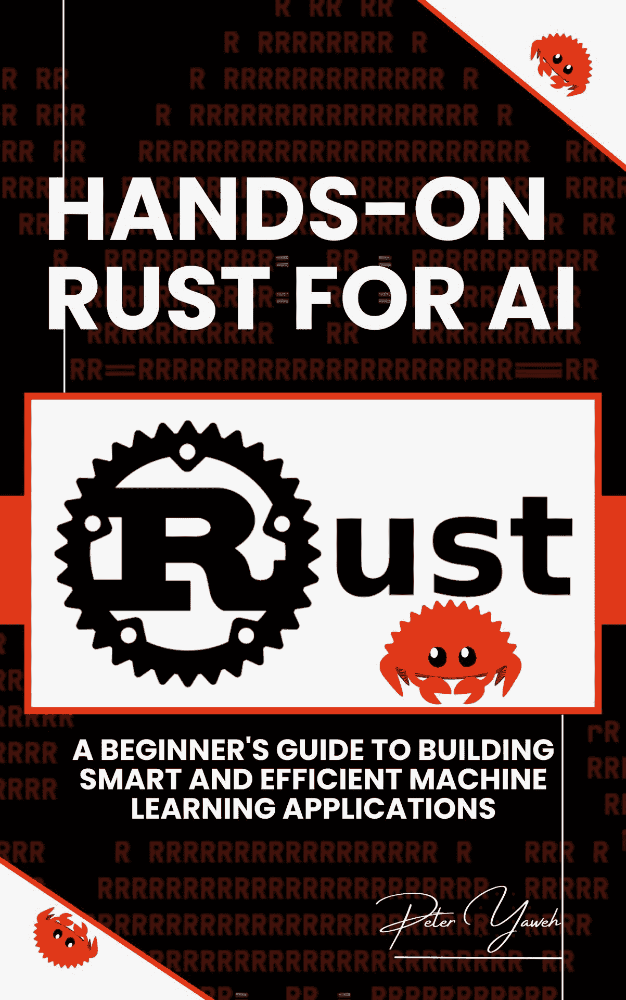

# Rust AI 实用指南：构建智能高效机器学习应用的初学者指南



# 引言

释放 AI 力量：使用 Rust 构建智能机器学习应用！

本实战指南将带你快速上手 `Rust`——这是一种速度极快且内存安全的语言，非常适合 AI 开发。通过清晰的解释和代码示例，你将学习机器学习基础知识，构建你的首个 AI 应用，并探索深度学习概念。优化你的 AI 性能，将其部署到现实世界，并发现 AI 与 `Rust` 令人兴奋的未来。

# 第 1 章：为什么要用 Rust 构建 AI？（无代码示例）

所以，如果你正在寻找一种强大、安全且面向未来的语言来构建你的 AI 应用，`Rust` 是一个极佳的选择。准备好深入探索并开始创造智能的奇迹了吗？让我们开始吧！

- 识别你照片中的人脸。
- 邮箱收件箱中的垃圾邮件过滤。
- 自动驾驶汽车在道路上导航。

但问题在于：机器学习并不是为了让计算机变得像电影里那样超级智能。它是赋予它们根据数据进行学习和改进的能力，让它们对我们人类更有帮助。

准备好探索 Rust 如何帮助你构建这些神奇的学习机器了吗？让我们开始吧！

## 1.2 为什么 Rust 是机器学习项目的绝佳选择？（速度、安全、效率）

你正热衷于用机器学习（ML）构建智能应用，但为什么要选择 Rust 作为你的可靠工具呢？嗯，系好安全带！Rust 就像一辆用于 AI 开发的高性能跑车，在底层为你提供了速度、安全和效率。原因如下：

- **闪电速度**：机器学习可能涉及复杂的计算和数据处理。Rust 以其极快的性能闻名，确保你的 AI 运行流畅，无卡顿或无故障。想象一下正在训练一个模型来识别图像中的猫——有了 Rust，它将像猎豹一样快速穿过数据！

- **内存管理的奇迹**：机器学习处理海量数据，内存泄漏可能是一场噩梦——会减慢速度并导致崩溃。Rust 的内存管理系统就像一个保持一切井然有序的英雄。它防止了可能导致 AI 项目脱轨的内存问题。

- **内置 Bug 消除器（几乎！）**：代码错误在所难免，但使用 Rust，你可以尽早发现它们。将其想象成有一个技师在赛前仔细地检查你的汽车。Rust 的特性帮助你编写健壮且可靠的 AI 应用，这样你就可以花更少的时间调试，花更多的时间进行构建！

- **长远来看的安全可靠**：你希望你的 AI 是可靠的，对吧？Rust 对安全稳定性的关注确保了你的 AI 构建在坚实的基础上，准备好应对未来多年的挑战。想象一辆用 Rust 构建的自动驾驶汽车——它优先考虑安全，带你到达需要的地方。

**额外奖励**：这里是其他让 Rust 在机器学习领域脱颖而出的原因：

- **面向未来的设计**：AI 世界在不断演变，而 Rust 的设计初衷为了适应。它的现代设计意味着它可以处理不断出现的新技术和趋势。把它想象成一辆能够在 AI 不断变化的道路上行驶的自动驾驶汽车。

- **加入维修团队专家社区**：卡壳并不好玩。Rust 社区就像一群充满热情的技师，随时准备帮助。如果你在 AI 之旅途中遇到障碍，有一整群 Rust 开发者准备好帮助你！

所以，如果你正在寻找一种强大、安全且适应性强的语言来构建你的下一代 AI 应用，Rust 是一个极佳的选择。准备好启动引擎并开始创造一些智能机器了吗？让我们深入吧！

# 第 2 章：开始 Rust 编程：你构建 AI 的发射台

好了，你已经准备好使用 Rust 创建一些神奇的 AI 应用了！但在我们进入机器学习的深度领域之前，让我们先熟悉 Rust 编程的基础。把它想象成在上高速公路之前获取驾照。

在本章中，我们将带你开启一步步的旅程，设置 Rust 开发环境并编写你的第一个 Rust 程序。现在，戴上你的编程手套，我们开始吧！

### 1. 安装 Rust

首先，你需要在你的机器上安装 Rust。Rust 官方网站 (`https://www.rust-lang.org/tools/install`) 提供了在 Windows、macOS 或 Linux 上安装 Rust 的清晰说明。只需遵循他们的指南，你很快就能运行起来！

### 2. 设置你的开发环境

安装 Rust 后，你需要一个代码编辑器或 IDE（集成开发环境）来编写你的 Rust 程序。这里是一些流行的选择：

- **Visual Studio Code**：免费开源的代码编辑器，带有 Rust 扩展，用于语法高亮和代码补全。它是初学者的绝佳选择！

- **CLion**：为 C++ 设计的付费 IDE，但也提供了优秀的 Rust 支持。

- **Rust Edit**：专门为 Rust 构建的轻量级编辑器。

### 3. 你的第一个 Rust 程序

现在是激动的部分——编写你的第一个程序！打开你选择的编辑器：

1. **创建文件**：以 `.rs` 后缀保存文件。例如，你可以命名为 `hello_world.rs`。

2. **编写代码**：这是代码：

```rust
fn main() {
    println!("Hello, world!");
}
```

让我们拆解这段代码：

- `fn main()`：这一行定义了 `main` 函数，它是程序的入口。

- `println!("Hello, world!")`：这一行使用 `println!` 宏向控制台打印字符串 "Hello, world!"。

3. **编译并运行**：导航到保存文件的目录并运行：

```bash
rustc hello_world.rs
```

这将创建一个名为 `hello_world`（或根据你的操作系统类似的名称）的可执行文件。

4. **运行程序**：现在，执行你刚刚编译的程序：

```bash
./hello_world
```

如果一切设置正确，你应该能在屏幕上看到打印出的 "Hello, world!"。恭喜你，你编写并运行了你的第一个 Rust 程序！

### 4. 尝试 Rust

现在你已经尝到了成功的味道，让我们尝试更多事情来巩固你的理解：

- **修改消息**：修改 `println!` 宏内部的字符串以打印不同的消息。再次运行程序查看更改。

- **注释**：你可以向代码中添加注释来解释不同部分的作用。使用 `//` 进行单行注释，使用 `/* ... */` 进行多行注释。

### 5. 学习更多内容的资源

Rust 编程语言官方网站 (`https://www.rust-lang.org/`) 提供了丰富的学习 Rust 资源集合，包括：

- **Rust 编程指南 ("The Book")**：一份全面的 Rust 编程指南，可以在线免费阅读。

- **Rust Playground**：一个在线环境，你可以在其中实验 Rust 代码，而无需在机器上安装任何东西。

- **Rust 社区**：一个欢迎且支持性的 Rust 开发者社区，他们总是乐意帮助初学者。不要犹豫在论坛或在线社区中提问！

记住：学习编程需要时间加实践。如果你在道路上遇到一些波折，不要气馁。继续探索，尝试不同的事物，并参考上述提到的资源。凭借投入和一点乐趣，你很快就能走在精通 Rust 并构建神奇 AI 应用的道路上！

## 2.1 Rust Playground：无需安装即可体验 Rust

也许现在直接着手安装软件让你觉得有些无从。这完全没关系！Rust 的妙之处在于，你可以在投入完全安装之前先尝试一下。Rust Playground（Rust 游乐场）是一个非常强大的在线工具，让你能够直接在网络浏览器中实验 Rust 代码，而无需在机器上进行任何设置。把它想象成一个代码沙箱——一个无需下载即可玩耍和学习的安全空间！

以下是开始使用 Rust Playground 的方法：

1. **前往 Playground**：打开你喜欢的网络浏览器并导航到 `https://play.rust-lang.org/`。这将带你进入 Rust Playground 网站。

2. **编写你的代码**：Playground 拥有一个大型编辑窗口，你可以在其中编写 Rust 代码。它类似于一个代码编辑器，但一切都直接在浏览器中完成。

3. **运行与实验**：写好代码后，点击窗口顶部的“Run”（运行）按钮。Playground 将编译并执行你的代码，并将输出直接显示在编辑窗口下方。如果代码中有任何错误，Playground 将突出显示它们，并提供实用的信息指导你修复它们。

### 让我们尝试一个简单的例子：

1. 在 Playground 的编辑窗口中粘贴以下代码：

```rust
fn main() {
    println!("Hello, from the Rust Playground!");
}
```

2. 点击“Run”按钮。

如果一切正确，你应该能在代码下方看到显示“Hello, from the Rust Playground!”的消息。这证明你已成功地在浏览器中直接编写并运行了第一个 Rust 程序！

### Playground 的优势

Rust Playground 为初学者提供了几个优势：

* **无需安装**：不需要下载或安装任何软件——你可以立即开始编码！

* **即时反馈**：Playground 会立即运行你的代码并显示输出或任何错误。这允许快速的实验和学习。

* **界面简单**：Playground 拥有简洁且易于使用的界面，让你轻松专注于编写代码，而不会被信息淹没。

* **实验自由**：可以随意玩弄代码、更改内容并观察它们如何影响输出。Playground 是一个学习和犯错的安全空间，不会产生任何后果。

### 在 Playground 之外

虽然 Playground 是入门的绝佳工具，但最终你可能想深入研究 Rust 开发。在这种情况下，在你的机器上安装 Rust 将解锁更多功能，并允许你处理更大的项目。但目前，Playground 是涉足 Rust 编码世界并熟悉基础知识的完美方式。

所以，启动你的网络浏览器，前往 Rust Playground，开始编写一些 Rust 代码吧！有一个整个 AI 应用世界等待你去构建，而 Playground 是你 Rust 学习之旅中极佳的第一步。

## 2.2 学习 Rust 基础：你 AI 项目的构建块（变量、数据类型、通过函数整合一切）

恭喜你搭建好了 Rust 开发环境，无论是在 Playground 中还是在你自己安装的设置中！现在，让我们深入研究 Rust 编程的核心构建块，它们将成为你未来 AI 项目的基础。把这些想象成砖块和砂浆——在构建你惊叹的 AI 杰作之前，你需要它们！

### 存储信息：变量

想象你正在制造一辆自动驾驶汽车。汽车需要存储的一个关键信息是它的当前速度。在 Rust 中，我们使用变量来存储此类信息。变量就像一个命名的容器，存放特定的值。

以下是在 Rust 中创建变量的方法：

```rust
let speed: i32 = 50;
```

让我们来拆解一下：

* `let`：这个关键字告诉 Rust 我们正在创建一个变量。

* `speed`：这是变量的名称。

* `i32`：这指定了数据类型。

* `=`：这是赋值运算符，将值赋给变量。

* `50`：这是正在存储的值。

### 实验变量

```rust
let speed: i32 = 50;
let speed = 60;
let name = String::from("Alice");
```

### 数据类型：对工作的正确工具

在盖房子时，你不会用锤子来拧螺丝。同样，在 Rust 中，使用正确的数据类型可以保持代码的整洁。你会遇到以下数据类型：

* **整数 (`i32`)**：用于存储整数。

* **浮点数 (`f32`, `f64`)**：存储带有小数点的数字。

* **布尔值 (`bool`)**：存储逻辑值，`true`（真）或 `false`（假）。

* **字符串 (`String`)**：存储文本。

### 选择正确的类型

思考你想在变量中存储什么类型的信息。如果是参加派对的人数（整数），使用整数类型。如果是电影的平均评分，使用浮点类型。

### 整合一切：函数——可重用的力量

想象你正在构建一个复杂的机器人。某些任务，如移动手臂或发出声音，可能会在代码中反复出现。Rust 中的函数允许你组织这些可重用的代码块，让你的程序更有组织。

这是一个函数的简单示例：

```rust
fn greet(name: &str) {
    println!("Hello, {}!", name);
}

fn main() {
    greet("Bob");
}
```

让我们来拆解一下：

* `fn greet(name: &str)`：这定义了一个名为 `greet` 的函数，它接受一个参数，字符串切片 `name`。`&str` 表示函数引用字符串数据而不是获取其所有权。

* `println!("Hello, {}!", name);`：函数内部的这一行打印欢迎消息，并插入参数 `name` 的值。

* `fn main()`：这是主函数，是程序的入口。

* `greet("Bob")`：在这里我们调用 `greet` 函数并传递了字符串 `"Bob"`。

## 2.3 管理你的 Rust 项目：介绍 Cargo（包管理器）

想象你正在制造一辆自动驾驶汽车。你肯定不想重新发明轮子（字面意思），对吧？在编程世界中，有一些预写的代码片段被称为库，它们可以节省你的时间和精力。Rust 有一个名为 Cargo 的优秀工具可以帮助你管理项目，包括下载和使用这些库。

以下是 Cargo 的超能力分解：

* **包管理**：把 Cargo 想象成你外部代码的个人助手。它允许你从名为 crates.io 的巨大在线注册表中查找并下载预先写的库。这些库包含了各种任务的代码，免得你从零开始编写。

* **项目组织**：随着你 AI 项目的增长，保持良好变得至关重要。Cargo 帮助你将项目代码和依赖（它依赖的库）组织成清晰且易于维护的结构。

* **构建与运行**：一旦你写好了代码并包含了任何必要的库，`Cargo` 就可以将所有内容编译成一个可以运行的程序。它就像有一个内置的技师，能够组装你 AI 的所有部分并让其顺畅运行。

让我们来看看 `Cargo` 的实际操作（假设你已经安装了 Rust）：

1. **创建一个新项目**：打开终端并导航到你想要创建项目的目录。然后输入以下命令：

```bash
cargo new my_first_ai_project
```

这将创建一个名为 `my_first_ai_project` 的新目录，其中包含 Rust 项目的基础结构。

2. **探索项目**：使用 `cd my_first_ai_project` 进入新创建的目录。你会发现一个名为 `Cargo.toml` 的文件，它是项目的配置文件。此外，还有一个名为 `src` 的文件夹，你可以在其中编写 Rust 代码。

3. **添加依赖项**：假设你想在你的 AI 项目中使用一个库来处理图像数据。你可以在 `crates.io` 上搜索此类库，然后使用 `Cargo` 将它们添加到你的项目中。例如，要添加一个名为 "image" 的流行图像处理库，你可以运行以下命令：

```bash
cargo add image
```

这将下载 "image" 库并配置你的项目使用它。

4. **构建与运行**：一旦你写好了代码并添加了任何依赖项，就可以使用 `Cargo` 来编译并运行你的程序。具体命令取决于你的操作系统，但通常你可以运行：

```bash
cargo run
```

这将编译你的代码并执行你的程序。

记住：`Cargo` 是管理 Rust 项目必不可少的工具，特别是在处理外部库时。随着你深入探索 AI 开发，`Cargo` 将成为你保持项目井井有条且高效的得力伴侣。

顺便说一下，官方的 `Rustlings` 课程为 Rust 编程和 `Cargo` 提供了一个非常棒的实战介绍。快去看看它的互动练习，并尝试构建小型 Rust 项目吧！

# 第 3 章：机器学习基础 - 核心：揭开 AI 背后的魔法

恭喜你！你已经掌握了 Rust 编程的基础知识，准备好进入机器学习（ML）迷人的世界了。将机器学习想象为赋予 AI 应用随时间推移进行学习和改进的秘诀。在本章中，我们将揭示机器学习背后的核心概念，让你从一个好奇的编码者转变为机器学习爱好者！

想象一下：你不断向朋友展示你最喜欢的犬种的照片。神奇的是，他们开始能够自己识别出那个品种了！这就像是机器学习。机器学习算法可以从数据（如那些狗的照片）中学习，并利用这些知识对它们以前没见过的新数据做出预测或决策。很酷，对吧？

以下是机器学习配方中的关键要素：

1. **数据，光荣的数据**：机器学习算法是数据饥渴的！你给它们的数据越多，它们学习和表现得就越好。这些数据可以是从图像、文本到数字和传感器读取的任何内容。将其想象为滋养你的机器学习模型并帮助它变得更明的食物。

2. **强大的算法**：算法是一组告诉计算机如何处理数据的指令。有许多不同的机器学习算法，每种都有自己的优缺点。为你的项目选择合适的算法至关重要。

3. **训练过程**：一旦你有了数据，就是训练的时候了！想象一下在教你的朋友识别模式。同样，你将数据喂给算法。

4. **预测与决策**：训练完成后，机器学习算法利用这些知识对它们以前没见过的新数据做出预测或决策。就像你的朋友现在可以识别出特定的犬种一样。

5. **评估与改进**：评估你的模型非常重要。如果结果不理想，你可以返回并调整过程以提高性能。

## 机器学习的优势

机器学习正在彻底改变各个领域，原因如下：

- **自动化**：机器学习可以使曾经被认为是复杂的任务自动化，从而释放人类的时间。

- **改进决策**：机器学习模型分析海量数据，从而做出更好的决策。

- **个性化体验**：机器学习可以根据个人喜好提供个性化体验，让技术变得更具吸引力。

## 准备好进一步探索了吗？

本章提供了机器学习的概述。随着你对这本书的阅读，我们将深入探讨特定的算法和技术，让你具备构建自己的智能应用的技能。

### 3.1 理解不同类型的机器学习（监督学习 vs 无监督学习）

欢迎回来，AI 爱好者！在上一章中，我们探索了机器学习的基础。现在，让我们深入一步，揭示不同类型的机器学习算法——这些是我们工具箱中的工具。在这里，我们将关注两个主要类别：监督学习和无监督学习。想象你正在帮助朋友整理他们凌乱的房间。你采取的方法取决于他们是否给了你指令（监督），或者你需要自己去想办法（无监督）。

#### 监督学习


# 监督学习与无监督学习

想象你的朋友准确地告诉你在哪里把书、衣服和玩具放在哪里（标记数据）。这就是监督学习的实际应用！你喂给算法的数据是有标记的，这意味着每个数据都有一个对应的答案或类别。

以下是监督学习的工作原理：

- **准备**：你收集已经标记过的数据。例如，你可能有一组图像数据集，其中每张照片都标记为“猫”、“狗”或“鸟”。
- **训练**：在标记数据上对算法进行训练。这就像你的朋友向你展示房间里什么东西放在哪里。算法学习识别数据与相应标签之间的模式和关系。
- **预测**：训练完成后，可以使用该模型来预测新的、未见数据的标签。就像你现在可以看一个新物品并判断它是书、衬衫还是玩具一样，模型也可以分析新图像并预测它们可能包含的内容。

## 无监督学习

（原文未提供无监督学习的文本）

现在想象你朋友的房间乱七八糟，而他们没有给你提供任何指令（未标记数据）。这就是无监督学习！你提供给算法的数据没有预定义的标签或类别。其目标是让算法从数据本身发现隐藏的模式和结构。

以下是无监督学习的工作原理：

1. **数据探索**：算法分析未标记的数据，寻找模式和关系。想象你在整理朋友的房间，将相似的物品（衣服、书籍、玩具）归为类，尽管它们没有被显式地标记。
2. **发现**：算法可能会识别数据中的聚类或分组。例如，它可能会发现一类主要是红色衣服的聚类，另一类是蓝色玩具的聚类，以此类推。

### 无监督学习的实际应用

无监督学习适用于以下任务：

- **客户细分**：将具有相似特征的客户分组，以进行针对性的营销活动。
- **推荐系统**：识别用户行为中的模式，以推荐他们可能喜欢的产品或内容。
- **异常检测**：发现数据中的异常模式，例如检测金融数据中的欺诈交易。

### 选择合适的工具

你选择的机器学习类型取决于你正试图解决的问题。如果你有标记数据并想进行预测，那么监督学习是一个很好的选择。如果你有未标记数据并想发现隐藏的模式，那么无监督学习是正确的出路。

### 核心总结

通过理解监督学习和无监督学习，你已经解锁了机器学习工具箱中的两项强大工具。在下一章中，我们将探索其他令人兴奋的算法，并深入探讨使用 `Rust` 构建智能应用程序的世界！

# 3.2 你将遇到的常见机器学习算法（探究内部机制）

欢迎回来，AI 学徒！我们一直在深入研究机器学习这个迷人的世界，探索不同类型的算法。现在，让我们更近地观察一些你在机器学习之旅中会遇到的常见算法。你可以将它们想象成机器学习工具箱中的全明星球员，每种算法都有其自己的优势和特长。

以下是你经常会见到的的一些重量级算法：

- **线性回归**：想象一条能够完美拟合一堆散乱数据点的直线。`Linear regression` 是一种监督学习算法，用于寻找这条线，允许你根据新的数据点进行预测。例如，你可以用它根据面积来预测房价。
- **逻辑回归**：与线性回归类似，但用于不同的任务。这种监督学习算法用于分类问题，即你想要预测某物所属的类别（例如，是垃圾邮件还是不是垃圾邮件）。想象将袜子分成两堆：白色和彩色的。`Logistic regression` 在机器学习世界中帮助完成这类任务。
- **决策树**：想象一个带有问题和答案的流程图，通向最终决策。`Decision trees` 是一种使用树形结构对数据分类的监督学习算法。它们通过对数据提出系列问题来得出预测。想象一个电影推荐的决策树：“你喜欢动作电影吗？是的？那么尝试一下这部科幻电影吧！”
- **K 近邻算法 (KNN)**：这种监督学习算法依赖于群体智慧。对于一个新数据点，它会在训练数据中找到最近的 `K` 个邻居（相似的数据点），并根据这些邻居的多数来预测标签。想象向朋友寻求电影推荐——`KNN` 就像向口味相似的 `K` 个近朋友索要建议。
- **支持向量机 (SVMs)**：这些监督学习算法以其处理复杂数据和高维（许多特征）的能力而闻名。`SVMs` 在数据中不同类别之间寻找最佳分割线。想象用一条清晰的分界线将电子邮件分为垃圾邮件和非垃圾邮件——这正是 `SVMs` 以更复杂的方式做的事情。
- **K-Means 聚类**：这种无监督学习算法是发现未标记数据中组组（聚类）的大师。它通过将相似的数据点归类来帮助发现隐藏的模式。想象将一筐五颜六纷的水果分成橙子、苹果和香蕉几堆——`K-means clustering` 为机器学习数据执行类似的操作。

记住：这只是机器学习算法这一广阔且迷人世界的一个一角。随着你 AI 之旅的不断，你将遇到更多专门的算法，每种算法都有其独特的能力。

### 选择合适的算法

在选择算法时，没有一个一不变的答案。最佳选择取决于你试图解决的特定问题、你拥有的数据类型以及想要的结果。不过，别担心！随着经验的增加，会有许多资源帮助你应对这一决策过程。

### 前行之路

通过理解这些流行算法，你已经向使用 `Rust` 构建自己的智能应用程序迈出了重要的一步！下一章将使你具备将所有内容整合的知识——我们将探索如何使用 `Rust` 库在你的项目中实现机器学习算法。准备好在你的 AI 作品中释放机器学习的力量吧！

# 3.3 复习机器学习所需的数学（数字让 AI 运转！）（基础线性代数和微积分概念）

系好安全帽，AI 架构师们！使用机器学习构建智能应用程序涉及一些数学概念。但不要恐慌！我们在这里讨论的不是高级微积分。只需要对线性代数的基础理解和一些关键的微积分概念就会对你理解幕后魔法如何运作非常有帮助。将数学想象成让我们能够与机器学习算法通信并让它们发挥最佳作用的语言。

以下是你经常会遇到的数学要点分解：

- **线性代数**：数学的一个分支处理 `vectors`（想象成数字的有序列表）和 `matrices`（类似于数字网格）。它们看起来像是组织数字的高奇方式，但它们是机器学习中极其强大的工具。例如，你可以用 `vectors` 表示数据点，用 `matrices` 存储它们之间的关系。
  - 担心，你不需要成为数学天才！你将主要对 `vectors` 和 `matrices` 进行基本运算，如加、减、乘。想象将购物清单相加（`vectors`）或将来自不同传感器的数据放入表格（`matrix`）。
- **微积分**：这个数学领域关注变化率以及事物随时间积累的情况。虽然你不需要超级复杂的微积分，但理解一些核心概念将非常有帮助。
  - **导数**：它们告诉你某物变化有多快。想象计算汽车的速度（位置的变化率）——`derivatives` 对于机器学习中使用的各种函数来说也是如此。
  - **基础求导法则**：对于求不同函数的导数有一些基本规则。你不需要背下所有规则，但理解这一概念将是有益的。

### 为什么数学对机器学习很重要？

机器学习算法依赖数学来执行计算、识别模式并做出预测。例如，线性代数有助于表示数据和关系，而微积分有助于优化学习过程并精调算法。想象建造房子——你需要一张蓝图（数学）来指导你建造一个坚固且实用的结构（机器学习模型）。

### 学习资源

有很多极佳的资源可以帮助你复习机器学习所需的数学技能：

- **在线课程**：像 Coursera 和 edX 等平台提供了线性代数和微积分的入门课程，专门针对机器学习应用设计。
- **交互式教程**：像可汗学院（Khan Academy）和 3Blue1Brown 等网站提供了交互式教程，让数学学习变得有趣且迷人。
- **书籍**：许多适合初者的书籍通过清晰的解释和与机器学习相关的实际示例来解释线性代数和微积分。

### 总结

通过熟悉基础线性代数和微积分概念，你将能够很好理解机器学习算法底层是如何运行的。记住，你不需要成为数学天才，但对这些概念的基本掌握将成为你 AI 开发之旅中的宝贵资产。

在下一章节中，我们将弥合理论与实践之间的鸿沟。我们将探索如何使用 `Rust` 库来实现机器学习算法，并让你的 AI 项目活跃起来！请保持关注，冒险仍在继续！

# 第 4 章：Rust 与机器学习的核心工具：构建你的 AI 军库

现在你已经掌握了机器学习的基础知识，是时候释放 `Rust` 的力量了！本章将为你提供构建智能应用所需的必备工具。想象一位木工在创作杰作——他们需要正确的工具来完成工作。在这里，我们将为你介绍你专享的 AI 开发工具包。

## 4.1 构建 AI 的流行 Rust 库（结识你的新助手）

欢迎回来，AI 炼金术师 (renkinjutsushi, alchemist)！在用 `Rust` 构建智能应用的道路上，强大的库是我们的秘密配方。这些库为机器学习任务提供了预写的代码，在节省我们时间和精力的同时，提供了经过实战的功能。让我们来认识一下你 `Rust` 机器学习军库中的一些佼佼者：

### 1. MLearn：你亲切的社区社区机器学习库

想象一位友好的指南，带你走过 `Rust` 机器学习算法的世界。这就是 `MLearn` 的精髓！它是一个特定的 `Rust` 库，专为初学者设计，提供了一个简洁且直观的 API（与库交互的方式）来构建各种机器学习模型。

以下是 `MLearn` 如此优秀的原因：

- **简单直观的 API**：`MLearn` 使用了清晰的函数名称并避免了复杂的抽象，即使你是机器学习初学者，也很容易学习和使用。
- **关注核心概念**：`MLearn` 优先考虑线性回归、决策树和 k-最近邻等核心机器学习算法。这使你能够掌握基础，而不会被不必要的复杂性所淹没。
- **轻量且高效**：`MLearn` 是一个相对较小的库，适用于对资源使用有要求的项目。把它看作是你 AI 冒险中的敏捷伴侣吧。

### 2. TensorFlow：机器学习的重量级选手

`TensorFlow` 是机器学习领域的一个巨头，不仅适用于 `Rust`，也适用于许多编程语言。它是由 Google 最初开发的一个功能强大且多用途开源库。虽然 `TensorFlow` 本身是用 Python 编写的，但你可以通过其他库从 `Rust` 与其交互。

以下是 `TensorFlow` 值得在你的 AI 工具箱中占有一席之地：

- **功能强大**：`TensorFlow` 为各种机器学习任务提供了海量的工具和功能，从构建神经网络到在生产环境中部署模型。它就像一个你可以随手调用的完整机器学习工具包。
- **庞大的社区和资源**：`TensorFlow` 拥有庞大的开发者社区和丰富的在线学习资源。如果你遇到困难，很有可能别人已经遇到过同样的障碍并找到了解决方案。
- **可扩展性与性能**：`TensorFlow` 以高效处理大型数据集和复杂模型的能力而闻名。如果你正在心心勃勃的 AI 项目，`TensorFlow` 将是一个宝贵的资产。

#### 选择你的冠军

最适合你的库取决于项目需求和你的经验水平。这里有一个小建议：

- **对于初学者**：从 `MLearn` 开始！它用户友好的设计将让你更容易掌握 `Rust` 机器学习的核心概念。
- **对于经验丰富的开发者或大型项目**：考虑 `TensorFlow` 广泛的功能和可扩展性。不过，请准备好面对更陡峭的学习曲线。

记住：这些只是可用于机器学习的许多优秀 `Rust` 库中的两个。随着你在 AI 开发之旅中的进步，你可能会探索其他满足特定需求或提供独特功能的库。

### 总结

通过将这些强大的库整合到你的 `Rust` 中，你将开启无限可能。在下一章节中，我们将深入实践。

## 4.2 在 Rust 中处理数据：列表、数组及更多（你项目的基石）

欢迎回来，AI 架构师！在我们开始构建第一个项目之前，我们需要巩固基础——在 `Rust` 中处理数据。将数据看作是任何应用程序的砖块和灰浆。在 `Rust` 中，你有各种工具可以调用。以下是你会遇到的一些基石：

### 1. 标量（Scalars）：最的数据类型

想象单个乐高积木——它就像 `Rust` 中的标量。它代表一个单一的值，如整数（整数字）、浮点数（小数）、布尔值（真或假）或字符。这是一个示例：

```rust
let age: u32 = 30;
let pi: f64 = 3.14159;
let is_sunny: bool = true;
let initial: char = 'A';
```

### 2. 数组（Arrays）：固定大小集合

想象一组特定的积木套装——这类似于 `Rust` 中的数组。它存储相同元素的固定大小集合。以下是创建数组的方法：

```rust
let numbers: [i32; 5] = [1, 2, 3, 4, 5];
let fruits: [&str; 3] = ["apple", "banana", "orange"];
```

### 3. 切片（Slices）：数组的灵活视图

想象一个可以使用不同大小积木子集的乐高套装——这就像 `Rust` 中的切片。它是数组的灵活视图，允许你访问连续的元素部分。这是一个示例：

```rust
let numbers = [1, 2, 3, 4, 5];
let first_two = &numbers[0..2];
println!("前两个元素: {:?}", first_two);
```

### 4. 向量（Vectors）：动态大小数组

想象一个可以根据需要添加或删除积木的乐高套装——这类似于 `Rust` 中的向量。它是一个动态大小的数组，随着元素的添加或删除而增长或缩小。以下是创建向量的方法：

```rust
let mut colors = vec!["red", "green", "blue"];
colors.push("yellow");
println!("颜色: {:?}", colors);
```

### 选择正确的数据结构

你选择的数据结构取决于具体需求：

- **标量**：用于单一值。
- **数组**：当你预先知道确切大小并需要高效随机访问时使用。
- **切片**：用于对数组进行灵活访问，或将数组的一部分传递给函数。
- **向量**：当数据大小可能会变化时使用。

记住：这些只是 `Rust` 中提供的数据结构的一部分。当你深入研究 `AI` 项目时，你将会遇到更复杂的结构，如矩阵和哈希表，以便高效地处理不同类型的数据。

## 前路

通过掌握这些数据结构，你将完全有能力处理你的 AI 应用将涉及的数据。在下一章中，我们将把这些知识付诸实践！我们将使用 `Rust` 和 `MLearn` 构建一个简单的图像分类模型，在过程中，你将能够在实用的机器学习场景中使用这些数据结构。准备好在 `Rust` 中创建你的首个 AI 英雄吧！

# 第 5 章：机器学习工作流 - 逐步步营：构建你的 AI 杰作

欢迎回来，AI 架构师！我们已经涵盖了机器学习的核心概念，探索了算法，并拆解了你使用 `Rust` 构建智能应用所需的工具。现在，是时候将一切整合在一起，开启创建自己的 AI 项目的奇妙旅程了！让我们揭开典型的机器学习工作流，这是一份将你的想法转化为智能系统的逐步指南。

将机器学习工作流想象成制作你 AI 杰作的食谱。以下是涉及的关键成分和步骤：

### 1. 定义问题

第一步是识别你想让 AI 解决的问题。是识别手写数字吗？预测客户流失？推荐电影？对问题的清晰理解将贯穿整个过程指导你的方法。

### 2. 数据收集

想象正在盖一栋房子——在开始施工之前，你需要砖头（数据）。在机器学习中，数据是驱动你算法的燃料。你需要为你所选的问题收集相关数据。这可能涉及收集现有的数据集、从网站爬取数据，甚至创建你自己的数据收集系统。

### 3. 数据清洗与预处理

原始数据往往存在缺陷。想象你盖房用的砖头可能是满灰尘或损坏的。数据清洗涉及修复错误、处理缺失值，并确保你的数据对于机器学习算法来说是一致且可用的。

### 4. 特征工程

将特征（Features）想象成数据的独特属性，算法将使用这些特征来进行预测。例如，对于图像识别，特征可能是像素强度或边缘。特征工程涉及从你的数据中创建或选择最相关的特征，以提高算法的性能。

### 5. 模型选择与训练

现在，你准备好为你的任务选择正确的机器学习算法了。考虑问题类型、数据大小和预期结果等因素。一旦选定了算法，就是时候在你准备好的数据上对其进行训练了。想象向你的施工队（算法）展示如何根据蓝图（模型）将砖头（数据）组合在一起。

### 6. 模型评估

训练完成后，你需要评估模型的性能如何。这涉及在未见的数据上对其进行测试，以查看它做出预测的准确性如何。将此比作在人们入住之前检查你的房子结构上是否稳固。

### 7. 模型完善与部署

根据评估结果，你可能需要通过调整超参数或尝试不同的算法来完善你的模型。一旦你对性能满意，就是时候将模型部署到现实世界了！这可能涉及将其集成到 Web 应用程序、移动 App 或任何可以利用其能力的系统中。

## 使用 Rust 和 MLearn 整合一切

现在，让我们看看这个工作流是如何运作！在下一章中，我们将使用 `Rust` 和 `MLearn` 构建一个简单的图像分类模型。我们将遍历每一个步骤，从数据收集到模型部署，让你获得在 `Rust` 中创建第一个 AI 应用的实践经验。

## 结语

通过理解机器学习工作流，你拥有了构建你自己的 AI 项目的路线图。记住，这是一个迭代过程——你可能需要根据评估结果重新访问之前的步骤。但只要坚持并稍加练习，你将顺利走在创建能够解决现实问题的智能应用的道路上。

## 5.1 为 AI 准备数据（清洗和转换数据以获得更好的结果）

欢迎回来，AI 厨师！在我们的机器学习厨房里，数据是我们最重要的食材。就像一道美味的菜肴需要新鲜、准备好的食材一样，我们的机器学习模型在清洁且结构良好的数据上表现最好。本章将深入数据准备的关键步骤——让你的数据准备就绪，烹饪出强大的 AI！

将你的数据想象成你机器学习食谱的一袋杂菜。数据准备涉及对你的数据进行清洗、排序和转换，以确保它适合机器学习算法。以下是关键步骤的详细说明：

### 1. 数据清洗

- **识别缺失值**：数据很少是完美的。可能会有缺失的条目，就像袋漏了一个洞导致一些蔬菜掉出来。我们需要处理这些缺失值，也许通过删除数据过多的行或用估计值填充它们。
- **处理离群值**：离群值是远超预期范围的数据点，就像在你的菜袋里发现了一个巨大的、意外的洋葱。这些离群值会偏偏机器学习模型的结果。你可能决定删除它们、调整它们或对其进一步调查。
- **修复不一致性**：有时，数据可能存在不一致之处，例如蔬菜命名不同（“花菜”和“花菜头”）。我们需要标准化数据格式以确保一致性。

### 2. 数据转换

- **特征缩放**：想象所有的食材单位都不同（克、磅、杯）。为了让机器学习算法有效工作，特征（数据的重要特性）应该处于相似的范围内。特征缩放技术可以帮助规范你的数据范围。


- **类别特征编码**：某些数据可能是类别的，例如蔬菜类型（红椒、洋葱）。机器学习算法通常对数值数据处理更好。我们可以使用编码技术将这些类别表示为数字（例如，独热编码）。

## 为什么数据准备很重要

就像厨师不会使用腐烂的蔬菜一样，机器学习模型在混乱的数据上表现并不良好。适当的数据准备帮助你的模型从数据中更有效地学习，从而获得更好的预测和更准确的结果。

## Rust 中的数据整理工具

虽然 `MLearn` 本身主要专注于机器学习算法，但 Rust 提供了各种用于数据处理和整理的库。以下是一些流行的选项：

- `Apache Arrow`：一个强大的库，用于在内存或各种文件格式中处理和分析数据集。
- `DataFrames (Pandas)`：虽然不是原生 Rust 库，但对类似 `Pandas`（Python 中用于数据分析）的绑定允许你在 Rust 环境中执行数据清洗和转换任务。

## 5.2 构建并训练你的机器学习模型（教你的 AI 学习）

继续我们使用 Rust 和 `MLearn` 构建图像分类器的旅程，现在进入第 5.2 步，我们将深入学习如何训练模型：

我们已经准备好了数据并选择了决策树算法。现在，是时候使用 `MLearn` 在 Rust 中构建并训练我们的模型了！以下是分步骤指南：

### 1. 设置 MLearn

首先，确保你已经安装了 Rust 和 `MLearn`。请参阅 `MLearn` 官方文档获取详细说明：https://github.com/anowell/are-we-learning-yet

### 2. 加载数据

`MLearn` 提供了从各种格式加载数据的函数，包括 CSV 文件或图像数据集。这是一个示例（请将 `path/to/data.csv` 替换为你数据集的实际路径）：

```rust
use mlearn::data::csv;

let data = csv::Reader::from_path("path/to/data.csv")
    .expect("Error loading data file");

let mut records = data.records();
```

这段代码段从 CSV 文件加载数据，并创建一个处理每条记录的迭代器。你需要根据你的特定数据格式对其进行调整（例如针对 MNIST 的图像加载）。

### 3. 将数据分为训练集和测试集

我们不会使用所有数据进行训练。一部分数据将用于训练模型，另一部分将在以后测试其准确性。`MLearn` 提供了将数据分为训练集和测试集的函数。

```rust
use mlearn::data::split;

let (train_data, test_data) = split::random_split(records, 0.8);
```

这段代码将数据分为两个集合：`train_data` 包含 80% 的训练数据，`test_data` 包含剩余 20% 测试数据。你可以根据需要调整划分比例。

### 4. 定义特征和标签

在图像分类任务中，图像数据本身将是特征，而标签根据图像内容为“猫”或“狗”。`MLearn` 使用结构体来表示特征和标签。

```rust
#[derive(Debug)]
struct ImageData {
    pixels: Vec<f32>, // 假设为预处理过的像素强度
}

#[derive(Debug)]
enum Label {
    Cat,
    Dog,
}
```

这段代码定义了一个 `ImageData` 结构体来存储图像数据（此示例中为像素强度）以及 `Label` 枚举来表示类别（“猫”或“狗”）。

### 5. 构建并训练模型

现在到了激动的部分！我们将使用 `MLearn` 的决策树实现来构建模型。

```rust
use mlearn::tree;

let mut model = tree::DecisionTree::new(
    // 定义特征 (ImageData) 和标签 (Label) 的类型
    mlearn::tree::TreeConfig::<ImageData, Label>::default(),
);

// 在训练数据上训练模型
model.fit(train_data);
```

这段代码创建了一个新的决策树模型，然后使用 `fit` 函数结合我们准备的训练数据进行训练。

### 6. 保存模型（可选）

训练完成后，你可以将模型保存到文件中备供以后使用。`MLearn` 提供了模型持久化功能。

```rust
use mlearn::io;

io::write_model("model.bin", &model).expect("Error saving model");
```

这段代码段将训练好的模型保存到名为 "model.bin" 的文件中。

恭喜！你已经使用 `MLearn` 在 Rust 中构建并训练了第一个机器学习模型。在下一步中，我们将使用该模型对未见数据进行预测并评估其性能。

## 5.3 检查你的模型性能（你的 AI 表现如何？）

想象一下你正自豪地展示你的沙堡，却发现它摇摇欲坠。评估机器学习模型对于确保其有效性至关重要。本章将探索评估模型性能的技术，包括：

- **指标**：将指标比作检查沙堡稳定性的尺子和水平仪。我们将介绍用于衡量机器学习模型准确性和泛化能力的常用指标。
- **验证与测试**：就像在海浪袭来之前测试沙堡的坚固程度一样，我们将探索在未见数据上对模型进行验证和测试的技术，以确保在现实场景中表现良好。

通过有效评估模型性能，你可以识别改进领域并微调你的 AI 以获得最佳结果。

本章为你提供了在 Rust 中胜驭机器学习工作流所需的知识和工具。通过每一步，你都将建立自己的 AI 专业知识，让你更接近创建解决现实问题的智能应用程序。

# 演讲备注

Rust 独特的优势使其成为深度学习开发中极具吸引力的选择。它对性能和内存安全的关注让你能够创建高效且可靠的深度学习模型。此外，Rust 的控制力和灵活性赋予了你对内存管理进行细粒度控制的能力，从而实现了优化的深度学习实现。

## Rust 中的深度学习库

虽然 Rust 在深度学习领域还是一门相对年轻的语言，但已经有一些非常有前景的库：

- `Annora`：一个专注于效率和易用性的高性能深度学习库。
- `TensorRust`：一个为流行的 TensorFlow 深度学习框架提供绑定的 Rust 库。
- `DyNet`：一个提供自动求分和高效内存管理的神经网络库。

# 演讲备注

Rust 的深度学习生态系统仍在进化中，但已经有一些值得关注的库。`Annora` 是一个优先考虑效率和易用性的高性能库。`TensorRust` 桥接了 Rust 与流行的 TensorFlow 框架之间的差距。`DyNet` 则提供了自动求分和内存管理功能。

## 在 Rust 中开始深度学习

以下是一些可以帮助你开始 Rust 深度学习的资源：

- `Annora 文档`：[`devm.io/rust/burn-rust-deep-learning-001`](https://devm.io/rust/burn-rust-deep-learning-001)
- `TensorRust 文档`：[`docs.rs/tensor-rs`](https://docs.rs/tensor-rs)
- `DyNet Rust 绑定`：[`github.com/clab/dynet`](https://github.com/clab/dynet)
- `深度学习书籍（通用概念）`：[`www.deeplearningbook.org/`](https://www.deeplearningbook.org/)

# 演讲备注

如果你对使用 Rust 探索深度学习感兴趣，这些资源可以提供非常有价值的起点。`Annora`、`TensorRust` 和 `DyNet` 的文档将引导你如何使用这些库完成深度学习任务。此外，《深度学习》书籍是掌握通用概念的绝佳资源，这些概念无论使用什么编程语言都适用。

## 结论

深度学习是机器学习中一个强大的子领域，在各种 AI 应用中具有巨大的潜力。

Rust 在性能、安全和控制方面的优势使其成为

## 6.1 什么是深度学习？（简单易懂的神经网络解析）

### 深度学习：灵感来自大脑的超级学习

想象你的大脑是一台学习机器，在不断地建立连接并识别模式。深度学习就是受这种概念启发的的人工智能！它使用了人工神经网络，这些网络就像我们大脑中相互连接的神经元的简化版本。

将这些神经网络想象成分层结构。信息从一层流到另一层，就像接力赛一样。每一层都执行一个简单的步骤，而它们组合在一起就可以学习一些非常惊不起的事情——比如识别照片中的人脸、翻译语言，甚至驾驶汽车！

以下是深度学习核心思想的分解：

- `人工神经元`：这些是神经网络的构建块。它们接收信息。
- `层`：神经网络是堆叠而成的。信息在通过这些层时会发生转换。
- `训练`：深度学习通过接触数据来学习。

### 为什么深度学习如此强大？

深度学习之所以强大，是因为：

- 它们可以从海量数据中学习。
- 它们可以处理复杂的问题。
- 它们可以不断改进。

### 深度学习的应用：

深度学习已经以许多酷的方式应用，例如：

- `自动驾驶汽车`：深度学习帮助汽车在道路上导航。
- `人脸识别`：深度学习可以识别照片和视频中的人物。
- `医疗诊断`：深度学习可以分析医学图像来帮助医生。
- `语音助手`：深度学习驱动了 Siri 和 Alexa 等虚拟助手。

### 准备好深入探索了吗？

深度学习是一个巨大且令人兴奋的领域。

## 6.2 在 Rust 中构建一个简单的深度学习模型（上手教程）

欢迎回来，AI 爱好者！在深度学习世界，Rust 成为了一种强大的应用程序开发语言。现在，让我们动手实践，构建一个基础深度学习模型。

在开始之前，提醒一下：深度学习涉及复杂的概念和资源。本示例将提供一个简单的介绍。

### 1. 设置你的 Rust Playground

- 确保你已经安装了 Rust。你可以在 Rust 官方网站找到安装说明。
- 我们将使用 Rust 的在线 Playground 进行这个快速示例。访问 [`play.rust-lang.org/`](https://play.rust-lang.org/)。

### 2. 探索 Annora

`Annora` 是我们选择的深度学习库。虽然我们不会深入其复杂的细节，但这里是基础理解：

- `Annora` 提供了在 Rust 中创建神经网络的构建块。
- 它提供了用于定义层、激活函数和训练过程的功能。

### 3. 构建数字分类器

让我们构建一个简单的模型，能够识别图像中的手写数字（0-9）。这是机器学习中的一个经典案例，也是上手深度学习的好方法。

```rust
// Rust 代码将放置在此处
```

```rust
// 从 Annora 导入必要的库
use annora::{
    Activation,
    Dense,
    Sequential,
};

// 定义模型架构（网络结构）
let mut model = Sequential::new();
model.add(Dense::new( // 第一个隐藏层，包含 16 个神经元
    16,
    Activation::Relu, // 用于非线性的激活函数
));
model.add(Dense::new( // 输出层，包含 10 个神经元（每个数字对应一个）
    10,
    Activation::Softmax, // 用于概率分布的激活函数
));

// 编译模型（分配内存并准备训练）
model.compile(/* 优化器和损失函数配置 */);

// 在你的数据集上训练模型（替换为你的数据加载和训练逻辑）
// 这部分通常加载训练数据（图像和标签），
// 将其输入模型，并迭代调整权重以提高准确率。
model.fit(/* 在此处输入你的训练数据 */);

// 使用训练好的模型进行预测（替换为你的测试数据）
let prediction = model.predict(/* 在此处输入你的测试图像 */);

// 打印结果（可能是图像中识别出的数字）
println!("Predicted digit: {}", prediction);
```

### 解释：

- 我们定义了一个序列模型，按顺序添加各个层。
- 第一层（`Dense`）有 16 个神经元，并使用 `ReLU` 激活函数。
- 输出层有 10 个神经元（每个数字一个），并使用 `Softmax` 激活函数来表示概率。
- 我们编译模型，指定了优化器（调整权重的算法）和损失函数（训练期间衡量误差的方法）。
- 训练涉及向模型提供训练数据（图像及其对应的数字标签），并迭代调整神经元之间连接的权重，以最小化损失。
- 最后，我们使用训练好的模型预测新图像的数字。

### 注意事项：

- 这是一个非常简单的示例。现实世界的深度学习通常涉及更复杂的架构、训练策略和数据准备技术。
- 训练深度学习模型可能计算量很大。对于此示例，使用在线 Rust 播放场可能对于大量的训练并不理想。你可能考虑设置具有更多资源的本地 Rust 开发环境来处理更大的项目。

### 核心总结：

通过构建这个基础模型，你已经迈出了进入 Rust 深度学习精彩世界的第一步！记住，这只是开始。随着你进一步的探索，你将发现更先进的技术和库，它们将释放深度学习在你的 AI 项目中的真正潜力。

# 第 7 章：优化你的 AI 性能：让你的机器学习杰作大放异彩

恭喜你，AI 架构师！你已经跨越了 Rust 机器学习令人兴奋的领域。现在，是时候完善你的作品并确保你的 AI 杰作以最佳状态运行了。本章将深入探讨可以充分榨取你机器学习模型性能的优化技术。

将你的 AI 模型想象成一辆赛车。虽然基础设计可以让你起步，但精调和优化将帮助它达到巅峰性能。以下是一些需要考虑的关键领域：

### 1. 数据优化：

- **数据质量**：记住，“垃圾进，垃圾出”同样适用于机器学习。确保你的数据是干净、准确且代表真实世界的，以便训练出有效的模型。
- **数据增强**：有时，你可能没有海量的数据。数据增强技术可以人工地创建现有数据的变体，欺骗你的模型认为它见过更多示例，从而提高泛化能力。

### 2. 模型优化：

- **超参数调优**：超参数是控制模型学习过程的设置。尝试不同的超参数可以显著影响性能。有很多自动化工具和技术可以帮助你找到最佳设置。
- **模型架构选择**：模型架构（层数、神经元数等）的选择会影响性能。考虑从简单的模型开始，并在需要时增加复杂度。像 `TensorBoard` 这样的工具可以帮助可视化模型的训练过程并识别潜在的瓶颈。

### 3. 硬件和软件优化：

- **硬件加速**：深度学习可能是计算密集型的。利用 `GPUs`（图形处理器）可以显著加快训练速度。Rust 提供了如 `CUDA` 等库来利用 GPU 能力。
- **高效的库和框架**：选择针对性能优化的库和框架会产生差异。我们探索过的深度学习库 `Annora` 以其在 Rust 中的高效性闻名。

### 4. 部署优化：

- **模型序列化**：一旦你训练了模型，你可能希望将其部署到现实世界。将模型序列化为紧凑格式允许你保存它并在稍后于不同的环境中使用。Rust 提供了模型序列化的功能。
- **资源效率**：在部署 AI 模型时，考虑其资源消耗（内存、处理能力）。模型量化等技术可以减小模型大小并提高其在资源受限设备上部署的效率。

### 监控与评估的重要性：

- **跟踪性能**：一旦部署了 AI，随时间推移监控其性能至关重要。跟踪准确率、精确率和召回率等指标，以识别任何性能下降。
- **持续改进**：机器学习是一个迭代过程。根据监控结果，你可能需要使用新数据重新训练模型，或调整其超参数以保持最佳性能。

### 用于高效和高性能 AI 的 Rust：

Rust 对内存安全、速度和性能的关注使其成为构建高效、高性能 AI 应用的极具吸引力的选择。通过利用 Rust 的优势并遵循这些优化技术，你可以确保你的 AI 模型运行流畅并交付卓越结果。

### 最后的冲刺：

你已经走得很远了，从理解机器学习基础到在 Rust 中构建自己的模型。记住，AI 探索的旅程是持续的。继续学习、实验并优化你的技能，创造产生积极影响的智能应用吧！

## 7.1 让你的 AI 运行更快（内存管理与效率技术）

握好方向盘，AI 架构师！我们已经讨论了构建出色的 AI 模型，现在是时候对它们进行调优以获得巅峰性能——让它们运行得更快更流畅。将你的 AI 想象成一辆赛车。优秀的设计很重要，但如果没有效率微调，它无法发挥全部潜力。在本章中，我们将专注于内存管理和其他让你的 AI 运行如飞般的技术！

### 内存管理的重要性

就像汽车需要燃料运行一样，你的 AI 模型需要高效的内存管理才能良好运行。以下是 Rust 如何帮助：

- **内存安全**：Rust 防止内存泄漏（即程序忘记释放未使用内存的讨厌情况）。这确保了你的 AI 模型运行流畅，不会因内存问题崩溃。
- **所有权系统**：Rust 的所有权系统确保内存在不再需要时自动清理。这消除了手动内存管理的需求，它是其他语言中错误和低效率的常见来源。

### 优化速度

速度对 AI 至关重要，特别是实时图像识别或快速决策等任务。以下是一些让你的 AI 模型成为速度极快的方法：

- **选择高效的库**：像我们之前探索过的 `Annora` 这样的库是为 Rust 性能设计的。它们提供了常见机器学习算法和数据结构的优化实现。

### 性能优化

- **利用硬件加速**：对于计算密集型任务，可以考虑使用 `GPUs`（图形处理器）。Rust 提供了如 `CUDA` 等库来利用 `GPUs` 的力量，显著加速训练和推理（使用训练好的模型进行预测）。

### 数据效率

你的 AI 模型不仅需要在内存利用上保持高效，在数据处理上也要同样高效。以下是一些建议：

- **数据清洗与预处理**：清洁且结构良好的数据可以更快地训练模型并提高其准确性。移除无关特征或处理缺失值等技术可以产生巨大影响。
- **模型架构选择**：从简单的模型架构（较少的层、神经元）开始，仅在需要时增加复杂度。简单的模型通常需要更少的数据进行训练，且运行速度更快。

### 记住


- **实验是关键**：优化没有通用的解决方案。尝试不同的方法并测量它们对速度和内存使用的影响。`profilers` 等工具可以帮助识别代码中的瓶颈。

- **监控与完善**：一旦部署了你的 AI，请持续关注其性能。如果速度或内存占用成为问题，你可能需要完善模型或调整训练参数。

通过遵循这些内存管理和效率技术，你可以确保你的 AI 模型不仅运行良好，而且运行流畅、高效。

## 7.2 查找并修复 AI 代码中的错误（调试你的机器学习项目）

即使是最高水平的 AI 架构师也会在代码中遇到 Bug 和错误。别担心，这是学习过程的一部分！本章将让你掌握在 Rust 中有效调试机器学习项目的技巧。

将你的 AI 模型想象成一台复杂的机器。有时，一个微小的故障就会导致整个机器失灵。调试涉及识别这些故障并修复它们，以让你的 AI 回到正轨。

### Rust 机器学习中的常见错误

- **数据错误**：确保你的数据加载正确、格式恰当且没有不一致之处。缺失值或数据类型错误等错误会导致模型出现意料之外的行为。

- **训练错误**：在训练过程中可能会出现问题。例如，你的模型可能没有收敛（学习得有效）或陷入了局部最优（性能不佳）。

- **代码错误**：经典的编程错误，如拼写错误、语法错误或逻辑缺陷也会导致你的 AI 代码出现问题。

### Rust 调试工具

Rust 提供了一个健壮的调试生态系统来帮助你识别并修复错误：

- **Rust 编译器**：编译器经常在编译时捕捉错误，防止它们在之后引发问题。密切关注错误信息，因为它们通常指向问题的确切位置。

- **调试器**：如 `GDB`（GNU Debugger）等工具允许你逐行执行代码、检查变量并识别问题出在哪里。

- **日志记录**：在代码中添加日志语句可以帮助跟踪执行流并确定错误发生的位置。Rust 提供了强大的日志库，用于结构化和信息丰富的日志记录。

### 调试技巧

以下是适用于 Rust 机器学习项目的通用调试策略：

- **隔离问题**：尝试缩小错误源的范围。它是与数据加载、模型训练还是预测有关？

- **增量测试**：将你的代码拆分为较小的部分并逐一测试。这有助于隔离错误源头。

- **使用打印语句（或日志）**：添加打印语句或利用日志库来跟踪变量值并识别异常行为。

- **搜索在线资源**：Rust 和机器学习社区规模非常庞大。在在线论坛和社区中搜索针对你可能面临的类似问题的解决方案。

### 记住

- **调试是一个迭代过程**：它通常涉及反复尝试。如果你没有立即找到解决方案，不要气馁。继续尝试不同的方法并参考可用资源。

- **仔细阅读错误信息**：错误信息通常提供了关于问题来源的宝贵线索。花时间理解错误信息在告诉你什么。

本章赋予你优化 AI 性能的能力，使其成为能够应对现实挑战的运行良好的机器。下一章将深入探讨部署 AI 应用的精彩世界，让你的创造变为现实并向世界展示它的潜力！

# 第 8 章：部署你的 AI 应用：释放你机器学习杰作的力量

恭喜你，AI 架构师！你已经在 Rust 中构建了一个强大的 AI 模型，对其进行了性能调优并修复了所有错误。现在是时候通过将 AI 应用部署到现实世界来释放它的潜力了！本章将探索部署的精彩世界，让你的 AI 充满活力。

将你的 AI 模型想象成一辆冠军赛车。你构建了它、测试了它，并为了巅峰性能对其进行了优化。现在是时候把它带到赛道上展示它的能力了！部署的核心在于让你的 AI 变得可用，并使其能力发挥作用。

### 部署 AI 应用的关键考虑因素

1. **选择部署环境**：

- **独立应用程序**：你可以将 AI 模型打包成在特定服务器或设备上运行的独立应用程序。

- **云部署**：如 `AWS` 或 `Azure` 等云平台提供了可扩展且托管的环境，用于部署 AI 应用。

- **Web 服务**：将你的 AI 模型部署为 Web 服务，允许用户通过 `API`（应用程序编程接口）与其交互。

2. **序列化与打包**：

- 你的训练好的 AI 模型需要被序列化为可以在部署环境中加载和使用的格式。Rust 提供了模型序列化的机制。

- 将你的应用程序与序列化后的模型以及任何必要的依赖项打包，以便其正确运行。

3. **服务与推理**：

- 部署后，你的 AI 模型需要一种方式接收用户输入（数据）并生成预测或执行指定任务。

- 这一过程被称为 `inference`（推理），涉及向训练好的模型输入数据并获取结果。

4. **监控与维护**：

- 就像赛车需要进站一样，你部署的 AI 应用需要监控。跟踪它的性能，识别任何问题并根据需要进行调整。

- 这可能涉及监控错误、偏差或随时间推移的精度下降。你可能还需要定期使用新数据重新训练模型。

### 用于健壮部署的 Rust

Rust 的优势使其成为部署 AI 应用的极佳选择：

- **性能**：Rust 对速度和内存效率的关注确保了你的 AI 应用即使在资源受限的环境也能流畅运行。

- **安全性**：Rust 的内存安全特性防止了崩溃和漏洞，这对于生产级 AI 部署至关重要。

- **跨平台兼容性**：Rust 代码可以编译为各种操作系统，使得你的 AI 应用在不同平台上部署时更具通用性。

### 最后的冲刺

你已经走了很远的路，从理解机器学习基础到部署你的 AI 杰作。记住，AI 是一个快速发展的领域。继续学习，探索新的工具和技术，并负责任地部署你的 AI 创作，为世界带来积极影响！

除了本章涵盖的概念外，这里有一些关于成功部署的小技巧：

- **关注用户体验**：设计你的 AI 应用时要考虑用户友好界面，让人们轻松与你的模型交互。

- **考虑扩展性**：如果你预估会有大量用户，请设计你的部署架构，以便高效地处理增加的负载。

- **安全至上**：在部署处理敏感数据的 AI 模型时，请优先考虑安全措施以保护用户隐私。

通过遵循这些指南并利用 Rust 的能力，你可以确保你的 AI 应用平稳且成功地部署，将机器学习的力量带到现实世界！

## 8.1 保存你训练的模型以供日后使用（序列化与反序列化）

恭喜你！你已经在 Rust 中训练了一个非常出色的机器学习模型。但是，如果你以后想再次使用它，或者与其他人分享呢？这就是序列化和反序列化大显身场的地方！

将序列化想象为为了存储对模型进行打包。它将模型的内部结构和知识（权重和偏置）转换为可以保存到文件或数据库的格式。反序列化则是相反的——当你再次使用它时，将模型解包回原始形式。

### 为什么要保存你的模型？

保存训练好的模型有许多原因：

- **可重用性**：避免在每次需要使用模型时都从头开始训练。序列化允许你加载预训练的模型，并用于对新数据进行预测。

- **共享**：通过共享你的序列化模型与他人协作。他们可以对其进行反序列化，并将其用于他们自己的项目中（如果格式兼容的话）。

- **部署**：在部署 AI 应用时，你需要一个序列化的模型版本，以便在部署环境中加载和使用。

### Rust 中的序列化：

Rust 提供了多种序列化对象的选项，包括你的机器学习模型。流行的选择包括：

- **Serde**： Rust 中一个强大且灵活的序列化框架。它支持 JSON、CBOR 等多种数据格式。

- **Bincode**：一个针对高效二进制序列化优化的库。与 JSON 等基于文本的格式相比，它可以更快且更紧凑。

这是一个简化的示例（请在实验时替换为实际代码），演示了如何使用 Serde 序列化模型：

```rust
use serde_json;

// 假设你有一个训练好的模型 `my_model`

let serialized_model = serde_json::to_string(&my_model).unwrap();

// 将序列化的模型保存到文件
std::fs::write("model.json", serialized_model).unwrap();
```

这段代码段使用 `serde_json` 将你的模型 (`my_model`) 转换为 JSON 字符串。然后将该 JSON 字符串保存到名为 `"model.json"`文件中。

### Rust 中的反序列化：

反序列化让你的模型重活！你可以使用相同的序列化库（如 Serde）来反序列化保存的模型数据。

```rust
use serde_json;

// 从文件加载序列化的模型数据
let model_data = std::fs::read_to_string("model.json").unwrap();

// 将 JSON 数据反序列化回模型实例
let deserialized_model: MyModelType = serde_json::from_str(&model_data).unwrap();

// 现在你可以使用 deserialized_model 进行预测或其他任务
```

这段代码段首先读取 `"model.json"` 文件的内容。然后，使用 `serde_json` 将 JSON 数据解析回与你原始模型相同类型 (`MyModelType`) 的 Rust 对象。现在，你又拥有了一个可用的训练模型副本！

### 记住：

- 序列化和反序列化取决于所选的库及其功能。请参考特定库的文档以获取详细说明。

- 确保序列化格式与反序列化过程之间的兼容性。使用 Serde 序列化的模型可能无法使用 Bincode 进行反序列化（反之亦然）。

通过有效使用序列化和反序列化技术，你可以保存 Rust 中宝贵的训练模型，并将其用于未来或与他人共享以进行令人兴奋的 AI 项目！

## 8.2 使用你的 AI 进行预测（在现实世界中投入模型）

恭喜你，AI 架构师！你构建了一个强大的 AI 模型，经过了仔细的训练，并进行了策略性的部署。现在，最是最令人激动的部分了：使用你的 AI 在现实世界中进行预测！想象你的 AI 模型是一个占卜师，但它使用的不是水晶球，而是数据和算法对未来做出明智的判断（或对事物进行分类）。

让我们分解一下预测过程：

1. **向机器输入数据**：一旦部署，你的 AI 模型需要一种接收新数据的方法。这些数据可以是图像识别模型的图像、预测维护系统的传感器读取值，或者你的模型训练过处理的任何其他数据类型。

2. **推理引擎轰鸣**：你 AI 模型的核心包含权重和偏置，就像一个强大的引擎。当你向模型输入数据时，这个引擎会根据训练数据进行计算。

3. **见证！预测**：处理数据后，你的 AI 模型会输出一个预测。这可能是一个分类（图像识别模型的“猫”或“狗”），一个数值（预测股票价格）。

### 在 Rust 中进行预测：

Rust 提供了创建平滑预测流水线所需的工具：

- **加载并就绪**：在部署期间，你通常会使用上一节中讨论的技术将序列化模型加载到内存中。

- **数据准备**：进入你部署的应用的新数据在馈给模型之前可能需要进行一些预处理。这可能涉及数据缩放、将其转换为正确的格式或处理缺失值。

- **预测函数**：你的 Rust 代码可能会有一个函数，它接收新数据作为输入，将其馈给模型，并获取结果性预测。

这是一个简化的示例（请在实验时替换为实际代码），演示了如何使用加载的模型进行预测：

```rust
// 假设你有一个加载的模型 `my_model` 和新数据 `new_data`

// 准备数据（这里可能需要预处理）
let processed_data = preprocess_data(new_data);

// 使用模型进行预测
let prediction = my_model.predict(processed_data);

// 对预测进行某些操作（例如，显示或存储）
println!("Prediction: {}", prediction);
```

这个示例首先为模型准备新数据 (`new_data`)（可能涉及 `preprocess_data` 函数中的某些预处理步骤）。然后，它使用已加载的模型 (`my_model`) 的 `predict` 函数根据处理后的数据获取预测。最后，对预测进行某些有用的操作，例如显示它或存储它。

### 记住：

- 你的 AI 模型的预测准确性取决于训练数据的质量以及你试图解决的问题的复杂性。

- 随着时间的推移，监控你部署模型的性能。如果准确性下降，你可能需要用新数据重新训练模型。

通过遵循这些步骤并利用 Rust 的能力，你可以将你的 AI 模型变成现实世界的预测机器，在各个领域产生积极影响！

恭喜，AI 架构师！你已经开启了使用 Rust 探索机器学习世界的奇妙旅程。当你走到这一步时，你可能在想：接下来我们该去哪里？本章将探索 AI 与 Rust 之间广阔的未来，帮助你在这个不断变化的格局中规划航路线。

将 AI 想象成一片广阔且不断扩张的边疆。Rust 是你可靠的工具箱，赋予了你在这个激动人领域进行探索和构建智能应用程序的能力。AI 与 Rust 之间的协同蕴含着巨大的潜力。以下是几个值得关注的关键趋势：

1. **AI 的民主化**：

   - AI 开发正变得越来越触手可及，许多友好的工具和库不断涌现。Rust 专注于安全性和易用性，可以在让更广泛的程序员更容易上手 AI 开发方面发挥重要作用。

2. **可解释 AI (XAI)**：

   - 随着 AI 模型变得变得日益复杂，理解它们的决策过程变得至关重要。Rust 对透明度的关注有助于 XAI 技术的开发，让我们能够更好地理解 AI 模型是如何得出预测的。

3. **领域特定语言 (DSLs)**：

   - 为特定的 AI 任务创建专门的语言可以简化开发流程。Rust 强大的元编程能力可能被利用来构建 DSLs，从而让 AI 开发变得更加高效。

4. **边缘计算与 AI**：

   - 在源头处理数据而非依赖中心化服务器正变得愈发重要。Rust 的效率和性能使其成为开发运行在资源受限的边缘设备上的 AI 应用程序的极具吸引力的选择。

5. **负责任的 AI 开发**：

   - 随着 AI 变得越来越强大，伦理考量变得至关重要。Rust 对安全和安全的关注与负责任 AI 开发的原则高度契合，确保 AI 应用被用于善意。

### Rust 在 AI 未来的竞争优势：

- **性能与效率**：AI 应用通常需要处理海量数据。Rust 的速度和内存管理能力对于构建高性能且可扩展的 AI 系统至关重要。

- **安全性与可靠性**：AI 模型中的安全泄露和偏差可能导致严重后果。Rust 对内存安全和类型安全的强调有助于降低这些风险，并构建更可信的 AI 系统。

- **并发与并行性**：许多 AI 算法受益于并行处理。Rust 强大的并发特性能够高效利用多核心或多处理器，加速 AI 任务的执行。

### 规划你的航线：

使用 Rust 进行 AI 的未来是光明的！以下是你可以保持领先的方法：

- **持续学习**：AI 和 Rust 社区在不断进化。关注新库、框架和研究进展的更新。

- **贡献开源**：AI 的力量往往源于开源协作。考虑为你感兴趣的基于 Rust 的 AI 库或项目做出贡献。

- **关注现实应用**：思考 AI 如何解决你感兴趣领域的问题。探索 Rust 如何帮助你构建这些解决方案。

## 结语

你进入 AI 和 Rust 的旅程才刚刚开始。拥抱持续学习的过程，对新想法进行实验，成为一名负责任的 AI 架构师。凭借奉献和 Rust 的力量，你可以创造出对世界产生积极影响的智能应用程序！

除了此处提到的点外，这里还有 AI 与 Rust 的交汇点上值得探索的灵感领域：

- **机器人**：利用 Rust 的性能和安全特性开发与物理世界交互的智能机器人。

- **自然语言处理 (NLP)**：利用 Rust 处理大型文本数据集的效率，构建理解和生成人类语言的 AI 系统。

- **计算机视觉**：利用 Rust 处理图像任务的能力，创建可以分析和解释视觉数据的 AI 应用。

可能性是无限的！凭借你对 AI 和 Rust 的新知识，你完全准备好探索这片激动的边疆，并为智能系统的未来贡献力量。

## 9.1 与其他语言和工具协作（扩展你的工具箱）

恭喜，AI 架构师！在整个旅程中，你已经深入了使用 Rust 进行机器学习的精彩世界。但 AI 的广阔领域提供了大量的工具和语言。本节将探索 Rust 如何与其他语言和工具集成，从而扩展你的 AI 开发工具箱。

将 AI 想象成一个巨大的工具箱。Rust 是箱中一个强大的工具，但还有许多其他工具对特定任务大有益处。以下是 Rust 如何 AI 乐场中与其他和谐共处：

1. **用于快速原型设计和数据数据的 Python**：

   - Python 在快速原型设计和数据分析方面表现出色。`NumPy`、`Pandas` 和 `scikit-learn` 等库为数据操作、探索和初始模型构建提供了强大的工具。

   - 你可以在这些初始阶段使用 Python，然后将模型转换为 Rust 进行部署，充分利用 Rust 的效率和性能优势。

2. **与其他语言框架的互操作性**：

   - 流行的深度学习框架如 `TensorFlow` 和 `PyTorch` 最初是为 Python 开发的。然而，也有许多 Rust 库可以实现与这些框架的互操作性。

   - 这允许你利用这些框架的易用性和广泛功能进行模型开发，同时可能在 Rust 中部署核心模型以优化性能。

3. **与云平台和预训练模型集成**：

   - 像 `Google Cloud AI` 或 `Amazon SageMaker` 这样的云平台为各种 AI 任务提供了预训练模型和服务。可以使用 Rust 库与这些云服务交互，允许你将预训练模型或功能集成到你基于 Rust 的 AI 应用中。

这是一个简化的示例（在实验时替换为实际代码），展示了如何使用 Rust 库与云服务提供的预训练模型交互：

```rust
// 假设你有一个针对所选云平台的 Rust 库（例如 GCP）
use gcp_ai::vision;

// 定义你想分析的数据（例如，图像）
let image_data = // Rust 格式的图像数据

// 使用 Rust 库调用云服务处理数据
let analysis_result = vision::analyze_image(image_data).unwrap();

// 处理分析结果（由云服务提供）
println!("图像分析结果: {:?}", analysis_result);
```

记住：


- 选择工具时要考虑任务本身。`Python` 适用于数据清洗和快速原型设计，而 `Rust` 在性能关键的部署场景中表现出色。

- 探索连接 `Rust` 与其他流行 AI 框架或云服务的库。

通过理解 `Rust` 如何与其他语言和工具交互，你可以策略性地利用各者的优势，构建更强大、多用途的 AI 应用！

## 9.2 构建可扩展且安全的 AI 系统（健壮 AI 的最佳实践）

恭喜，AI 架构师！你已经学会了利用 `Rust` 打造出卓越的 AI 模型。但构建强大的 AI 只是第一步——我们还需要确保它是可扩展、安全的，并且在现实世界中完美运行。本节将深入探讨使用 `Rust` 构建健壮 AI 系统的最佳实践。

将你的 AI 系统想象成一座坚固的大桥。它能够高效地处理大量流量（数据），但同时也需要结构上的稳固（安全）以确保通过的安全。以下是构建可扩展且安全的 AI 系统的一些关键考量：

### 可扩展性

- **数据效率**：专注于能够让你的 AI 模型从较小的数据集中有效学习的技术。这缩短了训练时间，并使你在未来处理海量数据时能够更容易扩展你的 AI 系统。

- **模块化设计**：将你的 AI 系统拆分为较小的、定义良好的模块。这促进了代码的可重用性，便于维护，并简化了根据需要扩展系统各个部分的流程。

- **资源优化**：`Rust` 的内存管理和效率是宝贵的资产。对你的代码进行性能分析以识别瓶颈并优化资源使用，确保你的 AI 系统能够处理增加的负载而不产生性能下降。

### 安全性

- **威胁建模**：识别 AI 系统的潜在安全威胁，例如对抗性攻击或数据投毒尝试。`Rust` 的内存安全特性有助于缓解其中的一些风险。

- **输入验证**：实施健壮的输入验证，防止你的 AI 系统处理可能导致意外后果的恶意或异常数据。

- **定期更新**：紧跟最新的安全漏洞动态，并及时修复你的 AI 系统以应对任何安全风险。

### 使用 Rust 构建健壮的 AI 系统

以下是 `Rust` 如何赋能你构建安全且可扩展的 AI 系统的：

- **内存安全**：`Rust` 防止了可能导致崩溃和漏洞的内存相关错误，这对于安全的 AI 部署至关重要。

- **并发特性**：`Rust` 强大的并发特性能够高效利用多个核心或处理器，使你的 AI 系统在处理海量数据或复杂任务时具有更强的可扩展性。

- **静态类型**：`Rust` 的静态类型系统有助于在开发早期捕捉错误，提高你的 AI 代码的整体可靠性和安全性。

### 构建稳健的基础

通过遵循这些最佳实践并利用 `Rust` 的优势，你可以构建出具有以下特征的 AI 系统：

- **可扩展**：能够处理不断增长的数据量和用户流量，而不影响性能。

- **安全的**：能够抵抗攻击和数据泄露，确保你的 AI 系统的可信度。

- **可维护的**：随着 AI 系统随时间推移而演进，易于理解、修改和更新。

以下是构建健壮 AI 系统的额外建议：

- **监控与日志记录**：持续监控你的 AI 系统性能并记录相关数据，以识别潜在问题并随时间跟踪其行为。

- **测试与验证**：实施全面的测试策略，以确保你的 AI 模型按预期运行并产生准确的结果。考虑单元测试、集成测试和对抗测试等技术。

- **人工监督**：虽然 AI 模型非常强大，但它们不应在黑箱中运行。保持人工监督和控制机制，以确保负责地使用你的 AI 系统。

通过遵循这些指南并拥抱 `Rust` 的能力，你可以创建安全、可扩展且可信赖的 AI 系统，对世界产生积极影响！

## 9.3 Rust 在 AI 世界将走向何方？（探索新兴趋势）

恭喜你，AI 架构师！当你开启 AI 开发者的旅程时，你可能好奇：在令人兴奋的机器学习领域，`Rust` 的下一步是什么？本节将深入探讨一些新兴趋势，凸显了 `Rust` 在 AI 开发中广阔的未来。

将 AI 想象成一个快速演变的景观。新的工具和技术不断涌现，而 `Rust` 很好地适应了这一动态环境并蓬勃发展。以下是一些值得关注的关键趋势：

1. **领域特定语言 (DSLs) 的兴起**：

   - 像 `Rust` 等传统的编程语言提供了灵活性，但对于特定任务，专门的语言可能更高效。`DSL` 是为特定领域（如图像处理或自然语言处理 `NLP`）量身定制的语言。

   - `Rust` 强大的元编程能力可以为为 AI 创建 `DSL` 发挥至关重要的作用。这些 `DSL` 可以让特定任务的 AI 开发更加精简和高效。

2. **关注可解释 AI (XAI)**：

   - 随着 AI 模型变得越来越复杂，理解它们的决策过程变得至关重要。`XAI` 技术旨在揭示 AI 模型如何得出预测结果，从而培养信任和透明度。

   - `Rust` 对代码可读性和安全的关注与 `XAI` 原则完美契合。通过使用 `Rust` 开发 AI 模型，你可能会创建更具解释性和可信赖的系统。

3. **与硬件加速的集成**：

   - 许多 AI 任务涉及大量计算。`GPUs`（图形处理器）等硬件可以显著加速训练和推理。

   - `Rust` 与底层系统组件交互的能力使其适合与硬件加速器集成。像 `RustGPU` 这样的库可以简化这一过程，让你能够为 AI 项目利用 `GPUs` 的力量。

4. **在机器人社区中日益增长的普及**：

   - 机器人正变得越来越复杂，AI 在它们的发展中起着至关重要的作用。`Rust` 的性能、安全性和实时能力使其成为构建机器人大脑的极具吸引力的选择。

   - 机器人社区正在积极探索 `Rust` 用于机器人控制系统、路径规划算法以及其他 AI 驱动的功能。

### Rust 对 AI 未来的优势

几个因素使得 `Rust` 在不断演变的 AI 开发格局成为强有力的竞争者：

- **性能与效率**：AI 应用通常处理海量数据集。`Rust` 的速度和内存管理能力对于构建高性能且可扩展的 AI 系统至关重要。这对于实时 AI 应用尤为关键。

- **安全与保障**：AI 模型中的安全泄露和偏见可能会导致严重后果。`Rust` 对内存安全类型安全的强调有助于缓解这些风险并构建更可信赖的 AI 系统。

- **社区与生态系统**：`Rust` 社区正在快速增长，`Rust` 的 AI 生态系统也正在获得动力。新的库、框架和工具不断出现，使 `Rust` 成为 AI 开发中日益具有吸引力的选择。

### 参与 Rust 与 AI 的未来

`Rust` 与 AI 的未来是光明的！以下是你可以参与其中的方式：

- **贡献开源**：`Rust` 和 AI 社区依赖于开源协作。考虑向你感兴趣的现有 `Rust` AI 库或项目做出贡献。

- **探索新兴趋势**：保持好奇并探索 AI 开发中的新兴趋势，例如 `DSL`、`XAI` 和硬件加速。查看 `Rust` 如何应用于这些领域。

- **构建你自己的项目**：学习最好的方法是实践！在你自己的 AI 项目中尝试 `Rust`，无论项目大小如何。与社区分享你的见解并启发他人。

## 结语

AI 与 `Rust` 的旅程才刚刚开始。通过拥抱持续学习、实验以及对负责任 AI 开发的关注，你可以成为使用 `Rust` 构建未来智能系统的关键人物。凭借其独特的优势和充满活力的社区，`Rust` 有潜力成为构建强大、安全且有影响力的 AI 应用的基石技术！

除了此处涵盖的趋势，以下是未来可以考虑 `Rust` 与 AI 的领域：

- **量子机器学习**：`Rust` 在新兴的量子机器学习领域开发工具和库的潜力是一个令人兴奋的探索领域。

- **脑形态计算**：脑形态计算硬件旨在模仿人类大脑。`Rust` 的能力对于开发与此类硬件交互的 AI 应用软件可能具有极高的价值。

请记住，可能性是无限的！凭借你对 AI 和 `Rust` 的新认知，你已经准备好去探索这一令人兴奋的前沿领域，并为智能系统的未来做出贡献。
