# 医疗信息安全与隐私

---

## 作者简介

**Sean P. Murphy**，FACHE, CPHIMS, CISSP-ISSMP, CIPP/IT，现任 Leidos 健康解决方案集团副总裁，并担任该组织的健康信息隐私与安全官。他是医疗信息安全专家，在该领域拥有近 20 年经验，曾服务于从医院到国际综合交付系统的各级医疗机构。加入 Leidos 之前，他是美国空军医疗服务团的中校。他曾担任 CIO 和 CISO，但他最引以为豪的职业成就是在 2008-2009 年支持“持久自由行动”期间，担任阿富汗国家警察总外科医生办公室的高级导师。他拥有南佛罗里达大学工商管理硕士学位（高级 IT 方向）、中央密歇根大学卫生服务管理硕士学位和马里兰大学人力资源管理学士学位。他还是 Saint Leo 大学的兼职教授和美国医疗管理学院院士。他曾任 HIMSS 隐私与安全委员会主席，也是国家网络安全研究所（Excelsior College）的院士和撰稿人。

### 技术编辑简介

**Lori Reed-Fourquet**，MCS，是 e-HealthSign, LLC 的合伙人，从事健康信息学咨询。她是 ISO TC215 WG 4（健康信息学安全、隐私和患者安全）的召集人。她还是 IT 基础设施规划和技术委员会；IHE 质量、研究和公共卫生规划和技术委员会；以及 HL7 安全和 HL7 公共卫生与应急响应委员会的成员。Lori 在医学和健康信息学领域工作了 20 多年，担任过多个领导职务，创建了涉及竞争性市场中不同医疗社区的成功合作。她曾参与国家健康信息技术协调办公室以及安全隐私和标准协调计划的承包团队，这是美国推动全国互操作健康信息技术努力的一部分。她担任美国国家标准协会 (ANSI) 的技术评估员，以及美国国家协调办公室 (ONC) 批准的健康信息技术 (HIT) 永久认证计划认证机构。她拥有伦斯勒理工学院计算机科学硕士学位。

**Bobby E. Rogers** 是美国东南部一家大型医院的信息安全工程师。他之前的经历包括作为承包商为国防部机构工作，帮助保护、认证和授权其信息系统。他的职责包括信息系统安全工程、风险管理以及认证和授权工作。他在美国空军服役 21 年后退休，曾担任网络安全工程师和教官，并在世界各地保障网络安全。Bobby 拥有信息保障 (IA) 硕士学位，正在马里兰州 Capitol College 攻读 IA 博士学位。他的众多认证包括 CISSP-ISSEP、CEH 和 MCSE: Security。

---

作为一名退伍军人和空军退休人员，我将此书献给那些为这伟大国家服务的人们，以及那些为我们的现役军人、所有退伍军人、退休爱国者及其家属提供医疗福利的人们。

最重要的是，我将此书献给我的妻子 Melissa。感谢你在整个过程中给予的耐心和坚持。没有你，每当墨菲定律在这个项目中被验证时，我都会放弃。是你激励并鼓舞我展望未来，再试一次。

---

# 第一部分：医疗信息安全管理（推测标题）

## 第 4 章（标题缺失，由锚点推断）

### 纠正行动计划 Corrective Action Plans

### 补偿性控制 Compensating Controls

### 控制差异文档 Control Variance Documentation

### 发现沟通 Communication of Findings

### 第三方连接配置 Provisioning Third-Party Connectivity

### 合规文档化 Documenting Compliance

#### NIST HIPAA 安全工具包应用 NIST HIPAA Security Toolkit Application

#### HIMSS 风险评估工具包 HIMSS Risk Assessment Toolkit

#### 信息治理工具包 The Information Governance Toolkit

### 章节回顾 Chapter Review

#### 复习问题 Review Questions

#### 答案 Answers

### 参考资料 References

## 第 5 章：第三方风险管理与意识提升 Chapter 5: Third-Party Risk Management and Promoting Awareness

### 管理第三方关系风险 Managing the Risk of Third-Party Relationships

#### 目的 Purpose

#### 方法论 Methodology

#### 第三方安排类型 Types of Third-Party Arrangements

#### 医疗运营背景下的第三方 Third Parties in the Healthcare Operations Context

#### 管理第三方风险的工具 Tools to Manage Third-Party Risk

#### 服务级别协议 Service Level Agreements

#### 确定何时需要第三方评估 Determining When Third-Party Assessment Is Required

#### 支持第三方评估与审计 Support of Third-Party Assessments and Audits

### 促进信息保护（含风险管理） Promoting Information Protection Including Risk Management

#### 培训 Training

#### 内部营销 Internal Marketing

#### 安全意识计划要素 Security Awareness Program Essentials

### 章节回顾 Chapter Review

#### 复习问题 Review Questions

#### 答案 Answers

### 参考资料 References

## 第 6 章：信息安全与隐私事件管理 Chapter 6: Information Security and Privacy Events Management

### 定义 Definitions

### 事件活动时间线 Timeline of Incident Activities

#### 准备 Preparation

#### 检测与分析 Detection and Analysis

#### 遏制、根除与恢复 Containment, Eradication, and Recovery

#### 事件后活动 Post-incident Activity

### 事件通知与补救工作 Incident Notification and Remediation Efforts

#### 准备阶段 Preparation Phase

#### 检测与分析阶段 Detection and Analysis Phase

#### 遏制、根除与恢复阶段 Containment, Eradication, and Recovery Phase

#### 事件后活动 Post-incident Activity

### 第三方引起的事件 Incidents Caused by Third Parties

#### 准备阶段 Preparation Phase

#### 检测与分析阶段 Detection and Analysis Phase

#### 遏制、根除与恢复阶段 Containment, Eradication, and Recovery Phase

#### 事件后活动 Post-incident Activity

### 外部报告要求 External Reporting Requirements

#### 执法部门 Law Enforcement

#### 数据主管部门（欧盟） Data Authorities (EU)

#### 受影响个人（患者） Affected Individuals (Patients)

#### 媒体 Media

#### 公共关系 Public Relations

#### 卫生与公众服务部部长 Secretary Health and Human Services

#### 健康信息交换 Health Information Exchanges

### 国际违规通知 International Breach Notification

### 章节回顾 Chapter Review

#### 复习问题 Review Questions

#### 答案 Answers

### 参考资料 References

# 第二部分：医疗信息隐私与安全管理 Part II: Healthcare Information Privacy and Security Management

## 第 7 章：信息隐私——患者权利与医疗责任 Chapter 7: Information Privacy: Patient Rights and Healthcare Responsibilities

### 美国隐私保护方法 U.S. Approach to Privacy

### 欧洲隐私保护方法 European Approach to Privacy

### 信息隐私概念与术语 Information Privacy Concepts and Terms

#### 同意 Consent

#### 选择 Choice

#### 通知 Notice

#### 收集限制 Collection Limitation

#### 披露限制 Disclosure Limitation

#### 数据保留 Retention of Data

#### 合法目的 Legitimate Purpose

#### 个人参与 Individual Participation

#### 投诉与执行 Complaints and Enforcement

#### 数据质量 Quality of Data

#### 问责制 Accountability

#### 公开与透明 Openness and Transparency

### 隐私官指定 Designation of Privacy Officer

### 承诺与义务 Promises and Obligations

### 数据保护管理机构 Data Protection Governing Authority

### 违规通知 Breach Notification

#### 美国 United States

#### 欧盟 European Union

#### 加拿大 Canada

### 章节回顾 Chapter Review

#### 问题 Questions

#### 答案 Answers

### 参考资料 References

## 第 8 章：保护数字健康信息——网络安全基础 Chapter 8: Protecting Digital Health Information: Cybersecurity Fundamentals

### 从信息安全到网络安全的演变 Evolving Information Security to Cybersecurity

#### 信息安全 Information Security

#### 网络安全 Cybersecurity

### 安全指导原则：机密性、完整性、可用性与问责制 The Guiding Principles of Security: Confidentiality, Integrity, Availability, and Accountability

#### 机密性 Confidentiality

#### 完整性 Integrity

#### 可用性 Availability

#### 问责制 Accountability

### 信息安全塑造 Shaping Information Security

#### 安全控制 Security Controls

#### 安全分级 Security Categorization

#### 深度防御 Defense-in-Depth

## 第 8 章

## 通用安全定义

### 访问控制
### 数据加密
### 培训与意识
### 日志记录与监控
### 漏洞管理
### 职责分离
### 最小权限
### 业务连续性
### 数据保留与销毁
### 配置或变更管理
### 事件响应

## 章节回顾

### 问题
### 答案

## 参考资料

## 第 9 章：信息隐私与安全对医疗 IT 的影响

## 医疗信息的所有权

### 美国 (HIPAA)
### 欧盟 (DPD)
### 英国
### 德国

## 隐私与安全的关系

### 依赖性
### 整合

## 信息保护与医疗技术和倡议

### 医疗设备
### 云计算
### 移动设备管理
### 健康信息交换
### 电子健康记录的实施

## 数据泄露影响

### 组织声誉
### 财务影响
### 医疗与财务身份盗窃
### 患者尴尬
### 敏感健康数据的特殊类别

## 章节回顾

### 问题
### 答案

## 参考资料

## 第 10 章：医疗行业人员胜任力

## 网络安全人员队伍

### 全球
### 美国
### 医疗网络安全人员队伍
### 技能集的融合
### 面临新网络安全关切的临床专业

## 政府倡议

### NICE
### NHS 网络安全倡议
### NH-ISAC

## 胜任力衡量标准

### 正规教育
### 培训
### 资质与认证
### 专业组织
### 实习

## 章节回顾

### 复习问题
### 答案

## 参考资料

## 第 11 章：实施风险管理与网络安全

*作者：Rob Davis*

## 攻击

### 网络攻击的剖析
### 攻击总结

## 防御攻击：艺术与科学

### 流程框架
### 网络安全框架 (CSF)

## 网络威胁载体

### 外部
### 内部
### 渗透测试
### 谁应该执行风险评估？

## 控制网络攻击

## 保护

### 访问控制
### 意识与培训
### 数据安全
### 信息保护流程与程序
### 维护
### 防护技术

## 章节回顾

### 问题
### 答案

## 参考资料

## 索引

---

# 致谢

我首先要感谢 Lisa A. Gallagher，BSEE、CISM、CPHIMS，HIMSS 技术解决方案副总裁，感谢她的友谊和支持，让我得以参与 HIMSS 隐私与安全委员会、其工作组和特别工作组的工作。在过去的五年里，我有幸参与隐私与安全委员会的工作，包括在 2011-2012 年担任主席。Lisa 是医疗领域安全与隐私的指导力量，也是许多人的导师。

接下来，我要感谢我的同事、合著者兼朋友 Kathleen McCormick，是她将我介绍给 McGraw-Hill Professional 出版社，邀请我作为大量主题专家之一参与开发 HIT 认证指南。Kathleen 在提供与医疗和劳动力改进相关的实用教育方面的驱动力，是我想要撰写本书的重要原因。

## 致谢

提到 McGraw-Hill Professional，我必须表达我对 Meghan Manfre 最深的感激和永恒的感恩——她是我的编辑顾问、采购编辑，也是贯穿整个过程的严师益友。Meghan 让我始终保持在正确的轨道上，是我能够完成这一过程的原因之一。在过去的一年左右时间里，有很多时候似乎这本书永远无法面世。然而，Meghan 相信这个项目，有时甚至比我自己更坚定。书中的文字或许是我的，但让它得以完成的力量却来自她。此外，由衷地、特别地感谢编辑（并反复编辑）这本书的团队。感谢 LeeAnn Pickrell 和 Emily Rader 所有的辛勤工作，以及与我分享你们的写作天赋。

此外，虽然是追认，但我必须感谢 Lynn McNulty 先生的远见与支持。我将永远记得在酒吧与 Lynn 相遇，并在餐巾纸背面规划医疗保健专用信息保护措施和员工胜任力的需求。是的，这是在餐巾纸背面，不是比喻，是字面意义上的。他相信这个概念，并与 Hord Tipton 一起成为 `(ISC)²` 医疗保健信息保护认证流程的缔造者。在他们的领导下，这本书应运而生。当没人相信时，Lynn 相信了这位医疗保健信息安全专业人士的呓语与激情。他在 `(ISC)²` 与常规信息安全认证流程之外的医疗保健信息安全从业者认证概念之间搭建了桥梁，目标是开始衡量医疗保健信息安全和隐私领域的员工胜任力。没有 Lynn，今天就不会到来。然而，没有他，我将继续秉承他的精神，建立关系、提升专业素养、保护医疗保健领域的敏感信息。我们都想念你，Lynn。

---

## 导言

如果您正在阅读这篇导言，您很可能属于以下两类人之一。第一类是在医疗保健领域工作了几年，且职责越来越依赖信息技术——进而依赖信息安全的人员。也许您从事医疗记录管理，而您的组织最近实施了电子病历系统。您被选中为新的数字化系统提供记录管理专业知识。恭喜您！您显然在组织中备受重视。本书将为您服务，因为它将以实用的方式解决您从纸质记录向数字化、网络化系统迁移时的顾虑。

第二类人是在医疗保健或非医疗保健行业从事信息技术工作的人员。也许您以前是当地银行或超市的网络运营人员。现在您有机会成为社区医院的防火墙管理员。同样恭喜您！您现在是医疗服务提供中的关键人物。您可能不认为自己是医疗服务提供者，但您确实是，而且您肯定直接支持那些提供患者护理的人员。在本书中，您将了解在医疗保健组织中提供信息安全和隐私保护对患者护理和医疗业务的影响。就医疗服务提供而言，信息技术从业者的作为或不作为都可能影响患者安全或临床质量。

对于不属于上述两类的读者，请不必担心。本书内容同样适用于您提升胜任力和对职业奉献的追求。作为一名从事医疗保健信息安全和隐私工作十余年甚至二十年的从业者，我将本书作为经验教训的汇编呈现给大家。在这里，您将找到真实场景、实际问题和实用解决方案。为保护当事人隐私，书中不提具体名字。总之，我在医疗保健信息安全领域成长，并始终保持“医疗优先”的态度。当完全可接受的信息安全实践在未考虑对患者护理或提供者实践影响的情况下被应用于医疗保健时，医疗保健往往会受损。我的目标是致力于降低在试图做正确事情时，信息保护实际上可能引入的风险。胜任的医疗保健信息安全和隐私专业人员实际上可以赋能更好的医疗保健、改善结果并推动组织计划。

希望您阅读这本书的过程像我构建它一样愉快。我欢迎您对任何材料提出反馈。在许多方面，您所读到的内容是我多年来与志同道合的同事和朋友进行的无数次讨论和倾诉的结果。实际上，这本书的必要性可以用同一个反馈循环来描述。请告诉我您的想法。

### 如何使用本书

如今，市面上关于医疗保健信息安全和隐私的书籍寥寥无几。这可能会随时间改变。书名可能暗示了特定的焦点和目标受众，但本书的目的不止于此：

- 本书将帮助那些亲身经历医疗保健、生物医学工程、信息安全、信息技术和隐私融合的读者。
- 它是那些已经在医疗保健信息安全和隐私岗位工作几年的读者的绝佳案头参考书。
- 这些材料作为高校、学院、技术教育研讨会和讲习班中医疗保健信息安全和隐私课程的一部分极具价值。

我想分享一些内容编排和呈现背后的初衷。

#### 所有医疗都是本地化的（就像政治一样）

在很大程度上，我们受组织政策和经验的指导多于理论实践和高层监管压力。话虽如此，组织政策和程序应建立在法律法规和监管机构的指令之上。然而，要成为一名有效的医疗保健信息安全和隐私专业人员，您将更多地受组织政策和程序的指导。这也是为什么医疗保健领域的经验对衡量胜任力如此重要的原因。考虑到这一点，本书的一个潜在主题是您在制定和实施组织政策中将扮演的角色。在阅读本书时，请抓住机会思考您自己组织中关于信息保护的政策和程序：

- 有哪些政策和程序？
- 它们的既定目的是什么？
- 它们遵循哪些法规？
- 它们规定了哪些角色和职责？

以下是您应寻找的一些政策类型：

- 信息安全计划
- 信息风险管理
- 事件报告流程
- 信息治理（信息管理委员会、配置控制委员会等）
- 隐私实践通知

这样，本书就具有了实用价值。当您阅读和学习时，可能会发现一些不反映贵组织实际运作方式的领域。总是存在差异的空间和必要性。通过对比和收集内部资料，您将更深入地理解信息保护的总体组织架构和结构，这在所有医疗保健组织中都应显而易见。（如果没有别的收获，您至少可能发现改进的机会！）同样，内部政策和程序通常与组织外部的要求相关联，例如 HIPAA 或 PHIPA。因此，本书认识到内部指导在理解总体国家或国际监管框架和指令的应用方面有多么重要。

### 优先采用公开可获取的来源

本书提供的大多数参考资料均为公开可获取。在大多数情况下，它们的提供旨在建议进一步阅读。它们不仅被列出以引用特定观点，还旨在指引您获取您可能也想访问的大量额外资料。这样，本书就扩展了您的知识库。没有任何一本书能以足够的细节涵盖所有主题，但将信息范围缩小到一个可管理的来源列表是可能的。同时，晦涩、难以寻找和专有的信息来源在日常工作中对我们中的任何人都可能不可用，因此这些不构成本书的素材来源。列出的来源旨在补充材料并适用于医疗保健领域。部分参考资料包括：

- 美国国家标准与技术研究院（NIST）800 系列，特别强调：
  - SP 800-122，《保护个人身份信息 (PII) 机密性指南》
  - SP 800-66，修订版 1，《实施健康保险流通与责任法案 (HIPAA) 安全规则的入门资源指南》
  - SP 800-61，修订版 2，《计算机安全事件处理指南》
  - SP 800-53，修订版 4，《联邦信息系统和组织的安全与隐私控制》
  - SP 800-39，《管理信息安全风险：组织、任务和信息系统视角》
  - SP 800-37，修订版 1，《将风险管理框架应用于联邦信息系统指南：安全生命周期方法》
- 国际隐私专业人士协会 (IAPP) 隐私顾问，访问地址：[`www.privacyassociation.org/publications/privacy_advisor`](https://www.privacyassociation.org/publications/privacy_advisor)

### 国际覆盖面

如果您在美国工作，无疑会关注 HIPAA 及其修正案。在本书中，您将找到充足的材料指导您在 HIPAA 合规的相关领域。然而，随着医疗服务的全球化，许多美国医疗服务提供商将市场拓展至海外，国际医疗法律和程序也变得与美国本土的医疗工作者息息相关。再加上电子健康记录和基于云的服务等不断增长的市场（仅举几例）位于美国境外，您可以看到，尽管医疗服务在本质上仍是本地化的，但也需要国际视野。

同时，本书的目标受众包括我们所有在医疗领域的国际同行。事实是，我们共同面临着相同的趋同：

- 从纸质记录到数字化
- 保护敏感信息的监管压力
- 承担新的信息保护职责的职业人群
- 日益增加的网络互联与互操作性

因为我们共享这些共同关切，本书面向国际医疗保健信息安全和隐私专业人士受众。有人可能认为国际关注过多，也有人会认为不够。最终，意图至少是承认我们共同拥有的普遍关切，以及我们采取的相似框架和方法。

### 强调风险管理

医疗保健信息安全和隐私实践中的核心职责之一是管理信息风险：

- 了解基于标准的评估工具
- 理解评估组织和第三方的重要性
- 领会缓解漏洞的过程
- 在整个组织中传达调查结果
- 持续评估组织和风险管理计划以求改进

这些基本概念是基础性的，本书很大一部分内容专门论述它们。这是有意为之，因为风险管理熟练度是您必须具备的一项实用技能。我不是第一个指出不存在“灵丹妙药”——不存在完美的流程或技术——能防止所有数据事件和泄露的作者。完美不是目标，也不可能实现。关键在于您熟练地将风险管理应用于您的组织，以尽可能快速地保护、检测、纠正和恢复，将影响降至最小，并将组织成本降至最低。

如果您做到了这些很难做到的事情，您作为医疗保健信息安全和隐私专业人士的角色将极具价值，并对改善患者护理、提升全组织质量以及长期降低成本至关重要。更别提……这项工作可以非常有趣！

---

# 第一部分：医疗保健组织与信息风险概述

---

## 第一部分目录

- 第 1 章：医疗保健：组织、技术和数据
- 第 2 章：医疗保健：人员、角色和第三方合作伙伴
- 第 3 章：医疗保健信息法规
- 第 4 章：信息风险决策制定
- 第 5 章：第三方风险管理与提升意识
- 第 6 章：信息安全和隐私事件管理

---

## 第 1 章：医疗保健：组织、技术和数据

---

在本章中，您将学会：

- 识别美国医疗保健的组织架构及部分国际体系
- 理解医疗保健关系的共同要素
- 了解医疗保健的财务组成部分
- 识别与医疗保健相关的特定技术
- 了解医疗保健术语和数据标准
- 对基础健康数据管理原则进行分类

---

要开始讨论在医疗保健行业中保护信息，有必要向您介绍医疗保健组织及一些信息管理考量。理解在不考虑患者护理要求的情况下应用通用信息保护实践的影响，是本书的基石。这正是医疗保健信息保护区别于任何其他信息保护实践的地方。

本章概述了典型医疗卫生组织主要组成部分的总体情况。读完本章后，您将理解患者、付款方、提供方和利益相关者的概念。我们的重点包括医疗服务提供的国际框架，您将能够识别这些框架并将其与美国模式进行比较。我们介绍了医疗卫生领域的基本财务运作，因为无论系统服务于哪个国家，支付和账单处理都是当务之急。随后，我们将探讨医疗卫生的典型技术。最后，我们将探索数据在医疗卫生组织内部以及多个提供方之间外部流动的方式。贯穿全章，我们强调了医疗卫生领域特有的标准和特征。本章绝无意做到面面俱到；有许多更详细的信息来源，我们将在文中适当位置推荐。

### 医疗服务提供的组织与融资

要在医疗卫生行业成功保护信息，您必须了解什么是医疗卫生，以及什么不是。诸如*独特*、*专业化*、*敏感*和*自主*等词汇被用来暗示医疗卫生不同于其他行业。这些词用得恰到好处，因为医疗卫生*确实*是一个独特的行业。尽管如此，在未经审视事实的情况下接受这一说法是不可取的。医疗卫生倾向于如何组织和融资是一个很好的切入点。

任何医疗卫生系统的组织都源于几个不同群体的互动。一般来说，医疗卫生系统由患者、提供方、付款方和其他利益相关者（如供应商）组成。这些群体（参见 `ch1.html#ch1fig1`）扮演着特定角色，通常遵循供需流程。例如，患者和提供方交换信息，旨在为患者保持、恢复或维持健康。

---

**图 1-1** 医疗卫生关系

#### 患者

在任何医疗场景的核心，*患者*是寻求健康（身体和心理）协助、改善健康状况或治疗疾病的人。他们寻求的护理可以是预防性的、介入性的、康复性的，或是从先前事件中恢复。

患者可分为住院患者或门诊患者。当患者正式入住医疗机构并停留超过 24 小时时，通常被视为*住院患者*。这些住院患者接受护理后，将从医疗机构出院。

另一类患者状态称为*门诊患者*。门诊状态也称为*门诊护理*。这些患者在多种类型的医疗环境中接受护理，包括医院、医疗诊所、相关设施，甚至他们自己的家庭环境。关键在于患者未正式入住医疗机构，且在机构内停留接受诊断和治疗的时间未超过一定小时数。在大多数情况下，24 小时是标准。但患者可被置于观察状态长达 48 小时，而无需正式作为住院患者入院。甚至一些手术也能在此门诊状态下进行，这取决于监管指导、报销政策和医疗技术的变化。

#### 付款方

无论医疗资金来自公共来源（如政府），还是由私人实体（如健康保险公司）报销，总得有人为所提供的服务买单。在美国和国际上，个人“自费”的情况并不常见，因此大多数付款方通常被称为*第三方付款方*。总之，付款方几乎总是患者以外的其他人，负责为医疗费用提供资金或报销。

---

 **注意**   在美国，多达 4800 万人没有保险。^(1) 根据定义，这些人将归入自费类别。在某些情况下，无保险者能够自行支付护理费用。当无法支付时，医疗机构可能不得不将债务归类为贫困护理或慈善护理。然而，就付款方的定义而言，自费更恰当地指那些选择放弃第三方支付、从个人资金中为医疗买单的人。这并不总意味着患者富有。一些患者出于对隐私的担忧，从个人资金中支付费用。

#### 提供方

*提供方*是为患者提供服务的医疗机构。这些机构可以组织为医院、专科诊所，甚至居家医疗。当多种类型的提供方组织（包括住院和门诊服务）被整合为一个协调的诊所和医院系统时，它们被称为*整合服务系统*。这些系统在医疗卫生领域越来越普遍，旨在提高效率并减少提供优质医疗服务中的冗余。术语*提供方*也用于描述实际提供医疗服务的人员。在这种情况下，*执业者*是一个可互换的术语。

---

 **提示**   在大多数国家，*医生*和*医师*是同义词。在日常对话语境中，两者都描述有资质的医疗服务提供者。在某些国家（如英国），两者有区别，一个人基于教育水平、专业重点或通过学术考核晋升，要么是医生，要么是医师。由于这种区别因国家而异，您应将*提供方*、*医师*和*医生*视为同义词。

#### 利益相关者

在许多地区，当地医疗机构很可能是社区主要雇主之一。它也很可能是与患者护理直接相关或间接支持患者护理运营的服务、物资和产品的主要采购方和使用方之一。此外，地方政府既直接影响医疗机构的运营，也对医院发生的事情做出反应。换句话说，一家关闭急诊室等服务并实施替代策略的医院可能会影响政治选民群体。在此类场景中，*利益相关者*（即对医疗机构有利益或影响的人）名单又长又多样。一个关键点是，作为雇主、供应商和医疗服务提供者，医疗机构是社区不可或缺的一部分，这使其不同于大多数其他组织。

#### 全球医疗卫生

尽管患者、提供方和付款方这三要素在任何医疗实例中都必须存在，但医疗卫生在全球范围内的组织和融资方式各不相同。为突出这一点，我们介绍了几种主要医疗卫生系统。请记住，以下内容仅为高层视角，是其他地方更深入讨论的主题。此外，在这些描述中，我们刻意不提供可比数据的评价性意见以得出任何结论。每个系统都有其自身的优势和改进机会领域。信息隐私和安全实践的正确应用不依赖于此类评价。

#### 美国

美国医疗卫生系统由私人付款方和公共保险方组成。美国与世界其他地区的区别在于，医疗费用主要由私人付款方承担。在私人付款方类别下，有以下考量。

## 赔偿保险

基本上，保险支付模式基于按服务收费。患者接受医疗服务，在就医时付费，然后向保险公司提交索赔以获得报销。在这种情况下，患者在选择医生或其他服务限制方面拥有最大的自由度。当然，这种情况也导致了最高的成本。

## 雇主提供的保险

美国对健康保险的依赖是相对近期的发展。这种增长可以直接追溯到雇主除薪资和其他福利外，将保险覆盖作为一项就业福利提供。雇主提供的保险分为两种类型：全额保险计划和自筹资金计划。这两种计划类型是在第二次世界大战后，随着针对雇主和雇员的法律和税收激励措施的出现而引入的。美国人口普查局最近报告称，多达 55% 的个人通过雇主提供的健康保险获得保险。^(2)

### 全额保险健康计划（仍为按服务收费）

雇主购买由其运营所在的美国各州监管的、在一定程度上受美国联邦政府监管的政府许可保险。保险公司收取保费，并承担如果赔付金额超过收取的保费时的财务风险。

主要有三种政府许可的健康保险组织：

- 商业健康保险公司
- 蓝十字和蓝盾计划
- 健康维护组织 (HMO)

### 自筹资金员工健康福利计划

雇主有责任直接支付医疗服务费用。

## 管理式医疗

作为一种控制成本、提高质量和增加获取途径的机制，管理式医疗在过去 30 年中不断发展。管理式医疗的关键特征在于将医疗服务提供和支付整合在一个组织内部。实际上，所有私人健康保险现在都涉及管理式医疗的某些方面。该组织制定财务激励措施以引导患者行为和提供者的治疗决策。同时，组织依赖可靠数据来制定治疗方案，并共享这些方案以改进提供者的实践。最后，管理式医疗更具争议的特征之一是要求患者和转诊提供者为某些服务获得事先授权。

以下是管理式医疗的四种主要类型：

### 健康维护组织

患者通过向 HMO 支付固定金额进行注册。随后，他们有资格从与 HMO 合作的提供者那里接受护理。服务提供给患者无需额外费用。患者通常仅对处方药支付少量共付额。

### 优选提供者组织 (PPO)

这是一种按服务收费的健康计划，拥有一批与 PPO 合作的提供者。如果患者选择参与的提供者，医疗费用将为参保人打折。如果不是，服务将按较低比例覆盖。此外，患者可能需要承担更高的免赔额和共同保险付款。结果是患者拥有更多选择，但成本更高。

### 服务点位计划 (POS)

这种计划结合了 HMO 和 PPO 最具吸引力的要素。作为一次性支付免赔额和更高共同保险付款的交换，HMO 参保人可以选择使用 HMO 计划网络外的服务。这与严格的 HMO 政策形成对比，后者不报销网络外接受的护理（在纯 HMO 模式下）。

### 带储蓄选项的高免赔额健康计划 (HDHP/SO)

这种计划通常采取健康储蓄账户 (HSA) 的形式。参保人以相对较低的保费获得灾难性保险覆盖。对于灾难性护理之前的所有医疗服务，参保人必须支付高额免赔额。为了抵消这一点，参保人可以在一种特殊账户中税前储蓄工资，用于支付任何免赔额。

## 政府资助计划

在大多数发达国家，政府是主要付款方，且是医疗服务整体提供中不可或缺的一部分。与其他国家不同，美国政府在医疗保健上的支出旨在填补私人保险留下的空白。这些政府资助计划通常也采用管理式医疗设计：

### 医疗补助

每个美国州将其从联邦政府获得的资金分配出去，主要为非老年人、贫困者和残疾人提供医疗援助。受助者主要是孕妇、儿童和婴儿、残疾人，以及在某些情况下的贫困老年人。

### 联邦医疗保险

联邦医疗保险为 65 岁及以上的个人，或 65 岁以下但患有长期残疾的人提供保险覆盖。它由联邦政府资助和管理。没有与收入水平相关的资格要求，仅与年龄和残疾状况有关。

### 国防部军事健康系统 (MHS)

联邦政府还通过 MHS 为现役军人、退役军人及其家属提供健康福利资助。该网络包含直接护理（军事医院）方面，但也通过一个名为 TRICARE 的管理式医疗网络从商业部门购买医疗服务。美国退伍军人也可能有资格通过联邦退伍军人健康管理局获得护理，该管理局拥有一个医院和治疗中心网络，专门为这一人群提供护理。

### 印第安人健康服务 (IHS)

符合条件的美洲印第安人可通过 IHS 在 IHS 设施内接受护理。他们也可在非 IHS 设施接受护理，费用由联邦政府支付。

根据覆盖的服务范围和报销水平，许多美国人为多个健康保险计划支付保费。计划之间经常重叠。因此，美国的医疗融资是一套复杂的、可整合的项目组合。充其量，它能覆盖大多数但并非所有美国人。

## 国际体系

在国际上，由（政府）公共资金资助的单一付款人制度最为常见。以下章节介绍了其中几个典型系统。这些系统的共同点是，政府（极少数例外）收取所有医疗费用并支付所有医疗成本。简而言之，这些国家的提供者向单一实体（而非患者）为其服务开具账单。

### 加拿大

加拿大是政府资助全民覆盖的单一付款人制度的例子。该系统通过征收的税收提供资金。然而，提供护理的医生是私营运营的。例如，医生不是政府雇员，并按服务收费模式提供服务。加拿大拥有公共资助的联邦医疗保险体系，大多数服务由私营部门提供。每个省可以选择退出，但目前没有任何一个省这样做。加拿大的系统被称为单一付款人制度，基本服务由私人医生提供（自 2002 年起允许私人医生成立公司），全部费用由政府按统一费率支付。医生向政府（付款方）提交索赔。

为遵守政府授权，加拿大的所有健康计划必须：

- 面向加拿大所有居民
- 覆盖全面
- 无经济和其他障碍地获取
- 在国内和旅行中可携带转移
- 公共管理

### 英国

# 医疗卫生系统

## 国民医疗服务体系 (NHS)

政府机构`National Health Service (NHS)`的组织和资源配置旨在提供全民健康覆盖。`NHS`通过税收公共资助，建立在所有公民都有权享受医疗保健的信念之上。所包含的医疗服务包括基本服务、初级保健、专科保健和住院治疗，以及放射科和实验室服务。话虽如此，私人保险之所以存在，是因为有些类型的服务不在覆盖范围内。这些通常是选择性治疗，约有 700 万人（占人口的 12%）受这些计划覆盖。

就自付费用而言，公共覆盖服务只有少数费用分担安排。患者可能需要为每张处方支付处方药共付额，而在`NHS`医院住院治疗期间开具的所有药物对患者免费。`NHS`牙科服务也需共付额。

## 欧盟

`European Union`在医疗保健方面没有任何行政或权威角色。但值得注意的是，虽然每个卫生系统都在各成员国层面单独运行，但这些系统主要通过税收公共资助。在很大程度上，`European Union`的医疗保健被视为全民医疗。这包括德国、法国、意大利和西班牙等大型系统。存在医疗保健私人资助，这是个人为满足纳税人资助未覆盖的项目所做的贡献。这可以是完全自费，通过自付或个人/雇主资助的保险支付。话虽如此，`European Union`成员国身份允许公民持有`European health insurance card`，并为访问其他成员国的公民提供相互的紧急医疗资助。事实上，这一福利延伸至其他几个目前不在联盟内的欧洲国家。

## 日本

`Japan`对医疗保健的政府控制明显更多，也采用全民健康覆盖模式。在国家层面，该模式下服务价格由政府设定。它还补贴地方政府、第三方支付方和提供方的医疗服务成本（这实际上不等于政府设定的费用）。政府这样做是为了帮助这些实体实施国家层面的政策。`Japan`有 47 个都道府县（地区）和 1,742 个市町村运营国家卫生系统。然而，所有这些地方医疗实体都遵守国家层面制定和执行的详细法规。虽然资金由政府提供，但覆盖范围存在缺口；例如，部分住院费用未完全覆盖。因此，大多数成年人持有补充私人健康保险。

# 医疗卫生的财务组成部分

值得明确指出的是，如果没有对医疗服务的支付、报销或公平补偿，这些服务就无法开展。至少，无法达到当今医疗系统使用尖端技术、高度训练有素的专业人员和合理配置设施的程度。基于这些原因，您必须探讨医疗服务供给融资的组成部分。

## 理赔处理

当第三方成为医疗服务的支付方时，`claims processing`便发挥作用。例如，在一个简化的患者-提供方交易中，提供方可能对一项服务收费 100 美元。患者可能支付如前所述的 25 美元共付额。剩余账单 75 美元作为针对保险或政府报销的索赔发送给第三方支付方。

理赔流程实际上在预约前就开始了。`Pre-approval`通常是一项要求，即第三方支付方必须授权医生就诊、全部或部分服务以及任何建议的后续护理。没有`Pre-approval`，第三方支付方可以减少其负责的报销金额，甚至完全拒绝理赔。患者随后将全权负责支付全部账单。

有了`Pre-approval`，正常的理赔流程将包括医生将账单（扣除共付额后）发送给第三方`claims-processing center`。虽然提供方仍可手动通过纸质表格提交理赔，但电子提交越来越普遍。估计显示，电子理赔成本比纸质提交低三倍。然而，电子交易的安全性关乎医疗信息隐私和安全。`claims-processing center`获取患者信息和所提供服务的任何相关文档，并将其与`explanation of benefits`进行比对。`explanation of benefits`是保单条款和条件。一旦第三方确定所有预批准的服务已提供且在保单覆盖范围内，它将向医生支付剩余余额。

## 支付模式

在医疗收入周期中，`claims processing`导致服务的支付或报销。这些支付模式具有独特的特征。如前所述，`fee-for-service`（按服务付费）——即提供方因向患者提供的每项服务获得报酬——是主导模式，甚至在管理式医疗计划或政府支付方参与时也显而易见。不再重述这些模式如何运作，`fee-for-service`模式存在变体，医疗从业人员应予以了解。

## 打包支付

`Bundled payment`比`fee-for-service`更具预先确定性的支付模式。即医疗提供方根据每次急性护理发作的`expected`成本而非`actual`成本获得补偿。然而，事件的参数由临床判断决定。发作必须有明确的开始和结束，需要明确的服务，并有确立的临床指南以允许最佳实践。白内障手术、终末期肾病服务、以及改善心脏供血的冠状动脉旁路移植术（`CABG`）等病症，均被证明是可行的打包支付候选项目。`Bundled payments`是任何医疗改革辩论（在美国）的核心，因其有助于降低医疗成本的能力，受到医生和管理者的一致推崇。

## 人头付费

一种更具预先确定性的补偿模式，`capitation`是第三方支付方为每个受保人设定固定金额的支付安排。提供方预先同意接受`capitated amount`，即每人固定金额，称为`covered life`，基于特定时期，无论该人是否寻求护理。描述此模式的常用方式是`per member per month`，用于规定医疗提供方同意的`capitation`条款和覆盖范围。明确指出，`capitation`不涉及特定的护理发作或事件，这与`fee-for-service`和`bundled payments`不同。计算支付方为每位成员支付的平均预期护理金额，支付方招募同意接受此付款的提供方。提供方承担一定风险，即他们能以低于`capitated amount`的资金提供充分护理从而获利。如果护理量超过`capitated amount`，提供方承担超支损失——即使该护理在临床上是必要的。

## 不断演变的支付模式（美国）

即使有`fee-for-service`的替代方案，其他支付模式（有时作为美国医疗改革的一部分被讨论）也值得一提。`patient-centered medical home (PCMH)`和`accountable-care organization (ACO)`在此介绍。

## 医疗服务交付模式：PCMH 与 ACO

在 PCMH 模式中，患者治疗由初级保健管理者协调，确保患者获得适当级别的护理。这可能意味着由初级保健管理者审核临床上必要的专科转诊或诊断检查。在获得批准后，这些治疗、检查和转诊会向患者解释，以减少困惑并帮助提高患者依从性。困惑和缺乏患者依从性是增加浪费和冗余的问题。

PCMH 旨在培养个体患者、其私人医生以及在适当情况下患者家属之间的合作伙伴关系。信息技术和健康信息交换高度集成（需要隐私和安全考量）。所有这些都旨在以对患者和提供者（医疗机构）双方最佳的价值，在正确的时间提供正确的护理。

医生、医院和其他相关医疗服务专业人员正在测试一种模式，该模式通过合同将他们联合在一起，以提供广泛的医疗服务。这就是 ACO，它是正式组织的，目前仅适用于 Medicare（联邦医疗保险）患者。

尽管 ACO 不必由同一企业架构下的组织组成，但其意图是提供无缝、协调的护理。事实上，正如其名称所述，在 ACO 合同框架内，该组织对提供此类护理负责。

医疗支付模式必须从按服务收费转变为更高效、更有效的模式。不顾改善结果而大量生产慢性病服务，已无法再获得报销。ACO（和 PCMH）模式致力于提高质量，减少住院（和再入院）及急诊就诊。作为回报，成本得到控制，参与提供者可分享节省下来的费用。

## 医疗账单

*医疗账单*是向健康保险公司提交和跟进索赔的过程，以获得医疗服务提供者提供服务的付款。提供者在提交账单（或付款索赔）时可能会采用几种不同的策略。根据提供者组织的规模，大型诊所倾向于以电子方式向付款方提交账单。在小型诊所中，以纸质形式填写表格更为常见。由于模拟数据必须在提交前转换为数字格式，一个称为*结算中心*的实体会从多个小型诊所接收这些纸质表格，将其转换为数字文件，并提交给各个付款方。

结算中心不是医疗服务提供者；它是提供者和付款方之间的中介。结算中心的功能不仅限于将纸质信息转换为数字格式。结算中心还旨在简化提供者的索赔处理和收入收集。它们实现这一目标的一种方式是对每张账单进行“清洗”，以确保其符合每个健康计划独特的或专有的数据要求。对于小型诊所而言，如果数据字段不符合付款方的专有格式，导致大多数甚至所有账单被拒，可能会造成严重的财务困境，甚至破产。

假设数据元素均已齐全且格式正确，提供者在账单处理过程中必须克服的另一个障碍是医疗必要性。付款方审核账单以确保患者受保且服务属于医疗必要。医疗必要性的指南由不同的美国州机构甚至每个付款方制定，但所有指南的渊源都应在于联邦 Medicare 法规，该法规概述了何为合理且必要。如果某项服务被认定不属于医疗必要，索赔将被拒付或驳回，并通知提供者，通常以福利解释书（EOB）或电子汇款通知的形式。

无需深入账单系统的更多细节，即可清楚地看到，在美国，医疗账单是一个复杂的过程，涉及几乎无数的付款方和屡变的法规。这导致医疗系统中产生了可衡量的额外管理浪费。

## 报销

报销是收入周期的最后一步。随着索赔的处理，账单被提交（并重新提交），从提供者角度来看，期望的结果是获得医疗成本的报销。简而言之，*报销*是为已发生的费用进行偿付。然而，报销等于费用的情况并不常见。医疗服务提供者和付款方持续合作以设定报销费率，并根据一个宽泛定义为“惯常、通行且合理”的收费标准对其进行调整。该标准日益受到挤压，以降低报销费率，这限制了可能依赖成本与偿付之间利润率进行资本投资的提供者。但反方观点（来自付款方）是，持续压低报销费率鼓励提供者提高效率和生产力。

## 医疗专用技术

每个行业都采用某种技术使其更高效、更有效。医疗行业也不例外。提供者依赖医疗和信息技术进行患者诊断和治疗这一事实，可能是一个区别点，因为这超越了单纯的效率和有效性。此外，这些技术对患者护理的影响是医疗行业独有的关注点，尤其是在管理不善时。我们介绍几种此类技术，以便您开始了解它们对医疗保健的重要性。

### 医疗设备

*医疗设备*或技术是提供者用于诊断、预防、监测或治疗疾病、损伤或生理过程的任何物品。它可以是硬件、软件或应用程序，联网或独立运行。这包括复杂的大型资本设备，例如 X 光机、直线加速器或磁共振成像（MRI）等。医疗设备可以是高科技或低科技。例子范围从人造心脏到血压监测仪。然而，曾经在普通办公自动化（个人电脑）和医疗设备之间容易做出的物理区分，现在变得几乎难以察觉。医疗设备变得越来越联网化和互联化。它们使用与网络基础设施已连接的相同操作系统和数据库软件运行。将这些设备置于与所有其他信息技术资产相同的基础设施上，影响巨大。它们是复杂的计算机，但它们*就是*计算机，从信息安全角度来看，具有许多相似的需求和漏洞，必须加以管理。与财务部门或信息技术服务部门的办公自动化同类产品不同，这些复杂的计算机受外部政府机构监管（在美国，为食品药品监督管理局 [FDA]）^(`#ch1.html#ch1en3`)，因此，原始设备制造商在销售后仍有义务维护设备。这一现实的部分解释在于医疗设备管理中的“预期用途”。根据美国法律，根据制造商在标签、说明书或宣传材料中提供的数据，设备的预期用途必须保持不变。可能需要对医疗设备进行更改，例如更新防病毒软件。如果没有制造商对拟议软件进行测试以排除任何不可预见的后果，设备故障可能会导致严重的患者安全问题。

---

 **提示** 医疗设备涌入（并融合进）信息技术网络领域（包括有线和无线），给医疗信息隐私和安全领域引入了一类新的员工。临床工程师、生物医学技术员和医疗技术员都不得不培养技能和才能，将他们的医疗设备系统连接到医疗网络。这将新的术语和关注点融入到了传统的信息技术运营中。

# 信息技术网络

*信息技术网络*由各种类型的计算设备组成，包括前面提到的医疗设备、办公自动化计算机、布线、用于路由和监控流量的机器以及软件（操作系统等）。这些无数的信息技术相互连接以共享数据。通常基于地理区分，信息技术网络被分为几类。医疗保健中最常见的类别将在以下章节中介绍。

## 局域网 (LAN)

LAN 是任何信息技术架构的骨干。事实上，在描述布线和互连时，LAN 通常被称为“骨干网”。数据以每秒数百兆比特或更高的速率跨越 LAN 传输，正确路由到几乎无限数量的传输图像、文本、音频和视频的设备上。LAN 的显著特征是高速、低错误率、私有所有权和小地理区域。通常，这些特征都发生在同一个物理组织及其网络边界内。当局域网首次实施时，有几种配置，称为*拓扑结构*。前三种是星型、环型和总线型配置。随着局域网能够利用低成本交换技术以更高速度运行，点对点拓扑结构变得更加普遍，且是当今的相对标准。

---

 **注意** 城域网 (MAN) 和广域网 (WAN) 也是网络的类别。LAN 与 MAN 或 WAN 的关键区别在于，使用公共电信线路（通常由拥有 LAN 的组织租用）跨越城域（一个城市）或长地理距离连接网络（多个 LAN）。

## 身域网 (BAN)

BAN 是位于个人身上的一个传感器（或多个传感器），充当网络上的端点计算设备。这些传感器无线地向其他医疗设备和局域网发送和接收信号。BAN 是一种用于实时监测生理信号以支持医疗应用的有前景的技术。请参阅图 1-2 了解 BAN 连接 LAN 使用的示意图。

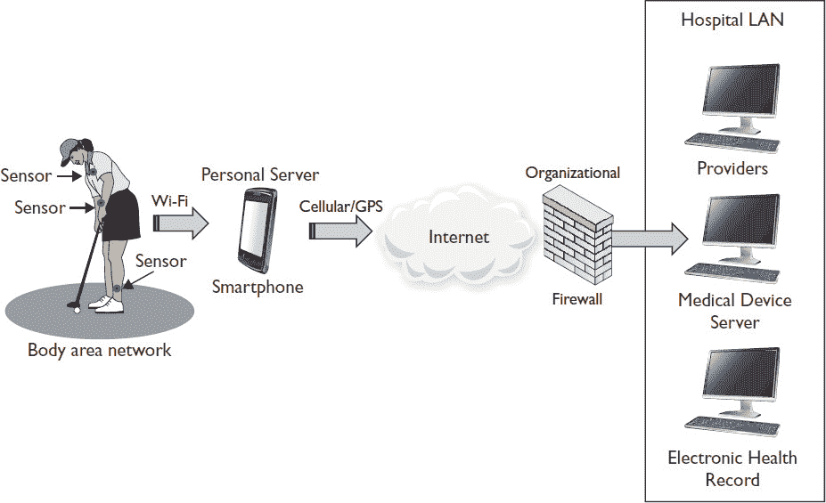

---

**图 1-2** 身域网

## 个人区域网 (PAN)

PAN 是一个由个人附近的通信区域组成的小型网络，可能包含 BAN。有许多设备相互连接，主要通过无线信道。PAN 在组织局域网提供给它的一个片段内或个人家中进行自我管理。每个设备内部都有一个网络接口卡 (NIC)，使得数据传输成为可能，无论发送方或接收方是笔记本电脑、打印机、医疗设备还是网络网关。

## 健康信息交换

术语*健康信息交换 (HIE)*通常既用作动词也用作名词。当用作动词时，HIE 描述提供者和付款人之间医疗信息的电子共享。然而，为本文目的，HIE 用于描述一个对象，即名词。HIE 是一个旨在促进多个医疗保健组织之间医疗信息电子共享的组织。通常，这些组织没有隶属关系或不在同一企业架构下，但也可能有。无论如何，HIE 支持组织合作伙伴之间以及区域或社区内的信息传输。

电子交换数据的不同医疗信息系统需要 HIE 来移动信息，同时确保内容的可靠性。这样，医疗服务提供者可以随时访问和使用临床数据，以提高质量、增加访问量并改善临床实践。公共卫生机构也从 HIE 在社区健康分析和监测中受益。当然，由于数据传输的手动流程减少，成本也随之降低。减少通过传真机、邮政邮件的纸质传输，以及自动化管理任务，相当于节约了本已稀缺的资源。以下章节将介绍几个对医疗保健有重大影响的 HIE 示例。

### 全国健康信息网络交换

在美国，联邦机构；州、区域和地方健康信息组织；整合型医疗服务网络；和私营组织正聚集在一起，建立一个 HIE 的 HIE，称为全国健康信息网络交换。这些利益相关者正在制定和实施该框架的标准、服务和政策。这样，健康信息的电子传输在更多组织之间平等地变得可用且可靠。同时，重点放在保护这健康信息交换在穿越互联网时的安全。患者的信息将贯穿整个护理连续体跟随他们，使医疗服务系统比传统的手工纸质系统更以患者为中心。

### 欧盟和美国

欧盟委员会通信网络、内容和技术总司 (DG CONNECT) 与美国卫生与公众服务部 (DHHS) 已开始在一个跨国、跨大西洋通信框架上合作，这将加强在电子健康和健康信息技术 (IT) 方面的跨大西洋合作。随着 2013 年 6 月的启动会议，^(4) 该合作伙伴关系确定了两个初始重点领域。

- 通过识别通用词汇、消息结构和工具，开发国际公认和使用的互操作性标准，以便于电子健康信息和通信技术交换
- 制定联合教育和培训课程的策略，使其既适用于欧盟也适用于美国，以增加熟练的健康 IT 劳动力数量

来自欧盟和美国的临床专家和关键利益相关者正在联手制定和实施所需的行动计划。解决方案需要具有创新性，并涉及政府和私营部门组织的投入。既定成果（至少是近期）是充分利用电子健康数据传输的好处，以：

- 赋能个人
- 支持患者护理
- 改善临床结果
- 提高患者安全
- 改善人群健康

## 电子健康记录

*电子健康记录* (EHR) 简单来说，就是个人患者以数字格式存储的医疗记录。它正在取代传统的纸质流程，并提高记录保存和分析能力，因为完全基于纸质病历和表格的记录系统存在局限性。随着对数字信息的依赖增加，以及诊断工具变得更能捕获新的复杂数据集，EHR 成为各类临床信息的存储库。

- 患者人口统计信息
- 病史，如用药和过敏清单
- 进展报告和提供者记录
- 实验室检测结果

## 电子健康记录 (EHR)

- 手术和检查预约
- 放射影像（X 光、MRI 等）和临床照片（内窥镜、腹腔镜等）
- 处方和给药记录

展开描述来看，EHR 是健康信息系统的核心。它几乎与每一个临床信息系统（例如放射影像归档与通信系统 [PACS]）、患者登记系统集成，在某些情况下还与其他提供者的 EHR 集成，以建立与特定患者相关的、纵向的（跨越一段时间的）医疗信息集合。无论提供者身处何地，当他们需要信息时，这些信息必须随时可用。

EHR 提供了收集、存储和传输有意义数据的能力。它还以纸质记录永远无法做到的方式呈现数据。提供者通过图形用户界面 (GUI) 获取数据，界面内容涵盖从电子表格到图像再到简单的数字结果。无论采用哪种呈现格式，关键在于提供者能够在其执业工作流中自定义 EHR。更重要的是，EHR 会分析结果和显示内容，以便向提供者发出警报或警告。如果某项结果表明患者健康状况发生剧烈变化，提供者的注意力能迅速被吸引到该结果上，而无需查阅大量既往检查结果。当处方或治疗方案与已知或潜在过敏冲突时，提供者会收到警报。在患者无意识或反应不全的紧急或急救情况下，这能避免患者安全问题，甚至挽救生命。

关于 EHR 的一个补充说明是，它们对减少医疗差错有深远影响。医学研究院 (IOM) 于 1999 年发布了一份震惊世人的报告《人非圣贤，孰能无过》，声称每年至少有 44,000 名患者死于医疗差错，由于报告流程的差异，实际数字可能是这个数字的两倍。^(5) 最近的研究和观察表明，行业状况并未大幅改善。这些错误的核心是基于纸质的医嘱录入流程。*医嘱录入* 是医生开具用药和检查指示的任何类型方向的统称。当这些操作通过纸质进行时，字迹潦草等现实问题可能导致错误。如果医嘱通过电话告知护士（称为*口头医嘱*），数据可能被错误转录。这些错误很少是故意的，但在本就充满风险的环境中引入了显著的患者风险。EHR 中的计算机化医嘱录入 (CPOE) 使纸质医嘱和口头医嘱过时。例如，许多药物医嘱通过下拉列表而非自由文本进行。事实上，借助医嘱“警报”的额外控制，如果医生必须将医嘱输入系统，系统会提示医生复核可能录入错误的医嘱。

### 个人健康记录

*个人健康记录* (PHR) 有时会与 EHR 混淆，或被误认为是纵向 EHR 的一部分。它并非如此。PHR 由患者维护，而非提供者组织。但这并不一定降低 PHR 的实用性。因为 PHR 可供患者查阅，患者可以及时、准确地获取与护理摘要相关的信息，包括随时间推移形成综合病史的检验结果和结局。此外，PHR 可与家用患者监测设备集成，例如无线体重秤或血压监测仪，它们通过智能手机应用程序传输数据以增强患者护理计划。总体而言，PHR 协助患者记住自己的病史并准确复述（例如，知晓当前服用的确切药物或剂量）。只需点击一下按钮，所有相关数据即可传输或保存到便携式电子介质中，供任何提供者使用。

虽然 PHR 可能是安装在 PC 或笔记本电脑上的软件应用程序，但更多时候它们是基于 Web 的解决方案。这些方案灵活，并提供了更好的能力来整合来自其他来源的数据（家用健康设备、EHR、智能手机等）。总之，PHR 为患者参与跟踪和维护自身健康提供了一种方式。它们还促进了患者与提供者之间更高效的互动。无论健康系统报告的连接程度如何，仍存在大量的流动性和脱节的护理系统，迫使患者看多位提供者，而这些提供者可能无法共享信息。PHR 使患者能够填补可能出现的任何空白。

## 术语与数据标准

医疗保健拥有在医疗环境中使用的独特语言。其拉丁术语、行话和组织特定代码的组合具有排他性。我们不打算识别和定义所有这些术语。但在宏观层面，有几个与医疗专业人员沟通方式及信息系统交互方式相关的概念，对于你理解该领域至关重要。

### 临床工作流

*临床工作流* 描述了临床医生提供医疗服务所使用的各种流程和行动模式。就电子信息和 EHR 而言，临床工作流描述了数据如何在信息系统中流转，由谁、传给谁、何时以及以何种频率流转。理解并妥善管理这一工作流可带来更高的效率、更好的优质医疗服务获取途径，以及跨护理环境的患者安全改善。此外，通过健康信息系统的临床工作流可改善健康结局，减少用药错误，并（从长远来看）比人工处理信息节省大量成本。

临床工作流组件的示例包括：登记患者、记录预约期间收集的患者信息、制定治疗计划、开具随访检查和药物医嘱、提供患者教育材料、安排未来就诊、处理账单或索赔。这些并非所有涉及的流程和子流程，但它们大致勾勒了患者在实体组织中的流转路径。与这些行动相关的电子数据也必须以同步、并行的方式流转于信息系统中。图 1-3 描绘了临床工作流的总体概念。请注意，该图旨在说明涉及临床医生、行政人员和技术人员的集成流程。该示例并不全面。典型临床工作流中还有更多交互和参与者，但一张图可能无法描绘全部。

---

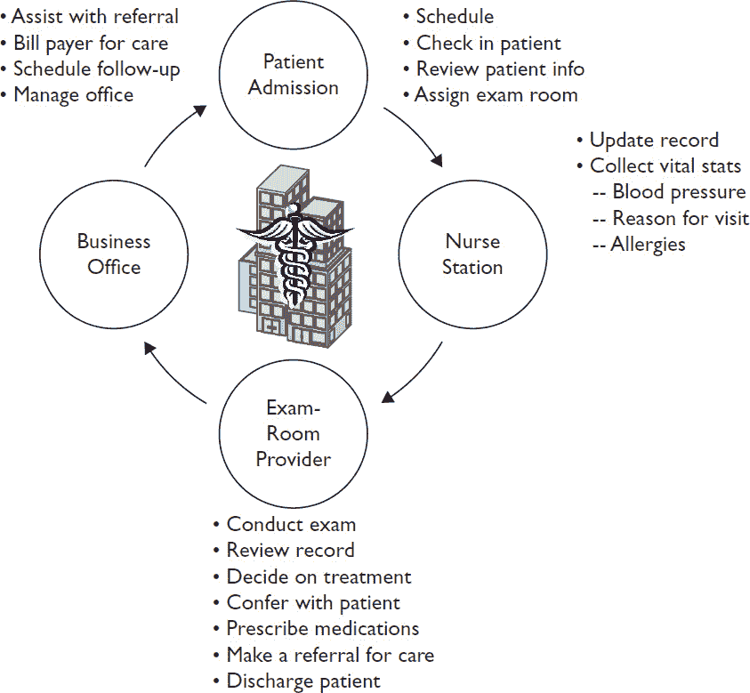

**图 1-3** 临床工作流

### 编码

*编码* 是将临床工作流从任何类型的叙述性或文字描述转换为数字数据集，或用于记录疾病描述、损伤、症状和状况的代码。

### 国际疾病分类 (ICD)

# 医疗编码系统

## ICD 和 DRG 编码

例如，国际疾病分类 (ICD) 编码 382.9 代表“未特定的中耳炎”，这是一种以炎症（对刺激的生理反应）、肿胀和中耳发红为特征的疾病。^(6) 医疗账单员无需提供所有这些繁文缛节，只需用一个最长六位的国际通用数字，即可向付款方传达该等级别的详细信息以用于支付。除了促进医疗服务报销外，标准化编码还使提供者和付款方都能进行数据分析。这样，不必要的检查和服务可以减少，结果统计也更容易获得。

在美国，医疗保健仍在使用这些编码的 ICD-9 版本。然而，下一代编码 ICD-10 已在国际上投入使用。与 30 年历史的 ICD-9 编码集相比，ICD-10 对患者医疗状况和住院操作提供了更详尽的描述。因为 ICD-10 最多使用七位数字，它将适应编码中更高的特异性和准确性。随着临床工作流和医疗实践的变化，ICD-10 提供了足够的空间来添加新的类别和编码。

基于患者记录中的 ICD 编码和患者的人口统计数据，另一种类型的编码集应运而生。美国的诊断相关组 (DRG) 旨在用更多前瞻性的流程取代基于按服务收费结算的报销。基本上，一组 ICD 编码是根据提供者提供的“产品”建立的。目前，有 500 多个被认可的 DRG 组。0 至 17 岁患者的疝气手术和股骨骨折就是 DRG 组的例子。核心理念是，在每个既定的 DRG 内，针对患有该病症的任何患者群体，服务和流程应当相似且标准化。因此，成本可以预测。提供者组织可以调整实践模式，以减少那些几乎没有或完全没有临床价值的差异。根据适用的 DRG 提供预设付款，提供者承担超出 DRG 费率的任何额外成本风险。

## 医学系统化命名法—临床术语 (SNOMED CT)

医疗保健中另一种普遍的编码是 SNOMED CT，它是一种综合临床术语，为临床文档和报告提供临床内容和表达能力。它可用于对临床数据进行编码、检索和分析。作为一项国际标准，它具有细粒度特性，拥有 311,000 多个概念、术语和关系，旨在精确表达医疗卫生范围内的临床信息。

SNOMED CT 旨在用于 EHR 之间的电子健康信息交换。这是 SNOMED CT 与 ICD 的关键区别。SNOMED CT 非常具体，能够描述广泛的临床术语，这些术语更多地作为构建 EHR 的机器语言。ICD 对诊断和操作进行分类，适用于账单和数据分析功能的输出。然而，整合 SNOMED CT 和 ICD 的工作正在进行中，可能会在 ICD-11 标准发布时实现。

## 逻辑观察标识符名称和代码 (LOINC)

为了结束这篇关于医疗机构编码的介绍性概述，LOINC 是一种广泛接受的编码系统，专门为标识实验室和临床观察而设计。为了能够跨多个独立实验室系统电子化交换观察和测量数据，LOINC 使用最大字段长度为 7 的通用编码系统。这产生了 71,000 多个 LOINC 值，允许提供者、临床实验室和公共卫生机构之间进行数据传输。LOINC 与 ICD 的区别在于 ICD 主要用于记录诊断。重申一下，LOINC 专门用于标识检验观察。

## 数据互操作与交换

数据共享是患者护理、科研和质量改进项目中必不可少的组成部分。在机构内部，提供者认为能够在需要时精确轻松地访问用药清单和实验室结果等信息是当务之急。即使在提供护理之后，在同行病历审查等场景中共享信息也很重要，在这些场景中，操作会被审查并依据组织和临床标准进行衡量。其目的是探讨最佳实践，分享共同经验，并最终通过减少重复和无效流程来最大化利用稀缺资源。

许多医疗机构作为其提供的医疗保健的一部分，开展大量的科研和学术培训。通常，这些要么是纯科研提供者，要么是教学医院。使这些机构能够交换研究成果，甚至实时协作研究，从而推进医疗护理。通过结合更大规模的药物反应数据集，结果变得更有用。将患者的基因组数据添加到临床试验中，真正开始能够精准预测个体层面有效的疗法。总之，科研和学术领域的数据共享减少了成本高昂且甚至可能成为患者安全风险来源的传统试错医疗。

一项研究表明，在四年半的时间里，提供者组织间共享数据挽救了 92,000 条生命，节省了 91 亿美元。将数据共享的收益推算至整个全国医疗卫生系统，会得出更令人印象深刻的数字。改善患者预后、精简流程和降低患者安全风险都是这种数据共享的益处。

鉴于数据共享的迫切需求，使一家医疗机构能够与另一家沟通是一项挑战。尽管医疗保健的语言基于公认的临床术语、许多标准化代码集以及诊断和治疗的使命，但仍存在障碍。此外，与供应商、付款方和其他利益相关者（包括政府机构）互联互通的能力也可能造成行政和管理问题。最常见的是，沟通中断并非技术僵局。通常，克服政治和个人障碍就能解决脱节问题。

例如，每个使用信息系统来自动化工作流、EHR 或患者管理系统的医疗机构，很可能都是从商业厂商处购买该系统。对于某些政府医疗机构（军队或退伍军人事务部），信息系统可能是政府自行开发的。无论如何，基于开发系统的机构，互操作性通常受限。结果是宝贵数据被锁在看似坚不可摧的孤岛中，除非系统都是由同一厂商制造的。然而，由于患者通常会根据转诊接受专科治疗等原因从一家医疗机构转到另一家，或者医疗机构希望向付款方提交账单，医疗机构必须具备无论其（或其对应方）使用何种专有系统，都能收发数据的能力。

## 健康水平七 (HL7)

## HL7（健康水平七）

主要的互联互通标准之一是 HL7，它是一种为使不同信息系统能够使用标准交换数据而开发的协议。制定该标准的组织也称为健康水平七（HL7）。这个国际组织由医疗卫生信息技术专业人员组成，其中许多人都是主题专家。它是一个非营利、非政府的会员制团体。通过开发互联互通标准，不同的医疗卫生组织能够更好地提供患者护理，并传输临床上重要的信息，这些信息通常因系统不兼容而无法获取。

为了帮助 EHR 实现互联互通，HL7 为所有 EHR 制造商发布的一款产品是 HL7 EHR 系统功能模型与标准。该模型从重要功能的角度定义了 EHR。利用各种患者护理环境（如重症监护、急救护理、医生诊所或任何其他临床环境）所期望的临床工作流程，该小组定义了具有标准描述的功能概况，这些概况在全球范围内均适用。为了实现互操作性，HL7 引领此类工作至关重要，以便提供方和制造商出于对互操作性的渴望而开发标准化的 EHR 功能，而不是试图在事后将它们拼凑在一起。

### 整合医疗企业（IHE）

与 HL7 相关，IHE 是一个提供标准框架的国际组织。其工作集中在标准的实际制定（如 EHR 功能标准）与组织如何实施这些标准之间。IHE 发布标准实施规范，称为*概况*。其中一个概况集合——实验室技术框架（LAB TF），定义了既定标准的具体实施，以实现临床实验室与医疗企业其他组件或更广泛的医疗卫生社区的整合目标。请注意，IHE 并不声称开发新的或额外的标准，而是支持现有标准的使用。LAB TF 涉及的标准不仅来自 HL7，还来自美国病理学家学会（CAP）和其他几个标准制定组织。这项工作的另一个好处是，采购任何 EHR 或临床信息系统的人员可以参考适用的 IHE 概况，要求供应商合规，并简化系统实施和互操作性。

### 医学数字成像和通信（DICOM）

当涉及到医疗卫生在信息系统互操作性方面的独特性时，除了数值结果和文字外，对来自众多外围设备的各种图像的依赖，给数字病历增加了非同寻常的复杂性。数字诊断成像设备被称为*模态*（X 光、超声、计算机断层扫描 [CT] 等），它们使得在医疗设备之间以及各供应商生产的 EHR 中传输图像和相关信息的标准方法成为必要。每个成像设备最初都以专有格式创建图像。美国放射学会（ACR）和美国国家电器制造商协会（NEMA）于 1983 年组建了一个联合委员会，开发了如今称为 DICOM 的标准。

DICOM 通过指定跨网络传输数字图像所需的协议，促进了医学成像设备的互操作性。用于捕获图像的设备可以由任何遵守 DICOM 标准的供应商制造。图像能够存储在数据库中，并可使用数据分析工具进行查询。DICOM 可能最令人印象深刻的成就是 PACS 的出现，^(7) 它构成了医疗卫生组织中一些最复杂的网络医疗设备。这些系统可由数十个模态组成，以局域网配置设置，连接到多种不同类型的服务器，用于图像处理、患者人口统计数据与图像的整合，以及向最终用户查看站传输文件。当专用 Web 服务器添加到架构中时，PACS 也可通过 Web 访问。这主要是为了提供访问权限给那些不需要诊断质量图像的提供方（不像放射科医生那样）。Web 查看的图像保真度较低，即图像质量较差。总而言之，许多医疗卫生组织必须在其局域网内容纳一个作为局域网的 PACS，因为其占地面积大。DICOM 是一个不断发展的标准，它允许 PACS 既在其自身组件内通信，又与同一组织内的其他系统以及地理上分布且可能在组织上无关联的系统进行接口连接。

## 健康数据管理的基础

像任何依赖信息的行业一样，医疗卫生组织必须遵循适当的数据管理原则。为此，它们应围绕被视为最佳实践的概念来组织其信息管理。医疗卫生组织的每个部分都包含多种形式的信息，包括书面指示、治疗计划、图像、音频文件、视频片段、纸质文档和数字文件。成功的医疗卫生组织致力于将信息转化为战略资产，对其进行组织和利用，使其成为一种资源，其价值不亚于其拥有的任何临床技术或金融资产。要有机会组织和利用数据，医疗卫生数据管理计划将包含以下组成部分：

- **治理** 领导力必须用于战略性地协调流程和技术。需要组织范围内的统一视角。因为数据治理不仅仅是 IT 问题，数据治理委员会必须包括高级管理人员和来自其他业务及临床领域的专家（以及 IT 代表），他们为数据治理职能提供愿景和权力。

- **管理性** 所有权和问责制在数据管理中很重要。数据是一项宝贵资产，所有拥有和使用数据的人员都必须了解其个人角色，以确保数据优先级、维护对数据的信任，并报告和跟踪数据问题直到解决。

- **质量** 必须建立适当的检查和监督，以实现相关、准确、及时、可访问等数据质量特征。没有这些特征，医疗卫生组织无法在不引入重大伤害风险的情况下开始提供患者护理。它们也无法确定其账单做法是否准确反映了执行的工作。这两种情况都预示着医疗服务提供方的危急状况。

- **架构** 与数据的位置及其在组织中的流动方式相关，清单和文档构成了第一步。然后组织必须识别利益相关者和相关的信息生命周期。此外，数据架构涉及定义组织的元数据，即关于数据的数据。元数据元素可以是“患者记录”，并包含出生日期、预约日期、处方等多个元素。因为这些信息可能被多个部门甚至跨不同组织使用，拥有统一定义的称为*患者记录编号*的元数据可以简化依赖这些相关数据元素的无数流程。

- **标准** 鉴于医疗卫生领域运行的所有业务流程和临床工作流，建立和维护具有共同理解和含义的数据至关重要（这也是例如用 ICD-9 对医疗实践进行编码如此重要的原因之一）。数据标准建立在法规、惯例和用户接受度的组合基础之上。

**安全** 确保数据的机密性、完整性和可用性，无论是纸质形式还是数字形式，都是任何数据管理计划的核心关注点。在医疗保健领域，保护数据免受未经授权的（意外的或故意的）修改、销毁或泄露，可能违反法律，关乎患者安全风险，或两者兼具。

## 医疗保健环境中的信息流与生命周期

此时应当清楚的是，信息需要沿着患者护理的临床工作流流动。如果信息不可用或不可靠，患者护理就会受损。当关键信息在需要时不在提供者手中时，患者安全可能面临风险。此外，信息有一个必须管理的生命周期，以确保保持机密性和完整性，以及可用性。这并不意味着机密性、完整性和可用性是不惜一切代价要达到的目标。正确理解信息流和信息生命周期管理（ILM）对于降低成本至关重要。

ILM 周期包含以下步骤：^(8)

- **创建** 信息必须可用、可信、可靠且简洁，无论信息源自何处。来源可能是患者、提供者，或任何数量的不同医疗设备和诊断工具。
- **保留** 信息的价值（分类）将决定组织保留信息的时间长短。需要制定政策来确定记录有用的时间长度，以及过期记录何时被丢弃。
- **维护** 记录在提供者持有期间必须被存储和保护。存储的一个关键方面是，只要信息有用，就保持记录对提供者具有同等级别的可用性和数据完整性。
- **使用** 信息必须以与收集原因一致的方式使用，绝不能用于提供者的个人利益。例如，如果患者未同意此类用途，用于治疗的数据通常不能用于已发表的研究。在信息生命周期中，使用阶段最重要的特性可能是在传输过程中保护信息。医疗保健组织使用数据。这是既定事实。随着数据在组织内部、组织之间以及提供者和付款人之间移动，需要采取保障措施以确保机密性、完整性和可用性。
- **销毁** 这是流程的最后一步，也是最脆弱的一步。当组织不再认为信息有用时，数据往往会以未经授权的方式丢失或泄露。在将信息移交给销毁流程的过程中，由于防护措施放松，会发生数据泄露或违规。在数据被销毁之前，仍有必要保护它。无论是纸质还是数字信息，都有三种常见的销毁选项。
  - **覆盖** （用新数据覆盖旧数据，通常是 1 和 0）
  - **消磁** （擦除存储介质的磁场）
  - **物理销毁** （纸质或数字粉碎或焚烧均可选择）

---

 **注意** 根据数据价值和介质，通常会结合使用上述几种方法。在某些情况下，例如消磁，该过程涉及多次执行该操作，以完全确保数据无法恢复。

任何信息安全策略的关键部分是在数据不再需要时将其销毁。未能做到这一点可能导致严重的数据保护和隐私政策违规、合规问题以及额外成本。美国俄克拉荷马州塔尔萨市的一家医院^(9) 曾有一叠 3 英寸厚的医疗记录（包含患者人口统计信息、心电图打印件和提供者笔记）被公开泄露。在将纸质记录从医院转移给回收商和记录销毁公司的过程中，未遵循适当程序。走捷径，即本例中未锁好运输箱，导致了数据泄露。不过，这种情况不仅发生在纸质记录上。数字信息在销毁前也很容易丢失。例如，多达 400,000 名患者面临风险，因为一家医疗服务提供者在租赁期满归还复印机/打印机/传真机/扫描仪一体机前，未能对其进行适当的清理。^(10) 当事人姓名虽为公众所知，但此处不重要。此处无法列出阐释该主题的所有案例完整清单。然而，给医疗保健信息安全和隐私专业人员的核心信息是，*这可能发生在您的组织中*。如果发生了，最有可能是在您在 ILM 的销毁步骤中放松警惕时。

---

 **提示** 公开可用的指南，即美国国防部 **(**DoD) 5220.22-M，是最常用的基于软件的数据清理方法之一的来源。硬盘覆写的常规实施如下：

- **第 1 遍** 写入 0 并验证写入
- **第 2 遍** 写入 1 并验证写入
- **第 3 遍** 写入随机字符并验证写入

## 健康数据表征

数据共享和交换通常必须是有意为之的。基于法律、合同协议和技术兼容性，互操作性必须是经过深思熟虑且坚定不移的努力。除了数据标准概念和医疗保健语言之外，还有两个重要主题需要考虑，即数据分类和数据分类法。即使数据在技术上兼容组织间交换，并非所有数据都是平等的。必须考虑各组织各自的政策和程序。通过适当的数据分类和数据分类法关注健康数据表征，使信息交换成为可能。为此，健康数据表征的另一个方面是数据分析，这是由正确执行的数据分类和数据分类法所带来的新兴趋势。

### 数据分类

如前所述，ILM 要求医疗保健组织拥有一个基于信息价值的分类系统。重要的是要注意，这种 *数据分类* 与计算机编程中的分类不同，后者也称为分类，但更多涉及给数据打标签以将其区分为类和集合。在 ILM 背景下，数据分类需要根据组织定义的信息敏感度和关键程度赋予相应价值。该价值将决定对收集、维护、保留、使用以及不再需要时销毁的信息应用何级别的信息保护控制。

### 数据分类法

*数据分类法* 涉及将数据归类为具有共同含义的标准化格式，以便实现标准化。当 *psychologist*（心理学家）一词独立于组织且区别于其他提供者职业（如 *social worker*（社工）或 *counselor*（咨询师））时，数据共享和重用就成为可能。拥有数据分类法带来了便利，并减少了试图建立通用定义和上下文的无谓努力。数据分类法的另一个好处是，它已被证明在简化支付和报销活动方面行之有效。

### 数据分析

# 数据分析与法定医疗记录

## 数据分析的有力论据

可能最令人信服的支持适当数据表征的论据是**数据分析**。有了标准分类和分类法，以合理成本对越来越大量的数据进行比较分析成为现实。以前，由于政策、程序和信息系统的不兼容性，数据分析仅限于单个组织。充其量，数据分析仅适用于该组织。任何比较很可能都因数据延迟而受损，因为结果无法实时共享。如今，联盟和数据分析公司能够几乎瞬间且同时地聚合和处理来自数十家医疗保健组织的 TB 和 PB 级数据，以提供结果指标并随时间降低成本。

数据分析的演进使信息系统能够更快、更经济地处理更多数据。随着组织数据变得更加兼容和标准化，一个被称为**大数据**的运动在许多行业中迅速兴起。医疗保健也不例外。美国政府的大数据研究与开发计划便是一个利用来自多个不同来源的海量健康数据进行比较的可能性的例子。^11 成果可衡量且正在发生。例如，纽约州立大学（SUNY）布法罗分校拥有领先的多发性硬化症（MS）研究中心之一。通过大数据分析可用的工具和技术，他们能够获取数十万个基因变异，将其与其他基因产物和环境因素相结合，并快速分析数据。他们成功地使用复杂算法，将分析所需时间从 27.2 小时缩短至 11.7 分钟。^12

## 法定医疗记录

当医疗记录完全由纸质病历、文档、胶片图像和文件组成时，**法定健康记录**是与个别患者相关的全部内容。随着纸质记录向数字记录转换的引入，这种情况开始改变。由于监管变化、医疗保健法律问题以及互联网上的患者教育，患者也更多地参与到与其相关的记录内容中。定义的影响在于向执法部门和法律程序披露的内容。仅构成法定医疗记录的部分才可披露。法定医疗记录的内容至少应做到以下几点：

- 支持患者护理决策
- 为报销目的记录所提供的护理
- 作为有关此类护理的法律程序中的证据

定义法定医疗记录的首要挑战在于不存在这样的标准。^13 每个组织都需要自行定义内容。某些组成部分比其他部分更明显和通用。例如，与药物医嘱、病理报告和急诊科记录相关的信息肯定是任何法定医疗记录的一部分。然而，管理数据和文档通常被排除在外。这些可能包括信息发布授权表格、事件或患者安全报告以及心理治疗笔记。为了确定哪些文档可以排除，医疗保健组织通常将这些项目称为**工作文档**。

如前所述，并非所有健康信息都是数字化的。大量信息仍保留在纸质格式中。某些纸质记录、图像和文件构成了法定医疗记录的有效要素。当医疗保健组织将其法定医疗记录定义为同时包含纸质和数字信息时，该记录称为**混合**法定医疗记录。除了存储电子信息的各种数据库的位置外，医疗记录还必须包含对其所含纸质信息来源的引用。

# 章节回顾

我们已经开始了这段旅程。此时，基础工作已就绪，可以在此基础上构建影响医疗保健信息隐私和安全的要素。在本章中，我们确定了围绕患者、提供者、付款人和关键利益相关者组织的医疗保健体系。这些实体构成了任何医疗保健系统，但这些系统的融资方式可能不同。虽然政府（单一付款人）是全球主要模式，但雇主基础和私人保险模式也足以成为一个因素。

后续章节将详细介绍医疗保健特有的技术和数据标准，但本章介绍了医疗设备和健康信息网络等事物的存在，它们具有特定用途并带来独特挑战。医疗设备尤其令人担忧。这些专用计算系统的运作方式与任何其他类型的办公自动化非常相似。但归根结底，它们受外部政府机构监管，制造商在设备全生命周期内保持一定程度的责任。我们将在未来章节中重新审视并扩展这些区别。最后，本章略述了基础健康数据管理原则的既定类别。理解这些主题有助于塑造您对信息全生命周期的知识和使用，并帮助您妥善管理医疗保健的核心产品，例如数据分析和法定医疗记录。

## 复习题

1. 如果付款人是公共来源，以下哪项将是资金来源？
   - A. 雇主集团
   - B. 健康维护组织
   - C. 公共卫生机构
   - D. 政府实体

2. （判断题）住院患者被定义为进入急诊室并在不到 24 小时内过夜入院的个人。

3. 在大多数发达国家，谁是医疗保健的主要付款人？
   - A. 自费
   - B. 雇主
   - C. 政府
   - D. 军队

4. “每成员每月”是描述一种称为什么的支付模式的常用方式？
   - A. 人头付费
   - B. 打包支付
   - C. 责任制医疗
   - D. 管理式医疗

5. 医疗服务报销必须是 \_\_\_\_\_\_\_\_\_\_\_\_\_\_\_\_\_\_，\_\_\_\_\_\_\_\_\_\_\_\_\_\_\_\_\_\_，和 \_\_\_\_\_\_\_\_\_\_\_\_\_\_\_\_\_\_。

6. 以下哪个健康信息交换是对医疗保健产生重大影响的示例？
   - A. 全国健康信息网络交换
   - B. 蓝十字蓝盾
   - C. 管理式医疗网络
   - D. 电子健康记录

7. 健康信息系统的核心是
   - A. 医疗设备
   - B. 提供者记录
   - C. 电子健康记录
   - D. 防火墙

8. （判断题）DICOM 是帮助电子健康记录互联的既定标准。

9. （判断题）确保数据的机密性、完整性和可用性，无论是纸质形式还是数字形式，都是数据管理计划中安全性的核心关注点。
   - A. 安全性
   - B. 治理
   - C. 管理责任
   - D. 标准

10. 在信息生命周期管理的哪个阶段最有可能发生数据泄露？
    - A. 创建
    - B. 保留
    - C. 使用
    - D. 处置

## 答案

# 第一章 测验答案

## 1. 问题 1
**答案：D** 雇主团体或基于雇主的医疗保险将被视为私人付款方。健康维护组织可以是政府付款方计划（如 Medicare）下组织医疗服务提供的一种方式，但它不是公共资金来源。公共卫生机构不太可能将报销提供者的医疗费用作为其监测职责的一部分。因此，最佳答案是 D，即一个利用公共税收或其他公共筹集资金来为医疗服务提供资金或报销提供者的政府实体。

## 2. 问题 2
**答案：TRUE** 每天下午 5 点到 6 点的定期预约属于门诊就诊，那些不需要正式住院的预约也是如此。膝盖手术并转往辅助生活住所意味着将患者出院回家。睡眠研究虽然过夜，但不属于住院。导致正式住院的急诊室就诊符合住院的定义。

## 3. 问题 3
**答案：C** 在世界大多数发达国家，政府是主要付款方。只有极小比例的个人自掏腰包支付医疗费用。虽然雇主在美国是医疗保险融资的很大一部分，但在国际上则远不常见。军队作为政府提供的医疗保险的一部分，部分正确；但它不是主要付款方。

## 4. 问题 4
**答案：A** “人均每月成本”是衡量提供给医疗机构用于提供医疗服务资金的常用指标。该金额预先设定，并在承保期开始前提供。它必须与该测量期间内的每个个体相关联。捆绑支付、责任制医疗和管理式医疗都与医疗融资有关，但没有一种是专门按承保期内的每个覆盖生命来定义或衡量的。

## 5. 问题 5
**答案：usual, customary, and reasonable** 唯一正确的形容词组合是“常规、惯例和合理”。所有其他组合均不见于任何典型的可报销费用定义中。

## 6. 问题 6
**答案：A** 全国健康信息网络交换是该类别中唯一准确的答案。蓝十字蓝盾是一家商业健康保险公司，而管理式医疗网络是连接管理式医疗计划的通用描述（可能描述合同安排以及信息技术网络）。电子健康记录是一种可能在交换中联网的应用程序，但其本身并非交换网络。

## 7. 问题 7
**答案：C** 虽然医疗设备系统类别在收集健康信息方面极其重要，但它很少做除收集并传输至电子健康记录之外的其他事情。提供者记录位于电子健康记录中，是关键组成部分。另一方面，防火墙应成为任何医疗系统架构的一部分，但不应被视为核心。电子健康记录是系统中所有重要输入的存储库，包括医疗设备和提供者记录。由于其价值，防火墙等设备旨在保护它。

## 8. 问题 8
**答案：FALSE** DICOM 是医学数字成像和通信标准，用于促进放射学检查等数字图像的传输。唯一符合电子健康记录互联互通定义的标准是健康水平 7 (HL7)。

## 9. 问题 9
**答案：TRUE** 根据定义，安全性适用于确保数据机密性、完整性和可用性的努力。虽然治理、管理和标准都是有效的健康数据管理原则，但只有安全性完全符合这一定义。

## 10. 问题 10
尽管信息生命周期的任何阶段都可能存在数据泄露风险，但创建、保留和使用阶段并非最可能发生数据丢失的阶段。当数据被标记为待处置或销毁时，无论是纸质还是数字格式，继续采取防止丢失的保护措施都至关重要。存在太多案例：数据不再需要，因此不再受到保护。此时，数据被窃取或丢失。

# 参考文献

1. Todd, Susan R., and Benjamin D. Sommers. “Overview of the Uninsured in the United States: A Summary of the 2012 Current Population Survey Report.” ASPE Issue Brief. September 12, 2012. Accessed November 3, 2013, at [`aspe.hhs.gov/health/reports/2012/uninsuredintheus/ib.shtml#howmany`](http://aspe.hhs.gov/health/reports/2012/uninsuredintheus/ib.shtml#howmany)

2. U.S. Census Bureau. “Income, Poverty, and Health Insurance Coverage in the United States: 2010.” September 2011. Accessed November 2, 2013, at [www.census.gov/prod/2011pubs/p60-239.pdf](http://www.census.gov/prod/2011pubs/p60-239.pdf)

3. Food and Drug Administration. “Medical Devices.” Accessed October 25, 2013, at [www.fda.gov/MedicalDevices/DeviceRegulationandGuidance/overview](http://www.fda.gov/MedicalDevices/DeviceRegulationandGuidance/overview)

4. European Commission. “EU and US Step up Cooperation in eHealth IT.” March 22, 2013. Accessed October 22, 2013, at [`ec.europa.eu/digital-agenda/en/news/eu-and-us-step-cooperation-ehealth-it`](http://ec.europa.eu/digital-agenda/en/news/eu-and-us-step-cooperation-ehealth-it)

5. Richardson, William C. (et al.). “To Err is Human: Building a Safer Health System.” Institute of Medicine. November 1999. Accessed October 14, 2013, at [www.iom.edu/~/media/Files/Report%20Files/1999/To-Err-is-Human/To%20Err%20is%20Human%201999%20%20report%20brief.pdf](http://www.iom.edu/~/media/Files/Report%20Files/1999/To-Err-is-Human/To%20Err%20is%20Human%201999%20%20report%20brief.pdf)

6. Medishare Tools. ICD-9 Lookup. Accessed October 21, 2013, at [`medishare.com/tools/codes/icd9/382.9#382.9?&_suid=138452958471303941976392909484`](http://medishare.com/tools/codes/icd9/382.9#382.9?&_suid=138452958471303941976392909484)

7. Huang, H. K. *PACS and Imaging Informatics: Basic Principles and Applications*. John Wiley and Sons. 2010. pps. 219–229.

8. National Health Service (UK). “Information Lifecycle and Records Management Policy.” The Queen Elizabeth Hospital King’s Lynn. March 5, 2013. Page 8. Accessed October 20, 2013, at [www.qehkl.nhs.uk/IG-Documents/information-lifecycle-records-management-policy.pdf](http://www.qehkl.nhs.uk/IG-Documents/information-lifecycle-records-management-policy.pdf)

9. Emory, Bryan. “Tulsa Medical Records Turn up on Ponca Newspaper Loading Dock.” *Oklahoma’s Own*. March 4, 2013. Accessed on November 13, 2013, at [www.newson6.com/story/21476118/tulsa-medical-records-turn-up-on-ponca-city-newspaper-loading-dock](http://www.newson6.com/story/21476118/tulsa-medical-records-turn-up-on-ponca-city-newspaper-loading-dock)

10. Keteyain, Arman. “Digital Photocopiers Loaded with Secrets.” *CBS Evening News*. April 20, 2010. Accessed on October 30, 2013, at [www.id-theft-security.com/lifelock-blog/2010/05/data-breach-4](http://www.id-theft-security.com/lifelock-blog/2010/05/data-breach-4)

## 第 2 章

## 医疗卫生：人员、角色与第三方合作伙伴

在本章中，您将学习如何：

- 识别医疗卫生组织中各类职业与角色
- 区分各医疗卫生角色的资质衡量标准与胜任力标准
- 认识医疗卫生组织行为对健康信息保护的影响
- 理解第三方关系在医疗卫生领域的性质与重要性
- 区分医疗卫生组织重要第三方的类别
- 预判与第三方关系相关的安全与隐私问题

---

鲜有组织的员工队伍比医疗卫生组织更为多元。首先，医疗卫生组织雇佣或通过合同外包各类服务，从而形成一个自给自足的生态系统。从设施建设到后勤卫生、餐饮服务，医疗卫生组织都配备了发电及全方位支持服务的人员。这一切都是为了在紧急或灾难条件下保障患者护理。如果这还不足以体现员工构成的多样性，那么极其丰富的高学历、高素质医生、护士、行政人员和医疗技术人员的混合队伍，则提供了直接和间接的患者护理。此外，医疗服务提供的众多环境，使得所需护理人员和支持人员的类别更加多样。医疗服务在医院、诊所、专科诊断中心甚至家庭中提供。就信息隐私和安全而言，在所有这些环境中，大多数类别的护理人员都会使用（且必须保护）可识别个人身份的健康信息。本章将介绍这些医疗卫生组织员工的类别及其各自的资质。

您还将探讨第三方组织在医疗卫生领域扮演的角色及其影响。如前所述，医疗卫生组织需要许多不同类型的工作者来完成其使命，但组织无法将所有人都纳入薪资名单。那成本太高了。部分产品和服务必须由第三方以合同形式提供。其中一些第三方（如医疗耗材公司）仅服务于医疗卫生组织。而另一些（如数据中心）则为具有类似需求的各类组织提供服务。无论哪种情况，如果第三方为医疗卫生组织处理患者信息，则会建立额外的合同协议。

### 识别员工队列动态：人员、职业与胜任力

如果您走进任何一家医疗卫生组织，都会发现各种各样的职业。这里有从事保洁服务到心脏外科手术等各种角色的人员。有团队负责清洁病房，也有团队负责接生婴儿。人员执行临床、行政和支持服务以照料患者。医疗卫生行业存在的职业种类繁多，教育水平和胜任力层次各异，这在任何其他行业中都是独一无二的。美国政府确定了近 50 类医疗卫生专业人员，这还不包括医疗卫生管理专业（财务、设施管理、高级管理人员等）[¹]。令人难以置信的是这些职业之间的相互依存性。从技能最低的初级员工到最高级管理人员或资深医生，整个组织以相互关联的方式协同工作，共同提供患者护理。技术人员、专业人员和管理人员必须协同合作。有一点是确定的：信息隐私和安全人员必须了解医疗卫生员工队伍的角色，以便实施和维护适当的信息隐私和安全措施。

#### 护士

由于护士能够（且确实）在任何医疗卫生组织中承担职责广泛的多项任务，她们构成了医疗卫生员工队伍中最大的类别。仅在美国，注册护士就超过 260 万，其中 60% 在医院工作[²]。在国际上，许多国家也有护士执照制度。例如，英国由护理与助产委员会负责监管这一过程。除了注册护士，还有许多其他类型的护士在医院和其他护理环境中提供患者护理。护士类别内部包含众多角色类型。尽管如此，或许正是因为需求太大，美国目前确实存在熟练护士短缺的问题。根据角色不同，护士将接受不同的培训，具备不同层级的胜任力。护理的大类包括护理助理、执业护士和注册护士（包括专科护士和认证注册护士）。

#### 护理助理

护理助理在从医生诊所到医院再到长期护理环境等各类医疗卫生场所提供大量的患者护理。作为与医院勤杂工和护理员相关的职业，护理助理执行的服务包括移动、翻身和抬举患者。您可能还会发现她们提供许多与安抚患者、使其保持舒适相关的服务。大多数护理助理的教育水平为高中后（文凭或证书）。医疗卫生组织要求护理助理至少通过一项胜任力考试并不罕见。

#### 执业护士

基于教育和所需培训，护理的下一级别是执业护士（LPN）。这些护士必须完成通常为期一年的认证教育项目。这些项目通常与教学医院合作，为学生提供实践经验。学生完成项目后，还需参加额外的执照考试。您会在医疗服务提供的各个领域发现 LPN 的身影。她们当然在医院工作，也可能在患者家中提供护理。通过居家医疗，照护连续性从医院延伸至患者正常的生活环境，这已被证明对预后有积极影响。

#### 注册护士

---

## 参考文献

[¹]: [ch2.html#ch2en1]
[²]: [ch2.html#ch2en2]

**11.** 正式备忘录。美国总统行政办公室科技政策办公室。“奥巴马政府发布‘大数据计划’：宣布投入 2 亿美元用于新的研发投资。” 2012 年 3 月 29 日。于 2013 年 10 月 27 日访问，网址：<http://www.whitehouse.gov/sites/default/files/microsites/ostp/big_data_press_release.pdf>

**12.** 纽约州立大学布法罗分校大规模基因交互分析。2013 年 5 月。于 2013 年 11 月 18 日访问，网址：<http://www-01.ibm.com/common/ssi/cgi-bin/ssialias?subtype=AB&infotype=PM&appname=SWGE_IM_ZN_USEN&htmlfid=IMC14675USEN&attachment=IMC14675USEN.PDF>

**13.** AHIMA e-HIM 工作组（法律健康记录）。“更新：为披露目的定义法律健康记录的指南。”《AHIMA 杂志》76 卷，第 8 期，2005 年 9 月。第 64A–G 页。于 2013 年 11 月 12 日访问，网址：<http://library.ahima.org/xpedio/groups/public/documents/ahima/bok1_048604.hcsp?dDocName=bok1_048604>

# 护理角色与医师

## 执业护士与注册护士

执业护士（LPN）在注册护士（RN）的监督下工作。由于拥有更多的教育和培训要求，注册护士处于提供患者护理的下一级层级。她们提供的护理更直接地涉及与医师及其他医疗服务提供者的协调。无论是在急诊室还是重症监护室，你都能在患者护理的第一线看到注册护士的身影。注册护士在教育患者和公众了解健康状况、出院后指导以及其他各类医疗相关事宜方面也扮演着重要角色。当然，注册护士与其他所有护士在相同的环境中工作，但凭借其额外的教育、培训和资质认证，注册护士可以在一些非传统医疗环境中独立工作，如惩教设施、学校和夏令营。最常见的是，注册护士拥有护理学学士学位。不过，也可以通过护理学副学士学位或来自特定护理项目的文凭获得注册护士执照。所有注册护士必须通过全国注册护士执照考试来获得执照。

## 护理师与注册麻醉护士

由于多种原因，多年来医疗专业已从既定的角色和实践中演变而来。无论原因是新技术、人员短缺、医学进步，还是这些因素的综合作用，许多类别的医疗服务提供者都发展出了先进的技能组合，模糊了传统职责之间的界限。在护理专业中，护理师（NP）和注册麻醉护士（CRNA）便是两个这样的例子。

### 护理师（NP）

要成为护理师，首先必须是一名注册护士。随后，经过额外的高级课堂和临床教育，注册护士便可获得护理师资质。护理师照料患有急性和慢性疾病的患者，其职责超越了传统的护理范畴。一次就诊或接诊包括采集患者完整病史、实施体格检查，随后开具诊断检查和治疗方案。视其执业范围而定，护理师甚至可以开具处方和转诊。你能找到护理师的执业类型几乎是无限的。她们服务于儿科、家庭医学、老年病学等更广泛的普通实践领域，也服务于妇产科、肿瘤科、皮肤科和疼痛管理等专科护理领域。护士获得注册护士执照后，必须再从经认证的、可授予护理学硕士（MSN）或护理实践博士（DNP）学位的项目毕业。这还不是终点。下一步是通过全国专业委员会认证考试。护理师将根据其教育项目侧重的特定临床领域参加相应考试。换句话说，如果项目专注于老年病学，认证考试也将聚焦于此。跨过这些门槛后，通过委员会认证的护理师可以申请额外资质，例如处方权和获取美国缉毒局（DEA）注册号。

### 注册麻醉护士（CRNA）

第二条高级护理职业发展路径是注册麻醉护士（CRNA）。这些护士为患者提供麻醉，可为任何需要麻醉的手术或操作实施麻醉。这项职责过去仅限于医师，拥有注册麻醉护士使得小型市场和农村医院能够在维持护理标准的同时，通过减少人员开支来控制成本。成为注册麻醉护士的流程与护理师类似——注册麻醉护士需要护理学学士学位或同等学历，并需持有注册护士执照。此外，注册麻醉护士必须具备急性护理环境下的临床经验。她们需要证明有一年在重症监护室等区域的工作经验，而非长期护理或康复病房。在满足以上所有条件后，她们还必须完成经认证的麻醉护理教育项目。最后，要成为注册麻醉护士，护士必须通过全国认证考试。

## 护理总结与工会影响

总之，护士长期以来一直是医疗服务提供的中坚力量。她们拥有令人印象深刻的教育、培训和认证水平，在临床工作流程的各个方面都不可或缺。在担任行政和执行职能服务业务时，她们同样极具价值。她们的身影遍布儿科到老年科、初级护理到重症护理、诊室到董事会会议室。护理专业人员因其对医疗的专业理解和培训的灵活性，甚至在医疗机构之外也备受追捧。护士通常是患者（及其他医疗专业人员）的教育者，因此你会发现许多护士在临床护理之外担任健康教育角色。

> **提示**  
> 在美国，影响医疗劳资关系的主要因素之一是护理工会。约 21% 的护士是工会会员。事实上，护理工会化的比例超过了美国其他职业工会化的总体水平（后者正处于下降趋势）。工会化的声称益处包括：相较于同行护士薪资增加、因护患比改善而带来的更好患者预后和满意度，以及组织内部参与感和公平感的增强。

## 医师

医师的角色自有历史记载以来便已存在，但公元前 350 年左右的希波克拉底被视为“现代医学之父”。^(3) 相比之下，现代护理始于 19 世纪（尽管护理服务在患者护理中自有病伤者存在以来便已出现）。关键在于，从过去到现在，医疗的核心关系始终是医师与患者之间的关系。医师的主要职责是为患者诊断和治疗损伤与疾病。外科医师是专业化的医师类型，通过手术治疗损伤、疾病和畸形。几乎所有医师都获得学士学位，随后在经认证的医学院完成四年学业。一直以来都重视在现任医师指导下实际执业的重要性。因此，医学院毕业后，通过为期一年的实习继续在职培训。随后学生必须完成住院医师培训，通常专注于某一专科或熟练度更高的领域，如心脏病学或内科。

> **注意**  
> 住院医师培训是护士（包括护理师和注册麻醉护士）与医师要求之间的关键区别。随着越来越多的护理师住院医师项目变得可用并被推荐（即使非强制要求），这一区别正在发生变化。

与护士一样，医生也必须获得执业执照，并持有医学博士（MD）或骨科医学博士（DO）资质。医学博士和骨科医学博士参加额外考试以获得专业委员会认证也很常见。所有各类专科都有专业委员会认证（有时不止一项）。完成培训和执照获取后，获准独立开具处方、下达医嘱、执行并解读诊断检查。此外，每位医师还必须专门获得在特定医院或医疗机构执业的资质认证。这是医疗机构的内部职能。人员部门核实医师的背景和资质，授予其在该机构内行医的特权。

正如前文所述，医生可以是全科医生，负责家庭医学、内科或其他初级保健领域的职责。否则，基于额外的专业培训和经验，医生和外科医生可以专注于某种特定疾病或病症，或某个特定的生理系统。为了帮助说明这些专科（这些医生被称为*专科医生*）的数量和多样性，表 2-1 描述了一些最常见的专科。

**表 2-1** 部分专科医生

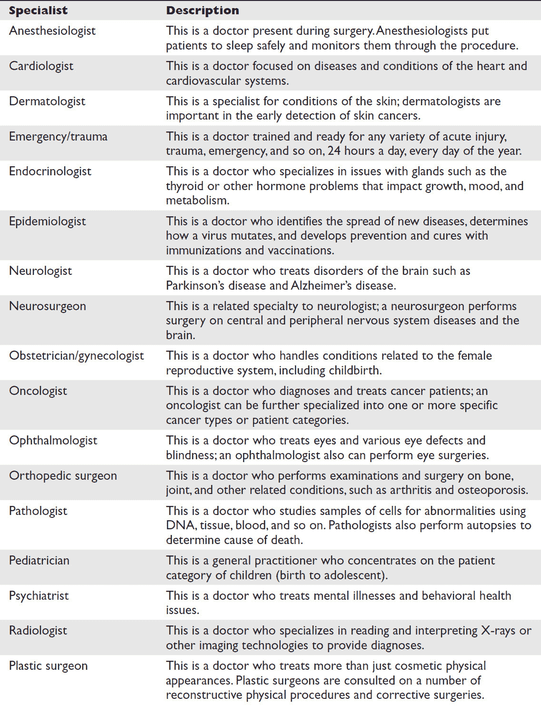

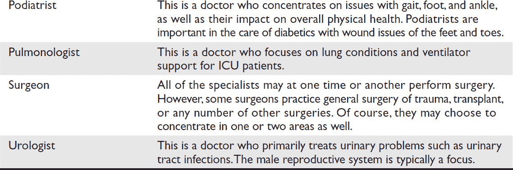

## 医师助理

我们已经讨论过护士从业者（NP）和注册麻醉护士（CRNA）等医疗服务提供者，以及他们是如何演变而来的。另一个不源于护理学的类似职业是医师助理（PA）。总的来说，NP、CRNA 和 PA 常被称为*医师延伸者*，因为他们承担了原本由医生保留的传统角色和职责，以帮助增加高级护理的可获得性。医师延伸者也被证明极其宝贵，他们往往能提高质量（当然不会降低质量）、降低成本并增加可及性。PA 被认可为在编医疗专业人员的另一大类，他们持有执照，可在医生指导下行医。这种认可并非在国际卫生体系中普遍存在。PA 主要是美国医疗体系中的一种医师延伸者，在其他国家可能不被认可。

通常情况下，PA 候选人已拥有学士学位，但有些项目在完成 PA 课程的过程中会授予学士学位。无论如何，PA 项目大约需要两到三年的学习，并包含 PA 执业所有领域的临床轮转，如内科、家庭医学、急诊科等。在某些情况下，毕业的 PA 决定在某个临床领域进行专科深造，并获得额外的培训和经验。这一过程类似于医生进行专科轮转，但所需时间短得多。PA 提供与医生相同的所有患者护理职能。但是，他们必须在医生的指导和监督下工作。其中一个区别在于手术方面，PA 可以协助外科医生，但不能独立实施手术。与所有护士和医生一样，PA 也有执照要求。

## 医疗技师

当你听到有人被称为*医疗技师*时，这同样是一个统称，就像*医生或护士*一样。医疗技师有许多子类别，能全面描述任何特定医疗技师的专业知识和技术能力。首先，医疗技师这一大类描述的是在临床实验室进行检测和检查的工作。医疗技师在某一临床领域拥有实用知识和能力。他们还必须能够理解来自其特定设备的医疗数据，以及这些数据如何与患者相关联。他们是结果的第一道解读者。虽然他们不做诊断，但当他们识别出数据中的不准确性时，肯定能减少错误和返工。你可能会在血库或微生物实验室看到这种情况。另一类医疗技师操作医疗设备，以支持特定临床实践中的程序实施。这包括诊断性影像、心导管术和血液透析。对于所有这些不同类型的医疗技师，他们的检测和检查报告及发现，正是医生用来诊断和治疗患者的依据。

## 生物医学技师和临床工程师

另一类医疗技师是负责维护（而非操作）医疗设备的人员。他们是生物医学技师和临床工程师。这些类型的医疗技师与前文提到的技师的一个关键区别在于，生物医学技师和临床工程师通常不需要接受人体解剖学、生理学和临床技术方面的大量培训。就教育而言，临床工程师的教育要求高于生物医学技师，即至少需要四年制学位。生物医学技师与其他所有医疗技师一样，可能拥有两年制学位或医疗职业培训项目的培训证书。无论如何，临床工程师和生物医学技师都与其他医疗技师协同工作，以安全地操作和维护医疗机构中的所有各类医疗设备和技术。

## 其他拥有特定访问权限的提供者

根据他们向患者提供临床服务的方式，还有其他几类医疗服务提供者和支持人员会接触受保护的健康信息。以下所有类别在国际上均存在，且拥有不同层级的执照和认证要求：

- **急救医疗技师** 这些技师接受过专门培训，能够对紧急情况做出首要反应，并在事故现场处理创伤和提供医疗护理。
- **社会工作者** 该职业专注于患者的生活质量和主观幸福感。他们为个人、群体和社区提供服务。执业领域包括研究、咨询、危机干预和教学。
- **心理学家** 作为医学博士（MD），心理学家在行为和心理过程方面提供患者护理。他们提供咨询服务并在学术环境中开展研究。
- **药剂师** 这些人员负责药物的正确和安全使用。他们是医疗团队不可或缺的一部分，因为他们经常为接受药物治疗的患者提供有意义的教育和咨询。

## 行政管理

没有行政管理这一医疗劳动力中的另一重要成员，任何医疗机构都无法成功运营。*行政管理*是另一个统称，描述所有在行政上支持医疗服务提供的各类人员。在医疗机构的每一个层级，从首席执行官到病房文员，这些人员都提供其相应层级的管理和领导。在最高层级，*行政管理*指管理内部和外部力量以实现特定目标。高级行政人员的一项关键职责是招聘和留住优秀医生、确保适当的人员配备水平以及管理绩效。在这一层级之下，行政管理致力于实现其目标并适当分配资源。与所有其他医疗职业一样，行政管理可以像首席运营官或医生办公室经理那样，跨许多领域具有综合性重点。另一方面，许多行政人员专注于某一特定领域，如信息技术或财务。

在教育和培训方面，行政职位的晋升路径与其他职业和类别中的对应路径相似。对于更高级的职位，通常至少需要学士学位。在许多情况下，特别是在信息技术或金融等专业领域，通常更倾向于研究生学位。对于其他行政职位，需要高中文凭和在职培训相结合。委员会认证适用于各类管理人员，从普通管理人员到信息技术、财务管理人员。行政人员的认证为与医疗服务提供者同事的平级关系提供了一个通用框架。有时，行政人员包括来自其他医疗类别的专业人员。例如，许多医生因领导力和运营问题而转任行政职位。大多数医疗机构会在行政管理团队中聘用首席医疗官和首席护理官。

## 环境服务

没有清洁或管家服务，医疗机构无法开门营业。医疗机构面临的监管和患者安全问题使得环境问题变得重要。此外，维护、改建和施工等此类服务发生在患者所在或将要所在的区域。环境服务人员还提供洗衣运营和布草分发服务。结合管家服务，这些服务融入了组织内部的整体床位管理中。患者出院后，病房或床位准备就绪的速度可能意味着可观的额外收入。如果处理不当，患者安全、满意度和预后可能会受损，因为病房周转虽快但缺乏清洁。感染控制也起着重要作用；医疗机构的一大收入流失来源是院内感染和再入院的数量。

***

 **注意** 关于美国网络安全专业人员的资质认证和认可，国家网络安全教育倡议（NICE）已成立，旨在（除其他事项外）为培养未来的网络安全劳动力建立框架。该框架将借鉴医疗保健和其他行业中已建立并认可的资质认证和认可流程，尽管不仅限于信息技术领域。预计该框架将纳入医疗信息隐私和安全专业人员，要求从业者获得认可的认证，因为医疗行业正在寻找称职合格的信息保护者。详见 [`niccs.us-cert.gov/footer/about-nice`](http://niccs.us-cert.gov/footer/about-nice)。

## 医疗组织行为学

既然我们已经讨论了参与者及其角色，我们简要介绍他们如何互动（以及为什么这对你很重要）。简而言之，你需要认识到医疗组织中的权力和政治。正如在具体职业讨论中所述，这些角色由来已久。这些关系和互动受到政治因素和临床实践的影响。在 20 世纪中叶之前，主要的医疗角色是医生和护士。这两个职业之间的关系非常紧张且著名，以至于有一个著名的“游戏”帮助专业人士解释和理解这种关系。它被称为“医护博弈”，发表于 1967 年的 *JAMA Psychiatry*（美国医学会精神病学杂志）上。其主要观点（并非赞美之意）是展示医生、护士以及延伸而言所有相关健康专业之间潜在的沟通问题。^(4)

除了劳动力的演变和相关动态外，护理环境也发生了变化。过去医院不像今天这样多，患者倾向于在家中接受护理。对所有相关医疗专业（如医疗技术人员和各类行政人员）的需求，源于临床和信息技术的出现，这需要新类别的医疗劳动力。这也使患者护理更加复杂，并使医院医疗成为必需。当然，这也在医疗服务所有参与者的互动中创造了新的动态。

组织行为学涉及理解医疗领域的信息保护，挑战在所难免。作为最终用户或客户的医疗组织与其他任何组织都不同。护士、医生、行政人员和医疗技术人员的互动包含多种视角和优先事项。在保护信息方面，所有这些都必须纳入考量。你不能完全照搬电信或零售行业的信息隐私和安全做法来应用于医疗行业。理解原因就是理解其中发挥作用的权力和政治。

医疗以患者为中心。医疗中的核心关系是医患关系（已提及）。任何干扰该关系的事物必须在临床上合理（且在法律上可辩护）。成功的医疗信息安全和隐私从业者必须考虑到这一点。例如，在大多数拥有信息系统的组织中，安装被视为关键修复的操作系统最新漏洞更新是首要任务。停止工作并从 IT 服务器远程推送补丁的指令可能是行业最佳实践。在医疗领域，该指令可能会干扰患者护理并导致患者安全问题。请记住，医疗设备越来越多地联网，将需要相同的漏洞更新。想象一下，如果全组织的自动推送导致心导管实验室系统重启会怎样。如果这发生在患者手术过程中，患者安全可能面临风险。这是一个过度简化的例子；安全实施健康信息技术和安全已被确认为医疗不良事件（与患者安全相关）中的一个潜在问题。^(5) 关键概念是：医疗组织架构图、资历名单或角落办公室并不总能说明医疗组织内部的权力结构。在制定和实施信息保护策略时，你必须考虑医生（可能是也可能不是组织雇员）、护士以及任何其他提供直接患者护理的人员。

### 第三方关系

如果你走进世界上任何一个城市或城镇，该社区的医疗机构很可能是最大的雇主、本地企业最大的客户，甚至可能是房地产和设施方面最大的地主。在拥有多家医疗机构的社区，经济可能依赖于医疗业务。但即使医疗机构在社区中不具备这些地位，它仍然是人口健康和福祉的中心点。医疗机构的员工实际上就是社区——或者至少是社区的很大一部分。许多员工，包括医生、护士、高管和临床医生，都是备受尊敬的人，他们以各种方式服务于社区。

虽然医疗机构看似是一个规模不大、独立自主、拥有各类人员的社区，但它也依赖大量外部合作伙伴来提供物资、服务和产品。这些关系给医疗机构带来了信息保护风险。既然我们关注这类问题，就理应认识到：为医疗机构处理医疗信息的第三方会引入风险。值得注意的是，在美国，2010 年所有数据泄露事件中有 33% 以上，2011 年有 46% 都是由第三方造成的。^(6) 稍后您将学习如何管理这种风险，但首先必须了解第三方是谁以及他们如何与医疗机构互动。

## 供应商

*供应商* 是指销售、供应或提供服务或产品的个人或实体。在医疗领域，供应商与提供者组织开展业务。他们可能有许多不同的客户，这些客户并非医疗机构。他们的服务或产品可能与医疗相关，也可能无关。例如，一家办公家具公司向医院候诊室、行政办公室和会议室出售所有室内设计和家具，这就是供应商。同时，提供耐用医疗设备、手术用品甚至医院级病床的医疗用品公司也是供应商。区别在于，医疗用品公司的客户很可能仅限于医疗机构以及个人医生诊所或集团诊所。对于这两类供应商中的任何一类，医疗机构因其规模和采购能力而成为重要客户。供应商将根据其与医院关系的成功程度雇佣社区成员。例如，密歇根州底特律的亨利·福特医疗系统在其供应链中特别强调多样性和少数族裔拥有的企业，该类别包含 300 多家活跃供应商。^(7) 其强大的采购能力不仅支持了社区的就业率，也支持了少数族裔企业的发展目标。您可以看到供应商（和社区）是多么依赖医疗业务。

对信息保护的日益重视促使医疗机构和行业监管机构（包括政府）建立统一的供应商管理或资质认证解决方案。例如，在加拿大，依据《个人健康信息保护法案》（PHIPA），医疗服务提供者与第三方供应商之间共享信息存在隐私和保密顾虑。他们正在建立一个全国性的供应商资质认证系统，该系统将让医疗服务提供者有把握确信第三方供应商理解 PHIPA 并将予以遵守。

> **注意**  
> 虽然许多医疗机构尝试在本地采购或与社区供应商合作，但这并非总是可行。国家级和跨国公司通常能提供更优惠的价格和支持。归根结底，供应商的选择既基于经济考量，也基于“本地采购”的尝试。

由于供应商与医疗机构的关系至关重要且极具竞争性，医疗机构会制定书面政策来管控这些关系。这些政策的主要组成部分包括：

- 关系的定义
- 礼品或馈赠的限制
- 监督机制的建立与授权
- 现场访问规则
- 募捐指南

根据供应商的不同，还有一些特殊考量。例如，与学术医疗中心合作的供应商，其条款涉及员工发表论文、研讨会出席与资助以及演讲酬金。所有这些条款旨在建立并维护关系的廉洁性。在许多社区中，一家供应商相对于另一家的不公平优势，可能意味着供应商业务的成败。

## 业务合作伙伴

*业务合作伙伴* 是医疗机构供应商的一个特定子类别。虽然业务合作伙伴为医疗机构提供产品或服务，但这并非交易型关系。业务合作伙伴的特点是与医疗机构建立较长期或经常性的关系，通常在合同或正式书面义务中约定。当业务合作伙伴为医疗机构处理受保护的健康信息 (PHI) 时，这些关系尤为关键。在美国，业务合作伙伴也称为 *业务联营人*。这些供应商与医疗机构一样，受行业特定隐私法律（如《健康保险流通与责任法案》（HIPAA））约束。^(8) 因此，医疗机构以及任何业务联营人都必须理解如何遵守相关法规，即使业务合作伙伴还服务于医疗以外的其他行业。以数据中心提供商为例；数据中心可能通过维护所有数据存储、提供应用程序和执行异地备份程序来为医疗机构服务。该数据中心可能同时也为当地公立学校系统、零售百货商店和其他非医疗客户提供服务。无论哪种情况，它们都必须在适当的医疗法规（如 HIPAA）下运营数据中心。这包括签署特殊合同，如业务联营人协议，明确规定数据中心的责任及违规条款。您可以想象这对业务合作伙伴来说有多复杂。

以下列表提供了一些业务合作伙伴或业务联营人的示例。它们是否属于业务联营人，再次取决于合同是否涉及 PHI 的使用、披露、传输或维护。

- 计划、安装并支持其产品的电子健康记录和临床软件应用供应商。
- 任何提供“云”服务的信息技术供应商，包括数据存储、应用服务、安全和硬件管理。
- 分析转诊模式和结果数据以帮助制定最佳且最高效治疗方案的服务利用审查和管理公司。
- 代表医疗机构与患者和提供者互动的医生办公室答录服务。
- 数据转换、去标识化和数据分析服务提供商。
- 非医疗机构雇员的医疗账单和编码专家。在某些情况下，这是一种居家办公、分散式的业务。
- 在适用 HIPAA 的某些情况下，学术医疗研究人员。
- 接收提供者口述并将其转换为书面或数字格式的第三方医疗转录公司。
- 健康信息交换 (HIE)、电子处方网关和其他健康信息组织，它们标准化交易并使信息交换更便捷。
- 根据需要销毁文件和计算机驱动器、删除电子设备内存和粉碎纸质记录的公司。
- 为调查需要访问记录的患者安全或认证组织。
- 类似于服务利用审查公司的第三方管理机构和药房福利管理机构。

毫无疑问，不受 HIPAA 约束的医疗保健组织（换句话说，国际组织）拥有作为业务合作伙伴的第三方。这些关系的目标与美国的业务伙伴关系相似。同样，这些关系的性质往往更具战略意义。与可能向医疗保健组织供应货物和产品的供应商关系不同，国际业务合作伙伴扩展或补充医疗保健服务。这种合作伙伴关系的综合性质在同时支持美国和加拿大（例如）公司的组织中显而易见。它们将证明既遵守 HIPAA（作为业务伙伴），又遵守《个人信息保护和电子文档法案》（PIPEDA）下的要求。

---

> **提示** 根据 HIPAA 综合规则，自 2013 年 9 月 23 日起，业务伙伴及其分包商（也被视为业务伙伴）依法直接承担责任，就像美国医疗保健组织（*受保实体*）一样。这种业务伙伴的“下游”关系延伸至存在 PHI 处理的任何地方。无论受保实体是否已签署合规的业务伙伴协议，该规则均生效。如果发生数据泄露，缺少签署的业务伙伴协议不能免除任何下游业务伙伴的责任。

## 政府作为第三方

地方和国家政府的角色是对医疗保健组织产生巨大影响的第三方的典型例子。这不仅限于美国医疗保健。在美国，政府主要通过 Medicare（联邦医疗保险）和 Medicaid（医疗补助）作为主要付款方，同时也对行业进行严格监管。由于大多数其他发达国家的政府完全为医疗保健提供资金，因此那里的政府监管甚至更为普遍。例如，在英国，国家医疗服务体系（NHS）通过卫生部、普通医学委员会和护理与助产委员会监管医疗保健。为了展示政府在监管医疗保健方面的普遍性，图 2-1 概述了一些主要机构。

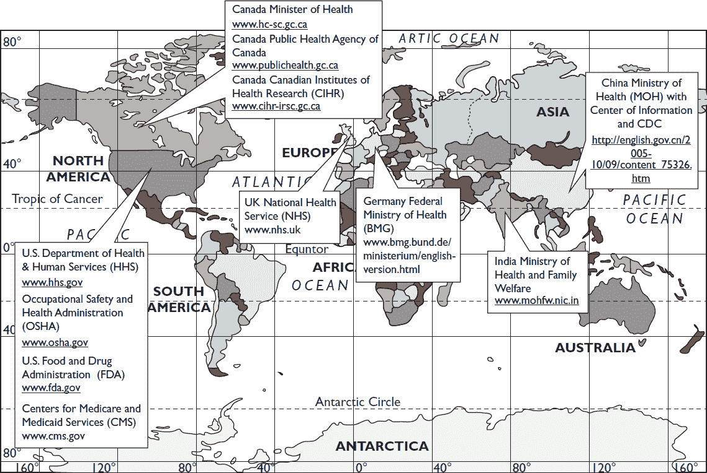

**图 2-1** 与医疗保健相关的部分政府监管机构

### 州和地方政府

您作为第三方与政府的互动最有可能发生在地方层面。俗话说，政治和医疗保健都是地方性的。这意味着国家层面发生的许多决策和事件，对您如何开展工作的直接影响，远不如地方政府的决策大。例如，许多地方政府必须根据一项称为*需求证明*的条款，批准新设施的建设或新服务的提供。在美国，截至 2011 年，仍有 36 个州要求采取这一措施以控制资本支出，理论上控制医疗成本。^(9) 其成效有待商榷。然而，对于一家有意开设心胸外科病房以增加收入的医疗保健组织来说，未能获得需求证明可能是一个巨大的挫折。在未获得地方政府批准的情况下建设设施或提供服务，可能导致罚款和处罚，或者至少导致服务无法获得报销。

地方政府也会对医疗保健组织产生积极影响。一种方式是合作开展社区健康需求评估等工作。这有助于地方政府卫生机构和医疗保健组织共同制定为社区各类人群提供医疗保健的战略计划。地方政府可以分配公共资源的支出方向。医疗保健组织可以根据社区需求规划预防、干预和康复服务。可能的类别几乎是无限的，但最常见的包括以下内容：

- 危险青少年援助计划
- 社区哮喘预防计划
- 无家可归者健康计划
- 损伤预防计划
- 中毒控制中心
- 健康博览会

### 执法部门

既然您从事信息保护工作，地方政府将产生直接影响的另一个领域是执法。尽管每部隐私和安全法律都有关于执法部门访问患者信息的规定，但这并非不受限制的访问。您的角色可能是根据组织政策、法律本身和知情需求，向执法人员提供他们所需的信息。例如，在这种情况下披露信息通常必须是对执法官员书面请求的回应。面对站在您办公桌前要求查阅昨晚通过急诊室的患者记录的警察，拒绝可能很困难。但您可能必须就这样做。

---

> **提示** 医疗保健信息保护既取决于了解您组织的事件报告流程，也取决于了解管辖患者信息披露的各种法律。作为医疗保健信息隐私和安全专业人员，您能做的最重要的事情就是了解您组织的数据事件报告政策。如果执法官员要求披露超出您组织政策范围（该政策遵守管辖法律）的患者信息，您还必须知道将该请求上报给谁，以及需要采取哪些记录在案的行动。

### 侵权法与医疗事故

在美国，政府作为第三方，通过司法程序，也通过侵权法和医疗事故在医疗保健中发挥直接作用。这些是复杂的概念，值得比本章篇幅所允许的更多关注。然而，了解这些术语及其如何增加高度监管的医疗保健行业的复杂性，将有助于您更多地理解第三方如何影响医疗保健的提供。首先，*侵权法*由民事（而非刑事）行为组成，为患者提供针对针对其实施的不法行为的救济。医疗保健行业中存在侵权诉讼，原因如下：

- 疏忽
- 故意侵权
- 精神痛苦

对于信息隐私和安全专业人员来说，故意侵权值得注意。侵犯隐私就属于这一范畴。虽然数据泄露可能由疏忽引起，并肯定可能造成精神痛苦，但与未能确保患者信息保密性相关的侵权法，涉及故意行为的成分。

这引出了医疗事故。*医疗事故*是医疗专业人员熟悉的一种特殊侵权法。医疗事故诉讼基于医疗服务提供者的疏忽或不当注意。根据犯罪性质，指控可以是民事或刑事的。通常，问题不涉及信息安全，也不会牵涉医疗保健信息隐私和安全专业人员。然而，根据法律，医疗事故实际上被定义为专业人员在履行职责时的不当或不道德行为，无论是故意还是因疏忽或无知所致。^(10) 在不远的将来，负责保护患者信息的个人可能需要更多地了解医疗事故概念。

### 非政府监管机构

当说医疗保健是受监管最严格的行业之一时，这意味着的不仅仅是官方的政府监管。有几个重要的非政府监管第三方实例，它们塑造着世界各地的医疗保健组织。专注于提高患者护理的安全性和有效性，是所有认证组织共有的主要组成部分之一。通过同行评审和教育，认证已被证明能有效地通过这种第三方关系来塑造医疗保健组织。

---

 **注意** 在此背景下，认证用于描述一个自愿过程，其调查结果对医疗保健组织不具法律约束力。这与政府机构或监管机构所进行的工作形成对比，例如审计或正式检查，其调查结果必须得到缓解或补救。不合规将导致罚款和处罚。

## 联合委员会

从可以说是最著名的一个开始，联合委员会（前身为医疗保健组织认证联合委员会，再之前为医院认证联合委员会）是一个位于美国的独立非营利组织。约 100 年来，它一直根据实践标准对医疗保健组织进行认证和评审，在过去 25 年里，联合委员会也一直在拓展其国际影响力。目前，它为美国 20,000 多家医疗保健组织和项目提供这项服务。联合委员会认证被视为证明医疗保健组织对质量的承诺和遵守绩效标准的必要条件。事实上，在美国，一些报销条件与持有有效的联合委员会认证挂钩。

## 门诊医疗保健认证协会

随着人们认识到从住院服务向门诊或走诊护理环境的转变，美国另一个非政府第三方开始关注医生集团、门诊诊所和任何其他走诊患者护理中心的质量和安全问题。门诊医疗保健认证协会（AAAHC）制定有关患者安全、质量、价值和绩效衡量的标准。由于其专注于门诊医疗保健，通过装备更好的基于同行的认证流程，调查可以更高效、更有意义。

## 加拿大认证机构

在加拿大，一个名为加拿大认证机构的类似组织，前身为加拿大卫生服务认证委员会（CCHSA），为超过 1,000 家客户组织提供认证，包括区域卫生局、医院以及社区项目和服务。与美国的联合委员会和 AAAHC 一样，其调查员和审计员不是政府雇员，也不接受政府指令。联合委员会和加拿大认证机构都使用经验丰富的专业人士，包括医生、护士、卫生行政主管和管理人员，以及相关卫生专业的医疗技术人员。

## 欧盟

欧盟内部对医疗保健组织认证的价值存在争议。因为医疗保健完全由政府资助，外部第三方同行认证并未得到统一的重视或尊重。许多人认为，工作重点应放在通过政府检查和审计来验证的强制性合规上。尽管如此，在过去 30 年里，在欧洲从事认证工作的第三方组织迅速增长。为了开始客观地审视这些问题，世界卫生组织（WHO）于 2000 年进行了首批国际研究之一。这项及后续研究更多地关注认证对医疗保健组织的患者护理、安全和质量改进工作影响的证据。目前，欧洲有 18 个活跃的国家级组织。趋势是项目更多、参与的医疗保健组织更多、对医疗保健组织的调查更多。表 2-2 列出了活跃的认证机构及其代表的成员国。您可能会注意到，联合委员会国际部尤其在西班牙和整个欧洲开展业务。事实上，它是美国联合委员会的一部分。

**表 2-2** 2009 年 4 月欧洲活跃的认证组织

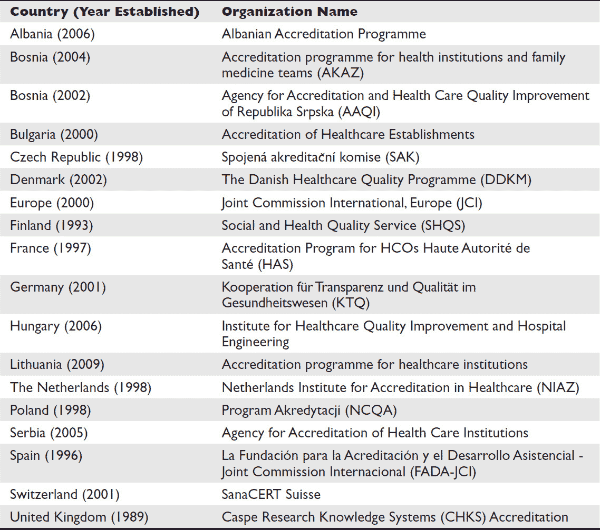

## 公共卫生报告

有时医疗保健组织会收集公共卫生官员合法需要的患者信息。这些是非供应商的第三方，但极有可能是政府机构。在美国，《HIPAA 隐私规则》规定，医疗保健组织可以为了公共卫生利益，合法地向公共卫生和安全机构披露受保护的健康信息。^(11) 美国关于公共卫生报告的规定可能很复杂，且因司法管辖区而异。一般来说，公共卫生要求披露信息，以识别对整个社区和个人健康与安全的威胁。除了出生或死亡报告外，公共卫生报告可能包括以下内容：

- 虐待或忽视儿童
- 受 FDA 监管的产品或活动的质量、安全性或有效性
- 面临感染或传播疾病风险的人群
- 当应雇主要求或作为雇主员工一员提供医疗保健时的工作场所医学监测

欧盟（EU）也有类似的公共卫生报告规定，根据欧盟指令 95/46/EC，允许数据控制者“在公共利益重要理由证明正当的领域（如公共卫生和社会保护）中，豁免处理敏感数据类别的禁令。”^(12) 我们发现，公共卫生报告的豁免几乎是信息保护指南中普遍存在的例外。

尽管医疗保健组织通常被允许（或被要求）为公共卫生报告目的披露患者信息，但信息应仅限于所需内容。在美国，HIPAA 将其定义为最小必要使用。即，医疗保健组织必须采取合理预防措施，仅披露完成公共卫生目的所必需的最少量受保护健康信息。

---

 **注意** 根据 HIPAA，公共卫生机构不是直接受 HIPAA 约束的组织。然而，某些活动受相同的隐私和安全规则约束。事实上，医疗保健组织在根据 HIPAA 允许的例外情况披露患者信息时非常谨慎。在许多情况下，他们出于极度谨慎，采取同等的保护措施。^(13)

## 临床研究

在临床研究中使用患者信息通常是有益的。与公共卫生报告不同，研究人员试图在获得患者同意将信息用于该特定目的后，再进行临床研究。这并不总是可行的。在获得同意不切实际或不可能的情况下，美国的研究人员可以利用内部机构审查委员会（IRB）或隐私委员会，以豁免任何所需的患者同意。IRB 或隐私委员会将拥有书面协议和控制措施，以保护受保护的健康信息。这包含这样的保证：患者信息的使用或披露仅会给个人隐私增加最低限度的风险。委员会将要求研究人员证明以下几点：

# 临床研究数据保护要求

## 所需计划和声明

- 包含保护受保护健康信息的替代措施的计划
- 在不再需要患者信息时销毁该信息的计划（包括为研究或法律原因保留信息的任何真实需求）
- 禁止重复使用或披露患者信息的书面声明，除非法律或 IRB（机构审查委员会）或隐私委员会允许
- 无豁免不得进行研究
- 无法访问和使用患者信息不得进行研究

---

# 临床研究数据处理步骤

对于临床研究，了解从数据中移除患者信息或至少将其限制在所需最小量的几种替代步骤非常重要。您甚至可以在正式临床研究环境之外使用这些概念，仅就存储和传输数据而不进行未经授权的披露而言。

## 患者信息去标识化

这包括从数据集中移除任何可单独识别身份的信息，以便您可以合理地确定没有人能够根据剩余信息识别某人。有两种方法可以做到这一点。第一种方法是使用受过训练的人员，通过算法和对可识别数据标准类别的更改，使信息匿名化。第二种方法是直接完全移除这些相同的可识别数据类别。以下是可能属于单独可识别信息的数据来源（来自 `NIST 800-122`[¹⁴]）：

- 姓名，如全名、婚前姓名、母亲婚前姓名或别名
- 个人识别号码，如 `SSN`（社会安全号）、护照号、驾照号、纳税人识别号、患者识别号、金融账户或信用卡号
- 地址信息，如街道地址或电子邮件地址
- 资产信息，如 `IP` 或 `MAC` 地址，或其他特定于主机的持久静态标识符，能持续关联到特定个人或规模较小、定义明确的人群
- 电话号码，包括手机、办公和个人号码
- 个人特征，包括照片图像（尤其是面部或其他显著特征）、X 光片、指纹或其他生物特征图像或模板数据（例如视网膜扫描、声纹和面部几何结构）
- 识别个人拥有财产的信息，如车辆登记号或所有权证号及相关信息
- 与上述任一项关联或可关联的个人信息（例如出生日期、出生地、种族、宗教、体重、活动、地理指标、就业信息、医疗信息、教育信息和财务信息）

---

 **注意** 在数据匿名化时，可能会出现一种情况：被视为离群值的结果过于独特，以至于实际上可用于识别个人。示例：取当地高中一个规模较小的 12 年级班级（150 名学生）作为样本量。对 `NIST 800-122`、`Sec 2.2` 中发现的 18 个单独标识符中数据集内存在的那些进行匿名化处理。然后您可能会留下身高、体重、眼睛颜色、头发颜色和接种疫苗情况等数据元素。最有可能的是，拥有红发和蓝眼睛的那些人仅凭这些聚合（尽管已匿名化）数据元素就足以被唯一识别。这些元素仍需要机密性保护。

## 有限数据集

这规定了可以排除部分患者信息，剩余部分为所需的最少数量和类型的标识符（如果有）。您通常会为使用有限数据集建立数据使用协议，该协议也将确定谁有知情需求以及出于何种目的。

## 披露核算

研究人员必须保存并能够提供在研究期间向研究组织外部（例如进行类似试验的另一个研究组织）披露的所有信息记录，包括披露了什么信息、由谁披露以及向谁披露。

---

 **提示** 根据 `HIPAA`，为临床研究目的授权增加患者信息的披露。当信息用于临床研究时，`HIPAA` 要求的控制措施可能不存在。请注意临床研究对任何数据使用场景的影响。

---

 **注意** 在美国以外的国家，其他类型的数据可能被视为唯一标识或受保护数据，例如工会会员身份。

# 合同研究组织（CRO）

值得注意的由第三方进行的临床研究是通过合同研究组织（`CRO`）进行的。该组织为进行专业生物制药开发、临床前研究、临床试验管理和药物安全性研究的医疗保健组织提供支持。在大多数情况下，这些高级研究类型由领先的制药、生物技术和医疗器械行业完成。`CRO` 还支持学术医学中心、政府和国际组织。与 `CRO` 合作的能力允许开发和评估各种安全性和有效性试验，但医疗保健组织不需要安排内部员工专门从事研究。对于医疗器械，`CRO` 收集临床数据以支持上市前监管提交、推动产品采用、支持产品报销或监测上市后产品使用。与医疗保健组织自行执行相同流程相比，它们以更具成本效益的方式带来专业知识和精简流程。

# 健康记录管理

最后，您将遇到作为医生办公室、小型健康诊所和其他一些医疗服务提供商业务合作伙伴的健康记录管理组织。因为它们存储和管理患者信息以及有价值的业务相关数据，所以引入了医疗服务提供商仍必须缓解的信息风险。您会多次听到这一点：您无法将保护信息的责任外包。

健康记录管理组织通常会为医疗服务提供商处理指定记录集。这可能是因为提供商没有足够的空间或专业知识。在电子信息的情况下，提供商可能无法投资硬件或软件（如数据中心）来管理信息。此外，医疗保健组织可能无法采用足够的隐私和安全方法来保持合规，或无法妥善管理从收集到处置的信息。出于上述任何或所有原因，外包给第三方更具成本效益。

指定记录集不仅仅是法律医疗记录（前文已讨论）。它被定义为全部或部分用于做出治疗、付款和运营决策的各种类型的患者医疗和账单记录。记录由纸质记录、胶片图像、电子数据以及用于存储医疗数据的任何其他介质组成。您可以这样理解法律健康记录与指定记录集的区别：直接患者护理记录在法律医疗记录中。指定记录集包含这些信息，加上所有与患者护理无关（但重要）的业务信息。

[¹⁴]: 美国国家标准与技术研究院（NIST）特别出版物 800-122

最终分析表明，如果医疗机构要与健康记录管理第三方合作，至少会建立数据使用协议，以规定使用和披露规则。在美国，还需要商业伙伴协议。

### 管理第三方

因此，鉴于塑造医疗机构的所有这些外部力量和第三方关系，管理它们是降低信息风险（未经授权的披露）的基本要素。我们已经讨论了商业伙伴协议，这是美国特有的。这是一种有助于降低信息风险的正式（书面）工具。在美国和国际上还有其他您应该了解的协议和文件。所有这些都是预先协商好的，并定义了保护患者信息机密性、完整性或可用性所必需的共同理解。值得注意的有服务级别协议、数据共享协议和法律合同。

> **注意**  医疗服务提供者与第三方之间的正式协议可以涵盖除保护信息之外的许多类型的产品和服务。例如，医疗机构可以与运输公司签订协议，为移动家具、设备甚至患者提供支持。也有协议涵盖来自就业机构的临时人员配置水平。就本书而言，我们将这类书面协议的内容限制在信息保护方面。

### 服务级别协议

服务级别协议几乎是不言自明的。它是一份具有约束力的文件，概述了第三方承诺提供的支持或产品，以及医疗机构可据此衡量履行情况的相关指标。其中一项支持项目及其衡量标准是网络正常运行时间。如果第三方同意以双方认可的频率保持网络“在线”或连接并运行，那么这将成为医疗机构的期望。衡量标准可以是频率，假设为全天候 24 小时、每周 7 天的 99.999%。未能达到该标准可能会给医疗机构带来问题。基于这一现实，服务级别协议还包含出现问题时的补救措施——投诉升级、财务罚款、终止协议等。

### 数据共享协议

数据共享协议（或数据使用协议）是一份类似的具有约束力的文件，用于描述第三方访问和使用医疗机构患者信息的权限及期望。它将明确规定并限制数据共享发生的时间段、第三方将访问的系统，以及数据将如何被使用（和处置）。数据共享协议可以涵盖额外的参数。在任何情况下，协议的主要要素都是通过明确规定信息将如何披露或不披露来保护医疗机构。这样做很重要，因为最终医疗机构仍负责保护信息安全。在数据共享协议中，必须确保第三方有真实且合法的知情需求。

### 法律合同

最后，您将使用的三种管理工具中最正式、约束力最强的是法律合同。在许多方面，服务级别协议和数据共享协议可以演变为正式合同。一般来说，合同有四个主要要素，如下：

- 协议必须在两个或多方之间达成。
- 所有当事人必须具备同意能力。
- 协议必须涉及有价值的事物。
- 协议必须合法。

服务级别协议和数据共享协议与法律合同的区别在于复杂性和内容。服务级别协议和数据共享协议往往更专注于特定的服务或产品。条款和条件与衡量标准和质量或特定行为和任务相关。然而，所有这些文件都是用来设定明确期望、避免昂贵的法律诉讼，并提供患者信息的安全处理。正式合同将包含关于责任、资源、假设以及合同期限内责任限制的更多细节。总之，服务级别协议和数据共享协议通常作为与第三方签订的正式长期合同的附件（第三方可能提供多种服务）。

### 章节回顾

无论您已经在医疗行业工作，还是刚进入医疗行业提供信息保护服务，如果您了解本章的重要要点，将使您的工作更轻松。医疗队伍多种多样，从体力劳动行业到受过高等教育的专业人士。所有这些人必须共同努力，塑造患者护理交付的成功。事实上，组织可能比组织架构图上画出的权力线更依赖这些联系。您必须理解的另一个重点是，外部业务合作伙伴或第三方与医疗机构具有影响深远的关系。由于医疗机构对大多数社区的重要性，第三方可能高度依赖医疗机构的业务。就业和当地经济可能依赖于这种合作关系。在医疗机构依赖第三方的情况下，特别是正确处理患者信息时，这种关系可能会给各组织带来必须解决的风险。

### 复习题

1.  （判断题）因为她或他需要独立执业，独立职责护士需要最高水平的正规教育。

2.  骨科专家为哪类患者提供护理？

    **A.** 口腔疾病  
    **B.** 手足口病  
    **C.** 儿童发育  
    **D.** 关节问题

3.  最有可能操作磁共振成像（MRI）设备的是：

    **A.** 麻醉护士  
    **B.** 医师专家  
    **C.** 医疗技师  
    **D.** 护理助理

4.  为了通过高效的床位管理增加收入，以下哪个职业类别起最大作用？

    **A.** C-suite 高管  
    **B.** 医疗技师  
    **C.** 护理人员  
    **D.** 环境服务

5.  以下哪个词最能描述医疗机构的供应商？

    **A.** 第三方  
    **B.** 医疗专用  
    **C.** 供应公司  
    **D.** 认证服务

6.  \_\_\_\_\_\_\_\_\_\_\_\_\_\_\_\_\_\_ 是医疗机构的第三方供应商，为质量和患者安全标准提供认证。

7.  描述第三方访问和使用患者信息的权限及期望的正式书面协议是 \_\_\_\_\_\_\_\_\_\_\_\_\_\_\_\_\_\_ 协议。

8.  （判断题）在特定条件下，包含患者信息的工作场所医疗监测可因临床研究规定而在未经个人事先同意的情况下披露。

9.  进行临床研究时，以下哪项可确保研究提出的计划包含替代措施以保护受保护的健康信息？

## 问题

**1.** 如果要求你对昨天的患者预约列表进行去标识化处理，该列表包含病历号（MRN）、患者姓名和预约时间，以下哪种做法最为恰当？

- **A.** 删除所有 MRN 并将患者姓名更改为 "PATIENT"。
- **B.** 将姓名更改为历史人物姓名并删除预约时间。
- **C.** 将每个 MRN 增加 15 并仅使用患者的姓氏。
- **D.** 仅使用患者姓名和预约时间。

## 答案

**1.** **错误。** 在这几类护士中，注册护士在获得执照前需要长达四年的培训和教育。在大多数情况下，注册护士作为其学业培训的一部分会获得学士学位。作为备选答案的其他类型护士中，只有执业护士需要特定水平的正规教育，他们通过两年的课程获得副学士学位，或从同等水平的医院执业护士项目毕业。护理助理或独立执业护士可能拥有也可能不拥有高中文凭或更高学历。此外，独立执业护士可以是在医院外为家庭健康患者提供护理服务的执业护士或注册护士。

**2.** **D。** 骨科医生是专门负责关节、骨骼、肌肉和软骨（主要是膝盖、脚踝和髋关节）患者护理的专家。牙齿矫正医生更适合处理口腔疾病，而手足口病可能需要流行病学家甚至兽医介入。主要专注于儿童发育的专家是儿科医生。

**3.** **C。** 虽然放射科医生等医师专家有可能操作 MRI，但更可能的情况是由合格的 MRI 医疗技师进行操作，解读结果以查找明显错误，并为医师、护士从业者或医师助理处理影像。麻醉护士不会操作 MRI 控制台（除非需要对患者进行镇静）。护理助理可能在检查室协助移动患者或至少在操作前安抚患者，但不负责操作医疗设备。

**4.** **D。** 后勤服务包括管家部和维修部。为确保病房和床位清洁、准备好迎接新患者，并尽快传达所有信息，后勤服务人员是关键群体。患者出院到入院之间的时间间隔是衡量收入增长的绝佳指标，如果能压缩该时间。高层管理人员将在监督收入指标、制定政策和做出相关资源决策方面发挥作用。护理人员当然对管理患者至关重要，其职责延伸至入院和出院之外，但病房的实际周转速度实际上取决于后勤服务人员工作的快慢。医疗技师可能在某些床位管理流程中发挥较小作用，特别是在组织使用具有信息技术和网络功能的床位时。

**5.** **A.** 医疗机构的供应商是指销售、供应或提供服务或产品的个人或实体。供应商必须是第三方，因为他们外部于医疗机构。然而，他们不必专门从事医疗业务。他们可能只与医疗机构开展业务。他们不需要成为纯粹的医疗供应商。一些供应商是供应公司，因此提供产品，但他们也可以是服务提供商或人员增补服务商。最后，虽然认证是某些供应商提供的服务，但这仅描述了所有供应商的一个子集。涵盖所有供应商的最佳答案是他们是第三方。

**6.** **联合委员会。** 因为医疗机构自愿接受联合委员会的审查，且联合委员会不是美国政府或任何其他政府的代理机构，因此其审查属于认证。检查将是正式且由政府主导的，如 OSHA 检查。资质认证是针对医疗卫生人员（如医师和专家）进行的。护士和其他几类相关健康专业人员将通过考试，从有资格颁发执照的教育机构获得执照。

**7.** **数据共享。** 根据定义，数据共享协议是一份正式的书面协议，描述了第三方访问和使用患者信息的期望。

**8.** **错误。** 临床研究会关注某些类型的监测，但根据定义，在此场景下公共卫生报告是允许的，因为医疗服务是应雇主要求或作为雇主员工的一部分而提供的。

**9.** **B。** 机构审查委员会（IRB）的存在是为了提供这种级别的监督，因为可能需要进行包含患者信息的、造福社区的研究。在这些情况下，可能无法获得患者同意。与其禁止研究，不如由 IRB 提供监督。董事会不太可能参与医疗机构临床研究层面的事务。医学委员会认证与此场景无关，但与员工胜任力相关。社区倡导委员会可能会介入研究活动，特别是在患者隐私受到侵犯时，但在该场景下，此类实体不会监督临床研究。

**10.** **A.** 去标识化患者信息只有两种可接受的方法。一种是创建一种统计学上有效的方法，使专家判定无人能识别患者身份。选项 C 接近这种方法，但仅将号码增加 15 很容易被破解。MRN 和姓氏很容易被用于重新识别。选项 B 和 D 会保留 MRN，这显然会为特定个人提供身份识别。只有选项 A 通过使信息无法用于识别个人来去标识化患者信息——但仍允许对数据进行有用的分析。

## 参考文献

1. 美国劳工部劳工统计局。访问日期：2013 年 12 月 2 日，<http://www.bls.gov/ooh/healthcare/>
2. 美国劳工部劳工统计局，《职业展望手册》，2012–13 版，注册护士。访问日期：2013 年 12 月 13 日，<http://www.bls.gov/ooh/healthcare/registered-nurses.htm>
3. Lilienfeld, David E., and Dona Schneider. Public health: the development of a discipline. Volume 1, From the age of Hippocrates to the progressive era. Rutgers University Press, 2008. p. 5.
4. Stein, L. I. The Doctor-Nurse Game. *Arch Gen Psychiatry*. 1967;16(6):699–703. p. 1.

## 参考文献

**5.** The Joint Commission. Sentinel Event Alert. Safely implementing health information and converging technologies. Issue 42. December 11, 2008. Accessed on December 2, 2013, at [www.jointcommission.org/assets/1/18/SEA_42.pdf](http://www.jointcommission.org/assets/1/18/SEA_42.pdf)

**6.** “Managing data security and privacy risk of third-party vendors,” Grant Thornton Corporate Governor, Volume 2, Fall 2011. Accessed on November 30, 2013, at [www.grantthornton.com/issues/library/articles/technology/2012/TIP-2012-managing-data-security-and-privacy-of-third-party-vendors.aspx](http://www.grantthornton.com/issues/library/articles/technology/2012/TIP-2012-managing-data-security-and-privacy-of-third-party-vendors.aspx)

**7.** Henry Ford Health System. “About Henry Ford Health System.” Accessed on December 3, 2013, at [www.henryford.com/body.cfm?id=48187](http://www.henryford.com/body.cfm?id=48187)

**8.** Department of Health and Human Services, Health Insurance Reform: Security Standards; Final Rule (HIPAA Security Rule), 45 C.F.R. Parts 160, 162, and 164 (2003).

**9.** National Conference of State Legislatures. “Certificate of Need: State Health Laws and Programs.” March 2012. Accessed on November 29, 2013, at [www.ncsl.org/research/health/con-certificate-of-need-state-laws.aspx](http://www.ncsl.org/research/health/con-certificate-of-need-state-laws.aspx)

**10.** Bell Buchbinder, Sharon, and Nancy H. Shanks. *Introduction to healthcare management*. 2nd ed. Jones & Bartlett Learning, 2012. p. 212.

**11.** Department of Health and Human Services, HIPAA (Privacy Rule) 45 C.F.R. 164.512(b). (2003).

**12.** Directive 95/46/EC of the European Parliament and of the Council. Data Protection Directive. (34). October 1995. Accessed on November 20, 2013, at [`eur-lex.europa.eu/LexUriServ/LexUriServ.do?uri=CELEX:31995L0046:en:HTML`](http://eur-lex.europa.eu/LexUriServ/LexUriServ.do?uri=CELEX:31995L0046:en:HTML)

**13.** Overhage, J. Marc, Kathleen McCormick (editor), and Brian Gugerty (editor). “The Role of Healthcare IT in Improving Population Health.” *Healthcare Information Technology Exam Guide for CompTIA Healthcare IT Technicians and HIT Pro Certifications*. McGraw-Hill, 2013. pp. 158–159.

**14.** National Institute of Standards and Technology (NIST) Special Publication 800-122. Guide to Protecting the Confidentiality of Personally Identifiable Information (PII). April 2010. p. 2–2.

## 第 3 章：医疗信息法规

---

在本章中，您将学会：

- 识别医疗信息保护中的独特法律问题
- 确定管辖医疗信息隐私和安全的适用法规
- 理解法规与内部组织指导之间的关系
- 重视用于管理内部组织政策的治理框架
- 了解隐私和安全的国际监管控制
- 回顾与信息共享相关的跨国和跨司法管辖区问题

---

将适当的隐私和安全控制应用于医疗信息的重要性，或许最能通过塑造我们所有工作的监管环境的层级和严重性来体现。我们的努力是深思熟虑的，并直接与众多标准相关联。从最本地化的政策和程序到全球实践，我们的工作绝非听之任之。我们理解这一监管环境的起点，是从实用角度介绍治理流程。本章重点关注标准如何应用于您的组织，以及它们如何与国家和国际标准相吻合。

## 适用法规

了解一些管辖医疗行业的适用法规非常重要。从实用角度来看，您最可能需要了解管辖您组织的本地政策和程序。然而，了解塑造这些本地政策和程序的国家和国际法律将大有裨益。在美国，州和地方法规可能比国家法规更为重要。例如，马萨诸塞州拥有适用于向马萨诸塞州居民提供医疗服务的隐私法。以下是您需要了解的相关高层法规概览。

### 法律问题

医疗行业受到严格监管。在美国，它受到地方、州和联邦三级法规的监管，这些规则通常专门针对医疗行业。例如，您熟悉**《健康保险流通与责任法案》（HIPAA）**及其修正案——**隐私规则**、**安全规则**、**《健康信息技术经济与临床健康法案》（HITECH 法案）**，以及最近的**《HIPAA 综合最终规则》**。还有许多各州单独的医疗隐私法。然而，医疗行业还必须遵守适用于其他行业的法规，例如**《格雷姆-里奇-比利雷法案》（GLBA）**和由**联邦贸易委员会（FTC）**标准管辖的**红旗规则**。

在国际上，医疗行业的大部分监管见于跨越所有行业的隐私和安全指令中。其中一些对医疗行业有特别提及和指导。总体而言，国际社会视保护个人身份信息为一项人权。因此，每个行业都被要求遵守高标准但统一的标准。例如有**欧盟的《数据保护指令》（DPD）**、**加拿大的《个人信息保护和电子文件法案》（PIPEDA）**，以及**澳大利亚的《2000 年隐私修正案（私营部门）》**。在以下章节中，我们将讨论法律问题与医疗组织工作相关的一些最重要领域。

### 医疗设备和关键基础设施问题

除了普通的办公自动化计算机和局域网设备外，医疗组织通常还运行特殊用途的计算设备和医疗设备。这些计算机和设备通常拥有与其办公自动化对应产品相同的操作系统和软件应用程序，但其特殊用途不同。根据**美国食品药品监督管理局（FDA）**的定义，医疗设备是指“用于诊断疾病或其他状况，或用于治愈、缓解、治疗或预防人类或其他动物疾病的器械、仪器、工具、机器、装置、植入体、体外试剂或其他类似或相关物品，包括组成部分或附件”。^(1) 简而言之，医疗设备是临床护理提供者的延伸，且是患者护理不可或缺的一部分。从信息隐私和安全的角度来看，管理它们具有法律意义。

一方面，更新漏洞补丁和应用任何非制造商配置的额外软件等操作，可能会导致保修失效或设备故障。最重要的是，即使这些更新被视为最佳安全实践，它们也可能直接导致患者伤害。另一方面，美国 FDA 已警告制造商和医疗提供者，他们有责任保持医疗设备的安全（包括隐私和安全考量）。这在巨大的政府监管下造成了一种不安的平衡。

## 国际医疗器械安全关注

关于医疗器械安全的国际关注，虽然 FDA 没有管辖权，但确实有影响力。对患者安全的同等关注是国际监管关注点。在国际上开展业务的医疗器械制造商，其需求基于国际标准化组织（ISO）的系统安全框架。他们还通过 FDA 向国际客户提供在美国获准使用的相同医疗器械。这样，FDA 就拥有了间接的全球影响力。

医疗器械制造商也进行自我监管。一个例子是医疗器械安全制造商披露声明（MDS）表格的使用日益增多。^(2) 制造商填写此表格并提供给客户，以记录设备具有的重要安全特性。由于该表格是由医疗信息与管理系统学会（HIMSS）和领先的临床工程协会合作开发的，其内容反映了 FDA 对医疗器械安全的关注。其效果是确保基线安全措施，以便医疗器械能够安全联网。当然，联网医疗器械可能引入的漏洞必须得到解决和缓解；这只是发生的方式有时与常规办公自动化不同。

在关键基础设施方面，医疗机构当然有责任根据标准管理网络，例如 NIST SP 800-34 Rev 1《联邦信息系统应急计划指南》，其中包含灾难恢复、备份操作和业务连续性的标准。医疗机构与其他拥有被视为关键基础设施网络的行业有很多共同点（如美国奥巴马总统 2013 年 2 月 12 日签署的行政命令《改善关键基础设施网络安全》所述）。在网络中断的影响方面，医疗关键基础设施与其他示例有所区别。除了潜在的收入损失和恢复成本外，非计划网络中断期间直接患者护理可能面临风险。首先，如果患者受到伤害，这可能使医疗机构面临医疗事故索赔。由网络安全原因导致的医疗信息技术中断正成为头条新闻。在其他信息安全领域被视为“漏洞”的问题，在医疗环境中是“一种破坏性的、潜在危险的、危及生命的关键企业医疗设备重大故障”。^(2) 随着我们变得更加数字化，且越来越难以恢复到手动流程，患者受到伤害的可能性增加。其次，如果非计划中断导致相关医疗认证机构定义的不良事件（例如美国和国际上的联合委员会），则必须向其报告。

## 信息问责制

信息隐私和安全法律关注创建、使用和处置医疗信息者的角色和责任。美国的 HIPAA 于 1996 年颁布，*并非*仅为了涵盖隐私和安全问题，但开始巩固医疗信息使用的问责制。HITECH 更加集中于此类问题。明确来说，健康信息不存在真正的“所有权”。然而，患者确实拥有访问其健康信息并了解其健康信息披露情况的法律个人权利。患者有权充分知晓其受保护健康信息如何被使用和披露。如果他们希望限制信息共享，可以提出请求。医疗服务提供者不必满足每个请求，但必须评估并回应每个请求。患者还有权检查和审查信息、修正错误信息，并获得医疗服务提供者持有的关于自己的健康信息副本。反过来，医疗服务提供者有权出于治疗、支付和运营等既定理由使用患者信息，而无需额外的患者同意。

---

 **TIP**   多年来 HIPAA 经历了多次修正，但“HIPAA”一词通常指代所有修正。换句话说，引用 HIPAA 关于患者数据泄露通知的要求是可以接受的，即使该要求是通过 2009 年的 HITECH 规则修正实施的。在此之前，HIPAA 仅要求承保实体在减轻数据丢失时通知患者。^(3)

在英国和欧盟，信息问责制的参数与美国类似。在欧盟数据保护指令（EU DPD）中，问责制源于信息保管链中那些人或*行为主体*的角色和责任。没有人拥有信息，但 EU DPD 为信息流程中的行为主体分配了类似于 HIPAA 的角色。表 3-1 定义了这些行为主体。

**表 3-1** EU DPD 中的信息问责制定义

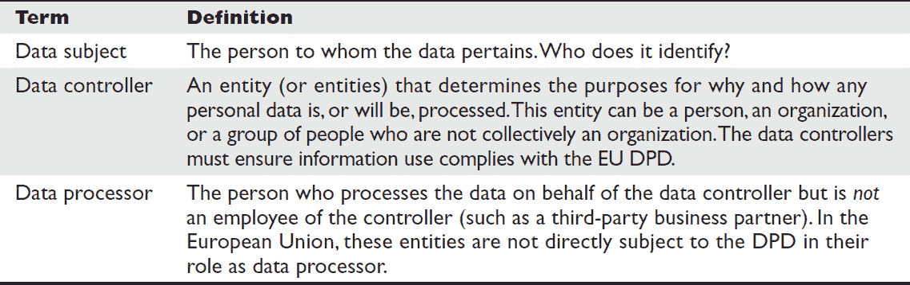

## 云计算

跨多个行业，云计算概念正获得认可和动力。云计算是通过互联网从远程位置（消费者组织外部）向消费者提供的软件、平台和基础设施即服务的集合。云服务提供商在其场所托管所有设备，并负责电力和可用性。消费者只需登录并使用资源。云服务由多家供应商提供，其中最熟悉的可能是 Google、Amazon 和 Microsoft Azure。云计算给医疗行业带来了独特风险。这些风险因许多云计算供应商不熟悉医疗的特殊要求而放大。其中一个独特要求是所有医疗机构都必须对代表其处理受保护健康信息（PHI）的供应商进行第三方风险评估。由于其他行业可能没有这些评估或评估的法律要求，供应商可能不愿遵守这些要求，或不愿缓解任何发现的问题。

云计算的另一个担忧是 PHI 的位置。例如，托管在美国境外的 PHI 是一个潜在问题，因为云提供商不受 HIPAA 约束，或员工培训不足以保护 PHI。因此，许多医疗机构要求托管 PHI 的服务器必须位于美国境内。对于加拿大，PIPEDA 不禁止跨境数据传输，但越来越多的政府机构在其业务合同中要求这一限制。数据位置（即使不跨境）引发了对审计和电子取证要求的担忧。在许多云计算环境中，资源高度混合，支持取证和披露核算的审计和电子取证级别几乎不可能实现。云计算供应商可能能够满足这些隐私和安全规定。但当它们超出其他非医疗客户的需求时，成本增加，对医疗客户的价值可能下降。

---

> **注意** 2013 年 9 月 23 日《HIPAA 综合最终规则》生效后，支持医疗保健业务的云供应商被强制要求签署业务伙伴协议（BAA）。拥有多个客户（许多不在医疗保健领域）的大型供应商不愿意签署这些协议。公平地说，许多人认为这是在其原本严格的合规流程（如 FISMA、SASE 16 等）之外增加的一项多余要求。然而，根据美国卫生与公众服务部（HHS）信息隐私司民权办公室的 David Holtzman 表示：“如果您使用云服务，它应该是您的业务伙伴。如果他们拒绝签署业务伙伴协议，请勿使用该云服务。”随着 HIPAA 的更新，增加了强有力的澄清语言和像 Holtzman 这样的声明，对于拥有美国医疗保健客户的云计算供应商来说，签署 BAA 的要求实际上是不可商量的。

## 数据泄露法规

许多国家，包括欧盟，一直在考虑针对个人（即数据主体）的数据泄露通知的正式政府授权。这些努力仍在继续，实际上，特定组织已经向数据主体和数据控制者进行了一些通知。这些当然涵盖了所有处理个人信息的行业。

在美国，HIPAA 强制要求医疗保健行业调查潜在和实际的数据泄露，其标准可能超过其他行业对敏感个人信息的标准。例如，为了确定是否存在 PHI 数据泄露，美国政府已经确定了一个衡量阈值。标准在于信息是否存在泄露风险。在 2013 年 HIPAA 综合规则之前，风险阈值是对个人的伤害风险。重点显然已经转移。现在必须进行风险评估，以解决以下问题：^(4)

- **所涉及的受保护健康信息的性质和范围**，包括标识符的类型和重新识别的可能性
- **使用受保护健康信息或向其披露信息的未经授权的人员**
- **受保护健康信息是否实际上被获取或查看**
- **对受保护健康信息的风险已被减轻的程度**

评估这些条件后，除非受保护健康信息被泄露的概率很低，否则医疗保健组织必须报告泄露事件。如果泄露涉及超过 500 条个人记录且不存在低泄露概率，该组织必须向美国卫生与公众服务部（HHS）报告非安全 PHI 的丢失、被盗或其他特定不允许的使用或披露。此外，在这种情况下，如果泄露影响单一州的 500 名以上居民，该组织必须通知媒体。当然，在这种情况下，组织必须通知受影响的个人，但在大多数其他数据泄露中，医疗保健组织也会通知其患者。这种风险评估和正式的通知流程，不同于管辖信用卡信息或社会安全号码等数据泄露的隐私法。这些差异适用于同时应对 PHI 和财务信息数据泄露的美国医疗保健组织。

## 定义受保护健康信息

PHI 是敏感信息的一个单独分类，具有针对医疗保健组织的若干特定法律含义。PHI 建立在现有的个人身份信息（PII）定义之上。这被用于国际指导、美国隐私法和信息安全中。基本上，*个人身份信息*是指可单独使用或与其他信息结合使用，以识别、联系或定位单个自然人，或识别情境中个人的信息。在其他有隐私保护法律的国家，PII 通常称为*个人信息*。这之所以重要，是因为美国使用*PII*，并将定义植根于 NIST 特别出版物 800-122 中定义的 18 个识别要素，如下所列：

- **姓名**，如全名、婚前姓氏、母亲婚前姓氏或别名
- **个人识别号码**，如社会安全号码（SSN）、护照号码、驾驶执照号码、纳税人识别号码、患者识别号码、金融账户或信用卡号码
- **地址信息**，如街道地址或电子邮件地址
- **资产信息**，如互联网协议（IP）或媒体访问控制（MAC）地址，或其他始终链接到特定个人或一小群明确定义人员的主机特定持久静态标识符
- **电话号码**，包括手机、办公和个人号码
- **个人特征**，包括照片图像（特别是面部或其他显著特征）、X 光片、指纹或其他生物特征图像或模板数据（例如视网膜扫描、声纹、面部几何结构）
- **识别个人拥有财产的信息**，如车辆登记号码或所有权证号码及相关信息
- **与上述项目之一相关联或可关联的个人信息**（例如出生日期、出生地、种族、宗教、体重、活动、地理指标、就业信息、医疗信息、教育信息或财务信息）

根据经合组织（OECD）和澳大利亚 1988 年《隐私法》等，例如，个人信息还包括可以合理确定个人身份的信息，可能涵盖 PII 未涵盖的某些信息。在某些情况下，这可能是一个人的宗教、工会会员身份或政党。

重要的是要注意，并非所有 PII 数据示例都是自动成为 PII。有些，如社会安全号码，自动属于 PII，因为该号码在无需任何额外 PII 数据的情况下仅对应唯一的一个人。单独的一条数据（如家庭住址）可能无法识别一个人，特别是如果高层建筑的街道地址不包含公寓号码。无论如何，了解这些典型的 PII 数据要素的目的，有助于您了解自己的信息保护要求。

要定义 PHI，我们必须从 PII 的这个定义开始。PHI 的第二个组成部分是存在与 PII 相关的某种类型的健康信息。医疗保健信息可以涉及以下内容：

- **过去、现在或未来的身体或精神健康状况**
- **为个人提供医疗保健**
- **过去、现在或未来为个人提供医疗保健的付款**

PHI 的第三个也是最后一个组成部分是：与该个人健康信息相关的 PII，是否正在被受 HIPAA 法律约束的组织收集、使用、传输、存储或处置。正如您所知，HIPAA 定义了两类组织：覆盖实体和业务伙伴。图 3-1 展示了不同类型的覆盖实体和业务伙伴的易懂图解。

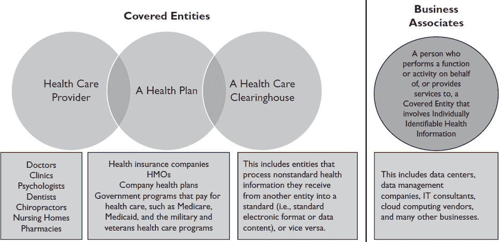

---

**图 3-1** 覆盖实体和业务伙伴

当 PII 与健康信息结合，且使用该信息的组织受 HIPAA 约束时，它就成为特殊的、受法律保护的信息。处理 PHI 需要您在其他行业找不到的信息隐私和安全政策及程序。

## 跨司法管辖区影响

# 跨境管辖权问题

对于那些拥有位于其他国家的第三方业务合作伙伴，或为全球患者提供护理的医疗保健组织工作的人员来说，可能需要考虑跨境管辖权问题。我们之前提到过一个：当使用在美利坚合众国境外设有物理服务器的云服务提供商传输或存储数据时，必须考虑管辖权问题。当然，这对加拿大和欧盟的服务提供商来说也可能是个问题。在这些情况下，您当然希望确保本地政策和程序明确规定了如何获得必要的同意和批准。当某一司法管辖区要求的控制比贵组织所在原籍国更严格时，贵组织将需要评估如何合规。欧盟与希望共享信息的外国组织之间如何解决这一过程的一个例子是《安全港协议》，本章后面将更详细地讨论。

《安全港协议》等协议和条约有助于弥合管辖权问题。随着美国云服务提供商承接欧盟业务合作伙伴，美国公司可能无法完全理解欧盟法律（如 DPD）的管辖范围。从美国隐私法的角度来看，欧盟对利用个人同意来允许数据处理（例如国际处理）施加了额外限制。2013 年，曾努力加强欧盟 DPD 在欧盟以外商业关系中的国际适用性。在某些情况下，美国云服务提供商需要调整其标准以满足欧盟组织的要求。当然，这不特定于医疗保健，但确实包括欧盟医疗保健组织。欧盟是美国最重要的双边贸易区。拥有一种允许这些商业安排并充分保护信息的方式具有深远意义。

另一个管辖权影响体现在各种违规通知规则中。设想一个国际组织获得合同，协助在美国开发一个医疗保健网站。如果该网站收集了医疗保健信息，并因未能维护适当的操作系统漏洞补丁管理而被黑客攻击，责任可能会转移给第三方业务合作伙伴。虽然实际通知个人的责任可能不在国际公司，但成本和罚款肯定在。这些相同的责任和成本可能不会在其本国被征收。

## 使政策和程序符合监管指导

本章简要介绍了适用于医疗保健组织的各种管理法规。本章将通过讨论如何利用这些法规根据相关法律法规制定和改进组织政策，来补充其他列出适用法规的章节。坦率地说，我们大多数人不会每天参考 HIPAA 或欧盟 DPD。您更有可能根据内部指导的要求，采取与信息共享和保护相关的行动。您必须能够确定贵组织需要哪些内部政策和程序。这些政策必须与管辖您行业的法律保持一致。最后，您必须能够将内部指导文件应用到日常工作中，同时能够清晰阐述采取适当行动的原因。

几乎所有法规中都包含的一项总体控制要求是：每个医疗保健组织都有法律义务制定自己的内部指南，以预防、发现、遏制和纠正信息保护违规行为。数据保护法要求医疗保健组织确保患者隐私得到保护。仅将国家（或国际）法律或管理指令作为内部指导是不够的。法规必须进行定制，以展示贵组织做什么以及如何做。您必须将法律应用于组织的运营，并根据组织中的各种职位分配职责。^(5) 例如，必须确定政策的负责人。该办公室将负责监控指导的有效性，并根据需要进行定期更新。高级官员（如首席信息官或首席隐私官）也可能被分配职责。也许这些个人会制定程序以投入资源，或在事情不按计划进行时实施纠正措施。

### 政策

*政策* 是关于组织如何开展业务和医疗保健运营的清晰、简单的陈述。政策处于高层，包含指导原则以辅助决策。政策可以是几段涵盖特定行动各种期望的文字。在大多数情况下，组织将 *指令*、*法规* 和 *计划* 与 *政策* 交替使用。无论名称如何，任何形式的政策都应具有以下可识别要素：

- **补充性** 政策往往是宽泛的陈述。正确实施通常需要澄清程序、表格和其他可供员工使用的指导类型。此外，与其重新发布政策，不如通过版本控制流程，用近期的改进或额外参数来补充政策，这通常更可行。例如，第一版政策作为版本 1 发布。根据政策审查频率（如每两年）对政策进行审查后，管理层决定增加首席信息安全官 (CISO) 的职责。与其完全重新发布政策，不如将有关 CISO 职位的相关信息作为补充或版本 2 添加进去。这也引入了所有政策共有的一个相关要素——它们必须注明日期。

- **可见性** 所有政策必须对组织公开。在许多情况下，这是通过网络门户或内部网实现的。但在任何情况下，以任何方式负责遵守政策的组织成员肯定需要能够访问它们。与政策相关的培训对于使其可见和传达也很重要。

- **管理层支持** 这几乎是不言而喻的，但政策必须得到管理层支持，否则将不会被遵守。更确切地说，管理层还必须通过公开行动来支持政策。他们不能规避或忽视政策，却指望医院员工遵守。

- **一致性** 除非医疗保健组织有某些独特之处，如地理位置或社区，否则任何政策的起源很可能是公共法律或政府指令。政策不应与这些法律冲突，或指导员工违反这些法律。也就是说，在制定政策时，在编写期望时应考虑较少的法律引用，如组织文化和组织使命。

您关注的主要是信息保护政策。这些类型的政策在组织内将有不同的关注层面。在一层面上，政策是管理层用来创建隐私和安全计划、建立目标和分配职责的工具。政策也可以是特定系统的操作规则，或者仅指导管理层关于某一特定问题的决策，如电子邮件隐私政策或信息发布政策。因此，您可以预期会在不同层面遇到政策。根据 NIST 800-15《保护信息技术系统的公认原则和实践》（该文件借鉴了经合组织关于信息系统安全的指南），您的组织应在所有层面都有政策示例——一些管辖计划，一些特定于系统，一些特定于问题。

### 程序

## 标准操作程序 (SOP)

有时称为**标准操作程序**（SOPs），**程序**描述了每项政策将如何付诸实施。它们是书面说明、图解流程图或清单，涵盖常规或重复性活动。图 3-2 展示了数据事件或潜在数据泄露上报后应采取行动的程序流程图示例。SOP 不应取代政策，而应对其进行补充，或者至少 SOP 步骤应引用相关管辖政策。您可能会发现*协议*、*算法*、*指令*和*任务*等术语被用来代替 *SOP*。只要内容是常规和重复性的，并涵盖活动如何执行，这些术语就是同义的。

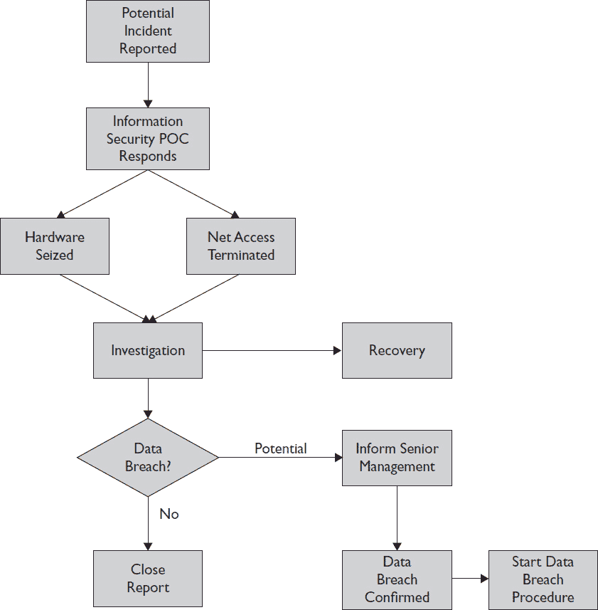

---

**图 3-2** 初始数据事件调查程序流程图示例

拥有 SOP 以在不同层级阐明政策的好处是减少不确定性和绩效差异。为了最大限度地发挥效力，SOP 必须遵守前面提到的相同原则。与政策一样，SOP 必须可见（甚至更可见）、获得管理层支持且保持一致。如果不满足这些条件，或者似乎与政策相矛盾，护理人员和业务人员可能会创建替代工作流，其效果和效率可能好也可能坏。

---

 **提示**   如果在美国涉及 HIPAA，对其产生的所有内部指导和文档（如隐私实践通知表格）有特殊考量。所有内部文档必须满足以下要求实施：

**时间限制** 您必须至少保存文档六年（如果存在其他要求（如认证），则时间更长）。

**可用性** 组织必须使内部指导可用（通常通过内部网或印刷手册供员工查阅）。

**更新** 组织必须定期审查和更新指导。

## 重要政策和程序

您的组织中可能存在几乎无限数量的政策和程序。我们不试图编制一个最终会不充分的清单，而是介绍几个您最可能遇到的重要政策和程序。请记住，这只是一个小样本，全文中我们将讨论许多其他不可或缺的政策和程序。

### 信息保护计划

将内部组织政策应用于外部法规的第一步是建立强大的隐私和安全管理流程。计划的关键要素将是风险分析和风险管理程序。这些很重要，因为标准信息安全最佳实践已证明在保护敏感信息方面有益。医疗保健组织必须拥有主动的政策和程序，实施适当的信息安全控制。同时，成本和任务要求必须纳入任何信息保护工作中。信息保护计划建立的最重要结构之一将是信息治理框架，该框架确定关键信息安全角色和职责。该团队将影响信息安全政策的制定和监督。其领导层将监控持续活动并确保成功。信息保护计划文档将涵盖的其他主题包括运营连续性、人员安全程序和设备处置等。

### 信息发布

关于信息发布的政策需求植根于法律。在美国，HIPAA 要求医疗保健组织制定书面政策。您也会在国际上发现这一要求；例如，英国和澳大利亚立法机构已颁布关于健康信息披露和发布的法律和政策。^(6) 这些国家的医院必须根据相关法律制定政策和程序。政策需要与患者适用的隐私权保持一致。当然，既然信息发布是一项常见的、每天都在进行的经常性任务，书面政策也能控制流程，防止信息处理不当。

尽管每个组织的信息发布政策会因本地工作流独特而有所不同，但每个信息发布政策都应遵循以下基本原则：

- **使用和披露** 这包括信息通常如何共享、与谁共享，以及何时需要特定患者同意。否则，信息将在不需要患者签名或额外授权的情况下发布。您还需要包含任何不能共享信息的情况。
- **最小必要规则** 医疗保健组织必须努力仅披露所需内容。在特定就诊接受审查的场景中，整个法律医疗记录可能不需要披露。
- **患者权利** 医疗保健组织必须告知患者他们享有哪些关于其信息的权利，以及信息如何发布给其他实体。
- **组织控制和保障措施** 信息发布政策将包含应急和风险管理信息，涉及在业务和临床工作流中断期间如何保护受保护的健康信息。
- **撤销或选择退出的权利** 在许多国家，您的信息发布政策必须允许患者改变主意，并提供如何表明其偏好变化的信息。

您面临的挑战可能是帮助组织使其信息发布政策在不断变化的标准和监管指导下保持最新。通过确保该特定政策由组织中拥有隐私和安全职责及背景的多人共同制定和审查，可以缓解这一问题。这不是一个人能制定的政策。

### 隐私实践通知

包括美国 HIPAA、加拿大《个人健康信息保护法案》（PHIPA）和欧洲经济合作与发展组织（OECD）在内的多项国际法律和监管建议，都有规定要求通知个人组织的隐私实践。通知应明确标识收集和使用实践。还将涵盖个人对其个人健康信息享有的隐私权。

隐私实践通知与信息发布政策相似，因为两者包含许多相同组成部分。区别在于实施方式。首先，通常要求隐私实践通知特别提及医疗保健组织有法律义务（如适用）保护信息。根据 HIPAA 和 PHIPA，情况确实如此。其他差异在于分发方式。通常，新患者在首次服务就诊或预约时收到通知副本。如果治疗是在紧急情况下进行，则在紧急情况结束后尽快将通知交给个人。组织必须在其机构中明确标识并展示隐私实践通知，供患者查看。

除此之外，医疗机构会在多个时间点提供此通知。例如，在美国，会在加入健康计划时提供。每三年或更早，会将通知作为提醒或应要求发送。最后，通知会显著地展示在网站上，供患者查阅。正如你所见，隐私实践通知不像信息发布政策那样针对特定事件。

## 用户协议

这是一个通用术语，可被视为保密协议、最终用户许可协议（EULA）或个人责任文件的同义词。通常，为了在政策和程序中灌输一定程度的半正式责任感，要求员工（用户）确认理解并愿意遵守培训、政策或其他法规要求。

用户协议的最佳用途之一是授权特定用户访问应用程序或临床系统，如电子健康记录（EHR）。在该协议中，你将找到以下一般条款和条件：

- 访问受保护的健康信息仅限授权用户且出于合法目的。禁止所有其他访问。
- 用户同意对其使用应用程序或系统的行为进行监控和审计。
- 用户将保护且不共享其访问凭证（例如用户 ID 和密码），否则将允许他人使用其登录或认证访问系统。
  - 有些用户协议专门提到，用户对其访问凭证下采取的任何操作负责。
- 如果有关于用户行为值得提及的具体行动，可以在用户协议中列出。示例如下：
  - 可能禁止将受保护的健康信息下载到外部设备。
  - 可能不允许将外部媒体带出医疗机构。
  - 计算机系统在不使用时必须完全关机，以确保全盘加密已启用。
  - 必须根据相关政策遵循数据事件报告程序。
- 访问系统前所需的任何培训必须完成，并将完成证明（证书）提供给相关人员。

用户协议当然可以包含比这些更多的元素。它们应根据当地要求进行定制，并且可以更新。例如，存在对外部 USB 驱动器（拇指驱动器）进行加密的技术。领导层可能希望允许某些用户下载受保护的健康信息。用户协议可以修订以允许这一点（但仍禁止其他用户这样做）。

## 事件报告政策

尽管有强有力的预防和监控程序，数据丢失仍可能发生。作为参考，根据美国卫生与公众服务部（HHS）接收的报告，自 2009 年以来，涉及 500 条以上个人记录的数据泄露事件已有近 800 起。^(7) 这总共涉及近 3000 万条记录。据估计，在同一时期，涉及 1 到 499 条记录的所有其他类型的泄露事件约达 80,000 起。

---

 **注意**   根据 HIPAA，美国医疗机构必须及时向 HHS 部门报告涉及超过 500 条个人医疗记录的数据泄露事件。

为潜在和实际数据丢失事件做好准备的组织能够改善其整体隐私和安全计划，即使无法消除风险。知道如何处理事件升级并在相关人员间进行协调，是事件报告政策的框架。事件根据明确的角色和职责进行管理。建立事件报告流程的原因是将对患者护理或业务流程的干扰降至最低。同时，必须尽一切努力保留证据，以便进行适当的取证和分析。该政策的积极成果是让医疗机构能够根据从这些事件中吸取的教训改进其信息保护。

事件报告政策指导组织经历几个一般阶段。首先，事件被怀疑或发现。也许一位重症监护护士注意到他的电脑被访问过，因为他离开时未锁屏。当他回来时，屏幕上显示着一个他从未访问过的网站。不幸的是，他在离开前还登录并正在使用 EHR。现在有可能其他人查看了该记录，并可能访问了数据库中任意数量的其他记录。在发现阶段之后，个人必须通过警报阶段上报事件。这是确定相关人员进行内部通知的地方。这将包括指定的隐私官，可能还包括高级信息安全官员。在他们收到警报后，政策中负有责任的其他人员可能会被纳入。这一行动将使流程进入分诊和响应阶段。在领先的医疗机构中，事件报告政策会设立一个负责执行分诊和响应等行动的委员会。委员会将包括隐私官、高级信息安全官员以及信息技术部门的高级成员。团队的其他优秀成员还包括物理安全官、授权的业务领域领导者，以及可能代表临床利益的人员。在分诊和响应阶段，委员会应包含拥有足够组织权力以推动调查完成的相关人员。请记住，随着调查的深入，成本会增加，可能需要资源，并且可能需要通知包括董事会在内的高级领导层。

一旦委员会确定事件确实发生并采取行动响应，目标就是遏制泄露并根除原因。随后，团队开始恢复流程并安排后续任务。这些任务将引出由专门处理数据丢失或泄露通知的第三方合作伙伴采取的外部通知行动。这可能还包括向组织现有的网络安全赔偿保险提出索赔。在任何情况下，后续行动都会整合到组织现有的其他政策中，这些政策可能超出了事件报告政策的范围。

## 制裁政策

我们介绍*制裁政策*，因为在美国，HIPAA 专门要求医疗机构拥有并证明如何遵循一项政策来惩戒违反受保护健康信息处理程序的员工，而且制裁政策可以是组织事件报告政策的延伸。一旦事件被报告和调查，数据丢失得到解决，且完成任何外部通知，组织必须采取下一步，实施适当且一致的纪律处分。

一项好的制裁政策将包含两个基本组成部分：违规类型和制裁或惩罚类型。管理层将有灵活性审查违规的性质、任何前科或违规背后的意图。然后管理层可以参考一系列预先确定的惩罚措施，根据违规情况在最低和最高限度内适用。惩罚范围可以从口头训斥、书面警告到停职，最终到解雇。

归根结底，关键在于：此类政策为管理层提供了一种工具，使其能够在避免出现不当行为或偏袒嫌疑的前提下做出客观决策。制裁措施并非一时兴起或基于情绪制定。若无书面政策，组织在面对受纪律处分员工的任何争议时，立场都会被削弱。最重要的是，组织能够证明对于特定违规行为，对所有人适用同等的制裁。当然，组织并不希望有大量制裁案例来证明合规性；最好是极少发生事故。任何制裁政策都应在新员工入职培训期间传达给员工，并在每年的再培训中重申。为获得确认的额外措施是让员工签字，表明他们理解该政策及其遵守义务。

## 配置管理计划

在复杂的医疗卫生信息技术环境中，必须有一项有组织、协调一致的政策和流程，以规划、实施、维护和退役信息技术资产。这些资产包括硬件和软件。您会在医疗卫生领域发现复杂的信息技术环境，其中最先进的医疗设备与自研系统和应用程序相互连接。通常，由于某些医疗系统的专有制造特性，其平台可能滞后于首选的最新受支持平台。当更换或更新过时平台存在患者安全风险，或成本过高时，医疗卫生信息技术领导者可能被迫维护并互联这些平台，同时采取缓解控制措施以保障隐私和安全。

配置管理对于信息保障至关重要，旨在提供医疗卫生数据的机密性、完整性和可用性。您通过控制资产全生命周期内的变更，来管理硬件和软件的安全特性。不仅需要管理变更，及时更新相应文档也同样重要。该计划必须包含在实施前对拟议基线配置变更进行测试的规定。事实上，许多计划包含场景或回归测试用例。这些用例有助于确保拟议变更（甚至漏洞修补）能够安全高效地完成。

在配置管理过程中，您将遇到以下几项常见活动。

- **规划** 组织将要求记录目标和策略，并使其可供人员使用。
- **分类与记录** 良好的配置管理计划（以及良好的信息安全计划）总是从适当的资产清单开始，以确定基线配置。随着基线的变更，资产清单流程将持续记录新的常态配置。
- **监控与控制** 变更请求流程必须强制要求变更由纪律严明的请求、测试、批准和实施流程进行控制。此外，负责维护基线的人员必须监控该流程，以确保未进行未经授权的变更。
  - 在控制职能中包含发布管理。这是将经过全面测试和批准的新变更或修改有序安装到业务或临床系统中的过程。发布根据其为重大、次要或紧急发布进行分类和记录。
- **执行审计** 为验证配置保持与当前文档相符的状态，您需要执行随机和例行审计。
- **编制报告** 医疗卫生信息隐私和安全专业人员最重要的职能大概是向组织高层领导沟通结果、问题和建议。配置管理计划必须包含对这一重要职能获得组织重视的期望。

在医疗卫生行业，如同大多数行业一样，信息系统的变更绝不应随意进行或缺乏行政文档。变更必须在实施前经过测试。否则，该变更可能带来危险并影响患者安全——即使该变更改善了信息系统的整体安全态势。

---

 **注意** 美国国防部（DoD）有许多适用于保护信息的重要法规。其中两项有助于说明内部政策和程序与国家法律、国际法规及行业标准之间的联系。DoD 指令 5410.11“DoD 隐私计划”和 DoD 指令 8500.01“信息保障 (IA)”塑造了军队对敏感个人信息的处理方式。对于在国防环境中工作的人员而言，这些指令是保护信息的唯一权威来源。然而，它们实际上只是内部政策和程序的示例。它们基于美国国家法律、国际法规和最佳实践行业标准。它们针对 DoD 的使命进行了定制，并概述了指派人员的众多角色和职责。

## 管理政策的治理框架

要制定切实可行的政策和程序，并期望它们成功保护组织中的信息，您需要了解领先医疗卫生组织中一些活跃的治理框架。在本章中涵盖这些框架的目的是协调所有适用于信息处理的法律规则、指导和最佳实践，以促进合规和持续改进。在很大程度上，这些框架的共同点是业务和临床学科的多样性。确实，最高效的信息治理结构绝不只由信息技术人员或隐私专家组成。引入医院运营和管理各方面的视角有助于达成共识并更好地遵守标准。包容性能培养利益相关者。并非每个信息治理结构都仅关注隐私和安全，但它们都应将这些关注点整合到信息资产的技术和流程管理的全貌中。请记住，其中一些委员会和团队是根据医疗卫生组织必须遵循的监管指导强制设立的（例如美国的 HIPAA）。

### 配置控制委员会

*配置控制委员会*（CCB）也可称为*配置管理委员会*。因此，它应在组织实施和管理其信息技术资产方面发挥关键作用。该委员会被列为现行标准和政策（如 NIST、HIPAA、FISMA、ISO 等）中的一项安全控制措施。资产可包括局域网、任何终端设备（含医疗设备）以及正在运行的各种应用程序。首席信息官或其他高级信息技术官员通常担任该小组主席，因为 CCB 专注于技术。然而，拥有来自医疗卫生组织几乎每个部门的投票成员至关重要。

# CCB 发挥最大效用的领域

CCB 发挥最大效用的领域在于建立信息资产的基线配置。这并不意味着组织必须拥有标准配置。大多数医疗保健组织都拥有遗留系统（尤其是医疗设备），无法满足当前标准。通常，预算不允许进行快速升级或现代化改造，以达到您期望的程度。无论哪种情况，CCB 都力求准确了解网络上驻留了什么。在此基础上，通过系统化流程控制变更将避免漏洞被利用。无论是漏洞补丁还是整个新系统的添加，CCB 都是确保适当维护发生的关键。为此，CCB 关注安全，成员应抓住每一个机会，在配置管理的每个阶段解决安全问题。

## 信息管理委员会

信息治理通常由信息管理委员会（IMC）管理，该委员会既考虑管理和组织问题，也考虑技术问题。IMC 是制定信息政策和程序的绝佳来源。您将在美国联合委员会（TJC）的指导中发现对信息管理架构的要求。IMC 与 CCB 不同，CCB 最关注特定系统层面的技术，尽管它着眼于在整个组织范围内标准化配置。IMC 通过解决对信息的适当访问、衡量数据丢失风险以及信息资产与医疗保健运营的战略一致性来治理信息管理。我们无法过分强调 IMC 持续战略对齐和改进的潜力。例如，实施 EHR 等计划肯定属于 IMC 的职权范围，以确保重大投资得以适当进行，并与更高层面的组织计划保持一致。更重要的是，IMC 为高级领导提供了一个核心视角，了解资源如何被用于提供和保护信息。这一预算监督的关键是一个称为*投资组合管理*的概念。

投资组合管理有时也称为*项目管理*，意思是所有当前和计划中的计划、项目和信息能力都得到系统化处理。这意味着组织收集并整理所有以前以无组织方式开发和交付的各种项目。有些是在信息技术领导架构内进行的，有些则不是。设想一下，急诊室的一位医生购买了一个商业现成的应用程序，并希望在其部门实施。想象一下，结果该应用程序无法与医院的任何遗留系统进行接口对接。这可能是 CCB 会处理的问题；或者，根据成本、影响和应用程序正常工作的感知价值，IMC 可以通过将其作为整个投资组合或已批准项目列表的一部分进行管理来防止这种情况发生。

这一场景暗示了投资组合管理的真正前景。基于 IMC 对每个计划进行优先排序和评估，量化以前非正式工作的能力，让高级领导了解投资和投资回报率。

## 数据事件响应团队

根据 HIPAA、NIST、ISO 和 FISMA 等各种标准和政策要求的安全控制，*事件响应团队*应在发生任何数据丢失或泄露之前建立章程。不幸的是，太多组织在需要之前都没有一个活跃的或经过测试的团队。根据美国国家标准协会的数据，44% 的组织甚至没有计划。^(8) 关键在于，一旦存在潜在泄露或实际发生泄露，就几乎没有时间召集合适的团队成员并进行调查。拥有一个随时待命的团队并了解他们的角色，使组织能够进行加速、有效且有组织的响应。并非所有数据丢失报告都需要向组织外部报告，例如向政府监管机构或患者本人报告，但所有疑似数据丢失都必须调查并记录结果。如果处理得当，数据事件团队可以防止利润、公众信心或信息资产的严重损失。

首席信息安全官或高级物理安全官员很可能领导该团队。其他团队成员将来自信息技术、法律、财务、高级医疗代表、风险管理、内部审计、人力资源和公共关系。当然，根据您的组织，可能需要用数据取证、健康信息管理、患者入院等领域的主题专家来增强这个核心小组。最终，被选为团队成员的人员必须拥有书面的角色和职责，这些职责必须被理解并通过定期的模拟数据丢失演练进行测试。在实际事件发生之前，必须授予团队成员必要的权力来控制资源，以帮助他们履行职责。

## 机构审查委员会

如果您在专门的医疗保健研究组织工作，或在将研究作为其学术使命一部分的组织工作，您将与*机构审查委员会*（IRB）打交道，也称为*独立伦理委员会*或*伦理审查委员会*。它们是正式的、有章程的委员会，负责批准、监督和审查涉及人的生物医学和行为研究。IRB 的主要目的是保护人类受试者免受身体或心理伤害。正如隐私的第一条规则是确定在不需要的情况下不收集信息一样，研究的第一条规则是确定是否应该进行研究。IRB 通过风险收益分析为组织做出这一决定。

---

 **提示** 在美国，IRB 对在人类受试者身上进行的“科学”、“伦理”和“监管”研究承担重要的观察和控制职能。它们由卫生与公众服务部（具体为人类研究保护办公室）授权进行研究，并批准豁免某些 HIPAA 规定，例如事先获得患者授权使用 PHI。

任何 IRB 的指导原则如下：^(9)

- **尊重人** 人应被视为自主主体（个体），自主能力减弱者必须受到保护。
- **行善** 通过坚持“不伤害”、最大化受益并最小化潜在损害，应保护研究参与者的福祉。
- **公正** 参与者应有平等的机会被选中，因为即使有受益，也可能存在某些人必须承担的负担。

---

 **注意** 在美国，IRB 受《联邦法规》第 45 编第 46 部分（HHS 保护人类受试者的法规）和第 21 编第 50 和 56 部分（FDA 关于保护人类受试者的法规）管辖。与 IRB 密切相关的是 HIPAA 下的规定，具体为隐私规则，其中规定了隐私委员会。IRB 和隐私委员会均被允许在无需额外患者同意的情况下为研究披露 PHI。您可以在《联邦法规》第 45 编第 160 和 164 部分，特别是第 164.508 节找到此规定。隐私委员会不同于 IRB。隐私委员会在人类受试者研究或 FDA 资助的研究中没有 IRB 那样的其他权力。

# 国际法规与控制

# 保护医疗信息

保护医疗信息是全球关注的问题。在美国，有特定法律来管辖医疗信息的处理。在国际上，法律专门针对医疗信息，尽管通常是在保护所有个人信息的背景下。隐私法规和控制涵盖个体识别信息，医疗信息包含在内。将一些选定的国际框架与现行的美国标准进行比较是有用的。

## 经济合作与发展组织隐私原则

经济合作与发展组织（OECD）总部设在法国，已围绕所有 29 个成员国应遵循的一般原则制定政策，旨在促进国际贸易。美国是 OECD 的成员国，也是其 2 亿美元年度预算的最大资助国之一。

OECD 框架对收集、存储和使用个体可识别信息的公平信息实践进行了分类。其目的是帮助个人参与其自身信息的使用。这些原则将保护信息的责任分配给收集和维护信息的实体。当你熟悉美国和国际数据保护法律时，你会发现以下原则已很好地融合其中：^(10)

- **收集限制原则**：应对个人数据的收集加以限制，任何此类数据的获取应通过合法和公平的途径，并在适当情况下征得数据主体的知情同意。
- **数据质量原则**：个人数据应与其使用目的相关，且为实现这些目的所必需的范围内，应准确、完整并保持最新。
- **目的明确原则**：收集个人数据的目的应在数据收集时或之前明确规定，后续使用应限于实现这些目的，或用于与这些目的不冲突且在每次变更目的时指明的场合。
- **使用限制原则**：除以下情况外，不得为特定目的以外的目的披露、提供或以其他方式使用个人数据：
  - 经数据主体同意
  - 依法律授权
- **安全保障原则**：个人数据应通过合理的安全保障措施加以保护，以防止数据丢失、未经授权的访问、销毁、使用、修改或泄露等风险。
- **公开原则**：应就个人数据的发展、实践和政策保持总体公开政策。应能随时获得确认个人数据存在及其性质、主要用途，以及数据控制者身份和管辖权的途径。
- **个人参与原则**：个人应有权做以下事情：
  - 从数据控制者处获得确认，或以其他方式确认数据控制者是否持有与其相关的数据
  - 在以下参数范围内，获得与其相关的数据通知：
    - 在合理时间内
    - 费用（如有）不得过高
    - 以合理方式
    - 以其易于理解的形式
  - 如果个人访问其信息的请求被拒绝，应被告知理由，并能对该拒绝提出质疑
  - 对与其相关的数据提出质疑，如果质疑成功，可要求删除、更正、完全修改或加注说明（在患者和提供者意见不一致的情况下）
- **问责原则**：数据控制者应对遵守落实上述原则的措施负责。

## 安全港协议

与 OECD 原则及其对国际贸易的影响相关的是安全港协议的监管框架。从欧盟的角度来看，数据传输只有在作出“充分性”认定时才能进行，换句话说，收集数据的实体必须具备充分的隐私流程和保障措施。欧盟不会自动向非欧盟成员国（如美国或加拿大所做的那样）授予这种充分性保证。为促进数据传输、推动国际贸易并弥合隐私差异，欧盟和美国（通过商务部）制定了一个满足充分性要求的安全港框架。^(11) 请参阅图 3-3 了解安全港差距评估流程的概览。

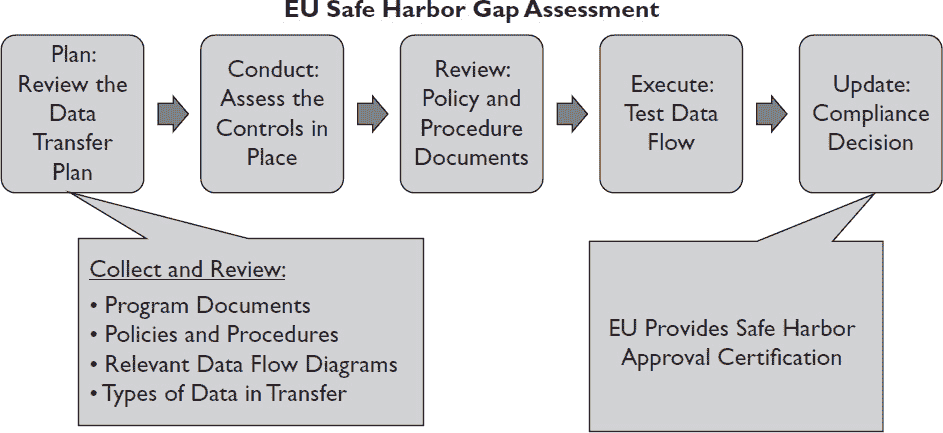

---

**图 3-3** 解决美国和欧盟数据传输之间隐私差距的流程

可以肯定的是，美国和欧盟在隐私和安全方面有不同的方法。然而，双方都致力于保护信息。这一安全港流程并不意味着美国缺乏隐私和安全控制。美国采用行业视角。有特定法律管辖各个行业（例如医疗行业的 HIPAA）。监管方式是这些法律与一定程度的自愿自我监管相结合。然而，欧盟将隐私视为一项人权，保护措施由各国政府指导和监控（涵盖医疗和所有行业）。因此，欧盟通过全面的立法对数据收集实施了重大控制。独立的政府数据保护机构很普遍，数据控制者必须向这些机构登记其数据库。在某些情况下，政府必须在个人数据处理开始前给予事先批准。

请记住，安全港框架适用的行业不仅限于医疗保健。但对于需要在美国和欧盟成员国之间传输数据的医疗机构来说，安全港值得重视。它有助于避免患者护理中断或面临欧洲法律的起诉。美国医疗机构可以获得安全港要求的认证。

---

 **提示** 安全港容易让美国医疗行业从业者混淆，因为在大多数美国法律中，基于“善意”采取的具体行动通常被豁免，称为*安全港条款*。管辖医疗的 HIPAA 提供了若干安全港条款，例如使用全盘加密使受保护的健康数据不可读。如果装有 PHI 的笔记本电脑丢失或被盗，但已进行全盘加密，则通常无需报告数据丢失。在内部政策方面使用安全港一词，可能适用于欧盟管辖的安全港。

许多医疗机构已将欧盟-美国安全港政策纳入其现有政策中。此外，开展国际业务的医疗供应商已签署加入欧盟安全港条款。每年，组织进行自我认证并向欧盟提交信件，以列入安全港参与者名单。

要获得欧盟安全港认证，美国组织必须遵守以下七项原则，这些原则就 OECD 指南中的隐私原则而言看起来很熟悉，尽管它们并不完全相同：^(12)

- **通知**：组织必须让个人知道收集信息的原因以及信息将如何使用。

## 安全港原则

- **选择** 个人必须有机会选择退出信息收集，组织必须告知个人不提供信息所导致的替代方案。

- **后续传输** 经安全港认证的组织仅当接收方组织也同意遵循充分的信息保护原则时，才可向第三方传输信息。

- **访问** 个人必须能够访问其信息。当信息不准确时，他们必须有可用的补救措施来更正或删除该信息。

- **安全** 必须建立合理的控制措施，以保护个人信息免遭丢失和未经授权的披露。

- **数据完整性** 组织必须将信息收集限制在与其用途相关的范围内。必须保护信息，使其对于该用途保持可靠。

- **执行** 组织必须制定程序以执行这些原则。例如，制裁必须具有足够的说服力以鼓励合规。

## 欧盟数据保护指令

欧盟 DPD（正式名称为 95/46/EC 法案）规范欧盟内部个人数据的处理。欧盟成员国均受该法案约束，无需制定国家层面的法律。欧盟 DPD 是欧盟隐私和人权法的重要组成部分。DPD 的主导原则是首要考虑完全不收集个人数据。但当无法做到时，必须满足特定条件。这与经合组织（OECD）等其他框架中限制收集个人数据的理念一致。必要收集必须满足的条件分为三类：透明性、合法目的和比例性。^(13)

### 透明性

当数据主体的个人数据被处理时，其有权知情。控制者必须提供其姓名和地址、处理目的、数据接收方，以及确保处理公平所需的所有其他信息。

### 合法目的

个人数据只能为特定、明确和合法的目的而处理，不得以与这些目的不兼容的方式进一步处理。

### 比例性

个人数据只能在准确、相关且不超出收集及/或进一步处理目的范围的情况下进行处理。

#### 准确性

数据必须是最新的，且必须采取一切合理步骤，确保不准确或不完整的数据被删除或更正。

#### 相关性

数据不应以允许识别数据主体的形式保存超过为收集目的或进一步处理目的所必需的时间。成员国应为为历史、统计或科学用途而长期存储的个人数据规定适当的保障措施。

#### 过度性

应仅收集所需的最少量识别数据。

---

>  **注意** 说到医疗保健，有一些注意事项。欧盟成员国应坚持限制收集原则，*除非*数据用于预防医学、医学诊断或提供护理或治疗。此外，数据必须由受国家法律、规则或职业保密义务（隐私）约束的医疗保健实体处理，或承担同等保密义务的实体处理。
>
> 该条款影响传输至美国的数据。如前所述，此类传输最初是被禁止的。欧盟认为美国缺乏国家层面或同等级别的义务，以确保个人身份信息得到保密。这就是安全港条款如此重要的原因。通过遵守 HIPAA 并通过商务部认证，美国医疗保健实体也可以满足欧盟 DPD 关于证明个人信息保护措施充分性的要求。如果您在一家美国医疗保健企业工作，且您的工作涉及美国与欧盟之间的数据传输，您将需要确保您对 HIPAA 最终隐私和安全规则的遵守得到安全港认证的补充。

## 国际标准化组织

国际标准化组织（ISO）是一个国际标准制定机构，由来自 150 多个国家的合格主题专家组成，旨在整合国家标准，如美国国家标准学会、ISO 技术委员会（TC）215 健康信息学、英国 BSI 集团和加拿大标准委员会等（仅举几例）的标准。我们在此提及 ISO 标准，是因为您应熟悉它们的存在及其与其他法规的关系。这些标准受版权保护，不免费分发。然而，在审查期间可以获取 ISO 标准草案，并且可以通过各种共享协议在线找到某些版本的标准。^(14) 作为日常使用的工具，ISO 指南中的概念和原则在其他来源中也有充分体现。然而，承认它们很重要，并且在可用时，它们能强化保护个人可识别信息所需的流程和程序。就我们的目的而言，我们将讨论几个与风险管理相关的相关标准，提供简要描述，并总结其相关性。这里我们将了解信息隐私和安全的治理标准：

### ISO 27001：信息安全管理体系

该标准帮助组织将安全作为一个系统来实施，而不是实施众多控制来解决看似孤立的问题。该标准涵盖电子信息和纸质信息的处理。从管理角度来看，该标准的主要贡献是将风险评估的概念形式化，并将信息安全组织为一项质量改进活动。该标准包含计划-执行-检查-处理（PDCA）概念，以及持续评估组织而非仅定期评估的原则。

### ISO 27799：健康信息学

这定义了健康领域的信息安全管理，它使用 ISO/IEC 27002，并用医疗保健特有的信息安全管理考量来增强 27002 的要求。

### ISO 29100：隐私框架

这定义了数据收集者妥善保护个人可识别信息的要求。该标准引入术语，概述角色和职责，并描述以下 11 项隐私原则：

- 同意与选择
- 目的合法性与特定性
- 收集限制
- 数据最小化
- 使用、保留和披露限制
- 准确性与质量
- 公开性、透明性和通知
- 个人参与与访问
- 问责制
- 信息安全
- 隐私合规

# 隐私概念：可识别性、可关联性和可观察性

该标准的另一个显著特点是它定义了可识别性及相关术语。信息用于识别个人的程度即为可识别性。当然，可识别性存在不同程度。范围从完全匿名（不可识别）到完全实名（被确定识别）。这与可关联性的概念相关，可关联性是指你能够将各种数据元素关联起来以确定识别某人的程度。不可关联性意味着，即使经过复杂的组合和尝试，也无法通过关联信息来确定身份。该标准引入的另一个概念是可观察性。这是指通过个人对系统的使用，能够识别身份或将身份与系统关联起来的程度。它包括对时间、位置或数据内容等因素的考量。

## ISO 隐私标准

### ISO 29101：隐私参考架构

作为一份战术指南，该标准包含了从行业收集的处理个人可识别信息的最佳实践。该指南提供了一致的、技术层面的隐私需求实施方案。通过使用该指南，你可以构建一个隐私参考架构，将必要的隐私保护措施在功能上和系统上内置到整个企业中。目标是包含所有相关系统，并与现有的保护控制措施集成。

### ISO 29190：隐私能力评估模型

该标准为组织提供了工具，以确定其在收集、使用、披露、保留和处置个人信息流程方面的成熟度级别。成熟度级别的评估基于组织是否拥有与信息治理、风险评估、第三方管理和相关策略等关注领域相关的流程证据。

# 通用隐私原则 (GAPP)

通用隐私原则 (GAPP) 植根于经合组织 (OECD) 和 ISO 指南中的原则。它们还试图根据公平信息实践和现行法律来规范个人可识别信息 (PII) 的收集和使用。GAPP 最大的支持者之一是加拿大的隐私从业者。这很可能与这些原则是由美国注册会计师协会 (AICPA) 和加拿大特许会计师协会 (CICA) 共同制定这一事实有关。

## 隐私目标

通用隐私原则建立在以下隐私目标之上：

> “个人信息的收集、使用、保留、披露和处置，符合实体隐私声明中的承诺，以及 AICPA/CICA 发布的通用隐私原则中规定的标准。”^15

## 十大原则

以下是十大通用隐私原则：

- **管理** 实体定义、记录、传达并分配其隐私策略和程序的责任。
- **通知** 实体提供关于其隐私策略和程序的通知，并明确收集、使用、保留和披露个人信息的目的。
- **选择与同意** 实体说明可供个人选择的选项，并就个人信息的收集、使用和披露获得隐性或显性同意。
- **收集** 实体仅为通知中确定的目的收集个人信息。
- **使用、保留和处置** 实体将个人信息的使用限制在通知中确定的目的以及个人已提供隐性或显性同意的目的范围内。实体仅在为实现既定目的所必需的时间内，或法律法规要求的时间内保留个人信息，此后对该信息进行适当处置。
- **访问** 实体向个人提供访问其个人信息的权限，以便进行审查和更新。
- **向第三方披露** 实体仅为通知中确定的目的，并经个人隐性或显性同意，向第三方披露个人信息。
- **隐私安全** 实体保护个人信息免受未经授权的访问（包括物理和逻辑访问）。
- **质量** 实体为通知中确定的目的维护准确、完整且相关的个人信息。
- **监控与执行** 实体监控对其隐私策略和程序的遵守情况，并设有处理隐私相关投诉和争议的程序。

# 章节回顾

医疗保健领域动态的监管环境可能令人不知所措。信息保护植根于国家隐私和安全法律。这些法律通常与国际管理指令相匹配，尽管大多数国家没有像美国那样针对医疗保健的特定法律。在美國法律与国际法律存在差异且必须共享医疗信息的情况下，已制定了诸如安全港之类的协议来帮助弥合差异。然而，在日常工作中，我们大多数人依赖本地的内部策略和程序来规范我们对受保护健康信息的使用。从这个意义上说，你的关注点在于你的组织，但你必须熟悉现行的国家和国际指导方针。

## 复习题

1.  **1.** 因网络中断导致医疗事故诉讼的可能性最可能源于：
    - **A.** 提供者使用未经同行评审的手动流程
    - **B.** 医院将患者转诊至能力较弱的其他医院
    - **C.** 过时的灾难恢复计划及无效的备份数据
    - **D.** 医疗设备患者监测功能受阻

2.  **2.** （判断题）联邦法律是医疗信息隐私和安全实践日常参考的最佳来源。

3.  **3.** _______________ 需要被提供以告知个人关于其个人健康信息的隐私权利？

4.  **4.** 数据事件报告策略将规定，至少多少数量的个人记录被泄露必须及时向美国卫生与公众服务部报告？
    - **A.** 所有泄露
    - **B.** 超过 500 条
    - **C.** 超过 5000 条
    - **D.** 基于医院日均收治人数的数字

5.  **5.** 监督研究信息保护的治理委员会叫什么？
    - **A.** 信息管理委员会
    - **B.** 配置控制委员会
    - **C.** 事件响应团队
    - **D.** 机构审查委员会

6.  **6.** 以下哪项可在经济合作与发展组织 (OECD) 隐私原则中找到？
    - **A.** 收集限制
    - **B.** 去标识化
    - **C.** 后续转移
    - **D.** 选择与同意

7.  **7.** （判断题）应遵守经济合作与发展组织 (OECD) 原则中措施的数据控制者符合问责制的定义。

8.  **8.** 为了弥合欧盟和美国之间的隐私差异，_______________ 被开发出来。
    - **A.** 公平信息原则
    - **B.** 隐私规则
    - **C.** 通用隐私原则
    - **D.** 安全港

## 问题

**9.** 要求数据收集满足透明性、合法目的和比例性条件的国际标准是 _______________。

**A.** 欧盟数据保护法案  
**B.** ISO 29100：隐私框架  
**C.** 医疗保险流通与责任法案  
**D.** 通用可接受隐私原则

**10.** ISO 27001：信息安全管理体系概述了风险 _______________ 的概念和实施。

**A.** 评估  
**B.** 容忍度  
**C.** 度量  
**D.** 视角

**11.** 以下哪项基于隐私目标，即按照组织的隐私声明使用个人信息？

**A.** 公平信息原则  
**B.** 通用可接受隐私原则  
**C.** 目的明确原则  
**D.** 内部治理指令

## 答案

**1.** **D.** 由于医疗设备受 FDA 监管，医疗机构有额外的责任确保其专用计算平台具备高可用性或完善的连续性程序。否则，如果网络中断妨碍了患者监护，可能会被视为疏忽，进而构成医疗事故。其他选项之所以不正确，是因为这些行动虽然很可能会发生，但不一定会让患者面临额外的直接风险。

**2.** **错误。** 虽然所有答案都是开展信息保护计划的有效来源，但本章的一个反复出现的主题是日常信息保护实践，因此最佳来源应为内部政策和程序。当然，这些政策和程序应建立在地方、国家以及某些情况下国际法律所确立的原则和标准之上。行业标准基于法律，但在某些情况下，这些标准反映了最佳实践或自愿合规的控制措施。无论如何，它们都是内部政策和程序的有效来源。

**3.** **隐私实践通知。** 正确答案是隐私实践通知，这是医疗机构为通知患者其隐私权利而必须遵守的政策（和表格）。

**4.** **B.** 这是一个理解和报告医疗数据泄露的基础性直接问题。HHS 认定 500 是区分及时通知要求的数字。超过 500 条记录后，必须发生各种额外行动，包括在某些情况下通知患者和当地媒体。当然，超过 5,000 条记录也满足此要求，但“至少”这一措辞使选项 B 成为正确答案，并符合 HIPAA 法律。所有泄露最终都会汇总报告。由于此数据事件报告程序并非由任何内部考量建立，因此平均每日收治人数等指标不适用。但了解这一基本数字（500）有助于您采取适当的内部措施应对数据泄露，并减轻任何数据丢失。

**5.** **D.** 机构审查委员会（IRB）是与研究相关的唯一选项。当涉及人类受试者的医疗研究中的信息保护时，必须建立管理用的 IRB。其他选项是医疗机构中拥有信息保护职责的合法内部员工群体和领导层，但没有哪一个是专门针对人类受试者研究所必需的。

**6.** **A.** 了解并区分框架和国际原则很困难；它们很相似。然而，在某些组织和国家，要求能够区分原则及其来源。也就是说，去标识化是一个获取 PHI 并移除所有标识符或创建算法以更改标识符使其与个人无关联的过程。后续转移是安全港原则涵盖的概念，而选择和同意是 GAPP 下的原则。如果您的职责不包括记忆原则及其来源，请专注于了解原则本身的定义。

**7.** **正确。** 这是一个了解原则定义而非死记硬背其来源标准的更好例子。问责制是 OECD 原则，规定数据控制者应对遵守 OECD 及遵循这些原则的法律负责。

**8.** **D.** 在此语境下，公平信息原则与 OECD 框架相关，代表了关于保护隐私的广泛接受的概念。隐私规则是美国 HIPAA 法律的修正案，不适用于欧盟。虽然通用可接受隐私原则获得国际认可，但它们在美国和加拿大的数据交换中更为普遍。正确答案是安全港，它是从欧盟视角解决美国隐私实践中任何感知差距的方法。

**9.** **A.** 随着本章介绍欧盟 DPD，透明性、合法目的和比例性这些指导条件预示了本书后续章节涵盖的更多细节。当然，DPD 以警示开篇：仅在必要时收集个人信息，否则不收集。ISO 隐私框架不包含这些组成部分，而医疗保险流通与责任法案并非国际性法案。最后，通用可接受隐私原则具有类似概念，但由于欧盟 DPD 专门围绕这些条件构建框架，因此欧盟 DPD 是正确答案。

**10.** **A.** ISO 27001 是 ISO 标准族中引入并规范组织风险评估流程的核心来源。由于容忍度是缓解或应对风险的一种方式，它是针对风险评估中发现问题的响应。度量和视角充其量只是评估或缓解（风险）的同义词，但 ISO 27001 不使用这些术语。

**11.** **B.** 内部治理指令可以（或应该）符合组织的隐私声明，反之亦然，但该问题定义了通用可接受隐私原则的基础。目的明确原则是 OECD 框架中的原则之一，而公平信息原则是 OECD 框架的基础。

## 参考资料

**1.** 美国食品药品监督管理局。“产品是否为医疗设备？” 访问于 2014 年 1 月 12 日，网址：[www.fda.gov/MedicalDevices/DeviceRegulationandGuidance/Overview/ClassifyYourDevice/ucm051512.htm](http://www.fda.gov/MedicalDevices/DeviceRegulationandGuidance/Overview/ClassifyYourDevice/ucm051512.htm)

**2.** Silver, Jonathan D., “Computer outage at UPMC called ‘rare’: Systemwide disruption potentially dangerous, expert warns.” *Pittsburgh Post-Gazette*. 2011 年 12 月 24 日。访问于 2014 年 1 月 23 日，网址：[`old.post-gazette.com/pg/11358/1199140-53-0.stm?cmpid=news.xml#ixzz2sNyCu9SQ`](http://old.post-gazette.com/pg/11358/1199140-53-0.stm?cmpid=news.xml#ixzz2sNyCu9SQ)

## 参考文献

3. 美国卫生与公众服务部。“HIPAA 违规通知规则”，45 CFR 第 164.400-414 节。2009。访问于 2014 年 1 月 20 日，网址：[www.gpo.gov/fdsys/pkg/FR-2009-08-24/pdf/E9-20169.pdf](http://www.gpo.gov/fdsys/pkg/FR-2009-08-24/pdf/E9-20169.pdf)

4. 美国卫生与公众服务部。“根据《经济与临床健康健康信息技术法案》和《遗传信息反歧视法案》对 HIPAA 隐私、安全、执法和违规通知规则的修改；对 HIPAA 规则的其他修改；最终规则”，45 CFR 第 160 和 164 部分。第 78 页。2013。访问于 2014 年 1 月 5 日，网址：[www.gpo.gov/fdsys/pkg/FR-2013-01-25/pdf/2013-01073.pdf](http://www.gpo.gov/fdsys/pkg/FR-2013-01-25/pdf/2013-01073.pdf)

5. 改编自“联邦信息系统和组织的安全与隐私控制”。NIST 特别出版物 800-53，第 4 次修订。第 X、XI 页。访问于 2014 年 2 月 1 日，网址：[`nvlpubs.nist.gov/nistpubs/SpecialPublications/NIST.SP.800-53r4.pdf`](http://nvlpubs.nist.gov/nistpubs/SpecialPublications/NIST.SP.800-53r4.pdf)

6. Yarmohammadian, Mohammad。“选定国家的医疗记录信息披露法律和政策；一项比较研究。”J Res Med Sci. 2010 年 5-6 月。15(3)。第 140-149 页。访问于 2014 年 1 月 3 日，网址：[www.ncbi.nlm.nih.gov/pmc/articles/PMC3082803](http://www.ncbi.nlm.nih.gov/pmc/articles/PMC3082803)

7. 美国卫生与公众服务部。“影响 500 人或以上个人的违规事件。”访问于 2014 年 1 月 20 日，网址：[www.hhs.gov/ocr/privacy/hipaa/administrative/breachnotificationrule/breachtool.html](http://www.hhs.gov/ocr/privacy/hipaa/administrative/breachnotificationrule/breachtool.html)

8. 美国国家标准协会 (ANSI)。“受保护健康信息泄露的财务影响：加强 PHI 安全的商业论据。”2012。访问于 2014 年 1 月 3 日，网址：[`webstore.ansi.org/phi`](http://webstore.ansi.org/phi)

9. 美国卫生与公众服务部。《贝尔蒙报告》。“保护人类研究受试者的伦理原则和指南。”B 部分。1979 年 4 月 18 日。访问于 2014 年 2 月 1 日，网址：[www.hhs.gov/ohrp/humansubjects/guidance/belmont.html#xbasic](http://www.hhs.gov/ohrp/humansubjects/guidance/belmont.html#xbasic)

10. 经济合作与发展组织 (OECD)。“关于保护隐私和个人数据跨境流动的指南 (2013)。”第 2 部分。第 4-6 页。访问于 2014 年 1 月 27 日，网址：[www.oecd.org/sti/ieconomy/2013-oecd-privacy-guidelines.pdf](http://www.oecd.org/sti/ieconomy/2013-oecd-privacy-guidelines.pdf)

11. Swire, P. P., S. Bermann, & 国际隐私专业人士协会 (2007)。数据共享与传输。载于《信息隐私：认证信息隐私专家 (CIPP) 官方参考指南》。第 250 页。国际隐私专业人士协会。

12. 美国商务部。“安全港隐私原则。”2000。访问于 2014 年 1 月 15 日，网址：[`export.gov/safeharbor/eu/eg_main_018475.asp`](http://export.gov/safeharbor/eu/eg_main_018475.asp)

13. 欧共体官方公报。欧洲议会和理事会 95/46/EC 指令。1995。访问于 2014 年 1 月 20 日，网址：[`eur-lex.europa.eu/LexUriServ/LexUriServ.do?uri=CELEX:31995L0046:en:HTML`](http://eur-lex.europa.eu/LexUriServ/LexUriServ.do?uri=CELEX:31995L0046:en:HTML)

14. 公开可用的相关 ISO 标准示例，见 [`standards.iso.org/ittf/PubliclyAvailableStandards/index.html`](http://standards.iso.org/ittf/PubliclyAvailableStandards/index.html)。访问于 2014 年 1 月 18 日。

15. 通用隐私原则。美国注册会计师协会和加拿大特许会计师协会。2009。访问于 2014 年 1 月 19 日，网址：[www.aicpa.org/InterestAreas/InformationTechnology/Resources/Privacy/GenerallyAcceptedPrivacyPrinciples/DownloadableDocuments/GAPP_PRAC_%200909.pdf](http://www.aicpa.org/InterestAreas/InformationTechnology/Resources/Privacy/GenerallyAcceptedPrivacyPrinciples/DownloadableDocuments/GAPP_PRAC_%200909.pdf)

---

## 第 4 章

## 信息风险决策制定

在本章中，您将学会：

- 理解基于风险的决策制定基础
- 查看领先的信息风险管理框架，了解其在医疗保健领域的应用
- 理解**风险承受能力**的概念和处理**剩余风险**的方法
- 应对**信息资产控制**的类别
- 了解沟通风险管理活动和发现的重要性
- 学习如何支持第三方关系并将其对医疗保健组织的风险降至最低

---

医疗保健组织中的风险概念有多种定义，取决于您的工作领域。从临床角度来看，风险是所提供医疗保健质量和安全的度量。会识别出使患者面临危害的风险，并采取行动预防或控制这些风险。因为我们这里关注的是信息保护，所以*风险*被定义为由故意或意外事件导致的潜在危害，该事件对信息的机密性、完整性或可用性产生负面影响。信息风险也可能导致患者伤害。在阅读本章时，请注意除非另有特别说明，否则术语*风险*将适用于信息风险。我们将介绍管理风险和信息保护决策制定的有组织、系统化方法。有几种框架可用于这项重要工作。一旦您了解了面临的风险，就可以开始决定如何应对。我们将介绍几种管理风险的方法。例如，组织必须决定是缓解、接受还是转移风险。我们还将介绍其他几种管理风险的方法。最终，您的角色是衡量风险，并向领导层传达备选方案，说明信息保护如何与业务战略、临床实践和第三方关系相结合。

### 利用风险管理进行决策制定

关于管理信息的决策制定需要系统且有组织的方法。否则，情绪或个人偏好可能会影响行动，实际上增加事件发生的可能性或增加影响的程度。无论您最终选择何种格式来做出风险决策，都必须使用某种方法论。在介绍一些领先的风险框架之前，我们需要定义以下术语：

- **威胁**：与您的组织相关的、导致信息丢失或损坏的特定来源
- **漏洞**：可能使组织不必要地暴露于威胁之下的弱点
- **可能性**：威胁发生的可能性（因漏洞而增加）
- **影响**：威胁事件发生时预期的损害程度
- **缓解和控制**：为防止（控制）或减轻（缓解）被利用威胁的影响而采取的行动或流程

在围绕这些变量构建衡量风险的决策时，您可以使用接下来讨论的风险管理框架，以权衡成本与收益或风险与回报。在所有情况下，您都可以确保实施的控制措施与您试图保护的资产相关且具有成本效益。图 4-1 介绍了利用风险测量在备选方案中进行决策的整体概念，这是任何信息风险管理框架背后的基础概念。

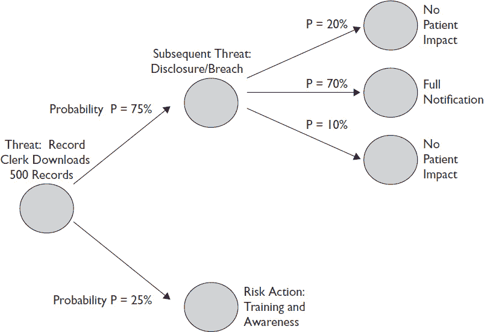

---

**图 4-1** 基于风险的简单决策树

## 信息风险合规框架

在后续的几章中，我们将探讨信息风险合规框架更技术性的方面。为了避免重复信息，本节将向您介绍一些主要示例，并讨论它们用于做出信息风险决策的预期用途。目前，您需要认识到每个框架是如何处理医疗信息隐私和安全中最基础的概念之一的：信息风险。您将看到，无论您想使用什么工具，目标都是通过识别漏洞、分配发生可能性以及分配对组织的影响值来衡量风险。由此，您可以开始设计和实施控制措施，以减轻风险发生的可能性、最小化影响，从而管理风险。

### 衡量和表达信息风险

以下是一些您可能熟悉的风险公式：

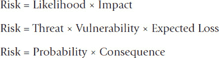

上述“风险公式”并不意味着风险总是用客观术语（数字、百分比、数据结果等）来衡量。它当然可以用主观术语来表示，例如管理价值或优先级衡量（低、中、高等）。在医疗保健领域，风险影响可以用货币成本、声誉损失和（最重要的是）不良患者事件来衡量。作为一个例子，一个名为开放 Web 应用程序安全项目（OWASP）的组织是一个由来自世界各地的标准制定组织和专家组成的新兴机构。该组织使用简单措施的组合来计算风险。基于主观值（0–9，9 为最高），针对威胁和漏洞进行评估以获得影响估计。^(1) 这些概念值被绘制在图表上，以快速识别问题的总体风险严重程度级别（图 4-2）。

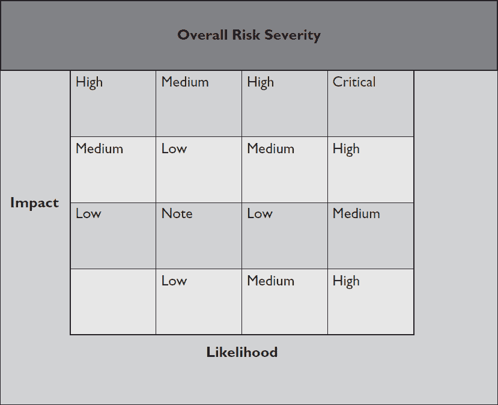

---

**图 4-2** 用于做出基于风险决策的 OWASP 方法论

一般来说，几乎所有可信的信息风险管理框架提出的共同要点都强调了以下重要步骤：

1.  确定负责隐私和安全问题的人员。
2.  执行信息风险评估（使用基于标准的框架）。
3.  拥有涵盖敏感信息资产正确使用的最新政策。
4.  成立一个正式的董事会或委员会来监督信息风险管理。
5.  通过该小组向高层领导（以及整个组织，如有需要）传达调查结果和补救进展。
6.  通过评估第三方对敏感信息的正确使用来管理第三方风险。
7.  为员工维护一个活跃的隐私和安全意识培训计划。
8.  拥有一个供员工遵循的显而易见的事件报告流程。

### 美国国家标准与技术研究院

最常被引用的风险管理来源之一是美国国家标准与技术研究院（NIST）特别出版物 800-39《安全风险：组织、任务和信息系统视角》中定义的风险管理过程。然而，这并不排除使用其他可信来源。选择取决于您组织的使命、范围和对信息风险的容忍度。NIST 将风险管理视为一个必须考虑整个组织的整体过程。

在高层面上，NIST 围绕风险管理计划的活动构建风险管理框架。^(2)

- **界定风险** 组织的风险承受能力是什么？它如何做出关于风险的决策？
- **评估风险** 风险公式的值是什么？结果是什么？
- **应对风险** 基于组织的风险承受能力，将选择哪些替代方案来应对风险？
- **监控风险** 这是一个持续的过程。组织将如何监督变化并应对风险缓解活动的任何影响？

同样，这些步骤处于高层面。请记住，NIST 确定的这四个步骤通过尽可能多的信息和通信流相互关联。该过程是持续的，因此信息和通信流必须包含反馈和改进关注点。

您应该熟悉的第二个来源是 NIST 特别出版物 800-37 修订版 1《将风险管理框架应用于联邦信息系统指南：安全生命周期方法》。虽然它面向美国联邦机构，但风险管理框架（RMF）的概念对商业企业（包括医疗保健组织）很重要。NIST RMF 是一种严谨、有序且可重复的过程，用于实现信息系统的信息保护。在将 NIST 800-37 与 NIST 800-39 中的 RMF 进行比较时，您可以看到重叠。两者都是以持续监控和改进为核心概念的生命周期概念。NIST 800-37 的既定目的之一是“……为高级领导者提供必要信息，以便就支持其核心使命和业务职能的组织信息系统做出具有成本效益的基于风险的决策。”^(3)

不过，这两个模型并非冗余。RMF 更详细的性质允许灵活性，以将框架适应特定行业的标准和指南。总之，RMF 为组织提供了所需的灵活性，以便在正确的时间将正确的安全控制应用于正确的信息系统，从而充分管理风险。在美国，许多 HIPAA 安全规则标准和实施规范与 NIST RMF 的步骤相对应。^(4) 使用这些 NIST 框架进行风险管理将帮助任何医疗保健组织遵守其风险管理策略。有关集成了相关 HIPAA 标准的 NIST RMF 六个步骤的图示，请参阅图 4-3。

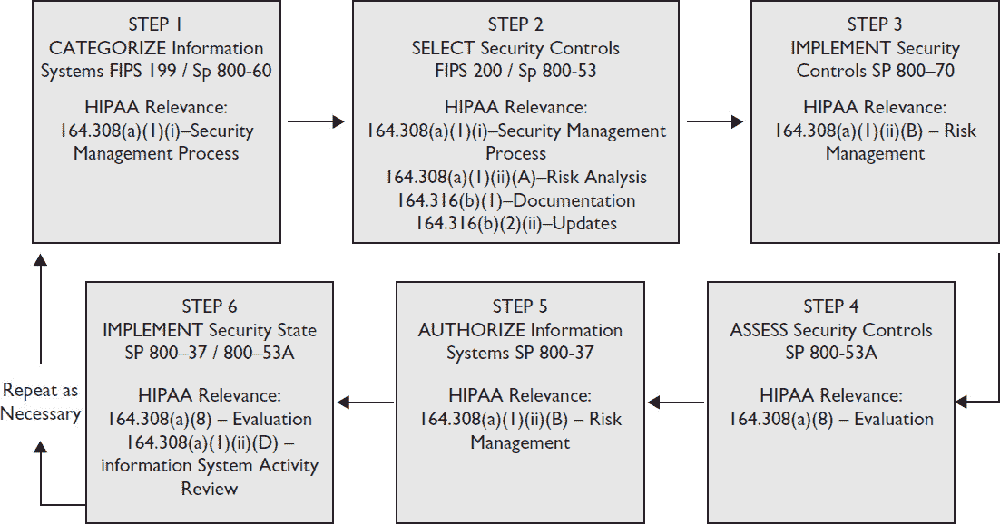

---

**图 4-3** 包含相关 HIPAA 标准的 NIST RMF 步骤

---

 **注意** 由于美国行政命令 13636，NIST 发布了国家网络安全框架。目前采用和遵从均为自愿。它于 2014 年 2 月发布，将网络安全工作集中在五个领域（识别、保护、检测、响应和恢复），包含 20 个控制子类别。这些控制领域包括资产管理、安全持续监控和改进等活动。

### HITRUST

由医疗保健和信息安全专业人员协作开发，健康信息信任联盟（HITRUST）通用安全框架（CSF）是一个为美国医疗保健行业量身定制的、用于保护健康信息的安全框架。CSF 包含并整合了联邦和州法规、标准以及框架（如 HIPAA、NIST、ISO 和 COBIT），为医疗保健组织提供了一个广泛且适应性强的风险评估工具。

## 风险管理框架的差异

因为迄今为止，尚未为医疗机构规定具体的风险管理框架或工具，因此风险管理合规性存在巨大差异。这意味着有些机构没有正式流程，有些虽有但不充分，还有一些为求稳妥而过度合规。据报道，真正做对的寥寥无几。HIMSS 年度隐私与安全调查等研究的结果，以及数据泄露后的裁决结果，都揭示了这一点。这并不完全是医疗机构的过错。为了让指南具有灵活性，以适应机构规模、使命、复杂性和能力的差异，指南最终变得过于宽泛，留有太大的解释空间。例如，HIPAA 要求采取“合理且适当”的控制措施来保护信息。根据医疗机构的不同、参与决策的人员以及信息风险承受水平，这些术语的定义过于宽泛，导致漏洞未被解决、资源浪费和措施无效。

## HITRUST CSF

这就是 HITRUST CSF 等框架显示出其益处的地方。CSF 是医疗和 IT 专业人士协作的成果。其方法更具指导性，因为它将来自 NIST、HIPAA 等不同现有要求整合成了一套高效的标准，这套标准符合医疗行业的实际。指导性并不意味着僵化。CSF 适应医疗机构中各种各样的信息系统。CSF 内置了一个经批准的替代控制概念，当规定的控制措施不可行时，可用替代控制来满足针对已识别漏洞的风险缓解或补偿策略。随着 CSF 使用范围和普及度的提高，它将成为合规性的可信基准，而不是像目前这样由医疗行业自行检验是否“合理且适当”，各自为政。

## 国际标准化组织（ISO）

国际标准化组织（ISO）是一个享有盛誉的国际标准制定机构，我们将在本章后面讨论其作为治理委员会的角色。在此，我们在其处理信息风险管理的方法背景下介绍它。对于在美国境外工作或在美国从事国际业务的医疗机构工作的人员来说，了解 ISO 标准很重要。自 1947 年成立以来，它已为商业和技术行业发布了 19,500 项标准。从信息风险管理的角度来看，有两项主要标准适用。第一项是 ISO 27001：信息安全管理体系（ISMS），它提出了管理风险的最佳实践信息安全管理原则、框架和流程。这些指南适用于任何规模的组织或使命，任何组织均可使用，无论其规模、活动或行业。该标准通过识别机会和威胁来聚焦目标的改进，从而应对风险。由此，组织可以分配资源以有效应对风险。如果您使用 ISO 27001 或 ISO 27000 系列中的任何标准，您将学会将风险定义为不确定性对目标产生的影响，而不是损失的机会或概率。

---

 **注意** 在上一章中，我们提到了 ISO 27799：健康信息学——卫生领域的信息安全管理。将其纳入本次讨论也很相关，因为 ISO 277799 使用 ISO 27002，并针对信息安全管理增加了医疗保健特有的考量，以补充 27002 的要求。

ISO 27000 系列标准还引入了风险管理过程的最后一步：风险处置。根据该指南，组织可以通过以下方式应对风险：^(5)

- **规避** 不执行导致风险的行为。
- **接受** 预期发生成本低于目标的价值。
- **保留** 在知情同意且潜在损失最小的前提下，您可以为风险预算。
- **移除** 移除漏洞或风险源。
- **变更** 改变发生的可能性或后果（缓解）。
- **分担** 通过保险、合同或其他第三方协议（外包）分担成本。

信息风险管理的第二个主要 ISO 来源是 ISO 27005：风险评估。每个风险管理指南来源都应将风险评估置于流程的核心。但请记住，风险评估只是整个风险管理过程的一部分。ISO 27005 专注于信息系统风险，并详述如何有效、高效地仅进行风险评估。从选择合适的风险评估技术开始，该标准指导评估人员完成正确的步骤。回到聚焦目标的风险管理过程，风险评估帮助风险管理者识别可能影响目标实现的风险，以及现有控制措施的充分性。请记住，像所有良好的流程一样，该系统需要与利益相关者保持持续沟通，且是循环进行的。一旦风险管理过程的最后一步——风险处置——完成，就该重新开始建立背景了。在所有较好的风险管理过程中，总是从基线评估或资产清单开始。ISO 27001 和 27005 标准也不例外。

## 通用准则

通用准则适用于风险管理框架这一主题领域，是因为它内置了标准和控制。这些控制被独立许可的测试和评估实验室用来评估各种硬件和软件工具的有效性。评估产品的输出或列表可供医疗信息隐私和安全人员选择、采购和实施“已批准”的产品。通用准则列表提供的批准使用户对所用产品更有信心。他们可以确信测试是以严格、标准和可重复的方式进行的。只要用户选择并实施额定防护能力足以应对组织威胁环境的产品，这些产品就能提供充分的安全性。也就是说，通用准则背后的权威机构明确表示，他们的批准不构成担保。

通用准则是国际标准 ISO/IEC 15408。许多国家认可该标准，包括美国、英国、加拿大、澳大利亚、日本、德国、法国、西班牙和意大利等。通过通用准则计划进行的产品评估，受所有签署该协议（称为通用准则认可安排（CCRA））的国家认可。通常，通用准则的考量是政府系统实施和关键基础设施的一部分。^(6)

通用准则的传统输出是评估保证等级（EAL）。这是一个数值（EAL 1-7），对应产品经测试所满足的安全需求等级。近年来，该组织开始摒弃 EAL，转而支持基于产品概况的更灵活的保证准则。对于日常用途，这一理念影响不大。重要的是将风险管理框架应用于产品和应用程序这一理念。在此基础上，提供评估或认证。

## 信息风险因素分析

## 基于风险的决策响应

只有当风险管理框架能够推动组织决策和行为时，它才是有效的。通过框架运行决策以对信息资产进行分类并识别风险等级，只是前几个步骤。这些数据必须推进到后续步骤。组织需要识别并确定优先级，采取行动以应对已识别的风险。如果组织止步于识别风险这一阶段，很可能会被监管机构视为疏忽大意。一旦发生数据丢失，且一个或多个已识别的风险因组织未能实施风险响应而被利用，组织将面临更高的罚款和处罚。

### 剩余风险容忍度

要了解组织将采取何种风险响应，关键因素是剩余风险容忍度。简而言之，这是组织对威胁利用漏洞的可能性及潜在影响所接受的舒适度。考量因素包括风险响应如何与组织使命和目标相契合。本书反复强调的一点是，医疗行业在信息隐私和安全关注点上与其他行业截然不同。剩余风险容忍度便是这一差异的典型例证。例如，在管理联网计算设备时，恰当的风险管理方法是将软件（特别是防病毒管理软件）作为标准配置的一部分加载到设备上。有了这些软件，系统管理员可以远程自动推送漏洞补丁。计算设备保持在受保护水平，以合理的成本将病毒渗透风险维持在低位。然而，对于同样连接网络的医疗设备（如数字 X 光机和智能输液泵），必须特别小心，**不要**在机器上加载任何额外软件。每个设备制造商必须测试并批准这些特殊计算设备上的软件添加、更新和删除，这些设备通常无法纳入自动补丁管理流程。这并不意味着它们无法得到保护。必须有一个替代流程来体现剩余风险容忍度的概念，因为组织接受了“一刀切”并不适用。或许医疗设备必须被划分到私有网络方案或飞地中。或许软件补丁只能手动加载。这可能会增加成本和工作量，但这是医疗信息保护计划所必需的努力。

### 风险处理识别

基于剩余风险容忍度，您可以采取多种方法来应对风险评估中发现的风险。^(8)

- **规避** 对这些类别风险的最低容忍度促使组织试图完全避开风险。必须寻找并实施原有流程或技术的替代方案。一个简单的例子可能是禁止用于身份验证的群组账户。群组账户长期以来在大多数信息安全标准中被禁止，但医疗服务提供者仍在使用，尤其是在小型医疗机构中，“预约”可能允许两三名人员共享访问权限。在风险规避中，必须实施一种替代群组账户的方案，以满足个人身份与账户的唯一对应关系。

- **转移** 此类别有两种普遍方法。第一，组织将风险转移给第三方。这通常通过合同文件或协议中的条款来实现，使医疗组织免受风险被利用时的任何损害。这种风险转移过程称为*赔偿*。第二种风险转移方法是购买保险单，以覆盖违规影响相关的财务成本。在医疗领域，网络安全保险日益流行，有助于分担调查、通知患者以及提供患者信用监控等工作的财务负担。事实上，视网络安全保险类型而定，保障范围可包括支付罚款和处罚。当然，网络安全保险无法报销组织因业务损失、声誉受损以及在违规补救上浪费的时间所产生的成本。所有这些都必须纳入应对风险的方法中。

---

>  **提示** 美国的业务伙伴协议是一种管理控制的示例，它将部分风险转移给代表医疗组织处理受保护健康信息的第三方。

- **减轻** 如果您无法避免增加风险的行为，可以选择减轻负面影响的可能性。实施管理、物理和技术控制（如 NIST 特别出版物 800-53 中所列）是信息隐私/安全减轻风险的一个例子。

• **Accept** 在某些罕见情况下，即使漏洞被利用，对组织的影响也微乎其微，以至于采取任何行动要么成本过高，要么过于复杂，抑或两者兼具。当组织选择单纯接受风险时，仍必须记录这一经过衡量的决定，并持续监控相关活动，以确保若漏洞被利用，风险影响不会增加。

## 信息资产保护控制

前述一些框架还包含各种建议实施的信息资产控制。这些控制通常是用于避免、转移、减轻或接受风险的保障措施或对策。就接受风险而言，信息资产保护控制更准确地描述为围绕资产分层部署的保障措施或对策。例如，为从不离开数据中心的备份介质投资加密解决方案可能并不可行。然而，这一前提假设已有控制措施防止介质离开数据中心。数据中心内可能设有上锁的保险柜。视频监控系统可用于阻止盗窃，并在备份介质丢失时提供取证证据。当正确实施时，信息资产控制的组合将来自以下类别：

• **Preventive（预防性）** 这些控制旨在防止事件发生。预防性控制包括物理围栏和门锁等边界安全措施。它们也可以是禁止特定行为的政策，以及教授员工正确行为的培训。

• **Detective（检测性）** 如果预防性控制不足，某些控制旨在事件发生时识别并描述其特征。这些是向组织发出信号表明攻击正在进行的警报和警示。警报和警示可以是传统的火灾报警器，也可以是基于软件的形式，如局域网或终端设备的入侵检测系统。

• **Corrective（纠正性）** 尽管尽了最大努力，事件可能仍无法被预防或检测到。控制措施旨在限制事件造成的损害程度。灾难恢复程序是纠正性控制的绝佳例子。

预防性、检测性和纠正性信息资产控制按照潜在事件发生的活动阶段或时间线（即事前、事中、事后）按时间顺序分类。

对信息资产控制进行分类的另一种方式是按其功能。

• **Physical（物理）** 这些是结构性或可见性质的安全措施。这些控制能阻止或防止数据丢失或对对象（文件柜）或地理区域（数据中心）的未授权访问。示例包括围栏、密码锁、保安人员和灭火器。当部署了摄像头或监控系统时，物理控制甚至可以支持检测性和纠正性控制。

• **Administrative（管理）** 这些是人为因素。这些是指导人员及其在处理敏感信息时的行为的政策和程序，并确立相对于信息资源的访问级别和职责。事件响应流程、安全意识与培训、员工招聘与离职程序、法律法规合规政策均属于管理控制的典型例子。

• **Technical（技术）** 这些是为整个信息保护活动和阶段提供保障的硬件和软件解决方案。实施这些标准需要网络认证、加密、防病毒软件和防火墙等工具，仅举几例。

图 4-4 直观展示了这些控制的重叠性和集成性。该图参考了 NIST 特别出版物 800-53《联邦信息系统推荐安全控制》及其提出的 17 个控制族；并展示了这些控制在管理、物理和技术措施方面的重叠。^(9)

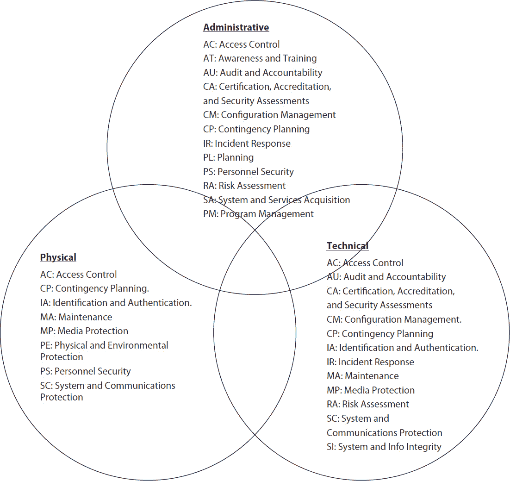

---

**图 4-4** 安全控制的重叠

---

 **提示** 这些控制类型的术语（或*分类法*）见于各种资源（例如 NIST 特别出版物 800-53、鉴证业务准则声明 [SSAE] 16《服务组织控制报告》、ISO 27002 等）。有时会使用其他词汇，如*威慑性控制*和*运营保障措施*；了解这些其他术语很有用，但它们更多是语义偏好而非实质区别。

• **Common controls（通用控制）** 为避免重复工作，某些安全控制适用于多个系统，并可被各系统继承。当每个系统均受该控制充分保护时，此情况成立。通用控制的一个绝佳例子是容纳 EHR、实验室信息系统和人力资源信息系统的设施的物理安全计划。所有控制（门、警报、灭火系统等）将同等保护这些系统（且所有系统都需要此类控制）。

• **System-specific controls（系统特定控制）** 通用控制结束的地方，系统特定控制便开始了。这些控制针对每个信息系统独一无二，由系统所有者负责实施。它们可以是物理控制（例如上锁的计算机机柜或数据中心的“机架”）。也可以是管理控制（信息安全计划）和技术控制（认证）。

• **Hybrid controls（混合控制）** 有时一个安全控制可同时包含通用控制和系统特定控制两部分。事件响应计划兼具这两者要素。某些程序在整个组织通用，而每个系统在怀疑数据丢失时都有特定的应对步骤。

## 纠正行动计划

风险管理的核心流程是在识别出弱点或漏洞缺口后进行纠正或弥补。纠正行动计划是一种正式、有组织的管理工具，用于识别这些差异。重要的是，该计划描述了减轻风险所需的行动。这些行动将关联到 NIST 和 ISO 等来源规定的行动。纠正行动计划的另一个关键方面是将实施缓解措施的责任分配给个人。一旦完成分配，管理层即可通过监控计划的预期结果来履行问责。如前所述，即使是最完善的纠正行动计划，仍可能导致残留风险或接受风险。纠正行动计划使管理层能够清晰地识别这一现实，并记录导致接受风险决定的风险评估及其理由；若变量发生变化，可重新评估风险。如果变量发生变化（例如影响大于最初预期），规定的缓解活动届时可能变得可行。

纠正行动计划的作用不仅限于帮助解决漏洞和管理风险。它还能帮助信息保护工作进行趋势分析。纠正行动计划的组成部分暗示了其可作为成本效益工具支持业务论证。对信息安全和隐私而言，或许最重要的是，纠正行动计划保存了组织知识并促进了沟通。所有这些都能改善医疗保健组织的信息保护计划。^(10)

- **趋势分析** 当纠正计划与年度风险评估协同管理和更新时，它就是一个极好的历史数据来源。管理层可以利用这些数据来衡量为缓解漏洞而实施的控制措施的成本和有效性。基于漏洞利用发生的可能性或潜在影响做出的主观决策，可以根据实际发生情况进行优化。

- **支持业务论证** 如果做得正确，纠正行动计划包含可监控的财务信息。根据成败，未来在信息保护方面的投资可以被证明是合理的（或被拒绝）。证明信息保护的投资回报率往往难以捉摸。妥善管理纠正行动计划在缓解管理层对投资回报率的担忧方面大有裨益。

---

 **注意** 风险管理中的一个考量因素是，实施和维护规定的控制措施可能需要多少成本，以及这与资产价值的对比。除了支持投资回报率外，如果放弃控制措施的成本效益分析表明，在评估时该资产或影响不值得投资，纠正行动计划也可以支持不实施控制措施的决策。如果分析结果发生变化，可以调整纠正行动计划。

- **维护机构知识** 在拥有成熟信息保护计划的组织中，机构知识是一项宝贵的资产。否则，该计划必须依赖个人或现有员工的胜任能力。人员变动会导致机构知识的变化。拥有纠正行动计划库及其配套分析，可确保组织即使在人员流动的情况下也能维持信息保护计划。

- **促进有效沟通** 向高层领导传达纠正行动计划的重要性怎么强调都不为过。使用该工具及其相关信息功能，履行了信息保护人员在建立信息保护意识、向高层领导沟通以及为合规工作记录成果方面的责任。

## 补偿性控制

在医疗保健领域，规定的控制措施甚至替代控制措施往往难以实施。这种场景最普遍的例子之一是医疗设备管理。有些医疗设备对于诊断和治疗患者至关重要，但这些设备无法遵守某些信息安全要求。在某些情况下，设备制造商仅评估并批准了一个被认为已过时、不适合常规办公自动化的操作系统版本。此外，同一医疗设备可能无法加载多个软件漏洞补丁，因为它们会对设备产生负面影响。在这种情况下，医疗机构不能明知故犯地允许医疗设备在局域网上运行。未经制造商批准断开设备连接或升级设备，对医疗机构来说也不是一个选项。这时就需要实施补偿性控制。

*补偿性控制*是一种保障措施（或多项措施），它是对规定安全控制的合法偏离。它不是合规的捷径，也不是仅仅因为控制措施在政治上受阻或被认为困难就绕过实施的方法。在实施补偿性控制之前，应进行风险分析，以记录偏离的合理需求（合法的技术限制或有据可查的业务限制）。在医疗设备场景中，私有网络分段和手动补丁管理这些替代控制措施已经提到过。除了医疗设备的这些措施外，组织中的全部信息资产还可以通过其他补偿性控制示例来保护，例如备用发电机、用于持续运营的热备站点和敏感信息服务器隔离。满足了原规定控制的意图，但也解决了实质性考量，以平衡信息保护和患者护理。

总之，有效的补偿性控制包含几个不同的要素。^(11)

- 它满足原控制的意图和严格性。
- 它提供与原要求相似的防御级别。
- 如果补偿性控制实际上比规定控制更严格，则是可以接受的。
- 如果因补偿性控制而增加任何额外风险，则该补偿性控制必须满足成本效益或风险回报标准。

这可能显而易见，但经过评估和实施后，补偿性控制通常比规定控制更难或成本更高。因此，没有人应该将补偿性控制视为合规的捷径。在医疗保健领域，遇到实施控制的阻力是常见的。有些临床医生和医疗服务提供者会辩称，规定的信息资产控制“会对患者护理产生负面影响”。因此，不应实施。虽然这始终是任何信息保护决策成本效益分析中的主要关注点，但这一警示并不能成为过度放宽控制或标准的借口。设立医疗保健专用信息隐私和安全课程的目标，是学习如何将护理人员的合理关切与提供医疗保健信息隐私和安全的必要要求相结合。这种平衡艺术使得理解补偿性控制的正确用法成为一项必须掌握的关键技能。

## 控制差异文档记录

在任何风险框架内实施信息资产控制，有时会提供一系列可接受的值。实施控制后，结果不一定总是二元的；例如，并不总是默认允许与默认拒绝的对立。需要记录和监控可接受行为或结果的水平，以根据基准衡量绩效。这样，审计和日志记录功能就可以发出警报或预警通知。

## 结果沟通

一旦风险评估完成，纠正行动计划制定完毕，并完成了记录拟建议的各种风险应对方法的成本效益分析，下一项工作就是沟通结果。这意味着沟通是间歇性的，且按步骤顺序进行。事实并非如此。实际上，风险管理计划中必须发生各种类型和层级的沟通。当然，一旦有了结果，就必须进行沟通。

关于如何以及何时提供风险评估结果，没有标准答案。在某种程度上，信息安全和隐私的角色在于营销和销售，至少在内部是这样。要想有效或有任何合规的可能，信息风险管理计划必须被员工理解、被高层管理人员推动、并获得充足的资金。这三者中的最后一项在医疗保健行业可能是最困难且最缺乏的。

一些更成熟的在整个组织中传达风险管理计划的方式是通过已建立的委员会。在第 3 章中，我们讨论了一些此类委员会。信息管理委员会、配置控制委员会以及任何其他跨职能小组会议都是设立议程项目以重点介绍关键发现或就相关主题提供临时培训的绝佳场所。在某些小组中，介绍即将开展的硬件和软件计划是必要的（也是有利的）。一旦这些计划到位，向小组提供投资回报方面的最新情况就很重要。以安装新的入侵检测系统为例。一旦系统到位，最终用户群体以及高层领导都会有兴趣查看一些数据，了解一段时间内避免了多少威胁。了解这些威胁很可能在新入侵检测系统部署之前就已发生，且其中任何一个都可能导致数据泄露并产生相应的所有影响，这有助于未来的风险管理决策。如果做得得当，这种内部营销和推广有助于赢得组织的信任和支持，从而为未来的信息保护计划提供充足的资金。

### 配置第三方连接

医疗卫生组织的运营远远超出了临床护理环境。在医疗电子信息时代，医疗卫生组织与供应商之间形成了一种新型供应链。这种新型供应链必须作为一项宝贵资产进行管理，以便根据组织、监管和法律要求对其进行保护和安全共享。从国际角度来看，数据控制者依赖作为数据处理者的合作伙伴，在许多情况下，这些合作伙伴还有其他必须经过批准才能处理敏感信息的数据处理者。在美国，这种关系是业务伙伴关系，以及所有下游业务伙伴（即业务伙伴的业务伙伴）。正如前文所述，传统的供应商关系已从单纯的合同关系演变为现在包含各种复杂的互联互通协议。

想象一下，管理健康信息交换（HIE）流程的第三方组织，在拥有共同患者的（通常是竞争关系的）医疗卫生组织之间交换相关医疗信息，这种关系是多么复杂。可能会有数据中心或云服务提供商作为第三方供应商签约，托管来自医疗卫生组织的数据。第三方有权访问医疗信息，并负有保护该信息的法定和合同责任。为了推演这一思想实验，该场景描述了医疗卫生组织与其第三方供应商之间的信任链。

有一个现实在全球范围内恒定不变。无论谁是医疗卫生组织的第三方、数据控制者或受监管实体（取决于原籍国，这些术语同义），敏感数据丢失的责任始终在于医疗卫生组织。^(12) 医疗卫生组织是收集信息并承诺保护患者信息（且仅将其用于预期目的所需范围）的一方。合同协议和业务关系无法改变这一点。然而，医疗卫生组织建立控制措施以明确期望、定义程序，并确定与第三方使用信息相关的补救事项，这非常重要。未能采取这些互联互通行动构成了对监管机构的问责缺失。缺乏这些措施可能导致医疗卫生组织面临额外的民事甚至刑事处罚。请记住，即使组织被认定已尽一切合理且适当的努力防止数据丢失（尽职调查），民事和刑事处罚仍然可能发生。此处的问题是，因未重视第三方关系而导致罚款和处罚加重。

---

 **提示**   与第三方实体的关系很复杂。无论医疗卫生组织采取的风险评估和监督行动多么全面，妥善处理敏感医疗数据的最终责任仍然是医疗卫生组织的法律和道德责任。这不能通过充分的合同或保险而外包或完全转移。

在考虑了第三方连接安排的复杂性、规模和性质及其相关风险后，医疗卫生组织应决定如何管理风险。此处列出了几个基本要素：

- 盘点哪些第三方供应商正在处理 PHI（受保护的健康信息）
- 使用某种风险管理框架或多种框架的组合进行风险评估
- 在选择第三方时进行尽职调查，考虑行业评级和过往表现
- 为互联互通选择连接控制或信任模型
- 根据工作性质进行合同架构设计和审查
- 由医疗卫生组织信息保护计划实施监督

在与第三方建立信任的过程中，我们已经讨论了风险评估和尽职调查的重要性。此外，本章和前几章还介绍了通过正式委员会和董事会让高层管理人员参与第三方关系。在接下来的两章中，我们将探讨构建这些关系的合同条款和条件。剩下的就是简要了解一下第三方信任模型的一些技术控制措施。这些模型和工具对于帮助与提供有价值信息服务的组织建立一定程度的正式信任非常重要。

为了正式建立信任链并获得所需的满意保证，您可以期望在实践中看到这些技术信任模型。这些绝非详尽无遗，只是一些主要示例：

- **PKI 证书** 对于这种信任模型，公钥基础设施（PKI）证书用于支持医疗信息的加密传输。PKI 是硬件、软件、组织、策略和程序的集合，它们协同工作以促进数字证书的适当使用，从而使信息加密成为可能。在 PKI 中，每个用户都有一个由受信任机构验证的唯一身份。在 PKI 下，具有既定信任关系的两个个人之间的信息传输是安全的，发送方和接收方都可以确信对方就是他们声称的那个人（不可抵赖性）。

- **传输层安全性 (TLS) 和安全套接字层 (SSL)** TLS 及其前身 SSL 是安全协议，可实现信息在互联网受保护网络隧道中的安全传输。所使用的证书类别是 X.509（例如 PKI）。与 PKI 一样，它们允许不可抵赖性。数据被加密。协议的多个版本使 Web 浏览、电子邮件、互联网传真、即时消息和 IP 语音 (VoIP) 等安全应用成为可能。

- **虚拟专用网络** 通过用户创建的连接，远程访问由密码、生物识别、双因素认证或其他加密方法的组合实现。远程用户建立一个安全连接，将专用网络扩展到互联网上。数据共享就像所有数据都在同一个组织域或专用内部网中一样。从逻辑上讲，该连接是一个虚拟点对点连接，使用专用连接、加密或两者的组合。

### 记录合规性

在信息保护和医疗卫生领域，常听到一句口头禅：“未记录等于未做。” 该陈述对这两大职能的影响各不相同。但毋庸置疑的是，全球的审计员和监管机构都会要求提供信息保护活动合规性的证据。诚然，一套合理简单、包含最新风险评估、策略和纠正行动计划的文件夹可能就足够了。不过，也有几款可用的工具能提供协助。基于复杂的监管要求，这些工具还能指导组织在审计员和监管机构可能检查的内容方面实现完备性。

#### NIST HIPAA 安全工具包应用程序

第一个工具是 NIST HIPAA 安全规则 (HSR) 工具包应用程序。^(13) 它由行业志愿者和专家组成的委员会设计，旨在帮助组织根据 HIPAA 安全规则开展自我评估。调查包含数百个问题。但每个问题都提供了可作为合规证据的文档类型或行动。组织可以选择将文档上传至工具中进行归档和快速未来检索。他们也可以仅提供文件位置的链接或备注。该工具内容详尽，规模较大且使命关键的医疗卫生组织可能会使用整个数据库。其他较小的组织则可以根据其环境定制调查。HSR 工具包作为应用程序驻留在计算机桌面上。它不是基于 Web 的，也未连接到中央 NIST 数据库。该工具可反复使用。它不依赖于特定的硬件或软件平台。Windows、Red Hat Linux 和 Apple OS X 均受支持。

#### HIMSS 风险评估工具包

主要针对美国的 HIPAA 合规性，医疗信息与管理系统学会 (HIMSS) 发布了一款风险评估 (RA) 工具包，以帮助提供者开展全面的风险评估。它融合了许多流行的风险管理框架，旨在服务于隐私和安全活动资源有限的中小型医疗服务提供组织。该工具包是一套模板、白皮书、分析、最佳实践和其他参考资料，可帮助您遵守管理和保护 `PHI` 的指导法规。它还能帮助您建立一个全面的风险管理计划，该计划将从风险评估开始。该工具由 HIMSS 会员志愿者创建和维护，特意设计为与供应商无关。

#### 信息治理工具包

在英国，卫生部 (DH) 的信息治理 (IG) 工具包将法律要求和指南整合到一个信息治理应用程序中。该工具允属于 IG 要求管辖范围内的组织对其合规性执行自我评估。该工具包的目标是让英国的医疗卫生组织证明其妥善维护了个人信息的机密性和安全性。^(14) 使用该工具包，控制差异、部分合规和补救活动可以被记录、跟踪和沟通。这通过持续改进有效支持了英国医疗卫生组织的信息治理合规。正如英国 NHS 所述，使用 IG 工具包有助于医疗卫生组织赢得并向患者展示其可信度。

### 章节回顾

在本章中，我们介绍了以有组织、可重复的方式检查信息风险的过程。一些风险可以被预防、检测和补救。对于必须接受的风险，可以采取行动将风险发生的可能性降至最低，或在风险发生时减轻其影响。有时，风险要素与医疗卫生业务如此不兼容，以至于必须规避风险（换句话说，不能采取该行动）。无论如何，医疗卫生组织都被强制要求经历风险管理过程。本章介绍了一些框架及其通用适用场景。关于医疗卫生领域信息风险最显著的一点是，它可能导致患者伤害。同时，实施信息风险控制若不顾及医疗卫生流程，也可能导致意外的患者安全问题。精通医疗卫生业务的信息保护计划将理解并纳入这些独特顾虑。通过妥善沟通这些问题及风险管理过程的发现，信息保护可以融合并赋能医疗卫生业务战略、临床实践和第三方关系。

#### 复习题

1.  以下哪项是在考虑决策风险时的变量？
    - A. 控制措施
    - B. 成本
    - C. 影响
    - D. 频率

2.  在高层面上，`NIST 800-39` 围绕风险管理计划的 `______`、`______`、`______` 和 `______` 活动构建风险管理框架。

3.  哪个风险管理框架专门针对医疗卫生领域定制其方法？
    - A. `ISO 27001`
    - B. `HITRUST`
    - C. `NIST RMF`
    - D. `Common Criteria`

4.  (判断正误) 如果你必须执行增加风险的行动，你可以选择通过实施一项或多项管理、物理和技术控制来规避剩余风险。

5.  事件报告流程及遵守该流程所需的程序，最适合被描述为哪种形式的信息资产控制？
    - A. 预防性
    - B. 通用性
    - C. 管理性
    - D. 混合性

6.  (判断正误) 在为局域网实施入侵检测系统后，收集数据以显示检测和阻止的攻击数量，以便未来与信息管理委员会共享，这是通过妥善使用纠正行动计划来支持业务案例的一个例子。

7.  由于医疗设备有特殊的配置考量，信息安全官决定实施补偿控制，以确保公司通过安全飞地或虚拟专用网络架构减轻病毒渗透风险。以下哪项表明了实施补偿控制的有效理由？
    - A. 该架构解决方案满足或超过了防范病毒渗透这一规定控制的原始意图。
    - B. 医疗设备受外部机构监管，医疗卫生组织无法对其进行管理。
    - C. 医生必须批准对医疗设备的任何更改，因为医疗设备通常提供诊断和治疗支持，因此患者安全受到威胁。
    - D. 杀毒软件不适用于不提供办公自动化服务的系统。

8.  完成风险评估并制定纠正行动计划后，风险管理计划中合乎逻辑的下一步是什么？
    - A. 为未来的信息安全升级编制预算
    - B. 向监管机构提交结果
    - C. 创建风险管理档案
    - D. 向组织传达结果

9.  (判断正误) 将受保护健康信息的处理外包给拥有处理敏感信息专用程序的第三方数据中心，可降低医疗卫生组织的信息风险问责制。

## 第 4 章：风险管理问答

## 问题 10

正如任何优秀风险管理框架的第一步一样，管理第三方关系风险的最佳第一步是什么？

**A.** 评估风险  
**B.** 盘点第三方  
**C.** 审查合同  
**D.** 沟通发现

## 答案

### 答案 1

**C.** 漏洞被利用的影响是在做出基于风险的决策时必须考虑的变量之一。影响是指场景发生时的预期结果。它可以用主观（声誉损失）和客观（罚款金额）术语来衡量。控制措施是可采取的保障措施，旨在降低风险。成本是备选控制措施的一个考量因素。那些与实施成本相比物有所值、能提供相应价值的控制措施会被选中。频率可能是与可能性相关的变量，而可能性本身是一个变量，但频率本身不是一个变量。

### 答案 2

**确定范围、评估、响应** 和 **监控** 是 NIST 特别出版物 800-39 中规定的高层活动。

### 答案 3

**B.** ISO 27001 是一个信息风险管理框架，但它适用于处理敏感信息的任何行业。NIST RMF 也适用于多个行业，特别是美国联邦政府系统。通用准则 是一个评估或认证程序，为通用硬件和软件安全产品分配一个保证等级，并不特定于医疗保健行业。HITRUST 通用安全框架 是该组中唯一专门适用于医疗保健组织的代表。

### 答案 4

**错误。** 根据组织为应对剩余风险而采取的这些有效行动的定义，缓解 是指实施一项或多项控制措施，以最小化风险的可能性和负面影响。完全避免有风险的流程或行动是应对剩余风险的一种方式，但这不会增加任何控制措施来尝试降低可能性或影响严重程度。

### 答案 5

**D.** 因为事件报告策略应包含多种类型控制措施的要素，所以它被视为混合控制 的一个例子。其他答案选项在不同语境下可能都是正确的这一事实，说明了为什么混合控制是最佳答案。事件报告的某些要素可能是预防性的，旨在在数据丢失发生前防止其发生。因为事件报告策略适用于所有组织系统和应用程序，所以它也可被视为通用控制 。最后，向组织传达事件报告要求的策略和程序也是一种管理控制 。

### 答案 6

**正确。** 收集数据以客观证明已实施的控制措施正在产生预期影响，这是支持实施和维护入侵检测系统成本商业论证的绝佳例子。

### 答案 7

**A.** 错误答案都指向了一些医疗保健组织和医疗设备制造商认为医疗设备无法像办公自动化计算机和网络设备那样进行安全防护的常见原因。其中一些原因基于事实。例如，医疗设备受美国食品药品监督管理局 (FDA) 监管。但 FDA 确实允许为安全加固进行软件配置，只要这些变更由医疗设备制造商协调并批准。虽然医疗设备常用于诊断和治疗目的，但医生不一定有批准修改的角色。然而，所有临床人员都应收到关于此类变更的通知，并在可行时提供同意。杀毒软件几乎总是与医疗设备软件兼容，因为大多数医疗设备使用通用操作系统和应用程序来运行。也就是说，仍需根据医疗设备处理的文件扩展名类型和流量制作例外列表并进行其他额外配置，以确保合法文件不会被意外隔离或阻止。因此，正确答案是实施补偿控制 ，虽然它不是一组标准中规定的控制措施，但它是一种具有同等严格程度、满足或超过原始要求的控制措施。

### 答案 8

**D.** 一个优秀的风险管理计划只有贯穿整个组织（从高层领导到基层）才是有效的。意识必须融入临床实践和业务流程中，以确保纠正措施成功，并在最大程度上防止未来事件发生。虽然将信息安全采购纳入未来预算很重要，但它可能无法涵盖所有发现，因为一些纠正措施可能无需成本或非技术性即可修复。可能没有要求将结果发送给监管机构，所以那不是正确的。优秀的风险管理计划不是静态的，因此仅将结果归档保存直到下一次评估是不推荐的。

### 答案 9

**错误。** 为医疗保健组织处理医疗信息的第三方构成了更高的直接风险。

### 答案 10

**B.** 风险评估是必须对所有处理敏感医疗信息的第三方执行的基本行动，但它包含许多行动，其中包括最佳第一步。该最佳第一步是盘点或列出医疗保健组织有业务关系的所有第三方。了解数据驻留在哪里以及由谁处理，是优秀风险管理框架的第一步。这对于管理第三方实体的风险同样适用。当然，审查合同很重要，但这是在盘点完成后进行的行动。沟通发现也是在拥有全面且最新的名单之后进行的。

## 参考资料

1. 开源 Web 应用安全项目 (OWASP)。风险评级方法论。访问于 2 月 10 日，地址 `https://www.owasp.org/index.php/OWASP_Risk_Rating_Methodology`
2. 改编自“管理信息安全风险：组织、任务和信息系统视角。” NIST 特别出版物 800-39，第 37-45 页。访问于 2014 年 2 月 25 日，地址 `http://nvlpubs.nist.gov/nistpubs/SpecialPublications/NIST.SP.800-39.pdf`
3. “将风险管理框架应用于联邦信息系统指南：安全生命周期方法。” NIST 特别出版物 800-37 修订版 1，第 2 页。访问于 2014 年 2 月 19 日，地址 `http://nvlpubs.nist.gov/nistpubs/SpecialPublications/NIST.SP.800-37r1.pdf`
4. 改编自“实施健康保险流通与责任法案 (HIPAA) 安全规则入门资源指南。” NIST 特别出版物 800-66 修订版 1，第 12-14 页。访问于 2014 年 2 月 18 日，地址 `http://nvlpubs.nist.gov/nistpubs/SpecialPublications/NIST.SP.800-66r1.pdf`
5. 改编自国际标准化组织/国际电工委员会 27001，“信息安全管理体系要求”，2005 年 10 月。

## 参考文献

6. 关于通用准则。访问日期：2014 年 3 月 3 日，网址：[`www.commoncriteriaportal.org/ccra`](http://www.commoncriteriaportal.org/ccra)

7. ID 专家：庞尼蒙研究。“第三届患者隐私与数据安全年度基准研究。” 2012 年 12 月。访问日期：2014 年 3 月 3 日，网址：[`www.ponemon.org/library/third-annual-patient-privacy-data-security-study`](http://www.ponemon.org/library/third-annual-patient-privacy-data-security-study)

8. “管理信息安全风险：组织、任务与信息系统视角。” NIST 特别出版物 800-39，第 42-43 页。访问日期：2014 年 2 月 17 日，网址：[`csrc.nist.gov/publications/nistpubs/800-39/SP800-39-final.pdf`](http://csrc.nist.gov/publications/nistpubs/800-39/SP800-39-final.pdf)

9. 改编自“联邦信息系统和组织推荐安全控制措施。” NIST 特别出版物 800-53 修订版 3。访问日期：2014 年 2 月 14 日，网址：[`csrc.nist.gov/publications/pubs/800-53-Rev3/sp800-53-rev3.pdf`](http://csrc.nist.gov/publications/pubs/800-53-Rev3/sp800-53-rev3.pdf)

10. 美国卫生与公众服务部。“HHS 行动计划与里程碑指南。” 2005 年。访问日期：2014 年 3 月 2 日，网址：[www.docstoc.com/docs/126410338/CMS-Plan-of-Action-and-Milestones](http://www.docstoc.com/docs/126410338/CMS-Plan-of-Action-and-Milestones)

11. 支付卡行业（PCI）数据安全标准。“要求与安全评估程序。” 版本 2.0。2010 年 10 月。第 13 页。

12. Swire, P. P., S., Bermann, & 国际隐私专业人士协会 (2007)。数据共享与传输。载于《信息隐私：认证信息隐私专业人员（CIPP）官方参考指南》。缅因州约克：国际隐私专业人士协会。

13. NIST. “HIPAA 安全规则工具包用户指南。” 2011 年 10 月。访问日期：2014 年 3 月 1 日，网址：[`scap.nist.gov/hipaa/NIST_HSR_Toolkit_User_Guide.pdf`](http://scap.nist.gov/hipaa/NIST_HSR_Toolkit_User_Guide.pdf)

14. 信息治理工具包。“关于信息治理工具包。” 访问日期：2014 年 3 月 4 日，网址：[`www.igt.hscic.gov.uk`](https://www.igt.hscic.gov.uk)

---

## 第 5 章：第三方风险管理与提升意识

## 学习目标

在本章中，您将学会：

- 认识管理第三方信息风险的重要性
- 回顾并应用领先的信息风险管理框架，用于第三方信息风险管理
- 描述医疗运营背景下的第三方
- 考虑控制第三方风险的常用管理工具
- 审视医疗信息隐私与安全专业人员在管理第三方风险和建立组织意识方面的作用

---

在上一章中，我们介绍了与风险相关的一些考量因素，以及医疗组织与第三方之间的技术互联。简而言之，合法的信息交换需求、安全的连接类型和加密的数据流是基本关注点。但由于业务和临床必要性使得第三方关系成为现实，医疗组织面临的风险还有许多其他关注点。没有任何医疗组织能仅靠雇佣员工就高效提供所有行政（以及部分临床）服务。成本太高了。外包和与第三方组织的合同安排是提供某些重要服务的高效且有效的关系。在本章中，我们将更深入地探讨这些概念。然而，数据泄露研究持续表明，很大比例的事件是由于第三方的作为与不作为造成的。一个可控的促成因素是医疗组织缺乏风险管理。

充分管理第三方风险的组成部分之一是组织意识。本章探讨了医疗信息安全（特别是风险管理活动）如何在整个组织中得到推广。培训和意识建设可能是组织用来降低内部威胁（如员工行为）导致数据泄露的可能性和严重性的最具成本效益的控制措施。我们将回顾几种建立意识计划的成熟方法。

## 管理第三方关系的风险

本节将涵盖管理第三方组织代表医疗组织处理敏感健康信息所固有风险的目的和方法背景。第三方的风险管理框架不应与组织内部使用的框架有太大差异。我们介绍了医疗组织使用的领先风险管理工具，包括 HIPAA 控制措施、NIST 风险管理框架和 ISO 27001 等。评估和管理第三方风险框架的差异通常在于医疗组织与外部组织拥有何种级别的访问权限和控制权。框架的选择也将取决于医疗组织强制执行变更的能力。

---

> **注意** 在美国，医疗组织曾对 HIPAA 监管机构的期望提出抱怨，例如使用云服务提供商管理电子健康信息——这给微软、亚马逊和谷歌等大型跨国公司施加了要求。这类组织吸引了来自几乎世界上每个国家、许多不同行业的客户。因此，面对以美国为中心、针对医疗行业的特定法规，这些全球性公司不愿采取措施遵守第三方 HIPAA 标准。他们的行为表明，不愿增加成本以满足其他客户均无此要求的行业需求。随着时间的推移，最初的立场发生了演变，如今已有一些大型企业愿意遵守 HIPAA，因为监管要求已得到澄清。^1

### 目的

医疗组织作为数据控制者管理第三方风险的责任是国际性的。无论监管参考是美国的 HIPAA 还是欧盟的数据保护指令（DPD），仅举两例，保护健康信息的义务始终在于收集信息的医疗组织。即使它们合法地与第三方共享信息，也不能通过合同转移所有责任。但通过风险管理，医疗组织可以在尽职调查方面尽力将第三方导致的数据丢失风险降至最低。如果风险管理未执行或执行不善，第三方供应商可能对医疗组织的财务健康、声誉甚至患者护理产生负面影响。除了美国和其他国家因泄露而导致的罚款和处罚外，患者可能会延迟就医、向提供者隐瞒信息，或因数据丢失（并非由医疗组织直接造成，而是由其第三方供应商造成）而选择另一家提供者。

管理第三方风险在拥有隐私和安全法规的国家中属于法律事项。但这一要求也遵循主流的隐私和安全框架。根据公认隐私原则（GAPP），“（医疗）组织可能会将其业务流程的一部分外包出去，随之而来的还有部分隐私责任；然而，（医疗）组织无法将其对业务流程隐私的最终责任外包出去。当执行外包服务的实体位于不同国家，并可能受不同隐私法律约束，甚至可能完全没有隐私要求时，复杂性就会增加。”^(2) 在任何情况下，外包业务流程的组织都需要确保其妥善管理其隐私责任。医疗组织（在与第三方共享敏感个人信息之前），必须分享医疗组织的期望、政策或其他处理受保护健康信息的具体要求。作为回报，第三方必须提供书面协议以遵守这些要求。

---

 **注意**   GAPP 在国际上得到认可，并提供保护个人信息隐私的标准和相关材料，在美国和加拿大很流行，有助于实施隐私计划。GAPP 是从商业角度开发的，参考了多项重要的美国和国际隐私法规。它不应与 GAAP（公认会计准则）混淆。

截至 2013 年 9 月，HIPAA 通过《综合最终规则》的修正案，正式确立并明确了医疗组织对处理受保护健康信息的第三方分包商和供应商进行安全审查的责任。^(3) 此外，医疗组织还需要审计这些业务合作伙伴，以确保其持续合规。当数据泄露是由第三方组织丢失未加密笔记本电脑或其数据库被外部攻击者入侵导致时，这一要求变得尤为重要。未进行风险审查和审计的医疗组织很可能面临额外的罚款和处罚，而不是能够证明其尽到了应有的勤勉义务。此外，审计很可能会发现移动设备缺乏加密，针对该发现采取的缓解措施本可以在第一时间防止数据丢失。

## 方法论

上一章提供的用于连接第三方的技术控制清单，为我们更全面地探索第三方风险管理提供了起点。我们在上一章介绍了以下管理第三方风险的基本步骤。在这里，我们将它们作为最佳实践流程中的步骤进行更详细的解释。

1. **盘点处理 PHI 的第三方供应商。**
   - 拥有准确、最新且包含有效联系信息的清单。
   - 记录数据类别（即敏感级别）和数据流向。
   - 识别各类第三方的固有风险（与感知到的数据丢失可能性相关的信息敏感级别）。
   - 了解医疗组织针对每份合同的职能代表是谁（可能不是来自信息技术部门的人员）。

2. **使用某种风险管理框架或其组合进行风险评估。**
   - 确保第三方遵守相关的数据隐私和安全法规（HIPAA、EU DPD、ISO、PCI 等）。
   - 努力审查这些相关法规的任何客观审计审查及状态（SSAE 16、FISMA 等）。
   - 实地考察第三方的设施。

3. **在选择第三方时进行尽职调查，包括考虑行业评级和过往表现。**
   - 通过将第三方与备选第三方供应商进行评估来证明选择的合理性。
   - 务必了解并理解第三方的财务状况。
   - 无法投资于充分安全措施的第三方，从长远来看对医疗组织构成高风险。
   - 导致数据泄露后宣布破产或倒闭的第三方，会将清理泄露的成本转嫁给医疗组织。

4. **为互连选择连接控制或信任模型。**
   - 信息的安全传输依赖于各种技术控制以及身份和认证管理。
   - 必须监督连接，以便终止休眠连接。
   - 加密基本上是强制性的。

---

 **注意**   在美国，加密必须根据联邦信息处理标准（FIPS）140-2 进行验证，才能获得安全港地位。这意味着，受 HIPAA 约束的医疗组织在发生数据丢失时，将无需通知监管机构或患者。适当的加密满足了 HIPAA 的要求，即任何丢失的数据对未经授权的个人而言均不可读或不可解密。

5. **根据所执行工作的性质构建合同并进行审查。**
   - 条款和条件必须反映处理受保护健康信息的期望。
   - 评估对合同条款的遵守情况。
     - 风险评估、服务级别协议、满意度评级
   - 评估供应商对其员工培训的充分性。
   - 对供应商的服务能力进行匿名测试。
   - 评估责任和赔偿条款。
     - 可能的考虑因素包括涵盖数据泄露的保险（网络安全）、与数据丢失相关费用的责任，以及如果数据泄露是第三方过错，免除医疗组织责任的条款。

---

 **提示**   当涉及医疗组织与另一家医疗组织或第三方供应商之间的合同协议时，有两种主流类型的文件。第一种与美国的 HIPAA 相关，即业务伙伴协议。您可以在 `www.hhs.gov/ocr/privacy/hipaa/understanding/coveredentities/contractprov.html` 找到这些协议的模板。

第二种模板见于欧盟。它被称为范本合同或标准合同条款范本。使用这些标准合同条款的实体“提供欧盟数据保护指令（第 26 条第 2 款）要求的充分保障。”这些条款允许组织在无需数据主管部门（政府）额外批准的情况下传输数据。您可以在 `http://ec.europa.eu/justice/data-protection/document/international-transfers/transfer/index_en.htm#h2-5` 找到范本合同。

6. **实施由医疗组织信息保护计划进行的监督。**
   - 医疗组织的持续监控至关重要。
   - 作为合同的一部分，应包含审查和审计的权利。
   - 整改发现的问题不应给第三方带来额外成本。
   - 您应测试第三方供应商的业务应急计划。
   - 定期与供应商会面，审查合同履约情况和运营问题。

---

 **注意** 这些步骤本身并非风险评估框架。图 5-1 以有组织的框架展示了这些步骤。然而，它们是从我们已经介绍并引用的公认风险管理框架中借鉴而来的控制措施。从这些总体控制措施中，了解并理解那些专门适用于管理第三方的控制措施是很有必要的。管理供应链（第三方供应商的另一个常用术语）的次要来源是 NIST 特别出版物 800-161《联邦信息系统和组织的供应链风险管理实践》。该出版物专门针对美国联邦机构，而非医疗保健行业。

---

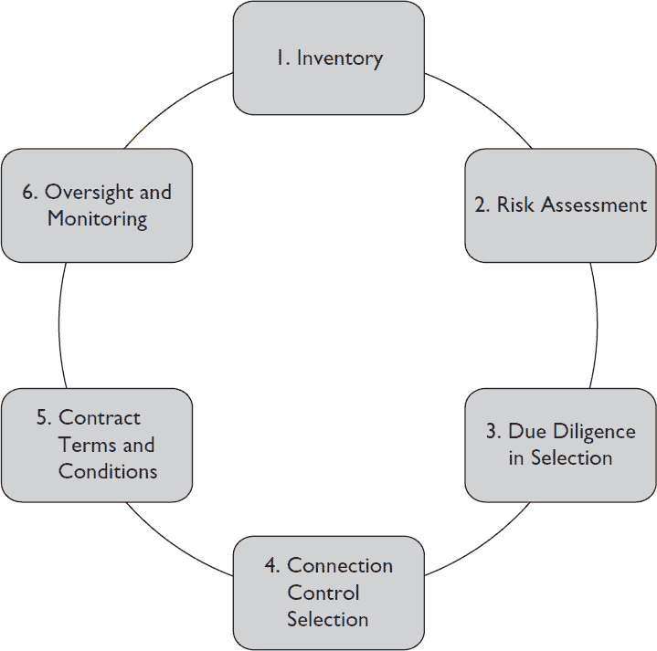

**图 5-1** 管理第三方风险的基本步骤

## 第三方安排的类型

第三方可能在医疗保健组织外部执行工作，也可能不在外部执行。一些第三方就在医疗保健组织员工身边工作。事实上，他们经常做着相同的工作。例如，由于许多医疗保健组织已实施电子健康记录（EHR），连接现有数据系统、设计局域网以及准备安置设备的物理环境所需的工作需要额外的人员配备。因此，医疗保健组织必须采购合同员工的服务，以帮助现有员工及时、高效地完成 EHR 实施。其中一些服务由现场工作的顾问提供，另一些则由可根据需要配置服务或传输数据的远程专家处理。接下来介绍几种基本形式的第三方服务。

## 外包

外包服务、职能和产品非常普遍。据国际预测，医疗保健信息技术外包将以每年约 8% 的速度扩张。这一比例导致支出从 2013 年的 350 亿美元增至 2018 年的约 500 亿美元。^(4) 外包的吸引力在于它允许医疗保健组织更专注于其核心使命、降低成本并获得高技能员工。虽然外包模式超出了信息技术范畴，但医疗保健组织在信息隐私和安全方面与第三方相关的大多数担忧都集中在信息技术流程的外包上。

外包模式包括将关键目标的执行责任完全移交给第三方。同样，这并不意味着医疗保健组织可以移交隐私和安全责任。在某些情况下，外包范围大到医疗保健组织中唯一与第三方有接触的员工就是合同管理人员。该员工可能就是负责管理共享受保护健康信息相关信息风险的人员。在其他情况下，第三方由具备相应资质、能够完成相同任务的医疗保健组织员工指导，但第三方的存在是为了增强该能力。一个典型例子是首席信息官管理合同和第三方人员，而第三方人员为医疗保健组织提供整个信息技术职能。另一个例子是患者管理主管监督所有患者账单职能，并通过第三方供应商完成流程。

完全外包模式的另一个变量是供应商是现场工作还是远程工作。以之前的患者账单场景为例，账单人员很可能在医疗保健组织以外的地点工作。事实上，他们越有可能在家工作。另一个与信息安全相关的例子是托管安全服务提供商（MSSP），受雇提供安全设备和系统（如防火墙和入侵防御设备）的外包监控和管理。^(5) 回到外包信息技术的例子，服务台人员和网络管理员更适合作为医疗保健组织的现场员工。这将便于他们不时参加信息治理会议。也有一些任务要求信息技术人员必须到场，而不是远程访问局域网或最终用户设备。

## 人员增补

与完全外包的服务相比，医疗保健组织可以以更定制化的方式签约支持。之所以在此提及人员增补，是因为在某些情况下，合同员工被视为劳动力成员。他们接受与正式员工完全相同的培训，并拥有相同的信息系统访问权限。根据美国的 HIPAA，这些员工的行为责任可能仍由医疗保健组织承担，而非其第三方雇主。根据法律，他们被视为劳动力成员。^(6) 他们接受医疗保健组织的日常指导，而非其所属公司。这种安排的一个例子是聘请顾问帮助医疗保健组织实施临床应用，可能是在急诊科。合同员工可能在轮班主管的直接监督下完成任务。此类安排的绝佳例子是合同护理人员和临时员工。因此，外包第三方安排与人员增补合同之间的一个重要区别和含义在于，从监管机构的角度来看，数据泄露可能会如何被看待。根据美国法律，由被视为劳动力成员的合同员工导致的数据泄露，其单独责任可能仍归属于医疗保健组织，而不涉及第三方公司。为了说明这一点，如果临时派往医院的护士导致数据泄露，护士派遣机构可能根据 HIPAA 免除责任。这些区别需要法律审查和解释。此处引入它们的目的是作为管理（和评估）第三方风险及其支持交付方式的一部分。

## 医疗保健运营背景下的第三方

通过合同或财务协议支持医疗保健组织、但不受雇于该组织的企业数量和种类相当可观。有几类第三方需要更多解释，因为它们与医疗保健组织的关系会产生影响深远的场景。在这些场景中，会出现一些有趣的担忧，那些保护医疗保健信息的人必须对此有所了解。

在国际数据保护术语中，欧盟医疗保健领域的第三方公司为数据控制者提供服务或产品。根据欧盟《数据保护指令》（DPD），只要建立了安全港协议（用于欧盟外的数据流动）或与数据主管部门已批准条款的标准合同模型，这种关系就是被允许的。^(7) 在美国，这种关系聚焦于医疗保健领域，并通过业务伙伴协议（一种专门类型的合同）进行正式化。这一简要回顾很重要，因为从第三方的角度来看，第三方与医疗保健组织之间的关系可能是非同寻常的。如果它们向其他行业提供类似服务或处理非个人信息，法规指南（如 HIPAA 和欧盟 DPD）的要求可能会颇具挑战性。图 5-2 展示了如何通过业务伙伴协议控制美国境内的信息传输。跨越美国和欧盟边界传输数据则需要另一种类型的行政协议：安全港和标准合同条款。

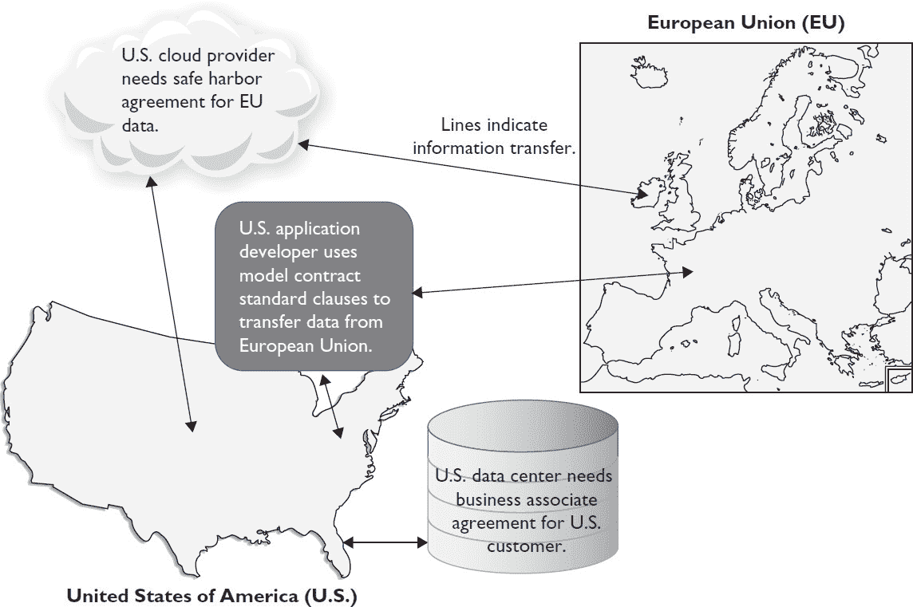

---

## 对医疗保健有影响的第三方具体示例

外部于医疗保健组织、却对患者护理和业务成功至关重要的企业和实体，其数量和种类几乎是无限的。那些代表医疗保健组织处理敏感健康信息的实体，引入了必须加以管理的信息风险领域。以下是第三方支持的具体示例及其信息风险顾虑。

### 云服务提供商

从医疗保健领域新兴的第三方关系之一开始，云服务提供商的例子允许您审视几个重要考量。设想一家云服务提供商，既支持医疗保健客户，也支持零售、银行或教育领域的客户。如果数据传输涉及收集、存储或传输受保护的健康信息，该云服务提供商在美国也必须符合 HIPAA 合规标准。它还必须能够提供其独立审计报告的文档。这除了云服务提供商可能与其其他客户之间存在的任何要求之外。无论如何，医疗保健组织转向云服务的趋势正在国际上发生。这样做有充分的理由，例如前所未有的降低成本压力、改善健康结果以及应对法规变化，仅举几例。云解决方案承诺能帮助医疗保健组织以极低的成本实施复杂的健康信息技术系统。美国国家标准与技术研究院（NIST）特别出版物 800-144 从隐私/安全角度对云计算的利弊提供了极好的概要。^(8) 员工专业化程度提高和资源可用性改善等是优点，而面向互联网的系统和多网托管安排则引入了新的漏洞（对某些客户而言）。

**表 5-1** 云计算模型

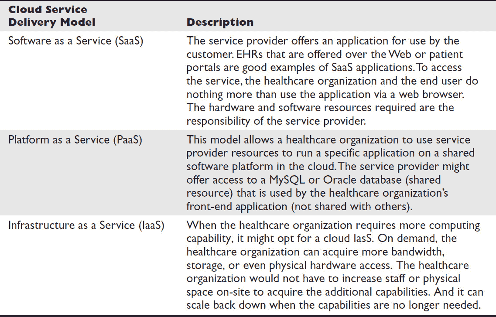

**表 5-2** 云计算格式

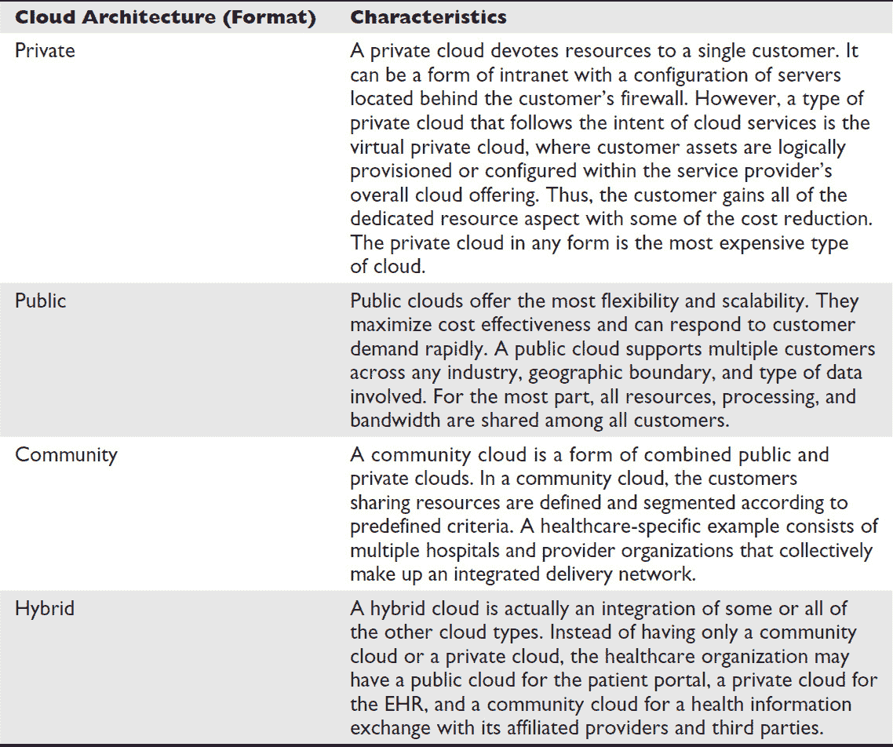

了解云服务产品的类型后，您可以审视医疗保健组织在使用它们时可能面临挑战的一些场景。这意味着在考虑第三方和要使用的云类型，并随时间评估该关系时，会出现信息隐私和安全问题。

---

 **提示** 云服务提供商和数据中心（私有云）是医疗保健领域极其重要的第三方。有了这种理解，您现在可以开始将相同的原则应用于云应用程序，如电子健康记录（EHR）、账单运营或健康信息交换。

### 外聘法律顾问

许多医疗保健组织雇佣有或没有特定医疗保健背景或经验的律师作为内部员工。但即使它们确实有受雇的法律代表，也可能选择聘请（按合同）非医疗保健组织受雇的法律顾问服务，称为*外聘法律顾问*。这些法律专业人士和律师事务所执行许多不同类型的服务，从审查合同语言、合规计划内容（如信息风险管理计划），到医疗保健组织想要确保妥善管理的许多其他管理控制。外聘法律顾问还可能帮助医疗保健组织应对医疗事故索赔、应对数据泄露案件（在美国）、执行取证调查，并在诉讼中代表医疗保健组织。在将其作为第三方进行管理的背景下，必须对处理受保护健康信息的外聘法律顾问进行与执行类似数据使用服务的任何其他第三方相同类型的风险管理审查（优秀的外聘法律顾问会建议其客户这样做！）。

### 数据处置

在信息管理生命周期中，销毁或处置数据是最后一步。这也是最脆弱的步骤之一。^(9) 当数据不再需要时，往往得到的保护较少，因为组织倾向于放松控制。在许多情况下，数据销毁或处置过程由专门从事此功能的外包公司执行。示例包括纸张粉碎、电子介质擦除和硬件回收。无论处置是纸质还是电子格式，医疗保健组织都需要确保其标记为待处置的受保护医疗信息，在使其不可读和不可辨认的最终步骤完成前，始终得到保护。否则，窃取和未经授权的披露就会发生，例如受保护的健康信息从装卸码头被拿走，那里堆放着等待数据处置公司取走的医疗记录。由于许多个人电脑被捐赠给社区组织和学校，数据处置公司可能有权进行捐赠，但任何敏感信息必须从硬盘中彻底清除。医疗保健组织必须进行第三方风险评估和审计监督，以确保其敏感数据不在这类场景下被泄露。

## 非医疗设备

随着打印机、传真机和扫描仪在医疗环境中变得司空见惯，一类特殊的第三方应运而生。如果组织不加以重视，这些设备可能成为数据泄露的源头。因为这些设备通过将纸质文档转换为电子图像来复制、发送电子邮件和传输数据，所以它们通常将图像存储在本地存储介质上。受合同委托维护和服务这些设备的第三方公司可能不知道硬盘中所含数据的性质。但是，如果是敏感的医疗信息，当设备被移走进行维修或更换时，这些数据可能会随之离开医疗组织。与数据处置公司类似，非医疗设备维修和供应公司必须承担合同义务，以保护可能存在的医疗信息。这意味着必须制定适当的销毁、处置和再利用条款。这也意味着医疗组织在风险管理方面承担责任，涉及管理非医疗设备的第三方，包括审计其对受保护健康信息使用情况的合规性。

当然，这些只是作为第三方供应商为医疗机构提供支持的组织类型的一小部分。以下列表仅供一般参考。所有这些都可能成为医疗组织第三方风险管理责任的一部分。

- 医疗转录
- 医生应答服务
- 患者安全或认证组织
- 账单和理赔处理公司
- 健康信息交换（HIEs）
- 第三方健康和药福利管理员
- 数据转换、去标识化和数据分析服务提供商
- 利用审查和管理公司
- 软件供应商和顾问
- 研究人员

## 第三方信息风险对医疗运营的影响

随着敏感健康信息的数据流延伸至医疗组织之外的第三方，出现了新的漏洞。再加上监管机构和付费方日益增长的要求，甚至要求竞争对手之间共享更多数据。要使医疗组织建立稳健的信息保护计划，不仅要知道做什么，还要明白为什么要这样做。以下章节将在医疗运营常见场景的背景下，说明为什么第三方信息风险管理非常重要。

### 国际贸易影响

支持医疗组织的公司越来越具有国际化特征。回到云服务提供商，亚马逊、谷歌和微软就是常见的例子。但还有许多其他第三方通过账单、数据分析和利用审查等提供数据管理服务，并在全球各地设有实体。甚至医疗组织本身也在多个国家设有设施和业务。所有这些都带来了与健康数据跨境交换相关的国际贸易影响。从欧盟在《数据保护指令》（DPD）下的规定来看，很少有国家被批准拥有完善的数据保护流程。它们分别是瑞士、根西岛、阿根廷、马恩岛、法罗群岛、泽西岛、安道尔、以色列、新西兰和乌拉圭。加拿大已被批准处理某些类型的个人数据。^(10) 其他想要处理受欧盟 DPD 保护数据的国家必须建立安全港安排。本书前面已介绍并定义过这一点。在美国，个别公司必须在美国商务部的监督下接受安全港评估。

欧盟医疗组织将敏感数据传输给跨国第三方的另一种方式是采用“标准合同条款”语言。该语言经过数据主管部门（欧盟委员会）预先批准，如果不加修改，从委员会的角度来看提供了充分的保障。

### 监管差异

与国际贸易影响相关，监管标准的差异给国际传输信息的医疗组织带来了担忧。受 HIPAA 约束的美国医疗组织担心，国际数据管理和存储第三方（包括云提供商）没有相同的数据分割、审计和违规通知要求。^(11) 关于审计和监控的国际顾虑也是类似的，即根据欧盟 DPD，数据控制者必须要求提供商记录其执行的处理操作。HIPAA 将要求编纂得更为具体，即医疗组织必须能够证明身份认证、错误报告和信息披露核算。使用国际第三方的医疗组织必须审慎考虑。如果第三方发生数据泄露，在某些情况下 HIPAA 要求的患者通知义务，并不会仅仅因为医疗组织将数据存放在 HIPAA 管辖区之外而放宽。

加拿大和欧盟的医疗组织尤其在安全港或标准合同条款语言之外，还有额外的隐私顾虑。这些政府及其国内医疗组织特别对收集、存储和向美国传输信息的云提供商表示担忧。美国《爱国者法案》允许美国当局在特定情况下查看他们的数据，这使得他们使用美国云服务提供商变得不可取——甚至违法。也就是说，请记住，根据所有主要的隐私和安全法规，访问健康信息都有条款规定法律当局可在获得额外患者同意的情况下访问。例如，英国的《调查权力监管法》与美国《爱国者法案》非常相似，强制规定了类似级别的政府访问权限。

### 灾难恢复和业务连续性

由于患者护理和患者安全问题的关键性，医疗组织在临床上（在许多情况下也是监管上）都要求具备强大的灾难恢复和业务连续性能力。系统停机和健康信息不可用会产生巨大影响。恢复到手工流程并访问早已转换为数字格式的健康信息几乎是不可能的。医学影像和电子健康记录（EHR）产生了前所未有的数据量，给存储、恢复和安全带来了复杂性。设想一位放射科医生需要一位急诊患者的相关既往影像。这些影像不再存储在胶片上。如果无法访问联网的图像归档和通信系统（PACS），可能会发生诊断错误。

将信息资产的托管和存储转移给第三方的医疗组织，必须确保这些第三方维持严格的灾难恢复和业务连续性要求。一些数据中心和云提供商可能声称，医疗对数据可用性的要求比 NIST、ISO 和欧盟 DPD 等现行标准更为严格。无论如何，正常运行时间水平需要根据医疗组织的要求进行定制，即使这与数据中心的所有其他客户不同。这必须在合同和协议中明确规定。

## 灾难恢复与运营连续性策略

合理的灾难恢复和运营连续性策略至关重要，让第三方遵守医疗机构的临床和监管要求也很重要。医疗机构可以利用一些变量来帮助传达这些要求。其中包括*恢复点目标*（RPO）和*恢复时间目标*（RTO）。RPO 是医疗机构允许运营继续前必须恢复的功能水平。否则，医疗机构可能会认为系统或应用程序处于离线或停机状态。该状况可能基于合同确立的参数或监管监督而变得重要。RTO 是医疗机构能容忍的最长停机时间。在某些灾难恢复计划中，停机时间不超过 24 小时可能是行业最佳实践标准。但在医疗领域，24 小时的数据收集丢失或系统不可用通常是不可接受的。RPO 和 RTO 参数在医疗行业可能比其他行业更缺乏弹性，而第三方为增强能力和响应速度收取更高费用，医疗机构将其视为经营成本。

---

>  **提示** 在考虑灾难恢复和运营连续性选项时，一个关键概念是：可以获得更多能力或弹性，但成本更高。

---

医疗机构可以选择采用多种灾难恢复和运营连续性平台。图 5-3 展示了最主流选项之间的成本效益权衡。

---

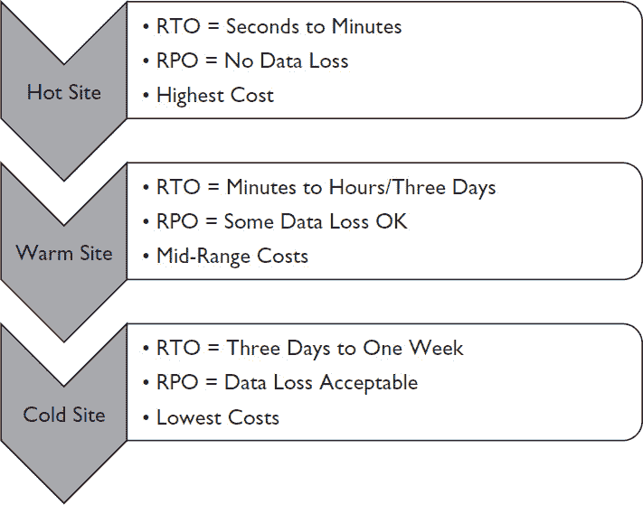

**图 5-3** 灾难恢复和运营连续性替代方案对比

- **热站点** 这是最高关键性系统和应用程序的选择。它是成本最高的选项。热站点是医疗机构的冗余能力。因为它与生产系统并行运行，所以可以瞬间切换。至少，它能在很短时间内准备就绪。
- **温站点** 此选项提供基础设施。它比热站点便宜，但医疗机构预计温站点启动运行会有延迟。
- **冷站点** 这是成本最低的选项。提供电力和物理安全，但设备必须搬入并配置。显然，此选项需要一些时间，除非自然灾害导致原医疗机构站点无法使用，否则可能不适用于医疗机构。

### 未经授权的披露

这似乎显而易见，但第三方对医疗机构有重大影响，因为它们导致了高比例的数据丢失和数据泄露。即使医疗机构拥有健全的风险管理，未经授权的披露仍可能发生。通过适当的合同和法律协议，财务责任可妥善归属于第三方。但从声誉角度来看，医疗机构仍会受到负面影响。例如，患者账单公司接收文件并访问医疗信息数据库。如果第三方办公室遭窃、计算机设备被盗，第三方可能需支付罚款。但患者通知将由医疗机构发出。患者可能不会区分责任方。

---

>  **注意** 美国第三方未经授权披露数据库可在 [`www.privacyrights.org`](http://www.privacyrights.org) 公开获取。如果没有其他用途，查阅该数据库也能清晰地展现第三方未经授权披露对医疗机构影响的频率和程度。

### 管理第三方风险的工具

除了帮助医疗机构监督处理受保护健康信息的第三方的风险管理框架外，还需要其他几类文档和协议。这些有助于医疗机构传达要求、评估绩效，并让所有相关方对合规性负责。如果不使用其中一种或多种管理控制，医疗机构几乎没有理由指望第三方会采取适当的保障措施或做出足够快的响应，特别是在医疗机构的期望超出第三方来自其他行业的其他客户的期望时。以下示例是几种主要类型。可能还有其他类型，也可能存在有效的组合，但此处仅提及少数。

#### 服务级别协议

医疗机构可选择使用其与第三方之间的书面协议，称为*服务级别协议*（SLA）。这些可以是具有法院可强制执行的约束条件的法律合同，也可以是双方之间的非正式义务。无论哪种方式，SLA 都有若干条款。

- 服务定义
- 绩效衡量
- 问题升级
- 客户职责
- 担保
- 灾难恢复
- 协议终止

最有效的 SLA 会安排客户和服务提供商会面讨论持续运营的时间。如前所述，这种沟通可整合到整体风险管理过程中，将风险评估和缓解相关问题也纳入 SLA 监控中。但 SLA 涵盖的不仅仅是风险管理。根据所提供的服务，服务提供商有义务提供信息可用性、硬件和软件升级或总体客户服务改进。简而言之，SLA 可被视为风险管理过程中的一项额外管理控制。SLA 应被强制执行，但应允许根据情况变化进行修改。沟通是确保 SLA 不僵化的关键，有助于医疗机构和第三方建立成功的合作伙伴关系。

为保护贵组织的医疗信息，您可能需要管理一份或多份 SLA。SLA 可能是您整体风险管理策略的一部分。以下是妥善管理您职权范围内 SLA 的一些建议：

- 积极主动，定期审查合规性。
- 建立可衡量的目标，以
  - 满足业务或临床标准
  - 遵守法律或监管要求
  - 服务提供商同意满足
- 持续监控这些目标。
- 与第三方沟通。
- 向医疗机构内部的信息治理部门沟通。

开展这些活动有助于您履行职责。更重要的是，积极的监督能让 SLA 最大程度地发挥高效和有效的作用。太多 SLA 签署后就被搁置，只有在发生数据泄露或服务水平降低到协议面临因违约而终止的地步时才被重新审视。

#### 合同（标准与惯例）

当需要正式、具有法律约束力的文件时，可使用合同。这些合同将包含标准、惯例和条款，其正式程度和执行力度超过 SLA。合同条款有助于解决数据安全问题。每份合同都有差异，因此难以用一个总体模板说明。但存在一些共性。

## 第三方合同条款

首先，合同应要求第三方遵守医疗保健组织所遵循的相关隐私和安全标准，包括内部政策和程序。此外，合同将包含与以下内容相关的条款和条件：

- **合规** 第三方必须遵守相关法规。在美国，这从 HIPAA（健康保险流通与责任法案）开始。合同可以是业务伙伴协议（BAA），或者 BAA 可以是整份合同的一部分。第三方将不得不遵守相关州法律。这必须在合规部分专门涵盖。在国际上，如果存在跨境数据传输，此部分是你会找到其他国家法律（如欧盟数据保护指令）合规要求的地方。除了遵守法律之外，还包括遵守非法律的标准。例如，第三方必须遵守的支付卡行业（PCI）数据安全标准或适用的美国国家标准与技术研究院（NIST）标准将包含在本节中。

- **保密性** 如果有要求第三方处理敏感医疗保健信息，则必须存在保密条款。这是定义信息、解释允许的用途、描述禁止的用途，以及在合同终止时概述返还或处置条款的地方。

- **数据丢失预防与响应** 第三方将承担预防数据丢失的责任。它们还需要知道如何通过遵守医疗保健组织的事件响应政策以及任何管辖的监管指南，来应对任何潜在或实际的数据丢失。合同应相应地分配责任并概述程序。

- **赔偿** 有人会辩称，涵盖赔偿的条款可能是合同中影响最大的部分。赔偿，即出现问题时损害赔偿或补偿的条款，在发生安全漏洞或个人信息滥用时变得至关重要。合同语言还包括承保数据丢失事件的保险。如果患者居住国有通知义务，将予以提供。此外，赔偿条款将包括配合调查和解决行动的义务。在某些情况下，医疗保健组织将希望增加条款以控制这些调查以及向患者或监管机构发出的任何通知行动，即使供应商负担部分或全部相关费用。

- **责任限制** 如果第三方导致数据丢失或泄露，合同应限制医疗保健组织的责任（或使其免责）。另一方面，可以对第三方的责任施加限制，因为过高的门槛或无限责任可能远超合同价值。没有多少第三方供应商会接受那么大的风险。它们可能会选择不向医疗保健组织提供服务。这是一个微妙的平衡。但是，医疗保健组织需要受到保护，免受因第三方未能履行职责或遵守适用法律而导致的不当诉讼。

## 供应商管理框架

我们已经介绍并解释了医疗保健组织可用于评估和管理内部风险的几个领先风险管理框架。毫无疑问，这些相同的工具可用于评估和管理第三方供应商。应对每个外部供应商进行相同的风险评估和补救工作，重点关注其为保护您的信息而建立的流程、政策和控制措施。我们将不在此重复关于领先风险管理工具的信息，例如 NIST RMF、NIST HIPAA 安全规则（HSR）工具或 ISO 27000 系列标准，但请记住，这些相同的工具可应用于为您的组织处理受保护健康信息的第三方。

一个作为供应商风险专用框架呈现的领先风险管理框架是美国财政部的货币监理署（OCC）。^(12) 此处介绍它是因为该框架被国际上许多领先的评估组织使用，例如 Shared Assessments（共享评估）。Shared Assessments 成立于 2005 年，业务遍及全球 115 多个国家（主要在金融行业）。^(13) 它专门评估处理敏感信息的第三方供应商。与之前讨论的模型相比，你可以在这个生命周期风险管理模型中看到一些相似之处。几个不同之处在于合同谈判（例如 SLA）和终止阶段。这些阶段如下：

- **规划** 类似于盘点所有第三方或数据系统的风险管理阶段，为外包数据处理进行规划是第一步。

- **尽职调查与第三方选择** 寻找替代方案、评估过往表现（推荐信），甚至在与潜在第三方签约前进行定制化评估，所有这些都体现了适当的管理。

- **合同谈判** 回到使用 SLA 来定义期望和衡量绩效，或使用具有法律约束力条款和条件的更正式的合同，第三方与医疗保健组织的关系必须受管理控制的管辖。

- **持续监控** 定期审计和评估对于确保合规性是必要的。请记住，第三方关系不是一种签完文书就置之不理的静态关系。

- **终止** 一旦合同结束（无论是履行期结束还是因为第三方未能履行），必须安排以其他方式继续服务，并安全地返还或处置所有敏感健康数据。

OCC 生命周期（参见图 5-4）还整合了一些适合我们所涵盖的其他风险管理框架的总体概念。以下是一些示例：

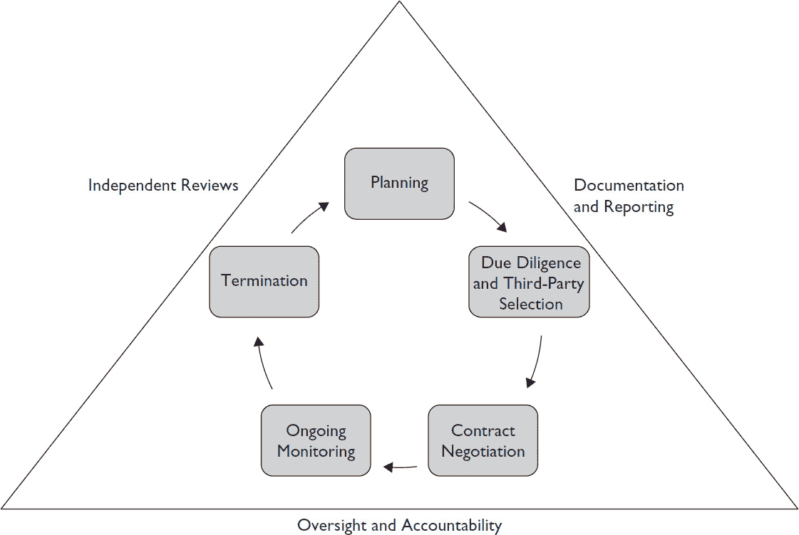

***

**图 5-4** OCC 版第三方风险管理生命周期

- **监督与问责** 当然，医疗保健组织必须有人对合同负责。他们应对结果负责，并融入医疗保健组织的信息治理结构中。

- **文档记录与报告** 作为信息治理结构的一部分，责任人必须能够传达相关细节、事件和绩效衡量指标。所有这些都必须记录在案并保留。

- **独立审查** 除了定期评估和审计（包括现场和通过供应商自我评估远程进行）之外，客观的独立评估也是最佳实践。请记住，访问/审查第三方已保留的客观审计报告是可靠的风险管理组成部分。例如，认可 FISMA 评级、ISO 认证、SSAE 16 和萨班斯-奥克斯利法案（SOX）审计结果。

## 确定何时需要第三方评估

## 对第三方评估和审计的支持

每个组织都必须确定何时以及如何评估其第三方。当然，存在一些监管压力。通常，评估应每年进行一次。但在任何情况下，组织的供应商管理标准都将设定预期。回到第三方评估的第一步，建立资产清单和风险等级将有助于确定评估的频率和性质。组织可以选择允许自我评估、支持远程评估，或坚持现场审计。

除了定期安排的（如年度）活动外，有时可能需要非周期性评估。以下是一些可能触发第三方评估的事件：

- 未能履行合同或 SLA
- 涉及另一组织的数据泄露
- 关键岗位人员变动
- 信息中断和不满意的灾难恢复
- 领导层询问或关注事项
- 可能重新竞标新供应商

医疗信息隐私和安全专业人员的主要职责是帮助组织和实施对第三方所需的评估和审计。第三方审计的总体考量将在于该活动是否将被实施。

- **自我评估**：供应商填写医疗机构提供的调查问卷。
- **现场评估**：由医疗机构员工在现场通过观察和访谈进行。
- **远程评估**：无论是否有自我评估，均利用相关第三方材料（如过往绩效证明、营销材料、针对第三方的任何法律诉讼等）对第三方供应商进行审查。
- **混合评估**：此方法结合了现场和非现场方法。

基于第三方引入的风险程度或组织对第三方的熟悉程度等因素，将选择一种评估方法。这适用于规划或选择阶段的初始评估，也适用于年度或定期评估过程。如果第三方供应商因潜在数据丢失事件触发非周期性评估，当然可以选择与以往评估不同的方法。也就是说，因为 SLA 或合同是风险转移工具，它可以帮助确定评估方法的类型。

下一步可能是您参与第三方风险评估过程中的最大障碍。仅仅因为第三方不属于医疗机构，并不意味着有特殊理由降低组织内部的标准。第三方必须具备合同和法律要求的控制措施。例如，如果有信息安全和隐私培训要求，免除供应商的培训义务是不可接受的。有时医疗机构会倾向于认可供应商接受医疗机构提供的培训。不幸的是，在大多数情况下，这不符合要求。请记住，必需培训的一个组成部分是针对该特定组织（指第三方）的政策和程序进行培训，而不是医疗机构的政策和程序。这是一个例子。另一个例子是无法进入第三方的设施。如果承包商 SLA 中协商的条款和条件允许医疗机构访问现场并进行检查，那应成为审计的一部分。因第三方不愿配合检查而放松该标准，会给医疗机构带来过度风险。

面对不遵守评估和审计要求的第三方供应商时，您在组织中的角色是记录发现并将其报告给高层领导。这是一个极其重要的角色。妥善组织此类评估（正确的方法、有效的评估工具、遵循合同、沟通所有发现）是降低第三方数据泄露风险的关键。再次强调，您知道多项行业调查结果表明，第三方通常是导致数据泄露的常见原因。根本原因往往是我们刚才描述的缺乏监督和逃避监管的倾向。

---

> **提示**  
>   
> 本书最佳的应用方式是将其作为资源来完善和执行内部流程。本章强调了这一重点。虽然外部报告程序和对法规变化的关注至关重要，但大多数医疗信息安全和隐私专业人员的日常使命是内部聚焦的。确保任何合规工作都与医疗临床和业务职能相结合，并满足成本效益分析的要求。在审视此类问题对组织的影响之前，避免盲目追求最佳实践和应对法律或管理指令的变化。

### 推广信息保护，包括风险管理

根据每一个领先的隐私和安全框架或监管标准集，培训和意识都是信息安全计划的强制性组成部分。作为医疗信息隐私和安全专业人员，您将负责设计和实施组织的计划，并在整个组织中提升信息保护意识。表 5-3 概述了一些要求培训和意识的领先框架和监管标准。从这个角度来看，您可以了解一些行之有效的培训和意识计划的共同组成部分。

**表 5-3** 要求培训和意识的框架和标准

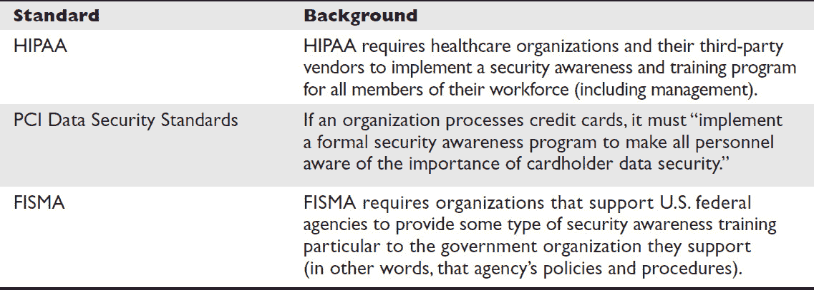

#### 培训

整个安全意识计划应包含多种培训机会，持续让医疗机构人员铭记信息保护。即使制定了最好的政策和程序，如果没有针对安全政策、隐私政策和事件响应政策的适当培训（特别是关于管理第三方风险方面），组织可能会发现它们几乎毫无用处^(14)。以下是一些最常见的提供培训的机会（其中许多是强制性的）：

- 入职时（甚至包括临时员工）
- 每年
- 事件发生后（吸取教训）
- 利用时事（通过通讯或分发列表电子邮件）
- 人员晋升和表彰时
- 随技术、法规或流程变化而产生的专题培训

作为新员工和年度培训计划的一部分，美国大多数医疗机构将提供 HIPAA 和信息安全意识培训。在国际上，要求也类似。欧盟 DPD 要求员工每年接受保密义务培训。培训内容肯定会因国家而异，也因美国的一家医疗机构与另一家而异。事实上，培训没有强制性的课程大纲。大多数培训是在组织内部开发的。然而，这些通用培训主题应当包含：

- 负责人员的姓名和联系信息（隐私官、信息安全官等）
- 现行法规背后的历史和背景（HIPAA、欧盟 DPD、PHIPA 等）
- 与监管要求相关的组织特定政策

## 关键主题

- 敏感健康信息（美国的受保护健康信息）的定义和示例，以及此类信息存在的典型场景
- 与降低数据丢失风险相关的预防活动
- 发生潜在和实际数据丢失时的事件报告流程

## 内部营销

面向医疗保健组织员工和第三方供应商的内部营销是一种培训形式。如果做得正确，它比单纯的培训更能帮助塑造组织文化。营销专业人员使用的一些标准工具可以通过海报、竞赛和徽标来提高意识，从而帮助员工遵守信息保护规定。许多医疗保健组织将利用建议计划和热线来增强其内部意识计划，以帮助完善营销流程。总之，与培训相比，营销往往被视为一种更积极、更乐观的沟通工具。

## 安全意识计划要素

与任何计划一样，必须衡量绩效以确定安全意识计划的有效性。谈到培训课程，测试人员以确保其具有可接受的理解水平非常重要。因此，至少对于新员工和年度信息保护培训，都需要进行考试或评估测试。但是，还有其他方法来评估安全意识计划的有效性。其中一种方法是进行模拟数据泄露。

起初，大多数医疗保健组织可能会犹豫是否自愿经历数据泄露。但测试流程具有额外价值，可以了解哪里可以改进。就意识计划而言，它比几乎任何其他评估工具都能更好地演示和强化培训和营销。模拟数据泄露可以通过利用医疗保健组织的风险评估并结合典型威胁来开发可能的场景来进行。如果内部威胁最有可能发生，则围绕记录窥探或笔记本电脑丢失开发场景。让相关人员演练在内部报告事件、调查和补救数据丢失所需的行动。如果场景允许，第三方供应商可以参与。

---

 **注意**   第三方本身没有义务参与模拟数据泄露。然而，第三方有义务测试和评估其自身的备份计划和灾难恢复流程。医疗保健组织可以开发与其第三方计划相结合的模拟数据泄露场景。结果将是没有合同问题，并获得关于涉及第三方的数据泄露可能如何发生的有意义的经验教训。

如果有采取组织外部步骤的需求（如患者通知），可以进行模拟。在所有情况下，都应记录该事件。事后，可以召集信息治理利益相关者（可能包括信息管理委员会）召开会议，以审查调查结果。总之，模拟数据丢失不仅有助于衡量组织的意识水平，还满足了测试和评估相关信息保护程序（包括第三方）的若干要求。如果场景涉及第三方导致的数据丢失，该第三方也可能发现一些改进领域。

## 章节回顾

您现在对管理医疗保健领域第三方风险有了更全面的方法。随着技术的进步、成本控制压力的持续增加以及难以获得专业人员，这些关系的价值将继续增长。医疗保健组织将不得不外包其许多服务和产品，并共享对受保护健康信息的访问权限。然而，毫无例外地，医疗保健组织和数据收集者在维护该信息的隐私和安全方面的责任，不能随信息共享而外包。因此，了解如何适当管理第三方风险是医疗保健信息隐私和安全专业人员的核心能力。

当然，在医疗保健组织内建立一种重视管理这种风险的文化并非易事。您还了解了一些通过培训和营销计划在组织内建立意识的方法。此类计划的有效性可以通过模拟数据泄露来证明。如果一切做得好，我们希望医疗保健组织经历的唯一数据泄露将是模拟性质的。

### 复习问题

1.  **将健康数据管理外包给第三方是：**
    - **A.**  在美国不受法律监管，但在加拿大受监管
    - **B.**  在美国和欧盟是非法的，但在加拿大不违法
    - **C.**  包含在领先的隐私和安全框架中
    - **D.**  降低了医疗保健组织的信息风险

2.  **为妥善管理第三方信息风险，医疗保健组织应：**
    - **A.**  列出处理受保护医疗信息的所有第三方清单
    - **B.**  指派一名客观的临床员工审查所有服务级别协议
    - **C.**  对所有需要处理受保护健康信息的服务使用同一供应商
    - **D.**  确保获得患者同意，其中包括与第三方共享信息

3.  **判断正误** 最终用户许可协议是美国用于管理第三方信息风险的一种管理控制。

4.  **与数据中心提供商签约以管理异地存储是以下哪项的示例：**
    - **A.**  人员增补
    - **B.**  公有云
    - **C.**  社区云
    - **D.**  外包

5.  **建立安全港协议对国际贸易的影响是：**
    - **A.**  美国云服务提供商可以与欧盟医疗保健组织签约
    - **B.**  数据保护机构将提供示范合同标准条款
    - **C.**  美国政府可以访问欧盟数据控制者的健康数据
    - **D.**  美国医疗保健组织可以使用欧盟的利用审查公司

6.  **在捐赠给学校的笔记本电脑上访问健康数据，属于信息生命周期哪个阶段的数据泄露示例？**
    - **A.**  使用
    - **B.**  维护
    - **C.**  分发
    - **D.**  处置

7.  **绩效衡量标准和问题升级程序将见于 \_\_\_\_\_\_\_\_\_\_\_\_\_\_\_\_\_\_\_\_\_\_\_\_。**

8.  **在监控第三方时，医疗保健组织应：**
    - **A.**  确保外部法律顾问进行检查
    - **B.**  将其纳入信息治理小组
    - **C.**  根据需要进行年度和定期审计
    - **D.**  指派董事会成员对其进行面谈

9.  **判断正误** 目前的第三方患者账单公司办公室发生了入室盗窃。没有东西被盗或丢失。医疗保健组织客户可能采取的一个行动是审计目前的患者账单公司。

10. **促进组织对第三方信息管理的隐私和安全问题意识，最具成本效益的方法之一是：**
    - **A.**  投资仅靠软件的数据丢失防护应用程序
    - **B.**  由临床领导人员对第三方进行审计

## Answers

### 1. **1.** **C.**
允许与第三方共享信息的规定包含在国际监管指南以及隐私和安全原则中。因此，选项 A 不正确，因为美国和加拿大都对健康信息的第三方使用进行监管。在欧盟、美国和加拿大，利用第三方支持医疗保健完全合法，适当的健康信息共享也是合法的，所以选项 B 不正确。最后，本章的要点是引入与外部第三方组织的信息共享固有地增加了信息风险，所以选项 D 不是正确答案。

### 2. **2.** **A.**
医疗保健组织应采取的第一步是清点所有处理健康信息的第三方及其提供的服务。选项 B 不正确，因为让临床工作人员参与虽有益处，但不是流程中的适用步骤。为所有必需服务使用同一供应商极不可能，且成本可能过高。选项 C 不合适。将健康信息传输给支持医疗保健运营的第三方，不一定需要患者同意。因此，选项 D 不是正确答案。

### 3. **3.** **FALSE.**
业务伙伴协议是 HIPAA 要求的；因此，它以美国为中心。

### 4. **4.** **D.**
在可用选项中，外包是唯一符合场景的选项。如果没有异地变量，人员增补可能是正确的。选项 A 不是最佳答案。选项 B 和 C 不正确，因为社区云服务和公共云服务都不太可能托管受保护的健康信息。

### 5. **5.** **A.**
安全港允许欧盟医疗保健组织向满足要求的美国公司传输敏感数据。该协议仅适用于美国公司，而非政府，所以选项 C 不正确。选项 B 不正确，因为标准合同条款是替代安全港协议使用的。选项 D 无关紧要，因为安全港协议是欧盟的要求。美国医疗保健组织将受 HIPAA 约束，而欧盟审查公司则不受约束，因此第三方合同可能不会发生。但这与安全港无关。

### 6. **6.** **D.**
数据泄露可能发生在信息管理生命周期的任何步骤中，但许多发生在处置阶段，因为当数据不再需要并被标记为待处置时，数据用户会放松控制。该场景描述了数据经过使用、维护和分发阶段后发生的未授权访问。选项 A、B 和 C 不是正确答案。

### 7. **7.** **服务级别协议 (SLA)。**
根据定义，服务级别协议包含用于评估第三方的性能衡量标准。

### 8. **8.** **C.**
医疗保健组织需要对处理受保护健康信息的第三方进行年度或定期审计。就此回答而言，选项 A、B 和 D 在可行性和成本方面均不正确。董事会成员不太可能将面谈单个第三方组织作为风险评估措施。不过，董事会成员有可能作为“行业日会议”的一部分与一批第三方供应商会面。聘请外部法律顾问成本高昂，除非存在高风险且医疗保健组织希望获得更正式的解读，否则外部法律顾问不太可能参与第三方风险监控。虽然让第三方参与医疗保健组织内部的一些信息风险管理活动，但让他们成为任何内部董事会和委员会的常规成员是不切实际的。

### 9. **9.** **FALSE.**
该场例说明了潜在的数据泄露，进行周期外评估是个好主意。

### 10. **10.** **D.**
这具有成本效益但常被忽视，但提供关于管理第三方风险（以及保护医疗保健信息）的培训是正确答案。选项 A 的成本可能低于购买硬件技术，但无法保证应用的有效性。选项 B 暗示了高成本，即使用临床人员协助审计而不提供患者护理。选项 C 可能也没有用，因为在互联网上发布服务级别协议无法为这些服务的普通用户提供背景或解释。组织意识并未提高。

## References

1. **1.** Kolbasuk-McGee, Marianne. “Google、Amazon 调整以满足 HIPAA 要求。云供应商签署业务伙伴协议。医疗保健信息安全。” 2013 年 10 月 9 日。于 2014 年 3 月 10 日访问，网址：[www.healthcareinfosecurity.com/google-amazon-adjust-to-hipaa-demands-a-6133](http://www.healthcareinfosecurity.com/google-amazon-adjust-to-hipaa-demands-a-6133)

2. **2.** 美国注册会计师协会 (AICPA) 和加拿大特许会计师协会 (CICA)。公认隐私原则。第 3 页。于 2014 年 3 月 21 日访问，网址：[www.aicpa.org/InterestAreas/InformationTechnology/Resources/Privacy/GenerallyAcceptedPrivacyPrinciples/DownloadableDocuments/GAPP_BUS_%200909.pdf](http://www.aicpa.org/InterestAreas/InformationTechnology/Resources/Privacy/GenerallyAcceptedPrivacyPrinciples/DownloadableDocuments/GAPP_BUS_%200909.pdf)

3. **3.** HIPAA 综合规则。根据《经济与临床健康信息技术法案》和《遗传信息非歧视法案》对 HIPAA 隐私、安全、执法和泄露通知规则的修改；对 HIPAA 规则的其他修改。执行摘要。第 1 部分 A 款 (ii)。于 2014 年 3 月 3 日访问，网址：[www.gpo.gov/fdsys/pkg/FR-2013-01-25/pdf/2013-01073.pdf](http://www.gpo.gov/fdsys/pkg/FR-2013-01-25/pdf/2013-01073.pdf)

4. **4.** Markets and Markets。医疗保健 IT 外包市场——按应用分类 [提供方 (EHR, RCM, LIMS) 支付方 (CRM, 索赔管理, 欺诈检测, 计费) 生命科学 (ERP, CTMS, CDMS) 运营 (SCM, BPM) 和基础设施 (IMS, 云计算)] 和行业——全球预测至 2018 年。2013 年 8 月 7 日。于 2014 年 3 月 13 日访问，网址：[www.rnrmarketresearch.com/healthcare-it-outsourcing-market-by-application-provider-ehr-rcm-lims-payer-crm-claims-management-fraud-detection-billing-life-science-erp-ctms-cdms-operational-scm-bpm-infrastruc-market-report.html](http://www.rnrmarketresearch.com/healthcare-it-outsourcing-market-by-application-provider-ehr-rcm-lims-payer-crm-claims-management-fraud-detection-billing-life-science-erp-ctms-cdms-operational-scm-bpm-infrastruc-market-report.html)

5. **5.** 作者注：Gartner 是医疗保健 IT 问题的绝佳资源。Gartner。IT 词汇表。于 2014 年 3 月 19 日访问，网址：[www.gartner.com/it-glossary/mssp-managed-security-service-provider](http://www.gartner.com/it-glossary/mssp-managed-security-service-provider)

# 参考文献

**6.** 美国卫生与公众服务部 (HHS) 民权办公室 (OCR)。业务伙伴（改编自 HIPAA 隐私规则 [45 CFR 164.502(e), 164.504(e), 164.532(d) 和 (e)]）。2003 年 4 月 3 日。2014 年 3 月 4 日访问，网址：[www.hhs.gov/ocr/privacy/hipaa/understanding/coveredentities/businessassociates.pdf](http://www.hhs.gov/ocr/privacy/hipaa/understanding/coveredentities/businessassociates.pdf)

**7.** 欧盟委员会。向第三国传输个人数据的标准合同条款。2014 年 3 月 19 日访问，网址：[`ec.europa.eu/justice/data-protection/document/international-transfers/transfer/index_en.htm`](http://ec.europa.eu/justice/data-protection/document/international-transfers/transfer/index_en.htm)

**8.** NIST 特别出版物 800-144。公共云计算中安全与隐私指南。2011 年 12 月。第 3 节，第 8–13 页。2014 年 3 月 30 日访问，网址：[www.nist.gov/customcf/get_pdf.cfm?pub_id=909494](http://www.nist.gov/customcf/get_pdf.cfm?pub_id=909494)

**9.** Swire, Peter P., and Kenesa Ahmad. “Common Principles and Approaches to Information Privacy and Data Protection.” Foundations of information privacy and data protection: a survey of global concepts, laws and practices. International Association of Privacy Professionals, 2012. p. 12. Print.

**10.** 欧盟委员会。关于第三国个人数据保护充分性的委员会决定。2014 年 3 月 19 日访问，网址：[`ec.europa.eu/justice/data-protection/document/international-transfers/adequacy/index_en.htm`](http://ec.europa.eu/justice/data-protection/document/international-transfers/adequacy/index_en.htm)

**11.** 云标准客户委员会。云计算对医疗保健的影响。2012 年 11 月。2014 年 3 月 28 日访问，网址：[www.cloudstandardscustomercouncil.org/cscchealthcare110512.pdf](http://www.cloudstandardscustomercouncil.org/cscchealthcare110512.pdf)

**12.** 货币监理署 (OCC)。美国财政部。第三方关系。风险管理指导。2013 年 10 月。2014 年 3 月 11 日访问，网址：[www.occ.gov/news-issuances/bulletins/2013/bulletin-2013-29.html](http://www.occ.gov/news-issuances/bulletins/2013/bulletin-2013-29.html)

**13.** Shared Assessments。关于 Shared Assessments。2014 年 3 月 22 日访问，网址：[`sharedassessments.org/about`](https://sharedassessments.org/about)

**14.** Travis, Breaux. “The Roles of Governance and Risk Management in Driving a Culture of Trust.” Introduction to IT Privacy. International Association of Privacy Professionals, 2014. p. 247. Print.

---

## 第 6 章：信息安全与隐私事件管理

## 学习目标

在本章中，您将学会：

- 理解数据事件管理的各个阶段
- 识别事件、事故与数据泄露之间的区别
- 应用事件响应团队成员的职责
- 理解第三方导致事件时所需采取的行动
- 考察数据泄露的外部通知要求

---

故事始于周末前夕。周五下午，健康记录专员 Sally 即将结束一天的工作。在忙碌了一周后，她期待着一个休息放松的长周末，此时她几乎已完成组织的*清洁桌面政策*要求。想到之所以每天离开前都必须确保桌面和工作区域没有纸张、文件和电子介质，竟是她自己一手促成的，Sally 不禁莞尔。在获得健康信息隐私与安全认证后，Sally 协助组织制定并实施了清洁桌面政策及其他若干政策，从而改善了整体信息安全计划。“当无人在场时，桌面或工作区凌乱不堪，无异于邀请加班人员或路过者窃取纸质和电子健康信息。桌面必须尽可能保持整洁，”她对医疗首席信息官说道。

今晚是个重要的夜晚。Sally 盼望着早早离开办公室。这时电话响了。“你好，我是 Sally，健康信息管理部。有什么我能帮您的？”电话那头的声音听起来很担忧。

“是的，希望您能帮上忙，”他结结巴巴地说。“我叫 Jack，在儿科工作。”

“好的，Jack，请讲。”

“是这样的，我当时在与市中心的一位医疗服务提供者合作，把她在这里就诊的所有患者名单发给了她。”

Sally 安抚道：“没事。您加密数据了吗？”

“没有，”Jack 回答，“那怎么加密？”

“那我们稍后再说，”Sally 告诉他。“也许还没出大问题。告诉我，您只发给了那位医生这一个收件人吗？”

“问题就出在这儿，”Jack 脱口而出。“我本想发给儿童医院的 Mary Ann Williams。但我的邮件自动填入了另一位 Williams——确切说是 Andrew Williams。”Jack 继续说道，“我没注意就点击了发送。Andrew Williams 是当地报社的记者。那个文件里有 500 多位患者的姓名、病历号、预约日期和就诊原因。”Jack 垂头丧气。“我也不知道为什么会有他的邮箱地址，但确实有。”

Sally 叹了口气。她知道周末计划泡汤了。“Jack，我们得做些工作了，”Sally 镇定地说。“此时，我们必须启动组织的事件报告流程。”

您刚读到的故事是虚构的。然而，它基于事实，且频繁发生。Sally 接下来的行动至关重要。Sally 将启动（并可能主导）医疗机构的事件报告流程。在本章中，我们将讨论事件响应团队的行动、通知程序，以及医疗机构中保护信息人员的职责。

凡在包含医疗信息安全与隐私职责的岗位上工作过的人，都曾接到过深夜或半夜的电话，报告可能发生的数据泄露。在电话响起前就知晓该怎么做（即事件响应流程），对信息安全计划至关重要。最佳的事件响应程序要求来自信息技术部门内外的各方进行妥善管理和提供充足资源。通常情况下，IT 部门牵头负责整体工作。提前，负责事件报告的人员必须建立并发布事件处理指南。团队还应具备分析与事件相关数据的能力，以改进未来的行动。

## 定义

从一些定义开始，信息安全通知涉及两大类关注点。*事件* 是指系统或网络中任何可观察到的发生。事件可以是授权操作，例如用户发送电子邮件或服务器接收网页请求。如果事件产生负面影响，则称为*不利事件*。通常，这些是与系统软硬件功能相关的活动。例如，系统崩溃、未经授权访问敏感信息、病毒感染网络导致数据丢失。事件也可能与物理安全问题相关，如自然灾害和停电。

当采取的行动违反信息安全策略、可接受使用策略或标准安全实践时，该行动即为 `incident`。许多外部攻击均属于 `incident` 的定义范畴（而非 `event`）。旨在诱骗授权用户访问可能在网络上安装恶意软件的恶意网站的垃圾邮件或网络钓鱼尝试，也是另一个例子。`Incident`（相对于 `event`）通常受人为行为影响。

区分这些活动类型有助于进一步判断：该活动是否需要升级或仅在内部报告，抑或需要向组织外部通报（例如向政府监管机构或患者）。在医疗信息场景中，需要报告和通知的 `incident` 和 `event` 称为 `data breaches`。并非所有 `incident` 或 `event` 都是 `data breaches`，但所有 `breaches` 都始于 `incident` 或 `event`。在美国，HIPAA 通过定义 `breaches` 为未经许可的使用或披露受保护的健康信息（除非涵盖实体或业务关联方（如适用）能够根据风险评估证明受保护的健康信息被泄露的概率很低），指导医疗机构处理此领域事务。^1 如果组织能确定 `incident` 或 `event` 不达到披露风险阈值，则无需向患者或监管机构报告该 `incident` 或 `event`。

---

 `TIP` 再次强调，超过披露风险阈值的 `data breaches` 有两类。关键变量是涉及的个人记录数量。需牢记的重要数字是 500。少于 500 条记录的泄露，在医疗机构外部的报告要求较不严格。涉及 500 条个人记录时，外部通报要求立即联邦监管通报。

根据 HIPAA 规定，`data breach` 风险评估方法论旨在确定信息披露的风险。作为第一步，`incident response team` 需评估以下内容：

- **披露了什么？** 对受保护健康信息（PHI）中的标识符进行分类和定义，并评估这些要素组合识别个人的可能性。
- **谁使用了数据？** 识别未经授权使用、接收或访问 PHI 的人员。
- **PHI 是否实际被查看或使用？** 有时即使未经授权的人员有访问权限，也未发生披露。
- **采取了哪些行动来限制未经授权的披露？** 概述为减轻额外 PHI 披露风险所采取的措施。

在美国境外，通常没有通知受影响个人或政府的普遍要求。当然，领先的隐私框架和监管机构认为通知受影响个人和监管机构（数据主管部门）是最佳实践。他们强烈鼓励报告 `data breaches`。然而，国际上尚无相当于 HIPAA 的报告要求。随着政府认识到通知既是防止数据丢失的手段，也是减轻数据丢失总体影响的缓解措施，这一现状正在改变。例如英国 2003 年《隐私和电子通信（EC 指令）法规》（PECR），要求公共电子通信服务提供商（如互联网服务提供商、电信提供商等）向数据保护机构（政府）报告个人数据泄露。不过，通知客户仍非强制性。

## 事件处理活动时间线

处理数据 `incident` 有几个不同阶段。这些阶段在 `incident` 发生前就已开始。在准备阶段，组织通过建立和培训 `incident response team` 来做准备。团队配备适当资源和所需工具。检测 `incident` 是第二阶段。此阶段会产生警报和错误报告。后续阶段包含组织在遏制、根除和恢复方面将采取的所有行动。请注意，组织将持续重新评估系统（就像在检测和分析阶段所做的那样），因为可能存在额外的漏洞利用。当组织恢复且 `incident` 得到处理后，将开展事后活动。此阶段会报告经验教训，以帮助预防下一次数据 `incident`。图 6-1 展示了 `incident` 活动的时间线。

---

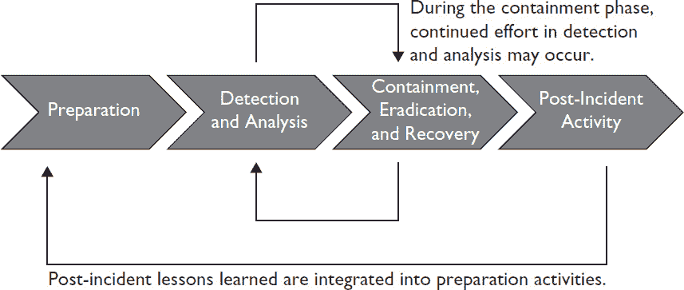

**图 6-1** 数据事件管理阶段

为更具描述性，此处确定的阶段需要进一步解释。以下各节包含各阶段活动和成果的一些示例。

### 准备

此阶段建立策略、流程、程序和协议，以指导安全 `incident` 的管理和响应。设定组织对优先级和响应时间的预期。`incident response team` 预先确定将用于未来取证的审计和日志。在准备阶段，团队还可通过贡献和记录信息风险评估来协助预防 `incident`。作为准备工作的一部分，`incident response team` 应获得足够的工作空间。他们还应提前获取硬件（笔记本电脑、智能手机等）和软件（数据包嗅探器、数字取证工具等），以便在 `incident response` 中使用。同样，关键在于提前完成这些工作，因为一旦 `incident` 发生，就没有时间收集这些工具和资源。最后，在准备期间，`incident response teams` 开发并测试演练场景，以确保为下一个 `event` 做好准备。利用以往的 `event` 和其他组织发生的 `event` 非常有帮助。

### 检测与分析

医疗机构在所采用的多样化系统数量、对这些系统的访问差异以及这些系统的功能方面极其复杂。这一点值得注意，因为正如所有其他组织一样，`incident detection` 极其困难。存在许多需要调查的误报。一些实际 `incident` 因看起来像合法活动而未被检测到。尽管如此，准确检测和评估可能的 `incident` 至关重要，尽管充满挑战。组织检测 `incident` 有两种常见方式：自动检测和人工检测。自动检测包括基于网络和主机的入侵检测和预防系统。人工流程包括员工和最终用户提交 `incident report`，这是任何良好 `incident reporting` 流程的基础要求。自动化工具非常出色且有效，但人工对 `incident` 或潜在 `incident` 的审查仍是发现 `incident` 的最普遍方式。

## 检测与分析

需要注意的是，事件检测包含两种分类：`precursor`（前兆）和 `indicator`（指标）。潜在事件可能会由某个迹象预示，这被称为 `precursor`。如果事件正在发生或可能已经发生，则可能检测到 `indicator`。`precursor` 的一个示例是发现外部网络正在扫描环境以寻找漏洞的证据。事件的 `indicator` 可能是防病毒软件或网络入侵传感器发出的警报，提示需要进一步调查的异常活动。此时，分析变得至关重要。前兆和指标并不总是会导致事件。事实上，许多组织每天都有数百万个指标，但没有任何一个导致事件或最终的数据泄露。事实上，正确分析的关键方面之一是了解何为正常活动和行为，并识别偏差。合格人员的分析对于将所有虚假指标和前兆提炼为实际可采取行动的项目至关重要。

### 优先级排序（分诊）

在检测与分析中，事件响应时间线将包括在事件分析后对其进行优先级排序。这有时称为 `triage actions`（分诊行动），即确定事件性质、分配初始优先级，并启动对所有已采取行动的记录。`[²]` 理想情况下，组织不必处理太多上升到分诊或优先级排序级别的事件，但重要的是不要按先到先得的方式处理它们。考量因素必须包括以下内容：

-   对组织的功能性影响（医疗保健中的患者护理和安全）
-   信息影响（PHI 数据丢失）
-   从事件中恢复的能力（应急操作）

### 初始通知

检测与分析阶段还包括初始通知。从与高层领导沟通到与事件管理相关资源（如人力资源、IT 部门，以及可能的公共关系部门）进行内部协调，下一步是开始通知关键人员并提供定期更新。在某些情况下，事件响应团队的输入将被组织人员用于与执法部门、美国 CERT、数据主管部门、其他政府监管机构、媒体，以及在某些情况下与患者进行外部交互。这种沟通有时仅在完整调查的第二阶段就开始发生。

## 遏制、根除与恢复

### 遏制

遏制始于关于如何阻止事件扩大影响的决策。一旦相对确定事件具有危害性，初始响应应集中在限制已造成的损害和防止进一步损害上。有几种通用的初始遏制策略：

-   关闭系统
-   从网络断开连接
-   禁用某些功能
-   创建备份
-   更改密码
-   修改访问控制
-   实施业务连续性计划

无论做出何种决定，事先考虑过备选方案都是有用的。规划阶段制定的指南和策略有助于减少遏制活动中决策的不确定性。请记住，在遏制过程中做出错误决定可能会增加事件的负面影响。例如，决定将系统从网络断开可能会触发一种恶意软件，该软件会对失去互联网连接做出反应。如果该恶意软件加密了受影响系统的整个硬盘驱动器，后果可能比在尝试根除时保持系统连接更糟。此外，在需要即时遏制响应的紧急情况下，没有时间权衡选项。因此，建议为各种场景商定好遏制策略。

### 数字取证分析

在遏制过程中，数字取证分析开始进行。这涉及基于计算机的证据的识别、保存、提取和记录。它是评估和检查信息系统以寻找相关线索的学科，即使该系统已被漏洞利用攻陷。`[³]` 遏制阶段及之后收集的任何证据都必须得到妥善保管，以确保其具有法律效力。根据 NIST SP 800-86《将取证技术整合到事件响应中指南》`[⁴]` 中的定义，计算机取证阶段包括以下内容：

-   `Collection`（收集） 识别、标记、记录并从可能的相关数据源获取数据，同时遵循保护数据完整性的程序
-   `Examination`（检查） 使用自动和手动相结合的方法对收集的数据进行取证处理，评估并提取特定感兴趣的数据，同时保护数据完整性
-   `Analysis`（分析） 使用合法的方法和技术分析检查结果，以得出有用信息，解决执行收集和检查的初衷问题
-   `Reporting`（报告） 报告分析结果，这可能包括描述所用行动、解释工具和程序的选择方式、确定需要执行的其他行动（例如，取证检查额外数据源、修复已识别漏洞、改进现有安全控制），并为政策、程序、工具及取证过程的其他方面提供改进建议

`Figure 6-2` 说明了各阶段的演进和循环性质。图中还包含了获取审计日志或磁带等介质、收集和检查原始数据的概念。从原始数据中，通过分析获得信息。最后，如果操作正确，证据是取证阶段的结果。这些取证阶段肯定可能在事件响应时间线的其他阶段继续进行或再次出现。在事件响应的遏制阶段引入它们的重要方面在于，确保没有人在适当保存潜在证据之前就开始根除或移除它们。

---

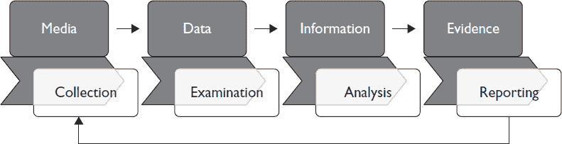

`Figure 6-2` 证据收集框架

---

### 根除

根除涉及移除事件原因并采取措施防止复发。一旦事件被遏制，将采取删除恶意代码或运行防病毒应用程序等行动，以确保不再发生感染。如果账户遭到入侵，可能会将这些账户从系统中移除或更改其访问凭据。根除的另一部分是消除或缓解导致入侵或黑客攻击的任何漏洞。举个简单的例子，如果用户账户通过虚拟专用网络 (VPN) 访问系统，同时又在局域网上访问同一账户却未触发警报，则通过添加同时账户访问规则来封堵该漏洞。当然，如果多个系统或账户受到影响，必须修复所有渗透证据，否则攻击几乎必然会复发。简而言之，除非根除彻底完成，否则不要进入系统恢复阶段。

### 恢复

遏制、根除和恢复阶段的最后步骤是将系统重新投入运行。在丢失包含 PHI 的物理介质等事件中，恢复活动包括恢复正常的组织流程（例如，磁带备份或数据销毁）。在恢复活动中，会部署额外的日志记录或更定制的控制措施，因为一旦发生事件，再次遭受攻击是常见的。

---

[²]: `#ch6.html#ch6en2`
[³]: `#ch6.html#ch6en3`
[⁴]: `#ch6.html#ch6en4`

 **提示**&nbsp;&nbsp;&nbsp;事件响应流程应与整体灾难恢复和业务连续性流程相结合。

## 事件后活动

事件响应完全完成后，最令人心动的做法就是赶紧转手去忙别的事。试想一下，在调查进行、更新沟通、采取补救和恢复措施、讨论纪律处分期间，有多少工作被搁置了。危机已过，是时候回归“常态”了。然而，在事件经过评估并确定是否构成泄露后，恢复后的真正最后一步是开展事件后活动。这一步似乎经常被省略。事件响应团队应聚在一起讨论经验教训、发生了什么、做得好的地方、需要改进的地方，以及为了防止下一次事件发生或帮助事件响应团队更好地工作，可能需要哪些额外资源。

从另一个角度来看，事件期间收集的所有信息和证据，其用处不仅限于案件本身。诸如处理事件所花费的工时等信息，有助于决策者确定所需资源范围和为防止下一次事件而采取行动的优先级。例如，数据事件的间接成本总是包括员工从正常工作中抽离出来用于调查和纠正活动的工时数。这个数字越高、沟通得越多，高级决策者就越有可能支持防止重发的工作。

团队将收集的另一个数据点是攻击性质、数据特征和事件根本原因（仅举几例）。关于事件如何发生以及发生了什么的任何及所有相关因素，都可用于识别之前未知的弱点。也许可以识别出某种趋势（例如某个区域或特定时间段内笔记本电脑丢失或被盗的聚集现象）。无论如何，此类信息对于更新风险评估和评估现有控制措施很有用。

最后，事件响应团队和流程必须不断自我评估。在某些情况下，团队可能需要证明自身的价值（资源总是有限的）。利用客观数据展示事件数量、结案时长，以及（如果可能）减少事件的趋势分析，可以影响高层领导继续支持事件响应流程，使其达到所需水平。遵守拥有事件响应流程和团队的规定，仅等同于拥有最低限度的必要资源。成功的流程和团队通常需要的不仅仅是监管机构或外部影响所要求的最低限度。

---

 **注意**&nbsp;&nbsp;&nbsp;证据保留也是事件后活动的一项职能。通常有法律要求保留证据。组织也可能有要求，特别是针对未达到执法部门介入门槛的事件。事件响应团队很可能负责维护证据，并在不再需要时适当销毁。

## 事件通知和补救工作

本章的重点在于，在医疗机构工作且负有信息隐私和安全职责的人员，预期会采取的行动和活动。为此，本节主要关注内部通知和补救。实际的患者通知和向外部监管机构报告的任务，超出了基础隐私和安全职责的范围。然而，了解一旦决定通知患者或涉及外部监管机构后会发生什么，是很有价值的。内部和外部通知流程之间的联系，证明了内部事件响应团队成员所需工作的重要性。

### 准备阶段

信息安全和隐私专业人员的首要职责是建立一个强调报告错误的计划。没人愿意承认自己犯了错。人们很少想让同事陷入麻烦。潜在的数据泄露往往首先被识别为看似异常但不令人惊慌的事情。由于这些原因，医疗机构员工可能不愿意报告错误和问题。然而，因为事件或事故的第一手证据来自使用系统的人员，他们的参与至关重要。即使拥有防火墙和入侵检测系统等复杂的信息技术设备，人工干预仍然是事件通知和补救的重要组成部分。医疗机构可以使用信息技术工具扫描网络中的事件和事故，但人员往往是第一道防线。请注意，多达 41% 的美国医疗机构报告了由员工无意行为导致的数据泄露。^(`5`)

建立事件报告流程时要记住的另一个方面是，使其集中化、易于操作，并提供反馈。如果最终用户必须弄清楚哪个办公室接收 PHI 事件，哪个接收其他类型的数据事件，他们就不太倾向于报告。报告越容易，最终用户找借口不报告的可能性就越小。最后，事件报告者需要获得关于其报告初步处理结果的反馈。简单的收到确认和一个用于处理额外问题（或额外报告）的联系电话，可以鼓励报告，因为最终用户看到了对其关切的回应。

参与事件响应需要紧迫感。当发生安全漏洞时，PHI 或其他敏感数据的潜在丢失要求采取快速有效的行动。在需要之前就建立好团队和流程，有助于确保紧迫感而不是混乱。响应事件的团队可以迅速行动，并系统地处理事件（换句话说，遵循一致的事件处理流程）。总之，负责医疗信息安全和隐私的人员的角色，将建立在鼓励错误报告、培养紧迫感和确保流程系统化开展的基础之上。

以下项目是适用于准备阶段的额外职责示例：

- 审查事件报告、系统管理、人力资源管理等标准操作程序，以最大程度地确保事件发生时，每次都以相同方式处理。
- 在规划阶段建立组织结构，并定义事件报告团队的角色、职责和权限级别。一些相关的权限级别包括：
  - 有权将疑似系统从网络中断开并没收设备作为调查的一部分
  - 有权在医疗机构内进行访谈和观察活动

### 检测和分析阶段

在检测和分析阶段，事件响应团队需要确定事件的性质。事件可能源于笔记本电脑丢失、网页漏洞被利用或外部网络攻击。例子几乎举不完。根据事件的性质，事件响应团队可以履行其职责，妥善确定所需采取的行动。

---

 **注意** 根据漏洞利用或攻击的类型，事件响应团队将调整其行动。如果事件完全是内部的（如可移动介质丢失），将采取某些行动。如果漏洞利用是在电子健康记录 (`EHR`) 中发现的恶意软件，则会采取另一组不同的行动。也就是说，事件性质的多样性和不确定性使得在事件发生前构建场景和演练响应变得至关重要。

以下是检测和分析阶段完成的相关职责示例：

- 最初评估是否真正发生了事件（排查误报）
- 分析前兆和指标
- 在整个企业范围内查找关联信息或最终用户的投诉
- 搜索可用的事件报告资源（互联网、内部案例文件等）
- 随着更多事件信息浮出水面，评估优先级或严重程度等级
- 确定事件的内部或外部性质（此处将存在关于事件预期影响程度的多种可能性）
- 上报事件结果以使高级管理层知情，并在需要时从其他部门（如隐私办公室、法律审查部门或人力资源部门）获取额外资源或协助
- 根据需要联系受渗透系统的系统管理员或所有者
- 收集与调查这些事件所用时间和材料相关的数据，因为这些事件涉及医疗保健组织的许多人员
  - “停机时间”往往在数据事件结束时被遗忘。即使是其他类型的违规也需要大量的停机时间来脱离常规医疗任务。这是有代价的。
- 开始收集可能成为证据的数据的过程

## 遏制、根除和恢复阶段

事件响应团队可能没有其他职责比证据收集和保存更重要，这主要发生在遏制阶段。当然，在检测阶段收集的信息也可作为证据。事件响应团队的职责现在可能延伸到正式的数字取证领域。因此，随着资源被分配用于分诊、响应和开始恢复，该团队也充当组织安全事件的焦点。

证据收集和保存必须包括适当的文档记录和处理。第一步是创建一份被认为已感染的系统的备份以用作证据。如果可能，可以制作第二份副本，在漏洞修复后用作恢复副本。副本需要由事件响应团队安全存储。如前所述，例如寻求医疗保健律师或人力资源部门的协助，有助于确保保管链要素得以保留或遵循相关法律。有时，这些事件中收集的证据会被执法机构用于法庭案件。这些执法人员可能无法像事件响应团队那样在流程早期就访问系统，因此将依赖所收集证据的有效性。应为所有证据保留详细日志，包括以下内容：`^(6)`

- 标识信息（例如，计算机的位置、序列号、型号、主机名、媒体访问控制 [`MAC`] 地址和 IP 地址）
- 调查期间收集或处理证据的每个人员的姓名、职称和电话号码
- 每次证据处理的时间和日期（包括时区）
- 证据存储的位置

医疗保健信息安全和隐私专业人员预期将完成的其他活动包括以下内容：

- 务必重新审视检测和分析，因为通常会发现受同一事件原因影响的其他系统。
- 进行彻底调查。
- 一旦原因和症状被认为已得到遏制，开始根除工作。
- 识别并缓解所有被利用的漏洞。
- 清除恶意软件、不当材料和其他组件。
- 对信息系统进行必要的更改（添加补丁、更改代码、移除访问权限等）。
- 将安全事件导致的新发现漏洞降至最低。
- 向高级管理层和信息系统服务台报告事件状态和解决信息，以协助报告问题的任何最终用户。
- 协助高级管理层进行所有沟通，包括社区更新以及向媒体、监管机构和受影响个人的通知活动。
- 作为高级管理层及其他团队和组织的联络人，化解危机局面，并确保团队继续拥有必要的人员和资源。
- 协助将系统恢复生产状态。
- 确认正常运行。
  - 可能会发生意外后果。有必要对活动系统进行短期监督。
- 实施额外或改进的监控，以防发生另一起事件。

## 事件后活动

现在是为“下一起”事件开始准备活动的时候。在投入事件检测和补救的所有资源中，如人员、设备和技能，每一项都将被迫恢复正常运营。医疗保健信息安全和隐私专业人员必须确保进行适当的复盘，以收集所收集指标的最终数据，汇总经验教训，并将最新事件添加到事件响应团队用于培训的场景中。将需要以下额外的、极其重要的活动：

- 制定并实施任何新的标准操作计划
- 如果纠正行动计划超出事件时间线，则监督该计划
  - 例如，行动计划和里程碑 (`POA&M`) 可能包括某些升级或缓解行动的预计完成日期，延长至三个月、六个月或更久。这些日期的跟踪和管理不容忽视。
- 发布一份报告，详细说明事件的根本原因和总成本，以及组织应采取的预防未来事件的措施
- 根据这些沟通项目在实际使用中的效率和效果，更新任何表格或创建新表格
- 将事件原因和结果添加到信息安全培训和意识计划中

---

 **提示** 负责医疗保健信息隐私和安全人员的一个关键角色是在整体安全意识计划和用户培训中传达事件报告流程。利用事后经验教训有助于使沟通内容与医疗保健组织和最终用户相关联。

### 由第三方引起的事件

### 第三方事件响应协调

上一节预设的事件是由人员引起的，或包含在医疗保健组织内部的系统中。然而，很大比例的事件是由第三方（在美国称为业务关联方）不当处理受保护健康信息所导致。根据 Ponemon Institute（一家隐私和信息管理研究公司）发布的第五份年度美国数据泄露成本研究报告，第三方组织占所有泄露案例的 41%。^(7) 由于额外的调查和咨询费用，这仍然是成本最高的数据泄露形式。在欧洲联盟也发现了第三方导致数据泄露的类似普遍性。Ponemon 还发现，33% 的欧盟组织表示其数据泄露涉及一个或多个第三方的“搞砸”，包括外包商、云服务提供商和业务合作伙伴。^(8) 基于此原因，涉及第三方采取或未采取行动的事件将作为一个单独的主题进行讨论。请记住，医疗保健组织的事件响应团队可能会启动并监督整体事件调查。根据合同义务和法律要求，第三方将承担重大责任，并应承担调查成本（以及通知成本，如有要求）。图 6-3 描绘了事件响应团队可能需要监督的与第三方的协调情况。

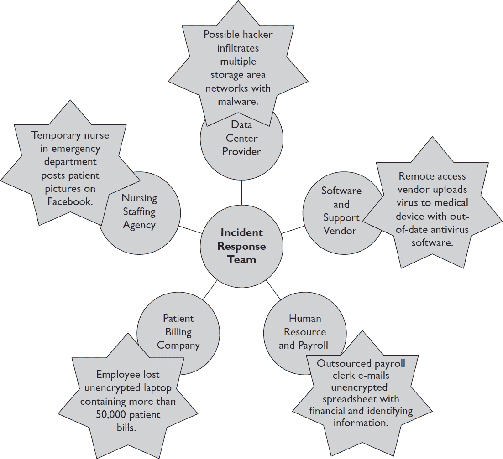

**图 6-3** 事件响应团队与第三方

---

#### 准备阶段

在准备阶段，职责将包括将第三方审查作为组织信息风险管理计划的一部分。确保您拥有业务关联方协议（美国）或用于跨境数据传输的欧盟机构标准合同，是一项准备活动。其他职责可能包括：

- 实施和审查服务级别协议
- 审计第三方
- 测试第三方数据泄露场景

#### 检测与分析阶段

在该阶段，第三方怀疑其组织内部正在发生数据事件。当他们遵守合同义务和法律要求时，初步报告会在规定的时间内提交给医疗保健组织。此报告可能会导致医疗保健组织启动其事件响应团队。医疗保健信息安全和隐私专业人员可预期执行的其他职责如下：

- 在调查期间与第三方协调
- 将第三方的任何调查结果与医疗保健组织的环境进行关联分析
    - 在恶意软件的情况下，由于攻击者以多个主机为目标，医疗保健组织的渗透迹象也可能显现。
- 通过内部报告流程升级事件（高级领导、供应商管理等）
- 协助第三方进行所有社区更新沟通，以及向媒体、监管机构和受影响个人的通知活动
    - 医疗保健组织可以委托通知责任，但也可能选择主导该工作。
- 确保第三方的行动符合合同义务和法律要求
    - 以规定方式发出通知。
    - 将服务中断降至最低。

---

 **注意** 在事件调查和数据泄露通知时间框架内，医疗保健组织应实施控制措施，通过其发言人管理信息流。^(9) 通常，会建立一个中央联系点来处理任何外部信息请求。所有其他员工，包括事件响应团队成员，都强烈不建议向媒体发表评论或向患者透露事件细节。指导原则是将这些请求转交给中央联系点。当有供患者拨打的免费电话号码时，应提供该号码。随时可用的中央联系点（在网站上或通过媒体广播）不仅是必须的，而且有助于控制谣言、错误信息和调查受损。

#### 遏制、根除与恢复阶段

与源自医疗保健组织内部的事件非常相似，第三方将进入遏制、根除和恢复阶段。无论事件响应团队是否启动，医疗保健组织都将密切监控进展。随着第三方确定证据是否表明发生了数据泄露，与医疗保健组织的沟通必须持续进行。监控第三方进展的其他相关职责可能包括：

- 协助数字取证以保存证据
- 一旦事件被确定为数据泄露，继续协调任何媒体新闻稿以及向监管机构和受影响个人的通知
- 如果第三方与医疗保健组织之间存在系统互联，进行漏洞扫描以确保彻底的根除和恢复
- 记录医疗保健组织的成本，包括因停机、协助管理第三方活动以及根据服务级别协议检查绩效而产生的成本

#### 事件后活动

事件完成后，第三方应拥有与医疗保健组织类似的流程。基于前期事件的经验教训和额外培训应更新到组织的风险评估和信息安全计划中。据显示，这样做能减少美国和欧盟第三方组织的事件。^(10) 以下是事件后阶段需考虑的其他一些职责：

- 在医疗保健组织进行的下一次风险评估中纳入以往事件
- 更新任何合同文件和服务级别协议
- 向内部管理层提供与调查、监督和停机相关的任何财务数据，以便可能从第三方获得赔偿
- 将第三方事件纳入医疗保健组织的培训和意识提升计划，以及事件响应团队的培训场景中

### 外部报告要求

职责可能仅限于内部活动，最终以通知高级管理层而告终。无论如何，了解医疗保健组织领导层在事件期间和事件后必须如何与外部机构互动都是有价值的。以下概述了这种互动应如何发生以及在什么条件下发生。

#### 执法机构

一旦事件被确定为犯罪，高级领导层将希望通知执法机构。在美国，这将是联邦调查局（FBI）和特勤局等联邦机构，以及地方和州机构。在国际上，相关执法机构将拥有管辖权并应被通知。执法机构可以协助调查并就证据收集提供建议。他们还可以帮助确定何时可能采取额外的通知行动，例如如果通知会干扰正在进行的调查，则延迟通知。

#### 数据保护机构（欧盟）

正如所述，欧盟的通知责任涉及电子信息，并见于电信行业法规中。然而，如前所述，这种情况正在发生变化，因为通知正被整合到整体隐私原则中。目前，当发生数据泄露时，数据控制者（医疗机构）应将个人数据泄露通知主管国家机关，这很像商业电信服务提供商所必须做的那样。^(11)

### 受影响的个人（患者）

在美国，一旦事件经过评估且存在足够的披露风险，医疗机构必须通知个人（无论数量多少）。

---

 **提示** 根据 HIPAA，披露风险阈值对于确定数据事件是否构成法律上的违规（不允许的使用）至关重要。根据美国卫生与公众服务部的说法，“违规通常是指根据隐私规则，不允许的使用或披露危及了受保护健康信息的安全或隐私。”除非医疗机构能通过披露风险分析证明受保护健康信息被进一步泄露的可能性很低，否则该披露将被视为数据泄露。

风险分析将包含以下考量因素：^(12)

- 涉及的受保护健康信息的性质和范围，包括标识符的类型和重新识别的可能性
- 使用了受保护健康信息的未经授权的人员，或向其披露信息的人员
- 受保护健康信息是否实际上被获取或查看
- 对受保护健康信息的风险已在多大程度上得到缓解

如果风险分析确认事件确实构成数据泄露，美国的医疗机构必须通知受影响的个人。甚至通知的形式也是规定好的。个人通知必须在 60 天内以书面形式通过第一类邮件发送，或者如果受影响个人同意以电子方式接收此类通知，则可通过电子邮件发送。当 10 人或更多人的联系信息过时或不正确时，医疗机构必须采取替代措施。它可以在机构网站上发布通知，或利用媒体广播该信息。任何格式的通知都必须包含以下要素：

- 泄露的描述
- 涉及的信息类型
- 受影响个人可采取哪些措施降低额外损害的可能性
  - 获取信用报告、监控银行账户等
- 关于医疗机构正在采取哪些措施调查泄露、减轻损害并防止进一步泄露的简要描述
- 受保护实体的联系信息
  - 联系信息应包含免费电话号码，供个人拨打以确定其是否也受到了泄露影响。

在欧盟，随着拟议的通知规则逐渐被接受，当务之急将是在 24 小时内通知监管机构。通知个人的强制性要求则不那么严格。数据控制者可自行决定数据泄露是否可能对个人隐私产生不利影响。如果泄露有不利影响，数据控制者可以通知受影响的个人。数据机关旨在将个人通知限制在具有不利影响的案例中，避免过度通知个人并造成通知疲劳。

#### 媒体

媒体在广播泄露的性质和范围方面发挥着作用。它还将帮助通知个人和社区可采取哪些行动来保护自己。在美国，当泄露影响某州或辖区的 500 名居民时，医疗机构必须通知媒体（报纸、电视台等）。媒体新闻稿必须在发现泄露后 60 天内发布。媒体通知的内容将与通知受影响个人所包含的要素相同。

#### 公共关系

在事件持续期间，医疗机构将继续与媒体和社区互动。通常，由一人担任医疗机构在媒体面前的发言人。这有助于确保信息传递的连续性和可靠性以及正确传播。公共关系人员将撰写新闻稿，持续更新媒体和社区。这些更新可刊登在当地报纸、期刊和社交媒体渠道上。公共关系人员可能监督专门创建用于与受影响个人及其他利益相关方沟通数据泄露问题的网站上发布的内容。在某些情况下，从数据泄露中吸取的教训可与其他医疗机构共享。公共关系人员可为此过程做出贡献，帮助制定供他人演示的信息，或在专业组织的会议、研讨会和其他教育活动中亲自进行演示。

#### 卫生与公众服务部部长

这非常针对美国。监管通知包括卫生与公众服务部部长（HHS）。当泄露涉及 500 人或更多个人时，需进行此通知。医疗机构在 HHS 网站上报告事件并提交电子泄露表格。60 天的时间线也适用于通知 HHS。涉及少于 500 名个人的泄露，每年以汇总形式向 HHS 报告，截止日期不迟于泄露所在日历年结束后 60 天。

#### 健康信息交换

在某些情况下，医疗机构的数据泄露可能导致需要通知其他外部利益相关方。例如，如果医疗机构参与健康信息交换（HIE），该机构可能需要通知交换组织或其他成员机构。目前，HIE 中的健康信息不被视为有风险，因为患者记录应当是去标识化的。然而，由于 HIE 产生的新组织关系，医疗机构可能会产生新的通知责任。

### 国际泄露通知

在美国，受 HIPAA 约束的组织未经授权披露受保护健康信息，对外部通知有明确的要求。在其他国家，外部报告要求各不相同。部分差异如下：

- **加拿大** 根据《个人信息保护和电子文件法案》（PIPEDA），向受影响个人和隐私专员进行外部通知是一种有益的做法，但属于自愿性质。在部分省份，如阿尔伯塔省和安大略省，已制定规则强制要求外部通知。^(13)
- **欧盟** 欧盟委员会 2013 年 6 月第 611/2013 号法规（EU）提到，“根据电信法，在所有个人数据泄露发生后 24 小时内通知主管国家机关”值得赞赏。至于受影响个人的通知，欧盟认为仅当个人数据泄露可能对个人的个人数据或隐私产生不利影响时才有必要。^(14)

## 国际数据泄露通知法律

- **中国** 中国没有通用的数据保护法律来要求向受影响的个人或监管机构通报数据泄露。然而，有一项数据保护国家标准，即《公共商业服务信息系统个人信息保护信息安全技术指南》（GB/Z 28828-2012，以下简称“指南”），该标准于 2013 年 2 月 1 日生效。这只是一项技术指南，不具有强制法律效力。

- **以色列** 主要的数据保护国家法律是 1981 年的《隐私保护法》。建议通知受影响的个人，但这是一种预防性措施，旨在帮助减少法律和监管方面的损害及罚款。没有强制义务。

## 章节回顾

本章开头的场景对于从事医疗信息保护工作的任何人都很熟悉。识别事件是整体信息安全计划的重要组成部分。一旦识别出事件，通过多学科团队进行适当的响应至关重要。有些事件不是数据泄露。其他事件一旦经过调查，被认定为数据泄露，则需要采取额外行动来管理这些活动。受雇于医疗保健组织负责保护信息的个人在这些场景中可能承担许多职责。了解该做什么并提前演练，可以意味着更少的系统停机时间、最少的患者数据丢失以及更低的医疗保健组织成本。本章侧重于内部职责，但了解内部调查和报告如何在外部使用也很有价值。在数据泄露情况下，医疗保健组织有外部责任通知利益相关者，如社区、媒体、监管机构和患者。妥善执行内部事件响应流程有利于未来的外部报告和通知。

### 复习题

1.  **1.** 违反信息安全策略、可接受使用策略或标准安全实践的行为是数据\_\_\_\_\_\_\_\_\_。
    - **A.** 事件
    - **B.** 泄露
    - **C.** 事故
    - **D.** 攻击

2.  **2.** 英国《2003 年隐私和电子通信（EC 指令）法规》（PECR）要求在发生个人数据泄露时通知谁？
    - **A.** 受影响的个人
    - **B.** 数据主管部门
    - **C.** 数据控制者
    - **D.** 欧盟委员会

3.  **3.** (判断正误) 在数据事件管理的准备阶段，会建立策略、流程、程序和协议，以指导安全事件的管理和响应。

4.  **4.** 在事件管理过程的遏制活动中，\_\_\_\_\_\_\_\_\_\_\_\_\_ 得以完成。

5.  **5.** 在数字取证中，以下哪项最能描述整个过程中的有效活动？
    - **A.** 收集事实以证明事件不是泄露
    - **B.** 确定原因以便未来采取纪律处分
    - **C.** 保护数据完整性以备后用
    - **D.** 收集数据以确保制造商履行保修服务

6.  **6.** 一个有效的医疗保健组织事件报告流程应该：
    - **A.** 易于使用
    - **B.** 允许通过互联网输入
    - **C.** 分散化
    - **D.** 提供现金激励

7.  **7.** 在事件期间，如果个人正在查看医院内其他系统的系统日志，你可以假设他们正在执行哪项职责？
    - **A.** 联络系统管理员
    - **B.** 上报事件结果
    - **C.** 收集与时间和材料相关的数据
    - **D.** 查找关联信息

8.  **8.** (判断正误) 在一次恶意软件攻击被遏制和修复后，医院 CIO 向员工发送了一份通知。通知中包含关于员工收到可能是网络钓鱼攻击的可疑邮件时该怎么做的说明。此活动最好被描述为最小化诉讼风险。

9.  **9.** 关于医疗保健组织委托处理受保护健康信息的第三方进行风险评估，以下哪项陈述最准确？
    - **A.** 作为检测阶段活动，风险评估可以发现漏洞。
    - **B.** 作为事件后活动，风险评估确定事件是否为数据泄露。
    - **C.** 作为准备阶段活动，风险评估防止数据泄露。
    - **D.** 作为遏制、根除和恢复活动，风险评估记录所有行动已完成。

10. **10.** 美国和国际数据泄露通知法律的关键区别在于：
    - **A.** 受影响个人通知
    - **B.** 监管罚款
    - **C.** 加密标准
    - **D.** 声誉损害

### 答案

1.  **1.** **C.** 这是数据事件的定义。如果事件经调查证明存在不当披露，则可能构成数据泄露。然而，并非所有事件都是数据泄露。事件是指系统或网络中任何可观察到的发生，其中可能包括合法事件。攻击意味着外部行为，并不充分满足题目中的定义。

2.  **2.** **B.** 该法规明确要求通知监管数据主管部门。该法规不要求通知受影响的个人。欧盟委员会可能会收到通知，但有监管数据主管部门应接收通知。数据控制者是实际向数据主管部门发出通知的实体。

3.  **3.** **TRUE.** 在准备阶段，事件响应团队的相关责任人应收集和编制将指导事件响应过程的相关文档。

4.  **4.** **收集证据。** 在事件管理的遏制、根除和恢复阶段的遏制活动中，会收集和保存证据。

5.  **5.** **C.** 在数字取证中，会进行多项活动。虽然可能间接有利于支持纪律处分或保留保修权益，但这些不是进行数字取证的有效理由。事实上，数字取证的进行不应以证明或反驳数据泄露为目的。证据应被收集以确定原因和影响。保护数据完整性以备将来使用（如法律程序）是这些选项中唯一有效的答案。

6.  **6.** **A.** 虽然现金激励可能鼓励事件上报，但这或许并非必要。能够通过互联网输入疑似数据事件，不如拥有一个包含所有不同上报方式且易于使用的流程有用。事实上，一些人员可能会因不得不使用网站上报事件而感到沮丧。事件上报流程也应是集中的，而非分散的。总之，流程必须简便，否则不会被使用。

## 复习题答案

### 7
**D.** 事件发生期间，事件响应团队将检查是否存在其他事件，以及是否有迹象表明事件正在发生。其他选项也是事件期间的职责，但并非通过查看系统日志上的活动来完成。

### 8
**错误。** 在事件后活动阶段，将经验教训添加到新的培训和意识宣传沟通中非常重要。题目中描述的行动对任何待决的诉讼或罚款不会产生太大影响。

### 9
**C.** 所有处理健康信息的第三方风险评估都应在准备阶段进行。所有其他阶段都发生在事件发生之后。风险评估有助于防止数据泄露，因为可以在漏洞被利用之前发现并修复它们。

### 10
**A.** 美国和国际数据泄露通知法律的主要区别在于，美国强制要求通知受影响的个人，而国际上该要求在很大程度上是自愿的（但受到鼓励）。就监管罚款和加密标准而言，这些对美国和国际医疗服务提供者来说都是类似的考量因素。声誉受损会发生在任何发生数据泄露的组织身上，尽管某些数据表明，这种损害不如往年那么严重。

## 参考文献

1. 美国卫生与公众服务部。“根据《健康信息技术经济与临床健康法案》和《遗传信息反歧视法案》对 HIPAA 隐私、安全、执法和泄露通知规则的修改；对 HIPAA 规则的其他修改。” 45 CFR Parts 160 and 164. p. 74. 2013. 访问于 2014 年 4 月 2 日，网址：[www.gpo.gov/fdsys/pkg/FR-2013-01-25/pdf/2013-01073.pdf](http://www.gpo.gov/fdsys/pkg/FR-2013-01-25/pdf/2013-01073.pdf)

2. 欧盟网络与信息安全局。“分诊。” 访问于 2014 年 4 月 3 日，网址：[`www.enisa.europa.eu/activities/cert/support/incident-management/browsable/incident-handling-process/incident-handling-phases/triage-1`](https://www.enisa.europa.eu/activities/cert/support/incident-management/browsable/incident-handling-process/incident-handling-phases/triage-1)

3. Swire, Peter, and Sol Bermann. 《认证信息隐私专业人员 (CIPP) 国际隐私专业人士协会官方参考指南》。平装版出版商，2007 年。第 193 页。

4. NIST 特别出版物 800-86. 《将取证技术整合到事件响应中的指南》。2006 年 8 月。第 ES-1 页。访问于 2014 年 4 月 1 日，网址：[`csrc.nist.gov/publications/nistpubs/800-86/SP800-86.pdf`](http://csrc.nist.gov/publications/nistpubs/800-86/SP800-86.pdf)

5. Swire, Peter P., Kenesa Ahmad, and Terry McQuay. 《信息隐私与数据保护基础：全球概念、法律与实践调查》。国际隐私专业人士协会，2012 年。第 106 页。

6. NIST 特别出版物 800-61 rev 2. 《计算机安全事件处理指南》。2012 年 8 月。第 45 页。访问于 2014 年 4 月 1 日，网址：[`csrc.nist.gov/publications/nistpubs/800-61rev2/SP800-61rev2.pdf`](http://csrc.nist.gov/publications/nistpubs/800-61rev2/SP800-61rev2.pdf)

7. Ponemon Institute. “2011 年数据泄露成本研究：美国。” 2012 年 3 月。第 8 页。访问于 2014 年 4 月 19 日，网址：[www.ponemon.org/local/upload/file/2011_US_CODB_FINAL_5.pdf](http://www.ponemon.org/local/upload/file/2011_US_CODB_FINAL_5.pdf)

8. Ponemon Institute. “2011 年数据泄露成本研究：英国。” 2012 年 3 月。第 9 页。访问于 2014 年 4 月 19 日，网址：[www.symantec.com/content/en/us/about/media/pdfs/b-ponemon-2011-cost-of-data-breach-uk.en-us.pdf](http://www.symantec.com/content/en/us/about/media/pdfs/b-ponemon-2011-cost-of-data-breach-uk.en-us.pdf)

9. 欧盟网络与信息安全局 (ENISA)，“事件管理良好实践指南。” 2010 年。第 76 页。访问于 2014 年 4 月 20 日，网址：[`www.enisa.europa.eu/activities/cert/support/incident-management/files/good-practice-guide-for-incident-management?searchterm=incident+management`](https://www.enisa.europa.eu/activities/cert/support/incident-management/files/good-practice-guide-for-incident-management?searchterm=incident+management)

10. Ponemon Institute. “2011 年数据泄露成本研究：美国。” 2012 年 3 月。第 1 页。访问于 2014 年 4 月 19 日，网址：[www.ponemon.org/local/upload/file/2011_US_CODB_FINAL_5.pdf](http://www.ponemon.org/local/upload/file/2011_US_CODB_FINAL_5.pdf) 和 Ponemon Institute. “2011 年数据泄露成本研究：英国。” 2012 年 3 月。第 1 页。访问于 2014 年 4 月 19 日，网址：[www.symantec.com/content/en/us/about/media/pdfs/b-ponemon-2011-cost-of-data-breach-uk.en-us.pdf](http://www.symantec.com/content/en/us/about/media/pdfs/b-ponemon-2011-cost-of-data-breach-uk.en-us.pdf)

11. 2009 年 11 月 25 日欧洲议会和理事会指令 2009/136/EC10。访问于 2014 年 4 月 6 日，网址：[`eur-lex.europa.eu/LexUriServ/LexUriServ.do?uri=OJ:L:2009:337:0011:01:EN:HTML`](http://eur-lex.europa.eu/LexUriServ/LexUriServ.do?uri=OJ:L:2009:337:0011:01:EN:HTML)

12. 卫生与公众服务部。“泄露通知规则：泄露的定义。” 访问于 2014 年 4 月 14 日，网址：[www.hhs.gov/ocr/privacy/hipaa/administrative/breachnotificationrule](http://www.hhs.gov/ocr/privacy/hipaa/administrative/breachnotificationrule)

13. DeJesus, Ron. 《隐私顾问》(IAPP)。“探索加拿大联邦隐私泄露通知。” 2013 年 4 月 1 日。访问于 2014 年 4 月 10 日，网址：[`www.privacyassociation.org/publications/2013_04_01_exploring_federal_privacy_breach_notification_in`](https://www.privacyassociation.org/publications/2013_04_01_exploring_federal_privacy_breach_notification_in)

14. Vivet-Tana, Laura. 《隐私顾问》(IAPP)。“欧盟数据泄露通知规则：关键要素。” 2013 年 8 月 27 日。访问于 2014 年 4 月 2 日，网址：[`www.privacyassociation.org/publications/eu_data_breach_notification_rule_the_key_elements`](https://www.privacyassociation.org/publications/eu_data_breach_notification_rule_the_key_elements)

---

# 第二部分：医疗信息隐私与安全管理

---

## 第 7 章 信息隐私：患者权利与医疗责任

 **第 7 章**    Information Privacy: Patient Rights and Healthcare Responsibilities

 **第 8 章**    Protecting Digital Health Information: Cybersecurity Fundamentals

 **第 9 章**    Impact of Information Privacy and Security on Health IT

 **第 10 章**  Workforce Competency in Healthcare

 **第 11 章**  Administering Risk Management and Cybersecurity

---

## 第 7 章

---

## 信息隐私：患者权利与医疗责任

在本章中，您将学习：

- 区分适用于医疗保健的相关通用隐私术语
- 认识隐私如何保护患者权利并支持医疗信息的机密性
- 理解医疗隐私官的角色和要求
- 了解构成领先隐私框架的主流数据隐私概念

## 医疗隐私角色与职责

• 理解与数据泄露相关的隐私原则所要求的措施，包括通知受影响个人的要求

---

本书的意图非常明确。在医疗领域，负责保护信息的人员的角色和职责汇聚于不同的角色，这些角色可能之前并未涉及处理数字或电子信息。一些角色源于健康信息管理中的传统隐私或法律角色，其中信息存储正从纸质转向数字格式；另一些角色来自信息技术支持背景，如局域网络、应用管理和最终用户支持，这些领域出现了与受保护健康信息相关的新关注点。还有一些角色可能来自临床工程或生物医学技术人员职业，其中医疗设备之间以及与内部和外部网络的互联正在迅速演变。为了帮助您直观理解这种融合，图 7-1 描绘了交叉点。对于这些以前截然不同且某种程度上分离的群体，都需要一份入门指南，既包括面向安全背景更强人员的隐私合规，也包括面向隐私合规背景更强人员的安全知识。第 7 章 为现在负有遵守医疗信息隐私责任的人员提供了此类入门指南，第 8 章 则为在医疗领域拥有传统隐私或法律合规角色、且现在在通过信息安全管理保护数字信息方面发挥越来越大作用的人员提供了同样的指南。

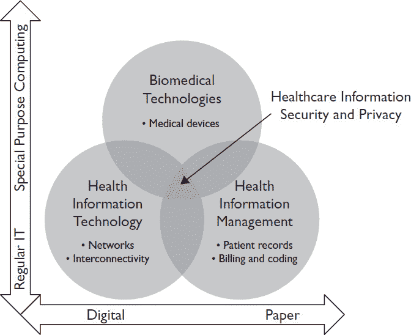

---

**图 7-1** 医疗能力与信息隐私和安全职责的融合

---

 **注意** 隐私与安全的区别已开始缩小。一些人主张隐私是提供信息安全或网络安全实践中内嵌的一个概念。然而，就本文而言，我们将保持这种区别。本章将信息隐私作为受保护内容及其原因的函数来阐述。第 8 章 将通过定义组织如何保护信息来阐述安全。

### 美国的隐私保护方法

美国并未在所有行业和数据收集者中实施统一的数据隐私政策。由于多种因素，并为维持自由市场经济，美国从行业或功能视角处理数据隐私。这种方法的核心原则是政府不制定超越行业的单一政策。相反，每个行业由自律准则和针对该行业的政府法规共同管辖。结果是产生了针对特定关注点的增量立法（例如 1988 年视频隐私保护法案、1992 年有线电视保护与竞争法案、公平信用报告法案和 2010 年马萨诸塞州数据隐私法规）。

这种方法的推理源于美国宪法和传统的美国自由放任经济学。此外，美国的隐私倾向于被定义为社会愿意接受的内容，这可能随时间发生重大变化。在美国宪法的构架下，联邦政府监管隐私一直被视为越权。隐私法律在州层面最为有效。在医疗等行业，配合 HIPAA 等立法，法律最好聚焦于信息的目的和用途来实施。

### 欧洲的隐私保护方法

欧洲联盟对待隐私概念的视角与美国截然不同。由于二战、法西斯政权和二战后共产主义政权等历史经历，欧洲人天然怀疑并恐惧对个人信息的侵入性、不必要的、无限制的访问。这不仅体现在欧盟《数据保护指令》（DPD）的总体数据保护方法中，也体现在欧盟如何看待向非欧盟国家的数据传输中。此外，欧盟与其他国家在什么标识符被视为个人信息方面存在差异。例如，欧盟将种族、民族和工会身份纳为受保护的敏感信息。在 1930 年代，基于这些特征识别个人曾导致邻里朋友的秘密告发，进而导致特定个人和群体（如犹太公民）被捕并被送往劳动营和集中营。欧盟通过实施和执行全面的数据保护法律，采取重大措施保护个人信息免遭滥用。

### 信息隐私概念与术语

维护个人隐私是全球关注的问题，在所有行业都很重要，且长期以来一直是关注焦点。收集执行所需或期望服务所需的信息并适当共享，同时维护个人隐私，是一项挑战。我们视个人隐私的重要性不仅是政治或商业上的必要，在某些社区它还是道德或宗教关切。《古兰经》、《圣经》和犹太教法在历史上都有保护个人隐私的规定。1948 年，联合国发布了《世界人权宣言》。在第 12 条中，他们部分同意，“任何人的隐私……不得加以任意干涉……”。^(1)

在医疗领域保护个人隐私的重要性同样具有普遍性和根本性。医生通过对患者的检查、诊断和治疗保密，不向护理人员透露患者信息，以维护医患特权，这一需求可追溯至希波克拉底誓言（被认为起源于公元前五世纪），并延续至今，成为医疗提供者的道德指南：“无论在治疗过程中或治疗之外，我所看见或听到的关于人们生活的事情，如果不应对外宣扬，我将守口如瓶，视泄露此类事情为可耻。”^(2)

从医疗内外的这些数据点中，我们可以得出结论：理解构成信息隐私基础的概念和术语至关重要。在当今许多国家，保护个人隐私被视为一项基本人权。

以下概念和定义见于主要隐私框架和法规中。不同框架间可能存在细微差别，特别是在术语合并为一项原则而非框架中两项不同原则的情况下。阅读并理解了通用概念和术语后，您肯定希望熟悉产生和颁布这些概念的各种框架和法规。这并非详尽列表，而是一个起点：

- 《健康保险流通与责任法案》（HIPAA）隐私规则
- 亚太经济合作组织（APEC）
- 欧盟《数据保护指令》（DPD）
- 公平信用报告法案（FCRA）
- 经济合作与发展组织（OECD）
- 公认隐私原则（GAPP）：由加拿大特许会计师协会（CICA）和美国注册会计师协会（AICPA）设计

# 个人信息保护和电子文档法案 (PIPEDA)

## 同意

个人信息的共享最初由个人管辖，因为必须获得个人的同意才能进行共享。同意通常是在信息发布之前采取的一种行动，即个人预先批准此类发布。为了使同意具有合法性，必须满足几个条件：个人必须自愿提供同意，并且必须知晓自己的权利，其中一项权利就是他们在提供同意后可以改变主意。当然，个人还必须能够理解这些条件并能够表达其决定。在医疗保健领域，治疗、支付和运营目的通常不需要同意。在美国，《HIPAA 隐私规则》^(3) 明确规定了这一点。然而，对于用于研究和公共卫生报告的其他用途和披露，可能需要额外的患者同意。这与国际医疗保健信息共享不同，因为数据隐私规则（如欧盟 DPD 确立的规则）倾向于不设置医疗保健豁免。无论是为了患者护理还是其他目的，收集、存储和使用识别个人身份的数据都需要同意。在个人无法提供同意的情况下，患者护理不会受阻，因为在这种情况下，近亲或主管部门可以提供所需的同意级别。一旦个人能够自行提供同意，他们就会这样做。除了知情同意外，根据 DPD，数据收集者还必须披露任何特定意图，以便最好地告知个人信息将如何被使用以及由谁使用。

---

 **注意** *同意* 和 *知情同意* 是相关术语。*同意* 是一个适用于各行各业和隐私框架的术语。虽然 *知情同意* 也有广泛的含义，但在医疗保健领域，它涉及允许对个人实施手术或检查的许可。

## 选择

根据各种隐私标准，*选择* 被定义为给予个人自由提供信息或予以保留的选择权。*选择* 和 *同意* 的区别在于：选择关乎提供选项，而同意关乎给予许可。提供给个人的选择必须是在合法选项之间进行，并且选项必须以清晰、无欺骗的方式呈现。选择通过“选择加入”和“选择退出”条款来提供。针对合法数据收集和共享的“选择加入”或“选择退出”条款的一种形式是：医疗保健组织提供一份关于选择的声明。组织可以通过多种方式构建其“选择加入”和“选择退出”流程以获取患者的选择。如果个人不采取任何行动，则视为默认的隐式“选择加入”或“选择退出”选择；如果个人做出主动选择（通过勾选或取消勾选选项），则属于显式选择。在收集敏感信息时，最好要求个人做出显式的“选择加入”或“选择退出”选择。图 7-2 展示了隐式和显式“选择加入”及“选择退出”声明的示例。

---

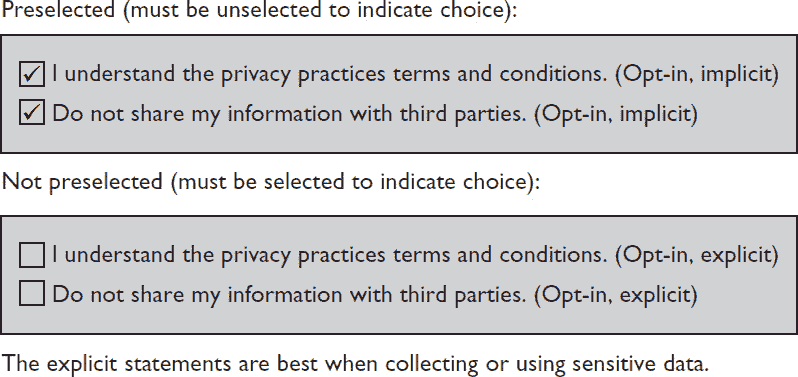

**图 7-2** 隐式和显式“选择加入”及“选择退出”声明示例

随着电子健康记录 (EHR) 的日益普及，“选择加入”或“选择退出”的选择可能产生深远影响。当患者同意接受护理时，如果该信息被收集到 EHR 中，并作为健康信息交换 (HIE) 的一部分自动共享，则应向患者提供知情选择。这种额外的共享超出了患者的预期范围。因此，需要额外的同意。为了获得这种知情同意（无论是通过选择加入还是选择退出），提供者可能需要向成千上万名患者发送通知，这在后勤上既困难又昂贵。^(4)

---

 **提示** 很容易混淆 *选择加入* 和 *选择退出* 这两个术语的适当用法。例如，患者门户网站可能会提供一个选择，让患者通过勾选一个写着“我同意医院隐私声明中所述条款和条件”的复选框，来“选择加入”医疗保健组织的数据收集和存储系统。在这种情况下，复选框不应预先勾选，因为预先选中的肯定性声明更适合被定义为显式的“选择退出”选择。

## 通知

提供选择和同意的能力与组织向受影响个人提供通知的责任密切相关。在美国，医疗保健组织必须在患者入册时、首次预约时、接受医疗服务时（例如，在进行手术前），以及患者要求查看此类文档的任何时候，向患者提供通知。作为一项隐私原则，当患者签署确认理解该医疗保健组织发布的《隐私实践通知》(NPP) 时，即视为满足了通知要求。NPP 包含以下内容：

- 关于受保护实体的受保护健康信息如何被使用和披露的解释。（如果医疗保健组织需要以任何其他方式使用，将首先获得患者的许可或授权。）
- 医疗保健组织对其保护健康信息隐私职责的确认。
- 患者的隐私权利，包括查阅现有信息的权利、如果怀疑违规向美国联邦政府（具体为卫生与公众服务部）投诉的权利、以及如果记录不正确要求修正记录的权利。
- 与隐私实践和投诉流程相关的联系信息。

NPP 通常以纸质形式呈现，在规定的场合交给患者，但 NPP 也必须在提供医疗保健组织服务或福利信息的网站上显著位置展示。

与 *医疗保健* 隐私框架形成对比的是，欧盟 DPD 的 *数据* 隐私框架要求每次收集数据主体的数据时都要发出通知。根据个人对通知内容和频率的偏好，DPD 允许数据收集者根据各种标准，向数据主体提供“选择加入”或“选择退出”通知的选择权。这有助于让个人以可管理且有意义的详细程度或频率接收通知。

## 收集限制

# 收集限制原则

数据保护最佳实践和法规中通用的一项原则是 `collection limitation principle`，该原则遵循数据保护的一项基本准则：仅收集必要的内容，不多收集。众多数据泄露事件是由持久化数据引起或加剧的，这些数据从未真正被需要，却被收集、存储、维护，并最终与必要的数据集一同丢失。想想我们让患者在等候时填写的表格，或者我们让客户在获得在线服务访问权限前填写的网页表格。如果所有这些信息都是必需的——或者正如 `collection limitation principle` 通常所言，是相关的——那么它大概率符合 `collection limitation principle`。然而，如果其中一些信息并非必要，或者数据收集者将其用于提供信息的个人未预期的目的，则该做法是不当的。`collection limitation principle` 解决了此类信息的不当使用问题，它规定数据应通过公平合法的方式收集，并在必要时通知个人或获得其同意。^(5)

欧盟的 DPD 等框架通过向个人提供目的规范来强制要求收集限制，数据收集者被限制仅将数据用于这些声明的目的。在美国，HIPAA 根据隐私规则引入了 `limited data set` 的概念；即移除不需要的受保护健康信息元素，或根本不收集这些元素的数据集。例如，姓名、社会安全号码和出生日期等元素，结合某种形式的健康信息，会被选择性地收集和保留。记录中存在的其他元素，但数据接收方不需要的，例如家庭住址，会被选择性地提取和传输。这与其他隐私控制集的相似之处在于，专注于仅收集所需内容，且仅用于声明的目的。

## 披露限制

除了医疗机构仅收集相关的健康相关信息外，还必须限制该信息的披露。该限制的约束有两方面。首先，信息只能根据现行法律披露。例如，HIPAA 隐私规则允许受保护的医疗服务提供者为治疗、支付或运营目的使用或披露受保护的健康信息。其次，只有在组织获得个人同意的情况下，才能进行披露。超出这些参数范围的任何使用或披露均属违法（HIPAA）或违反个人提供的同意授权。也就是说，仅仅因为披露信息是合法的，并不意味着不能进一步限制此类信息的使用。如前所述，HIPAA 允许提供者为治疗目的共享信息。存在这样的情况：与某个人相关的健康信息可能帮助第二个提供者治疗另一个人。如果最初的患者指定该使用或披露是不允许的，则不应进行该披露。例如，这适用于基因检测或患者对某些疾病的易感性情况。虽然此类信息可能与家庭成员自身的治疗相关，也可能无关，但个人可以限制披露。简而言之，HIPAA 可能授权此类披露，但并不强制要求。披露可通过患者-提供者协议进一步限制。

## 最小使用与比例原则

在使用受保护健康信息 (PHI) 时，医疗机构必须首先确定披露不违反披露限制原则，然后仅披露最低限度必要的信息。例如，如果执法部门因怀疑医院员工窥探病历而要求审计日志，提供某一天所有人员的完整访问日志（显示所有被访问或修改的患者信息）将是不当的，因为这不仅会披露该医院员工的姓名和他/她访问的 PHI，还可能披露大量与调查无关的 PHI。“比例原则”的概念与最小使用密切相关，实际上是 DPD 中的一个术语。根据欧洲法律，数据收集者必须确保个人数据仅在与收集和/或进一步处理目的相适应、相关且不过度的范围内进行处理。^(6) 虽然额外数据日后可能有用，或可用于与患者当前就诊无关的其他目的，但不应收集该数据。

## 数据保留

信息生命周期中一个非常重要的步骤，尤其是敏感信息，是销毁不再需要的数据。出于各种原因，收集和存储数据的机构往往会犯一个错误，即保留数据的时间远超其保持有用的时间。原因之一是数据已从纸质演变为数字信息，存储空间考量已成为微不足道的问题。即使存储不断增加的数据量的成本也随时间推移而降低。相反，在过去，当需要实际物理空间存放纸质记录时，组织有重要动力制定信息可保留多长时间的标准。一旦不再有用或因法规要求无需继续保留，政策会要求销毁、粉碎、焚烧或将纸质记录离站归档。然后腾出额外空间用于存放较新记录或其他用途。过度延长的数据保留常被忽视的另一个原因是，一旦信息不再有用，数据收集者就会忘记它。如果硬盘或存储区域网络上存放着数年的数据，较旧的数据可能会在识别对象、维护原因、准确性等方面被完全遗忘。但数据仍掌握在数据收集者手中。还有其他原因导致数据保留常被忽视，但关键是，不能忽视。数据泄露的一个重大风险源于数据保留政策和程序未能跟上信息向数字存储系统和数字技术转移的步伐。

数据保留应从识别存储了哪些类型的数据以及数据必须保留多长时间开始。在某些情况下，有法规对此进行管辖。HIPAA、DPD 和其他全球指南有各种要求。在医疗保健领域，信息被视为具有临床相关性的时长也很重要。某些儿科放射影像要求至少保存 18 年。其他放射影像在石棉相关肺病情况下要求保存 99 年。这些超出了隐私指南范围，但对任何负有数据保留政策和程序责任的人来说都极其重要。

## 合法目的

## 合法目的

如果我们要说明数据收集的目的，以合法或公平的方式收集数据，并仅将数据用于既定目的，我们还必须确保该目的合法。*合法目的*是一项将收集限制原则推进一步的原则。美国的医疗保健机构必须仅收集有助于提供治疗、支付或运营的患者信息。如果该机构共享该信息，仍必须将披露限制在法律定义的合法理由范围内。公共卫生信息共享就是此类规定之一。^(7) 为履行公共卫生和安全职责，允许医疗保健机构向公共卫生当局及肩负公共卫生使命的人员提供数据访问权限。此规定延伸至为医疗保健机构处理 PHI 的第三方。如果第三方被要求向公共卫生实体披露 PHI，该披露预期应在业务伙伴协议中说明。合法目的类似于欧盟的 DPD，即 DPD 仅允许为特定、明确和合法的目的处理个人数据。如果收集或处理数据的目的随时间发生变化，DPD 提到了一个称为*公平处理*的相关隐私概念，其基本指示是：如果数据处理偏离了最初向个人呈现的合法目的，数据收集者应从个人处获得额外或更新的同意。

## 个人参与

所有隐私原则的核心原则之一是承认：当受影响的个人积极参与其数据的使用时，隐私保护效果最好。经济合作与发展组织 (OECD) 隐私原则清楚地概述了个人在这方面拥有的隐私权利，其中许多体现在通知、同意、选择、访问和更正等子主题中——即下文将讨论的主题。简而言之，例如 HIPAA 于 1996 年颁布，很大程度上是因为个人参与患者健康信息使用和披露的原则，常被视为医疗保健机构的财产。HIPAA 通过明确规定个人有权访问并参与其医疗信息的使用，帮助纠正了这一问题。

## 访问和更正

无论您引用的是加拿大法律中的《个人信息保护和电子文档法案》(PIPEDA)、欧盟的 DPD，还是美国的 HIPAA 隐私规则，您都会发现有关个人请求访问组织收集的其个人信息的权利的规定。此外，个人应有能力更正或纠正其认为有误的任何此类信息。在医疗保健环境下，根据其他管辖的医疗法律考量，更改某些信息可能是不允许的。但是，可以对个人记录进行标注，以突显所谓的差异。在其他情况下，如果记录可以修复，则有相应规定予以修复。在欧盟，数据主体还有权要求数据控制者通知所有错误接收数据的第三方，以便更正记录。当我们看到医疗身份盗窃对个人生活和财务状况造成的破坏时，拥有访问健康信息和更正记录的权利是一项非常重要的权利。设想一下，因为有人冒用他人的身份接受护理，导致某人的保险费率上涨。该个人最初可能是唯一怀疑出了问题的人。只有当个人有权及时且无需支付过高费用地访问其信息时，欺诈和个人困扰才能得到限制。

***

 **注意**    披露记录是与 HIPAA 下的访问权相关的一个概念。除了访问记录的权利外，个人还有权知道其 PHI 曾向谁披露。

## 投诉与执法

在隐私框架和法律中，存在允许个人在怀疑其信息遭到泄露时提出投诉的要求。监管机构也必须调查这些指控，并执行相关规则和法律。在美国，卫生与公众服务部 (HHS) 托管的一个网站自 2003 年 HIPAA 隐私规则生效以来，已收集了超过 84,000^(8) 起投诉。在欧盟，与美国一样，这些隐私法律规定个人可以对提供者提起民事诉讼。监管机构也可以提起刑事指控。图 7-3 显示了美国个人向 HHS 提出的投诉随时间增加的情况，特别是在 2009 年通过 HITECH 法案/美国复苏与再投资法案 (ARRA) 修订 HIPAA 以及 2013 年颁布 HIPAA 综合最终规则后。

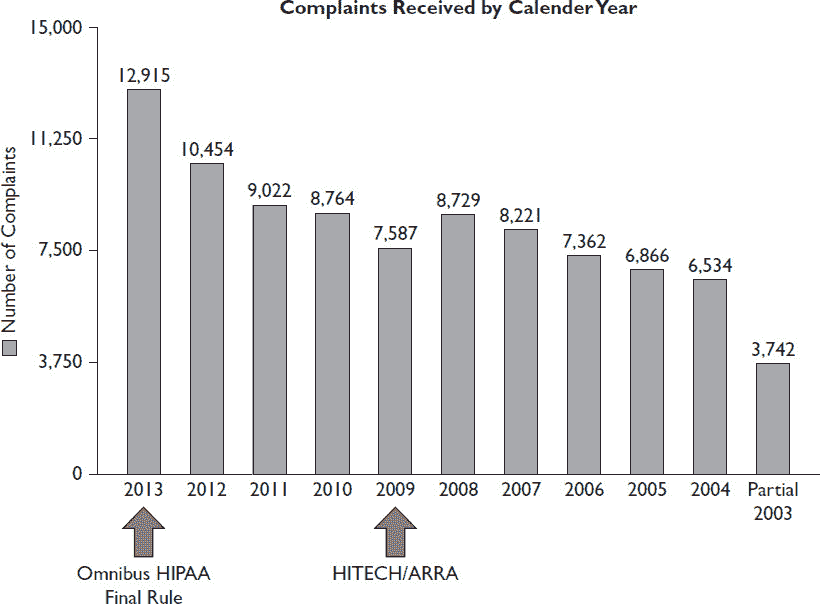

***

**图 7-3** 按日历年显示收到的投诉图表

## 数据质量

在我们适当收集和披露数据、赋予患者审查和请求纠正错误的能力的同时，我们也必须采取主动措施。为此，信息隐私中另一个重要的原则是数据的*质量*，它包含三个主要考量因素：

- 准确性
- 完整性
- 全面性

数据的*准确性*至关重要，因为如果数据的准确性未经验证和保护，患者安全和患者护理将面临风险。想象一下，如果身高、体重和出生日期等数据元素不准确，而药物剂量决策却基于这些参数，会发生什么。与准确性相关的是数据*完整性*。必须有方法来检查曾经准确收集和记录的数据在某个时间点是否被更改或篡改。关于医疗设备感染恶意软件的担忧之一，涉及数据完整性可能面临风险。一种篡改文件时间戳并损坏文件的病毒会对患者监测系统造成严重破坏。最后，*全面性*在 DPD 中有所提及，DPD 要求成员国确保数据准确且保持最新。随着时间的推移，可能需要额外的数据来完善数据记录或纠正任何不准确之处。这些添加或纠正必须像原始数据集一样，以同等的隐私关注度被纳入记录中。

## 问责制

收集受隐私保护数据的实体有责任遵守管辖它们的规定。根据 HIPAA，美国的医疗保健机构有责任保护 PHI 的机密性。起源于美国的公平信息实践也指导数据收集者承担责任。在 DPD 中，数据主体应有可用的方法来追究数据收集者的责任。问责制是当数据收集者未能充分保护其收集的信息时，常导致罚款和处罚的原因。

## 公开与透明

由于个人身份信息可能具有敏感性，尤其是对提供信息的人而言，隐私和数据收集的最佳实践往往坚持公开性和透明性这两大原则。其核心在于信任。当患者不信任其信息在使用过程中受到保护时，他们可能不愿寻求医疗，或在就医时隐瞒相关信息。他们可能不信任该流程，仅仅因为他们未被告知医疗机构如何代表他们管理敏感信息。因此，为了更好地让个人了解其信息如何被收集、使用和披露，数据收集者的公开性和透明性至关重要。在医疗领域，如果患者未被告知相关做法，以及他们如何就信息的使用做出合理选择，这可能成为一个患者护理问题。

根据 HIPAA 隐私规则，遵守隐私实践通知（NPP）有助于医疗机构提供公开性和透明性。NPP 的内容以通俗易懂的语言向个人披露以下事项^(9)：

- 医疗机构将使用和披露个人受保护健康信息的各种方式。
- 个人拥有哪些权利，以及如果个人希望行使其权利可以采取什么行动。例如，如果个人认为其信息被未经授权地使用，必须描述向医疗机构提交投诉的流程。
- 一份声明，断言医疗机构有法律义务保护个人的信息。
- 医疗机构内部的一位联系人，个人可向其获取更多关于该机构隐私政策的信息。

必须包含生效日期。为了使公开性和透明性具有相关性，此类政策和程序通知应在收集或披露信息之前及时提供。此外，由于医疗信息越来越多地以数字格式保存或创建，并在各组织（付款方和其他提供者）之间共享，一个专门解决外部机构之间公开性和透明度的框架，有助于建立 NPP 在患者和提供者之间内部支持的信任。在美国，一个有助于实施公开性和透明性原则（以及其他隐私和安全原则）的 HIPAA 相关框架是《电子交换可识别个人身份健康信息的全国隐私和安全框架》^(10)。该框架认识到，为了患者信任和患者护理的利益，隐私原则必须在无关联的医疗机构之间得到延伸和遵守。

## 公开性和透明性

### 公开性

我们应该区分公开性和透明性。*公开性* 的概念主张，收集个人信息的组织应披露该信息的存在、其安全保管方式、处理方式或共享对象。OECD 隐私原则要求组织就其收集和使用的可识别个人身份数据的“发展、实践和政策”^(11) 保持总体的公开性政策。该原则包括个人知晓谁掌握其数据、数据位于何处以及主要如何被使用的能力。相比之下，美国 1974 年《隐私法》要求联邦政府机构在《联邦公报》上发布记录系统通知（SORN）。*记录系统*^(12) 是指一个或多个记录的集合，由联邦政府机构发起或维护，利用个人身份信息来存储和检索信息。发布此类数据库的存在有助于美国政府实现公开性。

### 透明性

当患者披露大量敏感信息（可能包括社会安全号码、出生日期或其经历的精神病史）时，人们可以想象随之而来的普遍不情愿和恐惧。这在一定程度上是因为患者不确定谁会看到这些信息，也不确定信息将如何被共享。一旦提供了信息，患者就失去了控制权。*透明性* 作为一种隐私概念，要求组织解决信息将如何被使用的这一“谜团”。尽管它并非医疗专用，但《数据保护指令》（DPD）包含了个人知晓其数据具体如何被维护、处理和共享的权利。根据美国法律（HIPAA），赋予患者接收 PHI 披露清单权利的规定将满足透明性原则。

## 隐私官的指定

许多国家（包括美国的 HIPAA）的监管要求都规定组织必须（以书面形式）指定一名隐私官。该职位通常要求非常特定的背景，包括适当的教育、经验和培训。该人员的工作是确保遵守有关隐私要求的法律法规，并制定支持合规的政策和流程。当然，这并非他们的全部职责。隐私官必须确保 NPP 被使用、显著展示，并由患者确认。隐私官是关于将 PHI 用于市场营销、研究和筹款等问题的主要联系人。他或她还集中管理与患者请求更正或修正健康记录、或请求对机密共享的 PHI 提供额外保护相关的政策和程序。对隐私事项有疑问或顾虑的患者和员工可以依赖隐私官的建议和指导。

隐私官可能最重要的职责是处理患者关于数据处理的投诉。此外，当发生数据泄露时，隐私官成为医疗机构内部应对、向监管机构报告、有时向患者通报、以及经常向董事会汇报的核心资源。

组织的隐私官面临着艰巨的任务。该人员有责任培养一种致力于数据保护的组织文化。隐私官需要帮助才能实现这一点，首先是制定、批准并在整个组织中颁布适当的隐私和安全政策。该官员还需要一支经过培训、意识到数据保护和隐私重要性的员工队伍。但请注意，保护数据不仅仅是隐私官的责任；组织中的每个人都有责任保护隐私。

协助隐私官的应是一个支持团队，负责处理与合规和调查相关的日常行政任务和问题，并管理组织的整体隐私计划。根据组织规模，团队可能很小也可能很大。作为管理者，隐私官必须将一些日常任务和职责委派给其团队。然而，团队必须理解，隐私官对该计划负有最终责任和问责义务。

## 承诺与义务

要使隐私原则发挥作用，组织必须理解：其在提供信息隐私方面的行为等同于做出承诺，而这会产生义务。请记住，如果隐私原则描述的是我们要保护的内容，那么对这些原则的确认通常包含在书面文件中，例如 NPP（隐私惯例通知）或合同，这两者均具有法律强制力。虽然本章涵盖的隐私原则和概念中未具体提及，但在实践中，信息隐私还需要理解一些额外的概念。

## 数据保护管理机构

在美国，医疗数据保护的主要管理机构是卫生与公众服务部（HHS）。执法行动由民权办公室（OCR）负责——这是一个在 HHS 领导下的实体。相比之下，欧盟要求每个成员国设立一个独立机构，以监督该成员国的数据保护水平。这些管理实体被称为*数据保护机构*或*监管机构*。^(13) 它们管理在其国家/地区收集可识别个人信息的数据控制者，并就遵守 DPD（数据保护指令）事宜向政府提供建议。发生违规时，数据保护机构拥有管辖权，并向欧盟报告违规行为。个人有权利也有能力直接向数据保护机构投诉。当数据控制者打算收集数据时，必须在公共登记册中登记这一过程，并让数据保护机构知晓此收集行为。登记必须包含相关理由和拟收集的具体数据。这包括收集目的和拟收集数据的描述。数据收集者必须额外披露两项重要信息：是否拟向外国传输数据，以及数据在处理过程中将如何受到保护。

数据保护机构还必须监督数据收集者向其他实体传输敏感数据的任何行为，确保采取了适当的保障措施。数据收集者必须寻求并获得特定授权，以最大限度地降低未经授权披露的风险。如果数据收集者希望将敏感数据从欧盟跨境传输到另一个国家（例如美国），数据保护机构会寻求并要求遵守第 3 章中定义的“安全港”协议，或获得其他同等保证，确保数据处理标准与欧盟法律要求的标准相同或更高。

## 违规通知

数据违规通知是执行隐私指南和法律整体过程的一部分。在此语境下，*违规*一词用于描述未经授权的披露，无论是否故意。大多数情况下，数据违规要求通知当局或受影响的个人。每个国家、州和其他地区（如欧盟）都有自己针对违规通知的具体要求。你应熟练掌握你所在地区的违规通知要求。坦率地说，未能妥善在内部（随后在外部，如适用）报告数据违规，将使你的组织陷入无法辩护的境地，并可能招致额外的、不必要的罚款和处罚。

### 美国

为遵守经《综合 HIPAA 最终规则》（2013 年）最新修订的 HIPAA，医疗服务提供者有非常具体的通知要求。首先，何时通知的门槛非常明确。法律确立了一项“披露风险”^(14)标准，医疗组织必须据此进行衡量。例如，当医疗组织怀疑健康信息可能已以未经授权的方式被披露时，必须确定该信息实际上被未经授权的接收者查看或使用的风险有多大。如果发给有效收件人的未加密电子邮件未被拦截或发送给其他未经授权的收件人，则不一定构成可报告的违规。在这种情况下，不存在未经授权披露的风险，因此无需额外报告。然而，如果信息可能已被披露（例如，因丢失未加密的笔记本电脑），医疗组织将被要求及时通知受影响的个人发生了违规。如果违规涉及超过 500 人，该组织*必须*通知 HHS 和媒体。如果违规影响不足 500 人，医疗组织只需按年度汇总报告这些违规事件。

### 欧盟

虽然许多欧洲国家可能都经历过违规事件，但数据违规通知传统上往往取决于各独立国家的规则。然而，这种情况开始发生变化。对 DPD 的最新修订引入了一项强制性义务，即当数据违规发生在整个欧盟范围内时，必须通知欧盟监管机构。报告必须即时进行。除少数例外情况外，报告必须在个人数据安全违规发生后 24 小时内提交。新指令使欧盟成员国的数据违规通知流程标准化。

### 加拿大

加拿大的违规通知规则因国家隐私指导规则（PIPEDA）和省级隐私规则而异。如果省级指导被认为与 PIPEDA（加拿大联邦法律）实质相似，联邦监管机构认为省级指导已足够。也就是说，PIPEDA 目前对通知个人的要求有限。然而，一些省级法律确实有强制规定。要求数据违规通知的法律包括安大略省的《个人健康信息保护法》、纽芬兰与拉布拉多省的《个人健康信息法》、新不伦瑞克省的《个人健康信息隐私与获取法》以及阿尔伯塔省的《个人信息保护法》。

***

 **提示**   数据违规通知需要把握平衡。如果在要求的时限内未能通知个人和监管机构，可能构成疏忽。大多数国家对此类疏忽都有罚款和处罚。如果过度通知，也可能导致数据违规通知疲劳。这会让你的组织面临过度审查和不必要的负面宣传。请记住，数据违规会影响组织的财务底线、患者护理和组织声誉。因此，了解相关规则和应采取的行动，很可能会让你在组织的数据违规通知程序中扮演关键角色。

## 章节回顾

医疗环境中的隐私是一个传统关注点，可追溯到医学的起源，当时信息保密和身份保护是职业使命。在当今的数字化医疗组织中，新的利益相关群体，如信息技术部门和生物医学设备维护部门，正与健康信息管理和合规职能领域携手合作，在处理健康信息的工作中纳入新兴的隐私考量。

## 章节总结

信息隐私的总体定义见于许多不同的来源。一些来源将信息隐私定义为我们要保护的*内容*。其他来源可能将信息隐私描述为信息保护的一种期望状态。无论哪种情况，医疗保健组织都必须实施大量隐私控制，以保护其收集、传输、存储并最终销毁的敏感个人健康信息。请记住，大量数据泄露恰好发生在保留要求结束、信息保护防护措施无意中放松之时。本章介绍了您需要熟悉的隐私概念和术语。这些概念植根于法律指导，例如美国的 HIPAA。它们也是主流隐私框架的基础。在大多数监管要求下，无论国家、州和地区边界如何，通常都要求组织指定一名隐私官，负责法律合规、确保数据隐私、协助“客户”处理问题或投诉，以及监督组织内外敏感医疗保健的质量与协调。

如果隐私数据以非预期或未经授权的方式被披露，监管要求包括强制性行动，以通知受损失或泄露影响的相关方。了解正确的程序并针对数据泄露实施这些程序，是任何医疗保健组织中信息隐私和安全专业人员的核心胜任力。

## 复习题

### 1.
允许具有合法利益的个人获取有关数据处理信息的概念是

**A.** 透明性  
**B.** 访问权  
**C.** 公开性  
**D.** 责任性

### 2.
为了被允许与营销公司共享患者信息，医疗保健组织在信息披露前需要获得以下哪项？

**A.** 同意  
**B.** 选择权  
**C.** 准确性  
**D.** 通知

### 3.
以下哪个国家制定了《个人信息保护和电子文档法案》（PIPEDA）？

**A.** 日本  
**B.** 瑞士  
**C.** 加拿大  
**D.** 英国

### 4.
以下哪项适用于隐私官职位？

**A.** 必须是律师  
**B.** 必须向高级信息技术官员汇报  
**C.** 必须以书面形式指定  
**D.** 必须监督第三方合作伙伴谈判

### 5.
（判断正误）在欧盟《数据保护指令》的框架内，同意必须是自愿的、知情的，且由具有行为能力的个人给出。

### 6.
根据美国医疗保健法律（HIPAA），当超过什么阈值时会发生数据泄露？

**A.** 危害风险  
**B.** 未经授权访问风险  
**C.** 披露风险  
**D.** 患者护理风险

### 7.
（判断正误）为了最大程度地确保组织已获得患者同意，组织应使用预选的复选框，以免患者无意中错过同意声明。

## 答案

### 1.
**C.** 透明性是指允许个人知晓其数据具体是如何被维护的。访问权意味着数据主体应被允许访问其数据并请求更正任何不准确的数据。责任性意味着数据主体应有可用的方法追究数据收集者遵循隐私原则的责任。因此，公开性——允许任何具有合法利益的公众成员获取有关数据处理的信息——是正确答案。

### 2.
**A.** 为患者治疗、服务付费或医院运营以外的原因共享信息，医疗保健组织必须获得患者的同意。选择权是一个相关概念，但与获取信息共享批准无关。数据的准确性很重要，但如果没有同意，信息仍然不能共享。通知也是不够的，因为医院无权在收集信息后共享信息，而患者仅同意了特定用途。

### 3.
**C.** 《个人信息保护和电子文档法案》（PIPEDA）是一项加拿大法律，不专门针对医疗保健，旨在保护加拿大公民的隐私。

### 4.
**C.** 除大多数框架和法律要求隐私官必须以书面形式指定外，所列选项并非必须要求。

### 5.
**正确。** DPD 要求同意必须是自愿且知情的，但也必须仅由具有行为能力的个人授予。

### 6.
**C.** 随着 2013 年《综合 HIPAA 最终规则》的通过，披露风险已成为 HIPAA 下的评估阈值。患者危害风险是之前的标准。

### 7.
**错误.** 确保同意的最佳措施是使其成为主动选择加入或选择退出的决定。换句话说，患者应被迫通过勾选复选框来选择该选项。如果选项是预选的，他们可能无法理解自己的选择。

## 参考资料

### 1.
联合国大会. “《世界人权宣言》.” 1948 年 12 月 10 日. 联合国. 访问日期：2014 年 8 月 1 日. [`www.un.org/en/documents/udhr/`](http://www.un.org/en/documents/udhr/)

### 2.
Tyson, Peter. “今日希波克拉底誓言.” Nova Beta. 2001 年 3 月 27 日. 访问日期：2014 年 7 月 17 日. [`www.pbs.org/wgbh/nova/body/hippocratic-oath-today.html`](http://www.pbs.org/wgbh/nova/body/hippocratic-oath-today.html)

### 3.
美国卫生与公众服务部. “HIPAA 隐私规则 (45 CFR, Part 160).” 访问日期：2014 年 4 月 28 日. [www.hhs.gov/ocr/privacy/hipaa/administrative/privacyrule/index.html](http://www.hhs.gov/ocr/privacy/hipaa/administrative/privacyrule/index.html)

### 4.
Manos, Diana. “政策小组纠结于选择加入与选择退出.” Healthcare IT News. 2010 年 7 月 22 日. 访问日期：2014 年 5 月 7 日. [`www.healthcareitnews.com/news/policy-group-wrestles-opt-versus-opt-out`](http://www.healthcareitnews.com/news/policy-group-wrestles-opt-versus-opt-out)

### 5.
经济合作与发展组织 (OECD). “OECD 关于隐私保护和个人数据跨境流动的指导原则：收集限制原则.” 第 2 部分：国家应用的基本原则. 2013 年. 第 14 页. 访问日期：2014 年 8 月 20 日. [`www.oecd.org/sti/ieconomy/2013-oecd-privacy-guidelines.pdf`](http://www.oecd.org/sti/ieconomy/2013-oecd-privacy-guidelines.pdf)

### 6.
1995 年 10 月 24 日欧洲议会和理事会关于个人数据处理中个人保护及此类数据自由流动的指令 95/46/EC. 第 28 条. 访问日期：2014 年 8 月 3 日. [`eur-lex.europa.eu/legal-content/en/ALL/?uri=CELEX:31995L0046`](http://eur-lex.europa.eu/legal-content/en/ALL/?uri=CELEX:31995L0046)

## 参考文献

7. 美国卫生与公众服务部。“公共卫生活动的信息披露。” 45 CFR 164.512(b)。2003 年。访问于 2014 年 5 月 7 日，网址：<http://www.hhs.gov/ocr/privacy/hipaa/understanding/coveredentities/publichealth.html>

8. 美国卫生与公众服务部。“健康信息隐私：按年份划分的执法结果。” 访问于 2014 年 7 月 31 日，网址：<http://www.hhs.gov/ocr/privacy/hipaa/enforcement/data/historicalnumbers.html>

9. 美国卫生与公众服务部。“受保护健康信息的隐私实践通知。” 45 CFR 164.520。2003 年。访问于 2014 年 7 月 30 日，网址：<http://www.hhs.gov/ocr/privacy/hipaa/understanding/coveredentities/notice.html>

10. “电子交换的全国隐私与安全框架。” HealthIT.gov。访问于 2014 年 5 月 7 日，网址：<http://healthit.gov/policy-researchers-implementers/nationwide-privacy-and-security-framework-electronic-exchange>

11. Gurría, Angel。“开放与透明——民主、信任与进步的支柱。” 经济合作与发展组织 (OECD)。访问于 2014 年 5 月 7 日，网址：<http://www.oecd.org/fr/etatsunis/opennessandtransparency-pillarsfordemocracytrustandprogress.htm>

12. 美国人事管理办公室。“记录系统通知 (SORN) 指南。” 2010 年 4 月 22 日。第 2.1 节，第 1 页。访问于 2014 年 7 月 22 日，网址：<https://www.opm.gov/information-management/privacy-policy/privacy-references/sornguide.pdf>

13. Swire, Peter P., 和 Sol Bermann。《信息隐私：注册信息隐私专业人员 (CIPP) 官方参考指南》。（缅因州约克：国际隐私专业人士协会，2007 年），第 13 页。

14. 美国卫生与公众服务部。“违规通知规则：行政要求与举证责任。” 45 CFR 164.400-414。2013 年。访问于 2014 年 8 月 3 日，网址：<http://www.hhs.gov/ocr/privacy/hipaa/administrative/breachnotificationrule/index.html>

## 第 8 章：保护数字健康信息：网络安全基础

在本章中，您将学会：

- 理解从信息安全到网络安全的演变
- 识别信息机密性、完整性和可用性的应用
- 理解基本的网络安全术语
- 解释数据加密和身份访问管理
- 熟悉信息保障实践，如业务连续性和系统恢复

阅读本书的某些人可能已经拥有多年的信息技术或安全经验。有些人甚至可能持有 CISSP（注册信息系统安全专家）或 CISA（注册信息系统审计师）等认证。本章将为这些读者提供复习，但请勿跳过。正在发生的变化之一，甚至在本书撰写之时，就是从信息安全到网络安全的演变（或革命）。如前所述，本书汇集了来自其他传统信息保护领域的读者，这些领域主要适用于隐私问题，或适用于现在联网程度更高的医疗设备技术。因此，第 8 章的重点是提供对网络安全概念的扎实基础理解，特别考虑到了非网络安全专业人员。因此，如果您具有医疗专业背景，且现在承担网络安全职责，您将受益匪浅。

医疗保健组织与其他所有必须收集和使用敏感信息以生产产品或提供服务的行业类似。因此，医疗保健组织通常必须遵守信息保护实践。风险管理在医疗保健领域变得更加重要，是因为传统上保护患者隐私的强有力努力与健康信息数字化的融合。数字化带来了网络安全要求，并对医疗工作者提出了新的专业技能要求。有大量信息需要理解，指望任何人同时成为隐私和网络安全专家可能要求过高。然而，医疗保健员工发现，如果不具备基本的网络安全知识，几乎不可能成功履行隐私职责，反之亦然。

## 从信息安全到网络安全的演变

信息安全与网络安全的区别是一个有争议的话题。对许多人来说，两者实际上没有区别，只是网络安全这一术语承认了全球几乎每个组织都从基于纸质的记录收集演变为数字信息的收集、存储、使用和传输。*网络安全*一词越来越适合用来描述此类信息是如何受到保护的，这一点在美国尤为明显。如果本书不至少涉及这一术语，就不算与时俱进。本章接下来的两节提供了信息安全和网络安全的相关来源，给出了各自的重点和定义。根据您组织所在的位置（在美国或国际上），这些术语可能被同义使用，或者两者之间可能仍存在区别。

### 信息安全

ISO/IEC 27001《信息安全管理》是由国际标准化组织 (ISO) 和国际电工委员会 (IEC) 发布的信息安全标准。它是信息安全控制和原则的主要来源，并提出了保护组织信息资源的整体方法。在人力资源、系统获取和资产管理控制等方面，这种方法可能存在一些差异。下一节讨论的网络安全框架并未像 ISO/IEC 27001 在 2013 年最近的更新中那样充分解决这些差异。

冒着过度简化定义的风险，信息安全与网络安全的区别可能在于：信息安全对保护信息免受未经授权的访问和使用持有更广泛的观点，无论信息是基于纸质还是数字形式。在这种情况下，网络安全仅构成维护信息安全实践的一个较小组成部分。然而，这两个术语的区别越来越多地取决于您是在在美国还是在国际上工作。

### 网络安全

如果我们承认“网络安全”一词越来越多地成为“信息安全”的同义词，尤其是在美国，我们就可以围绕信息数字化的现实来最好地定义网络安全。保护数字信息需要许多与保护纸质信息相同的防护措施。例如，许多物理和管理控制均适用于两者。存放数字信息的数据中心需要密码锁、监控和环境控制，这与存放纸质档案的档案室所需的非常相似。对敏感信息的访问和传输必须由政策和程序来管控，以应对与纸质通信或传真时代相同的机密性、完整性和可用性问题。我们可以用来审视适用于医疗保健的网络安全框架的一个优秀资源是《改善关键基础设施网络安全框架》，由美国国家标准与技术研究院（NIST）于 2014 年发布。这是对 2013 年 2 月发布的美国总统行政命令 13636《改善关键基础设施网络安全》的回应。NIST 框架是一个自愿性的控制标准和实践框架，旨在解决关键基础设施的网络安全问题，其中包括美国医疗保健 IT 网络。^(1)

---

 **注意** 由于本文旨在面向广泛的国际医疗保健专业受众，将使用“信息安全”一词，并理解未来版本可能会演变为用“网络安全”一词取而代之。

### 安全指导原则：机密性、完整性、可用性和问责制

信息安全的三要素——机密性、完整性和可用性（CIA）——适用于医疗保健。在第 9 章中，我们将讨论医疗保健中这三者之间的平衡艺术，但目前我们需要对每一项都有扎实的理解。这些构成了著名的信息安全三要素：CIA 三要素。另一个与 CIA 相关且应纳入本次讨论的术语是问责制。作为一项信息安全关注点，问责制在医疗保健中高度相关。

为了将这些指导原则落到实处，为保护信息而实施的每一项防护措施、控制和实践，其目的都是为了保护机密性、完整性或可用性（或这些的组合）。当我们开展风险管理计划时，我们的努力旨在防止任何漏洞被利用。当威胁利用漏洞时，由此产生的风险会对信息的机密性、完整性和可用性产生不利影响。

#### 机密性

*机密性*是防止敏感数据未经授权披露的保护。用于提供机密性的控制措施中有两项是加密和访问控制。在医疗保健领域，机密性不仅对于保护个人免受医疗和金融身份盗窃很重要，研究表明，机密性泄露会影响患者护理。在英国，泄露事件常见到足以让一些患者担心信息会落入坏人之手。^(2) 患者担心其医疗服务提供者可能会在允许披露的范围之外泄露或丢失其信息，害怕尴尬，因此可能向提供者隐瞒信息^(3)。更糟的是，这些患者可能会延迟寻求治疗。在某些情况下还有额外的机密性考量。例如，与人类免疫缺陷病毒（HIV）、行为健康和儿童相关的患者护理信息通常要求更严格的机密性要求。无论是在美国根据 HIPAA，还是在欧盟根据 DPD，机密性要求往往超出患者护理关系的范围。数据收集者有责任永远保持信息的机密性，即使患者披露了该信息。^(4) 当然，患者可以同意特定的披露，但通常医疗保健组织永远不能披露该信息。此外，组织必须保护信息免遭披露，直到能够合法且妥善地销毁它。

#### 完整性

想象一个场景：恶意代码（软件病毒）通过恶意软件应用程序被引入医疗设备。如果该医疗设备负责给患者配药，而该病毒的影响是将所有小数点向右移动一位，后果对患者可能是重大的。如果指示剂量仅为 0.05 ml，而实际给予 0.5 ml，可能会产生灾难性后果。数据完整性为此及许多其他原因都很重要。信息完整性通过确保所做的更改经过授权且正确，或者根本不做更改来维护。事实上，数据完整性涉及保护信息的准确性、质量和完整性。

数据完整性的一个关注点涉及信息的数据流和生命周期。当你检查医疗保健环境中数据收集和使用的过程时，数据通常会改变格式，各种数据元素会被组合、解析或甚至聚合。尽管如此，数据的完整性必须保持不变。例如，患者姓名或出生日期必须保持一致，即使它在入院时被收集为“Jane Doe, December 14”，随后在转录到计费系统时转换为“Doe, Jane, 12/14”。虽然这是一个过度简化的例子，但在数据流中保持数据完整性是国际标准（如用于编码患者就诊的 ICD-10，以及用于跨组织和系统传输健康信息的 HL7）存在的原因之一。使用标准数据集和事务代码有助于确保数据完整性。

#### 可用性

信息只有在可访问且及时时才有价值。数据可以是准确且保密的，但如果在需要时不可用，CIA 三要素的第三部分就失败了。数据的*可用性*通常被描述为在需要信息时能够适当访问。在医疗保健领域，我们当然能理解未能保护患者身份和确保记录准确的后果，但网络停机且无应急操作计划意味着信息在护理现场不可用。这种情况可能导致患者护理和患者安全风险，因为提供者无法使用他或她所需的信息。加剧问题的是，随着信息日益数字化，纸质记录和手动流程不易检索或实施。信息不可用可能导致不当诊断、低效或冗余检查，以及在某些情况下出现不良药物相互作用。

在进入下一个概念之前，重要的是要注意，可用性也涉及仅提供必要的信息。通常，可用信息过多或拥有未组织的原始数据是一个安全问题。例如，隐私和安全框架（如 DPD 和 HIPAA）解决了拥有相关信息与拥有超出需求的信息之间的问题。治疗骨科损伤时需要相关的既往 MRI 影像的提供者，当然必须拥有受影响部位的最近一次 MRI，以便与最新影像进行比对。然而，如果该提供者不得不在该患者所有无关治疗的影像中搜索，将会不堪重负。如果没有其他原因，这种搜索也会耗时且浪费。通过限制可用性，我们只需在交易中不共享未使用或额外的数据，就能防止未经授权的披露或数据泄露。为了说明，请考虑一个过去的例子。曾有一段时间，美国的个人银行支票通常印有个人的社会安全号码。这对身份识别很有用，但最终这种做法停止了，因为供应商可以用更谨慎的方式确定身份。在支票上包含社会安全号码的做法带来了过高的数据丢失和身份盗窃风险，这是过度可用性对信息安全影响的一个好例子。

### 问责制

作为一种信息安全关注点，问责制并非 CIA 三要素的目标之一；然而，它与之相关，值得在一般性讨论中包含。为了遵守信息安全法律法规和指南，通常必须具备问责制要素。组织必须对其收集和使用的信息负责。同样，使用信息的个人也要对其行为负责。这些行为必须在不同程度上被记录和审计，以证明已采取问责措施来保护信息免遭数据泄露。*问责制*是责任的分配以及证明数据正当使用的能力。它也是针对信息安全追踪行为和责任方的一种机制。计算机系统的访问日志记录有助于追踪和跟踪系统用户。审计信息披露报告使我们能够查看并补救任何可能未经授权的披露，或者至少向政府监管机构证明披露情况已按要求进行跟踪。*不可否认性*（确保某人无法否认某事的能力）也是问责制的一个要素。通过提供数字签名和加密算法等保障措施，组织可以确保电子消息的发送方无法否认发送过该消息，接收方也无法否认收到过该消息。通过这种方式，不可否认性通过提供证明问责制的方法来协助组织。

---

 **提示**   根据你在组织中的角色，CIA 三要素每个组成部分以及问责制的相对重要性可能会发生变化。例如，作为系统管理员，提供问责制和可用性可能比保密性更符合你的职责描述。这很典型，因此虽然 CIA 三要素的通用图示是一个等边三角形，但现实情况是，其形状取决于一些情境因素，包括组织角色。

### 打造信息安全

毫无疑问，理解信息安全的第一步是了解相关术语。为了使术语有意义，提供一些关于如何在组织中塑造或纳入信息保障措施的背景会有所帮助。我们的出发点是定义一些总体概念，这将有助于界定后续的术语和定义。我们从一些主要的信息安全方法和实践开始：安全控制、安全分类和纵深防御。

#### 安全控制

为了保护信息，组织当然必须采用安全控制。重要的是要注意，安全控制是指普遍被认为有效的标准或技术。成本也是一个考量因素，如果实施和维护安全控制的成本超过其保护的信息资产价值，则该控制无效。NIST 指南或 ISO 出版物中概述的控制措施符合正确实施安全控制的要求。控制措施的性质（如第 4 章所述）可以是物理的（锁）、管理的（策略）或技术的（加密）。实施控制措施的效益可以在基于功能的控制组织的各个阶段实现：

- **预防性** 避免事件发生。
- **检测性** 在事件发生时识别事件。
- **纠正性** 纠正情况。
- **威慑性** 阻止攻击和违规。
- **恢复性** 恢复运营。
- **补偿性** 提供替代或互补控制。

#### 安全分类

为了确定应实施或不应实施哪些控制，组织必须根据其收集和使用的信息类型来制定方法。根据 NIST 的联邦信息处理标准出版物 (FIPS PUB) 199《联邦信息和信息系统安全分类标准》^(5)，安全分类是根据机密性、完整性和可用性评估信息的过程。可以使用对每个组成部分重要性的简单低、中、高估值来确定主观分数。例如，如果我们认为可用性是受保护健康信息 (PHI) 的 CIA 三要素中最重要的组成部分，我们可能会得到如下等式：

安全分类 = 机密性（低）+ 完整性（低）+ 可用性（高）

这种估值可能会促使组织提供确保可用性的控制措施，例如投资发电机并为信息系统提供持续供电。在这种情况下，对机密性和完整性控制的投资可能是次要且更保守的。

图 8-1 展示了这一可遵循的简单过程，用于提供信息安全分类。为了确定医疗保健领域的安全分类，一旦我们确定了 PHI 和个人身份信息 (PII) 所在的位置及其在组织中的流动方式，我们就会对它们使用此等式。此时，信息已被分类，所需的保护级别也可随之确定。

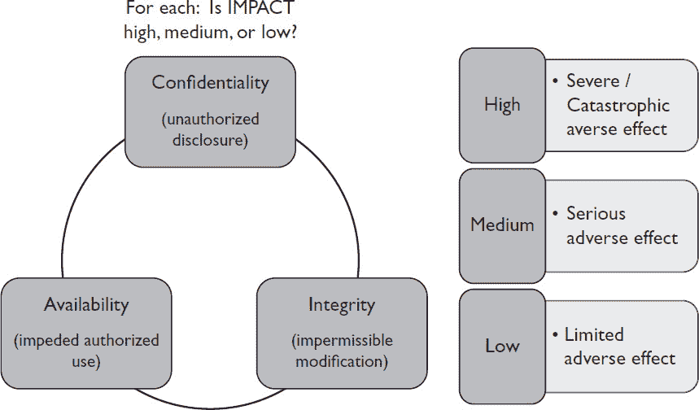

**图 8-1** 为保护而对信息进行分类

现在您已基本了解信息安全级别的分类方式，重要的是要认识到分类过程的复杂性。正如 NIST SP 800-60 所指出的，某个系统实际上可能使用多种类型的数据，如果数据泄露，会对组织造成多个层面的影响。以电子健康记录（EHR）为例。该系统将包含 PHI、保险数据和联系信息。某些职业健康服务甚至会包含就业记录。分类公式保持不变：利用机密性、完整性和可用性这三个类别，组织必须以相同的方式评估每种信息类型，尽管是针对高、中、低数值独立进行评估，具体取决于它们在这三个领域中的关键程度。就组织的 EHR 系统而言，这是一项团队工作。临床服务部门、财务、IT 和临床工程（医疗设备）的代表应被纳入其中，以确保最佳结果。实施的控制措施可根据面临风险的信息类型进行定制。例如，访问应用程序的财务模块可能需要单独的访问控制或登录凭证。这一过程繁琐且常被忽视；然而，欧盟 DPD 下的数据保护主管审查以及美国 HIPAA 执法监管机构进行的审计，都在寻找此类控制措施的证据。从整体风险管理的角度来看，也是审视这一过程的另一种方式。因为任何良好的风险管理过程的第一步都是资产清点，对信息安全进行分类就是对敏感数据进行资产清点的一种手段，并有助于其他风险管理活动。

## 深度防御

系统管理、审计、网络和安全（SANS）学院将深度防御描述为“一种概念，即通过一系列防御机制来保护计算机网络，使得如果一种机制失效，另一种机制已就位以挫败攻击。”^(6) 基本概念是使用尽可能多的安全控制措施来提供多层防护。虽然许多人会争辩说深度防御无法很好地防范拥有适当凭证、完全授权或提升特权的最终用户实施的不当行为。根据 Ponemon 的研究^(7)，人为错误和系统故障代价高昂，且在医疗保健领域仍高发。然而，恶意行为者开始通过社会工程学、网络钓鱼邮件和其他犯罪窃取活动来伪造或窃取有效的最终用户凭证。最终，外部威胁会转化为内部威胁。反对深度防御的观点认为，其架构和保障措施可能无法提供任何检测或威慑。虽然这可能属实，但理解深度防御是基础性的。关于深度防御不足之处的显著论点可以在别处讨论。

具体的深度防御控制措施应在构建新系统和应用程序时就被设计进去。它们包括防病毒和反恶意软件防护，并应包括技术架构控制，如防火墙、路由器、入侵检测系统和数据丢失防护。更重要的是，独立的控制措施应能协同工作，以提供集成防护。图 8-2 说明了深度防御组件层，并提供了可能使用的控制类型示例。

***

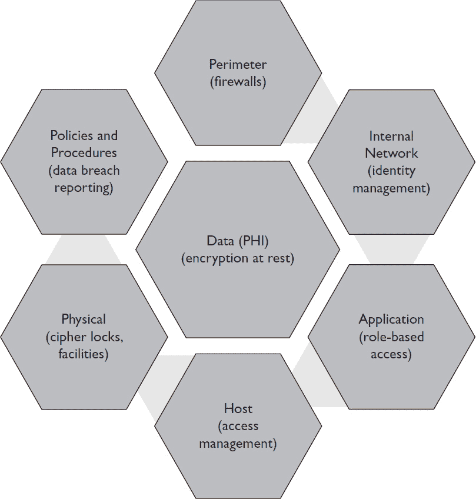

`Figure 8-2` 深度防御方法

医疗保健组织不能忽视实施安全控制、为安全隐患对信息进行分类以及从深度防御角度处理信息安全的要求。重温国际隐私原则和安全框架的现实非常重要：医疗保健信息被视为敏感信息，并在所有主流信息保护方法中得到专门解决。保护健康信息所需的流程、技术和行动是当今医疗保健战略实践的组成部分，也是明天的核心竞争力。组织的每个成员都有责任保护信息——而我们作为医疗保健领域的信息安全和隐私专业人员，有额外的责任在组织中创造一种文化，至少要推动安全控制、信息分类和深度防御。否则，组织将无法满足 HIPAA 和 PIPEDA 等法律的合规要求，并很可能遭受一次或多次数据泄露，导致患者信任的丧失。

## 通用安全定义

塑造信息安全的概念可能是抽象且复杂的。为了帮助您理解信息安全的方法和实践，熟悉相关定义显然是一个基础性的步骤。此处收录这些定义，是因为它们是信息安全实践和合规的核心，而且更先进的安全流程都是基于它们设计的。

### 访问控制

`Access control` 保护敏感信息，由所有为规范信息的查看、存储、复制、修改、传输和删除而实施的行动和控制措施组成。控制访问还包括时间和情境的限制。例如，最终用户可能被允许在预定时间访问系统，但在此之后不允许，或者仅允许出于特定原因访问，而不允许出于其他原因。情境访问的一个例子是在急诊室，医生在该护理点被授予访问行为健康记录的某些权限，而这些医生在初级保健环境下可能无权访问这些记录。访问控制过程包括：

- `Authorization` 确定最终用户将拥有哪些权限以及何时拥有（即用户的访问级别）的策略和程序。
- `Authentication` 用于验证最终用户身份并确认其即为其声称身份的过程。
- `Identification` 简单来说，这是表明一个人是谁的行为。在计算技术中，最常通过用户名或身份代码（例如 `firstname`、`lastname`）来识别一个人。请注意，识别不包括将此用户名与密码结合使用，后者被视为认证（如上定义），它将简单的身份代码与验证代码（密码）结合在一起。
- `Nonrepudiation` 通过在数字交易中使用识别认证方法和工具，可以提供关于数据发送方或接收方是谁的不可辩驳或有保证的证明。

组织实施访问控制，是为了允许授权人员合法使用，同时防止未经授权的使用。请记住，合法使用可能随时发生变化，因此访问控制必须在各个层面和关键访问间隔发生。例如，访问控制可以在操作系统级别实施以保护文件和存储介质，在数据库级别实施以防止未经授权的访问和潜在的数据损坏。此外，设计良好的应用程序和 Web 服务通常会强制执行多个独立的访问控制以实现分层防护，即使使用了单点登录（SSO）技术。需要明确的是，访问控制旨在防止未经授权的使用，但该实践也允许在组织可接受的风险水平下共享敏感信息。如果没有访问控制，大多数组织会认为共享 PHI 或 PII 风险太大；这将阻碍或降低数字化医疗保健环境中的患者护理质量。

为了使访问控制有效，身份验证过程必须支持这些控制。为了正确识别人员并授予他们适当的访问级别，了解两种类型的身份验证很有用：当同一想要访问网络、系统或应用程序的个体独立满足至少两个条件时，即存在多因素身份验证。在许多语境下，多因素身份验证和双因素身份验证是同义词，这取决于必须满足多少个条件。当组织实施适当的多因素身份验证时，该过程被视为强身份验证。

为了获得访问权限，最终用户必须提供人所知的内容（密码/PIN）、人所拥有的物品（物理令牌/徽章）、人的生物特征（生物识别），或这三个因素的某种组合。明确来说，这意味着该人可以验证以下至少两项内容^(8)：

- 我知晓什么（基于知识的身份验证）
- 我拥有什么（基于所有权的身份验证）
- 我是谁（基于特征的身份验证）

## 访问控制模型

有几种访问控制模型用于强制执行身份验证和授权准则，所使用的控制是自动化的。（想象一下，如果每次最终用户想要访问数据或系统时，都要手动检查其凭证，那会有多困难！）常见的访问控制模型有强制访问控制、自主访问控制和基于角色的访问控制。还有一些混合模型结合了各自的特性，但这三种是基础模型。

---

>  **注意** 尽管这些模型由计算机策略和配置强制执行，但某些信息安全准则规定可以覆盖这些策略和配置，或用于紧急访问。最好的例子是 HIPAA 中关于在紧急情况下提供“破玻璃”访问的规定。换句话说，系统有一种方法可以向在正常情况下可能没有授权或访问权限的人提供访问权限。

### 强制访问控制

第一种访问控制模型类型是强制访问控制，其中中央权威机构（如组织的 CIO）制定访问控制策略，由 IT 部门实施。实际的访问控制在硬件或操作系统层面作为技术控制强制执行。强制访问控制最常用于处理机密信息的组织——例如军事组织。将强制访问控制纳入此背景是合理的，因为它与医疗保健组织相关，后者在某些应用程序和网络资源中使用严格的集中式控制。在此模型中，单个系统或数据所有者无法更改允许的访问级别。强制访问控制模型依赖于对信息进行适当的安全分类，因为在这种情况下，访问策略很可能由信息的敏感性决定。在某些组织中，可能存在机密信息，此时中央权威机构可以确定谁被允许访问此类信息。分类不当的信息可能会阻挡需要访问的人员，或者允许不需要知道该信息的人员访问。这两种情况都不理想。从积极方面来看，由中央权威机构强制执行访问控制使得标准、公平的策略成为可能。

### 自主访问控制

如果访问控制更加分散或委托给单个系统的所有者或数据本身的所有者，则使用自主访问控制模型。系统所有者或数据所有者向其认为有权访问信息的任何人授予特权。自主访问控制比强制访问控制更灵活，但引入了更大的风险。例如，一旦某人获得查看文件的权限，系统所有者就无法控制该人是否决定复制文件并允许其他人查看。

### 基于角色的访问控制

非自主访问控制模型中最普遍的类型可能是基于角色的访问控制，其中系统所有者根据用户或组的工作职能或组织角色确定访问级别。例如，儿科医生可能有一种访问控制类型，而同一部门的护士可能有另一种。基于角色的访问模型的一个组成部分是访问控制列表（ACL），该列表指示哪些人员有权访问特定对象，或划定哪些人员拥有特定类型的访问权限，如读取、写入或删除访问权限。ACL 是实施基于角色的访问控制最常用的方式。

---

>  **注意** ACL 一词的另一种用法与防火墙或路由器规则有关，其概念非常相似。防火墙 ACL 是在预定情况下（使用特定协议）被允许访问组织 IT 资源的端口和互联网协议（IP）地址列表。这种类型的 ACL 可以被视为针对 IT 系统而非人员的基于角色的访问控制。

## 数据加密

数据加密是一种技术控制或解决方案，用于保护信息机密性。严格来说，加密并不侧重于保护或提供数据完整性或可用性；然而，称为哈希算法的加密算法确实提供数据完整性。根据现行的信息安全标准（如 HIPAA 和 ISO 27001，仅举两例），敏感数据（如 PHI 和 PII）必须加密。数据可以（也应该）加密的两种状态是：“静态”和“传输中”。第一种状态“静态”是指存储在任何介质上且当前未被处理或传输的数据。如果静态数据已加密，则丢失或被盗后被未经授权查看数据的人员恢复的介质，对发现者来说将无法使用或无法读取。在这种情况下，只有拥有加密密钥解密信息的人才能访问数据。使用加密应用程序应用此类加密有两种常见方式。一种是使用相同的加密密钥加密磁盘上整个信息卷，另一种是在文件级别加密。加密整个磁盘卷的好处在于将人为错误降至最低，因为如果过程的任何部分是手动的或自主的（文件级加密可能如此），用户可能会忘记或疏忽加密数据。

## 传输中的数据

数据的第二种状态是*传输中*：某些敏感数据必须通过电子邮件传输；其他数据必须通过安全连接传输。在这些传输过程中，数据必须受到加密保护。无论数据是静止还是传输中，加密密钥过程都是相似的。核心概念是，数据通过变得对预期接收者之外的任何人都不可用，从而受到保护，防止未经授权的访问和泄露。为了实现这一点，加密密钥被附加到与每个发送者和接收者的公钥和私钥相关的数字证书上。私钥是保密的。然而，公钥不是保密的，任何人都可以使用它来加密消息。只有预期接收者的私钥才能解密该消息。这些密钥是不同的，但它们通过一种数学算法相关联，使该过程成为可能。证书是用于唯一标识加密密钥并将其与声称的所有者关联的机制^(9)——确保机密性并防止未经授权的披露。重要的是要注意，加密密钥的主要标准见于 FIPS 140-2。如果加密密钥已根据 FIPS 140-2 进行测试和认证，则可在美国根据 HIPAA 提供安全港保护。请记住 HIPAA 安全港与 DPD 安全港条款之间的区别，如第 3 章所述。

### 图 8-3：传输中加密数据的传输

图 8-3 描绘了一个使用加密进行传输中数据保护的简单电子邮件传输过程。它展示了公钥基础设施 (PKI) 的组件，PKI 由所有协同工作以创建、管理和共享数字证书的技术、人员和策略组成。^(10)

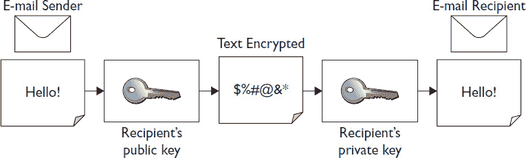

---

**图 8-3** 传输中加密数据的传输

## 培训与意识

任何组织能够实施的最具成本效益的安全控制之一，就是一项积极的员工培训和意识计划。培训和意识教育有助于防止因员工失误导致的违规事件，并减少在处理 PHI 和 PII 时的麻痹大意。*培训*是指导员工或向他们传授技能或主题的行为，重点在于工作绩效的具体改进。目标受众以目的导向的方式参与学习过程。教学内容通常涵盖需要做什么，然后包括如何做正确事情的步骤或程序。由于培训主题具有针对性，目标受众也随之具体化。培训场景的一个例子是面向组织的年度信息安全程序培训课。通常，这些课程根据最终用户的访问级别进行授课，例如系统管理员或标准最终用户。定期进行培训效果最佳。许多必修培训课程要求每年复训一次。此类培训会被跟踪记录，合规情况会上报给相关领导。有时培训是法律强制要求的。就 HIPAA 而言，医疗保健组织必须向所有员工提供相关安全政策和程序的培训。^(11) 然而，临时或按需提供的培训也极其有效。关于如何加密包含 PHI 的电子邮件的课程，作为每周针对特定受众的在职培训主题可能会很有帮助。针对各种及时主题提供临时培训的频率越高，它们在影响正确的信息安全行为和避免员工导致的数据泄露方面就越有效。

*意识教育*是提高员工理解并再次激励正确行为的整体战略的一部分。培训与意识教育密切相关；事实上，安全意识是培训活动的预期成果。大多数意识教育计划包括通过信息安全宣传活动进行相关信息的营销和传播，方式包括在显眼区域张贴海报、发送通讯、登录时弹出横幅、在员工会议上发布公告等，仅举几例。虽然许多人会争辩说这种信息传递实际上只是一种临时培训形式，但这些意识教育示例中信息和受众更具针对性，从而提供了区别。总之，这些安全控制、培训和意识教育实践必须配合使用，以开展全面的员工信息安全计划。

## 制裁政策

即使是最好的培训和意识教育计划也无法防止每一起员工事件。为应对员工违反组织隐私和安全实践及政策的情况，需要制定制裁政策。*制裁政策*最好被描述为管理层针对此类违规行为可采取的一组规定行动。虽然有些事件严重到需要立即解雇，但大多数事件本质上是意外性质的。因此，政策应概述渐进式的纪律处分级别，并在可能的情况下允许管理层酌情处理。为便于此过程，组织必须对违规类型进行分类，并将其与各种拟考虑的处罚类型相匹配。最终，一个好的制裁政策将是公平且一致的，不仅针对违规者，也与组织其余的人力资源纪律处分政策保持一致。作为组织培训和意识教育计划的一部分，来自制裁政策执行过程的数据对于确定趋势问题和违规原因，以及汇总报告结果极具价值。

## 日志记录与监控

在信息安全环境中，存在许多不同的日志和日志记录类型。基本上，*日志*是由网络、系统、应用程序和最终用户设备上的事件处理生成的记录。发生的每个具体事件都会被记录下来。与潜在安全事件相关的日志，如失败的登录尝试或防火墙拒绝访问事件，可以成为有用的工具。信息安全和隐私专业人员的主要职责之一是主动审查日志，并对触发警报的任何事件采取行动。由于此类日志的巨大数量和复杂性，这是一项艰巨的任务，因此监控计算环境的能力是必要的。*监控*通常是一种自动化方法，通过设置行为规则或参数来区分正常网络行为与潜在事件或事故。例如，当同一最终用户在计算域内的网络和虚拟专用网络上同时登录时，良好的监控流程会发出警报。这通常表明凭证被伪造或窃取。尽管监控是使用安全技术的自动化功能，但设置监控工具并教育培训人员了解复杂的行为规则、何为正常行为以及何种情况应触发警报行动，仍需要付出艰苦努力。

## 信息安全持续监控 (ISCM)

由于安全自动化中改进的自动化工具和流程，日志记录和监控中的一个增长趋势是信息安全持续监控 (ISCM)。NIST SP 800-137《联邦信息系统和组织的信息安全持续监控》将 ISCM 定义为保持对信息安全、漏洞和威胁的持续认知，以支持组织的风险管理决策。更重要的是，该指令概述了 图 8-4 中描绘的领域周围潜在自动化领域和最佳实践理念。虽然本文仅介绍这些领域，但关键在于这些领域中的日志记录和监控正日益实现自动化和持续化。

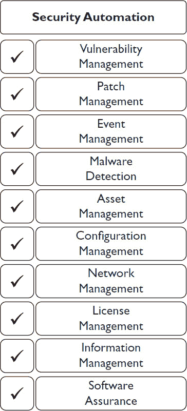

---

## 漏洞管理

无论组织在何处存在信息安全控制缺口，都存在弱点或潜在的利用机会。这种安全控制不存在或控制不足的区域或条件，属于*漏洞*范畴，即一种可能被利用的弱点；然而，该风险被利用的概率并不总是很高。此外，可能被利用的资产未必会造成必须实施昂贵控制措施级别的影响。漏洞只是指示器，提醒风险管理者考虑采取行动并平衡风险，权衡发生可能性与成本影响。基于这些原因，是否实施保障措施或选择一种保障措施而非另一种，是信息安全和隐私专业人员必须仔细考量的问题。保障措施的另一个名称是安全控制，我们在本章前面已介绍过。漏洞、威胁、保障措施和资产之间存在确定的关系，这种关系在 图 8-5 中有所说明。

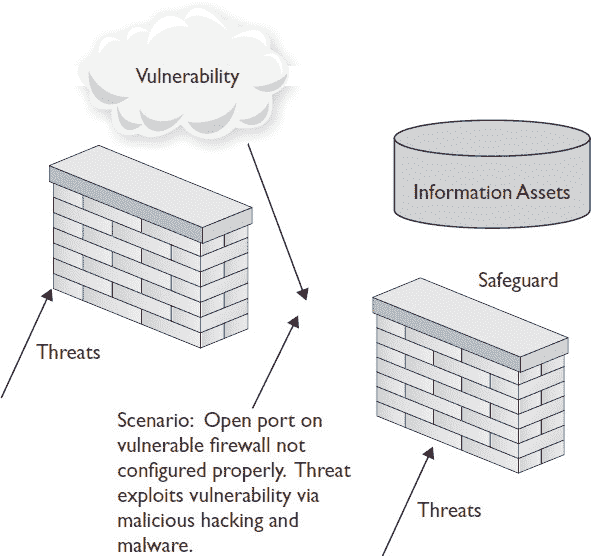

漏洞管理实践包含使用更新的代码或软件变更修补系统和应用程序以缓解漏洞的过程。此过程称为*补丁管理*，对于维护受到妥善保护的网络和计算环境至关重要。操作系统和各种应用程序在推向市场时，都是按照安全配置进行设计和实施的。然而，漏洞管理（在此特指补丁管理）是一个动态的、持续的过程。定期会在成熟代码中发现漏洞。有时漏洞的发现是因为威胁（如黑客攻击尝试或恶意代码植入）利用了它。其他时候，漏洞是由软件开发人员发现的，他们在漏洞被任何人利用之前将其公开（当然这是首选场景）。在这种情况下，修复漏洞所需的补丁会在任何利用发生之前完成编码、开发、测试并分发到市场。补丁管理过程以系统管理员和网络操作员将补丁应用到其系统上而告终。补丁管理过程是安全自动化的一个领域。补丁（一经测试和验证）可自动分发到局域网中，并自动更新所有网络资源。这既高效又有效。

---

> **提示** 对于 FDA 监管的医疗设备，该过程不应是自动的。每个补丁必须由该设备的制造商评估并批准用于所有医疗设备。简而言之，医疗设备可能能够接收补丁，但制造商必须先测试并批准该补丁。否则，添加补丁（实际上是一段第三方软件）可能导致患者安全问题，如果医疗设备在应用补丁后发生故障。

## 职责分离

良好的信息安全实践要求，任何单个人都不应具备违反关键流程或安全功能的能力。系统管理员可能有权查看审计日志和系统维护文件；然而，他们可能没有实际编辑这些内容的权限，或者该特权可能分配给其他人。这种特权隔离称为职责分离 (SOD)。SOD 是在计算环境、系统和网络管理中分离角色和职责。其目的是确保在提供信息安全时存在制衡机制。否则，流程的完整性将受到威胁，因为一个个体可能无意或故意成为整体信息安全计划的漏洞。拥有这些制衡机制最终能提高组织更早、更可靠地检测威胁的能力。

## 最小权限

*最小权限*是指仅拥有执行分配职责所需的权限、权利和特权，不多不少。信息安全（和隐私）中的许多概念都涉及避免过度访问或过度披露，即在不需要此类访问或披露的情况下。无意使讨论复杂化，但始终最好只允许最少量的信息访问。只应披露、传输、使用和存储所需的信息，一旦不再需要该信息，即应将其销毁。(数据销毁将在本章后面讨论。)通常，最小权限或最小使用概念必须支持每一个信息保护计划。保护信息不被不需要它、无理由使用它或不再需要它的个人获取，是不可行且成本过高的。关于最小权限，将初始和提升的访问权限仅限于那些为完成工作而需要访问信息的个人，这是恰当的。在医疗环境中提供信息保护的一个独特要素是，最小权限顾虑可能高度动态。例如，医生某天可能因特定病例或职责而有权访问记录，而第二天该访问权限可能受到限制。这种情况常发生在医生在急诊情况下诊治患者时，例如行为健康患者在急诊室就诊。另一个例子是，有时根据医疗记录管理流程进行同行评审时，医生可能被授予临时访问儿科记录的权限，而其正常临床职责不包括 18 岁以下儿童。

## 业务连续性

可能没有哪个行业比医疗行业更被要求始终保持运转。不仅存在监管压力，而且许多国家、省（加拿大）和州（美国）层面的政府都要求即使医疗组织不运转时也要有报告程序。就我们的目的而言，我们关注信息资产的运转，因此网络或应用程序停机时间是当前的问题。在美国，医疗网络包含在 NIST 改善关键基础设施网络安全框架中，该框架包含严格指南以帮助确保运营连续性。业务连续性，或运营连续性，包括为使医疗组织能够以最小到无中断或降级的方式执行临床和业务服务而采取的所有行动。连续性可能受自然原因（如自然灾害）或人为问题（如网络安全攻击、停电或施工事故（例如切断通往数据中心的光缆））的影响。

# 业务连续性与数据管理

与所有安全控制一样，业务连续性也包含基于时间的要素。例如，制定用于应对灾难的业务连续性计划（COOP）是安全控制的预防层面。监控网络活动是该控制的检测功能。然而，一旦发生灾难，业务连续性的最佳方法是冗余系统或替代来源。例如，如果发生停电，医疗机构可能会暂时切换到由柴油发电机提供的电力。这样，护理和业务流程中断的可能性就最小。当网络资源不可用时，无论是由于停电还是资源本身故障，都应实施手工流程。例如，一个使用条形码技术处理样本的实验室系统，也可能有一个使用手写登记表的手工流程。人员应接受培训，能够在条形码扫描系统不可用时实施手工表单。

---

 **注意** 随着组织变得更加数字化，当前电子流程之前的手工流程往往早已被遗忘。信息安全和隐私专业人员将面临挑战，需要推动 COOP 的培训和定期测试。

---

## 系统恢复

支持业务连续性的安全控制是系统恢复，或灾难恢复。在停电或恶意软件攻击后，系统可能会瘫痪或被攻陷。一旦系统得到修复（即威胁不再存在），就需要一个将系统恢复到业务和临床运行状态的流程。这适用于每个系统或应用程序。例如，如果数据库服务器因攻击而损坏，显然在将其放回计算环境之前，必须对服务器进行测试和评估。然而，必须制定特别的照料和程序，以确定优先级并分阶段让所有系统重新上线。在发生全网中断的情况下，如果立即同时重启所有系统，始终存在在其他网络位置发生意外故障的可能性。例如，这可能是由于电压浪涌或负载均衡问题。最佳的 COOP，特别是针对系统恢复，包括一个计划性的、分优先级的重启计划。首先，会重启选定的临床系统和业务系统。然后，在监控重启影响的同时，可以启动其他系统。也就是说，如果系统恢复计划涉及从冗余计算站点（一个*热站点*）或因灾难而启动的备用站点（一个*冷站点*）进行切换，你需要将从这些站点任一站点向正常组织计算环境转移依赖的程序纳入考量，此时必须安全地进行数据传输和集成。根据中断或系统故障的持续时间，可能已经收集了大量新的敏感医疗信息。这些数据需要集成到完整的患者记录和相关业务记录中。

## 数据保留与销毁

虽然数字信息大幅降低了数据管理的总体成本，但组织仍必须制定政策和程序，以适当保留所需信息，并在信息不再需要时将其销毁。就在几十年前，5,000 份由纸质影像、病历、笔记和打印件组成的医疗记录，可能需要一个 1,000 平方英尺的档案室，里面从地板堆到天花板全是架子上的病历。显然，如此大的物理空间成本高昂，且本可用于更有价值的用途。为了控制成本并妥善保护和利用所有资产（无论是物理还是信息资产），重点在于将保留的记录数量降到最低，并设计了适当的销毁政策。然而，如今，同等数量的记录可以轻松装进一个廉价的 USB“拇指”驱动器。在某些情况下，由于不再需要空间或房地产，这反而鼓励保留所有信息以备未定的用途。审视维护强大且强制执行的数据保留和销毁约束的理由非常重要。

### 数据保留

首先，数据保留受地方或国家法律监管。这规定了必须维护记录的最短时间。还应设定最长期限，但附带条件：如果信息被认定对业务流程或临床治疗有价值，则允许更长的期限。关于最短期限，一个例子是美国 HIPAA 规定的某些健康记录必须保留至少七年^(12)。也存在国际标准。加拿大《隐私法》不那么具体，因为它没有强制规定具体的年限；然而，如果信息是由政府收集的，该法案要求数据收集者保留信息至少一段由额外法规设定的时间。这段时间必须足以让数据主体访问该信息。由于加拿大的医疗由政府资助，这一条款可能通过强制延长保留期来影响记录保留。^(13) 在欧盟，DPD 也有一项规定，描述了信息应保留多长时间的最长期限，以确保其保留时间不超过必要程度。同时，如果成员国有合法的历史、统计或科学用途，且 DPD 允许，DPD 允许成员国制定更长的保留期。

---

 **注意** 确保在保留政策中解决医疗和法律责任问题。无论组织仅是美国的提供者还是具有国际业务范围，如果因缺乏保留合规性导致记录在本应可用时不可用，可能会产生财务影响。相反，保留时间超过任何要求的记录在司法程序中仍可被发现。这会给发现程序增加不必要的成本、延迟和责任。

---

### 电子介质的安全处置

在信息管理生命周期中，处于处置或销毁阶段的数据极其脆弱。泄露和丢失事件往往就发生在组织决定信息不再对其有价值的时候。即使在这个阶段，信息仍然敏感，无论它是与支付相关还是包含个人的健康数据。适当的处置和销毁方法，统称为“清理方法”，可以防止未经授权的披露。这些方法包括存储介质的物理销毁、安全覆写和消磁。清理方法可以是涉及使用软件的技术操作，也可以是物理操作，例如在硬件上钻孔。最佳方法根据信息的敏感级别和是否有意重复使用介质，视情况结合使用这两种方法。作为信息安全控制，清理的目标是使数据无法被检索，或使检索在实际操作中不可能实现。

---

 **注意** 处置和销毁方法适用于纸质敏感记录以及电子记录。可用的方法未在本文中深入介绍，但碎纸和焚烧文件是公认的常用程序。关键在于在纸质记录从存储地运输到销毁地的过程中保护信息。

## 物理介质销毁

这有点类似于纸质记录的物理销毁，包含敏感数据的介质可以被完全销毁，而不是在保持物理介质资产（备份磁带、硬盘驱动器等）完好无损的情况下安全地移除数据。物理销毁介质的过程并不算太技术化或优雅，但它们非常有效。例如，在硬盘旋转盘片上钻孔是有效的。这种方法可能不会真正销毁数据，但数据将变得不可读或不可恢复。大型碎纸机也可用于将物理资产实际粉碎成小碎片。其他可用的方法包括解体、焚烧、粉碎、熔化、打磨和化学处理。

## 安全覆写

安全覆写通过仅销毁数据来使数据不可用。其他方法会使驱动器完全不可用，即使那些不销毁物理资产的方法也是如此。如果组织想要重复使用存储资产，例如昂贵的存储区域网络组件，它将选择使用安全覆写来处理数据。此过程包括反复将无意义的数据写入资产硬盘驱动器的每个扇区上。无意义的模式通常由 1 和 0 的组合构成。为了有效，该过程必须发生的次数因标准而异。可能最常被引用的标准是美国国防部清理指南（DOD 5220.22-M），该指南要求进行三次覆写遍历，以完全覆盖组织想要销毁的数据。

## 退磁

*退磁*是一种用于擦除磁场类型介质（如备份磁带或硬盘驱动器）上所有数据的过程。用于退磁的设备会产生一个磁场，该磁场将介质上的 1 和 0 完全随机化，不偏向任何方向，从而使先前的数据不可恢复。退磁中使用的磁铁的作用很像用在指南针上的磁铁。磁铁改变了指南针对“北方”位置的认知，使得介质上的数据不再处于可检索的模式中。该过程可用于快速清理大量数据。当介质损坏且无法操作时，它也非常有效。然而，对于光学介质（如 CD 和 DVD），退磁没有效果，因为它会导致一种称为*偏置*的效应，许多人认为不可能完全移除磁场从而使所有 1 和 0 完全随机化。残留磁场可能保留下来，使得理论上有可能恢复部分数据。出于这个原因，与安全覆写类似，信息安全最佳实践要求对每块介质进行多次退磁。再次以美国国防部为例标准，至少七次退磁遍历被认为足够。退磁还有一个额外优势，即介质可以重复使用。适当的退磁足以安全地处置或销毁敏感信息。

## 配置管理或变更管理

为了帮助确保 CIA 三要素参数内的完整性，组织建立配置管理或变更管理流程。通常在正式配置控制委员会或同等机构的信息治理职权范围内，组织可以在如何对网络、系统和应用程序进行更改方面保持一致性。变更管理指南作为重要的信息安全控制而广为人知。例如，在信息技术基础设施库（ITIL）框架内，这些控制是“服务转换”的一部分。ITIL 认可拥有一种高效、有组织的方法论的价值，该方法论可将新产品或现有产品的更新从设计推向运营，而不增加风险。^(14) ITIL 中的这些阶段称为服务设计和服务运营。变更管理流程实际运作的一个例子是：实验室部门决定购买一个用于处理实验室结果的新信息系统。该系统将需要网络访问权限，并与当前的遗留系统（如 EHR）进行接口对接。想象一下，如果此类系统的采购和实施不包括对操作系统、接口需求、物理安装环境及其他非常重要因素的正式管理级审查。在这种情况下，即使系统能运行，也肯定会以一种不太可操作的方式运行。整体架构将增加大量的信息风险。配置管理的另一个更基本的场景是外围安全防御所需的更改，例如边界防火墙。如果联网系统需要通过互联网与外部实体通信，数据流量设备将通过防火墙上的特定端口，使用特定协议退出组织网络。在 ACL 之外，凭借其批准的端口和协议，所有其他流量都将被阻止。例如，专用计算系统（如医疗设备）通常可能需要打开一个当前 ACL 上没有的端口。为了请求或最终进行这些更改，应正式提出变更请求，例如通过电话口头提出。

## 事件响应

我们通过重温事件响应的概念来结束本章，该概念我们在第 6 章中已介绍。在此背景下，我们将适当的事件响应作为一种作为纠正措施有效的安全控制呈现出来。事件响应可以限制威胁利用漏洞的持续时间和影响。NIST SP 800-61 修订版 2《计算机安全事件处理指南》将事件响应定义为一种缓解策略，该策略以实用指南应对安全事件。该指南提供了建立可靠事件响应计划的方向，该计划可实现对安全事件（如数据泄露）的检测、分析、优先级排序和处理。在数据泄露似乎几乎不可避免的今天，无论你如何完善地实施安全流程和控制，可能产生最大区别的那一项安全控制就是事件响应。正如全球领先的信用报告和身份盗窃保护组织 Experian 所言，“你在前 72 小时内的反应如何，可能对数据泄露的*结果*至关重要”^(15)。这基于围绕通知的重大监管压力，在美国既有 HIPAA 也有 HITECH，国际上则有例如欧盟的 DPD。

## 章节回顾

从信息安全到网络安全的演变在某些方面反映了医疗保健从基于纸质的系统向数字化系统的演变。健康信息的保护现在涉及医疗保健工作人员中的多个群体，他们传统上负责处理健康信息。他们的职责现在包括或涉及电子信息安全（网络安全）的角色和责任。这种融合使本章成为理解医疗保健信息安全和隐私的核心。安全控制有多种类型，例如访问模型、加密、业务连续性、数据处置和事件响应，仅举几例。每种控制都侧重于预防、检测或纠正数据事件，或这些的任意组合。掌握信息安全控制的实施和管理是基础，但所需的技能可能复杂且具有挑战性。

### 复习题

**1.** 你选择从存储设备中删除数据。你想确保数据被完全销毁，但也想重复使用存储介质。你应该使用以下哪种方法？

**A.** 退磁

# 第 8 章复习题

## 第 1 题选项

**B.** 清除

**C.** 粉碎

**D.** A 或 B 均可

## 第 2 题

**2.** 在医疗办公环境中，以下哪个应用程序必须被视为其存储介质中可能包含敏感数据？

**A.** 电子邮件

**B.** 排程

**C.** 计费

**D.** 以上皆是

## 第 3 题

**3.** 以下哪些是业务连续性的要素？

**A.** 断电后维持任务能力

**B.** 与离开护理区域的患者保持联系

**C.** 与前业务合作伙伴保持联系

**D.** 在继续接诊患者的同时准备外部评估

## 第 4 题

**4.** 以下哪项描述了对计算机资源执行操作的能力，例如查看、编辑或删除的权限？

**A.** 最小权限

**B.** 日志记录

**C.** 监控

**D.** 访问控制

## 第 5 题

**5.** 以下哪项被定义为安全程序或技术、物理或其他控制中存在的条件或弱点（或缺失）？

**A.** 威胁

**B.** 风险

**C.** 漏洞

**D.** 利用

## 第 6 题

**6.** 安全原则，通常称为 CIA，是指

**A.** 机密性、完整性、问责性

**B.** 应急、完整性、问责性

**C.** 机密性、完整性、可用性

**D.** 机密性、互操作性、可用性

## 第 7 题

**7.** 为保护发送给同事的电子邮件中的健康信息，以下哪项是适当的安全控制？

**A.** 逻辑控制

**B.** 强认证

**C.** 加密

**D.** 最小权限

# 答案

**1.** **D.** 因为粉碎会使介质无法使用，所以不是一个选项。消磨将删除所有数据，但仍使存储介质可重复使用。清除会移除 PII（个人身份信息），但不影响介质的使用。

**2.** **D.** 即使组织制定了政策，禁止使用电子邮件与患者就特定敏感医疗诊断等进行沟通，但事实是用户和患者可能会在沟通中使用电子邮件。因此，你应该假设电子邮件数据应与其他敏感数据系统采用相同的安全控制进行存储。显然，患者排程和计费数据包含个人身份信息以及受保护的健康信息。

**3.** **A.** 业务连续性涉及组织在可能受到停电、天气相关事件、社区事件（如骚乱、事故），甚至影响人员配备水平的严重流感爆发等影响时，交付其使命（例如医疗服务）的能力。虽然与前患者或业务合作伙伴保持联系以及准备外部评估是开展业务的一部分，但它们不属于业务连续性的范畴。

**4.** **D.** 访问控制定义了在计算机资源中执行功能的技术能力。虽然最小权限确实涵盖了访问级别，但它定义的是总体范围，并不特定于某个用户或角色。日志记录和监控是用于检测计算机资源的适当访问和使用的过程。

**5.** **C.** 漏洞是一种可被威胁利用的弱点状况。虽然威胁、风险和利用可能由程序或控制中的弱点引起，但只有漏洞符合该定义。

**6.** **C.** 安全原则是机密性、完整性和可用性。虽然问责性经常被讨论为一项原则，特别是在医疗环境中，但它不被视为主要原则。应急和互操作性也被讨论过，但同样它们不是主要原则。

**7.** **C.** 使用 PKI 和数字证书进行加密以增强加密和解密密钥，是妥善保护“传输中”信息所必需的。逻辑控制不适用于电子邮件。强认证可能与密码保护有关，但不适用于传输中的电子邮件。虽然需要最小权限来确保接收者有知情需求，但根据场景，它不是最相关的信息安全控制。

# 参考文献

**1.** 美国国家标准与技术研究院。“改善关键基础设施网络安全框架。”版本 1.0。2014 年 2 月 12 日。于 2014 年 8 月 25 日访问，网址：[`www.nist.gov/cyberframework/upload/cybersecurity-framework-021214-final.pdf`](http://www.nist.gov/cyberframework/upload/cybersecurity-framework-021214-final.pdf)

**2.** Borland, Sophie。“英国国家医疗服务体系 (NHS) 每天丢失 2,000 名患者记录，自 2011 年初以来已记录超过 200 万起严重数据泄露事件。”《*每日邮报在线*》，2014 年 2 月 14 日。于 2014 年 8 月 1 日访问，网址：[`www.dailymail.co.uk/news/article-2559876/2-000-NHS-patients-records-lost-day-two-million-data-breaches-logged-start-2011.html#ixzz3CgQ3zTL9`](http://www.dailymail.co.uk/news/article-2559876/2-000-NHS-patients-records-lost-day-two-million-data-breaches-logged-start-2011.html#ixzz3CgQ3zTL9)

**3.** Ponemon 研究院。“第三届医疗身份盗窃年度调查。”2012 年 6 月。第 31 页。于 2014 年 8 月 1 日访问，网址：[`www.ponemon.org/local/upload/file/Third_Annual_Survey_on_Medical_Identity_Theft_FINAL.pdf`](http://www.ponemon.org/local/upload/file/Third_Annual_Survey_on_Medical_Identity_Theft_FINAL.pdf)

**4.** 欧盟。“欧洲议会和理事会 95/46/EC 号指令：关于个人在个人数据处理方面的保护以及此类数据的自由流动。”1995 年 10 月 24 日。第 28 条，第 7 款。于 2014 年 8 月 13 日访问，网址：[`eur-lex.europa.eu/legal-content/EN/TXT/PDF/?uri=CELEX:31995L0046&from=en`](http://eur-lex.europa.eu/legal-content/EN/TXT/PDF/?uri=CELEX:31995L0046&from=en)

**5.** 美国国家标准与技术研究院。FIPS PUB 199。“联邦信息和信息系统安全分类标准。”2004 年 2 月。第 2 页。于 2014 年 8 月 20 日访问，网址：[`csrc.nist.gov/publications/fips/fips199/FIPS-PUB-199-final.pdf`](http://csrc.nist.gov/publications/fips/fips199/FIPS-PUB-199-final.pdf)

**6.** McGuiness, Todd。SANS 研究院 InfoSec 阅览室。“纵深防御。”2001 年。第 1 页。于 2014 年 8 月 28 日访问，网址：[`www.sans.org/reading-room/whitepapers/basics/defense-in-depth-525`](http://www.sans.org/reading-room/whitepapers/basics/defense-in-depth-525)

**7.** Ponemon 研究院。“2013 年数据泄露成本研究：全球分析。”2013 年 5 月。第 7 页。于 2014 年 8 月 28 日访问，网址：[`www4.symantec.com/mktginfo/whitepaper/053013_GL_NA_WP_Ponemon-2013-Cost-of-a-Data-Breach-Report_daiNA_cta72382.pdf`](https://www4.symantec.com/mktginfo/whitepaper/053013_GL_NA_WP_Ponemon-2013-Cost-of-a-Data-Breach-Report_daiNA_cta72382.pdf)

**8.** Harris, Shon。“访问控制。”《*CISSP: Exam Guide*》。第 6 版。（纽约：McGraw-Hill，2012 年），第 163 页。

**9.** Harris, Shon。“密码学。”《*CISSP: Exam Guide*》。第 6 版。（纽约：McGraw-Hill，2012 年），第 836 页。

10. Breaux, Travis. “Encryption and Other Technologies.” *Introduction to IT Privacy: A Handbook for Technologists*. (Portsmouth, NH: International Association of Privacy Professionals, 2014), p. 126.

11. U.S. Department of Health and Human Services. Federal Register 78, no. 17. 45 C.F.R. part 164.308(a)(5)(i). p. 713. October 1, 2003 edition. Accessed September 1, 2014, at http://www.gpo.gov/fdsys/pkg/CFR-2003-title45-vol1/pdf/CFR-2003-title45-vol1-sec164-308.pdf

12. U.S. Department of Health and Human Services. Federal Register 78, no. 17 part II. 45 CFR parts 160 and 164. January 25, 2013. Accessed January 7, 2014, at http://www.gpo.gov/fdsys/pkg/FR-2013-01-25/pdf/2013-01073.pdf

13. *Privacy Act*. R.S.C., 1985, c. P-21. Accessed January 3, 2014, at http://laws-lois.justice.gc.ca/eng/acts/p-21/page-2.html

14. UCISA. “ITIL – Introducing Service Transition.” p. 4. Accessed August 29, 2014, at https://www.ucisa.ac.uk/~/media/Files/members/activities/ITIL/servicetransition/ITIL_introducing%20service%20transition%20pdf.ashx

15. Cividanes, Emilio, Paul Luehr, and Bob Krenek. “Best Practices for a Healthcare Data Breach: What You Don’t Know Will Cost You.” Experian. May 2011. Accessed August 10, 2014, at https://privacyassociation.org/media/pdf/knowledge_center/Best_Practices_Healthcare_Data_Breach.pdf

## 第 9 章

---

## 信息隐私与安全对医疗健康 IT 的影响

在本章中，您将学会：

- 识别医疗保健领域数据所有权的影响
- 理解医疗保健组织中隐私与安全的交织关系
- 了解电子健康记录的信息保护挑战
- 识别医疗设备相对于患者安全的信息安全顾虑
- 认识医疗和金融身份盗窃的风险，并理解数据泄露相关的患者护理问题

---

在本章中，您将了解隐私和信息安全是如何作为独立学科却又紧密协作的。在市场和行业中，如军队或工业企业，以及医疗保健领域，隐私和安全目标往往因不同目的而实施。在医疗保健之外，隐私控制的实施往往更多是为了遵守法规，保护组织为商业目的收集的员工或客户信息，而非保护个人权利。安全控制有时更侧重于保护组织的资产，而非个人的个人信息。然而，在医疗保健领域，情况并非如此；安全肩负着保护医疗信息的目标，既将其视为医疗服务提供者或机构的**业务产品**，也视为个人的**隐私权利**。每个学科的实践都将医疗保健组织中的各类员工聚集在一起。在作为医疗健康信息技术的复杂计算环境中，许多特殊类型的设备、系统和应用程序被视为业务关键型和临床必要型。事实上，在美国，整个医疗保健网络被视为关键基础设施，因此隐私和信息安全问题对医疗保健组织有直接且往往深远的影响。

### 医疗保健信息的所有权

当涉及医疗保健时，传统专业知识围绕隐私（例如保护身份）和信息安全（例如保护资源）独立发展。随着时间的推移，这两个学科都演变并发展成为劳动力中特定的能力。如今，这一现实已发生改变。隐私与安全已融合为一种近乎单一的能力，每个处理受保护健康信息（PHI）或个人身份信息（PII）的人都需要具备这种能力。整合的原因前文已讨论过——健康信息的数字化、医疗系统和设备的联网、保护健康信息的监管压力，仅举几例。这是一个全球性的现实。我们将通过快速审视国际法和惯例下的健康信息隐私与安全，以及重点关注医疗保健组织收集信息后的所有权这一核心问题，来开启本章。不同国家根据自身对数据所有权的看法和法律，对这一问题有不同的处理方式。认识当局如何看待这一问题，有助于解释相关指南、法律和惯例如何帮助理清国家期望医疗保健组织（或数据收集者）采取的整体隐私和安全方法。

#### 美国 (HIPAA)

健康信息的真正所有权难以确定。如果我们试图将美国如何规范财产权与数据所有权的概念进行比较，这种比较是有缺陷的。澄清一下，问题在于美国患者实际上对其信息的使用拥有何种程度的控制权。财产权赋予所有者控制其财产如何被使用或不被使用的权利。美国法律强制执行的权利为信息如何被使用提供了指导；但患者并不拥有所有权，因为某些非自愿用途是被授权的，例如出于公共卫生原因，或在机构审查委员会（IRB）监管下的使用。IRB 是进行研究的学术医疗环境中的一个内部组织，如果利用人体受试者进行临床试验，IRB 就会介入。IRB 管理一些基线知情同意和授权指南，这些指南不一定包含患者的额外意见。患者确实有权知道收集了关于他们的哪些信息、有权访问这些信息、在认为信息不正确时请求修正、以及知道谁还看过这些信息。然而，一旦数据被收集，医疗保健组织就拥有记录格式（无论是书面还是电子，如文件夹或数字电子文件）下的信息所有权。根据 HIPAA 保护信息的法律责任源于妥善保管数据的视角，但法律倾向于医疗保健组织拥有所有权。

#### 欧盟 (DPD)

在欧盟，《数据保护指令》（DPD）非常明确地规定，提供个人信息的个人是数据所有者。数据收集者有责任持续保护敏感信息，但个人对其信息的权利不会因信息易手而改变。对于收集个人数据有严格规定，仅允许为合法目的收集数据。一旦收集，医疗保健组织必须尊重个人作为数据所有者的权利。根据欧盟法律，数据所有者的主要权利包括：如果个人认为其信息未按数据收集者指示的方式使用，有权投诉并获得补救。

#### 英国

由于医疗保健几乎完全由国家医疗服务体系（英国的政府医疗体系）资助和提供，英国的健康数据和医疗记录被视为政府财产。当然，必须采取控制措施来保护这些信息。有规定允许患者查看其记录并解决认为存在的差异，但所有权理念倾向于政府。记录的总体责任在于卫生大臣的权限范围内。

## 德国

此处将德国单独列出，置于 DPD（注：可能指数据保护指令）治理范围之外，因为德国最近于 2013 年通过了自己的新法律《改善患者权利法》。该法律旨在阐明并加强提供者的义务，不仅要保护信息，还要完整记录所有健康信息。例如，提供者必须记录患者病史、诊断、治疗和预后等信息。法律强制要求提供者妥善保存记录（无论是纸质还是电子）长达十年，并将所有权保留给个人。例如，法律规定应患者要求，必须提供任何及所有信息。

## 隐私与安全的关系

将隐私和安全预测为终将合并为信息保护这一大类，其中存在危险。一些人认为这是事物的发展趋势，因为我们发现越来越多的文本和研讨会将医疗隐私和安全这两个术语同义使用。然而，两者之间仍存在区别。首先，信息安全实际上永远不会关注隐私原则，如通知、同意和披露核算等。可以认为，隐私关注的不仅仅是数字资产；它还将履行对患者的义务。例如，隐私实践通知中的组织承诺可能表明其具有不涉及确保数据机密性、完整性和可用性的义务。其义务可能侧重于确保所收集信息的相关性。这一考量可能对同一信息的信息安全关注点没有任何影响。诚然，这些术语联系紧密，且日益如此。然而，我们不太可能达到它们不可区分且同义的地步。也就是说，有几个概念证明了隐私和安全的相互关联性，特别是在医疗保健领域，两者之间存在着不可分割的纽带。

### 依赖性

安全与隐私的关系已发展为一种依赖关系。要在医疗行业实现安全，当然必须解决隐私的某些要素。同时，隐私通常通过一种或多种信息安全控制来提供。在保护个人信息隐私的监管流程中（例如依据 HIPAA），加密被视为确保通过电子邮件传输信息机密性的充分信息安全控制。集成在此安全控制中的功能是确保您想要发送电子邮件的对象被授权查看该邮件。这说明了隐私是如何依赖于信息安全控制的使用。

隐私也依赖于良好的信息安全实践，以保护个人选择谁有权访问其信息的权利。事实上，保持完全拒绝共享信息的权利是隐私的一个要素，而信息安全的设计和实施正是为了保护这一要素。在电子健康记录（EHR）的使用中，身份识别、认证和访问管理技术用于允许经授权的凭证访问定义数量的数据。没有适当凭证，访问将被拒绝。基于患者的选择和同意，访问权限被进一步界定。例如，当患者选择禁止任何关于其患者身份的请求时，EHR 中的信息不得与朋友、家人或致电前台的个人共享。当然，通常会提供额外指示，允许特定家庭成员或授权代理人接收患者状态更新。简而言之，信息安全工具被用于从隐私角度防止未经授权的披露。

### 整合

隐私和安全相互依赖，这种依赖导致了两者的整合。换句话说，提供信息安全可能涉及隐私问题。相反，提供隐私保护可能引入意外的信息安全担忧，这些担忧可能与正在实施的任何隐私保护措施无关。例如，许多安全防护措施（如监控摄像头和设施访问日志）需要监控人员或收集个人信息。这些防护措施引入了隐私担忧，因为它们不仅保护数据和人员更安全，同时也收集个人数据。因此，虽然最初您可能关注的是对患者门户的未经授权访问，但最终可能会因隐私控制而产生额外的担忧。作为信息隐私和安全专业人员，我们必须将此类信息安全措施与收集个人信息的隐私影响进行权衡。几乎每天，我们都能看到隐私和安全流程的整合。目标是确保我们理解隐私和安全行动对彼此以及对我们打算解决的问题的影响。

另一个例子，也是一个及时的例子，说明隐私担忧如何与信息安全整合，即自带设备（BYOD）计划。虽然医疗组织越来越多地允许个人在该计划下自带智能手机、笔记本电脑、平板电脑等，但它们也在制定信息安全政策和程序，以保护其网络上的 PHI 和 PII——这些设备正在访问的网络。其中一项程序是`数据擦除`：如果员工离职或被解雇，且该人员使用自己的设备访问组织的网络资源，BYOD 政策可能赋予组织远程并完全擦除设备上所有内容的权利。这将包括工作相关信息以及任何潜在的 PHI 或 PII。也可能包括照片、个人信息和个人财产。^(1) 因此，医疗组织通过信息安全保护隐私的努力，实际上可能侵犯了员工的隐私。在实施 BYOD 政策时，应考虑隐私和安全问题的整合。

This does not mean that integration necessarily produces negative consequences or integration effects. Most privacy and security integrations are positive. Information security controls in the digital environment successfully provide privacy protection through routine processes such as automated access management. They also reduce execution errors inherent in paper-based environments that rely on policy compliance or manual operations as the sole line of defense. For example, a network firewall or access control list programmed into a router is certainly less error-prone than a records clerk responsible for approving personnel entry into a facility. Additionally, privacy is the intended outcome of many information security practices. When an organization enforces role-based access configuration for its EHR system, the privacy of personal information is protected by allowing access only to providers with a need to use the data. In a paper record system, this level of data segmentation and restricted availability is nearly impossible. The data risks of eavesdropping and easy access are too high.

## Information Protection and Healthcare Technologies and Initiatives

Specialized computing resources used to implement privacy and security in healthcare have specific impacts that extend to the numerous initiatives underway across various domains aimed at improving healthcare. At the same time, these specialized computing resources and healthcare initiatives introduce new privacy and security issues that healthcare organizations must address.

### Medical Devices

The core of our concern regarding the implementation of information security and privacy in the healthcare environment lies in medical devices. Medical devices can be anything from thermometers to digital X-ray machines; some are standalone machines and tools. An increasing number of medical devices are becoming networked (with each other or connected to larger networks) and communicate continuously. Future predictions point to more types of wearable medical devices, some implanted or ingested; many already exist and are providing patient care.

Medical devices enter the healthcare market under the regulation of a U.S. government agency (now known as the U.S. Food and Drug Administration `FDA`), and Figure 9-1 depicts several significant events in the history of medical device privacy and security.

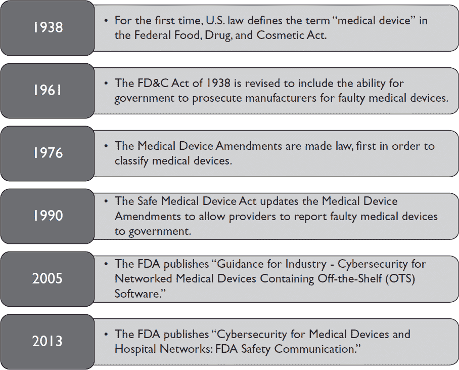

***

**Figure 9-1** Brief Legal History of Medical Devices and Related Privacy and Security Guidelines Provided by the U.S. Food and Drug Administration (`FDA`)

***

 **Tip**   The U.S. Food and Drug Administration (`FDA`) hosts the MedWatch website (`https://www.accessdata.fda.gov/scripts/medwatch`), where anyone—including healthcare organizations and patients—can submit complaints about potential misuse or malfunction of medical devices. In recent years, as cybersecurity issues began populating the MedWatch database, the `FDA` has recognized the impact of malware on medical devices.

Privacy and security issues introduced by medical devices are primarily related to patient safety. In the pursuit of implementing good privacy and security practices, unintended consequences may befall medical devices. The `FDA` defines a medical device (in part) as: "An instrument, apparatus, implement, machine, contrivance, implant, in vitro reagent, or other similar or related article, including any component or accessory, intended for use in the diagnosis of disease or other conditions, or in the cure, mitigation, treatment, or prevention of disease."^(2) Therefore, medical devices are critical to direct patient care and are strictly regulated by the `FDA`.

***

 **Tip**   The `FDA`'s international influence is growing. Cybersecurity issues and related governance issued by the `FDA` apply to an international audience of privacy and security professionals. Below are two excellent references for personnel responsible for managing medical device cybersecurity:

-   "Guidance for Industry - Cybersecurity for Networked Medical Devices Containing Off-the-Shelf Software (`OTS`)" (U.S. Food and Drug Administration, January 14, 2005. `http://www.fda.gov/MedicalDevices/DeviceRegulationandGuidance/GuidanceDocuments/ucm077812.htm`)
-   "Premarket Submissions for Management of Cybersecurity in Medical Devices - Draft Guidance for Industry and Food and Drug Administration Staff" (U.S. Food and Drug Administration, June 14, 2013. `http://www.fda.gov/MedicalDevices/DeviceRegulationandGuidance/GuidanceDocuments/ucm356186.htm`)

If one of these devices fails to perform or performs in an unsafe manner, it could mean patient injury or death. Conversely, if good privacy and information security practices exclude medical devices, vulnerabilities may evolve; this introduces patient safety risks. The correct approach to addressing medical device privacy and security is to implement good privacy and security practices that understand and account for the unique factors of medical devices, whenever possible. These devices may have IP addresses, operating systems, and relational databases, but they differ from office automation terminals or servers performing office automation tasks or business functions. If prescribed information security controls may cause unintended problems, alternative controls and tailored safeguards should be sought. For example, sometimes the operating system used by a medical device is no longer supported by the software manufacturer, but the device manufacturer cannot upgrade the software unless upgrading to the next generation device. This is usually expensive, and the current model may be sufficient for its intended clinical purpose. Upgrading to a new model simply because the operating system cannot be updated with future vulnerability patches may be unreasonable from a cost-effectiveness perspective. A better control is to segment the device into a separate enclave, firewalled (isolated) but still able to access the network. In such cases, the skill required of healthcare information security and privacy professionals is the judgment to know when to implement prescribed controls (e.g., upgrading to a new OS) and when to seek compensating or alternative controls (e.g., isolating the device).

***

 **Note**   The evolving field of clinical engineering covering "wearable," implantable, and ingestible networked medical devices is known as *biomedical telemetry*. The primary professional organization managing this technology is the Institute of Electrical and Electronics Engineers (`IEEE`), at `https://www.ieee.org`. More relevant information can be found there.

这是另一个场景，有助于说明该概念。设想你的工作是配置并执行针对局域网 (LAN) 的定期软件漏洞更新。通常，一旦规定的更新在针对终端（台式机、笔记本电脑等）的标准计算配置上通过测试，你就被授权通过网络上的自动化程序来完成此项工作。这种“一键式”方法的高效性和有效性是公认的行业最佳实践。然而，设想你网络上的某些终端位于心导管实验室。当然，它们看起来像运行标准操作系统的台式计算机，并且被分配了网络 IP 地址。然而，这些专用计算机还运行着医疗应用程序，提供诊断级（高分辨率）视频和影像，使医生能够执行复杂的心脏手术。如果在此类手术过程中，你自动推送的软件漏洞补丁导致系统非自愿重启（补丁常有此情况），这种意外停机可能会引发患者安全问题。

即使该事件并未实际伤害患者，医疗机构也可能面临后果。联合委员会（Joint Commission，一个美国非政府组织，负责检查、认证和批准医院）会要求将这种“设想中的”事件作为*哨点事件*进行上报，即涉及死亡或严重身体或心理伤害，或此类风险的意外发生。^(3) 我们设想的场景属于“或此类风险”这一条件。在患者手术过程中医疗设备重启，当然可被视为未遂事件，因为也很容易想象下一次该过程或手术如何出错并给患者造成严重不良后果。总之，应用于医疗行业的最佳信息安全实践必须包含风险收益考量，并将医疗行业的第一准则置于核心：首先，不伤害。

>  **注意**   尽管联合委员会以美国为中心，但在大多数发达国家都有其同行组织。事实上，联合委员会自 1994 年起就设有国际部门，拥有近 700 家认证组织——仅举几例，分布在韩国、意大利、西班牙、土耳其和巴西等国。^(4)

关于将联网医疗设备整合到整体信息安全计划中，而不太考虑其独特特性的主要担忧如下：

- *医疗设备用于直接患者护理场景*。发生故障的医疗设备会使患者面临风险，并阻碍临床医生的诊断或治疗。
- *医疗设备依赖具有独特协议和标准的专用应用程序*。虽然大多数设备运行在已知操作系统上并使用通用数据库技术，但它们也依赖或使用专用应用程序和独特协议。采用 Health Level Seven International (HL7) 数据传输协议和医学数字成像和通信标准 (DICOM) 作为影像标准只是两个例子。
- *医疗设备制造商发挥着主要作用*。与其他计算设备制造商不同，医疗设备制造商即使在设备售予医疗机构后，仍保留对其设备的大量责任。原因关乎安全而非网络安全，而这种责任实际上可能引入安全风险。因为医疗设备受 FDA 监管且涉及患者安全，医疗设备制造商必须在医疗机构更新医疗设备前测试并批准所有第三方软件。此过程充其量只会延迟软件漏洞补丁管理流程；最坏的情况会导致医疗设备长期未打补丁，在医院局域网上处于易受攻击状态。
- *医疗设备通常运行在遗留操作系统和“已停止支持”的应用程序上（即开发者不再提供支持）*。例如，仅仅因为操作系统或数据库应用程序不再受支持，就将医疗设备升级为更新型号的成本有时高得令人望而却步。

讨论医疗设备及其隐私和安全影响的目的，并非说医疗设备不能或不应完全整合到整体信息安全计划中。事实上，情况恰恰相反。如果医疗设备不属于企业信息安全计划的一部分，局域网肯定极易受到攻击。FBI 最近对美国医疗机构进行了调查，发现与管理不善的医疗设备相关的漏洞程度令人极度不安。^(5) 医疗设备为信息安全和隐私专业人员提供了一个机会，通过开发适当的补偿性或定制化控制措施来真正保护信息。以下是你应考虑的一些方法：

- *将医疗设备纳入信息安全计划*。医疗设备通常由生物医学工程师管理。有时该部门完全外包给第三方管理团队。然而，必须进行适当的沟通和协调，将设备纳入整体资产清单和漏洞管理流程。根据 FBI 报告，仅仅了解哪些设备拥有最新软件配置、哪些没有，就是解决问题的关键第一步。
- *对局域网进行分段*。例如，将医疗设备隔离或在防火墙保护的区域内按纵深防御架构进行隔离，是有帮助的。因为软件漏洞补丁管理可能遵循医疗设备无法支持的不同合规时间表，分段不仅提供了一系列子网和一条额外的外部渗透防线，还在测试、批准步骤执行及手动补丁流程完成期间，保护组织网络的其余部分免受这些脆弱设备的影响。
- *确保医疗设备包含在组织的数据事件响应政策中*。当医疗设备发生故障或性能下降时，其原因可能并非显而易见地与恶意软件或安全有关。在采取维修行动时，必须将数据事件视为潜在问题来源。此外，数据事件政策必须切实允许生物医学工程师报告潜在和实际问题。这也意味着医疗机构将把通知医疗设备制造商和 FDA 作为常规数据事件流程的一部分。务必使用 FDA 报告渠道。

>  **提示**   *僵尸网络* 是感染医疗设备中最常见的恶意软件类型。僵尸网络潜伏在计算机内部，并向命令与控制 (C2) 服务器回传通信。它们可以立即行动，或等待特定时间后开始发送垃圾邮件或对医疗设备发起其他类型的攻击。通常，僵尸网络的目标是利用医疗设备作为跳板，攻击医疗机构网络上的其他网络资源。

## 云计算

# 医疗卫生组织中的云计算

为了提高效率、降低成本并获得专业的 IT 支持，医疗卫生组织正迅速向“云”迁移。*云计算*的一个工作定义是：资源、软件、处理能力和存储在互联网上共享且可访问。简而言之，IT 服务的交付方式很像电力等公用事业的交付方式。与许多其他行业一样，医疗卫生组织正从传统的信息技术环境转向这些虚拟计算环境，传统环境受限于单一用途的服务器和存储资源。在传统 IT 环境中，成本可能高得令人望而却步。此外，它们往往导致设备利用率低、效率极其低下，且在应对不断变化的组织计划时缺乏灵活性。相比之下，这些基于云的 IT 即服务 安排的投资回报前景广阔。由于未来的 IT 成本似乎无限增长，来自云计算等举措的节省极具吸引力。

除了存储之外，云计算承诺为医疗卫生组织提供的部分益处包括：

- EHR 技术
- 改进的数据交换或共享
- 可用于分析的大量数据（“大数据”）
- 患者登记
- 居家医疗、远程医疗以及图像归档与通信系统（PACS）技术

然而，上云也带来了与隐私和安全相关的担忧。其中一些担忧涉及隐私法，另一些则是医疗卫生行业特有的。所有组织在云计算方面面临许多担忧，不仅仅是医疗卫生组织。本章包含一些对医疗卫生行业影响最普遍的担忧。这些问题包括多租户、跨境问题和第三方风险。图 9-2 有助于直观展示 NIST 特别出版物 800-144《公共云计算安全与隐私指南》中发现的总体指导，该指南警告那些急于采用云服务模型的人：内置适当的隐私和安全防护措施可以防止对手获得访问权限^(6)，因为对手也将云视为一个绝佳的商业机会——但目的截然不同且不怀好意。

---

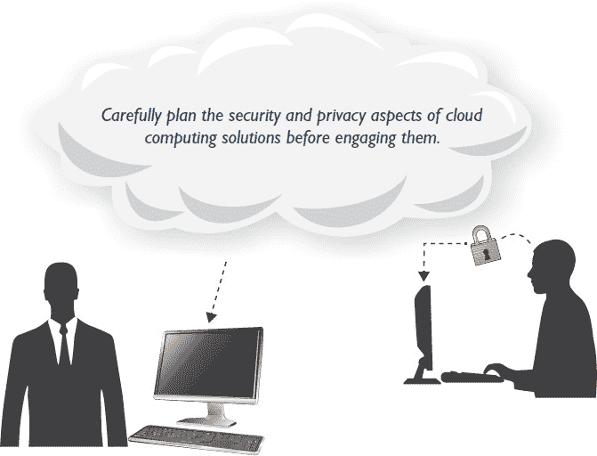

**图 9-2** 在做出实施云计算解决方案的战略决策时，内置隐私和安全。

## 多租户环境

根据定义，云计算环境中有许多不同的客户在同一架构内混合共存。这些客户可能来自银行、零售、学术组织以及医疗卫生行业。每个行业可能都有不同的强制性信息安全要求。例如，美国医疗卫生行业遵循 HIPAA，而零售组织则遵循《公平准确信用交易法案》（FACTA）和红旗规则。当然，这些专注于保护信息的法规之间存在重叠或共同点。有时存在一些防护措施可能会限制资源共享的程度，从而降低云的投资回报率。例如，根据 HIPAA，除治疗、支付和运营之外，禁止披露医疗信息。HIPAA 禁止其他租户访问健康数据，因为那将构成未经授权的披露。然而，存储在云端共享空间中的数据可能不符合这一要求。因此，云服务提供商必须将健康数据从共享虚拟机（VM）和多客户物理服务器中物理隔离。

想要支持医疗卫生组织的云服务提供商必须能够提供逻辑分区的飞地网络，并具有分段的数据库和存储层。医疗卫生组织要求云服务提供商执行的数据访问策略，必须等同于医疗卫生组织自行托管数据时所执行的策略。对于某些云服务提供商，这些要求可能比其他客户的要求更严格，这会增加成本，并让人不确定云服务提供商的员工是否有能力处理医疗数据。这也涉及一个关于身份和访问管理的常见担忧，即组织现有的政策和程序可能难以或无法在云中实施和执行。另一个问题是医疗卫生组织能否按需恢复或删除组织数据。如果数据未正确分段，则恢复或数据处置不太可能实现。由于对云中共享资源上多租户数据库混合共存的隐私和安全担忧，医疗卫生组织总体上向云采用的转变较为缓慢。

## 跨境问题

正如第 3 章所讨论的，由于数据跨国界传输的担忧，云服务给医疗卫生组织的隐私和安全带来了挑战。以下简要梳理该领域的主要监管影响：

- **美国** HIPAA 并不要求数据必须留在美国境内。然而，数据并不会因离开国境而逃脱法律约束，医疗卫生组织也无法将其遵守 HIPAA 的义务转移出去。许多医疗服务提供商发现，在商业协议中强制要求云服务提供商提供基于美国的云存储是最易于管理的做法。他们认识到，一旦发生数据泄露或其他管辖权问题，跨境数据会带来挑战。数据泄露后无法遵守 HIPAA 会使通知流程复杂化，并可能导致额外的罚款和处罚，而这些本可以通过审慎的云采用策略轻松避免。

- **加拿大** 在所有加拿大省份，与美国一样，没有禁止跨境共享个人数据的规定；即 PIPEDA 并未明令禁止传输。然而，加拿大的通行做法是不在加拿大境外共享个人数据。加拿大官员对跨境数据流动存在管辖权担忧，这与他们的美国同行非常相似。特别是《美国爱国者法案》于 2011 年 9 月 11 日后颁布，作为对恐怖主义行为的回应，带来了问题。涉及加拿大公民的数据一旦跨境并存储在美国公司中供存储或其他用途，就属于美国监管管辖范围。在这种情况下，《美国爱国者法案》可能允许美国政府在加拿大个人不知情的情况下访问其个人信息，这违反了加拿大的 PIPEDA。因此，与加拿大医疗卫生组织谈判的合同很可能会强制要求数据保留在加拿大管辖范围内。

### 欧盟数据保护

**欧盟** 就 DPD 而言，跨境数据流动受到明确规定。DPD 规定：“必须禁止将个人数据传输到无法确保提供足够保护级别的第三国。”^(7) 在前面的章节中，我们讨论了安全港条款，在任何外国及其数据保护措施被视为适合数据共享之前，这些条款必须到位并经欧盟数据主管部门批准。替代欧盟安全港条约以允许数据传输的方式有标准合同条款和具有约束力的企业规则 (BCR)。标准合同条款是监管机构批准的标准数据保护条款，可用于云计算合同。BCR 适用于拥有足够内部数据保护规则的跨国公司，这些规则在全球范围内实施，用于公司内部的个人数据国际传输。在某些方面，BCR 在政府政策不完善或不存在的非欧盟国家充当充分的保障条款。

无论数据源自哪个国家，所有医疗保健组织都存在一个额外的顾虑，即它们都必须考虑数据的位置和治理。云计算的好处之一是在多个位置拥有数据的多个副本。这有助于缓解任何停机时间或缩短组织的恢复时间。然而，跨多个地理位置的这些多个副本如果是敏感医疗数据，可能会极其成问题。不仅存在未受控复制或访问的真实可能性，而且当云服务提供商不再需要维护信息时，实际上不可能证明数据已完全归还给医疗保健组织。如果数据无法完全归还，云服务提供商必须在其持有数据的时间内维护适当的保障措施（包括事件报告），而该时间线可能远超云服务提供商与医疗保健组织签订的合同期限。作为另一种选择，如果云服务提供商无法归还数据，它可以证明在超过数据保留的法定期限且合同不再生效后，所有副本均已销毁。然而，如果云服务提供商因为存在数据的多个副本而无法归还数据，它很可能永远无法证明所有副本均已销毁。

### 云中的第三方风险

虽然云服务提供商确实在信息隐私和安全方面给医疗保健组织带来了风险级别，如 第 5 章 所述，但这种风险可能是值得的，因为云计算确实提供了可衡量的收益。大多数医疗保健组织不具备或不希望内部具备云服务提供商能够快速提供的能力（大型存储设施、处理能力、资源供置备和网络冗余）。医疗保健组织必须了解云计算流程以评估风险，但许多云服务提供商并不完全了解医疗保健面临的独特隐私和安全压力。这种相互的不了解可能成为信息风险的来源。医疗保健组织需要确保云服务提供商能满足适用的监管标准。如果不能，它必须继续评估云服务提供商，直到找到一个既能合规又能提供所有其他收益的提供商。

---

 **提示** 在美国，云服务提供商必须签署业务伙伴协议。过去，云服务提供商通常不签署这些协议。他们的立场是，作为云服务提供商，他们不访问数据，因此不受 HIPAA 约束。2013 年《综合 HIPAA 最终规则》的最新通过，明确了业务伙伴的定义，专门指明云服务提供商和数据中心属于业务伙伴，无论云服务提供商是否签署业务伙伴协议。

总之，医疗保健组织在签订具有约束力的协议之前，必须仔细考虑相关问题并评估潜在的云解决方案。不听从此建议的医疗保健组织将在监管机构提醒他们合规不能外包给第三方（在本例中是云）时遇到问题。您的云服务提供商所做或未所做的一切，在敏感信息的隐私和安全方面都将由您负责。

### 移动设备管理

自带设备 (BYOD) 是最终用户热衷采用、组织试图采纳的一种流行策略。BYOD 的积极方面显而易见，包括降低 IT 部门的库存成本和维护成本。最终用户喜欢使用可个性化和定制的设备（以提高生产力）的灵活性。这些 BYOD 环境通常包括笔记本电脑、平板电脑和智能手机，它们运行着组织无法提供资源支持的操作系统和移动应用程序。由于 BYOD 涉及信息隐私和安全隐患，必须建立移动设备管理 (MDM) 流程。MDM 策略将包括访问管理、用户权利和责任，以及组织可以针对这些私人拥有的设备采取的行动。由于医疗保健组织使用需要受保护的 PHI 和 PII，它们将不得不解决移动设备管理问题。例如，越来越多的医疗服务提供商发现，通过他们自己的个人移动设备使用计算机化医嘱录入 (CPOE) 访问组织的 EHR、下达检查和用药医嘱，能获得更好的生产力。

BYOD 在医疗保健领域带来了独特的挑战，因为位于这些设备上的 PHI 或 PII 超出了组织的信息保护范围。组织几乎无法控制可能加载在设备上的第三方软件。此外，设备很容易丢失或被盗。如果设备未加密，数据丢失可能需要通知患者以及政府干预。此类设备丢失的可能性很大；正如一篇关于医疗保健和移动设备的近期文章所言，“$429,000 … \[was\] the typical large company loss due to mobile computing mishaps in 2011.”^(8)

医疗保健组织可以实施的一种控制措施是网络准入控制 (NAC)，当最终用户尝试访问医疗保健组织的网络时，它可以识别最终用户的设备。在允许设备进行任何级别的访问之前，可以扫描设备以检查其是否符合最新的防病毒版本，并确保其他软件已通过漏洞补丁更新至最新。网络准入控制技术可以支持所有品牌的移动设备。这在医疗保健领域很重要，因为有各种各样的移动设备尝试访问网络。（这些移动设备中越来越多也是医疗设备。）

---

 **注意** 移动设备管理、BYOD 和医疗设备之间存在显著重叠。例如，市面上有手持超声机，它们是智能手机、医疗应用程序和具有 Wi-Fi 功能的扫描外围设备三合一。此类设备的示例可在 `http://www.mobisante.com/products/product-overview` 找到。

另一种有助于移动设备管理的架构解决方案是实施虚拟桌面接口（VDI）。这种配置依赖于虚拟机设备和软件，基本上允许经过身份验证的用户访问网络资源，而无需将这些资源交付到终端设备。在过去，“哑终端”被用于在大型机计算环境中访问大型机，这与移动设备现在访问 VDI 的方式有一定相似性。

## 健康信息交换

我们正处于一个患者信息数字化使得共享信息变得更加容易的时代。然而，使用敏感健康信息的限制仍必须遵守。在 A 医院寻求治疗的患者，并不一定同意 A 医院将该信息共享给 B 医院，除非该用途是为了治疗、支付或运营。然而，在治疗、支付和运营之外共享健康信息也存在优势；这些优势构成了健康信息交换（HIE）的基础。医疗组织认为 HIE 具有价值，因为它可以通过提供更安全、更及时、更公平的护理并获得更好的结果，来改善对临床数据的访问。有时交换是治疗、支付和运营的一部分；其他时候，交换可能是为了研究、公共卫生或其他有效的临床原因。然而，HIE 带来了隐私和安全顾虑，即创建多份数据副本，这与云服务提供商相关的情况非常相似。具有整体系统感知能力的去中心化数据库位置，有助于保持控制的本地化和安全性。

在进一步讨论之前，请放心，HIE 不仅仅是以美国为中心的运动。尽管美国的医疗组织正在实施 HIE，但全球范围内 HIE 每年增长 10%，预计到 2019 年 HIE 支出将达到约 9.8 亿美元。^(9) 全球对 HIE 的需求基于与美国类似的驱动因素：云计算、移动设备（BYOD）以及全球新兴经济体。随着经济水平的提高，EHR 实施正在普及；因此，通过 HIE 进行的信息共享也在扩展。

如果 HIE 实施得当，并对妥善收集的 PHI 或 PII 进行保护，其国际化发展将使医疗组织获得难以置信的公共卫生报告访问权、结果衡量指标、生物医学监测能力和研究资源。然而，患者和监管机构将成为判断 HIE 能否安全可靠地共享信息的裁决者。为了建立必要的信任，HIE 将希望遵循诸如美国国家健康信息技术协调办公室（ONC）的《电子交换可识别个人健康信息的全国隐私与安全框架》等标准。这套标准在国际上也适用，它帮助 HIE 代表患者展示对 PHI 的良好管理，涉及 PHI 的安全收集、使用和披露。除了 ONC 框架外，美国卫生与公众服务部民权办公室（OCR）还发布了一系列事实摘要，以协助 HIE 建立隐私政策，并解释 HIPAA 如何适用。

## 电子健康记录的实施

EHR 改变了保障患者健康信息机密性、提供数据完整性和确保可用性所需的安全组合。技术也带来了新的责任，用于保护患者的健康信息，这些信息曾经是纸质的，现在则是电子形式。直到 2009 年《美国复苏与再投资法案》（ARRA）通过政府报销提供刺激资金以支持采用 EHR，医疗行业才见证了 EHR 的广泛采用。当然，在那之前，一些医疗数据已以数字格式收集，例如通过 PACS 和远程放射系统，但电子医嘱录入和大部分患者记录的数字化仍是例外而非常态。ARRA 之后，在美国 EHR 如今已非常普遍。EHR 实施引入了两个隐私和安全顾虑，它们涉及访问管理和数据管理。

### 访问管理：创建、写入、更新、删除（CRUD）

在第 8 章中，当我们在信息安全控制的背景下涵盖身份、访问和授权时，我们强调了建立控制措施的重要性，以明确谁在何时有权访问什么资源。针对 EHR，必须确保数字化信息已建立适当的管理、物理和技术控制来保护信息。对于 EHR，必须保护最终用户关于查看、写入和删除权限的权利。在一个医生、护士和临床医生身兼多职、通常基于临时职责的医疗环境中，我们可以预期 EHR 周围存在一个高度动态的访问管理环境。此类场景的一个例子是：心脏病专家想要访问儿科记录。如果该患者不是她目前正在治疗的对象，则应拒绝访问；但如果同一位心脏病专家担任同行评审小组成员或担任医院首席医疗官（CMO）职务，则可为履行这些职责而授权访问该记录。仅仅因为 EHR 是一个医学上独特的应用程序或系统，并不意味着无法实施某些访问控制方法。

首先，访问可以通过物理防护措施来控制。切勿忽视或低估锁门、监控摄像头，甚至安保人员对其他控制措施的补充作用。使未获授权访问系统的人员在物理上无法接触资源，这很重要且有效。医疗领域一个可能的场景是：未经授权的人员获取了授权凭证并试图访问健康信息。这种非法访问称为 `snooping`。有了适当的凭证，未经授权的用户可以访问信息和网络资源，除非他们在物理上被阻止访问。

在设置物理屏障后，建立主动且持续的监控流程将有助于控制访问。该流程可能始于同事警惕地监控其视野或工作区域内谁在访问系统。询问不认识的人或行为不符合工作条件常态的人（例如，看起来紧张和匆忙的人）是第一道防线。接下来，EHR 管理员应维护一份最新的访问名单，并指定角色或访问级别。名单上的人员应获得唯一 ID，并被强制创建强密码或个人识别号（PIN），除非有其他形式的多因素认证可用。

一个常被忽视的、有助于防止未经授权访问的控制措施是自动关机程序。当授权用户完成工作或只是离开其访问点（例如台式机、笔记本电脑、智能手机或医疗设备）时，设备应在短暂但合理的时间后注销或关机。这种强制终止访问可以降低未经授权的人员搭便车或继续使用授权用户凭证会话的可能性。事实上，即使第二个人是授权用户，在另一个人的凭证下进行网络业务也是不可接受的，因为这违反了信息安全的认证、授权和不可抵赖原则。

对于医疗保健组织而言，在访问管理方面的最后一项考量是定期审核访问日志和用户活动日志。拥有一个经过审查和分析的主动监控流程，有助于预防和检测安全事件。此外，当涉及到向数据主体或患者提供准确的访问历史记录——即谁访问了他们的数据或可能采取了什么操作——访问管理流程可以支持这种披露，而这正是隐私和安全框架所要求的。在美国，这种披露支持医疗保健组织在收到请求时，提供患者 PHI 使用情况的完整核算记录。

## 数据管理

在从纸质记录转换为电子记录时，安全的数据生命周期管理必须是重中之重。许多组织在转向数字化信息时，往往会放宽对收集或维护数据量的控制。造成这种情况的一个普遍原因是，公司不再需要像纸质记录那样，大量采购房间或建筑物来存放信息。电子健康记录（EHR）提供的数据收集和存储的便利性，也是一个显而易见的漏洞。简单来说，医疗保健组织一次性丢失 500 份以上个人医疗记录的风险已呈指数级上升。过去所有记录均为纸质时，500 份医疗记录可能占满整个小型档案室，从地板到天花板；而如今，同等数量的记录轻松就能装进一个 USB 闪存盘。请记住，根据 HIPAA 规定，500 份个人医疗记录是触发数据泄露需加强政府通报级别的门槛。这个数字说明了电子健康信息发生重大数据泄露是多么容易。纸质记录需要通过多次（且显眼的）进出档案室来搬运，而 500 份数字记录只需几分钟即可下载并带出医院大门，旁观者完全察觉不到。因此，随着 EHR 的实施，信息安全和隐私专业人员必须继续教育和传达敏感数据——在本例中为 PHI 和 PII——的重要性及其妥善管理。

## 数据泄露影响

在保护医疗信息方面，没有什么比数据泄露更能影响人们对成败的看法。将数据泄露作为衡量项目有效性的结果指标可能并不公平，因为有些人认为数据泄露不是“会不会发生”的问题，而是“何时发生”的问题。^(10) 组织声誉会受到数据泄露的影响。数据泄露还可能导致患者失去对组织的信任，进而影响患者护理。此外，如果患者因此选择转向竞争对手，泄露事件可能导致组织收入损失。除了医疗数据泄露最受关注的影响——监管机构的罚款和处罚——所有这些影响都可能随数据泄露而发生。这些影响并非美国独有；在国际上，对医疗信息保护的严格审查以及针对敏感信息数据泄露的政府罚款不断增加，屡见报端。遭遇数据泄露的组织失去的不仅仅是患者数据，图 9-3 通过展示 Ponemon 等组织调查数据中的一部分，有助于说明这一点，Ponemon 曾就数据泄露及其影响对组织进行过独立评估。此类数据点不胜枚举，且往往令人震惊。

* * *

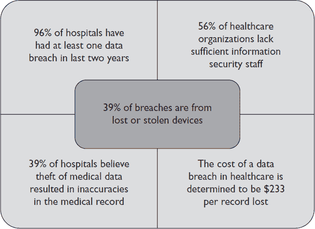

**图 9-3** 数据泄露调查结果的小样本

### 组织声誉

没人愿意成为“医院丢失 20 万份医疗记录”或“医疗机构因数据泄露被罚款 500 万美元”这类头条新闻的主角。此类头条新闻会对组织声誉造成负面影响。许多组织投入巨资培育和推广公众认知、品牌形象和声誉等资产。这些资产对组织具有极高的内在价值。数据泄露事件可能对声誉产生即时且持久的影响，而良好的声誉可能需要多年才能建立。

视组织规模及所服务行业而定，组织声誉的价值高达 10 亿美元以上。^(11) 虽然该研究并非专门针对医疗保健组织，但结果显示，数据泄露会使该价值降低多达 31%，导致高达 3.3 亿美元的损失。在医疗保健这样信任至关重要的行业中，声誉价值处于这些范围的高端。

为减轻数据泄露的冲击并缓解其对声誉的负面影响，组织可采取若干行动。一是组织必须尽全力调查并弄清数据泄露发生的原因。应用取证手段确定根本原因，有助于恢复信任，即至少组织不会下次因同一原因再次发生数据泄露。此外，组织与执法部门合作的紧密度和公开度、配合监管调查的程度以及对媒体的沟通方式，都能从公众认知角度推动组织向正确方向发展。最后，如果组织提供支持机制，如用于客户咨询的呼叫中心、身份保护、信用监控，以及受影响个人可采取的其他行动建议，其在泄露事件后的表现会好得多。

### 财务影响

衡量医疗领域数据泄露影响最简单的方法是看财务影响。事实上，我们前面讨论的声誉问题实质上也是用美元和财务损失来衡量的。总而言之，因信息丢失给组织带来的资金损失可能是惊人的。综合生产力损失、罚款和处罚、调查成本以及泄露后的收入损失，财务影响是直接且显著的。

一旦数据事件响应流程启动，成本便开始累积。即使调查最终证实未发生泄露，员工脱离正常职责进行取证调查的成本也具有可衡量的影响。在调查潜在和实际数据泄露期间，无法履行正常职责或推进其他计划的机会成本，也是财务影响开始显现的地方。

一旦确认发生实际泄露，通知患者的成本便开始产生。在几乎所有泄露场景中，告知患者泄露详情及其可采取的行动都是适当的，甚至是强制要求的。如果泄露涉及超过 500 份个人记录（在美国）或法规另有通知要求，通知监管机构和媒体将产生费用。广告投放、设立免费热线呼叫中心和直接邮寄活动都需要大量资金。如果恰当的做法是建立信用监控，或为受影响个人提供其他形式的身份管理保护，将增加更多财务成本。

事件缓解且通知行动完成后，仍面临监管机构罚款和处罚的可能性。这些金额往往占据最大头条。然而，尽管罚款金额不菲（根据 HIPAA/HITECH，美国平均罚款为 250 万美元），事实是罚款和处罚仅占数据泄露总财务成本的一半左右，总成本高达 540 万美元。^(12)

财务成本的另一个组成部分是未来收入的随之损失。对于上市公司而言，股价可能在数据泄露发生后下跌。对于非营利性医疗机构，债券评级被下调是一种可能性。债券评级降低的影响会使资本改善投资变得更加昂贵，并可能使原本偿债能力良好的医疗机构成为收购或合并的更佳目标。这些结果在一定程度上属于极端情况，但如果信息保护不是医疗机构的重点，且数据泄露是周期性发生而非罕见事件，这些就极有可能成为现实。

数据泄露对医疗机构产生财务影响的最终未来状态冲击是人员流失率增加。每个机构每年都会有患者流失；这是正常的，但希望净流失结果能带来使用该医疗机构的总患者数量的正增长或增加。研究表明，遭受数据泄露的医疗机构实际经历的流失率比预期高出 4%。^(13)

## 医疗与金融身份盗窃

病历中包含的信息价值可高达被盗信用卡档案或被盗银行账户信息的四倍。这主要归因于两个因素：

- 病历往往既包含财务数据，也包含健康信息。
- 病历中的要素可分别出售以获取最大利益。

在任一场景下，被盗健康信息的可能用途都是为了欺诈性地获取医疗服务和处方药。就处方药而言，一旦非法获得，即可转手出售。急诊科因患者护理服务提供迅速，很可能成为非法获取药物或服务的来源。患者带着伤情（即使是自残）就诊，并提供由窃取数据制成的假身份证，或使用社会工程学手段获取服务。为了优先救治患者，会进行诊断和治疗。即使保险或身份存疑，提供至少少量药物也是常见做法。对于稍后需在另一地点（如零售药店）凭另一实例或身份证明配药的处方，欺诈身份极有可能骗过配药处。真正的身份持有者可能直到其保险公司提供给付福利明细时才知晓此事。这可能导致保费上涨。尽管对保险的影响主要针对美国，但在保险欺诈不存在的单一支付者制度的国际受众中，医疗身份盗窃的影响依然深远。在资源有限的情况下，此类欺诈会使真正需要治疗或资源的人无法获得。

医疗机构，尤其是美国的机构，处理敏感财务信息，如银行卡信息、信用卡号、家庭住址和出生日期。即使犯罪分子不关心医疗数据，可利用的财务数据的获取也使医疗机构成为目标。迄今为止，鲜有患者因医疗机构数据泄露导致其 PHI 或 PII 丢失而赢得诉讼。这主要是因为很难证明损害直接归因于医疗机构的数据丢失。这种情况可能迅速改变，如果医疗机构在数据泄露中被视为故意疏忽，患者随时间推移可能赢得集体诉讼。然而，遗憾的是，公众对财务数据丢失的麻木态度日益增长。个人信息被盗或泄露时，许多人认为注销账户和卡片、设置信用监控是享受数字银行和零售便利这一不可避免现实的补救措施。银行和信用卡公司为重建账户和发行新卡所产生的成本会转嫁给最初丢失数据的组织（例如医疗机构）。这是公司加大保护信息力度的充分理由。

## 患者尴尬

患者尴尬是数据泄露影响因素这一观点，有助于阐释生物医学工程师、临床系统管理员、健康信息管理者和健康信息技术专业人员在医疗信息安全与隐私实践中的融合。对于从临床背景转入信息保护领域的人员而言，患者护理和患者安全始终是风险管理（包括信息风险管理）的核心，但患者信息的数字化及其在短时间内轻松访问海量数据的特性，使数据泄露对患者安全和患者护理的影响成为新的关注焦点。数据表明，患者可能因担心医疗机构未妥善保护其敏感信息，或担心信息被共享，而延迟就医或完全不寻求医疗。^(14) 这还不包括那些仅因缺乏信任而决定去竞争对手或其他医疗机构就医的患者。

当敏感医疗信息泄露时，对尴尬的恐惧不同于财务信息丢失或被盗时的任何情绪反应。事实上，根据 Ponemon（该主题常被引用的来源）的数据，当询问医疗服务提供者认为患者对其健康数据潜在未经授权披露的最大恐惧是什么时，他们回答公开曝光或尴尬的排名高于医疗身份盗窃和金融身份盗窃。^(15) 图 9-4 将这些回答置于合理视角中。

---

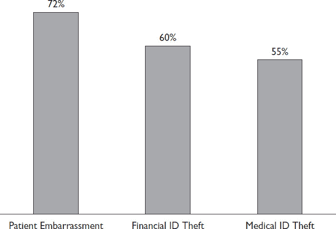

**图 9-4** 医疗服务提供者关于患者数据丢失或被盗时面临风险的回答

患者可能出于充分的个人理由，希望雇主、朋友、家人以及社区中的人员无法获取其信息。披露病史和健康状况应当是他们的选择，因为一旦该信息以未经授权的方式被披露，就无法撤回、逆转或遗忘。与财务信息不同，人们无法像“注销”银行卡、更换卡号以使旧信息失效那样，注销病历记录。不存在任何监控服务能够判断敏感信息是否被进一步披露、是否据此做出了雇佣或个人声誉相关的决定，或是否采取了利用该信息的行动。因此，无法证明损害程度；如果可以，或许受影响的个人仅凭尴尬一项就能更好地提起集体诉讼。兰德公司对从伊拉克和阿富汗返回的军人进行了一项研究，提供了几个公众曝光和污名化影响患者护理和患者安全的例子。在可能患有创伤后应激障碍（PTSD）或创伤性脑损伤的军人（62 万名退伍军人）中，估计只有约一半的人真正寻求护理；研究表明，他们延迟或不寻求护理的最常见原因是担心信息被披露。在某些军事服役情况下，向患者的指挥官披露是必要的，但并非所有研究参与者都在现役中。他们的隐私顾虑还涉及担心向家人、朋友、雇主甚至战友披露。

当涉及敏感健康数据时，延迟或不寻求护理带来的影响已令人担忧，即便危害仅限于受影响的个人。然而，更常见的是，延迟或未能寻求护理在直系家庭层面和整个社区层面构成了公共卫生问题。PTSD 和其他行为健康问题等状况可能导致患者伤害自己和周围的人。家庭暴力和大规模枪击事件是未能获得或遵守治疗所导致的悲剧性后果中最严重的两类。即使患者确实寻求了护理，他们也经常向提供者隐瞒病史的相关部分、掩盖身份，或频繁更换提供者，所有这些实际上都可能破坏护理计划。^(16)

当然，并非所有家庭暴力或大规模枪击事件的根本原因都是患者因隐私顾虑而延迟或不寻求护理；但这确实是部分案件的原因，且针对许多行为健康状况的污名化确实影响了结果。对于某些疾病，如性传播疾病（STD）和其他一些传染性疾病，如果不解决患者因担心曝光而延迟就医的问题，可能导致社区或公共卫生疫情爆发。同样，并非这些领域内所有的就医延迟都能直接归因于患者隐私或数据泄露的恐惧；但我们不能简单地忽视它们作为主要因素，因为在许多情况下它们就是原因或促成因素，最终导致患者安全或患者护理风险。

## 敏感健康数据的特殊类别

健康数据总体上受到国际法规或法律的保护。几乎每一个隐私和安全框架都专门提到了医疗数据。在医疗信息的大类（例如 PHI）中，有一些值得注意的子类型，因为它们对于需要访问或使用这些数据的人员，有额外的甚至单独的处理规定。作为代表性样本，以下小节介绍了 DPD 的公共卫生信息保护要求以及一些美国特有的要求。

### 欧盟

DPD 授权成员国——数据收集机构——在公共卫生和安全事务中，偏离隐私保护信息的常规处理程序。具体而言，在涉及公众整体福祉的担忧时，数据收集者拥有一定的自由裁量权。《数据保护法》（DPA）允许出于公共安全利益而披露健康数据时的特殊处理考量。该指令还明确概述了接受成员国为科学研究、收集政府统计数据以及解决健康保险制度中的福利和服务索赔等目的而偏离正常流程的做法。然而，数据收集者在其他方面必须继续提供保障措施，以保护敏感数据免受其他未经授权的披露。

### 美国

尽管人们通常假设 HIPAA 包含了与医疗保健相关的完整监管关注点和控制措施，但仍存在其他一些监管法律和控制集，它们针对特定患者群体具有特殊目的。这些法律包括 1970 年《综合酗酒与酒精中毒预防、治疗和康复法》以及 1972 年《药物滥用办公室和治疗法》修正的语言。

#### 物质滥用

在此背景下，治疗药物和酒精滥用患者的医疗机构不仅必须遵守 HIPAA 及其修正案，还必须遵守 1970 年《综合酗酒与酒精中毒预防、治疗和康复法》，以及 1972 年《药物滥用办公室和治疗法》修正的语言。这些法规解决的考量核心在于提供额外的保密性。例如，即使在初级护理等某一护理环境中治疗患者的提供者，如果药物和酒精治疗记录与初级护理治疗相关，也必须获得额外的特权才能访问来自另一护理环境（如药物和酒精治疗）的记录。通常，物质滥用治疗和记录受行为健康法律监管，并要求额外的访问许可。

#### 未成年人教育记录的保护

《家庭教育权利和隐私法案》（FERPA）管辖未成年学生 PII 的使用和披露，并在适用时管辖 PHI。在大多数情况下，FERPA 禁止教育实体在未经父母同意的情况下向第三方披露任何信息。虽然 FERPA 乍看之下似乎与 HIPAA 没有重叠，但两者确实有重叠，因为美国学校通常雇佣护士或医疗服务提供者。这些人员收集的数据受 FERPA 管辖，即使学校在 HIPAA 下没有义务。HIPAA 隐私和安全规则将学校医疗服务提供者收集的任何 PHI 排除在额外或冗余的监管之外。FERPA 通常被认为足以保护未成年学生的健康信息，作为保障既定教育记录的一部分。简而言之, 在 FERPA 下得到妥善保护的信息, 若学校受美国卫生与公众服务部（HHS）监管, 则符合 HIPAA 要求。

### 章节回顾

完成本章后，您应更好地理解隐私和安全学科及实践是如何演变为相互依赖，从而实现两者融合的。不仅实践在融合，传统上提供信息服务的员工的专业能力也在融合。随着临床工程师、生物医学技术员、健康信息管理者、临床系统管理员和信息技术人员从基于纸质的信息和独立系统转向数字化、互联的架构，隐私与安全的角色及其关系已成为医疗保健组织和管理的重中之重。本章涵盖了与这一角色和关系相关的一些非常重要的主题。

首先，您的监管机构如何看待患者信息的所有权，将对保护该信息的要求以及确保患者对该信息享有的任何权利产生影响。随后，我们探讨了隐私与安全不断演变的关系中特别适用于医疗保健的几个关键因素。如前所述，隐私通常被描述为与“我们保护什么”有关，而安全则与“我们如何完成保护任务”有关。

本章大部分内容集中在与隐私和安全相关的特定医疗保健信息技术问题上。如果您在医疗保健环境中工作，肯定熟悉医疗设备、移动设备、EHR、HIE 和云计算。这些代表了临床和业务的必要性，因为它们给隐私和安全计划带来了特定且独特的挑战。如果患者安全和患者护理要求未纳入信息隐私和安全最佳实践中——从计划阶段、运营阶段，到服务和技术的退役或停用——可能导致数据泄露和患者伤害风险。

关于数据泄露，本章涵盖了涉及丢失和被盗数据的医疗和金融身份盗窃问题。健康信息的价值约为获取的金融数据价值的四倍。这是因为该数据可用于实施金融身份欺诈，也可用于获取医疗服务（包括用于使用或销售的处方）。然而，这些并非患者对数据泄露最大的担忧。当被询问时，患者最普遍的担忧是因数据被未经授权披露而导致的公开曝光和尴尬。

数据泄露给医疗保健组织带来财务和声誉损失。重要的是要注意，即使调查最终确定未发生数据泄露，也会产生相关的直接成本和机会成本。用于取证而非其他重要任务的人工工时会产生财务影响。然而，数据泄露受到关注的原因在于公开宣布的罚款和处罚。正如那些经历过数据泄露并必须核算成本的人所知，这些罚款和处罚加起来约占总成本的一半，总成本还包括通知行动、缓解成本和实施以患者为中心的行动的费用（例如，免费热线和信用监控）。最终，如果发生数据泄露，证据表明，能够快速、公开地处理泄露，并努力防止患者遭受进一步伤害的组织，在泄露后的表现会更好。

### 复习题

**1.** 使用加密确保信息机密性是隐私和安全 \_\_\_\_\_\_\_\_\_\_\_\_\_\_\_\_\_\_\_\_\_ 的示例。

- **A.** 完整性
- **B.** 互操作性
- **C.** 依赖性
- **D.** 不可否认性

**2.** 实施后，以下哪项技术保障措施如果涉及收集系统用户的私人信息，可能会造成隐私问题？

- **A.** 恶意软件防护
- **B.** 系统性能监控
- **C.** 访问日志审计
- **D.** 信息发布请求

**3.** （判断题）为了管理医疗设备并保护其免受恶意软件利用的患者安全风险，一种有效的信息安全实践是确保所有医疗设备都实施了标准的企业防病毒应用程序。

**4.** 要向医疗设备应用软件漏洞补丁，必须联系以下哪项进行评估和批准？

- **A.** 生物医学技术员
- **B.** 食品药品监督管理局
- **C.** 首席信息官
- **D.** 医疗设备制造商

**5.** （判断题）将医疗设备分段作为应对风险策略的一部分是无效的，因为它在逻辑层面上断开了设备连接，从而抵消了信息可用性的好处。

**6.** 医疗保健组织在云计算中面临的隐私和安全顾虑中，哪一项会导致未经授权的人员访问数据？

- **A.** 多租户环境
- **B.** 共享成本
- **C.** 增加存储
- **D.** 联合访问

**7.** 实施后，以下哪项信息安全控制可使医疗保健组织支持医生的 BYOD 策略？

- **A.** 赔偿
- **B.** 加密
- **C.** 擦除
- **D.** 密码

**8.** （判断题）定期审计 EHR 的访问日志是帮助防止未经授权的 CRUD 访问的有效方法。

**9.** 一名女性收到一张超过 350,000 美元的心脏手术和康复账单。她从未接受过这些服务。当她联系医疗保健组织询问账单时，获得了一份她入院时提供给患者管理部门的驾照复印件。照片不是她的，但地址和其他信息是她的。发生了什么？

- **A.** 金融身份盗窃
- **B.** 医疗身份盗窃
- **C.** 医疗冒名欺诈
- **D.** 社会工程学

**10.** 以下哪项描述了数据泄露的影响？

- **A.** 患者护理成本增加
- **B.** 失去合并机会
- **C.** 患者信息泄露
- **D.** 扣留病史

### 答案

**1.** **C.** 使用加密这一信息安全控制可为个人隐私提供充分保护。这样，隐私就*依赖于*信息安全控制。加密无法确保完整性和不可否认性。互操作性与信息系统之间相关，而非隐私和安全控制之间。

**2.** **C.** 只有审计日志存储特定于用户的数据，在正确实施有效的信息安全控制时可能会造成隐私问题。恶意软件防护和系统性能监控仅监控系统级问题，信息发布请求不会在未经同意的情况下收集个人信息。

## 复习题

3. **错误。** 这是因为医疗设备制造商必须评估并批准可能添加到其医疗设备中的任何第三方软件。因此，某些医疗设备未安装与标准企业解决方案相同的企业杀毒应用程序是常见现象。有些设备有供应商支持的其他应用程序；有些则没有应用程序，必须应用替代或补偿控制措施。

4. **D.** 唯一正确的答案是医疗设备制造商，它是唯一必须在第三方软件应用于医疗设备之前对其进行评估和批准的实体。生物医学工程师将协调影响医疗设备的更新，但他们不一定负责软件漏洞补丁的评估和批准。食品药品监督管理局要求遵守漏洞补丁管理，但他们无法评估和批准特定设备的特定补丁。首席信息官可能在该过程中没有日常角色。

5. **错误。** 例如，将医疗设备分段到受保护的飞地或专用 LAN 中，是保护医疗设备免遭利用、以及保护医疗保健组织网络其余部分免受脆弱医疗设备影响的经验证最佳实践。分段不会影响数据可用性。

6. **A.** 来自不同公司和行业的云客户组成的多租户环境，他们可能无意中访问他人的数据，这常引起医疗保健组织的担忧，因为这些组织有严格的访问要求。共享成本和增加存储与访问控制无关。联合访问是一个与去中心化访问管理相关的概念，但它并非云计算特有。

7. **B.** 加密是正确答案，因为丢失或被盗的加密移动设备不属于可报告的数据泄露：该信息被视为除授权用户外任何人都无法读取或解读。赔偿是合同法律术语，与 BYOD 无关，除非医疗保健组织希望最终用户在设备故障时无法起诉。擦除是应对设备丢失或被盗的有用控制措施，但医疗保健组织不应在未加密的情况下允许携带 PHI 和 PII 的 BYOD 设备。启用密码的设备很重要，但如果包含 PHI 或 PII 的设备丢失或被盗，它们对防止医疗保健组织面临真实的数据泄露风险作用甚微。

8. **正确。** 监控访问是及时检测和纠正未经授权访问的最佳实践方法。

9. **B.** 虽然社会工程学可能助长了发生的欺诈类型，但这明显是医疗身份盗窃的案例。如果场景涉及使用真实有效的身份证明，金融身份盗窃才是正确答案。医疗冒名欺诈（如使用被盗信用卡）不适用于此场景。

10. **D.** 唯一正确的答案是隐瞒病史。数据泄露，或对医疗保健组织将丢失患者数据的担忧，可能导致患者隐瞒部分病史，从而对其护理产生负面影响。数据泄露可能导致患者护理成本增加，因为整个医疗系统都承受着数据泄露的成本，但它们对成本没有真正的即时影响。虽然遭受数据泄露的医疗保健组织可能被认为价值较低，但某些数据表明，在某些情况下，这些组织反而成为更具吸引力的并购目标。未经授权披露患者信息实际上是数据泄露的定义，而非其影响。

## 参考文献

1. 美国国家标准与技术研究院。“企业移动设备安全管理指南。”作者：Murugiah Souppaya 和 Karen Scarfone。特别出版物 800-124 修订版 1。2013 年 6 月。第 8 页。2014 年 9 月 20 日访问，网址：[`nvlpubs.nist.gov/nistpubs/SpecialPublications/NIST.SP.800-124r1.pdf`](http://nvlpubs.nist.gov/nistpubs/SpecialPublications/NIST.SP.800-124r1.pdf)

2. 美国食品药品监督管理局。“产品是否为医疗设备？”2014 年 9 月 16 日访问，网址：[`www.fda.gov/MedicalDevices/DeviceRegulationandGuidance/Overview/ClassifyYourDevice/ucm051512.htm`](http://www.fda.gov/MedicalDevices/DeviceRegulationandGuidance/Overview/ClassifyYourDevice/ucm051512.htm)

3. 美国联合委员会。“哨点事件政策与程序。”2013 年 6 月 10 日。2014 年 9 月 13 日访问，网址：[`www.jointcommission.org/Sentinel_Event_Policy_and_Procedures`](http://www.jointcommission.org/Sentinel_Event_Policy_and_Procedures)

4. 国际联合委员会。“JCI 认证组织。”2014 年 9 月 19 日访问，网址：[`www.jointcommissioninternational.org/about-jci/jci-accredited-organizations`](http://www.jointcommissioninternational.org/about-jci/jci-accredited-organizations)

5. Finkle, Jim。“独家：FBI 警告医疗保健部门易受网络攻击。”路透社。2014 年 4 月 23 日。2014 年 9 月 23 日访问，网址：[`www.reuters.com/article/2014/04/23/us-cybersecurity-healthcare-fbi-exclusiv-idUSBREA3M1Q920140423`](http://www.reuters.com/article/2014/04/23/us-cybersecurity-healthcare-fbi-exclusiv-idUSBREA3M1Q920140423)

6. 美国国家标准与技术研究院。“公共云计算安全与隐私指南。”作者：Wayne Jansen 和 Timothy Grance。特别出版物 800-144。第 4.3 节，“关键安全与隐私问题。”第 21 页。2011 年 12 月。2014 年 10 月 15 日访问，网址：[`csrc.nist.gov/publications/nistpubs/800-144/SP800-144.pdf`](http://csrc.nist.gov/publications/nistpubs/800-144/SP800-144.pdf)

7. 1995 年 10 月 24 日欧洲议会和理事会关于个人在个人数据处理方面的保护及此类数据自由流动的指令 95/46/EC。第 57 条。2014 年 9 月 18 日访问，网址：[`eur-lex.europa.eu/legal-content/en/ALL/?uri=CELEX:31995L0046`](http://eur-lex.europa.eu/legal-content/en/ALL/?uri=CELEX:31995L0046)

8. Hoglund, David。“BYOD 医疗保健挑战 - 2012。”《医疗无线与设备连接性》。2012 年 5 月 22 日。2014 年 9 月 25 日访问，网址：[`davidhoglund.typepad.com/integra_systems_inc_david/2012/05/the-byod-healthcare-challenge-2012.html`](http://davidhoglund.typepad.com/integra_systems_inc_david/2012/05/the-byod-healthcare-challenge-2012.html)

9. “健康信息交换全球市场 - 2020 年预测。”《Research and Markets》。拟于 2015 年 3 月发布。2014 年 9 月 25 日访问内容描述，网址：[`www.researchandmarkets.com/research/3pckwq/health`](http://www.researchandmarkets.com/research/3pckwq/health)

10. Greenberg, Adam。“提前规划：为不可避免的数据泄露做准备。”《SC Magazine》。2014 年 9 月 2 日。2014 年 9 月 21 日访问，网址：[`www.scmagazine.com/plan-ahead-prepare-for-the-inevitable-data-breach/article/366348`](http://www.scmagazine.com/plan-ahead-prepare-for-the-inevitable-data-breach/article/366348)

## 参考文献

11. Ponemon Institute. “Reputation Impact of a Data Breach, U.S. Study of Executives & Managers.” *Experian*. 2011 年 11 月。于 2014 年 9 月 1 日访问，网址：[`www.experian.com/assets/data-breach/white-papers/reputation-study.pdf`](http://www.experian.com/assets/data-breach/white-papers/reputation-study.pdf)

12. Ponemon Institute. “2013 Cost of Data Breach Study: Global Analysis.” *Symantec*. 2013 年 5 月。于 2014 年 9 月 10 日访问，网址：[`www4.symantec.com/mktginfo/whitepaper/053013_GL_NA_WP_Ponemon-2013-Cost-of-a-Data-Breach-Report_daiNA_cta72382.pdf`](https://www4.symantec.com/mktginfo/whitepaper/053013_GL_NA_WP_Ponemon-2013-Cost-of-a-Data-Breach-Report_daiNA_cta72382.pdf)

13. Ponemon Institute. “2011 Cost of Data Breach Study: United States.” *Symantec*. 2012 年 3 月。于 2014 年 9 月 3 日访问，网址：[`www.symantec.com/content/en/us/about/media/pdfs/b-ponemon-2011-cost-of-data-breach-us.en-us.pdf`](http://www.symantec.com/content/en/us/about/media/pdfs/b-ponemon-2011-cost-of-data-breach-us.en-us.pdf)

14. Agaku, Israel T., Akinyele O. Adisa, Olalekan A. Ayo-Yusuf, and Gregory N. Connolly. “Concern About Security and Privacy, and Perceived Control over Collection and Use of Health Information Are Related to Withholding of Health Information from Healthcare Providers.” *Journal of the American Medical Informatics Association*. 2013 年 8 月 23 日。于 2014 年 9 月 16 日访问，网址：[`jamia.bmj.com/content/early/2013/08/23/amiajnl-2013-002079.full`](http://jamia.bmj.com/content/early/2013/08/23/amiajnl-2013-002079.full)

15. Ponemon Institute. “Fourth Annual Benchmark Study on Patient Privacy and Data Security, Ponemon Institute Research Report.” *ID Experts*. 2014 年 3 月 12 日。于 2014 年 9 月 25 日访问，网址：[`www2.idexpertscorp.com/ponemon-report-on-patient-privacy-data-security-incidents/`](http://www2.idexpertscorp.com/ponemon-report-on-patient-privacy-data-security-incidents/)

16. Felt-Lisk, Suzanne, and Jennifer Humensky. “Privacy Issues in Mental Health and Substance Abuse Treatment: Information Sharing Between Providers and Managed Care Organizations: Final Report.” Mathematica Policy Research, Inc. 2003 年 1 月 17 日。于 2014 年 9 月 2 日访问，网址：[`aspe.hhs.gov/datacncl/reports/MHPrivacy/MHPrivacy.pdf`](http://aspe.hhs.gov/datacncl/reports/MHPrivacy/MHPrivacy.pdf)

---

## 第 10 章 医疗卫生领域的网络安全人才胜任力

## 学习目标

在本章中，您将学会：

- 了解美国及国际信息隐私与安全人才队伍的现状
- 认识网络安全人才现状对医疗卫生行业的影响
- 理解传统医疗技能向网络安全职责的融合
- 确定医疗网络安全胜任力所需的知识领域
- 描述政府和教育机构为提升网络安全人才胜任力所采取的举措

---

随着全球数据泄露事件数量和严重程度的增加，各方纷纷呼吁采取措施，确保医疗卫生行业拥有经过培训且胜任的员工来保护敏感信息。当然，对胜任力衡量标准的需求并非医疗卫生行业独有；然而，许多信息隐私与安全胜任力要求是医疗卫生行业特有的。医疗卫生信息技术的进步、日益复杂的系统与互联互通，加上数据价值极高——所有这些都在医疗卫生环境中被使用和共享——这给医疗卫生行业带来了迫切需求。我们不仅要建立项目和技术来保护信息资产免遭未经授权的披露，还必须确保拥有装备精良、训练有素的员工，能够充分胜任其职责。

### 网络安全人才队伍

我们许多人还记得 2000 年（即“Y2K”）来临前的日子。那时，我们开始意识到自己对集成和互联计算机的依赖程度有多深。银行、零售商甚至医疗卫生机构都不得不检查任何包含微处理器的机器，找出那些可能因年份从 99 或 00 结尾而发生变化导致故障的设备。人们担心，仅有两位数年份字段的计算机和软件会“认为”日期回到了 1900 年。关键计算（如银行业的利息计算）会出错。在医疗卫生领域，人们担心遥测装置或超声机等设备会直接停止工作。全球花费数十亿美元修补系统或更换为使用四位数年份字段的新版软件。如果您太年轻不记得 Y2K 事件，现在您知道为什么我们在应用程序的年份字段中总是使用四位数字了。也许您以前从未多想，直到现在。

最终，要么是因为对该问题的关注和重视，要么是因为计算机在现实中从未面临太大风险，2000 年 1 月 1 日午夜 12 点敲响时，并未发生灾难性事件。在此过程中，我们制定了灾难恢复计划，完善了备份策略，并强制要求业务连续性管理。这些概念大多仍是每位信息安全和隐私专业人员职责的组成部分；然而，自 Y2K 时代以来，系统间的互联程度和我们对它们的依赖程度已发生了近乎不可估量的变化。业务连续性计划（COOP）不再涉及手动流程——那些早已被遗忘。现在通常意味着冗余或备份系统。2000 年的灾难恢复可能在 24 小时内完成即可。如今，随着各行业（包括医疗卫生）被认定为关键基础设施，灾难恢复时间以秒、分钟或至多几小时来衡量。

这种关键基础设施也是攻击的可行目标。威胁真实存在，攻击来源多样，包括黑客、民族国家、恐怖分子和有组织犯罪。为了提供网络安全防御，我们必须让合适的人员在组织的合适岗位上配备合适的装备和培训。这在 Y2K 危机期间如此，在当今利用互联互通和数字信息的力量、同时不让敏感个人信息落入敌手的过程中依然如此。

即使我们确定全球网络安全岗位所需的人数充足，这些人也必须具备资质。这是一个需要高水平技能（并非全是技术技能）的职业，用于维护系统、保护网络、构建安全应用、监控合规等。这种短缺既存在于全球范围，也存在于美国。

#### 全球

# 全球网络安全劳动力短缺应对策略

## 英国

在熟练网络安全工作者短缺的情况下，一些国家正在积极应对并取得了一定成效。例如，英国于 2011 年发布了《网络安全战略》文件，确立了政府保护和防御来自恐怖分子、有组织犯罪等网络攻击的蓝图。当然，我们不能忘记网络漏洞往往源于内部，文件中所述策略也包含了避免这些内部漏洞的措施。与网络安全劳动力胜任力最相关的目标是第四项目标，即“建立英国跨领域的知识、技能和能力，以支撑所有网络安全目标”。为实施该目标，文件讨论了子目标，包括建立认证信息安全专业人员胜任力水平的框架。该战略还将认证网络安全培训项目作为一项目标。^1

值得注意的是，英国政府进行了评估，确定其网络安全工作者数量不足。这种稀缺阻碍了其网络安全战略目标的实现。他们发现学生中途退出本可为网络安全工作做准备的教育项目；进入该领域的人员多选择薪资更高的承包商职位或私营企业工作，主要因为政府无法与私营部门提供的薪资竞争。

除了建设专业项目和建立劳动力胜任力衡量标准，英国还致力于在教育早期接触潜在网络安全工作者。政府机构正为全国 11 至 14 岁学生的课程提供专门学习材料，以提升网络安全技能。英国政府采取的另一成功举措是赞助网络安全学徒制，为潜在工作者提供在职培训和导师指导。

## 爱尔兰

爱尔兰提供了另一个国家应对自身网络安全劳动力短缺及相关胜任力问题的全球范例。爱尔兰在网络安全领域表现优异，McAfee 和 Symantec 等组织已在当地设立分支机构，并成功吸引和培训合格工作者。这两家机构在爱尔兰共雇佣约 6,000 人，其他安全公司此后也在爱尔兰建立了业务据点。这些私营安全公司的投资扩大了合格网络安全工作者的储备，无论是通过从其他地区调动人才，还是招募爱尔兰公民并对其进行培训。

## 新加坡

作为亚洲主要金融中心及东南亚唯一真正发达国家，新加坡也面临网络安全挑战。随着政府将企业与公共设施、基础设施连接以获取实时数据，风险和漏洞巨大。近期针对政府网站的攻击和敏感公司数据泄露，有损新加坡作为安全可靠商业环境的声誉。为此，新加坡致力于通过新加坡经济发展局（EDB）建立公私合作伙伴关系，培训和发展网络安全劳动力。该国几乎是从零起步，因为新加坡整个信息技术劳动力中仅有 0.8% 具备恶意软件检测和预防等网络安全职责胜任力。

## 美国

网络安全专业人员短缺在美国同样普遍，正如全球范围内一样。据估计，仅有约 10% 所需的合格（胜任）网络安全劳动力到位。国防部等领先网络安全专家和组织坦言，需求远超供给。如果美国确实仅拥有所需人员的 10%，试想国家关键基础设施将多么缺乏服务。从描述性角度看，美国的关键基础设施包括 30 万多家制造工厂、5 万家水务设施、数千家电力公司、控制 240 万英里输配管道的 200 家天然气公司、2.8 万家食品加工厂、100 个城市轨道系统和 14 万英里货运铁路^2，这些数字可能仅代表基础设施的一部分。医疗网络等其他组件未包含在内。所有与关键基础设施相关的行业对胜任网络安全专业人员的需求巨大。如前所述，工业控制系统遭受网络攻击的风险日益增加，后果可能危及生命。在医疗领域，任何针对医疗基础设施、互联医疗设备及网络中传输的敏感数据的攻击，都可能关乎生死。

为应对这些威胁并最好地维护关键基础设施，包括美国联邦政府在内的组织已建立职位描述，列出所需职责和技能。每个职位自然由最符合特定工作要求的人员担任。然而，显然需要做更多工作，以更好地准备、培训、教育、招聘和留住胜任的网络安全人员。重点正从被动应对转向主动预防。

美国国家标准与技术研究院（NIST）、国土安全部（DHS）和人事管理局（OPM）正在开展一项开创性工作。这些组织建立了国家网络安全教育倡议（NICE），对网络安全工作职能进行分类，以便人员接受培训满足这些要求。需求的分类和标准化也将帮助需要网络安全专业人员的组织更好地预测和填补技能短缺。尽管 NICE 主要关注美国联邦政府劳动力，但也适用于私营部门。NICE 不仅与整个美国公共教育体系（包括大学）合作，在某些方面还在塑造私营部门应对相同胜任力问题的方法。本章后面将更深入地探讨 NICE。

### 医疗网络安全劳动力

# 医疗网络安全劳动力现状

医疗网络安全劳动力处于短缺状态，其状况比其他行业更为严峻。众多医疗行业调查表明，医疗行业在采用安全控制和实践方面滞后。因此，医疗行业在雇佣合格的网络安全劳动力成员方面也落后于其他行业。造成这种情况的原因有据可查。首先，医疗行业的核心业务是医疗服务，而非网络安全。因此，高层管理人员（CEO、CFO 等）传统上专注于推动收入增长或改善临床结果的举措，这完全合理。过去 20–25 年来，随着电子健康记录（EHR）实施和影像归档与通信系统（PACS）技术展示了投资回报率（ROI），医疗信息技术开始获得更多投资（就 EHR 而言，ROI 来自《美国复苏与再投资法案》的报销）。信息安全充其量只是一项成本，最坏的情况下被视为阻碍以增加收入或改善临床结果为重点的举措。情况已然改变：糟糕的网络安全投资或缺乏投资的后果已引起董事会级别的关注。虽然仍需证明 ROI，但考虑到数据泄露的成本，这变得更容易了。了解美国平均数据泄露事件给医疗机构造成约 540 万美元的调查、修复和通知成本，是一个重要的数据点。^(3) 该数字还包括政府监管机构的罚款和处罚，一旦公开，将损害组织声誉，并因患者选择其他就医方案而对未来收入产生负面影响。

在此背景下，56% 的信息技术领导者估计其信息安全工作人员太少。^(4) 其中 4% 的受访者来自医疗行业。其他研究表明，总 IT 预算中分配给信息安全支出的比例很小，尽管趋势正在上升。这种投资不足可能与医疗网络安全关键岗位缺乏合格人员有关，或导致这一结果。由于内部威胁或员工行为以及第三方业务合作伙伴仍是医疗数据泄露的主要原因，缺乏胜任力可归因于这些信息丢失和盗窃问题。

与 NICE 的做法类似，国家卫生信息共享与分析中心（NH-ISAC）正在解决医疗网络安全劳动力胜任力问题。NH-ISAC 正在利用 NICE 指南开发一个框架，但该框架专门用于培养未来的医疗网络安全工作者。NH-ISAC 的目标是：

- 增强私营和公共部门的安全韧性（预防、保护、缓解、响应和恢复）
- 扩大安全意识和劳动力教育（培养国家网络安全劳动力）
- 改进安全领先实践（NIST 网络安全框架、标准和认证机构、安全技术创新者）^(5)

全球各行业对网络安全专业人员的需求包括认识到医疗行业也需要此类人才。随着数据泄露频率和严重性的增加，以及数据收集者和政府官员面临的公众尴尬，紧迫感日益增强。这还加上政府开始对医疗机构征收的罚款和处罚。2013 年，英国政府因国家医疗服务体系（NHS）不当处置含有 3000 多条记录的废弃电脑，处以 20 万英镑罚款。这些电脑最终在 eBay 上出售。^(6)

从众多信息隐私和安全事故中，另一个例子来自加拿大。2013 年，一台未加密的笔记本电脑被盗，其中包含阿尔伯塔省 62 万名患者的个人健康信息。政府官员引用人为错误、缺乏政策和程序、以及不成熟的信息安全治理，作为不仅需要更好地教育所有工作人员保护健康信息，还需要在医疗机构招聘和留住合格的信息安全和隐私专业人员的证据。

## 技能组合的融合

与大多数处理敏感信息并从纸质跨越到数字化的其他行业不同，医疗行业主要在内部培养其网络安全劳动力。许多承担网络安全职责的专业人员接受过培训，并在通常与信息技术无关的领域积累了经验。其他行业（如银行和零售）很可能从服务台人员、网络运营或软件开发人员中获取网络安全资源——即使这些资源是在组织内部开发的。在医疗行业，今天的网络安全劳动力可能来自信息技术背景，即使是在医疗行业之外。然而，同样可能来自生物医学工程或健康信息管理背景。此外，非 IT 或非网络安全人员（如风险管理人员、法律人员和合规办公室人员）在组织的事件响应流程中发挥关键作用，并在与信息安全问题相关的信息治理结构中担任关键职位，这并不罕见。

## 生物医学工程师

生物医学工程是设计、安装、维护、保护并协助安全运行医疗设备、系统和网络的专业。这些专业人员接受过系统设计工作和工程问题解决的培训并拥有经验。他们还特别擅长将这些概念应用于医疗设备，以安全地治疗患者。随着医疗设备变得更加数字化、互联和复杂，生物医学工程人员已演变出与信息技术和网络安全专业人员相似的能力。因此，在医疗机构中，这三个社区之间建立包容性关系是最佳的。

生物医学工程师始终关注医疗设备的安全运行。当这些设备是独立设备、仅连接患者时，安全性更多涉及机械故障而非其他。随着医疗设备集成微处理器、在网络上使用 IP 地址并演变为专用计算机，它们承担了网络安全隐患。由于这些网络安全隐患在设备产生不准确结果或完全无法运行时往往会导致患者安全问题，生物医学工程师需要获得网络安全能力。例如，生物医学工程师现在负责涉及医疗设备的访问和认证流程。他们还可能负责保护分段医院网络上医疗设备飞地的边界安全设备。最重要的是，生物医学工程师是安全医疗设备软件漏洞管理计划的关键组成部分。生物医学工程师有责任与医疗设备制造商协调，确保补丁经过测试和批准。一旦批准，补丁可由制造商或内部生物医学工程团队应用到医疗设备上。在涉及医疗设备的各种信息安全问题的决策过程中适当纳入生物医学工程师，可以避免挫折、患者安全问题和临床医生的沮丧情绪。^(7)

---

 **注意** 生物医学工程师这一职称足以涵盖该群体执行的所有类型的工作职能。然而，该领域内存在不同的核心能力。有设计设备和系统的临床工程师，也有通常负责维护医疗设备和网络的生物医学技术员。也就是说，虽然生物医学技术员更有可能承担网络安全角色，但假设临床工程师将被排除在该讨论之外并不完全准确。

## 信息技术

信息安全技能和职责通常随着信息技术部门的发展而产生，是正常信息技术任务（实施身份验证、审查访问日志、为用户分配权限等）的副产品。然而，信息安全需要不同的技能组合，因此不能指望 IT 工作人员仅仅通过吸收来承担网络安全任务。例如，信息技术高级领导者指出需要网络安全工作人员，且他们有时拥有更广泛的技能基础。

在医疗保健领域，随着新的法规要求给医疗保健组织带来压力，信息技术人员往往会转型为信息安全人员。虽然医疗保健组织很早以前就实施了某些安全控制，如防火墙、安全路由器或防病毒软件，但美国《健康保险流通与责任法案》（HIPAA）等法律的出现，使得设立正式职位以履行信息隐私和安全角色成为一项要求。医疗保健领域最早一批转型从事网络安全的信息技术专业人员，这样做既是对 HIPAA 和相关立法类别的回应，也是出于其他原因。

### 行业外部

由于医疗保健作为一个行业，在引入网络安全方面比大多数行业都慢，因此医疗保健组织向其他行业寻求人才是常见现象。这种方法的好处是能更快地实施网络安全规范。从被公认为网络安全标杆的行业（如银行业）寻求经验也很有帮助。然而，正如从事医疗保健网络安全工作的人所知，这种做法的缺点是，其他行业经过验证的网络安全实践，如果不仔细考虑医疗保健环境，并不总能在医疗保健领域实施。

话虽如此，指望医疗保健组织在没有一定先验经验的情况下培养、开发和留住网络安全专业人员是不现实的。事实是，医疗保健组织并非网络安全卓越中心。虽然它们需要遵守网络安全要求以保护患者信息，但它们在建设和投资称职员工队伍方面的主要精力将集中在患者护理领域。无论是通过外包还是直接雇佣已受过培训的网络安全专业人员，医疗保健以外的行业都是医疗保健网络安全工作人员的重要来源，他们有助于推动医疗保健信息技术部门的发展。

## 健康信息管理

不同医疗保健职业为网络安全目的而融合的另一个例子是健康信息管理（HIM）领域。HIM 专业人员长期以来一直是管理患者记录、编码流程和账单程序合规性的核心。这些专业人员需要接受正规教育，并可获得注册健康信息技师（RHIT）和注册健康信息管理员（RHIA）认证。胜任力衡量标准对这些专业人员并不陌生，因为他们凭借在各种格式的医疗记录和健康信息方面的专业知识，始终是医疗保健组织隐私和安全计划的核心。例如，电子健康记录（EHR）、电子编码和账单系统以及基于 Web 的患者门户的出现，使 HIM 专业人员在网络安全方面承担了越来越重要的角色。这些变化的一个有趣的副作用是，HIM 人员现在必须精通去中心化环境，而传统上他们是集中式医疗记录区域或院内部门的管理者。

## 合规（风险管理、法务部门、隐私办公室）

合规和风险领域的专业人士如何承担更多网络安全职责可能并不显而易见。在医疗保健领域，这些人员是风险管理师、法律专业人士和隐私官。随着医疗保健组织的发展，他们都拥有延续数十年的角色和职责。即使没有额外的网络安全担忧，他们的角色和职责也至关重要；但随着医疗保健组织处理的信息变得更加丰富、数字化和普遍，这些专业人士已将注意力转向协助解决涉及数据位置、数据访问治理和第三方风险管理的网络安全问题。当然，不断变化的法规和患者隐私问题是他们的专业领域（尤其是合规和法律人员）。作为数据泄露事件调查和报告流程的一部分，合规和法律人员了解报告义务。最后，这些人员还主导大多数合同谈判，并帮助组织获得网络安全保险。

---

 **提示** 网络安全保险是医疗保健组织可选择购买的一种保障，旨在减轻数据泄露造成的部分财务影响。一些顾问声称网络安全保险有积极影响。例如，对于拥有强大的数据泄露预防和网络安全计划的组织，保险费和责任限额可能更有利。简而言之，网络安全保险虽有益，但不能替代现有的网络安全政策和程序。

风险管理人员的历史地位与合规和法律人员一样重要。此外，风险管理人员的角色和职责与合规和法务部门的工作相关。事实上，许多风险管理师被视为整个合规团队的一部分。在某些情况下，风险管理部门直接向首席护理官汇报，因为后者专注于患者护理和患者安全问题。风险管理师设计并实施计划，针对医疗保健组织为识别、评估和降低患者、员工和访客受伤风险，以及组织自身损失风险而执行的临床和管理活动。^(8)

## 医疗保健中的风险管理

医疗保健领域风险经理的职责包括建立流程和程序，以首先避免风险。例如，在患者接受截肢手术之前，会有一个流程要求不止一人核实正确的手术部位。该部位会被标记，且包括手术人员和患者在内的多人会参与该流程，所有人在患者接受麻醉前均同意标记部位的正确性。外科医生在进入手术室前也会核实将要切除的是哪肢。所有这些听起来似乎过度，但正是由于从医疗差错中吸取的教训，风险经理帮助制定了这些制衡机制，以防止错误或沟通失误。如果发生不良事件或灾难，风险经理将有责任将此类事件造成的损失或损害降至最低。例如，飓风过后，风险经理将成为负责启动灾难恢复计划或实施紧急大规模伤亡处理程序的团队一员。在灾难和危机时期，风险管理对于维持秩序和帮助组织遵守标准操作程序尤为有用。

由于医疗保健组织被视为关键基础设施，当发生任何影响患者护理的 IT 相关事件时，风险管理与 IT 的领域就会发生碰撞。一个例子可能是网络停机，因为它可被视为不良事件，且必须记录在案，以便向各相关机构（如美国的州公共卫生部门）进行潜在报告。

---

>  **提示** 在医疗保健领域，风险管理是一项职能，其主要职责可能*不*包含*信息*风险管理。该职责可能归属于 IT 部门，但这正是医疗保健组织内各个群体在实施网络安全和隐私保护方面紧密相关的一个例证。

### 面临新网络安全挑战的临床专业

由于医疗保健领域的每个人都有责任保护敏感的医疗信息，所有使用受保护健康信息（PHI）和个人身份信息（PII）的临床专业人员在履行职责时都发现了新的义务。承担维护患者隐私责任的概念并不新鲜，但临床医生为更好地提供患者护理而采用的技术和通信能力，往往涉及信息安全和隐私方面的考量。临床医生必须理解并留意这些考量。尽管这种网络安全责任与生物医学工程师、信息技术人员、合规官和风险经理的职责描述并不相同，但临床人员的角色正在发生变化，值得关注。

### 医疗服务提供者

医生、护士从业者和医师助理将网络安全融入其行医实践的要求有两方面。首先，医疗业务所有者不仅有法律责任确保遵循相关指南，还要确保其诊所合规。这意味着其电子健康记录（EHR）和 IT 基础设施必须具备必要的控制措施来保护数字信息。其次，拥有自己诊所的医生以及集团诊所的合伙人，有责任确保其员工满足关于隐私和安全实践的初始、年度和定期培训要求。此外，必须制定正确的政策和程序（例如信息安全计划），以遵守 HIPAA 隐私和安全规则等法规。

在急于实施最新技术（包括智能手机和 EHR）的过程中，提供者必须应对数据丢失和被盗的风险，这些风险在患者数据数字化之前并不存在于他们的实践中。电话或口头医嘱开药或检查，在计算机化医嘱录入的互联世界中已不复存在。这种通信需要从端到端得到保护。仅仅丢失一台存储着数 GB PHI 或 PII 数据的未加密移动设备，其发生的可能性远高于丢失同等数量的纸质记录。

为了说明网络安全问题影响实践模式的另一个侧面，社交媒体（如 Facebook、Twitter 和 Instagram）给医疗服务提供者带来了挑战。为了更好地与患者建立联系，许多提供者愿意通过个人电子邮件、短信和社交媒体与患者沟通。然而，由于这些方法通常未加密，必须极其谨慎地按要求获取患者同意，并限制传输的任何 PHI 或 PII 的数量。事实上，最佳政策是不使用这些通信方式传输 PHI 或 PII，即使*已*获得患者同意。

### 护士与临床数据分析

医疗保健以及其他行业的一项日益增长的举措是“*大数据*”的概念。虽然*大数据*难以定义，但在医疗保健领域，它指的是将药企多年积累的海量研发数据与 EHR 信息相结合，并整合进庞大的政府数据库中。大数据为数据访问、存储和分析提供了前所未有的可能性。大数据的前景（包括改善结果和提高医疗实践质量）鼓励了众多不同组织间的数据共享。护理专业和临床研究人员正努力汇集这些海量数据，并试图以新的、有意义的方式对其进行分析。护士尤其利用这些数据和新算法，为脓毒症和充血性心力衰竭等病症制定护理计划，并确定针对跌倒风险老年人的最佳干预措施。通过数据分析，提供者正在改善患者生活质量，并通过降低再入院率（通常不予报销）和改进实践来降低医疗保健组织的成本。

然而，大数据、数据共享和报告带来了数据去标识化和 PHI 或 PII 未经授权披露的新风险。大数据的许多潜力实际上并不依赖于数据主体的个人身份，因此必须小心妥善地移除或模糊化标识符。如果未能做到这一点，未经授权披露的风险极大。护理界和临床研究人员等正处于这项涉及标识符工作的最前沿。

此外，护士在确保患者知晓隐私实践方面发挥着领导作用。此类通知包括解释因类似大数据的举措（如健康信息交换 HIEs）而导致的信息共享可能性。虽然 HIEs 在 HIPAA 的治疗、支付和运营条款下是被允许的，但参与 HIEs 的医疗保健组织仍须在患者同意书上注明这种参与情况。护士凭借其作为患者教育者的独特角色，往往在帮助患者了解其权利和医疗保健组织的义务方面发挥着关键作用。

### 政府举措

## NICE

国家网络安全教育计划（NICE）是一个旨在创建和推进国家网络安全劳动力框架的组织，该框架可供各级教育工作者使用，尤其是中学（高中）教育工作者，以帮助塑造科学、技术、工程和数学（STEM）项目的课程。在这些学科中，网络安全教育应以一致、标准化的方式提供。此类课程的成果将是一支未来劳动力队伍，他们具备共同的胜任力水平，可供招聘、培养和留任员工。随着时间的推移和经验的积累，这些人员可以成长为我们今天严重短缺的高素质网络安全专业人员。NICE 和劳动力框架的推动力源于美国第 13636 号行政命令，由贝拉克·奥巴马总统签署，该命令呼吁“开发一个框架以减少关键基础设施的网络风险”。^(9) 该框架被称为“网络安全框架”。

无论一个人为哪个组织工作，劳动力胜任力框架都应当是可行的。NICE 模型围绕不同的类别和专业领域^(10) 构建，这些领域进一步细分为典型任务，以及在专业领域工作的人员所需的知识、技能和能力（KSA）。将领域细分为 KSA 主要是为了提供秩序和安排。网络安全工作者通常需要具备多面性；他们的职责跨越专业领域，并可能拥有多种 KSA。这在较小的组织中尤为明显。在较大的组织中，专业化可能是可行的，但组织的使命可能要求跨培训和执行多项共享的关键任务。图 10-1 说明了 NICE 框架的类别和专业领域。

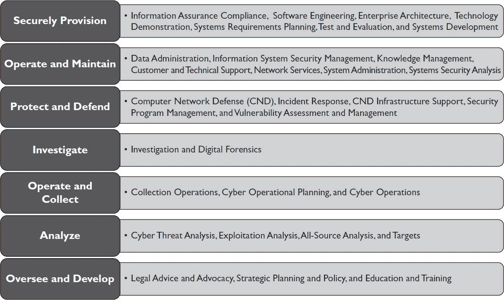

---

**图 10-1** NICE 框架及相关专业领域

## NHS 网络安全计划

招聘官员和政府数据主管部门认识到，在网络安全所需的胜任力方面存在短缺。即使在国家医疗服务体系（NHS）内部也是如此，不良的安全实践和缺乏熟练工人被认为是备受关注的数据泄露事件的根本原因。因此，NHS 启动了一项计划，以招募和培训未来的劳动力成员。缺乏熟练的网络安全人员使医疗保健组织容易受到外部黑客的攻击。然而，内部流程和威胁仍然是问题。数字有点惊人。2008 年至 2011 年间，英国的一个监督组织利用信息自由请求从 NHS 收集数据。他们发现在该时间段内，英国医疗保健系统每周平均发生五起数据事件。^(11)

除非进行干预，否则这种短缺在一段时间内似乎仍将是现实。例如，根据国际信息系统安全认证联盟（ISC）² 的数据，目前英国最近毕业生中不到 1% 从事网络安全职业。这一比例相当于 7,635 名毕业生在完成第一个 IT 相关学位后从事了网络安全工作。即使以这个速度，企业官员也声称他们雇佣的人员没有为其组织中的网络安全角色做好充分准备。英国计算机科学课程的调查支持这一说法，网络安全主题的平均覆盖率不到 5%。^(12) 在一个 120 学分的学位中，那将是 6 个学分，或者可能只有两门课。

经验和接触网络安全运作无可替代——尽管课程中平均只提供两门课。网络安全毕业生缺乏对风险管理和信息治理相关知识的熟悉。精力和关注点集中在编程、Web 开发和软件应用创建上——所有这些都是数据收集、使用、传输和存储的行为。对于数据掌握在数据收集者手中后保护数据资产，重视程度远远不够。

## NH-ISAC

作为对美国总统备忘录的回应，该备忘录发出行动号召以保护国家关键信息基础设施，建立了信息共享与分析中心（ISAC）。这些是针对特定行业问题协同工作的公共和私营部门组织。各个 ISAC 组成了整体组织；其中一个 ISAC，国家医疗健康 ISAC（NH-ISAC），专注于美国医疗保健组织。该小组关注医疗保健和公共卫生关键基础设施，并制定安全防护、网络安全方法、业务连续性和灾难恢复的建议。国家 ISAC 委员会（NCI）建立了一个通信和共享框架，以协助各个 ISAC 进行协作并推进其各自的计划。当然，ISAC 之间会相互交流，并尽可能利用最佳实践。以下是 NH-ISAC 为医疗保健组织提供的一些具体产品：

- 可信、及时且可操作的网络情报
- 态势感知（威胁和漏洞监控）
- 对策解决方案、事件响应、最佳实践和教育^(13)

## 胜任力衡量标准

职能胜任力衡量标准在信息技术和网络安全领域发挥的作用是既定的、被接受的，有人甚至可能认为是不可或缺的。新的衡量标准每年都进入市场，由于技术变革或市场饱和，一些旧的衡量标准变得过时。诸如 HIPAA 等法规以及 NIST 特别出版物 800-66 提供的实施指南，都涉及拥有合格劳动力从事工作（在本例中为处理电子 PHI）的需求。^(14) 在可用的胜任力衡量标准中，正规教育具有最强的持久性和长久性。大学学位的保值期远比会发生变化并可能过时的资质认证或特定信息技术培训要长得多。然而，正规教育在应对技术和市场变化时不够动态和灵活。考虑前面提到的英国正规教育中网络安全实践课程极少的例子。建立具有必要学术严谨性的课程需要相当长的时间。

诸如资质认证和证书之类的衡量标准在 IT 和网络安全行业非常流行，因为它们上市速度快且能响应行业需求。然而，资质认证和证书的质量往往令人怀疑，因为它们相对容易创建和销售。在这些情况下，资质认证或证书无法提供合法的胜任力衡量标准。

# 医疗网络安全与隐私劳动力的胜任力衡量需求

医疗专用网络安全和隐私劳动力的胜任力衡量需求日益迫切。随着医疗信息基础设施复杂性的增加以及数据泄露的影响，招聘官员、医疗领导者和政府监管机构对该话题的兴趣与日俱增。图 10-2 描绘了各种胜任力衡量指标，并提醒我们它们不应被用作清单。目标不是拥有特定数量的持证或持学位人员，也不是拥有特定数量的专业组织成员或接受过继续教育的人员，而是劳动力胜任力流程应对以下因素做出响应：

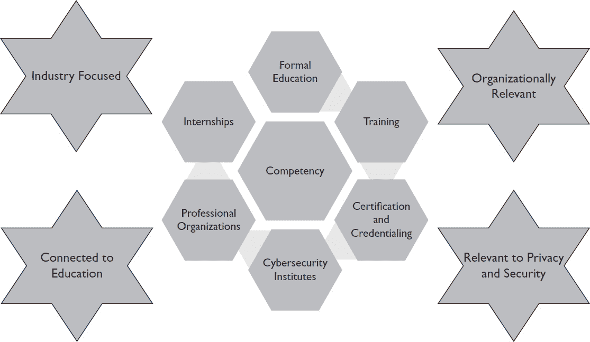

***

**图 10-2** 劳动力胜任力组成部分与外部考量因素

- **组织** 医疗组织的规模和范围，以及提供的服务、技术成熟度和第三方业务关系
- **教育** 课程交付的内容和质量，能够预判或至少响应业务需求
- **行业** 监管关切、市场压力、临床实践，以及本地和全国性竞争
- **隐私与安全** 控制措施和标准的变更、更好地支持信息保护的技术，以及政策和程序的有效性

## 正规教育

为协助有意进入网络安全劳动力队伍的个人，英国建立了一个与其国家课程互补的项目，不仅利用网络安全资源增强计算机科学项目，还创建资源帮助教师改进教案。对正规教育体系的这项投资称为“国家网络安全计划”，它向教育工作者和学习者明确表明网络安全关乎国家利益。由于医疗由英国政府资助，部分投资通过医疗组织惠及政府。为在学生学习生涯的适当时机影响他们对网络安全潜在职业的认知，采用了在线竞赛和基于场景的工具等创新策略。最终，学生开始开发进入职场所需的实用工具和经验。其中一个实践课程涉及加密的使用，最终要求学生创建一个不可破解的加密序列并发布在线，看同学能否破解。如果能破解，他们为学校赢得分数，以争夺总体学术竞赛的胜利。

在网络安全甚至医疗网络安全的正规教育方面，美国在校园、在线和混合学位项目方面处于领先地位。所有授课方式的正规学位均涵盖副学士（两年制）、学士（四年制）、硕士和博士层次。学位项目可设网络安全专业，也有项目设工商管理、医疗管理或计算机科学专业，并将网络安全作为学位内的专攻方向。专攻通常等同于在专注领域（网络安全）获得的一组课程或学分，通常在学位本身之外。攻读工商管理硕士的大学商科学生，可能需要从信息科学学院修读五门或更多课程，以获得随主修学位一起授予的专攻方向或辅修。

正规教育在衡量网络安全劳动力成员（延伸至医疗网络安全）胜任力方面的真正意义，在于学位课程的变化方式。具体而言，术语和实践已从信息安全演变为网络安全，反映了视角的转变：课程现围绕数字信息保护的变化本质构建。网络安全关注利用信息技术工具和技术（黑客攻击、恶意软件等）访问信息技术资产的攻击或威胁。许多学院和大学仍同时提供信息安全和网络安全学位项目；然而，两者的区别正在缩小。

虽然本身不是正式学位，但美国博士、学士和副学士层次的信息保障（IA）/网络防御（CD）正规教育课程，正获得“国家学术卓越中心”（CAE）的殊荣。认证由美国国家安全局（NSA）和国土安全部（DHS）进行。高校寻求此认定以区分其项目。NSA/DHS“认可印章”标志着相对于 IA/CD 的学术严谨性和课程内容质量。从 NSA 和 DHS 角度看，该项目旨在尝试建立并扩展 IA/CD 课程内容和交付标准在全国的应用。潜在学生和雇主可确信，从获认定学校学习毕业能提供所需的胜任力水平。迄今，美国和波多黎各已有 180 多所授予学位的机构获得 NSA/DHS 认证的 IA/CD 类 CAE 资质。若这些项目正确实施，国家将拥有受过更好准备、受过更高教育的工人，准备好在各自组织（包括 NSA 和 DHS 等政府机构）应对网络安全问题。

## 副学士学位

社区学院通过提供两年制网络安全副学士学位，在胜任力的正规教育衡量中发挥特殊作用，这一点理应专门提及。美国联邦政府鼓励社区学院和认证培训项目申请 2009 年《美国复苏与再投资法案》（ARRA）的部分资金，以获得刺激资金建立健康信息技术和网络安全项目。ARRA 还提供增加的学生援助，以补充新增或扩展的项目。这些快速开发的学位项目是美国开始满足有据可查的合格网络安全工人短缺的绝佳途径。

在全国范围内投资副学士学位项目的一个显著好处是，授予这些学位的机构非常高效地培养下一代网络安全工人。另一个好处是，这些机构擅长培训现有劳动力成员的额外技能和全新技能，因此有经验的工人有可能获得网络安全技能或转岗到新的网络安全职位。通常，社区学院提供更多职业或行业实践教育——换句话说，理论和学术拓展课程较少，更多以就业为导向的实践培训。

## 网络安全学院

过去几年里成立了许多网络安全研究院，它们提供持续教育和思想领导力。这些教育可作为能力衡量标准，具体取决于研究院的公信力。一些研究院是授予学位的学院和大学的延伸，这使它们更有资格成为能力评估者或衡量者。通常，这些研究院的目标是汇集来自一个或多个行业的主题专家，并举办研讨会、圆桌讨论和会议，供网络安全专业人员参加。一些网络安全研究院出版其主题专家撰写的书籍和特定感兴趣主题的白皮书。一些网络安全研究院与学院和大学有隶属关系，而另一些则是独立建立或基于特定行业建立的。

## 培训

针对各种网络安全主题的专项培训，以及那些通向结业证书的培训，有助于衡量能力。此类课程可能由正规教育机构和网络安全研究院作为非学位教育提供。这些培训项目提供的证书不应与正式的网络安全认证混淆。两者的一个关键区别在于，培训证书可能要求也可能不要求通过考试或完成任何额外的持续教育来维持证书。可将培训结业证书视为授予学生的一种特殊文凭。这种培训在所需课程量及其重点方面，也不同于通向学位的正式教育。通常，在正式教育中，更多课程将集中于专业、专攻方向或网络安全主题。网络安全培训可能只有一门课程即可结课，而正式教育可能有五到十门。此外，正规教育机构提供的多方面学位计划强制要求“广度”课程，包括英语、文学、数学等科目。培训项目不需要这些类型的课程，而是专注于特定主题。

培训按不同时间间隔提供——初始、年度、定期和临时（按需）。当在工作场所提供培训且员工遵守培训要求时，组织可以根据所讲授的主题预期达到最低能力水平。在某些情况下，培训结束时进行的考试会保存在员工档案中，以增强衡量的可靠性。

## 资质与认证

本主题引言中提到的能力衡量措施涉及资质认证和认证的益处。最近建立的几项医疗保健专用隐私和信息安全认证，说明了资质和认证如何应对市场压力和需求。历史上，没有其他能力衡量标准能像这些医疗保健专用认证那样迅速行动，以满足识别具备适当技能水平人员的需求；并且这些资质已获得国际认可，具体取决于授予资质的实体。通常，资质由拥有会员制、直接经验要求、考试和持续教育要求的专业组织开发和提供。另一个发证实体可能是产品供应商，如微软或思科，两者均提供行业认可的认证。

在医疗保健领域衡量安全和隐私能力的接受度正在提高。网络安全专业协会开始认识到医疗保健环境的独特性，医疗保健专业组织也看到其成员承担包括网络安全职责在内的角色，这使得能力衡量成为必要。鉴于过去三到五年发生的 PHI 数据泄露事件的数量和严重程度，在医疗保健环境中衡量网络安全意识和能力的需求从未如此迫切。

关于医疗保健组织内的多个群体如何开始围绕隐私和安全要求汇聚，有几个相关的认证和资质值得注意。一项领先的资质称为美国健康信息管理协会认证医疗隐私与安全专家（CHPS）。该资质认证具备在各类医疗保健组织中设计、实施和管理全面隐私和安全保护计划能力的人员。CHPS 资质之所以特别，是因为它源自一个领先的医疗信息管理组织，该组织认识到医疗记录的数字化。国际信息系统安全认证联盟，即 (ISC)²，最近为医疗保健网络安全从业者建立了一项名为医疗信息安全与隐私从业者（HCISPP）的资质。然而，(ISC)² 的领先网络安全资质是注册信息系统安全专家（CISSP）。一个面向生物医学工程社区且包含网络安全内容的认证示例，由医学仪器促进协会（AAMI）提供，称为认证生物医学设备技术员（CBET）。

对于包括法律和隐私官员在内的隐私专业，国际隐私专业人士协会（IAPP）提供认证信息隐私技术专家（CIPT），其中包含认证基础课程，这是隐私原则基础，属于认证信息隐私专家（CIPP）资质的一部分。必须先参加认证基础考试，然后参加 CIPT 考试。IAPP 不提供医疗保健专用资质，但确实根据 HIPAA 等监管指南评估能力。最后，一个适用于医疗风险管理者的相关认证是美国医疗风险管理协会（ASHRM）颁发的认证医疗风险管理专业人员（CPHRM），该组织与美国医院协会有关联。通过这些来自各利益相关群体的领先示例，它们汇聚在一起为医疗保健背景提供网络安全，我们可以考察它们的领域关注领域。

---

 **注意** 此处列出的专业团体和认证不代表本文作者或出版商的背书。当然还有其他专业团体和认证的例子，建议您自行探索。即使是本节列出的团体，因被选为代表医疗保健和网络安全领域能力衡量措施的可用性，也提供多种其他资质，可能更适用于您的日常工作职责。

## 知识领域与专长领域

# 医疗保健领域的网络安全专业人员知识域

从事医疗保健工作的网络安全专业人员需要在几个关键领域拥有广泛的知识。各个认证凭证在某些领域有重叠，生物医学工程师、信息技术人员、健康信息管理者和合规官员都可能获得这些凭证。确实，任何两个知识域之间可能有一些共同的子要素或依赖关系。个人在一个或多个领域可能比在其他领域拥有更丰富的经验或能力。同时，也可能存在个人经验有限甚至没有经验的领域。根据职业不同，每个知识领域的重点或重要程度也不同。图 10-3 展示了预期能力领域和重叠领域的示例。这些共同的知识域领域将在下文进一步描述，它们源于几个原本分散的医疗保健专业社区聚集在一起，以妥善保护医疗保健信息。

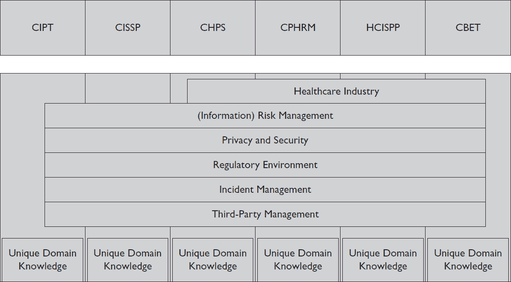

---

**图 10-3** 跨职业共享的知识域

## 医疗保健行业与组织

适用于医疗保健职业的每个凭证都会评估候选人对医疗保健运营及其行业的理解程度。这适用于 `CBET`、`CHPS`、`HCISPP` 和 `CPHRM` 凭证，它们涵盖患者安全、医疗保健 IT 系统、组织结构，以及编码和计费等临床和业务职能。关于衡量医疗保健组织中的隐私和安全能力，从业者必须理解：由于医疗保健组织独特的组织使命、结构和文化，它们与其他有隐私和安全顾虑的行业组织是不同的。

## 风险管理

该领域衡量信息风险管理知识。持有 `CPHRM` 认证的人员在风险管理方面拥有领域专长，这不仅涉及安全问题，还包括其他风险管理问题，如手术程序、应急操作、劳动力问题等。信息风险专业人员还必须展示在构建组织方法以预防、缓解、检测、纠正和从信息风险中恢复方面的能力。虽然本书不提倡任何单一的风险管理方法，但所有风险管理认证项目都根据候选人对既定标准和行业最佳实践（来自 `NIST`、`ISO` 等组织）的了解来评估他们。信息风险管理知识和专长延伸至本章提到的所有凭证，考虑到监管机构和该领域专家将信息风险评估和管理作为良好隐私和信息安全实践的基础所给予的重视，这是合理的。

## 隐私与安全

对隐私和安全的依赖与整合是行业内预期的共同专长领域。了解隐私和安全的独特要素也很重要。强调医疗保健的独特环境，以及患者安全和患者护理对医疗保健隐私和安全的影响，`CBET`、`CPHRM`、`CISSP`、`HCISPP`、`CIPT` 和 `CHPS` 等凭证评估特定资格。`CBET` 衡量生物医学工程师管理医疗设备的能力——例如，软件补丁管理和管理这些高度受监管且关乎患者生命的计算机和系统的信息风险。

## 监管环境

无论重点是 `HIPAA` 还是其他监管压力，这些认证的候选人都必须了解医疗保健行业和信息保护所需的总体指导。组织面临的外部压力可能会影响风险管理框架，法律的变更或实施会影响隐私和安全实践的许多方面。例如，数据泄露法律的变更可能导致罚款增加、术语重新定义或额外的通知行动。因此，了解监管环境可使医疗保健组织为合规做好准备，并有助于避免不必要的审查和成本。这进而使组织能够创建和实施符合外部法规和指导的组织政策和程序。

## 事件管理

与监管意识相关，不同医疗保健社区聚集在一起最重要的方式之一是事件发现、调查和报告。在医疗保健记录和系统数字化和互联之前，所有这些社区都有报告事件的传统沟通渠道。例如，`CBET` 可能有责任向美国食品药品监督管理局报告医疗设备事件。对于数据事件，这一责任并不排除根据 `HIPAA` 和组织政策，作为既定组织事件管理流程一部分报告事件的责任。事实上，`CBET` 必须在多学科组织事件管理团队中有代表。

持有 `CPHRM` 或 `CHPS` 的人员可能熟悉美国州或联邦政府的公共卫生要求，即在发生哨点（不良）患者护理事件时通知特定机构。现在医疗保健组织网络被视为关键基础设施，向监管机构的报告可能包括网络安全事件，例如因恶意软件导致的网络中断。这一现实说明了为什么 `CPHRM` 和 `CHPS` 专业认证也应在组织事件管理流程中有代表。

持有 `CISSP`、`HCISPP` 和 `CIPT` 认证及专长的人员长期以来被期望掌握数字取证的开发和实施，以及及时向适当官员（内部和外部，如有要求）报告事件。

## 第三方管理

无论是 `CBET` 与医疗设备制造商打交道，还是 `CISSP`、`HCISPP` 和 `CIPT` 必须在美国与其业务合作伙伴打交道，持证人员都应展示对第三方给医疗保健组织带来的风险的理解。由于没有法律途径可以将医疗保健组织收集的敏感个人信息保护责任外包，组织有法律义务评估和衡量其共享敏感信息的第三方业务合作伙伴，当组织依赖第三方执行服务或提供产品时。

凭证和认证是衡量医疗保健信息安全和隐私专业人员能力的行业公认方式。许多成熟组织已接受赞助认证流程的需求，并帮助验证在美国和国际上从事医疗保健行业工作的个人的能力。

---

 **注意** 凭证持有者寻求并获得衡量标准以向招聘方展示差异化，招聘方通常将凭证视为最低能力的最动态衡量标准。认证通常不是政府强制要求的，有一个例外。美国国防部（`DoD`）指令 `8570.01M`，标题为“信息保障劳动力改进计划”，于 2012 年 1 月 24 日更新，概述了对负有信息保障责任的人员的强制性最低劳动力能力要求。

## 专业组织

## 评估专业资质与认证

如前所述，本章讨论的专业组织和资质仅提供了可用资质的一个样本。在评估资质或认证的价值时，考虑其背后的权威机构非常重要。大多数行业认可的资质有几个共同点。首先，应有专业组织作为后盾，该资质或认证应包含专业人士组织的会员资格或隶属关系。其次，资质或认证应经过客观的第三方审核，例如 ANSI 或 ISO。这样，您就能知道建立和维护该资质或认证所涉及的流程具有适当的诚信度和严谨性。另一个考量因素是授予资质或认证是否取决于某些要求，例如证明具备最低经验水平、正规教育和推荐信。最有价值的资质通常有维护要求，一般为每年一次。最后，虽然一些有效的资质没有继续教育要求，但专业组织提供的优质资质或认证会要求持证人每年获得一定数量的继续教育学分。这样，胜任力衡量标准就能在技术、流程、法规合规以及医疗隐私和网络安全行业的其他变化等领域保持一定的时效性保障。继续教育的机会应来自专业组织，并应为其他相关教育和行业参与提供学分。

### 提示：道德行为要求

 **提示**  
许多领先的资质和认证要求候选人同意遵守组织的道德行为声明。当资质由候选人可作为隶属会员加入的专业组织提供时，这一点尤为明显。道德声明和政策通常是考生和会员的必备知识。请参阅 [`www.ahima.org`](http://www.ahima.org)、[`www.isc2.org`](http://www.isc2.org)、[`www.privacyassociation.org`](http://www.privacyassociation.org) 和 [`www.himss.org`](http://www.himss.org) 作为示例。

### 实习

网络安全员工的实习提供了在职培训和意识提升平台，有助于解决合格人员短缺的问题。这是一种创新方式，让应届毕业生获得少量经验，同时允许雇主将学生作为潜在求职者进行评估，从而降低雇佣不适合组织或无法随时间获得所需胜任力人员的风险。实际经验无可替代，实习为未来的求职者提供了一种以相对较低的公司风险获取经验的好方法。实习也是员工（尤其是应届毕业生）了解自己是否喜欢该工作或工作场所的一种方式。许多学院和大学提供实习机会，美国及海外的一些政府机构也赞助此类安排，以帮助建设其劳动力队伍。

## 章节回顾

本章介绍了招聘、雇佣和留住合格网络安全工作者的挑战。合格专业人员短缺的现象同时存在于美国和全球大多数重视信息保护的行业中，医疗行业也不例外。医疗机构对隐私和网络安全专业人员的需求日益增加，但在急于填补这些需求时，必须重视资质。依赖不合格的隐私和网络安全人员，其后果几乎与完全没有专业人员一样灾难性。因此，包括医疗在内的各行业都倡导多种方法来衡量其网络安全和隐私队伍的胜任力。一般来说，公认的胜任力衡量标准包括大学层面的正规教育、资质认证和实习。由于信息技术、网络安全和医疗行业总体上具有动态性和高技术性，认证和资质认证往往是衡量这一专业队伍胜任力的非常有用的方式。最近，几个领先的专业组织以资质的形式创建了相关的胜任力衡量标准，这些标准正获得行业的认可和接受。这反映在职位描述和招聘决策中。

### 复习题

1.  因为医疗网络被视为 \_\_\_\_\_\_\_\_\_\_\_\_\_\_\_\_\_\_\_\_\_\_\_\_，所以对称职的网络安全队伍的需求至关重要。

    **A.**  医疗设备  
    **B.**  关键基础设施  
    **C.**  患者护理  
    **D.**  特殊用途

2.  关于合格网络安全工作者供给的以下哪项陈述是正确的？

    **A.**  美国能够提供足够的网络安全工作者，因为它拥有大量学术机构。  
    **B.**  新加坡因拥有充足的网络安全工作者而享有安全可靠营商环境的声誉。  
    **C.**  因为合格的网络安全工作者发现在私营部门就业更有利可图，英国政府难以吸引和留住网络安全专业人员。  
    **D.**  私营部门雇主无法招聘和培训网络安全员工，爱尔兰的情况便证明了这一点。

3.  以下哪项描述了 NICE？

    **A.**  网络安全队伍教育框架  
    **B.**  教育风险评估  
    **C.**  国家合规标准  
    **D.**  网络安全教育规定课程

4.  生物医学工程师是如何获得网络安全职责的？

    **A.**  由于 FDA 法规，他们不负责网络安全。  
    **B.**  CIO 将职责委派给生物工程师，因为工作量太大。  
    **C.**  医疗设备制造商需要远程现场支持。  
    **D.**  医疗设备通常包含可识别个人身份的健康信息。

5.  （判断正误）在银行业从事过网络安全工作的信息技术人员非常有资格在医疗机构工作。

6.  如果一个组织想采取措施确保其员工的网络安全胜任力，一般来说，以下哪种方法最快？

    **A.**  认证  
    **B.**  副学士学位  
    **C.**  学士学位  
    **D.**  继续教育

7.  认证医疗风险管理师在以下哪个领域拥有最多的领域专业知识？

    **A.**  边界网络安全  
    **B.**  第三方责任风险  
    **C.**  加密的使用  
    **D.**  信息风险评估

8.  （判断正误）。由于医疗机构的独特性质及其针对数据泄露报告的行业特定要求，事件报告是合规官员（特别是隐私官）的唯一职责。

9.  以下哪项是评估专业组织及其提供的任何认证或资质的标准的良好示例？

    **A.**  表明管理成本低的合理会费  
    **B.**  涵盖许多不同主题的多种资质

## 问题

**C.** 维持认证或资质所需的继续教育

**D.** 考试包含论文部分，而非全为选择题

**10.** 以下哪项是实习的好处？

**A.** 组织获得低成本试用员工的机会。

**B.** 员工有机会了解是否会喜欢这份工作。

**C.** 它在员工解雇时减少了人力资源政策。

**D.** 它为实习生造成的数据泄露提供法律上的特殊保护。

## 答案

**1. B.** 美国第 13636 号行政命令现已定义需要网络安全保护的关键基础设施网络，医疗网络包含在内。医疗设备也需要网络安全保护，但医疗网络不受美国食品药品监督管理局（FDA）监管，通常也不被视为医疗网络，尽管它们可以是医疗网络*上*的端点和飞地。患者护理和特殊用途是医疗网络或使用该网络的设备的特征，但它们不适用于此场景。

**2. C.** 经济现实是，在英国（及其他国家），合格人员从事私营部门网络安全工作通常更有利可图。根据章节阅读材料，其他陈述均为错误。

**3. A.** NICE 旨在作为一个框架，教育机构以此为基础构建课程，以实现标准化的知识、技能和能力（KSA）。NICE 并非设计用于评估风险，也非强制合规标准。NICE 不规定具体课程，仅提供一组 KSA 作为目标。

**4. D.** 随着信息数字化和医疗设备互联，医疗设备通常包含可识别个人身份的健康信息，因此生物医学工程师在隐私和信息安全方面扮演着重要且日益增长的角色。FDA 并不禁止生物医学工程师承担责任；事实上，它建议将生物医学工程师纳入组织的信息安全计划。虽然 CIO 可能委派部分职责，医疗设备制造商可能需要远程现场支持帮助，但这两个选项均不适用。

**5. 错误。** 并非自动适用。虽然来自任何行业、具有网络安全背景（尤其是银行业）的 IT 人员可以成为医疗机构各层级 IT 团队的宝贵补充，但在医疗行业实施外部行业最佳实践可能会产生严重的意外后果。对医疗环境隐私和安全影响的额外认知和精通是关键。

**6. A.** 对员工进行认证将是衡量和保证网络安全胜任力水平最快、最被认可的方法。学士学位大约需要四年才能获得，副学士学位需要两年。继续教育极其重要，但它本身不是胜任力的衡量标准。它是达到目的的手段。显示必修继续教育或特定教育主题并最终获得培训证书的成绩单，作为胜任力衡量标准可能更有效。

**7. D.** 虽然这在一定程度上取决于个人背景，但认证医疗风险管理师在保护健康信息方面拥有更多领域专长，这是组织管理各类风险的一部分，涉及风险评估，包括信息风险。他们在网络、与第三方构建风险缓解结构以及使用加密方面可能没有那么多专长。

**8. 错误。** 由于医疗行业的独特性和法规要求，多人在事件报告过程中扮演主要角色。确实，组织内必须指定隐私官，且其很可能是该流程的联系点，但该流程本身是一项多学科的共同责任。

**9. C.** 良好的资质或认证要求持有者通过完成专业组织、其他类似组织提供的认证继续教育或通过自学来维持其资格。会费成本虽是价值的一个衡量指标，但与资质的价值无关。在某些情况下，多重资质实际上表明组织缺乏重点，且作为“文凭工厂”缺乏公信力。最后，增加论文题与资质质量关系不大。

**10. B.** 根据定义，实习让员工（尤其是应届毕业生）有机会了解是否喜欢这份工作。其他答案可能包含一定道理，但均非实习的适当益处。

## 参考文献

**1.** 英国内阁办公厅。“英国网络安全战略：在数字世界中保护和促进英国。” 2011 年 11 月。第 42 页。2014 年 10 月 1 日访问，网址：[`www.gov.uk/government/uploads/system/uploads/attachment_data/file/60961/uk-cyber-security-strategy-final.pdf`](https://www.gov.uk/government/uploads/system/uploads/attachment_data/file/60961/uk-cyber-security-strategy-final.pdf)

**2.** Verton, Dan. “关键基础设施领域网络安全劳动力短缺引发新担忧。” *FedScoop*。2014 年 6 月 26 日。2014 年 9 月 28 日访问，网址：[`fedscoop.com/cybersecurity-workforce-shortage-impacting-critical-infrastructure`](http://fedscoop.com/cybersecurity-workforce-shortage-impacting-critical-infrastructure)

**3.** Ponemon Institute. “2013 年数据泄露成本研究：全球分析。” 2013 年 5 月。第 5 页。2014 年 9 月 22 日访问，网址：[`www4.symantec.com/mktginfo/whitepaper/053013_GL_NA_WP_Ponemon-2013-Cost-of-a-Data-Breach-Report_daiNA_cta72382.pdf`](https://www4.symantec.com/mktginfo/whitepaper/053013_GL_NA_WP_Ponemon-2013-Cost-of-a-Data-Breach-Report_daiNA_cta72382.pdf)

**4.** Suby, Michael. “2013 年 (ISC)² 全球信息安全劳动力研究。” Frost & Sullivan。第 12 页。2014 年 9 月 24 日访问，网址：[`www.isc2cares.org/uploadedFiles/wwwisc2caresorg/Content/2013-ISC2-Global-Information-Security-Workforce-Study.pdf`](https://www.isc2cares.org/uploadedFiles/wwwisc2caresorg/Content/2013-ISC2-Global-Information-Security-Workforce-Study.pdf)

**5.** 国家健康信息共享与分析中心 (NH-ISAC)。“倡议项目。” 2014 年 9 月 27 日访问，网址：[`www.nhisac.org/initiatives/`](http://www.nhisac.org/initiatives/)

**6.** BBC 新闻科技频道。“NHS Surrey 因丢失患者记录被罚款 20 万英镑。” 2013 年 7 月 12 日。2014 年 9 月 20 日访问，网址：[`www.bbc.com/news/technology-23286231`](http://www.bbc.com/news/technology-23286231)

**7.** ECRI Institute. *面向 IT 专业人员的医疗技术：在当今医疗环境中工作的必备指南*。 (Plymouth Meeting, PA: ECRI Institute, 2009)，第 8 页。

**8.** ECRI Institute. “社区健康中心患者安全与风险管理计划风险管理计划样本。” 2010 年。第 1 页。2014 年 9 月 28 日访问，网址：[`bphc.hrsa.gov/ftca/riskmanagement/riskmgmtplan.pdf`](http://bphc.hrsa.gov/ftca/riskmanagement/riskmgmtplan.pdf)

## 参考文献

9. 行政命令 13636，“改善关键基础设施网络安全。”《联邦纪事》第 78 卷，第 33 期。（2013 年 2 月 19 日）。于 2014 年 10 月 24 日访问，网址 <http://www.whitehouse.gov/the-press-office/2013/02/12/executive-order-improving-critical-infrastructure-cybersecurity>

10. 国家网络安全教育倡议（NICE）。“国家网络安全劳动力框架草案。”于 2014 年 10 月 24 日访问，网址 <http://niccs.us-cert.gov/sites/default/files/documents/files/DraftNationalCybersecurityWorkforceFrameworkV2.xlsx>

11. Big Brother Watch。“NHS 违反数据保护法：患者机密每周被泄露五次。”2011 年 10 月。第 2 页。于 2014 年 10 月 24 日访问，网址 <http://www.bigbrotherwatch.org.uk/files/NHS_Breaches_Data_Protection.pdf>

12. Sparkes, Matthew。“培训不足的 IT 工作者是‘黑客的入口’。”《每日电讯报》。2014 年 8 月 6 日。于 2014 年 9 月 28 日访问，网址 <http://www.telegraph.co.uk/technology/internet-security/11011249/Poorly-trained-IT-workers-are-gateway-for-hackers.html>

13. 国家健康信息共享与分析中心（NH-ISAC）。“会员服务。”于 2014 年 9 月 20 日访问，网址 <http://www.nhisac.org/membershipservices>

14. 国家标准与技术研究院。“实施《健康保险流通与责任法案》（HIPAA）安全规则的入门资源指南。”作者：Matthew Scholl、Kevin Stine、Joan Hash、Pauline Bowen、Arnold Johnson、Carla Dancy Smith 和 Daniel I. Steinberg。特别出版物 800-66，修订版 1。第 4.3 节，第 21 页。2008 年 10 月。于 2014 年 9 月 24 日访问，网址 <http://csrc.nist.gov/publications/nistpubs/800-66-Rev1/SP-800-66-Revision1.pdf>

---

## 第 11 章：管理风险管理与网络安全

**罗布·戴维斯**

在本章中，您将学习如何：

- 使用有组织的方法了解外部网络安全攻击的剖析
- 理解风险管理框架在网络操作中的应用
- 理解检测能力为风险缓解提供的作用
- 了解整个组织的事件响应和恢复
- 在医疗保健中应用量身定制的风险评估考量与平衡，以实施补偿性控制

---

医疗保健领域见证了技术的巨大爆发，这些技术已融入患者的日常护理中。由信息技术（IT）部门集中管理的台式机、笔记本电脑和服务器等传统计算设备正在迅速消失。智能手机、医疗设备等正在模糊计算和通信能力的界限，将来自无数来源的信息传播到网络的各个角落。结果是，传统 IT 之外的专业人员在各个层面都参与了安全工作。大多数医疗保健组织全天候提供护理，这意味着网络始终在运转。个人健康信息（PHI）也在持续地被存储、访问和传输。因此，我们拥有了关键任务、多种不同视角、庞大的网络足迹以及来自四面八方的个人信息这些要素，构成了网络安全“完美风暴”的配方。

在本章中，我们将根据可用的资源和工具，以务实的方式应对这一艰巨挑战。将剖析网络攻击的结构，以便更好地理解问题。对于许多医疗保健隐私和安全专业人员来说，这可能是他们第一次近距离观察网络安全攻击的实际运作。最后，将提供从业者关于应用风险管理框架保护网络的视角。

### 攻击

在网络安全领域，我们往往关注自身，因为攻击者似乎近乎神话般的生物，趁我们不备时前来掠夺。直接的反应是加固防御，制止这种不公。然而，这只是方程式的一方面，我们必须给予对手同等的考量。网络攻击的剖析如图 11-1 所示，并在本章其余部分中被引用。

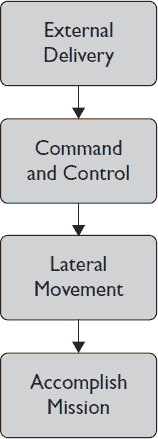

**图 11-1** 网络攻击剖析概览

#### 网络攻击的剖析

图 11-1 中概述的程序是整合了多个网络事件最佳实践框架描述的结果，例如洛克希德·马丁公司的“网络杀伤链”，该术语实际上源自美国空军在提及远距离发起的空袭等任务时常用的行话。^(1) 在网络安全领域，该术语长期以来被用于描述外部威胁的攻击面。空军描述杀伤链过程的方式与网络攻击的发生方式相似，因为针对医疗网络的大多数对手都源自遥远的其他网络。“杀伤链”作为描述词听起来很酷，确实能吸引注意力，后者可能是它有时被使用的原因。网络攻击剖析相关的另一个例子是卡内基梅隆大学的网络态势感知（cyberSA）。网络态势感知意味着对计算环境和随时间发生的事件及其影响有认知。态势识别包含以下要素：对网络攻击类型的感知、攻击源（谁、什么）和攻击目标；态势理解，即理解当前态势为何以及如何发生及其影响；态势预测，涉及确定未来攻击的预期、位置及其影响。^(2) 此处呈现的框架还包括作者和其他人的个人经验。总之，本章概述的攻击序列旨在包含多项行业最佳实践。

 **注意** 这是网络攻击如何发生的通用高层描述。如需全面了解流程，请参考其他杀伤链或网络攻击模型。

关于成功执行攻击所需的持续时间和步骤，存在一种普遍的误解，因为在当前的 140 字符媒体和 24 小时新闻周期中，攻击细节被一笔带过。为了让故事简单，过多的关注点被放在攻击的尾声。通常，在引人注目的头条行动之前，还有许多步骤。

#### 外部投递

如果目标是完全防护万维网上的所有恶意行为，那么只需断开互联网连接，但我们都知道，在当今这个无处不连接的世界里，这是不可能的。我们每天都依赖电子邮件、第三方提供商、银行转账等来开展业务，因此恶意软件通过这种与外部世界的连接进入网络几乎是不可避免的。

# 网络攻击剖析

攻击过程可以通过多种不同方式开始。例如，用户可能会收到大量包含极具诱惑力链接的钓鱼邮件，或者他们可能从一个热门网站获取恶意软件，这也被称为“路过式下载”。我们都有一定数量的可从互联网访问的服务器（患者门户、Web 邮件等）。这些系统每天都在被扫描弱点和漏洞。这些只是攻击者试图发起攻击的近乎无限的方式中的冰山一角。

---

**注意** “路过式下载”类似于你的电脑从网站“染上感冒”。任何网站（甚至流行的、受信任的网站）都可能被篡改程序，在你访问时在后台自动托管恶意软件。

一旦发现防线中的薄弱环节，初始恶意软件就会被部署以完成此攻击阶段。这是战斗的第一枪，无数对手每天都在开枪。执行这种初始攻击所需的所有工具、技术和人员成本都非常低廉。此阶段被攻陷的资产通常是低价值目标，例如员工的笔记本电脑、网页前端或普通用户凭据。对攻击者而言，价值在于这些资产一旦被感染后能做什么。

## 命令与控制

通过这种初始恶意软件投放，攻击者现已建立立足点。攻击者随即开始行动。恶意软件尝试联系其拥有者，报告任务完成并等待进一步指令。然后攻击者尝试提升权限、获取用户凭据、绘制系统图谱，或执行其他各种操作，具体取决于系统被攻陷的程度和攻击者的目标。这被称为“命令与控制”，它赋予攻击者对机器的最终控制权，以执行攻击的后续步骤。特别令人沮丧的是，在这种情况下，恶意软件可能长期潜伏而不被发现，因为它保持休眠状态或可以立即执行。根据近期报告，医疗机构的医疗设备和终端用户设备均遭遇了大量此类攻击。^(3)

## 横向移动

一旦攻击者建立了与系统的可靠连接和稳固立足点，攻击者采取的下一步行动将集中于充分利用这一优势。通过扫描任何可访问的系统来记录网络拓扑。结果将被用来通过漏洞和弱点攻陷更多机器。更多合法用户凭据被收集并存储。入侵者试图开始利用内部网络固有的信任关系反制其自身。如果入侵者在访问控制系统中获得管理员凭据，这种信任可能延伸至核心层。现在攻击者可以授予网络上任何系统的管理员访问权限，绕过几乎所有现有的安全控制。

## 完成使命

此时攻击者已占据绝对优势，并获得了稳固的立足点、用户凭据和详尽的网络知识。现在可以制造头条新闻了。使命可能是从拒绝服务到窃取数据牟利等任何行为。在此阶段阻止攻击非常困难，因为对于纵深防御架构控制（如入侵检测系统）而言，攻击实际上可能看起来像正常的用户活动。此外，攻击者将在网络各处的多台机器上建立立足点，向网络外部的多个 IP 地址“回连”以获取命令。这些步骤让攻击者如同大海捞针般隐匿踪迹。

## 攻击总结

攻击可能来自世界任何地方，形式多样。这几乎像游击战一样，导致大量混乱。此处呈现的网络攻击剖析是一个非常高层级的概览，仅旨在说明几个问题：首先，这些行动大多数时候并不像媒体报道让人们相信的那样迅速。它们可能持续数月甚至数年而不被发现。然而，随着攻击者深入流程，使用传统网络安全战术（如纵深防御分层架构）进行防御变得越来越困难。其次，在这个过程中，网络安全专业人员看到了一线希望。检测、威慑、修复和恢复，尽管痛苦且困难，但有了正确的安全计划，这些都是可以实现的目标。

# 抵御攻击：艺术与科学

安全既是艺术也是科学，但人们倾向于关注科学，因为它易于衡量。当审计员进来核对控制清单并全部打钩时，感觉很好。本章将更多地关注艺术，较少关注科学。正如第 4 章所讨论的，来自 NIST 或 ISO 等组织的优秀框架常用于评估以做出风险决策。这些科学工作应予以鼓励并定期开展。然而，一种主动防御流程，即不再单纯依赖控制，而是通过定制控制、补偿控制和安全计划中的持续方法来实施一些急需的艺术性，是医疗保健领域所需的下一代解决方案。在许多情况下，将对攻击程序的更好理解与可靠且持续的控制检查相结合，能让安全计划“活”起来。

## 流程框架

禅宗有句谚语：“悟前砍柴挑水，悟后砍柴挑水。”此语在此适用：通常选择哪种风险管理框架并不重要；重要的是专注于流程并严格遵循。任何计划要有效，必须包含规划、执行和改进的均衡组合。无需过度纠结选择哪个框架，因为随着流程执行，它会被修改以适应组织。

如前几章所述，世界上有许多跨国组织（如 ISO 和 NIST）发布了可用的框架。此处将使用 NIST 网络安全框架（CSF）作为参考模型，仅因其国际适用性。此处表达的观点将聚焦于流程，并可适用于任何框架。

## 网络安全框架（CSF）

网络安全框架是美国总统行政命令 13636《改善关键基础设施网络安全》的直接成果。该框架的目标是为风险管理结果提供指南，可供任何规模的组织用于管理风险。该框架的创建是美国政府与私营部门合作的成果。^(4)

图 11-2 展示了框架的核心，分为五大功能。每个功能进一步细分为类别和子类别。该框架还针对以下四个实施层级提供了指南：

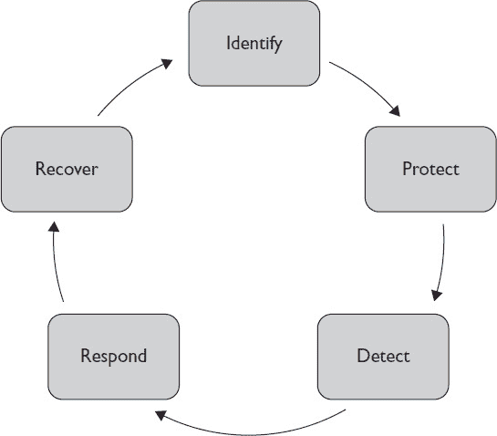

---

**图 11-2** NIST 网络安全框架

- 第 1 层：部分
- 第 2 层：风险知情
- 第 3 层：可重复
- 第 4 层：自适应

CSF 旨在作为一份指南。这些实施层级有趣的地方在于，它们并非作为成熟度模型。期望是将其留给组织根据其独特的业务和风险承受能力来决定。组织内的所有单个业务单元都应在允许的最大风险承受能力下运行。在医疗保健领域，患者护理应是第一要务，安全性应在各个资源限制条件下尽最大努力提供。安全计划不应消耗超过绝对必要的资源（人力、资金等），因为那会影响主要任务。

---

 **注意** 完整的 CSF 可在 `http://nist.gov/cyberframework` 找到。

## 检测

常规做法是让本节从识别阶段开始。然而，我们将从中间开始，因为截至撰写本文时，这是医疗保健领域的一个巨大漏洞。此外，如果安全计划中有一个方面最好比其他方面做得好，那就是这个方面。前文的“网络攻击剖析”部分描述了攻击者采取的一些常见步骤。所有这些步骤不仅耗时，还会留下痕迹，这使得强大的检测能力能够弥补流程其他领域的一些不足。

这可能会立即引发一些问题。起点在哪里？什么是负担得起的？这引出了关于部署检测能力的构建模块的讨论，如图 11-3 所示。

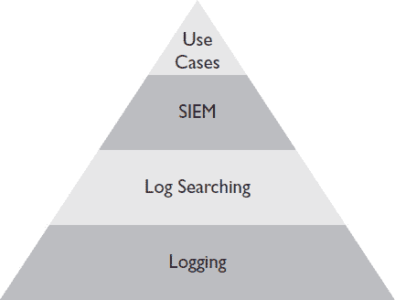

---

**图 11-3** 按复杂度排序的检测要素

### 日志记录

日志记录是每个组织都应该进行的最基本的检测要素。您网络上的大多数设备都具有执行日志记录的内置功能，并且此功能很可能已经被用于对这些设备中的大多数执行运行状况和状态监控。Syslog 是日志最常见的格式，但供应商有时会选择以其他格式记录日志。无论如何，这应该相当容易设置。需要一个称为*日志聚合点*的中央存储库来收集这些日志。存储区域网络 (SAN) 很可能已经存在，可以使用其中的一部分存储空间。尝试收集所有无需极大工作量即可收集的日志。如果当前环境中使用了云计算，这些日志也可以利用云计算。目标是尽可能轻松地将日志汇集到一个中心位置，以提供稍后在计划中使用的信息基础。

### 日志搜索

现在日志已集中存储在某处，检测过程的下一步可以执行了。收集所有日志可能看起来有点令人望而生畏，因为典型的医疗保健网络每天会产生数百万个日志事件。这就是搜索功能发挥作用的地方。市场上有许多工具可以提供此功能。一些知名供应商包括 Splunk、McAfee、Alert Logic 和 HP，它们都带有预配置的警报功能、图形界面和各种培训资源。

---

 **注意** 不要忘记开源工具，如 OSSEC 或 Syslog-ng。这些是拥有良好社区支持的优秀工具，适合预算有限的小型组织。

工具安装完毕后，负责网络监控的人员可以开始熟悉网络的起伏变化。数据中可重复的模式将开始显现，从而进入下一步，即从视图中消除常规流量。这消除了日志搜索中的大量噪音。接下来是寻找异常事件，如故障、错误、管理访问和更改。这个狩猎过程乍看之下可能令人生畏，但随着时间的推移可以有效地完成。一个例子可能是来自 DMZ 的 IP 在另一个网段的访问控制系统上使用管理账户。这种异常行为正是应当被发现和处理的事情。

在 CSF 中，检测阶段包含三个部分：异常和事件、安全持续监控以及检测流程。上一段描述的功能涵盖了这三个类别。如果您的组织满足以下条件，则在该计划的这一部分将处于 CSF 的第三层级：

- 正在从整个组织收集日志
- 拥有可重复的搜索流程
- 拥有可重复的流程以在事件响应过程中使用输出结果

---

 **提示** 在美国，HIPAA 安全规则目前没有任何针对监控的强制性控制，但有一些可选控制在此时已涵盖，例如 `164.308(a)(5)(ii)(B)`，防范恶意软件。

### 安全信息和事件管理 (SIEM)

将检测提升到更复杂的层面涉及额外的工具、流程和人员，并将消耗更多的资源。最大的工具需求是安全信息和事件管理 (SIEM) 系统。SIEM 系统首先摄入所有日志，就像前面描述的日志管理系统一样，但随后它们会增加原本需要手动完成的智能分析。它们能够关联网络活动期间所有相关的日志。警报是利用系统内置的常见基于行为的用例来生成的。还可以创建自定义用例并添加到系统中，以便根据环境中的特定情况发出警报。用例将在下一节中介绍。除了潜在事件、策略违规、合规性等的警报外，还具有通过仪表板进行报告的功能。

此类工具绝对可以使组织的检测能力跃升，但这还不是全部。需要配备人员和流程，以最大化此类工具的效益。最常见的情况是，部署这些工具后却无人使用，因为缺乏必要的支持结构。在这些情况下，优秀的日志管理解决方案以低得多的资源消耗提供了相同的功能效益。运行这些设备所需的人员需要具备 SIEM 管理、数据库管理和威胁情报等领域的技能。还需要单独的人员（通常称为分析师）花费大量时间在警报中搜寻需要通过事件管理流程处理的事件。所有这些系统和工作职责都需要建立可靠、可重复的流程和程序。

这种程度的投入不是胆小者所能为。任何考虑此举的组织的最佳实践都必须围绕风险承受能力、资源可用性和总拥有成本制定可靠的计划。如果组织非常大且拥有高价值资产，那么这可能是一项很好的投资。有了正确的计划和资金，这在搜寻和修复前文“网络攻击剖析”中讨论的项目时将极其有价值。如果组织规模较小，也有办法获得此功能。例如，许多供应商会使用他们的工具执行这项服务，以内部自建成本的一小部分提供效益。拥有集中式日志记录可为您提供所有信息，并为获取 SIEM 功能提供选择。如果通过 SIEM 进行监控的外包合作效果不佳，更换供应商的影响将微乎其微。收集的日志是进行任何监控的基础，这些日志应始终由组织控制。

# 用例

下一级检测涉及为环境生成独特的用例。无论选择哪种技术来获取 SIEM 功能，都应提供实施这些用例的选项。几乎所有产品都有实现此目的的标准方式，大多数提供服务的供应商也是如此。用例在市场上变得相当标准，因为在不同网络中应用标准供应商内容是有限度的。每个网络都有其流量基线。医疗设备根据专有制造商代码和临床目的以特定方式通信。这提供了基线，并且可以生成用例来查找偏离该基线的事物。可以使用任意数量的因素，例如数据包大小、端口、协议和目标 IP 等。

---

 **提示**   除了基线信息外，还有为医疗保健社区提供威胁情报的组织，例如 `nhisac.org` 的 NH-ISAC。NH-ISAC 是一个极佳的信息来源，可用作自适应用例的基础。

这项工作确实需要一些精力，但借助 SIEM 变得更容易实现，SIEM 可以设置好后监控一段时间以确定有效性。从那里，可以删除或调整用例以获得更好的结果。在此领域，试错正是自适应的定义。

## 响应

让我们带着对网络攻击剖析的理解，继续讨论事件响应。第 6 章专门讨论了针对所有类型事件的事件管理流程。本节将重点关注与网络入侵相关的事件响应。前面提到的数据收集提供了一条路径，用以追踪攻击者在攻击过程中留下的所有证据碎片。

CSF 在响应阶段要求五个结果类别：响应规划、沟通、分析、缓解和改进。检测和响应阶段的能力之间应存在直接关联。组织中受监控的每个实体都应在计划的这一部分中涵盖。覆盖范围可能因特定实体的任务影响而异，但仍必须予以考虑。例如，计费系统因拒绝服务攻击而无法运行，其响应级别与输液泵不同。以这种方式思考响应将导致一个不那么笼统的总体流程。

### 规划

全球大多数医疗行业法规都为响应事件提供了一些指导。例如，HIPAA 在 `164.308(a)(6)` 中要求对事件进行响应、缓解和记录。^(5) 在建立事件响应流程时，您需要牢记组织的规模和能力。计划提供重要的结构，但有时可能过于复杂而难以执行。因此，应起草计划、测试计划并重新修订。随着时间的推移不断完善流程比计划本身更重要。不要过于纠结于使第一份计划完美无缺。以下是计划中应考虑的一些一般事项：

- 计划的目标是什么？
- 哪些资源/部门将积极参与事件处理？
- 哪些能力/限制将影响响应？
- 什么情况使事件需要对外报告？
- 谁负责该计划？
- 响应如何融入框架的其他领域？

一旦计划经过深思熟虑并写下来，就会产生巨大的价值。它自然地吸引他人参与，因为他们在安全中扮演着角色。它具有心理学上所谓的“强迫功能”。*强迫功能*是指强制行为改变的事物。一个简单的例子是微波炉门打开时无法工作。在这种情况下，一旦流程可视化且工作分配下去，它就将流程从抽象思维强制转化为具体步骤。

### 沟通

沟通在事件期间至关重要，包含内部和外部两个组成部分。内部必须有一个共同的地方来共享和记录事件。如果变更管理已有工单系统，该系统可用于提供此功能；或者使用更基础的（存储的 Word/Excel 文件）或更高级的系统（事件处理软件）。目标是让流程中采取的所有步骤都有据可查，并让所有参与响应的各方都能访问。

---

 **注意**   请记住，事件偶尔可能涉及敏感数据，这需要在用于内部文档和沟通的工具中予以考虑。

外部组成部分处理构成违规的任何事项，即任何对受保护健康信息的未授权访问。任何事件响应计划都应在响应活动早期就考虑到这一点。在医疗保健环境中，首先要做的事情之一是确定是否发生了违规。这决定了是否需要启动单独的计划来对外沟通情况。这些所需行动的大纲由国家和地方监管机构规定。

### 分析

在医疗保健事件响应中，分析至关重要，因为网络事件可能影响工作的关键性质。响应和遏制是事件响应团队的主要职责。这是网络攻击剖析早期影响有限的事件，还是后期可能造成最大危害的阶段？例如，单台表现出命令与控制倾向的恶意软件感染笔记本电脑，可能只是一个无需报告违规的轻微事件。

### 缓解

完成上述分析后，转入缓解阶段。拥有组织自有的集中日志管理系统在此大有裨益，因为它使在组织内搜索攻击者存在的其他迹象成为可能。既然您的团队拥有此工具，团队就能控制流程。目标是通过发现其他感染、缓解影响和根除立足点，防止攻击者进一步推进攻击步骤。

### 改进

处理事件的过程，即使是轻微事件，也能产生其他方式无法获得的积极结果。计划演练很有用，但无法提供实战同样的冲击力。任何重大事件都应立即召开经验教训总结会议，并记录所有发现。检测阶段确定的大多数调查项目都不会是重大事件。一些组织不将这些调查称为事件。为简化起见，检测流程中的所有调查均称为事件。每月回顾所有事件（甚至误报）足以获得可用的经验教训。大部分用于此回顾的材料应可在选定的事件记录系统中轻松获取。经验教训应包括以下内容：

- 事件高层回顾
- 做得好的地方
- 可改进的地方
- 流程的哪些输出本可以帮助框架的其他领域
- 框架其他领域的哪些输入本可以帮助该流程

## 恢复

众所周知，约翰·D·洛克菲勒在石油生意中发了大财。大多数人可能会认为，他把所有的石油都从地下抽出来，然后运到市场上出售。实际上，起初他决定宁愿从事炼油环节的业务。对于炼油业务中的任何人来说，最大的担忧之一就是火灾。洛克菲勒曾就这一恐惧说道：“所以我们时刻保持像消防员一样的状态，他们的马匹和水龙带手推车随时准备立即投入行动。”^(6) 这个故事之所以相关，是因为他的想法可以追溯到 19 世纪晚期。商界人士一直在进行识别和防护阶段，而缓解阶段则在这两个阶段提供了有效的思维过程。在潜在风险、漏洞、资产识别等方面可以花费无穷无尽的时间和精力。这就像拳击手为比赛做准备却从未真正上过擂台。相反，拳击手先比赛，然后根据比赛结果的真实反馈，重新开始准备过程。

### 资产管理

要理解资产管理的两个方面：存在什么以及它的重要性。在当今的计算环境中，了解你拥有什么可能是一项艰巨的任务，因为各部门可能在不涉及 IT 部门的情况下自行采购和部署产品。不要试图找出所有东西而过度投入。请记住，在检测、响应和恢复阶段，还有其他环节会发现关键项目。专注于获取整个组织的整体图景，从传统的 IT 资产入手，如网络设备、台式机、笔记本电脑和服务器。然后结合与各部门沟通中发现的关键业务系统进行分层补充。

帕累托原则，即 80/20 法则，适用于此阶段。该法则指出，80% 的结果源于 20% 的原因。如果我们从当今设备间互联互通的角度来思考这一点，显而易见，没有任何事物是自主运行的。所有事物都需要通过既定通道遍历网络，并访问存放组织数据的数据库和服务器。这些要素属于 IT 工作范围，且非常容易识别。

在确定了基础设施的关键组件并理解了关键业务流程后，现在可以进行优先级排序。关注从恢复阶段收到的输入。应识别所有关键流程并绘制关键数据流图。例如，如果放射科声称拥有至关重要的成像设备，则应考虑使其运行的所有部件。图像存储在何处？如何存储？设备是否会从网络外部被访问以进行维护？存储、传输和访问的数据附带多少 PHI（受保护的健康信息）？专注于识别最关键的组织资产，以避免浪费时间。

## 业务环境

此处的识别工作上升到一个层面，从组织角度进行审视。所有部门如何汇聚以支撑组织的整体使命？谁和什么是执行整体使命的相关利益相关者和关键资源？例如，医院可能将设施项目（电力）视为极高优先级，而将行政项目（福利系统）视为极低优先级。此类识别推动了整体网络安全角色、职责和风险管理识别的制定。工作重点应放在识别与整个组织及其使命相关的各个业务组件的高优先级事项上。基于风险承受能力得出的优先级用于制定约束条件。网络安全资源是有限的，优先级决定了哪些约束最有可能中断网络攻击剖析中概述的程序。

## 治理

政策、流程和程序本身并不影响组织的安全，尽管它们是组织安全的基础。只有遵循这些要素时它们才有效，因此必须始终以用户为中心。例如，对用户每天需要多次访问的系统实施严格的访问控制可能并不合理。用户为了方便就会想办法绕过政策。在技术方面，便利性总是胜过安全性。这就是为什么大多数人在个人生活中对所有账户使用相同的用户名和密码。大家都明白使用不同的凭证更安全，但很难记住多个用户名和密码。

再进一步考虑与治理相关的用户视角。治理是组织与用户之间正式的沟通渠道。很多时候，制定大量治理文件极具诱惑力，因为向审计员和评估员展示文件是经过深思熟虑制定的会让人感觉良好，但随后沟通变得过于单向，接收者要么置之不理，要么另寻他法。沟通必须经过发送、接收、理解、同意并转化为行动。

查看所有治理文件，将其视为人与人之间的沟通。业务的主要要素是否已纳入考量？所有人都理解这些文件吗？是否有与指导相关的培训以促进沟通过程？是否有反馈流程以改善沟通？这些只是浮现脑海中的部分问题，透过这个视角评估当前治理时还会出现其他问题。坚持这些约束迫使组织内部进行良性沟通，并将治理保持在最有效的重视程度。

## 网络威胁向量

提到风险时想到的关键词是信任，因为二者相互依存。我们当前的数字化互联世界之所以运转，是因为计算设备之间发生了数百万次连接。1992 年，Dave Clark 曾谈到互联网：“我们摒弃国王、总统和投票。我们信奉：粗略共识与运行代码。”^(8) 这发生在当今互联网的黎明前夕，呼应了互联网创始人的初衷。当时的设想是互联网将成为一个自治的乌托邦，人们可以在其中自由生存和交流。今天的互联网与 1992 年大不相同，但其潜在主题依然存在。所有通信均使用广泛接受的标准进行，且几乎没有准入门槛。因此，利用互联网的力量时，必然存在一定程度的信任与风险。

许多人自然会从“他们”和“我们”的视角来看待网络威胁向量风险，如图 11-4 所示。互联网充当“他们”，内部网络成为“我们”。这是一种自然倾向，因为我们的系统和人员是已知实体，因此被认为是可信的。另一方面，网络空间庞大、未知且不可信。试想人们第一次前往纽约、巴黎或悉尼等大城市旅行时的情景。他们极有可能不敢独自探索，因为环境陌生、未知且充满风险。风险评估很容易陷入这个陷阱，因为评估者是人，会应用相同的风险方法论。当今计算环境的问题在于，组织内大量资产直接连接到互联网。想想所有的电子邮件、银行转账、网页浏览、患者门户和云服务，它们都是互联的。随着这些通信的发生，边界只能提供有限的保护。

---

**图 11-4** “他们”与“我们”的互联网视角

所有这些互联互通正是为什么全组织范围的风险评估是最佳实践的原因。一些行业监管法规仅关注敏感数据（如信用卡信息或 PHI）的系统和支持架构。理解这些关键要素当然至关重要，但这种狭隘的关注点限制了发现网络中可能存在的其他漏洞的能力。一旦攻击者发现漏洞，就会利用该漏洞。我们无法阻止一切，但目标是让攻击尽可能困难。

### 外部

网络攻击剖析展示了攻击过程中可能发生的所有渗透层级。第一步是攻击者通过直接连接的系统建立立足点。这可能通过电子邮件、操作系统漏洞、弱密码等载体实现。风险评估应从评估这些直接连接的资产及其数据流开始。应提出的问题包括：

- 哪些服务器面向外部？
- 这些系统的访问控制有多完善？
- 这些系统对网络的其他部分有什么访问权限？
- 这些系统与内部网络之间有哪些架构保护或控制点？
- 这些系统是否有标准镜像？
- 配置管理和补丁管理流程是什么？关键补丁应用的速度有多快？
- 电子邮件有哪些防护措施（过滤和数据丢失防护）？

这些只是评估外部部分时应提出的一些问题类型。退一步审视组织对外沟通才是目标。不要过于执着于试图找出可能存在的每一条沟通路径。相反，应从主要路径入手并推进流程。通过日志或 `SIEM` 进行集中监控可在遗漏时提供安全网。

---

 **提示**   不要忘记无线网络，它们是进入网络的接入点。接入点需要定期检查漏洞。

### 内部

重点关注内部的“核心命脉”，以将关键资产与其他资产区分开来。网络中的中央数据存储库位于何处？哪些关键流程必须运行才能执行使命？这些是在内部网络评估期间应当回答的常识性问题。

确定优先级后，查看这些关键要素周围的保护措施。访问控制机制是什么？系统本身有多安全？这些系统在架构中是否有控制点，可从中获取有效的监控数据？找出这些系统、数据流和服务基础中的所有潜在裂缝。

上述做法假设已制定可靠的策略，并遵守将敏感数据存储在正确位置的规定。评估中绝对应该付出努力来覆盖这一风险。组织与数据存储用户之间必须存在可靠的沟通，以涵盖所有相关的策略、流程和程序。应采取额外步骤与用户交谈，确保沟通被良好接收。必须揭露任何设计不良的环节。如果环节不足，人们会绕过它们，这会导致数据分散存储在整个网络中，使得保护几乎成为不可能。

### 渗透测试

渗透测试（或称*渗透测试*）是授权人员（合同工或员工）在不使用凭证和权限的情况下，尝试访问受保护资源的有目的的行为。此举旨在查明是否存在可被利用的漏洞，并开始考虑需要修复什么，以便真正的对手（而非渗透测试人员）下次无法利用这些风险。这些测试作为风险评估流程中的一个步骤，在各行各业中变得越来越普遍。许多实体聘请第三方执行这些任务，因为需要专门的技能组合。大多数提供此服务的公司使用与攻击者相同的方法论，扫描网络以查找有关系统的信息，例如 IP 地址、操作系统等。然后他们利用侦察阶段发现的任何漏洞。还有所谓的*社会工程学测试*，使用钓鱼邮件、打电话骗取用户凭证、尾随用户通过大门进入（“尾随”）等方法。

此类测试是风险评估过程中极其宝贵的工具。如前所述，当今的互联网高度互联，每个网络每天都在遭受无情的持续侦察。对攻击者而言，侦察成本很低，因为它可以自动化，因此几乎不需要人力。现实是，黑客每天都在对组织进行他们自己的渗透测试。这就是他们侦察的本质，寻找可利用的漏洞。主动开展自身渗透测试的组织能看到结果并防止潜在利用。

关于渗透测试的最后一点想法是，它们为风险评估提供了一些现实依据。人们有时倾向于忽略报告中的发现。请记住，我们人类天生信任已知事物。这种自然本能让我们对发现结果产生怀疑。然而，渗透测试报告中显示团队成功访问了多台关键服务器的发现，则难以忽视得多。

---

 **注意**   全球每个医疗监管机构都要求定期对处理 `PHI` 的系统进行风险评估。上述思路要求进行全组织范围的评估，但也应考虑特定于评估的当地行业法规。

### 谁应该执行风险评估？

让我们用一个常被提出的有趣问题来结束这个话题。谁应该执行风险评估？应该由外部第三方组织执行，还是内部执行？全球某些行业法规可能强制要求外部第三方组织执行定期风险评估，而另一些则留给各组织自行决定。在美国，截至撰写本文时，由组织自行决定。最佳实践是至少每年由外部第三方执行一次覆盖整个组织的评估。然而，应更频繁地利用内部资源进行风险评估。回答最初的问题，只要可能，内部和外部资源都应用于执行风险评估。

---

 **提示**   任何时候对计算环境进行重大更改时，都应进行风险评估——例如，如果第三方提供商修改了系统、实施了新的大量使用的医疗设备，或添加了云服务。这很可能不是全组织评估，而更多是对受影响部分的小型评估。

## 应对网络攻击

信息和可见性是通过迄今为止描述的所有流程发现的。我们都知道资源是有限的。棘手的部分是如何正确地对信息做出反应。一个深思熟虑的风险管理策略是关键。一个可靠的策略包括优先级、风险容忍度、约束条件和假设。例如，在医疗环境中，患者护理是第一优先级。例如，医疗机构在为医生设置访问控制时，很可能会接受一定量的风险，而多因素认证系统是一个非常安全且低风险的可用选项。然而，我们都知道，当前的多因素认证技术通常过于繁琐，并且在大多数情况下会阻碍患者护理。医疗机构可能会建立补偿性控制，例如加强终端设备周围的物理安全，而不是强制执行多因素认证。每个组织都必须接受一定量的风险，由各组织自行设定该限度。

## 保护

如何寻找、应对、恢复和准备应对攻击已有介绍，但如何建立防御尚未涉及。我们现在转向设置障碍，以增加攻击者的难度。无法阻止每一次入侵，因为漏洞、网络钓鱼、错误等发生的速度快于组织跟进的速度。然而，保护很重要，因为它限制了在流程其他部分中必须处理的范围。CSF 将保护要素分为以下几大领域：

- 访问控制
- 意识与培训
- 数据安全
- 信息保护流程和程序
- 维护
- 防护技术

### 访问控制

## 访问控制

访问控制可能是一项非常棘手的工作，因为大多数组织利用 Microsoft Active Directory (AD) 技术来提供对所有 Microsoft 产品的访问权限。对于非 Microsoft 产品，可从 AD 产品内部启用轻量级目录访问协议 (LDAP)。这允许管理员通过组等功能为用户授予不同级别的访问权限。一个例子就是 AD 的管理员组。这是一种为用户提供访问各种系统和应用程序权限的常用方法。然而，这种方法也有缺陷。往往倾向于授予访问权限但从不收回。当这种情况与过度授权相结合时，休眠账户就会造成漏洞。如果护士从儿科调到放射科会发生什么？大多数组织没有足够的信息技术支持资源来跟上高度细粒度的访问控制。护士最终拥有了针对两类患者群体记录的访问权限。

通过采用访问专用控制工具，可以利用技术手段解决此问题。有时这些工具内置于特定应用程序中但未被使用；有时这些工具比 AD 解决方案昂贵得多，并且需要特定的流程和程序才能有效利用。然而，在大型组织中，额外的访问专用控制解决方案是合理的，因为它们在账户预配等管理任务中提供了显著的资源节约。

小型组织有一些利用 AD 使访问控制更安全的选项。流程其他部分完成的所有工作都能提供关于最关键系统和数据的宝贵信息。将访问控制重点放在最关键的信息上，例如 PHI（受保护的健康信息）或信用卡数据。限制范围将使访问权限的手动审计变得可控。

---

 **注意** 许多电子健康记录 (EHR) 应用程序自带内置的访问审计功能，您可以利用这一点进一步最大化流程效率。

AD 系统本身应定期接受管理员访问权限的审计。攻击者会试图访问此系统，以大大加速攻击过程。拥有对此系统的访问权限后，他们可以在任何系统上授予自己想要的任何访问级别，这赋予了他们极大的权力来绕过大多数现有的安全防护。在安全措施眼中，他们将看起来像普通用户。

## 意识与培训

前面我们讨论了组织使用政策作为提供指导的沟通媒介。每项政策都应有相应的配套培训。培训设计应考虑受众（学员），以积极方式影响用户行为。例如，您可以在内部向部分用户群体发送一封精心制作的带有嵌入链接的钓鱼邮件，然后让该链接将他们引导至一个网页，解释他们刚刚点击了一封钓鱼邮件。该页面还应包含钓鱼邮件危害的信息，提供组织中任何人都能理解的简单示例。另一个例子是在员工聚集的区域张贴标识，如休息室。从远处看，这种标识通常像中学教室里的东西，但它包含一条简单的信息，教导遵守关键政策。利用信息提供培训以教育人们了解政策的方法数不胜数；在设计培训和意识提升时，只需记住沟通的接收者即可。

## 数据安全

数据在组织控制下可定义为三种状态：*静止*、*活跃使用中*和*传输中*。*静止* 数据是指存储在笔记本电脑、台式机或服务器等某处的数据。*活跃使用中* 数据是指正被应用程序主动访问和使用的数据。*传输中* 数据是指正在网络上从一处移动到另一处的数据。护士从本地计算机访问患者记录就是一个例子。他或她从存储记录的中央系统调取记录，然后数据通过网络传输呈现给护士。机密性、完整性和可用性 (CIA) 必须在每一种状态下得到遵守。

物理锁、加密和访问控制只是保护*静止*数据安全的一些方法。关键在于梳理所有存储敏感数据的区域，然后评估保护数据的最有效方法。尽量减少存储敏感数据的位置数量将使这项任务不那么艰巨。

传输中的数据稍微棘手一些，因为它可能包含网络内部通信或网络间通信。加密是保护发送出组织的传输中数据最常用的方法。使用第三方云服务提供商是数据可能向外发送的一个例子。在这种情况下，虚拟专用网络 (VPN) 是确保加密通信的最常用链路。网络内部通信最常通过访问控制和持续监控来保护。技术解决方案（如广受欢迎的数据防泄漏 (DLP) 技术）也可用于协助保护传输中数据的安全。DLP 可部署在网络层或终端层。其基本功能是防止敏感数据被移除或被未授权人员访问。例如，它可以搜索邮件以查看消息中是否包含 PHI。与*静止*数据类似，必须了解并评估此状态下流程的所有通信通道，以应用适当的安全措施。

承载并通过应用程序传输敏感数据的底层系统也必须纳入考量。这些系统必须可用，以便访问信息。应对每个此类系统提出一些基本问题。系统故障怎么办？数据备份频率如何？是否有备用系统？网络链路故障怎么办？通过这些问题，可以部署足够的资源以确保这些关键系统的可用性。

---

 **注意** 医疗系统也是计算机，迟早需要更新。这意味着需要有一个安全的流程来处置存储过关键数据的系统。

## 信息保护流程与程序

组织中的所有系统都应有执行信息流程和程序的标准方式。应为最常见的系统（如运行 Microsoft Windows 的台式机和服务器）采用标准配置指南。指南无需过于细致，但应包含访问控制、用户账户权限和加密等主要安全原则。

所有系统，即使那些具有标准配置的系统，也应应用生命周期模型。生命周期模型规划测试、部署、生产和报废等阶段如何以安全方式进行，以确保变更、数据销毁和备份等操作得到妥善处理。例如，每次系统变更可能都要经过组织的正式流程，其中包括审批、变更时间窗口和沟通渠道等制衡机制。这些保护流程和程序将风险缓解强制融入到可能影响 CIA 三要素的行动中。

## 维护

# 系统维护

在涉及安全性时，系统维护往往被忽视。例如，医疗机构通常会联系第三方，如提供服务技术人员远程维护医院网络上医疗设备的医疗设备制造商。这些设备已成为许多组织的巨大安全漏洞，尽管它们在临床上可能运行完美。如果供应商使用通用密码访问这些设备，或者密码被硬编码到系统中，会发生什么？这些都是非常常见的问题，因为多个技术人员可能维护多个账户，导致供应商难以管理密码。^[9] 然后，攻击者只需扫描环境中的这些设备并查找使用的通用密码即可。随后，恶意软件可被安装在这些设备上，以建立网络攻击剖析中提到的立足点。应了解并控制所有有权访问网络的设备的维护工作。

## 防护技术

如今防护技术行业庞大，且随着技术用途的演变而不断扩展。多年前没有智能手机或云服务，大多数网络仅使用防火墙和入侵检测系统 (IDS) 等边界设备。现在数据可以通过多种设备类型从任何地方访问。由于技术的新演变及人们的使用方式，专门的防护技术正在被开发。在撰写本文时，有几种不同类型的软件可以安装在智能手机上以保护设备和数据。安全思维应适应当前技术的使用方式，而不应试图控制网络上可能存在的每一台设备。

网络上发生的一切都可以被记录和追踪，但在当今庞大的网络中，不可能对所有事情都这样做。优先级排序比以往任何时候都更重要。每个攻击者都会经历攻击流程并留下证据。防护技术首先应确保网络中不存在大的盲区。例如，内部网络是否有能力对区域间通信应用安全措施？如果有人进入网络内部，然后横向移动并定位或创建合法的网络凭据，世界上所有的防护都将失效。此时，攻击者变成了普通用户，融入到每天发生的其他数百万笔交易中。

最后，当投资回报率合理时，应向单个系统部署专用技术。在所有笔记本电脑、台式机和手机上安装加密和防病毒软件是合理的，因为成本与风险相比很低。然而，在这些相同设备上部署复杂的防护软件套件可能无法缓解足够的风险以证明资源支出的合理性。就像技术领域的其他事物一样，可用的安全产品总是多于预算。成功保护组织应依赖于最大化每一项分配资源的有效性。

---

 **提示** 不要忽视开源社区在这一领域的力量。例如，Snort 就是一款优秀的 IDS 产品。

## 章节回顾

在本章中，介绍了网络攻击剖析，以深入了解攻击的工作原理，这种洞察至关重要，因为它为尝试应用安全框架以建立可靠防御奠定了基础。攻击者拥有优势，因为他们总是先发制人，而当今计算机技术的进步使这变得简单且廉价。降低这种风险需要一个全组织范围的、活跃的且能适应世界的过程。随着我们让技术适应我们的需求，网络之间的界限只会变得更加模糊。我们无法部署超人般的力量来阻止对手，但通过努力工作、培训和勤奋，我们可以成为蝙蝠侠。

## 关于合著者

**Rob Davis** 领导 Leidos 公司的战略网络安全服务。因此，他过去十年一直在为关键基础设施行业的组织提供咨询，并帮助它们每天抵御数百万次网络事件。他的专业知识得到了美国国防部、能源和公用事业部门以及多家商业零售公司的认可。随着 HIPAA、HITECH 和 HIPAA 综合最终规则的出台，Rob 将他的才华和关注点投入到了美国私营医疗保健市场。他带着实践者的专注和真实经验，致力于推进网络安全教育。

## 复习题

1.  **(判断正误)** 网络攻击剖析说明了如何阻止任何攻击者使用恶意软件渗透环境。

2.  **需要部署什么技术才能对环境的潜在威胁执行主动日志监控？**
    - **A.** SIEM
    - **B.** IDS
    - **C.** Firewalls
    - **D.** Central logging

3.  **规划和记录行动的方法被用作 \_\_\_\_\_\_\_\_，以使人们能够从需要采取的具体步骤角度进行思考。**
    - **A.** Mind meld
    - **B.** Diagram
    - **C.** Forcing function
    - **D.** Passive function

4.  **在事件响应的分析阶段，第一步是什么？**
    - **A.** Determine the attacker's IP address
    - **B.** Check the logs for traces of how the attacker gained access
    - **C.** Determine if a breach of sensitive data has occurred
    - **D.** Reverse engineer the malware

5.  **(判断正误)** 事件发生后的系统恢复规划主要是 IT 部门的责任，其他部门很少参与。

6.  **(判断正误)** 风险评估应按当地行业法规要求的频率执行，若适用法规未涵盖则每年执行一次。

7.  **存储在服务器、笔记本电脑或移动设备上的数据被视为 \_\_\_\_\_\_\_\_。**
    - **A.** In motion
    - **B.** At peace
    - **C.** At rest
    - **D.** In limbo

8.  **加密组织网络与云服务之间连接的最常用方法是什么？**
    - **A.** IDS
    - **B.** DLP
    - **C.** VPN
    - **D.** AD

9.  **(判断正误)** 风险评估应始终包含渗透测试。

10. **组织制定的每项政策应对应什么？**
    - **A.** A poster
    - **B.** A penalty
    - **C.** Monitoring
    - **D.** Training

## 答案

1.  **错误。** 网络攻击剖析是对攻击者执行任务最可能采取步骤的有趣说明。攻击者并不总能被阻止，但该说明表明攻击不仅仅是通常报告的那样。攻击者必须在环境中获得立足点，然后想办法利用弱点。这需要时间和精力。即使攻击者渗透了环境，在大多数情况下，通过适当的安全计划也可以将影响降至最低。

## 第 11 章 问题与答案

## 问题 2
**D.** 执行监控所需的最低技术要求是集中日志记录。这将提供在一处收集和搜索网络上所有设备日志的能力。防火墙和 IDS 等安全产品提供巨大价值，但并非监控技术本身的关键。

## 问题 3
**C.** 强制函数会改变行为。作为一个组织致力于计划工作，迫使人们将抽象想法转化为具体步骤。这将暴露可能导致流程严重缺陷的假设。其他选项与驱动行为无关。

## 问题 4
**C.** 初始重点应放在确定是否发生了敏感数据泄露。这将决定恢复过程中首先需要采取哪些步骤。虽然所有行动可能都有效，但其他答案可以在流程后期实施。

## 问题 5
**错误。** 任何发生的规划都应在组织层面进行。计算环境过于庞大，IT 部门无法在孤立状态下运作。

## 问题 6
**错误。** 风险评估应在一年内多次进行。例如，如果计算环境发生重大变更，则应对该变更进行风险评估。

## 问题 7
**C.** 当数据被存储时，它被视为静止状态。加密和访问控制是保护此状态下数据的主要方式。其他答案并非合法的安全术语。

## 问题 8
**C.** VPN 是在组织网络与云服务提供商之间建立加密连接的主要方式。加密提供安全链路，可通过防火墙、VPN 或网关设备等多种设备实现。IDS、DLP 和 AD 并非连接技术。

## 问题 9
**错误。** 在进行风险评估时，应始终考虑渗透测试，但不一定非要执行。只有在合理的情况下才应进行。

## 问题 10
**D.** 培训应伴随为组织创建的每一项政策。政策是为组织提供指导方针的方向，这种方向应通过培训来加强。海报可以是培训的一部分。监控有助于确保培训合规。当然，忽视培训时可能会有处罚措施。

# 参考文献

1. **Hutchins, Eric M., Michael J. Cloppert, 和 Rohan M. Amin, Ph.D.** “基于对手行动和入侵杀伤链分析的情报驱动计算机网络防御” 洛克希德·马丁公司，2011 年。第 2 页。于 2014 年 10 月 1 日访问，网址为 [`http://www.lockheedmartin.com/content/dam/lockheed/data/corporate/documents/LM-White-Paper-Intel-Driven-Defense.pdf`]

2. **Dutt, Varun, Young-Suk Ahn, 和 Cleotilde Gonzalez.** “网络态势感知：基于实例学习理论的网络攻击检测建模。” 卡内基梅隆大学研究展示 @ CMU。2013 年 6 月。第 5 页。于 2014 年 10 月 3 日访问，网址为 [`http://repository.cmu.edu/cgi/viewcontent.cgi?article=1124&context=sds`]

3. **Talbot, David.** “计算机病毒在医院医疗设备上‘猖獗’。” *MIT 技术评论*。2012 年 10 月 17 日。于 2014 年 10 月 1 日访问，网址为 [`http://www.technologyreview.com/news/429616/computer-viruses-are-rampant-on-medical-devices-in-hospitals`]

4. **行政命令 13636。** “改善关键基础设施网络安全。” *联邦纪事* 78 卷，第 33 期。2013 年 2 月 19 日。于 2014 年 9 月 30 日访问，网址为 [`http://www.gpo.gov/fdsys/pkg/FR-2013-02-19/pdf/2013-03915.pdf`]

5. **医疗保险和医疗补助服务中心。** “安全标准：管理保障措施。” HIPAA 安全系列。第 2 卷，第 2 篇。2005 年 5 月，2007 年 3 月修订。第 17 页。于 2014 年 9 月 30 日访问，网址为 [`http://www.hhs.gov/ocr/privacy/hipaa/administrative/securityrule/adminsafeguards.pdf`]

6. **Chernow, Ron.** *泰坦：约翰·D·洛克菲勒传*。 (纽约：Vintage Books，2007)，第 101 页。

7. **Allen, David.** *准备好应对一切：52 条高效完成任务的生产力原则*。 (纽约：Penguin Group，2004)，第 37 页。

8. **Deek, Fadi P., 和 James A. M. McHugh.** *开源：技术与政策*。 (剑桥：剑桥大学出版社，2007)，第 29 页。

9. **美国食品药品监督管理局。** “医疗设备和医院网络的网络安全：FDA 安全通讯。” 2013 年 6 月 13 日。于 2014 年 10 月 2 日访问，网址为 [`http://www.fda.gov/medicaldevices/safety/alertsandnotices/ucm356423.htm`]

---

## 索引

## A

- **AAAHC** (门诊医疗保健认证协会), 49
- **AAMI** (医疗仪器促进协会), 272
- **访问控制**, 207–210
  - 访问/更正, 187–188
  - 审计, 241
  - 认证, 208, 209
  - 授权, 208
  - 自动关机程序, 241
  - CRUD, 240–241
  - 网络攻击与, 301
  - 自主访问控制, 209–210
  - 标识, 208
  - 个人参与, 187–188
  - 强制访问控制, 209
  - 模型, 209–210
  - 不可否认性, 208
  - 概述, 208–209
  - 物理保障措施, 241
  - 基于角色, 210
  - 窥探与, 241
  - 用户活动日志, 241
- **访问控制列表 (ACL)**, 210
- **问责制**, 84, 203
- **问责原则**, 84
- **负责任医疗组织 (ACO)**, 11
- **认证**, 49–50
- **门诊医疗保健认证协会 (AAAHC)**, 49
- **加拿大认证机构**, 49–50
- **ACL** (访问控制列表), 210
- **ACO** (负责任医疗组织), 11
- **ACR** (美国放射学会), 23
- **Active Directory (AD)**, 301
- **活动**, 156–160. *另请参阅* 事件; 事故
- **AD** (Active Directory), 301
- **管理**, 40–41
- **不良事件**, 154
- **正式协议**, 55–56
- **AICPA** (美国注册会计师协会), 182
- **Allen, David**, 295
- **门诊护理**, 4
- **美国放射学会 (ACR)**, 23

## 索引

## A

- **美国注册会计师协会 (AICPA)** — 182
- **美国复苏与再投资法案 (ARRA)** — 240, 258–259, 270
- **美国医疗风险管理学会 (ASHRM)** — 272
- **分析师** — 290
- **麻醉科医生** — 38
- **亚太经济合作组织 (APEC)** — 182
- **ARRA (美国复苏与再投资法案)** — 240, 270
- **ASHRM (美国医疗风险管理学会)** — 272
- **亚太经济合作组织 (APEC)** — 182
- **资产保护控制** — 107–109
- **资产**
  - 管理类 — 108
  - 功能性 — 108
  - 管理 — 295–296
  - 物理 — 108
  - 保护控制 — 107–109
  - 技术 — 108
  - 漏洞 — 214
- **副学士学位课程** — 270
- **医学仪器促进协会 (AAMI)** — 272
- **攻击** — *参见* 网络攻击
- **审计/审计工作** — 79, 241
- **澳大利亚** — 64
- **认证** — 208, 209
- **授权** — 208
- **可用性** — 202–203

## B

- **BAAs (业务伙伴协议)** — 67, 139
- **骨干网** — 14
- **BANs (体域网)** — 14–15
- **BCRs (约束性企业规则)** — 237
- **行善原则** — 82
- **偏见** — 219
- **大数据** — 27, 264
- **大数据研究与发展计划** — 27
- **医疗账单** — 12
- **约束性企业规则 (BCRs)** — 237
- **生物医学工程** — 260
- **生物医学工程师** — 260–261
- **生物医学技术员** — 40
- **生物医学遥测** — 232
- **蓝十字** — 6
- **蓝盾** — 6
- **委员会认证** — 37
- **体域网 (BANs)** — 14–15
- **僵尸网络** — 234
- **脑损伤** — 246
- **违规** — *参见* 数据泄露
- **自带设备 (BYOD)** — 105, 229, 238–239
- **捆绑支付** — 10–11
- **业务伙伴协议 (BAAs)** — 67, 139
- **业务伙伴** — 44–46, 67, 139
- **业务连续性** — 216–217
- **业务环境** — 296
- **商业合作伙伴** — 44–46
- **BYOD (自带设备)** — 105, 229, 238–239

## C

- **CAIN 流程** — 291, 301
- **加拿大**
  - 医疗方法 — 8
  - 数据泄露通知 — 171, 193–194
  - 全民医保体系 — 8
  - PIPEDA — 64, 194, 236–237
  - 跨境数据 — 236–237
  - 全民覆盖 — 8
  - 劳动力胜任力 — 259
- **加拿大卫生服务认证委员会** — *参见* 加拿大认证机构
- **加拿大特许会计师协会 (CICA)** — 182
- **CAP (美国病理学家学会)** — 23
- **人头制/定额付费** — 11
- **心脏病专家** — 38
- **灾难性保险覆盖** — 7
- **CBET (认证生物医学设备技术员)** — 272
- **CCB (配置控制委员会)** — 80
- **CCHSA** — *参见* 加拿大认证机构
- **需求证书** — 46
- **证书** — 211
- **认证** — 41, 268, 271–275
- **认证生物医学设备技术员 (CBET)** — 272
- **医疗隐私与安全认证 (CHPS) 资质** — 271–272
- **认证信息隐私专业人员 (CIPP) 资质** — 272
- **认证信息隐私技术专家 (CIPT)** — 272
- **医疗风险管理认证专业人员 (CPHRM)** — 272, 273
- **认证注册麻醉护士 (CRNA)** — 35–36
- **CFR (联邦法规汇编)** — 82
- **变更管理** — 219–220
- **首席护理官** — 262–263
- **中国, 数据泄露** — 171
- **选择** — 183
- **CHPS (医疗隐私与安全认证) 资质** — 271–272
- **CIA (机密性、完整性和可用性)** — 201–204, 302
- **CICA (加拿大特许会计师协会)** — 182
- **CIPP (认证信息隐私专业人员) 资质** — 272
- **CIPT (认证信息隐私技术专家)** — 272
- **理赔处理** — 10
- **Clark, Dave** — 297
- **分类** — 25, 26–27
- **清洁桌面政策** — 153
- **清算所** — 12
- **临床数据分析** — 264–265
- **临床工程师** — 40, 261
- **临床专业** — 263–265
- **临床研究** — 52–54
- **临床工作流** — 19
- **云计算**
  - 优势 — 234, 237
  - 社区云 — 133
  - 考量因素 — 289
  - 示例 — 131
  - 形式 — 131, 133
  - 混合云 — 133
  - 多租户环境 — 235–236
  - 概述 — 66–67, 234–235
  - 隐私/安全举措 — 234–238
  - 私有云 — 133
  - 公有云 — 133
  - 监管问题 — 135
  - 风险 — 234–238
  - 第三方问题 — 237–238
  - 跨境问题 — 236–237
- **云计算模型** — 131, 132
- **云服务提供商**
  - 考量因素 — 302
  - 交付模型 — 131, 132
  - HIPAA 法规与 — 124
  - 国际贸易问题 — 135
  - 多租户环境 — 235–236
  - 风险 — 130–132, 237–238
  - 第三方顾虑 — 237–238
  - 跨境问题 — 236–237
- **云服务** — 66–67
- **联邦法规汇编 (CFR)** — 82
- **编码** — 20–21
- **共同保险** — 7
- **冷站点** — 137, 216
- **收集限制原则** — 83, 184–185
- **美国病理学家学会 (CAP)** — 23

## C

商业健康保险公司，6

通用控制，108

通用准则，104

通用安全框架 (CSF)，101–102

社区云，133

社区卫生服务，46–47

补偿控制，111–112

胜任力。*参见* 劳动力胜任力

合规，115–116，139–140

合规专业人员，262–263

计算机化医嘱录入 (CPOE)，18

计算机，13，303

机密性

描述，201–202

第三方，140

保密协议，75–76

机密性、完整性和可用性 (CIA)，201–204，302

配置控制委员会 (CCB)，80

配置管理，219–220

配置管理委员会，80

配置管理计划，78–79

同意，182，183

遏制，158，159，163，167

业务连续性，136–137

业务连续性计划 (COOP)，216

合同研究组织 (CRO)，53

合同

法律，56

第三方，139–140

控制措施，98

COOP（业务连续性计划），216

纠正行动计划，109–111

纠正控制，107

涵盖实体，46

覆盖人数，11

CPHRM（医疗风险管理认证专业人员），272，273

CPOE（计算机化医嘱录入），18

创建、写入、更新、删除 (CRUD)，240–241

资质，41，268，271–276

关键基础设施，65

CRNA（注册麻醉护士），35–36

跨司法管辖区问题，69–70

加密算法，210

CSF（通用安全框架），101–102

网络攻击链，284

网络态势感知 (cyberSA)，284

网络攻击。*另见* 安全事件

访问控制与，301

分析，292–293

资产管理，295–296

意识，302

业务环境，296

命令与控制，285–286

期间的沟通，292

考量因素，300

网络攻击链，284

网络威胁载体，297–300

数据安全，302–303

防御，286–297

检测阶段，288，289

演练，294

路过式下载，285

外部投递，287

外部威胁，298

治理，296–297

识别阶段，295–297

改进系统/流程，294–295

内部威胁，298–299

横向移动，286

经验教训，293

日志/记录日志，288–290

恶意软件，234，285–286，303

使命，286

缓解措施，293

概述，284–285

渗透测试，299

网络钓鱼邮件，285，302

规划/准备，291–292，294

准备，297–300

防护要素，300–304

防护技术，304

恢复阶段，293–295

响应阶段，291–293

摘要，286

系统维护与，303

系统恢复，216–217

培训，302

用例，291

漏洞，297–298

cyberSA（网络态势感知），284

网络安全，199–224。*另见* 信息安全；安全

演变，200–201

日志记录/监控，212–213

概述，200–201

社交媒体与，264

培训/意识，146，211–212

劳动力与，263–265

网络安全框架 (CSF)，287–297

网络安全机构，270

网络安全保险，106，262

网络安全人才队伍，255–265

## D

数据。*参见* 数据/信息

数据分析，27

数据泄露通知

活动，168–171

加拿大，171，193–194

考量因素，155，193

在检测/分析阶段期间，157–158

欧盟，171，193

国际问题，171，193–194

美国，193

数据泄露。*另见* 披露；事件；安全事件

考量因素，155

描述，155，193

外部报告要求，168–171

财务影响，243–244

罚款/处罚，244

身份盗窃，244–245

影响，242–248

调查，243

通知。*参见* 数据泄露通知

记录数量与，155

组织声誉与，243

患者尴尬，245–247

持久数据与，184

法规，67–69

报告，77，155，161

风险评估方法论，155

第三方关系与，42

数据收集

问责制，189

数据保护机构，192

合法目的，186–187

公开性，189–191

透明度，189–190，191

数据处置，133–134

数据加密，210–211，302

数据事件。*参见* 安全事件

数据互操作性/交换。*参见* 数据共享

数据生命周期管理，241–242

数据丢失防护 (DLP) 技术，302

数据管理，241–242

数据保护机构，192

## D

## 数据保护指令 (DPD)
64, 66, 86–87, 181, 184, 226–227, 237, 247

## 数据质量原则
83

## 数据共享
*另见* HIEs

### 同意与
182, 183

### 考量因素
26, 183, 264–265

### DICOM
23

### HL7
22

### IHE
22–23

### 选择加入/退出
183

### 概述
21–23

## 数据共享协议
55, 56

## 数据分类法
27

## 数据传输
84–86

## 数据/信息
*另见* 医疗记录

### 访问权限
*见* 访问控制

### 准确性
87, 189

### 使用中
302

### 匿名化
52–53

### 架构
24

### 可用性
202–203

### 大数据
27, 264

### 特征描述
26–27

### 分类
25, 26–27

### 临床研究用
52–54

### 收集
*见* 数据收集

### 完整性
189

### 保密性
201–202

### 更正
187

### 创建
25

### 数据分析
27

### 数据分类
26–27

### 数据分类法
27

### 退磁
25, 219

### 去标识化
52–53

### 披露
*见* 披露

### 处置
25–26, 217–219

### 过度
87

### 治理
24

### 完整性
189, 202

### 有限数据集
183

### 维护
25

### 管理
23–28, 241–242

### 传输中
302

### 覆盖写入
25

### 所有权
226–227

### 持久
184

### 可识别个人身份
68–69, 226, 263, 264

### 物理销毁
25–26, 218–219

### 相称性
87

### 受保护的健康信息
*见* PHI

### 未成年人保护
248

### 质量
24, 189

### 原始
159

### 发布
74–75

### 相关性
87

### 静止状态
210, 302

### 保留
25, 186, 217–219

### 撤销/选择退出权
75, 183

### 相关风险
*见风险条目*

### 清除方法
26, 218, 219

### 共享
*见* 数据共享

### 来源
25

### 特殊类别
247–248

### 标准
24

### 状态
210

### 管理责任
24

### 物质滥用
248

### 跨境
236–237

### 传输
84–86

### 传输中
210–211

### 透明度
86

### 用途
25, 74

## 深度防御方法
206–207

## 退磁
25, 219

## 国防部
*见* DoD

## 卫生与公众服务部 (DHHS)
16

## 国土安全部 (DHS)
258, 269–270

## 皮肤科医生
38

## 检测型控制
107

## 威慑型控制
108

## 设备

### 自带设备 (BYOD) 计划
105, 229, 238–239

### 医疗
*见* 医疗设备

### 移动
*见* 移动设备

### 非医疗
134

## DG CONNECT (通信网络、内容和技术总司)
16

## DHHS (卫生与公众服务部)
16

## DHS (国土安全部)
258, 269–270

## 诊断成像设备
23

## 诊断相关组 (DRGs)
20

## DICOM (医学数字成像和通信)
23, 233

## 数字证书
211

## 数字诊断成像设备
23

## 数字取证分析
158–159

## 医学数字成像和通信 (DICOM)
23, 233

## 通信网络、内容和技术总司 (DG CONNECT)
16

## 灾难恢复
216–217

### 业务连续性与
136–137, 216

### 冷备站点
137, 216

### 电子健康记录 (EHR) 与
136

### 热备站点
137, 216

### 恢复点目标
136

### 恢复时间目标
136

### 系统恢复
216–217

### 第三方关系
136–137

### 温备站点
137

## 披露限制
185

## 披露
*另见* 数据泄露

### 临床研究
53

### 健康信息
65–66, 74–75

### 事件
169–170

### 制造商
65

### 医疗设备
65

### 患者权利与
65–66, 74–75

### 第三方
137–138

### 未经授权
137–138, 193

## 自主访问控制
209–210

## DLP (数据丢失防护) 技术
302

## DNP (护理实践博士)
36

## DO (骨科医学博士)
37

## 护理实践博士 (DNP)
36

## 骨科医学博士 (DO)
37

## 医生-护士博弈
42

## 医生
*见* 医师

## DoD (国防部)
26, 79

## DoD 隐私计划
79

## 家庭暴力
246–247

## DPD (数据保护指令)
64, 66, 86–87, 181, 184, 226–227, 237, 247

## DRGs (诊断相关组)
20

## 路过式攻击 (drive-by)
285

## 尽职调查
113, 114

## 哑终端
239

## E

## EAL (评估保证等级)
104

## 经济发展局 (EDB)
257

## EDB (经济发展局)
257

## E

education, 267, 269–270

EHRs (electronic health records)

considerations, 183, 228, 301

disaster recovery and, 136

implementation of, 240–242

opting in/out, 75, 183

overview, 17–18

vs. personal health records, 18

electronic claims, 10

electronic health records. *See* EHRs

electronic media, 218–219

e-mail

data breaches and, 193

phishing, 285, 302

emergency doctors, 38

emergency medical technicians, 40

employees. *See* personnel

employer-based insurance, 6

encryption, 210–211, 302

end user agreements (EULAs), 75–76

endocrinologists, 38

environmental services, 41

EOB (explanation of benefits), 12

epidemiologists, 38

eradication, 158, 159, 164, 167

errors, reporting, 161

ethical behavior, 276

ethical review board, 82

EU (European Union)

accreditation, 50

approach to healthcare, 9

approach to privacy, 181

breach notification, 171, 193

data protection authorities, 192

Data Protection Directive, 64, 66, 86–87, 181, 184, 226–227, 237

health data ownership, 226–227

health data special categories, 247

health information exchange, 16

model contract, 127

notification actions, 168

public health reporting, 50–51

third-party companies and, 130

trans-border data, 237

EU Data Protection Directive (EU DPD), 64, 66, 86–87, 247

EU DPD. *See* EU Data Protection Directive.

EU Safe Harbor Agreement, 84–86

EULAs (end user agreements), 75–76

European Union. *See* EU

evaluation assurance level (EAL), 104

event management, 153–176

activity timeline, 156–160

external reporting, 168–171

incidents. *See* incidents

international breach notification, 171

notification/remediation efforts, 161–165

overview, 153–154

terminology, 154–155

events, 154–155, 232. *See also* activities; incidents

evidence

analyzing, 159

collection, 158, 159, 163, 168

examining, 158

reporting results, 159

retention of, 160

evidence collection framework, 160

evolving payment model, 11–12

expertise areas, 270–275

explanation of benefits (EOB), 12

#### F

FACTA (Fair and Accurate Credit Transaction Act), 235

factor analysis of information risk (FAIR), 105

FAIR (factor analysis of information risk), 105

Fair and Accurate Credit Transaction Act (FACTA), 235

Fair Credit Reporting Act (FCRA), 182

fair processing, 187

Family Educational Rights and Privacy Act (FERPA), 248

FCRA (Fair Credit Reporting Act), 182

FERPA (Family Educational Rights and Privacy Act), 248

finance, healthcare and, 9–13

financial identify theft, 244–245

FIPS (Federal Information Processing Standards), 126

firewall rules, 210

firewalls, 210, 304

FISMA, 144

Food and Drug Administration (FDA), 64–65, 230–231

forcing function, 292

forensic analysis, 158–159

FTC (Federal Trade Commission), 64

#### G

GAPP (generally accepted privacy principles), 89–90, 125

general practitioner, 37

generally accepted privacy principles (GAPP), 89–90, 125

Germany, ownership of health information, 227

GLBA (Gramm-Leach-Bliley Act), 64

governance, 24, 296–297

governance frameworks, 80–82

government

initiatives, 265–267

local, 46–47

oversight agencies, 46, 47

state, 46–47

as third-party partners, 46–49

Gramm-Leach-Bliley Act (GLBA), 64

graphical user interface (GUI), 17

Great Britain healthcare system, 9

GUI (graphical user interface), 17

gynecologists, 38

#### H

hashing algorithms, 210

HCISPP (Healthcare Information Security and Privacy Practitioner), 272

HDHP/SO (high-deductible health plan with savings option), 7

Health and Human Services (HHS), 170, 188, 192

Health Informatics Standard, 88

health information exchanges. *See* HIEs

health information management. *See* HIM

Health Information Technology for Economic and Clinical Health (HITECH) Act, 64, 65, 188

Health Information Trust Alliance. *See* HITRUST

Health Insurance Portability and Accountability Act. *See* HIPAA

Health Level 7 (HL7), 22, 233

health maintenance organizations (HMOs), 6, 7

health records. *See* medical records

healthcare

financial components of, 9–13

HMOs, 6, 7

international practices, 6–9

managed care, 7–8

relationships, 4–6

technology specific to, 13–18

healthcare data. *See* data/information

healthcare environment, 24–26

healthcare industry credentials, 273

Healthcare Information and Management Systems Society (HIMSS), 65, 116

## H
- 医疗信息安全与隐私从业者 (HCISPP)，272
- 医疗组织行为学，42–43
- 医疗机构，33–61
  - 管理，40–41
  - 资质，273
  - 数据泄露。*参见* 数据泄露
  - 环境服务，41
  - 知识领域，273
  - 医疗技术人员，39–40
  - 概述，3，33–34
  - 人员。*参见* 人员
  - 声誉，243
  - 第三方关系，43–56
  - 劳动力动态，34–43
- 医疗服务提供者，5，7，129，264。*另见* 医师
- 医疗法规/控制，63–95
  - 适用法规，63–70
  - 合规策略/程序，71–79
  - 跨司法管辖区问题，69–70
  - 数据泄露。*参见* 数据泄露
  - 数据传输，84–86
  - 欧盟数据保护指令，64，66，86–87
  - GAPP，89–90
  - 治理框架，80–82
  - 国际，83–90
  - ISO，87–88
  - 法律问题，64–67
  - 经合组织框架，83–84
  - 策略/程序，72–79
  - 监管指南，71–79
  - 安全港协议，84–86
- HHS (卫生与公众服务部)，170，188，192
- HIEs (健康信息交换)
  - 考量因素，239–240，265
  - 通知活动，170–171
  - 概述，15–16
  - 共享。*参见* 数据共享
- 带储蓄选项的高免赔额健康计划 (HDHP/SO)，7
- HIM (健康信息管理)，262
- HIM 专业人员，262
- HIMSS (医疗信息与管理系统学会)，65，116
- HIPAA (健康保险流通与责任法案)
  - 业务合作伙伴，44–46，127
  - 云服务提供商，124
  - 考量因素，66，67，69，75
  - 法律问题，46，64，67，193
  - 概述，226
  - 公共卫生机构，51
  - 培训/意识标准，144，145
  - 跨境数据，236
- HIPAA 综合最终规则，46，64，67，193
- HIPAA 隐私规则，185，188
- HIPAA 安全规则，115
- HIPAA 安全规则 (HSR) 工具，115，140
- 希波克拉底，36
- 希波克拉底誓言，181
- HITECH (促进经济与临床健康的健康信息技术) 法案，64，65，188
- HITRUST (健康信息信任联盟)，101–103
- HITRUST CSF，101–103
- HL7 (健康水平七)，22，233
- HMOs (健康维护组织)，6，7
- 医院，5，8，41，74
- 热站点，137，216
- 客房服务，41
- HSR (HIPAA 安全规则) 工具，115，140
- 混合云，133
- 混合控制，109
- 混合法律医疗记录，28

## I
- IaaS (基础设施即服务)，132
- IA/CD 课程，269–270
- IAPP (国际隐私专业人士协会)，272
- ICD (国际疾病分类)，20–21
- ICD 代码，18–21，20
- ICD-9，18
- ICD-10，18
- 识别，208
- 身份盗窃，244–245
- IDS (入侵检测系统)，286，304
- IEEE (电气电子工程师学会)，232
- IG (信息治理) 工具包，116
- IHE (医疗企业集成)，22–23
- IHS (印第安人卫生服务局)，8
- ILM (信息生命周期管理)，25
- 影像设备，23
- IMC (信息管理委员会)，80–81
- 影响，98
- 事件管理，274–275
- 事件报告策略，76–77
- 事件响应
  - 分析，157，158–159，162–163
  - 考量因素，160，161，220
  - 遏制，158，159，163，167
  - 检测，157，162–163
  - 根除，158，159，164，167
  - 证据收集，158，159，163，168
  - 医疗设备，234
  - 通知，155，157–158，161–165
  - 事件后活动，160，164–165
  - 准备活动，156，161–162
  - 恢复活动，159–160，163，167
  - 补救，161–165
  - 第三方事件，165–168
  - 分诊行动，157
- 事件响应团队，81–82，156
- 事件。*另见* 活动；网络攻击；事件
  - 活动时间线，156–160
  - 分析，157，158–159
  - 由第三方引起，165–168
  - 考量因素，160
  - 数据泄露。*参见* 数据泄露
  - 描述，154
  - 检测，157，162–163
  - 与事件的对比，154
  - 处理。*参见* 事件响应
  - 指标，157
  - 国际，171
  - 性质，162
  - 通知，155，157–158，161–165
  - 起源点，162
  - 前兆，157
  - 准备，156
  - 预防，159
  - 补救，161–165
  - 移除原因，159
  - 响应。*参见* 事件响应

## I

## 时间线
156–160

## 分诊行动
157

## 赔偿
106, 140

## 赔偿保险
6

## 独立伦理委员会
82

## 印第安人卫生局 (IHS)
8

## 指标
157

## 个人参与原则
84

## 感染控制
41

## 信息
*参见* 数据/信息；医疗记录

## 信息问责制
65–66

## 信息资产保护控制
107–109

## 信息流
24–26

## 信息治理 (IG) 工具包
116

## 信息生命周期管理 (ILM)
25

## 信息管理委员会 (IMC)
80–81

## 信息隐私
*另见* 隐私条目

### 云计算与
234–238

### 投诉/执法
188

### 凭证
274

### 依赖关系
228

### 欧洲方法
181

### GAPP
89–90

### 个人参与
187–188

### 倡议
229–242

### 整合
228–229

### ISO
88–89

### 知识领域
274

### 医疗设备与
*参见* 医疗设备

### 移动设备与
238–239

### 经合组织
83–84

### 承诺/义务
192

### 安全港协议
84–86

### 与安全的对比
180

### 安全与
227–229

### 美国方法
180

## 信息保护策略
72, 74–75

## 信息风险
*参见* 风险

## 信息安全
*另见* 网络安全；安全

### 可用性
202–203

### 机密性
201–202

### 数据加密
210–211, 302

### 纵深防御方法
206–207

### 演变为网络安全
200–201

### 完整性
202

### 日志/监控
212–213

### 概述
200, 302–303

### 安全分类
204–206

### 安全控制
204

### 形成
204–207

### 状态
302

### 术语
207–220

### 培训
*参见* 培训/意识

## 信息安全持续监控 (ISCM)
213

## 信息安全管理风险管理系统 (ISMS)
103

## 信息安全管理体系标准
88

## 信息共享与分析中心 (ISACs)
267

## 信息技术基础设施库 (ITIL)
219–220

## 信息技术网络
14–15

## 信息技术人员
261

## 知情同意
182

## 基础设施即服务 (IaaS)
132

## 基础设施问题
64–65

## 住院服务
4

## 电气电子工程师学会 (IEEE)
232

## 医学研究院 (IOM)
17

## 机构审查委员会 (IRB)
52, 81–82, 226

## 保险

### 共同保险
7

### 网络安全
106, 262

### 雇主提供的
6

### HIPAA
*参见 HIPAA 条目*

### 身份盗窃与
244–245

### 赔偿
6

## 保险支付
6

## 整合式医疗服务体系
5

## 医疗企业整合 (IHE)
22–23

## 完整性
189, 202

## 国际隐私专业人士协会 (IAPP)
272

## 国际违规通知
171

## 国际信息系统安全认证联盟 (ISC)
272

## 国际标准化组织
*参见* ISO

## 国际法规/控制
83–90

## 国际贸易影响
135

## 互联网
115, 285, 297

## 实习
276

## 入侵检测系统 (IDS)
286, 304

## IOM (医学研究院)
17

## IRB (机构审查委员会)
52, 81–82, 226

## 爱尔兰
257

## ISACs (信息共享与分析中心)
267

## ISC (国际信息系统安全认证联盟)
272

## ISCM (信息安全持续监控)
213

## ISMS (信息安全管理风险管理系统)
103

## ISO (国际标准化组织)
87–88, 103–104

## ISO 27000 标准
103–104

## ISO 27001 标准
88, 104

## ISO 27002 标准
103

## ISO 27005 标准
103–104

## ISO 27799 标准
88, 103

## ISO 29100 标准
88–89

## ISO 29101 标准
89

## ISO 29190 标准
89

## 以色列，违规通知
171

## ITIL (信息技术基础设施库)
219–220

## J

## 清洁服务
41

## 日本医疗体系
9

## 联合委员会
49, 80, 232

## 管辖权问题
69–70

## K

## 杀伤链
284

## 知识领域
270–275

## 知识、技能和能力 (KSA)
265–266

## KSA (知识、技能和能力)
265–266

## L

## LAB TF (实验室技术框架)
22–23

## 实验室技术框架 (LAB TF)
22–23

## 局域网 (LANs)
14–15

## 执法
48, 168

## 律师
48–49

## LDAP (轻量级目录访问协议)
301

## 最小权限
215–216

## 法律合同
56

## 法律顾问
132–133

## 法务部门人员
262–263

## 法律问题

### 合同
56

### 数据保留与
218

### 格雷姆-里奇-比利雷法案
64

### 医疗隐私
64–67

### HIPAA 法案
64, 65

### HIPAA 综合最终规则
46, 64, 67, 193

### HITECH 法案
64, 65, 188

### 信息问责制
65–66

### 医疗事故
48–49

### 医疗设备
64–65

### 侵权法
48–49

## M

- **磁场**, `219`
- **维护，系统**, `303`
- **医疗过失**, `48–49`
- **恶意软件**, `234`, `285–286`, `303`
- **管理式医疗**, `7–8`
- **托管安全服务提供商 (MSSP)**, `129`
- **强制访问控制**, `209`
- **MANs (城域网)**, `14`
- **制造商披露声明 (MDS)**, `65`
- **大规模枪击事件**, `246–247`
- **护理学硕士 (MSN)**, `36`
- **MD (医学博士/医生)**, `37`
- **MDM (移动设备管理)**, `238–239`
- **MDS (制造商披露声明)**, `65`
- **媒体通知行动**, `170`
- **医疗补助**, `7`, `46`
- **医疗账单**, `12`
- **医疗设备制造商**, `233`, `234`
- **医疗设备**。*另见* 设备
  - **生物医学遥测**, `232`
  - **漏洞**, `65`
  - **考量因素**, `229–230`
  - **描述**, `64`
  - **员工**, `14`
  - **示例**, `229–230`
  - **历史**, `230`
  - **植入式**, `232`
  - **事件响应与**, `234`
  - **可吞服式**, `232`
  - **法律问题**, `64–65`
  - **主要关切**, `232–233`
  - **故障**, `64`, `65`, `232`
  - **恶意软件**, `234`
  - **制造商披露声明**, `65`
  - **操作人员**, `40`
  - **概述**, `13–14`
  - **补丁**, `215`, `231–232`, `233`
  - **患者伤亡**, `231`
  - **患者监护**, `18`
  - **隐私问题**, `229–234`
  - **协议/标准**, `233`
  - **建议**, `233–234`
  - **恢复计划**, `294`
  - **法规**, `13`
  - **场景**, `231–232`
  - **安全问题**, `64–65`, `215`
  - **警示事件**, `232`
  - **软件更新/升级**, `231–232`, `233`
  - **非计划停机与**, `65`
  - **可穿戴式**, `232`
- **医学博士 (MD)**, `37`
- **医疗身份盗窃**, `244–245`
- **医学影像设备**, `23`
- **医疗记录**
  - **数据泄露与**, `155`
  - **电子**。*见* EHRs
  - **混合式**, `28`
  - **身份盗窃**, `244–245`
  - **法律医疗记录**, `27–28`
  - **维护**, `25`
  - **管理**, `54`
  - **选择加入/退出**, `75`, `183`
  - **纸质**, `229`
  - **个人**, `18`
  - **PHRs**, `18`
  - **第三方与**, `54`
- **医疗技师**, `39–40`
- **医疗保险**, `8`, `46`
- **MedWatch 网站**, `230`
- **城域网 (MANs)**, `14`
- **MHS (军事卫生系统)**, `8`
- **Microsoft Active Directory (AD)**, `301`
- **军事卫生系统 (MHS)**, `8`
- **最少必要使用**, `185–186`
- **缓解措施**, `98`, `107`, `293`
- **移动设备管理 (MDM)**, `238–239`
- **移动设备**。*另见* 设备
  - **自带设备 (BYOD) 计划**, `229`, `238–239`
  - **管理**, `238–239`
  - **网络准入控制**, `239`
  - **虚拟桌面接口**, `239`
- **模态**, `23`
- **标准合同条款**, `237`
- **监控**, `212–213`
- **道德问题**, `181`
- **MSN (护理学硕士)**, `36`
- **MSSP (托管安全服务提供商)**, `129`

## N

- **NAC (网络准入控制)**, `239`
- **ISAC 全国委员会 (NCI)**, `267`
- **国家电气制造商协会 (NEMA)**, `23`
- **国家健康信息共享与分析中心 (NH-ISAC)**, `259`, `267`, `291`
- **国家医疗服务体系 (NHS)**, `9`, `266–267`
- **国家网络安全教育计划 (NICE)**, `41`, `258`, `265–266`
- **国家标准与技术研究院**。*见* NIST
- **国家安全局**。*见* NSA
- **全国健康信息网络交换**, `16`
- **美洲原住民 (医疗)**, `8`
- **NCI (ISAC 全国委员会)**, `267`
- **NEMA (国家电气制造商协会)**, `23`
- **网络准入控制 (NAC)**, `239`
- **网络接口卡 (NICs)**, `15`
- **网络监控**, `289–290`
- **网络**
  - **BANs**, `14–15`
  - **信息技术**, `14–15`
  - **LANs**, `14–15`
  - **MANs**, `14`
  - **PANs**, `15`
  - **SANs**, `289`
  - **扫描**, `286`
  - **VPNs**, `115`, `302`
  - **漏洞**, `286`
  - **WANs**, `14`
  - **无线**, `298`
- **神经科医生**, `38`
- **神经外科医生**, `38`
- **NH-ISAC (国家健康信息共享与分析中心)**, `259`, `267`, `291`
- **NHS (国家医疗服务体系)**, `9`, `266–267`
- **NICE (国家网络安全教育计划)**, `41`, `258`, `265–266`
- **NICs (网络接口卡)**, `15`
- **NIST (国家标准与技术研究院)**, `100–101`, `258`
- **NIST 800-37**, `101`
- **NIST 800-39**, `101`
- **NIST HIPAA 安全规则 (HSR) 工具**, `115`, `140`
- **NIST RMF**, `101`, `102`, `140`

## N

- 非政府监管机构，49–50
- 非医疗设备，134
- 不可否认性，203，208
- 通知，184
- 隐私实践通知 (NPP)，184
- 通知
  - 数据泄露。*参见* 数据泄露通知事件，155，157–158，161–165
- NPP（隐私实践通知），184
- NPs（执业护士），35–36，264
- NSA（国家安全局），269–270
- NSA/DHS“批准印章”，269–270
- 执业护士 (NPs)，35–36，264
- 护士，34–36，264–265
- 护理助理，34–35

## O

- 产科医生，38
- OCC（货币监理署），140
- OCC 生命周期，141–142
- OCR（民权办公室），192，240
- OECD（经济合作与发展组织），75，83–84
- 民权办公室 (OCR)，192，240
- 人事管理局 (OPM)，258
- 货币监理署。*参见* OCC
- 肿瘤科医生，38
- 开源社区，304
- 开放 Web 应用安全项目 (OWASP)，99–100
- 公开原则，84
- 运营保障措施，108
- 眼科医生，38
- OPM（人事管理局），258
- 选择加入/退出，75，183
- 医嘱录入，17–18
- 经济合作与发展组织 (OECD)，75，83–84
- 组织行为学，42–43
- 骨科外科医生，38
- 门诊服务，4
- 外聘法律顾问，132–133
- 外包服务，128–129
- 覆盖写入，25
- OWASP（开放 Web 应用安全项目），99–100

## P

- PaaS（平台即服务），132
- PACS（影像归档与通信系统），23，136
- PANs（个人区域网络），15
- 帕累托原则，295–296
- PAs（医师助理），37–39，264
- 补丁管理，214–215
- 补丁，医疗设备，215，231–232，233
- 病理科医生，38
- 患者受伤/死亡，231
- 患者权利
  - 选择权，183
  - 收集限制原则，184–185
  - 知情同意，182
  - 考量因素，75
  - 披露与，65–66，74–75
  - FERPA，248
  - 最小使用，185–186
  - 通知，184
  - 比例原则，186
  - 撤销/选择退出的权利，75
- 患者安全问题，42
- 以患者为中心的医疗之家 (PCMH)，11
- 患者监护设备，18
- 患者
  - 门诊护理，4
  - 选择权，183
  - 知情同意，182
  - 数据泄露。*参见* 数据泄露
  - 披露。*参见* 披露
  - 身份盗窃，244–245
  - 住院服务，4
  - 医疗设备与。*参见* 医疗设备
  - 未成年人，248
  - 通知行动，169–170
  - 门诊服务，4
  - 概述，4
  - 自费，5
  - 敏感健康问题，247–248
  - 物质滥用，248
- 付费方，5
- 支付模式，10–12
- 支付
  - 打包支付，10–11
  - 人头费，11
  - 演变，11–12
  - 保险，6
- PCI 数据安全标准，144
- PCMH（以患者为中心的医疗之家），11
- PDCA（计划-执行-检查-处理）概念，88
- 儿科医生，38
- 渗透测试，299
- 个人问责文件，75–76
- 个人区域网络 (PANs)，15
- 个人健康信息保护法案 (PHIPA)，44，75
- 个人健康记录 (PHRs)，18
- 个人识别号码 (PINs)，241
- 个人信息。*参见* 个人可识别信息
- 个人信息保护和电子文档法案 (PIPEDA)，64，194，236–237
- 个人可识别信息 (PII)，68–69，226，263，264
- 人员
  - 行政管理，40–41
  - 分析师，290
  - 麻醉科医生，38
  - 生物医学工程师，260–261
  - 生物医学技术员，40
  - 心脏科医生，38
  - 注册麻醉护士，35–36
  - 首席护理官，262–263
  - 临床工程师，40，261
  - 临床专业人员，263–265
  - 胜任力。*参见* 职业胜任力
  - 合规专业人员，262–263
  - 资质/认证，41，268，271–276
  - 网络安全人才队伍，255–265
  - 纪律处分，78
  - 医生。*参见* 医师
  - 内分泌科医生，38
  - 环境服务，41
  - 专业领域，270–275
  - 正规教育，267，269–270
  - 全科医生，37
  - 医疗服务提供者，5，264
  - HIM 专业人员，262
  - 后勤服务，41
  - 信息技术，261
  - 实习，276
  - 保洁服务，41
  - 知识领域，270–275
  - 执法部门，48
  - 最小权限，215–216
  - 法务部门人员，262–263
  - 医疗设备，14
  - 医学博士 (MD)，37
  - 医疗技术员，39–40
  - 神经科医生，38
  - 神经外科医生，38
  - 执业护士，35–36，264
  - 护士，34–36，264–265
  - 护理助理，34–35
  - 产科医生，38，262
  - 肿瘤科医生，38
  - 眼科医生，38
  - 骨科外科医生，38
  - 病理科医生，38

## P

**儿科医生**, 38

**药剂师**, 38

**医师助理**, 37–39, 264

**医师延伸人员**, 38

**医生**. *参见* 医生

**整形外科医生**, 38

**足病医生**, 39

**初级保健医生**, 37

**隐私办公室人员**, 262–263

**隐私违规与**, 78

**专业组织**, 275–276

**精神科医生**, 38

**心理学家**, 40

**肺科医生**, 39

**放射科医生**, 38

**注册健康信息管理员**, 262

**注册健康信息技师**, 262

**风险管理**, 262–263

**制裁政策**, 78, 212

**安全顾虑**, 263–265

**职责分离**, 215

**技能集融合**, 260–263

**社会工作者**, 40

**专科医生**, 37, 38–39

**外科医生**, 37, 39

**培训**. *参见* 培训/意识

**泌尿科医生**, 39

**职场动态**, 42–43

**药剂师**, 40

**PHI (受保护的健康信息)**
- 业务合作伙伴与, 44–46
- 考量因素, 226, 263, 264, 283
- 数据泄露风险评估, 155
- 定义, 68–69
- 披露限制, 185
- 供应商与, 44

**PHIPA (个人健康信息保护法案)**, 44, 75

**网络钓鱼攻击**, 154, 206

**网络钓鱼电子邮件**, 285, 302

**PHRs (个人健康记录)**, 18

**物理介质**, 25–26, 218–219

**医师助理 (PAs)**, 37–39, 264

**医师延伸人员**, 37

**医生**
- 定义, 5
- 对比 医生, 5
- 医疗事故, 48–49
- 概述, 36–37
- 安全问题, 264
- 专科医生, 37, 38–39

**图像归档与通信系统 (PACS)**, 23, 136

**PII (个人身份信息)**, 68–69, 226, 263, 264

**PII 数据**, 68–69

**PINs (个人识别号码)**, 241

**PIPEDA (个人信息保护和电子文档法案)**, 64, 194, 236–237

**PKI (公钥基础设施)**, 114, 211

**PKI 证书**, 114

**计划-执行-检查-处理 (PDCA) 概念**, 88

**整形外科医生**, 38

**平台即服务 (PaaS)**, 132

**足病医生**, 39

**服务点 (POS) 计划**, 7

**政策/程序**, 71–79
- 配置管理计划, 78–79
- 一致性, 72
- 描述, 71
- 治理框架, 80–82
- 事件报告政策, 76–77
- 信息保护, 72, 74–75
- 管理, 80–82
- 隐私实践通知, 75
- 概述, 71–72
- 信息发布, 74–75
- 制裁政策, 78
- 标准操作程序, 72–73
- 补充, 71–72
- 管理层支持, 72
- 用户协议, 75–76
- 可见, 72

**投资组合管理**, 81

**POS (服务点) 计划**, 7

**创伤后应激障碍 (PTSD)**, 246

**停电**, 216–217

**PPOs (优选提供者组织)**, 7

**执业者**, 5

**预先批准**, 10

**前兆**, 157

**优选提供者组织 (PPOs)**, 7

**预防性控制**, 107

**初级保健医生**, 37

**隐私**. *参见* 信息隐私

**隐私委员会**, 52

**隐私能力评估模型标准**, 89

**隐私控制**, 225, 228

**隐私框架标准**, 88–89

**隐私办公室人员**, 262–263

**隐私官**, 191–192

**隐私实践**, 75

**隐私原则**
- GAPP, 89–90
- ISO, 88–89
- OECD, 83–84
- 安全港协议, 84–86

**隐私参考架构标准**, 89

**隐私违规**, 78

**privacyrights.org**, 138

**私有云**, 133

**私钥**, 211

**私人付费方**, 6

**特权**, 215–216

**概率**, 98

**程序**, 72–73

**专业组织**, 275–276

**配置文件**, 22–23

**项目管理**, 81

**比例性**, 87, 186

**受保护的健康信息**. *参见* PHI

**防护技术**, 304

**提供者**. *参见* 医疗服务提供者; 医生

**提供者, 云**. *参见* 云服务提供商

**精神科医生**, 38

**心理学家**, 40

**PTSD (创伤后应激障碍)**, 246

**公有云**, 133

**公共卫生机构**, 50–51

**公共卫生报告**, 50–51

**公共保险方**, 6

**公钥**, 211

**公钥基础设施**. *参见* PKI

**公共关系**, 170

**肺科医生**, 39

**目的规范原则**, 83

## R

**放射科医生**, 38

**原始数据**, 159

**侦察**, 299

**记录**. *参见* 医疗记录

**恢复**, 293–295

**恢复活动**, 159–160, 163, 167

**恢复点目标 (RPO)**, 136

**恢复时间目标 (RTO)**, 136

**红旗规则**, 64, 235

**注册健康信息管理员 (RHIAs)**, 262

**注册健康信息技师 (RHITs)**, 262

**注册护士 (RNs)**, 35

**监管机构**, 49–50

**监管环境**, 274

**监管指导**, 71–79

**调查权力监管法案**, 135

**监管标准**, 135

# 索引

## R

报销, 12–13

宗教, 181

报告  
  数据主管部门 (EU), 168  
  外部要求, 168–171  
  取证分析, 158–159  
  卫生与公众服务部, 170  
  健康信息交换, 170–171  
  事件, 168–171  
  国际违规通知, 171  
  执法部门, 168  
  媒体, 170  
  患者, 169–170  
  公共关系, 170  
  技术资产, 79

研究, 临床, 52–54

住院医师培训, 37

剩余风险容忍度, 105–106

数据保留, 25, 186, 217–219

证据保留, 160

投资回报率 (ROI), 258–259

RHIA (注册健康信息管理员), 262

RHIT (注册健康信息技师), 262

风险  
  接受, 107  
  评估. *见* 风险评估  
  规避, 106  
  合规框架, 99–105  
  考量因素, 97  
  定义, 97  
  因素分析, 104–105  
  框架构建, 99  
  赔偿, 106  
  缓解, 107  
  监控, 100  
  应对, 100  
  转移过程, 106

风险评估  
  沟通发现, 112–113  
  考量因素, 99  
  谁应执行, 300

风险公式, 99

风险管理  
  沟通, 111  
  补偿控制, 111–112  
  考量因素, 110  
  控制措施, 98, 107–109, 111–112  
  纠正行动计划, 109–111  
  资质, 273–274  
  决策制定与, 98–99  
  影响, 98  
  信息资产保护控制, 107–109  
  机构知识, 110  
  知识领域, 273–274  
  缓解, 98  
  NIST 框架, 99–100  
  概率, 98  
  剩余风险容忍度, 105–106  
  威胁, 98  
  趋势/分析, 110  
  差异文档, 112  
  漏洞, 98

风险管理框架 (RMF), 101, 102, 140, 287

风险管理专业人员, 262–263

风险容忍度, 105–107, 287, 290, 296

风险处理识别, 106–107

基于风险的决策制定, 97–121  
  沟通发现, 112–113  
  决策制定与, 98–99  
  记录合规, 115–116  
  概述, 97  
  应对措施, 105–112  
  第三方连接, 113–115

基于风险的决策树, 98–99

RMF (风险管理框架), 101, 102, 140, 287

RN (注册护士), 35

洛克菲勒, 约翰·D., 293

ROI (投资回报率), 258–259

基于角色的访问控制, 210

路由器规则, 210

RPO (恢复点目标), 136

RTO (恢复时间目标), 136

## S

SaaS (软件即服务), 132

安全港协议, 84–86

制裁政策, 212

清理方法, 26, 218, 219

SAN (存储区域网络), 289

SANS (系统管理、审计、网络和安全) 学院, 206

制裁政策, 78

科学、技术、工程和数学 (STEM) 项目, 265

安全覆写, 219

安全套接层 (SSL), 114

安全, 199–224. *另见* 网络安全; 信息安全  
  访问控制, 207–210  
  业务连续性, 136–137, 216–217  
  分类, 204–206  
  变更管理, 219–220  
  云计算与, 234–238  
  配置管理, 219–220  
  凭证, 268, 274  
  依赖关系, 228  
  加密, 210–211, 302  
  指导原则, 201–204  
  事件响应. *见* 事件响应  
  计划, 229–242  
  集成, 228–229  
  知识领域, 274  
  最小权限, 215–216  
  日志/监控, 212–213  
  医疗设备与. *见* 医疗设备  
  移动设备与, 238–239  
  监控, 212–213  
  与隐私的对比, 180  
  数据保护, 24  
  与隐私的关系, 227–229  
  职责分离, 215  
  术语, 207–220  
  第三方关系, 144–146  
  培训. *见* 培训/意识  
  漏洞, 159, 214–215, 297–298

安全意识项目, 146

安全分类, 204–206

安全控制, 108–109, 204, 225

安全信息和事件管理 (SIEM) 系统, 290–291

安全生命周期, 100

安全保障原则, 83

职责分离 (SOD), 215

自费, 5

敏感数据. *见* 数据/信息; 医疗记录

哨点事件, 232

服务级别协议 (SLA), 55, 56, 138–139

性传播疾病 (STD), 247

共享数据. *见* 数据共享

SIEM (安全信息和事件管理) 系统, 290–291

新加坡, 257

单一支付者制度, 8

SLA (服务级别协议), 55, 56, 138–139

SNOMED CT (系统化医学命名法——临床术语), 20–21

SNOMED CT, 20–21

窥探, 241

社会工程学测试, 299

社交媒体, 264

社会工作者, 40

## S

- **SOD (职责分离)**, 215
- **软件即服务 (SaaS)**, 132
- **SOP (标准作业程序)**, 72–73
- **SORN (记录系统通知)**, 190–191
- **垃圾邮件发送**, 154
- **专家**, 37, 38–39
- **SSL (安全套接层)**, 114
- **人员增补**, 129–130
- **利益相关者**, 5–6
- **标准作业程序 (SOP)**, 72–73
- **标准**, 24
- **州政府**, 46–47
- **纽约州立大学 (SUNY)**, 27
- **STD (性传播疾病)**, 247
- **STEM (科学、技术、工程和数学) 项目**, 265
- **管理责任**, 24
- **存储区域网络 (SAN)**, 289
- **药物滥用**, 248
- **监管机构**, 192
- **外科医生**, 37, 39
- **系统管理、审计、网络与安全 (SANS) 学院**, 206
- **syslog**, 288
- **记录系统通知 (SORN)**, 190–191
- **系统恢复**, 216–217
- **医学术语系统化命名法-临床术语 (SNOMED CT)**, 20–21
- **系统专用控制**, 108

## T

- **分类法**, 27, 108
- **技术员, 医疗**, 39–40
- **技术**, 13–18
- **技术资产**
  - 审计, 79
  - 配置管理, 78–79
  - 清单, 79
  - 监控/控制, 79
  - 报告计划, 79
- **术语**, 18–23
- **第三方管理**, 275
- **第三方合作伙伴**. *另见* 供应商
  - 跨司法管辖区问题, 69–70
  - 正式协议, 55–56
  - 由其引起的事件, 165–168
  - 选择, 141
  - 服务终止, 141
- **第三方付款人**, 5, 10
- **第三方关系**, 43–56
  - AAAHC, 49
  - 加拿大认证委员会, 49–50
  - 管理第三方, 55–56
  - 评估, 142–144
  - 审计/评估, 141
  - 业务合作伙伴, 44–46
  - 临床研究, 52–54
  - 考量因素, 114
  - 数据泄露与, 42
  - 政府作为, 46–49
  - 健康记录管理, 54
  - 信息保护, 144–146
  - 联合委员会, 49, 80, 232
  - 非政府监管机构, 49–50
  - 外包服务, 128–129
  - 公共卫生报告, 50–51
  - 人员增补, 129–130
  - 第三方服务类型, 128–130
  - 供应商, 43–44
- **第三方风险管理**
  - 云服务提供商, 130–132
  - 合规, 139–140
  - 机密性, 140
  - 考量因素, 114
  - 运营连续性, 136–137
  - 合同, 139–140
  - 数据处置, 133–134
  - 数据丢失防护, 140
  - 灾难恢复, 136–137
  - 文档/报告, 141
  - 对医疗运营的影响, 134–138
  - 赔偿, 140
  - 独立审查, 141
  - 信息保护, 144–146
  - 内部营销, 145
  - 国际贸易影响, 135
  - 法律顾问, 132–133
  - 责任限制, 140
  - 管理风险, 124–144
  - 方法论, 125–126
  - 非医疗设备, 134
  - 监督/问责, 141
  - 目的, 124–125
  - 法规差异, 135
  - 安全意识项目, 146
  - 服务级别协议, 138–139
  - 第三方评估, 142–144
  - 工具, 138–142
  - 培训/意识, 144–145
  - 未授权披露, 137–138
  - 供应商管理框架, 140–142
- **威胁**, 98
- **TLS (传输层安全)**, 114
- **拓扑**, 14
- **侵权法**, 48–49
- **培训/意识**, 270–271, 302
  - 网络安全, 146, 211–212
  - 信息安全, 146, 211–212
  - 安全/意识, 146, 211–212
  - 第三方风险管理, 144–145
  - 职场胜任力, 270–271
- **透明度**, 86
- **传输层安全 (TLS)**, 114
- **创伤医生**, 38
- **创伤性脑损伤**, 246
- **趋势/分析**, 110
- **分诊行动**, 157
- **TRICARE (美国军人医疗保障计划)**, 8
- **信任**, 189–190, 297

## U

- **英国**
  - 医疗方法, 9
  - 网络安全战略, 256–257
  - IG 工具包, 116
  - 国家网络安全计划, 269
  - 国民保健署, 9
  - 健康信息所有权, 227
  - 调查权力监管法, 135
- **美国**
  - 医疗方法, 6–8
  - 隐私方法, 180
  - 违规通知, 193
  - 数据保护机构, 192
  - 雇主保险, 6
  - FDA, 64–65, 230–231
  - 健康数据特殊类别, 247
  - 健康信息交换, 16
  - HIPAA. *见* HIPAA
  - 赔偿保险, 6
  - 印第安人卫生局, 8
  - 管理式医疗, 7–8
  - 医疗补助, 7
  - 医疗保险, 8
  - 军事卫生系统, 8
  - 健康信息所有权, 226
  - 支付模式, 11–12
  - 公共卫生报告, 50
  - 单一支付者制度, 8
  - 第三方公司与, 130
  - 跨境数据, 236
  - 职场胜任力, 257–258
- ***《世界人权宣言》***, 181
- **全民健康覆盖**, 9
- **泌尿科医生**, 39
- **美国宪法**, 180
- **美国爱国者法案**, 135
- **用例**, 291
- **使用限制原则**, 83

## U
- 用户活动日志, 241
- 用户协议, 75–76

## V
- VDI（虚拟桌面接口）, 239
- 供应商管理框架, 140–142
- 供应商, 43–44. *另见第三方条目*
- 口头医嘱, 18
- 退伍军人健康管理局, 8
- 虚拟桌面接口 (VDI), 239
- 虚拟专用网络 (VPN), 115, 302
- VPN（虚拟专用网络）, 115, 302
- 漏洞, 98, 159, 214, 297–298
- 漏洞管理, 214–215

## W
- WAN（广域网）, 14
- 温站点, 137
- WHO（世界卫生组织）, 50
- 广域网 (WAN), 14
- 无线网络, 298
- 人员胜任力, 255–276
  - 专科副学士学位课程, 270
  - 首席护理官, 262–263
  - 临床数据分析, 264–265
  - 临床专业, 263–265
  - 合规专业人员, 262–263
  - 考量因素, 267–268
  - 资质/认证, 41, 268, 271–276
  - 网络安全机构, 270
  - 专业领域, 270–275
  - 正规教育, 267, 269–270
  - 全球性问题, 256–257
  - 政府倡议, 265–267
  - 医疗服务提供者, 264
  - HIM 专业人员, 262
  - 事件管理, 274–275
  - 信息技术人员, 261
  - 实习, 276
  - 知识领域, 270–275
  - 法务部门人员, 262–263
  - 衡量措施, 267–276
  - 护士, 264–265
  - 隐私办公室人员, 262–263
  - 专业组织, 275–276
  - 监管环境, 274
  - 风险管理, 262–263, 273–274
  - 安全顾虑, 263–265
  - 技能集融合, 260–263
  - 第三方管理, 275
  - 培训, 270–271
  - 美国, 257–258
- 人员动态, 34–43
- 工作文档, 28
- 世界卫生组织 (WHO), 50

## Y
- 千年虫恐慌, 255–256

