# 大型语言模型的隐藏特性


谨以此书献给我的父母胡宏磊和孙红


- 4.36 Phi-2中间层所有注意力头的平均注意力概率。输入提示为“威廉·莎士比亚是一位来自英格兰的著名作家，他创作戏剧和诗歌。他被认为是有史以来最优秀的作家之一。\n 他的作品包括《罗密欧与朱丽叶》和《哈姆雷特》等著名戏剧。” . . . . . . . 64
- 4.37 LLaMA2-7B和Phi-2注意力LayerNorm中的激活轨迹，其中LayerNorm输入包含大量激活。注意，LLaMA2-7B使用层归一化的变体：RMSNorm [176]，而Phi-2使用默认的LayerNorm [31]。. . . . . . . . . . . . . . . . . . . . . . . . . . . . . 64
- 4.38 LLaMA2-7B第3层的值更新∑_{i∈C} p_i^k v_i，使用四个输入序列。. . . 65
- 4.39 LLaMA2-7B第15层的值更新∑_{i∈C} p_i^k v_i，使用四个输入序列。. . . 65
- 4.40 LLaMA2-7B第30层的值更新∑_{i∈C} p_i^k v_i，使用四个输入序列。. . . 66
- 4.41 默认GPT-2和具有显式注意力偏置的GPT-2中的注意力分布。. . . 67
- 4.42 三个GPT-2模型中每一层十个最大的激活幅度。. . . . . . . 68
- 4.43 示例图像。. . . . . . . . . . . . . . . . . . . . . . . . . . . . . . . . . . . 68
- 4.44 图4.43所示4张图像在CLIP ViT-L中大量激活的图示。. . . . . . . . . . . . . . . . . . . . . . . . . . . . . . . . . . . . 69
- 4.45 图4.43所示4张图像在DINOv2 ViT-L中大量激活的图示。. . . . . . . . . . . . . . . . . . . . . . . . . . . . . . . . . . . . 69
- 4.46 图4.43所示4张图像在DINOv2 ViT-G中大量激活的图示。. . . . . . . . . . . . . . . . . . . . . . . . . . . . . . . . . . . . 69
- 4.47 MAE和CLIP中ViT的逐层分析。. . . . . . . . . . . . . . . . . . 70
- 4.48 DINOv2中ViT的逐层分析。. . . . . . . . . . . . . . . . . . . . . . 71
- 4.49 DINOv2-reg中ViT的逐层分析。. . . . . . . . . . . . . . . . . 71
- 5.1 我们研究大语言模型（LLMs）独特性的框架。我们表明每个LLM在其表达上都是独一无二的。在此处展示的ChatGPT、Claude、Grok、Gemini和DeepSeek示例中，一个神经网络分类器能够以接近完美的97.1%准确率区分它们。. . . 76
- 5.2 文本嵌入模型输入长度的消融实验。随着文本嵌入模型捕获更多上下文，分类准确率不断提高。当输入序列长度超过256后，性能开始饱和。注意，三条线代表不同的LLM组，不可直接比较。. . . . . . . 81
- 5.3 不同数量的训练样本。我们的序列分类器受益于更多训练样本。当使用约10K训练样本时，分类性能收敛。. . . . . . . . . . . . . . . . . . . . . . . . . . . . 83
- 5.4 ChatGPT和Claude的示例回复，展示了它们的独特性：特征短语（左）和独特的Markdown格式（右）。为清晰起见，我们用下划线和模型特定颜色突出显示每个特征短语。. . . . . . . . . . . . . . . . . . . . . . . . . . . . . . . . . . . 84
- 5.5 单词和字母频率。LLM最常用的前20个单词（左）对每个模型表现出不同的模式，但它们的字母频率（右）非常相似。结果基于chat API模型。. . . . . . . . . . . . . . . . . . . . . . . . 85
- 5.6 **特征短语。** 我们在chat API输出的TF-IDF特征上训练逻辑回归模型，并根据这些特征的系数为每个LLM提取前10个短语。我们移除了这些LLM共有的常见单词。. . . . . . . . . . . . . . . . . . . 86
- 5.7 **首词。** 我们分析了chat API回复中首词的分布，列出了每个模型最频繁的前10个词。首词使用中的这些差异解释了仅使用首词在图5.2中取得的非平凡准确率。. . . . . . . . . . . . . . . . . . 87
- 5.8 **Markdown格式元素。** 每个LLM都有独特的Markdown格式元素分布。. . . . . . . . . . . . . . . . . . . . . 88
- 5.9 **我们对ChatGPT和Claude的开放式语言分析结果。** ChatGPT以描述性语言、复杂的Markdown格式和深入的细节为特色，而Claude则以直接的语气、极简的结构和概括的内容为特色。. . . . . . . . . . . . . . . . . . . . . . . . 89
- 5.10 **推断模型相似性。** 我们考虑了6个LLM，包括5个chat API模型和Phi-4。在每个子图中，我们对被排除的LLM的输出评估五路分类器，并展示预测模型来源的分布。LLM输出被预测为ChatGPT的趋势很强。. . . . . . . . . . . . . . . . . . 91
- 5.11 我们开放式语言分析中使用的提示。. . . . . . . . . . . . . . . . . . . . . 93
- 5.12 三组LLM（chat API、指令LLM和基础LLM）上N路分类器的混淆矩阵。. . . . . . . . . . . . . . . . . . . . . . 94
- 5.13 指令LLM和基础LLM中的单词和字母频率。. . . . . . . . . . . . . . . . . . 94
- 5.14 指令LLM和基础LLM的特征短语。. . . . . . . . . . . . . . . . . 95
- 5.15 指令LLM和基础LLM中首词选择的分布。. . . . . . . . . . . . . . . . . . 95
- 5.16 chat API（上）和指令LLM（下）的Markdown格式元素。. . . . . . . . . . . . . . . . . . . . . 96
- 5.17 我们使用不同LLM评判器对ChatGPT和Claude进行开放式语言分析的结果。. . . . . . . . . . . . . . . . . 97
- 5.18 我们对chat API（上）和指令LLM（下）进行开放式语言分析的补充结果。. . . . . . . . . . 101

## 第1章
### 引言

大语言模型（LLMs）是一类通过自监督方式在海量文本上训练的机器学习模型。LLM的起源始于2017年提出的Transformer [1] 模型。该模型去除了循环结构，完全使用自注意力机制，最初是为神经机器翻译而设计的。2019年，OpenAI发布了GPT-2 [2]，使LLM受到广泛关注。按设计，GPT-2是一个仅包含解码器的Transformer，以自回归目标在大规模语料库上进行训练。尽管与当今模型相比规模很小，GPT-2在翻译、摘要和简单问答等各种任务上展现了强大的性能。更重要的是，其简单设计使其易于扩展，也便于通过基于提示的自然语言输入进行推理。此后，LLM的发展遵循了缩放定律，即在更多数据上训练的更大模型通常表现更好。后来的模型，如2020年的GPT-3 [3] 和2023年的GPT-4 [4]，持续展示了LLM所能实现的惊人能力。

迄今为止，LLM已对人们的日常生活产生了重大影响。基于LLM的聊天机器人，如ChatGPT [5] 和DeepSeek [6]，如今已在全球范围内被广泛使用。它们还催生了各种旨在显著改善人类工作流程的应用，例如Cursor和Manus。更进一步，得益于LLM性能的不断提升，实现通用人工智能（AGI）的目标比以往任何时候都更近了。对于机器学习和深度学习领域的研究者而言，LLM的成功带来了一场范式转变——从训练监督模型转向大规模自监督表示学习。从LLM的发展中获得的另一个重要教训是缩放定律的重要性——简单且可扩展的方法加上更多的算力和数据，这一原则持续推动着AI在语言领域之外的进步，例如Sora [7] 和Whisper [8]。

虽然LLM的影响不可否认，但我们与这些模型的主要交互方式乃至许多学术研究仍停留在令人沮丧的肤浅层面。在大多数实际应用中，用户通过黑盒API与这些模型交互——提供问题作为输入，然后从API或聊天机器人获得答案。虽然这种接口很方便，但对于生成这些回复背后的内部过程，几乎没有可见性。在学术研究中，对LLM的大部分关注仍停留在黑盒层面，例如微调模型以获得更好的性能 [24, 134]、开发新的提示策略 [9, 11, 33]、以及为新任务构建评估基准 [12, 35]。虽然这些努力是必要且重要的，但它们对LLM实际如何运作所提供的洞察非常有限。在性能之外，一种科学的


## 第三章

本章重点介绍了我们在大语言模型中发现的第一个隐藏特性——其权重空间比之前认为的要稀疏得多。模型剪枝是一种用于降低神经网络计算需求的流行方法，其中幅度剪枝已成为一种成熟且流行的剪枝方法。然而，先前的工作发现，广泛使用的幅度剪枝方法在剪枝大语言模型时会出现灾难性失败。通过精心设计实验分析大语言模型的内部表示，我们确定了幅度剪枝的一个关键局限性：它未能考虑到在大语言模型激活空间中频繁出现的涌现异常特征。

基于这一关键洞察，我们开发了一种新颖、直接且有效的剪枝方法，称为 Wanda（*按权重和激活进行剪枝*），旨在直接在大语言模型预训练模型中诱导稀疏性。我们的方法基于权重的幅度与其对应的输入激活的乘积进行剪枝，按 *逐输出* 方式应用。我们表明，Wanda 在性能上显著优于幅度剪枝的既定基线，并且与涉及密集权重更新的先前最先进方法相比具有竞争力。我们的结果 *首次* 证明，可以直接从预训练的大语言模型中获得有效的稀疏子网络，揭示了其权重空间本质上是稀疏的。

## 第四章

本章介绍了我们对在大语言模型激活空间中观察到的一种独特结构化异常值的研究。我们表明，在大型 Transformer 的残差隐藏状态中，只有很少的激活值表现出比其他激活值显著更大的值（例如，大 100,000 倍）。我们将这些结构化异常激活称为 *大规模激活*。我们检查了广泛流行的各种大语言模型，发现大规模激活普遍存在，这表明它们是大语言模型固有的属性。我们回答了关于大规模激活的几个重要问题。首先，我们表明它们在大多数中间模型中表现为常数，并且主要存在于固定的特征维度、第一个 token 以及大部分分隔符 token 中。接下来，我们进行干预分析，发现它们的值在很大程度上与输入无关保持不变，并且在这些模型中充当不可或缺的偏置项。

此外，我们发现大规模激活与一种有趣的注意力集中模式密切相关。具体而言，残差隐藏状态中的大规模激活会导致后续层中的注意力概率高度集中在相应的 token 上。在计算自注意力输出时，这会导致隐式偏置项的形成，该偏置项是通过聚合这些高度关注的 token 的值更新而创建的。基于这一关键洞察，我们表明，之前提出的几种 Transformer 修复方法——例如添加额外的可学习 token（例如，寄存器）——可以在一种替代的注意力公式下统一起来。值得注意的是，我们证明了这种替代公式是无异常值的：大规模激活在预训练期间不再出现。这对于低精度训练和推理来说极其有益，而低精度训练和推理是降低前沿人工智能模型开发成本的一种广泛流行的方法。

## 第五章

在本章中，我们将重点转向大语言模型的输出级行为，我们旨在以一种新颖且原则性的方式表征模型之间的差异。虽然大多数最近的大语言模型发布都非常强调基准分数的改进，但仅靠基准不足以捕捉模型之间细微的差异——尤其是随着时间的推移基准变得饱和时。我们的研究由一个基本问题驱动：*我们如何有效地表征和理解各种大语言模型输出的差异？*

为解决这一问题，我们设计了一个概念上简单的分类框架，其中神经网络被训练以预测给定生成文本的源模型，每个大语言模型被视为一个独立类别。我们使用分类器的准确率作为衡量模型输出可区分程度的定量指标。

基于我们新颖的框架，我们证明了大语言模型中存在明显的特异性。通过微调强大的句子嵌入模型，我们实现了显著高的分类准确率，揭示了大语言模型输出包含强烈的模型特定特征。为了进一步分析这些差异，我们提出了一种原则性方法，通过文本转换来分离贡献因素。我们的研究结果表明，这些特异性根植于各个层面，包括词分布、格式风格和高层语义。我们通过讨论我们的研究结果对大语言模型可靠开发和评估的更广泛影响来结束本章。

## 第二章 背景

在本论文的这一章中，我们将提供理解本论文内容所需的背景信息概述。我们将介绍构成大语言模型（LLM）的基本概念。然后我们将讨论构建这些模型的过程和关键要素，包括其架构、训练和推理程序。

### 2.1 定义

大语言模型（LLM）是一种训练用于理解和生成自然语言的机器学习模型。根据其定义，这些模型能够将文本序列作为输入并生成自然语言输出。值得注意的是，许多前沿大语言模型 [13, 14] 现在已扩展为接受多模态输入，例如图像和音频，并生成多模态输出。在本论文中，我们将关注文本输入和文本输出的大语言模型。

大语言模型是统计模型，为输入 token 序列分配概率分布。Token 表示基本文本单元，例如，词和子词。我们使用 $x_1, x_2, \dots, x_T$ 表示 token 序列。大语言模型通过输出概率分布来预测下一个 token

$$
P(x_t|x_1, x_2, \dots, x_{t-1}) \tag{2.1}
$$

在 token 词汇表上。由于概率的链式法则，token 序列的联合概率可以表示为：

$$
P(x_1, x_2, \dots, x_T) = P(x_1)P(x_2|x_1)P(x_3|x_1, x_2)\dots P(x_T|x_1, x_2, \dots, x_{T-1}) \tag{2.2}
$$

请注意，这里每个项都可以被视为一个分类任务。该概率是通过 Transformer 模型获得的。实际上，训练大语言模型是通过最大化文本数据大型语料库上的对数似然来完成的。通过这种自回归训练过程，模型学会理解自然语言并生成连贯的文本。

### 2.2 架构

大语言模型基于 Transformer 架构 [1]，该架构推动了过去几十年人工智能领域的大部分进展。虽然语言建模架构有近期进展，但对于

定义如下：

$$
\text{Attention}(Q, K, V) = \text{softmax}\left(\frac{QK^T}{\sqrt{d_k}}\right) V \tag{2.3}
$$

这里注意力头的输出是一个与查询、键和值表示 Q、K 和 V 形状相同的张量，即 $B \times T \times D_h$。

需要注意的是，在仅解码器 Transformer 中，每个 token 仅限于关注自身和序列中所有先前的 token。对注意力分数（即查询和键状态的内积）应用因果掩码，以防止模型关注未来 token。实际上，这可以通过在应用 softmax 操作之前屏蔽未来 token 的注意力分数（例如，将其设为 −∞）来实现。

顾名思义，多头自注意力涉及多个自注意力头。每个头使用不同的线性投影层来获得查询、键和值表示。实际上，所有自注意力头的输出随后被连接成一个形状为 $B \times T \times D$ 的单一张量。然后通过输出线性投影转换连接后的嵌入。形式上，多头自注意力块定义如下：（假设我们有 h 个头）

$$
\text{head}_i = \text{Attention}(X W_i^Q, X W_i^K, X W_i^V) \tag{2.4}
$$

其中 $W_i^Q, W_i^K, W_i^V \in \mathbb{R}^{D \times D_h}$ 是第 $i$ 个头的线性投影矩阵。

$$
\text{MultiHead}(Q, K, V) = \text{Concat}(\text{head}_1, \dots, \text{head}_h) W^O \tag{2.5}
$$

其中 $W^O \in \mathbb{R}^{h D_h \times D}$ 是输出线性投影矩阵。多头自注意力块的输出是一个形状为 $B \times T \times D$ 的张量，其中 $D$ 是嵌入维度。这与来自前一层的输入隐藏状态 $X$ 相同。

#### 前馈网络（FFN）

除了多头自注意力块之外，每个 Transformer 块还包含一个由前馈网络（FFN）组成的子块。与自注意力块不同，FFN 块并行地分别应用于每个 token 位置。FFN 由具有非线性激活函数的全连接层组成，例如 GELU [42]。

$$
\text{FFN}(x) = \text{GELU}(X W^{\text{up}}) W^{\text{down}} \tag{2.6}
$$

其中 $W^{\text{up}} \in \mathbb{R}^{D \times D_{\text{FFN}}}$ 是一个上投影层，将特征嵌入向量从 $D$ 投影到更大的维度 $D_{\text{FFN}}$。$W^{\text{down}}$ 是一个下投影层，将中间 FFN 隐藏状态投影回与输入张量 $X$ 相同的维度。

值得注意的是，最近的大语言模型（例如，Llama [22, 23, 25]）使用 FFN 的变体 [27]，定义如下：

$$
\text{FFN}(x) = (\text{SiLU}(X W^{\text{gate}}) \cdot X W^{\text{up}}) W^{\text{down}} \tag{2.7}
$$

其中 $W^{\text{gate}}, W^{\text{up}} \in \mathbb{R}^{D \times D_{\text{gate}}}$ 是形状相同的两个线性投影层。然后这两个线性投影层的输出以逐点方式相乘。这里 SiLU 是一个在 [43] 中提出的非线性激活函数。数学上，该激活函数定义为 $\text{SiLU}(x) = x \cdot \text{sigmoid}(x)$。


## 后训练

后训练是对预训练大语言模型进行精炼和优化的过程。虽然预训练使大语言模型学习到通用的语言表征，但预训练模型无法遵循人类指令并生成连贯的文本。因此，为了使这些模型在实践中可用，后训练是将预训练模型与人类偏好对齐的关键过程。

目前有两种流行的后训练范式：监督微调和对齐阶段。监督微调（SFT）是通过在精选的数据集上训练来将预训练大语言模型适配到特定任务或领域的过程。例如，可以在对话数据上微调预训练大语言模型，使其成为一个有用的助手。SFT 通常通过监督学习进行，这意味着训练数据由输入-输出对组成。然而，在许多情况下，标注数据的收集成本很高。此外，监督微调在训练域之外泛化能力不佳。实践中，SFT 通常与对齐方法结合使用。

对齐阶段旨在使大语言模型更好地匹配人类偏好。通常这通过强化学习（RL）微调来实现，以从反馈数据中学习，例如来自人类反馈的强化学习（RLHF）[26]和来自AI反馈的强化学习（RLAIF）[29]。模型通过反映其生成质量的奖励信号进行优化。这种强化学习过程鼓励模型生成更有帮助且与人类价值观一致的输出。

### 2.4 推理

我们描述大语言模型的推理过程。它通常包括两个主要步骤：预填充和解码。

### 预填充

这是模型在自回归解码之前处理整个输入提示的阶段。在预填充阶段，模型接收完整的提示并在一次前向传播中将所有输入 token 通过网络。此阶段不进行预测。在预填充期间，每个 Transformer 层中输入 token 的键和值状态会被缓存以供解码阶段使用。这些键和值状态也称为 KV 缓存，它使模型能够在序列中重用已处理 token 的键和值状态，而无需重新计算。

### 解码

解码是以自回归方式逐 token 生成输出序列的过程。在每次 token 预测时，模型通过从整个词表上的预测概率分布中采样来预测下一个 token。可以有各种采样策略。一种常见策略是贪心解码，这是一种确定性过程，其中概率最高的 token 总是被选为下一个 token。另一种流行的方法是温度采样，它使用温度参数来控制概率分布的随机性：温度越高输出越随机，而温度越低输出越确定。

## 第3章

## 一种简单而有效的大型语言模型剪枝方法

### 3.1 概述

随着规模的增大，大型语言模型（LLMs）成为网络剪枝方法的自然候选：这些方法在力求保持性能的同时丢弃一部分网络权重。然而，现有方法要么需要重新训练，这对于十亿参数级别的 LLM 来说很少负担得起，要么需要解决依赖二阶信息的权重重构问题，这也可能计算成本高昂。在本文中，我们介绍了一种新颖、简单而有效的剪枝方法，称为 Wanda（按权重和激活进行剪枝），旨在为预训练 LLM 引入稀疏性。受近期关于 LLM 中涌现的大幅值特征的观察启发，我们的方法按每个输出为基础，剪枝幅值乘以对应输入激活值最小的权重。值得注意的是，Wanda 无需重新训练或权重更新，剪枝后的 LLM 可直接使用。我们在 LLaMA 和 LLaMA-2 上对 Wanda 方法进行了全面评估，涵盖多种语言基准。Wanda 在已建立的幅值剪枝基线上显著优于，且与涉及大量权重更新的最新方法相比具有竞争力。代码可在 https://github.com/locuslab/wanda 获取。

### 3.2 引言

大型语言模型 [3, 4] 近期凭借其在多种复杂语言基准 [86, 105, 107] 上的卓越性能重塑了 NLP 领域。然而，这些模型拥有数十亿参数，通常需要大量的计算资源。为了使 LLM 民主化，人们付出了大量努力来降低其高昂的计算成本。迄今为止的许多显著进展都集中在模型量化上，即将参数量化为较低位表示的过程。快速发展的 LLM 量化研究 [57, 58, 87, 154] 为这些模型带来了实质性的资源节省 [111, 150]。

网络剪枝 [66, 77, 78] 另一方面，通过从模型中移除特定权重来缩小网络规模——本质上将其设为零。与量化一起，它常被视为压缩神经网络的另一种流行方法。然而，在压缩 LLM 方面它受到了相对较少的关注。这似乎与 LLM 时代之前的模型压缩趋势相矛盾，当时这两种方法都获得了大量研究投入。对现有剪枝方法的快速回顾揭示了一个可能的原因：它们通常需要重新训练 [74, 95]、从随机初始化训练 [67, 70, 79] 或甚至耗时的迭代过程 [69, 80]。LLM 所需的庞大计算资源限制了这些方法。一种最近的 LLM 剪枝方法 SparseGPT [59] 不需要传统的重新训练，但仍需要计算密集型的权重更新过程。

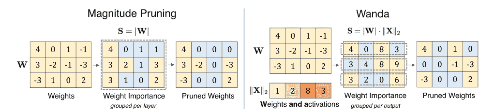

图 3.1：我们提出的 Wanda 方法（按权重和激活进行剪枝）与幅值剪枝方法的对比示意图。给定权重矩阵 W 和输入特征激活 X，我们将权重重要性计算为权重幅值与输入激活范数之间的逐元素乘积（|W| · ||X||₂）。权重重要性分数按每个输出为基础进行比较（W 中每一行内），而不是在整个矩阵中全局比较。

关于需要重新训练和权重更新的论点并不能完全概括剪枝 LLM 的挑战。人们可以合理地期望使用现有流行的剪枝方法获得一个性能相当高的重新训练初始化点。然而，最近的一项研究 [59] 发现，幅值剪枝 [66] 这种成熟的剪枝方法在 LLM 上即使在相对较低的稀疏度下也会严重失效。考虑到幅值剪枝在较小网络上的过去成功，这一结果表明 LLM 尽管拥有 100 到 1000 倍的参数，直接剪枝要困难得多。

在本文中，我们通过引入一种简单而有效的方法 Wanda（按权重和激活进行剪枝）来解决这一挑战。该技术能够在无需修改剩余权重的情况下将 LLM 剪枝到高度稀疏。我们受近期研究 [58] 中的一个观察结果启发，其中一小部分隐藏状态特征的幅值异常大，这是 LLM 独有的特性。我们发现，用输入激活增强标准权重幅值剪枝指标，作为评估权重重要性的度量是出乎意料地有效。具体来说，我们引入了一种新颖的剪枝指标，其中每个权重由其幅值与对应输入激活的范数之积来评估，该范数使用少量校准数据估计得出。我们的方法使用该指标通过在每个线性层的每个输出内局部比较权重并移除优先级较低的权重，从而在预训练 LLM 中引入稀疏性。我们的方法计算高效，能够在一次前向传播中执行，且内存开销极小。

我们在广泛采用的 LLaMA [22] 和 LLaMA-2 [23]


- 2. Wanda 可以通过 LLM 的单次前向传播完成。在每一层中，剪枝权重可以在一次操作中确定，无需迭代过程。实际上，与 SparseGPT 相比，计算 Wanda 的剪枝指标在剪枝 LLM 时可以快 300 倍。
- 3. 与 SparseGPT 不同，我们的方法在剪枝网络上不涉及权重更新，这表明 LLM 具有有效的稀疏子网络，并且是精确的，而不仅仅存在于原始权重的邻域中。

### 3.5 Experiments

模型与评估。我们在两种最广泛采用的 LLM 模型家族上评估 Wanda：LLaMA 7B/13B/30B/65B [22] 和 LLaMA-2 7B/13B/70B [23]（LLaMA-2 34B 未发布）。先前 LLM 家族的结果可在第 3.8.2 章找到。我们在零样本任务和语言建模上衡量剪枝模型性能。对于零样本评估，我们使用来自 EleutherAI LM Harness [52] 的七个任务。遵循先前关于 LLM 压缩的工作 [57, 59]，我们在保留的 WikiText [63] 验证集上评估困惑度。

基准。我们将 Wanda 与两种先前的剪枝方法进行比较。幅度剪枝 [66] 是一种简单而强大的基线，其中权重根据其幅度被丢弃。SparseGPT [59] 是一种用于 LLM 的二阶剪枝方法，基于求解逐层重构问题。在第 3.8.3 章中，我们与额外的剪枝方法进行比较。

Wanda 和 SparseGPT 都需要校准数据来估计输入统计量（见表 3.1）。为了控制这一变量因素，我们使用与 SparseGPT 完全相同的校准数据集，该数据集由从 C4 训练集 [36] 中采样的 128 个序列组成。在第 3.8.4 章中，我们提供了关于校准样本数量的额外分析。

稀疏性。对于所有剪枝方法，我们专注于剪枝线性层（跳过第一个嵌入层和最终分类头），这些层约占 LLM 总参数的 99%。我们对所有线性层施加统一的稀疏性。我们评估三种稀疏类型：非结构化稀疏、结构化 4:8 和 2:4 稀疏。幅度剪枝基线以与我们方法类似的精神扩展到结构化 N:M 稀疏，如上一节所述。

#### 3.5.1 Zero-Shot Tasks

比较基线。在表 3.2 中，我们展示了剪枝 LLaMA 和 LLaMA-2 模型在 7 个零样本任务上的平均零样本准确率。我们将读者引向第 3.8 章以了解按任务的性能。在非结构化和结构化稀疏性方面，Wanda 在很大程度上优于成熟的幅度剪枝方法，同时也与之前最佳方法 SparseGPT 相媲美。由于没有进行微调，稀疏剪枝 LLM 与原始密集 LLM 之间存在明显差距。然而，随着模型规模

| 方法 | 7B | 13B | 30B | 65B |
|---|---|---|---|---|
| SparseGPT | 203.1 | 339.0 | 810.3 | 1353.4 |
| Wanda | **0.54** | **0.91** | **2.9** | **5.6** |

表 3.4：计算 Wanda 的剪枝指标可以比 SparseGPT 快得多（秒）。

| LLaMA 层 | Dense | 2:4 | Speedup |
|---|---|---|---|
| q/k/v/o_proj | 3.49 | 2.14 | 1.63× |
| up/gate_proj | 9.82 | 6.10 | 1.61× |
| down_proj | 9.92 | 6.45 | 1.54× |

表 3.5：LLaMA-65B 中结构化 2:4 稀疏的矩阵乘法加速（毫秒）。

### 3.6 Analysis

我们研究 Wanda 的几个方面，以更好地理解其在剪枝 LLM 中的有效性。我们使用 LLaMA-7B 模型并剪枝至非结构化 50% 稀疏，除非另有说明。

**微调。** 我们研究微调如何恢复上一节中观察到的剪枝 LLM 的性能下降。我们研究了两种微调 LLM 的策略：LoRA [134] 微调和全参数密集微调。微调在 C4 训练数据集上进行，目标是预训练自回归损失。剪枝掩码在微调期间保持固定。我们对具有三种稀疏类型的剪枝 LLaMA-7B 进行微调：非结构化 50%、结构化 4:8 和 2:4。表 3.6 总结了微调 Wanda 剪枝 LLaMA-7B 模型后的平均零样本准确率和困惑度结果。有关按任务的性能，请参阅第 3.8 章。

*LoRA 微调。* 我们强制执行有限的计算预算（1 个 GPU 和 12 小时）。低秩（$r = 8$）适配器应用于注意力层中的查询和值投影矩阵。对于 LLaMA-7B，LoRA 仅引入约 0.06% 的额外参数，使总稀疏水平仍保持在约 50%。通过 LoRA 微调，我们能够在相当程度上恢复剪枝 LLM 的性能。一个值得注意的例子是，LoRA 微调将结构化 2:4 稀疏 LLaMA-7B 的零样本性能从 48.53% 提高到 54.46%，超过了原始非结构化 50% 稀疏 LLaMA-7B（54.21%）。

| 评估 | Dense | 微调 | 50% | 4:8 | 2:4 |
|---|---|---|---|---|---|
| Zero-Shot | 59.99 | ✗ | 54.21 | 52.76 | 48.53 |
|  |  | LoRA | 56.53 | 54.87 | 54.46 |
|  |  | Full | **58.15** | **56.65** | **56.19** |
| Perplexity | 5.68 | ✗ | 7.26 | 8.57 | 11.53 |
|  |  | LoRA | 6.84 | 7.29 | 8.24 |
|  |  | Full | **5.98** | **6.63** | **7.02** |

表 3.6：微调可以缩小与密集 LLM 的差距。

### 全参数微调。

我们进行全参数密集微调。我们强制执行有限的计算预算（4 个 GPU 和 3 天）。与 LoRA 微调相比，全参数密集微调能够进一步缩小剪枝 LLM 与密集 LLM 之间的差距。对于非结构化 50% 稀疏，全参数微调可以将剪枝 LLaMA-7B 的零样本准确率从 54.21% 提高到 58.15%，接近密集 LLaMA-7B（59.99%）的水平。

### 剪枝配置。

Wanda 在剪枝指标和比较组方面都与之前的方法不同。我们进行消融实验以更好地理解它们的影响。三个剪枝指标可在表 3.1 中找到。SparseGPT 在层内采用局部比较组，其中连接到 128 个连续输入通道的权重形成一个组。Wanda 将连接到单个输出通道的权重分组。因此，我们对两个块大小选项（128 和 1）以及输入/输出选择进行消融。为了简化，我们使用（输入/输出，块大小）表示每个局部比较组，例如（输入，1）。对于此实验，我们不执行 SparseGPT 中的权重更新过程，以专注于剪枝配置。

| 剪枝指标 | layer | (input, 1) | (input, 128) | (output, 1) | (output, 128) |
|---|---|---|---|---|---|
| Magnitude: |W_ij| | 17.29 | 8.86 | 16.82 | 13.41 | 17.47 |
| SparseGPT: [|W|^2/diag(H^{-1})]_ij | 7.91 | 8.86 | 8.02 | 7.41 | 7.74 |
| Wanda: |W_ij|·||X_j|| | 7.95 | 8.86 | 8.12 | 7.26 | 7.71 |

表 3.7：剪枝配置的消融研究。粗体结果表示每个剪枝指标的最佳比较组。下划线结果表示每种方法默认的剪枝配置。

结果如表 3.7 所示。我们将读者引向第 3.8.1 章以了解图像分类器的分析，以及第 3.8 章以了解先前 LLM 的分析。Wanda 的默认剪枝配置提供了最佳的剪枝模型（困惑度 7.26）。有趣的是，对于幅度指标，比较同一输入神经元的权重（输入，1）得到的困惑度为 8.86，明显优于其他分组选项。在此比较组下，三种方法也产生等效的剪枝结果——输入相同，因此权重排序仅取决于权重幅度。这一发现进一步强调了在使用经典幅度剪枝方法时，使用适当的比较组对剪枝 LLM 很重要。

### 校准样本的鲁棒性。

我们通过选择介于 1 和 256 之间的不同样本大小来改变校准样本的数量。结果汇总在图 3.2 中。我们看到随着校准数据大小的变化趋势存在明显差异，其中 Wanda 在校准样本较少时具有更强的鲁棒性。值得注意的是，即使只有一个样本，剪枝

- 对于所有考虑的稀疏度，权重更新可以大幅提升幅度剪枝的性能。
- 对于非结构化50%和4:8稀疏度，权重更新没有为Wanda带来任何改进。
- 对于2:4稀疏度，改进（从11.53到10.89）是微小的。注意，我们这里得到的最佳2:4稀疏模型（10.89）优于SparseGPT得到的模型（表3.3中为11.00）。

最后，我们考察了一个极端稀疏度水平（70%），其中权重更新可以将Wanda的困惑度从84.50降至29.65。然而，最佳剪枝模型（29.65）仍远落后于密集的LLaMA-7B模型（5.68）。

### 3.7 相关工作

### 网络剪枝与稀疏性。
剪枝是一种通过消除权重来压缩神经网络的流行技术，从而产生稀疏网络[77, 78]。它大致可以分为*结构化*和*非结构化*两类方法。

结构化剪枝方法[50, 51, 55, 93, 94, 125, 142]，有时被称为激活剪枝[49, 67]，会移除网络的整个结构化组件，从而促进高效的GPU加速。一些现有方法[46, 47]已经探索了基于神经元/滤波器输出的激活统计信息的结构化剪枝，例如零激活百分比[48]和激活均值[119]。最近，[112]研究了LLMs的结构化剪枝。[56, 91]和[60]证明了LLMs的结构化组件（例如注意力头和MLP神经元）中存在依赖于提示（prompt-dependent）和特定任务（task-specific）的稀疏性。

非结构化方法[66, 81, 116, 117, 118, 123]如幅度剪枝在单个权重级别上操作，即使在较高的稀疏度下也能保持性能。现有的剪枝方法通常需要修改训练过程[68, 85]、重新训练剪枝后的网络以恢复精度[54, 74]，或者需要计算量更大的迭代式重新训练过程[80, 82]。然而，将这些方法扩展到具有数十亿参数的大语言模型（LLMs）是一个挑战，因为所需的训练过程需要大量的计算资源[64, 106]。

### 有限数据剪枝。
与我们方法最相关的是最近一系列关于有限数据剪枝的工作[73, 75, 76, 83]。这类方法不需要修改原始训练过程，也不需要在整个训练数据集上重新训练剪枝后的网络。这些方法的主要目标是在剪枝过程中保持性能，假设可以访问有限且少量的数据，这些数据也称为校准数据。为了缓解精度下降，研究人员通过解决逐层重建问题[73]来最小化在校准数据上评估的输出变化。现有的逐层重建问题求解器[75, 84]依赖于对二阶Hessian逆矩阵的大量计算，这无法扩展到LLMs的大规模隐藏状态尺寸。SparseGPT [59]通过同步的二阶Hessian更新，为LLMs开发了一种高效的权重更新流程。

### LLMs的涌现特性。
我们的工作还与最近关于大型语言模型中存在大幅值异常特征的研究有关[90, 120, 135, 136, 137, 138]。[58]

以及80%。这两种稀疏度的结果分别见表3.19和表3.20。在60%稀疏度下，Wanda仍与SparseGPT保持竞争力。在80%稀疏度下，SparseGPT能够超越Wanda，但与密集对应模型相比，性能下降显著。最佳80%稀疏模型（25.86）的表现与最小的密集LLaMA-7B模型（5.68）相比差距很大。这表明在极端稀疏度下，或许使用一个训练充分的小型密集模型会更好。

| 方法 | 权重更新 | 稀疏度 | 7B | 13B | 30B | 65B | 7B | 13B | 70B |
|---|---|---|---|---|---|---|---|---|---|
|  |  |  | LLaMA |  |  |  | LLaMA-2 |  |  |
| Dense | - | 0% | 5.68 | 5.09 | 4.77 | 3.56 | 5.12 | 4.57 | 3.12 |
| Magnitude | ✗ | 60% | 6e2 | 2e2 | 27.67 | 9.34 | 4e3 | 11.23 | 8.21 |
| SparseGPT | ✓ | 60% | **10.51** | **8.56** | 6.66 | **5.82** | **9.58** | 7.80 | **4.98** |
| Wanda | ✗ | 60% | 10.66 | **8.56** | **6.49** | 5.83 | 9.71 | **7.75** | **4.98** |

表3.19：非结构化60%稀疏度下剪枝后的LLaMA和LLaMA-2模型的WikiText验证困惑度。

| 方法 | 权重更新 | 稀疏度 | 7B | 13B | 30B | 65B | 7B | 13B | 70B |
|---|---|---|---|---|---|---|---|---|---|
|  |  |  | LLaMA |  |  |  | LLaMA-2 |  |  |
| Dense | - | 0% | 5.68 | 5.09 | 4.77 | 3.56 | 5.12 | 4.57 | 3.12 |
| Magnitude | ✗ | 80% | 1e5 | 3e4 | 1e5 | 2e4 | nan | 5e4 | 3e4 |
| SparseGPT | ✓ | 80% | **2e2** | **1e2** | **54.98** | **32.80** | **1e2** | **1e2** | **25.86** |
| Wanda | ✗ | 80% | 5e3 | 4e3 | 2e3 | 2e3 | 5e3 | 2e3 | 1e2 |

表3.20：非结构化80%稀疏度下剪枝后的LLaMA和LLaMA-2模型的WikiText验证困惑度。

#### 3.8.7 MMLU上的少样本结果

我们在3.5.1节中的实验集中在零样本评估上。然而，LLMs也以其在上下文中学习的能力而闻名。在这部分，我们进行了少样本任务的额外评估。具体而言，我们选择了大规模多任务语言理解基准（MMLU）[88]。与[22]的评估方法一致，我们进行了5-shot评估。在表3.21中，我们报告了密集LLMs和非结构化50%稀疏度下的稀疏LLMs的平均准确率。在少样本设置下，Wanda与SparseGPT表现相当。值得注意的是，大型稀疏LLMs超过了较小的密集对应模型，例如稀疏LLaMA-13B/LLaMA-2-13B对比密集LLaMA-7B/LLaMA-2-7B。这种趋势无法从标准的幅度剪枝方法中观察到。

| 参数 | 方法 | BoolQ | RTE | HellaSwag | WinoGrande | ARC-e | ARC-c | OBQA | 平均 |
|---|---|---|---|---|---|---|---|---|---|
| 7B | Dense | 75.05 | 66.43 | 56.92 | 69.93 | 75.34 | 41.89 | 34.40 | 59.99 |
| 7B | Magnitude | 51.19 | 50.54 | 46.73 | 60.69 | 58.96 | 30.89 | 23.20 | 46.03 |
| 7B | SparseGPT | 73.06 | 58.12 | 47.88 | 65.98 | 66.75 | 32.42 | 25.40 | 52.80 |
| 7B | Wanda | 70.97 | 58.24 | 46.81 | 65.83 | 65.53 | 33.97 | 28.00 | 52.76 |
| 13B | Dense | 77.89 | 70.40 | 59.94 | 72.77 | 77.40 | 46.50 | 33.20 | 62.59 |
| 13B | Magnitude | 61.07 | 51.26 | 48.91 | 65.11 | 63.26 | 35.67 | 28.40 | 50.53 |
| 13B | SparseGPT | 76.61 | 57.76 | 51.24 | 70.17 | 71.17 | 37.20 | 27.80 | 55.99 |
| 13B | Wanda | 74.89 | 57.89 | 51.26 | 70.56 | 70.29 | 37.97 | 29.80 | 56.09 |
| 30B | Dense | 82.69 | 66.79 | 63.35 | 75.69 | 80.30 | 52.82 | 36.00 | 65.38 |
| 30B | Magnitude | 63.55 | 50.18 | 49.45 | 65.75 | 73.36 | 42.83 | 29.60 | 53.53 |
| 30B | SparseGPT | 78.69 | 61.73 | 56.15 | 74.35 | 76.94 | 46.08 | 31.60 | 60.79 |
| 30B | Wanda | 77.38 | 58.80 | 58.79 | 74.28 | 77.34 | 46.46 | 34.00 | 61.00 |
| 65B | Dense | 84.83 | 69.68 | 64.54 | 77.27 | 81.40 | 52.90 | 38.20 | 66.97 |
| 65B | Magnitude | 74.95 | 68.23 | 60.85 | 74.27 | 76.45 | 47.61 | 32.80 | 62.17 |
| 65B | SparseGPT | 84.35 | 68.95 | 61.00 | 77.19 | 78.75 | 48.46 | 35.40 | 64.87 |
| 65B | Wanda | 84.29 | 70.92 | 59.54 | 76.64 | 79.00 | 48.83 | 35.60 | 64.97 |

表3.24：LLaMA在4:8稀疏度下7个零样本任务上的准确率（%）。

| 参数 | 方法 | BoolQ | RTE | HellaSwag | WinoGrande | ARC-e | ARC-c | OBQA | 平均 |
|---|---|---|---|---|---|---|---|---|---|
| 7B | Dense | 75.05 | 66.43 | 56.92 | 69.93 | 75.34 | 41.89 | 34.40 | 59.99 |
| 7B | Magnitude | 53.09 | 55.60 | 42.30 | 59.91 | 53.28 | 27.13 | 21.80 | 44.73 |
| 7B | SparseGPT | 70.46 | 60.65 | 42.99 | 64.88 | 61.49 | 30.12 | 23.60 | 50.60 |
| 7B | Wanda | 69.30 | 51.99 | 42.06 | 62.75 | 60.94 | 28.07 | 24.60 | 48.53 |
| 13B | Dense | 77.89 | 70.40 | 59.94 | 72.77 | 77.40 | 46.50 | 33.20 | 62.59 |
| 13B | Magnitude | 60.95 | 49.10 | 45.81 | 62.75 | 58.75 | 31.06 | 27.60 | 48.00 |
| 13B | SparseGPT | 72.14 | 55.23 | 48.11 | 68.98 | 66.71 | 34.98 | 26.40 | 53.22 |
| 13B | Wanda | 70.21 | 53.43 | 46.74 | 68.82 | 65.82 | 33.87 | 27.20 | 52.30 |
| 30B | Dense | 82.69 | 66.79 | 63.35 | 75.69 | 80.30 | 52.82 | 36.00 | 65.38 |
| 30B | Magnitude | 65.11 | 52.35 | 51.72 | 66.22 | 70.88 | 38.23 | 27.60 | 53.16 |
| 30B | SparseGPT | 75.60 | 62.13 | 53.10 | 72.61 | 75.13 | 41.98 | 31.80 | 58.91 |
| 30B | Wanda | 74.68 | 63.80 | 54.41 | 72.93 | 74.41 | 42.06 | 32.20 | 59.21 |
| 65B | Dense | 84.83 | 69.68 | 64.54 | 77.27 | 81.40 | 52.90 | 38.20 | 66.97 |
| 65B | Magnitude | 77.9 | 64.98 | 58.65 | 72.85 | 75.15 | 45.05 | 34.40 | 61.28 |
| 65B | SparseGPT | 83.15 | 65.34 | 57.20 | 76.72 | 78.20 | 45.18 | 32.20 | 62.57 |
| 65B | Wanda | 83.58 | 66.79 | 56.36 | 75.82 | 78.23 | 45.56 | 33.60 | 62.84 |

表3.25：LLaMA在2:4稀疏度下7个零样本任务上的准确率（%）。


## 第4章
## 大型语言模型中的巨大激活
### 4.1 概述
我们在大型语言模型（LLMs）中观察到一个经验现象——极少数激活值的数值会显著大于其他激活值（例如大100,000倍）。我们将它们称为*巨大激活*。首先，我们展示了巨大激活在各种LLM中的广泛存在，并刻画了它们的位置。其次，我们发现它们的值在很大程度上与输入无关且保持不变，它们在LLM中充当不可缺失的偏置项。第三，这些巨大激活导致注意力概率集中到其对应的token上，并进一步在自注意力输出中形成隐式偏置项。最后，我们还研究了Vision Transformer中的巨大激活。代码可在 https://github.com/locuslab/massive-activations 获取。

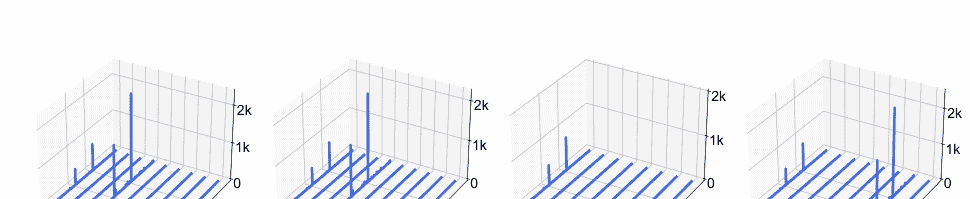

图4.1：LLaMA2-7B中的激活幅度（z轴）。x轴和y轴分别是序列维度和特征维度。对于这个特定模型，我们观察到具有巨大幅度的激活出现在两个固定的特征维度（1415、2533）以及两类token上——起始token，以及第一个句点（.）或换行符token（\n）。

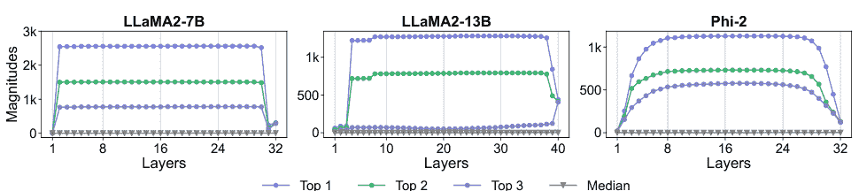

图4.4：LLM中每层最大的三个激活幅度以及中位幅度。

#### 4.3.1 哪些层？
我们确定输出隐藏状态中存在巨大激活的层。在图4.4中，我们可视化了每层隐藏状态输出的三个最大激活幅度以及中位幅度，结果在100个序列上取平均。我们检查了三个模型：LLaMA2-7B、13B和Phi-2 [161]（更多LLM参见第4.8.4节）。在所有这些情形下，前三个激活中的每一个都来自大多数中间层中隐藏状态的相同位置。总体上，我们观察到以下现象：

*巨大激活存在于大多数中间层中，并保持大致恒定的值。它们在初始层中出现，并在最后几层开始减弱。*

在LLaMA2-7B中，巨大激活首先出现在第2层，并保持近似恒定的值直到第30层。有趣的是，对于LLaMA2-7B和13B，巨大激活会在单层计算中非常迅速地出现，例如分别在第2层和第4层。这意味着它们并非通过多层逐步累积产生，而是由一种相当不同的机制造成的。

#### 4.3.2 哪些特征维度和序列维度？
我们确定隐藏状态中巨大激活的位置，即它们的特征维度和序列维度。由于我们已经证明它们的值在中间层大部分保持不变，因此我们选取任意一个这样的层进行分析。

**LLaMA2-7B。** 在该模型中，巨大激活出现在两个特征维度（1415和2533）。关于序列维度，我们发现*巨大激活出现在：1. 起始词token，2. 序列中表示第一个句点（.）或换行符token（\n）的token。* 图4.1展示了LLaMA2-7B的这些发现。这在长序列上也一致。当输入包含“ . ”或“\n”token时，会观察到四个巨大激活。对于既没有“ . ”也没有“\n”这种较少见的情况，我们可以看到两个巨大激活，它们都与初始token相关联。

**LLaMA2-13B。** 我们发现该模型中的巨大激活一致地出现在两个特征维度，2100和4743。*这些激活完全位于序列的起始token内，而不管其语义如何。* 图4.2展示了LLaMA2-中的这些行为。

| 干预 | LLaMA2-7B |  |  |  | LLaMA2-13B |  |  |  |
|---|---|---|---|---|---|---|---|---|
|  | WikiText | C4 | PG-19 | 平均零样本 | WikiText | C4 | PG-19 | 平均零样本 |
| 原始 | 5.47 | 7.85 | 8.57 | 68.95% | 4.88 | 7.22 | 7.16 | 71.94% |
| 设为0 | inf | inf | inf | 36.75% | 5729 | 5526 | 4759 | 37.50% |
| 设为均值 | 5.47 | 7.86 | 8.59 | 68.94% | 4.88 | 7.22 | 7.16 | 71.92% |

表4.3：LLaMA2-7B和13B中巨大激活的干预分析。我们将巨大激活设为固定值，并评估干预模型的困惑度（↓）和零样本准确率（%，↑）。

均值。这些均值是在RedPajama的100个序列上计算的。这种干预（记为“设为均值”）的结果见表4.3。我们发现困惑度和零样本准确率的变化可以忽略不计。这表明它们的值是常量且与输入无关，即起到类似偏置项的作用。

总结我们的发现：

> *巨大激活在LLM中充当固定但重要的偏置。*

### 为什么是这些层和token？
这些激活充当偏置的事实，或许可以解释LLM为何将它们存储在某些层和token上：

- 这些激活倾向于出现在起始token上，可能是因为每个自回归训练样本都包含一个初始token。由于LLM基于下一个词预测，起始token是序列内所有前向传播中唯一都被使用的token。
- 这些激活出现在分隔符token中，可能是因为这些token的语义价值相对较低，使它们成为存储此类偏置的低成本选择。相反，语义丰富的token如果被重新用于存储偏置，就会面临输入信息显著损失的风险。
- 巨大激活只在少数初始层之后才出现，可能是因为LLM需要一些初始层来处理与巨大激活关联的token的含义。在这些层，它们的语义可能通过自注意力被转移到其他token位置，并在后续保留。

### 4.5 对注意力的影响
在本节中，我们探索并研究LLM中巨大激活的内部机制，特别是与自注意力相关的机制。

#### 4.5.1 注意力集中于巨大激活
比较LLM中巨大激活出现之前和之后的层，我们观察到注意力模式的鲜明对比。图4.5显示了注意力logits（在softmax之前），

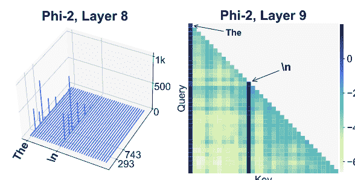

图4.7：Phi-2中巨大激活出现后的注意力模式。

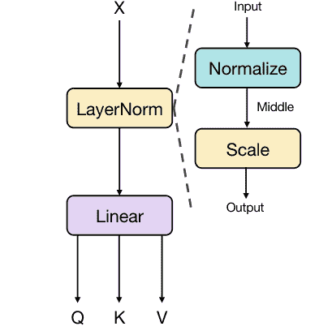

图4.8：注意力层归一化和QKV线性投影。

这些注意力集中模式的出现。

#### 4.5.2 巨大激活施加隐式注意力偏置
在这一部分，我们深入探讨注意力块内的计算，并证明LLM利用巨大激活在自注意力中强制加入了一个隐式偏置项。

### 注意力层归一化和QKV投影
我们研究巨大激活对自注意力中查询、键和值状态（Q/K/V）的影响。在LLM中，每一层的输入特征会先经过层归一化¹ [31]处理，然后通过线性投影转换为查询、键和值状态，如图4.8所示。这一设计选择由GPT-2 [2]引入，并在现代LLM中广泛采用。

图4.9可视化了该示意图（LLaMA2-7B，第3层）中计算的所有隐藏状态。我们发现在所有阶段，与巨大激活关联的两个token的特征都急剧

### LayerNorm输入
### LayerNorm中间
### LayerNorm输出
### Q
### K
### V

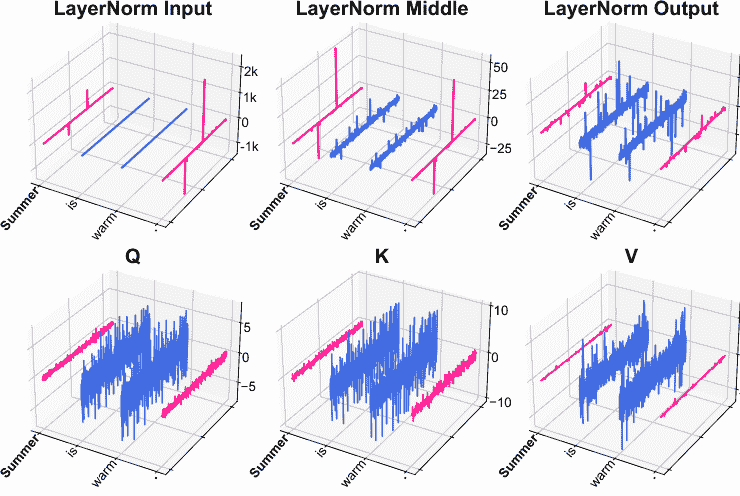

图4.9：第3层，LLaMA2-7B。我们高亮显示了出现巨大激活的两个token的嵌入：起始token和句点token。

¹LLaMA2使用层归一化的一种变体：RMSNorm [176]。

**注意力输出分解。** 鉴于注意力也集中在与巨大激活关联的token上（第4.5.1节），我们因此将这些token分离出来，并研究它们对注意力输出（注意力矩阵乘以值向量的那一层）的影响。在

### 值更新 $\sum_{i\in C} p_i^k v_i$
### 值更新 $\sum_{i\notin C} p_i^k v_i$
### 注意力输出

对所有token相同

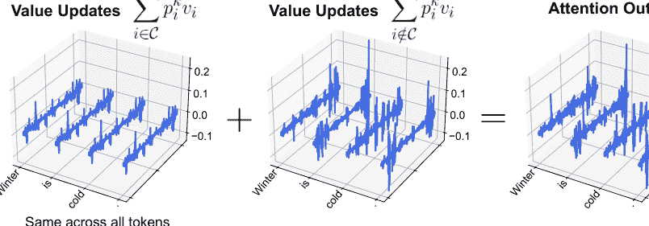

图4.10：与巨大激活关联的token产生的值更新本质上是相同的。


在公式4.2中，我们将每个token $k$ 处的注意力输出分解为两部分：来自注意力集中的token集合 $\mathcal{C}$ 的值更新；以及从其他token聚合的值更新。

$$\text{Attention}(Q, K, V)_k = \sum_{i \le k} p_i^k v_i = \sum_{i \in \mathcal{C}} p_i^k v_i + \sum_{i \notin \mathcal{C}} p_i^k v_i \quad (4.2)$$

其中 $p_i^k$ 是查询token $k$ 对token $i$ 的注意力分布，$v_i$ 是token $i$ 的值状态。

图4.10可视化了LLaMA2-7B中分解后的值更新和注意力输出，输入提示为“Summer is warm. Winter is cold.”。在这种情况下，集合 $\mathcal{C}$ 由token `Summer` 和第一个句号token组成。我们可以看出，来自 $\mathcal{C}$ 的值更新在不同token之间几乎相同，即它们充当了加性偏置项，尽管没有被显式施加。此外，我们注意到这种值更新的模式在各种输入中惊人地相似。我们请读者参阅第4.8.7节以获取更多分析。总体而言，我们的结果表明，LLM使用大规模激活在某些token上分配大量注意力。这些token随后在计算注意力输出时被用来形成一个恒定的偏置项。

#### 4.5.3 显式注意力偏置消除大规模激活

鉴于LLM在预训练期间学习隐式注意力偏置的强烈需求，我们因此尝试直接用额外的偏置项来增强自注意力。有趣的是，我们发现带有显式注意力偏置增强的模型不会表现出大规模激活。

**形式化表述。** 其思想是显式地对这类注意力偏置进行建模，但并非通过重新利用输入序列中的现有token来实现。因此，我们为每个头引入额外的*可学习*参数 $\mathbf{k}'$、$\mathbf{v}' \in \mathbb{R}^d$。具体来说，给定输入查询、键和值矩阵 $Q, K, V \in \mathbb{R}^{T \times d}$，带有显式注意力偏置的增强注意力计算如下：

$$\text{Attention}(Q, K, V; \mathbf{k}', \mathbf{v}') = \text{softmax}\left( \frac{Q \begin{bmatrix} K^T & \mathbf{k}' \end{bmatrix}}{\sqrt{d}} \right) \begin{bmatrix} V \\ \mathbf{v}'^T \end{bmatrix} \quad (4.3)$$

其中 $\mathbf{k}'$ 和 $\mathbf{v}'$ 分别与键矩阵和值矩阵 $K/V$ 拼接。所提出的注意力可以作为标准注意力的即插即用替代品，无需修改Transformer的其他部分，例如位置嵌入和MLP块。

**结果。** 我们训练了三个GPT-2模型：标准模型、前置了sink token [190] 的GPT-2以及带有显式注意力偏置的GPT-2。训练设置见第4.8.8节。我们发现这三个模型在收敛时具有相同的性能，但在大规模激活的状态上存在显著差异，如图4.11所示。值得注意的是，与默认GPT-2和带有sink token的GPT-2相比，带有显式注意力偏置的GPT-2中大规模激活消失了。

图4.12显示了每层最大的三个激活幅度。值得注意的是，在带有显式注意力偏置的情况下，GPT-2中的顶部激活幅度随着层数加深而逐渐增大。这些结果表明，显式注意力偏置抵消了LLM发展

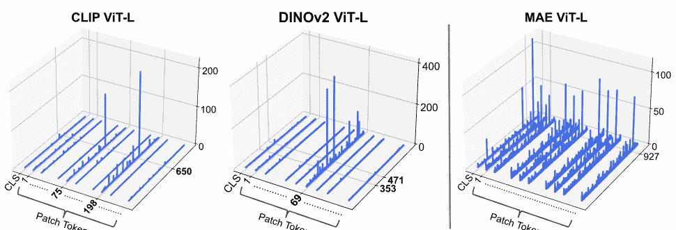

图4.13：CLIP和DINOv2中的ViT-L存在大规模激活，但MAE中没有。

序列维度的必要性。在这两个模型中，有极少数激活（少于四个）的幅度显著大于其他激活。此外，这些激活位于特定的特征维度，并出现在随机的patch token中。然而，我们在MAE ViT-L中没有观察到大规模激活。在该模型中，一个特征维度（927）在所有token上表现出均匀的大值。

### 大规模激活在ViT中是偏置。

图4.14显示了CLIP和DINOv2 ViT-L中每层的三个最大激活幅度和中位数，在1k张图像上取平均。我们发现大规模激活在不同图像中持续存在，并且它们的值在平均值附近基本保持不变。值得注意的是，与LLM不同，大规模激活只有在ViT的较后阶段才开始出现。

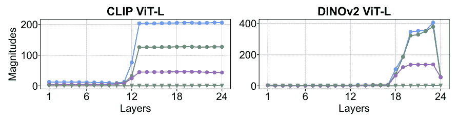

图4.14：CLIP和DINOv2 ViT-L中每层的三个最大激活幅度和中位数幅度。

按照我们在第4.4节中的方法，我们对CLIP ViT-L进行了干预分析。我们将两个最大的大规模激活分别修改为零和均值。干预在第13层进行，该层是此模型中大规模激活首次出现的层。结果如表4.4所示，我们在ImageNet上评估了零样本准确率。我们可以看到，将大规模激活设为零会导致准确率显著下降，而将其设为均值则导致可忽略不计的准确率下降。这些结果表明，大规模激活在ViT中充当固定但至关重要的偏置，这与我们在第4.4节中的观察一致。

| 干预 | ImageNet准确率 (%) |
|---|---|
| 原始 | 75.5 |
| 设为零 | 59.8 |
| 设为均值 | 75.5 |

表4.4：CLIP ViT-L中大规模激活的干预分析。

### 寄存器在ViT中是偏置。

最近，[191]提出用额外的可学习token增强标准ViT，并将其命名为寄存器token。他们表明，使用寄存器token训练ViT可以得到平滑的注意力图，由此产生的模型族即DINOv2-reg，在下游性能上优于DINOv2。检查DINOv2-reg中最大的ViT-G模型，我们观察到大规模激活的存在，如图4.15所示。然而，与标准ViT不同，大规模激活不出现在patch token中，而是专门出现在一个固定的寄存器token中，即寄存器3。这表明该模型使用寄存器3来存储这些激活。图4.16可视化了最后一层中[CLS] token的注意力分布。我们发现大部分注意力被分配给了寄存器3，这与我们之前在注意力模式中的发现（第4.5.1节）相呼应。

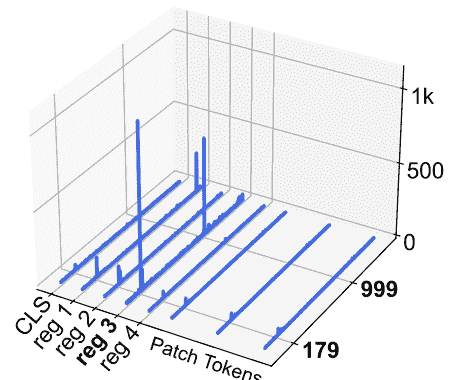

图4.15：DINOv2-reg ViT-G中的大规模激活。

| ImageNet准确率 (%) | ViT-S | ViT-B | ViT-L | ViT-G |
|---|---|---|---|---|
| 原始 | 81.9 | 84.8 | 86.3 | 87.0 |
| 修复寄存器均值 | 81.7 | 85.0 | 86.2 | 87.0 |

表4.5：我们将每层的所有寄存器特征固定为其均值，并评估干预后的ViT。

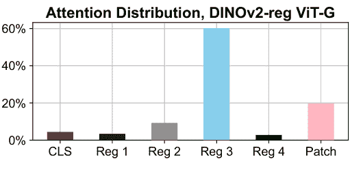

图4.16：[CLS] token的平均注意力。

进一步，我们进行干预分析以分析寄存器的作用。我们将*每一层*输出处的*所有*寄存器特征替换为其均值，该均值在10k张ImageNet训练图像上取平均。这种干预消除了寄存器聚合全局输入信息的预期目的[191]。表4.5显示了结果。我们发现具有固定寄存器特征的ViT取得了与原始模型相当的准确率，这表明寄存器在ViT中充当学习到的偏置。这导致寄存器token处具有恒定的键和值状态，有效地为自注意力引入了偏置项（公式4.3中的额外k'和v'）。因此，带有寄存器token的ViT在功能上等同于带有显式注意力偏置增强的标准ViT。

总结我们的发现：

*大规模激活存在于许多但并非所有ViT中。与LLM中的激活类似，这些激活充当恒定偏置。我们还表明，最近提出的寄存器token具有类似的功能。*

### 4.7 相关工作

**自回归Transformer的有趣性质。** [135]观察到，在GPT-2的倒数第二层中，存在一些特征维度，其激活幅度高达3,000。他们发现，这些少数维度主导了几项用于评估表示相似性的标准度量。[163]发现GPT-2中初始token的特征范数比其他token增长得快得多。[90]和[189]证明了GPT-2和LLaMA2-13B的LayerNorm中存在离群权重，并表明将它们设为零会导致模型性能灾难性下降。值得注意的是，LLaMA2-13B中该权重的特征维度（即2100）与一个大规模激活的特征维度相对应（图4.2）。

**离群特征。** 各种现有的量化工作[57, 58, 150, 154, 184]研究了LLM中离群特征的存在。[58]表明，离群特征在其大部分序列维度上具有较大的激活值。虽然大规模激活看起来可能与离群特征相似，但我们在第4.3.3节中讨论了它们的根本区别。更重要的是，我们表明大规模激活不能归因于离群特征的存在。

**注意力集中模式。** [195]、[196]和[136]发现BERT [18]中的注意力倾向于集中在“分隔”token [SEP]上。[190]表明LLM将大部分注意力分配给起始词token。[191]揭示了ViT中注意力伪影的存在。


[183] 在 ViTs 中发现了吸引注意力到特定 token 的稀疏激活模式。我们的工作对这些模式为何出现进行了深入分析，具体与大规模激活有关。

**自注意力中的偏差。** 自注意力机制中可能存在各种偏差概念。首先，在计算查询、键和值状态的线性层中可以使用简单的加性偏差项 [182]。其次，可以在自注意力中插入位置偏差以编码每个 token 的位置信息 [180, 181]。还有使用手工设计的 softmax 运算符的偏差变体 [164, 187, 194]。我们的工作揭示，即使使用标准自注意力公式，LLM 也会通过大规模激活在注意力计算中施加隐式偏差分量。

### 4.8 其他结果

#### 4.8.1 预训练 LLM

在第 4.3 节中，我们已在 LLaMA2-7B、LLaMA2-13B 和 Mixtral-8x7B 中展示了大规模激活。在本节中，我们评估了涵盖广泛模型家族的更多预训练 LLM。我们在 LLaMA2-70B、LLaMA3 [25]、Phi-2、Mistral-7B [173]、MPT-7B [160] 和 Falcon-7B [159] 中展示了大规模激活。结果展示在图 4.17、4.18、4.19、4.20、4.21、4.22 和 4.23 中。

我们做出了几个观察。首先，这些模型中普遍存在大规模激活，它们表现出与第 4.3 节中描述的相似特征。有趣的是，对于 LLaMA2-70B，我们发现大规模激活出现在表示数值值的 token 中，例如 token “0” 和 token “2”，如图 4.17 所示。然而，它们并不出现在所有数值 token 中（参见图 4.17 中最右边的示例）。另一个有趣的发现是，Mistral-7B（图 4.21）和 Mixtral-8x7B（图 4.3）中大规模激活的特征维度相同（即 2070），这意味着后者模型可能源自前者的微调。

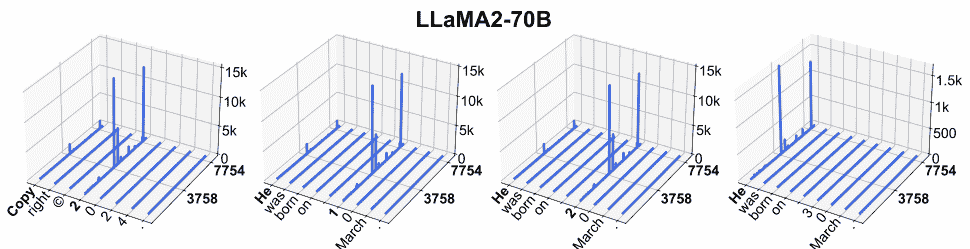

图 4.17：LLaMA2-70B 中的大规模激活。

### LLaMA3-8B

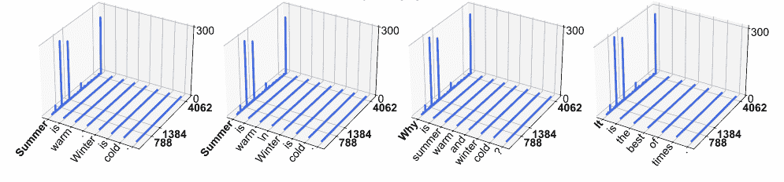

图 4.18：LLaMA3-8B 中的大规模激活。

### LLaMA3-70B

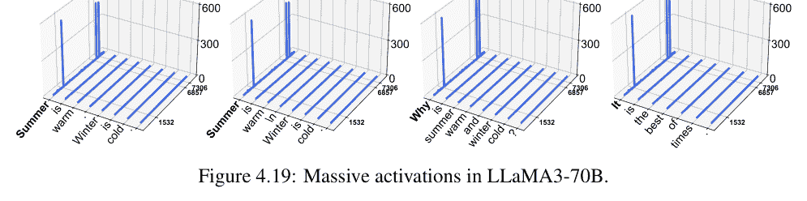

图 4.19：LLaMA3-70B 中的大规模激活。

### Phi-2

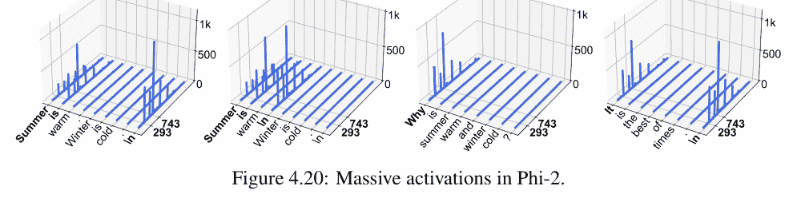

图 4.20：Phi-2 中的大规模激活。

### Mistral-7B

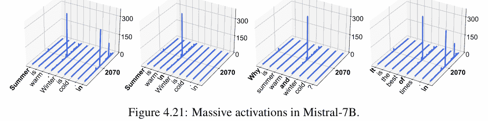

图 4.21：Mistral-7B 中的大规模激活。

### MPT-7B

图 4.22：MPT-7B 中的大规模激活。

### Falcon-7B

图 4.23：Falcon-7B 中的大规模激活。

#### 4.8.2 微调 LLM

到目前为止，我们的结果主要集中在预训练 LLM 上。然而，LLM 的一个重要应用在于其用于聊天目的。指令微调 [26] 对于开发能够生成对问题连贯响应的模型至关重要。在本部分中，我们展示了这些微调模型中的大规模激活。我们评估了来自 LLaMA2 和 Mistral 的模型的微调模型。结果显示在图 4.24、4.25、4.26 和 4.27 中。

我们可以看到，指令微调后大规模激活仍然存在。此外，大规模激活的值和位置与原始预训练 LLM 大致相同。对于 LLaMA2-7B，这可以通过比较图 4.24 和图 4.1 看出。然而，一个例外是 Mixtral-8x7B。我们发现，微调后大规模激活从换行符 token “\n” 中消失，如比较图 4.27 和图 4.3 所示。我们将指令微调如何影响大规模激活的研究留给未来工作。

### LLaMA2-7B-Chat

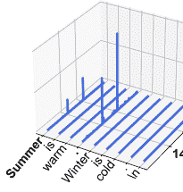

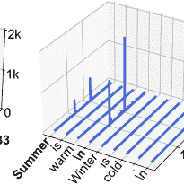

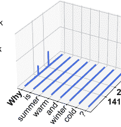

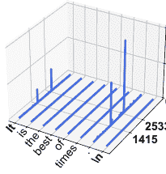

图 4.24：LLaMA2-7B-Chat 中的大规模激活。

### LLaMA2-13B-Chat

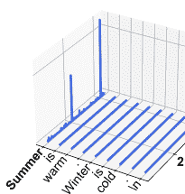

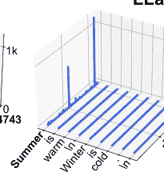

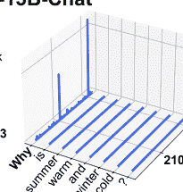

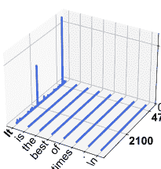

图 4.25：LLaMA2-13B-Chat 中的大规模激活。

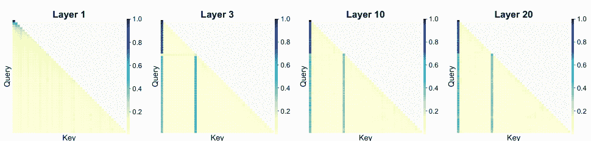

图 4.34：Llama2-7B 中间层所有头的平均注意力概率。输入提示为 “William Shakespeare was a famous writer from England who wrote plays and poems. He is considered one of the best writers ever.\n His works include famous plays like ‘Romeo and Juliet’ and ‘Hamlet’.”。

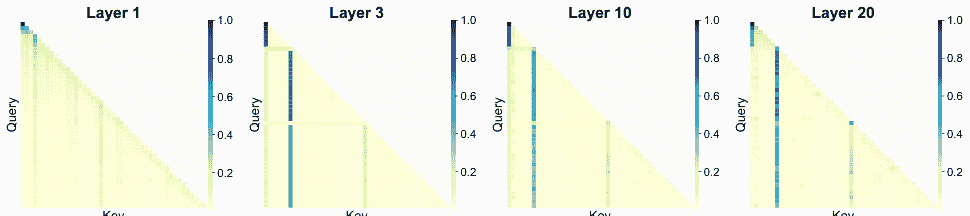

图 4.35：Mistral-7B 中间层所有头的平均注意力概率。输入提示为 “William Shakespeare was a famous writer from England who wrote plays and poems. He is considered one of the best writers ever.\n His works include famous plays like ‘Romeo and Juliet’ and ‘Hamlet’.”。

#### 4.8.6 注意力层归一化

我们在第 4.5.2 节中的分析表明，与大规模激活相关的 token 具有截然不同的键和值状态。在本部分中，我们研究注意力 LayerNorm 在此过程中如何发挥关键作用。

预备知识。常见于 LLM 的有两种特定的层归一化类型。一种是标准层归一化 [31]。假设我们有一个特征向量 x ∈ ℝ^d，LayerNorm 将归一化该特征以固定均值和方差，然后通过逐元素仿射变换重新缩放：

x̄_i = (x_i - μ)/σ * g_i + b_i,    where μ = (1/d) Σ_{i=1}^d x_i,    σ = sqrt( (1/d) Σ_{i=1}^d (x_i - μ)^2 ).    (4.4)

其中 g, b ∈ ℝ^d 是仿射变换的参数，也称为增益和偏置。

除了原始 LayerNorm 外，LLaMA2 和 Mistral 模型中也使用了一种层归一化的变体。具体来说，是均方根归一化（RMSNorm）[176]

对于 LayerNorm 和 RMSNorm 来说，当 $x \in \mathbb{R}^d$ 中的少数激活具有显著大的幅度时，归一化步骤中的分母，即 $\sigma$ in Equation 4.4 和 RMS(x) in Equation 4.5，因此会变大。事实上，分母几乎由这少数大规模激活决定。大的分母会将所有正常值推向零，同时保留大规模激活的异常值特性。这将有效地创建由少数大规模激活决定的截然不同的归一化特征。图 4.37 显示了 RMSNorm 和 LayerNorm 中两个激活轨迹。我们可以看到归一化步骤（中间）如何保留 token Who 和 \n 中的异常激活，并且在这两个 token 处的归一化特征变得极其相似。

#### 4.8.7 隐式注意力偏差

在第 4.5.2 节中，我们已展示与大规模激活相关的 token 的值更新往往在很大程度上相同。在这里，我们通过检查 LLaMA2-7B 模型中的额外输入提示和层来扩展这些发现。我们使用四个输入提示：“Are you cold?\n Grab a jacket.”、“Will it snow?\n Check the forecast.”、“Did she call?\n I missed it.” 和 “'I am doing well. Thank you for asking.'”。我们在图 4.38、图 4.39 和图 4.40 中分别可视化了第 3 层、第 15 层和第 30 层中的值更新。我们关注输入序列的后半部分，位于与大规模激活相关的两个 token 之后。我们可以看到，在同一层中，值更新 $\sum_{i\in C} p_i^k v_i$ 在不同输入序列之间显示出显著的相似性。

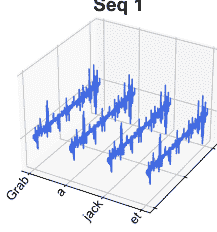

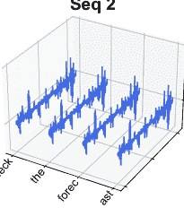

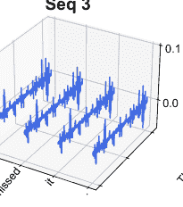

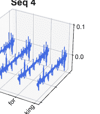

图 4.38：LLaMA2-7B 第 3 层的值更新 $\sum_{i\in C} p_i^k v_i$，包含四个输入序列。

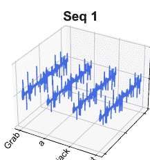

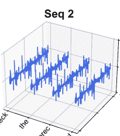

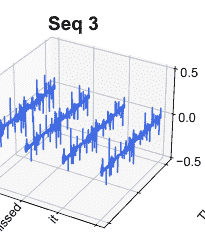

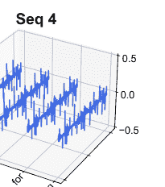

图 4.39：LLaMA2-7B 第 15 层的值更新 $\sum_{i\in C} p_i^k v_i$，包含四个输入序列。


## 序列 1

## 序列 2

## 序列 3

## 序列 4

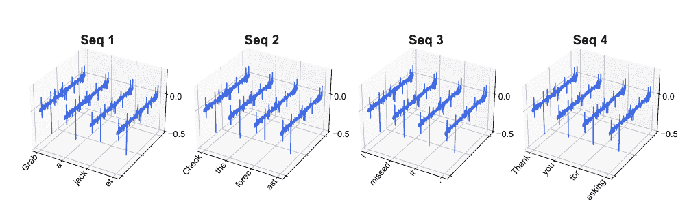

图 4.40：LLaMA2-7B 第 30 层中，四个输入序列的值更新 ∑_{i∈C} p_i^k v_i。

#### 4.8.8 显式注意力偏置

实验设置。我们使用 NanoGPT 仓库 [165] 中提供的开源 GPT-2 复现版本。我们使用默认推荐的训练设置和优化器配置。对于三个 GPT-2 模型中的每一个，我们都训练了 50,000 次迭代，总计约 2B 个 token。对于带有 sink token 的 GPT-2，我们遵循 [190] 的做法，在每个训练序列前添加一个可学习的 sink token [SINK]。在计算训练损失时，我们不包含针对预添加的 sink token 计算的交叉熵损失。对于带有显式注意力偏置的 GPT-2，我们使用 N(0, 0.02I) 初始化每个 k′ 和 v′。

结果。关于我们在第 4.5.3 节中评估的三个 GPT-2 模型的性能，我们发现经过 50,000 次训练迭代后，它们在由 OpenWebText2 [44] 构建的验证集上具有相同的困惑度：3.04。

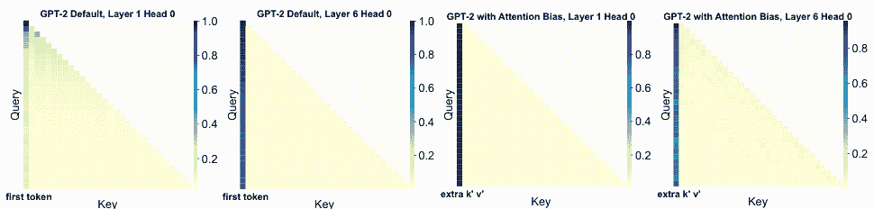

图 4.41：默认 GPT-2 和带有显式注意力偏置的 GPT-2 中的注意力分布。

在图 4.41 中，我们可视化了默认 GPT-2 和带有显式注意力偏置的 GPT-2 中的注意力分布，其中我们绘制了 50 个句子（每句 30 个 token）的平均注意力概率。首先，我们发现关于大规模激活与注意力集中之间关系的观察结果在默认 GPT-2 模型中成立。其次，对于带有显式注意力偏置的 GPT-2 模型，大部分注意力概率被分配给我们插入的额外 k′ 和 v′ 向量。有趣的是，这种情况在初始层（如第 1 层）也同样存在，这表明 LLM 在预训练期间有很强的需求来形成这种注意力集中模式。

我们还尝试了其他在自注意力计算中注入偏置的方法：

- 1. 第一种是我们提出的公式 4.3 的一个特例，其中 k′ 和 v′ 都是零向量。公式 4.6 展示了这种自注意力变体的计算方式。这也等同于先前提出的 Softmax-off-by-one [164]。

Attention(Q, K, V) = softmax( Q [K^T 0] / sqrt(d_k) ) [V; 0^T]   (4.6)

- 2. 由于公式 4.3 可以被视为插入一个序列维度，我们还尝试插入一个额外的特征维度。具体来说，我们添加可学习的参数 q′, k′ ∈ R^T，并将它们分别与 query 和 key 状态拼接。这种自注意力变体如下：

Attention(Q, K, V; q′, k′) = softmax( [Q q′] [K k′]^T / sqrt(d_k) ) V   (4.7)

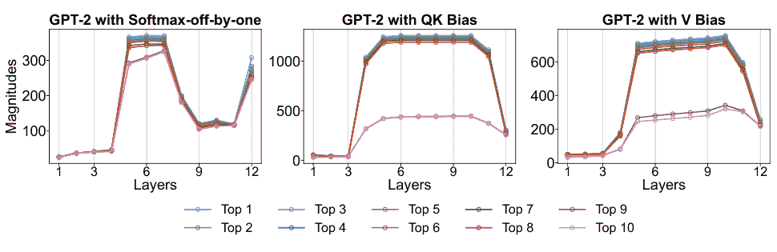

图 4.42：三个 GPT-2 模型中每一层的十个最大激活幅度。

- 3. 我们还尝试了一种通过注入额外数值参数 v′ ∈ ℝ^{d_k} 来强制恒定值更新的简单方法。这种自注意力变体如下：

```
Attention(Q, K, V; v′) = softmax( (Q K^T) / sqrt(d_k) ) V + v′  (4.8)
```

图 4.42 可视化了三个 GPT-2 模型中十个最大的激活幅度，对应于公式 4.6、4.7 和 4.8 中的三种偏置形式。我们发现这些替代方案无法在预训练期间消除大规模激活。

#### 4.8.9 ViT 中的大规模激活

我们在图 4.43 的 4 张图像上展示了 ViT 中大规模激活的结果。CLIP ViT-L、DINOv2 ViT-L 和 DINOv2-reg ViT-G 的结果分别显示在图 4.44、图 4.45 和图 4.46 中。我们突出显示了表现出大规模激活的 patch token。对于像 CLIP ViT-L 和 DINOv2 ViT-L 这样的标准 ViT，大规模激活出现在随机 patch token 中，即大规模激活的序列维度随输入图像而变化。对于 DINOv2-reg ViT-G，它们存在于一个固定的寄存器 token 中，即寄存器 3。


图 4.43：示例图像。

#### 4.8.10 寄存器是掩码自编码器中的偏置

在掩码自编码器（MAEs）[193] 中，预训练期间会向 ViT 添加一个占位 token。在 MAE 的一种微调流程中，微调是基于所有 patch token 的平均池化特征进行的。在这些 MAE 模型中，这个占位 token 等同于一个寄存器 token。在这里，我们将寄存器 token 的特征在所有 ViT 层的输出特征中保持为常数，并将其记为 Fix-Reg-Mean。这些固定值是通过对 10k 张 ImageNet 训练图像的寄存器特征取平均计算得到的。表 4.6 显示了结果。我们可以看到，将寄存器特征设置为固定值不会影响模型性能。这一结果进一步支持了我们的论点：寄存器在 ViT 内部发挥着偏置的作用。

|  | 带 1 个寄存器的 MAE |  |  |
|---|---|---|---|
| ImageNet 准确率 | ViT-B | ViT-L | ViT-H |
| 原始 | 82.6 | 85.5 | 86.7 |
| Fix-Reg-Mean | 82.6 | 85.5 | 86.7 |

表 4.6：寄存器是掩码自编码器（MAE）中的偏置。

#### 4.8.11 层级分析

图 4.47、4.48 和 4.49 详细展示了本文研究的所有 ViT 的层级分析结果（也在表 4.8 中进行了总结）。与 LLM 不同，一些 ViT 不会表现出大规模激活，例如 MAE ViT-B/L 和 DINOv2 ViT-S。对于我们观察到大规模激活的 ViT，例如 CLIP ViT-L 和 DINOv2 ViT-L，其跨层的趋势与 LLM 不同。例如，在 DINOv2 ViT-L 的情况下，在该模型的后期阶段可以观察到大规模激活，但在最终层的输出中则不存在。

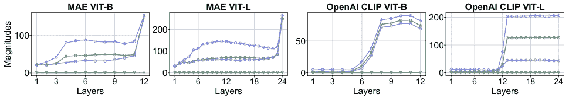

图 4.47：MAE 和 CLIP 中 ViT 的层级分析。

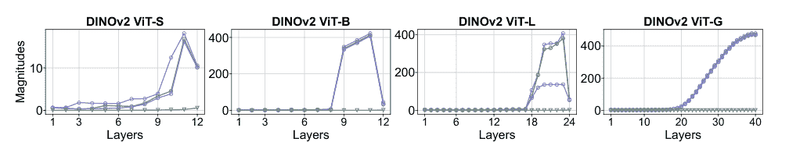

## DINOv2 ViT-S

## DINOv2 ViT-B

## DINOv2 ViT-L

## DINOv2 ViT-G

图 4.48：DINOv2 中 ViT 的层级分析。

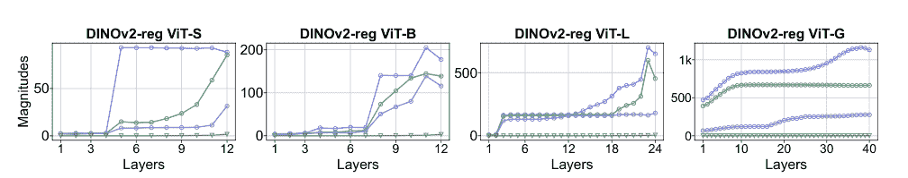

## DINOv2-reg ViT-S

## DINOv2-reg ViT-B

## DINOv2-reg ViT-L

## DINOv2-reg ViT-G

图 4.49：DINOv2-reg 中 ViT 的层级分析。

| 数据集 | 许可证 |
|---|---|
| RedPajama [45]： | Apache License, Version 2.0 |
| OpenWebText2 [44]： | MIT License |
| C4 [36]：许可证 | Open Data Commons Attribution License 1.0 |
| PG-19 [185]： | Apache License, Version 2.0 |
| WikiText [63]： | Creative Commons BY-SA 3.0 许可证 |
| MMLU [88]： | MIT License |
| BoolQ [98]： | Creative Commons BY-SA 3.0 许可证 |
| PIQA [188]： | 许可证状态不明 |
| WinoGrande [101]： | Apache License, Version 2.0 |
| ARC easy and challenge [102]： | Creative Commons BY 4.0 许可证 |
| ImageNet [127]： | 许可证状态不明 |

### 4.9 结论与讨论

大型 Transformer 的自回归训练为自然语言处理带来了重大进展。本研究揭示了 *大规模激活* 在这些大型语言模型（LLM）中的广泛存在。这些激活的值与输入无关，但对模型性能至关重要，尽管其数量极为稀少。我们在大规模激活与自注意力机制之间建立了密切联系。我们表明，LLM 利用它们来实现注意力计算的一种隐式偏置形式。我们的发现也很好地推广到了视觉 Transformer（ViT）。我们希望本工作呈现的新结果有助于更深入地理解当今的大规模基础模型。

我们讨论本工作的一些实际意义和未来方向。首先，大幅值激活的存在已被广泛认为是有效量化 LLM 的主要挑战 [57, 58]。本文识别了 LLM 中一种新型的异常值激活，我们希望我们的发现对 LLM 压缩研究有价值。其次，将过多注意力概率分配给少数固定 token 的注意力图可能对机制可解释性不利 [186]。我们提出的注意力公式可以使 LLM 中产生的注意力图更具可解释性，并可能有益于下游应用 [191]。最后，我们对新注意力公式的研究聚焦于其对大规模激活的影响，并且由于计算资源限制，我们的实验仅限于一个较小的 GPT-2 模型。有趣的是，看看我们的结果如何推广到更大规模的模型，以及我们的注意力公式如何影响现代 LLM 的训练稳定性 [167]，将会很有意思。


## 第5章
### 大型语言模型中的特异性
### 5.1 概述

在本研究中，我们揭示并研究了大型语言模型（LLMs）中的特异性——其输出中可用于区分模型的独特模式。为此，我们考虑一个简单的分类任务：给定特定文本输出，目标是预测生成该文本的源LLM。我们在各种LLM组上评估此合成任务，发现仅对LLM生成的文本进行现有文本嵌入模型的微调即可获得出色的分类准确率。值得注意的是，在涉及ChatGPT、Claude、Grok、Gemini和DeepSeek的五分类问题中，我们在保留的验证数据上实现了97.1%的准确率。进一步的调查表明，这些特异性根植于词级分布。这些模式即使在文本被外部LLM重写、翻译或总结时仍然存在，表明它们也编码在语义内容中。此外，我们利用LLM作为评判者来生成每个模型特异性的详细、开放式描述。最后，我们讨论了研究结果的更广泛影响，包括在合成数据上训练、推断模型相似性以及LLM的稳健评估。代码可在 github.com/locuslab/llm-idiosyncrasies 获取。

### 5.2 引言

随着诸如LLM等生成模型的采用加速，了解此类生成内容的来源和出处变得越来越重要。虽然过去大量工作集中在人类撰写内容和AI撰写内容的分类上 [228, 243, 244, 245]，但在对不同LLM生成的內容进行分类方面的工作很少，无论是完全不同模型的输出，还是同一模型家族不同变体的输出。如果可能，以这种方式区分源模型的能力对于许多应用非常有价值：它可以揭示不同LLM的相对采用情况，超出各公司报告的内容，以及用于构建不同模型的数据的性质。此外，它还可以提供有关输出生成哪些特征对每个LLM最“独特”的见解。

在本文中，我们研究LLM是否表现出能够使其输出可区分的特异性，其依据是通过文本转换来分离不同层级的信息。我们发现，在随机打乱LLM生成响应的词语后，分类准确率仅有微小下降。这表明大量独特特征编码在词级分布中。然后我们强调了一组与每个LLM始终相关联的特征短语。我们还发现，Markdown格式在后训练后LLM的特异性中贡献了适度的程度。

与此同时，当通过保留语义的转换破坏词分布时，例如改写或翻译，我们仍获得超过90%的准确率。即使在最激进的转换——总结——下，分类准确率仍然远高于随机猜测水平。这一发现表明语义信息也塑造了LLM中的特异性。通过开放式语言分析，我们进一步深入了解了这些特征。例如，ChatGPT偏好详细、深入的解释，而Claude则产生更简洁、直接的响应，优先考虑清晰度。

最后，我们讨论了研究结果的更广泛影响。在使用合成数据训练LLM时应谨慎，因为我们表明其中许多特异性可在该过程中继承。我们的框架也可作为评估前沿模型、无论是开源还是专有模型之间相似性的工具。此外，我们讨论了LLM中的特异性如何被恶意利用来操纵基于投票的排行榜，从而凸显了对更稳健评估方法的需求。

### 5.3 评估LLM中的特异性

大型语言模型（LLMs）共享若干核心特征。它们大多数基于Transformer架构 [1]，本文考虑该架构。其次，它们使用自回归目标进行训练 [2]，即基于前文上下文预测序列中的下一个token。最后，它们的训练数据集高度重叠，通常包含Common Crawl、Wikipedia和Stack Overflow等庞大且多样的来源。鉴于这些相似性，自然会问：LLM是否以相同的方式“说话”？如果不是，我们如何有效地衡量它们差异的程度？

为解决这些问题，我们构建了一个合成任务，专注于对不同LLM输出进行分类。考虑N个LLM，记为 f1, …, fN，其中每个 fi 接收输入提示 p 并输出文本补全 o。对于给定的提示数据集 D，每个LLM fi 产生的输出记为 Oi。我们以简单设置处理此问题。对于N个输出集 Oi，我们制定一个N路分类任务，其目标是预测每个输出由哪个LLM产生。如果不同LLM的输出来自同一分布，分类准确率不会优于随机猜测。因此，我们将此合成任务的分类性能用作LLM特异性的衡量标准。

我们的任务被表述为序列分类问题，微调BERT风格模型是常见方法 [251]。在本工作中，我们微调了一个基于解码器仅Transformer的更新且更具竞争力的序列嵌入模型：LLM2vec [207]。我们在提取的嵌入上附加N路分类头，并使用LoRA-based微调同时对模型权重和线性头进行微调。输入序列截断为最大长度512个token。我们在保留的验证集上评估模型的性能并报告分类准确率。额外的训练细节在附录5.7.1中提供。

| ChatGPT | Claude | Grok | Gemini | DeepSeek | 准确率 (chat) |
|---|---|---|---|---|---|
| ✓ | ✓ |  |  |  | 99.3 |
| ✓ |  | ✓ |  |  | 97.7 |
| ✓ |  |  | ✓ |  | 98.7 |
| ✓ |  |  |  | ✓ | 97.2 |
|  | ✓ | ✓ |  |  | 99.7 |
|  | ✓ |  | ✓ |  | 99.6 |
|  | ✓ |  |  | ✓ | 99.6 |
|  |  | ✓ | ✓ |  | 99.4 |
|  |  | ✓ |  | ✓ | 98.7 |
|  |  |  | ✓ | ✓ | 99.9 |
| ✓ | ✓ | ✓ | ✓ | ✓ | 97.1 |

(a) chat APIs

| Llama | Gemma | Qwen | Mistral | 准确率 (instruct) | 准确率 (base) |
|---|---|---|---|---|---|
| ✓ | ✓ |  |  | 99.9 | 98.3 |
| ✓ |  | ✓ |  | 97.8 | 81.7 |
| ✓ |  |  | ✓ | 97.0 | 96.3 |
|  | ✓ | ✓ |  | 99.9 | 98.3 |
|  | ✓ |  | ✓ | 99.9 | 98.4 |
|  |  | ✓ | ✓ | 96.1 | 95.7 |
| ✓ | ✓ | ✓ | ✓ | 96.3 | 87.3 |

(b) instruct and base LLMs

表5.1：**各种LLM组合的分类准确率。** *上部：* chat API的结果。 *下部：* instruct和base LLM的结果。 勾选标记（✓）表示每个组合中包含的模型。我们在所有模型组合中持续观察到高分类准确率，表明LLM中存在明显的特异性。

#### 5.3.1 主要观察

神经网络以惊人的高准确率对LLM输出进行分类。这一观察在不同设置下都很稳健，例如跨模型家族和规模。

我们描述用于生成输出数据集 O₁,...,N 的LLM。为了在模型家族之间进行全面且公平的比较，我们将LLM分为三组：

- 1. Chat APIs（“chat”）：此类别包括主要通过API访问的最先进LLM。我们考虑GPT-4o [13]、Claude-3.5-Sonnet [15]、Grok-2 [16]、Gemini-1.5-Pro [263]和DeepSeek-V3 [6]。为简单起见，我们将它们分别称为ChatGPT、Claude、Grok、Gemini和DeepSeek。它们的架构和权重保持专有且未公开，DeepSeek除外。
- 2. Instruct LLMs（“instruct”）：这些模型经过训练以从人类指令生成高质量响应。我们考虑来自不同家族的四个规模相似的LLM：Llama3.1-8b [25]、Gemma2-9b [198]、Qwen2.5-7b [261]和Mistral-v3-7b [173]。我们将分别称它们为Llama、Gemma、Qwen和Mistral。
- 3. Base LLMs（“base”）：这些是instruct LLM的基础版本。它们通过在大量文本语料上预训练获得，没有任何后训练阶段。

在整篇论文中，我们将这三类分别称为“chat”、“instruct”和“base”。对于给定的提示数据集，我们收集11K条文本序列，将其分为10K用于训练和1K用于保留验证。所有LLM使用相同的划分。对于chat API和instruct LLM，我们从多样化的对话和指令数据集UltraChat [225]生成输出。对于base LLM，我们使用来自高质量LLM预训练数据集FineWeb [223]的提示合成新文本。响应生成的更多细节见附录5.7.2。

**跨模型家族。** 在表5.1中，我们报告了对各种chat API输出（表5.1a）以及instruct / base LLM（表5.1b）进行分类的结果。在每个LLM组中，我们枚举了每个表中上半部分从N个模型中选择2个模型的全部 C_N^2 个可能的成对组合，以及底部行中包含N个模型的情况。对于二分类任务，神经网络始终实现超过90%的准确率，仅有一个例外。值得注意的是，对于chat API和instruct LLM，许多组合的准确率高达99%。在更具挑战性的N路分类任务中，我们的分类器保持强劲性能，在三个组中至少实现87.3%的准确率。这些结果凸显了不同LLM之间的特异性。我们将读者引向第5.7.5章以查看分类器的混淆矩阵。

**同一模型家族内。** 我们评估在区分同一模型家族内LLM响应时的序列分类性能。注意，同一家族的模型通常共享共同的训练流程，例如预训练数据集和优化调度。首先，我们通过考虑具有7B、14B、32B和72B参数的四个Qwen2.5 instruct LLM来分析模型规模的影响。如表5.2所示，分类任务变得

| 7b | 14b | 32b | 72b | 指令 |
|---|---|---|---|---|
| ✓ | ✓ |  |  | 77.0 |
| ✓ |  | ✓ |  | 81.2 |
| ✓ |  |  | ✓ | 83.4 |
|  | ✓ | ✓ |  | 63.1 |
|  | ✓ |  | ✓ | 85.5 |
|  |  | ✓ | ✓ | 84.8 |
| ✓ | ✓ | ✓ | ✓ | 59.8 |

表5.2：**Qwen2.5模型系列内部的分类。** 该分类器能够以相当高的准确率区分同一模型系列内不同LLM生成的响应。

| 训练 / 测试 | UltraChat | Cosmopedia | LmsysChat | WildChat |
|---|---|---|---|---|
| UltraChat | 96.3 | 98.9 | 89.9 | 92.4 |
| Cosmopedia | 95.7 | 99.8 | 88.3 | 94.9 |
| LmsysChat | 94.7 | 97.2 | 91.8 | 92.0 |
| WildChat | 95.1 | 99.1 | 90.2 | 95.7 |

表5.3：**对分布外响应的稳健泛化。** 我们在一个提示数据集的LLM输出上训练分类器，并在另一个数据集的输出上进行测试。

区分同一模型系列内的LLM难度更大，但我们的分类器准确率仍明显高于随机水平。在二分类设置中，最高准确率达到85.5%；而在全组合设置中，准确率降至59.8%。此外，我们观察到在区分同一模型的基础版本和指令版本的响应时，分类器能达到很高的准确率。例如，我们的分类器在区分Qwen2.5-7b基础模型和指令模型的输出时达到了96.8%的准确率。

## 对分布外响应的泛化

我们发现，我们的分类器能够稳健地泛化到训练分布之外的响应。为了评估这一点，我们收集了来自四个不同数据集的指令LLM响应：*即* UltraChat、Cosmopedia [274]、LmsysChat [275] 和 WildChat [278]。这些数据集来源不同、用途各异——Cosmopedia 面向合成数据生成，LmsysChat 和 WildChat 捕获真实用户交互，而 UltraChat 主要由合成响应组成。对于每个数据集，我们在一组模型响应上训练一个分类器，然后在这全部四个数据集上对其进行评估。本实验使用指令LLM。如表5.3所示，我们的分类器在不同数据集之间泛化良好，表明它们学习到了非常稳健且可迁移的模式。

#### 5.3.2 受控实验

我们在几种受控设置下分析合成分类任务的行为。*从现在起，我们只报告每组中N路分类任务的准确率。*

### 训练数据规模

我们改变由LLM生成的训练样本数量，并以相同的总迭代次数训练分类器。结果如图5.3所示。随着训练样本增多，分类器的性能不断提高。这一趋势在chat API、指令LLM和基础LLM中均一致观察到。此外，仅用10个训练样本，分类器就能取得不可忽视的准确率（例如在指令LLM上为40.3%），超过20%的随机猜测水平。

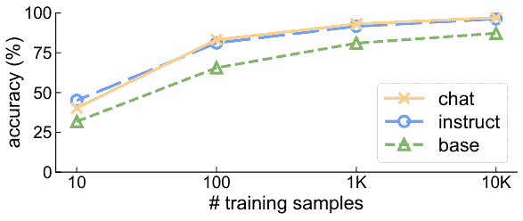

图5.3：**不同数量的训练样本。** 我们的序列分类器受益于更多的训练样本。当使用约10K训练样本时，分类性能趋于收敛。

### 5.4 LLM中的具体特质

我们已经证明，现代神经网络能够以出色的准确率分类出给定响应由哪个LLM生成。这里，我们利用经典文本相似度指标——ROUGE-1 [266]、ROUGE-L [266] 和 BERTScore [18]——来量化LLM输出之间的词汇差异。对于给定相同提示的任何两个不同chat API模型生成的所有响应对，我们计算每个指标的平均F1分数。为了比较，我们还度量了同一模型内采样响应之间的相似度。如表5.7所示，来自不同LLM的响应表现出比来自同一模型的响应更低的文本相似度。

|  | 不同LLM之间 | 同一LLM内 |
|---|---|---|
| ROUGE-1 | 0.499 | 0.660 |
| ROUGE-L | 0.256 | 0.414 |
| BERTScore* | 0.220 | 0.482 |

表5.7：**文本相似度分数。** 我们使用ROUGE-1、ROUGE-L和BERTScore评估LLM输出的文本相似度。*我们遵循[267]的做法，根据人类基线对BERTScore进行重新缩放。* 结果表明，来自不同LLM的响应表现出较低的词汇相似度。

接下来，我们从三个维度识别LLM中的具体特质：词汇与字母、Markdown格式元素以及语义含义。对于每个维度，我们应用文本变换来分离潜在特质，并评估它们对分类性能的影响。然后，我们重点说明每个维度中能够区分不同LLM的具体模式。

| ChatGPT | Claude |
|---|---|
| 我们的产品采用创新的可持续材料，例如…… | 根据文本，Kai Fusser认为传统有氧运动…… |
| 当然可以！如果你正在寻找替代布里奶酪的奶酪替代品…… | 根据所提供的文本，以下是关于Armon Binns的……的关键细节 |
| 总体而言，尽管存在挑战，坦桑尼亚仍在取得进展…… | 虽然比利牛斯山脉的许多冬季运动与……发现的运动相似 |
| 当然！以下是一份烹制多汁三文鱼柳的简单指南：…… | 这似乎是一首诗的片段，营造出一种田园…… |

(a) 特征短语

| ChatGPT | Claude |
|---|---|
| 1. **提供卓越服务**：口碑营销的基础是始终如一的卓越表现。提供一流的服务或…… | 1. 提供卓越服务
• 始终超出客户期望
• 注重质量和关注…… |
| **配料：**
• 2包（3盎司）橙味果冻
• 1杯汤力水（这就是…… | **配料：**
• 2盒橙味果冻
• 1罐淡奶
• 汤力水…… |

(b) 独特的Markdown格式

图5.4：**来自ChatGPT和Claude的示例响应**，展示了它们各自的特质：特征短语（左）和独特的Markdown格式（右）。为清晰起见，我们用下划线和特定于模型的颜色标出每个特征短语。

#### 5.4.1 词汇与字母

### 文本打乱

为了将词汇和字母的影响与其他因素解耦，我们移除LLM生成响应中的特殊字符，例如标点、Markdown元素和多余空白。这样可确保每个响应仅由空格分隔的单词组成。此外，我们对预处理后的文本应用两种打乱策略：词级打乱和字母级打乱。这些变换破坏了自然顺序，迫使分类器从原始文本统计中学习模式。表5.8给出了分类结果。

在去除特殊字符的响应上训练的分类器，其准确率接近使用原始响应训练的分类器，即chat API为95.1%，指令LLM为93.8%，基础LLM为75.4%。类似地，使用词级打乱后的响应也能获得与原始响应相当的高准确率。此外，我们在图5.5（左）中绘制了五个chat API中几个常用词的频率。即使在常见英语单词上，我们也观察到模型之间的明显差异：Claude使用“the”、“and”、“to”和“of”等词的频率远低于其他chat API。这些结果表明，特殊字符和词序对于区分LLM并非必不可少；词汇选择反映了模型之间的显著特质。

相反，字母级打乱会导致准确率大幅下降（49%-56%），接近随机水平。这表明仅凭字母级统计不足以预测LLM身份。为了定性可视化字母分布上的差异

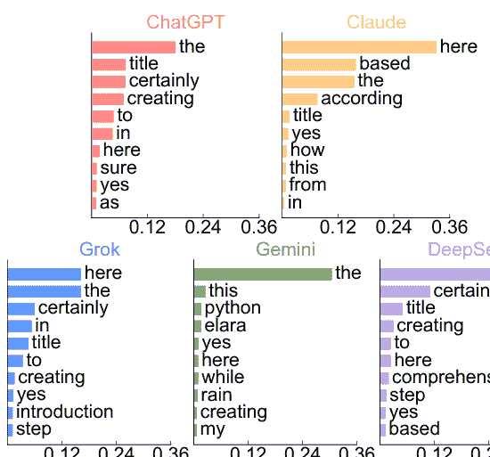

图5.7：**首词。** 我们分析了chat API响应中首词的分布，并列出每个模型最频繁的前10个词。这些首词使用上的差异解释了在图5.2中仅凭首词就能获得非平凡准确率的现象。

我们统计每个响应中Markdown格式元素出现的次数，然后在图5.8中绘制这些次数在所有响应上的分布。每个模型都展现出独特的响应格式方式。例如，Claude（黄色）在粗体文本和标题计数分布中，零值处密度很高，表明它生成许多没有粗体文本或标题的响应。相反，其他LLM在零值处的数值较低，因此更常使用这些格式元素来装饰文本。

图5.4b可视化展示了ChatGPT和Claude如何以Markdown组织它们的响应。有趣的是，ChatGPT倾向于在列举中加粗强调每个要点，并使用Markdown标题突出标题，而Claude则使用简单的列举和项目符号来格式化文本。关于其他模型在这些Markdown格式元素上的更多分析，可参见第5.7.8节。

#### 5.4.3 语义

### 改写

分类准确率如此之高，一个潜在原因是每个LLM独特的写作风格（例如词汇选择、句子结构）。为了分离这一因素，我们利用另一个LLM（例如GPT-4o mini）来改写LLM响应。我们的改写方法包括（改写后的示例响应见第5.7.10节）：

- 释义：*在保持原文语义的同时，对上述文本进行释义。*
- 翻译：*将上述文本翻译成中文。*
- 摘要：*用一段话概括上述文本。*


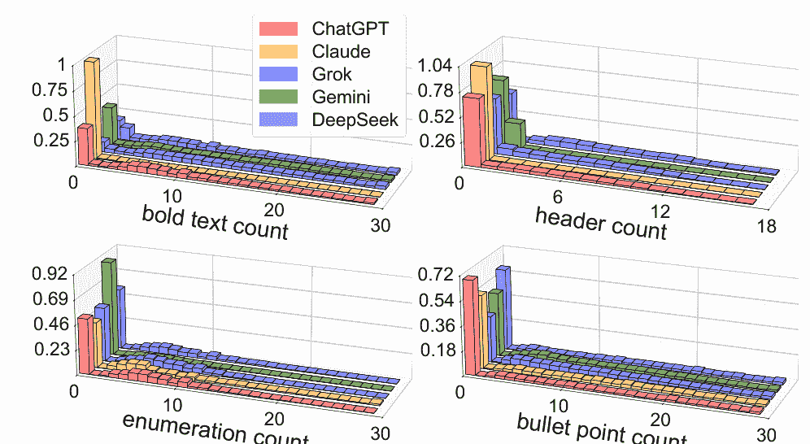

图 5.8：Markdown 格式元素。每个 LLM 都有独特的 Markdown 格式元素分布。

我们在表 5.10 中展示了结果。在改写后的 LLM 回复上训练的分类器与使用原始回复训练的分类器保持了相似的准确率。同样地，在使用翻译文本时，分类器也能区分不同的 LLM。这些发现表明，在预测 LLM 来源时，词语的语义含义比具体的选词起着更重要的作用。

|  | chat（对话） | instruct（指令） | base（基座） |
|---|---|---|---|
| 原始 | 97.8 | 96.3 | 87.3 |
| 改写 | 91.4 | 92.2 | 71.7 |
| 翻译 | 91.8 | 92.7 | 74.0 |
| 摘要 | 58.1 | 57.5 | 44.7 |

表 5.10：对改写后回复的分类。改写或翻译 LLM 输出所达到的准确率与使用原始输出时相当。然而，对这些文本进行摘要后，模型预测 LLM 身份的能力会下降。

此外，尽管摘要文本的准确率明显下降（即 >38%），但由此产生的性能仍远高于随机猜测水平。这种对摘要文本进行分类的显著能力表明，LLM 生成的回复之间存在高层次的语义差异。

- 1. **描述性与细节化的语气：** 常采用叙述风格，带有信息丰富、引人入胜或生动的语气。
- 2. **具体与技术性词汇：** 使用描述性和技术性词汇，增强深度和具体性。
- 3. **结构化且具有情境铺垫的开头：** 通常以设定情境或叙述性介绍开始。
- 4. **使用 Markdown 格式组织内容：** 利用标题、列表和粗体等多种 Markdown 元素以提高清晰度。
- 5. **全面且深入的内容：** 提供丰富细节，侧重于解释、背景和更广泛的主题。

### ChatGPT

- 1. **简洁直接的语气：** 通常采用更直接、事实性或简洁的语气。
- 2. **功能性强且清晰的用词：** 偏好简单或行动导向的语言，优先考虑清晰性和实用性。
- 3. **即刻且直接的开头：** 经常以直截了当的陈述或摘要开始，而不作过多背景铺垫。
- 4. **极少使用 Markdown 或列表：** 依靠简单列表或基本格式以便快速查阅。
- 5. **聚焦且概括的内容：** 专注于要点和具体现象，避免过多细节。

### Claude

图 5.9：**我们对 ChatGPT 和 Claude 的开放式语言分析结果。** ChatGPT 以描述性语言、精细的 Markdown 格式和深入细节为特征，而 Claude 则强调直接语气、极少结构和概括性内容。

**开放式语言分析。** 在这一部分，我们重点研究 LLM 生成回复中的语义差异。我们使用另一个 LLM（例如 ChatGPT）作为裁判，对每个 LLM 的输出提供开放式、描述性的特征刻画。我们的语言分析中涉及其他 LLM 裁判的结果见第 5.7.9 章。

具体来说，我们向 LLM 裁判展示两条回复——它们由不同模型基于相同提示生成——并要求其从不同角度（如语气和内容）分析这些回复。重复此过程多次，以收集全面的分析集合。最后，我们要求 LLM 裁判将这些分析总结为要点，以捕捉每个模型的特征。提示详见第 5.7.4 章。

对 ChatGPT 与 Claude 的开放式语言分析结果如图 5.9 所示。关于回复的逐对详细比较，参见第 5.7.10 章的图 5.16。ChatGPT 的特点是采用引人入胜的语气生成描述性和详细的回复。相比之下，Claude 更注重简洁，只呈现要点和直白的语言。关于 chat API 模型和 instruct LLM 的更多结果见第 5.7.9 章。

### 5.5 影响

在本节中，我们探讨我们的框架在合成数据和模型相似性方面的更广泛影响。

**通过合成数据产生的独特特征。** 使用合成数据训练前沿 LLM 已成为常见做法 [242, 258, 273]。我们使用 Ultrachat（即由 ChatGPT 生成的对话）对两个基础 LLM（Llama3.1-8b 和 Gemma2-9b）进行监督微调（SFT）。在 SFT 阶段之后，我们训练一个分类器来区分两个微调模型的回复。我们发现，在相同合成数据集上进行 SFT 会将分类准确率从 96.5% 显著降低至 59.8%，缩小了这两个模型之间的差异。

此外，我们使用 UltraChat 提示词从 Llama3.1-8B 和 Gemma2-9B 的 instruct LLM 中生成回复。然后我们分别在这些回复集上微调 Qwen2.5-7B 基础 LLM。有趣的是，两个微调模型生成的回复可以用 98.9% 的准确率进行分类，这表明每个微调模型都保留了其 SFT 数据中的独特特征。这些发现表明，使用合成数据进行训练可以传播源模型中的独特特征。

**推断模型相似性。** 我们的框架提供了一种定量方法来评估专有 LLM 与开放权重 LLM 之间的相似性。给定 N 个 LLM，我们排除其中一个模型，并在其余 N − 1 个模型的回复上训练一个分类器。然后我们评估分类器会将被排除模型的回复关联到哪个 LLM。被预测为来源次数最多的模型被认为与被排除 LLM 最接近。对 N 个模型中的每一个重复此过程。在此分析中，我们在 5 个 chat API 模型之外加入了开放权重模型 Phi-4 [242]。值得注意的是，Phi-4 在其训练中使用了大量合成数据。

结果如图 5.10 所示。有趣的是，对于 Claude、Grok 和 Gemini，我们观察到它们的输出有很强的倾向被分类为 ChatGPT。例如，当 Grok 是被排除模型时，其 82.8% 的回复被分类为 ChatGPT。此外，ChatGPT 和 DeepSeek 的回复经常被识别为来自 Phi-4，比例分别为 55.9% 和 76.0%。反过来，Phi-4 的大部分输出被分类为来自 ChatGPT 或 DeepSeek。

**对 LLM 的稳健评估。** 我们的发现揭示了广泛使用的 LLM 评估方法中一个潜在漏洞。将人工判断纳入 LLM 评估已成为一种常见策略，例如 Chatbot Arena [276]。这是一个基于投票的排行榜，用户对两个随机模型回复的偏好进行投票。该基准已获得广泛关注，现已成为前沿模型开发的关键参考点。然而，利用 LLM 输出的独特特征，恶意攻击者可以识别候选回复背后的模型，并持续为目标模型投票，从而操纵排行榜排名。[277] 的同期工作已在模拟中证明了这种攻击的可行性。我们希望我们的工作能引起人们对当前评估流程中潜在弱点的关注，因为这些弱点可能会误导模型开发和优化工作 [28]。

图像数据集）。[234] 对一组模型输出进行了假设检验，以检查底层 LLM 是否相同。与我们最相关的工作是 [235]，它提出了 VibeCheck 来理解 LLM 输出中与用户对齐的特征。他们发现 LLM 的风格往往各不相同，例如更正式或更友好。相比之下，我们的工作旨在识别更广泛的泛化模式，以解释高分类性能。

### 5.7 补充结果

#### 5.7.1 实现细节

#### 5.7.2 回复生成

我们报告从 chat API、instruct LLM 和基础 LLM 生成回复的过程。对于 chat API，我们在 2024 年 11 月 28 日至 2025 年 2 月 6 日期间，通过其官方 API 访问每个模型的稳定版本，包括 GPT-4o-2024-08-06、Claude-3.5-Sonnet-20241022、Grok-Beta、Gemini-1.5-Pro-002 和 DeepSeek-Chat，并使用它们的默认采样设置生成回复。对于 instruct LLM，我们使用贪心解码来采样输出。对于基础 LLM，我们将温度设置为 T = 0.6，并应用 1.1 的重复惩罚以避免重复补全。

#### 5.7.3 训练设置

在这一部分，我们描述使用文本嵌入模型对 LLM 回复进行微调的过程。我们使用每条生成回复的前 512 个 token 进行训练和评估。为了执行序列分类，我们在每个文本嵌入模型之上添加一个线性层作为分类头。对于 ELMo、BERT、LLM2vec，该层应用于序列中所有 token 的平均嵌入。对于 T5 和 GPT-2，我们遵循原始设置 [2, 208]，将分类头应用于最后一个 token 的输出。

对于较小的文本嵌入模型，如 ELMo、BERT、T5 和 GPT-2，我们对整个模型和分类头进行微调，在基础学习率 {3e-3, 1e-3, 3e-4, 1e-4, 3e-5, 1e-5, 3e-6, 1e-6} 中进行搜索。对于最大的 LLM2vec 模型，我们采用参数高效的 LoRA [134] 微调方法，rank 为 16，LoRA α 为 32，dropout 率为 0.05，基础学习率为 5e-5。表 5.11 详细说明了我们的基本训练方案。

#### 5.7.4 开放式语言分析的提示词

我们在第 5.4.3 节中详细说明了开放式语言分析的过程。给定相同的输入，我们从两个 LLM 中采样一对回复，并将它们与分析提示词（见图 5.11a）一起呈现给 LLM 裁判进行比较。为避免 LLM 裁判利用对模型的任何先验知识，我们使用索引分布对模型身份进行匿名化。此过程重复 35 对回复，产生一组详细的分析。最后，我们使用总结提示词（见图 5.11b）将这些分析提炼为 5 个要点，以刻画每个模型的独特特征。


| 配置 | 数值 |
|---|---|
| 优化器 | AdamW |
| 权重衰减 | 0.001 |
| 优化器动量 | $\beta_1, \beta_2 = 0.9, 0.999$ |
| 训练轮数 | 3 |
| 批次大小 | 8 |
| 学习率调度 | 余弦衰减 |
| 预热调度 | 线性 |
| 预热比例 | 10% |
| 梯度裁剪 | 0.3 |

**表 5.11：** 我们的微调方案。

**(a) 分析提示词**

以下是来自 2 个不同文本分布的一些样本。
来自分布 1 的样本：{text sample 1}
来自分布 2 的样本：{text sample 2}

确定这两个分布的独特特征，并为每个分布总结出五个要点。每个要点都应从相同角度分析响应，并能方便人工比较。重点关注区分这两个分布的关键方面。关注整体语气、具体用词、开头行、Markdown 格式和内容。每个分布仅输出 5 个要点，不要输出额外文本。

**(b) 总结提示词**

以下是 35 份逐点比较两个文本分布独特特征的摘要。
{Analysis 1}
{Analysis 2}
...
{Analysis 35}

将所有 35 份摘要浓缩为一份摘要。重点关注每份摘要如何评估整体语气、具体用词、开头行、markdown 格式和内容。为每个分布精确提供五个要点，每个特征一个。每个要点应包含一个描述性标题以概括该特征，以及一个简短句子进行简洁解释。强调反复出现且重要的特征，去除冗余内容，并确保标题和句子能清晰区分两个分布，便于人工比较。每个分布仅输出 5 个要点，不要输出额外文本。

**图 5.11：** 我们开放式语言分析中使用的提示词。

#### 5.7.5 混淆矩阵

在图 5.12 中，我们展示了分别基于聊天 API、指令型 LLM 和基础 LLM 生成的响应训练的 N 路分类器的混淆矩阵。结果表明，我们的分类器能够准确预测 LLM 生成响应的来源，不同 LLM 之间的混淆极小。

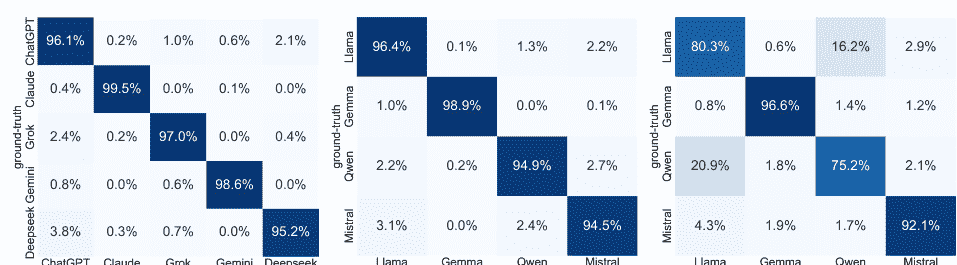

(a) 聊天 API

(b) 指令型 LLM

(c) 基础 LLM

**图 5.12：** 三组 LLM（聊天 API、指令型 LLM 和基础 LLM）上 N 路分类器的混淆矩阵。

#### 5.7.6 词汇与字母

图 5.13 展示了指令型 LLM 和基础 LLM 中 20 个最常用词汇（左）以及所有英文字母（右）的出现频率。与我们在 5.4.1 节中的观察一致，我们发现这些模型之间常用词分布存在显著差异，例如“the”“and”“to”。相比之下，字母分布几乎完全相同。


(a) 指令型 LLM

(b) 基础 LLM

**图 5.13：** 指令型 LLM 和基础 LLM 中的词汇与字母频率。

#### 5.7.7 特征短语

我们提供了 5.4.1 节中特征短语分析的补充结果。我们采用与图 5.6 相同的方法来提取指令型 LLM 和基础 LLM 的特征短语。具体来说，我们在其响应的 TF-IDF 特征上训练一个四路逻辑回归分类器，并使用其系数来选择每个模型的重要短语。

如图 5.14 所示，每个指令型 LLM 都包含相当独特的特征短语。例如，Llama 经常使用“including”和“such as”等词语在输出中引入具体示例，而 Gemma 则倾向于使用“let me”和“know if”等短语与用户互动。相比之下，从基础 LLM 中提取的短语区分度较低，主要由“the”“to”“you”等常见词组成。

图 5.15 展示了指令型 LLM 和基础 LLM 中首词选择的分布。与聊天 API（图 5.7）类似，指令型 LLM 显示出多样化的分布。然而，基础 LLM 在最常见首词（如“the”“and”“of”“to”“in”）上表现出大量重叠。

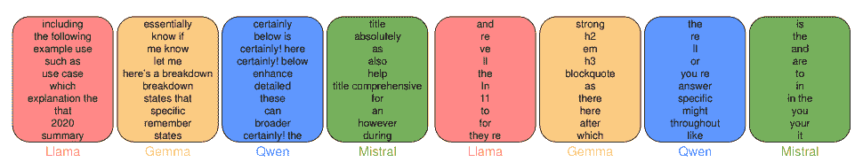

(a) 指令型 LLM

(b) 基础 LLM

**图 5.14：** 指令型¹ 和基础 LLM 的特征短语。

¹ 在指令型 LLM 的 Llama 中，短语“explanation the”对应一个 Markdown 标题或加粗的“explanation”，后接以“the”开头的新句子。

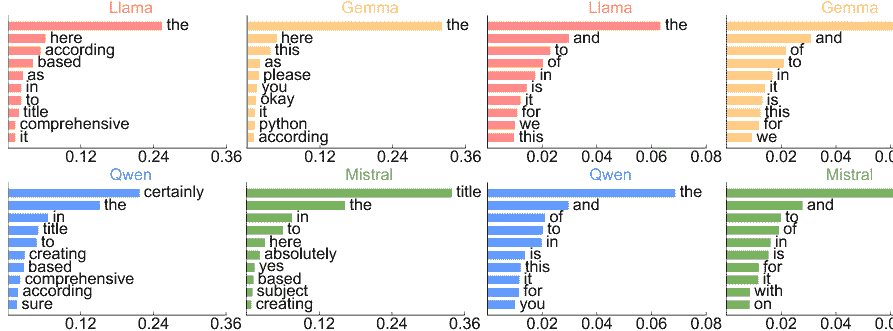

(a) 指令型 LLM

(b) 基础 LLM

**图 5.15：** 指令型 LLM 和基础 LLM 中首词选择的分布。

#### 5.7.8 独特的 Markdown 格式

在本部分，我们提供 5.4.2 节中 Markdown 格式分析的补充结果。图 5.16 展示了不同模型中六种 Markdown 格式元素的分布计数。对于聊天 API 模型（图 5.16a）和指令型 LLM（图 5.16b），我们都观察到粗体文本、标题、编号列表和项目符号的使用存在显著差异，而斜体文本的差异较小。有趣的是，Gemini 使用斜体文本的频率远高于其他聊天 API（在斜体文本处零密度更低），而 Gemma2 也有类似现象。

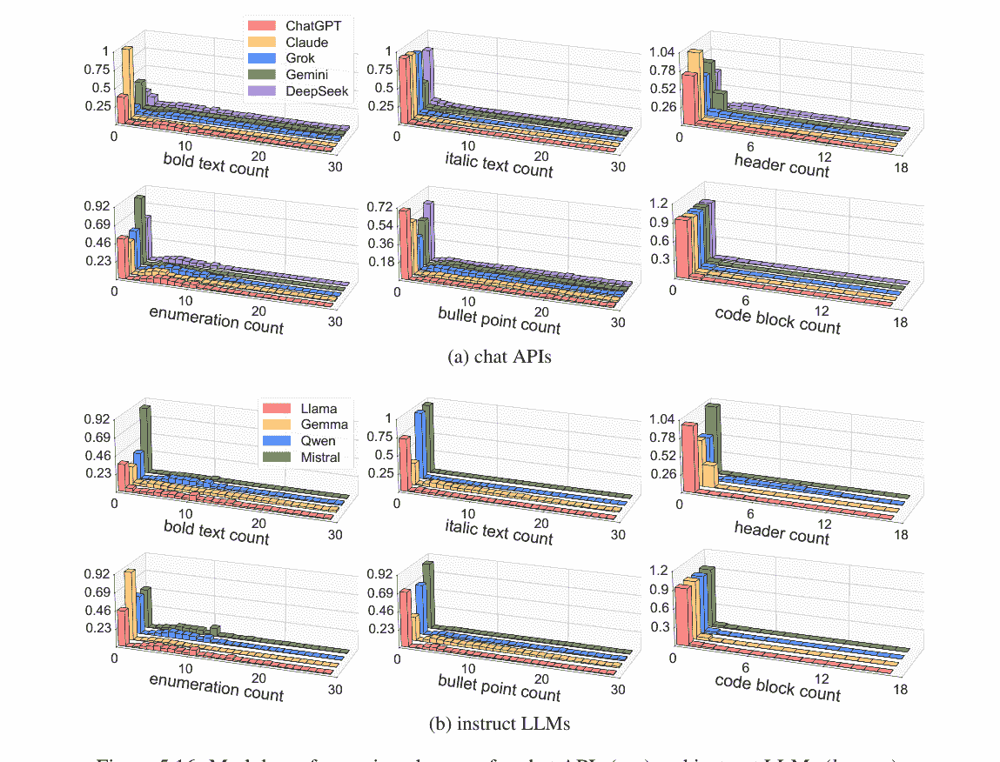

(a) 聊天 API

(b) 指令型 LLM

**图 5.16：** 聊天 API（上）和指令型 LLM（下）的 Markdown 格式元素。

#### 5.7.9 开放式语言分析

#### 关于 LLM 评判员的消融实验。

这里我们证明 5.4.3 节图 5.9 中的发现在多个 LLM 评判员下保持一致。具体来说，我们将 LLM 评判员从 ChatGPT 更换为 Claude、Grok 和 Gemini。结果如图 5.17 所示。无论选择何种 LLM 评判员，我们的语言分析都显示，ChatGPT 常常使用详细解释和复杂格式结构，而 Claude 则强调关键内容，不做过多展开。

**(a) Claude 作为 LLM 评判员。**

- 语气：权威且正式，使用学术语言，包含详细解释和复杂句式
- 用词：丰富的描述性词汇，包含术语、隐喻和评价性语言（“renowned”“instrumental”“exquisite”）
- 开头风格：直接陈述或热情的“Certainly!”回应，确立上下文并预览内容
- Markdown 使用：广泛使用格式，包括加粗标题、嵌套项目符号和分层章节标记
- 内容结构：段落详尽，包含详细解释、示例以及观点之间的流畅过渡

- 语气：分析性强且谨慎，经常引用源材料并承认局限性
- 用词：更简单、更实用的词汇，注重清晰易懂而非风格
- 开头风格：使用“According to the text”等元引用，或明确声明内容局限性
- Markdown 使用：格式极少，使用基本项目符号或简单编号列表
- 内容结构：简洁的项目符号和简短陈述，按分类列表组织，不做过多展开

**(b) Grok 作为 LLM 评判员。**

- 语气：温暖且富有信息性——使用有吸引力、教育式的语气来吸引和告知读者。
- 用词：描述性强且详细——使用丰富、技术性或情感化的语言来增强理解或唤起情感。
- 开头行：有上下文且吸引人——提供背景或叙事钩子来吸引读者。
- Markdown 格式：结构化且突出重点——广泛使用标题、列表和粗体文本来实现清晰和组织。
- 内容：全面且有洞察力——侧重于深入解释、示例和广泛影响。

- 语气：直接且务实——通常简洁，侧重于可操作的见解或直接的信息。
- 用词：简单且功能化——偏好直白的语言，强调实用性而非情感化或详细的描述。
- 开头行：直接且聚焦——直接切入主题或列出要点，没有太多铺垫。
- Markdown 格式：极简——使用基本的 markdown 元素，如项目符号或简单列表，以保证清晰。
- 内容：简洁且聚焦——提供基本信息，深度较浅，往往追求快速可读性或实用性。

**(c) Gemini 作为 LLM 评判员。**

- 正式语气：通常采用正式、学术或教学式的语气，优先考虑清晰和详细。
- 精确措辞：使用与主题相关的具体、描述性、有时是技术性的词汇。
- 情境式开头：通常以介绍性陈述、背景设定或明确的目的陈述开始。
- 结构化格式：经常使用标题、列表、加粗和其他 markdown 功能来进行组织和强调。
- 全面内容：提供详细解释、示例和深入信息，通常覆盖更广的范围。

- 非正式语气：通常使用更非正式、对话式或简洁的语气，优先考虑简短和易读性。
- 简化语言：偏好更简单、更直接的词汇，避免术语，并专注于关键信息。
- 直接开头：通常直接以要点或关键信息摘要开始。
- 极简格式：使用较少的 markdown 格式，主要依靠基本列表、项目符号或纯文本。
- 简洁内容：侧重于总结要点、提供实用建议或给出简洁概述。

**图 5.17：** 使用不同 LLM 评判员对 ChatGPT 和 Claude 进行开放式语言分析的结果。

#### 其他 LLM 上的开放式语言分析结果。

在 5.4.3 节中，我们展示了 ChatGPT 和 Claude 的开放式语言分析结果。此处，我们将分析扩展到其他聊天 API 模型和指令型 LLM。完整结果如图 5.18 所示，其中我们使用 ChatGPT 作为 LLM 评判员，比较同一类别（聊天 API / 指令型 LLM）内两个模型生成的响应。我们的分析突出了每个模型的若干有趣特征。例如，Grok 的响应往往语言丰富、内容全面，而 Gemini 的输出则更简洁，开头直接。

#### 5.7.10 响应示例

在本部分，我们展示 LLM 响应的示例。表 5.12 和 5.13 展示了我们提示词层面干预（5.3.2 节）前后的响应。表 5.14 展示了仅保留 markdown 元素时的转换后响应（5.4.2 节）。表 5.15 展示了改写后的响应（5.4.3 节）。此外，表 5.16 提供了响应的两两比较，支持我们表 5.9 中的发现。表 5.17、5.18、5.19、5.20、5.21、5.22、5.23、5.24、5.25、5.26、5.27、5.28、5.29 包含了 5.3 节中考察的每个 LLM 的示例响应，包括 ChatGPT、Claude、Grok、Gemini、DeepSeek、LLaMA3.1-8b（指令型）、Gemma2-9b（指令型）、Qwen2.5-7b（指令型）、Mistral-v3-7b（指令型）、LLaMA3.1-8b（基础）、Gemma2-9b（基础）、Qwen2.5-7b（基础）和 Mistral-v3-7b（基础）。


### 表 5.12：ChatGPT 上提示级干预的示例。

### (a) original

你能为这道食谱建议其他可以代替布里奶酪的奶酪替代品吗？请根据以下内容生成：在牛肉上放一片或两片布里奶酪并让其融化。将青苹果切成薄片。用混合沙拉覆盖，最后加上苹果片。

如果你正在寻找可以替代食谱中布里奶酪的奶酪替代品，请考虑以下选项：

- 1. 卡门贝尔：这种奶酪在质地和风味上与布里奶酪非常相似，提供奶油般的质地和温和、泥土般的味道，能很好地搭配牛肉和苹果。
- 2. 泰勒吉奥：一种意大利奶酪，质地柔软，风味酸爽、果香。融化效果好，能为菜肴增添独特的风味。
- 3. 丰蒂娜：以顺滑的融化特性著称，丰蒂娜具有坚果味和略甜的风味，与牛肉和苹果搭配得很好。
- 4. 山羊奶酪：如果你喜欢更酸爽的口感，山羊奶酪可以提供奶油般的质地和独特的风味，与苹果的甜味形成很好的对比。
- 5. 哈瓦蒂：一种半软奶酪，具有黄油味和略甜的口感，哈瓦蒂融化得非常好，可以成为布里奶酪的绝佳替代品。

这些替代品在你的食谱中应该效果很好，为你的牛肉和苹果组合提供美味且易融化的添加。

### (b) length control

你能为这道食谱建议其他可以代替布里奶酪的奶酪替代品吗？请根据以下内容生成：在牛肉上放一片或两片布里奶酪并让其融化。将青苹果切成薄片。用混合沙拉覆盖，最后加上苹果片。

请在一句话段落中提供简洁的回复，字数限制在最多 100 字。

为了美味地替代布里奶酪，可以考虑使用卡门贝尔或三重奶油奶酪，两者都提供相似的奶油质地和浓郁风味。如果你喜欢略酸爽的口感，山羊奶酪可以为牛肉和苹果提供令人愉悦的对比。对于更温和的口味，哈瓦蒂或丰蒂娜可以完美融化并衬托菜肴的风味。这些奶酪每一种都会增添独特的风味，同时保持布里奶酪提供的奶油般、入口即化的体验。

### (c) format control

你能为这道食谱建议其他可以代替布里奶酪的奶酪替代品吗？请根据以下内容生成：在牛肉上放一片或两片布里奶酪并让其融化。将青苹果切成薄片。用混合沙拉覆盖，最后加上苹果片。

请仅以纯文本提供回复，避免使用斜体或粗体文本、列表、markdown 或 HTML 格式。

你可以在食谱中使用卡门贝尔或三重奶油奶酪作为布里奶酪的替代品。两者都具有相似的奶油质地和浓郁风味，能很好地搭配牛肉和其他食材。

### (a) original

你能为这道食谱建议其他可以代替布里奶酪的奶酪替代品吗？请根据以下内容生成：在牛肉上放一片或两片布里奶酪并让其融化。将青苹果切成薄片。用混合沙拉覆盖，最后加上苹果片。

如果你正在寻找食谱中布里奶酪的替代品，这里有一些你可以考虑的选项：

- 1. **山羊奶酪**：一种柔软且奶油般的奶酪，具有酸爽风味，与苹果的甜味和牛肉的咸香风味搭配得很好。
- 2. **菲达奶酪**：一种咸味且易碎的奶酪，为牛肉的柔软和苹果的脆爽增添了很好的对比。
- 3. **卡门贝尔**：一种法国奶酪，具有奶油般的质地和温和、泥土般的风味，能很好地搭配牛肉和苹果。
- 4. **蓝纹奶酪**：一种浓烈且辛辣的奶酪，为菜肴增添大胆风味。如果你不喜欢强烈风味，请使用较温和的蓝纹奶酪。
- 5. **马斯卡彭**：一种丰富且奶油般的奶酪，为菜肴增添奢华感。如果你想要比布里奶酪更温和的风味，这是一个不错的选择。
- 6. **里科塔**：一种柔软且奶油般的奶酪，如果你想要比布里奶酪更清淡的风味，这是一个不错的选择。它也是寻找低卡路里替代品时的一个好选择。
- 7. **泰勒吉奥**：一种意大利奶酪，具有奶油般的质地和温和、果香的风味，与苹果和牛肉搭配得很好。

在替代布里奶酪时，请注意以下几点：

- 如果使用像蓝纹奶酪或山羊奶酪这样风味较强的奶酪，请使用较少用量以避免压倒其他风味。
- 如果使用像马斯卡彭或里科塔这样较温和的奶酪，你可能希望添加更多以达到理想的奶油感。
- 如果使用像菲达这样易碎的奶酪，你可能希望将其压碎而不是切片，以均匀分布风味。

记住，关键在于平衡菜肴中的风味和质地，所以请随意尝试，找到最适合你的组合！

### (b) length control

你能为这道食谱建议其他可以代替布里奶酪的奶酪替代品吗？请根据以下内容生成：在牛肉上放一片或两片布里奶酪并让其融化。将青苹果切成薄片。用混合沙拉覆盖，最后加上苹果片。

请在一句话段落中提供简洁的回复，字数限制在最多 100 字。

如果你正在寻找布里奶酪的替代品，可以考虑使用其他熟成软奶酪，如卡门贝尔、山羊奶酪或菲达。或者，你也可以选择半软奶酪，如哈瓦蒂或明斯特。对于更浓烈的风味，可以尝试蓝纹奶酪或戈贡佐拉。如果你喜欢更温和的口感，布尔辛或马斯卡彭也可以很好地发挥作用。这些奶酪都会融化并很好地搭配牛肉和苹果，为你的菜肴增添独特的风味。只需用你选择的奶酪替换布里奶酪，然后按照说明继续食谱即可。

### (c) format control

你能为这道食谱建议其他可以代替布里奶酪的奶酪替代品吗？请根据以下内容生成：在牛肉上放一片或两片布里奶酪并让其融化。将青苹果切成薄片。用混合沙拉覆盖，最后加上苹果片。

请仅以纯文本提供回复，避免使用斜体或粗体文本、列表、markdown 或 HTML 格式。

你可以考虑以下奶酪替代品来替代食谱中的布里奶酪：

卡门贝尔：这种法国奶酪具有与布里奶酪相似的奶油质地和温和、泥土般的风味，是合适的替代品。

山羊奶酪：一种酸爽且奶油般的奶酪，与苹果的甜味和牛肉的咸香风味搭配得很好。

菲达：一种易碎的希腊奶酪，为菜肴增添咸味，可以平衡苹果的甜味。

蓝纹奶酪：一种浓烈且辛辣的奶酪，可以为菜肴增添大胆风味，但请注意它可能会压倒其他食材。

里科塔：一种温和且奶油般的奶酪，可以为菜肴增添轻盈蓬松的质地，但可能无法提供与布里奶酪相同的丰富感。

马斯卡彭：一种意大利奶酪，具有丰富且奶油般的质地，可以为菜肴增添奢华感，但可能比布里奶酪更甜。

请记住，这些替代品中的每一个都会改变菜肴的风味特征，因此你可能需要相应地调整其他食材。

### 表 5.13：Llama3.1-8b-Instruct 上提示级干预的示例。

### (a) original

建立推荐网络和通过口碑获得新业务有哪些有效策略？

建立强大的推荐网络并通过口碑获得新业务可以非常有效且具有成本效益。以下是实现这一目标的一些策略：

- 1. **提供卓越服务：** 口碑营销的基础是持续的卓越。提供顶级服务或产品鼓励满意的客户与他人分享他们的积极体验。
- 2. **识别并培养关键关系：** 专注于与可以向他人推荐你的客户、合作伙伴和行业同行建立牢固的关系。个性化你的互动并保持定期沟通以保持这些关系牢固。
- 3. **请求推荐：** 不要犹豫向满意的客户请求推荐。时机至关重要——在他们满意度达到峰值时提出请求。明确你寻求的推荐类型。
- 4. **推荐激励：** 提供折扣、礼品卡或独家服务访问权限等激励措施，鼓励客户或合作伙伴向你推荐新业务。确保这些激励措施足够诱人以激发行动。
- 5. **利用社会证明：** 鼓励满意的客户在网上留下评论或推荐。Google、Yelp 或 LinkedIn 等平台上的积极评论可以影响潜在客户。
- 6. **社交媒体互动：** 使用社交媒体平台分享成功案例、客户推荐和业务更新。通过评论、分享和点赞与受众互动，在你的品牌周围建立社区。
- 7. **举办活动：** 组织研讨会、网络研讨会或社交聚会等活动。这些活动提供价值、展示你的专业知识，并鼓励与会者向他人推荐你。
- 8. **与互补企业合作：** 与提供互补服务或产品的企业合作。这创造了相互推荐的机会，并将你的覆盖范围扩展到他们的客户群。
- 9. **创建推荐计划：** 通过结构化计划正式化你的推荐流程，确保推荐人了解好处和程序。清楚传达价值主张并简化推荐流程。
- 10. **保持领先意识：** 通过电子邮件、通讯或个性化信息定期与你的网络保持联系。分享更新、行业见解或提示，将你定位为宝贵且知识渊博的资源。
- 11. **感谢推荐人：** 始终对向你推荐新业务的人表示感谢。认可他们的支持加强关系并鼓励进一步的推荐。
- 12. **衡量和优化：** 跟踪推荐的来源和不同策略的有效性。使用这些数据优化你的方法，专注于产生最佳结果的策略。

通过实施这些策略并持续培养你的网络，你可以有效地建立一个强大的推荐系统，通过口碑推荐产生新业务。

### (b) markdown elements only
xxx

- 1. xxxxx
- 2. xxxxx
- 3. xxxxx
- 4. xxxxx
- 5. xxxxx
- 6. xxxxx
- 7. xxxxx
- 8. xxxxx
- 9. xxxxx
- 10. xxxxx
- 11. xxxxx
- 12. xxxxx

xxx

### 表 5.14：仅使用 markdown 格式元素并将文本内容替换为“xxx”占位符的示例。


- **描述性语调：** 强调细节、叙事或客观视角，常以深度和细微差别探索主题。
- **丰富语言：** 融入情感性、分析性或描述性语言，以增强理解和参与感。
- **详细开头：** 在介绍主题时提供背景、主题要素或指导要点，建立全面的视角。
- **结构化格式：** 利用标题、列表和粗体文本等格式元素来清晰组织信息。
- **全面内容：** 提供对主题的深入分析或探索，突出多样化的因素或更广泛的影响。

### Grok
- **简洁语调：** 常采用直接、简洁或富有表现力的方法，注重简洁性和戏剧张力。
- **具体语言：** 使用精确或生动的语言来传达紧张、紧迫以及重要事件或结果等主题。
- **直接开头：** 通常以即时背景或行动开始，从一开始就设定聚焦的语调或前提。
- **简单格式：** 主要依赖纯文本或最少的格式以保持清晰和直接。
- **核心内容：** 聚焦于关键见解或动机，提供基本信息或叙述，修饰有限。

### Gemini
## (a) chat APIs
- **语调特征：** 通常正式、事实性且精确，强调详细分析和结构化呈现。
- **用词描绘：** 技术性强且精确，利用行业特定或学术术语来传达深度和可信度。
- **开头句发起：** 经常直接以背景开始，设定即时的正式或信息性语调。
- **Markdown 使用：** 偏好使用标题、项目符号或编号列表等结构化格式以增强清晰度。
- **内容重点：** 提供全面、详细的內容，包含大量数据、示例或具体策略。

### Llama
- **语调特征：** 通常更具对话性、吸引力和可接近性，常融合讲故事或个人见解。
- **用词描绘：** 语言简单、富有表现力且常带情感，创造亲切感和叙事魅力。
- **开头句发起：** 以引人入胜的方式开始，常以背景或情感钩子来吸引读者的兴趣。
- **Markdown 使用：** 采用项目符号或强调等多种 Markdown 元素以提高可读性和结构。
- **内容重点：** 聚焦于宏观概念、见解和经验，常优先考虑参与度而非详尽细节。

### Gemma
- **详细且分析性语调：** 语调通常正式，专注于分析、探索和有组织的叙述。
- **描述性和正式的用词：** 使用突出复杂性和深度的技术性和描述性词汇。
- **全面的开头句：** 常以广泛背景或详细引言开始，设定正式框架。
- **结构化 Markdown 格式：** 利用标题、章节和列表来增强可读性和组织性。
- **内容深度与探索：** 提供全面的叙述和详细讨论，专注于系统方法和分析。

### Owen
- **简洁直接语调：** 语调通常直接、实用，有时具对话性，专注于直接解释。
- **简化且富情感的用词：** 偏好直白的语言，有时优先考虑情感或激励影响。
- **即时开头句：** 直接以主题或行动开始，常采用对话或叙事风格。
- **极简主义 Markdown 格式：** 使用列表或纯文本等更简单的格式来保持清晰，避免修饰。
- **总结导向内容：** 聚焦于要点并附简洁解释，优先考虑清晰度和可接近性而非全面细节。

### Mistral
## (b) instruct LLMs
Figure 5.18: 我们对聊天 API（上）和指令式 LLM（下）的开放式语言分析的额外结果。

## 如何应对孤独或隔离的感觉？
应对孤独或隔离的感觉可能具有挑战性，但有一些策略可能有所帮助：

- 1. **与他人建立联系：** 通过电话、视频聊天或消息应用联系朋友和家人。加入与你的兴趣相关的俱乐部、团体或在线社区也有助于你结识新朋友。
- 2. **做志愿者：** 帮助他人可以提供目标感和归属感。寻找当地组织或虚拟机会，在那里你可以贡献你的时间和技能。
- 3. **参与爱好：** 追求你喜欢的活动或爱好，无论是阅读、绘画、烹饪还是演奏乐器。这些活动可以令人满足并帮助分散对孤独的注意力。
- 4. **身体活动：** 运动以提升情绪和缓解压力而闻名。尝试散步、慢跑、瑜伽或任何你喜欢的身体活动。
- 5. **正念与冥想：** 冥想、深呼吸或正念等练习可以帮助你锚定在当下，减少孤独感。
- 6. **专业帮助：** 考虑与治疗师或顾问交谈，他们可以提供针对你情况的支持和应对策略。
- 7. **宠物陪伴：** 如果可行，考虑养一只宠物。动物可以提供陪伴，并成为舒适和快乐的来源。
- 8. **限制社交媒体：** 虽然看起来是在建立联系，但过度使用社交媒体有时会加剧孤独感。为更健康的使用设定界限。
- 9. **自我同情：** 练习善待自己。无评判地承认你的感受，并提醒自己偶尔感到孤独是可以的。
- 10. **设定目标：** 设定小而可实现的目标可以提供成就感和前进动力，培养目标感。
- 11. **寻求社区空间：** 图书馆、社区中心或咖啡馆都是与他人相处的好地方，即使你没有直接互动。

请记住，每个人经历孤独的方式不同，找到最适合自己的方法很重要。

### (a) original
处理孤独或隔离的感觉可能很困难，但有各种策略可能有所帮助：

- 1. **主动联系：** 通过电话、视频聊天或消息平台联系朋友和家人。加入与你的兴趣相符的俱乐部、团体或在线社区也有助于你与新朋友建立联系。
- 2. **贡献你的时间做志愿者：** 帮助他人可以给你目标感和归属感。寻找当地慈善机构或在线机会，为其贡献你的时间或技能。
- 3. **追求你的爱好：** 从事你喜欢的活动，如阅读、绘画、烹饪或演奏乐器。这些追求可以令人满意并为孤独感提供分散注意力的途径。
- 4. **保持活跃：** 规律运动以改善情绪和减轻压力而闻名。尝试散步、慢跑、瑜伽或任何你喜欢的身体锻炼形式。
- 5. **练习正念：** 冥想、深呼吸或正念等技巧可以帮助你扎根于当下，缓解孤独感。
- 6. **考虑专业指导：** 与治疗师或顾问交谈可以提供有帮助的支持和针对你需求的应对技巧。
- 7. **养宠物：** 如果对你来说是可行的，考虑领养一只宠物。动物可以成为极好的伴侣，为你的生活带来快乐和安慰。
- 8. **限制社交媒体使用：** 虽然看起来像是一种联系方式，但过度使用社交媒体有时会增加孤独感。设定界限以实现更健康的使用。
- 9. **善待自己：** 通过无评判地承认你的感受并提醒自己偶尔感到孤独是正常的来练习自我同情。
- 10. **设定可实现的目标：** 制定小而现实的目标可以培养成就感，帮助你向前迈进，增强目标感。
- 11. **利用社区空间：** 图书馆、社区中心或咖啡馆等场所可以提供与他人相处的机会，即使你没有直接互动。

请记住，每个人以不同的方式经历孤独，因此发现最适合自己的策略至关重要。

### (b) paraphrasing
应对孤独可能具有挑战性，但几种策略可以帮助。与朋友和家人建立联系、做志愿者以及从事愉快的爱好可以培养归属感。身体活动和正念练习可以改善情绪并减轻压力。寻求专业帮助并考虑宠物的陪伴也可能提供安慰。限制社交媒体使用、练习自我同情、为成就设定小目标以及探索图书馆或咖啡馆等社区空间至关重要。最终，找到与你产生共鸣的个性化方法，是管理孤独感的关键。

### (c) summarizing
### 表 5.15：使用 GPT-4o-mini 的 LLM 重写示例。


## 如何应对孤独或孤立的感觉？

应对孤独或孤立的感觉可能具有挑战性，但有几种策略可能有所帮助：

-   1. **与他人建立联系**：通过电话、视频聊天或消息应用联系朋友和家人。加入与你的兴趣相关的俱乐部、团体或在线社区也有助于结识新朋友。
-   2. **做志愿者**：帮助他人可以提供目标感和归属感。寻找当地组织或虚拟机会，在那里你可以贡献你的时间和技能。
-   3. **参与爱好**：从事你喜欢的活动或爱好，无论是阅读、绘画、烹饪还是演奏乐器。这些活动令人满足，有助于转移对孤独的注意力。
-   4. **身体活动**：锻炼已知可以提升情绪并缓解压力。尝试散步、慢跑、瑜伽或任何你喜欢的身体活动形式。
-   5. **正念与冥想**：冥想、深呼吸或正念等练习可以帮助你锚定在当下，减少孤独感。
-   6. **专业帮助**：考虑与治疗师或顾问交谈，他们可以提供针对你情况的支持和应对策略。
-   7. **宠物陪伴**：如果可行，考虑养一只宠物。动物可以提供陪伴，是舒适和快乐的来源。
-   8. **限制社交媒体**：虽然看起来是在连接，但过度使用社交媒体有时会加剧孤独感。为更健康的使用设定界限。
-   9. **自我同情**：练习善待自己。无评判地承认你的感受，并提醒自己偶尔感到孤独是可以的。
-   10. **设定目标**：设定小而可实现的目标可以提供成就感和前进动力，培养目标感。
-   11. **寻找社区空间**：图书馆、社区中心或咖啡馆都是与他人相处的好地方，即使你没有直接互动。

请记住，每个人体验孤独的方式不同，找到最适合自己的方法很重要。

有几种健康的方法可以应对孤独和孤立：

-   1. 保持社交联系：
-      - 通过电话或视频聊天与朋友和家人联系
-      - 发送消息、电子邮件或信件
-      - 加入在线社区或社交媒体群组
-      - 安排定期的虚拟聚会
-   2. 追求爱好和兴趣：
-      - 开始一项新爱好
-      - 加入与兴趣相关的俱乐部或团体
-      - 上网课
-      - 学习一项新技能
-   3. 身体活动：
-      - 定期锻炼
-      - 在户外散步
-      - 练习瑜伽或冥想
-      - 保持身体活跃
-   4. 与社区建立联系：
-      - 做志愿者
-      - 加入当地组织
-      - 参加社区活动
-      - 参与宗教或精神团体
-   5. 自我护理实践：
-      - 保持规律作息
-      - 练习正念
-      - 写日记
-      - 保证充足睡眠
-      - 吃健康餐食
-   6. 寻求专业帮助：
-      - 与治疗师或顾问交谈
-      - 加入支持小组
-      - 考虑在线治疗选项
-   7. 收养或照顾宠物：
-      - 宠物提供陪伴
-      - 创造目标感
-      - 鼓励规律和责任感

请记住，感到孤独是人类常见的体验，在需要时寻求帮助是完全可以的。

### 表 5.16：来自 ChatGPT 和 Claude 的示例，说明了图 5.9 中我们开放式语言分析的结果。

北极熊如果其北极环境发生过于剧烈的变化，能否迁移到新的栖息地？

北极熊是高度特化的动物，适应北极环境，主要依靠海冰捕猎海豹，即其主要猎物。如果其北极环境发生剧烈变化，例如由于气候变化导致海冰大量丧失，它们迁移到新栖息地的能力受到若干因素的限制：

-   1. **物种适应性：** 北极熊独特地适应了海冰生活和寒冷气候。它们拥有厚厚的毛皮、用于隔热的脂肪层，以及如大爪子等身体特征，用于游泳和在冰上行走。这些适应性使它们难以在非极地环境中生存。
-   2. **饮食需求：** 它们的饮食主要由海豹组成，而海豹是在海冰上捕猎的。新栖息地可能不支持足够数量的海豹种群或北极熊可以轻松利用的替代猎物。
-   3. **地理障碍：** 北极熊主要局限于北极和北极周围地区。没有直接的路线可以迁移到其他能够以类似方式支持它们的寒冷环境。
-   4. **竞争与捕食：** 迁移到新栖息地很可能意味着进入已有生态系统的领地，其中包括与其他捕食者争夺食物或不熟悉的威胁。
-   5. **栖息地破碎化：** 冰栖息地的破碎化并没有创造可行的迁移路径，而是使种群隔离，降低遗传多样性，使生存更加不稳定。

总之，虽然随着海冰状况变化，北极熊可能能够在北极内部进行小范围迁移，但由于其特定的适应性和其他地方缺乏足够相似的环境，广泛迁移到全新栖息地是不可行的。保护工作更侧重于减缓气候变化并保护其当前栖息地。

### 表 5.17：ChatGPT 的示例回答。

北极熊如果其北极环境发生过于剧烈的变化，能否迁移到新的栖息地？

北极熊如果北极条件变得不适宜，迁移到新栖息地的能力有限。它们高度特化于海冰生活，并依赖海冰捕猎海豹，即其主要食物来源。虽然它们可以长距离游泳，但迁移到南方地区将具有挑战性，因为：1）它们并不适应较温暖的气候，2）它们的狩猎技术专门针对冰上猎物，3）与其他熊类和人类竞争会增加。它们的生存与维持北极海冰栖息地密切相关。

### 表 5.18：Claude 的示例回答。

北极熊如果其北极环境发生过于剧烈的变化，能否迁移到新的栖息地？

北极熊对其北极环境高度特化，其迁移到全新栖息地的能力受到若干因素的限制：

-   1. **适应性：** 北极熊适应寒冷环境，饮食主要由从海冰上捕猎的海豹组成。它们的厚毛皮、大体型和脂肪储备适合北极条件，而不适合温带或热带气候。
-   2. **栖息地需求：** 它们需要海冰用于狩猎、繁殖和休息。没有冰，它们的捕捉海豹能力——即其主要食物来源——会严重受损。替代栖息地需要提供类似条件或充足的替代猎物，而这在北极以外很少见。
-   3. **生理限制：** 北极熊可能难以适应显著不同的温度或生态系统。例如，它们的庞大体型和毛皮使它们在较温暖气候中容易过热。
-   4. **行为灵活性：** 虽然熊类总体上在饮食方面相当适应（例如棕熊），但北极熊是在非常特定条件下演化的环境中进化而来。它们的行为适应性经过精细调校以适应北极，降低了成功迁移到截然不同环境的可能性。
-   5. **人类活动：** 当北极熊向南移动寻找食物或更好条件时，它们越来越多地遇到人类聚居区和基础设施，导致冲突、栖息地破碎化，以及通常对熊类不利的结果。
-   6. **遗传考虑：** 北极熊在北极相对孤立的环境中进化。与其他熊类混交或适应全新环境可能导致遗传问题或其特化适应性的稀释。

然而，有一些需要考虑的因素：

-   - **杂交：** 有证据表明，由于气候变化导致其分布区重叠，北极熊与棕熊交配（产生“披兹利”或“格罗拉”熊）。这可能被视为基因层面的适应或迁移形式，尽管它不是传统意义上的迁移。
-   - **分布区扩张：** 有些北极熊被观察到比平时更向南旅行，很可能是随着冰层消退而寻找食物。然而，这更多是关于扩展其当前栖息地，而非迁移到完全不同的栖息地。
-   - **保护工作：** 工作可能侧重于保护或创建北极熊在适宜栖息地之间移动的通道，或进行栖息地恢复，以确保北极对它们保持可行。

总之，虽然北极熊可能在一定程度上扩大分布范围或行为适应，但由于其特定的生态需求和生理适应性，真正迁移到全新、非北极栖息地是不可能的。保护工作更侧重于减轻其当前栖息地气候变化的影响，或促进它们在北极区域内的移动。

### 表 5.19：Grok 的示例回答。


### 表 5.20：Gemini 的示例回答。

### 北极熊如果其北极环境发生剧烈变化，能否迁移到新的栖息地？

虽然北极熊具有一定的移动和适应能力，但响应北极变化而进行大规模迁移到全新栖息地极不可能，并面临重大障碍：

- **生理特化：** 北极熊高度特化于北极生活。它们的厚脂肪层、毛皮和狩猎技巧专门适应寒冷、冰冻的环境。它们严重依赖海冰来猎杀海豹，即其主要食物来源。迁移到温暖环境、不同猎物和地形将极具挑战性。
- **竞争与现有生态系统：** 其他熊类或大型捕食者已占据潜在的替代栖息地。引入北极熊将导致资源竞争并可能破坏现有生态系统。北极熊是顶级捕食者，其存在将产生连锁效应。
- **陆地食物来源有限：** 虽然北极熊有时会在陆地上觅食，但陆地食物来源不足以维持其庞大的体型和能量需求。它们主要依赖海豹丰富的热量。陆地食物不足以支撑大量种群。
- **人兽冲突：** 随着海冰减少，北极熊被迫向南或进入人口更密集的地区寻找食物，与人类相遇的可能性可能会增加，导致冲突并对熊和人类都构成潜在危险。迁移努力可能加剧这一问题。
- **距离与障碍：** 潜在的替代栖息地通常在地理上远离北极。诸如山脉、海洋和不适宜地形等自然屏障将使迁移极其困难。此外，适宜的栖息地可能已被其他物种占据或因人类开发而破碎化。
- **遗传适应需要时间：** 虽然物种内部可能存在一定程度的适应，但要在完全不同的环境中繁衍生息需要许多世代。北极变化的快速步伐超过了北极熊在遗传上适应显著不同条件的速度。

与大规模迁移相比，北极熊更可能表现出范围的小规模变化、饮食变化（尽管成功有限）以及与灰熊杂交增加。然而，该物种的长期生存最终取决于减缓气候变化和保护其北极栖息地。

### 表 5.21：DeepSeek 的示例回答。

### 北极熊如果其北极环境发生剧烈变化，能否迁移到新的栖息地？

北极熊高度特化于北极生活，依赖海冰猎杀其主要猎物海豹。如果北极环境发生剧烈变化，特别是由于气候变化和海冰丧失，北极熊在迁移到新栖息地时会面临重大挑战。以下是一些需要考虑的关键点：

1. **特化：** 北极熊适应北极寒冷、冰冻的条件。它们的身体和行为特征都精细地适应了这一环境，使其难以在截然不同的栖息地中繁衍生息。
2. **猎物可获得性：** 北极熊主要猎杀海豹，而海豹也依赖海冰。如果海冰减少，北极熊及其猎物都会受到影响。迁移到新栖息地需要找到替代食物来源，而这些来源可能并不丰富或易于获取。
3. **地理障碍：** 北极相对孤立，如果北极熊试图迁移到新地区，将面临重大的地理障碍。向南移动将使它们与其他熊类如灰熊竞争，并进入不适合其特定需求的环境。
4. **人类影响：** 北极熊许多潜在的新栖息地已被人类占据。人类活动，如城市开发、农业和工业，可能为试图适应新地区的北极熊带来额外挑战。
5. **遗传适应：** 在长时期内，物种可以通过遗传变化适应新环境。然而，气候变化的快速步伐可能超过北极熊足够快地适应显著改变或新栖息地以生存的能力。
6. **保护工作：** 正在制定保护策略以帮助北极熊应对不断变化的环境。这些措施包括保护关键栖息地、减少温室气体排放以减缓气候变化，以及研究潜在的迁移或辅助迁移选项。

总之，虽然北极熊具有一定的适应变化条件的能力，但其特化的特性以及环境变化的快速步伐对其迁移到新栖息地并在其中繁衍生息的能力构成了重大挑战。保护工作对于确保它们在这些挑战面前生存至关重要。

### 表 5.22：Llama3.1-8b (instruct) 的示例回答。

### 建立推荐网络和通过口碑获得新业务的一些有效策略是什么？

建立推荐网络并利用口碑营销可以成为发展业务的有力方式。以下是一些有助于实现这一目标的有效策略：

1. **提供卓越服务**：强大推荐网络的基础是为现有客户提供卓越服务。确保您始终满足甚至超出他们的期望，他们更有可能向他人推荐您。
2. **建立关系**：与客户、合作伙伴和同事建立牢固的关系。这可以通过定期沟通、共同经历和相互支持来实现。
3. **鼓励推荐**：通过提供折扣、奖励或独家优惠等激励措施，让客户更容易推荐您。您也可以直接请求推荐，但务必以不具侵扰性和尊重的方式进行。
4. **利用社会证明**：使用客户推荐、案例研究和评论来展示您的专业知识并建立信誉。这可以通过社交媒体、您的网站或其他营销渠道实现。
5. **举办活动和网络研讨会**：举办活动、网络研讨会或研讨会可以帮助您与潜在客户建立关系，并在您的领域树立专家的形象。
6. **与其他企业合作**：与互补企业合作以扩展您的网络并接触新受众。
7. **使用推荐营销平台**：利用 ReferralCandy、Ambassador 或 B2B 推荐平台等平台来简化推荐流程并跟踪推荐。
8. **跟进**：与您的推荐者和潜在客户跟进，以确保他们有积极的体验并收集反馈。
9. **真诚透明**：在与网络的互动中保持真诚和透明。这将有助于建立信任和信誉，使人们更有可能向他人推荐您。
10. **衡量和分析**：跟踪推荐工作的有效性并分析数据以完善策略并优化结果。

此外，请考虑以下内容：

- **员工倡导**：鼓励员工成为品牌大使并与他们的网络分享积极的体验。
- **客户倡导**：识别并赋能最忠诚的客户，使其成为您业务的倡导者。
- **内容营销**：创建有价值的内容来教育和娱乐您的受众，使他们更有可能与他人分享。
- **影响者营销**：与您所在行业的影响者合作以扩大您的影响力和信誉。

通过实施这些策略，您可以建立强大的推荐网络并利用口碑营销来推动业务增长和成功。


## 建立推荐网络和通过口碑获得新业务的一些有效策略是什么？

建立推荐网络并利用口碑来获取新业务是一种强大的策略。以下是一些值得考虑的有效策略：

- 1. **确定您的理想推荐来源：**
  - 确定您的理想客户是谁，以及他们可能会信任谁来推荐您的服务或产品。这可能是现有客户、行业影响者，或您网络中的其他企业。
- 2. **创建推荐计划：**
  - 制定一个清晰且有吸引力的推荐计划，对推荐者和被推荐者都提供激励。激励措施可以从折扣、免费服务，甚至只是一封简单的感谢信不等。
- 3. **教育您的网络：**
  - 为您的网络提供做出推荐所需的必要信息。这可能包括推荐信、案例研究，或一份简单的一页纸，解释您的产品或服务的益处。
- 4. **让推荐变得简单：**
  - 为您的网络提供易于使用的推荐工具。这可以是推荐表单、链接，或他们可以使用的简单电子邮件模板。
- 5. **利用社交媒体：**
  - 使用社交媒体平台与潜在推荐者建立联系并分享您的推荐计划。LinkedIn、Twitter 和 Facebook 等平台尤其有效。
- 6. **举办活动和提供社交机会：**
  - 组织活动或参与社交机会，以便您能当面结识潜在推荐者。个人联系往往能带来更多推荐。
- 7. **提供优质的客户服务：**
  - 确保您的现有客户对您的产品或服务有良好的体验。满意的客户更有可能推荐他人。
- 8. **跟进并表达感激：**
  - 与您的网络保持联系并对他们的推荐表示感激。一封简单的感谢信或一份小小的感谢礼物可以大有裨益。
- 9. **使用推荐信和案例研究：**
  - 分享满意客户的正面推荐信和案例研究。这可以帮助建立信任并鼓励他人向您推荐。
- 10. **保持耐心和坚持：**
  - 建立推荐网络需要时间。在努力中保持耐心和坚持。持续性是关键。
- 11. **监控和分析：**
  - 跟踪您的推荐计划的绩效并分析数据，以了解什么有效、什么无效。利用这些信息来完善您的方法。
- 12. **提供推荐奖金：**
  - 考虑为重复推荐或推荐一定数量的新客户提供奖金。这可以帮助保持势头。

通过实施这些策略，您可以建立强大的推荐网络并利用口碑来发展您的业务。

### 表 5.24：Qwen2.5-7b（instruct）的示例回答。

## 建立推荐网络和通过口碑获得新业务的一些有效策略是什么？

- 1. 提供卓越的服务：强大的推荐网络的基础在于为现有客户提供出色的服务。满意的客户更有可能向他人推荐您。
- 2. 请求推荐：不要害羞于向满意的客户请求推荐。通过提供推荐卡、电子邮件模板或他们可以用来向其联系人介绍您的简单脚本，让他们更容易做到。
- 3. 提供激励：考虑为推荐提供激励，例如折扣、免费赠品或其他奖励。这可以激励您的客户向您的业务推荐更多人。
- 4. 建立人脉：参加行业活动、贸易展览和社交活动以结识潜在的推荐来源。加入专业组织并参与当地商业团体也有助于您扩展网络。
- 5. 利用社交媒体：使用社交媒体平台与潜在客户建立联系并与现有网络互动。分享有价值的内容，参与讨论，并不要忘记在社交媒体个人资料上请求推荐。
- 6. 跟进：及时、专业地跟进潜在客户。快速的回应可以留下积极的印象并增加将推荐转化为客户的机会。
- 7. 建立关系：专注于与客户和推荐来源建立长期关系。定期与他们保持联系，对他们的推荐表示感激，并让他们了解您的业务和行业新闻。
- 8. 提供推荐培训：教您的客户如何有效地向他人推荐您。这可以包括为他们提供如何介绍您、分享什么信息以及如何跟进推荐的建议。
- 9. 与非竞争企业合作：与其他非竞争企业合作以相互推荐客户。这可以帮助您利用他们的网络，反之亦然。
- 10. 请求推荐信：积极的推荐信可以帮助与潜在客户建立信任并鼓励推荐。询问满意的客户是否愿意为您的网站或社交媒体个人资料提供推荐信。

### 表 5.25：Mistral-v3-7b（instruct）的示例回答。

| Newswise — 败血症是一种严重的医疗状况，由感染引起的过度免疫反应导致。身体的抗感染化学物质会引发广泛的炎症 |
|---|
| ，这可能导致血栓和血管渗漏。它会损害肺、肝、肾和大脑等器官中的微小毛细血管。据最近估计，每年有 100 万人死于败血症。仅在美国，每年就有超过 100 万住院患者受到影响，并造成超过 200 亿美元的医疗费用，使其成为重症监护室（ICU）治疗中最昂贵的疾病。华盛顿大学医学院由 Robert W. Day 博士领导的研究团队发现，一种用于治疗 2 型糖尿病的常见药物可能降低重度败血症或脓毒性休克 ICU 患者的死亡率。研究人员检查了 2015 年 1 月至 2017 年 12 月期间在美国各 ICU 入院的超过 34 万名成年患者的数据。大约 50% 的人被诊断为重度败血症或脓毒性休克。他们发现，使用二甲双胍——2 型糖尿病的首选治疗药物——与 ICU 入院后 30 天内死亡风险显著降低相关。那些没有既往糖尿病的人获益甚至更大。研究结果表明，二甲双胍可被视为所有重度败血症或脓毒性休克 ICU 患者标准治疗的一部分。二甲双胍已被证明可改善败血症动物模型的结果。据研究人员称，这项研究提供了进一步的证据，将二甲双胍的使用与经历极端疾病的人类受试者更好的生存率联系起来。 |

### 表 5.26：Llama3.1-8b（base）的示例回答。

| Newswise — 败血症是一种严重的医疗状况，由感染引起的过度免疫反应导致。身体的抗感染化学物质会引发广泛的炎症 |
|---|
| ，这可能导致器官损伤和衰竭。
虽然败血症每年仅影响美国 1% 的人口，但它每年在全球夺走超过 50 万人的生命——使其与癌症或疟疾一样危险。事实上，败血症约占全球每年每六例死亡中的一例。它也是传染病死亡的五大主要原因之一。“当我们想到‘败血症’时，我们经常想象患有多重合并症的老年患者，”UT Southwestern 医学中心肺部、重症监护和睡眠医学科主任、达拉斯心脏球心血管疾病研究主席 Michael Miller 医学博士说。“但我们的研究表明，40% 发展为重度败血症的人是年轻人。” |

### 表 5.27：Gemma2-9b（base）的示例回答。

| Newswise — 败血症是一种严重的医疗状况，由感染引起的过度免疫反应导致。身体的抗感染化学物质会引发广泛的炎症， |
|---|
| 这可能损害健康的器官和血管。败血症在医院用抗生素和液体治疗。如果败血症未被及早发现或治疗无效，就会发生多器官衰竭并可能导致死亡。 |

### 表 5.28：Qwen2.5-7b（base）的示例回答。


Newswise — 脓毒症是一种由对感染的过度免疫反应引起的严重疾病。人体内通常有益的抗菌化学物质，可能会对血管和器官造成损害。

脓毒症是医院内导致死亡的主要原因之一。尽管脓毒症治疗近期取得了一些进展，研究人员仍在努力寻找预防和治疗这种复杂疾病的新方法。

圣路易斯华盛顿大学医学院的研究人员最近发表了一项可能改变脓毒症诊断和治疗方式的研究。他们的研究表明，有两类不同的免疫细胞参与脓毒症的进展：一类具有保护作用，另一类则有害。这些发现可能帮助医生识别哪些人患该病严重并发症的风险最高。

“我们的研究结果显示，存在两个不同的单核细胞群体，”该研究的合著者、华盛顿大学医学教授迈克尔·贾菲博士说。“一个群体促进炎症，并与较差的预后相关；另一个群体则有助于消退炎症、促进愈合。”

单核细胞是一种白细胞，属于先天免疫系统的一部分。它们在抵御细菌和病毒方面发挥着关键作用。当一个人患上脓毒症时，其单核细胞会被激活。这意味着它们的数量增加，并开始产生细胞因子——一种调节人体免疫反应的小蛋白。通常，当身体遇到感染时，这些细胞因子会向免疫系统发出反击的信号。但如果细胞因子产生过快、过多，就可能导致过度炎症状态，进而引发器官衰竭和死亡。

过去，医生通过血液检测来诊断脓毒症。然而，这些检测只能测量一个人血液中细胞因子的总体水平。这项新研究表明，或许可以判断某人是否具有某种特定类型的单核细胞，使其更容易患上脓毒症。如果真是这样，医生就有可能利用这一信息来制定个性化治疗方案，改善患者预后。

“我们的研究结果表明，或许有机会开发针对特定单核细胞亚群的疗法，”该研究的合著者、华盛顿大学医学助理教授丹尼尔·利维博士说。“这有可能降低患上脓毒症的风险，甚至在已经患上脓毒症后改善预后。”

关于这些单核细胞亚群如何促进脓毒症的发生和发展，仍有许多需要了解的地方，但这项研究的结果为解释为什么有些患者对治疗的反应与其他患者不同提供了有前景的见解。

### 表5.29：Mistral-v3-7b（基础版）的示例响应。

## 第6章

## 结论

在本论文中，我们对大语言模型（LLMs）进行了全面而系统的研究，尽管它们本质上是复杂且不透明的。通过这项工作，我们发现了LLMs的几个重要隐藏属性，并揭示了这些属性背后的内部机制。这些发现显著推进了我们对LLMs的理解，并为未来模型的发展提供了宝贵的见解。

权重空间是深度学习模型的基本组成部分，现代LLM通常包含数十亿个参数。在第3章中，我们展示了LLM权重空间的内在稀疏性。我们研究了流行的幅度剪枝方法在LLM上严重失效这一反直觉现象。我们发现，幅度剪枝忽略了LLM中常见的涌现激活异常值。受此启发，我们提出了Wanda，一种同时考虑权重幅度和输入激活的简单剪枝方法。我们使用Wanda从预训练的LLM中找到高效且稀疏的子网络，而不对保留的权重做任何修改。

与静态的权重参数不同，激活是动态的，LLM使用这些内部表示来编码输入数据。在第4章中，我们揭示了大规模激活的广泛存在——即LLM激活空间中的结构化异常值。我们对这些激活进行了全面分析。通过干预分析，我们表明这些激活起着关键的、与输入无关的偏置作用。此外，我们发现它们与注意力集中模式密切相关，并提出了一种替代的注意力公式，该公式通过可学习的键和值嵌入来增强自注意力。我们表明，使用这种修改后的注意力机制进行预训练可以消除大规模激活。

最后，LLM之所以引人入胜，是因为它们能够生成自然语言输出。在本论文的第5章中，我们考察了LLM的输出行为，主要动机是理解模型之间超越基准性能的差异。我们开发了一个概念上简单的框架来评估LLM生成中的特质——一个合成分类任务，目标是预测给定输出的来源。使用这个框架，我们发现不同LLM的输出高度可区分：它们可以以极高的准确率被区分开来。我们进一步识别了这些特质的具体形式，包括词级分布、格式风格和高层语义。最后，我们讨论了我们的发现对合成数据的使用、模型相似性推断以及更可靠评估协议的设计所产生的影响。

虽然本论文以大语言模型（LLMs）为中心，但所研究的问题和使用的方法涵盖了多种主题，包括稀疏性、剪枝、量化、深度学习架构和语言学。通过以LLM为视角审视这些主题，本论文所发展的见解和方法为未来旨在理解先进深度学习模型的研究工作奠定了坚实的基础。随着该领域的持续发展，这将变得越来越重要。

### 6.1 未来方向

在论文的最后，我们基于研究结果讨论几个潜在的未来方向。

## 稀疏性与效率

研究人员长期以来一直在研究神经网络中的稀疏性。然而，稀疏神经网络面临一个实际挑战：现代GPU硬件并不原生支持非结构化稀疏性。这导致了理论效率与实际效率之间的显著差距。因此，一个重要的问题是如何弥合这一差距，释放稀疏性在加速LLM方面的潜力。一个有前景的方向是通过一种特殊类型的稀疏性，称为结构化稀疏性。结构化稀疏性[139]是一种细粒度的权重稀疏性，最新NVIDIA GPU支持这种稀疏性。然而，正如我们在第3章中所示，结构化稀疏LLM的效果不如非结构化稀疏LLM。此外，结构化稀疏模型与其稠密对应模型之间仍然存在很大的性能差距。一个自然的问题是，我们能否利用我们工作中的见解来设计更有效的结构化稀疏剪枝方法。

另一个有前景的方向是探索权重参数之外的稀疏性质。我们可以提出的一些问题是：LLM的激活是否也是稀疏的？如果是，我们能否利用激活稀疏性来提高LLM的训练或推理效率？此外，这种分析可以扩展到训练过程中的梯度。如果梯度是稀疏的，我们就可以显著降低分布式训练中的通信成本，这在我们不断扩大LLM规模时是非常可取的。

## 低精度训练

除了稀疏性之外，量化是提高深度学习模型效率的另一个重要方向。与在LLM背景下探索较少的稀疏性不同，量化已被广泛研究和采用，特别是在模型开发方面。然而，大多数现有方法依赖于训练后量化，即在训练后将预训练的全精度模型进行量化。低精度训练的探索较少，因为低精度权重和激活会导致训练不稳定。我们在第4章中的发现揭示了这样一个瓶颈：极端激活异常值的存在。

这引出了一个自然的问题：我们如何更好地理解低精度条件下的训练动态，以及我们能否开发出提高其稳定性的方法？目前，我们看到8位浮点（8-bit FP）是预训练LLM最常见的低精度格式[6]。未来，我们可能会看到更低的精度格式，例如4位浮点甚至二进制表示。在这些极端量化设置下，根本挑战是什么？我们如何设计有效的缓解策略？我们希望我们的工作能为这些方向提供一些有价值的见解。


## 评估前沿模型

我们正生活在一个前沿大语言模型以快速竞赛速度发展的时代，模型发布频繁，基准性能稳步提升。然而，这引发了一个关键挑战：我们应如何有意义地评估进展，尤其是随着基准测试可能随时间饱和。此外，最近的研究强调了流行基准的局限性和潜在缺陷 [28]。我们在第 5 章的工作探讨了这一问题的某个方面，其中我们提出了一个框架来评估和理解模型差异。展望未来，如何以可扩展的方式捕捉这些差异仍然是一个问题，因为推理模型具有更长的输出，而智能体系统可能具有长轨迹。最终，研究社区需要找到公平可靠的方法来评估这些先进模型，这对于指导前沿模型未来的发展至关重要。

## 参考文献

- [1] Ashish Vaswani, Noam Shazeer, Niki Parmar, et al. 注意力就是一切. NeurIPS, 2017. 1, 2.2, 5.3
- [2] Alec Radford, Jeffrey Wu, Rewon Child, et al. 语言模型是无监督的多任务学习者. 技术报告, 2019. 1, 2.3, 4.5.2, 5.3, 5.3.2, 5.7.3
- [3] Tom B. Brown, Benjamin Mann, Nick Ryder, et al. 语言模型是少样本学习者. arXiv 预印本 arXiv:2005.14165, 2020. 1, 3.2, 4.2
- [4] OpenAI. GPT-4 技术报告. arXiv 预印本 arXiv:2303.08774, 2023. 1, 3.2, 4.2
- [5] OpenAI. 介绍 ChatGPT. OpenAI 网站, 2022. 1
- [6] DeepSeek-AI. DeepSeek-V3 技术报告. arXiv 预印本 arXiv:2412.19437, 2024. [cite: 298] 1, 1, 6.1
- [7] OpenAI. Sora. OpenAI 网站, 2024. 1
- [8] Alec Radford, Jong Wook Kim, Tao Xu, et al. 通过大规模弱监督的鲁棒语音识别. arXiv 预印本 arXiv:2212.04356, 2022. 1
- [9] Jason Wei, Xuezhi Wang, Dale Schuurmans, et al. 思维链提示激发大型语言模型的推理. Advances in Neural Information Processing Systems, 2022. 1, 4.2
- [10] Edward J. Hu, Yelong Shen, Phillip Wallis, et al. LoRA：大型语言模型的低秩适应. arXiv 预印本 arXiv:2106.09685, 2021. 1, 3.6, 5.7.3
- [11] Qingxiu Dong, Lei Li, Damai Dai, et al. 关于上下文学习的综述. arXiv 预印本 arXiv:2301.00234, 2022. 1
- [12] Carlos E. Jimenez, John Yang, Alexander Wettig, et al. SWE-bench：语言模型能否解决现实世界的 GitHub 问题？ arXiv 预印本 arXiv:2310.06770, 2024. 1
- [13] OpenAI. GPT-4o 系统卡. arXiv 预印本 arXiv:2410.21276, 2024. [cite: 291] 2.1, 1
- [14] Jin Xu, Zhifang Guo, Jinzheng He, et al. Qwen2.5-Omni 技术报告. arXiv 预印本 arXiv:2503.20215, 2025. 2.1
- [15] Anthropic. Claude-3.5-Sonnet. https://www.anthropic.com/news/claude-3-5-sonnet, 2024. [cite: 292] 1
- [16] xAI. Grok-2 Beta 发布. https://x.ai/blog/grok-2, 2024. [cite: 292] 1
- [17] Albert Gu and Tri Dao. Mamba：具有选择性状态空间的线性时间序列建模. arXiv 预印本 arXiv:2312.00752, 2023. 2.2
- [18] Jacob Devlin, Ming-Wei Chang, Kenton Lee, et al. BERT：深度双向变换器的预训练用于语言理解. arXiv 预印本 arXiv:1810.04805, 2018. 2.2, 2.3, 3.8.3, 4.7, 5.3.2, 5.4
- [19] Tri Dao and Albert Gu. Transformers 是 SSM：通过结构化状态空间对偶性的广义模型和高效算法. arXiv 预印本 arXiv:2405.21060, 2024. 2.2
- [20] Shen Nie, Fengqi Zhu, Zebin You, et al. 大型语言扩散模型. arXiv 预印本 arXiv:2502.09992, 2025. 2.2
- [21] Subham Sekhar Sahoo, Marianne Arriola, Yair Schiff, et al. 简单有效的掩码扩散语言模型. arXiv 预印本 arXiv:2406.07524, 2024. 2.2
- [22] Hugo Touvron, Thibaut Lavril, Gautier Izacard, et al. LLaMA：开放高效的基础语言模型. arXiv 预印本 arXiv:2302.13971, 2023. 2.2, 3.2, 3.5, 3.8.7
- [23] Hugo Touvron, Louis Martin, Kevin Stone, et al. Llama 2：开放基础和微调聊天模型. arXiv 预印本 arXiv:2307.09288, 2023. 2.2, 3.2, 3.5, 4.2
- [24] Niklas Muennighoff, Zitong Yang, Weijia Shi, et al. s1：简单测试时扩展. arXiv 预印本 arXiv:2501.19393, 2025. 1
- [25] Abhimanyu Dubey, Abhinav Jauhri, Abhinav Pandey, et al. Llama 3 模型群. arXiv 预印本 arXiv:2407.21783, 2024. 2.2, 4.8.1, 2
- [26] Long Ouyang, Jeff Wu, Xu Jiang, et al. 使用人类反馈训练语言模型遵循指令. arXiv 预印本 arXiv:2203.02155, 2022. 2.3, 4.8.2
- [27] Noam Shazeer. GLU 变体改进 Transformer. arXiv 预印本 arXiv:2002.05202, 2020. 2.2
- [28] Shivalika Singh, Yiyang Nan, Alex Wang, et al. 排行榜幻觉. arXiv 预印本 arXiv:2504.20879, 2025. 5.5, 6.1
- [29] Yuntao Bai, Saurav Kadavath, Sandipan Kundu, et al. 宪法 AI：来自 AI 反馈的无害性. arXiv 预印本 arXiv:2212.08073, 2022. 2.3
- [30] Kaiming He, Xiangyu Zhang, Shaoqing Ren, et al. 用于图像识别的深度残差学习. CVPR, 2016. 2.2, 4.3
- [31] Jimmy Lei Ba, Jamie Ryan Kiros, Geoffrey E. Hinton. 层归一化. arXiv 预印本 arXiv:1607.06450, 2016. (document), 2.2, 4.5.2, 4.8.6, 4.37
- [32] Long Ouyang, Jeff Wu, Xu Jiang, et al. 使用人类反馈训练语言模型遵循指令. arXiv 预印本 arXiv:2203.02155, 2022.
- [33] Pranab Sahoo, Ayush Kumar Singh, Sriparna Saha, et al. 大型语言模型提示工程的系统综述：技术与应用. arXiv 预印本 arXiv:2402.07927, 2024. 1
- [34] Chen Liang, Simiao Zuo, Minshuo Chen, et al. 预训练语言模型中的超级票据：从模型压缩到改进泛化. arXiv 预印本 arXiv:2105.12002, 2021.
- [35] Jason Wei, Karina Nguyen, Hyung Won Chung, et al. 测量短形式事实性 in
- [36] Colin Raffel, Noam Shazeer, Adam Roberts, et al. 使用统一文本到文本 Transformer 探索迁移学习的极限. *Journal of Machine Learning Research*, 2020. 2.2, 3.5, 4.8.12
- [37] Yinhan Liu, Myle Ott, Naman Goyal, Jingfei Du, Mandar Joshi, Danqi Chen, Omer Levy, Mike Lewis, Luke Zettlemoyer, and Veselin Stoyanov. RoBERTa：一种稳健优化的 BERT 预训练方法. *arXiv 预印本 arXiv:1907.11692*, 2019. 2.2
- [38] Dzmitry Bahdanau, Kyunghyun Cho, and Yoshua Bengio. 通过联合学习对齐和翻译的神经机器翻译. *arXiv 预印本 arXiv:1409.0473*, 2014. 2.2
- [39] Jianpeng Cheng, Li Dong, and Mirella Lapata. 用于机器阅读的长短期记忆网络. *Proceedings of the 2016 Conference on Empirical Methods in Natural Language Processing (EMNLP)*, 2016. 2.2
- [40] Zhouhan Lin, Minwei Feng, Cicero Nogueira dos Santos, et al. 一种结构化自注意力句子嵌入. *arXiv 预印本 arXiv:1703.03130*, 2017. 2.2
- [41] Rico Sennrich, Barry Haddow, Alexandra Birch, et al. 使用子词单元的稀有词神经机器翻译. *arXiv 预印本 arXiv:1508.07909*, 2015. 2.2
- [42] Dan Hendrycks and Kevin Gimpel. 高斯误差线性单元 (GELUs). *arXiv 预印本 arXiv:1606.08415*, 2016. 2.2
- [43] Prajit Ramachandran, Barret Zoph, and Quoc V. Le. 搜索激活函数. *arXiv 预印本 arXiv:1710.05941*, 2017. 2.2
- [44] Leo Gao, Stella Biderman, Sid Black, et al. The Pile：用于语言建模的 800GB 多样化文本数据集. *arXiv 预印本 arXiv:2101.00027*, 2021. 4.8.8, 4.8.12
- [45] Together Computer. RedPajama：重现 LLaMA 训练数据集的开源配方. <https://github.com/togethercomputer/RedPajama-Data>, 2023. 4.3, 4.8.12
- [46] Abhimanyu Dubey, Moitreya Chatterjee, Narendra Ahuja. 基于核心集的神经网络压缩. *ECCV*, 2018. 3.7, 3.8.3
- [47] Mohammad Babaeizadeh, Paris Smaragdis, Roy H. Campbell. NoiseOut：修剪神经网络的一种简单方法. *arXiv 预印本 arXiv:1611.06211*, 2016. 3.7, 3.8.3
- [48] Hengyuan Hu, Rui Peng, Yu-Wing Tai, et al. 网络修剪：面向高效深度架构的数据驱动神经元修剪方法. *arXiv 预印本 arXiv:1607.03250*, 2016. 3.7
- [49] Guneet S. Dhillon, Kamyar Azizzadenesheli, Zachary C. Lipton, et al. 用于鲁棒对抗防御的随机激活修剪. *International Conference on Learning Representations*, 2018. 3.7
- [50] Gongfan Fang, Xinyin Ma, Mingli Song, et al. DepGraph：迈向任意结构修剪. *Conference on Computer Vision and Pattern Recognition*, 2023. 3.7
- [51] Pavlo Molchanov, Arun Mallya, Stephen Tyree, et al. 神经网络修剪的重要性估计. *CVPR*, 2019. 3.7
- [52] Leo Gao, Jonathan Tow, Stella Biderman, et al. 少样本语言模型框架


评估。版本 v0.0.1。2021 年 9 月。3.5
[53] Percy Liang, Rishi Bommasani, Tony Lee, et al. 语言模型的整体评估。arXiv 预印本 arXiv:2211.09110，2022。
[54] Yefan Zhou, Yaoqing Yang, Arin Chang, et al. 网络剪枝的三机制模型。ICML，2023。3.7
[55] Azade Nova, Hanjun Dai, Dale Schuurmans. 基于无标签数据的无梯度结构化剪枝。国际机器学习大会，2023。3.7
[56] Zichang Liu, Jue Wang, Tri Dao, et al. Deja Vu：推理时高效大语言模型的上下文稀疏性。ICML，2023。3.7
[57] Guangxuan Xiao, Ji Lin, Mickael Seznec, et al. SmoothQuant：面向大语言模型的准确高效训练后量化。ICML，2023。3.2, 3.5, 3.7, 4.7, 4.9
[58] Tim Dettmers, Mike Lewis, Younes Belkada, et al. LLM.int8()：大规模 Transformer 的 8 位矩阵乘法。NeurIPS，2022。3.2, 3.2, 3.3, 3.4, 3.7, 4.2, 4.3.3, 4.7, 4.9
[59] Elias Frantar, Dan Alistarh. SparseGPT：大规模语言模型的一次性精准剪枝。ICML，2023。3.2, 3.2, 3.4, 3.5, 3.5, 3.5.3, 3.7, 3.8.4, 3.8.6
[60] Elena Voita, Javier Ferrando, Christoforos Nalmpantis. 大语言模型中的神经元：死亡、N-gram 与位置性。arXiv 预印本 arXiv:2309.04827，2023。3.7
[61] Mengzhou Xia, Mikel Artetxe, Chunting Zhou, et al. 跨规模语言模型的训练轨迹。arXiv 预印本 arXiv:2212.09803，2022。
[62] Mitch Marcus, Grace Kim, Mary Ann Marcinkiewicz, et al. 宾夕法尼亚树库：谓词论元结构的标注。人类语言技术：1994 年 3 月 8 日至 11 日在新泽西州普莱恩斯伯勒举行的研讨会论文集，1994。
[63] Stephen Merity, Caiming Xiong, James Bradbury, et al. 指针哨兵混合模型。arXiv 预印本 arXiv:1609.07843，2016。3.5, 4.8.12
[64] Susan Zhang, Stephen Roller, Naman Goyal, et al. OPT：开放预训练 Transformer 语言模型。arXiv 预印本 arXiv:2205.01068，2022。3.7, 3.8.2, 3.8.2, 3.8.4
[65] Teven Le Scao, Angela Fan, Christopher Akiki, et al. Bloom：一个 1760 亿参数的开源多语言语言模型。arXiv 预印本 arXiv:2211.05100，2022。3.8.2, 3.8.2
[66] Song Han, Jeff Pool, John Tran, et al. 为高效神经网络同时学习权重与连接。NeurIPS，2015。3.2, 3.2, 3.3, 3.5, 3.7
[67] Trevor Gale, Erich Elsen, Sara Hooker. 深度神经网络中的稀疏性现状。ICML，2019。3.2, 3.7, 3.8.1
[68] Victor Sanh, Thomas Wolf, Alexander M. Rush. 移动剪枝：通过微调实现自适应稀疏性。NeurIPS，2020。3.7, 3.8.3
[69] Jonathan Frankle, Michael Carbin. 彩票假说：寻找稀疏可训练的神经网络。ICLR，2019。3.2, 3.3
[70] Michael Zhu, Suyog Gupta. 剪枝还是不剪枝：探索剪枝对模型压缩的功效。arXiv 预印本 arXiv:1710.01878，2017。3.2

[71] Zhuohan Li, Eric Wallace, Sheng Shen, et al. 先大规模训练，再压缩：重新思考 Transformer 高效训练与推理的模型规模。*国际机器学习大会*，2020。
[72] Aojun Zhou, Yukun Ma, Junnan Zhu, et al. 从头学习 N:M 细粒度结构化稀疏神经网络。*国际学习表征大会*，2021。
[73] Itay Hubara, Brian Chmiel, Moshe Island, et al. 加速稀疏神经训练：一种寻找 N:M 可转置掩码的可证明且高效的方法。*NeurIPS*，2021。3.7
[74] Zhuang Liu, Mingjie Sun, Tinghui Zhou, et al. 重新审视网络剪枝的价值。*ICLR*，2019。3.2, 3.7
[75] Elias Frantar, Sidak Pal Singh, Dan Alistarh. 最优大脑压缩：面向精准训练后量化与剪枝的框架。*NeurIPS*，2022。3.7
[76] Elias Frantar, Dan Alistarh. SPDY：具有加速保证的精准剪枝。*ICML*，2022。3.7
[77] Yann LeCun, John S. Denker, Sara A. Solla. 最优大脑损伤。*NeurIPS*，1989。3.2, 3.4, 3.7
[78] Babak Hassibi, David G. Stork, Gregory J. Wolff. 最优大脑外科手术与通用网络剪枝。*IEEE 国际神经网络大会*，1993。3.2, 3.4, 3.7
[79] Christos Louizos, Max Welling, Diederik P. Kingma. 通过 L0 正则化学习稀疏神经网络。*ICLR*，2018。3.2
[80] Alex Renda, Jonathan Frankle, Michael Carbin. 神经网络剪枝中回退与微调的比较。*ICLR*，2020。3.2, 3.7
[81] Song Han, Huizi Mao, William J. Dally. 深度压缩：通过剪枝、训练量化和霍夫曼编码压缩深度神经网络。*ICLR*，2016。3.7
[82] Jonathan Frankle, Gintare Karolina Dziugaite, Daniel M. Roy, et al. 稳定彩票假说。*ICML*，2020。3.7
[83] Woosuk Kwon, Sehoon Kim, Michael W. Mahoney, et al. 一种快速的 Transformer 训练后剪枝框架。*NeurIPS*，2022。3.7
[84] Sidak Pal Singh, Dan Alistarh. WoodFisher：面向神经网络压缩的高效二阶近似。*NeurIPS*，2020。3.7
[85] Aditya Kusupati, Vivek Ramanujan, Raghav Somani, et al. 用于可学习稀疏性的软阈值权重重参数化。*ICML*，2020。3.7
[86] Jason Wei, Yi Tay, Rishi Bommasani, et al. 大语言模型的涌现能力。*机器学习研究汇刊*，2022。3.2, 3.7
[87] Elias Frantar, Saleh Ashkboos, Torsten Hoefler, et al. GPTQ：生成式预训练 Transformer 的精准训练后压缩。*ICLR*，2023。3.2
[88] Dan Hendrycks, Collin Burns, Steven Basart, et al. 测量大规模多任务语言理解。*ICLR*，2021。3.8.7, 4.5.1, 4.8.12
[89] Rylan Schaeffer, Brando Miranda, Sanmi Koyejo. 大语言模型的涌现能力是海市蜃楼吗？arXiv 预印本 arXiv:2304.15004，2023。3.7
[90] Olga Kovaleva, Saurabh Kulshreshtha, Anna Rogers, et al. BERT 破解者：干扰 Transformer 的离群维度。ACL Findings，2021。3.7, 4.7
[91] Hritik Bansal, Karthik Gopalakrishnan, Saket Dingliwal, et al. 重新思考规模在上下文学习中的作用：660 亿规模下基于可解释性的案例研究。计算语言学协会（ACL），2023。3.7
[92] Siyu Ren, Kenny Q. Zhu. 基于原则化重要性与自正则化的预训练语言模型剪枝。ACL，2023。3.8.3
[93] Mengzhou Xia, Zexuan Zhong, Danqi Chen. 结构化剪枝学习紧凑而准确的模型。计算语言学协会（ACL），2022。3.7
[94] Zhuang Liu, Jianguo Li, Zhiqiang Shen, et al. 通过网络瘦身学习高效的卷积网络。ICCV，2017。3.7
[95] Davis Blalock, Jose Javier Gonzalez Ortiz, Jonathan Frankle, et al. 神经网络剪枝的现状如何？机器学习和系统会议论文集，2020。3.2, 3.3, 3.8.1
[96] Torsten Hoefler, Dan Alistarh, Tal Ben-Nun, et al. Falcon 系列开源语言模型。arXiv 预印本 arXiv:2102.00554，2021。
[97] Torsten Hoefler, Dan Alistarh, Tal Ben-Nun, et al. 深度学习中的稀疏性：面向高效推理与训练的神经网络剪枝与增长。arXiv 预印本 arXiv:2102.00554，2021。
[98] Christopher Clark, Kenton Lee, Ming-Wei Chang, et al. BoolQ：探索自然是非问题的惊人难度。arXiv 预印本 arXiv:1905.10044，2019。3.8.9, 4.8.12
[99] Alex Wang, Amanpreet Singh, Julian Michael, et al. GLUE：自然语言理解的多任务基准与分析平台。arXiv 预印本 arXiv:1804.07461，2018。3.8.9
[100] Rowan Zellers, Ari Holtzman, Yonatan Bisk, et al. HellaSwag：机器真能补全你的句子吗？arXiv 预印本 arXiv:1905.07830，2019。3.8.9
[101] Keisuke Sakaguchi, Ronan Le Bras, Chandra Bhagavatula, et al. WinoGrande：大规模对抗性 Winograd 模式挑战。arXiv 预印本 arXiv:1907.10641，2019。3.8.9, 4.8.12
[102] Peter Clark, Isaac Cowhey, Oren Etzioni, et al. 以为已经解决了问答？试试 ARC——AI2 推理挑战。arXiv 预印本 arXiv:1803.05457，2018。3.8.9, 4.8.12
[103] Todor Mihaylov, Peter Clark, Tushar Khot, et al. 盔甲能导电吗？用于开卷问答的新数据集。arXiv 预印本 arXiv:1809.02789，2018。3.8.9
[104] Eldar Kurtic, Daniel Campos, Tuan Nguyen, et al. 最优 BERT 外科医生：面向大语言模型的可扩展精准二阶剪枝。自然语言处理实证方法会议（EMNLP），2022。
[105] Michael Bommarito, Daniel Martin Katz. GPT 参加律师资格考试。arXiv 预印本


- [124] Tian Jin, Michael Carbin, Daniel M. Roy, et al. 通过训练和正则化的视角看剪枝对泛化的影响。NeurIPS, 2022. 3.5.3
- [125] Maying Shen, Hongxu Yin, Pavlo Molchanov, et al. 基于延迟-显著性背包的结构化剪枝。NeurIPS, 2022. 3.7
- [126] https://en.wikipedia.org/wiki/Knapsack_problem, 2023.
- [127] Jia Deng, Wei Dong, Richard Socher, et al. ImageNet：一个大规模分层图像数据库。CVPR, 2009. 3.8.1, 4.8.12
- [128] Zhuang Liu, Hanzi Mao, Chao-Yuan Wu, et al. 面向2020年代的ConvNet。CVPR, 2022. 3.8.1
- [129] Namhoon Lee, Thalaiyasingam Ajanthan, Philip H. S. Torr. SNIP：基于连接敏感性的单次网络剪枝。ICLR, 2018. 3.8.3
- [130] Alexey Dosovitskiy, Lucas Beyer, Alexander Kolesnikov, et al. 一幅图像值16x16个词：用于大规模图像识别的Transformer。ICLR, 2021. 3.8.1, 4.6
- [131] Qingru Zhang, Simiao Zuo, Chen Liang, et al. PLATON：利用权重重要性上置信界剪枝大型Transformer模型。In International Conference on Machine Learning, 2021. 3.8.3
- [132] Hugo Touvron, Matthieu Cord, Matthijs Douze, et al. 通过注意力进行数据高效的图像Transformer训练与蒸馏。International Conference on Machine Learning, 2021.
- [133] Ze Liu, Yutong Lin, Yue Cao, et al. Swin Transformer：使用移位窗口的层次化视觉Transformer。International Conference on Computer Vision, 2021.
- [134] Edward J. Hu, Yelong Shen, Phillip Wallis, et al. LoRA：大型语言模型的低秩适配。ICLR, 2021. 1, 3.6, 5.7.3
- [135] William Timkey, Marten van Schijndel. 全是声势没有实质：Transformer语言模型中异常维度掩盖了表征质量。arXiv:2109.04404, 2021. 3.7, 4.7
- [136] Yelysei Bondarenko, Markus Nagel, Tijmen Blankevoort. 理解并克服高效Transformer量化的挑战。arXiv:2109.12948, 2021. 3.7, 4.7
- [137] Ziyang Luo, Artur Kulmizev, Xiaoxi Mao. 位置伪影通过掩码语言模型嵌入传播。Proceedings of the 59th Annual Meeting of the Association for Computational Linguistics and the 11th International Joint Conference on Natural Language Processing, 2021. 3.7
- [138] Giovanni Puccetti, Anna Rogers, Aleksandr Drozd, et al. 破坏Transformer的异常维度由频率驱动。arXiv preprint arXiv:2205.11380, 2022. 3.7
- [139] Asit Mishra, Jorge Albericio Latorre, Jeff Pool, et al. 加速稀疏深度神经网络。arXiv preprint arXiv:2104.08378, 2021. 3.4, 6.1
- [140] Jason Wei, Najoung Kim, Yi Tay, et al. 逆向缩放可以呈U形。arXiv preprint arXiv:2211.02011, 2022.
- [141] Stella Biderman, Hailey Schoelkopf, Quentin Anthony, et al. Pythia：用于分析的套件
- [159] Ebtesam Almazrouei, Hamza Alobeidli, Abdulaziz Alshamsi, et al. 开放语言模型Falcon系列。arXiv preprint arXiv:2311.16867, 2023. 4.8.1
- [160] MosaicML. 介绍MPT-7B：开源且可商业使用的LLM的新标准。www.mosaicml.com/blog/mpt-7b, 2023. 4.8.1
- [161] Mojan Javaheripi, Sébastien Bubeck, et al. Phi-2：小型语言模型的惊人能力。https://www.microsoft.com/en-us/research/blog/phi-2-the-surprising-power-of-small-language-models/, 2023. 4.3.1
- [162] Jan Leike, Jeffrey Wu, Steven Bills, et al. 语言模型可以解释语言模型中的神经元。https://openai.com/research/language-models-can-explain-neurons-in-language-models, 2023.
- [163] Stefan Heimersheim, Alex Turner. 残差流范数在前向传播中呈指数增长。https://www.alignmentforum.org/posts/8mizBCm3dyc432nK8/residual-stream-norms-grow-exponentially-over-the-forward, 2023. 4.7
- [164] Evan Miller. 注意力差了一个。https://www.evanmiller.org/attention-is-off-by-one.html, 2023. 4.7, 1
- [165] Andrej Karpathy. NanoGPT。https://github.com/karpathy/nanoGPT, 2023. 4.8.8
- [166] Wes Gurnee, Theo Horsley, Zifan Carl Guo, et al. GPT2语言模型中的通用神经元。arXiv preprint arXiv:2401.12181, 2024.
- [167] Mitchell Wortsman, Peter J. Liu, Lechao Xiao, et al. 大规模Transformer训练不稳定性的小规模代理。arXiv preprint arXiv:2309.14322, 2023. 4.5.3, 4.9
- [168] Rafael Rafailov, Archit Sharma, Eric Mitchell, et al. 直接偏好优化：你的语言模型实际上是一个奖励模型。arXiv preprint arXiv:2305.18290, 2023.
- [169] Chengrun Yang, Xuezhi Wang, Yifeng Lu, et al. 作为优化器的LLM。arXiv preprint arXiv:2309.03409, 2023. 4.2
- [170] Neel Nanda, Lawrence Chan, Tom Lieberum, et al. 通过机制可解释性衡量grokking的进展。International Conference on Learning Representations, 2023.
- [171] Andy Zou, Zifan Wang, Nicholas Carlini, et al. 针对对齐语言模型的通用且可迁移的对抗攻击。arXiv preprint arXiv:2307.15043, 2023.
- [172] Albert Q. Jiang, Alexandre Sablayrolles, Arthur Mensch, et al. Mixtral of Experts。arXiv preprint arXiv:2401.04088, 2024. 4.3
- [173] Albert Q. Jiang, Alexandre Sablayrolles, Arthur Mensch, et al. Mistral 7B。arXiv preprint arXiv:2310.06825, 2023. 4.8.1, 2
- [174] Mark Chen, Jerry Tworek, Heewoo Jun, et al. 评估在代码上训练的大型语言模型。arXiv preprint arXiv:2107.03374, 2021.
- [175] Wes Gurnee, Neel Nanda, Matthew Pauly, et al. 在干草堆中寻找神经元：稀疏探测的案例研究。arXiv preprint arXiv:2305.01610, 2023.
- [176] Biao Zhang, Rico Sennrich. 均方根层归一化。NeurIPS, 2019. (document), 1, 4.8.6, 4.37
- [177] Nelson Elhage, Neel Nanda, Catherine Olsson, et al. Transformer电路的数学框架。Transformer Circuits Thread, 2021.
- [178] Nora Belrose, Zach Furman, Logan Smith, et al. 利用调谐透镜从Transformer中提取潜在预测。arXiv preprint arXiv:2303.08112, 2023.
- [179] Catherine Olsson, Nelson Elhage, Neel Nanda, et al. 上下文学习与归纳头。arXiv preprint arXiv:2209.11895, 2022.
- [180] Jianlin Su, Yu Lu, Shengfeng Pan, et al. RoFormer：具有旋转位置嵌入的增强Transformer。arXiv preprint arXiv:2104.09864, 2021. 4.7
- [181] Ofir Press, Noah A. Smith, Mike Lewis. 训练短，测试长：具有线性偏置的注意力实现输入长度外推。arXiv preprint arXiv:2108.12409, 2021. 4.7
- [182] Mahdi Namazifar, Devamanyu Hazarika, Dilek Hakkani-Tür. 点积注意力中偏置项的作用。arXiv preprint arXiv:2302.08626, 2023. 4.7
- [183] Brian S. Robinson, Nathan Drenkow, Colin Conwell, et al. 稀疏零代码在深度神经网络中涌现。NeurIPS UniReps Workshop, 2023. 4.7
- [184] Aohan Zeng, Xiao Liu, Zhengxiao Du, et al. GLM-130B：一个开放的双语预训练模型。arXiv preprint arXiv:2210.02414, 2022. 4.7
- [185] Jack W. Rae, Anna Potapenko, Siddhant M. Jayakumar, et al. 用于长程序列建模的压缩Transformer。arXiv preprint, 2019. 4.8.12
- [186] Catherine Olsson, Nelson Elhage, Neel Nanda, et al. 上下文学习与归纳头。Transformer Circuits Thread, 2022. 4.9
- [187] Jerry Yao-Chieh Hu, Pei-Hsuan Chang, Robin Luo, et al. 面向大型Transformer模型的异常值高效Hopfield层。arXiv preprint arXiv:2404.03828, 2024. 4.7
- [188] Yonatan Bisk, Rowan Zellers, Ronan Le Bras, et al. PIQA：自然语言中的物理常识推理。arXiv preprint arXiv:1911.11641, 2019. 4.8.12
- [189] Jun Zhao, Zhihao Zhang, Yide Ma, et al. 揭示大型语言模型中的核心语言区域。arXiv:2310.14928, 2023. 4.7
- [190] Guangxuan Xiao, Yuandong Tian, Beidi Chen, et al. 具有注意力汇的高效流式语言模型。arXiv:2309.17453, 2023. 4.2, 4.5.1, 4.5.3, 4.7, 4.8.8
- [191] Timothée Darcet, Maxime Oquab, Julien Mairal, et al. 视觉Transformer需要寄存器。arXiv:2309.16588, 2023. 4.2, 4.6, 4.6, 4.7, 4.9
- [192] Maxime Oquab, Timothée Darcet, Théo Moutakanni, et al. DINOv2：无监督学习鲁棒视觉特征。arXiv:2304.07193, 2024. 4.6
- [193] Kaiming He, Xinlei Chen, Saining Xie, et al. 掩码自编码器是可扩展的视觉学习器。arXiv:2111.06377, 2021. 4.6, 4.8.10
- [194] Yelysei Bondarenko, Markus Nagel, Tijmen Blankevoort. 可量化的Transformer：Re-


[231] Lisa Dunlap、Yuhui Zhang、Xiaohan Wang 等人。用自然语言描述图像集之间的差异。CVPR，2024年。5.6

[232] Zebin You、Xinyu Zhang、Hanzhong Guo 等人。对人类无法区分的图像，对分类器来说也无法区分吗？arXiv预印本 arXiv:2405.18029，2024年。5.6

[233] Ruiqi Zhong、Peter Zhang、Steve Li 等人。通过语言描述目标驱动地发现分布差异。arXiv预印本 arXiv:2302.14233，2023年。

[234] Irena Gao、Percy Liang、Carlos Guestrin。模型等价性测试：该API提供的是哪个模型？ICLR，2025年。5.6

[235] Lisa Dunlap、Krishna Mandal、Trevor Darrell 等人。VibeCheck：发现并量化大型语言模型中的定性差异。ICLR，2025年。5.6

[236] Boya Zeng、Yida Yin、Zhuang Liu。理解大规模视觉数据集中的偏差。NeurIPS，2024年。5.2、5.6

[237] Youssef Mansour、Reinhard Heckel。衡量网络过滤文本数据集的偏差及通过训练实现的偏差传播。arXiv预印本 arXiv:2412.02857，2024年。5.6

[238] Antonio Torralba、Alexei A. Efros。对数据集偏差的无偏审视。CVPR，2011年。5.6

[239] OpenAI。用于指示AI撰写文本的新型AI分类器。https://openai.com/index/new-ai-classifier-for-indicating-ai-written-text/，2024年。

[240] OpenAI。GPT-2输出数据集检测。https://github.com/openai/gpt-2-output-dataset，2019年。5.6

[241] Sebastian Gehrmann、Hendrik Strobel、Alexander M. Rush。GLTR：生成文本的统计检测与可视化。ACL，2019年。5.6

[242] Marah Abdin、Jyoti Aneja、Harkirat Behl 等人。Phi-4技术报告。arXiv预印本 arXiv:2412.08905，2024年。5.5，5.5

[243] Kalpesh Krishna、Yixiao Song、Marzena Karpinska 等人。改写可以规避AI生成文本检测器，但检索是一种有效的防御手段。NeurIPS，2023年。5.2

[244] Vinu Sankar Sadasivan、Aounon Kumar、Sriram Balasubramanian 等人。AI生成的文本能否被可靠地检测？TMLR，2025年。5.2

[245] Ganesh Jawahar、Muhammad Abdul-Mageed、Laks V.S. Lakshmanan。机器生成文本的自动检测：一项批判性综述。ICCL，2020年。5.2

[246] Thomas Lavergne、Tanguy Urvoy、François Yvon。利用相对熵评分检测虚假内容。国际抄袭、作者身份与社交媒体滥用揭露会议，2008年。5.6

[247] Guangsheng Bao、Yanbin Zhao、Zhiyang Teng 等人。Fast-DetectGPT：通过条件概率曲率实现机器生成文本的高效零样本检测。ICLR，2024年。5.6

[248] Adaku Uchendu、Zeyu Ma、Thai Le 等人。TURINGBENCH：神经文本生成时代图灵测试的基准环境。EMNLP，2021年。5.6

[249] Daphne Ippolito、Daniel Duckworth、Chris Callison-Burch 等人。生成文本的自动检测。待补充卷期信息。

[268] Tianqi Chen、Carlos Guestrin。Xgboost：一种可扩展的树提升系统。KDD，2016年。

[269] Matthew E. Peters、Mark Neumann、Mohit Iyyer 等人。深度上下文词表示。NAACL，2018年。5.3.2

[270] Sepp Hochreiter、Jürgen Schmidhuber。长短期记忆。神经计算，麻省理工学院出版社，1997年。

[271] Yu Meng、Mengzhou Xia、Danqi Chen。SimPO：无参考奖励的简单偏好优化。NeurIPS，2024年。

[272] Lewis Tunstall、Edward Beeching、Nathan Lambert 等人。Zephyr：LM对齐的直接蒸馏。COLM，2024年。

[273] Marah Abdin、Jyoti Aneja、Hany Awadalla 等人。Phi-3技术报告：在手机上本地运行的高能力语言模型。arXiv预印本 arXiv:2404.14219，2024年。5.5

[274] Loubna Ben Allal、Anton Lozhkov、Guilherme Penedo 等人。Cosmopedia。https://huggingface.co/datasets/HuggingFaceTB/cosmopedia，2024年。5.3.1

[275] Lianmin Zheng、Wei-Lin Chiang、Ying Sheng 等人。LMSYS-Chat-1M：大规模真实世界LLM对话数据集。ICLR，2024年。5.3.1

[276] Wei-Lin Chiang、Lianmin Zheng、Ying Sheng 等人。Chatbot Arena：通过人类偏好评估LLM的开放平台。arXiv预印本 arXiv:2403.04132，2024年。5.5

[277] Yangsibo Huang、Milad Nasr、Anastasios Angelopoulos 等人。探索并缓解基于投票排行榜的对抗性操纵。arXiv预印本 arXiv:2501.07493，2025年。5.5

[278] Wenting Zhao、Xiang Ren、Jack Hessel 等人。WildChat：真实环境中的100万条ChatGPT交互日志。ICLR，2024年。5.3.1

