# 高维概率：数据科学应用入门指南（第二版）

入侵乌克兰。乌克兰学生在战争期间学习数学的非凡执着深深打动了我。

如果您愿意分享使用本书学习或教学的经验，或对改进本书有任何建议，我很乐意听取您的意见：

rvershyn@uci.edu

致以温暖的祝愿和殷切的期望，

Roman Vershynin  
加利福尼亚州尔湾市

## 开胃菜：用概率覆盖一个集合

让我们从一个优雅的例子开始，展示概率推理如何帮助几何学——如果你更愿意直接进入主要内容，可以随意跳过。

点 $z_1,\ldots,z_m \in \mathbb{R}^n$ 的*凸组合*是系数非负且和为1的线性组合，即如下形式的和

$$\sum_{i=1}^{m}\lambda_i z_i \quad\text{其中}\quad \lambda_i\ge 0 \quad\text{且}\quad \sum_{i=1}^{m}\lambda_i=1. \tag{0.1}$$

集合 $T\subset\mathbb{R}^n$ 的*凸包*是 $T$ 中所有有限点集的所有凸组合的集合：

$$\operatorname{conv}(T):=\{\text{凸组合 }z_1,\ldots,z_m\in T\text{ 对于 }m\in\mathbb{N}\};$$

见图0.1。

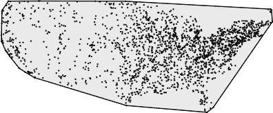

**图0.1** 阴影区域是美国城市的凸包。

在 $\mathbb{R}^n$ 中定义凸组合的元素个数 $m$ 先验地不受限制。然而，经典的卡拉西奥多里定理（Caratheodory theorem）指出，我们总可以取 $m\le n+1$。

> **定理0.0.1**（卡拉西奥多里定理）。*集合 $T\subset\mathbb{R}^n$ 凸包中的每一点都可以表示为 $T$ 中至多 $n+1$ 个点的凸组合。*

界 $n+1$ 是紧的——例如，对于单纯形（由 $n+1$ 个一般位置的点构成的集合），这正是所需要的。但如果我们只满足于近似该点而不是精确表示它呢？那么我们可以用更少的点——而且令人惊讶的是，这个数目甚至不依赖于维数！

为了界定 $\mathcal{N}$ 的基数，注意从 $N$ 个顶点中有放回地选出 $k$ 个共有 $N^k$ 种方式。因此 $|\mathcal{N}| \le N^k$。证明完毕。□

覆盖技术在许多场景中很有用。我们在4.2节将覆盖与打包联系起来，在4.3节与熵和编码联系，在7–8章与随机过程联系。但现在，让我们展示如何使用覆盖来研究体积。

你可能记得一些特殊形状如平行六面体或棱柱的体积公式。但计算一般多面体的体积并不容易，尤其是在高维空间中。尽管如此，我们有一个简单的不等式：

**定理0.0.4**（多胞体的体积）。*设 $P$ 是一个有 $N$ 个顶点的多胞体，包含在 $\mathbb{R}^n$ 的单位欧几里得球 $B$ 中。则*

$$\frac{\operatorname{Vol}(P)}{\operatorname{Vol}(B)} \le \left(3\sqrt{\frac{\log N}{n}}\right)^n. \tag{0.2}$$

*证明* 推论0.0.3表明，多胞体 $P$ 可以被至多 $N^k$ 个半径为 $1/\sqrt{k}$ 的球覆盖。每个球的体积是 $(1/\sqrt{k})^n\operatorname{Vol}(B)$。（这是因为体积在维数 $n$ 中以特殊方式缩放：将球的半径扩大 $r$ 倍，体积扩大 $r^n$ 倍。）$P$ 的体积以覆盖 $P$ 的球的总体积为上界，因此

$$\operatorname{Vol}(P) \le N^k(1/\sqrt{k})^n\operatorname{Vol}(B),$$

整理项得到

$$\frac{\operatorname{Vol}(P)}{\operatorname{Vol}(B)} \le \frac{N^k}{k^{n/2}}. \tag{0.3}$$

这个界对每个 $k \in \mathbb{N}$ 都成立。因此让我们找到最优的 $k$，即使右边最小的那个。为此，我们取对数、求导并令导数为零。这产生了最优值

$$k_0 = \frac{n}{2\log N}. \tag{0.4}$$

（验证！）将 $k=k_0$ 代入(0.3)，化简表达式，得到

$$\frac{\operatorname{Vol}(P)}{\operatorname{Vol}(B)} \le \left(\sqrt{\frac{2e\log N}{n}}\right)^n.$$

这个界甚至比我们声称的还要好。但我们的证明中有一处细微的不准确之处。你能在不继续读下去的情况下发现它吗？

$k$ 的值必须是整数，而无法保证最优值(0.4)是整数。为了修正这一不准确之处，我们可以取 $k=\lceil k_0\rceil$。将这个 $k$ 代入(0.3)，利用 $k_0 \le k \le k_0+1$，得到修正后的界

$$\frac{\operatorname{Vol}(P)}{\operatorname{Vol}(B)} \le \frac{N^{k_0+1}}{k_0^{n/2}} \le N\left(\sqrt{\frac{2e\log N}{n}}\right)^n.$$

如果 $N \le e^{n/9}$，则右边以 $\left(3\sqrt{\log(N)/n}\right)^n$ 为界，证明

“外积” $xx^{\mathsf T}$。第一种解释导致将 $X$ 的方差定义为 $\mathbb{E}\|X-\mathbb{E}X\|_2^2$，这个量在开胃菜中扮演了重要角色。第二种解释产生了更具信息量的结果：它引出了*协方差矩阵*的概念

$$\operatorname{cov}(X)=\mathbb{E}(X-\mathbb{E}X)(X-\mathbb{E}X)^{\mathsf T}$$

这是一个 $n\times n$ 矩阵，其第 $(i,j)$ 个元素等于 $\operatorname{cov}(X_i,X_j)$。我们将在[3.2](#)节中使用协方差矩阵。

### 1.4 并集界

如果 $E_i$ 是不相交事件，那么概率的可加性公理告诉我们

$$\mathbb{P}\left(\bigcup_{i=1}^{n}E_i\right)=\sum_{i=1}^{n}\mathbb{P}(E_i).$$

如果事件 $E_i$ 不是不相交的，这个等式可能不成立：属于多个事件 $E_i$ 的每个点在左边被计为一次，但在右边被计多次。因此，我们得到的是不等式而非等式：

**引理1.4.1**（并集界）。*对任意事件* $E_1,\ldots,E_n$，*我们有*

$$\mathbb{P}\left(\bigcup_{i=1}^{n}E_i\right)\leq\sum_{i=1}^{n}\mathbb{P}(E_i).$$

*证明。* 如果事件 $\bigcup_{i=1}^{n}E_i$ 发生，那么至少有一个事件 $E_i$ 发生。因此示性函数满足

$$\mathbf{1}_{\cup_{i=1}^{n}E_i}\leq\sum_{i=1}^{n}\mathbf{1}_{E_i}. \tag{1.14}$$

（右边统计有多少个 $E_i$ 发生。）现在取期望并利用[(1.9)](#)和期望的线性性完成证明。$\square$

并集界通常用于界定坏事件的概率。

**例1.4.2**（稠密随机图没有孤立顶点）。想象 $n\geq 2$ 名新生到达校园。友谊随机形成，每对学生成为朋友的概率为 $p$，且与其他所有学生对独立。我们来证明，如果 $p\geq 4\ln(n)/n$，那么以至少 $1-1/n$ 的概率，不存在没有朋友的学生。

*证明。* 将学生记为 $1,\ldots,n$，令 $E_i$ 表示学生 $i$ 没有朋友这一事件。这意味着其他 $n-1$ 名学生中没有一人与 $i$ 是朋友，并且这 $n-1$ 个悲伤的事件相互独立，每个概率为 $1-p$。因此 $\mathbb{P}(E_i)=(1-p)^{n-1}$。

我们想要界定坏事件的概率

$$B=\{\text{存在一个没有朋友的学生}\}=\bigcup_{i=1}^{n}E_i.$$

并集界给出

$$\mathbb{P}(B) \le \sum_{i=1}^{n}\mathbb{P}(E_i)=n(1-p)^{n-1}.$$

为简化该界，利用不等式 $1-p\le e^{-p}$，并回顾对 $n$ 和 $p$ 的假设。稍加计算可得 $n(1-p)^{n-1}\le 1/n$。因此，坏事件 $B$ 的补事件发生的概率至少为 $1-1/n$。

### 1.5 条件化

条件化技巧常常帮助我们计算概率和期望。该方法基于给定事件 $F$ 时事件 $E$ 的*条件概率*概念，记为

$$\mathbb{P}(E\mid F)=\frac{\mathbb{P}(E\cap F)}{\mathbb{P}(F)},$$

以及给定另一个随机变量 $Y$ 时随机变量 $X$ 的*条件期望*概念，记为 $\mathbb{E}[X\mid Y]$。

*全期望定律*表明

$$\mathbb{E}X=\mathbb{E}\left[\mathbb{E}[X\mid Y]\right]. \tag{1.15}$$

非正式地说，这个恒等式说明：要计算 $X$ 的期望，我们可以先固定 $Y$ 的值，对 $X$ 取平均，然后再对结果关于 $Y$ 取平均。这就是条件化技巧的本质。

条件化技巧也能帮助我们计算概率。若 $E$ 是任意事件，$Y$ 是随机变量，我们可以定义给定 $Y$ 时 $E$ 的条件概率为

$$\mathbb{P}(E\mid Y):=\mathbb{E}\left[\mathbf{1}_E\mid Y\right],$$

其中 $\mathbf{1}_E$ 表示事件 $E$ 的指示函数。由于 $\mathbb{E}\,\mathbf{1}_E=\mathbb{P}(E)$，全期望定律在这种情况下变为

$$\mathbb{P}(E)=\mathbb{E}\left[\mathbb{P}(E\mid Y)\right]. \tag{1.16}$$

因此，用条件化技巧计算概率时，我们首先需要在固定 $Y$ 的值的情况下求出概率，然后再对结果关于 $Y$ 取平均。

假设我们将样本空间 $\Omega$ 分解为互不相交的事件 $F_1,F_2,\ldots$。换句话说，假设每个结果恰好属于一个事件 $F_i$。那么*全概率定律*允许我们按如下方式计算任意事件 $E$ 的概率：

$$\mathbb{P}(E)=\sum_i\mathbb{P}(E\mid F_i)\mathbb{P}(F_i). \tag{1.17}$$

全概率定律可以很快地从全期望定律推出。为此，对随机变量 $Y$ 应用 (1.16)，其中若事件 $F_i$ 发生时 $Y$ 取值为 $i$。

近似。特别地，由于 \(\mathbb{R}^n\) 上的任何范数都是凸函数，詹森不等式给出

$$\|\mathbb{E}\,X\| \leq \mathbb{E}\|X\|.$$ \tag{1.19}

给定随机变量 \(X\) 的 \(L^p\) 范数随 \(p\) 递增：

$$\|X\|_{L^p} \leq \|X\|_{L^q}\qquad\text{whenever }p\leq q,$$ \tag{1.20}

见练习 [1.11]。

*闵可夫斯基不等式*指出，对任意 \(p\in[1,\infty]\) 以及任意随机变量 \(X,Y\in L^p\)，有

$$\|X+Y\|_{L^p}\leq\|X\|_{L^p}+\|Y\|_{L^p}.$$ \tag{1.21}

换句话说，\(L^p\) 范数满足三角不等式。

*柯西-施瓦茨不等式*指出，对任意随机变量 \(X,Y\in L^2\)，有

$$\|XY\|_{L^1}\leq\|X\|_{L^2}\|Y\|_{L^2}.$$

*赫尔德不等式*将此结果推广到 \(L^p\) 范数。对任意一对共轭指数 \(p,p'\in[1,\infty]\)（在 (1.5) 中引入）以及任意一对随机变量 \(X\in L^p\) 和 \(Y\in L^{p'}\)，有

$$\|XY\|_{L^1}\leq\|X\|_{L^p}\|Y\|_{L^{p'}}.$$ \tag{1.22}

回想基础概率论课程中的内容，随机变量 \(X\) 的*分布*直观上就是关于 \(X\) 以什么概率取什么值的信息。更严格地说，\(X\) 的分布由其*累积分布函数*（CDF）决定，定义为

$$F_X(t)=\mathbb{P}\{X\leq t\},\qquad t\in\mathbb{R}.$$

处理随机变量的*尾部*往往更方便，即

$$\mathbb{P}\{X>t\}=1-F_X(t).$$

下面的结果使我们能够通过尾部计算期望。

**引理 1.6.1**（积分尾部公式）。*任何非负随机变量* \(X\) *满足*

$$\mathbb{E}\,X=\int_0^\infty\mathbb{P}\{X>t\}\,dt.$$

*该等式两边要么同时有限，要么同时无限。*

⁴ 当我们从 (1.4) 中回想起 \(\ell^p\) 范数随 \(p\) 递减时，这可能会有点令人困惑。这里并没有矛盾，因为 \(\ell^p\) 范数和 \(L^p\) 范数的归一化方式不同。向量 \(x=(x_1,\ldots,x_n)\) 的 \(\ell^p\) 范数是 \(\|x\|_{\ell^p}=(\sum_{i=1}^n|x_i|^p)^{1/p}\)，而分别以概率 \(1/n\) 取值 \(x_1,\ldots,x_n\) 的随机变量 \(X\) 的 \(L^p\) 范数是 \(\|X\|_{L^p}=(\frac{1}{n}\sum_{i=1}^n|x_i|^p)^{1/p}\)。

*证明* 我们可以通过恒等式将任何非负实数 $x$ 表示为

$$x=\int_0^x 1\,dt=\int_0^\infty \mathbf{1}_{\{t<x\}}\,dt.$$

用随机变量 $X$ 替换 $x$，并对两边取期望。这给出

$$\mathbb{E}X=\mathbb{E}\int_0^\infty \mathbf{1}_{\{t<X\}}\,dt=\int_0^\infty \mathbb{E}\mathbf{1}_{\{t<X\}}\,dt=\int_0^\infty \mathbb{P}\{t<X\}\,dt.$$

在第二个等式中交换期望与积分的顺序时，我们使用了富比尼–托内利定理。证明完成。 □

反过来，马尔可夫不等式用期望来界定尾部：

**命题 1.6.2**（马尔可夫不等式）。*对任意非负随机变量 $X$ 和 $t>0$，有*

$$\mathbb{P}\{X\ge t\}\le \frac{\mathbb{E}X}{t}.$$

*证明* 固定 $t>0$。我们可以通过恒等式将任意实数 $x$ 表示为

$$x=x\mathbf{1}_{\{x\ge t\}}+x\mathbf{1}_{\{x<t\}}.$$

用随机变量 $X$ 替换 $x$ 并取期望：

$$\mathbb{E}X=\mathbb{E}X\mathbf{1}_{\{X\ge t\}}+\mathbb{E}X\mathbf{1}_{\{X<t\}}\ge t\mathbb{1}_{\{X\ge t\}}+0=t\cdot\mathbb{P}\{X\ge t\}.$$

两边同时除以 $t$，证明完成。 □

如果我们只知道 $\mathbb{E}X$，马尔可夫不等式给出的尾部界是最优的。但如果我们还知道方差，就能得到更好的、随 $t$ 二次衰减的界——并且能了解 $X$ 在其均值附近的集中程度：

**推论 1.6.3**（切比雪夫不等式）。*设 $X$ 是一个均值为 $\mu$、方差为 $\sigma^2$ 的随机变量。那么对任意 $t>0$，有*

$$\mathbb{P}\{|X-\mu|\ge t\}\le \frac{\sigma^2}{t^2}.$$

*证明* 将不等式 $|X-\mu|\ge t$ 两边平方，然后对随机变量 $(X-\mu)^2$ 应用马尔可夫不等式。 □

### 1.7 极限定理

*独立随机变量之和*的研究处于经典概率论的核心。设 $X_1,\ldots,X_N$ 是均值为 $\mu$、方差为 $\sigma^2$ 的独立同分布（i.i.d.）随机变量。那么，和的方差公式 (1.8) 给出

$$\operatorname{Var}\left(\frac{1}{N}\sum_{i=1}^{N}X_i\right)=\frac{\sigma^2}{N}. \tag{1.23}$$

## 2 独立随机变量和的集中

在本章中，我们将步入集中不等式的广阔世界。我们先在 2.1 节介绍一些动机，然后讨论关键结果——霍夫丁不等式（2.2 和 2.7 节）、切尔诺夫不等式（2.3 节）、伯恩斯坦不等式（2.9 节）和辛钦不等式（2.7 节）。

我们还介绍两类重要的分布：次高斯分布（2.6 节）和次指数分布（2.8 节）。它们是高维概率及其应用中许多结果的“自然栖息地”。

我们给出集中不等式的两个应用：2.4 节中的稳健均值估计和 2.5 节中的随机图。更多应用见本书后续内容。

请务必尝试本章末尾的练习！它们将带你系统了解更多的概念、方法、结果和应用：米尔斯比率（练习 2.3）、小球概率（练习 2.7）、勒卡姆两点法的一个版本（练习 2.17）、随机图的扩张图混合引理（练习 2.20）、随机占优（练习 2.27 和 2.28）、奥尔里奇范数（练习 2.42）、贝内特不等式（练习 2.48）等等。

### 2.1 为什么需要集中不等式？

集中不等式度量随机变量 $X$ 与其均值 $\mathbb{E}X=\mu$ 的偏差。它们通常给出 $X-\mu$ 尾部的双侧界，例如：

$\mathbb{P}\{|X-\mu|>t\}\leq$ 某个小量。

最简单的集中不等式是切比雪夫不等式（推论 1.6.3）。它非常一般，但往往太弱。让我们用二项分布的例子来说明这一点。

**问题 2.1.1.** *抛一枚均匀硬币 $N$ 次。至少得到 $\frac{3}{4}N$ 次正面的概率是多少？*

**定理 2.2.5**（Hoeffding 不等式，双侧）。 *设* $X_1,\ldots,X_N$ *为独立 Rademacher 随机变量，且* $a=(a_1,\ldots,a_N)\in\mathbb{R}^N$。*则对任意* $t>0$，*有*

$$\mathbb{P}\left\{\left|\sum_{i=1}^{N}a_iX_i\right|\ge t\right\}\le 2\exp\left(-\frac{t^2}{2\|a\|_2^2}\right).$$

我们用来证明 Hoeffding 不等式的指数矩方法相当灵活。它的适用范围远不止 Rademacher 分布这一典型例子。例如，在习题 **2.10** 中你将证明 Hoeffding 不等式对一般有界随机变量的如下推广：

**定理 2.2.6**（有界随机变量的 Hoeffding 不等式）。 *设* $X_1,\ldots,X_N$ *是独立随机变量，使得* $X_i\in[a_i,b_i]$ *对每个* $i$ *成立*。*则对任意* $t>0$，*有*

$$\mathbb{P}\left\{\sum_{i=1}^{N}(X_i-\mathbb{E}X_i)\ge t\right\}\le \exp\left(-\frac{2t^2}{\sum_{i=1}^{N}(b_i-a_i)^2}\right).$$

### 2.3 Chernoff 不等式

Hoeffding 不等式对 Rademacher 随机变量非常紧，但对一般有界随机变量可能过于保守。例如，当伯努利随机变量 $X_i$ 的均值 $p_i$ 很小时，它们的和近似服从泊松分布（定理 **1.7.6**）。Hoeffding 不等式（定理 **2.2.6**）没有考虑到较小的 $p_i$，从而给出一个与真实泊松尾部相差甚远的高斯界。让我们证明一个对 $p_i$ 的大小敏感的界：

**定理 2.3.1**（Chernoff 不等式）。 *设* $X_i$ *是以参数 $p_i$ 独立的伯努利随机变量。考虑它们的和* $S_N=\sum_{i=1}^{N}X_i$ *并将其均值记为* $\mu=\mathbb{E}S_N$。*则*

$$\mathbb{P}\{S_N\ge t\}\le e^{-\mu}\left(\frac{e\mu}{t}\right)^t\qquad\text{对任意 }t\ge\mu.$$

*证明*  我们将使用与证明 Hoeffding 不等式（定理 **2.2.1**）时相同的指数矩方法。和之前一样，我们将不等式 $S_N>t$ 乘以 $\lambda>0$，再取指数，然后应用马尔可夫不等式并利用独立性，得到 (**2.6**)：

$$\mathbb{P}\{S_N\ge t\}\le e^{-\lambda t}\prod_{i=1}^{N}\mathbb{E}\exp(\lambda X_i). \tag{2.9}$$

剩下的工作是对每个伯努利随机变量 $X_i$ 的矩母函数进行上界估计。由于它以概率 $p_i$ 取值为 $1$，以概率 $1-p_i$ 取值为 $0$，我们有

$$\mathbb{E}\exp(\lambda X_i)=e^{\lambda}p_i+(1-p_i)=1+(e^{\lambda}-1)p_i\le\exp\left[(e^{\lambda}-1)p_i\right].$$

左尾 $\mathbb{P}\{S_N \le (1-\delta)\mu\}$ 可以使用 **注 2.3.2** 类似地进行上界估计。（试试看！你会得到一个更好的界：$\exp(-\delta^2\mu/2)$。）通过并集界将两个尾部结合起来，即可完成证明。

为了在**推论 2.3.4** 中看到高斯尾部，尝试像中心极限定理那样对 $S_N$ 进行大致归一化。如果我们令 $Z_N=(S_N-\mu)/\sqrt{\mu}$，则可以将**推论 2.3.4** 的结论改写如下：

\[\mathbb{P}\{|Z_N|\ge t\}\le 2\exp(-t^2/3)\quad\text{对任意 }0\le t\le\sqrt{\mu}.\]

**注 2.3.5**（小偏差与大偏差）。 图 **2.1** 展示了 $N=200$、$\mu=10$ 时 Binom$(N,\mu/N)$ 的概率质量函数。在均值 $\mu$ 附近，钟形曲线反映了高斯行为；远离右侧，较慢的衰减反映了泊松行为。这两种区域分别与中心极限定理和泊松极限定理一致。

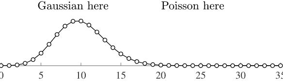

**图 2.1** 分布 Binom$(N,\mu/N)$ 的概率质量函数，其中 $N=200$，$\mu=10$。它在均值 $\mu$ 附近近似正态，但更重且离均值更远。

### 2.4 应用：均值中位数估计量

数据科学中的一个基本问题是根据样本学习未知分布——例如，通过对 $N$ 人的调查来推断一个国家的收入分布。

最基本的任务是估计均值。设 $X$ 是一个均值为 $\mu$、方差为 $\sigma^2$ 的随机变量（代表总体），并设 $X_1,\ldots,X_N$ 是 $X$ 的独立副本¹（代表样本）。我们希望找到一个估计量 $\hat{\mu}=\hat{\mu}(X_1,\ldots,X_N)$，使得它以高概率满足 $\hat{\mu}\approx\mu$。

最简单且最常用的均值估计量是*样本均值*

\[\hat{\mu}:=\frac{1}{N}\sum_{i=1}^{N}X_i.\tag{2.11}\]

该估计量的期望和方差分别为

\[\mathbb{E}\,\hat{\mu}=\mu;\qquad \operatorname{Var}(\hat{\mu})=\frac{1}{N^2}\sum_{i=1}^{N}\operatorname{Var}(X_i)=\frac{\sigma^2}{N}.\tag{2.12}\]

¹ $X$ 的独立副本是与 $X$ 同分布的独立随机变量。

图中一个顶点的*度*是与它相连的边数。在 $G(n,p)$ 中，每个顶点的期望度等于

$$(n-1)p=:d.$$

（为什么？）我们将证明，相对*稠密*的图（即满足 $d \gtrsim \log n$ 的图）以高概率*几乎正则*，这意味着所有顶点的度都近似等于 $d$。

**命题 2.5.1**（稠密图几乎正则）。 *存在一个绝对常数 $C$，使得下述结论成立。* 考虑一个随机图 $G \sim G(n,p)$，其期望度满足 $d \ge C \log n$。那么，以至少 $0.99$ 的概率发生以下事件：$G$ 的所有顶点的度都在 $0.9d$ 和 $1.1d$ 之间。

*证明.* 论证是集中不等式与并集界的结合。固定图中的一个顶点 $i$。$i$ 的度记为 $d_i$，它是 $n-1$ 个独立的 $\operatorname{Ber}(p)$ 随机变量（与 $i$ 关联的边的指示变量）之和。应用 Chernoff 不等式（推论 2.3.4），我们得到

$$\mathbb{P}\{|d_i-d|\ge 0.1d\}\le 2e^{-cd}.$$

这个界对每个固定顶点 $i$ 都成立。接下来，我们可以对所有 $n$ 个顶点使用并集界（引理 1.4.1），从而“解除固定”$i$。我们得到

$$\mathbb{P}\{\exists i\le n:\ |d_i-d|\ge 0.1d\}\le \sum_{i=1}^{n}\mathbb{P}\{|d_i-d|\ge 0.1d\}\le n\cdot 2e^{-cd}.$$

如果对某个足够大的绝对常数 $C$ 有 $d\ge C\log n$，则该概率不超过 $0.01$。这意味着以 $0.99$ 的概率发生补事件：$\forall i\le n: |d_i-d|<0.1d$。证明完毕。 $\square$

**注 2.5.2**（稀疏图远非正则）。 你可能会想，命题 2.5.1 中的条件 $d\gtrsim\log n$ 是否是最优的。确实如此：如果 $d<(1-\varepsilon)\ln n$，则会出现一个孤立顶点（习题 1.10 中的“没有朋友的学生”），使得最小度为零。如果你还没有完成习题 1.9 和 1.10，现在可以试一试它们，以及习题 2.18–2.20。

### 2.6 次高斯分布

让我们重新审视关于独立随机变量 $X_i$ 之和的 Hoeffding 不等式：

$$\mathbb{P}\left\{\left|\sum_{i=1}^{N}a_iX_i\right|\ge t\right\}\le 2\exp\left(-\frac{ct^2}{\|a\|_2^2}\right) \quad\text{对任意 } t\ge 0. \tag{2.14}$$

该结果对 Rademacher 随机变量 $X_i$（定理 2.2.1）成立，更一般地，对任意零均值有界随机变量 $X_i$（定理 2.2.6）成立，也对标准正态随机变量 $X_i$ 成立（为什么？）。

这让我们思考：对于哪些最大的分布类，

### 2.7.2 次高斯 Khintchine 不等式

我们来建立另一个经典结果：独立随机变量之和的 $L^p$ 范数的双边界。

**定理 2.7.5（Khintchine 不等式）。** 设 $X_1,\ldots,X_N$ 是均值为零、方差为 1 的独立次高斯随机变量，且 $a_1,\ldots,a_N\in\mathbb{R}$。则对任意 $p\in[2,\infty)$，有

$$\left(\sum_{i=1}^{N}a_i^2\right)^{1/2}\leq\left\|\sum_{i=1}^{N}a_iX_i\right\|_{L_p}\leq CK\sqrt{p}\left(\sum_{i=1}^{N}a_i^2\right)^{1/2}.$$

其中 $K=\max_i\|X_i\|_{\psi_2}$，$C$ 为绝对常数。

*证明*  对于 $p=2$，我们实际上有等式，因为勾股恒等式 (2.19) 结合单位方差假设给出

$$\left\|\sum_{i=1}^{N}a_iX_i\right\|_{L_2}=\left(\sum_{i=1}^{N}a_i^2\|X_i\|_{L_2}^2\right)^{1/2}=\left(\sum_{i=1}^{N}a_i^2\right)^{1/2}.$$

然后，定理中的下界由 $L^p$ 范数的单调性 (1.20) 得出。对于上界，使用命题 2.7.1：

$$\left\|\sum_{i=1}^{N}a_iX_i\right\|_{\psi_2}\leq C\left(\sum_{i=1}^{N}a_i^2\|X_i\|_{\psi_2}^2\right)^{1/2}\leq CK\left(\sum_{i=1}^{N}a_i^2\right)^{1/2},$$

最后应用命题 2.6.6(ii) 即可完成。

你将在习题 2.36 中把 Khintchine 不等式推广到 $p\in[1,2]$ 的情形。

### 2.7.3 次高斯变量的最大值

到目前为止，我们关注的是随机变量的*和*。但其他可能是非线性的函数呢？我们将在第 5 章深入探讨它们。现在，我们先举一个例子：命题 2.7.1 的一个针对*最大值*的版本。

**命题 2.7.6（次高斯变量的最大值）。** 设 $X_1,\ldots,X_N$ 是次高斯随机变量，其中 $N\geq 2$，且它们不一定独立。则

$$\left\|\max_{i\leq N}X_i\right\|_{\psi_2}\leq C\sqrt{\log N}\,\max_{i\leq N}\|X_i\|_{\psi_2}. \tag{2.21}$$

*特别地，我们有*

$$\mathbb{E}\max_{i\leq N}X_i\leq CK\sqrt{\log N}. \tag{2.22}$$

其中 $K=\max_{i\leq N}\|X_i\|_{\psi_2}$。显然，同样的界对 $\max_i|X_i|$ 也成立。（为什么？）

*证明*  我们给出 (2.21) 的两种不同证明；任选一种你喜欢的。

### 2.9 伯恩斯坦不等式

我们准备陈述并证明霍夫丁不等式（定理 [2.7.3](#)）的一个版本，它适用于次指数分布：

**定理 2.9.1**（次指数伯恩斯坦不等式）。*设* $X_1,\ldots,X_N$ *为独立、零均值、次指数随机变量。那么，对任意* $t\ge 0$，*有*

$$\mathbb{P}\left\{\left|\sum_{i=1}^{N}X_i\right|\ge t\right\}\le 2\exp\left[-c\min\left(\frac{t^2}{\sum_{i=1}^{N}\|X_i\|_{\psi_1}^2},\frac{t}{\max_i\|X_i\|_{\psi_1}}\right)\right].$$

其中 $c>0$ 是一个绝对常数。

如果这个界看起来有点吓人，别担心——我们会在证明之后分解并简化它。

**证明。** 我们使用指数矩方法，这是在霍夫丁和切尔诺夫不等式的证明（定理 [2.2.1](#) 和 [2.3.1](#)）中学到的。记 $S_N=\sum_{i=1}^{N}X_i$，将不等式 $S_N\ge t$ 两边乘以参数 $\lambda\ge 0$，再取指数，并使用马尔可夫不等式和独立性。这导致 (2.9)：

$$\mathbb{P}\{S_N\ge t\}\le e^{-\lambda t}\prod_{i=1}^{N}\mathbb{E}\exp(\lambda X_i). \tag{2.27}$$

为了给出每一项 $X_i$ 的矩生成函数的界，我们使用命题 [2.8.1](#) 中的性质 **(iv)**。它表明，若 $\lambda$ 足够小以至于

$$|\lambda|\le \frac{c}{\max_i\|X_i\|_{\psi_1}}, \tag{2.28}$$

则8 $\mathbb{E}\exp(\lambda X_i)\le \exp(C\lambda^2\|X_i\|_{\psi_1}^2)$。将其代入 (2.27)，我们得到

$$\mathbb{P}\{S_N\ge t\}\le \exp(-\lambda t+C\lambda^2\sigma^2),\qquad \text{其中 }\sigma^2=\sum_{i=1}^{N}\|X_i\|_{\psi_1}^2.$$

现在我们在约束 (2.28) 下关于 $\lambda$ 最小化这个表达式。最优选择是 $\lambda=\min\left(\frac{t}{2C\sigma^2},\frac{c}{\max_i\|X_i\|_{\psi_1}}\right)$，此时我们得到

$$\mathbb{P}\{S_N\ge t\}\le \exp\left[-\min\left(\frac{t^2}{4C\sigma^2},\frac{ct}{2\max_i\|X_i\|_{\psi_1}}\right)\right].$$

对 $-X_i$ 而不是 $X_i$ 重复这一论证，我们得到 $\mathbb{P}\{-S_N\ge t\}$ 的相同界。将这两个界合并，证明完成。

为了使定理 [2.9.1](#) 更方便，我们将其应用于 $a_iX_i$ 而不是 $X_i$。这就得到次指数分布情形下 (2.20) 的一个版本：

8 回忆命题 [2.8.1](#) 和次指数范数的定义，性质 **(iv)** 对 $K_4$ 的某个值成立，该值在 $\|X\|_{\psi_1}$ 的一个绝对常数因子范围内。

2.14 🐁🐁 **（切尔诺夫不等式：小偏差）** 我们来推广推论 2.3.4。设 $X_i$ 为参数为 $p_i$ 的独立伯努利随机变量。考虑它们的和 $S_N = \sum_{i=1}^N X_i$，并记其均值为 $\mu = \mathbb{E}S_N$。证明

$$\mathbb{P}\{|S_N-\mu|\ge \delta\mu\}\le 2\exp\left(-\frac{\delta^2\mu}{2+\delta}\right) \quad\text{对任意 }\delta\ge 0.$$

2.15 🐁 **（切尔诺夫不等式：有界随机变量）** 论证切尔诺夫不等式的所有版本（定理 2.3.1、注记 2.3.2 和推论 2.3.4）对于任意取值于区间 $[0,1]$ 且均值为 $p_i$ 的独立随机变量 $X_i$ 都成立。

2.16 🐁🐁 **（均值中位数：修正证明）** 定理 2.4.1 的证明略有缺陷：$B=t^2/4$ 可能不是能整除 $N$ 的整数。请修正这一点。

2.17 🐁🐁🐁 **（不存在处处次高斯的均值估计量）** 你可能想知道定理 2.4.1 是否对所有 $t>0$ 都成立。事实并非如此。实际上，任何均值估计量都不能对所有分位数提供次高斯置信度。*反驳*以下断言：

> > “存在一个绝对常数 $c>0$，使得以下结论成立：对任意整数 $N>0$ 和任意 $t\ge 0$，可以找到一个函数 $\hat{\mu}:\mathbb{R}^N\to\mathbb{R}$ 满足
> >
> > $$\mathbb{P}\left\{\left|\hat{\mu}(X_1,\ldots,X_N)-\mu\right|\ge \frac{t\sigma}{\sqrt{N}}\right\}\le 2e^{-ct^2}$$
> >
> > 对所有均值为 $\mu$、方差为 $\sigma^2$ 的独立同分布随机变量 $X_1,\ldots,X_N$ 都成立。”

请通过推导 *Le Cam 两点法*的一个版本来完成：

- (a) 考虑两个随机向量 $X=(X_1,\ldots,X_N)$ 和 $Y=(Y_1,\ldots,Y_N)$，其坐标独立且服从拉普拉斯¹⁰分布：对某个 $\mu>0$，$X_i\sim\operatorname{Lap}(0,1)$，$Y_i\sim\operatorname{Lap}(\mu,1)$。验证对任意可测子集 $B\subset\mathbb{R}^N$，有 $\mathbb{P}\{X\in B\}\le e^\mu\mathbb{P}\{Y\in B\}$。
- (b) 反设该断言成立。应用它来给出事件 $|\hat{\mu}(X)|\ge \mu/2$ 和 $|\hat{\mu}(Y)-\mu|\ge \mu/2$ 的概率的界。
- (c) 选取足够大的 $\mu$，并利用 (a) 将 $Y$ 替换为 $X$，使得事件 $|\hat{\mu}(X)|<\mu/2$ 和 $|\hat{\mu}(X)-\mu|<\mu/2$ 都很有可能发生。然后使用三角不等式得到矛盾。

2.18 🐁 **（稀疏随机图的大部分度数没问题）** 在习题 1.10 中，我们看到一个典型的稀疏随机图 $G\sim G(n,p)$ 有孤立顶点（“没有朋友的学生”），导致最小度数为零。然而，大部分顶点的度数仍然接近期望度数 $d=(n-1)p$。证明：存在绝对常数 $C>0$，使得若 $d\ge C$，则以下事件以至少 $0.99$ 的概率发生：至少 $99\%$ 的顶点的度数介于 $0.9d$ 和 $1.1d$ 之间。

2.19 🐁🐁🐁🐁🐁 **（稀疏随机图的最大度数）** 在习题 1.10 中，我们观察到典型的稀疏随机图 $G\sim G(n,p)$ 的最小度数为零。但最大度数（“最受欢迎学生的朋友数量”）呢，记为

¹⁰ 拉普拉斯分布 $\operatorname{Lap}(\mu,1)$ 的概率密度函数为 $\frac{1}{2}e^{-|x-\mu|}$，其中 $x\in\mathbb{R}$。其均值为 $\mu$，方差为 $2$。（请验证！）

根据 $E_n$ 是否发生来对事件进行拆分，我们得到

$$\mathbb{P}\{\sqrt{n}\langle X,v\rangle\le t\}\le \mathbb{P}\{\sqrt{n}\langle X,v\rangle\le t\text{ 且 }E_n\}+\mathbb{P}(E_n^c)$$
$$\le \mathbb{P}\{g_1\le t_n\}+p_n.$$

因此

$$\mathbb{P}\{\sqrt{n}\langle X,v\rangle\le t\}-\mathbb{P}\{g_1\le t\}\le \mathbb{P}\{g_1\in[t,t_n]\}+p_n. \tag{3.18}$$

$g_1$ 在 $[t,t_n]$ 上的密度以 $e^{-t^2/2}$ 为界，因此

$$(3.18)\le e^{-t^2/2}(t_n-t)+p_n=e^{-t^2/2}\frac{\ln n}{\sqrt n}+p_n\le \frac{C\ln n}{\sqrt n}+p_n.$$

右端不依赖于 $v$ 或 $t$，并且当 $n\to\infty$ 时趋于零。类似的论证给出了 $\mathbb{P}\{g_1\le t\}-\mathbb{P}\{\sqrt{n}\langle X,v\rangle\le t\}$ 的一个同样趋于零的界。（请自行完成！）将这两个界合并，证明完成。

**注记 3.3.10**（球面上的一维边际密度）。半径为 $\sqrt n$ 的球面上的均匀分布的一维边际密度可以计算出来。正如你将在习题 $3.27$ 中看到的，它与 $(1-x^2/n)^{\frac{n-3}{2}}$ 成正比。当 $n$ 很大时，这近似于 $e^{-x^2/2}$，与高斯极限一致。

### 3.3.4 凸集上的均匀分布

这个例子来自凸几何和计算几何。一个有非空内部的有界凸集 $K\subset\mathbb{R}^n$ 被称为*凸体*。设 $X$ 为均匀分布于 $K$ 中的随机向量：

$$X\sim\operatorname{Unif}(K).$$

$X$ 的密度在 $K$ 上等于 $1/\operatorname{Vol}(K)$，在其他地方为零。$X$ 的均值，

$$\mu=\mathbb{E}X=\frac{1}{\operatorname{Vol}(K)}\int_K x\,dx,$$

是 $K$ 的重心。若 $\Sigma=\operatorname{cov}(X)$ 是 $K$ 的协方差矩阵，则标准得分 $Z:=\Sigma^{-1/2}(X-\mu)$ 是一个各向同性随机向量，正如我们在 $(3.10)$ 中注意到的。此外，$Z$ 均匀分布于 $K$ 的仿射变换后的副本中：

$$Z\sim\operatorname{Unif}\left(\Sigma^{-1/2}(K-\mu)\right).$$

（为什么？）总而言之，我们找到了一个仿射变换 $T$，使得 $T(K)$ 上的均匀分布是各向同性的。凸体 $T(K)$ 本身通常也被称为各向同性凸体。

在算法凸几何中，我们可以将各向同性凸体 $T(K)$ 视为 $K$ 的一个良态版本，其中 $T$ 起到*预条件子*的作用（见图 $3.6$）。当 $K$ 良态时，诸如求 $K$ 的体积之类的算法通常表现更好。

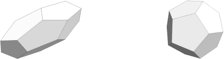

**图 3.6** 凸体 $K$（左）被变换为各向同性凸体 $T(K)$（右）。预条件子为 $T=\Sigma^{-1/2}$，其中 $\Sigma$ 是 $K$ 的协方差矩阵。

## 3.3.5 框架

框架的概念在信号处理中被广泛使用，它推广了基的概念，但去掉了线性无关的要求。框架与离散各向同性分布有着密切的联系：

**命题 3.3.11**（Parseval 框架）。*对任意向量* $u_1,\ldots,u_N\in\mathbb{R}^n$，*以下条件等价：*

- (i)（Parseval 恒等式）对每个 $x\in\mathbb{R}^n$，$\|x\|^2=\sum_{i=1}^N\langle u_i,x\rangle^2$。
- (ii)（框架展开）对每个 $x\in\mathbb{R}^n$，$x=\sum_{i=1}^N\langle u_i,x\rangle u_i$。
- (iii)（恒等分解）$I_n=\sum_{i=1}^N u_i u_i^\mathsf{T}$。
- (iv)（各向同性）随机向量 $X\sim\operatorname{Unif}\{\sqrt{N}u_1,\ldots,\sqrt{N}u_N\}$ 是各向同性的。

满足这些等价性质的向量组称为 Parseval 框架。

*证明。* **(i)$\Rightarrow$(iv)** (i) 中的恒等式可以写成

$$\|x\|^2=\frac{1}{N}\sum_{i=1}^N\langle\sqrt{N}u_i,x\rangle^2=\mathbb{E}\langle X,x\rangle^2.$$

由于这对所有 $x\in\mathbb{R}^n$ 都成立，根据 (3.9)，随机向量 $X$ 是各向同性的。

**(iv)$\Rightarrow$(iii)** 因为 $X$ 的各向同性意味着

$$I_n=\mathbb{E}XX^\mathsf{T}=\frac{1}{N}\sum_{i=1}^N(\sqrt{N}u_i)(\sqrt{N}u_i)^\mathsf{T}=\sum_{i=1}^N u_i u_i^\mathsf{T}.$$

**(iii)$\Rightarrow$(ii)** 通过在两边乘以 $x$ 得到。最后，**(ii)$\Rightarrow$(i)** 通过与 $x$ 取内积得到。

**例 3.3.12**（坐标分布）。$\mathbb{R}^n$ 中的标准基 $\{e_1,\ldots,e_n\}$ 是一个 Parseval 框架。因此，*坐标随机向量*

$$X\sim\operatorname{Unif}\{\sqrt{n}e_1,\ldots,\sqrt{n}e_n\},$$

是各向同性的。在所有高维分布中，高斯分布通常是最容易处理的——可以把它视为“最好的”。而坐标分布由于高度离散，通常是“最差的”。

**例 3.3.13**（梅赛德斯-奔驰框架）。一个不是线性无关的 Parseval 框架的标志性例子是半径为 $\sqrt{2/N}$ 的圆上 $N$ 个等距点组成的集合，如图 3.7 所示（试试习题 3.30）。

## 3.2 矩阵及其运算

由 $m \times n$ 个数 $a_{ij}$（$i=1,2,\ldots,m;\ j=1,2,\ldots,n$）排成的 $m$ 行 $n$ 列的数表，称为 $m$ 行 $n$ 列矩阵，简称 $m \times n$ 矩阵。为表示它是一个整体，总是加一个括弧，并用大写黑体字母表示它，记作

$$A = (a_{ij})_{m \times n}$$

这 $m \times n$ 个数称为矩阵 $A$ 的元素，简称为元，数 $a_{ij}$ 位于矩阵 $A$ 的第 $i$ 行第 $j$ 列，称为矩阵 $A$ 的 $(i,j)$ 元。

元素是实数的矩阵称为实矩阵，元素是复数的矩阵称为复矩阵。

行数与列数都等于 $n$ 的矩阵称为 $n$ 阶矩阵或 $n$ 阶方阵。

只有一行的矩阵

$$A = [a_1, a_2, \ldots, a_n]$$

称为行矩阵，又称行向量。

只有一列的矩阵

$$B = [b_1; b_2; \ldots; b_m]$$

称为列矩阵，又称列向量。

两个矩阵行数相等、列数也相等时，就称它们是同型矩阵。

如果 $A = (a_{ij})$ 与 $B = (b_{ij})$ 是同型矩阵，并且它们的对应元素相等，即

$$a_{ij} = b_{ij} \quad (i=1,2,\ldots,m;\ j=1,2,\ldots,n)$$

那么就称矩阵 $A$ 与矩阵 $B$ 相等，记作

$$A = B$$

元素都是零的矩阵称为零矩阵，记作 $O$。注意不同型的零矩阵是不同的。

等价地，考虑一个随机向量

$$X = \theta \mu + g$$

其中 $\theta$ 是 Rademacher 随机变量，$g \sim N(0, I_n)$，且 $\theta$ 与 $g$ 独立。抽取独立同分布于 $X$ 的随机向量样本 $X_1,\dots,X_m$。则该样本服从高斯混合模型分布；参见图 4.5 的图示。

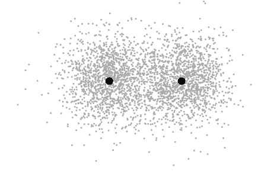

**图 4.5** 从高斯混合模型中抽取的 $m = 3000$ 个点，其均值 $-\mu$ 和 $\mu$ 以两个大黑点表示，其中 $\mu = (-1.6, 0)$。

给定高斯混合模型的 $m$ 个样本点，我们的目标是找出哪些点属于哪个簇。为此，我们可以使用 3.2.2 节中为网络引入的*谱聚类*算法的一种变体。

为了理解为什么谱方法在这里会有效，注意到 $X$ 的分布不是各向同性的，而是沿着 $\mu$ 方向（图 4.5 中的水平方向）拉伸的。因此，我们可以通过计算数据的第一主成分——即样本协方差矩阵最大特征值对应的特征向量——来近似找到 $\mu$。接下来，我们将数据点投影到该主成分上，并根据它们位于原点的哪一侧进行分类。算法如下：

### 谱聚类算法

- **输入：** $\mathbb{R}^n$ 中的点 $X_1, \dots, X_m$
- **输出：** 将这些点分成两个簇的一个划分

1. 计算样本协方差矩阵 $\Sigma_m = \frac{1}{m} \sum_{i=1}^m X_i X_i^\top$。
2. 计算最大特征向量 $v = v_1(\Sigma_m)$。
3. 根据 $\langle X_i, v \rangle$ 的符号将点 $X_i$ 分成两组。

**定理 4.7.5**（高斯混合模型的谱聚类）。*从均值为 $\mu$ 和 $-\mu$ 的高斯混合模型中取点 $X_1,\dots,X_m \in \mathbb{R}^n$。如果 $m \ge C n$ 且 $\|\mu\|_2 \ge C$，则以至少 0.99 的概率，谱*

- (c) 反之，证明对任意 $\varepsilon > 0$：

  $$\mathcal{N}(\mathcal{M}_{m,n,r},\|\cdot\|_F,\varepsilon)\geq\left(\frac{c}{\varepsilon}\right)^{\frac{1}{2}(m+n)r}.$$

### 4.5.1 ☕☕☕☕（高斯混合模型的谱聚类）

证明定理 4.7.5，该定理保证谱聚类能够学习高斯混合模型。步骤如下：

- (a) 计算 $X$ 的协方差矩阵 $\Sigma$，并注意到最大特征向量 $u$ 与 $\mu$ 共线。
- (b) 由此得出结论：$\langle X_i,u\rangle$ 的符号能正确分类大多数点 $X_i$。
- (c) 利用协方差估计的结果证明样本协方差矩阵 $\widehat{\Sigma}_m$ 近似于 $\Sigma$。
- (d) 利用 Davis-Kahan 不等式（定理 4.1.15）推出最大特征向量 $v=v_1(\widehat{\Sigma}_m)$ 近似于 $u$。
- (e) 利用 (b)，得出结论：$\langle X_i,v\rangle$ 的符号能正确分类大多数点 $X_i$。

我们不在此书中证明等周不等式（定理 5.1.4 和 5.1.5）；本章的文献注释列出了这些结果的若干已知证明。

## 5.1.3 球面上集合的膨胀

等周不等式导致了一个显著且违反直觉的结果：如果集合 $A$ 在面积上覆盖了球面至少一半，那么它的 $\varepsilon$-邻域 $A_\varepsilon$ 将覆盖球面的大部分。我们将陈述并证明这一“膨胀”现象，然后尝试直观地解释它。为了根据定理 5.1.3 简化问题，我们将使用半径为 $\sqrt{n}$ 的球面，而不是单位球面。

**引理 5.1.6（膨胀）。** 设 $A$ 是球面 $\sqrt{n}S^{n-1}$ 的一个子集，并设 $\sigma$ 表示该球面上的归一化面积。若 $\sigma(A) \ge 1/2$，那么，⁶ 对每个 $t \ge 0$，$\sigma(A_t) \ge 1 - 2\exp(-ct^2)$。

*证明* 考虑由第一个坐标定义的半球：$H := \{x \in \sqrt{n}S^{n-1} : x_1 \le 0\}$。

由假设，$\sigma(A) \ge 1/2 = \sigma(H)$，因此等周不等式（定理 5.1.5）蕴含 $\sigma(A_t) \ge \sigma(H_t)$。(5.1)

半球 $H$ 的邻域 $H_t$ 是一个球冠，我们可以直接计算它的面积。不过，改用定理 3.4.5 更容易，它指出随机向量 $X \sim \mathrm{Unif}(\sqrt{n}S^{n-1})$ 是次高斯的，且 $\|X\|_{\psi_2} \le C$。由于 $\sigma$ 是球面上的均匀概率测度，故 $\sigma(H_t) = \mathbb{P}\{X \in H_t\}$。

现在，邻域的定义蕴含 $H_t \supset \{x \in \sqrt{n}S^{n-1} : x_1 \le t/\sqrt{2}\}$。(5.2)

（请验证这一点——画个图会有帮助。）因此 $\sigma(H_t) \ge \mathbb{P}\{X_1 \le t/\sqrt{2}\} \ge 1 - 2\exp(-ct^2)$。

最后一个不等式成立，是因为 $\|X_1\|_{\psi_2} \le \|X\|_{\psi_2} \le C$。由 (5.1)，引理得证。

**注 5.1.7（一个更剧烈的膨胀）。** 引理 5.1.6 中面积的 $1/2$ 值是任意的，可以用任何常数代替，甚至可以用一个指数小量代替！在练习 5.3 中验证这一点。

⁶ 这里集合 $A$ 的邻域 $A_t$ 的定义与之前相同，即 $A_t := \{x \in \sqrt{n}S^{n-1} : \exists y \in A \ \text{使得}\ \|x-y\|_2 \le t\}$。

## 5.2.2 汉明立方体

基于等周的方法也适用于汉明立方体上的集中性：

$(\{0,1\}^n, d, \mathbb{P})$,

（回顾定义 4.2.14），其中 $d(x,y)$ 是归一化汉明距离，衡量二进制串 $x$ 和 $y$ 的位不同的比例：

$d(x,y) = \frac{1}{n} |\{i : x_i \ne y_i\}|$。

测度 $\mathbb{P}$ 是立方体上的均匀概率测度：

对任意 $A \subset \{0,1\}^n$，$\mathbb{P}(A) = |A| / 2^n$。

### 定理 5.2.5（汉明立方体上的集中性）

考虑随机向量 $X \sim \mathrm{Unif}\{0,1\}^n$。（因此 $X$ 的坐标是独立的 $\mathrm{Ber}(1/2)$ 随机变量。）则对任意函数 $f : \{0,1\}^n \to \mathbb{R}$，我们有

$\|f(X) - \mathbb{E}f(X)\|_{\psi_2} \le C \|f\|_{\mathrm{Lip}} / \sqrt{n}$。(5.6)

该结果可由汉明立方体上的等周不等式推出，其极小化集已知为汉明球——即关于汉明距离的单点邻域。（试着推导一下！）

## 5.2.3 对称群

对称群 $S_n$ 也有类似的结果成立，$S_n$ 是 $n$ 个符号 $\{1,\ldots,n\}$ 的所有 $n!$ 个置换构成的集合。我们可以把对称群看作一个度量测度空间

$(S_n, d, \mathbb{P})$。

这里 $d(\pi,\rho)$ 是归一化汉明距离——即排列 $\pi$ 和 $\rho$ 在不同符号上所占的比例：

$d(\pi,\rho) = \frac{1}{n} |\{i : \pi(i) \ne \rho(i)\}|$。

测度 $\mathbb{P}$ 是 $S_n$ 上的均匀概率测度，即对任意 $A \subset S_n$，$\mathbb{P}(A) = |A| / n!$。

### 定理 5.2.6（对称群上的集中性）

考虑随机置换 $X \sim \mathrm{Unif}(S_n)$ 和函数 $f : S_n \to \mathbb{R}$。则集中不等式 (5.6) 成立。

对任意 $u$，$u^\mathrm{T}(aI_n - X)u \ge 0$ 意味着 $aI_n - X \succeq 0$，从而 $X \preceq aI_n$。类似论证给出 $X \succeq -aI_n$，同时也证明了相反方向（把它写出来！）。（d）通过考虑 $g - f$，我们可以假设 $f = 0$。若 $\|X\| \le a$，则 $X$ 的所有特征值满足 $|\lambda_i| \le a$（由 (4.10)），根据假设这意味着 $g(\lambda_i) \ge 0$。因此，按定义，$g(X)$ 的特征值 $g(\lambda_i)$ 非负，所以 $g(X) \succeq 0$。□

**注 5.4.5**（算子范数作为矩阵的“绝对值”）。（5.12）看起来眼熟吗？它是关于绝对值的基本事实的矩阵版本：对 $x \in \mathbb{R}$，$|x| \le a \iff -a \le x \le a$。这使得算子范数 $\|\cdot\|$ 成为绝对值 $|\cdot|$ 的自然矩阵版本，也正是它出现在矩阵 Bernstein 不等式 5.4.1 中的原因。

**注 5.4.6**（矩阵单调性）。我们能否将迹单调性（命题 5.4.4(b)）加强为矩阵单调性，即对任意非递减函数 $f : \mathbb{R} \to \mathbb{R}$，有 $X \preceq Y \implies f(X) \preceq f(Y)$？(5.13) 若 $X$ 和 $Y$ 可交换，答案是肯定的——但一般来说不行（练习 5.17）。然而，某些函数，如 $[0,\infty)$ 上的 $1/x$ 和 $\log x$，是*矩阵单调的*，这意味着 (5.13) 对不可交换矩阵也成立：$0 \preceq X \preceq Y \implies X^{-1} \succeq Y^{-1} \succeq 0$，且当 $X$ 可逆时，$\log X \preceq \log Y$。请在练习 5.18 中验证这一点。

## 5.4.2 迹不等式

到目前为止，将标量概念推广到矩阵一直相当顺利，但这并非总能成功。我们已在注 5.4.6 中看到，非交换性（$AB \ne BA$）如何导致标量性质对矩阵失效。另一个例子是：恒等式 $e^{x+y}=e^x e^y$ 对标量成立，但在练习 5.19 中，你将找到 $n \times n$ 对称矩阵 $X$ 和 $Y$，使得 $e^{X+Y} \ne e^X e^Y$。这很不幸，因为恒等式 $e^{x+y}=e^x e^y$ 对我们处理随机变量和的集中性至关重要：它让我们把和的矩生成函数 $\mathbb{E}\exp(\lambda S)$ 拆成指数函数的乘积，见 (2.6)。然而，对于缺失的恒等式 $e^{X+Y}=e^X e^Y$，存在有用的替代品。我们在此不加证明地陈述其中两个；它们属于丰富的*迹不等式*族。

**定理 5.4.7**（Golden-Thompson 不等式）。对任意 $n \times n$ 对称矩阵 $A$ 和 $B$，我们有 $\mathrm{tr}(e^{A+B}) \le \mathrm{tr}(e^A e^B)$。遗憾的是，Golden-Thompson 不等式对三个或更多矩阵不成立：一般来说，不等式 $\mathrm{tr}(e^{A+B+C}) \le \mathrm{tr}(e^A e^B e^C)$ 可能失效。

由于 $e^{\lambda S}$ 的特征值均为正，$e^{\lambda S}$ 的最大特征值受所有特征值之和（即 $e^{\lambda S}$ 的迹）的约束，由此得到

$E \le \mathbb{E}\,\mathrm{tr}\,e^{\lambda S}$.

### 第 2 步：应用 Lieb 不等式

为了准备应用 Lieb 不等式（引理 5.4.9），让我们从和 $S$ 中分离出最后一项：

$E \le \mathbb{E}\,\mathrm{tr}\,\exp\left[\sum_{i=1}^{N-1} \lambda X_i + \lambda X_N\right]$.

对 $(X_i)_{i=1}^{N-1}$ 取条件，并将引理 5.4.9 应用于固定矩阵 $H := \sum_{i=1}^{N-1} \lambda X_i$ 和随机矩阵 $Z := \lambda X_N$。我们得到

$E \le \mathbb{E}\,\mathrm{tr}\,\exp\left[\sum_{i=1}^{N-1} \lambda X_i + \log \mathbb{E}\,e^{\lambda X_N}\right]$.

（更具体地说，我们先对条件期望应用引理 5.4.9，然后利用全期望公式对两边取期望。）

我们以类似方式继续：从和 $\sum_{i=1}^{N-1} \lambda X_i$ 中分离出下一项 $\lambda X_{N-1}$，并再次对 $Z = \lambda X_{N-1}$ 应用引理 5.4.9。重复 $N$ 次，我们得到

$E \le \mathrm{tr}\,\exp\left[\sum_{i=1}^{N} \log \mathbb{E}\,e^{\lambda X_i}\right]$. (5.16)

### 第 3 步：各项的矩生成函数（MGF）

剩下要界定每一项 $X_i$ 的矩阵值矩生成函数 $\mathbb{E}\,e^{\lambda X_i}$。这是一项标准任务，论证过程与标量情形类似。

### 引理 5.4.10（矩生成函数）

*设 $X$ 是一个 $n \times n$ 对称零均值随机矩阵，且几乎必然地有 $||X|| \le K$。则*

$\mathbb{E}\,\exp(\lambda X) \preceq \exp\big(g(\lambda)\,\mathbb{E}\,X^2\big)\quad \text{其中}\quad g(\lambda)=\frac{\lambda^2/2}{1-|\lambda|K/3},$

*只要* $|\lambda| < 3/K$。

*证明* 首先，注意我们可以用（标量）指数函数的泰勒展开的前几项来界定它，如下：

$e^{z} \le 1 + z + \frac{1}{1-|z|/3}\,\frac{z^2}{2},\quad \text{若 }|z|<3.$

（为得到此不等式，写出 $e^{z}=1+z+z^2\cdot\sum_{p=2}^{\infty}z^{p-2}/p!$ 并使用界 $p!\ge 2\cdot3^{p-2}$。）接下来，将此不等式应用于 $z=\lambda x$。若 $|x|\le K$ 且 $|\lambda|<3/K$，则得到

$e^{\lambda x} \le 1 + \lambda x + g(\lambda)x^2,$

其中 $g(\lambda)$ 是引理陈述中的函数。

最后，利用命题5.4.4(d)，我们可以将其升级为矩阵不等式。若 $\|X\| \le K$ 且 $|\lambda| < 3/K$，则
\[
e^{\lambda X} \preceq I + \lambda X + g(\lambda)X^2.
\]
对两边取期望，并利用假设 $\mathbb{E}X = 0$，得到
\[
\mathbb{E}e^{\lambda X} \preceq I + g(\lambda)\mathbb{E}X^2.
\]
为了完成引理的证明，我们使用对所有标量 $z$ 都成立的不等式 $1+z \le e^z$。因此，再次利用命题5.4.4(d)，我们看到对所有矩阵 $Z$ 有 $I+Z \preceq e^Z$，特别地，$Z = g(\lambda)\mathbb{E}X^2$ 也成立。

$\square$

### 第4步：完成证明

让我们回到(5.16)中量的界。利用引理5.4.10，我们得到
\[
E \le \operatorname{tr}\exp\left[\sum_{i=1}^N \log \mathbb{E}e^{\lambda X_i}\right] \le \operatorname{tr}\exp[g(\lambda)Z],
\]
其中
\[
Z := \sum_{i=1}^N \mathbb{E}X_i^2.
\]

这里我们使用了 $\ln x$ 的矩阵单调性（见注记5.4.6）对两边取对数，将结果求和，然后使用迹的单调性（命题5.4.4(b)）对两边取指数的迹。由于 $\exp[g(\lambda)Z]$ 的迹是 $n$ 个正特征值之和，它不超过 $n$ 倍的最大特征值，因此
\[
E \le n \cdot \lambda_{\max}(\exp[g(\lambda)Z])
= n \cdot \exp[g(\lambda)\lambda_{\max}(Z)]
\]
（为什么？）
\[
= n \cdot \exp[g(\lambda)\|Z\|]
\]
（因为 $Z \succeq 0$）
\[
= n \cdot \exp[g(\lambda)\sigma^2]
\]
（根据定理中 $\sigma$ 的定义）。

将这个 $E = \mathbb{E}e^{\lambda\lambda_{\max}(S)}$ 的界代入(5.15)，我们得到
\[
\mathbb{P}\{\lambda_{\max}(S) \ge t\}
\le n \cdot \exp[-\lambda t + g(\lambda)\sigma^2].
\]

我们得到的界对任何满足 $|\lambda| < 3/K$ 的 $\lambda > 0$ 都成立，因此可以在 $\lambda$ 上最小化它。更好的是，与其计算精确最小值（可能有点太复杂），我们可以选择如下值：
\[
\lambda = \frac{t}{\sigma^2 + Kt/3}.
\]
将其代入上面的界并化简，得到
\[
\mathbb{P}\{\lambda_{\max}(S) \ge t\}
\le n \cdot \exp\left(-\frac{t^2/2}{\sigma^2 + Kt/3}\right).
\]

对 $-S$ 重复论证，并通过(5.14)合并两个界，我们完成了定理5.4.1的证明。（试着自己完成！）

$\square$

### 注记5.4.11（矩阵伯恩斯坦不等式：期望）

矩阵伯恩斯坦不等式给出了一个高概率界。它可以按标准方式转化为更简单（但信息量较少）的期望界，使用积分尾公式（引理1.6.1）。尝试练习5.20，从定理5.4.1推导出
\[
\mathbb{E}\left\|\sum_{i=1}^N X_i\right\|
\lesssim
\left\|\sum_{i=1}^N \mathbb{E}X_i^2\right\|^{1/2}\sqrt{\log(2n)}
+ K\log(2n),
\tag{5.17}
\]

### 5.5 应用：稀疏网络中的社区检测

在第4.5节中，我们探讨了谱聚类，这是网络中社区检测的一种基本方法。我们在具有两个社区的随机块模型 $G(n,p,q)$ 上分析了其性能，并表明它适用于相对*稠密*的网络，其中期望平均度 $\gtrsim \sqrt{n}$（注记4.5.3）。现在，利用矩阵伯恩斯坦不等式，我们将证明谱聚类实际上适用于*更稀疏*的网络，其期望平均度最低可达 $O(\log n)$。

### 定理5.5.1（稀疏随机块模型的谱聚类）

*设 $G \sim G(n,p,q)$，其中$^{16}$ $p = a/n$，$q = b/n$ 且 $b < a < 3b$。假设*
\[
(a-b)^2 \ge C a \log n.
\]

*那么，以至少0.99的概率，谱聚类算法（第4.5.5节）能以99%的准确率识别出 $G$ 的社区，即最多错误分类0.01$n$个顶点。*

*证明。* 我们遵循第4.5节的论证，只是使用更尖锐的误差界。

### 第1步：分解

与第4.5.2节一样，我们考察随机图 $G \sim G(n,p,q)$ 的邻接矩阵 $A$，并将其分解为确定部分和随机部分：
\[
A = D + R \quad \text{其中} \quad D = \mathbb{E}A.
\]

在第4.5.2节中，我们分析了期望邻接矩阵 $D$，注意到其第二主特征向量 $u_2(D)$ 具有代表社区成员的 $\pm1$ 系数。现在的主要区别在于分析随机部分
\[
R = A - \mathbb{E}A.
\]

让我们逐项分解它，同时牢记对称性。用 $e_1,\dots,e_n$ 表示 $\mathbb{R}^n$ 中的标准基向量，并将 $R$ 写成*独立、零均值随机矩阵* $Z_{ij}$ 的和，这些矩阵隔离了 $(i,j)$ 和 $(j,i)$ 项：
\[
R = \sum_{i \le j} Z_{ij}, \quad \text{其中} \quad
Z_{ij} =
\begin{cases}
R_{ij}(e_i e_j^\top + e_j e_i^\top), & i < j,\\
R_{ii}e_i e_i^\top, & i = j.
\end{cases}
\]

### 第2步：误差界

由于 $A_{ij} \in \{0,1\}$，我们有 $|R_{ij}| \le 1$，因此 $\|Z_{ij}\| = \|R_{ij}\| \le 1$（为什么？）。因此，将矩阵伯恩斯坦不等式(5.17)与马尔可夫不等式结合，我们以至少0.99的概率得到：
\[
\|R\| \lesssim \sigma\sqrt{\log n} + \log n
\quad \text{其中} \quad
\sigma^2 = \left\|\mathbb{E}\sum_{i \le j} Z_{ij}^2\right\|.
\tag{5.18}
\]

$^{16}$ 在这个参数化下，平均而言，每个节点与其所在社区中的 $a/2$ 个节点连接，并与另一个社区中的 $b/2$ 个节点连接。（为什么？）

### 注记5.5.2（稀疏性）

定理5.5.1非平凡的最稀疏图具有期望平均度
\[
\frac{n(p+q)}{2} = \frac{a+b}{2} \asymp \log n.
\]

这比我们之前达到的 $O(\sqrt{n})$（注记4.5.3）稀疏得多！

为了更多地练习这些想法，尝试练习5.25，在无环随机块模型（一个相当自然的模型）中进行社区检测。

### 5.6 应用：一般分布的协方差估计

在第4.7节中，我们学习了如何从大小为 $O(n)$ 的样本中估计 $\mathbb{R}^n$ 中亚高斯分布的协方差矩阵。现在，我们去掉亚高斯假设，使其适用于更广泛的分布，甚至离散分布。代价仅仅是多一个对数过采样因子！

与第4.7节一样，我们通过其样本版本估计二阶矩矩阵 $\Sigma = \mathbb{E}XX^{\top}$：
\[
\Sigma_m = \frac{1}{m}\sum_{i=1}^m X_iX_i^{\top}.
\]

如果 $X$ 具有零均值，那么 $\Sigma$ 就是 $X$ 的协方差矩阵，$\Sigma_m$ 就是样本协方差矩阵。

### 定理5.6.1（一般协方差估计）

设 $X$ 是 $\mathbb{R}^n$ 中的随机向量，$n \ge 2$。假设存在某个 $K \ge 1$，使得
\[
\|X\|_2 \le K(\mathbb{E}\|X\|_2^2)^{1/2}
\quad \text{几乎必然成立。}
\tag{5.20}
\]

那么，对每个正整数 $m$，我们有
\[
\mathbb{E}\|\Sigma_m - \Sigma\|
\le
C\left(\sqrt{\frac{K^2n\log n}{m}} + \frac{K^2n\log n}{m}\right)\|\Sigma\|.
\]

*证明。* 由命题3.2.1(b)，我们有 $\mathbb{E}\|X\|_2^2 = \operatorname{tr}(\Sigma)$，因此(5.20)变为
\[
\|X\|_2^2 \le K^2\operatorname{tr}(\Sigma)
\quad \text{几乎必然成立。}
\tag{5.21}
\]

将矩阵伯恩斯坦不等式的期望版本(5.17)应用于独立同分布零均值随机矩阵 $X_iX_i^{\top} - \Sigma$ 的和，得到$^{17}$
\[
\mathbb{E}\|\Sigma_m - \Sigma\|
=
\frac{1}{m}\mathbb{E}\left\|\sum_{i=1}^m (X_iX_i^{\top} - \Sigma)\right\|
\lesssim
\frac{1}{m}\big(\sigma\sqrt{\log n} + M\log n\big)
\tag{5.22}
\]
其中
\[
\sigma^2
=
\left\|\sum_{i=1}^m \mathbb{E}(X_iX_i^{\top} - \Sigma)^2\right\|
=
m\left\|\mathbb{E}(XX^{\top} - \Sigma)^2\right\|.
\]

$^{17}$ 和往常一样，记号 $a \lesssim b$ 隐藏了绝对常数因子，即意味着 $a \le Cb$，其中 $C$ 是一个绝对常数。

将此与正态MGF公式(2.16)比较。应用于正态随机变量 $g^{\top}AX' = \langle g, AX'\rangle$（仍然在给定 $X'$ 的条件下），它给出
\[
\mathbb{E}_g\exp(\mu g^{\top}AX')
=
\exp(\mu^2\|AX'\|_2^2/2),
\quad \mu \in \mathbb{R}.
\tag{6.10}
\]

令 $\mu = \sqrt{2C}K\lambda$，我们匹配(6.9)和(6.10)的右边，得到
\[
\mathbb{E}_X\exp(\lambda X^{\top}AX')
\le
\mathbb{E}_g\exp(\sqrt{2C}K\lambda g^{\top}AX').
\]

对两边关于 $X'$ 取期望，我们看到我们已在对跖（？ 不对，原文“in the chaos”翻译为“在混沌项中”）中将 $X$ 替换为 $g$，代价是因子 $\sqrt{2C}K$。对 $X'$ 重复此操作，我们可以将其替换为 $g'$，再支付一个因子 $\sqrt{2C}K$。（试着自己完成！）

现在我们进入计划的步骤(c)：

### 引理6.2.4（高斯二次型的MGF）

*设 $A = (a_{ij})$ 是一个 $n \times n$ 矩阵，$g, g' \sim N(0,I_n)$ 独立。则*
\[
\mathbb{E}\exp(\lambda g^{\top}Ag')
\le
\exp(\lambda^2\|A\|_F^2)
\quad \text{当} \quad
|\lambda| \le \frac{1}{2\|A\|}.
\]

*证明。* 我们利用正态分布的旋转不变性来对角化 $A$。利用其奇异值分解(4.4) $A = U\Sigma V^{\top}$，我们可以写成
\[
g^{\top}Ag' = (U^{\top}g)^{\top}\Sigma(V^{\top}g').
\]

根据正态分布的旋转不变性（命题3.3.1），$U^{\top}g$ 和 $V^{\top}g'$ 是 $\mathbb{R}^n$ 中独立的标准正态随机向量。因此，
\[
g^{\top}Ag'
\stackrel{\text{dist}}{=}
g^{\top}\Sigma g'
=
\sum_{i=1}^n s_i g_i g_i',
\]
其中“dist”表示分布相等，$s_i$ 是 $A$ 的奇异值。这是独立随机变量的和，因此
\[
\mathbb{E}\exp(\lambda g^{\top}Ag')
=
\mathbb{E}\prod_i \mathbb{E}\exp(\lambda s_i g_i g_i')
=
\prod_i \mathbb{E}\exp(\lambda s_i g_i g_i').
\tag{6.11}
\]

现在，对每个 $i$ 和 $t \in \mathbb{R}$，我们有
\[
\mathbb{E}\exp(tg_i g_i')
=
\mathbb{E}\exp\left(\frac{t^2g_i'^2}{2}\right)
=
\frac{1}{\sqrt{1-t^2}}
\le
\exp(t^2)
\quad \text{如果 } t^2 \le \frac12.
\]

这里的第一个恒等式通过给定 $g_i'$ 并使用正态随机变量 $g_i$ 的MGF公式(2.16)得到；其余步骤是直接计算（请验证！）。将这个界与 $t = \lambda s_i$ 代入(6.11)，我们得到
\[
\mathbb{E}\exp(\lambda g^{\top}Ag')
\le
\exp\left(\lambda^2\sum_i s_i^2\right)
\quad \text{如果} \quad
\lambda^2 \le \frac{1}{2\max_i s_i^2}.
\]

由于 $s_i$ 是 $A$ 的奇异值，我们有 $\sum_i s_i^2 = \|A\|_F^2$ 且 $\max_i s_i = \|A\|$（回忆引理4.1.11）。引理得证。

5 或者对亚指数随机变量 $g_i^2$ 使用(2.31)，可以得到相同的结果，只是常数不同。

在证明定理 6.5.1 之前，注意恢复误差

$$\frac{1}{n}\|\hat{X} - X\|_F = \left(\frac{1}{n^2}\sum_{i,j=1}^n |\hat{X}_{ij} - X_{ij}|^2\right)^{1/2}.$$

表示每个条目的平均误差（在 $L^2$ 意义下）。如果我们选择观测条目的平均数量 $m$ 使得

$$m \ge C' r n \log n$$

大常数 $C'$，则定理 6.5.1 保证平均误差远小于 $\|X\|_\infty$。因此，*矩阵补全是可能的，只要观测条目数超过 $rn$ 一个对数裕度。*

*证明* 我们首先在算子范数中对恢复误差进行界定，然后利用低秩假设过渡到 Frobenius 范数。

## 第 1 步：对算子范数中的误差进行界定

使用三角不等式，我们可以将误差拆分为如下形式：

$$\|\hat{X} - X\| \le \|\hat{X} - p^{-1}Y\| + \|p^{-1}Y - X\|.$$

由于我们选择 $\hat{X}$ 为 $p^{-1}Y$ 的最佳秩 $r$ 近似，第二项占主导，即 $\|\hat{X} - p^{-1}Y\| \le \|p^{-1}Y - X\|$，于是我们有

$$\|\hat{X} - X\| \le 2\|p^{-1}Y - X\| = \frac{2}{p}\|Y - pX\|. \tag{6.17}$$

注意矩阵 $\hat{X}$，其难以处理，已从界中消失。取而代之的是 $Y - pX$，其更容易理解，因为其条目

$$ (Y - pX)_{ij} = (\delta_{ij} - p)X_{ij}, $$

是独立的、均值为零的随机变量。利用定理 6.4.1（更精确地，其非对称版本，见练习 6.28），我们得到

$$\mathbb{E}\|Y - pX\| \le C\sqrt{\log n}\left(\mathbb{E}\max_{i\le n}\|(Y - pX)_{i:}\|_2 + \mathbb{E}\max_{j\le n}\|(Y - pX)_{:j}\|_2\right). \tag{6.18}$$

为了界定 $Y - pX$ 行的范数，我们将其写为

$$\|(Y - pX)_{i:}\|_2^2 = \sum_{j=1}^n (\delta_{ij} - p)^2 X_{ij}^2 \le \sum_{j=1}^n (\delta_{ij} - p)^2 \cdot \|X\|_\infty^2,$$

列的情况类似。这些独立随机变量之和可使用 Bernstein（或 Chernoff）不等式轻松界定，从而得到

$$\mathbb{E}\max_{i\in[n]}\sum_{j=1}^n (\delta_{ij} - p)^2 \lesssim p n.$$

（自己在练习 6.30 中完成此计算！）结合列的类似界并代入 (6.18)，我们得到

$$\mathbb{E}\|Y - pX\| \lesssim \sqrt{p n \log n}\,\|X\|_\infty.$$

凸函数 $f$ 在立方体上的最大值在顶点处取得，此时所有 $a_i = \pm 1$。

对于这样的 $a$，随机变量 $(\varepsilon_i a_i)$ 与 $(\varepsilon_i)$ 在对称性下具有相同的分布。因此

$$\mathbb{E}\Big\|\sum_{i=1}^{N} a_i \varepsilon_i x_i\Big\| = \mathbb{E}\Big\|\sum_{i=1}^{N} \varepsilon_i x_i\Big\|,$$

因此，只要 $\|a\|_{\infty} \le 1$，就有 $f(a) \le \mathbb{E}\big\|\sum_{i=1}^{N} \varepsilon_i x_i\big\|$，从而完成证明。$\square$

作为应用，让我们证明对称化（引理 6.3.2）的一个版本，但使用高斯随机变量 $g_i \sim N(0,1)$ 而不是 Rademacher。

## 引理 6.6.2（使用高斯的对称化）

设 $X_1,\dots,X_N$ 为赋范空间中独立的均值为零的随机向量。设 $g_1,\dots,g_N \sim N(0,1)$ 为独立的高斯随机变量，且也与 $X_i$ 独立。则

$$\frac{c}{\sqrt{\log N}}\mathbb{E}\Big\|\sum_{i=1}^{N} g_i X_i\Big\| \le \mathbb{E}\Big\|\sum_{i=1}^{N} X_i\Big\| \le 3\mathbb{E}\Big\|\sum_{i=1}^{N} g_i X_i\Big\|.$$

*证明* **上界。** 由对称化（引理 6.3.2），我们有

$$E := \mathbb{E}\Big\|\sum_{i=1}^{N} X_i\Big\| \le 2\mathbb{E}\Big\|\sum_{i=1}^{N} \varepsilon_i X_i\Big\|.$$

为了用高斯随机变量替换 Rademacher 随机变量， recall $\mathbb{E}|g_i| = \sqrt{2/\pi}$。于是我们可以继续如下界定。$^8$

$$\begin{aligned}
E &\le 2\sqrt{\frac{\pi}{2}}\,\mathbb{E}_X\Big\|\sum_{i=1}^{N} \varepsilon_i \mathbb{E}_g |g_i| X_i\Big\| \\
&\le 2\sqrt{\frac{\pi}{2}}\,\mathbb{E}\Big\|\sum_{i=1}^{N} \varepsilon_i |g_i| X_i\Big\| \quad \text{(by Jensen inequality)}\\
&= 2\sqrt{\frac{\pi}{2}}\,\mathbb{E}\Big\|\sum_{i=1}^{N} g_i X_i\Big\|.
\end{aligned}$$

最后一个等式成立，因为随机变量 $(\varepsilon_i |g_i|)$ 与 $(g_i)$ 具有相同的联合分布（引理 6.3.1(b)）。

**下界** 可以通过使用收缩原理（定理 6.6.1）证明

$^8$ 这里我们在 $\mathbb{E}_g$ 中使用下标 $g$ 表示这是关于 $(g_i)$ 的期望，即条件于 $(X_i)$。类似地，$E_X$ 表示关于 $(X_i)$ 的期望。

- 6.9 **(平方范数的矩生成函数)** 设 \(B\) 为 \(m\times n\) 矩阵，且 \(X\) 为 \(\mathbb{R}^n\) 中均值为零的次高斯随机向量，满足 \(\|X\|_{\psi_2}\le K\)。证明

  \[
  \mathbb{E}\exp\bigl(\lambda^2\|BX\|_2^2\bigr)\le \exp\bigl(CK^2\lambda^2\|B\|_F^2\bigr),\qquad \text{whenever } |\lambda|\le \frac{c}{K\|B\|}.
  \]

- 6.10 **(各向异性随机向量的范数)** 让我们将命题 6.2.1 推广到各向异性随机向量。设 \(B\) 为 \(m\times n\) 矩阵，且 \(X\) 为 \(\mathbb{R}^n\) 中均值为零的次高斯随机向量，满足 \(\|X\|_{\psi_2}\le K\)。对每个 \(t\ge 0\)，证明

  \[
  \mathbb{P}\bigl\{\|BX\|_2\ge CK(\|B\|_F+t\|B\|)\bigr\}\le e^{-t^2}.
  \]

- 6.11 **(次高斯向量的 Hanson-Wright)** 这里是一个有用的 Hanson-Wright 不等式（定理 6.2.2）的版本，不假设条目独立。设 \(A\) 为对称半正定 \(n\times n\) 矩阵，且 \(X\) 为 \(\mathbb{R}^n\) 中均值为零的次高斯随机向量，满足 \(\|X\|_{\psi_2}\le K\)。对任意 \(s\ge 0\)，证明

  \[
  \mathbb{P}\left\{X^{\mathsf T}AX\ge CK^2\bigl(\operatorname{tr}A+s\|A\|\bigr)\right\}\le e^{-s}.
  \]

  （与定理 6.2.2 比较，设 \(t=CK^2s\|A\|\) 并注意对各向同性 \(X\) 有 \(\operatorname{tr}A=\mathbb{E}\,X^{\mathsf T}AX\)。）解释为什么即使 \(X\) 是各向同性的，这里也只能有一侧界。

- 6.12 **(均值估计)** 让我们重新审视均值估计问题（第 2.4 节），其中我们从 \(\mathbb{R}^n\) 中均值为 \(\mu\)、协方差为 \(\Sigma\) 的未知分布中采样 \(N\) 个 i.i.d. 点 \(X_1,\ldots,X_N\)，并希望估计 \(\mu\)。假设分布是次高斯的：

  \[
  \|\langle X_i-\mu,u\rangle\|_{\psi_2}\le K\|\langle X_i-\mu,u\rangle\|_{L^2}\qquad\text{for all }u\in\mathbb{R}^n.
  \]

  对任意 \(\alpha\in(0,1)\)，证明样本均值 \(\mu_N:=\frac1N\sum_{i=1}^N X_i\) 满足

  \[
  \|\mu_N-\mu\|_2\le CK\sqrt{\frac{\operatorname{tr}\Sigma}{N}}+CK\sqrt{\frac{\|\Sigma\|\log(1/\alpha)}{N}}
  \]

  以至少 \(1-\alpha\) 的概率成立。

- 6.13 **(范数的各向异性集中)** 让我们将范数集中（定理 3.1.1）推广到各向异性分布。设 \(B\) 为 \(m\times n\) 矩阵，且 \(X=(X_1,\ldots,X_n)\in\mathbb{R}^n\) 为具有独立、均值为零、单位方差、次高斯坐标的随机向量。证明

  \[
  \bigl\|\|BX\|_2-\|B\|_F\bigr\|_{\psi_2}\le CK^2\|B\|,
  \]

  其中 \(K=\max_i\|X_i\|_{\psi_2}\)。

- 6.14 **(随机向量到子空间的距离)** 设 \(E\) 为 \(\mathbb{R}^n\) 的维数为 \(d\) 的子空间。设 \(X=(X_1,\ldots,X_n)\in\mathbb{R}^n\) 为具有独立、均值为零、单位方差、次高斯坐标的随机向量。

  (a) 验证 \(\bigl(\mathbb{E}\,\operatorname{dist}(X,E)^2\bigr)^{1/2}=\sqrt{n-d}\)。

- (b) 由练习 6.13 推导出对任意 \(t \ge 0\)，距离很好地集中：

  \[
  \mathbb{P}\left\{\left|\operatorname{dist}(X,E)-\sqrt{n-d}\right|>t\right\} \le 2\exp\left(-ct^2/K^4\right),
  \]

  其中 \(K=\max_i\|X_i\|_{\psi_2}\)。

- 6.15. (随机切割图) 取任意具有 \(E\) 条边的图并随机将其顶点分成两组（如第 3.6.3 节）。正如我们在命题 3.6.3 中看到的，期望的“割”（交叉边的数量）为 \(E/2\)。现在证明它紧密地集中在该值附近：

  \[
  \mathbb{P}\left\{\left|\mathrm{cut}-\frac{E}{2}\right|\ge s\sqrt{E}\right\}\le 2e^{-cs}
  \quad\text{for any }s\ge 1.
  \]

- 6.16. (构造对称分布) 证明引理 6.3.1 中的所有陈述。

- 6.17. (Bernoulli 和指数分布的对称化) 回顾引理 6.3.1(c)：若 \(X'\) 是随机变量 \(X\) 的独立拷贝，则 \(X-X'\) 是对称的。让我们计算 \(X-X'\) 的分布，针对 \(X\) 的两个例子：Bernoulli 和指数。

  (a) 设 \(X\sim\operatorname{Ber}(p)\)。计算 \(X-X'\) 的概率质量函数。

  (b) 设 \(X\sim\operatorname{Exp}(1)\)。证明 \(X-X'\sim\operatorname{Lap}(0,1)\)，意味着密度为 \(\frac{1}{2}e^{-|x|}\)，\(x\in\mathbb{R}\)。

- 6.18. (平移随机向量的范数) 设 \(X\) 为对称随机向量（意味着 \(X\) 与 \(-X\) 具有相同分布），取值于某个赋范空间，且 \(v\) 为该空间中的固定向量。证明

  \[
  \mathbb{E}\|X+v\|\simeq\mathbb{E}\|X\|+\|v\|,
  \]

  其中记号 \(\simeq\) 隐藏正的绝对常数因子。

- 6.19. (无零均值的对称化)

  (a) 证明对称化引理 6.3.2 的以下推广，适用于不一定具有零均值的随机向量 \(X_i\)：

  \[
  \mathbb{E}\left\|\sum_{i=1}^{N}X_i-\sum_{i=1}^{N}\mathbb{E}X_i\right\|\le 2\mathbb{E}\left\|\sum_{i=1}^{N}\varepsilon_iX_i\right\|.
  \]

  (b) 论证不存在非平凡的反向不等式。

- 6.20. (带凸函数的对称化) 证明对称化引理 6.3.2 的以下推广。设 \(F:\mathbb{R}_+\to\mathbb{R}\) 为递增、凸函数。证明引理 6.3.2 中的相同不等式在将范数 \(\|\cdot\|\) 替换为 \(F(\|\cdot\|)\) 时仍然成立，即：

  \[
  \mathbb{E}F\left(\frac{1}{2}\left\|\sum_{i=1}^{N}\varepsilon_iX_i\right\|\right)\le
  \mathbb{E}F\left(\left\|\sum_{i=1}^{N}X_i\right\|\right)\le
  \mathbb{E}F\left(2\left\|\sum_{i=1}^{N}\varepsilon_iX_i\right\|\right).
  \]

**6.21** ☕☕ (对称化次高斯和) 设 \(X_1,\ldots,X_N\) 为独立的零均值随机变量。证明它们的和 \(\sum_i X_i\) 是次高斯的，当且仅当 \(\sum_i \varepsilon_i X_i\) 是次高斯的，并且

$$c\left\|\sum_{i=1}^{N}\varepsilon_iX_i\right\|_{\psi_2}\leq \left\|\sum_{i=1}^{N}X_i\right\|_{\psi_2}\leq C\left\|\sum_{i=1}^{N}\varepsilon_iX_i\right\|_{\psi_2}.$$

**6.22** ☕☕ (自归一化和) 设 \(X_1,\ldots,X_N\) 为独立的对称随机变量。证明对任意 \(t>0\)，

$$\mathbb{P}\left\{\left|\sum_{i=1}^{N}X_i\right|\geq t\left(\sum_{i=1}^{N}X_i^2\right)^{1/2}\right\}\leq 2e^{-t^2/2}.$$

这个结果非常普遍——不需要次高斯或矩假设！

**6.23** ☕☕☕ (p 型) 设 \(p\in[1,2]\)。

- (a) 设 \(x_1,\ldots,x_N\in\mathbb{R}^n\) 为任意（固定的）向量。验证

  $$\mathbb{E}\left\|\sum_{i=1}^{N}\varepsilon_i x_i\right\|_p^p\leq\sum_{i=1}^{N}\|x_i\|_p^p.$$

- (b) 将 (a) 部分推广如下。设 \(X_1,\ldots,X_N\) 为 \(\mathbb{R}^n\) 中独立的零均值随机向量。证明

  $$\mathbb{E}\left\|\sum_{i=1}^{N}X_i\right\|_p^p\leq\sum_{i=1}^{N}\mathbb{E}\|X_i\|_p^p.$$

- (c) 举例说明 (a)–(b) 部分的结果对每个 \(p>2\) 都不成立。

**6.24** ☕☕☕ (2 型)

- (a) 设 \(x_1,\ldots,x_N\in\mathbb{R}^n\) 为任意（固定的）向量。验证

  $$\mathbb{E}\left\|\sum_{i=1}^{N}\varepsilon_i x_i\right\|_p^2\leq Cp\sum_{i=1}^{N}\|x_i\|_p^2.$$

- (b) 将 (a) 部分推广如下。设 \(X_1,\ldots,X_N\) 为 \(\mathbb{R}^n\) 中独立的零均值随机向量。证明

  $$\mathbb{E}\left\|\sum_{i=1}^{N}X_i\right\|_p^2\leq Cp\sum_{i=1}^{N}\mathbb{E}\|X_i\|_p^2.$$

- (c) 举例说明 (a)–(b) 部分的结果对每个 \(p<2\) 都不成立。

**6.25** ☕☕ (近似 \(\ell^p\)-Carathéodory 定理) 陈述并证明近似 Carathéodory 定理（定理 0.0.2）在 \(\ell^p\) 范数下的一个版本，其中 \(p\in[1,\infty)\)。

⁹ 这里给出一个更广阔的视角：一个赋范空间 \(X\) 被称为具有 p 型，如果存在 \(K\) 使得对任意 \(N\) 和向量 \(x_1,\ldots,x_N\in X\)，有 \(\mathbb{E}\|\sum_{i=1}^{N}\varepsilon_i x_i\|_p^p\leq K^p\sum_{i=1}^{N}\|x_i\|^p\)。在本题和下一题中，我们将证明 \(\ell^p\) 具有 p 型当且仅当 \(p\in[1,2]\)，并且具有 2 型当且仅当 \(p\in[2,\infty)\)。

——矩阵 Bernstein 不等式 (5.17) 的一个适用于无界随机矩阵的版本。设 \(Z_1,\ldots,Z_N\) 为独立的 \(n\times n\) 正半定随机矩阵。证明

$$S := \sum_{i=1}^{N} Z_i \quad\text{满足}\quad \mathbb{E}\|S-\mathbb{E}S\| \le C\left(\sqrt{\|\mathbb{E}S\|\cdot L}+L\right)$$

其中 \(L=\log(n)\,\mathbb{E}\max_i\|Z_i\|\)。

**6.34** (无界分布的协方差估计) 让我们放宽一般协方差估计结果 (5.27) 中的有界性假设 (5.20)。设 \(X\) 为 \(\mathbb{R}^n\) 中的随机向量，且 \(\Sigma=\mathbb{E}XX^{\mathsf T}\)。假设对某个 \(K\ge 1\)，

$$\mathbb{E}\max_{i\le m}\|X\|^2 \le K^2\,\mathbb{E}\|X\|^2.$$

令 \(X_1,\ldots,X_m\) 为 \(X\) 的 i.i.d. 副本，且 \(\Sigma_m=\frac{1}{m}\sum_{i=1}^{m}X_iX_i^{\mathsf T}\)。证明

$$\mathbb{E}\|\Sigma_m-\Sigma\| \le C\left(\sqrt{\frac{K^2r\log n}{m}}+\frac{K^2r\log n}{m}\right)\|\Sigma\|.$$

其中 \(r=\operatorname{tr}(\Sigma)/\|\Sigma\|\) 是 \(\Sigma\) 的有效秩。

**6.35** 设 \(z_1,\ldots,z_N\) 为赋范空间中的任意向量，设 \(a=(a_1,\ldots,a_N)\in\mathbb{R}^N\)，并设 \(\varepsilon_1,\ldots,\varepsilon_N\) 为独立的 Rademacher 随机变量。证明以下函数是凸的：

$$f(a):=\mathbb{E}\left\|\sum_{i=1}^{N}a_i\varepsilon_i z_i\right\|.$$

**6.36** (一般分布的压缩原理) 让我们证明定理 6.6.1 的如下推广。设 \(a=(a_1,\ldots,a_n)\in\mathbb{R}^n\)，并设 \(X_1,\ldots,X_N\) 为取值于赋范空间的独立零均值随机向量。证明

$$\mathbb{E}\left\|\sum_{i=1}^{N}a_iX_i\right\|\le 4\|a\|_\infty\cdot\mathbb{E}\left\|\sum_{i=1}^{N}X_i\right\|.$$

**6.37** (高斯对称化中的对数因子不可避免) 证明：一般而言，引理 6.6.2 中的因子 \(\sqrt{\log N}\) 是最优的。

**6.38** (范数函数的压缩与对称化) 设 \(F:\mathbb{R}_+\to\mathbb{R}\) 为凸递增函数。将压缩定理（定理 6.6.1）和高斯对称化（引理 6.6.2）推广，把其中的范数 \(\|\cdot\|\) 全部替换为 \(F(\|\cdot\|)\)。

## 7 随机过程

在本章中，我们将注意力转向随机过程——随机变量的集合 \((X_t)_{t\in T}\)，它们之间可能是相关的。在布朗运动等经典设定中，\(t\) 表示时间，因此 \(T\subset\mathbb{R}\)。但在高维概率中，\(T\) 可以是任意抽象集合。一个关键的示例是典型高斯过程

$$X_t=\langle g,t\rangle,\quad t\in T,$$

其中 \(T\subset\mathbb{R}^n\) 且 \(g\sim N(0,I_n)\)。我们将在第 [7.1](7.1) 节介绍它。

在第 [7.2](7.2) 节中，我们利用一种新技巧——高斯插值——来探索高斯过程的强力比较不等式：Slepian、Sudakov–Fernique 和 Gordon 不等式。在第 [7.3](7.3) 节中，我们使用这些工具来证明 \(m\times n\) 高斯随机矩阵算子范数的一个锐利界。

高斯过程 \((X_t)_{t\in T}\) 如何捕捉 \(T\) 的几何性质？在第 [7.4](7.4) 节中，我们证明 Sudakov 不等式——*高斯宽度*

$$w(T)=\mathbb{E}\sup_{t\in T}\langle g,t\rangle$$

的一个下界，它使用覆盖数来表述。上界将在第 [8](8) 章中给出。高斯宽度是将概率与度量几何联系起来的一个关键概念；我们将在第 [7.5](7.5) 节中更仔细地研究它，并将其与有效维数等其他思想联系起来。

在第 [7.6](7.6) 节中，我们计算任意有界集合 \(T\subset\mathbb{R}^n\) 的随机投影的大小。决定它大小的关键量是高斯宽度。

你会有大量机会来练习这些思想：证明随机过程的对称化和压缩不等式（习题 [7.2–7.4](7.2–7.4)、[7.8](7.8)），推导高斯过程的重要极小–极大不等式——Gordon 不等式（习题 [7.9](7.9)），获得高斯矩阵的锐利界（习题 [7.11](7.11) 和 [7.13](7.13)），计算 \(\ell^p\) 球的高斯宽度（习题 [7.17](7.17)），探索核范数（习题 [7.18](7.18) 和 [7.19](7.19)），有效维数（习题 [7.21–7.22](7.21–7.22)），一般集合的随机投影（习题 [7.25](7.25) 和 [7.26](7.26)），以及矩阵草图化（习题 [7.27](7.27)）。

### 7.1 基本概念与示例

**定义 7.1.1** (随机过程). *随机过程* 就是在同一个概率空间上的一族随机变量 \((X_t)_{t\in T}\)，它们由某个集合 \(T\) 中的元素 \(t\) 索引。

在一些经典示例中，\(t\) 表示*时间*，此时 \(T\) 是 \(\mathbb{R}\) 的子集。但我们主要研究高维背景下的过程，此时 \(T\) 是 \(\mathbb{R}^n\) 的子集，并且与时间的类比不再成立。

**示例 7.1.2** (离散时间). 如果 \(T=\{1,\ldots,n\}\)，那么随机过程

\[
(X_1,\ldots,X_n)
\]

可以等同于 \(\mathbb{R}^n\) 中的一个*随机向量*。

**示例 7.1.3** (随机游走). 如果 \(T=\mathbb{N}\)，离散时间随机过程 \((X_n)_{n\in\mathbb{N}}\) 就是随机变量的一个*序列*。一个重要的例子是*随机游走*，定义为

\[
X_n:=\sum_{i=1}^{n}Z_i,
\]

其中增量 \(Z_i\) 是独立的零均值随机变量。参见图 7.1 的图示。

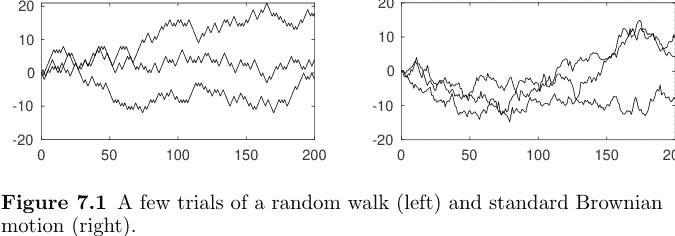

**示例 7.1.4** (布朗运动). 最经典的连续时间随机过程是标准*布朗运动* \((X_t)_{t\ge 0}\)，也称为*维纳过程*。它可以刻画如下：

- (i) 该过程具有连续的样本路径，即随机函数 \(f(t):=X_t\) 几乎必然连续。
- (ii) 增量是独立的，并且对所有 \(t\ge s\) 满足 \(X_t-X_s\sim N(0,t-s)\)。

图 7.1 展示了标准布朗运动的几次试验。

**示例 7.1.5** (随机场). 当索引集 \(T\) 是 \(\mathbb{R}^n\) 的子集时，随机过程 \((X_t)_{t\in T}\) 有时被称为空间随机过程，或*随机场*。例如，由 \(t\) 参数化的地球上某个位置的水温 \(X_t\) 可以建模为一个空间随机过程。

## 7.1.1 协方差与增量

在第 3.2 节中，我们介绍了随机向量的协方差矩阵的概念。现在，我们以类似的方式定义随机过程 \((X_t)_{t\in T}\) 的*协方差函数*。为简单起见，本节假设随机过程的均值为零，即

\[
\mathbb{E}X_t=0 \quad \text{for all } t\in T.
\]

（一般情形下的调整是显而易见的。）该过程的协方差函数定义为

\[
\Sigma(t,s):=\operatorname{cov}(X_t,X_s)=\mathbb{E}X_tX_s,\quad t,s\in T.
\]

随机过程的*增量*定义为

\[
d(t,s):=\|X_t-X_s\|_{L^2}=\big(\mathbb{E}(X_t-X_s)^2\big)^{1/2},\quad t,s\in T. \tag{7.1}
\]

**例 7.1.6。** 标准布朗运动的增量满足

\[
d(t,s)=\sqrt{t-s},\quad t\ge s
\]

这是由定义得到的。例 7.1.3 中满足 \(\mathbb{E}Z_i^2=1\) 的随机游走的增量也具有类似的表现：

\[
d(n,m)=\sqrt{n-m},\quad n\ge m.
\]

（请检查！）

**注 7.1.7（典范度量）。** 即使指标集 \(T\) 没有几何结构，增量 \(d(t,s)\) 也总是在 \(T\) 上定义了一个*度量*，从而自动将 \(T\) 变成一个*度量空间。*¹ 然而，正如我们在例 7.1.6 中所看到的，这个度量可能与 \(\mathbb{R}^n\) 上的欧氏距离不一致。

**注 7.1.8（协方差与增量）。** 协方差和增量包含了关于随机过程的大致相同的信息。增量可以用协方差表示：只需将（7.1）中的平方展开，即可得到

\[
d(t,s)^2=\Sigma(t,t)-2\Sigma(t,s)+\Sigma(s,s).
\]

反过来，如果零随机变量 \(0\) 属于该过程，也可以从增量中恢复协方差（见习题 7.1）。

## 7.1.2 高斯过程

**定义 7.1.9（高斯过程）。** 如果对于任意有限子集 \(T_0\subset T\)，随机向量 \((X_t)_{t\in T_0}\) 服从正态分布，则称随机过程 \((X_t)_{t\in T}\) 为一个*高斯过程*。等价地，如果每个有限线性组合 \(\sum_{t\in T_0}a_tX_t\) 都是一个正态随机变量，则称 \((X_t)_{t\in T}\) 是高斯的。（要理解这两个表述为何等价，请回顾习题 3.16。）

¹ 更准确地说，\(d(t,s)\) 是 \(T\) 上的一个*伪度量*，因为两个不同点之间的距离可能为零，即 \(d(t,s)=0\) 不一定意味着 \(t=s\)。

高斯过程的概念推广了 \(\mathbb{R}^n\) 中高斯随机向量的概念。标准布朗运动就是高斯过程的一个经典例子。

**注 7.1.10（分布由协方差和增量决定）。** \(\mathbb{R}^n\) 中均值为零的高斯随机向量的分布完全由其协方差矩阵决定（回顾命题 3.3.5）。同样地，对于均值为零的高斯过程，其分布由协方差函数 \(\Sigma(t,s)\) 决定；或者等价地（根据习题 7.1），在零变量属于该过程的前提下，由增量 \(d(t,s)\) 决定。

我们关于随机向量所学到的许多工具都可以应用于随机过程。例如，高斯集中不等式（定理 5.2.3）意味着：

**定理 7.1.11（高斯过程的集中性）。** 设 \((X_t)_{t\in T}\) 是一个有限指标集 \(T\) 上的高斯过程。那么

\[
\left\|\sup_{t\in T}X_t-\mathbb{E}\sup_tX_t\right\|_{\psi_2}\le C\sup_{t\in T}\sqrt{\operatorname{Var}(X_t)}.
\]

这只是习题 5.9(b) 的另一种表述——如果你当时跳过了这道题，现在请完成它！

现在来看一大类由高维集合 \(T\subset\mathbb{R}^n\) 索引的高斯过程。取一个标准正态向量 \(g\sim N(0,I_n)\)，并定义

\[
X_t:=\langle g,t\rangle,\qquad t\in T. \tag{7.2}
\]

这给出了一个称为*典范高斯过程*的高斯过程 \((X_t)_{t\in T}\)。其增量与欧氏距离相匹配：

\[
\|X_t-X_s\|_{L^2}=\|t-s\|_2,\qquad t,s\in T.
\]

（请检查！）

事实上，任何高斯过程都可以实现为典范过程（7.2）。这源于关于高斯向量的一个简单观察：

**引理 7.1.12（高斯随机向量）。** 设 \(X\) 是 \(\mathbb{R}^n\) 中均值为零的高斯随机向量。那么存在点 \(t_1,\ldots,t_n\in\mathbb{R}^n\)，使得

\[
X\stackrel{dist}{=}(\langle g,t_i\rangle)_{i=1}^n,\qquad\text{where }g\sim N(0,I_n).
\]

这里，\(\stackrel{dist}{=}\) 表示分布相等。

*证明* 设 \(\Sigma\) 表示 \(X\) 的协方差矩阵，则根据（3.12），有

\[
X\stackrel{d}{=}\Sigma^{1/2}g,\qquad\text{where }g\sim N(0,I_n).
\]

\(\Sigma^{1/2}g\) 的各个分量都可以写成 \(\langle t_i,g\rangle\)，其中 \(t_i\) 是 \(\Sigma^{1/2}\) 的各行。证毕！\(\square\)

由此可知，对于任意高斯过程 \((X_s)_{s\in S}\)，其所有有限维边缘分布 \((X_s)_{s\in S_0}\)、\(|S_0|=n\)，都可以表示为典范高斯过程（7.2），其中索引集为 \(\mathbb{R}^n\) 的某个子集 \(T_0\subset\mathbb{R}^n\)。

² 我们假设 \(T\) 是有限的，只是为了避免可测性问题。但在实践中，通常可以通过逼近推广到一般的 \(T\)。请尝试对典范高斯过程（7.2）进行这一推广！

## 7.2 Slepian、不等式 Sudakov-Fernique 与 Gordon 不等式

在许多应用中，拥有一个关于随机过程的*一致*界是很有帮助的：

\[
\mathbb{E}\sup_{t\in T}X_t=?
\]

**注 7.2.1（使 \(T\) 有限）。** 为避免可测性问题，我们将 \(\mathbb{E}\sup_{t\in T}X_t\) 理解为 \(\sup_{T_0\subset T}\mathbb{E}\max_{t\in T_0}X_t\) 的简写，其中 \(T_0\) 遍历所有有限子集。一般情形通常可以通过逼近得到。

对于某些过程，这个量可以精确计算。例如，如果 \((X_t)\) 是标准布朗运动，那么所谓的反射原理给出

\[
\mathbb{E}\sup_{t\le t_0}X_t=\sqrt{\frac{2t_0}{\pi}}\quad\text{for every }t_0\ge0.
\]

对于一般的随机过程，即使是高斯过程，这个问题也并不简单。

我们要证明的第一个一般界是高斯过程的 Slepian 比较不等式。它基本上说明：过程增长得越快（就增量而言），它所能达到的位置就越远。

**定理 7.2.2（Slepian 不等式）。** 设 \((X_t)_{t\in T}\) 和 \((Y_t)_{t\in T}\) 是两个均值为零的高斯过程。假设对于所有 \(t,s\in T\)，都有

\[
\mathbb{E}X_t^2=\mathbb{E}Y_t^2
\quad\text{and}\quad
\mathbb{E}(X_t-X_s)^2\le\mathbb{E}(Y_t-Y_s)^2. \tag{7.3}
\]

那么 \(\sup_{t\in T}X_t\) 在随机序意义下被 \(\sup_{t\in T}Y_t\) 控制：对于每个 \(\tau\in\mathbb{R}\)，都有

\[
\mathbb{P}\left\{\sup_{t\in T}X_t\ge\tau\right\}
\le
\mathbb{P}\left\{\sup_{t\in T}Y_t\ge\tau\right\}. \tag{7.4}
\]

*因此，*

\[
\mathbb{E}\sup_{t\in T}X_t\le\mathbb{E}\sup_{t\in T}Y_t. \tag{7.5}
\]

现在为证明 Slepian 不等式做准备。

### 7.2.1 高斯插值

我们将使用一种称为高斯插值的技巧来证明 Slepian 不等式。假设 \(T\) 是有限的；于是可以将 \(X=(X_t)_{t\in T}\) 和 \(Y=(Y_t)_{t\in T}\) 看作 \(\mathbb{R}^n\) 中的高斯随机向量，其中 \(n=|T|\)。我们还可以假设 \(X\) 和 \(Y\) 相互独立。（为什么？）

定义 \(\mathbb{R}^n\) 中的高斯随机向量 \(Z(u)\)，使其从 \(Z(0)=Y\) 连续插值到 \(Z(1)=X\)：

\[
Z(u):=\sqrt{u}\,X+\sqrt{1-u}\,Y,\quad u\in[0,1].
\]

于是，\(Z(u)\) 的协方差矩阵在线性意义下，在 \(Y\) 和 \(X\) 的协方差矩阵之间连续插值：

\[
\Sigma(Z(u))=u\,\Sigma(X)+(1-u)\,\Sigma(Y).
\]

（请检查！）

对于给定的函数 \(f:\mathbb{R}^n\to\mathbb{R}\)，我们来研究当 \(u\) 从 0 增加到 1 时，\(\mathbb{E}f(Z(u))\) 如何变化。我们特别感兴趣的函数是

\[
f(x)=\mathbf{1}_{\{\max_i x_i<\tau\}}.
\]

我们将能够证明，在这种情况下，\(\mathbb{E}f(Z(u))\) 随 \(u\) *增加*。这将立即推出 Slepian 不等式的结论，因为此时

\[
\mathbb{E}f(Z(1))\geq\mathbb{E}f(Z(0)),\quad\text{thus}\quad
\mathbb{P}\left\{\max_iX_i<\tau\right\}\geq
\mathbb{P}\left\{\max_iY_i<\tau\right\}
\]

正如所要证明的那样。

现在进入详细论证。为了发展高斯插值方法，我们先从下面这个有用的恒等式开始。

**引理 7.2.3（高斯分部积分）。** *设 \(X\sim N(0,1)\)。那么对于任意可微函数 \(f:\mathbb{R}\to\mathbb{R}\)，都有*

\[
\mathbb{E}Xf(X)=\mathbb{E}f'(X),
\]

*前提是两个期望都存在且有限。*

*证明* 首先假设 \(f\) 具有有界支集。用 \(p(x)\) 表示高斯密度函数：

\[
p(x)=\frac{1}{\sqrt{2\pi}}e^{-x^2/2},
\]

我们可以将期望表示为积分，并对其进行分部积分：

\[
\mathbb{E}f'(X)=\int_{\mathbb{R}}f'(x)p(x)\,dx
=-\int_{\mathbb{R}}f(x)p'(x)\,dx. \tag{7.6}
\]

现在直接计算可得 \(p'(x)=-xp(x)\)，因此（7.6）中的积分等于

\[
\int_{\mathbb{R}}f(x)p(x)x\,dx=\mathbb{E}Xf(X),
\]

这正是所要证明的结论。通过逼近论证，可以将结果推广到一般函数。引理得证。\(\square\)

通过缩放，我们可以将高斯分部积分推广到 \(X\sim N(0,\sigma^2)\) 的情形：

\[
\mathbb{E}Xf(X)=\sigma^2\mathbb{E}f'(X).
\]

（只需令 \(X=\sigma Z\)，其中 \(Z\sim N(0,1)\)，然后应用引理 7.2.3。）我们还可以将其推广到高维情形：

**引理 7.2.4（多元高斯分部积分）。** *设 \(X\sim N(0,\Sigma)\)。那么对于任意可微函数 \(f:\mathbb{R}^n\to\mathbb{R}\)，都有*

\[
\mathbb{E}Xf(X)=\Sigma\cdot\mathbb{E}\nabla f(X),
\]

将其代入(7.11)，得到

$$
\sum_{i=1}^{n} \frac{1}{\sqrt{u}}\,\mathbb{E}\,X_i\,\frac{\partial f}{\partial x_i}(Z(u)) = \sum_{i,j=1}^{n} \Sigma_{ij}^{X}\,\mathbb{E}\,\frac{\partial^2 f}{\partial x_i\,\partial x_j}(Z(u)).
$$

对两边关于\(Y\)取期望，我们消去对\(Y\)的条件。

类似地，我们可以计算(7.10)中另一个和式，即包含\(Y_i\)的项。将这两个和式合并，即完成证明。

## 7.2.2 Slepian不等式的证明

我们准备建立Slepian不等式的一个初步的、泛函形式。

**引理7.2.6（Slepian不等式，泛函形式）。** *考虑\(\mathbb{R}^n\)中的两个零均值高斯随机向量\(X\)和\(Y\)。假设对所有\(i,j=1,\ldots,n\)，有*

$$
\mathbb{E}X_i^2 = \mathbb{E}Y_i^2 \quad\text{且}\quad \mathbb{E}(X_i-X_j)^2 \leq \mathbb{E}(Y_i-Y_j)^2.
$$

*考虑一个二次可微函数\(f:\mathbb{R}^n\to\mathbb{R}\)，使得*

$$
\frac{\partial^2 f}{\partial x_i\,\partial x_j} \geq 0 \quad\text{对所有 } i\ne j.
$$

*则*

$$
\mathbb{E}f(X) \geq \mathbb{E}f(Y),
$$

*假设两个期望都存在且有限。*

*证明。* 这些假设意味着\(X\)和\(Y\)的协方差矩阵\(\Sigma^X\)和\(\Sigma^Y\)的元素满足

$$
\Sigma_{ii}^{X}=\Sigma_{ii}^{Y} \quad\text{且}\quad \Sigma_{ij}^{X}\geq\Sigma_{ij}^{Y}
$$

对所有\(i,j=1,\ldots,n\)成立。我们可以假设\(X\)和\(Y\)独立。（为什么？）应用引理7.2.5并利用我们的假设，我们得出

$$
\frac{d}{du}\,\mathbb{E}f(Z(u)) \geq 0,
$$

所以\(\mathbb{E}f(Z(u))\)随\(u\)递增。因此\(\mathbb{E}f(Z(1))=\mathbb{E}f(X)\)至少与\(\mathbb{E}f(Z(0))=\mathbb{E}f(Y)\)一样大。这就完成了证明。

现在我们准备证明Slepian不等式，即定理7.2.2。让我们用高斯随机向量的等价形式来陈述并证明它。

**定理7.2.7（Slepian不等式）。** *设\(X\)和\(Y\)是如引理7.2.6中的高斯随机向量。则对每个\(\tau\geq 0\)，有*

$$
\mathbb{P}\{\max_{i\leq n}X_i\geq\tau\}\leq\mathbb{P}\{\max_{i\leq n}Y_i\geq\tau\}.
$$

因此，

$$
\mathbb{E}\max_{i\le n} X_i \le \mathbb{E}\max_{i\le n} Y_i.
$$

*证明。* 设\(h:\mathbb{R}\to[0,1]\)是区间\((-\infty,\tau)\)的指示函数的一个二次可微、非增的近似：

$$
h(x)\approx \mathbf{1}_{(-\infty,\tau)},
$$

如图7.2所示。定义函数\(f:\mathbb{R}^n\to\mathbb{R}\)为

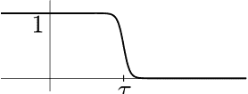

**图7.2** 函数\(h(x)\)是指示函数\(\mathbf{1}_{(-\infty,\tau)}\)的一个光滑、非增的近似。

$$
f(x)=h(x_1)\cdots h(x_n).
$$

则\(f(x)\)是指示函数

$$
f(x)\approx \mathbf{1}_{\{\max_i x_i<\tau\}}.
$$

我们想对\(f(x)\)应用Slepian不等式的泛函形式，即引理7.2.6。为了检验该结果的假设，注意到对\(i\ne j\)，有

$$
\frac{\partial^2 f}{\partial x_i\,\partial x_j}=h'(x_i)h'(x_j)\cdot\prod_{k\notin\{i,j\}}h(x_k).
$$

根据假设，前两个因子非正，其余因子非负。因此二阶导数非负，符合要求。

由此可得

$$
\mathbb{E}f(X)\ge\mathbb{E}f(Y).
$$

通过近似，这意味着

$$
\mathbb{P}\left\{\max_{i\le n}X_i<\tau\right\}\ge\mathbb{P}\left\{\max_{i\le n}Y_i<\tau\right\}.
$$

这就证明了结论的第一部分。第二部分可通过练习1.15(b)中的积分尾公式得到（请验证！）

## 7.2.3 Sudakov–Fernique和Gordon不等式

Slepian不等式对(7.3)中的过程\((X_t)\)和\((Y_t)\)有两个假设：方差相等和增量占优。我们现在去掉方差相等的假设，仍然能够得到(7.5)。

**定理7.2.8（Sudakov-Fernique不等式）。** 设\((X_t)_{t\in T}\)和\((Y_t)_{t\in T}\)是两个*零均值高斯过程*。假设对所有\(t,s\in T\)，有

$$
\mathbb{E}(X_t-X_s)^2 \leq \mathbb{E}(Y_t-Y_s)^2.
$$

*则*

$$
\mathbb{E}\sup_{t\in T}X_t \leq \mathbb{E}\sup_{t\in T}Y_t.
$$

*证明。* 与定理7.2.7中证明Slepian不等式一样，只需对\(\mathbb{R}^n\)中的高斯随机向量\(X\)和\(Y\)证明此定理即可。我们同样从高斯插值引理7.2.5推出结论。但这次，我们不再选择近似指示函数\(\{\max_i x_i<\tau\}\)的\(f(x)\)，而是希望\(f(x)\)近似\(\max_i x_i\)。

为此，令\(\beta>0\)为一个参数，定义函数⁴

$$
f(x):=\frac{1}{\beta}\log\sum_{i=1}^{n}e^{\beta x_i}.
$$

快速检验可知

$$
f(x)\to\max_{i\leq n}x_i\quad\text{当 }\beta\to\infty.
$$

（请自行验证！）将\(f(x)\)代入高斯插值公式(7.9)并化简表达式，可得

$$
\frac{d}{du}\,\mathbb{E}\,f(Z(u))\leq 0\quad\text{对所有 }u\in[0,1].
$$

（请在练习7.7中仔细完成这一步！）然后我们可以像Slepian不等式那样完成证明。

某些应用需要随机过程的*极小极大*界。例如，由(4.14)，一个所有元素为独立\(N(0,1)\)的\(m\times n\)高斯矩阵\(A\)的最小奇异值可以写成

$$
s_n(A)=\min_{u\in S^{n-1}}\|Au\|_2=\min_{u\in S^{n-1}}\max_{v\in S^{m-1}}X_{uv},
$$

其中\(X_{uv}=\langle Au,v\rangle\)是正态随机变量。处理这类问题的一个便捷工具是Gordon不等式，它将Slepian和Sudakov-Fernique不等式推广到极小极大情形：

**定理7.2.9（Gordon不等式）。** 设\((X_{ut})_{u\in U,t\in T}\)和\((Y_{ut})_{u\in U,t\in T}\)是以乘积集\(U\times T\)中的点对\((u,t)\)为索引的两个*零均值高斯过程*。假设

$$
\mathbb{E}(X_{ut}-X_{vs})^2\leq\mathbb{E}(Y_{ut}-Y_{vs})^2\quad\text{对所有 }u,v,t,s;
$$

$$
\mathbb{E}(X_{ut}-X_{vs})^2\geq\mathbb{E}(Y_{ut}-Y_{vs})^2\quad\text{对所有 }u\neq v\text{ 和所有 }t,s.
$$

⁴ 考虑这种\(f(x)\)形式的动机来自统计力学，其中(7.12)的右边可以解释为*对数配分函数*，而\(\beta\)为*逆温度*。

其中\(g\sim N(0,I_n)\)和\(h\sim N(0,I_m)\)是独立的高斯向量。这个过程的增量为

$$
\begin{aligned}
\mathbb{E}(Y_{uv}-Y_{wz})^2
&=\mathbb{E}\left(\langle g,u-w\rangle+\langle h,v-z\rangle\right)^2\\
&=\mathbb{E}\langle g,u-w\rangle^2+\mathbb{E}\langle h,v-z\rangle^2\quad\text{（由独立性，均值为0）}\\
&=\|u-w\|_2^2+\|v-z\|_2^2\quad\text{（因为$g,h$为标准正态）。}
\end{aligned}
$$

比较两个过程的增量，我们看到

$$
\mathbb{E}(X_{uv}-X_{wz})^2\leq\mathbb{E}(Y_{uv}-Y_{wz})^2\quad\text{对所有 }(u,v),(w,z)\in T,
$$

正如Sudakov-Fernique不等式所要求的那样。应用定理7.2.8，我们得到

$$
\begin{aligned}
\mathbb{E}\|A\|&=\mathbb{E}\sup_{(u,v)\in T}X_{uv}\leq\mathbb{E}\sup_{(u,v)\in T}Y_{uv}\\
&=\mathbb{E}\sup_{u\in S^{n-1}}\langle g,u\rangle+\mathbb{E}\sup_{v\in S^{m-1}}\langle h,v\rangle\\
&=\mathbb{E}\|g\|_2+\mathbb{E}\|h\|_2\\
&\leq\left(\mathbb{E}\|g\|_2^2\right)^{1/2}+\left(\mathbb{E}\|h\|_2^2\right)^{1/2}\quad\text{（回忆练习1.11）}\\
&=\sqrt n+\sqrt m\quad\text{（见命题3.2.1(b)）。}
\end{aligned}
$$

定理7.3.1只给出了期望界，但我们可以利用5.2节的集中工具将其提升为高概率界：

**推论7.3.2（高斯随机矩阵的范数：尾部）。**

*设\(A\)是一个具有独立\(N(0,1)\)元素的\(m\times n\)矩阵。则对每个\(t\geq 0\)，有*

$$
\mathbb{P}\{\|A\|\geq\sqrt m+\sqrt n+t\}\leq 2\exp(-ct^2).
$$

**证明。** 我们将期望界（定理7.3.1）与高斯集中性（定理5.2.3）结合起来。将\(A\)的行拼接起来，将其视为\(\mathbb{R}^{m\times n}\)中的一个长随机向量。这使\(A\)成为一个标准正态随机向量：\(A\sim N(0,I_{nm})\)。考虑函数

$$
f(A):=\|A\|
$$

它将向量化的矩阵映射为矩阵的算子范数。由于算子范数以Frobenius范数为上界，而Frobenius范数正是\(\mathbb{R}^{m\times n}\)上的欧几里得范数，所以\(f\)是\(\mathbb{R}^{m\times n}\)上的Lipschitz函数，其Lipschitz范数以1为界。（为什么？）于是定理5.2.3给出

$$
\mathbb{P}\{\|A\|\geq\mathbb{E}\|A\|+t\}\leq 2\exp(-ct^2).
$$

由定理7.3.1给出的\(\mathbb{E}\|A\|\)的界完成了证明。

现在尝试练习7.11来证明一个*对称高斯矩阵*满足

$$
\mathbb{E}\|A\|\leq 2\sqrt n,
$$

并尝试练习7.13来证明一个\(m\times n\)高斯矩阵\(A\)的*最小奇异值*满足

$$
\mathbb{E}\,s_n(A)\geq\sqrt m-\sqrt n.
$$

## 7.4 苏达科夫不等式

让我们回到定义在任意指标集 $T$ 上的一般零均值高斯过程 $(X_t)_{t\in T}$。正如我们之前所看到的（注记 7.1.7），增量

$$d(t,s):=\|X_t-X_s\|_{L^2}=\bigl(\mathbb{E}(X_t-X_s)^2\bigr)^{1/2} \tag{7.13}$$

在 $T$ 上定义了一个度量，称为*典范度量*。这个度量决定了协方差函数 $\Sigma(t,s)$，而协方差函数又决定了过程 $(X_t)_{t\in T}$ 的分布（回顾注记 7.1.10）。因此，理论上，我们只需理解度量空间 $(T,d)$ 的几何结构，就能回答关于该过程分布的任何问题——换句话说，我们可以通过几何来研究概率。

这里有一个重要的具体问题：我们如何根据 $(T,d)$ 的几何结构来估计

$$\mathbb{E}\sup_{t\in T}X_t \tag{7.14}$$

这是一个困难的问题，我们现在开始研究它，并将在第8章继续。

我们将从(7.14)的一个下界开始，该下界用*度量熵*表示，度量熵在第4.2节中引入。回顾一下，对任意 $\varepsilon>0$，*覆盖数*

$$\mathcal{N}(T,d,\varepsilon)$$

是在度量 $d$ 下 $T$ 的 $\varepsilon$-网的最小基数，等价地，是能够覆盖 $T$ 的半径为 $\varepsilon$ 的闭球的最少个数。覆盖数的对数 $\log_2\mathcal{N}(T,d,\varepsilon)$ 称为 $T$ 的*度量熵*。

**定理 7.4.1**（苏达科夫不等式）。设 $(X_t)_{t\in T}$ 是一个*零均值高斯过程*。则对任意 $\varepsilon\ge 0$，有

$$\mathbb{E}\sup_{t\in T}X_t\ge c\varepsilon\sqrt{\log\mathcal{N}(T,d,\varepsilon)}.$$

其中 $d$ 是(7.13)中定义的典范度量。

*证明*  我们从苏达科夫-费尔尼克比较不等式（定理 7.2.8）来推导这个结果。假设

$$\mathcal{N}(T,d,\varepsilon)=:N$$

是有限的；无限情形留给你在习题7.4中处理。设 $\mathcal{N}$ 是 $T$ 的一个极大 $\varepsilon$-分离子集。则 $\mathcal{N}$ 是 $T$ 的一个 $\varepsilon$-网（回顾引理 4.2.6），因此

$$|\mathcal{N}|\ge N.$$

将过程限制在 $\mathcal{N}$ 上，我们看到只需证明

$$\mathbb{E}\sup_{t\in\mathcal{N}}X_t\ge c\varepsilon\sqrt{\log N}.$$

$^5$ 如果 $T$ 没有有限的 $\varepsilon$-网，我们令 $\mathcal{N}(T,d,\varepsilon)=\infty$。

我们通过将 $(X_t)_{t\in\mathcal N}$ 与一个更简单的高斯过程 $(Y_t)_{t\in\mathcal N}$ 进行比较来做到这一点，后者定义如下：

$$Y_t := \frac{\varepsilon}{\sqrt{2}}g_t,\qquad \text{其中 } g_t \text{ 是独立的 } N(0,1) \text{ 随机变量。}$$

为了使用苏达科夫-费尔尼克比较不等式（定理 7.2.8），我们需要比较这两个过程的增量。固定两个不同的点 $t,s\in\mathcal N$。根据定义，我们有

$$\mathbb E(X_t-X_s)^2=d(t,s)^2\geq\varepsilon^2$$

而

$$\mathbb E(Y_t-Y_s)^2=\frac{\varepsilon^2}{2}\,\mathbb E(g_t-g_s)^2=\varepsilon^2.$$

（在最后一行，我们使用了 $g_t-g_s\sim N(0,2)$。）这意味着

$$\mathbb E(X_t-X_s)^2\geq\mathbb E(Y_t-Y_s)^2\qquad\text{对任意 }t,s\in\mathcal N.$$

应用定理 7.2.8，我们得到

$$\mathbb E\sup_{t\in\mathcal N}X_t\geq\mathbb E\sup_{t\in\mathcal N}Y_t=\frac{\varepsilon}{\sqrt{2}}\,\mathbb E\max_{t\in\mathcal N}g_t\geq c\varepsilon\sqrt{\log N}.$$

在最后一步中，我们使用了 $N$ 个独立同分布 $N(0,1)$ 随机变量的期望最大值至少为 $c\sqrt{\log N}$，见习题2.38(b)。证明完成。□

### 7.4.1 在 $\mathbb R^n$ 中覆盖数的应用

苏达科夫不等式可用来界住任意集合 $T\subset\mathbb R^n$ 的覆盖数：

**推论 7.4.2**（$\mathbb R^n$ 中的苏达科夫不等式）。*设 $T\subset\mathbb R^n$。则对任意 $\varepsilon>0$，有*

$$\mathbb E\sup_{t\in T}\langle g,t\rangle\geq c\varepsilon\sqrt{\log\mathcal N(T,\varepsilon)}.$$

*这里 $\mathcal N(T,\varepsilon)$ 是覆盖 $T$ 的半径为 $\varepsilon$、圆心在 $T$ 中的欧氏球的最少个数，正如第4.2.1节中那样。*

*证明。* 考虑典范高斯过程 $X_t:=\langle g,t\rangle$，其中 $g\sim N(0,I_n)$。正如我们在第7.1.2节中指出的，该过程的典范距离就是 $\mathbb R^n$ 中的欧氏距离，即对任意 $t,s\in T$，$d(t,s)=\|X_t-X_s\|_{L^2}=\|t-s\|_2$。于是推论由苏达科夫不等式（定理 7.4.1）得出。□

在习题8.5中，你将证明推论7.4.2除一个对数因子外是精确的：

$$\mathbb E\sup_{t\in T}\langle g,t\rangle\leq C\log(n)\cdot\varepsilon\sqrt{\log\mathcal N(T,\varepsilon)}.$$

作为苏达科夫不等式的一个快速应用，让我们（粗略地）从推论0.0.3重新推导 $\mathbb R^n$ 中多胞体覆盖数的界：

*证明*  我们只证明 (f) 部分，其余留给你在习题7.15中完成。对于下界，固定任意 \(x,y\in T\)。由于 \(x-y\) 和 \(y-x\) 都在 \(T-T\) 中，性质 (e) 给出

\[w(T)\geq \frac{1}{2}\mathbb{E}\max\bigl(\langle x-y,g\rangle,\langle y-x,g\rangle\bigr)=\frac{1}{2}\mathbb{E}|\langle x-y,g\rangle|=\frac{1}{2}\sqrt{\frac{2}{\pi}}\,\|x-y\|_2.\]

最后一个等式成立是因为 \(\langle x-y,g\rangle\sim N(0,\|x-y\|_2^2)\)，且对 \(X\sim N(0,1)\) 有 \(\mathbb{E}|X|=\sqrt{2/\pi}\)。（请验证！）对所有 \(x,y\in T\) 取上确界即得结果。对于 (f) 中的上界，再次使用性质 (e) 得到

\[w(T)=\frac{1}{2}\mathbb{E}\sup_{x,y\in T}\langle g,x-y\rangle\leq \frac{1}{2}\mathbb{E}\sup_{x,y\in T}\|g\|_2\|x-y\|_2\leq \frac{1}{2}\mathbb{E}\|g\|_2\cdot\operatorname{diam}(T).\]

由于 \(\mathbb{E}\|g\|_2\leq (\mathbb{E}\|g\|_2^2)^{1/2}=\sqrt{n}\)，证毕。□

**注记 7.5.3**（宽度与直径）。(f) 中的上界和下界都是最优的，它们之间的 \(O(\sqrt{n})\) 差距无法改进（见习题7.16）。因此，用直径来刻画高斯宽度不是一个好方法。

### 7.5.1 宽度的几何意义

高斯宽度有一个很好的几何意义：它描述的是集合 \(T\subset\mathbb{R}^n\) 在随机方向上看去有多宽。\(T\) 在方向 \(\theta\in S^{n-1}\) 上的宽度，是包含 \(T\) 的最窄带状区域（位于正交于 \(\theta\) 的平行超平面之间）的宽度（见图7.3），它可以表示为 \(\sup_{x,y\in T}\langle\theta,x-y\rangle\)（请验证）！如果我们在所有单位方向 \(\theta\) 上对宽度取平均，就得到

\[\mathbb{E}\sup_{x,y\in T}\langle\theta,x-y\rangle=\mathbb{E}\sup_{z\in T-T}\langle\theta,z\rangle.\tag{7.16}\]

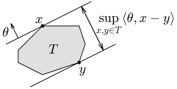

**图 7.3** 集合 \(T\subset\mathbb{R}^n\) 在单位向量 \(\theta\) 方向上的宽度。

**定义 7.5.4**（球面宽度）. 集合 \(T\subset\mathbb{R}^n\) 的*球面宽度*定义为

\[w_s(T):=\mathbb{E}\sup_{x\in T}\langle\theta,x\rangle\quad\text{其中}\quad\theta\sim\operatorname{Unif}(S^{n-1}).\]

高斯宽度与球面宽度之间的唯一区别在于我们取平均所依据的随机向量：\(g\sim N(0,I_n)\) 与 \(\theta\sim\operatorname{Unif}(S^{n-1})\)。两者都具有旋转不变性，但 \(g\) 的长度大约是 \(\theta\) 的 \(\sqrt{n}\) 倍。因此：

**引理 7.5.5**（高斯宽度与球面宽度）。*高斯宽度大约是球面宽度的* \(\sqrt{n}\) *倍：*

$$\left(\sqrt{n}-\frac{C}{\sqrt{n}}\right)w_s(T)\leq w(T)\leq \sqrt{n}\,w_s(T).$$

*证明。* 将高斯向量 \(g\) 用其长度和方向表示：\(g=r\theta\)，其中 \(r=\|g\|_2\)，\(\theta=g/\|g\|_2\)。这里 \(\theta\sim\operatorname{Unif}(S^{n-1})\) 与 \(r\) 独立（见习题 [3.22](#)）。因此

$$w(T)=\mathbb{E}\sup_{x\in T}\langle r\theta,x\rangle=\mathbb{E}[r]\cdot\mathbb{E}\sup_{x\in T}\langle\theta,x\rangle=\mathbb{E}\|g\|_2\cdot w_s(T).$$

剩下的只需使用范数的集中性（见习题 [3.2](#)），它给出 \(\sqrt{n}-C/\sqrt{n}\leq\mathbb{E}\|g\|_2\leq\sqrt{n}\)，从而完成证明。

### 7.5.2 例子

**例 7.5.6**（欧氏球与球面）。单位球和球面的高斯宽度为

$$w(S^{n-1})=w(B_2^n)=\mathbb{E}\|g\|_2=\sqrt{n}\pm\frac{C}{\sqrt{n}}, \tag{7.17}$$

其中最后一步我们使用了范数的集中性（习题 [3.2](#)）。这些集合的球面宽度当然等于1。

**例 7.5.7**（立方体）。\(\mathbb{R}^n\) 中 \(\ell^\infty\) 范数的单位球是立方体 \(B_\infty^n=[-1,1]^n\)。因此，利用对偶性（[1.6](#)），我们得到

$$w(B_\infty^n)=\mathbb{E}\|g\|_1=\mathbb{E}|g_1|\cdot n=\sqrt{\frac{2}{\pi}}\cdot n. \tag{7.18}$$

**例 7.5.8**（交叉多胞体）。\(\mathbb{R}^n\) 中 \(\ell^1\) 范数的单位球是*交叉多胞体* \(B_1^n=\{x\in\mathbb{R}^n:\|x\|_1\leq 1\}\)，见（[1.3](#)）。它的高斯宽度满足

$$w(B_1^n)\simeq\sqrt{\log n} \tag{7.19}$$

其中记号 \(\simeq\) 隐藏了绝对常数因子。这是因为

$$w(B_1^n)=\mathbb{E}\|g\|_\infty=\mathbb{E}\max_{i\leq n}|g_i|,$$

其中第一个等式使用了对偶性（[1.6](#)）。于是 (7.19) 由习题2.38(b)得出。

**例 7.5.9**（有限点集）。任意有限点集 \(T\subset\mathbb{R}^n\) 满足

$$w(T)\leq C\sqrt{\log|T|}\cdot\operatorname{diam}(T).$$

为了证明这一点，我们可以假设 \(\operatorname{diam}(T)=1/2\)（通过缩放），并且 \(T\) 位于单位欧氏球内（通过平移）。然后像 (7.15) 中那样论证（请自行完成！）。

**注记 7.5.10**（宽度在高维中的惊人表现）。从例 7.5.6–7.5.8 可以看出，立方体 $B_\infty^n$ 的高斯宽度与其*外接*球 $\sqrt{n}B_2^n$ 大致相同（相差一个常数因子）。但对于交叉多胞体 $B_1^n$，其宽度（相差一个对数因子）大约与其*内切*球 $\frac{1}{\sqrt{n}}B_2^n$ 相似，而这个内切球非常小！这是为什么呢？

立方体 $B_\infty^n$ 有非常多的顶点（$2^n$ 个），因此在大多数方向上它都大致凸出到外接球的范围，正是这一点决定了宽度。但交叉多胞体 $B_1^n$ 只有 $2n$ 个顶点，所以随机方向 $g\sim N(0,I_n)$ 很可能远离所有这些顶点。宽度并不是由那些孤零零的 $2n$ 个“尖刺”决定的，而是由“主体部分”决定的，这个主体部分大致就是内切球。

图 7.4a 展示了 Milman 关于 $B_1^n$ 的*双曲草图*，突出显示了为什么主体部分（内切球）占主导地位——因为这个集合只有很少的顶点（尖刺）。你也可以对一般凸集画出类似的草图（图 7.4b）——即使图中失去了凸性，它们也非常有助于建立高维直觉。

若想进一步练习，请尝试习题 7.17，计算任意 $\ell^p$ 球的高斯宽度，它将一次覆盖上述三个例子——球（$p=2$）、立方体（$p=\infty$）和交叉多胞体（$p=1$）。另外请完成习题 7.18–7.19，计算算子范数至多为 1 的 $n\times n$ 矩阵集合的高斯宽度。

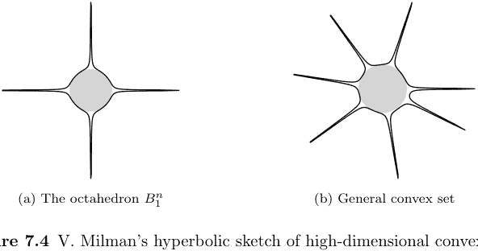

### 7.5.3 高斯复杂度与有效维数

高斯宽度 $w(T)$ 有几个有用的“近亲”。通常我们取 $\langle g,t\rangle$ 的期望最大值，但有时使用 $L^1$ 或 $L^2$ 平均更便于处理：

$$w(T)=\mathbb{E}\sup_{x\in T}\langle g,x\rangle,\qquad \gamma(T):=\mathbb{E}\sup_{x\in T}|\langle g,x\rangle|,\qquad h(T):=\left(\mathbb{E}\sup_{x\in T}\langle g,x\rangle^2\right)^{1/2},$$

其中 $g\sim N(0,I_n)$。我们称 $\gamma(T)$ 为 $T$ 的*高斯复杂度*。显然，

$$w(T)\leq\gamma(T)\leq h(T),$$

而且反向的不等式也基本成立：

**引理 7.5.11**（高斯宽度的几个近似等价形式）。*对任意有界集合 $T \subset \mathbb{R}^n$，有*⁸

- (a) $\gamma(T - T) = 2w(T)$。
- (b) 对任意一点 $y \in T$，$h(T) \asymp \gamma(T) \asymp w(T) + \|y\|_2$。

*特别地，如果 $T$ 包含原点，那么这三种形式是等价的：*

$h(T) \asymp \gamma(T) \asymp w(T)$。

*证明* (a) 由命题 7.5.2(e) 直接得出，因为 $T - T$ 是关于原点对称的。
(b) 我们只证明第一部分，把等价关系 $\gamma(T) \asymp w(T) + \|y\|_2$ 留给你在习题 7.20 中证明。我们显然有 $\gamma(T) \le h(T)$。对于反向不等式，考虑 $\mathbb{R}^n$ 上的函数 $z \mapsto \sup_{x\in T} |\langle z, x\rangle|$。它的 Lipschitz 范数以半径 $\sup_{x\in T} \|x\|_2 = r(T)$ 为界（请检验！）。于是，由高斯集中不等式 (5.5)，

$\big\|\sup_{x\in T} |\langle g, x\rangle| - \gamma(T)\big\|_{\psi_2} \lesssim r(T)$。

因此，由三角不等式和命题 2.6.6(ii)，我们得到

$h(T) = \big\|\sup_{x\in T} |\langle g, x\rangle|\big\|_{L^2} \lesssim \big\|\sup_{x\in T} |\langle g, x\rangle|\big\|_{\psi_2} \lesssim \gamma(T) + r(T) \lesssim \gamma(T)$。

最后一步用到了 $\gamma(T) \gtrsim r(T)$，这来自 (b) 的第二部分——只需对 $y \in T$ 取上确界即可。

高斯宽度帮助我们定义维数概念的一个稳健版本。集合 $T \subset \mathbb{R}^n$ 通常的线性代数维数，即包含它的最小仿射空间的维数，会因 $T$ 的微小扰动而发生很大变化。下面是一个更稳健的替代：

**定义 7.5.12**（有效维数）。有界集合 $T \subset \mathbb{R}^n$ 的*有效维数*为

$d(T) := \frac{h(T - T)^2}{\operatorname{diam}(T)^2} \asymp \frac{w(T)^2}{\operatorname{diam}(T)^2}$。

等价关系由引理 7.5.11 得出。有效维数以线性代数维数为界：

$d(T) \le \dim(T)$，

当 $T$ 是某个子空间中的欧氏球时取等号（见习题 7.21）。与通常的维数不同，有效维数是稳定的——对 $T$ 的微小扰动只会略微改变其宽度和直径。

为了练习有效维数，请计算椭球的有效维数（习题 7.23），并估计一般有限集合的有效维数上界（习题 7.22）。

⁸ 此处一如既往，记号 $\asymp$ 隐藏正的绝对常数因子。

## 7.6 应用：集合的随机投影

如果我们将集合 \(T \subset \mathbb{R}^n\) 投影到 \(\mathbb{R}^n\) 中一个随机的 \(m\) 维子空间上（从格拉斯曼流形 \(G_{n,m}\) 中均匀选取），会发生什么？如图 5.2 所示。在实践中，我们可以把 \(T\) 看作数据，把 \(P\) 看作一种降维方式，例如 Johnson-Lindenstrauss 引理就是如此。关于投影集合 \(PT\) 的大小（直径），我们能说些什么呢？

对于有限集合 \(T\)，Johnson-Lindenstrauss 引理（定理 5.3.1）指出：如果 \(m \gtrsim \log |T|\)，那么随机投影 \(P\) 本质上相当于对 \(T\) 作一个缩放：它将 \(T\) 中所有点之间的距离按大约 \(\sqrt{m/n}\) 的因子缩小。特别地，

\[\operatorname{diam}(PT) \approx \sqrt{\frac{m}{n}}\,\operatorname{diam}(T). \tag{7.20}\]

但如果 \(T\) 的基数太大甚至是无限的，(7.20) 可能失效。例如，当 \(T = B_2^n\) 是欧氏球时，任何投影都不能缩小它的大小：

\[\operatorname{diam}(PT) = \operatorname{diam}(T). \tag{7.21}\]

那么一般的集合 \(T\) 又如何呢？下面的结果表明，随机投影会像 (7.20) 那样缩小 \(T\)，但不能将其缩小到低于球面宽度 \(w_s(T)\)：

**定理 7.6.1（集合随机投影的大小）。** 设 \(T \subset \mathbb{R}^n\) 为有界集合，\(P\) 为 \(\mathbb{R}^n\) 到随机 \(m\) 维子空间 \(E \sim \operatorname{Unif}(G_{n,m})\) 上的正交投影。则

\[\mathbb{E}\,\operatorname{diam}(PT) \lesssim w_s(T) + \sqrt{\frac{m}{n}}\,\operatorname{diam}(T),\]

其中记号 \(\lesssim\) 隐藏正的绝对常数因子。

*证明* 我们证明上界，下界留给你完成（见习题 7.26）。

**第 1 步：更换模型。** 我们像命题 5.3.2 的证明中那样切换视角。随机子空间 \(E \subset \mathbb{R}^n\) 可以通过随机旋转某个固定子空间（例如 \(\mathbb{R}^m\)）得到。但我们不必固定 \(T\) 并随机旋转 \(\mathbb{R}^m\)，而是可以固定 \(E = \mathbb{R}^m\) 并随机旋转 \(T\)。向量 \(x \in T\) 的随机旋转是 \(Ux\)，其中 \(U \sim \operatorname{Unif}(O(n))\) 是随机正交矩阵。将 \(Ux\) 投影到 \(E = \mathbb{R}^m\) 上，相当于保留前 \(m\) 个坐标，即 \(Qx\)，其中 \(Q\) 是由 \(U\) 的前 \(m\) 列构成的 \(m \times n\) 矩阵。因此，我们可以用 \(Q\) 代替 \(P\) 来工作。

**第 2 步：逼近。** 不失一般性，设 \(\operatorname{diam}(T) \le 1\)。（为什么？）我们需要估计

\[\operatorname{diam}(QT) = \sup_{x\in T-T}\|Qx\|_2 = \sup_{x\in T-T}\max_{z\in S^{m-1}}\langle Qx,z\rangle.\]

我们将像定理 4.4.3 的证明中那样使用 \(\varepsilon\)-网论证。取球面 \(S^{m-1}\) 的一个 \((1/2)\)-网 \(\mathcal{N}\)，使得

\[|\mathcal{N}| \le 5^m\]

这里使用了推论 4.2.11。我们可以将球面 $S^{m-1}$ 上的上确界替换为网 $\mathcal{N}$ 上的上确界，代价是因子 2：

$$\operatorname{diam}(QT) \le 2\sup_{x\in T-T}\max_{z\in\mathcal{N}}\langle Qx,z\rangle = 2\max_{z\in\mathcal{N}}\sup_{x\in T-T}\langle Q^{\mathsf T}z,x\rangle. \tag{7.22}$$

（见习题 4.35）。现在的计划是：我们先固定 $z\in\mathcal{N}$，估计

$$\sup_{x\in T-T}\langle Q^{\mathsf T}z,x\rangle \tag{7.23}$$

然后对所有 $z$ 取并集界。

**第 3 步：集中。** 现在固定 $z\in\mathcal{N}$。由构造可知，$Q^{\mathsf T}z$ 在球面上均匀分布：$Q^{\mathsf T}z\sim\operatorname{Unif}(S^{n-1})$（请在习题 7.24 中仔细检验）。(7.23) 的期望可以表示为球面宽度：

$$\mathbb{E}\sup_{x\in T-T}\langle Q^{\mathsf T}z,x\rangle=w_s(T-T)=2w_s(T).$$

（最后一个等式只是命题 7.5.2(e) 的球面版本。）
为了检验 (7.23) 围绕其均值集中，我们使用球面上的集中不等式（定理 5.1.3，更具体地说是 (5.30)）。由于根据假设 $\operatorname{diam}(T)\le 1$，球面上的函数 $z\mapsto\sup_{x\in T-T}\langle z,x\rangle$ 的 Lipschitz 范数至多为 1（请检验！）。因此 (5.30) 给出

$$\mathbb{P}\left\{\sup_{x\in T-T}\langle Q^{\mathsf T}z,x\rangle\ge 2w_s(T)+t\right\}\le 2\exp(-cnt^2).$$

**第 4 步：并集界。** 现在通过取并集界来“释放” $z\in\mathcal{N}$：

$$\mathbb{P}\left\{\max_{z\in\mathcal{N}}\sup_{x\in T-T}\langle Q^{\mathsf T}z,x\rangle\ge 2w_s(T)+t\right\}\le |\mathcal{N}|\cdot 2\exp(-cnt^2). \tag{7.24}$$

回顾 $|\mathcal{N}|\le 5^m$。选择 $t=C_s\sqrt{m/n}$，并取常数 $C$ 足够大，则对任意 $s\ge 1$，(7.24) 中的概率以 $2e^{-ms^2}$ 为界。因此，(7.24) 和 (7.22) 给出结果：

$$\mathbb{P}\left\{\frac12\operatorname{diam}(QT)\ge 2w_s(T)+C_s\sqrt{\frac mn}\right\}\le e^{-ms^2}\quad\text{for any }s\ge 1.$$

由此，可以利用积分尾公式（引理 1.6.1）估计 $\operatorname{diam}(QT)$ 的期望值——请你完成这一步！

**注记 7.6.2（相变）。** 让我们从定理 7.6.1 中获得更多洞察。由于两项之和等价于最大值（相差因子 2），我们可以写成：

$$\operatorname{diam}(PT)\asymp\max\left[w_s(T),\sqrt{\frac mn}\operatorname{diam}(T)\right].$$

我们来找出这两项相等时的“相变”点。令它们相等并解出 $m$：

$$m=\frac{(\sqrt{n}\,w_s(T))^2}{\operatorname{diam}(T)^2}\asymp\frac{w(T)^2}{\operatorname{diam}(T)^2}\asymp d(T),$$

利用引理[7.5.5]和有效维数 $d(T)$ 的定义（见定义[7.5.12]），我们得到如下结论：

$$\operatorname{diam}(PT) \gtrsim \begin{cases} \sqrt{\frac{m}{n}}\,\operatorname{diam}(T), & \text{if } m \ge d(T) \\ w_s(T), & \text{if } m \le d(T). \end{cases}$$

（见图[7.5]）。也就是说，当我们减小随机投影的维数 $m$ 时，最初它大致按$\sqrt{m/n}$的比率收缩$T$，如同Johnson-Lindenstrauss（[7.20]）中那样。但一旦 $m$ 降到有效维数 $d(T)$ 以下，收缩便停止，直径保持在球面宽度 $w_s(T)$ 附近，如（[7.21]）所示。这是因为$\operatorname{conv}(PT)$看起来像一个半径为 $w_s(T)$ 的球，我们将在第[9.7.2]节中看到这一点。

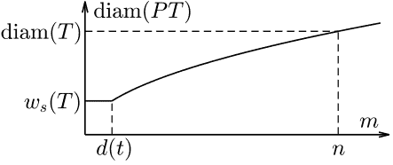

**图7.5** 集合$T$的随机$m$维投影的直径随$m$的变化。

借助更多的工具，我们将在第[9.2.2]节中改进定理[7.6.1]，去掉$\sqrt{m/n}$前面的常数。

### 7.7 注记

Slepian不等式（定理[7.2.2]）最初由D. Slepian [304, 305]提出；现代证明可见于例如[210, 推论3.12]、[11, 第2.2节]、[330, 第6.1节]、[169]、[180]。

Sudakov-Fernique不等式（定理[7.2.8]）归功于V. N. Sudakov [309, 310]和X. Fernique [124]。我们在第[7.2]节中对Slepian和Sudakov-Fernique不等式证明的表述基于J.-P. Kahane [180]的方法和S. Chatterjee的光滑化论证（见[11, 第2.2节]），并且遵循[330, 第6.1节]。

比较不等式与随机矩阵理论的相关性由S. Szarek注意到。第[7.3]节中的应用可以从Y. Gordon [140]的工作推导出来。我们在那里的表述遵循[94, 第II.c节]中的论证，该论证也见[340, 第5.3.1节]。

Sudakov不等式（定理[7.4.1]）最初由V. N. Sudakov证明。我们的表述遵循[210, 定理3.18]；利用对偶性的另一种证明见[21, 第4.2节]。

高斯宽度在第[7.5]节中引入，起源于几何泛函分析和渐近凸几何[21, 246]。从[290]开始，高斯宽度在信号处理和高维统计应用中的作用得到了公认。注记[7.5.10]中讨论的Milman对高维凸体的“双曲草图”来自[241]；关于此主题的更多内容，见[21]和[23]的前言。

第[7.5.3]节中引入的有效维数在文献中有一些变体，包括凸锥的统计维数[228, 18, 267]。

关于集合随机投影直径的定理[7.6.1]归功于V. Milman [245]，也见[21, 命题5.7.1]。

Talagrand压缩原理（习题[7.3]）可见于[210, 推论3.17]，那里可以找到一个更一般的结果（涉及上确界的凸增函数）。

- 对角线及其上方的元素，其中对角线元素为 $N(0,2)$，非对角线元素为 $N(0,1)$。（这是习题3.19中的*高斯正交系综*。）

  (a) 证明期望界：

  $$\mathbb{E}\|A\| \le 2\sqrt{n}.$$

  (b) 将其加强为高概率界：对任意 $t \ge 0$，

  $$\mathbb{P}\{\|A\| \ge 2\sqrt{n}+t\} \le 2\exp(-ct^2).$$

- **7.12（高斯向量的范数）** 对于 $g \sim N(0,I_n)$，证明函数

  $$f(n)=\mathbb{E}\|g\|_2-\sqrt{n}$$

  在 $[C,\infty)$ 上是递增的，其中 $C$ 是适当的绝对常数。

- **7.13（高斯矩阵的最小奇异值）** 让我们使用Gordon不等式（定理7.2.9）来获得具有独立 $N(0,1)$ 元素的 $m \times n$ 随机矩阵 $A$ 的最小奇异值的精确界。对于 $m \ge n \ge C$（其中 $C$ 是适当的绝对常数），证明：

  (a)（期望）

  $$\mathbb{E}s_n(A) \ge \sqrt{m}-\sqrt{n};$$

  (b)（高概率）

  $$\mathbb{P}\{s_n(A) \le \sqrt{m}-\sqrt{n}-t\} \le 2\exp(-ct^2) \quad\text{for any } t \ge 0.$$

- **7.14（非紧集的Sudakov不等式）** 证明：如果 $(T,d)$ 不是相对紧的，即对某个 $\varepsilon>0$ 有 $\mathcal{N}(T,d,\varepsilon)=\infty$，那么 $\mathbb{E}\sup_{t\in T}X_t=\infty$。

- **7.15（高斯宽度的性质）** 证明命题7.5.2中的性质(a)–(d)和(g)。

- **7.16（高斯宽度与直径）** 举例说明：对任意维数 $n$，命题7.5.2(f)中的两个界都能达到，且仅相差绝对常数因子。

- **7.17（$\ell^p$ 球的高斯宽度）** 设 $1 \le p \le \infty$。考虑 $\mathbb{R}^n$ 中 $\ell^p$ 范数的单位球，即 $B_p^n=\{x\in\mathbb{R}^n : \|x\|_p\le 1\}$。证明

  $$w(B_p^n)\simeq
  \begin{cases}
  \sqrt{p'}\,n^{1/p'}, & p'\le \log n,\\
  \sqrt{\log n}, & p'\ge \log n,
  \end{cases}$$

  其中 $p'$ 是 $p$ 的共轭指数，如Hölder不等式(1.22)中那样。

- **7.18（核范数）** 对于 $n\times n$ 矩阵 $A$，算子范数 $\|A\|$ 是奇异值的 $\ell^\infty$ 范数，Frobenius范数 $\|A\|_F$ 是奇异值的 $\ell^2$ 范数（见引理4.1.11）。将*核范数*定义为奇异值的 $\ell^1$ 范数：

  $$\|A\|_* := \sum_{i=1}^{n}s_i(A).$$

  (a) 正如 $\ell^1$ 和 $\ell^\infty$ 范数对向量是对偶的（见习题[1.19(b)]），证明核范数和算子范数对矩阵是对偶的：$^9$

  $$\|A\|_* = \max\{\langle A,B\rangle : \|B\|\le 1\}.$$

  (b) 由此推出核范数确实是一个范数。

- **7.19（具有有界算子范数的矩阵的高斯宽度）** 证明 $n\times n$ 矩阵的算子范数单位球 $T:=\{B:\|B\|\le 1\}$ 满足 $w(T)\simeq n^{3/2}$。

- **7.20（高斯宽度与高斯复杂度）** 对于任意有界集 $T\subset\mathbb{R}^n$ 和点 $y\in T$，证明 $\gamma(T)\simeq w(T)+\|y\|_2$。这是命题[7.5.11]中一直未予证明的陈述之一。

- **7.21（有效维数与代数维数）** 我们在定义[7.5.12]中引入了有界集 $T\subset\mathbb{R}^n$ 的有效维数。

  (a) 证明有效维数以线性代数维数为上界：$d(T)\le\dim(T)$。

  (b) 证明当 $T$ 是 $\mathbb{R}^n$ 的子空间中的Euclid球时，等号成立。

- **7.22（有限集的有效维数）** 对于任意有限集 $T$，证明 $d(T)\le C\log|T|$。

- **7.23（椭球）** 椭球就是单位球 $B_2^n$ 经某个 $m\times n$ 矩阵 $A$ 的线性变换得到的集合，即 $A(B_2^n)$。

  (a)（高斯宽度）证明 $w\bigl(A(B_2^n)\bigr)\simeq\|A\|_F$，其中 $\simeq$ 表示忽略正的绝对常数因子。

  (b)（有效维数）证明 $d\bigl(A(B_2^n)\bigr)=r(A^\mathsf{T}A)=s(A)$，其中 $d(\cdot)$ 是有效维数，$r(\cdot)$ 是有效秩，$s(\cdot)$ 是稳定秩（见定义[7.5.12]和注记[5.6.3, 5.6.4]）。

- **7.24（球面上的随机向量建模）** 设 $z$ 是单位球面 $S^{m-1}$ 上的固定向量，$B$ 是由随机正交矩阵 $U\sim\operatorname{Unif}(O(n))$ 的前 $m$ 列构成的 $n\times m$ 矩阵。验证 $Bz\sim\operatorname{Unif}(S^{n-1})$。

$^9$ 回忆由定义可知 $\langle A,B\rangle=\operatorname{tr}(A^\mathsf{T}B)$（[4.7]）。

## 8 链方法

本章介绍限制随机过程 $(X_t)_{t\in T}$ 的一些核心方法。在第8.1节中，我们引入*链*方法，并用它通过 $T$ 的覆盖数来界定 $\mathbb{E}\sup_{t\in T} X_t$，这一结果称为Dudley不等式。我们在第8.2节中通过一个蒙特卡洛积分和*经验过程*的应用来说明它。

然后在第8.3节中，我们引入*VC理论*，它从组合而非度量的角度为随机过程提供洞见。我们在第8.4节中将其应用于*统计学习理论*。

在第8.5节中，我们将链方法改进为*泛链*（generic chaining），并得到随机过程的用Talagrand的 $\gamma_2(T)$ 泛函表示的最优双侧界（我们在此只证明上界）。一个有用的推论是Talagrand比较不等式，它推广了次高斯过程的Sudakov-Fernique不等式。

最后，在第8.6节中，我们使用Talagrand比较不等式来推导*Chevet不等式*，这是处理一般集合上随机双线性形式的一个便捷工具。

学完这一切后，有些习题现在感觉就像是有趣的迷你研究结果——高维中的Lipschitz大数定律（习题8.10）、单比特量化（习题8.26）、应用于重尾随机矩阵的小球方法（习题8.27），以及随机矩阵的 $p \to q$ 范数（习题8.41），仅举几例！

### 8.1 Dudley不等式

对于一般的高斯过程 $(X_t)_{t\in T}$，Sudakov不等式（定理7.4.1）用 $T$ 的度量熵给出 $\mathbb{E}\sup_{t\in T} X_t$ 的*下*界。现在我们将寻求*上*界。而且我们不会局限于高斯过程，而是更进一步，处理更一般的次高斯过程。

本材料将由剑桥大学出版社以Roman Vershynin所著*《高维概率（第2版）》*出版。本预印版本仅供个人免费查看和下载。不得再分发、转售或用于衍生作品。©Roman Vershynin 202X。如果您希望在印刷版出版时收到通知，请告知我：rvershyn@uci.edu

**定义 8.1.1**（次高斯增量）。定义在度量空间 \((T,d)\) 上的随机过程 \((X_t)_{t\in T}\) 具有*次高斯增量*，如果存在 \(K\ge 0\) 使得

$$
\|X_t-X_s\|_{\psi_2}\le Kd(t,s)\quad\text{for all }t,s\in T. \tag{8.1}
$$

**例 8.1.2**（高斯过程）。设 \((X_t)_{t\in T}\) 是某个集合 \(T\) 上的高斯过程。它自然地定义了 \(T\) 上的*典范度量*：

$$
d(t,s):=\|X_t-X_s\|_{L^2},\quad t,s\in T,
$$

正如我们在 (7.1) 中解释的那样。在这个度量下，\((X_t)_{t\in T}\) 显然具有次高斯增量，其中 \(K\) 为某个绝对常数。

这里有另一个（平凡的）例子：任何随机过程都可以通过定义度量 \(d(t,s):=\|X_t-X_s\|_{\psi_2}\) 而具有次高斯增量。

现在，我们给出一般次高斯随机过程 \((X_t)_{t\in T}\) 以度量熵 \(\log \mathcal{N}(T,d,\varepsilon)\) 表示的一个界：

**定理 8.1.3**（Dudley 积分不等式）。设 \((X_t)_{t\in T}\) 是度量空间 \((T,d)\) 上具有如 (8.1) 中次高斯增量的*零均值随机过程*。则

$$
\mathbb{E}\sup_{t\in T}X_t\le CK\int_0^\infty\sqrt{\log \mathcal{N}(T,d,\varepsilon)}\,d\varepsilon.
$$

在我们证明 Dudley 不等式之前，先将其与 Sudakov 不等式（定理 7.4.1）进行比较，后者对高斯过程给出：

$$
\mathbb{E}\sup_{t\in T}X_t\ge c\sup_{\varepsilon>0}\varepsilon\sqrt{\log \mathcal{N}(T,d,\varepsilon)}.
$$

图 8.1 展示了这两个界。它们之间存在明显的间隙，而且事实证明，仅凭度量熵无法缩小这一差距——我们将在后文探讨这一点。

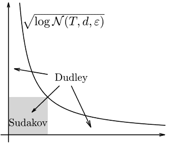

**图 8.1** Dudley 不等式用曲线下的面积给出 \(\mathbb{E}\sup_{t\in T}X_t\) 的上界。Sudakov 不等式则用曲线下最大矩形面积（在常数意义下）给出其下界。

Dudley 不等式暗示 \(\mathbb{E}\sup_{t\in T}X_t\) 是一个*多尺度*量——要对其进行界定，我们需要在所有的尺度 \(\varepsilon\) 上考察 \(T\)。而证明也正是如此展开的。我们将首先使用二进尺度 \(\varepsilon=2^{-k}\)（类似于黎曼和）证明一个离散版本，然后再过渡到连续版本。

**定理 8.1.4**（离散 Dudley 不等式）。设 \((X_t)_{t\in T}\) 是度量空间 \((T,d)\) 上具有如 (8.1) 中次高斯增量的零均值随机过程。则

$$
\mathbb{E}\sup_{t\in T}X_t\le CK\sum_{k\in\mathbb{Z}}2^{-k}\sqrt{\log\mathcal{N}(T,d,2^{-k})}. \tag{8.2}
$$

证明使用了重要的*链式*技术。它基本上是我们之前使用过的 \(\varepsilon\)-网论证的多尺度版本，例如在定理 4.4.3 和 7.6.1 的证明中那样。

在 \(\varepsilon\)-网论证中，我们用 \(\varepsilon\)-网 \(\mathcal{N}\) 来逼近 \(T\)，使得每个点 \(t\in T\) 都接近某个 \(\pi(t)\in\mathcal{N}\)，且 \(d(t,\pi(t))\le\varepsilon\)。于是增量条件 (8.1) 给出

$$
\|X_t-X_{\pi(t)}\|_{\psi_2}\le K\varepsilon. \tag{8.3}
$$

这导致

$$
\mathbb{E}\sup_{t\in T}X_t\le \mathbb{E}\sup_{t\in T}X_{\pi(t)}+\mathbb{E}\sup_{t\in T}(X_t-X_{\pi(t)}).
$$

我们可以通过对 \(|\mathcal{N}|=\mathcal{N}(T,d,\varepsilon)\) 个点 \(\pi(t)\) 取并集界来处理第一项。但第二项比较棘手——目前还不清楚如何将 (8.3) 与对所有 \(t\in T\) 取并集界结合起来。为了解决这个问题，我们不只停留在一个网上，而是选择越来越小的 \(\varepsilon\)，用更精细的网得到对 \(t\) 更好的逼近 \(\pi_1(t),\pi_2(t),\ldots\)。这就是*链式*背后的思想，我们现在将其形式化。

**定理 8.1.4 的证明。** **步骤 1：链式设置。** 不失一般性，我们可以假设 \(K=1\)（为什么？）且 \(T\) 是有限的（见注 7.2.1）。定义二进尺度

$$
\varepsilon_k=2^{-k},\qquad k\in\mathbb{Z}. \tag{8.4}
$$

并选择 \(T\) 的 \(\varepsilon_k\)-网 \(T_k\)，使得

$$
|T_k|=\mathcal{N}(T,d,\varepsilon_k). \tag{8.5}
$$

只需要二进尺度的一部分。由于 \(T\) 是有限的，存在足够小的数 \(\kappa\in\mathbb{Z}\)（定义最粗糙的网）和足够大的数 \(K\in\mathbb{Z}\)（定义最精细的网），使得

$$
T_\kappa=\{t_0\}\text{ for some }t_0\in T,\qquad T_K=T. \tag{8.6}
$$

对点 \(t\in T\)，令 \(\pi_k(t)\) 表示 \(T_k\) 中离 \(t\) 最近的点，于是我们得到

$$
d(t,\pi_k(t))\le\varepsilon_k. \tag{8.7}
$$

由于根据假设 \(\mathbb{E}X_{t_0}=0\)，我们得到

$$
\mathbb{E}\sup_{t\in T}X_t=\mathbb{E}\sup_{t\in T}(X_t-X_{t_0}).
$$

## 8.2 应用：经验过程

让我们将 Dudley 不等式应用于*经验过程*——一类由函数索引的自然随机过程。下面是一个启发性的例子。

### 8.2.1 蒙特卡洛方法

假设我们要计算积分

$$
\int_{\Omega} f\,d\mu
$$

其中 \(f : \Omega \to \mathbb{R}\) 是某个集合 \(\Omega\) 上的给定函数，\(\mu\) 是 \(\Omega\) 上的概率测度。例如，对于函数 \(f : [0,1] \to \mathbb{R}\)，这可能就是 \(\int_0^1 f(x)\,dx\)（见图 8.3a）。

我们可以*用概率方法*做到这一点。假设 \(X\) 是根据 \(\mu\) 抽取的 \(\Omega\) 中的随机点，即对任何可测集 \(A \subset \Omega\)，有 \(\mathbb{P}\{X \in A\} = \mu(A)\)。（例如，如果你在 \([0,1]\) 上积分，则 \(X \sim \operatorname{Unif}[0,1]\)。）于是积分变为期望：

$$
\int_{\Omega} f\,d\mu = \mathbb{E}\,f(X).
$$

现在取 i.i.d. 样本 \(X_1, X_2, \ldots\)。由大数定律（定理 1.7.1），

$$
\frac{1}{n}\sum_{i=1}^{n} f(X_i) \to \mathbb{E}\,f(X) \quad \text{almost surely} \tag{8.18}
$$

当 \(n \to \infty\) 时。因此，我们可以用算术平均值来逼近积分：

$$
\int_{\Omega} f\,d\mu \approx \frac{1}{n}\sum_{i=1}^{n} f(X_i) \tag{8.19}
$$

（见图 8.3b）。这就是*蒙特卡洛方法*——通过随机样本点处函数值的平均来计算积分。

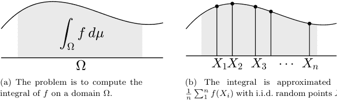

**图 8.3** 用于数值积分的蒙特卡洛方法。

**注 8.2.1**（误差率）。蒙特卡洛估计 (8.19) 的期望误差是 \(O(1/\sqrt{n})\)。这来自大数定律 (1.23) 中的收敛速度：

$$
\mathbb{E}\left|\frac{1}{n}\sum_{i=1}^{n} f(X_i)-\mathbb{E}f(X)\right|\leq \left[\operatorname{Var}\left(\frac{1}{n}\sum_{i=1}^{n}f(X_i)\right)\right]^{1/2}=O\left(\frac{1}{\sqrt{n}}\right). \tag{8.20}
$$

**注 8.2.2**（蒙特卡洛方法适用于高维，且无需模型知识）。蒙特卡洛方法在高维中效果很好，因为误差 (8.20) 不依赖于维数——这与基于网格的积分方法不同。你甚至不需要知道测度 \(\mu\)；只要能从中采样就够了。对于 \(f\) 也是如此——你只需要它在少数几个随机点处的值。

### 8.2.2 Lipschitz 大数定律

我们能否用同一样本 \(X_1,\ldots,X_n\) 来估计任意函数 \(f:\Omega\to\mathbb{R}\) 的积分？不能。一个选得不好的 \(f\) 可能在样本点之间剧烈波动（如图 8.4 所示），从而使蒙特卡洛估计 (8.19) 完全失效。

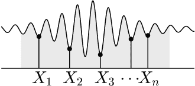

**图 8.4** 一个样本 \(X_1,\ldots,X_n\) 不能用来逼近*所有*函数 \(f\) 的积分。

但如果我们只考虑不会波动太厉害的函数——比如 Lipschitz 函数呢？那样的话，是可以的！

**定理 8.2.3**（Lipschitz 大数定律）。*考虑函数类*

$$
\mathcal{F}:=\{f:[0,1]\to\mathbb{R},\ \|f\|_{\mathrm{Lip}}\leq L\}, \tag{8.21}
$$

其中 \(L\) 是任意数。设 \(X,X_1,X_2,\ldots,X_n\) 是取值于 \([0,1]\) 的 i.i.d. 随机变量。则

$$
\mathbb{E}\sup_{f\in\mathcal{F}}\left|\frac{1}{n}\sum_{i=1}^{n}f(X_i)-\mathbb{E}f(X)\right|\leq \frac{CL}{\sqrt{n}}. \tag{8.22}
$$

**注 8.2.4**（一个样本服务所有 Lipschitz 函数）。在证明之前，我们重申关键点：对 \(f\in\mathcal{F}\) 的上确界位于期望内部。借助 Markov 不等式，这意味着单个样本 \(X_1,\ldots,X_n\) 将以高概率对所有 \(f\in\mathcal{F}\) 同时有效。“有效”意味着以误差 \(O(1/\sqrt{n})\) 逼近每个积分——与仅针对一个函数的通常大数定律具有相同的速率。因此，我们在毫无损失的情况下使大数定律成为一致的！

为了使定理 8.2.3 的证明更直观，把 (8.22) 的左侧看成一个以函数 \(f\in\mathcal{F}\) 为指标的随机过程的最大幅度是有帮助的。这样的随机过程称为*经验过程*：

**定义 8.2.5**（经验过程）。令 \(\mathcal{F}\) 是某个集合 \(\Omega\) 上的一类实值函数 \(f:\Omega\to\mathbb{R}\)。令 \(X\) 是按某个概率分布从 \(\Omega\) 中选取的随机点，并令 \(X_1,X_2,\ldots,X_n\) 是 \(X\) 的独立副本。由

$$X_f:=\frac{1}{n}\sum_{i=1}^{n}f(X_i)-\mathbb{E}f(X)$$ (8.23)

定义的随机过程 \((X_f)_{f\in\mathcal{F}}\) 称为以 \(\mathcal{F}\) 为指标的*经验过程*。

*定理 8.2.3 的证明*。不失一般性，只需对该函数类证明定理即可：

$$\mathcal{F}:=\{f:[0,1]\to[0,1],\ \|f\|_{\mathrm{Lip}}\leq 1\}.$$ (8.24)

（为什么？）我们希望给出

$$\mathbb{E}\sup_{f\in\mathcal{F}}|X_f|$$

的界，其中 \((X_f)_{f\in\mathcal{F}}\) 是 (8.23) 中定义的经验过程。

**第 1 步：验证次高斯增量。** 我们使用 Dudley 不等式（定理 8.1.3）。为了应用它，我们将验证经验过程关于 \(L^\infty\) 度量 \(d(f,g)=\|f-g\|_{L^\infty}\) 具有次高斯增量。因此，固定一对函数 \(f,g\in\mathcal{F}\)，并写出

$$\|X_f-X_g\|_{\psi_2}=\frac{1}{n}\left\|\sum_{i=1}^{n}Z_i\right\|_{\psi_2}\qquad\text{where}\qquad Z_i:=(f-g)(X_i)-\mathbb{E}(f-g)(X).$$

由于 \(Z_i\) 是独立的零均值随机变量，命题 2.7.1 给出

$$\|X_f-X_g\|_{\psi_2}\lesssim\frac{1}{n}\left(\sum_{i=1}^{n}\|Z_i\|_{\psi_2}^{2}\right)^{1/2}.$$

接下来，利用中心化（引理 2.7.8），我们有

$$\|Z_i\|_{\psi_2}\lesssim\|(f-g)(X_i)\|_{\psi_2}\lesssim\|f-g\|_{L^\infty}.$$

由此可得

$$\|X_f-X_g\|_{\psi_2}\lesssim\frac{1}{n}\cdot n^{1/2}\|f-g\|_{L^\infty}=\frac{1}{\sqrt{n}}\|f-g\|_{L^\infty}.$$

**第 2 步：应用 Dudley 不等式。** 现在以 (8.13) 的形式应用 Dudley 不等式（定理 8.1.3）：

$$\mathbb{E}\sup_{f\in\mathcal{F}}|X_f|=\mathbb{E}\sup_{f\in\mathcal{F}}|X_f-X_0|\lesssim\frac{1}{\sqrt{n}}\int_0^1\sqrt{\log\mathcal{N}(\mathcal{F},\|\cdot\|_{L^\infty},\varepsilon)}\,d\varepsilon.$$ (8.25)

（这里我们使用了零函数属于 \(\mathcal{F}\)，并且由 (8.24) 可知 \(\mathcal{F}\) 在 \(L^\infty\) 度量下的直径不超过 1。不难像下面这样给出 \(\mathcal{F}\) 的覆盖数的界：

$$\mathcal{N}(\mathcal{F},\|\cdot\|_{L^\infty},\varepsilon)\le e^{C/\varepsilon},$$

正如你将在练习 8.9 中验证的那样。将这个界代入积分：

$$\mathbb{E}\sup_{f\in\mathcal{F}}|X_f|\lesssim \frac{1}{\sqrt{n}}\int_0^1\sqrt{\frac{C}{\varepsilon}}\,d\varepsilon\lesssim\frac{1}{\sqrt{n}}.$$

定理 8.2.3 证毕。

为了练习，请尝试练习 8.10，在那里你要把定理 8.2.3 推广到更高维。这道题标记为四杯咖啡，不过别担心——它只是更费功夫，而不是更刁钻。

### 8.2.3 经验测度

为了获得更广阔的视角，我们再来看一眼经验过程的定义 8.2.5。给定按某个概率测度 \(\mu\) 从 \(\Omega\) 中抽取的独立同分布样本 \(X_1,\ldots,X_n\)，考虑*经验测度* \(\mu_n\)，它赋予每个点以相等的概率 \(1/n\)，并按重数计数：

$$\mu_n=\frac{1}{n}\sum_{i=1}^{n}\delta_{X_i}.$$

这里 \(\delta_x\) 是 \(x\) 处的狄拉克概率测度，即对任意集合 \(A\)，若 \(x\in A\) 则 \(\delta_x(A)=1\)，否则为 0。因此，\(\mu_n(A)\) 是落入集合 \(A\subset\Omega\) 的样本点所占的比例。

函数 \(f\) 关于原测度 \(\mu\) 的积分是 \(\mathbb{E}f(X)\)（\(f\) 的“总体”均值），而 \(f\) 关于经验测度 \(\mu_n\) 的积分是 \(\frac{1}{n}\sum_{i=1}^{n}f(X_i)\)（\(f\) 的“样本”或经验均值）。经验过程 \(X_f\) 在 (8.23) 中刻画了经验期望与总体期望之间的偏差。

这个偏差——我们在定理 8.2.3 中给出了它的界——可视为测度 \(\mu\) 与 \(\mu_n\) 之间的距离，称为 *Wasserstein 距离* \(W_1(\mu,\mu_n)\)。它还有一个等价解释：将一个测度变为另一个测度的*运输代价*。这一等价性由 Kantorovich–Rubinstein 对偶定理给出。因此，定理 8.2.3 常被称为 *Wasserstein 大数定律*。

你学过的许多工具对经验过程也同样适用。请尝试在练习 8.11 中证明对称化的经验版本。

## 8.3 VC 维

现在我们引入 VC（Vapnik–Chervonenkis）维的概念，它在统计学习理论中扮演重要角色。我们将把它与覆盖数联系起来，再通过 Dudley 不等式与随机过程及一致大数定律联系起来。对统计学习理论的应用将在下一节给出。

### 8.3.1 定义与例子

VC 维度量一个布尔函数类的复杂度。这里，布尔函数是某个集合 \(\Omega\) 上的映射 \(f : \Omega \to \{0,1\}\)，我们考虑这些函数组成的某个集合 \(\mathcal{F}\)。

**定义 8.3.1**（VC 维）。若对于任意可能的二元标记 \(g : \Lambda \to \{0,1\}\)，都存在某个函数 \(f \in \mathcal{F}\) 在 \(\Lambda\) 上与它匹配²，则称子集 \(\Lambda \subseteq \Omega\) 被布尔函数类 \(\mathcal{F}\) *打散*。\(\mathcal{F}\) 的 *VC 维*，记作 \(\mathrm{vc}(\mathcal{F})\)，是被打散的 \(\Lambda \subseteq \Omega\) 的最大基数。（若不存在最大基数，则称 \(\mathrm{vc}(\mathcal{F}) = \infty\)。）

VC 维的概念可能需要一些时间才能消化，因此我们来看几个例子，把它弄清楚。

**例 8.3.2**（区间）。令 \(\mathcal{F}\) 由 \(\mathbb{R}\) 中所有闭区间的指示函数组成：

$$\mathcal{F} := \{\mathbf{1}_{[a,b]} : a,b \in \mathbb{R},\ a \le b\}.$$

我们断言

$$\mathrm{vc}(\mathcal{F}) = 2.$$

为了证明 \(\mathrm{vc}(\mathcal{F}) \ge 2\)，我们需要找到一个被 \(\mathcal{F}\) 打散的包含两个点的集合 \(\Lambda \subseteq \mathbb{R}\)。例如取 \(\Lambda = \{3,5\}\)。这个集合上有四种可能的二元标记 \(g : \Lambda \to \{0,1\}\)，每一种都可以通过把某个区间指示函数 \(f = \mathbf{1}_{[a,b]}\) 限制到 \(\Lambda\) 上得到。例如，\(g(3) = 1,\ g(5) = 0\) 来自 \(f = \mathbf{1}_{[2,4]}\)。其余三种情况类似（见图 8.5），所以 \(\Lambda\) 确实被 \(\mathcal{F}\) 打散。

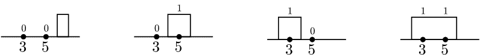

**图 8.5** 二元函数 \(g(3) = g(5) = 0\) 是 \(\mathbf{1}_{[6,7]}\) 在 \(\Lambda = \{3,5\}\) 上的限制（左）。函数 \(g(3) = 0,\ g(5) = 1\) 是 \(\mathbf{1}_{[4,6]}\) 在 \(\Lambda\) 上的限制（中左）。函数 \(g(3) = 1,\ g(5) = 0\) 是 \(\mathbf{1}_{[2,4]}\) 在 \(\Lambda\) 上的限制（中右）。函数 \(g(3) = g(5) = 1\) 是 \(\mathbf{1}_{[2,6]}\) 在 \(\Lambda\) 上的限制（右）。

为了证明 \(\mathrm{vc}(\mathcal{F}) < 3\)，我们需要证明任何包含三个点的集合 \(\Lambda = \{p,q,r\}\) 都不能被 \(\mathcal{F}\) 打散。为此，假设 \(p < q < r\)，并考虑标记 \(g(p) = 1,\ g(q) = 0,\ g(r) = 1\)。那么 \(g\) 不可能是任何指示函数 \(\mathbf{1}_{[a,b]}\) 在 \(\Lambda\) 上的限制，否则 \([a,b]\) 必须包含 \(p\) 和 \(r\) 这两个点，却不能包含位于它们之间的点 \(q\)，这是不可能的。

² 形式化地说，这意味着 \(f\) 在 \(\Lambda\) 上的限制是 \(g\)，即对所有 \(x \in \Lambda\) 都有 \(f(x) = g(x)\)。

**例 8.3.3**（半平面）。令 \(\mathcal{F}\) 由 \(\mathbb{R}^2\) 中所有闭半平面的指示函数组成。我们断言

$$\operatorname{vc}(\mathcal{F}) = 3.$$

为了证明 \(\operatorname{vc}(\mathcal{F}) \ge 3\)，我们需要找到一个被 \(\mathcal{F}\) 打散的包含三个点的集合 \(\Lambda \subset \mathbb{R}^2\)。令 \(\Lambda\) 由如图 8.6 所示处于一般位置的三个点组成。\(2^3=8\) 个二元标记 \(g:\Lambda\to\{0,1\}\) 中的每一个都是某个半平面指示函数在 \(\Lambda\) 上的限制。要看出这一点，只需让半平面恰好包含 \(\Lambda\) 中那些 \(g\) 取值为 1 的点。因此，\(\Lambda\) 被打散。

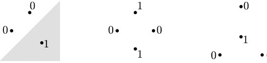

**图 8.6** 例 8.3.3 中 VC(半平面) = 3 的证明包含两步。为了证明 VC \(\ge 3\)，我们找到一个三点集 \(\Lambda\)，使得每个二元标记 \(g\) 在其上都是线性可分的（左）。为了证明 VC \(<4\)，我们说明在任意四点集 \(\Lambda\) 上都存在一个不是线性可分的二元标记 \(g\)（中、右）。

为了证明 \(\operatorname{vc}(\mathcal{F}) < 4\)，我们需要证明任何四点集都不能被 \(\mathcal{F}\) 打散。处于一般位置的四点集 \(\Lambda\) 有两种可能构型，如图 8.6 所示。（如果 \(\Lambda\) 不处于一般位置呢？请分析这种情况。）在这两种情况下，都存在一个二元标记，使得没有任何半平面能恰好包含那些标记为 1 的点；见图 8.6。这意味着总存在一个二元标记 \(g:\Lambda\to\{0,1\}\) 不是任何半平面指示函数的限制，因此 \(\Lambda\) 不被打散。

**例 8.3.4**。令 \(\Omega=\{1,2,3\}\)。我们可以方便地把 \(\Omega\) 上的布尔函数表示为长度为三的二进制串。考虑函数类

$$\mathcal{F}:=\{001,010,100,111\}.$$

集合 \(\Lambda=\{1,3\}\) 被 \(\mathcal{F}\) 打散。事实上，把 \(\mathcal{F}\) 中的函数限制到 \(\Lambda\) 上等价于去掉第二位数字，从而产生串 00、01、10、11。因此，限制产生了所有可能的长度为二的二进制串，也就是说，产生了所有可能的二元标记 \(g:\Lambda\to\{0,1\}\)。因此 \(\Lambda\) 被 \(\mathcal{F}\) 打散，从而 \(\operatorname{vc}(\mathcal{F})\ge |\Lambda|=2\)。另一方面，（唯一的）三点集 \(\{1,2,3\}\) 不能被 \(\mathcal{F}\) 打散，因为那需要长度为三的所有 8 个二进制串都出现在 \(\mathcal{F}\) 中，而事实并非如此。

更多练习：求区间对、圆、矩形、正方形和多边形的 VC 维（练习 8.12–8.16），并尝试练习 8.17，将例 8.3.3 推广到更高维，如下：

**例 8.3.5**（半空间）。\(\mathbb{R}^n\) 中的半空间是如下形式的集合
\[
\{x : \langle a, x\rangle \le b\}
\]
其中 \(a\in\mathbb{R}^n\)，\(b\in\mathbb{R}\)。设 \(\mathcal{F}\) 是 \(\mathbb{R}^n\) 中所有半空间的指示函数类。则
\[
\operatorname{VC}(\mathcal{F}) = n+1.
\]

**注 8.3.6**（VC 维与参数数量）。函数类的 VC 维通常与参数数量大致匹配——例如，\(\mathbb{R}^n\) 中的半空间由 \(n+1\) 个参数定义，这与它们的 VC 维匹配（参见例 8.3.5）。这不是一条硬性规则，而是一个有用的启发式方法。

## 8.3.2 Pajor 引理

假设定义域 \(\Omega\) 是有限的，由 \(n\) 个点组成。那么 \(\Omega\) 上的任何布尔函数类 \(\mathcal{F}\) 也是有限的，并且
\[
2^{\operatorname{VC}(\mathcal{F})} \le |\mathcal{F}| \le 2^n. \tag{8.27}
\]
（为什么？）上界通常是松散的——大多数函数类的大小更接近下界。这并不那么显然。为了给这一结果做准备，我们首先证明被 \(\mathcal{F}\) 打散的 \(\Omega\) 的子集与 \(\mathcal{F}\) 中的函数一样多。

**引理 8.3.7**（Pajor 引理）。*设 \(\mathcal{F}\) 是有限集 \(\Omega\) 上的布尔函数类。则*
\[
|\mathcal{F}| \le \left|\{\Lambda\subseteq\Omega : \Lambda \text{ 被 } \mathcal{F} \text{ 打散}}\right|.
\]
*我们在右边的计数中包含空集 \(\Lambda=\emptyset\)。*

在证明之前，让我们用例 8.3.4 来说明这个结果。这里，\(|\mathcal{F}|=4\)，并且有六个子集 \(\Lambda\) 被 \(\mathcal{F}\) 打散，即 \(\{1\},\{2\},\{3\},\{1,2\},\{1,3\}\) 和 \(\{2,3\}\)。（请检查！）因此 Pajor 引理中的不等式为 \(4\le6\)。

*引理 8.3.7 的证明。* 我们对 \(\Omega\) 的基数进行归纳。\(|\Omega|=1\) 的情形是平凡的，因为我们在计数中包含了空集。假设引理对任意 \(n\) 点集 \(\Omega\) 成立，我们来证明对 \(|\Omega|=n+1\) 的 \(\Omega\) 成立。从集合 \(\Omega\) 中切掉一个（任意的）点，我们可以将其表示为
\[
\Omega=\Omega_0\cup\{x_0\}, \quad \text{其中 } |\Omega_0|=n.
\]
类 \(\mathcal{F}\) 于是自然分成两个子类
\[
\mathcal{F}_0:=\{f\in\mathcal{F}: f(x_0)=0\} \quad\text{和}\quad \mathcal{F}_1:=\{f\in\mathcal{F}: f(x_0)=1\}.
\]
由归纳假设，计数函数
\[
S(\mathcal{F}) = \left|\{\Lambda\subseteq\Omega : \Lambda \text{ 被 } \mathcal{F} \text{ 打散}}\right|
\]
满足
\[
S(\mathcal{F}_0)\ge|\mathcal{F}_0| \quad\text{且}\quad S(\mathcal{F}_1)\ge|\mathcal{F}_1|. \tag{8.28}
\]
此处，为了正确使用归纳假设，我们将 \(\mathcal{F}_0\) 和 \(\mathcal{F}_1\) 中的函数限制到 \(n\) 点集 \(\Omega_0\) 上。

为了完成证明，我们只需检验
\[
S(\mathcal{F}) \ge S(\mathcal{F}_0)+S(\mathcal{F}_1), \tag{8.29}
\]
因为这样 (8.28) 将给出 \(S(\mathcal{F})\ge|\mathcal{F}_0|+|\mathcal{F}_1|=|\mathcal{F}|\)，这正是所需的。

不等式 (8.29) 可能看起来是平凡的。任何被 \(\mathcal{F}_0\) 或 \(\mathcal{F}_1\) 打散的集合 \(\Lambda\) 都会自动被更大的类 \(\mathcal{F}\) 打散，因此被 \(S(\mathcal{F}_0)\) 或 \(S(\mathcal{F}_1)\) 计数的每个集合 \(\Lambda\) 也自动被 \(S(\mathcal{F})\) 计数。然而，问题在于重复计数。假设同一个集合 \(\Lambda\) 同时被 \(\mathcal{F}_0\) 和 \(\mathcal{F}_1\) 打散。计数函数 \(S(\mathcal{F})\) 不会将 \(\Lambda\) 计数两次。但是，\(S(\mathcal{F})\) 会计数一个不同的集合，这个集合既没有被 \(S(\mathcal{F}_0)\) 计数，也没有被 \(S(\mathcal{F}_1)\) 计数——即 \(\Lambda\cup\{x_0\}\)。稍加思考就会发现，这个集合确实被 \(\mathcal{F}\) 打散。（请检查！）这建立了不等式 (8.29)，并完成了 Pajor 引理的证明。

让我们来说明 Pajor 引理证明中的关键点：

**例 8.3.8。** 让我们再次回到例 8.3.4。按照 Pajor 引理的证明，我们从 \(\Omega=\{1,2,3\}\) 中切掉 \(x_0=3\)，得到 \(\Omega_0=\{1,2\}\)。类 \(\mathcal{F}=\{001,010,100,111\}\) 于是分成两个子类
\[
\mathcal{F}_0=\{010,100\} \quad\text{和}\quad \mathcal{F}_1=\{001,111\}.
\]
被 \(\mathcal{F}_0\) 打散的集合 \(\Lambda\) 恰好有两个，即 \(\{1\}\) 和 \(\{2\}\)，并且**同样的**集合也被 \(\mathcal{F}_1\) 打散，使得 \(S(\mathcal{F}_0)=S(\mathcal{F}_1)=2\)。当然，同样的两个集合也被 \(\mathcal{F}\) 打散，但我们需要两个更多的打散集合来使关键不等式 (8.29) 中的 \(S(\mathcal{F})\ge4\) 成立。下面是我们构造它们的方法：将 \(x_0=3\) 附加到已经计数的子集 \(\Lambda\) 上。得到的集合 \(\{1,3\}\) 和 \(\{2,3\}\) 也被 \(\mathcal{F}\) 打散，而我们还没有对它们进行计数。现在至少有**四个**被 \(\mathcal{F}\) 打散的集合，使得关键不等式 (8.29) 成立。

## 8.3.3 Sauer–Shelah 引理

我们现在推出一个关于函数类基数的显著上界，用 VC 维表示：

**引理 8.3.9（Sauer–Shelah 引理）。** *设 \(\mathcal{F}\) 是 \(n\) 点集 \(\Omega\) 上的布尔函数类。则*
\[
|\mathcal{F}| \le \sum_{k=0}^{d} \binom{n}{k} \le \left(\frac{en}{d}\right)^d
\]
其中 \(d=\operatorname{VC}(\mathcal{F})\)。

*证明。* Pajor 引理说明 \(|\mathcal{F}|\) 以被 \(\mathcal{F}\) 打散的 \(\Omega\) 的子集 \(\Lambda\) 的数目为上界。根据 VC 维的定义，每个这样的集合 \(\Lambda\) 的基数以 \(d=\operatorname{VC}(\mathcal{F})\) 为上界。因此
\[
|\mathcal{F}| \le \left|\{\Lambda\subseteq\Omega: |\Lambda|\le d\}\right| = \sum_{k=0}^{d} \binom{n}{k},
\]
因为右边的和给出了一个 \(n\) 元集合中基数至多为 \(d\) 的子集的总数。这证明了 Sauer–Shelah 引理的第一个不等式。第二个不等式由我们在练习 0.6 中证明的二项式和的界得出。

Pajor 引理和 Sauer–Shelah 引理通常都是紧的（尝试练习 8.19）。

## 8.3.4 增长函数

Sauer–Shelah 引理假设定义域 \(\Omega\) 是有限的。那么像 \(\Omega=\mathbb{R}^n\) 这样的无限定义域上的函数类 \(\mathcal{F}\) 呢？通常用增长函数来度量 \(\mathcal{F}\) 的复杂度是很方便的：

**定义 8.3.10**（增长函数）。设 \(\mathcal{F}\) 是定义域 \(\Omega\) 上的布尔函数类。\(\mathcal{F}\) 的增长函数定义为将 \(\mathcal{F}\) 中所有函数限制到 \(n\) 个元素的子集上所能得到的函数的最大数量：
\[
\Pi_{\mathcal{F}}(n) = \sup\left\{\left|\mathcal{F}\right|_{\Lambda} : \Lambda\subseteq\Omega,\ |\Lambda|=n\right\}.
\]

这样看来，\(\mathcal{F}\) 的 VC 维可以看作使得 \(\Pi_{\mathcal{F}}(d)=2^d\) 的最大 \(d\)。增长函数的直接界为
\[
2^d \le \Pi_{\mathcal{F}}(n) \le \left(\frac{en}{d}\right)^d \quad\text{对所有 } n\ge d, \tag{8.30}
\]
如果 \(d=\operatorname{VC}(\mathcal{F})<\infty\)。下界是 (8.27) 的重述，上界由 Sauer–Shelah 引理（引理 8.3.9）得出。

为了看出增长函数如何有用，让我们从 (8.30) 推导 VC 维关于自然运算的稳定性。

**命题 8.3.11**（VC 稳定性）。设 \(\mathcal{F}\) 和 \(\mathcal{G}\) 是同一定义域上的两个布尔函数类。设
\[
\mathcal{F}\wedge\mathcal{G} = \{f\wedge g : f\in\mathcal{F},\ g\in\mathcal{G}\}
\]
其中 \(f\wedge g\) 表示函数 \(f\) 和 \(g\) 的逐点最小值。则
\[
\operatorname{VC}(\mathcal{F}\wedge\mathcal{G}) \le 10\max\bigl(\operatorname{VC}(\mathcal{F}),\operatorname{VC}(\mathcal{G})\bigr).
\]
对于逐点最大值 \(\vee\)，同样成立。

*证明。* 用反证法，假设 \(n := \operatorname{VC}(\mathcal{F}\wedge\mathcal{G}) > 10d\)，其中 \(d=\max(\operatorname{VC}(\mathcal{F}),\operatorname{VC}(\mathcal{G}))\)。则
\[
2^n \le \Pi_{\mathcal{F}\wedge\mathcal{G}}(n) \le \Pi_{\mathcal{F}}(n)\cdot\Pi_{\mathcal{G}}(n) \le \left(\frac{en}{d}\right)^{2d}.
\]
（第一个和最后一个界由 (8.30) 得出，中间那个界根据定义应当是清楚的。）然而，简单的计算表明，当 \(n>10d\) 时，\(2^n > (en/d)^{2d}\)。矛盾。

命题 8.3.11 可以推广到组合函数类的任何特定方式——尝试练习 8.21。当我们希望在不直接计算 VC 维的情况下限制它时，这会很有用，例如在这个例子中：

**例 8.3.12**（条带）。\(\mathbb{R}^n\) 中的条带是如下形式的集合
\[
\{x : |\langle a,x\rangle-b|\le c\} \qquad\text{其中 } a\in\mathbb{R}^n,\ b,c\in\mathbb{R},
\]
见图 8.7。设 \(\mathcal{F}\) 是条带的指示函数类。例 8.3.5 给出
\[
\operatorname{VC}(\mathcal{F}) \le 10(n+1) \le 20n.
\]
确实，每个条带可以表示为两个半空间 \(\{x : \langle a,x\rangle-b\le c\}\) 和 \(\{x : \langle a,x\rangle-b\ge -c\}\) 的交集。因此每个条带的指示函数是两个半空间的指示函数的逐点最小值。现在应用 VC 稳定性性质（命题 8.3.11）和例 8.3.5 的结果。

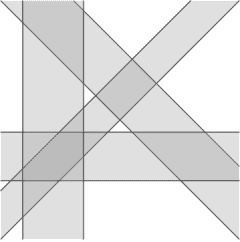

**图 8.7** \(\mathbb{R}^2\) 中的四个不同条带。

为了更深入地练习增长函数，请展示一个令人惊叹的二分法——这个函数既可以多项式增长，也可以指数增长（练习 8.20），并计算并集的 VC 维（练习 8.22）。

## 8.3.5 通过 VC 维估计覆盖数

覆盖数通常随维度指数增长（例如参见 (4.17)）。现在，让我们通过用 VC 维替换代数维度来改进这一经验法则——这可以为我们节省很多。

设 \(\mathcal{F}\) 是某个定义域 \(\Omega\) 上的布尔函数类，并设 \(\mu\) 是 \(\Omega\) 上的任意概率测度。定义函数之间的距离
\[
d(f,g)=\|f-g\|_{L^2(\mu)} = \left(\mathbb{E}(f-g)(X)^2\right)^{1/2}, \tag{8.31}
\]
其中 \(X\) 是一个分布为 \(\mu\) 的随机变量。（如果你没有学过测度论，只需取一个取值于 \(\Omega\) 的任意随机变量 \(X\)，并将 \(\mu\) 视为 \(X\) 的分布的名称。）

现在让我们来界定类 \(\mathcal{F}\) 关于度量 (8.31) 的覆盖数 \(\mathcal{N}(\mathcal{F},L^2(\mu),\epsilon)\)：

根据引理的假设。现在对所有不同的函数对 $f, g \in \mathcal{F}$ 取并集界。这样的函数对最多有 $|\mathcal{F}|^2$ 个，因此以至少

$$1 - |\mathcal{F}|^2 \cdot 2 \exp(-c n \varepsilon^4) \tag{8.34}$$

的概率，界 (8.33) 对所有不同的 $f, g \in \mathcal{F}$ 同时成立。由于根据假设 $n \ge C \varepsilon^{-4} \log |\mathcal{F}|$，通过选择足够大的绝对常数 $C$，我们可以使 (8.34) 中的量至少为 0.99。

*定理 8.3.13 的证明。* 由填充-覆盖等价性（引理 4.2.8），我们可以找到

$$N = \mathcal{N}(\mathcal{F}, L^2(\mu), \varepsilon)$$

个 $\mathcal{F}$ 中的函数，它们在 $L^2(\mu)$ 度量下是 $\varepsilon$-分离的。设 $n = \lceil C \varepsilon^{-4} \log N \rceil$ 并将引理 8.3.14 应用于这些函数的集合。以正概率，这些函数在 (8.32) 中定义的度量 $L^2(\mu_n)$ 下保持 $(\varepsilon/2)$-分离，因此它们在 $\Omega_n = \{X_1, \dots, X_n\}$ 上的限制都不同。

固定一个该事件成立的随机变量 $X_1, \dots, X_n$ 的实现。于是存在子集 $\Omega_n \subset \Omega$ 且 $|\Omega_n| \le n \le 2C \varepsilon^{-4} \log N$，使得通过将所有函数限制到 $\Omega_n$ 上得到的函数类 $\mathcal{F}_n = \mathcal{F}|_{\Omega_n}$ 满足 $|\mathcal{F}_n| \ge N$。现在对 $\mathcal{F}_n$ 和 $\Omega_n$ 应用 Sauer-Shelah 引理 8.3.9，得到

$$N \le \left(\frac{e n}{d_n}\right)^{d_n} \le \left(\frac{2C \varepsilon^{-4} \log N}{d_n}\right)^{d_n}$$

其中 $d_n = \mathrm{vc}(\mathcal{F}_n)$。化简后⁴，我们得到

$$N \le (2C \varepsilon^{-4})^{2 d_n}.$$

最后，将 $d_n = \mathrm{vc}(\mathcal{F}_n)$ 换成更大的量 $d = \mathrm{vc}(\mathcal{F})$。

⁴ 为此，注意 $\frac{\log N}{2 d_n} = \log(N^{1/2 d_n}) \le N^{1/2 d_n}$。

## 8.3.6 VC 大数定律

回到 8.2.2 节，我们在所有 Lipschitz 函数上界定了经验过程。现在，让我们用具有有限 VC 维的任意布尔函数类替换 Lipschitz 函数：

**定理 8.3.15（VC 大数定律）。** *设 $\mathcal{F}$ 是某个定义域 $\Omega$ 上具有有限 VC 维的布尔函数类，且 $X, X_1, X_2, \dots, X_n$ 是 $\Omega$ 中具有共同分布的独立随机点。则*

$$ \mathbb{E} \sup_{f \in \mathcal{F}} \left| \frac{1}{n} \sum_{i=1}^n f(X_i) - \mathbb{E} f(X) \right| \le C \sqrt{\frac{\mathrm{vc}(\mathcal{F})}{n}}. $$

## 8.4 统计学习

在我们的日常生活中，有一部分信息被严格保护，它们被称为“国家秘密”。国家秘密是关系国家安全和利益，依照法定程序确定，在一定时间内只限一定范围的人员知悉的事项。

这些秘密信息一旦泄露，将直接损害国家的政治、经济、国防、外交等方面的安全和利益。因此，保护国家秘密是每一位公民应尽的义务。

### 为什么我们要保守国家秘密？

- **维护国家安全**：国家秘密直接关系到国家的安全与稳定，保守秘密是对国家安全最直接的贡献。
- **保障国家利益**：秘密信息的泄露可能导致国家在经济、科技、军事等领域遭受重大损失。
- **履行法定义务**：保守国家秘密是每个公民和组织应尽的法律义务。
- **增强民族凝聚力**：共同保守秘密能够增强全社会的责任感和凝聚力。

### 我们应如何做？

1. **增强保密意识**：时刻保持警惕，认识到国家秘密的重要性。
2. **遵守保密法规**：严格遵守《中华人民共和国保守国家秘密法》及相关法律法规。
3. **不泄露信息**：在工作中和生活中，不向无关人员透露任何涉密信息。
4. **及时报告**：发现失密、泄密现象时，应立即向有关部门报告。

国家秘密的保护是我们共同的责任。让我们从自身做起，增强保密意识，用实际行动维护国家的安全和利益！

将 $\Omega$ 中的点分为两类。例如，设想一项包含 $n$ 名患者的健康研究。对于每位患者，我们记录 $d$ 个健康参数，如血压或体温——这就是我们的向量 $X_i \in \mathbb{R}^d$。假设我们还知道他们是否患有糖尿病：$T(X_i) = 0$（健康）或 $1$（患病）。目标是从数据 (8.36) 中学习如何预测糖尿病——也就是说，学习函数 $T : \mathbb{R}^d \to \{0, 1\}$，以便我们能够根据新的患者的健康参数进行诊断。

## 8.4.1 风险、拟合与复杂度

给定训练数据 (8.36)，我们希望找到一个函数 $f : \Omega \to \mathbb{R}$ 来近似 $T$，这样我们之后可以通过检查 $f(X)$ 来诊断新患者 $X$。我们的目标是最小化误诊新患者的*风险*，定义为：

$$R(f) = \mathbb{E}\,(f(X) - T(X))^2. \tag{8.37}$$

**例 8.4.2。** 在 $T$ 和 $f$ 都是布尔函数的分类问题中，风险就是误分类的概率（请验证这一点！）：

$$R(f) = \mathbb{P}\{f(X) \ne T(X)\}. \tag{8.38}$$

我们需要多少训练数据？这取决于问题的复杂度。如果我们认为目标函数 $T(X)$ 的行为很复杂，就需要更多数据。由于我们通常事先不知道这一点，我们将会把猜测限定的函数 $f$ 限制在某个函数类 $\mathcal{F}$ 中，这个函数类称为*假设类*。

但是我们如何选择 $\mathcal{F}$ 呢？没有通用的规则，但它应该平衡拟合与复杂度。如果 $\mathcal{F}$ 过于简单——比如只包含线性函数——我们可能会*欠拟合*（见图 8.10a）而错过真实的模式。如果过于复杂，我们可能会*过拟合*，只是记住了训练数据而不是从中泛化（图 8.10b），并且我们还需要多得多的数据。最理想的情况是选择一个假设类，它刚好复杂到能捕捉真实模式，又不至于追逐随机噪声（图 8.10c）。

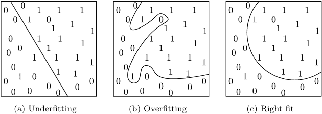

**图 8.10** 拟合与复杂度之间的权衡

## 8.4.2 经验风险最小化

一旦我们选定了假设空间 $\mathcal{F}$，我们可能只需在其中选择最佳函数 $f^*$——即最小化风险 (8.37) 的那个函数：

$$f^* := \arg\min_{f\in\mathcal{F}} R(f).$$

问题在于我们实际上无法计算风险 $R(f)$，因为这需要对整个总体 $\Omega$ 求期望。解决办法？改为对训练数据求期望：

**定义 8.4.3**（经验风险最小化）。对于一个函数 $f : \Omega \to \mathbb{R}$，定义*经验风险*和经验最小化子为

$$R_n(f) := \frac{1}{n}\sum_{i=1}^{n}(f(X_i)-T(X_i))^2,\qquad f_n^* := \arg\min_{f\in\mathcal{F}} R_n(f). \tag{8.39}$$

现在我们可以从训练数据中计算 $R_n(f)$ 和 $f_n^*$。学习的结果是 $f_n^*$，其质量通过*泛化误差* $R(f_n^*)$ 来衡量。

**例 8.4.4**（分类）。在分类问题中，$f$ 和 $T$ 取值为 0 或 1，经验风险 $R_n(f)$ 只是训练点中 $f$ 判断错误（即 $f(X_i) \ne T(X_i)$）所占的比例。因此经验风险最小化会选择 $\mathcal{F}$ 中在训练数据上犯错最少的 $f$。

## 8.4.3 VC 泛化界

让我们使用 VC 理论来界定任意分类问题（其中目标 $T$ 是布尔函数）中的泛化误差。

**定理 8.4.5**（VC 泛化界）。*假设目标 $T$ 是一个布尔函数，假设空间 $\mathcal{F}$ 是一个具有有限 VC 维的布尔函数类。则*

$$\mathbb{E}R(f_n^*) \le R(f^*) + C\sqrt{\frac{\operatorname{VC}(\mathcal{F})}{n}}.$$

*证明。* **第 1 步：超额风险。** 以下界逐点成立：

$$R(f_n^*)-R(f^*) \le 2\sup_{f\in\mathcal{F}}|R_n(f)-R(f)|. \tag{8.40}$$

为了验证它，记 $\epsilon := \sup_{f\in\mathcal{F}}|R_n(f)-R(f)|$，并写出

$$\begin{aligned}R(f_n^*) &\le R_n(f_n^*)+\epsilon &&\text{（因为由构造知 }f_n^*\in\mathcal{F}\text{）}\\ &\le R_n(f^*)+\epsilon &&\text{（因为 }f_n^*\text{ 在类 }\mathcal{F}\text{ 中最小化 }R_n\text{）}\\ &\le R(f^*)+2\epsilon &&\text{（因为由构造知 }f^*\in\mathcal{F}\text{）。}\end{aligned}$$

两边同时减去 $R(f^*)$ 即得 (8.40)。

本质上是对我们在 Dudley 不等式（定理 8.1.4）证明中发展的链式方法的强化。

## 8.5.1 Dudley 不等式的改造

回顾我们通过链式方法得到的界 (8.12)：

$$\mathbb{E}\sup_{t\in T}X_t\lesssim\sum_{k=\kappa+1}^{\infty}\varepsilon_{k-1}\sqrt{\log|T_k|},\tag{8.42}$$

其中 $\varepsilon_k=2^{-k}$，$T_k$ 是 $T$ 的最小 $\varepsilon_k$-网，因此 $|T_k|=\mathcal{N}(T,d,\varepsilon_k)$，$\kappa$ 的选择使得 $|T_\kappa|=1$。

现在，让我们反转思路：不固定 $\varepsilon_k$ 并最小化 $|T_k|$，而是固定 $|T_k|$ 并最小化 $\varepsilon_k$。具体来说，选取子集 $T_k\subset T$ 使得

$$|T_0|=1,\qquad |T_k|\le 2^{2^k},\qquad k=1,2,\ldots\tag{8.43}$$

并定义

$$\varepsilon_k=\sup_{t\in T}d(t,T_k),$$

其中 $d(t,T_k)$ 表示从 $t$ 到集合 $T_k$ 的距离⁷。于是每个 $T_k$ 都是一个 $\varepsilon_k$-网，链式界 (8.42) 变为

$$\mathbb{E}\sup_{t\in T}X_t\lesssim\sum_{k=1}^{\infty}2^{k/2}\sup_{t\in T}d(t,T_{k-1}),$$

或者重新索引后，

$$\mathbb{E}\sup_{t\in T}X_t\lesssim\sum_{k=0}^{\infty}2^{k/2}\sup_{t\in T}d(t,T_k).\tag{8.44}$$

## 8.5.2 $\gamma_2$ 泛函与一般链式方法

到目前为止，我们只是用新形式重述了 Dudley 不等式——还没有什么重要的进展。关键步骤现在到来。一般链式方法将允许我们把 (8.44) 中的上确界移到求和号外面。由此得到的量有一个名字：

**定义 8.5.1**（$\gamma_2$ 泛函）。设 $(T,d)$ 是一个度量空间。满足 (8.43) 的 $T$ 的子集序列 $(T_k)_{k=0}^{\infty}$ 称为一个*容许序列*。$T$ 的 $\gamma_2$ 泛函定义为

$$\gamma_2(T,d)=\inf_{(T_k)}\sup_{t\in T}\sum_{k=0}^{\infty}2^{k/2}d(t,T_k)\tag{8.45}$$

其中的下确界取遍所有容许序列。

⁷ 在度量空间中，点 $t$ 到集合 $A$ 的距离是 $d(t,A)=\inf\{d(t,a):a\in A\}$。

（要得到常数 8，选择足够大的绝对常数 $C$ 即可。）

现在通过对
$$|T_k| \cdot |T_{k-1}| \le |T_k|^2 \le 2^{2^{k+1}}$$
个 $(\pi_k(t), \pi_{k-1}(t))$ 对取并集界，来解除对 $t \in T$ 的固定。同样地，通过对所有 $k \in \mathbb{N}$ 取并集界，来解除对 $k$ 的固定。则 **(8.49)** 对所有 $t \in T$ 和 $k \in \mathbb{N}$ 同时成立，概率至少为
$$1 - \sum_{k=1}^{\infty} 2^{2^{k+1}} \cdot 2\exp(-8u^2 2^k) \ge 1 - 2\exp(-u^2).$$
若 $u > c$。（请检验最后一个不等式！）

**步骤 3：对增量求和。** 在界 **(8.49)** 对所有 $t \in T$ 和 $k \in \mathbb{N}$ 成立的事件中，我们可以将所有 $k \in \mathbb{N}$ 的不等式相加，并将结果代入链式和 **(8.47)**。我们得到
$$|X_t - X_{t_0}| \lesssim u \sum_{k=1}^{\infty} 2^{k/2} d(\pi_k(t), \pi_{k-1}(t)), \qquad (8.50)$$
其中记号 $\lesssim$ 隐藏了一个绝对常数因子。由三角不等式，
$$d(\pi_k(t), \pi_{k-1}(t)) \le d(t, \pi_k(t)) + d(t, \pi_{k-1}(t)).$$

利用该界、重新编号并代入 **(8.46)**，我们得到 **(8.50)** 的右端至多为 $Cu\gamma_2(T,d)$，即
$$|X_t - X_{t_0}| \lesssim u\gamma_2(T,d).$$
（检验！）对 $t\in T$ 取上确界得
$$\sup_{t \in T}|X_t - X_{t_0}| \lesssim u\gamma_2(T,d).$$
由于这对任意 $u > c$ 以至少 $1 - 2\exp(-u^2)$ 的概率成立，我们得到
$$\left\|\sup_{t \in T}|X_t - X_{t_0}|\right\|_{\psi_2} \lesssim \gamma_2(T,d).$$

这很快推出定理 **8.5.2** 的结论（检验！）

□

**注记 8.5.3**（泛链：增量的上确界）。与 Dudley 不等式（注记 **8.1.5**）类似，泛链实际上给出
$$\mathbb{E}\sup_{t,s \in T}|X_t - X_s| \le CK\gamma_2(T,d),$$
即使在没有零均值假设 $\mathbb{E}X_t = 0$ 的情况下也成立。

**注记 8.5.4**（泛链：高概率界）。定理 **8.5.2** 只给出期望界，但泛链实际上给出高概率界——我们已在 Dudley 不等式（注记 **8.1.6**）中见到过这一逻辑。假设 $T$ 有限，⁸ 对每个 $u\ge 0$，事件
$$\sup_{t,s\in T}|X_t-X_s|\le CK\left[\gamma_2(T,d)+u\cdot\operatorname{diam}(T)\right]$$
以至少 $1-2\exp(-u^2)$ 的概率成立。尝试习题 8.35 来证明这一点！对于高斯过程，你可以直接从高斯集中性推出它。

⁸ 与往常一样，我们假设 $T$ 有限以避免可测性问题；一般情形通常可通过逼近得到。

作为练习，尝试将泛链应用于经验过程（习题 8.36）。

### 8.5.3 优测度与比较定理

$\gamma_2$ 泛函（定义 8.5.1）通常比 Dudley 不等式（定理 8.1.3）中的覆盖数更难计算。但这往往值得付出努力——与 Dudley 不同，泛链在常数意义下是精确的：

**定理 8.5.5**（Talagrand 优测度定理）。*设 $(X_t)_{t\in T}$ 是集合 $T$ 上的零均值高斯过程，配备如 (7.1) 中的典范度量 $d(t,s)=\|X_t-X_s\|_{L^2}$。则*
$$c\gamma_2(T,d)\le \mathbb{E}\sup_{t\in T}X_t\le C\gamma_2(T,d).$$

定理 8.5.5 中的上界直接来自泛链（定理 8.5.2）。下界更为棘手；其证明可视为 Sudakov 不等式（定理 7.4.1）的一个精细的多尺度推广，此处不再展开。

由定理 8.5.2 可知，上界不仅对高斯过程成立，而且对所有*次高斯*过程成立。因此，结合上界与下界，我们可以用高斯过程来界定任意次高斯过程：

**推论 8.5.6**（Talagrand 比较不等式）。*设 $(X_t)_{t\in T}$ 是集合 $T$ 上的零均值随机过程，$(Y_t)_{t\in T}$ 是零均值高斯过程。假设*
$$\|X_t-X_s\|_{\psi_2}\le K\|Y_t-Y_s\|_{L^2}\quad\text{for all }t,s\in T.$$
*则*
$$\mathbb{E}\sup_{t\in T}X_t\le CK\,\mathbb{E}\sup_{t\in T}Y_t.$$

*证明* 考虑 $T$ 上的典范度量 $d(t,s)=\|Y_t-Y_s\|_{L^2}$。现在只需使用泛链界（定理 8.5.2），然后使用优测度定理 8.5.5 中的下界：
$$\mathbb{E}\sup_{t\in T}X_t\lesssim K\gamma_2(T,d)\lesssim K\,\mathbb{E}\sup_{t\in T}Y_t.\quad\square$$

**注记 8.5.7**（Sudakov-Fernique）。推论 8.5.6 将 Sudakov-Fernique 不等式（定理 7.2.8）推广到次高斯过程——而这次推广的代价仅是一个绝对常数因子！

我们将推论 8.5.6 应用于集合 $T\subset\mathbb{R}^n$ 上的典范高斯过程 $Y_x=\langle g,x\rangle$，其中 $g\sim N(0,I_n)$。回顾第 7.5 节，
$$w(T)=\mathbb{E}\sup_{x\in T}\langle g,x\rangle$$
是集合 $T$ 的*高斯宽度*。我们立即得到：

**推论 8.5.8**（Talagrand 比较不等式：几何形式）。*设 $(X_x)_{x\in T}$ 是子集 $T\subset\mathbb{R}^n$ 上的零均值随机过程。假设*
$$\|X_x-X_y\|_{\psi_2}\le K\|x-y\|_2 \quad\text{for all }x,y\in T.$$
*则*
$$\mathbb{E}\sup_{x\in T}X_x\le CKw(T).$$

**注记 8.5.9**（次高斯宽度 $\lesssim$ 高斯宽度）。一个很好的推论：若 $X$ 是 $\mathbb{R}^n$ 中的次高斯随机向量，则
$$\mathbb{E}\sup_{t\in T}\langle X,t\rangle\le CKw(T) \quad\text{for any bounded set }T\subset\mathbb{R}^n,$$
其中 $K=\|X\|_{\psi_2}$。只需将推论 8.5.8 应用于过程 $(\langle X,x\rangle)_{x\in T}$，根据次高斯随机向量的定义，其增量满足 $\|\langle X,x\rangle-\langle X,y\rangle\|_{\psi_2}\le K\|x-y\|_2$。

作为练习，尝试证明 Talagrand 比较的几个版本（习题 8.37），并用它得到次高斯向量 $\ell^p$ 范数的精确界（习题 8.38）。

## 8.6 Chevet 不等式

Talagrand 比较不等式（更一般地，泛链）是一个在广泛情境中适用的强大工具。让我们用它来获得随机二次型的一个非常一般的统一界：
$$\sup_{x\in T,\,y\in S}\langle Ax,y\rangle\le ?$$
其中 $A$ 是随机矩阵，$T,S$ 是任意有界集合。

当 $T$ 和 $S$ 是欧几里得球时，一个特殊情形导致 $A$ 的算子范数，我们已在定理 4.4.3 和 7.3.1 中研究过。现在让我们一般化，考虑任意集合，目标仅用两个几何量来界定事物：*高斯宽度*和*半径*，定义为
$$\operatorname{rad}(T):=\sup_{x\in T}\|x\|_2. \tag{8.51}$$

**定理 8.6.1**（次高斯 Chevet 不等式）。*设 $A$ 是 $m\times n$ 随机矩阵，其行 $A_i$ 独立、零均值、次高斯。设 $T\subset\mathbb{R}^n$ 和 $S\subset\mathbb{R}^m$ 是任意有界集合。则*
$$\mathbb{E}\sup_{x\in T,\,y\in S}\langle Ax,y\rangle\le CK\big[w(T)\operatorname{rad}(S)+w(S)\operatorname{rad}(T)\big]$$
*其中 $K = \max_i \|A_i\|_{\psi_2}$。若将“行”替换为“列”，结论同样成立。*

*定理 8.6.1 的证明* 我们将遵循定理 7.3.1 的证明，但使用 Talagrand 比较不等式代替 Sudakov-Fernique 不等式。

不失一般性，设 $K=1$。我们需要界定随机过程
$$X_{uv}=\langle Au,v\rangle,\quad u\in T,\ v\in S.$$

为了检验增量是次高斯的，固定 $(u,v),(w,z)\in T\times S$，写出
$$X_{uv}-X_{wz}=X_{uv}-X_{wv}+X_{wv}-X_{wz}=\langle A(u-w),v\rangle+\langle Aw,v-z\rangle.$$

利用三角不等式和次高斯假设（见习题 3.34——如果你跳过了它，现在做一下），我们得到
$$\begin{aligned}\|X_{uv}-X_{wz}\|_{\psi_2} &\le \|\langle A(u-w),v\rangle\|_{\psi_2}+\|\langle Aw,v-z\rangle\|_{\psi_2}\\ &\lesssim \|u-w\|_2\|v\|_2+\|v-z\|_2\|w\|_2\\ &\le \|u-w\|_2\,\operatorname{rad}(S)+\|v-z\|_2\,\operatorname{rad}(T).\end{aligned}\tag{8.52}$$

让我们为 Talagrand 比较不等式（推论 8.5.6）选择一个更简单的高斯过程 $(Y_{uv})$。增量界 (8.52) 指引我们做出一个好的选择：
$$Y_{uv}:=\langle g,u\rangle\operatorname{rad}(S)+\langle h,v\rangle\operatorname{rad}(T),$$
其中 $g\sim N(0,I_n)$ 和 $h\sim N(0,I_m)$ 相互独立。该过程的增量为
$$\|Y_{uv}-Y_{wz}\|_{L_2}^2=\|u-w\|_2^2\operatorname{rad}(S)^2+\|v-z\|_2^2\operatorname{rad}(T)^2.$$
（像定理 7.3.1 的证明中那样检验！）与 (8.52) 比较，我们得到
$$\|X_{uv}-X_{wz}\|_{\psi_2}\lesssim \|Y_{uv}-Y_{wz}\|_{L_2},$$
其中我们用到了不等式 $a+b\le\sqrt{2(a^2+b^2)}$。应用 Talagrand 比较不等式（推论 8.5.6），我们完成证明：
$$\begin{aligned}\mathbb{E}\sup_{u\in T,v\in S}X_{uv} &\le \mathbb{E}\sup_{u\in T,v\in S}Y_{uv}\\ &=\mathbb{E}\sup_{u\in T}\langle g,u\rangle\operatorname{rad}(S)+\mathbb{E}\sup_{v\in S}\langle h,v\rangle\operatorname{rad}(T)\\ &=w(T)\operatorname{rad}(S)+w(S)\operatorname{rad}(T).\end{aligned}$$

**注记 8.6.2**（随机矩阵的算子范数）。对于特殊情形 $T=S^{n-1}$ 和 $S=S^{m-1}$，Chevet 不等式给出我们熟悉的算子范数精确界：
$$\mathbb{E}\|A\|\le CK(\sqrt{n}+\sqrt{m}),$$
我们之前在第 4.4.2 节用 $\varepsilon$-网证明了它。但这种新方法更灵活。例如，选取 $T$ 和 $S$ 为 $\ell^p$ 球，就给出随机矩阵的 $\|A\|_{p\to q}$ 范数——尝试习题 8.41！

**注记 8.6.3（高斯 Chevet 不等式）。** 对于元素独立同分布为 $N(0,1)$ 的高斯矩阵 $A$，我们甚至能以最优常数 1 证明 Chevet 不等式：

$$\mathbb{E}\sup_{x\in T,y\in S}\langle Ax,y\rangle \le w(T)\,\operatorname{rad}(S)+w(S)\,\operatorname{rad}(T),$$

以及一个相差常数的反向不等式（习题 8.39）。稍后，我们将在 9.7.1 节进一步改进高斯 Chevet 不等式。

作为更多练习，请证明 Chevet 不等式的高概率版本（习题 8.40）。

## 8.7 注记

链式方法（chaining）的思想已经出现在 Kolmogorov 对布朗运动连续性定理的证明中，参见例如 [253, 第1章]。Dudley 积分不等式（定理 8.1.3）可以追溯到 R. Dudley 的工作。我们在 8.1 节的阐述主要遵循 [210, 第11章]、[315, 第1.2节] 和 [330, 第5.3节]。

蒙特卡洛方法（8.2.1 节）在科学计算中极为流行，尤其是与马尔可夫链的强大能力结合时，参见例如 [63]。丰富的*经验过程*理论（见定义：经验过程）在统计学和机器学习中有应用，参见 [329, 328, 279, 232]。Lipschitz 大数定律（定理 8.2.3），也称为 Wasserstein 大数定律，大致基于 [330, 例 5.15]，参见 [115, 第11章]。关于测度输运（8.2.3 节）的介绍，参见 [342, 85]。

8.3 节引入的 VC 维概念可以追溯到 V. Vapnik 和 A. Chervonenkis [335] 的开创性工作；现代论述可见于例如 [329, 第2.6.1节]、[210, 第14.3节]、[330, 第7.2节]、[225, 第10.2–10.3节]、[232, 第2.2节]、[329, 第2.6节]。Pajor 引理 8.3.7 最初由 A. Pajor [268] 提出；参见 [128]、[210, 命题]、[330, 定理 7.19]、[329, 引理 2.6.2]。

我们现在所称的 Sauer-Shelah 引理（引理 8.3.9）由 V. Vapnik 和 A. Chervonenkis [335]、N. Sauer [294] 以及 M. Perles 和 S. Shelah [300] 独立证明。Sauer-Shelah 引理的各种证明可见于文献，例如 [46, 第17章]、[225, 第10.2–10.3节]、[210, 第14.3节]。Sauer-Shelah 引理已知有许多变体，参见例如 [158, 312, 313, 15, 337]。增长函数（8.3.4 节）最初由 Vapnik–Chervonenkis 引入，他们研究了它的各种性质，包括指数-多项式二分性（习题 8.20）。

定理 8.3.13 归功于 R. Dudley [114]；参见 [210, 第14.3节]、[329, 定理 2.6.4]。降维引理 8.3.14 隐含在 Dudley 的证明中；它在 [237] 中被明确陈述，并在 [330, 引理 7.17] 中被复述。关于 VC 理论从 {0, 1} 到一般实值函数类的推广，参见 [237, 288]、[330, 第7.3–7.4节]。

自 V. Vapnik 和 A. Chervonenkis [335] 的开创性工作以来，像定理 8.3.15 这样通过 VC 维对经验过程进行界定的结果一直是统计学习理论的焦点，参见例如 [232, 32, 329, 288]、[330, 第7章]。我们对定理 8.3.15 的阐述基于 [330, 推论 7.18]。尽管这一结果的明确表述在早期文献中难以找到，但它可以从 [32, 定理 6]、[56, 第5节] 推导出来。

Glivenko–Cantelli 定理（定理 8.3.17）是 1933 年的结果 [138, 75]，它早于并在一定程度上推动了 VC 理论的后续发展；关于 Glivenko–Cantelli 定理及概率论中其他一致性结果的更多内容，参见 [210, 第14.2节]、[329, 115]。例 8.3.18 讨论了差异理论中的一个基本问题；关于差异理论的全面论述，参见 [224]。

在 8.4 节中，我们仅仅触及了统计学习理论的表面，这是概率论、统计学和理论计算机科学交汇处的一个大领域。关于这一主题的更深入介绍，参见例如教程 [52, 232] 和专著 [171, 156, 196]。

8.5 节介绍的泛链式方法（generic chaining）由 M. Talagrand 自 1985 年起提出（在 X. Fernique [124] 的早期工作之后），它是一种获得高斯过程最优界的方法。我们的阐述基于 Talagrand 的著作 [315, 316, 317]，这些著作非常详细地讨论了泛链式方法的衍生影响、应用和历史。次高斯过程的上界（定理 8.5.2）可见于 [315, 定理 2.2.22]；下界（控制测度定理 8.5.5）可见于 [315, 定理 2.4.1]。Talagrand 比较不等式（推论 8.5.6）引自 [315, 定理 2.4.12]。泛链式方法的另一种阐述可见 [330, 第6章]。R. van Handel 最近在 [332, 333] 中给出了控制测度定理的另一种证明。泛链式方法界的高概率版本（注记 8.5.4）出自 [316, 定理 2.2.27] 和 [317, 定理 2.7.13]；S. Dirksen [103] 也用另一种方法证明了该结果。

8.6 节涵盖次高斯过程的 Chevet 不等式。对高斯过程而言，该不等式可追溯到 S. Chevet [84]；随后 Y. Gordon [140] 改进了其中的常数，从而得到我们在习题 8.39 中陈述的结果。该结果的详细阐述可见 [21, 第9.4节]。关于 Chevet 不等式的变体与应用，参见 [321, 7]。

Sudakov 不等式与 Dudley 不等式之间的对数差距（习题 8.5）是最优的：交叉多胞体 $T=B_1^n$ 就是一个例子（参见 [317, 习题 2.5.11]）。

次指数 Dudley 不等式（习题 8.7）可以很容易地推广到几乎任何类型的尾部衰减 [210, 第11.1节]。

局部 Dudley 不等式（习题 8.8）是一种在统计学习理论和随机过程连续性证明中有应用的工具，参见 [330, 第5.4节]。

习题 8.10 将 Lipschitz 大数定律推广到更高维。关于其历史、推广、改进和（几乎）最优性，参见 [85, 第2章]。

我们在习题 8.21 中得到的界 $O(dk\log k)$ 是最优的 [119]。

增长函数的指数-多项式二分性（习题 8.20），以及把大数定律（LLN）中的一致收敛（习题 8.28）和可学习性（习题 8.32）刻画为有限 VC 维，本质上都源于 Vapnik 和 Chervonenkis 的原始工作 [335]。

一比特量化（习题 8.26）在信号处理和机器学习中得到了广泛研究，参见例如 [89, 53, 355, 198, 199, 275, 274, 276, 13, 341, 92, 265, 189, 278, 168, 28, 351, 105, 129, 106, 104, 226, 81, 107]。习题 8.26 的结果来自 [265, 定理 2.2]。

习题 8.27 给出了*小球方法*的一个简化版本，该方法在 [191] 中被引入，用于削弱随机矩阵理论和机器学习中对分布所做的假设 [234, 235, 208, 207]。

随机矩阵的 $p\to q$ 范数（习题 8.41）最初在 [37] 中针对有界元素且 $p=2$、$q\in[2,\infty)$ 的情形进行了研究；更一般的近期结果可见 [9, 100, 200, 202, 201]。

## 习题

- 8.1 ♨♨♨（Dudley 不等式：高概率界）修改 8.1 节中的链式论证，得到注记 8.1.6 所述 Dudley 不等式的高概率版本。为此，将 (8.11) 升级为高概率版本：

  $$\sup_{t\in T}\left(X_{\pi_k(t)}-X_{\pi_{k-1}(t)}\right)\le C\varepsilon_{k-1}\left[\sqrt{\log|T_k|}+z_k\right] \tag{8.53}$$

  其概率至少为 $1-2\exp(-z_k^2)$。选择 $z_k$ 的值，以便能对 (8.12) 中的所有项取并集界。

- 8.2 ♨♨（高斯过程的 Dudley：高概率界）结合 Dudley 不等式与高斯集中性（定理 7.1.11），给出注记 8.1.6 中关于高斯过程的结果的另一种证明。

- 8.3 ♨♨（Dudley 积分与求和等价）在定理 8.1.3 的证明中，我们用 Dudley 积分来界定 Dudley 求和。证明它们实际上在常数意义下等价：

  $$\sum_{k\in\mathbb Z}2^{-k}\sqrt{\log N(T,d,2^{-k})}\asymp\int_0^\infty\sqrt{\log N(T,d,\varepsilon)}\,d\varepsilon.$$

### 8.4（Dudley 不等式可能不够紧）

设 \(e_k\) 是 \(\mathbb{R}^n\) 中的标准基向量，并令

\[
T := \left\{\frac{e_k}{\sqrt{1+\log k}},\ k=1,\ldots,n\right\}.
\]

- (a) 证明 \(w(T) \le C\)。
- (b) 证明当 \(n\to\infty\) 时，\(\int_0^\infty \sqrt{\log \mathcal{N}(T,d,\varepsilon)}\,d\varepsilon \to \infty\)。

### 8.5（Dudley 不等式和 Sudakov 不等式在对数因子范围内是紧的）

Sudakov 不等式（推论 7.4.2）和 Dudley 不等式（定理 8.1.8）给出了任意有界集合 \(T\subset\mathbb{R}^n\) 的高斯宽度 \(w(T)\) 的如下界：

\[
s(T)\lesssim w(T)\lesssim d(T),
\]

其中

\[
s(T)=\sup_{\varepsilon>0}\varepsilon\sqrt{\log \mathcal{N}(T,\varepsilon)}
\quad\text{且}\quad
d(T)=\int_0^\infty\sqrt{\log \mathcal{N}(T,\varepsilon)}\,d\varepsilon.
\]

证明这两个界在对数因子范围内等价：

\[
s(T)\le d(T)\le C\log(n)\,s(T).
\]

特别地，Sudakov 不等式（推论 7.4.2）和 Dudley 不等式（定理 8.1.8）在对数因子范围内都是紧的。

### 8.6（具有精细积分限的 Dudley 不等式）

我们从注 8.1.7 得知，Dudley 积分（8.17）的上限可以设为 \(T\) 的直径。改进下限也很有用，因为积分可能在 0 附近发散。证明任意有界集合 \(T\subset\mathbb{R}^n\) 的高斯宽度满足

\[
w(T)\le C\int_a^b\sqrt{\log \mathcal{N}(T,\varepsilon)}\,d\varepsilon
\quad\text{其中}\quad
a=\frac{cw(T)}{\sqrt n},\quad b=\operatorname{diam}(T).
\]

### 8.7（次指数型 Dudley 不等式）

假设零均值随机过程 \((X_t)_{t\in T}\) 的增量并非像（8.1）那样是次高斯的，而是次指数的：

\[
\|X_t-X_s\|_{\psi_1}\le Kd(t,s)\quad\text{对所有 }t,s\in T.
\]

证明以下 Dudley 不等式版本（定理 8.1.3）：

\[
\mathbb{E}\sup_{t\in T}X_t\le CK\int_0^\infty\log \mathcal{N}(T,d,\varepsilon)\,d\varepsilon.
\]

### 8.8（局部 Dudley 不等式）

设 \((X_t)_{t\in T}\) 是度量空间 \((T,d)\) 上的随机过程，其增量如（8.1）所示为次高斯。设 \(\delta>0\)。证明

\[
\mathbb{E}\sup_{\substack{s,t\in T\\d(s,t)\le\delta}}|X_s-X_t|\le CK\int_0^\delta\sqrt{\log \mathcal{N}(T,d,\varepsilon)}\,d\varepsilon.
\]

### 8.9（Lipschitz 函数的覆盖数）

对于函数类

\[
\mathcal{F}:=\{f:[0,1]\to[0,1],\ \|f\|_{\mathrm{Lip}}\le 1\},
\]

### 8.15 ☕☕☕（正方形的 VC 维数）

设 \(\mathcal{F}\) 是所有闭的、轴对齐正方形的指示函数类，即 \(\mathbb{R}^2\) 中形如 \([a, a + d] \times [b, b + d]\) 的集合的指示函数。证明 \(\operatorname{vc}(\mathcal{F}) = 3\)。

### 8.16 ☕☕（多边形的 VC 维数）

设 \(\mathcal{F}\) 是 \(\mathbb{R}^2\) 中所有凸多边形的指示函数类，不限制顶点数。证明 \(\operatorname{vc}(\mathcal{F}) = \infty\)。

### 8.17 ☕☕☕（半空间的 VC 维数）

证明例 8.3.5 中的结论：若 \(\mathcal{F}\) 是 \(\mathbb{R}^n\) 中所有半空间的指示函数类，则 \(\operatorname{vc}(\mathcal{F}) = n + 1\)。

### 8.18 ☕☕（VC 维数与代数维数）

证明对于定义在域 \(\Omega\) 上的任意有限维布尔函数类 \(\mathcal{F}\)，都有 \(\operatorname{vc}(\mathcal{F}) \le \dim(\mathcal{F})\)，其中 \(\dim(\mathcal{F})\) 表示 \(\mathcal{F}\) 的线性代数维数，即 \(\mathcal{F}\) 中线性无关函数的最大数量。

### 8.19 ☕☕（Pajor 引理和 Sauer–Shelah 引理的紧性）

考虑由至多含有 \(d\) 个 1 的长度为 \(n\) 的二进制字符串组成的集合 \(\mathcal{F}\)（该集合通常称为汉明球），证明 Pajor 引理 8.3.7 和 Sauer–Shelah 引理 8.3.9 都是紧的。

### 8.20 ☕（VC 二分定理）

设 \(\mathcal{F}\) 是某个定义域上的布尔函数类。证明增长函数 \(\Pi_{\mathcal{F}}(n)\) 只能呈多项式增长或指数增长，不存在介于两者之间的情形。更严格地说，证明以下结论必有其一：对所有 \(n\)，\(\Pi_{\mathcal{F}}(n) = 2^n\)；或者存在多项式 \(p(n)\)，使得对所有 \(n\)，\(\Pi_{\mathcal{F}}(n) \le p(n)\)。

### 8.21 ☕☕（VC 稳定性）

在命题 8.3.11 中，我们观察到，将两个函数类按逐点取最小值或最大值的方式组合时，VC 维数具有稳定性。现在将这一观察推广到任意数量的函数类，以及任意组合方式。设 \(\mathcal{F}_1,\dots,\mathcal{F}_k\) 是定义在同一域上的布尔函数类。固定任意函数 \(\phi : \{0,1\}^k \to \{0,1\}\)，可将其视为一个布尔公式。考虑函数类

\[
\mathcal{F} = \{\phi(f_1,\dots,f_k) : f_1 \in \mathcal{F}_1,\dots,f_k \in \mathcal{F}_k\}.
\]

证明若每个 \(i\) 都有 \(\operatorname{vc}(\mathcal{F}_i) \le d\)，则

\[
\operatorname{vc}(\mathcal{F}) \le C d k \log k
\]

其中 \(C\) 是绝对常数。

### 8.22 ☕☕☕☕（并集的 VC 维数）

(a) 设 \(\mathcal{F}\) 和 \(\mathcal{G}\) 是定义在同一域上的布尔函数类。证明

\[
\operatorname{vc}(\mathcal{F} \cup \mathcal{G}) \le \operatorname{vc}(\mathcal{F}) + \operatorname{vc}(\mathcal{G}) + 1.
\]

### 8.32 ☕☕☕（VC 维数无穷时无法学习）

定理 8.4.5 暗示，要实现良好的学习效果，训练样本数 \(n\) 至少需要达到假设类的 VC 维数。证明若

\[
n < \frac{1}{2}\operatorname{vc}(\mathcal{F}),
\]

则存在 \(\Omega\) 上的一个分布，使得没有任何算法能够可靠地学习 \(\mathcal{F}\) 中的目标函数。（请将这一结论表述得精确！）

### 8.33 ☕☕☕（\(\gamma_2\) 泛函至少与 Dudley 积分一样好）

证明 \(\gamma_2\) 泛函有如下界：

\[
\gamma_2(T, d) \le C \int_0^\infty \sqrt{\log \mathcal{N}(T, d, \varepsilon)}\,d\varepsilon.
\]

### 8.34 ☕☕☕（\(\gamma_2\) 泛函可能优于 Dudley 积分）

有时，\(\gamma_2\) 泛函（8.45）可能显著小于 Dudley 和式（8.44）。为说明这一点，我们重新考察练习 8.4 中的例子：

\[
T := \{0\} \cup \left\{ \frac{e_k}{\sqrt{1 + \log k}},\ k = 1, \ldots, n \right\}.
\]

(a) 构造一个容许序列 \((T_k)\)，验证 \(T\) 关于欧氏度量的 \(\gamma_2\) 泛函有界：

\[
\gamma_2(T, d) = \inf_{(T_k)} \sup_{t\in T} \sum_{k=0}^\infty 2^{k/2} d(t, T_k) \le C.
\]

(b) 证明 Dudley 和式无界：

\[
\inf_{(T_k)} \sum_{k=0}^\infty 2^{k/2} \sup_{t\in T} d(t, T_k) \to \infty \quad \text{当 } n \to \infty.
\]

### 8.35 ☕☕☕☕（一般链式方法：高概率界）

通过采用首次大步跃迁的链式方法，证明注 8.5.4 中的结论：

\[
t_0 \to \pi_\kappa(t) \to \pi_{\kappa+1}(t) \to \pi_{\kappa+2}(t) \to \cdots \to t
\]

其中 \(\kappa\) 的选取满足

\[
u \asymp 2^{\kappa/2}.
\]

### 8.36 ☕☕☕（经验过程：一般链式界）

到目前为止，我们已经对两类函数类的经验过程给出了界：Lipschitz 函数类（定理 8.2.3）和 VC 维数有限的布尔函数类（定理 8.3.15）。现在考虑一般情形。取定义在域 \(\Omega\) 上的任意实值函数类 \(\mathcal{F}\)，并设 \(X, X_1, X_2, \ldots, X_n\) 是 \(\Omega\) 中独立同分布的随机点。设 \(d\) 是 \(\mathcal{F}\) 上的度量，满足

\[
\|f(X) - g(X)\|_{\psi_2} \le d(f, g) \quad \text{对所有 } f, g \in \mathcal{F}.
\]

（例如，\(d(f, g) = C\|f - g\|_{L_\infty}\) 就满足该条件。）证明：

\[
\mathbb{E} \sup_{f\in\mathcal{F}} \left| \frac{1}{n} \sum_{i=1}^n f(X_i) - \mathbb{E} f(X) \right|
\le C \frac{\gamma_2(\mathcal{F}, d)}{\sqrt{n}}.
\]

在这种情况下，（9.3）中的不等式变为

\[
\left\| \|Ax\|_2 - \|Ay\|_2 \right\|_{\psi_2}
\le C K^2 \|x - y\|_2. \tag{9.5}
\]

由于平方的 \(\ell^2\) 范数更容易处理（不含平方根），我们先证明一个使用平方范数的（9.5）版本。我们猜测它应当是这样的：以高概率有

\[
\|Ax\|_2^2 - \|Ay\|_2^2
= (\|Ax\|_2 + \|Ay\|_2)\cdot(\|Ax\|_2 - \|Ay\|_2)
\lesssim \sqrt{m}\,\|x - y\|_2. \tag{9.6}
\]

这一估计看起来合理，因为由（9.4）可知，\(\|Ax\|_2\) 和 \(\|Ay\|_2\) 大约为 \(\sqrt{m}\)，而且我们期望（9.5）成立。

现在开始证明。展开矩阵-向量乘积：

\[
\|Ax\|_2^2 - \|Ay\|_2^2
= \sum_{i=1}^{m} (\langle A_i, x\rangle^2 - \langle A_i, y\rangle^2)
= \sum_{i=1}^{m} \langle A_i, x + y\rangle \langle A_i, x - y\rangle,
\]

并将两边除以 \(\|x - y\|_2\)，得到

\[
\Delta := \frac{\|Ax\|_2^2 - \|Ay\|_2^2}{\|x - y\|_2}
= \sum_{i=1}^{m} \langle A_i, u\rangle \langle A_i, v\rangle, \tag{9.7}
\]

其中

\[
u := x + y \quad \text{且} \quad v := \frac{x - y}{\|x - y\|_2}.
\]

我们的目标是证明以高概率有 \(|\Delta| \lesssim \sqrt{m}\)。

从（9.7）中可以看出什么？这是独立随机变量 \(\langle A_i, u\rangle \langle A_i, v\rangle\) 的和。它们的均值为零，因为根据构造，

\[
\langle A_i, u\rangle \langle A_i, v\rangle
= \frac{\langle A_i, x\rangle^2 - \langle A_i, y\rangle^2}{\|x - y\|_2},
\]

而根据各向同性，

\[
\mathbb{E}[\langle A_i, x\rangle^2 - \langle A_i, y\rangle^2] = 1 - 1 = 0.
\]

它们还是次指数的：引理 2.8.6 和对 \(A_i\) 的次高斯假设给出

\[
\|\langle A_i, u\rangle \langle A_i, v\rangle\|_{\psi_1}
\le \|\langle A_i, u\rangle\|_{\psi_2} \cdot \|\langle A_i, v\rangle\|_{\psi_2}
\le K\|u\|_2 \cdot K\|v\|_2
\le 2K^2
\]

其中最后一步用到了 \(\|u\|_2 \le \|x\|_2 + \|y\|_2 \le 2\) 和 \(\|v\|_2 = 1\)。因此我们可以应用 Bernstein 不等式（定理 2.9.1），得到

\[
\mathbb{P}\{ |\Delta| \ge t\sqrt{m}\}
\le 2\exp\!\left[-c\min\left(\frac{t^2}{K^4}, \frac{t\sqrt{m}}{K^2}\right)\right]
\le 2\exp\!\left(-\frac{c_1 t^2}{K^4}\right) \tag{9.8}
\]

对任意 \(0 \le t \le \sqrt{m}\) 都成立。

**步骤 3：单位向量 \(x, y\) 与原始过程。** 现在去掉平方，对所有单位向量 \(x\) 和 \(y\) 证明原始不等式（9.5）。

¹ 为了得到（9.8）中的最后一个不等式，请回忆 \(K\) 有一个正的绝对常数下界（为什么？），并选取足够小的常数 \(c > 0\)。

利用亚高斯范数的定义（回顾命题 2.6.6(i) 和注记 2.6.3），不等式 (9.5) 变为

$$
p(s) := P\left\{ \frac{\left| \|Ax\|_2 - \|Ay\|_2 \right|}{\|x-y\|_2} \ge s \right\} \le 4 \exp\left(-\frac{c s^2}{K^4}\right) \quad \forall s > 0. \tag{9.9}
$$

（这里用常数 4 而不是 2，会给我们留出更多的回旋余地。）

### 情形 1：\(s \le 2\sqrt{m}\)

让我们使用步骤 2 的结果。为了应用它，将定义 \(p(s)\) 的不等式两边同时乘以 \(\|Ax\|_2 + \|Ay\|_2\)，并回顾 \(\Delta\) 的定义 (9.7)，可得

$$
p(s) = P\left\{ |\Delta| \ge s (\|Ax\|_2 + \|Ay\|_2) \right\} \le P\left\{ |\Delta| \ge s \|Ax\|_2 \right\}.
$$

由 (9.4) 我们知道 \(\|Ax\|_2 \approx \sqrt{m}\) 以高概率成立。因此，自然地考虑两种情形：一种是可能的情形，即 \(\|Ax\|_2 \ge \sqrt{m}/2\)，从而 \(|\Delta| \ge s\sqrt{m}/2\)；另一种是不太可能出现的情形，即 \(\|Ax\|_2 < \sqrt{m}/2\)（在这种情况下我们舍弃有关 \(\Delta\) 的条件，只会使概率增大）。于是得到

$$
p(s) \le P\left\{ |\Delta| \ge s\sqrt{m}/2 \right\} + P\left\{ \|Ax\|_2 < \sqrt{m}/2 \right\} := p_1(s) + p_2(s).
$$

步骤 2 的结果处理可能的情形：

$$
p_1(s) \le 2 \exp\left(-\frac{c s^2}{K^4}\right),
$$

而步骤 1 的结果 (9.4) 结合三角不等式处理不太可能出现的情形：

$$
p_2(s) \le P\left\{ \left| \|Ax\|_2 - \sqrt{m} \right| > \sqrt{m}/2 \right\} \le 2 \exp\left(-\frac{c m}{K^4}\right).
$$

将两者相加，我们得到所需的界

$$
p(s) \le 4 \exp\left(-\frac{c s^2}{K^4}\right).
$$

### 情形 2：\(s > 2\sqrt{m}\)

根据三角不等式，\(\left| \|Ax\|_2 - \|Ay\|_2 \right| \le \|A(x-y)\|_2\)，所以

$$
p(s) \le P\{ \|Au\|_2 \ge s \}
\le P\{ \|Au\|_2 - \sqrt{m} \ge s/2 \}
\le 2 \exp\left(-\frac{c s^2}{K^4}\right),
$$

其中 \(u = (x-y)/\|x-y\|_2\) 如前所述，第二个不等式利用了 \(s > 2\sqrt{m}\)，最后一个不等式则由步骤 1 的结果 (9.4) 对 \(u\)（而非 \(x\)）应用得到。

因此，无论哪种情形，我们都得到所需的界 (9.9)。

### 步骤 4：完全一般性

最后，我们来证明 (9.3) 对任意 \(x, y \in \mathbb{R}^n\) 成立。通过伸缩变换，我们可以不失一般性地假设

$$
\|x\|_2 = 1 \quad \text{且} \quad \|y\|_2 \ge 1.
$$

一个尾界。对任意 \(u \ge 0\)，事件

$$
\sup_{x\in T}\left\| \|Ax\|_2 - \sqrt{m}\|x\|_2 \right\| \le CK^2\left[w(T)+u\cdot\operatorname{rad}(T)\right] \tag{9.11}
$$

以至少 \(1-2\exp(-u^2)\) 的概率成立。这里 \(\operatorname{rad}(T)=\sup_{x\in T}\|x\|_2\) 是 \(T\) 的半径。你能看出为什么 (9.11) 蕴含期望界吗？

**注记 9.1.5**（平方的矩阵偏差）。如果你对二次型过程 \(\|Ax\|_2^2\) 的偏差感兴趣，可以很容易地从**定理 9.1.1** 推出这一点：

$$
\mathbb{E}\sup_{x\in T}\left| \|Ax\|_2^2 - m\|x\|_2^2 \right| \le CK^4\gamma(T)^2+CK^2\sqrt{m}\,\operatorname{rad}(T)\gamma(T).
$$

请在**习题 9.3** 中验证这一点。

作为练习，将矩阵偏差不等式推广到经验过程（**习题 9.5**），并证明随机投影的一个版本（**习题 9.6**——这道题很有挑战性！）。

## 9.2 随机矩阵、协方差估计与 Johnson–Lindenstrauss

矩阵偏差不等式有许多有用的推论。在本章余下部分，我们将讨论其中几个。

### 9.2.1 随机矩阵的奇异值

对单位欧几里得球面 \(T=S^{n-1}\) 应用矩阵偏差不等式，可以得到**第 4.6 节**中的奇异值界。

快速验证如下：因为对球面有

$$
\operatorname{rad}(T)=1 \quad \text{且} \quad w(T)\le\sqrt{n},
$$

矩阵偏差不等式 (9.11) 表明，事件

$$
\sqrt{m}-CK^2(\sqrt{n}+u)\le\|Ax\|_2\le\sqrt{m}+CK^2(\sqrt{n}+u)\quad\forall x\in S^{n-1}
$$

以至少 \(1-2\exp(-u^2)\) 的概率成立。利用 (4.14)，这转化为

$$
\sqrt{m}-CK^2(\sqrt{n}+u)\le s_n(A)\le s_1(A)\le\sqrt{m}+CK^2(\sqrt{n}+u),
$$

从而以不同的方式重新得到了我们之前证明过的**定理 4.6.1**。

### 9.2.2 集合的随机投影

矩阵偏差不等式的另一个直接应用，是**第 7.6 节**中随机投影界的一个（更精细的！）版本：

**命题 9.2.1**（集合随机投影的大小）。设 \(T \subset \mathbb{R}^n\) 是有界集，\(A\) 是行为独立、各向同性且亚高斯的 \(m \times n\) 矩阵 \(A_i\)。则缩放后的矩阵 \(P = \frac{1}{\sqrt{n}}A\)（一个“亚高斯投影”）满足

$$
\mathbb{E}\,\mathrm{diam}(PT) \le \sqrt{\frac{m}{n}}\,\mathrm{diam}(T) + C K^2 w_s(T).
$$

这里 \(K = \max_i \|A_i\|_{\psi_2}\)，\(w_s(T)\) 是 \(T\) 的球宽度（回顾第 7.5.1 节）。

这比我们之前的界（定理 7.6.1 和习题 7.25）稍微精细一些——在 \(\sqrt{m/n}\) 前面没有常数因子。

**证明。** 定理 9.1.1 通过三角不等式蕴含：

$$
\mathbb{E}\sup_{x\in T}\|Ax\|_2 \le \sqrt{m}\sup_{x\in T}\|x\|_2 + C K^2 \gamma(T),
$$

我们可以用 \(AT\) 和 \(T\) 的半径将其重写为：

$$
\mathbb{E}\,\mathrm{rad}(AT) \le \sqrt{m}\,\mathrm{rad}(T) + C K^2 \gamma(T).
$$

将这个界应用于差集 \(T - T\)（而不是 \(T\)），得到

$$
\mathbb{E}\,\mathrm{diam}(AT) \le \sqrt{m}\,\mathrm{diam}(T) + 2 C K^2 w(T),
$$

其中我们使用引理 7.5.11(a) 从高斯复杂度过渡到高斯宽度。两边同时除以 \(\sqrt{n}\)，即可完成证明。

现在试试这个：将命题 9.2.1 中的期望界提升为高概率界（习题 9.7），并在习题 9.8 中分析实际的随机投影（而不是“高斯”投影）。

### 9.2.3 低维分布的协方差估计

让我们重新审视第 4.7 节中的协方差估计问题。我们希望利用样本协方差矩阵 \(\Sigma_m = \frac{1}{m}\sum_{i=1}^m X_i X_i^{\mathsf T}\)，从 \(m\) 个独立同分布样本中估计一个 \(n\) 维分布的协方差矩阵 \(\Sigma = \mathbb{E} X X^{\mathsf T}\)。

一般来说，\(m = O(n \log n)\) 个样本就足够了（第 5.6 节），但对于亚高斯分布，\(m = O(n)\) 就足够了（第 4.7 节）。

对于近似低维分布，情况甚至更好。如果某个分布集中在某个 \(r\) 维子空间附近，那么 \(m = O(r \log n)\) 个样本就足够了（注记 5.6.3）。现在我们证明，对于亚高斯分布，\(m = O(r)\) 个样本就足够了：

**定理 9.2.2**（低维分布的协方差估计）。设 \(X\) 是 \(\mathbb{R}^n\) 中的亚高斯随机向量。更具体地说，假设存在 \(K \ge 1\)，使得

$$
\big\|\langle X, x\rangle\big\|_{\psi_2} \le K \big\|\langle X, x\rangle\big\|_{L^2} \quad \text{对任意 } x \in \mathbb{R}^n.
$$

那么，对每个正整数 \(m\)，有

$$
\mathbb{E}\|\Sigma_m - \Sigma\| \le C K^4\left(\sqrt{\frac{r}{m}}+\frac{r}{m}\right)\|\Sigma\|,
$$

其中 \(r = \operatorname{tr}(\Sigma)/\|\Sigma\|\) 是 \(\Sigma\) 的有效秩——衡量数据有效维度的量（参见注记 5.6.3）。

**证明。** 我们像定理 4.7.1 那样，先把分布化为各向同性位置：\(X = \Sigma^{1/2} Z\)，\(X_i = \Sigma^{1/2} Z_i\)，其中 \(Z\) 和 \(Z_i\) 是各向同性的，并且

$$
\begin{aligned}
\|\Sigma_m - \Sigma\| &= \|\Sigma^{1/2} R_m \Sigma^{1/2}\| \quad (\text{其中 } R_m = \frac{1}{m}\sum_{i=1}^m Z_i Z_i^{\mathsf T} - I_n)\\
&= \max_{x\in S^{n-1}} |x^{\mathsf T} \Sigma^{1/2} R_m \Sigma^{1/2} x| \quad (\text{参见注记 4.1.12})\\
&= \max_{x\in T} |x^{\mathsf T} R_m x| \quad (\text{若定义椭球 } T := \Sigma^{1/2} S^{n-1})\\
&= \max_{x\in T} \left|\frac{1}{m}\sum_{i=1}^m \langle Z_i, x\rangle^2 - \|x\|_2^2\right| \quad (\text{根据 } R_m \text{ 的定义})\\
&= \frac{1}{m} \max_{x\in T} \left| \|Ax\|_2^2 - m\|x\|_2^2 \right|,
\end{aligned}
$$

其中 \(A\) 是以 \(Z_i\) 为行的 \(m \times n\) 矩阵。与定理 4.7.1 的证明一样，\(Z_i\) 是各向同性的，并且满足 \(\|Z_i\|_{\psi_2} \lesssim 1\)。（为简单起见，我们在这个论证中隐藏对 \(K\) 的依赖。）这样我们就可以对 \(A\) 应用矩阵偏差不等式（采用习题 9.3 中给出的形式），得到

$$
\mathbb{E}\|\Sigma_m - \Sigma\| \lesssim \frac{1}{m}\big(\gamma(T)^2 + \sqrt{m}\,\operatorname{rad}(T)\gamma(T)\big).
$$

椭球 \(T = \Sigma^{1/2} S^{n-1}\) 的半径和高斯复杂度满足

$$
\operatorname{rad}(T) = \|\Sigma\|^{1/2} \quad \text{且} \quad \gamma(T) \le (\operatorname{tr}\Sigma)^{1/2}
$$

（请验证！）。因此，

$$
\mathbb{E}\|\Sigma_m - \Sigma\| \lesssim \frac{1}{m}\Big(\operatorname{tr}\Sigma + \sqrt{m\|\Sigma\|\operatorname{tr}\Sigma}\Big).
$$

代入 \(\operatorname{tr}(\Sigma) = r\|\Sigma\|\) 并简化界，即可完成证明。\(\square\)

**注记 9.2.3**（协方差估计：高概率保证）。与之前一样（参见注记 4.7.3 和 5.6.5），我们可以将定理 9.2.2 中的期望界提升为高概率界。对任意 \(u \ge 0\)，有

$$
\|\Sigma_m - \Sigma\| \le C K^4\left(\sqrt{\frac{r+u}{m}}+\frac{r+u}{m}\right)\|\Sigma\|
$$

以至少 \(1 - 2e^{-u}\) 的概率成立。请尝试在习题 9.9 中证明这一点！

## 9.2.4 无穷集合的 Johnson-Lindenstrauss 引理

矩阵偏差不等式可以快速恢复第 5.3 节中的 Johnson-Lindenstrauss 引理——并将其推广到一般的、可能是无限的集合。

为了从矩阵偏差中得到 Johnson-Lindenstrauss（定理 5.3.1）的一个版本，固定任意 N 点集 $\mathcal{X} \in \mathbb{R}^n$，并考虑归一化差值：

$T := \left\{ \frac{x - y}{\|x - y\|_2} : x,y \in \mathcal{X} \text{ distinct} \right\}$

$T$ 的高斯复杂度满足

$\gamma(T) \le C \sqrt{\log N}$
(9.12)

（仿照示例 7.5.9 验证这一点）。矩阵偏差不等式（定理 9.1.1）表明，以高概率，$^2$

$\sup_{x,y \in \mathcal{X}} \left| \frac{\|Ax - Ay\|_2}{\|x - y\|_2} - \sqrt{m} \right| \lesssim \sqrt{\log N}$。

重新整理各项，将其改写如下：随机矩阵 $Q := \frac{1}{\sqrt{m}} A$ 是 $\mathcal{X}$ 上的近似等距映射，即

$(1 - \varepsilon)\|x - y\|_2 \le \|Qx - Qy\|_2 \le (1 + \varepsilon)\|x - y\|_2 \quad \text{for all } x,y \in \mathcal{X}$

其中 $\varepsilon \asymp \sqrt{\log(N)/m}$。等价地，如果我们固定 $\varepsilon > 0$ 并选择

$m \gtrsim \varepsilon^{-2} \log N$，
那么以高概率 $Q$ 是 $\mathcal{X}$ 上的 $\varepsilon$-等距映射，这恢复了经典 Johnson-Lindenstrauss 引理（定理 5.3.1）的一个版本。

我们刚才给出的论证并不关心 $\mathcal{X}$ 是否有限——唯一重要的是高斯宽度。因此我们可以将 Johnson-Lindenstrauss 引理推广到任意集合：

### 引理 9.2.4（加性 Johnson-Lindenstrauss 引理）。

设 $\mathcal{X} \subset \mathbb{R}^n$ 是一个有界集合，$A$ 是一个 $m \times n$ 随机矩阵，其行 $A_i$ 独立、各向同性且次高斯。那么，以高概率（例如 0.99），缩放矩阵 $Q = \frac{1}{\sqrt{m}} A$ 满足

$\big|\|Qx - Qy\|_2 - \|x - y\|_2\big| \le \delta \quad \text{for all } x,y \in \mathcal{X}$
其中 $\delta = C K^2 w(\mathcal{X})/\sqrt{m}$，$K = \max_i \|A_i\|_{\psi_2}$。

证明 对差集 $T = \mathcal{X} - \mathcal{X} = \{x - y : x \in \mathcal{X}, y \in \mathcal{X}\}$ 应用矩阵偏差不等式（定理 9.1.1）。那么，以高概率，

$\sup_{x,y \in \mathcal{X}} \big| \|Ax - Ay\|_2 - \sqrt{m} \|x - y\|_2 \big| \le C K^2 \gamma(\mathcal{X} - \mathcal{X}) = 2 C K^2 w(\mathcal{X})$， 
由引理 7.5.11(a) 可得。两边除以 $\sqrt{m}$ 即可完成证明。$\square$

$^2$ 为简单起见，我们将采用 99% 的成功概率（通过马尔可夫不等式），并忽略对次高斯范数 $K$ 的依赖。你将在练习 9.10 中将这一点精确化。

不同于针对有限集合的经典 Johnson-Lindenstrauss 引理（定理 5.3.1）给出的是相对误差，这里我们得到的是绝对误差 δ。这是个小差异——但一般而言是必要的（见练习 9.11）。

### 注记 9.2.5（有效维数）。

为了更好地理解加性 Johnson-Lindenstrauss 引理，让我们用数据的有效维数 $d(\mathcal{X}) \asymp w(\mathcal{X})^2 / \operatorname{diam}(\mathcal{X})^2$ 来重新表述它（见定义 7.5.12）。如果我们选择

$$m \gtrsim \varepsilon^{-2} d(T)$$

（为简单起见忽略对 $K$ 的依赖），那么我们可以令引理 9.2.4 中的 $\delta = \varepsilon \operatorname{diam}(\mathcal{X})$，从而 $Q$ 保持距离，误差不超过直径的一小部分——换句话说，它将数据的维数降至其有效维数。

## 9.3 随机截面：$M^*$ 界与逃逸定理

这里有一个令人惊讶的高维事实：如果你用一个余维数为 $m$ 的随机子空间 $E$ 去切割凸集 $T \subset \mathbb{R}^n$，截面 $T \cap E$ 通常非常小——即使当 $m \ll n$ 且 $E$ 几乎是全维时也是如此！让我们看看这如何从矩阵偏差不等式推出。

### 9.3.1 $M^*$ 界

一种方便的做法是将随机子空间 $E$ 建模为 $m \times n$ 随机矩阵的核：$E = \ker A$。我们总有

$$\dim(E) \ge n - m,$$

并且如果 $A$ 具有连续分布，那么 $\dim(E) = n - m$ 几乎必然成立。

一个很好的例子是项为 i.i.d. $N(0,1)$ 的高斯矩阵 $A$——由旋转不变性，$E = \ker(A)$ 在 Grassmann 流形上均匀分布：

$$E \sim \operatorname{Unif}(G_{n,n-m}).$$

### 定理 9.3.1（$M^*$ 界）。

设 $T \subset \mathbb{R}^n$ 是一个有界集合，$A$ 是一个 $m \times n$ 随机矩阵，其行 $A_i$ 独立、各向同性且次高斯。则随机子空间 $E = \ker A$ 满足

$$\mathbb{E} \operatorname{diam}(T \cap E) \le \frac{C K^2 w(T)}{\sqrt{m}},$$

其中 $K = \max_i \|A_i\|_{\psi_2}$。

证明 对 $T - T$ 应用定理 9.1.1：

$$\mathbb{E} \sup_{x,y \in T} \big| \|Ax - Ay\|_2 - \sqrt{m} \|x - y\|_2 \big| \le C K^2 \gamma(T - T) = 2 C K^2 w(T),$$

由引理 7.5.11(a) 可得。仅考虑核 $\ker A$ 中的点 $x, y$，则只要⁴ $m \gtrsim d(T)$。由于 $\dim(E) = n - m$，此条件等价于

$$\dim(E) + cd(T) \le n.$$

这与线性代数的直觉相符：如果 $T$ 是某个子空间 $F \subset \mathbb{R}^n$ 中以原点为中心的欧几里得球，那么只有当 $\dim E + \dim F \le n$ 时，切割才能缩小 $T$ 的直径（为什么？）。

为了练习，请将 $M^*$ 界推广到仿射截面（练习 9.12），证明其高概率版本（练习 9.13），并计算 $\ell^p$ 球的随机截面的直径（练习 9.14）。

### 9.3.2 逃逸定理

随机子空间 $E$ 何时能以高概率完全避开给定的集合 $T$？如果 $T$ 包含原点，则不能——但如果 $T$ 位于单位球面上（见图 9.3），那么只要 $E$ 的余维数不太小，就可以做到：

### 定理 9.3.4（逃逸定理）。

设 $T \subset S^{n-1}$ 是任意集合，$A$ 是一个 $m \times n$ 矩阵，其行 $A_i$ 独立、各向同性且次高斯。如果

$$m \ge C K^4 w(T)^2, \tag{9.14}$$

则随机子空间 $E = \ker A$ 满足

$$T \cap E = \varnothing$$

以至少 $1 - 2\exp(-c m / K^4)$ 的概率。这里 $K = \max_i \|A_i\|_{\psi_2}$。

证明 我们使用矩阵偏差不等式的高概率版本（见注记 9.1.4）：以至少 $1 - 2\exp(-u^2)$ 的概率，$$\sup_{x\in T} \big| \|Ax\|_2 - \sqrt{m} \big| \le C_1 K^2 (w(T) + u). \tag{9.15}$$ 假设 (9.15) 发生。如果 $T \cap E \ne \varnothing$，那么对任意 $x \in T \cap E$ 有 $Ax = 0$，因此 $$\sqrt{m} \le C_1 K^2 (w(T) + u).$$ 令 $u = \sqrt{m}/(2 C_1 K^2)$ 并化简此界，得到 $$\sqrt{m} \le 2 C_1 K^2 w(T),$$ 只要绝对常数 $C$ 足够大，这就与假设矛盾。因此，在这样的 $u$ 选择下，事件 (9.15) 蕴含 $T \cap E = \varnothing$。证毕！

现在请证明逃逸定理的紧性（练习 9.15），并证明其针对点集而非子空间的姊妹版本（练习 9.16）。

### 注记 9.4.6（凸松弛）。

如果 $T$ 不是凸的，我们可以直接将其替换为它的凸包 $\operatorname{conv}(T)$。这将把 (9.18) 变成一个凸（因此可处理）的问题。定理 9.4.4 中的恢复保证不变，因为由命题 7.5.2(c) 可知 $w(\operatorname{conv}(T)) = w(T)$。

我们介绍的方法相当灵活。请自行尝试：分析均方误差（练习 9.17）、通过优化进行恢复（练习 9.18）以及含噪情形 (9.16)（练习 9.19）。

### 注记 9.4.7（无约束优化）。

像 (9.18) 中那样对解施加 $y = A x'$ 和 $x' \in T$ 的严格规则可能过于僵硬——噪声或 $T$ 的选择不当可能意味着解不存在。更安全的做法是放宽规则，并且只对违反程度进行*惩罚*。

因此，给定含噪观测

$$y = A x + w,$$

恢复 $x$ 的一个好方法是求解以下*无约束*凸问题：

$$\operatorname{minimize} \|y - A x'\|_2^2 + \lambda \|x'\|_T \quad \text{over all } x' \in \mathbb{R}^n, \tag{9.20}$$

其中 $\|\cdot\|_T$ 是你喜欢的任意范数，$\lambda > 0$ 用来调节拟合观测 $y$ 与保持解 $x'$ 的结构性（$\|x\|_T$ 较小）之间的权衡。调整 $\lambda$ 可以让你决定优先考虑哪一方面。

现在，尝试练习 9.20 来证明恢复保证：如果 $A$ 是一个 $m \times n$ 随机矩阵，并且 $\lambda$ 选择得当，那么解 $\hat{x}$ 满足

$$\mathbb{E}\|\hat{x} - x\|_2 \lesssim \frac{w(T)\|x\|_T + \|w\|_2}{\sqrt{m}},$$

其中 $T$ 是 $\|\cdot\|_T$ 的单位球。简而言之：如果 $x$ 结构良好（$\|x\|_T$ 较小）且噪声 $w$ 很小（每个观测为 $o(1)$），那么你可以从 $m \asymp d(T)$ 个观测中精确恢复 $x$，其中 $d(T)$ 是 $T$ 的有效维数。

如果这感觉有点抽象，那么两个例子就能说明白。

### 9.4.2 示例：稀疏恢复

有时我们相信 $x$ 是*稀疏*的——它的大多数分量为零或接近于零。例如，在遗传学研究中（示例 9.4.2），也许只有 $\sim 10$ 个基因真正影响某种疾病，而我们希望找到这些基因。在其他应用中，$x$ 可能在某个基下是稀疏的：来自示例 9.4.1 的音频信号在时域上并不稀疏（见图 9.5），但它的傅里叶变换可能是稀疏的——即带限于一个小的频率范围。

我们可以用非零分量的个数来量化 $x \in \mathbb{R}^n$ 的稀疏程度：

$$\|x\|_0 := |\operatorname{supp}(x)| = |\{i : x_i \neq 0\}|, \tag{9.21}$$

并且当 $\|x\|_0 \le s$ 时，我们说 $x$ 是 $s$-稀疏的。“$\ell^0$ 范数” $\|x\|_0$ 实际上并不是一个范数，但它是 $\ell^p$ 范数在 $p \to 0$ 时的极限（见练习 9.23）。

快速数一下维数就会发现，如果 $A$ 处于一般位置并且我们有足够的观测值，就可以从 $y = Ax$ 恢复出 $x$：$m \ge 2\|x\|_0$（试试练习 9.22）。听起来很棒——我们只需要很少的观测值就能恢复一个稀疏向量！但问题在哪？除非我们已经知道 $x$ 的支持集，否则这在计算上很困难。如果不知道支持集，搜索所有可能的支持集代价太高——需要检查 $\binom{n}{s} \ge 2^s$ 个子集。幸运的是，随机观测可以提供帮助。做法如下。

让我们尝试使用第 9.4.1 节的工具。如果我们相信 $x$ 是 $s$-稀疏的，那么很自然会选择先验

$$T = \{x \in \mathbb{R}^n : \|x\|_0 \le s\},$$

但 $T$ 高度非凸，因此求解 (9.18) 在计算上会很困难。

这里有一个简单的修正：用 $\ell^1$ 范数代替“$\ell^0$ 范数”——它是最接近 $\ell^0$ 的、真正意义上的范数的 $\ell^p$ 范数（见练习 9.23）。由于满足 $\|x\|_2 \le 1$ 的 $s$-稀疏向量满足 $\|x\|_1 \le \sqrt{s}$（验证一下！），因此选择凸集

$$T' := \sqrt{s}\,B_1^n \tag{9.22}$$

作为先验是合理的。恢复程序 (9.18) 变为

$$\text{找到 } x' : y = Ax', \quad \|x'\|_1 \le \sqrt{s}, \tag{9.23}$$

它是凸的，并且计算上可处理。而定理 9.4.4 给出：

### **推论 9.4.8（稀疏恢复）。**

假设 $A$ 的行 $A_i$ 是独立、各向同性且次高斯的随机向量。假设一个未知的 $s$-稀疏向量 $x \in \mathbb{R}^n$ 满足 $\|x\|_2 \le 1$。那么程序 (9.23) 的任何解 $\widehat{x}$ 满足

$$\mathbb{E}\|\widehat{x} - x\|_2 \le C K^2 \sqrt{\frac{s \log n}{m}},$$

其中 $K = \max_i \|A_i\|_{\psi_2}$。

证明  令 $T = \sqrt{s} B_1^n$。则结论可由定理 9.4.4 以及 $\ell^1$ 球的高斯宽度的界 (7.19) 得出：$w(T) = \sqrt{s}\,w(B_1^n) \le C \sqrt{s \log n}$。

### **注 9.4.9（观测数量几乎随稀疏度线性增长）。**

推论 9.4.8 给出的误差很小，只要

$$m \gtrsim s \log n \tag{9.24}$$

（如果隐藏常数足够大的话）。这是好消息——我们可以从远少于全维数 $n$ 的观测值 $m$ 中高效地恢复一个稀疏向量（其中 $s \ll n$）。

现在尝试练习 9.24，将推论 9.4.8 推广到近似稀疏向量。

### **注 9.4.10（对数因子的改进）。**

$\mathbb{R}^n$ 中单位 $s$-稀疏向量的集合 $S_{n,s}$ 可以被更紧密地凸化。不使用 (9.22) 中的 $\ell^1$ 球

$T = \sqrt{s} B_1^n$，而使用截断 $\ell^1$ 球 $T_{n,s} = \sqrt{s} B_1^n \cap B_2^n$。这个松弛相当紧——尝试练习 9.25 来证明

$$\text{conv}(S_{n,s}) \subset T_{n,s} \subset 2\,\text{conv}(S_{n,s}).$$

这种收紧对 (9.24) 给出了一个对数改进，表明

$$m \gtrsim s \log(en/s)$$

个观测值就足以进行稀疏恢复（见练习 9.26）。

如需更多练习，可以求 $T_{n,s}$ 和 $S_{n,s}$ 的高斯宽度（练习 9.26–9.27），证明关于切割 $\ell^1$ 球的简洁 Garnaev-Gluskin 定理（练习 9.28），并了解 Lasso——一种流行的稀疏回归方法，它只是 (9.20) 在 $\ell^1$ 范数下的一个特例（练习 9.21）。

## 9.4.3 示例：低秩恢复

这里还有一个高维线性问题的例子：从 $m$ 个线性观测值中恢复一个 $d \times d$ 矩阵 $X$（而不是向量）：

$$y_i = \langle A_i, X\rangle, \quad i = 1, \dots, m, \tag{9.25}$$

其中 $A_i$ 是已知的独立随机矩阵，内积为 $\langle A, B\rangle = \operatorname{tr}(A^T B)$，如 (4.7) 所示。

通常，你需要 $d^2$ 个观测值——每个元素一个。要想用更少的观测值，我们需要 $X$ 具有某种结构。一种常见的结构是低秩。就像稀疏度统计非零元素个数一样，秩统计非零奇异值的个数。

因此让我们试着像第 9.4.2 节那样论证。秩——奇异值的 $\ell^0$ 范数——是一个高度非凸的矩阵函数。为了修正这一点，我们进行凸松弛，用 $\ell^1$ 范数，即奇异值之和（称为核范数）来代替它：

$$\|X\|_* := \sum_{i=1}^d s_i(X).$$

我们在练习 7.18 中已经看过核范数——如果你跳过了它，现在是回去尝试的好时机。

由于每个至多有 $s$ 个非零元素且 $\|x\|_2 \le 1$ 的向量 $x$ 满足 $\|x\|_1 \le \sqrt{s}$，因此每个秩至多为 $r$ 且 $\|X\|_F \le 1$ 的矩阵满足 $\|X\|_* \le \sqrt{r}$（考虑奇异值向量即可建立联系）。因此，考虑 $T = \sqrt{r} B_*$ 作为我们的先验是合理的，其中 $B_*$ 是核范数的单位球：

$$B_* := \{ X \in \mathbb{R}^{d\times d} : \|X\|_* \le 1\}.$$

恢复程序 (9.18) 变为

$$\text{找到 } X' : y_i = \langle A_i, X'\rangle \ \forall i = 1,\dots,m;\quad \|X'\|_* \le \sqrt{r}, \tag{9.26}$$

它是凸的，并且计算上可处理。而定理 9.4.4 给出：

### 引理 9.5.2（误差在 $x$ 的支持集上更大）。

令 $S := \operatorname{supp}(x)$，并令 $h_S \in \mathbb{R}^S$ 表示 $h$ 在 $S$ 上的限制（$S^c$ 上类似）。则

$$\|h_{S^c}\|_1 \le \|h_S\|_1.$$

证明  由于 $\hat{x}$ 是程序 (9.27) 中的最小值点，我们有

$$\|\hat{x}\|_1 \le \|x\|_1. \tag{9.28}$$

但还有一个下界

$$\|\hat{x}\|_1 = \|x + h\|_1 = \|x_S + h_S\|_1 + \|x_{S^c} + h_{S^c}\|_1 \ge \|x\|_1 - \|h_S\|_1 + \|h_{S^c}\|_1,$$
其中最后一行由三角不等式以及 $x_S = x$、$x_{S^c}=0$ 得出。将其代入 (9.28) 并化简即可完成证明。 $\square$

### 引理 9.5.3（误差近似稀疏）。

误差向量满足

$$\|h\|_1 \le 2\sqrt{s}\|h\|_2.$$

证明  利用引理 9.5.2，再由柯西-施瓦茨不等式，我们得到

$$\|h\|_1 = \|h_S\|_1 + \|h_{S^c}\|_1 \le 2\|h_S\|_1 \le 2\sqrt{s}\|h_S\|_2 \le 2\sqrt{s}\|h\|_2.$$ $\square$

### 定理 9.5.1 的证明

假设 $h = \hat{x} - x \ne 0$。引理 9.5.3 给出

$$\frac{h}{\|h\|_2} \in T_s := \{z \in S^{n-1} : \|z\|_1 \le 2\sqrt{s}\},$$

并且由于 $Ah = A\hat{x} - Ax = y - y = 0$，我们有

$$\frac{h}{\|h\|_2} \in T_s \cap \ker A. \tag{9.29}$$

逃逸定理（定理 9.3.4）表明，只要 $m \ge C_1 K^4 w(T_s)^2$，这个交集以高概率为空。现在，由于 $T_s \subset 2\sqrt{s} B_1^n$，我们得到

$$w(T_s) \le 2\sqrt{s} w(B_1^n) \le C_2 \sqrt{s \log n}, \tag{9.30}$$

这是由 (7.19) 得到的。因此，如果 $m \ge C K^4 s \log n$，则 (9.29) 中的交集以高概率为空，这意味着 (9.29) 中的包含关系不可能成立。所以，我们关于 $h \ne 0$ 的假设以高概率为假。证明完成。 $\square$

### 注 9.5.4（对数因子的改进）。

通过略微收紧 (9.30)，我们可以将定理 9.5.1 中所需的观测数量改进为

$$m \ge C K^4 s \log(en/s).$$

这由练习 9.26 得出（如何得出？）。

作为练习，可以尝试从几何角度解释精确恢复的证明（练习 9.30），将其推广到含噪情形（练习 9.31），并发现精确恢复的一个有用的零空间性质（练习 9.32）。

## 9.5.2 受限等距性质

让我们找到一个*确定性*条件来保证矩阵 $A$ 能用于稀疏恢复，并证明随机矩阵满足这个条件。它被称为受限等距性质（RIP）：

### 定义 9.5.5（RIP）。

一个 $m \times n$ 矩阵 $A$ 满足参数为 $\alpha$、$\beta$ 和 $s$ 的*受限等距性质*（RIP），如果不等式

$$\alpha\|v\|_2 \le \|Av\|_2 \le \beta\|v\|_2$$

对所有至多有 $s$ 个非零元素的向量 $v \in \mathbb{R}^n$ 成立。

RIP 只是说 $A$ 的所有 $m \times s$ 子矩阵$^7$ $A_I$ 的奇异值满足：

$$\alpha \le s_s(A_I) \le s_1(A_I) \le \beta. \tag{9.31}$$

（为什么？）而如果 $\alpha \approx \beta \approx 1$，RIP 告诉我们所有这些子矩阵都是近似等距的（回顾第 4.1.7 节）。

### 定理 9.5.6（RIP 蕴含精确恢复）。

*假设一个 $m \times n$ 矩阵 $A$ 满足参数为 $\alpha$、$\beta$ 和 $(1+\lambda)s$ 的 RIP，其中 $\lambda > (\beta/\alpha)^2$。则每个 $s$-稀疏向量 $x \in \mathbb{R}^n$ 都可以通过求解 (9.27) 从 $y = Ax$ 中精确恢复，即解满足*

$$\hat{x} = x.$$

*证明* 如在定理 9.5.1 的证明中一样，我们需要证明误差

$$h = \hat{x} - x$$

为零。为此，我们以类似于练习 9.25 的方式分解 $h$。（如果你已经解决了那个练习，那很好，但理解本证明并不需要它。）

**第 1 步：分解支持集。** 令 $I_0$ 为 $x$ 的支持集。令 $I_1$ 表示 $h_{I_0^c}$ 中按幅度最大的 $\lambda s$ 个元素的下标，令 $I_2$ 表示 $h_{I_0^c}$ 中接下来 $\lambda s$ 个最大元素的下标，依此类推。最后，令 $I_{01} = I_0 \cup I_1$。由于

$$Ah = A\hat{x} - Ax = y - y = 0,$$

三角不等式给出

$$0 = \|Ah\|_2 \ge \|A_{I_{01}} h_{I_{01}}\|_2 - \|A_{I_{01}^c} h_{I_{01}^c}\|_2. \tag{9.32}$$

接下来，让我们看看右侧的两项。

**第 2 步：应用 RIP。** 由于 $|I_{0,1}| \le s + \lambda s$，RIP 给出

$$\|A_{I_{01}} h_{I_{01}}\|_2 \ge \alpha \|h_{I_{01}}\|_2$$

而三角不等式再结合 RIP 给出

$$\|A_{I_{01}^c} h_{I_{01}^c}\|_2 \le \sum_{i\ge 2} \|A_{I_i} h_{I_i}\|_2 \le \beta \sum_{i\ge 2} \|h_{I_i}\|_2.$$

7 形式上，$A_I$ 是通过选取由某个 $s$ 元子集 $I \subset \{1,\dots,n\}$ 索引的列构成的 $m \times s$ 子矩阵。

代入 (9.32)，我们得到

$$\beta \sum_{i\ge 2} \|h_{I_i}\|_2 \ge \alpha \|h_{I_{0,1}}\|_2.$$ (9.33)

### 第 3 步：求和。

接下来，我们像在练习 9.25 中那样对左边的和进行估计。 根据 $I_i$ 的定义，$h_{I_i}$ 的每个分量在绝对值上都被 $h_{I_{i-1}}$ 的分量的平均值所限制，即对于 $i \ge 2$，被 $\frac{1}{\lambda_s}\|h_{I_{i-1}}\|_1$ 所限制。因此

$$\|h_{I_i}\|_2 \le \frac{1}{\sqrt{\lambda_s}}\|h_{I_{i-1}}\|_1.$$

求和得到

$$\sum_{i\ge2}\|h_{I_i}\|_2 \le \frac{1}{\sqrt{\lambda_s}}\sum_{i\ge1}\|h_{I_i}\|_1 = \frac{1}{\sqrt{\lambda_s}}\|h_{I_0^c}\|_1 \le \frac{1}{\sqrt{\lambda_s}}\|h_{I_0}\|_1 \quad\text{(by Lemma 9.5.2)}$$ 

$$\le \frac{1}{\sqrt{\lambda}}\|h_{I_0}\|_2 \le \frac{1}{\sqrt{\lambda}}\|h_{I_{0,1}}\|_2.$$

将其代入 (9.33) 我们得出

$$\frac{\beta}{\sqrt{\lambda}}\|h_{I_{0,1}}\|_2 \ge \alpha \|h_{I_{0,1}}\|_2.$$

但这意味着 $h_{I_{0,1}} = 0$，因为根据假设 $\beta/\sqrt{\lambda} < \alpha$。并且由于 $I_{0,1}$ 包含 $h$ 的最大分量，所以必有 $h = 0$。$\square$

虽然我们不知道如何构造满足 RIP 且参数良好的确定性矩阵 $A$，但我们可以证明随机矩阵以高概率满足它：

### 定理 9.5.7（随机矩阵满足 RIP）。

*考虑一个 $m \times n$ 矩阵 $A$，其行 $A_i$ 独立、同质且次高斯。假设*

$$m \ge C K^4 s \log(en/s).$$

*其中 $K = \max_i \|A_i\|_{\psi_2}$。那么，以至少 $1 - 2\exp(-c m / K^4)$ 的概率，随机矩阵 $A$ 满足 RIP，参数为 $\alpha = 0.9\sqrt{m}$，$\beta = 1.1\sqrt{m}$ 和 $s$。*

*证明* 我们需要对所有 $m \times s$ 子矩阵 $A_I$ 检查 (9.31)。首先固定 $I$。根据定理 4.6.1，我们得到

$$0.9\sqrt{m} \le s_s(A_I) \le s_1(A_I) \le 1.1\sqrt{m}$$ (9.34)

以至少 $1 - 2\exp(-2c m / K^4)$ 的概率成立（令 $t = \sqrt{2c m}/K^2$ 并利用关于 $m$ 的假设，选择常数 $c$ 和 $C$ 适当）。利用 (0.6) 中的界 $\binom{n}{s} \le \exp(s \log(en/s))$ 以及关于 $m$ 的假设。证明完毕。

我们刚刚学习了精确恢复的另一种方法：

*定理 9.5.1 的第二证明*  根据定理 9.5.7，$A$ 满足 RIP，参数为 $\alpha = 0.9\sqrt{m}$，$\beta = 1.1\sqrt{m}$ 和 $3s$。因此，$\lambda = 2$ 时的定理 9.5.6 保证了精确恢复。所以定理 9.5.1 成立——而且我们甚至得到了练习 9.5.4 中的对数改进！

为了练习，证明随机投影满足 RIP（练习 9.33）。

## 9.6 随机矩阵对一般范数的偏差

让我们将矩阵偏差不等式（定理 9.1.1）推广，使其适用于任意范数——而不仅仅是欧几里得范数。实际上，我们甚至不需要范数为非负——只要齐次性和三角不等式就足够了。

### 定义 9.6.1（允许范数取负值）。

实值函数 $f$ 在线性向量空间 $V$ 上称为：

- *正齐次* 如果对所有 $\alpha \ge 0$ 和 $x \in V$ 有 $f(\alpha x)=\alpha f(x)$；
- *次可加* 如果对所有 $x,y \in V$ 有 $f(x+y) \le f(x)+f(y)$。

### 例 9.6.2。

这些函数是正齐次且次可加的：

- (a) 任意 *范数*；
- (b) 任意实值线性函数（称为 *线性泛函*）；
- (c) 特别地，对于任意固定向量 $y \in \mathbb{R}^m$，函数 $f(x)=\langle x,y\rangle$；
- (d) 任意有界集合 $S \subset \mathbb{R}^n$ 的 *支撑函数*，定义为

$$f(x) := \sup_{y\in S}\langle x,y\rangle, \quad x \in \mathbb{R}^m.$$ (9.35)

（验证这个！）。

这里有一个适用于所有范数（甚至正齐次、次可加函数）的定理 9.1.1 的版本，但有一个权衡——它仅适用于高斯矩阵：

### 定理 9.6.3（一般矩阵偏差不等式）。

*设 $A$ 为 $m \times n$ 随机矩阵，其元素独立同分布为 $N(0,1)$。设 $f : \mathbb{R}^m \to \mathbb{R}$ 为有界、正齐次且次可加的函数，且 $b \in \mathbb{R}$ 满足*

$$f(x) \le b\|x\|_2 \quad \text{for all } x \in \mathbb{R}^n.$$ (9.36)

*则对于任意子集 $T \subset \mathbb{R}^n$，*

$$\mathbb{E}\sup_{x\in T}\big|f(Ax)-\mathbb{E}f(Ax)\big| \le C b \gamma(T),$$

*其中 $\gamma(T)$ 为高斯复杂度（参见第 7.5.3 节）。*

正如第 9.1 节中一样，一旦我们证明随机过程

$$Z_x := f(Ax) - \mathbb{E} f(Ax)\tag{9.37}$$

具有次高斯增量。定理 9.6.3 将立即由 Talagrand 比较不等式得出。让我们现在来做：

### 定理 9.6.4（次高斯增量）。

*设 $A$ 为 $m\times n$ 高斯随机矩阵，其元素独立同分布为 $N(0,1)$，且 $f : \mathbb{R}^m \to \mathbb{R}$ 为满足 (9.36) 的正齐次且次可加函数。则随机过程 (9.2) 具有次高斯增量：*

$$\|Z_x - Z_y\|_{\psi_2} \le C b \|x - y\|_2 \quad \text{for all } x, y \in \mathbb{R}^n.\tag{9.38}$$

*定理 9.6.4 的证明*  在不失一般性的情况下，我们可以假设 $b = 1$。（为什么？）就像定理 9.1.2 的证明中一样，首先假设

$$\|x\|_2 = \|y\|_2 = 1.$$

在这种情况下，(9.38) 中的不等式变为

$$\|f(Ax) - f(Ay)\|_{\psi_2} \le C \|x - y\|_2.\tag{9.39}$$

### 第 1 步：创建独立性。

考虑向量

$$u := \frac{x + y}{2}, \quad v := \frac{x - y}{2}.\tag{9.40}$$

则 $x = u + v$ 且 $y = u - v$，因此

$$Ax = Au + Av, \quad Ay = Au - Av$$

（见图 9.8）。由于 $u$ 和 $v$ 正交（验证！），高斯随机

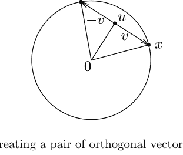

**图 9.8** 由 $x, y$ 创建一对正交向量 $u, v$。

向量 $Au$ 和 $Av$ 独立（回顾练习 3.20）。

### 第 2 步：使用高斯集中。

设条件 $a := Au$ 并研究

$$f(Ax) = f(a + Av).$$

由独立性，$a + Av$ 是一个高斯随机向量，可以写成

$$a + Av = a + \|v\|_2 g, \quad \text{where} \quad g \sim N(0, I_m)$$

（再次由练习 3.20）。我们断言函数

$$z \mapsto f(a + \|v\|_2 z)$$

关于 $\mathbb{R}^m$ 上的欧几里得范数是 Lipschitz 的，且 Lipschitz 常数被 $\|v\|_2$ 所限制。为了验证这一点，固定任意 $t, s \in \mathbb{R}^m$ 并利用 $f$ 的次可加性（练习 9.34 的形式）得到

$$f(a + \|v\|_2 t) - f(a + \|v\|_2 s) \le f(\|v\|_2 t - \|v\|_2 s)$$ $$= \|v\|_2 f(t - s) \quad \text{(by positive homogeneity)}$$ $$\le \|v\|_2 \|t - s\|_2 \quad \text{(using (9.36) with $b = 1$)},$$

证明了我们的断言。

高斯空间中的集中（定理 5.2.3）然后给出

$$\|f(a + Av) - \mathbb{E}_a f(a + Av)\|_{\psi_2(a)} \le C \|v\|_2, \tag{9.41}$$

其中下标“a”提醒我们这些界对于条件分布成立，且 $a = Au$ 固定。

### 第 3 步：去掉条件。

由于随机向量 $a - Av$ 与 $a + Av$ 有相同的分布（为什么？），它满足相同的界：

$$\|f(a - Av) - \mathbb{E}_a f(a - Av)\|_{\psi_2(a)} \le C \|v\|_2, \tag{9.42}$$

用 (9.42) 减去 (9.41)，利用三角不等式以及期望相同这一事实；得到

$$\|f(a + Av) - f(a - Av)\|_{\psi_2(a)} \le 2C \|v\|_2.$$

该界对任意固定的 $a = Au$ 条件成立。因此，它对原始分布也成立：

$$\|f(a + Av) - f(a - Av)\|_{\psi_2} \le 2C \|v\|_2.$$

（为什么？）通过 (9.40) 回到 $x, y$ 表示，我们得到期望的不等式 (9.39)。

我们证明了该定理对任意单位向量 $x, y$ 成立。要推广到一般情况，按定理 9.1.2 证明中的第 4 步进行论证（验证！）。$\square$

### 注释 9.6.5。

是否定理 9.6.3 对一般次高斯矩阵 $A$ 成立仍是一个开放问题。

为了练习，尝试练习 9.35 和 9.36 以得到定理 9.6.3 的各向异性和高概率版本。

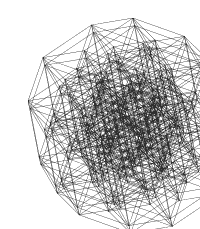

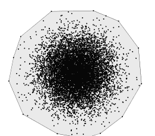

图 9.9 8 维立方体（左）和 10^4 个高斯点（右）的随机投影到平面上

### 定理 9.7.2（Dvoretzky-Milman 定理）。

设 $A$ 为 $m \times n$ 高斯随机矩阵，其元素独立同分布为 $N(0,1)$，且 $T \subset \mathbb{R}^n$ 为有界集。则以下结论以至少 0.99 的概率成立：

$$r_- B_2^m \subset \operatorname{conv}(AT) \subset r_+ B_2^m \tag{9.45}$$

其中 $B_2^m$ 表示 $\mathbb{R}^m$ 中的单位欧几里得球，且

$$r_\pm = w(T) \pm C\sqrt{m}\,\operatorname{rad}(T).$$

左包含仅在 $r_-$ 非负时成立；右包含始终成立。

证明  让我们将双边 Chevet 不等式（定理 9.7.1）表示为以下形式：

$$\mathbb{E}\sup_{y\in S}\Big|\sup_{x\in T}\langle Ax,y\rangle - w(T)\|y\|_2\Big| \le C\gamma(S)\operatorname{rad}(T),$$

其中 $T \subset \mathbb{R}^n$ 且 $S \subset \mathbb{R}^m$。（要得到这个，只需将定理应用于 $A^\top$ 并交换 $T$ 和 $S$。）

设 $S$ 为球面 $S^{m-1}$；其高斯复杂度满足 $\gamma(S) \le \sqrt{m}$。那么，根据 Markov 不等式，以下结论以至少 0.99 的概率成立：

$$\Big|\sup_{x\in T}\langle Ax,y\rangle - w(T)\Big| \le C\sqrt{m}\,\operatorname{rad}(T)\quad\text{for every }y\in S^{m-1}.$$

根据三角不等式和 $r_\pm$ 的定义，这意味着

$$r_- \le \sup_{x\in T}\langle Ax,y\rangle \le r_+\quad\text{for every }y\in S^{m-1}.$$

将 $\sup_{x\in T}\langle Ax,y\rangle$ 重写为 $\sup_{x\in AT}\langle x,y\rangle$ 并利用齐次性，我们得到

$$r_-\|y\|_2 \le \sup_{x\in AT}\langle x,y\rangle \le r_+\|y\|_2\quad\text{for every }y\in \mathbb{R}^m.$$

根据对偶性，这与 $(9.45)$ 相同（尝试练习 9.40 来详细阐述对偶性论证）。

### 备注 9.7.3（有效维数）。

假设 \(T\) 有界、凸且包含原点，并令

\[
m \le c\,d(T)
\]

其中 \(d(T) \asymp w(T)^2 / \mathrm{rad}(T)^2\) 为有效维数（见定义 7.5.12）。若取绝对常数 \(c\) 足够小，可使 \(C\sqrt{m}\,\mathrm{rad}(T) \le 0.01\,w(T)\)，从而 Dvoretzky–Milman 定理 9.7.2 给出

\[
0.99 B \subset A T \subset 1.01 B
\]

其中 \(B = w(T) B_2^n\) 为半径为 \(w(T)\) 的欧几里得球。

> 将任意有界凸集 \(T\) 投影到维数约为 \(d(T)\) 的随机子空间上，使其看起来几乎像一个圆球！

### 例 9.7.4（立方体的近似圆投影）。

考虑立方体 \(T = [-1,1]^n\)。由 (7.18)，\(w(T) = \sqrt{2/\pi}\, n\) 且 \(\mathrm{diam}(T) = 2\sqrt{n}\)，所以有效维数为 \(d(T) \asymp n\)。因此，若 \(m \le c n\)，则以高概率有

\[
0.99 B \subset A[-1,1]^n \subset 1.01 B
\]

其中 \(B\) 为半径为 \(\sqrt{2/\pi}\, n\) 的欧几里得球。

> 将 \(n\) 维立方体投影到维数为 \(m = c n\) 的子空间上，使其看起来几乎像一个圆球！图 9.9 说明了这一显著事实。

### 备注 9.7.5（随机投影的总结）。

在第 7.6 节和 9.2.2 节中，我们发现集合 \(T\) 到 \(\mathbb{R}^n\) 中 \(m\) 维子空间的随机投影 \(P\) 经历相变。在高维情形（\(m \gtrsim d(T)\)）下，投影将 \(T\) 的直径缩小了数量级为 \(\sqrt{m/n}\) 的因子：

\[
\mathrm{diam}(PT) \asymp \sqrt{\frac{m}{n}}\,\mathrm{diam}(T)
\]

此外，加性 Johnson–Lindenstrauss 引理 9.2.4 显示，在此情形下，随机投影 \(P\) 近似保持 \(T\) 的几何结构（\(T\) 中所有点之间的距离大致按相同的缩放因子缩小）。

在低维情形（\(m \lesssim d(T)\)）下，缩小停止：

\[
\mathrm{diam}(PT) \asymp w_s(T) \asymp \frac{w(T)}{\sqrt{n}}
\]

无论 \(m\) 多小。Dvoretzky–Milman 定理解释了原因：\(PT\) 现在近似为半径数量级为 \(w_s(T)\) 的圆球（见练习 9.43），它显然在任何投影下都不会缩小。

练习一下，得到 Dvoretzky–Milman 定理的高概率版本（练习 9.41），证明高斯云在低维中近乎圆形（练习 9.42），并得到适用于实际（而非高斯）投影的 Dvoretzky–Milman 定理版本（练习 9.43）。

## 注释

压缩感知是在 [319] 中引入的。书籍 [157, 67, 344] 对稀疏性约束下的统计问题提供了全面的介绍；这些书籍讨论了 Lasso 及其众多变体。

基于零空间性质的稀疏恢复（练习 9.32）可追溯到 Cohen、Dahmen 和 DeVore [88]；参见 [281, 127, 344]。

Garnaev–Gluskin 界（练习 9.28）首次在 [132] 中证明；参见 [222] 和 [127, Chapter 10]。

一般矩阵偏差不等式（定理 9.6.3）及其证明归功于 G. Schechtman [295]。

Chevet 不等式的原始版本由 S. Chevet [84] 证明，其常数因子由 Y. Gordon [140] 改进；参见 [21, Section 9.4]、[210, Theorem 3.20] 和 [321, 7]。定理 9.7.1 中陈述的 Chevet 不等式版本可从 Y. Gordon [140, 142] 的工作重构；参见 [210, Corollary 3.21]。

Dvoretzky–Milman 定理在泛函分析中具有悠久历史。为证明 A. Grothendieck 的一个猜想，A. Dvoretzky [117, 118] 证明了任意 \(n\) 维赋范空间都有一个 \(m\) 维近似欧几里得子空间，其中 \(m = m(n)\) 随 \(n\) 增长到无穷。V. Milman 给出了该定理的概率证明 [242] 并开创了研究最佳可能依赖 \(m(n)\) 的研究。定理 9.7.2 由 V. Milman [242] 给出；它是最佳的 [247]；参见 [21, Theorem 5.3.3]。教程 [23] 包含对 Dvoretzky–Milman 定理的轻松介绍。关于 Dvoretzky–Milman 定理及其众多推论的完整阐述，参见例如 [21, Chapter 5 and Section 9.2]、[210, Section 9.1] 及其参考文献。Dvoretzky–Milman 定理的“分布”版本，即询问 \(n\) 维分布的随机 \(m\) 维边际是否近似正态，已由 B. Klartag [186] 对对数凹分布（凸体的中心极限定理）以及 E. Meckes [230] 对离散分布开创。

备注 9.7.5 中指出的相变现象由 V. Milman [245] 提出；参见 [21, Proposition 5.7.1]。

## 练习

- **9.1** ☕☕（逆三角不等式）  
  让我们检验矩阵偏差（定理 9.1.2）证明中使用的几何观察。考虑任意向量 \(x, y \in \mathbb{R}^n\) 满足 \(1 = \|x\|_2 \le \|y\|_2\)，并令 \(\bar y := y/\|y\|\)（见图 9.1）。证明
  \[
  \|x - y\|_2 \le \|x - \bar y\|_2 + \|\bar y - y\|_2 \le \sqrt{2}\,\|x - y\|_2.
  \]

- **9.2** ☕☕（矩阵偏差不等式：均值偏差）  
  由定理 9.1.1 推导出矩阵偏差的中心化版本：
  \[
  \mathbb{E} \sup_{x \in T} \bigl|\|Ax\|_2 - \mathbb{E}\|Ax\|_2\bigr| \le C K^2 \gamma(T).
  \]

- **9.3** ☕☕（二次矩阵偏差）  
  让我们证明备注 9.1.5 中的断言：在定理 9.1.1 的条件下，我们有
  \[
  \mathbb{E} \sup_{x \in T} \bigl|\|Ax\|_2^2 - m\|x\|_2^2\bigr| \le C K^4 \gamma(T)^2 + C K^2 \sqrt{m}\,\mathrm{rad}(T)\gamma(T).
  \]

- **9.4** ☕☕（各向异性矩阵偏差）  
  在定理 9.1.1 中，我们假设随机矩阵的行是各向同性的。让我们去掉这一假设。设 \(B\) 为 \(m \times n\) 随机矩阵，其独立行 \(B_i\) 满足
  \[
  \mathbb{E} B_i B_i^\top = \Sigma, \qquad \|\langle B_i, x\rangle\|_{\psi_2} \le K \|\langle B_i, x\rangle\|_{L^2} \quad \text{for any } x \in \mathbb{R}^n,
  \]
  对某个矩阵 \(\Sigma\) 和数 \(K\)。证明对任意子集 \(T \subset \mathbb{R}^n\)，
  \[
  \mathbb{E} \sup_{x \in T} \bigl|\|Bx\|_2 - \sqrt{m}\,\|\Sigma^{1/2} x\|_2\bigr| \le C K^2 \gamma(\Sigma^{1/2} T).
  \]

- **9.5** ☕☕☕（二次经验过程）  
  在练习 8.36 中，我们对任意次高斯过程有界了经验均值与样本均值的偏差。现在，让我们对 \(L^2\) 均值做同样的事，通过推广定理 9.1.1。取任意星形⁹ 实值函数类 \(\mathcal{F}\) 在定义域 \(\Omega\) 上，并设 \(X, X_1, X_2, \ldots, X_n\) 为 \(\Omega\) 中的 i.i.d. 随机点。考虑 \(\mathcal{F}\) 上的 \(L^2\) 度量
  \[
  d(f,g) := \bigl(\mathbb{E}(f(X) - g(X))^2\bigr)^{1/2}
  \]
  并假设
  \[
  \|f(X) - g(X)\|_{\psi_2} \le K d(f,g) \quad \text{for all } f,g \in \mathcal{F}.
  \]
  然后证明：
  \[
  \mathbb{E} \sup_{f \in \mathcal{F}} \Bigl| \Bigl(\frac{1}{m} \sum_{i=1}^{m} f(X_i)^2\Bigr)^{1/2} - \bigl(\mathbb{E} f(X)^2\bigr)^{1/2} \Bigr| \le \frac{C K^2 \gamma_2(\mathcal{F}, d)}{\sqrt{m}},
  \]
  其中右边为第 8.5 节中的 \(\gamma_2\) 泛函。你能看出为什么当 \(T \subset S^{n-1}\) 时该结果包含定理 9.1.1 吗？

  > ⁹ 星形意味着如果 \(f\) 在 \(\mathcal{F}\) 中，则 \(\alpha f\) 对任意 \(\alpha \in [0,1]\) 也在其中。如果 \(\mathcal{F}\) 不是星形的，没问题——只需向其中添加所有 \(\alpha f\)，\(\alpha \in [0,1]\)；高斯复杂度保持不变。

- **9.6** ☕☕☕☕（随机投影的偏差）  
  证明随机投影的矩阵偏差不等式（定理 9.1.1）版本。设 \(P\) 为 \(\mathbb{R}^n\) 中到 Grassmannian \(G_{n,m}\) 中均匀分布的 \(m\) 维子空间上的正交投影。证明对任意子集 \(T \subset \mathbb{R}^n\)，我们有
  \[
  \mathbb{E} \sup_{x \in T} \Bigl| \|Px\|_2 - \sqrt{\frac{m}{n}}\,\|x\|_2 \Bigr| \le \frac{C \gamma(T)}{\sqrt{n}}.
  \]

- **9.7** ☕☕（投影的大小：高概率界）  
  让我们得到命题 9.2.1 的高概率版本。设 \(T \subset \mathbb{R}^n\) 为有界集，并设 \(A\) 为具有独立、各向同性和次高斯行 \(A_i\) 的 \(m \times n\) 矩阵，考虑“次高斯投影” \(P = \frac{1}{\sqrt{n}}A\)。证明对 \(\varepsilon > 0\)，界
  \[
  \mathrm{diam}(PT) \le (1 + \varepsilon) \sqrt{\frac{m}{n}}\,\mathrm{diam}(T) + C K^2 w_s(T)
  \]
  以概率至少 \(1 - \exp(-c \varepsilon^2 m / K^4)\) 成立。这里 \(K = \max_i \|A_i\|_{\psi_2}\) 且 \(w_s(T)\) 为 \(T\) 的球面宽度。

- **9.8** ☕☕☕  
  对第 7.6 节中考虑的原始模型 \(P\) 证明命题 9.2.1 的版本，即对投影 \(P\) 到随机 \(m\) 维子空间 \(E \sim \mathrm{Unif}(G_{n,m})\) 上。

- **9.9** ☕（协方差估计的高概率）  
  检验备注 9.2.3 中提到的协方差估计的高概率保证。

### 9.22 ☕☕（稀疏恢复问题是适定的）

设 \(A\) 是一个处于一般位置的 \(m \times n\) 矩阵（请自行选择一个方便的“一般位置”定义）。

- (a) 证明：如果 \(m \ge 2\|x\|_0\)，那么方程 \(y = Ax\) 有唯一解（如果解存在）。
- (b) 在这种情况下，如果已知 \(x\) 的支撑集（即哪些分量非零），如何高效地通过算法求出 \(x\)？

### 9.23 ☕☕☕（\(0 \le p < 1\) 时的“\(\ell^p\) 范数”）

在 (9.21) 中，我们将 \(\|x\|_0\) 定义为向量 \(x\) 的非零分量个数。

- (a) 验证 \(\|\cdot\|_0\) 不是 \(\mathbb{R}^n\) 上的范数。
- (b) 验证当 \(0 < p < 1\) 时，\(\|\cdot\|_p\) 不是 \(\mathbb{R}^n\) 上的范数（图 9.10 表明单位球不是凸集）。
- (c) 证明：对每个 \(x \in \mathbb{R}^n\)，都有 \(\|x\|_0 = \lim_{p \to 0_+} \|x\|_p^p\)。

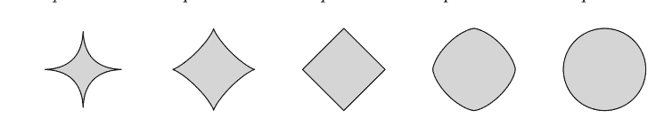

*图 9.10* \(\mathbb{R}^2\) 中不同 \(p\) 值对应的单位 \(\ell^p\) 球。

### 9.24 ☕☕☕（近似稀疏恢复）

我们将稀疏恢复（推论 9.4.8）推广到近似稀疏信号。

- (a) 证明，任意 \(s\)-稀疏信号 \(x\) 都可以通过求解以下优化问题，从测量值 \(y = Ax\) 中恢复：
  \[
  \text{minimize } \|x'\|_1 \quad \text{subject to } y = Ax',
  \]
  其解 \(\hat{x}\) 的恢复误差满足
  \[
  \mathbb{E}\|\hat{x} - x\|_2 \le CK^2 \sqrt{\frac{s \log n}{m}} \|x\|_2.
  \]
- (b) 论证类似的结果也适用于近似稀疏信号。陈述并证明这样一个保证。

### 9.25 ☕☕☕（对稀疏向量集合进行凸化）

考虑单位 \(s\)-稀疏向量集合：
\[
S_{n,s} := \{ x \in \mathbb{R}^n : \|x\|_0 \le s,\ \|x\|_2 \le 1 \} \tag{9.46}
\]
以及截断的 \(\ell^1\) 球：
\[
T_{n,s} := \sqrt{s}\, B_1^n \cap B_2^n = \{ x \in \mathbb{R}^n : \|x\|_1 \le \sqrt{s},\ \|x\|_2 \le 1 \}. \tag{9.47}
\]

## 习题提示

- **0.1** 回忆 \(\|x - y\|_2^2 = \|x\|_2^2 - 2\langle x, y\rangle + \|y\|_2^2\)。（将 \(\|x - y\|_2^2 = \langle x - y, x - y\rangle\) 展开即可得到。）用这个公式计算 \(\|Z - \mathbb{E}Z\|_2^2\)。
- **0.2** 验证恒等式 \(\mathbb{E}\|Z - a\|_2^2 - \mathbb{E}\|Z - \mu\|_2^2 = \|a - \mu\|_2^2\)，其中 \(\mu = \mathbb{E}Z\)。
- **0.4** (a) 独立随机地选择符号。利用例 0.3 计算随机向量 \(\pm x_1 \pm x_2 \pm \cdots \pm x_n\) 的平方范数的期望。
- **0.5** 取 \(T = \{e_1, \dots, e_n\}\)，其中 \(e_i\) 是标准基向量。则 \(\operatorname{conv}(T)\) 是一个 \((n-1)\) 维单纯形；当 \(n = 3\) 时画出图形。设 \(x\) 为该单纯形的中心。接下来只需计算 \(x\) 到单纯形每个 \((k-1)\) 维面的距离。
- **0.6** 为证明上界，将二项式系数之和乘以 \((k/n)^k\)，在左侧将这个量替换为 \((k/n)^j\)，并使用二项式定理。为证明下界，利用二项式系数的定义将其表示为 \(k\) 个分数的乘积；验证每个分数都不小于 \(n/k\)。
- **0.7** 回忆定理 0.0.4 证明开头所用的 \(\mathbb{R}^n\) 中的体积缩放性质：半径为 \(r\) 的球的体积是单位球体积的 \(r^n\) 倍。
- **0.8** 计算 \(\|X\|_2\) 的累积分布函数，由此通过求导得到概率密度函数，然后计算期望。
- **0.9** 首先，利用初等组合学中的以下事实改进推论 0.0.3 中球的个数上界：从一个含 \(N\) 个元素的集合中选出 \(k\) 个元素组成无序子集，允许重复，选法总数为 \(\binom{N+k-1}{k}\)。令 \(k = k_0 = n / \log(eN/n)\)，并利用习题 0.6 将二项式系数上界估计为 \(C^n\)。然后沿用定理 0.0.4 的证明。
- **1.3** (a) 对 \(m\) 进行归纳。在归纳步骤中，将 \(\sum_{i=1}^m \lambda_i x_i\) 表示为两个向量的凸组合，其中一个是 \(x_m\)，另一个是 \(x_1, \dots, x_{m-1}\) 的某个凸组合。
- **1.4** 为证明上界，将点 \(x \in \operatorname{conv}(T)\) 表示为 \(T\) 中若干点的凸组合，并使用习题 1.3 中的 Jensen 不等式。
- **1.7** 对 \(n\) 的取值进行条件化，其余部分沿用例 1.4.2 中结果的证明。
- **1.8** 给定的 \(k\) 名学生组成的子集相互独立的概率是多少？由 \(k\) 名学生组成的子集有多少个？回答这两个问题并使用并集界。
- **1.9** 按照例 1.4.2 中结果的证明，问题归结为验证 \(n(1 - p_n)^{n-1} \to 0\)。
- **1.10** (b) 展开可得 \(\mathbb{E}S_n^2 = \sum_{i=1}^n \mathbb{E}X_i^2 + \sum_{i \neq j} \mathbb{E}X_i X_j\)。将每一项 \(\mathbb{E}X_i X_j\) 解释为学生 \(i\) 和学生 \(j\) 都没有朋友的概率。计算该概率。
- **1.11** 使用 Jensen 不等式。
- **1.12** 将 \(\mathbb{E}|X|^p\) 写成 \(\mathbb{E}[|X||X|^{p-1}]\)，并用第二个因子的上确界进行估计。
- **1.13** (a) 为证明第一个不等式，对随机向量 \(X = (X_1,\ldots,X_n)\) 使用 Jensen 不等式 (1.19)。猜猜这里应该使用哪个范数。为证明第二个不等式，用和来估计 \(n\) 个非负数的最大值。(c) 考虑相互独立的伯努利随机变量 \(\mathrm{Ber}(p_n)\)；找出使论证成立的 \(p_n\) 值。
- **1.14** 两个界都可以由 Jensen 不等式推出。对于第一个界，对随机向量 \(X = (X_1,\ldots,X_n)\) 使用 \(\ell^p\) 范数和 (1.19)。对于第二个界，考虑凸函数 \(\phi(x)=x^p\)。
- **1.15** (b) 对 \(f(X)\) 使用积分尾公式，并作变量代换 \(t = f(s)\)。
- **1.16** 考虑事件 \(E = \{X > \varepsilon \mathbb{E}X\}\)，并将 \(\mathbb{E}X\) 分解为 \(\mathbb{E}X 1_E\) 和 \(\mathbb{E}X 1_{E^c}\)。
- **1.17** (a) 为证明 \(q < \infty\) 时的下界，先假设 \(x\) 的所有分量都满足 \(|x_i| \le 1\)，推出 \(|x_i|^q \le |x_i|^p\)，然后将这些不等式求和。为证明 \(q < \infty\) 时的上界，使用指数为 \(q/p\) 的 Hölder 不等式。
- **1.18** 对 \(q = \infty\) 使用习题 1.17 的结果。
- **1.19** (a) 先假设所有 \(i\) 都满足 \(x_i \ge 0\)。当 \(p = 1\)、\(p' = \infty\) 时，令 \(y = (1,\ldots,1)\)。当 \(p = \infty\)、\(p' = 1\) 时，令 \(y = (0,\ldots,0,1,0,\ldots,0)\)，其中值 \(1\) 位于满足 \(|x_{i_0}| = \|x\|_\infty\) 的坐标 \(i_0\) 上。当 \(p, p' \in (1,\infty)\) 时，对所有 \(i\)，令 \(y_i := |x_i|^{p/p'}\)。
- **2.1** 为证明上界，对不等式 \(Y_n \ge \mathbb{E}Y_n\) 两边开平方，然后应用 Markov 不等式。为证明下界，考虑所有 \(X_i \ge 1/2\) 的事件。
- **2.3** (b) 使用 (a) 中的公式，将高斯尾概率表示为 \(-\frac{1}{\sqrt{2\pi}} \int_t^\infty \frac{f'(x)}{x}\,dx\)，并令 \(u = 1/x\)、\(v = f(x)\) 进行分部积分。重复此过程。
- **2.4** (b) 分部积分，然后使用命题 2.1.2。
- **2.5** 逐项比较两边的泰勒展开。
- **2.7** 使用指数矩方法估计概率 \(P\{\sum_{i=1}^N (-X_i/\varepsilon) \ge -N\}\)。
- **2.8** 由凸性可知，函数 \(f(x)=e^{\lambda x}\) 的图像位于连接点 \((a,f(a))\) 和 \((b,f(b))\) 的线段下方。将这一观察写成不等式，代入 \(x = X\)，并对两边取期望。
- **2.9** 使用平移、缩放和比较不等式（习题 2.8）。(b) 你应得到 \(K(\lambda)=\lambda a+\log(b-ae^\lambda)\)。验证 \(K''(\lambda)= -abe^\lambda/(-ae^\lambda+b)^2\)，并对 \(x=-ae^\lambda\) 和 \(y=b\) 使用 AM-GM 不等式 \(\sqrt{xy} \le (x+y)/2\)。利用带拉格朗日余项的泰勒定理写出 \(K(\lambda)\) 的线性近似。
- **2.10** 沿用定理 2.2.1 的证明。使用 Hoeffding 引理估计每一项的矩母函数（MGF）。
- **2.11** 注意 \(P\{S_N \le t\}=P\{-S_N \ge -t\}\)，然后按照 Chernoff 不等式的证明进行。
- **2.12** 用二项式系数表示该概率。要估计二项式系数的下界，使用习题 0.6 的结果。要处理剩余项之一 \((1-\mu/N)^{N-t}\)，证明更小的量 \((1-\mu/N)^{N-\mu}\) 有下界 \(e^{-\mu}\)。
- **2.14** 验证并使用数值不等式：对所有 \(x \ge 0\)，都有 \(\ln(1+x) \ge x/(1+x/2)\)。
- **2.15** 使用矩母函数比较不等式（习题 2.8）。
- **2.16** 论证不失一般性地可以假设 \(t \ge 10\)。取 \(B = \lceil t^2/4\rceil\)。如果 \(B\) 不能整除 \(N\)，则将其中一个分块设得大于 \(B\)。
- **2.17** (a) 使用三角不等式，验证 \(X_i \sim \mathrm{Lap}(0,1)\) 和 \(Y_i \sim \mathrm{Lap}(\mu,1)\) 的概率密度之比一致有界于 \(e^{|\mu|}\)。写出 \(X\) 和 \(Y\) 的概率密度。用 \(X\) 和 \(Y\) 的概率密度表示概率 \(P\{X \in B\}\) 和 \(P\{Y \in B\}\)。

- **3.17** 随机翻转 X ~ N(0,1) 的符号。

- **3.18** 将 G 和 UG 视为 ℝ^{n×n} 中的向量。验证映射 G ↦ UG 是一个线性正交变换，然后利用正态分布的旋转不变性。

- **3.19** 利用 (a) 部分表示 A，并使用习题 3.18 中建立的 G 的不变性。

- **3.20** 验证由拼接得到的随机向量 (Gu, Gv) ∈ ℝ^{2m} 是各向同性的。

- **3.23 (a)** 选择 x 为 g₁ 方向上的单位向量。验证：以高概率，⟨g₁, x⟩ > √n/2，而对所有 j = 2, …, N，都有 ⟨g_j, x⟩ < √n/2。

- **3.24** 令 r = ‖X‖₂。计算 r 的 CDF，再求导得到密度函数。

- **3.25** 利用习题 3.24 验证 𝔼‖Y‖₂² = n。然后仿照命题 3.3.8 的证明进行论证。

- **3.26** 论证我们可以将 ‖X‖∞ 写成 ‖g‖∞ / ‖g‖₂，其中 g ~ N(0, Iₙ)。为证明上界，使用柯西–施瓦茨不等式和小球概率界（习题 3.7）。为证明下界，利用范数的集中性来控制 ‖g‖₂，并通过直接计算（利用独立性）来控制 ‖g‖∞。

- **3.27** 首先考虑 n = 2（平面中的单位圆），计算 X 的第一坐标的密度。画图并注意：在 x 处的密度正比于投影到区间 [x, x+ε] 上的弧长。验证这正比于 g(x) = ε/√(1 − x²) + o(ε)。然后尝试 n = 3，再推广到一般的 n。

- **3.28 (b)** 你应该能把到超立方体的平方距离表示为 ∑_{i=1}^n (|g_i| − a)_+²，其中 x_+ = max(x,0)。证明：如果 a 足够大，期望距离很小。另一方面，由于范数的集中性，‖g‖₂ 不太可能非常小。

- **3.30** 例如，使用习题 3.29 中的准则。

- **3.33** 注意 ⟨UX, v⟩ = ⟨X, Uᵀv⟩，且 Uᵀ 是正交矩阵。

- **3.34** 注意 Av 是一个零均值随机向量，其坐标相互独立。使用引理 3.4.2 来界住它的次高斯范数。

- **3.35** 考虑 ∑_i X_i 的一维边缘分布，并使用命题 2.7.1 来界住其次高斯范数。

- **3.36 (a)** 仿照引理 3.4.2 进行论证，但使用三角不等式而不是命题 2.7.1。

- **3.38** 习题 3.14 描述了 X 的一维边缘的分布。习题 2.24(c) 给出了它们的次高斯范数。命题 3.2.2 允许你最大化该表达式。

- **3.39 (a)** 应用引理 2.8.5 和三角不等式。

- **3.40**
  - **(a)** 若 Y 是 X 的独立副本，你可以使用 Bernstein 不等式来界住 |⟨X, Y⟩| 的上界，并利用范数的集中性来界住 ‖X‖₂ 和 ‖Y‖₂ 的下界，所有这些都以高概率成立。
  - **(b)** 一个想法是在原点附近略微修改一个各向同性向量。例如，掷一枚有偏的硬币。如果正面朝上（可能性较大），选择 X 为第一个基向量，并适当缩放。如果反面朝上（可能性较小），从正交超平面 ℝ^{n−1} 上的正态分布中抽取 X。

- **3.41 (a)** 使用条件技巧：以 Y 为条件，应用定理 3.4.5。

- **3.42** 使用习题 3.24 中的分解。

- **3.43** 为了界住一维边缘 ⟨X, v⟩ 的次高斯范数，先获得 L² 和 L∞ 范数的基本界，然后用习题 2.35 对它们进行插值。对于下界，选取 v 为标准基向量并使用习题 2.24(e)。

- **3.44**
  - **(a)** 论证 X₁ 在 u ∈ [−r, r] 处的密度正比于 (r − |u|)^{n−1}。
  - **(b)** 利用对称性验证 X 的坐标互不相关。
  - **(c)** 计算 ℙ{X₁ > r/2}。

- **3.45** 注意 \(\|\langle X,x\rangle\|_{\psi_2}\le K\|x\|_2\)，并根据次高斯范数的定义写出其含义。

- **3.46 (b)** 将习题 **3.45** 与恒等式 \(\mathbb{E}\|X\|_2^2=n\) 结合，该恒等式由各向同性得出。

- **3.47 (a)⇒(b):** 对任意固定的 \(x\)，函数 \(y\mapsto x^T Ay\) 是线性的，因而也是凸的。现在回忆 (1.5) 和习题 **1.4**。

- **3.49 (b)** 首先验证函数 \(f(z)=z^T Az\) 是凸的，因此它必定在立方体的顶点处取得其在 \([-1,1]^n\) 上的最大值。现在固定任意 \(x,y\in\{-1,1\}^n\)，利用极化恒等式用这些最大值来界住双线性形式 \(|x^T Ay|\)，并用上述事实界住这两个二次型。最后，应用经典的 Grothendieck 不等式（定理 **3.5.1**）。

- **3.50 (b)** 验证 \(f(z)=|z^T Az|\) 是分别凸的。然后按习题 **3.49** 的方法进行。

- **3.52**
  - **(a)** 将目标函数表示为 \(\frac12\operatorname{tr}(\widetilde A ZZ^T)\)，其中 \(\widetilde A=\begin{bmatrix}0&A\\A^T&0\end{bmatrix}\) 称为矩阵 \(A\) 的 *Hermite 膨胀*，而 \(Z=\begin{bmatrix}X\\Y\end{bmatrix}\)，其中 \(X\) 和 \(Y\) 分别是行向量为 \(X_i^T\) 和 \(Y_j^T\) 的矩阵。注意 \(ZZ^T\) 是单位向量 \(X_1,\ldots,X_m,Y_1,\ldots,Y_n\) 的 Gram 矩阵。按命题 **3.5.6** 的证明进行。
  - **(b)** 使用 Grothendieck 不等式。

- **3.53** 利用标准正态分布的旋转不变性将问题化简到 \(\mathbb{R}^2\)。在平面中，再次应用旋转不变性来证明 \(\{\langle g,u\rangle \text{ 与 } \langle g,v\rangle \text{ 符号相反}\}\) 的概率为 \(\alpha/\pi\)，其中 \(\alpha\in[0,\pi]\) 是 \(u\) 与 \(v\) 之间的夹角。画个图可能会有帮助！

- **3.54** 考虑反复切割 \(G\)。为了找到成功（找到一个大的割）概率的下界，使用 Paley–Zygmund 不等式（习题 **1.16**）。用该概率表示直到成功所需的试验次数的期望。

- **3.56**
  - **(a)** 论证我们可以假设 \(v=(1,0,\ldots,0)\) 且 \(u=(u_1,u_2,0,\ldots,0)\)。
  - **(b)** 将 \(\mathbb{E}\,Z_uZ_v\) 展开为四项，并使用习题 **3.9** 和 (a) 部分。

- **3.57** 将习题 **3.56(b)** 中对 \(u=u_i\)、\(v=u_j\) 且带权重 \(a_{ij}\) 的恒等式相加。

- **3.58** 使用随机舍入 (3.34)。

- **4.4**
  - **(a)** 使用这两个范数的谱表示（引理 **4.1.11**）。
  - **(b)** 使用命题 **3.2.1(b)**。
  - **(c)** 利用 (b) 将 \(\|BA\|_F^2=\mathbb{E}\|BAg\|_2^2\) 写出，其中 \(g\sim N(0,I_n)\)。

- **4.5** 事实上，任何非负且弱递减的数 \(s_k\)，若其平方和为 \(a^2\)，则满足 \(s_k\le a/\sqrt{k}\)。

- **4.6** 用 \(A\) 的 SVD 表示 \(\|A^k x\|_2^2\)。证明该和的第一项占主导。

- **4.7**
  - **(a)** 写出 \(Ax=\sum_{i=1}^n x_iA_i\)。
  - **(b)** 为了导出矛盾，假设 \(\|A\|=\|A_1\|_2\) 但 \(A_1\) 与 \(A_2\) 不正交。取 \(x=(1,\varepsilon,0,0,\ldots,0)\)，证明函数 \(f(\varepsilon)=\|Ax\|_2^2-\|A\|^2\|x\|_2^2\) 可以取正值，从而与算子范数的定义矛盾。

- **4.8** 为了界住单位向量 \(x\) 和 \(y\) 的 \(|x^T Ay|\)，使用三角不等式：\(|x^T Ay|=|\sum_{ij}A_{ij}x_i y_j|\le\sum_{ij}|A_{ij}x_i y_j|\)。然后应用柯西–施瓦茨不等式，将 \(|A_{ij}|\) 拆分到两项中。

- **4.10** 为了证明可达性，考虑一个所有元素都等于 1 的矩阵，另一方面考虑 Walsh 矩阵（习题 **4.9**）。

- **4.11** 对单位向量 \(x\)，计算 \(\|Px-x/2\|_2^2\) 和 \(\|Qx-x/2\|_2^2\)，然后应用三角不等式。

- **4.12 (a)** 一个巧妙技巧：将 \(P-Q\) 块对角化。取正交矩阵 \(\widetilde U=[U\ U_\perp]\)，其前几列构成 \(U\) 并张成 \(\operatorname{Im}P\)。类似地，取正交矩阵 \(\widetilde V=[V\ V_\perp]\)，其前几列构成 \(V\) 并张成 \(\operatorname{Im}Q\)。然后计算 \(\widetilde U^T(P-Q)\widetilde V\)，并认识到它是一个块矩阵，其范数是两个块范数的最大值。

- **4.13** 使用习题 **4.12** 和引理 **4.1.16**；仿照 Davis–Kahan 证明（定理 **4.1.15**）。

- **4.14** 对于“唯一性”部分，计算 H²。它是一个块对角矩阵，因此其特征值应该容易计算。

- **4.15** 对 A 的 Hermite 膨胀（习题 4.14）应用 Davis–Kahan 不等式（习题 4.13 和定理 4.1.15）。

- **4.17** 在一个方向上，假设引理 4.1.17 中的性质 (c) 成立，并考虑 P 到 AAᵀ 的前 n 个特征值上的谱投影（它们是什么？）。在相反方向上，使用 Weyl 不等式（引理 4.1.14）。

- **4.19** 利用凸性：回顾 (1.3) 中 Bⁿ，即 ℝⁿ 在 ℓ¹ 范数下的单位球，是 ± 标准基向量的凸包；然后使用最大值原理（习题 1.4）。通过对偶性（习题 4.18(c)）推导出 2 → ∞ 范数的结果。

- **4.20**
  - **(a)** 将 ‖A‖∞→1 写成 |xᵀAy| 在单位立方体上的最大值，并像习题 4.19 那样利用凸性。
  - **(b)** 一个方向是显然的：令 Z = xyᵀ。在另一个方向上，将秩一矩阵 Z 表示为 Z = uvᵀ，论证 ‖u‖∞‖v‖∞ ≤ 1，然后重新缩放 u 和 v，将 Z 写成 Z = xyᵀ，其中 ‖x‖∞ = 1 且 ‖y‖∞ ≤ 1。

- **4.21** 为了界住 ‖A‖∞→1，按习题 4.20(a) 中的方式表示它。将 xᵀAy = Σᵢ,ⱼ Aᵢⱼxᵢyⱼ 根据 (xᵢ, yⱼ) ∈ {−1,1}² 的值分解为四个和，并用 A 的割范数界住每个和。为了界住 A 的割范数，固定子集 I 和 J，将 Σᵢ∈I,ⱼ∈J Aᵢⱼ 写成 Σᵢ,ⱼ Aᵢⱼ(1+xᵢ)/2 (1+yⱼ)/2，其中 x 和 y 是元素为 ±1 的向量。展开为四个和，并分别用 A 的 ∞ → 1 范数界住它们。

- **4.22** 对于 ‖A‖∞→1 范数，使用习题 3.52。对于 ‖A‖∞→2 范数，将其表示为二次型 ‖Ax‖₂² = xᵀ(AᵀA)x 的最大值，并使用定理 3.5.7。

- **4.24**
  - **(a)** 考虑一个不连通的度量空间，例如 T = {−1,1}（带通常的欧几里得度量）。
  - **(b)** 用反证法论证：如果两个球不是 ε-分离的，则它们中心的算术平均值同时落在两个 ε/2-球内。

- **4.25** 如果以 x ∉ K 为中心的 ε/2-球覆盖了 K 中的某个点，比如 y ∈ K，那么以 y 为中心的 ε-球在覆盖 K 方面效果更好。

- **4.26**
  - **(a)** 从 K 中去掉一个点后，就无法再放置以该点为心的球。举一个 K 为 3 点集的例子。
  - **(b)** 可以类似于习题 4.25 来证明。

- **4.27 (a)** 尝试对 n 进行归纳。

- **4.28** 对独立同分布的随机变量 Xᵢ ∼ Unif[−½, ½] 使用习题 3.7；它给出了单位立方体与半径为 ε√n 的欧几里得球交集体积的一个界。取一个非常小的 ε。

- **4.29 (a)** 这是积分尾公式（习题 1.15(b)）关于体积而非概率的一个版本。为推导它，修改引理 1.6.1 的证明，写出 f(‖x‖) = −∫_{‖x‖}^∞ f′(t)dt。

- **4.30 (a)** 习题 1.17(a) 将有助于夹逼。

- **4.31** 为了界住 |𝒩|，注意立方体 y + ε/(2√n)(−1,1)ⁿ（y ∈ 𝒩）互不相交，且包含在 (1 + ε/2)B₂ⁿ 内。仿照推论 4.2.11 的证明进行体积论证。

- **4.33** 从纠错假设中推出，以 E(x) 为中心、半径为 r 的闭球互不相交。然后进行一种体积论证。

- **4.34 (a)** 迭代构造展开。用 x₁ ∈ 𝒩 近似 x，将残差 x − x₁ 归一化并用 x₂ ∈ 𝒩 近似它，依此类推。

- **4.36** 使用引理 4.4.1 用某个 x ∈ 𝒩 的 ‖Ax‖₂ 来近似 ‖A‖；然后使用习题 4.35 用某个 y ∈ ℳ 的 ⟨Ax, y⟩ 来近似 ‖Ax‖₂。对于对称矩阵，利用恒等式 xᵀAx − x₀ᵀAx₀ = (x − x₀)ᵀA(x + x₀) 修改引理 4.4.1 的证明。

- **4.37** 不失一般性，假设 μ = 1。将 ‖Ax‖₂² − 1 表示为二次型 ⟨Rx, x⟩，其中 R = AᵀA − Iₙ。利用习题 4.36 计算该二次型在一个网上的最大值。

- **4.38** 使用 ε-网展开（习题 4.34）。

- **4.39** 取 RB₂ⁿ 的一个大小良好的 ε/2-网 ℳ。只需证明每个点 y ∈ ℳ 到某个点 gᵢ/√n ∈ RB₂ⁿ 的距离不超过 ε/2。对每个 y ∈ ℳ，固定一个半径为 r = ¼ min(ε, R) 的球 B_y，满足 y ∈ B_y ⊂ RB₂ⁿ。求 g₁/√n 落入给定球 B_y 的概率的一个下界。利用独立性证明：N 个向量 gᵢ/√n 中至少有一个以高概率落入该球。最后，对 ℳ 取并集界。

- **4.40** 利用习题 4.39 证明：缩放随机向量 gᵢ/√n（i > 1）构成半径为 10 的球的一个良好网。利用习题 4.38 证明这些点的凸包包含一个半径为 5 的球。同时，以高概率，第一个向量 g₁/√n 落入半径为 5 的球中，从而落入其他向量的凸包中。

- **4.41** 使用积分尾公式（引理 1.6.1）。

- **4.42** 用 A 的第一列和第一行的欧几里得范数给出 A 的算子范数的下界。利用范数集中性（3.2）完成证明。

- **4.43** 定理 4.4.3 的证明仅依赖于 A 的一个性质：对任意单位向量 x, y，⟨Ax, y⟩ = ⟨A, xyᵀ⟩ 是次高斯的。

- **4.44** (a) 将习题 4.19(a) 与 (2.22) 结合。(b) 将习题 4.19(b) 与习题 3.13 结合。

- **4.45** 难点在于：若 q 很小，期望邻接矩阵 D = 𝔼A 的第二特征值可能没有与第一特征值很好地分离，从而难以使用 Davis–Kahan 不等式。为了修正这一点，修改算法，同时考虑 D 的两个最大特征向量；由于 Davis–Kahan 不等式的高维版本（引理 4.1.16，习题 4.13），A 仍将很接近。

- **4.47** 利用极小极大定理（推论 4.1.7），将问题归结为 m × k 随机矩阵的最小奇异值。（选取 E 为一个坐标子空间。）

- **4.48** 将所讨论的量改写为 ‖Σ̄_m − I_n‖，其中 Σ̄_m 是 X 的标准得分的样本协方差矩阵。

- **4.50** (b) 思路是使用 SVD 通过每次替换一个因子来逼近矩阵 A = UΣVᵀ ≈ U₀Σ₀V₀ᵀ。利用 (b) 构造一个 (ε/3)-网来逼近 U，一个 (ε/3)-网来逼近 V（类似地），以及一个 (ε/3)-网来逼近 Σ。你会发现习题 4.4 很有用。(c) 考虑 Frobenius 范数 ≤ 1 且只有前 r 列非零的 m × n 矩阵。

- **4.51** (b) 对 99.5% 的点得出一个定量结论：不仅要 ⟨X_i, u⟩ 与 θ_i 的符号一致，而且 ⟨X_i, u⟩ 要远离零，例如 |⟨X_i, u⟩ − θ_i β| ≤ β/2，其中 β = ‖μ‖₂。(e) 既然你从 (d) 知道 v ≈ u，那么可以得出：99.5% 的点 X_i 满足 |⟨X_i, v⟩ − ⟨X_i, u⟩| ≤ 0.1β。（为此，写出这些量的平方和，并用 Σ_m 和 u − v 来表示它。）现在与 (b) 结合。

- **5.3** 若第一部分的结论不成立，则补集 B := (A_s)^c 满足 σ(B) ≥ 1/2。对 B 应用放大引理 5.1.6。

- **5.6** 对于上界，假设 ‖Z − 𝔼Z‖_{ψ₂} ≤ K，并利用中位数的定义证明 |M − 𝔼Z| ≤ CK。

- **5.7** 首先利用习题 5.6 将期望替换为中位数。然后对函数 f(x) := dist(x, A) = inf{d(x, y) : y ∈ A} 应用该假设，其中 f 的中位数为零。

- **5.8** 半空间的 ε-邻域仍是一个半空间，其高斯测度应容易计算。

- **5.9** (a) 对 f(x) = max_i x_i 使用高斯集中性。(b) 证明我们可以将 X_i 表示为 X_i = μ_i + ⟨g, v_i⟩，其中 μ_i, v_i 是非随机的，且 g ∈ N(0, I_n)。然后使用高斯集中性。

- **5.10** 给出 |μ_p − μ_1| 的界，其中 μ_p := ‖Z‖_{L^p}。

- **5.14** 将范数集中性（定理 3.1.1）应用于随机向量 Az。

- **5.15** 考虑 ℝ^N 中的一组正交基。

- **5.17** (a) 对称且可交换的矩阵可同时对角化。(b) 找出 2 × 2 矩阵，使得 0 ≼ X ≼ Y 但 X^2 ⊀ Y^2。

- **5.18** (a) 首先考虑 Y = I_n 的情形。接下来，将不等式 0 ≼ X ≼ Y 两边乘以 Y^{-1/2}（说明为什么可以这样做），并利用前面已证明的恒等情形。(c) 说明 (b) 中公式的矩阵版本为 ln X = ∫_0^∞ [(1 + t)^{-1} I_n − (X + t I_n)^{-1}] dt，并利用 (a)。

- **5.20** 验证矩阵 Bernstein 不等式蕴含：以至少 1 − 2e^{-u} 的概率有 ‖∑_{i=1}^N X_i‖ ≲ ‖∑_{i=1}^N 𝔼 X_i^2‖^{1/2} √(log n + u) + K(log n + u)。然后使用引理 1.6.1 中的积分尾公式。

- **5.21** 仿照定理 5.4.1 的证明进行。不用引理 5.4.10，而是验证 𝔼 exp(λ ε_i A_i) ≼ exp(λ^2 A_i^2 /2)，正如 Hoeffding 不等式（定理 2.2.1）的证明中那样。

- **5.22** 使用习题 1.15(c) 的积分尾公式。

- **5.23** 使用 Hermite 膨胀（习题 4.14）。

- **5.24** 使用 Hermite 膨胀（习题 4.14）。

- **5.25** 环只对邻接矩阵的对角线有贡献。将这一对角矩阵分离出来并界定其范数。

- **5.28** (a) 令 X ∼ Unif(√n e_1, …, √n e_n)，其中 e_i 是 ℝ^n 中的标准基向量。验证 X 是各向同性的。说明：若 m ≪ n log n，则样本 X_1, …, X_m 以高概率至少漏掉一个基向量（这与优惠券收集问题有关），从而样本协方差矩阵 Σ_m 的对角线上至少有一个零。

- **5.30** 对各向同性随机向量 X ∼ Unif(√m u_1, …, √m u_m) 使用协方差估计（回顾命题 3.3.11(iv)）。

- **5.31** 与定理 4.6.1 的证明一样，从 (1/m) A^T A − I_n = (1/m) ∑_{i=1}^m A_i A_i^T − I_n 的界推导出结论。使用协方差估计的高概率版本（5.28）。

- **5.32** 考虑随机向量 X ∈ ℝ^n，它选取 A 的随机一行，即 X = A_i 的概率为 1/N，并使用一般协方差估计结果（定理 5.6.1），再结合 Weyl 不等式（引理 4.1.14）。

- **6.1** 修改定理 6.1.1 的证明。先从 A 中去掉对角线，并执行步骤 1 和 2。然后在步骤 3 中，将对角线包括进 Z。

- **6.2** (a) 对 F(x) = x^p 使用定理 6.1.1。(b) 哪个 F 天然适合这个？

- **6.4** 我们想对 𝔼‖∑_{i,j} A_{ij} X_i X_j‖ 解耦，其中 X_i 是独立同分布的 Ber(p) 随机变量，A_{ij} 是仅保留 A 的 (i,j) 元素的 n × n 矩阵。仿照定理 6.1.1 的证明，取 F 为算子范数。由于习题 4.2(d)，步骤 3 是平凡的。

- **6.5** 令 X 服从旋转不变分布，且 ‖X‖_2 取两个值：以概率 1/n 取 n，以概率 1 − 1/n 取 √n。

- **6.6** (a) 使用命题 6.2.1。

- **6.7** 利用 A 的奇异值分解以及 X ∼ N(0, I_n) 的旋转不变性来简化并控制二次型 X^T A X。

- **6.8** 此时的二次型为 X^T A X，其中 X 是列向量为 X_i 的 d × n 随机矩阵。应用高斯替换（引理 6.2.3），并重新进行高斯 MGF 计算（引理 6.2.4）。

- **6.9** 首先像命题 6.2.1 中那样将 X 换成 g ∼ N(0, I_m)。然后利用高斯性质计算，如引理 6.2.4 中那样。

- **6.10** 像命题 6.2.1 的证明那样开始，并使用习题 6.9 中的 MGF 界。

- **6.11** 找到 B 使得 A = B^T B，并使用习题 6.10。

- **6.12** 首先，使用习题 6.10 证明：若随机向量 Y 均值为零，协方差矩阵为 Σ，并且对所有 u ∈ ℝ^n 满足 ‖⟨Y, u⟩‖_{ψ₂} ≤ K ‖⟨Y, u⟩‖_{L₂}，则以至少 1 − α 的概率有 ‖Y‖₂ ≤ C K √(tr Σ) + C K √(‖Σ‖ log(1/α))。然后将此应用于 Y = (1/√N) ∑_{i=1}^N (X_i − μ)。

- **6.13** 对 A = B^T B 和 t = ε ‖B‖_F^2 应用 Hanson-Wright 不等式（定理 6.2.2），并利用习题 4.4(c) 将 ‖B^T B‖_F 替换为 ‖B^T‖ ‖B‖_F。这将给出 ‖BX‖_2^2 的一个偏差不等式。像定理 3.1.1 的证明中那样，将其转化为 ‖BX‖_2 的偏差不等式。

- **6.15** 像 (3.31) 中那样将割表示为二次型，并应用 Hanson-Wright 不等式（定理 6.2.2）。你可以精确计算 A 的 Frobenius 范数，而算子范数只会更小。

- **6.18** 为证明 E‖X + v‖ ≥ E‖X‖，论证 E‖X + v‖ = E‖X + ε v‖，其中 ε 是独立的 Rademacher 变量，并将关于 ε 的期望放入范数内。

- **6.21** 使用习题 6.20 的结果，取 F(x) = exp(λx) 来界定矩生成函数，或取 F(x) = exp(c x^2)。

- **6.22** 说明该概率等于 P{ |∑_{i=1}^N ε_i X_i| ≥ t (∑_{i=1}^N X_i^2)^{1/2} }，其中 ε_i 是独立 Rademacher 随机变量。在 (X_i) 上取条件，并使用 Hoeffding 不等式来界定条件概率。然后使用全期望公式。

- **6.23** (a) 利用 ℓ^p 范数的定义将其表示为求和，通过单调性（习题 1.11）将 p 换成 2，应用方差和公式，再使用单调性。(b) 使用对称化（习题 6.20），在 (X_i) 上取条件，并利用 (a)。

- **6.24** (a) 通过单调性（习题 1.11）将指数 2 换成 p，利用 ℓ^p 范数的定义将其表示为求和，应用 Khintchine 不等式（定理 2.7.5），然后在 (ℝ^n, ‖·‖_{p/2}) 中使用三角不等式。(b) 像习题 6.23(b) 那样使用对称化。

- **6.25** 重复定理 0.0.2 的证明，使用习题 6.23 和 6.24 代替方差和恒等式。

- **6.26** 应用对称化，然后在 (X_i) 上取条件使用 Khintchine 不等式，最后在 L^{p/2} 中使用三角不等式。

- **6.27** 利用恒等式 a^2 − b^2 = (a − b)(a + b)，将问题归结为界定 ‖X‖_2^2 − n 的 L^p 范数。展开 ‖X‖_2^2，并使用 Marcinkiewicz-Zygmund 不等式（习题 6.26）。

- **6.28** 对 A 的 Hermite 膨胀应用定理 6.4.1（见习题 4.14）。

- **6.29** 令 A 是一个分块对角矩阵，包含 n/k 个独立的分块，每个分块是一个 k × k 对称随机矩阵，其对角线上及以上的元素为独立 Rademacher 变量。以某个分块全为 1 为条件，最后再选取 k 的值。

- **6.30** 固定 i，使用 Bernstein 不等式得到 ∑_{j=1}^n (δ_{ij} − p)^2 的尾界。最后对 i = 1, …, n 取并集界得出结论。

- **6.33** 利用对称化和矩阵 Khintchine 不等式（定理 5.4.14），用 (E‖∑_i Z_i‖)^{1/2} 来界定 E‖S − E S‖；然后用 (E max_i ‖Z_i‖ · E‖S‖)^{1/2} 来界定后一个量。这应得到 E‖S − E S‖ ≤ √{E‖S‖ · L}，其中 L = log(n) E max_i ‖Z_i‖。最后，用更大的量 E‖S − E S‖ + ‖E S‖ 替换 E‖S‖，并解所得的不等式。

- **6.34** 取 Z_i = (1/m) X_i X_i^T 应用习题 6.33。为界定 L，使用该假设和命题 3.2.1(b)。

7.26 要得到界 \(\mathbb{E}\operatorname{diam}(PT) \gtrsim w_s(T)\)，可从 \(P\) 的奇异值分解中丢弃若干项，将 \(P\) 化为一个一维投影。要得到界 \(\mathbb{E}\operatorname{diam}(PT) \ge \sqrt{m/n}\operatorname{diam}(T)\)，则对 \(T\) 中的一对点进行论证。

7.27 用椭球 \(P(AB_2^n)\) 的直径表示 \(PA\) 的算子范数，并在第 (a) 问中使用定理 7.6.1，在第 (b) 问中使用练习 7.25。

8.1 使用高斯集中不等式（定理 7.1.11）得到 (8.53)。例如，选取 \(z_k = u + \sqrt{k} - \kappa\) 应能使并集界成立。

8.4 (a) 利用练习 2.37 应当可以直接得出。

(b) \(T\) 中的前 \(m\) 个向量构成一个 \((1/\sqrt{\log m})\)-分离集。

8.5 假设 \(\operatorname{diam}(T) = 1\)，利用练习 8.3 将积分替换为求和，并将该和分成两部分：一部分是 \(2^{-k} \le n^{-2}\)（例如），另一部分是 \(n^{-2} < 2^{-k} \le 1\)。在第一部分和中使用体积界 (4.17) 来控制覆盖数。第二部分和只有 \(O(\log n)\) 项。

8.6 从最粗糙的尺度 \(\kappa\) 开始链式论证 (8.9)，此时单个球覆盖整个 \(T\)，即 \(2^{-\kappa} \approx \operatorname{diam}(T)\)，但提前停止——在尺度 \(K\) 处停止，此时大致有 \(2^{-K} \approx w(T)/(8\sqrt{n})\)（例如）。(8.8) 中的最后一项此时可能不再像之前那样为零，而是 \(\mathbb{E}\sup_{t\in T}(X_t-X_{\pi_K(t)})\)。利用 \(\|t-\pi_K(t)\|_2 \le 2^{-K}\)，用 \(\frac12 w(T)\) 来界住这一项。

8.7 重做第 8.1 节中的链式论证。

8.8 考虑集合
\[
V=\{(s,t)\in T\times T:d(s,t)\le\delta\},
\]
定义随机过程 \(Y_u=X_s-X_t\)，其中 \(u=(s,t)\in V\)，并在 \(V\) 上定义度量
\[
\rho(u,u')=\frac{1}{2K}\|Y_u-Y_{u'}\|_{\psi_2}.
\]
验证 \(\operatorname{diam}(V,\rho)\le\delta\)，用 \((T,d)\) 的覆盖数来界 \((V,\rho)\) 的覆盖数，然后应用 Dudley 不等式 (8.16)。

8.9 在正方形 \([0,1]^2\) 上放置步长为 \(\varepsilon\) 的网格。给定 \(f\in\mathcal{F}\)，证明存在某个“阶梯”函数 \(f_0\) 沿着网格以 \(\varepsilon\) 为步长上升/下降或保持平坦，使得 \(\|f-f_0\|_{L^\infty}\le\varepsilon\)（见图 H.1）。用 \(e^{C/\varepsilon^2}\) 来界所有阶梯函数的个数。接下来使用练习 4.25。

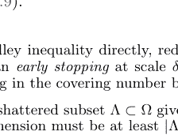

图 H.1 用网格跟随函数 \(f_0\) 逼近 Lipschitz 函数 \(f\)（练习 8.9）。

8.10 (b) 不要直接应用 Dudley 不等式，而是重做链式论证（定理 8.1.4 的证明），并在尺度 \(\delta\) 处提前停止，如同练习 8.6 的解答那样。一旦证明了 (8.54)，将 (a) 中的覆盖数界代入并优化 \(\delta\)。

8.18 \(\mathcal{F}\) 在某个被 Shatter 的子集 \(\Lambda\subset\Omega\) 上的限制包含 \(\Lambda\) 上的所有布尔函数，因此其线性代数维数至少为 \(|\Lambda|\)（请验证！）。

8.22 (a) 仿照命题 8.3.11 的证明进行论证，并使用 Sauer–Shelah 引理（引理 8.3.9）。

(b) 尝试找出一个例子，使得 \(\operatorname{vc}(\mathcal{F})=\operatorname{vc}(\mathcal{G})=1\)，而 \(\operatorname{vc}(\mathcal{F}\cup\mathcal{G})=3\)。

8.24 类似于定理 8.3.15 的证明进行。将集中不等式与对整个类 \(\mathcal{F}\)（限制在 \(\{X_1,\ldots,X_n\}\) 上）的并集界相结合。使用 Sauer–Shelah 引理来控制 \(\mathcal{F}\) 的基数。

8.25 对半空间指示函数类应用 VC 大数定律（定理 8.3.15）。

8.26 (a) 设 \(X_1,\ldots,X_m\) 表示 \(A\) 的行。则
\[
\Phi(u)=\operatorname{sign}(Au)=\bigl(\operatorname{sign}\langle X_i,u\rangle\bigr)_{i=1}^m.
\]

(b) 对由楔形 \(\{(x,u)\ne(x,v)\}\) 的指示函数组成的函数类 \(\mathcal{F}\)（其中 \(u,v\in S^{n-1}\)）使用一致大数定律（定理 8.3.15）。利用 VC 维的稳定性性质（命题 8.3.11），用半空间的 VC 维来界定楔形的 VC 维，而半空间的 VC 维已在例 8.3.5 中计算。

8.27 (a) 设 \(X_1,\ldots,X_m\) 表示 \(A\) 的行。对由带状区域
\[
\{x:|\langle x,u\rangle|\ge\varepsilon\}
\]
的指示函数组成的函数类 \(\mathcal{F}\)（其中 \(u\in S^{n-1}\)）使用一致大数定律（定理 8.3.15）。注意，\(|\langle X_i,u\rangle|\ge\varepsilon\) 蕴含 \(\langle X_i,u\rangle^2\ge\varepsilon^2\)。

(b) 考虑一个随机向量 \(X\)，它以概率 \(\delta\) 等于第一个基向量 \(e_1\) 的某个适当倍数，并以概率 \(1-\delta\) 取值于与 \(e_1\) 正交的子空间中。

8.28 选取一个任意大的子集 \(\Omega_0\subset\Omega\)，它被 \(\mathcal{F}\) Shatter，并令 \(X\sim\operatorname{Unif}(\Omega_0)\)。

8.29 注意，\((f-h)^2\) 是通过翻转 \(h(x)=1\) 的那些 \(f(x)\) 位从 \(f\) 得到的。

8.31 证明随机过程 \(X_f=R_n(f)-R(f)\) 具有次高斯增量：
\[
\|X_f-X_g\|_{\psi_2}\lesssim \frac{1}{\sqrt{n}}\|f-g\|_\infty
\]
对所有 \(f,g\in\mathcal{F}\) 成立。使用 Dudley 不等式推出
\[
\mathbb{E}\sup_{f\in\mathcal{F}}|R_n(f)-R(f)|\lesssim\frac{1}{\sqrt{n}}
\]
（参见定理 8.2.3 的证明）。然后仿照定理 8.4.5 的证明进行论证。

8.32 在一个被 \(\mathcal{F}\) Shatter 的集合 \(\Omega_0\subset\Omega\) 上取均匀分布，其大小为 \(\operatorname{vc}(\mathcal{F})\)。样本只在 \(\Omega_0\) 的一半上看到目标函数 \(T\)，但 \(T\) 在其余部分上可以任意——因此无法可靠地学习它。

8.34 (a) 令 \(T_0=\{0\}\)。对每个 \(k\in\mathbb{N}\)，令 \(T_k\) 包含 \(0\) 以及 \(T\) 中最大的 \(2^{2^k}-1\) 个元素。

8.35 写出
\[
|X_t-X_{t_0}|\le |X_t-X_{\pi_\kappa(t)}|+|X_{\pi_\kappa(t)}-X_{t_0}|
\]
并分别以概率 \(1-\exp(-u^2)\) 界住这两项。第一项可以通过链式论证
\[
\pi_\kappa(t)\to\pi_{\kappa+1}(t)\to\pi_{\kappa+2}(t)\to\cdots\to t
\]
用 \(C\gamma_2(T,d)\) 来界（根据 \(\kappa\) 的选择，这些更精细步骤中的失败概率远小于 \(\exp(-u^2)\)）。第二项对应于链式论证中的第一次大跳跃，可以通过对 \(T_k\) 取并集界，用 \(Cu\operatorname{diam}(T)\) 来界。

8.36 仿照定理 8.2.3 的证明，验证过程
\[
Z_f=\frac{1}{\sqrt{n}}\sum_{i=1}^n f(X_i)-\sqrt{n}\,\mathbb{E}f(X)
\]
具有次高斯增量：
\[
\|Z_f-Z_g\|_{\psi_2}\lesssim d(f,g).
\]
然后应用泛型链式界（定理 8.5.2）。

8.37 (a) 使用注记 8.5.3 和控制测度定理，得到用高斯宽度 \(w(T\cup\{0\})\) 表示的界，然后利用练习 7.20 过渡到高斯复杂度。

(b) 使用注记 8.5.4 和练习 7.20。

8.38 使用对偶性 (1.6) 和 Talagrand 比较不等式（注记 8.5.9）。

8.39 (a) 更紧密地跟进定理 7.3.1 的证明，而不是应用三角不等式。使用 Sudakov–Fernique 不等式（定理 7.2.8）替代 Talagrand 比较不等式。

(b) 注意
\[
\mathbb{E}\sup_{x\in T,y\in S}\langle Ax,y\rangle
\ge \sup_{x\in T}\mathbb{E}\sup_{y\in S}\langle Ax,y\rangle.
\]

8.40 使用练习 8.37(b) 的结果。

8.41 使用 Chevet 不等式。练习 1.17(a) 和练习 7.17 应有助于计算半径和高斯宽度。

9.2 使用范数集中性（定理 3.1.1）来界 \(\mathbb{E}\|Ax\|_2\) 与 \(\sqrt{m}\|x\|_2\) 之间的差。使用引理 7.5.11(b) 证明该差可以被主误差吸收。

9.3 使用恒等式 \(a^2-b^2=(a-b)(a+b)\)。

9.4 化归到各向同性情形：将 \(B_i=\Sigma^{1/2}A_i\) 写成某个各向同性 \(A_i\)，并将定理 9.1.1 应用于 \(\Sigma^{1/2}T\)。

9.5 为了理解该结果为何推广定理 9.1.1，将 \(\|Ax\|_2\) 表示为
\[
\left(\sum_{i=1}^m\langle A_i,x\rangle^2\right)^{1/2},
\]
其中 \(A_i\) 是矩阵 \(A\) 的行，并考虑 \(\mathbb{R}^n\) 上的线性函数类。为了证明该推广，仿照定理 9.1.1 的证明进行。

## 参考文献

- [1] E. Abbe. Community detection and stochastic block models: Recent developments. Journal of Machine Learning Research, 18(177):1–86, 2018.
- [2] E. Abbe, A. S. Bandeira, and G. Hall. Exact recovery in the stochastic block model. IEEE Transactions on Information Theory, 62(1):471–487, 2015.
- [3] P. Abdalla and S. Mendelson. Covariance estimation with direction dependence accuracy. Probability Theory and Related Fields, 2025.
- [4] P. Abdalla and N. Zhivotovskiy. Covariance estimation: Optimal dimension-free guarantees for adversarial corruption and heavy tails. Journal of the European Mathematical Society, 2024.
- [5] D. Achlioptas and F. McSherry. Fast computation of low-rank matrix approximations. Journal of the ACM, 54(2):9-es, 2007.
- [6] R. Adamczak. A note on the Hanson–Wright inequality for random vectors with dependencies. Electronic Communications in Probability, 20(72):1–13, 2015.
- [7] R. Adamczak, R. Latała, A. E. Litvak, A. Pajor, and N. Tomczak-Jaegermann. Chevet type inequality and norms of submatrices. Studia Mathematica, 210(1):35–56, 2012.
- [8] R. Adamczak, R. Latała, and R. Meller. Hanson–Wright inequality in Banach spaces. Ann. Inst. Henri Poincaré Probab. Stat., 56:2356–2376, 2020.
- [9] R. Adamczak, J. Prochno, M. Strzelecka, and M. Strzelecki. Norms of structured random matrices. Mathematische Annalen, 388(4):3463–3527, 2024.
- [10] K. Adiprasito, I. Bárány, N. Mustafa, and T. Terpai. Theorems of Carathéodory, Helly, and Tverberg without dimension. Discrete & Computational Geometry, 64(2):233–258, 2020.
- [11] R. Adler and E. Taylor. Random fields and geometry. Springer, 2009.
- [12] R. Ahlswede and A. Winter. Strong converse for identification via quantum channels. IEEE Transactions on Information Theory, 48(3):569–579, 2002.
- [13] A. Ai, A. Lapanowski, Y. Plan, and R. Vershynin. One-bit compressed sensing with non-Gaussian measurements. Linear Algebra and its Applications, 441:222–239, 2014.
- [14] F. Albiac and N. J. Kalton. Topics in Banach space theory. Springer, 2006.
- [15] S. Alesker. A remark on the Szarek–Talagrand theorem. Combinatorics, Probability and Computing, 6(2):139–144, 1997.
- [16] N. Alon and A. Naor. Approximating the cut-norm via Grothendieck’s inequality. In Proceedings of the Thirty-Sixth Annual ACM Symposium on Theory of Computing, pages 72–80, 2004.
- [17] N. Alon and J. H. Spencer. The probabilistic method. John Wiley & Sons, 2015.
- [18] D. Amelunxen, M. Lotz, M. B. McCoy, and J. A. Tropp. Living on the edge: Phase transitions in convex programs with random data. Information and Inference: A Journal of the IMA, 3(3):224–294, 2014.
- [19] A. Anandkumar, R. Ge, D. Hsu, S. Kakade, and M. Telgarsky. Tensor decompositions for learning latent variable models. Journal of Machine Learning Research, 15(1):2773–2832, 2014.

- [20] G. W. Anderson, A. Guionnet, 和 O. Zeitouni. *随机矩阵导论.* 剑桥大学出版社, 2010.

- [21] S. Artstein-Avidan, A. Giannopoulos, 和 V. D. Milman. *渐近几何分析，第二部分.* 美国数学学会, 2021.

- [22] D. Bakry 和 M. Ledoux. Lévy–Gromov 无穷维扩散生成元的等周不等式. *数学发明*, 123(2):259–281, 1996.

- [23] K. Ball. 现代凸几何初等导论. 见 *几何的风味*, *MSRI 出版物* 第31卷, 第1–58页. 剑桥大学出版社, 1997.

- [24] A. Bandeira. 数据科学数学中的十讲与四十二个开放问题. *讲义*, 2015.

- [25] A. Bandeira, M. Boedihardjo, 和 R. van Handel. 矩阵集中不等式与自由概率. *数学发明*, 234(1):419–487, 2023.

- [26] A. Bandeira, G. Cipolloni, D. Schröder, 和 R. van Handel. 矩阵集中不等式与自由概率 II. 双边界及其应用. *预印本 arXiv:2406.11453*, 2024.

- [27] A. Bandeira 和 R. van Handel. 独立元素随机矩阵范数的锐利非渐近界. *概率年刊*, 44(4):2479–2506, 2016.

- [28] R. Baraniuk, S. Foucart, D. Needell, Y. Plan, 和 M. Wootters. 字典稀疏信号的1比特压缩感知. *信息与推断：IMA 杂志*, 7(1):83–104, 2018.

- [29] I. Bárány. 西尔维斯特问题：n 个点处于凸位置的概率. *概率年刊*, 27(4):2020–2034, 1999.

- [30] F. Barthe 和 B. Maurey. 关于高斯型等周性的一些注记. *庞加莱研究所纪事 (B) – 概率与统计*, 36:419–434, 2000.

- [31] F. Barthe 和 E. Milman. 对数 Sobolev 与谱隙的传递原理及其在保守自旋系统中的应用. *数学物理通讯*, 323(2):575–625, 2013.

- [32] P. Bartlett 和 S. Mendelson. Rademacher 与高斯复杂度：风险界与结构结果. *机器学习研究杂志*, 3:463–482, 2002.

- [33] M. Belkin 和 K. Sinha. 分布族的多项式学习. 见 *2010 年 IEEE 第 51 届计算机科学基础年度研讨会*, 第103–112页. IEEE, 2010.

- [34] P. Bellec. Bernstein 矩假设下二次型的集中不等式. *预印本 arXiv:1901.08736*, 2019.

- [35] G. Bennett. 独立随机变量和的概率不等式. *美国统计协会杂志*, 57(297):33–45, 1962.

- [36] G. Bennett. 独立有界随机变量和的矩上界与概率不等式. *生物统计学报*, 52(3/4):559–569, 1965.

- [37] G. Bennett, V. Goodman, 和 C. Newman. 随机矩阵的范数. *太平洋数学杂志*, 59(2):359–365, 1975.

- [38] S. N. Bernstein. 关于切比雪夫不等式与拉普拉斯误差公式的一种修正. *Ann. Sci. Inst. Sav. Ukraine, Sect. Math.*, 1(5), 1924. 重印于: Math. Sbornik, 1933, 34(1): 1–17.

- [39] S. N. Bernstein. *概率论*. Gosizdat, 1927.

- [40] S. N. Bernstein. 关于切比雪夫不等式的若干修正. *苏联科学院报告*, 17(6):275–277, 1937.

- [41] R. Bhatia. *矩阵分析*. 施普林格出版社, 2013.

- [42] P. Billingsley. *概率与测度*. Wiley, 2012.

- [43] A. Blum, S. Har-Peled, 和 B. Raichel. 通过生成点集的稀疏逼近. *ACM 算法汇刊*, 15(3):1–16, 2019.

- [44] C. R. Blyth 和 P. K. Pathak. 关于斯特林定理简单证明的注记. *美国数学月刊*, 93(5):376–379, 1986.

- [45] S. G. Bobkov. 离散立方体上的等周不等式，以及 Gauss 空间中等周不等式的初等证明. *概率年刊*, 25(1):206–214, 1997.

- [46] B. Bollobás. *组合学：集合系、超图、向量族与组合概率*. 剑桥大学出版社, 1986.

- [47] B. Bollobás. *随机图*. 剑桥大学出版社, 2001.

- [48] C. Bordenave, M. Lelarge, 和 L. Massoulié. 随机图的非回溯谱：社区检测与非正则 Ramanujan 图. 见 *2015 年 IEEE 第 56 届计算机科学基础年度研讨会*, 第1347–1357页. IEEE, 2015.

- [49] E. Borel. *Introduction géométrique à quelques théories physiques*. Gauthier-Villars, 1914.

- [50] C. Borell. Gauss 空间中的 Brunn-Minkowski 不等式. *数学发明*, 30(2):207–216, 1975.

- [51] J. M. Borwein 和 A. S. Lewis. *凸分析与非线性优化：理论与实例*. 施普林格出版社, 2005.

- [52] S. Boucheron, G. Lugosi, 和 P. Massart. *集中不等式：非渐近的独立理论*. 牛津大学出版社, 2013.

- [53] P. Boufounos 和 R. G. Baraniuk. 1比特压缩感知. 见 *2008 年第 42 届信息科学与系统年度会议*, 第16–21页. IEEE, 2008.

- [54] J. Bourgain, S. Dirksen, 和 J. Nelson. 迈向欧几里得空间中稀疏降维的统一理论. 见 *第47届 ACM 计算理论年度研讨会论文集*, 第499–508页, 2015.

- [55] J. Bourgain 和 L. Tzafriri. “大型”子矩阵的可逆性及其在 Banach 空间几何与调和分析中的应用. *以色列数学杂志*, 57:137–224, 1987.

- [56] O. Bousquet, S. Boucheron, 和 G. Lugosi. 统计学习理论导论. 见 *机器学习暑期学校*, 第169–207页. 施普林格出版社, 2003.

- [57] C. Boutsidis, P. Drineas, 和 M. Magdon-Ismail. 近最优的基于列的矩阵重构. *SIAM 计算杂志*, 43(2):687–717, 2014.

- [58] S. Boyd 和 L. Vandenberghe. *凸优化*. 剑桥大学出版社, 2004.

- [59] T. Brailovskaya 和 R. van Handel. 普适性与锐利矩阵集中不等式. *几何与泛函分析*, 34(6):1734–1838, 2024.

- [60] M. Braverman, K. Makarychev, Y. Makarychev, 和 A. Naor. Grothendieck 常数严格小于 Krivine 界. 见 *数学论坛（Pi）*, 第1卷, 第 e4 页, 2013.

- [61] S. Brazitikos, A. Giannopoulos, P. Valettas, 和 B.-H. Vritsiou. *各向同性凸体几何*. 美国数学学会, 2014.

- [62] A. Brieden, P. Gritzmann, R. Kannan, V. Klee, L. Lovász, 和 M. Simonovits. 半径的确定性与随机多项式时间近似. *Mathematika*, 48(1-2):63–105, 2001.

- [63] S. Brooks, A. Gelman, G. Jones, 和 X. L. Meng. *马尔可夫链蒙特卡罗手册*. CRC 出版社, 2011.

- [64] S. Bubeck. 凸优化：算法与复杂性. *机器学习基础与趋势*, 8(3-4):231–357, 2015.

- [65] A. Buchholz. 非交换概率中的算子 Khintchine 不等式. *数学年鉴*, 319(1):1–16, 2001.

- [66] A. Buchholz. 费米子、Rademacher 与 q-高斯算子的 Khintchine 型不等式的最优常数. *波兰科学院数学通报*, 53(3):315–321, 2005.

- [67] P. Bühlmann 和 S. van de Geer. *高维数据统计：方法、理论与应用*. 施普林格出版社, 2011.

- [68] V. V. Buldygin 和 Yu. V. Kozachenko. 次高斯随机变量. *乌克兰数学杂志*, 32:483–489, 1980.

- [91] M. A. Davenport, M. F. Duarte, Y. C. Eldar, 和 G. Kutyniok. 压缩感知导论. 见 *压缩感知：理论与应用*, 第1–68页. 剑桥大学出版社, 2012.

- [92] M. A. Davenport, Y. Plan, E. van den Berg, 和 M. Wootters. 1比特矩阵补全. *信息与推断：IMA 杂志*, 3(3):189–223, 2014.

- [93] M. A. Davenport 和 J. Romberg. 不完全观测下低秩矩阵恢复综述. *IEEE 信号处理选题杂志*, 10(4):608–622, 2016.

- [94] K. Davidson 和 S. J. Szarek. 局部算子理论、随机矩阵与 Banach 空间. 见 *Banach 空间几何手册*, 第1卷, 第317–366页. 爱思唯尔, 2001.

- [95] C. Davis 和 W. M. Kahan. 扰动引起的特征向量旋转. III. *SIAM 数值分析杂志*, 7(1):1–46, 1970.

- [96] V. de la Peña 和 E. Giné. *解耦：从相依到独立*. 施普林格出版社, 1999.

- [97] V. de la Peña 和 S. J. Montgomery-Smith. 多元 U 统计量尾概率的解耦不等式. *概率年刊*, 第806–816页, 1995.

- [98] A. Deshpande 和 S. Vempala. 自适应采样与快速低秩矩阵近似. 见 *组合优化近似算法国际研讨会*, 第292–303页. 施普林格出版社, 2006.

- [99] L. Devroye, M. Lerasle, G. Lugosi, 和 R. I. Oliveira. 次高斯均值估计量. *统计年刊*, 44(6):2695–2725, 2016.

- [100] S. Dhara, D. Mukherjee, 和 K. Ramanan. 非负元素随机矩阵的 r 到 p 范数：极大值点的渐近正态性与 ℓ∞ 界. *应用概率年刊*, 34(6):5076–5115, 2024.

- [101] P. Diaconis 和 D. Freedman. 斯特林公式的一个初等证明. *美国数学月刊*, 93(2):123–125, 1986.

- [102] P. Diaconis 和 D. Freedman. 一打寻求理论的 de Finetti 式结果. *I. H. P. 纪事，B 辑*, 23(S2):397–423, 1987.

- [103] S. Dirksen. 通过一般链方法的尾界. *电子概率杂志*, 20:1–29, 2015.

- [104] S. Dirksen, J. Maly, 和 H. Rauhut. 1比特量化下的协方差估计. *统计年刊*, 50(6):3538–3562, 2022.

- [105] S. Dirksen 和 S. Mendelson. 非高斯超平面剖分与鲁棒1比特压缩感知. *欧洲数学学会杂志*, 23(9):2913–2947, 2021.

- [106] S. Dirksen, S. Mendelson, 和 A. Stollenwerk. 随机超平面剖分的锐利估计. *SIAM 数据科学数学杂志*, 4(4):1396–1419, 2022.

- [107] S. Dirksen, S. Mendelson, 和 A. Stollenwerk. 汉明立方体的快速度量嵌入. *SIAM 计算杂志*, 53(2):315–345, 2024.

- [108] D. Donoho, M. Gavish, 和 A. Montanari. 高斯测量矩阵恢复的相变与矩阵去噪的极小极大均方误差一致. *美国国家科学院院刊*, 110(21):8405–8410, 2013.

- [109] D. Donoho, A. Javanmard, 和 A. Montanari. 通过空间耦合与近似消息传递实现信息论最优的压缩感知. *IEEE 信息论汇刊*, 59(11):7434–7464, 2013.

- [110] D. Donoho, I. Johnstone, 和 A. Montanari. 通过极小极大去噪联系精确预测压缩感知中的相变. *IEEE 信息论汇刊*, 59(6):3396–3433, 2013.

- [111] D. Donoho, A. Maleki, 和 A. Montanari. 压缩感知中的噪声敏感性相变. *IEEE 信息论汇刊*, 57(10):6920–6941, 2011.

- [112] D. Donoho 和 J. Tanner. 当投影大幅降低维度时随机投影多面体的面计数. *美国数学学会杂志*, 22(1):1–53, 2009.

- [236] S. Mendelson、A. Pajor 和 N. Tomczak-Jaegermann. 渐近几何分析中的重建与次高斯算子. *几何与泛函分析*, 17(4):1248–1282, 2007.
- [237] S. Mendelson 和 R. Vershynin. 熵与组合维数. *数学发明*, 152(1):37–55, 2003.
- [238] S. Mendelson 和 N. Zhivotovskiy. 在 $L_4 - L_2$ 范数等价下的稳健协方差估计. *统计年鉴*, 48(3):1648–1664, 2020.
- [239] C. D. Meyer. *矩阵分析与应用线性代数*. SIAM, 2023.
- [240] F. Mezzadri. 如何从经典紧群生成随机矩阵. *美国数学学会通报*, 54(5):592–604, 2007.
- [241] V. Milman. 高维凸性理论中令人惊奇的几何现象. 见 *欧洲数学大会：布达佩斯，1996年7月22–26日，第二卷*, 第 73–91 页. Springer, 1998.
- [242] V. D. Milman. A. Dvoretzky 凸体截面定理的一个新证明. *泛函分析及其应用*, 5(4):288–295, 1971.
- [243] V. D. Milman. Banach 空间局部理论中的几何不等式与混合体积. *Astérisque*, 131:373–400, 1985.
- [244] V. D. Milman. 有限维赋范空间比例维数的随机子空间：通过等周不等式的方法. 见 *Banach 空间：密苏里会议论文集*, 第 106–115 页. Springer, 1985.
- [245] V. D. Milman. 关于低 $M^*$ 估计的一个注记. 见 *Banach 空间几何（会议论文集，Strobl，1989）*, *数学讲义* 第 158 卷, 第 219–229 页. Cambridge University Press, 1990.
- [246] V. D. Milman 和 G. Schechtman. *有限维赋范空间的渐近理论*, 第 1200 卷. Springer Science, 1986.
- [247] V. D. Milman 和 G. Schechtman. 有限维赋范空间的整体与局部渐近理论. *杜克数学杂志*, 90:73–93, 1997.
- [248] S. Minsker. 关于自伴算子 Bernstein 不等式的若干推广. *统计与概率快报*, 127:111–119, 2017.
- [249] M. Mitzenmacher 和 E. Upfal. *概率与计算：算法与数据分析中的随机化与概率技术*. Cambridge University Press, 2017.
- [250] A. Moitra. *机器学习的算法方面*. Cambridge University Press, 2018.
- [251] A. Moitra 和 G. Valiant. 解决高斯混合的多项式可学习性问题. 见 *2010 年 IEEE 第 51 届计算机科学基础年度研讨会*, 第 93–102 页. IEEE, 2010.
- [252] S. J. Montgomery-Smith. Rademacher 和的分布. *美国数学学会会刊*, 109(2):517–522, 1990.
- [253] P. Mörters 和 Y. Peres. *布朗运动*, 第 30 卷. Cambridge University Press, 2010.
- [254] E. Mossel、J. Neeman 和 A. Sly. 置信传播、块模型的稳健重构与最优恢复. 见 *学习理论会议*, 第 356–370 页. PMLR, 2014.
- [255] R. Murray、J. Demmel 和 M. Mahoney 等. 随机数值线性代数：以软件为目标的领域视角. *arXiv 预印本 arXiv:2302.11474*, 2023.
- [256] A. Nemirovsky 和 D. Yudin. *优化中的问题复杂度与方法效率*. Wiley Interscience, 1983.
- [257] M. Newman. *网络：导论*. Oxford University Press, 2010.
- [258] H. H. Nguyen 和 V. Vu. 小球概率、逆定理及其应用. 见 *Erdős 百年纪念*, *Bolyai 学会数学研究* 第 25 卷, 第 409–463 页. Springer, 2013.
- [259] R. I. Oliveira. 独立边随机图的邻接矩阵与拉普拉斯矩阵的集中性. *arXiv 预印本 arXiv:0911.0600*, 2009.
- [260] R. I. Oliveira. 随机 Hermitian 矩阵之和与 Rudelson 不等式. *概率电子通讯*, 15:203–212, 2010.
- [285] O. Rivasplata. 次高斯随机变量：一篇说明性注记. *阿尔伯塔大学技术报告*, 2012.
- [286] H. Robbins. 关于 Stirling 公式的一个注记. *美国数学月刊*, 62:26–29, 1955.
- [287] M. Rudelson. 各向同性位置中的随机向量. *泛函分析杂志*, 164(1):60–72, 1999.
- [288] M. Rudelson 和 R. Vershynin. 随机过程的组合学与凸体的截面. *数学年刊*, 164(2):603–648, 2006.
- [289] M. Rudelson 和 R. Vershynin. 大矩阵采样：一种基于几何泛函分析的方法. *ACM 杂志*, 54(4):21–es, 2007.
- [290] M. Rudelson 和 R. Vershynin. 关于由 Fourier 和 Gauss 测量进行稀疏重构. *纯粹与应用数学通讯*, 61(8):1025–1045, 2008.
- [291] M. Rudelson 和 R. Vershynin. 随机矩阵的非渐近理论：极端奇异值. 见 *2010 年国际数学家大会论文集 (ICM 2010)*, 第 1576–1602 页. World Scientific, 2010.
- [292] M. Rudelson 和 R. Vershynin. Hanson-Wright 不等式与次高斯集中性. *概率电子通讯*, 18:1–9, 2013.
- [293] H. Sambale. 关于 α-次指数随机变量集中性的若干注记. 见 *高维概率 IX：空灵卷*, 第 167–192 页. Springer, 2023.
- [294] N. Sauer. 关于集族的密度. *组合理论杂志，A 辑*, 13(1):145–147, 1972.
- [295] G. Schechtman. 关于欧几里得空间子集嵌入赋范空间的两点观察. *数学进展*, 200(1):125–135, 2006.
- [296] G. Schechtman 和 J. Zinn. 关于两个 \(l_p^n\) 球的交集体积. *美国数学学会会刊*, 110(1):217–224, 1990.
- [297] R. Schneider 和 W. Weil. *随机与积分几何*. Springer, 2008.
- [298] I. Schur. 关于具有无穷多个变量的有界双线性形式理论的注记. 1911.
- [299] Y. Seginer. 随机矩阵的期望范数. *组合学、概率与计算*, 9(2):149–166, 2000.
- [300] S. Shelah. 一个组合问题；无穷语言中模型与理论的稳定性与序. *太平洋数学杂志*, 41(1):247–261, 1972.
- [301] Y.-C. Sheu 和 T.-C. Wang. \(\ell_p\)-范数的矩阵偏差不等式. *随机矩阵：理论与应用*, 12(04):2350007, 2023.
- [302] I. Shevtsova. 关于同分布加项的 Berry-Esseen 型不等式中的绝对常数. *arXiv 预印本 arXiv:1111.6554*, 2011.
- [303] M. Simonovits. 如何计算高维体积？ *数学规划*, 97:337–374, 2003.
- [304] D. Slepian. 高斯噪声的单侧势垒问题. *贝尔系统技术杂志*, 41(2):463–501, 1962.
- [305] David Slepian. 关于高斯噪声的零点. 见 *时间序列分析*, 第 104–115 页. Wiley, 1963.
- [306] G. W. Stewart 和 J.-G. Sun. *矩阵扰动理论*. Academic Press, 1990.
- [307] M. Stojnic. 压缩感知中 \(\ell_1\)-优化的各种阈值. *arXiv 预印本 arXiv:0907.3666*, 2009.
- [308] M. Stojnic. 正则随机对偶. *arXiv 预印本 arXiv:1303.7295*, 2013.
- [309] V. Sudakov. 高斯随机过程与 Hilbert 空间中立体角的测度. *Doklady Akademii Nauk*, 197(1):43–45, 1971.
- [310] V. Sudakov. *无穷维概率分布理论中的几何问题*. American Mathematical Society, 1979.
- [311] S. Szarek. 关于 Khintchin 不等式中的最佳常数. *数学研究*, 2(58):197–208, 1976.
- [312] S. J. Szarek 和 M. Talagrand. Sauer-Shelah 引理的“同构”版本及到立方体的 Banach-Mazur 距离. 见 *泛函分析的几何方面：以色列研讨会 (GAFA) 1987-88*, 第 105–112 页. Springer, 1989.
- [313] S. J. Szarek 和 M. Talagrand. 关于凸化的 Sauer-Shelah 定理. *组合理论杂志，B 辑*, 69(2):183–192, 1997.
- [314] M. Talagrand. 独立性的新视角. *概率年刊*, 第 1–34 页, 1996.
- [315] M. Talagrand. *泛链方法：随机过程的上界与下界.* Springer, 2005.
- [316] M. Talagrand. *随机过程的上界与下界.* Springer, 2014.
- [317] M. Talagrand. *随机过程的上界与下界：分解定理.* Springer, 2022.
- [318] T. Tao 和 V. Vu. 从 Littlewood-Offord 问题到圆环律：随机矩阵谱分布的普适性. *美国数学学会通报*, 46(3):377–396, 2009.
- [319] R. Tibshirani. 通过 lasso 的回归收缩与变量选择. *皇家统计学会杂志 B 辑：统计方法*, 58(1):267–288, 1996.
- [320] K. Tikhomirov. 重尾分布的样本协方差矩阵. *国际数学研究通告*, 2018(20):6254–6289, 2018.
- [321] N. Tomczak-Jaegermann. *Banach-Mazur 距离与有限维算子理想.* Pitman, 1989.
- [322] J. Tropp. 从独立随机线性测量中凸恢复结构化信号. 见 *采样理论，复兴：压缩感知与其他进展*, 第 67–101 页. Birkhäuser, 2015.
- [323] J. A. Tropp. 随机子矩阵的范数与稀疏逼近. *法国科学院报告·数学*, 346(23-24):1271–1274, 2008.
- [324] J. A. Tropp. 随机矩阵和的便于使用的尾界. *计算数学基础*, 12:389–434, 2012.
- [325] J. A. Tropp 和 R. J. Webber. 低秩矩阵逼近的随机算法：设计、分析与应用. *arXiv 预印本 arXiv:2306.12418*, 2023.
- [326] J. A. Tropp、A. Yurtsever、M. Udell 和 V. Cevher. 低秩矩阵逼近的实用 sketching 算法. *SIAM 矩阵分析与应用杂志*, 38(4):1454–1485, 2017.
- [327] Joel A Tropp. 矩阵集中不等式导论. *机器学习基础与趋势*, 8(1-2):1–230, 2015.
- [328] S. van de Geer. *经验过程理论的应用.* Cambridge University Press, 2000.
- [329] A. W. van der Vaart 和 J. A. Wellner. *弱收敛与经验过程：统计中的应用.* Springer, 第 2 版, 2023.
- [330] R. van Handel. 高维概率. *讲义（普林斯顿大学）*, 2(3):2–3, 2014.
- [331] R. van Handel. 结构化随机矩阵. 见 *凸性与集中性*, *IMA 数学及其应用卷* 第 161 卷, 第 107–165 页. Springer, 2017.
- [332] R. van Handel. 链、插值与凸性. *欧洲数学学会杂志*, 20(10):2413–2435, 2018.
- [333] Ramon van Handel. 链、插值与凸性 II：收缩原理. *概率年刊*, 46(3):1764–1805, 2018.
- [334] J. H. van Lint. *编码理论导论.* Springer, 1998.
- [335] V. N. Vapnik 和 A. Ya. Chervonenkis. 关于事件相对频率对事件概率的一致收敛. *概率论及其应用*, 16(2):264–280, 1971.
- [336] S. Vempala. 几何随机游走：综述. 见 *组合与计算几何*, *数学科学研究所出版物* 第 52 卷, 第 573–612 页. Cambridge University Press, 2005.

<!-- 无内容 -->
