## 机器学习高性能算法交易：利用 AutoML 与特征工程构建自动化交易策略构建指南


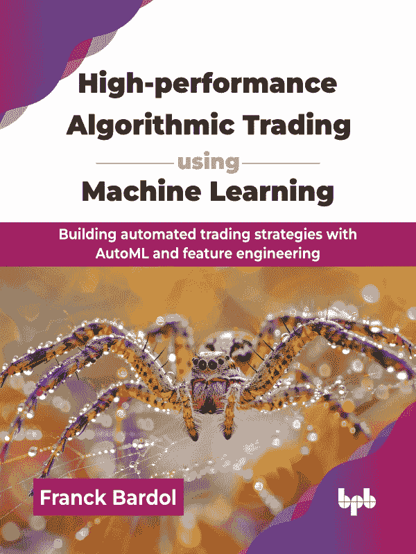

## 献给

我的妻子 Vassilina

我的女儿们 Ermance 和 Odile

## 作者简介

Franck Bardol 是一位 AI 教授、高级顾问，以及生成式 AI 和机器学习领域的专家顾问，拥有超过二十年在量化金融、应用研究和数据科学交叉领域的经验。他早年担任对冲基金和自营交易部门的量化分析师，开发跨资产类别的算法交易策略和预测模型。随后，他将工作拓展至工业和服务领域，将机器学习应用于欺诈检测、维护优化、客户体验、计算机视觉以及工厂有毒排放检测等问题。

Franck 曾与 Axa、CA-CIB、Equalt alternative、Finaltis Hedge fund、Bouygues、Allianz、Orange Telecom Guinée、LVMH、法国央行、ITER 核聚变项目、通用电气和空客等机构合作。他还通过担任欧盟委员会和法国 AI Villani 委员会的独立专家，为公共政策和伦理做出了贡献。

作为一名教育工作者，他为日内瓦大学、ISEP、ESME Sudria 和微软 AI 校区等机构设计并讲授了 AI 课程。他的教学涵盖监督学习、无监督学习、生成式 AI 和数据驱动战略，专注于实际应用。他还是 LinkedIn Learning 的数据科学和数据营销讲师，通过该平台上的 MOOC 课程培训了超过 50,000 名学习者。他在 Swiss IT Forum、Salon du Trading 和 CEPIC Conference 等大型活动中发表过主题演讲，曾与法新社、美联社和新华社等领先的国际通讯社代表同台演讲。

Franck 拥有人工智能、量化建模和金融市场的理学硕士学位，以及哲学伦理学证书。他是 Paris Machine Learning Meetup 的创始人，该社区汇聚了超过 8,500 名欧洲 AI 专业人士和专家。

## 致谢

我要衷心感谢所有为完成本书做出贡献的人。

我对 BPB Publications 表示衷心感谢，感谢他们在该项目实施过程中的指导和专业支持。他们的专业精神和支持在应对出版流程的复杂性方面至关重要。

我还要感谢编辑们、技术专家和整个审稿团队。你们深思熟虑的反馈、细致的审阅和建设性的建议，极大地促进了内容的完善和手稿质量的提升。

最后，我要向我挚爱的父母、我的妹妹 Sylvia 以及她的丈夫 Charles Bacon 表达我最深切的谢意，感谢他们在这段旅程中坚定不移的支持和鼓励。

以及对所有对本书表现出兴趣的读者——你们的好奇心和参与才是这部作品存在的真正理由。

感谢每一位为使本书成为现实发挥了作用的人。

## 前言

机器学习已迅速成为算法交易中一种变革性的工具，其能力远超计量经济学、技术分析、随机微积分、投资组合优化和信号处理等传统方法。虽然这些成熟的方法长期以来一直是量化金融的主流，但它们往往依赖于僵化的假设和人工制定的规则。相比之下，机器学习使系统能够直接从数据中学习——发现模式、适应市场动态，并在极少人工干预的情况下构建预测模型。将示例——训练集——自动转化为模型这一理念具有革命性意义。

本书的写作旨在填补我反复观察到的一个空白：初学者在交易机器学习方面迈出的第一步，与学术界或机构环境中常见的更高阶、往往难以企及的专业知识之间的鸿沟。许多新手开始尝试对收益进行分类——往往以失败告终——原因在于缺乏对替代目标预测或特征工程更深层理解的经验。我的目标是通过引入既强大又实用的现代机器学习技术来弥合这一鸿沟。无论您是独自工作还是在小团队中协作，本书专注于计算高效、适用于真实交易场景且能带来可衡量结果的方法。

本书旨在作为一本实操指南，带领读者深入了解应用于真实交易的机器学习关键技术。它从算法策略设计的基础入手，然后逐步扩展到监督学习、无监督模型、模式挖掘、金融文本 NLP，最后以使用先进 ML 技术进行投资组合构建作为结尾。内容完全偏向实战——有意排除了数学推导，转而采用代码、工具和示例——使材料通俗易懂且不失技术深度。

您将学习如何应用量化基本面方法，将会计数据整合到预测模型中；检测时间序列中的结构性变化并自动提取规则；处理另类和非结构化数据；设计远超基本 OHLC 输入的特征；在保留信号的同时过滤市场噪声；构建基于成交量或波动率的 K 线，并利用 AutoML 和低代码 ML 的最新突破，使用 `H2O` 和微软 `FLAML` 等工具。每章都结合了清晰的解释、即刻可运行的代码，以及反映真实交易问题和约束的用例。

### 第 1 章：算法交易与机器学习概览

本章介绍系统化交易策略、行业关键参与者，以及机器学习如何融入现代交易系统。涵盖传统方法并将其与 ML 驱动的流水线进行对比。

# 第 2 章：数据源、回测与前向测试

本章探讨如何通过 API 获取宏观经济和基本面数据，以及如何为机器学习工作流准备数据。介绍前向测试概念和时间感知数据流水线。

### 第 3 章：优化交易系统、指标与自动化报告

本章涵盖特征工程、指标选择、模型提升，以及使用 `QuantStats` 和其他工具创建自动化绩效报告。

# 第 4 章：实施交易策略

本章专注于使用 `Backtrader` 实施事件驱动策略。包括端到端的 ML 策略部署、风险管理和绩效评估。


### 第 1 章：算法交易与机器学习概览

## 简介

本章提供了算法交易的概述。它涵盖了算法交易策略的基础知识。

它解释了在交易中引入机器学习（ML）的原因及其使用的潜在后果。本章讨论了机器学习在算法交易中的应用，范围涵盖从动量策略到统计套利策略。它探讨了机器学习如何检测趋势和均值回归模式以进行交易，以及其他创新应用，例如元学习。

## 结构

在本章中，我们将涵盖以下主题：

- 系统化算法交易
- 酌情交易与系统化交易
- 算法策略的主要类型
- 理解机器学习
- 机器学习在交易中的应用
- 使用机器学习的元策略

## 目标

读完本章后，您将对算法交易、其起源、发展背后的驱动力及其多样化应用有深入的理解。此外，您将能够区分并描述关键的算法策略，从动量、统计套利到高频交易（HFT），识别其区别要素，并认知该领域的各类参与者。

本章旨在为算法交易和机器学习应用提供全面的基础，助您在实际应用中构建并拓展这些知识。

## 系统化算法交易

金融市场和投资行业的演变催生了各种复杂的交易方法。其中一种出现并多年来取得显著增长的方法是系统化算法交易。如今，算法交易 1 占据了美国市场 50% 以上的交易量。这种激增的原因是多方面的，关键驱动因素在于能够快速处理大量信息，以及将人为错误和情绪从交易过程中剔除。这种方法消除了交易决策中的情绪偏见和主观性，提供了客观性。


历史上，交易主要是自主交易，涉及人工决策和直觉。然而，随着时间的推移，人们逐渐意识到这种方法存在固有局限性，特别是在处理海量数据和迅速抓住市场机会方面。系统化算法交易解决了这些挑战，引入了速度、可扩展性和效率的新范式。

它诞生于 20 世纪 70 年代，当时高度计算机化的交易系统在美国金融市场涌现。

系统化方面源于显性制定的投资规则的使用。这些规则表达了应遵循的行为准则。因此，相关规则的编写和制定成为投资者之间的战略差异化因素，我们将在本书中了解如何实现这一点。本书旨在探讨利用自学习算法生成交易规则的方法。

在进一步深入之前，让我们花点时间进行说明。以下是一个交易规则示例：

“如果
成交量超过前一天的成交量，且
收盘价高于开盘价
则买入微软股票”

遵循该规则构成一种交易策略，称为系统化或算法交易 2。

算法交易的概念涉及应用量化模型来创建、回测和实施交易策略。这种方法能够以极快的速度执行大额订单，通常能带来可观的财务收益。

速度和可扩展性是利用计算机（通过编程语言）处理这些系统化交易规则并将生成的买卖订单发送至金融市场的自然结果。该规则包含在每种情境下做出明智投资决策所需的所有信息。

决策涉及从备选方案中选择最合适的行动方案，例如买入、卖出、不作为、减少敞口、减轻投资组合、对冲金融风险或保护投资。规则的用处正是在于从这些行动中进行选择。

现在让我们看看该领域的一些关键参与者及其简要历史。

### 系统化交易的标志性参与者

算法交易的叙事始于 20 世纪 70 年代末，深植于量化方法论。埃德·索普 3 是一位数学教授转型为对冲基金经理，他是先驱之一，利用其在二十一点策略方面的专长在华尔街留下了持久影响。他的策略非常适合华尔街，在交易史上留下了持久印记。他将量化方法引入金融，奠定了系统化交易的基础。他被认为是历史上第一位量化分析师。

起因如下 4。

在 20 世纪 70 年代末，盛行的有效市场理论——该理论认为金融市场反映所有可用信息，因此不可能持续获得高于平均水平的利润——面临着日益增长的怀疑。埃德·索普等有影响力的人物，因在二十一点中成功应用概率策略而闻名；杰罗姆·贝塞尔，加州大学欧文分校的杰出数学家兼普林斯顿-纽波特合伙人同事，坚信市场低效的存在。他们的信念得到了实证证据的进一步支持，包括沃伦·巴菲特持续成功的投资策略，表明精明的参与者确实可以战胜市场。因此，系统化交易时代及利用这些低效性的新工具的出现拉开了序幕。

在普林斯顿-纽波特合伙公司期间，他们开展了一个开创性项目：研究各种指标和特征对证券历史收益的影响。这一大胆举措涉及分析市盈率、账面市值比和公司规模等因素，并遭到了学术界的一片批评。然而，他们毫不气馁，继续前行。

随后，命运出现了转折，他们的一位研究人员偶然发现了一个改变游戏规则的想法：统计套利。

这一概念依赖于单一指标，将股票从优到劣排序，并提供其相对表现的短期预测。通过研究近期一段时间（如过去两周）的价格百分比变化，他们发现了有趣的反复模式。大幅上涨的股票在随后几周往往会表现疲软，而遭受损失的股票往往会反弹。

凭借这一新见解，他们设计了一个名为 MUD 的系统，巧妙地代表“涨幅最大、跌幅最大股票”。通过大量的计算机模拟，他们惊讶地发现，买入表现最好的十分位数股票，同时卖空表现最差的十分位数股票，可产生约 20% 的年化收益率。

在本段末尾，我们将回到该系统并提出一种实现方案。

与埃德·索普同时期，理查德·奥尔森和迈克尔·斯塔姆等创新者推出了数字外汇交易平台，进一步为算法方法的采用铺平了道路。

在算法交易的其他先驱中，最著名的是一位专门研究传输代码及其破解方法的数学家。凭借这位破译专家的知识，他于 1982 年创立了文艺复兴科技公司。它是全球最著名的系统化对冲基金，以其成功 5 和策略的神秘光环闻名。

文艺复兴科技公司并非独自在这一新疆域探索。其他知名对冲基金，包括 D.E. Shaw 和 Citadel，也处于算法交易运动的前沿。他们是系统化算法交易的早期采用者，并从其努力中获得了丰厚回报。

例如，D.E. Shaw 管理的资产超过 500 亿美元，其由算法驱动的交易系统持续带来跑赢大盘的收益。同样，文艺复兴科技公司管理资产约 1300 亿美元，Citadel 管理资产超过 340 亿美元，两者均通过算法交易运营实现了卓越业绩。

这些实体及其巨大成功体现了算法交易固有的巨大潜力。然而，算法交易策略的细微差别和变化极其丰富，每种类型都具有独特的属性和考量因素。我们将在后续章节中深入探讨这些策略。

让我们花点时间实现这个想法，它很可能是现代统计套利系统的鼻祖：买入表现差的，卖出表现好的。这构成了基于金融资产价格均值回归统计特性的交易系统的基础。

#### 实现第一个统计套利系统

步骤如下，首先在必要时安装雅虎财经库（`yfinance`）：

```
try:
    import yfinance as yf
except ModuleNotFoundError as e:
    !pip install -q yfinance
import yfinance as yf
```

接下来，我们请求获取 30 个在纽约证券交易所交易的股票代码的长期每日行情历史。股票代码是随机挑选的：

```
##### 定义股票代码
tickers = ['AAP', 'AXP', 'BA', 'CAT', 'CSCO', 'CVX', 'DIS', 'GS', 'HD',
           'IBM', 'INTC', 'JNJ', 'JPM', 'KO', 'MCD', 'MMM', 'MRK', 'MSFT', 'NKE',
           'PFE', 'PG', 'TRV', 'UNH', 'VZ', 'WBA', 'WMT', 'XOM', 'MMM']

##### 从雅虎财经下载历史价格数据
data = yf.download(tickers, start='1990-01-01', end='2023-07-07', interval='1d')
```

借助 Pandas `dropna()` 函数计算收益率并删除缺失值：

```
##### 计算近期一段时间（例如过去两周）的价格百分比变化
ret = data['Adj Close'].pct_change(periods=10)

##### 删除 `NaN` 值
```


`ret.dropna(inplace=True)`

然后，遵循 Ed Thorp 概述的逻辑，我们首先对收益率进行排序（rank 函数），以确定每个历史时期表现最好（`top_decile`）和最差（`bottom_decile`）的股票。

##### 根据股票的百分比变化对其进行排名

`ranked_ret = ret.rank(axis=1, ascending=False)`

##### 选出表现最好和最差的十分位数股票

###### 前 x%

`top_decile = ranked_ret[ranked_ret <= len(tickers) * 0.2]`

###### 最差表现者

`bottom_decile = ranked_ret[ranked_ret > len(tickers) * 0.9]`

`bottom_decile.dropna()`

我们从 `top_decile` 列表买入股票（`long_positions`），并卖出 `bottom_decile` 列表中的股票。

##### 根据策略开立新仓位

`long_positions = top_decile.loc[date].dropna()`

`short_positions = bottom_decile.loc[date].dropna()`

退出条件如下：当资产不再位于表现最好或最差的股票列表之一时，将其从投资组合中移除：

```
if stock not in top_decile.loc[date].dropna().index and stock not in bottom_decile.loc[date].dropna().index:
```

我们应用该系统，并采用以下管理参数：

##### 初始投资组合价值

`portfolio_value = 10000`

`total_trades = 0`

`total_profit_loss = 0`

`lst_pnl = []`

`stp_loss = -2/100 * portfolio_value`

##### 定义每股交易成本，每股 x 美元（$0.005：IB 券商）

`transaction_cost = 0.01`

在 Interactive Brokers 交易平台 6 中，专业账户交易美交所上市股票的佣金为每股 $0.005。我们将该金额加倍至 $0.01，以计入额外摩擦成本（滑点等）。

我们添加了一个基本的止损机制，将亏损限制在交易资本金额的 2%（$100,000 投资组合）。

我们获得了以下统计数据和盈亏权益曲线：

- 平均收益率：7.65%
- 总盈亏：1138014.42
- 平均每笔交易收益：580.62

我们的统计套利系统给出了令人鼓舞的结果，这与 Ed Thorp 提供的信息一致：

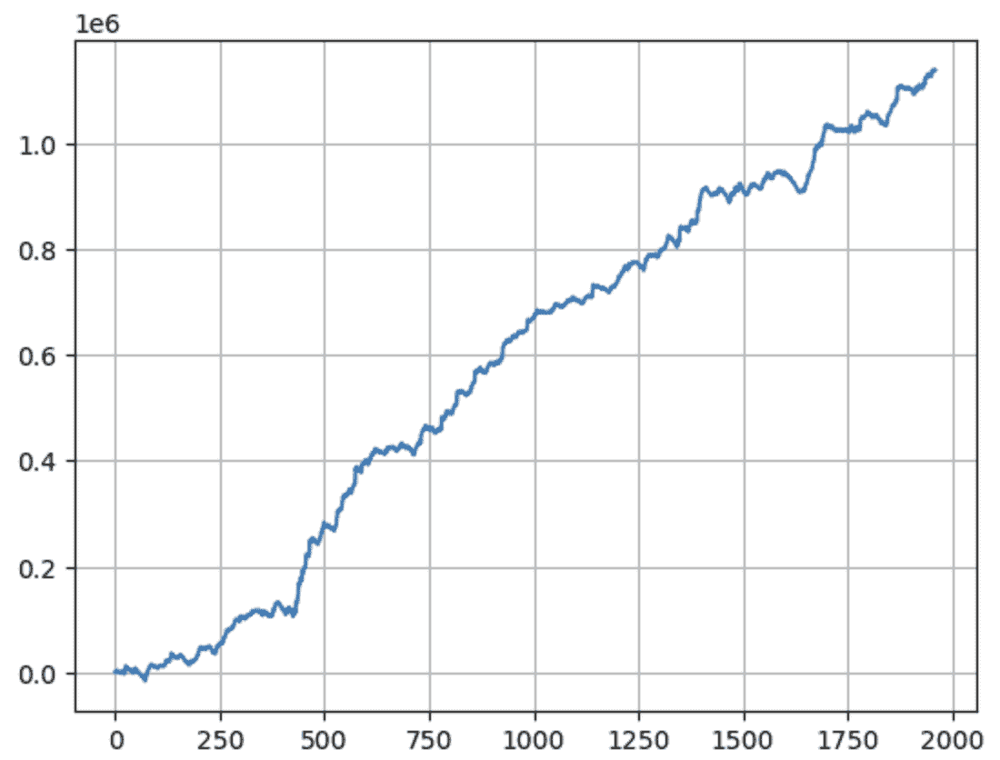

现在我们已经实现了统计套利的逻辑，让我们看看系统化交易（统计套利属于此类）与自由裁量交易之间的区别，以充分了解这两种主要投资方法的优缺点。

## 自由裁量交易 vs. 系统化交易

系统化交易涉及使用计算机算法，基于预定义的规则和标准做出交易决策。这种方法消除了交易决策中的情绪偏见和主观性，提供了客观性。然而，系统化交易在独特情境或市场条件突变时可能存在局限性，因为预定义的规则和算法可能并不总能捕捉或适应这些变化。您必须牢记这一局限性。即使是最复杂的系统化规则，在完全前所未有且极不可能发生的情况下，也很可能会过时且失效。

另一方面，自由裁量交易依赖个人交易员或团队的技能来做出交易决策。这种方法能在应对独特的市场情境或市场条件的突然变化时提供更大的灵活性。

关于系统化策略是否优于自由裁量策略，没有确定的答案，因为这取决于多种因素，包括市场条件、所采用的具体策略以及个人交易员或团队的技能。一些研究表明，结合这两种方法可以带来诸如改善投资组合多元化和在整个市场周期中实现更稳健的风险管理等益处。

就我们而言，在本书的剩余部分我们将讨论系统化交易。在了解了系统化交易背后的动机后，我们现在将探讨算法交易中采用的核心策略。

## 算法策略的主要类型

当我们步入系统化交易的领域时，了解系统化交易的主要方法及其区别至关重要。我们将概述统计套利策略，详述在基础设施（所需设备）和理论背景方面最具代表性且最易上手的策略。

### 动量与趋势跟踪策略

该策略旨在利用现有市场趋势的延续，买入呈上升趋势的证券，卖出呈下降趋势的证券。这可能是最知名且最直观的策略。

在本例中，系统化交易策略将利用上升趋势（图 1.2 中的红线）。为此，您必须足够早地识别趋势以加以利用，并区分虚假信号（数量最多）和真实机会。

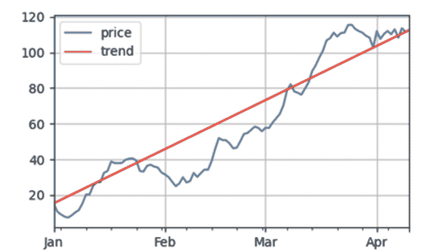

##### 统计套利

该策略涉及使用统计建模来识别和利用市场低效性。统计套利的两大主要策略是配对交易和均值回归。

##### 配对交易

20 世纪 80 年代末，配对交易在摩根士丹利兴起，由 Nunzio Tartaglia 及其团队主导。后来，团队成员创立了知名对冲基金，如 PDT Partners 和 D.E. Shaw，最终创建了 Sigma。配对交易已成为一种流行且复杂的策略。然而，随着市场演变和技术进步，套利机会变得更加稀缺，利润空间也更窄。为了适应，行业进行了升级，在经历一段衰退期后，人们对配对交易的兴趣再次高涨，并伴随着先进方法的开发和亟需的变革。我们将在本段解释基本原理，而不深入最新研究的细节。

配对交易策略涉及识别历史上具有强**相关性**7 的资产对，然后利用它们之间暂时的价格背离。算法计算两个资产（或更多）之间的价差，并主要基于穿越预定义的阈值和水平来生成交易信号。

实施配对交易策略需要匹配相反（多头和空头）的仓位：

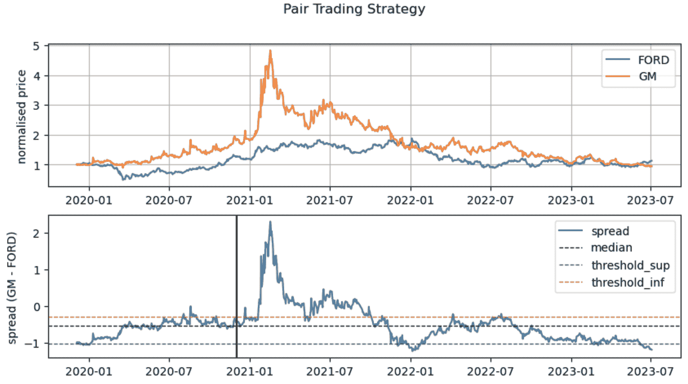

配对交易策略分为三个阶段：

- 首先，您需要在股票中识别该配对。这是配对选择阶段。
- 在第二阶段，我们需要对价差进行建模，最后。
- 处理给出我们干预策略的交易规则。

所有这些要点均在参考文献中列出的参考著作中有详细介绍。

这里，我们展示可用于配对交易策略的这三个阶段的计算要素。这将帮助您理解逻辑和事件顺序。在上图中，系统化配对交易策略将利用福特汽车和通用汽车（GM）之间的关系。确实，这两只股票的波动似乎是同步的。

这表明福特和通用汽车的股票受共同经济因素同时影响而呈**相关性**。

这种策略将这对股票视为一个资产。这在上图中有所体现，图表的第一象限给出了配对的演变，第二象限给出了两只个股之间的价差（）。然后，根据以下计算对价差进行**标准化**8：。

触发交易决策的阈值和水平可以通过基于 z-score 的基本统计计算来识别，如下所示。


##### 统计套利策略实现总结

以下是导致该结果的操作总结。详细信息和 Python 源代码可在 GitHub 笔记本中找到。操作序列如下：如有必要，安装 Yahoo Finance 库（`yfinance`）。接着，我们请求 FORD 和 GM 股票过去 900 天的报价历史，并将其存储在名为 `s1` 和 `s2` 的 Pandas 数组（DataFrame）中。

```python
try:
    import yfinance as yf
except ModuleNotFoundError as e:
    !pip install -q yfinance
    import yfinance as yf

companies = ['FORD', 'GM']
tickers = yf.Tickers(companies)
tickers_hist = tickers.history(period='900d', interval='1d')
s1 = tickers_hist['Close']['FORD']
s2 = tickers_hist['Close']['GM']
```

然后，使用上述提到的 Z-score 公式对价差进行标准化，以便更容易地解释百分位数：

```python
import numpy as np

tmp = s2 - s1
spread = (tmp - np.mean(tmp)) / np.std(tmp)
```

为两只股票之间的价差计算的 Z-score9 量化了价差值偏离其均值的程度，具体如下：

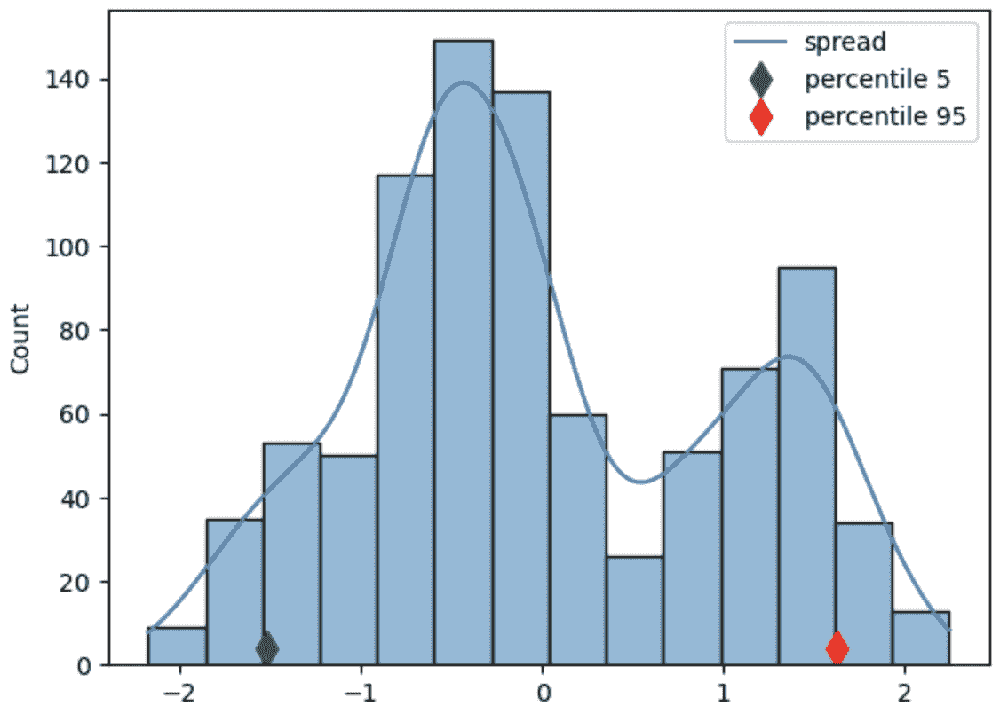

Z-score 为 0 表示价差处于其均值，而正负 Z-score 分别表示高于和低于均值的偏离。标准化价差的波动如 图 1.3 下象限所示。

Z-score 分布的第 5 和第 95 百分位数作为识别配对交易潜在交易机会的阈值。我们将这些百分位数标记在 图 1.4 上，该图表示所研究历史时期内价差值的统计分布。

```python
quantile = [0.05, .25, .50, .75, 0.95]
qtl = np.quantile(spread, quantile)
qtl
# array([-1.52366456, -0.66268085, -0.2051237,  0.88300426,  1.62259108])
```

当 Z-score 穿越这些阈值（第 5 或第 95 百分位）时可执行交易，这表明价差极度偏离均值并存在潜在的均值回归机会。第 5 百分位给出了价差值，使得 5% 的计算价差值低于它。上述 Python 脚本告诉我们该值为 -1.52。

这是上述 `quantile` 函数计算出的列表 `qtl` 中的第一个值。

对称地，第 95 百分位给出了价差值（1.62），使得 5% 的计算价差值高于它。这是 Numpy 函数 `quantile` 计算出的列表 `qtl` 中的最后一个值。

这两个水平如 图 1.5 所示：

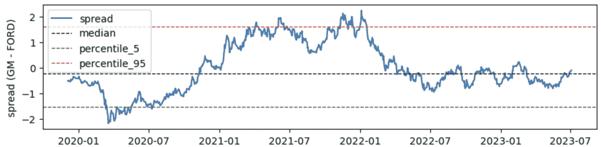

买入被低估、卖出被高估是我们将应用的基本投资原则。

在我们的配对交易策略中，被低估意味着标准化价差处于历史低位。

当价差跌破第 5 百分位阈值时，我们买入价差。买入价差意味着买入 GM 并卖出 FORD。因此，我们押注其回归由平均值给出的中心值，即零。

相反，当价差向异常值移动（由第 95 百分位的值给出）时，我们采用相反的策略，即卖出价差以押注其回归到较低值。

均值回归策略的优势之一在于它不需要预测，因为假设价差会回归到其均值并围绕其不断波动。

我们概述的配对交易策略基本原则可以通过多种方式改进。例如，建立自适应而非固定的阈值，或应用更复杂的量化方法。

我们未提及的是，我们的两只股票投资组合必须是市场中性的。原因在于我们试图从价差中获利，而非从市场整体获利。配对交易策略旨在从相对表现中获利，同时对冲整体市场波动。在实施策略时必须牢记这一点。

现在让我们看看另一种统计套利策略的基本原理：均值回归策略。

### 均值回归策略

该策略的基本原理是假设价格或各种指标的水平将回归到其历史平均值。显著偏离均值的资产价格最终将回归到更正常的水平，交易正是基于对这种回归的预期而进行的。

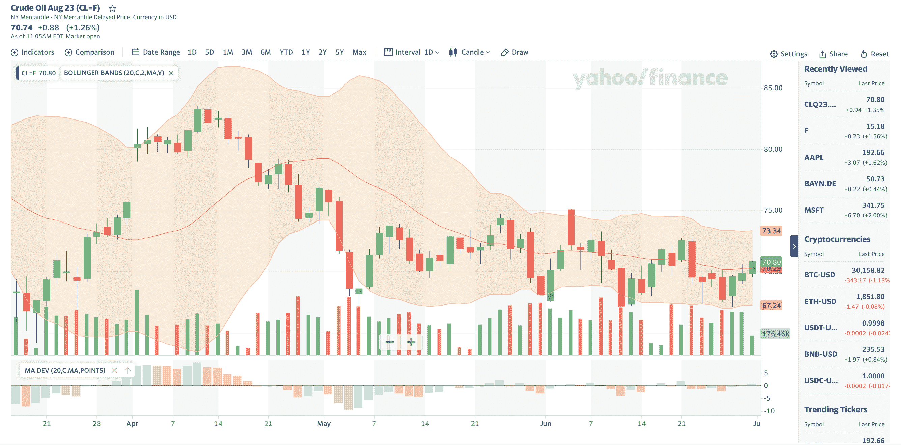

上图显示了原油价格及其移动平均线（实线橙色线）。

我们可以看到，油价围绕该移动平均线（或类似量）不断波动。平均值是一个吸引子，价格不断向其回归。

图表中，橙色区域展示了价格与移动平均线的距离。因此，当金融资产价格与其平均值的差距较大时，该区域也较大。这些情况被称为超买和超卖，对应异常差距。这发生在资产价格上涨或下跌过快时（超买和超卖均属此类）。

该交易策略对应于识别超买和超卖资产，建立相反头寸，并押注极端时期后随之而来的修正阶段（买入落后者，卖出领涨者）。

#### 实施均值回归策略的主要步骤

实施该策略需要解决许多技术问题，但其创始原则很简单：围绕中心值的不间断波动。

让我们看看均值回归策略的基本阶段：

- **资产选择**：识别表现出均值回归行为的合适资产。这些资产应有围绕其均值波动的历史。
- **均值计算**：计算资产价格或其他相关指标的均值。均值代表特定时期内的平均值，是确定偏离程度的参考点。
- **标准差计算**：计算资产价格或相关指标的标准差。标准差量化了价格围绕均值的离散程度，有助于识别显著偏离。
- **偏离度量**：度量资产价格偏离其均值的程度。这可以通过计算 Z-score 来完成，Z-score 表示当前价格偏离均值的标准差数量（如步骤 2 和 3 所计算）。
- **交易策略、入场和出场点**：基于偏离均值的程度定义入场和出场点。通常，交易者寻找价格显著偏离均值的实例，这预示着潜在的回归机会。入场点可能是价格跌至均值以下一定数量的标准差时，出场点可能是价格回归到特定阈值或均值本身时。
- **风险管理**：建立风险管理参数以控制仓位大小、设置止损单并管理整体投资组合风险。这一步对于防范大额亏损和确保适当的风险调整后收益至关重要。

从本质上讲，均值回归策略侧重于根据个别资产的历史价格模式识别其超卖或超买状况。当价格达到极端水平时执行交易，预期其将反转向均值。这正是简介中给出的统计套利策略。

细心的读者会注意到配对交易和均值回归策略之间的相似性。然而，这两种统计套利策略存在差异。以下是它们的区别所在。

### 配对交易与均值回归策略的区别

- **配对交易**识别相关资产对，并从暂时的价格背离中获利；而**均值回归**关注偏离其均值的个别资产。


# 配对交易与均值回归

- 配对交易采用市场中性方法，捕捉资产的相对表现，而均值回归则针对超卖/超买状况。
- 配对交易使用价差计算和历史行为，而均值回归依赖价格形态。
- 配对交易对冲市场风险，而均值回归面临特定资产风险。两种策略的方法不同，配对交易关注背离，均值回归关注价格向均值回归。

### 其他算法策略

还有其他统计套利策略，我们将不会在本入门章节中详细讨论。不过，我们将学习要点：

- **相对价值策略**：比较某板块或行业内资产的相对估值，以识别定价错误的证券。
- **事件驱动**：利用市场对特定事件（如财报发布或公司行为）的反应获利。
- **统计因子策略**：利用基于统计因子（如动量、波动率和流动性）的量化模型。
- **指数套利策略**：利用指数基础成分股与指数本身之间的价格差异。
- **高频交易（HFT）和做市策略**：这些策略利用强大的计算机以极高的速度执行大量订单。

做市策略涉及持续买卖证券以向市场提供流动性，从买卖价差中获利。

最后这两种策略（高频交易和做市）持续且快速运行。它们需要大量的物质资源、特权市场准入和数据流（低延迟交易系统）。基于这些原因，它们是专业投资者（对冲基金、投资银行或自营交易公司）的专属领域。

请参考表 1.1 了解这些策略的概览：

| 策略 | 所需市场方向 | 时间跨度与周期 | 单一资产 vs. 配对 | 专业基础设施 | 利润驱动因素 |
| :--- | :--- | :--- | :--- | :--- | :--- |
| 高频交易 | 否 | 亚秒级 | 单一 | 是 | 速度 |
| 做市 | 否 | 亚秒级 | 单一 | 是 | 买卖价差 |
| 配对交易 | 否 | 日内及更长 | 配对 | 否 | 资产间关系 |
| 均值回归 | 否 | 日内及更长 | 单一 | 否 | 回归均值 |
| 动量 | 是 | 日内及更长 | 单一 | 否 | 趋势延续 |

**表 1.1**：系统化策略概览

在本章剩余部分，我们将介绍机器学习，了解它是什么，以及在算法交易背景下我们可以从它那里期待什么。

然后，为了演示，我们将采用提到的策略之一，并用机器学习对其进行“装饰”。这将使我们能够尝试一个被称为元策略的前沿研究领域。这将是我们机器学习的第一个用例。

## 理解机器学习

随着本章的深入，我们将揭开机器学习（ML）的神秘面纱，探溯其渊源，并发掘其在算法交易领域蕴含的激动人心的潜力。从本质上讲，机器学习是人工智能的一个子集，它使计算机系统能够从数据中学习，并在未被显式编程的情况下提升性能。

早在 1959 年，一位名叫亚瑟·塞缪尔的计算机科学家为一个日益增长的概念命名：机器学习。我们刚才引用的机器学习定义出自他手，至今仍是该领域的权威定义。

在 IBM 充满激励性的环境中工作时，塞缪尔通过其创新的跳棋程序塑造着未来。与当时的标准程序不同，塞缪尔的心血结晶独树一帜。它被设计为从每一局对弈中学习，逐步优化策略并提升性能。

传说该程序很快就超越了其创造者的技艺，在对弈中战胜了塞缪尔。这使塞缪尔确信这一新知识领域具有革命性潜力。

有趣的是，塞缪尔在机器学习领域的探索并非孤立进行。更广泛的人工智能领域也在获得动力，1956 年的达特茅斯会议成为关键催化剂。这次会议汇聚了约翰·麦卡锡、马文·明斯基、纳撒尼尔·罗切斯特和克劳德·香农等思想领袖。他们共同辩论并畅想机器镜像人类智能，为我们今天所知的变革性人工智能世界奠定了基础。

这些对话部分受到艾伦·图灵开创性工作的启发，他为理论计算机科学和人工智能奠定了基础。

然而，至关重要的是要理解，机器学习和人工智能虽然相互关联，但并不相同。人工智能是一个更广泛的概念，指能够模仿人类智能的机器或软件。另一方面，机器学习是 AI 的一个子集，专门专注于使用算法和统计模型，让机器通过经验改进任务表现。它是 AI 的一种实际应用，系统可以在未被显式编程的情况下从数据中学习并做出决策（图 1.7）。

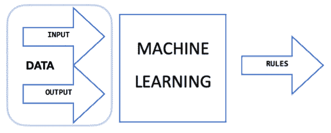

简而言之，机器学习算法输出规则。这是理解机器学习本质的关键点。这与传统计算机编程形成对比，在传统编程中，开发者、分析师负责生产、构想和设计规则，以便通过应用这些规则做出明智决策。

这正是机器学习所能提供的承诺：在学习阶段从数据中提取规则。

当我们使用机器学习算法时，我们让算法根据呈现给它的数据得出演绎和结论。规则深埋并隐藏在数据中。算法搜寻数据中的重复模式和复杂相关性，从而做出最佳预测。我们将在下一节更详细地回顾学习过程。

快进到今天，机器学习已渗透到几乎每个领域，从医疗保健和物流到金融和交易。在算法交易背景下，机器学习是颠覆性力量，为建模和预测市场行为提供了创新方式。

随着我们探索 ML 在交易中的作用，我们将发现其筛选海量金融数据、识别复杂模式并做出精准预测的能力。这种能力对于增强既有交易策略特别有益，我们将通过将 ML 应用于趋势跟踪策略来加以说明。随后我们将讨论一个被称为元策略的激动人心的研究领域。

从本质上讲，元策略是一个利用机器学习根据不断变化的市场条件优化和调整交易策略的框架。这种方法使我们能从交易策略中提取更大价值，标志着我们在系统化算法交易背景下将机器学习应用于实践、产生实质影响的首次尝试。

## 机器学习在交易中的应用

这里有一个交易员采用的最简单交易规则示例，称为移动平均线交叉策略：

- **设置**：该策略使用两条移动平均线——一条较短周期和一条较长周期。最常用的长度是较短周期平均线（`SMA50`）用 50 天（约 2 个月），较长周期平均线（`SMA200`）用 200 天。
- **买入规则**：当 `SMA50` 向上穿过 `SMA200` 时，产生看涨信号，交易员买入资产。
- **卖出规则**：反之，当 `SMA50` 向下穿过 `SMA200` 时，产生看跌信号，交易员卖出资产。


这两条规则构成了一种趋势跟踪策略，旨在捕捉资产的动量。

### 结合机器学习的动量策略

要使用机器学习实现这一均线交叉策略，我们首先必须修改问题，使其适合机器学习方法。我们不再制定何时买入和卖出的显式规则，而是利用机器学习根据历史数据来学习这些规则。

事实上，这正是机器学习所能提供的承诺：在学习阶段从数据中提取规则。

下面是一个使用监督学习的示例，具体来说是分类方法。分类意味着我们试图学习如何预测一个类别。

以下内容展示了机器学习在交易中的作用。我们将在下一节（实现监督交易系统）中回到关于实现的方法论要点。

以下是通往由机器学习算法驱动的交易系统的步骤：

1. **预处理与数据**：首先，我们下载数据，然后在历史价格数据上计算相同的移动平均线（`SMA50` 和 `SMA200`）。另一方面，我们使用与传统方法（不使用 ML）相同的数据，这就是为什么我们以相同的方式计算移动平均线，以便将它们包含在将提交给模型以搜索重复模式的输入中。然后我们创建一个目标变量，当第二天的收盘价高于前一天时（看涨信号）为 `+1`，相反情况（看跌信号）为 `-1`。这个目标变量就是我们将训练模型去预测的内容。

2. **特征创建**：接下来，我们为模型创建特征。这些特征可能包括当前价格、成交量、两条移动平均线的值，以及可能的许多其他指标。机器学习的很大一部分工作在于选择和构建这些特征。我们将在第 6 章（利用特征提升模型能力）中回到这一点。

3. **模型训练**：然后我们将数据分为训练集和测试集，并在训练集上训练我们的 ML 模型（例如，决策树、逻辑回归，作为起点，随后再转向更复杂的模型）。模型学习根据特征预测目标变量。

4. **模型测试**：模型训练完成后，我们在测试集上测试其性能，以确保它能很好地泛化到新数据。我们可以根据此性能调整模型参数或尝试不同的模型。

5. **交易规则**：我们现在拥有一个 ML 模型，给定当前特征，它预测短期移动平均线在未来将高于还是低于长期移动平均线。我们可以利用这些预测进行交易：如果预测为 `+1`，我们买入；如果预测为 `-1`，我们卖出。

关于模型训练，现代机器学习系统利用经过验证和优化的 API。为了我们的目的，我们选择了 `scikit-learn` 机器学习库。这是世界上使用最广泛的机器学习库之一，与 Google 的 `TensorFlow` 齐名。此外，除了其内在优势外，Scikit-Learn 的许可证允许代码用于商业用途，且代码开源，可在 GitHub 上查阅。

以下代码演示了上述各点：

研究对象为通用汽车股票（GM 代码）过去 5 年的数据（1000 个交易日数据）。让我们首先进行预处理并从雅虎财经下载数据：

```python
import pandas as pd
import numpy as np
import yfinance as yf

yf.pdr_override()

symbol = 'GM'
ticker = yf.Ticker(symbol)

#### 有效间隔：[1m, 2m, 5m, 15m, 30m, 60m, 90m, 1h, 1d, 5d, 1wk, 1mo, 3mo]
df = ticker.history(period='1000d', interval='1d')
```

下一步是创建作为输入提供给机器学习算法的特征。这一阶段称为特征工程：

```python
#### 计算移动平均线
df['SMA50'] = df['Close'].rolling(window=50).mean()
df['SMA200'] = df['Close'].rolling(window=200).mean()
df['MA_cross'] = df['SMA50'] - df['SMA200']

#### 创建目标变量
df['target'] = pd.DataFrame(np.zeros(len(df)))
df['target'] = np.where(df['Close'].pct_change() > 0, 1, -1)
df['target'] = df['target'].shift(-1)

#### 移除 NaN
df.dropna(inplace=True)

#### 创建特征
X = df[['Open', 'High', 'Low', 'Close', 'SMA50', 'SMA200', 'MA_cross']]
```

机器学习方法在于向 ML 算法提供与 MA 交叉策略相同的要素，但不提供该策略的规则（移动平均线的相对位置）。机器学习算法的目的是提取这些规则。为此，它以输出（`target` 列）为指引，输出代表要实现的目标。

在训练阶段，ML 算法扫描提交给它的特征（输入），寻找重复和复杂的相关性，从而能够适当地预测监督列（输出）。

模型训练：`train_test_split()` 函数将数据分为训练集和测试集。这样，仅在算法的训练阶段提交训练集。

```python
#### 训练-测试集划分
X_train, X_test, y_train, y_test = train_test_split(X, df['target'], shuffle=False)

#### 创建并训练决策树分类器
clf = DecisionTreeClassifier(random_state=42)
clf.fit(X_train, y_train)
```

最后是模型测试，函数输出如下：

```python
from sklearn.metrics import classification_report
print(classification_report(clf.predict(X_test), y_test))
```

| | | precision | recall | f1-score | support |
| --- | --- | --- | --- | --- | --- |
| -1.0 | | 0.24 | 0.50 | 0.33 | 46 |
| 1.0 | | 0.78 | 0.53 | 0.63 | 154 |
| accuracy | | | | 0.53 | 200 |
| macro avg | | 0.51 | 0.52 | 0.48 | 200 |
| weighted avg | | 0.66 | 0.53 | 0.56 | 200 |

重要的是要注意，所有性能指标都是在算法训练期间无法访问的数据（`X_test`）上计算的。因此，它未使用这些数据进行训练。这些数据合理地说明了在新数据和未发布数据上的预期性能，例如在生产和实盘交易环境中可能遇到的情况。这是一个关键点。我们稍后将回过头来讨论我们面前的指标的含义和解读（越高越好）。

正类（`+1`：上涨期）的正确预测百分比远高于无信息的随机预测（抛硬币），后者在本例中为 0.5。事实上，精确率为 0.78。

然而，另一类（`-1`）并非如此。下跌期的预测效果不佳。

现在，我们需要将其与传统交叉系统的指标进行比较。实现交易规则以计算相关的性能指标。

正如简介中提到的，最简单的规则是交叉规则，可以表示如下：

```python
#### 交叉规则：+1 MA(50 天) > MA(200)；-1：MA(50 天) < MA(200)
ma_cross = np.where(X_test['MA_cross'] > 0, 1, -1)
print(classification_report(ma_cross, y_test))
```

```
              precision    recall  f1-score   support

          -1.0       0.55      0.46      0.50       114
           1.0       0.41      0.50      0.45        86

    accuracy                           0.48       200
   macro avg       0.48      0.48      0.47       200
weighted avg       0.49      0.47      0.48       200
```

在没有 ML 帮助的情况下，交叉系统并没有显著优于随机预测。指标徘徊在 50%（0.5）左右。


### 利用机器学习的元策略

元策略在机器学习领域内，指向一种被称为元学习的实践。这一概念也称为“学会学习”，是机器学习的一个小众子集。元学习的威力在于其能够根据实验获得的结果，通过修改学习算法的特定方面来提升该算法的性能。

元学习真正的卓越之处在于其能够用数据驱动方式学习得出的方法论，来替代人工设计的算法。

因此，当应用于交易策略时，元学习呈现为元策略的形式。该框架的作用是利用机器学习不仅优化，而且根据不断变化的市场动态来调整交易策略。这转化为一种适应性强且灵活的算法交易方法，能够与市场同步演进。

实际上，元策略有潜力从我们现有的交易策略中榨取更大的价值。由元学习驱动的交易元策略，是一种基于策略表现和不断变化的市场条件来优化和演进交易算法的动态方法。

其核心在于，元学习是一个使模型能够从过去经验中学习的过程。这意味着它不仅分析输入数据，还分析自身的表现，并根据获得的洞察调整其算法。当应用于交易系统时，这一概念演变为元策略。

#### 元策略实战

其工作原理如下：元策略不使用基于预定义规则运行的静态交易算法，而是使用一个学习算法。该学习算法评估交易策略在不同市场场景下的表现，了解其优势和劣势。然后根据这些习得的知识调整交易策略，使其更加稳健有效。

例如，一种交易策略可能在高波动时期表现良好，但在低波动时期却举步维艰。利用元学习的元策略会识别出这种模式并调整策略，或许通过在低波动时期减小仓位或改变进出场点位。

以这种方式，元策略可以持续优化交易系统，随着时间的推移并在各种市场条件下提升其性能。它们代表了算法交易的下一个层级，在那里交易系统不仅是自动化的，而且是自我改进和自适应的。

##### 元交易策略

让我们通过一个具体例子来尝试编写一个旨在补充现有策略的元策略。为此，让我们采用通过检测超买和超卖股票来回归均值的策略。我们在上一节中描述了该原则。

结合元学习的策略思路：

1.  检查策略的盈亏是否可以作为策略输入数据的函数进行预测。
2.  如果可以，我们将在交易前预测盈亏的符号，仅发送有希望的交易（即预测盈亏为正的交易）。

为实现这一点，元策略仅需对初始策略进行微小修改。

元策略以描述我们试图增强的策略的数据作为输入。这些数据如下：

- 策略的表现（盈亏）

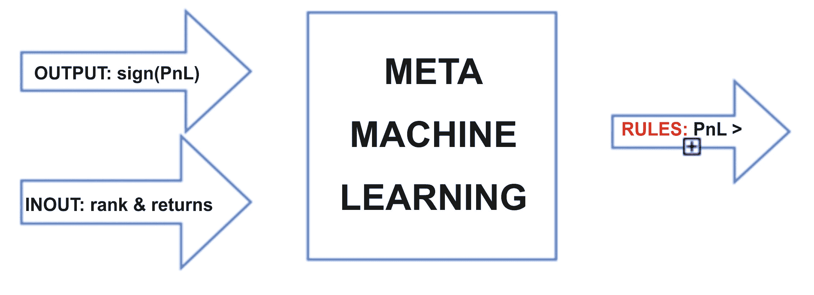

被分析策略的输入数据。

以下是计算机代码所需的步骤：

1.  我们需要保留每个周期的盈亏记录（`ar_pnl` 数组）。

```
###### agregated PnL for each specific period :
ar_pnl = pd.DataFrame(np.zeros(len(ranked_ret.index)) , index = ranked_ret.index , columns=["agg_pnl"] )
```

2.  我们用每个周期的盈亏填充此表。

```
###### Calculate transaction cost
###### transaction cost in basis point:
###### transaction_cost_amount = (open_price + close_price) * quantity * transaction_cost
###### transaction cost per share (broker fee : minimum 1$):
transaction_cost_amount = max(quantity * transaction_cost , 1)
profit_loss = (close_price - open_price) * quantity - transaction_cost_amount
### apply stop loss
profit_loss = np.max([profit_loss , stp_loss])
lst_pnl.append(profit_loss)
total_profit_loss = total_profit_loss + profit_loss
ar_pnl['agg_pnl'].loc[date] = ar_pnl['agg_pnl'].loc[date] + profit_loss
```

3.  接下来，我们获取策略的特征（`X`），即收益率和这些收益率的排名（根据收益率大小分配给每个资产的排名）。

```
###### features : we merge the ranked returns and array of returns
X = pd.concat([ret , ranked_ret] , axis =1)
```

4.  目标是学会预测。这是一个二元目标（`y`），取决于产生的盈亏是否为正。

```
###### target : agregated PnL for each specific period -> ar_pnl
y = np.sign(ar_pnl.shift(-1))
###### binary sign is either 1 or -1 not 0
y[y == 0] = -1
###### last period, zero to clean missing value
y.iloc[-1] = -1
y = np.ravel(y)
```

5.  学习阶段：

```
###### Split the data into training and testing sets
X_train, X_test, y_train, y_test = train_test_split(X, y , test_size =0.025,shuffle = False)
clf = RandomForestClassifier()
clf.fit(X_train , y_train)
```

以下是与预测盈亏符号相关的指标：

| | precision | recall | f1-score | support |
|---|---|---|---|---|
| -1.0 | 0.40 | 0.61 | 0.48 | 36 |
| 1.0 | 0.67 | 0.46 | 0.54 | 61 |
| accuracy | | | 0.52 | 97 |
| macro avg | 0.53 | 0.54 | 0.51 | 97 |
| weighted avg | 0.57 | 0.52 | 0.52 | 97 |

该算法为正类别（+1：正盈亏）找到了预测模式。正确预测与错误预测的比率等于 2/3 (0.67)，这高于平均水平，当然也高于随机预测。

剩下的就是接入由元规则形成的过滤器。

在每笔交易前，我们检查该交易是否有机会产生正利润。具体操作如下：将即将进行的交易信息发送给与训练好的算法关联的预测函数（`predict_proba`）。该函数返回该交易产生利润的概率。该概率充当交易过滤器（元规则），仅允许具有盈利潜力的交易通过。我们仅发送超过 50% 阈值（产生正利润的概率）的盈亏：

```
###### open a trade if the ML model allows it ....
if clf.predict_proba(pd.DataFrame(X.loc[date].values.reshape(1,-1) , columns=X.columns))[0,1] > 0.5:
    print("ML OK for this trade")
    lst_pnl_meta_strat.append(profit_loss)
else:
    lst_pnl_meta_strat.append(0)
```

同时，我们记录未经过元规则过滤的策略盈亏（非元曲线）。我们在下图中得到了这两条权益曲线：

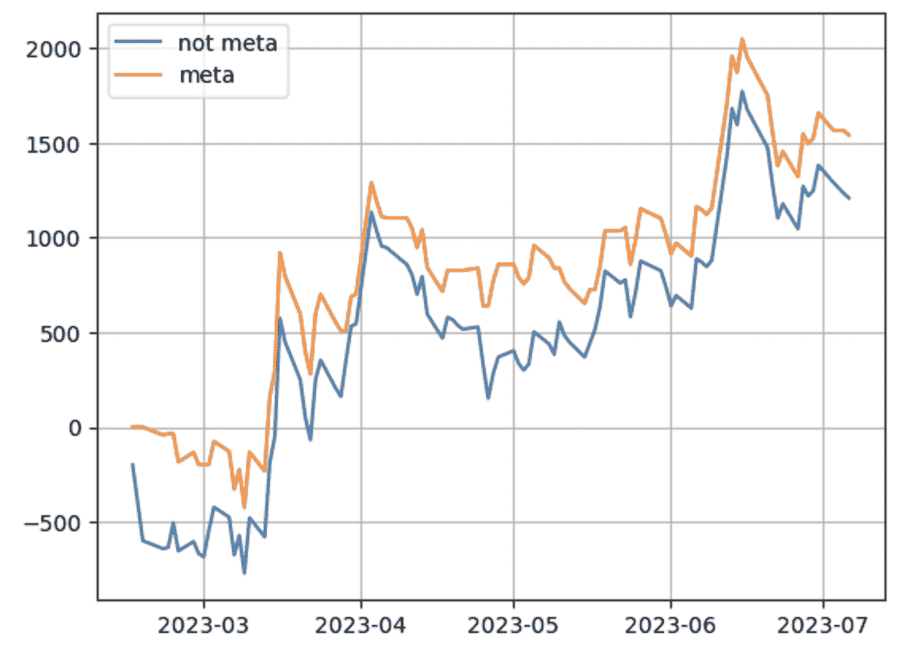

元规则生效了。经过过滤的策略回撤更低，利润更高。两条曲线的差异并不惊人，但再次强调，这里并未寻找最优参数或进行微调。

## 结论


读完本章，我们希望您已在算法交易及机器学习在此领域的作用方面打下坚实基础。我们回顾了算法交易的诞生与演变，了解其类型与策略，进而认识到机器学习的重要性及其对交易实践的影响。

我们探讨了从动量策略到统计套利策略的各类方法，识别了机器学习识别趋势与均值回归模式的潜力，甚至涉足了新兴的元学习领域。这种理解为您深入探究机器学习在算法交易语境下的应用奠定了基础。

在下一章中，我们将探讨算法交易中 AI 算法所用的数据谱系，重点关注经济与基本面数值数据以及非传统数据来源。本章的一个核心重点将是揭示回测的基本原理，这是评估和优化交易策略的关键环节。旨在让读者扎实掌握这些原理与数据的适当使用相结合，如何增强算法交易系统的有效性。

## 参考文献

1. *Statistical arbitrage: Algorithmic Trading Insights and Techniques*, Andrew Pole.
2. *Algorithmic trading*, Whiley Trading Series, Ernest P. Chan.
3. *Pairs trading: Quantitative Methods and Analysis*, Whiley Finance, Ganapathy Vidyamurthy.
4. *A Machine Learning based Pair Trading Investment Strategy*, Springer, Sarmento and Horta.
5. *Optimal mean reversion trading: Mathematical Analysis and Practical Applications*, Tim Siu-Tang, Xin Li.

***

**加入我们的图书 Discord 社区**

加入图书的 Discord 工作区，获取最新动态、优惠、全球科技动态、新书发布及作者专场活动：

[`discord.bpbonline.com`](https://discord.bpbonline.com)


# 第 2 章：数据源、回测与前向测试

## 简介

在本章中，我们将讨论结合机器学习的算法交易的关键方面，重点关注用于输入 AI 算法的数据类型，以及回测和前向测试的核心原则。

它指出经济和基本面数据，以及在市场上交易的金融资产价格（如最高价、最低价、收盘价和开盘价）是至关重要的输入。它强调了交易中使用的可变时间间隔，凸显了算法模型所需的适应性。此外，它敦促读者跳出传统数据源的思维定势，考虑非正统数据，从社交媒体情绪到地缘政治事件，这些数据可能为市场行为提供独特且具有预测性的洞见。

它强调了数据预处理的重要性，即在将数据输入模型前对其进行精炼的过程，包括处理缺失数据和异常值以及对分类数据进行编码。

## 结构

在本章中，我们将涵盖以下主题：

- 数据源
- 世界银行 API
- 美联储经济数据
- Financial modeling prep 基本面数据 API

## 目标

本章讨论数据源、回测和前向测试的基础知识。从理解数据源在金融分析中的作用入手，本章导航至宏观经济和基本面数据源。认识到 API 在数据检索中日益增加的集成度，它重点介绍了世界银行 API、美联储经济数据 API 和 Quandl 经济数据 API 等知名平台的特性。

探索延伸至基本面数据，讨论了 Tiingo 基本面数据 API 和 Financial Modelling Prep 基本面数据 API 等工具的属性和优势。一个值得注意的部分介绍了量化基本面投资模型的原则，强调了数据源与量化基本面策略之间的共生关系。

本章还强调了开高低收（OHLC）价格数据在金融工作中的相关性。向前看，它涉及利用报告、研究和非结构化数据的重要性和挑战。整个讨论旨在作为一份综合指南，帮助读者理解金融数据的多面世界。

## 数据源

算法交易的世界极其多元，由构成交易算法骨干的海量数据源作为支撑。构建稳健可靠的交易模型的一个关键方面，在于理解并选择最合适的数据类型。

算法交易中使用的主要数据源可大致分为经济和基本面数值数据。这些数据集提供了可量化、可衡量的经济格局和公司特定绩效指标洞见，构成了许多交易策略的基石。

作为机器学习算法输入的另一种最常见数据类型，是金融市场上交易的资产价格（开盘价和收盘价）及其基本描述性统计，如记录的最高价和最低价。

我们将在以下段落更详细地描述这两类数据。让我们从经济数据和基本面数据开始。

### 宏观经济与基本面数据

经济数据是指反映一国经济健康状况和趋势的宏观经济指标。这些指标包括国内生产总值（GDP）、通货膨胀率、失业率、消费者信心指数、工业生产等。在金融市场中，这些数字受到密切关注，因为它们可以提供央行未来政策行动的信号，例如利率变动，这会显著影响资产价格。

全球宏观交易策略以宏观经济数据为主要原料。这些策略由对冲基金和投资基金实施。这些基金青睐的投资工具是指数。这些可以是股票、债券、货币、房地产或其他指数。这意味着这些基金不[¹] 投资于个别公司，而是投资于经济板块或国家。最常见的宏观策略包括管理期货、全球战术资产配置和货币套利交易。

我们现在将介绍一些可通过 API 免费访问的宏观经济数据源，以供您的自动化系统使用。我们从世界银行开始，接着是美联储经济数据，最后以 Quandl 结束这趟优质数据提供商之旅。

### 世界银行 API

让我们看一个世界银行 API[²] 的示例。目的是展示如何查询这个免费、高质量的数据源，以检索美国的经济数据。

首先，如果您还没有安装世界银行的 API `wbdata`，请先安装：

```python
try:
    import wbdata
except ModuleNotFoundError as e:
    print(e)
    !pip install wbdata

import wbdata
```

以下代码获取美国（国家代码：`USA`）的通货膨胀数据（代码：`FP.CPI.TOTL.ZG`），并将其存储在一个名为 `data` 的 DataFrame 中：

```python
##### 设置数据参数
indicator = {'FP.CPI.TOTL.ZG': 'Inflation'}
country = {'USA': 'United States'}

##### 检索数据
data = wbdata.get_dataframe(indicator, country=country)

##### 按时间顺序排列
data = data.reindex(index=data.index[::-1])
data.info()
```

`info()` 函数给出了该数据集的摘要信息：

```
<class 'wbdata.api.WBDataFrame'>
Index: 63 entries, 1960 to 2022
Data columns (total 1 columns):
  #   Column     Non-Null Count  Dtype
---  ------     --------------  -----
  0   Inflation  63 non-null     float64
dtypes: float64(1)
memory usage: 1008.0+ bytes
```


基本图表为我们提供了 API 返回信息的概览，如下所示：

```python
import matplotlib.pyplot as plt

data.plot(figsize=(5,3))

plt.grid()
```

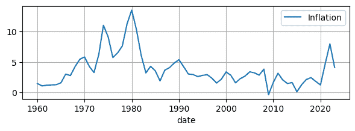

以此示例为模板，您只需替换经济指标代码和/或国家代码，即可访问广泛的数据。例如，您可以将指标代码替换为其他基本经济数据代码，以检索不同类型的数据，如 GDP、失业率等。

以下是使用 API 检索中国 GDP 数据的示例。对于 GDP 数据，指标代码为 `NY.GDP.MKTP.CD`，中国的国家代码为 `CHN`：

```python
##### Set the data parameters
indicator = {'NY.GDP.MKTP.CD': 'GDP'}
country = {'CHN': 'China'}
```

除采用适当的变换（`logy=True`）以反映数据中的指数趋势外，其余代码与前一个示例保持不变。

该经济增长数据集对应的代码和图表如下：

```python
data.plot(figsize=(5,3), logy=True)
```

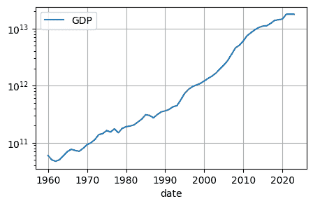

此例展示了查询此数据源是多么容易，其声誉毋庸置疑。

> **Note:** The data is distributed under a Creative Commons License.
>
> This license allows reusers to distribute, remix, adapt, and build upon the material in any medium or format, so long as attribution is given to the creator.

让我们继续了解另一个主要的官方基本经济数据来源——美联储经济数据。

#### Federal Reserve Economic Data API

Federal Reserve Economic Data (FRED) API[³] 提供来自美联储的经济数据，包括利率、GDP、就业等。与之前的来源（世界银行）一样，该官方来源提供质量毋庸置疑的数据。

首先，您需要创建登录账户，然后获取 API 密钥[⁴] 以向该机构的服务器发送请求。获得密钥后，您需要将其包含在所有请求中，如以下代码所示。

下面是一个使用 FRED API 检索 10 年期国债固定利率数据的示例。

首先，如果尚未安装 API，请进行安装：

```bash
!pip install fredapi
```

```python
import pandas as pd
import fredapi
```

我们使用对应于所需序列的代码（`GS10`）请求 API：

```python
api_key = 'YOUR_API_KEY'
##### Replace 'YOUR_API_KEY' with your actual API key from the FRED website
fred = fredapi.Fred(api_key=api_key)

##### Retrieve the interest rate data for the 10-Year Treasury Constant Maturity Rate
interest_rate_data = fred.get_series('GS10')

##### Print the data
print(interest_rate_data)
```

以下是 API 调用返回的数据（`interest_rate_data`）：

```text
1953-04-01    2.83
1953-05-01    3.05
1953-06-01    3.11
1953-07-01    2.93
1953-08-01    2.95
... 
2023-02-01    3.75
2023-03-01    3.66
2023-04-01    3.46
2023-05-01    3.57
2023-06-01    3.75
Length: 843, dtype: float64
```

#### Quandl economic data API

Quandl[⁵] 是一个通用数据平台，能够轻松收集和格式化来自各种来源的数百万个数据集，使其易于访问且即拿即用。Quandl 充当数值数据的搜索引擎，提供金融、经济和社会学时间序列数据集。它在单一界面中整合了来自 500 多个来源的 2000 多万个金融和经济数据集。其开放平台旨在成为时间序列的“维基百科”，赋能用户查找、可视化和共享有价值的信息。

基于所有这些原因，Quandl 是一个您需要了解的数据源。不过，Quandl 不适合用于实时或日内数据。

以下示例用于验证这些观点并展示 API 的工作原理。您无需个人密钥即可开始使用。但是，对于高级用途（即每天超过 50 次调用），您必须进行身份验证。

安装并导入 API 以查询其数据库的代码如下：

```bash
!pip install -q quandl
```

```python
import quandl
```

> **Note:** You need to know the Quandl code of each dataset you download.

```python
quandl.get("FRED/GDP")
```

| Date | | |
| --- | --- | --- |
| 1947-01-01 | | 243.164 |
| 1947-04-01 | | 245.968 |
| 1947-07-01 | | 249.585 |
| 1947-10-01 | | 259.745 |
| 1948-01-01 | | 265.742 |
| ... | | ... |
| 2020-10-01 | | 21477.597 |
| 2021-01-01 | | 22038.226 |
| 2021-04-01 | | 22740.959 |
| 2021-07-01 | | 23202.344 |
| 2021-10-01 | | 23992.355 |

300 rows × 1 columns

本示例结束了本节内容。我们已经看到，宏观经济数据在互联网上大量可用。现在我们将探讨如何获取上市公司活动相关的基本面数据，以及如何在交易策略中使用这些数据。

##### Fundamental data

基本面数据涉及特定公司及其财务表现的信息。这包括每股收益（EPS）、市盈率（P/E）、净资产收益率（ROE）、股息、营收增长以及无数其他因素。通过分析这些数据，交易者可以对公司的未来表现及其股价可能的走向做出明智的预测。

这些类型的数据与算法交易之间的关系至关重要。经济学家和传统投资者几十年来一直使用此类数据做出投资决策。然而，算法交易将其推向了新的高度，利用系统化方法挖掘这些数据中可能显现的模式和趋势。

经济和基本面数据可以通过多种方式访问和处理。许多金融数据提供商提供应用程序编程接口（API），允许交易者直接访问实时或历史数据。此类提供商的例子包括 Yahoo Finance 和 Quandl，我们已经一起体验过。不过，其他数据服务仍通过其 API 提供基本面数据。

##### Tiingo Fundamental data API

Tiingo[⁶]（除其他外）提供免费的基本面数据服务。该服务仅需预先进行身份验证（API 密钥）。

以下是一个查询示例，可获取微软（代码：`MSFT`）在申报文件中提供的财务报表：

```python
import requests

headers = {
    'Content-Type': 'application/json'
}

requestResponse = requests.get("https://api.tiingo.com/tiingo/fundamentals/msft/statements?token=" + API_KEY, headers=headers)
requestResponse.json()
```

以下是预期返回的数据：

```json
[
  {
    "date": "2019-12-31",
    "quarter": 4,
    "year": 2019,
    "statementData": {
      "balanceSheet": [
        {
          "dataCode": "assetsCurrent",
          "value": 167074000000.0
        },
        {
          "dataCode": "totalAssets",
          "value": 282794000000.0
        },
        {
          "dataCode": "acctPay",
          "value": 8811000000.0
        },
        {
          "dataCode": "assetsNonCurrent",
          "value": 115720000000.0
        },
        {
          "dataCode": "accoci",
          "value": -255000000.0
        },
        {
          "dataCode": "totalLiabilities",
          "value": 172685000000.0
        },
        {
          "dataCode": "taxLiabilities",
          "value": 31663000000.0
        },
        {
          "dataCode": "taxAssets",
          "value": 0.0
        },
        {
          "dataCode": "deferredRev",
          "value": 31221000000.0
        }
      ],
      "cashFlow": [...],
      "incomeStatement": [...],
      "overview": [...]
    }
  }
]
```

#### Financial modeling prep fundamental data API

为了完成我们对优质数据服务的概览，我们可以提及 SEC-Edgar-downloader[⁷] 甚至 Financial Modelling Prep[⁸] (FMP)。

以下是后者的一个示例[⁹][¹⁰]。该服务仅需预先进行身份验证（API 密钥），如下所示：

```python
url = 'https://financialmodelingprep.com/api/v3/income-statement/AAPL?limit=120&apikey='

import requests

headers = {
    'Content-Type': 'application/json'
}

requestResponse = requests.get(url + API_KEY, headers=headers)
requestResponse.json()
```

以下是预期返回的数据：


### 量化基本面投资模型

我们将要使用的基本面数据集包含一组上市公司的财务报表。这些会计数据由每家公司的股市表现作为补充。我们的目标是尽可能准确地预测基本面数据发布后期间发生的股市表现。

这种分析类型是**量化基本面**方法的一个示例，它将**量化**模型与财务分析师和会计师的**基本面**专业知识相结合。

让我们首先介绍该数据集。该数据集可从 `https://www.kaggle.com` 下载。这是一个数据科学竞赛网站。该数据集包含通过 FMP API 获取的基本面数据，我们在上一节中详细介绍过。压缩包（zip 文件）包含 2014 年至 2018 年的数据。每年的数据包含在不同的数据集中（`2014_Financial_Data.csv`，……，`2018_Financial_Data.csv`）。

我们将处理这些文件中的第一个。它包含 2014 年的数据。随后您可以对对应后续年份的文件进行相同的分析。

该数据集包含数百个财务指标，这些指标见于每家上市公司每年发布的 10-K 文件中。这份年度报告全面概述了公司的业务和财务状况，并包含经审计的财务报表。

将 csv 文件下载到计算机后，可以使用以下代码读取数据：

```python
#### 指定 TICKER 为索引列
df = pd.read_csv('2014_Financial_Data.csv', index_col=0)
```

以下函数 `df.info()` 为我们提供了数据集的“身份卡”，给出了其大小、数据类型和列标签：

```python
df.info()
```

```
Index: 3808 entries, PG to WTT
Columns: 224 entries, Revenue to Class
dtypes: float64(222), int64(1), object(1)
memory usage: 6.5+ MB
```

这意味着共有 3808 行和 224 列。在这些列中，有一列是文本列（object 类型），其余数据均为数值列。要了解每列的具体类型，我们使用 `df.dtypes`：

```python
df.dtypes
```

```
Revenue                    float64
Revenue Growth             float64
Cost of Revenue            float64
Gross Profit               float64
R&D Expenses               float64
...
R&D Expense Growth         float64
SG&A Expenses Growth       float64
Sector                     object
2015 PRICE VAR [%]         float64
Class                      int64
Length: 224
```

最后两列是我们希望使用机器学习模型预测的股市表现数据。

倒数第二列 `PRICE VAR [%]` 代表基本面会计数据发布后，2015 年 1 月 1 日至 12 月 31 日期间的股价变动。

`Class` 列是从上一列衍生出的二元指标。该指标的值为 0（负类）或 1（正类），取决于上一列（`PRICE VAR [%]`）指示的变动是正还是负。

该列将作为目标供分类算法学习预测，分类算法旨在预测类别或类别。

数据集中的每一行代表一家公司。这些公司按行业（`Sector` 列）分组，如下所示：

```python
print(df[['Sector','2015 PRICE VAR [%]']])
```

| Symbol | Sector | % Change |
| :--- | :--- | :--- |
| PG | Consumer Defensive | -9.323276 |
| VIPS | Consumer Defensive | -25.512193 |
| KR | Consumer Defensive | 33.118297 |
| RAD | Consumer Defensive | 2.752291 |
| GIS | Consumer Defensive | 12.897715 |
| ... | ... | ... |
| TSRI | Technology | 29.362884 |
| TZOO | Technology | -31.167763 |
| USATP | Technology | -23.558900 |
| WSTG | Technology | 7.779579 |
| WTT | Technology | -34.099613 |

[3808 rows x 2 columns]

以下是按行业划分的公司分布情况：

```python
df['Sector'].value_counts()
```

```
Financial Services       660
Healthcare               582
Technology               576
Industrials              501
Consumer Cyclical        457
Basic Materials          242
Real Estate              224
Energy                   221
Consumer Defensive       165
Utilities                97
Communication Services   83
```

我们现在开始数据准备阶段，步骤如下：

该阶段将涉及以下步骤：

1. 移除异常值
2. 填补缺失数据
3. 移除列
4. 标签编码
5. 准备目标列
6. 拆分数据集

让我们首先按如下方式移除异常值：

#### 1. 移除异常值

我们将识别每列的极端值，然后用分位数值（0.95）替换它们。

让我们首先按如下方式计算分位数：

```python
##### 截断异常值（极高值）
top_q = df.quantile(numeric_only=True, q=0.95)
top_q
```

```
Revenue                    2.137668e+10
Revenue Growth             8.804800e-01
Cost of Revenue            1.212385e+10
Gross Profit               8.570324e+09
R&D Expenses               1.760486e+08
...
Debt Growth                1.876595e+00
R&D Expense Growth         7.013900e-01
SG&A Expenses Growth       9.633700e-01
2015 PRICE VAR [%]         5.701303e+01
Class                      1.000000e+00
Name: 0.95, Length: 223, dtype: float64
```

其余方法见下面的代码。我们使用缺失数据（类型 `np.nan`：非数字）作为标记来明确识别它们，然后用接受的值替换（`df.fillna`）它们。

```python
###### 识别异常值 -> 将异常值替换为 Nan -> 将 Nan 替换为 top_q 值
outliers = df > top_q
df[outliers] = np.nan
df.fillna(top_q, inplace=True)
```

我们以相同的方式处理极低值：

```python
##### 截断异常值（极低值）
top_q = df.quantile(numeric_only=True, q=0.05)

###### 识别异常值 -> 将值替换为 Nan -> 将 Nan 替换为 top_q 值
outliers = df < top_q
df[outliers] = np.nan
df.fillna(top_q, inplace=True)
```


#### 2. 填补缺失值

在下一步中，对于每一列，我们使用 `fillna` 函数将缺失值替换为该板块（`groupby`）的中位数（`transform('median')`）。

这是会计师和财务分析师推荐并遵循的方法：

```python
df.fillna(df.groupby('Sector').transform('median'), inplace=True)
```

#### 3. 删除列

标记为 `2015 PRICE VAR [%]` 的列在事前是未知的。

必须小心避免引入数据泄露。换句话说，即模型运行时不可用的信息。因此，该列绝不能展示给算法，也不能成为模型输入的一部分。我们将该列从模型输入列表中移除，并将其存储以备将来使用：

```python
y_price_var = df.pop('2015 PRICE VAR [%]')
```

下一步是标签编码。

#### 4. 标签编码

标签编码是指将每个字母数字（文本）类别数据值替换为数字代码。换句话说，就是一个数字。原因在于大多数机器学习算法仅接受数字作为输入数据，对于字母数字（文本）数据会产生错误信息。要执行的编码针对 'Sector' 列。

以下是该列中发现的值的列表：

```python
lst_sector = list(np.unique(df['Sector']))
lst_sector
```

```
['Basic Materials',
 'Communication Services',
 'Consumer Cyclical',
 'Consumer Defensive',
 'Energy',
 'Financial Services',
 'Healthcare',
 'Industrials',
 'Real Estate',
 'Technology',
 'Utilities']
```

该列表使用 Scikit-Learn 机器学习 API 中的 `LabelEncoder` 对象进行编码，我们在上一章中已使用过它：

```python
from sklearn.preprocessing import LabelEncoder

lbl = LabelEncoder()

##### 学习编码
lbl.fit(lst_sector)

##### 应用该编码（转换）
df['Sector'] = lbl.transform(df['Sector'])
```

编码结果可在以下代码中看到：

```python
dict(zip(lst_sector, lbl.transform(lst_sector)))
```

```
{'Basic Materials': 0,
 'Communication Services': 1,
 'Consumer Cyclical': 2,
 'Consumer Defensive': 3,
 'Energy': 4,
 'Financial Services': 5,
 'Healthcare': 6,
 'Industrials': 7,
 'Real Estate': 8,
 'Technology': 9,
 'Utilities': 10}
```

#### 5. 准备目标列

倒数第二步是准备目标列（`y`），算法将学习从输入映射到该目标。该目标列是收益率的符号（其所属的类别：正或负）：

```python
y = df.pop('Class')
```

#### 6. 划分数据

剩下的就是将数据分为两组：学习集和测试集。正如我们在上一章 13 中提到的，学习阶段仅使用训练数据（子集 `X_train`）：

```python
from sklearn.model_selection import train_test_split

X_train, X_test, y_train, y_test = train_test_split(df, y, shuffle=False)
```

##### 训练阶段

我们选择了随机森林 14，这是一种高性能算法，无需特别的校准工作即可产生准确的预测。该算法的原理是自动构建一组决策树。可以将决策树想象为一系列指导选择的是非问题（最优问卷）。每棵树从数据中学习以对项目进行分类，例如基于会计数据决定是否投资该股票。

以下是从训练集构建的决策树示例：

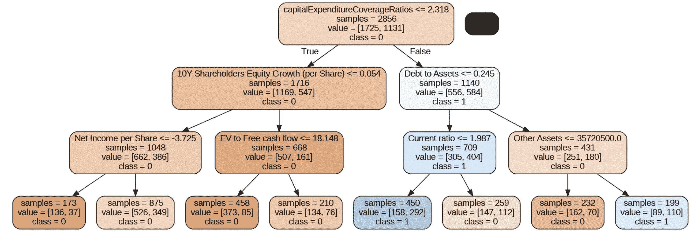

可以看到学习算法构建的最优问题和答案序列。这是第一个问答：“`CapitalExpenditureRatio` < -2.318 吗？”。如果为 False，则下一个问题是：`Debt to Asset ratio` < 0.245...

这种自动化专业知识生成了一个经过优化的问卷，能引导得出最准确的答案。

现在，将随机森林设想为这些树的一个群体，一个多样化的决策者群体。它们都以各自独特的方式从数据中学习。当我们需要做决策时，每棵树对答案进行投票。得票最多的结果获胜，确保了平衡且准确的结果。它是一个专家委员会。

机器学习的新颖之处在于，每棵决策树都是在没有任何专家人工干预的情况下被学习、构建和优化的。使用包含每家公司会计和财务信息的训练数据（`X_train`），随机森林算法学会推断其所属的类别（`y_train`）：

```python
from sklearn.ensemble import RandomForestClassifier

###### 定义分类器
clf = RandomForestClassifier()

###### 在训练数据上拟合分类器
clf.fit(X_train, y_train)
```

学习过程完成后，会计算一个准确率得分 15，即正确预测数量与总预测数量的比率。该得分始终在测试集（`X_test`）上计算。换句话说，即模型训练期间未见过的数据：

```python
clf.score(X_test, y_test)
```

```
0.63
```

为了根据两个类别（正和负）更精确地了解预测分布，我们计算以下两个指标：`classification_report` 和 `confusion_matrix`。

Scikit-Learn 中的 `classification_report` 函数用于评估分类模型的性能。

它提供了各类别各项指标的综合摘要，包括：

- **precision**（精确率）：正向预测的准确性
- **recall**（召回率，或灵敏度）：召回率检查模型是否捕捉到了大多数真正例，避免漏报
- **F1-score**（F1 分数）：精确率和召回率之间的平衡
- **Support**（支持度）：每个类别中的样本数量

```python
from sklearn.metrics import classification_report, confusion_matrix
```

导入两个指标计算函数后，我们使用训练好的模型（`clf`，作为分类器）为前述整个测试集计算（`clf.predict`）一组预测值（`pred`）：

```python
pred = clf.predict(X_test)
```

分类报告将把这些预测与收益率的实际值（`y_test`）（正或负类别）进行比较：

```python
print(classification_report(y_test, pred))
```

```
              precision    recall  f1-score   support

           0       0.58      0.84      0.68       449
           1       0.76      0.46      0.56       503

    accuracy                           0.63       952
```

就解释而言，得分应读作“越高越好”。获得的数值令人鼓舞。指标远高于随机预测（0.5：抛硬币）。

负类别（负收益）的检测精确度低于正类别。事实上，其精确率得分较低（0.58，而正类别为 0.76）。另一方面，有少数负收益被错误检测为正收益。事实上，负类别的召回率得分很高。

正收益被非常精确地检测出来。极少出现假阳性。具体而言，这意味着极少出现亏损的多头交易（预期为正但实际为负）。76% 的正收益被正确预测。

我们通过混淆矩阵（`confusion_matrix`）来佐证这一点。该指标采用上述概念并将其组织在一个称为混淆矩阵的表格中：

```python
###### tp : true positive , fp : false positive ,tn : true negative ,fn : false negative
tn, fp, fn, tp = confusion_matrix(y_test, pred).ravel()

print(f"FALSE PREDICTIONS : {fp} negative returns wrongly detected as positive return and {fn} positive returns not detected")
```


print(f"CORRECT PREDICTIONS : {tp} positive returns correctly detected as positive return and {tn} negative returns detected")

FALSE PREDICTIONS : 72 negative returns wrongly detected as positive return and 277 positive returns not detected

CORRECT PREDICTIONS : 226 positive returns correctly detected as positive return and 377 negative returns detected

```
confusion_matrix(y_test , pred)

array([[377, 72],
       [277, 226]])
```

### 优化超参数

尽管该算法的性能相当令人满意，但我们将尝试对其进行改进。为此，我们将优化一种称为超参数的特定类型参数。算法参数是在学习阶段优化的。在此阶段不会自动优化的参数称为超参数。超参数是我们在训练前选择的机器学习算法设置。这些超参数调整算法的结构，并影响模型如何从数据中学习。选择好的超参数对模型性能至关重要。

示例包括随机森林中的树的数量。不过，我们将保持其不变。另一方面，我们将优化 Scikit-Learn API 中称为 `max_depth` 的超参数。它代表每个专家知识的深度：

```
from sklearn.model_selection import GridSearchCV , ParameterGrid

grid = {'max_depth' : [None , 5 , 15 , 30],
        'min_samples_split': [ 5, 10 , 15],
        'min_samples_leaf': [1, 2, 4]}
```

这里我们再次使用了 Scikit-Learn API 的强大工具。顾名思义，`GridSearchCV` 允许你在给定范围（网格）内进行详尽搜索，以找到最佳可能参数：

```
clf = GridSearchCV(estimator= RandomForestClassifier(),
                   cv = 2,
                   param_grid = grid,
                   n_jobs = -1,
                   scoring = 'f1',
                   verbose = 2)
```

`clf.best_params_` 和 `clf.best_estimator_` 包含搜索结果：

```
clf.best_params_
{'max_depth': 30, 'min_samples_leaf': 1, 'min_samples_split': 10}

clf.best_estimator_
RandomForestClassifier
```

剩下的就是对测试数据进行一系列预测，以了解模型在新数据上的表现。

我们买入预测收益为正的股票（多头头寸），并卖出（空头头寸）预测收益为负的股票。

图表显示了对面板中所有股票进行投资（多头头寸）的结果，如下所示：

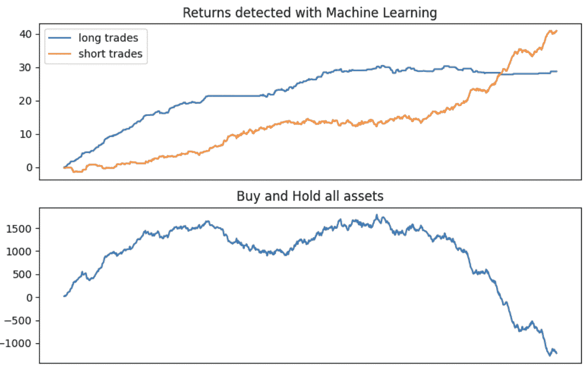

这项关于会计数据机器学习的详尽研究给了我们一些有希望的结果。这完成了专门针对基本面会计和财务数据机器学习的演示。

另一种作为机器学习算法输入的常见数据形式涉及资产在金融市场上的交易价格（包括开盘价和收盘价），以及最高价和最低价等统计数据。

#### 开高低收价格 (OHLC)

这些 OHLC 数据无疑是你熟悉的，也是应用最广泛的，是机器学习算法的天然要素。我们已经在上一章开始尝试使用这些数据。和以前一样，我们使用 Yahoo Finance API，它以易用性著称：

```
import pandas as pd
import numpy as np
import yfinance as yf

yf.pdr_override()

symbol = 'NVDA'
ticker = yf.Ticker(symbol)

##### Valid intervals: [1m, 2m, 5m, 15m, 30m, 60m, 90m, 1h, 1d, 5d, 1wk, 1mo, 3mo]
df = ticker.history(period='1000d', interval='1d')
```

以下是英伟达 (NVIDIA) 在纽交所上市股票的每日开盘价和收盘价，绘制在图表中，如下所示：

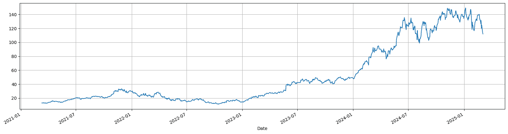

API 为我们提供了每个间隔的最高价和最低价数据。

```
df.info()
DatetimeIndex: 1000 entries, 2019-09-04 00:00:00-04:00 to 2023-08-23 00:00:00-04:00
Data columns (total 7 columns):
#   Column        Non-Null Count  Dtype
---  ------        --------------  -----
 0   Open          1000 non-null   float64
 1   High          1000 non-null   float64
 2   Low           1000 non-null   float64
 3   Close         1000 non-null   float64
 4   Volume        1000 non-null   int64
 5   Dividends     1000 non-null   float64
 6   Stock Splits  1000 non-null   float64
```

##### 引入变长 K 线

仅依赖 OHLC 价格数据可能存在局限性。为了更深入地了解市场动态，交易者开始转向变长 K 线构造。与传统的基于时间的 K 线不同，变长 K 线能适应市场状况。它们根据成交量、波动率或其他指标等因素动态调整其大小和频率。这使得价格走势和模式的表征更加细致，使交易者能够捕捉到固定时间间隔可能遗漏的洞察。变长 K 线为更复杂的交易策略和增强决策打开了大门。

传统数据源也可以扩展。鼓励读者拓展视野，超越传统数据源，探索非常规数据源，如社交媒体情绪和地缘政治事件。这些来源可能为市场趋势提供独特且具有前瞻性的洞察。

#### 报告、研究与非结构化数据

我们正处于一个时代，其特征是我们日常所有活动中捕获的数据量呈爆炸式增长。

自然地，这些数据可以作为预测性机器学习算法的输入要素。这些数据比 OHLC 独特得多，包括：

- 应用程序使用情况
- 信用卡/借记卡
- 数据聚合商
- 数据经纪商
- 电子邮件/消费者收据
- 地理位置
- 其他
- 销售点
- 手机流量数据
- 公共数据
- 卫星
- 卖方
- 社交/情绪
- 调查
- 天气
- 网络数据
- 网络流量

当然，获取这些数据比获取极其丰富的 OHLC 数据更具挑战性。然而，额外的难度将被这些数据所包含的独特性和丰富信息所抵消，这些数据属于非常规路径。

一个非常有趣的切入点（聚合商）是 alternativedata.org16。

该网站列出了大量这种新型数据的供应商，例如：

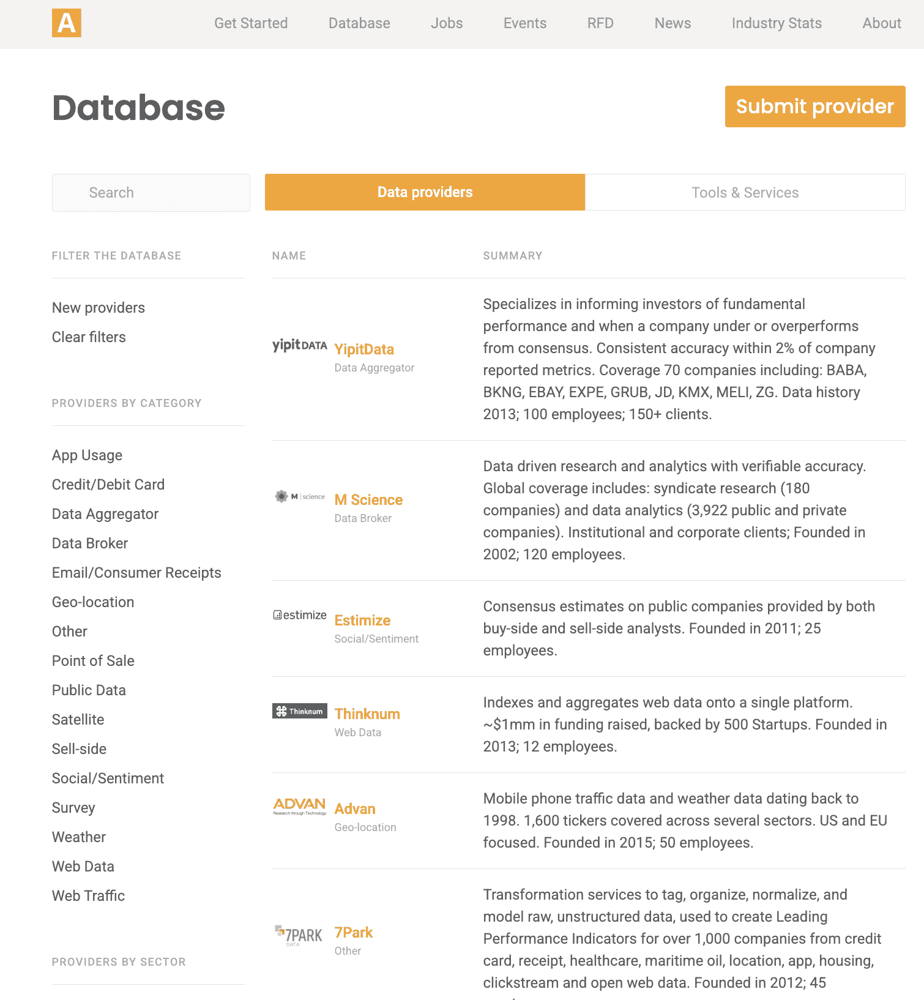

## 结论

在本章中，我们涵盖了算法交易数据管理的基础知识。我们探讨了关键数据源，如经济和基本面数据，以及使用 API 的金融市场数据。我们讨论了预处理技术以确保数据集的整洁。我们提供了一个量化基本面投资的详细示例，该示例将财务分析与机器学习相结合。最后，我们涉及了替代数据源，如社交媒体情绪和非结构化数据，以获取独特的预测机会，并为回测和前向测试奠定了基础。


在下一章中，我们将了解回测和前向测试的具体细节，以及它们在算法交易中发挥的关键作用。随着内容的深入，我们将进一步理解如何有效地选择、处理和使用不同类型的数据，从而使你能够构建更稳健、潜在获利能力更强的交易策略。

***

**加入我们书籍的 Discord 社区**

加入书籍的 Discord 工作区，获取最新动态、优惠信息、全球科技动态、新书发布及作者专场活动：

[`discord.bpbonline.com`](https://discord.bpbonline.com)


### 第 3 章：优化交易系统、指标与自动化报告

## 简介

本章重点介绍如何优化交易系统以实现最大性能。通过利用 `Hyperopt` 等高级工具，交易者可以增强策略、尝试新方法，并发掘有价值的见解以改进模型。

指标的选择起着至关重要的作用，它指导交易者做出明智的决策。有效的风险管理和深思熟虑的指标选择对于全面评估模型和实现长期成功至关重要。

此外，通过 Python 库实现的自动化报告，能够高效地将交易数据转化为可执行的洞察。

## 结构

在本章中，我们将涵盖以下主题：

- 设计交易系统
- 改进交易系统
- 选择交易系统指标
- 自动化交易报告

## 目标

我们的主要重点在于设计和完善算法交易策略。我们的旅程始于选择一个分类器，该分类器负责熟练预测未来收益。

本章旨在通过利用分类器的能力、优化超参数以增强策略的稳健性、使用详细的风险和绩效指标分析策略表现，以及通过行业标准报告工具展示发现，为交易系统建立坚实的基础。

## 设计交易系统

本章将重点关注针对未来 K 线进行分类的算法。我们的旅程将涵盖整个流程，从数据获取到最终报告一个经过学习和评估的模型，该模型以其绩效和风险指标为特征。

路线图包括以下内容：

- 准备数据
- 进行特征工程
- 使用竞争性模型集合进行训练
- 通过绩效和风险指标评估模型
- 综合报告

### 准备数据

关于分析数据的一句话。我们选择使用微软（`MSFT` 代码）的数据作为研究基础，数据以 5 天为间隔记录，总共积累了 5000 天。报价间隔 5 天使我们能够探索周级别的时间跨度。数据源来自 Yahoo! Finance 库，我们已经多次使用过它。

下图展示了这些数据：

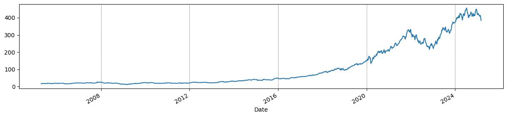

#### 进行特征工程

在此过程中，我们按顺序执行两个关键操作：

- `create_lag_past_values()`：此函数用前几个周期的滞后价格值扩充数据框。对于每一列价格（OHLC），都会添加一列包含这些滞后值的新列。这些新列的命名约定是在原始列名后附加一个表示滞后周期的后缀。例如，`_1` 表示滞后一期，`_2` 表示滞后两期，以此类推 1。
- `return_past_values()`：此函数将所有价格数据转换为连续收益率。对于每一列价格，都会引入一列对应的收益率。这些新列通过在原始列名后附加后缀 `_ret` 进行恰当命名。

这两个操作结合在一起，融合了滞后值并计算收益率，构成了我们的特征工程步骤。这准备了我们的分析算法将用来预测未来收益率的模式。我们将在第 6 章《利用特征提升模型能力》（Chapter 6）中更深入地了解这一关键阶段，该章节专门致力于特征工程。

##### 特征相关性

在算法交易领域，理解特征相关性至关重要。相关特征会向数据中引入冗余，导致过拟合，并降低模型的泛化能力。

当算法遇到反映相似信息的特征时，可能会赋予这些交织在一起的特征过高的重要性，从而扭曲结果。这对于线性模型（如线性回归）和基于树的算法（如决策树和随机森林）尤为重要，因为在这些模型中，相关特征可能导致特征重要性出现偏差或虚高。为了确保稳健性并保持模型预测能力的完整性，识别并消除高度相关的特征至关重要，从而精简输入并提高模型效率。

#### 检测并消除相关特征

传统的皮尔逊相关系数仅能洞察线性关系，可能会遗漏非线性关联。此时引入斯皮尔曼等级相关系数，它能识别单调关系，以及互信息，它能捕捉线性和非线性依赖。这些替代指标至关重要，因为现实世界的金融数据通常表现出非线性行为。Scikit-learn 提供了 `VarianceThreshold` 和 `SelectKBest` 等特征选择工具，以及用于可视化检查的 `correlation_matrix`。此外，`feature-engine`2 等库还提供了处理相关变量的高级技术。采用这些策略并多样化相关性指标，可确保模型接收到最具信息量、非冗余的输入，从而优化其预测潜力。

以下代码显示了在消除相关特征阶段之前的相关性矩阵：

```python
import seaborn as sns

##### Calculate the correlation matrix for the features
correlation_matrix = df_lag.corr()

##### Create a mask for the upper triangle of the correlation matrix
mask = np.triu(np.ones_like(correlation_matrix, dtype=bool))

##### Plot the correlation matrix
plt.figure(figsize=(15, 10))
sns.heatmap(correlation_matrix, mask=mask, cmap='coolwarm', vmax=1, vmin=-1, center=0, annot=False, fmt=".2f")
plt.title('Correlation Matrix of Features')
plt.show()
```

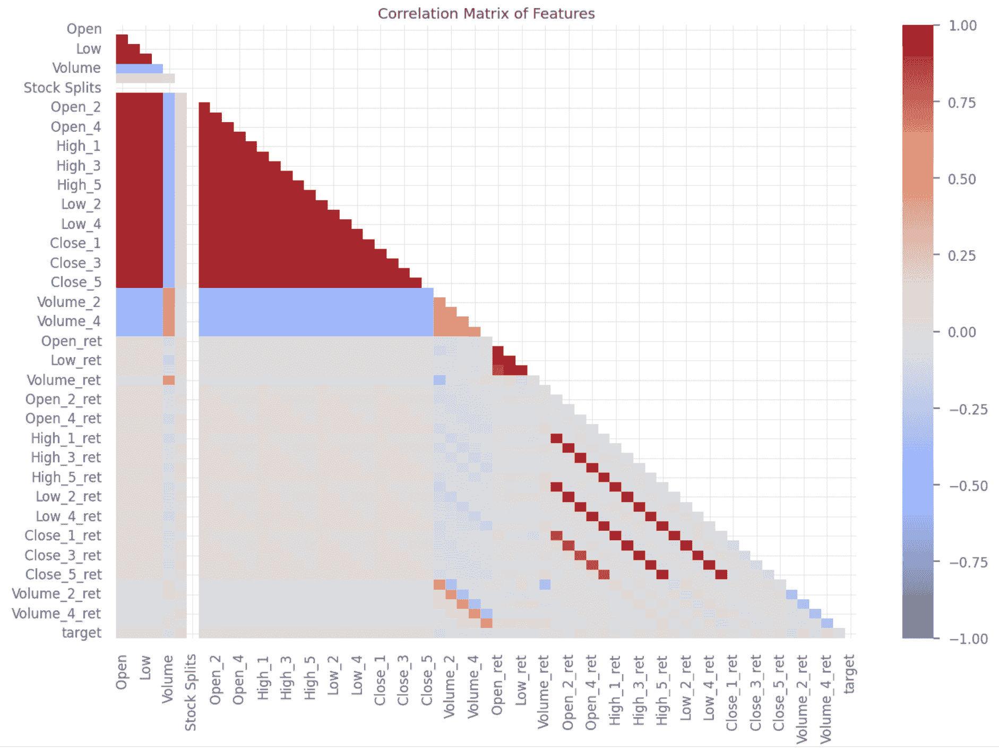

相关性矩阵突出了数据集中特征间的关系，红色渐变表示强正相关。高度相关的特征（由红色区域指示）提供了冗余信息。这些高度相关的变量被移除以减少多重共线性，并提高模型的可解释性和效率。

让我们继续进行剪枝算法，该算法旨在消除相关性超过允许值（阈值 0.9）的特征：

```python
##### Identify features that are highly correlated
to_drop = []

for i in range(len(correlation_matrix.columns)):
    for j in range(i):
        if abs(correlation_matrix.iloc[i, j]) > 0.9:
            colname = correlation_matrix.columns[i]
            if colname not in to_drop and not colname.endswith('_ret'):
                to_drop.append(colname)

##### Drop the highly correlated features
df_lag.drop(columns=to_drop, inplace=True)
```

通过前文讨论的相关特征矩阵来检验剪枝效果。即使仍存在一些相关性痕迹，我们可以在下图中看到，剩余的相关性比之前观察到的要可接受得多：

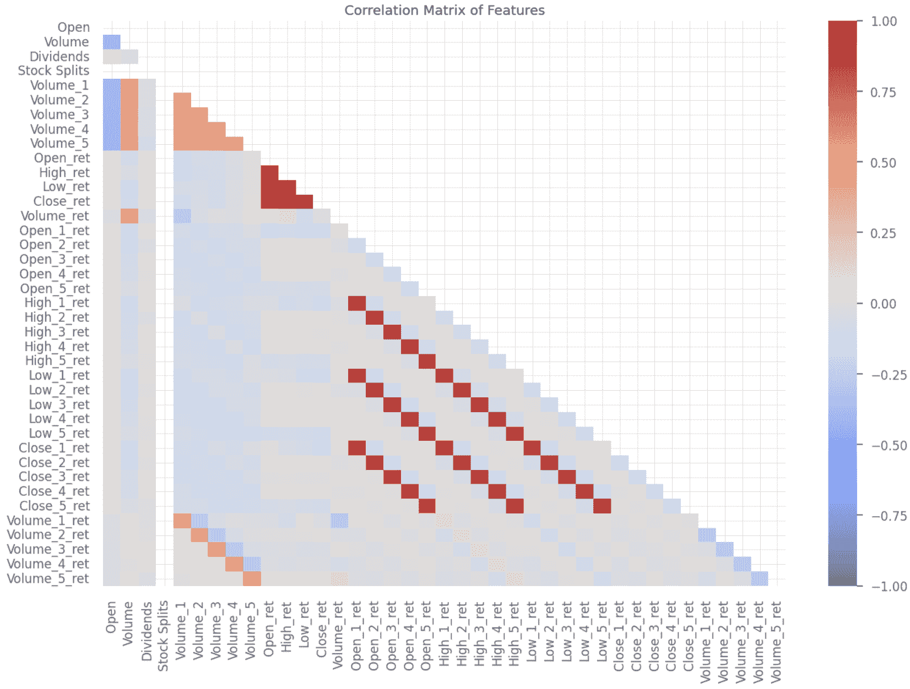

#### 缺失值与目标列

借助 Pandas 这样现代且强大的库，处理缺失值变成了一项快速简便的例行工作。


然后我们定义将要作为学习预测目标的列：

```python
##### 提前 'lag_predict' 步进行预测
lag_predict = 1

##### 提前 'lag_predict' 步进行预测
df_lag.dropna(inplace=True)

##### 对次日收益进行分类 (shift = -1)：负收益 -> -1；正收益 -> +1
df_lag['target'] = np.where(df_lag['Close_ret'].shift(-lag_predict) >= 0, 1, -1)
```

上一行代码可能是最重要的代码之一。它定义了我们要处理的问题类别（即分类问题，世界状态根据收益符号为 +1 或 -1），并指定了要学习预测的目标列（`target`）。

该列包含次日的收益（`shift(-1)` 函数），我们将利用当天的信息对其进行预测。这是经典的“单步向前”预测。

### 数据集划分与缩放

我们将目标变量放入 `y`（输入）变量，其余特征放入 `X`（输出）变量：

```python
from sklearn.model_selection import train_test_split

y = df_lag.pop('target')
X = df_lag.copy()
X_train, X_test, y_train, y_test = train_test_split(X, y, shuffle=False)
```

完成此步骤后，我们可以对数据进行重新缩放。对于不熟悉该概念的人来说，重新缩放可确保所有数据列处于一致的尺度上，从而简化算法的分析过程。特别是，详述交易量的列与通常仅变动几个百分点的收益列相比，其尺度可能差异巨大：

```python
from sklearn.preprocessing import StandardScaler

sclr = StandardScaler()
X_train_tr = sclr.fit_transform(X_train)
X_test_tr = sclr.transform(X_test)
```

我们现在准备好训练一个分类器来区分正收益和负收益。对于初始方法，我们选择易于训练的分类器，旨在将开发时间降至最低。我们的目标是获得一个或多个可供优化的优秀分类器。

在算法分类器领域，有几个算法作为基础支柱脱颖而出，每个都有其独特的优势和底层原理：

*   **线性判别分析 (LDA)**：LDA 将数据点投影到一条线上，旨在最大化类别间的分离度。它稳健且常被使用。
*   **二次判别分析 (QDA)**：作为 LDA 的“兄弟算法”，QDA 允许类别间存在二次边界，当类别具有不同的协方差结构时，它提供了灵活性。
*   **逻辑回归**：尽管名为“回归”，但它是一种分类算法。它对给定实例属于特定类别的概率进行建模，使其在二分类任务中特别有效。
*   **决策树 (DT)**：顾名思义，DT 通过提出一系列问题来做决策。它们直观、可视化，且能捕捉非线性关系。我们已在 第 2 章《数据源、回测与前向测试》中尝试过该算法。
*   **随机森林 (RF)**：决策树的集成模型，RF 汇总其输出。与单棵决策树相比，这通常能带来更高的准确性并减少过拟合。
*   **朴素贝叶斯**：基于贝叶斯定理，它假设特征相互独立，使其在处理大型数据集时特别高效。

由于这些算法具有良好的可解释性、易于实现且历史表现有效，它们是极佳的起点。导入与算法定义代码如下：

```python
from sklearn.discriminant_analysis import (LinearDiscriminantAnalysis as LDA, QuadraticDiscriminantAnalysis as QDA)
from sklearn.tree import DecisionTreeClassifier
from sklearn.linear_model import LogisticRegression
from sklearn.naive_bayes import GaussianNB
from sklearn.ensemble import RandomForestClassifier, VotingClassifier

clf1 = LDA()
clf2 = QDA()
clf3 = RandomForestClassifier()
clf4 = GaussianNB()
clf5 = LogisticRegression()
clf7 = DecisionTreeClassifier()

lst_clf = [('lda', clf1), ('qda', clf2), ('nb', clf4), ('lr', clf5), ('rf', clf3), ('dt', clf7)]
```

我们对列表 `lst_clf` 中的所有算法运行训练（`fit`）：

```python
for tpl in lst_clf:
    clf_base = tpl[1]
    clf_name = tpl[0]
    clf_base.fit(X_train, y_train)
    clf_sc = np.round(clf_base.score(X_test, y_test), 2)
    print(f"classifier {clf_name} -> accuracy score = {clf_sc}")
```

以下是在测试集上测得的所有算法的全局准确率得分（`clf_base.score`）：

*   classifier lda -> accuracy score = 0.51
*   classifier qda -> accuracy score = 0.43
*   classifier nb -> accuracy score = 0.59
*   classifier lr -> accuracy score = 0.49
*   classifier rf -> accuracy score = 0.55
*   classifier dt -> accuracy score = 0.49

##### 特征选择

在初步迭代之后，我们旨在通过特征选择来提高预测准确性。该阶段识别（排序变量）并仅保留最有影响力的特征（`k_best`）。在保守策略中，目标是用更少的特征实现相似的预测能力；而在更激进的策略中，则旨在利用精简后的特征集提升性能。

为何优先减少特征？精简的特征集简化了模型的任务，从而带来更高的准确性和更直接的后续实现。

此选择基于决策树算法开发过程中计算出的得分（`clf_base.feature_importances_`）：

```python
sorted = np.argsort(clf_base.feature_importances_)
k_besk = int(40/100 * len(sorted))
X_train.iloc[:, sorted[-k_besk:]].columns
columns_to_drop = X_train.columns[sorted[:-k_besk]]

#### 仅保留 k_best 个特征
X_train = X_train.drop(columns=columns_to_drop)
X_test = X_test.drop(columns=columns_to_drop)
```

以下是在测试集上使用选定的 `k_best` 特征测得的所有算法的全局准确率得分：

*   classifier lda -> accuracy score = 0.58
*   classifier qda -> accuracy score = 0.55
*   classifier nb -> accuracy score = 0.56
*   classifier lr -> accuracy score = 0.58
*   classifier rf -> accuracy score = 0.57
*   classifier dt -> accuracy score = 0.53

这两个步骤的结果为特征选择在模型性能中的重要性提供了宝贵的见解：

*   **使用所有特征时的初始表现：**
    *   朴素贝叶斯 (NB) 以 0.59 的最高准确率脱颖而出，表明该模型的底层假设可能非常适合原始特征集。
    *   LDA 和逻辑回归 (LR) 这两种线性分类器显示出约 0.50 的相似性能。
    *   QDA 表现显著不佳，准确率仅为 0.43，暗示潜在的过拟合或数据不适合二次边界。
    *   RF 表现尚可，准确率为 0.55，而其简化版 DT 得分为 0.49。
*   **特征选择后的表现：**
    *   所有分类器的准确率均有提升，凸显了选择相关特征的价值。
    *   LDA 和 LR 显著跃升至 0.58，强化了降维有助于线性模型这一观点。考虑到两种算法都旨在线性分离数据（尽管方法论不同），它们性能相似并不令人惊讶。
    *   QDA 也有显著改善，表明原本包含的某些特征可能引入了噪声。
    *   RF 和 DT 都从特征选择中受益，RF 仍优于 DT，突显了集成方法的价值。
    *   NB 尽管初始表现优异，但准确率略有下降。这可能是由于减少了模型最初认为有价值的某些特征。

特征选择被证明至关重要。所有模型在仅保留前 40% 的特征后性能均有提升，这证明了使用相关预测因子的重要性。

## 改进交易系统


### 通过自适应参数搜索提升模型性能

在之前的讨论中，我们涉及了使用 SKlearn 的 `GridSearchCV` 来锁定我们量化基本面策略中随机森林的最优超参数（见第 2 章，数据馈送、回测与前向测试）。我们强调了这一阶段在基于机器学习开发交易策略中的重要性。我们建议更进一步，探索自适应方法。

虽然 `GridSearchCV` 提供了对超参数组合的系统性探索，但它可能不是最高效或甚至不是最有效的解决方案。此时，`HyperOpt`3 登场了，这是一个专为超参数调优设计的更细致的工具。

`HyperOpt` 的真正优势在于其自适应搜索过程。它不再穷尽地搜索预定义的超参数列表，而是采用概率方法。它使用一种称为序列模型优化的技术。该方法利用概率模型 4 对目标函数（在我们的案例中是模型的性能）进行建模，然后基于此模型选择新的超参数进行测试。其核心思想是聚焦于看似有前景的超参数区域，而不是随机分散或预定义的网格（如下图所示）：

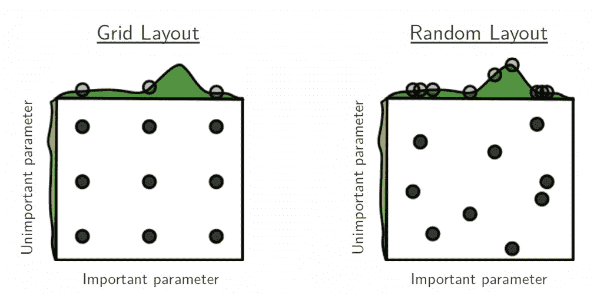

- **搜索方法的差异**：多项基准研究凸显了 `HyperOpt` 的高效性。一个关键观察是其收敛于最优超参数的速度比传统的网格搜索甚至随机搜索更快。虽然 `RandomSearch` 引入了随机性，可能有助于更多样化地探索超参数空间，但 `HyperOpt` 通过智能且自适应地导航该空间，带来了战略性的方法。本质上，`HyperOpt` 提供了探索（尝试新的超参数区域）与利用（在找到的最佳超参数周围细化）的结合。这种由其底层概率模型指导的平衡，往往能在更少的迭代次数下带来比其他技术更准确的结果。

- **基于 HyperOpt 的搜索框架**：为了简化我们的方法，我们将在一个统一框架内同时评估所有算法。这种统一的方法不仅简化了代码库，还增强了其清晰度和可维护性。

该流程可归纳为以下步骤：

1. 首先导入所需的库和方法。
2. 构建需要优化的目标函数。该函数将接收一个分类器作为参数。我们的策略是遍历选定的分类器，逐个将它们传递给该函数。值得注意的是，我们正在最小化一个特定指标（有关召回率性能指标的深入讨论，请参阅第 2 章，数据馈送、回测与前向测试），因此目标函数中带有负号。
3. 使用 Python 字典勾勒搜索空间。此步骤提供了巨大的创作空间。可以选择局限于一组预定义值的受控搜索，也可以进行更广泛的探索。
4. 启动搜索过程。
5. 汇总并展示结果。
6. 最后，将这些最优超参数注入回分类器中。

代码如下：

#### 步骤 1：导入库

```
from hyperopt import fmin, tpe, hp, STATUS_OK, Trials
from sklearn.model_selection import cross_val_score
```

#### 步骤 2：定义目标函数

```
##### 定义目标函数，接收分类器类型作为参数
def objective(params):
    classifier_type = params['classifier']
    if classifier_type == 'lr':
        clf = LogisticRegression(**params['lr'])
    elif classifier_type == 'dt':
        clf = DecisionTreeClassifier(**params['dt'])
    elif classifier_type == 'rf':
        clf = RandomForestClassifier(**params['rf'])
    # 为其他分类器添加更多 elif 条件
    score = -np.mean(cross_val_score(clf, X_train, y_train, cv=5, n_jobs=-1, scoring='recall'))
    return {'loss': score, 'status': STATUS_OK}
```

#### 步骤 3：定义搜索空间

```
##### 定义超参数的搜索空间
space = {
    'classifier': hp.choice('classifier', ['lr', 'rf', 'dt']),
    'lr': {  # 逻辑回归的超参数
        'penalty': hp.choice('penalty', ['l2']),
        'C': hp.loguniform('C', -5, 5),
    },
    'rf': {
        'n_estimators': hp.choice('n_estimators', range(100, 1000, 50))
    },
    'dt': {'max_depth': hp.choice('max_depth', [5, 10])}
    # 为不同分类器添加更多超参数
}
```

与我们分析中的其他分类器不同，`LDA` 和 `QDA` 没有需要调优的超参数。

#### 步骤 4：执行优化

```
##### 创建一个 Trials 对象以跟踪优化过程
trials = Trials()
##### 使用 fmin 运行优化
best = fmin(fn=objective, space=space, algo=tpe.suggest, max_evals=5, trials=trials)
```

#### 步骤 5：报告结果

```
from hyperopt import space_eval
print(best)  # 找到的最佳超参数
```

```
100%|██████████| 5/5 [00:25<00:00, 5.16s/trial, best loss: -0.6352158390133074]
{'C': 20.908013685132712, 'classifier': 1, 'max_depth': 0, 'n_estimators': 1, 'penalty': 0}
```

```
print(space_eval(space, best)['classifier'])
print(space_eval(space, best)['lr'])
print(space_eval(space, best)['lr']['C'])
print(space_eval(space, best)['rf'])
print(space_eval(space, best)['dt'])
```

```
lr
{'C': 109.96023525188563, 'penalty': 'l2'}
109.96023525188563
{'n_estimators': 100}
{'max_depth': 10}
```

#### 步骤 6：将最佳参数注入分类器

```
##### 将优化参数注入各分类器
lst_clf_opt = []
for tpl in lst_clf:
    tpl0 = tpl[0]
    tpl1 = tpl[1]
    if tpl0 == 'rf':
        tpl1 = RandomForestClassifier(space_eval(space, best)['rf']['n_estimators'])
    elif tpl0 == 'lr':
        C = space_eval(space, best)['lr']['C']
        penalty = space_eval(space, best)['lr']['penalty']
        tpl1 = LogisticRegression(C=C, penalty=penalty)
    elif tpl0 == 'dt':
        m_depth = space_eval(space, best)['dt']['max_depth']
        tpl1 = DecisionTreeClassifier(max_depth=m_depth)
    lst_clf_opt.append((tpl0, tpl1))
```

然后我们将合并这些模型以创建一个集成模型。

## 集成建模

单个分类器无论调优得多精细，往往都有其局限性。它们各自提供独特的视角，但它们能否协作得更好？集成建模的理念类似于从独奏音乐家中组建一支交响乐团。虽然小提琴或小号独奏能奏出优美的乐章，但它们的合奏能提供更丰富、更和谐的体验。

前述代码片段体现了这一理念。它从优化单个分类器开始。我们探索了各种分类器（如 `RF`、`LR` 和 `DT`）的超参数，并确定了它们的最佳配置。这一优化过程确保了每个模型在纳入集成前都处于最佳性能状态。

一旦优化完成，这些分类器便通过 Scikit-Learn 的 `VotingClassifier` 融合成一个紧密的集成模型。此处的“投票”一词十分贴切；集成中的每个模型对结果各投一票，最终决策基于多数表决的民主原则。

集成方法 5，尤其是此处使用的硬投票技术，充分发挥了每个单独模型的优势，弥补了它们各自的弱点，往往能产生一个更稳健、更精准的预测系统。

请注意，在以下代码中，使用 scikit-learn 实现此方法是多么容易；我们只需传入一个分类器列表（`lst_clf_opt`），其余一切由 API 自动处理：

```
### 混合算法：投票分类器
```


```python
clf_blend = VotingClassifier(voting='hard', estimators=lst_clf_opt)

clf_blend.fit(X_train, y_train)

clf_blend.score(X_test, y_test)
```

我们现已完成第二阶段，即对每个预测器进行微调并协调其集体运作。让我们来看看以下结果：

| | precision | recall | f1-score | support |
|---|---|---|---|---|
| -1 | 0.44 | 0.15 | 0.22 | 103 |
| 1 | 0.59 | 0.87 | 0.70 | 146 |
| accuracy | | | 0.57 | 249 |
| macro avg | 0.52 | 0.51 | 0.46 | 249 |
| weighted avg | 0.53 | 0.57 | 0.50 | 249 |

总之，精确率为 59% 对比 44%，模型在识别 1 类（正收益）方面表现远优于 -1 类（负收益），1 类的召回率高达 87%。然而，其对 -1 类的精确率有待提高。此外，我们的系统不会持续用新数据更新。考虑到我们正用一个基于四年前数据训练的系统来评估 2023 年的数据。这种方法有助于衡量系统的韧性。

##### 权益曲线

要可视化策略的权益曲线，我们只需加入一些额外要素。具体而言，我们必须考虑经纪费用（通常每笔交易约 3 个基点）以及多头和空头交易的收益：

```python
### broker fee in basis point
fee = 3 / 100 / 100

stop_loss = -4 / 100

target_ret = df_lag.loc[y_test.index, 'Close_ret'].shift(-lag_predict)

### Calculate cumulative returns for long trades (+1 predictions)
long_returns = np.where(pred_blend == 1, target_ret, 0)

### apply stop loss
long_returns = np.where(long_returns < stop_loss, stop_loss, long_returns)

cumulative_long_returns = np.cumsum(long_returns)

### Calculate cumulative returns for short trades (-1 predictions)
short_returns = np.where(pred_blend == -1, -target_ret, 0)  # We inverse the returns for short trades

### apply stop loss
short_returns = np.where(short_returns < stop_loss, stop_loss, short_returns)

cumulative_short_returns = np.cumsum(short_returns)

### pay fee each time position change (detect with np.diff)
brk_fee = np.where(np.diff(pred_blend) != 0, fee, 0)

### adjust dimension with pad (add one element (zero), at the beginning)
brk_fee = np.pad(brk_fee, pad_width=(1, 0))
```

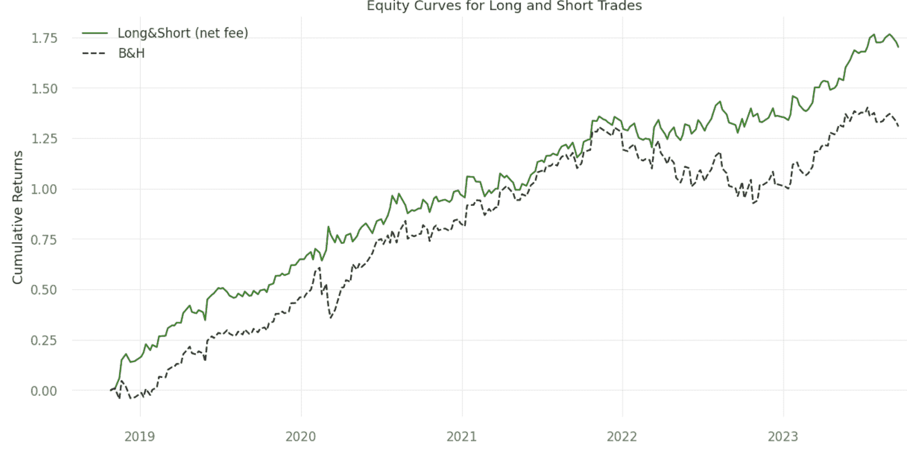

该策略看起来非常有趣。绿线代表我们的策略，虚线代表买入持有（B&H）策略 6。此外，我们可以轻松应用更保守的止损策略，以平滑此类低频策略（周频）不可避免的回撤。

作为最终评估，我们实施了与微软日线股份相同的策略，结合了元策略 7，正如第一章所详述。结果显示如下：

采用堆叠分类器的机器学习策略，在时间线的很大一部分中似乎优于 B&H 策略。这表明 `ML` 模型成功捕捉并预测了价格走势。

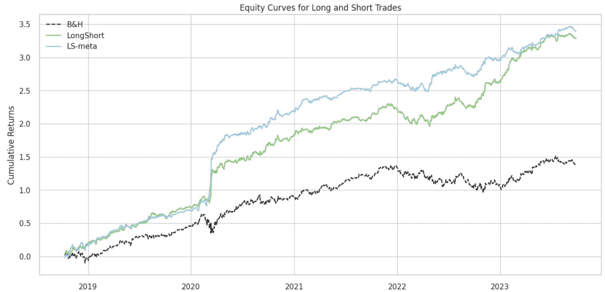

与 B&H 和 ML 策略相比，元策略显示出显著的超额表现。这表明元策略可能利用了额外信息，或采用了更动态的交易方法，使其能把握更多交易机会并更有效地管理风险。该策略脱颖而出，成为最有效的策略，表明在此背景下策略组合可带来卓越表现。

我们对所取得的成果感到满意。事实上，该策略从周频过渡到日频毫无困难。

我们现在将利用现代风险管理的适当工具，对此进行严格检验。

## 交易系统指标的选择

策略的成功不仅关乎更高的收益。它关乎理解所承担的风险、收益的持续性，以及共同描绘出全面绩效图景的各个其他侧面。

本节探讨评估交易策略的本质，从年化收益等基础指标过渡到 `CAGR`、`VaR` 和 `Sharpe ratio` 等专业衡量标准。最后，你将掌握每个指标的意义、理想基准及其相互作用。

### 策略评估指标的排序标准

交易策略评估要求系统性分析，以产生有价值的见解和有意义的比较。绩效指标涵盖从基本衡量到复杂的机构指标，各自服务于特定的分析需求。

按类别理解以下指标，有助于投资者选择与其目标和风险偏好相匹配的评估方法：

- **基础**：提供策略绩效整体感知的指标，适合所有层级的投资者
- **风险调整收益**：考量为实现收益所承担风险的指标。这能区分收益相同但风险截然不同的策略
- **回撤**：围绕理解损失幅度和持续时间的指标
- **统计显著性**：评估策略绩效是否可能归因于运气的指标
- **风险指标**：提供策略可能面临的尾部风险和极端事件洞察的指标
- **一致性与稳定性**：分析策略收益随时间变化的一致性和稳定性的指标
- **专业**：机构投资者常用于深度分析和剖析策略绩效的高级指标

### 评估交易策略的统计指标列表

以下统计指标代表了策略评估的关键量化工具，按复杂度和用途组织。每个指标揭示交易绩效的不同侧面，从基础指标开始，经风险调整衡量，终于机构级分析。

- **基础统计**
  - **总收益**：策略的总体收益
  - **年化收益**：平均每年收益
  - **波动率（标准差）**：收益的离散程度

- **风险调整收益**
  - **夏普比率**：每单位总风险所实现的收益
  - **索提诺比率**：每单位下行风险所实现的收益
  - **卡尔马比率**：年化收益与最大回撤之比

- **回撤**
  - **最大回撤**：从峰值到谷值的最大跌幅
  - **平均回撤**：所有回撤的平均值
  - **回撤持续时间**：从回撤中恢复所需的时间长度

- **统计显著性**
  - **T 统计量**：评估策略收益在统计上是否显著不同于零
  - **P 值**：观测收益归因于偶然的概率

- **风险指标**
  - **风险价值**：在给定概率下不被超过的最大损失
  - **条件风险价值**：给定损失超过 `VaR` 时的预期损失
  - **偏度**：衡量收益分布的不对称性
  - **峰度**：衡量尾部风险或极端收益

- **一致性与稳定性**
  - **胜率**：盈利交易的百分比
  - **平均盈亏比**：盈利交易的平均利润与亏损交易的平均亏损之比
  - **盈亏比**：总盈利与总亏损之比

- **专业**
  - **Omega 比率**：收益与下行风险之比
  - **信息比率**：主动收益与主动风险之比
  - **Beta 系数**：策略对市场波动的敏感度
  - **Alpha 系数**：调整 Beta 后的超额收益
  - **R 平方**：策略跟随市场的紧密程度
  - **特雷诺比率**：超额收益与 Beta 之比
  - **复合年增长率 (CAGR)**：提供恒定收益率的几何级数比率
  - **下行标准差**：负收益的波动率
  - **上行潜力**：衡量收益分布的上行空间


## 风险管理指标与自动化交易报告

### 风险管理指标

#### 关键指标定义

- **活跃份额**：策略偏离基准的程度
- **跟踪误差**：相对于基准的离散度
- **杠杆**：用于为策略资产提供资金的债务金额

#### 可接受的基准

| 指标 | 基准 |
|--------|-----------|
| **总收益** | 为正较好，但取决于持续时间和承担的风险 |
| **年化收益** | >10% 优，5%-10% 可接受，<5% 需复核 |
| **波动率** | 取决于策略；通常越低越好 |
| **夏普比率** | >1.5 很好，1-1.5 好，<1 需复核 |
| **索提诺、卡尔马比率** | >2 很好，1-2 好，<1 需复核 |
| **最大回撤** | <10% 很好，10%-20% 可接受，>20% 差 |
| **T 统计量** | >2 表示统计显著性 |
| **P 值** | <0.05 表示统计显著性 |
| **VaR, CVaR** | 越低越好 |
| **偏度** | 接近 0 为正态；偏正为佳（偏负表示下行尾部风险） |
| **峰度** | <3 为佳；>3 表示肥尾 |
| **胜率** | >60% 好，50%-60% 一般，<50% 差 |
| **平均盈利与平均亏损比率** | >2 很好，1-2 好，<1 差 |
| **盈亏比** | >2 很好，1.5-2 好，<1.5 一般 |
| **Omega、信息、特雷诺比率** | 越高越好 |

全面审视了风险管理指标后，我们现在将其付诸实践。通过计算我们系统的这些指标，可以确保进行彻底的评估。

### 自动化交易报告

我们将利用以下库（按使用难度升序排列）来实现这一点：

- **Ffn**：Python 金融函数库，提供了一种直观快捷的方法来可视化收益和统计指标。
- **Empyrical**：由 Quantopian 开发的通用金融风险指标，基于 `pyfolio` 构建，提供深度的风险、收益和分析指标。
- **QuantStats**：量化投资组合分析库，提供一套全面的工具用于分析表现、可视化结果以及对比各类统计基准。

#### Python 金融函数库

`ffn`[¹³⁶] 是一个包含许多实用函数的库，适用于从事量化金融工作的人员。它站在巨人的肩膀上（`Pandas`、`Numpy`、`Scipy` 等），提供了大量工具，涵盖绩效衡量与评估、绘图以及常见数据转换。

首先按如下方式安装并导入该库：

```bash
!pip install -q ffn
```

```python
import ffn

##### 从 Yahoo! Finance 下载价格数据。默认情况下，
##### 将使用调整后收盘价。
symbol = 'MSFT'
prices = ffn.get(symbol, start='2010-01-01')
```

然后按如下方式计算统计数据：

```python
stats = ffn.calc_stats(pd.Series(np.cumprod(1 + long_returns - brk_fee), index=X_test.index))
print(stats.display())
```

该指令首先给出上一节所述的基本统计数据，从收益率到回撤：

```
Stats for None from 2018-10-11 00:00:00-04:00 - 2023-09-28 00:00:00-04:00
Annual risk-free rate considered: 0.00%

Summary:
Total Return    Sharpe    CAGR      Max Drawdown
--------------  --------  ------    ------------
-               2.28      59.89%    -14.65%

Annualized Returns:
mtd     3m      6m       ytd      1y       3y       5y       10y      incep.
------  -----   ------   ------   ------   ------   ------   -----    ------
-5.07%  0.45%   24.40%   46.23%   62.54%   43.79%   59.89%   -        59.89%
```

接着是风险指标和详细回撤统计：

```
Periodic:
          daily    monthly    yearly
------    ------   --------   ------
sharpe    2.28     2.44       1.65
mean      49.40%   48.66%     59.46%
vol       21.68%   19.98%     36.11%
skew      2.03     0.82       0.77
kurt      12.43    1.62       1.66
best      14.19%   23.82%     115.00%
worst     -2.03%   -6.07%     15.96%

Drawdowns:
max       avg      # days
-------   ------   --------
-14.65%   -1.93%   10.35
```

然后是一致性和稳定性：

```
Misc:
---------------   -------
avg. up month     5.77%
avg. down month   -3.43%
up year %         100.00%
12m up %          100.00%
---------------   -------
```

以下回撤可视化图描绘了权益峰值以来的累计下跌，揭示了策略在不利时期的资本保全特征。回撤的时间分布和深度提供了关于风险敞口模式和恢复动态的关键洞察，这些可能无法仅从汇总绩效指标中显现。

```python
ax = stats.prices.to_drawdown_series().plot(grid=True, title='maxDrawDown')
```

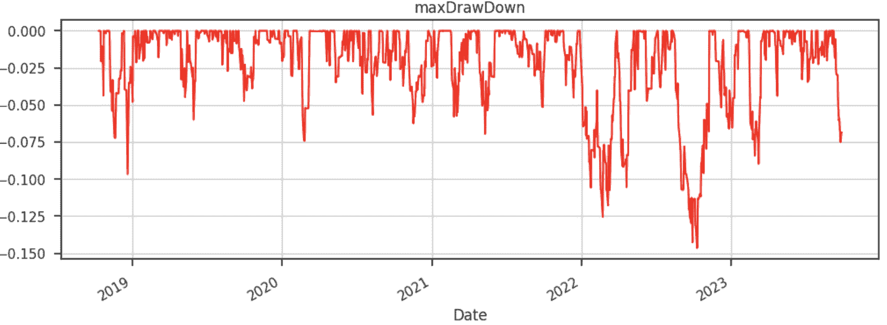

我们将使用上一节详述的基准深入分析这些指标。这一步对于确定我们的下一步行动至关重要。

#### 策略分析

- **总收益**：正的 CAGR 表明收益为正。
- **年化收益**：达到 59.89%，表现良好，远高于 >10% 的基准。
- **波动率**：该策略在日度基础上表现出 21.68% 的波动率，月度基础上为 19.98%。这属于中等水平，但通常越低越好。
- **夏普比率**：2.28 的数值表现良好，表明策略具有强劲的风险调整后收益。
- **最大回撤**：为 -14.65%，属于可接受范围，但接近可接受范围的上限。这意味着策略在最差时期经历了从峰值到谷值 14.65% 的下跌。
- **偏度**：日度 2.03 和月度 0.82 的正偏度表明，策略获得大额正收益的概率高于获得大额负收益的概率。
- **峰度**：数值高于 3（日度 12.43 和月度 1.62）表明策略可能呈现肥尾分布或极端事件发生的可能性更高，预示着额外风险。
- **回撤**：平均回撤为 -1.93%，持续 10.35 天，表现相当不错。这意味着在达到新高之前，从峰值回落的平均幅度小于 2%。
- **一致性与稳定性**：平均上涨月份为 5.77%，平均下跌月份为 -3.43%，显示出不错的一致性。100% 的上涨年份和 12 个月上涨百分比非常出色，表明策略多年来持续带来正收益。

总之，该策略展现出强劲的风险调整后收益，具有较高的夏普比率和年化收益。虽然峰度和最大回撤存在一定风险，但持续为正的年度收益和较高的夏普比率表明该策略具有鲁棒性。

让我们继续了解下一个库。

#### 通用金融风险指标库

`Empyrical`[¹³⁵] 由 Quantopian 开发，基于 `Pyfolio` 构建，提供深度的风险、收益和分析指标。

照常按如下方式安装并导入：

```bash
!pip install -q empyrical
```

然后按如下方式计算各项统计数据：

```python
from empyrical import max_drawdown, annual_return, sharpe_ratio, sortino_ratio

##### 计算最大回撤
max_drawdown(long_returns - brk_fee)
##### -0.1428624776295528

drawdown = max_drawdown(long_returns - brk_fee)
ann_return = annual_return(long_returns - brk_fee)
sharpe = sharpe_ratio(long_returns - brk_fee)
sortino = sortino_ratio(long_returns - brk_fee)

print(f"Maximum Drawdown: {drawdown:.2%}")
print(f"Annual Return: {ann_return:.2%}")
print(f"Sharpe Ratio: {sharpe:.2f}")
print(f"Sortino Ratio: {sortino:.2f}")
```

```
Maximum Drawdown: -14.65%
Annual Return: 59.96%
Sharpe Ratio: 2.28
Sortino Ratio: 4.52
```

与前一个库一样，易用性方面没有特别的困难。我们对风险管理库的探索最后一个库也将是这种情况。

#### QuantStat 分析库


##### QuantStats

[QuantStats[10]](#chap03.xhtml#footnote-134) 是一个 Python 库，用于执行投资组合画像分析，通过提供深度分析和风险指标，帮助量化分析师和投资组合经理更好地了解其表现。该库构建在 `pandas` 和 `numpy` 等行业标准库之上，利用机构级指标简化了交易后分析。它是性能分析的“瑞士军刀”，消除了对多个分散工具的需求。

QuantStats 由 3 个主要模块组成：

*   `quantstats.stats` 用于计算各种性能指标，如夏普比率、胜率、波动率等。
*   `quantstats.plots` 用于可视化表现、回撤、滚动统计、月度收益等。
*   `quantstats.reports` 用于生成指标报告、批量绘图，并创建可保存为 HTML 文件的 tear sheet（摘要报告）。

```python
!pip install -q quantstats

import quantstats as qs

##### Input : Pandas Series with an equity curve compounded
serie_long_trades = pd.Series(np.cumprod(1 + long_returns - brk_fee), index=X_test.index)

serie_long_trades.head(3)

serie_long_trades.index = serie_long_trades.index.tz_convert('America/New_York')
```

##### quantstats.stats

该计算引擎可计算 70 多项基本指标，涵盖从基础比率到复杂的风险调整衡量标准。该模块在内部处理时间序列操作，仅需您的原始收益作为输入，如下所示：

```python
print('sharpe : ', qs.stats.sharpe(serie_long_trades))
print('sortino : ', qs.stats.sortino(serie_long_trades))
print('mdd : ', qs.stats.max_drawdown(serie_long_trades))
```

```text
sharpe : 2.2766106559178523
sortino : 4.521295932898164
mdd : -1.0
```

##### Quantstats.plots

该模块生成出版级可视化图表，重点关注关键性能方面和风险指标。每个图表均设计用于即时模式识别，这对于策略比较和风险监控特别有用，如下所示：

```python
import warnings
import logging

##### ignore matplotlib warnings (concerning fonts)
warnings.simplefilter(action='ignore', category=FutureWarning)
warnings.simplefilter(action='ignore', category=UserWarning)
logging.getLogger('matplotlib.font_manager').disabled = True

qs.plots.snapshot(serie_long_trades, benchmark=symbol, title='Machine Learning Strategy', show=True)
```

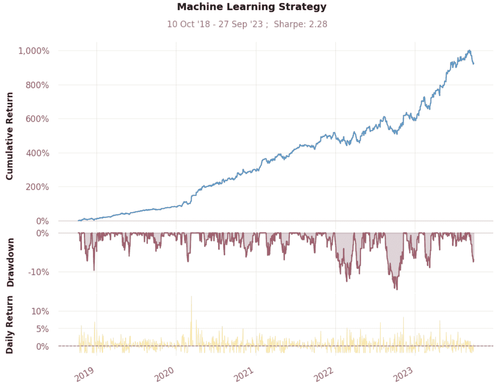

高收益源于该工具采用的复利机制。

我们将最好的留在最后。如果您不熟悉 QuantStats，我们建议您尝试运行此命令。报告（HTML 文件）非常丰富详尽。总而言之，这三个风险管理库为我们提供了免费访问专业工具的机会。

##### Quantstats.reports

该模块自动生成专业的 tear sheet（摘要报告），类似于对冲基金使用的报告，将指标和图表相结合。HTML 输出便于与利益相关者共享，同时保持交互性。

```python
qs.reports.html(serie_long_trades, output=symbol + '-rapport.html')
```

然后您需要浏览硬盘，在笔记本所在位置找到 HTML 文件。下图是该文件的一个片段：

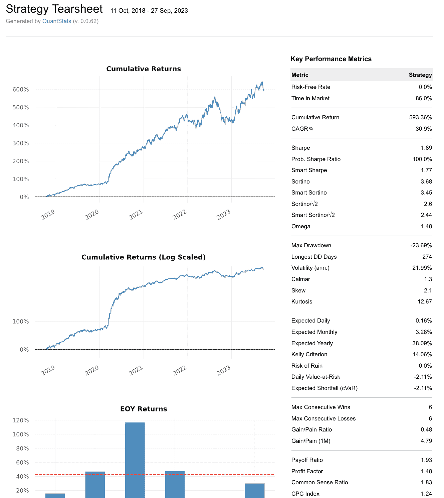

## 结论

本章实用地介绍了高级工具，指导了指标选择和风险管理，促进了深入的报告分析，并提供了维持模型性能的策略。

在下一章中，我们将揭开生产级回测的神秘面纱，涵盖高级框架和使用 BackTrader 库的颗粒度实现细节。我们还将探讨策略验证的关键方面，从高效执行到全面的性能评估，以确保您的回测准确反映实盘交易条件。

## 参考文献

1.  **超参数搜索方法基准测试：** "The Overlooked Limitations of Grid and Random Search ...and what to try instead with", Avi Chawla. https://www.blog.dailydoseofds.com/p/the-overlooked-limitations-of-grid
2.  **集成建模：** "Bagging predictors", Machine Learning, Breiman, L. (1996)., 24(2), 123-140.

***

**加入我们书籍的 Discord 空间**

加入书籍的 Discord 工作区，获取最新动态、优惠、全球科技资讯、新版本发布及作者专场活动：

[`discord.bpbonline.com`](https://discord.bpbonline.com)


# 第 4 章：实施交易策略

## 简介

在本章中，我们将探讨算法交易库的广泛范围，考察其功能，并了解如何选择最佳库。随后重点转移到实际实施，使用事件驱动的 `BackTrader` 库来设计和测试交易策略。

我们将涵盖整个过程，包括开发交易策略、设置和运行回测，以及纳入风险管理。随着进程推进，我们将通过多资产支持和执行逻辑等高级功能增强策略，为交易者提供一套全面的算法交易工具包。

## 结构

在本章中，我们将涵盖以下主题：

*   回测和交易库
*   使用 BackTrader 实施策略
*   风险管理

## 目标

本章重点关注基于 Python 的平台及其在运行高级交易策略中的关键作用。我们首先介绍用于回测和执行的最有效算法交易库，重点介绍其功能和优势。在此过程中，我们将概述选择最适合您交易需求的库和 API 时需要考虑的关键因素。

奠定这一基础后，我们将转向 `BackTrader` 的实际应用。本章随后将介绍管理算法订单的基础知识，并深入探讨如何使用该引擎运行回测。风险管理也将是重点关注领域。接下来，我们将探讨评估性能和改进策略。最后，我们将把讨论扩展到多资产策略。

## 回测和交易库

用于算法交易和回测的 Python 平台为交易者提供了广泛的库，每个库都提供不同的工具和功能。`BackTrader[1]` 凭借其多功能性和易用性脱颖而出，成为新手和资深交易者的首选。

它包含稳健算法策略所需的所有关键要素，包括订单类型、管理、监控、风险控制、止损和止盈。此外，`BackTrader` 支持实盘交易。

`Zipline[2]` 是驱动 Quantopian IDE 的开源回测引擎，可在本地运行，并可适配虚拟环境和 Docker 容器。它继承了 Quantopian 的广泛功能，但允许集成自定义数据集，以实现更个性化的回测场景。`Zipline` 提供详细的回测数据，便于多样化的可视化应用。尽管 `Zipline` 于 2017 年停止提供实盘交易功能，但 `Zipline-live` 项目继续通过 InteractiveBrokers 支持实盘交易，保持了与原始 `Zipline` 相当的功能集。

另一方面，`PyAlgoTrade[3]` 以其对多资产交易的强力支持而脱颖而出。它允许添加多个数据源和可变时间框架，满足管理多元化投资组合交易者的需求。对于寻求实时数据源的用户，`PyAlgoTrade` 提供符合高频交易需求的解决方案。


此外，`Alpaca`4 凭借其现代化方法，提供了与券商的无缝接口，弥合了策略开发与实盘执行之间的差距。这使其成为重视直接市场接入和实时交易能力的交易者的理想选择。

不得不提`QuantRocket`5，这是一个为`InteractiveBrokers`6 用户量身定制的平台，支持外汇和美股的回测与实盘交易。其独特之处在于适应性强，既支持其专有的`Moonshot`引擎，也支持用户自选的第三方引擎。`QuantRocket`没有采用传统的集成开发环境（IDE），而是利用`Jupyter notebooks`创建同等环境。该服务采用订阅制。

### 选择合适库和 API 的标准

要确定最适合您算法交易需求的库，重要的是根据特定标准对其进行评估，这些标准涵盖了回测和实盘交易的多样化需求：

*   **易于实现**：评估库的直观程度和用户友好性，考虑其文档质量和社区支持水平。同时，也要考虑您对该库编程语言的熟悉程度。
*   **适应性**：确定库在允许自定义和扩展方面的灵活性。它能否轻松适应您交易策略的独特需求？
*   **券商集成**：评估库与各券商的兼容性，特别是如果您偏好或已与特定券商建立关系。
*   **多资产交易**：分析库处理多样化资产类别（股票、外汇、大宗商品、加密货币、ETF、债券）的能力。
*   **执行速度**：考虑库的计算效率，较高的速度对高频交易策略有显著优势，但对低频策略（小时级、日级或周级）则不构成顾虑。
*   **社区与开发者支持**：强大的社区和开发者支持对于故障排查和提升库功能极具价值。
*   **成本**：考虑使用库的相关成本，因为某些库可能需要订阅或存在隐性费用。
*   **数据处理与存储**：查看库如何管理数据源、历史数据访问和数据存储，这对回测和实盘交易都至关重要。
*   **风险管理工具**：确保库包含或支持集成高级风险管理工具和指标。
*   **绩效指标与报告**：生成详细报告和获取全面绩效指标的能力对于分析策略有效性必不可少。

根据这些标准，我们可以对这些库进行如下排序：

1.  **BackTrader**：适应性极强，适合初学者和经验丰富的交易者，支持多券商和多数据源，但复杂策略的执行速度可能较慢。
2.  **Zipline**：提供稳健的数据处理，适合股票市场，但券商集成较少，主要专注于回测而非实盘交易。
3.  **QuantConnect**：多资产交易表现优异，提供高速执行和广泛的券商集成，但学习曲线可能较陡峭。
4.  **PyAlgoTrade**：适合教学用途和简单直接的策略，因其复杂度低、开销小，但缺乏复杂策略开发所需的高级功能。
5.  **Alpaca**：以其面向算法交易的零佣金券商服务著称，提供现代化、对开发者友好的平台，可与许多工具无缝集成，实现流畅的实盘交易能力。

通过根据指定标准比较这些库，交易者可以根据其回测和实盘执行的具体需求做出明智决策，确保与其算法交易系统在战略上契合。

## 使用 BackTrader 实现策略

正如上一节所述，`BackTrader`是实现和回测算法策略的首选库。因此，我们将借助该库共同探索构成系统化策略执行的关键要素。

`BackTrader`是一个稳健的事件驱动回测框架，使交易者能精准构建和测试策略。其设计旨在对交易生命周期中的市场事件（从订单提交到执行和结算）做出反应。这种设置模拟了实盘交易环境，为策略开发和验证提供了稳健平台。通过处理各类市场数据和事件，`BackTrader`促进了交易策略的逼真模拟，这对于在真实场景部署前识别潜在问题和优化性能至关重要。

让我们首先看一下使用 `BackTrader` 实现策略的路线图。

### BackTrader 回测指南

本节探讨使用 `BackTrader` 实现策略的结构化路线图，将流程分解为可执行步骤。在 `BackTrader` 中实现交易策略是一个结构化过程，包含以下步骤：

1.  **导入库**：首先导入必要的 Python 库，包括 `BackTrader` 和您可能需要的任何数据库。
2.  **定义策略**：在 `BackTrader` 中创建 `bt.Strategy` 的子类。这是您定义参数、初始化指标和设置交易逻辑的地方。
3.  **初始化指标（可选）**：在策略子类中，初始化您将使用的任何指标，如移动平均线。
4.  **设置交易逻辑**：使用 `__init__` 等方法设置策略，使用 `next` 定义每个传入数据点执行的逻辑。
5.  **创建 Cerebro 引擎**：实例化一个 `Cerebro` 对象，这是 `BackTrader` 处理回测工作流的核心引擎。
6.  **添加数据源**：向 `Cerebro` 引擎添加市场数据。数据来源可以是实时或历史数据（CSV 文件、Pandas 数据框等）。
7.  **向 Cerebro 添加策略**：使用 `addstrategy` 将您定义的策略附加到 `Cerebro` 引擎。
8.  **设置初始资金和券商参数（可选）**：定义初始资金和券商参数，如佣金、滑点等。
9.  **运行回测**：在 `Cerebro` 实例上使用 `run` 方法执行回测。
10. **分析结果（可选）**：回测运行后，您可以分析结果、提取绩效指标，或使用 `cerebro.plot()` 绘制绩效图表。
11. **优化（可选）**：您可以通过调整参数并通过 `Cerebro` 引擎运行策略来优化策略，以查看这些变化如何影响性能。

遵循这种结构化方法，即使有一定编程经验的初学者也能成功使用 `BackTrader` 回测其交易策略。我们将在后续章节讨论所有这些阶段的具体示例。

作为序言，让我们看看基于机器学习算法的策略与不使用机器学习的系统化策略有何不同。

### 使用 BackTrader 编写机器学习策略

我们选择采用机器学习驱动的策略，而非依赖技术指标或类似方法。有兴趣探索此类方法的读者，可在 `BackTrader` 官方网站找到大量资源 7。我们在 `BackTrader` 环境中的重点是利用机器学习模型的输出及其预测，并模拟后续事件，本质上是将这些预测转化为实实在在的盈亏结果。


#### 基于机器学习的策略在 BackTrader 中的实现

基于机器学习的策略编码方法不同于传统方法（如 `Moving Average Crossover` 移动平均线交叉）。我们不再编码具体的交易规则，而是获得一个预测向量，范围从简单的买入或卖出信号到更复杂的方案，这些都必须在 BackTrader 模拟环境中被解读并转化为可执行的订单。这种转变强调了算法的预测输出作为交易决策背后的驱动力。

与这一点相关的要素（从预测到订单）属于我们在本节开头给出的分步指南中的第 2 阶段（定义策略）。稍后我们将详细介绍这一点并编写相应的代码。

##### 导入库并设置

让我们从导入和安装必要库的第一步开始。首先是 BackTrader：

```bash
pip install -q backtrader[plotting]
```

```python
import numpy as np
import pandas as pd
import yfinance as yf
import matplotlib.pyplot as plt
```

我们使用宝洁公司（PG）连续十天的日线数据初始化数据源（`df`）。为了演示基于机器学习的交易策略回测，我们使用随机数生成器（`np.random.choice`）模拟预测。虽然这些虚拟预测用于演示回测流程，但它们可以被机器学习模型的预测所替代：

```python
symbol = 'PG'
ticker = yf.Ticker(symbol)
df = ticker.history(period='10d', interval='1d')

###### 模拟预测，倾向于 70% 的概率为 '1'（'买入'）和 30% 的概率为 '-1'（'卖出'）
pred_dumb = np.random.choice([-1, 1], size=df.shape[0], p=[0.3, 0.7])

###### 在数据框中插入新列以跟踪预测
df['custom'] = pred_dumb
```

此时，我们拥有了价格以及与之对应的买入/卖出决策。

##### 在事件驱动环境中定义策略

在 BackTrader 中创建 `bt.Strategy` 的子类。这是你定义参数、初始化指标和设置交易逻辑的地方。

以下是一个名为 `CustomSignalStrategy` 的示例，包含当需要时管理订单流（发送和接收后续通知）所需的基本方法：

```python
###### 定义自定义策略
class CustomSignalStrategy(bt.Strategy):

    def __init__(self):
        # 策略开始时调用一次，用于声明指标和变量
        pass

    def log(self, txt, dt=None):
        # 实用方法，使用可选的日期时间（dt）戳记录给定文本
        pass

    def next(self):
        # 数据集中每个数据点（K 线）调用一次。这是执行主要策略逻辑的地方。
        pass

    def notify_order(self, order):
        # 每当订单状态发生变化时调用。可用于订单确认、取消或拒绝。
        pass
```

剩下的就是用我们想要回测的交易系统特有的逻辑，填充并完成这些方法（`__init__`、`log`、`notify_order` 和 `next`）的代码。我们将为每个方法逐一完成。

`__init__` 方法负责处理机器学习算法提供的预测，作为初步设置。它访问位于 `self.datas[0].custom` 中的策略（买入/卖出）信号。变量 `custom_signal` 随后被设置为引用最新的信号（队列最前端）：

```python
def __init__(self):
    # 'custom' 信号 <- 预测
    self.custom_signal = self.datas[0].custom
```

`log` 函数负责在每次执行时显示一个日期（`dt`）和一段文本（`txt` 参数）：

```python
def log(self, txt, dt=None):
    ''' 日志记录函数 '''
    dt = dt or self.datas[0].datetime.date(0)
    print('%s, %s' % (dt.isoformat(), txt))
```

##### 设置交易逻辑

在事件驱动编程框架内，我们编写由特定事件触发的方法。操作流程由这些事件的顺序引导。对于 `next` 方法，相关事件是新 K 线或价格更新的到来。

以下方法会为数据集中的每个数据点调用，这是策略核心逻辑展开的关键时刻。在这里，我们根据从 `self.custom_signal` 接收到的信号，管理并发送交易订单，区分买入和卖出类型。

提供的代码片段展示了如何根据传入信号执行买入或卖出订单：

```python
def next(self):
    # 逻辑：金字塔式加仓
    if self.custom_signal[0] == 1:
        self.buy()
    elif self.custom_signal[0] == -1:
        self.sell()
```

交易策略种类繁多。其中一个例子是反转策略，即每当信号发生变化时，持仓在多头和空头之间交替，同时保持目标金融工具数量不变。

BackTrader 通过 `order_target_size` 方法简化了这一过程，该方法允许交易者轻松设置固定仓位大小。该方法属于功能多样的 `order_target_xxx` 系列，允许交易者以多种方式定义其期望的投资组合目标：

- `order_target_size`：特定资产的股份或合约数量。
- `order_target_value`：资产在投资组合中的货币价值。
- `order_target_percentage`：分配给资产的当前投资组合价值的百分比。

```python
def next(self):
    if self.custom_signal[0] == 1:
        self.order = self.order_target_size(target=1)
    elif self.custom_signal[0] == -1:
        self.order = self.order_target_size(target=-1)
```

最后，关于策略实现，我们应该提及 `notify_order` 方法。在 BackTrader 中，`notify_order()` 方法用于拦截有关订单状态的消息。当下达订单时，它会在其生命周期中经历多个状态（如 Created 已创建、Submitted 已提交、Accepted 已接受），`notify_order()` 会在每次状态变化时提供更新。

`notify_order()` 用于在订单状态变化时采取适当行动，例如记录事件、更新策略状态，或处理订单完成或失败的情况。它是 BackTrader 策略逻辑的重要组成部分，使开发者能够管理订单流并根据需要响应事件：

```python
def notify_order(self, order):
    if order.status in [order.Submitted, order.Accepted]:
        # 买入/卖出订单已提交/被经纪商接受 - 无需操作
        return

    # 检查订单是否已完成
    if order.status in [order.Completed]:
        if order.isbuy():
            self.log('BUY EXECUTED, Price: %.2f, Size: %d' % (order.executed.price, self.getposition().size))
        elif order.issell():
            self.log('SELL EXECUTED, Price: %.2f, Size: %d' % (order.executed.price, self.getposition().size))
        self.bar_executed = len(self)

    # 注意：如果现金不足，经纪商可能会拒绝订单
    elif order.status in [order.Canceled, order.Margin, order.Rejected]:
        self.log('Order Canceled/Margin/Rejected')

    # 记录：无挂单
    self.order = None
```

##### 创建 Cerebro 引擎

以下代码（`init_cerebro_before_run`）作为设置 BackTrader "Cerebro" 引擎的核对清单，确保从数据集成到执行细节的所有必要组件都已正确配置。

这种准备对于随后将数据和策略（`CustomSignalStrategy`）添加到引擎中、进入执行阶段至关重要：

```python
###### 子类化 PandasData 数据源以将 'custom' 作为额外行包含在内
class CustomPandasData(bt.feeds.PandasData):
    lines = ('custom',)
    params = (('custom', -1),)

cash = 100000

def init_cerebro_before_run():
    # 使用自定义数据源将数据加载到 BackTrader
    data = CustomPandasData(dataname=df)

    # 创建一个新的 Cerebro 引擎
    cerebro = bt.Cerebro()

    # 在开盘/收盘时开仓/平仓（信号后的下一根 K 线）
    cerebro.cheat_on_close = False

    # 向引擎添加数据源
    cerebro.adddata(data)

    # 向引擎添加策略
    cerebro.addstrategy(CustomSignalStrategy)
```


###### 设置我们期望的初始资金

```python
cerebro.broker.set_cash(cash)
```

###### 打印初始资金

```python
print('Starting Portfolio Value: %.2f' % cerebro.broker.getvalue())
```

```python
return cerebro
```

```python
cerebro = init_cerebro_before_run()
```

该初始化代码的结果为：

```text
Starting Portfolio Value: 100000.00
```

###### 运行回测

剩下的就是激活 Cerebro 的回测引擎，让它管理操作序列：

```python
###### 运行回测
results = cerebro.run()
```

这给出了以下订单序列：

```text
2023-10-23, SELL EXECUTED, Price: 147.86, Size: -1
2023-10-24, BUY EXECUTED, Price: 148.12, Size: 1
2023-11-02, SELL EXECUTED, Price: 149.54, Size: -1
```

```python
###### 打印最终资金
print('Ending Portfolio Value: %.2f' % cerebro.broker.getvalue())
```

```text
Ending Portfolio Value: 99999.74
```

下表列出了该期间的价格和信号，透明地展示了策略将如何对市场变化和预测信号做出反应：

| Date | Open | Close | custom |
| --- | --- | --- | --- |
| 2023-10-20 | 149.050003 | 148.050003 | -1 |
| 2023-10-23 | 147.860001 | 148.149994 | 1 |
| 2023-10-24 | 148.119995 | 149.899994 | 1 |
| … | … | … | … |
| 2023-11-01 | 150.679993 | 149.610001 | -1 |
| 2023-11-02 | 149.539993 | 150.960007 | -1 |

表 4.1：开盘价、收盘价和预测

为了深入理解并信任我们的回测代码，必须在实时交易的展开过程中手动追踪事件序列。此过程涉及密切跟踪资产的价格变动，特别是特定日期的开盘价和收盘价，并将其与我们机器学习算法的预测（`custom` 列）对齐。

以下是回测引擎动作的细分，与我们的预期相符：

- 2023 年 10 月 20 日，交易日收盘时显示卖出信号 (-1)
- 因此，在下一个交易日（即 2023 年 10 月 23 日）的开盘价 147.86 美元处建立空头头寸：
  - `2023-10-23, SELL EXECUTED, Price: 147.86, Size: -1`
- 2023 年 10 月 23 日，信号转为买入 (+1)
- 在 2023 年 10 月 24 日市场开盘时建立多头头寸：
  - `2023-10-24, BUY EXECUTED, Price: 148.12, Size: 1`
- 该头寸一直持有，直到下一个信号反转发生在 2023 年 11 月 1 日
- 2023 年 11 月 1 日，信号恢复为卖出 (-1)，表明转回空头头寸：
  - `2023-11-02, SELL EXECUTED, Price: 149.54, Size: -1`

在仔细剖析并验证了引擎产生的每一个结果后，我们现在准备进入下一阶段：风险管理。

### 风险管理

在本节中，我们将指导您为每笔交易设置止损和止盈，以确保您的策略包含保护性和盈利目标措施。

###### 添加止损

在算法交易中，保护自动化系统至关重要。这一基本保护措施涉及为每个市价单预设止损水平。

具体而言，在 `notify_order` 方法中，一旦订单完成，我们会为多头头寸定义一个低于成交价 5% 的止损水平。随后，随着每个新的价格跳动，引擎会将其与设定的止损水平进行比较，以确定是否应触发止损。

止损的检查与执行编码在 `next` 方法中，如果当前收盘价跌破多头头寸的止损价，系统将按止损价触发卖出，从而执行保护性离场。

在本示例中，我们将多头头寸的止损水平设为买入成交价下方 5%。您可以根据需要调整这些百分比：

```python
class CustomSignalStrategy(bt.Strategy):
    # 低于买入价 5%
    params = (('stop_loss_multiplier', 0.95))

    def __init__(self):
        # 初始化任何指标、信号和变量
        self.order = None
        self.buyprice = None
        self.stop_loss_price = None

    def notify_order(self, order):
        if order.status in [order.Completed]:
            if order.isbuy():
                self.buyprice = order.executed.price
                # 基于买入价和乘数设置止损价
                self.stop_loss_price = self.buyprice * self.params.stop_loss_multiplier

    def next(self):
        # 检查市场中是否有持仓
        if self.position:
            # 检查当前价格是否跌至止损水平
            if self.data.close[0] <= self.stop_loss_price:
                # 如果是，按止损价以止损单卖出
                self.sell(exectype=bt.Order.Stop, price=self.stop_loss_price)
```

###### 使用限价单添加止盈

为了通过止盈机制增强您的交易策略，您可以实施一个预定义的盈利目标，一旦达到，将触发头寸的自动卖出，从而锁定收益。

在您的交易脚本中，您需要添加逻辑来监控相对于入场点的价格水平，并定义一个具体的止盈阈值。当当前市场价格突破该阈值时，将执行卖出限价单，平仓并获利了结。让我们看看如何使用限价单实现止盈机制。每当建立新的多头头寸时，该策略会自动在预定义价格水平（此处设为入场价上方 5%）处下达卖出限价单。

我们可以在 BackTrader 中按如下方式实现：

```python
class CustomSignalStrategy(bt.Strategy):
    params = (
        ('take_profit_multiplier', 1.05),  # 高于买入价 5%
    )

    def __init__(self):
        # 初始化任何指标、信号和变量
        self.order = None
        self.buyprice = None
        self.take_profit_price = None

    def notify_order(self, order):
        if order.status in [order.Completed]:
            if order.isbuy():
                self.buyprice = order.executed.price
                # 基于买入价和乘数设置止盈价
                self.take_profit_price = self.buyprice * self.params.take_profit_multiplier

    def next(self):
        # 检查市场中是否有持仓
        if self.position:
            # 检查当前价格是否达到止盈水平
            if self.data.close[0] >= self.take_profit_price:
                # 如果是，按止盈价以限价单卖出
                self.sell(exectype=bt.Order.Limit, price=self.take_profit_price)
```

###### 设置经纪商佣金和滑点

在 BackTrader 中，为了考虑滑点和佣金，您可以利用 `Cerebro` 实例来设置经纪商模拟参数。

本节展示了如何配置经纪商佣金和滑点设置。滑点，即交易预期价格与实际成交价格之间的差异，是交易中的常见因素。以下示例展示了如何设置这些参数，以在您的回测环境中反映真实的交易条件：

```python
####### 设置经纪商滑点和佣金参数
####### 0.5% 滑点
slippage = 0.005
commission = 5 / 100 / 100  # 5 个基点

####### 设置滑点
cerebro.broker.set_slippage_fixed(fixed=0.01)  # 每笔交易固定滑点
####### 或：
cerebro.broker.set_slippage_perc(perc=slippage)

cerebro.broker.setcommission(commission=commission)
```

以下是前面代码中使用的参数说明：

- **滑点**：
  - `set_slippage_fixed(fixed=0.01)` 对每笔交易应用固定金额的滑点，意味着每个订单将在资产价格单位上额外增加 0.01 的成本执行
  - `set_slippage_perc(perc=0.005)` 基于订单执行时的资产价格应用百分比滑点，0.005 代表五个基点（价格的 0.5%）


####### 佣金

`setcommission(commission=0.001)` 将佣金费用设置为交易价值的百分比。此处，交易价值的 0.1% 将被扣除作为佣金成本。

您可以在运行回测前将这些配置添加到您的 `Cerebro` 设置中。这确保了回测环境能真实模拟滑点和佣金，从而显著影响任何交易策略的表现！

在下一节中，我们将引入一套性能指标，包括夏普比率、回撤分析和年化收益率，以增强对您交易策略有效性的评估。

##### 分析结果

在启动回测之前，为 `Cerebro` 引擎配置性能指标以评估策略可行性至关重要。请添加用于交易详情和回撤的分析器，以深入了解交易效率和风险敞口。

以下是嵌入 `Cerebro` 配置中的增强脚本片段（位于程序开头）：

```python
###### 从 Backtrader 导入分析器
import backtrader.analyzers as btanalyzers

###### 向 Cerebro 引擎添加 TradeAnalyzer
cerebro.addanalyzer(btanalyzers.TradeAnalyzer, _name="trade_analyzer")

###### 添加分析器
cerebro.addanalyzer(btanalyzers.DrawDown, _name='drawdown')
```

启动代码保持不变：

```python
###### 运行回测
results = cerebro.run()

###### 打印最终现金
print('Ending Portfolio Value: %.2f' % cerebro.broker.getvalue())
```

要从回测结果中获取特定的风险统计数据，您将使用分析器提供的字典结构。这使您能够查询并检索详细的风险指标：

```python
###### 从结果列表中提取第一个策略
strat = results[0]

###### 从策略的回撤分析器中获取最大回撤
print('Max Drawdown:', strat.analyzers.drawdown.get_analysis()['max']['drawdown'])
```

在该代码中，`strat.analyzers.drawdown.get_analysis()` 检索一个包含回撤统计数据的综合字典。通过键入 `['max']['drawdown']`，我们提取策略在回测期间经历的最大回撤。该指标对于理解策略可能遭受的潜在损失及评估其风险承受能力至关重要。有关风险管理指标的详细讨论，请参阅 第 3 章，优化交易系统、指标和自动化报告。

##### 交易统计

对于有兴趣获得详细交易表现分析的读者，以下代码片段提供了全面的统计数据。它计算胜率、盈利交易平均获利、亏损交易平均亏损，以及多头和空头头寸中盈亏的分布情况：

```python
try:
    trades = strat.analyzers.trade_analyzer.get_analysis()
    hit_rate = trades['won']['total'] / trades['total']['closed']
    avg_win = trades['won']['pnl']['average']
    avg_loss = trades['lost']['pnl']['average']
    long_win = trades['long']['won']
    long_lost = trades['long']['lost']
    short_win = trades['short']['won']
    short_lost = trades['short']['lost']

    print('Total trades :', trades['total']['closed'])
    print('Wins :', trades['won']['total'])
    print('Losses :', trades['lost']['total'])
    print(f'Hit Rate : {(100*hit_rate):.0f}%')
    print(f'Avg Win : {avg_win:.1f}')
    print(f'Avg Loss : {avg_loss:.1f}')

    if avg_loss != 0:
        print(f'Avg win on Lost : {(-avg_win / avg_loss):.1f}')

    print()
    print('LONG TRADES:')
    print('trades long (win)', trades['long']['won'])
    print('trades long (lost)', trades['long']['lost'])
    print(f'pct : {(100*long_win / (long_win + long_lost)):.0f}%')

    print()
    print('SHRT TRADES:')
    print('trades short (win)', trades['short']['won'])
    print('trades short (lost)', trades['short']['lost'])
    if short_win or short_lost != 0:
        print(f'pct : {(100*short_win / (short_win + short_lost)):.0f}%')

except Exception as e:
    print(e)
```

它输出以下内容：

```
Total trades : 2
Wins : 1
Losses : 1
Hit Rate : 50%
Avg Win : 1.4
Avg Loss : -0.3
Avg win on Lost : 5.5

LONG TRADES:
trades long (win) 1
trades long (lost) 0
pct : 100%

SHRT TRADES:
trades short (win) 0
trades short (lost) 1
pct : 0%
```

将此代码纳入您的交易策略评估中，可为其潜在有效性提供宝贵见解。

以下是关于包含所有统计数据的结构的更多详细信息：

```python
trades = strat.analyzers.trade_analyzer.get_analysis()
trades.keys()
```

以下是前面代码的输出：

```
odict_keys(['total', 'streak', 'pnl', 'won', 'lost', 'long', 'short', 'len'])
```

此输出代表交易分析器返回的字典的键。每个键提供对特定交易统计数据集的访问：

- `total`：关于交易总数的信息
- `streak`：连续盈利和亏损的统计数据
- `pnl`：盈亏统计数据
- `won`：盈利交易的详情
- `lost`：亏损交易的详情
- `long`：专门针对多头头寸的统计数据
- `short`：专门针对空头头寸的统计数据
- `len`：交易持续时间

我们现在将关注本章的最后一节，该节专注于多资产支持。这对于从事套利和投资组合管理等多资产策略的交易者尤为相关。

##### 多资产支持与高级功能

在本节中，我们将详细指导您完成以下过程：

- 将多个数据源纳入您的策略
- 执行涉及多个资产的交易策略。

我们将开发一个交易系统，自动为一种资产执行买单，同时为另一种资产下达卖单，类似于一种资产反向交易的对冲策略。

以下展示了如何修改现有代码以包含多资产支持：

```python
###### 下载两个资产的数据：PG（宝洁）和 KO（可口可乐公司）
data1 = yf.download('PG', period='10d', interval='1d')
data2 = yf.download('KO', period='10d', interval='1d')
```

添加包含信号的（自定义）列：

```python
###### 插入新列以跟踪预测
data1['custom'] = pred_dumb
data2['custom'] = pred_dumb
```

####### 添加多个数据源

向 `Cerebro` 添加多个数据源，每个代表不同的资产。这在 `init_cerebro_before_run()` 函数中完成：

```python
def init_cerebro_before_run(data1, data2):
    # 向 Cerebro 添加多个数据源
    data1 = CustomPandasData(dataname=data1)
    data2 = CustomPandasData(dataname=data2)
    cerebro = bt.Cerebro()

    # 向引擎添加数据源
    cerebro.adddata(data1, name='PG')
    cerebro.adddata(data2, name='KO')

    # 其余代码保持不变
```

为了在策略中处理多个资产，您需要修改 `__init__` 方法以初始化每个资产的变量。此步骤确保您的策略能够同时处理多个资产的数据和信号，从而实现更稳健和灵活的交易逻辑。

```python
def __init__(self):
    self.custom_signal1 = self.datas[0].custom
    self.custom_signal2 = self.datas[1].custom
    # ... （其他初始化）
```

要为多个资产实现交易逻辑，您需要修改 `next` 方法以包含每个资产的逻辑。这确保您的策略根据各自的自定义信号（`custom_signal1` 和 `custom_signal2`）独立评估和执行每个资产的交易，从而实现量身定制的决策。如果 `custom_signal1` 触发资产 1 的买入，它不会影响资产 2 的交易行为。同样，资产 2 的信号也不会影响资产 1 的交易决策。当每个资产单独管理且其交易不相互依赖时，此逻辑适用。

```python
def next(self):
    # 资产 1 的交易逻辑
    if self.custom_signal1[0] == 1:
        self.buy(data=self.datas[0])
    elif self.custom_signal1[0] == -1:
```


# 第 4 章

####### 交易逻辑实现

```python
self.sell(data=self.datas[0])
```

######## Asset2 的交易逻辑

```python
if self.custom_signal2[0] == 1:
    self.buy(data=self.datas[1])
elif self.custom_signal2[0] == -1:
    self.sell(data=self.datas[1])
```

如果我们要实现一个翻转交易系统，即买入一种资产会自动触发卖出另一种资产，可以按如下方式修改 `next` 方法中的交易逻辑。现在，`next` 函数实现了一个翻转交易系统，买入一种资产会自动触发卖出另一种资产。在这里，策略使用 `order_target_size` 来显式管理两种资产的仓位大小。

```python
def next(self):
    # 买入信号
    if self.custom_signal1[0] == 1:
        self.order_target_size(data=self.datas[0], target=1)  # 买入 Asset1 : PG
        self.order_target_size(data=self.datas[1], target=-1)  # 卖出 Asset2 : KO
    # 卖出信号
    if self.custom_signal1[0] == -1:
        self.order_target_size(data=self.datas[0], target=-1)  # 卖出 Asset1
        self.order_target_size(data=self.datas[1], target=1)  # 买入 Asset2
```

在修改后的代码中，买入或卖出一种资产会自动触发对另一种资产的相反操作。这是通过使用 `order_target_size` 将目标仓位设置为 1 股（买入）或 -1 股（卖出）来实现的。如果 `custom_signal1` 发出 Asset1 的买入信号，策略不仅会买入 Asset1，还会卖出 Asset2；反之，对于卖出信号亦然。当两种资产呈负相关，或策略旨在维持平衡敞口（例如配对交易策略）时，这种逻辑非常理想。

接下来，更新订单通知以适应多资产场景。这涉及修改 `notify_order` 方法以识别每个订单关联的资产，确保策略中所有资产的通知都能被正确处理：

```python
def notify_order(self, order):
    data_name = order.data._name
    # ... (现有逻辑，现在可知晓订单属于哪个资产)
```

######## 初始化 Cerebro 引擎并运行回测

```python
cerebro = init_cerebro_before_run(data1, data2)
results = cerebro.run()
print('Ending Portfolio Value: %.2f' % cerebro.broker.getvalue())
```

```
2023-10-23, PG : SELL EXECUTED, Price: 147.12, Size: -1
2023-10-23, KO : BUY EXECUTED, Price: 54.65, Size: -1
2023-10-24, PG : BUY EXECUTED, Price: 148.86, Size: 1
2023-10-24, KO : SELL EXECUTED, Price: 55.37, Size: 1
2023-11-02, PG : SELL EXECUTED, Price: 148.79, Size: -1
2023-11-02, KO : BUY EXECUTED, Price: 56.78, Size: -1
Ending Portfolio Value: 99995.12
```

以下是包含在 `data1` 结构中的宝洁公司（PG）股价历史，用于追踪和重构交易序列：

| Date | Open | Close | custom |
| --- | --- | --- | --- |
| 2023-10-20 | 149.050003 | 148.050003 | -1 |
| 2023-10-23 | 147.860001 | 148.149994 | 1 |
| 2023-10-24 | 148.119995 | 149.899994 | 1 |
| … | … | … | … |
| 2023-11-01 | 150.679993 | 149.610001 | -1 |
| 2023-11-02 | 149.539993 | 150.865005 | -1 |

**表 4.2：'PG' 股票的价格历史**

我们可以看到符合预期逻辑的交易序列：对一种资产（PG）进行干预，会在对冲逻辑下触发对另一种资产（KO）的相反交易。

## 结论

在本章中，我们探讨了回测和交易库的基础知识。我们介绍了关键库及选择合适工具的标准，随后提供了使用 BackTrader 实现策略的实用分步指南。在此过程中，我们探讨了管理算法订单、引入风险管理技术（如设置止损限价或仓位规模规则）等关键概念。凭借对这一最先进的事件驱动库进行回测的扎实理解，您现在已具备设计和测试复杂交易策略的能力。

在下一章中，我们将探讨监督学习及其在交易中的应用。您将了解这些算法如何分析历史数据以识别模式并预测市场走势。通过聚焦关键算法和评估指标，本章为后续的实用策略和实现奠定了基础。

## 多项选择题

1. 以下哪项是 BackTrader 库的关键特性？
   a. 仅支持实盘交易
   b. 回测和实盘交易兼具通用性且易于使用
   c. 仅限基本订单类型
   d. 需要订阅费

2. BackTrader 中 `Cerebro` 对象的主要功能是什么？
   a. 管理风险参数
   b. 定义交易策略
   c. 处理回测工作流
   d. 可视化绩效指标

3. BackTrader 策略中的哪个方法会为数据集中的每个数据点（K 线）调用一次？
   a. `__init__`
   b. `log`
   c. `notify_order`
   d. `next`

4. BackTrader 中的 `order_target_size` 方法允许交易者做什么？
   a. 设置分配给该资产的当前组合价值百分比。
   b. 设置资产在组合中的货币价值。
   c. 设置特定资产的股数或合约数
   d. 设置止损价

5. 在 BackTrader 中，`notify_order` 方法的用途是什么？
   a. 定义交易逻辑
   b. 记录交易执行情况
   c. 拦截关于订单状态的消息
   d. 设置初始资金

6. 交易中的滑点是指什么？
   a. 经纪商收取的佣金
   b. 交易预期价格与实际成交价格之间的差异
   c. 交易获得的利润
   d. 交易所需的初始资金

7. 以下哪项**不是**选择交易库的标准？
   a. 实现难易度
   b. 适应性
   c. 券商集成
   d. 库 Logo 的颜色

8. 在 BackTrader 中使用基于机器学习的策略的主要优势是什么？
   a. 比传统方法更简单
   b. 依赖技术指标
   c. 利用预测输出驱动交易决策
   d. 不需要历史数据

9. 止损单的功能是什么？
   a. 自动卖出仓位以锁定收益
   b. 当价格跌破预设水平时卖出资产，以限制潜在损失
   c. 以更低价格买入资产
   d. 监控市场趋势

10. 在多资产策略中，如何在 BackTrader 中管理不同资产的交易？
    a. 将所有数据合并为一个数据源
    b. 对所有资产使用相同的交易逻辑
    c. 为每个资产初始化特定的变量和交易逻辑
    d. 一次只交易一种资产

### 答案

| Question | Answer |
| --- | --- |
| 1 | b |
| 2 | c |
| 3 | d |
| 4 | c |
| 5 | c |
| 6 | b |
| 7 | d |
| 8 | c |
| 9 | b |
| 10 | c |

## 参考资料

1. BackTrader 官方网站，一个通用的 Python 算法交易库  
   <https://backtrader.com>

2. Zipline 文档，一个最初属于 Quantopian 的回测引擎  
   <https://zipline-trader.readthedocs.io/en/latest/index.html>

3. PyAlgoTrade 的 Github 页面，提供强大的多资产交易支持  
   <https://gbeced.github.io/pyalgotrade>

4. Alpaca 官网，一个提供直接市场接入和实时交易的平台  
   <https://alpaca.markets>

5. QuantRocket 官网，专为 InteractiveBrokers 用户定制  
   <https://www.quantrocket.com>

6. InteractiveBrokers API 页面  
   <https://www.interactivebrokers.com/en/trading/ib-api.php>

---

**加入我们书籍的 Discord 社区**

加入书籍的 Discord 工作区，获取最新动态、优惠、全球科技资讯、新书发布及作者专场活动：

**[`discord.bpbonline.com`](https://discord.bpbonline.com)**


# 第 5 章

## 面向交易系统的监督学习

## 简介


## 交易中的监督学习

本章涵盖监督机器学习（ML）的原理，重点关注交易应用。我们将探讨算法如何分析历史数据以识别模式并预测市场走势，将其结构分解为数据输入、函数表示和优化等关键组件。本章还回顾了基本的分类和回归算法，以及关键的评估指标。与其他章节不同，本章的重点在于为交易中的监督学习建立坚实的概念框架，而非具体的实现示例。

## 结构

在本章中，我们将涵盖以下主题：

- 监督学习的作用
- 用于预测性交易的监督学习
- 监督学习的优势
- 监督学习全景
- 监督学习的核心原理
- 主要监督学习算法
- 交易应用的选择标准

## 目标

本章介绍监督学习及其在创建先进算法交易策略中的作用。您将学习如何利用历史数据和标记结果来构建预测模型，以预测市场行为。我们将涵盖关键分类算法，如逻辑回归和支持向量机（SVM），以及基本回归方法，如决策树回归器、梯度提升和 K 近邻，重点关注它们在交易中的实际应用。我们还将探讨如何根据您的数据、预测目标和评估指标（如准确率和精确率）选择合适的算法，从而使您能够有效地完善和优化您的交易系统。

## 监督学习在交易中的作用

本节从技术角度审视交易，重点介绍监督学习如何利用历史数据和标记结果来预测未来市场趋势，从而在构建预测性交易系统中发挥关键作用。

在继续之前，让我们简要回顾一下第一章的要点。

> **注意：** 本节仅侧重于回顾这些关键思想；新信息将在下一节介绍。

### 机器学习在交易中的崛起

ML 作为人工智能的一个关键分支，使计算机系统能够从数据中学习并自我改进，而无需显式编程。这种方法由 Arthur Samuel 于 1959 年提出，其独特之处在于它直接从数据中推导规则，而不是依赖预定义的指令。与规则由人工设定的传统编程不同，ML 算法分析数据以发现指导决策的模式和相关性。在交易中，ML 通过处理大量金融数据来预测市场趋势，展现了其价值。

## 用于预测性交易基础的监督学习

在算法交易中，作为 ML 一个分支的监督学习，在策略开发中迈出了重要一步。它使用带标签的数据，其中训练集同时包含输入特征及其对应的输出。这种方法类似于有指导的学习，模型从它应该预测的具体示例中学习。

在交易背景下，这些带标签的数据集通常由各种市场指标作为输入（如基本面数据[¹]、历史价格、成交量和技术指标）和特定结果作为输出（如未来价格走势或趋势分类）组成，如下图所示：

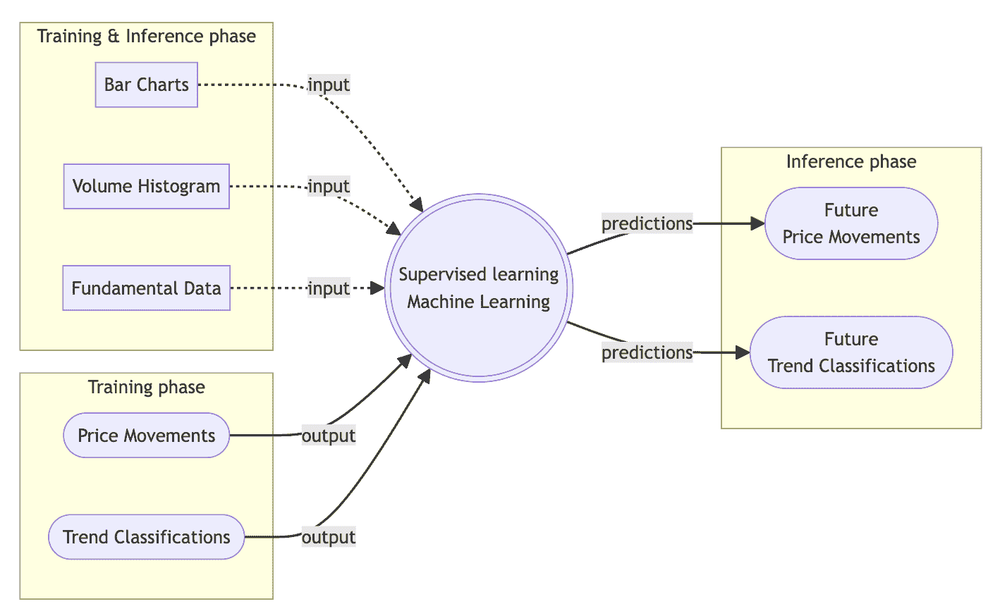

该草图展示了监督学习在金融交易背景下的工作流，其中模型使用各类市场数据、K 线图、成交量直方图和基本面数据作为输入进行训练。在训练阶段，算法学习将这些输入与已知输出（具体为历史价格走势和趋势分类）相关联。

一旦训练完成，模型进入推理阶段，将其学到的规则应用于新数据，以预测未来的价格走势和市场趋势，从而为交易决策提供依据。

在利用传统市场数据的监督学习基础之上，该领域正扩展到更复杂的领域。图学习、基于图像的 ML 以及文本和音频数据分析等技术，正日益塑造和变革交易策略。

例如，图学习用于分析市场网络，其中股票为节点，相关性为边，从而提供对市场动态的洞察。基于图像的 ML，如深度卷积神经网络，被应用于解读 K 线图，识别预测价格走势的模式。自然语言处理技术分析新闻、社交媒体讨论和财报电话会议记录以进行情绪分析，影响交易决策。同样，分析音频数据（如财报电话会议中的语气波动）可提供关于公司业绩的微妙线索，辅助预测分析。这些创新方法利用多样化的数据形式，远远超越了传统的数值数据，为交易者提供了更全面的市场视角和决策优势。

## 监督学习在交易中的优势

ML 的精髓在于其无与伦比的能力，能直接从数据中自主推导决策规则，这与通常依赖预先建立规则的传统统计技术形成鲜明对比。ML 模型能识别数据中的复杂模式和关系，从而对新的、未见过的信息做出可靠预测。这些模型不仅仅是识别模式，而是经历彻底的训练过程，从广泛的市场数据和结果中学习以理解市场行为。这种能力使它们非常适合开发利用历史数据预测未来市场趋势的交易系统，其准确度高于传统方法。此外，ML 提取结构化洞察的能力（如从决策树分析中获得的洞察）提供了清晰、可解释的模型——这是理解复杂市场行为的一大优势。

下图是 ML 算法（决策树）提取的结构化知识的一个具体示例[²]：

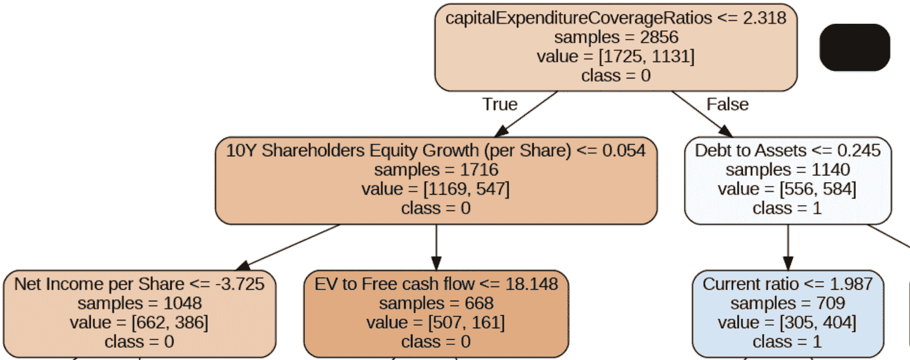

凭借从复杂数据集中自主提炼结构化知识的固有能力，ML 超越了传统统计方法，而这通常是传统技术难以企及的。与往往依赖静态业务规则的传统方法不同（由于市场条件不断演变，这些规则可能迅速过时），ML 以其动态适应性脱颖而出。它根据新数据持续更新和优化其预测规则，确保洞察和策略保持相关性和有效性。此外，ML 擅长处理高维数据空间并发掘非线性关系，这些在金融市场中常见，但传统模型往往难以捕捉。

在探讨了监督学习在交易中的优势后，我们现在将重点转移到其背后的机制上。下一节将探讨核心原理，如带标签数据、训练算法和预测生成，以了解这些模型如何有效运作。

## 监督学习全景

[¹]: [chap05.xhtml#footnote-126]
[²]: [chap05.xhtml#footnote-125]


### 监督学习是机器学习的关键部分，在金融领域的重要性日益凸显

监督学习是机器学习的关键部分，在金融领域的重要性日益凸显。通过从带标签的数据集中学习，算法能够基于历史数据预测结果，这使其成为高级交易策略的关键所在。与无监督学习（在没有标签的情况下寻找隐藏模式）或强化学习（通过与环境交互来学习）不同，监督学习依赖于已知结果，这使其非常适合交易中的预测性分析。

## 监督学习的核心原则

在交易中，监督学习可用于利用历史数据预测市场趋势、价格走势和投资机会。其结构化的输入-输出方法帮助交易员和分析师构建能够处理大量数据并做出准确预测的模型。这改善了决策制定和策略开发。

### 标签数据在监督学习中的作用

深入理解监督学习会揭示标签数据的根本重要性。

在交易的监督学习中，标签数据是构建预测模型的基础。这些数据由输入组成，包括股票价格、交易量和其他相关市场信号，并与其对应的输出配对。这些输出就是指导学习过程的标签，因此称为监督学习。在回归任务中，目标是预测连续结果，标签可能是未来价格。在分类任务中，目标是对数据进行分类，标签可以是趋势指标，如买入、卖出或持有。

标签教会算法如何解读数据，从而如何做出准确预测。例如，分类模型可能从标签数据中学习识别市场趋势是看涨还是看跌。相反，在回归设定中，模型可以利用标签数据预测资产的具体未来价格。

在交易的监督学习中，算法本质上是被训练来回答两个关键问题。对于回归问题，问题是“多少？”，寻求精确的数值预测，如未来股价。对于分类任务，问题是“是什么？”，确定数据点属于哪个类别，如交易信号指示买入、卖出还是持有。

让我们花点时间分析这两种预测类型的几个例子。首先，我们将研究一些直接应用，随后是超出这些范围的例子。

对于回归，一个典型例子是训练模型预测股票的未来价格。请参见下图说明：

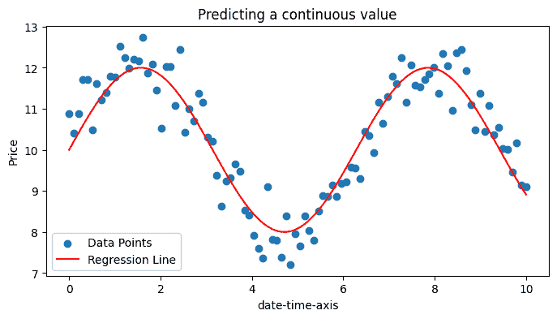

让我们讨论超越简单价格预测的内容。

一个更复杂的回归问题可能涉及基于经济指标估算市场崩盘的概率，这是一项以概率术语量化风险的任务。

另一个高级例子是估算盈利公告对板块指数的影响。重点在于预测季度盈利公告对特定板块指数的影响。通过分析预公告财务指标、市场情绪和公司历史表现数据的组合，模型旨在估算盈利发布后指数的百分比变化。这种方法提供了对企业绩效指标如何影响更广泛市场板块的理解，有助于制定板块特定的投资策略。

在分类背景下，一个基本实例是判断股票将上涨还是下跌，基于财务特征值将走势分为二元类别。下图说明了这一点，并引入了额外的“持有”类别：

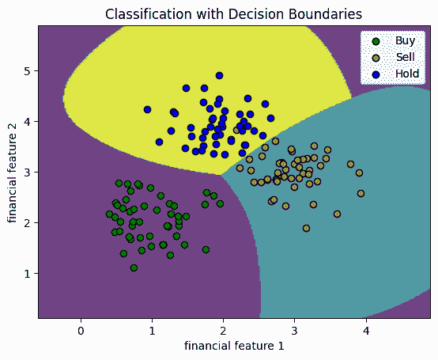

一个超出这种二元范围的独特例子可能涉及对市场机制类型进行分类，范围从看涨或看跌到更具体的状态，如波动上升趋势或静默整理，基于价格模式、交易量和宏观经济信号的组合。

为了结束这一系列应用示例，让我们看看罕见事件的预测，如并购。以下是监督学习算法如何提供帮助。预测企业并购是机器学习的一个应用，融合了分类和回归的要素。

在分类背景下，模型可以评估特定公司间发生并购的可能性，基于财务状况、市场条件和行业历史并购模式，将潜在并购分类为可能或不可能。

或者，作为回归任务，模型可能预测潜在并购的财务影响，估算并购后股价变化或市场份额转移等指标。此类预测需要分析复杂数据集，包括财务报表、市场趋势，甚至来自新闻和企业通讯的文本数据，以捕捉并购活动的多面性。

正如这些例子所示，监督学习在金融领域提供了强大的优势。模型可以学习理解复杂的市场动态，为交易员提供细致的洞察以做出更好的决策。通过使用标签数据，专业人士可以构建在准确性和复杂性上均优于传统交易策略的模型。

让我们看看超越监督学习的内容。

虽然监督学习严重依赖带标签的数据集，但重要的是要承认半监督学习的作用。这种方法利用带标签和不带标签的数据，在标签稀缺或获取成本高昂时特别有价值。我们不会详细讨论这种方法，但了解这种可能性很重要。半监督学习可以利用金融市场中海量的无标签数据，将它们与带标签的实例一起使用，以增强学习过程并提高模型性能。

在探讨了标签数据的作用和监督学习在金融背景下的多样化方法论后，我们现在将继续了解学习过程。

### 学习过程

学习过程的主要目标是最小化机器学习算法预测结果与准确代表市场现实的数据之间的差异。下图说明了这一点：

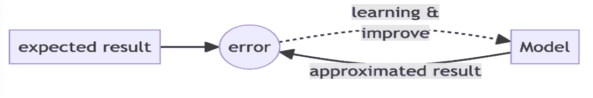

为了实现这一目标，会使用优化过程来迭代优化机器学习算法的参数。这种迭代优化旨在最小化历史数据中预测值与观测值之间的差异。

因此，所有机器学习算法都包含一个误差函数[¹]，优化器会尽可能高效地探索该函数以找到其最小值。

损失函数量化了预测值与实际值之间的差异。在训练期间，算法迭代处理每个数据点，预测输出并将其与实际观测值进行比较。误差函数计算这些值之间偏差的大小。

在更新阶段，算法调整其参数以减小该误差。此调整表示为 `new_param = old_param - update`。较大的误差会导致更显著的更新，逐渐引导参数向最小化误差函数的值靠拢。

我们不会深入探讨学习过程的数学方面，因为现代机器学习库（`Scikit-learn`、`Tensorflow`、`pyTorch` 等）完全抽象了底层的算法复杂性。学习过程的实际实现通常封装在单个命令中：`fit`。

总结本节，所有机器学习算法可分解为以下关键组件：

- 数据：任何机器学习模型的基础。

[¹]: 3


• 优化器：驱动机器学习模型优化其参数的引擎，从而提升预测性能。

• 模型表征：定义了算法如何捕捉数据内部的关系。在交易领域，它决定了如何对市场趋势和行为进行建模。

• 损失函数：衡量模型准确度的关键工具，量化预测误差的代价，并引导模型做出更准确的未来预测。

这些组件对于高性能机器学习算法至关重要。现在，让我们探讨主要的监督学习算法。

## 主要监督学习算法

我们的目标是提供一份实用的概览，涵盖从入门到进阶的核心机器学习算法。我们将提炼核心概念并突出每种算法的定义特征，而非提供详尽的目录。这将使你直观地理解每种算法的工作原理及其在机器学习领域中的定位。我们将从分类算法开始，然后转到回归算法。

#### 分类算法

分类器的目的是定位一条边界以分离两个类别。我们将通过在三个复杂度和难度各异的数据集上测试这些算法，来展示分类算法的范围。正如你在下图所见，具有明显非线性特征的“两个半月”数据集，极有可能难倒更基础的分类器。对于代表交织圆环的数据集，也有类似的观察结果。然而，线性可分数据集的数据可能更容易分离，即使是对于线性分类算法也是如此：

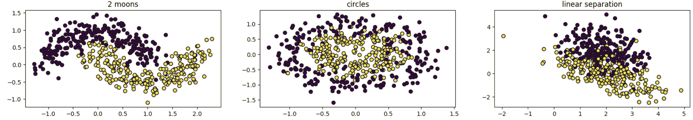

目的并非寻找算法的最佳参数设置，而只是展示它们在所提议数据集上的表现，以得出总体结论。

#### 逻辑回归

由于其线性本质，逻辑回归用于相对简单的二元分类问题。当变量间的关系预期为线性或接近线性时，它是一个有效的选择。例如，逻辑回归可用于基于一组技术指标，预测股票收盘价将高于还是低于某个特定阈值。

以下是其部分优势与劣势：

• 优势：简单、可解释，且对中小型数据集（最多约 10 万行）高效

• 局限性：仅限于线性关系，且容易在小数据集上过拟合。对于复杂关系和高维数据效果较差

• 重要参数及范围 4：正则化强度（`C`）通常在 `[0.01, 100]` 范围内

下图展示了将逻辑回归算法应用于简介中提到的三个数据集的结果。你可以从下图中看到，逻辑回归算法是一种线性分离器。事实上，它在两类不同数据（黄点与黑点）之间绘制了一条线性边界，如下所示：

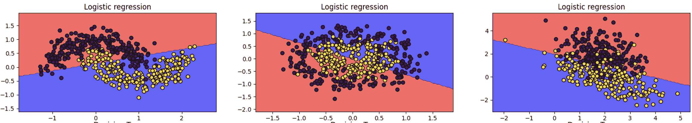

#### 决策树

决策树可用于对市场行为建模并进行预测。该算法自动从数据中学习一系列 if-then-else 规则，形成树状结构。

让我们看看以下优势与劣势：

• 优势：可解释，能处理数值型和分类型数据。对异常值鲁棒，能处理非线性关系

• 局限性：容易过拟合，对大型数据集（>10 万行）效果较差

• 重要参数及范围：树深度（`max_depth`）通常在 `[3, 15]` 范围内

下图展示了描述表中强调的要点：

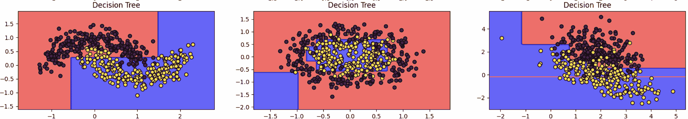

特别地，中间的图表显示算法试图将左下角的孤立点纳入其模型，表明有在预测中考虑该点的倾向。这种情况呈现出明显的过拟合风险。不确定与该区域关联的标签是否适用于未来的未见数据。相反，它看起来更像是由异常点引起的统计异常。

### 随机森林

随机森林算法由多棵决策树组成，旨在缓解前文单棵决策树算法中观察到的效应。因此，它不仅使结果更加平滑，而且与最初的决策树方法相比，显著提升了预测性能。

让我们审视以下优缺点：

• 优势：结合多棵决策树以减少过拟合并处理非线性关系。抗过拟合能力强，适合中型数据集（最多约 100 万行）。

• 局限性：可解释性较差，且对大型数据集可能较慢（计算成本高）。

• 重要参数及范围：树的数量（`n_estimators`）在 `[10, 200]` 范围内，`max_depth` 通常在 `[5, 30]` 范围内。

随机森林算法由多棵决策树组成，旨在缓解前文单棵决策树算法中观察到的效应。因此，它不仅使结果更加平滑，而且与最初的决策树方法相比，显著提升了预测性能。下图展示了描述表中强调的要点：

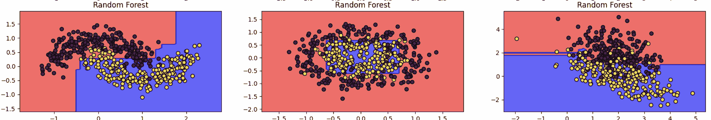

#### 支持向量机

支持向量机是分类的宝贵工具，特别是在处理数据中复杂的非线性关系时。以下是概览：

• 优势：在高维空间中有效，用途广泛

• 局限性：不适合超过 10 万行的数据集，需要调参

• 重要参数及范围：正则化参数（`C`）通常在 `[0.1, 100]` 范围内

支持向量机算法擅长建模高度非线性的决策边界，这一能力在下图中得到了清晰展示：

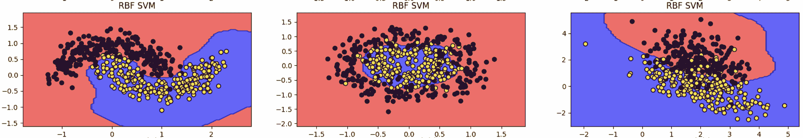

这使其成为处理复杂非线性数据的极其高效的工具，特别是在涉及大维度空间（大量特征或列）的场景中。

#### k-近邻算法

在交易背景下，k-近邻算法（k-NN）可用于识别相似的市场状况，并基于历史数据预测未来价格走势。该算法通过考虑 `k` 个最相似的历史样本来对新数据点进行分类。

考虑其优势与局限性：

• 优势：简单且对小型数据集（最多 5 万行）有效

• 局限性：计算密集型，不适合大型数据集或高维数据。由于其根本依赖数据点间的距离进行分类，其有效性在高维空间中会降低。在这类复杂的多维环境中，传统的距离概念变得不再敏锐，导致维度灾难 5，使得 kNN 难以准确分类实例。

• 重要参数及范围：邻居数量（`k`）通常在 `[3, 20]` 范围内

kNN 算法在简单性与效率之间提供了极佳的平衡。这些图表展示了 kNN 如何有效地为分类创建非线性决策边界：

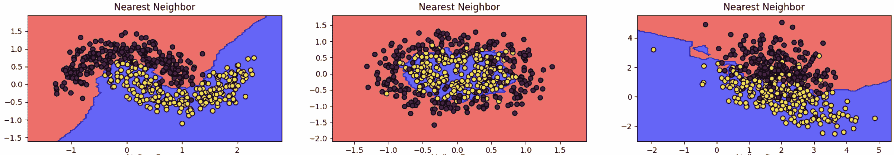

### 朴素贝叶斯

朴素贝叶斯分类器利用贝叶斯定理预测数据点属于特定类别的概率。它们假设所有输入特征相互独立，这简化了计算，但可能并不总是反映现实。它是开始学习路径的良好算法。

以下是其关键优势与局限性：

• 优势：对高维数据集快速且高效

• 局限性：假设特征独立

• 适合文本数据和较小数据集（最多 10 万行）

下图提供了描述表中概述要点的可视化呈现：

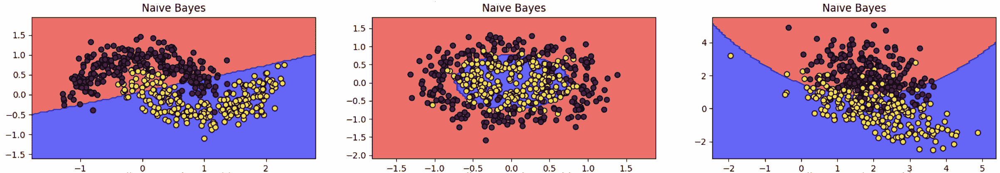


对于最终的分类算法（`Gradient Boosting`、`AdaBoost`、`XG Boost` 和 `lightGBM`），我们将探讨它们为何位列机器学习中最有效的算法之中，这源于 Bagging 和 Boosting 等集成方法。这些技术将在第 7 章《用于交易的高级机器学习模型》中深入探讨，其本质是通过整合多个模型来提升性能。这种组合利用了各组件的优势，从而产生更稳健、更准确的预测能力。

### 梯度提升机

想象一个团队协作解决一个复杂问题。`梯度提升机 (GBMs)` 的工作原理类似，逐步构建一组决策树集成。基于 Boosting 原理，每棵树都从其前任的错误中学习，逐步提高整体预测准确性，就像团队通过协作不断优化策略一样。以下是其优缺点：

*   **优点**：高度灵活且准确率高。能处理复杂关系和不同数据类型
*   **局限性**：可能过拟合，对大数据集（>50 万行）计算密集
*   **重要参数及范围**：`learning_rate` 常在 `[0.01, 0.3]` 范围内，树的数量在 `[100, 500]` 范围内

如下图所示，它擅长建模非线性决策边界：

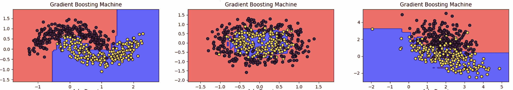

### AdaBoost（自适应提升）

该算法按顺序构建一组分类器集成，并适应之前的错误。一种提升技术通过调整弱分类器的权重来形成一个强分类器。

我们现在来考察其优缺点：

*   **优点**：提高简单分类器的准确性，可处理中等规模数据集（最多 50 万行）
*   **局限性**：计算成本可能较高且容易过拟合。对噪声数据和异常值敏感
*   **重要参数及范围**：估计器数量（`n_estimators`）常在 `[30, 100]` 范围内

下图展示了 `AdaBoost` 如何利用顺序弱学习器创建复杂决策边界：

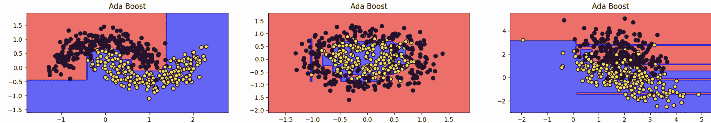

### XGBoost

`Extreme Gradient Boosting (XGBoost)` 建立在 `GBM` 原理之上，提供了高度优化且高效的实现。它被广泛认为是最强大的机器学习算法之一。`XGBoost` 是 `GBM` 的一种先进实现，获得了极大的普及。`XGBoost` 将 `GBMs` 的概念推向了新高度，引入了多项增强以提升性能和效率。

请考虑以下关键特性：

*   **优点**：高性能、高效率和灵活性。可处理缺失值
*   **局限性**：若调优不当易过拟合，适用于约 100 万行以内的数据集。计算成本高
*   **重要参数及范围**：`max_depth` 在 `[3, 10]` 范围内，`learning_rate` 在 `[0.01, 0.3]` 范围内

作为 `GBM` 的一种强大实现，`XGBoost` 能有效分类复杂数据集，如下图所示：

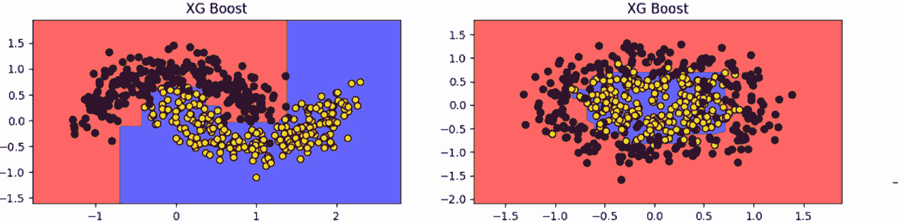

### LightGBM

由微软研究院开发，旨在追求速度与效率，`LightGBM` 是一个在处理大规模数据集方面表现出色的梯度提升框架。

以下是其关键特性：

*   **优点**：快速、高效，非常适合处理大规模数据集（高达数百万行）
*   **局限性**：在小数据集上容易过拟合，需要谨慎调优
*   **重要参数及范围**：叶子数常在 `[20, 40]` 范围内，`learning_rate` 在 `[0.01, 0.1]` 范围内

下图直观展示了 `LightGBM` 如何跨不同数据集创建分类决策边界：

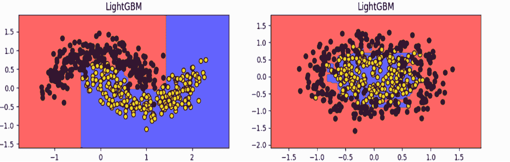

这些图表展示了 `LightGBM` 对数据中线性和非线性关系的建模能力。在前两张图中，我们看到它成功分离了两个线性不可分的类别。最右侧的图展示了 `LightGBM` 创建更简单的线性边界。

重要的是要谨慎解读上述所有发现，因为此处获得的见解可能不直接适用于真实世界的数据集。

特别是在高维空间中，数据往往以线性方式变得更易分离，`Naive Bayes` 和线性 `SVMs` 等分类器的简单特性可能比更复杂的分类器产生更有效的泛化能力。

总之，`随机森林`、`GBMs`、`AdaBoost`、`XGBoost` 和 `LightGBM` 非常适合处理金融数据中的复杂关系和非线性模式。然而，它们可能需要仔细的参数调优且计算成本较高。

虽然 `逻辑回归`、`决策树`、`kNNs` 和 `Naive Bayes` 等简单模型不一定总能达到最高的信噪比（以夏普比率衡量），但它们提供了简单性、可解释性和对异常值的鲁棒性，使其适用于特定场景。

在探索了预测分类标签的算法后，我们转向用于预测数值的回归算法。

### 回归算法

`回归算法` 用于根据一个或多个输入特征预测连续数值。在本节中，我们将探讨多种回归算法，从简单的线性模型开始，逐步过渡到更复杂的非线性模型。理解线性与非线性模型的区别至关重要：线性模型假设输入特征与目标变量之间存在直线关系，而非线性模型能捕捉更复杂的曲线关系。

为了阐释这些概念及不同回归算法的能力，我们将使用一个示例。这将使我们能直观观察每种算法如何尝试建模数据中的潜在模式。我们的主要目标不是在此特定数据集上达到最优预测准确性，而是获得对每种算法行为、优势和局限性的直观理解。

通过观察这些模型在受控示例上的表现，我们可以获得关于其在真实世界回归问题中适用性的更广泛见解，如下所示：

##### 线性回归

作为统计建模中的基础算法，`线性回归` 使用线性方程建模因变量与一个或多个自变量之间的关系。现在，让我们考虑以下优缺点：

*   **优点**：简单、可解释，对中小型数据集高效
*   **局限性**：假设线性关系，不适合复杂模式
*   **数据集限制**：对中小型数据集高效（最多约 10 万行）
*   **导入语法**：`from sklearn.linear_model import LinearRegression`

作为第一步，我们将 `线性回归` 应用于带噪声的周期波数据集，牢记其在建模非线性模式方面的固有局限性，如下图所示：

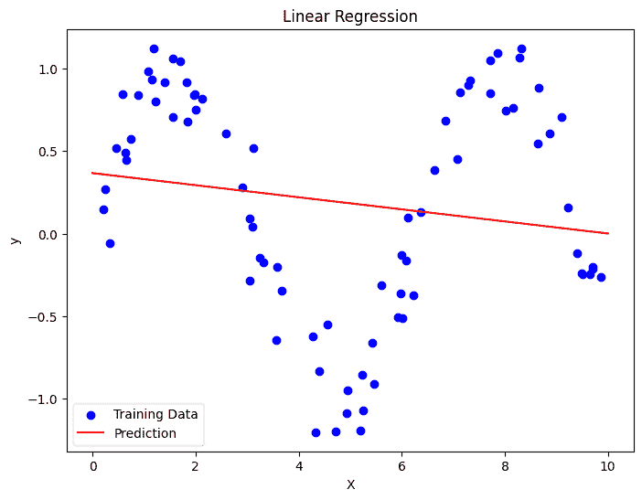

图中描绘了 `线性回归` 模型（红线）试图拟合带噪声的周期性数据集，结果得到一条无法捕捉潜在波浪模式的直线。这凸显了 `线性回归` 的根本局限性：它无法建模非线性关系，因为它只能生成数据的线性近似。

##### 岭回归

`岭回归` 是 `线性回归` 的一种变体，旨在防止过拟合，特别是在输入特征相关时。它通过在模型方程中添加惩罚项来实现，该惩罚项会抑制过于复杂的模型。

请考虑以下优缺点：

*   **优点**：减少过拟合，适合相关特征
*   **局限性**：仍假设线性关系，不适合非线性数据
*   **关键参数**：`alpha`（正则化强度）
*   **合理值**：通常在 `[0.1, 100]` 范围内
*   **数据集限制**：适合中小型数据集（最多约 10 万行）


#### 正则化线性回归与树模型

##### Ridge 回归

**导入语法**：`from sklearn.linear_model import Ridge`

Ridge 回归的结果通常与 Lasso 回归非常相似，如 Lasso 回归图所示（图 5.18）。

##### Lasso 回归

另一种正则化线性回归方法是 Lasso，全称 Least Absolute Shrinkage and Selection Operator（最小绝对收缩和选择算子）。其关键特性是使用惩罚项，这不仅能防止过拟合，还能通过将某些系数驱动为零来实现自动特征选择。

以下是其主要优势和局限性：

- **优势**：内置特征选择，适合高可解释性模型
- **局限性**：难以处理复杂的非线性数据
- **关键参数**：`alpha`（正则化强度）
- **合理取值**：通常在 `[0.001, 1]` 范围内
- **数据集限制**：适合中小型数据集（最多约 10 万行）
- **导入语法**：`from sklearn.linear_model import Lasso`

尽管增加了惩罚项，应用于该非线性数据集的 Lasso 回归模型仍产生线性拟合，如下图所示：

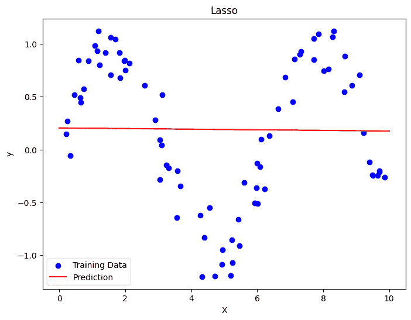

##### ElasticNet

ElasticNet 回归结合了 Ridge 和 Lasso 的惩罚方法，生成更灵活的线性模型，能处理更广泛的数据场景，特别是在处理相关特征时。

以下是其优缺点：

- **优势**：平衡特征选择和正则化，适合多重共线性数据
- **局限性**：需要调优参数，比简单线性模型更复杂
- **关键参数**：`alpha` 和 `l1_ratio`
- **合理取值**：`alpha` 在 `[0.1, 100]`，`l1_ratio` 在 `[0.1, 0.9]`
- **数据集限制**：适合中型数据集（最多约 50 万行）
- **导入语法**：`from sklearn.linear_model import ElasticNet`

鉴于数据集的简单性，ElasticNet 图表与 Lasso 图表几乎相同，此处省略。

##### 决策树回归器

与前面的线性方法不同，决策树回归器使用树状结构建模数据，能够捕捉非线性关系。

以下是其关键特性总结：

- **优势**：无数据分布假设，擅长处理非线性数据
- **局限性**：容易过拟合，对数据变化敏感
- **关键参数**：`max_depth`
- **合理取值**：常见范围 `[3, 10]`
- **数据集限制**：适合中小型数据集（最多约 10 万行）
- **导入语法**：`from sklearn.tree import DecisionTreeRegressor`

下图展示了决策树回归器特有的阶梯状预测曲线，这是由其分支结构和数据空间划分方式决定的：

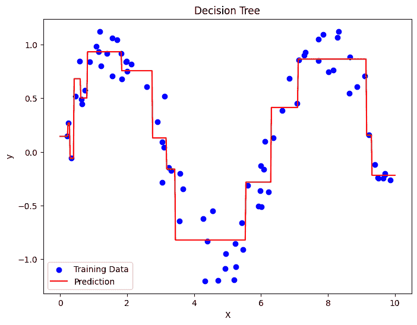

##### 随机森林回归器

随机森林回归器是一种高效的集成方法，通过组合多棵决策树来提高预测准确性并降低过拟合风险。

以下是其优缺点：

- **优势**：鲁棒抗过拟合，在许多问题上表现良好
- **局限性**：可解释性较差，大数据集上可能较慢
- **关键参数**：`n_estimators`（树的数量）
- **合理取值**：通常在 `[10, 200]` 范围内
- **数据集限制**：适合中大型数据集（最多 100 万行）
- **导入语法**：`from sklearn.ensemble import RandomForestRegressor`

下图展示了随机森林回归器在噪声数据集上更平滑、更泛化、更精细的预测：

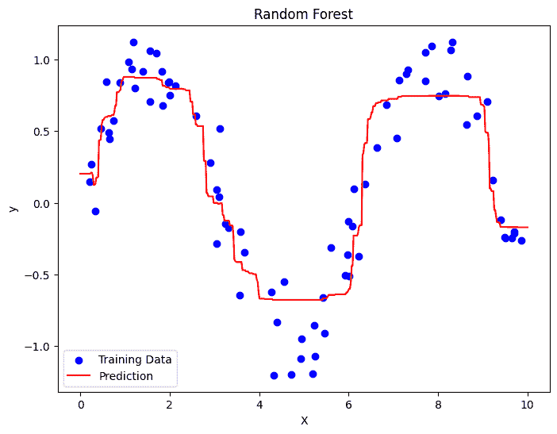

##### 梯度提升回归器

梯度提升回归器以高预测准确性著称，通过迭代构建树来实现。每棵新树专门训练以纠正前面树的错误，给分错实例更高权重。

以下是其优势与劣势：

- **优势**：通常高性能，能处理各种数据类型
- **局限性**：易过拟合，计算密集
- **关键参数**：`n_estimators` 和 `learning_rate`
- **合理取值**：`n_estimators` 在 `[100, 500]`，`learning_rate` 在 `[0.01, 0.3]`
- **数据集限制**：适合中型数据集（最多约 50 万行）
- **导入语法**：`from sklearn.ensemble import GradientBoostingRegressor`

如图所示，梯度提升回归器与随机森林类似，能捕捉非线性关系，但比单棵决策树产生更平滑、阶梯感更弱的预测曲线：

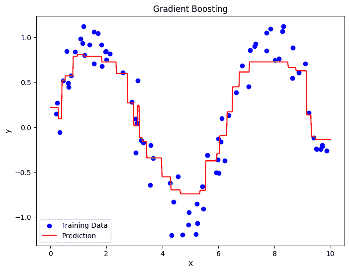

### K 近邻回归器

该算法基于 k 个最近邻居的平均值预测数据点值。预测时，它找出与新输入点最相似的 k 个训练数据点，并平均它们的目标值。以下是在交易背景下使用 k-NN 算法进行回归任务的优缺点：

- **优势**：简单有效，适合小数据集
- **局限性**：计算密集，不适合高维或大型数据集
- **关键参数**：`n_neighbors`
- **合理取值**：通常在 `[3, 20]` 范围内
- **数据集限制**：适合小数据集（最多约 5 万行）
- **导入语法**：`from sklearn.neighbors import KNeighborsRegressor`

下图展示了 k-NN 回归器基于 k 近邻平均值预测，在噪声周期数据集上产生阶梯状预测曲线：

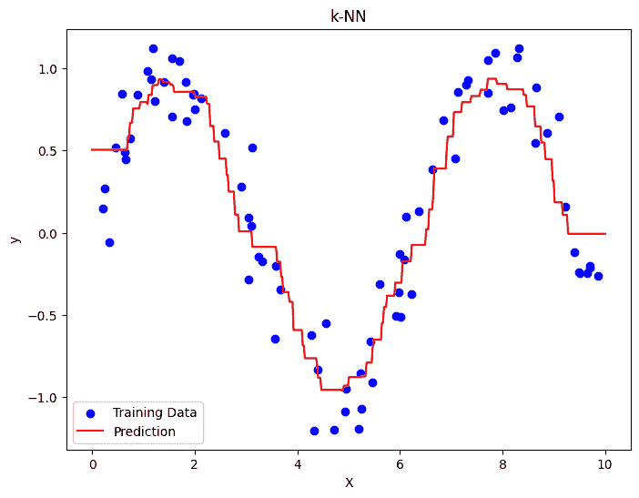

##### 贝叶斯岭回归

贝叶斯岭回归通过为模型参数估计提供概率框架，扩展了标准线性回归。这使我们能量化预测相关的不确定性，不仅得到单一预测值，还得到预测区间。

以下是其主要特征：

- **关键参数**：`alpha` 和 `lambda`（权重和噪声的精度）
- **合理取值**：通常通过交叉验证微调；常从默认值开始
- **数据集限制**：适合中小型数据集（5 万至 10 万行），取决于特征复杂度
- **导入语法**：`from sklearn.linear_model import BayesianRidge`

贝叶斯岭回归能提供带不确定性估计的稳健预测，如下图所示，我们对数据集应用滑动窗口方法与贝叶斯岭回归。在该可视化中，红色预测线的每个片段代表针对不同数据窗口拟合的模型，周围的阴影区域表示预测区间，反映模型对其预测的不确定性：

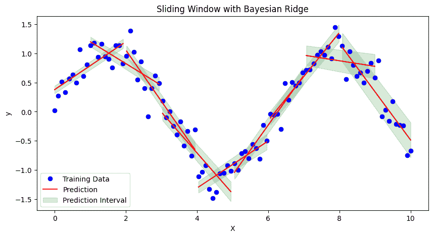

在探讨了关键监督学习算法后，我们现在将重点转移到选择标准和指标上，这对于为特定交易应用选择最合适的算法至关重要，需考虑数据特征、预测类型和性能指标，包括准确率、精确率和召回率。

## 交易应用的选择标准

本节解决评估和选择 ML 算法的关键任务，特别关注分类模型和回归模型的区分，因为它们适用不同的指标。

对于分类算法，准确率、精确率、召回率和 F1 分数等关键指标在评估性能中起核心作用。

相反，对于回归模型，我们关注均方误差（MSE）、均方根误差（RMSE）和平均绝对误差（MAE）等指标。这种区分对于准确衡量每种算法在其各自领域的有效性至关重要，确保为交易应用中的相应任务选择正确的模型。


#### 分类指标

分类指标主要关注准确分类实例的数量，这与回归问题形成对比，后者的关键在于距离度量。分类指标不评估误差的程度，而是统计算法误分类的实例数量。无论涉及的类别数量多少，这一原则均适用。换句话说，这些指标无论用于二分类（两个类别）还是多分类问题（两个以上的类别）都同样适用。

#### 混淆矩阵

包含所有实例（无论分类正确与否）的表格称为混淆矩阵。我们将了解其定义，并探讨该矩阵如何作为一种工具，用于计算和理解精确率、准确率和召回率等关键指标。

混淆矩阵是一种结构化数组，它通过根据预测分类和实际分类对所有实例进行归类，来捕捉分类模型的性能。从结构上看，矩阵的列代表模型预测为正例或负例的实例，因此被标记为正例或负例：

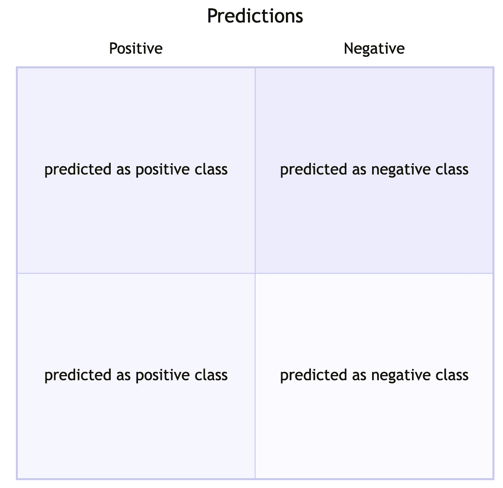

可以将混淆矩阵视为分类模型的一份详细成绩单。在监督学习中，我们拥有答案（真实标签）。混淆矩阵将模型的答案（预测）与答案进行比较，从而给出其性能的详细细分。它将每个预测归入四组：真阳性 (TP)、假阳性 (FP)、真阴性 (TN) 和假阴性 (FN)，从而提供模型准确性的全面视图：

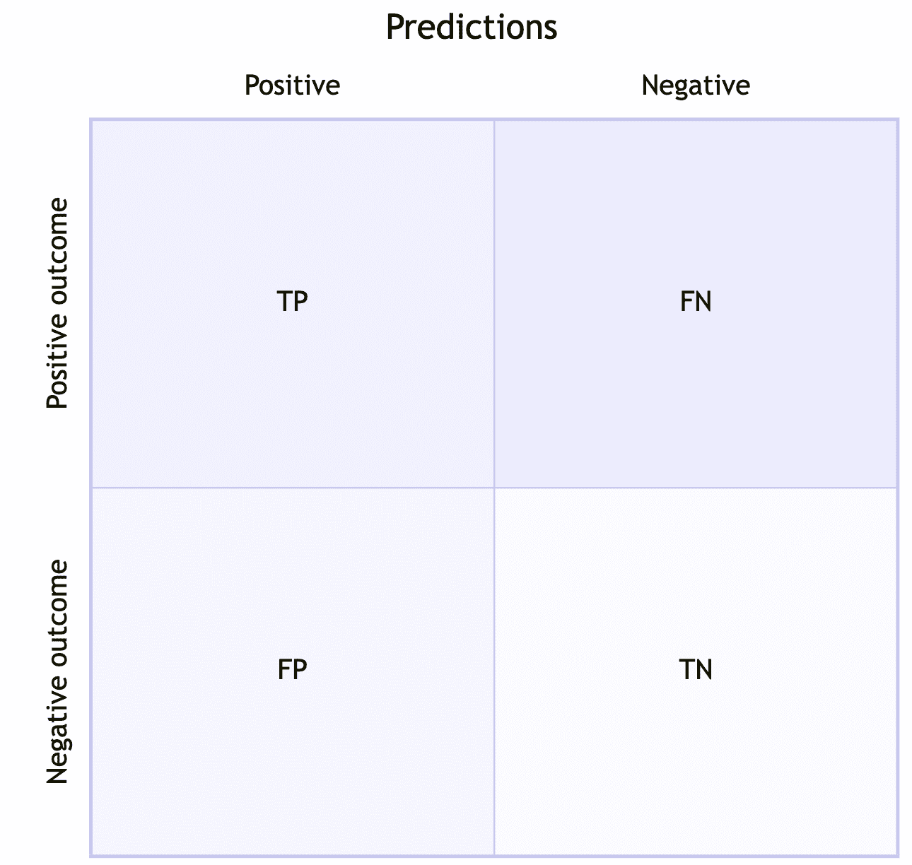

#### 准确率得分

在混淆矩阵中，落在对角线（左上到右下）上的实例代表分类正确的情况 6。这些预测类别与实际类别完美一致的实例，表明了模型的成功预测。这就是准确率得分的本质：


让我们用一个简单的数值示例来说明准确率得分是如何计算的。设想一个 ML 模型，用于预测一笔交易是否会盈利。在 100 笔交易上测试后，结果如下：

* 模型预测 40 笔交易为盈利（正类标签）。
* 在这 40 笔交易中，只有 30 笔真正盈利，为 TP。
* 剩余 10 笔交易未产生任何收益，但模型错误地将它们标记为盈利，为 FP。
* 在这 60 笔交易中，25 笔未产生任何收益，为 TN。
* 剩余 35 笔实际上是盈利的，但被错误地标记为不盈利，为 FN。

这给出了：

* 真阳性 (TP)：30（模型正确预测了盈利交易）
* 假阳性 (FP)：10（模型错误预测了盈利交易）
* 真阴性 (TN)：25（模型正确预测了亏损交易）
* 假阴性 (FN)：35（模型错误预测了亏损交易）

让我们使用准确率得分公式来计算该指标：


以下代码用于用数值示例的数据填充矩阵，然后使用 Scikit-Learn API 计算指标：

```python
from sklearn.metrics import confusion_matrix, accuracy_score

import numpy as np

##### 分类预测和实际标签：
y_true = [1]*30 + [0]*10 + [1]*40 + [0]*25  # 30 TP, 40 FN, 10 FP, 25 TN
y_pred = [1]*30 + [1]*10 + [0]*40 + [0]*25  # 预测标签

##### 创建混淆矩阵
conf_matrix = confusion_matrix(y_true, y_pred)
accuracy = accuracy_score(y_true, y_pred)

print("Accuracy:", np.round(accuracy, 2))
```

Accuracy: 0.55

#### 精确率得分

精确率得分指标源于模型预测正例有多准确这一直觉。它专门关注模型预测为正例的所有实例中，真阳性 (TP) 所占的比例。本质上，精确率告诉我们模型正向预测的可靠性如何，而不考虑其在负例上的表现。

公式如下：


让我们用数值示例来说明精确率是如何计算的：

ML 模型预测一笔交易是否会盈利。在 100 笔交易上测试后，结果如下：

* 模型预测 40 笔交易为盈利（正类标签）。
* 在这 40 笔交易中，只有 30 笔真正盈利，为 TP。
* 剩余 10 笔交易未产生任何收益，但模型错误地将它们标记为盈利，为 FP。

下图展示了如何在混淆矩阵中组织这些元素：


现在，让我们计算精确率得分：

* TP：30（被正确识别为盈利的交易）
* FP：10（被错误识别为盈利的交易）

使用精确率公式，如下：


这意味着模型识别为有价值的交易中，有 75% 确实是有价值的。在此背景下，精确率告诉我们模型预测的可靠性如何。

要以编程方式计算精确率，可以使用 Python 中 `sklearn.metrics` 模块的 `precision_score` 函数，如下所示：

```python
##### 计算精确率：
from sklearn.metrics import precision_score

precision = precision_score(y_true, y_pred)
print("Precision:", np.round(precision, 2))
```

Precision: 0.75

#### 召回率得分

召回率关注模型正确识别所有实际正例的能力。它衡量真阳性预测相对于实际正例总数的比例。

与精确率不同，召回率同时考虑了正确识别的正例和遗漏的正例 (FN)，提供了模型捕捉所有相关实例能力的度量：


继续沿用交易预测模型示例：

* 如前所述，共有 70 笔盈利交易。
* 在这 70 笔盈利交易中，模型仅识别出 30 笔 (TP)，而遗漏了 40 笔 (FN)：


现在，让我们计算召回率：

* TP：30（被正确识别为盈利的交易）
* FN：40（模型遗漏的盈利交易）

使用召回率公式：


召回率得分 = 30/70 即 43%

将 scikit-learn 的 `recall_score` 函数应用于我们的交易示例，得到：

```python
from sklearn.metrics import recall_score

recall = recall_score(y_true, y_pred)
print("Recall:", np.round(recall, 2))
```

Recall: 0.43

这意味着模型正确识别了所有盈利交易中的 43%。召回率反映了模型寻找所有潜在盈利交易的能力，无论它错误地将多少交易标记为不盈利。

#### F1 得分

F1 得分是一个结合了精确率和召回率的指标，提供单一得分来衡量模型的准确性。当你需要在精确率和召回率之间取得平衡时，它特别有用，这在 FP 和 FN 代价都高昂的场景中经常出现。

F1 得分是精确率和召回率的（调和）平均数，赋予两个指标同等权重，如下：


将 scikit-learn 的 `f1_score` 函数应用于我们的交易示例，得到以下结果：

```python
from sklearn.metrics import f1_score

f1 = f1_score(y_true, y_pred)
print("F1-Score:", np.round(f1, 2))
```

F1-Score: 0.55

当你寻求在识别所有相关实例（召回率）和确保识别出的实例确实相关（精确率）之间取得平衡时，F1 得分指标是一个很好的选择。

现在我们了解了评估分类模型的关键指标，接下来将关注针对回归任务量身定制的指标，在那里重点从分类准确性转移到连续值预测精度的度量上。

#### 回归指标


#### 评估回归模型

评估回归模型需要用能够量化预测值与实际值之间差异的指标。让我们探讨一些常见的回归指标，首先从 MSE 开始。

##### 均方误差

MSE 测量估计值与实际值之间平均平方差异。它是衡量回归模型准确性的常用指标。下图通过将实际值与预测值绘制在一起，并用垂直线表示每个点的误差，直观地展示了线性回归模型的预测误差。

然后将这些误差平方并求平均以计算 MSE，如下所示：


由于对每个误差项进行平方，MSE 对较大误差的惩罚比对较小误差的惩罚更严厉。这使得它对异常值敏感，并放大了较大误差的影响，与其他指标相比，如下所示：


使用 scikit-learn 中的 `mean_squared_error` 函数计算 MSE，如下所示：

```python
from sklearn.metrics import mean_squared_error, mean_absolute_error

###### 示例：可以使用以下方式计算 MSE
mean_squared_error(y_true, y_pred)
```

##### 均方根误差

RMSE 是 MSE 的平方根。它也是衡量回归模型准确性的指标。

通过对 MSE 开平方，RMSE 将误差指标转换回目标变量相同的单位，使其更具可解释性，如下所示：


以下是使用 Scikit-Learn 的实现代码：

```python
from sklearn.metrics import mean_squared_error

###### 示例：可以使用以下方式计算 RMSE：
sqrt(mean_squared_error(y_true, y_pred))
```

##### 平均绝对误差

MAE 测量一组预测中误差的平均幅度，而不考虑其方向。它是预测值与实际观测值之间绝对差异的平均值：


与 MSE 或 RMSE 不同，MAE 给出的是线性得分，这意味着所有单个差异的权重相等。它对异常值不敏感，如下所示：

```python
from sklearn.metrics import mean_absolute_error

mean_absolute_error(y_true, y_pred)
```

## 总结

在本章结束时，我们介绍了监督学习作为数据驱动交易的强大工具。核心原则是利用标记的历史数据训练算法，以预测未来的市场行为，用分类预测运动方向，用回归预测运动幅度。

选择合适的算法和评估指标（分类用准确率、精确率、召回率；回归用 MSE、RMSE、MAE）至关重要。监督学习为开发复杂且潜在盈利的交易策略提供了框架，但需要仔细考虑模型复杂性、可解释性以及金融数据的特性。

在下一章中，我们将探讨用于交易的特征工程，从价格数据衍生的基本特征开始。然后我们将引入技术指标，接着转向更高级的特征工程，包括基于记忆的特征、基于信息的特征（如赫斯特指数和熵），甚至源自机器学习模型本身的特征。最后，我们将介绍 PCA 和 UMAP 等降维技术，并讨论有效特征选择的策略，以提高模型性能和可解释性。

---

**加入我们书籍的 Discord 空间**

加入书籍的 Discord 工作区，获取最新动态、优惠、全球科技资讯、新版本发布以及作者专场活动：

[`discord.bpbonline.com`](https://discord.bpbonline.com)


### 第 6 章：利用特征提升模型能力

## 简介

提升模型性能在很大程度上取决于有效的特征工程。在本章中，我们将探讨不同的特征工程和选择方法，涵盖广泛的技术。我们从基于开盘价、最高价、最低价、收盘价（OHLC）的基本方法开始，逐步深入到基于机器学习的更高级技术，如 PCA 和 UMAP。我们还将讨论特征选择方法及其在模型优化中的关键作用。本章介绍了多种特征工程方法，从统计和基于信息的特征（如赫斯特指数和熵）开始。然后探讨更高级的技术，包括源自决策树的特征。通过展示这些方法，本章为读者提供了将原始数据转化为有意义输入的工具，从而提高模型性能和可解释性。

## 结构

在本章中，我们将涵盖以下主题：

- 基于 OHLC 的基本特征
- 技术特征
- 波动率和基于美元的特征
- 记忆保留特征
- 统计和基于信息的特征
- 基于机器学习的特征
- 特征选择

## 目标

在本章结束时，读者将对特征工程及其对模型性能的影响有一个清晰、实用的理解。他们将学习如何应用各种技术，从基本转换到基于机器学习的高级方法。

一个关键收获是选择和设计能够提高预测准确性同时降低过拟合风险的特征的能力。本章强调了在信息量丰富的特征与模型复杂性之间取得平衡的重要性，以确保更稳健和可泛化的结果。

此外，读者将培养分析思维技能，并深入了解特征工程和选择背后的决策过程。通过实践操作，他们将学会将原始数据转化为提高模型性能的有用特征。

## 基于 OHLC 的基本特征

在讨论用于算法交易的机器学习时，理解基本特征（如 OHLC 数据）至关重要。OHLC 数据代表了金融时间序列数据的主要结构，提供了关于价格变动的重要信息。

### 滞后值作为特征

将滞后值作为特征引入，将过去观测值的记忆纳入分析。这种方法认识到过去的值可能对未来趋势产生重大影响，捕捉了对准确预测至关重要的时间依赖性。通过使用滞后特征，模型可以更好地基于历史数据理解和预测模式，从而做出更稳健和明智的决策。

例如，下表展示了一个简单的一维时间序列，值从 1 到 7，以及添加滞后为 2 的滞后特征后的结果：

| 时间索引 | 数值 | Lag_1 | Lag_2 |
| :--- | :--- | :--- | :--- |
| 0 | 1 | | |
| 1 | 2 | 1 | |
| 2 | 3 | 2 | 1 |
| 3 | 4 | 3 | 2 |
| 4 | 5 | 4 | 3 |
| 5 | 6 | 5 | 4 |
| 6 | 7 | 6 | 5 |

表 6.1：时间序列转滞后特征

在探讨了通过滞后特征引入记忆到模型中的好处之后，现在让我们使用对 OHLC 数据的简单算术运算来提取有洞察力的特征，以进一步增强我们的时间序列分析。

##### 基于算术的特征

在量化金融背景下，可以使用对 OHLC 数据的基本算术运算[¹] 创建各种特征。这些特征涉及 OHLC 值的组合和转换，以捕捉市场行为的不同方面：

- **基于波动率的特征**：
  公式：`((high - low) / open)`
  它衡量单个交易周期内价格的相对波动率。

- **价格动量特征**：
  公式：`(close / close.shift(5)) - 1`
  它表示过去五个周期收盘价的百分比变化。

[¹]: [chap06.xhtml#footnote-120]


• **日内价格区间特征**：

公式：`(high - low) / (high.shift(1) - low.shift(1))`

它将今日价格区间与前一日区间进行比较。

• **收盘价在区间中的相对位置**：

公式：`(close - low) / (high - low)`

它指示收盘价位于当日区间的何处。

• **相对前收盘价的跳空特征**：

公式：`(open - close.shift(1)) / close.shift(1)`

它衡量从前一收盘价到今日开盘价的价格跳空。

• **归一化最高价特征**：

公式：`(high - mean(OHLC)) / std(OHLC)`

它将最高价相对于 `OHLC` 值的均值和标准差进行归一化。

• **收盘价对开盘价的相对变化**：

公式：`(close - open) / open`

它衡量同一交易时段内的百分比价格变动，将收盘价与开盘价进行比较，作为开盘价的比例。

• **加权 OHLC 平均值**：

公式：`(open + high + 2*close + low) / 5`

它代表 `OHLC` 的加权平均值，赋予收盘价更大的权重。

• **归一化成交量加权收盘价**：

公式：`(close * volume) / mean(volume)`

它代表由交易量调整并按平均成交量归一化的收盘价。

• **高低点聚类**：

公式：`(high - high.shift(1)) * (low - low.shift(1))`

它考察高低点与前一周期相比的聚类效应，并提供连续周期高低点之间关系的定量度量。

下图可视化了 `SPY` ETF 价格的高低点聚类效应，SPY 是一种跟踪标普 500 指数的交易所交易基金 (ETF)。图表展示了这些波动如何与上述计算相一致：


底部曲线代表 HL 聚类度量，明显的峰值表明连续高点和低点之间存在显著偏差，反映了价格波动率增加的时期。

这些特征通过简单的算术运算创建，在算法交易模型中使用时可能很有用。它们捕捉了市场行为的各个方面，从波动率和动量到相对定位和价格走势趋势。让我们继续探索创建不需要密集运算的简单特征。

##### 特征离散化

特征离散化可以是一种有价值的转换。金融时间序列数据通常是连续且高度变化的，这使得机器学习算法难以处理。通过将连续特征转换为一组有限的离散区间或类别，特征离散化简化了数据并增强了模型的可解释性。`Scikit-learn` 提供了这一原理的实现。正如文档[²]所述，特征离散化涉及以下步骤：

1. 将每个特征分解为一系列等宽的箱体。
2. 对这些离散值进行编码。
3. 将这些特征输入机器学习算法。

以下是这些步骤所需的代码：

```python
from sklearn.preprocessing import KBinsDiscretizer

#### 使用 KBinsDiscretizer 转换数据集
enc = KBinsDiscretizer(n_bins=8, encode="onehot")
X = enc.fit_transform(df)
```

此过程允许模型表现出非线性行为（即使在线性分类器的情况下也是如此！）。适当应用的特征离散化因此可以提高模型性能，从而设计出更有效的策略。

所有这些特征，连同所有列的百分比变化和滞后值，为机器学习算法构成了一套全面的初始特征集。该特征集应用于日频 `SPY` ETF，使用 `Random Forest`（随机森林）分类器。关于此处使用的监督学习概念，请参阅 第 5 章，交易系统的监督学习。生成的分类用于生成权益曲线，提供模型随时间变化的性能可视化表示：


以下是该系统的混淆矩阵：

| | precision | recall | f1-score | support |
|---|---|---|---|---|
| -1.0 | 0.11 | 0.51 | 0.18 | 143 |
| 1.0 | 0.92 | 0.55 | 0.69 | 1364 |
| accuracy | | | 0.55 | 1507 |
| macro avg | 0.51 | 0.53 | 0.43 | 1507 |
| weighted avg | 0.84 | 0.55 | 0.64 | 1507 |

此示例作为一个初步的有希望的探索，此处的重点不是对该特定算法的详细分析[³]，因为本章后续章节将展示进一步的实验。

在基础特征的基础上，我们现在转向探索基于技术交易指标的特征，这些指标能提供对市场趋势和交易者行为更深刻的洞察。

## 技术特征

技术指标植根于市场价格和成交量数据，是交易者检测趋势、识别市场状态、衡量动量和波动率的重要工具。这些指标反映了交易专业知识和市场心理，弥合了原始金融数据与可操作洞察之间的鸿沟。它们为机器学习中的特征工程提供了关键基础，在特征工程中，它们被转化为可度量的属性以改进预测模型。

对于对技术分析在金融市场中盈利能力证据感兴趣的读者，Park 和 Irwin 进行的研究[⁴]提供了全面的综述。它涵盖了调查、理论和实证研究，以评估技术交易策略的有效性。该文献指出，虽然早期研究显示外汇和期货市场存在盈利能力，但后期研究显示在各个市场中都存在稳定的利润。

这些指标通常是算法交易中机器学习模型特征集的基本组成部分。我们将探讨一系列关键技术指标，根据其主要功能对其进行分类，例如趋势检测、动量指标、资金流向和波动率分析。

让我们简要介绍将帮助我们实现这些指标的 `pandas_ta` 库。

### 使用 Python 实现技术指标

当涉及到在 Python 中将技术指标作为机器学习特征实现时，两个流行的库是 `TA-Lib`[⁵] 和 `pandas_ta`[⁶]。

选择哪一个取决于您的具体需求：

• `TA-Lib` 广泛使用、功能全面、效率高，并具有多种编程语言的绑定。然而，其在某些系统上的安装可能很复杂，且与 `Pandas` 库的集成度较低。

• `pandas_ta` 与 `pandas` DataFrame 配合使用非常容易，更符合 Python 风格，且安装简单。然而，对于大型数据集，它可能会较慢。

在我们的案例中，出于易用性和与 `Pandas` 库嵌套集成的原因，我们将使用 `pandas_ta`。

在以下章节中，让我们看看构建交易系统特征的主要指标（及其实现）。

##### 趋势检测

为了有效分析和解读市场趋势，通常使用以下指标：

• **移动平均线 (MA)**：通过平滑价格波动来识别潜在趋势
• **指数移动平均线 (EMA)**：对近期价格变化更敏感，有助于检测短期趋势
• **移动平均收敛发散指标 (MACD)**：突显趋势方向和动量，以及潜在的反转

要实现这些指标，请安装并导入 `pandas_ta`：

```bash
pip install -q pandas_ta
```

```python
import pandas_ta as ta
```

该库的用法包括调用相应的函数，然后将计算结果添加到 `pandas` DataFrame 中：

```python
##### 窗口为 5 个周期的移动平均线 (SMA)
```


##### 技术指标与特征工程

## 移动平均线

```python
df['SMA_5'] = df.ta.sma(close='Close', length=5)
```

### 指数移动平均线 (EMA)

```python
df['EMA_5'] = df.ta.ema(close='Close', length=5)
```

以下代码代表 MACD 线，即 12 周期 EMA（短期）与 26 周期 EMA（长期）之间的差值：

### 使用 pandas_ta 计算 MACD

```python
df['MACD'] = df.ta.macd(close='Close')['MACD_12_26_9']
```

此外，MACD 的 9 日 EMA 常被用作触发线以生成买入和卖出信号，当其穿越 MACD 线上方或下方时，指示潜在的进场或离场点。这条平滑线（`MACD_signal`）通过识别与 MACD 线的交叉来帮助生成买入和卖出信号。

其计算代码如下：

```python
df['MACD_Signal'] = df.ta.macd(close='Close')['MACDs_12_26_9']
```

##### 动量指标

动量指标帮助交易者评估价格变动的强度和速度，并识别潜在的超买、超卖或趋势反转状况。

技术分析中常用以下指标，并附带相应的代码片段演示其实现：

* **相对强弱指标 (RSI)：** 测量价格变动的速度，指示超买或超卖状况 7，如下所示：

```python
### RSI
df['RSI'] = df.ta.rsi(close='Close', length=14)
```

* **随机振荡器 8：** 显示收盘价相对于高低价区间的位置，识别潜在转折点，如下所示：

```python
### 随机指标
stoch = df.ta.stoch(high='High', low='Low', close='Close')
df = pd.concat([df, stoch], axis=1)
```

* **商品通道指数 (CCI)：** 识别新趋势或周期性状况，适用于多样的市场环境。CCI 测量证券当前价格变化与其平均价格变化之间的差异，帮助交易者识别商品及其他证券中的周期性趋势，如下所示：

```python
### CCI
df['CCI'] = df.ta.cci(high='High', low='Low', close='Close')
```

##### 波动率测量

波动率测量指标有助于评估价格波动的剧烈程度，提供对市场状况和潜在突破的洞察。这些指标对于识别高或低波动率时期特别有用，这会影响交易策略。

以下是关键波动率指标及其代码实现：

* **布林带 9：** 适应市场波动率，提供对市场状况和潜在突破的洞察。

```python
####### 使用 pandas_ta 计算布林带
bollinger = df.ta.bbands(close='Close', length=20, std=2)
df = pd.concat([df, bollinger], axis=1)
```

* **平均真实波幅 (ATR)：** 通过分解该周期资产的整个波动范围来衡量市场波动率。

## 成交量与资金流

成交量和资金流指标有助于评估市场参与度和流动性，提供对趋势强度和潜在反转的洞察，如下所示：

* **成交量：** 对于确认趋势的强度和可持续性至关重要
* **资金流指标 (MFI)：** 结合价格和成交量来衡量资金流入和流出，通常预示着潜在的反转

到目前为止，我们一直保持 OHLC K 线的原始时间结构，这是开发交易算法后续所有步骤的基础。在接下来的章节中，我们将讨论挑战这种将 OHLC K 线划分为固定时间间隔的刚性结构的研究。

### 基于波动率和美元金额的 K 线特征

美元金额 K 线的基本思想是将数据聚合为 K 线，而不是时间间隔或交易次数，即当累计美元价值（价格乘以成交量）达到指定阈值时形成一根新 K 线。在捕捉交易量和价格变动的影响比单纯观察基于时间的切片更有信息量的各种场景中，这种方法非常有用。

美元金额 K 线的适用性在日内数据或高频交易环境中尤为相关，因为传统的基于时间的 K 线可能无法充分捕捉市场动态。它们在管理日内数据中的噪音和变异性方面特别有效。

美元金额 K 线也可适用于交易量不规则或高波动率的市场；通过关注成交金额而非时间间隔，美元金额 K 线有助于规范化数据，因为时间间隔可能稀疏或不一致。

以下是微软 (MSFT) 股票典型基于时间的数据集示例，显示交易日内按 60 分钟间隔记录的价格：


现在，我们可以观察到将美元金额 K 线切片方法应用于该数据集时出现的显著差异。

我们根据该股票历史美元成交金额设定阈值（美元价值均值加上一个标准差）：

```python
### 每笔交易的美元价值
df['Dollar'] = df['Close'] * df['Volume']

### 设置您的美元金额 K 线阈值
threshold = df['Dollar'].mean() + df['Dollar'].std()

print(threshold / 1e8)
### 15.612632865944716
```

在下文中，我们观察到每当市场成交金额超过设定阈值，就会形成一根新 K 线。这是通过计算相应时间切片的标准统计量（OHLC）来实现的：

```python
for index, row in df.iterrows():
    if open_price is None:
        open_price = row['Open']
        index_bar = index
    high_price = max(high_price, row['High'])
    low_price = min(low_price, row['Low'])
    volume += row['Volume']
    cum_dollar += row['Dollar']
```

此过程确保 K 线根据市场活动动态创建，而非在固定时间间隔创建。以下代码片段演示了如何在成交金额跨越预定义阈值时，为每根新 K 线计算标准价格统计量 OHLC，从而有效捕捉有意义的价格变动。

我们获得了以下数据集。正如下图所示，通过基于成交金额计算 K 线，K 线数量减少了一半（5094 对比 2145）：


对于波动率 K 线，原理如下：K 线基于价格波动率水平而非时间或成交量形成。这意味着仅当价格变动或波动率达到特定阈值时，才会创建新 K 线。波动率 K 线的目的是捕捉显著的市场变动并过滤掉噪音，使其在震荡或高波动市场中特别有用。通过关注波动率，这些 K 线基于实际市场行为而非任意时间框架，提供了更清晰的市场趋势和潜在反转视图。

在下一节中，我们将继续探索改进 OHLC K 线的策略。我们接下来的重点不再是改变 K 线的划分方式（如前所述），而是确保在保持稳定统计特征的同时，保留价格 K 线内的信息。

### 记忆保留特征

计算金融学中的主要挑战之一是实现输入序列的平稳性 10。我们为什么要关心这个棘手的统计细节？答案很简单。

当输入特征平稳时，机器学习算法表现更好。

那么问题来了，“我们如何确保模型的输入是平稳的？”分阶差分 11。这有助于在实现平稳性的同时仍保留序列的一些记忆。分阶差分很有价值，因为它在保留部分记忆的同时转换时间序列数据，使其比失去所有过去依赖的完全差分序列更有利于预测。

简单来说，差分序列常用于计算金融数据中的收益率：


### 分数阶差分

说明分数阶差分的一个更简单方法是修改标准差分公式，使其允许部分差分。我们不再简单地减去前一个价格（如标准差分那样），而是引入一个分数权重：


在选择差分阶数 `d` 时存在权衡，如下所示：

*   **较低的 `d`，接近 0：** 保留更多记忆，意味着有价值的历史模式和依赖关系得以保留，但序列可能仍表现出非平稳行为。
*   **较高的 `d`，接近 1：** 实现更多平稳性，使数据更适合机器学习算法，但代价是丢失一些可能具有预测价值的过去信息。

当 `0 < d < 1` 时，过去的价格仍有贡献，但其影响力逐渐减弱。这意味着分数阶差分平滑地减少记忆，而非完全移除它，帮助交易者在保留有用历史模式的同时，使数据更稳定以便建模。当 `d = 1` 时，它简化为标准差分（收益率）。

此外，通过转换序列，您可能也在过滤掉噪声，这可以为机器学习模型带来更清晰的模式以供学习。

在下图中，我们对 CAC40 指数（雅虎代码 `'^FCHI'`）实施了我们讨论的方法，该指数代表法国股票市场。

结果符合我们的预期：


在图中，我们可以看到不同程度的分数阶差分（`d=0.1`、`0.2`、`0.35`）如何在保持整体模式完整的同时逐步平滑数据。这意味着序列变得更稳定、噪声更少，这有助于机器学习模型通过专注于基本趋势而非被随机噪声干扰来表现得更好。

为了检验[¹²]序列的平稳性，一种常用方法是使用增广迪基-富勒（ADF）检验，它评估时间序列是否非平稳。对于不熟悉的人来说，该检验本质上测试序列是否随时间保持一致的属性，这对许多统计和机器学习模型至关重要。

以下是其实现示例：

```python
from statsmodels.tsa.stattools import adfuller

### 执行增广迪基-富勒检验
for item in lst:
    print(item)
    adf_result = adfuller(df_lag[item].dropna())

    # 提取检验统计量和 p 值
    adf_statistic, p_value = adf_result[0], adf_result[1]

    # 显示结果
    print(np.round(p_value, 4))
    print(f'this series is stationary ? -> {p_value < 0.05}')
```

输出：

```text
^FCHI_Close
0.3037
this series is stationary ? -> False

^FCHI_Close_diff_frac_0.1
0.0563
this series is stationary ? -> False

^FCHI_Close_diff_frac_0.2
0.0092
this series is stationary ? -> True

^FCHI_Close_diff_frac_0.3
0.0007
this series is stationary ? -> True
```

我们得出结论，效果符合预期：少量的分数阶差分足以使序列符合统计要求。通过应用分数阶差分，可以在去除足够噪声以防止过拟合与保留序列中足够记忆以允许有意义预测之间保持平衡。这对金融时间序列至关重要，因为完全差分有时会移除人们试图建模的信号本身。

分数阶差分并非没有挑战。一个问题是它需要仔细选择差分阶数[¹³]，这并不简单，通常需要一些经验或统计理由。此外，计算复杂度[¹⁴]高于传统方法。

为了总结这种方法，我们需要将这种转换集成到机器学习框架内的操作序列中。首先，我们对序列应用分数阶差分，然后使用转换后的序列进行机器学习。一旦序列被转换，它就可以作为特征用于机器学习算法。机器学习模型被训练以基于此转换后的序列（以及任何其他相关特征）对结果进行分类或预测。

接下来，我们将关注统计和基于信息的特征，以增强我们的数据分析。

## 统计和基于信息的特征

在本节中，我们的重点将是考察两个关键指标：熵和赫斯特指数。让我们从赫斯特指数开始。

### 赫斯特指数

赫斯特指数的历史非常迷人，始于 20 世纪中叶，旨在利用埃及尼罗河的水力，特别是通过大坝建设等宏伟工程。大英帝国完成这一巨大壮举，很大程度上归功于杰出水文学家哈罗德·埃德温·赫斯特的贡献，他发现了一种非凡的统计方法，能够捕捉时间序列中的记忆效应。赫斯特的任务是了解河流的长期变异性，以优化埃及水库的蓄水容量。他观察到了河流流量和水位中的持久性，即长期记忆现象。这导致了赫斯特指数的发展，这是一种统计度量，此后被广泛应用于各个领域，特别是科学和工程，用于分析时间序列数据。

这种为尼罗河洪水模式提供重要知识的方法，正是我们计划在机器学习算法中用作特征的方法。

计算赫斯特指数（用 `H` 值表示，以纪念 E. Hurst）是量化时间序列呈趋势或均值回归程度的一种方式。`H` 值指示趋势或均值回归的存在，并量化持久性。

为了掌握赫斯特指数的功能，我们将创建三个表现出不同行为的时间序列：一个具有强烈均值回归倾向，一个代表随机游走，第三个显示持久行为。

然后我们将计算每个序列的赫斯特指数，以验证该统计度量是否准确辨别每个过程的特定性质和状态：

*   **`H < 0.5`** 表示均值回归行为。

在下图中，上方子图展示了一个均值回归过程，而下方子图显示了该过程对应的滚动赫斯特指数：


我们观察到，符合理论预期，赫斯特指数在其整个轨迹中始终保持在 `0.5` 阈值之下。这一阈值标志着均值回归过程的属性，该过程围绕一个中心值规律性地振荡。因此，赫斯特指数有效地识别出该时间序列的状态为均值回归和反持久。在交易场景中，这一洞察使我们能够实施针对这一特定动态量身定制的策略。

*   **`H` 约 `0.5`** 暗示纯随机游走。这意味着不可预测的噪声。

在下图中，上方子图展示了一个纯随机噪声过程，而下方子图显示了该过程对应的滚动赫斯特指数：


我们所见符合理论预期。在随机游走中，赫斯特指数通常徘徊在中心值（`0.5`）附近，正如下面的赫斯特指数直方图所示：


[¹²]: chap06.xhtml#footnote-109
[¹³]: chap06.xhtml#footnote-108
[¹⁴]: chap06.xhtml#footnote-107


然而，我们也注意到存在明显的瞬态阶段，在这些阶段中，该过程间歇性地表现出均值回归（`H < 0.5`）和持续趋势（`H > 0.5`）的特征。因此，在这种情况下，如果我们仅观察赫斯特指数，结论不像前一种情况那样清晰明了。随机游走可以被视为均值回归（前一种情况）和持续性（下文讨论的情况）之间的中间过程。

*   `H > 0.5` 表示趋势行为。

要将一个序列归类为持续性——表明记忆效应持续存在且增量呈正相关——指数值应在较长时期内保持在 0.5 以上。因此，我们可以迅速得出结论：赫斯特指数准确地识别出了该序列的持续特性。

这可以在下图中看到：


该图说明在较长时期内，赫斯特指数显著超过 0.5 阈值，表明存在强烈的趋势行为。这些较高的赫斯特值表明价格走势中存在持续的、定向的动量，意味着向上或向下的趋势更有可能在这些区间内延续。在趋势跟踪交易策略中，可以利用这种持续性。赫斯特指数既可应用于价格序列，也可应用于收益率序列。解读可能略有不同：

*   **价格序列**：将赫斯特指数应用于价格序列有助于理解长期趋势以及该序列偏离随机游走的程度
*   **收益率序列**：当应用于收益率序列时，赫斯特指数可提供关于收益率自相关性的洞察，以及它们是否随时间表现出均值回归或趋势行为

要在历史序列上通过滑动窗口基础[¹⁵]估算赫斯特指数，我们可以创建一个循环，遍历时间序列数据，在每次迭代中对数据子集计算赫斯特指数：

```python
from hurst import compute_Hc

def rolling_hurst(series):
    try:
        H, c, data_reg = compute_Hc(series.dropna(), kind='price', simplified=True)
        return H
    except FloatingPointError:
        return np.nan  # 或返回一个表示失败的特定值

#### 然后作为滚动应用：
df['hurst'] = df['Close'].rolling(window=window_size).apply(rolling_hurst, raw=False)
```

这将给出一个随时间变化的赫斯特指数估计值，这对于分析市场行为随时间的变化特别有洞察力。

### 熵简介

熵（`H`）是数据集中随机性或不确定性的度量[¹⁶]。

为了更好地理解熵，我们创建了一个模拟时间序列。

下图显示了该时间序列数据四个不同片段的熵（红色虚线，右侧坐标轴）可视化图（蓝线，左侧坐标轴）：


在常数段（2018-01 至 2018-03），熵非常低，表明不存在不确定性或变异性。随着序列进入线性趋势，熵略有增加，表明复杂性稍高但模式仍可预测。

线性趋势后的平坦段熵值下降，因缺乏变异性而回落至低值。

随机段的熵并不像人们预期的完全随机过程那样高，这表明随机性受到约束。

不同数据状态下熵的这种行为可被利用来理解潜在模式，并为机器学习中的预测建模提供信息。

估算熵[¹⁷]的方法与赫斯特指数相同。我们通过历史序列使用滑动窗口基础。然后，我们可以创建一个循环[¹⁸]来遍历时间序列数据。以下代码块生成了前图中显示的熵值。它使用 `PyInform` 库计算熵，该库提供信息论计算工具。具体而言，它将香农熵函数应用于数据集中 `'Close'` 列大小为 30 的滚动窗口，创建一个新特征 `"Entropy"`，量化每个窗口内的不确定性或变异性：

```python
from pyinform.dist import Dist
from pyinform.shannon import entropy

def compute_entropy(df1: pd.DataFrame):
    d = Dist(500)
    for x in df1:
        d.tick(int(x))
    return entropy(d)  # , b=10))

window_size = 30

#### 计算合并数据集的熵
df_combined['Entropy'] = df_combined['Close'].rolling(window=window_size).apply(compute_entropy, raw=False)
```

接下来，我们将熵值作为特征纳入机器学习算法。

##### 将熵用作特征

在机器学习中使用熵作为特征，涉及量化数据集中的不确定性或无序度，并利用该信息提高模型的预测能力。

以下是使用熵作为特征的一般方法：

*   **计算熵**：计算数据不同片段的熵。例如，在时间序列数据中，你可能会计算固定间隔内价格变化的熵。前述代码即为此方式提供了基础。
*   **特征创建**：将计算出的熵值视为特征。这些特征可提供关于数据不同部分可预测性或随机性水平的洞察。
*   **纳入机器学习模型**：将这些基于熵的特征与其他特征一起纳入你的机器学习模型。
*   **子群分析**：在包含各种子群的数据集中（如市场中的不同股票），比较这些群体间的熵。某子群中较高的熵可能表明更大的不可预测性。
*   **时间分析**：对于时间依赖性数据，分析熵随时间的变化。熵的突然变化可能预示着重要事件或底层数据生成过程的转变。
*   **与其他统计特征结合**：熵可与方差、偏度或峰度等其他统计特征结合，以提供对数据特征的全面视图。关于这些统计度量的详细介绍，请参阅第 3 章《优化交易系统、指标与自动化报告》。

在考察了用于理解数据行为的统计和基于信息的特征概念后，我们现在转向探索源自监督和无监督机器学习技术的特征。

## 基于机器学习的特征

基于机器学习的特征是传统分析的有力补充。与统计度量（如赫斯特指数和熵）或技术指标（如 MACD 和 RSI）不同，基于机器学习的特征能够捕捉数据中更复杂、非线性的相互作用，而这些可能对传统方法不可见。

使用这些特征的优势在于它们能够揭示数据的内在结构，提高模型可解释性，并有可能提升预测性能。它们支持开发更复杂、数据驱动的交易策略，能够适应复杂的市场动态。

在本节中，我们将介绍其中一些特征，从 PCA 开始，然后是 UMAP，最后是决策树叶节点特征。

### 基于 PCA 的特征

主成分分析（PCA）可将众多变量的信息浓缩到一组较小的成分中，这些成分最能解释数据的变异性，从而在保留关键信息的同时降低维度。


PCA 用于特征工程，旨在将高维数据集转换为低维数据集，同时尽可能保留更多信息（方差）。在下图中，整个数据集 19 经过 PCA 变换 20 后被压缩并投影到二维空间：


在图中，显示的两个类别（黄点和紫点）分别对应正收益类和负收益类（上涨和下跌）。虽然存在某些区域主要由单一类别占据，显示出同质性，但这些类别仍然在很大程度上是交织混合的。

这一发现并不质疑 PCA 生成特征的实用性。明确地说，目标并非仅凭这种新的特征表示就完全解决分类问题。相反，我们的目标是通过引入原始数据集中不明显的信息，来辅助分类算法。

这些新的 PCA 特征随后可作为机器学习模型的输入，提供原始数据的一种降维且信息丰富的表示。在处理多重共线性 21 或试图因高维度而提升算法性能时，这特别有用。

PCA 寻找原始特征的简单（线性）组合，因此如果类别在原始特征空间中不是线性可分的，PCA 可能无法实现清晰的分离。复杂金融数据通常就是这种情况。在这种情况下，各类别的点不会聚集在分离的区域中，但 UMAP 等方法可能会有所帮助。

### 基于 UMAP 的特征

与 PCA 通过简单变换捕捉全局数据结构不同，统一流形逼近与投影（UMAP）擅长同时保留数据的局部和全局结构，这使其特别适用于检测数据的潜在结构，如下图所示：


正如图中所示，UMAP 允许识别出某一类别占主导而另一类别缺失的明显区域。这种显著的分离符合 UMAP 明确展示类别间清晰区别的目标。因此，配备这种数据表示的分类算法将更容易完成分离任务。这种为便于算法处理而增强数据的做法，正是特征工程的核心作用。

UMAP 是一种复杂的技术，但我们可以依赖一个优雅简洁的 API22 来实现该算法：

```python
from umap import umap_ as UMAP

clusterable_embedding = UMAP.UMAP(n_neighbors=30, min_dist=0.0, n_components=8).fit_transform(vct_bin)

plt.scatter(clusterable_embedding[:, 0], clusterable_embedding[:, 1], c=y_test, s=20, cmap='viridis', alpha=0.4)

plt.legend(['-1', '1'])
```

只需这些代码行即可执行计算并展示结果。要集成 UMAP 特征，我们只需遵循前面为熵特征和 PCA 特征概述的流程。

让我们继续探索基于机器学习的特征创建。

### 基于决策树叶节点的特征

决策树叶节点索引提供了一种独特的特征提取方式，通过利用模型做决策时所走的路径。这种方法捕捉决策树处理数据的方式，将其内部决策过程转化为有用的数值表示。

下图展示了一棵经过训练 23 用于分类 SPY 日收益率的决策树：


思路很简单：我们首先在数据集上训练一棵决策树。训练完成后，每个数据点通过从树根移动到叶节点、在每一步遵循决策规则来进行分类。关键洞见在于，数据点落入的特定叶节点包含关于其特征的宝贵信息。

要将其转化为特征，我们为每个叶节点分配一个唯一索引。然后为每个数据点创建一个新特征，指示其所属的叶节点。这种方法有效地将树结构转换为可作为其他机器学习模型输入的格式，增加了超越传统特征的新预测信息层。

Sklearn API 为实现这种特征工程方法提供了实用途径。训练好树后，我们只需使用 `apply` 方法，它方便地提供了我们想要的输出：从根节点通向决策叶节点的叶索引序列：

```python
#### Get the leaf indices for each sample
leaf_indices_train = clf.apply(X_train)
leaf_indices_test = clf.apply(X_test)

#### merge leaf indexes with other features
X_train = pd.DataFrame(np.hstack([X_train, pd.DataFrame(leaf_indices_train)]))
X_test = pd.DataFrame(np.hstack([X_test, pd.DataFrame(leaf_indices_test)]))

#### Train a new model on the combined dataset
clf = RandomForestClassifier(max_depth=15)
clf.fit(X_train, y_train)
```

我们现已完成对特征工程的深入探索，展示了突破特征分析与处理边界的前沿方法（UMAP、分数阶差分等）。在构建并计算出数千个新特征后，下一步是减少特征数量。实现这一减少的各种技术是本章最后一节的主题。

##### 特征选择

特征选择是识别并选择对模型最相关特征的过程。这有助于将输入变量减少到对预测最有用的那些，从而提高模型效率。

减少特征数量的重要性怎么强调都不为过。在高维数据集中，特征数量远超观测样本数量时，模型可能遭受过拟合和维度灾难。该术语描述了这样一种现象：特征空间变得如此之大，以至于可用数据变得稀疏。这种稀疏性使得模型难以有效学习。结果，模型过度贴合训练数据，在未见数据上表现不佳。

相反，特征过少可能导致欠拟合，即模型无法有效学习数据中的潜在模式。

找到正确的平衡是关键。一个常用的启发式规则是特征数量应显著少于观测样本数量。

虽然没有铁律，但观测样本数量是特征数量的 5-10 倍这一准则可以作为起点。

现在，让我们看看如何减少特征数量。

### 互信息作为特征选择方法

互信息统计量可以捕捉变量间任何类型的统计依赖关系。当且仅当两个随机变量相互独立时，它等于零；值越高意味着依赖性越强。

通过计算每个特征与目标变量之间的互信息统计量 24，可以判断该特征是否包含足够的信息来预测结果。如果包含，则保留该特征；否则丢弃。

使用以下代码，针对该分类问题，我们根据互信息准则选择最优的 pct%（5%）特征：

```python
from sklearn.feature_selection import mutual_info_classif, RFE, SelectKBest

pct = 5

#### Assuming you want to select pct% best features
k_best = int(pct / 100 * len(X_train.columns))

#### Initialize SelectKBest with mutual information
sel2 = SelectKBest(mutual_info_classif, k=k_best)
sel2.fit(X_train, y_train)

#### Get the boolean mask of selected features
```


`selected_features_mask = sel2.get_support()`

#### 获取所选特征的列标签

`X_train.columns[selected_features_mask]`

作为回报，我们获得了所选特征的列表：

`['Adj Close_ret', 'Low_ret' , 'Relative_Change_Open_Close_ret' , 'BBB_20_2.0_ret', 'High_1', … ]`

### 递归特征消除

给定一个分配重要性 25（权重）给特征的外部估计器（`clf`），递归特征消除（RFE）的目标是通过递归地考虑越来越小的特征集来选择特征。首先，估计器在初始特征集上进行训练，并获得每个特征的重要性。然后，从当前特征集中剔除最不重要的特征。该过程在剪枝后的特征集上递归重复，直到达到所需的选择特征数量。

```
from sklearn.feature_selection import RFE

sel3 = RFE(clf, n_features_to_select = k_best , step = 0.3)

sel3.fit(X_train, y_train)

sel3.get_feature_names_out()[:100]
```

以下是所选特征的一小部分摘录：

```
['Gap_Previous_Close', 'CCI', 'GOOG_Adj Close_ret', 'AMZN_Open_ret',
'TSLA_Low_ret', 'NVDA_Low_ret', 'IBM_Low_ret', 'IBM_Adj Close_ret',
'Close_diff_frac_0.2_ret', 'Price_Momentum_ret', 'BBB_20_2.0_ret',
'MSFT_Volume_5', 'IBM_Open_4', 'IBM_Low_3', 'IBM_Volume_3',
'IBM_Volume_5', 'Price_Momentum_3', 'Intraday_Price_Range_1',
'Intraday_Price_Range_4', 'Intraday_Price_Range_5','Closing_Position_1', 'Gap_Previous_Close_5','Relative_Change_Open_Close_3' 'Normalized_Volume_Weighted_Close_1', 'MACD_Histogram_3',
'Open_ret_5', 'Adj Close_ret_3', …]
```

`RFE` 迭代地移除最不重要的特征，直到只保留最相关的特征。上述代码演示了如何使用分类器（`clf`）对特征重要性进行排序并选择前 `k_best` 个特征来应用 `RFE`。

拟合模型后，`get_feature_names_out()` 函数检索对预测贡献最大的最有信息量的特征。以下是所选特征的示例，其中包括技术指标（例如 `CCI`、`MACD_Histogram`）、基于价格的变换（例如 `Gap_Previous_Close`、`Intraday_Price_Range`）和分数阶差分（`Close_diff_frac_0.2_ret`）。这些所选特征通过减少噪声并专注于最有影响力的变量，增强了模型的预测能力。

在 `RFE` 识别出最相关的特征后，我们现在将探索使用降维技术（如 `PCA` 和 `UMAP`）进行特征选择。

### 使用 PCA 和 UMAP 进行特征选择

之前，我们将 `PCA` 和 `UMAP` 作为特征工程的方法进行了讨论。这些技术常用于特征选择阶段。在这些场景中，原始特征被替换为从 `PCA` 或 `UMAP` 衍生出的新特征。

与其简单地为模型输入选择合适的特征，重点转移到使用所有特征并利用 `PCA` 或 `UMAP` 技术将它们合并。这种方法创建了一组具有降低维度的新特征。对于实现部分，我们已经在前面专门介绍 `UMAP` 的章节中展示了代码。

现在我们知道了如何选择重要特征，让我们看看当你想从这些方案中的每一个的优点中受益时该如何进行。

### 使用集合运算符组合最佳特征

集合运算符是组合所有这些特征提议的合适答案。在本例中，我们结合了前几节中介绍的三种竞争性特征选择方法（`sel1`、`sel2` 和 `sel3`）的提议：

```
sel1 = SelectPercentile(mutual_info_classif, percentile = pct , n_neighbors = 10)

#### 使用互信息初始化 SelectKBest
sel2 = SelectKBest(mutual_info_classif, k = k_best) 
sel3 = RFE(clf, n_features_to_select = k_best , step = 0.3)
```

集合方法将所选特征封装在集合中：

```
set1 = set(sel1.get_feature_names_out())
set2 = set(sel2.get_feature_names_out())
set3 = set(sel3.get_feature_names_out())
```

使用集合运算符 `union`26 和 `intersection`27 来组合集合：

```
set1or2 = set1.intersection(set2)
print(len(set1or2))
set1or2or3 = set1or2.union(set3)
```

在竞争性特征选择方法的特征集的 `union`（并集）和 `intersection`（交集）之间进行选择取决于上下文：

- 对于观测值数量有限（与特征数量相比）的数据集，`intersection` 是避免过拟合的更安全选择。
- 如果特征选择方法从根本上不同且互补（例如，一种基于统计，如 `mutual_info_classif`，另一种基于模型，如 `RFE`），它们的 `union` 可能会产生一个更全面的特征集。当方法互补且有足够数据支持更大的特征集时，`union` 是有益的。否则，`union` 可能导致更大的特征集，这可能会增加模型的复杂性并可能导致过拟合。

## 结论

在本章结束时，我们了解了如何掌握优化机器学习模型性能所必需的特征工程和特征选择技术。

这不仅适用于预测性能，同样重要的是适用于机器学习模型的后期生产、部署和维护方面。这些方面统称为机器学习运营（`ML-Ops`）。我们还应该提到，特征选择在生产环境中具有实际好处。特征较少的模型通常运行更快、更易于解释且更具成本效益，特别是在处理大型数据集时。

现在我们已经拥有了坚实的机器学习基础，准备好探索高级算法了。

在下一章中，我们将专注于复杂的机器学习方法，范围从集成技术到持续在线学习方法。

---

- `H` 是随机变量 `X` 的熵
- `p(x_i)` 是第 `i` 个结果出现的概率
- 求和遍历 `X` 的所有 `n` 个可能结果

**加入我们书籍的 Discord 空间**

加入书籍的 Discord 工作区，获取最新动态、优惠、全球科技动态、新版本发布和作者见面会：

[`discord.bpbonline.com`](https://discord.bpbonline.com)


# 第 7 章  

## 交易的高级机器学习模型

## 简介

本章探讨了算法交易的高级机器学习技术，研究了超越传统监督学习的方法。我们将研究最先进的集成方法和在线学习方法，以改进交易策略。

本章首先深入探讨集成方法，通过组合多个模型来提高预测准确性并减少过拟合。然后我们讨论 Boosting、Bagging 以及 `XGBoost` 和 `LightGBM` 等特定算法，重点介绍它们在算法交易中的应用。

本章还探讨了高级回归方法，包括最小绝对收缩和选择算子（`LASSO`）和岭回归，并深入分析了它们在金融预测中的有效性。此外，我们将探索在线学习，考察 `Scikit-multi flow` 等工具以展示它们在实时金融信号跟踪中的作用。本章的目标是提供对这些高级方法的全面理解，以便读者能够有效地应用它们。

## 结构

在本章中，我们将涵盖以下主题：

- 理解高级机器学习
- 集成方法简介
- 用于分类的高级集成方法


• 高级回归方法

## 目标

本章介绍用于算法交易的高级机器学习技术，重点在于提高预测准确性和防止过拟合。读者将探索集成方法，如装袋法和提升法，并理解它们如何降低方差和偏差。他们将实现随机森林进行波动率预测，使用 `Scikit-Optimize` 微调 `XGBoost`，并使用分类报告评估模型。此外，本章还涵盖 `LASSO` 和岭回归，展示如何使用 `LASSO` 进行特征选择以减少过拟合并提高模型可解释性。读者还将探索用于非线性关系的核方法，以及用于实时模型适应的 `Scikit-multiflow` 在线学习。这些技术（包括 `XGBoost` 和在线学习）代表了机器学习的最前沿水平，为读者提供了构建适应性强、稳健的交易模型以应对动态市场条件的工具。

一个关于价差预测的案例研究演示了这些高级方法。首先，我们对正常与异常价格动态进行分类；然后，我们在波动率范围内预测价差的值。

## 理解高级机器学习

用于交易的现代机器学习既需要预测准确性，也需要适应性。那些只训练一次便无限期应用的传统模型，往往因趋势、波动率和市场结构的持续变化而在金融市场中失效。为了保持竞争力，交易者必须使用融合了模型集成、优化和实时适应最新进展的机器学习技术。

集成方法，包括装袋法和提升技术（如 `XGBoost`），代表了预测建模的最前沿。它们通过组合多个模型、迭代纠正错误和优化决策边界来提高准确性。这些方法已成为结构化数据任务（包括金融预测）的行业标准。`LASSO` 和岭回归引入了正则化，通过惩罚过度复杂性来优化模型并防止过拟合。核方法通过捕捉非线性关系扩展了传统回归，使模型能更好地反映复杂的金融依赖关系。

标准机器学习的一个关键局限性在于其静态本质：一旦训练完成，模型将保持固定，直到重新训练。在线学习通过允许模型利用新数据持续更新来克服这一局限，使其对快速变化的市场极为有效。这种实时适应对于高频交易、流式数据环境以及必须即时适应新模式的算法策略至关重要。

理解这些方法为交易者提供了工具，以构建超越传统方法的稳健、自适应和高性能模型。以下章节将分解这些技术及其在交易中的实际应用。为实现更高的预测稳定性和准确性，我们转向集成方法，通过组合多个模型来提升性能并减少错误。

## 集成方法简介

集成方法是一种通过将多个弱学习器组合成一个更强、更可靠的预测器来提高模型性能的有力途径。该技术利用了这样一个原则：聚合模型在稳定性和准确性方面通常优于单个模型。我们在第 5 章《交易系统的监督学习》及前几章中介绍了集成学习；现在，我们将更深入地探讨它并将其应用于交易策略。

集成 1 的核心优势在于其降低错误和减少预测噪声的能力。通过汇集不同模型的优势和洞见，集成方法能有效消除单个预测器的特有偏差和偏向。这种模型间的平均或投票过程有助于缓解过拟合。

然而，集成方法并非没有局限性。一个关键挑战是预测器之间潜在的相关性。如果单个模型过于相似或相关，集成将失去其多样性，从而丧失部分效力。另一个考量因素是预测器的数量；太少可能无法提供足够的多样性，而太多可能导致复杂性增加和边际效益递减。我们将在下一节“集成的统计基础”中详细讨论这些要点。

在接下来的章节“用装袋方法对抗过拟合”和“用提升法实现高准确性”中，我们将探讨两种主要形式的集成——提升法和装袋法，它们各自拥有独特的模型组合方法，并在交易算法语境下各具优势。

## 用于分类的高级集成方法

在本节中，我们将探讨集成学习的两大基石技术：装袋法和提升法。我们将探索这些方法 2 的基本原理，重点突出它们各自的优势及相互之间的差异。在剖析这些方法的过程中，我们将理解它们在提高各种场景下的预测准确性和模型稳健性方面的作用。

在下一节中，我们将解释集成背后的统计基础和动机。该部分为可选内容，读者可根据需要跳过。

### 集成的统计基础

在集成学习的语境下，组合模型以减少错误的理论动机可以通过偏差-方差权衡 3 来理解。集成的总体误差可分解为以下三个分量：

```

```

让我们定义这三个分量：

* **偏差** 是指模型因学习算法中过于简化的假设而持续做出错误预测的倾向。模型的简单性会导致高偏差，表现为系统性地偏离数据中的真实关系。下图对此进行了说明：

```

```

线性关系中所示的预测持续偏离准确性（虚线）。同样，我们演示了偏差如何影响机器学习分类算法。

在下图中，算法过于简化的类别间边界（分界面）持续导致不良的分类结果：

```

```

* **方差** 描述模型的预测误差在应用于不同训练数据集时波动的程度，突显了模型在不同数据条件下的不一致性。

* **不可约误差** 是任何模型固有的、无法避免的误差，由未知变量或数据固有的随机性等因素引起。

现在我们已掌握了基本术语，让我们探讨它们如何相互作用并共同构成模型的总体误差。

考虑一个由 N 个独立模型组成的集成，每个模型的方差为 ，偏差为 b。当这些模型被平均时，集成的偏差保持为 b，但方差降低为 `` ，假设模型相互独立且方差相等。

这种方差的降低对减少集成的总误差有显著贡献，因为总误差是偏差平方、方差和不可约误差的组合。

模型集成的方差可按如下方式确定：

```

```

这展示了集成如何通过减少误差的方差分量来显著降低误差。


##### 使用装袋法对抗过拟合

为了更准确地解释集成学习如何通过降低方差来减少误差，必须讨论模型之间的相关性。事实上，相关性是一把双刃剑；如果模型之间差异足够大，它会有所帮助，但如果模型过于相似，则会产生负面影响。

这种相关性显著影响集成的整体有效性，如下图所示：


大圆点表示较高的方差，而小圆点表示较低的方差。该图展示了相关性 `ρ` 与模型数量 `N` 之间的关系，清晰地描绘了模型相关性和集成规模对方差降低的影响。总之，如果模型并非完全独立，而是表现出一定程度的相关性，那么通过集成实现的方差降低 4 将受该相关性程度的调整。换句话说，模型之间的相关性越强，组合它们所能实现的方差降低就越少。

在集成学习的统计学基础之上，我们现在将重点放在装袋法上，作为这些原理的实际应用。

##### 使用装袋法对抗过拟合

任何机器学习算法的自助聚合（简称 `Bagging`）都涉及在不同的训练数据子集上训练同一算法的多个实例，然后组合它们的预测结果。

每个模型都在随机采样的数据子集上进行训练，这使得集成能够捕捉多样化的模式，并降低单个模型可能遇到的过拟合风险。最终输出利用多个模型的集体力量 5 来实现更准确、更稳健的结果。

现在，我们将演示一个涉及决策树集成的装袋应用。

###### 使用装袋算法预测波动率模式

装袋最著名的应用是随机森林 6，它是决策树的集成，每棵树都在数据集的不同样本上进行训练。

鉴于我们在前几章中已将该算法用于真实市场数据，并在第 5 章《交易系统的监督学习》中详细阐述了其特性（该章专门介绍监督学习的主要原理），我们可以凭借对随机森林分类器概念的清晰理解继续进行。这种熟悉度使我们能更专注于该算法在特定情境下的应用，利用我们先前对其在监督学习场景中工作原理和优势的了解。

在该应用中，我们将探索这一装袋算法预测收盘价相对于 7 (ATR) 显著偏离中轨线情况的能力。该研究旨在利用随机森林的稳健性 8 来识别市场波动背景下的显著价格变动。

以下数据集为 Nifty50 印度市场指数（Yahoo Finance 代码 `^NSEI`），一个代表印度股市的主要股市指数，数据频率为 1 分钟：


表 7.1：Nifty50 指数日内数据集

我们要预测的结果被构建为一个分类问题。在下一节“高级回归方法”中，我们将把这个分类问题重构为回归任务，预测确切的价差。

目前，我们建模的具体条件可表示如下：

类别 = 1，若  或

类别 = 1，若  或

类别 = -1，否则

在典型的分类问题中，正类表示我们寻求预测的关注事件。因此，在本场景中，当收盘价 () 相对于其既定波动范围 出现显著偏离时，目标值被赋为 1。反之，若无显著偏离，目标值设为 -1：

用简单的金融术语来说，该模型预测收盘价是否即将经历超出预期波动范围的显著上涨或下跌。类别 1 表明价格可能突破其正常范围，而 -1 表明预期不会发生此类突破。

以下代码计算波动率范围：

```
mult = 2

df['target'] = \
np.where((np.abs(df['Close'] - df['BBM_20_2.0'])/ df['ATR']) > mult , 1 , -1)
```

在分析中，我们将使用上一章介绍的 `Pandas_ta` 库来计算模型所需的关键技术指标（均线和 ATR）。这些指标包括布林带中轨 (`BBM_20_2.0`) 作为简单移动平均线。

我们在下图中展示上述表达式：


在此背景下，负类（未检测到）与价格模式保持在波动率通道 ([-2 , +2]) 内相关联，这被视为正常行为。反之，正类则相反。

在目前的分析中，我们不进行参数优化 9。这意味着我们在计算中使用默认的硬编码周期值：ATR 采用 14 周期设置，均线中轨采用 20 周期设置。将波动率通道设定为 [-2, +2] 范围确实是一个任意选择。更深入的统计分析（计算分位数）可以优化这种方法。

此外，我们也不针对随机森林算法进行最优超参数搜索。这种方法简化了我们的模型，专注于算法在标准设置下固有的预测能力，而非通过微调来寻求潜在的性能提升。

同样，特征工程也被有意保持在最低限度，仅关注 ATR 和布林带（具体为中轨线）：

```
####### 使用 pandas_ta 计算布林带

bollinger = df.ta.bbands(close='Close', length=20, std=2)

df = pd.concat([df, bollinger], axis=1)

####### ATR

df['ATR'] = df.ta.atr()

df['TR'] = df.ta.true_range()
```

既然我们已经定义了结果 (`df['target']`)，下一步就是实例化一个装袋分类器并用准备好的数据集对其进行训练：

```
y = df.pop('target')

X = df.copy()
```

此过程包括从 scikit-learn 创建一个随机森林模型实例，配置其参数 (`max_depth = 4`)，然后用训练数据拟合模型：

```
clf = RandomForestClassifier(max_depth = 4)

X_train , X_test , y_train , y_test = train_test_split(X , y)

clf.fit(X_train , y_train)

pred = clf.predict(X_test)

clf.score(X_test , y_test)

0.73

from sklearn.metrics import confusion_matrix , classification_report

print(confusion_matrix(y_test , pred))

print()

print(classification_report(y_test, pred ))
```

```
[[312 115]
 [ 32 96]]
```

我们可以按如下方式分析此混淆矩阵：

- 真负例：312 个实例被正确预测为负类。
- 假正例：115 个实例被错误预测为正类。
- 假负例：32 个实例被错误预测为负类。
- 真正例：96 个实例被正确预测为正类。

以下是 `classification_report` 提供的详细报告：

```
              precision    recall  f1-score   support

        -1.0       0.91      0.73      0.81       427
         1.0       0.45      0.75      0.57       128

    accuracy                           0.74       555
   macro avg       0.68      0.74      0.69       555
weighted avg       0.80      0.74      0.75       555
```


正如我们已经说过的，在这个语境中，负类与价格模式保持在波动率通道内相关联，这被认为是正常行为。

上述报告强调了预测负类的高准确性；当模型预测负类时，它有 91% 的时间是正确的。召回率指标 10 也很高（73%），表明模型非常擅长检测正常行为（价格模式在波动率通道内）。

相反，正类的精确率较低，表明当模型预测正类时，它正确的时间不到一半（45%）。

在下图中，我们可以看到模型能有效识别正常行为（负类），并具有检测显著偏差（正类）的平均能力：


在上图中，代表模型对正常行为预测的点主要位于通道内，表明模型在识别标准波动率时期方面基本成功。只有少数偏离超出通道，表明模型对相对于既定波动率范围的价格模式有很好的掌握。

从装袋法过渡到提升法，这两种都是目标共同为模型改进的强大集成技术，我们现在将探究是什么区分了这些方法，以及它们各自如何独特地贡献于模型的预测能力。

### 利用提升方法实现高准确性

提升法是一个顺序过程，其中每个后续模型都试图纠正其前驱模型的错误，有效地将弱学习器组合起来创建一个强大的整体模型。与装袋法独立构建模型不同，提升法通过更多地关注前一个模型分类错误的训练实例，来专注于提高集成的准确性。

提升法的主要优势在于其通过专注于难以分类的示例来持续改进的能力。

流行的提升算法包括 `AdaBoost`（自适应提升）、`GBM`（梯度提升机）、`XGBoost`（极端梯度提升）和 `LightGBM`（轻量级梯度提升机）：

• `AdaBoost` 通常被认为是较简单的提升方法之一，可以作为一个好的起点。

• `GBM` 更灵活但需要仔细调优。

• `XGBoost`11 以其性能和速度著称，由于其效率和可扩展性，经常赢得机器学习竞赛。

• `LightGBM`12 设计得更快、更高效，特别是在大数据集上，使其成为交易场景中处理大量数据和快速决策至关重要的强大工具。

然而，由于这些后者算法的复杂性和超参数 13 的数量庞大，调优它们可能更具挑战性，这也意味着更高的计算需求。您可以参考第 5 章《交易系统的监督学习》了解这些算法的详细信息。

#### XG-Boost

对于表格数据，这在交易场景中很常见，例如 `OHLC` 数据集，`XGBoost` 发布时被誉为最先进的算法。然而，自那时起，像 `LightGBM` 这样的新算法已经出现，在某些情况下提供了卓越的性能。

不幸的是，最大化这些算法的效率通常需要仔细的超参数调优，这是一个既具挑战性又耗时的过程。

利用第 3 章《优化交易系统、指标和自动化报告》中的见解，该章专注于使用 `HyperOpt`14 等工具增强交易策略，我们现在将应用类似的方法使用 `Scikit-Optimize`15。该工具箱使我们能够在超参数空间内进行智能的贝叶斯搜索。我们的目标是微调这些超参数并实现最优性能。

首先，使用以下代码安装所需工具：

```
!pip install -q scikit-optimize
```

```
from skopt import BayesSearchCV
import xgboost as xgb
from xgboost import XGBClassifier

##### Hyperparameter search space
space = {
    'learning_rate': Real(0.01, 0.3, prior='uniform'),
    'n_estimators': Integer(100, 1000, prior='uniform'),
    'max_depth': Integer(3, 25, prior='uniform'),
    'gamma': Real(0, 1, prior='uniform'),
    'min_child_weight': Integer(1, 10, prior='uniform'),
    'subsample': Real(0.5, 1, prior='uniform'),
    'colsample_bytree': Real(0.5, 1, prior='uniform'),
}
```

要设置 `XGBoost` 并利用 `GPU` 加速（如果可用）以进行更快的计算，您可以定义一个 `XGBoost` 分类器并指定使用 `GPU`（`device='cuda:0'`）。

具体操作如下：

```
opt = BayesSearchCV(
    xgb.XGBClassifier(booster='gbtree', device='cuda:0'),
    space,
    n_iter=10,
    cv=3,
    scoring="accuracy",
    n_jobs=-1,
    verbose=0
)
```

替换负类编码（`-1` 变为 `0`）并运行超参数搜索：

```
opt.fit(X_train, np.where(y_train == -1, 0, 1))
```

打印最佳超参数：

```
from pprint import pprint
print("best params: ")
pprint(opt.best_params_)
```

```
best params: 
OrderedDict([('booster', 'gbtree'),
 ('colsample_bytree', 0.56732736545028),
 ('gamma', 0.15926453431310586),
 ('learning_rate', 0.14141716914255373),
 ('max_depth', 25),
 ('min_child_weight', 5),
 ('n_estimators', 824),
 ('subsample', 0.7342246091928176)])
```

我们还检索最佳模型用于后续分析，如下所示：

```
best_model = opt.best_estimator_
accuracy = best_model.score(X_test, np.where(y_test == -1, 0, 1))
print(f"Accuracy: {accuracy * 100.0}%")
```

```
Accuracy: 81.52350081037277%
```

我们还打印混淆矩阵和分类报告，如下所示：

```
print(confusion_matrix(y_test, pred))
print()
print(classification_report(y_test, pred))
```

```
[[404 62]
 [ 41 110]]

              precision    recall  f1-score   support
           0       0.91      0.87      0.89       466
           1       0.64      0.73      0.68       151
    accuracy                           0.82       617
   macro avg       0.77      0.80      0.78       617
weighted avg       0.84      0.83      0.82       617
```

分类报告表明模型在识别资产正常波动行为方面具有良好的准确性，总体准确率约为 81.5%。模型展示了预测负类（正常波动行为）的强大能力，这从该类别的高精确率（0.91）和可靠的召回率（0.87）中得到证明。这表明模型能有效识别收盘价保持在典型波动范围内的实例。

对于正类（收盘价超出正常波动范围的实例），模型表现出不错的性能，精确率为 0.64，召回率为 0.73。这表明模型在检测偏离正常波动的显著偏差方面相当不错，尽管与其检测正常行为的能力相比，存在更高的误报可能性（由较低的精确率表明）。

混淆矩阵进一步支持这些观察结果：

• 模型正确识别了 404 个正常波动行为实例（真负例）并正确标记了 110 个显著偏差实例（真正例）。

• 然而，它错误地将 62 个实例预测为显著偏差而它们并非如此（假正例），并未能识别出 41 个显著偏差实例（假负例）。


总体而言，该模型展现出识别正常波动行为的强大能力，以及检测显著偏离的可观能力，使其成为监控资产价格变动的宝贵工具。在对偏离的敏感度（召回率）与预测的准确性（精确率）之间取得平衡，尤其是针对正类别，这表明在交易策略中对模型应用进行了深思熟虑的考量，因为在交易策略中，既要避免虚假信号，又要捕捉显著变动，二者都很重要。

此外，与之前的随机森林模型相比，正类别（价格高于波动范围）的检测能力有了显著提升。该类别的准确率从 0.45 提升至 0.64，实现了 40% 的大幅增益。借助经过超参数调优优化的 `XGBoost` 算法，我们现在拥有了一个平衡良好的检测器，能有效应对两类事件——无论价格处于波动范围内还是范围外。

在探讨了提升算法的应用后，我们现在将对比装袋和提升这两种互补的集成方法。

## 对比装袋与提升

虽然装袋和提升都是通过组合多个模型来提升性能的集成方法，但它们的底层方法有所不同。正如你可能已经注意到的，装袋和提升的一个关键区别在于：装袋独立构建模型并通过平均或投票进行组合，这通过平均多个模型的预测有助于减少过拟合（方差预测）。而提升则通过顺序构建模型来减少偏差。它专注于最困难或最容易出错的数据点，从而提升整体性能，但如果管理不善，有时会增加过拟合（方差）。

提升模型在生产环境中的性能需要仔细监控，因为如果调优不当，它们容易过拟合，这一过程我们在上一节中已概述。这种脆弱性源于它们专注于实现准确预测（低偏差）。因此，如果整体架构无法进行微调，装袋可能是一个更易于实施的替代方案，因为它通常需要较少的密集监控，这主要归功于其专注于方差减少而天生具备的抗过拟合鲁棒性。

在下一节中，我们将介绍除装袋和提升之外的另一种集成方法。该方法提供了一种不同的模型组合途径，可用于进一步提升复杂任务上的性能。

## 投票方法

在第 3 章《优化交易系统、指标与自动化报告》中，我们成功训练了一个投票集成来对 MSFT 股票收益进行分类。作为回顾，投票集成通过组合多样化机器学习模型的预测来提供稳健的结果。这种方法通过利用各模型的优势并最小化其个体弱点，被证明极具价值。虽然其底层概念与装袋和提升有相似之处，但一个关键区别在于模型选择。投票集成有意纳入多样化的算法，而装袋和提升则使用同一算法的变体。

接下来，我们将过渡到高级回归方法，届时我们将探索 Lasso、岭回归、在线学习和核方法，重点在于增强我们对这些复杂回归技术的理解与应用。

## 高级回归方法

在本节中，我们将概述几种高级机器学习技术。首先，我们将探讨定量方法，具体为 `LASSO` 和岭回归，它们被用于对抗过拟合。随后，我们将讨论核方法，公认其为机器学习中最有效的策略之一。最后，我们将应对在无法存储大量训练数据以进行重复迭代的场景中应用机器学习的挑战。取而代之的是，我们专注于仅利用最新数据持续优化模型，这一实践被称为在线机器学习。

### 击败过拟合

`LASSO` 和岭回归都是用于增强线性回归模型性能的技术，特别是在处理过拟合或数据集特征高度相关时。

其核心在于，这两种方法都向线性回归的目标函数引入了正则化 16 项。这种正则化通过惩罚大系数来降低模型的复杂度。它们共享的一个关键方面是都能将系数收缩至较低值，从而减少过拟合并改善模型泛化能力。然而，`LASSO` 的一个独特特性是其能将某些系数缩减至零，通过从模型中排除无关特征来有效地执行特征选择。这两种方法都需要选择一个正则化参数，该参数控制施加惩罚的强度。

### 高级回归分步指南

基于我们对波动范围内资产价格行为的分析，我们现在采取更深入的方法。此前，我们根据收盘价是保持在正常波动通道内还是突破通道对其进行分类。现在，我们希望量化这些偏离的精确程度。这种从分类到精确测量的转变自然引导我们采用回归算法，从而对价格变动进行更详细的评估。

回归算法通过预测连续结果而非离散类别，与分类算法有所不同。在我们的研究背景下，分类帮助我们识别收盘价是否落入正常范围，而回归将使我们能够预测收盘价的归一化值。

要开始这一高级探索，我们通常遵循以下步骤：

1.  **数据准备**：首先，确保数据集准备充分，包含收盘价以及可能影响这些价格的任何相关特征。接着，缩放对于训练 `LASSO` 和岭回归模型至关重要。`LASSO` 和岭回归都会在线性回归模型中对系数的大小施加惩罚。特征的尺度直接影响这些系数的大小，进而影响正则化过程中施加的惩罚。特别是在 `LASSO` 回归中，它可以将系数归零以进行特征选择，缩放可确保消除某特征的决定不会受该特征尺度的过度影响。这使模型更具可解释性。

2.  **特征选择**：确定哪些特征对目标变量最具预测力。这可能涉及统计分析和特征选择技术的使用，正如我们在上一章第 6 章《利用特征提升模型能力》中所见，该章专门探讨这些技术。

3.  **模型选择**：选择一个回归模型。线性模型，如 `LASSO` 和岭回归，因其简洁性和有效性而成为极佳的切入点。对于更复杂的非线性关系，可考虑核岭回归或集成方法，如 `GBM` 或随机森林回归器。

4.  **模型训练**：将数据集拆分为训练集和测试子集以验证模型性能。在训练集上训练选定模型，仔细调优超参数以优化性能。

5.  **评估**：使用适合回归的指标评估模型准确性，如均方误差（`MSE`）。

6.  **迭代**：根据性能指标和领域知识优化模型。调整特征、尝试不同模型或进一步调优超参数均可带来准确性的提升。


## 应用

现在，您可以将这个训练并验证过的模型应用于新的、未见过的数据，以预测归一化收盘价。这种能力可以成为预测未来价格走势和制定战略决策的有力工具。

通过从分类转向回归，我们超越了仅识别价格是否落在正常范围内的层面，转而预测其偏离的幅度。这种方法提供了关于价格走势相对于市场波动率的详细且可操作的理解，从而支持更精准的交易决策。

## LASSO 方法

由于我们已经在“使用 Boosting 实现高准确率”一节中完成了分类任务的步骤 1 到 4，因此这些步骤将大幅简略。

我们首先按如下方式缩放特征：

```python
from sklearn.preprocessing import StandardScaler

scl = StandardScaler().set_output(transform="pandas")

X_train = scl.fit_transform(X_train)
X_test = scl.transform(X_test)
```

接下来，调用 Sklearn 导入所需模型：

```python
from sklearn.linear_model import Lasso, Ridge
```

在以下代码中，我们微调回归模型，以实现量化波动率范围内价格偏差的目标：

```python
### 超参数搜索空间
space = {
    'alpha': Real(0.001, 10, prior='log-uniform'), 
    # 正则化参数使用对数刻度
}

opt = BayesSearchCV(
    Lasso(),
    space,
    n_iter=30,
    cv=5,
    scoring="neg_mean_squared_error",
    n_jobs=-1,
    verbose=0
)

### 优化超参数
opt.fit(X_train, y_train) 
print("best params: ")
pprint(opt.best_params_)
```

输出：
```text
best params: 
OrderedDict([('alpha', 0.001)])
```

让我们记录下最佳模型以便当前使用：

```python
rgr = opt.best_estimator_
```

下图展示了优化后的模型在测试集上的预测结果，以及价差数值的真实值（归一化收盘价）：


我们通过预测值与实际值的散点图来检验拟合优度。数据点与对角虚线的接近程度衡量了模型的准确性。点越接近这条线，模型越准确：


在本例中，数据点聚集在对角线附近，表明优化后的模型提供了良好的拟合。为了量化这一观察结果，在以下代码中，我们计算归一化在 `[-1, 1]` 之间的回归得分，并获得 0.8 的分数。

该分数越接近最大值 1，表明模型具有很强的预测性能，如下所示：

```python
print(rgr.score(X_test, y_test))
```

输出：
```text
0.8
```

正如简介中提到的，LASSO 通过将不太相关特征的系数设为零，具有很强的特征选择能力。要确定 LASSO 认为哪些特征对我们的模型显著，我们可以检查（通过变量 `rgr.coef_`）模型训练后分配的非零系数：

```python
lst_coef = np.argwhere(rgr.coef_ != 0).reshape(1, -1)[0]
print("columns of interest :", list(X_test.iloc[:, lst_coef].columns))
```

输出：
```text
columns of interest : ['Close_diff_frac_0.2_4', 'Close_diff_frac_0.25_4', 'Close_diff_frac_0.3_4', 'Close_diff_frac_0.35_1', 'Close_diff_frac_0.35_2', 'Close_diff_frac_0.35_3', 'Close_diff_frac_0.35_4', 'Close_diff_frac_0.35_5', 'Volatility', 'Closing_Position', 'Gap_Previous_Close', 'Normalized_High', 'Relative_Change_Open_Close', 'High_Low_Clustering', 'SMA_30', 'SMA_35', 'MACD', 'MACD_Histogram', 'RSI', 'STOCHk_14_3_3', 'STOCHd_14_3_3', 'CCI', 'BBB_20_2.0', 'BBP_20_2.0', 'ATR', 'TR']
```

在提供给 LASSO 模型的数百个特征中，它仅选择了这份相关特征列表。

分配给这些特征中的每一个的系数，为我们提供了关于该特征对预测影响的信息。

这非常重要，如下所示：

```python
print("coef values :")
dict(zip(list(X_test.iloc[:, lst_coef].columns), rgr.coef_[lst_coef]))
```

输出：
```text
coef values :
{'Close_diff_frac_0.2_4': 0.0017052507726205356,
 'Close_diff_frac_0.25_4': 0.03357515414777998,
 'Close_diff_frac_0.3_4': 0.013239358125294583,
 'Close_diff_frac_0.35_1': 0.08641385813114096,
 …
 'CCI': -0.055638867385273676,
 'BBB_20_2.0': 0.06799642558179593,
 'BBP_20_2.0': 0.34890179044959546,
 'ATR': -0.008401739981565862,
 'TR': -0.1300218401488396}
```

应用岭回归方法可得到接近的结果。作为一个很好的练习，您可以使用 Scikit-Learn API 中的岭回归实现轻松验证这一说法：

```python
from sklearn.linear_model import Ridge
```

使用这种岭回归方法，我们获得了 0.7 的回归分数，虽然不如之前的 LASSO 方法好，但仍然是正确的。

现在，转向核方法，以探究这种非线性方法是否能改进 LASSO 给出的结果。

## 核方法

核方法允许我们发现线性不可分数据中的模式——即无法画一条直线来分离不同类别的情况。它依赖于一种技巧[¹]，将数据转换到一个更高维的空间，在那里这些类别可以用一个超平面分开。这就像通过一组新的透镜观察数据，揭示了在原始维度中不可见的结构，从而实现准确的分类。

既然已经完成了数据准备和特征工程这些繁重的任务，我们现在可以直接着手优化模型的超参数，以微调其性能：

```python
from sklearn.kernel_ridge import KernelRidge

### 超参数搜索空间
space = {
    # 正则化强度使用对数刻度
    'alpha': Real(0.001, 10, prior='log-uniform'), 
    'kernel': Categorical(['linear', 'rbf', 'polynomial', 'sigmoid']), 
    # 核系数
    'gamma': Real(0.001, 10, prior='log-uniform'), 
    # 'polynomial' 核的扩展度范围
    'degree': Integer(2, 10), 
    # 'coef0'，'polynomial' 和 'sigmoid' 核的参数
    'coef0': Real(0, 10, prior='uniform'),
}
```

接下来，我们打印优化结果（模型特征、核的选择和系数）：

```python
print("best params: ")
pprint(opt.best_params_)
```

输出：
```text
best params: 
OrderedDict([('alpha', 1.3324499412363422),
 ('coef0', 10.0),
 ('degree', 2),
 ('gamma', 0.0016201598106302523),
 ('kernel', 'polynomial')])
```

```python
best_model = opt.best_estimator_
accuracy = best_model.score(X_test, y_test)
print(f"score:", accuracy * 100.0)
```

输出：
```text
score: 80.30608312013042
```

经过超参数优化后，非线性核方法和 LASSO 产生了相似的结果，这表明计算归一化价差从根本上可能是一个线性问题。这意味着特征与目标变量之间的潜在关系可以通过线性模型有效捕捉，而 LASSO 正是专门为此设计的。

本章的最后一部分探讨在线学习，这是一种专门开发用于将机器学习技术应用于流式数据的方法。这种方法随着新数据的到来增量式地更新模型，使其成为在存储或重新处理大量数据不切实际的情况下的理想选择。

## 在线学习方法

在线机器学习是一种自适应策略，模型以增量方式训练，随着数据可用，按顺序处理单个样本或小批量数据。在数据持续生成、导致无法每次有新信息就从头重新训练模型的环境中，这种方法特别有用。

[¹]: 参考原文脚注 17。


在线学习的效用体现在其能够即时适应数据中的新模式和变化 18，从而在一段时间内保持模型的相关性和准确性。当在整个数据集上训练模型的计算成本过高，或者数据集太大无法放入内存时，它特别有用。

然而，在线学习也带来了自身的挑战集。主要困难在于需要仔细设计算法以防止过拟合，因为模型不断接触新数据，而这些数据可能不代表整体分布。出于类似的原因，在在线学习中最小化异常值的影响至关重要，以防止模型朝错误方向学习。如果管理不当，异常值会不成比例地影响增量学习过程，导致预测偏差。此外，算法必须足够高效，能够在没有显著延迟的情况下实时更新模型。

在线学习确实面临着机器学习中许多最复杂的挑战，从管理非平稳环境和概念漂移到处理异常值，并确保模型随时间推移保持稳健和相关。

在交易领域，在线学习有几个引人注目的应用。例如，在高频交易（HFT）中，模型可以快速适应突然的市场变动。

在实现方面，在线学习有两个值得注意的库：`Scikit-multiflow` 和 `Vowpal Wabbit`：

• `Scikit-multiflow`19 为流式学习提供了广泛的工具，允许在流式数据上评估和训练模型。它秉持类似 `Scikit-learn` 的易用性理念，使广大受众都能上手。如果您刚进入这个领域，这是我推荐的工具。

• `Vowpal Wabbit`20 则专为高速（得益于其 C++ 实现）、大规模学习和流式数据而设计。它支持在线学习、特征哈希和核外学习等高级功能，使其适合寻求机器学习解决方案高效率和可扩展性的高级专家。

### 使用 Scikit-multiflow 实现在线回归

我们继续使用 1 分钟频率的印度指数（NIFTY50）数据。这种日内频率不属于 HFT。然而，它足够快，可以考虑在线学习方法。我们在日内数据流上预测价差的值。

首先，安装 `Scikit-multiflow` 并导入所需工具：

```
!pip install -q scikit-multiflow
```

```
from skmultiflow.data import DataStream
from skmultiflow.meta import AdaptiveRandomForestRegressor
from skmultiflow.evaluation import EvaluatePrequential
```

```
#### Initialize the AdaptiveRandomForestRegressor
regressor = AdaptiveRandomForestRegressor(n_estimators=20)
pred_stream = []
```

我们将迭代处理（`DataStream(data=...)` 函数）数据集以模拟数据流，模拟生产环境中典型的高速数据涌入。这种方法允许我们预测下一个结果，并及时使用最新数据更新（`partial_fit` 函数）模型，确保模型尽可能准确：

```
#### Convert the DataFrame to a DataStream object for skmultiflow
stream = DataStream(data=np.column_stack((X_test, y_test)))

#### Training the model with the streaming data
while stream.has_more_samples():
    # acquire new data
    X_stream, y_stream = stream.next_sample()
    y_pred = regressor.predict(X_stream)
    # keep track predictions
    pred_stream.append(y_pred[0])
    # refit model
    regressor = regressor.partial_fit(X_stream, y_stream)
```

```
from sklearn.metrics import mean_squared_error
mean_squared_error(pred_stream, y_test)
```

```
1.1329364818706054
```

该流及其预测结果在下图中表示：


该图直观展示了我们的在线回归模型在预测一系列传入数据点的价差值方面的性能。红点代表实际观测到的价差值，而绿线对应模型的实时预测。

我们可以看到，模型有效地捕捉了价差的整体趋势和波动，并随着新数据的到来动态适应。然而，仍存在一些偏差，尤其是在极端值处，这表明潜在的进一步改进领域，例如改进特征选择、超参数调优或替代在线学习方法。

## 结论

在本章结束时，我们获得了将先进机器学习技术应用于算法交易的能力。我们现在可以实现集成方法，如装袋和提升，以提高预测准确性并缓解过拟合。我们还可以应用高级回归技术，如 LASSO 和核方法，以实现更准确的金融预测。此外，我们了解了如何使用在线学习使模型适应实时市场条件，以及如何使用 `Scikit-Optimize` 微调超参数以获得最佳性能。

本章的一项关键成就是开发了一个用于预测波动率范围动态的高精度模型，从而实现更好的风险评估和交易执行。读者现在还可以使用 LASSO 进行特征选择，这提高了模型的可解释性和效率。掌握这些技能后，他们将准备好构建复杂的、数据驱动的交易策略，这些策略能动态适应复杂的市场行为，并超越传统的监督学习方法。

在下一章中，我们将探讨 AutoML 和低代码平台如何彻底改变交易策略的机器学习，使先进模型更易获得，并自动化关键步骤，如特征选择、模型调优和策略优化。我们还将考察它们在全球宏观建模中的应用，利用宏观经济特征预测利率，并将其性能与传统的手工算法进行比较。

***

**加入我们书籍的 Discord 空间**

加入书籍的 Discord 工作区，获取最新动态、优惠、全球科技动态、新版本发布和作者专场：

**[`discord.bpbonline.com`](https://discord.bpbonline.com)**


# 第 8 章

**面向交易策略的 AutoML 和低代码**

## 简介

基于机器学习开发交易算法需要广泛的领域知识，不仅涉及金融，还涉及统计和机器学习技术。这种双重要求是该领域许多专业人士的重要准入障碍。然而，自动化机器学习（AutoML）和低代码平台的出现已经开始彻底改变这一领域，提供了强大的工具，使复杂交易策略的开发民主化。

低代码和 AutoML 平台显著降低了开发机器学习模型的准入门槛，使其能被更广泛的受众使用，包括那些没有深厚编程背景的人。这与普及先进数据分析和模型开发工具的主题非常契合，特别是在金融交易策略的背景下，用户群体可以从高技术的数据科学家到编码经验有限的金融分析师。

## 结构

在本章中，我们将涵盖以下主题：

• AutoML 和低代码简介

• 全球宏观建模

• 手工算法作为基准

• AutoML 的核心组件

• 与手动方法的结果对比

## 目标


## AutoML 和低代码平台

AutoML 和低代码平台并未引入新方法；相反，它们简化并自动化了机器学习流程的关键组件。

本章将探讨这些工具如何高效优化 第 6 章 *利用特征提升模型能力* 中涵盖的技术、第 7 章 *用于交易的高级机器学习模型* 中的模型选择与集成方法，以及 第 3 章 *优化交易系统、指标与自动化报告* 中的超参数优化。

读完本章后，读者将能够使用 AutoML 和低代码平台开发高效且自动化的交易策略。他们将对全球宏观建模有扎实的理解，并具备将宏观经济特征纳入预测模型的能力。此外，他们将学会使用 AutoML 工具自动化关键的机器学习流程，如特征工程、模型选择、超参数调优和评估。最后，他们将能够实现并对比使用传统方法开发的交易策略与使用最先进的 AutoML 和低代码框架开发的策略，从而获得一种更具适应性和可扩展性的算法交易方法。

### AutoML 和低代码简介

AutoML 完全自动化了模型选择、训练和优化这些繁琐且复杂的过程。该过程涵盖从数据预处理和特征选择到超参数调优和模型验证的所有环节。

低代码平台通过最大程度减少大量编码的需求来简化开发流程。与完全依赖图形用户界面进行应用开发的 `no-code`[¹] 平台不同，低代码平台需要一定的编码量，但显著降低了构建模型所需的复杂性和代码量。因此得名“低代码”。它们使模型开发更快捷，也让编程技能有限的人员更容易上手。

在讨论低代码与 AutoML 工具的区别时，一个常见的困惑来源是两者之间的重叠。虽然它们似乎需要不同程度的编码，但这种区别可能变得模糊。当你开始使用 AutoML 库自定义选项时，你实际上正在向低代码开发迈进。另一方面，如果你使用低代码库时不指定任何选项，而是让工具自行决策，那么你就在接近 AutoML 的功能。因此，最好将低代码和 AutoML 工具视为一系列互补且重叠的解决方案的光谱，而非纠结于用来描述它们的标签。重点应放在理解如何有效使用这些工具上，而不是它们的标签上。

### 全球宏观建模

我们展示的数据集为：CBOE 10 年期美债利率指数，代码为 `^TNX`。该期货合约代表美国 10 年期债务，在全球广泛交易，作为从政府债务到企业债务等各类债券交易的基准。

下图直观展示了该合约，突显其历史走势与趋势：


我们首先收集该合约的历史数据，随后使用 `Scikit-learn` 执行一个简单的建模练习。此初始建模的结果将作为后续使用 AutoML 和低代码平台进行分析的基准。

我们的目标是利用机器学习复制对冲基金经理使用的一种策略，即全球宏观策略。该策略涉及在考虑基本面宏观经济驱动因素（如通货膨胀、商品周期、GDP 增长及其他相关因素）的前提下，分析和预测金融资产的走势。

宏观策略师的主要关注点在于理解宏观经济变量对资产价格的影响，以做出明智的投资决策。机器学习可通过将宏观经济变量作为特征来预测美国 10 年期国债收益率，从而协助这一工作。

#### 宏观经济特征

将 10 年期国债收益率[²] 预测作为回归任务，涉及选择被认为会影响利率的输入变量。这些变量包括经济指标、金融市场数据和其他宏观经济因素的组合。

用于预测 10 年期国债收益率的变量列表。我们列出了每个特征的雅虎财经代码，并简要说明其与债券收益率的相关性：

- **标普 500 指数** (代码：`SPY`)：反映整体股市表现
- **道琼斯工业平均指数** (`DJI`)：经济前景的晴雨表
- **罗素 2000 指数** (`IWM`)：衡量小盘股表现
- **黄金价格** (`GC=F`)：金价可能与经济信心呈反比关系
- **原油价格** (`CL=F`)：油价可反映通胀预期
- **铜价** (`HG=F`)：因其广泛的工业用途而具备预测经济趋势的能力
- **白银价格** (`SI=F`)：类似黄金，但工业用途更多
- **美元指数** (`DX-Y.NYB`)：美元兑一篮子货币的强弱会影响国债收益率
- **欧元兑美元汇率** (`EURUSD=X`)：反映欧元对美元的强弱，影响国际投资流向
- **日元** (`JPY=X`)：日元是另一种避险货币；其汇率影响美国债券收益率
- **VIX - CBOE 波动率指数** (`VIX`)：市场的恐慌指标；波动率上升导致收益率下降，因投资者寻求债券避险
- **高收益公司债** (`HYG`)：高收益债券反映风险承受能力并影响国债收益率
- **投资级公司债** (`LQD`)：展示更安全的企业债务表现，是国债的直接竞争对手
- **房地产投资信托指数** (`VNQ`)：REIT 表现反映房地产市场健康状况和通胀预期
- **消费者价格指数 (CPI) 代理（通过 ETF 如：通胀保值国债 (TIP)）**：作为通胀预期的代理指标
- **联邦基金利率** (通过 `^IRX` 等代理指标)：美联储设定的短期利率直接影响国债收益率

首先，我们使用雅虎财经 API 获取所需特征。接着，使用 `Pandas` 库计算这些特征的百分比变化。最后，构建相关性矩阵以直观展示这些关键宏观经济驱动因素与我们主要预测目标——10 年期国债收益率——之间的经济关系。

这一过程使我们能更好地理解影响 10 年期国债收益率的因素，如下图所示：


相关性图提供了不同资产类别相对于 10 年期美国国债收益率（第一列中用 `Close_ret` 表示）变动关系的洞见。

- **负相关**（图中小圆点 `'.'`）：黄金 (`GC=F_Close`) 等金属属于此类。黄金被视为不产生利息的避险资产。当债券收益率上升时，持有黄金的机会成本增加，因为投资者无需承担持有非生息资产的风险即可获得更高收益。白银和铜遵循类似模式，但铜 (`HG=F_Close`) 还受工业需求影响，这会影响其与债券收益率的相关性。

与 `HYG`（高收益债券）和 `LQD`（投资级债券）的负相关反映了市场风险情绪，因为收益率上升通常会推低公司债券价格。公司债与国债之间利差的扩大具体化了信用风险，凸显了政府借贷成本与私营企业借贷成本之间的差异。

[¹]: 原文脚注引用。
[²]: 原文脚注引用。


• 正相关（图中较大的“O”）：在货币背景下，较高的债券收益率会增强本国货币，因为它吸引寻求更高回报的外国投资，影响 `EURUSD` (`EURUSD=X_Close`) 和 `JPY` (`JPY=X_Close`) 等货币对。

我们的目标是利用这些宏观经济变量预测两天前的收益率（`ahead = 2`），并制定能够利用这些预测的交易策略：

```
ahead = 2

df['target'] = df['Close'].shift(-ahead)
```

### 手工算法作为基准

在本节中，我们旨在进行一项基础且稳健的基准测试，以比较 AutoML 和低代码 API 所有结果。我们的目标不是探索复杂方法以取得卓越成果，而是建立一个可靠的比较基准。这将使我们能够评估每种方法（AutoML 和低代码）的性能，并根据它们的相对优势和劣势做出明智决策。

此次比较的一个关键原则是奥卡姆剃刀原则，即除非更复杂的方法展现出明显优势，否则应优先选择更简单的模型。如果复杂的 AutoML 或低代码解决方案无法超越快速的基准回归，则不予考虑，因为其增加的复杂性无法证明其使用的合理性。这确保了模型选择在性能指标和计算效率之间取得平衡，保持了算法交易实用且有效的方法。

#### LASSO

最小绝对收缩和选择算子（LASSO）算法因其内在的正则化能力，是基准测试的绝佳选择。通过引入正则化，L3 允许选择一份简洁的重要特征清单，这有利于在使用线性算法的回归分析初期取得可靠结果：

```
from sklearn.linear_model import LassoCV
```

`X` 包含宏观经济特征，`y` 包含我们旨在学习预测的目标值：

```
y = df.pop('target')

X = df.copy()

X_train , X_test , y_train , y_test = train_test_split(X , y , shuffle = True)

rgr = LassoCV()

rgr.fit(X_train , y_train)
```

结果如下：

```
from sklearn.metrics import mean_squared_error

print('RMSE = ',np.sqrt(mean_squared_error(pred , y_test)))

print(np.round(rgr.score(X_test , y_test),3))
```

```
RMSE = 0.54

0.397
```

正如预期的那样，结果尚可但不算出色。指标损失均方根误差（RMSE）表明，收益率预测误差的标准差约为 0.54，这意味着例如实际收益率为 2.0 时，预测值可能在 1.54 到 2.54 之间。

关于 R2 分数，其范围为 -1 到 +1，+1 表示完美预测，分数越高越好。我们的分数约为 0.4，虽然不算灾难性，但明显低于最佳可能结果。

下图展示了预测值与真实值的对比：


紧贴完美拟合对角线的预测值通常表示与真实值高度一致。然而，在本例中，未观察到这种理想的一致性。

下图证实了这一点：


预测值遵循真实值的总体趋势，表明模型已捕捉到数据中的潜在模式。在接下来的章节中，我们将看到自动化方法（AutoML 和低代码）是否能提高这些预测的精度，并做得比我们简要分析更好。

## AutoML 的核心组件

让我们探讨如何自动处理机器学习项目的复杂任务（特征工程与选择、算法选择、超参数优化和模型评估），所采用的方法、其计算需求，以及结果与我们手动方法的对比。

### 特征工程与选择

特征工程涉及从原始数据创建新输入变量以提高模型预测能力。相比之下，特征选择侧重于选择最相关的特征以提高效率并减少过拟合。这些过程对构建高性能模型至关重要，因为它们决定了输入算法的信息内容。

关于特征工程与选择技术的详细探讨，第 6 章“利用特征提升模型能力”专门讨论此主题。在此，我们将使用自动化工具来简化流程，并将其与传统手动方法进行比较。

我们可以使用专为自动化特征工程设计的库来简化相关特征的创建。

#### 使用 Feature-engine 进行特征工程

我们从 Feature-engine4 开始，这是一个拥有多种转换器的 Python 库，用于为机器学习模型设计特征和选择特征。

以下命令安装该库：

```
!pip install -q feature-engine
```

其余代码很简单，本质上涉及选择一组特征子集（`variables=[...]`）并对其应用特定变换（`func = [...]`）。这些变换旨在通过创建捕捉数据关系和模式的新特征来提高预测能力。`MathFeatures` 对选定变量应用数学运算（如求和、乘积、平均值），而 `RelativeFeatures` 和 `CyclicalFeatures` 有助于捕捉数据中的相对变化和季节性模式。

以下代码演示了如何应用这些变换：

```
from feature_engine.creation import MathFeatures , RelativeFeatures , CyclicalFeatures

mf = MathFeatures(variables=['Open_ret', 'High_ret', 'Low_ret', 'Close_ret'] , func = ["sum","prod","mean"])
```

定义转换器（`mf`）后，将其应用于包含初始化阶段提供的指定特征集（`['Open_ret','High_ret','Low_ret','Close_ret']`）的 DataFrame（`df`）：

```
df_feat = mf.fit_transform(df)
```

指定的变换列（最后三列，`df_feat.iloc[:,-3:]`）通过 `pd.concat()` 与其余特征合并：

```
df = pd.concat([df , df_feat.iloc[:,-3:]] , axis = 1)
```

随后，对一组新特征应用额外的变换 5，从而自动创建了数千个工程特征，本例中恰好为 1332 个：

```
df.info()
```

```
<class 'pandas.core.frame.DataFrame'>
DatetimeIndex: 2668 entries, 2010-01-05 to 2022-03-01
Columns: 1332 entries, Open to High_ret_add_High_ret
```

在本节中，我们使用 Feature-engine 自动化特征工程，利用数学变换从现有特征创建新特征。这些变换扩展了我们的数据集，以捕捉更多可提高预测性能的复杂关系。通过应用这些方法，我们生成了大量工程特征，为更高级的模型开发奠定了基础。

接下来，我们将探索 autofeat，另一个专为自动化特征工程和选择设计的强大库。虽然 Feature-engine 侧重于结构化变换，但 autofeat 将特征选择与工程相结合，通过自动识别最相关变量来帮助优化数据集。

#### 使用 autofeat 进行特征工程与选择

我们现在使用 autofeat6，一个同样致力于自动化特征工程和选择的库。我们在以下代码中安装 autofeat 库并进行初始化：

```
!pip3 install -q autofeat
```

我们使用要执行的特征工程步骤数（`feateng_steps`）初始化 autofeat 模型：

```
auto_feat = AutoFeatRegressor(verbose=1, feateng_steps = 1)
```


然后，我们在选定的数据集上拟合模型。此步骤将生成新特征并为我们的模型选择最佳特征：

```
X_train_feat = auto_feat.fit_transform(X_train[['Open_ret','High_ret','Low_ret','Close_ret']] , y_train)
```

[featsel] 正在缩放数据...完成。

然后，使用应用于训练集的相同转换和特征工程步骤来转换测试集（`X_test`）：

```
X_test_feat = auto_feat.transform(X_test[['Open_ret','High_ret','Low_ret','Close_ret']])
```

我们检查自动生成并选定的列：

```
##### columns from AUTO features engineering :
lst = list(set(X_train_feat.columns) - set(X_train.columns))
lst
```

```
['Abs(High_ret)', 'High_ret**2', 'Open_ret**3', 'Close_ret**2',
 '1/High_ret', 'Abs(Close_ret)', 'Abs(Open_ret)','Abs(Low_ret)', 'Open_ret**2']
```

选定的列经过了各种数学函数的应用，产生了许多潜在特征。库 `autofeat` 随后缩小了这一大量新创建特征的范围，仅保留那些具有预测能力并能预测结果的特征。

### 算法选择

AutoML 平台实现了算法选择的自动化，即为给定数据集和问题选择最佳机器学习算法的过程。这通常通过搜索策略的组合来实现，例如网格搜索、随机搜索，或更复杂的方法，如用于 `auto-SkLearn`7 工具的贝叶斯优化，或用于 `TPOT`8 的遗传编程。

AutoML 平台根据预定义指标，针对数据集评估从线性模型到复杂集成方法的多种算法，以确定哪种算法产生最有希望的结果。

这种从简单到更复杂模型的逐步推进是机器学习开发的基本原则。我们在第 5 章《交易系统的监督学习》和第 7 章《交易的高级机器学习模型》中遵循了相同的方法，首先介绍简单的线性模型（如逻辑回归），然后在后续章节中增加复杂度。这一迭代过程将持续直到达到所需的性能水平。

机器学习从业者广泛使用这种方法论，且与前文讨论的奥卡姆剃刀原则一致。AutoML 平台通过系统地自动化搜索过程来封装这种方法，从更简单的模型开始，仅在必要时增加复杂度。通过这种方式，它们在保持可解释性、计算效率和预测性能之间平衡的同时，简化了模型开发。

AutoML 和复杂的低代码平台 9 为用户提供了简化的界面以启动算法选择过程。用户可以指定其问题类型（例如分类、回归等），并让平台推荐或自动选择要尝试的最佳算法，将对深度编程和机器学习知识的需求降至近乎为零。

#### 使用 FLAML 进行 AutoML

此类高级 AutoML API 的一个完美示例是微软研究院开发的快速 AutoML 与调优库 (10)。

在微软研究院网站上，`FLAML` 被介绍为一个用于高效自动化机器学习和 AI 操作的轻量级 Python 库。它基于大语言模型、机器学习模型等自动化工作流，并优化其性能。

(https://microsoft.github.io/FLAML)

在以下代码中，我们安装该库，然后定义我们要解决的问题类型（`task= “regression"`），提供数据，并指定该过程允许的时间预算（`time_budget`，单位为秒）。时间预算设定了 AutoML 搜索最佳模型的时长上限，确保在预定义的时间范围内平衡计算效率与模型性能：

```
!pip install -q flaml

from flaml import AutoML

automl = AutoML()

automl.fit(X_train, y_train, task="regression", time_budget=60)
```

执行此代码使 AutoML 引擎能够探索和评估各种复杂算法（如 `XGBoost`、`LightGBM`、`extra_tree` 和 `RandomForestRegressor`），以在遵守指定时间限制（本例中为一分钟）的前提下，为我们的挑战找到最有效的解决方案。

生成的输出如下：

```
[flaml.automl.logger: 02-27 23:51:27] {1679} INFO - task = regression
[flaml.automl.logger: 02-27 23:51:27] {1690} INFO - Evaluation method: holdout
[flaml.automl.logger: 02-27 23:51:27] {1788} INFO - Minimizing error metric: 1-r2
[flaml.automl.logger: 02-27 23:51:27] {1900} INFO - List of ML learners in AutoML Run: ['lgbm', 'rf', 'xgboost', 'extra_tree', 'xgb_limitdepth']
[flaml.automl.logger: 02-27 23:51:27] {2218} INFO - iteration 0,current learner lgbm
[flaml.automl.logger: 02-27 23:51:27] {2344} INFO - Estimated sufficient time budget=1033s. Estimated necessary time budget=7s.
[flaml.automl.logger: 02-27 23:51:27] {2391} INFO - at 0.4s, estimator lgbm's best error=0.4972, best estimator lgbm's best error=0.4972
[flaml.automl.logger: 02-27 23:51:27] {2218} INFO - iteration 1, current learner lgbm
[flaml.automl.logger: 02-27 23:51:27] {2391} INFO - at 0.5s, estimator lgbm's best error=0.4972, best estimator lgbm's best error=0.4972
[flaml.automl.logger: 02-27 23:51:27] {2218} INFO - iteration 2, current learner lgbm
[flaml.automl.logger: 02-27 23:51:28] {2391} INFO - at 0.6s, estimator lgbm's best error=0.1415, best estimator lgbm's best error=0.1415
...
[flaml.automl.logger: 02-27 23:52:27] {2630} INFO - retrained model: ExtraTreesRegressor(max_features=0.7552682732533821, max_leaf_nodes=108, n_estimators=6, n_jobs=-1, random_state=12032022)
[flaml.automl.logger: 02-27 23:52:27] {1930} INFO - fit succeeded
[flaml.automl.logger: 02-27 23:52:27] {1931} INFO - Time taken to find the best model: 6.1406309604644775
```

该输出提供了 AutoML 过程的详细日志，记录了在指定时间预算内寻找最佳模型所采取的步骤，具体如下：

*   **任务**：日志确认问题被设定为回归。
*   **误差指标**：AutoML 告知我们衡量模型对目标变量解释程度的指标。
*   **AutoML 运行中的 ML 学习器列表**：这是一个候选模型列表，包括 `LightGBM`、`随机森林` (`rf`)、`XGBoost` 等。
*   **迭代过程**：模型选择过程迭代运行，从优化超参数以提高性能开始。每次迭代都记录迄今为止达到的最佳误差。
*   **时间估算**：AutoML 估算充分和必要的时间预算以优化性能，确保高效的资源分配。
*   **最终模型选择**：测试各种学习器后，AutoML 选择最佳模型。
*   **完成**：日志确认拟合成功，表明最佳模型在 6 秒内被找到，突显了 AutoML 高效搜索最优配置的能力。

该输出演示了 AutoML 如何系统地测试模型、调优超参数并选择最佳方法，从而简化了模型选择和优化的过程。

然后，计算预测误差和 R2 分数，我们得到：

```
##### Evaluate the classifier on the test data
print('RMSE = ',np.sqrt(mean_squared_error(pred , y_test)))
print(automl.score(X_test , y_test))
```

```
RMSE = 0.071
0.989
```

与我们使用 `Lasso` 算法手工设计特征的基准相比，这代表了巨大的提升，后者报告的平均 RMSE 误差约为 0.54，R2 分数为 0.4：


正如我们在前一张图表中所见，预测值与真实值紧密对齐。它们几乎与标记完美预测的对角线重合。

#### 使用 H2O 进行 AutoML

我们继续考察复杂的 AutoML 框架。与 FLAML 一样，H2O 也是强大开源平台的首选之一。H2O11 提供了一个与 FLAML 类似的界面，允许在指定限制（如时间预算或固定迭代次数）内测试各种前沿算法。

H2O 网站 `https://docs.h2o.ai/h2o/latest-stable/h2o-docs/automl.html` 上的描述如下：

> 尽管 H2O 让非专家也能轻松尝试机器学习，但要生成高性能的机器学习模型，仍然需要相当多的数据科学知识和背景。为了让机器学习软件真正让非专家也能使用，我们设计了一个易于使用的界面，自动化了训练大量候选模型的过程。H2O 的 AutoML 对于高级用户也是一个有用的工具，它提供了一个简单的封装函数，执行大量与建模相关的任务——这些任务通常需要编写许多代码行——并腾出他们的时间，专注于数据科学流程的其他方面，如数据预处理、特征工程和模型部署。

让我们评估该框架，以验证这些说法的准确性。安装后，我们从初始化阶段开始：

```
!pip3 install -q h2o
```

```
import h2o
from h2o.automl import H2OAutoML
```

该代码在本地初始化一个 `H2O` 实例并准备建模数据：

```
h2o.init()
```

`H2O` 启动一个（本地）服务器来运行实验。这是因为 `H2O` 需要在运行任何机器学习实验之前建立这个本地服务器，该服务器在 `H2O` 初始化时会自动启动：

```
Checking whether there is an H2O instance running at http://localhost:54321..... not found.
Attempting to start a local H2O server...
Starting server
Server is running at http://127.0.0.1:54321
Connecting to H2O server at http://127.0.0.1:54321 ... successful.
```

此步骤确保 `H2O` 服务器实例正在运行，以便高效地跨可用系统资源分配计算。

唯一的前提是通过将预测目标标记为 `target` 并将 Pandas `DataFrame` 转换为 `H2O` 容器来格式化数据：

```
df['target'] = df['Close'].shift(-ahead)
df.dropna(inplace=True)
##### 'df' : pandas DataFrame with the target variable named 'target'
h2o_df = h2o.H2OFrame(df)
```

```
Parse progress: |████████████████████████████████████████████████████████████████| (done) 100%
```

然后，该 `H2O` 容器通过 `h2o_df.split_frame()` 函数划分为训练集和测试集。与 AutoML 引擎随后执行的大量过程相比，此任务只需极少的工作量：

```
##### Split the data into train and test sets
train, test = h2o_df.split_frame(ratios=[.8], seed=42)

##### Identify predictors and response
x = train.columns
y = "target"
x.remove(y)

##### Run AutoML for x base models (limited here for speed)
aml = H2OAutoML(max_models=5, seed=1)
```

此 `H2OAutoML()` 命令按以下规范执行 `H2O` 引擎：

*   `max_models=5`：将基础模型数量限制为 5 个，确保快速执行。当然，可以增加此数字以探索更广泛的模型范围。
*   `seed=1`：设置随机种子以保证可复现性，确保多次运行的结果保持一致。

以下代码 `aml.train()` 使用以下参数启动训练过程：

*   `x`：特征列（自变量）。
*   `y`：目标列（因变量）。
*   `training_frame=train`：用于训练的数据集。

```
aml.train(x=x, y=y, training_frame=train)
```

该过程首先通过消除对预测无用的常数列来进行特征选择：

```
06:24:28.549: _train param, Dropping unused columns: [DX-Y.NYB_Volume]
██████████████████████████████████████████████████████| (done) 100%
```

经过几轮尝试后，随机森林回归器 `H2ORandomForestEstimator` 脱颖而出，成为最佳候选模型：

```
Model Details
=============
H2ORandomForestEstimator : Distributed Random Forest
Model Key: DRF_1_AutoML_1_20240226_62057
```

随后，引擎评估最佳模型：

```
ModelMetricsRegression: drf
** Reported on cross-validation data. **
MSE: 0.002954176243244988
RMSE: 0.05435233429435196
MAE: 0.04027944498639655
```

与我们早期使用 FLAML AutoML 引擎的尝试（`RMSE: 0.07`）相比，这一误差量级（`RMSE: 0.05`）代表了一个进步。

此外，`H2O` 报告强调了每个特征的重要性。值得注意的是，在 OHLC 之后，最重要的特征是在我们初步的相关性图探索中被识别为高度相关的特征，具体为 TIP Inflation Protected 和 LQD Corporate Bonds：

```
Variable importance:
| variable || relative_importance || scaled_importance || percentage |
| --- | --- | --- | --- |
| Close || 10857.5126953 || 1.0 || 0.2762052 |
| --- | --- | --- | --- |
| Low || 5061.9379883 || 0.4662152 || 0.1287711 |
| High || 4167.9204102 || 0.3838743 || 0.1060281 |
| Open || 3686.7221680 || 0.3395549 || 0.0937868 |
| TIP_Open || 1184.7832031 || 0.1091211 || 0.0301398 |
| TIP_High || 1182.2382812 || 0.1088867 || 0.0300751 |
| LQD_Open || 725.5785522 || 0.0668273 || 0.0184581 |
| TIP_Close || 583.2502441 || 0.0537186 || 0.0148374 |
| LQD_Close || 552.1102905 || 0.0508505 || 0.0140452 |
```

表 8.1：特征重要性

此外，查看排行榜可以让我们识别出尝试中表现最好的模型：

```
##### View the AutoML Leaderboard
aml.leaderboard
```

一个非常有趣的选项是利用排行榜上的顶尖候选模型创建一个集成算法（元学习器），组合这些领先算法，从而可能进一步提高准确性：

```
##### Get model ids for all models in the AutoML Leaderboard
model_ids = list(aml.leaderboard['model_id'].as_data_frame().iloc[:,0])

##### Get the "All Models" Stacked Ensemble model
se = h2o.get_model([mid for mid in model_ids if "StackedEnsemble_AllModels" in mid][0])

##### Get the Stacked Ensemble metalearner model
metalearner = se.metalearner()
```

调查集成元学习器（或组合器）算法内的变量重要性，揭示了每个基础学习器对整体集成的贡献程度。本质上，`H2O` 根据模型的性能能力智能地融合模型。随后，我们使用 `RMSE` 指标评估集成的误差量级：

```
##### Evaluate the classifier on the test data
print('RMSE = ',np.sqrt(mean_squared_error(pred_df.values,test_df['target'].values)))
```

```
RMSE = 0.0496
```

该分数超过了排行榜顶尖模型的分数，这符合预期：集成策略通常优于寻找单一最佳候选模型，正如第 7 章《交易的高级机器学习模型》所见。与最佳单一模型（`RMSE` 从 0.05 降至 0.04）相比，该组合带来了约 0.04 的 `RMSE` 损失降低，标志着 20% 的改进；与 FLAML 的性能（`RMSE` 约为 0.07）相比，改进幅度更大，而后者已被视为一项重大成就。

虽然我们没有明确提及，但 AutoML 平台在训练期间会执行超参数优化，在后台微调模型以提高其性能。由于这一步骤在实现最佳结果中起着关键作用，我们现在将回顾其重要性，以及用于系统探索超参数空间的不同技术。

#### 超参数优化


#### 超参数优化

超参数优化对于微调模型以实现最佳性能至关重要。AutoML 平台采用网格搜索、随机搜索或贝叶斯优化等技术，系统地探索超参数空间。这些方法旨在找到能产生最佳模型性能的最优超参数组合，正如 第 3 章“优化交易系统、指标与自动化报告”所示。

在 AutoML 和低代码平台中，超参数优化被封装在用户友好的界面之后，允许用户选择优化强度级别，或信任平台自动管理优化过程。这极大地降低了手动调整超参数的复杂性，尽管仍可能为高级用户提供自定义优化策略的选项。

## 模型评估

虽然 AutoML 简化了超参数调优，但选择最佳模型需要严格的评估过程。AutoML 平台自动化模型评估，对比不同架构和超参数配置，以确保最优性能。

AutoML 中的模型评估涉及自动应用评估技术，以评估不同模型和超参数配置的性能。此过程包括根据问题类型生成准确率、精确率、召回率、F1 分数或均方误差等指标，以识别最有效的模型。

低代码平台提供简化的模型评估机制，通常向用户展示总结各模型性能的仪表板或报告。这使用户能够基于关键指标轻松对比模型。

通过自动化模型评估，AutoML 和低代码平台简化了基于预定义指标选择表现最佳模型的过程。但一个关键问题依然存在：这些自动化方法与传统的手动模型开发相比如何？

## 与手动方法的结果对比

AutoML 和低代码平台通常能达到与手动模型开发相当甚至更优的结果，特别是对于机器学习专业知识有限的用户。这些平台旨在比人类更系统、更高效地探索庞大的可能性空间，从而增加识别高性能模型的机会。然而，在某些复杂场景中，专家数据科学家可能仍会优于 AutoML，因为这些场景需要深厚的领域知识、自定义特征工程和细致的模型调优。尽管如此，AutoML 和低代码平台在速度、资源效率和易用性方面提供了引人注目的优势，使其成为现代数据科学家工具箱中不可或缺的工具。

## 结论

在本章结束时，我们讨论了 AutoML 和低代码平台如何通过自动化特征工程、模型选择、超参数调优和评估等关键流程，简化交易策略的开发。`H2O` 和 `FLAML` 等最先进的工具优化模型选择，而 `Feature-engine` 和 `autofeat` 提供可靠的自动特征工程和选择。

使用这些工具，我们在全球宏观建模中超越了手工打造的基准，展示了自动化在识别高性能模型方面的威力。虽然手动建模在复杂的、特定领域的案例中仍有价值，但 AutoML 显著提高了效率，并降低了机器学习领域的入门门槛。

一个关键收获是如何战略性地组合不同工具以最大化模型性能。我们遵循的一种实用方法包括：使用 `AutoFeat` 和 `Feature-engine` 进行精准的特征生成，以创建和优化预测输入。然后，使用 `FLAML` 和 `H2O` 进行模型选择和优化，以确保识别出最有效的算法。最后，使用集成方法融合模型，以获得更高的预测准确性。

读者现已获得将 AutoML 和低代码框架应用于交易的实用技能，涵盖从全球宏观建模到策略优化。这些工具不仅加快了开发过程，还增强了预测能力，使其在现代算法交易中不可或缺。

在下一章中，我们将重点关注无监督学习方法及其在交易策略开发中的应用。与依赖标签数据的监督学习不同，无监督技术有助于在没有预定义结果的情况下，发掘金融数据中的隐藏结构、市场状态和关键转折点。我们将探索检测方法以识别市场动态的突然变化，以及聚类算法将金融时间序列分割为有意义的组别。这些技术将为交易者提供分析价格行为、检测市场转变和分类不同交易环境的新途径。

---

**加入我们书籍的 Discord 空间**

加入书籍的 Discord 工作区，获取最新动态、优惠、全球科技动态、新版本发布及作者专场活动：

[`discord.bpbonline.com`](https://discord.bpbonline.com)


# 第 9 章：交易中的无监督学习方法

## 简介

交易依赖于识别金融数据中的模式和趋势以指导投资决策。虽然监督学习预测特定结果，但无监督学习擅长揭示隐藏的结构和关系。本章探讨无监督学习在交易中的应用，重点关注两项关键技术：变点检测（CPD）和聚类。

CPD 涉及识别时间序列底层动态中的突然变化或转移，而聚类则能对数据中的相似序列或模式进行分组。本章旨在通过理论解释、实践示例和现实应用相结合的方式，为交易中的无监督学习方法提供全面且原创的介绍。

## 结构

在本章中，我们将涵盖以下主题：

- 变点检测简介
- CPD 的挑战、局限性与应用
- 使用 ChangeFinder 库进行在线 CPD
- 使用 ruptures 库进行离线 CPD
- 序列聚类

## 目标

读完本章后，您将获得无监督分析方法的实用技能，从而具备发掘金融数据中隐藏模式和统计结构的能力。您将学会像市场分析师一样思考，分析资产的底层动态，构建数据驱动的交易策略。

通过实操技术，您将识别市场反转和重大转变的关键时刻，应用统计过滤将关键事件与噪音分离，并构建有意义的事件序列。

您还将发展聚类算法方面的专业知识，以对市场行为进行分类，并将金融数据分割为不同的阶段。这些洞察将改善您的交易决策和策略开发。

## 变点检测简介

识别市场趋势、波动率和底层动态的变化至关重要。实现这一目标最有效的方法之一是 CPD，这是一种旨在检测时间序列数据中突变或异常的统计技术。CPD 是发掘隐藏模式、优化交易策略和改进风险管理的重要工具。

在本简介的以下章节中，我们将介绍 CPD，讨论其类型、方法、算法，并探讨其挑战和局限性。

### 定义变点


#### CPD 识别时间序列中数据统计特性发生显著变化的时刻

在金融市场中，这些变化点预示着由投资者情绪、监管政策或意外事件驱动的机制转换。检测它们使交易者能够调整策略、管理风险并抓住机遇。

### 关键挑战在于将真实的转换与噪声区分开来

我们如何区分永久性的市场转换与暂时性的波动？金融数据充满噪声，这使得模型很容易过拟合到无关的模式上。新闻事件和高频交易可能触发短暂的波动，而这些波动并不反映结构性转换。目标是快速识别真实的变化，理想情况下是在市场完全调整之前实时识别。尽早识别真实转换的能力使交易者能够占据有利位置，并在机遇出现时加以利用。

实现这一目标的关键步骤是根据目标是实时适应还是回顾性分析，选择合适的 CPD 方法。

### CPD 的类型

CPD 主要分为两大类：在线检测和离线检测。在线 CPD 涉及对数据流的实时监控，以在变化发生时检测变化；而离线[¹] CPD 则侧重于分析历史数据，以回顾性地识别变化点。离线 CPD 用于交易策略回测、算法性能评估以及识别历史数据中的循环模式。

### 方法与算法

CPD 包含多种方法和算法，各有优劣。参数化方法假设数据服从特定分布，并利用统计检验来检测分布参数的变化。非参数化方法不依赖预定义的分布，而是使用经验度量，如密度估计或聚类算法。机器学习方法应用先进技术来识别数据中的复杂模式和转换，这是本书的主要关注点。混合方法整合多种方法，以发挥其优势并规避其局限性。

### CPD 的挑战、局限性与应用

虽然 CPD 是一个强大的工具，但也伴随着挑战和局限性。数据质量是一个关键因素，因为 CPD 对缺失值和噪声高度敏感，异常值需要谨慎处理以避免虚假的变化点。模型选择是另一个挑战，因为选择错误的 CPD 方法或算法可能会产生误导性结果。结果解读也起着关键作用，需要对底层数据和市场动态有扎实的理解，才能准确分析检测到的变化。

CPD 在金融领域有着广泛的应用，包括：

- 趋势检测：识别市场趋势的变化，以优化交易策略和仓位规模
- 波动率建模：检测波动率的变化，以改进风险管理和期权定价
- 异常检测：识别金融数据中的异常模式或离群值，以发现潜在的欺诈或错误
- 投资组合优化：利用 CPD 识别资产相关性的变化并优化投资组合构建

如前所述，CPD 算法主要有两种类型：在线和离线方法。我们将从在线 CPD 开始探讨。

## 使用 ChangeFinder 库进行在线 CPD

ChangeFinder 是一种统计算法，旨在在线检测变化点和异常。在 CPD 的语境下，在线是指在数据实时接收时检测变化的方法。

ChangeFinder 采用以下两阶段方法：

- 平滑与概率密度估计：算法首先对数据应用平滑过程以减少噪声，并估计数据的底层概率分布。这通常通过统计模型（`自回归积分滑动平均模型 (ARIMA)`）来实现，有助于理解数据随时间的正常行为。
- 变化点得分计算：在概率密度估计之后，ChangeFinder 为时间序列中的每个点计算一个得分，该得分衡量每个点的数据偏离模型预测的程度。该得分源自当前模型与包含更新数据点的新估计模型之间的似然比。

随着时间序列的推进，ChangeFinder 根据新数据持续更新模型并重新计算得分。当得分超过预定阈值时，即检测到变化点，表明生成该时间序列的底层过程可能发生了显著变化。

下面是一个使用模拟时间序列的示例，其中变化点的位置已知，用于测试算法能否准确检测。

让我们模拟两个变化点（`change_point_1` 和 `change_point_2`），分别位于 250 和 300 处。在这两个点之后，我们突然增加序列的变异性（标准差），以明确指示机制的转换：

```
n = 500
change_point_1 = 250
change_point_2 = 300
stdev = 1
mult = 3
data = np.concatenate([np.random.normal(0, stdev, change_point_1),
 np.random.normal(0, mult * stdev , change_point_2 - change_point_1),
 np.random.normal(0, 3 * mult * stdev , n - change_point_2 )])
```

下图清晰地展示了三个不同的阶段，预设的变化点位于 250 和 300 处（虚线垂直线）。变异性的突然飙升显而易见，我们想测试算法能否准确检测到这些变化：


我们将这些增量（`data`）输入 CPD 算法，以计算序列中每个点的异常得分，如前所述。最高的得分为 CPD 提供了明确的信号：

```
import changefinder

### 初始化 changefinder 函数
cf = changefinder.ChangeFinder(r = 0.2)

### 计算得分以检测变化点
scores = [cf.update(p) for p in data]
```

在上述设置指令中，`r` 是随机模型的遗忘因子，通常在 0 和 1 之间。较小的值使模型对近期变化更敏感。其他参数[²]均设为默认值。

异常得分通过 `cf.update()` 函数实时更新，如代码所示，算法处理每个新数据点，以评估其与以往数据相比的正常性。

我们现在可以验证 CPD 算法是否准确识别了正确的变化点。在 ChangeFinder 库中，变化点通过异常得分的峰值来识别。因此，我们的任务是定位数据中极值的位置（`np.argsort(scores)`）：

```
print('True Change Point at position :',change_point_1)
cpd = np.argsort(scores)[-1]
print('CPD detected at position:',cpd)
```

```
True Change Point at position : 250
CPD detected at position: 255
```

CPD 算法成功检测到了两个连续的变化点（下图中的 CPD#1 和 CPD#2），尽管检测前存在轻微的延迟。

这种滞后是预期内的，原因是数据的窗口化切片，如下所示：


ChangeFinder 算法在任何实时监控系统中都特别有用，因为在这些系统中识别突发变化对于及时决策至关重要。现在，让我们继续探索使用离线库的 CPD 方法。

## 使用 ruptures 库进行离线 CPD

Ruptures 是一个用于离线 CPD 的 Python 库。尽管由于其坚定的离线性质存在这一限制，ruptures 仍是初次探索 CPD 算法的首选库。

[¹]: chap09.xhtml#footnote-062
[²]: chap09.xhtml#footnote-061


本包提供了用于非平稳信号分析与分割的方法。“非平稳”是指其统计特性（如均值和方差）随时间变化的数据。检测这些变化正是我们分析的目标。实现的算法包括针对各种参数和非参数模型的精确检测与近似检测。就我们的 CPD 目的而言，我们将重点关注非参数 3 核方法。

CPD 的核心思想是找到使特定代价函数最小化的变点，该函数衡量分割后的信号与数据的拟合程度。

当变点数量已知时，你可以通过求解特定的优化问题来找到最佳分割。如果你不知道变点的数量，可以使用惩罚项来平衡拟合优度与分割的复杂度。

## 核 CPD 方法简介

在 CPD 和机器学习的语境下，核是一种函数，用于度量变换特征空间中两个数据点之间的相似性或关系。得益于核技巧，核使算法能够在更高维的空间中运行，而无需显式计算数据在该空间中的坐标。这听起来可能很高深，但这只是一种通过从不同视角分析信号，使 CPD 更强大、更通用的方法。这种方法对于识别在原始空间中不可线性分离的数据模式或结构特别有用。

核方法可通过评估数据点间关系随时间的变化来检测变点。通过应用核函数，可以度量时间序列片段之间的相似性。相似性度量的显著变化可能预示着数据中存在结构性断裂或变点。在实践中，核 CPD 等算法利用这一概念，对比潜在变点前后的数据片段，以识别发生显著变化的位置。

### 检测变点

识别时间序列中变点发生位置的过程，涉及分析数据以精确定位其属性（如均值、方差、趋势或模式）发生显著变化的位置。对比潜在变点前后的数据片段是该分析中的关键策略。

通常按以下步骤进行：

*   **分割**：时间序列被划分为多个片段，依据可以是固定间隔、滑动窗口，或使用提出潜在分割点的算法。选择这些片段的原则是：假设每个片段内部在统计上是齐性的，但与相邻片段不同。
*   **对比**：针对每个潜在变点，对比该点前后紧邻的数据片段。这种对比可以基于距离度量。

在基于核的方法中，核函数计算片段在核空间中的相似性（或距离）。相似性的显著变化表明存在潜在变点。

### 核 CPD 与传统方法的对比

将基于核的 CPD 与传统方法进行对比，可发现若干优势。核方法擅长捕捉数据中复杂的非线性关系，而传统线性方法往往会忽略这些关系，从而增强了其分析复杂时间序列的能力。此外，由于可用的核函数种类繁多（如线性、多项式或径向基函数），核 CPD 的灵活性得以增强，分析师可根据数据的具体特性定制检测过程。某些核方法还提供了计算效率，使其能比穷举搜索方法更有效地处理大型数据集。

总体而言，核方法为 CPD 提供了一种强大且灵活的方法，能够发掘传统线性技术可能遗漏的时间序列数据中的复杂模式。

尽管有这些优势，核方法用于 CPD 也有一个显著缺点：在其标准形式下，它们依赖潜在变点前后的数据，以评估片段间的相似性或差异性。

### 核方法的缺点

核方法用于 CPD 时，在其标准形式下，确实依赖潜在变点前后的信息来评估片段间的相似性或差异性。这种方法通常需要对整个时间序列进行回顾性分析，以识别发生显著偏移的位置，这使得在未来数据点尚不可用的实时场景中难以直接应用。

然而，通过某些调整，可以将这些方法改造用于在线或实时分析。

## 核 CPD 的应用

在本节中，我们将探讨 CPD 技术的应用。该分析旨在演示 CPD 如何发掘市场动态随时间的显著变化。具体而言，我们将分析铜期货合约的月度收盘价。

Yahoo Finance 代码为 `HG=F`：

```
asset = 'HG=F'
start_date = '2000-01-01'
end_date = '2024-04-25'
```

我们首先下载数据：

```
### 月度频率
df = yf.download(asset, start=start_date, end=end_date, interval='1mo')
```

接下来，我们计算价格增量 () 以及收盘价，并在后续的子图中展示它们：

```
import matplotlib.pyplot as plt
plt.plot(df['Close'])
plt.plot(df['Close'].diff())
```

以下为收盘价及其连续价格增量：


接着，我们将展示铜价数据集的一个片段，显示最近 10 条记录，如下所示：

```
df.tail(10)
```

| 日期 | 开盘价 | 最高价 | 最低价 | 收盘价 | 调整后收盘价 | 成交量 |
| --- | --- | --- | --- | --- | --- | --- |
| 2023-06-01 | 3.6835 | 3.9500 | 3.6625 | 3.7410 | 3.7410 | 34713 |
| 2023-07-01 | 3.7475 | 4.0010 | 3.7120 | 3.9945 | 3.9945 | 14797 |
| 2023-08-01 | 4.0025 | 4.0025 | 3.6515 | 3.7725 | 3.7725 | 51432 |
| 2023-09-01 | 3.7920 | 3.8620 | 3.6100 | 3.7260 | 3.7260 | 16135 |
| 2023-11-01 | 3.6485 | 3.8400 | 3.5835 | 3.8290 | 3.8290 | 50776 |
| 2023-12-01 | 3.8375 | 3.9490 | 3.7130 | 3.8805 | 3.8805 | 15971 |
| 2024-01-01 | 3.8825 | 3.9360 | 3.7200 | 3.9025 | 3.9025 | 9910 |
| 2024-02-01 | 3.8955 | 3.8975 | 3.6860 | 3.8345 | 3.8345 | 39340 |
| 2024-03-01 | 3.8380 | 4.1460 | 3.8090 | 4.0035 | 4.0035 | 18033 |
| 2024-04-01 | 4.0740 | 4.6245 | 4.0445 | 4.5690 | 4.5690 | 8073 |

表 9.1：铜价格

当使用 `ruptures` 进行金融时间序列分析（如股价 CPD）时，在分析前格式化数据主要有两种选择。你可以输入原始序列（例如收盘价），或输入原始序列的增量来分析序列的变化。以下是一些选择最佳方案的提示：

*   **在价格与增量之间选择**：
    *   **使用价格增量 (`P(t) - P(t-1)`)**：此方法涉及将连续价格的差值输入模型。当你关注波动率的变化，或寻找收益率的变化而非绝对价格水平的变化时，此方法特别有用。该方法对价格变化显著偏离常态的时期敏感，这可能预示着市场机制或波动率的变化。
    *   **使用直接价格 (`P(t)`)**：或者，你可以直接将股价输入模型。当你关注检测价格水平的偏移（如长期趋势或价格的突然跳变）时，此方法可能更合适。直接价格可凸显不同类型的结构性断裂，如与资产内在价值相关而非其波动率相关的断裂。


### 选择方法

#### 针对波动率变化
如果您的主要兴趣在于检测波动率或交易量的变化，使用增量更为合适。这种格式能更直接地揭示价格变动强度发生变化的时期，这是波动率转移的常见指标。

#### 针对价格水平变化
如果您更关心识别资产价格水平的转移（例如，检测因外部事件导致的股价突然跳涨，或预示新趋势的渐进式转移），使用直接价格更为合适。

就我们而言，我们正在探索该库检测波动率变化的能力。因此，我们按如下方式计算价格增量。这行代码提取移除缺失值后清洗过的价格增量值：

```
data = df['Close'].diff().dropna().values
```

然后，我们将这些增量（`data`）输入到 CPD 算法中。可用的三个核函数分别是 `linear`、`rbf` 和 `cosine`。

每个核函数为分析信号提供了一种独特的方法，提供了选择最适合您数据的方法的灵活性。我们可以启动一个循环来测试各种核函数值，并通过可视化检查结果 4 以确定最有效的选项：

```
import ruptures as rpt

for i, kernel in enumerate(['linear', 'rbf', 'cosine']):
    algo = rpt.KernelCPD(kernel=kernel, min_size=10)
    algo.fit(data)
    result = algo.predict(pen=1e-3)
```

以下是将不同核模型应用于数据的结果：顶部图表显示使用 `linear` 核的结果，中部图表使用径向基函数（`rbf`）核，底部图表使用 `cosine` 核。

每个图表均用垂直虚线标示识别出的变点，从而可以比较每种核类型如何影响 CPD 的准确性和灵敏度，如下所示：


根据图表，可分析以下要点以确定最佳选择：

- **检测的清晰度**：三种核模型似乎都成功识别了显著变点。然而，`linear` 和 `cosine` 核显示的变点过渡更为陡峭，这可能意味着对 CPD 事件的检测更为确定。
- **信号频率**：`rbf` 核呈现略微嘈杂的信号，峰值更为频繁，这可能导致更高的误报 5 检测率，或检测到某些应用中不太相关的微小变化。
- **变点精度**：`linear` 和 `cosine` 核似乎在常规波动和真实变点之间提供了更清晰的区分，表明精度更高，这对于突破建模中准确的 CPD 至关重要。
- **简单性与可解释性**：`linear` 核因其简单性，往往需要调整的参数更少，且更具可解释性，这在实际应用中通常具有优势。

总之，所采用的每种技术都一致地将关键转折点识别为 CPD 事件。虽然所有技术均有效，但 `linear` 和 `cosine` 核在定位 CPD 方面表现出略高的精度和准确性。鉴于其清晰精准的 CPD 表现，它们可能是突破建模中 CPD 的更好选择。

为了进一步分析检测到的变点，我们需要进行详细评估以了解每个变化的显著性。这涉及统计检验——一个略显技术性的过程——旨在将真实的市场行为变化与误报（被误认为信号的噪声）区分开来。虽然此步骤需要一定的统计学理解，但它对于评估 CPD 算法识别的转折点的可靠性至关重要。尽管这有助于深入理解，读者若跳过此部分也不会影响对整体上下文的把握。

### 评估分割质量

利用 Ljung-Box 统计量（一种残差自相关度量），我们可以使用既定的统计检验方法来验证每个变点。

模型识别出潜在变点后，我们根据这些检测到的断点 6 对信号进行分段。对每个分段，将统计检验应用于残差——即观测值与模型预测值之间的差值——以检查自相关性。如果残差独立分布（无自相关），则表明模型已有效捕捉了主要变点 7。反之，显著的自相关可能表明遗漏了一些变点，或某些检测到的点可能是误报。

以下代码基于 `statsmodels` 库 8 中 Ljung-Box 统计量的实现：

```
from statsmodels.stats.diagnostic import acorr_ljungbox

#### 根据检测到的断点对信号分段并分析残差
for i, bkpt in enumerate(result[:-1]):
    segment = data[result[i-1]:bkpt]

    # 假设零假设下的模型为常数（分段均值）
    residuals = segment - np.mean(segment)

    # 对每个分段进行 Ljung-Box 检验
    df_test_stat = acorr_ljungbox(residuals, lags=[max_lags], return_df=True)
    p_val = df_test_stat.loc[df_test_stat.index[-1], 'lb_pvalue']

    print(f"Segment {i+1} (index pos: {bkpt})| Ljung-Box test p-value: {p_val}")

    # 结果解读
    if p_val < 0.05:
        print("Significant autocorrelation detected in residuals -> poor CPD.\n")
```

该代码输出以下结果：

```
Segment 1 (index position: 10)| Ljung-Box test p-value: 0.6132004582354784
Segment 2 (index position: 25)| Ljung-Box test p-value: 0.7610265642130016
Segment 3 (index position: 35)| Ljung-Box test p-value: 0.5437320316542755
...
Segment 8 (index position: 97)| Ljung-Box test p-value: 0.028073716949534897
Significant autocorrelation detected in residuals -> poor CPD.
Segment 9 (index position: 107)| Ljung-Box test p-value: 0.7441227622887603
...
Segment 11 (index position: 134)| Ljung-Box test p-value: 0.02712131034835348
Significant autocorrelation detected in residuals -> poor CPD.
...
Segment 18 (index position: 226)| Ljung-Box test p-value: 0.9391197784597746
```

对于 `cosine` 核算法，分段 #8 和分段 #11 被错误地识别为变点。这些分段的底层分布未表现出显著变化，它们被检测为变点很可能是由于误报或检测算法中的错误。

对于其他变点，算法似乎正确检测到了未来铜价增量序列中的断点。下图显示了通过统计检验接受的 CPD（垂直实线）和被拒绝的 CPD（垂直虚线）：


我们对分析库获得的这一初步结果感到满意。我们已检测、识别并根据统计显著性对变点和转移进行了排序，从而清晰地了解了每个变点的强度。

然而，我们可以通过以下问题进一步探索数据：所有分段 9 是否同质，还是可以根据其特征归类为不同的群组？我们能否识别出具有相似特征的分段簇，从而将它们归类为天然家族？

## 序列聚类

### 聚类的数据准备


#### 数据预处理与聚类分析

在应用聚类算法之前，我们需要准备数据。该过程的第一步是预处理我们的序列和片段。这涉及两个关键步骤：填充序列以确保其长度统一，以及标准化片段以防止任何单个特征主导分析。我们将首先对序列应用填充。

### 序列填充

在序列数据的语境下，填充是指向序列添加额外值以使其达到统一长度的过程。当处理长度各异的序列时，这通常是必要的，因为许多机器学习算法要求固定长度的输入数据。如果没有填充，长度不同的序列将与这些算法不兼容。此外，如果序列长度不同，模型可能会偏向较长的序列，从而导致结果不准确。

以下是标准化（`pad_sequences`）输入片段（`seqs` 是序列列表）的代码，确保它们都具有统一长度 10：

```python
from keras.preprocessing.sequence import pad_sequences

padded_seqs = pad_sequences(seqs, padding='post', dtype='float32')
```

在确保长度统一后，我们需要在统计学上标准化输入片段。为此，我们应用标准缩放器（`StandardScaler()` 函数），它将所有输入转换为具有相似的尺度，其特征是零均值和单位标准差。

此步骤（`scaler.fit_transform`）使机器学习算法能够更轻松地比较不同的序列，从而促进发现反复出现的模式：

```python
from sklearn.preprocessing import StandardScaler

#### padded_seqs: 填充后的序列数组
scaler = StandardScaler()

#### 标准化序列
seqs_scaled = scaler.fit_transform(padded_seqs.reshape(len(padded_seqs), -1))
```

### 使用 UMAP 进行降维

在聚类之前，我们应用一个关键的预处理步骤：降维。经验表明，这能改善复杂金融数据的分析。我们将使用统一流形逼近与投影算法（UMAP），该算法以在降低维度的同时保留局部数据结构而闻名。

#### 应用 UMAP

现在我们的数据已标准化，本可以继续进行聚类。然而，根据我在金融数据分析方面的经验，通常有必要细化数据以使其更易于分析。为此，我们将使用一种保留数据局部结构的降维技术，称为 UMAP11。我们已在 第 6 章“使用特征提升模型能力”中介绍过该算法。通过应用 UMAP，我们可以将复杂的高维数据提炼为更易管理的低维表示，称为投影（通常为一维或二维）。该算法确保在投影步骤中保留相邻数据点之间的关系，因此原本靠近的数据点在投影后仍然靠近。

此步骤简化了数据并保留了其固有特征，UMAP 以惊人的精度完成了这一壮举：

```python
from umap import UMAP

trsf = UMAP(n_neighbors=2, min_dist=0.1, n_components=2)
seqs_reduced = trsf.fit_transform(seqs_scaled)
```

通过 UMAP 降维，我们现在可以对相似序列进行分组。使用 kMeans，我们将识别数据中的模式和结构。

### 使用 KMeans 对序列进行聚类

经过 UMAP 变换的数据被输入聚类算法，该算法将相似的数据点分组在一起。本质上，我们分析的不是原始数据，而是经过 UMAP 变换的数据，这使得模式识别和聚类更加有效。

繁重的工作由 UMAP 完成，它将复杂数据投影到低维空间，同时保留其基本特征。这为 k-Means 聚类算法根据点之间的接近程度对其进行分组奠定了基础。

简而言之，k-Means 是一种无监督算法，它根据数据点的相似性将它们分组到簇中，使我们能够识别数据中的自然族群。它通过迭代优化簇分配来工作，直到数据点被分组成共享共同特征的连贯簇。

通过这样做，k-Means 提供了一种发掘数据中隐藏模式和结构的方法，使我们能够更好地理解和描述数据点之间的潜在关系：

```python
#### CLUSTERING (聚类)
n_clusters = 4
clst = KMeans(n_clusters=n_clusters, n_init='auto')
clusters = clst.fit_predict(seqs_reduced)
```

下图展示了将 k-Means 聚类应用于经过 UMAP 变换的数据的结果，显示了分成四个不同簇的分组情况。

我们根据点在原始列表中的顺序用标签标注点，并用独特的颜色和标签（16）高亮显示最后一个（最近的）子序列，如下所示：


该图显示了序列按其固有群组分类的情况，每个群组用不同颜色表示。例如，前两个序列（0 和 1）和最新的一个（“last sequence”）被聚类在一起，由分配给该组的橙色指示。

虽然这个聚类序列的散点图提供了它们如何相互作用的有用可视化，但它缺少一个关键维度：时间。为了充分捕捉这些序列的动态，我们需要将时间维度纳入图表。我们将不再根据序列间的相对位置定位，而是根据它们在时间中的出现顺序重新排序。

在下图中，我们将显示由聚类算法标记的每个序列，按其在时间尺度上的正确位置排列，从而提供对其关系的更全面理解：


该图显示了分为四个簇的铜期货收盘价，每个簇用不同颜色表示：`['orange': 标记为 '0', 'purple': 标记为 '1', 'green': 标记为 '2', 'blue': 标记为 '3']`。算法将每个簇识别为一个独特的状态，其特征是各自独特的动态和行为。

### 解读聚类

算法识别出的簇揭示了复杂的动态，这将允许我们指导对市场动态的解读和分析。

具体而言，我们需要执行以下步骤：

1.  从其底层动态的角度刻画每个簇，揭示定义每个状态的独特模式和行为。
2.  检查序列的时间顺序排列，寻求理解每种类型的序列相对于其他序列出现是否存在特定顺序。
3.  最后，我们将探索从该分析获得的见解是否可用于预测在最后观察到的序列（标记为“orange”，编号 16，簇“0”）之后可能发生的下一个序列类型。

让我们从第一步 12 开始，即从其底层动态的角度刻画每个簇。我们可以观察到以下事实：

- **“橙色”区域（标记为“0”）**：这些片段通常代表铜价相对稳定或微小波动的时期。
- **“紫色”区域（标记为“1”）**：这些时期显示波动率增加或价格上涨的趋势。
- **“绿色”区域（标记为“2”）**：这些片段的特征是显著波动，可能表明市场不确定性或修正阶段。
- **“蓝色”区域（标记为“3”）**：这些时期也显示出波动性并伴有明显峰值，可能暗示对外部市场影响或投机交易的反应性变动。这些时期也明显呈现下降趋势。


让我们现在来审视第二步，即序列的时间顺序排列。紫色区域（标记为“1”）和蓝色区域（标记为“3”）均显示出波动性，但其价格峰值和谷值的频率有所不同。紫色区域可能代表市场事件的酝酿期或趋势变化的预期期，而蓝色区域可能表明波动后的余波或稳定期。这种细化有助于不仅理解波动性的存在，还理解其潜在成因，且被认为代表稳定性的市场周期定位，偶尔可能预示着更剧烈的波动期（如过渡到紫色和绿色区域所示），暗示它们可能是重大市场波动前的宁静。

识别这些模式有助于预测未来趋势，并根据这些稳定期后的历史市场行为识别潜在的投资或交易机会。

要回答最后一点，即基于观察到的模式预测簇序列中下一个可能的状态。我们首先需要分析不同簇之间的转换，并理解这些状态底层的市场动态。从分析中观察序列，似乎存在一种循环模式，即稳定期（橙色“0”区域）往往先于波动期（紫色“1”和绿色“2”区域）。此外，在经历显著波动（蓝色“3”和绿色“2”区域）后，会回归到更稳定或波动较小的时期（橙色“0”区域）。

我们可以将这些见解总结为以下状态序列：

稳定性状态（橙色“0”区域）-> 波动性（紫色“1”或绿色“2”）-> 稳定性（橙色“0”）

CPD 是一种强大的技术，用于发掘金融时间序列数据中的隐藏模式和异常。通过理解 CPD 的原理、方法和应用，您可以在市场中获得竞争优势，优化交易策略，并改进相关的风险管理实践。

## 结论

在本章结束时，我们获得了将无监督学习技术应用于金融数据并分析模式的实用技能，这些模式往往超出了传统数据科学的范畴。我们探索了 CPD，这是一种识别市场行为中状态转换的强大工具，涵盖了在线和离线方法，学会了将有意义的变化与噪音区分开来。

除了检测之外，我们还应用了 UMAP 进行降维，将高维序列提炼为结构化表征，从而使 k-means 聚类能够将金融数据分割为不同的阶段。但我们走得更远：我们没有仅仅依赖标准的 CPD 技术，而是训练了一种架构，该架构集成了 CPD 检测、非线性映射和聚类，创建了一种讲故事的方法来捕捉市场动态。

这种结构化方法能够直观地理解金融序列，并通过分析整个市场走势而非孤立事件来帮助预测未来趋势。最终，我们开发了一套完整的数据驱动策略，它通过结合无监督学习和模式识别，超越了传统统计方法，以预判金融市场的演变。

在探索了聚类和 CPD 之后，我们现在转向无监督学习的另一个关键方面：模式匹配。金融市场充满了反复出现的结构，识别它们可以提供战略优势。

在下一章中，我们将介绍距离矩阵和递归图，这是可视化和量化时间序列动态的重要工具。我们还将研究矩阵轮廓，这是一种在金融数据中发掘隐藏模式和检测异常的强大方法。这些技术将帮助我们远远超越静态聚类，迈向动态模式识别，增强我们识别、比较和利用市场行为的能力。

***

**加入我们书籍的 Discord 空间**

加入书籍的 Discord 工作区，获取最新动态、优惠、全球科技动态、新书发布及作者见面会：

[`discord.bpbonline.com`](https://discord.bpbonline.com)


# 第 10 章

**基于模式匹配的无监督学习**

## 简介

在本章中，我们专注于无监督学习技术的实际应用，使用模式匹配方法及其检测模式、反复出现的主题或独特异常的能力。我们首先考察基本的无监督技术，如距离矩阵（DM）和递归图（RP），它们用于可视化和量化时间序列数据的动态。这些方法使我们能够发掘金融数据中可能被忽视的隐藏模式和结构。此外，我们将探索矩阵轮廓的用途，这是一种用于模式匹配的强大工具，允许在时间序列数据中识别反复出现的模式和离群值。

## 结构

在本章中，我们将涵盖以下主题：

- 理解无监督学习
- 递归图和距离矩阵简介
- 基于递归图和距离矩阵的交易
- 模式匹配

## 目标

本章旨在巩固我们在上一章开始学习的无监督技术知识，并指导读者掌握使用矩阵轮廓进行模式匹配，包括如何计算和解读它以识别金融数据中的反复出现的模式（主题）和异常（不和谐模式）。此外，我们将了解如何将源自矩阵轮廓递归图的特征集成到机器学习模型中，以预测市场趋势并增强交易策略。而且，我们将涵盖这些无监督学习方法在真实金融数据中的实际应用，这将通过演示来展示，提供关于如何在算法交易系统中实施这些技术的见解。

## 理解无监督学习

无监督学习是一种机器学习类型，其中算法从未标记的数据中学习模式和关系。与在标记数据上训练算法以进行预测的监督学习不同，无监督学习不依赖预定义的标签或结果。相反，它发掘数据本身中的隐藏结构、关系和模式。

无监督学习的力量在于其识别数据中新颖且意外见解的能力。在算法交易的背景下，无监督学习可以帮助交易员和分析师发现使用传统分析方法可能不明显的隐藏趋势、异常和相关性。

### 无监督学习技术

无监督学习包含多种技术。以下是一些与算法交易相关的关键无监督学习技术：

- 聚类，这是第 9 章《交易中的无监督学习方法》的主题，涉及根据数据点的特征将相似的数据点分组到簇中。该技术对于识别 1 在一起、发掘定义该输入的底层模式和关系非常有用。

- 降维技术，如主成分分析（PCA），通过减少特征数量同时保留关键信息来简化复杂数据。这在交易中特别有用，因为高维数据可能令人望而生畏。有关此技术的详细信息，请参阅第 6 章《通过特征提升模型能力》。


• 异常检测技术用于识别不符合预期行为的异常模式。在交易中，这有助于检测异常值或异常市场活动，例如识别可能预示重大市场事件的突然价格变动。有关该技术的详细信息，请参阅第 12 章，高级无监督学习、异常检测和关联规则。

• 关联规则有助于发现交易数据中不同变量之间的关系。该技术可用于识别不同资产或指标之间隐藏的相关性，从而辅助交易决策。有关该强大但未被充分利用的交易技术的实现，请参阅第 12 章，高级无监督学习、异常检测和关联规则。

• 独立成分分析（ICA）是一种将多变量信号分离为可加的、独立的非高斯成分的计算方法。在交易中，ICA 可用于将混合信号分离为独立来源，例如分离影响股价的不同因素，这有助于理解潜在的市场动态。我们在此不再深入探讨该主题，但感兴趣的读者可参考优秀的 Scikit-learn 文档：https://scikit-learn.org/stable/modules/decomposition.html#ica。

• 模式匹配涉及在交易数据中识别特定模式。本技术在本章最后一部分有详细描述。

• 递归图是一种图形化表示，用于分析动力系统中的模式、结构和状态的递归。它本质上是一张图，显示动力系统轨迹重访同一区域的实例。递归图揭示的模式可以指示动力学行为中的周期性、混沌或其他隐藏结构。本技术在本章最后一部分有详细描述。

理解这些技术引出了无监督学习在算法交易中的相关性，在这些原则被应用于识别隐藏模式和结构。

### 无监督学习与算法交易的相关性

无监督学习技术可以通过揭示数据中通过传统分析方法可能不明显的隐藏模式和关系，来识别新颖的交易机会。此外，它们有助于开发相似交易日 2 的聚类交易策略、检测异常，以及发现不同资产或指标之间的相关性。增强风险管理是另一优势，因为无监督学习可以识别交易数据中的潜在风险和异常，使交易者能够采取主动措施加以缓解。此外，无监督学习可以通过识别可用于开发系统化交易策略的模式和关系，促进交易决策的自动化。

无监督学习技术远远超出了算法交易的范畴，对于在任何领域开发高性能 AI 系统至关重要。

### 无监督学习的重要性

让我们将讨论扩展到算法交易之外的更广泛背景。Yann LeCun3 一贯强调无监督学习对推进 AI 系统的重要性。他认为，机器获取常识并像人类学习一样发展对世界的真实理解至关重要。LeCun 提出，通过无监督方法学习世界模型是构建人类水平 AI 的关键。这种方法将使机器能够通过观察学习关于世界如何运作的大量背景知识，且只需极少的任务特定训练。

无监督学习可能成为未来 AI 系统的主流技术，这些系统能够从原始、未标记的数据中学习，从而产生更接近人类认知的稳健且适应性强的智能。

研究人员认为，当前的监督学习方法虽然在特定领域取得了成功，但在泛化和获取常识知识的能力方面受到限制。

我们现在将关注点转向通过模式匹配和模式检测应用这些见解的具体应用。在本章其余部分，我们将详细探讨在无监督学习技术列表中简要提到的两种技术。我们从递归图（RP）和距离矩阵 4（DM）开始，最后以模式匹配结束。

## 递归图和距离矩阵简介

为了探索和理解 RP 和 DM，我们首先回答三个基本问题：什么是 RP？它有什么用？如何计算？在建立这些基础知识后，我们将继续使用 RP 和 DM 作为机器学习算法的特征。

### 理解递归图

RP 是由 Eckmann5 等人引入的一种工具，用于可视化动力系统的时间依赖行为和时间稳定性。

自然过程通常表现出独特的递归行为，例如季节循环中看到的周期性或不规则的循环模式。生物系统也表现出行为模式和活动动态，如蚁群中观察到的那些。

RP 绘制系统重访大致相同状态的次数，突出显示数据中的模式和结构。RP 上的每个点代表一个时间对，其中时间 的状态接近时间 的状态，接近程度由选定的阈值定义。

### RP 的功能

RP 对于检测仅从原始时间序列中可能不明显的隐藏周期性、非平稳性和数据中的动态变化非常有价值。其应用范围涵盖物理学、天文学、金融学和神经科学，为复杂系统的动态和稳定性提供见解。通过分析图中的对角线或簇等模式，数据科学家可以推断递归的性质和系统动态，包括混沌和规则周期。

### 计算递归图

计算 RP 的第一步是生成 DM，它量化了时间序列中所有点之间的成对距离。DM 是时间序列中每个点与其他所有点在距离方面关系的全面快照。

要创建 RP 和 DM，我们需要遵循以下步骤：

1. 选择 DM：选择一个合适的度量（例如欧几里得或曼哈顿）来衡量时间序列中点之间的距离。该度量决定了点在相空间中彼此有多近。

2. 计算 DM6：矩阵 DM 提供了时间序列所有点对之间距离的可视化表示。

3. 设置阈值：确定一个阈值 7，它决定了点之间必须有多近才能被视为递归。

4. 构建递归矩阵 8：创建一个二值矩阵，其中每个元素定义为，如果 则为 ，否则为 0。R = 1 表示时间 和 时的状态相似。重要的是要注意，系统很少会回到完全相同的过去状态。相反，生成的矩阵以可视化方式表示时间序列重访相似状态的实例。

以下是计算 DM 和 RP 的完整函数：

```python
# Function to create a Distance Matrix and a recurrence plot 
def dist_matrix_rec_plot(data, threshold=0.1):
    # Calculate the distance matrix
    dist_matrix = np.abs(data[:, None] - data[None, :])
    # Create the recurrence plot using the threshold
    rp = dist_matrix <= threshold
    return rp , dist_matrix
```

DM 突出了基于距离的模式，而 RP 揭示了时间递归。

### RP 和 DM 示例


#### 线性函数

我们将从简单的模拟时间序列开始，演示 DM（距离矩阵）和 RP（递归图）如何帮助可视化数据中固有的周期、趋势和混沌行为等模式。这将帮助我们理解如何同时解读 DM 和 RP。

#### 线性函数

我们将从线性函数开始：

该函数及其关联的 DM 和 RP 图如下：


对于线性函数和阈值 0.2，图中显示了一条从左下到右上的单条对角线。这代表了恒等线，其中每个点都与自身完美递归。

对于 RP 图，配色方案如下：黑色表示系统状态递归，即点之间的距离低于阈值；白色表示非递归状态，即距离超过阈值。

DM 显示了一个梯度模式，代表较短和较长的距离。对角线为零，代表点与自身之间无距离。远离对角线时，距离线性增加，形成逐渐对称的模式。这反映了线性函数恒定的变化率，没有周期性或复杂模式。

其他模式的缺失表明没有周期性行为或复杂动态，反映了线性函数简单、一致的本质。

为了进一步理解 RP 和 DM 的解读，我们现在检查一个分段函数，它比之前的线性函数提供了更多复杂性。

#### 分段函数

分段函数是指在其定义域的不同区间由不同表达式或公式定义的函数。线性函数和分段函数可以被视为金融资产时间序列的简化趋势。

以下代码定义了一个分段函数，其中函数对 `t <= 3` 的值遵循一条规则，对其他点遵循另一条规则：

```python
def piecewise_function(t):
    return np.where(t <= 3, t, -t + 6)
```

以下是与该函数关联的 DM 和 RP：


该分段线性函数的 RP 显示了一个独特的 X 形模式。该模式反映了在峰值处相遇的两个线性段。从左下到右上的对角线代表点递归回自身。中间交叉的额外对角线突出了函数围绕其峰值的对称性。

DM 显示了一个蝴蝶状模式。深色对角线代表每个点与自身之间的零距离。其他区域显示时间序列两端点之间的最大距离。V 形深色区域反映了函数的峰值，附近的点具有较小的距离。

这两个图都有效地捕捉了函数的关键特征：其线性结构、对称性以及明显峰值的存在。

现在，让我们了解周期性循环将如何影响 DM 和 RP。

#### 周期函数

在本节中，我们探讨周期性循环如何影响 DM 和 RP。通过分析周期函数，我们可以观察到其重复性质如何在这些可视化中反映出来。

以下是周期函数的表示图：


正弦函数的 RP 显示了线条和形状的独特模式，这对于周期函数是典型的。以下是如何解读此图：从左下到右上运行的对角线是显示完美递归的恒等线。图中重复的 X 状模式是波浪性质的特征。这些线上的每个点表示波浪在不同时间的递归。

该模式的含义如下：

- 对角线上不同高距离区域之间的周期性间隔表明正弦函数的规则周期性。这些间隔对应于函数一致的振幅和频率，反映了相似状态以规则间隔重新出现。
- 中心线周围的对称性反映了正弦波随时间的对称性质。

#### 周期线性函数

为了完成对金融市场中简化动态表示的分析，以下是线性趋势与（阻尼）振荡相结合的 DM 和 RP：


对于 RP，主对角线外的重复黑点和短对角线段表明周期性地返回相似状态，反映了阻尼振荡。模式的递归显示了系统如何由于阻尼效应，以逐渐减弱的强度周期性地重访相似状态。与简单的周期函数相比，这增加了递归结构的复杂性。

对于 DM 图，沿对角线及平行于对角线的交替条带表明线性趋势和阻尼振荡的综合效应。振荡模式在周期性条带中可见，反映了叠加在线性趋势上的振荡分量的规则递归。

现在我们已经掌握了趋势、周期模式及这些元素组合的解读规则，我们将把它们应用于分析金融资产的典型随机游走路径。

#### 股票价格

作为股票，我们选择 Reliance（信实工业），按市值计算是最大的印度股票（约 2500 亿美元）。该集团业务涉及能源、石化、纺织、自然资源、零售和电信。

以下是其股价的 DM 和 RP：


对于 RP，对角线外的分散模式显示了复杂的动态。密集黑点区域表明股票重访相似状态的时期。这些聚类暗示了重复的股价行为。RP 揭示了 Reliance 股票同时表现出趋势和递归行为，表明在整体运动中周期性地重访某些价格水平。

对于 DM 图，交替条带代表价格相似性随时间的变化。交叉模式和交替条带的存在表明相似性波动，既有紧密相关的价格，也有较大的价格变动。我们可以推断 Reliance 股票经历了稳定期，并穿插着显著的价格变化。DM 有助于识别股票何时处于相似价格区间，何时经历了大幅偏离。

尽管如此，DM 在整个区域显示出不同的阴影，这表明时间序列在不同时间的值之间的差异存在波动。这种阴影的变化暗示了随机行为，因为时间序列不遵循严格统一的变化模式。这进一步表明该序列不以规律、可预测的方式重复其值。相反，它显示出更随机的变化，这是随机过程的典型特征。矩阵其余部分多变且不一致的阴影表明，虽然存在总体趋势，但从一点到另一点的确切变化是不可预测的。

所有这些模式为动态系统提供了有价值的见解；然而，直观地解读它们需要经验和专业知识。接下来，我们将研究如何通过 RP 或 DM 提取直接的数值量化。

## 基于递归图和距离矩阵的交易

分析 RP 的一种更客观的方法是递归量化分析（RQA），这是一种非线性数据分析技术，用于量化动态系统中递归的数量和持续时间。RQA 简化了直观解读 RP 和 DM 的挑战，是将它们用作机器学习算法特征的关键步骤。

### 递归量化分析简介


已经开发出了若干 RQA 指标，包括递归点百分比（递归率）、对角线平均长度以及最长对角线长度等。这些指标对于表征和比较不同类型的 RP 很有用。例如，研究人员 9 从肌电图 10 数据中计算 RQA 指标，并将它们作为特征用于训练 `Support Vector Machine` 分类器，以检测正常和异常的神经肌肉疾病。

我们可以将金融资产价格视为一个动态系统。因此，我们将从利用源自 RP 和 DM 的 RQA 这一前沿科学研究中汲取灵感，以获取洞见。要使用 RQA 评估时间序列中的随机性和可预测性，最重要的两个指标是递归率和确定性。

以下是这些指标的解释：

* **递归率：** `RR` 是递归图中递归点（即低于特定阈值距离的点）所占的比例。它量化了递归图的密度，并给出了系统中状态重复的总体概念。高 `RR` 表明状态频繁递归，暗示随机性较低。而低 `RR` 表明递归不频繁，暗示随机性较高。

* **确定性：** `DET` 测量在递归图中形成长度至少达到给定值的对角线的递归点的比例。它反映了时间序列的可预测性。高 `DET` 表明行为更具可预测性且随机性更低，因为系统以确定性方式演变。低 `DET` 暗示更具随机性或复杂性的行为，可预测性较低。

这两个统计量（`RR` 和 `DET`），连同它们的乘积和比率，提供了一种评估动态信息的方法（例如量化趋势和随机性）。

例如，对先前介绍的模拟动态（线性、周期性和阻尼振荡）以及信实工业股票价格计算这些统计量，得到以下结果：

| 动态类型 | 递归率 | 确定性 | 乘积 (RR x DET) | 比率 (DET / RR) |
| --- | --- | --- | --- | --- |
| 线性 | 0.069 | 49.638 | 3.415 | 721.484 |
| 周期性 | 0.190 | 21.586 | 4.093 | 113.850 |
| 阻尼 | 0.158 | 76.379 | 12.075 | 483.131 |
| 收盘价 | 0.035 | 14.644 | 0.519 | 413.525 |

表 10.1：确定性与随机动态的 RQA

对于线性动态，`RR` 和 `DET` 暗示低递归性但具有中等可预测性。对于周期性（正弦）动态，`RR` 较高，表明具有周期性行为典型的更频繁递归。`DET` 较低，暗示循环模式中的可预测性较低。对于信实工业的股票价格，`RR` 和 `DET` 暗示低递归性和中等可预测性。乘积和比率凸显了股票价格的高变异性和随机性。

RP 和 DM 矩阵，连同衍生的 RQA 统计量，能否为机器学习算法预测市场走势提供足够信息？如果可以，这些基于递归的表征如何改进预测模型？

在下一节中，我们将探讨如何将 RP、DM 和 RQA 作为特征进行整合，以增强交易模型的预测能力。

### RP 作为交易系统的特征

如果我们将 RP、DM 和 RQA 作为特征纳入机器学习算法会怎样？在本节中，我们将解释并演示如何有效地结合无监督和有监督技术。这种方法很有价值，因为它利用了 DM 以无监督方式捕捉复杂关系的优势。然后，有监督分类器学习基于这些丰富的无监督特征进行预测。这种结合能产生更稳健、更可解释的模型，特别是在底层结构复杂的金融数据中。

为了理解如何将 RP 和 DM 融入机器学习流程，我们将从一个基础基准开始。通过建立一个简单而有效的基础，我们可以在探索更高级技术之前，评估在机器学习框架中使用 RP 和 DM 的可行性。

#### 基于基准的方法

基准方法包含寻找使用 DM 或 RP 训练机器学习算法（无论是无监督还是有监督算法）所需的最小必要步骤。如果成功，这种基准方法提供了巨大的改进空间。基准代表最简单的版本，旨在证明其提供稳定收益（夏普比率 > 0.5）的能力，而非达到最先进的结果。如果基准被证明有效，则有许多方法可以增强和扩充这一初步尝试。

以下是迭代初始信号、在每个时间步计算初始 DM、随后衍生 RQA 统计量，并将这些二维矩阵转换为适合标准 ML 算法训练的数据结构的最小步骤：


如前图所述，在机器学习中使用 RP 和 DM 的操作序列如下：

1. **数据转换：** 为每个时间步计算 DM 并衍生 RQA 统计量。遍历初始信号，滑动浏览时间序列数据以生成多个时间步。
2. **标注 11：** 为每个矩阵创建一个标签（分类或回归）。
3. **展平：** 转换二维矩阵。将衍生的统计量和矩阵转换为一维展平特征向量或与标准机器学习算法兼容的数据结构。
4. **训练 ML 算法：** 使用这些数据结构训练分类或回归模型。

在以下章节中，我们将仔细研究这些阶段中的每一个，并通过一种资产来实现它们。为了将我们的方法论付诸实践，我们将其应用于一种真实的金融资产。我们选择的资产是 Teucrium 玉米 ETF 基金，代码为 `CORN`：


它是一种在 NYSE Arca 交易的商品交易所交易基金 (ETF)。该基金旨在跟踪玉米期货价格，为投资者提供了一种便捷的方式来获得玉米市场的敞口，而无需直接参与期货交易。现在我们有了数据集，可以开始分析的初始阶段。

#### 数据转换

首先，我们指定选择哪种矩阵，RP 还是 DM，因为这一选择将影响后续结果。RP 分析的一个局限性是需要指定一个阈值，这可能难以确定。当前方法依赖于局部启发式规则，即根据单个 RP 设定阈值。然而，在分析多个图时，这可能导致结果不一致。

为克服这一问题，我们利用嵌入在 DM 中的信息。这种方法消除了对阈值的需求，并允许更直接地分析每对子序列之间的距离。

我们采用窗口法从收盘价时间序列中提取小片段，如下图所示：


一个滑动窗口 12 (`window`) 浏览时间序列 (`series`)，从每个片段提取值并发送它们以计算该特定片段的 DM (`distance_matrix`)：

```
def create_distance_matrix(series, window_size:
    matrices = []
    for i in range(len(series) - window_size + 1):
        window = series[i:i+window_size]
        distance_matrix = np.abs(window[:, None] - window[None, :])
        matrices.append(distance_matrix)
    return matrices
```

前述代码使用滑动窗口方法从时间序列中提取连续片段，并为每个片段计算 DM。这有助于捕捉每个窗口内时间序列的局部结构。

#### 标注


如果我们执行监督学习任务，则必须提供标签。在监督学习中，作为特征的每个 DM 都对应一个待学习的特定目标。无监督 DM 既可用于监督环境，也可用于无监督环境，并可集成到交易中的各种学习范式中。

以下代码定义了监督学习任务所需的标签。既然我们决定预测市场走势，则使用价格变动的方向：正值表示向上运动，负值表示向下运动：

```
##### Create labels
labels = np.sign(np.diff(close_prices[window_size - 1:]))
labels[labels == 0] = -1
```

在将 DM 输入机器学习模型之前，我们首先将其拆分为训练集和测试集，然后将其展平为一维数组以便正确摄入。

#### 拆分与展平

拆分步骤是自本书开篇以来我们始终坚持应用的必要步骤，它要求将 DM 拆分为训练集和测试集。

```
##### Split into train and test sets
train_matrices, test_matrices, train_labels, test_labels = train_test_split(
    distance_matrices[:-1], labels, test_size=0.2, shuffle=False)
```

这为学习提供了结构化的输入和相应的目标。分离后，这两个集合（训练集和测试集）被展平为一维结构（数组），以供机器学习算法摄入：


如前图所示，每个 DM（来自训练集和测试集）均被转换为一维数组：

```
train_matrices_flat = np.array([matrix.flatten() for matrix in train_matrices])
test_matrices_flat = np.array([matrix.flatten() for matrix in test_matrices])
```

原创且非传统的特征工程至此完成。此时，我们继续进行在训练集上训练机器学习算法并在测试集上对其进行评估的传统步骤。

#### 训练机器学习算法

正如我们已经陈述和解释的那样，基线需要一种算法来证明概念验证：即使是基本的机器学习算法（例如 `LogisticRegression`）也能学习我们拥有的特征并提供一致的预测。这是寻找最佳算法的初步步骤。数据结构（`train_matrices_flat`）形态良好，且已在上一步骤中准备就绪。剩下的就是实例化分类器并进行训练（`fit`），以基于无监督 DM 特征预测（`predict`）我们的目标：

```
from sklearn.linear_model import LogisticRegression

clf = LogisticRegression(max_iter=1000, solver='liblinear')
clf.fit(train_matrices_flat, train_labels)
test_predictions = clf.predict(test_matrices_flat)
```

#### 评估基线

现在让我们看看基线模型的表现。我们知道要计算的指标。最初，混淆矩阵和 Scikit-Learn 分类报告（`classification_report`）将提供评估该机器学习算法预测收益符号能力所需的所有信息：

```
##### Print detailed classification report
print(classification_report(test_labels, test_predictions))
```

分类报告：

| | precision | recall | f1-score | support |
| --- | --- | --- | --- | --- |
| -1.0 | 0.56 | 0.61 | 0.58 | 41 |
| 1.0 | 0.43 | 0.38 | 0.40 | 32 |
| accuracy | | | 0.51 | 73 |
| macro avg | 0.49 | 0.49 | 0.49 | 73 |
| weighted avg | 0.50 | 0.51 | 0.50 | 73 |

对于类别 `-1.0`，精确率为 0.56，意味着 56% 的预测负收益是正确的。召回率为 0.61，意味着 61% 的实际负收益被正确识别，同理分析也适用于正类别。

模型在预测负收益方面优于正收益，这由负类别 `-1.0` 更高的精确率、召回率和 F1 分数表明。这些结果表明有很大的改进空间，特别是在正收益的预测方面。进一步的调优以及引入额外特征或更复杂的算法可能会提高性能。为了进一步评估其有效性，我们现在将对基线模型进行回测，以评估其在买卖金融决策方面的表现。

#### 回测基线算法

通过使用相同的代码对未见过的测试集数据进行回测，利用基线算法生成预测，并模拟包含 3 个基点交易成本的投资，我们获得了以下权益曲线：


这些性能指标总结了我们的策略在回测期间的有效性。相关指标如下：

- 初始资金：$100000
- 最终资金：$120580
- 年化收益率（0.3 年）：71.0%
- 夏普比率：2.1

结果表明表现良好，具有较高的年化收益率，且夏普比率显示了有利的风险调整后收益。虽然基线方法提供了一个起点，但有几种方法可以提高其性能。

#### 改进基线版本

关于特征，分类器仅见过 DM，而未见过任何收盘价。纳入收盘价（或 OHLC 数据的任何组合）将是一个好主意。此外，还有许多其他有趣的特征可提供给 ML 算法，详见 第 6 章 *利用特征提升模型能力*。

正如 第 7 章 *交易的高级机器学习模型* 所讨论的，我们应该探索比基线所用的基本逻辑回归更先进的方法，如提升、装袋、集成和投票算法。我们还可以利用自动化方法，如 第 8 章 *交易策略的 AutoML 与低代码* 所述，来改进特征工程。自动化特征工程库可以简化相关特征的创建过程，AutoML 平台则自动化了为给定数据集和问题选择最佳机器学习算法的过程。

在对 DM 和 RP 有了扎实理解后，我们现在转向另一种称为模式匹配的无监督技术，它允许我们识别和提取数据中的有意义模式。

### 模式匹配

模式匹配是指在数据集中识别相似模式的过程。它有助于发现重复序列或异常。例如，在量化金融中，模式匹配可以检测不同股票间相似的价格走势，从而辅助预测未来价格趋势。存在许多模式匹配方法，其中最强大的包括：动态时间规整（DTW）、隐马尔可夫模型（HMM）、傅里叶变换（FT）和矩阵剖面。在简要介绍演示 DTW 后，我们将简要介绍 HMM 和 FT 方法，但重点详细探讨后者。

安装所需库后，以下代码演示了 DTW 如何通过测量两个时间序列间的相似性来帮助模式匹配，即使它们在速度或时间上有所变化：

```
!pip -q install fastdtw

from fastdtw import fastdtw
from scipy.spatial.distance import euclidean

### Create two time series time_series_1 and time_series_2 with oscillations
### Compute DTW distance
distance, path = fastdtw(time_series_1, time_series_2, dist=lambda x, y: euclidean(x.flatten(), y.flatten()))

for (map1, map2) in path:
    plt.arrow(map1, time_series_1[map1], map2 - map1, time_series_2[map2] - time_series_1[map1], color='black', length_includes_head=True, head_width=0.05)
```

下图展示了 DTW 如何灵活调整序列，即使模式不同步或长度不同也能对齐。这使其在检测时间序列数据中的相似模式时非常有用，即使存在时间差异：


连接时间序列的线条展示了对齐情况，有助于理解 DTW 路径。此示例演示了 DTW 如何匹配复杂的振荡时间序列，即使存在相位偏移和噪声。

我们将简要介绍另外三种主要方法并进行对比。

HMM 通过将时间序列数据建模为具有概率转移的状态序列来辅助模式匹配。它们可以识别隐藏状态及其转移，有效捕捉时间模式，并允许识别数据中复杂的重复序列。与矩阵剖面模式匹配方法相比，HMM 的调优更为复杂。

用于模式匹配的 FT 涉及将时间序列转换到频域以识别和比较周期性模式。FT 可以检测数据不同部分之间的相似性和重复周期，但 FT 在捕捉非平稳模式和局部异常方面存在局限。

我们不详细描述 FT 或 HMM，因为使用最先进的库（如下一节介绍的库）进行现代模式识别，既更强大又更灵活。它能处理大型数据集，适应动态结构，并提供对时间序列模式更丰富的洞察。

矩阵剖面模式匹配涉及识别并排序时间序列中最相似的子序列。在下一节中，我们将此技术同时应用于归一化价差和资产价格，从而检测价格变动中的重复模式及偏离历史均值的情况。

### 使用矩阵剖面进行快速模式匹配

矩阵剖面是实现模式匹配的关键数据结构。它计算时间序列中所有子序列之间的距离，创建一个突出显示重复模式和异常区域的剖面。这使得识别和分析数据中的相似序列变得更加容易。我们使用一个名为 Stumpy 的 Python 库，它是计算矩阵剖面的高度优化实现，很可能是该领域最好的工具。这种方法超越了常用的简化实现。Stumpy 采用先进的数学技术，提供了一个高效的库，能够处理大数据、高频交易和海量实时数据流。

我们现在将对该工具进行首次实操探索，以实践其功能。以下代码安装并导入 Stumpy：

```
!pip -q install stumpy
import stumpy
```

我们将使用来自 Yahoo Finance 的比特币（BTC 代码）日收盘价时间序列进行实验，涵盖 2015 年至 2024 年期间：


在以下章节中，我们将使用矩阵剖面首先探索相似性，然后识别时间序列数据中的特定模式。

#### 使用矩阵剖面查找相似性和异常

本节探讨矩阵剖面。我们将计算剖面并识别关键模式、主题（相似序列）和异常（不相似序列）。引入归一化是为了通过关注形状而非尺度来优化比较。

最后，您将看到这种方法如何揭示金融数据中的隐藏结构，辅助模式识别和预测，具体步骤如下：

1. 第一步是定义用于分析的窗口长度（`m`）：`m = 640`
2. 第二步是计算矩阵剖面，它将包含整个时间序列中所有子序列之间的距离信息，如下所示：

```
ts = df.iloc[-1500:]['Close']
mp = stumpy.stump(ts, m)
plt.plot(mp[:, 0])
```

下图展示了矩阵剖面：


所示的矩阵剖面图展示了收盘价中子序列的相似性。矩阵剖面中较低的距离值（如索引 200 和索引 800 附近的值）表示子序列彼此相似，提示存在主题或重复模式。

另一方面，较高的峰值（如图中位于索引 237 处的峰值）表示与时间序列任何其他部分都不太相似的子序列，可能凸显独特或异常事件。虚线可能标记检测到主题或异常的重要点。

之后，我们可以根据目标提取相应的子序列对：寻找距离最小的最相似对（称为主题），并识别距离最大的最不相似对（称为异常）。配对按距离递增顺序排序。

要识别最不相似的配对，我们在矩阵剖面中寻找距离最大的子序列以识别最不相似的配对。以下代码提取并定位时间序列中的此异常：

```
motif_idx_1 = np.argsort(mp[:, 0])[-1]
print(f"The discord is located at index {motif_idx_1}")
discord_idx = mp[motif_idx_1, 1]
```

以下输出显示了后续代码的结果，突出了时间序列中识别出的异常：

```
The discord is located at index 237
```

此代码已识别出矩阵剖面中所有子序列中最大的异常。对应的子序列（位于索引 `motif_idx_1` 和 `discord_idx`）在下图中高亮显示：


与简单的相似度度量不同，异常检测不依赖于序列长度相同或完美对齐。相反，它对它们进行标准化以进行最佳比较，确保捕捉到最有意义的差异，无论时间序列中的尺度或位置如何。

相反，第一个索引（`motif_idx_2`）代表最小距离，指示最相似的配对（主题）：

```
motif_idx_2 = np.argsort(mp[:, 0])[0]
nearest_idx = mp[motif_idx_2, 1]
print(f"The motif is located at index {nearest_idx}")
```

以下是上述代码块的输出：

```
The motif is located at index 830
```

此代码已识别出所有序列中最大的主题。对应的序列在下图中高亮显示：


主题检测与异常检测一样，对序列进行标准化以确保最佳比较。这使得它能够识别数据中有意义的重复，无论其位置或确切尺度如何。

如上所述，由于提取的模式不同时发生，很难充分理解它们的相似或不相似程度。例如，最相似的序列可能相隔数年。对于表现得像气泡一样的比特币等资产，这一点尤为重要。为了校正这种影响，我们必须对子序列进行归一化。归一化序列允许更精确的比较，减少尺度差异的影响，并专注于形状和模式的相似性或差异。

归一化通过以下代码完成：

```
df_norm = stumpy.core.z_norm(df['Close'].values)
```

下图比较了归一化后的异常和主题子序列：


左侧的异常图显示了两个最不相似的子序列。尽管经过归一化，这些子序列在形状和趋势上仍显示出明显差异，表明这些时期时间序列行为存在显著分歧。右侧的主题图展示了最相似的子序列。这些子序列在整体形状和模式上非常相似，反映了时间序列数据中的重复行为。这对于金融背景下的模式识别或预测可能特别有价值。


##### 使用矩阵剖面搜索模式

利用矩阵剖面，我们可以在时间序列中搜索与特定关注模式最相似的子序列。例如，我们应识别过去最接近 16 最后 80 天数据的时期。通过将最后几天设为参考序列，矩阵剖面可以识别整个时间序列中的相似模式，从而让我们识别出可能预示未来趋势的过去事件。该技术对于预测或识别与特定市场状况相符的数据中的关键特征特别有用。

值得注意的是，我们的分析是使用归一化价差 z-score 进行的，这是一种在第 1 章《算法交易与机器学习概览》中详细描述并在后续章节中讨论的归一化技术。提醒一下，z-score17 代表收盘价与移动平均线之间的价差，以标准差形式表示。这种方法提供了监控 z-score 价差有助于识别资产价格显著偏离其历史平均值的时期，从而发出超买或超卖信号。较高的正 z-score 表明价格相对于其历史表现异常高，暗示可能出现均值回归或回调；而较低的负 z-score 则表明相反情况。交易者利用此信息来预判反转或确认趋势强度，从而改进进出场时机。

为了增强此分析，我们利用矩阵剖面识别历史数据中的相似序列，从而检测可能预示盈利交易机会的循环模式。我们将使用矩阵剖面在整个历史数据中识别最相似的序列（模式匹配）。

为应用此概念，我们在定义的窗口上计算滚动均值和标准差。这使我们能够计算 z-score，基于局部趋势对收盘价进行标准化。

以下代码执行这些计算：

```
window = 20

df['rolling_mean'] = df['Close'].rolling(window=window).mean()

df['rolling_std'] = df['Close'].rolling(window=window).std()

##### 计算 z-score
df['z_score'] = (df['Close'] - df['rolling_mean']) / df['rolling_std']
```

下图展示了比特币过去十年的 z-score 计算结果：


高亮显示的序列代表最后 80 天，我们将其用作查询（`Q_df`），以在整个历史数据中搜索相似模式。

以下是定义此查询搜索的代码：

```
length_hint = 80

##### 定位待搜索序列的起始位置
idx_begin_query = df.shape[0] - length_hint

##### Q 查询（搜索什么）和 T 目标（在哪里搜索）：
T_df = df.iloc[:idx_begin_query]['z_score']
Q_df = df.iloc[idx_begin_query:]['z_score']

print(f'query to search begin at position : ', df.iloc[idx_begin_query].name)
```

上述代码的输出如下：

```
query to search begin at position : 2024-01-08 00:00:00
```

接下来，我们将使用以下代码计算矩阵剖面：

```
distance_profile = stumpy.core.mass(Q_df, T_df)
```

然后我们在下图中绘制矩阵剖面：


低谷（表示最小距离）代表所有循环模式的位置，而峰值（表示最大距离）代表异常模式。

在下图中，我们将查询（以红色显示的比特币时间序列最后 80 天）与使用矩阵剖面识别出的最相似的过去模式进行比较：


在所示图表中，我们有查询序列以及在历史数据中使用矩阵剖面识别出的最近邻子序列。细线代表第二和第三近的匹配（邻居）。正如我们所见，最近邻紧密跟踪查询序列，表明过去曾出现过非常相似的模式。这表明时间序列中可能存在循环行为，这对预测或分析可能有价值。

第二和第三近邻虽然相似度稍低，但仍遵循查询的总体趋势，提供了额外的背景信息和模式匹配的置信度。这种方法不仅让我们能够识别相似模式，还能比较多个实例，以了解这些模式随时间变化的多样性和稳健性。矩阵剖面技术结合 z-score 归一化，使跨不同时间段和市场条件的模式比较与分析变得更加容易。

这种方法对于检测循环行为或模式特别有用，例如识别市场行为与近期趋势相似的过去时期。一旦找到最相似的模式，即可对其进行分析，以获得对潜在未来走势的洞察。

在下图中，匹配子序列的可视化表示有助于识别历史数据中的关注区域：


在该图中，我们再次展示了查询及其邻居。有趣的是，时间顺序与循环模式的搜索完全无关；事实上，最近的序列并非最相似的。

最近邻显示出与近期趋势的最高相似性，暗示市场行为可能重复。其他两个邻居相似度稍低，但仍显示出与查询匹配的可识别模式。

这些可视化有助于理解时间序列中的过去事件如何与当前趋势相关联。通过识别这些相似时期，我们可以基于历史模式获得对潜在未来走势的洞察。发现此类循环模式并了解市场在类似过去情况下的反应能力，对金融市场预测极具价值。

在下图中，我们展示了历史数据中与查询模式最匹配的各个子序列：


跨不同年份的片段集中表明，相似的市场行为在过去曾多次发生。此可视化让我们能够了解这些相似模式出现的频率和时间。

## 结论

本章演示了无监督学习技术在量化交易中的实际应用，重点介绍了 DM、RP 和矩阵剖面等非正统、最先进且原创的工具。这些方法被成熟的专业交易员广泛使用，却被大多数人忽视，为金融市场提供了独特的优势。它们检测时间序列数据中循环模式和异常的能力，提供了对市场行为的更深层洞察，并允许交易者进行不盲从大众的交易。

通过将这些技术集成到机器学习模型中，交易者可以提高市场趋势预测的精度，并开发更稳健的交易策略。除了单纯识别时间序列数据中的结构外，这些方法还允许基于模式的交易，有助于发掘传统指标往往错过的隐藏市场动态。理解主题模式和异常，能够创造出独特、非共识的策略，使其区别于主流方法。

这些洞察保持了相对于大多数人使用的传统策略的独特优势。


我们现在将重点转向另一种未被充分利用但极具潜力的方法：利用自然语言处理（NLP）分析金融文本。虽然大多数量化策略仅依赖价格等数值数据，但现代机器学习技术使我们能够从金融新闻、报告和文本信息中提取有价值的交易洞察。

在下一章中，我们将探讨如何处理和构建基于文本的金融数据，绘制公司间的关系图谱，并以一种能增强决策能力的方式可视化这些关联。我们还将演示如何将这些洞察直接应用于投资组合构建，为分散投资和风险管理提供超越传统基于价格方法的全新视角。

***

**加入本书的 Discord 社区**

加入本书的 Discord 工作区，获取最新动态、优惠信息、全球科技资讯、新书发布及作者专场活动：

[`discord.bpbonline.com`](https://discord.bpbonline.com)


# 第 11 章：从报告和新闻中获取交易信号

## 简介

现代自然语言处理（NLP）算法已成为分析传统数值输入（如开盘价、最高价、最低价、收盘价（OHLC）等）之外数据的宝贵工具。这些先进算法使我们能够以最自然的形式——文本、语音和语音——处理和解读信息，这些是人类交流的主要媒介[¹]。在本章中，我们将探讨利用机器学习分析这些文本输入的多种可能性。具体而言，我们将演示如何自动分析和解读金融新闻与报告，以及如何利用海量公开信息库绘制标普 500 成分股之间的关系网络。通过应用这些技术，我们可以构建多元化投资组合，以跑赢朴素的等权重方法。

## 结构

本章将涵盖以下主题：

- 从新闻和报告中交易简介
- 数据收集
- 使用 API 读取维基百科页面
- 文本预处理
- 构建相似度矩阵
- 投资组合构建

## 目标

本章探讨如何利用先进的无监督 NLP 技术从金融新闻和报告中提取交易信号。我们将研究如何从文本数据创建数据结构（词嵌入和相似度矩阵），以及如何通过聚类热图和树状图可视化这些结构。随后，本章将演示如何利用这些洞察进行投资组合构建，对比基于差异度的选择和层级风险平价（HRP）等新颖方法与传统方法。

我们的目标是展示将文本分析融入量化金融如何能提供新视角并增强投资组合优化策略。

读完本章后，您将获得使用最先进的无监督方法抓取并整合原始文本和网络数据到金融流水线中的实战经验。这些技术使您能直接从文本来源提取影响市场的洞察，而无需依赖标签数据，这使它们成为传统监督学习方法的有力补充。由于重大新闻首先以文本形式出现，您将学会如何在重要进展完全反映在资产价格之前做出反应——从而在其他交易者面前获得决定性优势。

## 从新闻和报告中交易简介

源自新闻和报告的交易信号已成为金融市场中的关键优势。机器学习的强大功能使我们能从非结构化数据中提取信号，为算法交易开辟了新疆域。

新闻事件和财务报告在发布后几秒内就会引发价格快速波动。传统的人工分析根本无法跟上海量且高速的信息流。这正是机器学习算法大显身手的地方，它们能解析海量文本数据，识别人类交易员可能错过的模式和情绪变化。

试想一下意外财报或突发地缘政治事件的影响。这些事件会引发即时波动，同时带来风险和机遇。机器学习模型可被训练以跨多个数据源识别这些模式，数据源涵盖从官方公司文件到社交媒体闲聊，从而提供市场情绪的全景视图。

挑战在于将原始文本转化为可量化的信号。NLP 技术构成了这一过程的基础，使算法能够理解语境和情绪，并检测可能表明内幕消息或市场操纵的语言线索。

潜在应用广泛：从利用突发新闻的近高频交易策略，到基于公司报告趋势分析的长期投资组合[²]配置决策。

让我们从第一阶段——数据收集——开始。数据源的质量和范围将直接影响我们机器学习模型的有效性和交易信号的可靠性。

## 数据收集

数据是任何成功的机器学习驱动交易策略的基石。当从新闻和报告中提取信号时，这一过程涉及从提供市场动态和情绪独特洞察的多样化来源聚合海量文本信息。仅仅积累数据是不够的；我们还必须确保其相关性、时效性和质量，以有效供我们的算法模型使用。

此外，与可以直接输入算法的数值市场数据不同，文本信息具有独特性。它是非结构化[³]的，且性质与数字数据截然不同。这需要特定的预处理技术（请参阅文本预处理部分）将原始文本转换为机器可读格式。

### 金融新闻来源

算法交易员使用各种新闻源来捕捉影响市场的信息。这些来源包括来自彭博和路透等供应商的实时新闻 API，它们提供全面的覆盖但通常成本高昂。

金融网站的 RSS 源是一种更易获取的替代方案。SEC EDGAR[⁴] 文件提供公司披露信息，而 Twitter-X 等社交媒体平台可以发出情绪变化的信号。

专业数据提供商聚合并构建来自多个来源的新闻，提供为算法消费量身定制的预处理源。每个来源都有其自身的更新频率、数据格式和产生 Alpha 的潜力，因此必须仔细评估并将其集成到交易系统中。

### 提取新闻数据

在本节中，我们将提供代码示例，演示如何使用两个不同来源提取金融新闻：Yahoo Finance RSS 源和 BizToc 平台。这些工具将帮助您自动检索实时市场信息，以供我们的机器学习算法使用。

#### 抓取 BizToc 平台

BizToc 是一个在线[⁵]平台，它从专业且高度可信的来源（Google News、华尔街日报、金融时报、路透社等）聚合和策展商业新闻，提供快速获取最新金融和市场动态的渠道。它提供当前事件的流线型视图，帮助用户了解趋势、公司新闻和行业洞察。正如该网站所言，“整个商业世界尽在单页”。

[¹]: chap11.xhtml#footnote-033
[²]: chap11.xhtml#footnote-032
[³]: chap11.xhtml#footnote-031
[⁴]: chap11.xhtml#footnote-030
[⁵]: chap11.xhtml#footnote-029


这是一个使用 `requests` 库的最小示例，该库已在第 2 章（数据馈送、回测和前向测试）中使用过，用于从 BizToc 抓取新闻标题。此示例展示了如何向其网站发起简单请求，并使用 `BeautifulSoup` 解析响应：

```python
import requests
from bs4 import BeautifulSoup

url = "https://biztoc.com/"

##### 向网站发送请求
response = requests.get(url)

##### 我们感兴趣的公司名称和代码
company_name = "NVIDIA"
ticker = "NVDA"

##### 请求成功？
if response.status_code == 200:
    # 解析页面的 HTML 内容
    soup = BeautifulSoup(response.content, 'html.parser')
    
    # 查找所有包含新闻标题的 'a' 标签
    news_items = soup.find_all('a', attrs={'data-p': True})
    
    # 提取并打印标题文本和对应的 URL
    for item in news_items:
        headline = item.get_text(strip=True)
        
        # 检查标题或 data-p 内容中是否提及公司名称、代码
        if (company_name.lower() in headline.lower() or 
            company_name.lower() in item['data-p'].lower() or 
            ticker.lower() in item['data-p'].lower()):
            url = item['href']
            print(f"Headline: {headline}")
            print(f"URL: {url}\n")
```

此代码会筛选新闻标题，仅显示提及您感兴趣的特定公司或代码（本例中为 NVIDIA，代码 NVDA）的标题。

上述代码将产生以下输出：

```text
Headline: New Nvidia research shows AI can predict local weather
URL: https://www.marketplace.org/2024/08/20/new-nvidia-research-shows-ai-can-predict-local-weather/?ref=biztoc.com

Headline: Nvidia earnings preview: Blackwell commentary
URL: https://www.investing.com/news/stock-market-news/nvidia-earnings-preview-blackwell-commentary-to-overshadow-guidance-numbers-3578640?ref=biztoc.com

Headline: AMD Steps Up Nvidia Rivalry With $4.9 Billion Acquisition
URL: https://www.investors.com/news/technology/amd-stock-rises-on-zt-systems-acquisition/?ref=biztoc.com

Headline: Can Ukraine Survive a Second Trump Term?
URL: https://247wallst.com/investing/2024/08/20/can-ukraine-survive-a-second-trump-term/?ref=biztoc.com

Headline: AMD Makes a $4.9B A.I. Acquisition to Challenge Nvidia's Dominance
URL: https://observer.com/2024/08/amd-acquires-zt-data-center-ai/?ref=biztoc.com

Headline: AMD buys server maker ZT Systems in bid to compete with Nvidia
URL: https://www.siliconvalley.com/2024/08/19/amd-buying-server-maker-zt-systems/?ref=biztoc.com

Headline: Storm chasers: Nvidia builds new AI weather model
URL: https://www.bizjournals.com/sanjose/news/2024/08/19/nvidia-and-ai-and-weather-forecast.html?ana=brss_3891&ref=biztoc.com
```

#### 使用 Yahoo! RSS 源进行情感分析

Yahoo Finance 提供了可以轻松访问和解析的 RSS 源。

以下示例展示了如何使用 `feedparser` 库从 Yahoo Finance RSS 源分析情感：

```bash
!pip install -q feedparser
```

```python
import feedparser
from textblob import TextBlob

##### 获取情感得分的函数
def get_sentiment(text):
    return TextBlob(text).sentiment.polarity
```

使用 `feedparser` 库，脚本获取指定股票代码的 RSS 源，并解析该源以提取每条新闻的发布日期和标题：

```python
stock_symbol = 'AAPL'
rss_url = f'https://finance.yahoo.com/rss/headline?s={stock_symbol}'

##### 获取并解析 RSS 源
feed = feedparser.parse(rss_url)

data = []
for entry in feed.entries:
    data.append([entry.published_parsed, entry.title])

df = pd.DataFrame(data, columns=['date', 'title'])
df['date'] = df['date'].apply(lambda x: datetime(*x[:6]))
df.head()
```

上述代码输出以下表格：

**表 11.1：获取 Yahoo Finance RSS 新闻**

| date | title |
| --- | --- |
| 2024-08-20 14:41:48 | Apple has 'enormous expectations' in its AI-tied valuation |
| 2024-08-20 14:15:17 | Is It A Sign? Warren Buffett's Latest Move With Apple Stock Is Still Puzzling Investors. But There May Be More Behind It |
| 2024-08-20 13:55:15 | Warren Buffett Stocks: What's Inside Berkshire Hathaway's Portfolio? |
| 2024-08-20 13:34:42 | Amazon's AI Spending Plans Keep Stock From Joining Tech Rebound |
| 2024-08-20 13:17:00 | It Isn't Just Apple: Warren Buffett Could Be Souring on This Other Megacap Stock |
| 2024-08-20 10:00:09 | Microsoft's dominant 21st century offers a key lesson for stock market investors: Morning Brief |
| 2024-08-20 08:44:00 | The Best "Magnificent Seven" Stock to Buy Right Now, According to Wall Street |
| 2024-08-19 20:29:06 | Apple Inc. (AAPL): This AI Stock Is Trending Right Now |
| 2024-08-19 20:19:33 | Apple iPhone 16: Speculation abounds about the latest phone and announcement date |
| 2024-08-19 20:16:51 | Dow Jones Surges As Trump Stock Breaches Key Level; These Warren Buffett Picks Are Near Entries (Live Coverage) |

该表显示了给定股票的近期新闻文章，包含发布日期和标题，标题概括了每篇文章。这有助于快速识别相关的市场利好/利空消息。使用 `textblob` 库，随后对新闻标题执行情感分析，并使用基于电影评论的预训练模型计算情感。它还分析文本的极性（积极或消极）和主观性。极性范围从 -1（非常消极）到 1（非常积极）：

```python
##### 分析情感
df['sentiment'] = df['title'].apply(get_sentiment)
df.head(14)
```

上述代码的输出如下：

**表 11.2：情感分析**

| date | title | sentiment |
| --- | --- | --- |
| 2024-08-20 14:41:48 | Apple has 'enormous expectations' in its AI-tied valuation | 0.0 |
| 2024-08-20 14:15:17 | Is It A Sign? Warren Buffett's Latest Move With Apple Stock Is Still Puzzling Investors. But There May Be More Behind It | 0.2 |
| 2024-08-20 13:55:15 | Warren Buffett Stocks: What's Inside Berkshire Hathaway's Portfolio? | 0.0 |
| 2024-08-20 13:34:42 | Amazon's AI Spending Plans Keep Stock From Joining Tech Rebound | 0.0 |
| 2024-08-20 13:17:00 | It Isn't Just Apple: Warren Buffett Could Be Souring on This Other Megacap Stock | -0.125 |
| 2024-08-20 10:00:09 | Microsoft's dominant 21st century offers a key lesson for stock market investors: Morning Brief | 0.025 |
| 2024-08-20 08:44:00 | The Best "Magnificent Seven" Stock to Buy Right Now, According to Wall Street | 0.76 |
| 2024-08-19 20:29:06 | Apple Inc. (AAPL): This AI Stock Is Trending Right Now | 0.29 |
| 2024-08-19 20:19:33 | Apple iPhone 16: Speculation abounds about the latest phone and announcement date | 0.5 |
| 2024-08-19 20:16:51 | Dow Jones Surges As Trump Stock Breaches Key Level; These Warren Buffett Picks Are Near Entries (Live Coverage) | 0.08 |
| 2024-08-19 19:02:03 | Apple Podcasts launches on the web | 0.0 |
| 2024-08-19 17:50:42 | Magnificent Seven Stocks: Nvidia Stock, Tesla Rally | 1.0 |
| 2024-08-19 14:27:00 | GM Is Cutting More Than 1,000 Workers From Its Software Business | -0.05 |
| 2024-08-19 14:03:00 | Apple Is Set to Win in AI. How That's 'Already Priced In.' | 0.8 |

特定股票代码（本例中为 `AAPL`）的 RSS 源并不完全包含关于该股票的新闻。它通常包含更广泛的市场新闻，或关于相关公司或板块的新闻。情感得分最高的文章（表中**粗体**行）是关于“七巨头”股票的，其中隐含包含 Apple，但也包括 Nvidia、Tesla 和 Google 等其他主要科技公司。无论标题是否专门提及 `AAPL`，情感分析都是针对整个标题执行的。

我们打印最小和最大情感评分及对应的新闻标题：

```python
print('minimum sentiment rating : ', np.min(df['sentiment']))
print(df.iloc[np.argmin(df['sentiment']) , :]['title']) 

print('maximum sentiment rating : ', np.max(df['sentiment']))
```


#### 文本预处理与维基百科数据提取

##### 读取维基百科页面

在分析维基百科页面之前，第一步是以编程方式获取这些信息。这可以通过工具（网页抓取库和 API）来实现，这些工具允许自动检索维基百科内容。收集数据后，会进行清洗和预处理（详见下一节“文本预处理”），以确保可用性。

由于维基百科页面通常汇总关键财务细节，包括美国 SEC Form 10-K 文件中的内容（财务报表、业务概览、管理层讨论与分析 (MD&A) 以及风险因素），它们提供了一种结构化的方式，从监管披露中提取定性和定量见解。这使我们能够利用维基百科作为财务情报的补充来源，同时确保提取的信息建立在官方报告的基础上。

为演示此过程，我们安装 `wikipedia-api` 包，它允许我们以编程方式访问并从互联网页面提取数据：

```bash
!pip install -q wikipedia-api
```

随后，我们从一个作为 S&P 500 指数中所有上市公司门户的维基百科页面检索文本，并从以下表格中提取所有公司链接。虽然维基百科可能不总被视为主要来源，但它为自动化数据提取提供了结构化的起点，并以集中格式提供了便捷的公司信息访问：


代码读取 `Security` 列的内容，该列包含每家公司的 URL。这些 URL 指向聚合了来自官方来源可靠信息的页面，包括上述的监管文件和财务报告：

```python
def get_sp500_company_links(wikipedia_url):
    response = requests.get(wikipedia_url)
    soup = BeautifulSoup(response.content, 'html.parser')
    table = soup.find('table', {'class': 'wikitable sortable'})
    rows = table.findAll('tr')
    links = []
    for row in rows[1:]:
        link = row.find('td').find_next('td').find('a')['href']
        links.append(link)
    return links
```

我们使用 `requests` 获取 HTML 内容，并使用 `BeautifulSoup` 解析、提取并返回表格中每家公司维基百科页面的 URL：

```python
wikipedia_url = 'https://en.wikipedia.org/wiki/List_of_S%26P_500_companies'
#get a link for all companies
sp500_company_links = get_sp500_company_links(wikipedia_url)
sp500_company_links
```

上述代码生成以下输出，显示每家公司的地址：

```text
['/wiki/3M',
 '/wiki/A._O._Smith',
 '/wiki/Abbott_Laboratories',
 '/wiki/AbbVie',
 '/wiki/Accenture',
 '/wiki/Adobe_Inc.',
 '/wiki/AMD',
 '/wiki/AES_Corporation',
 '/wiki/Aflac',
 '/wiki/Agilent_Technologies',...]
```

使用维基百科 API，我们根据地址获取每个对应页面的文本内容：

```python
def get_wikipedia_text(page_title, language='en'):
    wiki = wikipediaapi.Wikipedia(language, headers=headers)
    page = wiki.page(page_title)
    if page.exists():
        return page.text
```

作为示例，以下是通过执行代码提取的 NVIDIA 页面内容：

```python
text = get_wikipedia_text(page_title)
if text:
    page_content[page_title] = text
page_content.get('Nvidia')[:550]
```

```
'Nvidia Corporation (, en-VID-ee-ə) is an American multinational corporation and technology company headquartered in Santa Clara, California, and incorporated in Delaware. It is a software and fabless company which designs and supplies graphics processing units (GPUs), application programming interfaces (APIs) for data science and high-performance computing, as well as system on a chip units (SoCs) for the mobile computing and automotive market. Nvidia is also a dominant supplier of artificial intelligence (AI) hardware and software.\nNvidia's pr'
```

我们现在拥有 S&P 500 指数中每家公司的完整维基百科文件内容，将在后续章节中进行分析。

在下一节中，我们将介绍文本预处理，重点关注清洗、分词和创建词嵌入等关键步骤，以准备数据用于进一步分析。

### 文本预处理

文本预处理是 NLP[¹] 中的初始步骤，涉及清洗和分词，通过去除无关元素、将文本分解为可管理的单元并确保数据集的一致性，为分析准备原始文本数据。

##### 清洗

NLP 中的清洗涉及通过移除无关元素（如特殊字符、数字或不一致的格式）来准备文本数据，以确保数据处于统一且可用的状态以供分析。此过程通常包括移除停用词。停用词是常见词汇，如 "and"、"the" 或 "is"，它们在预处理期间被移除，因为它们频繁出现且不承载重要含义。例如，在句子 "The cat sat on the mat" 中，移除停用词将保留 "cat"、"sat" 和 "mat" 作为关键术语。

近年来，NLP 取得了显著进步，使这一步变得不那么关键，并降低了移除停用词的重要性。对于最新算法（如带有 Transformer[²] 的嵌入或全局词向量表示 (GloVe)[³]），停用词不再是主要顾虑，因为这些模型旨在捕捉词汇的完整上下文，包括停用词在句子结构和含义中所扮演的角色。

##### 分词

清洗文本后，分词将清洗后的数据分解为单个单词（标记）或短语，将其转换为结构化单元，以便机器学习模型更轻松地分析。分词是在将文本转换为数字之前的常用方法，使其适合机器学习算法处理。例如，文本提示 "a cute and adorable bunny" 将被分割为 `a`、`cute`、`and`、`adorable` 和 `bunny` 等标记：

```python
import nltk
nltk.download('punkt')
text = "a cute and adorable bunny"
nltk.word_tokenize(text)
```

上述代码的输出如下：

```text
[nltk_data] Downloading package punkt to /root/nltk_data...
[nltk_data] Unzipping tokenizers/punkt.zip.
['a', 'cute', 'and', 'adorable', 'bunny']
```

###### 词嵌入简介

词嵌入是将标记（单词）表示为数值向量的一种方式，以机器学习模型可理解的形式捕捉单词的含义和关系。可以将其视为将单词映射到高维空间的一种方式，其中相似的单词在空间中更接近。

下图展示了词嵌入的示意：


[¹]: NLP: Natural Language Processing，自然语言处理
[²]: Transformer: 一种深度学习模型架构
[³]: GloVe: Global Vectors for Word Representation，全局词向量表示


将单词转换为向量的这一过程，使我们能够将结构化的数值数据输入机器学习算法。然而，这还不是全部，这些嵌入不仅仅是将单词表示为数字。正如我们将详细解释的那样，它们以数学形式编码单词的含义，捕捉语义关系和上下文细微差别，从而实现更高级的文本分析。

例如，在词嵌入模型中，`buy` 和 `purchase` 这两个词会被定位在彼此附近，因为它们含义相似。这使得机器学习模型能够通过识别单词之间的模式和关系，更有效地理解和分析文本数据。

单词的含义和关系被编码在代表每个单词的数值向量中，使模型能够理解语言的上下文和语义，如下所示：


该可视化图展示了二维空间中代表语义维度的两个轴、绘制在该空间中的若干单词点，以及含义相似的单词聚类在一起的情况。图示演示了词嵌入如何捕捉语义关系：

*   动物相关词汇（`cat`、`dog` 和 `pet`）聚集在左下角。
*   车辆相关词汇（`car`、`truck` 和 `vehicle`）聚集在右上角。
*   自然相关词汇（`tree`、`plant` 和 `forest`）位于中间。

坐标轴可以解释如下：语义维度 1（x 轴）代表“有生命 vs. 无生命”，语义维度 2（y 轴）代表“自然 vs. 人造”。该图示说明了词嵌入如何同时捕捉多个语义维度。值得注意的是，在实际的词嵌入模型中，通常包含更多维度，且这些维度的解释往往不如这个简化的二维示例那样清晰明确。

在本节中，我们介绍了词嵌入的基础知识。现在，我们将把这一概念从单个单词扩展到整个公司。正如我们为单词或术语计算嵌入一样，我们可以为整个文档生成嵌入，汇总关于一家公司的所有可用信息、10-K 报告、维基百科数据、客户关系、市场定位、产品等。

所有这些极具价值的来源都将通过我们将使用的嵌入 API 高效转换。结果将是一个公司嵌入向量，这是一种紧凑的数值表示，能够捕捉公司的本质，而不仅仅是历史价格数据。

###### 使用 GloVe 创建公司嵌入

GloVe 是一种先进技术，通过分析大型文本语料库中单词的共现来计算词嵌入。正如上一节所解释的，它在高维空间中捕捉单词之间的关系和相似性，从而实现对文本数据中语言和上下文的更深层理解。GloVe 通过以反映语义关系的方式表示单词，增强了信息提取能力。

GloVe 使用预训练模型，该模型已基于海量文本数据学习了单词间的关系。该模型提供的词嵌入捕捉了单词的通用含义和关联。在当前语境下，我们使用这些预训练嵌入来分析和理解我们正在处理的特定内容，将学到的单词关系应用到我们的特定数据集中。这种方法使我们能够利用模型的大量训练成果，同时专注于我们文本的独特语境，而无需在我们的特定文本上重新训练模型，如以下代码所示：

以下代码使用强烈推荐的 Hugging Face API 安装并加载预训练的 `average_word_embeddings_glove.840B.300d` GloVe 模型，该 API 除其他功能外，还作为经过筛选的高性能预训练机器学习模型的代码库：

```python
!pip install -qU sentence-transformers

from sentence_transformers import SentenceTransformer

####### Load the SentenceTransformer model with GloVe embeddings
model = SentenceTransformer('average_word_embeddings_glove.840B.300d')
```

然后我们将标普 500 公司页面（请参阅上一节“使用 API 读取维基百科页面”）输入预训练模型，并为每家公司获得相应的公司嵌入：

```python
####### Get embeddings for each text article
for title, content in page_content.items():
    embeddings[title] = model.encode(content, convert_to_tensor=True)
```

我们将所有嵌入向量整理到一个 `DataFrame` 中，以便于操作，并通过显示摘要来提供这些嵌入的具体视图：

```python
df_embeddings = pd.DataFrame(embeddings)
```

前述代码的输出如下：

| | | 3M | AMD | American_Airlines_Group | Apple_Inc. | AT&T |
| --- | --- | --- | --- | --- | --- | --- |
| 0 | | -0.014903 | -0.047319 | -0.055452 | 0.007243 | -0.072743 |
| 1 | | 0.072532 | 0.069450 | 0.031295 | 0.051805 | 0.060159 |
| 2 | | 0.021636 | 0.043283 | 0.090286 | 0.086281 | 0.018121 |
| 3 | | -0.021050 | -0.029598 | -0.024121 | -0.006353 | -0.014126 |
| 4 | | -0.024960 | -0.028327 | -0.000651 | 0.029981 | -0.025551 |
| ... | | ... | ... | ... | ... | ... |
| 295 | | -0.046276 | -0.055258 | -0.095426 | -0.051326 | -0.063740 |
| 296 | | -0.040526 | -0.034594 | 0.028350 | -0.014783 | -0.031071 |
| 297 | | -0.006549 | -0.009413 | -0.094267 | -0.030501 | -0.035756 |
| 298 | | 0.005902 | 0.051357 | 0.006496 | 0.041917 | 0.013778 |
| 299 | | 0.038869 | 0.017541 | 0.048115 | 0.086058 | 0.014192 |

表 11.4：词嵌入向量

###### 使用 UMAP 可视化词嵌入

由于无法直接可视化这种复杂的多维数组（300 维），我们利用复杂的 UMAP10 算法，帮助在下图中可视化 30 家公司嵌入的子集：


通过 UMAP 投影的嵌入提供了标普 500 公司 `Intel`、`AMD` 和 `Apple` 之间关系的可视化表示，这三家公司紧密聚类在一起，表明它们具有很强的上下文相似性，因为它们涉足相似的行业。另一方面，`Tesla` 和 `Ford Motor Company` 等公司彼此靠近，反映了它们在汽车领域的共同关注点，其他公司以此类推。

这种可视化为交易员和经济学家提供了一个独特视角，基于从网页中提取和计算的底层特征对公司进行聚类。它可用于识别传统金融分析无法触及的板块和公司群体。这些要素可为投资组合多元化策略提供参考。

现在我们已将文章转换为数值向量（嵌入），我们可以灵活地对该数据执行各种计算。具体而言，由于这些向量代表了每家公司的本质，我们将在下一节对它们应用算术运算，包括比较和相似度测量，为基于这些测量的即将到来的投资组合构建做准备。

## 构建相似度矩阵

我们构建公司间的相似度矩阵。它使我们能够根据其网页内容量化不同文章（从而也是不同公司）之间的关联程度。


### 相似性矩阵与聚类分析

在进行此计算之前，我们通过一个包含四个元素的简单示例（car、cat、dog 和 flower）来说明相似性矩阵的概念。这些术语中的每一个都由其各自的词嵌入表示（下图左侧），然后我们直接基于这些嵌入使用余弦相似度方法计算相似性矩阵（下图右侧）。如果两个向量（代表单词、句子或公司）指向同一方向，则它们非常相似（余弦相似度接近 1）。如果它们指向相反方向，则它们完全不同（余弦相似度 = -1）。简单来说，它检查两个事物在含义上对齐的程度，而不仅仅是比较原始数字。

下图展示了词向量如何与相似度分数相关联，以及向量空间中的语义距离与相似度分数之间的反比关系 11：


我们可以看到，dog 和 cat 共享许多共同概念（宠物、哺乳动物分类等），因此具有非常高的相似度分数（0.98）。另一方面，car 和 flower 没有任何共同点，因此其分数（-0.35）反映了这种语义距离。

基于余弦距离的相似性矩阵具有巨大优势，如衡量资产间语义相似性的能力。它比协方差矩阵（广泛用于投资组合构建）对异常值的敏感度更低。它能捕捉非线性关系，且比相关系数随时间更稳定。

现在让我们考虑将其应用于标普 500 公司。计算公司间相似性矩阵的过程以相同方式重复。我们从将每个公司表示为向量（公司嵌入）开始。然后，我们使用余弦相似度公式相互比较这些向量，以衡量它们的相似程度。结果是一个对称矩阵，其中每个单元格显示两个项目之间的相似度分数，表明它们基于向量表示的关联程度。

我们不手动执行这些计算；而是使用高级库 `Scikit-learn` 来处理相似度计算，如余弦距离。

在以下代码中，`cosine_similarity` 函数以嵌入（`df_embeddings`）作为输入并输出相似性矩阵：

```python
from sklearn.metrics.pairwise import cosine_similarity

cosine_sim_matrix = cosine_similarity(df_embeddings.T)

df_cos_sim = pd.DataFrame(cosine_sim_matrix,
                          index=df_embeddings.columns,
                          columns=df_embeddings.columns)

df_cos_sim.iloc[:6, :6]
```

它输出相似性矩阵的摘录（前六个元素）：

| | | 3M | Accenture | AMD | American_Airlines | Apple | AT&T |
| --- | --- | --- | --- | --- | --- | --- | --- |
| 3M | | 1.000000 | 0.911221 | 0.754084 | 0.854462 | 0.900515 | 0.882236 |
| Accenture | | 0.911221 | 1.000000 | 0.728500 | 0.893048 | 0.902334 | 0.919001 |
| AMD | | 0.754084 | 0.728500 | 1.000000 | 0.654434 | 0.842097 | 0.713088 |
| American_Airlines_Group | | 0.854462 | 0.893048 | 0.654434 | 1.000000 | 0.831370 | 0.898130 |
| Apple_Inc. | | 0.900515 | 0.902334 | 0.842097 | 0.831370 | 1.000000 | 0.880814 |
| AT&T | | 0.882236 | 0.919001 | 0.713088 | 0.898130 | 0.880814 | 1.000000 |

**表 11.5：相似性矩阵**

以下代码给出了基于余弦相似度与 AMD 最相似的顶级公司：

```python
#### pick a label
lbl = df_cos_sim.columns[2]
print('similarities for: ', lbl)
df_cos_sim.loc[lbl].sort_values(ascending=False)[1:5]
```

前面的代码给出以下输出：

```
similarities for: AMD
Intel                   0.947384
Nvidia                  0.941569
Texas_Instruments       0.850835
Apple_Inc.              0.842249
```

Intel 和 Nvidia 最接近，表明它们的文本嵌入与 AMD 具有显著相似性，其次是 Texas Instruments 和 Apple。这些公司是半导体行业的主要参与者，这解释了高相似度分数。相似性矩阵正确地表明，它们的业务描述、市场角色和技术重点密切相关。这似乎是绘制公司关系图谱和识别行业格局中集群的有效工具。

为了验证余弦相似性矩阵的有效性，我们检查 Goldman Sachs 的格局以查找任何异常：

```python
lbl = 'Goldman_Sachs'
print(lbl)
pprint(df_cos_sim.loc[lbl].sort_values(ascending=False)[1:5])
```

上述代码的输出如下：

```
Goldman_Sachs
Citigroup               0.981535
Morgan_Stanley          0.969291
Berkshire_Hathaway      0.927531
Accenture               0.921569
```

结果显示与 Citigroup、Morgan Stanley 和 Berkshire Hathaway 高度相似，这些都是主要金融机构。Accenture 也显示出强相似性，可能是由于其在金融咨询中的重大参与，表明相似性矩阵准确捕捉了金融部门内的关系。

相似性矩阵是识别个别公司间邻近性的宝贵工具。然而，为了更有效地可视化 30 家精选标普 500 公司之间的关系，我们可以使用更强大的工具：聚类热图和树图。

### 构建聚类热图

聚类热图不仅可视化相似性，还为整个格局增加了结构化视角。它根据公司的邻近性自动对所有公司进行排序，创建层次聚类，揭示公司间的潜在结构和关系，使识别具有相似特征的板块和群体变得更容易。源自维基百科页面的聚类热图和树图（见下一节“构建树图”）灵感来自 Gautier Marti 的优秀博客文章，地址为：https://gmarti.gitlab.io/quant/2023/05/07/wikipedia-network-companies-sentence-transformers.html。

此代码输出聚类热图：

```python
import seaborn as sns

sns.clustermap(df_cos_sim)
```

与相似性矩阵不同，聚类热图根据公司的相似性对其进行排名，并将它们组织成层次聚类，正如我们在下图中所见：


颜色渐变表示不同程度的相似性，关系密切的公司形成鲜明的聚类。

具体而言，例如在前图中，Goldman Sachs 和 Morgan Stanley 在聚类热图中定位非常接近，反映了它们的强相似性。两家公司都在投资银行和金融服务行业运营，它们在聚类热图上的邻近性表明，描述其活动的页面讨论了重叠的主题，如金融市场、投资策略和全球经济影响。

在层次结构中向上移动一级，Goldman Sachs 和 Morgan Stanley 与 Citigroup 和 Berkshire Hathaway 形成聚类。这种分组是合乎逻辑的，因为这些公司也是金融部门的关键参与者。Citigroup 凭借其广泛的全球银行业务，以及 Berkshire Hathaway 凭借其重大的金融投资，在对金融市场和全球经济的影响方面与 Goldman Sachs 和 Morgan Stanley 共享共同主题。

在下一个层次级别，这个金融集群与 IBM 和 Accenture 合并，这两家公司分别以其在技术和咨询服务中的参与而闻名。这种联系在于它们共同专注于提供高级业务和金融解决方案。该集群扩展以纳入为金融部门提供基本服务和解决方案的公司。

#### 通过相似性分析发掘隐藏联系


##### 基于文本嵌入的金融分析

在金融分析中，公司通常根据传统分类（如行业板块或收入来源）进行分组。然而，基于文本的嵌入和相似性分析使我们能够发掘超越简单行业标签的关系。通过分析不同来源中对公司的描述，我们可以根据市场定位、品牌影响力、商业策略和客户参与度等共同主题，发现意想不到的联系。

这种方法在投资组合构建中尤为宝贵，因为理解公司间隐藏的相似性有助于风险分散、因子投资和替代聚类方法。我们不再仅仅依赖预定义的行业类别，而是可以利用数据驱动的关系来构建投资策略。

###### 示例：航空公司与消费品牌的联系

以下示例演示了这一概念的实际应用。通过检查公司嵌入的聚类图，我们可以看到看似无关的公司如何根据文本来源中的描述共享有意义的特征。

我们现在将以美国航空和联合航空为例，说明嵌入和相似性分析如何发掘不那么明显的联系：


正如我们在前面的聚类图放大视图中所见，这两家航空公司（美国航空和联合航空）在聚类图中位置非常接近，反映了它们共同的行业和商业模式。然而，当我们向上移动层级时，它们却与星巴克、百事公司和可口可乐公司聚在一起。乍一看这可能令人惊讶，但它凸显了这些公司尽管处于不同行业，却共享全球品牌影响力、客户服务和消费者参与度等共同主题。

随着我们进一步向上移动层级，聚类范围扩大，纳入了耐克和万豪国际等其他主要消费品牌。这种更广泛的分组表明，虽然美国航空和联合航空是航空公司，但其市场策略和全球运营的描述方式，与面向消费者的公司的描述方式有显著重叠。

该例证表明，先进的机器学习算法（公司嵌入结合相似性分析）能够揭示意想不到的联系，发掘传统分析无法察觉且超越显而易见的行业联系的隐藏关系。

### 构建树图

在考察了相似性矩阵和聚类图提供的信息后，我们现在可以关注另一个有效工具：源自距离矩阵的树图结构。

与指示实体间亲疏程度的相似性矩阵不同，`距离矩阵` 强调差异，使我们能够构建一种树结构，以直观地展示公司间的相对距离。这种方法提供了数据集内关系的另一种视角，基于文本数据揭示公司彼此间的相对定位。

在以下代码中，我们使用 `NetworkX` 库将输入数据（`distance_matrix`）处理成预期的树结构：

```python
import networkx as nx

distance_matrix = 1 - df_cos_sim

graph = nx.from_numpy_array(distance_matrix.values)

#### 计算最小生成树
mst = nx.minimum_spanning_tree(graph)
```

`NetworkX` 还提供了用于可视化树图的必要工具（`nx.draw`）：


该树图基于源自`距离矩阵`的差异性，直观地展示了公司间的关系。公司间的每条连接（边）显示了它们之间的距离。这种结构告知我们公司间最重要的连接和路径，基于从其网络文章中提取的文本数据，提供了一个清晰且层级分明的视图，展示了这些实体在更广泛背景下是如何关联的。

我们使用的是`最小生成树`（MST）图。它以最小的总边权重连接所有节点（在本例中为公司），确保无环路且仅突出显示最关键的连接。MST 在显示树图方面的实用性在于，它通过聚焦于最重要的关系，简化了高度复杂的网络，减少了完全连接图中因不太重要的连接而产生的视觉混乱。这使得识别数据中的关键聚类和路径变得更加容易，提供了整体结构的简洁视图。

我们将探讨数据结构（公司嵌入、相似性矩阵和树图）如何被用于构建一个最优分散的投资组合——完全基于从网页中提取的文本洞察。这种方法展示了机器学习如何在不依赖传统数值价格数据的情况下，提取有意义的金融信号。

### 投资组合构建

投资组合方法比专注于单笔交易更有趣，因为它允许跨一组多样化资产管理风险和收益，优化整体表现，而非依赖单一头寸的成败。通过跨不同资产类别和行业进行分散投资，投资组合构建降低了任何单一资产表现不佳对整体组合的影响。我们将在下一节探讨该技术的一个示例，其中采用优化算法等方法来构建投资组合。

#### 基于相似性矩阵配置的优势

利用相似性矩阵进行投资组合构建，能够识别相关性较低的资产，促进分散投资，帮助在最大化潜在收益的同时最小化风险。此外，基于相似性矩阵的投资组合选择根据语义关系识别真正多元化的资产；它发掘非显而易见的分散化机会，并能更快适应不断变化的市场条件。其相较于传统 `Markowitz` 优化的优势在于，它能够纳入我们无法通过其他方式获取的定性信息（新闻、报告或情绪）。它比历史收益更具前瞻性，可能对市场机制变化更具鲁棒性，并能识别相关性分析遗漏的分散化机会。

##### 通过差异性排序最大化资产多样性

我们编写一个函数（`select_and_rank_dissimilar_pairs`），根据资产对的差异程度对其进行识别和排序。通过突出显示差异最大的资产对，它通过聚焦于真正独特的资产，实现了针对性的投资组合构建。`select_and_rank_dissimilar_pairs` 函数的关键在于，为每家公司找到与其最不相似的另一家公司（使用 `NumPy` 的 `argmin` 函数），代码如下：

```python
min_indices = np.argmin(similarity_matrix, axis=1)
```

随后，以相似性矩阵为输入执行该函数，生成一份差异最大的公司列表：

```python
top_n_pair = 3
lst_dissim = select_and_rank_dissimilar_pairs(df_cos_sim.values, df_cos_sim.columns, top_n_pair)
print(lst_dissim)
```

完整代码返回一组彼此差异最大的多元化股票代码对：

```text
['MAR', 'YUM', 'MS', 'AMD']
```

以下是给定股票代码对应的公司：

- `MAR`：万豪国际
- `YUM`：百胜餐饮集团
- `MS`：摩根士丹利
- `AMD`：超威半导体

我们利用树图评估这些公司是否存在差异，方法是判断它们的位置是否彼此足够遥远。我们在下图中高亮显示了它们的位置：


在最小生成树（MST）结构中，被识别为最不相似的公司彼此间距离较远，突显了它们缺乏相似性。这表明基于图的方法能够有效凸显公司间的结构性差异，而不局限于传统的行业分类。

展望未来，我们可以设想这些技术将有更广泛的应用，即投资组合选择可直接从图中进行，利用公司嵌入中编码的关系。这将提供一种数据驱动的多元化策略，自动识别相似度最低的公司，以优化风险分散。

完成上述检查后，使用所选不相似资产的归一化历史价格 15 来计算投资组合随时间的价值变化，并为投资组合中的每项资产分配等权重，如下所示：

```python
###### portfolio with most dissimilar assets

normalized_data = data[lst_dissim] / data[lst_dissim].iloc[0]

portfolio_dissim = np.sum(normalized_data * np.ones(len(lst_dissim)) * 1/len(lst_dissim), axis=1)
```

该代码通过归一化所选最不相似资产的历史价格并为每项资产分配相等的权重，构建了一个等权重投资组合。现在，我们将其表现与更广泛的等权重投资组合进行比较，以评估该选择策略的影响。

##### 与等权重投资组合的比较

接下来，我们展示投资组合随时间变化的价值及其自然基准——即由我们从一开始就分析的三十家标普 500 成分股组成的等权重投资组合：


图表显示，由最不相似公司构建的投资组合（红线）随时间推移表现优于等权重标普 500 投资组合（黑线），尤其是在市场强势时期。然而，它也经历了更高的波动率，反映了其高度集中于高度不相关资产的特性。为进一步优化该策略，实施止损机制有助于在下跌期间控制风险，而将投资组合扩展至最初的四家公司之外则可改善多元化程度，在保持持有不相似资产优势的同时，潜在地带来更稳定的收益。

虽然识别四个不相似资产提供了一种简单的多元化方法，但它可能无法完全捕捉整个资产宇宙内的复杂关系。为解决这一问题，我们现在将把相似度矩阵的用法扩展到一种更复杂的方法中。

#### 分层风险平价配置

HRP（分层风险平价）是一种近期出现的、复杂且创新的投资组合优化技术，它解决了部分基于传统协方差矩阵方法的局限性。与严重依赖预期收益且对估计误差敏感的传统方法不同，HRP 主要关注投资组合的风险结构。它利用分层聚类根据资产的相似性对其进行分组，创建一个树状结构来表示不同投资之间的关系。这种分层方法使 HRP 能够同时考虑单个资产的风险以及不同资产簇之间的风险关系。通过配置风险而非资本，HRP 旨在创建对估计误差和市场变化具有鲁棒性的、充分多元化的投资组合。

从机器学习的角度来看，HRP 本质上是一种应用于投资组合优化的无监督机器学习方法。

##### HRP 作为一种无监督算法

HRP16 不依赖预定义的标签或目标结果，而是从数据中发现内在的风险结构。通过使用分层聚类这一无监督技术，HRP 根据资产的相似性自主对资产进行分组，从而在无需显式收益预测或预定义资产分类的情况下，发掘投资组合中的多层次关系。

在本节中，我们将探讨 HRP 如何与聚类热图可视化相契合，揭示用于投资组合优化的底层结构。

##### 将 HRP 与聚类热图关联

聚类热图可视化类似于 HRP；两种方法均基于相似性对资产进行分组。正如我们在“构建聚类热图”部分所见，聚类热图将资产分入可用树状结构展示的簇中。这展示了资产间的分层关系，有助于识别多元化机会并降低投资组合构建中的集中风险。

HRP 利用此结构来分配投资组合权重。这确保了同一簇内的资产不会主导投资组合，从而改善了多元化效果。HRP 用于确定簇和分配权重的过程，类似于聚类热图中簇的形成与展示方式。

##### 构建 HRP 投资组合

我们将使用一个名为 Riskfolio-Lib17 的现代分析工具库来构建 HRP 投资组合。它处理复杂的计算，使任何量化交易员无需深入了解底层数学原理即可从中受益。

首先安装并导入所需的库：

```bash
!pip3 install -q riskfolio-lib
```

```python
import riskfolio as rp
```

然后，基于分层聚类构建并优化投资组合。使用相似度数据（`df_cos_sim`）初始化分层聚类投资组合，并设置为最优投资组合：

```python
port = rp.HCPortfolio(returns=df_cos_sim)
```

上述代码运行优化过程并输出期望的最优权重（`w`）：

```python
w = port.optimization(model=model,
                      codependence=codependence,
                      rm=rm,
                      rf=rf,
                      linkage=linkage,
                      max_k=max_k,
                      leaf_order=leaf_order)
```

RiskFolio-Lib 还支持可视化工具，并在计算分配权重时将其披露：


投资组合分布在不同板块，使其面向经济的不同领域：

*   **科技**：甲骨文、英伟达和超威半导体代表科技板块。该板块展现出高潜在收益，但伴随波动性。
*   **可选消费**：星巴克反映消费支出趋势。该板块对经济周期敏感。
*   **日常消费**：可口可乐以其稳定性和无论经济状况如何均保持的稳定需求而闻名。它为投资组合增加了防御性属性。
*   **能源**：哈里伯顿（能源板块主要参与者），提供了对全球能源价格（石油和天然气）及地缘政治因素的敞口。
*   **金融**：花旗、高盛、伯克希尔哈撒韦和摩根士丹利代表金融板块。该板块的表现与利率和经济增长密切相关。

我们在 MST 图中高亮显示所选资产，如下所示：


正如我们所见，所选资产分布在 MST 的远端分支上，确认了基于其文本衍生嵌入，它们在结构上是不相似的。这强化了这样一个观点：投资组合多元化可以直接从图中实现，而无需依赖传统的板块标签。科技股聚集在一起，而金融股形成独立的群体，反映了它们共同的行业特征。星巴克和可口可乐虽属不同行业，但因全球品牌建设和消费者参与等共同主题而位置较近。哈里伯顿则独树一帜，凸显了其在能源板块的独特角色。

MST 结构直观地确认了投资组合由网络中相距甚远的资产组成，确保了低相似性和强多元化。这展示了机器学习和文本嵌入如何通过识别传统指标之外的关系，直接指导资产选择。


在下图中，我们将 HRP 投资组合与等权重投资组合进行对比，明确目标是超越中性的等权重方法：


图表显示，在观察期内，HRP 投资组合显著优于等权重投资组合。HRP 投资组合在市场上涨期间表现出更高的增长，反映了利用文本数据进行投资组合构建的有效性。这种表现表明，与中性等权重方法相比，这是一种更有利可图的投资策略。

##### 基于夏普指标的权重分配

我们仅基于从互联网页面的文本分析（公司嵌入和距离）中提取的相似性矩阵构建了 HRP 投资组合，使投资组合直接与这些页面的底层内容相关联。将这种基于 NLP 的投资组合与以资产收益为中心的传统金融方法进行比较将非常有价值。

为此，我们在训练阶段后构建了一个旨在最大化下一期夏普比率的投资组合，模型在该阶段识别出实现这一目标的表现最佳资产，具体步骤如下：

1. 算法训练约四年（2020 年至 2023 年底）。它代表数据集的 80%（`data`）：

   `idx_train = int(80/100 * data.shape[0])`

2. 我们计算该时期的收益率（`ret`），以便在后续步骤中输入优化算法：

   `ret = data.iloc[:idx_train].pct_change().fillna(0)`

   `print(f'Training end @ {data.iloc[idx_train].name}')`

3. 代码输出如下：

   Training end @ 2023-11-10 00:00:00

4. 设置投资组合目标，即最小化风险（方差）并最大化夏普比率：

   ```python
   # Building the portfolio object
   port = rp.Portfolio(returns = ret)
   rf = 0  # Risk free rate
   port.rf = rf

   # Calculate expected returns and covariance
   port.assets_stats(method_mu='hist', method_cov='hist')

   # Set up optimization parameters
   #'MV' # Minimum Variance and max sharpe ratio:
   port.rm = 'MV'
   port.obj = 'Sharpe'
   ```

5. 运行优化并创建条形图（权重最大的六个资产）：

   `w_sharpe = port.optimization(model='Classic')`

训练完成后，我们识别并显示权重最大的资产，突出投资组合中最具影响力的公司，如下所示：


条形图显示了为实现预期的风险调整后收益（最大化夏普比率）而分配给每个资产的投资组合权重。最大权重分配给 Schlumberger (SLB)、Nvidia 和 Oracle (ORCL)。这些是模型在训练期间识别出的首选候选资产。

其他资产如 IBM、百事可乐 (PEP) 和菲利普莫里斯 (PM) 也被纳入，但权重较小，反映了它们对投资组合整体预期表现的相对贡献。这种分布表明模型倾向于混合科技、能源和消费必需品板块，以平衡增长与稳定性。

与 HRP 投资组合相比，权重更大，导致投资组合分散度较低，更集中于一小部分资产。

让我们将该投资组合与仅基于文本信息的 HRP 投资组合进行比较。与 HRP 投资组合相比，权重更大，导致投资组合分散度较低，更集中于一小部分资产。

在下图中，我们将这两个投资组合置于 MST 结构中以进行直接可视化对比。HRP 分配以资产名称周围的框表示，而资产名称周围的星号表示最大夏普比率分配：


最大夏普比率投资组合更加集中，少数资产权重较高，而 HRP 投资组合则更广泛地分散，利用文本相似性进行分散化。MST 可视化突出了这种对比：HRP 分配分布在不同行业，而最大夏普比率分配倾向于聚集在少数选定的高收益资产周围。这强化了风险调整后收益与分散化之间的权衡，HRP 提供更广泛的敞口，而最大夏普比率则倾向于效率而非平衡。

我们现在将分析权益曲线，以比较两个投资组合随时间变化的风险收益概况，评估其收益、波动率和分散化效果，如下所示：


图表对比了基于文本分析构建的 HRP 投资组合（蓝线）与基于金融收益的最大夏普比率投资组合（红线）在测试期内的表现。最大夏普比率投资组合显示出略高的增长，优于 HRP 投资组合和等权重投资组合（黑线）。这表明，建立在维基百科文本分析基础上的 HRP 方法是一个有力的竞争者，提供了一种分散化的、数据驱动的替代方案，能有效捕捉资产关系并降低风险。

尽管表现更优，HRP 权益曲线与我们的 MST 树分析一致。最大夏普比率投资组合更加集中、分散度较低，导致最大回撤较高。

## 结论

在本章结束时，我们介绍了先进的无监督 NLP 驱动投资组合构建，展示了纯文本数据如何转化为有意义的金融洞察。利用公司嵌入、相似性矩阵和基于图的结构，我们构建了超越传统数值数据的替代资产配置策略。

通过 HRP，我们展示了无监督学习如何仅从文本创建分散化投资组合；而专注于收益优化的最大夏普比率方法则产生了一个更集中、回撤更高的投资组合。

读者现在已获得从《华尔街日报》和路透社等专业来源通过 BizTok API 提取和处理金融文本、使用 Hugging Face 计算公司嵌入，并将机器学习应用于投资组合选择的实践经验。更广泛地说，本章展示了图论、聚类和 NLP 如何揭示公司间的隐藏关系，从而实现自适应的、数据驱动的投资策略。

接下来，我们将转向异常检测和关联规则挖掘。这些是金融领域强大但未被充分利用的技术。我们将探索无监督异常检测如何在不依赖标签数据的情况下揭示市场低效、异常交易模式和趋势反转。此外，我们介绍关联规则挖掘。这是一种在零售和工业中广泛使用但在金融领域很少应用的技术。该方法为生成预测性交易信号提供了一种系统方法。

在下一章中，我们将获得构建异常检测器、从市场数据中提取关联规则，并将这些洞察转化为可执行交易策略的实践经验。

***

1. 相似性矩阵：计算资产间的相关性
2. 层次聚类：基于相似性将资产分组为树状结构
3. 矩阵重组：重新排序相关性矩阵以可视化资产簇
4. 风险分配：递归划分投资组合，从树的顶部到底部分配风险
5. 权重计算：将风险分配转换为投资组合权重，考虑资产波动率

**加入我们书籍的 Discord 空间**

加入书籍的 Discord 工作区，获取最新动态、优惠、全球科技动态、新版本发布及作者见面会：

**[`discord.bpbonline.com`](https://discord.bpbonline.com)**


# 第 12 章

**高级无监督学习、异常检测与关联规则**


## 简介

在本章中，我们将探讨旨在揭示金融市场中隐藏模式和异常的高级无监督学习技术。我们首先解决异常检测的挑战，其中市场低效、异常行为和异常事件往往同时预示着风险和机遇。虽然统计方法奠定了基础，但机器学习方法（如 `Isolation Forest`）提供了更复杂的检测手段。

随后，我们介绍一种混合方法，将序列聚类与非线性投影相结合，提供了一种更有效的方式来识别不同的市场状态并检测趋势反转。接下来是对关联规则挖掘的探索，通过发现市场事件之间的关系，并将其用于构建仅做多交易策略。

通过整合这些高级无监督技术，本章为驾驭复杂的金融数据和构建更明智的、数据驱动的市场分析策略提供了实用工具包。

## 结构

在本章中，我们将涵盖以下主题：

*   金融领域异常检测简介
*   用于异常检测的序列聚类与投影
*   基于聚类的关联规则策略

## 目标

本章总结了我们对高级无监督学习技术的探索，重点关注金融市场中的聚类、关联规则和异常检测。它使读者掌握识别市场低效和异常事件所需的技能，包括使用统计方法（如 `Z-score`、四分位距（`IQR`）和变点检测（`CPD`）），以及机器学习方法（如 `Isolation Forest`）进行更复杂的异常检测。

本章介绍了将序列聚类与非线性降维相结合的混合方法，以增强检测市场状态和趋势反转的能力。它还探讨了关联规则挖掘——一种被低估且非正统的算法，在金融领域很大程度上被忽视，但在零售、工业和工程领域的模式发现中却被广泛使用。通过将其应用于金融数据，本章展示了关联规则如何揭示市场事件之间有意义的关系，为构建数据驱动的交易策略提供了基础。通过学习本章，读者将获得分析复杂金融数据、做出明智决策以及利用前沿数据科学在市场分析中获得竞争优势的实用工具包。

## 金融领域异常检测简介

金融市场中的异常检测是无监督学习的一项关键应用，专注于识别与预期行为显著偏离的数据点、事件、序列和模式。这些异常范围从单个离群点到复杂的集体偏差。

异常有多种形式，每种都需要不同的检测方法来揭示市场低效和风险。点异常表现为交易量的突然激增或异常的价格波动，通常与孤立事件有关，如盈利惊喜或新闻驱动的冲击。情境异常是指在特定时间框架内，原本典型的交易量变得异常，反映了市场行为的转变，可能预示着结构性变化或隐藏风险。除了单个事件外，集体异常发生在一组数据点表现出异常相关性时，通常预示着更广泛的市场压力或系统性中断。识别这些差异有助于更精确地应用异常检测技术，并提高金融模型的准确性。

异常检测在金融领域的重要性在于其揭示市场低效、检测操纵行为，以及为重大事件（如崩盘、流动性危机、闪崩、投机泡沫、协同市场操纵、突然的状态变化以及重大地缘政治或宏观经济冲击）提供早期预警的能力。通过尽早识别这些异常，交易员和分析师可以更好地预判风险、调整策略，并在市场错位完全显现之前利用它们。通过利用无监督学习技术，我们可以在不依赖标签数据的情况下识别这些异常。

### 检测金融异常的挑战

想象一下，一个交易算法在几秒钟内检测到一只蓝筹股价格跳涨 10%。这是预示着重大市场事件的真实异常，还是仅仅是数据故障？这个场景说明了异常检测中的复杂困难，特别是在使用无监督学习技术时：

*   金融数据的高维度构成了重大障碍。市场跨多个资产、时间框架和指标产生海量数据。无监督算法必须筛选这个多维空间以识别有意义的异常，我们将通过机器学习方法中的降维技术来解决这一任务。
*   金融时间序列的非平稳性使异常检测复杂化。市场状态转移、波动率变化，今天的异常明天可能就是正常。我们提出的聚类算法 1 通过识别不同的市场状态来解决这个问题，从而实现特定情境下的异常检测。
*   金融市场中的真实异常很少见，造成了严重的类别不平衡。这使得标准方法难以区分显著异常和噪声。我们将探讨关联规则如何帮助在每种状态内建立正常模式，使异常识别更加稳健。
*   金融领域噪声与显著异常之间的细微界限要求复杂的检测方法。对于低波动率股票，微小的价格波动可能是正常噪声，但对于稳定的加密货币却可能是显著异常。我们的综合方法结合多种技术来应对这种复杂性。

这些困难凸显了在金融异常检测中对先进、自适应无监督学习技术的需求。随着我们深入统计方法、机器学习方法及我们新颖的综合算法，我们将看到每种技术如何应对这些挑战，为识别和解读异常提供全面的途径。

### 无监督异常检测方法概述

无监督方法因其不依赖标签数据而具有显著优势，消除了对专家驱动标注的需求。在标签数据集稀缺、昂贵或不存在的场景中，这一点尤为宝贵。无监督技术不是依赖预定义类别，而是自主识别复杂高维数据中的隐藏结构和模式。这种能力使它们能够发现基于规则的系统和传统有监督学习方法所遗漏的关系和异常。

基于这些优势，我们可以探讨在金融异常检测中特别有效的无监督方法核心类别。第一类是统计方法。

#### 统计方法

这些方法利用统计量（如 `Z-scores`）来检测异常价格波动或异常市场行为。例如，统计方法被用于定位异常高的交易量，这些交易量往往预示着重大市场事件，如盈利公告、内幕交易、事件预期或普遍市场情绪，且这些信息尚未反映在股价中。

我们结合使用 `Tiingo`2 API 和 `request` API 来提取收盘价和交易量数据：

```
import requests

from google.colab import userdata

##### Your Tiingo API key
```


##### Tiingo API 异常检测

###### API 密钥配置

```python
TIINGO_API_KEY = userdata.get('TIINGO_API_KEY')
```

###### 成交量数据选择

对于使用 Tiingo API 进行异常检测，我们使用 `volume` 列，因为它代表给定交易日的实际成交股数，反映真实的交易活动。`adjVolume` 列经过企业行为（如拆股）调整，适用于历史对比，但不适用于检测实时异常。因此，重点关注 `volume` 列以捕捉实际交易模式。

我们知道 Z-score 表示数据点（本例中为成交量）距离其均值的标准差数量[¹]。

###### Z-score 计算

以下代码计算 Z-score：

```python
####### Calculate Z-scores for trading volume
####### rolling mean and std are adaptive
window_size = 20
stock_data['Z-Score'] = (stock_data['volume'] - stock_data['volume'].rolling(window_size).mean()) / stock_data['volume'].rolling(window_size).std()
```

###### IQR 统计方法

我们从 IQR 方法开始介绍统计方法，用于检测数据集中的异常。IQR 方法是离群点检测最简单的统计技术之一。它通过计算第 1 四分位数（Q1）和第 3 四分位数（Q3）之间的范围，然后识别落在该区间之外的数据点[²]。

```python
####### Step 2: Use trading volume for anomaly detection
volume_data = stock_data['volume']

####### Step 3: Calculate Q1, Q3, and IQR
Q1 = np.percentile(volume_data, 25)  # 25th percentile
Q3 = np.percentile(volume_data, 75)  # 75th percentile
IQR = Q3 - Q1  # Interquartile Range

####### Step 4: Define the lower and upper bounds for anomalies
lower_bound = Q1 - 0.3 * IQR
upper_bound = Q3 + 1.5 * IQR
```

我们设置 `lower_bound = Q1 - 0.3 * IQR` 和 `upper_bound = Q3 + 1.5 * IQR`。下界调整得不那么严格，使我们能够捕捉比标准方法更多的低端异常：

```python
####### Step 5: Identify anomalies (values below lower_bound OR above upper_bound)
stock_data['Anomaly'] = (volume_data < lower_bound) | (volume_data > upper_bound)
```

然后绘制标记为异常的成交量点（红点）：


IQR 方法和 Z-score 方法相似，都通过关注偏离中心趋势的数据点来识别异常。然而，IQR 方法利用第 25 和第 75 百分位数之间的差距来寻找离群点，而 Z-score 则基于数据点距离均值的远近来检测异常，通常标记超出 1.96 个标准差的点。

Z-score 为 1.96 对应的点大约有 95% 的数据落在此 Z-score 范围内（-1.96 到 1.96 之间）。因此，剩余 5% 的数据落在此范围之外。为了识别异常，我们设定 Z-score 阈值为 1.96，标记超出典型 95% 置信范围的数据点。

以下代码应用此阈值检测成交量异常：

```python
# Set a Z-score threshold for anomalies 
threshold = 1.96
stock_data['Anomaly'] = stock_data['Z-Score'].apply(lambda x: True if abs(x) > threshold else False)

####### visualize Anomalies
stock_data[stock_data['Anomaly'] == True]
```

从概率角度看，这意味着随机选择的数据点其 Z-score 大于 1.96 的概率仅为 5%。实际中，Z-score 超过 ±1.96 的数据点被视为异常[³]。

使用 1.96 的 Z-score 阈值是一种标记不太可能偶然发生的数据点的方法（仅 5% 的概率）。该阈值在统计学中常用于识别离群点或异常，因为它表明该数据点与数据集的大部分显著不同。

下图展示了使用 Z-score 方法检测到的 HDB 成交量异常。HDFC Bank（代码 HDB）是一家知名金融机构，印度最大的私营银行之一，在美国市场活跃交易。如前所述，历史市场数据来源于 Tiingo API。该图表提供多层视图：第一面板突出显示成交量异常，第二面板将这些异常叠加在调整后收盘价上，第三面板显示日收益率：


上述图表中，红点标记成交量超过异常阈值的点。第二张图将这些成交量异常叠加在调整后收盘价上，第三张图显示日收益率，使我们能观察异常成交量活动与价格或收益率变动之间的相关性。图表表明，许多异常发生在剧烈价格变化或趋势反转之前，提示成交量异常可作为市场趋势和反转的早期预警信号。

下图展示了 CPD 如何通过识别成交量趋势的结构性变化来增强异常检测。与突出孤立峰值的 Z-score 不同，CPD 跟踪更广泛的机制变化，提供更全面的市场动态视图。第一张图展示 CPD 分数（量化检测到的变化点的显著性）及识别出的变化点。第二张图将这些异常叠加在调整后收盘价上，有助于评估其对市场走势的影响。有关 CPD 方法的深入理解，请参见第 9 章“无监督学习交易方法”。


通过比较成交量异常（上图）与价格走势（下图）的时间点，我们可以评估成交量异常是否导致显著价格变化。

在许多情况下，检测到的成交量变化点与价格断裂相吻合。2023 年初，一个成交量异常（由 CPD 检测到[⁴]）与价格下行相关。2023 年中，另一个成交量异常后随价格下跌。2023 年底至 2024 年初有多个 CPD 峰值，每次价格都经历显著方向变化。总之，CPD 算法有效检测成交量的显著变化，其中许多先于显著价格走势。通过捕捉这些结构性变化，CPD 成为识别潜在价格断裂的宝贵工具，为交易员和分析师提供市场变化的早期信号。

统计方法为异常和趋势变化提供有价值证据，而机器学习方法（如孤立森林）通过从数据本身学习模式，提供更复杂的工具，实现更动态和自适应的异常检测。

#### 机器学习方法

Z-score 等统计方法使用预定义规则或阈值检测数据中的异常和变化。它们基于历史平均值、标准差或其他固定统计属性分析模式。这些方法对识别离群点或趋势突变有效，但在数据模式复杂或随时间演变时可能受限。

另一方面，机器学习方法超越固定阈值，从数据本身学习底层模式。这些模型适应数据结构，能检测更微妙、复杂或演变的异常。因为它们从数据中学习，能处理更动态的场景，在数据不遵循简单统计规范的情况下提供更好的检测。简而言之，统计方法提供清晰的基于规则的信息，而机器学习模型通过检测更多数据驱动的异常，提供灵活性和适应性。

[¹]: 参考文献 3
[²]: 参考文献 4
[³]: 参考文献 5
[⁴]: 参考文献 6


在以下示例中，我们将实现隔离森林（即机器学习方法）进行异常检测，重点分析成交量以检测早期价格变动。特征包括每日成交量、滚动平均成交量和成交量比率。这种无监督方法特别擅长识别罕见事件或异常值，并可能在重大价格变动前检测到异常的成交量激增。

隔离森林是一个很好的起点，原因如下。它需要调整的超参数很少，且计算效率高，使得训练和预测更快，尤其是在大型数据集上。它能有效处理较小的数据集，且不需要标记数据，这对许多异常检测任务来说是一个挑战。结果具有可解释性，并且无需大量特征工程即可处理高维数据。此外，它为每个数据点提供内置的异常分数。`Scikit-learn`7 库中提供了隔离森林的实现，无需复杂设置即可使用。

隔离森林通过分割数据点来隔离观测值。它通过构建树 8 来工作，其中异常点（罕见且不同）能以更少的分割更快地被隔离。算法根据数据点被隔离的速度为其分配异常分数，使其能有效检测高维数据集中的异常值。其高效性和简洁性使其成为异常检测中广泛使用的工具。

要在数据上实现隔离森林算法，我们创建一组用于成交量分析的特征。我们将使用每日成交量、滚动平均成交量和成交量比率作为隔离森林的特征：

```python
##### Calculate rolling averages and volume ratios
stock_data['Rolling Volume Mean'] = stock_data['volume'].rolling(window=10).mean()

##### Ratio of current volume to rolling mean
stock_data['Volume Ratio'] = stock_data['volume'] / stock_data['Rolling Volume Mean']

##### Drop NaN values (caused by rolling calculations)
stock_data.dropna(inplace=True)

##### Select features for Isolation Forest
features = stock_data[['volume', 'Rolling Volume Mean', 'Volume Ratio']].values
```

然后，我们拟合隔离森林模型：

```python
isolation_forest = IsolationForest(contamination=0.1, random_state=42)
```

我们通过应用 `fit_predict()` 函数明确标示异常：

```python
stock_data['Anomaly Score'] = isolation_forest.fit_predict(features)
```

下图显示了隔离森林检测到的异常，标记为红色 X 号：


为了进一步分析成交量异常与价格变动的关系，我们绘制了调整后收盘价以及检测到的成交量异常：


在显著价格变动前出现了多个成交量异常，表明这些异常可能预示着即将到来的价格变化。例如，2023 年中检测到一系列成交量异常，随后价格明显上涨；同年晚些时候（2023 年 11 月底至 2024 年 1 月初）价格下跌前也观察到类似模式。

在关键价格拐点（如 2024 年初）周围存在异常聚类，此时观察到价格急剧下跌。这表明在重大价格变动前市场活动增加或出现异常交易模式。值得注意的是，跌价后立即出现几个异常，可能预示着市场动态的转变和即将到来的反弹。该模式表明，隔离森林检测到的成交量异常可作为趋势反转和潜在复苏阶段的早期预警信号。

对隔离森林算法的探索至此结束了我们对异常检测技术的介绍。我们现在已很好地理解了该领域的不同方法，包括统计方法和机器学习算法。

接下来，我们的重点将转向集成方法的实现。该方法将时间序列聚类与降维算法相结合。

### 时间序列聚类与投影用于异常检测

目标是根据正常和异常序列在拟议投影空间中的位置对其进行映射。我们提出的混合技术旨在利用序列聚类和降维的优势，以改进异常检测。区分金融时间序列是我们的主要目标。为了有效映射这些序列，我们首先构建能捕捉时间模式的有意义特征。

##### 特征工程

正如 第 6 章 "Improve Model Capability with Features" 中所述，赫斯特指数提供了一种基于趋势持久性表征市场的有效方法。我们将把这一信息纳入时间价格序列（第 1 天、第 2 天、第 3 天等）中。

选择赫斯特指数作为特征符合其根本目的。该指标根据趋势持久性将时间序列分为三种潜在状态：趋势性、纯随机性或反持久性（均值回归）。因此，每个时间序列都将与其对应周期计算出的赫斯特指数配对。

让我们开始计算赫斯特指数：

```bash
!pip install -q hurst
```

```python
from hurst import compute_Hc

window_size = 100  # Set a window size >= 100

##### Make sure to apply the rolling only on windows with enough data
stock_data['hurst_price'] = stock_data['adjClose'].rolling(window=window_size).apply(
    lambda x: compute_Hc(x, simplified=True)[0] if len(x) >= 100 else np.nan, raw=False
)
```

我们绘制赫斯特指数的计算结果，如下所示：


第一张图显示了随时间变化的赫斯特指数（记为 H，窗口大小为 100 天），在 0.3 和 0.9 之间波动，表明存在不同时期的均值回归行为（H < 0.5）和趋势行为（H > 0.5）。2021 年中左右赫斯特值出现明显峰值，表明市场趋势强劲持久，随后下降，意味着随机性增加或均值回归。

第二张图显示了调整后收盘价（黑线）和成交量（蓝线）。成交量有几个显著峰值，特别是 2024 年初，可能预示着重要市场事件或交易活动增加。

总体而言，赫斯特指数和成交量的综合分析表明市场状态交替变化，趋势行为之后跟随随机性，但价格对高成交量峰值的反应保持稳定。

然后我们创建一组滞后特征 9。其目的是用历史信息和记忆丰富数据集（OHLC 值），从而捕捉时间模式和趋势。我们将为几个关键指标生成滞后版本（收盘价、收盘价百分比变化、Z 分数、成交量百分比变化和赫斯特指数值）：

```python
for i in range(1, 4):
    stock_data[f'close_{i}'] = stock_data['adjClose'].shift(i)
    stock_data[f'close_pct{i}'] = np.round(stock_data['adjClose'].pct_change().shift(i), 3)
    stock_data[f'zscore_{i}'] = np.round(stock_data['Z-Score'].shift(i), 2)
    stock_data[f'volume_pct{i}'] = np.round(stock_data['volume'].pct_change().shift(i), 3)
    stock_data[f'hurst_{i}'] = np.round(stock_data['hurst_price'].shift(i), 2)
```

特征集包含以下元素：

```python
lst_col = [
    'open', 'high', 'low', 'close', 'adjClose', 'volume', 'Z-Score', 'hurst_price',
    'close_1', 'close_pct1', 'zscore_1', 'volume_pct1', 'hurst_1',
    'close_2', 'close_pct2', 'zscore_2', 'volume_pct2', 'hurst_2',
    'close_3', 'close_pct3', 'zscore_3', 'volume_pct3', 'hurst_3'
]
```


利用这些构建的特征，我们继续进行聚类分析，以识别独特的市场状态和异常模式。

#### 聚类算法

在下面的代码中，我们将基础聚类算法应用于准备好的序列，以识别模式和市场状态。我们选择默认参数 10，不进行任何优化，就像我们之前进行超参数优化那样，从而允许快速迭代地测试想法。改进和参数调优留待后续进行，以改善初步结果并聚焦于最有前景的洞察：

```python
from sklearn.cluster import KMeans

clst = KMeans(n_init='auto', n_clusters=8)

clst.fit(stock_data[lst_col])

np.unique(clst.labels_, return_counts=True)
```

上述代码将产生以下输出：

```
[0, 1, 2, 3, 4, 5, 6, 7],
[223, 102, 10, 240, 46, 2, 279, 170]
```

该输出代表 `KMeans` 聚类的结果。它显示了聚类标签（0 到 7）以及分配给每个聚类的数据点数量（223、102、10 等），表明了算法识别出的不同市场状态或模式下交易日的分布情况。

挑战在于解读这些聚类中的每一个，以理解其所代表的底层市场状态。例如，我们需要确定包含 223 个市场序列的聚类 0，对应的是趋势市场、均值回归行为，还是低波动时期。这种解读需要对聚类特征进行深入分析。

#### 非线性投影与可视化

为了解决可视化高维数据的另一个挑战，我们采用了统一流形逼近与投影（`UMAP`11），这是一种最先进的降维技术。它允许我们将多特征数据集投影到二维地图上，从而更容易地可视化市场序列及其聚类关联。

```bash
!pip install -q umap-learn
```

```python
from umap import UMAP

trsf = UMAP(n_neighbors=7, min_dist=0.1, n_components=2)
```

然后，我们将序列和聚类投影到由 `UMAP` 计算出的最优二维地图上：

```python
seqs_reduced = trsf.fit_transform(stock_data[lst_col])

##### 使用相同的 UMAP 变换转换聚类质心
centroids_reduced = trsf.transform(clst.cluster_centers_)
```

在将序列和聚类定位到二维地图上后，我们可以按如下方式计算每个序列到其分配的聚类中心的距离：

```python
factor = 1.3

##### 步骤 1：计算到分配的聚类质心的距离
distances = np.array([np.linalg.norm(point - centroids_reduced[label]) 
                      for point, label in zip(seqs_reduced, clst.labels_)])
```

这种计算是异常检测的一种基本方法。本质上，异常被识别为与其同组中其他点显著偏离的点，更重要的是，与其聚类中心（作为参考点）显著偏离的点。这种方法通过量化异常点与其聚类所代表的预期行为之间的差异，有效地突出了离群值，为识别异常或潜在的异常市场序列提供了一个稳健的框架。

为了更详细地说明，我们应用一个阈值来确定哪个点是异常。该阈值针对每个聚类自适应计算，方法如下：

```python
##### 步骤 2：为每个聚类定义异常阈值
thresholds = {}

for label in np.unique(clst.labels_):
    cluster_distances = distances[clst.labels_ == label]
    thresholds[label] = np.mean(cluster_distances) + factor * np.std(cluster_distances)
```

异常被识别为显著偏离其分配的聚类中心、超出预定义阈值的序列，表明潜在的异常市场行为：

```python
##### 步骤 3：识别主要聚类中的异常
anomalies = np.array([distance > thresholds[label] and (label in top_clusters)
                      for distance, label in zip(distances, clst.labels_)])
```

为了评估数据集中异常的普遍程度，我们计算超出阈值并被分类为异常的序列比例：

```python
print(f"Anomalies: {100*np.sum(anomalies)/len(seqs_reduced):.2f}%")
```

以下是输出结果：

```
Anomalies: 9.33%
```

分析显示，大约 10% 的序列被分类为异常。这一比例与异常检测中的标准实践吻合良好，处于典型的 1% 到 10% 范围内。这种百分比表明了一种识别异常市场行为的平衡方法，在捕捉显著偏差的同时，不会过于敏感。

下一步是在二维地图上绘制数据点。这种可视化将使我们能够观察市场序列的分布、它们的聚类关联，并可能在降维空间中识别异常。我们关注属于前四个拥挤聚类的点，如下所示：


该图证实了 `UMAP` 是全面映射高度复杂和高维数据集的不可思议工具。在市场状态的 `UMAP` 可视化中，前四个聚类基于底层市场特征（如 OHLC、成交量、赫斯特指数等）代表不同的状态。每个聚类显示出独特的序列分组，质心以星号标记。聚类的紧密度和分布范围表明这些状态在市场稳定性和变异性方面存在差异。异常以黑色十字标记，代表距离其聚类超过阈值的序列。

下图通过将检测到的异常映射到价格走势上，为解读聚类提供了额外背景：


我们使用与图 12.7 相同的符号（圆圈、菱形、五边形和十字）在价格图表上可视化异常，以确定这四个异常聚类是否对应不同类型的市场事件。图中最引人注目的是，算法自动以高精度检测到了波峰和波谷。几乎所有异常都与关键市场水平对齐，突出了交易员广泛监控的关键支撑和阻力区域。这些水平充当枢轴，价格对其的反应往往决定下一步市场走向。当被突破时，它们作为交易的入场或出场点，强化了异常检测在识别市场高影响时刻方面的重要性。

不同聚类突出的异常具有不同的行为特征。一些聚类出现在强劲的上升动能附近，而另一些则与盘整期相吻合。这表明异常分类可以通过区分趋势延续形态和反转信号，进一步优化交易策略。

无监督算法能自然地检测出交易员手动识别为关键支撑和阻力区域的区域，这一事实尤为重要。

这表明机器学习可以客观量化许多交易员主观分析的内容，为基于检测到的异常点的系统化交易策略铺平了道路。这种聚类、投影和异常检测相结合的方法，提供了许多机会，可转化为信息充分的交易系统。

### 用于趋势反转的异常检测

这种方法利用异常检测，在趋势变化通过传统技术分析变得明显之前，预判潜在的趋势变化。

当检测到异常 12（表明异常市场行为）时，我们沿着当前趋势的相反方向开仓。此处的推理基于我们之前的发现：大多数异常充当市场趋势反转的早期预警信号。


这些异常数据点通常预示着市场方向的重大转变：

#### 通过移动平均线计算趋势

```python
def detect_trend(prices, window=20):
    ma = prices.rolling(window=window).mean()
    # 正斜率 ? -> 1 否则 -> -1
    trend = np.where(ma.diff() > 0, 1, -1)
    return trend
```

#### 应用趋势检测器

```python
trend = detect_trend(stock_data['adjClose'], window)
```

当前市场趋势由短期移动平均线 (MA) 确定。MA 的负斜率表示下跌趋势，而正斜率表示上涨趋势。随后，如果市场当前处于上涨趋势且检测到异常，系统做空；如果市场处于下跌趋势且检测到异常，系统做多。

```python
for i in range(window, len(stock_data)):
    if anomalies[i] and clst_labels[i] in top_clusters:
        # 如果检测到异常，采取与趋势相反的仓位
        positions[i] = -trend[i]
```

作为参数，设定了 120 天的交易窗口，并定义了 2% 的止损以限制潜在损失。同样，我们不会优化参数。相反，我们的目标是验证核心概念的现状，并评估其即使在初始、未经打磨的形式下是否能产生有希望的结果：

#### 应用策略

```python
window = 120
stop_loss = -2/100
positions, returns = trading_strategy(stock_data, anomalies, clst.labels_, list(top_clusters), window)
returns = np.where(returns < stop_loss, stop_loss, returns)
```

我们计算累积收益、总收益、年化收益和夏普比率：

#### 计算累积收益

```python
cumulative_returns = np.cumsum(returns)
print(f"Total Return: {cumulative_returns[-1]:.2%}")
print(f"Annualized Return: {(1 + cumulative_returns[-1]) ** (252/len(returns)) - 1:.2%}")
print(f"Sharpe Ratio: {np.mean(returns) / np.std(returns) * np.sqrt(252):.2f}")
```

这段代码给出以下输出：

```text
Total Return: 28.45%
Annualized Return: 6.06%
Sharpe Ratio: 1.02
```

下图显示了策略（实线）和基准买入持有策略（虚线）的累积收益，后者由在期初买入并持有资产至整个周期结束组成：


基于异常的策略利用趋势反转获利，在避免长期回撤的同时实现稳健增值。与买入持有法相比，它能动态适应市场 regime 变化，强化了异常检测在交易决策中的价值。

与许多其他技术相比，此处使用的方法和算法参数更少且未经调优，属于无监督学习，与传统系统化交易策略相比，极大地降低了过拟合的风险。

无论如何，该策略都有显著的提升潜力：扩展至包含所有聚类而非仅主要聚类、优化异常区分方式而非一视同仁、以及改进趋势检测（因为当前的 MA 相当基础）。

无论如何，我们将介绍一个强大的数据科学工具，它将允许我们（除其他事情外）验证预定义的数据模式。该工具称为关联规则。

### 基于聚类并结合关联规则的策略

核心思路是保持聚类作为我们工作的基础，同时增加一个验证工具来挖掘数据并识别事件之间的关联，随后将其转化为可执行的交易策略。

#### 关联规则

关联规则识别数据中不同事件间的关系，突显经常一起出现的模式。

关联规则挖掘是一个强大的工具，能将数据转化为有价值的洞察。以超市销售数据为例。通过分析这些数据，我们可以发现揭示购买习惯的模式。例如，我们可能会发现购买洋葱和土豆的顾客也倾向于购买汉堡肉：`{洋葱, 土豆} ⇒ {汉堡肉}`。这些模式可能并不显而易见，但通过挖掘交易数据，企业可以发掘隐藏关系并利用它们优化产品摆放、促销或推荐。

关联规则挖掘识别项目或事件之间频繁的共现。它是一种数据驱动的方法，各领域（包括零售和金融）的企业均可用其做出更明智的决策。

在金融领域，我们使用相同的方法来发掘市场行为之间隐藏的联系。通过识别反复出现的模式，例如成交量激增后跟随价格激增，我们可以将这些洞察转化为可执行的交易策略。

关联规则学习[¹]是一种无监督学习技术，能自动发掘隐藏关系。关联规则挖掘在没有预定义结果的情况下探索数据。它搜索经常一起出现的频繁项集，并提取称为规则的 if-then 关系。这些规则表达为：如果事件 A 发生，事件 B 很可能随之发生。我们寻找的不是适用于所有事件且永远正确的完美规则。重要的是要理解，关联规则只发现正确的相关性，而非完美的真理。

##### 数据准备

我们将把关联规则挖掘应用于序列和聚类数据集，以提取可执行的规则，旨在发掘可转化为交易策略的隐藏关系。为此，我们需要将数据集中的数值转换为布尔 True/False 指示器。这是必要的，因为关联规则算法通过寻找二元变量之间的模式来工作。这种简单的转换是将数据输入关联规则库之前所需的唯一准备工作，使我们能够无缝发现可用于交易决策的有意义联系。

理想情况下，利用关联规则，我们希望关联诸如 `is_cluster_A -> positive_return` 之类的事件。在这个虚构示例中，该规则应解读为：属于聚类 A 的序列很可能后跟正收益。

在此示例中，`is_cluster_A` 是前件[²]。它是必须首先发生的条件或事件。`positive_return` 是后件。后件是很可能随之发生的结果事件。

我们如何使用这条规则？显然，这条规则建议每当序列属于聚类 A 时买入（做多）。

为实施此方法，我们首先将数值转换为布尔（True、False）指示器，使关联规则算法能够识别有意义的模式，如下所示：

```python
lag = 1
##### 计算日收益率
asset_ret = stock_data["close"].pct_change().shift(-lag)
##### 布尔 True/False 指示器
asset1_bins_pos = asset_ret > 0
asset1_bins_neg = asset_ret < 0
```

我们使用滞后收益率（`lag = 1`），因为我们的目标是利用当前信息预测未来收益。我们标记了正负收益，并创建了一个包含其他显著因素的事件包，例如 `is_cluster_A` 到 `is_cluster_D`、`is_anomaly`、`is_trend` 和 `is_not_trend`：

```python
is_cluster_A = pd.Series(clst.labels_ == top_clusters[0])
is_anomaly = pd.Series(anomalies)
is_hurst_trend = stock_data['hurst_price'] > 0.5
is_hurst_notrend = stock_data['hurst_price'] < 0.5
```

这建立在我们之前利用这些特征构建序列的工作基础之上。现在，正如提到的，我们需要将这些特征转换为逻辑（True/False）指示器。这是应用关联规则算法中的人工环节，即决定哪些事件足够显著以纳入分析。必须仔细填充这个事件包，因为输入的质量直接影响输出（垃圾进，垃圾出）。准备就绪后，关联规则学习算法将广泛挖掘这些事件以揭示它们之间的相关性：

#### 创建包含离散化收益的数据集


# 数据准备与关联规则挖掘

#### 数据集构建

```python
dataset = pd.concat([asset1_bins_pos, asset1_bins_neg, is_cluster_A, is_cluster_B, is_cluster_C, is_cluster_D, is_anomaly, is_hust_trend, is_hurst_notrend], axis=1)
```

以下是数据集的节选：

| date | asset_ret_pos | … | is_anomaly | is_hust_trend | is_hurst_not_trend |
| --- | --- | --- | --- | --- | --- |
| 2020-05-29 00:00:00+00:00 | 1 | … | 0 | 1 | 0 |
| 2020-06-01 00:00:00+00:00 | 1 | … | 0 | 1 | 0 |
| 2020-06-02 00:00:00+00:00 | 1 | … | 0 | 1 | 0 |
| 2020-06-03 00:00:00+00:00 | 1 | … | 0 | 1 | 0 |
| 2020-06-04 00:00:00+00:00 | 1 | … | 0 | 1 | 0 |

**表 12.1：关联规则的数据准备**

数据准备完成后，我们现在可以继续挖掘关联规则，以发现市场事件之间有意义的关系。

#### 搜索关联规则

数据准备已完成；现在我们只需要导入适当的库 15 并将数据集传入：

```python
from mlxtend.frequent_patterns import apriori
from mlxtend.frequent_patterns import association_rules

##### Perform association rule mining
frequent_itemsets = apriori(dataset, min_support=0.05, use_colnames=True)
rules = association_rules(frequent_itemsets, metric="confidence", min_threshold=0.5)
```

关联规则算法可能会生成数百条规则，因为它会输出找到的所有规则，但其中许多缺乏有意义的洞察或不可操作。人类的角色是筛选所有这些规则，并专注于那些感兴趣的规则。

像 `x -> asset_ret_pos` 或 `y -> asset_ret_neg` 这样的规则是一个很好的起点，因为它们涉及作为结果（规则的右侧部分）的收益符号：

```python
##### Filter rules where 'asset_ret' is in the consequents
asset_ret_rules = rules[rules['consequents'].apply(lambda x: 'asset_ret_pos' in x or 'asset_ret_neg' in x)]
```

一旦我们专注于精确的规则，我们需要有效地确定发现规则的优先级并进行评估。我们需要一个可靠的指标来根据重要性和相关性对它们进行排序。

#### 理解关联规则学习中的提升度指标

**提升度**16 指标显示两个事件之间的关联强度与它们随机发生时相比有多强。提升度大于 1 意味着事件同时发生的频率高于随机概率，表明存在有意义的关系。提升度低于 1 表示事件同时发生的频率低于预期，而提升度恰好等于 1 意味着没有关联。

以下图表有助于理解提升度指标：


该库会执行所有这些计算，我们所要做的就是根据我们正在讨论的提升度标准对结果进行排序（`sort_values`）：

```python
##### Sort by lift
asset_ret_rules = asset_ret_rules.sort_values(['lift'], ascending=False)
asset_ret_rules
```

我们寻找基于聚类信息支持纯多头策略的规则。原因是纯多头策略更容易实施，且是一个很好的起点。当然，一旦我们对使用这个有前景的关联规则工具建立了信心，我们将进一步寻找更好（且可能更复杂）的规则。

以下是数据中支持纯多头策略的三条规则：

*   `(is_cluster_A) → (asset_ret_pos)`, Lift: 1.005305
*   `(is_cluster_C) → (asset_ret_pos)`, Lift: 1.037014
*   `(is_cluster_D) → (asset_ret_pos)`, Lift: 1.002947

这些规则表明聚类 C、A 和 D 与正收益相关，提升度均大于 1，这与纯多头策略一致。这支持了一种方法：当处于特定聚类（如 C、A 或 D）时做多，否则离场观望。

现在，我们将所有这些转化为以下代码：

```python
##### Trading logic
for i in range(1, len(data)):
    # cluster A : 0, C : 2 or D : 3
    if cluster_labels[i-1] == top_clusters[0] or \
       cluster_labels[i-1] == top_clusters[2] or \
       cluster_labels[i-1] == top_clusters[3]:
        positions[i] = 1  # Go long
    else:
        positions[i] = 0  # Exit position

    # Update portfolio value
    portfolio_value[i] = portfolio_value[i-1] * (1 + positions[i] * returns[i])

##### Calculate performance metric
sharpe_ratio = np.mean(strategy_returns) / np.std(strategy_returns) * np.sqrt(252)
print(f"Sharpe Ratio: {sharpe_ratio:.2f}")
```

上述代码的输出如下：

```text
Sharpe Ratio: 1.55
```

这是一个良好的绩效统计数据，以下权益曲线也予以确认：


基于聚类并结合关联规则增强的策略实现了持续收益且波动率较低，跑赢了买入持有策略。夏普比率 1.5 确认了良好的风险调整后收益，证明了将无监督学习与规则验证相结合在交易中的有效性。

## 结论

在本章结束时，我们探讨了金融市场的高级无监督学习技术，超越了传统的统计异常检测，转向更复杂的机器学习驱动方法。我们研究了隔离森林和 CPD，随后采用了一种结合序列聚类和非线性投影（UMAP）的混合方法来检测市场机制和趋势反转。

本章一个特别独特的贡献是将聚类和关联规则挖掘集成到异常检测中。关联规则挖掘在金融领域利用不足，尽管它在零售（推荐引擎）和工程（预测性维护）中取得了成功。通过将其应用于金融市场，我们展示了它如何能自动验证和优化基于异常的信号，增加了一层额外的稳健性。

最终的权益曲线证实了该策略的有效性，以夏普比率 1.5 跑赢买入持有策略，并展示了强劲的风险调整后收益。虽然参数调优和噪声过滤的进一步改进可能会提升结果，但本章提供了一种前沿的、数据驱动的金融分析方法。通过结合高级异常检测、聚类和关联规则，交易者可以系统性地预判市场转变，并基于数据而非直觉开发更稳健的交易策略。

### 致读者

读完这本书不仅仅是完成了一次技术之旅，它标志着你将最先进的 AI 技术应用于金融市场能力的开始。从基础交易策略到高级监督和无监督学习、特征工程、自动化机器学习，以及将文本分析集成到金融流水线中，本书为你提供了工具，让你超越传统的市场分析，利用前沿机器学习获得真正的竞争优势。

我们不仅探讨了关键方法和算法，还提供了具体的实现来连接理论与实践。无论你是量化交易员、数据科学家还是研究人员，我们希望这些方法能激发你在算法交易中进一步的探索、改进和创新。

***

## 加入我们的图书 Discord 社区

加入图书的 Discord 工作区，获取最新动态、优惠、全球科技资讯、新版本发布及作者专场活动：

**[`discord.bpbonline.com`](https://discord.bpbonline.com)**


# 附录

## 各章节使用的 API 与库

### 第 1 章：算法交易与机器学习概览

*   **基础数据科学**：`Pandas`、`NumPy`
*   **数据源**：`yfinance`
*   **机器学习**：`scikit-learn`

### 第 2 章：数据馈送、回测与前向测试

*   **宏观经济数据 API**：`wbdata`（世界银行）、`fredapi`（美联储）、`quandl`
*   **基本面数据 API**：`requests`（用于 Tiingo、Financial Modeling Prep）
*   **市场数据**：`yfinance`


### 第 3 章：优化交易系统、指标与自动化报告

- **超参数优化**：`hyperopt`
- **金融函数与指标**：`ffn`、`empyrical`
- **分析与报告**：`quantstats`

### 第 4 章：实现交易策略

- **回测框架**：`BackTrader`、`Zipline`、`PyAlgoTrade`
- **数据源与券商**：`yfinance`、`Alpaca`、`QuantRocket`、`InteractiveBrokers API`

### 第 6 章：利用特征提升模型能力

- **特征工程与选择**：`scikit-learn`、`statsmodels`
- **技术指标**：`pandas_ta`
- **信息论特征**：`pyinform`、`hurst`
- **降维**：`umap`

### 第 7 章：用于交易的高级机器学习模型

- **超参数优化**：`skopt` (`BayesSearchCV`)

### 第 8 章：用于交易策略的 AutoML 与低代码开发

- **特征工程**：`Feature-engine`、`autofeat`
- **AutoML 框架**：`FLAML`、`H2OAutoML`、`auto-sklearn`、`TPOT`、`pyCaret`、`RapidMiner`、`KNIME`、`BigML`

### 第 9 章：用于交易的无监督学习方法

- **变点检测**：`changefinder`、`ruptures`
- **统计检验**：`statsmodels` (`acorr_ljungbox`)
- **聚类与缩放**：`scikit-learn` (`KMeans`、`StandardScaler`)
- **序列处理**：`keras.preprocessing.sequence` (`pad_sequences`)
- **降维**：`umap`

### 第 10 章：基于模式匹配的无监督学习

- **模式匹配与时间序列**：`stumpy`、`fastdtw`
- **机器学习与聚类**：`scikit-learn` (`LogisticRegression`、`KMeans`、`train_test_split`)
- **序列处理**：`keras.preprocessing.sequence` (`pad_sequences`)
- **可视化**：`umap`

### 第 11 章：从报告与新闻中获取交易信号

- **网页抓取与数据收集**：`requests`、`BeautifulSoup`、`feedparser`、`wikipedia-api`
- **自然语言处理**：`TextBlob`、`NLTK`、`sentence-transformers`、`Hugging Face`
- **相似度与可视化**：`scikit-learn`、`UMAP`、`NetworkX`
- **投资组合优化**：`riskfolio-lib`

### 第 12 章：高级无监督学习、异常检测与关联规则

- **数据获取**：`requests` (Tiingo API)、`Google Colab userdata`
- **聚类与异常检测**：`scikit-learn` (`KMeans`、`IsolationForest`)
- **统计工具**：`hurst`、`umap-learn`
- **关联规则挖掘**：`mlxtend` (`apriori`、`association_rules`)
- **金融 API**：`Tiingo`

**加入我们的图书 Discord 社区**

加入图书的 Discord 工作区，获取最新动态、优惠信息、全球科技动态、新版本发布及作者专场活动：

[`discord.bpbonline.com`](https://discord.bpbonline.com)


# 索引

## A

- **AdaBoost** 114
- **异常检测** 288、289
- **异常检测，方法**
  - 机器学习 294–296
  - 统计 290–292
- **异常检测，优化** 289
- **异常检测，模式**
  - 聚类算法 298
  - 特征工程 297、298
  - 非线性投影 299–301
  - 趋势反转 302–304
- **关联规则** 304、305
- **关联规则，配置** 307–309
- **关联规则，优化** 307
- **AutoML** 186、194
- **AutoML，架构** 194、195
- **AutoML，优化** 202
- **AutoML，要点**
  - FLAML 195
  - H2O 197

## B

- **回测** 78
- **回测，库**
  - Alpaca 80
  - BackTrader 80
  - PyAlgoTrade 80
  - QuantConnect 80
  - Zipline 80
- **回测，术语** 79
- **BackTrader** 80
- **BackTrader，章节**
  - Cerebro 引擎 85–87
  - 事件驱动环境 83
  - 导入库 82
  - 运行回测 86
  - 设置交易逻辑 84
- **BackTrader，步骤** 80、81

## C

- **ChangeFinder** 208
- **ChangeFinder，方法** 208
- **ChangeFinder，配置** 208–210
- **变点检测 (CPD)** 206
- **分类算法** 109
- **分类算法，数据集**
  - AdaBoost 114
  - 决策树 110、111
  - 梯度提升机 (GBM) 114
  - k-近邻 (k-NN) 112
  - LightGBM 115、116
  - 逻辑回归 110
  - 朴素贝叶斯 113
  - 随机森林 111
  - 支持向量机 (SVM) 112
  - XGBoost 115
- **分类指标** 124
- **分类指标，原则**
  - 准确率 126
  - 混淆矩阵 124、125
  - F1 分数 130
  - 精确率 127、128
  - 召回率 128、129
- **聚类，序列**
  - 数据准备 218、219
  - 解读/分析 221、222
  - KMeans，预防 219–221
  - UMAP 算法 219
- **聚类，策略**
  - 关联规则 304、305
  - 数据准备 305、306
- **CPD，应用**
  - 异常检测 207
  - 投资组合优化 207
  - 趋势检测 207
  - 波动率建模 207
- **CPD，架构** 206
- **CPD，类别** 207

## D

- **数据收集** 255
- **数据收集，技术**
  - 财经新闻 255
  - 新闻数据，提取 256
- **数据收集，工具**
  - BizToc 256、257
  - 雅虎财经 257–259
- **数据源** 28
- **决策树** 43
- **决策树，配置** 44、45
- **决策树，指标** 44
- **美元柱** 142
- **美元柱，配置** 142–144

## E

- **集成方法** 163
- **集成方法，章节**
  - 提升法 171
  - 套袋法 166


## 统计基础 164\-166

## 波动率模式 167\-169

## 投票方法 175

## XG-Boost 172, 173

#### 熵 150

### 熵，方法

#### 计算 152

#### 特征创建 152

#### 机器学习模型 152

#### 统计特征 152

#### 子群分析 152

#### 时间分析 152

### 熵，配置 151, 152

## 特征工程 192

### 特征工程，库

#### Autofeat 193, 194

#### Feature Engine 192, 193

## 特征选择 58, 156, 157

### 特征选择，特征 59

### 特征选择，术语

#### 互信息 157

#### PCA/UMAP 159

#### 递归消除 158

#### 集合运算符 159

## 联邦储备经济数据 (FRED) 31

## 金融建模预处理 (FMP) 36, 37

## FLAML 195

### FLAML，步骤 196, 197

### FMP，术语

#### 决策树 43

#### 开高低收 (OHLC) 47

#### 量化基本面投资 37

### FRED，配置 31, 32

### FRED，策略

#### 基本面数据 33, 34

#### Tiingo 34

## 全球宏观 187

## 梯度提升机 (GBMs) 114

## H2O 197

### H2O，配置 198\-200

## 手工算法 190

## 分层风险平价 (HRP) 278, 279

### HRP，架构 279

### HRP，领域

#### 可选消费 280

#### 必需消费品 281

#### 能源 281

#### 金融 281

#### 科技 280

### HRP，配置 279

### HRP，预防 279, 280

#### 赫斯特指数 147

### 赫斯特指数，预防 148\-150

## 超参数 46

### 超参数，配置 46, 47

## 超参数优化 201

## 核变点检测 211

### 核变点检测，比较 211, 212

### 核变点检测，缺点 212

### 核变点检测，实现 216\-218

### 核变点检测，要点

#### 清晰度检测 215

#### 精确点 215

#### 信号频率 215

#### 简单性/可解释性 215

### 核变点检测，预防 212\-214

### 核变点检测，术语

#### 比较 211

#### 分割 211

## 核方法 180

### 核方法，配置 180, 181

## K 近邻 (k-NN) 112

## LASSO 176

### LASSO，配置 190\-192

### LASSO，实现 177\-180

### LASSO，步骤

#### 应用 177

#### 数据准备 176

#### 评估 177

#### 特征选择 177

#### 迭代 177

#### 模型选择 177

#### 模型训练 177

## LightGBM 115

## 逻辑回归 110

### 逻辑回归，优势 110

## 低代码 186

## 机器学习 15

### 机器学习，架构 15\-17

### 机器学习，特征

#### 决策树 155, 156

#### 主成分分析 (PCA) 153

#### 统一流形近似投影 (UMAP) 154

### 机器学习，实现 18\-21

### 机器学习，规则

#### 买入 17

#### 卖出 17

#### 设置 17

### 机器学习，步骤

#### 数据预处理 18

#### 特征创建 18

#### 模型测试 18

#### 模型训练 18

#### 交易规则 18

## 宏观经济 187

### 宏观经济，特征 188

## 宏观经济指标 28, 29

## 矩阵剖面 243, 244

### 矩阵剖面，配置 244\-247

### 矩阵剖面，预防 247\-250

## 均值回归策略 13

### 资产选择 13

### 偏离计算 13

### 偏离度量 13

### 离场点 13

#### 均值计算 13

### 风险管理 13

## 均值回归策略/配对交易，差异 14

## 记忆保留 144

### 记忆保留，配置 144\-146

### 记忆保留，指标

#### 熵 150

#### 赫斯特指数 147

## 元学习 21

## 元策略 21

### 元策略，架构 22

### 元策略，实现 22\-25

## 机器学习算法 108

### 机器学习算法，组件

#### 数据 109

#### 损失函数 109

#### 模型表示 109

#### 优化器 109


#### 机器学习算法

#### 配置
108

#### 章节

#### 分类指标
124

#### 回归指标
130

### 类型

#### 分类算法
109

### 回归算法
116

## 模型评估
202

## N

### 朴素贝叶斯
113

#### 局限性
113

## O

### OHLC
134

#### 架构
48, 49

#### 特征
49

#### 模型

##### 基于算术的特征
135, 136

##### 特征离散化
137

### 在线学习
182

#### 实现
183, 184

#### 库
182

### 开盘价-最高价-最低价-收盘价 (OHLC)
47, 48

## P

##### 配对交易
8, 9

#### 配置
10–13

#### 阶段
9

### 模式匹配
242

#### 架构
242, 243

### 投资组合构建
275

#### 优势

##### 资产多样化，最大化
276, 277

##### 权重投资组合
278

### 主成分分析 (PCA)
153, 154

## Q

### Quandl
32

#### 配置
32, 33

### 量化基本面投资
37

#### 配置
38, 39

#### 阶段

##### 列，移除
41

##### 标签编码
42

##### 缺失值，填补
41

##### 移除异常值
40, 41

##### 拆分数据
43

##### 目标列，准备
43

##### QuantStats
73

#### 模块

##### Quantstats.Plot
74

##### Quantstats.Report
75

##### Quantstats.Stats
74

## R

### 随机森林
111

### 递归图 (RP)
228

### 递归量化分析 (RQA)
234, 235

### 回归算法
116, 117

#### 模型

##### 贝叶斯岭回归
123

##### 决策树回归器
119

##### ElasticNet
119

##### 梯度提升回归器
121

##### k-NN 回归器
122

##### Lasso 回归
118

##### 线性回归
117

##### 随机森林回归器
120

##### 岭回归
118

### 回归指标，原则

#### 平均绝对误差 (MAE)
132

#### 均方误差 (MSE)
130, 131

#### 均方根误差 (RMSE)
131

### 风险管理
88

#### 术语

##### 经纪商佣金/滑点
90

##### 多资产
94–96

##### 结果，分析
91

##### 止损水平
88

##### 止盈机制
89, 90

##### 交易统计
92, 93

### RP，架构
229

### RP，函数

#### 线性
230

#### 周期性
231, 232

#### 周期性线性
232, 233

#### 分段
231

#### 股价
233, 234

### RP，步骤
229

### RQA，配置
235

### RQA，指标

#### 确定性 (DET)
235

#### 递归率 (RR)
235

### RQA，技术

#### 基线算法
241

#### 基线方法
236, 237

#### 基线，评估
240

#### 基线版本，改进
241

#### 数据变换
237, 238

#### 标记
239

#### 机器学习算法
240

#### 拆分/展平
239

### Ruptures
210

## S

### 集合运算符
159

#### 配置
159, 160

### 夏普指标
282

#### 预防
282–285

### 相似性矩阵
268

#### 配置
268–271

#### 工具

##### 聚类图
271, 272

##### 树图
274, 275

### 统计套利，实现
5–7

### 统计套利，要点

#### 事件驱动
14

#### 高频 (HFT)
14

#### 指数套利
14

#### 做市
14

#### 相对价值策略
14

#### 统计因子
14

### 统计套利，策略
15

### 监督学习
102

#### 能力
104, 105

#### 架构
105

#### 配置
102–104

#### 重要性
105–108

### 支持向量机 (SVMs)
112

### 系统性/自由裁量，比较
7

### 系统化交易
2, 3

#### 架构
3–5

#### 策略

##### 配对交易
8

##### 统计套利
8

## T

### 技术指标
138, 139

#### 优化
139

#### 章节


##### 动量指标
140, 141

##### 趋势检测
139, 140

##### 波动率测量
141

##### 成交量/资金流向
141

### 文本预处理
263

#### 文本预处理，步骤

##### 清洗
263

##### 分词
264

### 交易信号
254, 255

### 交易系统
52

#### 交易系统，目标

##### 基础
67

##### 一致性/稳定性
67

##### 回撤
67

##### 专业
67

##### 风险调整后收益
67

##### 风险指标
67

##### 统计显著性
67

#### 交易系统，库

##### Empirical
70

##### Ffn
70

##### QuantStats
70

#### 交易系统，指标
67–69

#### 交易系统，模型

##### 自适应参数搜索
60–63

##### 权益曲线
65, 66

##### 单个分类器
63, 64

#### 交易系统，路线图

##### 数据准备
52

##### 特征相关性
53

##### 特征工程
53

##### 特征选择
58

##### 皮尔逊相关系数，检测
53–55

##### 划分/缩放
56, 57

##### 目标列
56

#### 交易系统，提示

##### 常用金融
73

##### 金融函数
70–72

##### QuantStats
73

## U

### 统一流形逼近与投影 (UMAP)
154, 155

### 无监督学习
226

#### 无监督学习，架构
227

#### 无监督学习，重要性
228

#### 无监督学习，技术
226, 227

## W

### 维基百科页面，优化
260–263

### 词嵌入
264

#### 词嵌入，架构
265, 266

### 词嵌入，工具

#### GloVe
266

#### UMAP
267, 268

### 世界银行 API
29

#### 世界银行 API，配置
29–31

## X

### XGBoost
115

## Z

### Zipline
78

---

**加入我们书籍的 Discord 空间**

加入书籍的 Discord 工作区，获取最新动态、优惠、全球科技动态、新版本发布以及作者专场活动：

[`discord.bpbonline.com`](https://discord.bpbonline.com)


