# 智能医疗系统的高性能计算


献给我的父亲已故的Mahendra Bajaj及家人成员。

— Varun Bajaj

献给我的家人成员。

— Irshad Ahmad Ansari

## 前言

医疗保健领域是社会的基石，但现代医学高度依赖工程学。有用于分析患者的机器和系统，从而使诊断成为可能。X 射线和心电图（ECG）就是这样的系统的示例。X 射线、CT 扫描和 MRI（磁共振成像）提供可视化表示，而 ECG 和 EEG 生成生物信号。同样，也有用于患者管理的机器。在医疗保健领域，从疾病感知到检查、关联、分类及其管理的每个步骤都会产生大量数据。

当前时代正在见证计算智能（CI）领域的大规模发展。高性能计算已成为解决复杂问题的强大方案。围绕高性能计算及相关领域的发展正在以非常积极的方式影响着我们。医学科学领域从计算智能领域获益良多。这促成了智能医疗系统（IMS）的发展。IMS 是高性能计算与医学科学研究协作的结果。IMS 的发展需要大量的数据生成、存储和处理。要在医疗领域应用高性能计算，需要对医学系统有深入的知识和理解。

这种大量数据是正确分析和关联疾病的必要条件。此类大量数据的生成、收集、存储和标记是一项相当具挑战性的任务。随着可穿戴设备的出现，数据生成增加了许多倍。高性能计算工具似乎是处理如此大量数据的一种强大选择。它们能够以高速和高精度执行复杂任务。这种知识有助于研究人员应用 CI 概念来提升医疗系统的性能。IMS 能够为现有应用提供类似人类的能力和智能。以这种方式，可以利用 IMS 深入了解各种医疗保健和医学问题。它还可以帮助控制、分析和管理医疗应用。CI 领域使得解决各种涉及人类健康和医疗系统的问题成为可能。IMS 将为人类生活的显著改善带来成果。

对大数据的深入分析是 IMS 发展的首要要求。这在医疗和医疗保健应用中非常有帮助。高性能计算绝对是满足医疗领域计算需求的答案。具有低级特征提取和数据增强等能力的深度计算架构可以为医学系统的当前研究提供新的方向。考虑到高性能计算的未来及其在医疗领域的参与，IMS 是一个广泛研究的领域。本书的构思是着重关注医疗系统高性能计算领域的进展。本书按章节的描述如下。

第 1 章介绍了高血压和正常心电图信号的自动检测，使用柔性分析小波变换和不同


分类技术。第2章探讨了一种名为基本手部动作蜘蛛网络分类的新型CI方法。这种CI方法基于采用表面肌电信号的人机接口，为残障人士提供了有效的解决方案。第3章展示了言语或声音功能障碍如何导致一系列源自同伴和社区歧视的精神障碍。讨论了语音病理研究的不同方面、物联网应用、不同的数据集、特征提取和分类技术。第4章开发了几种基于深度神经网络（DNN）的架构，并开发了更合适的模型以满足英国高血压学会和医疗仪器促进协会标准的要求。

第5章提供了大流行期间超过45种机器学习方法中COVID-19检测的关键STARD/TRIPOD问题的分析。此外，还推荐了各种策略以避免系统性缺陷并提高此类系统的临床可靠性。第6章介绍了用于从Kaggle访问的印度COVID-19患者COVID数据分析的四种不同功能模型。第7章探讨了诊断中改进患者反馈的模型。该工作专注于一个模型，帮助医疗消费者快速而轻松地就其护理中感知到的诊断阶段制定和表达意见。第8章介绍了用于不同疾病诊断的数字X光片和其他计算机化方法。需要在有限硬件资源下高效压缩和处理数据，因此在视频压缩领域应用了各种软计算技术，通过加速运动估计来加快该过程。第9章描述了大脑如何通过神经细胞管理控制系统和血液循环，因此了解身体系统中初始阶段神经元扰动的症状变得很重要。因此，为了保护人体，使用机器学习算法来分析帕金森病症状。第10章介绍了乳腺X线图像增强，以提高图像质量，从而更好地解释和检测乳腺癌。在第11章中，视网膜成像有助于诊断相应眼病，以及糖尿病视网膜病变、高血压、心肌梗死等并发症。因此，对眼球解剖学、各种眼病生理学、视网膜成像方法（2D眼底成像和3D光学相干断层扫描（OCT））及其比较分析进行了研究。第12章提供了关于脑肿瘤和视网膜分割的生物医学图像分割调查，异常检测、优点、缺点以及从传统机器学习到深度学习的自动学习技术已进行了研究。此外，它还展示了视网膜和脑肿瘤生物医学图像分割的关键差距和潜在未来范围的概览。第13章讨论了基于AI的比例积分微分（PID）控制器与各种生物医学系统，并探讨了关于医疗保健系统的基于AI的PID控制器的所有原语和新型控制策略的比较研究。

## 致谢

Bajaj博士向他的母亲Prabha、妻子Anuja、女儿Avadhi表示衷心的感谢，感谢他们在完成这本关于智能医疗系统高性能计算的重要书籍过程中提供的出色支持和鼓励。他最深的感谢献给他的岳母和岳父，感谢他们持续的激励。这本书是真诚努力的成果，只有由于家庭的大力支持才得以完成。

Ansari博士向他的家人和老师表示感谢和诚挚的感谢，感谢他们持续的支持和激励。

我们诚挚感谢PDPM IIITDM Jabalpur院长Sanjeev Jain教授的支持和鼓励。我们要感谢所有朋友、良师益友以及所有不断激励我们做得更多、做得更好的人。我们诚挚感谢所有贡献者为本书撰写相关理论背景和应用。

我们谨向John Navas博士和IOP Publishing的所有编辑人员表示诚挚的感谢，感谢他们给予的大力支持、必要帮助、赏识和快速响应。我们也希望感谢IOP Publishing，让我们有机会与一家声誉良好的出版社合作撰写相关主题。最后，我们要感谢每一位以某种方式帮助我们编辑此书的人。

Bajaj博士特别感谢他的家人，在编辑本书期间一直鼓励我们。这本书真诚地献给他的父亲，他在本书完成前就已先走向天堂。

最后但同样重要的是，我们也要感谢上帝赐予我们祝福和力量，使我们能够完成这种新颖且高质量的工作。

Varun Bajaj
Irshad Ahmad Ansari

## Varun Bajaj


Varun Bajaj，印度贾巴尔普尔PDPM IIITDM Jabalpur。Varun Bajaj（博士，MIEEE 16 SMIEEE20）自2014年以来一直担任印度贾巴尔普尔信息科技设计与制造学院（IIITDM）电子与通信工程学科的教职人员。他于2013年9月至2014年3月期间在IIITDM Jabalpur担任访问教员。他于2009–2010年期间在印度印多尔Shri Vaishnav科技与科学学院电子与仪器系担任助理教授。他于2006年获得印度博帕尔Rajiv Gandhi技术大学电子与通信工程学士学位，2009年获得印度印多尔Shri Govindram Seksaria科技与科学学院微电子与VLSI设计荣誉硕士学位。他于2014年获得印度印多尔印度理工学院电气工程学科博士学位。他是IEEE传感器期刊副编辑和IET电子快报学科主编。他从2018年11月至2020年6月担任IET电子快报学科编辑。他于2020年6月被评为IEEE高级会员，MIEEE 16–20，还积极担任IEEE、IET和Elsevier等领先国际期刊的技术审稿人。他在IEEE Transactions、Elsevier、Springer、IOP Publishing等各种知名国际期刊/会议上发表了110多篇论文。他与IOP Publishing和CRC Press（Taylor & Francis Group）合作编辑过书籍。他的出版物引用影响力约为2470次引用，h指数为24，i10指数为60（Google Scholar，2021年3月）。他指导了六名（三名已完成，三名正在进行）博士研究生和六名硕士研究生。他是各种知名国家和国际奖项的获得者。他的研究兴趣包括生物医学信号处理、图像处理、时频分析和计算机辅助医学诊断。

## Irshad Ahmad Ansari


Irshad Ahmad Ansari，印度贾巴尔普尔PDPM IIITDM Jabalpur。Irshad Ahmad Ansari自2017年以来一直担任印度贾巴尔普尔PDPM信息科技设计与制造学院（IIITDM）电子与通信工程学科的教职人员。他于2010年获得印度勒克瑙Gautam Buddha技术大学电子与通信工程学士学位，2012年获得印度旁遮普贾兰达尔Dr B R Ambedkar国家技术学院控制与仪器硕士学位。他完成IIT Roorkee博士学位并获得MHRD教学助学金，随后加入韩国光州科学技术学院担任博士后研究员。他的主要研究兴趣包括图像处理、信号处理、软计算、脑机接口和机器学习。他是IEEE高级会员。他目前指导三名博士研究生。他在IEEE、Elsevier、Springer等出版社的各种知名国际期刊/会议上发表了32多篇论文。他还担任各种声誉期刊的积极且有潜力的技术审稿人。


## 贡献者简介

### 雅典娜·阿布里沙姆奇女士

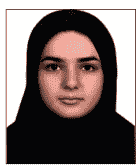

**雅典娜·阿布里沙姆奇** 伊斯法罕大学工程学院，伊朗伊斯法罕

**雅典娜·阿布里沙姆奇女士** 是伊斯法罕大学生物医学工程专业硕士生。她于2019年在伊斯法罕大学完成生物医学工程学士学位。2018年夏天，她加入伊斯法罕医科大学的人工智能研究小组，致力于通过深度学习方法检测肺癌。此外，她的研究兴趣包括机器学习、深度学习、机器视觉和数据挖掘。

### 法蒂梅·巴芳德


**法蒂梅·巴芳德** 伊斯法罕大学工程学院，伊朗伊斯法罕

**法蒂梅·巴芳德** 于2019年开始在伊斯法罕大学攻读生物医学工程硕士学位。她于2018年从哈姆丹理工大学获得电子与电气工程学士学位。她的研究兴趣包括模式识别、机器学习、数据挖掘以及信号/图像处理。

### 侯赛因·艾哈迈德·乔杜里


**侯赛因·艾哈迈德·乔杜里** 印度海得拉巴易卜拉欣帕塔南 CVR 工程学院

**侯赛因·艾哈迈德·乔杜里博士** 于2010年、2014年和2020年分别从阿萨姆大学西尔查尔分校获得工学学士学位、从NERIST-AR获得工学硕士学位，以及从印度阿萨姆邦西尔查尔国家技术学院获得计算机科学与工程博士学位。他于2018年至2020年在印度班加罗尔贾因大学担任计算机科学与工程专业助理教授。自2021年12月起，他一直在印度 CVR 工程学院计算机科学-IT 系（隶属于 JNTU）担任副教授。侯赛因博士撰写/合著了16篇在各种高影响因素、同行评议期刊上的论文。他撰写了一章图书并在国际会议上发表了约六篇论文。他的研究领域包括图像处理、数据可视化、计算机网络和软计算技术。

### 桑居尔·多甘


**桑居尔·多甘** 土耳其埃拉齐格弗拉特大学技术学院数字取证工程系

**桑居尔·多甘** 于2007年和2011年分别从土耳其埃拉齐格弗拉特大学获得生物工程硕士学位和电气与电子工程博士学位。她目前担任土耳其弗拉特大学技术学院数字取证工程系副教授。她的主要研究兴趣包括计算机取证、移动取证、图像处理和信号处理。她一直积极致力于为生物医学数据开发机器学习算法。

### 瓦娜·杜贝


**瓦娜·杜贝** 印度斋普尔马尼帕尔大学电子工程系

**瓦娜·杜贝女士** 正在印度斋普尔-拉贾斯坦邦马尼帕尔大学攻读信息与技术工程博士学位。她分别于2010年、2006年和2003年从印度中央邦因多尔 IET-DAVV 院获得电子与通信工程工学硕士学位（72.8%）、从印度中央邦博帕尔 BANSAL R.G.P.V. 学院获得学士学位（73.13%），以及从印度中央邦萨加尔 S.R.G.W.P. R.G.P.V. 学院获得文凭（67.01%）。她在文凭课程中获得“最佳学生奖”。她自2007年开始学术生涯。自2015年1月起，她一直在印度因多尔的 IPS 学院（一所自治学院）任职，目前担任助理教授。她的研究兴趣包括物理层安全、PID 控制器、强化学习、机器学习和人工智能。她在国内外会议和期刊上发表了13篇研究论文。她是 IETE（电子与电信工程师学会）终身会员。

### 法蒂赫·埃尔塔姆

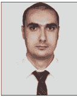

**法蒂赫·埃尔塔姆** 土耳其埃拉齐格弗拉特大学技术学院数字取证工程系

**法蒂赫·埃尔塔姆** 于2016年从土耳其埃拉齐格弗拉特大学获得软件工程博士学位。他目前担任土耳其弗拉特大学技术学院数字取证工程系副教授。他目前的研究兴趣包括人工智能、深度学习、数字取证和网络安全。

### 贾马尔·埃斯马尔普尔


**贾马尔·埃斯马尔普尔** 伊朗博坎伊斯拉姆阿扎德大学博坎分校

**贾马尔·埃斯马尔普尔先生** 是伊朗德黑兰阿米尔卡比尔理工大学的在读学生，同时在伊朗博坎阿扎德大学博坎分校担任讲师。他的研究兴趣包括生物医学信号处理、生物医学人工智能和医疗仪器。

### 赫尔什·高德


**赫尔什·高德** 印度那格浦尔信息技术学院电子工程系

**赫尔什·高德博士** 于2005年和2008年分别从印度因多尔什里·戈温德拉姆·塞克萨里亚技术科学学院获得电子与仪器工程学士学位和数字技术与仪器工程硕士学位，并于2019年从印度博帕尔莫拉纳·阿扎德国家技术学院获得电气工程博士学位。他于2010年加入印度因多尔 IPS 学院工程与科学学院担任助理教授。自2021年1月起，他一直在印度那格浦尔信息技术学院电子与通信工程系任职，目前担任助理教授。他的研究兴趣包括仪表、控制系统和机器人学。高德博士撰写/合著了11篇在各种高影响因素、同行评议期刊上的论文。他在国际会议上发表了三篇论文。

### 卡皮尔·古普塔


**卡皮尔·古普塔** 印度贾巴尔普尔 PDPM 设计与制造信息技术学院

**卡皮尔·古普塔先生** 是印度贾巴尔普尔设计与制造信息技术学院的研究学者。他于2011年从印度博帕尔东方科学技术学院获得电子与通信工程优等学士学位，并于2013年从印度博帕尔拉吉夫·甘地技术大学纳米技术学院获得纳米技术硕士学位。他的研究兴趣包括非平稳信号处理、生物医学信号处理和纳米材料。

### 拉莉塔·古普塔

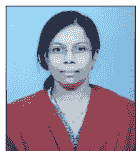

**拉莉塔·古普塔** 印度博帕尔莫拉纳·阿扎德国家技术学院电子与通信工程系

**拉莉塔·古普塔** 是印度博帕尔莫拉纳·阿扎德国家技术学院电子与通信工程系副教授。她于2003年从印度赖布尔 Pt. 拉维·尚卡尔·舒克拉大学获得电信工程学士学位，于2007年从印度博帕尔莫拉纳·阿扎德国家技术学院获得数字通信硕士学位，并于2012年从同一学院获得电子与通信工程博士学位。自2004年7月起，她一直担任印度博帕尔莫拉纳·阿扎德国家技术学院的教职人员。她是 IEEE、IETE 和 ICEIT 的会员。古普塔博士在各类国际知名期刊和会议上发表了30篇研究论文。她的研究兴趣是信号和图像处理。

### 史密斯·K·卡雷

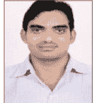

**史密斯·K·卡雷** 印度贾巴尔普尔 PDPM 设计与制造信息技术学院

**史密斯·K·卡雷先生** 是印度贾巴尔普尔设计与制造信息技术学院的研究学者。史密斯先生在 IEEE Transactions、Elsevier 等出版社的各种高影响因素、同行评议期刊上发表了13篇撰写/合著的论文。他在国际会议论文集中发表了两篇论文。他担任 IEEE、Elsevier 及其他多家知名出版社的期刊审稿人。他的研究兴趣包括生物医学信号处理、模式识别、机器学习和深度神经网络。

### 拉杰什·库马尔


**拉杰什·库马尔** 印度尼尔朱利 NERIST 电子与通信工程系

**拉杰什·库马尔博士** 出生于印度。他于2001年从班加罗尔大学获得电子与通信工程学士学位，2007年从印度比哈尔邦巴特那 NIT 获得控制系统工程科学硕士学位，并于2012年从印度新德里贾米亚·米利亚伊斯兰大学（中央大学）获得传感器领域博士学位。他拥有18年以上的教学经验，曾在印度比哈尔邦巴特那 RPSIT、印度北方邦加济阿巴德 AKGEC 和 ABESSEC 担任不同职务，教授本科和研究生阶段的工程教育。他目前在印度艾塔那加尔尼尔朱利东北区域科学技术学院（隶属于印度政府人力资源开发部）电子与通信工程系担任副教授。他已在...上发表了大量研究论文


在国家级和国际级期刊及会议上发表。他的研究领域是使用 MEMS、RF MEMS、生物传感器、WSN 和移动通信的感测技术。

## Wahengbam Kaanan Kumar


**Wahengbam Kaanan Kumar** 电子与通信工程系，NERIST，尼尔朱利，印度

**Wahengbam Kaanan Kumar**，博士于 2012 年从印度曼尼普尔大学获得电子与通信工程学士学位，2015 年从 M.M.U. Mullana 获得硕士学位。他目前在 NERIST 担任初级研究员（JRF），并即将完成博士学位。在博士期间，他与 IEEE、Elsevier、Springer Nature、Wiley、ACM 和 IOS Press 等知名出版社发表了八篇 SCI 期刊论文。他还在会议和丛书中发表了大量研究文章。他目前的研究兴趣包括图像处理、计算机视觉、模式识别、医学图像处理、生物医学信号处理和语音。

## Gaurav Makwana


**Gaurav Makwana** 莫拉纳·阿扎德国家技术学院，电子与通信工程系，博帕尔，印度

**Gaurav Makwana** 是莫拉纳·阿扎德国家技术学院，博帕尔，印度电子与通信工程系的博士研究生。他于 2006 年从印度因多尔 Shri Govindram Seksaria 技术与科学学院获得生物医学工程学士学位，2010 年从同校获得数字技术与仪器工程硕士学位。

他从 2006 年 12 月到 2008 年 8 月担任印度因多尔 Shri Govindram Seksaria 技术与科学学院生物医学工程系讲师。自 2011 年 3 月以来，他一直作为印度因多尔 Shri Vaishnav 技术与科学学院电气与电子工程系的教职人员。他的研究兴趣是医疗仪器和图像处理。

## Miguel Ángel Mañanas


**Miguel Ángel Mañanas** 巴塞罗那工业高等工程学校（ETSEIB），加泰罗尼亚理工大学-巴塞罗那理工大学，巴塞罗那，西班牙

**Miguel Ángel Mañanas**，博士，分别于 1993 年和 1999 年从加泰罗尼亚理工大学（UPC）获得电信工程学位和生物医学工程（BME）博士学位。他目前是同一所大学自动控制系（ESAII）的副教授，是 UPC 生物医学工程研究中心（CREB）和 CIBER-BBN 的成员。他是跨学科生物信号康复与治疗分析小组（BIOART, UPC）的创始人和负责人，该小组由工程师和医生组成。他的研究重点是将工程技术应用于健康领域。他的职业生涯尤其专注于生物医学信号处理和生物系统建模，涉及三个领域：（1）神经肌肉：通过高密度肌电图评估神经肌肉疾病和运动康复；（2）神经系统：通过脑电图和脑磁图评估脑活动；（3）呼吸：建模呼吸控制系统并模拟肺部疾病和机械通气。他是 65 篇 JCR 文章（31 篇在 Q1，23 篇在 Q2）的合著者，拥有 100 多篇经过同行评审的科学通信，并共同发明了两项专利。他共同指导了八篇博士论文。他还担任了 30 个国家/国际项目的首席研究员。他于 2016 年获得 BBVA 基金会颁发的达芬奇奖，以表彰其职业生涯成就。

## Hamid Reza Marateb


**Hamid Reza Marateb** 伊斯法罕大学工程学院，伊朗伊斯法罕

**Hamid Reza Marateb**，博士分别于 2000 年和 2003 年从伊朗德黑兰的沙希德·贝赫什蒂医科大学和阿米尔卡比尔理工大学获得学士和硕士学位。他分别于 2011 年和 2012 年从意大利都灵 Politecnico di Torino 神经肌肉系统工程实验室获得博士学位和博士后研究员职位。他曾于 2009 年在斯坦福大学担任访问研究员，2010 年在奥尔堡大学担任访问研究员。他曾于 2012 年和 2017 年在西班牙巴塞罗那的 UPC 担任访问教授。他的研究方向是健康和生物医学中的认知信息学，主要关注临床神经生理学、计算神经科学和医学数据挖掘。Marateb 博士是 30 多家国际 ISI 期刊的审稿人，目前担任包括《Frontiers in Integrative Physiology》和《Frontiers in Cognitive Neuroscience》在内的多家国际期刊编委会成员。他还获得了欧盟/西班牙资助（例如，玛丽·居里奖学金和 MYOSLEEV(E））。他目前就职于伊朗伊斯法罕大学工程学院生物医学工程系，以及西班牙巴塞罗那加泰罗尼亚理工大学（UPC）自动控制系、生物医学工程研究中心、BIOART 组（BIOsignal Analysis for Rehabilitation and Therapy Research Group）。

## Arezoo Mirshamsi

**Arezoo Mirshamsi** 伊朗伊斯法罕大学工程学院，伊斯法罕，伊朗

Arezoo Mirshamsi 自 2019 年起一直是伊斯法罕大学生物医学工程硕士生。她于 2018 年从伊朗哈姆丹理工大学获得生物医学工程学士学位。她的学士项目主题是通过在玩安卓游戏时研究心率变化来利用生物反馈减轻压力。她还曾是学生医学工程期刊编委会成员（2015–2017）。她的研究兴趣包括 EEG 和 EMG 信号处理、人工智能、机器学习和深度学习。

## Mohammad Reza Mohebbian

**Mohammad Reza Mohebbian** 加拿大萨斯卡通萨斯喀彻温大学电气与计算机工程系

Mohammad Reza Mohebbian 在伊朗伊斯法罕大学攻读生物医学工程学士和硕士学位。他在学士和硕士学生中排名前两名。目前，他正在加拿大萨斯喀彻温大学学习电气与计算机工程。他于 2019 年获得萨斯喀彻温大学奖学金，并在博士期间为加拿大飞利浦公司开展了研究。他的职业生涯主要集中在生物医学领域的机器学习、深度学习、模式识别和图像处理上。

## Mohammad Hassan Moradi

**Mohammad Hassan Moradi** 阿米尔卡比尔理工大学，德黑兰，伊朗

Mohammad Hassan Moradi 博士是伊朗德黑兰阿米尔卡比尔理工大学生物医学工程系教授。他的研究兴趣包括医疗仪器、生物医学信号处理。

## Kishorjit Nongmeikapam


**Kishorjit Nongmeikapam** 印度曼尼普尔印度理工学院计算机科学与工程系

**Kishorjit Nongmeikapam**，博士于 2003 年从印度科伊姆巴托尔 PSG 技术学院获得计算机科学与工程学士学位。他分别于 2010 年和 2016 年从印度加尔各答贾达夫普大学获得计算机科学与工程硕士和博士学位。他自 2003 年起在曼尼普尔大学担任教职人员 13 年，并且自 2016 年起一直是印度信息技术学院（IIIT）曼尼普尔分校的教职人员。他的研究兴趣集中在图像处理、计算机视觉、模式识别、自然语言处理和编程领域。他在许多知名期刊以及国际和国内重要会议上发表了 40 多篇科学论文。

## Saurabh Pal


**Saurabh Pal** 印度贾乌纳普尔 VBS 普万查尔大学计算机应用系

**Dr Saurabh Pal** 是印度贾乌纳普尔 VBS 普万查尔大学计算机应用系主任。机器学习、模式识别、软件工程、云计算等主题均为其研究兴趣。Pal 博士在高影响因子的同行评议期刊上撰写或合著了 80 篇出版物。Pal 博士撰写了 25 个书籍章节，并在国际会议上发表了约 30 篇论文。Saurabh Pal 博士曾担任多个会议和期刊的审稿人。

## Antti Rissanen


**Antti Rissanen** 芬兰赫尔辛基国防大学军事技术系

**Dr Antti Rissanen**，博士分别于 1981 年、1984 年和 2011 年从芬兰赫尔辛基大学获得物理学学士、硕士和博士学位。他于 1992 年在坦佩雷理工大学获得电气工程技术学士学位。1997 年，他加入芬兰国防大学，担任通用技术高级讲师，目前在那里担任研究员。他还是军事技术系教育研究小组的负责人。他的研究兴趣包括科学教育、电子学习以及教育背景下的模拟或人工智能。之前的研究兴趣包括生物医学工程、信号分析、技术转移和薄膜技术。Rissanen 博士撰写或合著了 37 篇出版物，并在

peer-reviewed, journals. Dr Rissanen has written three book chapters and presented about 50 papers at international conferences.

## 玛尔约·里桑嫩


玛尔约·里桑嫩女士就职于 Prime Multimedia Ltd，位于芬兰赫尔辛基。玛尔约·里桑嫩是一名高级顾问，专注于健康信息学设计领域。她获得赫尔辛基大学医学院的硕士学位。她曾在赫尔辛基大学、社会事务与卫生部以及咨询公司从事研究和设计工作。她还参与过国际项目，例如，在斯里兰卡参与一个骨科医院成本控制信息系统项目。她在学术界、卫生组织和工业界也进行过国际背景下的讲座。她的研究兴趣涵盖转化健康技术与设计、面向消费者的健康信息学以及相关的质量和设计挑战。她撰写了 16 篇关于时下话题的同行评议文章。

## 卡莱·萨斯塔莫宁


卡莱·萨斯塔莫宁 就职于芬兰国防大学军事技术系，地点在赫尔辛基。卡莱·萨斯塔莫宁博士（PhD）于 1999 年获得赫尔辛基大学数学硕士学位，并于 2008 年获得拉彭兰塔理工大学应用数学博士学位。1999–2008 年期间，他曾在拉彭兰塔理工大学和南卡累利阿应用科学大学担任研究员和兼职讲师。

2009 年，他加入芬兰国防大学，担任应用数学高级讲师，目前在军事技术系任职研究员和研究协调员。他的研究兴趣包括计算逻辑及其应用、基于 AI 的专家系统、数据分类、军事技术研究、教学技术及其应用。萨斯塔莫宁博士撰写/合著了 71 篇同行评议出版物。

## 萨哈拉·莫麦兹·萨纳特

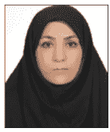

萨哈拉·莫麦兹·萨纳特 就职于德黑兰医科大学，伊朗德黑兰。萨哈拉·莫麦兹·萨纳特博士于 2004 年获得沙希德·贝赫什提医科大学内科专科委员会认证。她目前是德黑兰医科大学助理教授，地点在伊朗德黑兰。

## 普拉卡什·钱德拉·夏马


**普拉卡什·钱德拉·夏马** 就职于印度赖普尔卡马塔赖桑托希纳加尔马尼帕尔大学斋普尔分校。**普拉卡什·钱德拉·夏马博士**目前在印度马尼帕尔大学斋普尔分校计算机与信息技术学院担任高级助理教授。他获得印度理工学院印多尔分校计算机科学与工程学科的博士学位。他完成了 SGSITS 印多尔分校的工程硕士学位。他在计算机科学与工程的各个领域拥有 16 年的教学和研究经验。他的研究兴趣包括图论、理论计算机科学、人工智能、图像处理和无线网络。他在各种国际/国内期刊（包括 IEEE、Springer、Elsevier 等）以及知名国际/国内会议论文集中发表了大量研究论文。他还与 Elsevier、Springer、CRC Press 等知名出版社的多部编著中出版了多章图书。他在其研究领域的各种知名国际期刊中担任活跃的审稿人和编委会成员。他申请并出版了 10 项版权和专利。他在国际会议上担任过多个技术会议的主席。他是多个专业国际学会的成员（包括 IEEE、CSI、IAENG、印度工程师学会）。他获得过许多国家级奖项和认可。

## 梅赫迪·希尔扎迪

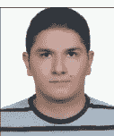

**梅赫迪·希尔扎迪** 就职于西班牙巴塞罗那加泰罗尼亚理工大学巴塞罗那理工学院（ETSEIB），地点在巴塞罗那。**梅赫迪·希尔扎迪**分别于 2015 年和 2018 年获得伊斯兰自由大学纳贾夫阿巴德分校（伊斯法罕，伊朗）和伊斯法罕大学（伊斯法罕，伊朗）的生物医学工程学士和硕士学位（成绩排名前两名）。他是西班牙巴塞罗那加泰罗尼亚理工大学巴塞罗那理工学院（UPC）的生物医学工程博士候选人。他于 2019 年获得西班牙经济竞争力部（MINECO）的四年奖学金。他的研究兴趣包括肌电信号处理、优化、医疗数据挖掘和机器学习。

## 艾海巴姆·迪纳马尼·辛格


**艾海巴姆·迪纳马尼·辛格** 就职于印度尼特·马尼普尔电子与通信工程系。**艾海巴姆·迪纳马尼·辛格**，PhD 于 2004 年获得印度西隆东北山大学电子与通信工程学士学位。他于 2010 年和 2015 年分别完成了印度阿鲁纳恰尔邦尼尔朱利东北区域科学技术学院（NERIST）的电子与通信工程硕士和博士学位。2006 至 2019 年期间，他是 NERIST 电子与通信工程系的教学教师。他目前担任印度国家技术学院马尼普尔分校电子与通信工程系副教授。他的研究兴趣包括无线通信、衰落信道、图像处理、计算机视觉、生物医学图像处理、信号处理、天线阵列和毫米波天线。他在研究期刊以及知名国际和国内会议上发表了 60 多篇科学论文。

## 米特莱什·普拉萨德·辛格


**米特莱什·普拉萨德·辛格** 就职于印度古尔加昂阿米蒂大学计算机科学与工程系。**米特莱什·普拉萨德·辛格**，MTech 于 2016 年获得印度马尼普尔大学计算机科学与工程学士学位，目前正在阿米蒂大学古尔加昂分校攻读人工智能与机器学习硕士学位。他目前的研究兴趣包括深度学习优化、受自然启发的算法、计算机视觉、医学图像和信号处理、自然语言处理及电子学习。

## 尼杜尔·辛哈


**尼杜尔·辛哈** 就职于印度阿萨姆邦卡查尔地区尼特·西尔查尔。**尼杜尔·辛哈博士**于 1962 年出生于印度特里普拉邦。他于 1984 年获得印度加尔各答大学电气工程学士学位，并于 1989 年获得印度新德里印度理工学院电力设备与系统硕士学位。他获得印度加尔加尔达大学电气工程博士学位。他的博士论文题为《电力系统最优运行中的智能技术应用》。此后，他一直在自动发电控制、常规及非常规环境下电力系统最优运行、可再生能源与微电网控制、图像去噪、视频运动估计、基于脑电图的情绪识别、无声语音阅读等不同领域开展积极研究。他在不同领域发表了 100 多篇国内和国际出版物。他于 2008 年获得 IEEE 高级会员称号。他已成功完成四项赞助的研发项目。此外，他还担任过多家国际期刊的审稿人，包括 IEEE、IET、Elsevier、Taylor & Francis 和 Springer 等。

## 阿卜杜勒哈米特·苏巴西


阿卜杜勒哈米特·苏巴西 就职于芬兰图尔库大学医学院生物医学研究所，图尔库。阿卜杜勒哈米特·苏巴西专长于人工智能、机器学习、生物医学信号和图像处理。关于将机器学习应用于不同领域，他撰写了十多章图书以及 190 多篇已发表的期刊和会议论文。他还是《使用机器学习技术的生物医学信号分析实用指南》和《使用 Python 进行数据分析的实用机器学习》这两本书的作者。他曾作为学者在多所机构工作，并担任美国佐治亚州佐治亚理工学院的研究员。他于 2018 年 5 月获得埃法特研究卓越女王奖。他曾在 2015 至 2020 年间担任沙特阿拉伯吉达埃法特大学计算机科学教授。自 2020 年以来，他一直在芬兰图尔库大学医学院担任医学物理学教授，并担任沙特阿拉伯吉达埃法特大学的访问研究员。他参与过多个与生物医学信号处理和数据分析相关的项目。

## 图尔克·通克尔


图尔克·通克尔 就职于土耳其法特大学技术学院数字取证工程系，地点在土耳其。图尔克·通克尔分别于 2011 年和 2016 年获得土耳其法特大学埃尔祖姆分校电子与计算机科学硕士学位和软件工程博士学位。他目前是土耳其法特大学技术学院数字取证工程系副教授。他的主要研究兴趣包括特征工程、图像处理、信号处理、信息安全和模式识别。他一直积极开发应用于视频监控和生物医学数据的机器学习算法。


## 阿米特·库马尔·维尔马

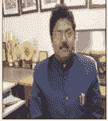

阿米特·库马尔·维尔马，药学系，MJP Rohilkhand 大学，巴雷利，比哈里普尔，北方邦，印度。阿米特·库马尔·维尔马（院士兼研究员，金牌获得者，Shikshak Shree 奖获得者）。他是一位著名的院士，任职于 MJP Rohilkhand 大学药学系，北方邦政府州立大学，巴雷利县，北方邦。他在本科药学（BPharm）期间成绩优异。他从印度卡纳塔克邦马尼帕尔的马尼帕尔制药科学学院（MCOPS）获得药物化学研究生学位（MPharm）。他在印度勒克瑙的中央药物研究所（CDRI）完成了研究生项目培训。他的博士研究课题是高分子化学与药物递送。他在学术、研究和行政管理方面拥有广泛经验。他在 SCI、Scopus、UGC 等高影响力出版物上发表了 12 篇研究论文，并出版了 5 本书和 12 多个书籍章节。他是一套关于 COVID-19 的丛书的主编。他目前正在从事一个关于 COVID-19 的研究项目。他的研究兴趣包括人工智能在疾病管理和草药制剂开发中的应用。他拥有 4 项专利发表和版权。他指导了 15 名研究生。在跨学科贡献方面，他是该校 MSc 微生物学和化学工程专业学生论文工作的研究指导教师。他是监管 600 所学院的机构伦理委员会成员，也是大学知识产权（IPR）小组的科学代表成员，覆盖约 600 所学院。在行政职责方面，他担任助理院长（学生事务 ADSW）、培训安置协调员，并在 COVID-19 期间为学生提供职业咨询和心理咨询。通过使用 Doordarshan、Akashwani 广播、报纸等电子和印刷媒体，他丰富了印度公民的知识。他在陆军、ITBP 警队、教育机构及村庄等知名机构进行了 20 多场专家受邀演讲，体现了其将知识传播到社会各层面的能力。在企业工作中，他担任 Alobhin Herbal Pharmaceutical 私人有限公司的顾问（无偿），其创新促成了商品“Daisy care”的开发，该产品现已在商业市场上销售，目前担任教育部创新中心品牌大使。他的社会贡献是创建了 ZERO TB 数字平台，这是一个支持结核病患者数字化护理、助力实现无结核病印度目标的创新举措，也是世界上首个此类平台。他还在巴雷利县开展自筹资金的疟疾和 COVID-19 消除意识项目。

## 迪扬·钱德拉·亚达夫


迪扬·钱德拉·亚达夫，计算机应用系，VBS Purvanchal 大学，贾恩布尔，印度。博士后迪扬·钱德拉·亚达夫于 2008 年从维尔·巴哈杜尔·辛格·普尔万查大学（贾恩布尔）获得 MCA 学位，并于 2016 年从 SV 大学加杰劳拉、阿姆罗哈贾皮纳加尔、北方邦获得计算机应用博士学位。他目前在维尔·巴哈杜尔·辛格·普尔万查大学（贾恩布尔）担任博士后研究员。他的研究兴趣包括模式识别、统计图像处理和知识发现。亚达夫博士在高影响因素的同行评议期刊上发表/合著了 25 篇论文。亚达夫博士出版了两个书籍章节，并在国际会议上做了四次报告。迪扬·钱德拉·亚达夫博士曾担任会议评审和期刊评审。

## 拉姆·纳拉扬·亚达夫

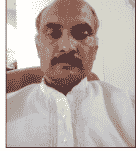

拉姆·纳拉扬·亚达夫，电子与通信工程系，印度博帕尔莫拉纳·阿扎德国家理工学院。拉姆·纳拉扬·亚达夫于 1993 年从印度阿拉哈巴德莫蒂拉尔·尼赫鲁国家理工学院获得电子工程 BTech 学位，1997 年从印度博帕尔莫拉纳·阿扎德国家理工学院获得数字通信 MTech 学位，2005 年从印度坎普尔印度理工学院获得电气工程博士学位。1997 年，他加入印度博帕尔莫拉纳·阿扎德国家理工学院电子与通信工程系，现任教授。他在 IEEE、IET、Elsevier 和 Springer 等国际期刊及会议上发表了 70 多篇论文。他指导了 25 名硕士生和 10 名博士生。他是多本 IEEE 和 Elsevier 期刊的评审。他目前的研究兴趣是通信系统、图像处理、神经网络及其应用。

## 沙迪·扎马尼

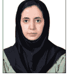

沙迪·扎马尼，工程学院，伊斯法罕大学，伊斯法罕，伊朗。沙迪·扎马尼于 2019 年从伊朗伊斯法罕大学获得生物医学工程学士学位。她自 2019 年起一直在伊斯法罕大学攻读生物医学工程硕士学位。她目前的研究兴趣包括机器学习、模式识别、数据挖掘和医学图像处理。

## 第 1 章

## 基于心电图信号的柔性分析小波变换高血压自动检测

卡皮尔·古普塔、史密斯·K·哈雷、瓦伦·巴贾杰和伊尔沙德·艾哈迈德·安萨里

高血压（HPT）是一种关键的健康问题，源于血液对动脉壁施加的更高压力。当收缩压（SBP）和舒张压（DBP）分别高于 140 mmHg 和 90 mmHg 时，即发生高血压。当 SBP 高于 180 mmHg 且 DBP 高于 120 mmHg 时，病情变得更加严重。高血压没有直接症状，但持续的高血压会导致心肌肥大，这将在心电图（ECG）报告中体现出来。由于 ECG 信号的非平稳特性，手动检测高血压很困难。因此，本章提出了一种基于柔性分析小波变换（FAWT）的高血压自动检测方法。输入信号使用 FAWT 分解为子带，并从这些子带中提取特征。使用 Kruskal–Wallis 检验识别了一组高度区分性的特征。这些特征被输入到不同分类器中，以对高血压和正常 ECG 信号进行分类。通过十折交叉验证，使用集成袋装树分类器对所提系统的有效性进行了检验，分别获得特异性、灵敏度、准确度、阴性预测值、假阳性率和假阴性率为 96.74%、96.95%、96.60%、99.69%、3.04% 和 3.24%。

### 1.1 引言

高血压（HPT）定义为血压升高，是一种严重的健康状况，源于血液对动脉壁施加的较大压力 [1]。当心脏努力将富氧血液泵送到身体其他部位时，动脉周围的血压会升高 [1]。根据世界卫生组织的统计数据，高血压是全球第三大致死原因，每年导致超过一千一百万人死亡 [2]。如果不及时治疗，高血压可能引发与肾脏、大脑和心脏相关的各种疾病 [3, 4]。

及时诊断和适当用药治疗高血压有助于降低多种心血管疾病的风险 [5, 6]。根据临床流行病学观察，健康人的最佳收缩压（SBP）和舒张压（DBP）分别低于 140 mmHg 和 90 mmHg [7]。当 SBP 和 DBP 分别高于 180 mmHg 和 120 mmHg 时，高血压变得严重 [8]。血压计常用于测量血压 [8]。由于各种环境限制，它正在被计算机化测量设备（如无汞血压计和数字电子压力变送器）所取代 [9]。但由于在成人中估计 SBP 和 DBP 时存在误差倾向，这些仪表可能会提供不准确的结果 [10]。

由于血压会波动，24 小时血压监测已成为诊断高血压的有用工具 [11]。持续的高血压会加重心脏、神经和肾脏疾病，这些将在心电图（ECG）报告中体现出来。心脏的变化电活动通过心电图（ECG）报告进行测量 [12]。等电线是根据 ECG 基线电压计算得出的，即 T 波之后、下一个 P 波之前的描记部分 [13, 14]。ECG 分析有助于心脏病专家诊断各种疾病的症状 [15]。

ECG 信号分割在冠状动脉疾病、心脏阻塞、心腔肥厚等分析中起着至关重要的作用 [16]。ECG 信号由 P 波、QRS 群和 T 波组成。P 波也称为心房群，当窦房结产生去极化心房的动作时发生。P 波是 ECG 中的第一个正向波 [17]。正常 P 波的高度和宽度小于 2.5 个小方格。更高的 P 波是由于右心房增大引起的，其值大于 2.5 mV，并导致一种称为肺源性高血压的肺部慢性呼吸道疾病。更宽的 P 波是由于左心房增大引起的，持续时间为 2.5 秒。Q 波是由于室间隔基底部分去极化而产生的负波。R 波是由于室间隔和心肌顶部去极化而产生的最高正波。S 波是由于心室肌近心房室环基底部分去极化而产生的最小负波。Q 波、R 波和 S 波的组合称为 QRS 群或室初复合波。T 波是由于心室肌复极化而产生的正波；通过 ECG，心脏病专家可以识别各种类型的心脏活动 [18]。

#### 1.1.1 ECG 的各种间期

P–R 间期：是指从 P 波开始到 Q 波开始的时间差。正常 P–R 间期在 120–200 ms 范围内。P–R 间期增大（数值超过 200 ms）提示一度房室传导阻滞，若 P–R 间期小于 120 ms，则提示 Wolff–Parkinson–White 综合征。

Q–T 间期：是指从 Q 波开始到 T 波结束的时间差。正常 Q–T 间期在 360–440 ms 范围内。QT 间期延长（QT > 440 ms）提示低钙血症。Q–T 间期缩短（QT < 360 ms）提示高钙血症。


QRS interval：定义为P波结束与T波开始之间的时间差。正常QRS interval小于100 ms，如果大于100 ms则提示束支传导阻滞。R–R interval：指两个连续R波之间的时间差。正常R–R interval为60–120 ms。长期高血压（HPT）会影响所有这些间期，这在心电图（ECG）检查中有所体现。然而，在HPT早期可能没有临床上可见的心电图异常，且仅凭心电图人工诊断困难 [11]。使用ECG信号自动检测HPT是生物医学工程领域的一个新兴研究课题。由于记录的ECG信号受到各种噪声污染，可能导致这些间期的宽度和高度发生变化，并在疾病预测中出现错误 [19]。因此，在将ECG输入分类器之前需要进行预处理。预处理可分为两个阶段：噪声去除阶段抑制信号中存在的噪声，特征提取阶段从信号中提取信息 [20]。Jain et al 基于Riemann–Liouville分积分的经验模态分解开发了ECG去噪方法 [21]。可以使用无噪声且分段的ECG信号自动检测HPT的严重程度 [22]。

#### 1.1.2 相关工作

至今，研究人员已提出使用ECG信号对HPT进行检测和分类的各种方法。Tripathi et al 使用滤波提取特征以检测快速和缓慢心律 [23]。Rajput et al 确定了HPT诊断指数，该指数已使用小波滤波器组来区分HPT患者与正常受试者 [11]。Chuang et al 应用经验模态分解提取不同的线性和非线性特征 [24]。Kiat Soh et al 使用离散小波变换并提取不同子频带来诊断HPT [10]。Ni et al 开发了多尺度HRV分析，通过小波变换检测R峰来计算HPT的严重程度 [11]。Melillo et al 设计了一种工具，利用HRV分析通过一系列心拍间期来预后心血管和脑血管事件 [25]。Zhang et al 基于短时HRV并使用RR间隔分析了HPT中的自主神经模式。提取了不同特征以区分高血压心律和正常心律 [26]。Kale et al 提取了R–R间隔以预测心血管事件的灵敏度和特异性，随机森林分类器已用于事件分类 [27]。Ortiz-Martín et al 分析了LSB值的熵，并使用Pan–Tompkins算法提取R峰和提取脉搏间期 [28]。Alkhodari et al 实现了一种机器学习模型，用于处理不平衡数据并预测高血压患者的血管事件 [29]。Agliari et al 应用统计力学工具和最大熵原理分析了心率变异性（HRV）与各种复合波和混沌心脏动力学之间的时间相关性 [30]。Taye et al 预测了室性心动过速性心律失常的发生，这种失常源于不正常的心脏电活动并导致心率加快 [31]。Agnihotri et al 基于快速和缓慢心律预测个体当前和未来的心脏健康状况 [32]。Koichubekov et al 使用Pan–Tompkins算法检测QRS复合波并计算R–R间隔，分析了HPT中HRV信号的非线性指标。已使用Welch’s method确定了R–R间隔样本的频谱 [33]。Bossone et al 研究了原发性肺动脉高压患者中特征的关联性 [34]。Melillo et al 设计了一种基于云的智能健康监测系统，以自动收集和分析生物医学信号，用于识别HPT患者 [35]。Dami et al 使用深度置信神经网络降低特征维度，并使用长短期记忆网络对特征进行分类，以预测心血管事件 [36]。Zhao et al 使用ECG信号识别了神经系统功能与轻微中风之间的关联 [37]。Thomas et al 应用自动化ECG导出睡眠脑电图技术，以在睡眠阶段预防中风和HPT [38]。Paragliola et al 使用基于时间序列的方法来识别HPT的增加，以区分心血管高风险和低风险HPT患者 [39]。Schillaci et al 回顾了ECG信号在左心室肥大诊断中的作用，以预测无症状HPT患者中多种经风险因素调整的心血管发病率和死亡率 [40]。Afkami et al 使用离散小波变换查找统计特征，并将其输入带有RBF核函数的支持向量机（SVM）分类器，开发了一种检测左心室肥大的方法 [41]。Jothiramalingam et al 使用连续小波变换检测R波和S波，以获取左心室肥大的特征。SVM、K近邻（KNN）、集成树（ET）分类器已用于分类 [42]。Kublanov et al 使用短时HRV信号比较了各种机器学习方法来诊断动脉性HPT [43]。

文献中已提出各种方法来检测和分类HPT。滤波方法需要选择滤波系数，而选择这些系数很困难；而在基于小波的方法中，选择母小波和分解层数也很困难。本章的主要贡献是设计一种自动ECG检测系统，利用灵活解析小波变换（FAWT）和不同的机器学习算法来区分正常患者与HPT患者，从而识别最具区分度的特征和最合适的分类技术。

本章其余部分的组织安排如下。第1.2节介绍方法学。第1.3节讨论结果，第1.4节是本章结论。

### 1.2 方法学

本节包含有关数据集、FAWT、特征和分类技术的信息。使用FAWT将ECG信号分解为子频带。从这些子频带中提取了各种时域特征，如均值、平均绝对值（MAV）、均方根（RMS）、标准差（STD）、方差（VAR）和简单平方积分（SSI）。使用Kruskal–Wallis检验选择高度可区分的特征，并使用不同的分类器进行分类。图1.1展示了所提方法的图示。

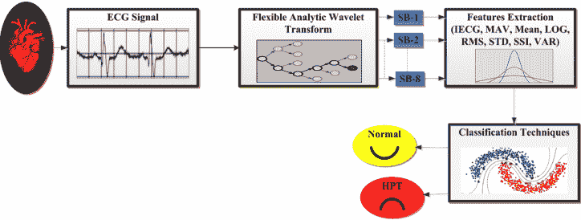

图1.1. 所提方法的流程图。

#### 1.2.1 数据集

该ECG数据集从physionet网站（https://physionet.org/content/shareedb/1.0.0/）下载，用于评估事件风险。它包含139名受试者的名义24小时ECG动态心电图记录，每名受试者可用的ECG记录长度约为2小时10分12秒。每名受试者的ECG信号来自三个导联III、V3和V5，采样频率为128 Hz，分辨率为8位。其中包含49名女性，平均年龄55±5岁，以及90名男性，平均年龄72±7岁。在139名受试者中，17名被识别为高危HPT，122名被识别为正常 [9]。在本章中，ECG记录被分割成2分钟的片段。图1.2展示了正常受试者和HPT受试者的三导联ECG记录。

#### 1.2.2 灵活解析小波变换

ECG信号的特性是非线性和非平稳的，因此在信号时频分析中面临许多困难。因此，本研究采用FAWT将ECG信号分解为子频带。FAWT是一种结构良好的非平稳和非线性信号分解技术。FAWT包含用于分析正负结构的希尔伯特变换原子对，因此最适合非平稳信号处理。它使用一组滤波器将信号分解为子频带。使用迭代滤波器组进行信号分解。它由两个高通滤波器和一个低通滤波器组合而成。FAWT的低通和高通通道允许任意采样率。在FAWT中，用户可以轻松指定展开因子、品质因子和冗余度，由于这种灵活性，它允许对有限长度信号进行快速实现并实现完美重建 [44]。

FAWT中使用的变量如下：低通上采样（$s_1$）、低通下采样（$s_2$）、高通上采样（$s_3$）、高通下采样（$s_4$）、控制参数$\beta$、品质因子和冗余率（$R$）。


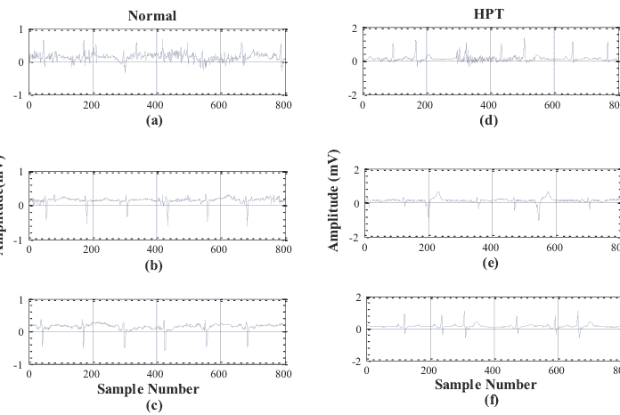

图 1.2. (a) 正常信号的 Channel-III ECG 信号，(b) 正常信号的 Channel-V3 ECG 信号，(c) 正常信号的 Channel-V5 ECG 信号，(d) HPT 信号的 Channel-III ECG 信号，(e) HPT 信号的 Channel-V3 ECG 信号，(f) HPT 信号的 Channel-V5 ECG 信号。

The frequency response of LPF \(K(\omega')\) is given as

\(K(\omega') = \left\{ \begin{array}{ll} (s_1 s_2)^2, & |\omega'| < \omega_{ph} \\ (s_1 s_2)^2 \frac{1}{\theta} . \frac{\omega' - \omega_{ph}}{\omega_s - \omega_{ph}}, & \omega_{ph} \leqslant \omega' \\ (s_1 s_2) \frac{1}{2} \theta . \frac{\pi - \omega' + \omega_{ph}}{\omega_s - \omega_{ph}}, & -\omega_s \leqslant \omega' \leqslant -\omega_{ph} \\ 0, & |\omega'| \geqslant \omega_s \end{array} \right.\) (1.1)

The frequency response of HPF \(H(\omega')\) is given as,

\(H(\omega') = \left\{ \begin{array}{ll} (2 s_3 s_4)^{1/4} \theta . \frac{\pi - \omega' - \omega_0}{\omega_s - \omega_{ph}}, & \omega_0 \leqslant \omega' < \omega_1 \\ (2 s_3 s_4)^{\frac{1}{2}}, & \omega_1 \leqslant \omega' < \omega_2 \\ (2 s_3 s_4)^{\frac{1}{2}} \frac{1}{\theta} . \frac{\omega' - \omega_2}{\omega_3 - \omega_2}, & \omega_2 \leqslant \omega' \leqslant \omega_3 \\ 0, \omega' \in [0, \omega_0) \bigcup (\omega_3, 2 \pi) & \end{array} \right.\) (1.2)

where, phase frequency \((\omega_{ph})\) is given as,

\(\omega_{ph} = \frac{(1 - \beta) \pi}{s_1} + \frac{\epsilon}{s_1}\) (1.3)

\(\omega_s = \frac{\pi}{s_2}, \omega_0 = \frac{(1 - \beta)\pi + \epsilon}{s_2}, \omega_1 = \frac{s_1\pi}{s_2s_3}, \omega_2 = \frac{\pi - \epsilon}{s_2}, \omega_3 = \frac{\pi + \epsilon}{s_3}\)

**品质因数 (Q)** is used to control the frequency resolution. It is the proportion of focal recurrence and the band width, it can be computed as,

\(Q = \frac{(2 - \beta)}{\beta}\) (1.4)

For proper and smoothed reconstruction of the signal \(\beta\) is always less than 1.

**扩展因子 (R)** is used to control the size of the wavelet and can be expressed as,

\(R = \frac{s_3}{s_4} \times \frac{1}{1 - (\frac{s_1}{s_2})}\) (1.5)

For proper recovery of the information and to reduce the losses, \(R\) should be greater than 1.

FAWT is time invariant and it provides a covering of flexible time frequency and tunable oscillatory bases.

The subbands obtained from ECG signal using FAWT are shown in figure 1.3.

### 1.2.3 Feature extraction

In this chapter, features are extracted from the subbands of decomposed ECG signal using the FAWT method.

Eight features are extracted from subbands which are represented as [45]:

- 1. **方差 (VAR):** Variance is defined as the expectation of the squared deviation from its mean. It can be given as,

\(VAR = \frac{1}{N - 1} \sum_{i=1}^N (x_i - \mu)^2\) (1.6)

- 2. **积分心电图 (IECG):** It is used in the onset detection index in the subband and the sum of absolute value of these subbands is defined as \(IECG\), it can be expressed as,

\(IECG = \sum_{i=1}^N |x_i|\) (1.7)

- 3. **平均绝对值 (MAV):** It is an average of absolute value of a subband and it can be computed as,

\(MAV = \frac{1}{N} \sum_{i=1}^N |x_i|\) (1.8)

- 4. **均值 (\(\mu\)):** It is an average value of a subband extracted from FAWT, it can be expressed as,

\(\mu = \frac{1}{N} \sum_{i=1}^N x_i\) (1.9)

- 5. **简单平方积分 (SSI):** It expresses the energy contained by subband and it can be computed as,

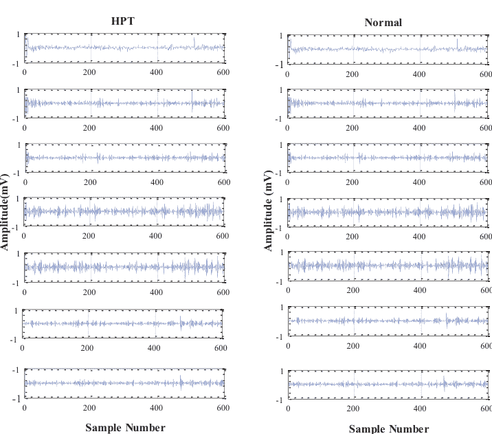

图 1.3. 正常和 HPT 类 ECG 信号的子频带。

SSI = \(\sum_{i=1}^N |x_i^2|\) (1.10)

- 6. **均方根 (RMS):** It is defined as squared mean of subband and can be given as,

RMS = \(\sqrt{\frac{1}{N} \sum_{i=1}^N x_i^2}\) (1.11)

- 7. **标准差 (STD):** It is the dispersion of signal with respect to the mean, it can be formulated as,

STD = \(\frac{1}{N-1} \sum_{i=1}^{N-1} (x'_{i+1} - x'_i)^2\) (1.12)

- 8. **对数检测器 (LOG):** It provides an estimate of blood force exerted on the walls of arteries, logarithmic change of nonlinear detector is defined as LOG detector. It can be computed as,

LOG = \(e^{\frac{1}{N} \sum_{i=1}^N x_i^2}\) (1.13)

where, \(x_i\) is the \(i\)th subband with \(N\) number of samples.

### 1.2.4 Classification techniques

Classifiers are used to categorize input data into two or more classes. The feature matrix is provided as an input for classifiers. In this chapter, four different classifiers are used to classify HPT and normal signals. In the case of decision tree classifiers, three kernel functions are used, namely simple tree, complex tree and medium tree. An ensemble tree classifier is used following kernel namely bagged tree, boosted tree, subspace discriminant, and subspace k-NN. Linear, medium Gaussian and coarse Gaussian types of kernel functions are used in SVM. In k-NN, six kernel functions are used, namely the cosine, fine, coarse, medium, cubic and weighted kernels. Details of these classifiers can be found in [46–49].

- 1. **决策树分类器 (DTC):** It is a tree-structured supervised machine learning classifier where internal nodes represent the characteristics of a given input feature, branches represent decision rules and each leaf node represents the output. DTC is used to separate a complicated decision-making process into a set of simpler decisions. The performance of the DTC is based on the type of given input features.

- 2. **集成树 (ET):** ET classifier is based on the principle of ensemble, that is, the stronger learner is always generated from the group of various weak learners. In this classifier multiple decisions are combined together for producing better classification results.

- 3. **支持向量机 (SVM):** In SVM two classes can be separated using linear and hyper plane. SVM is the robust prediction method and it depends upon the statistical learning framework. Two types of kernel functions are used in SVM, namely Gaussian and linear.

- 4. **K 最近邻 (K-NN):** It is a nonparametric, supervised machine learning classification technique. K-NN algorithm stores all the given input features and classifies a new feature point based on the similarity. It can be more effective for large input data.

### 1.2.5 Performance parameters

The performance of the proposed method is analyzed by computing quality parameters, namely specificity (SPE), sensitivity (SEN) and accuracy (ACC), false-negative rate (FNR), negative predicted value (NPV) and false positive rate (FPR) [50].

**准确度：** It is the ratio of the total number of true identified events to the total number of events. It can be computed as,

ACC(%) = \(\frac{\text{TP} + \text{TN}}{\text{TP} + \text{FP} + \text{FN} + \text{TN}} \times 100\%\) (1.14)

**灵敏度：** Sensitivity belongs to positive class, and it is defined as the percentage of the correctly identified actual positive events. It can be given as

SEN(%) = \(\frac{\text{TP}}{\text{TP} + \text{FN}} \times 100\%\) (1.15)

**特异性：** Specificity belongs to negative class, and it is defined as the percentage of the correctly identified actual negative events. It can be expressed as,
SPE(%) = TN / (TN + FP) × 100%
(1.16)

**阴性预测值：** It is defined as the ratio of the total number of real negative events to the total number of negative events. It can be computed as
NPV(%) = TN / (TN + FN) × 100%
(1.17)

**假阴性率：** It is defined as when an actual is positive and how often the classifier predicted negative. It can be computed as
FNR(%) = FN / (TP + FN) × 100%
(1.18)

**假阳性率：** It is defined as when an actual event is negative and how often the classifier predicted positive. It can be given as
FPR(%) = FP / (FP + TN) × 100%
(1.19)

True positive (TP): It is the number of correctly identified HPT subjects by the proposed model.
False positive (FP): It is the number of normal samples classified incorrectly by the proposed model.
False negative (FN): It is the number of incorrectly identified HPT subjects by the proposed model.
True negative (TN): It is the number of correctly identified normal subject by the proposed model.

### 1.3 结果

This methodology uses the FAWT and different classification techniques to distinguish between HPT patients and normal patients. There are a total of 139 subjects present, out of which 122 belong to normal class and 17 belong to HPT class, each signal is reshaped into the size of 15360 samples, there are a total of 65 chunks of each signal, each chunk is given as an input to the FAWT. The FAWT is tuned with the following values of parameters, J = 7, sampling parameters s1 = 275, s2 = 279, s3 = 1, s4 = 10, which are kept the same for both normal and HPT classes. All these parameters are selected empirically. Various statistical features are evaluated from detailed coefficients and highly distinguishable features are selected by applying the KW test. The KW test is a rank-based nonparametric investigation of variance. It is used to identify the difference between two or more groups of independent variables on a continuous dependent variable. A feature is considered significant if the probability of chi is less than 0.05. Tables 1.1–1.3 represent the KW test results for


表 1.1. 通道 III 的 KW 检验结果。

| | SB-1 | SB-2 | SB-3 | SB-4 | SB-5 | SB-6 | SB-7 | SB-8 |
|---|---|---|---|---|---|---|---|---|
| IECG | 6.88 x 10^-16 | 1.53 x 10^-15 | 0.9243 | 2.18 x 10^-11 | 0.5633 | 0.4505 | 0.0071 | 1.92 x 10^-81 |
| LOG | 1.08 x 10^-107 | 2.95 x 10^-101 | 4.65 x 10^-99 | 2.20 x 10^-85 | 5.40 x 10^-65 | 5.11 x 10^-50 | 1.04 x 10^-39 | 4.38 x 10^-100 |
| MAV | 6.88 x 10^-16 | 1.53 x 10^-15 | 0.9243 | 2.18 x 10^-11 | 0.5633 | 0.4505 | 0.0071 | 1.93 x 10^-81 |
| Mean | 6.88 x 10^-16 | 1.53 x 10^-15 | 0.9243 | 2.18 x 10^-11 | 0.5633 | 0.4505 | 0.0071 | 1.93 x 10^-81 |
| RMS | 4.25 x 10^-31 | 6.08 x 10^-6 | 1.23 x 10^-4 | 0.0036 | 0.2665 | 0.0002 | 1.86 x 10^-7 | 1.41 x 10^-16 |
| SSI | 4.25 x 10^-31 | 6.08 x 10^-6 | 1.23 x 10^-4 | 0.0036 | 0.2665 | 0.0002 | 1.85 x 10^-7 | 1.41 x 10^-16 |
| STD | 3.94 x 10^-31 | 6.08 x 10^-6 | 1.23 x 10^-4 | 0.0036 | 0.2665 | 0.0002 | 1.85 x 10^-7 | 1.41 x 10^-16 |
| VAR | 4.25 x 10^-31 | 6.08 x 10^-6 | 1.23 x 10^-4 | 0.0036 | 0.2665 | 0.0002 | 1.85 x 10^-7 | 1.41 x 10^-16 |

表 1.2. 通道 V3 的 KW 检验结果。

| | SB-1 | SB-2 | SB-3 | SB-4 | SB-5 | SB-6 | SB-7 | SB-8 |
|---|---|---|---|---|---|---|---|---|
| IECG | 0.2156 | 0.8279 | 0.1616 | 1.42 × 10⁻⁶ | 0.1575 | 0.7115 | 6.97 × 10⁻¹⁹ | 1.60 × 10⁻¹⁹ |
| LOG | 6.11 × 10⁻⁸ | 5 × 10⁻⁴ | 0.012 | 0.6377 | 0.3994 | 0.2171 | 0.1399 | 9.56 × 10⁻⁶ |
| MAV | 0.2155 | 0.8279 | 0.1616 | 1.42 × 10⁻⁶ | 0.1575 | 0.7115 | 6.97 × 10⁻¹⁹ | 1.60 × 10⁻¹⁹ |
| Mean | 0.2155 | 0.8279 | 0.1616 | 1.42 × 10⁻⁶ | 0.1575 | 0.7115 | 6.97 × 10⁻¹⁹ | 1.60 × 10⁻¹⁹ |
| RMS | 0.0014 | 0.0049 | 0.0748 | 0.8570 | 0.1821 | 0.2162 | 0.1740 | 7.22 × 10⁻³⁴ |
| SSI | 0.0014 | 0.0049 | 0.0748 | 0.8570 | 0.1821 | 0.2162 | 0.1740 | 7.22 × 10⁻³⁴ |
| STD | 0.0017 | 0.0049 | 0.0748 | 0.8570 | 0.1821 | 0.2162 | 0.1740 | 3.85 × 10⁻¹⁴ |
| VAR | 0.0014 | 0.0049 | 0.0748 | 0.8570 | 0.1821 | 0.2162 | 0.1740 | 7.22 × 10⁻³⁴ |

分别为通道 III、V-3 和 V-5。从这些表中可以看出，所有选定的特征都具有高度可区分性。

所有特征作为不同分类器的输入，并使用默认参数进行分类。对于每个子频带，所有特征的三个通道均输入分类器，得到的特征矩阵大小为 HPT 的 1105 × 3 和正常组的 7930 × 3。采用十折交叉验证来评估所提系统的有效性，在十折交叉验证中，输入数据被随机分为十份，一份用于测试，其余用于训练。每份被训练十次，同样，每份被测试十次。

表 1.4 表示使用四个核函数的集成分类器的分类准确率。使用 Boosted Tree、Bagged Tree、子空间判别和子空间 k-NN 获得的分类准确率。使用 EBT 分类器对 SB-1 获得的最高准确率为 96.6%。

表 1.5 表示三种不同分类器（即 SVM、决策树 (DT) 和 K-NN）的分类准确率。DT 中的精细树 (FT) 核函数对 SB-1 给出的最高分类准确率为 96.4%。DT 中的中等树 (MT) 核函数对 SB-7 给出的最高分类准确率为 92.5%。DT 中的粗糙树 (CT) 核函数对 SB-1 给出的最高分类准确率为 89.4%。SVM 中的精细高斯 (FG) 核函数对 SB-8 给出的最高分类准确率为 94.2。SVM 中的中等高斯 (MG) 核函数对 SB-4 给出的最高分类准确率为 91.1%。SVM 中的粗糙高斯 (CG) 核函数对 SB-6 给出的最高分类准确率为 88.5。k-NN 分类器中使用四种核函数，即精细 (F)、中等 (M)、粗糙 (C) 和加权 (W)。W 核函数对 SB-8 给出的最高分类准确率为 94.8%。

使用 EBT 分类器获得最高分类准确率，因此对 EBT 的性能参数进行评估，如表 1.6 所示。

使用 EBT 分类器，SB-8 的最高 SEN 为 96.95%，SB-1 的最高 SPE 为 96.74%，SB-8 的最高 NPV 为 99.69%，SB-8 的最低 FNR 为 3.04%，SB-8 的最低 FPR 为 3.24%。图 1.4 表示 SB-1 的接收者操作特征，其曲线下面积为 98%，分类器特征的百分比变化是通过使用 99.5% 的真阳性率和 3.97% 的假阳性率获得的。

表 1.3. 通道 3 的 KW 检验结果。

| | SB-1 | SB-2 | SB-3 | SB-4 | SB-5 | SB-6 | SB-7 | SB-8 |
|---|---|---|---|---|---|---|---|---|
| EEG | 2.38 × 10⁻¹³ | 4 × 10⁻⁴ | 0.57 | 1.24 × 10⁻¹¹ | 0.40 | 0.641 | 0.322 | 9.25 × 10⁻⁷⁷ |
| LOG | 4.47 × 10⁻⁸⁸ | 6.94 × 10⁻¹¹⁰ | 1.08 × 10⁻¹¹⁴ | 1.96 × 10⁻⁹³ | 2.89 × 10⁻⁷⁹ | 1.94 × 10⁻⁶¹ | 2.77 × 10⁻⁵⁷ | 1.02 × 10⁻¹¹ |
| MAV | 2.38 × 10⁻¹³ | 4 × 10⁻⁴ | 0.57 | 1.24 × 10⁻¹¹ | 0.40 | 0.64 | 0.32 | 9.25 × 10⁻⁷⁷ |
| Mean | 2.38 × 10⁻¹³ | 0.0004 | 0.57 | 1.24 × 10⁻¹¹ | 0.40 | 0.64 | 0.32 | 9.25 × 10⁻⁷⁷ |
| RMS | 2.26 × 10⁻¹⁰⁰ | 2.56 × 10⁻⁷⁸ | 2.16 × 10⁻⁷⁸ | 5.08 × 10⁻⁵⁵ | 3.38 × 10⁻³⁹ | 7.21 × 10⁻²² | 2.56 × 10⁻²⁰ | 9.48 × 10⁻⁷⁴ |
| SSI | 2.26 × 10⁻¹⁰⁰ | 2.56 × 10⁻⁷⁸ | 2.16 × 10⁻⁷⁸ | 5.08 × 10⁻⁵⁵ | 3.38 × 10⁻³⁹ | 7.21 × 10⁻²² | 2.56 × 10⁻²⁰ | 9.48 × 10⁻⁷⁴ |
| STD | 2.50 × 10⁻¹⁰⁰ | 2.56 × 10⁻⁷⁸ | 2.16 × 10⁻⁷⁸ | 5.08 × 10⁻⁵⁵ | 3.38 × 10⁻³⁹ | 7.21 × 10⁻²² | 2.56 × 10⁻²⁰ | 9.48 × 10⁻⁷⁴ |
| VAR | 2.26 × 10⁻¹⁰⁰ | 2.56 × 10⁻⁷⁸ | 2.15 × 10⁻⁷⁸ | 5.08 × 10⁻⁵⁵ | 1.90 × 10⁻³⁹ | 5.38 × 10⁻²² | 2.56 × 10⁻²⁰ | 9.48 × 10⁻⁷⁴ |

表 1.4. 集成分类器的准确率。

| SB | Boosted Tree | Bagged Tree | Subspace Discriminate | Subspace k-NN |
|---|---|---|---|---|
| SB-1 | 93.8 | 96.6 | 87.8 | 93.3 |
| SB-2 | 92.6 | 94.5 | 87.8 | 91.8 |
| SB-3 | 92.3 | 94.7 | 87.7 | 92.1 |
| SB-4 | 93.1 | 95 | 87.7 | 93 |
| SB-5 | 93.5 | 95.2 | 88 | 92.6 |
| SB-6 | 93.9 | 95.6 | 88.2 | 93.2 |
| SB-7 | 94.7 | 96 | 87.9 | 93.6 |
| SB-8 | 92 | 96.2 | 87.7 | 87.7 |

表 1.5. 决策树、SVM 和 k-NN 分类器的分类准确率。

| | DT | | | SVM | | | | k-NN | | | |
|---|---|---|---|---|---|---|---|---|---|---|---|
| | FT | MT | CT | L | FG | MG | CG | F | M | C | W |
| SB-1 | 96.4 | 91 | 89.4 | 87.6 | 91.2 | 88.3 | 87.8 | 91.4 | 88.3 | 88 | 92.1 |
| SB-2 | 95 | 91 | 88.8 | 87.8 | 89.5 | 89.4 | 87.8 | 87.8 | 89.4 | 87.9 | 89.8 |
| SB-3 | 93.7 | 91.4 | 89.3 | 87.8 | 90.2 | 90.2 | 87.8 | 88.9 | 90.2 | 88.2 | 90.9 |
| SB-4 | 94.4 | 91 | 89.9 | 87.8 | 90.5 | 91.1 | 88.1 | 90.5 | 91.1 | 88.1 | 91.8 |
| SB-5 | 95.2 | 92.3 | 89.5 | 87.8 | 90 | 90.7 | 88.2 | 88.9 | 90.7 | 87.9 | 91.1 |
| SB-6 | 95.9 | 92.3 | 89 | 87.8 | 90.3 | 90.6 | 88.5 | 89.4 | 90.6 | 87.9 | 91.3 |
| SB-7 | 95.5 | 92.5 | 89.6 | 87.8 | 91.6 | 91 | 88.3 | 90.9 | 91 | 88.1 | 92 |
| SB-8 | 94.1 | 91.9 | 89.7 | 87.8 | 94.2 | 90.5 | 87.8 | 94.2 | 90.5 | 89.2 | 94.8 |

表 1.6. EBT 的性能参数。

| SB | SEN | SPE | NPV | FNR | FPR |
|---|---|---|---|---|---|
| SB-1 | 95.02 | 96.74 | 99.40 | 4.97 | 3.24 |
| SB-2 | 91.11 | 94.83 | 99.16 | 8.88 | 5.16 |
| SB-3 | 93.37 | 94.67 | 99.40 | 6.62 | 5.32 |
| SB-4 | 91.48 | 95.07 | 99.18 | 8.51 | 4.92 |
| SB-5 | 92.67 | 95.20 | 99.29 | 7.32 | 4.79 |
| SB-6 | 95.21 | 95.76 | 99.52 | 4.78 | 4.23 |
| SB-7 | 94.96 | 95.97 | 99.48 | 5.03 | 4.02 |
| SB-8 | 96.95 | 95.87 | 99.69 | 3.04 | 4.12 |

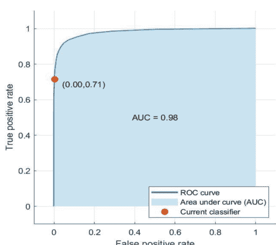

图 1.4. SB-1 的 EBT 接收者操作特征。

### 1.4 结论

我们繁忙、不健康、紧张的生活方式和充满污染的环境会导致动脉壁上的血压波动，从而引起 HPT。血压的大幅度和突然变化可能损害器官，并引起与肾脏、心脏和大脑相关的各种疾病。本章提出了一种基于 FAWT 和 EBT 的分解与分类技术，用于 HPT 的自动检测。使用 KW 检验识别出高度区分性特征，并使用基于集成的分类器获得了 96.6% 的最高分类准确率。所提方法为使用 ECG 实现 HPT 自动检测的新方法提供了途径，由于 ECG 信号的非平稳和非线性特征，目前这些信号难以分类。基于 FAWT-EBT 的方法可能有助于 HPT 的自动检测，以便患者可以早期服药。开发的系统可以帮助专家早期预测 HPT。未来，将实施 24 小时血压监测系统，用于 HPT 的实时自动检测。

### 参考文献

- [1] Tabassum N 和 Ahmad F 2011 天然草药在 HPT 治疗中的作用 Pharm. Rev. 5 30-40
- [2] Ni H, Cho S, Mankoff J, Yang J 和 Dey A.k. 2018 通过夜间连续 HRV 监测自动识别 HPT J. Ambient Intell. Hum. Comput. 9 2011–23
- [3] Drozdz D 和 Kawaekca-Jaszcz K 2014 慢性高血压状态下的心血管变化 Pediatr. Nephrol. 29 1507–16


- [4] Hall J E 2003 肾脏、高血压和肥胖 Hypertension 41 625–33

- [5] Shirole U, Joshi M 和 Bagul P 2019 使用决策树和通过直立应激指数结果确认的心脏糖尿病和正常受试者分类 Inform. Med. Unlocked 17 100252

- [6] Zhu C, Idemudia C U 和 Feng W 2019 通过整合PCA和K-means技术改进糖尿病预测的逻辑回归模型 Inform. Med. Unlocked 17 100179

- [7] Jain P, Gajbhiye 和 Tripathy R K 2020 基于多导心电图信号的低风险和高风险高血压分类的两阶段深度CNN架构 Inform. Med. Unlocked 21 100479

- [8] Schwartz C L 和 McManus R J 2015 诊断高血压及心血管疾病预防后续血压治疗目标的证据基础是什么？ BMC Med 13 6437

- [9] Melillo P, Izzo R, Orrico A, Scala P, Attanasio M, Mirra M, Luca N 和 Pecchia L 2015 使用HRV分析自动预测心血管和脑血管事件 PLoS One 10 e0118504

- [10] Kiat Soh D C, Ng E Y K, Jahmunah V, Oh S L, Tan R S 和 Rajendra Acharya U 2020 基于卷积神经网络的高血压自动诊断工具 Comput. Biol. Med. 126 103999

- [11] Ni H, Wang Y, Xu G, Shao Z, Zhang W 和 Zhou X 2019 用于识别高血压严重程度的多尺度细粒心率变异性分析 Comput. Math. Methods Med. 2019 4936179

- [12] Rajput J S, Sharma M, Tan R S 和 Rajendra Acharya U 2020 使用最优双正交小波滤波器组自动检测高血压心电图信号严重程度 Comput. Biol. Med. 123 103924

- [13] Sharma M, Tan R S 和 Acharya U R 2020 使用最优正交小波滤波器检测可电击室性心律失常 Neural Comput. Appl. 32 15869–84

- [14] Kwon S, Kang S, Lee Y, Yoo C 和 Park K 2014 日常智能手机使用期间心电图特征的隐蔽监测 Proc. 2014 36th Annual Int. Conf. IEEE Engineering in Medicine and Biology Society (Chicago, IL, USA), 26–30

- [15] Islam M K, Haque A N M M, Tangim G, Ahammad T 和 Khondokar M R H 2012 使用MATLAB和LABVIEW作为有效工具对心电图信号的研究与分析 Int. J. Comput. Electr. Eng. 4 404–8

- [16] Haque A K M F, Ali H, Kiber M A 和 Hasan M T 2009 使用小波检测心电图特征的小变化 ARPN J. Eng. Appl. Sci. 4 27–30

- [17] Lepeschkin E 和 Surawicz B 2004 心电图Q-T间期的测量 Circulation 6 378–8

- [18] Rajendra Acharya U, Paul Joseph K, Kannathal N, Lim C M 和 Suri J S 2006 心率变异性：综述 Med. Biol. Eng. Comput. 44 1031–51

- [19] Basten B L, Sherman R L, Lametschwandtner A 和 Spieler R E 2011 黄鳐Urobatis Jamaicensis胚胎鳃血管发育 Respir. Biol. 294 1423–32

- [20] Kai Li H R 和 Ziemsen T 2019 心率变异性谱分析：时间窗口很重要，透视文章 Front. Neurol. 10 545

- [21] Roy S 和 Chandra A 2018 使用陡截止FIR滤波器去噪心电图信号的新方法 器件、电路与系统国际研讨会（ISDCS）pp 1–6

- [22] Jain S, Bajaj V 和 Kumar A 2018 基于黎曼–李奥维尔分数积分的经验模态分解用于心电图去噪 IEEE J. Biomed. Health Inform. 22 1133–9

- [23] Tripath K, Sohal H 和 Jain S 2020 基于心率变异性的特征分类计算机辅助诊断系统 Biomed. Eng.: App. Basis Commun. 32 205009

- [24] Soh D C K, Ng E Y K, Jahmunah V, Oh S L, San T R 和 Acharya U R, 2020 使用经验模态分解检测高血压的计算智能工具 Comput. Biol. Med. 118 103630

- [25] Melillo P, Izzo R, Orrico A, Scala P, Attanasio M, Mirra M, Luca N D 和 Pecchia L 2015 使用心率变异性分析自动预测心血管和脑血管事件 PLoS One 10 e0118504

- [26] Ruiqi Zhang Z H, Chen Chen G L 和 Wanhui Wen A 2020 基于短期心率变异性的高血压自主神经模式分析 Biomed. Tech. (Berl.) 66 71–9

- [27] Kale N, Thomas J, Agrawal R, Benjamin B 和 Thomas J P 预测心血管事件：灵敏度和特异度 健康信息学和医学系统国际会议 HIMS’17

- [28] Ortiz-Martín L, Picazo-Sanchez P 和 Peris-Lopez P 2020 心电图信号的搏动间隔是否是熵的良好来源？基于NIST 800-90B建议的深入熵分析 Future Gener. Comput. Syst. 105 346–60

- [29] Alkhodari M, Islayem D K, Alskafi F A 和 Ahsan H K 2020 使用心率变异性和机器学习预测发生血管事件风险更高的高血压患者 IEEE Access 8 19272–39

- [30] Agliari E, Alemanno F, Barra A, Barra O A, Fachechi A, Vento L F 和 Moretti L 2020 在最小成对玻璃模型中通过最大熵原理分析心率变异性的时间相关性 Sci. Rep. 10 15353

- [31] Taye G T, Hwang H-J 和 Lim K M, 2020 使用心率变异性特征应用卷积神经网络预测室性快速心律失常的发生 Sci. Rep. 10 6769

- [32] Agnithoti P 和 Jain M, 2019 使用心电图学的心脏健康预测 Pratisthta Agnithoti Int. J. Recent Technol. Eng. (IJRTE) 8 33–9

- [33] Koichubev B K, Sorokina M A, Laryushina Y M, Turgunova L G 和 Korshukova I V 2018 高血压中心率变异性的非线性分析 Ann. Card. d'Ang. 67 174

- [34] Bossone E, Paciocco G, Iarussi D, Agretto A, Iacono A, Gillespie B W 和 Rubenfire M 2002 Melvyn Rubenfire，原发性肺动脉高压中心电图的预后作用 Chest J. 121 513–18

- [35] Melillo P, Orrico A, Scala P, Crispino F 和 Pecchia L 2015 基于云的智能健康监测系统用于高血压大鼠的自动心血管和跌倒风险评估 J. Med. Syst. 39 109

- [36] Dami S 和 Yahagizhadeh M 2021 在物联网背景下使用深度学习方法预测心血管事件 Neural Comput. Appl. 43 1–18

- [37] Zhao M, Guan L 和 Wang Y 2020 自主神经系统功能与缺血性卒中的关联及治疗策略 Front. Neurol. 10 1141

- [38] Thomas R J, Peng C-K, Goldberger A L 和 Gottlieb D J 2009 睡眠心脏健康研究中高血压和卒中：与心电图源的心肺耦合谱图标记的关联 Sleep 32 897–S2

- [39] Paragliola G 和 Coronato A 2020 用于高血压患者早期识别重大心血管事件高风险的混合心电图基深度网络 J. Biomed. Inform. 113 10648

- [40] Schillaci G, Battista F 和 Pucci G 2012 心电图学在高血压左心室肥厚诊断中的作用综述 J. Electrocardiol. 45 617–23

- [41] Afkami R G 和 ali Tinati M 2015 使用高阶统计学的基于心电图的左心室肥厚检测 第23届伊朗电气工程会议

- [42] Jothiramalingam R, Jude A, Patan R, Ramachandran M, Raisamy J H 和 Gandomi A H 2020 基于多导心电图信号的机器学习左心室肥厚检测 Neural Comput. Appl. 33 4445–55

- [43] Kublanov V S, Dolganov A Y, Belo D 和 Gamboa H 2017 动脉高血压诊断的机器学习方法比较 Appl. Biol. Biomech. 2017 5985479

- [44] Safavian S R 和 Landgrebe D 1991 决策树分类器方法论综述 IEEE Trans. Syst. Man Cybern. 21 660–74

- [45] Sarvani C, Bajaj V, Taran S 和 Sengur A 2020 基于肌电图信号的身体动作识别的灵活解析小波变换特征 IRBM 41 18–22

- [46] Khare S K 和 Bajaj V 2021 使用自适应变分模态分解的基于熵的困倦检测 IEEE Sens. J. 21 6421–8

- [47] Siuly S, Khare S K, Bajaj V, Wang H 和 Yanchun Zhang A 2020 使用脑电图信号自动检测精神分裂症的计算机化方法 IEEE Trans. Neural Syst. Rehabil. Eng. 28 2390–400

- [48] Ullo S L, Khare S K, Bajaj V 和 Sinha G R 2020 环境声音分类的混合计算机化方法 IEEE Access 8 124055–65

- [49] Khare S K, Bajaj V, Siuly S 和 Sinha G R 2020 通过使用脑电图信号的经验小波变换对精神分裂症患者进行分类 (Bristol: IOP Publishing Ltd)

- [50] Bajaj V 和 Pachori R B 2012 使用经验模态分解对发作和非发作脑电图信号进行分类 IEEE Trans. Inf. Technol. Biomed. 16 1135–42


## 第 2 章

## 基于表面肌电图信号分类的计算智能

Turker Tuncer, Sengul Dogan, Fatih Ertam 和 Abdulhamit Subasi

本章旨在为残疾人士引入一种基于人机接口的解决方案，该接口可处理由计算智能技术处理的数据。该模型利用计算智能技术进行手部动作分类。在此基础上，提出了一种名为蜘蛛网络的新型计算智能方法，用于利用表面肌电图信号识别基本手部动作。蜘蛛网络的主要组件包括预处理、特征提取、特征降维和分类。在预处理阶段，将两个不同通道的表面肌电图信号进行拼接。在特征提取阶段，对拼接信号应用离散余弦变换（DCT）和快速傅里叶变换（FFT），以获取表面肌电图信号的频率系数。此外，还使用了奇异值分解和三元模式。根据特征提取器，将提取的特征分为两组。为选择独特特征，采用邻域成分分析作为权重生成器。通过使用这些权重和正切 sigmoid 激活函数，对特征进行降维。在分类阶段，采用线性判别分析、人工神经网络、k-近邻和支持向量机进行分类任务。所提出的模型基于所构建框架的完成情况进行优化和验证，该框架可为基于表面肌电图的假肢设备控制生成准确且一致的解决方案，旨在帮助截肢者或先天性肢体缺损者。所提出的模型在手部动作分类中达到了 100% 的分类准确率。

### 2.1 引言

正如保健、生物医学和生物医学工程领域的各种应用所示，近年来对计算智能（CI）的关注度有所提高。本章介绍了计算智能在表面肌电图（sEMG）信号分类中的应用。生物医学工程是指将工程原理和方法应用于医学和医疗保健问题。典型应用包括假肢和医疗仪器设计/开发、使用成像设备进行健康监测以及诊断软件。涉及人工智能和机器学习的计算算法属于计算智能方法。许多 CI 方法需要建立模型输入与输出之间的非线性映射，以反映生物医学系统在现实世界中的运行。计算智能（CI）用于诊断系统是医学领域的一个新概念。CI 是机器学习算法和人工学习的混合体。对于海量数据的分析，这些技术极其有用，并已有效应用于模式识别和信号分类等问题。简而言之，CI 方法是满足自动诊断和控制系统不断增长需求的潜在解决方案 [1]。本章将讨论自动手部动作识别方案的基础，并重点介绍 CI 方法在 sEMG 信号分类中被有效使用的领域。

表面肌电图（sEMG）信号已被广泛用于肌电控制，因为它包含关于肌肉动作的重要信息。手在操作和抓握多种物品方面起着至关重要的作用。即使一只手丧失，也会显著干扰人类活动。因此，假手是为无臂人士提供解决方案的一个有吸引力的选择 [2–4]。sEMG 的应用范围从康复器械到人机交互方案。已开发出多种智能方法来分类假手控制中的神经肌肉动作。本章介绍了基于 sEMG 信号的假手运动控制框架。基于肌电控制的假手使用在肌肉收缩期间从皮肤表面获取的 sEMG 信号。控制手指运动的大多数肌肉位于残肢的左侧。因此，在手部截肢后，这些肌肉的动作可用于假肢控制。为了利用从肌电信号中提取的肌肉活动特征来控制假肢运动，可以采用这些特征。sEMG 的特征提取可以通过采用涉及时频域信号特征、自回归模型系数和时频特征的众多技术来实现 [5]。另一方面，利用 sEMG 信号进行强健的手部动作识别面临着诸多挑战。为了增强分类性能并消除这些问题，应采用适当的特征提取和选择方法的组合。此外，应利用适当的模型来提高分类性能。

Noce 等人 [6] 提出了一种用于手部假肢神经控制的方法。在所提出的方法中，对用于肌肉信号的模式识别技术和用于神经信号的自适应峰值排序算法（SSA）进行了比较分析。通过 SSA，确定了神经信号的峰值点，并传递了运动。EMG 和 ENG 信号用作输入参数。选择准确率作为性能参数并给出了结果。结果表明，ENG 信号是更有效的决策者。

Nishad 等人 [7] 提出了一种基于可调 Q 小波变换的 sEMG 识别技术。所开发方法的主要目标是根据基本的六种手部动作对肌电图信号进行分类。所开发的方法包括预处理、特征提取、特征选择和分类。该方法的准确率被选为成功标准，并将结果与文献中现有的和广泛使用的技术进行了比较。Yabuki 等人 [8] 设计了一种带有检测功能的硅橡胶手套。所设计的手套包括外观（形状、纹理、颜色）、材料（强度、柔韧性）、机械（指尖形状、关节运动）和检测的结构。在他们的研究中，通过传感器和控制单元创建了真实手部动作的结构。Shi 等人 [9] 开展了一项关于为仿生手套设计评估肌电图信号的研究。这项工作的主要目标是介绍一种可以模仿人手动作的方法。由 Arduino 控制的伺服电机实现了仿生手指的运动。在他们的研究中，分类阶段使用了 k-近邻算法。准确率被选为性能参数。Enoka [10] 为肌电图信号的测量和分析提供了不同的视角。根据所得结果，强调 EMG 信号需要使用各种算法和检测系统来处理信号波形，并应有效评估定义好的波形。Ryu 和 Kim [11] 提出了一种基于 EMG 信号图匹配（ESGM）算法的方法。他们使用自己的方法评估了生理肌肉活动。他们使用了常规的特征提取和分类方法。Junior 和 de Seixas [12] 研究了 EMG 信号上的降噪性能。在他们的研究中，目标是从 EMG 信号中清除作为噪声信号的 ECG 干扰。在所提出的方法中，与高通滤波不同，观察到大部分 EMG 谱含量保留在低频。Jochumsen 等人 [13] 引入了一种基于贝叶斯的 sEMG 分类技术，用于识别手臂的主要动作。Chowdhury 等人 [14] 提出了一种依赖 EMG 和 EEG 信号相关性的方法。该研究的关键目标是设计一个神经康复系统。所提出的方法包括预处理、特征提取和分类阶段。准确率在研究中被用作评估参数。Tavakoli 等人 [15] 使用 EMG 信号开发了一种假肢手套。在研究中，定义了基本手部动作，并旨在将手部动作转换为柔性结构。准确率和误差矩阵参数已被用于测试研究的性能。Tavakoli 等人 [16] 设计了一种基于 EMG 信号的可穿戴手套。该设计的手套基本上识别四种动作。他们研究的主要目标是提供由四种定义的基本动作所实现的高灵活性。为实现这一目标，设计了一种原创的手套硬件，并使用所构建的手套构建了他们的数据集。在第二阶段，从所获得的数据中提取了统计特征。在第三阶段，使用 LDA 和 SVM 分类器来获取性能。在这项工作中，提出了一种名为蜘蛛网络（SN）的新型特征提取网络。SN 包括预处理、特征提取和特征


降维阶段。在预处理阶段，首先，将 sEMG 信号连接。在特征提取阶段，DCT 和 FFT 被应用于连接后的信号以获取信号的频率系数。然后，SVD 和 TP 一起使用。邻域分量分析（NCA）和正切 sigmoid 函数用于降维。在分类阶段，ANN、k-NN、SVM 和 LDA 被用于手部运动识别。开发的 SN 的主要动机是结合多种信号处理的有效方法，并为 sEMG 信号分类创建一个高性能且执行时间短的高效框架。SN 的关键目标是利用有效方法提取变量特征，并使用特征选择方法选择判别性特征。因此，它对 sEMG 信号处理使用了许多变换。所开发方法的主要贡献如下：

- 在本章中，我们开发了一种新方案，该方案利用 DCT 和 FFT 进行信号处理。此外，SVD 和 TP 被用作特征提取器。这些方法清楚地说明所提网络是一个认知网络。拟议 SN 中使用了高效且最优的方法。

- 此外，提出了一种新的特征降维方法，该方法在文献中首次被使用。提出了一种基于 NCA 和正切 sigmoid 的新特征降维方法（Algorithm 2），结果证明了该方法的成功。

- 此外，所开发 SN 的平均分类精度与文献相比非常高。所开发模型还与最新技术进行了比较，这些结果清楚地表明，拟议 SN 能以高分类精度解决 sEMG 信号分类问题。提出了一种基于多种方法的学习方法，并称其为深度方法，因为它使用多种方法进行特征提取。

### 2.2 生物医学信号处理中的计算智能

计算智能（CI）是人工智能（AI）的后继者。CI 依赖于启发式算法，例如神经网络、进化计算、模糊系统和深度学习。CI 还涉及利用群体智能等方法。CI 是一种用于创新和智能应用的学习、适应与创造的混合体。计算智能的研究并不排斥统计方法，反而提供了一种关于这些技术如何应用的互补视角。模糊逻辑、人工神经网络、遗传算法以及控制论和 AI 等连接主义系统的混合与 CI 密切相关。下位认知功能关注 CI 的探索：视觉感知、工艺品识别、信号处理、数据结构突破、简单联想和控制。在不同领域，如生物医学信号/图像分析、模式识别和机器人学中，这些方法被用于解决同类挑战 [17]。目前，这些任务令 AI 社区感到困惑，该社区利用专注于搜索、认知的符号表征、结合机器学习的逻辑思维、专家系统和语言方法来处理这些任务。AI 是 CI 的一个组成部分，专注于涉及更高认知的问题，以通过知识的符号解释来解决这些问题。未来，其他 CI 策略也可能为这些问题找到解决方案。强化学习、序列学习、机器学习和分布式多智能体系统是高低层次认知功能之间的主要重叠领域。所有需要基于感知构建的规则推理的活动，如机器驱动车辆、机器人和自动化，都需要解决高层和低层认知问题的技术，因此，对于 AI 专家来说，它们是与 CI 社区其余部分进行粗略接触的共同基础。AI 模型基于包含脑功能的多维方法模式进行符号解释。与符号变量不同，代表性脑模型功能不能对由连续变量定义的任何问题给出准确的近似。为了实现相同的功能，认知处理的计算应在正确的层面上进行。符号动力学可以为复杂结构提供有价值的信息，并有助于建模低层和高层过程之间的变化。低层和高层认知功能之间的区别只是对大脑活动的粗略估计。在过去十年中，符号化认知得到了广泛研究，机器人学采用了发展性估计。神经网络受最底层大脑进程和结构的启发，而符号 AI 方法则受最高层级进程的动机。以一种不雄心勃勃的方式，单个神经元在处理大脑信息时连贯地发挥作用。CI 是智能代理设计的研究，涉及学习所有非算法过程，这些过程可以由人类以不同程度的能力解决。在涉及智能的问题中，主要的 CI 技术应辅以基于信息和搜索的方法。CI 更有必要克服并欢迎所有可用于此类解决方案的策略，无论其灵感来源如何。CI 本质上由 AI 中那些范式组成，这些范式指某种生物或自然机制 [17]。

医疗保健是当代社会中最重要的问题之一，因为个人的生活质量直接取决于它 [18]。尽管如此，医疗保健领域变化极大，分布广泛且去中心化。从临床角度提供适当的医疗护理需要访问准确的患者记录，而这在需要的时间和地点很少可及 [19]。医学结果本质上具有不同的统计特性。研究人员和从业者在分析这些结果时面临两项困难：维度灾难和特征来源及统计特性的异质性 [20]。这些诱因导致生物医学信号分析问题和事实性错误。统计、计算和医学领域现在正面临探索生物医学信号建模新方法的挑战。这一需求与机器学习（ML）、AI 和 CI 等其他领域的进步高度相关。随着数字化获取和处理的医疗数据量巨大且呈指数级增长，数据存储和分析也在涌现，以将这些巨大的数据转化为信息和专业知识，帮助他们实现目标 [21]。需要使用先进方法来描述数据中的这些系统性差异。对于任何智能行为，学习都是基本要求之一。众所周知，没有经验就没有知识。CI 当今提供了几种用于智能信息检索的主要方法。此外，其方法论目前适合医疗数据的研究，特别是，已对一系列针对小型专业诊断问题的医学诊断工作进行了开展 [22]，其中已确定了初步的 CI 应用。作为临床诊断有用方法的 CI 算法已被成功用于疾病的诊断和治疗 [23–26]。显然，在各种关键问题上，许多 CI 方法效果很好。尽管如此，由于它们极其复杂且数据中的维度灾难严重，它们未能解决主要的 CI 问题 [21]。

sEMG 信号广泛用于假肢设备的康复和控制，旨在帮助截肢者或先天性肢体残障人士，并改善人机交互 [27]。为了区分各种类型的肌电信号，可能会使用改进的 sEMG 信号。由于收缩形式多样，EMG 信号的方差会影响算法的分类效率。不同的生物医学信号处理方法被用来消除这些差异 [23, 28–31]。日常生活中的那些发明可能会被残疾人接触到，其态度与非残疾人不同。门把手、厨房电器或衬衫纽扣可能不会打扰大多数人，但对于残疾人来说可能成为挑战。反过来，将杠杆门把手改为门把手可能为该人提供巨大的帮助和意义，并得到他人的支持和尊重。基本的穿衣钩系统可能支持那些难以控制钥匙的人，但对大多数人来说不切实际。因此，尽管某些进步对残疾人独立性构成挑战，但一些发明旨在适应残障，其中一些是为一般用途设计的 [32]。通过改善所有环境来提高个人技能，这些支持技术可能会发挥作用 [33]。

手是一个人最重要的方面之一，在思想意义上，被视为基本元素。手用于感知现实生活遭遇中的运动和模式，并执行简单的提升功能。例如，在肌肉协调活动下，手臂的基本作用是抓取、抬起、挥手和进行其他手臂旋转运动。假肢手是一种电子机制，用于在截肢者中替换受损部件。手假肢是一种增强但实用的手，旨在执行多种任务并可被控制。例如，为了移动和巩固控制中心，肌电手臂利用由电荷产生的受控肌肉收缩。通过这种方式，截肢者可以通过受控手势完成常规手臂任务，如抓握、感知、挥手和其他手部相关动作。在抓握和处理各种物体时，人手起着至关重要的作用。即使缺少一只手也会影响人类的操作，而为无臂者配备假肢手是一种治疗方法 [34]。上肢假肢主要依赖于利用肌电控制来识别肌肉收缩过程中产生的 sEMG 信号。由于手部截肢后产生手指运动的大多数肌肉都留在残肢中，它们可以


utilized for myoelectric control and the operation of these muscles can be used for prosthesis control. Any useful characteristics can be derived from the EMG signals that provide prosthesis control information about muscle function [35]. Because EMG-controlled assistive devices aid disabled people who have trouble navigating user interfaces, such as joysticks and keyboards, more sophisticated hands-free human–machine interfaces are required. In a control system, sEMG signals can be used to trigger robotics and recovery equipment [36, 33].

### 2.3 背景

#### 2.3.1 离散余弦变换

The DCT is one of the widely used transformations for signals and images. It helps to obtain transformation coefficients of the signals using cosine based equations. The JPEG algorithm, as the mostly known image compression method, uses DCT. In this study we used 1D-DCT because sEMG signals are used for hand movement recognition [37].

DCT是信号和图像中广泛使用的变换之一。它有助于使用基于余弦的方程获取信号的变换系数。作为最著名的图像压缩方法，JPEG算法使用DCT。在本研究中，我们使用了1D-DCT，因为sEMG信号用于手部动作识别[37]。

#### 2.3.2 快速傅里叶变换

Cooley and Tukey proposed FFT in 1965 to decrease processes of the Discrete Fourier Transform (DFT). This process led to a rapid rise in DFT applications in digital signal processing and other fields. It has also led to the development of other algorithms. All these algorithms are known as FFT algorithms. The number of operations required for the DFT account has been greatly reduced and ease of operation is provided with FFT. FFT is an effective and economical algorithm for calculating DFT. It is one of the phenomena of signal processing. Hence, we used it in the proposed SN [38].

Cooley和Tukey于1965年提出了FFT，以减少离散傅里叶变换（DFT）的计算过程。这一过程导致DFT在数字信号处理和其他领域的应用急剧增加。它还促进了其他算法的发展。所有这些算法都称为FFT算法。DFT所需的运算次数大大减少，FFT提供了操作简便性。FFT是计算DFT的一种有效且经济的算法。它是信号处理的一个现象。因此，我们在拟议的SN中使用了它[38]。

#### 2.3.3 奇异值分解

SVD is a matrix factorization method and it generates three components from a matrix. Generally, the singular values have been utilized to construct feature vectors. It is a widely used method in signal processing, image processing, face recognition, perceptual hashing and Google page rank algorithms [39, 40].

SVD是一种矩阵分解方法，它从矩阵中生成三个分量。一般来说，奇异值已被用于构造特征向量。它是信号处理、图像处理、人脸识别、感知哈希和Google页面排名算法中广泛使用的方法[39, 40]。

#### 2.3.4 三值模式

Texture recognition and analysis are a major problem for image processing and several methods have been presented to solve this problem [41]. One practical solution of the texture analysis is textural descriptors.

纹理识别和分析是图像处理中的一个主要问题，已经提出了几种方法来解决这个问题[41]。纹理分析的一个实际解决方案是纹理描述符。

#### 2.3.5 支持向量机

The SVM has various versions and it is a commonly used classifier in the literature. It is a conventional and parametric classifier. The widely used activation functions of the SVM are linear, quadratic, cubic, radial basis and Gaussian [42, 43].

SVM有多种版本，是文献中常用的分类器。它是一种传统的参数分类器。SVM广泛使用的激活函数包括线性、二次、三次、径向基和高斯[42, 43]。

#### 2.3.6 线性判别分析

LDA is a linear dimension reduction and supervised machine learning technique, which seeks to find vectors in the space in which classes are best separated using class information of data objects. It is a nonparametric classifier. It is simple, fast and effective. Hence, many methods have been used [44].

LDA是一种线性降维和监督机器学习技术，旨在利用数据对象的类别信息，在类别间分离最好的空间中寻找向量。它是一种非参数分类器。它简单、快速且有效。因此，已经使用了许多方法[44]。

#### 2.3.7 KNN

KNN is a distance-based classifier. Variable distances are utilized in KNN such as Euclidean, city block, Minkowski, Spearman, Chi-square. It is one of the simplest classification methods. However, it is a lazy classifier because it is not efficient for big data. It is suitable for small datasets. However, KNN proves success of the methods for large datasets using a small dataset [45].

KNN是一种基于距离的分类器。KNN中使用了可变距离，例如欧氏距离、城市街区距离、闵可夫斯基距离、斯皮尔曼距离、卡方距离。它是最简单的分类方法之一。然而，它是一个懒惰分类器，因为它对大数据不高效。它适用于小数据集。然而，KNN证明了使用小数据集对大数据集的方法的成功[45]。

#### 2.3.8 人工神经网络

Artificial neural network (ANN) is inspired by bio-neurological systems and it is utilized as a classifier and regressor in the literature. ANN is one of the phenomena of machine learning and it has many variations. It uses input, weights and actual output for prediction. Basic mathematical notation of it was shown in equation (2.1) [46].

人工神经网络（ANN）受生物神经系统启发，在文献中被用作分类器和回归器。ANN是机器学习的一个现象，并有许多变体。它使用输入、权重和实际输出进行预测。其基本数学表示在等式（2.1）中显示[46]。

```
Y = \varphi(X_* w^T + \text{bias}) (2.1)
```

where \varphi(.) is activation function, X defines input vector, w is weights, Y is output.

其中，\varphi(.)是激活函数，X定义输入向量，w是权重，Y是输出。

### 2.4 蜘蛛网络

The key objective of the developed model is to obtain a cognitive model for basic hand movement recognition. We want to extract low, middle, and high level features using a cognitive method. As we know from the literature, DCT and FFT are effective methods for signal processing. Hence, these are used in a preprocessing step to obtain frequency coefficients of the sEMG signals. Also, TP and SVD are effective feature extraction methods and are used as such. After these processes, large feature sets are obtained. To select distinctive of them, an NCA-based feature reduction method is utilized. The proposed SN uses several classifiers for comparison purposes. These classifiers are chosen to validate the feature extraction power of the proposed SN because these are conventional classifiers. The key objectives of the proposed SN are given below.

开发该模型的关键目标是获得基本手部动作识别的认知模型。我们希望使用认知方法提取低、中、高级特征。根据文献，DCT和FFT是信号处理的有效方法。因此，这些方法用于预处理步骤，以获取sEMG信号的频率系数。此外，TP和SVD是有效的特征提取方法，并被用作此类方法。经过这些过程后，获得了大型特征集。为了从中选出独特的特征，采用了基于NCA的特征降维方法。拟议的SN使用多个分类器进行比较。这些分类器被选中用于验证拟议SN的特征提取能力，因为这些是传统分类器。拟议SN的关键目标如下。

- Obtain high classification accuracy.
- Propose a lightweight signal recognition network

- 获得高分类准确率。
- 提出一个轻量级信号识别网络

The SN includes preprocessing, feature extraction, feature reduction, feature concatenation and classification stages. The pictorial description of the SN is shown in figure 2.1.

SN包括预处理、特征提取、特征降维、特征连接和分类阶段。SN的图示在图2.1中显示。

As shown in figure 2.1, signal concatenation, DCT and FFT are used in preprocessing to generate secondary signals. SVD and TP are chosen as feature extractors. The extracted SVD-based and TP-based features are concatenated and two types of features are obtained. These are SVD-based and TP-based features. Finally, 2560 TP-based and 80 SVD-based features are extracted from an sEMG signal. In the feature reduction phase, firstly NCA generates weights then these weights and a tangent sigmoid-based feature reduction method are applied onto TP- and SVD- based features. 10-fold cross-validation is employed to obtain results. The milestones of the SN are explained in the subsection.

如图2.1所示，在预处理中使用信号连接、DCT和FFT来生成二次信号。SVD和TP被选为特征提取器。提取的基于SVD和基于TP的特征被连接，得到两种类型的特征。这些是基于SVD和基于TP的特征。最后，从sEMG信号中提取了2560个基于TP的特征和80个基于SVD的特征。在特征降维阶段，首先NCA生成权重，然后将这些权重和基于正切Sigmoid的特征降维方法应用于基于TP和SVD的特征。采用10倍交叉验证来获得结果。SN的里程碑在子节中解释。

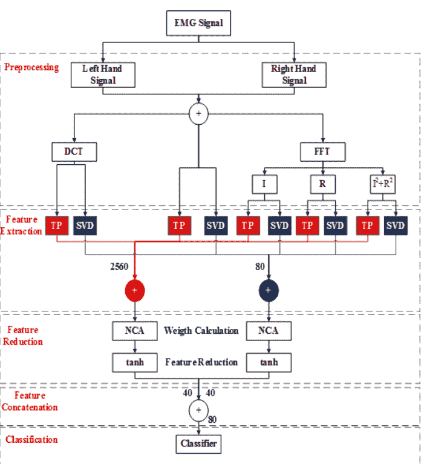

Figure 2.1. The block diagram of the SN.

图2.1. SN的框图。

#### 2.4.1 预处理

The steps of the pre-processing phase are presented below.

预处理阶段的步骤如下。

- Step 1: Concatenate channel-1 and channel-2 sEMG signals.

- 步骤1：连接通道-1和通道-2的sEMG信号。

$S^C = S^1 | S^2$ (2.2)

where $S^C, S^1$ and $S^2$ are first channel, second channel and concatenated signals, respectively. | is concatenation operator.

其中，$S^C、S^1$和$S^2$分别为第一通道、第二通道和连接信号。|为连接运算符。

To prevent memorization and show success of the proposed SN, sEMG signals recorded from channel-1 and channel-2 are concatenated. By using this strategy, 30 samples are obtained for each hand movement. In the literature, many methods have used this strategy.

为防止记忆并证明拟议SN的成功，将从通道-1和通道-2记录的sEMG信号进行连接。使用此策略，每个手部动作可获得30个样本。在文献中，许多方法都使用了此策略。

- Step 2: Apply DCT to concatenated signal to obtain transform coefficients.

- 步骤2：对连接信号应用DCT以获取变换系数。

$C = DCT(S^C)$ (2.3)

where $C$ is DCT coefficient of the signal and DCT(.) is function of the discrete cosine transform.

其中，$C$是信号的DCT系数，DCT(.)是离散余弦变换函数。

- Step 3: Apply FFT to concatenated signal to obtain transform coefficients.

- 步骤3：对连接信号应用FFT以获取变换系数。

$[IR] = FFT(S^C)$ (2.4)

$S^F = I^2 + R^2$ (2.5)

where $I, R$ and $S^F$ are imaginary, real and Fourier signals, respectively. FFT(.) generates imaginary and real signals.

其中，$I、R$和$S^F$分别为虚部信号、实部信号和傅里叶信号。FFT(.)生成虚部和实部信号。

After this phase, a total of five signals are constructed, and these are $S^C, C, I, R$ and $S^F.

经过此阶段，总共构建了五个信号，即$S^C、C、I、R$和$S^F。

#### 2.4.2 特征提取

In this phase, SVD and TP are employed as feature extractors. These extractors are applied to the generated five signals. The steps of the SVD-based feature extraction process are presented below.

在此阶段，SVD和TP被用作特征提取器。这些提取器应用于生成的五个信号。基于SVD的特征提取过程的步骤如下。

- Step 1: The input signals are shaped into two-dimensional signals. For instance, the length of the used signals in this study are 6000. We reshaped them into $60 \times 100$. This step is called a vector-to-matrix transformation.

- 步骤1：将输入信号塑形为二维信号。例如，本研究中使用的信号长度为6000。我们将其重塑为$60 \times 100$。此步骤称为向量到矩阵的转换。

- Step 2: The obtained matrix is divided into $15 \times 25$ sized non-overlapping blocks.

- 步骤2：将得到的矩阵分为$15 \times 25$大小的非重叠块。

- Step 3: SVD is applied onto each $15 \times 25$ sized block.

- 步骤3：对每个$15 \times 25$大小的块应用SVD。

$[USV] = SVD(block)$ (2.6)

where $U, S, V$ are components of the SVD and SVD(.) is singular value decomposition function.

其中，$U、S、V$是SVD的分量，SVD(.)是奇异值分解函数。

- Step 4: Store maximum singular value as a feature.

- 步骤4：将最大奇异值存储为特征。

$feat^S_L(i) = max(S), i = \{1, 2, ... , 16\},$

$L = \{S^C, C, I, R, S^F\}$ (2.7)

where $feat_k^S$ represents $i$th feature of a signal by SVD. As seen in equation (2.5), the SVD based method extracts 16 features from a signal. This feature extraction method is applied to $S^C, C, I, R$ and $S^F$ signals. Hence, 80 features are extracted in this phase. The final feature of this phase is called $feat^S.

其中，$feat_k^S$表示由SVD提取的信号的第$i$个特征。如等式（2.5）所示，基于SVD的方法从信号中提取16个特征。此特征提取方法应用于$S^C、C、I、R$和$S^F$信号。因此，此阶段提取了80个特征。此阶段的最终特征称为$feat^S。

The second feature extractor is TP. TP uses nine sized non-overlapping windows and ternary functions to extract features. The main problem of TP is to set threshold value. To adjust an automatic threshold value, standard deviation is used in this chapter. The definition of the automatic threshold calculation strategy is given in equations (2.8)-(2.10).

第二个特征提取器是TP。TP使用九大小的非重叠窗口和三值函数来提取特征。TP的主要问题是设置阈值。为了调整自动阈值，本章使用了标准差。自动阈值计算策略的定义在等式（2.8）至（2.10）中给出。

$thr = h \times SD(\text{signal}), h = \{0.1, 0.2, ..., 1\} \quad (2.8)$

$SD(\text{signal}) = \frac{1}{n-1} \sqrt{\sum_{i=1}^n (\text{signal}_i - \overline{\text{signal}})^2} \quad (2.9)$

$\overline{\text{signal}} = \frac{\sum_{i=1}^n \text{signal}_i}{n} \quad (2.10)$

where $\overline{\text{signal}}$ is mean of the signal, $SD(.)$ is function of the standard deviation, thr represents threshold value and $h$ is multiplier. The pseudo code of the 1D-TP is shown in Algorithm 2.1

其中，$\overline{\text{signal}}$为信号的均值，$SD(.)$为标准差函数，thr表示阈值，$h$为乘数。1D-TP的伪代码如算法2.1所示。

##### Algorithm 2.1: Pseudo code of the 1D-TP

##### 算法2.1：1D-TP的伪代码

```
Input: Signal (S) with size L, threshold value (t)
Output: Feature vector of the TP ($feat^{TP}$) with length of 512.
1: Load signal.
2: for i=1 to L-8 do
3:     $window = S(i:i + 8)$; // Divide signal into 9 sized non-overlapping windows.
4:     $center = window(5)$; // Assign center value.
5:     $counter = 1$; // Assign counter to calculate lower and upper signals.
6:     $L(i) = 0; U(i) = 0$; // Define Lower and Upper values.
6:     for j=1 to 9 do
7:         if j != 5 then
8:             if $window(j) - center < -t$ then
9:                 $L(i) = L(i) + 2^{8-counter}$;
11:             else if $window(j) - center > t$ then
12:                 $H(i) = H(i) + 2^{8-counter}$;
13:             end if
14:             $counter = counter + 1$;
15:         end if
16:     end for j
17: end for i
18: Extract histograms of the L and U.
19: Concatenated the histograms extracted and obtain $feat^{TP}$.
```


TP采用基于标准差的阈值点搜索方法进行测试。因此，实验结果中给出了10个阈值点及其结果。基于TP的特征提取技术的步骤如下。

步骤1：加载信号 $S^C$、$C$、$I$、$R$ 和 $S^F$。

```
feat$_{S^C}^{TP}$ = TP($S^C$) (2.11)
feat$_{C}^{TP}$ = TP($C$) (2.12)
feat$_{I}^{TP}$ = TP($I$) (2.13)
feat$_{R}^{TP}$ = TP($R$) (2.14)
feat$_{F}^{TP}$ = TP($S^F$) (2.15)
```

步骤2：应用TP并从每个信号中提取512个特征。TP函数如算法2.1所示。其中，feat$_{S^C}^{TP}$、feat$_{C}^{TP}$、feat$_{I}^{TP}$、feat$_{R}^{TP}$ 和 feat$_{F}^{TP}$ 是预处理阶段生成信号的TP特征。TP(.) 是三元模式函数，它从每个信号中提取512个特征。

步骤3：连接每个信号的特征以获取最终TP特征。

```
feat$^{TP}$ = feat$_{S^C}^{TP}$|feat$_{C}^{TP}$|feat$_{I}^{TP}$|feat$_{R}^{TP}$|feat$_{S^F}^{TP}$ (2.16)
```

使用基于TP的特征提取器从sEMG信号中提取了2560个特征。因此，利用开发的SN提取了两类特征，即基于SVD和TP的特征。分别提取了80个和2560个SVD和TP特征。这些特征被降维为80个特征。

#### 2.4.3 特征降维

在此阶段，我们利用了一种基于NCA [47]的新颖特征降维方法，该方法生成特征权重。将生成的权重和基于正切sigmoid函数的方法应用于特征以降维。正切sigmoid函数是文献中广泛使用的激活函数。其数学描述如方程(2.17)所示。

```
tansig($l$) = \(\frac{e^l - e^{-l}}{e^l + e^{-l}}\) (2.17)
```

其中，$l$ 表示正切sigmoid的输入参数，tansig( . ) 是正切sigmoid函数。所提出的特征降维技术的伪代码如算法2.2所示。

##### 算法2.2：所提出的基于NCA和正切sigmoid的特征降维方法的伪代码

```
Input: Concatenated features ($feat^C$) with length of M, reduction factor is k
Output: Reduced features ($feat^R$) with length of M/k.
1: $w = NCA(feat^C)$ // Generates weights (w) using NCA
2: $counter = 1$; // Define counter. This counter is used as index of the reduced feature.
3: for i=1 to M step by k do
4:   $p = 0, d = 0$; // Define variable to calculate weighted mean value.
5:   for j=0 to k-1 do
6:     $p = p + w(i + j) * feat^C(i + j)$;
7:     $d = d + w(i + j)$;
8:   end for j
9:   $feat^R(counter) = tansig \left( \frac{p}{d} \right)$;
10: $counter = counter + 1$;
11: end for i
```

如算法2.2所示，NCA被用于生成特征权重。NCA通常被用作特征选择方法。生成的权重用于特征排序。NCA是一种非参数方法，它使用距离度量来生成权重。生成的权重用于计算特征的加权平均值，然后将正切sigmoid函数应用于计算出的平均值。在本研究中，TP和SVD特征被分别降维。

#### 2.4.4 特征连接

在特征连接阶段，降维后的TP和SVD特征被连接以获取最终特征。连接过程后，最终特征的长度为80。

feat$^F$ = feat$^R_{TP}$|feat$^R_{SVD}$ (2.18)

其中，feat$^R_{SVD}$、feat$^R_{TP}$ 和 feat$^F$ 分别为降维后的SVD特征、降维后的TP特征和最终特征。

#### 2.4.5 分类

在分类阶段，采用了多种分类器。这些分类器包括SVM [42, 43]、LDA [48, 49]、KNN [48, 49]和ANN [50]。所使用的SVM采用中度高斯核。所采用的SVM具有高斯核函数，框约束级别为一，多核尺度为8.9。所使用的LDA的协方差结构为全协方差。在KNN中，$k$ 选为10，距离度量选为欧氏距离。在所使用的KNN中，距离权重通过平方反比计算。为了获得所有样本的测试结果，采用了10倍交叉验证。

### 2.5 结果与讨论

#### 2.5.1 数据集

本文使用了一个基本手部动作数据集。该数据集可公开获取，广泛用于手部动作识别实验，可从UCI网站 [51] 下载。该数据集包含五名受试者（三名女性和两名男性，年龄为20–22岁）的sEMG信号。一个双通道Delsys Bagnoli™手持式EMG设备放置在手臂上。为了获取sEMG数据，受试者做出了六种基本手部动作。所使用的手部动作包括圆柱握持（CY）、钩握（HO）、侧捏（LA）、掌握（PA）、球形握持（SP）和指尖捏（TI）。由于每个动作重复30次，因此该数据集每名手和每人包含180个sEMG信号。sEMG数据的频率为500 Hz，sEMG信号存储时长为6秒。因此，每个信号包含3000个值 [51]。

#### 2.5.2 实验结果

为了测试所开发的SN的性能，使用了一个广泛的sEMG信号数据集。所提议框架的仿真使用MATLAB 2018a实现。定义了这些情况以全面评估所提议的SN。这些情况通过使用高斯SVM、LDA、ANN和KNN构建。为了评估分类器的性能，使用了如下给出的总分类准确率 [52]。

Accuracy (%) = \(\frac{TP + TN}{TP + TN + FP + FN} \times 100\) (2.19)

其中，TP、TN、FP和FN分别表示真阳性、真阴性、假阳性和假阴性。每种情况中都使用了TP的迭代阈值计算策略。该策略使用基于标准差的方程。定义的情况及其结果如下所示。

**情况1：** 在此情况下，采用高斯核SVM作为分类器。情况1的结果列于表2.1中。对于F1、F2、F3、M1和M2受试者，分别达到了最佳率98.88%、100.0%、100.0%、100.0%和99.44%。TP的最佳阈值为0.4 × SD(signal)。

**情况2：** 在此情况下，利用线性判别分析作为分类器（表2.2）。对于F1、F2、F3、M1和M2受试者，最佳准确率分别为95.0%、98.88%、100.0%、99.44%和100.0%。通过使用0.5 × SD(signal)作为阈值，达到了两个100.0%的分类率。

**情况3：** 在此情况下，利用KNN（_k_ = 10且距离度量为欧氏距离）作为分类器。对于F1、F2、F3、M1和M2受试者，分别达到了最佳准确率98.88%、100.0%、98.88%、99.44%和99.44%。本情况的结果列于表2.3中。

| 受试者 | 0.1SD | 0.2 SD | 0.3 SD | 0.4 SD | 0.5 SD |
|---|---|---|---|---|---|
| F1 | 98.88% | 97.22% | 98.33% | 97.77% | 98.88% |
| F2 | 100.0% | 99.44% | 100.0% | 100.0% | 99.44% |
| F3 | 98.88% | 99.44% | 98.89% | 100.0% | 100.0% |
| M1 | 99.44% | 99.44% | 100.0% | 100.0% | 99.44% |
| M2 | 98.33% | 98.88% | 98.33% | 98.88% | 99.44% |

| 受试者 | 0.6 SD | 0.7 SD | 0.8 SD | 0.9 SD | 1 SD |
|---|---|---|---|---|---|
| F1 | 97.77% | 96.66% | 98.33% | 96.66% | 98.33% |
| F2 | 100.0% | 100.0% | 99.44% | 99.44% | 99.44% |
| F3 | 99.44% | 99.44% | 98.88% | 99.44% | 98.88% |
| M1 | 98.88% | 99.44% | 98.88% | 98.88% | 99.44% |
| M2 | 99.44% | 99.44% | 98.33% | 98.33% | 98.33% |

| 受试者 | 0.1 SD | 0.2 SD | 0.3 SD | 0.4 SD | 0.5 SD |
|---|---|---|---|---|---|
| F1 | 91.67% | 93.89% | 95.00% | 91.67% | 92.78% |
| F2 | 98.33% | 97.22% | 98.88% | 99.44% | 98.33% |
| F3 | 98.33% | 98.88% | 97.78% | 98.88% | 100.0% |
| M1 | 98.83% | 98.88% | 99.44% | 98.88% | 98.88% |
| M2 | 100.0% | 99.44% | 100.0% | 100.0% | 100.0% |

| 受试者 | 0.6 SD | 0.7 SD | 0.8 SD | 0.9 SD | 1 SD |
|---|---|---|---|---|---|
| F1 | 93.33% | 90.56% | 92.22% | 92.78% | 93.33% |
| F2 | 98.33% | 98.33% | 98.88% | 98.88% | 98.88% |
| F3 | 99.44% | 98.88% | 96.67% | 97.78% | 97.78% |
| M1 | 98.33% | 98.88% | 99.44% | 98.88% | 99.44% |
| M2 | 100.0% | 100.0% | 100.0% | 100.0% | 100.0% |

**情况4：** 在此情况下，利用ANN作为分类器。ANN的隐藏层大小为50，并使用正切sigmoid作为激活函数。根据结果，ANN达到了最佳性能，因为它为四个受试者（即F1、F2、F3和M2）实现了100.0%的分类准确率。如表2.4所示，对于F1、F2、F3、M1和M2受试者，最佳分类率分别计算为100.0%、100.0%、99.44%和100.0%。


表 2.3. 用例 3 的分类准确率结果。

| 受试者 | 0.1 SD | 0.2 SD | 0.3 SD | 0.4 SD | 0.5 SD | 0.6 SD | 0.7 SD | 0.8 SD | 0.9 SD | 1 SD |
| :--- | :--- | :--- | :--- | :--- | :--- | :--- | :--- | :--- | :--- | :--- |
| F1 | 98.88% | 95.00% | 97.22% | 95.00% | 97.22% | 96.11% | 94.44% | 95.56% | 95.56% | 97.22% |
| F2 | 100.0% | 99.44% | 99.44% | 100.0% | 99.44% | 99.44% | 100.0% | 100.0% | 99.44% | 100.0% |
| F3 | 96.11% | 97.78% | 97.78% | 97.78% | 98.33% | 98.88% | 97.22% | 97.22% | 98.33% | 98.33% |
| M1 | 99.44% | 98.33% | 99.44% | 98.88% | 98.88% | 98.88% | 98.33% | 98.33% | 97.78% | 98.33% |
| M2 | 97.78% | 97.78% | 98.33% | 98.33% | 99.44% | 98.33% | 97.22% | 97.78% | 97.78% | 97.78% |

表 2.4. 用例 4 的分类准确率结果。

| 受试者 | 0.1 SD | 0.2 SD | 0.3 SD | 0.4 SD | 0.5 SD | 0.6 SD | 0.7 SD | 0.8 SD | 0.9 SD | 1 SD |
| :--- | :--- | :--- | :--- | :--- | :--- | :--- | :--- | :--- | :--- | :--- |
| F1 | 97.22% | 95.55% | 100.0% | 96.11% | 98.33% | 97.78% | 96.11% | 98.33% | 96.11% | 95.55% |
| F2 | 100.0% | 100.0% | 99.44% | 100.0% | 100.0% | 99.44% | 99.44% | 100.0% | 98.88% | 98.88% |
| F3 | 100.0% | 97.22% | 98.33% | 97.78% | 97.22% | 98.33% | 98.33% | 98.33% | 97.22% | 95.00% |
| M1 | 96.66% | 98.88% | 98.88% | 99.44% | 98.33% | 98.88% | 97.78% | 97.78% | 99.44% | 98.33% |
| M2 | 96.66% | 99.44% | 98.88% | 100.0% | 98.33% | 100.0% | 98.88% | 98.33% | 98.88% | 97.78% |

为了更好地理解所开发框架的成功之处，除了准确率，我们还采用了 F1-分数、灵敏度、特异度和几何平均数参数。它们的数学符号如下所示 [52]。

```
F1-score = \frac{2TP}{2TP + FP + FN} (2.20)
Sn = \frac{TP}{TP + FN} (2.21)
Sp = \frac{TN}{FP + FN} \quad (2.22)
Gm = \sqrt{Sn \times Sp} \quad (2.23)
```

其中 F1、Sn、Sp 和 Gm 分别代表 F-分数、灵敏度、特异度和几何平均数。最佳结果列于表 2.5。

从表 2.5 可以看出，所提 SN 在 F1-分数、灵敏度、特异度和几何平均数方面均取得了高值。所使用的数据集也是同质数据集。因此，我们获得了这些结果，其列于表 2.5。此外，曲线下面积（AUC）计算为 100%。

如表 2.5 所示，所提 SN 提取了独特特征，因为所使用的常规分类器能在短时间内实现高成功率。

成功的机器学习方法通常具有多层结构，且应高效管理参数。因此，这些方法的计算复杂度非常高。所提方法计算成本较低，因为其计算复杂度为 O(pn) ≅ O(n)，其中 p 定义为常数且 p 也是所用方法的数量。此外，SN 的平均执行时间按步骤列于表 2.6。

该表证明所开发模型速度非常快且轻量。所提方法的成功清楚地表明，所开发 SN 能使用更大的 sEMG 数据集实现高准确率。此外，为评估所提方法，计算了所开发模型的计算复杂度。所提 SN 的计算复杂度按步骤列于表 2.7 [53]。

在表 2.7 中，L、S 和 T 分别表示信号长度、SVD 特征长度和 TP 特征长度。根据表 2.7，所提 SN 的计算复杂度主要基于信号长度。因此，计算复杂度计算为 O(n)。

#### 2.5.3 讨论

在本文中，所提方法使用 DCT、FFT、SVD、TP 和基于 NCA 的特征降维方法。这些是有效的方法，通过使用所提 SN，其对信号处理的积极作用被直接应用。所提 SN 提取独特特征，这些特征基本上可以分类。为了获得 SN 的性能，使用了三个分类器。其中最佳分类器是 ANN，它分别为 F1、F2、F3、M1 和 M2 受试者实现了 100.0%、100.0%、99.44% 和 100.0%。所开发模型的最佳分类准确率也是最先进方法的最佳准确率。结果也列于表 2.8。根据表 2.8，所提 SN 为所有受试者取得了最佳结果。

| 受试者 | F1-分数 | Sn | Sp | Gm |
| :--- | :--- | :--- | :--- | :--- |
| F1 | 100.0% | 100.0% | 100.0% | 100.0% |
| F2 | 100.0% | 100.0% | 100.0% | 100.0% |
| F3 | 100.0% | 100.0% | 100.0% | 100.0% |
| M1 | 100.0% | 100.0% | 100.0% | 100.0% |
| M2 | 100.0% | 100.0% | 100.0% | 100.0% |
| 平均 | 100.0% | 100.0% | 100.0% | 100.0% |

| 步骤 | 时间（秒） |
| :--- | :--- |
| 加载信号 | 2.11 ×10⁻⁴ |
| 预处理与特征提取 | 0.0383 |
| 基于所提 NCA 和 tansig 的特征降维 | 0.0089 |
| 使用 10 折交叉验证进行训练 | 0.1614 |

表 2.7. 所提 SN 的计算复杂度。

| 所提 SN 的步骤 | 计算开销 |
| :--- | :--- |
| 1: 拼接左右手的 sEMG 信号 | O(L) |
| 2: 对信号应用 DCT | O(L) |
| 3: 对信号应用 FFT 并生成三个变换信号 | O(3L) |
| 4: 对 DCT、FFT 信号和原始信号应用 TP | O(5L) |
| 5: 对 DCT、FFT 信号和原始信号应用 SVD | O(5L) |
| 6: 拼接 TP 特征 | O(5T) |
| 7: 拼接 SVD 特征 | O(5S) |
| 8: 降维 TP 特征 | O(5T) |
| 9: 降维 SVD 特征 | O(5S) |
| 10: 拼接降维后的特征 | O(S + T) |
| 总开销 | T(L, S, T) = O(15L + 11T + 11S) |

表 2.8. 所提 SN 与最先进方法的对比。

| 受试者 | Iqbal et al [54] | Sapsanis et al [55] | Akben et al [56] | Ruangpaisarn 和 Jaiy [57] | Nishad et al [7] | 所提 SN |
| :--- | :--- | :--- | :--- | :--- | :--- | :--- |
| F1 | 82.78 | 87.25 | 93.04 | 96.67 | 98.33 | 100.0 |
| F2 | 87.67 | 88.05 | 86.66 | 98.88 | 97.78 | 100.0 |
| F3 | 83.11 | 85.53 | 97.0 | 96.67 | 99.44 | 100.0 |
| M1 | 90.0 | 90.42 | 99.23 | 98.88 | 98.88 | 100.0 |
| M2 | 90.0 | 94.80 | 97.66 | 100.0 | 98.33 | 100.0 |
| 平均 | 86.71 | 89.21 | 94.72 | 98.22 | 98.55 | 100.0 |

### 2.6 结论与建议

本章提出了一种名为 SN 的新型特征提取框架。SN 的主要目标是结合高效方法，以高准确率对信号进行分类。所提 SN 使用 DCT、FFT、TP、SVD 和一种新型基于 NCA 的特征降维方法来实现高成功率。还使用了多个分类器，配合多种参数创建不同用例。所得结果与其他最先进方法进行了比较，所开发模型实现了 100.0% 的平均准确率。该结果比先前研究高出约 1.45%。所开发模型的计算复杂度等于 _O(n)_。此外，所开发方法是一种认知方法，因为它不使用任何优化技术。有效方法被组合使用以实现高准确率。根据实验结果，提出了一种认知、轻量且高精度的特征提取框架。所提 SN 使用常规分类器取得了高性能。尽管实验中使用的数据集较小，但所提方法可在大型数据集上进行测试。ANN 取得了更好的性能，并证明了所提 SN 可使用大型数据集实现高成功率。因此，提出了一种基于 sEMG 信号的基本手部运动识别深度特征提取方法。据我们所知，所提 SN 是用于基本手部运动识别的首个框架。可利用所提 SN 为截肢者开发新型物理治疗设备以及智能机械手和手套。所提 SN 也是一种可扩展方法。SN 的主要目标是结合 FFT、DCT、SVD、TP、NCA 等有效方法，以实现更好的分类性能。所提 SN 框架可应用于 ECG、EEG、语音等其他信号。

### 参考文献

- [1] Begg R, Lai D T 和 Palaniswami M 2007 *生物医学工程中的计算智能* (Boca Raton, FL: CRC Press)
- [2] Lee S, Kim M-O, Kang T, Park J 和 Choi Y 2018 用于基于表面 EMG 的义手肌电控制的针织带传感器 *IEEE 传感器杂志* **18** 8578–86
- [3] Stango A, Negro F 和 Farina D 2014 高密度 EMG 信号的空间相关性为模式识别中的肌控提供了对电极数量和位移鲁棒的特征 *IEEE 神经系统与康复工程学报* **23** 189–98
- [4] Ma J, Thakor N V 和 Matsuno F 2014 基于协同的肌电假肢手与腕运动控制 *IEEE 人机系统学报* **45** 74–83
- [5] Subasi A, Alharbi L, Madani R 和 Qaisar S M 2018 使用旋转森林的基于表面 EMG 的基本手部运动分类 *ASET 科学与工程技术进展国际会议* (Piscataway, NJ: IEEE) 2018 pp. 1–5
- [6] Noce E, Bellingegni A D, Ciancio A L, Sachetti R, Davalli A 和 Guglielmelli E *等* 2019 用于义手控制的 EMG 和 ENG 包络模式识别 *神经科学方法期刊* **311** 38–46
- [7] Nishad A, Upadhyay A, Pachori R B 和 Acharya U R 2019 使用可调 Q 小波变换基滤波器组的表面肌电图信号手部运动自动分类 *未来生成计算机系统* **93** 96–110


- [8] Yabuki Y, Tanahashi K, Hoshikawa S, Nakamura T, Kato R and Jiang Y et al 2016 基于热塑性苯乙烯弹性体的肌电假肢手新型化妆手套的研发 Int. Conf. on Intelligent Autonomous Systems (Berlin: Springer) pp 269–82

- [9] Shi W-T, Lyu Z-J, Tang S-T, Chia T-L and Yang C-Y 2018 基于表面肌电信号手势识别的仿生手控制：初步研究 Biocybern. Biomed. Eng. 38 126–35

- [10] Enoka R M 2019 表面肌电信号分解的生理验证 J. Electromyogr. Kinesiol. 46 70–83

- [11] Ryu J and Kim D-H 2017 基于肌电图信号图匹配（ESGM）算法的实时步态子阶段检测 Expert Syst. Appl. 85 357–65

- [12] Junior J D C and de Seixas J M 2019 一种用于降低低强度肌电信号中心电图伪迹的模板减法 Biomed. Signal Process. Control 47 380–6

- [13] Jochumsen M, Waris A and Kamavuako E N 2018 肢体位置对肌内肌电图手势分类的影响 Biomed. Signal Process. Control 43 1–8

- [14] Chowdhury A, Raza H, Meena Y K, Dutta A and Prasad G 2019 基于EEG–EMG相关性的手部矫形器支持神经康复脑机接口 J. Neurosci. Methods 312 1–11

- [15] Tavakoli M, Benussi C and Lourenco J L 2017 先进义肢手的单通道表面肌电图控制：一种简单、低成本且高效的方法 Expert Syst. Appl. 79 322–32

- [16] Tavakoli M, Benussi C, Lopes P A, Osorio L B and de Almeida A T 2018 基于双通道表面肌电图可穿戴臂带和SVM分类器的稳健手势识别 Biomed. Signal Process. Control 46 121–30

- [17] Sumathi S and Paneerselvam S 2010 计算智能范式：使用MATLAB的理论与应用 (Boca Raton, FL: CRC Press)

- [18] Bagga P and Hans R 2015 医疗领域中移动代理的应用：文献综述 Int. J. Grid Distrib. Comput. 8 55–72

- [19] Grimson J, Stephens G, Jung B, Brimson W, Berry D and Pardon S 2001 通过互联网共享医疗记录 IEEE Internet Comput. 5 49–58

- [20] Pölsterl S, Conjeti S, Navab N and Katouzian A 2016 高维异质医疗数据生存分析：将特征提取作为特征选择替代方案的探索 Artif. Intell. Med. 72 1–11

- [21] Caballería N C, Castillo-Sequera J L, Gómez-Pulido J A, Gómez-Pulido J M and Polo-Luque M L 2020 机器学习在人类疾病诊断中的应用：系统综述 Appl. Sci. 10 5135

- [22] Kononenko I 2001 医疗诊断中的机器学习：历史、现状与展望 Artif. Intell. Med. 23 89–109

- [23] Gokgoz E and Subasi A 2015 使用小波变换对肌电信号分类的决策树算法比较 Biomed. Signal Process. Control 18 138–44

- [24] Subasi A 2013 使用粒子群优化支持向量机对神经肌肉疾病诊断的肌电信号分类 Comput. Biol. Med. 43 576–86

- [25] Subasi A 2015 基于小波变换和进化支持向量机的神经肌肉疾病诊断决策支持系统 Signal Image Video Process. 9 399–408

- [26] Subasi A 2012 基于小波变换和模糊支持向量机的神经肌肉疾病诊断医疗决策支持系统 Comput. Biol. Med. 42 806–15

- [27] Coelho A L and Lima C A 2014 评估分形维法作为肌电信号分类特征提取器 Eng. Appl. Artif. Intell. 36 81–98

- [28] Al-Faiz M Z and Miry A H 2012 基于肌电信号驱动的人工手臂 MATLAB 1 365

- [29] Tsai A-C, Hsieh T-H, Luh J-J and Lin T-T 2014 动态和等长肌肉收缩期间使用肌电信号的上肢运动模式识别比较 Biomed. Signal Process. Control 11 17–26

- [30] Xing K, Yang P, Huang J, Wang Y and Zhu Q 2014 虚拟肌电手控制的实时肌电图模式识别方法 Neurocomputing 136 345–55

- [31] Phinyomark A, Quaine F, Carbonnier S, Serviere C, Tarpin-Bernard F and Laurillau Y 2013 肌电图特征评估以提高肌电图模式识别的鲁棒性 Expert Syst. Appl. 40 4832–40

- [32] Kim K S, Choi H H, moon C S and Mun C W 2011 基于腕部运动方向的肌电图信号分类中k近邻、二次判别和线性判别分析的比较 Curr. Appl. Phys. 11 740–5

- [33] Subasi A 2019 肌电图控制的辅助设备 Bioelectronics and Medical Devices (Amsterdam: Elsevier) pp 285–311

- [34] Kurzynski M, Krysmann M, Trajdos P and Woleczowski A 2016 应用于生物假肢手控制的混合学习多类分类器系统 Comput. Biol. Med. 69 286–97

- [35] Wojcyzak P, Amaral T G, Dias O P, Woleczowski A and Kurzynski M 2009 基于生物信号分析的手部运动识别 Eng. Appl. Artif. Intell. 22 608–15

- [36] Rechy-Ramirez E J and Hu H 2015 辅助机器人中基于生物信号的控制：综述 Digit. Commun. Netw. 1 85–101

- [37] Khayam S A 2003 离散余弦变换（DCT）：理论与应用 (East Lansing, MI: Michigan State University) 114

- [38] Katoh K, Misawa K, Kuma K-i and Miyata T 2002 MAFFT：一种基于快速傅里叶变换的快速多序列比对新方法 Nucleic Acids Res. 30 3059–66

- [39] Golub G H and Reinsch C 1971 奇异值分解与最小二乘解 Linear Algebra (Berlin: Springer) pp 134–51

- [40] Xu W-H, Zhao X-L and Ng M 2019 基于余弦变换的张量奇异值分解快速算法。arXiv预印本 arXiv:1902.03070

- [41] Ren J, Jiang X and Yuan J 2013 用于人脸识别的松弛局部三值模式 IEEE Int. Conf. on Image Processing (Piscataway, NJ: IEEE) pp 3680–4

- [42] Khunarsal P, Lursinsap C and Raicharoen T 2013 基于声谱图模式匹配的极短时间环境声音分类 Inf. Sci. 243 57–74

- [43] Peng Y-T, Lin C-Y, Sun M-T and Tsai K-C 2009 使用隐马尔可夫模型和分层隐马尔可夫模型的医疗音频事件分类 IEEE Int. Conf. on Multimedia and Expo (Piscataway, NJ: IEEE) pp 1218–21

- [44] Mika S, Ratsch G, Weston J, Scholkopf B and Mullers K-R 1999 带核的Fisher判别分析 Neural Networks for Signal Processing IX: Proc. 1999 IEEE Signal Processing Society Workshop (cat no 98th8468) (Piscataway, NJ: IEEE) pp 41–8

- [45] Prasath V, Alfeilat H A A, Lasassmeh O and Hassanat A 2017 距离和相似度度量对k近邻分类器性能的影响——综述。arXiv预印本 arXiv:1708.04321

- [46] Wang Z, Liu Y and Griffin P J 2000 变压器故障诊断的结合人工神经网络和专家系统工具 IEEE Power Engineering Society Winter Meeting Conf. Proc. (Cat No 00CH37077) (Piscataway, NJ: IEEE) pp 1261–9

- [47] Goldberger J, Hinton G E, Roweis S and Salakhutdinov R R 2004 邻域分量分析 Adv. Neural Inf. Process. Syst. 17 513–20

- [48] Vapnik V 1998 函数估计的支持向量方法 Nonlinear Modeling (Berlin: Springer) pp 55–85

- [49] Vapnik V 2013 统计学习理论的本质 (Berlin: Springer Science & Business Media)

- [50] Vegnarayana B 2009 人工神经网络 (New Delhi: PHI Learning Pvt. Ltd)

- [51] https://archive.ics.uci.edu/ml/datasets/sEMG+for+Basic+Hand+movements#

- [52] Tuncer T, Dogan S, Plawiak P and Acharya U R 2019 使用新型十六进制局部模式和多级小波变换与心电图信号的自动心律失常检测 Knowl. Based Syst. 186 104923

- [53] Papadimitriou C H 2003 计算复杂性 (New York: Wiley)

- [54] Iqbal O, Fattah S A and Zahin S 2017 基于表面肌电信号奇异值分解的手部运动识别 IEEE Region 10 Humanitarian Technology Conf. (R10-HTC) (Piscataway, NJ: IEEE) pp 837–42

- [55] Sapsanis C, Georgoulas G, Tzes A and Lymberopoulos D 2013 使用经验模态分解改进基于肌电图的基本手部运动分类 2013 35th Annual Int. Conf. IEEE Engineering in Medicine and Biology Society (EMBC) (Piscataway, NJ: IEEE) 5754–7

- [56] Akben S B 2017 使用简单双通道表面肌电图的低成本易用握持分类 Biomed. Res. 28 577–82

- [57] Ruangpaisarn Y and Jaiyen S 2015 使用SMO算法和奇异值分解的表面肌电信号分类 2015 7th Int. Conf. Information Technology Electrical Engineering (ICITEE) (Piscataway, NJ: IEEE) pp 46–50


## 面向智能医疗系统的高性能计算

Varun Bajaj 和 Irshad Ahmad Ansari

## 第3章

## 分析IoT干预以解决声音病理学挑战

Wahengbam Kanan Kumar, Mithlesh Prasad Singh, Aheibam Dinamani Singh, Rajesh Kumar 和 Kishorjit Nongmeikapam

语言是最简单的表达方式，任何声带的改变都会破坏其流畅的流动。言语障碍会增加声带疲劳、压力、声音嘶哑、粗糙、声门攻击、喉咙痛等。在大多数情况下，流畅声音的中断会导致同龄人和社区污名化引起的广泛精神障碍。这在求职以及社会和学术方面都可能产生有害影响。言语残疾也源于脑损伤、听力丧失、中风和发育迟缓。本章的主题是声音病理学研究的各个方面。对物联网（IoT）及相关研究工作进行了深入分析。重点介绍了电喉图法的详细背景信息，包括其发展、声带折叠音调的产生、声门闭合和瞬间开放，以及频率和振幅方面的定量分析。研究人员中一些最常见数据集的信息也被重点介绍。最后，还详细讨论了两个单独的部分，涉及几种重要的声学特征提取技术，以及重要的病理性声音分析和识别技术。

### 3.1 引言

两人之间交流思想和情感最重要的方式是说话。这也是传达个人观点最简单、最简洁的方式，因为它包含各种非语言意见。然而，从身体中创造声音是一个复杂的过程。一些主要器官和组织在三阶段声音产生过程中起着重要作用。它们是—（a）产生气量压力，（b）提供振动，（c）共振。集体而言，肋笼、膈肌、肺和腹部区域的肌肉产生清晰的气量压力，通过声带的连续振荡产生“音高”。正是声道和声带的特征及结构产生了独特于每个人的声音。源自声带的“音高”在鼻腔和喉咙中持续存在，而具有独特声学结构的喉咙是任何声音个体性的另一个来源。喉部声带中有三个不同的层，即声韧带、黏膜和声带。由于这些组织很娇嫩，它们会不断受到气压影响并释放黏膜波形。黏膜产生音高速率的能力决定了声音是正常还是异常。

对于语音专家（如音频医师）来说，声音具有个体的几种特征，如精神健康、身体创伤、声带上的声带病理、该人的性别、情绪状态等。与共享相同年龄组和性别的人相比，一个人偏离正常声音属性可被定义为喉炎或其他声带疾病的问题。声带疾病是由身体中声音合成器官和组织的逐渐改变引起的。这些变化可能是由于过度操纵声带、频繁服药或神经系统疾病引起的。滥用声带可能导致单侧神经麻痹、喉癌、息肉、结节以及长时间褶皱等情况。这些情况可由一个人的声音沙哑来定义。除了自我滥用，不健康的生活方式也可能导致声音障碍增加 [1, 2]。歌手、儿童的母亲和教育工作者是不知不觉滥用声带的人。其理由是，他们在工作计划中必须不断地说话。这种过度使用声带会导致随时间推移更加僵硬。负责喉部正常功能的迷走神经也极有可能功能失调。这种情况称为单侧神经麻痹，通常从说话者的呼吸发音声音中被注意到。还报告了其他问题，例如空气剥夺、吞咽困难和轻微咳嗽 [3]。由于工作性质导致的反复滥用，声带或喉部会出现不规则情况，这可能导致呼吸和刺耳的声音。与声带相关的物理特征（包括弹性、形状和体积）在开始出现包括胃食管反流或前后（A–P）挤压在内的疾病时会发生改变。这会导致不寻常的振动变体。声带肿胀是由胃食管反流和喉炎引起的。而肌肉紧张损伤则是由持续的 A–P 挤压引起的。

#### 3.1.1 病理评估

用于诊断人类喉部排列中病理的侵入性技术是一种古老而现代的程序，在全世界仍然很流行。为了映射内部结构而需要将大型仪器插入人体的两种内镜手术示例包括喉镜频闪检查和显微喉手术。受监测的患者会产生内在的焦虑和疼痛。在过去，科学家们也开发了非侵入性方法，以某种程度上最大限度地减少疼痛。在一个这样的场景中，进行电喉图法（EGG），分析一个人的声音。患者在一定程度上能够缓解疼痛。然而，教导个人使用这些机器存在问题，如果大规模应用，将导致无谓的成本。对声带信号病理进行经济、非侵入性和自动化诊断，以彻底研究声门信号，是研究爱好者的趋势。它是言语病理学检测的未来。声门信号在声带和声道之间产生。考虑到深度学习 [4] 在人工智能（AI）各个领域的成功，声音病理学分类方面的研究数量将进一步增加 [5–9]。深度学习正在成为对抗决策树、支持向量机（SVM）、k-近邻（KNN）、决策树、朴素贝叶斯等常见分类器的更好选择。过去几十年来，手工制作的语音或声学特征一直是声音病理学检测的主要重要因素，因此不能忽视。

还使用了循环神经网络（RNN）和长短期记忆网络（LSTM）等深度学习模型。使用手工制作的机器学习特征和深度学习分类器生成的预测分数也可以结合，以进一步提高准确性 [9]。因此可以得出结论，在广泛用作分类喉部病理学的筛选方法之前，应进一步研究这类基于计算机的声音分析。

#### 3.1.2 声音病理学中的物联网

医疗保健是物联网（IoT）应用最常见的领域之一。一些潜在用途包括慢性病管理、智能健身追踪可穿戴设备、远程患者监测等。如今，使用传感器监测各种日常健身活动并上传到基于物联网的智能手机的智能手表热潮普遍存在。智能医疗设备和成像设备也是物联网的主要组成部分。在未来几年中，将更多微型化低功耗传感器与更好的机器学习（ML）算法相结合，将显著提升这些智能物联网产品的成本效益。这将进一步颠覆消费者的体验。[10] 的作者认为，供应商将物联网视为远程减少智能设备停机时间的工具。物联网还提供战略资源规划，以确保更多患者能充分利用其服务。预计新兴无线技术将促进早期检测、健康相关问题、慢性疾病和实时监测 [11, 12]。彻底理解健康应用中当前的物联网研究，预计将有助于许多参与此阶段进一步研究的利益相关者。机器学习已被用于测试临床参数及其组合，用于预测目的，例如为结局研究提取健康知识、全面患者治疗、治疗规划和支持，以及预测疾病进展 [13, 14]。

机器学习在医疗领域的融入为医疗专业人员提供了有效运作、创新以及提升医疗质量和可靠性的机会 [15]。生物医学信号也可以使用真实硬件来处理，以多种不同的方式识别人体中的生理变化。


一些实例包括——嗜睡检测 [16–18]、情绪识别与识别 [19–21]、运动想象分类 [22, 23]、精神分裂症检测 [24]、聚焦脑电信号识别 [25–28]、睡眠呼吸暂停 [29] 等。

语音信号的各个方面可用于医疗保健领域，以诊断各种疾病。由于工作性质和不良的社会习惯，某些人易受声音危害，病理性语音信号是这里的一个重要话题 [30–32]。

本综述章节还着重于基于物联网的硬件实现、特征提取形式以及用于声音病理感知领域的机器学习和深度学习机制。尽管声音病理学是一个重要领域，但它尚未得到足够重视，因此，迫切需要在此领域开展声音疾病诊断的研究。喉癌是世界上最常见的头颈部癌症之一 [33]。如今，喉癌是最严重的疾病，它不仅会改变患者的说话能力，还可能导致死亡 [34]。

因此，若要通过患者声音早期发现这种癌症，开发一种新的有效方法或策略至关重要，因为早期癌症治疗有很好的康复机会。不幸的是，大多数研究人员和开发人员关注的是辨别声音是正常（健康）声音还是病理性声音，例如 [35–37]，其中没有明确检测声音异常。这些技术在机器学习算法病理监测方法中也受到预测精度低和处理时间长的影响。然而，下一章对声音病理学领域的最新研究和方法进行了详细研究。本章还讨论了未来研究应解决的众多挑战。

[38] 的作者通过将物联网与互联网相结合，提出了一种新的健康跟踪框架。该研究介绍了一个声音病理监测系统的案例研究，其中语音信号通过各种物联网设备被捕获并传输到主控制器。信号通过患者识别编号进行标识，以保持语音信号的真实性。通过减少计算时间，所提出的声音病理检测极其准确。通过物联网和云技术进行适当的健康监测将扩展病理监测框架。在 [39] 中，提出了一种与智慧城市和智能设备相连的智能健康监测框架，用于完全透明和具成本效益的医疗保健。作者提出了一种涉及两个输入的方法：EGG 和语音信号。输入设备与云相连接，接收到的信号被传输到云端。这些迹象被分类为正常或病理性。决定下一步的最终决定是将信号获得的发现通知给医生。高斯混合模型在萨尔布吕肯语音数据库（SVD）中被实现。分析表明，所提方法的准确率超过 93%。[40] 的作者提出了一种健康监测系统，以满足老年人继续治疗的需求。两个输入，语音和视频，在该拟议系统中监测患者状态。安装在智能家居中，麦克风和摄像机捕获并发送数据到云端。两个传感器都记录患者的言语和视频。信息存储在云端，语音信号的分类（无论患者是紧张、正常还是疼痛）将取决于患者的情况。

[41] 介绍了一种利用声音一致性远程检测声带病理的算法。该方法采用线性分类系统来测量语音样本的音高扰动、幅度扰动和谐波噪声关联。研究结果表明，在受控环境下可达到 89.1% 的准确率。但是，当使用电子扬声器输出时，准确率会下降到 74.2%。作者将声音分类为正常、神经肌肉性、物理性和混合性。该研究的意义在于，它结合了电话技术和服务器端语音处理，以便从远程位置诊断病理性声音。它结合了电话技术和服务器端语音处理，以评估遥远区域的病理性声音。

本章旨在探讨用于创建自动化系统的不同声音障碍和机器学习技术，并对其进行详细介绍。第 3.1 节介绍了绪论。第 3.2 节描述了 EGG 产生的各个阶段。第 3.3 节讨论了不同声音病理数据库的具体情况。第 3.3 节还涉及使用自动声音障碍分类技术的各种手工制作的特征，用于机器学习。第 3.4 节讨论了基于深度学习的声音障碍的分类方法。

### 3.2 电喉图法

该技术成本低，可在喉部声音产生过程中非侵入式测量声带相对面积的变化。EGG 于 30 年前（20 世纪 80 年代末至 90 年代初）[42, 43, 44–49] 引入，并经历了科学兴趣日益增长的黄金时代。一种高频、低电流在位于甲状软骨两侧的两个电极之间传输。声带振动将变化传输到声带接触分析（VFCA），使得 EGG 信号随 VFCA 而变化。EGG 计算过程中缺乏空间信息是一个关键弱点。声带振动是一种复杂的三维现象，它被映射为一个随时间变化的值，即 VFCA。难以解决诸如下-上或前-后 [50] 等振动特征的差异。[51] 展示了多通道 EGG 估计的概念。三年后，使用不同调制频率的两个通道被用来捕捉水平和垂直信号 [52]。[53] 还通过建立一个系统来解码两个 2×3 电极阵列的 36 个多路复用电流路径，探索了多通道 EGG 的概念。该设备在歌唱和吞咽期间监测垂直和水平喉位的能力，已通过使用该设计原型获得的有限初步数据得到验证。在另一种方法中，[54] 的开发人员用频分多路复用取代了时分多路复用。刘等人 [55] 通过提出一种电阻抗断层扫描（EIT）程序，扩大了从 EGG 之外的非侵入式生理语音信号中收集空间信息的概念。EIT 技术在未来的语音研究和诊断中似乎很有前景，尽管在数学和工程方面具有挑战性。

使用了两种不同的方法来确立 EGG 波形及其地标的生理意义，即使用受控实验的实验证据和使用分析技术。例如，使用光喉图法（PGG）[56]、喉镜频闪法 [57]、声门内体内气体循环 [58]，已经进行了一些初始的经验多信号验证。“黄金时代”的一些杰出贡献对 EGG 波形的地标及其与声带振动的联系提供了足够的理解 [45, 47, 49, 59–63]。这些研究使用了某种形式的时同步喉部成像，使用了帧率高达 5000 fps 的快速视频成像技术。[64] 的作者使用第一个 EGG 信号导数进一步验证了他们的研究结果。

EGG 波形最突出的特征被假定为声带接触或脱离接触的时刻。EGG 波形中的“膝点”代表另一个特征 [59]。它是波形侧面的一个凸形错位 [45]。在声门周期的脱离接触阶段发现的这种 EGG 特征对应于声门上缘沿线的开口。[45, 65] 讨论了 EGG“膝点”的存在与否与频谱声学波形特征之间的关系，[66] 提出了一种用于检测“膝点”及其他 EGG 波形拐点的智能算法。

**EGG（脱）接触与声门开闭。** EGG 常常本身不被用作 VFCA 测量过程进行使用和解释，而是作为一种非侵入式近似量化，理论上模拟高速视频（HSV）记录的声门气流。其解释是，喉部气流之间的关系的可靠性会时有变化，因为它受制于声带振动的动态以及喉部产生的声音质量。在声门闭合发生时，由喉部气流大部分突然停止引起的局部压力梯度构成了该音调的很大一部分。声门闭合发生的时序——通常在语音处理领域称为“声门闭合瞬时”（GCIs）——是影响声音质量的重要组成部分，因此相应的生理测量将是有益的。在一定程度上，同样的推理也适用于声门开口（GOIs）[67–69]。早期工作的研究结果表明，正向 dEGG 峰值与 GCI 有很好的关联 [60, 70]，而作者报告称，GOI 虽然被认为可能更具变异性，但可能出现在声门背景的各个位置 [70]。因此，仅使用 EGG 信号的特征可能难以识别 GOI。但是，如果 GCI 与正向 dEGG 峰值精确同步，结果也可能不准确。[71] 记录了十位演讲者的 GCI 误差率为 0.24 ms，分别使用逆滤波气流和 dEGG 正峰值推导得出。偏差为 0.68 ms，大约相当于男性声门周期的 8.2% 和女性声门周期的 13.6%。


#### 3.2.1 定量分析

- A. 基频估计。由于 EGG 信号是喉振动周期起源的间接生理证明，它实际上是提取基频的理想候选者。多项早期研究在各种情境下使用 EGG 来确定基频 [72]。研究可包括测试剂量学 [73]、量化无伴奏四重奏表演中的音色 [74] 或研究声音感觉 [75]。[75] 研究表明，从声学信号获得的基频与在 8000 个声音信号数据库中计算的 EGG 信号相关。基于 EGG 在基频提取方面的高效性，[76] 使用 EGG 信号建立了源自连续声音的基频数据库。[77] 指出，与声学声音相比，EGG 是干扰参数的更好预测器。然而，有必要确保在 EGG 信号设备（如基准音色）中减轻噪声设备。此外，如果存在某些信号属性，例如周期性干扰和/或次谐波，可能需要仔细梳理基频提取算法。

- B. EGG 波形幅度。不同因素，如喉高度、电极放置、姿势变化、颈部大小和自动增益控制器（AGCs）会影响 EGG 信号的幅度。这会导致对声带接触操作的错误理解 [46, 70, 78, 79]。研究通常使用未归一化的 dEGG 或 EGG 参数进行定量分析 [80, 81]。[82] 讨论了未滤波 EGG 信号总体幅度的重要性，其中理论上，低于声带振动水平的信号元素可用于跟踪声带改变的这一功能，即，未使用 AGC 获得的信号中可能出现总体幅度的系统性变化。也许是因为上述潜在因素确实会影响 EGG 波形的总体幅度，因此声带（预-）发音（预-）类声门的喉部配置与 EGG 幅度可能产生的任何结构后果之间的科学假设目前尚未获得强有力的经验支持（例如，喉镜检查）。因此，区分 EGG 信号“幅度”中声带振动速率以下的低频变化和 VFCA 的周期内变化非常重要。

### 3.3 声音病理数据集

本节讨论了全球最近和最广泛实施的若干标准化数据集。

#### 3.3.1 Voice ICar Federico II (VOICED)

[83] 提出了一种名为 Voice ICar fEDerico II (VOICED) 的病理语音数据集。共有 150 个病理和 58 个平衡语音录音，采样率为 85 kHz，分辨率为 32 位。总共由 98 名女性和 52 名男性受试者提供了 150 个病理记录，58 个安全文件由 37 名女性和 21 名男性提供。受试者年龄在 18 至 60 岁之间。三种不同类型的失声症，即高张性失声症、低张性失声症和喉炎反流，在其数据集中被归类为病理类。声带僵硬、声带结节、息肉等属于高张性失声症。其次，低张性失声症群体包括声带麻痹、喉炎和声门闭合不全等语音障碍。第三类中有咽炎、哮喘、口臭和夜间咳嗽等迹象。该声音数据库由意大利国家研究委员会高性能计算与网络研究所（ICAR-CNR）与那不勒斯“费德里科二世”大学医院合作开发。该存储库样本不均，即安全声音和病理声音分别为 150 和 58 个。每个录音都以 8000 Hz 的速率包含元音 /a/ 的声音，包含正常声音和病理声音。该数据库非常新，目前很少有研究在使用它。

#### 3.3.2 Massachusetts Eye and Ear Infirmary

该数据库由 MEEI 声音与语言实验室开发。它包括 1400 多个连续元音 /a/ 和《彩虹段落》第一部分的语音样本。Kay Elemetrics [84] 销售这些材料。已录制了两种不同的配置。正常样本的采样频率为 50 kHz，而病理样本为 25 kHz 或 50 kHz。存在许多不便之处，例如用于捕捉正常和异常声音的不同条件和采样率。该数据库已在许多研究工作中使用。该数据库使用多种方法评估声音健康状况，包括闪烁喉镜检查、音频空气动力学以及颈部和口腔的医学评估。通过分析可诱导和改善声音强度的肌肉变化，可以治疗众多声音障碍。

#### 3.3.3 Saarbruecken Voice Database

这是一个不受限制且可访问的德国数据库，拥有各种各样的样本。这种样本的多样性允许为各种科学目的开展多种形式的研究。该数据库 [85] 可免费下载，由萨尔兰大学语音研究所维护。它包括具有不同音调的持续元音 /a/、/i/ 和 /u：常规、低、高和低-高-低，以及德语短语‘Guten Morgen, wie geht es Ihnen？’（意为‘早上好，你好吗？’）。这些特点使其成为研究人员进行实验的良好数据库。SVD 数据库中的所有声音均以 50 kHz 采样，分辨率为 16 位。

#### 3.3.4 Arabic Voice Pathology Database

AVPD 语音录音数据集由沙特阿拉伯阿卜杜勒阿齐兹国王大学经验丰富的语音病医收集。语音记录在两年内从沙特阿拉伯国家科学与技术计划资助的一个项目中收集。语音病医维护了一套采样系统，以便减轻 MEEI 数据库的缺陷。该数据库包含正常和声带病患者的连续元音记录。在使用喉闪烁镜进行临床评估后，确定了个体的安全和不健康声带。在临床病例中，声音障碍的感知严重程度已在 1 到 3 的量表上进行评估，3 为最严重。基于三位医学专家组成的小组，每个样本都关联到一个严重程度排名。该数据库包含三种不同类型的文档。它们是带有起始和偏移信息的三种持久元音、单个单词（包括阿拉伯数字和一些其他常见术语）以及连续语音。文本经过有意选择，以涵盖所有阿拉伯语音素。所有说话人都报告了三个元音 a、u 和 i，而孤立单词和连续语音各使用一次，以防止使患者疲劳。数据库中的采样频率为 44 kHz，语音在计算机语音实验室（CSL）软件中捕获。阿卜杜勒阿齐兹国王大学医院的几位专科医生已测试并确认了该数据库中记录的声音障碍 [86]。

### 3.4 用于声音病理分类的机器学习声学语音特征

本节包含两个小节。第一小节阐述了几种重要的语音病理特征提取程序。第二小节讨论了使用手工制作特征和 ML 分类器的研究工作。

#### 3.4.1 特征提取技术

这是任何 ML 过程中最关键的步骤。这包括通过数字信号处理技术将语音信号转换为声学特征。

- A. 声学分析。这是对语音中音频元数据的估计。声学评估结果可用于确定语音障碍的严重程度。与声学语音信号分析相关的活动可以如下。
  - (A) 基本音高和峰值幅度周围的异常。
  - (B) 噪声信号的频率范围。
  - (C) 从周期到周期的波形模式。
  - (D) 频率的自然特征。
  - (E) 信号转换的属性。

- B. 梅尔频率倒谱系数（MFCC）。基本上，这用于语音缺陷的诊断。与其他语音特征相比，其关键优势在于它们可以完整表示声道。一旦声道被精确建立，由声道产生的音素就可以被精确确定。声道分布在短时连续包络中，该包络在 MFCC 中得到恰当表示。以下过程定义了 MFCC。[87]。
  - (A) 首先，语音信号 (x[n]) 使用短时傅里叶变换 (STFT) 和窗口 (w[n]) 进行分段。
  - (B) 信号的幅度（设为 X）现在由许多滤波器频率响应加权，这些响应大致由称为‘梅尔尺度’滤波器的音频滤波器中心频率和带宽平衡。
  - (C) 下一步是对其中的能量进行分类


经过各 Mel 比例滤波器频率响应加权后的 STFT。每个语音帧在时间 n 和第 i 个 Mel 滤波器处的能量被确定。然后检查离散余弦变换系数或与能量相关的倒频谱。MFCC 在病理性语音的各个帧索引周围分布不均。因此，MFCC 常被用于许多研究中，以区分病理性语音和正常语音。

- **C. 线性预测编码 (LPC)。** 数字信号已使用 LPC 进行压缩，以实现高效的存储和传输。它是语音分析中最有效的方法之一，并已成为一种流行的共振峰评估工具 [88]。LPC 分析基于将声道近似为线性全极点 IIR 滤波器。对于采样率为 8 kHz 的信号段，使用语音编码器来计算最佳激励、语音基音时间、增益和系数。LPC 基于均方误差方法。使用这种方法，较早采样点的线性组合被用于测量语音信号。LPC 系数在语音信号的某些部分变化显著。然而，对于语音信号的其他部分，其幅值并不显著。病理性语音可以通过与正常语音的连续幅值来区分。

- **D. 声门流信号。** 可以通过反向滤波语音信号来提取，该滤波消除口腔和声道中的冗余语音工艺品，并保留声门流期间释放的原始消息信号 [89]。开发了音位同步迭代自适应反向滤波算法，以提取声门信号属性，作为名为 Apart8 的 MATLAB 工具箱之一。可从声门通量信号获得的时域特性包括：闭合和开启时刻、开启阈值、幅度阈值、准开启阈值、归一化幅度阈值以及速度商。频域参数包括：谐波之间的差异及其丰富度因子。

- **E. 谱图。** 语音的波形由随时间变化的一系列事件组成。这种时间差异指的是随时间显著变化的频谱特性。这种快时间信号无法通过单一的傅里叶变换获得，而是使用 [90] STFT。STFT 由带有滑动波形片段窗口的傅里叶变换组成。语音的频谱功率分布随时间和频率显著变化，因此可以区分正常至病理性音调。对于正常语音，功率谱密度随时间和频率保持一致，但病理性语音则不一致。谱图也被认为是将病理性语音与普通语音强烈区分开来的工具。

- **F. 共振峰。** 共振峰分析是研究人员研究的一种强大的语音特征。构成声道的频率是改变不同声道形状因子的共振频率。通常，共振峰指的是完整的频谱共振贡献。连续体的峰值大约与由声道响应产生的峰值相同。在共振峰图中，某些频率上有不同的峰值。峰值由一定的频率带分隔，并按幅值递减的顺序排列。与典型语音不同，不规则或病理性语音具有多种不同的语音风格。例如，如果使用病理性语音，任意三个峰值可能非常接近且幅值相同。然而，在正常语音中，峰值彼此位于恒定距离处，并且其幅值逐渐减小 [91]。

- G. 小波变换与分析。通过整合连续小波变换 (CWTs)，已缓解了 STFT 面临的分辨率问题。然而，CWT 分析的进行方式与 STFT 相同，即信号乘以一个作为 STFT 中使用的窗口函数的函数。变换是以分段方式计算的，针对时域信号的不同段落。然而，CWT 和 STFT 之间存在两个显著差异。首先，未考虑窗口信号的傅里叶变换，因此对应于正弦波的单个峰值被注意到。简单来说，未计算负频率。第二，当测量所有频谱分量的 CWT 时，窗口长度似乎会变化。这是小波变换中最关键的方面。小波变换是语音病理学领域中一个非常重要且广泛使用的概念。因此，以下是其上下文原则的数学说明。

```
CWT_x^ψ(τ, s) = ψ_x^ψ(τ, s) = \frac{1}{\sqrt{|s|}} \int x(t)ψ^*\left(\frac{t - τ}{s}\right)dt
```

该函数称为母小波，通常被称为变换函数。最后，所得信号是由于两个基本参数的诱导，即平移 (τ) 和缩放 (s) 参数。小波意味着起源于称为母小波的主要特征的小波。小波是使用有限长度窗口函数推导出来的，而单词 wave 指的是函数的振荡方面。更简单地说，窗口函数或信号段是从母小波形成的 [92]。使用 CWT 还测量与病理性语音相关的高频和时间-频率属性。使用整数时间和尺度值来索引实际值的 CWT 系数 [93]。

#### 3.4.2 语音病理学分析与检测技术

机器学习是将语音信号分类为正常或特定语音病理学一部分的基本因素。它使用一系列声学和语音特征，例如 3.4.1 节中列出的特征，来教导计算机不同病理的外观。在过去十年中，各种机器学习和深度学习分类器已被用于这些一维 (1D) 特征。然而，也有更新的算法使用基于时间-频率的图像和先进的扩张完全卷积架构，以提高准确病理识别的可靠性。研究人员在以下部分讨论了其中的一些方面。

- **A. 短时和长时特征描述符。** 各种长时和短时特征描述符已被用于诊断语音病理。一些使用长时特征的著名研究工作包括 [86, 94–98]。从这些长时信号中提取的一些特征包括：幅度和基音干扰商、声门-噪声激励比、幅度和频率干扰分析、谐波-噪声比 (HNR)、归一化噪声能量等。尽管这些特征描述符已被广泛使用，但它们不如不需要基频评估的新兴短时特征描述符表现好。由于病理性信号的不均匀性，推导其基频也极其困难。已有几种新的且著名的短时特征描述符开始取代这些长时特征。最初，使用固定长度汉明窗口(s)将语音信号分段为若干帧。然后为每个帧提取诸如 MFCC 和线性预测倒谱系数 (LPCC) 等特征向量。这些特征向量专门开发用于复制语音产生过程和人体的听觉潜力。这些特征用于 SVM、kNN、高斯混合模型 (GMM)、k-means 聚类等机器学习算法，将信号标记为正常或异常。但是，需要指出的是，作为线性模型的 LPCC 具有足够的能力来处理不规则且非常非线性的表达。MFCC 描述符在处理不规则或病理性语音信号时非常灵活。但是，考虑到这些积极因素和局限性，这些短时特征描述符在使用属于其他数据库的样本测试分类器时并不十分灵活 [98, 99]。因此，问题在于处理来自世界各地区数据集时缺乏普遍性。例如，MEEI 数据集是从美国居住的患者中收集的，因此亚洲或中东血统的正常个体的语音可能被归类为异常。这是由于缺乏通常可以被视为在全世界属于特殊群体的全球基频。这一因素阻碍了语音病理识别器在全球范围内的硬件实现，因此仅限于特定地区。倒谱描述符是用于病理性语音分析的一组著名的特征描述符。它的两个版本是倒谱峰值突出度 (CPP) 及其衍生物倒谱峰值突出度平滑 (CPPS)。这些描述符在诊断即使是最严重的失音语音方面表现出了极高的准确性，因为它们不易受时间变化的影响 [100, 101]。在一份研究报告中，作者从生理性和喉部病理类别的语音录音中提取了 MFCC 特征，以练习两种方法。第一种方法使用特征向量分别训练 SVM、判别分析 (DA) 和高斯混合模型 (GMM)。但是，逐个案例训练它们可能未能提供成功的结果，相反，作为第二种方法，他们引入了标准分类 [102]。


[103]中提出了一项通过从病理性语音样本中提取不同特征描述子的组合来建立喉部声带缺陷检测器的研究。病理性语音识别和分类任务的关键问题在于，机器学习（ML）算法只能区分正常和异常语音样本。因此，这属于二分类问题。而延迟实际硬件部署的关键问题是无法准确定位具体疾病。类似地，[103]的研究人员分别使用30个病理性语音样本和20个正常语音样本进行了二分类。采用了包括著名的MFCC、过零率（ZCR）、ZCR均值和LPC在内的多种不同类型的特征描述子，用于分段语音录音，时长分别为200、300、400和500毫秒。在他们的工作中，为每种特征类型手动设置了阈值，以建立正常和异常语音信号之间的划分。

语音问题可能不仅仅是由于声带缺陷引起的，也可能是由于帕金森病、儿童/个体的过鼻音唇腭功能障碍引起的。在这方面，另一项研究[104]提出了一种诊断这些疾病以及声带疾病的技术。他们尝试了多种特征描述子以包含自动检测，例如简单的频率准确度测量、带噪谱测量、非线性幅度和信号干扰、倒谱特征。研究发现，在基频中添加一致性度量对于喉部和帕金森语音障碍是可接受的，而倒谱特征与过鼻音语音配合良好。然而，使用带噪谱可以正确诊断失语语音。因此可以得出结论，使用单一特征类型或不同特征向量的组合，通过单一分类器诊断多种疾病无法取得良好结果。因此，为所有主要语音病理寻找最佳特征-分类器对组合非常重要。

[105]研究利用时域和频域特征以及多种类型的机器学习（ML）算法来识别语音病理。他们的实验得出结论，谱特征是最重要的特征描述子之一。同时发现，音高或基频并不十分重要。还认识到，使用逆LPC滤波器滤波信号后提取的残留信号特征对准确率影响最大。

###### B. SVM分类器。

这是一种监督学习方法，利用支持向量统计框架将特征向量分类为可接受的类别[106]。换句话说，它使用一个函数将输出类别映射到输入向量。可以用一个例子来更好地理解“监督学习”这一术语。假设程序员在目录中创建并标记了四个文件夹，分别为Class-A、Class-B、Class-C和Class-D。然后，他们将这些类别的独特语音样本放入其中。使用基本编程，他们向机器展示其中所有样本的标签均为文件夹名称。计算机现在会被教导，来自特定文件夹的语音样本或提取的向量特征属于特定集合。机器学习算法使用这些数据，在高维数据上取得了出色结果。许多实际应用中也有相关报道[107]。其基本原理是创建一个超平面，利用最大边界分离来自不同集合或类别的特征向量。使用一组支持向量来划定决策边界。可以使用非线性或线性超平面。为了实现非常强的类别区分，基本原理是构建理想超平面。在喉麻痹诊断中，[108]的作者讨论了使用熵和基于能量特征的有效性。为了从受单侧声带麻痹影响的语音信号中提取可靠特征，最初使用了小波分解。分别使用了32个和11个活动子频段来获取熵和能量特征。在与线性SVM分类器训练之前，作者使用遗传算法优化了向量特征。使用带有熵和能量特征的SVM，他们分别达到了100%和93.62%的准确率。熵的特性已被证明对喉麻痹诊断有用。在[109]中描述的另一种病理性语音检测技术中，研究人员使用调制频谱技术处理MEEI数据集中的持续发音样本。具体来说，它是调制频率和语音谐波的混合物。除了调制频谱方法外，在与SVM分类器进行向量训练之前，还使用了降维。该提取过程的一个特殊之处是观察到带病理语音样本的幅度模式出现失真，这可以为检测和准确分类提供丰富线索。已观察到累计准确率为94.1%。然而，重要的是要与其他当前数据集研究其应用，以评估其潜在有效性。他们还研究了其他传统提取方法的性能，并强调了与音高估计、全局信号估计相关的关键挑战。小波滤波组也已被用于区分自然语音样本和异常语音样本。更具体地说，使用晶格分解技术，小波滤波组用于测量八个能量特征。该特征向量提取技术应用于私人收集的数据集和MEEI数据集。据说研究人员在其二分类问题上达到了100%的分类率。然而，这一非凡的精度是否能应用于多种病理数据集仍有待观察。在任何现实的医院实施之前，一种能够诊断世界任何角落患者语音病理的通用分类器仍然是研究人员面临的主要挑战[110]。

[111]中提出了另一项利用熵对健康语音和病理性语音进行二分类的里程碑式研究。他们使用不同的向量提取技术（例如小波包变换（WPT）、STFT、CWT）评估了PCA、LDA和SVM分类器的效率。统计评估表明，使用包含6个活动子频段的WPT技术配合LDA和SVM学习器可以达到100%的总体准确率。还可以得出结论，不规则语音及其熵提取的扰动、不一致性和非线性可以提供高效的二分类。熵确实是测量病理性语音统计随机性的好方法。[112]中提出了一种基于多样且常见语音特征推导的丰富特征向量的多类语音病理分类器。用于创建单个向量函数的特征包括MFCC、HNR、音高和幅度扰动、Mel频率、倒谱能量、LP余弦变换（LPCT）系数以及自相关。健康样本、声带结节和弥漫性语音病变样本的特征向量已使用SVM分类器进行训练，提供了超过90%的总体准确率。其实施结果还与三位语音病理学家的建议相关联。已注意到，仅使用持续发音进行自动预测比人类语音病理学家的预测要成功得多。[37]的研究人员使用带有错误发现率（FDR）特征的低级MPEG-7音频来选择和分类四类向量——声带结节、角化病、喉麻痹和息肉。他们使用特征向量训练SVM分类器，达到了99.99%的准确率。[113]的作者提出了使用M带和SVM分类器对稳定语音和病理性语音录音进行二分类的方法。他们的技术使用四个和五个带达到了100%的综合准确率。通过压缩和平均三个持续音调（即/a/、/u/和/o/）的MFCC语音录音帧，还提取了声纹[114]。使用这些特征，他们使用SVM分类器进行二分类判别分析，达到了100%的总体准确率。作者还声称，对于持续元音/u/，声纹更适用于语音病理诊断。[115]中还提出了一种针对MEEI数据集中语音病理多类分类的多带小波分析。所提技术使用三级离散小波变换（DWT）中的分形维度（FD）功率维度。在MEEI数据集中观察到的173条异常录音中，仅使用了168条录音，因为5条录音的MDVP参数不可用。他们使用FD特征和总共22个MDVP参数，相较于之前的研究工作，准确率提高了2.26%。[116]的研究表明，源自病理性声道区域的特征在连续语音录音的连续帧中表现出不一致的扰动。用于确定不一致性的指标是峭度、方差、均值和偏度。这些信号扰动已被用于区分安全语音和异常语音。他们的方法基于语音产生的自然机制。在调查过程中，发现了两个重要点：(a) 在语音产生过程中，上声道比声道的其余区域起更突出的作用；(b) 方差比声道的平均面积更为关键。对MEEI和SVD语音病理数据库的彻底调查表明，准确率分别为99.22%和94.7%。[2]中提出了基于MDVP的MEEI、SVD和AVPD数据库语音录音语音病理进一步检测。考虑了三种常见异常，即声带息肉、囊肿和喉麻痹。该研究还使用了FDR方法对提取的特征进行排序。他们的研究表明，使用MDVP特征配合SVM分类器，在上述三个数据库上分别获得了88.21%、99.68%和72.53%的准确率。在另一项不常见的研究中，非线性高斯核SVM无监督学习器被用于三个独立阶段，通过比较方法区分语音病理。


基于线频谱频率和MFCC特征，为MEEI数据库中的连续语音和持续发声开发了三阶段训练向量。第一阶段被训练用于区分健康声音与生理性喉部异常，而第二阶段则伴随着对健康与神经肌肉性喉部异常的比较。无监督分类器已在第三级被训练用于识别神经肌肉和生理性异常。该研究工作表明总体准确率为98.7% [102]。

脑和脊髓疾病的生理症状，例如肿瘤、神经元退化、脊髓损伤、脑损伤及其他损伤，已被证明会影响人的说话方式。[117]的作者使用语音数字信号处理算法也观察到了此类异常。这也表明，声音病理除了由声带以外区域的生理变化引起之外，还可能因其他原因发生。因此，语音信号是丰富的信息来源，可用于描绘个人精神状况的肖像。[117]的研究人员指出，使用13个MFCC、20 ms汉明窗和10 ms重叠（为每个1.5秒长的语音录音生成149帧）具有优势。SVM分类器已使用这些向量特征进行训练，以区分正常和不同异常情况。

##### C. 高斯混合模型 (GMM)

这是另一种常用的无监督分类方法，基于概率原理工作。它常用于声音病理和语音分类 [118]。作为一种无监督过程，样本的标签事先未知，而是通过迭代学习获得。GMM基于理论GMM概念的想法。[119]的作者使用了Mel频率滤波器组，从短语常规语音中提取特征。目标是通过使用GMM模型训练每个人独特的向量来识别说话人。对实时（无失真）和电话（失真）语音的实现分别显示了96.8%和80.8%的广泛准确率范围。这表明准确率也取决于音质。[120]中提出了一种称为GMM-通用背景模型（GMM-universal Background Model，UBM）的改进型GMM算法，用于声音分类。在提取特征向量后，采用UBM。最大后验算法（MAP）使用两个阶段驱动UBM算法。参数最初在MAP算法中评估，然后将新知识与旧知识相结合。然而，缺点是它们受到不同语言的影响。在另一项工作 [121]中，作者使用GMM模型训练了11个不同的MFCC特征，以区分常规声音和病理性声音。具体来说，他们从30名说话人那里获得了60秒长的语音录音，随后对每个样本应用了32 ms维汉明窗。在每个窗口/帧内，使用大小为12的滤波器组来探索0–8 kHz范围内的11个特定MFCC特征。属于常规或病理组的特征向量使用不同阶数的GMM进行训练。已知最高阶GMM实现给出了最高准确率。[117]中列出的研究工作建议使用离散小波变换（Discrete Wavelet Transform，DWT）将语音样本分解为三个小波子频带，以单独测试每个频带的MFCC。共有142个健康样本和147个病理录音样本用于提取MFCC特征，随后这些特征在GMM-SVM和GMM-UBM分类模型中进行训练。每个录音时长为1.5秒，采样频率为44.1 kHz。使用从每个GMM-UBM训练子频带提取的MFCC特征的模型给出了96.96%的准确率。这显著高于使用源自正常声音的MFCC特征（即没有任何DWT分解）训练GMM-UBM所取得的85.18%。其技术强调的主要特点是需要克服对/a/、/u/和/i/等音素的依赖。MFCC特征通常用于对说话人、语音病理、失忆症、阿尔茨海默病以及个人情感和身体创伤进行分类。它不够稳健，因为它不考虑声音发育过程中身体释放的非线性声学结构 [122]。基于此方面，[122]的作者将11组非线性方法与MFCC结合，从MEEI数据库中的健康和异常语音样本提取特征向量。已引入一种混合训练模型，利用GMM的生成能力和SVM分类器的辨别能力。更准确地说，GMM和SVM分类器被分为两个不同的分类级别。其方法显示出98.23%的显著准确率。然而，在多类分类问题的背景下，其策略是否表现良好仍有待观察。

SVM分类器还使用了由Daubechies DWT与线性预测倒谱系数（linear predictive cepstral coefficient，LPCC）联合实现开发的特征描述子 [93] 进行训练。时频分析能够有效识别声音中的病理。将MFCC和其他特征向量与SVM分类器及GMM用于设计自动语音识别（Automatic Speech Recognition，ASR）模型 [123] 是另一项最近的里程碑式研究工作。具体来说，作者开发了隐马尔可夫模型工具包（Hidden Markov Model Toolkit，HTK）来检测和识别声音异常。他们的研究共使用了297名说话人，其中176个样本来自患有五种声带疾病的个体，其中121名是典型个体。除MFCC特征外，还提取了PLP、RASTA-PLP和LPC特征，为每个语音样本类形成特殊的向量函数。对正常和异常类别的调查揭示了两个不同的发现。MFCC和LPC特征的实现分别支持94.44%和77.5%的准确率，而使用PLP和RASTA-PLP特征描述子分别提供了94.44%和89.62%的准确率。另一方面，当使用LPC、RASTA-PLP和MFCC特征描述子时，病理分类任务的平均准确率分别为76.16%、87.14%和87.65%。使用PLP特征描述子提供了88.63%的准确率，这是其特征描述子中最高的。该调查对标准样本显示了合理的准确率，尽管单独使用描述子的不同特征导致了较差的准确率。语音样本的手动分段是所提工作的一个重大缺点。

[124]中还使用了GMM模型来诊断语音录音中的痉挛性失音。该工作共使用了39个特征描述子系数，包括shimmer、jitter和MFCC。研究人员还认为，使用二阶MFCC导数能提供更好的诊断质量。

##### D. 混合机器学习分类器

kNN分类器是一种简单高效的机器学习技术，可通过使用距离度量将特征向量划分为不同类别。已有报道将其应用于声音病理检测。与kNN一起使用的一些特征示例如下：
- HNR
- shimmer
- 湍流噪声指数
- jitter
- 归一化首次谐波能量

在MEEI数据集上将这些特征与kNN一起使用，得到的准确率为96.1% [125]。[126]的作者使用带有HNR和能量谱特征的kNN来诊断闭塞、声带结节、喉麻痹、息肉和水肿等病理。他们使用四个不同的频率范围提取HNR特征，随后将其合并形成单个特征向量。该单一向量针对所有语音样本提取并串联，以表示特定类别的HNR特征。作者使用的另一个特征向量是由21个带通滤波器产生的归一化能量。第二组特征是有意模仿人类听觉系统神经结构的努力。kNN分类器的两个独特特征表现出非常相似的性能，即HNR和归一化能量特征的准确率分别为94.28%和92.38%。研究表明，这两个特征有助于识别喉部病理。它计算开销也较低，因为只需要短时长信号。而其他简单频率和声学特征提取技术在较长周期信号上表现更好，因此计算开销更高。

随机森林（RF）或决策树也已用于语音特征，用于病理性声音信号的二元分类。RF的思想是结合大量使用原始数据的不同自助采样子集所做的二元决策，以获得准确的预测器。RF方法的优点是添加更多树木时具有鲁棒性，且泛化误差具有有限价值。例如，[127]的研究人员使用28个独立语音特征向量开发了一个组合特征向量：
- 10个MFCC特征
- 峭度
- 基频
- jitter
- 能量
- shimmer系数
- 功率因数
- 振幅
- 时序
- 最小和最大信号值

对这些组合和类别特定特征向量的训练产生了100%的准确率。然而，需要分析一个存在多种病理的数据集。

K-means聚类是一种无监督技术，通过迭代确定聚类中心的最佳值，向数据点分配硬聚类编号。使用欧氏距离度量来评估具有相同属性的数据点，随后将它们分组为聚类。[128]的研究人员在MEEI数据集的语音样本提取特征上引入了K-means聚类概念。特征使用非负矩阵分解和自适应时频分布进行测量。病理性声音本质上是非均匀或非平稳的，因此影响其随时间的分布。因此，这种短信号提取技术中看到的关键问题是信息丢失，当信号被切断时更可能发生。


因此，该研究工作强调使用时频（TF）特征来捕获病理性语音信号的动态。使用这些特征结合 k-means 无监督聚类技术进行的二分类取得了 98.6% 的显著准确率。

元音 /a/ 录音在声音病理技术中非常普遍，并在所有知名数据库（如 MEEI、SVD 和 APVD）中广泛出现。毫无疑问，其实现已取得合理的准确率。然而，[129, 130] 的研究人员同时使用了 APVD 数据集中的连续语音和持续元音 /a/ 录音。他们取得了 99% 以上的准确率。[131] 的作者在提取 MFCC 特征之前使用了一种称为语音活动检测（Voice Activity Detection，VAD）的信号预处理技术。VAD 模块是一种过滤器，用于区分信号中存在的静音段、有声段或噪声频谱。VAD 模块的训练最初涉及开发一种与噪声频谱混合的信号，随后手动对信号的有用区域和噪声区域进行标注。这些标注的噪声区域和有用区域被统一归类为信号的有声成分。这样一来，分类器就能识别噪声频谱、干净信号以及信号频谱的静音部分。这是一种复杂而细腻的方法。在 MEEI 数据库中，将 VAD 模块与 MFCC 特征应用于 117 条异常录音和 23 条正常录音，结果准确率为 96%。

[132] 的另一种二分类技术使用六种独立的特征描述符，即—相对平均扰动（Relative Average Perturbation，RAP）、闪烁度（shimmer）、抖动（jitter）、软发音指数（soft phonation index，SPI）、HNR 和振幅扰动商（Amplitude Perturbation Quotient，APQ），对隐马尔可夫模型（Hidden Markov Model，HMM）、GMM 和 SVM 进行了验证。病理性语音类别包括众多喉部疾病，如喉癌、囊肿、麻痹、水肿、结节、息肉和喉炎。实现结果表明，使用这些特征向量的 GMM 具有最高的准确率，甚至高于与之比较的基于人工神经网络（Artificial Neural Network，ANN）的实现。

一项里程碑式且最近发表的研究工作 [133] 中出现了一种基于智能手机的硬件原型，用于诊断个别发声障碍。该障碍与工作性质导致的常规不健康声带使用高度相关。此类情况的关键特征是响度不均匀、音高和声音质量下降。它约占影响全球个体的其他声音病理的 10%。该研究证明了多种特征与不同机器学习技术（如逻辑模型树、支持向量描述符、贝瑞模型、决策树和基于实例的学习）的效率。本文使用的特征包括—HNR、SPI、shimmer、频谱特征、jitter、MFCC、RAP、中断、能量、时域特征、噪声和小波特征。效率对比采用了灵敏度、特异度等常用指标，此外还采用了广泛用于其他技术的精确度。该研究得出结论，带有特征的 SVM 和决策树可以取得非常好的结果。

最近发表的工作 [101] 提出了使用 MFCC、ZCR 和 LPCC 功能描述符配合人工神经网络（ANN）实现病理性语音与正常语音实时分化的实现方法。该研究使用患者来源的语音样本进行。他们的方法使用了较少的计算能量。[134] 研究了由于使用成形频率、容量、shimmer、反射系数、jitter 和残余信号等声学特征对语音样本二分类的可能影响。这些特征描述符采用径向基函数神经网络（Radial Basis Function Neural Network，RBFNN）和 SVM 分类器实现，分别产生了 91% 和 83% 的平均准确率。

识别病理性语音的严重程度是另一个问题。大部分研究集中在二分类上，而用于自动诊断严重程度的研究文献有限。在一项独特的研究 [135] 中，提出了一种自动诊断声音障碍阶段的技术。该工作使用了一种基于神经网络的工具，其声学特征源自 SVD 数据库中发现的持续元音 /a/ 记录。严重程度是通过观察四个语音特征与正常值的表现来测量的。他们的方法总体灵敏度、精确度和准确率分别为 1.6%、95% 和 97.9%。正常组和病理性组的准确率分别登记为 90% 和 95%。

[136] 还使用特征向量的主成分分析（Principal Component Analysis，PCA）和线性判别分析（Linear Discriminant Analysis，LDA）进行了二分类。更准确地说，该研究从 MEEI 数据库中选取 50 个正常和病理性样本进行了实验。其研究工作中使用的向量提取技术包括分支定界、实体、向后和向前。总共提取了 33 种不同更好的特征变体，但仅选取 22 种用于训练。为了更好地评估这些特征向量的效率，作者使用了六种不同类型的分类器进行训练，即—kNN、SVM、二次判别分类器、Parzen 分类器、ANN 和最近邻均值分类器。所提出的提取向量函数、LDA 降维和 SVM 分类器的实现达到了 94.26% 的准确率。

##### E. 基于深度学习的声音病理分类。

随着计算机视觉领域 [4] 中深度学习的兴起，使用深度学习方法评估医学影像和信号处理的情况显著增加。这些技术已被用于多个语音识别应用，其中之一是病理性语音研究。各种深度学习算法已被引入语音病理学，通常是二分类，即健康声音和病理性声音。

[137] 的研究人员提出了一种用于语音信号病理诊断的深度学习系统。他们的工作非常特殊，因为他们使用自己获得的数据集进行训练，而测试则在从 MEEI 数据库提取的样本上进行。更具体地说，他们的训练样本由正常语音和六种病理性声音障碍组成。这些样本来自一所三级教学医院。其数据集中包含的六种疾病为：声带结节、痉挛性发声障碍、新生物、息肉、喉麻痹和囊肿。持续元音声音录音（时长为 3 秒）已被用作提取 MFCC 特征向量的来源。深度神经网络、高斯混合模型（Gaussian Mixture Model，GMM）和 SVM 分类器已使用 MFCC 特征和五倍交叉验证技术进行训练以执行分类。使用 MEEI 数据集对三个训练好的分类器进行了测试。DNN 分类器对男性和女性群体都提供了非常强的分类率，即分别为 94.26% 和 90.52%。同一分类器还为 MEEI 数据库提供了非常高的总体分类率 99.32%。从他们的研究工作中可以看出，使用多个神经层并优化权重将使 DNN 胜过其他机器学习分类器。

另一篇最近发表的研究文献 [9] 处理的是定义与声音功能障碍相关的确切病理，而非简单的二分类问题。该研究工作的创新在于使用基于计算机视觉（Computer Vision，CV）的深度空间挖掘能力来执行所提出的多类分类。所有以前的方法都使用一系列声学/语音特征来训练机器学习算法。使用这些手工制作的特征来诊断病理已变得相当单调且捉襟见肘。[137, 138] 的工作也表明，在病理性语音识别领域，深度学习存在大量未开发的潜力。为此，[9] 的研究工作探讨了使用多种技术，例如信号去噪器、多时频 scalogram、使用膨胀完全卷积神经网络进行基于图像的分析、以及群体智能 [139] 以迭代提升预测分数。样本最初从 VOICED 数据集中提取，随后进行了深度学习信号滤波过程。然后，使用过滤后的信号库构建了 morse、bump 和 analytical-morlet 小波时频 scalogram 图像库。使用图像库分别对三个独立的 3D-CNN 网络各进行了三次训练，随后应用了一种称为“组决策类比”的迭代优化技术来提高准确率。该分类任务包括四个组，即正常、高动性发声障碍、低动性发声障碍和反流性喉炎，总体准确率为 97.7%，而反流性喉炎和低动性发声障碍的准确率为 100%。该方法非常有效，但未应用的一些因素包括五倍交叉验证和使用单个分类器以最大限度减少训练和测试时间的方法。它也可以进一步扩展以处理其他声音障碍。

[138] 使用多层神经网络从原始输入数据中自动提取有用特征，这也可以被称为端到端方法。在端到端模式下，原始声音信号或频谱图被直接用于训练深度学习模型以目标输出标签 [140, 141]。然而，多层神经网络的缺点包括过拟合以及由于模型参数众多而可能导致的较长训练时间。为了解决这一缺点，提出了使用迁移学习和 Mel-spectrogram、octave-spectrogram 等输入声音信号表示的基于 CNN 的模型，实现了 97.5% 准确率的最先进输出 [142]。研究人员还研究了 CNN 与长短期记忆（Long Short-Term Memory，LSTM）网络 [143] 的组合，同样，还研究了 LSTM 和 MLP [144] 的组合用于病理性语音检测。然而，使用深度学习的当前挑战之一是模型针对数量的标准。


训练数据。因此，在没有欠拟合或过拟合的情况下使用更复杂的深度学习方法相当困难。为应对这一挑战，我们可以关注深度学习领域最近最重要的突破之一，即用于多类声音病理分类的生成对抗网络（GANs）。另一篇论文也使用了半监督 GAN [145] 从真实数据样本中生成未标记的数据表示。它在相同数量的训练样本下，优于传统的基于 CNN 的方法。另一项研究还针对不平衡样本，结合 GAN 和改进的模糊 C-Means 聚类进行多类声音障碍检测，效率提高了 4%–6% [146]。

### 3.5 讨论与结论

基于此项调查，我们可以总结我们的综述如下。

- 数据采集与处理分析能力之间的不必要延迟，往往是物联网在医疗保健行业未能得到充分高效利用的原因。

- 任何患者面临的巨大挑战是医生和护理在紧急情况下不可用，尤其是在农村地区居住时。因此，需要通过使用物联网设备建立新的架构。

- 也存在这样的情况：例如，患有慢性疾病的人需要长期监测。在这方面，持续监督是非常必要的。

- 为了能够在任何地方进行通信，物联网医疗网络必须具有促进患者流动的潜力。这将涉及一个考虑网络定制而不损害数据保护的先进物联网环境。

- 大多数研究集中在声音疾病上，其结果仅区分正常声音和患有病理性障碍的声音，而对于特定疾病（如喉癌）的诊断，需要一个完整的物联网系统。由于喉癌是一种危及生命的疾病，喉癌的早期诊断需要一个新的且成功的系统/模型。

- 虽然 ML 正在用于医疗诊断，但其设计必须足够精确，以防止分类过程中的任何错误。此外，网络安全要求以及法律和隐私挑战必须得到考虑，以开发经过验证的算法，从而赢得患者和医疗服务提供者的信任。

- 医疗诊断中 ML 技术使用的延迟实施，需要组织更积极的接受和协助，并简化现有工具以供患者和医生使用。

- 目前缺乏针对特定疾病（如喉癌）的特定数据集，而现有数据集中包含各种声音障碍。此外，样本分配极不均匀，使得声音病理诊断变得困难。其原因是，整个数据采集（如 SVD）仅包含单一形式的声音病理。

- SVM 分类被发现是最常用的，尤其是与其他任何 ML 算法相比。这可能是因为更容易获取用于分析的广泛病理性声音数据库，也可能是因为 SVM 分类最适合高维数据和小数据集。相比之下，深度学习和神经网络需要广泛的数据集来训练模型以提高分类精度。

- 文献中提出的大多数进步都依赖于声音表征方法，即他们所说的特征提取技术。可以使用深度学习方法来提取深度特征，但它需要大量训练样本。尽管 DNN 已成为强大的 ML 工具，但由于缺乏大型数据集，用于深度学习的研究相对较少。

- 许多文章还观察到，病理诊断非常可靠，在某些情况下已达到 100%。也就是说，研究结果仅适用于所使用的数据库，针对一个数据库建立的方法不能指望能以相同的产出扩展到所有数据库。跨数据库和跨地域的声带病理识别将是一个需要解决的问题。

- 大量标准数据库的存在对于实施实时临床基础设施非常重要。据我们所知，常见基准数据集的数量很少，因为构建数据库需要涉及声音障碍诊断专科医生的协助。可以使用本地数据库为特定医院构建集成框架。临床医生通常使用音频文件进行诊断，但无法根据疾病长期检测或保存音频文件。提供一个基于物联网的归档存储介质，能够根据疾病即时归档音频录音，将具有巨大的优势。

- 像 HMM、GMM 等流行方法各有其局限性和优点。如果框架依赖文本，它们能提供良好的效果。GMM 在混合物制备方面非常有用。GMM 是一种处理模糊观测的概率方法。相比之下，也存在缺点。对于文本无关的声音比对框架，像 HMM 这样的方法并不适用。它仅适用于捕捉小声音。如果存在大量分布且需要大型数据集，GMM 在计算上很昂贵。相比之下，深度学习方法为说话人提供了直接建模。它们具有一个全面的降噪学习模块。然而，它们需要一个最佳框架，且过拟合是一个挑战。

- 文献综述表明，选择声音录音通常很困难。研究人员依赖有声和无声样本元素，因为语音样本的无声部分也包含病理识别的证据。还注意到，字母、短语或延迟可以作为声音样本。对于完整术语，应考虑中间词汇和延迟。

- 科学家面临的下一个挑战是从样本中提取特征。调查表明，大多数研究人员更乐于使用频域函数，尽管少数研究人员针对特定病理关注时域指标。也没有不寻常的声学特征。不过，这是一个漫长的计算，且可能易受患者解剖结构的影响。此外，如调查所示，标准做法是多特征分析。调查还揭示，基于 CNN 的声音病理检测时频刻度图是一种非常新的技术。然而，基于 2D CNN 图像的技术（如 GAN）可以进一步开发模型以扩展数据集。使用建模将多个时频刻度图（如 Morse、Bump 和 Amor）融合为单个刻度图，也可以为进一步减少深度学习时间提供可能。

### 参考文献

- [1] Hammami I, Salhi L 和 Labidi S 2020 基于高阶统计特征的 EMD-DWT 分析的声音病理分类与检测 IRBM 41 161–71

- [2] Al-Nasheri A, Muhammad G, Alsulaiman M 和 Ali Z 2017 使用相关函数对不同频率区域的声音病理检测和分类的研究 J. Voice 31 3–15

- [3] Steffen N, Vieira V P, Yazaki R K 和 Pontes P 2011 单侧声带麻痹中从呼吸到发音的前庭褶皱形状改变 J. Voice 25 111–3

- [4] Krizhevsky A, Sutskever I 和 Hinton G E 2012 带有深度卷积神经网络的 ImageNet 分类 Adv. Neur. Info. Process. Syst. 25 1097–105

- [5] Nongmeikapam K, Wahengbam K, Meetei O N 和 Tuithung T 2019 使用卷积神经网络的手写 Manipuri Meetei-Mayek 分类 ACM Trans. Asian Low-Resour. Lang. Info. Process. (TALLIP) 18 1–23

- [6] Nongmeikapam K, Kumar W K, Meetei O N 和 Tuithung T 2019 使用多 HOG 特征描述符提高手写 Manipuri Meetei-Mayek 字符识别的有效性 Sādhānā 44 104

- [7] Kanan Kumar W, Nongmeikapam K 和 Dinamani Singh A 2020 通过改进的多光谱图像融合进行城市参数场景解析的技术 Proc. 5th Int. Conf. Computers Management Skills (ICCM 2019) (North Eastern Regional Institute of Science & Technology (NERIST)) (Nirjuli, Arunachal Pradesh, India)

- [8] Devi L M, Wahengbam K 和 Singh A D 2021 使用基于深度学习的多特征融合多亮度预处理对视网膜眼底图像中埋藏组织进行去雾 Opt. Laser Technol. 138 106908

- [9] Wahengbam K, Singh M P, Nongmeikapam K 和 Singh A D 2021 用于声音信号中多类病理分类的基于群决策优化类比的深度学习架构 IEEE Sens. J. 21 8100–16

- [10] Baker S B, Xiang W 和 Atkinson I 2017 面向智慧医疗的物联网：技术、挑战与机遇 IEEE Access 5 26521–44


- [11] Vasanth K 和 Sbert J 2014 通过技术创新为健康创造解决方案。德州仪器 [在线]。可用：http://ti.com/lit/wp/sszy006/sszy006.pdf，2014 年 12 月 7 日访问

- [12] Islam S R, Kwak D, Kabir M H, Hossain M 和 Kwak K S 2015 医疗保健物联网：一项综合综述 IEEE Access 3 678–708

- [13] Fatima M 和 Pasha M 2017 疾病诊断机器学习算法综述 J. Intell. Learn. Syst. App. 9 1

- [14] Erickson B J, Korfiatis P, Akkus Z 和 Kline T L 2017 医学影像机器学习 Radiographics 37 505–15

- [15] Magoulas G D 和 Prentza A 1999 医学应用中的机器学习 《人工智能高级课程》（柏林，海德尔堡：Springer）pp 300–7

- [16] Khare S K 和 Bajaj V 2021 基于自适应变分模态分解的熵驾驶疲劳检测 IEEE Sensors. J. 21 6421–8

- [17] Budak U, Bajaj V, Akbulut Y, Atlia O 和 Sengur A 2019 用于基于 EEG 的驾驶疲劳检测的有效混合模型 IEEE Sens. J. 19 7624–31

- [18] Taran S 和 Bajaj V 2018 使用自适应 Hermite 分解和极端学习机的脑电图信号驾驶疲劳检测 IEEE Sens. J. 18(21) 8855–62

- [19] Khare S K 和 Bajaj V 2020 基于时频表示和卷积神经网络的情绪识别 IEEE Trans. Neural Netw. Learn. Syst. 32 2901–9

- [20] Khare S K, Bajaj V 和 Sinha G R 2020 基于自适应可调 Q 小波变换的情绪识别 IEEE Trans. Instrum. Meas. 69 9609–17

- [21] Khare S K 和 Bajaj V 2020 用于情绪识别的进化优化变分模态分解 IEEE Sens. J. 21 2035–42

- [22] Chaudhary S, Taran S, Bajaj V 和 Sengur A 2019 基于卷积神经网络的运动图像任务脑电图信号分类方法 IEEE Sens. J. 19 4494–500

- [23] Bajaj V 和 Pachori R B 2014 使用多小波变换从脑电图信号中分类人类情绪。2014 年医学生物特征国际会议（Piscataway, NJ: IEEE）125–30

- [24] Siuily S, Khare S K, Bajaj V, Wang H 和 Zhang Y 2020 使用脑电图信号的精神分裂症自动检测计算机方法 IEEE Trans. Neural Syst. Rehabil. Eng. 28 2390–400

- [25] Taran S 和 Bajaj V 2018 用于焦点脑电图信号识别的聚类变分模态分解 IEEE Sens. Lett. 2 1–4

- [26] Bajaj V, Taran S, Tanyildizi E 和 Sengur A 2019 基于卷积神经网络的焦点脑电图信号识别的鲁棒方法 IEEE Sens. Lett. 3 1–4

- [27] Rai K, Bajaj V 和 Kumar A 2015 使用 K-means 和模糊 C-means 算法的焦点脑电图信号识别新特征 2015 年 IEEE 数字信号处理国际会议（DSP）（Piscataway, NJ: IEEE）pp 412–6

- [28] Walde S, Rani P, Bajaj V 和 Sharma D 2016 基于时频图像的焦点脑电图信号检测特征 2016 年信号处理与通信国际会议（ICSC）（Piscataway, NJ: IEEE）pp 358–62

- [29] Yadav S K, Bajaj V 和 Kumar A 2017 基于 EMD 的呼吸暂停和正常脑电图信号鉴别方法 2017 年信号处理与嵌入式系统最近创新国际会议（RISE）（Piscataway, NJ: IEEE）pp 191–4

- [30] Hariharan M, Paulraj M P 和 Yaacob S 2010 声带病变检测的时域特征和概率神经网络 Malaysian J. Comput. Sci. 23 60–7

- [31] Martinez C E 和 Rufiner H L 2000 用于喉病检测的语音声学分析 第 22 届 IEEE 工程医学与生物学学会年会论文集（货号 00CH37143）3（Piscataway, NJ: IEEE）pp 2369–72

- [32] Bone D, Lee C C, Chaspari T, Gibson J 和 Narayanan S 2017 用于心理健康研究和临床应用的信号处理与机器学习 [视角] IEEE Signal Process Mag. 34 195–6

- [33] 韩国甲状腺-头颈外科指南工作组 Ahn S-H 等 2017 喉癌外科治疗指南：韩国甲状腺-头颈外科学会 Clin. Exp. Otorhinolaryngol. 10 1–43

- [34] Anwer A W, Faisal M, Malik A A, Jamshed A, Hussain R 和 Pirzada M T 2018 发展中国家头颈癌：巴基斯坦 10 年医院基于回顾性研究 J. Cancer Allied Spec. 3 S104

- [35] Souza T A D, Vieira V J, Souza M A D, Correia S E, Costa S C 和 Costa W C D A 2018 基于二进制粒群优化和神经网络的病理声音检测特征选择 Int. J. Bio-Inspired Comput. 11 91–101

- [36] Lee T, Liu Y, Huang P W, Chien J T, Lam W K, Yeung Y T, Law T K, Lee K Y, Kong A P H 和 Law S P 2016 粤语病理性语音和语音声学分析与评估自动语音识别 2016 年 IEEE 声学、语音和信号处理国际会议（ICASSP）（Piscataway, NJ: IEEE）pp 6475–9

- [37] Muhammad G 和 Melhem M 2014 使用 MPEG-7 音频特征的病理声音检测和二进制分类 Biomed. Signal Process. Control 11 1–9

- [38] Muhammad G, Rahman S M M, Alelaiwi A 和 Alamri A 2017 集成物联网和云的智能健康解决方案：声音病理监测案例研究 IEEE Commun. Mag. 55 69–73

- [39] Hossain M S, Muhammad G 和 Alamri A 2019 智能医疗监测：智慧城市声音病理检测范式 Multimedia Syst. 25 565–75

- [40] Hossain M S 2016 智能家居医疗患者状态监测 2016 年 IEEE 多媒体博览会研讨会（ICMEW）（Piscataway, NJ: IEEE）pp 1–6

- [41] Moran R J, Reilly R B, de Chazal P 和 Lacy P D 2006 基于自动语音分析的电话语音病理评估 IEEE Trans. Biomed. Eng. 53 468–77

- [42] Fabre M 1957 音位期间声门耦合经皮电记录方法；高频声门图 Prem. Res. 141 66

- [43] Fabre P 1958 人类声音声门图和声测图比较研究 Ann. Oto-rhino Laryngol. 75 767–75

- [44] Abberton E R, Howard D M 和 Fourcin A J 1989 正常声音的喉镜评估：教程 Clin. Linguist. Phon. 3 281–96

- [45] Anastaplo S 和 Karnell M P 1988 声门开口的同步视频喉镜和电声门图检查 J. Acoust. Soc. Am. 83 1883–90

- [46] Colton R H 和 Conture E G 1990 电声门图法的问题和陷阱 J. Voice 4 10–24

- [47] Gerratt B R, Hanson D G 和 Berke G S 1988 与声门图相关的喉部构型 Am. J. Otolaryngol. 9 173–9

- [48] Kitzing P 1990 电声门图法的临床应用 J. Voice 4 238–49

- [49] Slavit D H, Lipton R J 和 McCaffrey T V 1990 切除犬喉中发音的声门图分析 Ann. Otol., Rhinol. Laryngol. 99 396–402

- [50] Childers D G, Hicks D M, Moore G P 和 Alsaka Y A 1986 声带振动运动、接触面积和电声图模型 J. Acoust. Soc. Am. 80 1309–20

- [51] Wan M X, Yan J 和 Cheng J 1988 双通道电声图：一种新的阻抗测量系统 IEEE 工程医学与生物学学会年会论文集 1288–9 (Piscataway, NJ: IEEE)

- [52] Mingxi W 和 Jingzhi C 1991 医学电阻抗技术中场扰动理论及其应用 J. Electr. (China) 8 324–33

- [53] Kob M 和 Frauenrath T 2009 声门开放和喉部位置并行测量系统 Biomed. Signal Process. Control 4 221–8

- [54] Hézard T, Hélie T, Doval B, Bernardoni N H 和 Kob M 2012 使用电成像方法进行非侵入性声带监测 电成像百年研讨会（巴黎）1–4

- [55] Liu D, Kolehmainen V, Siltanen S 和 Seppanen A 2015 基于电阻断层扫描的感兴趣区域电导率变化估计 Inverse Problems Imaging 9 211–29

- [56] Fant G, Ondrackova J, Lindqvist J 和 Soneson B 1966 电声门图 STL-QPSR 7 15–21

- [57] Fourcin A J 1974 声带振动的喉镜检查 Ventilat. Phonat. Control Syst. pp 315–33

- [58] Rothenberg M 1981 声门气流与声带接触面积之间的某些关系 Asha Rep. 11 88–96

- [59] Baer T, Löfqvist A 和 McGarr N S 1983 喉部振动：高速摄影与声门图技术的比较 J. Acoust. Soc. Am. 73 1304–8

- [60] Berke G S, Moore D M, Hanson D G, Hantke D R, Gerratt B R 和 Burstein F 1987 喉部建模：理论、体外和体内 Laryngoscope 97 871–81

- [61] Gilbert H R, Potter C R 和 Hoodin R 1984 喉镜作为声带接触面积的测量方法 J. Speech Lang. Hear. Res. 27 178–82

- [62] Hanson D G, D’Agostino M C, USAF M, Jiang J 和 Herzon G 1995 使用同步声门摄影和喉部频闪镜进行黏膜波速度临床测量 Ann. Otol. Rhinol. Laryngol. 104 340–9

- [63] Hertégård S 和 Gauffin J 1995 使用同步频闪镜、流声门图和电声门图研究声门面积和振动模式 J. Speech Lang. Hear. Res., 38 85–100

- [64] Henrich N, d’Alessandro C, Doval B 和 Castellengo M 2004 使用电声图信号导数对非病理性发音进行特征分析 J. Acoust. Soc. Am. 115 1321–32

- [65] Awan S N, Krauss A R 和 Herbst C T 2015 电声图接触比、电声图去接触相位轮廓和声学谱矩之间关系的考察 J. Voice 29 519–29

- [66] Codino J, Torres M E, Rubin A 和 Jackson-Menaldi C 2016 自动电声图拐点事件检测：一项试点研究 J. Voice 30 768–e1

- [67] Alipour F 等 2011 人类发音模拟的数学模型和数值方案 Curr. Bioinfo. 6 323–43

- [68] Barney A, Shadle C H 和 Davies P O A L 1999 声带和声道动态机械模型中的流体流动。I. 测量与理论 J. Acoust. Soc. Am. 105 444–55


- [69] Drugman T, Thomas M, Gudnason J, Naylor P and Dutoit T 2011 语音信号中声门闭合瞬间的检测：定量综述 IEEE 音频、语音和语言处理汇刊 20 994-1006

- [70] Childers D G and Krishnamurthy A K 1985 电喉图法的批判性综述 生物医学工程批判性评论 12 131-61

- [71] Guenason J, Mehta D D and Quatieri T F 2014 用于口腔气流波形反滤波的闭合相估计，2014 IEEE 国际声学、语音和信号处理会议 (ICASSP) (皮斯卡塔威，新泽西：IEEE)

- [72] Howard D M 1989 助听器峰值拾取基周期估计 美国声学学会杂志 86 902-10

- [73] G. Švec J, S. Popolo P and R. Titze I 2003 语音中声量的测量：实验程序和信号处理 言语病理学、语音治疗与声音学 28 181-92

- [74] Howard D M 2007 带调性变换的无伴奏女高音、女低音、男高音、男低音四重唱中的音调漂移 声音杂志 21 300-15

- [75] Vanello N, Guidi A, Gentili C, Werner S, Bertschy G, Valenza G, Lanata A and Scilingo E P 2012 双相情感障碍患者情绪状态特征化的语音分析 2012 年IEEE医学与生物学工程学会年度国际会议 (皮斯卡塔威，新泽西：IEEE) pp 2104-7

- [76] Kania R E, Hartl D M, Hans S, Maeda S, Vaissiere J and Brasnu D F 2006 说话过程中由电喉图测量的基频直方图：标准化的先导研究 声音杂志 20 1

- [77] Hosokawa K, Ogawa M, Hashimoto M and Inohara H 2014 声音粗糙度检测中声学和电喉图扰动参数可靠性的统计分析 声音杂志 28 263-e9

- [78] Baken R J 1992 电喉图法 声音杂志 6 98-110

- [79] Orlikoff R F, Golla M E and Deliyski D D 2012 利用同步高速视频内镜和电喉图分析声带振动的纵向相位差 声音杂志 26 816-e13

- [80] Roubeau B, Henrich N and Castellengo M 2009 喉部振动机制：重新审视音区概念 声音杂志 23 425-38

- [81] Kuang J and Keating P 2014 紧张与松弛发声对比中声带振动模式 美国声学学会杂志 136 2784-97

- [82] Rothenberg M and Mahshie J J 1988 通过声带接触面积监测声带外展 语音、语言和听力研究杂志 31 338-51

- [83] Cesari U, D Pietro G, Marciano E, Niri C, Sannino G and Verde L 2018 一个健康和病理性声音的新数据库 计算机与电气工程 68 310-21

- [84] Corp K E 1994 声音障碍数据库，版本 1.03 (CD-ROM) MEEI，声音和语音实验室 (波士顿，马萨诸塞州)

- [85] WJ B and Saarbrücken P M 2016 声音数据库。萨尔兰大学语音研究所。http://stimmdatenbank.coli.uni-saarland.de/

- [86] Al-Nasheri A, Muhammad G, Alsulaiman M, Ali Z, Mesallam T A, Farahat M, Maliki H and Bencherif M A 2017 基于三个不同数据库的语音病理检测和分类中多维语音程序参数的研究 声音杂志 31 113-e9

- [87] Quatieri T F 2006 离散时间语音信号处理：原理与实践 (新德里：Pearson Education India) pp 55-110 2001

- [88] O'Shaughnessy D 1988 线性预测编码 IEEE 潜力杂志 7 29-32

- [89] Kohler M, Vellasco M M and Cataldo E 2016 利用声门信号参数进行声音病理的分析与分类 声音杂志 30 549-56

- [90] Oppenheim A V, Buck J R and Schafer R W 2001 离散时间信号处理 (上萨德尔河，新泽西：Prentice Hall)

- [91] Rabiner L and Schafer R 2010 数字语音处理理论与应用 (上萨德尔河，新泽西：Prentice Hall)

- [92] Tan L and Jiang J 2018 数字信号处理：基础与应用 (纽约：Academic)

- [93] Fonseca E S, Guido R C, Scalassara P R, Maciel C D and Pereira J C 2007 小波时频分析和最小二乘支持向量机用于声音障碍识别 计算生物学与医学 37 571-8

- [94] Kasuya H, Ogawa S, Mashima K and Ebihara S 1986 归一化噪声能量作为病理性声音评估的声学指标 美国声学学会杂志 80 1329-34

- [95] Boyanov B, Ivanov T, Hadjitodorov S and Chollet G 1993 鲁棒混合音高检测器 电子快报 29 1924-6

- [96] Gavidia-Ceballos L and Hansen J H 1996 利用迭代EM算法直接估计语音特征用于声带病理检测 IEEE 生物医学工程汇刊 43 373-83

- [97] Hadjitodorov S and Mitev P 2002 用于病理性声音声学分析和喉部疾病筛查的计算机系统 医学工程与物理 24 419-29

- [98] Godino-Llorente J I, Osma-Ruiz V, Sáenz-Lechón N, Gómez-Vilda P, Blanco-Velasco M and Cruz-Roldán F 2010 声门噪声激励比在声音障碍筛查中的有效性 声音杂志 24 47-56

- [99] Godino-Llorente J I and Gómez-Vilda P 2004 基于短时倒谱参数和神经网络检测器的声音障碍自动检测 IEEE 生物医学工程汇刊 51 380-4

- [100] Benmalek E, Elmhamdi J and Jilbab A 2017 基于不同分类器和LLBFS特征选择算法的帕金森病多类分类 国际语音技术杂志 20 179-84

- [101] Ali Z, Alsulaiman M, Muhammad G, Elamvazuthi I, Al-Nasheri A, Mesallam T A, Farahat M and Malki K H 2017 阿拉伯语、英语和德语数据库的内部和跨数据库研究：常规语音特征能否检测声音病理？ 声音杂志 31 386-e1

- [102] Cordeiro H, Fonseca J, Guimarães I and Meneses C 2017 用于自动识别生理和神经肌肉性喉部病理的分层分类与系统组合 声音杂志 31 384-e9

- [103] Wahed M A 2014 病理性声音计算机辅助识别 2014年第31届全国无线电科学会议(NRSC) 349-54 (皮斯卡塔威，新泽西：IEEE)

- [104] Orozco-Arroyave J R, Belalcazar-Bolanos E A, Arias-Londoño J D, Vargas-Bonilla J F, Skodda S, Rusz J, Daqrouq K, Höning F and Nöth E 2015 多种声音障碍检测的表征方法：神经系统、功能性和喉部疾病 IEEE 生物医学与健康信息学杂志 19 1820-8

- [105] Kons Z, Satt A, Hoory R, Uloza V, Vaiciukynas E, Gelzinis A and Bacauskiene M 2011 关于从语音信号中提取用于声音病理检测的特征 第1届年度Afeka-AVIOS语音处理会议论文集 (特拉维夫工程学院，特拉维夫) (以色列)

- [106] Reynolds D 2009 通用背景模型，生物识别百科全书 (纽约：Springer) pp 1349-52

- [107] Vapnik V 2013 统计学习理论的本质 (柏林：Springer Science & Business Media)

- [108] Behrroozmand R and Almasganj F 2007 单侧声带麻痹患者语音信号病理性评估中基于遗传算法的小波分组特征最优选择 计算生物学与医学 37 474-85

- [109] Markaki M and Stylianou Y 2011 基于调频谱特征的声音病理检测与鉴别 IEEE 音频、语音和语言处理汇刊 19 1938-48

- [110] Saeedi N E, Almasganj F and Torabinjad F 2011 病理性声音评估的支持向量小波自适应 计算生物学与医学 41 822-8

- [111] Arjmandi M K and Pooyan M 2012 基于小波分组特征、线性判别分析和支持向量机的病理性声音质量评估最优算法 生物医学信号处理与控制 7 3-19

- [112] Uloza V, Verikas A, Bacauskiene M, Gelzinis A, Priubusiene R, Kaseda M and Saferis V 2011 正常与病理性声音分类：自动分类与感知分类 声音杂志 25 700-8

- [113] Saidi P and Almasganj F 2015 使用m带小波和支持向量机的声音障碍信号分类 电路、系统与信号处理 34 2727-38

- [114] Benba A, Jilbab A and Hammouch A 2016 使用MFCC在倒谱域分析多种类型语音录音以区分帕金森病患者与健康人群 国际语音技术杂志 19 449-56

- [115] Ali Z, Alsulaiman M, Elamvazuthi I, Muhammad G, Mesallam T A, Farahat M and Malki K H 2016 基于修正声轮廓和SVM的声音病理检测 BICA 15 10-8

- [116] Muhammad G, Altawajiri G, Alsulaiman M, Ali Z, Mesallam T A, Farahat M, Malki K H and Al-Nasheri A 2016 利用声道面积不规则性进行声音病理自动检测与分类 生物控制与生物医学工程 36 309-17

- [117] Vikram C M and Umarani K 2013 基于小波MFCC和GMM-SVM混合分类器的非音素依赖病理性声音检测 2013国际计算、通信与信息学发展会议 (ICACCI) (皮斯卡塔威，新泽西：IEEE) pp 929-34

- [118] 2012 S. 高斯混合示例 https://commons.wikimedia.org/wiki/File:Gaussianmixture-example.svg

- [119] Reynolds D A and Rose R C 1995 使用高斯混合扬声器模型的鲁棒非文本相关扬声器识别 IEEE 语音和音频处理汇刊 3 72-83

- [120] Kaiser J F 1990 关于Teager能量算法及其推广到连续信号 第4届IEEE数字信号处理研讨会论文集 (莫尼克，新普尔茨，纽约)

- [121] Pravena D and Dhivya S 2012 声带疾病病理性声音识别 国际计算机应用杂志 47 31-7

- [122] Arias-Londoño J D, Godino-Llorente J I, Sáenz-Lechón N, Osma-Ruiz V and Castellanos-Domínguez G 2010 利用复杂度量、噪声参数和梅尔倒谱系数的病理性声音自动检测 IEEE 生物医学工程汇刊 58 370-9

- [123] Mohammed A, Mansour A, Ghulam M, Mohammed Z, Mesallam T A, Malki K H, Mohamed F, Mekhtiche M A and Mohamed B 2015 病理性声音的自动语音识别 印度科学与技术杂志 8 1-6


- [124] Fezari M, Amara F and El-Emary I M 2014 基于自适应特征和分类器的语音障碍检测声学分析 *Proc. Int. Conf. Circuits, Syst. Control* pp 112–7
- [125] Hadjitodorov S and Mitev P 2002 病理性声音和喉疾病筛查声学分析计算机系统 *Med. Eng. Phys.* **24** 419–29
- [126] Shama K, Krishna A and Cholayya N U 2006 语音谐噪比和临界频带能量谱作为喉和声音病理声学指标的研究 *EURASIP J. Adv. Signal Process.* **2007** 085286
- [127] Hemmerling D, Skalski A and Gajda J 2016 喉病理评估声音数据挖掘 *Comput. Biol. Med.* **69** 270–76
- [128] Ghoraani B and Krishnan S 2009 用于病理性声音分类的联合时频和矩阵分解特征提取方法 *EURASIP J. Adv. Signal Process.* **2019** 928974
- [129] Mesallam T A, Farahat M, Maliki K H, Alsulaiman M, Ali Z, Al-Nasheri A and Muhammad G 2017 阿拉伯语声音病理数据库的开发及其基于语音特征和机器学习算法的评估 *J. Healthcare Eng.* **2017** 8783751
- [130] Muhammad G, Mesallam T A, Maliki K H, Farahat M, Mahmood A and Alsulaiman M 2012 用于自动声音障碍检测的多方向回归（MDR）特征 *J. Voice* **26** 81e–19
- [131] Godino-Llorente J I, Fraile R, Sáenz-Lechón N, Osma-Ruiz V and Gómez-Vilda P 2007 基于判别方法的文本依赖连续语音声音障碍自动检测 *5th Int. Workshop on Models and Analysis of Vocal Emissions for Biomedical Applications*
- [132] Wang J and Jo C 2007 使用模式识别方法的声带疾病检测 *29th Annual Int. Conf. IEEE Engineering in Medicine and Biology Society* (Piscataway, NJ: IEEE) pp 3253–6
- [133] Verde L, De Pietro G and Sannino G 2018 使用机器学习技术的声音障碍识别 *IEEE Access* **6** 16246–55
- [134] Sellam V and Jagadeesan J 2014 使用 SVM 和 RBFNN 的正常和病理性声音分类 *J. Signal Inform. Process.* **5** 1–7
- [135] Sabir B, Rouda F, Khazri Y, Touri B and Moussetad M 2017 病理性和正常声音识别的改进算法 *Int. J. Electr. Comput. Eng.* **7** 238
- [136] Arjmandi M K, Pooyan M, Mikaili M, Vali M and Moqarehzadeh A 2011 使用长时特征和不同特征降维方法的支持向量机进行声音障碍识别 *J. Voice* **25** e275–e279
- [137] Fang S H, Tsao Y, Hsiao M J, Chen J Y, Lai Y H, Lin F C and Wang C T 2019 使用倒频谱向量的病理性声音检测：一种深度学习方法 *J. Voice* **33** 634–41
- [138] Mayle A, Mou Z, Bunescu R C, Mershakarian S, Xu L and Liu C 2019 使用长短期记忆网络诊断构音障碍 *INTERSPEECH* pp 4514–8
- [139] Laishram R, Kumar W K, Gupta A and Prakash K V 2014 使用 PSOFCM 分割和 Canny 算法的新型 MRI 脑边缘检测 *2014 Int. Conf. Electronic Systems, Signal Processing and Computing Technologies* (Piscataway, NJ: IEEE) pp 398–401
- [140] Xu K, Zhu B, Kong Q, Mi H, Ding B, Wang D and Wang H 2019 使用集成卷积神经网络和统计特征的通用音频标记 *J. Acoust. Soc. Am.* **145** EL521–EL7
- [141] Fonseca E, Gong R and Serra X 2018 声场分类的深度学习和浅层学习简单融合。arXiv 预印本 arXiv:1806.07506
- [142] Muhammad G, Alhamid M F, Alsulaiman M and Gupta B 2018 用于声音障碍评估和治疗的边缘计算与云 IEEE Commun. Mag. 56 60–5
- [143] Harar P, Alonso-Hernadezy J B, Mekyska J, Galaz Z, Burget R and Smekal Z 2017 使用深度学习的声音病理检测：初步研究 2017 Int. Conf. Workshop on Bioinspired Intelligence (IWOBI) (Piscataway, NJ: IEEE) pp 1–4
- [144] Millet J and Zeghidour N 2019 年 5 月 从原始语音学习检测构音障碍 ICASSP 2019–2019 IEEE Int. Conf. Acoustics, Speech and Signal Processing (ICASSP) (Piscataway, NJ: IEEE) pp 5831–5
- [145] Tu Y, Lin Y, Wang J and Kim J U 2018 用于数字信号调制分类的生成对抗网络半监督学习 Comput. Mater. Continua 55 243–54
- [146] Chui K T, Lytras M D and Visant P 2020 用于不平衡数据集的多类声音障碍检测的组合生成对抗网络和模糊 C-Means 聚类 Appl. Sci. 10 4571

## 第 4 章

## 无袖带血压监测的深度学习

Jamal Esmaelpoor, Zahra Momayez Sanat 和 Mohammad Hassan Moradi

使用易获取生物信号来缓解当前侵入性和基于袖带血压监测技术的困难和不足，这具有巨大的动力。许多研究主要采用光容积脉搏图和心电图信号的方法。这些方法中的大多数都基于手工制作的特征。虽然它们利用了我们的先前知识，但提出较少依赖特征工程的模型是非常可取的。

为实现这一目标，在本章中，我们开发了几种基于深度神经网络的架构。通过讨论它们的优缺点，我们试图开发更合适的模型，以满足英国高血压学会和医疗仪器促进协会标准的要求。我们模型的构建模块是卷积神经网络和长短期记忆网络。我们在 200 名受试者上评估了我们的模型。

### 4.1 引言

心血管问题导致死于非传染性疾病的所有人中近 50% 的人死亡。因此，由于血压（BP）是反映心血管状况的最重要生理指标之一，其连续测量至关重要。它可以是许多健康问题的真实指标，例如高血压、心脏病发作、哮喘和肾衰竭 [1]。

有多种方法可用于血压监测。最常见的技术是动脉内导管插入、听诊法、振荡法和容积箍带法。

动脉内导管插入方法需要在血管中插入导管。该方法可以实现准确且连续的血压读数。该方法最早由 Hales 等人于 1733 年通过将管子插入某些动物血管中实践。然而，Cushing 于 1901 年在手术室中基于导管插入实施了第一种侵入性方法。尽管该方法准确度高，但由于其侵入性及其为患者造成的困难，其应用仅限于在专家密切监督下的医院环境，并且仅限于处于危重状态的患者 [2]。

听诊法是一种间接测量血压的方法。在这种方法中，袖带缠绕在上臂的肱动脉周围，然后使用汞血压计使袖带内的压力可测量。然后使用听诊器使被挤压动脉中的一些声音可听。

振荡法是另一种基于袖带的方法。测量基于充气袖带在放气过程中的振荡。即使血压高于收缩压时振荡也会开始，并在低于舒张压时恢复 [4]。

基于袖带的方法简单直接，涉及相当简单的程序。然而，如果患者被迫频繁进行这些操作，会造成不适。此外，对这些方法中重要事件的不同解释可能导致显著的变异性和较低的准确性。

容积箍带法是一种非侵入性和连续血压监测技术。它考虑了手指血管动脉壁的动态血管卸载。该方法使用手指袖带和光容积脉搏图传感器，在反馈控制环路中保持血流恒定。在这种情况下，施加的袖带压力数值与血压相同 [2]。

虽然容积箍带法提供非侵入性和连续的血压读数，但它们大多数时候太昂贵且复杂，难以使用。因此，有很大动力使用易获取的生物信号，如光容积脉搏图（PPG）和心电图（ECG），以连续、非侵入性和方便地测量血压。在本章中，我们旨在探索深度神经网络（DNN）的潜力以实现这一目标。

本章的组织如下。在 4.1 节中，我们简要回顾了可用的血压监测方法。4.2 节提供了血压的生理模型。4.3 节讨论了本章中使用的数据以及应用于它们的预处理步骤。4.4 节介绍了四种不同的 DNN 架构及其结果。4.5 节讨论了模型的性能，最后，4.6 节总结了本章。

### 4.2 生理模型

光容积脉搏图是一种光学方法，用于指示外周循环动脉中压力脉冲引起的血容量波动。该测量通过使用发光二极管照射皮肤，并由光电探测器检测反射光或透射光来进行 [5]。然而，心电图是一种检测心脏电兴奋的方法。通过将一些电极放置在身体预先指定的位置来检测它 [6]。因此，PPG 和 ECG 信号都包含与心血管系统及其血压相关的重要信息。


血压脉搏在血管中传播的时间延迟称为脉搏传递时间（PTT）。PTT 等于近端和远端动脉压力脉搏之间的时间延迟，并与血压值呈负相关 [7]。

在本节中，我们考虑一个压力波传播的简单模型来定义 PTT 与 BP 之间的关系。动脉血管在图 4.1 中被描绘为一种柔性圆柱管。如果忽略粘度，对血流的阻力将可忽略不计。顺应性（C）定义为横截面积变化与压力变化的比率，定义如下：

$$C = \frac{dA}{dP} = \frac{2\pi r^3}{E \times h} \tag{4.1}$$

其中 r 为半径，h 为壁厚。弹性不是唯一的，且取决于 P，如方程（4.2）所述。

$$E(P) = E_0 \times e^{\alpha P} \tag{4.2}$$

参数 $E_0$ 和 $\alpha$ 为正值且特定于个体。如果假设 A 为常数，质量和动量守恒定律将得出以下方程。

$$\frac{d(A dx)}{dt} + Q(x) - Q(x + dx) = 0 \rightarrow \frac{\partial Q}{\partial x} + C(P) \times \frac{\partial P}{\partial t} = 0 \tag{4.3}$$

$$A \times [P(x) - P(x + dx)] = \rho \times dx \frac{dQ}{dt} \rightarrow \frac{\partial P}{\partial x} + L \times \frac{\partial Q}{\partial t} = 0 \tag{4.4}$$

此处，x 和 t 分别为空间和时间，Q 为体积流量，$\rho$ 表示血液密度，常数 $L = \rho/A$ 等于单位长度的动脉惯量。此外，C 与 P 呈反比。中心动脉中 C 与 P 的关系为：

$$C(P) = \frac{A_m}{\pi P_1 \left[ 1 + \left( \frac{P - P_0}{P_1} \right)^2 \right]} \tag{4.5}$$

此处，$A_m, P_0$ 和 $P_1$ 特定于个体。方程（4.3）和（4.4）表明血管中压力脉搏的形式如下：

$$P(x, t) = f\left( \frac{x \pm t}{\sqrt{LC(P)}} \right) \tag{4.6}$$

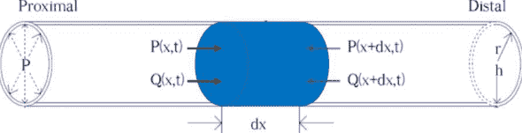

图 4.1. 中心动脉中的波传播。

它揭示，血管中脉搏的速度（即称为*脉搏波速度*（PWV））等于 \([L \times C(P)]^{-1/2}$。因此，波通过长度 \(l\)（PTT）所需时间为：

$PTT = l\sqrt{LC(P)}$ (4.7)

根据方程（4.7），PTT 与 BP 呈反比。如果假设 C 为常数，则 PWV 变为：

$PWV = \frac{1}{\sqrt{L \times C}} = \sqrt{\frac{A dP}{\rho d A}} = \sqrt{\frac{Eh}{2 \rho r}}$ (4.8)

该方程称为 Bramwell–Hill 和 Moens–Korteweg 方程 [7]。

除了 PWV 和 PTT 之外，许多其他研究还试图定义其他手工制作的特征，并找出它们与 BP 的关系 [8, 9]。然而，在本研究中，我们强调使用深度学习技术进行自动特征提取。我们相信，与许多其他应用类似，机器学习能力可用于为血压估计寻找信号的适当表示。随后，我们开发了几种方法来实现这一目标¹。

### 4.3 数据源

我们使用 *重症监护室II多参数智能监测*（MIMIC-II）数据库来实现和评估我们用于血压估计的深度模型。它涵盖了重症监护室（ICU）中多样化人群患者的高分辨率数据。该数据集包括临床文档、实验室结果和各种生理波形 [10]。

在本研究中，我们考虑了200名患者（86名女性和114名男性）的侵入性动脉血压、ECG和PPG信号。受试者年龄的平均值和标准差为61.6 ± 14.6岁。所有波形的采样频率为125 Hz。

每个心脏周期的收缩压和舒张压² 从侵入性血压波形中提取，以在模型的训练和验证阶段作为目标值。所有选定的记录包含51,884个周期。图 4.2 显示了血压的分箱散点图和分布直方图。正如我们所期望的，该图表明收缩压和舒张压之间存在直接相关性 [11]。

#### 4.3.1 预处理程序

我们应用多个滤波器来去除信号中的伪迹并提高其质量。然后，对 PPG 信号进行分段，以准备输入数据以供我们的深度网络使用。对于每个输入段，收缩压和舒张压是从

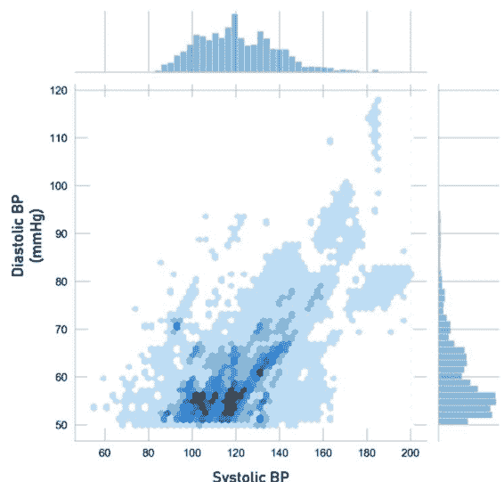

图 4.2. 收缩压和舒张压目标值的分箱散点图和分布直方图。

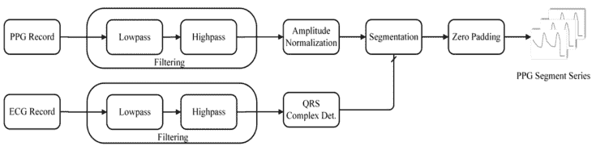

图 4.3. 准备 PPG 段系列的各种预处理步骤。

相应的侵入性血压波形。它们将作为我们的目标向量。R波发生在分段过程中被用作时间参考。因此，每条记录都变为一个输入向量（X）和一个目标向量（T），如下所示：

$X = \{x_1, x_2, ..., x_n\}$ (4.9)

$T = \{t_1, t_2, ..., t_n\}$ (4.10)

每个元素对应一个心脏周期。图 4.3 描绘了各种预处理步骤。此处，我们还提供更多细节。

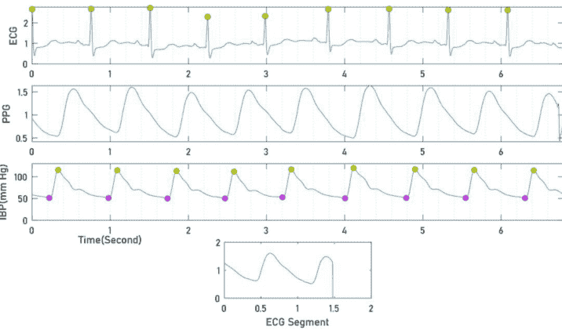

图 4.4. 每个波形的一个样本以及从每个波形中提取的关键点。底部还显示了一个 PPG 段。每个 PPG 信号都会变成一系列 PPG 段。

- 我们应用两个级联滤波器来去除各种伪迹，例如低频的基线漂移以及高频的电网谐波和肌电图噪声。第一个滤波器是低通 7 点二阶 Savitzky–Golay 滤波器。它在不干扰信号趋势的情况下平滑波形 [12]。第二个滤波器是 40 阶高通 Kaiser 窗 FIR 滤波器 [13]。感兴趣的总频率带为 0.13–40 Hz [5, 14]。
- 我们将 R 波峰视为分段过程的时间参考。我们实现了 [15] 中提出的算法来检测 R 波峰。该算法基于 ECG 波形结构与音频信号中集成线性预测残差之间的显著相似性。
- 如果将 R 波峰的时间发生定义为 {t1, t2, ..., tn}，则第 k 个段包括从 t_{k-1} 到 t_{k+1} 时间间隔中的两个心脏周期。因此，两个连续段共享一个 PPG 周期。
- 然后，每个段（输入向量 X 的每个元素）的长度通过零填充（当其长度小于 250 时）或丢弃某些样本（当长度超过长度限制时）调整为 250 个样本。此外，目标向量 T 中每个元素的长度为 2（包括侵入性收缩压和舒张压值）。

图 4.4 显示了每个波形的一个样本以及从每个波形中提取的关键点。它还在底部描绘了一个 PPG 段。应用这些预处理步骤后，每个 PPG 信号都会变成一系列 PPG 段。

### 4.4 用于血压监测的深度学习模型

在本节中，我们提出并实现了四种不同的 DNN 来估计血压。在每个步骤中，我们尝试分析结果并找出模型的主要局限性。然后，我们尝试为局限性提供解决方案，并在下一步中提高准确性。我们的模型基于两种常见且通用的神经网络：长短期记忆网络（LSTMs）和卷积神经网络（CNNs）。

LSTM 网络是一种循环神经网络（RNN）。与前馈神经网络不同，这类网络具有反馈连接，使它们能够处理当前输入和先前输入。换句话说，它们具有反馈路径，可将当前事件存储在其内存状态中。在理论上，经典 RNN 网络可以学习输入数据中任意长的依赖关系。然而，传播梯度在训练过程中可能会消失或爆炸。LSTM 网络通过允许梯度不变地传播来解决梯度消失问题 [16–18]。

CNN 受视觉皮层神经元之间连接模式的启发。每个皮层神经元由视觉场中称为感受野的受限区域刺激。感受野随后部分重叠，并覆盖整个视觉场。此外，由于这些网络使用卷积运算而不是矩阵乘法，它们拥有少得多的参数和连接。这一事实极大地促进了训练过程。与其前身相比，它们在自动检测输入数据中的重要特征方面也更有效 [17–19]。

在本章中，从 MIMIC-II 数据库中选取了 200 条记录来评估我们的模型。在应用 4.3 节中讨论的预处理程序后，每条记录被分为三个独立部分：训练、验证和测试部分，分别占记录总长度的 70%、10% 和 20%。因此，训练、验证和测试集分别包含 35,965、10,574 和 5,354 个周期。

#### 4.4.1 LSTM 模型

长短期记忆网络是序列建模中最有效的方法之一。嵌入自环以允许梯度长距离流动的巧妙想法是 LSTM 网络的核心思想。作为第一个模型，此处我们讨论一种基于 LSTM 神经网络的方法。

- **基于 LSTM 网络的拟议模型**：图 4.5 显示了估计收缩压和舒张压的拟议架构。它是一个两层堆叠的 LSTM 网络。第一个 LSTM 层包含 64 个 LSTM 单元，而第二个 LSTM 层包括 32 个单元。在 PPG 信号分段过程中获得的 PPG 段系列被输入到网络中。输入系列中的每个元素都是一个维度为 250 的向量。

- **性能**：训练和验证数据集被用于训练拟议的深度 LSTM 网络。然后，将测试集输入网络以研究其性能。表 4.1 以皮尔逊相关系数（R）、平均误差（ME）、平均绝对误差（MAE）、均方根误差（RMSE）和误差标准差（STD）为指标显示了结果。


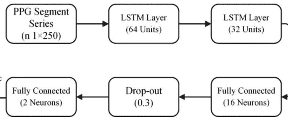

图 4.5. 基于LSTM网络估算血压的首种方法所提架构。

表 4.1. 基于LSTM的模型性能指标。

| 血压 | R | ME | MAE | RMSE | STD | 受试者数 | AAMI |
|---|---|---|---|---|---|---|---|
| 收缩压 | 0.32 | -3.57 | 15.84 | 21.92 | 21.63 | 200 | × |
| 舒张压 | 0.12 | -1.45 | 8.71 | 12.26 | 12.17 | 200 | × |

皮尔逊相关系数的定义如方程 (4.11) 所示。它表明预测值（$Y_{est}$）与目标值（$Y_{tar}$）之间的相对协方差。

$$R = \frac{cov(Y_{est}, Y_{tar})}{\sigma_{Y_{est}} \times \sigma_{Y_{tar}}}$$
(4.11)

表格表明该算法不符合医疗仪器促进协会（AAMI）标准要求。该协议已用于评估各种血压监测设备。根据该标准，患者人数必须高于85，且ME和STD应分别低于5 mmHg和8 mmHg [20]。我们的结果表明，根据该标准，LSTM网络的精度不足。

关于表4.1中报告结果的另一个值得注意的点是，尽管收缩压的MAE要高得多，但收缩压的皮尔逊相关系数值仍高于舒张压。为解释这些看似矛盾的结果，我们应考虑到相关系数基于相对变化而非绝对值。因此，由于收缩压通常比舒张压具有更高的幅度，因此收缩压估算的系数更大。

图 4.6 提供了关于LSTM网络性能低下的更多直观线索。该图展示了两种估算程序中高度的误差。

- **维度灾难：** 当输入维度增加时，机器学习问题会变得极其困难。这是因为输入配置的范围会呈指数增加。这一问题现象被称为维度灾难 [17]。

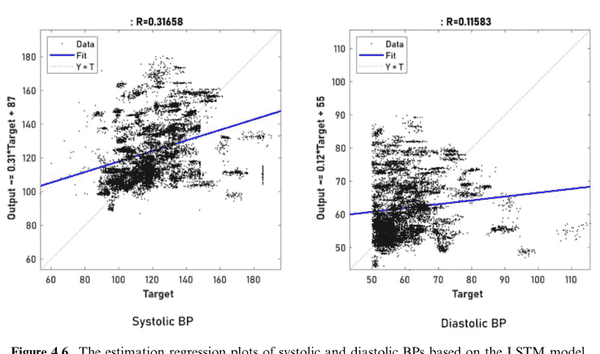

大多数时候，维度灾难带来的挑战是统计学上的。当维度增加时，输入空间中爆炸式增加的单元（或定义的子空间）中落入的训练样本会变少。因此，随着维度增加，输入空间各区域的训练样本数量会迅速减少。训练数据减少必然导致性能变差。在这种情况下，机器学习算法可能会简单地假设新输入对应的输出等于附近点的值，而高维空间中训练样本之间的更远距离会降低这种简化的准确性 [17, 21]。

正如后续章节中的结果所更清楚地表明的那样，此处也可能发生了同样的问题。由于输入维度（250）非常高，LSTM模型显示出不理想的性能。在后续模型中，我们尝试实施策略来缓解此问题。

#### 4.4.2 PCA-LSTM模型

为了解决LSTM网络在处理高维输入向量时遇到的困难，我们应用主成分分析（PCA）方法。这是一种降低输入维度的方法。

说明PCA有两种常见方式。它可以通过将数据正交投影到一个低维的新空间来获得。新空间被称为主子空间。投影的执行方式是最大化投影数据的方差。

另一种说明将PCA视为一种将数据映射到低维新空间的技术，同时最小化投影代价。此处的投影代价是指原始数据及其投影对应物之间的均方距离 [22]。

- **基于PCA和LSTM网络的拟议模型：** 在本节中，我们将PCA应用于输入数据。它将信息组织为主成分。我们选择包含最多信息（即方差最大的维度）的64个分量来表示我们的数据。然后，我们使用新数据集来训练和评估另一个具有与前一网络相同架构的LSTM网络。

- **性能：** 新的训练、验证和测试集被用于训练和评估LSTM网络。由于输入维度远低于原始数据的维度（64对比250），网络在训练阶段收敛速度快得多。表 4.2 和图 4.7 展示了LSTM网络使用不同指标的性能。这些结果证实，基于新数据的LSTM网络具有更高的估算精度。由于训练过程现在更容易，我们可以预期性能会提高。然而，精度仍不足以满足AAMI标准的要求。

- **信息损失：** 舍弃数据方差较低的向量会导致一定的信息损失。此过程可视为一种简单的特征选择方法。由于该过程不受控制，可能会导致

表 4.2. 基于PCA-LSTM的模型性能指标。

| 血压 | R | ME | MAE | RMSE | STD | 受试者数 | AAMI |
|---|---|---|---|---|---|---|---|
| 收缩压 | 0.75 | 0.35 | 8.81 | 12.33 | 12.33 | 200 | × |
| 舒张压 | 0.55 | 0.59 | 6.02 | 8.10 | 8.08 | 200 | × |

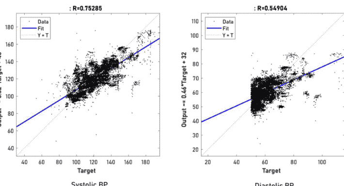

图 4.7. 基于PCA-LSTM模型的收缩压和舒张压估算回归图。

丢失非常关键的信息。这是因为大多数时候，特征的方差较高并非其重要性的公平指标。例如，在区分人类时，鼻子的尺寸可能与身高同样重要，尽管前者特征的方差要低得多 [23]。

因此，我们应尝试定义更合适的特征选择方法。在下一小节中，我们将提出并评估一种基于卷积神经网络的方法。该网络负责特征选择和估算任务。由于网络会同时执行这两个步骤（网络在训练阶段监督性能），它可以更恰当地从输入数据中提取特征。

#### 4.4.3 卷积神经网络模型

卷积神经网络是用于使用特定网格状拓扑处理数据的专用网络类型。示例包括时间序列（如我们在此处使用的PPG片段），可视为一维数据，以及图像，可视为二维数据。CNN在各种实际应用中取得了巨大成功。它们至少在一层中使用卷积而非常见的矩阵乘法。在传统的全连接网络中，每个输出单元与每个输入单元交互。这使它们容易过拟合。然而，CNN具有稀疏交互。这是通过使内核小于输入来实现的 [17]。

在本节中，我们提出一种基于CNN网络的端到端架构。我们将片段分别应用于网络。网络将在连续层中提取输入信号的抽象表示。然后，网络使用这些提取的表示来执行估算程序 [24]。

- **基于CNN网络的拟议模型：** 图 4.8 描绘了CNN网络的拟议架构。该网络包含四个卷积

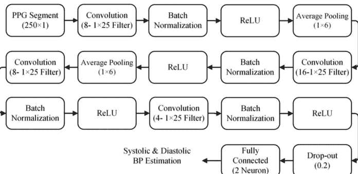

图 4.8. 用于估算收缩压和舒张压的CNN网络所提架构。

层。更多的卷积层未带来更显著的改进。批量归一化层被引入CNN层之间。它们有助于加快训练过程，并使网络对初始条件不那么敏感。我们采用了两个平均池化层来下采样数据。它们通过将输入数据分为矩形区域（在我们的工作中为1 x 6节），然后计算每个区域的平均值来完成该任务。一个脱校层也被添加到网络中以帮助其避免过拟合。该层在训练阶段将其输入值随机设为零。我们选择ReLU函数作为每个卷积层后的非线性函数以执行阈值操作。方程 (4.12) 描述了该函数。

\( f(x) = \left\{ \begin{array}{ll} x, \ x \geqslant 0; \\ 0 \quad x < 0. \end{array} \right. \) (4.12)

- **性能：** CNN网络的性能如表 4.3 所示。如结果所示，性能显著提高。现在，两项估算均满足AAMI标准的要求。图 4.9 还描绘了估算结果的回归图。高相关系数证明了基于CNN网络的适当特征学习和参数估算能力的新方法的有效性。

- **时序信息损失：** CNN网络在每个时间步基于对应的PPG片段执行估算。因此，它未能包含PPG波形中携带的时序信息。毫无疑问，血压波动不会在每个时间步突然发生。它们也很大程度上依赖于血压的先前值。尽管如此，CNN网络仅基于提供给网络的当前信息执行估算。换句话说：

\( \text{BP}(t_k) = f(x_k) \) (4.13)

因此，如果我们在估算程序中包含PPG波形的时序变化，可以期望估算得到进一步改进。在下一小节中，我们提出了一种在估算过程中嵌入此关键信息的方法。

| 血压 | R | ME | MAE | RMSE | STD | 受试者数 | AAMI |
|---|---|---|---|---|---|---|---|
| 收缩压 | 0.91 | -0.01 | 5.40 | 7.86 | 7.86 | 200 | √ |
| 舒张压 | 0.89 | -0.01 | 3.13 | 4.24 | 4.24 | 200 | √ |


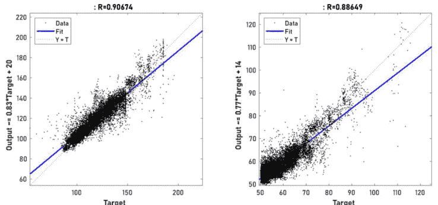

图 4.9. 基于CNN模型的收缩压和舒张压估计回归图。

#### 4.4.4 CNN–LSTM模型

在本小节中，我们结合了CNN网络在寻找输入适当表征方面的能力与LSTM网络记忆时序信息的能力，以提出一种用于血压估计的更优架构。

为实现这些目标，我们设计了一个包含两个阶段的端到端DNN。下层由卷积层组成，用于从PPG片段中提取适当的形态学指标。然而，上层的隐藏层使用LSTM单元来捕捉CNN层提取的特征的时域变化。

- **提出的端到端CNN–LSTM模型：** 图4.10描绘了所提议的端到端DNN架构。它包括两个层次级别。它们在图中由较大的蓝色矩形区分。较低的层次级别是部署四个卷积层的CNN网络，而较高的层次级别包含一个两层堆叠的LSTM网络。两个部门均基于前小节讨论过的架构设计。CNN层负责从每个片段中学习（或提取）适当的机器学习特征。然而，LSTM层将学习输入序列片段特征之间的关系。

由于CNN层独立地从每个PPG片段中提取特征，我们需要在应用包含PPG片段的输入序列之前使用一个折叠层。该层将一批PPG序列转换为一批PPG片段。此外，我们应该使用一个展开层来在序列折叠后恢复PPG序列结构，以便将其应用于LSTM层。

- **性能：** 表4.4提供了评估端到端CNN–LSTM网络性能的数值指标。如果我们将表4.4

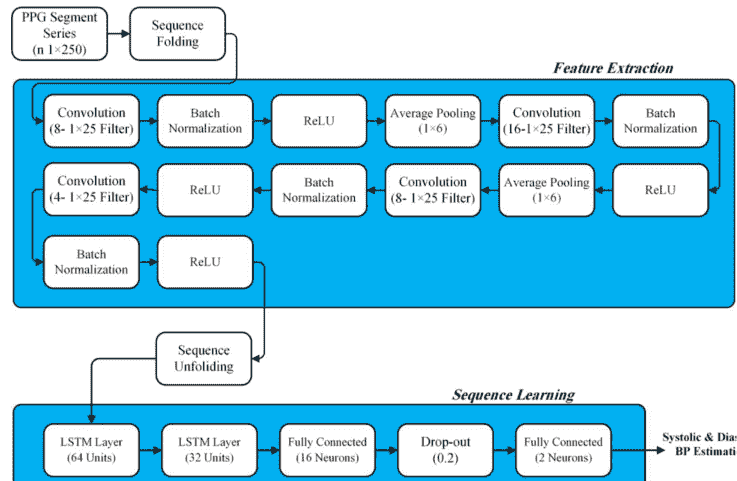

图 4.10. 端到端CNN-LSTM网络的提议架构。

表 4.4. CNN-LSTM模型性能指标。

| 血压 | R | ME | MAE | RMSE | STD | 受试者数 | AAMI |
|---|---|---|---|---|---|---|---|
| 收缩压 | 0.92 | 0.80 | 4.75 | 7.30 | 7.26 | 200 | √ |
| 舒张压 | 0.90 | 0.53 | 2.92 | 3.95 | 3.92 | 200 | √ |

与表4.3对比，可以清楚地看出，我们决定在CNN网络中添加LSTM层显著提高了准确性。这是由于新网络能够发现PPG片段之间的时域依赖关系，并利用它来更精确地计算血压。换句话说，估计过程不仅考虑当前信息，还考虑所有先前的片段：

> BP(t_k) = f(x_1, x_2, ..., x_k) (4.14)

图4.11描绘了新结果的回归图。对于新模型，Pearson相关系数最高。

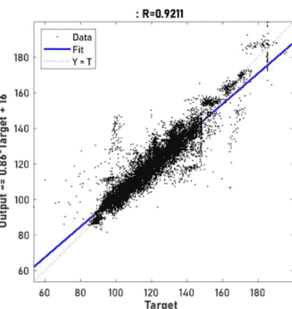
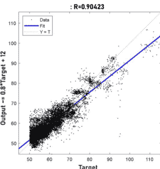

**图 4.11.** 基于端到端CNN-LSTM模型的收缩压和舒张压估计回归图。

### 4.5 讨论

一般来说，使用ECG和PPG信号进行血压监测的拟议方法可以分为两类。第一类包括基于生理模型的方法。这些方法提取基于这些模型定义的手工制作特征用于血压监测。另一类包括同时使用机器学习技术进行特征提取和估计的方法³。

在本章中，我们提出了几种基于最先进的深度神经网络的模型。循序渐进，我们开发了模型并进行了修改以提高准确性。第一个模型建立在LSTM层之上。然而，输入向量的高维度导致性能下降，使网络的任务变得极其困难。

然后，我们研究了PCA技术降低输入维度和缓解维度灾难的有效性，尽管，结果表明该解决方案不够有效。由于PCA方法导致PPG波形中关键信息的丢失，准确性再次不尽理想。这是因为方差振幅在所有情况下都不能是正确的标准。有时波动较小的特征可能非常关键。

因此，我们决定采用更智能的特征提取方法。由于卷积神经网络在许多应用（如自然语言处理、图像和视频识别以及医学图像处理）中取得了显著成就，我们决定利用它们来设计第三个模型。这一次结果很有希望，并且满足了AAMI标准要求。

基于卷积神经网络的架构仅基于与血压计算感兴趣的时间步对应的PPG片段执行估计过程。因此，我们建议通过在上层添加一些LSTM层来扩展架构，以同时捕获时域变化。该方法有效，准确性进一步提高。这是因为LSTM层能够在计算中考虑时序信息。

³ 如需更广泛地讨论这些方法，请参阅[9]。

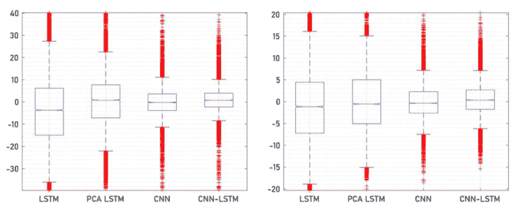

图 4.12. 拟议模型误差的箱线图。

图4.12显示了拟议模型误差的箱线图[25]。每个图通过其四分位数显示测试数据的估计误差。红色标记显示异常值。从图中可以很容易地看出，随着步骤的推进，误差分布变得更窄且更集中于零附近。

图4.13还描绘了收缩压和舒张压数值上的误差分布。基于CNN和LSTM网络的方法的峰值显著降低。

表4.5基于另一种新标准评估了所有模型的性能。英国高血压标准根据不同阈值下绝对误差值的累积百分比为血压监测设备分配等级[26]。如表4.5所示，当采取更合适的步骤来开发模型时，性能会提高。当基于CNN–LSTM架构估计血压时，收缩压和舒张压均获得A级。

#### 4.5.1 与其他方法的比较

表4.6将本章基于端到端CNN–LSTM架构获得的最佳结果与其他一些研究进行了比较。该表涵盖了基于手工制作特征（或在一些研究中被称为生理模型参数）的方法的示例模型，以及基于生物信号机器学习表征的模型。该表还指明了患者数量以及用于实现模型的工具。

为了公平地比较不同方法，我们应该在相同的数据和相似的标准下应用这些方法。然而，该表提供了一些关于其他几种模型及其相对性能的洞察。考虑到受试者数量，该表证实，我们的CNN–LSTM架构对收缩压和舒张压都提供了相对准确的估计。

LSTM

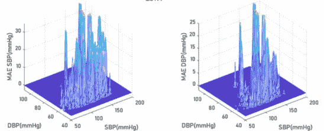

PCA & LSTM

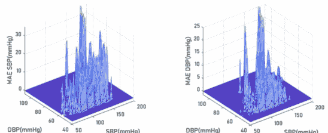

CNN

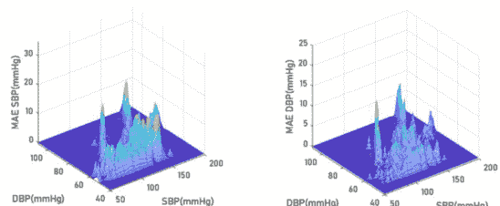

CNN-LSTM

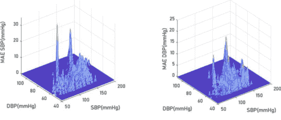

收缩压

舒张压

图 4.13. 本研究讨论的所有模型在收缩压和舒张压数值上的误差分布。

表 4.5. 基于BHS标准的所有模型性能。

| 估计模型 | 血压 | <5 mmHg | <10 mmHg | <15 mmHg | BHS标准等级 |
|---|---|---|---|---|---|
| LSTM | 收缩压 | 26.6% | 48.4% | 62.2% | D |
| | 舒张压 | 43.9% | 69.5% | 79.8% | D |
| PCA & LSTM | 收缩压 | 35.1% | 60.5% | 72.5% | D |
| | 舒张压 | 49.7% | 82.3% | 93.2% | C |
| CNN | 收缩压 | 61.9% | 86.5% | 93.8% | B |
| | 舒张压 | 81.3% | 97.3% | 99.3% | A |
| CNN-LSTM | 收缩压 | 67.9% | 90.0% | 95.3% | A |
| | 舒张压 | 83.5% | 97.4% | 99.7% | A |
| | 等级A | 60% | 85% | 95% | |
| | 等级B | 50% | 75% | 90% | |
| | 等级C | 40% | 65% | 85% | |
| | 等级D | | | 差于C | |

表 4.6. 与其他方法的比较。

| 方法 | 波形 | 受试者 | R | RMSE | ME | STD | R | RMSE | ME | STD |
|---|---|---|---|---|---|---|---|---|---|---|
| | | | \multicolumn{4}{c}{收缩压} | \multicolumn{4}{c}{舒张压} |
| CNN [21] | 两个PPG | 14 | 0.94 | — | 0.30 | 4.90 | 0.93 | — | 0.10 | 3.20 |
| ANN-CNN [27] | PPG & ECG | 39 | 0.99 | 1.56 | — | — | 0.99 | 0.85 | — | — |
| 基于FFT | PPG | 69 | — | — | 0.06 | 7.08 | — | — | 0.01 | 4.66 |
| 神经网络 [28] 机器学习 [29] | ECG | 51 | — | 10.97 | — | — | — | 19.34 | — | — |
| CNN-LSTM（我们的结果） | PPG | 200 | 0.92 | 7.30 | 0.80 | 7.26 | 0.90 | 3.95 | 0.53 | 3.92 |

### 4.6 结论

我们提出了几种使用深度神经网络进行收缩压和舒张压监测的模型。通过讨论每个模型的优缺点，我们在后续步骤中提高了准确性。我们得出结论，一个合适的深度学习模型应至少包含两个关键要素：第一，适当的特征提取策略；第二，将时域变化集成到估计算法中的合适方法。

我们的结果表明，卷积神经网络可以是进行特征提取的一个有希望的候选者。此外，我们的发现证实了高


LSTM网络在学习连续PPG片段之间时间依赖性方面的效率。因此，所提出的端到端CNN-LSTM模型在所有讨论的模型中实现了最佳性能。此外，其对两项血压指标的性能均符合AAMI标准的要求，并根据BHS标准获得A级。

### 参考文献

- [1] Jamieson D T, Bremen J G, Measham A R, Alleyne G, Claeson M, Evans D B, Jha P, Mills A 和 Musgrove P 2006 发展中国家疾病控制优先事项（华盛顿特区：世界银行）
- [2] Kamalzadeh S 2016 基于PTT的非侵入性逐次收缩压和舒张压估计方法 硕士论文（德黑兰，伊朗：阿米尔卡比尔理工大学）
- [3] Langewouters G J, Settels J J, Roelandt R 和 Wesseling K H 1998 为何使用Finapres或Portapres而非动脉内或间歇式非侵入性血压测量技术？ J. Med. Eng. Technol. 22 37–43
- [4] Pickering T G 等 2005 人类血压测量建议：来自高血压研究委员会专业和公共教育分委员会的AHA科学声明 J. Clin. Hypertens. 7 102–9
- [5] Allen J 2007 光容积脉搏波图及其在临床生理学测量中的应用 Physiol. Meas. 28 R1
- [6] Lilly L S 2012 心脏病发病机理：医学生和教职员工合作项目（巴尔的摩，马里兰州：利平科特·威廉姆斯和威尔金斯）
- [7] Mukkamala R 等 2015 通过脉搏传递时间实现无处不在的血压监测：理论与实践 IEEE Trans. Biomed. Eng. 62 1879–901
- [8] Esmaelpoor J, Sanat Z M 和 Moradi M H 2021 使用光容积脉搏波图和心电图信号进行血压监测 面向医疗保健应用的生物医学信号处理（博卡拉顿，佛罗里达州：CRC Press）第123–41页
- [9] Esmaelpoor J, Moradi M H 和 Kadkhodamohammadi A 2021 无袖带血压估计方法：生理模型参数与机器学习特征 Physiol. Meas. 42 035006
- [10] Saeed M 等 2011 重症监护室中的多参数智能监测II（MIMIC-II）：公共访问重症监护室数据库 Crit. Care Med. 39 952
- [11] Gavish B, Ben-Dov I Z 和 Bursztyn M 2008 24小时监测的收缩压和舒张压之间的线性关系：评估及相关因素 J. Hypertens. 26 199–209
- [12] Hargittai S 2005 心电图信号处理中的Savitzky–Golay最小多项式滤波器 Comput. Cardiol. 2005 763–6
- [13] Chavan M S, Agarwala R A 和 Uplane M D 2006 ECG处理中Kaiser窗的使用 第5届WSEAS国际信号处理、机器人和自动化会议论文集（西班牙马德里）
- [14] Berkaya S K, Uysal A K, Gunal E S, Ergin S, Gunal S 和 Gulmezoğlu M B 2018 ECG分析综述 Biomed. Signal Process. Control 43 216–35
- [15] Ramakrishnan A G, Prathosh A P 和 Ananthapadmanabha T V 2014 基于动态爆破指数的QRS检测 无阈值独立 IEEE Signal Process Lett. 21 554–8
- [16] Reddy B K 和 Delen D 2018 预测狼疮患者医院再入院：一种基于RNN-LSTM的深度学习方法 *Comput. Biol. Med.* **101** 199–209
- [17] Goodfellow I, Bengio Y 和 Courville A 2016 *深度学习*（剑桥，马萨诸塞州：麻省理工学院出版社）
- [18] Esmaelpoor J, Moradi M H 和 Kadkhodamohammadi A 2020 使用光容积脉搏波图信号进行血压估计的多阶段深度神经网络模型 *Comput. Biol. Med.* **120** 103719
- [19] Acharya U R, Oh S L, Hagiwara Y, Tan J H 和 Adeli H 2018 用于EEG信号自动癫痫检测和诊断的深度卷积神经网络 *Comput. Biol. Med.* **100** 270–8
- [20] Alpert B S 2007 根据ANSI/AAMI SP10: 2002验证Welch Allyn spot vital signs血压设备：准确性与成本效益的成功结合 *Blood Press. Monit* **12** 345–7
- [21] Esmaelpoor J, Sanat Z M 和 Moradi M H 2021 基于两种光容积脉搏波图和卷积神经网络的无创血压监测临床设置 *Biomed. Eng.* https://doi.org/10.1515/bmt-2020-0197
- [22] Bishop C M 2006 *模式识别与机器学习*（柏林：施普林格）
- [23] Potapov P 2017 谱图像主成分分析中的信息损失 *Ultramicroscopy* **182** 191–4
- [24] Bengio Y, Courville A 和 Vincent P 2013 表示学习：综述与新视角 *IEEE Trans. Pattern Anal. Mach. Intell.* **35** 1798–828
- [25] Thirumalai C, Vignesh M 和 Balaji R 2017 使用箱线图进行肺癌数据分析 2017 《电力和先进计算技术创新（i-PACT）》（皮斯卡特威，新泽西州：IEEE）第1–6页
- [26] O’Brien E 等 1990 英国高血压学会用于评估自动和半自动血压测量设备的方案，特别参考动态血压监测系统 *J. Hypertens.* **8** 607–19
- [27] Tanveer M S 和 Hasan M K 2019 使用基于波形的ANN–LSTM网络从心电图和光容积脉搏波图中估计无袖带血压 *Biomed. Signal Process. Control* **51** 382–92
- [28] Xing X 和 Sun M 2016 基于光容积脉搏波图和FFT神经网络的光学血压估计 *Biomed. Opt. Express* **7** 3007–20
- [29] Simjanoska M, Gjoreski M, Gams M 和 Madevska Bogdanova A 2018 使用机器学习技术从心电图中进行无创血压估计 *Sensors* **18** 1160

## 第5章

## 新冠疫情期间诊断和预后机器学习方法的可靠性：一份全面的批判性综述

**哈米德·雷扎·马拉特布、穆罕默德·雷扎·莫赫比安、梅赫迪·希尔扎迪、阿雷祖·米尔沙米、沙迪·扎马尼、阿特娜·阿布里沙姆奇、法蒂梅·巴凡德和米格尔·安赫尔·马尼亚斯**

COVID-19（严重急性呼吸道综合征冠状病毒2，SARS-CoV-2）自2020年以来一直是一场灾难。在疫情期间，医学和计算机研究界发表了许多论文。然而，人们担心那些在统计分析、研究设计和报告的性能指标方面存在问题的论文是否有助于抗击疫情。降低偏倚风险需要适当的统计和验证模型。文献中为COVID-19诊断和预后提出了多种机器学习方法，其中深度学习方法主要集中在胸部CT扫描上。尽管做出了这些努力，但仍有未考虑的问题阻碍了它们的临床应用。本章分析了疫情期间文献中提出的45多种机器学习方法的关键STARD/TRIPOD问题。推荐了策略，以避免系统性缺陷并提高此类系统的临床可靠性。

### 5.1 引言

严重急性呼吸道综合征冠状病毒（SARS-CoV-2，也称为COVID-19）不仅在2020年是一场灾难，而且在2021年因变异和全球范围内更严重的临床结局而持续存在 [1]。它从不同角度影响着整个人类社会 [2–4]。各种机器学习方法已被用于COVID-19诊断、预后和长期副作用 [5–9]。然而，所提方法的大部分质量较低，不建议用于临床应用 [10, 11]。这令人惊讶，因为文献中已发布诸如TRIPOD（用于个体预后或诊断的多变量预测模型透明报告）[12] 等标准，这些标准可以扩展到样本量有限的情况 [13]。我们之前讨论了此类标准对计算机辅助诊断的重要性 [14]。在本章中，我们具体从验证方法角度分析了已发表的COVID-19诊断和预后论文，并讨论了此类论文中TRIPOD指南的关键问题。

分析的论文在表格中列出了以下项目：参考文献、研究问题、输入特征、分类器、验证类型（内部/外部）、验证框架、来自STARD [15]、TRIPOD [12] 和医学数据挖掘 [14] 的关键项目：（（1）样本量计算；（2）抽样方法；（3）纳入和排除标准、缺失数据处理；（4）比较分类器的适当统计检验；（5）使用交叉验证时在测试折上报告性能指标的均值和标准差；（6）性能指标的95%置信区间（CI）；以及（7）在不平衡数据集中使用适当的性能指标，如ROC曲线下面积（AUC）或马修斯相关系数（MCC），或F1分数 [16]）。

### 5.2 方法

已分析的论文按发表日期如下列出：第5.2.1节（1月–3月）（表5.1），第5.2.2节（4月–6月）（表5.2），第5.2.3节（7月–9月）（表5.3），第5.2.4节（2020年10月–2021年2月）（表5.4）。

#### 5.2.1 1月–3月

表5.1. 2020年1月至3月发表的COVID-19数据挖掘论文。

| 参考文献 | 研究问题 | 输入特征 | 分类器或方法 | 验证类型 | 验证框架 | 关键STARD项目 |
|---|---|---|---|---|---|---|
| Li 等 [17] | 基于深度学习检测其他肺炎疾病中的COVID-19 | 3D胸部CT | ResNet、最大池化操作、全连接层和软max激活函数 | 外部 | 9折交叉验证 | 3,5,7,8 |
| Yuan 等 [18] | 放射学发现与死亡率的关联 | CT扫描 | 特征包括磨玻璃影、双侧受累、外周和中心分布以及下区受累 | 内部 | 与RT-PCR结果比较 | 5,7 |
| Laguarta 等 [19] | 使用咳嗽录音进行COVID-19诊断 | 咳嗽录音 | 卷积神经网络（CNN） | 外部 | 留出法（20%） | 8 |


表 5.2.

| 参考文献 | 研究问题 | 输入特征 | 分类器 | 验证类型 | 验证框架 | 关键STARD项目 |
|---|---|---|---|---|---|---|
| Hu et al 2020 [20] | CT图像分割和COVID-19分类 | CT放射学特征，如GGO和气道实变，X光图像 | CNN | 内部和外部 | 5折交叉验证 | 2,5,7 |
| Apostolopoulos et al 2020 [21] | 基于X光图像的COVID-19患者、细菌性肺炎和正常受试者分类 | | 带迁移学习的CNN | 内部 | 10折交叉验证 | 8 |
| Ardakani et al 2020 [22] | 使用CT图像的COVID-19诊断 | CT图像 | 预训练深度学习 | 内部 | 训练80%和验证集20% | 3,5 |
| Apostolopoulos et al 2020 [23] | 使用X光图像深度学习的COVID-19诊断 | X光图像 | 带迁移学习的CNN，MobileNet v2 | 内部 | 10折交叉验证 | 2,3 |
| Hasan et al 2020 [24] | 使用深度学习的CT扫描COVID-19诊断 | 胸部CT扫描 | CNN特征提取和LSTM | 内部 | 留出法（30%） | 5 |
| Hurt et al 2020 [25] | COVID-19的深度学习定位 | 胸部X光片图像 | 深度学习，U-Net | 内部 | — | — |
| Khan et al 2020 [26] | X光图像深度学习和COVID-19诊断 | 胸部X光图像 | (CoroNet) CNN | 内部和外部 | 4折交叉验证 | 2,8 |
| Khanday et al 2020 [27] | 使用临床文本数据挖掘的COVID-19诊断 | 212名患者及属性，如年龄、性别、体温、pO2饱和度、白细胞计数、中性粒细胞计数 | 各种分类器，如随机森林、支持向量机(SVM)和随机梯度提升 | 内部 | 10折交叉验证 | 2 |
| Ko et al 2020 [28] | 使用单张胸部CT图像的COVID-19诊断 | 3993张胸部CT图像，以及其他特征，如年龄、性别、社区获得性肺炎、医院获得性肺炎X光图像 | FCONet基于VGG16、ResNet-50、Inception-v3、Xception等CNN模型通过迁移学习开发 | 内部和外部 | 5折交叉验证 | 2 |
| Ucar and Korkmaz et al 2020 [29] | 使用深度Bayes-SqueezeNet从X光图像诊断COVID-19 | X光图像 | 贝叶斯优化结构（基于Deep Bayes-SqueezeNet的COVIDDiagnosis-Net） | 内部 | 训练80%，验证10%，测试10%。 | 2,8 |
| Singh et al 2020 [30] | 使用胸部CT图像的COVID-19诊断 | 使用CNN提取的胸部CT图像特征 | 全连接层，CNN | 内部 | 20折交叉验证（80%用于训练，20%用于测试） | 5,8 |

#### 5.2.3 7月至9月

表 5.3. 2020年7月至9月发表的COVID-19数据挖掘论文。

| 参考文献 | 研究问题 | 输入特征 | 分类器 | 验证类型 | 验证框架 | 关键STARD项目 |
|---|---|---|---|---|---|---|
| Goodman-Mezza et al 2020 [31] | 提高COVID-19住院患者诊断能力 | 实验室特征，包括年龄、性别、血红蛋白、红细胞计数 | 各种分类器，包括随机森林、XGBoost和AdaBoost。 | 内部 | 留出法：训练60%，验证10%，测试30% | 3,4,7 |
| Zhao et al 2020 [32] | ICU入院和死亡率预测 | 入院时的临床数据，包括生命体征和人口学特征 | 逻辑回归，机器学习 | 内部 | 训练70%和测试30% | 3,7 |
| Banerjee et al 2020 [33] | 使用全血细胞计数的COVID-19诊断 | 全血细胞计数，包括血细胞比容、血红蛋白和实验室检查 | 逻辑回归、随机森林、ANN glmnet | 外部 | 10折交叉验证 | 8 |
| Burdick et al 2020 [34] | 呼吸衰竭预测 | 各种特征，如收缩压(SBP)、舒张压(DBP)、肌酐和胆红素 | XGBoost分类器 | 外部 | — | 3,4 |
| Cie et al 2020 [35] | COVID-19严重程度和预后评估 | 胸部CT检查；人口学数据、临床症状、常规血液检查；以及动脉血气 | 随机森林(RF) U-Net模型 | 内部 | 10折交叉验证 | 2,3,5,8 |
| Liang et al 2020 [36] | 使用深度学习对重症COVID-19患者进行早期分诊 | 合并症、X光异常、年龄、呼吸困难和一些实验室检查 | LASSO深度学习、生存Cox模型、前馈神经网络、机器学习方法（随机森林和XGBoost）、逻辑回归 | 内部，外部 | 10折交叉验证，留出法（20%） | 4,7 |
| Ma et al 2020 [37] | 死亡风险评估 | CT扫描结果、合并症、症状、人口学、实验室检查、生命体征 | 支持向量机(SVM) | 内部，外部 | 四折交叉验证 | 4,5 |
| Sun et al 2020 [38] | 严重症状预测 | 年龄、GSH、CD3比值、总蛋白、中性粒细胞百分比、白蛋白、CD4比值、HCRP、血清肌红蛋白、CL、钙、LDH、视黄醇结合蛋白、酸性糖蛋白、中性粒细胞百分比、降钙素原、凝血酶原活性及实验室检查 | | 内部，外部 | 训练（15例重症和178例轻症，测试11例重症和132例轻症） | — |
| Wu et al 2020 [39] | COVID-19患者结局预测 | | 最大相关性逻辑回归。LASSO，最小冗余(mRMR) | 内部 | 5折交叉验证 | 3,7 |

| 作者 | 研究 | 数据 | 方法 | 划分来源 | 验证集 |
|---|---|---|---|---|---|
| Zhou Li et al 2020 [40] | CT扫描分割和COVID-19诊断 | 肺CT扫描 | 3D深度学习模型，如3D CNN和3D U-Net | 内部，外部 | 5折交叉验证 |
| Subudhi et al 2020 [41] | COVID-19预后 | 合并症、人口学数据、生命体征、门诊用药和实验室检查 | 随机森林、支持向量机、k近邻、梯度提升、逻辑回归、朴素贝叶斯 | 内部，外部 | 80%训练和20%测试 |
| Sotoudeh et al 2020 [42] | 使用胸部CT分类H1N1流感和COVID-19 | 医疗数据和胸部CT图像 | 卷积神经网络(CNN) | 内部，外部 | 训练60%，验证20%，测试20% |
| Dunne et al 2020 [43] | 基于智能家居设备的咳嗽COVID-19诊断 | 咳嗽音频输入 | 梅尔频率倒谱系数(MFCC) CNN分类 | 外部 | 16段音频录音用于训练和验证 |

#### 5.2.4 2020年10月至2021年2月

表 5.4. 2020年10月至2021年2月发表的COVID-19数据挖掘论文。

| 参考文献 | 研究问题 | 输入特征 | 分类器 | 验证类型 | 验证框架 | 关键STARD项目 |
|---|---|---|---|---|---|---|
| Oulekfi et al 2020 [44] | 基于CT扫描图像的肺部感染区域分割 | CT图像 | 医学图像分割(MIS)、图割和分水岭 | 内部和外部 | 通过多个机构和国家进行验证 | 1,2,8 |
| Javor et al 2020 [45] | 使用胸部CT深度学习的COVID-19诊断 | 胸部CT图像 | ResNet50 fastai2深度学习框架 | 内部 | 训练80%和验证集20% | 2,8 |
| Nath et al 2020 [46] | 使用CT和X光图像的COVID-19诊断 | CT和X光图像 | CNN | 内部和外部 | 留出法（20%） | 2,3,8 |
| Wang et al 2020 [47] | 使用CXR图像的COVID诊断 | 13,975张CXR图像 | COVID-Net，一种深度卷积神经网络 | 外部 | — | 8 |
| Gao et al 2021 [48] | COVID-19诊断的CT图像分割和分类。COVID-19患者插管预测 | CT图像 | 基于注意力的双分支组合网络 | 内部和外部 | 内部5折交叉验证 | 3,8 |
| Arvind et al 2021 [49] | | 收缩压、舒张压、入院时间、脉搏和呼吸频率、血氧饱和度、体温、pH、HCO3、动脉CO2、动脉O2、D二聚体、血小板和 | 随机森林 | 内部 | 留出法（70%训练和30%测试） | 3,4,5,6,7,8 |


| 作者 | 任务 | 输入 | 方法 | 数据集 | 验证 | 参考文献 |
|---|---|---|---|---|---|---|
| Nayak et al 2021 [50] | 用于 COVID-19 检测分类的 X 射线图像 | 图像 | 基于 VGG-16、AlexNet、GoogleNet、MobileNet-V2、ResNet-34、Inception-V3、SqueezeNet、ResNet-50 的迁移学习 | 内部 | 留出法（70% 训练和 30% 测试） | 3, 8 |
| Chao et al 2021 [51] | 使用基于图像和非图像特征进行 Covid-19 检测 | 从 CT 图像中提取的一阶、二阶和高阶特征，并将其与非成像特征相结合，例如成像、年龄、性别、年龄、体温、SpO2、淋巴细胞计数、WBC 以及淋巴细胞计数与 WBC 比率 | 随机森林 | 内部 | 5 折交叉验证 | 3, 4, 5, 6, 7, 8 |
| Canayaz 2021 [52] | 使用 X 射线图像进行 Covid-19 检测 | 基于 AlexNet、VGG-19、GoogleNet 和 ResNet 的迁移学习特征提取 | SVM | 内部 | 5 折交叉验证 | 8 |
| Saha et al 2021 [53] | 从胸部 X 射线图像中分类 COVID-19 患者和正常受试者 | 使用三种不同的 CNN 提取图像特征，并使用第一个全连接层为机器学习分类器提取特征 | 决策树、AdaBoost、随机森林、SVM、CNN | 内部 | 70% 训练，20% 验证，10% 测试集和五折交叉验证 | 8 |

## 表 5.4.（续）

| 参考文献 | 研究问题 | 输入特征 | 分类器 | 验证类型 | 验证框架 | 关键 STARD 项目 |
|---|---|---|---|---|---|---|
| Pahani et al 2021 [54] | 从胸部 X 射线图像中分类 COVID-19 患者和正常受试者 | CNN | CNN | 内部 | 80% 用于训练，20% 用于测试 | 8 |
| Pham 2020 [55] | 使用 X 射线图像分析进行 COVID-19 诊断 | 胸部 X 射线图像 | 来自 AlexNet、GoogleNet、SqueezeNet 的 CNN 迁移学习 | 内部 | 80% 训练和 20% 测试，以及 80% 训练和 20% 测试 | 6, 8 |
| Di et al 2021 [56] | 从 CT 图像中分类 COVID-19 和社区获得性肺炎 | 共 191 个特征。包括受感染病变计数、直方图分布、病变面积和表面、一阶强度统计和纹理特征以及人口学变量 | 超图学习 | 内部 | 10 折 | 5, 6 |
| Wu et al 2021 [57] | 使用 CT 图像进行 COVID-19 诊断和与常见肺炎及正常对照的鉴别 | | 深度主动学习 | 内部 | 带有 30% 标记数据的深度主动学习。70% 用于未标记数据池，10% 和 20% 用于验证和测试 | 8 |
| Karakanis and Leontidis 2021 [58] | 从 X 射线图像中分类 COVID-19 和正常病例，以及分类 COVID-19、正常病例和细菌性肺炎 | CNN | CNN | 内部 | 留出法（20%） | |

#### 5.2.5 机器学习方法

文献中通常回答两个 COVID-19 数据挖掘研究问题，包括 COVID-19 诊断和预后。将提供一些示例，随后讨论关键问题。

Cai 等人 [35] 研究了 CT 扫描在预测临床结局和评估疾病严重程度方面的应用。99 名 COVID-19 患者在入院时接受了体格检查、胸部 CT、常规血液检查和动脉血气分析（图 5.1）。收集了治疗、结局和疾病严重程度等临床数据。使用随机森林（RF）模型研究了 CT 定量的有效性（中度、重度和危重）。还评估了 ICU 住院时间、吸氧和住院时间。ICU 部分康复与长期康复的预测显示 AUC 为 0.960。

为医生分配资源并将注意力集中在高风险患者身上是一项艰巨的任务。实施机器学习算法可以支持医生预测高危个体。Subudhi 等人 [41] 基于电子健康记录开发了预后 ML 方法（图 5.2）。所开发的模型采用留出法（20%）进行验证。所开发模型的准确率为 90%。最重要的特征包括淋巴细胞、高敏 C 反应蛋白（hs-CRP）和乳酸脱氢酶（LDH）。

Zoabi 等人 [59] 使用基于决策树构建的梯度提升机模型来预测 COVID-19。训练集包含 51,831 名受试者（9% COVID-19 阳性），而测试集为随后几周的 47,401 名受试者（9% COVID-19 阳性）。二元输入特征包括年龄 ≥60 岁、性别、与受感染者接触、咳嗽、发烧、喉咙痛、呼吸困难和头痛。特征重要性在图 5.3 中给出。所提模型在前瞻性测试集上的性能评估如下：AUC = 0.90 [95% CI: 0.892–0.905]，灵敏度 = 87.30%，特异度 = 71.98%。这是一个报告了各种性能指标并使用了外部验证的示例。此外，数据集不平衡。因此，所开发系统的性能可以推广到人群中。本章后面将讨论这一关键问题。

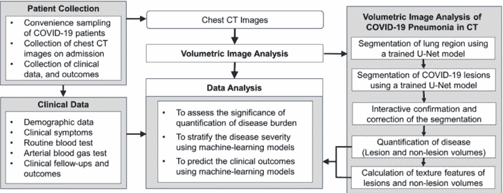

图 5.1. 评估 COVID-19 预后和疾病严重程度的研究流程图（经 Elsevier 许可转载自 [35]，版权 (2020)）。

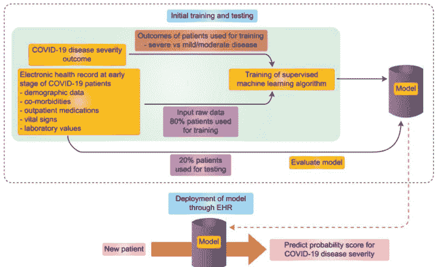

图 5.2. 使用机器学习算法预测 COVID-19 疾病（经 John Wiley & Sons Ltd 许可转载自 [41]）。

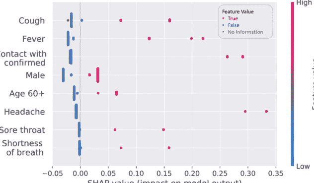

图 5.3. 用于 COVID-19 诊断的 SHapley Additive exPlanations (SHAP) 蜂群图，显示最重要特征的 SHAP 值（经 [59] 许可，依据 CC BY 4.0 转载）。

Gao 等人 [48] 在 CT 图像上使用基于注意力的双分支组合网络进行 COVID-19 分割和分类。总共在十家医院获得了 1202 名参与者的 1918 次 CT 扫描（210,395 个切片：498 名对照组 versus 704 名患者）。数据被分为来自一家医院的内部训练集（6,130 个切片：75 名对照组 versus 48 名患者）和来自其他九家医院的外部验证集（204,265 个切片：423 名对照组 versus 656 名患者）。对于内部数据集，使用了 5 折交叉验证。在个体水平和切片水平上，分别达到了 98% 和 97% 的平均 AUC。外部数据集仅用于个体水平，并报告了 97% 的 AUC（图 5.4）。他们仅使用内部数据集进行分割任务，采用 5 折交叉验证，并在肺部和病变检测方面分别达到了 99% 和 83% 的 Dice 相似系数（DSC）。未报告测试折叠上的 CI 和标准差。

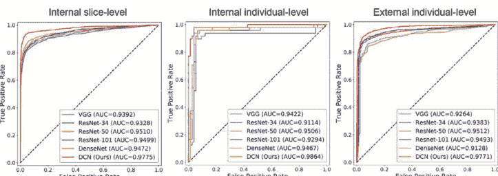

图 5.4. 内部和外部数据集上的切片水平和个体水平 ROC 曲线（经 Elsevier 许可转载自 [48]，版权 (2021)）。

报道了一种用于测试折叠上插管预测的算法。Arvind 等人 [49] 开发了一种用于预测被诊断为 COVID-19 的患者插管的算法。他们从 5 家医院收集了 4087 名患者的数据，其中 11% 的患者接受了插管。他们使用以下特征来训练基于随机森林分类器的时间序列预测：收缩压、舒张压、入院时间、体温、脉搏、呼吸频率、HCO3、pH、动脉 CO2、血氧饱和度、白细胞计数、动脉 O2、血小板计数、C 反应蛋白、肌酸和 D-二聚体。使用留出法（70% 训练和 30% 测试）验证，他们在预测 72 小时内插管存在方面达到了 0.84 的 AUC。他们遵循了 TRIPOD 标准，并对结果应用了统计分析。但是，未报告性能指标的 CI。

Nayak 等人 [50] 使用迁移学习进行 COVID-19 X 射线图像分类。在公开可用的数据集上评估了 Inception-V3、MobileNet-V2、AlexNet、GoogleNet、VGG-16、ResNet-50、SqueezeNet 和 ResNet-34 等不同模型，并报告了 ResNet-34 作为最佳模型的 98% AUC，采用留出法（70% 训练和 30% 测试）验证策略（图 5.5）。他们还未报告 CI 或使用打乱数据运行所提方法。

Chao 等人 [51] 从 CT 图像中提取了第一阶、第二阶和高阶特征，并将其与非成像特征（如年龄、性别、体温、白细胞计数 (WBC)、SpO2、淋巴细胞计数以及淋巴细胞计数与 WBC 比率）相结合，以预测 COVID-19（图 5.6）。评估使用 5 折交叉验证进行，使用随机森林达到了 88% 的 AUC。随机森林优于 SVM 和深度神经网络。性能指标也提供了 CI（图 5.7）。

Canayaz [52] 研究了对 CT 图像进行预处理是否可以提高深度学习方法的性能。来自两个不同


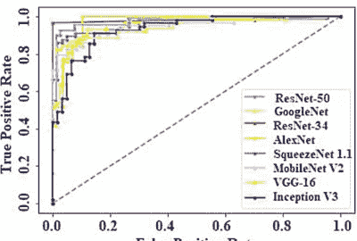

图 5.5. 本研究中使用的八种不同 CNN 模型的 ROC 曲线（转载自 [50]，版权 (2021) 得 Elsevier 许可）。

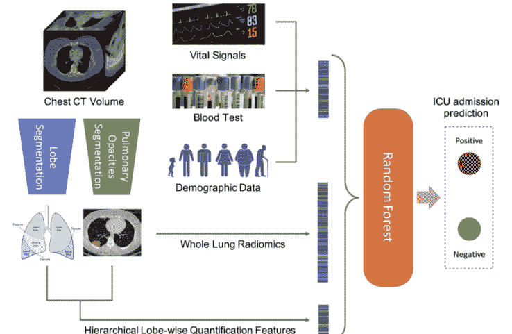

图 5.6. 所提方法的框架，包括所使用的输入和预期输出（转载自 [51]，版权 (2021) 得 Elsevier 许可）。

用于对肺炎和 COVID-19 图像进行分类的数据来源。借助迁移学习方法，如 ResNet、GoogleNet、VGG19 和 AlexNet，从图像中提取了特征。最后，利用二进制粒子群优化进行特征提取，SVM 用作分类器，在 5 折交叉验证框架中实现了 0.99 的 AUC。

Saha 等人 [53] 开发了 EMCNet，用于对 COVID-19 患者和正常病例进行分类。他们使用了从不同在线来源收集的总共 4600 张 X 光图像（2300 例 COVID-19 患者和 2300 例正常病例），并将所有图像调整为 224 × 224 × 3，随后对数据集进行了归一化。整个数据集被划分为 70% 训练集、20% 验证集和 10% 测试集。EMCNet 是 AlexNet、VGG16、Inception 和 ResNet 50 的组合，用于从图像中提取特征。他们使用 CNN、决策树、SVM、AdaBoost 和随机森林来对两个类别进行分类。他们还对所有这些分类器采用了五折交叉验证和硬投票的集成方法。其集成方法实现了 100% 的精确率、97.82% 的召回率、98.91% 的准确率、98.889% 的 F1 分数和 0.9894 的 AUC。他们未遵循任何特定协议，且未报告置信区间。

Panahi 等人 [54] 创建了快速 COVID-19 检测器（FCOD），用于对 COVID 与非 COVID 受试者的 X 光图像进行分类。他们使用了来自 GitHub 的开源数据集（https://github.com/ieee8023/covid-chestxray-dataset），随后选取了 940 张 COVID-19 X 光图像和 940 张非 COVID-19 X 光图像。他们将数据集分为两部分：80% 用于训练，20% 用于测试。使用了数据增强，训练集规模随后增加到 3760 张图像。FCOD 由多个深度可分离卷积层组成。每个层之后，使用了最大池化层和批量归一化层，并在末端使用了脱落层。他们实现了 93% 的灵敏度、97% 的特异性、97% 的精确率、96% 的准确率和 96% 的 F1 分数。他们未遵循任何特定协议，且未报告置信区间。

Pham [55] 使用迁移学习对胸部 X 光 COVID-19 阳性与正常受试者（2 类）以及胸部 X 光 COVID-19 阳性与正常受试者和肺炎（3 类）进行分类（图 5.8）。本研究使用了三个公开可用数据集及其六个子数据集。使用预训练的 AlexNet、GoogleNet 和 SqueezeNet 进行分类，并报告了以下指标：灵敏度、特异性、准确率、F1 分数、精确率和 AUC。使用了留出法（50%）。未遵循任何特定的 STARD 标准。

Di 等人 [56] 基于不确定性顶点超图构建，对社区获得性肺炎（CAP）患者的胸部 CT 与 COVID-19 进行了分类。他们对每幅图像进行了分割，以使用基于深度学习的网络（如 VB-Net）提取病灶区域，并根据病灶区域内的直方图分布、均值和方差、受感染病灶数量以及性别和年龄等人口学变量，为每位患者提取特征。总共为每位患者计算了 191 个特征。数据集包含 3330 张 CT 图像，其中 2148 张属于 COVID-19 患者，其余 1182 张来自 CAP 患者。他们使用了 10 折交叉验证。实现了 89% 的准确率、93% 的灵敏度、84% 的特异性、90% 的 PPV（精确率）和 88% 的 NPV。

Wu 等人 [57] 提出了一种新算法，用于对正常受试者和 CAP 患者的胸部 CT 图像进行分类。他们使用了一种深度主动学习方法，其中使用了 30% 的标记数据。他们使用了 CC-CCII 数据集的一个子集，包含 962 名患者（304 例 COVID-19、316 例肺炎、342 例正常）。使用了不同的增强方式，包括仿射变换和颜色抖动。他们使用了 70% 的数据构建无标签数据集，10% 用于验证，20% 用于测试。首先，他们提取了每幅图像的肺部区域，然后用无标签数据输入他们的网络。当网络无法预测图像标签时，它会向人类专家请求标签。他们的网络包含多层 3D 和 2D 卷积层、池化层和脱落层。最后，他们将其方法与最新技术进行了比较。实现了 86% 的准确率和 96% 的 AUC。他们未报告其他指标，也未报告任何置信区间，且未遵循任何特定标准。

Karakanis 等人 [58] 提出了两个新模型：将胸部 X 光 COVID-19 与健康对照分类，以及将胸部 X 光 COVID-19 与肺炎和健康对照受试者分类。他们遵循了 Maguolo 和 Nanni [60] 提出的协议，并解释了其方法的所有方面。其实现已在 GitHub 上发布。他们使用了公开数据集。还使用条件 GAN 生成了合成 COVID-19 图像（#130）。分析的数据集为 275 例 COVID-19、275 例肺炎和 270 例正常受试者。80% 用于训练，20% 用于测试/验证。对于二分类，他们报告了 98.7% 的准确率、98.3% 的特异性和 100% 的灵敏度；对于多类（3 类）分类，报告了 98.3% 的准确率、98.1% 的特异性和 99.3% 的灵敏度。性能指标未报告置信区间。

#### 5.2.6 关键问题

不遵循关键的 STARD、TRIPOD 或医疗数据挖掘检查清单，会阻碍 COVID-19 诊断和预后方法的临床应用。此外，还有至少两个其他关键问题需要考虑。

文献中已使用数据集平衡来提高分类器的性能。不平衡数据集非常难以处理。例如，Ardakani 等人 [22] 报告了基于 CT 图像深度学习的 COVID-19 诊断的绩效指标综合列表和留出验证框架（80% 训练，20% 测试）。研究中共有 86 名非 COVID-19 和 34 名 COVID-19 患者参与，最终分析了 510 个非 COVID-19 和 510 个 COVID-19 CT 图像块。除了容易受数据暗示假设影响的留出验证框架外，数据集还进行了平衡处理。疾病患病率与人群不相似，导致实践中精确率（即，阳性预测值 PPV）下降。该问题可使用贝叶斯公式描述：

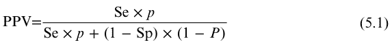

其中，Se 和 Sp 分别为所设计系统的灵敏度和特异性，P 为人群中疾病的患病率。在 Ardakani 等人 [22] 的研究中，最佳方法为 ResNet-101，其 Se 和 Sp 分别为 100% 和 99.02%，数值非常高。若将 COVID-19 患病率视为 10%，则 PPV 为 92%。参数 PPV 是在已知诊断方法结果为阳性的情况下，受试者患有 COVID-19 的概率。文献中通常不常见如此高的 Se 和 Sp 值。通常认为 Se 为 80%、Sp 为 95% 属适当。在相似患病率条件下，PPV 仅为 64%。因此，当数据集平衡时，系统在 Se 和 Sp 方面的性能必须非常高。否则，系统在实践中无法按预期工作。这种平衡程序也用于其他研究，例如 [53]。

另一个问题是同行评审程序的质量。由于流行病期间期刊投稿量大，同行评审质量降低，


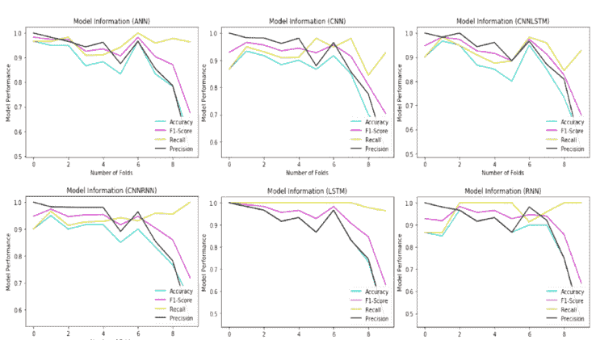

图 5.9. 10倍交叉验证下深度学习模型的结果（转载自 [62]，版权 2020，经 Elsevier 许可）。

导致在编辑人员重新分析已发表论文时，大约有45篇论文被撤回 [61]。虽然大部分论文是医学论文，但预计此类撤回将扩展到其他多学科研究，例如COVID-19医学数据挖掘。我们提供了一个说明示例。Alakus和Turkoglu [62]比较了不同深度学习算法用于COVID-19诊断。检查了80名COVID患者和520名非COVID患者，并记录了实验室数据。使用10倍交叉验证，平均AUC、F1分数、准确率、精确度和灵敏度分别报告为0.625、91.89%、86.66%、86.75%、99.42%（图 5.9）。

首先，未对任何性能指标报告CI 95%。对于AUC（本研究中为0.625）等指标，这至关重要。如果CI 95%包含0.5，那么在实践中，用户从诊断方法中获益并不比随机生成器更多。此外，有必要在各测试折上报告性能指标的均值（MEAN）和标准差（SD），以识别每个折的可靠性。未提供SD值。

此外，作者未提供所提方法的特异度。然而，利用AUC和灵敏度参数，该方法的特异度约为26%。它与I类错误直接相关，必须在论文中报告。论文图表（图 5.10）中还存在一个矛盾，其中LSTM的AUC被提及为0.83。然而，ROC曲线讲述了不同的故事。该数字被用于其他计算，导致论文中存在一些不一致。此外，鉴于大多数受试者是健康的，系统的特异度非常低（26%），方法为何准确率很高（86.66%）尚不明确。此类问题本应在同行评审过程中被识别和纠正。

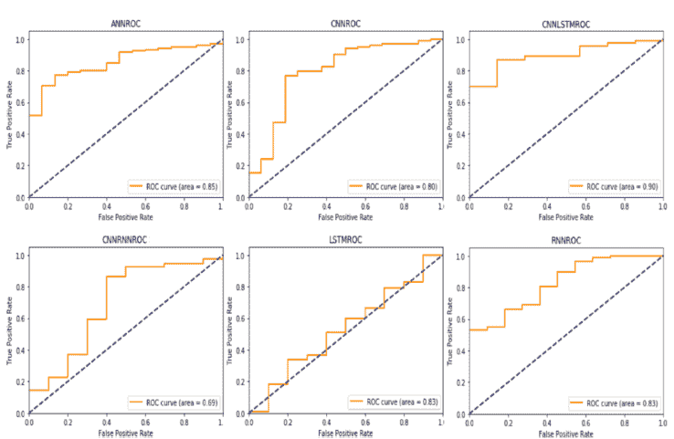

图 5.10. 使用训练-测试分割方法的全部深度学习模型的AUC值（转载自 [62]，版权 2020，经 Elsevier 许可）。

### 5.3 结论与未来展望

毫无疑问，机器学习方法是医学数据挖掘的宝贵工具。然而，为了提升其可见性和临床应用，仍有一些关键问题需要考虑。表 5.1–5.4总结了已发表论文中未考虑的关键STARD/TRIPOD问题。一个原因可能是，原始的STARD或TRIPOD指南并非为机器学习和AI方法而制定。这就是为什么它们的扩展，例如TRIPOD-ML [63]和STARD-AI [64]，正在进行中。尽管如此，利用关键的STARD/TRIPOD检查清单来改进机器学习方法的临床应用是可行的。

在大流行期间，许多论文在文献中发表，关注COVID-19诊断、预后和长COVID的所有方面。许多期刊提供了专刊，尽管有些与期刊的宗旨和范围无关。同行评审程序不足，以及一些临床期刊领跑的期刊急于维持或提高其影响因素，创造了一个以发表为主导的局面。宝贵的研究需要时间，而这场竞赛中没有时间。这一次，“发表或毁灭”一词变得非常清楚。在COVID-19论文发表后进行同行评审可能是一个好主意，研究人员可以对已发表的论文发表评论或进行讨论。Pubs提供了一个开放的社区评审（https://pubns.com/publon/covid-19/?sort_by=date）。然而，并非所有已发表的COVID-19论文都被包含在内。

在此，我们提供一份关于改进COVID-19诊断和预后机器学习方法临床应用的关键问题清单：

- 必须提供显示纳入和排除标准的研究流程图。
- 必须提及样本量计算和抽样方法。
- 必须避免III类错误。仅使用保留验证方法可能会导致此问题。重复保留或重采样方法等替代方案是良好的替代选择。
- 当每位患者存在重复测量时，还必须提供受试者交叉验证。
- 必须在各测试折上报告性能指标的均值和标准差（SD）。可以提供交叉验证的混淆矩阵，以便对不同方法（即，所提方法与最先进的方法）进行统计比较。
- 分析样本在疾病患病率方面必须与人群相似。否则，在人群中使用时，必须分析和阐述该方法在平衡数据集上的性能。
- 当数据集不平衡时，必须提供适当的性能指标。在这种情况下，准确率是一种有偏估计量。
- 必须报告多种性能指标。示例是提供诊断系统输出与PCR结果之间的一致率，因为使用PCR结果作为金标准存在批评。
- 必须报告性能指标的CI 95%，以显示估计的可靠性。
- 必须提高生物医学工程师以及从事医学机器学习方法的人员的生物统计学知识。示例是在进行住院预后时，选择正确的生存模型和机器学习方法的重要性。

### 参考文献

- [1] Wise J 2021 Covid-19: E484K突变及其带来的风险 Brit. Med. J. **372** n359
- [2] Weiner D L, Balasubramaniam V, Shah S I and Javier J R, 儿科政策委员会 2020 COVID-19对研究的影响，从COVID-19研究中吸取的教训，对儿科研究的意义 *Pediatr. Res.* **88** 148–50
- [3] Gonzalez T, de la Rubia M A, Hincz K P, Comas-Lopez M, Subirats L, Fort S and Sacha G M 2020 COVID-19封锁对高等教育学生表现的影响 *PLoS One* **15** e0239490
- [4] Carfi A, Bernabei R and Landi F, 和Gemelli Against COVID-19后急性期护理研究小组 2020 急性COVID-19后患者的持续症状 *JAMA* **324** 603–5
- [5] Li W T _et al_ 2020 使用机器学习分析临床数据诊断COVID-19：系统评价和Meta分析 *BMC Med. Inform. Decis. Mak.* **20** 247
- [6] Muhammad L J, Algehyne E A, Usman S S, Ahmad A, Chakraborty C and Mohammed I A 2021 使用流行病学数据集预测COVID-19感染的监督机器学习模型 *SN Comput. Sci.* **2** 11
- [7] Muhammad L J, Islam M M, Usman S S and Ayon S I 2020 新型冠状病毒（COVID-19）感染患者康复的预测数据挖掘模型 *SN Comput. Sci.* **1** 206
- [8] Zhang T 2020 数据挖掘在COVID-19相关心理健康研究中可以发挥关键作用 Asian J. Psychiatr 54 102399
- [9] Wynants L et al 2020 COVID-19感染诊断和预后预测模型：系统评价和批判性评价 Brit. Med. J. 369 m1328
- [10] Sperrin M, Grant S W and Peek N 2020 COVID-19诊断和预后预测模型 Brit. Med. J. 369 m1464
- [11] Glasziou P P, Sanders S and Hoffmann T 2020 COVID-19研究中的浪费 Brit. Med. J. 369 m1847
- [12] Collins G S, Reitsma J B, Altman D G and Moons K G M 2015 个体预后或诊断多变量预测模型透明报告（TRIPOD）：TRIPOD声明 Ann. Intern. Med. 162 55–63
- [13] Riley R D, Ensor J, Snell K I E, Harrell F E Jr, Martin G P, Reitsma J B, Moons K G M, Collins G and van Smeden M 2020 计算开发临床预测模型所需的样本量 Brit. Med. J. 368 m441
- [14] Mansournia M, Marateb H R, Mansournian M, Mohebbian M R, Binder H and Mañanas M Á 2020 计算机辅助医学诊断和预后系统的严格性能评估：数据挖掘的生物统计学视角 Modelling and Analysis of Active Biopotential Signals in Healthcare, Volume 2 (Bristol: IOP Publishing) pp 17–11–17-24
- [15] Bossuyt P M, et al, 和STARD组 2015 STARD 2015：诊断准确性研究报告基本项目的更新清单 Brit. Med. J. 351 h5527
- [16] Chicco D and Jurman G 2020 二分类评估中马修斯相关系数（MCC）相对于F1分数和准确率的优势 BMC Genom. 21 6
- [17] Li L et al 2020 基于肺部CT使用人工智能检测COVID-19和社区获得性肺炎：诊断准确性评价 Radiology 296 E65–71
- [18] Yuan M, Yin W, Tao Z, Tan W and Hu Y 2020 中国武汉2019年新型冠状病毒感染患者放射学发现与死亡率的关联 PLoS One 15 e0230548
- [19] Laguarta J, Hueto F and Subirana B 2020 仅使用咳嗽录音进行COVID-19人工智能诊断 IEEE Open J. Eng. Med. Biol. 1 275–81
- [20] Hu S et al 2020 基于CT图像的COVID-19感染检测和分类的弱监督深度学习 IEEE Access 8 118869–83
- [21] Apostolopoulos I D and Mpesiana T A 2020 Covid-19：利用卷积神经网络的迁移学习从X光图像中自动检测 Phys. Eng. Sci. Med. 43 635–40
- [22] Ardakani A A, Kanafi A R, Acharya U R, Khadem N and Mohammadi A 2020 使用CT图像在常规临床实践中应用深度学习技术管理COVID-19：10个卷积神经网络的结果 Comput. Biol. Med. 121 103795
- [23] Apostolopoulos I D, Aznaouridis S I and Tzani M A 2020 使用深度学习方法和与肺部疾病相关的图像数据从X光图像中提取可能具有代表性的COVID-19生物标志物 J. Med. Bio. Eng 40 1–8
- [24] Hasan A M, Al-Jawad M M, Jalab H A, Shaiba H, Ibrahim R W and Al-Shamasneh A R 2020 使用Q变形熵和深度学习特征对CT扫描中的covid-19冠状病毒、肺炎和健康肺部进行分类 Entropy (Basel) 22 517
- [25] Hurt B, Kligerman S and Hsiao A 2020 肺炎深度学习定位：2019年冠状病毒（COVID-19）爆发 J. Thorac. Imag. 35 W87–9


- [26] Khan A I, Shah J L 与 Bhat M M 2020 CoroNet: 用于从胸部X射线图像中检测和诊断COVID-19的深度神经网络 *Comput. Methods Programs Biomed.* **196** 105581

- [27] Khanday A M U D, Rabani S T, Khan Q R, Rouf N 与 Din M M U 2020 基于机器学习的利用临床文本数据检测COVID-19的方法 *Int. J. Inf. Technol.* **12** 1–9

- [28] Ko H 等人 2020 使用单张胸部CT图像的简单2D深度学习框架进行COVID-19肺炎诊断：模型开发与验证 *J. Med. Internet Res.* **22** e19569

- [29] Ucar F 和 Korkmaz D 2020 COVIDDiagnosis-Net: 基于深度Bayes-SqueezeNet的2019年冠状病毒病(COVID-19)X射线图像诊断 *Med. Hypotheses* **140** 109761

- [30] Singh D, Kumar V, Vaishali 和 Kaur M 2020 使用基于多目标差分进化的卷积神经网络从胸部CT图像中分类COVID-19患者 *Eur. J. Clin. Microbiol. Infect. Dis* **39** 1379–89

- [31] Goodman-Meza D 等人 2020 一种提高COVID-19住院患者诊断能力的机器学习算法 *PLoS One* **15** e0239474

- [32] Zhao Z, Chen A, Hou W, Graham J M, Li H, Richman P S, Thode H C, Singer A J 和 Duong T Q 2020 COVID-19中ICU入院和死亡率的预测模型与风险评分 *PLoS One* **15** e0236618

- [33] Banerjee A, Ray S, Vorselaars B, Kitson J, Mamalakis M, Weeks S, Baker M 和 Mackenzie L S 2020 在人群中利用全血细胞计数和机器学习与人工智能预测SARS-CoV-2感染 *Int. Immunopharmacol.* **86** 106705

- [34] Burdick H 等人 2020 利用机器学习预测Covid-19患者呼吸衰竭：READY试验 *Comput. Biol. Med.* **124** 103949

- [35] Cai W, Liu T, Xue X, Luo G, Wang X, Shen Y, Fang Q, Sheng J, Chen F 和 Liang T 2020 COVID-19患者疾病严重程度和预后评估的CT定量与机器学习模型 *Acad. Radiol.* **27** 1665–78

- [36] Liang W 等人 2020 使用深度学习对重症COVID-19患者进行早期分诊 *Nat. Commun.* **11** 3543

- [37] Ma X 等人 2020 COVID-19患者死亡风险预后模型的开发与验证 *Epidemiol. Infect.* **148** e168

- [38] Sun L 等人 2020 四项临床指标的组合可预测感染COVID-19患者的重症/危重症症状 *J. Clin. Virol.* **128** 104431

- [39] Wu G, Zhou S, Wang Y, Lv W, Wang S, Wang S, Wang T 和 Li X 2020 基于实验室检查结果的SARS-CoV-2肺炎预后预测模型 *Sci. Rep.* **10** 14042

- [40] Zhou L 等人 2020 一种基于CT的COVID-19诊断快速、准确且与机器无关的分割与定量方法 *IEEE Trans. Med. Imaging.* **39** 2638–52

- [41] Subudhi S, Verma A 和 Patel A B 2020 用于辅助决策的COVID-19预后机器学习模型 *Int. J. Clin. Pract* **74** e13685

- [42] Sotoudeh H, Tasorian B, Tabatabaei S M, Sotoudeh E 和 Moini A 2020 胸部CT上利用迁移学习区分H1N1流感与COVID-19的可行性 Res. Square https://doi.org/10.21203/rs.3.rs-40907/v1

- [43] Dunne R, Morris T 和 Harper S 2020 使用梅尔频率倒频系数和卷积神经网络对COVID-19咳嗽进行高精度分类，并应用于智能家居设备 Res. Square https://doi.org/10.21203/rs.3.rs-63796/v1

- [44] Oulefki A, Agaian S, Trongtirakul T 和 Kassah Laouar A 2021 使用CT扫描图像自动分割和测量COVID-19肺部感染区域 *Pattern Recognit.* **114** 107747

- [45] Javor D, Kaplan H, Kaplan A, Puchner S B, Krestan C 和 Baltzer P 2020 胸部计算机断层扫描上的深度学习分析可提供准确的COVID-19诊断 *Eur. J. Radiol.* **133** 109402

- [46] Nath M K, Kanhe A 和 Mishra M 2020 COVID-19图像分类的一种新型深度学习方法 2020 IEEE第5届计算通信与自动化国际会议(ICCCA) (Piscataway, NJ: IEEE)

- [47] Wang L, Lin Z Q 和 Wong A 2020 COVID-Net：一种用于从胸部X射线图像中检测COVID-19病例的定制深度卷积神经网络设计 *Sci. Rep.* **10** 19549

- [48] Gao K *等人* 2021 双分支组合网络(DCN)：利用CT图像实现COVID-19精确诊断与病变分割 *Med. Image Anal.* **67** 101836

- [49] Arvind V, Kim J S, Cho B H, Geng E 和 Cho S K 2020 开发一种用于预测住院COVID-19患者插管的机器学习算法 *J. Crit. Care* **62** 25–30

- [50] Nayak S R, Nayak D R, Sinha U, Arora V 和 Pachori R B 2021 利用胸部X射线图像检测COVID-19病例的深度学习技术应用：一项综合研究 *Biomed. Signal Process. Control* **64** 102365

- [51] Chao H *等人* 2021 COVID-19患者预后预测的综合分析 *Med. Image Anal.* **67** 101844

- [52] Canayaz M 2021 MH-COVIDNet：基于X射线图像的深度神经网络与元启发式特征选择诊断COVID-19 *Biomed. Signal Process. Control* **64** 102257

- [53] Saha P, Sadi M S 和 Islam M M 2021 EMCNet：使用卷积神经网络和机器学习分类器集成从X射线图像中自动诊断COVID-19 *Inform. Med. Unlocked* **22** 100505

- [54] Panahi A H, Rafiei A 和 Rezaee A 2021 FCOD：基于深度学习技术的快速COVID-19检测器 *Inform. Med. Unlocked* **22** 100506

- [55] Pham T D 2021 利用深度学习对COVID-19胸部X光片进行分类：新模型还是微调？ *Health Inf. Sci. Syst* **9** 2

- [56] Di D *等人* 2021 利用CT成像的超图学习识别COVID-19 *Med. Image Anal.* **68** 101910

- [57] Wu X, Chen C, Zhong M, Wang J 和 Shi J 2021 COVID-AL：利用深度主动学习诊断COVID-19 *Med. Image Anal.* **68** 101913

- [58] Karakanis S 和 Leontidis G 2020 用于从胸部X射线图像中检测COVID-19的轻量级深度学习模型 *Comput. Biol. Med.* **130** 104181

- [59] Zoabi Y, Deri-Rozov S 和 Shomron N 2021 基于症状的机器学习COVID-19诊断预测 *NPJ Digit. Med* **4** 3

- [60] Maguolo G 和 Nanni L 2020 对从X射线图像中自动检测COVID-19的方法的批判性评价 *Inform. Fusion* **76** 1–7

- [61] Cortegiani A, Catalisano G, Ippolito M, Giarratano A, Absalom A R 和 Einav S 2021 关于SARS-CoV-2和COVID-19的撤稿论文 *Br. J. Anaesth.*

- [62] Alakus T B 和 Turkoglu I 2020 预测COVID-19感染的深度学习方法比较 *Chaos Solitons Fractals* **140** 110120

- [63] Collins G S 和 Moons K G M 2019 人工智能预测模型的报告 *Lancet* **393** 1577–9

- [64] Sounderajah V 等人 2020 制定评估AI干预的诊断准确性研究特定报告指南：STARD-AI指导组 *Nat. Med.* **26** 807–8

## 面向智能医疗系统的高性能计算

Varun Bajaj 和 Irshad Ahmad Ansari

## 第6章

## 利用回归和高斯分析预测印度确诊冠状病毒病例数

Dhyan Chandra Yadav 和 Saurabh Pal

冠状病毒对人类生命构成重大威胁，导致一种非常致命的危及生命的疾病。这种疾病的感染速度极快，在极短的时间内就席卷了全世界。在本章中，我们分析了从2020年1月30日到2020年7月9日不断增长的COVID-19数据集，并估计确诊阳性病例和患者死亡人数。

该疾病的病例起源于中国武汉，且至今该疾病起源的准确原因尚未阐明。医学领域的专家们不断进行实验以控制这种疾病，但至今尚未有能立即治愈该疾病的有效药物可用。四种不同的功能模型已被用于从Kaggle获取的印度COVID-19患者数据分析。在本章中，我们对COVID-19数据集使用了线性、对数、多项式和高斯功能模型。

根据这些模型，我们从2020年10月底印度COVID-19病例的实际情况出发，预测了随后120天内冠状病毒疾病的患者和死亡人数。分析后发现，多项式函数模型是预测的一个非常出色的模型。在这项研究中，我们发现未来120天内印度的COVID-19感染病例数有所增长。

借助本研究获得的预测结果，印度政府可以采取封锁和实施社交距离等预防措施来控制冠状病毒疾病。另一个好处是为如此庞大数量的患者开发医疗设施。

### 6.1 引言

冠状病毒是一类会在人体内引发疾病（如呼吸道疾病）的复杂病毒链。呼吸道疾病主要分为两种类型：

- 中东呼吸综合征 (MERS-CoV);
- 严重急性呼吸综合征 (SARS-CoV).


一种新型冠状病毒（nCoV）或 COVID-19 是之前在人类中未被发现的新病毒链。

'中东呼吸综合征' 被确认为从单峰骆驼传播给人类，而严重急性呼吸综合征则从果子狸传播给人类。这两种综合征已通过各种实验确定，但新型病毒不容易被识别。

一般来说，临床上冠状病毒在感染者身上会出现一些症状，但有些人不会表现出症状。一些症状可能包括：

- 呼吸道症状；
- 高烧；
- 干咳或难以咳嗽；
- 呼吸困难；
- 肥胖；
- 肝损伤；
- 胸腔功能复杂。

世界卫生组织（WHO）为罹患严重 COVID-19 疾病风险较高的人群提供建议或推荐。这包括患有严重慢性疾病的老年人，例如：

- 糖尿病；
- 心血管疾病；
- 慢性呼吸道疾病；
- 癌症；
- 高血压；
- 慢性肝脏疾病。

如果在医疗机构中出现任何 COVID-19 疾病的体征和症状，世卫组织会就社会护理和健康防护提出建议。

世卫组织建议采取预防措施来防范新型冠状病毒，例如：

- 及时了解 COVID-19 的最新信息；
- 勤洗手；
- 避免触摸身体部位；
- 为手和面部使用医用口罩；
- 与有呼吸道症状的个体保持社交距离。

他们建议人们在出现发烧、咳嗽和呼吸困难等任何疾病症状时，不要回避而是应寻求医疗护理。印度卫生和家庭福利部报告称，印度共有 767 296 例确诊病例、495 413 例康复病例和 21 129 例死亡病例 [mohfw.gov.in, June 2020]。尽管印度的死亡病例数少于中国和美国，但受冠状病毒影响的人群病例数在亚洲最高 [Hindustan Times, May 2020]。印度政府采取了各种决定以防止冠状病毒感染在印度传播。症状仅在人接触病毒后 2 至 14 天出现。这些症状包括发烧、咳嗽、频繁气短、感到过度呼吸困难、感到寒冷、寒冷以及潜伏性、肌肉疼痛和紧绷、频繁头痛、喉咙痛加剧以及味觉和嗅觉下降 [1]。Covid 感染对人类生命是一种危险疾病。COVID-19 感染是由严重急性呼吸综合征冠状病毒 2 引起的。印度首例 Covid 感染者于 2020 年 1 月 30 日被检测出来。3 月 22 日，全国居民遵守了为期 24 小时的自愿性公共宵禁，3 月 24 日，政府实施了为期 21 天的封锁令。封锁令从 4 月 14 日持续到 5 月 3 日，随后从 5 月 3 日到 5 月 17 日，政府允许人们有一定程度的放宽，因此从 6 月 1 日起，政府开始分三个阶段实施锁定与解锁流程 [2, 3]。世卫组织和联合国将此描述为消除该国感染传播的一个值得称赞的步骤。6 月 21、22 和 23 日，印度在 200 个国家中被深度知识集团排名为第 56 位。2020 年 1 月 12 日，居住在中国的人们因呼吸道疾病感染了冠状病毒，并于 2019 年 12 月 31 日向世卫组织报告 [4, 5]。1 月 30 日，喀拉拉邦确认了首例感染 Covid 的人，到 2 月 3 日增加到三例新病例。3 月 4 日，发现 22 例新冠阳性病例，其中 14 例新病例由一组在 3 月份从国外返回的旅游团报告。大量 Covid 感染在旁遮普邦等地区因锡克教庆典而传播 [6–8]。同样，3 月 31 日，德里的塔布利吉·贾马特宗教聚会事件成为一起重大事件。此事件之后，报告了 4291 例 Covid 感染病例 [9, 10]。5 月，旁遮普邦报告了从马哈拉施特拉邦返回的朝圣者中有 1225 例新病例，因此《1897 年流行病法》在十几个州和联邦领土中生效。结果，教育和商业机构暂时关闭，所有旅游签证被撤销和取消 [11]。我们列出了印度各州的 Covid 感染详情，并观察了每个州的感染情况。

从图 6.1 可以清楚地看出，马哈拉施特拉邦、西部、古吉拉特邦、泰米尔、比哈尔、中央邦、德里、北方邦以及一些其他州有大量感染患者，而北阿坎德邦、喜马偕尔邦、拉达克以及一些其他州的感染患者较少。

从图 6.2 可以清楚地看出，马哈拉施特拉邦、卡纳塔克邦、喀拉拉邦和北方邦以及一些其他州的印度籍确诊患者较多，而北阿坎德邦、喜马偕尔邦、拉达克等州较少。

从图 6.3 可以清楚地看出，拉贾斯坦邦和哈里亚纳邦有大量外籍感染患者，而北阿坎德邦、喜马偕尔邦、拉达克以及一些其他州的外籍感染患者较少。

我们观察了每个州治愈的 Covid 感染人数，发现马哈拉施特拉邦、古吉拉特邦、拉贾斯坦邦、泰米尔、中央邦、德里和北方邦的治愈人数比其他州多。在图 6.4 中，我们预测了各州 Covid 感染的死亡人数，发现马哈拉施特拉邦、古吉拉特邦、拉贾斯坦邦、中央邦、德里和北方邦的死亡人数最多。

在这个数据集中，确诊病例、最终死亡病例和新增病例的描述如下：新增病例 = 总病例 –（前几天的总病例），我们汇总了印度所有州，发现顶层分析和尾层预测之间存在显著差异。

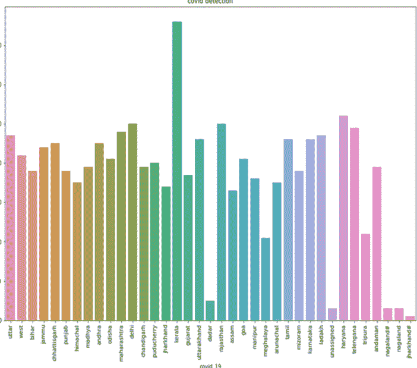

图 6.1. 印度带有州详情的 Covid 感染患者图示。

从表 6.1 可以清楚地看出，最初我们发现最终死亡病例和新增病例分别为：0 和 0–1 的增加。

根据结果，可以清楚地看出表 6.2 发现每天都有高死亡病例和新增病例的增长。我们预测了 2020–01–30 到 2020–02–03 的顶层以及 2020–07–05 到 2020–07–09 的尾层。

### 6.2 机器学习中的回归分析

机器学习回归技术在目标变量和预测变量之间生成关系。这种技术的作用是生成时间序列模型，以从变量关系中找到未来结果，并给变量拟合一条曲线/直线。它在变量之间提供显著的关系和影响强度。

回归模型是机器学习的一个子部分。回归模型估计了因变量与一个或多个自变量之间关系的强度。机器学习通过不同的功能模型在变量之间提供关系。线性函数模型为给定的 x 值生成连续的结果变量 (f(x))。这些变量在结果和给定变量之间建立线性关系 [29]。指数函数

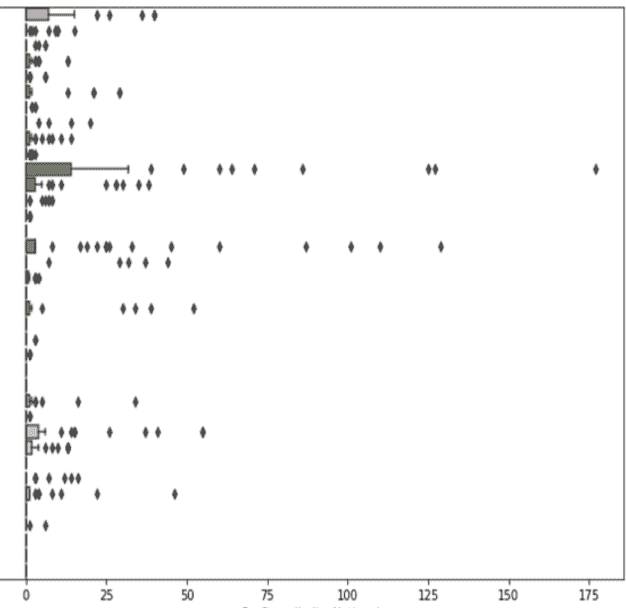

图 6.2. 印度确诊印度籍患者图示。

衡量 Covid 感染者人口的增长。在本章中，我们学习了 Covid 感染变量之间的关系。回归函数分析的主要目的是，给定回归模型的拟合度应优于均值模型的拟合度。机器学习可以帮助决策以控制这种疾病。COVID-19 疾病的回归功能分析发现了未来 120 天内疾病的传播情况。

在本节中，我们提出了五种基于回归的模型，称为线性回归、对数回归、多项式回归和高斯回归方法。这些模型的描述如下给出的方程中：

$$f(x) = a + b \times x$$ (6.1)

$$f(x) = a \log(x) + b$$ (6.2)

$$f(x) = ax^3 + bx^2 + cx + d$$ (6.3)


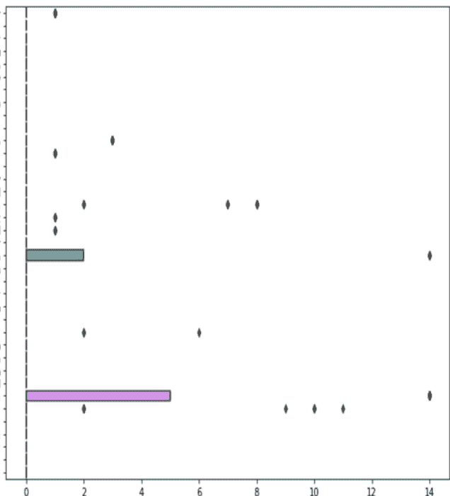

图 6.3. 印度确诊外国国籍新冠患者表示。

The Gaussian regression model calculates the probability distribution of parameters or overall admissible functions that fit the data.

高斯回归模型计算拟合数据的参数或整体可接受函数的概率分布。

```
f(x) = a + e^{\left(-0.5 \times \left(\frac{x - \mu}{\sigma^2}\right)\right)}
```

In statistics, the coefficients of determination are denoted R², the main objective of R² analysis of future outcomes on the basis of relevance feature or testing of the variance by standard ranges from 0 to 1. R² shows how well data points used fit the curve or line. If we use more unnecessary or useless variables then it will decrease. By adjusting R² data points will be added to increase efficiency.

在统计学中，决定系数记为 R²，R² 分析的主要目的是基于相关特征对未来结果进行评估，或通过标准范围检验方差，其取值范围为 0 到 1。R² 显示所用数据点与曲线或直线的拟合程度。如果使用更多不必要或无用的变量，则 R² 会降低。通过调整 R²，将添加数据点以提高效率。

```
(Adj)R² = 1 - \left[\frac{(1 - R²)(n - 1)}{n - k - 1}\right]
```

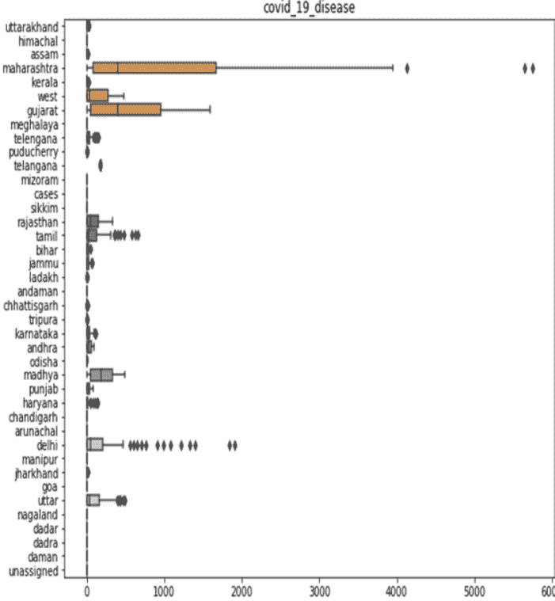

图 6.4. 印度按州详情显示的新冠感染患者死亡病例表示。

where,

其中，

- n is the data instances with attributes.
- K is the number of independent regressors.

- n 是具有属性的数据实例。
- K 是独立回归器的数量。

```
R² = 1 - (SS regression / SS total) (6.6)
```

where,

其中，

- SS regression = sum of squared regression error
- SS total = sum of total error

- SS 回归 = 回归误差平方和
- SS 总 = 总误差平方和

Equations (6.1)-(6.6) have been taken for better estimates in COVID-19 disease [12-14]. In figure 6.5 the box represents cured patient details by higher and lower level.

方程 (6.1)-(6.6) 已被采用，以便更好地估计 COVID-19 疾病[12-14]。在图 6.5 中，框表示按更高和更低级别分类的治愈患者详情。

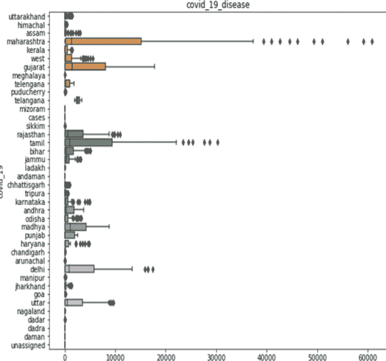

Figure 6.5. Representation of cured patients with state details in India by higher and lower level box plot.

图 6.5. 印度按州详情和更高及更低级别箱线图显示的治愈患者表示。

Table 6.1. Representation of computational table for head model of Covid infection.

表 6.1. 新冠感染头部模型的计算表表示。

| Date | Confirmed | Final death | new |
|---|---|---|---|
| 2020-01-30 | 1 | 0 | 0.0 |
| 2020-01-31 | 1 | 0 | 0.0 |
| 2020-02-01 | 2 | 0 | 1.0 |
| 2020-02-02 | 3 | 0 | 1.0 |
| 2020-02-03 | 3 | 0 | 0.0 |

| 日期 | 确诊 | 最终死亡 | 新增 |
|---|---|---|---|
| 2020-01-30 | 1 | 0 | 0.0 |
| 2020-01-31 | 1 | 0 | 0.0 |
| 2020-02-01 | 2 | 0 | 1.0 |
| 2020-02-02 | 3 | 0 | 1.0 |
| 2020-02-03 | 3 | 0 | 0.0 |

Table 6.2. Representation of computational table for tail model of Covid infection.

表 6.2. 新冠感染尾部模型的计算表表示。

| Sl. No. | Date | Confirmed | Final death |
|---|---|---|---|
| 158 | 2020-07-05 | 673 165 | 19 268 |
| 159 | 2020-07-06 | 697 413 | 19 693 |
| 160 | 2020-07-07 | 719 665 | 20 160 |
| 161 | 2020-07-08 | 742 417 | 20 642 |
| 162 | 2020-07-09 | 767 296 | 21 129 |

| 序号 | 日期 | 确诊 | 最终死亡 |
|---|---|---|---|
| 158 | 2020-07-05 | 673 165 | 19 268 |
| 159 | 2020-07-06 | 697 413 | 19 693 |
| 160 | 2020-07-07 | 719 665 | 20 160 |
| 161 | 2020-07-08 | 742 417 | 20 642 |
| 162 | 2020-07-09 | 767 296 | 21 129 |

### 6.3 Related work

### 6.3 相关工作

The number of confirmed COVID-19 cases by machine learning algorithms was discussed in one study. They used a K-Means machine learning algorithm based on disease prevalence, air pollution metrics, and healthy system courage to analyse country data. The authors created a model for 155 countries using three PCA parameters and six clusters to show the relevance of group countries [15]. In another research the authors analyzed COVID-19 incidence of Google trends by data mining and deep learning. They used linear regression and long–short-term model to detect the incidence of COVID-19 actual cases. The authors calculated the values of RMSE 7.562 (SD 6.492) and the RMSE of the LSTM 27.187 (SD 28.705) [16]. Other researchers computed the growth and trend of COVID-19 by machine learning and cloud computing. They predicted COVID-19 disease by mathematical model, machine learning and cloud computing on the basis of baseline. The authors proposed the Robust Weibull model and predicted better than baseline [17]. Machine learning algorithms were used to analyse the COVID-19 epidemic in India. The author calculated root mean square error using six regression analysis-based machine learning algorithms models. For forecasting over long time intervals, the author discovered that a 6-degree polynomial model calculated a significantly lower root mean square error (RMSE) (the standard deviation of the residuals (prediction errors)) [18]. Another research team predicted a comparative analysis of machine learning with soft computing (multilayer perceptron, adaptive neural network, fuzzy system and ANFIS) for COVID-19. The authors used SIR (susceptible, infectious, recovered) and SEIR (susceptible, exposed, infectious, recovered) models that help for COVID-19 discovery for outlook and found SEIR performed better [19]. The research team analyzed the COVID-19 outbreak in India and used SEIR with a regression model. The authors calculated the values of RMSE for the SEIR model and they found the SEIR model widely predicted the COVID-19 data compared to the regression model. Pandey et al measured the values of RMSE 1.52 for SEIR and 1.75 for the regression model[20]. The researchers measured healthy policy in each country by time and intensity in COVID-19. They used deep reinforcement learning and finally they found higher intensity lockdown and travel restrictions public health interventions during COVID-19 [21]. Rustam et al discussed forecasting by machine learning to decision making on future courses of action. They used linear regression, Lasso, support vector machine and exponential smoothing in COVID-19 forecasting. Finally, they found exponential smoothing performs best results compare to other algorithms [22]. Wang et al discussed COVID-19 infection with symptoms and the effect of infection on the human body. They found the effects of infection are greater in men than women, and no deaths were reported between the ages of 0 and 9 [23]. Other authors considered several cases of pneumonia with unfamiliar etiology in China. The National Health Commission of China reported details on viral pneumonia [24]. The researchers analyzed the details of the novel corona virus and diagnosis of corona virus infection in China. The National Health Commission visited a seafood market and released details of the infected animals, birds and other food sources. After analyzing the infected person details, the commission provided details of human capacity for the virus and exposed infection symptoms with the spread of infection penetrating human lungs through the nose or mouth [25–28]. Authors discussed the origination and transmission of corona virus source. Some authors have studied research work on SARS-CoV and found they focused on raccoons, dogs and palm civets for corona infection [29]. Guan et al observed the clinical characteristics of corona virus in China. They considered laboratory confirmed reports of COVID-19 and the patient’s status, their death, ventilation and ICU requirements [30]. Ai et al discussed the correlation of chest and reverse transcription polymerase chain reaction (RT-PCR) testing in COVID-19 in China. They analyzed blood samples for RT-PCR because without this reaction the authors did not identify virus or risk of infection in patients [31]. Shi and Hu analyzed the risk factors for mortality of adult in-patients in the case of COVID-19. They considered COVID-19 adult patients from Jiny Intan Hospital and Wuhan Pulmonary Hospital in Wuhan, China. They found deaths and disclosed patient details. They used logistic regression to find current smoker versus non-smoker patients [32]. Huang et al discussed clinical features of patients infected with COVID-19. They found 41 discharges, 6 deaths and 3 patients in ICU from 16 Dec 2019 to 22 Jan 2020 [33]. Liu et al considered factors in COVID-19 disease in hospitalized patients. They found positive/negative and disease progression from 30 Dec 2019 to 15 Jan 2020. They found 11 COVID patients in progress, 67 patients in improvement with 2 deaths negative. They used multivariate logistic regression and calculated the research factor for smokers (OR = 14.28; 95% CI; 1.58–00; P = 0.018) [34]. One group of authors discussed MERS with Pipistrellus and Perimyotis bats. They found that bats work as a key host and transmitting medium to spread the virus. Another research team analyzed some corona virus cases and found snakes to be a possible host. They compared the similarity of novel corona virus with SARS-like bat virus and found bats could be key reservoirs [35, 36]. Yadav and Pal discussed clinical characteristics of 138 hospital patients with epidemiological clinical characteristics of 99 cases and early transmission dynamics to spread of the disease imminent. They identified infection, quarantine and treatment procedures. The authors discussed COVID-19 symptoms and viral pneumonia. They found non-specified symptoms and revealed chest CT scan pneumonia and a pathogenic test for virus came back positive [37]. Machine learning classification algorithms and regression algorithms have evaluated classification accuracy and variables relationship for future outcomes on various medical datasets [38–44].

一项研究讨论了基于机器学习算法的 COVID-19 确诊病例数。他们使用基于疾病患病率、空气污染指标和卫生系统勇气的 K-Means 机器学习算法来分析国家数据。作者使用三个 PCA 参数和六个聚类为 155 个国家创建了一个模型，以显示国家分组的相关性[15]。在另一项研究中，作者通过数据挖掘和深度学习分析了 Google 趋势中的 COVID-19 发病率。他们使用线性回归和长短期记忆模型来检测 COVID-19 实际病例的发病率。作者计算了 RMSE 7.562 (SD 6.492) 和 LSTM 的 RMSE 27.187 (SD 28.705) [16]。其他研究人员通过机器学习和云计算计算了 COVID-19 的增长和趋势。他们基于基线，使用数学模型、机器学习和云计算预测了 COVID-19 疾病。作者提出了稳健 Weibull 模型，并优于基线进行了预测[17]。机器学习算法被用于分析印度的 COVID-19 流行病。作者使用六种基于回归分析的机器学习算法模型计算了均方根误差。对于长时间间隔的预测，作者发现六次多项式模型计算出的均方根误差（RMSE）（残差（预测误差）的标准差）显著较低[18]。另一支研究团队针对 COVID-19 对机器学习与软计算（多层感知机、自适应神经网络、模糊系统和 ANFIS）进行了比较分析。作者使用了 SIR（易感、传染、康复）和 SEIR（易感、暴露、传染、康复）模型，有助于 COVID-19 的前景发现，并发现 SEIR 表现更好[19]。该研究团队分析了印度的 COVID-19 爆发，并将 SEIR 与回归模型结合使用。作者计算了 SEIR 模型的 RMSE 值，并发现与回归模型相比，SEIR 模型对 COVID-19 数据的预测更为广泛。Pandey 等人测得 SEIR 的 RMSE 值为 1.52，回归模型的 RMSE 值为 1.75[20]。研究人员按时间和强度衡量了各国在 COVID-19 期间的健康政策。他们使用了深度强化学习，并最终发现 COVID-19 期间更高强度的封锁和旅行限制公共卫生干预[21]。Rustam 等人讨论了通过机器学习进行预测以支持未来行动方案的决策。他们在 COVID-19 预测中使用了线性回归、Lasso、支持向量机和指数平滑。最终，他们发现指数平滑相比其他算法表现出最佳效果[22]。Wang 等人讨论了带有症状的 COVID-19 感染及其对人体的影响。他们发现感染对男性的影响大于女性，且 0 至 9 岁之间未报告死亡病例[23]。其他作者考虑了中国几个病因不明的肺炎病例。中国国家卫生委员会报告了病毒性肺炎的详细情况[24]。研究人员分析了中国新型冠状病毒及其感染诊断的详细情况。国家卫生委员会访问了一个海鲜市场，并发布了感染动物、禽类和其他食物来源的详细信息。在分析感染者详细信息后，委员会提供了人类对病毒的易感性详细信息，并暴露了感染症状，感染通过鼻子或嘴巴侵入人类肺部[25–28]。作者讨论了冠状病毒源头的起源和传播。一些作者研究了 SARS-CoV 的相关工作，发现他们专注于浣熊、犬和果子狸进行冠状病毒感染[29]。Guan 等人观察了中国冠状病毒的临床特征。他们考虑了实验室确认的 COVID-19 报告以及患者状态、死亡、通风和 ICU 需求[30]。Ai 等人讨论了中国 COVID-19 中胸部检查与逆转录聚合酶链式反应（RT-PCR）检测的相关性。他们分析了用于 RT-PCR 的血液样本，因为没有这种反应，作者无法识别患者中的病毒或感染风险[31]。Shi 和 Hu 分析了 COVID-19 成人住院患者死亡率的风险因素。他们考虑了中国武汉 Jiny Intan 医院和武汉肺科医院的 COVID-19 成人患者。他们发现了死亡病例并披露了患者详细信息。他们使用物流回归来寻找当前吸烟者与非吸烟者患者[32]。Huang 等人讨论了感染 COVID-19 患者的临床特征。他们发现，从 2019 年 12 月 16 日至 2020 年 1 月 22 日，有 41 人出院，6 人死亡，3 人在 ICU[33]。Liu 等人考虑了住院患者 COVID-19 疾病的相关因素。他们发现，从 2019 年 12 月 30 日至 2020 年 1 月 15 日，出现了阳性/阴性和疾病进展。他们发现有 11 名 COVID 患者病情在进行中，67 名患者好转，2 名死亡阴性。他们使用多变量物流回归，计算了吸烟者的研究因素 (OR = 14.28; 95% CI; 1.58–00; P = 0.018) [34]。一组作者讨论了与 Pipistrellus 和 Perimyotis 蝙蝠的 MERS。他们发现蝙蝠作为关键宿主和传播媒介来传播病毒。另一支研究团队分析了一些冠状病毒病例，发现蛇是可能的宿主。他们将新型冠状病毒与 SARS 样蝙蝠病毒进行了相似性比较，并发现蝙蝠可能是关键储库[35, 36]。Yadav 和 Pal 讨论了 138 名住院患者的临床特征，结合 99 例病例的流行病学临床特征和早期传播动力学，以阐明疾病传播的迫在眉睫。他们确定了感染、隔离和治疗程序。作者讨论了 COVID-19 症状和病毒性肺炎。他们发现非特异性症状，并揭示了胸部 CT 扫描肺炎和病毒病原学检测呈阳性[37]。机器学习分类算法和回归算法已在各种医疗数据集上评估了分类精度和变量关系，用于未来结果[38–44]。

### 6.4 Methodology

### 6.4 方法论

In this stage, we have arranged various sections as follows: section 6.2 discussed the dataset and applied linear, exponential, logistic and Gaussian functional models. Sections 6.5 and 6.6 cover the results and discussion and section 6.7 contains the final conclusion.

在此阶段，我们按照以下方式安排了各个部分：第 6.2 节讨论了数据集并应用了线性、指数、物流和高斯函数模型。第 6.5 节和第 6.6 节涵盖了结果和讨论，第 6.7 节包含最终结论。

#### 6.4.1 Data description

#### 6.4.1 数据描述

In this chapter, we have organized COVID-19 Indian patients’ dataset from Kaggle with data word open access website. The COVID-19 dataset contains 3244 instances with 3 attributes from 30 Jan 2020 to 9 July 2020 and estimates confirmed COVID positive cases and patients’ deaths in each state of India.

在本章中，我们从带有 Data Word 开放访问网站的 Kaggle 组织了 COVID-19 印度患者数据集。COVID-19 数据集包含从 2020 年 1 月 30 日至 2020 年 7 月 9 日的 3244 个实例和 3 个属性，并估计了印度各州确诊 COVID 阳性病例和患者死亡数。


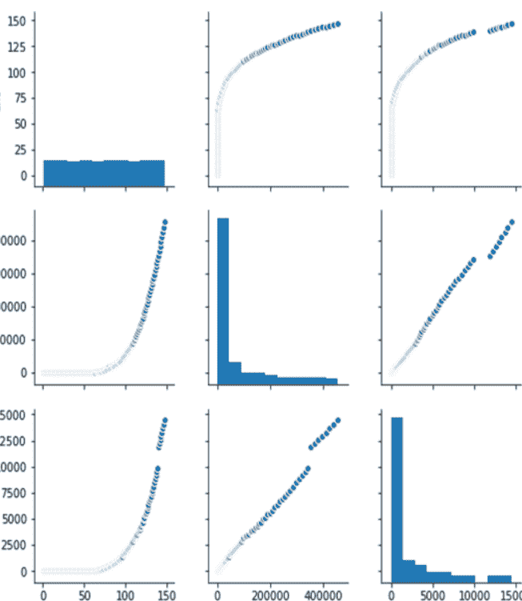

图 6.6. 各变量之间 COVID-19 所选属性分布的表示。

在图 6.6 中，我们表示了各变量之间 COVID-19 所选属性的分布。X 轴和 Y 轴表示属性名称。为了了解它们包含哪些数据，请在配对图表柱状图中检查左侧和底部的轴名称。

### 6.5 结果

现在我们已使用蓝色点和三种不同颜色（红色、黄色和黑色）定义的三种模型预测并绘制了 COVID-19 病例序列。红色表示总 COVID-19 感染病例的线性函数，黑色表示总 COVID-19 感染病例的对数函数，黄色表示总 COVID-19 感染病例的多项式函数（三阶）。这些模型表示每个日期或每个州的增长时间中 COVID-19 感染病例的持续增加，如果增长停止

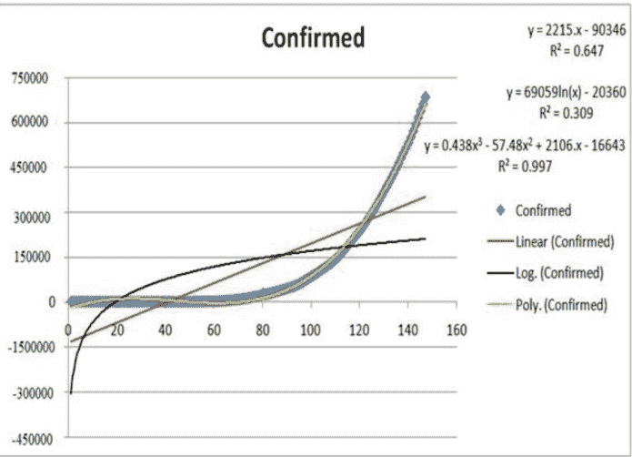

图 6.7. 线性、对数和多项式回归模型的表示，用于最佳拟合 COVID-19 感染随时间变化的增长曲线。

曲线将变得平坦。从图 6.7 中，我们发现多项式回归模型在它们中更合适。

在本研究中，我们使用回归模型来估计 COVID-19 的确诊病例。我们使用了线性、对数和多项式回归模型来最佳拟合曲线。这些回归模型为 COVID-19 数据集的不同参数生成方程，并根据天数计算确诊 COVID-19 病例。所提功能模型计算如下：

```
y = 2215 × x – 90346   R² = 0.647   (6.7)
y = 69059 ln(x) – 20360   R² = 0.309   (6.8)
y = 0.438x³ – 57.48x² + 2106 × x – 16643   R² = 0.997   (6.9)
```

方程 6.7–6.9 表示用于最佳拟合曲线的线性、对数和多项式回归模型。方程 (6.7) 表示线性回归模型，具有高参数值和低 R2 值 (R2 < 1)，方程 (6.8) 表示对数回归模型非常差，因为它与最佳拟合线/曲线有重大偏差。在方程 (6.9) 中，我们发现与方程 (6.7) 和 (6.8) 相比，三阶多项式回归模型测得了更好的结果；三阶多项式回归模型表示接近 1 的高 R2 值。

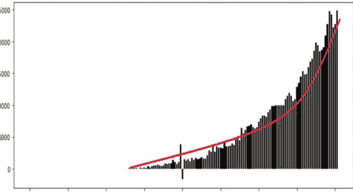

图 6.8. 实际数据的表示，由（黑色）柱状图和高斯函数（红色线）绘制。

现在我们切换新病例以进行随机参数可视化并最小化拟合误差。实际数据由黑色柱状图绘制，高斯函数由红色线绘制。根据结果，如图 6.8 所示，我们发现新 COVID-19 感染病例随时间持续增加。

### 6.6 讨论

现在我们已将逻辑回归模型用作线性、对数和多项式回归模型的组合模型，作为 COVID-19 每日新增病例的最终预测模型。在本实验中，提出了逻辑回归模型用于未来分析。我们对同一数据集使用了两种不同的模型，一种用于增加时间（天数）的主要差异，例如：0–50、50–100、100–150、150–200 等，发现超过 700 000 例感染 COVID-19 病例花费了 160 天，之后功能模型预测 COVID-19 感染从 700 000 到 1 500 000 持续增加，增加时间从 162 天到 300 天。这表明 COVID-19 患者数量将在 1 个月内翻倍（图 6.9）。

在另一种模型中，我们针对天数的微小差异进行了预测，例如：0–25、25–50、50–75 等，发现近 700 000 例感染 COVID-19 病例花费了 150 到 200 天，之后功能模型预测 COVID-19 感染从 700 000 到 1 500 000 持续增加，增加时间从 160 天到 225 天（图 6.10）。

### 6.7 结论

在本章中，COVID-19 数据集包含从 2020 年 1 月 30 日到 2020 年 7 月 9 日的 3244 个实例及 3 个属性，并估计了印度各州的确诊 COVID-19 阳性病例和患者死亡人数。我们得出结论，实际数据由黑色

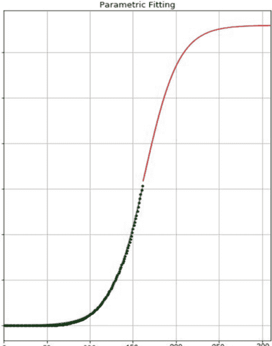

图 6.9. 当前和未来 COVID-19 感染增长的模型（绿色）和预测（红色）的表示。

柱状图和高斯函数由红色线绘制。根据结果，我们发现新 COVID-19 感染病例随时间持续增加。所有测量均由线性、对数和多项式模型完成。我们发现三阶多项式回归模型相比线性和对数回归模型表现更好。因此，多项式回归模型测得了印度未来 COVID-19 感染状态的预测。根据上述预测，我们发现多项式函数模型在它们中更合适，因为与其他功能模型相比，它提供了更合适的曲线拟合。我们发现 COVID-19 感染将在未来 300 天内持续增加，然后将保持受控状态，近 1 600 000 名患者将因 COVID-19 感染而患病。根据该模型，印度在 300 天后增量率将下降。我们为长期间隔和短期间隔预测准备的功能模型将有助于印度医生和政府制定决策。对于未来工作，我们将使用各种回归技术并测量不同相关预测器的变化。

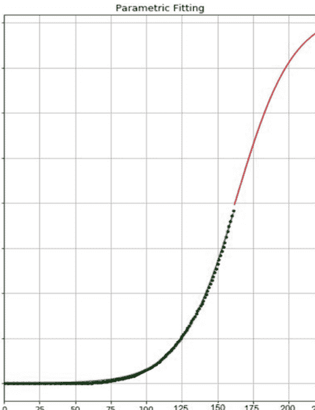

图 6.10. 当前和未来 COVID-19 感染增长的模型（绿色）和预测（红色）的表示。

### 致谢

作者谨感谢 Veer Bahadur Singh Purvanchal University, Jaunpur, Uttar Pradesh 为博士后研究奖学金工作提供财务支持。

### 参考文献

- [1] Cui J, Li F and Shi Z L 2019 致命性冠状病毒的起源与演化 *Nat. Rev. Microbiol.* **17** 181–92
- [2] Regan, Helen, Mitra, Esha, Gupta and Swati 2020 *CNN*
- [3] Withnall and Adam 2020
- [4] Hindustan Times 2020 Retrieved 2020 May 30
- [5] Sharma and Sanchita 2020 Hindustan Times. Retrieved April 3
- [6] Reid and David 2020 CNBC
- [7] Patra S 2020 COVID-19: 新型冠状病毒对全球经济的影响，特别参考印度 *Horizon.* **2** 173–84
- [8] Das S 2020 印度 COVID-19 疾病进展分析：在全国封锁的影响下. arXiv preprint arXiv:2004.03147
- [9] Krishnan S, Deo S and Manukar S 2020 封锁 50 天：衡量印度遏制 COVID-19 的成功 ORF Special Report pp 1–12
- [10] Chanana N 2020 冠状病毒大流行 (2019–2020)：印度政府采取的预防措施 Purakala UGC Care J. 31 175–80
- [11] Aggarwal V 2020 制作冠状病毒封锁的有效方法：富有成效和积极 Purakala UGC Care Journal 31 1798–807
- [12] Sauerbrei W, Meier-Hirmer C, Benner A and Royston P 2006 使用分数多项式构建多变量回归模型：SAS、STATA 和 R 程序的描述 Comput. Stat. Data Anal. 50 3464–85
- [13] Kopsaftopoulos F P and Fassois S D 2013 基于功能模型的统计时间序列方法用于基于振动的损伤检测、定位和幅度估计 Mech. Syst. Sig. Process. 39 143–61
- [14] Miles J 2014 R 平方，调整后的 R 平方. Wiley Stats Ref: 统计参考在线 https://doi.org/10.1002/9781118445112.stat06627
- [15] Carrillo-Larco R M and Castillo-Cara M 2020 使用国家层面变量根据确诊 COVID-19 病例数量对国家进行分类：一种无监督机器学习方法 Wellcome Open Res. 5 56
- [16] Ayyoubzadeh SM, Ayyoubzadeh SM, Zahedi H, Ahmadi M and Kalhori S 2020 通过分析伊朗 Google trends 数据预测 COVID-19 发病率：数据挖掘和深度学习先导研究 JMIR Public Health Surveillance 6 e18828
- [17] Tuli S, Tuli R and Gill S S 2020 使用机器学习和云计算预测 COVID-19 大流行的增长和趋势 Internet Things 11 100222
- [18] Yadav R S 2020 使用机器学习方法分析 COVID-2019 疫情数据：印度的一个案例研究 Int. J. Inf. Technol. 12 1321–30
- [19] Ardabili S F, Mosavi A, Ghamisi P, Ferdinand F, Varkonyi-Koczy A R, Reuter U, Rabczuk T and Atkinson P M 2020 COVID-19 爆发的机器学习分析. Available at SSRN 3580188
- [20] Pandey G, Chaudhary P, Gupta R and Pal S 2020 基于回归模型的 SEIR 印度 COVID-19 爆发预测. arXiv preprint arXiv:2004.00958
- [21] Hyunjung G, Kwak, Ling L and Hui P 2020 使用深度强化学习对 COVID-19 大流行中的全球公共卫生策略进行建模 pp 1–14
- [22] Rustam F, Reshi A A, Mehmood A, Ullah S, On B, Aslam W and Choi G S 2020 使用监督机器学习模型对 COVID-19 未来进行预测 IEEE Access 8 101489–99
- [23] Wang Y, Hu M, Li Q, Zhang X P, Zhai G and Yao N 2020 异常呼吸模式分类器可能有助于以准确且不引人注意的方式大规模筛查感染 COVID-19 的人群. arXiv preprint arXiv:2002.05534
- [24] Wang C, Horby P W, Hayden F G and Gao G F 2020 一种引起全球健康关注的新型冠状病毒爆发 Lancet 395 470–3
- [25] Phan L T, Nguyen T V, Luong Q C, Nguyen T V, Nguyen H T and Le H Q et al 2020 越境输入与人传人：越南新型冠状病毒的传播 N. Engl. J. Med. 382 872–4
- [26] Parry J 2020 中国冠状病毒：随着官员承认人传人，病例激增 Br. Med. J. 368 m236


- [27] Li Q, Guan X, Wu P, Wang X, Zhou L 和 Tong Y 2020 武汉、中国新型冠状病毒感染性肺炎早期传播动态 *新英格兰医学杂志* **382** 1199–207
- [28] Kan B, Wang M, Jing H, Xu H, Jiang X 和 Yan M 2005 动物市场和养果子狸中的严重急性呼吸综合征冠状病毒样病毒的分子进化分析和地理调查 *病毒学杂志* **79** 11892–900
- [29] Goodfellow I, Bengio Y 和 Courville A 2016 机器学习基础 *深度学习* **1** 98–164
- [30] Guan W J *等* 2020 中国2019年冠状病毒病临床特征 *新英格兰医学杂志* **382** 1708–20
- [31] Ai T, Yang Z, Hou H, Zhan C, Chen C, Lv W, Tao Q, Sun Z 和 Xia L 2020 中国2019年冠状病毒病（COVID-19）中胸部CT与RT-PCR检测的相关性：1014例病例报告 *放射学* **296** E32–40
- [32] Shi Z 和 Hu Z 2008 SARS冠状病毒动物宿主研究综述 *病毒研究* **133** 74–87
- [33] Huang C *等* 2020 中国武汉2019年新型冠状病毒感染患者的临床特征 *柳叶刀* **395** 497–506
- [34] Liu W *等* 2020 住院2019年新型冠状病毒病患者疾病结局相关因素分析 *中国医学杂志（英文版）* **133** 1032–8
- [35] Lu R, Zhao X, Li J, Niu P, Yang B 和 Wu H 2020 2019年新型冠状病毒基因组特征和流行病学：对病毒起源和受体结合的意义 *柳叶刀* **395** 565–74
- [36] Wang D *等* 2020 中国武汉138例住院2019年新型冠状病毒感染性肺炎患者的临床特征 *美国医学会杂志* **323** 1061–9
- [37] Yadav D C 和 Pal S 2019 使用集成数据挖掘技术的甲状腺预测 *国际信息技术杂志* https://doi.org/10.1007/s41870-019-00395-7
- [38] Yadav D C 和 Pal S 2020 使用特征选择和随机森林集成方法的心脏病预测 *国际药学研究杂志* **12** 56–66
- [39] Chaurasia V 和 Pal S 2020 COVID-19大流行：基于ARIMA和回归模型的全球死亡病例预测。可在SSRN 3663935上获取
- [40] NDMA表示，冠状病毒封锁延长至5月31日。2020年5月17日检索
- [41] Verma A K, Pal S 和 Kumar S 使用机器学习技术预测不同类别的皮肤病 *智能通信与计算科学创新* (新加坡: Springer) pp 91–100
- [42] Chaurasia V 和 Pal S 2020 COVID-19大流行：基于ARIMA和回归模型的全球死亡病例预测 *SN计算机科学* **1** 1–2
- [43] Yadav D C 和 Pal S 2021 使用带特征选择技术的并行和串行集成方法分析心脏病：心脏病预测 *国际大数据分析医疗杂志 (IJBDAH)* **6** 40–56
- [44] Yadav D C 和 Pal S 2020 使用基于树的集成模型分析心脏病患者 *医疗保健中主动生物电信号的建模与分析，第2卷* V Bajaj 和 G R Sinha 编 (布里斯托尔: IOP Publishing Ltd) pp 10-1–10-23

## 面向智能医疗系统的高性能计算
Varun Bajaj 和 Irshad Ahmad Ansari

## 第7章

## 诊断中先进患者反馈程序的模型

Marjo Rissanen, Antti Rissanen 和 Kalle Saastamoinen

在医疗保健中，患者体验以多种方式进行监测。然而，诊断准确性是医疗保健客户普遍关注的问题。本章提出了一种改进诊断中患者反馈的模型。所提模型对组织有益，因为它提供了关于患者意见的更精确信息。此外，它帮助医疗消费者快速且轻松地就其护理中感知到的诊断阶段制定和表达意见。这种方法将客户的自由文本反馈与诊断中医师能力和同情心领域的结构化回答相结合。生物医学信息处理方面的突破，如先进的数据、文本挖掘技术和机器学习算法，是在控制信息过载和文本聚类问题方面取得成功的前沿。这些辅助工具对分类自由文本反馈和二进制答案，以及分析和可视化都有好处。所提模型代表智能医疗管理和此类计算智能，可以惠及患者、医生和医疗组织。该模型的优势在于其对患者以及质量审计员和数据管理站点的经济性。

### 7.1 引言

诊断错误会导致更高的医疗成本、不必要的死亡和精神痛苦 [1–3]。诊断错误容易导致就诊次数增加、住院时间延长或不当治疗 [1, 4]。从患者反馈中获得的评估信息在回应患者关切和对诊断实践进行必要改变方面发挥着基本作用。为了改善与诊断相关的患者安全，专注于诊断评估的反馈系统应清晰高效。因此，最好将与诊断相关的患者反馈与其他一般患者反馈区分开来，建立单独的反馈系统，以快速取得进展。然而，在诊断实践方面，为患者提供具体反馈可能具有挑战性。如果诊断过程的阶段和内容以简单、易读的格式呈现，客户在反馈程序中处理诊断阶段的一些领域会更容易。因此，在以诊断为中心的面向消费者的反馈系统中，除开放文本格式外，一定程度的结构化阶段是可推荐的。如今，叙事反馈阶段的处理也更加顺畅。改进的人工智能（AI）算法和智能大数据分析为进一步分析开放格式材料的精细化提供了更高效的工具。

### 7.2 关注诊断

#### 7.2.1 诊断错误作为一个概念

诊断错误定义为“未能建立对患者健康问题的准确和及时的解释，或将该解释传达给患者” [2]。错误源于“未采取行动或采取了错误的行动” [3]。主动错误由人、临床医生之间以及涉及的对象造成 [2, 5]。潜在错误源于系统或流程设计中的问题，容易被忽视。系统相关错误可能与沟通、护理协调、低效流程或技术故障有关 [2, 5]。在日常实践中，诊断错误往往未被识别和报告不足 [6, 7]。医务人员对报告错误的冷漠可能源于对惩罚或制裁的恐惧 [5, 8]。个人和系统因素是诊断错误报告不足的一些最常见原因 [7]。

#### 7.2.2 医疗保健中的诊断错误

医疗错误是医疗保健中的一个关键问题。根据统计数据，医疗错误被认为是美国死亡的主要原因 [5]。这些错误包括例如手术、诊断、用药、设备、器械、系统故障以及其他医疗保健技术问题。较高的错误率通常发生在压力大的环境中，如急诊科、重症监护室和手术室，但初级保健中也可见较高的错误率 [9, 10]。医疗错误通常与极端年龄、高急性度和新手术有关 [5, 9, 11]。沟通错误是医疗错误的常见来源 [5]。女性患者的护理质量较低，女性报告的伤害多于男性患者 [9, 12]。开药时，3–10%的所有咨询中都会发生与用药相关的错误 [9, 13]。导致用药错误的常见因素包括沟通、护理交接和护理连续性 [9]。

诊断错误占医疗错误的高达70% [14]。血管疾病、感染和癌症约占诊断错误的75% [15]。在一项斯堪的纳维亚回顾性队列研究 [16] 中，在总共4830例可预防伤害样本中，46%是由于诊断错误。癌症占初级保健中所有诊断错误的37%。最常被漏诊的病例是结直肠、皮肤、肾脏和膀胱、前列腺、肺和乳腺癌。心脏病，


骨折、感染、肺炎、结核病、1型糖尿病和肺栓塞是其他疾病类别中最常被漏诊的疾病。在瑞典，报告有伤害的最常被漏诊的疾病是初级保健中的癌症和急诊科的骨折 [16]。

#### 7.2.3 诊断失败的常见原因

床边检查能力的技能差距、临床推理能力差以及信息综合问题是导致诊断错误的重要因素 [17–19]。在此背景下，知识和技能差距一直被低估，而认知偏差则被过度强调 [17, 20]。在初级保健中，诊断错误的常见原因包括未能安排适当的检查、解释错误、随访问题、转诊患者失败、护理交接以及咨询技术不足 [2, 9]。

临床内容知识教育、对病史的意识以及正确的体格检查技能是可降低诊断错误的因素示例 [7]。在急诊科环境中，适当的诊断与急症识别、信息综合以及与患者的直接沟通相关 [21]。更先进的成像技术提高了医生检测、诊断和治疗疾病的能力，同时使患者能够避免侵入性操作 [22]。然而，诊断放射学错误，尤其是观察时间缩短，是导致不良结局的明确因素 [23–25]。病理学是癌症诊断的关键步骤，更好地整合质量和安全原则被认为对于该领域的错误预防是必要的。病理学中的诊断错误预防需要，例如，协作团队合作、关于诊断过程的加强培训，以及关注健康信息技术和其他战略变革的安全文化 [26]。众所周知，适当的检查强度在医疗保健中至关重要。然而，该领域的许多挑战可以通过改进诊断过程来解决，从而预防不良的临床结局 [27, 28]。

#### 7.2.4 与患者合作预防诊断错误

在预防诊断错误方面，患者参与以及患者与医生之间相互沟通的重要性得到广泛强调。改进患者对临床笔记的访问，并提供共同生成和反馈的可能性，代表了一种错误恢复和共同决策的形式 [2, 29]。绝大多数访问其患者记录的患者报告了积极的体验 [29]。然而，这只是迈向更好以患者为中心的护理的一步。在一项斯堪的纳维亚研究 [9] 的预防政策中，患者强调了全国在线病历、定期全面体检以及随访流程清晰度的价值。在检查结果正常但症状持续的情况下，医生和其他医疗专业人员的联系信息可用性被视为重要 [9]。在不确定的情况下，医疗专业人员可以提出工作诊断 [2]。当诊断仍然不明确时，随访护理往往不足。

### 7.3 医疗保健中的诊断与安全挑战

#### 7.3.1 患者安全与公平挑战

患者安全是一项多学科目标和医疗保健的首要任务。除了技术创新，医院文化还应强调临床实践中积极的变革型领导力 [30]。医疗保健组织应推广安全意识文化并从诊断错误中学习 [2]。鼓励关于错误的透明度可以使医疗保健更安全，并培养一种文化，在这种文化中，医疗专业人员在识别和从错误中学习方面得到支持 [2, 31]。

在许多国家，患者安全状况不佳，尤其是老年患者人群中，部分原因是医疗系统不足且组织混乱 [32]。在西方社会，那些很好地照顾自身健康的患者可能在80岁之前保持相对健康。在这个年龄，往往会出现特定的健康问题，在这种情况下，特别需要高质量的护理和更高的治疗强度。尽管如此，老年患者人群（80岁及以上）的医疗强度较低 [33]。老年在医疗保健中容易被视为所谓的“脆弱期”。然而，老年人构成高度异质的群体，其健康和功能可能比消极刻板印象所暗示的要好 [34]。这个年龄代表人生中的一个特定阶段，在许多情况下，可能首次需要重症监护。老年患者人群的诊断过程可能因其多重问题性质而具有挑战性 [35]。疼痛的高患病率可能被视为老年期的正常现象 [36, 37]。这种复杂性很容易导致只治疗症状而不治疗症状的原因。

此外，危重老年患者在重症监护中表现出良好的临床结局。因此，在决定重症监护时，应考虑基础疾病而非年龄本身 [38]。然而，对手术风险的不准确估计会阻止老年人接受有时甚至是标准手术，因为他们被认为不适合接受高强度治疗 [39]。几乎一半所有入住ICU的原发性中枢神经系统淋巴瘤（PCNSL）危重患者在ICU出院后六个月仍然存活 [40]。仅凭虚弱评分量表或简单标准化工具不能作为预测不良结局（例如在急诊护理中）的可接受预后资产 [41–43]。需要质量审计和透明度，尤其是在老年护理中。

转化医学的关键思想之一是以符合伦理可接受的方式改善患者的健康。共同决策在医疗保健的转化设计中占据坚实地位；倾听客户的声音是迈向更好平等的一步。这种决策意味着患者与提供者之间密集的协作过程 [2]。共同决策是关于赋予患者的价值观和意见以重要性，尤其是当涉及老年患者时。因此，适合所有年龄段的调校反馈系统是重要而关键的发展领域。COVID-19危机是促进老年人使用现代信息和通信技术的一个领域 [34]。不同年龄群体之间决策过程中的平等是指组织中伦理价值观的状态。

#### 7.3.2 合理成本控制政策下的增强患者安全

医疗保健中的成本节约压力可能对医生的临床工作构成挑战。在患者护理中，例如在诊断领域，不足的节约目标可能会扰乱临床实践并非常昂贵。节省资金的常见方法是随意削减实验室预算 [28]。诊断管理团队代表了一种先进的模式，用于更深入且更有意义的成本效益流程。在这种模式中，具有专业知识的专业人员就检查选择和解释向临床实践中的同事提供建议 [28, 44]。

AI为人力资源的最优利用和物流流程规划提供了更精熟的方法 [45]。这些方法为寻找严格的成本节约机会提供了新选择，因为人力资源在医院中构成最重要的成本因素 [46]。因此，人员成本不必仅被视为固定成本。这种优化建模也将主要由负责这些规划任务的资源来处理，这是进步的一步。

先进的AI工具和方法在健全的成本管理政策中发挥作用，因此，在使医生能够更好地专注于其临床工作方面，也有助于安全提升。此外，像AI辅助决策支持系统这样的智能诊断系统可以提高诊断准确性，帮助疾病管理，从而帮助医生减少常规临床任务，首先和最重要地专注于患者护理 [47, 48]。这些系统也不会增加医生会诊的时长或所订检查的数量 [1]。AI驱动的数字笔记等数字抄写员使医生能够减少临床医生在文档化过程中投入的时间，从而充分与患者互动 [49]。

### 7.4 诊断阶段患者反馈的重要性

#### 7.4.1 及时反馈的必要性

医生获得关于其诊断技能和能力的患者反馈至关重要。过度自信比自信不足更普遍，尤其是在能力水平较低时 [50]。此外，丰富的经验不一定意味着更高的诊断准确性 [17, 51]。只有少数医疗保健组织真正专注于识别诊断错误 [2, 52]。医疗专业人员通常没有机会听到健康消费者对其诊断表现的反馈 [2, 53, 54]。时间限制可能阻止在诊断过程中与客户进行真正的互动 [2, 55]。临床医生需要准备好与客户沟通诊断错误的发生情况，但也可能觉得关于其诊断表现的反馈令人不适 [2, 56]。然而，在反馈培训计划中，临床医生发现这些练习具有建设性和帮助 [56]。组织范围内的改进客户投诉协调也可能帮助个别医生在自我评估过程中发展，通过增强其诊断校准属性 [57, 58]。诊断校准涉及自我认知和对自身知识局限性的理解 [58]。


#### 7.4.2 及时反馈的作用

患者反馈系统的目的是提供高质量的健康信息。此类信息可以作为推动组织和患者结局改善的推动者 [59]。患者对就医经历的意见为医疗专业人员提供了有益信息，并对诊断错误的原因提供了全面认识，具有关键且独特的见解 [6, 60]。医疗保健提供者应确保有关诊断绩效的系统性反馈扩展到参与护理和组织管理的医生和护理团队 [61, 62]。定期反馈对于改善诊断绩效和医疗质量改进是必要的，但往往缺失 [17, 53, 63, 64]。然而，此类反馈作为评估政策的常规组成部分可能很有价值 [2]。

以诊断为中心的反馈系统应提供临床实践关键领域的循证信息 [2]。此类反馈受到专业人员和医疗消费者的欢迎 [2]。医疗客户在诊断阶段扮演更突出的角色，意味着患者处于“中心”。此类政策体现了“再人性化医学” [62]。来自诊断的高质量反馈可以意味着通过消除可预防的不良事件和改善诊断过程，改善组织和患者结局，从而使患者和医生都受益 [2, 53, 59, 60, 65]。

因此，患者参与应在临床实践中的专业发展中占据稳定地位。然而，这预设了存在能够促进以患者为中心的护理和持续学习的文化态度和价值观 [57, 58]。即使在没有正确员工参与的情况下，对服务进行彻底重构和引入新技术也无法准确改变政策 [30]。反馈应成为专注于改善诊断绩效的学习系统的一部分 [56]。这有助于针对性地提供个体咨询协助，并有助于识别可能需要教育支持或再培训的医生 [66]。

患者参与是支持人们从医疗系统中获益更多的问题 [2]。然而，对于患者及其家属来说，这种参与可能具有挑战性 [2, 67]。与疾病相关的压力和较低的身体健康状况可能阻止人们真正参与诊断过程 [2]。有些患者希望积极参与决策过程的所有方面，而另一些患者则更倾向于依赖医生的评估 [2]。反馈系统也应为那些已经经历过诊断错误的医疗消费者留出空间。此类人通常愿意分享他们的经验，以启发未来患者的诊断过程 [2, 68, 69]。

### 7.5 以诊断为中心的客户反馈面临的挑战

关于诊断过程成功的客户有效反馈系统可以控制护理质量并提高患者安全。面向消费者的反馈系统通常非常全面，关注整个医疗过程。特别需要关注患者对诊断成功的看法以及患者在此背景下协作体验的反馈系统 [46]。关注诊断实际领域的反馈系统应与相关的治疗或护理过程紧密关联。这样一来，负责医生就能了解患者对诊断正确性的看法，并获取用于评估目的的额外信息。

有可能按患者为单位评估诊断领域的调查强度。在诊断过程中进行的检查、检验以及其他研究和咨询的数量反映了诊断阶段的强度程度。如果客户认为其自身病例的调查强度程度过低，无法进行适当诊断，他们必须有一个渠道来表达担忧。当前的问题是，关于诊断有效性的反馈无法足够快地传达给负责医生。另一方面，患者对医疗表现的反馈应足够具体，以便采取纠正措施 [70]。

诊断反馈应得到适当的规范，以便患者易于提交反馈，且对临床医生有益。因此，精心构建但经济（快速填写）的格式可能会改善这一过程。如果患者反馈接近实时提供，自由文本评论对服务改进很有用 [63, 71]。得益于 AI 算法，自由文本格式的使用也更高效。因此，诊断阶段的叙述性反馈也作为更广泛评估的基础有其地位。

### 7.6 系统开发中增强技术接受度

医疗保健组织应促进开放和透明的环境，让患者能够轻松参与诊断过程并分享反馈和担忧 [2]。同时，反馈系统应足够详细、用户友好、清晰且易于理解。此外，在调查长度、抽样频率低和反馈缓慢等方面也存在问题。为了有用，患者反馈结果应及时、易懂，并且所有利益相关者都能轻松解读。清晰性、易用性、适合频繁使用以及多种功能（例如，使用纸质、触摸屏、智能手机、平板电脑和带有自动交互式语音应答的电话进行反馈）是有益反馈系统的基本特征 [63, 72]。

在技术接受模型（TAM）中，技术接受的主要决定因素是感知到的有用性和感知到的易用性 [73]。Yan 等人 [74] 的模型描述了与人机信任交互相关的方面。“沟通信任”是使用的一项激励。它涵盖“感知隐私”、“感知身份”和“沟通环境”等领域。客户必须能够信任与客户隐私相关的安全问题已得到保障，例如，在反馈系统选项中 [74]。如果客户对其信息安全不确定，甚至不会使用有益的医疗服务 [75]。计算机系统信任与可信度的方面（如“系统和信息质量”）以及灵活使用的方面相关 [74]。

动机是激励人们在目标导向的活动中行动并保持运动的行为 [76, 77]。Pintrich [78] 区分了与价值、目标、能力和控制相关的激励性信念。只有当患者信任其输入的有效性以及它能在其自身情况中带来的改变（目标-、控制相关信念）时，他们才有动力提供反馈。应用程序应代表患者可接受的价值观。虽然有些患者希望将诊断责任留给医生，但许多患者欣赏有机会参与评估自己的护理，尤其是在诊断情况下（能力相关信念）。

### 7.7 诊断阶段及对医生的要求

#### 7.7.1 胜任力和同情心的要求

患者期望医生拥有足够的专业知识，以提供正确的诊断和适当的护理。医生的医学“胜任力”被假定包括技术能力和提供所需信息的意愿。消费者在做出医疗决策时也期望“同情心”、同理心和道德支持 [79]。有效沟通、信任和鼓励性的环境是成熟咨询技能的方面 [60]。在外科和重症监护中，通常更偏好医生的胜任力（如技术技能），而在临终病例中，则强调同情心。在慢性护理中，对医生胜任力和同情心的偏好各异。在儿科病例中，偏好医生的胜任力，但也重视同理心的重要性 [79]。

#### 7.7.2 医生视角下的诊断过程

在自我评估行动中，许多医生使用各种通常针对个人调整的过程模型。这些检查表在改善诊断过程中发挥作用 [2, 80]。最好的过程模型描述了诊断过程的不同阶段。借助分类模型，更容易检测诊断过程中出了什么问题。可以从诊断过程的几个角度评估分类失败；从就诊和病史采集到转诊和随访的最终阶段。在每个步骤中，嵌入的子类别明确了评估项目。例如，在下达检验嘱托时，错误可能包括检验嘱托或排序的延迟 [61]。

Schiff 等人 [81] 将诊断过程分为七个阶段：
- 就诊与表现
- 病史采集
- 体格检查
- 检验
- 评估
- 转诊
- 随访。

患者的病史记录包括当前健康问题的文档、病史（病史、家族史、社会史）以及药物等其他所需信息 [2, 82]。体格检查技能在诊断中起着重要作用，但这些技能在专业教育中往往被低估了 [2, 83]。诊断检验包括实验室、内科、病理解剖学和医学影像等领域 [2]。

#### 7.7.3 患者视角下的诊断过程

原则上，患者可以从自身角度利用诊断过程的传统步骤来评估其成功性。这些步骤对医疗专业人员来说是不言而喻且显而易见的。部分地，这些传统类别可以


转化为为患者反馈服务，通过精简反馈以适应客户视角。也有必要关注那些与客户反馈特别相关的方面。患者通常对其病例中出现的问题有一些了解。患者未必总能像专业人士那样准确评估诊断步骤。尽管如此，他们通常对咨询过程中受到较少关注或被遗漏的方面有想法。医疗消费者的担忧通常也集中在管理不善和执行不力的护理上，例如长时间等待、获取医疗的问题，以及除了正式咨询之外与医生的其他互动可能性丧失 [84]。因此，与快速和灵活诊断相关的护理管理问题也值得患者反馈。

### 7.8 即时患者反馈模型

#### 7.8.1 一般原则

当患者评估专业水平、医生的诊断能力时，客户使用现成格式来评估这一领域是最容易管理的。在处理同理心属性（例如，正确倾听患者）时，开放式和结构化反馈格式都可能效果良好。患者的经验和观点以指定方式呈现至关重要；负责诊断过程的医生可以了解客户有公开问题或意见的领域。如果鼓励患者作为标准实践的一部分就诊断过程的正确性提供反馈，那么就诊断过程提供反馈会更加舒适。因此，患者感到自己不仅是在对护理过程的特定方面提供反馈，也是评估其护理质量的充分参与者。通过详细但相当简单的问卷，患者可以对其所接受的诊断给出总结性反馈。患者准确识别他们认为在诊断过程中存在不足的方面至关重要。所提议的模型使医生对患者经验的了解，比在有限的咨询会话中通常可能的要好。这些信息有助于医生改进其工作方法和自我评估。

#### 7.8.2 模型结构

所提议的模型包含三个阶段（参见表 7.1）。第 1 阶段包括八个结构化的独立部分，侧重于医生的能力。该阶段

表 7.1. 分三阶段的模型。

| 阶段 | 阶段内容 | 阶段/结构含义 |
|:---|:---|:---|
| I 固定格式 | 医生能力 | 八项基本或高级反馈 |
| II 开放格式 | 医生同情心（额外沟通） | 自由个人反馈文本（其他信息，例如图片） |
| III 用户体验 | 反馈系统的实用性 | 应用程序的开发需求 |

提供两个选项：即时反馈项目（八个患者反馈领域——图 7.1）以及每个项目都有多个选项的高级部分（图 7.2）。

渴望更全面地报告其经验的患者可以在提交第一个快速响应部分后继续进入高级部分（参见图 7.2）。第 2 阶段包含叙事文本的自由空间（开放评论）。与医生同情心相关的特定方面（例如，同理心等）、其他问题、意见以及附加材料可以在此项目中提交。第 3 阶段为患者提供了展示其对模型有用性和设计观点的机会（表 7.1，第 3 阶段）。第 3 阶段对于质量改进和成熟目的是必需的，因此对任何类型的反馈系统都有用（图 7.3）。

#### 7.8.3 使用模型进行患者管理

主菜单包括必要的诊断相关部分（参见图 7.1）。患者可以勾选他认为在确保正确诊断方面存在不足的选项（将项目标记为“不满意”）。未打算标记的领域被认为从患者的角度来看已按预期进行。在完成八个评估领域（仅标记患者认为存在问题的部分）后，患者可以提交反馈。通常认为，需要评论的领域（不满意领域）比可接受的领域少。骨折是存在许多误诊的病例示例。例如，患者可能认为会诊过程很顺利，但希望拍X光片以确认诊断。在这种情况下，该人将此细分标记为不满意。如果患者还认为临床检查不够深入，他或她将此区域标记为“不满意的临床检查”。因此，答案需要两个条目。

与所有问卷一样，有些患者愿意花更多时间提供反馈。在这种情况下，为答案提供两个详细级别是有帮助的。输入可以以更详细的方式呈现（即，“高级级别”）（参见图 7.2）。每个反馈点可以在高级状态下打开，从而可以对响应提供更具体的描述。例如，在“实验室和影像学”部分，患者可以具体指明哪些方面受到的关注较少（实验室检查或某些影像类型）。

#### 诊断阶段患者即时反馈

- 诊断项目标记不满意的情况
- 项目可能继续进入子列表（高级级别）
- 如果使用平板电脑，空间分配可能不同


图 7.1. 快速反馈的应用程序主菜单。


图 7.2. 应用程序结构。八个即时反馈主要领域需要客户反应并标记不满意区域。右侧是一个更高级的级别，允许更详细的反馈。

同样，沟通部分允许患者在需要时识别不满意区域。假设患者感到没有收到关于问题的适当或充分原因，或者没有明确诊断。在这种情况下，他们可以将“诊断决定”部分标记为“不满意”，如果他们愿意，可以进入高级级别，并对问题“您是否得到了明确诊断？”选择“否”。

对模型中八个最重要部分的一般回顾提供了关于诊断过程质量和患者视角的信息丰富的知识。此外，还可以了解特定医生的反馈情况。有些患者希望提供个人反馈并分享他们的经验，可能以更详细的方式。因此，开放文本反馈是任何作为标准工具使用的反馈格式的有益部分。

#### 第 II 阶段

- 在提供的空间中提供您可能有的任何其他评论或反馈。
- 带有所需细节或开放问题的更个性化反馈

#### 第 III 阶段

- 反馈传递情况如何？
  - 足够快
  - 足够易懂
  - 足够容易
  - 足够安全

图 7.3. 第 II 阶段和第 III 阶段旨在提供更详细的信息。

#### 7.8.4 模型固定格式阶段的含义——第 1 阶段

诊断是护理过程中一个要求较高的领域。对于患者来说，从这部分提供反馈并不总是简单明了。因此，结构化格式在此领域很有用。当今患者正在积极搜索有关自己健康状况的信息，尤其是与自己可能的诊断相关的问题。得益于患者自我诊断应用程序或其他获得的知识，患者在到达医生咨询时可能已经对可能的诊断有了想法。因此，在咨询期间，讨论医疗客户对诊断决定的自身观点已经成为可能，这一点很重要。尤其是患者出现症状且感觉不健康，但所进行的检查结果未显示出与正常值偏离的情况，这尤其具有挑战性。此外，多问题群体（如老年人）在诊断方面可能是一个具有挑战性的群体。尤其是在这样的情况下，患者有机会发表自己的观点


通过正式反馈渠道。在这种情况下，患者可能认为对问题的更深入调查能带来更清晰的认识，而客户可能对其案例中调查力度过低表示怀疑。借助结构化模型，医护人员能清晰了解客户的观点以及诊断中护理强度可能过低的领域线索，从而重新评估诊断流程或告知客户。

#### 7.8.5 自由格式阶段的意义与管理——阶段 2

AI 为处理自由文本提供了更高效的可能性。自由文本反馈在复杂病例中尤其有用，例如患者感觉自身诊断过程拖延较长。这可能是由于不同站点之间协作不畅所致。协作不畅会导致可能威胁患者安全并增加医疗成本的情况 [85, 86]。随着语音识别和处理系统的发展，患者也可以通过手机以尽可能灵活的方式，借助机器人交互式地提供非结构化反馈，这很有意义。

非结构化数据组织和分析起来具有挑战性。此类数据通常以文本形式存在，例如开放式文本回答。在医院中，自由文本数据的量可能非常大。分析手写回答或大量文本数据既耗时又昂贵，且容易出现人为错误 [87, 88]。大数据被定义为“数据量极大且类型繁多，使得使用传统数据库管理系统难以处理的数据集合” [88]。这就是为什么基于 AI 的文本分析以及自动化知识表示和推理能力非常有帮助 [87]。

客户反馈可能以 PDF 文档、照片或其他图像、扫描文档、印刷文档或手写文档的形式存在。光学字符识别（OCR）是在这些情况下将文本转换为数字格式的最佳工具（图 7.4）。大多数 OCR 工具提供 98% 到 99% 的准确率 [89]。这种准确率在大多数情况下是足够的；但是，在手写文档、模糊图片以及非英语语言中，准确率可能会下降。

手写识别（HWR），也称为手写文本识别（HTR），是一个活跃的研究领域。在使用深度学习技术（如双向长短期记忆网络（BLSTMs））时，它可以实现 4.0% 的词误差率（WER）和 1.6% 的字符误差率（CER） [90]。

另一种选择是以音频形式提供反馈。现有工具可以将口语音频转换为数字文本。在许多欧洲医院，医生的评估会被录制并转换为文本。数字抄写员（语音处理和自然语言处理（NLP）模块）也可以将音频转换为文本，并从中提取关键信息 [49]。有许多语音转文本平台可供使用。它们是标准工具，类似于 OCR 或翻译工具。大多数应用程序的准确率足以供使用。

一旦开放式回答（自由文本阶段）以数字文本形式收集完毕，材料即可进行文本分析。文本分析技术使用机器学习算法在文本中查找定量或定性数据。在自由文本形式中，数据通常是非结构化的。从这些数据中，可以获得一些定性


图 7.4. 从患者处收集反馈数据。说明如何将获得的信息处理成知识的步骤。


图 7.5. 包含 240 个回答的通用反馈的词云示例图片。图片使用免费的 Word 插件工具生成 [91]。

信息，而非仅定量信息。两个实用工具是词云和情感分析。

从文本数据中获取信息并同时赋予其可视化外观的简单方法是一种称为“词云”的数据分析方法。词云技术通过统计词频并在可视化中显示更频繁的词，为文本提供可视化表示。图 7.5 是说明词云如何突出文本短语中出现频率最高的词的示例。

在检查开放式文本反馈时，了解客户的潜台词或患者的情绪至关重要。可以使用一套称为情感分析的技术 [92]。情感分析使用机器学习，可以是监督式或非监督式。高级情感分析甚至能理解讽刺和反讽。我们还可以运行基于方面的情感分析，以找出正面或负面反馈背后的原因。最简单的方法是审查：正面、负面或中性。这被称为基于极性的自由文本分类，这种方法也可以实现高准确率 [93]。分层或分组分类可以提供更多信息来支持改进 [93]。

#### 7.8.6 客户对反馈传递系统的看法——阶段 3

值得注意的是，健康消费者可以就反馈系统的易用性方面提出反馈和意见。用户接受度问题通常涉及反馈传递系统的灵活性。重要的是，反馈传递要足够快，系统及其指南和界面应足够易于理解，系统使用对于各类用户都应足够简便。患者隐私方面是需要特别关注的问题，因为如果患者在这方面存在疑虑和疑问，他们就不愿意使用应用程序。反馈为使系统更好地“适用”提供了素材。

### 7.9 客户反馈作为转化发展挑战

#### 7.9.1 增强组织中的流程协同

使用准确但相对简单的应用程序，患者可以快速且简便地对其经历的诊断流程提供清晰、有信息量的反馈。此外，开放格式（开放格式-叙述阶段）允许个人反馈。患者准确识别其在所在医生执业领域的诊断流程中认为存在缺陷的方面至关重要。该模型为医生提供了对患者经历的更好理解，这在有限的会诊期间通常无法实现。医生还能了解患者对诊断流程进展情况的看法。

在组织层面，可以获取患者认为最具挑战性的问题的信息。这有助于人力资源培训负责人专注于与质量保证相关的问题。对特定医生的最新信息有助于提供有针对性的个体辅导帮助。从系统用户处获取关于系统易用性的反馈也至关重要。这些信息对于诊断导向型反馈系统的进一步成熟程序很有用。

在系统思维和转化设计方法中，感知实体至关重要。正常运作取决于流程各部分工作、集成并形成无缝整体的成功程度 [94]。整体流程应足够灵活，即使在特殊情况和变革时期也是如此。诊断流程必须被视为一个整体，需要多方面的沟通和协作来应对当前挑战。在此领域高效的患者反馈可以改善流程协同。反馈传递流程必须对所有客户群体可访问。因此，在设计用户界面时，应特别关注老年患者的需求。

#### 7.9.2 成熟与验证面向患者的反馈系统

在诊断中运行良好的患者反馈系统是医疗机构提升其形象质量的重要工具。易于使用的反馈系统可以让患者确信，其声音在医疗流程最关键的阶段被倾听。医疗机构因此可以通过密集且灵活的反馈可能性，显著提升其形象质量价值。

在产品质量方面，面向患者的反馈系统应特别关注隐私、易用性和可信度。客户只有相信反馈会有帮助时，才有兴趣提供反馈。为了确保客户质量，关于诊断流程功能的反馈至关重要。由于医生也是反馈系统的用户，也应征求他们对反馈系统在评估诊断流程质量方面服务效果的意见。

诊断导向型反馈系统应向医院管理员提供关于患者对诊断当前满意度的信息，以及反馈系统如何改进的信息。这些信息将为医师培训提供额外的投入和材料，以改进诊断流程。面向患者的诊断导向型反馈系统旨在提高诊断流程的安全性和可靠性，从而提升整体流程质量。

面向患者的反馈系统需要经历其成熟阶段，以达到可接受的创新质量水平。AI 为产品设计领域带来了新机遇。系统必须通过其收到的关于实用性的反馈来发展，以确保所有患者都能从反馈系统中受益。应用程序设计领域的系统开发不应在首个运行良好的状态时停止。

### 7.10 结论

医疗诊断的正确性是患者关注的关键领域。为了确保患者的法律保护，开发适合对诊断准确性提供反馈的反馈系统很重要。反馈传递应对客户来说足够简便，并为护理规划者和照护者提供关于患者视角的足够信息量的信息。叙述反馈之所以能保留其地位，是因为它给予患者自由提供反馈的权力。将非结构化文本转化为信息丰富且可用的数据，在一定程度上得益于人工智能应用的发展。然而，在所有情况下，患者对诊断部分提供反馈都不容易。出于这个原因，本章还介绍了一种代表结构化反馈的格式模型，该模型促进患者提供有用且足够信息量的反馈的能力。由于患者用于提供反馈的时间意愿自然各不相同，因此在开发反馈系统时，考虑不同的时间使用水平很重要。


这允许快速或更密集的反馈。在所提出的模型中，快速反馈层级响应也提供了足够信息，作为区域质量评估的基础。

### 参考文献

- [1] Li C, Chen E, Savoia G, Fraser H 和 Eickhoff C 2020 从生物医学文献中挖掘误诊模式 AMIA Jt. Summits Trans. Sci. Proc. 2020 360–6
- [2] 医疗保健诊断错误委员会、医疗保健服务委员会、医学研究院以及国家科学院、工程院和医学院 2015 改善医疗保健中的诊断 编 E P Balogh、B T Miller 和 J R Ball (华盛顿特区：国家学院出版社)
- [3] Ozeke O, Ozeke V, Coskun O 和 Budakoglu II 2019 医疗保健中的第二受害者：当前视角 Adv. Med. Educ. Pract. 10 593
- [4] Hautz W, Kämer J E, Hautz S, Sauter T, Zwaan L, Exadaktylos A, Birrenbach T N, Maier V, Müller M 和 Schaußer S K 2019 诊断错误会增加通过急诊室就诊患者的死亡率和住院时间 Scand. J. Trauma Resuscitation Emerg. Med. 27 54
- [5] Rodziewicz T L 和 Hipskind J E 2018 医疗错误预防 (佛罗里达州特雷撒岛：StatPearls 出版社)
- [6] Giardina T D, Haskell H, Menon S, Hallisy J, Southwick F S, Sarkar U, Royse K E 和 Singh H 2018 从患者关于诊断错误的经验中学习对于患者安全的进步至关重要 Health Affairs 37 1821–7
- [7] Clark B W, Derakhshan A 和 Desai S V 2018 诊断错误与床旁临床检查 Med. Clin. 102 453–64
- [8] Robertson J J 和 Long B 2018 默默承受痛苦：医疗错误及其对医疗保健提供者的影响 J. Emerg. Medicine 54 402–9
- [9] Fernholm R, Wachtler C, Malm-Willadsen K, Holzmann M J, Carlsson A C, Nilsson G H 和 Pukk Härenstam K 2020 探讨瑞典初级保健中诊断和用药错误的风险与解决方案的调查验证与初步结果 Scand. J. Prim. Health Care 38 381–90
- [10] Panesar S S, Desilva D, Carson-Stevens A, Cresswell K M, Salvilla S A, Slight S P, Javad S, Netuveli G, Larizgoitia I 和 Donaldson L J 2016 初级保健安全吗？系统综述 BMJ Qual. Saf. 25 544–53
- [11] Sari A B, Cracknell A 和 Sheldon T A 2008 老年人不良事件的发生率、可预防性及后果：病历回顾性回顾结果 Age Ageing 37 265–9
- [12] Pukk K, Lundberg J, Penaloza-Pesantes R V, Brommels M 和 Gaffney F A 2003 女性只是多抱怨吗？全国患者伤害索赔数据显示性别和年龄差异 Qual. Manage. Healthcare 12 225–31
- [13] Sánchez A M 和 Campos R M 2011 社区药房处方相关问题的检测 Int. J. Clin. Pharm. 1 66–9
- [14] Royce C S, Hayes M M 和 Schwartzstein R M 2019 教授批判性思维：为教授认知偏差以减少诊断错误并改善患者安全提供依据 Acad. Med. 94 187–94
- [15] Newman-Toker D E, Wang Z, Zhu Y, Nasser N, Tehrani A S S, Schaffer A C, Yu-Moe C W, Clemens G D, Fanai M 和 Siegal D 2020 重大血管事件、感染和癌症的诊断错误率及严重误诊相关危害：利用“三大诊断”估计全国发病率 Diagnosis 8 67–84
- [16] Fernholm R, Pukk Härenstam K, Wachtler C, Nilsson G H, Holzmann M J 和 Carlsson A C 2019 初级保健和急诊科报告的诊断错误：瑞典 4830 例可预防伤害报告病例的回顾性描述性队列研究 Eur. J. Gen. Pract. 25 128–35
- [17] Omron R, Kotwal S, Garibaldi B T 和 Newman-Toker D E 2018 诊断性能反馈“校准差距”：为什么仅凭临床经验不足以防止严重诊断错误 AEM Educ. Train. 2 339–42
- [18] Schiff G D, Hasan O, Kim S, Abrams R, Cosby K, Lambert B L, Elstein A S, Hasler S, Kabongo M L 和 Krasnjarn N 2009 医学中的诊断错误：583 例医师报告错误分析 Arch. Intern. Med. 169 1881–7
- [19] Chimowitz M I, Logigian E L 和 Caplan L R 1990 床旁神经病学诊断的准确性 Ann. Neurol. 28 78–85
- [20] Dhaliwal G 2017 过早终结？别太快 (伦敦：BMJ 出版社有限公司)
- [21] Mahajan 等 2021 研究急诊科诊断错误的操作框架：共识小组的发现 J. Patient Saf. (在线先行)
- [22] 欧洲放射学会 2010 放射学在医疗保健中的未来作用 Insights Imaging. 1 2–11
- [23] Lexa F J 2021 放射科医生值班时长限制：时候也不早了 J. Am. Coll. Radiol. 18 208–10
- [24] Bruno M A, Walker E A 和 Abujudeh H H 2015 理解并面对我们的错误：放射学中错误的流行病学及错误减少策略 Radiographics 35 1668–76
- [25] Oestmann J W, Greene R, Kushner D C, Bourgouin P M, Linetsky L 和 Llewellyn H J 1988 肺部病变：观察时间与检出率的关系 Radiology 166 451–3
- [26] Heher Y K 2020 减少诊断错误：遵循细胞病理学的引领 (纽约：Wiley 在线图书馆)
- [27] Kohn L T, Corrigan J 和 Donaldson M S 2000 人非圣贤，孰能无过：构建更安全的卫生系统 第 6 卷 (华盛顿特区：国家科学院出版社)
- [28] Verna R, Velazquez A B 和 Laposata M 2019 通过诊断管理团队在全球范围内减少诊断错误 Ann. Lab. Med. 39 121–4
- [29] Blease C, Torous J 和 Häßglund M 2020 患者查看临床记录是否会改变文档？ Front. Public Health 8 578
- [30] Astier A, Carlet J, Hoppe-Ticky T, Jacklin A, Jeanes A, McManus S, Pletz M W, Seifert H 和 Fitzpatrick R 2020 技术在改善患者安全中的作用是什么？法国、德国和英国医疗专业人员的视角 J. Patient Saf. Risk Manage. 25 219–24
- [31] Mello M M, Studdert D M 和 Kachalia A 2014 医疗责任环境及改革前景 JAMA 312 2146–55
- [32] Marcusson J, Nord M, Dong H-J 和 Lyth J 2020 老年人群中住院预测的临床实用性 BMC Geriatr. 20 1–9
- [33] Boumendil A, Aegerter P, Guidet B 和 Network C-R 2005 80 岁及以上患者在重症监护室中的治疗强度和预后：多中心匹配队列研究 J. Am. Geriatr. Soc. 53 88–93
- [34] Ehni H-J 和 Wahl H-W 2020 COVID-19 大流行中反对年龄歧视的六项主张 J. Aging Soc. Policy 32 515–25
- [35] Adams W L, McIlvain H E, Lacy N L, Magsi H, Crabtree B F, Yenny S K 和 Sitorius M A 2002 老年人的初级保健：为什么医生觉得这么难？ Gerontologist 42 835–42
- [36] Schofield P 2018 老年人疼痛评估：英国国家指南 Age Ageing 47 1–22
- [37] Johansson M M, Barbero M, Peolsson A, Falla D, Cesccon C, Folli A 和 Dong H-J 2021 未来住院高风险老年人群的疼痛特征和生活质量 Int. J. Environ. Res. Public Health 18 958
- [38] Oh D K, Na W, Park Y R, Hong S-B, Lim C-M, Koh Y 和 Huh J-W 2019 重症监护病房入院的重症患者中按年龄划分的医疗资源利用模式和死亡率 Medicine 98 e15835
- [39] Audisio R 2008 是否应该手术？老年癌症患者术前评估（PACE）有帮助：SIOG 外科特别工作组前瞻性研究 Crit. Rev. Oncol./Hematol. 65 156–63
- [40] Decavèle M, Dreyfus A, Gatulle N, Weiss N 和 Houillier C 等 2021 入院重症监护室的原发性中枢神经系统淋巴瘤患者的临床特征和预后：法国国家专家中心经验 J. Neurol. 1–10
- [41] Wou F, Gladman J R, Bradshaw L, Franklin M, Edmans J 和 Conroy S P 2013 急诊医学科虚弱评分量表的预测特性 Age Ageing 42 776–81
- [42] McCabe J J 和 Kennelly S P 2015 急诊科老年患者的急性护理：改善患者预后的策略 Open Access Emerg. Med.: OAAEM 7 45
- [43] Edmans J, Bradshaw L, Gladman J R, Franklin M, Berdunov V, Elliott R 和 Conroy S P 2013 用于预测英国急性医学科出院老年人群临床结局和医疗服务成本的老年人风险识别（ISAR）评分 Age Ageing 42 747–53
- [44] Seegmiller A C 等 2013 采用循证、跨学科团队方法优化个性化骨髓检测 Am. J. Clin. Pathol. 140 643–50
- [45] van Veen J 2020 AI 成功应用的工作标准 (特温特大学)
- [46] Rissanen M 2020 转化健康技术与系统方案：增强健康信息学的动态 Health Inf. Sci. Syst. 8 39
- [47] Shafqat S, Fayyaz M, Khattak H A, Bilal M, Khan S, Ishtiaq O, Abbasi A, Shafqat F, Alnumay W S 和 Chatterjee P 2021 利用深度学习设计医疗分析诊断启发式 Neural Process. Lett. 53 1–27
- [48] Rong G, Mendez A, Assi E B, Zhao B 和 Sawan M 2020 医疗保健中的人工智能：综述与预测案例研究 Engineering 6 291–301
- [49] Quiroz J C, Laranjo L, Kocaballi A B, Berkovsky S, Rezazadegan D 和 Coiera E 2019 开发数字记录员以减少临床文档负担的挑战 NPJ Digital Med. 2 1–6
- [50] Jaspano O, Wysocka A, Sanchez C 和 Schweitzer A D 2021 改善自信与胜任力之间的关系：来自心理学和医学文献对诊断放射学培训的启示 Acad. Radiol. (即将出版)
- [51] Meyer A N, Payne V L, Meeks D W, Rao R 和 Singh H 2013 医师诊断准确性、信心和资源请求：病例研究 JAMA Intern. Med. 173 1952–8
- [52] Graber M L, Trowbridge R, Myers J S, Umscheid C, Strull W 和 Kanter M H 2014 下一个组织挑战：查找和解决诊断错误 Jt. Comm. J. Qual. Patient Saf. 40 102–10
- [53] Schiff G D 2008 最大限度减少诊断错误：随访和反馈的重要性 Am. J. Med. 121 S38–42


- [54] Berner E S and Graber M L 2008 过度自信作为医学诊断错误的原因 Am. J. Med. 121 S2–23
- [55] Sarkar U, Simchowitz B, Bonacum D, Strull W, Lopez A, Rotteau L and Shojania K G 2014 对医生关于漏诊和延迟门诊诊断观点的定性分析：关注系统相关因素 Jt. Comm. J. Qual. Patient Saf. 40 461–AP1
- [56] Meyer A N, Upadhyay D K, Collins C A, Fitzpatrick M H, Kobylinski M, Bansal A B, Torretti D and Singh H 2020 向临床医生提供其诊断表现反馈的项目：在学习型卫生系统中 Jt. Comm. J. Qual. Patient Saf. 47 120–6
- [57] Lalani M, Baines R, Bryce M, Marshall M, Mead S, Barasi S, Archer J and de Bere S R 2019 医疗绩效流程中的患者和公众参与：系统综述 Health Expectat. 22 149–61
- [58] Carr S 2020 反馈：通往改进诊断的学习曲线 Soc. Improve Diagnosis Med. 1 2020 https://www.improveddiagnosis.org/improvedx-march-2020/feedback-on-the-learning-curve-to-improved-diagnosis/
- [59] Alolayan M N, Alyahya M S, Alalawin A H, Shoukat A and Nusairat F T 2020 健康信息技术与医院绩效：健康信息质量在教学医院中的作用 Heliyon 6 e05040
- [60] Reinders M E, Blankenstein A H, Knol D L, de Vet H C and van Marwijk H W 2009 咨询技能患者反馈问卷（PFC）的效度研究：医学教育中一个有前景的学习工具 Patient Educ. Counsel. 76 202–6
- [61] El-Kareh R, Hasan O and Schiff G D 2013 使用健康信息技术以减少诊断错误 BMJ Qual. Saf. 22 ii40–51
- [62] Graber M L 2020 2019 年 John M. Eisenberg 患者安全与质量奖：与 Gordon D. Schiff 的访谈 Jt. Comm. J. Qual. Patient Saf. 46 371–80
- [63] Benson T and Potts H W 2014 一份简短的通用患者体验问卷：其开发与验证 BMC Health Serv. Res. 14 1–10
- [64] Ahmed F, Burt J and Roland M 2014 测量患者体验：概念与方法 Patient-Centered Outcomes Res. 7 235–41
- [65] Gertler S A, Coralic Z, López A, Stein J C and Sarkar U 2016 急诊室门诊不良药物事件的根本原因分析 J. Patient Saf. 12 119–24
- [66] Baker R, Smith A, Tarrant C, McKinley R K and Taub N 2011 再认证中的患者反馈：使用咨询满意度问卷的探索性研究 Br. J. Gen. Prac. 61 e638–44
- [67] McDonald K M 2014 诊断领域的参与者与互动：从内部向外 Diagnosis 1 55–8
- [68] Haskell H W 2014 一个故事里有什么？来自诊断失败患者的经验教训 Diagnosis 1 53–4
- [69] McDonald K M, Bryce C L and Graber M L 2013 患者参与：诊断错误缓解的患者参与策略 BMJ Qual. & Saf. 22 ii33–9
- [70] Baines R, Regan de Bere S, Stevens S, Read J, Marshall M, Lalani M, Bryce M and Archer J 2018 患者反馈对合格医生医疗绩效的影响：系统综述 BMC Med. Educ. 18 173
- [71] Welling D 2014 亲友测试回顾（英格兰国家卫生服务体系）
- [72] Robert G and Cornwall J 2013 重新思考衡量和改善患者体验的政策方法（伦敦：SAGE 出版社）
- [73] Davis F D 1989 感知的有用性、感知的易用性和用户对信息技术的接受度 MIS Quart. 13 319–40
- [74] Yan Z, Kantola R and Zhang P 2011 人机交互信任研究模型 2011 年 IEEE 第 10 届计算与通信信任、安全与隐私国际会议（新泽西州皮斯卡特维：IEEE）pp 274–81
- [75] Gabel M, Foege J N and Niesch S 2019 激励的（非）有效性：个人电子健康记录采用的实地实验 ICIS pp 1–7
- [76] Alexander P A and Murphy P K 1998 APA 以学习者为中心的心理学原则的研究基础 《学生如何学习：通过以学习者为中心的教育改革学校》（华盛顿特区：美国心理学协会）pp 25–60
- [77] Malik M J, Ahmad M, Kamran M R, Aliza K and Elahi M Z 2020 学生使用社交媒体、学业表现与创造力：内在动机的中介作用 Interact. Technol. Smart Educ. 17 403–15
- [78] Pintrich P R, Marx R W and Boyle R A 1993 超越冷冰冰的概念变迁：动机信念和课堂情境因素在概念变迁过程中的作用 Rev. Educ. Res. 63 167–99
- [79] Heinze K, Suwanabol P A, Vitos C A, Abrahams P, Gibson K, Lansing B and Mody L 2020 患者对医疗保健方式的看法调查：关注医生胜任力和同情心 J. Patient Exp. 7 1044–53
- [80] Sibbald M, de Bruin A B and van Merrienboer J J 2013 清单改善专家的诊断决策 Med. Educ. 47 301–8
- [81] Schiff G D 等人 2005 诊断诊断错误：来自多机构协作项目的教训（罗克维尔，马里兰州：医疗保健研究与质量局）
- [82] Gandhi J S 2000 回复：William Osler：医学一生 BMJ 321 1087
- [83] Kugler J and Vergessen A 2010 体格检查及其他形式的虚构 J. Gen. Intern. Med. 25 756
- [84] Greco M, Powell R and Sweeney K 2003 改进实践问卷（IPQ）：寻求患者意见的全科医疗实用工具 Educ. Prim. Care 14 440–8
- [85] Crowson M G and Chan T C 2020 机器学习作为基于价值的医疗保健催化剂 J. Med. Syst. 44 1–3
- [86] Greenwood-Lee J, Jewett L, Woodhouse L and Marshall D A 2018 改善初级保健到专科保健患者转诊的问题与解决方案分类 BMC Health Serv. Res. 18 1–16
- [87] Neves J, Vicente H, Esteves M, Ferraz F, Abelha A, Machado J, Machado J, Neves J, Ribeiro J and Sampaio L 2018 人工智能时代医疗保健的深度大数据方法 Mob. Netw. App. 23 1123–8
- [88] Raja R, Mukherjee I and Sarkar B K 2020 医疗保健大数据的系统综述 Sci. Program. 2020 5471849
- [89] Council G 2018 使用 OCR：您的数据准确吗？| 通过智能转换数据。https://tdwi.org/articles/2018/03/05/iq-all-how-accurate-is-your-data.aspx
- [90] Carbune V, Gonnet P, Deselaers T, Rowley H A and Daryin A 等人 2020 基于 LSTM 的快速多语言在线手写识别 Int. J. Doc. Anal. Recogn. (IJDAR) 23 89–102
- [91] Anon 2021 专业词云 专业词云 https://appsource.microsoft.com/en-us/product/office/wa104038830?tab=overview
- [92] Singh J, Singh G and Singh R 2017 使用机器学习分类器优化情感分析 Hum. Cent. Comput. Inf. Sci. 7 32
- [93] Sajid A, Awais M, Mehmood M A, Bataol S, Shahzad A and Zafar A 2020 医疗保健行业通过“自由文本分析”的服务质量患者反馈平台 EMITTER Int. J. Eng. Technol. 8 316–25
- [94] Meadows D 1991 系统动力学遇见媒体，摘自《全球公民》 《全球公民》，Meadows, D.（华盛顿特区：岛屿出版社）pp 1–12

## 第 8 章

## 用于高效处理大量医疗数据的软计算技术

Hussain Ahmed Choudhury and Nidul Sinha

在过去的一个时代，由于数字图像处理和存储技术的最新进展，放射学中数字摄影方法的使用量大幅增长。约 90% 的医院仅拍摄数字放射照片，包括计算机断层扫描（CT）、磁共振成像（MRI）、超声（US）、核医学（NM）和数字血管减影造影（DSA）。另外，传统胸部或骨骼 X 光片（占放射照片的另一 70%）可以转换为数字信号，以便进行后续计算机放射摄影处理（CR）。对数字图像的这种兴趣原因很明确：以数字形式表示图像有助于图像传输，并以有用和创新的方式转换视觉诊断信息。尽管有这些好处，数字图像存在一个可能的问题，即需要大量比特来表示它们。这些方法生成的数据量巨大，在通过网络传输数据时，这可能会成为一个问题。在医学领域，已实施图像压缩来解决这个问题。不同生物医学图像形式的示例包括 X 光图像、CT 扫描、MRI 图像、超声图像、乳腺X线摄影图像、光学成像。因此，由不同检查、医疗过程录像和医学影像生成的海量数据被压缩，以便在有限的硬件资源下高效地存储和处理数据。有各种软件和硬件标准可用于使视频和图像压缩具有成本效益且时间效率高。本章讨论了在视频压缩领域应用的各种软计算技术，通过加速运动估计来使过程更快。

### 8.1 引言

在医疗实践中，医学影像已成为一种基本媒介，可降低死亡率，减少探查性手术的需求，并还会导致


住院人数下降和预期寿命增加 [1]。研究表明，在美国2003年，医学影像检查占65岁以上患者的约12.8% [2]。此前，医学影像检查曾使用放射胶片进行，但如今全部采用数字化处理。

医疗卫生部门产生的数据量呈指数级增长，图像和视频形式的数字数据也成为医学领域不可或缺的一部分。这导致对医疗数据处理的研究兴趣增加，并为制定公共政策提供依据。需要定制和专门开发的软件来存储和处理这些海量数据，这些方法和技术也可应用于包括心血管研究在内的其他领域。患者的遗传和历史健康记录信息有助于降低心血管风险，而众筹环境数据则有助于心血管流行病学研究。

欧洲核子研究组织（CERN）于2013年发布的一份报告显示，一个数据中心在过去二十年内存储了100 PB的医疗数据，但在过去仅3–4年间，大强子对撞机就记录和生成了总数据的75% [1]。生物医学数据是这类海量数据的主要来源之一。在线数据库中有五万个测序基因组可用，全外显子测序费用低于1000美元，每位患者产生的非压缩数据几乎为700–800 GB [2, 3]。在当前场景下，CT扫描仪进行一次检测可生成600 MB到几个GB的数据，且具有更高的平面内分辨率。在许多医院，医疗数据及相关海量数据集由影像存档与通信系统（PACS）进行存储、检索、处理和管理。无论何时数据量变得庞大，数据/图像压缩对于在有限资源下高效管理这些数据都至关重要。自PACS诞生以来，即使在标准压缩方法论被采纳之前，就已经开发出了各种新的压缩技术 [3]。然而，设计专用压缩方法会显著增加在不同来源和系统之间集成和迁移数据所需的成本和工作量，而这些方案的互操作性和兼容性则要求在通信系统中使用压缩标准 [4]。庞大的基因组数据集长期以来为人所知，并且也提出了存储这些海量数据以及如何对其进行疾病关联研究的解决方案 [15]。MRI等高分辨率设备能够产生越来越详细的图像以支持诊断，但分析所需的存储和计算能力也在不断增长。

图像压缩可以在不使图像质量降至不可接受水平的情况下，降低图形文件以字节为单位的比特预算。文件大小的减小使得在给定的磁盘或内存空间内可以存储更多图像。通过互联网传输或从网站下载这些压缩后的照片所需的时间也随之减少。存在多种不同的方法可以压缩图像文件。用于互联网的两种最流行格式是JPEG和GIF格式。对于照片，JPEG方法更广泛地使用，而GIF方法通常用于线条艺术及其他包含几何形状的图像。图像具有空间冗余，而视频同时具有时间冗余和空间冗余。数据压缩在医学影像中的作用不仅限于图像，还涵盖视频和音频信号。先进的医疗实践使用许多生理信号（例如，心电图（ECG）、脑电图（EEG）和肌电图（EMG）），这些信号必须在临床实践中进行处理。数据压缩对于存储和处理此类数据至关重要。要压缩视频（即图像的集合）和图像，运动估计（ME）起着关键作用。高效的ME技术不仅可以缩短压缩时间，而且在保持图像/视频质量方面发挥着至关重要的作用，而这对于医疗分析至关重要。

本章将重点介绍许多研究人员未涵盖的现代图像压缩标准。通过准确高效地估计运动矢量来实现视频压缩的最佳和最合适方法。因此，各种基于块的ME技术也将详细讨论，这是高效执行ME最有用且广泛接受的方法，进而使视频压缩高效。将基于近期针对大数据视频压缩的各项研究工作，以及开发和实施各种软计算技术以实现优化视频压缩，呈现各种实验结果。

### 8.2 理解概念：视频压缩

视频压缩是指降低编码数字视频内容所需比特数的技术，从而实现更快的处理、更低的存储需求和更低的传输带宽需求。视频压缩背后的关键思想是去除任何对观看视频内容不关键的噪声、冗余和无关信息。如果视频压缩编解码器（格式）能够在不造成过多硬件开销且不影响视频内容视觉体验的前提下实现上述优势，则被视为高效。与模拟视频数据相比，数字视频数据可以实现更高、更高效的数据压缩。无损和有损是数据压缩的两种技术，第一种技术不会丢失视频信息，且相同的信息可以像原始数据一样解码，而第二种技术则由于移除不太重要或无关的信息而导致视频信息丢失。在质量、速度、资源利用率和功耗之间取得平衡是视频压缩技术面临的挑战。为了高效处理视频数据，视频必须经过压缩过程进行编码。

由于视频是图像或帧的集合，视频编码将包括每帧的编码。但是，编码静态图像和视频序列存在差异。图像或帧仅具有空间冗余，而视频中的信号既随空间变化也随时间变化，因此同时具有空间冗余和时间冗余信息。空间冗余是由于附近像素值之间存在相关性，而时间冗余则存在于随时间变化的信号之间，因为帧被非常快速地捕获。这一事实可以很好地理解：视频由高质量摄像机以非常高速捕获，该速度由视频帧率表示，例如30 fps（即每秒30帧），意味着在一秒钟内捕获30个不同的帧，也就是说，捕获1帧需要33毫秒。这是一个众所周知的事实：视频信息的变化是由于物体从一帧到另一帧的物理位移造成的，因此可以认为，两个连续的视频帧之间会存在大量冗余信息，通常称为时间冗余，因为在33毫秒的时间跨度内，物体的物理运动将非常有限。最佳示例是新闻播报员在新闻室/演播室播报新闻，由于物体没有移动，背景、椅子、书桌等不会发生变化，这就是视频帧之间空间冗余的原因，而嘴唇、手部、头部、肩膀和眼睛的移动会有变化，但程度非常有限。因此，这种非常低程度的运动会导致时间冗余。要编码和压缩所有此类视频，应同时利用空间冗余和时间冗余。

### 8.3 图像压缩标准

在上世纪后期，数字成像的出现和发展导致对图像数字传输和存储的需求不断增加。认识到各种图像通信和加载设备之间适用性和互操作性的必要性，国际标准化组织（ISO）、国际电信联盟（ITU）和国际电工委员会（IEC）等国际标准机构在过去几年中已启动了多项图像压缩标准化工作。在推动数字摄影发展方面，这些原则发挥了重要作用。本节将讨论各种图像压缩标准。

#### 8.3.1 JPEG

JPEG是“联合图像专家组”的缩写，并指定ISO/IEC联合技术委员会1、研究委员会29（ISO/IEC JTC1/SC29/WG1）下的工作组WG1。WG1委员会在国际层面开发了许多图像压缩标准。

#### 8.3.2 JPEG2000

为改进JPEG压缩标准而启动的标准化过程中，WG1委员会于1990年代末期发起了该进程。改进后的标准化特性包括支持16位深度采样、卓越的比特率性能（尤其是在低比特率下）、支持最大16位深度的采样、先进的传输，以及单一架构同时支持无损和有损压缩。


#### 8.3.3 JPEG-LS

由JPEG-LS表示的标准总结了用于压缩灰度图像、双电平图像和彩色图像的无损及近无损压缩过程[51]。JPEG-LS具有多项显著改进，包括实现简便、内存需求较低和复杂度更低。尽管编码过程简单，JPEG-LS实现的压缩效果与基于更具计算挑战性的编码实践（如算术编码）的方法非常接近。由于JPEG-LS提供了最先进的无损压缩效率，因此对于某些需要无损压缩的医疗应用，它特别适用。

#### 8.3.4 JPEG-XR

为了压缩像摄影图像这样的连续色调图像，引入了JPEG-XR标准[62]。JPEG-XR的两个特性对医学图像压缩非常重要，即JPEG-XR标准支持输入图像高达32位的位深。其次，JPEG-XR标准通过相同的信号流路径提供有损和无损压缩。

#### 8.3.5 H.265

联合视频编码协作团队（JCT-VC）为H.265视频编码标准提出了另一个名称——高效视频编码（HEVC），该标准由ITU-T视频编码专家组（VCEG）和ISO/IEC动态图像专家组（MPEG）共同认可[67]。在摄像机捕获的素材/图像编码效率方面，HEVC/H.265显示出比现有编码标准更好的效果，码率可降低高达50%，同时保持相同的感知质量[67]。1993年，发布了一种新的改进型视频编码标准，即医学数字成像和通信（DICOM）。该标准是医学图像数据处理中非常广泛接受的标准。它将放射学实践从基于胶片的工作流程转变为数字化数据。

视频信号中包含在空间域和时域中建模的三维信息。视频压缩是通过消除两个域中可用的冗余信息来完成的。实验证据表明，变换域编码技术比预测编码技术更适合利用空间冗余，而时域冗余可以利用像差分脉冲编码调制（DPCM）和自适应差分脉冲编码调制（ADPCM）这样的预测编码来利用。由于视频同时具有两种类型的冗余，我们需要使用混合视频编解码器来同时利用两者，首先使用预测编码技术利用时域冗余信息。自MPEG等编码标准诞生以来，一直在使用混合视频编解码器架构。混合视频编解码器结构如图8.1所示。

编解码器由两部分组成——编码器部分和解码器部分。在编码器中，通过从预测视频中减去输入视频来计算残差信号的预测误差，然后使用离散余弦变换（DCT）对残差信号进行编码，随后是量化和熵编码。编码器编码的是残差信号的比特流，而非原始信号本身。编解码器的解码器部分重新生成误差帧，由于编码器端进行了量化，该帧与原始帧存在一定差异。以早期或即将到来的帧为参考，编码器的运动估计模块预测下一帧或过去帧，并使用一种称为运动估计（ME）的实践计算坐标位移向量，也称为运动矢量（MV）。接收到的信号在解码器端进行熵解码、去量化和逆变换域编码，即使用逆离散余弦变换（IDCT）。然后将预测视频与误差相加以获得输入视频，但这并不是输入视频/帧的副本，因为输入端使用了有损压缩。


图 8.1. 混合视频编解码器的编码器和解码器部分。

#### 8.3.6 Types of coding and frames

当视频被采集并存储以进行处理时，帧必须使用某些参考帧（过去的帧或未来的帧）进行编码。但正如我们所知，在捕获第一帧时，没有过去的帧也没有未来的帧可供参考。在这种情况下，此类图像/帧被视为静态图像，且仅存在空间冗余，将通过一种称为帧内编码的过程直接编码，该帧称为I帧。在这种情况下不存在时域冗余。在此处，信息量高，比特需求也高。还有一种编码帧的方法，使用前一帧或后一帧作为参考，称为预测帧（P帧），该过程称为帧间编码或预测编码。使用过去帧和未来帧作为参考来对帧进行编码的帧称为B帧，该过程称为双向预测，也是帧间预测的一部分。这些类型的帧如图8.2所示。


图 8.2. 不同帧类型。

### 8.4 Motion estimation and the necessity of it in video coding?

运动估计（ME）是视频压缩的重要组成部分。运动估计配合运动补偿用于消除时域冗余。由于视频是一组帧的集合，且两个相邻帧之间差异很小，因此无需对视频的每一帧进行编码。相反，我们可以对第一帧进行帧内编码，并对帧之间的信息变化进行编码，这些变化由运动矢量（MV）表示，并将其传递到解码器端。编解码器的ME模块确定视频中对象以坐标差形式的位移，即运动矢量（MV），解码器使用它来重新生成原始视频。寻找MV的过程称为运动估计（ME），这是视频压缩中最复杂的部分。仅编码帧之间的差异（即MV）将大大降低表示视频所需的比特预算，因为仅编码MV所需的比特数比仅编码整个帧所需的比特数要少。压缩过程的效率在很大程度上取决于ME过程的复杂性。因此，研究工作的目标始终是设计一种方法，使整个ME既快速又准确。ME有很多可用的方法，但由于简单性和速度，块匹配方法被广泛接受，并且研究仍在进行中，旨在通过开发新的块匹配算法（BMA）使ME过程更加容易、准确和快速。用于实现ME的BMA方法及其组件如图8.3所示。

#### 8.4.1 Forward and backward motion estimation

在视频编码技术中，在消除时域冗余时，帧是相对于其他某个过去或未来帧进行编码的。这种编码类型称为帧间编码或预测编码。与此类编码相对应的帧称为P帧。在编码过程中，如果使用过去帧（例如第k−1帧，即前一帧）来对第k帧（当前帧）进行编码以预测第k帧的内容，我们将其称为前向预测（FP），因为通过计算运动矢量（MV）对第k帧进行了未来预测。FP过程如图8.4所示。


由于使用过去帧通过查找运动矢量（MV）来预测帧的未来，我们可以将其称为反向运动估计（backwards ME）。相反，当使用即将到来的帧来预测目标帧中当前宏块（MB）的过去位置时，这被指定为后向预测（BP）并如图8.4所示，由于我们在时间上向前推进以预测过去，这被称为前向运动估计（forward ME）。

#### 8.4.2 Block matching concept

块匹配（BM）背后的概念是将图像分割成称为宏块（MB）的非重叠像素块，假设MB内的所有像素都经历相同的位移量，并通过查找运动矢量（MV）来高效执行运动估计，即基于特定匹配度量，锚定MB与目标帧中最相似MB之间的坐标差异。所有BMAs的目标是在预定义搜索范围（用“p”表示）内评估匹配度量，以确定目标帧中最相关的MB，而BMAs的效率、速度和准确性对于更快、更准确的视频压缩至关重要。效率


of the BMA is judged by the computational complexity involved in finding out the best similar MB and the quality of the regenerated image. The concept of BMA, search range and its process can be well understood from figures 8.5(a) and (b).

The evaluation metrics used for finding the best match are:

- i. Sum of absolute difference (SAD)
- ii. Mean square error (MSE)
- iii. Sum of absolute difference (MAD)
- iv. Vector matching criteria (VMC)
- v. Total absolute difference from mean (TADM)

### 8.5 What is soft computing: techniques and differences

Computation is a method of transforming the data of one type to another anticipated form using specific controls that are applied. According to computation, the antecedent is called the input, and the consequent is called the output. A mapping function is used to transform the prescribed input into an acceptable output. Computing is primarily applicable to the field of engineering. There exist two kinds of information processing: hard computing, and soft computing (SC). Some problems are solved by using existing mathematical algorithms which are programmed through hard computing which results in precise output value. Numerical problems are a clear example of hard computing.

Professor Zadeh defined SC as [1]: ‘SC is not a single methodology. Rather, it is a partnership in which each of the partners contributes a distinct methodology for addressing problems in its domain. In this perspective, the principal constituent methodologies in SC are complementary rather than competitive. Furthermore, soft computing may be viewed as a foundation component for the emerging field of conceptual intelligence. The principal partners at this juncture are fuzzy logic (FL), neuro-computing (NC), and probabilistic (PR), with the latter subsuming genetic algorithms, chaotic systems, belief networks, and parts of learning theory’.

The following are the characteristics of soft computing.

- Problems can be solved without any proper mathematical modeling.

- It generates diverse results when a problem is solved for one input from time to time.
- It uses nature-inspired algorithms like evolution, genetics, the intelligence of swarm particles, etc.
- These techniques can easily adapt in nature.

### 8.6 Standard techniques for motion estimation

BMAs are often divided into three groups. Pattern-Based BMAs (PBBMA) are the first group because they are based on various search point patterns such as rectangular-shaped, square-shaped, hexagon, or diamond-shaped, etc. Three-Step Search (TSS) [2], New TSS (NTSS) [3], Quick TSS [4], Reduced Three-Step Logarithmic Search (RTSLS) [5], 4-Step Search (4SS) [6, 7], Diamond Search (DS) [8, 9], Cross Diamond Search (CDS) [10], New CDS (NCDS) [10], Hexagon shaped BMA (HEXBMA) [11], Simple and Effective Search (SES) [12], etc. The Second Category considers and uses the similarity among the current MB and the adjacent MBs to estimate current the MB’s movement, for example, Adaptive Rood Pattern Search (ARPS) [12–14], Inter-block correlation-based BMA [15], Correlation Search Algorithm (CSA) [16], Correlation Based Rood Pattern Search (CBRPS) [17], etc. The third group consists of all BMAs that are based on the concept and behavior of natural genetics or natural intelligence events which are called soft computing based BMAs. These are also referred to as BMAs inspired by Nature, such as the ME using Genetic Algorithm [18–27], Particle Swarm Optimization based BMAs [28–38], Artificial Bee Colony (ABC-BM) [39] based BMA, etc.

### 8.7 Soft computing techniques for motion estimation

The practice of achieving a better solution, that is, better than the current best solution of a problem is known as optimization and is the method followed to make the algorithm operate as meritoriously or as efficiently as possible. In recent times, Nature-inspired algorithms (NIAs), evolutionary algorithms, swarm intelligence, SC techniques, etc have become buzzwords in the field of optimization. Many computer science field problems together with other engineering disciplines are using SC techniques for finding optimal solutions for real-life problems. The optimization approach adopted by them to implement the concept and process of design to solve everyday problems motivated the researchers to explore the field further. Out of all biological or Nature-mimicked algorithms, Swarm Intelligence Algorithms (SIAs) [40] have the highest acceptance in the field of optimization. Besides being a non-deterministic algorithm, an algorithm for stochastic optimization may be heuristic or meta-heuristic type by nature.

To a large extent, the success of NIAs in overcoming the problems faced by Pattern Based BMA (PBBMA) in Video Compression influenced the researchers to conduct comprehensive research to apply more and more NIAs, especially swarm intelligence techniques for ME. There has been a decent amount of research and many improved versions of simple particle swarm optimization (PSO) have been suggested for ME, such as pattern-based PSO [32], clonal PSO [33], memetic PSO [35], etc. The problem with all these BMAs, however, remains that with a low convergence rate, high dependency on parameters, every algorithm may get stuck at local minima, causing a lack of population diversity, preventing them from achieving the global goal they need.

### 8.8 Conceptual terms used in different SC techniques

#### 8.8.1 Chromosomes and genes

The chromosome is the collection of genes and it is treated as a string of values, that is, a function, say F(x;y;z;), having three variables if needed to be maximized when 10 binary bits are required to represent one variable, then 30 bits will be required to represent a chromosome consisting of three genes.

#### 8.8.2 Chromosome representation

A chromosome consists of genes namely object genes and strategy genes and it represents data for x and y coordinates.

#### 8.8.3 Cross-over

The generation of new offspring (new solution) by mixing up portions of chromosome (solutions) with other corresponding portions of another chromosome is termed as cross-over.

#### 8.8.4 Mutation

To generate a better version of offspring or to produce a better solution, mutation may change the gene value representing the problem solution completely from one generation to the next generation.

#### 8.8.5 Weighting function and PBME

The function of search points having minimum value, that is, least search locations for the best match in all directions on a plane is represented by a Weighting function (WF) and is vital in determining the performance of BMAs. The best BMAs are associated with the least value of WF.

### 8.9 Some well-established soft computing based BMA

#### 8.9.1 Genetic algorithm-BMA

An efficient optimization algorithm founded on biological genetics and Darwin’s theory of natural selection is named Genetic Algorithm (GA) [24, 57]. The optimization of the ME process using GA starts with the encoding of parameters of BMA and an appropriate fitness function is selected to find the maximum matching MB, that is, corresponding MV. In search space, positions of search are encoded by chromosome with a finite length alphabet. In a population, an individual


Figure 8.6. Search pattern of genetic algorithm for ME.


Figure 8.7. Block diagram of GA-BM.

is represented by one chromosome. An initial population of size M chromosomes is taken which will generate offspring generations of the same size in an iterative way. Figures 8.6 and 8.7 depict the GA based BM [25-32]. The limitations of PBBMA's are overcome by the use of GA, but the implementation couldn’t be possible properly due to higher computational complexity.

##### Steps of GA-BMA

- 1. The initial population and pattern used in BM using GA are displayed in figure 8.7.
- 2. The fitness of each chromosome is calculated, and the mean fitness value of the generation is selected.
- 3. The finest fitness value will replace the copy of the chromosome as per the rules mentioned above.
- 4. Until the stopping criteria is not matched, the search will continue with steps 2 and 3 or else stop.
- 5. The chromosome with the highest fitness is converted to the search location and the corresponding MV is noted.


#### 8.9.2 块间/帧间模糊搜索算法

块间/帧间模糊搜索（IIFS）由 Roan 等人 [35] 提出。它使用块间和帧间模糊预测来高效确定图像块的运动矢量。在以下指标方面，它优于常见且著名的 BMAs（如 FS、TSS、DS、SES、4S、2DLS 等）：(1) 每像素绝对预测的平均预测误差，(2) 平均块失真度量（例如 MAD），(3) 平均 PSNR 值，(4) 实际 MV 与预测 MV 之间的平均欧氏距离，(5) 选择实际 MV 的平均概率，(6) 计算开销，以及 (7) MV 编码所需的比特数。

#### 8.9.3 基于粒子群优化的基本块匹配

Kennedy 和 Eberhart [43] 提出了 PSO，该算法受自然启发并在自然界中进行优化。由于其优化能力和快速收敛速度，该算法变得流行。该 PSO 算法也用于视频压缩领域，以优化 ME 过程。与 GA 相比，该算法在实际应用中更易于使用，因为它不使用变异和交叉来重新生成后代。此外，PSO 基于鸟群聚集的特性，没有梯度，并且是自适应的。Du 等人 [44] 首次使用 PSO 来优化 ME，从而克服了局部最优问题。

在 PSO 中，搜索窗口或解空间中的解用粒子表示，粒子通过动态调整速度在解空间中搜索最佳匹配位置。解空间中粒子的位置（代表具有最高适应度值的粒子的位置）将成为最佳匹配位置，并给出所需的 MV。利用飞行蜂群的经验和知识，粒子更新其速度。在 D 维空间中，粒子被表示为无体积的点。$Xp(best)$ 表示具有最高适应度值的个人最佳坐标位置，而 $Xg(best)$ 表示种群中的最佳位置。

- $S_i = (S_{i_1}, S_{i_2}, ..., S_{i_d})$ 表示 PSO 中的第 ‘i’ 个粒子，且
- $P_i = (P_{i_1}, P_{i_2}, ..., P_{i_d})$ 表示该粒子的 $Xp(best)$ 位置。

每个粒子根据方程 (8.1) 和 (8.2) 更新其速度向量 ‘V’ 和位置向量 ‘X’。

```
$VId(t + 1) = w * Vid(t) + C1 \times rand1( . ) \times (Pid - Xid)
+ C2 \times rand2( . ) \times (Pgd - Xid)$ (8.1)
```

```
$Xid(t + 1) = Xid(t) + Vid(t + 1), 1 \leqslant i \leqslant N, 1 \leqslant d \leqslant D$ (8.2)
```

$N = \text{No. of Particles}, D = \text{Dimensionality}$
$V_i = (V_{i_1}, V_{i_2}, ..., V_{i_d}), V_{id} \in [-Vmax, Vmax]$: 第 ‘i’ 个粒子的速度向量
$X_i = (X_{i1}, X_{i2}, ..., X_{i_d}), X_{id} \in [-Xmax, Xmax]$: 第 ‘i’ 个粒子的位置向量，
w = 惯性权重，C1 和 C2 是称为加速度常数的常数，取值为 2.0；$r_1$ 和 $r_2$ 是 [0,1] 之间的随机数，$Pg$ 和 $Pi$ 分别是全局最优和局部最优。基于 PSO 的 BMA [45-54] 的步骤简述如下。

##### PSO-BM 算法

- 1. 在不同方向选择八个粒子位置，并用随机速度进行初始化。
- 2. 计算每个粒子的适应度值，即 SAD。
- 3. 个人最优（$P_{best}$）和全局最优（$G_{best}$）由 PSO 算法根据粒子的适应度值使用方程 (8.3) 进行更新。

  $$Y_i(t+1) = \begin{cases} Y_i(t) & \text{if } f(X_i(t+1)) \geqslant f(Y_i(t)) \\ X_i(t+1) & \text{if } f(X_i(t+1)) < f(Y_i(t)) \end{cases}$$ (8.3)

  $X_i$ 是粒子 ’$i$’ 的位置向量，$f(X_i(t+1))$ 是粒子 ’$i$’ 在 $X_i(t+1)$ 位置处的适应度值，$Y_i(t)$ 给出粒子 ’$i$’ 的当前 $P_{best}$。
- 4. 使用方程 (8.1) 和 (8.2) 更新粒子的位置向量和速度向量。
- 5. 直到满足停止条件，遵循上述步骤。
- 6. 匹配的 MB 位置及其 MV 将是 $G_{best}$ 位置。

#### 8.9.4 和声搜索块匹配算法

Geem *等人* [56] 提出了一种称为和声搜索（HS）的新型基于种群的优化方法，该方法模拟了音乐家不断打磨音高以获得更好和声的过程。HS 配合适应度近似模型，以获得最佳 MV 并使音乐中的和声更好。图 8.8 是 HS-BM 的块级图。由于集成了查找 MV 的适应度计算策略，准确进行 ME 的执行时间大大节省。

在 HS 中，解也称为“和声”，并由 n 维实向量表示。和声记忆（HM）是 HS 中的初始内存，用于存储随机生成的和声向量。通过应用音高修正策略或随机重新初始化来生成新的和声候选项。新生成的和声候选项与最差的和声进行匹配，并更新 HM。直到不满足限制条件，更好的候选和声向量将取代最差的和声向量。


在搜索空间 S 中，2 维 MV 的 x 和 y 分量由 HS 中的 $u$ 和 $v$ 表示。在搜索空间中，粒子由方程 (8.4) 表示。

```
$p_i = \{ \hat{u}_i, \hat{v}_i | -W \leqslant \hat{u}_i, \hat{v}_i \leqslant W \}$ (8.4)
```

其中 ‘r’ 是一个粒子，代表一个可能的位置。HS 算法的阶段如下：

- a. 问题及其参数的初始化。
- b. HM 初始化。
- c. 新和声向量的即兴创作。

##### 和声记忆（HM）更新

需要调谐的一些参数，即 HM 大小（HMS，即 HM 中存在的解向量数量）、HM 考虑率（HMCR）、音高调整率（PAR）、距离带宽（BW）以及由即兴创作次数（NI）表示的总迭代次数，以获得更好的性能。

这种 BMA 将适应度近似方法与 HS 相结合，克服了固定搜索模式的问题，与流行的 BMA 相比，所提出的 BM 表现出更好、更准确的结果，并且在搜索点位置数量和编码效率之间取得了平衡。

#### 8.9.5 猫群优化（CSO-BMA）

Hadi *等人* [56] 提出了一种名为猫群优化（CSO-BM）的新型自然启发 SC 技术，用于 ME。CSO-BM 是一种进化技术。由于该算法不遵循任何确定的搜索模式，因此准确获得全局最小值的可能性会更大，并且解的质量更好。该优化技术模拟了猫的行为。

猫的接近方式可以分为两个阶段。猫习惯于假装休息，同时非常密切地观察其目标，这可以被称为搜索模型。猫接近方式的下一个阶段被称为追踪模型，即猫追逐目标。参考帧或当前帧搜索区域中的匹配 MB 用一只猫表示。在每次迭代中，使用 CSO 策略修改猫的位置，直到找到成本函数最小（即最佳匹配）的位置。

**CSO 移动 = 搜索模型 + 追踪模型。**

CSO-BM 的工作流程简述如下，如图 8.9 所示。

##### 算法：CSO-BM 算法步骤

- **步骤 1：** 九只虚拟猫的位置作为初始种群，即 9 个 MB。
- **步骤 2：** 猫在 M 维空间中以不同方向、在最大限度内以某些初始速度开始搜索每个 MB 的最佳 MB。少数猫处于追踪模式，其他猫根据混合比率（MR）被视为搜索模式，MR 表示搜索模式与追踪模式的结合。MR = 20%（追踪模式）和 MR = 80%（搜索模式）。
- **步骤 3：** 猫的位置用于适应度函数，即计算每只猫的 BDM。具有最佳解（xbest）的猫的位置存储在内存中，这是目前为止计算出的最佳解。
- **步骤 4：** 根据标志值，猫进行移动。假设猫正在观察，则对猫使用搜索模型或追踪模式过程。
- **步骤 5：** 根据猫的 MR 值，选中它们并应用追踪模式，其余猫将处于搜索模式。
- **步骤 6：** 如果满足限制条件，结束算法，并选择 BDM 最低的最佳猫位置。否则，重复步骤 3 至 5。

#### 8.9.6 基于布谷鸟搜索的 BMA（CS-BMA）

布谷鸟物种的巢寄生特性以及在某些果蝇和鸟类中发现的 Levy 飞行是布谷鸟搜索的基础，该算法由 Bhattacharjee 等人 [60] 提出并应用于 ME 优化。此处使用的重要概念和步骤简述如下。

- a. **巢穴选择：** 每个巢穴包含一个蛋，每个蛋表示一个解。因此，一组蛋（即巢穴）被选为初始种群。


图 8.9. CSO-BM 中采用的策略。


- b. 杜鹃鸟产卵：
由方程 (8.5) 给出的 Lévy 飞行方法被杜鹃鸟用于从当前解 S 生成新解 S_new。

```
S_{new} = S + \alpha \oplus Levy(\lambda) \quad (8.5)
```

其中步长 = \alpha > 0，\oplus = 元素逐项乘法。Levy(\lambda) 产生一个随机游走，其中勘探由 Lévy 分布控制，搜索空间的开发由在范围 1 < \lambda \leqslant 3 内随机产生步长决定。

- c. 新一代选择
宿主鸟用杜鹃卵替换宿主卵，以表示用更好的解更新旧解。如果找到了更好的杜鹃卵，它将意味着最差解，该解将被宿主鸟忽略，鸟将筑造新巢。筑造新巢的过程代表产生新解。宿主鸟以概率 \rho_a 找到杜鹃卵，\rho_a 在表示局部和全局搜索方面在搜索空间中起主要作用，即，\rho_a = 0.25 对应 25% 的开发，75% 表示勘探。

##### CS-BMA 步骤

- 1. 初始化参数：\rho_a = 0.25, D = 2 维, P = 8, Max_generation = 4, generation = 1, MB 大小 = 16 x 16。
- 2. 第一代种群 NP = 5，其中搜索空间为 (2P + 1) x (2P + 1)。
- 3. 计算候选 MB 与参考帧中的 MB Bi 之间的 MAD，使得 i \in 1 到 NP。
- 4. While (generations<Max_generation) do
- 5. 使用 Lévy 飞行方法生成大小为 NP 的新种群 V_i，该方法使用方程 (8.5)。
- 6. 通过使用适应度逼近方法，为每个 V_i 计算 MAD 并检查以下内容，对于 i = 1 到 NP = 5
  检查最小值的误差度量
  即，如果 MAD(V_i) < MAD(B_i)
  B_i = V_i
  结束 if
  结束 for
- 7. \rho_a 部分的最差解被随机选择游走获得的修改解所替换。
- 8. 代数加 1。
- 9. 结束 while
- 10. 为 MV 计算选择搜索空间中某个位置对应的最小 MAD 值。
- 11. 结束。

#### 8.9.7 ABC-BM 算法

另一种基于自然现象并使用群体智能进行优化的迭代技术称为人工蜂群优化。随机食物源，即位置，被用作初始种群。在优化过程中直到满足限制条件，实施以下三种关键操作。这些操作是：

- 派遣雇佣蜜蜂；
- 由观察蜜蜂拾取食物源；
- 指定侦察蜜蜂。

ABC 优化已成功用于高效 ME，ABC-BMA [41] 的步骤使用图 8.10 中的框图所示。

#### 8.9.8 ABC-DE

Warasucheep et al [58] 将微分进化概念与人工蜂群优化相结合，提出了称为 DE-ABC 算法的算法。反之，ABC 优化基于其他一些标准与 DE 合并用于 ME，这被称为 ABC-DE，并由 Bhattacharjee *et al* [60] 提出。此 BMA 设计用于“针对对应最少 MAD 计算次数的 BM 的最优解”。在此 BMA 中，DE 的变异和交叉操作覆盖了生成新食物源（即蜜蜂阶段和观察蜜蜂阶段）的过程，如图 8.11 所示。

这种混合 BMA 变得有利，因为它选取了 DE 搜索空间中的勘探特性和 ABC 的开发特性。

#### 8.9.9 基于 HS-DE 的 BMA

DE-HS 是由 Chakraborty *et al* [59] 设计的混合算法，它使用 DE 的变异算子而不是 HS 算法的音调调制方法来扰动目标向量。Bhattacharjee *et al* [60] 提出了与此算法相反的概念，称为 HS-DE，它使用交叉操作而不是 DE 的变异算子，以便在扰动向量中添加更多变化，图 8.12 演示了 HS-DE 算法的工作流程。


图 8.11. BM 的 ABC-DE 算法框图。


图 8.12. 基于 HS-DE 的 BMA 工作模型。

这种混合 HS-DE 通过实施交叉和变异算子的概念，而不是 HS 的音调调制概念，成功解决了 HS 的早期收敛问题和 DE 的困难。

#### 8.9.10 ‘确定性启动-GA’ (GA_Det)

More et al [64] 提出了一种称为‘确定性启动-GA’(GA_det) 的 BMA，基于 GA 的自适应收敛和早期确定性种群属性。此 BMA 对 x265 标准类型视频编解码器很有成效，并采用了适者生存的概念。此 BMA 的宗旨是减少最佳匹配 MB 的搜索点数。预测帧和双向帧被视为具有三个参考帧。创建的早期种群被视为在帧中不同的时空位置和预先指定的 HEX 位置，且全都是预编码编码单元的函数。新设计的 BMA 有利于部署 x265 视频编解码器标准结构。在 x265 CODEC 框架中，GA_Det 减少了用于实验的选定视频类别的搜索点（图 8.13）。


图 8.13. GA_det 的初始种群。

##### GA_det-BMA 步骤

- i. 窗口大小为 8x8，代数（即迭代次数）= 10。初始种群大小 = 12，如图 8.13 所示，决定候选 MB 的概率被认为是 0，采用轮盘赌。
- ii. 编码采用确定性方法。
- iii. 计算适应度函数值。
- iv. 计算成本值的概率和累积分布函数。
- v. 生成一组新的种群。
  - a. 根据轮盘赌方法发现的值更新最终种群，并为新种群选择最佳坐标，称为交配池。
  - b. 如果，迭代次数 < 5；选择交叉操作，否则。
  - c. 如果，迭代次数 = 5；应用变异。
- vi. 限制条件：
  - a. 如果 (上一迭代的最小 SAD – 当前最小 SAD) < 它们平均值的 0.1%；跳转到步骤 b，否则如果迭代次数 <10；转到步骤 ii。
  - b. 更新新的 SAD 值并转到亚像素 ME。

#### 8.9.11 增强灰狼优化器-BMA (EGWO-BMA)

Betka et al [65] 提出了一种灰狼优化器 (GWO) 算法，用于利用独特的学习自动机 (LA) 概念解决 ME 问题。通过这样做，即添加 LA 概念，GWO 的勘探和开发功能得到改进，并且如果目标函数是单模或多模，则完成目标函数的识别。单模函数需要充分开发搜索窗口内的可能区域。勘探特性对多模目标函数有用。

然后将使用 LA 发现的结构应用于适当区域以产生新结果。在形成过程中，需要两种方法。在第一种方法中，通过利用高斯分布对单模函数进行更新；在第二种方法中，随机探索分布以支持多模函数中的勘探。然后通过应用 EGWO 改进基于块的 ME。EGWO 寻求比常规 GWO 更好的所有基准解。并且，六个测试视频由 EGWO 算法评估，并与许多高效方法进行比较。结果突出显示，EGWO 在与 PSNR 相关的效率中仅经历近 -0.71 的退化，这优于大多数 BMA。而且，它以非常少的搜索点实现了更好的效率程度，即每个候选帧中的候选 MB 对应测试目标帧中的 10.34 个 MB，并显示了 EGWO 对于带有复杂情况的准确优化的适用性。

#### 8.9.12 棋盘搜索模式策略

在视频序列中，具有时空相关性的 MB 如图 8.14 所示。一些人提出了多种 BMA，他们利用关于附近对象运动的知识来调整其搜索策略。基于其技术突破，Amirpour et al [66] 提出了棋盘搜索模式策略 (CSP) 方法。类似于棋盘模式，帧中的 MB 被分为两组：黑色 MB 集和白色 MB，如图 8.15 所示，并为每种搜索类型采用不同的搜索策略。由于这种方法，每个当前 MB 的相邻并置块数量将增加，并指导我们对每个 MB 进行改进的 MV 预测。

一些 BMA 如 ARPS、CSA 等在其设计中仅考虑四个相邻 MB 来定义类别。他们忽略了使用关于八个空间相邻个体 MB 的空间知识。此外，由于 CSP 计算八个相邻 MB 的 LUC 信息，它产生了更好的性能。CSP 的工作方式如下：

- * 首先将一些随机 MV 分配给所有黑色 MB，同时在搜索空间中搜索最佳匹配 MB。左上、右上、时态以及带 (0,0) 的 MB 等三个空间位置的 MB 被取为寻找时的起始 SP


(a) 参考帧中的对应 MB（时域邻居）   (b) 当前帧中的 MB（当前 MB=■ 空间邻居 □）

图 8.14. 候选 MB 的邻域 MB。


图 8.15. 黑色 MB 和白色 MB 宛如棋盘。

仅针对黑色 MB 进行 MB 匹配。在找到黑色 MB 的 MV 后，计算白色 MB 的 MV。

- 在开始检查七个邻近 MB（左、左上、上、右上、右、下、右下、左下）时，同时使用时间上重合的 MB 数据作为预测器。

CSP 在 PSNR 方面与 FS 取得了可比的结果，同时通过利用八个邻近 MB 的信息，在时间和搜索点需求方面相较于其他几种现有 BMA 实现了显著改进。

### 8.10 结果与讨论

本章讨论了几种受自然现象概念启发并基于该概念的 BMA，并发现它们在 ME 领域也十分高效。本章未详细介绍的用于块匹配的自然启发型 SC 技术还有更多，例如：四步 GA-BMA (4SGA)、遗传菱形搜索 (GRPS)、模因 PSO-BMA、克隆 PSO-BMA、高效模糊搜索 (EFS)、动量导向 GRPS (MD-GRPS)、基于模式的 PSO-BMA、突变与单形集成 PSO-BMA、模拟退火 BMA 等。现有研究表明，用于 ME 的 SC 技术非常有效地解决了常规 BMA 在 ME 过程中的刚性问题。所有这些算法都利用动态初始速度、随机位置、早期检测、突变、交叉等生物学事件的概念，解决了局部最优和固定模式搜索的问题。

本文调查了各种已用作 ME BMA 的 SC 技术，并将其中许多应用于多个视频序列。其他研究报道的结果及实验获得的结果列于表 8.1 中。所需检查最佳匹配的平均搜索点数和平均 PSNR 值均显示在上述表中。总体结果和性能表明，SC 技术的应用极大地提升了 ME 过程，并将加速视频压缩过程。

| 序号 | BMAs | 计算复杂度 | PSNR | 方法论 |
|---|---|---|---|---|
| 1. | 用于 ME 的遗传算法 (GA-ME) [23–28] | 37.7 | 29.2 | – 基于达尔文的自然选择理论。<br>– 使用突变和交叉算子重新生成新种群。 |
| 2. | 四步 GA (4SGA) [32] | 26.5 | 32.32 | – 将四步搜索与 GA 合并，以在 ME 中兼得两者之长。 |
| 3. | 轻量级遗传算法 (LGSA) [34] | 18.1 | 29.64 | – 在繁殖阶段生成随机值。<br>– LGSA 跳过交叉操作。 |
| 4. | 块间/帧间模糊搜索 (IIFS) [35] | 10.2 | 26.82 | – 通过块间和帧间模糊预测确定当前 MB 的运动矢量。 |
| 5. | 高效模糊搜索 (EFS) [36] | 10.32 | 27.7 | – 此处利用候选 MB 与其邻近 MB 之间的相似性，并通过模糊推理确定当前 MB 的 MV。 |
| 6. | 遗传菱形模式搜索 (GRPS) [37–40] | 9.1 | 34.68 | – 该算法的工作方式使得 WF 在所有位置均最低。 |
| 7. | 克隆 PSO-BM (CPSO-BM) [41] | 8.2 | 34.51 | – 将基于 PSO 的 ME 与自然免疫系统的克隆特性相结合，以增加勘探优势。 |
| 8. | 动量导向 GRPS (MD-GRPS) [42] | 39.45 | 34.17 | – 该算法更新了称为改进权重函数 (Refined Weighting Function) 的 WF，用于建模 ME 过程中的搜索位置。 |
| 9. | PSO-BM (PSO-BM) [44, 48] | 21.96 | 27.1 | – 该 BMA 利用鸟群觅食特性寻找全局最小值。 |

## 表 8.1. (续)

| 序号 | BMAs | 计算复杂度 | PSNR | 方法论 |
|---|---|---|---|---|
| 10. | 模因 PSO-BM (MPSO-BM) [49] | 14.417 | 32.01 | – 使用动态惯性权重。 |
| 11. | 带有突变和单形法的 PSO (MSPSO) [50, 51] | 7.79 | 43.5 | – 合并了 PSO 的勘探特性和单形法的开发特性，以寻找最佳匹配 MB。 |
| 12. | 模拟退火 BMA (SAA) [52] | 10.38 | 35.512 | – 使用概率方法搜索并找到全局最小值。<br>– 它利用液体缓慢冷却形成纯晶体固体的概念。 |
| 13. | 差分进化 BMA (DE-BMA) [53] | 12.675 | 33.85 | – 实现了交叉、突变和选择操作。 |
| 14. | 基于人工蜂群的块匹配 (ABC-BMA) [54] | 11.57 | 33.265 | – 利用最近邻插值 (NNI) 计算适应度函数。 |
| 15. | 基于 PSO 的并行 ME 算法 (PSO-PME) [55] | 15.825 | 28.41 | – 在帧中为候选 MB 搜索最佳匹配 MB。<br>– 同时，对帧中的所有 MB 并行使用 PSO，并同步结果以修改 MV，从而利用 MB 之间的高相似性。 |
| 16. | 乐章搜索 BMA (HS-BMA) [56] | 12.35 | 34.01 | – 音乐调音是基于种群的乐章搜索算法与适应度近似方法相结合以找到最合适 MB 的关键。 |
| 17. | 基于猫群优化的 BMA (CSO-BMA) [58, 59] | 16.54 | 32.88 | – 它在搜索中不使用固定模式，同时还利用猫群优化 (CSO) 的全局搜索特性进行运动估计。 |
| 18. | 布谷鸟搜索 BMA (CSBMA) [60] | 6.95 | 33.4 | – 它融合了布谷鸟的繁殖能力和某些果蝇的 Lévy 飞行特性，以寻找最佳匹配。 |
| 19. | 基于 ABC-差分进化的 BM (ABC-DE) [61, 63] | 17.56 | 37.835 | – ABC 的食源生成与 DE 算法的突变和交叉操作相互交换。 |
| 20. | 乐章搜索与差分进化 (HS-DE for BM) [62, 63] | 5.312 | 36.85 | – 在乐章搜索中应用交叉算子。 |
| 21. | “确定性启动”-GA (GA Det) [64] | 13.26 | 32.51 | – GA 中使用的确定性起始种群是该 BMA 的背后理念。 |
| 22. | 增强型灰狼优化器 (EGWO-BMA) [65] | 9.21 | 30.43 | – 使用学习自动机测试目标函数是单模还是多模，并通过应用高斯分布进行开发。 |
| 23. | 棋盘搜索模式 BMA (CSP) [66] | 5.45 | 31.75 | – 当前 MB 的坐标（即 MV）通过八个邻近 MB 的 MV 进行预测。<br>– 不应用光栅扫描。<br>– 帧中的 MB 被分割为白色和黑色集合，并在每个集合中使用不同的搜索技术。 |

### 致谢

作者谨感谢 CVR 工程学院 IT 系为开展研究提供必要的设施。作者还要感谢 Nasima A Laskar 女士的持续激励，以及 NIT Silchar 在开展工作中提供的必要技术支持。

### 参考文献

- [1] Jain J 和 Jain A 1981 帧间图像编码中的位移测量及其应用 IEEE Trans. Commun. 29 1799–808
- [2] Chan M H, Yu Y B 和 Constantinides A G 1990 应用于视频编码的可变块大小块匹配运动补偿 Proc. IEEE ( Communications, Speech, and Vision ) pp 205–12
- [3] Koga T 1981 面向视频会议的运动补偿帧间编码 Proc. National Telecommunication Conf. ( New Orleans, LA ) G5.3.1–5
- [4] Li R, Zeng B 和 Liou M L 1994 一种用于块运动估计的新三步搜索算法 IEEE Trans. Circuits Syst. Video Technol. 4 438–42
- [5] Po L M 和 Ma W C 1996 一种用于快速块运动估计的新型四步搜索算法 IEEE Trans. Circuits Syst. Video Technol. 6 313–7
- [6] Zhu S 和 Ma K K A 2000 一种用于快速块匹配运动估计的新菱形搜索算法 IEEE Trans. Image Process. 9 287–90
- [7] Zhu C, Lin X 和 Chau L P 2002 用于快速块运动估计的基于六边形的搜索模式 IEEE Trans. Circuits Syst. Video Technol. 12 349–55
- [8] Cheung C H 和 Po L M 2002 一种用于快速块运动估计的新型十字菱形搜索算法 IEEE Trans. Circuits Syst. Video Technol. 12 1168–77
- [9] Jia H 和 Zhang L 2004 一种用于块运动估计的新型十字菱形搜索算法 Proc. IEEE Int. Conf. Acoustics, Speech, and Signal Processing pp iii-357–60
- [10] Cheung C-H 和 Lai-Man P A 2002 一种用于快速视频编码和视频会议应用的新型小十字菱形搜索算法 Proc. Conf. Image Process. pp 681–4
- [11] Choi W I, Jeon B 和 Jeong J 2003 针对可变运动块大小的改进菱形搜索快速运动估计 Proc. Int. Conf. Image Process. pp II-371–4
- [12] Barjatya A 2004 用于运动估计的块匹配算法 IEEE Trans. Evol. Comput 225–39
- [13] Cheung C-H 和 Po L-M 2005 用于快速块运动估计的新型十字菱形-六边形搜索算法 IEEE Trans. Multimedia 7 16–22
- [14] Hasada A, Sadek R 和 Mandour S 2010 一种带早期终止的缩减菱形搜索新算法，用于快速运动估计 Int. J. Video Image Process. Netw. Sec. ( IJVIPNS ) 10 14–22
- [15] Hsieh C H, Lu P C, Shyn J S 和 Lu E H 1990 基于块间相关性的运动估计算法 Electron. Lett. 26 276–7
- [16] Tsai J C, Hsieh C H, Weng S K 和 Lai M F 1998 使用相关搜索算法进行块匹配运动估计 Signal Process. Image Commun. 13 119–33
- [17] Alkanhal M, Turaga D 和 Chen T 1999 基于相关性的运动估计搜索算法 Picture Coding Symp. pp 99–102
- [18] Nie Y 和 Ma K K 2002 用于快速块匹配运动估计的自适应 rood 模式搜索 IEEE Trans. Image Process. 11 1442–9
- [19] Choudhury H A 和 Saikia M 2013 用于运动估计的块匹配算法比较研究 Proc. Int. Conf. Advanced Computer Science and Information Technology 73–8
- [20] Choudhury H A 和 Saikia M 2015 用于运动估计的块匹配算法：一项基于性能的研究 Lecture Series on Advances in Communication and Computing (Berlin: Springer) pp 149–60
- [21] Fister I Jr, Yang X S, Fister I, Brest J 和 Fister D 2013 面向优化的自然启发算法简述，arXiv 预印本 arXiv:1307.4186 178–87
- [22] Siddique N 和 Adeli H 2015 自然启发计算：概述与未来方向 Cogn. Comput. 7 706–14


- [23] Holland J 1975 _自然与人工系统中的适应_ (美国密歇根州安娜堡：密歇根大学出版社)
- [24] Yuleix X, Duyan B and Baixin M 2000 一种用于运动估计的遗传搜索算法 _第5届国际信号处理与第16届世界计算机大会论文集_ pp 1058–61
- [25] Chow K H-K and Liu, M L 1993 面向视频压缩的遗传运动搜索算法 _IEEE Trans. Circuits Syst. Video Technol._ **3** 440–5
- [26] Moscheni F and Vesin, J-M 1995 一种用于运动估计的遗传算法，第15届信号与图像处理研讨会，法国，GRETSI，信号与图像处理研究小组
- [27] El Ouazazzi A, Zaim M and Benslimane R 2011 一种用于运动估计的遗传算法 _Int. J. Comput. Sci. Netw. Sec. (IJCSNS)_ **11** 165–72
- [28] Lin C-H and Wu J-L 1996 面向视频编码的遗传块匹配算法 _多媒体论文集_ 544–7
- [29] Davis T E and Principe C J 1991 简单遗传算法的类模拟退火收敛理论 Belez and Booker 174–81
- [30] Michalewicz Z 1992 _遗传算法 + 数据结构 = 进化程序_ (柏林：Springer)
- [31] Gorpuni P 2009 面向视频压缩的快速运动估计算法开发 _硕士学位论文_ 罗尔凯拉国家技术学院
- [32] So M F and Wu A 1998 块运动估计的四步遗传搜索 _IEEE国际声学、语音和信号处理会议论文集_ pp 1393–6
- [33] Immanuel S and Pandian A _et al_ 2011 运动估计块匹配算法研究 _IJCSE_ **3** 34–44
- [34] Lin C-I and Ja-Ling W 1998 面向视频编码的轻量级遗传块匹配算法 _IEEE Trans. Circuits Syst. Video Technol._ **8** 386–92
- [35] Roan Y-T and Chen P-Y 2000 运动向量估计的模糊搜索算法 _IEEE Trans. Broadcast._ **46** 121–7
- [36] Chen P-Y and Jou J M 2001 基于模糊推理的高效块匹配算法 _IEEE Trans. Syst. Man Cybern., B (Cybern)_ **31** 53–9
- [37] Tsai J J and Hang H M 2007 块运动估计的遗传菱形模式搜索 _IEEE电路与系统国际研讨会论文集_ pp 3655–8
- [38] Tsai J J and Hang H M 2010 面向模式的块运动估计算法设计 _IEEE Trans. Circuits Syst. Video Technol._ **20** 136–43
- [39] Po L-M, Ting C-W, Wong K-M and Ng K-H 2007 快速块运动估计的新型面向点的内部搜索 _IEEE Trans. Multimedia_ **9** 9–15
- [40] Tsai J J and Hang H M 2007 块运动估计算法自适应模式选择 _IEEE国际声学、语音和信号处理会议论文集，ICASSP_ pp. 1173–6
- [41] Tan Y and Xiao Z M 2007 克隆粒子群优化及其应用 _IEEE进化计算大会论文集_ pp 2303–9
- [42] Tsai J J and Hang H M 2008 块运动估计遗传模式搜索建模 _第15届IEEE国际图像处理会议论文集，ICIP_ pp 1980–3
- [43] Kennedy J 2011 粒子群优化 _机器学习百科全书_ (美国麻省波士顿：Springer) pp 760–6
- [44] Du G Y, Huang T S, Song L X and Zhao B J 2005 基于粒子群优化的新型快速运动估计方法 机器学习与控制论国际会议论文集 pp 5038–42
- [45] Yuan X and Shen X 2008 基于粒子群优化的运动估计块匹配算法 嵌入式软件与系统国际会议论文集 (ICESS) pp 191–5
- [46] Bakwad K M, Pattnaik S S, Sohi B S, Devi S, Gollapudi S V, Sagar C V and Patra P K 2008 面向运动估计的基于小种群的修正并行粒子群优化 第16届先进计算与通信国际会议论文集 (ADCOM) pp 367–73
- [47] Damodharan K and Muthusamy T 2014 视频编码块匹配算法中粒子群优化分析 电路系统与信号处理科学期刊 3 17–23
- [48] Thamarai M and Shammugalakshmi R 2010 使用定向粒子群优化的视频编码 CiiT国际数字图像处理期刊 11 1404–11
- [49] Nagpal P and Baghla S 2011 基于模因算法的视频压缩 国际先进计算机科学与应用期刊 (IJACSA) 2 142–5
- [50] Zhang P, Wei P, Yu H Y and Fei C F 2011 基于粒子群优化和单纯形法的块运动估计新搜索算法 国际数字内容技术与应用期刊 6 207–16
- [51] Zhang P, Wei P, Yu H and Wang Z 2010 块匹配算法的单纯形粒子群优化 智能信号处理与通信系统国际研讨会论文集 (ISPACS) pp 1–4
- [52] Shi Z, Fernando W A C, Kondoz A and Tsuzuki M S G 2012 H.264/AVC快速运动估计算法的模拟退化 模拟退化—单目标与多目标问题 (伦敦：IntechOpen) pp 175–94
- [53] Cuevas E, Zaldívar D, Pérez-Cisneros M and Oliva D 2013 基于差分进化的运动估计块匹配算法 工程人工智能应用期刊 26 488–98
- [54] Cuevas E, Zaldívar D, Pérez-Cisneros M, Sossa H and Osuna V 2013 基于人工蜂群 (ABC) 的运动估计块匹配算法 应用软计算期刊 13 3047–59
- [55] Jalloul M K 2013 基于粒子群优化的运动估计新型并行计算方法 可重构系统与算法工程国际会议论文集 (ERSA)
- [56] Cuevas E 2013 基于和声搜索优化的运动估计块匹配算法 应用智能期刊 39 165–83
- [57] Kung C M, Cheng W S and Jeng J H 2014 六边形运动估计的遗传算法应用 科学世界期刊 2014 689294
- [58] Hadi I and Sabah M 2014 基于猫群优化的高效运动估计新型块匹配算法 国际数字内容技术与应用期刊 33–8
- [59] Hadi I and Sabah M 2015 高效运动估计的改进猫群优化 国际混合信息技术期刊 8 279–94
- [60] Bhattacharjee K and Kumar S 2017 基于布谷鸟搜索的新型块匹配算法 第2届电信与网络国际会议论文集 (TEL-NET) pp 1–5
- [61] Worasucheep C 2015 具有差分进化的反向学习杂交人工蜂群 IEEE进化计算大会 (CEC) pp 2611–8
- [62] Chakraborty P, Roy G G, Das S, Jain D and Abraham A 2009 具有差分变异算子的改进和声搜索算法 信息基础期刊 95 401–26
- [63] Bhattacharjee K, Kumar S, Pandey H M, Pant M, Windridge D and Chaudhary A 2018 视频序列运动估计的改进块匹配算法及其在机器人技术中的应用 计算机与电气工程期刊 68 92–106
- [64] More V N, Prashant P B and Sutaoe M S 2018 基于遗传算法的x265运动估计加速方法 电子成像期刊 27 1–13
- [65] Betka A, Terki N, Toumi A and Dahmani H 2019 用于求解块匹配问题的基于灰狼优化器的学习自动机 信号、图像与视频处理期刊 14 285–93
- [66] Amirpour H, Ghanbari M, Pinheiro A and Pereira M 2019 带棋盘格模式预测策略的运动估计 多媒体工具与应用期刊 78 21785–804
- [67] Ohm J R, Sullivan G J, Schwarz H, Tan T K and Wiegand T 2012 视频编码标准编码效率比较——包括高效视频编码 (HEVC) IEEE Trans. Circuits Syst. Video Technol. 22 1669–84

## 集成数据挖掘技术与特征选择方法在帕金森病预测中的比较

Dhyan Chandra Yadav 和 Saurabh Pal

神经细胞或神经元是人体非常重要的组成部分。大脑通过神经细胞管理控制系统和血液循环。因此，有必要了解体内系统早期神经元紊乱的症状。本章的主要目标是通过对帕金森病的初步了解来保护人体。我们使用了机器学习算法并分析了帕金森病症状。

机器学习算法在属性预测中提供帮助，并给出最高精度的结果。在本文中，我们使用了朴素贝叶斯、决策树、极端随机树、随机森林以及装袋集成方法，以在该领域或医学领域中以往所有工作的基础上实现更好的预测。所有选定的算法均为基于树的算法，它们具有不同且重要的特性，可在大型数据集上实现更好的预测。我们将装袋集成方法与所有选定算法结合使用，并提供独特的预测结果。

在所有实验之后，与所有其他选定算法（朴素贝叶斯、决策树、极端随机树和随机森林）相比，装袋算法取得了更好的结果。装袋算法的评估指标为：Kappa (0.958)、总分类正确率 (0.98)、误分类率 (0.02)、灵敏度 (0.979) 和特异度 (0.983)。

### 9.1 引言

帕金森病是人体中一种非常危险的疾病，其特征是特定区域的神经细胞死亡。人脑中的神经系统由多巴胺化学物质驱动，因此死亡的神经元不再产生多巴胺。帕金森病不会在人体中随机发生，因为它与多巴胺直接相关。多巴胺不会在体内突然耗尽。


如果体内多巴胺分泌减少，则表明人体出现一些症状，例如：

- 手、腿和头部感到轻微震颤；
- 四肢和躯干感到轻微僵硬；
- 运动出现轻微迟缓；
- 平衡和协调能力受损；
- 出现抑郁和说话困难；
- 睡眠紊乱。

正确诊断和声明帕金森病至关重要。如果体内多巴胺分泌停止，则帕金森病将处于高水平。

### 9.2 相关工作

一些研究人员使用不同的特征选择技术（如 GA、PSO、基于相关性、基于过滤等）对帕金森病进行了研究 [1–5]。

Nemmi 等人讨论了通过 MRI 协议识别的两种帕金森综合征，并结合多个特征选择使用了流水线，最终获得了最佳准确率（94%）。该流水线使用不同模型集评估了帕金森病的更多相对重要特征。该流水线在分类准确率和相对重要特征之间取得了良好平衡 [1]。

Tejeswinee 等人使用数据挖掘技术讨论了一套神经退行性数据集。他们发现基于相关性的特征子集选择方法通过支持向量机（SVM）获得了最高准确率（94%），并在帕金森病数据集的 111 个实例上使用了不同分类器，发现了 74 个独特基因和 37 个不同基因 [2]。

Behroozi 等人讨论了帕金森病。他们为语音数据集使用了多个分类器框架 KNN、SVM 线性核、SVM（RBF）、朴素贝叶斯和判别分析。他们使用基于过滤的特征选择，并发现准确率为 K-最近邻（K-NN）（K = 7）（77%）、SVM 线性核（85%）、径向基功能（RBF）（87%）、朴素贝叶斯（80%）和判别分析（82%）[3]。

Tubishat M 等人分析了特征选择算法。他们在 18 个不同数据集上使用了“鲎群算法、分类、特征选择优化、机器学习算法”和“基于对抗的学习”。他们最终在包装模式下选择了最优子集并解决了特征选择问题 [4]。

Xiao B 等人预测了基于 QSM、SN 和 CNN 的帕金森病混合特征。他们观察了来自 MRI 图像生物标志的数据集，并通过 NF、卷积神经网络（CNN）和 SVM 评估了曲线下面积（AUC）、灵敏度、特异性和准确率。特征选择后 SVM 评估出最高准确率（96%）[5]。

一些作者基于机器学习算法（如 SVM、朴素贝叶斯、随机森林等）进行了预测 [6–10]。

Cavallo 等人分析了特征数组作为区分不同类别和不同分类组的最重要特征。他们通过各种数据集比较了 SVM、随机森林和朴素贝叶斯。最终，他们实现了 SVM 的最高准确率（97%）[6]。

Berus 等人分析了帕金森病患者的 26 个不同语音样本。他们使用“多个前馈人工神经网络（ANN）”来预测被试个体的帕金森病。最终，他们发现神经网络的最高准确率（86%）[7]。

Drotar 和 Zdenek 讨论了疾病识别或各种障碍类型的鉴别诊断。他们使用了机器学习算法 SVM、RF、AdaBoost、深度置信网络、K-NN、朴素贝叶斯、LDA 和感知器。他们找到了更好的分类框架并计算了准确率。最终，他们发现分类准确率为 SVM（94%）、RF（97%）、AdaBoost（93%）、深度置信网络（76%）、K-NN（96%）、朴素贝叶斯（96%）、LDA（91%）和感知器（98%）[8]。

Sharma 等人预测了帕金森病以识别症状。他们提出了修正的灰狼优化算法用于帕金森病早期阶段的症状识别。他们使用了语音、手写和语音数据集。他们使用 RF、KNN 和决策树进行更好的预测，并通过前向算法测得（94%）准确率 [9]。

Bellino 等人讨论了步态参数与跌倒发生率之间的关系。他们预测了约 105 名 65 岁以上老年人中的跌倒风险。整个功能和基本评估跌倒事件记录在日记中。J48 算法被应用于未来跌倒预测，准确率为（84%）[10]。

一些作者使用集成方法进行更好的预测。他们将各种算法加入 Bagging、Stacking、Boosting 等集成方法 [11, 12]。

Yadav 和 Pal 讨论了甲状腺患者及其预测。他们使用基于甲状腺症状的数据集并生成了集成技术用于预测。他们应用了（Stacking）和（Bagging + Boosting）技术，评估后发现 Stacking 的 ROC 为（97%）[11]。

Yadav 和 Pal 分析了甲状腺疾病中的激素紊乱。他们使用 J48、Hoeffding 和 RF 进行更好的预测。选定的机器学习算法以各种形式训练输入样本，然后找到了集成方法更好的分类准确率 [12]。

### 9.3 方法论

所提方法论分为三个主要部分：

- 1. 使用不同机器学习分类器预测帕金森病并分析获得的结果。
- 2. 使用高方法卡方、Extra Tree 和热图从数据集中选择重要特征，并准备高重要性数据集。
- 3. 再次在准备的数据集（特征选择后）上应用所选机器学习分类器，比较之前预测的结果。

#### 9.3.1 数据描述

所选数据集包含持续（维持）的三个语音录音复制。整个数据集的实例数为 756，可用属性数为 21。所有数据集都取决于复制考虑。数据集的检查取决于匹配一些主题语音录音的经典概念组合。从不同主体中识别更多相似特征是一个关键问题（表 9.1）。

在大多数研究中，我们发现帕金森病通过许多症状来识别。

在本章中，我们选择并预测基于语音的数据集类别如下：

- 1. 包含单一术语的重复；
- 2. 由不同口语术语组成。

数据集可从 UCI 机器学习存储库获取。我们为预测选择了带有多种声音录音类型的帕金森语音数据集。

表 9.1. 帕金森数据集特征和描述。

| Feature name | Description | Measure |
|---|---|---|
| ID | 需要主体进行识别 | |
| Recording | 录音可用次数 | |
| Status | 0 = 健康，1 = 帕金森病 | |
| Gender | 0 = 男，1 = 女 | |
| RPDE | 测量中的复发周期密度熵 | |
| DFA | 测量中去趋势波动分析的信号分形缩放指数 | |
| PPE | 测量中的音高（播放区域）周期熵 | |
| GNE | 测量中的声门噪声激发比 | |
| Jitter | ‘Local, Absolute, Rap, PPQ5 and DDP’ | 频率 |
| Pulses | ‘脉冲数，周期：数量、均值和标准差’ | 音高局部扰动 |
| Shimmer | ‘Local (Shim_loc), dB (Shim_dB), 3-point (Shim_APQ3), 5-point (Shim_APQ5), 11-point (Shim_APQ11)’。 | 振幅扰动商 |
| Harmonic-to-noise ratio | 0–500 Hz (HNR05), 0–1500 Hz (HNR15), 0–2500 Hz (HNR25), 0–3500 Hz (HNR35), 0–3800 Hz (HNR38)。 | 频率带 |
| Mel frequency cepstral coefficient | 0–12 (MFCC0, MFCC1,..., MFCC12) 和 (Delta0, Delta1,..., Delta12)。 | 基于 MFCC 的频谱及其导数 |

一些特征仅关注帕金森病特定疾病的识别、录音、状态和性别。其他一些特征测量信号缩放、播放区域、噪声和密度熵。

六个特征与所有单词和浊声音的频率特征相关。声门特征在声带大幅变化期间隔离浊声折振动。Jitter 测量频率的周期到周期变化，Shimmer 测量峰值分贝幅度的变化。

Jitter 和 Shimmer 均由上表中提到的不同点定义。

#### 9.3.2 箱线图绘制

我们使用箱线图处理帕金森数据，因为它可以一目了然地表示变量的位置与分布（图 9.1）。需要知道帕金森数据集所有特征的摘要。箱线图用于检查异常值数据（正常/非正常）。

#### 9.3.3 直方图绘制

我们使用直方图以图形形式测量数据频率（图 9.2）。直方图中找到带有条形数据摘要的数据分布。每个条形频率与数据集中的每个特征一起表示。

### 9.4 算法描述

在本章中，我们使用不同的数据挖掘树算法结合集成方法以进行更好的预测。

#### 9.4.1 决策树

决策树用于许多医疗数据集变量的预测。它专注于因变量或目标变量（图 9.3）。它基本上用于


图 9.1. 通过箱线图表示帕金森数据集。


在目标变量中识别类别。本研究论文使用决策树对帕金森病数据集进行预测 [13]。

#### 9.4.2 朴素贝叶斯

朴素贝叶斯是一个非常快速的预测器。在本章中，我们使用帕金森病医疗数据集进行预测（图 9.4）。朴素贝叶斯对测试数据的一个类别和数值医疗数据集的类别进行了快速预测 [14]。

#### 9.4.3 随机森林

RF 是医疗数据集的均匀分割测试预测器。随机树判断所选变量中树的下一个和最佳分割（图 9.5）。RF（TD：训练数据；DT：决策树）比较无关和相关的变量 [15]。

#### 9.4.4 极端随机树

极端随机树与随机树有两个不同之处：

- 无置换分割树；
- 节点分割不是最佳分割；
- 它用于通过平均值提高预测精度；
- 它还控制过拟合 [16]。

| 属性 | 类别一 (0.75) | 零 (0.25) |
|---|---|---|
| Id | | |
| 均值 | 120.7606 | 139.4219 |
| 标准差 | 71.2196 | 75.3487 |
| 权重和 | 564 | 192 |
| 精确度 | 1 | 1 |
| 性别 | | |
| 均值 | 0.5691 | 0.3594 |
| 标准差 | 0.4952 | 0.4798 |
| 权重和 | 564 | 192 |
| 精确度 | 1 | 1 |
| ......... | ......... | ......... |
| apq5Shimmer | | |
| 均值 | 0.0444 | 0.0356 |
| 标准差 | 0.0265 | 0.0248 |
| 权重和 | 564 | 192 |
| 精确度 | 0.0118 | 0.0118 |
| apq11Shimmer | | |
| 均值 | 0.0599 | 0.0413 |
| 标准差 | 0.0352 | 0.0294 |
| 权重和 | 564 | 192 |
| 精确度 | 0.014 | 0.014 |
| ddaShimmer | | |
| 均值 | 0.1084 | 0.0895 |
| 标准差 | 0.0664 | 0.065 |
| 权重和 | 564 | 192 |
| 精确度 | 0.0109 | 0.0109 |

图 9.4. 朴素贝叶斯学习器的图形表示。

本研究还使用了极端随机树进行特征选择。

#### 9.4.5 Bagging 集成方法

Bagging 是机器学习算法的集成。我们可以在多个数据集中使用这些机器学习算法。因此，我们可以将其用于帕金森病医疗数据集，通过多个弱模型聚合预测并获得最终预测（图 9.6）。它减少方差并避免过拟合 [17]。

本章的主要目标是准备一个分类框架，该框架关注每个测试的重要特征及其一致性值。我们评估了许多机器学习分类算法。我们将 Bagging 集成方法作为所提方法。所提工作通过图 9.7 中的实现方法进行展示。所有所提工作分为三部分（I、II 和 III）。这些部分按以下详细内容描述：

- I. 实验-I 评估了之前帕金森病数据集的预测，并比较了决策树、朴素贝叶斯、RF、极端随机树和 Bagging 集成方法。

- II. 特征重要性是通过该选择过程，我们找出整个数据集中可用的重要特征。我们将这些重要特征用于选定机器学习算法的预测，并改进了结果。

#### 9.4.6 帕金森病的特征选择方法

- 卡方检验方法
- 使用极端随机树衡量特征重要性和使用热图矩阵衡量特征选择

- III. 实验-III 评估了特征选择后新准备的帕金森病数据集的预测，并比较了决策树、朴素贝叶斯、RF、极端随机树和 Bagging 集成方法。

### 9.5 结果

所有预测结果均按以下详细内容分为三部分：


图 9.7. 帕金森病不同算法测量的表示。

#### 9.5.1 帕金森病数据集预测后的结果评估

帕金森病数据集中的实例数为 756，可用属性数为 21。表 9.2 代表实验-I；我们发现与所有其他选定算法（朴素贝叶斯、决策树、极端随机树和 RF）相比，Bagging 集成方法的 Kappa (0.589)、总正确率 (0.795)、误分类率 (0.205)、灵敏度 (0.799)、特异度 (0.79) 和患病率 (0.528) 的评估值更好。

在图 9.7 中，我们发现与其他算法相比，Kappa (高)、总正确率 (高)、误分类率 (低) 和灵敏度 (高) 的结果。

#### 9.5.2 特征重要性方法的结果

一些结果通过各种技术描述如下：

#### 9.5.3 卡方检验

卡方检验对于测量预期频数与观测频数之间的方差很重要（图 9.8）。该检验测量了频数之间的差异，以便轻松测试帕金森病中特征之间的关系。

#### 9.5.4 极端随机树

极端随机树是一个集成分类器模型。我们使用极端随机树方法对帕金森病数据集中的特征重要性进行评估（图 9.9）。人们可以可视化从弱学习者到强学习者的特征选择中更好的性能。

| | 特征 | 得分 |
|---|---|---|
| 6 | numPeriodsPulses | 1864.725328 |
| 5 | numPulses | 1851.130248 |
| 0 | id | 397.462037 |
| 20 | class | 192.000000 |
| 1 | gender | 12.218525 |
| 15 | locDbShimmer | 5.659781 |
| 4 | RPDE | 1.785588 |
| 18 | apq11Shimmer | 0.812435 |
| 19 | ddaShimmer | 0.542172 |
| 14 | locShimmer | 0.540169 |
| 3 | DFA | 0.490823 |
| 17 | apq5Shimmer | 0.300749 |
| 16 | apq3Shimmer | 0.180714 |
| 2 | PPE | 0.154257 |
| 13 | ddpJitter | 0.108102 |
| 9 | locPctJitter | 0.093565 |
| 12 | ppq5Jitter | 0.065695 |
| 11 | rapJitter | 0.036044 |
| 7 | meanPeriodPulses | 0.017692 |
| 8 | stdDevPeriodPulses | 0.005754 |
| 10 | locAbsJitter | 0.000906 |

图 9.8. 选择最佳类别的最重要特征表示。

#### 9.5.5 热图

在本研究中，我们使用热图来观察目标变量。热图轻松表示特征之间的相关性，并轻松找出哪些特征与目标变量相关（图 9.10）。

#### 9.5.6 特征选择后的结果评估

表 9.3 代表实验-III，我们发现特征选择后的结果。与所有其他选定算法（朴素贝叶斯、决策树、极端随机树和随机森林）相比，Bagging 集成方法的 Kappa (0.958)、总正确率 (0.98)、误分类率 (0.02)、灵敏度 (0.979)、特异度 (0.983) 和患病率 (0.62) 更好。

在图 9.11 中，与其他算法相比，发现 Kappa (高)、总正确率 (高)、误分类率 (低) 和灵敏度 (高) 的结果。

### 9.6 讨论

在所有实验及其结果之后，我们讨论了分类器的更好性能。在表 9.2 和图 9.8 中，我们发现‘朴素贝叶斯、决策树、极端随机树、随机森林和 Bagging 集成’的 Kappa 为 0.248、0.304、0.35、0.563、**0.589**；总正确率为 0.63、0.656、0.683、0.782、**0.795**；误分类率为 0.37、0.344、0.317、0.218、**0.205**；灵敏度为 0.749、0.749、0.761、0.774、**0.799**；特异度为 0.496、0.552、0.585、0.79、**0.79**；患病率为 0.528、0.554、0.528、0.528。在表 9.3 和图 9.12 中，我们发现朴素贝叶斯、决策树、极端随机树、RF 和 Bagging 集成的 Kappa 为 0.589、0.667、0.744、0.85、0.958；总正确率为 0.795、0.835、0.874、0.927、0.98；误分类率为 0.205、0.165、0.126、0.073、0.02；灵敏度为 0.799、0.814、0.883、0.893、0.979；特异度为 0.79、0.862、0.862、0.983、0.983；患病率为 0.528、0.567、0.567、0.62、0.62。

在所有观察之后，我们发现（表 9.2 和 9.3，图 9.8 和 9.12）更好的预测性能由 Bagging 集成方法表示。


图 9.10. 特征重要性热力图矩阵可视化表示。

表 9.3. 特征选择后不同树算法性能表示。

| 统计量 | 朴素贝叶斯 | 决策树 | 极端随机树 | 随机森林 | 装袋法 |
|:---|:---|:---|:---|:---|:---|
| Kappa | 0.589 | 0.667 | 0.744 | 0.85 | 0.958 |
| 总正确分数 | 0.795 | 0.835 | 0.874 | 0.927 | 0.98 |
| 错分率 | 0.205 | 0.165 | 0.126 | 0.073 | 0.02 |
| 灵敏度 | 0.799 | 0.814 | 0.883 | 0.893 | 0.979 |
| 特异度 | 0.79 | 0.862 | 0.862 | 0.983 | 0.983 |
| 患病率 | 0.528 | 0.567 | 0.567 | 0.62 | 0.62 |

我们发现不同分类器性能之间存在重大差距。所有选定分类器的预测都依赖于更多相关特征。如果特征之间的相关性高，则分类准确率始终较高。图 9.12 表示特征选择后每个分类器的准确率持续提升。


图 9.11. 特征选择后帕金森病不同算法的表示。

#### 总正确分数


图 9.12. 帕金森病不同分类器的预测。

帕金森病是一种非常危险的疾病，已有许多研究利用机器学习算法对该疾病进行了研究。一些研究论文提到了使用机器学习对帕金森病的研究。研究领域、所用技术及其性能列于表 9.4 中。基于我们之前对 Yadav 和 Pal [26–29] 的分析，我们基于集成方法和多数投票计算了高准确率。在本章中，我们尝试通过一些选定的分类器预测更好的性能，并最终发现与所有其他列出的研究论文相比具有更好的分类准确率。任何先前研究论文的最高准确率是 RF 的 (97%)，但在我们的研究中，我们发现装袋集成方法的分类准确率为 (98%)。

| 作者姓名 | 应用领域 | 方法 | 准确率 |
|---|---|---|---|
| Khoury 等人 [18] | 帕金森病 | K-NN | 90 |
| | | CART | 86 |
| | | RF | 83 |
| | | NB | 80 |
| | | SVM | 76 |
| | | K-Means | 75 |
| | | GMM | 69 |
| Pérez 等人 [19] | 帕金森病 | RBF | 85 |
| | | Linear | 84 |
| | | MLP | 81 |
| | | Quadratic | 79 |
| Tejeswinee 等人 [2] | 帕金森病 | RF | 85 |
| | | K-NN | 82 |
| | | SVM | 94 |
| Cavallo 等人 [6] | 帕金森病 | RF | 79 |
| | | SVM | 80 |
| Mostafa 等人 [20] | 帕金森病 | DT | 86 |
| | | NB | 74 |
| | | NB | 88 |
| | | RF | 87 |
| | | SVM | 86 |
| Turker 等人 [21] | 帕金森病 | KNN | 97 |
| | | Linear SVM | 84 |
| | | RBF SVM | 87 |
| | | Log-Reg | 85 |
| Ricciardi 等人 [22] | 帕金森病 | RF | 86 |
| Betrouni 等人 [23] | 帕金森病 | SVM | 84 |
| | | KNN | 88 |
| Oh 等人 [24] | 帕金森病 | 卷积神经网络 | 85 |
| Cigdem 等人 [25] | 帕金森病 | SVM | 94 |

### 9.7 结论

所获得的 UCI 数据集包含三个语音录音副本及其连续性。在帕金森病数据集中，我们采用 756 个实例和 21 个带目标变量的属性。所有预测均已完成，并通过特征选择技术得出了更好的结果。预测后，我们发现所有选定分类器均有所提高，但装袋集成方法从之前的实验到最终实验预测出了更好的性能。未来，我们可以对其他大型数据集使用其他集成技术，并选择更多特征选择技术以获得机器学习中更好的预测结果。

### 致谢

作者感谢北方邦乔恩普尔维尔·巴哈杜尔·辛格大学提供财政支持，以开展博士后研究奖学金工作。

### 参考文献

- [1] Nemmi F, Pavy-Le Traon A, Phillips O R, Galitzky M, Meissner W G, Rascol O 和 Péran P 2019 用于帕金森病、多系统萎缩和健康对照者鉴别的完全数据驱动全脑多模态管道 *神经影像学：临床版* **23** 101858
- [2] Tejeswinee K, Shomona G J 和 Athilakshmi R 2017 用于神经退行性疾病预测的特征选择技术：阿尔茨海默病和帕金森病病例研究 *计算机科学程序* **115** 188-94
- [3] Behroozi M 和 Sami A 2016 基于各种声学测试的帕金森病检测多分类器框架 *国际远程医学与应用杂志* **2016** 6837498
- [4] Tubishat M, Idris N, Shuib L, Abushariah M A 和 Mirjalili S 2019 基于对抗学习和新型局部搜索算法的改进海藻群算法用于特征选择 *专家系统与应用* **145** 113122
- [5] Xiao B, He N, Wang Q, Cheng Z, Jiao Y, Haacke E M, Yan F 和 Shi F 2019 基于定量易感性映射的混合特征提取用于帕金森病诊断 *神经影像学：临床版* **24** 102070
- [6] Cavallo F, Moschetti A, Esposito D, Maremmani C 和 Rovini E 2019 使用机器学习对帕金森病上肢运动进行临床前评估 *帕金森病与相关障碍* **63** 11-116
- [7] Berus L, Klancnik S, Brezocnik M 和 Ficko M 2019 使用人工神经网络基于声学测量分类帕金森病 *传感器* **19**
- [8] Drotar P 和 Zdenek S M 2014 用于生物医学数据监督分类的机器学习技术比较研究 *电气工程与信息学年鉴* **14** 5-10
- [9] Sharma P, Sundaram S, Sharma M, Sharma A 和 Gupta D 2019 使用修改的灰狼优化诊断帕金森病 *认知系统研究* **54** 100-15
- [10] Bellino G M, Schiaffino L, Battisti M, Guerrero J 和 Rosado-Muñoz A 2019 KNN 监督分类算法的优化，作为帕金森病患者深脑刺激器植入的支持工具 *熵* **21** 346
- [11] Yadav D C 和 Pal S 2019 使用数据挖掘技术生成女性甲状腺预测集成模型 *亚太癌症预防杂志* **20** 1275-81
- [12] Yadav D C 和 Pal S 2019 用于预测甲状腺疾病的决策树集成技术 *国际近期技术与工程杂志 (IJRTE)* **8** 8242-6
- [13] Che D, Liu Q, Rasheed K 和 Tao X 2011 决策树和集成学习算法及其在生物信息学中的应用 *生物系统的软件工具和算法* (New York: Springer) 第 191-9 页
- [14] Zhou Y, Howroyd J, Danicic S 和 Bishop J M 2015 扩展带有层次特征级信息的朴素贝叶斯分类器用于记录连接 *贝叶斯网络高级方法研讨会* (Cham: Springer) 第 93-104 页
- [15] Sachin R, Sowmya V, Govind D 和 Soman K P 2017 基于 CNN 的图像分类中各种颜色和强度平面的依赖性 *信号处理和智能识别系统国际研讨会* (Cham: Springer) 第 167-77 页
- [16] Cutler A, Cutler D R 和 Stevens J R 2012 随机森林 Ensemble Machine Learning (Boston, MA: Springer) 第 157–75 页
- [17] Bühlmann P 2012 装袋、提升和集成方法 *计算统计学手册* (Berlin, Heidelberg: Springer) 第 985–1022 页
- [18] Khoury N, Attal F, Amirat Y, Oukhellou L 和 Mohammed S 2019 基于数据驱动的方法帮助帕金森病诊断 *传感器* 19 242
- [19] Pérez C J, Campos-Roca Y, Naranjo L 和 Martín J 2016 使用自动提取的声学特征诊断和追踪帕金森病 *阿尔茨海默病与帕金森病杂志* 6 2161–0460
- [20] Mostafa S A, Mustapha A, Mohammed M A, Hamed R I, Arunkumar N, Ghani M K, Jaber M M 和 Khaleefah S H 2019 检查多种特征评估和分类方法以改进帕金森病诊断 *认知系统研究* 54 90–9
- [21] Tuncer T, Dogan S 和 Acharya U R 2020 使用元音最小平均最大树奇异值分解方法自动检测帕金森病 *生物控制与生物医学工程* 40 211–20
- [22] Ricciardi C 等人 2019 使用步态分析参数分类帕金森综合征：一种数据挖掘方法 *生物医学计算方法与程序* 180 105033
- [23] Betrouni N, Delval A, Chaton L, Defebvre L, Dujardin A, Moonen A, Leentjens A F 和 Dujardin K 2019 基于脑电图的机器学习用于帕金森病认知分析：初步结果 *运动障碍* 34 210–7
- [24] Oh S L, Hagiwara Y, Raghavendra U, Yuvaraj R, Arunkumar N, Murugappan M 和 Acharya U R 2018 从 EEG 信号诊断帕金森病的深度学习方法 *神经计算与应用* 32 10927–33
- [25] Cigdem O, Beheshti I 和 Demirel H 2018 不同协变量和对比度对使用结构 MRI 分类帕金森病的影响 *计算生物学与医学* 99 173–81
- [26] Yadav D C 和 Pal S 2021 使用特征选择技术的并行和序列集成方法分析心脏病：心脏病预测 *国际大数据分析医疗杂志 (IJBDAH)* 6 40–56
- [27] Yadav D C 和 Pal S 2020 使用基于树的集成模型分析心脏病患者 (Bristol: IOP Publishing Ltd) 第 10-1–23 页
- [28] Yadav D C 和 Pal S 2019 使用集成数据挖掘技术进行甲状腺预测 *信息技术国际杂志* https://doi.org/10.1007/s41870-019-00395-7
- [29] Yadav D C 和 Pal S 2020 使用特征选择和随机森林集成方法预测心脏病 *国际药学研究杂志* 12 56–66


## 第10章

## 筛查乳腺X线摄影中微钙化检测的图像增强技术比较分析

Gaurav Makwana, Ram Narayan Yadav and Lalita Gupta

乳腺癌是各年龄段女性癌症相关死亡的主要原因。在各种成像技术中，乳腺X线摄影是诊断乳腺恶性肿瘤最可靠且最具成本效益的技术。放射科医生检查微钙化的存在及其扩散模式并解读信息。然而，异常的诊断完全是主观的，取决于放射科医生的经验和专业知识。由于对比度差和噪声，始终存在人为错误的可能性，这可能导致钙化、肿块等异常的误诊。因此，使用图像处理技术对乳腺X线图像进行增强以提高图像质量，从而更好地解读图像是有益的。本章应用图像增强技术来减少脉冲噪声、高斯噪声和斑点噪声等不同类型的噪声，以提高乳腺X线图像的对比度。展示了空间域滤波、频域滤波和机器学习技术等各种图像增强技术的性能比较。以均方误差（MSE）、峰值信噪比（PSNR）、信噪比（SNR）、均值、方差等参数为指标，提供了性能比较的定量度量。测试结果表明，中值滤波器可将脉冲噪声降至最低MSE 0.0206，而CNN是去除高斯噪声和斑点噪声的更好选择，MSE分别为0.0026和0.0017。我们还看到，这些方法提高了对比度，有助于提高乳腺X线摄影的诊断效率。

### 10.1 引言

癌症是指身体特定部位上皮细胞的不受控制的生长。恶性生长可根据其开始所在的受影响细胞或器官类型来表征。大约有100种癌症。由于恶性发展可能发生在身体的任何部位，因此这是一种复杂且多样的疾病。乳腺恶性肿瘤是乳腺上皮细胞的不受控制的发展。它是女性中第二常见的恶性肿瘤，但也可能影响男性。此外，在肺恶性肿瘤之后，它是女性癌症死亡的第二大原因，因为乳腺疾病在许多情况下直到扩散到附近组织之前都不会引起任何疼痛或不适[1]。浸润性导管癌（IDC）是所有年龄段女性中最常见的乳腺疾病类型，且生存率较低[2]。

乳腺癌根据其在女性乳腺中开始的位置有不同的名称。乳头出血或腋下疼痛及肿块可能提示恶性肿瘤，乳腺大小或形状的改变也是异常的迹象。乳腺肿瘤可分为良性和恶性两种。非癌性（良性）肿瘤包括结缔组织、腺瘤、纤维腺瘤。纤维腺瘤是由于乳腺中结缔组织和上皮细胞的结合而引起的最常见的良性肿块。乳腺癌的两种主要类型是非浸润性乳腺癌和浸润性乳腺癌。在非浸润性癌症中，正常上皮细胞被衬在乳腺组织导管或小叶中的恶性细胞所取代。非浸润性乳腺癌留在乳管或小叶内，称为原位癌（CIS）。浸润性乳腺癌是最常见的乳腺癌类型，它从乳管开始，但会扩散到乳腺内周围的正常组织。乳腺X线摄影是乳腺癌识别中最常见的筛查方法。它用于乳腺癌可疑区域的早期检测。医生通过筛查乳腺X线摄影来检测、诊断和评估乳腺癌。使用乳腺X线摄影的优点是它可以扫描非常小的肿块。然而，乳腺X线摄影仍有一些缺点，例如在致密乳腺组织中诊断不规则性具有挑战性，以及年轻患者的诊断[3, 4]。

乳腺X线筛查可以识别一些无法检测的恶性生长，而一些恶性肿瘤虽然可检测，但在乳腺X线摄影上无法区分[5]。筛查乳腺X线摄影更不太可能在可治疗阶段识别早期乳腺恶性生长。首先，由于年轻女性的乳腺厚度通常较高[6, 7]，且由于乳腺密度较高，筛查乳腺X线摄影会导致更多假阳性测试，伴随相关焦虑和不必要的活检。由于50岁以下女性患恶性乳腺生长的可能性较低，因此受益于筛查的女性较少，而恶性乳腺生长频率较低增加了终身乳腺X线摄影筛查的成本[8]。

早期识别对于成功治疗的可能性至关重要，因为恶性生长可能具有侵袭性并扩散到身体的任何部位。这种识别可能过于棘手，因为乳腺癌的主要症状通常具有症状性。这就是X线乳腺摄影被广泛用于筛查乳腺恶性生长的原因。乳腺X线片可以显示乳腺组织的微小变化，这些变化可能表明肿瘤太小，无论放射科医生还是专科医生都难以辨别。乳腺恶性生长风险增加与其他已知危险因素可能影响乳腺组织有关，这会导致长期和短期变化在乳腺X线片上出现。在乳腺X线摄影中，人们认为结缔组织、脂肪和上皮成分可能发生异常增生，导管模式代表导管周围纤维化[9]。一些专家发现，乳腺X线片的一般放射线密度与风险相关[10–12]。

MRI、X射线、超声、乳腺X线摄影等成像技术无法区分癌细胞和非癌细胞[13, 14]。经验丰富的放射科医生识别有用信息并解读该信息，但许多时候仍可能出现误诊。为了改善医生的评估技能和诊断一致性并减少主观误差，可以使用图像处理技术来识别乳腺钙化类型。乳腺钙化是小的钙质沉积物，在乳腺X线片上表现为高强度区域。钙化分为两种类型：微钙化和宏观钙化。宏观钙化是良性病变，表现为粗大、散在的钙质沉积物，而微钙化是孤立的钙质沉积物，通常成簇出现。

乳腺X线影像中的微钙化簇可能提示乳腺癌。放射科医生利用微钙化的不同形状、大小和分布来识别良性或恶性。恶性病变是大小、形状和密度不一的小点状结构，而良性病变是形状均一的大型圆形结构[15]。这些医学影像有助于医生检测乳腺组织中的异常。早期阶段图像分析很复杂，因为肿瘤位置不确定。在早期，健康细胞和不健康细胞重叠，因此很难检测不同的强度[16, 17]。噪声也会影响图像质量，噪声图像需要更多的计算时间[18, 19]。

能够将结果与放射科医生数据进行比较的计算机辅助工具是有益的[20, 21]。图像处理技术可用于识别感兴趣区域，包括：用于噪声去除的滤波器选择、图像大小调整、对比度增强以及从图像中去除噪声以区分癌细胞和非癌细胞。Otsu阈值法将阈值后黑白像素的类间方差最小化。Laplacian子带[22]也是去除图像中非结构、伪影的解决方案之一。Shukla等人[23]提出了一种基于带Riesz核的K算子的图像去噪算法。Adam等人[24]结合平均和非线性高斯滤波以减少斑点噪声和加性随机噪声。Chen等人[25]建议使用中值滤波来消除脉冲噪声。自适应中值滤波器[26]也可用于噪声降低，它用局部邻域的加权中位数替换像素值。不过，它也有一些缺点；图像平滑也会去除图像中一些足够的细节[27]。由于血管和组织，还存在误诊的另一种可能性。

对比度增强方法会提高图像超过某个阈值的对比度[28]，但它也有一些缺点，例如可能导致某些区域增强不足或过度增强，从而可能导致信息丢失[29]。像素修改也可用于对比度增强[30, 31]。这可以


achieved by increasing the contrast ratio of the image. Another way for image enhancement is local histogram modification like histogram equalization, contrast stretching, and local histogram processing in an image’s local area [32, 33]. This local enhancement method distorts the image quality to some extent because these transformations are not monotonic mapping. Dong et al. [34] propose a non-local concentrated sparse representation (NCSR) denoising method by combining sparse coding coefficient (SCC) and sparsity. NCSR constructs an overcomplete dictionary by learning the prior blocks and using non-local redundancy sparseness of the image to reduce the noise. Another stacked sparse denoising auto-encoder (SSDA) model is proposed by Xie et al. [35] based on sparse coding with neural networks that require manual parameter adjustment during the training phase. Another approach for image denoising is image transformation. A Gaussian scale mixture (GSM) model can be very useful for finding an effective description of local image statistics [36]. Markov random fields (MRFs) can also be used to capture statistical regularities of pixel intensities.

This chapter aims to discuss the various image enhancement and noise-reducing methods for the analysis of mammogram images for better diagnosis of breast microcalcification. In the following section we discuss the various spatial domain method for image enhancement like histogram modeling, histogram equalization, histogram matching, average filtering, Gaussian filter, median filter, etc and frequency domain methods such as Butterworth, Gaussian low pass filtering, Homomorphic filtering, wavelet transform, and finally convolutional neural network. We have shown an improvement in the image quality after applying these methods for the analysis of the image corrupted by speckle, Gaussian, and impulse noise. Finally, the conclusion summarizes the chapter.

### 10.2 空间域中的图像增强

Several spatial domain techniques manipulate the pixel values of an image for better representation. The following section deals with some methods for image enhancement.

#### 10.2.1 Histogram modeling

A histogram of an image is a plot between the numbers of occurrence of a gray level to the number of gray level values. If [0, L-1] is the gray level of an image then the histogram can be defined as h(ri) = ni where ri is the ith intensity value and ni is the number of pixel of intensity ri. The histogram provides more insight into image contrast and brightness [37, 38]. A normalized histogram of an image is defined as

$$P(r_i) = \frac{n_i}{\text{Total number of Pixels}}$$ (10.1)

Contrast enhancement methods based on histogram modeling are very simple in comparison to the frequency-domain methods. It gives a high contrast image with a wide dynamic range of the intensity scale. This method can also be used to increase the brightness of an image by changing the histogram of an image.

#### 10.2.2 Histogram equalization

Histogram equalization (HE) improves the contrast of an image by stretching out the gray level range of the image, as shown in figure 10.1. This technique increases the global contrast of an image by stretching out the intensity range of the image, but it is not always true there may be some cases when it decreases the contrast [37, 38].

#### 10.2.3 Histogram matching

Histogram matching is another histogram-based contrast enhancement method; it specifies the shape of the histogram by mapping gray levels of the original image into a desirable level. This method is used to generate a processed image that has a predetermined histogram [37]. Figure 10.2 shows that the brightness of the output image is very high and may cause information loss.

#### 10.2.4 Averaging filter

It replaces each pixel in an image with the average value of all its neighbors. Mean filtering is like a convolution filter based around a kernel. This kernel controls the shape and size of the neighborhood that represents the amount of filtering [37, 38]. Results of average filtering for contrast enhancement of a mammogram image are given in figure 10.3. An increase in Mask size causes blurring to the original image.


**Figure 10.1.** Contrast enhancement by using HE:(a) A DDSM database Mammographic Image, (b) image after HE, (c) histogram of image, (d) histogram of HE image.


#### 10.2.5 Gaussian filter

It is another linear smoothing filter. The weight of the Gaussian filter is chosen according to the shape of the Gaussian function. It is defined as [37, 38]

$$h(x, y) = \frac{1}{\sqrt{2\pi}\sigma} e^{-\frac{x^2+y^2}{2\sigma^2}}$$ (10.2)

The above function shows that the Gaussian filter is separable. Figure 10.4 shows that amount of smoothing depends upon the standard $\sigma$. Mathematically, a Gaussian filter modifies the image by convolving with a Gaussian function.

#### 10.2.6 Median filter

Median filter is a nonlinear statistical filter that smoothens the image by replacing the value of the center pixel by the median of the neighborhood pixel. In median filtering, first all pixels within the mask are sorted in ascending or descending order, then median value is replaced with the centre pixel value [37, 38]. The output of the median filtering is shown in figure 10.5.


**Figure 10.4.** Output of Gaussian filtering. (a) Input mammogram image, (b) Gaussian filter output for \(\sigma = 0.5\), (c) Gaussian filter output for \(\sigma = 1.5\).


**Figure 10.5.** Output of median filtering. (a) Input mammogram image, (b) 3 x 3 median filter output, (c) 5 x 5 median filter output.

### 10.3 Image enhancement in frequency domain

The concept of filtering is easier to visualize in the frequency domain. Therefore, an enhancement of image \(f(x, y)\) can be done in the frequency domain, based on its Fourier transform [37, 38]. The advantage of using the frequency domain method is that we can regain the same image by applying inverse transmission technique and by choosing the proper weighting function, modification or attenuation of certain frequency components are possible.

Let \(h(x, y)\) and \(f(x, y)\) be the weighting function and original image, respectively. Filtering of image \(f(x, y)\) is done by convolution in spatial domain as follows.

\(g(x, y) = h(x, y) * f(x, y)\) (10.3)

Where * is a convolution operator. In frequency domain method it is corresponding to the multiplication of image spectrum \(F(u, v)\) with the Fourier transform of the weighting function \(H(u, v)\) as follows

\(G(u, v) = H(u, v)F(u, v)\) (10.4)


Figure 10.6. Output of Butterworth filtering. (a) Input mammogram image, (b) Butterworth filter output for cutoff frequency at radii = 5000 pixels, (c) Butterworth filter output for cutoff frequency at radii = 8000 pixels.

#### 10.3.1 Butterworth filtering

Butterworth filter of order n and cutoff frequency D0 is defined as [37].

\( H(u, v) = \left[ \frac{1}{1 + [D(u, v)/D_0]^{2n}} \right] \)

It gives smooth transition from low frequency region to high frequency region. By increasing the order of the filter, we can control the sharpening of an image. The outputs corresponding to different cutoff frequency are illustrated in figure 10.6.

#### 10.3.2 Gaussian low-pass filter

The Gaussian low-pass filter (GLPF) can be defined as below.

\( H(u, v) = e^{-D^2(u, v)/2\sigma^2} \)

where, D(u, v) is the distance from the center of the frequency rectangle. Figure 10.7 shows the result of applying a Gaussian low-pass filter on a noisy mammogram image. The output result of the GLPF is less smooth than the Butterworth filter.

#### 10.3.3 Homomorphic filtering

It involves transforming multiplicative noise into additive noise and then applying a linear operation. Although, due to poor illumination, some regions of the image might appear brighter or some other regions might appear dark, a homomorphic filter can correct this nonuniform illumination in the image. For a linear filter to be applied to images corrupted by speckle noise, the speckle noise needs to be transformed to additive noise using a logarithmic transformation before the convolution operation is applied [38]. Homomorphic filtering techniques use illumination and reflectance model to enhance or restore the degraded image.

Let image f(x, y) be defined as

\( f(x, y) = i(x, y) \times r(x, y) \)


图 10.7. GLPF 的输出。（a）输入乳腺X线图像，（b）$\sigma = 25$ 时的 GLPF 输出，（c）$\sigma = 50$ 时的 GLPF 输出，（d）$\sigma = 100$ 时的 GLPF 输出。

其中，$i(x, y)$ 为照明分量，$r(x, y)$ 为反射分量。这里，$i(x, y)$ 是比 $r(x, y)$ 更低频率的分量。同态滤波在空间域中降低图像的低频分量，以实现对 $f(x, y)$ 的高通滤波，该滤波通过先将乘积项转换为加法项，再将其转换到频率域。可以通过对两边取对数然后应用傅里叶变换来实现，如下所示 [35, 36]。

\(\ln[f(x, y)] = \ln[i(x, y)] + \ln[r(x, y)] (10.8)\)

\(\mathfrak{F}[\ln[f(x, y)]] = \mathfrak{F}[\ln[i(x, y)]] + \mathfrak{F}[\ln[r(x, y)]] (10.9)\)

令

\(\mathfrak{F}(u, v) = I(u, v) + R(u, v) (10.10)\)

接下来，为了获得更好的照明高通滤波，需要：

\(G(u, v) = H(u, v) \cdot \mathfrak{F}(u, v) (10.11)\)

现在，使用逆傅里叶变换将滤波后的图像 $G(u, v)$ 转换回空间域。

\(g(x, y) = \mathfrak{F}^{-1}[G(u, v)] (10.12)\)

$g(x, y)$ 不是其原始形式，因此，为了消除对数，使用了指数函数。图 10.8 显示了应用同态滤波的结果。

#### 10.3.4 离散小波变换

在离散小波变换（DWT）中，信号通过不同尺度的一组数字滤波器进行滤波。它将图像分解为一系列不同频率的分量。在图像中可以进行 $N$ 层分解，从而得到 $3N + 1$ 个不同的频带，例如 LL、LH、HL 和 HH。低低频（LL）分量提供图像的平均信息，其他频率分量提供方向信息，如低高频（LH）、高低频（HL）和高高频（HH）分别给出水平、垂直和对角系数，分别 [39, 40]。


图 10.8. 同态滤波输出。（a）输入乳腺X线图像，（b）同态滤波器输出结果。

2-D 缩放函数 $\varphi(x, y)$ 和 2-D 小波函数 $\xi^H(x, y)$、$\xi^V(x, y)$ 和 $\xi^D(x, y)$ 在本质上是可分的 [41]。如果一个函数和小波函数可以表示为，则称其为可分的：

\(\varphi(x, y) = \varphi(x) \varphi(y)\) (10.13)
\(\xi^H(x, y) = \xi(x) \varphi(y)\) (10.14)
\(\xi^V(x, y) = \phi(x) \xi(y)\) (10.15)
\(\xi^D(x, y) = \xi(x) \xi(y)\) (10.16)

$\phi(x, y)$ 给出图像近似系数以及由 $\xi^H(x, y)$、$\xi^V(x, y)$ 和 $\xi^D(x, y)$ 发现的不同方向的强度变化。

可平移缩放的基函数可定义为：

\(\phi_{j,m,n}(x, y) = 2^{j/2} \phi(2^j x - m, 2^j y - n)\) (10.17)
\(\psi^i_{j,m,n}(x, y) = 2^{j/2} \psi^i(2^j x - m, 2^j y - n)\) (10.18)
\(i = \{H, V, D\}\) (10.19)

$M \times N$ 维图像 $f(x, y)$ 的 DWT 可表示为：

\(W_\phi(j_0, m, n) = \frac{1}{\sqrt{MN}} \sum_{x=0}^{M-1} \sum_{y=0}^{N-1} f(x, y) \varphi_{j_0, m, n}(x, y)\) (10.20)
\(W_\xi^i(j, m, n) = \frac{1}{\sqrt{MN}} \sum_{x=0}^{M-1} \sum_{y=0}^{N-1} f(x, y) \xi^i_{j,m,n}(x, y)\) (10.21)


其中，$i = \{H, V, D\}$ 指小波的分解方向，$j_0$ 是任意起始尺度。$W_\phi(j_0, m, n)$ 表示图像 $f(x, y)$ 在 $j_0$ 尺度上的近似，$W_\psi^i(j, m, n)$ 表示尺度 $j \ge j_0$ 上的水平、垂直和对角系数。DWT 在分辨率增强以及保持高频分量方面非常重要。

图 10.9 显示了使用小波变换进行图像去噪的过程。阈值处理是图像去噪中非常重要的过程。合理选择阈值可以去噪图像，因为许多时候小值阈值无法去除噪声，而较大的值可能会导致图像细节丢失。

图像阈值处理可以分割图像以获取特定特征。由于对比度较低，使用阈值技术在乳腺X线图像中识别微钙化非常困难。阈值处理还可用于空间域和频率域中的噪声衰减 [42]。阈值处理分为两种类型：硬阈值处理和软阈值处理。

在硬阈值处理中，低于某个阈值的像素值被设置为零。它用于从灰度图像获取二值图像。其定义为

\(f'(m, n) = \begin{cases} f(m, n), & \text{if } |f(m, n)| > t \\ 0, & \text{otherwise} \end{cases} \quad (10.22)\)

硬阈值处理会在去噪图像中引起振铃效应，软阈值处理方法可以解决这个问题。在软阈值处理中，正负系数的值都会向零收缩。其定义为

\(f'(m, n) = \begin{cases} f(m, n) - t, & \text{if } |f(m, n)| > t \\ f(m, n) + t, & \text{if } |f(m, n)| < -t \\ 0 & \text{if } |f(m, n)| \leqslant t \end{cases} \quad (10.23)\)

通常，软阈值处理是最小化 MSE 的更好选择。这些小波阈值技术使用阈值函数从细节子带中滤波每个小波系数，以得到修改后的小波系数。

### 10.4 卷积神经网络

卷积神经网络（CNN）是一种深度学习可训练架构，是一个由多个可训练非线性变换阶段组成的前馈神经网络。它在每个阶段提取特征向量，分别表示输入向量和输出向量。CNN 在训练过程中包含特征提取器，该提取器在训练过程中修改权重。

CNN 由两个网络组成，一个提取输入图像的特征，另一个对提取的特征进行分类 [43]。CNN 有三种网络层类型：卷积层、池化层和全连接层。卷积核 $h(m, n)$ 也称为卷积滤波器，它遍历图像 $x(m, n)$，特征图值计算如下。

\(G(m, n) = x(m, n) * h(m, n)\)
\(= \sum_j \sum_k h(i, j)x(m - j, n - k)\)

其中，“m”和“n”是像素坐标，* 是卷积算子。卷积是一种数据集冗余最小的高效特征提取方法。卷积核是特征标识符，它滤波图像的重要特征，并生成关于这些特征分布的卷积图。神经元会想出如何组装数据，以便在下一层卷积层中获得图像的高阶特征 [44]。由于卷积操作会缩小图像，当卷积核移动过图像时，边缘像素对特征图的影响远小于中心像素，这可能会降低图像的空间分辨率。CNN 使用图像填充来最大限度地减少此问题。减小特征图大小的另一种方法是步长。步长函数就像一个滑动窗口，控制卷积核在输入图像上移动的量。通常，我们将卷积核移动一个像素，但如果需要较小的特征图或接收场重叠较少，可以增加步长。CNN 的第二层是池化层。它减小输入矩阵的特征图大小。实际中使用的两种池化机制是最大池化和平均池化。

卷积层通常包括非线性激活函数。非线性对于建模复杂函数非常重要。修正线性单元（ReLU）激活函数通常被使用，因为它相比其他激活函数表现出更好的收敛速度。其定义为

\(R(x) = max(0, x)\)

CNN 的最后一层隐藏层称为全连接层 [45]。该层的输出是一个列向量，列向量的每一行对应一个不同的类别。这些不同类别的分类取决于每个类别的概率估计。实际上，全连接层的输入应尽可能小，而池化和步长减小了全连接层的数据矩阵大小。在训练过程中，我们计算恢复图像与退化图像之间的 MSE 以优化输出。在这个训练模型中，使用随机梯度下降（SGD）进行参数优化。这可以如 [46] 中所示表示

\(w^{(i+1)} = w^{(i)} - \beta \cdot \frac{\delta \xi}{\delta w} \quad \forall i = 1, 2, 3...\).


where \(w_n^{(i)}\), \(\beta\) 和 \(\xi\) 分别是迭代参数、学习率和损失函数。现在，如果 \(g_{mn}\) 是 \((m, n)\) 位置的像素，\(y_{mn}\) 是期望输出，则损失函数定义为

\(\xi(w, m, n) = h(N(f(w_g, g_{mn})), y_{mn})\) (10.27)

where \(f(.)\) 是 CNN 网络的输出。

### 10.5 评价准则

我们定义了一些图像性能准则来验证我们方法的效率。常用的性能指标是 MSE、PSNR、SNR、均值和方差。

#### 10.5.1 均方误差

均方误差（MSE）通过累积恢复图像与退化图像之间误差的平方来计算 [47, 48]。从数学上讲，MSE 的计算如下。

\(MSE = \frac{1}{mn} \sum_{x=0}^{m-1} \sum_{y=0}^{n-1} [g(x, y) - \bar{g}(x, y)]^2\) (10.28)

其中 \(g(x, y)\) 和 \(\bar{g}(x, y)\) 分别是退化图像和滤波（恢复）图像。'm' 和 'n' 是图像的尺寸。

#### 10.5.2 峰值信噪比

图像的峰值信噪比（PSNR）计算为最大可能像素值的平方与图像 MSE 的比值 [49, 50]。高质量图像具有高 PSNR。从数学上讲，PSNR 表示为

\(PSNR = 10 \log_{10} \left( \frac{MAX^2}{MSE} \right)\) (10.29)

#### 10.5.3 SNR

SNR 定义为信号功率与噪声功率的比值。它表示为

\(SNR = 10 \log_{10} \left[ \frac{\sum_{x=0}^{m-1} \sum_{y=0}^{n-1} [g(x, y)]^2}{\sum_{x=0}^{m-1} \sum_{y=0}^{n-1} [g(x, y) - \bar{g}(x, y)]^2} \right]\) (10.30)

#### 10.5.4 均值

均值给出平均灰度级，以了解强度剖面 [37]。它可以表示为

\(\mu = \frac{1}{n} \sum_{i=0}^{n-1} g_i\) (10.31)

其中 'n' 是信号的数量。

#### 10.5.5 方差

直方图宽度是衡量图像中灰度级数量的指标 [37]。方差衡量该灰度级与均值的偏差。它可以表示为

\(\sigma^2 = \frac{1}{n} \sum_{i=0}^{n-1} (g_i - \mu)^2\) (10.32)

### 10.6 结果与讨论

图像出现噪声的原因有很多，例如仪器不完美、错误的图像获取步骤、电源线干扰、患者不适、图像传输、压缩等。在图像数据分析之前，需要对图像进行去噪。在医学影像中，来自背景软组织的回散信号会引起斑点噪声，影响图像质量，使诊断更加困难，因此去除噪声以改善组织结构和图像质量变得至关重要。影响图像质量的另一种噪声是高斯噪声。高斯噪声的原因是传感器照明度低、温度以及传输过程中由于传感器连接不良造成的电子干扰。脉冲噪声（椒盐噪声）是另一种影响图像诊断准确性的噪声形式。它是由于相机传感器缺陷、系统软件问题或在图像获取和数据传输过程中硬件故障导致的图像中突然扰动引起的。在本章中，我们的重点是从受影响的乳腺X线摄影图像中滤除这些噪声。在这里，我们使用了不同的滤波技术，如平均滤波、中值滤波、高斯滤波、巴特沃斯滤波、二级小波分解和 CNN 来去除噪声。这些滤波技术的分析基于 MSE、PSNR、SNR、均值和方差等性能指标，以验证其效率。

图 10.10 显示了乳腺X线摄影图像。图 10.11(a) 显示了带有斑点噪声的图像。图 10.11(b) 和 (c) 分别是使用 3 x 3 和 5 x 5 滤波掩模的平均滤波方法得到的结果。图 10.11(d) 和 (e) 分别是应用 3 x 3 和 5 x 5 滤波掩模的中值滤波后得到的结果。图 10.11(f) 是应用卷积神经网络算法进行降噪后得到的结果。图 10.11(g)-(j) 是应用第二级


图 10.10. 乳腺X线摄影图像。

小波变换的二级分解。为了评估这些方法的性能，计算了 MSE、SNR、PSNR、均值和方差。从表 10.1 我们可以轻松评估出 CNN 在斑点噪声降噪方面表现更好。巴特沃斯滤波器增加了图像平滑，即，在滤波时也会去除一些高频像素（边缘）；二级小波分解过度增强了乳腺X线摄影图像，但 CNN 提供了更好的主观分析，且统计数据表明 CNN 具有最小 MSE、高 SNR 和 PSNR。这表明 CNN 是斑点噪声降噪的更好方法。

图 10.12(a) 显示了带有高斯噪声的图像。图 10.12(b) 和 (c) 分别是使用 3 x 3 和 5 x 5 滤波掩模的平均滤波方法得到的结果。图 10.12(d) 和 (e) 分别是应用 3 x 3 和 5 x 5 滤波掩模的中值滤波后得到的结果。图 10.12(f) 和 (g) 分别是高斯滤波和巴特沃斯滤波的结果。图 10.12(h)-(k) 是应用小波变换二级分解后得到的结果。图 10.12(l) 是应用 CNN 算法进行降噪后得到的结果。高斯噪声降噪的统计分析如表 10.2 所示。CNN 在高斯噪声降噪方面表现更好。统计数据验证了它具有最小 MSE，以及高 PSNR 和 SNR。主观分析也表明，与其他所有滤波技术和结果相比，CNN 对图像的增强效果更好。

图 10.13(a) 显示了带有脉冲噪声的图像。图 10.13(b) 和 (c) 分别是使用 3 x 3 和 5 x 5 滤波掩模的平均滤波方法得到的结果。图 10.13(d) 和 (e) 分别是应用 3 x 3 和 5 x 5 滤波掩模的中值滤波后得到的结果。图 10.13(f) 和 (g) 分别是高斯滤波和巴特沃斯滤波的结果。图 10.13(h)-(k) 是应用小波变换二级分解后得到的结果。图 10.13(l) 是应用 CNN 算法进行降噪后得到的结果。脉冲噪声降噪的统计分析如表 10.3 所示


图 10.11. (a) 带斑点噪声的图像，(b) 3 x 3 平均滤波输出，(c) 5 x 5 平均滤波输出，(d) 3 x 3 中值滤波输出，(e) 5 x 5 中值滤波输出，(f) 高斯，(g) 巴特沃斯，(h) 小波-HL，(i) 小波-LH，(j) 小波-HH，(k) 小波-LH-HH，(l) CNN。

**表 10.1. 斑点噪声性能评估。**

| | | MSE | SNR | PSNR | 均值 | 方差 |
|---|---|---|---|---|---|---|
| 平均滤波 | 3 x 3 | 65.125 | -0.1382 | 10.3439 | 50.9442 | 18.259 |
| | 5 x 5 | 61.756 | -0.0444 | 10.4326 | 50.6045 | 15.762 |
| 中值滤波 | 3 x 3 | 0.0052 | 60.489 | 70.9821 | 0.1996 | 0.231 |
| | 5 x 5 | 0.0060 | 59.9077 | 70.3608 | 0.1988 | 0.0224 |
| 高斯滤波 | | 66.412 | -0.2044 | 10.2508 | 51.6158 | 16.251 |
| 巴特沃斯滤波 | | 62.880 | -0.0698 | 10.4271 | 51.4107 | 13.259 |
| 小波 | HL | 0.0972 | 47.6616 | 58.2529 | -0.0103 | 0.0079 |
| | LH | 0.0970 | 47.6711 | 58.2624 | -0.0107 | 0.0060 |
| | HH | 0.0973 | 47.6585 | 58.2498 | -0.0111 | 0.0071 |
| | LH-HH | 0.0968 | 47.6805 | 58.2718 | -0.0107 | 0.0047 |
| CNN | | 0.0017 | 65.2186 | 75.8051 | 0.2025 | 0.0218 |


图 10.12. (a) 带高斯噪声的图像，(b) 3 × 3 平均滤波输出，(c) 5 × 5 平均滤波输出，(d) 3 × 3 中值滤波输出，(e) 5 × 5 中值滤波输出，(f) 高斯，(g) 巴特沃斯，(h) 小波-HL，(i) 小波-LH，(j) 小波-HH，(k) 小波-LH-HH，(l) CNN。

**表 10.2. 高斯噪声性能评估。**

| | | MSE | SNR | PSNR | 均值 | 方差 |
|---|---|---|---|---|---|---|
| 平均滤波 | 3 × 3 | 65.961 | -0.0532 | 10.217 | 55.4081 | 15.829 |
| | 5 × 5 | 64.536 | 0.0415 | 10.3106 | 55.0900 | 15.389 |
| 中值滤波 | 3 × 3 | 0.0078 | 58.9497 | 69.2261 | 0.2055 | 0.0235 |
| | 5 × 5 | 0.0089 | 58.3976 | 68.6582 | 0.2021 | 0.0225 |
| 高斯滤波 | | 65.803 | -0.1113 | 10.158 | 55.8923 | 15.617 |
| 巴特沃斯滤波 | | 63.604 | 0.0290 | 10.3136 | 55.7716 | 14.509 |
| 小波 | HL | 0.1015 | 47.6403 | 58.0667 | -0.0107 | 0.0096 |
| | LH | 0.1012 | 47.6519 | 58.0783 | -0.0112 | 0.0074 |
| | HH | 0.0106 | 47.6370 | 58.0034 | -0.0117 | 0.0086 |
| | LH-HH | 0.1008 | 47.6687 | 58.0951 | -0.0112 | 0.0055 |
| CNN | | 0.0026 | 63.5801 | 74.0101 | 0.2191 | 1.1413 |


图 10.13. (a) 带冲击噪声的图像，(b) 3 x 3 平均滤波器输出，(c) 5 x 5 平均滤波器输出，(d) 3 x 3 中值滤波器输出，(e) 5 x 5 中值滤波器输出，(f) 高斯，(g) 巴特沃斯，(h) 小波-HL，(i) 小波-LH，(j) 小波-HH，(k) 小波-LH-HH，(l) CNN。

这表明中值滤波器、小波和 CNN 具有低 MSE，以及高 SNR 和 PSNR。图 10.13 中不同滤波技术的主观分析表明，中值滤波是冲击噪声消除的最佳选择，但我们也发现，当增大窗口大小时，中值滤波器也会导致图像平滑。

### 10.7 结论

在本章中，我们讨论了空间域和频域中的图像增强技术。在空间域技术中，我们使用了直方图、直方图均衡化和直方图匹配等点处理技术，以及中值滤波、均值滤波、高斯滤波等一些掩模技术；在频域中，使用了理想和巴特沃斯低通滤波器、高斯滤波器、同态滤波器等，并观察到低通滤波会导致输出图像出现振铃效应。在巴特沃斯滤波器的情况下，它可以减少振铃效应，但对于高阶滤波器，它也会引起振铃效应。然而，高斯滤波器不会引起任何振铃效应。同态滤波器可以增强极低照度的图像。

表 10.3. 冲击（椒盐）噪声的性能评估。

| | MSE | SNR | PSNR | 均值 | 方差 |
|---|---|---|---|---|---|
| 均值滤波器 3 x 3 | 63.961 | −0.0565 | 10.4326 | 50.6045 | 15.725 |
| 5 x 5 | 65.954 | 0.5104 | 10.2862 | 54.6008 | 16.189 |
| 中值 3 x 3 | 0.0206 | 55.2174 | 64.9820 | 0.2007 | 0.0225 |
| 5 x 5 | 0.0214 | 55.0598 | 64.8287 | 0.1993 | 0.0221 |
| 高斯 | 67.502 | 0.3170 | 10.1007 | 55.5180 | 16.925 |
| 巴特沃斯 | 63.708 | 0.5178 | 10.2909 | 55.5329 | 13.917 |
| 小波 HL | 0.1098 | 47.5402 | 57.7268 | −0.0108 | 0.0157 |
| LH | 0.1096 | 47.5469 | 57.7329 | −0.0113 | 0.0134 |
| HH | 0.1102 | 47.5222 | 57.7083 | −0.0118 | 0.0140 |
| LH-HH | 0.1086 | 47.5876 | 57.7736 | −0.0113 | 0.0084 |
| CNN | 0.1020 | 55.0312 | 65.2191 | 0.2190 | 0.0236 |

本章还讨论了图像去噪方法的最新发展，并展示了它们的优点和缺点。许多时候，图像中的噪声会使研究人员的分析变得非常困难。基于空间域滤波、频域滤波、小波变换和基于 CNN 的方法，开发了一种通过去除高斯噪声、椒盐噪声和斑点噪声来增强乳腺X线摄影图像的方法。所提出的方法在图像去噪方面有效，并为诊断提供更好的增强效果。还表明，不同滤波器的性能取决于噪声类型。实验结果表明，当图像受到斑点噪声、高斯噪声和冲击噪声损坏时，基于 CNN 的滤波方法已被证明是最佳技术。基于小波的方法已得到分析，结果表明它是去噪受高斯噪声和冲击噪声损坏图像的一个良好替代方案，但它也会引起过度增强，使图像看起来比原始乳腺X线摄影图像更亮，因此很难识别微钙化。观察到低通滤波可以去除噪声，但会引起模糊和图像平滑。可以得出结论，空间域或频域中的图像增强技术的选择是特定于应用的。还表明，不同滤波器的性能各不相同，并取决于噪声类型。

### 参考文献

- 1. 世界卫生组织 2020 年世卫组织关于癌症的报告：制定优先事项、明智投资并为所有人提供护理（2020 年 2 月）第 17–36 页
- 2. https://breastcancer.org/（访问日期：2021 年 1 月 10 日）
- 3. Knutzen A M 和 Gisvold J J 1993 各种乳腺X线检测出的不可触及乳腺病变的恶性疾病可能性 *Mayo Clin. Proc.* **68** 454–60
- 4. Weigelt B, Geyer F C 和 Reis-Filho J S 2010 乳腺癌的组织学类型：它们有多特殊？ *Mol. Oncol.* **4** 192–208
- [5] www.cancer.gov/cancertopics/factsheet/Detection/screening-mammograms
- [6] Armstrong K, Eisen A 和 Barbara W 2000 评估乳腺癌风险 New Engl. J. Med. 342 564–71
- [7] Shepherd J A, Malkov S, Fan B, Laidervant A, Novotny R 和 Maskarinec G 2008 使用双能 X 射线吸收法评估青少年女孩的乳腺密度：一项可行性研究 Cancer Epidemiol. Biomarkers Prev. 17 1709–13
- [8] Salzmann P, Kerlikowske K 和 Philips K 1997 将筛查乳腺X线摄影指南扩展到包括 40 至 49 岁女性的成本效益 Ann. Intern. Med. 127 955–65
- [9] Wolfe J N 1967 乳腺X线摄影：乳管作为乳腺癌的唯一指标 Radiology 89 206–10
- [10] Boyd N F, Rommens J M, Vogt K, Lee V, Hopper J L, Yaffe M J 和 Paterson A D 2005 乳腺X线摄影乳腺密度作为乳腺癌的中间表型 Lancet Oncol. 6 798–808
- [11] Byrne C, Schairer C, Brinton L A, Wolfe J, Parekh N, Salane M, Carter C 和 Hoover R 2001 乳腺X线摄影密度和良性乳腺疾病对乳腺癌风险的影响（美国）Cancer Causes Control 12 103–10
- [12] Martin L 和 Boyd N 2008 与乳腺X线摄影密度相关的乳腺癌风险的乳腺X线摄影密度潜在机制：基于流行病学证据的假设 Breast Cancer Res. 10 1–14
- [13] Park J M, Franken E A Jr, Garg M, Fajardo L L 和 Niklason L T 2007 乳腺断层合成：当前考虑因素和未来应用 Radiographics 27 231–40
- [14] Moy L, Elias K, Patel V, Lee J, Babb J, Toth H 和 Mercado C 2009 乳腺 MRI 在评估不明确的乳腺X线摄影发现中是否有帮助？ Am. J. Roentgenol. 193 986–93
- [15] Gelderen V 2004 了解 X 射线：放射学概要 第 1 版（柏林：Springer）
- [16] Benson C C, Rajamani K 和 Lajish V L 2015 用于医学图像分割分水岭算法中自动标记识别方法的综述 Int. J. Innov. Sci. Eng. Technol. 2 829–39
- [17] Kumar N 和 Arora S 2012 用于脑肿瘤检测的标记控制分水岭技术的医学评估 Int. J. Comput. App. 54 975–8887
- [18] Chan R H, Chung-Wa C W 和 Nikolova M 2005 基于中值型噪声检测器和细节保持正则化的椒盐噪声去除 IEEE Trans. Image Process. 14 1479–85
- [19] Jagya P 2015 乳腺X线摄影图像的两种分割方法比较 Int. J. Comput. App. 126 31–43
- [20] Amendolia S R, Bisogni M G, Bottigli U, Ceccopieri A, Delogu P, Fantacci M E, Marchi A, Marzulli V M, Palermo R 和 Stumbo S 2001 CALMA 项目：乳腺X线摄影中的 CAD 工具 Nucl. Instrum. Methods Phys. Res., Sect. A 460 107–12
- [21] Tang J, Rangayyan R M, El-Naqa J, Xu I 和 Yang Y 2009 基于乳腺X线摄影的乳腺癌计算机辅助检测和诊断：最新进展 IEEE Trans. Inf. Technol. Biomed. 13 236–51
- [22] Nema M K, Rakshit S 和 Chaudhuri S 2009 基于拉普拉斯子带边缘模型表示的图像去噪 第 7 届模式识别进展国际会议（印度加尔各答，2009 年 2 月）第 329–32 页
- [23] Shukla A K, Pandey R, Yadav S 和 Pachori R B 2019 基于广义分数滤波器的图像去噪算法 Circuits Syst. Signal Process. 39 363–90
- [24] Adam D, Beilin-Nissan S, Friedman Z 和 Behar V 2006 空间复合与非线性滤波对超声图像斑点噪声抑制的综合影响 *Ultrasonics* **44** 166–81
- [25] Chen Y, Yin R M, Flynn R 和 Broschat S 2003 超声图像斑点噪声抑制的激进区域生长 *Pattern Recognit. Lett.* **24** 677–69
- [26] Djurovic I 2016 椒盐噪声去除中的 BM3D 滤波器 *EURASIP J. Image Video Process.* **13** 1–11
- [27] Michailovich O V 和 Tannenbaum A 2006 医学超声图像去斑 *IEEE Trans. Ultrason. Ferroelectr. Freq. Control* **53** 64–78
- [28] Papadopoulos A, Fotiadis D 和 Costaridou L 2008 利用图像增强技术改善乳腺X线摄影中微钙化簇的检测 *Comput. Biol. Med.* **38** 1045–55
- [29] Cheng H D, Cai X, Chen X, Hu L 和 Lou X 2003 乳腺X线片中微钙化的计算机辅助检测和分类：综述 *Pattern Recognit.* **36** 2967–91
- [30] Chen Z K, Tao Y 和 Chen X 2001 用于禽肉检验的 X 射线图像多分辨率局部对比度增强 *Appl. Opt.* **40** 1195–200
- [31] Cheng H D, Xue M 和 Shi X J 2003 基于新颖均匀度测量的对比度增强 *Pattern Recognit.* **36** 2687–97
- [32] Stark J A 2000 使用直方图均衡化推广的自适应图像对比度增强 *IEEE Trans. Image Process.* **9** 889–96
- [33] Kim J Y, Kim L S 和 Hwang S H 2001 使用部分重叠子块直方图均衡化的先进对比度增强 *IEEE Trans. Circuits Syst. Video Technol.* **11** 475–84
- [34] Dong W, Zhang L, Shi G 和 Li X 2012 用于图像恢复的非局部集中稀疏表示 *IEEE Trans. Image Process.* **22** 1620–30
- [35] Xie J, Xu L 和 Chen E 2012 基于深度神经网络的图像去噪和修复 第 25 届神经信息处理系统国际会议 第 1 卷 (*Red Hook, NY*) 第 341–9 页
- [36] Lyu S 和 Simoncelli E P 2006 基于高斯尺度混合场的图像统计建模 *Adv. Neural Inform. Process. Syst.* **31** 945–52
- [37] Gonzales R 和 Woods R 2008 *数字图像处理* 第 3 版（新泽西州霍博肯：Pearson Education Prentice Hall）第 144–72 页
- [38] Jayaraman S, Veerakumar T 和 Esakkirajan S 2010 *数字图像处理* 第 3 版（新德里：Tata McGraw-Hill Education）
- [39] Mohideen S K, Perumal S A 和 Sathik M M 2008 使用离散小波变换进行图像去噪 *IJCSNS Int. J. Comput. Sci. Netw. Sec.* **8** 213–6
- [40] Kimlyk M 和 Umnyashkin S 2018 使用离散小波变换和边缘信息进行图像去噪 2018 年 IEEE 俄罗斯青年研究员电气与电子工程会议 (*EIConRus*) (*莫斯科和圣彼得堡，2018 年 2 月*) 第 1823–5 页
- [41] Zhai J H, Zhang S F 和 Liu L J 2008 基于小波变换和人工神经网络的图像识别 机器学习与控制论国际会议 (*昆明，2008 年 7 月*) 789–93
- [42] Hiremath P, Akkasaligar P T 和 Badiger S 2011 基于小波变换和轮廓变换的方法用于医学超声图像去斑的性能比较 *Int. J. Comput. App.* **26** 34–41
- [43] Thakur R S, Yadav R N 和 Gupta L 2019 使用卷积神经网络的图像去噪方法最新分析 *IET Image Proc.* **13** 2367–80


- [44] Alpaydin E 2004 机器学习导论 第2版 (剑桥, 马萨诸塞州: MIT出版社)
- [45] Cheng H D, Shan J, Ju W, Guo Y and Zhang L 2010 基于超声图像的自动乳腺癌检测与分类：综述 模式识别. 43 299–317
- [46] Liu Z, Yan W Q and Yang M L 2018 基于CNN模型的图像去噪 控制、自动化与机器人国际会议（ICCAR）（奥克兰，2018年4月）第389–93页
- [47] Hossain B, Chai H Y, Faisal A, Pingguan-Murphy B and Lai K W 2014 基于改进扩散函数的兼具边缘与细节保存的超声膝部生物标志物斑点噪声减少 IEEE生物医学工程与科学会议（吉隆坡，2014年12月）第639–43页
- [48] Pal S K, Bhandari D and Kundu M K 1994 用于最优图像增强的遗传算法 模式识别快报. 15 261–71
- [49] Padmasini N, Abbirame K S, Mohamed Yacin S and Umamaheswari R 2014 基于各向异性扩散滤波的频谱域光学相干成像视网膜图像斑点噪声减少 科学、工程与管理研究国际会议（钦奈，2014年2月）第1–5页
- [50] Santhos K A, Kumar A and Bajaj V et al 2020 受McCulloch算法启发的基于布谷鸟搜索优化器的乳腺X线图像分割 多媒体工具与应用. 79 30453–88

## 第11章

## 眼病检测的计算智能

阿米特·库马尔·维尔马

高性能计算在医学领域发挥着重要作用，因为医学领域依赖于快速感知、适当检查和分析。因此，计算智能在眼病检测中具有更大的作用，尤其是与视网膜相关的疾病。视网膜的变化可能是各种眼病以及与中枢神经系统和心血管循环相关的疾病或紊乱的指标。视网膜是一种薄而提供中心视力的膜状组织层。通过视网膜表现的许多眼病包括视网膜撕裂、青光眼、视神经紊乱、糖尿病性黄斑水肿、糖尿病性视网膜病变、视网膜脱离、黄斑孔、黄斑变性以及其他心血管疾病，如心肌梗死和动脉粥样硬化。视网膜易受多种器官特异性及许多全身性疾病的影响，而视网膜成像有助于正确诊断眼病，以及糖尿病性视网膜病变、高血压、心肌梗死等并发症。视网膜分析是一种非侵入性诊断技术。通过使用计算智能和图像处理技术，各种眼病可在其发病早期被检测出来。本章重点介绍眼的解剖结构、各种眼病的生理学、视网膜成像方法——2D眼底成像和3D光学相干成像（OCT）及其比较分析。本章实际涉及视网膜成像及其在眼病诊断或检测中的临床意义。此外，本章还讨论了用于青光眼检测的不同方法。

### 11.1 引言

全球范围内，由于各种眼病导致的视力丢失问题，吸引了来自医学、制药和计算机科学背景的众多研究人员。根据世界卫生组织于2019年10月8日编制的第一份世界视力报告——22亿人有视力障碍问题，其中10亿人本可避免视力丢失。报告还指出，老年人受视力障碍或视力丢失影响最为严重。老花眼影响13亿人，这些人难以看清近处物体。近视影响26亿人，其中3.12亿人年龄在19岁以下。同样，糖尿病性视网膜病变影响300万人，青光眼影响690万人，年龄相关性黄斑变性影响1040万人。报告说明，眼科护理的可及性以及相关的高费用（尤其是在农村地区）是导致视力丢失和障碍的主要原因。视网膜成像是使用计算智能拍摄眼球后部数字照片的技术。它展示了视网膜、承载主要视神经及血管的盘状结构；因此医生可以发现各种视网膜疾病并检查眼睛状态。然而，虽然检眼镜用于检查眼睛，但视网膜成像为眼科医生提供了获得视网膜更广阔数字视图的机会，从而为常规眼科检查增加了额外的精度。

### 11.2 眼的解剖结构

人体的视觉器官是眼睛，它是一个略微对称的球体，直径约1英寸，约25毫米（图11.1）。眼睛的显著之处在于它能检测单个光子。对颜色、深度、运动、距离、速度、闪电等的感知，使其成为人体的主要感觉器官。当你在镜子中看到自己时，眼睛的前部包括：

- 1. 虹膜：这是有色部分；
- 2. 角膜：这是虹膜上方呈圆顶状的透明部分；
- 3. 瞳孔：这是虹膜中用于入射光的黑色圆形开口；


图11.1. 人眼解剖结构。

- 4. 巩膜：这是眼睛的白色部分；
- 5. 结膜：除了角膜外，这是覆盖眼球整个前部的组织层。

#### 11.2.1 角膜

在虹膜和瞳孔的前方位于人体最前部的部分，称为角膜。它被认为是人体高度密集的神经支配组织。成年人眼角膜的平均尺寸覆盖11.5毫米水平直径和10.5毫米垂直直径，具有恒定曲率[1]。三叉神经具有眼部支配，是角膜神经的来源[2]。四毫米是前瞳孔角膜的大小，也称为光学区，在光视觉条件下位于角膜中央。中央角膜和其他类型角膜（即周边角膜）的生理学和病理条件存在差异[3]。

- 人眼由五层组成：
  - I. 上皮；
  - II. 鲍氏膜；
  - III. 板层基质；
  - IV. 德斯梅膜；
  - V. 内皮。

##### I. 角膜上皮

其表面被泪膜覆盖，泪膜在保护角膜表面免受微生物、有毒化学物质或任何异物方面起着至关重要的作用。泪膜具有外层脂质层和内层水粘液层。由于上皮细胞与外层脂质层之间的相互作用，泪膜在每次眨眼时会扩散。角膜上皮由以下部分组成：

- (a) 2–3层表浅细胞；
- (b) 2–3层翼状细胞；
- (c) 一层基底细胞。

微绒毛的褶皱使上皮表浅细胞表面呈不规则状态，并显示出与上覆泪膜的相互作用。角膜上皮细胞的更新时间约为七到十天。细胞连接的存在为角膜上皮提供了不透性、稳定性和锚固作用[4]。

##### II. 鲍氏层

它将上皮与角膜板层基质分开。它是10–15微米的细胞区域。

##### III. 角膜板层基质

它为眼角膜提供结构锚固。角膜的透明度和水合状态由基质角质细胞（星形细胞）维持，这些细胞释放胶原和蛋白聚糖，胶原纤维以平行排列（n = 200–250）从角缘延伸到角缘[5]，构成基质细胞外基质的主体。胶原纤维的规则组织有助于角膜透明度，并为角膜提供机械强度。由于前瞳孔角膜中纤维的紧密包装比周边角膜更多，角膜具有机械强度和屈光稳定性[6]。包绕基质胶原纤维的蛋白聚糖由角蛋白硫酸盐或软骨素硫酸盐/皮肤硫酸盐侧链组成，从而调节眼球的水合作用。

##### IV. 角膜内皮

它由单层5–7面立方细胞组成。它们分泌德斯梅弹性膜，导致基质与内皮之间的分离。内皮具有渗透转运系统，其中渗透梯度产生基质中恒定百分比的水分，以维持角膜的清晰度和透明度（低渗基质向高渗房水）；这一整个过程称为脱肿，其紊乱会导致角膜水肿。

注意：在正常透明角膜中，可见光既不被吸收也不被散射。角膜散射的情况是由于：

- 角膜水肿；
- 胶原纤维重建；
- 模糊；
- 外科不规则。

#### 11.2.2 人眼视网膜

眼球内表面由环绕玻璃体腔的内层组织衬里，并由周围的巩膜和角膜固定。神经视网膜位于环绕玻璃体腔的光学壁内侧，而光学壁外侧被色素上皮（巩膜和脉络膜）包围[7, 8]。Müller氏胶质细胞是神经视网膜的支架，光线由神经视网膜捕捉，后者具有六类主要神经元——神经节细胞、双极细胞、水平细胞和无突细胞。外核层由光感受器细胞的细胞核组成，而在视网膜内核层中位于双极细胞、水平细胞、无突细胞和胶质细胞。内核层进一步具有外神经丛层，由与水平细胞和双极细胞相连的光感受器组成。另一方面，内神经丛层具有与神经节细胞形成突触的无突细胞和双极细胞。Müller氏胶质细胞突起延伸至视网膜。在人类中，有两种光感受器——杆细胞和锥细胞。锥细胞含有黄色、蓝色和绿色等不同光谱范围颜色的吸收信号的色素。具有色素的杆细胞显示在绿色和蓝色区域的吸收。杆细胞不参与色觉，它们在低光照水平下活跃[9]。

凹小是凹中央凹的薄而无血管的底部，含有密集排列的锥细胞，从而导致最高视觉敏锐度。亨氏纤维是延长的纤维。RPE是脉络膜相邻的单层细胞。光线进入眼睛并由


视网膜后部的感光细胞。光线通过晶状体后，视觉图像会倒转，右半部分图像投射到右眼鼻侧视网膜，左半部分图像投射到右眼颞侧视网膜和左眼鼻侧视网膜。神经视网膜的神经元将视觉信息转化为神经冲动，通过视神经传递到大脑。

### 11.3 视网膜疾病

与视网膜相关的各种现有疾病如下：

- 1. 视网膜脱离/撕裂问题；
- 2. 糖尿病引起的视网膜病变；
- 3. 黄斑裂孔；
- 4. 黄斑变性；
- 5. 视神经疾病；
- 6. 青光眼；
- 7. 糖尿病性黄斑水肿（DME）；
- 8. 早产儿视网膜病变（ROP）。

#### 11.3.1 视网膜撕裂

视网膜脱离时，视网膜与色素上皮分离。这可能是由于眼部受伤、肿瘤或炎症，或脉络膜炎症引起的。其特征是出现裂孔和撕裂。撕裂是由于视网膜与填充眼球内部的玻璃体之间的附着处受到牵引力形成的。玻璃体对视网膜的牵拉可能是由受伤、年龄因素引起的改变或眼球突然运动导致的，这会进一步导致液体进入小孔并造成剥离。视网膜脱离常见于近视眼。玻璃体对视网膜部分区域的牵拉会导致视网膜撕裂。受影响者在眼球旋转过程中会观察到短暂的光闪。感觉到眼前有阴影袭来，表明视网膜撕裂开始。

#### 11.3.2 糖尿病性视网膜病变

糖尿病性视网膜病变是一种由于糖尿病代谢紊乱引起的眼部疾病。在这种令人担忧的疾病中，高血糖水平会损害眼部视网膜。毛细血管中的血液流动停止，因此可能出现异常扩张。视网膜上会额外生长出血管。这一切都会导致视力模糊，进而导致失明。毛细血管肿胀可导致黄斑水肿的形成。疾病进展的体征包括复视、眼痛、黄斑裂孔和飞蚊症。

#### 11.3.3 黄斑裂孔

黄斑是重要组成部分之一，在阅读、驾驶和视物感知等各种与视力相关的活动中发挥着至关重要的作用，从而促进精细的适当视力。眼内液体玻璃体的牵拉是导致黄斑出现间隙的原因。该间隙导致黄斑变软。极度近视、眼前膜增生、视网膜分离和糖尿病性视网膜病变都会导致黄斑间隙的形成。

#### 11.3.4 黄斑变性

黄斑变性可能是遗传性的，也可能是由年龄相关因素引起的。这是一种不常见的视网膜变性疾病类别，统称为视网膜色素变性（retinitis pigmentosa）及类似疾病。初始症状是夜盲，在儿童期因杆状细胞功能改变而出现。血管变细和色素团块分散进展至“隧道视野”。视网膜色素变性是由于负责光敏感的氨基酸序列编码基因功能障碍引起的。年龄相关性黄斑变性（ARMD）可能发生在五十岁以上的患者中，影响中心视力，但保留周边视力。这是视力丧失的主要原因之一。年龄相关性黄斑变性疾病分为

- (a) 干性黄斑变性

  会出现色素沉着，即微黄色的玻色疣；另一个并发症是上皮比例，所有这些共同导致干性变性。

- (b) 湿性黄斑变性（含有异常血管）

  在这种情况下，会出现出血，以及充满血液的血管在感觉视网膜部分和色素上皮部分之间两个解剖特征所存在的间隙中脱离。这在患有高血糖和高血压的人身上被注意到。黄斑变性会影响中心视力，但不会导致完全失明，而是使阅读或精细细节工作变得困难或不可能。

#### 11.3.5 视神经疾病

视神经负责眼睛到大脑以及大脑到眼睛的信号传递，因此，正确的神经传递对眼睛健康至关重要。由于颅内各种压力的发展，眼睛可能会出现问题，长期下来容易引发多种眼部疾病。当这种压力持续存在时，会炎症神经，从而导致肿胀。这开始损伤视神经纤维，导致各种视神经疾病，如低视力。年轻成人是主要受害者。视神经炎可能是多发性硬化的一种表现，其中视神经鞘发生改变并干扰神经冲动的传递。

#### 11.3.6 青光眼

当虹膜基底处专门引流通道阻塞导致房水引流受阻时，就会发生这种情况。这种眼内压力可能导致视网膜神经纤维萎缩并引起视力模糊，因此，人眼压力增大是青光眼发展的风险因素，青光眼是一系列导致神经损伤的问题的组合。青光眼是一种对压力敏感的疾病，主要取决于眼睛的最佳压力。在正常情况下，人眼可承受10至20毫米汞柱（mmHg）范围内的压力。因此，压力的测量被视为检测该疾病的适当指标，然而，有许多临床病例报告显示，尽管压力值正常，但仍患有青光眼。这种疾病的两大主要类别是开放角型（常见于老年患者）和闭角型青光眼（由于房水通过小梁网的流出受阻引起）。

#### 11.3.7 糖尿病性黄斑水肿

由糖尿病并发症引起的黄斑（即眼睛中央部分）液体积聚导致黄斑肿胀。黄斑被细胞充满会导致视力模糊，而黄斑在敏锐的直视视力中起着至关重要的作用，有助于阅读和驾驶。

#### 11.3.8 早产儿视网膜病变

早产儿视网膜病变是一种广泛影响儿童或婴儿的疾病，是视力丧失的主要原因。基本上，体重不合适的婴儿视网膜会出现问题。

### 11.4 视网膜成像历史

为了获取内层视网膜的视觉照片，需要各种特殊技术。为了各种分析，Matsui等人发表了一种基于数学形态学、主要聚焦于血管分割的荧光素血管造影图像分析方法[9]。法国医生Jean Mery成功描绘了，将活猫浸入水中时，猫的视网膜血管会从外部可见，这一想法启发了研究者Jan Evangelista Purkyně，他于1823年发明了眼底镜的原理，随后Charles Babbage于1845年重新发明了它[10, 11]。最后，研究者von Helmholtz于1851年进行了同样的尝试[12]。1853年，荷兰眼科医生van Trigt[13]发表了第一张视网膜图像。1891年，来自德国的医生Gerloff展示了描绘眼部视网膜血管的非常重要的照片[14]。

眼底相机由Gullstrand于1910年开发，现代用于视网膜成像，他因此因贡献获得了诺贝尔奖[15]。荧光素血管造影成像的发明是下一项重大进展，借助配备窄滤镜的眼底相机可以了解视网膜的功能状态[16]。出于安全考虑，这被断层成像方法所取代。1964年，Allen描述了立体眼底摄影以表示视网膜的3D形状，随后出现了共聚焦扫描激光眼底镜的发展，在不同的共聚焦深度下获取视网膜的多个图像。超发光二极管的发展


飞秒激光使视网膜断层成像成为可能并普及。除此之外，视网膜的3D切片通过各种更新的方法使视网膜成像成为现实[17]。

### 11.5 视网膜分析的现状

过去160年见证了视网膜成像的发展，它如今已成为眼科患者（患有各种视网膜和全身性疾病）临床护理的基石。这些技术已被成功用于诊断高血糖、高血压、痴呆、动脉粥样硬化及其他相关心血管疾病，这些疾病可通过眼底摄影检测。广泛采用的方法是光学相干断层扫描（OCT）和眼底荧光血管造影。除此之外，OCT还用于玻璃体视网膜手术及其随访。

#### 11.5.1 眼底成像

在眼底成像中，3D视网膜组织存在二维图像投影。照片的强度与反射光量成正比。眼底成像成本低，为分析者提供精细的观察。

眼底成像的各种类别包括眼底摄影法、彩色眼底摄影法、立体眼底摄影法、高光谱成像技术、扫描激光眼底镜技术、自适应光学SLO、眼底荧光血管造影和靛青绿血管造影方法。

- (I) 用于糖尿病视网膜病变检测的眼底图像分析

从眼底图像中检测糖尿病视网膜病变的原理基于对眼底观察到的微动脉瘤、血液渗漏和微血栓的微观诊断，这些反映了视网膜内部。

- (II) 图像获取

这是检测糖尿病视网膜病变的第一步。获取眼底彩色图像及其分析有助于我们观察视网膜的异常。实际上，在眼底成像过程中，视网膜的3D半透明组织会投影到成像平面上。使用特殊眼底相机拍摄高分辨率图像。各种相机制造商包括Topcon、Canon、Kowa等。相机可分为两类：涉及瞳孔散大的散瞳相机和另一类非散瞳相机。有许多可用的数据库包含大量眼底图像，例如DRIVE、STARE、MESSIDOR、DIARETDB1、ARIA和ROC。

- (III) 图像预处理

由于许多限制，图像质量会因多种因素（如焦点不佳、患者不必要的运动、光线不均匀和校准不当）而下降。只有当眼底图像质量达标时，才能检测出异常特征。因此，建议应用图像预处理技术。已设计各种算法来去除图像的背景异常。最知名的三种方法是直方图规定化、直方图均匀化和灰度标准化。

有多个特征表明视网膜病变造成的损伤：

- 1. 渗出物呈亮色外观；
- 2. 血管和中央凹呈暗色外观（灰色边界）；
- 3. 视盘呈橙色或粉色，直径为1.5毫米；
- 4. 微动脉瘤是特征性解剖特征，呈深色圆形区域；
- 5. 出血被认为是确定高血糖水平引起的视网膜病变背景的主要标志；
- 6. 出现“点斑”图案，颜色与血管相同。

#### 11.5.2 光学相干断层扫描

OCT工作的原理是通过计算飞行时间来估计特定后散射产生的“深度”。后散射是由于组织之间屈折率的差异而产生的，当光线从一种组织过渡到另一种组织时。由于光线到达传感器所需时间更长，深层组织的后散射可以与较浅组织产生的后散射区分开。干涉测法用于测量“飞行时间”的差异[17]。主要有三种OCT理论：

- I. 时域OCT，也称为飞行时间；
- II. 扫频源或时频编码频率域OCT；
- III. 谱域OCT [18]。

### 11.6 视网膜图像的疾病特异性分析

为了提高眼科患者管理的精确度，提高眼科临床医生的生产力并降低成本，对可靠的视网膜图像分析计算机化方法或途径的需求已成为当务之急。

#### 11.6.1 通过眼底摄影早期检测视网膜疾病

视网膜疾病检测是视网膜筛查应用最明显的示例，其中患有眼疾的人会在远程会诊中拍摄照片。这种方法涉及使用廉价相机进行眼底摄影来检测视网膜图像，然后专注于最终输出的准备。它被认为是远程医疗的最佳示例[19]。通过该技术对高血糖水平患者进行视网膜病变的初步诊断当前是研究热点，但针对高血压、痴呆、视神经疾病及各种心血管疾病诊断的筛查方案也可用。已观察到，通过早期诊断或检测糖尿病视网膜病变，可以预防视网膜视力问题[20, 21]。通过应用上述先进技术，该工作可以成功完成。

#### 11.6.2 通过眼底摄影早期检测全身性疾病

除了视网膜疾病的早期诊断外，心血管疾病或障碍等全身循环系统疾病的早期诊断也可以通过眼底摄影来确定。此类确定基于视网膜血管特征的计算，适用于中风、高血压或心肌梗死[22, 23]。

#### 11.6.3 三维OCT与视网膜疾病——图像引导治疗

3D OCT成像阐述了视网膜形态，有助于密切监测高血糖水平引起的视网膜病变、青光眼、撕裂、视神经炎等视网膜疾病。图像引导治疗技术的应用已被证明在治疗糖尿病患者的视网膜病变和黄斑水肿方面有益，其中视网膜的中心部分（黄斑）充满渗漏液体，导致视力丧失或失明。根据研究，早期糖尿病视网膜病变治疗研究[24-26]表明，使用焦点激光治疗糖尿病黄斑水肿（DME）可以防止病情恶化。使用新型抗血管内皮生长因子药物（例如，雷珠单抗联合焦点激光）在治疗DME方面显示出更好的效果。最近，OCT成像显示了视网膜增厚的程度和范围，这有助于进一步治疗。

脉络膜新生血管化是另一种与视力丧失相关的疾病类别，已通过图像引导治疗取得了良好效果。随着雷珠单抗和贝伐珠单抗等抗血管内皮生长因子药物的引入，已注意到与视力相关的病例改善[28, 29]。视神经的三维表示可用于早期诊断和精确治疗，以降低青光眼导致失明的风险[30]。

### 11.7 眼底图像分析

眼底成像最可靠的方法是视网膜成像。直到最近，眼底图像分析一直是反映视网膜形态特征定量指标的唯一来源。适合进行眼底图像分析的主题包括：图像质量的定量（图像质量验证；伪影检测和成像；医源性病变检测（激光疤痕等）；视网膜结构的定位和分割（视网膜血管、血管直径；动脉和静脉分类；血管闭塞检测、中央凹、视盘-凹和边缘；杯状变）；异常分割（与血管相关的异常/出血；微动脉瘤；新生血管化；神经纤维梗死——棉絮斑）；色素上皮相关异常（玻色体过度和低色素沉着）；脉络膜相关异常（痣和黑色素瘤检测；葡萄膜炎相关脉络膜病变）。


#### 11.7.1 使用视网膜成像进行青光眼检测

视网膜神经纤维层（RNFL）的厚度[31]是诊断此病的主要特征。在青光眼的情况下，眼底成像是最可靠的技术之一，且照片易于获取。分析完成后，所得结果可以被解读以检测疾病[32–34]。

青光眼诊断过程如图11.2所示，因此该过程涉及的序列如下：

- (i) 对提供的图像进行观察和分析；
- (ii) 被分析实体的预处理主要取决于采样过程、感兴趣区域、通道提取和选择；
- (iii) 提供的照片图像分割；
- (iv) 应用分割技术重组分析模式；
- (v) 提取字符并对其进行选择；
- (vi) 现在分类器的作用发挥出来。

青光眼的检测和诊断由不同的分类器完成，例如

- I. 基于SVM分类器的技术 Vapnik是最早提出支持向量机（SVM）的人，这在机器学习界引起了广泛兴趣。几项最近的研究表明，SVM通常能够提供比其他数据分类算法更高的分类准确率[35–38]。

- II. 基于阈值的技术 如果图像强度小于一个常数，最简单的阈值方法将图像中的每个像素替换为黑色像素，如果图像强度大于该常数，则每个像素替换为白色像素。暗树变得完全黑，白雪变得完全白，如右侧示例图片所示[39]。


图 11.2. 使用视网膜眼底成像技术诊断青光眼疾病的图示。

#### 11.7.2 使用视网膜成像进行痴呆检测

痴呆检测背后的基本原理是，视网膜神经元细胞与中枢神经系统神经元具有相似特性，同样，视网膜小动脉和小静脉的图案与脑血管相同，因此认为视网膜特征的退行性变化可以推断为神经退行性变化，而这些退行性变化是痴呆的早期指标。

#### 11.7.3 使用视网膜成像进行心脏病检测

心脏病检测所依据的基本概念是对微血管及其适当血管设计的分析。为了保持心脏的正常和健康功能，正确的血管设计对于血液的正常流动及其有效扩散非常重要。另一方面，如果微血管的几何结构存在问题，则会在视网膜血管中得到体现，这是早期检测心血管疾病的标志。观察到在高血压情况下，视网膜小动脉会变细；同样，小动脉迂曲度参数是血压的指标，因此血压升高会导致视网膜解剖特征的迂曲度增加。小动脉的僵硬度是定义心血管系统正常功能的另一个参数。QUARTZ-Quantitative Analysis of Retinal Vessel Topology and Size是用于执行视网膜成像的自动软件。

#### 11.7.4 使用视网膜成像进行脉络膜黑色素瘤检测

这种眼部黑色素瘤可以通过识别其肿瘤表面橙色色素的特征来检测；肿瘤接触视盘，范围可达三毫米。

#### 11.7.5 视网膜成像的优势

- 1. 视网膜图像模板文件大小较小，因此该过程消耗的时间非常短，并且可以保存以供将来使用。
- 2. 它是一种无痛且安全的技术。
- 3. 它优于过度散瞳，因为过度散瞳只能让医生看到16%的眼睛，而在视网膜成像中，这一比例为80%。
- 4. 没有暂时的光敏感或眼部视力模糊。

### 11.8 各种视网膜成像方法的比较分析

在眼科领域，眼睛检查最初是通过间接操作眼底镜、直接操作眼底镜进行的，然后是涉及各种透镜的裂隙灯，接着是荧光素血管造影技术、眼底摄影、3D摄影、激光技术以及OCT，最终发展到多模态成像等新技术。基于胶片的视网膜摄影现已不再使用，因此可以说常规系统已被数字系统取代。在远程医疗模式下，会使用各种分辨率的摄像头，许多非散瞳相机现已被使用。高血压、各种类型的癌症和细菌感染的评估可以通过视网膜彩色眼底摄影来完成，以提供眼部健康的正确情况。

眼底自动荧光技术用于检测自动荧光期间视网膜中发生的生理变化。血管造影技术现在常被使用，其中静脉注射具有荧光性质的染料。OCT由于其高分辨率和低相干性，被广泛用于获取眼组织横断面照片。快速扫描和计算的可重复性使其成为领先技术。OCT血管造影是基于运动对比度的眼部视网膜成像新技术，不需要染料注射，因此更受青睐。许多研究项目开始采用多模态成像的新概念，提供高速、高分辨率成像和更强的照明穿透力。

### 11.9 结论

视网膜成像有助于诊断适当的眼部疾病，以及糖尿病视网膜病变、高血压、心肌梗死等并发症。视网膜分析是一种非侵入性诊断技术。通过使用图像处理技术，各种眼部疾病可以在其发病的非常早期阶段被检测出来。视网膜成像技术的快速发展集中在提高分辨率、无创性和快速速度方面。

将通过荧光寿命成像技术建立视网膜与代谢细胞水平之间的关系。预测图像获取和随后的图像分析工作将确立分析的完整性，一些成像概念或技术仍处于研究和开发阶段，可能提供关于各种病理过程的深入知识。为更好理解而对图像进行修改改变了成像模式的概念，新型OCT平台是更好评估视网膜的领先技术，同样，激光和光学技术的进一步进步为远程医疗的未来插上了翅膀。

在未来十年内，视网膜成像技术的应用将超越眼部疾病管理的直接需求。视网膜检查的进步有助于评估各种全身性疾病，既用于患者医疗保健，也用于人群病例研究。未来，多发性硬化症、亨廷顿舞蹈症、精神疾病和神经病变等疾病可能成为视网膜眼部成像的软目标。

### 参考文献

- [1] Rüfer F, Schröder A and Erb C 2005 角膜白到白直径：使用ORbscan II地形图系统获得的健康人正常值 *角膜* **24** 259–61
- [2] Müller L J, Marfurt C F, Kruse F and Tervo T M T 2003 角膜神经：结构、含量和功能 *实验眼科研究* **76** 521–42
- [3] Van Buskirk E M 1989 巩膜缘的解剖学 *眼科 (伦敦)* **3** 101–8
- [4] Farjo A A, McDermott M L and Soong H K 2009 角膜解剖学、生理学和伤口愈合 第3版 ed M Yanoff and J S Duker *眼科学* (Edinburgh: Mosby Elsevier) pp 203–8
- [5] Maurice D M 1970 角膜基质的透明性 *视觉研究* **10** 107–8
- [6] Boote C, Dennis S, Newton R H, Puri H and Meek K M 2003 瞳孔前角膜中的胶原纤维排列更紧密：光学和生物力学意义 *调查眼科学与视觉科学* **44** 2941–8
- [7] Miller N R and Newman N J 2005 传入视觉通路的胚胎学、解剖学和生理学 *Walsh和Hoyt临床神经眼科学* vol 1 第6版 (Philadelphia, PA: Lippincott Williams & Wilkins) pp 3–82
- [8] Schubert H D 2009 神经视网膜的结构和功能。视网膜色素上皮。视网膜和脉络膜循环 第3版 ed M Yanoff and J S Duker *眼科学* (Edinburgh: Mosby Elsevier) pp 511–21
- [9] Matsui M, Tashiro T, Matsumoto K and Yamamoto S 1973 眼底照片自动和定量诊断研究。I. 彩色眼底照片中视网膜血管图像轮廓线的检测（作者翻译） *日本眼科学会杂志* **77** 907–18
- [10] Flick C S 1947 巴贝奇眼底镜百年纪念 *验光师* **113** 246
- [11] Keeler C R 1997 自巴贝奇眼底镜问世150周年 *眼科档案* **115** 1456–7
- [12] von Helmholtz H L F 1851 关于一种眼镜的描述 *A Farstnerische Verlegschafthandlung*
- [13] Van Trigt A C 1853 Trajectiad Rhenum *Dissertatio ophthalmologica inauguralis de speculo oculi*


[14] Gerloff O 1891 关于眼底摄影 Klin Monatsblatter Augenheilkunde **29** 397–403

[15] Gullstrand A 1910 无反光眼底镜检查的新方法 Berichte Deutsche Ophthalmologische Gesellschaft 36

[16] Novotny H R and Alvis D L 1961 给眼底循环血液拍摄荧光的方法 Circulation. **24** 82–6

[17] Huang D et al 1991 光学相干断层扫描 Science **254** 1178–81

[18] Choma M, Sarunic M, Yang C and Izatt J 2003 扫描源和傅里叶域光学相干断层扫描的灵敏度优势 Opt. Express **11** 2183–9

[19] 2004 [在线]. 可用于 http://www.atmeda.org/ICOT/diabeticretinopathy.FINAL.pdf

[20] Bresnick G H, Mukamel D B, Dickinson J C and Cole D R 2000 糖尿病患者视力威胁性视网膜病变监测的筛查方法 Ophthalmology. **107** 19–24

[21] Kinyoun J L, Martin D C, Fujimoto W Y and Leonetti D L 1992 用于检测和分级糖尿病视网膜病变的眼底镜检查与眼底照片 Invest. Ophthalmol. Vis. Sci. **33** 1888–93

[22] Cheung N, Liew G, Lindley R I, Liu E Y, Wang J J, Hand P, Baker M, Mitchell P and Wong T Y 2010 视网膜分形与急性腔隙性卒中 Ann. Neurol **68** 107–11 [在线]. 可用于 http://www.biomedsearch.com/nih/Retinal-fractals-acute-lacunar-stroke/20582985.html

[23] Wong T Y, Cheung N, Islam F M, Klein R, Criqui M H, Cotch M F, Carr J J, Klein B E and Sharrett A R 2008 视网膜病变与冠状动脉钙化的关系：多民族动脉粥样硬化研究 Am. J. Epidemiol **167** 51–8

[24] Early Treatment Diabetic Retinopathy Study Research Group 1991 糖尿病视网膜病变的早期光凝。ETDRS 报告 9 Ophthalmology. **98** 766–85

[25] Early Treatment Diabetic Retinopathy Study Research Group 1985 糖尿病黄斑水肿的光凝。早期糖尿病视网膜病变研究报告第 1 号 Arch. Ophthalmol **103** 1796–806

[26] Early Treatment Diabetic Retinopathy Study Research Group 1991 糖尿病视网膜病变进展的眼底照片风险因素。ETDRS 报告 12 Ophthalmology **98** 823–33

[27] Rosenfeld P J, Brown D M, Heier J S, Boyer D S, Kaiser P K, Chung C Y and Kim R Y 2006 用于新生血管性年龄相关性黄斑变性的拉尼比izumab New Engl. J. Med **355** 1419–31

[28] Boyer D S, Antoszyk A N, Awh c c, Bhistikul R B, Shapiro H and Acharya N R 2007 MARINA 研究组。拉尼比izumab 治疗新生血管性年龄相关性黄斑变性的 MARINA 研究亚组分析 Ophthalmology. **114** 246–52

[29] Lalwani G A, Rosenfeld P J, Fung A E, Dubovy S R, Michels S, Feuer W, Davis J L, Flynn H W Jr and Esquiablo M 2009 用于新生血管性年龄相关性黄斑变性的硝子体内拉尼比izumab 可变给药方案：pronto 研究第 2 年 Am. J. Ophthalmol **148** 43–58

[30] Heijl A, Leske M C, Bengtsson B, Hyman L, Bengtsson B and Hussein M 2002 早期表现青光眼试验组。眼内压降低和青光眼进展：早期表现青光眼试验的结果 Arch. Ophthalmol **120** 1268–79

[31] Bedke G C, Manza R R, Patil D D and Rajput Y M 2015 基于视网膜神经纤维层动脉的继发性青光眼诊断技术 Proc. Int. Conf. on Pervasive Computing, Pune pp 1–4

[32] Schacknow P N and Samples J R 2010 患者护理的实用循证方法，青光眼书 (Berlin: Springer)

[33] Poshtyar A, Shanbehzadeh J and Ahmadiieh H 2010 用于青光眼诊断的视网膜底片图像中杯盘比自动测量 Med. Biometrics. 64–72

[34] Vlachokosta A A, Asvestas P A, Matsopoulos G K, Uzunoglu N and Zeyen T G 2007 血管直径变化与青光眼关联的初步研究 Proc. 29th Annual Int. Conf. on IEEE Engineering in Medicine and Biology Society, Lyon pp 888–91

[35] Narasimhan K and Vijayarekha K 2011 用于青光眼检测的基于眼底图像的高效自动化系统 Theor. Appl. Inf. Technol. 33 104–10

[36] Hussain S A and Holambe A N 2015 从眼底图像中自动检测和分类青光眼：一项综述 Comput. Sci. Inf. Technol. 6 1217–24

[37] Zhang Z, Lee B H, Liu J, Wong D W K, Tan N M, Lim J H, Yin F, Huang W, Li H and Wong T Y 2010 用于 ARGALI 中青光眼检测的眼底图像视盘感兴趣区域定位 Proc. Int. Conf. on Industrial Electronics and Applications, Taichung pp 1686–9

[38] Mittapalli P S and Kande G B 2016 用于青光眼评估的数字眼底图像中视盘和视杯分割 Biomed. Signal Process. Control 24 34–46

[39] Ho C Y, Pai T W, Chang H T and Chen H Y 2011 用于青光眼临床诊断的自动眼底图像分析系统 Proc. Int. Conf. on Complex, Intelligent, and Software Intensive Systems, Seoul pp 559–64

[40] Zhang Z, Kwoh C K, Liu J, Cheung C Y L, Aung T and Wong T Y 2012 基于 mRMR 特征选择的自动青光眼诊断 Biometrics Biostat. 2155–6180

[41] Noronha K P, Acharya U R, Prabhakar Nayak K, Martis R J and Bhandary S V 2014 使用高阶累积特征自动分类青光眼阶段 Biomed. Signal Process. Control 10 174–83

## 面向智能医疗系统的高性能计算

Varun Bajaj 和 Irshad Ahmad Ansari

## 第 12 章

## 医学图像分割的最新进展，特别关注脑肿瘤和视网膜图像

**Mithlesh Prasad Singh, Aheibam Dinamani Singh, Rajesh Kumar, Kishorjit Nongmeikapam 和 Wahengbam Kanan Kumar**

从诊断和预测到基于疾病进程的治疗等各个领域，医学成像发挥着关键作用。图像分割是一种自动或半自动提取感兴趣区域的过程。多模态成像是一种用于以各种类型（如计算机断层扫描 (CT)、磁共振成像 (MRI)、正电子断层扫描 (PET) 等）使用的格式捕获感兴趣区域的概念。各种文献表明，它们的组合能够更好地分类大脑、视网膜、肺、肾等的正常和异常组织。本章综述了关于脑肿瘤和视网膜分割、异常检测、优缺点以及从传统机器学习到深度学习的自动化学习技术的生物医学图像分割的前沿研究。该研究还审查了迄今为止发表的流行数据库和当代方法。本章还展示了视网膜和脑肿瘤生物医学图像分割的关键差距和潜在未来范围的概览。

### 12.1 引言

当今医疗诊断过程中的关键方面之一是生物医学成像，因为它在现代医学的所有领域中都被使用 [1]。生物医学图像检查几乎总是一项复杂且耗时的任务，专家们至今仍在与之斗争 [2, 3]。药物专家对生物医学图像的评估是病理检测的重要过程。使用计算机分析不同医学成像模态的工作自 1982 年起就已应用 [4, 5]。从那以后，引入了许多技术，每个技术的目标都是在计算机化自动检测过程中提高准确性/效率 [6]。当今的技术进步可以使在健康领域使用新方法成为可能。在生物医学成像的实践中，医药从业者依赖于主题报告，并据此对主题的状况做出具体和适当的诊断。根据任务的类型，存在一些形式的生物医学图像检查技术；其中一些包括基于器官和子结构的分割、基于对象的检测、配准、基于分类的预测、基于对象的分类、基于区域和地标的检测、基于项目的分割等。大量研究集中在基于器官和结构的分割上。

在患者诊断和用药中，成像帮助放射科医生或临床医生做出高效的诊断和处方。目前，存在用于成像软组织和硬组织/身体区域的广泛模态。它为异常的更改进和早期检测以及可能的早期治疗过程铺平了道路。最广泛使用的模态可分为两大类：解剖学和功能学。在本章中，我们仅讨论解剖学模态。这些图像可以表示为 2D、3D 和 4D 系统。2D 图像的元素称为像素，而在 4D 中，它们称为体素。

#### 12.1.1 生物医学成像的类型

- A. X-ray. 用于识别骨骼中的骨折和脱位的最普遍的筛查模式是 X 射线成像。生成的图像是 2D 图像。美国国立卫生研究院 (NIH) 提供了十万份胸部 X 光样本，以及相关信息和诊断，以增强图像分析技术 [7]。同样，麻省理工学院 (MIT) 已发布包含超过 350 000 个身体部位 X 光样本的数据集，以改进机器学习算法，从而自动诊断肺炎或肺塌陷等特定疾病 [8]。

- B. Computed tomography. 它通常也称为 CT 扫描，并使用计算机化形式或图像获取，其中将 360 度的 X 射线照射到患者身上，以创建身体内部器官、骨骼、软组织和血管的准确横截面表示。传统上，图像在身体长轴垂直的横断面或轴面上拍摄。但是，可以将这些图像（也称为切片）重新格式化为多个平面并创建三维图像。通过定位肿瘤的存在及其规模，它广泛用于识别癌症，并且是最常被讨论的生物医学成像问题之一。美国国立卫生研究院 (NIH) 已提供 32000 张带有相关信息和诊断的 CT 扫描图像，以便于提高病变识别准确性 [9]。

- C. Magnetic resonance imaging. 它通常也被称为 MRI 扫描，利用强磁场捕获人体感兴趣区域内软组织的图像。它不同于 CT 和


x-ray技术主要用于捕捉人体硬组织的图像，例如身体不同区域的骨折。利用MRI扫描对灰质、白质和脑脊液（CSF）的分类已取得成功。它还促进了脑肿瘤、动脉瘤和出血的及时诊断。OASIS项目已收集用于生物医学成像研究的神经影像数据来源，包含超过两千次MRI扫描会话[10]。

- D. 超声成像（USI）。它利用高频振动波对内部器官、组织和血流提供视觉图像。它是生殖过程中追踪胎儿最广泛使用的技术。它主要用于胃、血管和甲状腺领域，通常不用于成像含气的骨骼和组织，例如肺部。使用USI的优点是快速且无辐射。

#### 12.1.2 生物医学图像分割

生物医学图像分割（BIS）自20世纪90年代以来一直是一项综合应用。分割是将图像划分为具有相似灰度强度的子图像的过程。其他元素可以是颜色、纹理和亮度。分割用于将对象细分为用于深度分析的详细图像。其关键任务如下：首先，详细研究人体解剖的内部结构；其次，识别肿瘤或癌细胞生长等异常的精确位置；第三，它有助于识别多个病灶、渗出物和其他异常；最后，它测量组织体积以测量肿瘤扩张。

根据人工参与程度，BIS方法可分为三类不同的类别：手动分割、半自动分割和全自动BIS[11, 12]。以下是各类别的描述：

- A. 生物医学图像的手动分割。在此，感兴趣区域（ROI）由合格专家指定，随后在其周围绘制轮廓[11, 13]。手动分割是一项耗时且具有挑战性的工作。手动分割过程又由两种不同的类型组成，分别称为‘评分者间’和‘评分者内’。在前者中，多位专家以各种方式对图像进行分割，而在后者中，一位专家以多种方式对同一图像进行分割[14]。手动分割的图像被用作自动分割算法的基准真值，用于教导人工智能（AI）疾病应呈现的样子。高分辨率图像可能导致没有清晰边缘的图像，从而在选择ROI边界像素时产生微小差异。该方法依赖于知识和经验，这是手动分割的另一个问题，因此专家之间和专家内部存在显著的异质性[15]。尽管手动分割取决于评估者，但它在时间限制不显著的临床研究中被使用[16, 17]。

- B. 半自动分割。半自动分割策略要求用户与自动算法进行有限次数的交互，以实现精确的分割结果[18]。用户交互可能包括一组估计的初始ROI，最终用于对整个图像进行分割。为减少分割错误，可能需要手动测试和区域边界编辑。以下是半自动分割策略的示例：
  - (1) 基于种子的区域生长算法，它基于用户的原始种子点迭代合并相同的邻域像素[19]。
  - (2) 基于指定ROI的原始边界形状并通过收缩或扩展过程迭代更新的水平集活动轮廓模型是不需要的[20]。
  - (3) 局部区域活动轮廓方法，它使用区域边界条件利用微小的局部部分来定义图像的前景和背景，并具有处理异质纹理的优势[21]。

- C. 全自动分割。没有客户的干扰。但是，许多此类系统专注于受监督的学习和训练数据方法，例如图谱分割方法、支持向量机（SVM）和深度神经网络（DNN）。在无监督学习中，训练样本和样本验证都需要基准真值图像。在生物医学图像中实现完全智能分割时，患者之间在形态、大小、纹理以及某些情况下ROI颜色方面的显著差异以及切片之间的低对比度都是明显的挑战[22]。

噪声在数据采集过程中也可能导致重大偏差，这在现代设备中很常见。因此，大多数基于聚类和机器学习的新兴方法都面临缺乏全球部署的问题，这限制了它们在有限范围内的应用。此外，SVM或神经网络使用的特征提取技术需要一段时间，且不以原始状态处理自然数据，未必能适应变化的数据。然而，深度学习方法可以在不手动提取特征的情况下检查数据[23]。对于语义分割，它们是BIS最受青睐的方法[24]。

#### 12.1.3 分割评估

##### A. 准确率

手动准确率表示生物医学图像中正确像素的百分比，如方程（12.1）所示。它也被视为完全像素精度。这是最基本的评估方法，但在类别不平衡的情况下，它限制了生物医学图像分割结果的表示误差。另一类不平等发生在一个分割类别占主导地位时。在这种情况下，较高的准确率会淹没其他类别的较低准确率，从而导致主导类别的偏斜结果。对每类准确率进行分析，然后估计每个组中正确标记的像素比例，是这种准确率概念的替代方案[25]。此测试可用于样本数据集中的类别不平衡情况。特定类别置信度测量的下降是平均类别精度的缺点。给定类别病例较少会导致比较分析中结果可靠性出现显著方差。

```
Accuracy = \frac{TP + TN}{TP + FP + FN + TN} (12.1)
```

其中TP代表真阳性，FN代表假阴性，TN是真阴性的数量，FP是假阳性的数量。

##### B. 精确度

如方程（12.2）所示，精确度反映了自动分割结果中疾病像素与基准真实疾病像素之间的关系。精确度是分割性能的有用衡量指标，因为它对过度分割有反应。过度分割会导致较低的准确率值。

```
Precision = \frac{TP}{TP + FP} (12.2)
```

##### C. 灵敏度

该值反映了测试数据中报告的真阳性率。它表示当样本确实具有某一情况时，测试给出阳性结果的次数[26]。定义见方程（12.3）

```
Sensitivity = \frac{TP}{TP + FN} (12.3)
```

##### D. 特异性

此特异性值表示测试数据报告的真阴性率。它指测试识别的阴性样本中实际为阴性的比例[26]。特异性如方程（12.4）所示：

```
Specificity = \frac{TN}{TN + FP} (12.4)
```

##### E. F1度量

F1度量具体指出了精确率和召回率的调和平均数，适用于将预测分割与基准真值分割进行轮廓匹配。

```
F_1 = \frac{2TP}{2TP + FP + FN} (12.5)
```

##### F. 豪斯多夫距离（h）

该值是两个测试样本集之间距离的度量。它是一个集合到另一个集合中最近点的最大距离[27]。豪斯多夫距离如方程（12.6）所示：

```
h(X, Y) = max_{x \in X} min_{y \in Y} ||x - y||   (12.6)
```

其中X = {x1, x2, x3, ..., xn}和Y = {y1, y2, y3, ..., yn}是样本集。

### 12.2 视网膜图像分割

#### 12.2.1 数据集

提供了若干包含血管描述的公开可访问的专业数据集。视网膜数据库的第一步是训练和评估用于血管分割的分类器。研究人员可以访问这些数据库——STARE和DRIVE等，以及它们的基准真值文件，可免费获取。可以使用以下数据集评估分类器的性能和精确度。

##### A. 视网膜结构分析（STARE）

它包含400张视网膜图像，并通过TOPCON的TRV-50眼底相机（视野角度35度）拥有605 x 700像素的8位彩色通道。FOV的平均直径为650 x 700。STARE包含二十份血管基准真值文件样本，可用于训练分类器以分割血管，以证明健康和不同类型眼部疾病的存在。第一位专家分离了10.4%的血管像素，而第二位专家手动分割了较薄的视网膜血管的14.9%。从这些第一位专业人士的手动分割中获得的基准真值通常用于评估训练分类器的精度和效率

##### B. 用于血管提取的数字视网膜图像（DRIVE）

该数据集广泛用于研究视网膜血管分割。它由20张视网膜照片组成，每张都显示轻度视网膜病变，包含33张健康的视网膜眼底图像和7张患中度糖尿病视网膜病变（DR）的图像。使用带有45度视野的Canon CR5相机，以768 x 584像素拍摄8位JPEG格式的彩色通道照片。每张图像的圆形视野半径为270像素。DRIVE数据集被分为训练包和测试包，每包20张图片。在训练集中，20张样本图像中有14张由第一位专家分割，其余6张由第二位专家分割。测试集中对血管进行了两次分割以进行评估。在第一种情况下，13张和7张样本图像分别由第一位和第二位专家分割，而第二种情况则由第三位专家进行分割。两种情况下分别识别了12.7%和12.3%的像素。


##### C. 英国儿童健康与心脏研究（CHASE_DB1）

它包含视网膜眼底图像中普遍存在的不同类型的疾病及其真实血管[28]。眼底图像使用视野为35度、分辨率为1280 × 960的TIF相机拍摄。图像在光盘中心进行了完全曝光拍摄。该数据库包含从儿童处获得的14对左右眼。两名专家用于创建血管区域的真实掩膜。然而，疾病未被明确登记。所有图像均为高质量且清晰可辨。

##### D. HRF

Jan Odstrcilik及其研究小组开发了高分辨率眼底（HRF）数据集，以对自动分割架构进行关键性回顾。HRF数据库提供45张视网膜眼底图像。其中包括15份健康眼样本、15份青光眼样本图像和15份糖尿病视网膜病变（DR）样本图像。所有图像的分辨率均为3504 × 2336 [29]。

##### E. Messidor

法国科学与国防部成立了此数据集，以便对视网膜眼底图像的多个分割算法进行实证研究。该数据集由非散瞳Topcon TRC NW6获得的1200张视网膜图像编译而成。其三个眼科部门参与了图像采集过程，采用45度屏幕设置的TIFF格式，总彩色通道分辨率为8位，分辨率分别为2304 × 1536、2240 × 1488和1440 × 936。400张样本图像未进行瞳孔散瞳，而其余图像则进行了散瞳拍摄。对于数据集中的每张图像，专家都提出了潜在黄斑水肿和视网膜病变的两项诊断[30]。

##### F. 用于血管宽度估计的视网膜血管图像（REVIEW）

它包含16张散瞳和193张分割的视网膜血管图像。这是英国林肯大学于2008年发起的项目。为了标记血管分支，三名专家使用了特殊的绘图技术。该数据集已细分为四个系列，包括8张高清晰度照片、2张中心光反射图像、4张血管异常图像和2张踢点图片[31]。

##### G. ImageRet

ImageRet项目是FinnWell针对糖尿病视网膜病变（DR）的技术项目，始于2008年。该集合包含名为DIARETDB0和DIARETDB1的219张视网膜图像。DIARETDB0包含130张眼底图像，其中110张为健康，20张为DR。在DIARETDB1中，84张图像患有DR，其余为健康。图像采用PNG格式，使用视场为50°、分辨率为1500 × 1152的眼底相机拍摄[32]。

##### H. ROC微血管瘤

2009年微血管瘤诊断视网膜病变在线竞赛（ROC）在爱荷华大学举行。共有100张视网膜眼底图像，各包含50张训练图像和测试图像。目标是在给定的训练图像中勾勒微血管瘤部位。图像分辨率为1058 × 1061、1389 × 1383和768 × 576 [33]。

#### 12.2.2 眼底摄影

使用特殊的眼底相机记录眼睛的主要解剖结构，包括视盘、凹、血管和黄斑。通常使用带有低倍显微镜的激光或闪光相机。眼底相机具有特定的染料和滤光片以表示各种内在特征，可捕捉眼睛的各种结构。眼底摄影有不同形式，包括彩色眼底摄影、无红荧光血管造影和同步立体眼底摄影。视网膜有白光和全彩色照片。谱长为540–570 nm的特殊滤光片可保留绿色色相同时去除红色，用于捕捉表浅病变。在荧光素血管造影过程中，将荧光染料注入患者的血液循环以记录图像。钠荧光素血管造影使用490 nm蓝光，530 nm黄光发生荧光。对于DR研究，这是一种高度标准化的摄影技术。使用805 nm红外二极管的靛青绿血管造影用于观察脉络膜血管

#### 12.2.3 视网膜血管分割的挑战

测试集和评价标准[6, 34, 35]报告中记录的视网膜血管分割方法的性能通常更接近人类观察者。两份文件，尤其是后者，一种通常控制医学成像技术的限制，不一致。关于算法验证和国际设计挑战的辩论在国际上日益增加[36–39]。多种图像处理问题影响视网膜眼底的连贯分割。其中最重要的问题可概括如下。

- 中心光反射在分割血管处产生分割，并在分割图像上形成两个较小的版本。
- 缺乏分割的微小血管对比度差。
- 交叉/分叉点处的血管分裂。
- 近距离平行血管被分割为一个大血管。
- 存在模糊、噪声和非均匀照明等不需要的成像伪影。
- 微血管瘤、出血、硬性和软性渗出以及新生血管化等损伤会中断血管图像，阻塞并显示假阳性效果。

上述挑战对于确保通过各种不同仪器、程序、操作员和患者样本获得的数据安全、可重复且极其准确，并最终允许将研究技术高效转化为医疗领域至关重要。深度学习的最新方法在对自然公共数据集（通常是DRIVE或STARE）中的血管进行评估时大多高效，这些数据集包含少数带有真值的图像[40-43]。我们观察到这种限制正在逐渐改变。例如，在MICCAI 2018上，REFUGE挑战创建了一个包含1200张图像的数据集，该数据集具有光盘/杯分割和青光眼检测的注释[44]。

#### 12.2.4 文献综述

研究人员使用基于深度学习算法的方法来评估视网膜眼底的表征。讨论了各种用途，包括视网膜血管分割和视网膜眼底图像。

##### A. 视网膜图像分割

全球失明主要由眼部疾病引起，如DR和糖尿病黄斑病变（DM）。DM有一个漫长的前临床期，在此期间视力不受损，直到个人到眼科诊所时通常才会出现无法挽回的视力丧失。早期诊断将避免并保护患者的视力。因此，视网膜血管研究和分析已成为早期诊断医疗应用和成功监测视网膜病理（包括血管直径、角度及其分支长度）的基础。视网膜眼科图像评估是视网膜病理识别的关键步骤。视网膜血管分割是眼病诊断的关键要素。对于症状识别，粗血管和细血管都是必不可少的。

视网膜眼底图像中发现的主要解剖结构之一是视网膜血管。其结构和特征变化反映了白内障、DR和高血压等心血管疾病（CVDs）的影响。在发达世界，白内障远远是失明最常见的原因，导致超过一半的视力障碍。通过早期诊断和治疗，可以避免失明等后果。眼晶状体区域变得厚实且浑浊。随着眼部蛋白质沉积扩大并阻止晶状体将清晰图像传输到视网膜，这一过程逐渐发生。预计到2020年，约0.075亿盲人将被登记[45, 46]。根据其位置，它分为三种类型。首先，在晶状体中部，核性白内障会使晶状体呈现黄色并导致图像模糊。通常在老年人中，皮质性白内障的特征出现在晶状体边缘。晶状体后囊性白内障是严重有害的白内障形式[47]。该指数在40岁以上老年人中迅速上升，尤其是老年人群。发病率上升是世卫组织早期检测和诊断的一大难题。早期干预和治疗可能降低白内障患者的恢复力并避免视力问题。视网膜疾病只能通过分割来检测，但需要专家进行手动血管的检测和分割。它通常根据阶段分为四组：平均、轻度、中度和极度。


疾病 [48]。分期取决于视盘和血管的大小。正常患者的眼底清晰地显示了动脉（可能大也可能小）和视盘。在受轻度白内障影响的患者眼中，可见血管体积较少；而在轻度白内障患者的眼底中，仅能看到大血管。最后，在极重度白内障病例中完全没有发现任何东西。这些白内障类别介于 0 到 3 之间，其中 0、1、2 和 3 分别代表轻度、中度、中等和重度白内障。白内障的检测和分类高度依赖于血流和视盘的细节。手动分割血管及其识别是一个非常耗时的过程。在视网膜图像处理领域已做出持续的科学尝试 [49]。设计了一些统计方法以获取最强大的特征。形态学、颜色、血管直径、形状、锐度和厚度等低级特征确实已被纳入血管中，但有些配备了先进设备，在没有专家的偏远诊所不适用。中间特征，如眼底图像显著性图，用于视网膜血管提取分类器 [50]。血管特征如迂曲度、厚度、角度和宽度对于早期视网膜疾病发病的分析极其复杂 [51]。手动分割通常非常昂贵且耗时，因为需要雇佣眼科医生 [50]。利用 AI 进行血管的自动提取和分化对于疾病的早期识别也很重要。

在2015年举行的Kaggle糖尿病视网膜病变挑战赛中，Van Grinsven et al [52] 发表了第一篇专注于深度学习的眼底图像论文。根据我们的理解，自那时起，只发表了17篇深度学习科学论文。其中，12篇与视网膜血管分割相关，这是当前的优先事项。在这里，我们通过检查和评估这12种方法的优缺点，对其进行了彻底的回顾。研究结果将鼓励基于最新机器学习研究，对视网膜疾病进行早期和可靠的识别。本文为潜在技术提供了建议，可显著减少视力丧失，提高早期检测的准确性，并显著改善患者的生活质量。正在探索灵活且准确的解决方案，这些方案能够自动检测血管变化并从一开始就预测未来疾病。

##### B. 视网膜血管分割方法

可以进一步分为无监督和有监督 [6, 34, 35]。属于有监督类别的分类技术通过使用基准真实标签进行训练。一些最流行的有监督 ML 技术包括——支持向量机 (SVM)、随机森林、k-最近邻 (kNN)、神经网络 (NN)、贝叶斯网络、AdaBoost 和判别分析 [6, 34, 35]。另一方面，模糊 C-均值 (FCM)、高斯混合模型 (GMM) 和 k-均值聚类算法是一些流行的无监督 ML 技术。另一种 ML 类型是深度学习，它使用二维卷积神经网络 (CNN) 从图像中学习属性。应用这些 ML 和 DL 技术的一些值得注意的研究工作将在下一个小节中讨论。

##### C. 深度学习

DL 模型（如 CNN）的一个理想特征是能够测量描述和分类表示。通过 CNN 实现的血管分割在 [53, 54] 中提出，同时也与随机森林和条件随机场 (CRF) 联合使用 [55–57]。已实现了使用更复杂的深度学习层的改进模型。一个可引用的例子是 [53, 58, 59] 中强调的血管和视盘联合检测。他们使用了大量自然出现图像的预训练 CNN。使用 Dense CRF 以及旨在减少训练时间的强化数据集（这是传统技术面临的挑战）已被有效用于细血管分割 [60, 61]。与仅利用全连接层的网络相比，完全卷积网络 (FCN) 也被发现可以改善血管分割结果。[62–67] 还展示了集成多个网络以减少训练量的技术。此类技术还能实现多尺度分析，以检测特定长度的血管 [43]，或在基于 Hanning 窗口的小波变换中实现 [60]。尽管存在多种病变，使用生成对抗网络 (GANs) 可以提高分割效率，GANs 可以从标记图像生成合成图像 [68, 69]。

##### D. 有监督方法

基于反向传播的神经网络 (NN) 与空间纹理结合用于分割视网膜血管 [70]。同样，研究人员还利用了颜色、像素强度和时刻独立特征 [71–73]。Vega et al [72] 观察到，仅具有一个前馈层的基于格点的 NN 可以提供更好的收敛性。在另一种方法中，[74] 的研究人员展示了一个更宽且非常深的 NN，具有跨模态学习，用于分割被病态噪声伪影损坏的血管。局部二值模式 (LBP) 和不同的基于形状的特征描述子已与 NN 一起实现，用于分割细血管 [75]。在另一种血管增强技术中，源自 GMM、小波和 Gabor 特征的特征与强度和 SIFT 特征混合，以训练 NN 和 LDA 分类器 [76]。

一种称为 SCIRD-TS 的参数化曲线支持高斯滤波器用于分割细视网膜血管 [77]。[78] 的研究人员使用像素强度、Gabor 特征和纹理以及集成分类器来区分血管和背景 [78, 79]。通过 AdaBoost 算法观察到的属性已被证明可以使用线性分类器的各种组合从正常和病理性视网膜图像中提取血管数据 [73]。方向性、高斯和多尺度 LBP 特征描述子也已与模糊推理系统一起使用 [80]。基于散度向量的集成学习、基于字典的稀疏分类器以及多个分类器的融合已能够对病变图像中的杂乱提供抵抗力 [81–83]。为了处理与弱先验相关的分割不良问题，SVM 与完全连接的 CRF 相结合。每个此类像素都被视为匹配滤波器 (MF) 和梯度幅值的函数 [84]。在 [85] 中显示，源自视网膜血管形状和像素强度的特征能够增强带有病变的视网膜血管分割。此外，[86] 报告，硬 k-均值聚类与 SVM 分类器的组合可以移除近距离的平行视网膜血管。通过 [86, 87] 的工作，使用 Gabor、二进制 Hausdorff 对称度量和多分形特征等特征配合 SVM 分类器，已在受病变影响的高血压和 DR 图像中实现了良好的图像分割。在随机森林分类器中，视觉注意力建模被用于处理近平行血管、CVR、低对比度的纤细血管、病变和非均匀照明等问题 [88]。

##### E. 无监督技术

血管无监督分割技术的主要优点是不需要手动标注。像素通过图像特征被分组为血管和非血管类别。血管分割也利用了 GMM-期望最大化 (EM) 技术。EM 算法被委托为像素赋予最大概率或最可能概率，以判断其属于血管或非血管类别 [89]。在此技术中，血管增强通过帽状变换或高通滤波器实现。在这里，使用 GMM 和灰度投票的组合对视盘和血管进行了处理。在另一项研究工作 [90] 中，FCM 软聚类方法与多种滤波器（如 Frangi 滤波器、Gabor 小波和匹配滤波器）一起实现，用于消除眼底图像中的斑块并增强细血管 [90]。像蜂群优化等受自然启发的算法也已被用于识别特定的血管簇，并通过评估纹理和空间依赖概率来识别背景 [91]。

### 12.3 脑肿瘤分割

脑组织中的细胞分化和不规则发育构成脑肿瘤。脑肿瘤可根据其起源分为原发性脑肿瘤或转移性脑肿瘤。原发性细胞的起源是脑组织内的细胞，而转移性癌细胞则扩散到大脑或身体的其他部位。胶质瘤是一种胶质细胞脑肿瘤。它是占主导地位的脑肿瘤类型，许多研究领域集中在脑肿瘤分割上。


“胶质瘤”这一表达被用来识别多种胶质瘤，从低级别胶质瘤（如星形细胞瘤和少突胶质细胞瘤）一直到高级别胶质母细胞多形瘤，乃至最具破坏性的原发性恶性脑肿瘤 [92]。放射治疗、手术和化疗是用于治疗胶质瘤的程序，通常联合使用 [93]。

早期胶质瘤诊断在增强治疗方案方面发挥着至关重要的作用。已采用包括CT、PET、MRI在内的成像技术，以获取关于脑肿瘤结构、大小、位置和代谢的重要信息。虽然这些方法可以与脑肿瘤结合使用以提供最佳认知，但明确的软组织对比度和广泛采用使MRI成为基准标准。MRI是在非常强磁场作用下，利用射频影响靶组织以产生其内部图像的一种非侵入性体内成像框架。通过改变图像恢复的时间来生成各种MRI序列的图像。不同的MRI模态提供不同的组织对比度图像，这些图像提供有用的结构信息，并允许与肿瘤的亚区域结合识别和分割肿瘤 [94]。在MRI获取过程中，尽管不同设备可能有所不同，但会生成近一百张2D图像切片以反映3D脑容量。此外，当所需常规模态的片段被融合用于研究时，数据变得密集且复杂。

在旨在切除/耗竭肿瘤细胞的手术过程中，还必须尽可能保留更多健康组织。脑肿瘤分割涉及将健康脑组织中的肿瘤组织与坏死细胞、激活细胞及水肿进行识别、勾画和分化。该策略要求以常规方式对大量多模态MRI图像进行手动标注和分割。然而，由于手工分割是一个耗时的过程，开发强健的自动分割方法以提供有效和准确的分割，在近年来已成为一个有趣且突出的科学学科 [95]。最近，深度学习策略实现的高分割结果使其成为完成这项任务的良好候选方案。

#### 12.3.1 脑肿瘤分割数据库

- A. BrainWeb

麦康奈尔脑成像中心开发了BrainWeb数据集；MRI模拟器提供了正常和功能失调大脑的解剖表示。BrainWeb的强度尺度由0、20和40的不均匀范围组成，每个切片的厚度为1毫米、3毫米、5毫米、7毫米和9毫米。噪声水平保持在0%、1%、3%、7%和9%。形态测量研究中心开发了互联网脑分割存储库（IBSR）（CMA）。脑肿瘤MRI数据集提供格式化为256 × 256图像的16位整数文件。

- B. AANLIB数据库

在哈佛医学院发布的AANLIB存储库中，有六种主要的图像类型，即炎症、正常、退行性、脑血管、神经影像和肿瘤解剖。宾夕法尼亚大学生物医学图像分析部（SBIA）开发了用于诊断自闭症、阿尔茨海默病和痴呆等脑部疾病的计算机辅助影像分析方法。癌症影像档案馆（TCIA）创建了评估治疗反应参考图像集（RIDER），其中包括从19名患者收集的影像数据。阿尔茨海默病神经影像倡议（ADNI2）涵盖两种阿尔茨海默病，包括来自400名患者的影像报告。艾伦大脑图谱包含一个典型数据集的照片，其中包含来自20名患者的影像数据。

#### 12.3.2 脑肿瘤分段

脑肿瘤根据癌细胞的起源或受累细胞进行分类。在前者中，细胞起源位于脑内，且不扩展到身体的其他部位；而在后者中，癌细胞在身体的各个部位发展，随后转移到脑部。肺、结肠、肾和皮肤是可将癌细胞扩散到脑部的最重要器官之一。它们也被称为转移性脑肿瘤。

基于细胞的肿瘤是侵袭性最弱的一类，属于脑肿瘤的非癌细胞。良性肿瘤通常生长缓慢，不会侵入其他邻近组织。恶性脑肿瘤的侵袭程度介于非侵袭性和高度侵袭性之间。根据生长速度，各种癌细胞可以侵入邻近的健康脑组织。在成人中，最广泛报道的原发性脑肿瘤类型可能是胶质母细胞瘤，也称为胶质母细胞多形瘤（GBM）。胶质母细胞瘤是一种生长迅速的胶质细胞类型。高级别胶质瘤（HGGs）的增殖率高于低级别胶质瘤（LGGs），因此需要密集的治疗方案。大多数GBM患者在一年内死亡，几乎没有长期生存的机会。研究界对这些肿瘤高度关注，以实现患者的早期检测和治疗准备，这将增强患者的生存能力。实际上，由于脑部的外观、配置和方向差异很大，多模态MRI扫描的分割是生物成像中最关键的任务之一。MRI在三个平面（轴状、冠状和矢状面）上提供详细的脑部解剖信息。这有助于肿瘤诊断、治疗方案制定、手术辅助及康复。

#### 12.3.3 脑部摄影

存在两种MRI：(1) fMRI（功能性MRI）：通过血流转换监测大脑活动；(2) sMRI（结构性MRI）：捕捉大脑结构和病理。本章重点关注sMRI，以处理脑部病理。不同模态的sMRI捕捉脑组织的反应，从而在图像中产生独特的生物学信息。不同的sMRI模态包括：

- A. 扩散加权成像（DWI）MRI：它测量组织体素内水分子的扩散。DWI还用于高信号可视化。

- B. FLAIR MRI：一种抑制液体并在图像中促进水肿的MRI脉冲序列。在FLAIR图像中，水分子信号基本被抑制，可区分脑脊液（CSF）和水肿。

- C. T1加权MRI：标准MRI脉冲序列，用于捕捉纵向弛豫时间的组织变化。激发质子使其回复到平衡所需的时间常数。T1图像通常用于区分健康组织。

- D. T1Gd MRI：将钆作为增强剂注入体内，然后获取T1序列。这种增强剂缩短了T1持续时间，导致血管和类肿瘤病理呈现高亮信号。通过积累的造影剂（如钆离子）的高亮信号，可轻松将肿瘤轮廓与肿瘤组织中的活动细胞分开。坏死细胞不参与其中，这使得它们能够通过肿瘤中央核心的低信号部分，与活细胞区准确分割。

- E. T2加权MRI：一种简单的MRI脉冲序列，用于捕捉横向弛豫时间（T2）中的组织变化。T2成像正在用于识别产生高亮图像信号的水肿区域。

#### 12.3.4 挑战

完全自动化的脑肿瘤分割是一项高度挑战性的任务。携带肿瘤的脑部MRI数据是三维数据，其结构、大小和位置在患者之间可能存在巨大差异。此外，由于存在不连续性，肿瘤边界通常模糊，给传统边界方法带来了重要挑战。相比之下，来自实验室扫描仪或合成数据库[96]的脑肿瘤MRI知识高度复杂。对于数据集中的每个单独图像帧，用于获取的MRI设备和协议在每次扫描之间差异很大，这会导致强度失真和其他变化。

在实施深度学习方法和算法来处理脑肿瘤图像时，还存在一些额外的困难。大规模数据集的短缺是深度学习方法的严重障碍。在过去十年中，积累大量医学图像的MRI和CT机制已在不同机构中实施。在其他几个学科中，图像数据用于特定目的。CT仪器在医学的其他领域（如病理学和眼科学）中并不常用。

除了耗时的肿瘤样本标注工作之外，在脑肿瘤研究中保持高度的问题意识也是必不可少的。


基于深度学习算法的教学系统几乎总是在3D网络中进行，需要逐层指定，这不仅复杂而且耗时。深度学习算法的另一个主要缺点在于其无法高效地从有限的图像数据中学习。几位研究人员提出的3D分割模型使用了2D分割 [97]。BraTS数据集广泛用于肿瘤分析算法以及估计脑MRI中的肿瘤状况。

数据集的另一个问题是类别不平衡。例如，通过应用旋转和缩放技术来生成更多脑肿瘤样本的数据增量策略被采用。这可能导致类别失衡问题。Pereira [98]探索了数据增强技术，以克服脑肿瘤分割中的类别不平衡问题。

另一个问题是使用相同的或固定的核大小，这可能会掩盖核外区域中可能出现的有用信息。

#### 12.3.5 图像预处理

医学图像预处理在为计算机辅助研究技术提供适当输入方面起着非常重要的作用。预处理后的图像有助于获得准确的输出，因为这些图像展示了适当的体素关系。该存储库包含各种诊断实践和扫描仪的图像，变异性被简化，并将所有扫描放在同一尺度上。除了图像配准和颅骨剥离外，还有其他改进的预处理方法，如：

- **A. 噪声消除（NR）**

  MRI在采集时产生的失真由无线电波或磁场引起。各种噪声放大方法适用于噪声消除。

- **B. 直方图匹配（HM）**

  由于MRI设备配置不同，获取图像的强度级别可能不同。应使用相应的直方图过程将强度比调整到同一尺度。

- **C. 强度标准化（IN）**

  不同模态的图像具有不同的强度范围。必须将其映射到等效范围。通过对所有扫描进行标准化，考虑零均值和单位方差。

#### 12.3.6 图像后处理

由于特征选择不当或不正确，计算机辅助程序形成的分割输出可能包含图像中的错误分割。例如，使用后处理方法可以改进分割。

- **A. 连通分量分析（CCA）：**

  CCA根据连通性（取决于相似的体素强度值）对体素进行聚类。极小的连续组件被排除在决策之外，因为此类组件被视为由伪分割结果引起的假阳性。

- **B. 条件随机场（CRF）：**

  分类器根据与该体素相关的特征预测体素类别，而不依赖于该体素与其他附近体素的邻域交互。为了强制执行预测之间的依赖关系，CRF将此相关性考虑在内并构建图形模型。

#### 12.3.7 肿瘤分割中的传统机器学习

在[99]中提出的一种技术中，研究人员应用形态学腐蚀和膨胀算子与全局阈值，对二值肿瘤掩码进行处理以分割肿瘤受影响区域。在一个包含约100张来自不同个体的MRI图像的测试图像数据集上，达到了97%的总体准确率。在另一项研究工作[100]中，SRC技术使用了基于K-SVD字典的学习来分割MRI脑图像。分割结果通过应用无边界主动轮廓（ACWE）进一步细化。该数据集包含80张T2脑MRI图像，其中50张和30张分别用于训练和验证。[101]的研究人员提出了一种使用多重分形维、强度和纹理特征以及AdaBoost分类器的MRI脑肿瘤分割技术。一些改进版本的模糊C-Means（FCM）算法，即粒子群优化FCM（PSOFCM）[102]、遗传改进的模糊马尔可夫关系聚类矩阵（GIFMRCM）[103]、快速自动可调GRBF核FCM（FAAGKFCM）[104]和增强可能性FCM（EPFCM）[105]，已被用于分割MRI脑图像。[106]中描述了一种基于计算机辅助设计（CAD）的分割技术，该技术使用了预处理、分割或感兴趣区域（ROI）开发、特征提取和机器学习阶段。在这项工作中，直方图均衡化是预处理方法，随后进行形态学膨胀和腐蚀分割。他们调查了使用多种机器学习技术，如粒子群优化（PSO）、支持向量机（SVM）、人工神经网络（ANN）和K近邻（KNN）。在使用kNN和PSO技术时，达到了100%的准确率。局部独立投影分类（LIPC）已被与连通分量分析和形态学算子一起用于分割MRI图像[107]。在另一种不同的脑肿瘤分割方法中，Jiang等人[108]提出并展示了一种学习过程的使用，该过程使用基于人群和以患者为中心的Gabor及图像模态特征描述符构建的图。3D PCNN与形态学腐蚀和膨胀算子一起用于分割啮齿动物的脑图像。球形掩码被用于提供平滑函数[109]。一种基于马尔可夫随机场（MRF）的技术已在[110]中提出，用于分割具有多发性硬化（MS）病灶的MRI图像。MRF参数从手动标注的图像中评估，并且上下文信息被包含在最终阶段。他们的调查在24个轴位T1、T2和PD加权图像上进行，每个图像的分辨率为256 × 256。一种针对FLAIR脑MRI图像的另一种MS病灶识别技术，使用自适应混合模型（AMM）和MRF的组合，已在[111]中提出。在一种独特的方法中，基于内容的主动轮廓模型（CBAC）被用于最初划分肿瘤受影响区域，随后使用一组不同的特征描述符来提取特征。他们工作中采用的特征描述符包括——方向性Gabor、高斯拉普拉斯（LoG）、圆形Gabor、旋转不变局部二值模式（RILBPs）、GLCM和像素强度特征。最终阶段包括PCA算法以降低特征向量，随后使用ANN进行训练[112]。MRI图像中的脑肿瘤也已在[113]中使用kNN和CRF进行了分割。该调查使用了40张MRI图像，其中30个和10个样本分别来自患有HG和LG肿瘤的个体。[114]的研究人员最初使用硬k-means与FCM聚类技术，随后设置了级别并应用自适应阈值技术。在此最终分割之前，脑MRI图像通过中值滤波和脑表面提取算法进行了滤波。他们在三个数据集上的实验得出的准确率分别为90.5%、100%和100%，分别包含22、152和81张图像。在另一项研究工作中，GMM算法用于从不同肿瘤组织中提取丰富特征，然后将其与随机森林和MRF相结合以分割脑肿瘤图像。他们使用了总共520张通过多种模态（T1、T1C、FLAIR和T2）获得的脑图像[115]。[116]的作者使用80个不同的方向梯度直方图（HOG）特征、20个GLRLM、256个IBP和112个GLCM特征，从T1和FLAIR脑MRI图像中提取了特征。这导致创建了一个具有475个多样描述符的特征向量。通过应用PCA，将其减少到20维的特征向量。一种混合技术，使用FCM聚类和Hopfield神经网络，已在PDC和IBSR数据库上进行了调查，用于图像分割和可视化能力[117]。在训练之前，他们使用形态学操作进行了颅骨剥离。[118]的技术对脑MRI图像使用了全局阈值、形态学操作和分水岭分割。另一项研究工作[119]也实现了Otsu阈值、硬k-means和软聚类，用于分割脑肿瘤图像。达到了90.57%的总体准确率。

#### 12.3.8 深度学习

下方图12.1突出显示了基于CNN的脑肿瘤分割的不同组成部分。[120]的深度学习模型（DL）使用不同维度的2D补丁作为输入，用于两个独立的路径CNN层堆栈以执行卷积。两个CNN解放的特征被串联在一起。在类似但改进的版本中，[121]的研究人员调查了一种双路径DL技术，以3D补丁作为输入。他们的网络使用了残差连接并生成多个体素作为输出。另一种广泛使用的DL模型是U-Net [122]，它使用编码器-解码器模型。


图 12.1. 脑肿瘤分割CNN架构的设计要点。

它由分析层与合成路径层之间的若干跳跃连接组成。它基于串行集成方法。首先，第一个系统对整个肿瘤进行分割，然后，由第二个系统对肿瘤核心进行分割，最终，第二阶段的输出用于第三阶段（即增强阶段）。基于体素的图像分割最初由浅层 CNN [123] 执行。在 [120] 中，作者建议使用 CNN 多路径架构进行体素分类。一条路径使用 32 × 32 2D 补丁，另一条路径使用带有类似于 32 × 32 补丁的中间像素的全连接 5 × 5 补丁尺寸输入。存在补丁集合，使标签等概率。L1 和 L2 正则化克服过拟合。

此类 DL 模型的深度有所增加。例如，[124] 的研究人员使用了一种 DL 模型，其中 FC 层具有单独的 HGG 和 LGG 层。[125] 中提出了一种级联 CNN。该模型最初采用双路径深度 CNN 模型，之后，其输出与其他 2D CNN 一起使用。Wang 等人 [123] 还在双路径深度 CNN 模型的两条路径中使用了残差连接，并使用不同大小的输入图像进行训练。[126] 中还使用了膨胀 CNN 类型的残差网络来进行图像补丁训练。

[127] 的作者使用 U-net 架构实现了脑肿瘤分割。[128] 的作者更改了 3D 输入 U-net 并将网络深度降至三。在 [129] 中，作者提出了新的编码器-解码器架构，这些架构在多种生物医学图像分割问题上效果良好。对于深度分割任务，[130-134] 中还实现了各种使用单路径的 CNN 方法。集成 CNN 比单个 CNN 更高效，如 [135] 所示，其中作者引入了一个七网络集成，使用 DeepMedic、FCN 和 U-net 及这三种网络的变体。

[136] 的作者实现了一组基于编码器-解码器和自编码器流的 10 种架构，用于更多细节和正则化目的。[137] 中建议的作者方法在 [138] 中得到扩展。他们使用 U-net 和 DenseNet 组合，采用类似于 U-net 的架构，其中包含密集膨胀卷积块。[123] 的作者使用了三个网络（即 WNet、TNet 和 ENet）来构建级联框架。这些网络使用轴位、冠状位、矢状位观察角度来生成最终分割输出。

[139] 中存在一种级联网络，最初对整个肿瘤和肿瘤中心进行分割并增强了肿瘤分割。
[140] 的作者提出了一种多尺度 3D U-net 掩模，具有空间金字塔池化，其中第一个网络的 WT 分割用于 TC 发展，按顺序传输到第二个网络，最终到 end-net 以建立 ET 输出。
基于集成的其他 CNN 方法已在 [141-145] 中定义。

### 12.4 讨论与结论

本章介绍了其他研究人员在生物医学图像分割（尤其是视网膜血管分割和脑肿瘤分割）方面完成的工作，即预先存在的和当前的技术。这里对每篇引用论文进行了总结。它介绍了使用不同方法的多种分割类型。此处审查的每种分割方法都有其优点和局限性，为比较设定特定基准是不合适的。本文广泛对生物医学图像分割进行了分类。分割结果的验证是生物医学图像分析中一个至关重要的主题，因为它直接影响外科判断。常规机器学习算法可以进一步改进。例如，在大多数常规机器学习算法中，提取方法主要是使用一系列预设滤波器来执行的。因此，如果为常规学习算法制定数据驱动的提取方法，将大大提高效率。生物图像分割的最新研究主要依赖于深度学习范式。寻找高质量的生物医学图像数据始终是一项挑战。ResNet、VGGNet 和 GoogLeNet 等深度架构通常会在没有足够训练图像的情况下显著过拟合学习框架，即使包含正则化、dropout 和模型平均也是如此。由于训练图像数量的增加，使用 GoogLeNet 架构的 CNN 在生物医学图像数据集分类任务中的准确率已稳步提高。当前的分类水平对于实际生物医学图像处理（如分割）来说过于简单，但已确定训练数据集效率与一致性之间的基本关系。研究人员在脑肿瘤分割研究中仅使用 2D 分割训练了 3D 分割模型。脑肿瘤分割的进一步科学难点在于，研究人员对内核应用相同的固定大小，这可能会掩盖来自内核未知的其他区域的任何有用信息。通过随机平移、翻转和旋转来转换主数据集，扩大数据集的方式更易于管理。在常规机器学习算法中，以前使用过的这一术语称为数据增强。大量超参数对现代和深度学习架构至关重要。超参数的微小变化可能导致网络性能出现过度显著的变化。虽然背景和随机梯度下降方法优化也自动学习如何对网络进行加权，但许多超参数也经验性地涉及，例如层数、正则化系数和 dropout 比率。然而，深度学习方法尚未得到充分改进，但已审查相关工作以避免这些启发性选择带来的问题。还有健康相关的问题必须解决。随着我们向前发展，有必要考虑深度学习方法的可能缺点。

### 参考文献

- [1] Angell M, Kassirer J P and Relman A S 2000 回顾千禧年医学 [社论] N. Engl. J. Med. **342** 42–9
- [2] Zhu W 2019 自动化医学图像分析的深度学习。arXiv 预印本 arXiv:1903.04711
- [3] Kumar E S and Bindu C S 2019 使用深度学习的医学图像分析：系统文献综述 *计算机工程新兴技术国际会议* pp 81–97 (Berlin: Springer)
- [4] Soomro T A, Gao J, Khan T, Hani A F M, Khan M A and Paul M 2017 基于视网膜眼底图像的糖尿病视网膜病变检测计算机化方法：综述 *模式分析与应用* **20** 927–61
- [5] Soomro S, Akram F, Kim J H, Soomro T A and Choi K N 2016 使用加法局部和全局强度拟合模型的主动轮廓，用于强度不均匀图像分割 *计算数学方法与医学* **2016** 9675249
- [6] Fraz M M, Remagnino P, Hoppe A, Uyyanonvara B, Rudnicka A R, Owen C G and Barman S A 2012 视网膜图像中血管分割方法学：调查 *计算机方法与生物医学程序* **108** 407–33
- [7] 美国国家卫生研究院 (NIH) 胸部 X 射线 NIHCC。2017 [在线] 2019 年 11 月，https://nihcc.app.box.com/v/ChestXray-NIHCC
- [8] MIT 计算生理学实验室。Mimic-胸部 X 射线数据库 (mimiccxr) [在线] https://physionet.org/content/mimic-cxr/2.0.0/, 技术报告, Nov. 2019
- [9] Yan K, Wang X, Lu L and Summers R M 2018 DeepLesion: 使用深度学习的大规模病变注释自动化挖掘和普遍病变检测 *医学成像杂志* **5** 036501
- [10] Fotenos A F, Snyder A Z, Girton L E, Morris J C and Buckner R L 2005 老年和阿尔茨海默病中脑体积横断和纵向下降的规范性估计 *神经学* **64** 1032–9
- [11] Yao J 2006 肿瘤成像中的图像处理 *肿瘤成像新技术* (London: Taylor & Francis) pp 79–102
- [12] Karsch K, He Q and Duan Y 2009 用于磁共振成像的快速半自动脑结构分割算法 *2009 IEEE 生物信息学与生物医学国际会议* (Piscataway, NJ: IEEE) pp 297–302
- [13] Ramkumar A *等* 2016 放射治疗中有危及器官半自动分割的用户交互：病例研究 *数字成像杂志* **29** 264–77
- [14] White D R, Houston A S, Sampson W F and Wilkins G P 1999 感兴趣区域绘制中的内部和操作者间变异及其对肾小球滤过率测量的影响 *临床核医学* **24** 177–81
- [15] Millioni R, Sbrignadello S, Tura A, Iori E, Murphy E and Tessari P 2010 二维电泳分析中手动斑点分割的操作内部和操作间变异及其对斑点定量的影响 *电泳* **31** 1739–42


- [16] Bae K T, Shim H, Tao C, Chang S, Wang J H, Boudreau R 和 Kwoh C K 2009 基于新型半自动分割方法从 OAI MR 图像集分割的膝关节软骨体积测量的组内和组间观察者再现性 *Osteoarthritis Cartilage* **17** 1589-97

- [17] Gaonkark B 等 2015 基于计算机辅助图像分割的自动肿瘤容积测定 *Acad. Radiol.* **22** 653-61

- [18] Iglesias J E 2017 用于医学图像半自动分割的全局最优耦合表面 *Int. Conf. on Information Processing in Medical Imaging* (Berlin: Springer) pp 610-21

- [19] Fan M 和 Lee T C 2014 种子区域生长的变体 *IET Image Proc.* **9** 478-85

- [20] Fan J, Wang R, Li S 和 Zhang C 2012 基于水平集主动轮廓模型的宫颈细胞图像自动分割 *2012 12th Int. Conf. on Control Automation Robotics and Vision (ICARCV)* (Piscataway, NJ: IEEE) pp 877-82

- [21] Kim Y J, Lee S H, Park C M 和 Kim K G 2016 薄层 CT 扫描中持续性磨玻璃结节半自动分割方法的评价 *Healthcare Inform. Res.* **22** 305

- [22] Roth H R, Shen C, Oda H, Oda M, Hayashi Y, Misawa K 和 Mori K 2018 深度学习及其在医学图像分割中的应用 *Imag. Technol.* **36** 63-71

- [23] Silva F H S D 2018 基于深度学习的脑磁共振图像中胼胝体分割 *MSc Dissertation* COPPE/UFRJ

- [24] Zhou X, Yamada K, Kojima T, Takayama R, Wang S, Zhou X, Hara T 和 Fujita H 2018 CT 图像多器官自动分割中 2D 和 3D 深度学习方法的性能评估 *Medical Imaging 2018: Computer-Aided Diagnosis* vol 10575 p 105752C (Bellingham, WA: SPIE)

- [25] Csurka G, Larlus D, Perronnin F 和 Meylan F 2013 语义分割的良好评估度量是什么？ *Proc. British Machine Vision Conf. 2013 (BMVC)* **27** (*Bristol, UK*) pp 10-5244

- [26] Altman D G 和 Bland J M 1994 诊断测试。1：灵敏度和特异性 *BMJ* **308** 1552

- [27] Huttenlocher D P, Klanderman G A 和 Rucklidge W J 1993 使用豪斯多夫距离比较图像 *IEEE Trans. Pattern Anal. Mach. Intell.* **15** 850-63

- [28] Owen C G, Rudnicka A R, Mullen R, Barman S A, Moneosso D, Winchup P H, Ng J 和 Peterson C 2009 10 岁儿童视网膜血管迂曲度测量：计算机辅助视网膜图像分析 (CAIAR) 程序的验证 *Investigative Ophthalmol. Vis. Sci.* **50** 2004-10

- [29] Köhler T, Budai A, Kraus M F, Odstrčilík J, Michelson G 和 Hornegger J 2013 基于血管分割的视网膜眼底图像无参考质量自动评估 *Proc. 26th IEEE Int. Symp. on Computer-based Medical Systems* (Piscataway, NJ: IEEE) pp 95-100

- [30] Dencenciere E 等 2014 对公开发布图像数据库的反馈：Messidor 数据库 *Image Anal. Stereol.* **33** 231-4

- [31] Al-Diri B, Hunter A, Steel D, Habib M, Hudaib T 和 Berry S 2008 视网膜血管特征的参考数据集 *2008 30th Annual Int. Conf. of the IEEE Engineering in Medicine and Biology Society* (Piscataway, NJ: IEEE) pp 2262-5

- [32] Kauppi T, Kalesnykiene V, Kamarainen J K, Lensu L, Sorri I, Raninen A, Voutilainen R, Uusitalo H, Kälviäinen H 和 Pietilä J 2007 diaretdb1 糖尿病视网膜病变数据库及评估协议 *Proc. British Machine Vision Conf. 2007 (BMVC)* **1** 1-10

- [33] Niemeijer M 等 2009 视网膜病变在线挑战：数字彩色眼底照片中微血肿的自动检测 IEEE Trans. Med. Imag. 29 185–95

- [34] Srinidhi C L, Aparna P 和 Rajan J 2017 视网膜血管分割的最新进展 J. Med. Syst. 41 70

- [35] Mookiah M R K, Acharya U R, Chua C K, Lim C M, Ng E Y K 和 Laude A 2013 糖尿病视网膜病变的计算机辅助诊断：综述 Comput. Biol. Med. 43 2136–55

- [36] Galdran A, Costa P, Bria A, Araújo T, Mendonça A M 和 Campilho A 2018 视网膜血管树分割的无参考质量度量 *Int. Conf. on Medical Image Computing and Computer-Assisted Intervention* (Berlin: Springer) pp 82–90

- [37] Zhao Y, Xie J, Su P, Zheng Y, Liu Y, Cheng J 和 Liu J 2018 基于占优集聚类的血管拓扑估计的视网膜动脉和静脉分类 *Int. Conf. on Medical Image Computing and Computer-Assisted Intervention* pp 56–64

- [38] Zhang Y 和 Chung A C C 2018 视网膜血管分割任务中带附加标签的深度监督 *Int. Conf. on Medical Image Computing and Computer-Assisted Intervention* pp 83–91

- [39] Wu Y, Xia Y, Song Y, Zhang Y 和 Cai W 2018 用于视网膜血管分割的多尺度网络后续网络模型 *Int. Conf. on Medical Image Computing and Computer-Assisted Intervention* pp 119–26

- [40] Fu H, Xu Y, Lin S, Wong D W K 和 Liu J 2016 Deepvessel：通过深度学习和条件随机场进行视网膜血管分割 *Int. Conf. on Medical Image Computing and Computer-Assisted Intervention* pp 132–9

- [41] Zhou L, Yu Q, Xu X, Gu Y 和 Yang J 2017 通过判别性特征学习和细血管增强改进视网膜血管分割的密集条件随机场 Comput. Methods Programs Biomed. 148 13–25

- [42] Liskowski P 和 Krawiec K 2016 使用深度神经网络分割视网膜血管 IEEE Trans. Med. Imaging 35 2369–80

- [43] Yan Z, Yang X 和 Cheng K T 2018 用于准确视网膜血管分割的三阶段深度学习模型 IEEE J. Biomed. Health Inform. 23 1427–36

- [44] Orlando J I 等 2020 REFUGE 挑战：用于从眼底照片评估青光眼自动化方法的统一框架 Med. Image Anal. 59 101570

- [45] Mitchell P, Cumming R G, Attebo K 和 Panchapakesan J 1997 澳大利亚白内障患病率：蓝山眼研究 Ophthalmology 104 581–8

- [46] Congdon N, Vingerling J R, Klein B E, West S, Friedman D S, Kempen J, O’Colmain B, Wu S Y 和 Taylor H R R 2004 美国成人中白内障和假性无晶体眼/无晶体眼的患病率 Arch. Ophthalmol. 122 487–94

- [47] Tomlins P J 和 Shah S 2008 临床眼科学：自我评估伴侣 Br. J. Ophthalmol. 92 441

- [48] Yang J J, Li J, Shen R, Zeng Y, He J, Bi J, Li Y, Zhang Q, Peng L 和 Wang Q 2016 利用集成学习进行自动白内障检测和分级 Comput. Methods Programs Biomed. 124 45–57

- [49] Devi L M, Wahengbam K 和 Singh A D 2021 基于多亮度预处理和深度学习多特征融合的视网膜眼底图像中埋藏组织去雾 Opt. Laser Technol. 138 106908

- [50] Klein B E K, Klein R, Linton K L P, Magli Y L 和 Neider M W 1990 比弗达姆眼研究中基于照片的白内障评估 Ophthalmology 97 1428–33

- [51] Mobley J A 和 Brueggemeier R W 2002 乳腺癌细胞中 DNA 损伤阈值的提高 Toxicol. Appl. Pharmacol. 180 219–26

- [52] Van Grinsven M J, van Ginneken B, Hoyng C B, Theelen T 和 Sánchez C I 2016 基于选择性数据采样的快速卷积神经网络训练：应用于彩色眼底图像中的出血检测 IEEE Trans. Med. Imag. 35 1273–84

- [53] Maninis K K, Pont-Tuset J, Arbeláez P 和 Van Gool L 2016 深度视网膜图像理解 *Int. Conf. on Medical Image Computing and Computer-Assisted Intervention* pp 140–8

- [54] Guo Y, Budak Ü, Vespa L J, Khorasani E 和 Şengür A 2018 使用带强化样本学习策略的卷积神经网络的视网膜血管检测方法 Measurement 125 586–91

- [55] Wang S, Yin Y, Cao G, Wei B, Zheng Y 和 Yang G 2015 基于特征和集成学习的层次化视网膜血管分割 Neurocomputing 149 708–17

- [56] Maji D, Santara A, Ghosh S, Sheet D 和 Mitra P 2015 用于在眼底图像中学习检测视网膜血管的深度神经网络和随机森林混合架构 2015 37th Annual Int. Conf. of the IEEE Engineering in Medicine and Biology Society (EMBC) (Piscataway, NJ: IEEE) pp 3029–32

- [57] Fu H, Xu Y, Wong D W K 和 Liu J 2016 通过深度学习网络和全连接条件随机场进行视网膜血管分割 2016 IEEE 13th Int. Symp. on Biomedical Imaging (ISBI) (Piscataway, NJ: IEEE) pp 698–701

- [58] Tan J H, Acharya U R, Bhandary S V, Chua C K 和 Sivaprasad S 2017 使用单一卷积神经网络分割视盘、凹中心和视网膜血管网络 J. Comput. Sci. 20 70–9

- [59] Jiang Z, Zhang H, Wang Y 和 Ko S B 2018 使用带迁移学习的全卷积网络进行视网膜血管分割 Comput. Med. Imag. Graph. 68 1–15

- [60] Oliveira A, Pereira S 和 Silva C A 2018 基于全卷积神经网络的视网膜血管分割 Expert Syst. Appl. 112 229–42

- [61] Dasgupta A 和 Singh S 2017 基于全卷积神经网络的结构化预测方法用于视网膜血管分割 2017 IEEE 14th Int. Symp. on Biomedical Imaging (ISBI 2017) (Piscataway, NJ: IEEE) pp 248–51

- [62] Brancati N, Fucci M, Gragnaniello D 和 Riccio D 2017 基于卷积神经网络的视网膜血管分割 Iberoamerican Congress on Pattern Recognition (Cham: Springer) pp 119–26

- [63] Meyer M I, Costa P, Galdran A, Mendonça A M 和 Campilho A 2017 用于扫描激光眼底镜图像血管分割的深度神经网络 Int. Conf. on Image Analysis and Recognition pp 507–15

- [64] Yan Z, Yang X 和 Cheng K T 2018 用于基于深度学习的视网膜血管分割的联合片段级和像素级损失 IEEE Trans. Biomed. Eng. 65 1912–23

- [65] Hu K, Zhang Z, Niu X, Zhang Y, Cao C, Xiao F 和 Gao X 2018 使用带改进交叉熵损失函数的多尺度卷积神经网络对彩色眼底图像进行视网膜血管分割 Neurocomputing 309 179–91

- [66] Mo J 和 Zhang L 2017 用于视网膜血管分割的多级深度监督网络 Int. J. Comput. Assist. Radiol. Surg. 12 2181–93

- [67] Xu X, Tan T 和 Xu F 2018 用于眼底图像中动脉和静脉同时分割的改进 U-net 架构 Annual Conf. on Medical Image Understanding and Analysis pp 333–40

- [68] Zhao H, Li H, Mauer-Stroh S 和 Cheng L 2018 使用生成对抗网络合成视网膜和神经元图像 Med. Image Anal. 49 14–26


- [69] 朴 K B, 崔 S H 和 李 J Y 2020 M-gan：通过堆叠深度全卷积网络平衡损失的视网膜血管分割 *IEEE Access* **8** 146308–22

- [70] 拉赫比 J 和 哈达拉奇 F 2014 基于神经网络和灰度共生矩阵特征的视网膜血管分割 *医学系统杂志* **38** 1–12

- [71] 富兰克林 S W 和 拉詹 S E 2014 采用视网膜图像中血管分割的糖尿病视网膜病变计算机辅助筛查 *生物控制与生物医学工程* **34** 117–24

- [72] 维加 R, 桑切斯-安特 G, 法尔康-莫拉莱斯 L E, 索萨 H 和 格瓦拉 E 2015 利用具有树枝处理的格点神经网络进行视网膜血管提取 *计算生物学与医学* **58** 20–30

- [73] 弗拉兹 M M, 鲁德尼卡 A R, 欧文 C G 和 巴曼 S A 2014 基于决策树集群分类的儿科视网膜图像中血管描绘 *计算机辅助放射学与外科学国际期刊* **9** 795–811

- [74] 法蒂 A 和 纳格什-尼尔奇 A R 2014 通用旋转不变局部二值模式算子及其在视网膜图像中血管检测中的应用 *模式分析与应用* **17** 69–81

- [75] 考尔 J 和 米塔尔 D 2017 病理视网膜图像中血管结构检测的广义方法 *生物控制与生物医学工程* **37** 184–200

- [76] 沙阿 S A A, 唐 T B, 法伊 I 和 洛德 A 2017 基于区域和黑森特征的彩色眼底图像中血管分割 *格雷费临床与实验眼科学档案* **255** 1525–33

- [77] 安努齐亚塔 R 和 特鲁科 E 2016 通过优化 SCIRD-TS 滤波器组加速曲线结构分割的卷积稀疏编码 *IEEE 医学影像汇刊* **35** 2381–92

- [78] 梅马里 N, 拉姆利 A R, 宾·萨里潘 M I, 马沙霍尔 S 和 莫格贝尔 M 2017 基于匹配滤波和 AdaBoost 分类器的彩色眼底图像中监督视网膜血管分割 *PLOS ONE* **12** e0188939

- [79] 吉塔拉曼尼 R 和 巴拉苏布拉马尼安 L 2016 采用图像处理和数据挖掘技术的视网膜血管分割用于计算机视网膜图像分析 *生物控制与生物医学工程* **36** 102–18

- [80] 西居尔德松 E M, 巴莱罗 S, 本尼迪克特松 J A, 香纳索 J, 塔尔博特 H 和 斯特凡松 E 2014 基于方向性数学形态学和模糊分类的自动视网膜血管提取 *模式识别快报* **47** 164–71

- [81] 贾维迪 M, 普尔雷扎 H R 和 哈拉蒂 A 2017 使用判别字典学习和稀疏表示进行血管分割和微血肿检测 *生物医学计算方法与程序* **139** 93–108

- [82] 朱 C, 邹 B, 项 Y, 崔 J 和 吴 H 2016 基于眼底图像中监督学习的集群视网膜血管分割 *中国电子学报* **25** 503–11

- [83] 巴尔卡纳 B D, 萨里切切克 I 和 亚尔德林 B 2017 基于模糊逻辑、ANN、SVM 和分类器融合的视网膜血管分割中描述性统计特征的性能分析 *知识基础系统* **118** 165–76

- [84] 奥兰多 J I, 普罗科菲耶娃 E 和 布拉斯科 M B 2016 用于眼底图像中血管分割的判别式训练全连接条件随机场模型 *IEEE 生物医学工程汇刊* **64** 16–27

- [85] 唐 Z, 张 J 和 桂 W 2017 基于选择性搜索和强度上下文的视网膜血管图像分割 *医学系统杂志* **41** 1–12

- [86] 潘达 R, 普汉 N B 和 潘达 G 2016 用于视网膜血管分割的新基于二维豪斯多夫对称度量的种子区域生长 *生物控制与生物医学工程* **36** 119–29

- [87] 杰巴西利 T J, 杜赖 C A D 和 彼得 J D 2019 使用串联 PCNN 模型和基于深度学习的 SVM 从糖尿病视网膜病变图像中分割视网膜血管 *光学* **199** 163328

- [88] 斯里尼迪 C L, 阿帕纳 P 和 拉詹 J 2018 用于视网膜图像中稳健血管描绘的视觉注意引导的无监督特征学习 *生物医学信号处理与控制* **44** 110–26

- [89] 罗伊乔杜里 S, 库泽卡纳尼 D D 和 帕希 K K 2014 眼底图像中通过主要血管提取和子图像分类进行的血管分割 *IEEE 生物医学与健康信息学期刊* **19** 1118–28

- [90] 奥利维拉 W S, 特谢拉 J V, 任 T I, 卡瓦坎蒂 G D 和 西伯斯 J 2016 使用组合滤波器的无监督视网膜血管分割 *PLOS ONE* **11** e0149943

- [91] 哈桑 G 和 哈桑尼安 A E 2018 使用鲸鱼优化算法的视网膜眼底血管多级分割 *信号、图像与视频处理* **12** 263–70

- [92] 冈·代姆林 A 1999 神经胶质瘤 *JAMA* **282** 1096

- [93] 施图普 R 和 罗伊拉 F 2009 恶性胶质瘤：ESMO 关于诊断、治疗和随访的临床建议 *肿瘤学年鉴* **20** 126–8

- [94] 德雷韦勒加斯 A 和 帕帕尼科劳 N 2011 脑肿瘤的成像模态 *组织病学相关性脑肿瘤成像* (柏林：Springer) pp 13–33

- [95] 阿格拉瓦特 R 和 拉瓦尔 M S 2021 自动化神经胶质瘤脑肿瘤分割和患者总生存率预测的综述与分析 arXiv 预印本 arXiv:2101.10599

- [96] 普拉斯特瓦 M, 布利特 E 和 盖里格 G 2009 用于评估分割效果的 MR 图像中脑肿瘤模拟 *医学图像分析* **13** 297–311

- [97] 切切克 Ö, 阿卜杜勒卡迪尔 A, 连坎普 S S, 布罗克斯 T 和 罗嫩贝格 O 2016 3D U-Net：从稀疏标注中学习稠密体积分割 *医学图像计算与计算机辅助干预国际会议* pp 424–32

- [98] 佩雷拉 S, 平托 A, 阿尔维斯 V 和 西尔瓦 C A 2016 MRI 图像中使用卷积神经网络的脑肿瘤分割 *IEEE 医学影像汇刊* **35** 1240–51

- [99] 阿克拉姆 M U 和 奥斯曼 A 2011 脑肿瘤检测和分割的计算机辅助系统 *计算机网络与信息技术国际会议* (新泽西州皮斯卡特韦：IEEE) pp 299–302

- [100] 朱拉扎德 A, 阿利雷扎 J 和 巴宾 P 2012 一种基于稀疏表示分类和字典学习的 MR 图像中脑侧脑室分割的新型自动化方法 *2012年第11届信息科学、信号处理及其应用国际会议(ISSPA)* (新泽西州皮斯卡特韦：IEEE) pp 888–93

- [101] 伊斯兰 A, 雷萨 S M 和 伊夫特哈尔乌丁 K M 2013 用于脑肿瘤检测和分割的多分形纹理估计 *IEEE 生物医学工程汇刊* **60** 3204–15

- [102] 莱什拉姆 R, 库马尔 W K, 古普塔 A 和 普拉卡什 K V 2014 一种基于 PSOFCM 分割和 Canny 算法的 MRI 脑边缘检测新方法 *2014电子系统、信号处理与计算技术国际会议* (新泽西州皮斯卡特韦：IEEE) pp 398–401

- [103] 翁梅伊卡潘 K, 库马尔 W K, 卡穆克查姆 R 和 辛格 A D 2018 一种基于遗传改进的模糊-马尔可夫决策关系模型的医学和相机图像无监督聚类颜色分割 *智能与模糊系统杂志* **35** 1147–60

- [104] 翁梅伊卡潘 K, 库马尔 W K 和 辛格 A D 2017 用于集群着色特征提取和 MR 图像分割的快速自动可调 GRBF 核基础模糊 C-Means *IET 图像处理* **12** 513–24

- [105] 拉杰恩德兰 A 和 达纳塞卡兰 R 2013 用于磁共振脑图像中正常和病理脑组织分割的增强可能性模糊 C-Means 算法 *阿拉伯科学与工程杂志* **38** 2375–88

- [106] 乌尔库 E E 和 卡穆尔库 A Y Y 2013 基于直方图均衡和形态图像处理技术的计算机辅助脑肿瘤检测 *2013电子、计算机与计算国际会议(ICECCO)* (新泽西州皮斯卡特韦：IEEE) pp 48–51

- [107] 黄 M, 杨 W, 吴 Y, 江 J, 陈 W 和 冯 Q 2014 基于局部独立投影分类的脑肿瘤分割 *IEEE 生物医学工程汇刊* **61** 2633–45

- [108] 江 J, 吴 Y, 黄 M, 杨 W, 陈 W 和 冯 Q 2013 基于学习人群和患者特定特征集的多模态 MR 图像中 3D 脑肿瘤分割 *计算机医学图像与图形* **37** 512–21

- [109] 周 N, 吴 J, 宾仁 J B, 秋 A 和 楚 K H 2011 使用 3-D 脉冲耦合神经网络 (PCNN) 的稳健自动啮齿类动物脑提取 *IEEE 图像处理汇刊* **20** 2554–64

- [110] 范·伦普特 K, 马斯 F, 贝洛 F, 德尔梅伦 D, 科尔切斯特 A 和 斯滕滕 P 1999 多通道 MR 图像中 MS 病变的自动分割 *医学图像计算与计算机辅助干预国际会议* pp 11–21

- [111] 卡亚蒂 R, 瓦法杜斯特 M, 托希德卡 F 和 纳巴维 S M 2008 一种用于脑部 MR FLAIR 图像中多发性硬化症病变不同阶段自动确定的新方法 *计算机医学图像与图形* **32** 124–33

- [112] 萨奇德瓦 J, 库马尔 V, 古普塔 I, 坎德瓦尔 N 和 阿胡贾 C K 2013 分割、特征提取和多类脑肿瘤分类 *数字成像杂志* **26** 1141–50

- [113] 哈瓦伊 M, 乔杜安 P M 和 拉罗谢尔 H 2014 作为脑内 kNN 分类的高效交互式脑肿瘤分割 *2014年第22届模式识别国际会议* (新泽西州皮斯卡特韦：IEEE) pp 556–61

- [114] 阿卜杜勒马克苏德 E, 埃尔莫吉 M 和 阿拉瓦迪 R 2015 基于混合聚类技术的脑肿瘤分割 *埃及信息学杂志* **16** 71–81

- [115] 塔斯蒂森 N J, 斯里尼迪 K L, 惠特马克 M, 德斯特 C R, 坎德尔 B M, 吉 J C, 格罗斯曼 M C 和 阿万茨 B B 2015 用于受监督脑肿瘤分割（简化版）的 ANTsR 最佳对称多模态模板和连接随机森林 *神经信息学* **13** 209–25

- [116] 纳比扎德 N 和 库巴特 M 2015 MR 图像中脑肿瘤检测和分割：Gabor 小波与统计特征 *计算机与电气工程* **45** 286–301

- [117] 梅格萨 Y 和 阿莱穆 G 2015 使用混合智能算法的脑肿瘤检测和分割 *AFRICON 2015* (新泽西州皮斯卡特韦：IEEE) pp 1–8

- [118] 阿卜杜拉 H N 和 哈布特 M A 2015 基于软计算技术的 MRI 图像中脑肿瘤提取方法 *2015年第8届智能网络与智能系统国际会议(ICINIS)* (新泽西州皮斯卡特韦：IEEE) pp 21–4

- [119] 考尔 A 2016 使用不同分割方法的自动脑肿瘤提取系统 *2016计算智能与通信技术国际会议(CICT)* (新泽西州皮斯卡特韦：IEEE) pp 187–91

- [120] 哈瓦伊 M, 戴维 A, 沃德-法利 D, 比亚尔 A, 库尔维尔 A, 本吉奥 Y, 帕尔 C, 乔杜安 P M 和 拉罗谢尔 H 2017 基于深度神经网络的脑肿瘤分割 *医学图像分析* **35** 18–31


- [121] Kamnitsas K, Ferrante E, Parisot S, Ledig C, Nori A V, Criminisi A, Rueckert D and Glocker B 2016 用于脑肿瘤分割的DeepMedic *脑病变国际研讨会：胶质瘤、多发性硬化、中风和创伤性脑损伤* (Cham: Springer) 第 138–49 页

- [122] Weng W and Zhu X 2021 用于生物医学图像分割的卷积网络INet *IEEE Access* **9** 16591–603

- [123] Wang G, Li W, Ourselin S and Vercauteren T 2017 使用级联各向异性卷积神经网络的自动脑肿瘤分割 *国际MICCAI脑病变研讨会* (Cham: Springer) 第 178–90 页

- [124] Pereira S, Pinto A, Alves V and Silva C A 2015 用于多序列MRI中胶质瘤分割的深度卷积神经网络 *BrainLes 2015* (Cham: Springer) 第 131–43 页

- [125] Havaei M, Dutil F, Pal C, Larochelle H and Jodoin P M 2015 脑肿瘤分割的卷积神经网络方法 *BrainLes 2015* (Cham: Springer) 第 195–208 页

- [126] Lopez M M and Ventura J 2017 MRI扫描中脑肿瘤分割的空洞卷积 *国际MICCAI脑病变研讨会* (Cham: Springer) 第 253–62 页

- [127] Dong H, Yang G, Liu F, Mo Y and Guo Y 2017 基于U-Net的全卷积网络的自动脑肿瘤检测与分割 *年度医学图像理解与分析会议* 第 506–17 页

- [128] Feng X and Meyer C 2017 用于脑肿瘤分割的基于补丁的3D U-Net *医学图像计算和计算机辅助干预国际会议（MICCAI）* 第 67–72 页

- [129] Chen L, Bentley P, Mori K, Misawa K, Fujiwara M and Rueckert D 2018 用于医学图像分割的DRINet *IEEE Trans. Med. Imaging* **37** 2453–62

- [130] Pawar K, Chen Z, Shah N J and Egan G 2017 用于胶质瘤分割的残差编码器和卷积解码器神经网络 *国际MICCAI脑病变研讨会* (Cham: Springer) 第 263–73 页

- [131] Islam M and Ren H 2017 用于脑肿瘤分割的多模态PixelNet *国际MICCAI脑病变研讨会* (Cham: Springer) 第 298–308 页

- [132] Kim G 2017 使用深度全卷积神经网络的脑肿瘤分割 *国际MICCAI脑病变研讨会* (Cham: Springer) 第 344–57 页

- [133] Pourreza R, Zhuge Y, Ning H and Miller R 2017 使用深度监督神经网络的MRI扫描中脑肿瘤分割 *国际MICCAI脑病变研讨会* (Cham: Springer) 第 320–31 页

- [134] Nuechterlein N and Mehta S 2018 用于体积脑肿瘤图像分割的带金字塔细化的3D-ESPNet *国际MICCAI脑病变研讨会* (Cham: Springer) 第 245–53 页

- [135] Kamnitsas K *et al* 2017 用于鲁棒脑肿瘤分割的多模型和多架构集成 *国际MICCAI脑病变研讨会* (Cham: Springer) 第 450–62 页

- [136] Myronenko A 2018 使用自编码器正则化的3D MRI脑肿瘤分割 *国际MICCAI脑病变研讨会* (Cham: Springer) 第 311–20 页

- [137] McKinley R, Meier R and Wiest R 2019 用于脑肿瘤分割的带标签不确定性的密集连接CNN集成 *国际MICCAI脑病变研讨会* (Cham: Springer) 第 456–65 页

- [138] Junco A, McKinley R, Meier R, Knecht U, Vera L, Pérez-Beteta J, Molina-Garcia D, Pérez-García V M, Wiest R and Reyes M 2017 面向不确定性辅助脑肿瘤分割和生存预测 *国际MICCAI脑病变研讨会* (Cham: Springer) 第 474–85 页

- [139] Zhou C, Chen S, Ding C and Tao D 2018 用于脑肿瘤分割的上下文和注意信息学习 国际MICCAI脑病变研讨会 (Cham: Springer) 第 497–507 页

- [140] Xu Y, Gong M, Fu H, Tao D, Zhang K and Batmanghelich K 2018 用于脑肿瘤分割的多尺度掩码3D U-Net 国际MICCAI脑病变研讨会 (Cham: Springer) 第 222–33 页

- [141] Hua R, Huo Q, Gao Y, Sun Y and Shi F 2018 使用级联V-net的多模态脑肿瘤分割 国际MICCAI脑病变研讨会 (Cham: Springer) 第 49–60 页

- [142] Wang G, Li W, Ourselin S and Vercauteren T 2018 使用带测试时增强的卷积神经网络的自动脑肿瘤分割 国际MICCAI脑病变研讨会 (Cham: Springer) 第 61–72 页

- [143] Crimi A, Bakas S, Kuijf H, Keyvan F, Reyes M and van Walsum T (ed) 2019 Brainlesion：胶质瘤、多发性硬化、中风和创伤性脑损伤 第4届国际研讨会，BrainLes 2018，与MICCAI 2018联合举办，西班牙格拉纳达，2018年9月16日，修订选稿，第二部分 卷11384 (Berlin: Springer)

- [144] Chandra S, Vakalopoulou M, Fidon L, Battistella E, Estienne T, Sun R, Robert C, Deutsch E and Paragios N 2018 用于脑肿瘤分割的感知上下文的3D CNN 国际MICCAI脑病变研讨会 (Cham: Springer) 第 299–310 页

- [145] Yao H, Zhou X and Zhang X 2018 使用带残差连接的3D SE-Inception网络的自动脑肿瘤分割 国际MICCAI脑病变研讨会 (Cham: Springer) 第 346–57 页

## 第13章

## 医疗保健系统中基于AI的PID控制器分析

瓦丹达·杜贝、哈什·古德和普拉卡什·昌德拉·夏马

歧义是生物医学和控制系统中最难处理的特征之一，这些系统旨在使用数学建模来捕捉患者的生理状态。在本章中，我们将对应用于慢性病患者的生物医学建模和控制器进行综述。慢性病是指通常持续三个月或更长时间且随时间推移可能加重的疾病。一些广为人知的慢性疾病包括癌症、心脏病、中风、糖尿病和关节炎。尽管如此，需要考虑的关键冲突之一是巨大的患者内差异，这是使用生物医学系统的常规PID（比例-积分-微分）控制器进行广泛灵敏度检验所确认的。如今，医疗部门的利益相关者强调，人工智能（AI）将在几乎所有生物医学领域处理后台活动方面变得越来越重要。为了提高生物医学系统的准确性和稳定性，PID控制器名列前茅。在本章中，我们将讨论与各种生物医学系统的基于AI的PID控制器，并分析这项研究如何有助于提高生物医学系统的稳态和瞬态响应。本章将对医疗保健系统中基于AI的PID控制器的所有原始和新型控制策略进行比较研究。本研究得出结论，该控制器在有效应对生物医学仪器方面具有优越性。

### 13.1 引言

让我们回顾一句名言：“预防胜于治疗”。这句话恰切地适用于美国（US）医疗保健系统的转型。早先的重点是疾病发生时进行治疗，而不是采取事先措施进行预防。为了改善患者的整体健康状况，流程中出现了多种变化。与其他国家的医疗费用相比，美国居民的医疗支出持续上升[1–5]。现在是时候对这一医疗体系进行彻底改革，并利用AI带来改善。AI将有助于患者及其家属数据的自动化处理和恰当的信息综合。必须牢记一件事：不得滥用收集的数据。根据《牛津英语词典》，AI是计算机或其他设备展示或模拟智力表现的能力。根据Merriam-Webster词典，AI是计算机科学的一个分支，涉及在计算机中模拟智力人类行为。现在，我们对AI的定义已从计算机的一系列类人能力转变为更重大的东西[6]。

当今最常见的疾病包括糖尿病、高血压、癌症等。这些疾病也称为非传染性疾病（NCDs）。NCDs具有慢性特征，并取决于遗传、生理和环境因素。目前，每年约有4100万人死于NCDs，这一数字占每年总死亡人数的71%。世界卫生组织（WHO）表示，如果不及时采取措施，这一数字将在2030年上升至5500万。根据WHO最近的一份报告，每四个印度人中就有一人在70岁之前死于NCDs的风险。印度政府卫生和家庭福利部表示，NCDs的负担已从1990年的30%增加到2016年的55%，死亡比例也从37%增加到61%[7]。

通常持续三个月或更长时间并可能随时间加重的疾病或状态称为慢性病（CD）。CD多见于老年人，通常可以控制但无法治愈。CD最常见的类别包括癌症、心脏病、中风、糖尿病和关节炎。美国每年在医疗保健方面花费约5.3万亿美元。CD的常见原因包括：烟草使用、营养缺乏、缺乏体育锻炼和酗酒[8]。在当今的生活方式中，对患者的额外护理对于医疗中心至关重要。大多数电子医疗系统已经发展得很好，然而，为了从整个医疗单位（HCU）获得成功的结果，仍需要一些高级研究。了解患者的病史、当前健康状况等，都是HCU的一部分。如今，各种控制器已被提出并成功实施。但是，在计算机控制时代，有机会采用一种新型控制技术，它可以包含远超普通控制器的大量信息。为了满足计算机控制时代的需求，有必要设计和分析一种智能控制器——一种经典控制器，借助遗传算法、神经网络和模糊逻辑等AI技术（而非非经典设计技术）来设计其参数。智能控制方案的构想清晰且易于设计。常规PID控制器对复杂非线性系统的要求效果不佳[9]。然而，使用智能PID控制器代替常规PID控制器可以取得更好的结果。


在生物医学系统的控制与监测中，广泛使用一种著名的控制器，即 PID 控制器，它在多种生物医学应用中表现良好，例如动脉血压（ABP）、imtube/control、手术期间肌肉松弛、非自然激活肌肉的联合斜率控制、肾移植、血糖控制、意识控制等。PID 控制在工业和生物医学系统中有着广泛的应用，因为它进行连续监测，而这在相关领域同样至关重要。各自的实验室应当配备智能医生的智能检查实验室。此前已针对上述工作开展了大量研究 [10–13]。患者的快速治疗和康复取决于 HCU 强大的环境支持，例如饮用水、厕所用水以及配备便盆设施的护理床。通过使用基于模糊调整的智能 PID 控制系统，可以满足这些约束。可以以特定方式调整 PID，使其能够自动控制用于冲洗和清洁目的的供水输入/输出流量 [14]。

Mamdani 模糊推理方案已被研究用于基于语言规则集管理蒸汽发动机和容器耦合 [15, 16]。基于模糊调整用于为多种应用设计 PID 控制器 [17–19]。在 [19] 中，相对比较表明，与 Cohen–Coon、trial-error 和 Ziegler–Nichols 方法相比，基于模糊调整效果更好。耦合水箱的液位也可以通过 PID 进行控制 [20, 21]。PID 控制很适合用于计算血糖，因为它能再现胰腺中 β 细胞在应对持续监测的血糖时所分泌胰岛素的初始和后续阶段反应。对于患者的血糖控制和维护，采用基于开关技术的 PID 控制算法 [22]。研究人员研究了患者的 Iletin Lente 和内分泌情况，并使用了“膳食模拟模型”和“Havorka 模型”，表明 PID 控制技术在多种情况下（例如 Iletin Lente 敏感性）能取得更好的结果。

在 [23] 中，研究人员借助非线性数字 PID 控制器，并向药物中添加硝普钠，在收缩压控制方面取得了成功。使用此技术，在开胸手术期间可以控制高血压。收缩压也可以通过自动控制策略 [24] 进行控制，例如 PID 控制及其参数变化、最佳控制、智能监测、基于模糊逻辑的规则监测以及人工神经系统监测。在 [25] 中，研究人员将自动调节的 PID 控制技术应用于手术期间的肌肉松弛。[26] 中还针对非自然激活肌肉提出了一种关节角度调节方案。在 [27, 28] 中，提出了用于血糖控制的特殊 PID 系统和增强型 PID 开关调节器、特殊 PID 以及高级 PID 开关技术；PID 技术还用于肝移植，用于模拟维库溴铵的药代动力学和药效学 [29]。儿童麻醉的使用也可以通过智能 PID 控制技术进行控制 [30]。

本章节特别关注 CD，并介绍基于智能 PID 控制技术的部分文献综述，通过该技术可以在某种程度上控制疾病。工作流程如下：第 13.2 节讨论了不同类型的 CD 及其控制技术，第 13.3 节讨论了不同生物医学系统的类型，并介绍了经典 PID 控制器及其运行，第 13.4 节介绍了生物医学系统的数学建模。

### 13.2 慢性病类型

#### 13.2.1 癌症

人体细胞通常分裂和扩增，以产生身体所需的新鲜细胞。细胞生长并最终变老或受损后，它们会死亡并被新鲜细胞替代。在所有形式的癌症中，身体的任何细胞都开始不受控制地分裂并扩散到邻近组织。癌症可能开始于身体的几乎任何部位。

癌细胞与正常细胞：正常细胞和癌细胞之间的关键区别在于，癌细胞会持续不断地分裂。正常细胞发育以执行特殊功能，而癌细胞则不执行。

- 癌症分类：
- (a) 常见癌症类型：肺癌、乳腺癌、皮肤癌、前列腺癌。
- (b) 较少见的癌症：胃癌、脑癌、卵巢癌、白血病。
- (c) 儿童中发生的癌症：骨肉瘤、神经母细胞瘤、急性淋巴细胞白血病、儿童白血病

癌症携带基因：受影响并促成癌症的三种主要基因类型是肿瘤抑制基因、DNA 修复基因和原癌基因。这些变异有时被称为‘癌症驱动因子’。

组织变化有时被误认为是癌症：当组织内细胞分裂速度快于正常速度时，这被称为增生。这可能仅由慢性刺激引起。当额外的异常细胞以不寻常的方式堆积时，这被称为不典型增生，比增生更严重。它转化为癌症的可能性更大。

癌症控制技术：基于 AI 的 PID 控制器是一种以更好方式治疗癌症的工具。癌症治疗通常非常昂贵。为了控制费用并使其为人人所用，可以使用采用计算力矩控制（CTC）的 PID 控制器，它能为每位患者提供最佳的给药方案。已创建一种基于 Hahnfeldt 模型 [31] 的反馈线性化控制器。Hahnfeldt 模型采用控制工程视角，基于最优控制器对肿瘤进行调节，以最短的方式减小肿瘤尺寸，同时减少药物用量，从而降低治疗成本。必须牢记，像任何其他药物一样，应检查任何意外结果。这是一种基于鲁棒定点变换（RFPT）的控制机制，可降低抑制剂总浓度，同时增强受控系统的鲁棒性。是时候我们应该摆脱传统的基于模型的癌症化疗实践了。我们可以使用基于增强学习（RL-based）的方法，这是一种无模型方法，用于密切控制癌症化疗药物剂量 [32]。

所提出的基于 RL 技术的重要方面之一是，与基于遗传算法的方法相比，它需要的计算工作量更少，复杂性也更低。在临床药理学中，激素和药物的渐进输注可以使用 RL 进行优化。RL-based 监测的应用在人类丙泊酚输注的首个闭环临床试验中得到了评估。另一种基于 RL 的技术被提出用于为需要危重护理的 ICU 患者实施麻醉。基于 RL 的控制器还用于演示丙泊酚输注的强健控制和非常好的性能。

在 [33–36] 中，研究人员将优化技术与癌症化疗控制算法相结合。在 [35] 中，自适应参数模型预测控制（MPC）用于化疗治疗。在 [36] 中，如图 13.1 所示，调查了癌症动态最优控制问题。化疗治疗也可以使用基于遗传学、计算机控制和进化的方法进行监测和控制 [37, 38]。通过在癌症中集成 AI 技术，可以改善诊断精度、速度和临床管理，从而改善健康输出。

#### 13.2.2 血压

心脏在搏动期间向动脉泵血，动脉所经受的压力称为血压。此外，血压分为两种类型：一种是收缩压（搏动期间），另一种是舒张压（两次搏动之间的休息期间）。血压用两个数字表示，分别显示收缩压和舒张压。书写血压的标准方式是先写收缩压，再写舒张压，例如 110/80（110 为收缩压，80 为舒张压）。

大部分时间，高血压（H-BP）不会出现任何症状。发现高血压的唯一方法是定期监测血压。通常，高血压有两种类型：原发性和继发性。原发性高血压是一种非常普遍的血压类型，随年龄增长而出现，而继发性高血压是由于其他医疗问题或药物引起的。可以通过适当治疗或停止引起该问题的药物来消除它。高血压会影响心脏功能以及肾脏等其他器官。如果高血压长期存在，可能导致心力衰竭和肾衰竭。为了治疗高血压，有必要改变与心脏相关的药物和生活方式。表 13.1 显示了不同类别的血压 [39]。

血压控制技术：术后患者（尤其是成熟心脏病患者）由于高血压导致血压升高，可以通过插入一种抗-


| BP类型 | 舒张压 mm Hg（下读数） | 收缩压 mm Hg（上读数） |
|---|---|---|
| H-BP（末期） | >120 | >180 |
| H-BP（第二期） | ≥90 | ≥140 |
| H-BP（第一期） | 80–90 | 130–139 |
| 低血压 | <80 | 120–129 |
| 正常血压 | <80 | <120 |

高血压血管扩张药，硫普罗司钠（SNP）。通过观察和控制给患者输送的药物剂量，可以将血压降至推荐水平，但正确的药物输注在生物医学工程领域是一个非常大的问题。因此，准确的药物输送监测和控制系统是当今的需求，以便提高患者的康复率并降低其医疗费用。表 13.2 表明，借助各种基于 AI 的 PID 技术，血压可以得到很好的控制和监测。

#### 13.2.3 糖尿病

糖尿病是其医学名称糖尿病（DM）的通用术语。它是一种影响胰岛素产生的代谢紊乱，导致血糖（BG）无法控制 [45, 46]。有多种类型的 DM，其症状各不相同，并以不利的方式影响健康，例如：1 型糖尿病（T1DM）、2 型糖尿病（T2DM）、妊娠糖尿病（GDM）、双重糖尿病、遗传相关糖尿病，以及各种紊乱引起的一些其他形式的糖尿病 [47]。为了调节血液中的葡萄糖，使用了一种称为人工胰腺（AP）的系统。糖尿病患者体内的胰岛素输注也可以由 AP 管理，例如减少高血糖患者的胰岛素剂量并增加低血糖患者的胰岛素剂量。

T1DM：当身体无法产生足够的胰岛素来控制血糖水平（BS-L）时。胰岛素依赖型和青少年型是 T1DM 的其他名称。

T2DM：胰岛素非依赖型和成人发病型是 T2DM 的名称。T2DM 患者体内存在高血糖和低胰岛素的问题，这会导致反复排尿、不明原因的体重减轻和对液体的需求。

糖尿病控制技术或 AP 控制算法：由于 DM 是生物医学工程领域一个研究得相当充分的领域，几乎所有控制方法都有记载。在 [48] 中，研究人员提出了一种控制糖尿病患者血糖水平（BGL）的最优技术。然而，在缺乏该问题通用解决方案的情况下，有高度有价值的方法值得专注于标准 MPC、模糊逻辑为中心、传统 PID 控制或强力控制方法 [49–51]。简单来说，每种控制算法都考虑相同的原则：满足定义的质量和数量属性。PID 控制是该领域的第一次尝试，甚至是该合集中最常用的经典监测程序。然而，PID 控制的基本思想很简单，对于 AP 概念，已采用稳健 PID [52, 53] 或切换 PID [54] 等先进解决方案。在各种碳水化合物摄入和胰岛素敏感性情况下，改进的 PID 算法可能工作良好。与标准 PID 算法相比，控制效率显著提高，并避免了低血糖。使用 PID、MPC 和模糊逻辑，AP 中胰岛素混合物的计算机化率取得了显著改进 [55, 56]。

#### 13.2.4 关节炎

关节疼痛是当今最普遍的问题之一。在此过程中，关节会出现肿胀和僵硬。骨关节炎和类风湿性关节炎是当今最常见的类型。在骨关节炎中，组织会发生分解，而在类风湿性关节炎中，问题始于关节内膜。关节炎主要见于女性和老年人。主要症状是关节运动出现问题，以后可能导致无法进行日常生活活动。严重病例可能导致永久性关节改变 [57]。

- 关节炎类型：
  - (i) 炎症性关节炎：在这种类型中，免疫系统攻击关节导致其退化。它还可能导致内脏器官损伤。类风湿性关节炎是炎症性关节炎的一个例子。
  - (ii) 退行性关节炎：过重或遗传特征可能导致这种类型的关节炎。在此过程中，骨骼的缓冲软表面（软骨）撕裂，关节失去力量并可能引起剧烈疼痛。骨关节炎是其例子。吸烟、缺乏体力活动和一些遗传因素是骨关节炎的一些可能原因。
  - (iii) 代谢性关节炎：如果我们的腺体不能正确维持体内的尿酸水平，其过量会导致关节中形成某种晶体结构，从而引起疼痛。这种关节炎可能导致身体某部分永久性残疾。

治疗：定期体育锻炼、药物、平衡体重指数，最后的选择是手术 [58]。

关节炎控制技术：适当的护理和控制可以避免关节炎症状。患者参与教育和自我管理可以恢复依从性并提高早期治疗的效率。通过药物和康复管理相结合，可以减少新症状出现的可能性。专业心理治疗是一种旨在增强患者日常活动的健康环境。多学科随访对于准确管理疾病在不同生活特征方面至关重要 [59]。通过使用智能控制技术，关节炎问题可以在某个特定水平上得到控制。手术过程中输送安全且充足的麻醉的问题也可以通过使用调校良好的 PID 控制器来解决 [60]。

## 表 13.2. 用于血压监测系统的基于 AI 的 PID 控制器。

| 控制器年份/类型 | 第一作者 | 工作类型 | 应用 | 核心思想 | 摘要 | 参考文献 |
|---|---|---|---|---|---|---|
| 2020/嵌入式 PID 控制器 (EPC) | Anna G C D Ribeiro | 设计了一个用于生理观察的 EPC。 | 控制血压 | 借助 EPC 的智能监测单元，帮助监测过程并减轻患者护理系统。 | 围绕 PIC18F4520 微控制器设计了一个系统，具有自动配置功能。借助串行通信，用户无需更改程序代码即可操作参数。 | [40] |
| 2019/分数阶 PID 控制 (FOPID) | Shabana Urooj | 利用 FOPID 系统提出了一种使用硫普罗司钠的血压控制系统（手术期间）。 | 术后平均动脉血压 (MABP) 控制 | 使用一个输入一个输出和 FOPID 系统来实现控制 MABP 的药物输送速率。 | 使用 FOPID 控制器增强系统稳定性 | [41] |
| 2019/稳健 IMC (内模控制)-PID | Shahin Tasoujian | 估计 IMC PID 在各种低血压情况下的效率。 | 控制严重低血压患者的血压 | 为研究系统不确定性的稳健稳定性条件，使用小增益定理。 | 所解释的控制器用于衰减超调和振荡反应。它还产生更快的闭环系统，并保持带宽在受控范围内。 | [42] |
| 2018/PID (内模控制) 和 MPC (模型预测控制) 控制器 | A Alavudeen Basha | 综述 | 术后血压监测和糖尿病患者控制 | 借助 IMC—MPC 控制器的帮助，可以实现最佳胰岛素药物输送。 | 与 IMC 和 MPC 调节器相比，PID 控制器对患者的响应时间较长，而由于其性质，IMC 和 MPC 呈现较慢的响应时间。 | [43] |
| 2012/IMC 为中心的 PI/PID 控制器 | Sahaj Saxena | 为了在患者存在广泛生理偏差的情况下实现恒定、精确和相关的药物输送，提出了一种新的最佳 IMC 为中心的 ODF (单自由度)- PI (比例-积分) 和 TDF (双自由度)-PID 控制器。 | 控制平均动脉血压 | 传统 PI-PID 技术仅包含单个可调因素，而 IMC-PI-PID 技术具有更多参数变化，因此该控制技术远优于 PI-PID 技术。 | SNP 模型有五个因患者而异且取决于药物敏感性的约束，而传统 PI-PID 只有一个调谐约束，即参数。IMC-PID 控制器为所有类型的患者（如正常、敏感和非敏感患者）实现了卓越的健康性能。 | [44] |


### 13.3 生物医学系统分析

生物医学工程（BME）是众所周知的工程分支，结合了工程伦理和医学领域使用的方法。为了改善患者的健康和生活质量，有必要将工程技能与医学和自然学科相结合。以前，仅使用常规仪器进行疾病识别和监测。已开发出众多利用新技术的生物医学系统，使医疗保健系统现代化。如今，由于技术进步，临终关怀和医疗中心使用各种先进而时尚的仪器 [61]。

用于特定工作的装置称为仪器。最常用的仪器有 [62]：

- 1. 诊断仪器（DI）：ECG（心电图）、EEG（脑电图）；
- 2. 成像仪器（II）：例如，MRI、CT 扫描；
- 3. 治疗仪器（TI）：例如，起搏器（PMs）。

ECG：用于测量心脏肌肉在心脏功能中产生的电信号。它由 Wilhelm Einthoven 发明。心电图是一种感知心脏产生的电波形的技术。它是一种特定的传感器（电极）排列，其中两个传感器放置以接收电信号，另一个用于参考目的。电信号只有几毫伏，因此需要放大。在接收到的信号得到适当处理后，它们就可以保存或在屏幕上显示。ECG 是一种用于测量心脏波形以便存储、在屏幕上显示或打印在纸上的仪器。它指示心脏的功能和状况，如心跳、心输出量和心肌等。它提供关于心率和心律以及心肌状况的信息。某些心脏病可以通过它来识别，例如：心脏病发作、心律失常、心血管疾病等。

EEG：一种用于通过放置在头部周围的金属圆盘传感器来测量大脑微小冲动性电运动的设备。由大脑产生的电波形的图形表示技术称为脑电图。借助 EEG 可以诊断“脑死亡”。

成像仪器（II）：这些仪器用于在器官或任何疾病的非常早期阶段进行诊断，而一般或常见的诊断方法无法检测到同样的情况。

磁共振成像：MRI 可为人体任何层面的器官或组织提供图像。该仪器由 Raymond Damadian 和 Bloch 及 Purcell 设计。计算机断层扫描（CT）是一种比传统 X 射线更先进的 X 射线形式。CT 扫描是一种插图技术，结合计算机以更高的定义可视化人体内部。使用 X 射线源和探测器的旋转排列来以 360 度角对人体进行成像。

超声检查（USG）：其工作原理是多普勒效应，使用带有声源和声探测器来获取内部身体图像。内部器官反射的声波由探测器接收，以在计算机屏幕上生成二维图像。

治疗仪器（TI）：一种用于治疗目的的仪器。PM 是一种小型仪器，用于保持心脏节律受控。它向心脏提供必要的外部电信号以维持正常心跳。

#### 13.3.1 生物医学系统中的经典控制器

反馈控制器通常用于工业以及生物医学领域，称为 PID。Elmer Sperry 于 1911 年发明了第一个 PID 控制器。PID 具有快速暂态响应和克服稳态误差的能力。它具有快速的瞬时反应和大量能量来克服稳态误差。PID 有三个控制参数：第一个是“P”，取决于误差的当前变化；第二个是“I”，取决于过去的误差；第三个是“D”，取决于未来的误差。通过调整这三个参数，研究人员根据需要获得所需的系统结果，如表 13.3 所示 [63]。

误差是控制器输出（过程变量）和输入（设定点）之间的差异。PID 控制器使用反馈现象，可以通过调整三个参数（即 P、I 和 D）来克服误差问题，如图 13.2 和方程 (13.1) 所示，根据系统要求。

- Where: u (t) = PID 控制器的总体控制函数
- Kp = 比例增益（当前误差）
- Ki = 积分增益（过去的误差）
- Kd = 微分增益（未来的误差）


表 13.3. PID 控制参数不同增益的影响。

| 控制参数 | 超调量 | 稳态误差 | 上升时间 | 调节时间 | 稳定性 |
| :--- | :--- | :--- | :--- | :--- | :--- |
| Kp | 放大 | 减小 | 减小 | 略有变化 | 降低 |
| Ki | 放大 | 消除 | 减小 | 放大 | 降低 |
| Kd | 减小 | 无影响 | 略有变化 | 减小 | 当 Kd 小时变好 |

u(t) = K_p e(t) + K_i \int_0^t e(t) \mathrm{d}t + K_d \frac{d}{d\mathrm{d}t} e(t) \quad (13.1)

### 13.4 生物医学系统的数学建模

#### 13.4.1 MAP 控制

在手术期间，平均动脉压（MAP）的观测和控制是必要的。为此，研究人员提出了许多控制技术，例如：PID 控制 [64–66]、模型自适应预测控制 [67]、模糊逻辑控制 [68]、使用传统方法调整的 PI-PID 控制 [69] 以及使用 PSO 技术进行 PID 调整 [70]。图 13.3 显示了使用 PID 优化技术控制 MAP。患者的血压可以由 [71] 表示：

G_p(s) = \frac{Y(s)}{U(s)} = \frac{K(1 + \tau_3 s)e^{-Ls}}{[(1 + \tau_3 s)(1 + \tau_2 s) - \alpha](1 + \tau_7 s)} \quad (13.2)

P = p_0 - Y \quad (13.3)

- where: G_{p1} = 基于拉普拉斯的 MAP 模型
- Y = 由于药物作用导致的主要负荷减少；
- p_0 = 初始躯干压力，P 为随后的压力；
- P = 结果压力；
- U = 药物输注百分比；
- K = 系统增益；
- L = 系统时间延迟。

#### 13.4.2 颅内肿瘤温度控制

主要目标是自动控制接受间质性高热治疗（IHT）的肿瘤患者脑组织的最低温度 [72]。在 IHT 中，在神经外科手术期间将导管阵列植入肿瘤组织。导管既用作温度传感器，也用作执行器。使用 PID 优化技术进行肿瘤温度控制如图 13.4 所示。肿瘤组织温度控制模型在 [72] 中建立，并可以表示为：

G_p(s) = \frac{Y(s)}{U(s)} = \frac{K e^{-sL}}{1 + sT} \quad (13.4)


图 13.3. 使用 PID 进行 MAP 控制。


图 13.4. 使用 PID 进行肿瘤温度控制。


图 13.5. 使用 PID 进行血压控制。

where Y = 最少组织热量；
U = 用于管道的能量；
K = 系统增益（°CW-1）；
T = 系统时间常数；
L = 系统时间延迟，与源温度和预期计算目标之间的传递时刻相关。

#### 13.4.3 血糖

为了控制三种特殊的葡萄糖稀释度 90、120 和 150 mg dl⁻¹，使用黑盒技术的低阶模型被广泛知晓，通过该模型可以为每个糖尿病患者获得三个线性模型 [73]。基础胰岛素（Ib）被认为用于稳态水平的精细血糖水平，之后在 Ib 中加入正弦胰岛素。之后，通过将采样时间定为 10 分钟来记录葡萄糖偏差。使用子空间识别方法的三阶系统用于控制 BG 的变化，如图 13.5 所示。

```
$X_o(Z) = \frac{c_0 Z^{-3}}{(1 - Z^{-1}p_1)(1 - Z^{-1}p_2)(1 - Z^{-1}p_3)}$ (13.5)
```


其中 \(p_1 = 0.965\)、\(p_2 = 0.95\)、\(p_3 = 0.93\) 为系统的极点；且 \(c_0 = 0.932\) 为常数。

#### 13.4.4 糖尿病患者术后血压控制

控制糖尿病患者术后血压是一项重大挑战，因为糖尿病和高血压相互关联，因此需要持续观察和控制。通过获取自动药物输注技术可以克服这一问题。一般来说，此类情况下可通过在建议水平下使用 SNP 来控制血压，如图 13.6 所示。BP 控制的 SNP 性能可表示为 [43]：

\(G_{BP}(s) = \frac{\Delta P d(s)}{I_i(s)} = \frac{k e^{-T_i s}(1 + \alpha e^{-T_c s})}{\tau s + 1}\) (13.6)

- 其中 \(\Delta P d(s) =\) 压力差（mmHg）；
- \(I_i (s) =\) SNP 输注速率（ml h\(^{-1}\)）；
- \(k =\) 患者灵敏度（\(k\) 值越高表示患者越敏感）；
- \(\alpha =\) 循环指数；
- \(\tau =\) 时间常数；
- \(T_i =\) 开口传输延迟；
- \(T_c =\) 循环时间。

一般来说，建模分为三种类型：标准型、敏感型和非敏感型。表 13.4 说明了所有三种建模类型的不同模型参数值，这些值会因人而异。


图 13.6. 术后使用 PID 进行血压控制策略。

表 13.4. 模型参数。

| 参数 | 非敏感型 | 敏感型 | 标准型 |
|---|---|---|---|
| K | -0.179 | -9 | -0.714 |
| A | 0.4 | 0 | 0.4 |
| \(\tau\) | 60 | 20 | 30 |
| \(T_i\) | 75 | 30 | 45 |
| \(T_c\) | 60 | 30 | 40 |

#### 13.4.5 使用 PM 进行心脏建模

为实现心率稳定，需要 PM、心脏和控制器的传递函数，如图 13.7 所示。PM 是一阶线性时变系统，可按 [74] 建模为：

\(G_p(s) = \frac{k}{1 + s\tau}\)

\(Ms^2 X(s) + Bs X(s) + K X(s) = F(s)\)
\(G_h^c = \frac{X(s)}{F(s)} = \frac{1}{Ms^2 + Bs + K}\)

- 其中：K = 稳态增益；
- M = 心肌体积；
- B = 心肌单元粘滞阻力的比例常数；
- K = 心肌单元扭转阻力的比例常数；
- F(s) = 心肌样本利用的力，该力通过电和电化学作用产生；
- X(s) = 心血管结构的运动；
- Gc h(s) = 心脏的闭环传递函数，考虑单位反馈。

#### 13.4.6 肿瘤生长控制

在当今生活中，癌症是最严重的疾病，会增加死亡率。仅 2017 年就有约 1,373,500 人死于癌症，较 2012 年增加了 3% [75]。由于这一庞大数字，癌症患者的治疗高度依赖于化疗的有效性，如图 13.8 所示。通过使用带有 'Hahnfeldt 模型' [76] 的 PID 控制器可以克服这一问题。

\(\dot{x}_1 = -\lambda x_1 \ln \left( \frac{x_1}{x_2} \right)\)
\(\dot{x}_2 = b x_1 - d x_1^{2/3} x_2 - e x_2 g(t)\)
\(y = x_1\)


图 13.7. 使用 PID 进行心脏病控制。


图 13.8. 肿瘤生长控制使用 PID。

- 其中 x1 = 肿瘤大小（mm³）；
- x2 = 内皮细胞大小（mm³）；
- g = 受控抑制剂强度（mg kg⁻¹）；
- λ1 = 肿瘤发展速度（1/day）；
- b = 肿瘤对血管的刺激体积（1/day）；
- d = 先前形成的血管的内源性抑制（1/day.mm²）；
- e = 受控抑制剂对肿瘤血管的抗血管生成影响（kg/day.mg）。

### 13.5 结论

本文研究了 AI 与 PID 技术结合在医疗诊断领域的应用。为了在生物医学领域获得最卓越且最佳的响应，PID 控制器因其简单设计和智能调节策略而闻名。无噪声输入可为 PID 提供更高精度。PID 控制系统被研究用于控制不同的健康问题，例如糖尿病患者的胰岛素输注、术中及术后高血压（H-BP）的药物输注控制、肿瘤生长监测、用于早期控制关节炎的症状识别等。本文还研究了基于 AI 的 PID 与不同医疗技术的集成，以提高精度并增强诊断。讨论了基于 AI 的 PID 控制器、各种生物医学系统和药物输注控制系统的数学建模的有效性。本章中，基于 PID 控制器的生物医学系统帮助临床医生和控制工程师实时执行这种渐进且无害的输注方法，以实现系统输注自动化。所讨论的原型模型在医疗保健系统领域非常有效。

### 参考文献

- [1] Alley D E 2016 通过 Medicare 和 Medicaid 解决社会需求的负责任医疗社区 New Engl. J. Med. 374 8–11
- [2] ASTHO（州和地区卫生官员协会）。Medicaid 和公共卫生伙伴关系学习系列 http://astho.org/Health-Systems-Transformation/Medicaid-and-Public-Health-Partnerships/Learning-Series/Managed-Care
- [3] CMS（医疗保险和医疗补助服务中心）2019 年《医疗保险和医疗补助计划；患者保护与平价医疗法案；Medicare Advantage 组织和 Medicaid 管理护理计划、州 Medicaid 机构、CHIP 机构和 CHIP 管理护理实体、联邦促进交易所中的合格健康计划发行人以及医疗保健提供者拟议规则》。联邦纪事报 84 7610-80
- [4] Kissam S M, Beil H, Cousart C, Greenwald L M 和 Lloyd J T 2019 鼓励基于价值的支付的州：来自 CMS 州创新模式计划的经验 Milbank Quart. 97 506-42
- [5] Mendelson A, Kondo K, Damberg C, Low A, Motuapuaka M, Freeman M, O’Neil M, Relevo R 和 Kansagara D 2017 按效付费计划对健康、医疗保健使用和护理流程的影响：一项系统综述 Ann. Intern. Med. 166 341–55
- [6] Israeli S T 和 Verghese A 2019 人性化人工智能 JAMA 321 29–30
- [7] Patel V, Chatterji S, Chisholm D, Ebrahim S, Gopalakrishna G, Mathers C 和 Reddy K S 2011 印度的慢性疾病和伤害 Lancet 377 413–28
- [8] Murray C J L, Inoue M 和 Lopez A D 1997 按病因分类的死亡率和伤残替代预测 1990–2020：全球疾病负担研究 Lancet 349 1498–504
- [9] Govind K A 和 Sekhar R A 2014 心脏起搏器新型 PID 控制器设计 2014 Int. Conf. on Advances in Green Energy (ICAGE) (Piscataway, NJ: IEEE) pp 82–7
- [10] Sarangi L, Mohanty M N 和 Patnaik S 2017 使用模糊推理系统检测异常心脏状况 Int. J. Autom. Control 11 372–83
- [11] Sarangi L, Mohanty M N 和 Patnaik S 2016 使用频谱域变换的 E-医疗系统诊断代理中的危急心脏状况分析 Indian J. Sci. Technol. 9 1–7
- [12] Sarangi L, Mohanty M N 和 Patnaik S 2016 用于心血管疾病检测的基于 ANFIS 的 E-医疗保健系统设计 Recent Developments in Intelligent Systems and Interactive Applications (Berlin: Springer International Publishing) pp 445–53
- [13] Sarangi L, Mohanty M N 和 Patnaik S 2015 用于心脏病检测的智能决策支持系统 Int. J. Control. Theory Appl. 8 2137–43
- [14] Mohanty M D, Patnaik D, Parida M, Mohanty S 和 Mohanty M N 2019 医疗保健系统中 CCU/ICU 患者智能马桶的智能 PID 控制器设计 Int. Conf. on Intelligent Computing and Applications (Singapore: Springer) pp 97–107
- [15] Yen J 和 Langari R 1999 模糊逻辑。智能、控制和信息 (Englewood Cliffs, NJ: Prentice-Hall)
- [16] Zhou Y S 和 Lai L Y 2000 使用遗传算法对模糊控制器进行最优设计 IEEE Trans. Ind. App. 1 93–7
- [17] Vaishnav S R 和 Khan Z J 2007 用于高阶系统的具有较小规则集的 PID 和模糊逻辑控制器的设计与性能 Proc. of the World Congress on Engineering and Computer Science pp 24–6
- [18] Venugopal P, Ganguly A 和 Singh P 2013 使用模糊逻辑设计 PID 控制器调节方法 Int. J. Emerg. Trends Eng. Dev. 5 239–48
- [19] Mallesham G 和 Rajani A 2006 使用模糊逻辑对 PID 控制器进行自动调节 8th Int. Conf. on Development and Application Systems pp 120–7
- [20] Sharma S 和 Ma K K 2015 通过 PI、PD、PID 控制器对耦合罐系统液位控制的分析 Int. J. Sci. Res. 4 294–6


- [21] Fellani M A 和 Gabaj A M 2015 使用 Matlab 设计双水箱液位控制系统的 PID 控制器 电气与计算机工程国际期刊 5 436–42

- [22] Kayani M H Q, Malik K N, Ahmad S, Khqaan A 和 Shuja S S 2017 基于切换的血糖控制 PID 技术 生物医学研究 28 8477–83

- [23] Slate J B 和 Sheppard L C 1982 通过药物输注自动控制血压 IEEE 学报 A 物理科学、测量、仪器、管理、教育评论 129 639–45

- [24] Isaka S 和 Sebald A V 1993 动脉血压调节控制策略 IEEE 生物医学工程学报 40 353–63

- [25] Denai M, Linkens D A, Asbury A J, MacLeod A D 和 Gray W M 1990 外科患者阿曲库铵诱导肌松的自整定 PID 控制 IEEE 学报 D：控制理论与应用 137 261–72

- [26] Veltink P H, Chizeck H J, Crago P E 和 El-Bialy A 1992 人工刺激肌肉的非线性关节角度控制 IEEE 生物医学工程学报 39 368–80

- [27] Chee F, Fernando T L, Savkin A V 和 Van Heerden V 2003 危重患者血糖控制的专家 PID 控制系统 IEEE 信息技术在生物医学中的应用学报 7 419–25

- [28] Marchetti G, Barolo M, Jovanovic L, Zisser H 和 Seborg D E 2008 1 型糖尿病改进型 PID 切换控制策略 IEEE 生物医学工程学报 55 857–65

- [29] O'Hara D A, Hexem J G, Derbyshire G J, Overduik F J, Chen B, Henthorn T K 和 Li J K-J 1997 肝移植期间用 PID 控制器模型维库溴铵药代动力学和药效学 IEEE 生物医学工程学报 44 610–9

- [30] Van Heusden K, Dumont G A, Soltesz K, Petersen C L, Umedaly A, West N 和 Mark Ansermino J 2013 儿童丙泊酚麻醉的鲁棒 PID 控制设计与临床评估 IEEE 控制系统技术学报 22 491–501

- [31] Czakó B G, Sápi J 和 Kovács L 2018 肿瘤生长模型的基于最优 PID 的计算扭矩控制 IFAC 论文集在线 51 900–5

- [32] Padmanabhan R, Meskin N 和 Haddad W M 2017 基于强化学习的癌症化疗药物给药控制 数学生物学 293 11–20

- [33] Chen T, Kirkby N F 和 Jena R 2012 基于模型预测控制和移动 horizon 状态/参数估计的癌症化疗最优给药 生物医学计算机方法与程序 108 973–83

- [34] Kiran K L, Jayachandran D 和 Lakshminarayanan S 2009 癌症免疫疗法的多目标优化 第 13 届国际生物医学工程会议论文集 pp 1337–40

- [35] Noble S L, Sherer E, Hannemann R E, Ramkrishna D, Vik T 和 Rundell A E 2010 使用自适应模型预测控制为儿童急性淋巴细胞白血病定制维持治疗化疗剂量 理论生物学期刊 264 990–1002

- [36] Engelhart M, Lebiedz D 和 Sager S 2011 选定癌症化疗 ODE 模型的最优控制：关于最优方案和客观函数选择潜力的视角 数学生物学 229 123–34

- [37] Tan K C, Khor E F, Cai J, Heng C 和 Lee T H 2002 通过进化计算实现癌症化疗用药调度自动化 人工智能在医学中的应用 25 169–85

- [38] Tse S-M, Liang Y, Leung K-S, Lee K-H 和 Mok T S-K 2007 多药物癌症化疗日程优化的模因算法 IEEE 系统、人与控制论 B 部分（控制论） 37 84–91

- [39] 美国心脏协会 2014 了解血压读数。更新于 11 月 17 日

- [40] Ribeiro A G, Maitelli A L, Valentim R A D M, Leite C R, Soares H B, de Almeida N C, Sizilio G R M A 和 Guerreiro A M 2011 应用于血压控制的嵌入式 PID 控制器设计 2011 年 IEEE 医学与生物学工程学会年度国际会议（Piscataway, NJ：IEEE）pp 278–81

- [41] Urooj S 和 Singh B 2019 术后平均动脉血压控制方案的分数阶 PID 控制 *程序计算机科学* **152** 380–89

- [42] Tasoujian S, Salvati S, Franchek M 和 Grigoriadis K 2019 自动化血压调节的鲁棒 IMC-PID 和参数变化控制策略 *自动控制系统国际期刊* **17** 1803–13

- [43] Basha A A, Vivekanandan S 和 Parthasarathy P 2018 术后糖尿病患者血压控制识别演进：综述 *健康信息科学与系统* **6** 17

- [44] Saxena S 和 Hote Y V 2012 基于最优 IMC 的平均动脉血压 PI/PID 控制器仿真研究 *生物医学工程快报* **2** 240–48

- [45] 国际糖尿病联合会 2013 *IDF 糖尿病图谱* 第 6 版 (布鲁塞尔：国际糖尿病联合会)

- [46] Fonyó A 和 Ligeti E 2008 *生理学（匈牙利语版）* 第 3 版 (布达佩斯：Medicina)

- [47] 美国糖尿病协会 2011 糖尿病诊断与分类 *糖尿病护理* **34** S5–S10

- [48] Mei Y 2017 糖尿病患者血糖浓度建模与控制研究 毕业论文 爱荷华大学 https://lib.dr.iastate.edu/etd/16102

- [49] Chee F 和 Fernando T 2007 *血糖闭环控制* 第 1 版 (柏林：Springer)

- [50] Cobelli C, Renard E 和 Kovatchev B 2011 人工胰腺：过去、现在与未来 *糖尿病* **60** 2672–82

- [51] Shah V N, Shoskes A, Tawfik B 和 Garg S K 2014 糖尿病管理中的闭环系统：过去、现在与未来 *糖尿病技术与治疗* **16** 477–90

- [52] Kamath S S 2013 1 型糖尿病患者的基于模型仿真 *亚裔美国化学杂志* **1** 11–9

- [53] Ramprasad Y, Rangaiah G 和 Lakshminarayanan S 2004 1 型糖尿病血糖调节的鲁棒 PID 控制器 *工业与化学工程研究* **43** 8257–68

- [54] Marchetti G, Barolo M, Jovanovic L, Zisser H 和 Seborg D E 2008 1 型糖尿病改进型 PID 切换控制策略 *IEEE 生物医学工程学报* **55** 857–65

- [55] Bequette B W 2005 闭环人工胰腺开发中的算法与挑战关键评估 *糖尿病技术与治疗* **7** 28–47

- [56] Peyser T, Dassau E, Breton M 和 Skyler J S 2014 人工胰腺：糖尿病管理中的现状与未来前景 *纽约科学院年鉴* **1311** 102–23

- [57] Stevens M A 2018 *膝骨关节炎* 奥特贝恩大学，护理学生课程项目（原 MSN）300 https://digitalcommons.otterbein.edu/stu_msn/300

- [58] Nkemdilim O C 2018 类风湿关节炎的鉴别诊断及检测及其对物理治疗的影响 *创新研究与先进研究国际期刊 (IJIRAS)* **5** 18–22

- [59] Almeida P H T Q D, Pontes T B, Matheus J P C, Muniz L F 和 Mota L M H D 2015 类风湿关节炎的作业治疗：风湿病学家需要知道什么？ *巴西风湿病学杂志* **55** 272–80

- [60] Soltesz K, Van Heusden K, Dumont G A, Hägglund T, Petersen C L, West N 和 Ansermino J M 2012 儿童使用 PID 控制器的闭环麻醉：一项试点研究 *IFAC 论文集* **45** 317–22

- [61] Enderle J 2012 *生物医学工程导论* (纽约：Academic)

- [62] Singh M 2014 生物医学仪器导论 (新德里：PHI Learning 私人有限公司)

- [63] Bequette B W 2012 闭环人工胰腺开发的挑战与最新进展 年度控制学报 36 255–66

- [64] Guanzheng L, Wang L 和 Zhang Y 2009 基于体感网络的平均动脉血压调节闭环反馈控制方法 先进技术研究通报 3 12–6

- [65] Enbiya S, Hossain A 和 Mahieddine F 2011 血压调节的神经 PID 自适应控制方案 第 5 届软件、知识信息、工业管理与应用国际会议 (SKIMA) p 4

- [66] Elamvazuthi I, Aymen O M, Salih Y 和 Tawfeig H 2013 使用 PID 和神经网络的血压系统智能控制 第 8 届 IEEE 工业电子与应用会议 (ICIEA) pp 1049–53

- [67] Clement Y, Roy R J 和 Bequette B W 1992 平均动脉压和心输出量的多模型自适应预测控制 IEEE 生物医学工程学报 39 765–78

- [68] Logesh K M, Harikumar R, Keerthi V A 和 Sudhaman V K 2009 心脏患者自动药物输注的模糊控制器 工程师与计算机科学家国际多会议论文集 vol 1 (香港) p 5

- [69] Jones R W 和 Tham M T 2005 本科 CACSD 项目：手术期间平均动脉血压控制 工程教育国际期刊 21 1043–49

- [70] Moura Oliveira P B, Vrančić D, Boaventura Cunha J 和 Solteiro Pires E J 2014 通过开环系统辨识项目教学粒子群优化 计算机应用工程教育 22 227–37

- [71] Martin J F, Schneider A M 和 Smith N T 1987 使用硝普钠的血压多模型自适应控制 IEEE 生物医学工程学报 BME-34 603–11

- [72] DeFord J A, Babbs C F, Patel U H, Fearnot N E, Marchosky J A 和 Moran C J 1991 经间质高温热疗治疗的人类颅内肿瘤最低温度闭环反馈控制的设计与评价 医学与生物学工程与计算 29 197–206

- [73] Patricio C, Ricardo S, Sánchez P, Ravi G, Eyal D 和 Francis J D III 使用 H∞ 控制降低 1 型糖尿病风险 IEEE 生物医学工程学报 2014 61

- [74] Govind K A 和 Sekhar R A 2014 心脏起搏器新型 PID 控制器设计 2014 年绿色能源进展国际会议 (ICAGE) (Piscataway, NJ：IEEE) pp 82–7

- [75] Sápi J, Drexler D A 和 Kovács L 2013 从生理角度设计的肿瘤生长 H∞ 控制器参数优化 2013 年 IEEE 第 14 届计算智能与信息学国际研讨会 (CINTI) (Piscataway, NJ：IEEE) pp 19–24

- [76] Kovacs L, Szeles A, Drexler D, Sapi J 和 Harmati I 2013 使用现代鲁棒控制方法的基于模型肿瘤生血管抑制 生物医学计算机方法与程序 114 98–110

