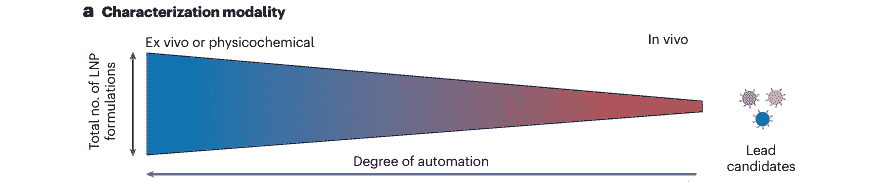
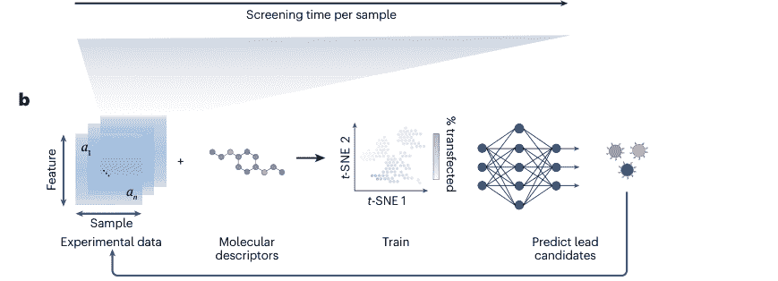
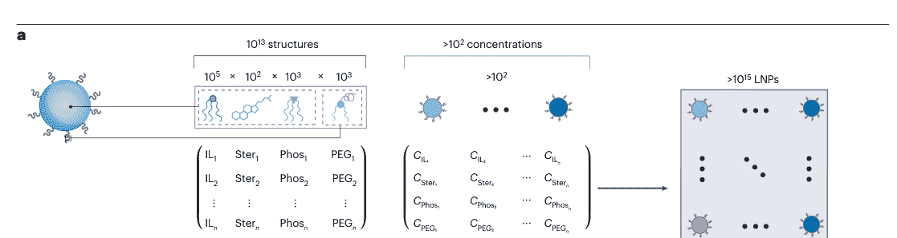
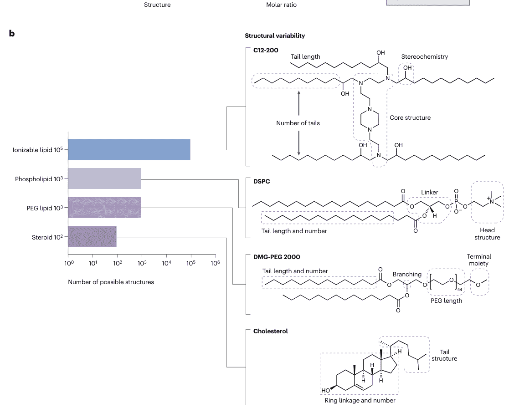
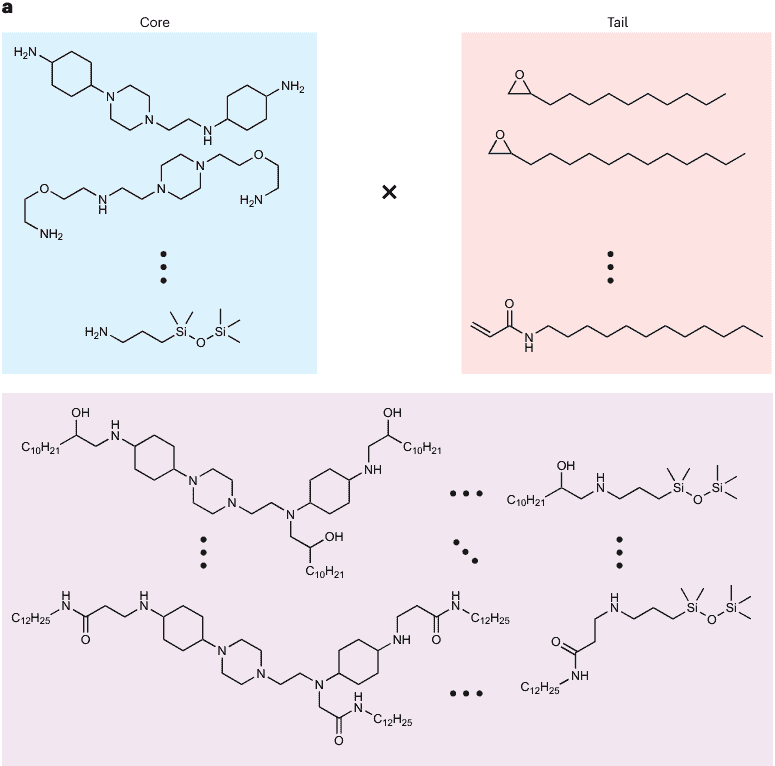
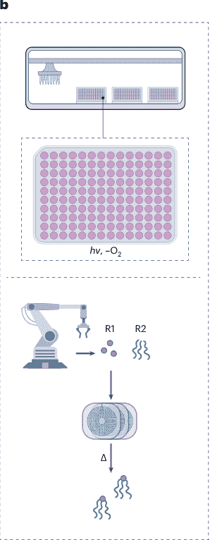
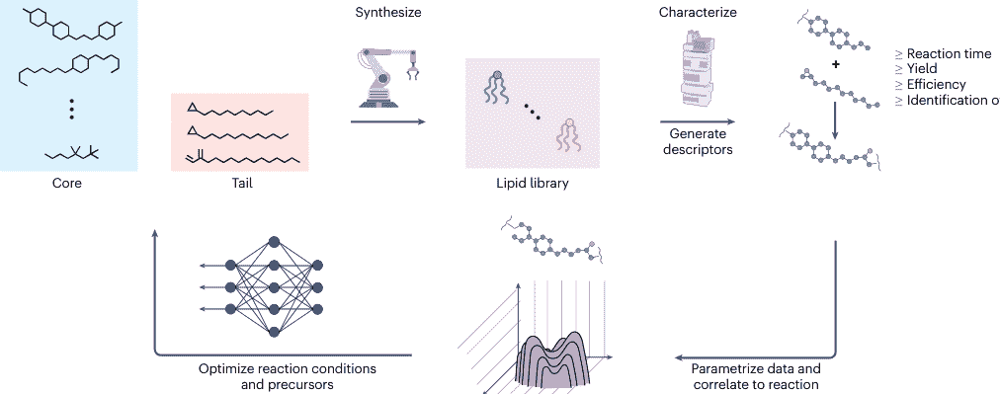
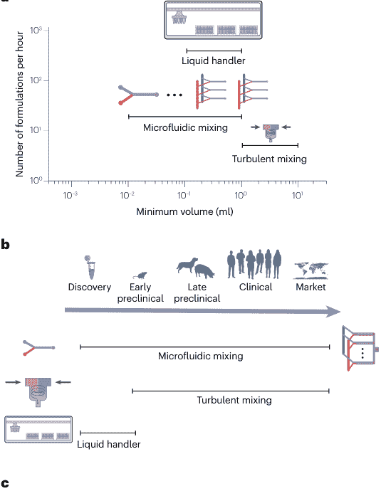
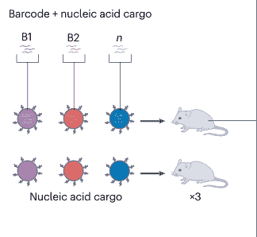
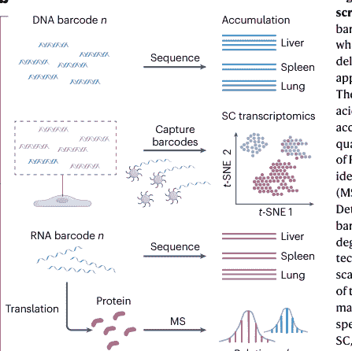

# 机器学习指导的脂质纳米颗粒设计的高通量平台

## 引言

自2000年代初以来，组合合成和高通量筛选已推动了用于核酸治疗的非病毒递送系统的发展，使其效率大幅提高且毒性更低¹。聚乙烯亚胺²和聚-β-氨基酯¹,³,⁴等聚合物纳米颗粒的迭代筛选和优化有助于降低生物学副作用。最终，这些聚合物成为可离子化脂质的框架，后者是脂质纳米颗粒（LNPs）⁵,⁶的主要组分。从这些早期进展来看，LNPs已成为临床上成功的核酸递送方法⁷，如用于治疗转甲状腺素介导淀粉样变性的patisiran⁸,⁹，以及辉瑞和Moderna的SARS-CoV-2疫苗¹⁰所证明的。截至2025年8月，超过100种基于LNP的疗法目前处于临床阶段，超过170项研究正在积极招募参与者¹¹（ClinicalTrials.gov搜索）。

鉴于LNP作为多组分递送载体的复杂性，筛选流程通常包括新脂质组分的合成、用这些组分配制LNP，然后对候选药物进行后续的理化表征、体外测试和体内测试（图1a）。对脂质组分中的任何一种或其相对比例、货物、缓冲条件或混合方法进行修改，都可能导致在不同

生物相关模型中产生不同的表现。在文献中，配制和筛选方法的不一致最终掩盖了具体的设计规则。此外，鉴于LNP约为十亿原子规模，以及在成核和随后颗粒稳定化过程中动力学和热力学相互作用之间复杂的关系，基于物理的计算机模拟策略仍然过于计算密集，无法缩小产生生物学有效LNP的脂质结构潜在设计空间¹²,¹³。虽然仍存在大量未探索的化学空间¹⁴–¹⁷，但用于新脂质的模块化、可并行化合成流形已实现了具有更优免疫原性¹⁸、跨感兴趣细胞类型的转染效率¹⁹,²⁰或生物分布²¹,²²的LNP的发现。

在本观点中，我们强调了脂质组分的自动化化学合成、高通量LNP文库配制¹⁷,¹⁸以及这些文库的筛选¹⁹方面的进展，这些进展使得机器学习（ML）方法越来越多地用于将LNP组成与生物系统中的行为相关联，从而预测新配方（图1b）。我们讨论了这些技术如何同时加速通量并提高在获取LNP生物学性能筛选数据所需的许多步骤中的一致性。配制和筛选LNP所用技术的一致性更高，再加上在公共

存储库中共享数据，可能能够开发出LNP基础模型，预测针对未满足的、甚至可能无关的治疗需求的新配方。

### 表征模态

### b ...

图1 | 整合自动化和机器学习以加速LNP发现。a. 脂质纳米颗粒（LNPs）的经典筛选途径依赖于配方通过从理化到体外再到体内筛选的漏斗式筛选技术，其中不符合一组标准的候选物将被淘汰。自动化更广泛地应用于理化或离体读数的测量，并且通常用于缩小体内筛选的潜在候选物数量。虽然生成体内数据所需的每样本筛选时间更高，但所得数据通常能提供有关LNP最终作为治疗手段表现的更多信息。b. 自动化可以加速筛选数据的收集，这些数据可以训练机器学习模型以减少未来筛选集的大小。闭环发现系统的一个例子包括LNP的合成和配制，其在生物系统中进行测试以生成数据，通过实验循环迭代以预测对某种治疗功能表现最佳的LNP候选物。这里用t分布随机邻域嵌入（t-SNE）图表示用于训练机器学习模型的数据，该技术将高维数据映射到低维图以进行可视化。训练使用示意性神经网络架构进行说明。

## LNP设计空间的大小

为了理解ML模型对LNP发现的潜力，了解任何给定配方的设计空间大小是很重要的。谈到设计空间，所理解的是整个可能的脂质结构集合及其代表性组合的表示。鉴于资源限制，我们只能遍历该设计空间的小代表性部分，例如在“实验设计”方法23,24中所做的，通常依赖于保持某些脂质组分的化学计量比固定，同时在其他组分中变化以建立数据集之间的相关性。然而，鉴于设计景观的大小，在找到最佳候选物之前花费大量时间进行筛选是可能的。

### 脂质结构的变异性

LNP的潜在设计空间通常受限于四种脂质组分的组合——助脂质、类固醇、聚乙二醇（PEG）脂质和可离子化脂质——以及核酸货物25。考虑到已发表的脂质，如果我们保守估计至少存在10³种可离子化脂质、10²种可能的类固醇26、10³种助脂质和10³种PEG脂质，则在单一组成比例下已存在10¹³种可能的LNP27（图2a）。每种脂质的功能决定了其潜在结构的数量（图2b）。助脂质通常是磷脂，主要决定LNP曲率28,29。结构修饰包括对脂肪酸尾长和结构的变化，以及对头部极性和大小的修饰30。类固醇组分有助于其他脂质的内部有序性。虽然胆固醇常用于LNP配方，但已测试了许多其他类固醇，因其对LNP刚性的可变影响31,32。PEG脂质是表面呈现的脂质，有助于颗粒大小、胶体稳定性和循环时间33,34。对PEG长度和亲脂性尾长度的结构改变显著改变了PEG从LNP表面脱吸附的速率32。最后，可离子化脂质促进核酸从内体逃逸，且结构变异最大19,35。这些脂质由胺修饰的“核心”和长亲脂性尾组成。常见的结构基序包括哌嗪头部基团36–38，其与亲脂性尾上的环氧化物18或丙烯酸酯38,39在一步合成中反应。

尽管这些脂质之间可能存在更大的理论结构变异性，但我们的近似基于当代文献，通过从已测试的或可通过轻微结构修饰构想的结构中外推，生成了可能结构数量的估计——例如每个脂肪酸尾中碳原子的数量变化。假设至少10²种这些脂质的组成比例会导致生物学差异，则存在至少10¹⁵种LNP可供筛选（图2a）。对于每种生物学适应症，最佳配方可能完全改变。就核酸货物而言，存在大量潜在的功能变体，包括每种小干扰RNA40、mRNA25、环状RNA41、自扩增mRNA42和基因编辑货物43,44。

### 脂质结构的生物学意义

改变该设计景观中的脂质结构或比例会导致体内和体外不同的结果。大量在组成和脂质结构上变化的筛选工作已鉴定出能够实现细胞特异性递送的配方，如在体外37,45和体内T细胞46转染嵌合抗原受体（CAR）mRNA的模型中所示。虽然脂质通常共享结构基序，但这些基序并不表示生物学表现的相似性。例如，尽管可离子化脂质C12-200和C14-494在中心都具有哌嗪基团，但掺入这些脂质的LNP在不同应用中表现最佳，分别为肝脏转染35,47和体外CAR T细胞转染37,48（表1）。除结构最多样化的脂质——可离子化脂质——之外，对助脂质的改变会调节内体逃逸的效率12,28。LNPs可通过添加永久带电的脂质组分被重新定向到特定细胞类型或器官，如肺20,32,49–51或脾52。该策略促进了肝外嗜性，但可能导致额外的毒性53。

体内行为尤其难以预测，鉴于表面化学、拓扑结构与不同生物分子冠蛋白的募集之间的关系54,55。早在进入血液后30秒56，一系列蛋白质就会吸附在LNP表面，基于电荷和拓扑结构动态结合和交换37,58。该蛋白质冠对颗粒生物分布49、细胞内和血液中的转运机制37、细胞代谢56和免疫原性59,60可能产生显著影响。

迄今为止，深度学习模型已被用于基于实验验证的合成途径生成虚拟脂质文库。虽然一些候选物已在体外筛选以预测新的可离子化脂质结构61，但这些脂质的生物学表现可能有所不同，原因在于与细胞类型61,62相关的功能最相关的结构特征存在差异。因此，生成新的脂质或预测比现有标准对给定生物学功能表现更好的配方可能需要对ML模型进行训练，使用从所研究的特定生物系统收集的数据，这需要持续的体内筛选。

## 脂质文库的高通量合成与表征

新脂质的合成是生成新LNP配方不可或缺的。受药物载体兴趣的推动，组合化学自2020年代以来经历了显著复兴。这种复兴导致了创新的出现，使得新化学化合物的合成和纯化自动化成为可能63。将这些高通量平台与ML工具配对可以帮助创建反馈回路54,65，其中自动化系统可以生成产品、分析它们并在最小人工干预下优化反应方案66。

### 合成方案和方法

尽管LNP的每种化学组分都存在许多潜在结构，但可离子化脂质是所有脂质中结构最多样化的19,23,37。从早期开发开始，可离子化脂质就被设计为可组合合成。这些模块化组合方案使用弱亲核且可离子化的胺核心，与带有亲电头部基团的多种脂肪酸样“尾”组分在一步中、在一锅中、且工作量最小的情况下反应4,6,36,67（图3a）。因此，随着化学多样性随每种组分数量乘性增加，可离子化脂质是所有LNP组分中最易于自动化合成的4,36,47。这些脂肪酸样尾上的头部基团的典型例子包括环氧化物37,68或烯酮38，与胺功能化核心在SN2型38,39或氮-迈克尔型69,70加成中反应。这些组合文库随后可被配制成LNP

## 视角

图2 | LNP设计空间的大小。a，脂质结构和组合的潜在组合导致在设计脂质纳米颗粒（LNP）时需要考虑巨大的空间。该设计空间的不同区域（即不同的脂质结构和组成比例）将产生在生物系统中具有显著不同行为的颗粒。b，每种脂质组分相对于结构组合总数的相对比例（左）。每种脂质类型常见的可变子结构（右，从上到下）：可电离脂质、辅助脂质、聚乙二醇（PEG）脂质和类固醇。DMG-PEG 2000，1,2-二肉豆蔻酰-rac-甘油-3-甲氧基聚乙二醇-2000；DSPC，1,2-二硬脂酰-sn-甘油-3-磷酸胆碱。

其中四种组分的相对浓度通常首先固定，同时改变可电离脂质，然后在体外和体内进行大规模筛选以确定先导候选物35,39,71,72。尽管先前已合成可电离脂质和其他脂质时未关注其立体化学35,38,72，但立体化学的变化会导致细胞摄取和反应的差异73,74。对于使用环氧开环生成的可电离脂质，潜在立体异构体的数量随核心中胺数n以2^n的比例增长。在这些体系中生成和纯化特定的立体异构体可能需要添加工程酶75或对映选择性催化剂76，可能还需要额外的后处理步骤。

可电离脂质的合成方案广泛适用于现有的高通量材料生成平台，如基于孔板的液体处理工作站、机器人化学家或自动化模块化流动方案（图3b）。自动化液体处理工作站已被用于某些合成方案，使其能够合成包含数百种可电离脂质的文库70,77。此类液体处理工作站可进一步修改以在无空气条件下处理反应4,78。一种结合独立可控光源的孔板自动化策略也已用于合成大量吗啉和其他N-杂环化合物79，拓宽了可电离脂质核心的潜在结构多样性。然而，这些基于孔板的合成策略通常缺乏进行在线表征或纯化所需的模块化，不适合处理挥发性溶剂，并且其可扩展性受限（无论是在反应体积还是并行合成数量方面）。80

### 表1 | 已验证配方中脂质结构和整体LNP组成的变异示例

| 配方名称 | 可电离脂质结构 | 脂质摩尔比 | 应用 |
|---|---|---|---|
| C14-494 (参考文献 37) | 化学结构 | 35% C14-494 46.5% 胆固醇 16% DOPE 2.5% 14:0 PEG2000 PE | 离体T细胞转染 |
| C12-200 (参考文献 47) | 化学结构 | 35% C12-200 46.5% 胆固醇 16% DOPE 2.5% 14:0 PEG2000 PE | 向肝脏递送RNA |
| 306-N16B (参考文献 51) | 化学结构 | 50% 306-N16B 38.5% 胆固醇 10% DOPC 1.5% DMG-PEG 2000 | 向肺部递送Cas9 |
| SM102 (Moderna) | 化学结构 | 50% SM-102 38.5% 胆固醇 10% DSPC 1.5% DMG-PEG 2000 | 针对SARS-CoV-2的mRNA疫苗 |

DOPC，1,2-二油酰-sn-甘油-3-磷酸胆碱；DMG-PEG，1,2-二肉豆蔻酰-rac-甘油-3-甲氧基聚乙二醇-2000；DOPE，1,2-二油酰-sn-甘油-3-磷酸乙醇胺；DSPC，1,2-二硬脂酰-sn-甘油-3-磷酸胆碱；LNP，脂质纳米颗粒；PEG，聚乙二醇；PEG2000 PE，1,2-二肉豆蔻酰-sn-甘油-3-磷酸乙醇胺-N-[甲氧基（聚乙二醇）-2000]。

处理实验室设备的移动式机器人化学家可以缓解使用孔板机器人进行合成的一些限制。81,82这些机器人可以执行许多与人类相同的合成任务，但与人一样，它们受到大空间需求和通量的限制。鉴于这些缺点，这些机器人尚未广泛应用于新脂质的合成。为了减少所需的操作占地面积并提高合成通量，已开发出可互换模块化流体单元的机械臂⁶⁶,⁸³。这些流体单元允许试剂的加热和冷却，以及在线表征和后处理，使合成易于扩展。流体自动化已与基于ML的优化方案相结合，以协助试剂获取、合成规划和温度、反应时间等条件的调整⁶⁶。这些系统产生的合成产物的下游分析数据可馈入基于ML的前馈优化方案中，其中反应产率和纯度等输出变量用于动态调整反应条件并为未来的相关反应提供信息⁶⁶,⁸²–⁸⁶。使用动态优化的反应条件或合成规划器，可以以更低成本⁸⁷和更低环境影响进行更高产率的合成。ASKCOS等开放获取资源已扩展了在这些反应输出上预训练的模型的使用。

**图3 | 脂质合成自动化策略。** 机器人技术和机器学习的结合促进了化学合成的闭环系统，其中可以生成和表征产物，以确定给定试剂的最佳反应条件，并建议新的试剂以实现更快或更高产率的合成。**a，** 将潜在的可电离脂质描绘为“核心”结构和“尾部”结构的外积。**b，** 高通量脂质合成平台示例，包括自动化孔板合成和机器人辅助的流动合成。某些自动化孔板接口现在能够进行光催化反应（hv）或在无空气环境（−O₂）中进行反应。结合模块化流体单元的自动化可以在加热（Δ）或微波条件下在流动中组合不同试剂（R1和R2）以加速反应速率。**c，** 可电离脂质合成闭环优化的工作流程示意图，其中脂质被自主合成、表征并纳入机器学习模型。自动化促进了不同脂质在不同反应参数（如温度、溶剂或催化剂）下的合成，同时优化反应产率或效率等因素。该循环持续进行，直到某个输出标准（如特定产率）得到充分满足或优化。闭环自动化与机器学习相结合，能够快速优化合成策略，以生成新的潜在脂质纳米颗粒候选物。

鉴于大多数可电离脂质合成相对简单，这些自动化平台可以极大加速新化合物合成的速率。标准的现成液体处理工作站可能每天能够执行数千个双组分、单步反应。然而，要进入更广泛的化学空间，通量会急剧下降，并且随着每个额外反应步骤的增加，自动化的复杂性也可能增加。尽管在单步多组分反应中仍存在大量尚未探索的化学空间¹⁴，将ML模型应用于脂质合成的一个重要优势是从先前未探索的设计空间中生成性预测脂质，可能涉及更复杂的合成策略。更模块化的合成仪器，如模块化流体反应器⁶⁶，可以拓宽可访问的化学空间，但由于缺乏并行化，通量会急剧下降。此外，下游筛选过程（如颗粒配制和筛选）在当前的通量下可能仍然是限速步骤。因此，自动化在脂质合成中应用的发展应仔细考虑当前脂质复杂性与通量之间的平衡，以及筛选过程中的下游瓶颈。

尽管如此，在线表征技术的改进已助力脂质合成的前馈优化（图3c）。高通量液相色谱-质谱联用（LC–MS）⁸⁸已被用于使用带电气溶胶检测（CAD）表征可电离脂质，这是一种用于检测缺乏紫外可检测发色团化合物的高灵敏度方法⁸⁹,⁹⁰。例如，基于CAD的高效液相色谱（HPLC）已应用于血浆大规模脂质组学研究中对脂质和类脂材料的高通量分析⁹¹。高通量表征的新兴发展包括将HPLC数据纳入前馈决策方案的方法⁹²。这些系统已与自动化核磁共振（NMR）装置⁹³,⁹⁴相结合，以实现更彻底的表征。ML在优化反应方案以获得更简单的纯化⁶⁶以及从MS和NMR谱自动进行结构鉴定⁹⁵方面越来越有用。

### 纯化和表征方法

尽管合成并行化和自动化方面取得了进展，纯化和表征仍然对脂质生成通量构成挑战。虽然某些组分（如类固醇）的纯化方案已很成熟，但可电离脂质、PEG脂质和磷脂的两亲特性使得这些化合物难以高通量纯化；例如，传统纯化技术（如柱色谱）通常不适用，导致洗脱峰宽且包含多种物质。特别是可电离脂质的表征通常需要仔细考虑缓冲液，并添加诸如氢氧化铵之类的电荷稳定剂⁶⁹,⁷²。在上述自动化模块化流动示例中，涉及更多处理步骤的过程可能会引入更复杂的流体分配系统，从而阻碍通量⁶⁶。

### LNP配制和表征

尽管自2000年代初以来就已存在许多脂质的自动化和并行化合成技术，但当前LNP筛选通量的一个限制是溶解脂质的有机相与承载核酸货物的酸性水相缓冲液之间的受控混合。当前提高该混合过程通量以生成不同LNP配方的努力集中在调整现有自动化设备（如液体处理工作站）以混合有机相和水相、开发混合设备与许多不同流体输入之间的新接口，或实现并行化架构以分配较少的流体输入从而生成多种配方输出。新技术不仅要提供更高的通量，还要提供高批次间一致性，以及在临床开发的所有规模上使用相同混合技术的能力。

### 高通量混合方法

即使单个脂质组分可以高通量生成，这些组分也必须与核酸货物在纳米沉淀反应中组合以生成LNP。

### 视角

| 方法 | 流体动力学直径 (nm) | PDI | 通量 (配方 h⁻¹)/占地面积 (m²) |
|---|---:|---:|---:|
| 微流控混合 | 20–100 | <0.1 | <10⁻⁵ (通量低，占地面积小) |
| 湍流混合 | 20–100 | <0.1 | ~10⁻¹ (通量低，占地面积中等) |
| 液体处理器 | 30–200 | <0.2 | ~10⁻¹ (通量高，占地面积大) |

**图 4 | LNP 混合方法的通量和可扩展性。** 不同混合方法会产生结构和特性不同的脂质纳米颗粒（LNPs）。**a,** 绘制每种 LNP 制剂方法可能的最小体积与潜在通量的对比图。**b,** 对每种混合方法的生产规模进行评估。如果在发现阶段使用的制剂方法与临床或市场阶段使用的方法不同，则可能需要重新优化制剂。**c,** 总结物理化学输出的差异与其相对通量的关系。每种混合方法的占地面积决定了在良好实验室规范或良好生产规范设施的空间限制下，该混合方法能够被并行化的程度。尽管 LNP 在不同开发阶段存在许多混合方法，但理想的方法应将混合不同制剂的快速通量与临床试验或市场规模的可扩展生产能力相结合，且在相似的局部操作条件下进行。PDI，多分散性指数。

LNP 成核通常涉及脂质在乙醇中纳米沉淀到缓冲水性共溶剂中，其中可离子化脂质与溶解在水相中的货物发生电复合。⁹⁶ 在不同雷诺数下发生的成核（与流动状态的层流性或湍流性相关）会导致内部结构不同的 LNP⁹⁷,⁹⁸，最终产生不同的下游生物学效应⁹⁹,¹⁰⁰。

用于 LNP 高通量制剂最常见的混合方法包括整体沉淀¹⁰¹、湍流混合¹⁰²,¹⁰³ 和混沌对流微流控混合¹⁰⁴,¹⁰⁵（图 4a）。整体沉淀通常见于移液管混合，可使用自动化液体处理器¹⁰¹,¹⁰⁶,¹⁰⁷ 以高通量生成 LNP，但混合本质上是不均匀且低效的，导致纳米颗粒物理化学性质的批次间差异⁹⁹,¹⁰⁸。诸如受限冲击射流混合器之类的湍流混合器在聚合物和脂质纳米颗粒应用中在大体积下被更广泛使用，并且通常能够实现低于一毫秒的混合时间¹⁰⁹。

然而，湍流混合器通常难以在低体积下使用¹¹⁰，因此由于材料限制，不适合生成更大的颗粒库（图 4a）。此外，湍流放大时的固有非线性和流速变化导致局部流动条件不可预测，这意味着尽管整个溶液中混合迅速进行，但混合不一定均匀¹¹¹。

由于混合环境对 LNP 的物理化学性质以及最终的生物学性质具有重要影响，理想的 LNP 制剂系统应在药物开发的每个阶段，从发现到批量规模，都允许相同的局部混合条件¹⁰⁷（图 4b）。设备中的颗粒应在开发所需的所有流速下“经历”相同的混合条件，因为在发现阶段和放大阶段不同方式生产的颗粒在生物学环境中可能表现不同。在工业环境中放大 LNP 生产时，闪式纳米沉淀¹¹² 是一种涉及高度湍流混合的制剂方法，因其设计简单且对连续加工具有鲁棒性而被广泛使用。然而，湍流混合技术通常会根据制剂量的多少改变通过混合器的总流速，从而导致不同颗粒批次大小的局部混合条件可能不同。液体处理器理论上可以通过在多个孔中并行混合来扩展到更高体积，但它们会受到湍流混合状态下相同的变异性的影响。此外，使用液体处理器扩展到更高体积需要使用不同的移液管，因此不同的几何形状和混合环境，才能在所有开发规模上有效运行。微流控混合技术能够生成与小动物测试相关的 LNP 数量¹⁸,⁶⁸。当这种混合结构在同一设备上并行化时，可满足大型动物研究和人体规模应用所需生产量¹⁰⁴,¹⁰⁵。因此，在此提及的方法中，微流控混合是唯一尺度不变的技术。

微流控混合技术提供高批次间一致性，但由于微米级设备固有的流速限制以及通过同一设备快速连接许多不同溶液的挑战，其通量通常相当低¹¹³。已有多种微流控混合设备用于生成 LNP¹¹⁴–¹¹⁸。这些设备通常能实现充分混合，但在临床规模颗粒生产所需的更高流速下，其性能往往下降；分支混合器的典型操作流速范围为 0.6 ml min⁻¹（ref. 97）至 20 ml min⁻¹（Cytiva 的 NxGen 技术），这足以在发现到早期临床前阶段生成足够材料。然而，为了生成多样化的 LNP 制剂，携带不同脂质的流体输入必须依次与同一混合设备接口以生成新产品。为了提高通量，已开发出用于将多个流体输入连接到同一芯片的支架¹¹³，并对输入输送和输出收集进行了自动化¹²⁰。存在一些微流控自动化方案，每小时可生产约十种制剂（Unchained Labs Sunscreen），但该技术目前尚不能以自动化液体处理器的速率生成和筛选多种纳米颗粒制剂。一种新兴的自动化微流控平台使用并行输送单一流体输入但以不同化学计量比输送到多个独立混合单元，其通量已超过自动化液体处理器，达到约每 3 秒一种不同的 LNP 制剂，同时提供微流控的精确混合能力¹²¹。

加速制剂速率的新兴和未来工作应包括监测混合过程的额外手段，使能够设计高度一致、可扩展的混合设备，其中不同的脂质和核酸输入可以自动与混合设备接口，并且可以同时配制许多不同的化学计量比。

### High-throughput characterization

高通量 LNP 生成需要匹配的表征通量，以确定每批制剂是否符合一套质量标准。评估制剂产品的指标包括颗粒大小和多分散性¹²²。最常见的是使用动态光散射或光学跟踪方法来测定 LNP 大小。例如，已开发出一种类似于纳米颗粒跟踪分析但在微流控芯片上在线进行的技术¹²³。确定纳米颗粒中核酸的相对包封率也很重要，最常见的是通过 RiboGreen 等荧光测定。测定部分已实现自动化（Unchained Labs Sunscreen 和 Unchained Labs Stunner），但制剂和透析仍需要单独的机器人单元，需要在两者之间转移。

尽管大小和包封效率是有用的指标，但还需要先进的表征技术来进一步探究核心结构，其中一些已改编用于高通量表征。通过将液体处理器与光束线耦合，对 LNP 库进行了高通量小角 X 射线散射（SAXS）¹⁰⁶，以约每分钟一种制剂的通量自动提供脂质堆积、核心密度和核心相的数据。为了实现在线制剂、加工和表征，额外的流程已将 SAXS 直接集成在非对称场流分级（AF4）之后——这是 LNP 去除过量有机溶剂的常用下游加工步骤¹²⁴。然而，AF4 通常较慢的通量加上 SAXS 数据的复杂性意味着 LNP 制剂与分析之间的延迟可长达 40 分钟。

尽管确认结构和确定单个脂质组分纯度的表征技术在很大程度上已从现有流程中改编而来，但在单颗粒水平上分析 LNP 的组成比例仍然是一个挑战。单个 LNP 为标准化学表征技术（如 HPLC 或 NMR）提供的信号不足。为解决此问题，已使用微流控平台进行在线光学检测，允许对大小、相对组成和每个 LNP 的 RNA 数量进行高通量评估¹²⁵,¹²⁶。在这些流程中，荧光标记的脂质和货物组分在微米级毛细管中分离，并以每分钟 3,000–5,000 个事件的通量进行荧光巧合检测。此外，溶液相拉曼分析已实现相对脂质量的高通量定量¹²⁷ 以及抗体包被 LNP 中颗粒表面配体的定量（LNP 的 SPARTA 分析）。为了超越标记方法，质谱已成为确定每个颗粒中 mRNA 数量的替代方法¹²⁸,¹²⁹。在整体规模上，整个 LNP 制剂的组成分布已使用与电荷气溶胶检测耦合的 HPLC 进行评估¹³⁰。

尽管前馈 ML 驱动的优化方案很少¹³¹，但已对脂质比例与物理化学性质之间的关系进行了数据驱动分析¹⁶¹,¹⁶²,¹³²。系统输出持续告知输入条件的自主系统已广泛应用于从化学合成⁸⁴ 到无机材料生成¹³³ 和液滴微流控¹³⁴ 等应用。快速在线表征技术未来可能用于优化物理条件，如总流速，或化学条件，如脂质组分的选择和组合，以生产具有所需性质的 LNP。

目前，没有任何物理化学表征方法能像无机材料合成等类似领域中可用的方法那样深入揭示 LNP 性能，其中基于衍射的方法已实现新材料的闭环发现¹³⁵–¹³⁷。然而，结合 ML 驱动数据分析的涉及先进溶液基表征方法的大型研究可能阐明 LNP 在生物系统中的性能与制剂输入参数之间的设计规则，为闭环 LNP 优化提供前进路径。

### In vitro and in vivo characterization

体外和体内筛选数据与 LNP 的治疗成功相关性最强，因此为训练 ML 模型提供了最相关的数据。体外指标包括对特定细胞类型的毒性¹³⁸、转染或表达效率¹³⁹–¹⁴²（Unchained Labs Sunscreen）、跨细胞转运速率¹⁴³、蛋白冠的身份⁵⁴,¹⁴⁴ 以及细胞结合速率¹²²（NxGen 技术）。尽管体外和体内性能之间仅有最小的相关性，但体外指标可以通过识别转染能力小或无的颗粒来缩小在动物模型中测试的潜在设计空间²⁴。诸如 LNP 条形码等以混合方式筛选制剂颗粒的方法已大幅加速了体内检测的通量（图 5a）。

#### High-throughput in vitro assays

扩展体外检测通量的最通用范式涉及使用板式机器人、基于流的检测或光学技术对液体处理进行自动化。例如，一个常见的早期筛选涉及使用自动化试剂和板处理对荧光素酶报告基因进行定量——作为相对 LNP 转染的替代指标¹⁴⁵。板自动化也可用于基于流的检测中以交换样品，用于 LNP 效应的高分辨率体外分析。高度多路复用的流式细胞术已被用于获得 LNP 转染的时间分辨单细胞测量¹⁴¹。质谱流式细胞术可对单个细胞内的 mRNA 转录本和蛋白质进行多路复用检测，以识别 LNP 转染引起的转录组改变¹³⁹,¹⁴⁶。光学方法也已用于单细胞测量¹⁴⁷。例如，共聚焦显微镜已用于定量荧光蛋白

## 视角

图 5 | 用于并行化 LNP 体内筛选的选项。a. 使用条形码样本和非条形码样本的实验工作流程，其中条形码样本可汇集后递送至单只动物。b. 脂质纳米颗粒（LNP）条形码的潜在类型和应用。最常见的条形码类型包括核酸条形码，如 DNA 或 RNA 条形码。它们在不同细胞或组织类型中的积累通常使用深度测序进行定量，或在 RNA 条形码的情况下，其翻译产物可使用质谱（MS）进行鉴定和定量。c. 条形码类型和相关特征。因此，确定最佳的并行化体内条形码策略，取决于每种条形码技术在单只动物内的实际并行化程度、读出方法的易用性和可扩展性，以及每种技术所需的读出分辨率。m/z，质量-电荷比；MS/MS，串联质谱；NGS，下代测序；SC，单细胞；t1/2，半衰期；t-SNE，t-分布随机邻域嵌入。

| 条码类型 | 分析方法 | 中位条码稳定性 | 多路复用能力（每只动物条码数） | 分辨率 |
|---|---|---|---|---|
| DNA | NGS | t1/2 = ~天 | >100 | 单细胞 |
| RNA | NGS | t1/2 = ~小时 | >100 | 单细胞 |
| 肽 | MS/MS | t1/2 = ~天至 >1 周 | >100 | 组织或器官 |
| 化学 | MS；成像 | t1/2 = 小时 | ~10 | 单细胞 |

从核酸货物（或荧光染料）表达的产物，评估单个细胞的相对转染效率148，评估细胞毒性149，或成像潜在的膜损伤138,140。对于离体细胞工程的使用，如 CAR T 细胞或自然杀伤细胞150的情况，这些更高通量的读出可立即用于识别表现最佳的配方。在体内治疗发现的筛选过程中，体外实验主要用于基于较差的转染效率 grounds 淘汰潜在的 LNP 配方。然而，提高更高分辨率体外实验的通量可能会提供新的或补充信息，有助于防止在后期的动物模型筛选 中纳入假阳性或假阴性。

### 用于高通量体内分析的 LNP 条码

自 2020 年代初以来，LNP 条码被越来越多地用于在同一动物中同时测试多种配方151,152。LNP 条码主要由 DNA151、mRNA153、RNA 转录本的蛋白产物154 或不同的分子155,156 组成（图 5b,c）。通过利用下一代测序和生物信息学工具，LNP 的核酸条码可实现对池内单个 LNP 的生物分布和翻译效率的评估（图 5c）。每个“条形码”是一个可从基因组 DNA 中分离的核酸序列151。结合独特的分子标识符，这些序列可进行去复用，并可在不同细胞和组织类型中定量其相对丰度151,153。条码分析已被用于研究 LNP 嗜性151,157 — LNP 在不同器官类型中的相对积累 — 以及不同器官内的细胞关联和摄取158,159、细胞内化途径，甚至已与单细胞 RNA 测序结合以从单个细胞获得多组学读出158,160。在核酸条码中，DNA 条码是首先用于筛选汇集 LNP 的条码151。在这种方法中，部分治疗货物被 DNA 条码取代，从而允许在携带相同治疗货物的 LNP 中使用许多不同的条码。RNA 条码提供可比的多路复用能力和读出分辨率，但它们通常比 DNA 条码的半衰期更短（图 5c）。可对 mRNA 进行结构和化学修饰以延长其半衰期，但这些修饰的生物学影响尚未在细胞类型中广泛测定161。尽管 DNA 条码比 RNA 条码更稳定且更容易互换151，但将 DNA 条码纳入已携带 RNA 作为治疗货物的 LNP 中可能会导致 LNP 的理化性质差异，从而可能改变特定配方的生物学数据153。肽条码相对于 RNA 条码提供了额外的细节，因为它们不仅识别核酸的相对积累，还识别其在给定群体内的相对活性[^154]。然而，由于肽条码的主要读出涉及串联质谱，实现超越组织尺度的分辨率仍通量较低，这是由于细胞裂解和转移到 MS 入口的耗时步骤所致。最后，小分子已被越来越多地用作纳米颗粒的条码[^155,^156]。尽管小分子条码的理论结构空间、因此潜在数量是巨大的，这些物种通常必须能够光学检测 — 从而遭受光谱重叠[^162] — 或通过串联质谱或气相色谱-质谱等分析技术使用，在其中它们通常难以与细胞的分子背景信号区分，并且相对于核酸具有较高的检测限[^155]。结合化学不同的芳基卤化物化合物即卤码[^155] 的策略显示出低至中纳摩尔的检测限；然而，多路复用超过约十个样本的能力尚未得到证实。

迄今为止，实验中每只动物测试的条形码 LNP 数量仍低于条形码信息密度所规定的理论极限。尽管八个核苷酸序列可产生 4⁸ = 65,536 个独特条码，LNP 条码实验仅在每只动物中筛选了数量级为 10² 的条码[^163,^164]。尽管使用诸如在多个位置区分条码序列等错误预防技术会减少可用条码的数量[^165]，但任何一次使用的条码颗粒的实际数量可能进一步受颗粒之间理化差异的限制，这可能导致颗粒间相互作用或体内“药物-药物”相互作用。此外，LNP 制剂过程其他部分的通量限制阻碍了单次筛选更多条码 LNP 的数量。

很大程度上由于这种可扩展性和下一代测序的普遍性，核酸条码已成为 LNP 并行化体内筛选最广泛使用形式。尽管如此，随着质谱或成像读出的通量提高，诸如肽条码等技术 — 其不仅可提供 LNP 定位的分辨率，还可提供货物翻译的分辨率 — 或化学条码 — 其中细胞内定位可被可视化 — 的可扩展性可能会提高。

最终，由于体内和体外环境根本不同，体外数据 — 如转染或细胞毒性 — 在作为用于预测体内 LNP 行为的 ML 模型训练数据方面的能力有限。尽管这种相关性缺乏已被充分描述，能够整合高度多模态数据集[^166] 的 ML 模型可在大型（>10³–10⁴ 样本）体外数据集上进行多轮微调，位于较小的体内数据集上游。如在主动学习方法[^131] 中所见，多轮体外筛选可用于在进行体内测试前迭代提高模型的预测能力。随着 LNP 制剂的自动化和并行化改进，这些方法可被更广泛地利用以最小化资源和时间成本。

## 展望

高通量筛选已大幅加速了 LNP 在日益增多的治疗适应症中的开发。这些进展得益于近期提高筛选通量的进展，尽管从脂质合成到体内测试涉及许多复杂过程。随着更先进的表征技术的开发，LNP 筛选产生的数据集变得越来越大且多因素，使得计算工具在理解给定配方输入 — 即不同的脂质结构、脂质比例和混合方法 — 如何改变其生物学效应方面变得更有用。

ML 模型现在正被用于发现新的 LNP 配方。诸如支持向量机、随机森林或梯度提升等模型架构，在相对较小的训练数据集（数十到数百个样本）上训练，主要为理化性质和体外数据，已被用于预测新配方的转染效率，如在聚合物纳米颗粒[^167–^169] 中所示，以及在 LNP 文献中日益增多[^14,^61,^62]。这些应用证明了这些模型在预测少量输入特征下的某些输出变量（如转染效率）的成功 — 例如组成变量，如磷脂-PEG 比率，以及所用磷脂/固醇的类型。诸如 Shapley 可加性解释等解释性框架进一步能够解析不同特征与生物学表现如转染效率相关的相关性[^61,^62]。

日益增多的是，更多数据密集型的神经网络模型[^61,^131,^166] 已被用于预测全新的可电离脂质结构。这些模型将脂质结构作为某种高维表示，通常为图进行引用，该表示与转染效率等实验输出耦合，以微调一个已在数百万个虚拟化学化合物上训练的现有神经网络。迄今为止，在 LNP 领域，预先在数百到数千个样本的理化性质和体外数据上训练的 ML 模型已被用于微调这些模型，最终生成新的可电离脂质结构[^61,^131,^169]。这些模型要么利用了现有的大型数据集，要么被用于开发新的自动化以生成并筛选足够大的样本量，以便微调主要在现有基于图的分子描述符上预训练的神经网络。在未来迭代中，这些模型可能能够建议新的脂质结构及其相对比例，这些结构可能能够生成具有特定体内功能的 LNP[^37,^154]。

最终，使用神经网络开发用于功能导向生成式 LNP 设计的模型将需要生成足够规模的大型文库，至少每种数千个样本，并在多个相关生物模型中进行测试[^166,^170,^171]。鉴于大多数生物数据与理化数据相比固有的不一致性，未来的预测模型可能需要比单项研究中目前生成的数据集更大的数据集。尽管用于生成数据集的方法中存在差异始终存在，但可能干扰生物学表现的不同因素的数量 — 脂质纯度、混合方法和制剂后处理，仅举几例 — 在 LNP 中比在小分子开发中要高得多，而在小分子开发中 ML 模型已成功改善药物性能[^172,^173]。

朝着生成开源预测框架的方向发展，该框架可针对给定生物学功能建议 LNP 配方的脂质及其相对比例，需要数据以更标准化的方式生成，并且源数据被更广泛地共享。在聚合物文献中存在此类标准化数据库的示例，其格式适用于学习应用[^174,^175]。此类协作举措将激励开发更好的合成、表征、制剂和筛选的标准化方法，以生成未来 LNP 发现的公开可用数据集。用于纳米颗粒和生物材料应用的 ML 实现资源[^13,^16,^177] 可协助清理和编码这些数据。最后，随着 LNP 合成和制剂的自动化改进并变得更加

## 观点

随着此类方法的广泛应用，使用这些方法可进一步简化实验标准化的流程。

到目前为止，LNP设计空间必须针对每种不同的生物应用进行筛选。例如，用于肺基因编辑的最佳LNP与用于体内递送至巨噬细胞或单核细胞的最佳LNP完全不同。尽管如此，脂质合成和LNP制剂自动化方面的进步将缩短进行这些筛选所需的时间。最终，持续生成的公开可用数据可用于通过多目标学习训练模型，这些模型可能基于转染效率、组织嗜性甚至更详细的多组学读数进行训练，从而生成一个“基础模型”，该模型能够为特定的预期生物反应最佳地预测LNP。这些生成模型可能会提出新的脂质结构或化学计量比，可能会被赋予较大的权重，以提出与先前脂质化学性质不同的脂质，同时为其“可合成性”赋予高权重，可能通过整合现有软件来推荐试剂和可能的合成策略。

虽然每种治疗或预防适应症都需要递送载体具有不同的生物学特性，但使用机器学习模型预测新的LNP配方可显著缩小特定应用的设计空间，从而大大缩短每种药物的发现和早期开发过程。将这些计算工具与自动化相结合，将能够为广泛的未满足临床需求开发LNP，并在未来对新出现的传染病做出更快速的反应。
## 参考文献

1. Anderson, D. G., Lynn, D. M. & Langer, R. 半自动合成和筛选用于基因递送的可降解阳离子聚合物大型文库. Angew. Chem. Int. Ed. 42, 3153–3158 (2003).

2. Breunig, M., Lungwitz, U., Liebl, R. & Goepferich, A. 打破非病毒基因递送中疗效与毒性之间的相关性. Proc. Natl Acad. Sci. USA 104, 14454–14459 (2007).

3. Lynn, D. M. & Langer, R. 可降解聚(β-氨基酯)：合成、表征及其与质粒DNA的自组装. J. Am. Chem. Soc. 122, 10761–10768 (2000).

4. Siegwart, D. J. et al. 用于胞内递送的化学多样性核壳纳米颗粒的组合合成. Proc. Natl Acad. Sci. USA 108, 12996–13001 (2011).

5. Wightman, L. et al. 支链和线性聚乙烯亚胺在体外和体内基因递送中的不同行为. J. Gene Med. 3, 362–372 (2001).

6. Dahlman, J. E. et al. 使用低分子量聚合物纳米颗粒进行体内内皮siRNA递送. Nat. Nanotechnol. 9, 648–655 (2014).

7. Patra, J. K. et al. 基于纳米技术的药物递送系统：最新进展与未来展望. J. Nanobiotechnol. 16, 71 (2018).

8. Anselmo, A. C. & Mitragotri, S. 临床中的纳米颗粒：最新进展. Bioeng. Transl. Med. 4, e10143 (2019).

9. Maurer, M. S. et al. Patisiran治疗转甲状腺素蛋白心脏淀粉样变性患者. N. Engl. J. Med. 389, 1553–1565 (2023).

10. Hassett, K. J. et al. 优化用于肌肉注射mRNA疫苗的脂质纳米颗粒. Mol. Ther. Nucleic Acids 15, 1–11 (2019).

11. Verma, M. et al. 基于脂质纳米颗粒的基因组药物前景. Nat. Rev. Drug Discov. 22, 349–350 (2023).

12. Dehghani-Ghahnavieh, S. et al. 可电离氨基脂质在DSPC/胆固醇膜中的分布及其影响：对脂质纳米颗粒结构的启示. J. Phys. Chem. B 127, 6928–6939 (2023).

13. McDonald, S. M. et al. 应用机器学习驱动聚合物生物材料设计. Nat. Commun. 14, 4838 (2023).

14. Li, B. et al. 利用机器学习和组合化学加速用于mRNA递送的可电离脂质发现. Nat. Mater. 23, 1002–1008 (2024).

15. Han, X. et al. 快速简便合成含脒基可降解脂质，用于体内多功能mRNA递送. Nat. Chem. 16, 1687–1697 (2024).

16. Han, X. et al. 通过定向化学进化优化用于mRNA递送的可电离脂质的活性和生物降解性. Nat. Biomed. Eng. 8, 1412–1424 (2024).

17. Xue, L. et al. 含硅氧烷脂质纳米颗粒的组合设计增强组织特异性mRNA治疗递送的胞内加工. Nat. Nanotechnol. https://doi.org/10.1038/s41565-024-01747-6 (2024).

18. Han, X. et al. 佐剂脂质样化合物替代的脂质纳米颗粒增强SARS-CoV-2 mRNA疫苗的免疫原性. Nat. Nanotechnol. 18, 1105–1114 (2023).

19. Han, X. et al. 用于RNA递送的可电离脂质工具箱. Nat. Commun. 12, 7233 (2021).

20. Cheng, Q. et al. 选择性器官靶向（SORT）纳米颗粒用于组织特异性mRNA递送和CRISPR-Cas基因编辑. Nat. Nanotechnol. 15, 313–320 (2020).

21. Dilliard, S. A. & Siegwart, D. J. 用于基因药物递送的被动、主动和内源性器官靶向脂质和聚合物纳米颗粒. Nat. Rev. Mater. 8, 282–300 (2023).

22. Mitchell, M. J. et al. 工程化精准纳米颗粒用于药物递送. Nat. Rev. Drug Discov. 20, 101–124 (2021).

23. Billingsley, M. M. et al. 正交实验设计用于CAR T细胞mRNA工程化脂质纳米颗粒的优化. Nano Lett. 22, 533–542 (2022).

24. Lokugamage, M. P. et al. 优化脂质纳米颗粒用于将雾化治疗性mRNA递送至肺部. Nat. Biomed. Eng. 5, 1059–1068 (2021).

25. Hou, X., Zaks, T., Langer, R. & Dong, Y. 用于mRNA递送的脂质纳米颗粒. Nat. Rev. Mater. 6, 1078–1094 (2021).

26. Patel, S. et al. 脂质纳米颗粒中天然存在的胆固醇类似物诱导多态形态并增强mRNA的胞内递送. Nat. Commun. 11, 983 (2020).

27. Lokugamage, M. P., Sago, C. D. & Dahlman, J. E. 使用DNA条形码在体内测试数千种纳米颗粒. Curr. Opin. Biomed. Eng. 7, 1–8 (2018).

28. Zheng, L., Bandara, S. R., Tan, Z. & Leal, C. 脂质纳米颗粒拓扑结构调控内体逃逸和RNA向胞质的递送. Proc. Natl Acad. Sci. USA 120, e2301067120 (2023).

29. Koltover, I., Salditt, T., Radler, J. O. & Safinya, C. R. 与DNA释放和递送相关的阳离子脂质体-DNA复合物的倒六方相. Science 281, 78–81 (1998).

30. Álvarez-Benedicto, E. et al. 优化磷脂化学以改善脂质纳米颗粒（LNP）递送信使RNA（mRNA）. Biomater. Sci. 10, 549–559 (2022).

31. Herrera, M., Kim, J., Egeris, Y., Jozić, A. & Sahay, G. 揭示增强mRNA递送的多态脂质纳米颗粒的内体逃逸机制. Biomater. Sci. 9, 4289–4300 (2021).

32. Radman, A. et al. 阳离子胆固醇依赖性LNP向肺干细胞、肝脏和心脏的递送. Proc. Natl Acad. Sci. USA 121, e2307801120 (2024).

33. Mui, B. L. et al. 聚乙二醇脂质解吸速率对siRNA脂质纳米颗粒药代动力学和药效学的影响. Mol. Ther. Nucleic Acids 2, e139 (2013).

34. Gindy, M. E. et al. 用于siRNA递送的自组装脂质纳米颗粒中大分子结构演化的机制. Langmuir 30, 4613–4622 (2014).

35. Kauffman, K. J. et al. 使用部分因子设计和确定性筛选设计优化体内mRNA递送的脂质纳米颗粒配方. Nano Lett. 15, 7300–7306 (2015).

36. Akinc, A. et al. 用于递送RNAi治疗药物的类脂材料组合文库. Nat. Biotechnol. 26, 561–569 (2008).

37. Billingsley, M. M. et al. 可电离脂质纳米颗粒介导的mRNA递送用于人CAR T细胞工程化. Nano Lett. 20, 1578–1589 (2020).

38. Whitehead, K. A. et al. 具有可预测体内siRNA递送活性的可降解脂质纳米颗粒. Nat. Commun. 5, 4277 (2014).

39. Hajj, K. A. et al. 支链尾脂质纳米颗粒由于在内体pH下增强电离而在体内高效递送mRNA. Small 15, 1805097 (2019).

40. Yonezawa, S., Koide, H. & Asai, T. 脂质纳米颗粒介导的siRNA递送的最新进展. Adv. Drug Deliv. Rev. 154, 64–78 (2020).

41. Li, H. et al. 环状RNA癌症疫苗在难治性恶性肿瘤中驱动免疫应答. Theranostics 12, 6422–6436 (2022).

42. McKay, P. F. et al. 自扩增RNA SARS-CoV-2脂质纳米颗粒候选疫苗在小鼠中诱导高中和抗体滴度. Nat. Commun. 11, 3523 (2020).

43. Palanki, R. et al. 用于先天性脑病治疗性碱基编辑的可电离脂质纳米颗粒. ACS Nano 17, 13594–13610 (2023).

44. Wei, T. et al. 肺SORT LNP能够在囊性纤维化模型中实现精确的同源定向修复介导的CRISPR/Cas基因组校正. Nat. Commun. 14, 7322 (2023).

45. Thatte, A. S. et al. 用于自身免疫性疾病中免疫抑制T细胞体外工程化的mRNA脂质纳米颗粒. Nano Lett. 23, 10179–10188 (2023).

46. Billingsley, M. M. et al. 通过具有肝外嗜性的靶向可电离脂质纳米颗粒进行体内mRNA CAR T细胞工程化. Small 20, 2304378 (2024).

47. Love, K. T. et al. 用于低剂量体内基因沉默的类脂材料. Proc. Natl Acad. Sci. USA 107, 1864–1869 (2010).

48. Forsyth, V., Rzeczycki, P., Taylor, D. & Ariosa, A. 通过脂质纳米颗粒介导的递送增强原代免疫细胞的转染效率. J. Immunol. 212, 0857.6526 (2024).

49. Dilliard, S. A., Cheng, Q. & Siegwart, D. J. 选择性器官靶向纳米颗粒实现组织特异性mRNA递送的机制研究. Proc. Natl Acad. Sci. USA 118, e2109256118 (2021).

50. Sun, Y. et al. 体内编辑肺干细胞以在小鼠中实现持久基因校正. Science 384, 1196–1202 (2024).

51. Qiu, M. et al. 合成脂质纳米颗粒的肺选择性mRNA递送用于治疗肺淋巴管肌瘤病. Proc. Natl Acad. Sci. USA 119, e2116277119 (2022).

52. LoPresti, S. T., Arral, M. L., Chaudhary, N. & Whitehead, K. A. 在脂质纳米颗粒中用带电替代脂质替换辅助脂质可促进mRNA向脾脏和肺部的靶向递送. J. Control. Release 345, 819–831 (2022).

## 观点
- 53. Omo-Lamai, S. et al. 脂质纳米颗粒的理化靶向肺部诱导凝血：机制与解决方案. Adv. Mater. 36, 2312026 (2024).
- 54. Walkey, C. D. et al. 蛋白冠指纹预测金和银纳米颗粒的细胞相互作用. ACS Nano 8, 2439–2455 (2014).
- 55. Walkey, C. D., Olsen, J. B., Guo, H., Emili, A. & Chan, W. C. W. 纳米颗粒尺寸和表面化学决定血清蛋白吸附和巨噬细胞摄取. J. Am. Chem. Soc. 134, 2139–2147 (2012).
- 56. Cai, R. et al. 纳米材料蛋白冠的动态细胞内交换扰动蛋白质稳态并重塑细胞代谢. Proc. Natl Acad. Sci. USA 119, e2200363119 (2022).
- 57. Abdelkhalig, A. et al. 纳米颗粒表面功能化对蛋白冠及细胞粘附、摄取和转运的影响. J. Nanobiotechnol. 16, 70 (2018).
- 58. Baimanov, D. et al. 纳米颗粒软冠层及其动态演化的原位分析. Nat. Commun. 13, 5389 (2022).
- 59. Lee, Y. K., Choi, E.-J., Webster, T. J., Kim, S.-H. & Khang, D. 蛋白冠对纳米颗粒调节细胞毒性和免疫毒性的影响. Int. J. Nanomed. 10, 97–113 (2015).
- 60. Mahmoudi, M., Landry, M. P., Moore, A. & Coreas, R. 蛋白冠：从纳米医学到环境科学. Nat. Rev. Mater. 8, 422–438 (2023).
- 61. Xu, Y. et al. AGILE平台：一种深度学习驱动的方法，用于加速mRNA递送的LNP开发. Nat. Commun. 15, 6305 (2024).
- 62. Cheng, L. et al. 机器学习阐明用于细胞类型优先转染的质粒脱氧核糖核酸脂质纳米颗粒的设计特征. ACS Nano 18, 28735–28747 (2024).
- 63. Dormán, G. 组合化学的兴起、衰落与复兴. Nachr. Chem. 70, 70–72 (2022).
- 64. Liu, Y. et al. 通过多层策略和拓扑优化生成的超刚超材料. Nat. Commun. 15, 2984 (2024).
- 65. Ha, C. S. et al. 基于机器学习、由预定力学行为驱动的超材料快速逆向设计. Nat. Commun. 14, 5765 (2023).
- 66. Coley, C. W. et al. 由AI规划指导的有机化合物流动合成机器人平台. Science 365, eaa1566 (2019).
- 67. Hashiba, K. et al. 支链可电离脂质可增强mRNA的稳定性、融合性和功能性递送. Small Sci. 3, 2200071 (2023).
- 68. Mukalel, A. J. et al. 用于原位嵌合抗原受体单核细胞工程的氧化mRNA脂质纳米颗粒. Adv. Funct. Mater. 34, 2312038 (2024).
- 69. Riley, R. S. et al. 用于宫内mRNA递送的可电离脂质纳米颗粒. Sci. Adv. 7, eaba1028 (2021).
- 70. Chen, J. et al. 用于肌肉选择性mRNA递送且脱靶效应最小化的可电离脂质纳米颗粒的组合设计. Proc. Natl Acad. Sci. USA 120, e2309472120 (2023).
- 71. Fenton, O. S. et al. 用于体内向B淋巴细胞递送信使RNA的可电离脂质材料的合成与生物学评价. Adv. Mater. 29, 1606944 (2017).
- 72. Fenton, O. S. et al. 用于高效体内mRNA递送的仿生烯基氨基醇可电离脂质材料. Adv. Mater. 28, 2939–2943 (2016).
- 73. Hatit, M. Z. C. et al. 纳米颗粒立体化学依赖的内吞加工改善体内mRNA递送. Nat. Chem. 15, 508–515 (2023).
- 74. Da Silva Sanchez, A. J. et al. 用立体纯可电离脂质替代外消旋可电离脂质可增加mRNA递送. J. Control. Release 353, 270–277 (2023).
- 75. Li, Z. et al. 基于脂质纳米颗粒的mRNA COVID-19疫苗用可电离阳离子脂质的酶催化一步合成. ACS Nano 16, 18936–18950 (2022).
- 76. Jacobsen, E. N. 环氧化物开环反应的不对称催化. Acc. Chem. Res. 33, 421–431 (2000).
- 77. Li, B. et al. 用于肺部mRNA递送和基因组编辑的纳米颗粒组合设计. Nat. Biotechnol. 41, 1410–1415 (2023).
- 78. Lee, J. et al. 用于光引发RAFT聚合的全自动平台. Digit. Discov. 2, 219–233 (2023).
- 79. Götz, J. et al. 高通量合成为预测分子性质和反应成功率提供数据. Sci. Adv. 9, eadi2314 (2023).
- 80. Kong, F., Yuan, L., Zheng, Y. F. & Chen, W. 生命科学中的自动液体处理：对当前技术水平的批判性综述. SLAS Technol. 17, 169–185 (2012).
- 81. Burger, B. et al. 移动机器人化学家. Nature 583, 237–241 (2020).
- 82. Dai, T. et al. 用于探索性合成化学的自主移动机器人. Nature 635, 890–897 (2024).
- 83. Steiner, S. et al. 由化学编程语言驱动的模块化机器人系统中的有机合成. Science 363, eaav2211 (2019).
- 84. Nambiar, A. M. K. et al. 在自动化机器人流动平台上对计算机提出的多步合成路线进行贝叶斯优化. ACS Cent. Sci. 8, 825–836 (2022).
- 85. Shields, B. J. et al. 作为化学合成工具的贝叶斯反应优化. Nature 590, 89–96 (2021).
- 86. Ahneman, D. T., Estrada, J. G., Lin, S., Dreher, S. D. & Doyle, A. G. 使用机器学习预测C–N交叉偶联中的反应性能. Science 360, 186–190 (2018).
- 87. Fromer, J. C. & Coley, C. W. 分子设计中合成成本感知决策的算法框架. Nat. Comput. Sci. 4, 440–450 (2024).
- 88. Kyranos, J. N., Cai, H., Wei, D. & Goetzinger, W. K. 用于现代药物发现的高通量高效液相色谱/质谱联用技术. Curr. Opin. Biotechnol. 12, 105–111 (2001).
- 89. Ginsburg-Moraff, C. et al. 微阵列上化合物库的集成自动化高通量纯化. SLAS Technol. 27, 350–360 (2022).
- 90. Su, W.-C. et al. 同时定量脂质纳米颗粒中脂质和核酸组分的平台方法. J. Chromatogr. A 1746, 465788 (2025).
- 91. Munjoma, N. et al. 用于大规模筛选人血浆和血清中生物活性极性脂质的高通量LC-MS平台. J. Proteome Res. 21, 2596–2608 (2022).
- 92. Haas, C. P. et al. 用于反应优化和筛选的开源色谱数据分析. ACS Cent. Sci. 9, 307–317 (2023).
- 93. Herck, J. V. et al. 基于自动在线NMR和在线SEC的与操作者无关的高通量聚合筛选. Digit. Discov. 1, 519–526 (2022).
- 94. Ammini, G. D., Hooker, J. P., Herck, J. V., Kumar, A. & Junkers, T. 使用在线NMR监测在光强度变化下对光聚合进行全面高通量筛选. Polym. Chem. 14, 2708–2716 (2023).
- 95. Hu, G. & Qiu, M. 基于MS和NMR数据的机器学习辅助天然产物结构注释. Nat. Prod. Rep. 40, 1735–1753 (2023).
- 96. Kulkarni, J. A. et al. 关于含可电离阳离子脂质和siRNA的脂质纳米颗粒的形成和形态. ACS Nano 12, 4787–4795 (2018).
- 97. Maeki, M. et al. 理解混沌微混合器微流控装置中脂质纳米颗粒的形成机制. PLoS ONE 12, e0187962 (2017).
- 98. Jung, H. N., Lee, S.-Y., Lee, S., Youn, H. & Im, H.-J. 用于RNA治疗药物递送的脂质纳米颗粒：现状和体内成像的作用. Theranostics 12, 7509–7531 (2022).
- 99. Strelkova Petersen, D. M., Chaudhary, N., Arral, M. L., Weiss, R. M. & Whitehead, K. A. 用于制备脂质纳米颗粒的混合方法影响mRNA递送效率和器官向性. Eur. J. Pharm. Biopharm. 192, 126–135 (2023).
- 100. Padilla, M. et al. 溶液生物物理学揭示了脂质纳米颗粒的非球形性、多分散性以及高效mRNA递送对内部有序性的依赖. 预印本于bioRxiv https://doi.org/10.1101/2024.12.19.629496 (2025).
- 101. Fan, Y. et al. 负载寡核苷酸的脂质纳米颗粒的自动化高通量制备和表征. Int. J. Pharm. 599, 120392 (2021).
- 102. Valente, I., Celasco, E., Marchisio, D. L. & Barresi, A. A. 受限撞击流混合器中的纳米沉淀：药用聚乙二醇化纳米球和纳米胶囊的生产、表征和放大. Chem. Eng. Sci. 77, 217–227 (2012).
- 103. He, Z. et al. 使用湍流混合控制尺寸的脂质纳米颗粒生产以增强口服DNA递送. Acta Biomater. 81, 195–207 (2018).
- 104. Shepherd, S. J. et al. 通量可扩展的SARS-CoV-2 mRNA脂质纳米颗粒疫苗制造. Proc. Natl Acad. Sci. USA 120, e2303567120 (2023).
- 105. Shepherd, S. J. et al. 使用并行化微流控装置实现可扩展的mRNA和siRNA脂质纳米颗粒生产. Nano Lett. 21, 5671–5680 (2021).
- 106. Hammel, M. et al. 使用小角X射线散射关联负载寡核苷酸的脂质纳米颗粒的结构与基因沉默活性. ACS Nano 17, 11454–11465 (2023).
- 107. Valencia, P. M., Farokhzad, O. C., Karnik, R. & Langer, R. 用于加速纳米颗粒临床转化的微流控技术. Nat. Nanotechnol. 7, 623–629 (2012).
- 108. Kroth, I., Karimov, M. & Karongo, R. 使用Andrew™移液机器人自动化制备负载寡核苷酸的脂质纳米颗粒，用于高通量体外筛选. Waters https://www.waters.com/content/dam/waters/en/app-notes/2023/720008090/720008090.pdf (2024).
- 109. Metzger, L. & Kind, M. 受限撞击流混合器中的混合——时间尺度分析和使用CFD粗粒化方法的放大. Chem. Eng. Res. Des. 109, 464–476 (2016).
- 110. Shepherd, S. J., Issadore, D. & Mitchell, M. J. 用于生物医学应用的纳米颗粒微流控制备. Biomaterials 274, 120826 (2021).
- 111. Sreenivasan, K. R. & Antonia, R. A. 小尺度湍流的现象学. Annu. Rev. Fluid Mech. 29, 435–472 (1997).
- 112. Feng, J., Markwart, C. E., Tian, C., Armstrong, M. & Prud’homme, R. K. 纳米颗粒治疗药物的转化制剂：从实验室发现到临床规模. J. Transl. Med. 17, 200 (2019).
- 113. Wilhelm, E., Neumann, C., Duttenhofer, T., Pires, L. & Rapp, B. E. 使用化学惰性、可逆、多通道芯片-外部接口连接微流控芯片. Lab Chip 13, 4343–4351 (2013).
- 114. Ripoll, M. et al. 环形微混合器中脂质纳米颗粒（LNP）的最优自组装. Sci. Rep. 12, 9483 (2022).
- 115. Kimura, N. et al. 开发基于微流控的尺寸可控脂质纳米颗粒后处理工艺并应用于siRNA递送. ACS Appl. Mater. Interfaces 12, 34011–34020 (2020).
- 116. Chen, D. et al. 通过受控微流控制备实现含强效siRNA脂质纳米颗粒的快速发现. J. Am. Chem. Soc. 134, 6948–6951 (2012).
- 117. Belliveau, N. M. et al. 用于体内递送siRNA的高效极限尺寸脂质纳米颗粒的微流控合成. Mol. Ther. Nucleic Acids 1, e37 (2012).
- 118. Leung, A. K. K., Tam, Y. Y. C., Chen, S., Hafez, I. M. & Cullis, P. R. 微流控混合：在脂质纳米颗粒系统中封装大分子的一般方法. J. Phys. Chem. B 119, 8698–8706 (2015).
- 119. Williams, M. S., Longmuir, K. J. & Yager, P. 交错人字形混合器实用指南. Lab Chip 18, 1121–1129 (2018).
- 120. Longwell, S. A. & Fordyce, P. M. microIO：用于自动化微流体输入-输出的开源自动进样器和馏分收集器. Lab Chip 20, 93–106 (2019).

## 观点

## 作者贡献
作者对文章的所有方面作出了同等贡献。

## 利益冲突
M.J.M. 是多篇专利的署名发明人，这些专利描述了本文所讨论的脂质纳米颗粒和脂质组合物在核酸递送中的应用。D.A.I. 是 InfluiNlics 的创始人并持有其股权。A.R.H. 声明没有利益冲突。
