# 基于深度学习的病理学蛋白多重生成

蛋白多重成像可为理解肿瘤及其周围肿瘤微环境之间的相互作用提供有价值的见解，但其广泛应用受限于成本、时间和组织可用性。这里我们提出了HistoPlexer，这是一种深度学习框架，能够直接从标准的苏伊林和伊红（H&E）病理学图像生成空间分辨的蛋白多重成像。HistoPlexer使用条件生成对抗网络架构联合预测多个肿瘤和免疫标志物，并采用自定义损失函数，旨在确保像素级和嵌入级相似性，同时减轻切片间差异。对转移性黑色素瘤样本的全面评估表明，HistoPlexer生成的蛋白图谱与真实图谱高度相似，这一点经专家评估验证。它们通过捕捉蛋白之间的空间共定位模式，保留了关键的生物学关系。基于HistoPlexer生成的蛋白多重成像的免疫浸润空间分布，可使肿瘤分层为免疫亚型。在独立队列中，将HistoPlexer衍生的特征纳入预测模型，与仅使用H&E特征的模型相比，提高了生存预测和免疫亚型分类的性能。为了评估更广泛的适用性，我们在来自不同癌症类型的公开可用像素对齐数据集上对HistoPlexer进行了基准测试。在所有设置中，HistoPlexer始终优于基线方法，证明了其在多种组织类型和成像条件下的鲁棒性。通过从常规H&E图像实现全切片蛋白多重成像生成，HistoPlexer提供了一种成本和时间高效的肿瘤微环境表征方法，具有推动精准肿瘤学发展的强大潜力。

Tumours are complex systems that acquire hallmark traits by establishing a supportive tumour microenvironment (TME) that facilitates tumorigenesis and metastasis1,2. Understanding cancer cell interactions with surrounding tissue provides critical insights into disease progression and therapeutic response3–5. Multiplexed immunohistochemistry and immunofluorescence (mIHC/IF) technologies, such as imaging mass cytometry (IMC), enable spatially resolved quantification of up to 40 protein markers, offering comprehensive visualization of tumour–TME interactions4,6,7. These technologies facilitate analysis of spatial cell distribution, phenotype co-localization and cellular interactions, which are valuable for clinical decision-making4,5,8,9. However, IMC is limited by low throughput, high cost and coverage restricted to small regions of interest (ROIs), hindering its broader clinical adoption. In contrast, haematoxylin and eosin (H&E) staining remains the gold standard for cancer diagnosis in clinical practice due to its low cost, high throughput and entire tissue section coverage. H&E images reveal morphological features crucial for cancer grading, proliferation assessment and staging10. Recent deep learning advances have enabled the prediction of protein markers from H&E images, such as pan-cytokeratin for pancreatic cancer11, HER2 for breast cancer12 and Ki-67 for neuroendocrine and breast cancers13. One study predicted two markers, specifically one tumour and one immune marker14. Only a few studies have attempted to predict a set of protein markers, with a focus solely on either tumour15,16 or immune markers17, limiting their utility for investigation of tumour–TME interactions. These studies either use separate models per marker15,17 or lack quantitative validation of the advantages of multiplexed prediction with a single model14,16,17.

肿瘤是复杂系统，通过建立支持性肿瘤微环境（TME）来获取标志性特征，该微环境促进肿瘤发生和转移1,2。理解癌细胞与周围组织的相互作用，可为疾病进展和治疗反应提供关键见解3–5。多重免疫组化和免疫荧光（mIHC/IF）技术，如成像质谱细胞术（IMC），可实现对多达40个蛋白标志物的空间分辨定量，为肿瘤–TME相互作用提供全面可视化4,6,7。这些技术有助于分析空间细胞分布、表型共定位和细胞相互作用，对临床决策具有价值4,5,8,9。然而，IMC受限于低吞吐量、高成本且覆盖范围仅限于小兴趣区域（ROI），阻碍了其更广泛的临床应用。相比之下，苏伊林和伊红（H&E）染色因其成本低、吞吐量高且覆盖整个组织切片，仍然是临床实践中癌症诊断的金标准。H&E图像揭示了对癌症分级、增殖评估和分期至关重要的形态学特征10。深度学习的最新进展使得从H&E图像预测蛋白标志物成为可能，例如用于胰腺癌的泛角蛋白11、用于乳腺癌的HER2 12以及用于神经内分泌癌和乳腺癌的Ki-67 13。一项研究预测了两个标志物，具体为一个肿瘤标志物和一个免疫标志物14。只有少数研究尝试预测一组蛋白标志物，但只专注于肿瘤15,16或免疫标志物17，限制了其对肿瘤–TME相互作用研究的实用性。这些研究要么为每个标志物使用独立模型15,17，要么缺乏对单模型多重预测优势的定量验证14,16,17。

To address these limitations, we introduce HistoPlexer, a deep learning model that generates comprehensive protein multiplexes from H&E images. HistoPlexer simultaneously predicts 11 markers consisting of both tumour and immune markers, enabling an integrative visualization of tumour–host interactions. We train HistoPlexer on metastatic samples from the Tumor Profiler Study (TuPro)18 using paired H&E and IMC images from serial sections. Through rigorous quantitative evaluation, we demonstrate the importance of simultaneous marker prediction through improved model performance and enhanced spatial co-localization of markers. We validate the biological relevance of generated IMC images through cell typing and immune phenotyping, particularly in characterizing immune-hot (inflamed) and immune-cold (excluded/desert) tumours based on CD8+ T cell distributions. We demonstrate the generalizability of the trained HistoPlexer model on an independent patient cohort from the human skin cutaneous melanoma (SKCM) study of The Cancer Genome Atlas (TCGA) project19. Experiments on two public multiplexed datasets14,20 further validate its adaptability across various cancer types.

为解决这些局限性，我们引入了HistoPlexer，这是一种从H&E图像生成全面蛋白多重成像的深度学习模型。HistoPlexer同时预测包含肿瘤和免疫标志物的11个标志物，实现对肿瘤–宿主相互作用的综合可视化。我们使用连续切片的配对H&E和IMC图像，在Tumor Profiler Study（TuPro）18的转移性样本上训练HistoPlexer。通过严格的定量评估，我们展示了同时标志物预测的重要性，通过提高模型性能和增强标志物的空间共定位来体现。我们通过细胞分型和免疫表型分析，验证了生成的IMC图像的生物学相关性，特别是在根据CD8+ T细胞分布表征免疫热（炎症）和免疫冷（排除/沙漠）肿瘤时。我们展示了训练有素的HistoPlexer模型在来自癌症基因组图谱（TCGA）项目人类皮肤切割性黑色素瘤（SKCM）研究19的独立患者队列中的泛化性。对两个公开多重数据集14,20的实验进一步验证了其在各种癌症类型中的适应性。

Our results demonstrate that HistoPlexer generates high-quality IMC images that closely align with real data distributions. These multiplexes enable precise immune phenotyping through spatial analysis of tumour–immune cell interactions, particularly in distinguishing immune-hot and -cold subtypes. Simultaneous marker prediction preserves biologically meaningful relationships. Furthermore, by augmenting H&E whole-slide images (WSIs) with generated IMC multiplex, HistoPlexer improves both survival and immune subtype prediction on the TCGA–SKCM dataset, indicating its potential for enhancing clinical decision-making.

我们的结果表明，HistoPlexer生成的高质量IMC图像与真实数据分布高度一致。这些多重成像通过肿瘤–免疫细胞相互作用的空间分析，实现精确的免疫表型分析，特别是在区分免疫热和冷亚型时。同时标志物预测保留了生物学上有意义的关系。此外，通过使用生成的IMC多重成像增强H&E全切片图像（WSI），HistoPlexer在TCGA–SKCM数据集上提高了生存预测和免疫亚型预测的性能，表明其增强临床决策的潜力。

## Results

### 基于病理学的HistoPlexer蛋白多重成像生成

HistoPlexer is a generative model based on a conditional generative adversarial network (cGAN) that predicts spatially resolved profiles of multiple proteins from input H&E images. The model is trained on paired H&E and multiplexed IMC images (Fig. 1a) extracted from aligned H&E and IMC ROIs. During training, the H&E images are input to the translator G, which learns to generate protein multiplexes (that is, IMC images) based on the tissue morphology from high-resolution H&E images. The discriminator D receives the generated IMC and input H&E images and scores their similarity to ground-truth (GT) IMC images (Fig. 1b (i)). The translator and discriminator are trained adversarially using a least-squares GAN loss, such that the generated IMC images can deceive the discriminator into classifying them as real. We incorporate two additional losses to ensure both pixel-level and patch-level consistency between the generated and GT IMC images. The pixel-level consistency loss calculates the L1 distance between the generated and GT IMC images. However, because the H&E and GT IMC images are obtained from serial sections of the tissue block, a degree of spatial displacement in tissue organization exists between consecutive slices (termed slice-to-slice variation). Although aligned at the structural level via template matching, consecutive slides from real-world diagnostic material are not pixel-level aligned. To account for these differences, we adopt the Gaussian pyramid loss12, which relaxes the alignment constraint by evaluating the similarity between the generated and GT IMC images at multiple scales (Fig. 1b (ii)). For patch-level consistency, we utilize a patch-wise contrastive loss to ensure that corresponding patches in the generated and GT IMC images are closer in the embedded space than distant ones (Fig. 1b (iii)). We also incorporate adaptive weights for different patches based on their proximity to GT, as described in ref. 21.

HistoPlexer是一种基于条件生成对抗网络（cGAN）的生成模型，可从输入H&E图像预测多种蛋白的空间分辨谱图。该模型在从对齐的H&E和IMC ROI中提取的配对H&E和多重IMC图像（Fig. 1a）上进行训练。在训练期间，H&E图像作为输入提供给翻译器G，G学习基于高分辨率H&E图像中的组织形态生成蛋白多重成像（即IMC图像）。鉴别器D接收生成的IMC和输入H&E图像，并对其与基准真（GT）IMC图像的相似性进行评分（Fig. 1b (i)）。翻译器和鉴别器采用最小二乘GAN损失进行对抗训练，使得生成的IMC图像能够欺骗鉴别器将其分类为真实图像。我们引入了两个额外损失，以确保生成的IMC图像与GT IMC图像在像素级和补丁级之间保持一致性。像素级一致性损失计算生成的IMC图像与GT IMC图像之间的L1距离。然而，由于H&E图像和GT IMC图像来自组织块的连续切片，连续切片之间的组织结构存在一定程度的空间位移（称为切片间差异）。尽管通过模板匹配在结构层面进行了对齐，但来自实际诊断材料的连续切片并非在像素级上对齐。为了考虑这些差异，我们采用高斯金字塔损失12，通过在多个尺度上评估生成的IMC图像与GT IMC图像之间的相似性来放宽对齐约束（Fig. 1b (ii)）。对于补丁级一致性，我们利用补丁级对比损失，以确保生成的IMC图像与GT IMC图像中相应的补丁在嵌入空间中比遥远补丁更接近（Fig. 1b (iii)）。我们还根据不同补丁与GT的接近程度引入自适应权重，如ref. 21所述。

We built the HistoPlexer framework using a multimodal metastatic melanoma dataset generated by TuPro18. Each patient was characterized by multiple modalities, including H&E and IMC images. ROIs of 1 mm² were selected on each H&E WSI based on visual inspection by a pathology expert, and IMC data were generated for those ROIs on a consecutive section of the same tumour block. Using template matching22, we created a paired dataset of 336 H&E and IMC ROIs from 78 patients. We focused on predicting 11 protein markers that are essential for characterizing the tumour and its surrounding TME. These included tumour markers (MelanA, S100, gp100, SOX10), immune markers (CD3, CD8a, CD20, CD16, CD31) and antigen-presentation markers (HLA-ABC, HLA-DR).

我们使用TuPro18生成的多模态转移性黑色素瘤数据集构建了HistoPlexer框架。每位患者通过多种模式进行表征，包括H&E和IMC图像。基于病理专家的目视检查，在每个H&E WSI上选择了1 mm²的ROI，并在同一肿瘤块的连续切片上为这些ROI生成了IMC数据。使用模板匹配22，我们从78名患者中创建了包含336个H&E和IMC ROI的配对数据集。我们专注于预测11种对表征肿瘤及其周围TME至关重要的蛋白标志物。这些标志物包括肿瘤标志物（MelanA、S100、gp100、SOX10）、免疫标志物（CD3、CD8a、CD20、CD16、CD31）和抗原呈递标志物（HLA-ABC、HLA-DR）。

### HistoPlexer generates accurate and realistic protein multiplexes

### HistoPlexer生成准确且逼真的蛋白多重成像

We compared HistoPlexer with Pix2pix23 and PyramidP2P12 in two settings: multiplex (MP), where a single model predicts all markers simultaneously, and singleplex (SP), where separate models predict each marker individually, with predictions stacked to form a pseudomultiplexed output. All models were trained on 231 ROIs and tested on 105 ROIs.

我们在两种设置下将HistoPlexer与Pix2pix23和PyramidP2P12进行了比较：多重（MP）设置中，单个模型同时预测所有标志物；单重（SP）设置中，独立模型分别预测每个标志物，并将预测堆叠形成伪多重输出。所有模型在231个ROI上进行训练，在105个ROI上进行测试。

We assessed generated IMC image quality using the multiscale structural similarity index (MS-SSIM)24 for perceptual similarity across multiple scales, root mean squared error using sliding window (RMSE-SW)25 for pixel-level differences and peak signal-to-noise ratio (PSNR)26 for signal fidelity. HistoPlexer in the MP setting achieves the highest MS-SSIM and PSNR and lowest RMSE-SW (Fig. 2a), indicating greater similarity to GT IMC images generated from consecutive tissue sections. The MP setting consistently outperforms SP across all methods, suggesting simultaneous marker prediction captures intermarker correlations. For completeness, we included a comparison with CycleGAN27 (Extended Data Table 1; statistical test results shown in Extended Data Fig. 1) and reported the performance of individual markers for the HistoPlexer-MP model (Extended Data Table 2). Moreover, HistoPlexer surpasses baseline methods on pixel-aligned DeepLIIF datasets14,20, as shown in Extended Data Tables 3 and 4, with details in Supplementary Information.

我们使用多尺度结构相似性指数（MS-SSIM）24来评估多尺度上的感知相似性，使用带滑动窗口的均方根误差（RMSE-SW）25来评估像素级差异，并使用峰值信噪比（PSNR）26来评估信号保真度，以评估生成的IMC图像质量。MP设置下的HistoPlexer实现了最高的MS-SSIM和PSNR以及最低的RMSE-SW（Fig. 2a），表明其与来自连续组织切片的GT IMC图像更加相似。MP设置在所有方法中始终优于SP设置，表明同时标志物预测能够捕捉标志物间的相关性。为了完整性，我们纳入了与CycleGAN27的比较（扩展数据表1；统计检验结果显示于扩展数据图1），并报告了HistoPlexer-MP模型各个标志物的性能（扩展数据表2）。此外，HistoPlexer在像素对齐的DeepLIIF数据集14,20上超过了基线方法，如扩展数据表3和4所示，详情见补充信息。

We qualitatively evaluated the generated IMC images by comparing them with the GT (Fig. 2b and Extended Data Fig. 2) and observed strong alignment in global patterns. However, pixel-level correspondence was not expected due to the inherent slice-to-slice variations. In some instances, we observed confusion between CD20 and the CD3/CD8a markers. For instance, in Fig. 2b (ii), CD20 is overexpressed, whereas CD3 and CD8a are underexpressed. This may result from the visually similar morphology of B and T cells in H&E images, leading to confusion between their markers (CD20 for B cells and CD3/CD8a for T cells)28.

我们通过将生成的IMC图像与GT进行比较（Fig. 2b和扩展数据图2）对其进行了定性评估，并观察到全局模式有很强的一致性。然而，由于固有的切片间差异，像素级对应并非预期结果。在某些情况下，我们观察到CD20与CD3/CD8a标志物之间存在混淆。例如，在Fig. 2b (ii)中，CD20过度表达，而CD3和CD8a表达不足。这可能源于H&E图像中B细胞和T细胞形态上具有视觉相似性，导致其标志物（CD20用于B细胞，CD3/CD8a用于T细胞）之间产生混淆28。

To evaluate the perceived realism of generated IMC images, we used the Human Eye Perceptual Evaluation (HYPE) framework29, in which experts assess real versus generated IMC images for specific markers shown alongside corresponding H&E images. We construct two evaluation sets: tumour-associated markers (MelanA, S100, gp100, SOX10) and lymphocyte markers (CD20, CD3, CD8a). For each set, two experts independently reviewed 250 image pairs, evenly split between real and generated, sampled from test ROIs and augmented through small translations and rotations. The evaluation yielded mean HYPE

为了评估生成的IMC图像的感知逼真度，我们使用了人眼感知评估（HYPE）框架29，在该框架中，专家在与相应的H&E图像一同展示的特定标志物上评估真实IMC图像与生成IMC图像。我们构建了两个评估集：肿瘤相关标志物（MelanA、S100、gp100、SOX10）和淋巴细胞标志物（CD20、CD3、CD8a）。对于每个集，两名专家独立审查了250对图像，真实与生成图像均匀分配，从测试ROI中采样，并通过小平移和旋转进行增强。评估得出了平均HYPE

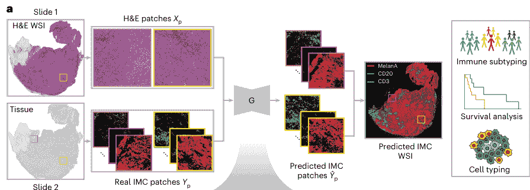

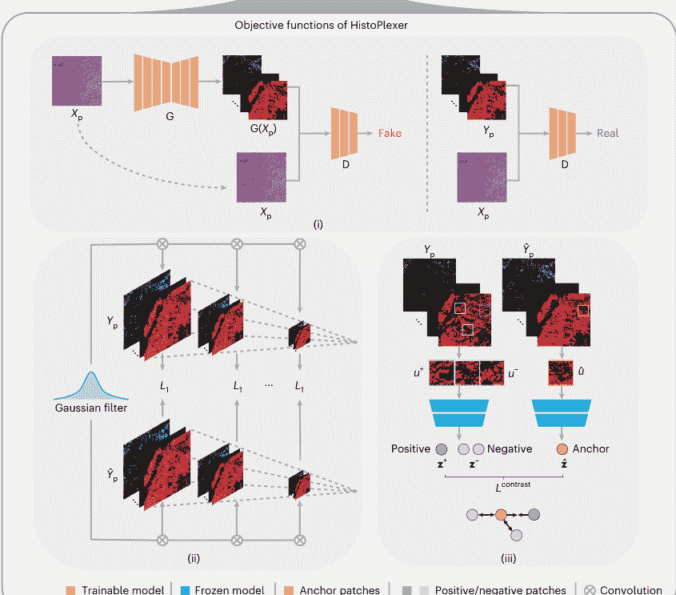

Fig. 1 Overview of HistoPlexer architecture. a. The HistoPlexer consists of a translator G that takes H&E and IMC images as input and predicts protein multiplexes from morphology information encoded in the H&E images, ultimately generating protein multiplex on the WSI level from H&E input. b. The objective functions of HistoPlexer contain the GAN adversarial loss (i), Gaussian pyramid loss with average L1 distance across scales (ii), and patch-wise contrastive loss with anchor from generated IMC and positive and negative from GT IMC (iii).

scores of 41.8% (±0.3%) for lymphocyte markers and 42.8% (±0.6%) for tumour markers. The generated images achieved HYPE scores of 61.6% (±1.3%) and 72.8% (±1.1%), indicating that the majority (>50%) were perceived as real by domain experts. Next, we went beyond pixel-level evaluation by identifying relevant cell types. We used GT cell-type annotations from the GT IMC training set, following ref. 8, and trained a random forest classifier based on average marker expression per cell to classify them into five classes: tumour cells, B cells, CD8+ T cells, CD4+ T cells and others.

This classifier was then applied to both GT and generated IMC images in the test set to obtain cell-type maps (Fig. 3a). We visualized ROIs from the tumour centre and the tumour front at the tumour–TME interface and examined spatial patterns based on immune subtype labels. We observed that immune 'hot' tumours, characterized by high immune cell infiltration, showed strong interactions between tumour and CD8+ T cells (Fig. 3a (i)), whereas immune 'cold' tumours, with low immune presence, displayed minimal immune cell interaction, especially in the tumour centre (Fig. 3a (ii)). Immune 'cold' ROIs

| Group | Method | MS-SSIM ↑ | PSNR ↑ | RMSE-SW ↓ |
|---|---|---|---|---|
| MP | Pix2Pix | 0.276 ± 0.004 | 13.680 ± 0.043 | 0.202 ± 0.002 |
| MP | PyramidP2P | 0.284 ± 0.005 | 13.894 ± 0.173 | 0.197 ± 0.004 |
| MP | HistoPlexer | **0.301 ± 0.003** | **14.206 ± 0.029** | **0.194 ± 0.001** |
| SP | Pix2Pix | 0.260 ± 0.001 | 13.015 ± 0.009 | 0.218 ± 0.001 |
| SP | PyramidP2P | 0.264 ± 0.016 | 13.216 ± 0.483 | 0.214 ± 0.011 |
| SP | HistoPlexer | 0.279 ± 0.002 | 13.354 ± 0.038 | 0.210 ± 0.002 |

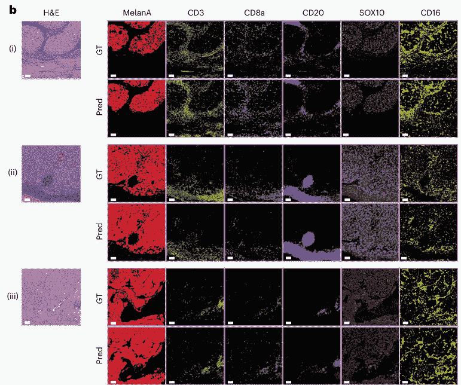

**Fig. 2** ROI-level assessment of HistoPlexer. a. Quantitative assessment and comparison against benchmarks using MS-SSIM, PSNR and RMSE-SW for MP and SP settings. The up arrow indicates higher values are better. The down arrow indicates lower values are better. The best results are highlighted in bold. b, Qualitative assessment of HistoPlexer for three ROIs ((i)–(iii)) with H&E as input to HistoPlexer, and expression profiles of individual markers: MelanA, CD3, CD8a, CD20, SOX10 and CD16. Top rows: GT expression profiles from IMC modality; bottom rows: predicted (Pred) expression profiles from HistoPlexer. Scale bars, 100 µm.

at the tumour front likewise exhibited sparse or clustered immune cells with minimal interaction with tumour cells (Fig. 3a (iii)–(v)). The strong alignment between predicted and GT cell-type maps suggests that HistoPlexer effectively captures morphological features in H&E images that are relevant for predicting cell types.

### HistoPlexer preserves spatial co-localization patterns

Given the importance of spatial patterns, as highlighted by refs. 31,32, we assess spatial co-localization by quantifying the correlations between protein markers that are simultaneously expressed within a given region. For each protein pair, we compute the Spearman’s correlation coefficient (SCC) between the two proteins and average it across ROIs, considering only those pairs with strong positive (>0.15) or strong negative (<–0.15) correlation in GT IMC images. We then compare the SCC between GT and generated IMC multiplexes.

The MP model's predictions match GT SCC better than the SP model, especially for sparse CD-based immune marker pairs like

CD16:HLA-DR, CD3:HLA-ABC and CD16:CD8a, which are underrepresented in the training data (Fig. 3b (i)). We hypothesize that sparse markers lack sufficient tissue context for the SP model to generate accurate predictions. In contrast, the MP model benefits from learning intermarker correlations by predicting all markers simultaneously and leveraging auxiliary morphological information from abundant markers. However, for some protein pairs (for example, CD3:CD8a and CD20:CD3), the SCC in MP exceeds that of the GT. This likely stems from similar morphologies of CD8+ T cells, CD3 T cells and B cells (CD20) in H&E images 28, potentially leading to overprediction of these sparse markers and overestimated co-localization patterns. Additionally, we compute the mean square error (MSE) between SCC values of GT and generated IMC across test ROIs (Fig. 3b (ii)). The MP model achieves an MSE approximately an order of magnitude lower than that of the SP model, supporting our hypothesis. Comparisons with Pix2Pix 23 and PyramidP2P 12 are in Extended Data Fig. 3a. See Supplementary Information for biological implications of observed patterns.

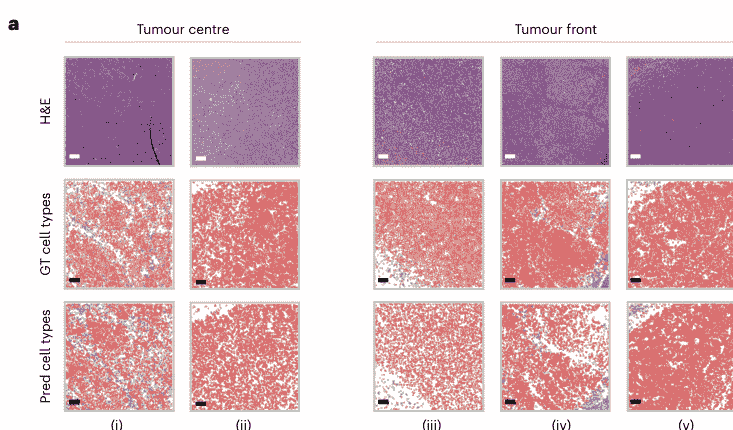

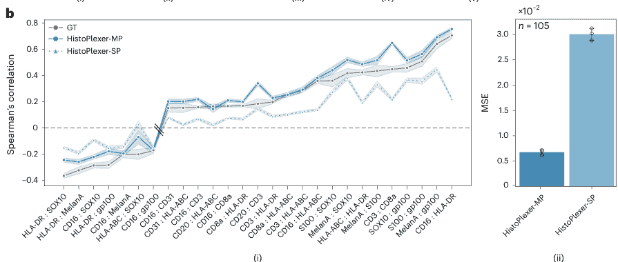

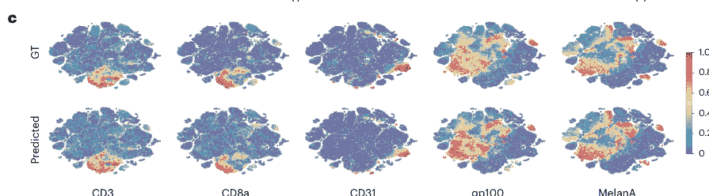

Fig. 3 | Assessing performance beyond pixel level using cell-type and spatial analyses. a, Cell-typing results: ROIs from the tumour centre ((i) and (ii)) and tumour front ((iii)–(v)), showing H&E, GT and predicted cell types in ROIs grouped by their location within the tissue: tumour centre and tumour front. Scale bars, 100 µm. b, Spearman’s correlation coefficients between tumour pairs comparing the GT with both SP and MP predictions of HistoPlexer (i). The pairs on the x axis are ordered by increasing Spearman’s correlation in the GT. MSE between the GT and predicted Spearman’s correlation coefficients, comparing the SP and MP predictions of HistoPlexer (ii). Bars represent mean values, and error bars indicate standard deviation (s.d.). c, Joint t-SNE visualization of protein co-localization patterns for selected markers: CD3, CD8a, CD31, gp100 and MelanA. The colour represents normalized protein expression.

To explore spatial patterns beyond protein pairs, we visualized expression profiles using t-distributed stochastic neighbour embedding (t-SNE) of cells from both GT and generated IMC multiplexes, following ref. 33. We observed a strong correspondence between t-SNE embeddings from both GT and generated IMC multiplexes (Fig. 3c). For instance, cells that are positive for CD3 and CD8a are concurrently negative for CD31, gp100 and MelanA. This aligns with biological expectations, as CD3 and CD8a are expressed on T cells but not on endothelial (CD31) or tumour (gp100, MelanA) cells. Full t-SNE plots for all markers are provided in Extended Data Fig. 3b.

In conclusion, our quantitative and qualitative results show that the spatial co-localization patterns in GT can be effectively replicated using the generated IMC images. These patterns can remain consistent across tissue sections, providing a robust evaluation metric that mitigates slice-to-slice variations.

### HistoPlexer enables multiplexed proteomics profiling on the WSI level

HistoPlexer enables the generation of IMC images from H&E WSIs of up to 100,000 × 100,000 pixels, allowing for the simultaneous

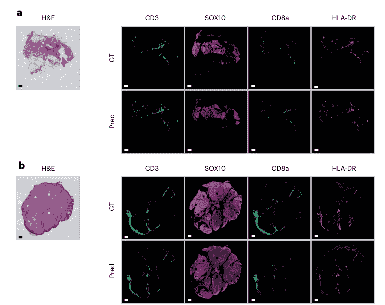

**Fig. 4 | Qualitative WSI-level assessment of HistoPlexer. a, b, H&E staining (first column; a and b) and expression profiles of individual markers (CD3, SOX10, CD8a and HLA-DR, from second to last column; a and b). Top rows: GT expression profiles from Ultivue images; bottom rows: Pred expression profiles at the WSI level for samples in a and b. Scale bars, 1 mm.**

visualization of multiple protein markers across entire tissue sections. This capability offers a comprehensive view of tumour and TME interactions at the WSI level. Because GT IMC data are available only for ROIs, we use Ultivue's InSituPlex technology to obtain multiplexed WSIs using the Immuno8o and MDSC FixVue panels. These panels include key markers, such as SOX10 for tumours, HLA-DR for antigen presentation and CD3/CD8a for T cell profiling, which are shared with the generated protein multiplex. Figure 4 provides a qualitative comparison between the generated IMC and Ultivue multiplex at the WSI level. In both cases, a high concordance in global structures and hotspot regions is observed across all markers. In Fig. 4b, whereas there is good alignment for CD3 and SOX10 markers, differences are observed for CD8a and HLA-DR, particularly at the tissue edges (for example, the bottom-left border). These differences are likely due to slice-to-slice variations between H&E and Ultivue images, which lead to slight shifts in tissue boundaries.

regions using the HALO AI platform across 34 TuPro melanoma samples. Figure 5b (i) shows immune subtype stratification using iCD8 and sCD8 densities (measured per μm²). We observe that immune desert cases exhibit very low iCD8 and sCD8 density, including the presence of only rare or isolated CD8+ T cells. Immune excluded cases also show very low iCD8 density but slightly higher sCD8 density compared to immune desert cases, suggesting some CD8+ T cells have reached the stroma but not the intratumoral regions. Inflamed cases display high densities of both iCD8 and sCD8, indicating the presence of CD8+ T cells in the stromal compartment and, most importantly, their infiltration into intratumoral regions. These trends are consistent with prior findings 5, validating the utility of our approach. To assess the clinical relevance, we analysed the distribution of iCD8 and sCD8 densities across immune-hot (inflamed) versus immune-cold (excluded and desert) cases (Fig. 5b (ii)). As expected, immune-hot cases exhibit substantially higher densities of both iCD8 and sCD8 compared to immune-cold cases. Furthermore, a random forest classifier trained to distinguish between immune-hot and immune-cold cases achieves an F1-score of 0.873 (s.d. 0.006) and a macro-average area under the receiver operating characteristic curve of 0.845 (s.d. 0.047) under 5-fold cross-validation. In conclusion, we demonstrate that HistoPlexer can accurately support immune phenotyping directly from H&E images. This capability offers potential utility in treatment decision-making and patient stratification. For clinical implications of immune phenotyping, refer to Supplementary Information.

### HistoPlexer facilitates immune phenotyping

We demonstrated the utility of HistoPlexer for immune phenotyping by stratifying immune subtypes based on the spatial distribution of CD8+ T cells, using only H&E images from TuPro metastatic melanoma samples. As illustrated in Fig. 5a, we visualized predicted tumour cells and CD8+ T cells across H&E WSIs. In immune-hot cases, characterized by substantial CD8+ T cell infiltration and typically associated with better response to immunotherapy 34,35, we observed both tumour (attacker) cells and infiltrating CD8+ (defender) T cells within the tumour region, suggesting an active immune response. In contrast, immune-cold cases exhibit minimal or no CD8+ T cell infiltration in the tumour area, correlating with poor immunotherapy outcomes. Building on the immune subtype classification framework proposed in ref. 5, we further quantified intratumoral (iCD8) and stromal (sCD8) CD8+ T cell densities within the tumour centre compartment. To do this, we first localized CD8+ T cells using HistoPlexer and then annotated and segmented the tumour centre into intratumoral and stromal

### HistoPlexer generalizes to an independent patient cohort

We evaluated the generalizability of the HistoPlexer on independent test data from the TCGA-SKCM cohort 19. Figure 6a shows the generated protein multiplex at the WSI level, along with expression profiles for three markers: tumour-associated MelanA, T cell marker CD3 and B cell marker CD20. In the immune-high sample, we observe higher expression and tumour infiltration of CD3 and CD20 markers, contrasting

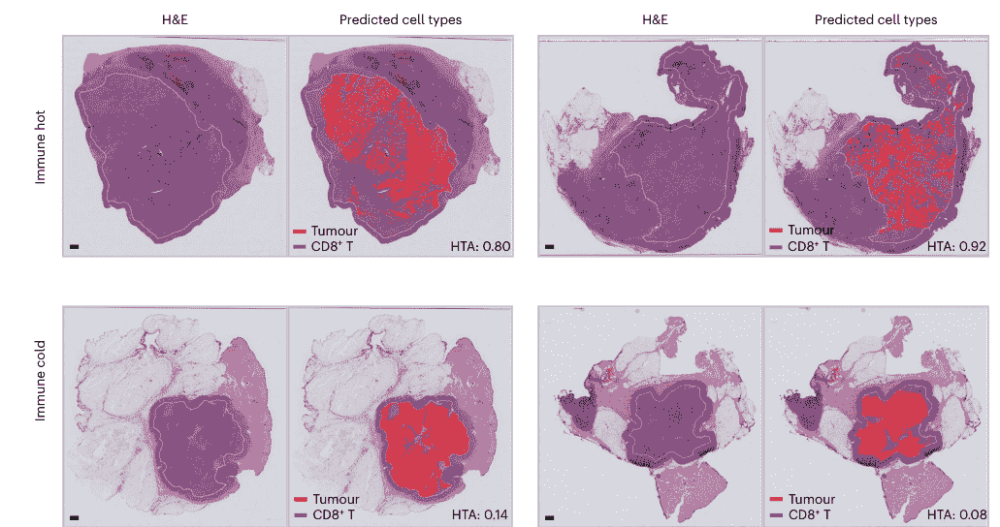

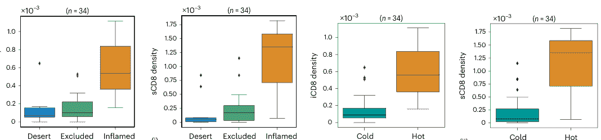

Fig. 5 使用 HistoPlexer 进行免疫表型分析。a. 来自 TuPro 转移性黑色素瘤队列的四个样本，第一排为两个免疫热样本，第二排为两个免疫冷样本。对于每个样本，左侧为 H&E 图像，右侧为使用 HistoPlexer 模型在肿瘤中心区域预测的肿瘤和 CD8+ T 细胞叠加图。每个样本均标明了异质性平均（HTA）指数，用于量化肿瘤与 CD8+ T 细胞之间的空间异质性或相互作用。比例尺，1 mm。b. 肿瘤中心区室中 iCD8 和 CD8+ T 细胞密度的箱线图，按免疫荒漠、排斥和炎症型分层（i）。肿瘤中心区室中 iCD8 和 sCD8 CD8+ T 细胞密度的箱线图，按免疫热型和冷型分层（ii）。箱线图显示中位数（中心线）、第 25 和第 75 百分位数（箱限），以及从箱限延伸至 1.5 倍四分位距范围内最极端数据点的须线。须线以外的点代表异常值。

在免疫低样本中表达极少或缺失，其中免疫标签基于批量 RNA 测序数据36。为探索生成 IMC 图像的临床实用性，我们评估了其在使用 MelanA、CD3 和 CD20 表达谱增强预后预测任务方面的价值，这些谱已知具有预后相关性37,38。我们使用预训练编码器从 H&E 和生成的 IMC WSI 中提取特征，并将其输入基于注意力的多实例学习（MIL）预测器39。我们在两种设置下训练了 MIL 预测器：（1）单模态设置，其中仅将 H&E 特征输入预测器；（2）多模态设置，其中从相应的 H&E 和预测的 IMC 补片提取的特征首先通过协同注意力层40进行聚合，然后将 MIL 池化层后的 H&E 和预测的 IMC WSI 的包级别表示进行串联，再输入分类头（Fig. 6）。我们在两项具有临床相关性的任务上对模型进行基准测试：免疫亚型分类和生存预测。对于生存任务，我们使用患者元数据中的疾病特异性生存率，这能更准确地反映患者的疾病状态41。对于免疫亚型分类，我们基于批量 RNA 测序推导的标签36将患者分为低、中和高免疫类别。总体而言，多模态设置在两项任务中始终优于单模态配置。对于生存预测，纳入生成 IMC 图像的特征可使 5 折交叉验证中平均时间相关 C-index42 提高 3.18%。多模态模型生成的 Kaplan–Meier 生存曲线显示，基于预测风险评分将患者清晰分层为低风险和高风险组（定义见“MIL-based clinical outcome prediction”部分），且经 log-rank 检验证实具有统计学意义（P = 5.05 × 10⁻⁷）。对于免疫亚型分类，结合 H&E 和生成的 IMC 特征使 5 折交叉验证中的平均加权 F1 分数提高了 17.02%。总之，这些发现既凸显了 HistoPlexer 对外部队列的推广性，也突显了生成的蛋白质表达图谱在支持下游预测建模和决策支持方面的临床实用性。

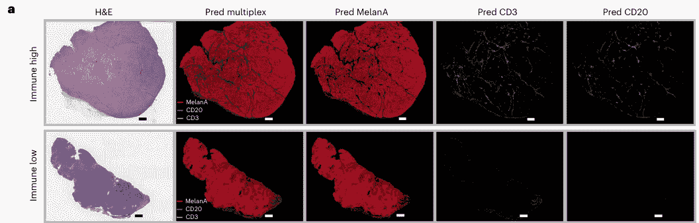

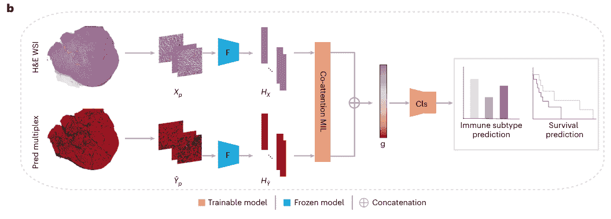

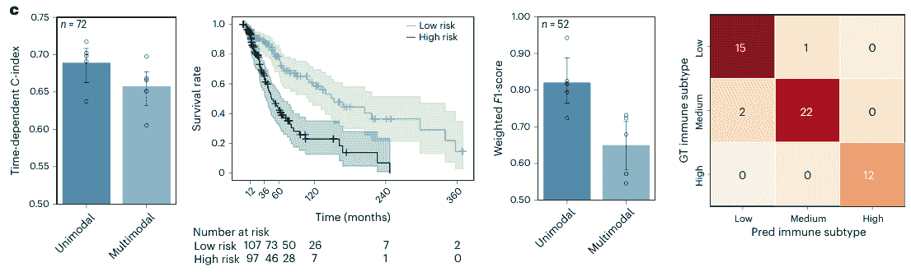

**Fig. 6** 泛化至独立患者队列。a. 来自 TCGA-SKCM 队列的两个示例（免疫高型和低型），显示 H&E 图像、预测的蛋白质多重图谱以及 MelanA、CD3 和 CD20 标志物的表达谱。比例尺，顶部 2 mm，底部 2.5 mm。b. 多模态生存和免疫亚型预测的模型架构。c. 生存预测结果（i），显示时间相关 C-index 分数（左侧）以及多模态设置下所有测试患者在五个交叉验证折叠中聚合的 Kaplan–Meier 生存曲线，并区分低风险和高风险组（右侧）。免疫亚型预测结果（ii），显示分为低、中、高免疫亚型的加权 F1 分数（左侧）和混淆矩阵（右侧）。混淆矩阵对应于加权 F1 分数最高的折叠。对于柱状图，柱状表示平均值，误差棒表示标准差。Cls，分类器头；F，残差神经网络特征提取器 ResNet18；Hx，H&E IMC 特征；Hx p，预测的 IMC 特征。

## 讨论

本研究中，我们引入了 HistoPlexer，这是一种生成模型，可直接从 H&E 图像预测高阶（11 通道）多重蛋白质表达谱，包括肿瘤标志物和免疫标志物。通过同时预测标志物，HistoPlexer 有效捕获了稀疏标志物，并保留了具有生物学意义的关系，这一点通过蛋白质共定位模式的空间相关性分析得到了验证。我们的全面评估表明，MP 方法始终优于 SP 替代方案，具有更高的 MS-SSIM 和 PSNR 以及更低的 RMSE-SW 和 MSE 值。域专家认为生成的 IMC 图像逼真，淋巴细胞和肿瘤标志物的 HYPE 错误率分别为 61.6% 和 72.8%。

为评估 HistoPlexer 在不同癌症类型中的更广泛适用性，我们在 DeepLIIF 数据集14,20 上对其进行了基准测试，该数据集提供肺癌和头颈癌的像素对齐 H&E 和多重图像。在两种设置中，HistoPlexer 始终优于基线方法，表明其在不同组织类型和成像条件下具有鲁棒性（扩展数据表 3 和 4）。

我们进一步探索了集成来自 UNI 病理计算基础模型43 的特征以增强 HistoPlexer 的性能，标志着首次尝试将病理基础模型应用于生成任务。令人惊讶的是，不使用 UNI 派生特征对 HistoPlexer 进行端到端训练会导致更低的 MSE 并更好地保留生物学关系（补充信息和扩展数据表 1）。这与最近的研究结果44 一致，强调了针对复杂生物学任务进行特定任务训练的重要性。基础模型通常设计为仅编码器架构，通过关注全局高级特征，在分类和回归等判别任务中表现出色。然而，它们不太适合需要详细空间关系和精细图像细节（对准确图像生成至关重要）的生成任务。

我们通过两种应用展示了临床实用性。首先，HistoPlexer 通过量化肿瘤中心区域的 CD8+ T 细胞浸润模式（iCD8、sCD8），实现了 WSI 层面的免疫表型分析。这些模式与最先进的方法5一致，并有效地将患者分层为免疫热型和冷型亚型，这对免疫治疗决策具有重要意义。其次，我们展示了其对独立队列（TCGA-SKCM）的推广性，其中 HistoPlexer 生成的特征与 H&E 特征共同使用时，提高了生存分析（时间相关 C-index 提高 3.18%）和免疫亚型分类（加权 F1 分数提高 17.02%）的预测性能。这些结果凸显了 HistoPlexer 增强临床决策的潜力。

本研究存在一些局限性。首先，在某些情况下，模型会混淆 CD3/CD8A T 细胞和 CD20 B 细胞标志物，因为它们具有形态学相似性。尽管这并未显著影响下游任务，但改进模型准确区分更细致细胞类型的能力是未来工作的优先事项。其次，我们的研究重点是主要的免疫和肿瘤细胞类型，如 CD8+ T 细胞、CD4+ T 细胞、B 细胞和肿瘤细胞。通过获取更大的训练队列，这一集合可进一步扩展以包含更多稀疏细胞类型，如内皮细胞。第三，对于 TCGA-SKCM 上的多模态学习实验，我们基于临床相关性将标志物选择限制为 MelanA、CD3 和 CD20。扩展标志物面板可进一步改善下游应用。最后，由于数据中固有的切片间差异，我们优先考虑下游任务性能而非严格的像素级准确性。

我们的工作开辟了几条有希望的研究方向。首先，将 HistoPlexer 扩展到更多蛋白质标志物和癌症类型，为揭示疾病机制的更深层次见解提供了机会，且无需额外组织或增加成本。实现更广泛的推广，包括跨癌症类型的通用模型开发，仍然是关键挑战，需要获取更大、更多样化且协调一致的数据集。我们目前的结果充当了概念验证，并为未来此类工作奠定了基础。其次，通过发布本研究生成的 UltiVue InSituPlex 数据集，我们鼓励研究人员探索用于多重蛋白质标志物生成的新型扩散模型，特别是那些考虑切片间差异的模型。最后，将预测的蛋白质表达图谱与其他模态相结合，可以加深我们对肿瘤生物学的理解并改善患者分层。

总之，HistoPlexer 通过能够从标准病理学切片高效且经济地生成多重蛋白质图谱，推动了病理计算学的发展。我们的研究结果证明了其在临床集成方面的潜力及其在增强癌症诊断和个性化治疗策略方面的实用性。

## 方法

### 数据集与预处理

Tumour Profiler 数据集。我们使用由 TuPro18 生成的高度多模态转移性黑色素瘤数据集的子集构建了 HistoPlexer 框架。每位患者均使用多种技术进行表征，包括数字病理和 IMC。在每张 H&E WSI 上，共选取了六个面积为 1 mm² 的 ROI，其中三个位于肿瘤中心，三个位于肿瘤前沿（肿瘤与 TME 的交界处）。IMC 数据在同一肿瘤区块的连续切片上针对这六个 ROI 生成。IMC 数据的分辨率为 1 µm/像素，H&E 图像的扫描分辨率为 0.25 µm/像素。因此，面积为 1 mm² 的 ROI 在 IMC 数据中由 1,000 个像素表示，在 H&E 图像中由 4,000 个像素表示。由于配对数据是通过视觉选择 ROI 生成的，在许多情况下，指定的 H&E 区域与生成的 IMC 区域之间可以观察到相当大的位置偏移和旋转。这通过模板匹配45 得以克服。具体来说，对于 IMC 模态，我们利用了肿瘤通道标志物 SOX10，它提供了组织的宝贵结构信息。对于 H&E 模态，我们关注 H 通道，它捕获对可视化细胞结构至关重要的苏木精染色。鉴于 H&E 和 IMC 代表不同的模态，我们采用互信息作为模板匹配的度量。这种方法使我们能够量化两个数据集之间的对齐情况，确保配对过程的鲁棒性。这产生了来自 78 名患者的 336 对 H&E 和 IMC ROI 的配对数据集，用于训练和测试模型性能。

使用 40 种抗体的面板进行了 IMC 表型分析，其中根据相应蛋白质的生物学功能和高 SNR 选择了 11 种用于本研究。11 种抗体靶向的蛋白质包括细胞类型标志物，如肿瘤标志物（MelanA、gp100、S100、SOX10）、淋巴细胞标志物（CD20、CD16、CD3、CD8a）和内皮标志物（CD31）。此外，两种与抗原呈递相关的功能标志物（HLA-ABC、HLA-DR）也被纳入蛋白质集。

使用 CellProfiler 软件对原始 IMC 图像进行细胞分割46。从图像中提取的蛋白质计数首先按每个蛋白质剪切至第 99.9 百分位以排除异常值，然后使用共因子为一的反双曲正弦函数进行转换47。为排除背景噪声，我们应用了核大小为 3、sigma 为 3 的 Otsu 阈值法48，并使用所有可用 ROI 对每个样本分别确定将信号与背景分开的阈值。得到的每种蛋白质数据首先进行中心化和标准化，然后基于仅使用训练集数据统计量进行最小-最大变换。

数据在患者层面按免疫表型（发炎型、免疫排斥型和免疫荒漠型）分层分为训练集和测试集。这种分层确保了每个集合中都包含肿瘤细胞和免疫细胞的代表性。患者层面的分割保证了给定患者的所有 ROI 仅属于一个集合，防止不希望的信息流动。得到的训练集和测试集分别包含 231 个和 105 个 ROI。在模型训练期间，随机选择 ROI，并从 H&E 图像中提取大小为 1,024 x 1,024 的瓦片以及相应的 256 x 256 IMC 区域。

对于 WSI 推理，我们开发了一个模块化的空间管道，以基于瓦片的方法处理 WSI，从而创建空间分辨率的蛋白质多重图谱。该过程始于组织分割，该步骤使用 Otsu 阈值法48识别染色组织区域并去除背景。然后将每个分割的组织区域划分为 1,024 x 1,024 像素的瓦片。为优化性能，我们使用数据加载器对这些瓦片进行批处理和并行处理，而不是按顺序处理。我们还使用 Shapes 库49 进行几何操作，例如为组织掩码创建多边形、将其缩放以匹配 WSI 分辨率，以及高效确定瓦片与组织区域之间的重叠。这种方法通过只关注相关区域来降低计算负担

WSI并避免后台处理。每个瓦片可选择使用Macenko方法^60进行可选的染色归一化，以减少染色变异性并确保图像间的颜色一致性。然后，通过训练好的HistoPlexer模型处理瓦片以预测蛋白多重影像。预测后，将生成的瓦片拼接在一起，以多种分辨率重建完整的WSI。我们还生成质量控制图像，以可视化瓦片和分割结果，并保存瓦片的坐标以供复现。对于可视化，我们使用训练集的最小-最大值对所有标记进行最小-最大归一化。

### Ulivue数据集

为了在WSI上对HistoPlexer进行定性评估，我们使用Ulivue InSituPlex技术，通过Immuno8和MDSC FixVue面板获取多重影像。Immuno8面板侧重于免疫景观特征分析，使用的标记物包括CD3、CD4、CD8、CD68、PD-1、PD-L1、FoxP3和PanCK/SOX10。MDSC面板使用CD11b、CD14、CD15和HLA-DR标记物来识别髓源性抑制细胞。Ulivue图像以每像素0.325 µm的分辨率获取。为了评估，我们使用CD3、SOX10、CD8a和HLA-DR标记物来评估生成的蛋白多重影像与Ulivue图像之间的视觉相似性。

配对的H&E和Ulivue WSI是通过首先在一个组织切片上进行H&E染色，然后对十个样品的连续切片获取Immuno8和MDSC数据生成的。每个样品均包含一份扁桃体组织作为阳性对照。H&E和Ulivue WSI之间的图像配准使用无监督多模态方法^51进行，利用Ulivue中的DAPI核染色与H&E图像对齐。Ulivue和生成的IMC图像均经过最小-最大归一化和直方图均衡化。此外，对Ulivue图像应用了自适应阈值处理，以减少噪声并提取真实信号。具有假信号的区域，特别是那些对应于H&E中的出血、出血或红细胞的区域，已被手动标注并从分析中排除。该数据集（包括H&E和Ulivue图像、对齐矩阵和标注的排除区域）公开可用，可以在Hugging Face (https://huggingface.co/datasets/CTPLab-DBE-UniBas/HistoPlexer-Ulivue) 上访问。该数据集可为该领域提供有价值的基线。

### TCGA-SKCM

从TCGA数据库（https://portal.gdc.cancer.gov/）下载了共472例SKCM的诊断WSI。还下载了SKCM样本的临床数据，包括年龄、性别、样本类型（原发肿瘤/转移性）和疾病特异性生存率。对于生存预测，我们排除了诊断WSI分辨率低或疾病特异性生存数据缺失的病例，总共剩余360例。对于免疫亚型预测，我们保留了共有免疫亚型标签的257例病例。对于每个任务，我们按年龄、性别和样本类型分层随机划分病例，以4:1的训练-验证集比例创建5倍交叉验证。

### HistoPlexer架构

HistoPlexer基于cGAN，以H&E图像作为输入条件，生成多重IMC图像，每张图像对应空间分辨的蛋白表达图谱。HistoPlexer的转换器是一个完全卷积的U-Net^32，由编码器和解码器组成。编码器包含六个下采样块，每个块含有一个步长为2、卷积核大小为3的卷积层。解码器包含五个上采样块，每个块包含最近邻插值，随后接一个步长为1、卷积核大小为3的卷积层。每个层之后均接一个批量归一化层和ReLU激活。鉴别器由六个块组成，每个块包含一个卷积层，随后接一个谱归一化层和ReLU激活。我们使用从模板匹配的H&E和IMC ROI对中提取的补片来训练HistoPlexer，并通过三个目标优化模型：对抗损失以强制图像级一致性，高斯金字塔损失以强制像素级一致性，以及补片级对比损失以强制补片级一致性。

### 对抗损失

我们采用LSGAN^33提出的最小二乘损失作为对抗损失，并使用二进制编码方案，其中0和1分别作为生成（即假）和真实IMC图像的标签。我们还采用多尺度梯度方法^54，该方法允许在多个尺度（即分辨率）上同时进行梯度传播。考虑一组尺度 {s ∈ S}，转换器G和鉴别器D的多尺度对抗损失定义为

$$L_G^{adv} = \frac{1}{|S|} \mathbb{E}_{x_p \sim X_p} \left[ (D(G^{(s)}(x_p)|x_p) - 1)^2 \right],$$

$$L_D^{adv} = \frac{1}{|S|} \sum_{s \in S} \left[ \mathbb{E}_{x_p \sim X_p} \left[ (D(y_p|x_p) - 1)^2 \right] + \mathbb{E}_{x_p \sim X_p} \left[ (D(G^{(s)}(x_p)|x_p))^2 \right] \right],$$

$$y_p \sim Y_p$$

(1)

其中 X_p = {x_p ∈ X_ROI} 和 Y_p = {y_p ∈ Y_ROI} 分别表示从模板匹配的H&E和IMC ROI中采样的配对训练补片；G^(s)(·) 和 D(·) 分别表示由转换器（在输出尺度s上）和鉴别器参数化的映射函数；|·| 表示集合的基数。

### 高斯金字塔损失

我们还按ref. 23实现了像素级L1损失。由于我们的H&E和GT IMC图像未在像素级对齐，我们通过计算生成和GT IMC图像的多分辨率表示上的L1损失^12，放宽了像素对像素对应关系的约束，该损失称为高斯金字塔损失^12。具体来说，通过迭代高斯平滑和下采样构建高斯金字塔。每个分辨率级别，称为一个八度，包含一系列平滑度递增的图像。分辨率之间的过渡是通过将当前八度最高平滑度级别的图像下采样来启动下一个级别：

$$y_{p,1}^{s+1} = \text{Downsample} \left( y_{p,\#gs}^s \right)$$

其中 #gs 表示一个分辨率下的高斯平滑次数。注意，对于生成的IMC图像，我们仅在最终输出尺度上计算了高斯金字塔。考虑一组分辨率 {r ∈ R}，高斯金字塔损失是对每个八度主层计算的L1损失的加权和，定义为

$$L^{gp} = \sum_{r \in R} w_r \mathbb{E}_{x_p \sim X_p} \left\| y_{p,1}^r - y_{p,1}^{r\prime} \right\|_1.$$

$$y_p \sim Y_p$$

(2)

其中 y_p 表示生成的IMC图像补片，w_l 表示分辨率级别，w_l 是该级别L1损失的权重。

### 补片级对比损失

我们进一步引入了受ref. 21启发的补片级对比损失。具体来说，我们首先使用预训练特征编码器提取多层特征，并通过一个小型投影头（例如多层感知机）对提取的特征进行变换，以丰富其表达性^35。然后，我们为每个特征层随机选择一组像素位置。通过聚合每个层的选定补片特征，我们可以分别获得生成和GT IMC图像的两组特征。

令 z'_i 表示从特征编码器的第l层提取的生成IMC图像第i个补片的锚特征；z'_i^+ 和 z'_i^- 分别表示从同一层提取的相应补片（即相同像素位置）的正特征和非相应补片集合（即不同像素位置）的负特征。我们的补片级对比损失定义为

$L_{\text{contrast}} = \mathbb{E}_{x_p \sim X_p} \frac{1}{\#\text{layer}} \frac{1}{\#\text{patch}} \sum_{i=1}^{\#\text{layer}} \sum_{i=1}^{\#\text{patch}} w_i(z_t^i, z_t^j) \ell_{\text{InfoNCE}}(z_t^i, z_t^j, z_t^j), \quad y_p \sim Y_p$

其中

$\ell_{\text{InfoNCE}}(\mathbf{z}, \mathbf{z}^+, \mathbf{z}^-) = - \log \frac{\exp(\mathbf{z} \cdot \mathbf{z}^+ / \tau)}{\exp(\mathbf{z} \cdot \mathbf{z}^+ / \tau) + \sum_{n=1}^N \exp(\mathbf{z} \cdot \mathbf{z}_n^- / \tau)}$

是InfoNCE目标^56，且

$w_t(z_t^i, z_t^j) = \left(1 - g\left(\frac{t}{T}\right)\right) \times 1.0 + g\left(\frac{t}{T}\right) \times h\left(\text{sim}(z_t^i, z_t^j)\right)$

是自适应补片权重^21。在此，#layer 和 #patch 分别表示提取特征的层数和补片数，_t_ 和 _T_ 分别表示当前和总训练步数，$h(\cdot)$ 表示某个加权函数，sim($\cdot$, $\cdot$) 是某个相似度测量。

虽然HistoPlexer转换器输出所有选定IMC标记物的预测，但在使用预训练特征编码器时，我们遇到了一个实际限制，该编码器通常需要RGB图像作为输入。为规避此问题，我们首先提取输出IMC图像的每个通道（即标记物），并沿通道维度复制它以创建伪RGB图像。然后将每个通道传递给特征编码器。最终的补片级对比损失是各通道损失之和。

G和D的总损失定义为

$L_G = L_G^{\text{adv}} + \lambda_{gp} L^{gp} + \lambda_{\text{contrast}} L_{\text{contrast}} \quad L_D = L_D^{\text{adv}} + \lambda_{R_1} R_1$

其中

$R_1 = \mathbb{E}_{x_p \sim X_p} \left\| \nabla_y D(y_p | x_p) \right\|_2^2 \quad y_p \sim Y_p$

是梯度惩罚^57，$\lambda_{gp}$、$\lambda_{\text{contrast}}$ 和 $\lambda_{R_1}$ 分别为高斯金字塔损失、补片级对比损失和梯度惩罚的权重。

### 实现和训练细节

该模型使用ADAM优化器^58训练了100个时代，动量参数为 $\beta_1 = 0.5$ 和 $\beta_2 = 0.999$，转换器和鉴别器网络的学习率分别为0.004和0.0008。权重使用Xavier初始化进行初始化。批量大小设置为16，IMC的补片大小为256，H&E图像的补片大小为1,024，以适应后者的更高分辨率。我们通过采用数据增强（包括颜色增强、随机翻转、小平移和旋转）来提高模型的泛化能力。我们采用了最小二乘GAN目标。损失项的权重如下：$\lambda_{gp} = 5.0$，$\lambda_{\text{contrast}} = 1.0$ 和 $\lambda_{R_1} = 1.0$。对于模型推理和评估，我们使用了模型训练结束时的最新检查点。

## 评估指标

为了评估生成图像的质量，我们使用了三种广泛采用的指标：PSNR、MS-SSIM和RMSE-SW。

### PSNR

PSNR用于通过量化最大可能信号功率与损坏噪声功率之间的比率来衡量重建质量。它以分贝表示，值越高表示图像质量越好。PSNR的计算公式为

$\text{PSNR} = 10 \log_{10} \left( \frac{L^2}{\text{MSE}} \right)$

其中 $L$ 是像素值的动态范围（例如，8位图像为255），MSE表示原始图像 $I$ 与生成图像 $I'$ 之间的MSE

$\text{MSE} = \frac{1}{N} \sum_{i=1}^N (I(i) - I'(i))^2$

### MS-SSIM

MS-SSIM通过引入多个尺度来扩展传统的SSIM指标，以捕捉不同分辨率下的结构相似性。两张图像 $I$ 和 $I'$ 之间的SSIM定义为

$\text{SSIM}(I, I') = \frac{(2\mu_I \mu_{I'} + C_1)(2\sigma_{II'} + C_2)}{(\mu_I^2 + \mu_{I'}^2 + C_1)(\sigma_I^2 + \sigma_{I'}^2 + C_2)}$

其中 $\mu_I$ 和 $\mu_{I'}$ 是均值，$\sigma_I^2$ 和 $\sigma_{I'}^2$ 是方差，$\sigma_{II'}$ 是两幅图像之间的协方差。$C_1$ 和 $C_2$ 是用于稳定除法的小常数。在MS-SSIM中，结构相似性在多个尺度上计算，最终分数是这些尺度上SSIM值的加权乘积：

$\text{MS-SSIM}(I, I') = \prod_{j=1}^M \left(\text{SSIM}_j(I, I')\right)^{\alpha_j}$

其中 $M$ 是尺度数量，$\alpha_j$ 是尺度 $j$ 的加权因子。MS-SSIM值越高，表示感知相似性越好。

### RMSE-SW

RMSE-SW是一种用于评估原始图像 $I$ 与生成图像 $I'$ 之间相似性的图像质量指标。与传统RMSE不同，传统RMSE在整个图像上全局计算误差，而RMSE-SW通过在图像上移动固定大小的窗口，在局部区域内计算误差。两张图像 $I$ 和 $I'$ 之间的RMSE-SW定义为

$\text{RMSE-SW} = \sqrt{\frac{1}{N} \sum_{k=1}^N \frac{1}{w \times h} \sum_{i=0}^{w-1} \sum_{j=0}^{h-1} (I(x_k + i, y_k + j) - I'(x_k + i, y_k + j))^2}$

其中 $w \times h$ 表示带定义步幅在图像上移动的窗口大小，得到 $N$ 个窗口。对于每个窗口，我们计算了 $I$ 和 $I'$ 对应像素值之间的MSE。

这些指标对生成图像的像素级准确性和感知相似性进行了全面评估。Frechet inception distance和kernel inception distance是评估生成图像质量的广泛使用的指标；然而，它们在小数据集上效果较差，因为它们依赖于队列的均值和协方差。因此，在评估HistoPlexer时未使用这些指标。

为了量化域专家的评估，我们使用了HYPE分数，它衡量人类将生成图像误认为真实图像或反之的错误率。它定义为

$\text{HYPE} = \left( \frac{\text{TP} + \text{FN}}{\text{TP} + \text{TN} + \text{FP} + \text{FN}} \right) \times 100 \quad \text{HYPE}_{\text{fake}} = \left( \frac{\text{FP}}{\text{TN} + \text{FP}} \right) \times 100 \quad \text{HYPE}_{\text{real}} = \left( \frac{\text{FN}}{\text{TP} + \text{FN}} \right) \times 100$

其中 TP 为真正例数，TN 为真反例数，FP 为假正例数，FN 为假反例数。

假阴性。HYPE$_{fake}$ 和 HYPE$_{real}$ 分别是生成图像和真实图像的误差率。

## HistoPlexer 用于细胞水平分析

**伪细胞。** 由于 IMC 数据的空间分析通常依赖于细胞水平读数，我们通过提取输入 H&E 和 GT IMC 图像中核坐标周围直径为 10 $\mu$m 的圆形区域来创建伪单细胞数据。针对个别标记物，伪细胞内的蛋白质表达量在像素间取平均值。H&E 图像的核坐标使用 HoVer-Net 模型$^{28}$获取，GT IMC 多重染色的核坐标和细胞类型标签使用 Ilastik$^{59}$ 和 CellProfiler$^{46}$ 获得，如参考文献 8 所述。为简化起见，以下文中将伪细胞称为“细胞”。

**细胞分型。** 我们采用随机森林分类器$^{30}$，基于 HistoPlexer 的 11 个标记物平均表达量对细胞进行分类。该分类器区分了肿瘤细胞、B 细胞、CD8$^+$ T 细胞、CD4$^+$ T 细胞和其他细胞。训练使用 scikit-learn 库$^{60}$ 进行，超参数（100 个基估计器，最大树深度 30）根据最低袋外误差选定。该模型在内部测试集上实现了 0.81 的宏观平均 F1 分数。随后，我们将训练好的 RF 分类器应用于 GT 和生成的蛋白质表达数据，以生成测试集中细胞的细胞类型图谱。

**细胞水平标记物表达的 t-SNE 分析。** 为了探索成对蛋白相互作用之外的空间模式，我们对细胞水平标记物表达进行了低维嵌入分析。遵循通常用于质量细胞术数据的方法$^{61}$，我们从 GT 和生成的 IMC 中每个 ROI 抽取 1,000 个细胞，每个 ROI 总计 2,000 个细胞。然后应用联合 t-SNE 降维（两维，困惑度 50，1,000 次迭代）。为了可视化，蛋白质丰度进行了缩放并在 99 百分位处截断，t-SNE 图按照缩放后的蛋白质表达进行着色$^{61}$。

## 免疫表型分析的注释

为了根据 CD8$^+$ T 细胞的空间分布将样本分层为免疫亚型，我们使用了参考文献 5 确立的注释区域。我们的数据集包括 TuPro 队列中的 109 个转移性黑色素瘤 H&E 整片切片，转移部位包括淋巴结、软组织、脑及其他远处部位。用于免疫亚型分析的主要区域（称为“肿瘤中心”）完全由肿瘤组织组成，手动定义为排除肿瘤-非肿瘤边界 500 $\mu$m 边缘的连续肿瘤团块。该“肿瘤中心”进一步分为两个区域：“肿瘤内肿瘤”区域，由无间质存在的致密恶性黑色素细胞簇组成；“肿瘤内间质”区域，包括交织在肿瘤细胞团块中的细胞外基质（通常为瘢痕样间质增生）但无恶性黑色素细胞。这些区域使用在 HALO$^{AI}$ 平台上实现的深度学习模型自动分类，该模型使用选定的 H&E 整片切片区域进行训练。组织分类在 0.30–$\mu$m/像素的分辨率下进行，最小对象大小阈值为 50 $\mu$m$^2$。排除的区域——如已有淋巴组织、大片脂肪和肌肉区域、伪迹、坏死、出血和背景——未纳入分析。最终，我们分析了 HALO$^{AI}$ 模型预测中组织分类质量最高的 34 个样本。扩展数据图 4 显示了带有区域注释和分类的示例 H&E 整片切片。

## 基于 MIL 的临床结局预测

**用于生存和免疫亚型预测的基于注意力的 MIL。** MIL 是一种用于基于集合的数据结构的弱监督学习方法。在 MIL 中，输入 $X$ 是一个实例的包（即排列不变集合）$X = \{x_1, ..., x_N\}$，其中 $N$ 表示包中实例的数量。给定一个具有 $K$ 个类别的分类任务，目标是从 $M$ 个训练对 $\{(x^{(m)}, y^{(m)})\}_{m=1}^M$ 中学习一个函数 $\mathcal{F}$，将 $X$ 映射到包级别标签 $y \in K$，而无需知道包中每个实例的标签 $y_i \in K$。在我们的场景中，输入是一张 WSI，实例表示提取的补片。更具体地说，我们遵循基于嵌入的 MIL 方法$^{39}$，从每个补片中提取特征向量 $\mathbf{h}_i = h(x_i) \in \mathbb{R}^d$。然后，注意力池化算子将补片特征 $\mathbf{h}_{1:N}$ 聚合为单个 WSI 级别表示$^{39}$

$\mathbf{g} = g(\mathbf{h}_i) = \sum_{i=1}^N a_i \mathbf{h}_i,$

其中

$a_i = \frac{\exp\{\mathbf{w}^\intercal(\tanh(\mathbf{V}\mathbf{h}_i) \odot \eta(\mathbf{U}\mathbf{h}_i))\}}{\sum_{j=1}^N \exp\{\mathbf{w}^\intercal(\tanh(\mathbf{V}\mathbf{h}_j) \odot \eta(\mathbf{U}\mathbf{h}_j))\}}$

是门控注意力$^{39}$。这里，$\mathbf{w} \in \mathbb{R}^L, V \in \mathbb{R}^{L \times D}, U \in \mathbb{R}^{L \times D}$ 是带有隐藏维度 $L$ 的可学习参数。$\odot$ 表示逐元素乘法，$\eta(\cdot)$ 表示 Sigmoid 函数。最后，分类器 $f(\cdot)$ 将 WSI 级别表示映射到 WSI 级别标签 $\hat{y} \in K$。

端到端预测采用以下一般形式：

$\hat{y} = \mathcal{F}(X) = f(g(\{h(x_i) : x_i \in X\})). \quad (11)$

对于生存预测，我们将事件时间分布建模为带有右删失数据的序回归任务（即，患者死亡在最后已知随访前未被观察到）。遵循参考文献 40，我们定义了离散时间间隔，并使用输出层中的独立神经元对每个间隔进行建模。更具体地说，我们根据生存时间值的四分位数将连续时间轴划分为非重叠的时间间隔 $[t_{j-1}, t_j)$，$j \in [1, ..., J]$，记为 $y_j$。然后将每个患者的连续事件时间 $t^{(m)}$ 替换为离散时间标签 $y_j^{(m)}$，其中

$y_j^{(m)} = y_j \quad \text{if } \tau^{(m)} \in [t_{j-1}, t_j) \text{ for } j \in \{0, ... J\}.$

问题随后简化为分类任务，每个患者由一个三元组 $(\mathbf{g}^{(m)}, y^{(m)}, c^{(m)})$ 定义。其中，$\mathbf{g}$ 是平均包特征；$c$ 是删失状态，若患者死亡被观察到则 $c=0$，否则 $c=1$；$y$ 是离散时间真实标签。我们采用负对数似然生存损失$^{42}$进行模型优化，表述为

$L_{surv} = \sum_{m=1}^M (-c^{(m)} \log (f_{surv}(y_j^{(m)} | \mathbf{g}^{(m)})) + (1-c^{(m)}) \log (f_{surv}(y_j^{(m)} - 1 | \mathbf{g}^{(m)})) + (1-c^{(m)}) \log (f_{hazard}(y_j^{(m)} | \mathbf{g}^{(m)}))), \quad (12)$

其中，$f_{hazard}(y|\mathbf{g}) = \text{Sigmoid}(\hat{y}_j)$ 是离散风险函数，$f_{surv}(y|\mathbf{g}) = \Pi_{k=1}^j (1 - f_{hazard}(y_k|\mathbf{g}))$ 是离散生存函数。

最后，患者级别风险定义为所有 logits 的负和$^{41}$，这使得可以识别不同的风险组并对患者进行分层。

对于免疫亚型预测，我们采用了定义的交叉熵损失：

$L_{ce} = - \sum_{m=1}^M \sum_{k=1}^K y_k^{(m)} \log (\hat{y}_k^{(m)}). \quad (13)$

基于协同注意力机制的多模态融合。为了融合不同模态的补片特征，我们采用了参考文献 40 提出的协同注意力机制。更具体地说，给定 H&E 特征包 \( H \in \mathbb{R}^{N \times d} \) 和 IMC 特征包 \( P \in \mathbb{R}^{N \times d} \)，我们通过计算交叉注意力来使用 \( P \) 引导 \( H \) 的特征聚集

其中 \( W_q, W_k, W_v \in \mathbb{R}^{d \times d} \) 是可学习权重，\( A_{p \to h} \in \mathbb{R}^{N \times N} \) 是协同注意力矩阵。直观地说，协同注意力衡量 H&E 实例 \( h \) 对 IMC 实例 \( p \) 的成对注意相似度，适用于 \( i \in N \)。同样，我们可以通过 \( A_{h \to p} \) 使用 \( H \) 引导 \( P \) 的特征聚集。每个协同注意力引导的特征包被输入到基于注意力的 MIL 模块中，该模块输出聚合的 WSI 级别表示。我们将多个模态的 WSI 级别表示进行拼接，并通过线性层将其投影回原始特征维度 \( d \)，得到多模态 WSI 级别表示。然后，分类器 \( f(\cdot) \) 使用此表示预测输出标签 \(\hat{y}\)。

## 实现和训练细节

我们采用了 GitHub 上基于注意力的 MIL 原始实现 https://github.com/AMLab-Amsterdam/AttentionDeepMIL。我们基于 MCAT 的原始实现（https://github.com/mahmoodlab/MCAT）实现了协同注意力机制。每张 WSI 在 ×20 倍放大下被裁剪为 256 × 256 个非重叠补片以创建包，其中非组织面积超过 10% 的补片被丢弃。我们使用在病理特定数据集上通过自监督学习预训练的 ResNet18（参考文献 63）从 H&E 补片中提取特征，并使用在 ImageNet 上预训练的 ResNet50 从 IMC 补片中提取特征。因为 ResNet18 需要三通道输入，我们沿通道维度拼接了三种不同蛋白质标记物的 IMC 图像：一个肿瘤标记物（MelanA）和两个免疫标记物（CD8 和 CD20）。提取特征的维度对 H&E 和 IMC 补片均为 512。我们对生存和免疫亚型预测进行了 5 折交叉验证。模型超参数设置如下：初始学习率为 1e-4（生存）和 5e-5（免疫亚型）的 Adam 优化器，基于验证损失的 ReduceLROnPlateau 调度方案以及小批量大小为 1。模型训练了 100 个时代，基于验证损失（生存）和加权 F1 分数（免疫亚型）进行早停。数据处理和模型训练在 NVIDIA A100 40GB GPU 上进行。深度学习模型使用 PyTorch（v.1.13.1）进行训练，流水线使用 Python（v.3.8.12）实现。

## 报告摘要

有关研究设计的更多信息可在本文链接的 Nature Portfolio 报告摘要中查阅。

## 数据可用性

使用 Ultivue InSituPlex 技术生成的 Immuno8 和 MDSC FixVue 面板的多重 WSI 图像以及配对 H&E 图像可在 Hugging Face 上公开获取，网址为 https://huggingface.co/datasets/CTPLab-DBE-UniBas/HistoPlexer-Ultivue。TCGA-SKCM 的 H&E 整片切片从 GDC 数据门户获取：https://portal.gdc.cancer.gov。用于模型训练的 Tumor Profiler 研究数据包含敏感临床信息，受伦理和隐私限制，因此不能无限制公开发布。数据可通过 Tumor Profiler 联盟门户 https://tumorprofilercenter.ch/contacts 申请获取。请求必须包括一份简要的科学提案，概述预期用途。联盟通常在四到六周内审查请求，并确定数据访问的范围、期限和条件。

经批准的用户必须遵守数据使用协议，该协议将数据使用限制在指定的研究目的，并禁止未经授权的进一步共享。源数据随本论文提供。

## 代码可用性

HistoPlexer 的源代码和训练好的模型权重可在 https://github.com/ratschlab/HistoPlexer 和 Zenodo 上获取，网址为 https://doi.org/10.5281/zenodo.15110117（参考文献 66）。

## 参考文献

- 1. Hanahan, D. & Weinberg, R. A. 癌症的标志：下一代。Cell **144**, 646–674 (2011).
- 2. Hanahan, D. 癌症的标志：新维度。Cancer Discov. **12**, 31–46 (2022).
- 3. Egeblad, M., Nakasone, E. S. & Werb, Z. 肿瘤作为器官：与整个生物体界面的复杂组织。Dev. Cell **18**, 884–901 (2010).
- 4. Jackson, H. W. et al. 乳腺癌的单细胞病理学图谱。Nature **578**, 615–620 (2020).
- 5. Sobottka, B. et al. 通过数字病理学建立转移性黑色素瘤的标准化免疫表型分析。Lab. Invest. **101**, 1561–1570 (2021).
- 6. Ptacek, J. et al. 用于跨肿瘤类型表征肿瘤微环境的多重离子束成像 (mibi)。Lab. Invest. **100**, 1111–1123 (2020).
- 7. Tan, W. C. C. et al. 癌症免疫治疗时代多重免疫组化/免疫荧光技术概述。Cancer Commun. **40**, 135–153 (2020).
- 8. Windhager, J. et al. 多重图像处理与分析的端到端工作流程。Nat. Protoc. **18**, 3565–3613 (2023).
- 9. Jin, M.-Z. & Jin, W.-L. 肿瘤微环境及药物重定向的更新图景。Signal Transduct. Target. Ther. **5**, 166 (2020).
- 10. Fischer, A. H., Jacobson, K. A., Rose, J. & Zeller, R. 组织和细胞切片的苏木精-伊红染色。Cold Spring Harb. Protoc. **2008**, 4986 (2008).
- 11. Burlingame, E. A. et al. Shift: 基于深度学习的肿瘤特征从组织病理学到免疫荧光的快速转换。Sci. Rep. **10**, 17507 (2020).
- 12. Liu, S. et al. BCI: 基于金字塔 pix2pix 的乳腺癌免疫组化图像生成。载于 IEEE/CVF 计算机视觉与模式识别会议论文集 1815–1824 (IEEE, 2022).
- 13. Liu, S. et al. 使用病理一致受限生成对抗网络进行无配对染色迁移。IEEE Trans. Med. Imaging **40**, 1977–1989 (2021).
- 14. Ghahremani, P. et al. 用于可复现和准确表征肿瘤免疫微环境的 AI 就绪多重染色数据集。载于国际医学图像计算与计算机辅助干预会议论文集（Greenspan, H. 等编）704–713 (Springer, 2023).
- 15. Pati, P. et al. 基于生成式 AI 的虚拟多重肿瘤分析加速组织病理学工作流程。Nat. Mach. Intell. **6**, 1–17 (2024).
- 16. Zhang, R. et al. Mvstain: 基于特定域映射的多重虚拟功能染色组织病理学图像生成。Med. Image Anal. **80**, 102520 (2022).
- 17. Zhou, Z. et al. 来源于非抗体染色荧光成像的胃癌预后虚拟多重免疫荧光染色。eBioMedicine **107**, 105287 (2024).
- 18. Irmisch, A. et al. 肿瘤分析师研究：用于临床决策支持的整合多组学功能肿瘤分析。Cancer Cell **39**, 288–293 (2021).

- 19. Guan, J., Gupta, R. & Filipp, F. V. 癌症系统生物学：TCGA-SKCM 中黑色素瘤基因组驱动因素的高效检测。Sci. Rep. 5, 7857 (2015).

- 20. Ghahramani, P. et al. 用于免疫组化图像定量的深度学习推导多重免疫荧光。Nat. Mach. Intell. 4, 401–412 (2022).

- 21. Li, F., Hu, Z., Chen, W. & Kak, A. 用于不一致真值图像对 H&E 到 IHC 染色翻译的自适应监督 PatchNCE 损失。载于：医学图像计算与计算机辅助干预 – MICCAI 2023（编辑 Greenspan, H. et al.）632–641（Springer, 2023）。

- 22. Culjak, I., Abram, D., Pribanic, T., Dzapo, H. & Cifrek, M. OpenCV 简介。载于：第 35 届 MIPRO 国际会议 1725–1730（IEEE, 2012）。

- 23. Isola, P., Zhu, J.-Y., Zhou, T. & Efros, A. A. 基于条件生成对抗网络的图像到图像翻译。载于：IEEE 计算机视觉与模式识别会议 1125–1134（IEEE, 2017）。

- 24. Wang, Z., Simoncelli, E. P. & Bovik, A. C. 用于图像质量评估的多尺度结构相似性。载于：第 37 届 Asilomar 信号、系统与计算机会议（编辑 Matthews, M. B.）1398–1402（IEEE, 2003）。

- 25. Detlefsen, N. S. et al. Torchmetrics–PyTorch 中的可重复性测量。J. Open Source Softw. 7, 4101 (2022).

- 26. Jain, A. K. 数字图像处理基础（Prentice-Hall, 1989）。

- 27. Zhu, J.-Y., Park, T., Isola, P. & Efros, A. A. 使用循环一致生成对抗网络的无配对图像到图像翻译。载于：IEEE 国际计算机视觉会议 2223–2232（IEEE, 2017）。

- 28. Graham, S. et al. Hover-net：多组织病理图像中细胞核的同时分割与分类。Med. Image Anal. 58, 101563 (2019).

- 29. Zhou, S. et al. Hype：生成模型人眼感知评估基准。载于：第 33 届神经信息处理系统会议（编辑 Wallach, H. et al.）3449–3461（IEEE, 2019）。

- 30. Breiman, L. 随机森林。Mach. Learn. 45, 5–32 (2001).

- 31. Mondello, P. et al. 新诊断滤泡性淋巴瘤中缺乏滤泡内记忆 CD4+ T 细胞可预测早期临床失败。Blood Cancer J. 11, 130 (2021).

- 32. Saltz, J. et al. 使用病理学图像上的深度学习研究肿瘤浸润淋巴细胞的空间组织与分子相关性。Cell Rep. 23, 181–193 (2018).

- 33. Chevrier, S. et al. 透明细胞肾细胞癌的免疫图谱。Cell 169, 736–749.e18 (2017).

- 34. Herbst, R. S. et al. 癌症患者对抗 PD-L1 抗体 MPDL3280A 反应的预测相关性。Nature 515, 563–567 (2014).

- 35. Ji, R.-R. et al. 免疫活跃的肿瘤微环境有利于伊匹单抗的临床反应。Cancer Immunol. Immunother. 61, 1019–1031 (2012).

- 36. Godson, L. et al. 使用多实例学习对黑色素瘤全张图像进行免疫亚型分型。Med. Image Anal. 93, 103097 (2024).

- 37. Pfannstiel, C. et al. 肿瘤免疫微环境驱动的预后相关性与膀胱癌亚型相关。Cancer Immunol. Res. 7, 923–938 (2019).

- 38. Wouters, M. C. & Nelson, B. H. 人类癌症中肿瘤浸润 B 细胞和浆细胞的预后意义。Clin. Cancer Res. 24, 6125–6135 (2018).

- 39. Ilse, M., Tomczak, J. & Welling, M. 基于注意力的深度多实例学习。载于：国际机器学习会议（编辑 Dy, J. & Krause, A.）2127–2136（PMLR, 2018）。

- 40. Chen, R. J. et al. 用于吉帕像素全张图像生存预测的多模态共注意力 Transformer。载于：IEEE/CVF 国际计算机视觉会议 4015–4025（IEEE, 2021）。

- 41. Jaume, G. et al. 用于生存预测的生物通路与病理学之间密集多模态交互建模。载于：IEEE/CVF 计算机视觉与模式识别会议 11579–11590（IEEE, 2024）。

- 42. Antolini, L., Boracchi, P. & Biganzoli, E. 生存数据的时间依赖性鉴别指数。Stat. Med. 24, 3927–3944 (2005).

- 43. Chen, R. J. et al. 迈向计算病理学的通用基础模型。Nat. Med. 30, 850–862 (2024).

- 44. Mulligi, N. et al. 基础模型——病理学人工智能的万能药？预印本：https://arxiv.org/abs/2502.21264 (2025).

- 45. Bradski, G. OpenCV 库。Dr. Dobb's J. 120, 122–125 (2000).

- 46. McQuin, C. et al. CellProfiler 3.0：面向生物学的下一代图像处理。PLoS Biol. 16, 2005970 (2018).

- 47. Crowell, H. L. et al. 基于 R 的 CyTOF 数据可重现且用户友好的预处理流程。F1000Res. 9, 1263 (2020).

- 48. Otsu, N. 来自灰度直方图的阈值选择方法。IEEE Trans. Syst. Man Cybern. 9, 62–66 (1979).

- 49. Gillies, S. et al. Shapely (2.0.6)。Zenodo https://doi.org/10.5281/zenodo.13345370 (2024).

- 50. Macenko, M. et al. 用于定量分析的病理切片归一化方法。载于：IEEE 生物医学成像国际研讨会：从纳米到宏观 1107–1110（IEEE, 2009）。

- 51. Nan, A., Tennant, M., Rubin, U. & Ray, N. Drimne：用于多分辨率图像配准的可微分互信息与矩阵指数。载于：第 3 届医学影像深度学习会议（编辑 Arbel, T. et al.）527–543（PMLR, 2020）。

- 52. Ronneberger, O., Fischer, P. & Brox, T. U-Net：用于生物医学图像分割的卷积网络。载于：医学图像计算与计算机辅助干预国际会议（编辑 Navab, N. et al.）234–241（Springer, 2015）。

- 53. Mao, X. et al. 最小二乘生成对抗网络。载于：IEEE 国际计算机视觉会议 2794–2802（IEEE, 2017）。

- 54. Karnewar, A. & Wang, O. MSG-GAN：用于生成对抗网络的多尺度梯度。载于：IEEE/CVF 计算机视觉与模式识别会议 7799–7808（IEEE, 2020）。

- 55. Chen, T., Kornblith, S., Norouzi, M. & Hinton, G. 视觉表征对比学习的简单框架。载于：国际机器学习会议（编辑 Daumé, H. & Singh, A.）1597–1607（PMLR, 2020）。

- 56. Oord, A. v. d., Li, Y. & Vinyals, O. 基于对比预测编码的表征学习。预印本：https://arxiv.org/abs/1807.03748 (2018).

- 57. Mescheder, L., Geiger, A. & Nowozin, S. 哪些 GAN 训练方法真的能收敛？载于：国际机器学习会议（编辑 Dy, J. & Krause, A.）3481–3490（PMLR, 2018）。

- 58. Kingma, D. P. & Ba, J. Adam：一种随机优化方法。载于：国际学习表征会议 (2015)。

- 59. Berg, S. et al. Ilastik：用于（生物）图像分析的交互式机器学习。Nat. Methods 16, 1226–1232 (2019).

- 60. Pedregosa, F. et al. Scikit-learn：Python 中的机器学习。J. Mach. Learn. Res. 12, 2825–2830 (2011).

- 61. Wagner, J. et al. 人类乳腺癌肿瘤与免疫生态系统的单细胞图谱。Cell 177, 1330–1345 (2019).

- 62. Zadeh, S. G. & Schmid, M. 基于交叉熵的深度生存网络训练中的偏差。IEEE Trans. Pattern Anal. Mach. Intell. 43, 3126–3137 (2020).

- 63. He, K., Zhang, X., Ren, S. & Sun, J. 图像识别的深度残差学习。载于：IEEE 计算机视觉与模式识别会议 770–778（IEEE, 2016）。

- 64. Ciga, O., Xu, T. & Martel, A. L. 数字病理学的自监督对比学习。Mach. Learn. Appl. 7, 100198 (2022).

- 65. Deng, J. et al. ImageNet：大规模层次图像数据库。载于：IEEE 计算机视觉与模式识别会议 248–255（IEEE, 2009）。

- 66. Andani, S. et al. “基于深度学习的病理学蛋白多重生成”的源数据。Zenodo https://doi.org/10.5281/zenodo.15110117 (2025).

## 资助

由瑞士联邦技术学院苏黎世分校提供开放获取资助。

## 竞争利益

V.H.K. 报告称，他曾是 Sharing Progress in Cancer Care (SPCC) 和 Indica Labs 的受邀演讲者，Takeda 的咨询委员会成员，并与 Roche 和 IAG 有赞助研究协议，以上均与本研究无关。V.H.K. 还是数字病理学癌症免疫治疗生物标志物评估专利申请、癌症患者复发风险多模态深度学习预测专利申请以及使用深度学习预测癌症治疗疗效专利申请的参与者，上述专利均与本工作不直接相关。G.R. 和 J.F.-P. 是不同测量模态细胞匹配专利申请的参与者，该专利与本工作不直接相关。此外，G.R. 是德国 Computomics GmbH 的联合创始人之一及其股东。B.B. 是苏黎世大学衍生公司 Navigostics 的联合创始人，该公司开发精准肿瘤诊断，并且是其股东和董事会成员。其他作者声明不存在竞争利益。

## 致谢

我们谨感谢肿瘤分析计划和肿瘤分析中心提供的资助（资助对象：V.H.K.、G.R. 和 B.B.）。J.F.-P. 获得肿瘤分析联盟的部分资助。肿瘤分析研究由公私合营伙伴关系共同资助，参与方包括 F. Hoffmann–La Roche Ltd.、ETH Zurich、苏黎世大学、苏黎世大学医院和巴塞尔大学医院。我们还感谢瑞士联邦技术学院个性化健康及相关技术战略聚焦领域提供的资助（编号 2021-367，资助对象：G.R.、V.H.K. 和 S.A.）、ETH AI Center（资助对象：G.R. 和 B.C.）、ETH 核心资助（资助对象：G.R.）、UZH 以及 UniBas 核心资助（资助对象：V.H.K.），以及 Promedica 基金会提供的资助（编号 F-87701-41-01，资助对象：V.H.K.）。B.B. 获得两项 SNSF 项目资助（编号 310030_205007：面向精准医疗方法的乳腺肿瘤生态系统属性分析；编号 316030_213512：生物样本细胞分辨率高性能质谱成像）、一项 NIH 资助（编号 UC4 DK108132）、CRUK iMAXT 大挑战以及欧洲研究委员会（ERC）在欧盟“视野 2020”框架计划下提供的资助（ERC 编号 866074，“精准基序”）。我们感谢 M. Nowak 和 A. Frei 为免疫分析生成和审阅数字病理学数据所作的贡献。我们还感谢苏黎世大学医院病理学与分子病理学系的 S. Dettwiler、F. Prutek、N. Wey 和 S. Krackow 在这一领域的出色合作与技术支持。我们感谢 I. Scopozza（瑞士苏黎世大学）在视觉评估评估方面的支持，并感谢 F. Pedrocchi 在病理学图像配准方面的工作。我们向 L. Godson（英国利兹大学）和 J. Nsengimana（英国纽卡斯尔大学）表示感谢，感谢他们共享 TCGA-SKCM 的免疫亚型数据。

## 附加信息

本论文的扩展数据可在 https://doi.org/10.1038/s42256-025-01074-y 处获取。

补充信息 在线版本包含可在 https://doi.org/10.1038/s42256-025-01074-y 处获取的补充材料。

通信和材料请求应发送至 Viktor H. Koelzer 或 Gunnar Rätsch。

同行评审信息 《自然·机器智能》感谢 Kianoush Falahheirkhah、Chen Li、Peiliang Lou、Hairong Lv 和 Saad Nadeem 对本工作同行评审所作的贡献。

再版和许可信息可在 www.nature.com/reprints 处获取。

出版者说明 Springer Nature 对于已发表地图中的管辖权声明和机构隶属关系保持中立。

开放获取 本文根据知识共享署名 4.0 国际许可协议获得许可，该许可允许在任何媒介或格式中使用、共享、改编、分发和复制，只要您对原作者和来源给予适当署名，提供知识共享许可链接，并指明是否进行了更改。本文中的图像或其他第三方材料包含在本文的知识共享许可中，除非材料署名行另有说明。如果材料未包含在本文的知识共享许可中，且您的预期用途未获法定规定允许或超过允许的用途，则需要直接从版权持有者处获得许可。要查看该许可的副本，请访问 http://creativecommons.org/licenses/by/4.0/。

## 作者贡献

G.R.、V.H.K.、S.A. 和 J.F.-P. 构思了本研究。G.R.、V.H.K.、S.A.、B.C. 和 J.F.-P. 参与了研究设计和文献回顾。V.H.K. 和 G.R. 监督了研究。V.H.K.、S.A.、J.F.-P.、B.S. 和 R.C. 收集了数据。S.A.、J.F.-P.、B.C. 和 S.H. 为代码编写、模型训练和数据分析做出了贡献。V.H.K. 和 G.R. 为专家评审和数据解释做出了贡献。B.C.、S.A.、V.H.K. 和 G.R. 设计了图表。S.A. 和 B.C. 撰写了论文。T.P.C.、V.H.K.、R.C.、B.B. 和 B.S. 为本研究中使用的数据和肿瘤材料提供了贡献。B.F.H. 为标注任务和数据定性评估做出了贡献。所有作者均可访问最终论文中展示的结果数据，并且所有作者均已阅读并批准了最终论文。提交决定由所有作者做出。V.H.K. 和 G.R. 同等参与本工作，并共享资深作者身份。

Sonali Andani¹,²,³,⁵, Boqi Chen¹,³,⁴,⁵, Joanna Ficek-Pasculli¹,³, Simon Heinke¹, Ruben Casanova⁶, Bernard Friedrich Hild⁷, Bettina Sobottka⁷, Bernd Bodenmiller⁶, Tumor Profiler Consortium*, Viktor H. Koelzer²,⁷,⁸,⁵² & Gunnar Rätsch¹,³,⁴,⁹,⁵²

1苏黎世联邦理工学院计算机科学系，苏黎世，瑞士。 2巴塞尔大学生物医学工程系计算与转译病理学组，巴塞尔，瑞士。 3瑞士生物信息学研究所，苏黎世，瑞士。 4苏黎世联邦理工学院人工智能中心，苏黎世，瑞士。 5苏黎世联邦理工学院信息技术与电气工程系计算机视觉实验室，苏黎世，瑞士。 6苏黎世大学定量生物医学系，苏黎世，瑞士。 7苏黎世大学医院病理学与分子病理学系，苏黎世大学，苏黎世，瑞士。 8巴塞尔大学医院医学遗传学与病理学研究所，巴塞尔，瑞士。 9苏黎世大学医院医学信息学单位，瑞士。 51这些作者平等贡献：Sonali Andani, Boqi Chen. 52这些作者共同监督了这项工作：Viktor H. Koelzer, Gunnar Rätsch. 作者名单及其所属机构列于论文末尾。 ✉️电子邮件：viktor.koelzer@usb.ch; gunnar.raetsch@inf.ethz.ch

## 肿瘤分析器联盟

Rudolf Aebersold10, Melike Ak11, Faisal S. Al-Quaddoomi12,13, Silvana I. Albert14, Jonas Albinus14, Ilaria Alberoli18, Sonali Andani13,15,16,17, Per-Olof Attinger18, Marina Bacac19, Daniel Baumhoer8, Beatrice Beck-Schimmer20, Niko Beerenwinkel13,21, Christian Beisel21, Lara Bernasconi22, Anne Bertolini12,13, Bernd Bodenmiller6,23, Ximena Bonilla15, Lars Bosshard12,13, Byron Calgua8, Ruben Casanova6, Stéphane Chevrier6, Natalia Chicherova12,13, Ricardo Coelho24, Maya D'Costa18, Esther Danenberg25, Natalie R. Davidson15, Monica-Andrea Bacu-Drăgan21, Reinhard Dummer11, Stefanie Engler6, Martin Erkens26, Katja Eschbach21, Cinzia Esposito25, André Fedier24, Pedro F. Ferreira21, Joanna Ficek-Pascal14,15,16,27, Anja L. Frei17, Bruno Frey28, Sandra Goetze14, Linda Grob12,13, Gabriele Gut25, Detlef Günther29, Pirmín Haueptle30, Viola Heinselmann-Schwarz24,31, Sylvia Herten19, Rene Holtackers25, Tamara Huesser19, Alexander Immer15,32, Anja Irmisch1, Francis Jacob24, Andrea Jacobs6, Tim M. Jaeger18, Katharina Jahn21, Alva R. James13,15,16, Philip M. Jermann8, André Kahles13,15,16, Abdullah Kahraman13,17, Viktor H. Koelzer17,33, Werner Kuebler34, Jack Kuipers13,21, Christian P. Kunze35, Christian Kurzeder36, Kjong-Van Lehmann15,37,38,39, Mitchell Levesque11, Ulrike Lischetti24, Flavio C. Lombardo24, Sebastian Luzet18, Gerd Maass28, Markus G. Manz40, Philipp Markolin15, Martin Mehnert14, Julien Mena10, Julian M. Metzler41, Nicola Miglino33,40, Emanuela S. Milani14, Holger Moch17, Simone Muenst8, Riccardo Murri42, Charlotte KY Ng8,43, Stefan Nicolet8, Marta Nowak17, Monica Nunez Lopez24, Patrick GA Pedrioli44, Lucas Pelkmans25, Salvatore Piscuoglio8,24, Michael Prummer12,13, Laurie Prélot13,15,16, Natalie Rimmer24, Mathilde Ritter24, Christian Rommel26, Mara L. Rosano-González12,13, Gunnar Rätsch4,13,15,16,44, Natascha Santacroce21, Jacobo Sarabia del Castillo25, Ramona Schlenker45, Petra C. Schwalie26, Severin Schwan18, Tobias Schäri21, Gabriela Senti22, Wenguang Shao14, Franziska Singer12,13, Sujana Sivapatham6, Berend Snijder10,13, Bettina Sodobtta17, Vipin T. Sreedharan12,13, Stefan Stark13,15,16, Daniel J. Stekhoven12,13, Tannya Tanna15,21, Alexandre PA Theocharides40, Tinu M. Thomas13,15,16, Markus Tolnay8, Vinko Tosevski19, Nora C. Toussaint46, Mustafa A. Tuncel13,21, Marina Tusup11, Audrey Van Droge14, Marcus Vetter47, Tatjana Vlajnic8, Sandra Weber22, Walter P. Weber48, Rebekka Wegmann10, Michael Weller49, Fabian Wendt14, Norbert Wey17, Andreas Wicki33,40, Mattheus HE Wildschut10,40, Bernd Wollscheid14, Shuqing Yu12,13, Johanna Ziegler11, Marc Zimmermann15, Martin Zoche17 & Gregor Zuend50

10 苏黎世联邦理工学院生物学系分子系统生物学研究所，苏黎世，瑞士。 11 苏黎世大学医院皮肤病学系，苏黎世，瑞士。 12 苏黎世联邦理工学院NEXUS个性化健康技术，苏黎世，瑞士。 13 SIB瑞士生物信息学研究所，洛桑，瑞士。 14 苏黎世联邦理工学院健康科学与技术系，苏黎世，瑞士。 15 苏黎世联邦理工学院计算机科学系机器学习研究所，苏黎世，瑞士。 16 苏黎世大学医院生物医学信息学，苏黎世，瑞士。 17 苏黎世大学医院病理学与分子病理学系，苏黎世，瑞士。 18 F. Hoffmann-La Roche Ltd, 巴塞尔，瑞士。 19 罗氏制药研究与早期开发，罗氏创新中心苏黎世，施利伦，瑞士。 20 苏黎世大学VP医学，苏黎世，瑞士。 21 苏黎世联邦理工学院生物系统科学与工程系，巴塞尔，瑞士。 22 苏黎世大学医院临床试验中心，苏黎世，瑞士。 23 苏黎世联邦理工学院分子健康科学研究所，苏黎世，瑞士。 24 巴塞尔大学医院及巴塞尔大学生物医学系，巴塞尔，瑞士。 25 苏黎世大学分子生命科学研究所，苏黎世，瑞士。 26 罗氏制药研究与早期开发，罗氏创新中心巴塞尔，巴塞尔，瑞士。 27 生物医学博士项目，生命科学苏黎世研究生院，苏黎世，瑞士。 28 罗氏诊断有限公司，本茨贝格，德国。 29 苏黎世联邦理工学院化学与应用生物科学系，苏黎世，瑞士。 30 巴塞尔乡下州医院大学诊所，利斯塔尔，瑞士。 31 巴塞尔大学医院妇科癌症中心，巴塞尔，瑞士。 32 马克斯·普朗克-ETH学习系统中心，斯图加特，德国。 33 苏黎世大学医学院，苏黎世，瑞士。 34 巴塞尔大学医院，巴塞尔，瑞士。 35 巴塞尔大学医院信息与通信技术系，巴塞尔，瑞士。 36 巴塞尔大学医院乳腺中心，巴塞尔，瑞士。 37 科隆-埃森癌症研究中心，科隆大学医院，科隆，德国。 38 亚琛综合肿瘤中心（CIO-A），亚琛，德国。 39 计算生物医学联合研究中心，亚琛工业大学大学医院，亚琛，德国。 40 苏黎世大学医院医学肿瘤学与血液学系，苏黎世，瑞士。 41 苏黎世大学医院妇产科学系，苏黎世，瑞士。 42 苏黎世大学科学IT服务与支持，苏黎世，瑞士。 43 伯尔尼大学生物医学研究系，伯尔尼，瑞士。 44 苏黎世联邦理工学院生物学系，苏黎世，瑞士。 45 罗氏制药研究与早期开发，罗氏创新中心慕尼黑，罗氏诊断有限公司，本茨贝格，德国。 46 瑞士数据科学中心，苏黎世联邦理工学院，苏黎世，瑞士。 47 巴塞尔大学医院乳腺中心&肿瘤中心，巴塞尔，瑞士。 48 外科系，乳腺中心，巴塞尔大学医院及巴塞尔大学，巴塞尔，瑞士。 49 苏黎世大学医院及苏黎世大学神经病学系，苏黎世，瑞士。 50 苏黎世大学医院，苏黎世，瑞士。

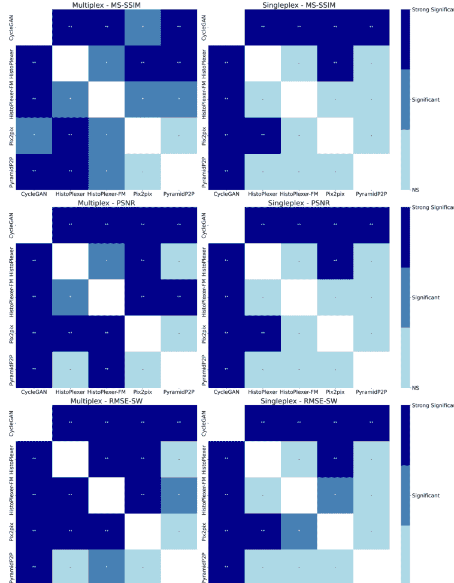

**扩展数据图 1 HistoPlexer和基线的统计检验。** 配对双侧t检验：在多重（左）和单重（右）设置中，比较MS-SSIM（第1行）、PSNR（第2行）和RMSE-SW（第3行）指标的方法间显著性水平。未对多重比较进行调整。显著性水平按颜色编码：不显著（NS）（p≥0.05），显著（p<0.05），和强显著（p<0.01）。

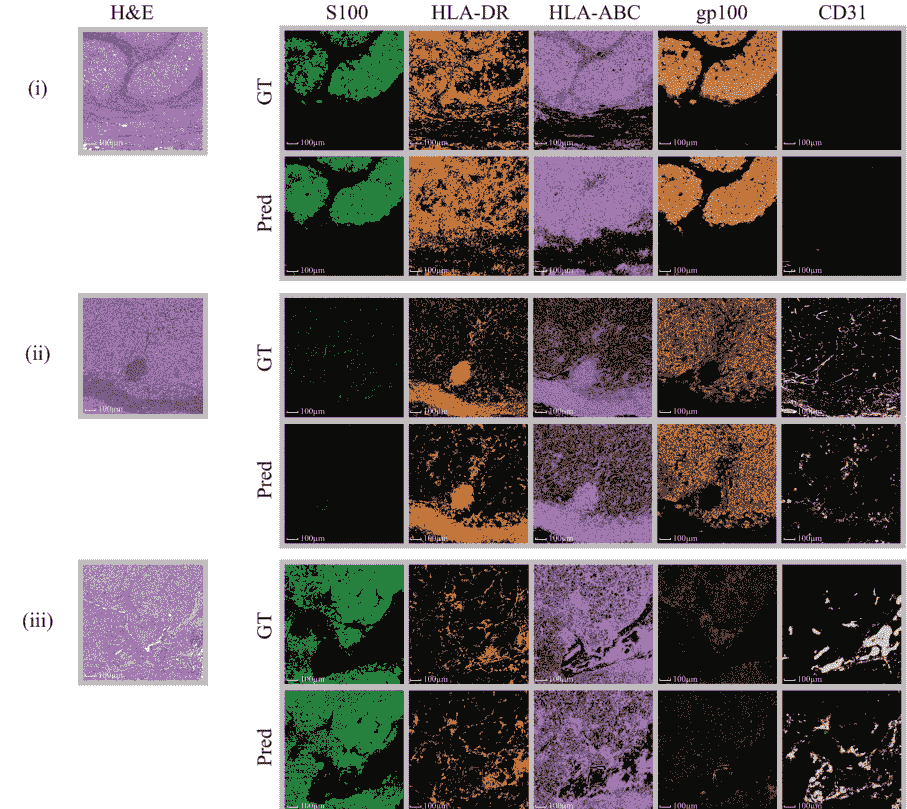

扩展数据图 2 | HistoPlexer的RoI水平定性评估。 H&E（第一列）和单个标志物的表达图谱：S100、HLA-DR、HLA-ABC、gp100和CD31（从第二列到最后一列）。第一行：基准真实（GT）表达图谱；第二行：预测（pred）表达图谱。

a

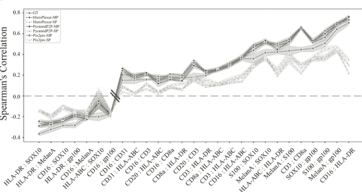

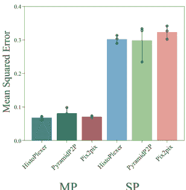

(i)

(ii)

b

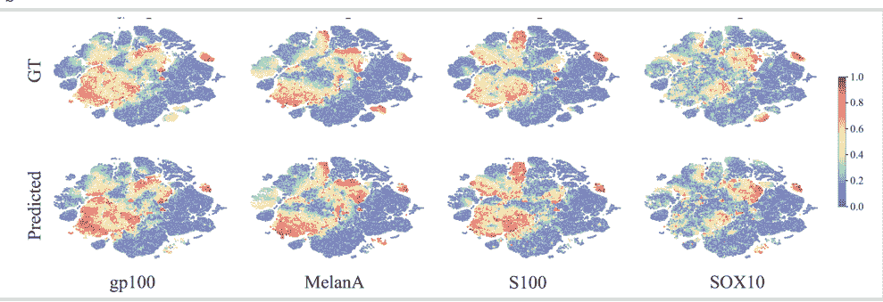

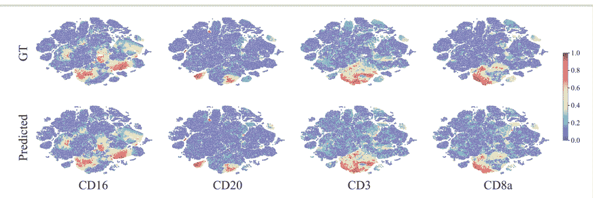

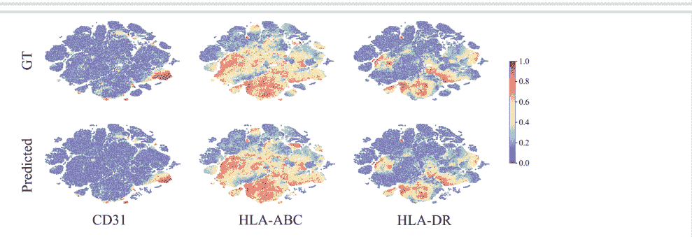

**扩展数据图 3 | 共定位模式。** a(i) 蛋白质对之间的Spearman相关系数，比较了实地真值（GT）与HistoPlexer的单重（SP）和多重（MP）预测。a(ii) GT与预测Spearman相关系数之间的均方误差，比较了HistoPlexer的SP和MP预测。柱状图表示均值，误差栏表示标准差（SD）。b) 蛋白质共定位模式的联合t-SNE可视化。

H&E

H&E with annotations

- 肿瘤内肿瘤
- 肿瘤内基质
- 肿瘤内淋巴样基质
- 排除

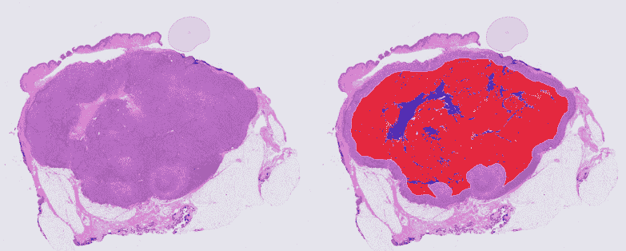

**扩展数据图 4 | 免疫表型分析的区域注释。** 左侧为H&E全切片图像（WSI），右侧为带有肿瘤中心区轮廓和注释区域的H&E全切片图像。

**扩展数据表 1 | HistoPlexer与基准的比较。** 使用MS-SSIM、PSNR、RMSE-SW和MSE对多重（MP）和单重（SP）设置下的共定位模型性能与基准进行比较。^箭头表示数值越高越好。↓箭头表示数值越高越好。最佳结果以粗体突出显示，次佳结果加下划线。

| | 方法 | MS-SSIM ↑ | PSNR ↑ | RMSE-SW ↓ | MSE-共定位 ↓ |
|---|---|---|---|---|---|
| MP | CYCLEGAN | 0.130±0.031 | 4.586±0.713 | 0.587±0.047 | 0.1885±0.0223 |
| | PIX2PIX | 0.276±0.004 | 13.680±0.043 | 0.202±0.002 | 0.0071±0.0003 |
| | PYRAMIDP2P | 0.284±0.005 | 13.894±0.173 | 0.197±0.004 | 0.0081±0.0013 |
| | HISTOPLEXER | **0.301±0.003** | **14.206±0.029** | **0.194±0.001** | **0.0068±0.0004** |
| | HISTOPLEXER-FM | **0.293±0.005** | **14.552±0.104** | **0.189±0.002** | 0.0128±0.0012 |
| SP | CYCLEGAN | 0.138±0.008 | 5.175±0.090 | 0.548±0.012 | 0.3084±0.0367 |
| | PIX2PIX | 0.260±0.001 | 13.015±0.009 | 0.218±0.001 | 0.0324±0.0016 |
| | PYRAMIDP2P | 0.264±0.016 | 13.216±0.483 | 0.214±0.011 | **0.0299±0.0045** |
| | HISTOPLEXER | **0.279±0.002** | **13.354±0.038** | **0.210±0.002** | 0.0302±0.0010 |
| | HISTOPLEXER-FM | **0.268±0.013** | **13.248±0.206** | **0.212±0.002** | 0.0514±0.0164 |

**扩展数据表 2 | 每个标记物的性能。** HistoPlexer对每个标记物使用MS-SSIM、PSNR、RMSE-SW指标的性能，以均值±标准差表示。

| 蛋白质 | MS-SSIM ↑ | PSNR ↑ | RMSE-SW ↓ |
|---|---|---|---|
| CD16 | 0.219±0.008 | 12.436±0.114 | 0.185±0.004 |
| CD20 | 0.520±0.011 | 19.528±0.267 | 0.102±0.002 |
| CD3 | 0.322±0.001 | 15.285±0.065 | 0.147±0.001 |
| CD31 | 0.682±0.009 | 24.305±0.260 | 0.054±0.002 |
| CD8a | 0.404±0.003 | 16.667±0.061 | 0.117±0.000 |
| HLA-ABC | 0.080±0.002 | 9.272±0.115 | 0.327±0.004 |
| HLA-DR | 0.221±0.007 | 12.478±0.136 | 0.188±0.004 |
| MelanA | 0.249±0.005 | 11.782±0.065 | 0.252±0.002 |
| S100 | 0.221±0.002 | 10.616±0.046 | 0.282±0.000 |
| SOX10 | 0.214±0.012 | 12.649±0.428 | 0.216±0.011 |
| gp100 | 0.180±0.003 | 10.693±0.144 | 0.275±0.002 |

**扩展数据表 3 | DeepLIIF-A数据集上的性能。** 在多重（MP）设置下，使用MS-SSIM、PSNR和RMSE-SW对DeepLIIF-A数据集上的模型性能进行比较。箭头表示数值越高（↑）或越低（↓）越可取。最佳结果以粗体突出显示。

| 组别 | 方法 | MS-SSIM ↑ | PSNR ↑ | RMSE-SW ↓ |
| :--- | :--- | :--- | :--- | :--- |
| MP | PIX2PIX | 0.654 | 19.694 | 0.075 |
| MP | PYRAMIDP2P | 0.647 | 19.672 | 0.075 |
| MP | HISTOPLEXER | **0.656** | **19.804** | **0.072** |

**扩展数据表 4 | DeepLIIF-B数据集上的性能。** 在多重（MP）设置下，使用MS-SSIM、PSNR和RMSE-SW对DeepLIIF-B数据集上的模型性能进行比较。箭头表示数值越高（↑）或越低（↓）越可取。最佳结果以粗体突出显示。

| | 方法 | MS-SSIM ↑ | PSNR ↑ | RMSE-SW ↓ |
|---|---|---|---|---|
| MP | PIX2PIX | 0.675 | 20.132 | 0.097 |
| | PYRAMIDP2P | 0.638 | 18.726 | 0.114 |
| | HISTOPLEXER | 0.704 | 20.642 | 0.092 |

## 报告摘要

Nature Portfolio希望提高我们发表的研究的可重复性。本表为报告的一致性和透明性提供结构。有关Nature Portfolio政策的更多信息，请参阅我们的编辑政策和编辑政策检查表。

### 统计学

对所有统计分析，请确认以下项目出现在图例、表例、正文或方法部分中。

- [x] 每个实验组/条件的精确样本量（n），以离散数字和测量单位给出
- [x] 关于测量是来自不同样本还是同一样本重复测量的声明
- [x] 使用的统计检验方法以及它们是单侧还是双侧
  *仅常见检验应仅通过名称描述；更复杂的技术应在方法部分中描述。*
- [x] 对所有协变量进行描述
- [x] 对任何假设或校正进行描述，例如正态性检验和多重比较调整
- [x] 对统计参数的完整描述，包括中心趋势（例如均值）或其他基本估计（例如回归系数）以及变异（例如标准差）或相关的不确定性估计（例如置信区间）
- [x] 对于零假设检验，应注明检验统计量（例如F、t、r）、置信区间、效应量、自由度和P值
  *在适用时，请给出P值的精确值。*
- [x] 对于贝叶斯分析，先验分布的选择和马尔可夫链蒙特卡洛设置的信息
- [x] 对于分层和复杂设计，确定适当的检验水平并完整报告结果
- [x] 效应量估计（例如Cohen's d、Pearson's r），并说明其计算方法

*我们关于生物学统计学的网络合集包含上述许多要点的文章。*

### 软件和代码

关于计算机代码可用性的政策信息

| 数据收集 | 我们使用Ultivue InSituPlex技术，通过Immuno8和MDSC FixVue面板对Tumor Profiler研究的10个样本获得多重图像，以在全切片图像水平上对HistoPlexer进行定性评估。图像采集分辨率为0.325 µm/pixel。 |
| 数据分析 | 数据处理和模型训练在NVIDIA A100 40GB GPU上进行。深度学习模型使用PyTorch（1.13.1）训练，管道使用Python（3.8.12）实现。HistoPlexer的源代码和训练好的模型权重可在https://github.com/ratschlab/HistoPlexer和通过Zenodo https://doi.org/10.5281/zenodo.15110117获取。 |

对于使用对研究至关重要但尚未在文献中描述的自定义算法或软件的手稿，必须向编辑和审稿人提供软件。我们强烈鼓励将代码存放在社区仓库中（例如GitHub）。有关提交代码和软件的更多信息，请参阅Nature Portfolio指南。

## 数据

关于数据可用性的政策信息

所有手稿必须包含数据可用性声明。该声明应在适用时提供以下信息：

- 公开可用数据集的登录号、唯一标识符或网络链接
- 对数据可用性的任何限制的描述
- 对于临床数据集或第三方数据，请确保声明符合我们的政策

使用Ultivue InSituPlex技术生成的Immuno8和MDSC FixVue面板的多重WSI图像，以及配对的H&E图像，可通过Hugging Face公开获取，网址为 https://huggingface.co/datasets/CTPLab-DBE-UniBas/HistoPlexer-Ultivue。

TCGA-SKCM的H&E WSI图像从GDC数据门户获取：https://portal.gdc.cancer.gov/。

用于模型训练的Tumor Profiler研究数据包含敏感的临床信息，并受到伦理和隐私限制，阻止无限制公开发布。

该数据可通过Tumor Profiler联盟的门户在 https://tumorprofilercenter.ch/contacts 上申请获取。

请求必须包括一份简要的科学提案，概述预期用途。

联盟通常在4–6周内审查请求，并确定数据访问的范围、期限和条件。

获批用户必须遵守数据使用协议，该协议将数据使用限制在指定的研究目的，并禁止未经授权的进一步共享。

## 涉及人体参与者、其数据或生物材料的研究

关于涉及人体参与者或人体数据的研究的政策信息。另请参阅关于性别、性别（身份/表现）、性取向以及种族、族裔和种族主义的政策信息。

| 性别和性别报告 | 未基于性别和性别进行特定的预先筛选。 |
| :--- | :--- |
| 种族、族裔或其他社会相关群体报告 | 未基于种族、族裔或其他社会相关群体进行特定的预先筛选。 |
| 人口特征 | 本研究不涉及。 |
| 招募 | 本研究背景下未进行患者招募。 |
| 伦理监督 | “瑞士研究伦理委员会协会”的伦理委员会批准了本工作中使用的Tumor Profiler研究数据的伦理审查。Tumor Profiler研究是一项获批的观察性临床研究（BASEC: 2018-02050, 2018-02052, 2019-01326, 2024-01428）。 |

还必须在手稿中提供研究方案批准的完整信息。

## 领域特定报告

请选择下面最适合您研究的一项。如果不确定，请在做出选择前阅读相应部分。

- [x] 生命科学
- [ ] 行为科学与社会科学
- [ ] 生态学、进化与环境科学

查看包含所有部分的文档参考副本，请参见 nature.com/documents/nr-reporting-summary-flat.pdf

### 生命科学研究设计

所有研究都必须披露这些要点，即使披露结果为阴性。

| 样本量 | 精确样本量的详细信息载于方法和结果部分。由于可获得多模态数据（包括H&E和IMC图像），我们使用了Tumor Profiler研究的转移性黑色素瘤样本。 |
| 数据排除 | 对于Tumor Profiler转移性黑色素瘤患者，由于大位移导致无法对齐H&E和IMC图像的样本被排除。对于Ultivue数据集，带有假信号（特别是对应于H&E图像中的出血、渗血或红细胞）的区域被手动注释并从分析中排除。对于TCGA-SKCM数据集的下游任务，分辨率低（< 0.3µm/pixel）的H&E图像被排除在分析之外。 |
| 重复 | 对于模型训练，实验使用三个随机权重初始化进行。对于下游任务，进行了5倍交叉验证。手稿结果部分的分析中报告了均值/标准差。 |
| 随机化 | 对于模型训练，数据集被随机划分为训练集和测试集。划分在患者层面进行，按免疫表型分层。详细信息载于方法部分。 |
| 盲法 | 对于人眼感知评估，领域专家对图像标签（真实或生成）进行了盲法。论文中的其他任何实验或分析均未进行盲法。 |

## 针对特定材料、系统和方法的报告

我们要求作者提供许多研究中使用的某些类型的材料、实验系统和方法的信息。此处，请指示列出的每种材料、系统或方法是否与您的研究相关。如果您不确定列表项是否适用于您的研究，请在选择响应前阅读相应部分。

### 材料与实验系统

- n/a | 研究中涉及
- [x] [ ] 抗生素
- [x] [ ] 真核细胞系
- [x] [ ] 古生物学与考古学
- [x] [ ] 动物及其他生物
- [x] [ ] 临床数据
- [x] [ ] 引起关注的双用途研究
- [x] [ ] 植物

### 方法

- n/a | 研究中涉及
- [x] [ ] ChIP-seq
- [x] [ ] 流式细胞术
- [x] [ ] 基于MRI的神经影像学

### 抗体

**使用的抗体**

- MelanA
- S100
- gp100
- SOX10
- CD3
- CD8a
- CD20
- CD16
- CD31
- HLA-ABC
- HLA-DR

**验证**

所有抗体在同位素-聚合物共轭之前均通过免疫荧光成像进行了验证。抗体在阳性对照组织中接受了细胞类型和细胞间定位特异性测试。

### 植物

**种子库存**

报告所用所有种子库存或其他植物材料的来源。如适用，请说明种子库中心和目录编号。如果植物标本是从野外采集的，请描述采集地点、日期和采样程序。

**新植物基因型**

描述所有新植物基因型的生成方法。这包括通过转基因方法、基因编辑、化学/辐射诱变和杂交产生的基因型。对于转基因系，请描述转化方法、分析的独立系数目以及进行实验的代际。对于基因编辑系，请描述使用的编辑器、编辑靶向的内源性序列、靶向引导RNA序列（如适用）以及编辑器的应用方式。

**鉴定**

描述每种所用种子库存或生成的新基因型的任何鉴定程序。描述用于评估突变效应的任何实验，以及（如适用）如何检查潜在的次要效应（例如，第二位点T-DNA插入、嵌合性、脱靶基因编辑）。

