# 蜜罐与路由器：互联网攻击收集指南


# 1 计算机网络

**HABIB-UR REHMAN**

计算机网络通常由三个组件组成：设备、媒介和拓扑。计算机、智能手机、笔记本电脑、路由器、交换机和中继器是计算机网络中可能存在的不同种类的设备。为了相互通信，这些设备通过媒介（无线或有线）连接在一起。通过媒介连接的设备所形成的示意图即为网络的拓扑结构。

在计算机网络中，通信实际上发生在设备之间。在人类对话的语境下，*communication*（通信）一词包含两人之间完整的对话。同样的规则适用于计算机网络：两个或多个设备之间的通信可能包含参与设备之间交换的多条消息。*Session*（会话）是一个更广泛使用的技术术语，用于描述设备之间交换的一系列相关消息。

在我们进一步深入讨论计算机网络之前，让我们回顾一下教科书中常用邮政服务的例子来解释计算机网络的工作原理。一栋房子可能有不止一位住户，他们可以是消息的发送者或接收者。所有这些住户共享同一个地址；然而，实际的发送者/接收者是通过信封上提到的姓名来识别的。邮政服务通常既不是发送者也不是接收者，但消息会经过它，并由它促成消息的传递。收件人地址用于将消息投递到目的地，发件人地址用于识别其来源。消息本身通常是以接收者可理解的方式排列的数据或信息。消息的整体组装也应让邮政服务能够理解，以便发件人和收件人的地址可区分、可识别且可定位。

当计算机通信时，诸如可理解、可区分或可识别等约束条件，要求对消息传递的程序和规定进行精确且全面的建立。这引入了计算机网络的第四个组件：协议。协议和标准是设备在通信过程中遵循的一组规则和程序。

本章分为四节，每节回顾计算机网络四个组件中的一个。

## 1.1 设备

设备在消息交换中通常扮演三种角色之一：它发起一条消息，或它是消息的接收者，或消息经过它传递。发起消息的设备通常称为*源端*或*源点*，而消息的接收者称为*目的端*或*汇点*。这两者合称为*端节点*或*端设备*。当两个端设备未直接连接时，消息会经过一个或多个中间设备。端设备通常是最终用户使用的计算设备，如 PC、手机和平板电脑；另一方面，中间设备通常是专用设备，其目的是促进端设备之间的传输。

根据其在通信中的角色，设备必须按特定顺序执行若干步骤，以使通信成功。例如，源设备的任务仅是指定目的设备的地址，而非目的设备或中间设备的地址。开放系统互连（OSI）参考模型，通常如此称呼，是对设备在计算机网络中通信时执行的任务和职责的概念性描述。该抽象模型根据活动的相关性和依赖性，将其划分为七组，称为*层*：物理层、数据链路层、网络层、传输层、会话层、表示层和应用层（图 1.1）。

计算机通信的主要目的是服务用户并传递数据或信息。用户通过某个应用程序与计算机系统（即我们通信场景中的设备）进行交互；提供给系统或从系统接收的数据或信息通常采用用户可理解的格式。鉴于此，端设备通常执行 OSI 模型中描述的所有动作，换句话说，实现所有七层。另一方面，中间节点可能仅实现有限数量的层（或执行与较少层相关的任务），具体取决于其在通信中的角色。对计算机网络中的设备进行分类的一种方法是根据它们所属的层进行分组。¹ 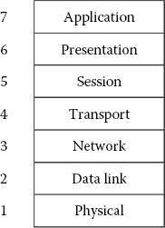

**图 1.1** 用于网络通信的 ISO/OSI 参考模型。

如前所述，用户主要与端设备交互，端设备是典型的计算设备。然而，通信始终涉及位于网络核心、连接两端的多个中间设备。接下来，我们提及通常参与计算机通信的四类重要中间设备。

### 1.1.1 调制解调器


调制解调器的工作是将数字信号转换为模拟信号，反之亦然。当设备通过电话网络进行数字通信时，通常需要调制解调器。根据定义，调制解调器仅执行*mo*dulation（调制）和*dem*odulation（解调），这是属于 OSI 第 1 层的任务。然而，在几乎所有情况下，相应的第 2 层功能也是该设备的一部分。

## 1.1.2 网桥

网桥是一种在 OSI 参考模型第 2 层运行的设备，它将两个较小的网络连接成一个，使两个网段中的设备能够相互通信。在大多数情况下，设备通过其端口单独连接到网桥。然而，当合并两个以上的较小网络时，多个网桥也可以通过相同的端口连接。网桥通常被称为*交换机*，尽管术语*交换机*具有更广泛的技术含义。网桥功能的更多细节请参见第 1.4.1 节。

## 1.1.3 路由器

路由器也是将一个或多个网络合并为一个的设备；但是，它们属于 OSI 模型的第 3 层。这意味着与网桥相比，路由器执行更多且更复杂的任务。通常，与网桥不同，设备不会直接连接到路由器的端口；事实上，是网桥连接到路由器。多个路由器也可以相互连接，以合并连接到它们各自的网络。路由器的操作和特性稍后将在第 1.4.2 节中描述。

## 1.1.4 网关

想象一位在中国的学生想通过邮政服务将入学申请发送给加拿大的一所大学。如果他只用中文写收件人地址会发生什么；加拿大的邮政工作人员如何投递？当遵循不同通信协议或标准的两个网络连接在一起时，需要一种网络设备来执行翻译工作，用技术术语来说是*转换*；这种设备称为*网关*。协议转换或翻译的功能可能在不同的级别或层中需要；因此，网关可以属于不同的层。例如，我们可以说调制解调器充当物理层网关设备。设计计算机网络的常见做法是在连接到单个路由器的整个网络中遵循相同的协议。因此，当两个路由器（遵循不同的协议/标准）连接在一起时，通常会产生对网关的需求。在这种情况下，网关的功能作为一个额外的软件组件在路由器内部实现，从而使路由器也能充当网关。

值得注意的是，在当今大多数计算机网络场景中，我们周围看到的设备有时会执行上述多种角色。一个非常常见的例子是家用路由设备，它既具有网桥的功能，也具有路由器的功能。同样，如今典型的 DSL 调制解调器结合了调制解调器、网桥、网关以及路由器的功能。

## 1.2 传输介质

计算机网络介质主要分为两大类：有线和无线。顾名思义，在有线介质中，消息通过连接设备的物理*线缆*传播。而在无线介质中，消息则以无线电波或红外波的形式在自由空间中传播。

### 1.2.1 有线网络

铜线是有线计算机网络中最常用的介质形式。同轴电缆和双绞线是两种广泛使用的铜线或电缆类型。在拨号上网中，使用普通老式电话服务线将计算机连接到互联网。普通老式电话服务线也是铜线，计算机需要调制解调器才能通过这种线进行通信。第四种常见类型是光纤电缆，一种由玻璃或塑料制成的细电缆或光纤，可作为*光导管*工作。

**双绞线**。顾名思义，双绞线电缆由绞合在一起的细铜线制成。多对屏蔽或非屏蔽导线被捆绑在一根电缆中。由于成本较低且易于处理，双绞线电缆是计算机网络和电话网络中使用最广泛的电缆类型。根据质量、结构、用途和支持的数据速率，它有多种类型和类别。最高等级的双绞线电缆可达到 1 Gbps 的数据速率；然而，大多数变体可在无显著信号强度损失的情况下传输高达 100 m 的信号。

**同轴电缆**。同轴电缆中心有一根铜线，周围包裹一层绝缘层。在该绝缘层外，还有一层编织状的铜层和最后的外护套绝缘层。在双绞线电缆出现之前，它是常见的计算机网络电缆类型。目前，它仍常用于有线电视和有线互联网。

**光纤**。在光纤电缆中，信号以光束或光波的形式在玻璃或塑料光纤内传输。多根光纤通常捆绑在一根电缆中。单根光纤可承载多个光波，且每个光波可实现的数据速率远高于铜线。此外，干扰和衰减的影响非常小，使得信号能够传输更长的距离。由于其极高的数据速率和较高的成本，光纤电缆不用于互连单个计算机；而是用于汇聚网络。

### 1.2.2 无线网络

无线网络主要分为两大类：第一类由无线电波承载数据；第二类由红外波承载数据。基于无线电的无线网络更为常见，因为红外波只能沿直线传播，无法穿透墙壁。无线介质的一个重要特征是它始终是共享的，因为信号在开放空间中传播，所有设备均可访问。

## 1.3 网络拓扑

网络拓扑可以是物理的，也可以是逻辑的。物理拓扑描述设备如何在物理上相互链接，以及这些链路使用何种介质。另一方面，逻辑拓扑是物理拓扑的抽象视图，隐藏了不必要的细节。因此，通过过滤无关细节，一个物理拓扑可以产生多个逻辑拓扑。这两个术语之间的关系可以用建筑物的布局或规划来更好地描述。建筑物的详细规划将包含所有细节，如墙壁、门、电线、水管和下水道，就像物理拓扑包含计算机网络的所有细节一样。然而，我们也可以只有建筑物的电线布局图；这样的规划类似于计算机网络中的逻辑拓扑。计算机网络中的设备可以使用不同的方法互连；因此，可能存在不同种类的物理拓扑。

计算机网络覆盖的物理区域是与拓扑相关的另一个重要方面。这主要是由于不同介质类型的技术限制各异。一种对网络进行分类的经典方法是基于它们覆盖的地理区域。局域网（LAN）、城域网（MAN）和广域网（WAN）是三大主要类别。最初，LAN、MAN 和 WAN 是根据覆盖区域来区分的；网络的管理边界以及参与网络的设备在目的方面的相关性是决定网络所属类别的一些附加因素。


### 1.3.1 广域网

广域网是由分布在广阔区域（例如一个州、一个大陆，甚至更大）的设备组成的网络。因此，互联网通常被称为广域网；事实上，它是最大的广域网。同样，某些互联网服务提供商的全国性网络也是广域网的一个例子。

### 1.3.2 局域网

局域网通常局限于一栋建筑或同一管理下的一组相邻建筑。局域网的地理界限并不那么精确，当局域网覆盖区域显著较大时，也会使用诸如 `campus area network`（校园区域网）之类的术语。然而，从技术上讲，当所有参与设备都使用私铺的物理拓扑互连，并在同一管理之下时，该网络被视为局域网。这一定义也引出了这样一个结论：当一个组织的业务分布在一个大都市区或广域区时，在几乎所有情况下，该组织的城域网或广域网在逻辑上（`logically`）都是铺设在其他组织（通常是该地区公共电话和数据网络的所有者）的物理网络之上的。

局域网和广域网使用的协议和技术也不同，这主要还是由于所用物理介质的不同衰减特性所致。

## 1.4 网络协议与标准

尽管设备和介质是计算机网络的物理组件，但协议对于通信的成功同样重要，因为设备需要遵循一个既定的计划。协议描述了设备在通信期间要执行的动作和遵循的准则。如前所述，OSI 参考模型是计算机网络通信的基础文档。在大多数情况下，协议针对 OSI 模型的工作计划；然而，没有单一协议能覆盖 OSI 模型的所有七层。单个协议通常针对单个层的工作，且协议始终与相应的 OSI 层相关联。为了执行通信，设备遵循多个协议，这些协议以协作方式工作。这要求协议之间应当相互兼容。由于这一事实，协议以家族或群组的形式演进，其中一个家族包含属于不同 OSI 层且相互兼容的协议。

协议和标准的类别实际上非常丰富且无穷无尽；然而，在本节中，我们将讨论范围限制在该列表中的相关项目。在计算机网络中，术语 `standard`（标准）宽泛地指代由某些既定权威或组织（如 IEEE）设计或批准、供更广泛商业用途的协议、模型、架构或其组合。

## 1.4.1 IEEE 802 标准家族

IEEE 802 是一组用于局域网和城域网的标准。它针对 OSI 模型前两层的通信任务。IEEE 802 局域网和城域网参考模型进一步将数据链路层划分为两个子层：介质访问控制（MAC）和逻辑链路控制，如 图 1.2 所示。

IEEE 802 局域网和城域网是基于分组的网络，消息作为数据八位字节序列传输；大多数商业可用的设备和应用程序都受这些标准支持。在该层面上，分组在技术上被称为 `frames`（帧）。MAC 子层主要负责两个设备之间的无连接帧传输，而逻辑链路控制更关注管理、安全或确认等服务（图 1.3）。

IEEE 802 标准家族针对多种类型的物理介质制定了单独的标准，如 图 1.4 所示。每个标准都是针对特定物理介质和相关 MAC 层的协议和准则的集合，例如以太网、无线局域网和宽带无线城域网。所有类型的 MAC 都通过 MAC 服务访问点向逻辑链路控制提供具有核心功能的通用服务。

![Figure 1.2 IEEE 802 LAN and MAN reference model for end stations. LLC—logical link control, MAC—medium access control, LSAP—link service access point, MSAP—MAC service access point, And PhSAP—physical service access point. (Data from IEEE Standard for Local and Metropolitan Area Networks: Overview and Architecture, IEEE Std 802®-2001 [R2007].)](images/pg10_1.jpg)

**图 1.2** IEEE 802 终端站局域网和城域网参考模型。LLC—逻辑链路控制，MAC—介质访问控制，LSAP—链路服务访问点，MSAP—MAC 服务访问点，PhSAP—物理服务访问点。（数据来源：《IEEE Standard for Local and Metropolitan Area Networks: Overview and Architecture》，IEEE Std 802®-2001 [R2007]。）

![Figure 1.3 IEEE 802 reference model with end-station management and security. LMM— LAN/MAN management and SDE—secure data exchange. (Data from IEEE Standard for Local and Metropolitan Area Networks: Overview and Architecture, IEEE Std 802®-2001 [R2007].)](images/pg10_2.jpg)

**图 1.3** 带有终端站管理和安全的 IEEE 802 参考模型。LMM—局域网/城域网管理，SDE—安全数据交换。（数据来源：《IEEE Standard for Local and Metropolitan Area Networks: Overview and Architecture》，IEEE Std 802®-2001 [R2007]。）

![Figure 1.4 IEEE 802 standards family. (Data from IEEE Standard for Local and Metropolitan Area Networks: Overview and Architecture, IEEE Std 802®-2001 [R2007].)](images/pg11_1.jpg)

**图 1.4** IEEE 802 标准家族。（数据来源：《IEEE Standard for Local and Metropolitan Area Networks: Overview and Architecture》，IEEE Std 802®-2001 [R2007]。）

最初，该标准将局域网视为一种具有共享介质、信息广播给所有站点的对等通信网络。然而，后来也纳入了用于局域网互连的网桥及相关功能。事实上，在不需要任何中间交换节点的情况下直接通信的能力，是 IEEE 对局域网和城域网定义中的第二个区别点，第一个是它们地理区域的差异。在其范围内，该标准讨论了两类局域网互连设备：用于 MAC 层互连的网桥（见 1.1 节）以及用于物理层互连的中继器和集线器。为了理解这两类的区别，我们需要回顾术语 `access domain`（接入域）。

**接入域**。局域网或城域网中一组使用单一 MAC 协议且介质在所有设备间共享的设备和介质被称为 `access domain`。在这种情况下，最多只有一个设备发送，连接到介质上的所有其他设备接收。中继器以一种方式连接两个局域网，使它们成为单个接入域，这意味着当来自任一参与局域网的一个设备发送时，所有连接的局域网上的所有其他设备都将接收。当我们有兴趣扩大局域网的范围时，中继器很有用，这可能是由于介质的技术限制，如信号衰减。当局域网中的设备使用星型布线拓扑连接时，术语 `hub`（集线器）用来指代中继器。


### MAC 网桥

承接我们在第 1.1 节中对网桥的早期介绍，IEEE 802 标准将网桥定义为在 MAC 层级互连两个或多个 LAN，但将它们保持为独立接入域的设备。网桥在 MAC 层运行，并对逻辑链路控制及任何其他上层保持透明。尽管设备可以与任何参与 LAN 中的任何其他设备通信，但消息通常仅在发送方所属的 LAN 和接收方所属的 LAN 中被听到，其余的 LAN 不会观察到此传输（图 1.5）。网桥会在必要时将在某个 LAN 上听到的消息中继或过滤到其他 LAN。中继和过滤基于存储在帧头中的目的地址和源地址。

![Figure 1.5 Internal organization of MAC sublayer with bridging. (Data from IEEE Standard for Local and Metropolitan Area Networks: Overview and Architecture, IEEE Std 802®-2001 [R2007].)](images/pg12_1.jpg)

**图 1.5** 带网桥功能的 MAC 子层内部组织。（数据源自 *IEEE 标准：局域网和城域网概述与架构*，IEEE Std 802®-2001 [R2007]。）

### MAC 地址

根据 IEEE 802 标准，每个设备^(²) 都使用 MAC 地址。MAC 地址用于帧头中以描述源设备和目的设备，并被网桥用来过滤和中继帧。

### 以太网

以太网是属于 IEEE 802 系列的众多物理层 (PHY)/MAC 标准之一。它是建立有线 LAN 最广泛使用的技术。最初以 *Ethernet* 之名发明，IEEE 正式将其批准为 *IEEE 标准 802.3*^(³)。

在以太网中，设备以帧的形式发送消息，长度通常为 512 到 1518 个八位字节。帧包含若干字段，如源地址、目的地址、实际数据长度、实际数据（通常是上层数据包）和帧检验序列。详细的通用帧格式见图 1.6。

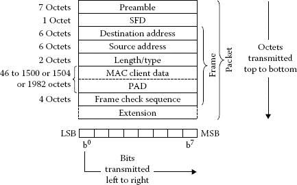

**图 1.6** 以太网数据包格式。（数据源自 *IEEE 以太网标准*，IEEE Std 802.3-2012。）

![Figure 1.7 A bridged LAN. (Data from IEEE Standard for Local and Metropolitan Area Networks: Overview and Architecture, IEEE Std 802®-2001 [R2007].)](images/pg14_1.jpg)

**图 1.7** 一个桥接 LAN。（数据源自 *IEEE 标准：局域网和城域网概述与架构*，IEEE Std 802®-2001 [R2007]。）

### 桥接 LAN

图 1.7 描述了一个典型的 IEEE 802 LAN，其中多个较小的 LAN 通过网桥连接。正如图中所示，网桥拥有多个接口或端口，通过它们连接到多个 LAN 网段。此外，如果网桥连接两种不同类型的 IEEE PHY/MAC LAN，它可以支持多种 IEEE PHY/MAC 标准^(⁴)。

如前所述，网桥通过中继和过滤的动作将 LAN 网段连成一个整体，但将它们保持为独立的接入域。除了帧的中继和过滤外，收集和更新用于中继、过滤以及管理目的的必要信息，也是网桥的职责之一。结合图 1.7 需要考虑的一个重要方面是：当网桥连接遵循不同 LAN 标准的 LAN 网段时，要求连接特定 LAN 的网桥接口支持该 LAN 网段所使用的标准。因此，以太网网段只能连接到网桥的以太网端口，而 802.5 网段只能通过网桥的 802.5 端口连接。

## 1.4.2 互联网协议族

互联网协议族是一组上层（网络层及以上）协议，其设计目标是在任意规模的网络中，为直接或间接通过其他设备连接的两台主机之间提供端到端的消息传递。由于该协议族中的两个主要协议是 TCP 和 IP，它通常被称为 *传输控制协议 (TCP)/互联网协议 (IP) 族*。该协议族是 DARPA 发起的研究计划的成果，后来有其他几位贡献者加入。

TCP/IP 族遵循其自身的网络模型，该模型实际上是在 OSI 参考模型之前设计的。与 OSI 模型不同，该模型只有四层，如图 1.8 所示。

网络接口层实际上代表了 OSI 模型的两个下层，超出了 IP 协议族的范围，因为该协议族的设计初衷是主要支持各种底层物理网络技术。在分层的背景下，需要理解的一个重要点是：协议和标准并不严格遵循 OSI 模型的概念层边界；一个协议的职责描述往往涵盖列在多个相邻层中的职责，或者多个协议相互支持以执行某一特定层推荐的任务。图 1.9 显示了属于该协议族的若干协议及其在分层模型中的位置。

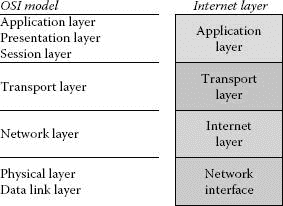

**图 1.8** OSI 模型与互联网模型的对比。

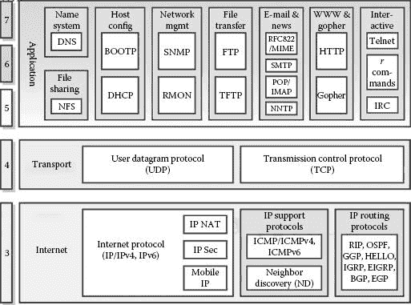

**图 1.9** 互联网协议族。

在本次回顾中，我们将再次重点关注与我们主要讨论内容相关的重要协议和问题。

### 互联网协议

IP...

### IP 寻址

正如我们之前提到的，互联网模型建立在“互联网——网络的网络”这一概念之上。因此，设计者在该模型中纳入了一种寻址方案，它独立于底层技术和协议，但提供了一种以层次化方式对设备进行分组的手段；即，同一网络中的设备将被分配来自同一范围的地址以便于识别，而每个网络将使用不同范围的地址以便于区分。

IP 有两个版本：IPv4 和 IPv6。IPv6 的一项主要增强是将地址长度从 32 位扩展到 128 位。通常为了可读性，32 位长的 IPv4 地址写作四个十进制数的字符串，由*点* (`.`) 分隔，每个数字代表地址中的 8 位。另一方面，128 位长的 IPv6 地址通常写作八个十六进制数的字符串，由*冒号* (`:`) 分隔，每个数字代表地址中的 16 位。^(⁵)

### 传输控制协议

IP 协议族在传输层提供两种不同的选择：TCP 和用户数据报协议 (UDP)。TCP 的设计目标是在两个端设备之间提供基于连接的数据传输服务，并提供特定的服务保证，如成功交付、流量控制和拥塞控制。通常，选择 TCP 还是 UDP 由应用层根据其服务需求决定。例如，Web 浏览中使用的超文本传输协议 (HTTP) 基于 TCP。TCP 在第 1.5.2 节中进一步描述。

### 用户数据报协议

UDP...


# 路由器

在结束对基本网络概念的回顾之前，有必要在互联网模型和 TCP/IP 协议族的视角下再次审视路由器。路由器是互联网的重要组成部分，互联网是一种基于互联网模型的广域网，因为它们是每个局域网连接到完整广域网的节点；也就是说，某个私有网络中的终端用户设备通过路由器与互联网的其余部分进行通信。这使我们得出了如图 1.10 所述的互联网图景：一个由多个大小不一的互联网络组成的网络，每个网络通过其路由器接入互联网。因此，路由器是本地网络与互联网其余部分之间所有流量的入口/出口。这一事实给路由器带来了大量工作负载，特别是出口/入口路由器，通常称为*出口/入口路由器*，并使其在通信中的重要性成倍增加。起初，路由器的基本任务是识别通信路由并为不同的协议和技术提供互操作性。但凭借在拓扑结构中的这种战略位置，如今的路由器在流量分析和过滤方面也发挥着重要作用。

关于图 1.10 中描述的互联网架构，另一个重要事实是：在核心层，我们有一组设备网格，主要用于提供互联互通。这个核心实际上是由不同级别和规模的多个互联网服务提供商提供的服务基础设施。

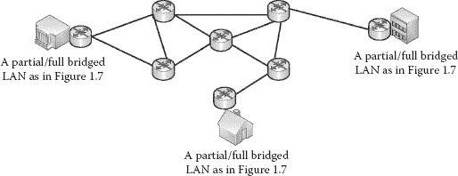

**图 1.10** 互联网的物理模型。

## 1.5 常见网络协议

在第 2 章和第 3 章中，我们将重点关注信息安全以及用于攻破信息系统安全的方法。IP 协议族是一组广泛应用于计算机网络的公共协议，也是黑客攻击的常见目标。在结束对计算机网络的回顾之前，让读者简要了解一下其中一些重要协议的技术细节将非常有用。

### 1.5.1 超文本传输协议

`HTTP` 是一种应用层协议，用于在系统间共享超媒体消息。它是一种通用协议，不维护通信状态。它是万维网服务的核心。该协议随着时间的推移不断改进，以提供更好的功能并支持技术进步；现有三个可用版本：`HTTP/0.9`、`HTTP/1.0` 和 `HTTP/1.1`，其中 `HTTP/1.1` 为最新版本。

`HTTP` 遵循请求/响应模型，客户端通过向服务器发送请求消息来发起通信。该请求消息中包含的典型项目有：请求方法、统一资源标识符、协议版本、请求修饰符、客户端信息以及可能的主体内容。服务器用响应消息回应该请求，响应消息通常包含状态行、消息的协议版本、成功或错误代码、服务器信息、实体元信息以及可能的实体主体内容。

`HTTP` 通信通过 `TCP/IP` 连接执行，服务器默认在 `TCP` 端口 `80` 监听。然而，使用 `TCP` 并非强制性的，任何提供可靠交付的传输协议均可使用。在 `HTTP/1.0` 中，默认情况下，每次请求/响应交换都使用一个新的传输连接；而在 `HTTP/1.1` 中，可以将一个连接用于一次或多次请求/响应交换，通常称为*持久行为*。

`HTTP` 只有两种消息类型：客户端发送的请求消息和服务器发送的响应消息。这两种消息的通用格式分别显示在图 1.11 和图 1.12 中。

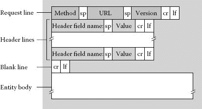

**图 1.11** HTTP 请求消息格式。

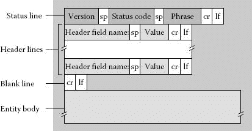

**图 1.12** HTTP 响应消息格式。

### 1.5.2 传输控制协议

`TCP` 是 IP 协议族中的一项重要核心协议，设计用于传输层，旨在为分组交换计算机通信网络提供可靠的主机到主机服务。它是一种面向连接的端到端协议，支持多网络应用。`TCP` 在运行于连接到互联计算机通信网络的主机计算机上的进程对之间，提供可靠的、有序的、经过错误检查的字节流进程间交付。`TCP` 的其他特性包括流量控制和拥塞控制，但不提供安全性或带宽保证。

`TCP` 是多种算法和过程的组合，可供讨论；然而，我们将在以下回顾中仅限于段结构和连接建立。

#### TCP 段结构

与 `HTTP` 拥有两种独立的消息类型不同，`TCP` 段的用途是通过在段首部中选择标志位来描述的。在 RFC 793 中定义了六个基本标志位：

*   `URG`：紧急指针字段有效
*   `ACK`：确认字段有效
*   `PSH`：推送功能
*   `RST`：重置连接
*   `SYN`：同步序列号
*   `FIN`：发送方无更多数据

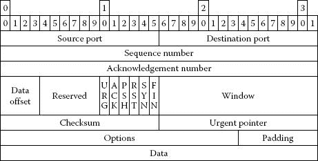

**图 1.13** TCP 段格式。

该段（图 1.13）中的大多数字段都是自描述性且通用的。然而，序列号字段的实现依赖于主机，可能被入侵者利用。每个 `TCP` 段都由发起该段的主机分配一个序列号，以便接收主机能正确排序该主机发送的不同段并移除重复段。初始序列号的选择，即主机生成的第一个段中发送的序列号，通常取决于该主机上 `TCP` 的操作系统实现。这种现象有助于入侵者通过观察初始序列号来推断操作系统类型。

#### TCP 连接建立

`TCP` 使用三次握手过程在开始传输数据段之前建立连接（参见图 3.4）。该过程由客户端主机发起，发送一个仅设置了 `SYN` 位的段，以表明建立连接的意图。如果服务器感兴趣，将回复一个同时设置了 `SYN` 和 `ACK` 位的段，以确认收到该段并表明建立连接的意图。最后，客户端将发送一个设置了 `ACK` 位的段以确认收到。

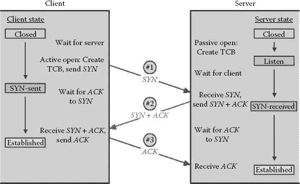

**图 1.14** TCP 三次握手连接建立。

### 1.5.3 动态主机配置协议

`DHCP`

使用 `DHCP`，可以通过三种可能的方式为主机分配 IP 地址。首先，可以通过*自动分配*为主机分配一个永久 IP 地址。其次，可以为客户端分配一个为期有限的 IP 地址，称为*动态分配*。最后，在*手动分配*中，分配给客户端的 IP 地址由网络管理员选择，`DHCP` 的工作只是传达这一分配。

#### DHCP 如何分配 IP 地址

在 `DHCP` 中，客户端遵循一个四步流程来自动获取 IP 地址（图 1.15）。


## 1.5.3 动态主机配置协议

1.  主机通常由用户配置为使用静态 IP 地址，或通过 DHCP 获取自动分配，后者是最常用的选项。客户端通过发送 DHCP 发现消息来启动该过程。由于客户端不知道 DHCP 服务器的 IP 地址，因此该发现消息中的 IP 地址为广播地址，即 `255.255.255.255`，正是由于这一事实，此步骤被称为*发现*。DHCP 服务器配置为监听 UDP 端口 `67`，而客户端需要选择 UDP 端口 `68` 作为源端口。DHCP 服务器可能不在与请求主机相同的子网中。在这种情况下，会在每个子网中放置 DHCP 中继代理。分配 IP 地址的请求在技术上称为 *IP 租约请求*。该请求消息中的另一个重要字段是客户端的 MAC 地址。

    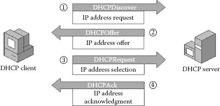

    **图 1.15** DHCP IP 地址分配过程。

2.  一旦服务器收到租约请求，它会向客户端发送 DHCP 提供消息。根据服务器针对客户端 MAC 地址的配置，此请求中提供的 IP 地址遵循三种方法之一进行选择。DHCP 提供消息中的重要项目包括提供的 IP 地址、子网掩码、租约期限以及服务器自身的 IP 地址。此提供消息的目标 IP 地址再次为 `255.255.255.255`，因为客户端迄今仍无 IP 地址；目标端口为前述的 UDP `68`。如果网络中有多个 DHCP 服务器，可能会有多个服务器发出提供。^(⁶) 此处需考虑的另一个重要问题是：如果有多个客户端正在等待 IP 租约提供，当所有提供消息均为广播时，它们如何识别该提供是给谁的。

3.  客户端将接受其中一个提供，并生成一条 DHCP 请求消息，以获取相应服务器提供的 IP 地址。该消息遵循与 DHCP 发现相同的传递配置，即进行广播，因为所有 DHCP 服务器都应被正式告知客户端接受了哪个服务器的提供，以便其他服务器撤回其提供。

4.  最后，DHCP 服务器通过发送 DHCP ACK 消息和其他必要配置来确认租约。

## 1.5.4 互联网控制消息协议

互联网控制消息协议 (ICMP)

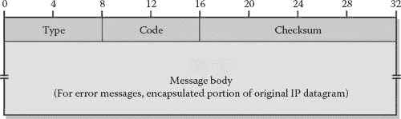

**图 1.16** ICMP 数据包格式。

ICMP 消息通常在以下情况下发送：

*   数据报无法到达目的地。
*   网关的缓冲区没有足够的空间来转发数据报。

为了反馈或错误报告的目的，类型和代码字段组合在一起拥有一份详尽的关联状态码列表；表 1.1 描述了一些重要的组合。

**表 1.1** 重要的 ICMP 类型和代码组合

| 类型 | 代码 | 说明 |
| :--- | :--- | :--- |
| 0—回显应答 | 0 | 回显应答（用于 ping） |
| 3—目的地不可达 | 0 | 目的网络不可达 |
|  | 1 | 目的主机不可达 |
|  | 2 | 目的协议不可达 |
|  | 3 | 目的端口不可达 |
|  | 4 | 需要分片，但设置了 DF 标志 |
|  | 5 | 源路由失败 |
|  | 6 | 目的网络未知 |
|  | 7 | 目的主机未知 |
|  | 8 | 源主机被隔离 |
|  | 9 | 网络被管理上禁止 |
|  | 10 | 主机被管理上禁止 |
|  | 11 | 因 TOS 网络不可达 |
|  | 12 | 因 TOS 主机不可达 |
|  | 13 | 通信被管理上禁止 |
|  | 14 | 主机优先权冲突 |
|  | 15 | 优先权中止生效 |
| 5—重定向消息 | 0 | 为网络重定向数据报 |
|  | 1 | 为主机重定向数据报 |
|  | 2 | 为 TOS 和网络重定向数据报 |
|  | 3 | 为 TOS 和主机重定向数据报 |
| 8—回显请求 | 0 | 回显请求（用于 ping） |
| 11—超时 | 0 | 传输中 TTL 过期 |
|  | 1 | 片段重组时间超时 |
| 12—参数问题：错误的 IP 头部 | 1 | 指针指示错误 缺少必需选项 |
|  | 2 | 错误的长度 |
| 13—时间戳 | 0 | 时间戳 |
| 14—时间戳应答 | 0 | 时间戳应答 |
| 17—地址掩码请求 | 0 | 地址掩码请求 |
| 18—地址掩码应答 | 0 | 地址掩码应答 |

## 1.5.5 地址解析协议

地址解析协议 (ARP)

由于 ARP 提供了网络层和数据链路层之间的联系，它本身工作在网络层之下，因此不可路由。这意味着 ARP 数据包被直接封装在数据链路层帧中，只能在局域网内传输，而不能跨越路由器。

ARP 只有一种数据包格式，通过在操作字段中描述合适的值来指定不同的操作；例如，`1` 代表 ARP 请求，`2` 代表 ARP 应答。另外两个重要字段是硬件类型和协议类型。硬件类型指定硬件标准，ARP 为不同标准提供了代码列表，例如 `0001` 代表以太网。同样，协议类型指定网络层协议的代码，IPv4 的情况为 `0×0800`（图 1.17）。

*地址解析过程*。网络层数据报被交给数据链路层进行传输，帧头中需要填写相应的硬件地址以便投递。ARP 维护一个缓存或 ARP 表，用于存储已知的网络层地址到物理层地址的映射。如果缓存中没有网络层地址对应的物理层地址，则会在局域网中广播一个 ARP 请求数据包（MAC 地址全为 1），其中包含缺少物理层地址的网络层地址。因为是广播，局域网上的每台主机都会收到该帧，如果被请求的主机存在，它将通过应答消息单独向请求主机回复其物理地址（图 1.18）。请求主机将此条目存储在 ARP 缓存中以备将来使用。此外，ARP 请求消息有助于网络中的其他主机更新其 ARP 表中关于请求源的条目。

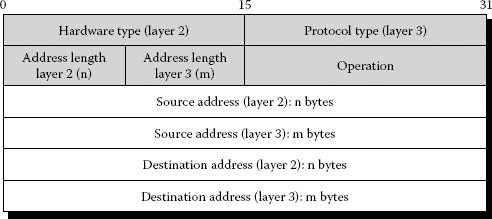

**图 1.17** 通用 ARP 数据包格式。

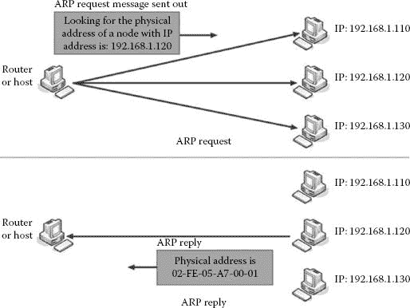

**图 1.18** ARP 地址解析过程。

## 参考文献

*   1. IEEE Standard for Local and Metropolitan Area Networks: Overview and Architecture, IEEE Std 802®-2001 (R2007), <https://standards.ieee.org/about/get/802/802.html>。
*   2. IEEE Standard for Ethernet, IEEE Std 802.3-2012, <https://standards.ieee.org/about/get/802/802.3.html>。
*   3. IEEE Standard for Local and Metropolitan Area Networks: Media Access Control (MAC) Bridges, IEEE Std 802.1D-2004 (R2007), <https://standards.ieee.org/about/get/802/802.1.html>。
*   4. Postel, J., Internet Protocol, STD 5, RFC 791, DOI 10.17487/RFC0791, September 1981, <http://www.rfc-editor.org/info/rfc791>。
*   5. Fielding, R., Gettys, J., Mogul, J., Frystyk, H., Masinter, L., Leach, P., and T. Berners-Lee, Hypertext Transfer Protocol -- HTTP/1.1, RFC 2616, DOI 10.17487/RFC2616, June 1999, <http://www.rfc-editor.org/info/rfc2616>。


## 参考文献

*   6. Postel, J., 传输控制协议，STD 7，RFC 793，DOI 10.17487/RFC0793，1981 年 9 月，<http://www.rfc-editor.org/info/rfc793>。
*   7. Droms, R.，动态主机配置协议，RFC 2131，DOI 10.17487/RFC2131，1997 年 3 月，<http://www.rfc-editor.org/info/rfc2131>。
*   8. Postel, J.，互联网控制消息协议，STD 5，RFC 792，DOI 10.17487/RFC0792，1981 年 9 月，<http://www.rfc-editor.org/info/rfc792>。
*   9. Plummer, D.，以太网地址解析协议：或将网络协议地址转换为用于以太网硬件传输的 48 位以太网地址，STD 37，RFC 826，DOI 10.17487/RFC0826，1982 年 11 月，<http://www.rfc-editor.org/info/rfc826>。
*   10. Postel, J.，用户数据报协议，STD 6，RFC 768，DOI 10.17487/RFC0768，1980 年 8 月，<http://www.rfc-editor.org/info/rfc768>。

# 2 信息系统安全

**HABIB-UR REHMAN**

计算机网络是现代通信渠道：高效、易用，且拥有丰富的选项和变体。这种通信，无论是通过这些网络还是任何其他方式，始终由人执行且面向人；我们有许多理由保持通信的机密性。在本章中，我们将回顾通信安全的基础知识⁷。

在开始之前，让我们看看我们的通信模型是什么样的：

*   两个或多个设备相互交换消息。
*   消息可以是原子的，也可以是较长通信的一部分。
*   如果同一条消息有多个接收者，该消息可以单独传输给每一个接收者，也可以作为单次广播发送。
*   通信参与者可以在同一个本地网络中，也可以位于通过某些合适的广域网接口连接的不同局域网中。

由于在两个或多个设备之间交换的消息肯定是一条信息，因此为信息安全确立的原则在我们的领域完全适用。因此，信息安全基础是开始本次讨论的完美切入点。

信息安全领域的研究人员和专业人士提出了几种模型，这些模型可分为两大类。第一类是实施安全信息系统所应遵循的一般性建议和指南。该组主要有以下三个示例：

*   经济合作与发展组织（OECD）信息系统和网络安全指南
*   美国国家标准与技术研究院（NIST）信息技术安全工程原则
*   信息系统审计与控制协会发布的《信息安全商业模型导论》

在第二类中，有描述信息的概念和技术要素，并基于这些信息基本安全特征提供建议的模型。以下是第二类中一些流行的模型：

*   CIA 三要素
*   McCumber 立方体
*   Parker 六要素
*   Maconachy 等人提出的信息保障模型
*   信息保障与安全参考模型

在本章中，我们回顾了第二类，仅讨论了信息的安全要素和特征。我们的目标是快速回顾理解计算机网络通信中入侵检测和预防的重要性及实用性所需的基本安全概念。

## 2.1 CIA 三要素

CIA 三要素是定义核心原则的信息安全最基础模型。术语 *CIA*⁸

这三个属性（CIA）被认为是任何类型信息系统安全的基本要素，包括我们在计算机网络上的通信。当然，对此列表有若干补充建议，但机密性、完整性和可用性是每个扩展模型的核心。

### 2.1.1 机密性

从非技术角度来看，机密性等同于我们在日常生活中使用的*隐私*一词，即“除非是我的个人事务，否则没人应该知道我在忙什么。”从技术上讲，机密性被定义为只有授权人员才能访问资源的特性。因此，它是将资源对未授权实体隐藏的属性。就信息安全而言，它是确保信息仅对授权人员可用的保证。这种解释可以通过以下几种方式延伸：

*   信息将仅以授权形式存储，无论是物理还是电子形式，且只有授权人员才能访问数据存储。
*   信息将仅以授权格式存储。
*   信息将仅通过授权媒介获取。

在使用计算机网络进行通信的情况下，机密性有两个主要方面。第一，通信存在的机密性，即只有授权人员应该知晓通信正在进行或已发生。第二，通信内容的机密性，即只有授权人员应该能够看到通信了什么或正在通信什么。

### 2.1.2 完整性

对资源的未授权访问可能导致滥用或破坏该资源的问题。在信息安全中，完整性是指信息未以未授权方式被篡改的特性。因此，一方面，它是信息处于原始状态且未遭破坏的保证。另一方面，它也是确认任何所需的修改均已或将通过授权方法进行的肯定，例如仅由授权人员且仅使用授权手段进行。

未授权篡改信息并不一定总是出于恶意意图；也可能是无意或意外的。例如，由于电子故障，计算机网络上的通信可能出现错误。完整性是要求信息的准确性和一致性在各种场景下均保持完好的属性，无论是恶意还是意外、故意还是无意。

虽然看起来未授权篡改总伴随着未授权访问。然而，也存在在不损害机密性的情况下信息完整性受到损害的情况。一个非常简单的例子是通过计算机网络发送的消息中发生比特错误。此处消息内容未被任何未授权实体访问；然而，其内容仍被篡改了。

### 2.1.3 可用性

资源应在授权用户需要时可用。可用性是指系统在授权用户或查看者需要时（通常是一直）向其提供信息的属性。信息的可用性间接要求：

*   存储数据/信息的系统应可用。
*   用于检索数据/信息的系统应可用。
*   用于更新数据/信息的系统应可用。


### 2.1.4 CIA 三要素与 McCumber 立方体的对比

McCumber 的信息安全模型或立方体确实具有相同的三个特征：机密性、完整性和可用性。然而，其完整模型包含三个维度，上述三个特征仅代表一个名为安全特征或目标的维度。另外两个维度是信息状态和安全防护措施。根据该模型，信息处于三种状态：存储、处理和传输。安全措施也主要分为三类：策略、教育和技术（图 2.1）。

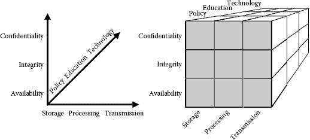

**图 2.1** McCumber 信息安全立方体。（数据来源：McCumber, J., Information systems security: A comprehensive model, in: *Proceedings of the 14th National Computer Security Conference*, NIST, Baltimore, MD, 1991。）

## 2.2 Parker 六要素

Donn B. Parker 提出了一个包含六个基本安全要素的模型，通常称为 *Parkerian Hexad*。除了经典 CIA 列表中的三个属性外，效用、真实性和占有是 Parker 新增的建议。他主要认为这三个 CIA 属性在定义和实践解释方面不够全面和精确，因此不足以涵盖所有可能性。因此，这三个新属性分别包含了在传统 CIA 属性解释中未被考虑的安全顾虑。

### 2.2.1 占有

Parker 详细阐述了信息的占有或对其的控制权不同于信息的机密性，因为即使控制信息的人没有查看它，对信息的未授权占有仍然是一个安全问题。在这种情况下，信息的机密性本身并未受损，但对占有权的侵犯日后可能导致机密性问题。因此，Parker 认为有必要将占有作为一个安全属性纳入其中，以避免信息控制权有意、无意或恶意地落入未授权实体手中的情况。计算机网络上的通信实际上是一个完美的例子，因为在大多数情况下物理网络是公开可访问的，这意味着如果不采取适当措施，任何人都可以控制正在进行的通信。

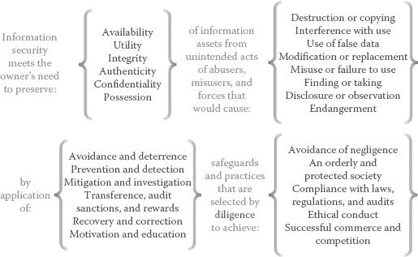

**图 2.2** Parker 的新基础概念信息安全模型。（数据来源：D. Parker, Our excessively simplistic information security model and how to fix it, *ISSA J*., 8 (7): 12-21, July, 2010。）

### 2.2.2 真实性

信息的真实性被定义为信息来源的有效性或对信息来源的确认。因此，该特征描述了信息的来源是否与接收者预期或假设的相同。Parker 解释说，真实性不同于完整性，因为后者关乎信息内容的可靠性和状况。有时，授权来源可能会生成不正确的信息或为测试目的而违背完整性的信息，从而不违背真实性。另一方面，恶意来源可能冒充他人，从而复制一份正确的信息，例如以自己的名义发布软件，但实际上是由不同实体开发的。Parker 进一步主张，缓解这两个问题所需的措施也是不同的。

### 2.2.3 效用

Parker 建议的最后一个增强项是效用，他将其定义为数据或信息的有用性。Parker 认为*可用性*一词仅限于信息的可用性，这并不总能保证信息也有用。例如，如果信息以加密形式交付，但接收者丢失了解密密钥，该信息仍然是可用的，但其效用为零。

### 2.2.4 CIA 三要素与 Parker 六要素的对比

CIA 三要素与 Parker 六要素的区别主要在于对所用术语的解释不同。毫无疑问，Parker 提到的顾虑并非不重要或不存在；然而，专业人士随着时间的推移已将这些扩展解释融合到了三个 CIA 属性中。

## 2.3 信息保障模型

Maconachy 等人提出的模型。

很难确定*认证*和*不可否认性*这两个术语的起源，因为它们大致在同一时期出现在多个来源中。例如，我们在 Parker 的六要素中看到了*真实性*。Maconachy 等人自己在。

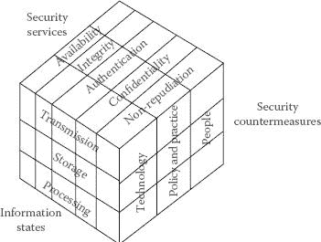

**图 2.3** 信息保障模型。（数据来源：Maconachy, W. et al., A model for information assurance: An integrated approach, in: *Proceedings of the IEEE Workshop on Information Assurance and Security*, U.S. Military Academy, New York, 2001。）

### 2.3.1 认证

该模型中的认证是指验证 Parker 模型中*真实性*的一项服务。因此，它是用于验证信息发起者有效性的过程或措施。该术语在该模型中仅指措施，不包含特征；然而，NIST 在中提供的定义。

### 2.3.2 不可否认性


CIA 三要素以及帕克六要素中缺失的一个重要问题是：如果共享信息的双方中的一方事后否认该事件发生过，该怎么办？引入不可否认性这一安全目标就是为了解决这一顾虑。如果无法保证对交易进行必要的记录保存，以便事后任何参与者都无法否认其参与，则系统不能被视为完全安全。在信息共享场景中，对于发送方而言，确保成功交付给正确的接收方是必要的；对于接收方而言，确认来源身份至关重要；如果涉及控制机构，这两种保证都很重要。从接收方的角度来看，不可否认性并不确保发送方是信息的合法所有者；该方面由认证来涵盖。

### 2.3.3 不可否认性与可审计性

在文献 [11, p. 2] 中，美国国家标准与技术研究院（NIST）将*可审计性*视为安全目标之一，并将其定义为“实体的行为可被唯一追溯至该实体的要求”。另一方面，不可否认性被描述为一种预防性服务，旨在实现可审计性这一目标。

## 2.4 信息保障与安全参考模型

最后，Cherdantseva 和 Hilton 在文献 [7] 中提出了一个参考模型。

### 2.4.1 可审计性

可审计性被定义为“系统对人类或机器在系统内执行的所有动作进行持续的、不可绕过的监控的能力”[7, p. 7]。因此，不同实体执行的动作将被观察和分析，以检查其是否符合规则和策略。*审计*一词通常指对事件的事后分析，文献 [7] 中未明确说明可审计性是否包含实时监控。

### 2.4.2 隐私

隐私是指信息所有者能够控制其信息，且信息的传播符合隐私法律和所有者的意愿。隐私有时会与机密性和完整性混淆，因为它们都包含对*他人*进行混淆/隐藏的含义。即使在某些公共信息在群体内共享的情况下，也需要机密性；公共内容同样需要完整性。另一方面，私有资源或信息极少被共享，这正是使其成为私有的属性所在。

## 2.5 黑客攻击基础

本章迄今提出的基本概念通常被称为安全信息系统应具备的必要属性，有时也被视为为使信息系统安全而需达成的目标。这同样适用于以任何可能方式生成、处理、存储或处理信息的任何计算系统。入侵者或恶意实体企图通过破坏这些安全特性中的一项或多项，来影响系统及系统处理的信息。在结束本章之前，回顾系统如何被攻击并重温黑客攻击这门“黑暗科学”的基本概念将非常有用。

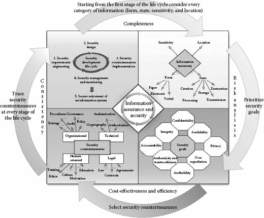

**图 2.4** 信息保障与安全参考模型。（来源：Y. Cherdantseva, and J. Hilton, A reference model of information assurance & security, in: *Proceedings of the Eighth International Conference on Availability, Reliability and Security (ARES)*，德国雷根斯堡，2013 年 9 月 2-6 日。）

### 2.5.1 威胁

信息系统主要面临三类威胁，如下所示：

*   **自然威胁：** 包括地震、洪水等自然灾害，或任何其他不可控的危险。
*   **物理威胁：** 可能因火灾、电力或水患导致损坏；这可能是故意的，也可能是无意的。
*   **人为威胁：** 内部人员或外部人员可能故意或无意地损害系统，带有恶意意图或因怨恨情绪驱使。人类可能通过以下三种方式威胁系统：
    *   **网络威胁：** 如前所述，计算机网络是共享信息最常用的媒介。入侵者可闯入通信信道，以多种方式破坏安全。
    *   **主机威胁：** 处理信息的主机可能遭受直接攻击，导致其安全防线被突破。
    *   **应用威胁：** 处理信息的应用程序如果开发不当，可能存在可被入侵者利用的漏洞。

在第 3 章第 3 章中，我们列出了属于上述三类的多种攻击的综合清单，并附带其技术细节。

### 2.5.2 黑客攻击过程

入侵者利用系统漏洞发起攻击。这些漏洞可能存在于单个应用程序中、整个主机中，或主机共享信息的网络中。发起攻击的过程通常分为以下步骤：

*   **侦察：** 初始阶段，入侵者收集关于系统的必要信息，并基于这些初始数据制定攻击策略。侦察可分为*主动*（入侵者与系统交互）或*被动*（通过社会工程学、垃圾箱搜寻或公开资源等间接来源收集数据）。足迹采集是一种常见的侦察技术，结合主动和被动方法收集系统数据。
*   **扫描：** 主动侦察和扫描概念并无太大区别，两者均通过交互收集关于系统及其资源的信息。尽管入侵者与系统交互，但扫描不被视为实际攻击，因为入侵者并未危害系统或信息。它更多是识别网络和主机漏洞的过程。
*   **获取访问权限：** 此阶段指入侵者尝试通过利用发现的漏洞来访问网络、主机或应用程序。
*   **维持访问权限：** 一旦入侵者成功访问资源，便利用系统资源收集所需信息或发起进一步攻击。
*   **清除痕迹：** 最后一步是向授权用户和管理员隐藏恶意行为。通常通过销毁日志文件和归档中的证据来实现。

审视上述阶段后，*攻击*一变得模糊不清。文献中有两种通用的解释。它可能指单个小规模的恶意行为，也可能指通过一系列小规模入侵实施的大规模黑客活动。因此，我们可以说扫描本身既是一种攻击，也是黑客攻击的一个阶段。


### 扫描与枚举

扫描和枚举是属于黑客攻击第二阶段（即扫描阶段）的两种技术；感到困惑吗？令人惊讶的是，黑客行业为某个攻击阶段和该阶段使用的一种技术选用了同一个词，这主要是因为枚举与扫描非常相似。然而，枚举的目标是发现用户名、机器名、共享资源、服务及其他类似实体。另一方面，扫描旨在发现活跃的网络主机及这些主机上的开放端口，因此也被称为*网络扫描*。

## 参考文献

*   1. 经济合作与发展组织 (OECD)。OECD 信息系统与网络安全准则：迈向安全文化，经济合作与发展组织，法国巴黎，2002 年 7 月 25 日。 [`www.oecd.org/`](http://www.oecd.org/) sti/ieconomy/15582260.pdf。
*   2. G. Stoneburner, C. Hayden, and A. Feringa 信息技术安全工程原则（实现安全的基准），修订版 A，计算机安全分部，信息技术实验室，美国国家标准与技术研究院，马里兰州盖茨堡，2004 年 6 月。
*   3. ISACA，信息安全业务模型简介，ISACA，伊利诺伊州罗林梅多斯，2009 年。
*   4. J. McCumber，信息系统安全：一个综合模载，载于：第 14 届全国计算机安全会议论文集，NIST，马里兰州巴尔的摩，1991 年。
*   5. D. Parker，《计算机犯罪对策》，John Wiley & Sons，纽约，1998 年。
*   6. W. Maconachy, C. Schou, D. Ragsdale, and D. Welch，信息保障模型：一种综合方法，载于：IEEE 信息保障与安全研讨会论文集，美国军事学院，纽约，2001 年。
*   7. Y. Cherdantseva, and J. Hilton，信息保障与安全参考模型，载于：第八届可用性、可靠性与安全国际会议 (ARES) 论文集，德国雷根斯堡，9 月 2-6 日，2013 年。
*   8. J. Saltzer, and M. Schroeder，计算机系统中的信息保护，IEEE 会刊 63(9)，1278–1308，1975 年。
*   9. Y. Cherdantseva, and J. Hilton，信息保障与安全参考模型，[`rmias.cardiff.ac.uk/`](http://rmias.cardiff.ac.uk/)，2015 年 3 月 29 日。
*   10. D. Parker，我们过于简化的信息安全模型及其修正方法，ISSA Journal 8(7)，12–21，2010 年 7 月。
*   11. 美国国家安全局，国家信息系统安全术语表。NSTISSI 4009，美国国家安全局，马里兰州米德堡，2000 年 9 月。
*   12. G. Stoneburner，NIST 特别出版物 800-33：信息技术安全的底层技术模型，美国国家标准与技术研究院建议，马里兰州盖茨堡，2001 年 12 月。

# 3 入侵与漏洞

**HABIB-UR REHMAN**

由于大部分物理基础设施公开可访问且由用户共享，保障通信及其内容的安全是计算机网络中的一项重要关注点。这一事实使得我们在第 2 章中描述的所有安全目标都发挥了作用。此外，我们在第 1 章中回顾了，用于在端主机之间传递消息的大多数协议都是公开的。因此，每个人都知道传输消息时将执行的动作序列，并可能利用这些知识攻击正在进行的通信。这绝不意味着计算机网络中没有任何安全可言；协议已演进以克服此类缺陷。然而，计算机网络（尤其是互联网）的服务模型是以一种无法消除所有弱点的方式开发或演进的。

入侵者利用系统的漏洞发起攻击；这使得系统管理员和合法用户极其有必要充分了解这些漏洞。如果设计和配置不当，网络、主机以及运行在主机上的应用程序都可能被滥用。本章旨在突出这三个层面的此类问题。我们试图编制一份已知常见攻击的综合清单。

## 3.1 网络与协议漏洞

公开协议及其漏洞确实是计算机网络中攻击的最大来源。本节讨论超文本标记语言 (HTTP) 等协议上可能发生的常见攻击。

### 3.1.1 HTTP 标志抓取

万维网是一项公共服务；因此，运行 Web 服务器的主机被配置为允许任何针对 80 端口（Web 服务的知名端口）的传入请求。HTTP 是用于 Web 服务的协议，旨在用 HTTP 响应消息回复每一个 HTTP 请求消息。通常，此响应消息包含主/默认页面（多半命名为 index^(⁹) 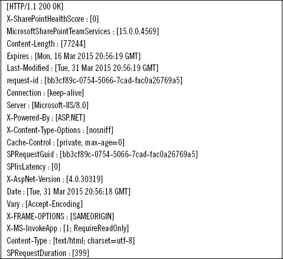

**图 3.1** 典型 HTTP 响应消息。

标志抓取被归类为攻击前^(¹⁰)

这种标志抓取攻击也适用于电子邮件消息，接收到的电子邮件的头部也包含含有重要信息的字段。然而，电子邮件场景不同于 HTTP 场景，因为只有手头有电子邮件时才能进行此类分析。

*SMTP 枚举*。然而，在用于将电子邮件传递到邮件服务器的 SMTP 协议中，入侵者可以通过 Telnet 提示符等接口使用 `VRFY`、`EXPN` 和 `RCPT TO` 命令来识别哪些电子邮件地址是有效的，哪些是无效的。因此，入侵者可以建立一个有效电子邮件地址列表，稍后可用于垃圾消息发送等恶意活动。

### 3.1.2 HTTP 隧道

隧道技术是计算机网络中的一个重要概念，即将一种协议的数据包封装在另一种协议的数据包内。当隐藏/内层数据包的协议不被底层网络支持时，通常会采用这种方法；这可能是由于管理限制、协议不兼容或设备限制。隧道技术增加了网络的效用，因为它即使在存在不兼容的情况下也能实现通信。例如，通过建立端到端的 IPv4 隧道，或根据需求建立较少跳数的隧道，可以在通过不支持 IPv6 的设备（部分或全部）连接的端主机之间共享 IPv6 数据报。隧道技术可在任何层或协议上执行。然而，HTTP 隧道是一个主要关注点，因为 HTTP 消息极少被过滤或阻断^(¹¹)

HTTP 隧道是通过使用设计为通过 HTTP 通信的软件来执行的。该软件的客户端组件安装在用户^(¹²)

### 3.1.3 TCP 扫描


#### TCP 端口扫描技术

TCP 是互联网上应用最广泛的传输层协议，因为它提供了大多数应用程序所需的可靠、有序的交付。然而，这是以操作复杂性和大量漏洞为代价的。在发送实际应用消息之前，TCP 连接通过三次握手过程建立。基于 TCP 的行为，特别是在连接建立阶段，可以应用多种技术来揭示目标网络/主机的详细信息。一种常见的方法是向目标主机发送不同类型的 TCP 段，以识别目标上端口的开放/关闭状态。这种攻击方法通常被称为*端口扫描*。

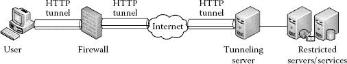

**图 3.2** HTTP 隧道过程。

#### TCP Connect/Full Open Scan（TCP 连接/全开放扫描）

客户端主机尝试在某个端口上与目标主机建立一个正常的 TCP 连接。如果该端口开放了 TCP 服务，则通过执行三次握手成功建立连接；否则，将收到一个带有复位（RST）位的 TCP 段，指示该端口未开放连接（图 3.3b）。这种扫描技术也被称为*Vanilla scan*（香草扫描）——即入侵者对所有 65,536 个端口进行全开放扫描。常规 TCP 行为（全开放扫描也遵循该行为）是在步骤 3 中响应一个确认（ACK）段，并继续传输应用消息（图 3.3a）。

#### Slow Scan（慢速扫描）

Vanilla scan——即基于全开放扫描方法对目标系统的所有端口进行扫描——有一个缺点：大多数主机会记录成功的 TCP 连接；因此，管理员可以通过观察日志来识别此类攻击，当他们发现不同端口上有如此多的成功连接尝试时。为了避免这个问题，一种方法是在合理的间隔后尝试下一个端口——即以降低速度进行扫描。慢速扫描是最简单的隐蔽扫描方法。

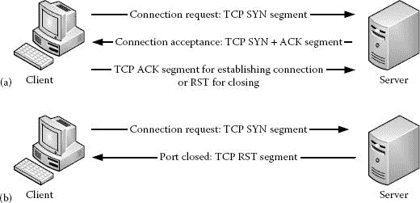

**图 3.3** (a) 目标端口开放时的 TCP 连接握手。(b) 目标端口关闭时的 TCP 连接握手。

#### Half Open/SYN Scan（半开放/SYN 扫描）

全开放扫描的另一个重要方面是，握手的第三步不会揭示关于端口状态的任何额外信息，这一点在图 3.3 中可以轻松看出。因此，在同步（SYN）扫描中，如果端口开放，客户端将响应一个 TCP RST 段以立即销毁正在进行的连接请求（图 3.3a）。SYN 扫描也被认为是隐蔽扫描方法之一，因为它试图避免被管理员察觉。

#### Xmas or Xmas-Tree Scan（Xmas 或圣诞树扫描）

Xmas 扫描是另一种隐蔽方法，客户端向目标主机发送无效的 TCP 标志组合。如果目标系符合 RFC 793 中的 TCP 规范，它会在端口关闭时响应一个 TCP RST 段，或在端口开放时忽略该段。这种攻击通常仅适用于 UNIX 主机；Windows 机器总是忽略此类段。Xmas 扫描有两种变体。第一种变体仅使用结束（FIN）、紧急（URG）和推送（PSH）标志——即在段中设置这三个标志。在第二种变体中，设置所有 TCP 标志（图 3.4）。

#### FIN Scan（FIN 扫描）

FIN 扫描是一种类似于 Xmas 扫描的方法，因为它也在接收到的段中使用意外的 TCP 标志组合。然而，在 FIN 扫描中，仅设置 FIN 标志。这样的段是意外的，因为 FIN 段通常发送用于指示关闭已建立连接的意图，而这里客户端和目标之间没有工作连接。在这种情况下，关闭的端口再次响应一个 TCP RST 段，而开放的端口忽略此类段。

#### Null Scan（空扫描）

Null 扫描可以被视为与 Xmas 扫描相反的方法，因为在这种情况下，发送的 TCP 段所有标志均未设置。在 TCP 中，这样的段确实是在成功建立连接后传输的正常数据段。由于目标主机与客户端没有建立连接，如果目标端口开放，它将丢弃该数据包。如果端口关闭，它将响应一个 TCP RST 段。Null 扫描的成功取决于目标主机中 TCP 协议栈的实现，通常此类段在 Microsoft 平台上会被阻止。

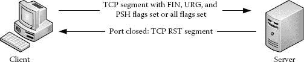

**图 3.4** TCP 圣诞树扫描过程。

#### Inverse Flag Scans（反向标志扫描）

Xmas-tree、FIN 和 null 扫描也被称为*反向*或*反向标志扫描*，因为在这些扫描中，目标端的关闭端口会回复一个段，而开放端口不响应。

#### ACK Scan（ACK 扫描）

另一种通过发送意外 TCP 段来利用目标的方法是在段中设置 ACK 标志。ACK 段通常作为握手过程的第三步发送，或用于确认成功接收数据段。^(¹³)

#### Fragmented Scan（分片扫描）

为了避免被防火墙检测到，不同 TCP 扫描中用于提高有效性的一种方法是将 TCP 头部分割成多个 Internet 协议（IP）片段——即在多个 IP 数据报中发送探测段。大多数入侵检测系统在 TCP 头部分片时无法检测到扫描。

#### Idle or Dumb Scan（空闲或哑扫描）

空闲扫描是一种复杂但聪明的攻击，借助第三方主机执行，通常称为*哑*或*僵尸主机*，因为它无意中参与了攻击。该攻击利用了这样一个事实：主机生成的所有 IP 数据报都被分配一个*片段标识号*，并且每个新数据报的片段 ID 比前一个生成的数据报大 1。因此，如果主机 X 从主机 Y 接收到没有间隙的 IP 数据报片段 ID，这表明主机 Y 目前没有与任何其他主机通信。

在空闲攻击中，入侵者与哑主机通信并观察 IP 片段 ID 的增量；可以使用任何反向标志扫描方法来实现此目的。选择主机作为僵尸时要考虑的重要一点是，它是一台空闲主机，目前不产生任何其他 IP 流量。因此，当反复探测时，僵尸主机发送的 IP 数据报将具有连续的片段 ID。关于这种攻击有趣的是，僵尸主机并不是入侵者的实际目标。入侵者向实际目标主机发送一个 SYN 段，但使用僵尸主机的 IP 地址——即欺骗 IP 地址。如果目标主机的端口开放，一个 SYN + ACK 段将被发送给僵尸主机，僵尸主机将回复一个 RST 段，因为它从未对该连接感兴趣。僵尸主机发送给目标主机的这个段将在入侵者通过探测僵尸主机所观察到的 IP 片段 ID 中产生一个间隙，表明目标主机的请求端口是开放的（图 3.5）。


### TCP 会话劫持

会话劫持是一种攻击，入侵者通过窃取会话 ID 并冒充授权用户，恶意接管双方正在进行的通信会话。在 TCP 会话劫持中，一旦会话在两个授权用户之间成功建立，入侵者便控制该 TCP 会话。会话劫持需要获取会话 ID，这可以通过多种方法获得，例如盲目猜测、中间人方法或会话嗅探。在 TCP 会话中，正在进行的通信有三个重要参数：IP 地址、端口号和序列号。入侵者尝试通过不同机制获取这三项，一旦成功，即发起攻击。

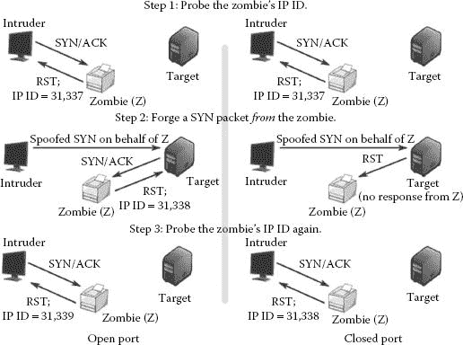

**图 3.5** 空闲扫描过程。

### IP 欺骗

空闲扫描是被归类为欺骗方法的一种手段，入侵者隐藏其实际身份（如 IP 地址），或在同一次攻击中使用多个地址以避免被检测。欺骗的概念也被用于其他技术中，例如媒体访问控制 (MAC) 欺骗。

### 文件传输协议反弹攻击

文件传输协议 (FTP)

![Figure 3.6 FTP bounce when port on the target is closed. Note: The syntax of the PORT command is a little strange as the address of the destination host is specified in the form of 6 comma separated decimal numbers. The first four numbers represent the IP address and can simply be used by replacing commas with dots. The last two numbers specify the port number on the destination in a format quite similar to the IP addressing. The sixth number represents the right eight bits of the port number while the fifth number represents the left eight bits of the port number; combine they make the 16-bit port number. Hence, the simple calculation to find the exact port number is to multiply the fifth number with 256 and then add to the sixth number.](img/pg54_1.jpg)

**图 3.6** 目标端口关闭时的 FTP 反弹。注意：PORT 命令的语法有点奇怪，因为目标主机的地址是以 6 个逗号分隔的十进制数形式指定的。前四个数字代表 IP 地址，只需将逗号替换为点即可使用。后两个数字以与 IP 寻址非常相似的格式指定目标上的端口号。第六个数字代表端口号的右侧八位（低 8 位），而第五个数字代表端口号的左侧八位（高 8 位）；两者结合构成 16 位端口号。因此，查找确切端口号的简单计算方法是将第五个数字乘以 256，然后加上第六个数字。

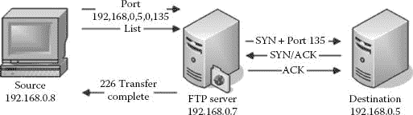

**图 3.7** 目标端口开放时的 FTP 反弹。

### 3.1.4 DHCP 漏洞

#### DHCP 饥饿攻击

DHCP

#### 伪造 DHCP 服务器

入侵者在网络中引入一个伪造的 DHCP 服务器，使其能够响应 DHCP 发现消息。该伪造服务器也会针对发现请求生成 DHCP 提供，意图并希望某些客户端可能会选择其提供的租约。如果发生这种情况，客户端可能会因提供错误的网络配置而被拒绝服务。入侵者也可能将伪造服务器的 IP 地址（或其他某台机器的地址）作为网关地址提供给客户端，使客户端流量经过伪造服务器，从而被分析用于恶意目的，进而导致中间人攻击（图 3.8）。

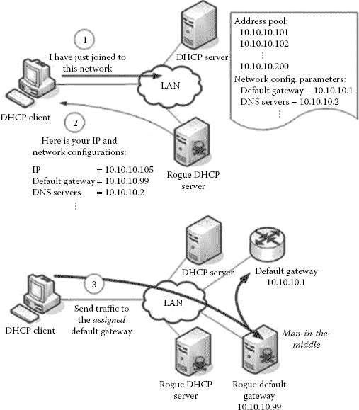

**图 3.8** 伪造 DHCP 服务器导致中间人攻击。

### 3.1.5 ICMP 扫描

ICMP 被路由器等网络设备用于执行错误消息传递。每个 ICMP 消息携带一个 8 位类型值和一个 8 位代码值，这两个字段共同关联一个状态/错误消息。例如，类型 3 代码 0 表示目标不可达，原因是目标网络不可达。ICMP 消息被多种工具用于恶意收集目标网络和主机的信息，因为 ICMP 请求总会得到响应。示例如下：

- 类型 8 消息是回显请求，如果主机可用，默认会由回显应答（类型 0）响应。此技术用于识别网络上的活跃设备，由于其在 ping 实用程序中的用途，通常称为 **ping 扫描**。如图 3.9 所示，Ping 扫描是一种枚举技术，向广泛的 IP 地址范围发送 ping 消息以识别活跃和非活跃主机（图 3.9）。
- 类型 13 消息请求时间戳，从而可揭示目标的时区。
- 类型 17 消息是网络掩码请求，可揭示子网划分详情。

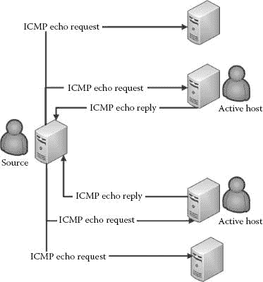

**图 3.9** Ping 扫描过程。

ICMP 扫描通常不被视为端口扫描技术，因为端口的概念在 ICMP 层面不适用；端口通常在传输层通过 TCP 可用/可寻址。它主要有助于识别网络上的存活主机，因此可归类为一种枚举方法。

#### UDP 扫描

由于 UDP 是无连接协议，通过发送 UDP 数据段难以识别目标状态，因为无回复可能有多种原因。然而，发送到未关联任何应用程序的端口（端口关闭）的 UDP 数据段，会被目标主机以 ICMP 端口不可达消息（类型 3 代码 3）响应。因此，UDP 数据段可识别出未开放的端口。

#### IP 扫描

向目标主机发送多个协议字段值不同的 IP 数据报。假设是对于主机不支持的协议，目标将回复 ICMP 目标协议不可达数据包（类型 3 代码 2）。这样入侵者就能识别出主机除常规 TCP 和 UDP 外，是否支持其他传输协议。

### 3.1.6 地址解析协议

地址解析协议 (ARP)

#### ARP 扫描

ARP 扫描是一种用于发现局域网内活跃主机的技术。入侵者发送具有不同 IP 地址的 ARP 请求，通常是子网范围内所有可能的地址。如果目标主机存活，将回复 MAC 地址，从而识别出所有可用主机。

#### ARP 欺骗和投毒

ARP 没有机制让 ARP 应答的接收者验证所描述的映射是否正确。此漏洞被用于欺骗攻击，入侵者向局域网上的其他主机发送带有错误映射的 ARP 应答，或用自己的 MAC 地址回复针对其他主机的 ARP 请求。因此，由于源头处的 ARP 条目错误，本应发往实际目的地的流量会被发送给入侵者。此外，它还会投毒主机、交换机和路由器的 ARP 缓存。

### 3.1.7 链路层漏洞


## 3.1.7 数据包嗅探

IEEE 802 系列 LAN 标准通常基于共享介质的概念开发，主机可以接收其连接链路上的所有流量，或在无线主机的接收范围内的所有流量。为了避免开销，网络接口卡会检查帧头中的源地址，如果不匹配自己的地址也不是广播地址，则停止监听。然而，IEEE 802 网络接口卡设计有混杂模式，在此模式下网卡接收介质上的所有流量。嗅探软件可收集这些流量进行恶意分析。在无线 LAN（如 802.11）或多个主机处于单一冲突域的以太网变体中，^(¹⁴)

如果以太网是交换式的，即每个主机连接到独立端口，交换机根据连接主机的 MAC 地址过滤各端口流量，则无法使用混杂模式进行嗅探，因为现在每个端口都是独立的冲突域。但这不保证完全无法嗅探。ARP 投毒或欺骗是可在交换式以太网中嗅探流量的一种方法。

以太网交换机拥有 MAC 表、过滤表或内容可寻址存储器表，用于存储 MAC 地址与端口号的关联（即连接在端口 X 上的主机的 MAC 地址）。无需预配置 MAC 表；交换机设计为即插即用。初始时 MAC 表为空，当某端口收到帧时，会以该帧的源地址为该端口连接的主机，在 MAC 表中为该端口创建条目。MAC 表持续通过这种方式维护。转发帧时，交换机在 MAC 表中查找目的 MAC 地址以确定其连接的端口。若找到条目，帧仅转发到该端口；否则，除接收帧的端口外，向所有端口广播。图 3.10 给出了该过程的分步示例。

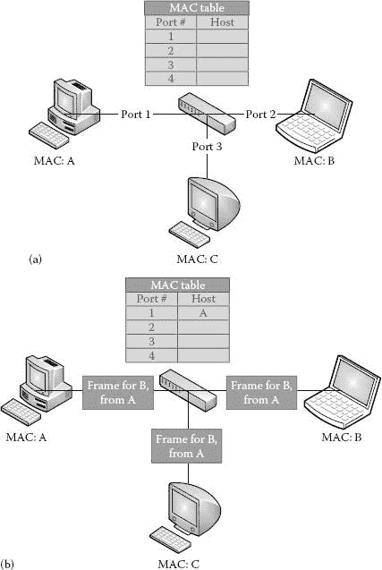

**图 3.10** (a) 以太网交换，初始 MAC 表为空。(b) 从 A 到 B 的帧，MAC 表中新建 A 的条目；因无 B 的 MAC 条目，帧将转发到所有端口（除接收端口外）。(c) 从 C 到 A 的帧，MAC 表中新建 C 的条目，仅转发到 A 所连的端口。

由于 ARP 数据包作为以太网帧传输，交换机利用它们维护 MAC 表。在 ARP 投毒或欺骗攻击中，交换机会在其 MAC 表中插入错误映射条目，使入侵者能够嗅探发往其他主机的数据包。

#### MAC Flooding

MAC Flooding 是另一种混淆以太网交换机、使其停止过滤帧的技术。该攻击利用交换机存储 MAC 表的内存有限这一事实。当内存不足以存储新条目时，大多数交换机配置为广播消息，以免影响 LAN 连接，称为“故障开启模式”。于是整个 LAN 变成单一冲突域，包嗅探成为可能。

在 MAC Flooding 攻击中，入侵者用帧淹没交换机，每个帧都有不同的伪造 MAC 地址。交换机因此不断为这些新 MAC 地址在 MAC 表中创建新条目，最终进入故障开启模式。

#### MAC Spoofing

MAC Spoofing（即使用不同于网卡烧录地址的地址）在大多数硬件上被允许。入侵者常用此法在网络上伪装成授权用户。当然，这要求入侵者先用某种技术识别网络上一些有效的 MAC 地址，以便稍后用于欺骗。

### 3.1.8 DNS 漏洞

域名系统（DNS）是互联网上的重要服务，DNS 服务器保存互联网域名与其关联的主机 IP 地址之间的映射。DNS 服务器以层级方式实现：顶层为一组根 DNS 服务器，第二层为顶级域服务器，第三层为权威 DNS 服务器。DNS 是公开可访问的服务，便于访问互联网及其服务。因此，DNS 与互联网上的其他公共服务一样脆弱。

#### Intranet DNS Spoofing（内网 DNS 欺骗）

入侵者利用嗅探技术捕获 LAN 上生成的 DNS 请求报文。由于 DNS 报文未加密，捕获报文后任何人都可查看请求内容。入侵者继而伪造 DNS 回复，向请求主机提供错误信息。错误的 DNS 信息意味着请求的互联网地址会映射到错误的主机/IP，这些可能属于入侵者创建的伪造站点，用于捕获受害主机发送的报文。

捕获 DNS 请求的常用方法是利用 ARP 投毒攻击网关/路由器，使其拥有无效的 DNS 服务器条目。于是路由器将所有 DNS 请求重定向给入侵者，误以为其为指定的本地 DNS 服务器。

#### Internet or Remote DNS Spoofing（互联网或远程 DNS 欺骗）

在远程 DNS 欺骗中，入侵者的目标是互联网上可被欺骗的任意客户端。方法不同，因为不再只有一个路由器可被投毒。此类攻击借助木马修改受害者的 DNS 设置。一旦实现，受害者的所有 DNS 请求将发送到入侵者指定的伪造 DNS 服务器。后果与 Intranet DNS Spoofing 相同。

借助木马，入侵者还可修改受害者的代理服务器设置，使受害者发往代理服务器的所有流量转到伪造主机。

#### DNS Cache Poisoning（DNS 缓存投毒）

组织网络中维护本地 DNS 服务器作为缓存，以限制外发 DNS 流量并减少延迟。这些缓存存储历史学习的 DNS 映射，对相似请求由缓存响应。入侵者可通过添加错误条目或修改现有条目来投毒此缓存。

## 3.2 操作系统漏洞

操作系统（OS）是人类设计的软件，像协议一样可能存在可被入侵者利用的漏洞。OS 世界与网络世界截然不同，互操作性不高。因此，攻击只有针对特定 OS 的性质精心设计才有效。与网络中通过查看包内容即可轻松识别协议不同，确定 OS 类型需要更深入的分析和更激进的技术。

### 3.2.1 OS Fingerprinting（操作系统指纹识别）


#### 操作系统指纹识别

操作系统指纹识别或操作系统横幅抓取是一种用于识别远程主机所用操作系统的技术。可以通过多种方式执行操作系统指纹识别。

#### TCP/IP 实现

协议（如 `TCP` 和 `IP`）中某些参数的配置取决于具体实现，遗憾的是不同的操作系统拥有其标志性的实现方式。对从目标主机接收到的数据包中这些配置进行分析，可以帮助入侵者识别该主机上运行的操作系统。在表 3.1 中，列出了不同操作系统使用的初始 TTL 值和窗口大小。我们在第 3.1 节中讨论的扫描技术，可用于捕获目标的响应，然后对比这两个字段的值以识别操作系统类型。其他参数和标志，如 TCP 初始序列号和 IP 标识号，也可用于揭示操作系统。

**表 3.1** 不同操作系统常用的 TCP/IP 参数

| 操作系统 | IP 初始 TTL | TCP 窗口大小 |
|---|---|---|
| Linux (内核 2.4 和 2.6) | 64 | 5840 |
| Google 定制 Linux | 64 | 5720 |
| FreeBSD | 64 | 65535 |
| Windows XP | 128 | 65535 |
| Windows 7、Vista 和 Server 2008 | 128 | 8192 |
| Cisco 路由器 (IOS 12.4) | 255 | 4128 |

此外，我们在网络扫描讨论中曾指出，当观察到异常协议操作时，`TCP` 的某些实现会以不同方式响应。例如，响应 Xmas 扫描和 Null 扫描的 `TCP RST` 段仅存在于 Berkeley Software Distribution (BSD) 实现中。同样，ICMP 回显扫描仅适用于 BSD 实现，因为只有这些操作系统会响应发送给广播地址的 ICMP 回显请求。

#### 应用层协议

`HTTP`、`SMTP` 和其他应用层协议在其消息横幅中包含有关操作系统的信息，从而暴露其身份。`HTTP` 中的 `server` 和 `user agent` 头字段是此类横幅抓取的典型例子。

### 3.2.2 Windows 平台

有多种协议、应用程序编程接口 (API) 和工具专门用于 Windows 平台，以恶意攻击 Windows 系统，例如网络基本输入输出系统和 PsTools。

#### NetBIOS 枚举

NetBIOS 是 Windows 平台上用于访问局域网资源的 API。Windows 中提供的 `nbtstat` 命令可揭示关于局域网上远程机器和共享资源的重要信息。

#### PsTools

此资源工具包包含多个命令行工具，有助于管理 Windows 系统。入侵者也可利用它们收集关于远程和本地系统的信息。

#### Microsoft 认证

Microsoft LAN Manager (LM) 和 Microsoft Windows NT LAN Manager 是 Microsoft 产品用于执行质询/响应认证的专有协议。这些协议以哈希形式存储密码，该哈希通过一系列步骤计算得出：将 14 字符长的密码分成两半并分别处理，为每部分创建一个 8 字节的哈希。早期版本 LM 有一个有趣的缺陷：如果密码长度小于或刚好七个字符，则哈希的第二部分始终为 `0xAAD3B435B51404EE`。这很容易向入侵者透露实际密码长度为七个字符或更少。

#### NTFS 数据流操纵

Windows 平台上的 NTFS 文件系统在 NTFS 卷上存储的每个文件都关联有两个数据流。第一个流存储安全描述符，而第二个流存储文件内的数据。备用数据流 (ADS) 是另一种可存在于每个 NTFS 文件中的命名数据流。它是可以附加到文件但实际不在文件中的任何类型的数据。分区的主文件表维护着与文件关联的所有数据流及其物理位置的列表；ADS 通过文件表附加到文件。

ADS 在 Windows 中的目的是提供一个包含文件元数据的隐藏流，例如属性、字数、作者姓名以及文件的访问和修改时间。然而，ADS 可用于将数据分叉到现有文件中，而不改变或改变其功能、大小或在文件浏览实用程序中的显示。因此，ADS 为攻击者提供了一种在受损系统上隐藏恶意代码或程序并允许其在不被检测到的情况下执行的方法。

### 3.2.3 UNIX/Linux 平台

#### 枚举

`finger` 命令用于枚举远程机器上的用户。它提供用户主目录、登录时间、空闲时间、办公位置以及上次接收或阅读邮件的时间等信息。同样，还有其他命令，如 `rpcinfo` 和 `showmount`，可用于揭示管理信息。

## 参考文献

*   1. Fielding, R., Gettys, J., Mogul, J., Frystyk, H., Masinter, L., Leach, P., and T. Berners-Lee, "Hypertext Transfer Protocol – HTTP/1.1", RFC 2616, DOI 10.17487/RFC2616, June 1999, [`www.rfc-editor.org/`](http://www.rfc-editor.org/) info/rfc2616.
*   2. Postel, J., Transmission Control Protocol, STD 7, RFC 793, DOI 10.17487/RFC0793, September 1981, [`www.rfc-editor.org/info/`](http://www.rfc-editor.org/info/) rfc793.
*   3. Postel, J., User Datagram Protocol, STD 6, RFC 768, DOI 10.17487/RFC0768, August 1980, [`www.rfc-editor.org/info/rfc768`](http://www.rfc-editor.org/info/rfc768).
*   4. Postel, J., Internet Control Message Protocol, STD 5, RFC 792, DOI 10.17487/RFC0792, September 1981, [`www.rfc-editor.org/info/`](http://www.rfc-editor.org/info/) rfc792.
*   5. Klensin, J., Ed., Simple Mail Transfer Protocol, RFC 2821, DOI 10.17487/RFC2821, April 2001, [`www.rfc-editor.org/info/`](http://www.rfc-editor.org/info/) rfc2821.
*   6. Bhushan, A., File Transfer Protocol, RFC 114, DOI 10.17487/RFC0114, April 1971, [`www.rfc-editor.org/info/rfc114`](http://www.rfc-editor.org/info/rfc114).
*   7. Droms, R., Dynamic Host Configuration Protocol, RFC 2131, DOI 10.17487/RFC2131, March 1997, [`www.rfc-editor.org/info/`](http://www.rfc-editor.org/info/) rfc2131.
*   8. Plummer, D., Ethernet Address Resolution Protocol: Or Converting Network Protocol Addresses to 48.bit Ethernet Address for Transmission on Ethernet Hardware, STD 37, RFC 826, DOI 10.17487/RFC0826, November 1982, [`www.rfc-editor.org/info/rfc826`](http://www.rfc-editor.org/info/rfc826).

# 4 恶意软件

**MOHSEN MOHAMED**


在前几章中，我们学习了计算机网络、信息系统安全以及入侵和漏洞。这些信息很重要，因为本书的目标是为研究人员和从业者提供关于如何使用蜜罐和路由器收集互联网攻击的完整信息。为实现这一目标，研究人员应具备足够的计算机网络知识，这将帮助他们设计能够抵御攻击者的优秀网络。他们还应具备足够的信息系统安全知识，这将帮助他们了解信息安全中最重要的问题。此外，研究人员应具备足够的入侵和漏洞知识，这将帮助他们了解入侵如何利用漏洞来攻陷网络。本章讨论恶意软件；这一讨论很重要，因为我们想要收集互联网攻击（即恶意软件），所以必须详细了解恶意软件。

本书剩余章节将涵盖以下主题：

*   **第 5 章** 讨论蜜罐；它们用于多种目的。其中一个目的是收集互联网攻击；此处将展示如何使用该工具收集互联网攻击。
*   **第 6 章** 讨论安全系统，如防火墙、防病毒软件、入侵检测和防御系统。研究人员应对这些系统有透彻的了解，这将帮助他们过滤已知攻击并保护生产网络。
*   **第 7 章** 讨论为收集零日多态蠕虫攻击而设计的真实网络。这将提供前几章共享的理论知识如何在实践中实施的详细信息。

## 4.1 简介

恶意软件是组织 IT 基础设施安全的主要威胁，可能造成巨大的经济损失。因此，保护网络和其他 IT 资源免受此威胁至关重要。本章概述了恶意软件以及我们如何保护机器免受其侵害。

*malware* 一词是 *malicious software*（恶意软件）的缩写，指任何破坏计算设备正常运行、从中收集敏感信息或访问非公共领域系统的软件。术语 *malware* 的使用仅限于恶意意图，即如果软件意外或无意地影响系统，则不视为恶意软件。一个同时包含这两类软件（即故意或无意损害系统）的替代术语是 *badware*。

恶意软件通过多种方式实现恶意目的，例如访问未授权的数据/信息、秘密监控计算机用户的活动、破坏或损坏系统，或勒索商业交易。

恶意软件通常分类如下：

*   广告软件
*   勒索软件
*   恐吓软件
*   间谍软件
*   特洛伊木马
*   病毒
*   蠕虫
*   其他恶意程序

恶意软件可以是活动内容、可执行代码、脚本或其他软件形式。典型的攻击手法是将恶意软件嵌入其他看似无害的软件中。与病毒相比，特洛伊木马和蠕虫是最活跃的恶意软件形式。

可用于保护网络免受恶意软件侵害的软件如下：

*   入侵检测和防御系统
*   防病毒软件
*   反恶意软件
*   防火墙

## 4.2 计算机病毒

计算机病毒是旨在影响计算机系统常规操作并从一台计算机传播到另一台计算机的小型软件或程序。

计算机病毒可通过以下方式影响系统：

*   损坏或删除系统上存储的数据。
*   利用电子邮件应用程序等通信手段传播到其他计算机。
*   以导致系统无法正常运行的方式损坏硬盘；例如，如果磁盘的引导扇区被擦除，则系统无法加载操作系统。
*   损坏或删除计算机上的数据。
*   利用电子邮件程序将自身传播到其他计算机。
*   清除硬盘上的所有内容。

计算机病毒：

*   可附加在电子邮件或即时通讯消息中。
*   可伪装成有趣的图片、贺卡或音频和视频文件的附件。
*   也可通过从互联网下载传播，并隐藏在非法软件或其他程序中。

有多种方法可以保护计算机免受病毒侵害。例如，为计算机配备强大的防病毒工具及其最新更新，随时了解最新威胁，尽可能以标准用户（而非管理员）身份运行计算机，以及在浏览互联网、下载文件和打开附件时避免接触任何可疑对象。

## 4.3 计算机蠕虫

*蠕虫* 是无需任何用户干预即可自我复制的程序；例如，通过网络发送其代码副本并确保由接收方计算机执行。受感染的计算机会进一步传播蠕虫副本，并可能在蠕虫影响下执行其他恶意活动。

### 4.3.1 蠕虫攻击

蠕虫利用系统上软件中的低级缺陷，也称为 *漏洞*。由于软件规模大、结构复杂以及使用不安全的编程语言和框架，漏洞在当今软件中非常常见。多年来发现了多种类型的漏洞。缓冲区溢出、算术溢出、内存管理错误和格式字符串处理不当是蠕虫利用的最常见漏洞类型。为了远程感染计算机，必须强制计算机运行蠕虫代码，而漏洞使这成为可能。

虽然未来可能会发现新类型的漏洞，但蠕虫获取程序执行控制权的机制不太可能随时间发生重大变化。蠕虫获取远程程序执行控制权的三种常见方法是（
### 4.3.2 蠕虫传播

一旦计算机成功被蠕虫感染，它就会利用该计算机将自身传播并繁殖到从受影响计算机可到达的其他计算机。蠕虫的传播过程及其即将产生的影响（如严重性、生存能力和持久性）在很大程度上取决于蠕虫如何选择受害者。

最简单经典的方法是在互联网上执行随机游走以寻找潜在受害者。然而，也出现了新颖且智能的攻击模型，可造成严重破坏。

*随机扫描*。蠕虫传播自身的最简单方法是执行随机网络扫描。包含蠕虫或蠕虫代码的节点随机生成或选择一个网络地址范围进行扫描。然后它开始在该网络空间中搜索潜在受害者，如开放或不安全的端口，并攻击这些易受攻击的主机。


## 4.3.2 扫描策略

#### 使用列表进行随机扫描
为了提高攻击和传播过程的效率，蠕虫可能会使用从互联网上可获取的关于不同组织的公开数据中生成的网络地址列表/范围。以这种方式进行扫描会更加精确和有针对性。

#### 跳岛扫描
在跳岛扫描中，蠕虫不会扫描所选范围内的所有地址；相反，它将范围划分为较小的块，并从每个块中随机扫描少量地址以最小化时间。当然，这种方法的准确性也会较低，因为被遗漏的主机可能存在漏洞。

#### 定向攻击
这种方法包括由于特定网络或组织的重要性，或攻击者对其有特殊兴趣而将其作为目标。信息战或针对某些知名政府或非政府网络的攻击都是定向攻击的例子。

#### 命中列表扫描
命中列表扫描更像是*带有列表的随机扫描*，因为在这种技术中，蠕虫预先拥有一个可能存在漏洞的节点列表，并在该范围内执行扫描。然而，一旦发现第一个受害者并成功入侵，主蠕虫节点会将剩余列表的一半分配给这个新的蠕虫节点，自己继续处理另一半。这样，每发现一个新受害者，剩余工作量就会减少。

### 4.3.3 蠕虫架构

蠕虫软件通常具有五个主要组件来执行其操作，我们在上面已经提到过。

#### 侦察
计算机蠕虫的生命周期始于对受害者的搜寻。负责此任务的软件组件通常称为*侦察*。该组件的目标在性质上类似于第 2.5.2 节中提到的黑客攻击的第一阶段，也称为*侦察*。

#### 攻击组件
一旦识别出易受攻击的主机，就会使用前面提到的一种或多种合适的技术对其进行攻击。此任务通常是蠕虫软件的一个单独函数或组件。

#### 通信组件
蠕虫软件还具有可用的函数、操作或接口，以促进蠕虫网络不同成员之间的通信。

#### 命令组件
蠕虫节点之间执行的一组重要通信是相互发出命令，以便在接收端执行。蠕虫包含一个合适的命令列表和接口，用于执行这些命令以进行集体攻击。

#### 智能组件
该组件包括用于蠕虫高效操作的算法和智能技术，例如更快的内部通信、高效扫描等。

## 4.4 蠕虫示例

在本节中，我们将讨论一些流行且知名的蠕虫。

### 4.4.1 Morris
Morris 于 1988 年 11 月 2 日发布用于攻击互联网；作为同类中的第一个，它是一个自我复制程序。*Morris 蠕虫*入侵了基于 Berkeley UNIX 的 VAX 和 Sun-3 计算机，并利用其资源复制攻击。在几小时内，该蠕虫蔓延至整个美国，影响了数千台计算机，并因其巨大的计算负载导致许多计算机无法使用。该蠕虫被设计为作为一个微小的进程执行以保持自身不被察觉；然而，其自我复制行为被低估了，这导致蠕虫传播到尽可能多的计算机，造成了严重破坏。受影响机器的计算性能因蠕虫进程在后台运行而开始下降，并且存在多个蠕虫实例在执行，因为同一台计算机被多次攻击。最终，由于内存和其他处理资源耗尽，系统完全失效。

### 4.4.2 Melissa
Melissa 是第一个通过邮件大规模传播的蠕虫，于 1999 年 3 月 26 日首次被发现。此后，电子邮件成为传播蠕虫的流行媒介。

Melissa 包含一个 Microsoft Word 宏病毒，这是一种利用应用程序自身的宏编程语言（如 Microsoft Word 或 Excel）来传播自身的计算机病毒。它通过攻击 Microsoft Word 和 Outlook 以一种半主动的方式传播。每当受影响机器上的用户将 Microsoft Word 文档附加到电子邮件并使用 Microsoft Outlook 作为电子邮件客户端时，Melissa 就会自动将该邮件的副本发送给用户通讯簿中的前 50 个地址。

### 4.4.3 Sadmind
Sadmind 蠕虫于 2001 年 5 月 8 日创建，利用漏洞入侵系统并篡改网页。它影响了 Microsoft Internet Information Services (IIS) 和 Sun Solaris 系统，针对 Sadmind 所利用漏洞的补丁早已发布；因此，未打补丁的系统成为了 Sadmind 的受害者。Sadmind 使得在易受攻击的 Solaris 系统上能以 root 权限执行任意代码，在易受攻击的 Windows 系统上能以 `IUSR_MachineName` 账户的权限执行任意命令。

### 4.4.4 Code Red 和 Code Red II
Code Red 和 Code Red II 分别于 2001 年 7 月 15 日和 8 月 4 日发布，利用了 Microsoft IIS 索引服务动态链接库 (DLL) 中缓冲区溢出漏洞。它们影响了启用了 IIS 4.0 或 IIS 5.0 并安装了 Index Server 2.0 的 Microsoft Windows NT 4.0，启用了 IIS 4.0 或 IIS 5.0 并安装了索引服务的 Windows 2000，以及其他运行 IIS 的系统。据估计，超过 250,000 台主机遭受了它们的攻击。

### 4.4.5 Nimda
Nimda 或 W32/Nimda 或 Concept Virus (CV) v.5 于 2001 年 9 月 18 日在互联网上发布，用于攻击运行未打补丁版本 IIS 的 Microsoft Windows 95、98、ME、NT 和 2000 系统。当系统在 Nimda 的帮助下被入侵时，入侵者可以在本地系统安全上下文中执行任意命令。该蠕虫以触发它的用户的相同权限执行。受感染的计算机因 Nimda 执行的网络扫描和电子邮件传播而遭受拒绝服务。

### 4.4.6 SQL Slammer
*SQL Slammer* 或 *W32.Slammer* 或 *Sapphire* 于 2003 年 1 月 25 日导致整个互联网上出现不同程度的网络性能下降。该蠕虫影响了 Microsoft SQL Server 2000 和 Microsoft Desktop Engine (MSDE) 2000。该蠕虫利用了 Microsoft SQL Server 2000 和 MSDE 2000 解析服务中的栈缓冲区溢出漏洞，这使得入侵者能够以与 SQL 服务器相同的权限执行任意代码。受害主机开始产生大量用户数据报协议 (UDP) 流量，导致同一网络上的其他主机或接收这些 UDP 数据包的互联网主机性能下降。

### 4.4.7 Blaster
*Blaster* 于 2003 年 8 月 11 日发起。它影响了运行 Microsoft Windows NT 4.0、Microsoft Windows 2000、Microsoft Windows XP 和 Microsoft Windows Server 2003 的计算机。Blaster 利用了与分布式组件对象模型相关的 Microsoft 远程过程调用接口中的漏洞，该模型在 TCP/IP 端口 135 上监听。该接口的目的是处理客户端发送到服务器的分布式组件对象模型的对象激活请求。格式错误的消息及其不正确的处理帮助攻击者利用缓冲区溢出以系统权限执行任意代码或导致拒绝服务。

### 4.4.8 Sasser


Sasser 是一种网络蠕虫，最早于 2004 年 4 月被发现。它利用了附着在 TCP 端口 445 上的 Windows 本地安全机构子系统服务 (LSASS) 中的缓冲区溢出漏洞。与其他蠕虫一样，该漏洞允许远程攻击者以系统权限执行任意代码。

### 4.4.9 Conficker

Conficker 最早于 2008 年 11 月被发现，针对 Microsoft Windows 操作系统，并利用服务器服务 (`svchost.exe`) 中的一个特定漏洞。在该漏洞中，一台已感染的计算机使用特殊的远程过程调用请求来强制触发缓冲区溢出，并在另一台计算机上执行 Shellcode。在源计算机上，蠕虫建立一个 HTTP 服务器，监听 1,024 到 10,000 之间的某个端口；目标计算机上的 Shellcode 强制其连接到此 HTTP 服务器，以下载一份以 DLL 形式存在的蠕虫副本，随后该副本会附着到 `svchost.exe` 上。

### 4.4.10 Allaple

Allaple 蠕虫是一种专为 Windows 平台设计的网络蠕虫，最早于 2008 年 8 月被发现。一旦执行，Allaple 会搜索本地磁盘中的 HTML 文件并向其中注入代码，以激活其已安装的副本。Allaple 有多个变种，其中一些通过利用常见的缓冲区溢出漏洞，或通过将自身复制到受弱密码保护的网络共享（如 `SRVSVC` (MS06-040)、`RPC-DCOM` (MS04-012)、`PNP` (MS05-039) 和 `ASN.1` (MS04-007)）传播到其他网络计算机。

## 4.5 多态蠕虫

多态蠕虫是一种在每次攻击中都会改变其外观或特征码的计算机蠕虫。

### 4.5.1 多态蠕虫结构

由于多态蠕虫在每次尝试中都会改变自身，我们将获得多个彼此在一定程度上不同的蠕虫样本。每个样本通常由以下组件组成：

*   **协议框架：** 蠕虫需要宿主中的漏洞来发起攻击并继续传播。该漏洞通常与特定的应用程序代码以及该代码中可由特定类型的协议请求激活的执行路径相关联。
*   **攻击字节：** 这是多态蠕虫的攻击组件，用于利用目标漏洞。
*   **蠕虫主体：** 这些是在受影响主机上执行的蠕虫主要指令；多态蠕虫的每个实例在主体部分通常都有所不同。
*   **多态解密器：** 为了保持其多态性并使实例之间有所不同，多态蠕虫通常以加密形式保存蠕虫主体。解密器在受影响的计算机上提取这些指令，并根据解密逻辑生成不同版本的蠕虫主体。
*   **其他字节：** 这些是通常不影响蠕虫主体和攻击字节成功执行的附加指令。

### 4.5.2 多态蠕虫分析

从分析师的角度来看，多态蠕虫样本的二进制内容可分为三类字节：不变字节、代码字节和通配符字节。

*   **不变字节** 在蠕虫的每个可能实例中具有相同或固定的值。它们可能存在于上述讨论的任何蠕虫部分中，其值的改变会导致蠕虫失效。为了生成多态蠕虫的特征码，识别不变字节至关重要，因为这些字节对于蠕虫的成功运行是必要的，且存在于每个实例中。
*   **代码字节** 包含蠕虫的可执行组件，如蠕虫主体或解密例程。代码字节是蠕虫的主要多态内容；然而，代码字节的某些部分可能在各实例间是相似的。
*   最后，**通配符字节** 代表蠕虫中可以取任意值的部分，这种变化对蠕虫的性能没有影响。

### 4.5.3 多态蠕虫特征码生成

针对多态蠕虫特征码生成的研究主要分为两个方向。基于内容的特征码生成关注不同蠕虫实例原始字节中存在的相似性。另一方面，基于行为的特征码则是通过分析蠕虫代码的语义来生成。基于内容的特征码具有优势，因为它们将蠕虫视为字节串处理，而不考虑其他因素。这也使得它们便于部署到防火墙或网络入侵检测系统中。

### 4.5.4 多态蠕虫技术

多态蠕虫的设计采用了不同的方法和技术来实现其多态性。以下是其中一些方法的描述：

*   **使用可变密钥的自我加密。** 在此方法中，蠕虫主体使用可变加密密钥进行加密。因此，蠕虫原始字节的特征码和统计特征被完全扩散。攻击通过发送蠕虫的加密副本、解密例程和密钥到受害者主机来发起。解密例程提取原始程序，该程序一旦执行便开始攻击。该模型的有效性主要取决于解密例程，如果解密例程不经常改变，它就会充当蠕虫的特征码。

    因此，实现多态性的一种更复杂的方法是为每个蠕虫副本使用不同的解密例程。这要求蠕虫包含多个解密例程，并从中随机选择一个，但所有例程都与蠕虫主体一起加密。嵌入蠕虫中的解密例程数量会直接增加其长度；因此，只能添加有限数量的例程。这一限制使得在捕获足够多的蠕虫样本后，可以将所有例程组合起来作为蠕虫特征码。

*   **垃圾代码插入。** 在垃圾代码插入中，每个蠕虫副本都会添加一组不同的垃圾或无用指令。例如，在蠕虫主体的不同位置插入一些空操作 (`NOP`) 指令。这会使得字节序列的分析因散布在蠕虫主体各处的垃圾内容而变得更加困难。然而，`NOP` 的频率与非恶意程序相比会有很大不同，并且可以在统计分析中轻易被揭示。基于异常的检测系统可以利用这一事实来检测蠕虫。另一种方法是使用可执行文件分析技术生成一个去除 `NOP` 后的蠕虫样本，并用此类样本进行特征码生成。

*   **指令替换。** 指令替换技术用一个外观不同但功能等效的指令序列来替换原指令序列。该方法的成败取决于总共替换了多少序列，因为未改变的序列将充当特征码；而替换整个代码则是一项浩大的工程。

*   **代码置换。** 代码置换是一种略微修改的技术，通过引入跳转指令来改变指令的顺序。然而，过多跳转指令的后果类似于 `NOP`。

*   **寄存器重分配。** 最后，在寄存器重分配技术中，不同指令使用的 CPU 寄存器被交换，从而产生功能等效但包含大量分布在代码各处的微小变化的代码，且不像 `NOP` 或跳转那样存在统计弱点。

在 4.7 节 中，我们将讨论用于预防和检测互联网蠕虫的方法。

## 4.6 蠕虫的预防与检测


毕竟蠕虫是一种程序，它利用远程主机上运行的应用程序中的弱点，并获取对该易受攻击应用程序执行的控制权。因此，问题的根源在于该漏洞，处理该漏洞应是用于应对蠕虫的任何预防技术中的第一步。然而，大量遗留程序广泛应用于实践中，无法一夜之间通过修改或替换来消除系统漏洞。此外，还存在尚未被发现的漏洞，没人知道它们的数量。这导致我们得出结论：仅靠预防永远无法使 IT 系统安全，检测同样至关重要。

蠕虫攻击可以通过两种不同的方式来预防：通过预防蠕虫利用的漏洞，或通过控制对漏洞的利用。

### 4.6.1 漏洞预防

**安全编程语言与实践：**良好的编程实践，以及以安全的方式设计协议和软件，是减少漏洞、解决大多数问题的最有效途径。即使是最优秀、最谨慎的程序员，其代码中也可能存在人为错误、疏忽和错误假设。`C` 是设计关键应用程序最常用的语言，因其相对于其他语言的若干技术优势；然而，由于其对人为错误的松散控制，它往往容易受到缓冲区溢出的攻击。因此，更安全的编程和执行环境极为重要。目前可通过以下方式获得一些帮助：

1.  **静态分析**工具
2.  **运行时检查**
3.  上述两者的结合
4.  安全语言

**安全执行环境：**安全执行环境也能确保漏洞不被利用。例如，通过使用带有断言的内存访问来维护内存完整性，将提供安全的执行。

### 4.6.2 利用预防

不幸的是，不存在能全面消除软件漏洞的工具。此外，使用此类工具既困难，又会导致性能下降，这不符合生产环境的经济效益。因此，供应商继续销售带有漏洞的软件，让攻击者忙于制作利用代码。除此之外，还有如前所述的遗留系统正在使用中，且难以修正。因此，预防利用比预防漏洞更方便。这种预防策略有多个维度：

1.  **访问控制（操作系统维度）：**控制对系统资源或文件系统内容的未授权访问，并在多用户环境中安全地维护访问边界，一直被认为是操作系统（`OS`）的职责。此目的通常借助访问控制矩阵和列表来实现，它们指定每个用户与系统每个资源关系的性质。
2.  **防火墙与 IPS（网络维度）：**来自组织外部的攻击，也可通过基于某些规则和策略过滤入站流量来阻止。这通常在网络边界网关执行，也可在单个机器的网络协议栈网络层实现。例如，绝不接受来自特定 IP 地址的任何 `TCP` 连接。另一个例子是丢弃包内容与特定模式匹配的连接。基于 IP 地址的流量过滤通常由防火墙执行，防火墙维护着好坏地址列表。另一方面，基于特征的入侵防御系统用于过滤带有不需要模式的流量。还有一类紧密相关的软件称为**入侵检测系统（`IDS`）**，详见 4.7 节。
3.  **威慑措施（法律维度）：**已采取若干技术和法律措施，以阻止对计算机系统的攻击。法律的颁布与执行，结合在计算机上建立审计跟踪（以记录证据），也有助于保障 IT 系统安全，主要在法律严格实施的国家。

## 4.7 入侵检测系统

研究界已提出并构建了 `IDS`，以防御互联网蠕虫（及其他攻击）。

入侵检测有两种基本类型：**基于主机**和**基于网络**。**基于主机**的 `IDS` 检查作为主机的单个计算机上存储的数据，而**基于网络**的 `IDS` 检查计算机之间交换的数据。

检测入侵者有两种基本技术：**异常检测**和**误用检测**（特征检测）。**异常检测**旨在发现异常行为模式；`IDS` 建立正常使用模式的基线，任何严重偏离基线的行为都会被标记为可能的入侵。尽管这些系统能检测先前未知的攻击，但当正常活动多样且不可预测时，它们会产生高误报率。**误用检测**，通常称为**特征检测**，利用特定的已知未授权行为模式来预测和检测后续类似尝试。这些特定模式称为**特征**。它们能检测已知蠕虫，但会对新类型失效。

大多数部署的蠕虫检测系统基于特征，属于误用检测类别。它们寻找已知出现在攻击流量中的特定字节序列（称为**攻击特征**）。特征由人工专家通过仔细分析捕获的攻击流量中的字节序列来手工识别。一个好的特征应是持续出现在攻击流量中，但在正常流量中很少出现的特征。

## 4.8 防火墙

防火墙是一种旨在防止未授权访问专用网络或从专用网络访问的系统。防火墙可用硬件、软件或两者结合来实现。防火墙常用于防止未授权的互联网用户访问连接到互联网的专用网络，尤其是内联网。所有进出内联网的消息都要通过防火墙，防火墙会检查每条消息，并阻止不符合指定安全标准的消息。

防火墙技术有多种类型；其中一些如下：

*   **包过滤器：**它检查进出网络的每个数据包，并根据用户定义的规则接受或拒绝。包过滤相当有效，且对用户透明，但难以配置。此外，它易受 IP 欺骗攻击。
*   **应用网关：**它对特定应用程序（如 `FTP` 和 `Telnet` 服务器）应用安全机制。这非常有效，但可能造成性能下降。
*   **电路级网关：**它在建立 `TCP` 或 `UDP` 连接时应用安全机制。连接建立后，数据包可在主机间流动，无需进一步检查。
*   **代理服务器：**它拦截进出网络的所有消息。代理服务器有效地隐藏了真实的网络地址。

## 参考文献

*   1. M.M.Z.E. Mohammed, and A.-S.K. Pathan. Automatic Defense against Zero-Day Polymorphic Worms in Communication Networks, CRC Press, Boca Raton, FL, 2013.
*   2. M. Erbschloe, Trojans, Worms, and Spyware: A Computer Security Professional’s Guide to Malicious Code, Elsevier, Burlington, MA, 2005.


*   3. S.G. Cheetancheri, Collaborative Defense against Zero-Day and Polymorphic Worms: Detection, Response and an Evaluation Framework, PhD thesis, University of California, Davis, CA, 2007, [`www.cs.ucdavis.edu/`](http://www.cs.ucdavis.edu/) research/tech-reports/2007/CSE-2007-38.pdf.
*   4. M.M.Z.E. Mohammed and A.-S. K. Pathan. Automatic Defense against Zero-day Polymorphic Worms in Communication Networks, ISBN 9781466557277, CRC Press, Taylor & Francis Group, Boca Raton, FL, 2013.

# 5 蜜罐理论指南

**MOHSEN MOHAMED**

## 5.1 蜜罐概念

### 5.1.1 蜜罐简介

最好先定义蜜罐，然后谈谈它的历史，我们认为这是阅读和理解相关关键信息的恰当顺序。

蜜罐有许多定义。

Lance Spitzner 给出的蜜罐正式定义 [1, p. 58] 是：“蜜罐是一种安全资源，其价值在于被探测、被攻击或被入侵。”

我们现在将提出一系列问题来解释蜜罐的定义。首先，为什么我们需要制作蜜罐？

*   我们需要蜜罐来收集关于谁在试图入侵我们系统的信息。怎么做？蜜罐拥有可以保留源和目的地痕迹的工具。
*   蜜罐可以为我们提供关于攻击者使用了哪些工具和战术来入侵我们系统的信息。此类信息可以在蜜罐内部使用的技术中找到，例如防火墙日志、入侵检测系统 (IDS) 和系统日志。通过获取这些信息，我们可以在未来避免此类攻击。怎么做？通过改进我们的系统以防御这些已知攻击。这一点（即收集关于工具和战术的信息）被认为是蜜罐最重要的目标。因为，任何人都希望使自己的系统尽可能复杂，以便攻击者更难入侵系统。
*   通过使用蜜罐，我们可以获取零日攻击（未知攻击）。我们应该提到，大多数蜜罐用户是研究人员，因为蜜罐为他们提供了关于各种攻击及其模式的大量信息。还有其他人出于其他目标制作蜜罐，比如在公司寻找攻击的解决方案，或者仅仅作为测试，或者用于概念演示，等等。

关于蜜罐的一个有趣事实是，如果蜜罐没有被攻击者攻击，则没有任何价值！这是因为，为了捕获关于攻击者的信息，蜜罐必须被入侵。否则，它毫无用处，因为它无法提供所需的信息。这一点解释了为什么我们需要蜜罐。然后我们可以问另一个问题：如何应用蜜罐以使其受到攻击。

1.  首先，我们应该将蜜罐放置在我们的真实网络中，作为真实机器或设备中的软件。
2.  我们应该使用防火墙、路由器或其他防御机制将蜜罐与网络中的其他机器隔离开来。为什么要在蜜罐和其他机器之间进行这种隔离？为了保护其他机器免受攻击者侵害。
3.  如果我们需要改进我们的防御系统，那么在蜜罐中，我们应该使用与我们在其他受保护机器中使用的相同的防御系统。在蜜罐中使用相同的防御系统有助于我们了解攻击者如何入侵这些防御系统，以便我们改进它们。例如，如果我们想发现零日攻击，我们应该使用更新的 IDPS、防病毒软件，并添加支持性防御机制。因为，这些防御系统可以过滤掉已知攻击，然后只有未知攻击会入侵我们的蜜罐（这是我们的预期）。因此，我们可以减轻蜜罐的繁重负载。
4.  根据需要，我们可以在蜜罐中使用薄弱的防御系统，或者根本不使用任何防御系统，如果我们想追踪攻击者并获取关于其如何造成破坏的信息。例如，如果政府想追踪谁会试图入侵他们的系统，那么他们可以使用防御薄弱或完全没有防御机制的蜜罐。因此，攻击者会被引诱并能轻松入侵政府系统。然后，政府可以追踪该攻击者。我们应该注意，在这种情况下，攻击者至少可以猜出这是一个蜜罐，因为如果在政府机构中设置了一个防御薄弱的设备，极有可能它是一个蜜罐。攻击者并不愚蠢。因此，当涉及政府机构的机器/计算机时，这种陷阱可能并不总是能引诱攻击者上钩。
5.  当我们设置蜜罐时，应该通知组织中的所有人，以免他们尝试访问它。因此，任何发出或进入蜜罐的内容都应被视为攻击。经过相当长的一段时间后，我们可以去检查蜜罐捕获了什么。此外，我们可以实时查看蜜罐中到底发生了什么。

从这些描述中应该可以明显看出，蜜罐与大多数安全工具不同。当今使用的大多数安全技术都是为了解决特定问题而设计的。例如，防火墙是一种通过控制流量流向来保护组织的技术。它们被用作访问控制工具。防火墙最常部署在组织的边界周围，以阻止未经授权的活动。网络 IDS 旨在通过监控系统或网络活动来检测攻击。

蜜罐之所以不同，是因为它们不局限于解决单一的特定问题。相反，蜜罐是一种高度灵活的工具，可应用于各种不同的情况。这就是为什么蜜罐的定义乍看之下可能显得模糊，因为它们可以用于实现许多不同的目标，并且可以呈现多种不同的形式。例如，蜜罐可用于威慑攻击，这是与防火墙共同的目标。蜜罐也可用于检测攻击，类似于 IDS 的功能。蜜罐可用于捕获和分析自动化攻击（如蠕虫），或充当早期指示和预警传感器。蜜罐还具有分析黑帽社区活动的能力，捕获攻击者的击键或对话。如何使用蜜罐取决于你。这取决于你试图实现什么。在 第 6 章 中，我们将更详细地介绍你可以用蜜罐实现的不同目标。然而，所有可能的表现形式都共享一个共同特征：它们的价值在于被探测、被攻击或被入侵。

重要的是要注意，蜜罐不包含有价值的数据。相反，它们包含某种伪造数据。因此，蜜罐是没有生产价值的安全资源；没有人或资源应该与它们通信。因此，发送给它们的任何活动本质上都是 `suspect`（可疑的）。发送到蜜罐的任何流量极有可能是探测、扫描或攻击。蜜罐发起的任何流量意味着系统极有可能已被入侵，且攻击者正在建立出站连接。


让我们通过一个实际例子来完善对蜜罐定义的理解。假设有一栋有三个房间的房子，且该房子是攻击者的目标。房主需要知道攻击者是谁，以及他是如何攻破房屋防御系统（即门锁、钱柜和窗户防盗栏）的。房主将所有贵重物品放在前两个房间，并在第三个房间内部安装了一个隐藏摄像头，在房间前方安装了另一个隐藏摄像头以监视攻击者。第三个房间使用的其他防御系统与前两个房间相同，但第三个房间不包含任何贵重物品。在这种情况下，当攻击者闯入或来到第三个房间时，摄像头会记录攻击者的所有活动。因此，在这种情况下，第三个房间的工作方式与蜜罐相同，因为该房间给攻击者提供了自由活动的选择，但会记录其所有行动。

### 5.1.2 蜜罐的历史

本节简要介绍蜜罐的历史。

*   **1990/1991** — 首批记录蜜罐概念的公开著作：Clifford Stoll 的《The Cuckoo’s Egg》和 Bill Cheswick 的《An Evening With Berferd》。
*   **1997** — Fred Cohen 的 Deception Toolkit 0.1 版本发布，这是最早可供安全社区使用的蜜罐解决方案之一。
*   **1998** — 开始开发 CyberCop Sting，这是最早向公众出售的商业蜜罐之一。CyberCop Sting 引入了将多个虚拟系统绑定到单个蜜罐的概念。
*   **1998** — Marty Roesch 和 General Telephone and Electric Corporation (GTE) Internetworking 开始开发一种蜜罐解决方案，最终演变为 NetFacade。这项工作也开启了 Snort 的概念。
*   **1998** — BackOfficer Friendly (BOF) 发布 — 一款免费、简单易用的基于 Windows 的蜜罐。
*   **1999** — Honeynet Project 成立并发布《Know Your Enemy》系列论文。这项工作有助于提高认知度，并验证了蜜罐及蜜罐技术的价值。
*   **2000/2001** — 利用蜜罐捕获和研究蠕虫活动。更多组织采用蜜罐进行攻击检测和新威胁研究。
*   **2002** — 蜜罐被用于在野外检测和捕获一种新的未知攻击，具体为 `Solaris dtspcd` 漏洞利用。

#### 早期出版物

令人惊讶的是，1990 年之前关于蜜罐概念的资料极少，甚至没有。第一份资源是 Clifford Stoll 所著的《The Cuckoo’s Egg》。

在《The Cuckoo’s Egg》中，Clifford Stoll 讲述了发生在 1986 年和 1987 年跨度 10 个月内的一系列真实事件。Stoll 是 Lawrence Berkeley Lab 的天文学家，负责管理天文学家社区使用的各种计算机系统。一个 75 美分的账目错误导致他发现了一名代号为 `Hunter` 的攻击者已渗透进入其系统之一。Stoll 没有禁用攻击者的账户并将其拒之门外，而是决定允许攻击者留在系统中。他的动机是了解更多关于攻击者的信息并将其追踪。在随后的几个月里，他在保护攻击者以此为跳板攻击的各种政府和军事计算机的同时，试图发现攻击者的身份。Stoll 的计算机不是蜜罐；它们是学术和研究社区使用的生产系统。然而，他利用被攻陷的系统追踪攻击者的方式，与蜜罐和蜜罐技术的概念非常相似。Stoll 的书不是技术性的；它读起来更像是一部 Tom Clancy 风格的间谍小说。使这本书在蜜罐历史上独特且重要的，是书中讨论的概念。

书中最迷人的是 Stoll 在攻击者不知情的情况下获取信息的方法。例如，他在被攻陷的系统上创建了一个名为 `SDINET`（战略防御倡议网络）的虚假目录。他想创建能吸引攻击者注意的材料，随后用各种听起来有趣的文件填充该目录。目的是通过迫使攻击者浏览大量文件来浪费其时间。攻击者在系统上停留的时间越长，当局追踪攻击者的时间就越多。Stoll 还包含了不同价值的文档。通过观察攻击者复制了哪些特定文档，他可以识别攻击者的动机。例如，Stoll 提供了看似有财务价值的文档和包含政府机密的文档。攻击者绕过了财务文档，专注于国家安全相关材料。这表明攻击者的动机不是经济利益，而是获取高度机密的文档。

Bill Cheswick 的论文《An Evening with Berferd in Which a Cracker Is Lured, Endured, and Studied》发布于 1990 年。这篇论文比《The Cuckoo’s Egg》更具技术性，由安全专业人员为安全社区撰写。与《The Cuckoo’s Egg》一样，Cheswick 论文中的一切都是非虚构的。然而，与该书不同的是，Cheswick 构建了一个他希望被攻陷的系统——这应该是真正蜜罐的第一个有记录案例。在论文中，他不仅讨论了蜜罐如何构建和使用，还讲述了如何研究一名荷兰黑客攻击并攻陷各种系统的过程。

Cheswick 最初构建了一个包含多个漏洞（包括 Sendmail）的系统，以确定存在哪些威胁以及它们如何运作。他的目标不是捕获特定的某个人，而是了解其网络和系统上发生的威胁活动。

Cheswick 的论文不仅解释了他构建系统的不同方法（他从未称其为蜜罐），还说明了这些方法如何被使用。除了各种看似脆弱的服务外，他还创建了一个名为 `a jail` 的受控环境，用于限制攻击者的活动。他逐步展示了入侵者（称为 `Berferd`）如何尝试渗透系统，以及 Cheswick 从攻击者那里学到了什么。我们看到了 `Berferd` 如何利用 Sendmail 漏洞渗透系统并获得控制权。Cheswick 描述了其方法的优缺点。（该论文收录在随书附带的 CD-ROM 中。）

Stoll 的书和 Cheswick 的论文都是很好的参考文献。然而，没有任何资源详细描述如何设计和部署蜜罐。两者也都没有提供蜜罐的精确定义，或探讨蜜罐技术的价值。

#### 早期产品

第一个公开的蜜罐解决方案称为 `deception toolkit (DTK)`。

在 DTK 之后，1998 年开始开发第一个商业蜜罐产品 CyberCop Sting。该蜜罐有几个不同于 DTK 的特性。首先，它运行在 Windows NT 系统上而非 Unix。其次，它可以同时模拟不同的系统，具体包括 Cisco 路由器、Solaris 服务器和 NT 系统。


因此，CyberCop Sting 能够模拟整个网络，其中每个系统都拥有专属于其所模拟操作系统（OS）的独特服务。攻击者可以扫描网络并发现各种 Cisco、Solaris 和 NT 系统。随后，攻击者可以 Telnet 到 Cisco 路由器并获得提示该系统为 Cisco 的横幅，FTP 到 Solaris 服务器并获得提示该系统为 Solaris 的横幅，或建立 HTTP 连接到 NT 服务器。甚至连模拟的 IP 协议栈也经过修改，以复制正确的操作系统特征。这样，如果使用主动指纹识别措施（如 `Nmap` [

就其时代和发展水平而言，CyberCop Sting 是一款前沿且先进的蜜罐。此外，它易于安装、配置和维护，使得广大安全社区都能使用。然而，作为一款商业产品，它从未真正普及，现已停止开发。自其退市以来，已发布了几款优秀的商业蜜罐产品，包括 NetSec 的 Specter [

1998 年，Marty Roesch 在 GTE Internetworking 工作期间，开始为一位大型政府客户开发蜜罐解决方案。Roesch 及其同事开发了一种蜜罐系统，该系统利用单台主机模拟整个 C 类网络，最多可达 254 个系统。最多可模拟七种不同类型的操作系统及多种服务。尽管最终的商业产品 NetFacade [

1998 年还发布了 BOF，这是一款由 Marcus Ranum 开发、Network Flight Recorder 发布的基于 Windows 和 Unix 的蜜罐。BOF 的独特之处在于它免费、极易使用，且可在任何基于 Windows 的桌面系统上运行。你只需下载工具，在系统上安装，即刻拥有专属的个人蜜罐。尽管功能有限，BOF 却是许多人接触蜜罐技术概念的入门之作。

1999 年，蜜网项目成立 [

#### 近期历史：蜜罐的实战应用

2000 年和 2001 年，基于 Unix 和 Windows 的蠕虫突然激增。这些蠕虫被证明极其有效。它们在互联网上呈指数级传播的能力令互联网社区震惊。各安全组织面临的挑战之一是获取蠕虫副本进行分析并了解其工作原理。由于数据污染，从受感染的生产系统获取蠕虫副本非常困难，就像 Code Red 蠕虫 [

一个例子是 [Incidents.org](http://Incidents.org) 对 Leaves 蠕虫的捕获与分析。2001 年 6 月 19 日，检测到针对 Sub7 特洛伊木马的扫描活动突然上升。Sub7 是一种接管 Windows 系统的特洛伊木马，赋予攻击者对系统的完全远程控制权。该木马在默认端口 27374 上监听。攻击者使用特殊的客户端软件连接到该端口来控制受感染系统。[Incidents.org](http://Incidents.org) 的一组安全专家试图查明该活动的原因。

2001 年 6 月 21 日，SANS 研究所的 Johannes Ullrich 部署了一个他开发的蜜罐，用于模拟感染了 Sub7 特洛伊木马的 Windows 系统。几分钟内，该蜜罐捕获了一次攻击，使 [Incidents.org](http://Incidents.org) 团队能够对其进行分析。他们发现有一种蠕虫伪装成 Sub7 客户端，试图感染已被 Sub7 特洛伊木马感染的系统。这省去了攻击者入侵系统的麻烦，因为这些系统早已被攻击和攻破。Matt Fearnow 和 [Incidents.org](http://Incidents.org) 团队对该蠕虫进行了全面分析，最终将其识别为 W32/Leaves 蠕虫，并将关键信息转交给国家基础设施保护中心。其他组织也开始使用蜜罐捕获蠕虫进行分析，例如 [SecurityFocus.com](http://SecurityFocus.com) 的 Ryan Russel 对 CodeRed II 蠕虫的分析。这些事件再次提高了安全社区和安全研究领域对蜜罐价值的认知。

涉及蜜罐技术捕获未知漏洞利用的首个记录案例发生在 2002 年 1 月 8 日。一个 Solaris 蜜罐捕获了一个 `dtspcd` 漏洞利用，这是一种此前从未见过的攻击。2001 年 11 月 12 日，计算机应急响应小组（CERT）协调中心（一个安全研究组织）发布了关于通用桌面环境子进程控制服务的公告 [

### 5.1.3 蜜罐的类型

蜜罐主要分为两类 [

1.  生产蜜罐
2.  研究蜜罐

这一分类概念源自 Snort 的开发者 Marty Roesch。它是在他在 GTE Internetworking 的工作和研究过程中演变而来的。生产蜜罐用于保护组织，而研究蜜罐用于实验和研究。

生产蜜罐易于使用，仅捕获有限信息，主要由公司或企业使用。组织将这些蜜罐与其他生产服务器一起放置在生产网络内，以提高其整体安全状况。它们增加了特定组织安全性的价值，并有助于降低风险。通常，生产蜜罐提供的关于攻击或攻击者的信息比研究蜜罐少。

正如上文所述，生产蜜罐通常比研究蜜罐更易于构建和部署，因为它们所需功能较少。生产蜜罐相对简单，一般风险较低。生产蜜罐的缺点之一是，它们通常提供的关于攻击或攻击者的信息比研究蜜罐少。我们可能了解攻击者来源系统或发起的漏洞利用，但极不可能了解他们如何相互通信或如何开发工具。

研究蜜罐部署起来通常非常复杂。研究蜜罐的主要目标是收集关于针对不同网络的黑帽社区动机和战术的大量信息。值得注意的是，研究蜜罐不直接为特定组织增加价值；相反，它们用于研究组织面临的威胁，并学习如何更好地防御这些威胁。研究蜜罐部署和维护复杂，捕获大量信息，主要由研究、军事或政府组织使用。

要获取关于攻击者的大量信息，我们需要使用研究蜜罐；别无选择。这些蜜罐为攻击者提供真实的操作系统和应用程序进行交互。这有助于我们潜在地了解攻击者是谁、他们如何通信，或如何开发或获取工具，但我们也必须提到研究蜜罐风险巨大，且需要更多时间和精力来管理。事实上，研究蜜罐可能会降低组织的安全性，因为它们需要大量资源和维护工作。

## 5.2 威胁类型

蜜罐是一种安全解决方案。因此，最好先解释问题是什么，即攻击者。通过了解我们的威胁是谁以及他们如何运作，我们可以更容易地理解解决方案，即蜜罐的概念 [

### 5.2.1 脚本小子与高级黑客攻击


#### 攻击者类型

攻击者主要分为两类：**脚本小子** 和 **高级黑客**。无论这些威胁来自外部（如互联网）还是内部（如不满的员工），大多数威胁都倾向于归属于这两类之一。

#### 脚本小子

这类攻击者通常依赖脚本化攻击。有时，这些攻击者有特定要求，例如入侵具有高速互联网连接的系统，或拥有用于存储文件的大容量硬盘。但总体而言，他们只关心数量。他们技术相对不成熟，但数量庞大，代表了当今绝大多数探测、扫描和攻击的来源。

如果没有脚本小子，利用脚本小子攻陷设备原本是一项非常复杂的任务，可能只能由专家执行。例如，步骤如下：

1.  首先，攻击者必须识别操作系统或应用程序中的漏洞。这并非易事。它需要关于操作系统如何工作的广泛知识，例如内存管理、内核机制和文件系统功能。要识别应用程序中的漏洞，攻击者必须了解应用程序如何运行以及如何与信息的输入和输出进行交互。识别漏洞可能需要数天、数周甚至数月。
2.  然而，在识别出漏洞后，攻击者必须开发工具来利用它。这需要广泛的编码技能，可能涉及多种不同的计算机编程语言。
3.  开发出漏洞利用代码后，攻击者必须寻找脆弱的系统。通常，会使用一种扫描工具来查找可通过互联网访问的系统，利用 ICMP ping 或完整 TCP 连接等功能。这些工具用于建立可访问系统的数据库。随后，攻击者必须确定可达系统上存在什么服务——即目标上实际运行了什么。此外，攻击者还必须确定这些服务中是否有任何漏洞。
4.  下一步是针对受害者发起漏洞利用，入侵并控制系统。最后，应使用各种其他工具（通常称为 `rootkits`）来接管并维持对受损系统的控制。

上述每个步骤都需要开发独特的工具，使用所有这些工具需要大量时间和资源。一旦发起攻击，这些工具通常需要手动操作，要求经验丰富的攻击者投入大量精力。

上述步骤过于困难，需要拥有丰富经验的高技能攻击者，这在过去并不常见。不幸的是，今天的情况截然不同。几乎不需要任何技术技能或知识，任何人都可以直接从互联网下载工具，由工具自动完成所有工作。有时，这些工具将我们刚才描述的所有活动结合成一个完全自动化的武器，只需将其指向特定系统，甚至整个网络。这就像点击按钮或按下键盘上的一个键一样简单！攻击者只需下载这些工具，按照说明操作，发起攻击，就能轻松入侵数百甚至数千个系统。这些工具在互联网上迅速传播，让成千上万的攻击者获得访问权限，他们可能只是为了好玩而进行此类活动。曾经高度复杂的开发过程现在变得极其简单！

攻击者可以从各种资源下载自动化工具，或与朋友交换。互联网中继聊天（IRC）和万维网使黑客能够即时在全球范围内共享新的攻击工具。然后，他们只需学习工具的命令行语法。对于不熟悉命令行语法的攻击者，已经设计了各种具有点击式操作功能的 Windows 工具。一些漏洞利用代码甚至附带编写良好的分步说明。

#### 高级黑客

这类攻击者专注于选定的目标，可能想要攻陷特定的高价值系统。这些人极有可能是经验丰富、知识渊博的攻击者。他们的攻击通常由经济或国家动机驱动，例如国家资助的恐怖主义。他们有特定的目标想要攻陷，并且只专注于这一个目标。虽然这类攻击者不常见且数量较少，但由于其高超的技术水平，危害性远大于脚本小子。他们不仅能渗透高度安全的系统，其行动也难以被检测和追踪。高级黑客攻击系统时制造的“噪音”极小，且擅长掩盖踪迹。即使你成功遭受了此类高技能黑客的攻击，你可能永远都不会察觉。

虽然脚本小子和自动化攻击代表了攻击者的最大比例，但那一小部分更危险、不想让任何人知道其存在的技术型攻击者才是高级黑客。高级黑客不发布他们的工具。他们只攻击和攻陷高价值系统（即选定的系统）。当这些攻击者成功时，他们不会向世界宣扬。相反，他们悄无声息地渗透组织，收集信息、用户账户和关键资源的访问权限。通常，组织根本不知道自己已被攻陷。高级攻击者可以在受损组织中潜伏数月甚至数年而不被发现。

这些攻击者对各种目标感兴趣。可能是在线银行系统，攻击者窥视包含数百万信用卡信息的数据库。可能是企业间谍案，攻击者试图渗透汽车制造商以获取未来汽车的研发设计。也可能是外国政府试图获取高度机密的政府秘密，从而危及国家安全。

这些人员受过高度训练且经验丰富，比脚本小子难以检测得多。即使成功渗透组织，他们也会采取高级措施确保其存在或活动不被发现。人们对这些攻击者知之甚少。与非技术型攻击者不同，高级黑客不共享相同的工具或技术。每个人倾向于开发自己的技能、方法和工具集，专门用于特定活动。因此，当发现一名高级攻击者的工具和方法时，获得的信息可能不适用于其他高级黑客。

我们应该提到，每台连接到互联网的计算机都面临巨大危险。这种危险可能毁掉你的一生；例如，如果攻击者利用你的硬盘存储他收集的所有被盗信用卡信息，会发生什么？如果信用卡主管部门起诉窃贼，追踪攻击者痕迹，发现信用卡信息在你的电脑里，你该怎么办？被盗信用卡金额可能巨大。在这种情况下，你如何为自己辩护？因此，每个人都应重视这一重大问题，并尽力使自己的计算机尽可能安全。

### 5.2.2 攻击者的动机


#### 理解攻击者动机

了解攻击者的动机将有助于我们更好地理解威胁。以下攻击将有助于理解攻击者为何会以某个系统为目标并试图将其攻破。

#### 拒绝服务攻击

拒绝服务攻击旨在瘫痪受害者的计算机系统或网络。这通常通过向预期目标（如 Web 服务器）发送大量网络流量来实现。针对受害者的流量越多，攻击效果越显著。攻击者通常会攻破数百甚至数千个系统用于发动攻击。他们控制的计算机越多，能向目标发起的流量就越大。许多黑客使用拒绝服务攻击来瘫痪其他黑客。例如 IRC 战争，即某个个体试图利用拒绝服务攻击将另一个个体从 IRC 频道中踢出。

#### 互联网机器人

机器人是代表个人按预编程方式自动行动的自动化程序。它们最常用于维持对 IRC 的控制。一个人入侵的计算机越多，能启动的机器人就越多，从而能控制特定的 IRC 频道。使用大量机器人可以保护个人免受拒绝服务攻击导致的 IRC 控制权丢失。

#### 网络钓鱼

网络钓鱼是一种通过在电子通信中伪装成可信实体，试图获取用户名、密码和信用卡详情等信息（有时间接获取金钱）的手段。声称来自热门社交网站、拍卖网站、在线支付处理商或 IT 管理员的通信常被用来诱骗毫无戒心的公众。网络钓鱼通常通过电子邮件欺骗或即时通讯实施，并经常引导用户在一个外观和感觉与合法网站几乎完全相同的假冒网站上输入详细信息。网络钓鱼是利用社会工程学技巧欺骗用户、并利用当前 Web 安全技术易用性差的典型案例。应对日益增长的网络钓鱼举报事件的尝试包括立法、用户培训、公众意识提升和技术安全措施。

## 5.3 蜜罐的价值

从以上所有讨论中我们现在知道，蜜罐没有具体的定义。因此，蜜罐的价值取决于你的问题是什么。或者说，你为什么需要构建蜜罐？这些问题的答案将凸显蜜罐的价值。因此，蜜罐的价值基本上取决于你的目标。

蜜罐有优点也有缺点，这些都会影响其价值。在本节中，我们将展示它们的优缺点。此外，我们还将介绍生产蜜罐和研究蜜罐的区别及其各自的角色。

### 5.3.1 蜜罐的优势

使用蜜罐有许多优势，但我们将重点关注其中几点。

#### 数据价值

安全社区面临的挑战之一是从数据中获取价值。组织每天收集大量数据，包括防火墙日志、系统日志和入侵检测警报。海量的信息可能令人难以应对，使得从数据中提取任何价值变得极其困难。另一方面，蜜罐收集的数据很少，但所收集的数据通常价值很高。蜜罐“无预期生产活动”的概念大幅降低了噪音水平。蜜罐每天收集的数据通常只有几兆字节（甚至更少），而不是记录数千兆字节的数据。任何被记录的数据极有可能是扫描、探测或攻击——即高价值信息。

蜜罐能以快速且易于理解的格式为你提供所需的精确信息。这使得分析变得更容易，反应时间也快得多。例如，蜜网项目（一个研究蜜罐的小组）平均每天收集的数据不到 1MB。尽管数据量很小，但主要包含恶意活动。这些数据可用于统计建模、趋势分析、攻击检测，甚至分析攻击者。这类似于显微镜效应。无论捕获什么数据，都会被置于显微镜下进行详细审视。

#### 资源

大多数安全机制面临的另一个挑战是资源限制，甚至资源耗尽。资源耗尽是指安全资源因资源不堪重负而无法继续运行。例如，防火墙可能因连接表已满、资源耗尽或无法再监控连接而失效。这迫使防火墙阻止所有连接，而不仅仅是阻止未授权活动。IDS 可能面临过多的网络活动需要监控，也许是每秒数百兆字节的数据。当这种情况发生时，IDS 传感器的缓冲区会变满，并开始丢弃数据包。其资源已耗尽，无法再有效监控网络活动，从而可能错过攻击。另一个例子是集中式日志服务器。它们可能无法收集来自远程系统的所有事件，从而可能丢弃并未能记录关键事件。

因为捕获和监控的活动很少，蜜罐通常没有资源耗尽的问题。作为对比，大多数 IDS 传感器难以监控具有千兆比特速度的网络。流量的速度和体量对于传感器来说太大，无法分析每个数据包。结果是流量被丢弃，潜在攻击被错过。部署在同一网络上的蜜罐不存在这个问题。它只捕获针对自身的活动，因此系统不会被流量淹没。在 IDS 传感器可能因资源耗尽而失效的地方，蜜罐不太可能出现问题。蜜罐有限资源需求的一个附带好处是，你不必在其硬件上投入大量资金。与防火墙或 IDS 传感器等许多安全机制不同，蜜罐不需要最新的尖端技术、大量内存或芯片速度，也不需要大容量硬盘。你可以使用组织里闲置的电脑或老板不想要的旧笔记本电脑。这意味着蜜罐不仅可以部署在你的千兆网络上，而且可以是一台相对便宜的电脑。

#### 简易性

这是蜜罐最大的单一优势。无需开发花哨的算法，无需维护特征库，也无需担心规则库配置错误。你只需获取蜜罐，将其放置在组织的某处，然后坐等即可。虽然某些蜜罐（尤其是研究蜜罐）可能更复杂，但它们都基于同一个简单的前提运行：如果有人或某物连接到蜜罐，就去检查一下。正如经验丰富的安全专业人士会告诉你的，概念越简单，可靠性越高。复杂性带来配置错误、故障和失效。

#### 较少的误报

我们之前提到，与蜜罐的任何交互都将被视为可疑。此外，当组织内所有人都被告知组织内部署了蜜罐（即某些设备充当蜜罐）时，没人会尝试访问它们。

#### 无需已知攻击特征

与 IDS 不同，蜜罐检测可疑活动不需要已知攻击特征。蜜罐中的所有活动都将作为可疑活动存储。

### 5.3.2 蜜罐的劣势

虽然蜜罐具有巨大优势，但也存在若干劣势。


### 5.3.3 蜜罐在网络安全中的角色

我们已经讨论了蜜罐的优缺点。因此，要了解蜜罐的最大价值所在，我们必须将其应用于安全领域。我们可以分析它们如何为安全增值并降低组织的整体风险。

Bruce Schneier 在《秘密与谎言》（*Secrets and Lies*）一书中将安全分为三大类：

#### 预防

在网络安全中，预防意味着阻止坏人进入（即防止坏人进入你的网络）。蜜罐对预防略有增值。此外，我们知道攻击者可能利用蜜罐攻击你组织中的其他系统。好消息是，蜜罐可以使用许多方法来防止攻击者进入你的组织。当攻击者知道某组织部署了蜜罐时，他们会担心被发现，同时也会浪费时间和资源去攻击蜜罐。我们之前讨论的这种方法被称为欺骗预防或威慑预防。欺骗的概念是让攻击者浪费时间和资源去攻击蜜罐，而不是攻击生产系统。威慑的概念是，如果攻击者知道组织中有蜜罐，他们可能会被吓退。也许他们不想被发现，或者不想浪费他们的时间和资源。

我们应该提到，欺骗和威慑无法防止最常见的攻击，尤其是*机会型目标*攻击。这是因为*机会型目标*攻击者使用自动化工具入侵尽可能多的系统。这些攻击者不会花时间分析他们针对的系统。欺骗或威慑无法防止这些攻击，因为不存在可以被威慑或欺骗的有意识个体。最后，我们可以认为蜜罐无法提供真正的预防，或者只能提供有限的预防。

#### 检测

检测意味着监控、发现并警报未授权活动的行为。在第 3 章中，我们已经解释了检测与预防的主要区别，并给出了现实生活中的例子。除了这些概念外，预防意味着阻止未授权活动进入你的组织；而在检测的情况下，未授权活动可以进入你的组织，系统会实时向管理员发送警报。因此，管理员将检查这些活动是否经过授权。如果未授权，管理员将拒绝它们或将其清除。

安全社区设计了多种技术来执行检测任务；其中之一是 IDS（入侵检测系统）。IDS 是一种优秀的安全解决方案，旨在检测网络或单个主机上的未授权活动。

在对检测进行这些描述后，一个问题浮现出来：蜜罐在检测未授权或可疑活动方面是否增值？答案是肯定的！蜜罐在检测方面增加了巨大价值，我们现在将对此进行探讨。

检测环境主要面临三个常见挑战，如下所示：

*   误报
*   漏报
*   数据聚合

误报是指 IDS 错误地警报可疑或恶意活动，通常是由于流量建模缺陷或指定的规则/特征/异常模型薄弱所致。漏报是指系统未能检测到攻击。第三个挑战是数据聚合，即集中收集所有用于检测的数据，然后将这些数据佐证为有价值的信息。


误报一次不是问题。问题在于系统发送过多误报（即每天数百甚至数千次）。因此，过多的误报是个大问题，因为管理员必须处理所有这些误报，以检查它们是否真的是误报。这增加了管理员的任务负担，众所周知，该角色的人员每天有太多任务要执行，包括维护 IDS。如果 IDS 产生大量误报，管理员本应将大部分时间花在该问题上，而忽略所有其他问题。常有人称 IDS 好坏取决于误报少寡，似乎不关心漏报的危险。我们的观点是，误报和漏报对组织同等重要。因为，一次成功的漏报会给组织带来大问题，如信息窃取、网络延迟和系统瘫痪。同样，误报也有大问题，会占用管理员精力并使其精疲力竭。

大家公认，世界上没有任何人造系统是 100% 完美的。但我们的目标是尽最大能力设计开发尽可能完美的系统。完美系统需要神一般的输入和支持，不含任何错误，这不适用于人类。因此，优秀的 IDS 也应只有少量误报和漏报。

第三个挑战如前所述是数据聚合。现代技术极擅长捕获海量数据。NIDS、系统日志、应用日志——所有这些资源都善于捕获和生成 GB 级数据。挑战在于如何聚合所有这些数据，使其在检测和确认攻击时有价值。新技术不断被设计出来以汇总所有这些数据创造价值、潜在地检测攻击。同时，也在开发能生成更多新形式数据的新技术。所以问题在于技术进步太快，数据聚合解决方案跟不上数据生成的步伐。

要为检测创造良好环境，必须解决上述三大挑战。蜜罐能从容应对这些挑战！让我们看看如何做到：

*   **误报：** 大多数蜜罐没有生产流量，也不运行任何合法生产服务。因此，几乎没有活动会产生误报。
*   **漏报：** 蜜罐解决漏报问题，因为它们不易被新漏洞利用规避或击败。而且，正如我们知道的，蜜罐内几乎没有生产活动，它们通过捕获进出系统的绝对所有内容来减少漏报。这意味着捕获的所有活动极有可能是可疑的。
*   **数据聚合：** 蜜罐通过捕获高价值数据解决此问题。它们通常每天只生成几 MB 数据，其中大部分是高价值的。此外，蜜罐能捕获零日攻击（即未知攻击），这是其他安全工具检测不到的。这使它们在网络系统中极其好用。

利用蜜罐进行检测的一个例子是将其部署在 DMZ（通常称为**非军事区**）内。这是一个不受信系统的网络，通常用于向互联网提供服务，如邮件或 Web 服务器。这些系统通常风险极大，因为互联网上任何人都能向它们发起连接，所以极可能被攻击并潜在妥协。检测此类活动至关重要。问题在于此类攻击难以检测，因为有太多生产活动在进行。所有这些流量会产生大量误报。管理员可能迅速忽略 DMZ 内流量生成的警报。此外，由于产生大量流量，数据聚合成为挑战。然而，我们不想错过任何攻击，特别是漏报。因此，这种实现常受欢迎。

**响应**。一旦检测到攻击，我们需要响应该攻击的能力。蜜罐可在响应事件中帮助保护组织。组织当前面临的最大挑战之一是如何响应攻击。通常很少有关于攻击者、他们如何入侵或已造成多大损害的信息。在攻击情况下，关于攻击者活动的详细信息至关重要。攻击响应的主要问题是受损系统往往是运行关键服务的生产系统。因此，难以将其关闭或下线。即使系统下线，日志和数据条目太多，难以判断什么是正常日常活动，什么是攻击者活动。

蜜罐有助于解决这两个问题。蜜罐是优秀的事件响应工具，因为它们可快速轻松地下线进行全面取证分析，而不影响日常生产运营。此外，蜜罐捕获的唯一活动是未授权或恶意活动（如前所述）。这使被攻破的蜜罐比被攻破的生产系统更易分析，因为从蜜罐检索的任何数据极可能与攻击者相关。它们（即蜜罐）提供的宝贵礼物是快速给组织某种深度信息，使其（即组织）能有效响应攻击。通常，高交互蜜罐是响应的最佳解决方案。

## 5.4 基于交互级别的蜜罐类型

交互级别给了我们一个衡量和比较蜜罐的尺度。蜜罐能做的越多、攻击者能对蜜罐做的越多，能获得的信息就越多。然而，同样地，攻击者能对蜜罐做的越多，攻击者能造成的潜在损害就越大。基于交互级别，蜜罐分为三类：

### 5.4.1 低交互蜜罐

低交互蜜罐在实现上最简单，通常因其简单设计和基本功能而最易安装、配置、部署和维护。这些蜜罐仅模拟各种服务。因此，攻击者仅限于与这些预设服务交互。例如，低交互蜜罐可模拟运行多种服务（如 Telnet 和 FTP）的标准 Unix 服务器。攻击者可 Telnet 到蜜罐，获得显示操作系统的横幅，或许能得到登录提示。攻击者随后可尝试通过暴力破解或猜测密码登录。蜜罐会捕获并收集这些尝试，但我们应提到，没有真实操作系统供攻击者登录。所以，攻击者的交互仅限于登录尝试！


### 5.4.2 高交互蜜罐

高交互蜜罐在实现方式和信息收集方面与低交互蜜罐截然不同。它们使用实际的操作系统而非模拟环境。由于高交互蜜罐使用实际操作系统，攻击者能获得更真实的体验，而我们能够收集到更多关于预期攻击的信息。这使得高交互蜜罐在希望捕获尚未公开的漏洞或利用代码细节的情况下非常有用。这些漏洞或利用代码仅被发现漏洞并编写利用代码的少数攻击者使用。此类利用代码被称为 `zero-day` 利用代码。快速发现并公开这些漏洞至关重要，以便系统管理员能够过滤或规避这些问题。此外，厂商也能开发并发布软件补丁来修复这些漏洞。

高交互蜜罐风险极高，因为攻击者可以利用这些系统危害其他系统。因此，高交互蜜罐通常部署在受控环境中，例如防火墙之后。控制攻击者的能力不仅来自蜜罐本身，还来自网络访问控制设备——在许多情况下即防火墙。防火墙允许攻击者攻陷其后的蜜罐之一，但不允许攻击者利用该蜜罐向外发起攻击。这种架构部署和维护非常复杂，特别是当你不想让攻击者意识到自己正被监控和控制时。构建具有合适规则库的防火墙需要投入大量工作。

正如上文所述，高交互蜜罐需要广泛的控制机制；这些机制的安装和配置可能极其困难且耗时。要实现高交互蜜罐，应结合多种不同技术，如防火墙和 IDS。所有技术都必须为高交互蜜罐进行适当的定制。维护也非常耗时，因为我们必须更新防火墙规则库和 IDS 特征库，并全天候监控蜜罐活动。由于这些复杂性，高交互蜜罐风险很高。我们允许攻击者交互越多，出错的可能性就越大。然而，一旦正确实施，高交互蜜罐能提供其他蜜罐无法提供的关于攻击者的宝贵洞察。

### 5.4.3 中交互蜜罐

中交互蜜罐。

中交互蜜罐的关键特性是应用层虚拟化。它们不旨在完全模拟一个完整的操作系统环境，也不实现应用协议的所有细节。中交互蜜罐的作用是提供足够的响应，使已知利用代码在等待特定端口时被诱骗发送其载荷。

一旦接收到载荷，即以某种方式提取并分析 Shellcode。随后，中交互蜜罐模拟 Shellcode 将要执行的操作以下载恶意软件。因此，蜜罐必须提供虚拟文件系统以及虚拟的标准 Windows 下载工具。蜜罐随后可从托管位置下载恶意软件，并将其本地存储或提交至其他地方进行分析。

## 5.5 五款蜜罐概览

本节介绍五款著名蜜罐的概况。

### 5.5.1 BackOfficer Friendly

BOF 由 Marcus Ranum 和 Network Flight Recorder 团队开发。BOF 通常被称为一种简单、免费的蜜罐解决方案。BOF 被视为一种低交互蜜罐，设计用于在几乎任何 Windows 系统上运行。

BOF 非常简单，任何人都可将其安装在自己的系统上；此外，它易于配置，维护成本低。正因其简单，其功能也受到严重限制。它仅拥有少量服务在端口上监听，模拟能力极其有限。

### 5.5.2 Specter

Specter 由 NetSec 开发并销售，被视为一种商业支持的蜜罐。Specter 同样被视为像 BOF 一样的低交互蜜罐，但其功能和能力比 BOF 更强。事实上，Specter 不仅仅是模拟服务，它还能模拟不同的操作系统和漏洞。它还具备广泛的警报和日志记录功能。此外，Specter 易于部署、维护简单，风险较低，因为它仅模拟具有有限交互的服务。然而，与中、高交互蜜罐相比，其能收集的信息量有限。Specter 主要是一种生产蜜罐。

### 5.5.3 Honeyd

Honeyd 被视为一种开源低交互蜜罐。Honeyd 的主要功能包括：

*   检测
*   捕获
*   警报可疑活动


# Honeyd

Honeyd 由 Niels Provos 于 2002 年 4 月开发。它为蜜罐引入了几个新概念。首先，它不监控单个 IP 地址的活动；相反，它监控数百万个系统的网络。当它检测到针对不存在的系统的探测时，它会动态地承担受害者的身份，然后与攻击者交互，从而成倍地增加蜜罐检测和捕获攻击的能力。它可以在应用层和 IP 协议栈层模拟数百种操作系统。作为一种开源解决方案，Honeyd 是一项免费技术，让你完全访问源代码。你可以定制自己的解决方案，或使用安全社区其他成员开发的解决方案。Honeyd 专为 Unix 平台设计，安装和配置相对容易，主要依赖命令行界面。

### 5.5.4 ManTrap

ManTrap 被视为一种中高交互蜜罐，是由 Recourse 公司销售的商业蜜罐。ManTrap 不像 BOF、Specter 和 Honeyd 那样模拟任何服务。相反，它获取一个操作系统并创建多达四个虚拟操作系统。这使管理员能对虚拟操作系统拥有广泛的控制和数据捕获能力。组织甚至可以安装想要测试的生产应用程序，如 DNS、Web 服务器，甚至数据库。这些虚拟操作系统与标准生产系统具有几乎完全相同的交互和功能。因此，可以从攻击者那里学到大量信息。

作为商业产品，ManTrap 部署和维护相当容易。它还能捕获大量信息。ManTrap 不仅能检测扫描和未授权连接，还能捕获未知攻击、黑客对话或新漏洞。然而，其多功能性是以增加风险为代价的。由于蜜罐为攻击者提供了一个完整的操作系统，该蜜罐可能被用来攻击其他系统并执行未授权活动。

ManTrap 的一个局限是目前仅限于 Solaris 操作系统。在本书撰写时，其他操作系统的版本正在开发中，但尚未发布。随着技术的飞速发展，建议读者寻找最新的产品版本。ManTrap 具有灵活性，可用作生产或研究蜜罐，尽管最常用于生产目的。

### 5.5.5 Honeynets（蜜网）

蜜网是高交互蜜罐。事实上，很难想象有其他蜜罐解决方案能提供比蜜网更高级别的交互。蜜网的概念很简单：构建一个标准生产系统的网络，就像我们在当今大多数组织中发现的那样。将这组系统置于某种访问控制设备（如防火墙）之后，并观察会发生什么。攻击者可以探测、攻击并利用蜜网内的任何系统，使他们拥有完整的操作系统和应用程序进行交互。没有服务被模拟，也没有创建受限环境。蜜网内的系统可以是任何东西：运行 Oracle 数据库的 Solaris 服务器、运行 IIS Web 服务器的 Windows XP 服务器、思科路由器，等等。简而言之，蜜网内的系统是真正的生产系统。

蜜网的复杂性不在于蜜罐本身的构建（它们可以只是默认安装），而在于构建受控网络，该网络既能控制又能捕获发生在蜜罐内外的所有活动。因此，蜜网是部署和维护最困难的蜜罐之一。这种复杂性使蜜网成为风险最高的蜜罐解决方案。蜜网最重要的优势之一是它们还能捕获几乎任何可能存在的平台上最大量的信息。蜜网主要用于研究目的。由于涉及的工作量巨大，它们作为生产蜜罐的价值很小。

#### 虚拟蜜网

虚拟蜜网是一种允许你在单台计算机上运行所需一切的解决方案。我们使用术语“虚拟”，因为不同的操作系统*看起来*像是在各自独立的计算机上运行，而这些计算机并非真实机器。这些解决方案之所以成为可能，是因为虚拟化软件允许在同一硬件上同时运行多个操作系统。虚拟蜜网并非一种全新的技术；它们只是将蜜网技术的概念实施到单个系统中。这种实施与传统蜜网相比，具有其独特的优缺点。

虚拟蜜网的优势包括降低成本和更易于管理，因为所有东西都结合在一个系统中。你不需要部署许多计算机来构建完整的蜜网，只需一台计算机即可。然而，这种简单性是有代价的。首先，你受限于硬件和虚拟化软件可部署的操作系统类型。例如，大多数虚拟蜜网基于 Intel X86 芯片，因此你只能部署基于该架构的操作系统。你很可能无法在虚拟蜜网中部署 Alteon 交换机、VAX 或 Cray 计算机。其次，虚拟蜜网伴随着风险。具体来说，攻击者可能会攻破虚拟化软件并接管整个蜜网，从而控制所有系统。最后，存在指纹识别的风险。一旦坏蛋攻破了你虚拟蜜网内的系统，他们可能能够确定哪些系统运行在虚拟环境中。

我们将虚拟蜜网分为两类：自包含型和混合型。其中，自包含型更为常见。我们将首先定义这两种不同类型，然后介绍虚拟蜜网的不同部署方式。

#### 自包含虚拟蜜网

自包含虚拟蜜网是将整个蜜网网络浓缩到单台计算机上。整个网络在虚拟层面上包含在单个物理系统中。蜜网网络通常由用于数据控制和数据捕获的防火墙网关以及蜜网内的蜜罐组成。这种类型的虚拟蜜网的一些优势如下：

*   **便携性：** 虚拟蜜网可以放在笔记本电脑上并带到任何地方。蜜网项目在 2002 年 8 月的 Blackhat Briefings 上演示了这一功能。
*   **即插即捕：** 你可以拿着这一个盒子，插入任何网络，即可准备好捕捉那些黑客。这使得部署容易得多，因为你只需物理部署和连接一台系统。
*   **省钱省空间：** 你只需要一台计算机，从而降低了硬件开支。它也占用空间小，只需要一个插座和一个端口！对于我们这些空间和电源非常有限的人来说，这是救星。

也有一些缺点：

*   **单点故障：** 如果硬件出现故障，整个蜜网可能会瘫痪。
*   **高性能计算机：** 即使自包含蜜网只需要一台计算机，它也必须是一个强大的系统。根据你的设置，你可能需要大量的内存和处理能力。
*   **安全性：** 由于所有东西可能共享同一硬件，存在攻击者访问系统其他部分的危险。这在很大程度上取决于虚拟化软件，将在 第 5.5.5 节 中讨论。


#### 受限软件

由于所有内容都必须在一台物理机上运行，因此你能使用的软件受到限制。例如，在 Intel 芯片上运行 `Cisco IOS` 很困难。

#### 混合虚拟蜜网

混合虚拟蜜网是经典蜜网与虚拟化软件的结合。数据捕获（如防火墙）和数据控制（如 IDS 传感器和日志记录）位于一个独立的、隔离的系统上。这种隔离降低了被攻陷的风险。然而，所有蜜罐都在单个物理机上虚拟运行。

##### 优势

*   **安全：** 正如我们在自包含虚拟蜜网中所见，攻击者可能访问蜜网的其他部分（如防火墙）。使用混合虚拟蜜网，唯一的危险仅在于攻击者访问其他蜜罐。
*   **灵活：** 你可以为混合网络的数据控制和数据捕获元素使用各种软件和硬件。例如，你可以在网络上使用 `OpenSnort` 传感器，或 `Cisco pix` 设备。你还可以运行任何类型的蜜罐，因为你只需在网络上再接入一台计算机（除了你的虚拟蜜罐主机）。

##### 劣势

*   **不可移植：** 由于蜜网由多台物理机组成，移动起来更加困难。
*   **耗时耗空间：** 由于网络中不止一台计算机，你将在电力、空间方面花费更多，可能在资金上也是如此。

#### 虚拟化软件

混合虚拟蜜网允许你利用经典蜜网的灵活性，并通过使用虚拟化软件增加蜜罐数量。现在我们已经定义了虚拟蜜网的两大类别，让我们重点介绍一些实施虚拟蜜网的可能方法。在这里，我们概述了三种不同的技术，它们将允许你部署自己的虚拟蜜网。毫无疑问，还有其他选择，例如 `Bochs`；然而，蜜网项目已经使用并测试了这三种方法。没有哪种方案绝对优于另一种。相反，它们各有独特的优缺点；由你决定哪种方案最适合。我们现在将介绍的三个选项是 `VMware workstation`、`VMware GSX server` 和用户模式 Linux (`UML`)。

#### VMware workstation

`VMware workstation` 是一种长期使用且成熟的虚拟化选项。它专为桌面用户设计，可在 Linux 和 Windows 平台上使用。

##### 优势

1.  **广泛的操作系统支持：** 你能够在虚拟环境中运行各种操作系统（称为 *Guest OSs*），包括 Linux、Solaris、Windows 和 FreeBSD 蜜罐。
2.  **网络选项：** Workstation 提供两种处理网络的方式。第一种是桥接模式，这对混合虚拟蜜网很有用，因为它允许蜜罐使用计算机的网卡，并表现为蜜网网络上的任何其他主机。第二种选项是仅主机模式；这适合自包含虚拟蜜网，因为你能通过防火墙更好地控制流量。
3.  **VMware workstation 为每个客户操作系统创建一个镜像：** 这些镜像只是一个文件，使其具有高度可移植性。这意味着你可以将它们传输到其他计算机。要将蜜罐恢复到原始状态，只需将备份复制到位即可。
4.  **能够挂载 VMware 虚拟磁盘镜像：** 你可以像使用 `vmware-mount.pl` 挂载驱动器一样挂载 `VMware` 镜像。
5.  **易于使用：** `VMware workstation` 附带图形界面（Windows 和 Linux 均有），使安装、配置和运行操作系统变得非常简单。
6.  **作为商业产品：** `VMware workstation` 提供支持、升级和补丁。

##### 劣势

1.  **成本：** `VMware workstation` 每个许可证售价 300 美元（价格可能随时间变化）。这对业余爱好者或失业学生来说可能有点贵。
2.  **资源需求：** `VMware workstation` 必须在 X 环境下运行，且每个虚拟机 (`VM`) 都需要自己的窗口。因此，除了为客户操作系统分配的内存外，还有 X 系统的开销。
3.  **客户操作系统数量有限：** 使用 `VMware` 你只能运行少量的 `VM`，约 1–4 个。这可能导致蜜网规模受限。
4.  **闭源：** 由于 `VMware` 是闭源的，你无法进行任何定制调整。
5.  **指纹识别：** 可能识别出蜜罐上的 `VMware` 软件指纹，特别是如果系统上安装了 `VMware tools`。这可能向黑客暴露蜜罐身份。然而，`VMware workstation` 确实有一些选项可以增加指纹识别难度，例如设置虚拟接口 MAC 地址的能力。

`VMware` 产品还有一些不错的功能，比如挂起 `VM` 的能力。你可以*暂停* `VM`，当你恢复它时，所有进程会像什么都没发生一样继续运行。`VMware` 和其他虚拟化软件的一个有趣用途是启动 `VM` 的简易性和速度。一旦蜜网被攻陷，且我们从中学到了尽可能多的知识，我们想要重新开始。使用虚拟蜜网，我们只需复制文件或使用 `VMware workstation` 中的可撤销磁盘或非持久磁盘功能来丢弃任何更改。`VMware workstation` 的另一个功能是在宿主操作系统后面运行多个网络。因此，如果你只有一台物理机，你可以在同一台机器上同时拥有蜜网和个人电脑，而不必担心任何一方的数据污染。如果你想了解更多关于 `VMware` 及其蜜罐技术能力的信息，请查看 Kurt Seifiried 的优秀论文 *honeypotting with VMware—The Basics* 和 Ryan Barnett 的 *Monitoring VMware honeypots*。

#### VMware GSX server

`VMware` Ground Storm X (`GSX`) 服务器是 `VMware workstation` 的重型版本。它旨在运行多个高端服务器。正如我们将看到的，这非常适合用作蜜网。`GSX` 服务器目前可在 Linux 和 Windows 上作为宿主操作系统运行。如果你想了解更多关于在 `GSX` 上部署虚拟蜜网的信息，请查看论文 *Know Your Enemy: Learning with VMware*。

##### 优势

1.  **广泛的操作系统支持：** `GSX` 服务器支持 Windows（包括 95、98、NT、2000、XP 和 .NET server）、各种 Linux 发行版，以及潜在的 BSD 和 Solaris（官方不支持）。
2.  **网络：** 它包含 Workstation 的所有选项。
3.  **无需 X 意味着更多客户操作系统：** `GSX` 服务器运行 `VMware` 不需要 X 系统运行。这允许你同时运行更多客户操作系统。不过，如果宿主运行 Linux，它确实需要安装一些 X 库。
4.  **Web 界面：** `GSX` 服务器可以通过网页界面进行管理。客户操作系统可以通过网页启动、暂停、停止和创建。
5.  **远程终端：** 这是 `GSX` 服务器最好的功能之一。通过网页和一些 `VMware` 软件，你可以远程访问客户操作系统，就像坐在控制台前一样。你能够进行远程安装和检查系统，而不会在蜜网上产生流量。
6.  **挂载能力：** 可以创建虚拟磁盘镜像。
7.  **VMware GSX 服务器支持更多宿主内存（高达 8GB）：** 更多 CPU（高达 8 个），以及每个 `VM` 更多内存（2GB），超过了 `VMware workstation`。
8.  包含用于管理客户操作系统的 Perl API。


## 5.6 结论

在结束本章之前，应当澄清的是，蜜罐并不执行与入侵检测系统（IDS）相同的功能。是的，它们有一些相似之处，但从操作角度来看，它们有相当大的差异。例如，如果我们想为网络设计一个优秀的 IDS，我们必须收集关于攻击的有价值数据，然后分析这些攻击以生成其特征码，接着必须在 IDS 中使用这些特征码。另一方面，蜜罐是收集有价值数据的好工具，但它们是为被潜在攻击者攻击而设置的。蜜罐不是用于保护系统的常规防御机制，而 IDS 是防御系统或策略的核心部分。蜜罐通常部署用于收集关于攻击者的有价值信息，这些信息可被分析并用于开发适当的对策，而 IDS 只是基于一组规则实现检测是否有任何恶意实体进入网络，然后要求将其清除。

## 参考文献

*   1. L. Spitzner, *Honeypots: Tracking Hackers*, Addison-Wesley, Boston, MA, September 20, 2002.
*   2. C. Stoll, *The Cuckoo’s Egg: Tracking a Spy through the Maze of Computer Espionage*, 1st edition, Pocket Books, New York, October 1, 2000.
*   3. B. Cheswick, An evening with Berferd in which a cracker is lured, endured, and studied, Proceedings of the Winter 1992 USENIX Technical Conference. USENIX Association, San Francisco, CA, January 20–24, 1992.
*   4. NetFacade honeypot, <http://www22.verizon.com/fns/solutions/netsec/netsec_netfacade.html>, last accessed August 11, 2012.
*   5. Know your enemy, The Honeynet Project, 2001, Addison-Wesley, Boston, MA, <http://project.honeynet.org/book/>, last accessed September 6, 2015.
*   6. Deception Toolkit, <http://www.all.net/dtk/index.html>, last accessed August 11, 2012.
*   7. Nmap, <https://nmap.org/>, last accessed September 6, 2015.
*   8. Specter honeypot, <http://www.specter.com>, last accessed August 11, 2012.
*   9. Mantrap honeypot, <http://www.mantrap.com>, last accessed August 11, 2012.
*   10. Snort, Open Source Intrusion Detection System, <http://www.snort.org>, last accessed August 11, 2012.
*   11. The Honeynet Project, <http://project.honeynet.org>, last accessed August 11, 2012.
*   12. CERT Advisory CA-2001–18, Multiple Vulnerabilities in Several Implementations of the Lightweight Directory Access Protocol (LDAP), <http://www.cert.org/advisories/CA-2001-18.html>, last accessed August 11, 2012.
*   13. CERT Advisory CA-2001–31, Buffer Overflow in CDE Subprocess Control Service, <http://www.cert.org/advisories/CA-2001-31.html>, last accessed August 11, 2012.
*   14. CERT Advisory CA-2002–01, Exploitation of Vulnerability in CDE Subprocess Control Service, <http://www.cert.org/advisories/CA-2002-01.html>, last accessed August 11, 2012.
*   15. DDoS and Security Reports, <http://ddos.arbornetworks.com/>, last accessed August 11, 2012.


*   16. K.Y. Tan, 通过即时通讯进行网络钓鱼和垃圾邮件发送 (SPIM), [`isc.sans.org/`](http://isc.sans.org/) diary.php?storyid=1905, 最后访问日期：2012 年 8 月 11 日。
*   17. B. Schneier, 《秘密与谎言：网络世界的数字安全》，第 1 版, Wiley, 纽约, 2000 年 8 月 14 日。
*   18. D.N. Pasman, 利用虚拟蜜网捕捉黑客：案例研究, 第 6 届特文特学生 IT 会议论文集, 特文特大学, 恩斯赫德, 荷兰, 2007 年 2 月 2 日。
*   19. G. Wicherski, 中等交互蜜罐, 2006 年 4 月, [`citeseerx`](http://citeseerx). [ist.psu.edu/viewdoc/summary?doi=](http://ist.psu.edu/viewdoc/summary?doi=) 10.1.1.133.9431, 最后访问日期：2012 年 8 月 11 日。
*   20. M.M.Z.E. Mohammed 和 A.-S. K. Pathan, 通信网络中零日多态蠕虫的自动防御, ISBN 9781466557277, CRC Press, Taylor & Francis Group, 博卡拉顿, 佛罗里达州, 2013 年。

# 6 安全系统

**MOHSEN MOHAMED**

安全系统的目标是管理并报告网络中的运营信息安全风险。

本章涵盖以下安全系统：

*   防火墙
*   杀毒软件
*   入侵检测与防御系统 (IDPSs)

## 6.1 防火墙

防火墙是一种旨在防止未经授权访问专用网络或从专用网络发起访问的系统。防火墙可以通过硬件、软件或两者结合的方式实现。防火墙常用于防止未经授权的互联网用户访问连接到互联网的专用网络，尤其是内部网。所有进出内部网的消息都必须经过防火墙，防火墙会检查每条消息，并阻止不符合指定安全标准的消息。

### 6.1.1 防火墙类型

防火墙可以是硬件或软件，但理想的防火墙配置将包含两者。除了限制对计算机和网络的访问外，防火墙还可用于控制对专用网络的远程访问，并通过适当的身份验证以安全的方式执行此操作。

**硬件防火墙**。这种类型的防火墙可以作为独立产品购买，但通常也内置于宽带路由器中，应被视为系统和网络设置的重要组成部分。大多数硬件防火墙至少有四个网络端口用于连接其他计算机，但对于大型网络，也有商业网络防火墙解决方案可用。

**软件防火墙**。这种类型可以安装在您的计算机上（像任何软件一样），您可以对其进行自定义；从而允许您对其功能和保护特性进行一定程度的控制。软件防火墙将保护您的计算机免受外部尝试控制或获取访问权限的侵害。

### 6.1.2 常见防火墙技术

正如我们所知，防火墙用于保护家庭和企业网络。典型的防火墙软件或硬件设备会过滤所有从互联网传入您的网络或计算机系统的信息。有许多类型的防火墙技术可防止潜在有害信息通过。

*   **包过滤器 (无状态)**。如果数据包与包过滤器的规则集匹配，包过滤器将丢弃或接受该数据包。
*   **有状态过滤器**。它维护通过它的所有连接的记录，并能确定一个数据包是新连接的开始、现有连接的一部分，还是一个无效数据包。
*   **应用层**。它的工作方式类似于代理，并且能够*理解*某些应用程序和协议。它可以检查流量内容，阻止其视为不适当的内容（即网站、病毒和漏洞）。

## 6.2 杀毒软件

它是一种用于预防、检测和移除恶意软件的计算机软件程序。杀毒软件最初是为检测和移除计算机病毒而开发的，因此得名。然而，随着其他类型恶意软件的激增，杀毒软件开始提供针对其他计算机威胁的防护。特别是，现代杀毒软件可以防护恶意浏览器助手对象、浏览器劫持者、勒索软件、键盘记录器、后门、Rootkit、特洛伊木马、蠕虫、恶意分层服务提供商 (LSPs)、拨号器、欺诈工具、广告软件和间谍软件。

## 6.3 入侵检测与防御系统

入侵检测系统 (IDS) 是一种监控网络或系统活动以发现恶意活动或策略违规的设备或软件应用程序，并向管理员生成报告。因此，IDS 的主要功能是通过向管理员发送报告来进行检测；因此，IDS 中不包含防御任务；管理员在收到来自 IDS 的警报后可以手动进行防御。入侵防御系统 (IPS) 是一个安全设备网络，它监控网络和/或系统活动中的恶意活动，试图阻断/停止该活动，并报告该活动。因此，IPS 的主要功能是自动防御，并向管理员报告案情。IDS 和 IPS 的结合称为 *IDPS*。现在大多数组织都使用 IDPS 产品，因为它们提供了强大的防御机制。

让我们给出两个现实生活中的例子，以进一步解释 IDS 和 IPS 之间的主要区别。

> **示例 6.1**
>
> 假设我们有一栋大房子，有一名保安负责保护这栋房子免受攻击者或不受欢迎的外来者侵害。保安始终坐在房子的大门口，房子配备了一个警铃，该警铃在凌晨 1 点激活，并持续激活至上午 8 点。如果有人试图强行或通过非法手段进入房子（即任何不通过大门——这合法入口——进入的人），警铃就会发出警报。如果警铃发出警报，保安就会去查看究竟发生了什么。事实上，如果警铃发出警报，并不总是意味着有攻击者试图闯入房子；甚至可能是房子里的成员（合法人员）！如果非法人员闯入房子而警铃未发出警报，这被视为假阴性。如果警铃误为合法人员发出警报，这被视为假阳性。从这个例子可以清楚地看出，警铃完全充当了 IDS 的角色，而保安则充当了网络管理员的角色。那么，如果 IDS 不能自动保护组织免受攻击（即仅通过发送 IDS 警报），它有什么好处呢？上述例子回答了这个问题；也就是说，没有警铃，保安就无法知道有人试图闯入房子。因此，没有 IDS 警报，网络管理员就无法知晓有攻击已被发起。我们应在此提及，某些类型的 IDS 具有有限的能力来防止攻击进入组织，但总体而言，IDS 的主要功能是检测，而非防御。
>
> **示例 6.2**
>


> 我们发现，在某些国家，有些人会在房屋墙壁上拉一根电线，通过打开电源开关使其通电。房主会打开开关，例如从凌晨 1 点到早上 8 点，以防止攻击者/窃贼进入房屋。这个例子类似于 IPS，因为这种方法可以防止窃贼轻易进入房屋。
>
> 上述两个例子的结合可以被视为 IDPS 的机制。需要注意的是，我们提出示例 6.2 只是为了说明 IPS 的主要功能构思。在现实生活中，那样的通电电线可能导致死亡，这是不可接受的。然而，电压水平可以相应设定，使其起到防止非法入侵的作用，而不会造成严重的致命伤害。当然，在现实案例中最好避免采用这种机制 [20]。

### 6.3.1 简介

图 6.1 一目了然地展示了本章将涵盖的内容。图中显示的数字不是章节编号，只是为了关联我们所使用的项目。可以看出，首先，我们介绍了关于 IDPS 的概况。然后，我们讨论 IDPS 检测技术：基于特征的检测、基于异常的检测和有状态协议分析。接着，我们详细说明 IDPS 组件：传感器或代理、管理服务器、数据库服务器和控制台。之后，我们讨论 IDPS 针对授权活动的安全防护能力。随后，我们讨论 IDPS 技术的类型：基于网络的 IDPS、无线 IDPS、网络行为分析 (NBA) 系统和基于主机的 IDPS。提到 IDPS 技术类型时，是指我们在哪个层面部署 IDPS 产品；例如，在房子内，我们可以把警铃装在房子墙壁上，这类似于基于网络的 IDPS；也可以把它装在任意房间里，这类似于基于主机的 IDPS。在通过一些 IDPS 产品示例结束本章之前，我们将讨论集成多种 IDPS 技术和集成不同 IDPS 产品的优势 [20]。

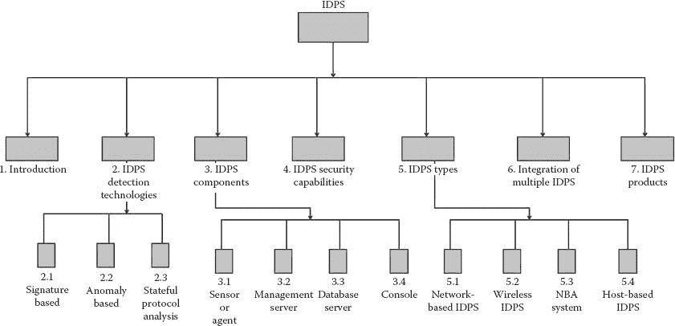

**图 6.1** 本章内容一览。

IDS 和 IPS [

为了获得良好的防御性能，安全专家通常将 IDS 和 IPS 结合成一个单一系统，称为 `IDPS`。IDPS 的主要功能集中在识别可能的事件、记录有关它们的信息、尝试阻止它们，并向安全管理员报告。

在观测到任何事件时，IDPS 通常执行以下任务 [20]：

1.  记录与观测事件相关的信息
2.  通知安全管理员重要的观测事件
3.  向安全管理员生成报告

有几种 IDPS 在记录可疑活动（或威胁）后，也可以通过尝试阻止其成功来对此做出响应。IDPS 使用多种响应技术，涉及的动作包括：停止攻击本身、改变安全环境（例如，重新配置防火墙）或改变攻击的内容。

组织、银行、教育机构、研究实验室、办公室，或凡是使用计算机系统进行网络和通信的地方，建议确保所有 IDPS 组件都得到适当的保护。在许多网络系统中，保护 IDPS 组件至关重要，因为攻击者可能试图阻止 IDPS 检测攻击，或试图访问 IDPS 中的敏感信息，如主机配置和已知漏洞。IDPS 有几类组件，包括以下内容 [

1.  传感器或代理
2.  管理服务器
3.  数据库服务器
4.  用户和管理员控制台
5.  管理网络

所有组件的操作系统和应用程序应始终保持最新，所有基于软件的 IDPS 组件应以尽可能最佳的复杂方式开发，以便减少潜在威胁，并使安全防护不易被突破。

特定的重要保护措施包括：为每个 IDPS 用户和管理员创建单独的账户，限制对 IDPS 组件的网络访问，并确保 IDPS 管理通信得到适当保护，例如对其进行加密，或通过物理或逻辑上独立的网络进行传输。管理员应持续维护 IDPS 组件的安全，包括验证组件是否按预期运行、监控组件的安全问题、执行定期漏洞评估、妥善响应 IDPS 组件中的漏洞，以及测试和部署 IDPS 更新。管理员还应定期备份配置设置，并在应用更新前确保现有设置不会意外丢失。

为了获得更全面、更准确的互联网蠕虫及其他攻击的检测和预防，不同类型的组织需要考虑使用不同类型的 IDPS 技术。主要有四种类型的 IDPS [

1.  基于网络
2.  无线
3.  基于 NBA
4.  基于主机

上述每种机制都针对恶意活动提供不同类型的防御（即基于网络的机制可以检测到基于主机的机制无法或可能无法检测到的攻击）。例如，基于网络的机制可以检测网络层面的攻击，而基于主机的机制可以检测主机层面的攻击。为了获得良好有效的防御解决方案，需要结合基于网络和基于主机的 IDPS 机制。如果组织确定其无线网络需要额外监控，可以使用无线 IDPS 技术以获得良好的防御性能。

如果组织希望获得针对拒绝服务 (DoS) 攻击、蠕虫和其他威胁的额外检测能力，建议使用 NBA 技术来实现该目标。计划使用多种类型的 IDPS 技术或同类 IDPS 多个产品的组织，建议了解这些 IDPS 是否应当集成。

IDPS 集成有两种类型。它们如下 [

1.  `直接 IDPS 集成:` 一个产品向另一个产品提供信息的过程称为 `直接 IDPS 集成`。当组织使用单一供应商的多个 IDPS 产品时，直接 IDPS 集成最为适用。例如，基于网络的 IDPS 技术可能利用基于主机的 IDPS 数据来判断攻击是否被基于网络的 IDPS 技术成功检测到，基于网络的 IDPS 技术也可向 NBA IDPS 技术提供网络流信息。这种信息共享有助于提高检测准确性、加快分析过程，并帮助根据优先级对威胁进行排序。使用完全集成解决方案的主要缺点是，故障或受损可能会对所有 IDPS 技术产生负面影响。


#### 2. 间接 IDPS 集成

间接 IDPS 集成是指许多 IDP 产品将其数据发送给安全信息和事件管理 (SIEM) 软件的过程。SIEM 软件的主要功能是从各种安全相关日志导入信息，并关联其中的事件。SIEM 软件通常通过安全网络通道从日志主机接收日志副本，然后将日志数据标准化为标准字段和值（称为*标准化*），并通过匹配互联网协议 (IP) 地址、时间戳、用户名和其他特征来确定相关事件。SIEM 产品可以执行以下任务：识别恶意活动，如攻击和恶意软件感染，以及系统和网络的误用和不当使用。

SIEM 软件可以补充 IDPS。例如，如果组织使用不同的 IDPS 技术，SIEM 软件可以关联这些不同 IDPS 技术记录的事件。SIEM 软件可以识别单个设备无法识别的事件；此外，它可以在单一位置收集与事件相关的信息，以便进行更高效的分析。然而，SIEM 软件存在一个显著局限性：事件开始的时间与 SIEM 软件看到相应日志数据的时间之间存在延迟，因为日志数据通常以批处理模式传输以节约资源。由于 SIEM 产品仅从原始资源传输部分事件数据，资源消耗也受到限制。

组织应在评估 IDPS 产品前定义产品应满足的要求。为此，评估人员需要了解组织系统和网络环境的特征。然后，评估人员可以选择兼容的 IDPS，以监控系统和/或网络上的感兴趣事件。评估人员应充分说明他们希望通过使用 IDPS 实现的目标和目的，例如阻止常见攻击、识别配置错误的无线网络设备，以及检测对组织系统和网络资源的滥用。此外，评估人员应重新审视其现有的安全策略，这些策略是 IDPS 产品需要提供的许多功能的规范。评估人员还应了解组织是否受制于其他组织的监督或审查。如果是，评估人员应确定该监管机构是否要求部署 IDPS 或其他特定的系统安全资源。评估人员还应考虑资源限制。

此外，评估人员需要为以下方面定义专门的需求集 [20]：

*   **深度安全能力**，包括用于识别可疑活动的方法
*   **性能**，包括最大容量和性能特征
*   **管理**，包括设计和实施（如可靠性、互操作性、可扩展性和产品安全）；运行和维护（包括软件更新）；以及培训、文档和技术支持
*   **生命周期成本**，包括初始成本和维护成本

当组织评估 IDPS 产品时，应考虑使用多种数据源相结合的方式来了解产品的特征和能力。常见的产品数据来源包括测试实验室或真实环境下的产品测试、供应商提供的信息、第三方产品评测，以及组织内部人员和其他可信组织人员以往的 IDPS 使用经验。接收来自其他方的数据时，组织应考虑其保真度，因为这些数据通常未附带生成方法的说明。执行深度的 IDPS 实际操作测试面临若干重大挑战，例如需要大量资源、缺乏标准测试方法和测试套件，这往往使其不可行。然而，有限的 IDPS 测试有助于评估安全需求、性能、运行和维护能力。

### 6.3.2 IDPS 检测方法

IDPS 技术使用多种方法来检测攻击。主要方法包括基于特征的检测、基于异常的检测和有状态协议分析。大多数 IDPS 技术结合使用多种方法以提供更准确的检测。我们将在以下章节详细介绍上述方法 [

#### 基于特征的检测

特征是对应已知威胁的一种模式。基于特征的检测方案监控网络中的数据包，并将其与已知恶意威胁的特征数据库进行比对。此方法的工作原理类似于大多数防病毒软件检测恶意软件的方式。此类方法的主要缺点是，在野外发现新威胁与用于检测该威胁的特征被应用到 IPS 之间，始终存在滞后时间。在此期间，IPS 将无法检测到该新威胁。

基于特征的检测方法被认为是最简单的检测方法，因为它仅使用字符串比较操作，将当前活动单元（如数据包或日志条目）与特征列表进行比对。此类检测技术的另一个局限性是，它们对许多网络或应用协议知之甚少，且无法跟踪和理解复杂通信的状态。例如，基于特征的检测方法无法将请求与相应的响应配对，例如知道对 Web 服务器特定页面的请求生成了 403 响应状态码，意味着服务器拒绝接受该请求（事实上，403 错误等同于 Web 服务器给出的全盘*拒绝*——不允许进一步协商）。这些方法在处理当前请求时，也缺乏记住先前请求的能力。这一局限性使得基于特征的检测方法无法检测由多个事件组成的攻击，前提是这些事件中没有任何一个包含明确的攻击指示 [

#### 基于异常的检测

基于异常的检测方法监控网络流量，并将其与既定基线进行比对。基线标识该网络的*正常*状况，一般使用的带宽、使用的协议、通常相互连接的端口和设备，并在检测到异常流量（即与基线显著不同的流量）时向管理员或用户发出警报。

基于异常的检测方法的主要优势在于，它们能非常有效地检测先前未知的威胁。例如，假设一台计算机感染了一种新型恶意软件。该恶意软件可能会消耗计算机的处理资源、发送大量电子邮件、发起大量网络连接，并表现出与该计算机既定配置文件显著不同的其他行为。

初始配置文件是在一段时间内（通常为数天，有时为数周）生成的，有时称为*训练期*。基于异常的配置文件有两种类型：(


##### IDPS 检测方法与组件

##### 基于异常的检测挑战

将恶意活动无意中纳入配置文件是基于异常的 IDPS 产品的常见问题。（在某些情况下，管理员可以修改配置文件，以排除已知为恶意的配置文件中的活动。）要开发出良好的基于异常的检测方案，专家应深入研究网络活动（如流量速率、各协议的数据包数量、连接速率和不同 IP 地址的数量），然后将这些活动放入配置文件中。然而，构建配置文件还存在另一个关键问题，在某些情况下，要使其准确非常具有挑战性，因为计算活动可能非常复杂。例如，如果某项执行大文件传输的维护活动每月仅发生一次，则可能在训练期间未被观察到；当维护发生时，它很可能被视为与配置文件的显著偏差并触发警报（这将是误报/假阳性）！

IPS 的评估工具是假阴性和假阳性。当攻击或事件未被 IDS 检测到，或被分析师视为良性时，就会发生假阴性。当事件被 IDS 捕获并宣称为攻击，但实际上并非攻击或属于良性时，就会发生假阳性。基于异常的 IDPS 产品的主要缺点是，它们经常产生大量假阳性，因为良性活动可能与配置文件显著偏离，尤其是在更多样化或动态的环境中。使用基于异常的检测技术的另一个值得注意的问题是，由于事件的复杂性和可能导致警报生成的事件数量，分析师通常难以确定生成特定警报的原因，并验证该警报是否准确而非假阳性。

##### 有状态协议分析

**有状态协议分析**。有状态协议分析方法通过将观察到的事件与*预先确定的公认良性活动定义配置文件*进行比较，来识别协议状态的偏差。与基于异常的检测（使用特定于主机或网络的配置文件）不同，该方法依赖于供商开发的通用配置文件，这些配置文件规定了特定协议应如何使用以及不应如何使用。有状态协议分析中的*有状态*意味着 IDPS 能够理解并跟踪具有状态概念的网络、传输和应用协议的状态。例如，当用户启动文件传输协议会话时，该会话最初处于未认证状态。未认证用户在此状态下应仅执行少数命令，例如查看帮助信息或提供用户名和密码。理解状态的一个重要部分是将请求与响应配对，因此当发生文件传输协议认证尝试时，IDPS 可以通过在相应响应中查找状态码来判断其是否成功。一旦用户成功认证，会话即进入认证状态，预期用户可执行几十条命令中的任意一条。在未认证状态下执行大多数这些命令会被视为可疑，但在认证状态下执行大多数命令则被视为良性。

有状态协议可以识别意外的命令序列，例如重复发出同一命令，或在未先发出其依赖的命令的情况下发出某命令。此外，有状态协议分析还有另一个状态跟踪功能，即对于执行认证的协议，IDPS 可以跟踪每个会话使用的认证器，并记录可疑活动所使用的认证器。这在调查事件时很有帮助。某些 IDPS 还可以利用认证器信息，为多类用户或特定用户定义不同的可接受活动。

有状态协议分析方法通过执行协议分析来检测攻击，这包括对单个命令的合理性检查，例如参数的最小和最大长度。如果某命令通常包含用户名参数，且用户名最大长度为 20 个字符，则长度为 1000 个字符的参数即属可疑。如果该大参数包含二进制数据，则更加可疑。

为检测未授权活动，有状态协议分析方法使用协议模型，这些模型通常主要基于软件供应商和标准机构（如互联网工程任务组请求意见稿）的协议标准。协议模型通常还会考虑到每种协议实现中的差异。许多标准在解释协议细节方面并不详尽完备，这导致实现之间存在差异。此外，许多供应商要么违反标准，要么添加专有功能，其中一些功能可能会取代标准中的功能。对于专有协议，通常无法获得协议的完整细节，这使得 IDPS 技术难以执行全面、准确的分析。随着协议的修订和供应商对其协议实现的更改，IDPS 协议模型需要更新以反映这些变化。

有状态协议分析方法的主要缺点是，由于分析的复杂性以及对许多并发会话执行状态跟踪所涉及的开销，它们非常消耗资源。另一个缺点是，有状态协议分析方法无法检测不违反公认可接受协议行为特征的攻击，例如在短时间内执行许多良性操作以导致 DoS。还有一个问题是，IDPS 使用的协议模型可能与特定应用程序和操作系统特定版本中的协议实现方式，或客户端和服务端协议实现的交互方式相冲突。

### 6.3.3 IDPS 组件

本节提及 IDPS 解决方案中的典型组件。

*   **传感器或代理：** 该组件的主要功能是监控和分析活动。术语 `sensor` 通常用于监控网络的 IDPS，而术语 `agent` 通常用于仅监控单个主机的 IDPS 技术。
*   **管理服务器：** 管理服务器是一种接收来自传感器或代理的信息并对其进行管理的设备。有些管理服务器会对接收到的信息执行分析，并能识别单个传感器或代理无法识别的事件。关联来自多个传感器或代理的事件信息（例如查找由同一 IP 地址触发的事件）称为 `correlation`。一些小型 IDPS 部署不使用任何管理服务器。在大型 IDPS 部署中，通常有多个管理服务器，有时呈分层结构。
*   **数据库服务器：** 数据库服务器是传感器、代理和管理服务器记录的事件信息的存储库。许多 IDPS 支持使用数据库服务器。
*   **控制台：** 控制台是为 IDPS 用户和管理员提供界面的程序。控制台软件通常安装在标准台式机或笔记本电脑上。一些控制台仅用于 IDPS 管理，例如配置传感器或代理和应用软件更新，而另一些控制台则严格用于监控和分析。一些 IDPS 控制台同时提供管理和监控功能。


IDPS 组件可以通过常规网络或专为安全软件管理设计的独立网络（称为*管理网络*）相互连接。如果使用管理网络，则每个传感器或代理主机都有一个称为*管理接口*的额外网络接口，用于连接到管理网络，并且主机会被配置为无法在管理接口和其他网络接口之间传递任何流量。管理服务器、数据库服务器和控制台仅连接到管理网络。这种架构有效地将管理网络与生产网络隔离开来，向攻击者隐藏 IDPS，并确保 IDPS 拥有足够的带宽以在恶劣条件下运行。如果 IDPS 在没有独立管理网络的情况下部署，提高 IDPS 安全性的一种方法是在标准网络内使用虚拟局域网创建一个虚拟管理网络。使用虚拟局域网可以为 IDPS 通信提供保护，但保护程度不如独立的管理网络。

### 6.3.4 IDPS 安全功能

IDPS 技术提供广泛且准确的检测能力。为了提供更准确的检测，IDPS 产品会结合使用多种检测技术。所检测的事件类型和典型检测准确性因 IDPS 技术类型的不同而差异很大。大多数 IDPS 至少需要一些调优和定制，以提高其检测准确性、易用性和有效性。调优和定制功能的示例如下：

*   **阈值：** 阈值是设定正常行为与异常行为界限的值。阈值通常指定一个最大可接受水平，例如 60 秒内 5 次失败的连接尝试，或文件名长度为 100 个字符。
*   **黑名单和白名单：** 黑名单是一组离散实体的列表，例如主机、传输控制协议 (TCP) 或用户数据报协议 (UDP) 端口号、互联网控制消息协议类型和代码、应用程序、用户名、URL、文件名或文件扩展名，这些实体先前已被认定与恶意活动相关。黑名单允许 IDPS 阻止极有可能是恶意的活动。某些 IDPS 会生成动态黑名单，用于暂时阻止最近检测到的威胁（例如来自攻击者 IP 地址的活动）。白名单是一组已知良性的离散实体的列表。白名单通常按粒度使用，例如按协议，以减少或忽略涉及已知良性活动的误报。
*   **警报设置：** 大多数 IDPS 技术允许管理员自定义每种警报类型。可对警报类型执行的操作示例包括启用或禁用它，以及设置默认优先级或严重级别。某些产品可以在攻击者在短时间内生成大量警报时抑制警报，并可能暂时忽略来自该攻击者的所有未来流量。这是为了防止 IDPS 被警报淹没。
*   **代码查看和编辑：** 某些 IDPS 技术允许管理员查看部分或全部与检测相关的代码。这通常仅限于特征码，但某些技术允许管理员查看其他代码，例如用于执行有状态协议分析的程序。查看代码可以帮助分析师确定生成特定警报的原因，从而更好地验证警报并识别误报。编辑与检测相关的代码和编写新代码（例如新特征码）的能力对于完全定制某些类型的检测功能是必需的。

大多数 IDPS 提供多种防护能力以实现更准确的检测；具体能力因 IDPS 技术类型而异。IDPS 通常允许管理员为每种警报类型指定防护能力配置。这通常包括启用或禁用防护，以及指定应使用哪种类型的防护能力。某些 IDPS 技术提供信息收集能力，例如从观察到的活动中收集有关主机或网络的信息。示例包括识别主机及其使用的操作系统、应用程序，以及识别网络的总体特征。

### 6.3.5 IDPS 技术类型

如前所述，主要有四种类型的 IDPS 技术：

*   基于网络的 IDPS
*   无线 IDPS
*   NBA 系统
*   基于主机的 IDPS

在本节中，我们将详细介绍这些 IDPS 技术。

##### 基于网络的 IDPS

基于网络的 IDPS 部署在网络内的一个或多个战略位置，以监控网络中所有设备的进出流量。基于网络的 IDPS 监控并分析特定网络段或设备的所有入站和出站流量，以识别可疑活动；然而，这样做可能会造成瓶颈，从而损害网络的整体速度。IDPS 网络接口卡被置于混杂模式，以便它们接受所见的所有数据包，而不管其预期目的地为何。事实上，大多数 IDPS 在应用层执行分析，例如超文本传输协议、简单邮件传输协议和域名系统。它们还分析传输层（例如 TCP 和 UDP）和网络层（例如 IPv4）的活动，以识别这些层面的攻击并促进应用层分析。某些基于网络的 IDPS 还在硬件层执行有限分析，例如地址解析协议。

基于网络的 IDPS 传感器可以通过两种模式之一进行部署：直通模式或被动模式。

*   **直通传感器** 的部署方式是使其监控的流量穿过它。某些直通传感器是混合防火墙/IDPS 设备。部署直通传感器的主要动机是通过阻断流量来阻止攻击。
*   **被动传感器** 的部署方式是使其监控实际流量的副本；没有流量穿过传感器。被动传感器可以通过多种方法监控流量，包括交换机端口镜像，它可以看到通过交换机的所有流量；网络分流器，它是传感器与物理网络介质（如光纤）之间的直接连接；以及 IDS 负载均衡器，它是一种聚合并将流量导向监控系统的设备。

大多数要求传感器防止入侵的技术都要求传感器以直通模式部署。被动技术通常无法为传感器提供可靠的阻断流量方式。在某些情况下，被动传感器可以将数据包放入网络以尝试中断连接，但此类方法通常不如直通方法有效。 IP 地址通常不分配给传感器网络接口（用于监控流量），除非这些网络接口也用于 IDPS 管理。在未为监控接口分配 IP 地址的情况下运行传感器称为*隐身模式*。这提高了传感器的安全性，因为它隐藏了传感器并防止其他主机向它们发起连接。然而，攻击者可能能够通过分析其防护动作的特征来识别传感器的存在并确定正在使用的产品。此类分析可能包括监控受保护网络，并确定哪些扫描模式触发特定响应，以及某些数据包头字段中设置了什么值。

##### 基于网络的 IDPS 针对恶意活动的安全功能


##### 基于网络的 IDPS

基于网络的 IDPS 提供广泛且全面的检测能力。大多数 IDPS 结合使用基于特征、基于异常和有状态协议分析检测技术。这些技术通常紧密交织在一起；例如，有状态协议分析引擎可能会将活动解析为请求和响应，每个请求和响应都会被检查是否存在异常，并与已知恶意活动的特征进行比对。

基于网络的 IDPS 传感器常见的检测事件类型包括应用层、传输层和网络层的侦察与攻击。许多传感器还能检测意外的应用服务，例如隧道协议、后门以及运行未授权应用程序的主机。此外，某些类型的安全策略违规可通过传感器检测，这些传感器允许管理员指定不应允许的活动特征，例如 TCP 或 UDP 端口号、IP 地址和网站名称。某些传感器还能监控建立加密通信时的初始协商过程，以识别存在已知漏洞或配置错误的客户端或服务器软件。示例包括安全外壳协议、传输层安全协议和 IP 安全协议。

基于网络的 IDPS 伴随着较高的误报率和漏报率。由于受监控活动的复杂性，这些比率只能在一定程度上降低。单个传感器可能监控涉及数百或数千个内部和外部主机的流量，这些主机运行着各种频繁变更的应用程序和操作系统。传感器无法理解其所见的一切。另一个影响检测准确性的常见问题是，IDPS 通常需要大量的调优和定制，以考虑受监控环境的特性。此外，改变网络活动的安全控制（如防火墙和代理服务器）通过改变流量特征，可能给传感器带来额外的困难。

通常，基于网络的方案只能收集有关主机及其网络活动的有限信息。示例包括组织网络上的主机列表、这些主机使用的操作系统版本和应用程序版本，以及网络特性的一般信息（如设备间的跳数）。某些 IDPS 可利用这些信息提高检测准确性。例如，IDPS 可能允许管理员指定组织 Web 服务器、邮件服务器和其他常见主机类型使用的 IP 地址，还可指定每台主机提供的服务类型（例如每台 Web 服务器运行的 Web 服务器应用程序类型和版本）。这使 IDPS 能更好地确定警报优先级；例如，针对 Apache Web 服务器的 Apache 攻击警报，其优先级将高于针对其他类型 Web 服务器的同类攻击。某些基于网络的 IDPS 还能导入漏洞扫描结果，并利用它们判断哪些攻击若不被阻断极可能成功。这使 IDPS 能在预防行动上做出更好的决策，并更准确地确定警报优先级。

基于网络的 IDPS 传感器提供多种预防能力。被动传感器可尝试通过向两个端点发送 TCP 重置包来终止现有的 TCP 会话，使每个端点都误以为对方试图结束连接。然而，这种技术往往无法及时执行以阻止攻击，且仅适用于 TCP；其他更新的预防能力更为有效。内联传感器可执行内联防火墙功能、限制带宽使用并修改恶意内容。被动和内联传感器均可重新配置其他网络安全设备以阻断恶意活动或将其重定向至他处，某些传感器在检测到特定恶意活动时还可运行脚本或程序以触发自定义操作。

##### 基于网络的 IDPS 局限性

尽管基于网络的 IDPS 提供广泛的检测能力，但它们确实存在一些显著局限。加密流量中的攻击无法被基于网络的 IDPS 检测到，包括虚拟专用网络连接、超文本传输安全协议和安全外壳协议会话。为确保对加密流量中的载荷进行充分分析，可部署 IDPS 在载荷加密前或解密后对其进行分析。示例包括部署基于网络的 IDPS 传感器监控解密后的流量，以及使用基于主机的 IDPS 软件监控源主机或目标主机内的活动。

当网络出现高负载时，基于网络的 IDPS 可能无法执行全面分析。这会导致某些攻击未被检测到，尤其是在使用有状态协议分析方法时。对于内联 IDPS 传感器，丢包也会导致网络可用性中断，处理数据包的延迟可能造成不可接受的延迟。为避免此情况，某些内联 IDPS 传感器能识别高负载状况，并选择让特定类型的流量绕过全面分析直接通过传感器，或丢弃低优先级流量。如果传感器使用专用硬件（如高带宽网卡）或重新编译其软件组件以纳入管理员的设置和其他定制，也可能在高负载下提供更好的性能。

IDPS 传感器可能被各类攻击规避。攻击者可生成大量流量（如 DDoS 攻击）和其他异常活动（如异常分片的数据包）来耗尽传感器资源或导致其崩溃。另一种称为*致盲*的攻击技术，会生成可能在短时间内触发大量 IDPS 警报的流量。在许多情况下，致盲流量并非意图实际攻击任何目标。攻击者在致盲流量运行的同时单独发起*真实*攻击，企图让致盲流量导致 IDPS 以某种方式失效，或使真实攻击的警报被忽视。许多传感器能识别针对自身的常见攻击，向管理员发出警报，随后忽略其余活动。

#### 无线 IDPS

无线 IDPS 监控无线网络流量并分析无线网络协议以识别恶意行为。然而，它无法识别无线网络流量所传输的应用层或更高层网络协议（如 TCP 和 UDP）中的可疑活动。它最常部署在组织无线网络的覆盖范围内以对其进行监控，但也可部署在可能发生未授权无线联网的位置。

由于传输方式的差异，无线网络攻击有别于有线网络攻击。然而，无线 IDPS 涉及的基本组件与基于网络的 IDPS 相同：控制台、数据库服务器、管理服务器和传感器。无线 IDPS 通过采样流量来监控网络。需监控两个频段（2.4 和 5 GHz），每个频段包含多个信道。传感器一次监控一个信道，并可根据需要切换到其他信道。

我们应提到，大多数无线局域网 (WLAN) 使用电气电子工程师学会 (IEEE) 802.11 系列 WLAN 标准。

*   站点，即无线终端设备（如笔记本电脑、个人数字助理）。
*   接入点，用于在逻辑上将站点与组织的有线网络基础设施或其他网络连接起来。


##### 无线网络安全：WLAN、传感器与 IDPS

##### WLAN 架构与模式

某些 WLAN 还会使用无线交换机，它们充当接入点与有线网络之间的中介。基于站点和接入点的网络配置为**基础设施模式**；不使用接入点、站点直接相互连接的网络配置为**自组网模式**。几乎所有组织的 WLAN 都使用基础设施模式。WLAN 中的每个接入点都会被分配一个名称，称为 `service set identifier` (SSID)。服务集标识符允许站点将一个 WLAN 与另一个 WLAN 区分开来。

##### 无线传感器类型与部署

无线传感器有多种可用形式。专用传感器通常是被动的，执行无线 IDPS 功能，但不转发从源到目的地的流量。专用传感器可设计为固定部署或移动部署，移动传感器主要用于审计和事件处理目的（例如，定位非法无线设备）。传感器软件也可与接入点和无线交换机捆绑提供。某些供应商还提供基于主机的无线 IDPS 传感器软件，可安装在站点（如笔记本电脑）上。传感器软件可检测站点范围内的站点错误配置和攻击。传感器软件还可能能够在站点上强制执行安全策略，例如限制对无线接口的访问。

##### 监控策略

如果组织使用 WLAN，通常会部署无线传感器来监控组织 WLAN 的射频范围，这通常包括笔记本电脑和个人数字助理等移动组件。许多组织还使用传感器监控其设施中不应有 WLAN 活动的区域，以及组织 WLAN 不应使用的信道和频段，以此作为检测非法设备的一种方式。

##### 无线 IDPS 安全功能

无线 IDPS 的主要优势包括在 WLAN 协议层面检测攻击、错误配置和策略违规，主要检查 IEEE 802.11 协议通信。无线 IDPS 的主要局限性在于它不检查更高层级的通信（例如 IP 地址和应用负载）。某些产品仅执行简单的基于特征的检测，而其他产品则结合使用基于特征、基于异常和有状态协议分析检测技术。

无线 IDPS 传感器常见的检测事件类型主要包括：

*   未经授权的 WLAN 和 WLAN 设备
*   安全防护薄弱的 WLAN 设备（例如，WLAN 设置错误配置）
*   异常的 WLAN 使用模式（可能表明设备被攻陷或 WLAN 被未经授权使用）
*   使用无线网络扫描器

无线 IDPS 还可检测其他类型的攻击，如 DoS 状况，包括：

*   逻辑攻击（例如，用大量消息使接入点过载）
*   物理攻击（例如，在 WLAN 频率上发射电磁能量，使 WLAN 无法使用）

某些无线 IDPS 还能检测试图欺骗另一设备身份的 WLAN 设备。

###### 物理位置识别

另一个显著优势是，大多数无线 IDPS 传感器可通过三角测量识别无线设备的物理位置——根据各传感器接收到的设备信号强度估算设备到多个传感器的大致距离，然后计算设备所在的物理位置（即到各传感器的估算距离）。手持式 IDPS 传感器也可用于精确定位设备位置，特别是在固定传感器不具备三角测量能力或设备正在移动的情况下。

###### 防护准确性

无线 IDPS 通过提供更准确的防护，克服了其他类型 IDPS 的不足；这主要归功于其狭窄的关注焦点。基于异常的检测方法往往会产生大量误报，特别是在阈值未得到妥善维护时。虽然可能会因良性活动产生许多警报（例如另一个组织的 WLAN 在本组织 WLAN 的范围内），但这些警报并非真正的误报，因为它们准确地检测到了未知 WLAN。

###### 调优与定制

无线 IDPS 技术需要一定的调优和定制以提高检测准确性。无线 IDPS 的主要工作在于指定哪些 WLAN、接入点和站点是受授权的，并将策略特征录入无线 IDPS 软件。由于无线 IDPS 仅检查无线网络协议，而不检查更高层级的协议（例如应用）；因此通常只有少数警报类型，相应地可用的定制或调优选项也不多。

###### 入侵防护能力

无线 IDPS 传感器提供两类入侵防护能力，如下所示：

*   某些传感器可通过空中终止连接，通常通过向端点发送消息，告知其解除当前会话关联，然后拒绝允许建立新连接。
*   另一种防护方法是传感器指示有线网络上的交换机，根据设备的媒体访问控制地址或交换机端口，阻断涉及特定设备的网络活动。然而，此技术仅对阻断设备在有线网络上的通信有效，对无线网络无效。

选择防护能力时，一个重要考量因素是防护动作对传感器监控的影响。例如，如果传感器正在发送信号以终止连接，它可能无法执行信道扫描来监控其他通信，直到完成防护动作。为缓解此问题，某些传感器配备两个无线电：一个用于监控和检测，另一个用于执行防护动作。

##### 无线 IDPS 局限性

无线 IDPS 对未经授权的活动提供了强大的检测能力，但存在一些显著局限性。规避技术的使用被视为某些无线 IDPS 传感器的局限性之一，特别是针对传感器信道扫描方案。例如是在当前未被监控的信道上以极短脉冲发动攻击。攻击者也可同时在两个信道上发动攻击。如果传感器检测到第一个攻击，除非它扫离第一个攻击的信道，否则无法检测到第二个攻击。

无线 IDPS 传感器（物理设备）本身也容易受到攻击。那些试图破坏 WLAN 的 DoS 攻击（无论逻辑还是物理）也会破坏传感器功能。此外，传感器通常特别容易受到物理攻击，因为它们通常位于走廊、会议室和其他开放区域。某些传感器具有防篡改功能，其外观设计得像火灾报警器，可降低被物理攻击的可能性。所有传感器都容易受到诸如干扰等物理攻击，这会破坏射频传输；除了在设施周围建立物理安全边界，使攻击者无法靠近到足以干扰 WLAN 的程度外，没有其他防御措施。


###### 无线 IDPS 的局限性

我们应该提到，无线 IDPS 无法检测针对无线网络的某些类型的攻击。攻击者可以被动监控无线流量，而这无法被无线 IDPS 检测到。如果使用了薄弱的安全方法，例如有线等效隐私，攻击者随后可以对收集到的流量进行离线处理，以找到用于保护无线流量安全的加密密钥。有了这个密钥，攻击者可以解密已经收集的流量，以及从同一 WLAN 收集的任何其他流量。由于无线 IDPS 无法检测针对无线网络的某些类型的攻击，因此它无法完全弥补使用不安全无线网络协议所带来的风险。

#### NBA 系统

NBA 系统检查网络流量或流量统计数据，以识别产生异常流量流的威胁，例如 DDoS 攻击、某些形式的恶意软件和策略违规。事实上，NBA 系统曾有过许多名称，包括网络行为异常检测软件、NBA 和响应软件以及网络异常检测软件。NBA 解决方案通常包含传感器和控制台，部分产品还提供管理服务器（有时称为*分析器*）。

##### NBA 系统传感器

NBA 系统拥有类似于基于网络的 IDPS 传感器的一些传感器，它们通过嗅探数据包来监控一个或几个网段上的网络活动。这些传感器可以是主动或被动的，其部署位置类似于基于网络的 IDS 传感器——位于网络之间的边界，使用相同的连接方式。其他 NBA 传感器不直接监控网络，而是依赖路由器和其他网络设备提供的网络流信息。流是指发生在主机之间的特定通信会话。典型的流数据包括源和目的 IP 地址、源和目的 TCP 或 UDP 端口或互联网控制消息协议类型和代码、会话中传输的数据包数量和字节数，以及会话开始和结束的时间戳。

##### NBA 系统安全功能

NBA 技术可以检测多种类型的恶意活动。大多数 NBA 系统产品主要使用基于异常的检测，并结合一些有状态协议分析技术。因此，大多数 NBA 技术不提供基于特征的检测能力，除非允许管理员手动设置自定义过滤器，这些过滤器本质上是用于检测或阻止特定攻击的特征。NBA 传感器检测到的大多数授权活动类型包括基于网络的 DoS 攻击、网络扫描、蠕虫、意外应用服务的使用以及策略违规（例如，主机尝试联系另一台没有合法理由通信的主机）。NBA 传感器具备确定攻击源头的能力。例如，如果蠕虫感染了网络，NBA 传感器可以分析蠕虫的流量，找出组织网络中最先传播蠕虫的主机。

正如我们上面提到的，NBA 传感器基于异常检测，因此它们主要通过检测与正常行为的显著偏差来工作；它们在检测短时间内产生大量网络活动的攻击（例如 DDoS 攻击）和具有异常流模式的攻击（例如蠕虫在主机间传播）时最为准确。缓慢进行的攻击不太可能被 NBA 传感器准确检测到，因为在攻击活动达到与预期显著不同的程度之前，它们无法检测到许多攻击。NBA 软件检测到攻击的时点可能因 NBA 产品的配置而有很大差异。将传感器配置为对异常活动更敏感，会在攻击发生时更快地生成警报，但也更有可能触发更多误报。反之，如果将传感器配置为对异常活动不那么敏感，误报会减少，但警报生成会变慢，导致攻击持续更长时间。环境中的良性变化也可能导致误报。例如，如果向主机添加了新服务且主机开始使用它，NBA 传感器很可能会将其检测为异常行为。

NBA 技术主要依赖于观察网络流量并建立预期流的基线和主机特征清单。NBA 产品提供对其基线的自动更新，从而加快对未授权活动的预防。管理员可能会定期调整阈值（例如，多少额外的带宽使用量应触发警报），以考虑环境的变化。

我们之前提到过 NBA 系统基于异常检测，但少数 NBA 产品提供有限的基于特征的检测能力。支持的特征往往非常简单，主要是在 IP、TCP、UDP 或互联网控制消息协议头部的特定字段中查找特定值。基于特征的能力对内联 NBA 传感器最有帮助，因为它们可以利用特征查找并阻止防火墙或路由器可能无法阻止的攻击。然而，即使没有特征能力，内联 NBA 传感器也可能因其流模式而能够检测并阻止攻击。

##### NBA 信息收集能力

NBA 技术凭借广泛的信息收集能力超越了其他技术，因为大多数 NBA 产品的检测技术都需要了解组织主机的特征。此外，NBA 传感器可以自动创建并维护在组织受监控网络上通信的主机列表。它们可以监控端口使用情况，执行被动指纹识别，并使用其他技术收集主机的详细信息。通常为每台主机收集的信息包括 IP 地址、操作系统的类型和版本、主机提供的网络服务，以及主机与其他主机通信的性质。NBA 传感器持续监控网络活动中该信息的变化。每台主机流的附加信息也会持续收集。

##### NBA 入侵防御能力

NBA 传感器提供各种入侵防御能力，包括向端点发送 TCP 重置数据包、执行内联防火墙操作以及重新配置其他网络安全设备。大多数 NBA 系统实施有限地使用防御能力或根本不使用，这是由于误报的原因；错误地阻断单个流可能会导致网络通信中断。防御能力最常用于 NBA 传感器阻断特定已知攻击时，例如新型蠕虫。


##### NBA 系统局限性

NBA 技术总体上对授权活动具有很强的预防能力，但也存在显著的局限性。其中最重要的局限性之一是检测攻击的延迟。基于偏离基线的异常检测方法（如带宽使用量增加或连接尝试增加）固有地存在一定的延迟。通常，NBA 技术往往因其数据源而产生额外的延迟，特别是当它们依赖来自路由器和其他网络设备的流数据时。这些数据通常以批次形式传输到 NBA 系统，频率高达每一两分钟一次，但通常频率要低得多。因此，这种延迟被视为 NBA 技术的一个重大局限性，因为发生迅速的攻击（如恶意软件感染和 DoS 攻击）可能在已经扰乱或损坏系统后才被检测到。为了解决延迟问题，NBA 系统可以使用传感器（软件或硬件组件），它们执行自己的数据包捕获和分析，而不是依赖来自其他设备的流数据。然而，执行数据包捕获和分析比分析流数据消耗更多资源。单个传感器可以分析来自许多网络的流数据，或通常最多只能对几个网络执行直接监控（数据包捕获）。可能需要更多的传感器来执行直接监控，而不是使用流数据。

#### 基于主机的 IDPS

基于主机的系统监控单个主机的特征以及发生在该主机内的事件，以发现可疑活动。基于主机的 IDPS 可能监控的主机特征类型示例包括：该主机的网络流量、系统日志、运行中的进程、应用程序活动、文件访问和修改，以及系统和应用程序配置更改。基于主机的 IDPS 最常部署在关键主机上，如公开访问的服务器和包含敏感信息的服务器。此外，大多数基于主机的 IDPS 在相关主机上安装了称为 `agents` 的检测软件。每个代理监控单个主机上的活动，并可能执行预防操作。一些代理监控单个特定的应用程序服务——例如，Web 服务器程序；这些代理也称为 `application-based IDPSs`（基于应用程序的 IDPS）。

基于主机的 IDPS 代理部署在关键主机上，如公开访问的服务器和包含敏感信息的服务器，尽管它们也可以部署在其他类型的主机上。一些组织主要使用代理来分析其他安全控制无法监控的活动。例如，基于网络的 IDPS 传感器无法分析加密网络通信内的活动，但安装在端点上的基于主机的 IDPS 代理可以看到未加密的活动。基于主机的 IDPS 部署的网络架构通常很简单。由于代理部署在组织网络上的现有主机上，组件通常通过这些网络进行通信，而不是使用单独的管理网络。

为了提供更准确的入侵预防能力，大多数 IDPS 代理会改变主机的内部架构。这通常通过 `shim`（垫片/中间层）完成，它是放置在现有代码层之间的一层代码。`shim` 在数据通常从一段代码传递到另一段代码的点上拦截数据。然后 `shim` 可以分析数据并确定是允许还是拒绝。基于主机的 IDPS 代理可能将 `shim` 用于多种资源类型，包括网络流量、文件系统活动、系统调用、Windows 注册表活动和常见应用程序（如电子邮件和 Web）。一些代理在不使用 `shim` 的情况下监控活动，或分析活动的痕迹，如日志条目和文件修改。虽然这些方法对主机的侵入性较小，但它们在检测攻击方面通常效果较差，且往往无法执行预防操作。

##### 基于主机的 IDPS 安全能力

基于主机的 IDPS 对多种恶意活动提供良好的预防。基于主机的 IDPS 通常使用组合（基于特征和基于异常）机制。基于特征的机制用于识别已知攻击，而基于异常的机制用于识别先前未知的攻击。

基于主机的 IDPS 检测到的事件类型有很多，但这种检测基于 IDPS 使用的检测技术。一些基于主机的 IDPS 产品提供多种此类检测技术，而另一些则专注于少数或单一技术。基于主机的 IDPS 中常用的一些具体技术如下：

###### 代码分析

代理可能会分析执行恶意代码的尝试。一种技术是在虚拟环境或沙箱中执行代码，以分析其行为并将其与已知良性和恶意行为的配置文件进行比较。另一种技术是寻找栈和堆缓冲区溢出利用的典型特征，如特定的指令序列和尝试访问未分配给该进程的内存部分。系统调用监控是另一种常用技术；它涉及了解哪些应用程序和进程应该执行特定操作。

###### 网络流量分析

这通常类似于基于网络的 IDPS 所做的工作。一些产品还可以分析无线流量。流量分析的另一个功能是代理可以提取由电子邮件、Web 和点对点文件共享等应用程序发送的文件，随后可以对这些文件进行恶意软件检查。

###### 网络流量过滤

代理通常包含基于主机的防火墙，可限制系统上每个应用程序的入站和出站流量，防止未经授权的访问和可接受使用策略违规（例如，使用不当的外部服务）。

###### 文件系统监控

可以使用多种不同技术来执行。文件完整性检查涉及为关键文件生成加密校验和，并将其与参考值进行比较，以识别哪些文件已被更改。文件属性检查是检查关键文件的安全属性（如所有权和权限）是否发生变化的过程。文件完整性检查和文件属性检查都是被动的，仅在攻击发生后检测到攻击。一些代理具有更主动的能力，例如监控文件访问尝试，将每次尝试与访问控制策略进行比较，并阻止违反策略的尝试。

###### 日志分析

一些代理可以监控和分析操作系统和应用程序日志，以识别恶意活动。这些日志可能包含系统操作事件、审计记录和应用程序操作事件的信息。

由于基于主机的 IDPS 提供了关于主机特征和配置的广泛知识，代理通常可以确定如果不加阻止，攻击是否会成功。代理可以利用这些知识来选择预防操作并确定警报的优先级。


与其他 IDPS 技术一样，基于主机的 IDPS 经常会产生误报和漏报。然而，对于基于主机的 IDPS 而言，检测准确性更具挑战性，因为它们检测的是事件，却不具备事件发生时上下文环境的知识。例如，可能安装了一个新应用程序——这可能是恶意活动所为，也可能是正常主机操作的一部分。如果没有额外的上下文，无法确定该事件是良性还是恶意的。因此，建议打算使用基于主机的 IDPS 的组织，采用结合多种检测技术的基于主机的产品，这类产品比仅使用一项或少数几项技术的产品能实现更准确的检测。由于每种技术可监控主机的不同侧面，使用更多技术能让代理对事件有更完整的了解，包括额外的上下文。

要使基于主机的 IDPS 实现更好的防护，需要进行大量的调优和定制。例如，许多产品依赖于观察主机活动并建立预期行为的配置文件。其他产品则需要配置详细的策略，精确定义主机上每个应用程序应如何表现。随着主机环境的变化，策略需要更新，以便将这些变化纳入考量。某些产品允许在一台主机上为多个环境配置多个策略；这主要有助于在多个环境中运行的主机，例如既在组织内部又在外部位置使用的笔记本电脑。

基于主机的 IDPS 代理根据其使用的检测技术，提供多种入侵防护能力。例如，代码分析技术可防止恶意代码被执行，网络流量分析技术可阻止传入流量被主机处理，并防止恶意文件被放置在主机上。网络流量过滤技术可阻断不需要的通信。文件系统监控可防止文件被访问、修改、替换或删除，这能阻止恶意软件（包括特洛伊木马和 Rootkit）的安装，以及涉及不当文件访问的其他攻击。其他基于主机的 IDPS 检测技术，如日志分析、网络配置监控、文件完整性和属性检查，通常不支持防护动作，因为它们是在事件发生后才识别出事件。

##### 基于主机的 IDPS 局限性

基于主机的 IDPS 也存在一些显著的局限性。尽管代理会针对大多数检测技术实时生成警报，但某些技术是定期用于识别已经发生的事件。此类技术可能每小时甚至每天仅应用几次，导致识别某些事件出现显著延迟。此外，许多基于主机的 IDPS 旨在定期（例如每 15-60 分钟）将其警报数据转发给管理服务器，以减少开销。这可能导致启动响应动作出现延迟，尤其会增加传播迅速的事件（如恶意软件感染）的影响。基于主机的 IDPS 会消耗受保护主机上大量的资源，特别是如果它们使用多种检测技术和 Shim（垫片/中间层）时。基于主机的 IDPS 还可能与现有的安全控制（如个人防火墙）产生冲突，特别是当这些控制也使用 Shim 来拦截主机活动时。

### 6.3.6 多种 IDPS 的集成

多种 IDPS 技术及不同 IDPS 产品的集成为组织提供了良好的防护机制。我们将在以下章节详细讨论集成的优势。

#### 多种 IDPS 技术

我们之前提到过，主要有四种类型的 IDPS 技术：基于网络的、无线的、NBA 和基于主机的。这些类型各自拥有不同于其他类型的防护能力，可针对未经授权的活动。例如，某些类型能检测到其他类型无法检测到的攻击。因此，尽可能多地检测攻击将带来更好的防御。相应地，使用多种类型的 IDPS 技术能实现对恶意活动更全面、更准确的检测和防护。对于大多数环境，至少需要基于网络的和基于主机的 IDPS 相结合。如果 WLAN 安全或非法 WLAN 检测是关注点，则可能还需要无线 IDPS。还可以部署 NBA 产品，以针对 DoS 攻击、蠕虫以及导致异常网络流的其他威胁，实现更强的检测能力。

事实上，一些组织使用同一 IDPS 技术类型的多个产品，以获得对恶意活动更多的防护和检测。因为每个产品都能检测到其他产品无法检测到的攻击。因此，使用多个产品能提供更全面、更准确的防御。对于打算使用同一 IDPS 技术类型的多个产品的组织，我们建议它们为多个产品使用一台监控设备。一台监控设备便于分析师确认警报的有效性并识别误报，同时也提供了冗余。使用多台监控设备将导致难以分析的场景，并消耗时间和资源。

#### 不同 IDPS 产品的集成

不同的 IDPS 产品完全独立运行。使用不同 IDPS 产品最重要的优势之一是，如果其中一个被攻破或失效，另一个不会受影响，这意味着仍有其他产品提供针对恶意活动的防御。然而，如果产品未集成，整个 IDPS 实施的有效性可能会受到一定限制。产品间无法共享数据，且监控和管理多套产品将需要额外的工作量。IDPS 产品可以直接或间接集成。

### 6.3.7 IDPS 产品

上述所有章节均关注 IDPS。上述概念的实施将产出 IDPS 产品。世界上有许多 IDPS 产品，每个产品相较于其他产品都有其优势。因此，在本节中，我们列举其中一些产品，以便研究人员了解这些产品、使用它们、修改其开源代码，并为研究启动新的 IPDS 产品。

#### 常见企业级基于网络的 IDPS

#### 常见企业级无线 IDPS

#### 常见企业级 NBA 系统

#### 常见企业级基于主机的 IDPS

**表 6.1** 基于网络的 IDPS

| 产品线 | 厂商 | 网址 |
| :--- | :--- | :--- |
| Attack Mitigator | Top Layer Networks | [`www.toplayer.com/content/products/index.jsp`](http://www.toplayer.com/content/products/index.jsp) |
| BBX | DeepNines | [`www.deepnines.com/bbx.php`](http://www.deepnines.com/bbx.php) |
| Bro | Vern Paxson | [`bro-ids.org/`](http://bro-ids.org/) |
| Cisco IPS | Cisco Systems | [`www.cisco.com/en/US/products/hw/vpndevc/index.html`](http://www.cisco.com/en/US/products/hw/vpndevc/index.html) |
| Cyclops | [e-Cop.net](http://e-Cop.net) | [`www.e-cop.net/`](http://www.e-cop.net/) |
| DefensePro | Radware, Ltd. | [`www.radware.com/content/products/dp/default.asp`](http://www.radware.com/content/products/dp/default.asp) |
| Dragon | Enterasys Networks, Inc. | [`www.enterasys.com/products/ids/`](http://www.enterasys.com/products/ids/) |
| eTrust Intrusion Detection | Computer Associates | [`www3.ca.com/solutions/Product.aspx?ID=163`](http://www3.ca.com/solutions/Product.aspx?ID=163) |


#### 表 6.2 无线 IDPS

| 产品线 | 厂商 | 网址 |
| :--- | :--- | :--- |
| AirDefense | AirDefense | [`www.airdefense.net/products/index.php`](http://www.airdefense.net/products/index.php) |
| AirMagnet | AirMagnet | [`www.airmagnet.com/products/`](http://www.airmagnet.com/products/) |
| AiroPeek | WildPackets | [`www.wildpackets.com/products/airopeek/overview`](http://www.wildpackets.com/products/airopeek/overview) |
| BlueSecure | BlueSocket | [`www.bluesocket.com/products/centralized_intrusion.html`](http://www.bluesocket.com/products/centralized_intrusion.html) |
| Highwall | Highwall Technologies | [`www.highwalltech.com/products.cfm`](http://www.highwalltech.com/products.cfm) |
| Red-Detect | Red-M | [`www.red-m.com/products-and-services/red-detect.html`](http://www.red-m.com/products-and-services/red-detect.html) |
| RFprotect | Network Chemistry | [`networkchemistry.com/products/`](http://networkchemistry.com/products/) |
| SpectraGuard | AirTight Networks | [`www.airtightnetworks.net/products/products_overview.html`](http://www.airtightnetworks.net/products/products_overview.html) |

#### 表 6.3 NBA IDPS

| 产品线 | 厂商 | 网址 |
| :--- | :--- | :--- |
| Arbor Peakflow X | Arbor Networks | [`www.arbornetworks.com/products_x.php`](http://www.arbornetworks.com/products_x.php) |
| Cisco Guard, Cisco Traffic Anomaly Detector | Cisco Systems | [`www.cisco.com/en/US/products/hw/vpndevc/index.html`](http://www.cisco.com/en/US/products/hw/vpndevc/index.html) |
| GraniteEdge ESP | GraniteEdge Networks | [`www.graniteedgenetworks.com/products`](http://www.graniteedgenetworks.com/products) |
| OrcaFlow | Cetacea Networks | [`www.orcaflow.ca/features-overview.php`](http://www.orcaflow.ca/features-overview.php) |
| Profiler | Mazu | [`www.mazunetworks.com/products/index.php`](http://www.mazunetworks.com/products/index.php) |
| Proventia Network Anomaly Detection System (ADS) | Internet Security Systems | [`www.iss.net/products/Proventia_Network_Anomaly_Detection_System/product_main_page.html`](http://www.iss.net/products/Proventia_Network_Anomaly_Detection_System/product_main_page.html) |
| QRadar | Q1 Labs | [`www.q1labs.com/content.php?id=175`](http://www.q1labs.com/content.php?id=175) |
| StealthWatch | Lancope | [`www.lancope.com/products/`](http://www.lancope.com/products/) |

#### 表 6.4 基于主机的 IDPS

| 产品线 | 厂商 | 网址 |
| :--- | :--- | :--- |
| Blacklce | Internet Security Systems | [`www.iss.net/products/product_sections/Server_Protection.html`](http://www.iss.net/products/product_sections/Server_Protection.html) |
| | | [`www.iss.net/products/product_sections/Desktop_Protection.html`](http://www.iss.net/products/product_sections/Desktop_Protection.html) |
| Blink | eEye Digital Security | [`www.eeye.com/html/products/blink/index.html`](http://www.eeye.com/html/products/blink/index.html) |
| Cisco Security Agent | Cisco Systems | [`www.cisco.com/en/US/products/sw/secursw/ps5057/index.html`](http://www.cisco.com/en/US/products/sw/secursw/ps5057/index.html) |
| Deep Security | Third Brigade | [`www.thirdbrigade.com/`](http://www.thirdbrigade.com/) |
| DefenseWall HIPS | SoftSphere Technologies | [`www.softsphere.com/programs/`](http://www.softsphere.com/programs/) |
| Intrusion SecureHost | Intrusion | [`www.intrusion.com/`](http://www.intrusion.com/) |
| McAfee Host Intrusion Prevention | McAfee | [`www.mcafee.com/us/enterprise/products/host_intrusion_prevention/index.html`](http://www.mcafee.com/us/enterprise/products/host_intrusion_prevention/index.html) |
| Primary Response | Sana Security | [`www.sanasecurity.com/products/pr/index.php`](http://www.sanasecurity.com/products/pr/index.php) |
| Proventia | Internet Security Systems | [`www.iss.net/products/product_sections/Server_Protection.html`](http://www.iss.net/products/product_sections/Server_Protection.html) |
| | | [`www.iss.net/products/product_sections/Desktop_Protection.html`](http://www.iss.net/products/product_sections/Desktop_Protection.html) |
| Intrusion SecureHost | Intrusion | [`www.intrusion.com/`](http://www.intrusion.com/) |
| RealSecure | Internet Security Systems | [`www.iss.net/products/product_sections/Server_Protection.html`](http://www.iss.net/products/product_sections/Server_Protection.html) |
| | | [`www.iss.net/products/product_sections/Desktop_Protection.html`](http://www.iss.net/products/product_sections/Desktop_Protection.html) |
| SecureIIS Web Server Protection | eEye Digital Security | [`www.eeye.com/html/products/secureiis/index.html`](http://www.eeye.com/html/products/secureiis/index.html) |
| Symantec Critical System Protection | Symantec | [`www.symantec.com/enterprise/products/index.jsp`](http://www.symantec.com/enterprise/products/index.jsp) |

### 6.3.8 结束语

随着新的网络技术、拓扑和结构的发展，不同类型的攻击策略也在不断被设计出来。黑客们并非闲置无为，每天都可能有数百名专家试图将其专长用于破坏活动。因此，需要不同种类的检测和防御方案来应对不同的网络场景。持续的学习过程并据此制定防御策略，能够确保网络的安全运行。

## 参考文献

*   1. H.M. Alsafi, W.M. Abduallah, and A.-S.K. Pathan, IDPS: An integrated intrusion handling model for cloud computing environment, International Journal of Computing & Information Technology 4(1), 1–16, January–June 2012.


# 7 使用双蜜网收集零日多态蠕虫

**MOHSEN MOHAMED**

我们在第 5 章和第 6 章中了解到，为零日多态蠕虫生成特征码主要需要两个步骤，如下所示：

*   首先，我们应收集零日多态蠕虫样本。为此，我们必须提出一种新的样本收集方法。
*   收集到样本后，我们应开发新算法为收集到的样本生成特征码。

本章将通过示例介绍如何执行收集过程和特征码生成。此处描述的零日多态蠕虫收集方法（即双蜜网系统）以及开发的特征码生成算法：子串提取算法、修改版 Knuth-Morris-Pratt 算法和修改版主成分分析算法 (MPCA)，均由 Mohammed 等人在文献 2、3、4、5、6、7、8、9、10、11、12 中完成。

本章包含两部分。第一部分详细讨论双蜜网系统的设计，而第二部分讨论以下内容：

*   用于实现双蜜网系统的软件信息
*   使用 VMware 进行双蜜网系统配置

## 7.1 双蜜网系统的动机

未知的互联网蠕虫对互联网基础设施安全构成重大威胁，其破坏造成数百万美元的损失。安全专家在新蠕虫发布后，通过研究网络痕迹手动生成入侵检测系统特征码。不幸的是，这项工作耗时很长。我们提出了一种双蜜网系统，可在无需任何人工干预的情况下自动检测未知蠕虫。在我们的系统中，两个蜜网之间的交互通过形成一个回路来工作，这使我们能够收集多态蠕虫的所有实例，从而使系统能够生成准确的蠕虫特征码。双蜜网系统是一种混合系统，兼具基于网络和基于主机的机制。这使我们能够在网络层面和主机层面收集多态蠕虫的实例，从而大幅减少误报和漏报 12。

## 7.2 双蜜网架构

双蜜网系统的目的是自动检测未知（即先前未报告过）蠕虫。该系统的一项关键贡献是无需领域专家参与即可区分蠕虫活动与正常活动。

图 7.1 显示了双蜜网系统的主要组件。首先，传入流量经过本地路由器，后者对不需要的入站连接进行采样，并将采样连接重定向到蜜网 1。当重定向的数据包通过本地路由器时，使用数据包捕获库来捕获数据包，然后分析其载荷以助力特征码生成过程。

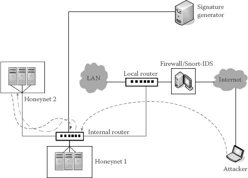

**图 7.1** 双蜜网系统。

本地路由器配置有公开可访问的地址，代表所需服务。连接到其他地址的会被视为不需要的连接，并通过内部路由器重定向到蜜网 1。一旦蜜网 1 被攻破，蠕虫将尝试建立出站连接以攻击另一个网络。内部路由器的实现是为了将双蜜网与局域网 (LAN) 隔离。该路由器拦截来自蜜网 1 的所有出站连接，并将其重定向到蜜网 2，后者执行相同任务，形成一个回路。这种循环机制使我们能够捕获多态蠕虫的不同实例，因为它在每次循环迭代中都会发生变异。

我们在相当长一段时间后停止循环，以收集多态蠕虫。关于收集此类攻击所需时间的更多细节见第 7.4 节。

只有建立出站连接的数据包才被视为多态蠕虫，因此双蜜网系统仅转发建立出站连接的数据包。之所以制定此策略，是因为如果面对不存在的地址，良性用户不会尝试建立出站连接。事实上，我们的系统还会收集其他恶意活动，这些活动不意图自我传播，而是仅攻击目标机器。此类恶意攻击不在我们的工作范围内。

当蜜网 1 和蜜网 2 收集到足够多的蠕虫载荷实例时，它们会被转发给特征码生成组件，该组件使用特定算法自动生成特征码。

## 参考文献

*   2 K. Scarfone, and P. Mell, *Guide to Intrusion Detection and Prevention Systems (IDPS)*, National Institute of Standards and Technology Special Publication 800-94, 127 pages, February 2007, [csrc.nist.gov/publications/nistpubs/800-94/SP800-94.pdf](http://csrc.nist.gov/publications/nistpubs/800-94/SP800-94.pdf), last accessed August 11, 2012.
*   3 A. Abduvaliyev, A.-S.K. Pathan, J. Zhou, R. Roman, and W.-C. Wong, *Intrusion detection and prevention in wireless sensor networks*, Wireless Sensor Networks: Current Status and Future Trends, Eds., Shafiullah Khan, Al-Sakib Khan Pathan, and Nabil Ali Alrajeh, CRC Press, Boca Raton, FL, 2012.
*   4 J.R. Vacca, *Managing Information Security*, 1st edition, Syngress, Elsevier, Waltham, MA, March 29, 2010.
*   5 K.K. Frederick, *Network Intrusion Detection Signatures, Part Three*, Security Focus, 2002, [`www.symantec.com/connect/articles/network-intrusion-detection-signatures-part-three`](http://www.symantec.com/connect/articles/network-intrusion-detection-signatures-part-three), last accessed August 11, 2012.
*   6 R. Bace, *Intrusion Detection*, New Riders, Indianapolis, IN, 2000.
*   7 K.K. Frederick, *Network Intrusion Detection Signatures, Part Five*, SecurityFocus, 2002, [`www.symantec.com/connect/articles/network-intrusion-detection-signatures-part-five`](http://www.symantec.com/connect/articles/network-intrusion-detection-signatures-part-five), last accessed August 11, 2012.
*   8 A.-S.K. Pathan, M.M. Monowar, and Z.M. Fadlullah, *Building Next-Generation Converged Networks: Theory and Practice*, CRC Press, Boca Raton, FL, 2013.
*   9 D.J. Marchette, *Computer Intrusion Detection and Network Monitoring: A Statistical Viewpoint (Information Science and Statistics)*, 1st edition, Springer, New York, June 26, 2001.
*   10 M. Rash, A.D. Orebaugh, G. Clark, B. Pinkard, and J. Babbin, *Intrusion Prevention and Active Response: Deploying Network and Host IPS*, 1st edition, Syngress, Elsevier, Waltham, MA, April 26, 2005.
*   11 S. Northcutt, L. Zeltser, S. Winters, K. Kent, and R.W. Ritchey, *Inside Network Perimeter Security*, 2nd edition, Sams, Sams Indianapolis, IN, March 14, 2005.
*   12 M.M.Z.E. Mohammed and A.-S. K. Pathan. *Automatic Defense against Zero-day Polymorphic Worms in Communication Networks*, ISBN 9781466557277, CRC Press, Taylor & Francis Group, Boca Raton, FL, 2013.


例如在图 7.1 中，如果本地路由器怀疑数据包 1（`P[1]`）、数据包 2（`P[2]`）和数据包 3（`P[3]`）是恶意的，它会通过内部路由器将它们重定向到蜜网 1。在这三个数据包中，`P[1]` 和 `P[2]` 发起出站连接，内部路由器将这些出站连接重定向到蜜网 2。在蜜网 2 中，`P[1]` 和 `P[2]` 改变其载荷并分别变为 `P[1]’` 和 `P[2]’`（即 `P[1]’` 和 `P[2]’` 是 `P[1]` 和 `P[2]` 的实例）。因此，在这种情况下，`P[1]’` 和 `P[2]’` 发起出站连接，内部路由器将这些连接重定向到蜜网 1。在蜜网 1 中，`P[1]’` 和 `P[2]’` 改变其载荷并分别变为 `P[1]”` 和 `P[2]”`（即 `P[1]”` 和 `P[2]”` 也是 `P[1]` 和 `P[2]` 的其他实例）。现在，由于出站连接，`P[1]` 和 `P[2]` 被判定为恶意。因此，蜜网 1 将 `P[1]`、`P[1]”`、`P[2]`、`P[2]”` 转发给签名生成器进行签名生成过程。同样，蜜网 2 将 `P[1]’` 和 `P[2]’` 转发给签名生成器进行签名生成过程。

在此场景中，`P[3]` 到达蜜网 1 时未发起任何出站连接。因此，`P[3]` 不被视为恶意。

## 7.3 软件

下面介绍双蜜网系统中使用的软件工具。

### 7.3.1 Honeywall Roo CDROM

Honeywall Roo CDROM 1.4 版从蜜网项目与研究联盟下载。它提供数据捕获、控制和分析功能。

### 7.3.2 Sebek

Sebek 是一种数据捕获工具，主要记录击键，也记录所有其他类型的 `sys_read` 数据。

捕获数据后，客户端将其发送给服务器，服务器将其保存在数据库中或仅记录日志。在蜜网的情况下，服务器通常位于蜜墙机器上，它从所有蜜罐收集数据并将其汇总以供分析。

为防止入侵者检测，Sebek 采用了一些混淆方法。在客户端，它对用户完全隐藏，因此也对系统上的入侵者隐藏。然而，这还不够，因为捕获的数据必须发送给服务器，从而暴露自身。Sebek 使用隐蔽信道与服务器通信。它生成要在 Sebek 内部发送的数据包，而不使用 TCP/IP 协议栈，数据包直接发送给驱动程序，绕过原始套接字接口。这些数据包随后对用户不可见，Sebek 修改内核以防止用户阻塞数据包的传输。 图 7.2 显示了 Sebek 部署。

，2012。）](images/pg169_1.jpg)

**图 7.2** Sebek 部署。（数据来源：*Know Your Enemy: Sebek—A Kernel Based Data Capture Tool*，[`old.honeynet.org/papers/sebek.pdf`](http://old.honeynet.org/papers/sebek.pdf)，2012。）

在多客户端的情况下，存在客户端互相看到对方数据包的风险。Sebek 在客户端上配置其自己的原始套接字接口以忽略所有传入的 Sebek 数据包。只有服务器可以接收 Sebek 数据包。由于其全面的日志记录能力，它可用作取证数据收集工具。它有一个 Web 界面，可执行数据分析。

### 7.3.3 Snort_inline

`Snort_inline` 是 Snort 的修改版。它是一种开发的入侵防御系统（IPS），利用现有入侵检测系统（IDS）的签名来对遍历 `snort_inline` 的数据包做出决策。决策通常为丢弃、拒绝、修改或允许。

## 7.4 双蜜网系统配置

本节讨论使用 VMware 的双蜜网系统架构和配置。

### 7.4.1 双蜜网架构的实现

图 7.3 显示了使用 VMware Workstation 7 版在一台配备 Intel Pentium 4、3.19-GHz CPU、8GB 内存、运行 Windows XP 64 位的个人电脑上实现的双蜜网系统架构。该个人电脑的操作系统在图 7.3 中称为*宿主操作系统*。宿主机连接到我们的家用路由器，并通过它访问互联网。

由于资源不足且为保持建立成本低廉，我们使用虚拟机部署双蜜网系统。使用了一台个人电脑，并在其上安装了 VMware Workstation。VMware Workstation 是一个软件包，让用户有机会创建虚拟机，这些虚拟机构成相互互联的虚拟网络。因此，我们创建了双蜜网系统作为一个虚拟网络，从外部世界来看是一个独立的网络。攻击者可定位蜜罐并对其发起攻击。蜜罐通过蜜墙透明地连接到互联网，蜜墙拦截所有出站和入站流量。因此，针对蜜罐的恶意流量（入站）或被攻陷蜜罐产生的恶意流量（出站）均可从蜜墙获取，以供进一步分析和调查。正如我们在第 7.2 节中提到的，蜜网 1 和蜜网 2 配置为允许无限制的出站连接。*内部路由器*用于通过将蜜网 1 的所有出站连接重定向到蜜网 2，反之亦然，来保护我们的本地网络。

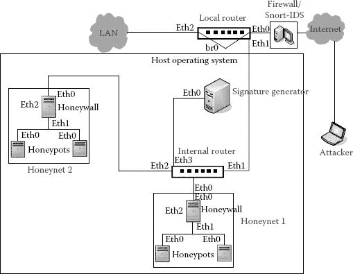

**图 7.3** 双蜜网架构。

### 7.4.2 双蜜网配置

我们的双蜜网系统包含六个组件：本地路由器、内部路由器、局域网、蜜网 1、蜜网 2 和签名生成器。每个子网（无论是本地路由器、内部路由器、局域网、蜜网 1、蜜网 2 还是签名生成器）的子网掩码因此均为 255.255.255.0。第 7.4.2.1 节至第 7.4.2.6 节讨论每个组件的配置。

**本地路由器配置**。正如我们在第 7.2 节中提到的，本地路由器的功能是通过内部路由器将不需要的流量传递给蜜网 1。例如，如果我们的局域网 IP 地址空间为 212.0.50.0/24，且有一台公共 Web 服务器，该服务器的 IP 地址为 212.0.50.19。如果网络外部的攻击者针对 212.0.50.0/24 发起蠕虫攻击，蠕虫将扫描受害者的 IP 地址空间。极有可能会先尝试未使用的 IP 地址（例如 212.0.50.10），然后才是 212.0.50.19。因此，本地路由器将通过内部路由器将数据包重定向到蜜网 1。蠕虫攻陷蜜网 1 后，将尝试发起出站连接以危害其他网络。我们配置内部路由器以保护局域网免受蠕虫出站连接的侵害。内部路由器拦截来自蜜网 1 的所有出站连接并将其重定向到蜜网 2，后者执行与蜜网 1 相同的任务，形成环路连接。以下是本地路由器机器属性和 IP 表配置的详细信息。

**机器属性**

*   **操作系统：** Ubuntu Linux 9.10
*   **网卡数量：**
*   三块网卡（`Eth0`、`Eth1` 和 `Eth2`）
    *   `Eth0` 和 `Eth2` 为桥接局域网端口
    *   `Eth1` 的功能是通过内部路由器将本地路由器与蜜网 1 连接
*   **IP 地址：**
*   `Eth1`：192.168.50.20


#### 网络配置详解

#### 本地路由器配置

在进行 IP-tables 设置之前，我们在本地路由器中启用了 IP 转发。

编辑 `/etc/sysctl.conf` 文件如下：

```text
net.ipv4.ip_forward = 1
```

##### IP-tables 配置

使用 IP-tables 进行内核网络地址转换器的设置如下：

**不转换发往真实公共服务器的数据包：**

```bash
# iptables -t nat -A PREROUTING -m physdev --physdev-in eth0 -d 212.0.50.19 -j RETURN
```

**将发往公共 LAN 的所有其他数据包转换至内部路由器：**

```bash
# iptables -t nat -A PREROUTING -m physdev --physdev-in eth0 -d 212.0.50.0/24 -j DNAT --to 192.168.50.22
```

#### 内部路由器配置

正如 第 7.2 节 所述，内部路由器的功能是保护 LAN 免受蠕虫出站连接的侵害，并将 Honeynet 1 的出站连接重定向到 Honeynet 2，反之亦然。以下将详细探讨内部路由器的机器属性和 IP-tables 配置。

##### 机器属性

*   **操作系统：** Ubuntu Linux 9.10
*   **网卡数量：** 四张网卡（`Eth0`、`Eth1`、`Eth2` 和 `Eth3`）
    *   `Eth0`：连接内部路由器至 Honeynet 1 客户端
    *   `Eth1`：连接内部路由器与本地路由器
    *   `Eth2`：连接内部路由器至 Honeynet 2 客户端
    *   `Eth3`：连接内部路由器与签名生成器
*   **IP 地址：**
    *   `Eth0`：192.168.51.20
    *   `Eth1`：192.168.50.22
    *   `Eth2`：192.168.58.20
    *   `Eth3`：192.168.55.20

在设置 IP-tables 规则之前，我们在内部路由器中启用 IP 转发：

编辑 `/etc/sysctl.conf` 文件如下：

```text
net.ipv4.ip_forward = 1
```

##### IP-tables 配置

使用 IP-tables 进行内核网络地址转换器的设置如下：

*   **转换来自 `Eth1` 进入 Honeynet 1 的数据包：**
    ```bash
    # iptables -t nat -A PREROUTING -i eth1 -j DNAT --to 192.168.51.22
    ```
*   **来自 Honeynet 1，不转换发往签名生成器的数据包：**
    ```bash
    # iptables -t nat -A PREROUTING -i eth0 -s 192.168.51.22 -d 192.168.55.22 -j RETURN
    ```
*   **来自 Honeynet 1，转换所有其他数据包至 Honeynet 2：**
    ```bash
    # iptables -t nat -A PREROUTING -i eth0 -j DNAT --to 192.168.58.22
    ```
*   **来自 Honeynet 2，不转换发往签名生成器的数据包：**
    ```bash
    # iptables -t nat -A PREROUTING -i eth0 -s 192.168.58.22 -d 192.168.55.22 -j RETURN
    ```
*   **来自 Honeynet 2，转换所有其他数据包至 Honeynet 1：**
    ```bash
    # iptables -t nat -A PREROUTING -i eth0 -j DNAT --to 192.168.51.22
    ```

#### LAN 配置

正如第 7.4.2.1 小节所述，我们的 LAN 中有一台公共 Web 服务器，其 IP 地址为：212.0.50.19。

以下是公共 Web 服务器的机器属性详情。

##### 机器属性

*   **操作系统：** Ubuntu Linux 9.10
*   **网卡数量：** 一张网卡：`Eth0`
*   **IP 地址：** `Eth0`：212.0.50.19

#### Honeynet 1 配置

如 图 7.3 所示，Honeynet 1 包含蜜墙和两个蜜罐。Honeynet 1 的主要功能是捕获多态蠕虫实例。以下是蜜墙机器属性和配置的详细信息。

##### 机器属性

*   **网卡数量：** 三张网卡（`Eth0`、`Eth1` 和 `Eth2`）
    *   `Eth0`：连接 Honeynet 1 与 Honeynet 2（通过内部路由器）
    *   `Eth1`：连接 Honeynet 1 与其客户端（蜜罐）
    *   `Eth2`：用于管理接口
*   **IP 地址：**
    *   `Eth0`：192.168.51.22
    *   `Eth1`：192.168.52.20
    *   `Eth2`：192.168.40.7

##### 蜜墙配置

###### Honeynet 公共 IP 地址

此处输入蜜罐的外部 IP 地址。这些 IP 地址即为攻击者地址：

*   **IP 地址：** 192.168.52.22；192.168.52.23

###### Honeynet 网络

此处输入采用无类别域间路由（CIDR）表示法的 Honeynet 网络：

*   **Honeynet 网络 CIDR：** 192.168.52.0/24

###### Honeynet 广播地址

*   **广播地址：** 192.168.52.255

###### 管理接口

第三个接口将用于远程管理。该接口帮助我们通过安全外壳（SSH）和 Walleye Web 接口远程管理蜜墙。我们使用 `Eth2` 作为管理接口。

*   **管理接口 IP 地址：** 192.168.40.7
*   **管理接口网络掩码：** 255.255.255.0
*   **管理接口默认网关：** 198.168.40.1
*   **蜜墙网关 DNS 服务器 IP：** 192.168.40.2
*   **SSH 监听端口：** 22
*   **允许访问管理接口的 TCP 端口空格分隔列表：** 22 443
*   **允许访问管理接口的 IP 地址空格分隔列表：** 192.168.40.0/24

###### 防火墙限制

双蜜网配置为执行无限制出站连接，如前文 (7.2) 所述。

###### 配置 Sebek 变量

Sebek 是一种数据捕获工具，旨在捕获攻击者在蜜罐上的活动。它包含两个组件。第一个是在蜜罐上运行的客户端；其目的是捕获攻击者的所有活动（按键、文件上传和密码），然后隐蔽地将数据发送给服务器。第二个组件是服务器，它从蜜罐收集数据。服务器通常运行在蜜墙网关上。

*   **Sebek 数据包目标 IP 地址：** 192.268.52.20
*   **Sebek 数据包目标 UDP 端口：** 1101

###### 蜜罐配置

以下是蜜罐机器属性和配置的详细信息：

####### 蜜罐 1

*   **机器属性：**
    *   **操作系统：** Windows XP
    *   **网卡数量：** 仅使用一张网卡：`Eth0`
    *   **IP 地址：** `Eth0`：192.168.52.22

####### 蜜罐 2

*   **机器属性：**
    *   **操作系统：** Ubuntu Linux 9.10
    *   **网卡数量：** 使用一张网卡：`Eth0`
    *   **IP 地址：** `Eth0`：192.168.52.23

#### Honeynet 2 配置

Honeynet 2 包含蜜墙和两个蜜罐。Honeynet 2 的功能是捕获多态蠕虫实例。以下是蜜墙机器属性和配置的详细信息：

##### 机器属性

*   **网卡数量：** 三张网卡（`Eth0`、`Eth1` 和 `Eth2`）
    *   `Eth0`：连接 Honeynet 2 与 Honeynet 2（通过内部路由器）
    *   `Eth1`：连接 Honeynet 2 与其客户端（蜜罐）
    *   `Eth2`：用于管理接口
*   **IP 地址：**
    *   `Eth0`：192.168.58.22


##### Honeywall 配置

###### 网络接口
*   **Eth1**: `192.168.59.20`
*   **Eth2**: `192.168.40.8`

###### 蜜网公网 IP 地址
在下文中，我们输入蜜罐的外部 IP 地址。这些 IP 地址属于攻击者：

**IP 地址**: `192.168.59.22`; `192.168.59.23`

###### 蜜网网络
此处，我们以 CIDR 表示法输入蜜网网络：

**蜜网网络 CIDR**: `192.168.59.0/24`

###### 蜜网广播地址
`192.168.59.255`

###### 管理接口
第三个接口将用于远程管理。该接口帮助我们通过 SSH 和 Walleye Web 界面远程管理 Honeywall。我们使用 Eth2 作为管理接口。

*   **管理接口的 IP 地址**: `192.168.40.8`
*   **管理接口的网络掩码**: `255.255.255.0`
*   **管理接口的默认网关**: `198.168.40.1`
*   **Honeywall 网关的 DNS 服务器 IP**: `192.168.40.2`
*   **SSH 监听端口**: `22`
*   **允许访问管理接口的 TCP 端口空格分隔列表**: `22 443`
*   **允许访问管理接口的 IP 地址空格分隔列表**: `192.168.40.0/24`

###### 防火墙限制
双重蜜网配置为执行无限制的出站连接，如上文 (7.2) 所述。

###### 配置 Sebek 变量
*   **Sebek 数据包的目标 IP 地址**: `192.68.59.20`
*   **Sebek 数据包的目标 UDP 端口**: `1101`

###### 蜜罐配置
以下是蜜罐机器属性的详细信息：

####### 蜜罐 1
**机器属性**
*   **操作系统**: Windows XP
*   **网卡数量**: 我们使用一张网卡：Eth0
*   **IP 地址**: `192.168.59.22`

####### 蜜罐 2
**机器属性**
*   **操作系统**: Ubuntu Linux 9.10
*   **网卡数量**: 我们使用一张网卡：Eth0
*   **IP 地址**: `192.168.59.23`

#### 签名生成器配置
签名生成器的功能是为多态蠕虫样本生成签名。

##### 机器属性
*   **操作系统**: Ubuntu Linux 9.10
*   **网卡数量**: 一张网卡：Eth0
*   **IP 地址**: Eth0: `192.168.55.22`

## 7.5 摘要
本章讨论了两部分内容。第一部分，我们给出了双重蜜网系统的完整细节。第二部分，我们简要介绍了用于实现双重蜜网系统的软件，以及使用 VMware 进行的双重蜜网配置。

## 参考文献
*   **[1]** M.M.Z.E. Mohammed, H.A. Chan, N. Ventura, M. Hashim, and I. Amin, "A modified Knuth-Morris-Pratt algorithm for zero-day polymorphic worms detection," *Proceedings of the International Conference on Security & Management*, 2 Vols, CSREA Press, Las Vegas, NV, pp. 652–657, July 13–16, 2009.
*   **[2]** M.M.Z.E. Mohammed, and H.A. Chan, "Honeycyber: Automated signature generation for zero-day polymorphic worms," *Proceedings of the IEEE Military Communications Conference*, San Diego, CA, pp. 1–6, November 17–19, 2008.
*   **[3]** M.Z.E.M. Mohssen, H.A. Chan, N. Ventura, M. Hashim, and I. Amin, "Accurate signature generation for polymorphic worms using principal component analysis," *Proceedings of the IEEE GLOBECOM Workshop on Web and Pervasive Security*, Miami, FL, pp. 1555–1560, December 6–10, 2010.
*   **[4]** Know Your Enemy: Honeywall CDROM Roo, <https://projects.honeynet.org/honeywall/>, last accessed August 18, 2012.
*   **[5]** The Honeynet Project. Roo CDROM User's Manual, <http://old.honeynet.org/tools/cdrom/roo/manual/index.html>, last accessed August 18, 2012.
*   **[6]** Know Your Enemy: Sebek—A Kernel Based Data Capture Tool, <http://old.honeynet.org/papers/sebek.pdf>, last accessed August 18, 2012.
*   **[7]** Snort—The de facto standard for intrusion detection/prevention, <http://www.snort.org>, last accessed August 18, 2012.
*   **[8]** M.M.Z.E. Mohammed and A.-S. K. Pathan. *Automatic Defense against Zero-day Polymorphic Worms in Communication Networks*, ISBN 9781466557277, CRC Press, Taylor & Francis Group, Boca Raton, FL, 2013.

# 索引
**注意:** 定位符后跟 `f` 和 `t` 表示文中的图和表。

### A
*   **访问域**, 11
*   **确认 (ACK) 扫描方法**, 51
*   **地址解析协议 (ARP)**, 27–28
    *   地址解析过程, 28f
    *   数据包格式, 27f
    *   协议漏洞, 57–58
        *   扫描, 57
        *   欺骗和投毒, 57–58
*   **高级黑客攻击**, 97–98
*   **代理**, 156–157
    *   DHCP 中继, 24–25
    *   基于主机的 IDPS, 155, 158
    *   IDPS, 139
*   **Allaple 蠕虫**, 75
*   **备用数据流 (ADS)**, 64
*   **基于异常的检测方法**, 78, 135–137, 149
    *   优势, 135
    *   开发方案, 136
    *   劣势, 137
    *   使用问题, 137
    *   配置文件, 136
    *   技术, 81
*   **杀毒软件, 计算机软件程序**, 126–127
    *   IDPS
        *   组件, 139–140
        *   检测方法, 134–139
        *   多个...的集成, 159–160
        *   产品, 160–163
        *   安全能力, 140–141
        *   技术类型, 142–159
    *   现代, 126


# 索引

### A

*   概述，128–134
*   基于应用的 IDPS，155
*   应用网关技术，82
*   应用程序接口 (APIs)，63
*   应用威胁，42
*   攻击特征码，81
*   可审计性，40
*   审计，40
*   真实性，37
*   自动分配，23
*   可用性，34–35

### B

*   BackOfficer Friendly (BOF) 蜜罐，91，111–112
*   坏件/恶意软件，68
*   横幅抓取，HTTP，46–47
*   Berkeley 软件发行版 (BSD) 实现，63
*   尽力交付，17
*   Blaster 蠕虫，74–75
*   盲化技术，146
*   网桥设备，4

### C

*   校园网，7–8
*   带冲突检测的载波监听多路访问 (CSMA/CD)，13
*   Cheswick, Bill，89
*   CIA（机密性、完整性和可用性）三要素，32–35
    *   可用性，34–35
    *   机密性，33
    *   完整性，34
    *   *对比* McCumber 立方体，35
    *   *对比* Parkerian Hexad，38
*   电路级网关技术，82
*   同轴电缆，6
*   代码分析技术，156
*   代码字节，76–77
*   Code Red 和 Code Red II 蠕虫，73–74，92
*   代码置换技术，78
*   Cohen, Fred，90
*   通信，计算机网络，1
*   计算机应急响应小组 (CERT) 协调中心，93
*   计算机网络
    *   通信，1–2，31
    *   组件，1
    *   设备，2–5
        *   网桥，4
        *   网关，4–5
        *   调制解调器，3
        *   路由器，4
    *   媒介，5–6
    *   网络协议
        *   常用，19–28
        *   和标准，8–19
    *   网络拓扑，6–8
    *   标准，8
*   计算机病毒，69–70
*   计算机蠕虫，70–72
    *   架构，71–72
    *   攻击，70
    *   示例，72–75
        *   Allaple，75
        *   Blaster，74–75
        *   Code Red 和 Code Red II，73–74
        *   Conficker，75
        *   Melissa，73
        *   Morris，72–73
        *   Nimda 或 W32/Nimda，74
        *   Sadmind，73
        *   Sasser，75
        *   SQL slammer，74
    *   多态，75–78
        *   分析，76–77
        *   特征码生成，77
        *   结构，76
        *   技术，77–78
    *   预防和检测，78–80
        *   针对漏洞利用，79–80
        *   针对漏洞，79
    *   传播，70–71
*   Conficker 蠕虫，75
*   机密性，33
*   控制台软件，139
*   基于内容的特征码生成，蠕虫，77
*   关联，139
*   *《布谷鸟的蛋》*（书），87–89
*   CyberCop Sting，90–91

### D

*   数据聚合检测环境，107
*   数据库服务器，139
*   欺骗概念，104
*   欺骗工具包 (DTK)，90
*   专用传感器，147
*   非军事区，107
*   拒绝服务攻击，98–99
*   目的地/接收端，2
*   威慑概念，104
*   设备，计算机网络，2–5
    *   网桥，4
    *   网关，4–5
    *   调制解调器，3
    *   路由器，4
*   定向攻击方法，71


# 索引

### D

*   Direct IDPS integration，132
*   DNS 缓存投毒，62
*   域名系统（DNS）漏洞，61–62
    *   捕获方法，61
    *   DNS 缓存投毒，62
    *   Internet/远程 DNS 欺骗，61–62
    *   内网 DNS 欺骗，61
*   双蜜网系统
    *   架构，166–168，171*f*
    *   组件，166*f*
    *   配置，170–178
        *   组件，171–178
        *   蜜网 1，174–176
        *   蜜网 2，176–178
        *   实现，170–171
        *   内部路由器，173–174
        *   局域网，174
        *   本地路由器，171–173
        *   签名生成器，178
    *   动机，165–166
    *   软件，168–170
        *   Honeywall Roo CDROM，168
        *   Sebek，168–170，169*f*
        *   Snort_inline，170
*   DSL 调制解调器，5
*   动态分配，23
*   动态主机配置协议（DHCP），22–25
    *   分配 IP 地址，23–25，24*f*
    *   项目，24
    *   非法 DHCP 服务器，54–55，55*f*
    *   耗尽攻击，54
    *   漏洞，54–55
*   动态概况，异常，136

### E

*   出口/入口路由器，19
*   终端设备，2
*   终端节点，2
*   以太网，13，13*f*
*   *An Evening with Berferd in Which a Cracker Is Lured, Endured, and Studied*，89

### F

*   故障开放模式，60
*   假阴性检测环境，106–107
*   假阳性检测环境，105
*   光纤电缆，6
*   文件系统监控技术，157
*   文件传输协议（FTP），82，108
    *   反弹攻击，53，54*f*
*   指纹识别，102–103
*   结束（FIN）扫描方法，50
*   防火墙系统，81–82
    *   常用技术，126
    *   类型，125–126
*   碎片扫描方法，51
*   片段标识号，52
*   帧，9
*   全开放扫描方法，49

### G

*   垃圾代码插入，78
*   网关设备，4–5

### H

*   黑客攻击，基础，40–43
    *   过程，42–43
        *   清除痕迹，43
        *   获取访问权限，43
        *   维持访问权限，43
        *   侦察，42
        *   扫描，42–43
    *   威胁，41–42
*   手持式 IDPS 传感器，149
*   硬件防火墙系统，125–126
*   命中列表扫描方法，71
*   Honeyd 蜜罐，112–113
*   蜜网 1 配置，174–176
    *   Honeywall 配置，175–176
    *   IP 地址，175
    *   机器属性，174–175
*   蜜网 2 配置，176–178
    *   Honeywall 配置，177–178
    *   IP 地址，177
    *   机器属性，176
*   蜜网蜜罐，113–122
    *   优势，114
    *   复杂性，114
    *   虚拟，114–115
        *   优势，114–115
        *   混合型，116–117
        *   自包含型，115–116
        *   虚拟化软件，117–119
*   蜜罐概念，83–94
    *   基于交互级别，108–111


### H

*   **蜜罐**
    *   高交互，110–111
    *   低交互，108–110
    *   中交互，111
    *   数据，86
    *   定义，83
    *   事实，84
    *   历史，87–93
    *   需求，83–84
    *   概述，111–122
        *   BOF，111–112
        *   Honeyd，112–113
        *   蜜网。*参见* 蜜网蜜罐
        *   ManTrap，113
        *   Specter，112
    *   类型，93–94
    *   价值，99–108
        *   优势，100–102
        *   劣势，102–103
        *   在网络安全中的角色，103–108

*   *使用 VMware 部署蜜罐——基础*，119
*   Honeywall Roo CDROM 软件，168
*   **基于主机的 IDPS**，130，132，154–159，163*t*
    *   代理，155，158
    *   局限性，158–159
    *   安全功能，156–158
    *   技术，156–157
        *   代码分析，156
        *   文件系统监控，157
        *   日志分析，157
        *   网络流量分析，156
        *   网络流量过滤，156

*   基于主机的 IDS，81
*   主机操作系统，170
*   主机威胁，42
*   HTTP 隧道，47–48，48*f*
*   集线器，11
*   人为威胁，42
*   混合系统，166
*   混合虚拟蜜网，116–117
*   **超文本传输协议 (HTTP)**，19–20
    *   Banner 抓取，46–47
    *   通信，20
    *   响应消息，46*f*
    *   消息类型，20
        *   请求消息格式，20*f*
        *   响应消息格式，21f

### I

*   空闲/哑扫描方法，51–52，53*f*
*   **IEEE 802 标准**，9–15
    *   系列，11*f*
    *   参考模型，10*f*
*   IEEE 物理层 (PHY)/MAC 标准，14
*   深度实操 IDPS 测试，134
*   间接 IDPS 集成，132–133
*   **信息保障**，模型，38–39，38*f*
    *   认证，39
    *   不可抵赖性，39
    *   与安全，40，41*f*
*   信息安全，类别，32
*   直通式传感器，IDPS，142，145
*   指令替换技术，78
*   中间节点，3
*   内部路由器配置，173–174
*   **互联网**
    *   物理模型，19*f*
    *   机器人 (BOTs)，99
*   **互联网控制消息协议 (ICMP)**，25–26
    *   数据包格式，25*f*
    *   扫描，55–57
    *   类型和代码组合，26*t*
*   **互联网协议 (IP)**，16–17
    *   寻址，17–18
    *   扫描，27
    *   欺骗，53
    *   版本，17–18
*   互联网协议套件，15–19，16*f*
*   互联网中继聊天 (IRC)，96
*   互联网/远程 DNS 欺骗，61–62
*   内部网 DNS 欺骗，61
*   **入侵检测与防御系统 (IDPS)**，127–163，129*f*
    *   组件，139–140
    *   检测方法，134–139
        *   基于异常，135–137
        *   基于特征，134–135
        *   有状态协议，137–139
    *   示例，127–128
    *   功能，130
    *   多系统集成，159–160


### I

*   **入侵检测与防御系统 (IDPS)**
    *   集成类型，132–133
    *   机制，131–132
    *   产品，160–163
    *   保护组件，131
    *   安全功能，140–141
        *   警报设置，141
        *   黑名单，140–141
        *   代码查看与编辑，141
        *   阈值，140
        *   白名单，141
    *   技术类型，142–159
        *   基于主机。*参见* 基于主机的 IDPS
        *   NBA 系统。*参见* 网络行为分析 (NBA) 系统
        *   基于网络。*参见* 基于网络的 IDPS
        *   无线。*参见* 无线 IDPS
    *   组件类型，131

*   **入侵检测系统 (IDS)**，80–81，127，170
    *   人工生成，166
    *   传感器，101

*   **入侵防御系统 (IPS)**，127，170

*   评估工具，137

*   防火墙及，80

*   **不变字节**，76

*   **反向标志扫描法**，51–52

*   **跳岛攻击法**，71

### J

*   **监狱**，89

### K

*   *Know Your Enemy*（书籍），92
*   *Know Your Enemy: Learning with User-Mode Linux*，121

### L

*   **链路层漏洞**，58–61
    *   MAC 泛洪，60
    *   MAC 欺骗，61
    *   数据包嗅探，58–60

*   **局域网 (LAN)**，7–8，11
    *   桥接，14–15，14*f* 配置，174
    *   IEEE 802 中的标准，58
    *   无线，58

*   **本地路由器配置**，171–173

*   **日志分析技术**，157

*   **逻辑链路控制**，9–10

*   **逻辑拓扑**，7

*   **低交互蜜罐**，108–110

### M

*   **MAC 泛洪技术**，60

*   **MAC 欺骗技术**，53，61

*   **恶意软件**
    *   类别，68
    *   保护网络的软件，68–69

*   **管理接口**，140

*   **管理网络**，140

*   **管理服务器设备**，139

*   **ManTrap 蜜罐**，113

*   **手动分配**，23

*   **McCumber 信息安全模型/立方体**，35，35*f*

*   **介质访问控制 (MAC)**，9–10
    *   地址，12–13，58–59
    *   网桥，12
    *   以太网交换机，59*f*–60*f*
    *   内部组织，12f
    *   协议，13
    *   表，58–59

*   **计算机网络介质**
    *   有线网络，5–6
    *   无线网络，6

*   **Melissa 蠕虫**，73

*   **大都市域网 (MAN)**，7，9

*   **Microsoft Internet Information Services (IIS)**，73

*   **Microsoft LAN Manager (LM)**，64

*   **Microsoft Windows 平台**，63–64

*   **误用检测技术**，81

*   **调制解调器**，3

*   **Morris 蠕虫**，72–73

### N

*   **国家基础设施保护中心**，93

*   **美国国家标准与技术研究院 (NIST)**，32，38

*   **自然威胁**，41

*   **NetSec**，112

*   **基于网络的 IDPS**，130，132，142–146，161*t*
    *   局限性，145–146
    *   方案，144
    *   安全功能，143–145
    *   传感器，142–143，146

*   **基于网络的 IDS**，81

*   **网络基本输入输出系统 (NetBIOS)**，63–64

*   **网络行为分析 (NBA) 系统**，130，151–154，162*t*
    *   局限性，154
    *   安全功能，151–154
    *   传感器，151
    *   技术，152–153


### N

*   网络接口卡，IDPS，142
*   网络协议
    *   常见，19–28
        *   ARP，27–28
        *   DHCP，22–25
        *   HTTP，19–20
        *   ICMP，25–26，25*f*
        *   TCP，21–22
    *   和标准，8–19
        *   IEEE 802 标准族，9–15，10*f*，11*f*
        *   互联网协议套件，15–19
*   网络扫描，43
*   网络威胁，42
*   网络拓扑，6–8
    *   LAN，7–8
    *   WAN，7
*   网络流量分析技术，156
*   网络流量过滤技术，156
*   Nimda 或 W32/Nimda 蠕虫，74
*   NOP（空操作），78
*   规范化，133
*   NTFS 文件系统，64
*   Null 扫描方法，50–51

### O

*   OpenSnort 传感器，116
*   开放系统互连（OSI）参考模型，2–3，8
    *   用于网络通信，3*f*
    *   *对比* 互联网模型，15*f*
*   操作系统（OS）
    *   个人计算机的，170
    *   漏洞，62–65
        *   操作系统指纹识别，62–63
        *   TCP/IP 参数，63*t*
        *   UNIX/Linux 平台，65
        *   Windows 平台，63–64
*   组织 WLAN，147

### P

*   数据包过滤技术，82
*   Parker, Donn B.，36–37，36*f*
*   Parkerian Hexad（帕克六元素），36–38
    *   真实性，37
    *   *对比* CIA 三要素，38
    *   占有/控制，36–37
    *   效用，37
*   被动传感器，IDPS，142–143，145
*   持久行为，20
*   网络钓鱼，99
*   物理威胁，41
*   物理拓扑，6–7
*   Ping 扫描技术，56
*   Ping 扫描过程，56，56*f*
*   多态蠕虫，75–78
    *   分析，76–77
    *   签名生成，77
    *   结构，76
    *   技术，77–78
*   端口扫描方法，49
*   隐私，33，40
*   生产蜜罐，94
*   专有协议，138
*   协议数据单元（PDU），9
*   协议模型，138–139
*   协议漏洞，45–62
    *   ARP，57–58
    *   横幅抓取，HTTP，46–47
    *   DHCP，54–55
    *   DNS，61–62
    *   HTTP 隧道，47–48，48*f*
    *   ICMP 扫描，55–57
    *   链路层，58–61
        *   MAC 泛洪，60
        *   MAC 欺骗，61
        *   数据包嗅探，58–60
    *   TCP 扫描，48–54
*   Provos, Niels，112
*   代理服务器技术，82

### R

*   随机扫描方法，71
*   Ranum, Marcus，111
*   侦察，72
*   远程 DNS 欺骗，61–62
*   征求意见稿（RFC），21
*   研究蜜罐，94
*   Roesch, Marty，91，94
*   流氓 DHCP 服务器，54–55，55*f*
*   Rootkit，96
*   路由器，4，18–19
    *   出口/入口，19
    *   内部，167，171，173–174
    *   本地，167，171–173

### S

*   Sadmind 蠕虫，73
*   Sasser 蠕虫，75
*   扫描 *对比* 枚举，43
*   Schneier, Bruce，104


# 索引

### S

*   **脚本小子攻击**，95–97
*   **SDINET**（战略防御计划网络），88
*   **Sebek 软件**，168–170，169f
*   **安全外壳协议**，48
*   **安全信息与事件管理 (SIEM) 软件**，132–133
*   **自包含虚拟蜜网**，115–116
*   **变密钥自加密法**，77–78
*   **传感器**，IDPS，139
    *   防篡改特性，150
    *   专用，147
    *   手持式，149
    *   基于网络的，142–143
    *   单一，144，154
    *   软件，147
    *   无线，147
*   **服务集标识符**，147
*   **会话劫持**，TCP，52
*   **基于特征的检测方法**，81，134–135
*   **特征生成器配置**，178
*   **简单邮件传输协议 (SMTP) 枚举**，47
*   **慢速扫描法**，49–50
*   **Snort_inline 软件**，170
*   **软件**
    *   杀毒，126
    *   控制台，139
    *   检测，155
    *   双重蜜网系统，168–170
        *   Honeywall Roo CDROM，168
        *   Sebek，168–170，169f
        *   Snort_inline，170
    *   防火墙，126
    *   受限，116
    *   用于保护网络免受恶意软件侵害，68–69
    *   传感器，147
    *   SIEM，132–133
    *   虚拟化，114–115，117–119
    *   VMware，118–120
    *   蠕虫，71–72
*   **Solaris 蜜罐**，93，109
*   **源头/起源**，2
*   **Specter 蜜罐**，112
*   **SQL Slammer 蠕虫**，74
*   **有状态协议分析方法**，137–139
    *   缺点，138–139
    *   专有，138
    *   协议模型，138–139
    *   状态跟踪特性，138
*   **静态概况**，异常，136
*   **隐身模式**，143
*   **Stoll, Clifford**，87–88
*   **Sub7 特洛伊木马**，92
*   **子进程控制服务**，93
*   **Sun Solaris 系统**，73
*   **系统调用监控技术**，156

### T

*   **机会主义攻击者**，104
*   **TCP/IP**
    *   实现，62–63
    *   按操作系统划分的参数，63t
    *   不使用 TCP/IP 的 Sebek，169
    *   协议族，15，18
*   **TCP 扫描**，48–54
    *   ACK 扫描，51
    *   连接/全打开扫描，49
    *   连接握手，49f
    *   FIN 扫描，50
    *   分片扫描，51
    *   FTP 反弹攻击，53，54f
    *   半打开/SYN 扫描，50
    *   空闲/哑扫描，51–52，53f
    *   反向标志扫描，51
    *   IP 欺骗，53
    *   空扫描，50–51
    *   会话劫持，52
    *   慢速扫描，49–50
    *   Xmas/Xmas-tree 扫描，50，50f
*   **威胁**
    *   信息系统，41–42
    *   蜜罐类型，95–99
        *   高级黑客攻击，97–98
        *   攻击者动机，98–99
        *   脚本小子攻击，95–97
*   **三次握手过程**，22，23f
*   **训练期**，136
*   **传输控制协议 (TCP)**，18，21–22
    *   连接建立，22
    *   段结构，21，22f
*   **隧道技术**，HTTP，47–48，48f
*   **双绞线电缆**，5–6

### U

*   **UNIX/Linux 平台**，65
*   **用户数据报协议 (UDP)**，18，74
    *   扫描，57


### V

*   **Vanilla scan（标准扫描）**, 49
*   **Virtual honeynet（虚拟蜜网）**, 114–115
    *   advantages of（优势）, 114–115
    *   hybrid virtual（混合虚拟）, 116–117
    *   self-contained（自包含）, 115–116
    *   virtualization software（虚拟化软件）, 117–118
*   **VMware ground storm X (GSX)**, 119–121
*   **VMware workstation**, 117–119, 170
    *   advantages（优势）, 117–118
    *   disadvantages（劣势）, 118

### W

*   **Walleye Web interface（Walleye Web 界面）**, 168
*   **Weak security methods（弱安全方法）**, 150
*   **Wide area network (WAN)（广域网）**, 7
*   **Wildcard bytes（通配符字节）**, 77
*   **Windows Local Security Authority Service Server (LSASS)（Windows 本地安全机构服务服务器）**, 75
*   **Wired networks（有线网络）**, 5–6
*   **Wireless IDPS（无线 IDPS）**, 130, 132, 146–151, 162*t*
    *   advantages of（优势）, 148
    *   intrusion prevention capabilities（入侵防御能力）, 149
    *   security capabilities（安全能力）, 148–150
    *   weak security methods（弱安全方法）, 150
*   **Wireless LANs (WLANs)（无线局域网）**, 58, 147–148
*   **Wireless networks（无线网络）**, 6
*   **World Wide Web（万维网）**, 46
*   **Worms, computer（计算机蠕虫）**, 70–72
    *   architecture（架构）, 71–72
    *   attack（攻击）, 70
    *   examples（示例）, 72–75
        *   Allaple, 75
        *   Blaster（冲击波）, 74–75
        *   Code Red and Code Red II（红色代码和红色代码 II）, 73–74
        *   Conficker（震网/Conficker）, 75
        *   Melissa（梅丽莎）, 73
        *   Morris（莫里斯）, 72–73
        *   Nimda or W32/Nimda（尼姆达或 W32/Nimda）, 74
        *   Sadmind, 73
        *   Sasser（震荡波）, 75
        *   SQL slammer（SQL 冲击波）, 74
    *   polymorphic（多态性）, 75–78
        *   analysis（分析）, 76–77
        *   signature generation for（特征码生成）, 77
        *   structure（结构）, 76
        *   techniques（技术）, 77–78
    *   prevention and detection（预防与检测）, 78–80
        *   of exploits（针对漏洞利用）, 79–80
        *   of vulnerabilities（针对漏洞）, 79
    *   spread of（传播）, 70–71

### X

*   **Xmas/Xmas-tree scan（Xmas/Xmas 树扫描）**, 50, 50*f*

### Z

*   **Zero-day attacks（零日攻击）**, 84, 107
*   **Zero-day exploits（零日漏洞利用）**, 110

---

1.  * 设备中上层 OSI 功能的存在要求其也应执行所有下层的任务，即它应实现到该层级的所有层。因此，如果我们说一个设备是第 3 层设备或属于第 3 层，这意味着它实现（或执行与之相关的动作）了从第 1 层到第 3 层的所有层。↩

2.  * 此处术语*device*（设备）在技术上是指*interface of a device*（设备接口）。由于一个设备可以拥有多个网络接口，这些接口中的每一个都将拥有自己的 MAC 地址。然而，在上层，所有这些独立的数据流可能会为了单一通信目的而合并。例如，路由器通常有多个接口，转发工作是通过将数据包——在其中一个接口上接收——中继到一个合适的接口来执行的。↩

3.  * 以太网和 802.3 如今通常被视为同一标准。然而，它们在原始设计上存在细微的技术差异。↩

4.  * 尽管图中未显示，网桥（如果需要）也支持 IEEE 无线 PHY/MAC 标准。↩

5.  * 由于一个十六进制数字等于四个二进制数字，每个数字将有四个十六进制数字。↩

6.  * 存在 DHCP offer（提供）不进行广播的情况，例如，当客户端已拥有 IP 地址并仅请求延长租约时。↩

7.  * 在计算机安全语境下有多个方面，如硬件和软件；然而，本书的重点是利用计算机通过计算机网络进行的通信。↩

8.  * CIA 一词最熟悉的用法是指中央情报局；因此，在文献中一些作者也使用*AIC triad*（AIC 三要素）一词以避免混淆。↩

9.  * 在黑客攻击中，侦察技术进一步分为足迹、枚举或扫描等组。文中所述的横幅抓取攻击无法精确归入这些子类中的任何一个，因为它实现了多种目的。↩

10.  * 在黑客攻击中，侦察技术进一步分为足迹、枚举或扫描等组。文中所述的横幅抓取攻击无法精确归入这些子类中的任何一个，因为它实现了多种目的。↩


11.  \* 并非 HTTP 报文从不受限。然而，限制 HTTP 流量的通常场景是限制针对某些已知统一资源定位符（URL）的 HTTP 请求，而此处并非这种情况。↩

12.  † 我们此处刻意避免使用 *攻击者* 一词，因为并非所有 HTTP 隧道的用途都被一致认为是恶意的。↩

13.  \* `ACK` 标志通常会在握手过程的前两个步骤之后的所有段中被置位，因为它们都是确认段。↩

14.  \* 如果两个或多个主机的帧在同时传输时可能发生碰撞，则认为它们处于同一冲突域中。↩
