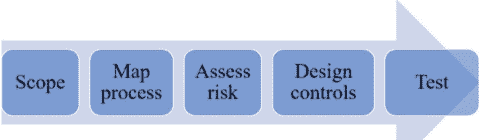
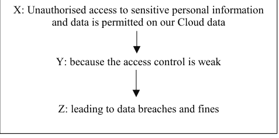
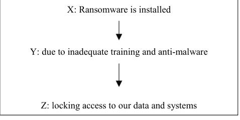

# 网络安全如何保护您的业务：所有利益相关者指南

# 前言

在曼彻斯特举行的一场 ISACA®会议上，我听了 Chris 的一场关于信息安全审计的演讲。很明显，凭借近四十年的经验，他对该领域已精如指掌。尽管房间里坐满了经验丰富的审计专业人士，但他用简洁的语言进行演讲，你不需要成为信息安全专业人士也能听懂。最后，他提到了他的新书*网络安全如何保护您的业务——面向所有利益相关者的指南*，以及他想要消除网络技术的神秘感。

当他找我审阅这本书并撰写前言时，他并不知道我是这个书标题的忠实信徒，而且实际上还拥有 cybergrc.uk 域名以推广网络安全的良好实践。几乎每天，我都会与 CEO、CISO、CRO 和 IT 总监坐在一起，讨论他们的业务网络安全审计需求，通过测试管理和技术控制的有效性和充分性来评估他们的运营韧性，并在发现机会时提出改进建议。

这本书写得非常巧妙，能够吸引任何背景的读者。它深入剖析了网络安全，涵盖了专业人士、非专业人士或组织运营安全网络环境所需的所有内容。它认识到在组织中拥有 C 级赞助者以促进网络安全投资的重要性，并明确指出在安全环境中运行是每个人的事务，而是 IT 专业人员的事务。网络治理、风险管理和合规方面的清晰性无论怎么强调也不不过。每一章都讨论了网络审计评审周期的组成部分，强调了风险控制矩阵方法在评估风险、测试控制方面的应用，并为利益相关者提供了提供保证路径。

这本书对于想要开启网络安全审计和咨询职业的人来说是一本理想的指南，对于经验丰富的审计师来说是一个实用的参考来源，作者总结了他数十年的经验，为那些希望起步或从他即将谢幕的地方取得进步的人创造了一个“软着陆”。

顺致网络问候，

Yinka Akingbehin

# 前言

“网络”（Cyber）是一个我们一直在使用的词。但它意味着什么？对于我们这些董事和总经理来说意味着什么？对于 IT 安全经理和审计师来说又意味着什么？

“网络”被认为源自较老的术语“控制论”（cybernetics）——基于电子/机械控制系统以及人造世界与人类世界相互作用程度。控制论源于希腊单词“kubernan”——意为操舵或控制。Kubern 源于希腊单词“kubernetetes”——意为操舵手。因此，我们可以将网络视为人类与计算机之间的控制平衡。现在通常被理解为涵盖大多数与计算机/IT/物联网（IoT）相关的内容。

这种“控制”方面往往被忽视。导致这一现象的原因之一是业务方面的技术性迟钝——他们听到了这些词，但在提到利润或亏损/成本降低等概念之前会走神，然后倾向于只关注这些。IT 专业人士则对位、字节和令人兴奋的技术事物感兴趣。网络令人兴奋的方面之一是业务和技术管理这两个世界开始融合。部分是因为对依赖网络所面临威胁的意识日益增强，部分是为了应对监管机构、媒体和其他机构日益增加的压力。这两个部落需要的是一个中间人。

这关乎平衡：我们如何继续安全、自信地享受我们的……

根据《傻学者指南：SAP GRC》，治理、风险管理和合规（GRC）的目标是：

- 开发 IT/网络安全策略
- 实施合规流程和工具
- 设计并实施用于网络合规的董事会报告
- 设计、测试并实施网络 SOX 控制框架。

然而，GRC 不仅仅于此。它不仅关乎确保满足合规，还关乎确保可能影响组织未来生存和盈利能力的重大风险已得到解决。这越来越多地包含了网络活动。之前的定义部分解释了为什么 IT 经理将它们视为阻碍者而非促进者。GRC 应被视为一个促进整个组织良好安全的机会。

本书的目的是为网络 GRC 提供一个有效的框架。像所有框架一样，它需要根据每个组织以满足其自身的风险偏好进行调整。书中解释了什么是 GRC，它如何应用于网络以及实施它需要什么。它的目标是引导经理和高管，而不诉诸“网络术语”；对于网络专家，它提供了一种用非术语、基于业务的语言解释网络问题的方法。

作者欢迎对是否实现了这一目标的任何反馈。

# 作者简介

Chris 是一名合格会计师、注册信息系统审计师和认证 ScrumMaster，拥有超过 35 年提供 IT 安全咨询和审计/风险管理服务的经验。他在毕德工作过 16 年，管理了多项信息安全审计和风险任务，包括项目风险和业务控制评审。他曾担任英国信息风险培训负责人，并在海外（包括印度和欧洲大部分地区）举办培训课程。Chris 工作涉及广泛的行业领域，包括石油、公共部门和旅游。这些任务包括网络、GRC 实施和审计以及基于网络的项目实施。

在过去的12 年里，他担任独立顾问，专注于大型 ERP 实施中的财务、萨班斯-奥克斯法案（SOX）和运营控制。

Chris 是敏捷审计和治理问题的国际演讲师和培训师，并为 IT Governance Publishing 编写了四本其他著作：《敏捷治理与审计》（2014）、《尽职调查中的 IT 评审》（2015）、《信息风险审计基础》（2016）和《精益项目保证基础》（2017）。

Chris 还对关于第三方合规与管理以及敏捷项目保证专业工作小组出版物做过贡献。

他还为一家大型客户服务机构实施了网络/IT 安全管理的 GRC 系统。这包括：

- 开发 IT/网络安全策略
- 实施合规流程和工具
- 设计并实施用于网络合规的董事会报告
- 设计、测试并实施网络 SOX 控制框架。

# 关于作者

他也是一名演讲者和技术评审审稿人，致力于弥合通用管理与网络安全管理之间的鸿沟，以实现组织内部有效的治理、风险管理和合规。

# 致谢

我要感谢所有协助本书出版的人员：ITGP 的 Sophie、Nicky 和 Vicki；ITG 的 Jonathan Todd；Chris Evans 对我手稿的审阅；以及长期朋友 Scott Nichols、John Jones、Mike Hughes 和 Yinka Akingbehin 提供的宝贵反馈。

最后但同样重要的是，感谢我的妻子 Amanda，感谢她的耐心、反馈和支持。
# 目录

# 第一章：网络安全 GRC 简介

## GRC 的背景

治理。风险。合规（或“控制”）。简单的词汇——但它们包含了丰富的内。它们涵盖了组织为确保其行为符合伦理、法律和诚信标准所采取的步骤，并能够在实现业务目标或其他目标时，有效高效地处理风险（或其他不确定性）。

GRC 最初由 OCEG 的 Scott Mitchell 在 2007 年定义为：

- 一项集成能力集合，使组织能够可靠地实现目标、应对不确定性并保持诚信。²

治理是确保组织实现其目标和目的的能力。它包括由高层管理和董事会领导的政策和流程，以对其活动提供整体控制。最终，他们对组织的财务状况和法律合规负责——有时还面临刑事诉讼的风险。治理还包括提供组织的伦理准则和氛围，以及其运行的结构和政策。

风险管理是在充满不确定性的世界中充满心地行动的能力：组织识别、评估和审查其在运营过程中所面临风险的过程。它还考虑了针对这些风险的控制措施，并确保采取充分的缓解措施（如控制、保险或风险接受）。

合规是以诚信正直行动的能力，是指遵守适用的法律法规，以及公司自身的政策和制度。

> ² www.oceg.org/about/what-is-grc/

# 1：网络安全 GRC 简介

GRC 的基本原则适用于任何规模的组织。然而，实现良好 GRC 所需的流程、人员、信息和技术在组织之间存在差异，主要取决于其规模和活动领域。例如，大型组织将面临复杂的治理问题（需要经验丰富且知识渊深的董事、风险管理和合规问题），其合规要求将包括金融法规和反洗钱；而一家小型角咖啡馆可能由少数个人拥有和管理，但需要遵守食品卫生和其他相关法规。

GRC 可以被视为一种开销——有些人可能认为 GRC 是一项对组织的成功或财务状况没有直接贡献的额外活动。如果 GRC 活动缺乏重点或缺乏协调，可能会出现冗余活动，这些活动既不能提供业务利益，也不能加强组织的治理、风险管理或合规。目标是以这种方式简化和管理 GRC 流程，使组织能够实现目标，例如提供进入风险概况或合规要求与其他组织不同的市场的能力。这可能涉及将风险管理和合规流程嵌入日常业务活动中，同时生成主要利益相关者治理活动所需的关键性能指标（KPI）和其他报告。主要考虑是提供一种稳健的方法来应对不确定性的挑战以及声誉或客户损失的风险，在某些情况下甚至面临入监狱的风险！另一个优势是当发生合并收购时，目标公司可以更容易整合到收购方的 GRC 框架中。

GRC 活动通常跨越组织部门，包括董事会秘书处、内部审计、合规团队以及法律、财务、IT 和人力资源部门的风险团队，以及日常业务运营。这可能导致不同孤立部门之间的活动冲突。还可能存在水平不一致的情况

# 1: 网络安全 GRC 简介

以及所处理的风险类型——在局部/部门层面认为重要的风险，与整个组织相比可能可能是微不足道的。此外，在大型复杂的组织中，这些活动可能会在不同的组成实体之间重复。在这种情况下，可能会出现活动重复和覆盖范围的缺失。企业级治理、风险管理与合规（EGRC）旨在为整个组织提供一种一致的、集成的 GRC 方法，以减少这些重复和潜在的重复。它还提供了一个由政策、工具、流程和信息报告的框架，以简化活动并提供一致性。

### 三道防线模型

为了对风险管理过程本身进行治理，许多组织使用三道防线模型³来解释他们的风险管理方法。该模型有助于分配特定的风险管理角色职责/义务，并定义它们之间的边界。该模型如图 1 所示。

### 表 1：三道防线模型总结

| 防线 | 通常情况下 | 典型活动 |
| --- | --- | --- |
| 第一防线——运营控制 | 业务职能 | • 嵌入式风险管理。 • 与风险直接接触。 |
| 第二防线——风险控制与合规监督 | 风险职能（如 CISO） | • 突出显示控制失败/意外事件。 - 补救以解决流程/控制缺陷。 - 提供框架并支持相关政策和程序的实施。 - 帮助建立/监控第一道防线。 - 开发用于管理风险和问题的流程和控制措施。 - 审查并更新风险清单以及对风险的响应。 - 运行自证流程。 |
| 第三道防线——独立保证 | 审计和董事会 | | 对对组织应对风险的措施提供独立审查和报告。 |

# 1: 网络安全 GRC 简介 

该模型适用于任何规模或复杂性的组织——其目标是提供一个有效的（符合用途）、高效的（对正常运营影响有限）且经济的（考虑到风险或合规水平，成本不过高）的风险管理框架。防线之间的边界也可能不同。如果使用此模型，在组织内部定义这三道防线非常重要，包括不同防线之间如何互动，包括风险/事件的发现和信息的共享。风险是可能发生的事情；问题是已经发生的事情。

在网络安全的背景下，这三道防线可以被视为：

1. 运营管理、托管安全服务提供商 (MSSP)、第三方供应商和服务提供商。
2. CISO 和其他合规/审查职能（这部分可能融入非网络活动，例如数据合规）。
3. 合格的 IT 审计师

对于网络健康安全，员工应被视为第一道防线。例如，虽然运营管理可能确保安装并更新反恶意软件，但终端用户仍可能通过点击链接或访问不适当网站而损害安全性。所有用户都需要接受网络风险的教育，并意识到对个人和整个组织带来的后果。这种意识可能会产生益处。

另一个问题是该模型可能被认为是孤立的。为了有效工作，防线需要整合，以减少发生泄露发生时的指责风险。

### GRC 对网络安全的意义是什么？

我们生活在数字世界中——我们使用 IT 与朋友家人交流、购买商品和服务办理银行业务。网络安全可以定义为防止或检测对你的数据和 IT 资产进行盗取或破坏尝试的措施。网络与任何其他影响业务的风险没有太大。它会影响组织的声誉、合规性（包括数据隐私）和财务状况。网络不仅仅是一个 IT 问题——它影响了你开展业务和管理的所有方式。我们需要确保基于网络的安全活动与所有其他 GRC 活动一致，并受到类似的治理和控制。事实上，对于网络来说，可以认为 GRC 甚至更加重要。

如果我们从犯罪分的角度来看这个问题，我们可以创建一个如下的用户故事：

作为一名犯罪分子，我想访问并更改你的数据，以便我通过破坏你的声誉和/或获得财务回报来实现自己的目标。为了实现这一目标，我将针对对网络缺乏或没有整体控制的组织：

- 雇佣受训不当且对威胁产生轻信的用户；
- 风险管理流程未正常运行（例如：不更新反恶意软件等安全工具、没有有效的密码管理等）；以及
- 未能遵守法律/法规/最佳实践的网络卫生标准。

作为董事、经理或网络安全专家，你的工作是阻止他们。做到这一点的方法是是确保组织拥有有效的 GRC。我们将在接下来的章节中探索如何实现这一点。

记住这一点也很重要，网络事件的影响可能远超直接成本。我们看到全球范围内网络公司在遭受攻击后进入了破产程序，特别是在发生个人数据泄漏的情况下。这可能是由于客户流失和/或巨额监管罚款造成的。

我们现在考虑良好的 GRC 如何帮助减少这些风险。

# 第 2 章：网络安全治理

> “董事会在改进其组织网络安全方面至关重要。”

NCSC 董事会网络安全工具包

## 引言与概述

良好的控制需要高层（董事和执行管理）良好的企业治理。高层管理应确保组织结构良好，并用强大的政策和理念进行管理。治理是构建其他控制和风险缓解的基础。例如，只有在确保人们遵守规则并对违规者追究责任的情况下，控制才是有效的。最终，无论发生在哪里，承担治理责任的人将承担责任。

这些企业治理，“实体级控制”渗透在组织，包括信息和网络活动。它们设定了组织的运营基调。然而，它们不应干扰日常运营，除非此类活动可能组织面临财务、法律/财政或声誉风险。良好治理的目标如图 1 所示。

# 2: 网络安全治理

即使是小型组织也面临日益增加的网络犯罪风险，因为它们通常可以被用作针对同一供应链中其他组织的薄弱起点。网络犯罪分子方法的关键部分是“踩点”或调查其目标——这包括阅读有关新合同获奖的新稿以及这些客户和供应商的详情。因此，所有董事不仅对自己组织的利益相关者负有关怀责任，对关键业务伙伴的利益相关者也是如此。

董事和高级人员可能被针对，因为网络犯罪分子会在社交媒体等平台上收集信息，以便通过电子邮件或其他形式的接触冒充他们。董事必须意识到安全管理其个人社交媒体呈现的必要性。

极少数董事是网络安全专家。但所有董事都需要根据无术语的原则对网络安全有基本的理解和意识。为了帮助这一点，我们可以从董事的角度将治理表达为用户故事：

作为一名董事，我想以简洁、易懂的语言获得保证，确保我们：

- 对网络风险和威胁进行了充分管理
- 获知重大攻击和近乎发生的事件，并就防止发生的行动获得建议
- 获知我们主要第三方的安全安排，包括任何重大攻击
- 有效且高效地利用我们在网络安全投资

以便我们减少数据泄露和失去网络业务能力带来的声誉损失、巨额罚款和其他后果的影响和概率。

## 2: 网络安全治理

验收标准

为了实现目标，我需要首席信息安全官 (CISO) 提供定期、简洁且易于理解的报告，内容涵盖：

- 1. 与我们业务相关的威胁格局；
- 2. 我们是否具有对这些威胁有意识并能采取适当行动的文化；
- 3. 我们在降低风险方面取得的进展（例如反恶意软件部署、攻击管理、用户意识、网络钓鱼计划、近期的审计结果）；
- 4. 发生的攻击/泄露事件以及我们的应对措施；
- 5. IT 安全策略和其他安全通信的最新审查情况。

这种方法有助于解释要求，并为董事会及向其汇报的人员提供重点。

在发生泄露或事件时，任何调查监管机构（如英国的信息专员办公室 ICO，如果公司在美国上市，则为证券交易委员会 SEC）都将希望审查现行的网络治理情况。他们可能会考虑：

- 整体 GRC（治理、风险与合规）框架；
- 文化与意识；
- 威胁与风险意识；
- 网络风险管理；
- 攻击响应准备工作。

他们将寻找这些活动的证据，包括董事会报告、会议纪要和后续行动。

## 文化与意识

所有员工都需要具备网络安全意识，以及它如何影响他们的角色和职责。这不应仅仅是网络安全专员的问题，而应成为组织整体卫生的一部分——就像健康与安全一样。任何使用 IT 的人（大多数人都是如此）都是关键风险——但也是防止网络攻击的控制手段。然而，只有当用户意识到自己的网络安全责任、被赋予安全可靠地操作的工具（例如安装了反恶意软件），并被激励采取适当行动（包括愿意立即且有效地防止网络风险和/或攻击）时，这道“人为防火墙”才能发挥作用。组织应确保让员工执行正确行为比执行错误行为更容易。激励还包括确保这些正确行为得到认可并给予积极反馈。如果未能提供反馈（例如在报告了尝试性的网络钓鱼邮件后），可能会导致该个人在未来不再报告此类事件。

良好的文化转变也依赖于董事的以身作则。让董事成为特殊情况并排除在适用于其他人的控制之外是不恰当的，例如允许他们使用自己的未安全设备。当董事遇到政策或程序方面的问题时，组织中的所有用户面临的情况都是——重点应放在寻找实现目标的更好方法，而不是为董事（他们可能面临更高的网络攻击风险）提供特例或豁免。

这种信息需要在每个机会重新强化——网络安全不仅仅是年度安全活动的主题。更好的安全将造福所有用户——不仅在他们的工作中，而且在个人生活中也是，因为他们将更警惕诸如来自虚假银行或宽带服务提供商的诈骗。

董事会应该定期收到有关任何活动以及用户对网络风险和威胁意识水平的报告。这有助于指示组织的网络健康状况。网络评级是公开的指标，类似于信用评级，但基于网络卫生指标，它们也可以指示组织的韧性，并可以随时间进行追踪。

### 威胁与风险意识

董事会需要确保建立有效高效的流程，以理解其组织面临的网络威胁，这些流程基于：

- 业务类型及任何紧迫待的变化；
- 数字和网络活动的范围；
- 运营的地理区域；
- 之前的网络问题；
- 对通用和特定威胁及漏洞的意识；以及
- 使用的技术导致的漏洞（例如，依赖无法修复已知漏洞的过时技术）。

有几家公开和私有的服务提供商提供有关特定威胁格局的定期更新。在有网络保险的情况下，保险公司可能还会提供网络情报报告。董事会应定期收到汇总所提供信息的报告，并了解所服务的有效性、成本和效率。

### 风险管理

董事需要确保有风险管理的流程和程序，并确保这些程序有效运行。这应该定期报告任何已知的控制缺陷、所采取的修复措施以及解决任何高风险领域的进展。当风险无法缓解或控制时，可能需要实施网络保险。董事会可能被要求作为组织网络保险范围的一部分提供此类审查的证据。网络风险通常不受组织的责任/专业责任险覆盖。针对网络安全的特定策略为应对事件或数据泄露提供额外覆盖。

风险管理流程和特定的网络风险将在后续章节中讨论。

### 响应网络事件

董事会需要确保有有效的计划来应对网络攻击，并且该计划已经过测试、沟通和演练。这可能包括例如使用外部支持机构作为勒索软件谈判员，并确定向董事会和监管机构升级的流程和程序。该计划应包括与第三方和媒体的沟通安排，详细说明通信链以及关键员工应接受的媒体管理培训。计划应由董事会每年审查和批准，并在发生重大网络事件后进行额外审查。

### 网络 SOX

《萨班斯-奥克斯利法案》（SOX）是针对在美国证券交易所上市公司的法律（日本对日本公司也有立法）。它在财务报告丑闻后引入，旨在向市场和投资者提供保证，确保财务报告可以作为投资决策依据。组织要求实施控制以确保财务报告的准确性和完整性，这两者都由审计师作为年度审查流程的一部分进行独立审查。从2018年开始，针对网络引入了额外要求。这些要求需要季度报告，以便投资者根据组织的网络风险管理及其对任何近期攻击的响应做出决策。此外还强调确保参与事件响应的人员利用其“内部信息”通过股票交易获取个人利益。

### 总结：董事应提问的关键网络安全问题

网络安全专员可能需要对董事应该问的问题提供指导。优秀的网络管理者应该能够回答以下问题。

文化与意识

- 员工对我们面临的风险以及他们需要操作的控制措施有多少意识？
- 审查、更新和批准 IT 及网络安全策略的流程是什么？
- 网络安全策略、程序和控制措施是如何公布和执行的？
- 董事会可以做什么来提高网络意识文化？（例如，奖励良好的网络行为，做到以身作则。）

威胁/风险意识与评估

- 我们是如何识别与我们组织相关的网络威胁的？
- 这一过程何时以及如何审查？
- 我们如何收集情报来监控不断变化的威胁格局？
- 董事会如何被这些威胁和风险？
- 董事会可以做什么来提高对风险和威胁的意识？

响应网络事件

- 有什么计划来应对网络事件或数据泄露？
- 是否有有效的媒体管理流程（包括培训）？
- 这些最近是什么时候审查和测试的？

## 2: 网络安全治理

- 是否针对所有重大事件和数据泄露举行了经验教训会议？计划是否已相应进行更新？

### 风险管理

- 评估网络风险和控制的流程和程序是什么？
- 这些内容最近是否经过审查？
- 实施了哪些网络保险范围？
- 如何向董事会汇报任何已知缺陷和获批的控制异常？
- 谁负责向董事会提供网络风险管理的定期报告？

这引导我们进入下一章。

## 第 3 章：网络安全风险管理

> 主啊，请不要扰我们……
因为我们梦想得太少，
当我们安全抵达时
是因为我们航行离岸太近了。

通常归于弗朗西斯·德雷爵士（Sir Francis Drake）祈祷

## 引言与概述

我们每天都面临风险。生活是一项充满风险的事务。但没有风险就没有进步。网络世界中的组织也是如此：存在黑客攻击、欺诈、国家干预和身份盗窃的风险。但这些风险必须与通过网络开展业务的风险进行权衡（例如未能获得新客户或未能降低成本）。风险是巨大的，潜在回报也同样巨大：竞争优势、降低成本、通过社交媒体提高对产品和服务的认知，这仅列举几点。这些风险的管理方法与你管理日常驾驶风险一样——通过控制（确保你的汽车安全可靠并系好安全带，并由合格的技术人员进行维护）、通过遵循你无法改变的规则（如限速）以及针对你无法避免的未知风险进行保险。每个组织都需要有一套管理网络风险的流程。

流程和术语在不同组织之间会有不同，但基本步骤可能如图 2 所示。在可能的情况下，网络安全也应遵循这些步骤。它们有助于确保以业务经理和高管可以理解的格式和风格陈述风险。

## 3: 网络安全风险管理

图 2：风险管理流程

下文描述了这些步骤的目标、关键活动和交付物。我们还将考虑如何使风险管理过程更加敏捷。

### 风险管理范围

在进行风险管理审查时，确保理解并达成范围共识非常重要，以避免遗漏或重复工作。

对于网络安全，我们需要确保根据组织的风险偏好，所有风险评估都以相同的详尽程度进行，否则：

- 控制措施的定义可能过于细微，导致额外工作，但未能或几乎没有降低风险概况；
- 被识别为组织战略性的风险可能无法得到充分覆盖。例如，与敏感地理运营位置或在世界受限地区进行交易相关的战略性风险，可能会产生需要考虑的网络安全影响。

主要活动将是：

- 根据企业风险战略和关键利益相关者确定的风险偏好水平，识别相关的战略性风险；
- 同意范围内的流程、技术和地点，以及是否包含第三方/供应链的活动；
- 识别与本次审查特定的已知事件或风险；
- 识别要纳入审查的所有利益相关者、人员、程序和技术；以及
- 确定在审查期间必须考虑的法律和其他法规。

范围界定工作的交付物（可能来自研讨会或一系列会议）将是达成的范围、一份高层计划和背景备注。为了减少执行过程中范围蔓延或变更的风险，这些文档应在工作开始前由所有关键利益相关者审查并批准。

### 流程与控制映射

记录流程和相关控制有助于确认理解，并确保控制措施位于风险点，以便能够有效高效地识别任何错误或攻击。如果控制措施在流程中太靠后，可能会导致额外的、不必要的纠正工作。文档不需要过于详细——目标是确保以业务经理和高管可以理解的格式和风格陈述风险。在研讨会、审查后，可以准备这些文档，以确保控制措施的交付物是准确且易于操作的。这一步骤可以帮助用户识别端到端流程的输入和输出。

生成这些交付物的格式和工具在组织之间有所不同。

### 风险评估

现在可以进行风险评估，以识别可能发生错误或攻击的漏洞。对于每个步骤要问的关键问题：

- 可能会发生什么错误？
- 概率有多大？
- 影响如何？

在描述风险以提供清晰度时可以使用公式：

> X 的发生是因为 Y

例如：

分类 IT 风险的主要方法是使用缩写 CIA (M)：

- 机密性 (Confidentiality)
- 完整性 (Integrity)
- 可用性 (Availability)
- 管理 (Management)

这些将在下一章进一步解释。

在已实施控制，应针对已识别的风险进行审查，考虑：

- 它是一个检测控制，而预防性控制会更好？
- 如果操作得当，它能否完全缓解风险？
- 它运行是否有效？
- 它是否冗余——例如，另一个控制已经缓解了风险？

此步骤的输出可能是风险控制矩阵 (RACM)。RACM 是一个基于电子表格的文档，包含了风险和控制的细节，可以包括频率、位置等细节。它还应该包括控制缺陷和弱点的细节。

### 设计与实施控制

### 目标

当存在控制缺陷或不足时，需要实施新的控制。设计方式应缓解风险并易于操作，最好是在流程中自动运行且对其运行的影响最小。

通常可能无法立即实施控制，因此可能需要临时补偿控制措施在构建阶段提供缓解。仅通过豁免（或异常）来接受风险很少是充分的。

### 控制措施测试

在设计并实施新控制措施后，应执行以下测试：

1. 测试设计——控制措施是否完全缓解了风险？
2. 贯通测试——控制是否实施？是否按预期工作？
3. 是否保留了证据？
4. 哪些控制是关键的？
5. 所有相关文档是否已更新？
6. 测试脚本的编写方式是否允许其他人使用并产生类似的结果？

### 总结

在本章中，我们考虑了识别、评估、构建、设计、测试和监控控制的技术。在下一章中，我们将考虑一些特定的网络安全风险和控制。

## 第4 章：网络风险与控制

## 引言与概述

上一章描述的过程可用于任何风险管理流程，包括网络风险。网络风险的不同之处在于组织面临的风险具有特定性质，以及用于缓解这些风险的控制措施。与其他 IT 安全风险一样，网络风险可以使用 CIA 模型进行分类。

- 机密性（Confidentiality）——涉及组织的关怀责任和法律责任（根据 GDPR 或其他相关数据隐私法）；它们必须成为代表客户、员工、供应商持有的个人和敏感数据的守护者。组织还应手段根据其对业务重要性对数据进行分类，例如，与新工作重大招标有关的信息或未来收购信息可能被视为“最机密”。个人数据和高度机密数据/相关信息对网络犯罪分子、恐怖分子甚至国家级网络犯罪分子都具有价值。

- 完整性（Integrity）——例如，通过更改您的数据和/或其处理方式，网络犯罪分子可以欺诈提取资金并造成尴尬（例如，在通信中插入不当的评论、重定向邮件等）。

- 可用性（Availability）——例如，通过锁定数据和系统的访问并/或破坏数据备份，犯罪分子可以索财（通过勒索软件）。这可能导致声誉和客户的损失以及额外支出（即使不支付赎金）。

组织应寻求减少这些风险发生的概率，以及发生重大问题时对业务的潜在影响（包括巨额罚款和声誉损失）。组织可以使用几个框架来识别和评估这些风险，并提出特定的控制措施。最常用的之一是 NIST 网络安全框架，它包含了网络活动的五个关键功能：

- 1. 识别（Identify）——了解你拥有哪些网络资源以及它们面临的风险。
- 2. 保护（Protect）——开发、实施和维护针对这些风险的保护性措施。
- 3. 检测（Detect）——意识到任何异常或可疑活动或潜在的泄露。
- 4. 响应（Respond）——在怀疑泄露时能够采取适当行动。
- 5. 恢复（Recover）——能够恢复活动并为未来的攻击提供额外的防御。

我们可以使用这五个功能来审查我们预期看到的不同风险和控制。有很多工具和应用程序可以帮助处理每一个控制领域。

## 识别网络风险与控制

在评估保护措施之前，我们需要了解：

- 我们拥有哪些面临风险的资产和信息？
- 我们面临的网络风险是什么？
- 我们面临的特定威胁近期有哪些变化？

所拥资产和信息应该是显而易见的，但往往并非如此。我们生活在一个 IT 几乎可以使用小额现金购买的时代，你网络上的设备可能不属于你的组织，而且资产清单没有更新以反映已更改、丢失或退役的设备。某些网络风险和控制措施可能特定于类型的设备或系统（特别是操作系统）。例如，针对过时的 Microsoft® 操作系统 (XP)⁴ 的 WannaCry 攻击。

> ⁴ www.theguardian.com/technology/2017/may/12/nhs-ransomware-cyber-attack-what-is-wanacrypt-20.

在不知道你拥有什么技术的情况下，无法制定出适当的控制措施。理想情况下，所有组织都应该有一个配置管理数据库（CMDB）。这是 ITIL®（国际认可的 IT 服务管理 ITSM 框架）的标准要求。至少组织应该知道：

- 它们拥有什么样的网络安全；
- 它是如何被识别的以及在哪里；
- 配置情况，包括最新的补丁和反病毒软件；
- 它如何与其他资产相关；以及
- 持有哪些数据以及其敏感性（机密级别和个人数据）。

现有的工具可以自动识别配置的更改。董事会应寻求资产清单/CMDB 已更新并经过审阅的证据。

这可以作为形成风险评估的基础，并可能是任何网络保险范围的要求。涵盖所有风险可能并不符合成本效益——但至少应对它们进行考虑和审查。风险评估还应考虑现在和近期面临的内部和外部威胁（例如，在当前项目“上线”之后）。风险评估的过程在上一章中描述过。应该有控制措施来确保风险评估已执行并经过定期审查。这通常是一年度一次的审查和批准。

面临的威胁格局将根据组织、特征和活动而异。例如，对于一家石油公司，可能由于以下原因导致威胁增加：

- 特别是大型合同招标带来的来自国家或大型组织的风险；
- 环境意识的增强；以及
- 媒体关注。

这些是除了软件、操作系统和硬件中常见的漏洞之外的额外。

公共领域有大量信息可以使组织意识到这些不断变化的挑战。许多组织还使用网络威胁监控服务来保持更新。这些服务通常可以访问额外的威胁识别资源，并过滤威胁以评估其对你特定组织的概率和影响。

## 第三方服务提供商

当组织外包部分或全部 IT 或其他基于信息的功能，它们仍然对信息的 CIA 承担责任和法律责任。对于与网络相关的服务，需要在第三方生命周期的每个阶段考虑安全性：

- 供应商选择
- 合同协议签署
- 合同期限
- 服务结束

网络犯罪分子可能将供应商视为进入你组织防御的简单切入点，因此需要在整个生命周期中保持警惕。在供应商选择过程中，确保入选的公司能够提供安全且管理良好的服务，并符合你的安全预期至关重要。决策不应仅根据成本做出。你的组织应该提供其 IT 安全策略和其他安全要求，以确保入选供应商知道预期目标并确认这些目标是可以实现的。还应该考虑提供商在遭受泄露时通知你组织的能力的能力和意愿。

在协议签署过程中，你应该获得服务可以安全交付的证据——例如，对供应商服务进行独立（经过测试的）审阅（例如 SOC Type 2）以及对安全要求的书面确认。没有这些，供应商可能会在合同签署后寻求额外付款或服务变更。作为协议的一部分，应要求供应商做到：

- 1. 承诺对任何安全要求进行持续合规；
- 2. 确认将提供的用于安全管理的监控、审计和管理报告，包括其频率；
- 3. 确认你的组织有权物理访问，并通过渗透测试或其他工具访问该服务；
- 4. 同意更新上述要求的安排；以及
- 5. 同意安全关闭合同并移除对敏感数据的所有访问安排。

在合同履行期间，你的组织应确保所有承诺的报告（包括审计）都已提供并经过审查。此外，如果可行，应行使对供应商的审计权。这有助于建立与供应商的关系，并确保服务正在安全地提供。还应考虑合同的结束，以确保你的组织在过渡期间获得安全有效的服务交付，并且所有数据都已由服务提供商交接或销毁。

# 4：网络风险与控制

上述原则同样适用于云服务。目前已有许多工具协助对云服务进行风险评估和审查（例如，请参阅云安全联盟⁵）。

## 防御网络风险

在识别资产和风险/威胁后，就可以对现有的控制措施进行审查，确保它们的有效性和适当性。存在过度控制的风险，或者设置的控制措施无法满足高风险需求或与其他控制措施重复。除了不成本效益外，这些措施还可能限制组织对其运营方式进行有利变更或进入新市场的能力。

通常使用两种模型/类比来描述网络保护的方法：

- 1. 堡垒/城堡
- 2. 机场

考虑一座城堡或堡垒及其防御方式：厚实的墙壁、狭小的窗户，以及护城河和吊桥。城堡内部的每个地方都受到相同的保护，并且整个堡垒内拥有相同的访问权限。威胁被认为主要是外部的。

现在考虑机场。短时间访问机场的人员（例如航空爱好者、出租车司机）由于被视为低风险人员，将受到最少的安全检查。飞行的乘客将接受身份和其他安全检查，其强度取决于目的地的风险（例如，国内航班较低）。员工和机组人员将面临更严格的控制，包括身份验证以及与其角色匹配的访问权限，对于飞行机组人员甚至可以进入驾驶舱。复合体内部的特定访问取决于需求和安全级别。

传统的 IT 访问是基于堡垒模型的，即对所有人应用相同的控制措施。这种维护成本可能很高，并且会使非常重要的资产面临风险，即使是来自内部的攻击也是如此。许多组织现在转向类似机场的模式。

> ⁵ https://cloudsecurityalliance.org/.

对数据、信息和资产的敏感性和重要性进行评估，然后建立相应的控制措施。以一个网站为例——我们可能希望任何人都能访问我们的“宣传册”（brochureware），介绍组织的背景和我们能提供的服务。客户的访问可以通过用户 ID 和密码进行限制，以便他们检查可用性并订购商品或服务。当客户进行购买时，我们可能会有进一步的控制措施来确认其身份和支付有效性。网站的其他区域可能仅限员工、业务合作伙伴或忠诚俱乐部会员访问。控制级别与风险水平相关。同样的原则不仅适用于访问，还适用于其他网络控制（见表 2）。两种模型都需要维护以确保保护的完整性。

最大的风险领域是访问不足或系统内部存在漏洞的地方。相应的控制措施总结在表 2 中。

### 表 2：访问控制摘要

| 网络风险 | 常见控制措施 |
|--- | --- |
| 访问 | - 密码和用户识别/授权 - 多因素身份验证 - 防火墙 |
| 嵌入现有或新软件的漏洞 | - 补丁管理 - 漏洞管理 - 反病毒软件 - 设计安全 |

接下来的章节将描述上述每种控制类型。下一章将考虑由于未识别或未报告事件而带来的额外风险。

### 访问管理

糟糕的访问管理可能是网络犯罪分子利用的主要风险。这是因为这种漏洞很容易被利用，而且可能很难发现访问看起来是经过授权的。访问管理系统需要设计、实施和运行，以：

- 确认所有用户（包括新用户）的身份；
- 确保用户拥有最小权限——仅拥有执行其合法职责所需的权限，例如，确保特权系统账户仅按照授权和意图进行使用。

访问管理流程大致可以涵盖：

- 策略授权与实施；
- 身份管理；
- 特权用户管理；
- 访问设计与实施；以及
- 运行/监控。

授权的策略应该定义谁有权访问什么内容、如何授予或撤销访问、需要记录哪些操作，以及审查和更新访问权限的流程。ISO 27002 第 9 节提供了有关策略的指南。

访问您的系统和数据的人都必须被正确且立即地识别，以确保他们确实是其声称，然后给予其适当的访问权限。最常用的方法是使用预定义且经过批准的密码。需要教育用户如何选择一个不容易被猜到的密码；这可以在创建密码时通过配置检查强制执行（例如，确保密码包含大小写字母、数字和特殊字符的混合，且不是字典定义的单词）。当密码无法提供足够的安全性时，可能需要多因素身份验证（基于发送到硬件或软件令牌的代码）或基于用户的生理特征（如指纹）。

某些用户需要的访问级别比其他用户更高，例如能够管理其他用户或更改系统配置。需要考虑的额外控制措施包括：

- 用户使用标准功能和需要特权访问时使用独立的账户；
- 不允许从不安全的设备访问特权功能；
- 在使用特权功能时请求独立的验证或确认（如额外的密码）；
- 要求使用该功能提供证据（例如工单详情）；以及
- 监控并记录特权账户执行的操作，并根据位置和每天的时间段限制访问。

访问管理系统的架构设计必须是安全的，因为这将成为攻击者的主要目标——提供对其他功能的便捷访问。

为了支持该策略，应该有有关监控和运行访问管理的程序。例如，安排以：

- 重新发放忘记的密码；
- 重新打开被锁的用户账户；
- 强制执行密码复杂性和更改；
- 锁定或删除过期的账户；以及
- 审查用户访问级别以确保其仍然适当。

### 防火墙

防火墙是您信任的网络与不信任的网络之间的屏障。它仅对受信任的网络提供访问控制并过滤流量；某些防火墙还提供自动拦截功能。它们可以是软件的、硬件的或两者的结合。有效的防火墙：

- 安装一致；
- 受与其风险水平相适应的规则管理；
- 规则集定期更新并受到监控；且
- 按照这些规则进行配置。

当防火墙限制受信任流量的访问时，可能会被认为过于严格。危险在于将规则更改得过于开放（例如，允许“任何到任何”的规则）。组织需要考虑风险偏好，并在网络可访问性与安全性之间取得平衡。

### 安全补丁

当软件供应商或硬件厂商意识到其产品中存在漏洞时，他们会发布补丁。这可能包括针对安全漏洞或弱点的解决方案。如果软件公司知道这些漏洞，网络犯罪分子极有可能也知道并试图利用它们（例如，绕过访问控制以获取层级访问权限）。因此，及时应用补丁至关重要。有些组织采取等待几周以观察补丁是否问题的策略（补丁有时是为了修复早期补丁中的错误而发布的）。更好的方法是根据提供的信息评估更改，然后对补丁进行测试，或分阶段发布，以确保其不会影响正在使用的软件。例如，某些应用程序软件可能基于旧版本的操作系统，在更新后可能无法有效运行。在可能的情况下，补丁更新应该自动发布。补丁是在通常的周二发布的“补丁周二”。

# 4: 网络安全风险与控制

（每月一次）或可能是响应突发威胁变化而发布的紧急补丁。

补丁的有效性取决于是否已经识别出哪些资产需要补丁。补丁应作为优先考虑事项，除非会导致实际问题，否则不应推迟。补丁应在组织内部集中发布和应用，且不能被用户偏好设置覆盖。在无法应用补丁的情况下，应识别补偿性控制措施，例如可以对导致冲突的应用程序进行隔离和替换。

### 漏洞管理

目前有多种漏洞管理（VM）工具可用。帕克·福曼（Park Foreman）将漏洞管理描述为对软件漏洞进行“识别、分类、排序、修复和缓解的循环实践”⁶。漏洞管理工具用于扫描、评估和消除已知漏洞。每家漏洞管理提供商都会使用公开的或订阅的漏洞来源以及他们自身的来源。工具可以帮助识别某些情况，例如未应用补丁的地方，并帮助评估风险/建议补偿性控制。可能还有实用的关键绩效指标（KPI）和其他图形信息，用于汇总合规报告的结果和影响。

### 反恶意软件

恶意软件是旨在损害您的计算机和/或其存储数据的软件。恶意软件会降低：

- 机密性 – 例如允许未经授权的访问以读取或传输数据；

- 完整性 – 例如在程序中插入额外代码导致欺诈；以及

> 6 帕克·福曼，《漏洞管理》，Taylor & Francis 出版集团，2010年。

- 可用性 – 通过拒绝您的访问，例如通过安装勒索软件锁定您的数据，直到支付赎金。

恶意软件有许多形式。最常见的有：

- 病毒/蠕虫 – 恶意软件附在您合法加载的另一个文件或程序上，通常会复制以感染设备或网络上的其他程序；

- 木马 – 允许攻击者访问受感染的设备，使其获得对数据和 IT 服务的更高级访问；

- 挖矿 – 攻击者利用您的 IT 资源进行计算以挖掘加密货币；

- 间谍软件 – 秘密监控正在进行的操作，并在您不知的情况下报告这些活动（可能包括智能电视和其他物联网设备）。

网络犯罪分子和其他人员不断试图安装恶意软件，以在您的系统中植入上述内容。这不是“是否”会发生黑客尝试并安装恶意软件的问题，而是“何时”发生——以及你是否能够阻止他们。

有多种反恶意软件（AM）产品可用：在后台运行的软件（但也可用于扫描通过电子邮件或介质接收的文件），用于扫描常见恶意软件（如计算机病毒）的已知特征。反恶意软件扫描、检测并隔离恶意软件，防止其嵌入您的计算机并造成破坏。它在计算机的预期位置寻找已知的恶意软件指纹，并根据需要对所有文件（包括邮件附件）进行扫描。

有效的反恶意软件是：

- 一致地实施；

- 定期使用最新的恶意软件定义进行更新；以及

- 被使用——同时包括被动和主动模式。

应建立相应的控制措施以确保满足上述条件，并报告反恶意软件未加载（安装和运行）、未执行扫描或定义未更新的情况。

### 设计安全

将安全性整合到系统或基础设施中的最佳时机是在进行重大变更或开发期间。在后期添加安全层的成本是高昂的，并可能对所提供的服务造成不必要的干扰。网络服务通常实施迅速，存在安全被忽视的风险。这可能会导致额外成本，不仅是因为后期尝试添加安全，还因为如果实施不安全的软件会导致业务损失和声誉损害。设计安全降低了这种风险，并涵盖：

- 安全地处理数据；

- 加固应用程序和系统设置（例如，Unix 系统的标准安全构建）；以及

- 配置第三方应用程序。

数据应被安全地处理。例如，应特别确保开发期间使用的数据不是基于实际的当前数据文件。开发的系统还应考虑：

- 数据应如何以及存储何何，以及保留期限；

- 数据流过系统的方式以及在传输过程中如何受到保护（例如使用加密——带有适当的控制措施）；

- 安全纠正损坏数据的能力；以及

- 根据风险配置的密码要求（例如密码的长度和复杂度、更改频率、用户被锁定前允许的闲置时间）。应用程序加固是开发人员使用的一系列技术流程，通过提高对未经授权的反向工程或其他形式篡改和入侵的抵抗，降低系统受攻击的风险。

非营利组织开放 Web 应用安全项目（OWASP）促进以下标准和技术：

- 使软件安全可见 [...] OWASP 处于独特地位，可以为全球的个人、公司、大学、政府机构和其他组织提供关于应用安全（AppSec）的公正、实用的信息。⁷

### 总结

网络安全方面需要考虑有几个特定的风险和控制领域。其中许多基于传统的 IT 领域。关键在于考虑实际风险是什么，并采取能够缓解这些风险的控制措施。这些控制措施应形成一个有效的整体框架，保护组织受攻击，并在攻击发生时能够做出响应。

# 第 5 章：响应攻击

> “如果你不做好准备，就是在为失败做准备。”

来源未知

## 引言和概述

即使是控制最良好的组织也会受到攻击。所有组织都必须通过相应计划和开发检测及响应攻击的流程，为这种可能性做好准备。

## 准备网络攻击

准备工作的关键部分是：

1. 评估哪些电子信息对组织的运行至关重要（销售记录和员工联系详情、关键客户详情），并确定这些信息存储在何处以及如何恢复。确保这些文件的备份副本得到安全维护并是可恢复的（某些勒索软件攻击会在威胁暴露之前破坏备份数据）
2. 对流程和系统进行优先级排序，以便在必要时优先进行保护和恢复。
3. 考虑对声誉的影响，以及如何根据不同类型的网络事件将其降至最低。
4. 如果你还没有，请考虑网络保险、勒索软件谈判支持以及访问取证（有助于证据收集和保留）和其他专家的需求。
5. 拥有一份最新的计划，并在最可能的高影响网络攻击或事件进行测试和演练。
6. 确保已建立流程，并培训关键人员识别和响应网络攻击。

# 5: 响应攻击

这些安排的细节应包含在网络事件计划中。

## 检测潜在的网络攻击

### 安全运营中心

安全运营中心（SOC）是一个高度安全的地点，安全工程师在此 24/7 监控并审查安全工具，以识别潜在攻击（攻击很少发生在周一至周五的九点五五！）团队使用工具监控组织的 IT 状态以检测任何潜在攻击，并确保能够相应做出。由于涉及海量数据，SOC 根据事件计划使用技术或其他预定义的流程。SOC 监控防火墙、服务器、电脑、关键应用程序和数据库，寻找异常活动。目标是缩短从攻击到发现之间的时间。

由于需要高度专业且经过培训的专家，许多组织将其 SOC 外包给托管安全服务提供商（MSSP）。这可能带来益处，但与第三方服务一样，它需要适当的范围、选择和实施。当需要非标准服务或报告时，有时会产生巨大的成本。

SOC 使用的一项关键工具是安全信息和事件管理（SIEM）。这是一种嵌入在托管应用程序和数据库的高风险服务器中的早期预警软件，根据预定义的用例（例如暴力破解攻击，即向应用程序同时大量访问请求）寻找特定的异常活动。

有效的 SIEM 是：

- 配置恰当（同时针对设备和需要审查的用例），

## 5: 响应攻击

- 进行监控并对输出进行分析；以及
- 进行维护以确保针对任何配置或需求的变化都进行更新。

### IT 服务帮助台

IT 帮助台员工应接受培训，并意识到潜在的攻击——例如，当关于以下方面的电话突然激增时：

- 要求索赎金以释放文件的信息；
- PC 等设备运行速度比平时慢，即使在按照正常流程进行速度优化后也是如此；
- 无法访问账户或文档；
- 异常邮件（某机构检测到攻击，是因为一封声称来自财务部的邮件太礼貌了！）；
- 互联网搜索被重定向到异常地址，例如以数字而非 .com 结尾的地址；以及
- 意外的账户活动（例如用户发现自己在休假期间账户被访问了）。

当 SOC（安全运营中心）怀疑发生攻击时（例如根据 SIEM 信息），也应联系帮助台。

### 网络攻击后的恢复工作

一旦识别出潜在攻击，应启动网络安全事件计划。这应包括：

### 评估影响

- 确保记录并安全保存攻击进展的证据。这对于分析事件以防止再次发生至关重要，并可能用于任何网络保险索赔。
- 调查攻击的性质、范围、来源、规模、位置以及受影响的基础设施。
- 确认攻击期间可能有哪些信息被泄露或更改。
- 通知所有负责解决问题的人员，并考虑还需要通知谁（监管机构、供应商、客户和保险公司）。
- 理解对组织的潜在影响，并确保每个问题都上报到适当的管理层级。

### 抑制问题

- 采取适当措施，例如：
    - 移除并清理所有受感染的硬件；
    - 通过备份恢复服务（如果安全）；
    - 停止/移除攻击者使用的访问；
    - 将所有软件补丁至最新版本；以及
    - 修改受影响用户的密码。
- 检查日志以识别可能已经受到攻击的其他潜在目标。
- 运行反病毒软件。
- 检查安全软件是否存在未经授权的更改。
- 确保与媒体等的通信仅通过预先的渠道进行。
- 根据需要向用户、监管机构和执法部门发布警告（例如，如果发生个人数据泄露，需在 72 小时内通知 ICO）。

### 事件后处理

- 根据吸取的教训回顾并更新事件计划。
- 考虑需要加强哪些控制和缓解措施。

### 总结

规划并能够快速、高效地执行计划应该减少攻击的影响，并确保实现完全恢复。

## 第 6 章：网络合规

合规（Compliance）—— 名词

> “遵守愿望、需求、建议或方案的行为或过程……”

《韦伯-韦斯特词典》

## 概述与介绍

在网络安全背景下，我们寻求遵守组织的政策、程序和流程，以及法律法规。合规不应是年度性的“勾选任务”，而应是一个确保控制措施持续有效运行、并将罚款和声誉损失的风险降至最低的机会。它提供了保证，确保组织正在重视网络安全，并采取了设计、实施且有效运行的控制措施。网络 GRC（治理、风险与合规）不是一个完成后后被遗忘的一次性项目。它需要嵌入到组织的日常运营中——良好的合规框架可以提供这种保证，并识别任何持续改进的领域，即使在需求、控制或其涵盖的系统发生变化时也是如此。

合规还向董事会、保险公司和监管机构保证，确保了适当的治理且网络控制措施正在有效工作。在决定了需要遵守的内容后，需要一种方法来确保能够根据要求获取并提供合规证明。由于无论需求如何，负责或对合规负责的可能是同一批人，因此需要一种能够减少重复并确保没有合规漏洞的方法。比有一系列审查员/测试人员反复询问相同的问题，没有什么更让人感到沮丧或分散日常工作精力的事了。因此，合规需要一种协调的方法来实现：

1. 识别任何重大变更；
2. 确保控制措施仍得到实施；
3. 确保控制措施有效运行；以及
4. 提供证据。

在本章中，我们将考虑合规性并提供一个框架。

## 6: 网络合规

## 表 3：网络安全要求

| 您是否……？ | 适用性（是/否） | 要求 |
| :--- | :--- | :--- |
| 拥有 IT 安全策略？ | | 遵循策略规定 |
| 拥有 ISO 27001 认证（或希望与标准对齐）？ | | ISO 27001 |
| 持有并处理居民个人数据？ | | GDPR |
| 提供关键基础设施？ | | 《网络和信息系统》(NIS) 法例 |
| 处理卡片信息？ | | PCI DSS |
| 在美国证券交易所上市？ | | SOX |
| 从第三方获取 IT 相关服务？ | | 第三方合规 – 供应商 |
| 向其他组织提供 IT 相关服务？ | | 第三方合规 – 供应商 |
| 拥有网络保险保单？ | | 网络保险保单条款 |
| 拥有网络安全认证（例如 Cyber Essentials）？ | | 符合计划要求 |

这些内容旨在仅供参考，因为每个组织都需要评估自己的合规要求。另请注意，这是一个非常动态的领域，因此要求和运营地点正在发生变化。没有单一的要求。

### IT（或信息）安全策略

所有组织都应该有一份 IT 安全策略，以明确其对用户、供应商和其他利益相关者的要求，并设定约定的网络安全参数。这些要求通常会与 ISO 27001 等国际标准对齐。这种对齐可以在比较不同组织时提供帮助（例如在收购一家公司后，审查两个实体的策略对齐情况）。使用 ISO 27001 引用对此非常有帮助。策略应定期进行回顾、更新和传。它还可能得到其他标准（如 IT 使用规范）的支持。

策略应明确识别哪些是强制性（“必须”），哪些是首选要求（“应该”）。它可能指示需要特别关注的地方，例如处理“最高机密”（即受限访问——例如与潜在的并购有关）或个人数据的系统。

策略内容可能有所不同，但通常会包括以下方面的网络安全要求：

- 合规要求；
- 系统开发与变更；
- 访问与授权；
- 网络安全；
- 第三方；
- 反病毒；
- IT 与安全运营；
- 业务连续性；以及
- 无线安全。

将前述标题下的每条策略陈述映射到引言中规定的其他合规要求也是有用的。这有助于简化流程，并有助于确认策略的完整性和覆盖范围。

某些策略还包含建议的控制措施。在检查合规性时，需要确保符合实际策略语句，任何描述的控制措施仅具说明性，而非特定的合规要求。如果完全满足要求且方法定义清晰，这就足够了。

## 6: 网络合规

### ISO 27001

国际标准化组织（ISO）提供了全球认可并采纳的标准。这些标准在严格的控制下进行编写、审查和批准。ISO/IEC 27000 系列标准关注信息资产的安全。该系列中针对网络安全的主要标准是 ISO 27001，它提供了“建立、实施、维护和持续改进信息安全管理系统 [ISMS]的要求”。*8

ISMS 是一个由人员、流程和 IT 系统组成的系统，以风险评估为核心，适用于任何规模的组织。每个组织都应该根据其需求和目标、安全要求、使用的组织流程以及规模和结构来应用该标准。该标准使用了本书前面提到的 CIA 模型。采用该标准可以确保已应用风险管理流程，并有效管理了 IT 安全风险（包括网络安全风险）。它还可以作为审查是否符合组织自身要求（例如在 IT 安全政策中所述的内容）的依据。

目前有多种服务可用于实施 ISO 27001 或提供独立的合规性审计。

### 通用数据保护条例 (GDPR)

个人数据的保护及其使用方式自 1982 年起就受到监管。最新的立法是 GDPR，它涵盖了欧盟居民（数据主体）的权利，以确保其数据得到安全且按预期方式使用。这些权利可以被视为处理个人数据的组织的责任，也是它们需要确保符合 GDPR 的领域。数据主体必须：

- 被告知其个人数据是否正在被使用；以及
- 能够：
- 获取其数据的副本；
- 询问其个人数据的使用或存储情况；
- 纠正数据错误；
- 对数据的准确性提出异议；
- 请求删除数据；
- 限制使用其个人数据的方式；
- 以可访问的方式从组织获取其个人数据；以及
- 在某些情况下反对对其数据进行使用。

*8 www.iso.org/iso-ec-27001-information-security.html。

数据主体还拥有与基于自动化处理的决策相关的权利。

这些权利影响深远，个人数据泄露将导致组织面临巨额罚款。对于网络合规，组织需要：

- 绘制映射并定位其持有的个人数据；
- 确保数据安全存储（即使存储在云端或第三方处）；
- 对任何计划中的重大变更或开发进行数据保护影响评估 (DPIA）；
- 建立相关流程以有效响应数据主体的请求和查询；
- 确保符合上述原则；
- 在发生泄露时有流程在 72 小时内通知信息监管办公室 (ICO)。

### 网络和信息系统 (NIS) 要求

欧盟 2016 年通过的《网络和信息系统安全指令》（NIS 指令），并于 2018 年 5 月作为英国法实施的《网络和信息系统条例》（NIS 条例）⁹，旨在确保国家重要且具有关键性的基础设施的安全性（包括网络安全）能够抵御任何攻击。它包含三个部分：

1. 国家能力 – 欧盟成员国必须具备国家网络安全能力（在英国为国家网络安全中心 NCSC）。

2. 跨国合作 – 鼓励跨国合作和信息共享，以降低攻击风险并提高响应能力。

3. 关键部门的国家监督 – 涵盖能源、交通、水务、医疗和金融部门等领域。

虽然没有特定的合规要求，但信息共享可以为合规性提供有用的检查来源。在英国，NCSC 为提供关键服务的组织设定了特定的目标和原则以及强制性的安全成果：

a. 管理安全风险 – 治理、风险管理、资产管理和供应链。

b. 防御网络攻击 – 政策和流程、身份访问控制、数据安全、系统安全、网络和系统的韧性、员工意识和培训。

c. 检测网络安全事件 – 安全监控、异常检测。

d. 减少网络安全事件的影响 – 响应和恢复计划、经验总结。

⁹www.itgovernancepublishing.co.uk/product/network-and-information-systems-nis-regulations-a-pocket-guide-for-operators-of-essential-services.

### 支付卡行业数据安全标准

支付卡行业数据安全标准（PCI DSS）是一系列安全处理卡片信息的要求，适用于任何接受、处理、传输或存储卡片信息的组织。合规级别由各支付品牌或收单银行根据支付品牌决定。合规基于指定的控制和三步流程：

1. 评估 – 了解持卡人数据的存储，列出支付卡处理 IT 资产和业务流程，并进行漏洞评估。评估由合格安全评估员执行，这些人是受 PCI 安全标准委员会授权执行此类评估的公司的员工。

2. 修复这些漏洞，并确保仅在绝对必要时存储持卡人数据。

3. 报告 – 向相应的收单银行/卡片品牌提交所需的报告。

### 班斯-奥克斯利法案

美国《班斯斯-奥克斯利法案》于 2002 年引入，旨在应对对美国注册公司财务报告的信任危机（例如安恩公司）。¹⁰ 对于网络合规，它包含两个要素：

1. 全年范围内风险管理和事件的网络安全报告。

2. 包含网络元素的通用 IT 控制 – 例如，访问控制、事件管理。

¹⁰ https://corporatefinanceinstitute.com/resources/knowledge/other/enron-scandal/.

### 第三方合规

控制措施由风险会影响财务报告准确性的组织进行设计、实施和运行。在美上市的组织应确保合规性，并使控制措施接受外部审计师的年度审计。未能合规或接受审计可能导致民事和刑事诉讼，包括针对董事的诉讼。

运行网络控制的责任可以部分委托给服务提供者，但仍需进行控制。问责制（包括法律合规性）无法委托。因此，客户组织仍然需要确保合规。合规要求应在初始合同中详细说明 –否则可能会产生成本或风险。合规应包括：

- 定期接收并审查安全服务和流程的关键绩效和管理指标；
- 向提供者更新影响服务的变更；
- 在提供者的控制发生任何变更或发生已知泄露或事件时及时通知客户；以及
- 接收并审查独立审计报告的相关性，并在必要时行使审计权。

当组织作为服务提供者时，适用上述内容的反面。

### 网络保险条款

组织应审查其保障范围和对网络保险的需求。这些策略可以减少攻击的影响和成本，包括第三方索赔。这允许使用技术和其他支持。然而，与所有保险单一样，它们可能包含免责条款。因此

## 6: 网络合规

对于机构而言，确保符合这些要求至关重要，以免失去保障。除了任何类型保单所需的常规信息外，机构可能还需要提供数据类型和数量的详情；IT、信息和网络安全专家的人员配置；现有的安全安排以及任何网络事件的记录。

保单可以高度定制，且不同提供商之间的免责条款和条件可能存在巨大差异。为了确保合规，被保险机构需要：

- 1. 确保申请表上提供的信息是最新的且仍然准确；
- 2. 确保遵守正确的理赔流程，包括通知的时间和由谁通知；以及
- 3. 在因事故产生费用之前，获得保险人的预先同意，并确保所选的专业人员符合保险人的标准。

### 总结

为了实现网络合规，机构需要有效且最新的保单，并对其进行实施和审查以识别潜在的薄弱环节。我们提供广泛的活动。

### 作者的其他著作

- 《敏捷治理与审计——概览》（ITGP出版，2014年）。www.itgovernance.co.uk/product/agile-governance-and-audit
- 《精益项目保证之基础——概览》（ITGP出版，2017年）。www.itgovernance.co.uk/product/fundamentals-of-assurance-for-lean-projects
- 《信息安全风险管理基础——入门》（ITGP出版，2016年）。www.itgovernance.co.uk/product/fundamentals-of-information-security-risk-auditing
- 《尽职调查中的IT审查》（ITGP出版）。www.itgovernance.co.uk/product/reviewing-it-in-diligence

### 进阶阅读

IT Governance Publishing (ITGP) 是全球领先的治理与合规出版商。我们的高质量出版物、培训资源和工具包被全球从学生到高管的所有水平读者使用。这确保了我们的客户以他们需要获取所需的信息。我们其他关于网络安全的出版物包括：

- 《开源之道》（Stewart Bertram 著）。www.itgovernance.co.uk/product/the-tao-of-open-source
- 《网络战争、网络恐怖主义、网络犯罪与网络行动主义——网络安全环境中标准的角色深度指南，第二版》（Julie Mehan 著）。www.itgovernance.co.uk/product/cyberwar-cyberterror-cybercrime-cyberactivism-2nd-edition
- 《构建安全文化》（Kai Roer 著）。www.itgovernance.co.uk/product/build-a-security-culture

欲了解更多关于 ITGP 及出版服务信息，并查看完整的出版物列表，请访问 www.itgovernance.co.uk。要接收来自 ITGP 的定期更新（包括您感兴趣领域的新出版物信息），请在 www.itgovernance.co.uk/newsletter 订阅我们的事事。

### 品牌出版

通过我们的品牌出版服务，您可以根据公司的品牌标识定制 ITGP 出版物。访问 www.itgovernance.co.uk/topic/branded-publishing-services 了解更多信息。

### 相关服务

ITGP 是 GRC International Group 的一部分，该集团提供全面的互补产品和服务，帮助机构实现其目标。欲获取网络安全的全面资源，请访问 www.itgovernance.co.uk/shop/category/cyber-security。

### 培训服务

IT Governance 培训计划基于我们在设计和实施基于 ISO 标准、最佳实践和法规的管理系统方面的丰富实践经验。我们的课程有助于参会者培养实际技能，并符合合同和监管要求。它们还通过公认的资质支持职业发展。访问 www.itgovernance.co.uk/training 了解更多关于我们的网络安全培训课程及完整课程目录。

### 专业服务与咨询

我们是领先的 IT 治理、风险管理和合规解决方案全球咨询公司。我们为全球范围的企业就最关键的问题提供建议，并根据国际最佳实践和框架提供降低成本和减少风险的解决方案。我们提供多种交付方式，以适应所有预算、时间表和首选的项目方法。访问 www.itgovernance.co.uk/consulting 了解我们的咨询服务如何能帮助您的机构。

