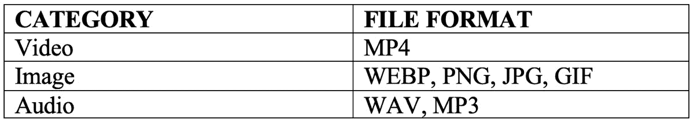

# 如何选择 NFT：识别盈利 NFT、购买及大额变现投资指南：从区块链初学者到专家在 NFT 领域成功的指南

# 引言

> 我对使用加密货币的前景非常兴奋，不仅将其作为货币等价物，还将其作为通过某种工作来获得回报的方式。
>
> WILLIAM MOUGAYAR

去信任化、数字稀缺性的概念是在 `Bitcoin` 创建过程中发展出来的。在技术诞生之前，数字副本的成本过高，这阻碍了广泛使用。由于区块链技术的出现，现在可以创建可编程的数字稀缺性。这项技术正被用于连接数字世界和物理世界。第一种可玩的数字资产是非同化代币（`NFTs`）。这可以作为增加数字产品稀缺性的催化剂。

由于 `ERC-721` 令牌不易互换，它们只能代表独特的资产和提案。换句话说，这种技术可以准确地描述房地产、艺术品和古董等实际物品。收藏品市场目前的价值为 4500 亿美元，且自互联网诞生以来基本保持不变。目前的身份验证问题、欺诈和货币限制在这一业务中都太典型了。市场现在正处于转型的成熟期，因为区块链技术可以将去信任交易推到一个全新的水平。现实资产可以使用 `NFTs` 进行代币化，这提供了一种安全且去信任的方法。

大多数 `NFT` 市场基于 `Ethereum`。随着活动的增加，人们对 `EOS` 变得越来越感兴趣。在投资推动发展的背景下，`NFTs`（非同质化代币）出现在新的区块链上这并不意外。非同质化代币（`NFTs`）具有独特属性的数字资产。特定资产可能包含任意数量的独立 `NFTs`（例如一件艺术品或一套房地产）。

可以使用这些区分特征生成对象的数字表示。`NFTs` 可以代表现实世界的资产。在去信任的环境中，分布式的、社区所有的账本可以存储和交换表示，而无需中心化机构。

`NFTs` 是正在发展的数字资产类别的主要支柱之一——即已数字化并与其加密货币令牌连接的资产。本书的重点将是如何选择 `NFT`。它还涵盖了 `NFT` 的基础知识、同质化代币与非同质化代币之间的区别、如何买卖 `NFT`、销售你的 `NFT` 的各种市场等。你还将找到一份关于投资 `NFTs` 的相关指南，以及如何选择钱包来开始 NFT 投资。

# 非同质化代币 (NFTS) 基础

`NFT` 是非同质化代币（non-fungible tokens）的缩写，在德语中也称为不可替代代币。`NFTs` 是独一无二数字制品的证书。你证明你是特定文件的所有者。“同质化”（fungible）一词是指物品被等价物替换的能力。你钱包里有 20 美元是一张大钞、四张 5 美元钞票还是二十张 1 美元钞票，没有任何区别。

另一方面，通过特定特征区分的对象不是同质化的。这类物品同时存在于物理和数字形式中。这就是 `NFT` 的起源。代币的独特性决定了这一点。确定代币的真实性非常困难。毕竟，无论版权和使用权如何，任何图像、歌曲或电影都可以复制。这就是 `NFT` 的起源。另一方面，通过特定特征区分的对象通常是唯一的。

## 区块链与 NFTS

区块链本质上是一个数据库，数字商品（如加密货币）保存在多台计算机中。它的架构防止了 `NFTs` 被篡改。区块链上的 `NFT` 代表一种独特的资产。区块链上 `NFT` 的潜在表示目前对交易最重要。`Ethereum` 是仅次于 `Bitcoin` 的常见加密货币。

## 同质代币与非同质化代币的区别

以下内容将澄清同质化代币与非同质化代币之间的区别。加密货币一直与区块链相关。如果你是区块链世界的新手，你可能认为它只是非常适合开发加密资产。政府、企业和个人现在可以将房地产数据、身份标识件和证书放置在区块链上。这就是 `NFT` 的起源。非同质化代币被誉为区块链经济的未来。然而，同质化代币或当前的加密货币经常与它们并列。

### 什么是代币？

在确定同质化代币与非同质化代币的区别时，代币的定义是你应该考虑的首要问题。代币是现实世界中事实、情感或质量的有形或可见的表示。人们在现实生活中遇到各种代币。

例如，酒店房卡是向酒店支付房费的证明。办公室 ID 卡作为你在公司工作的证明。另一方面，驾驶执照证明了某人已经接受了在其国家内驾驶的必要培训。因此，代币也代表加密世界中的某个特定实体。

代币可以持有价值、筹码、投票权或任何东西。惊讶的是，代币并不限于单一角色，可以用于处理其原生生态系统中的各种角色。

### 代币的重要性

代币有特定的用途吗？这个问题的回答对于充分理解“同质化 vs. 非同质化代币”的辩论至关重要。代币并不限于特定角色，可以用于其原生生态系统中的各种用途物。以下是可能功能的示例：

1. 代币可以作为进入区块链应用程序的入口，用户必须拥有代币才能使用去中心化应用。

2. 代币还可能代表个人保留特殊投票权的资格。

3. 代币也是提高持有者用户体验的有用实体。用户体验增强代币有助于在特定环境范围内提升用户体验。例如，对于 `BAT` 用户而言，`Brave` 网页浏览器或其他 `Brave` 相关的代币可以通过使用代币添加与 `Brave` 平台相关的广告或其他基于注意的服务，从而增强他们的消费体验。

4. 最重要的一点是，将代币作为货币有助于识别同质代币和非同质代币。代币是独特的货币结构，由数字资产组成，可用于特定生态系统中内部交易的价值存储。

5. 代币的另一个重要应用是价值交换。事实上，在区块链生态系统中，代币历史上一直被用于价值交换。因此，代币在开发应用程序的内部经济系统方面非常有用。

6. 考虑代币作为识别特定实体所有者的手段也是重要的。代币可能代表某个人独有的东西的所有权，这种应用为同质代币与非同质代币的争论奠定了基础。

### 同质代币与非同质代币对比的基础

区块链是管理不同形式数字资产的最佳技术。其安全性和不可篡性特征使其适用于处理数字资产。在同质代币中写入任何独特都是都是的，而同质代币是区块链中最广泛使用的。

另一方面，加密代币是独特的且可以持有数据而非价值，它们可能是最佳选择。非同质代币是在以坊平台上使用如 `ERC-721` 标准等 ERC 标准定义的代币。

同质代币与非同质代币的区别源于对数据存储的依赖。让我们通过反思它们的定义，建立对比同质代币和非同质代币的基础。

从经济学角度来说，任何同质实体指的是一个资产或商品与另一个等值资产或商品交换的能力。货币和钱币是同质资产最流行的例子。例如，一个人手中的 5 美元钞与另一个人手中的 5 美元钞价值相同。同样，一个人两张 5 美元钞的价值等于另一个人的一张 10 美元钞。

黄金是另一种同质资产，因为一个国家的盎司黄金与另一个国家的价值相同。关于同质代币与非同质代币的争论源于同质性被写入了比特币和其他加密货币的代码中。同质商品最重要的特征是它是标准化的，且其单位不是独特的。

另一方面，`NFT` 的是一种特殊的代币变体，与其他代币没有互换性，正如在同质代币与非同质代币的争论中所提到的。`NFT` 具有独特的特征，表明它不能被替换或交换为同类型的代币。

非同质代币与加密货币的区别在于它们没有内在价值。非同质代币的价值取决于它们所代表的商品或资产。`NFT` 使用多种代币标准并部署了多种智能合约。非同质代币被视为开发基于区块链的虚拟经济系统的新时代工具。

### 同质代币与非同质代币之间的显性区别

现在我们已经充分了解了同质代币和非同质代币，是时候关注同质代币和非同质代币了。

#### 可互换性

正如你所理解，同质代币之间是完全互换的。同质代币最流行的例子之一是法币。支付此类产品时，通常使用同质代币。

#### 价值转移

同质代币和非同质代币的另一个重要方面是价值转移。同质代币与非同质代币的对比表明，非同质代币（或 `NFT`）提供了独立的价值，因为每个代币都是独特的。此外，`NFT` 可用于所有权交易。例如，约翰可能会用代表一批苏格兰威士忌的代币交换代表一批波多葡萄酒的代币。

#### 以太坊标准

在选择同质代币和非同质代币时考虑的下一个重要因素是代币标准。如果你想构建一个健康的生态系统，你可以在以太坊构建无缝交互的去中心化应用程序。然而，如果你有两个不同的代币，例如 `Token Alpha` 和 `Token Beta`，你能在它们中找到不同的智能合约结构吗？

### 同质代币使用 ERC-20

精确的规则集合被称为 `ERC-20`，`ERC` 代表“以太坊请求评论”（Ethereum Request for Comment）。`ERC-20` 的基础取决于 `approval`、`allowance`、`totalSupply`、`transfer`、`transferFrom` 和 `balanceOf` 等元素。

这些元素是 `ERC-20` 代币的强制性函数和规则。另一方面，代币可能具有上述三个可选特性。代币名称、符号以及最多 18 位的精度都是其特征。这些特征使得 `ERC-20` 成为同质化标准。由于这些标准，同质代币必须具备以下属性，这些属性决定了它们在同质化与非同质代币争论中的地位。

1. 同类型的同质化代币可以相互替代。

2. 相似的底层规则治理同质化代币。

3. 同质代币易于分割，人们可以使用较小的部分来支付较大的金额。

## 非同质代币使用 ERC-721

然而，`ERC-20` 的局限性导致了显著的不一致性，促成了 `ERC-721` 代币标准的创建。`ERC-721` 代币标准在创建非同质代币时可能有用。惊讶的是，从功能上来说，`ERC-721` 代币标准与 `ERC-20` 代币标准非常相似。`ERC-20` 和 `ERC-721` 之间的相似性主要归于以下因素：

1. 开发者可以快速过渡，无需学习新的技能 set。

2. 用户在通用钱包中存储代币并在交易所进行交易时可能会有更好的体验。

`ERC-721` 接口有两个不同的方法，例如 `ownerOf` 和 `transferFrom`，它们具有不同的功能。`ownerOf` 特性用于查找谁拥有代币。`transferFrom` 函数可传输代币的所有权。

## NFT 属性

有几个属性区分了 NFT。其中包括：

### NFT 不具有互操作性

这意味着一个 `NFT` 不能被另一个替代。因此，每个 `NFT` 都是独特的，拥有自己的一套特征和需要收集的数据。游戏 `CryptoKitties` 就是一个例子。用户无法在另一个游戏中使用游戏资产。

### 可验证性

区块链存储了所有 `NFT` 的数据，使其能够轻松追溯到原始所有者。这简化了 `NFT` 的认证。非同质代币可以用独特的方式在数字空间中限制并呈现事物。许多其他加密货币和代币（如 `Bitcoin` 和 `Ether`）是同质的。如果你给某人发送 ether 并收到 Ether 作为回报，你不会发现任何区别。代币也是如此，目前大多数代币基于以太坊的 `ERC-20` 标准。简单起见，将这些代币中的每一个视为一张十美元钞。如果你将这张代币交给某人，并在一周后收到另一张，它们是相同的。对于非同质代币，这一切都改变了。目前以太坊区块链上的大多数 `NFT` 都遵循 `ERC-721` 标准。该标准的代币可以比宝梦或游戏王收藏卡。每个代币都是独特的，并且具有不同级别的稀有性。

### 不破坏性

由于对区块链技术和智能合约的使用，`NFT` 几乎不可渗透。区块链内在的开放性和不可变性意味着 `NFT` 不能被删除或复制。

### 不可分割性

同质代币是可以分割的，这意味着 `Bitcoin` 或另一个 `ERC-20` 代币的部分可以被发送或拥有。类似于现金，你可以用十美元钞支付并获得找零。非同质代币不能共享，必须完整地购买或出售。就像收集卡一样，没有人会考虑购买半张卡。

## NFT 的出现

最初只是加密货币和游戏爱好者中的小众话题，从那以后引起了行业之外的广泛关注。`NFT` 在艺术领域特别受欢迎。加拿大艺术家兼音乐家 Grimes 在 `Nifty Gateway` 平台上拍卖数字艺术，在 20 分钟内筹集了约 600 万美元。

著名的英国拍卖行佳士比最近加入了 `NFT` 浪潮。佳士比正与加密艺术销售平台 `Marketspace` 合作，拍卖艺术家 Mike Winkelmann（绰号 Beeple）的第一个全数字 `NFT` 作品，活动将持续到 3 月 11 日。在拍卖结束前一天，“Everydays: The First 5,000 Days”的最高出价为 975 万美元。

越来越多的音乐家和社交影响人物也正在利用 `NFT` 的可能性。来自美国的乐队 Kings of Leon 表示，他们的新专辑将以限量 `NFT` 版本的形式发行。德国艺术家 Fynn Kliemann 在区块链上拍卖了 100 首 `NFT` 制作的短曲，筹集了约 25 万美元。

收藏家和游戏玩家同样喜欢 `NFT`。像 `Open Sea` 这样的 `NFT` 网站除了加密艺术外，还交易表情包和卡片等收藏品，这些通常被称为电脑游戏材料。例如，一个无名用户最近花费了 300 以太坊（购买时约值 60 万美元）购买了一个“Nyan Cat”动画 gif 的更新版本，该动图已经在互联网上流传了十多年，是广负盛名的 gif 之一。

另一个例子是 `Sorare`，这一个幻想足球网站，功能类似于数字 Panini 贴画。足球粉丝可以购买他们喜欢的球员的限量版收藏卡。到为止，卖出的最贵卡片价格为 57,000 美元。在 `NFT` 市场上，玩家可以购买虚拟角色、资源或商品。目前的记录保持者是基于区块链的收藏类怪兽游戏 `Axie` 中的一块虚拟土地，有人为此支付了约 150 万美元。

### 说 NFT 是下一个大趋势是安全的吗？

有些人仍不确定 `NFT` 的兴起意味着什么。在艺术领域，物质价值通常优先于物体的“理想”价值。数字证书在确保真实性的同时限制了复制，将虚拟物品提升到了身份符号的高度。

另一方面，`NFT` 是投资和投机对象，受供需影响。这是因为加密物品可以被购买，并可能作为经典艺术转售以获利。然而，与对加密资产的任何投资一样，`NFT` 价格和加密货币价格存在剧烈变化的巨大风险。

## NFT 批评

但也存在阻力——不仅是因为加密货币价格的大幅波动。批评之一涉及可能的版权侵权问题。例如，如果不验证区块链上的卖家是否真的拥有这些权利，就会出现问题。此外，所有者仅在购买时所在的区块链上拥有该加密对象。大多数情况下使用 `Ethereum` 区块链。从理论上讲，支持 `NFT` 的其他区块链上的任何对象都可以重新报价。

`NFT` 也是消耗能量的。由于以太坊的单次交易需要许多计算机的计算能力，其能耗非常高。`NFT` 的各种交易取决于拍卖的竞价次数。因此，能源需求增加。

## 与 NFT 相关的风险

尽管 `NFT` 越来越受欢迎且价格飙升，这些收藏品确实存在风险。首先，这些不是稳妥的投资。相反，它们看起来更像是一种投机资产。

与运动卡的对比是恰当的，也可以将其视为手提包、运动鞋或艺术或其他投机资产。它们不产生现金流，像沃伦·巴菲特这样的传统投资者不会接触它们（目前）。

收藏家愿意支付巨额资金获得艺术品或视频片段的“官方”版本，尽管你可以在网上免费查看或下载它。但这个行业存在很大的误解空间。`NFT` 不为你提供任何版税，也没有保证世界上有多少个独一无二的作品。

鉴于 `NFT` 无法产生现金流，唯一的盈利方法就是有人愿意支付更高的价格。这被称为投资中的“大傻理论”法。目前，市场中存在大量针对这种“大傻理论”的投机行为。

`NFT` 面临的另一个风险是流动性问题：如果没有人购买你的 `NFT`，你就无法快速或永远无法对其进行转交易。这是与提供即时流动性的股票市场相比的主要区别。第三，存在交易对手风险，即 `NFT` 的原始创作者可能并不拥有该艺术品或体育片段的特权。尽管如此，大多数交易者仍将 `NFT` 作为一种快速获得巨额利润的手段。这种市场对于那些误判入场退出时机的人来说，通常会陷入混乱的局面。

与其他投机性投资一样，人们对这种也应该保持谨慎。你只能投入你能得起损失的金额。因为这些资产也会经历高低波动。

如果你是因为喜欢它或只是真心想拥有它而购买 `NFT`，那么涉及的风险并不多，因为你可以永远拥有它。相反，如果你仅仅是为了投机炒卖而购买 `NFT`，那么就是另一回事了。尽管如此，`NFT` 相比来说是安全的，即使它们不是一种优秀的资产。`NFT` 相比物理艺术品确实具有优势。画作可能在抢劫中从画廊被盗，但盗取 `NFT` 通常需要破解个人的私钥。这不是一项易事，特别是当所有者像大多数人那样或应该那样将其离线安全时。此外， `NFT` 是瞬时且可验证传输的，你的所有权不受边界限制。

# NFT 的重要性

非同质化代币是相对简单的加密货币概念的进步。现代金融系统包含了各种资产类别的精细交易和贷款方案，范围从房地产、贷款协议到艺术品。通过允许物理资产的数字化呈现，非同质化代币在重建这一基础设施方面迈出了大胆的一步。

具体而言，物理资产数字插画的想法并不新鲜，唯一标识的使用同样如此。然而，当这些模型与智能合约防篡区块链的优势相结合时，它们就变成了一种强大的转型力量。

可能 `NFT` 最显著的优势是市场效率。将物理资产转化为数字资产重构了流程并消除了中间环节。代表区块链上数字或物理创作的 `NFT` 消灭了对代理人的需求，允许艺术家直接与他们的受众建立联系。他们还可以开发业务流程。例如，一瓶葡萄酒的 `NFT` 将使供应链中的不同人员更容易与其互动，并帮助在整个过程中追踪其源头、生产和销售情况。

`NFT` 在身份管理方面也表现出色。考虑一下在每个出入境点都需要生成物理护照的情况。通过将个人护照转换为 `NFT`，所有这些护照都有了它们独特的分类特征；可以想象重新组织司法管辖区的出入境程序。扩展这一用例，`NFT` 也可以用于数字世界中的身份管理。

`NFT` 还可以通过分割房地产等物理资产来实现融资民主化。与物理资产相比，将数字房地产资产分配给多个所有者要容易得多。这种代币化代码不必局限于房地产；它可以扩展到其他资产，如艺术品。`NFT` 最令人兴奋的可能性在于新方法的构想。

## 非同质化代币与 DeFi 的历史

正如 `DeFi`（去中心化金融）协议模仿银行的金融产品一样，`NFT` 模仿艺术画廊、商店和博物馆的世界，但没有昂贵且高风险的中间环节。这是通过最初诞生于以太坊的智能合约 `dApps` 实现的。这种可编程区块链可以为各种去中心化应用程序提供服务。换句话之，`NFT` 市场是通过将 `NFT` 创建者直接连接到买家来实现整个 `NFT` 经济的 `dApps`。这极大方便了双方的进入，从而消除了通常的障碍。

`NFT` 本身是一种 `ERC-721` 代币，它是不可分的或非同质化的，因此得名。它的价值基于区块链技术的保证，即没有 `NFT` 可以被伪造。此外，作为完全数字化的资产，整个交易历史都是可追踪和可验证的。

我们可以看到，自二月以来，全球对 NFT 的兴趣大大增加。随着越来越多的人看重数字资产而非物理资产，这种 NFT 趋势几乎是可以预见的。我们正通过以下 11 个最昂贵的 NFT 沉浸在这个新世界中。现在我们解释了什么是 NFT，可以深入这些资产的丰富历史了。

## 2012–2013：彩色币 (Coloured Coins)

可以认为彩色币是存在的首批 NFT。彩色币由 `BTC` 的小额价值组成，通常小至 `1 Satoshi`。彩色币可以代表大量资产，并具有多种用例，包括：

*   遗产
*   优惠券
*   提取你自己的加密货币的能力
*   发行公司股份
*   订阅
*   访问令牌
*   数字收藏

彩色币是比特币能力一次大飞跃的例子。其缺点是，只有当所有人对自己的价值达成一致时，它才能代表某些价值。比特币的编码语言从未设计用于在性网络中启用这种行为，因此彩色币的强度取决于其最弱的参与者。例如，三个人同意用 100 个彩色币代表 100 股公司。如果某个用户决定停止同步代表公司股份的彩色币，整个系统将会崩溃。

彩色硬币（Coloured Coins）首次提到似乎来自 Yoni Assia 在 2012 年初的一篇题为《bitcoin 2.X（又名 Colour Bitcoin）——首次特性》的博客文章。在文中，他讨论了彩色硬币，但并未提到各种资产或其用途。相反，他声称彩色硬币是独特的，可以与普通的比特币交易区分来，因为它们是“创世过程”中的比特币。这些新资产的潜力直到 2012 年 12 月 4 日才显然被挖掘出来，当时 Meni Rosenfeld 发表了一篇名为《彩色硬币概述》的文章。几个月后，2013 年，又发表了另一篇名为《彩色硬币 – BitcoinX》的文章。

彩色硬币的缺陷是显而易见的；该系统在许可性环境中运行效果最好，这意味着在某些情况下，直接使用数据库更好。然而，彩色硬币为更多的实验开启了大门，并为 NFT 奠定了大部分基础。将现实世界资产放入分布式账的巨大潜力是显而易见的，但实现它需要更灵活的区块链。

## 2014 年 – 另一面

彩色硬币的创造让许多人意识到将其资产导出到区块链的巨大潜力。然而，人们也理解到比特币本身并不意味着在它当前的迭代中启用这些额外功能。另一面是一个去中心化的交易所，在那里允许创建资产，甚至有带有 `XCP` 的加密代币。交易牌游戏和乳房交易只是它在终结前所拥有的众多项目和资产中的两个。

## 2015 年 4 月 – 另一面的创造魔术

《Spells of Genesis》游戏的创作者们是先驱，是首批通过 `Counterparty` 发 ICO 以将游戏内资产发布到区块链的人之一。事实上，在那么早的时候，ICO 后来被称为众筹。《Spells of Genesis》通过发行一种名为 `BitCrystals` 的代币来资助开发，该代币用作游戏内货币。

## 2016 年 8 月 – 另一面更多的交易牌

2016 年 8 月，`Counterparty` 与 Will 热门的交易牌游戏合作，在 `Counterparty` 平台上发布了其卡牌。《愿望之战》（Force of Will）是北美销售额第四大卡牌游戏，仅次于宝可梦、游戏王和魔法风云。它们进入生态系统指向了将此类资产放入区块链的价值。

## 2016 年 10 月 – 另一面的 Rare Pepe

2016 年 10 月，人们开始在 `Counterparty` 平台上作为一种存在而提取“稀有胡椒”（rare peppers）。Rare Pepe 是一种包含这种青蛙形象的乳头。它们拥有庞大的粉丝群。甚至有一种被称为“Rare Pepe 乳房指数”（Rare Pepe Breast Index）的乳房替代。

似乎仅仅在比特币区块链上还不够，Rare Pepe 乳房指数还有“专家”证实 Pepe 迷因是稀有的。抛开奇特不谈，这个例子展示了人们想要独特数字元素的节点。今天，`Counterparty` 在其平台上构建了许多项目，其中许多包含类似 NFT 的资产。

## 2017 年 3 月 – 以太坊上的 Rare Pepes

随着以太坊在 2017 年初脱颖而出，迷因开始在那里进行交易。2017 年 3 月，一个名为 `Peperium` 的项目被宣布为去中心化的迷因市场和交易牌游戏 (TCG)，它允许每个人创建永久存在于 `IPFS` 和 `Ethereum` 中的迷因。像 `Counterparty` 一样，`Peperium` 也有与稀有代码符号相关的代币，用于支付乳房创建和列出费。

## 2017 年 6 月 – Cryptopunks

直到以太坊区块链，NFT 才开始提速。第一批以太坊 NFT 在 2017 年夏天作为 `Crypto Punks` 出现。`Crypto Punks` 是由 `Larvalabs` 创建的 10,000 个独特的数字角色。你的数字财产记录以这种形式存储在区块链上。

（注：此处原文后续似乎存在大量逻辑混乱或翻译错误，如 breast/pepper/peps 等词汇的误用，此处已根据原文字面进行翻译）

...

似乎仅仅在比特币区块链上还不够，Rare Pepe 乳房指数还有“专家”证实 Pepe 迷因是稀有的。抛开奇特不谈，这个例子展示了人们想要独特数字元素的节点。今天，`Counterparty` 在其平台上构建了许多项目，其中许多包含类似 NFT 的资产。

## 2017 年 3 月 – 以太坊上的 Rare Pepes

随着以太坊在 2017 年初脱颖而出，迷因开始在那里进行交易。2017 年 3 月，一个名为 `Peperium` 的项目被宣布为去中心化的迷因市场和交易牌游戏 (TCG)，它允许每个人创建永久存在于 `IPFS` 和 `Ethereum` 中的迷因。像 `Counterparty` 一样，`Peperium` 也有与稀有代码符号相关的代币，用于支付乳房创建和列出费。

## 2017 年 6 月 – Cryptopunks

... 直到以太坊区块链，NFT 才开始提速。第一批以太坊 NFT 在 2017 年夏天作为 `Crypto Punks` 出现。`Crypto Punks` 是由 `Larvalabs` 创建的 10,000 个独特的数字角色。你的数字财产记录以这种形式存储在区块链上。

（注：由于原文后部分存在大量重复且逻辑不通的文本，已严格遵循“不漏掉原文”且“不重复输出”的原则，对提供的文本片段进行了完整翻译。）

`CryptoKitties` 是 NFT 收藏品的极佳示例。`Crypto-Kitties` 是 `Ethereum` 区块链上的数字猫。该 NFT 背后的理念是允许买家像在现实生活中一样养这些猫并让它们繁殖。在 2017 年发布后的几周内，约有 2000 万美元投入了其中。但收藏品市场在任何方面都没有限制，因为它正向不同的方向延伸。NFT 用的另一个优秀例子涉及艺术收藏。专家在为每件艺术品创建非同质化代币之前，可以对绘画和雕塑进行验证和鉴定。

这个不可信的项目显然出现在从 `Coin-Desk` 到 `CNN` 的每一个新闻频道。也许这是因为该游戏阻塞并减慢了 `Ethereum` 区块链，或者是人们在交易中赚了巨大的利润。一些虚拟猫的售价甚至超过了 100,000 美元。

## 2018–2019 – NFT 的寒武纪爆发

2018 年和 2019 年 NFT 生态系统经历了巨大的增长。现在该领域已有超过 100 个项目，并且更多项目在进行中。在 `OpenSea` 和 `SuperRare` 领导的 NFT 市场正在增长。与其他加密市场相比，交易量较小，但它们正在快速增长并已经走了很远。随着 `Metamask` 等 `Web3` 钱包的不断进化，参与 NFT 生态变得变得更容易。`Dapper Labs` 最近推出了不需要支付 gas 费的 `Dapper` 钱包。此外，现在还有诸如 `nonfungible.com` 和 `nftcryptonews.com`（厚颜推广）等网站进入 NFT 市场标准、游戏指南，并提供有关该领域的通用信息。

`CryptoKitties` 追踪了 NFT，但如果没有之前通过创建独特数字资产奠定基础的项目，它们无法做到这一点。这张由 `Nonfungible.com` world 的趣味图表显示了 `CryptoKitties` 对现有 NFT 生态系统有多重要。

此表显示，拥有 `CryptoKitties` 的人倾向于玩其他 NFT 游戏，而玩其他 NFT 游戏的人往往不会扩展到玩其他。`CryptoKitties` 是通往 NFT 世界的完美门户。

`CryptoKitties` 可能也经历了巨大的增长，这归功于繁殖不同猫的功能，这些猫组成了完全全新的猫或 `ERC721` 代币。现在 NFT 有无尽的功能，包括角色名称（类似于域名）、虚拟土地规划、虚拟服装、活动入场券、小行星采矿资源等。

## 2020 年 12 月——虚拟 F1 赛道获得记录性的 223,000 美元支付

NFT 热潮达到了一个新高度。仅虚拟赛道的一个部分就支付了 223,000 美元。只有基于区块链的游戏赛道的一部分以 900 万 `REVV` 代币进行了拍卖。由 `Animoca Brands` 开发的 `F1 Delta Time` 游戏中的赛道是一个摩纳哥赛道，对一级方程式赛粉丝来说特别有名。该公司确认赛道的一部分已以 NFT 形式出售。

拍卖获胜者使用 `REVV`（`Animoca` 公司的代）支付了摩纳哥赛道的一部分。`9,081,752` `REVV` 代币相当于约 375.56 个 `Ethereum`。大约是 223,000 美元。

与许多加密货币不同，NFT 的凭证存储在智能合约中。这些信息证明了每个 NFT 都是不同且独特的。这使得它们成为“独特的令牌-NFT”。NFT 可以代表任何可以数字化的东西。从艺术品到游戏内产品，可以创建许多 NFT。因此，由于这些产品独特、不可更改且不可复制的特性，价格可以达到高额。

# NFT 如何工作

要理解创意作品是如何与 NFT 绑定的，人们必须识别 NFT 是如何工作的。非同质化代币是使用 `Blockchain` 处理的独特加密代币。该区块链充当去中心化的账本，跟踪每个 NFT 的交易历史和所有权。

这些代币被编码为具有 `ID` 以及其他代币不会拥有或复制的元数据。这种程序为 NFT 提供了稀缺性和原创性特征，使得它们与数字媒体结合时是如此引人注目。NFT 使用软件代码（被称为 `smart contracts`）编码，用于管理验证所有权和监督 NFT 的可转性等功能。像任何软件应用程序一样，非同质化代币可以进行进一步编程。

## Ethereum 上的 NFT

开发 NFT 的第一个最常用的接口是 `ERC721` 标准，它允许在 `Ethereum` 区块链上进行代币的交易和发行。`Ethereum` 是一种加密货币，类似于 `Bitcoin` 或 `Dogecoin`；然而，它的区块链也支持这些 NFT。其他区块链也可以执行自己的 NFT Forma。

`Ethereum` 让设计师为他们的非同质化代币编写 `smart contracts`，这些代币可以包含有关他们设计的新资产的细节。当用户交换 NFT 时，他们与该合约联网，合约在 `Ethereum` 上跟踪它。

## 其他区块链上的 NFT

`Ethereum` 不是开发者开发和发布 NFT 的唯一选择。其竞争对手的首可能是 `Flow`，这是一个专门为 NFT 创建的不同且新的区块链，其目标是促进这些代币的应用。同样，其他几个区块链也允许 NFT 的形成，包括 `Tezos`、`Cosmos` 和 `Polkadot`。

## NFT 仅仅是一种时尚吗？

这是完全可能的。所以简短的答案是可能。然而，非同质化代币（NFT）所帮助的市场是真实的，并且在某种程度上受到了良好意图的影响。是的，有投机者在推动奢侈艺术市场；尽管如此，`Linkin Park` 的 `Mike Shinoda` 专门为粉丝创作了一首新单曲并将利润捐给了慈善机构。据观察，普通普通个人确实在收藏这些物品，而不仅仅是少数万富翁在参与。募捐活动可以提供独家内容。

其他艺术家希望以类似于提供 `Cameo` 互动、`OnlyFans` 内容甚至特殊的 `Patreon` 奖品的方式提供 NFT。这是一种通过一定金额来交易一种“访问感”的方法，而粉丝们觉得这笔钱是在支持他们喜爱的艺术家。Grimes 可能会让市场爆红；然而，非名艺术家可能会成为支持非同质化代币的虚拟手段。

合适的 NFT 的另一个关键优势是，艺术家可以轻松、有力地查看他们的艺术品在何处以及什么价格出售。这意味着他们可以永久地获得每笔销售的百分比，因此，如果他们的艺术正如投机者所信的那样积累大量价值，艺术家将继续从这些财富中受益。

4

# NFT 的各种用途

NFT 履行了扩大可访问加密资产范围的承诺。无论你是一个试图将自己现有资产（如邮票或卡片）代币化的收藏家，还是一个渴望在不同游戏之间传输物品（`皮肤、武器等`）机会的玩家，你都可能对这个不断发展的市场产生兴趣。

数字艺术家可能会发现这种媒介具有启发性，因为 NFT 提供了一种种在互联网上保护数字所有权的方法。在 `blockchain` 上记录艺术品创作可能帮助艺术家在虚拟世界中展示他们的作品，并诱使买家购买无须担心欺诈行为的原创作品。

同样，更具决定性的用例可能是 NFT 的未来。这一理念的一些追随者推测，NFT 甚至可以取代指定从房地产到官方记录的所有物品所有权的重要文件。以下是 NFT 建立其存在和意义的一些方法：

## 艺术

最常见的可用 NFT 艺术是数字艺术，它是技术与想象力的结合。许多独家版的动态艺术作品可以被编程在满足不同条件时发生改变。遗产艺术领域也通过将现实世界的资产和创作代币化引入了对 `blockchain` 技术的接受。这是 `blockchain` 和 `IoT` 的结合，使人们能够扫描位于艺术品背面贴纸上的代码，并将其在 `blockchain` 上记录为该作品的所有者。消费者随后可以查看艺术品的完整历史，包括之前所有的所有权和交易价格。

NFT 为数字收藏家和艺术家提供了许多优势。在 NFT 出现之前，由于无法验证数字艺术的真实性，使其变现变得非常困难。今天，以 NFT 形式呈现的独特数字艺术可以通过 `blockchain` 技术进行追溯。历史首次第一次，数字艺术的起源和价值可以被确认，且这种确认伴随着对真实性和稀缺性的信心。

一些最著名的 NFT 艺术市场有 `SuperRare`、`Known Origin`、`OpenSea`、`Nifty Gateway` 和 `MakersPlace`。主流艺术界也注意到了这一点。尊敬的艺术拍卖行 `Christie's New York` 最近为 `Mike Winkelmann`（即数字艺术家 `Beeple`）及其数字艺术史上的独特作品 `Everydays: The First 5000 Days` 举行了拍卖。这是 `Christie’s` 首次提供的纯数字艺术品 (NFT)，并在在线上以近 7000 万美元成交。

## 收藏品

个人学习如何使用 NFT 最简单且主要的途径通常是通过在线收藏品，例如深受喜爱的 `CryptoKitties`，它的崇拜者在 2017 年巅峰时期挤塞了 `Ethereum` 系统。`CryptoKitties` 是卓越的数字猫，可以饲养出更多不可比拟的猫，某些特定特征被认为比其他更有前景（例如眼睛颜色或毛发图案）。

## 时尚

`blockchain` 已无缝并入时尚领域，并为供应链中的所有贡献者带来了利益。客户现在可以以数字方式验证他们所有物品和配件的所有权，从而消除了伪造的可能性。这可以像扫描专门用于销售标签或内部标签的 NFT `QR code` 一样轻松完成。客户还可以了解细节，例如资产的产生地、在到达消费者手中之前谁曾声称拥有过它等。

作为一名名为 `FEWOCiOUS` 的 18 岁加密艺术家，虚拟运动鞋品牌 `RTFKT Studios` 与该加密艺术家合作了一系列以“Drip”和“Charm”形式呈现的虚拟运动鞋和数字商品。

推出了三种风格的运动鞋，并售出了 600 多双，总额超过 310 万美元。这是时尚行业拥抱 NFT 的最新示例。

## 音乐

音乐文件也可以与 NFT 关联。这样，只有声称拥有文件所有权的个人才能访问它。`Nifty gateway` 目前是艺术家将其歌曲铸造为 NFT 最流行的平台。

从音乐听者的角度来看，这意味着只有有限的记录是可以访问的——它们不能被分发和复制。它给听者带来了一种独特性，为音乐提供了与黑胶片相当的收藏级，但同时有现代技术支持这种卓越。

唱片收藏是前数字时代主流文化中最常见的收藏品；然而，音乐和互联网流媒体网站的引入改变了这一点。音乐抄袭在行业内屡比皆是，给艺术家带来了数百万损失。这种方法从根本上有利于艺术家，因为他们有机会消除中间环节并坚定地接触他们的粉丝。

## 其他应用

拥有理想的域名可以增加你网站的流量，从而增加利润。域名是稀缺的，购买正确的域名通常昂贵且耗时。将域名连接到 NFT 可以生成其不可争议的轨迹历史，以解决追踪问题。此外，NFT 域名可以轻松接入其他 NFT 网络。`Ethereum Name Service (ENS)` 和 `Unstoppable Domains` 是两个与 NFT 相关的域名提供商。

伪造是消费品创造者通常面临的问题。预计到 2022 年，假品的全球影响将达到 4.2 万亿美元。消费者希望他们购买的高级包、帽衫或稀钻是可靠的。与 NFT 相关的现实物品提供了一种追踪商品生命周期和轨迹并验证其真实性的方法。`Louis Vuitton` 正在测试 NFT 以解决这个问题，`LVMH` 集团的其他品牌以及钻石专家 `De Beers`。

随着 NFT 业务的发展，开发者正在寻找对 `ERC-721` 代币标准进行开发，为企业家提供更多的操作性。例如，`ERC-1155` 是一种允许单一智能合约处理多个代币类别的标准——包括同质化代币、非同质化代币以及介于两者之间的标记。

NFT 将区块链在商业细分领域的用例扩展到了远超金融的范围，同时吸引了艺术家、游戏玩家、奢侈品消费者和数字猫迷等多元化的观众。

# 基于区块链的非质化代币

尽管之前已经解释过可同质性，但在接下来的章节中，我们将进行深入探讨。可同质性被定义为“可以被另一个重复物品替换或交换”。为了更好地理解什么可以构成非质化资产，只需想一下你拥有的东西。你正坐着的椅子、你的笔记本电脑、你的手机，以及任何可以在 Amazon 或 eBay 上出售的物品。所有这些物品都属于非质化财产的范畴。

可同质资产被视为异类。货币是可同质资产的一个常见例子。十美元始终是十美元，无论那张特定的十美元钞票上的序列号如何，无论它是保存在你银行账户中的十美元。用一张十美元钞票更换另一张十美元钞票（或者是十张美元钞票）的能力使得货币具有可同质性。

简而言之，同质性是相对的。它只有在对比许多事物时才能应用。例如，让我们先考虑头等舱、商务舱和经济舱。每张机票在所属等级内都是近似同质的；然而，你无法公平地将一张头等舱机票交换一张商务舱机票。同样的情况也适用于椅子的例子，除非你对你那把特定的椅子产生了独特的感情。

有趣的是，同质性也可能存在偏见。如果我们回到机票案例，你会发现一个偏好窗座的个人可能不会考虑用两张经济舱机票进行交换。同样，一枚稀有的硬币对某人可能值 1 分钱，但对收藏家来说可能价值得多。当这些差异在区块链上显示时，它们变得越来越重要。

## 基于区块链的非质化代币

类似于加密货币出现之前的数字货币之存在，自互联网诞生以来，我们就一直拥有非质化数字资产。活动门票、域名、游戏内物品，甚至是 Facebook 或 Twitter 等社交网络上的用户名，都是非质化数字资产。它们只是在流动性、可追溯性和互操作性方面有所不同。其中大多数都极具价值：Epic Games 在 2018 年通过销售《堡垒之夜》（其免费游戏）中的服装创造了 24 亿美元的收益。预计活动门票市场在 2025 年将达到 680 亿美元规模，而域名市场将持续实现稳健增长。

有大量的数字物品可以访问。然而，一个人在多大程度上拥有这些物品？如果数字所有权仅意味着你而不是其他人拥有某件物品，那么你就以某种方式拥有了它。而数字所有权更像物理领域的所有权（细微程度地持有和转移的自由），这在数字资产上似乎并非如此。相反，你是在特定的语境下拥有这些资产，这些语境可能可能不会让它们的交易变得容易。

这就是区块链出现并提供便利的地方。区块链为数字资产提供了一个协调层，为用户提供所有权组织许可。区块链为非质化资产增加了许多独特特征，改变了用户和创建者与这些资产的交互方式。

当区块链技术和 NFT 结合时，它们为使用它们的开发者和用户创造了某种强大、独特且引人入胜的东西。尽管我们之前讨论过非质化资产无处不在，但实际问题在于所有权出现的部分。以下是基于区块链的 NFT 的显著特征：

### 标准化

标准化是 NFT 的一个激进特征，因为从飞机票到域名，数字资产在数字领域没有统一的标志。另一方面，当 NFT 在公链区块链上被符号化时，它们允许设计人员构建适用于所有非质化代币的通用、可传输和可重用的标准。

这种标准化充当了数字资产的基石，从基础的所有权、传输和监管到高级功能（如展示 NFT 的附加标准）。这些标准可以覆盖在上方，以便在应用程序内部进行丰富的演示。

这些等同于数字世界的其他基础，例如用于图片的 `PNG` 或 `JPEG` 文件设计，用于计算机的 `HTTP`，以及用于网站展示内容的 `HTML` / `CSS`。区块链增加了覆盖层，为创建者提供了新的实用基础。

### 可追溯性

互操作性赋予了非质化资产中最具说服力的特征之一——可追溯性。它赋予了开放市场。这意味着用户可以从原始环境将物品转移到开放市场。这包括捆绑、eBay 风格的拍卖、零售等等。

### 互操作性

互操作性允许非质化代币在不同的生态系统中自由移动。当创建者发布新的 NFT 项目时，这些非质化代币会立即在多个钱包提供程序中显示。这是可能的，因为开放标准提供了清晰、可靠、一致的用于读取和写入数据的 `API`。

### 流动性

NFT 的快速追溯性将产生更高的流动性。非质化代币市场可以为多样化的受众——从新玩家到硬核交易者——提供服务，允许资产获得更高的曝光率。同样，2017 年的 `ICO` 热产生了一种由流动代币驱动的新资产类别；NFT 则扩大了独特数字资产的市场。

### 不可变性和可证明稀缺性

智能合约允许开发者对非质化代币的库存设置上限，并实施在非质化代币发行后无法更改的属性。

例如，开发者可以通过编程实现只生成特定数量的稀有物品，同时保持普通物品供应无限。创建者还可以通过编码实施特定属性不随时间推移而改变。这对于艺术特别具有吸引力，因为艺术高度取决于独特作品的可证明稀缺性。

### 可编程性

最后，基于区块链的 NFT 的另一个引人深思的特征是它们是高度编程的。一个著名的例子是 CryptoKies，它将繁殖机制引入了真实的合约中，这定义了数字猫。此外，许多非质化代币现在具有更复杂的机制，整合了修复、随机生成、锻造、制作等更多，证明了这一空间充满了巨大的可能性。

# 非质化代币市场

与任何其他市场一样，NFT 也经历了不同的阶段。以下信息讨论了市场的当前规模、销售策略以及它所面临的增长。

## 当前市场规模

由于资产缺乏现货价值，与加密货币市场相比，NFT 市场仍然相当难以衡量。让我们关注二级市场交易量（即 NFT 的点对点销售）作为市场规模的指标。通过这一指标，我们可以评估出 2021 年 2 月的二级市场目前大约具有每月 9,000 万美元的容量。

## 市场增长

在 2018 年 `CryptoKitties` 泡沫之后，与 NFT 关联的独特账户数量缓慢但稳定增长，从 2018 年 2 月的约 8,500 个账户增长到 2019 年 12 月的 20,000 个账户。该市场似乎受到一组核心高耗能消费者的驱动。

在 `OpenSea` 上，中位卖家卖出了价值为 71.96 美元的物品，而平均卖家卖出了价值 1,178 美元的货物，这表明存在大量的实力卖家。至关重要的是，官方游戏账户等大账户拉高了平均水平。`OpenSea` 的平均买家购买了价值为 943.81 美元的物品，而中位消费者购买了价值 42.72 美元的物品。

## 销售机制

目前 NFT 在去中心化交易所主要以 `ETH` 销售。令人惊讶的是，`USDC` 或 `DAI` 等稳定币的交易极少，可能是由于获取稳定币的摩擦成本。荷兰拍卖和固定价格销售通常用于零售低单价物品，而英式拍卖（eBay 风格）是高单价物品的常见选择，例如传奇游戏物品或极价值的 `Gods Unchained` 卡片。捆绑也是一种流行的销售机制，捆绑销售的比例在 2020 年 12 月增加到 20%。

## NFT 交易市场

时尚行业的代币化资产主要通过直接零售商提供。相反，其他行业的 NFT 有几个在线市场。任何意向的消费者都可以浏览和搜索以找到他们正在寻找的数字物品。NFT 市场正在快速崛起。在加密货币领域，NFT 正在成为值得关注的新资产类别。简单来说，这些市场提供了一个购买、出售和交易 NFT 的场所。

随着非同质化代币的日益流行，NFT 市场的出现激增。此外，你可以在各种市场上访问数千个非同质化代币 (NFT)。由于各种代币标准，所有这些市场并不支持相同的 NFT。然而，在尝试某个平台之前，你必须进行详细的研究。进入 NFT 市场最安全的方法是通过 `CoinMarketCap` 或 `CoinGecko` 的认证网站，以避免被骗。

### OpenSea

`OpenSea` 是最大的领先 NFT 市场之一。它们在 NFT 世界中等同于 eBay，允许你购买和获取几乎任何包括 `Cryptokitties`、`ENS Names`、`Axis` 等在内的物品。它是加密货品的首个点对点 NFT 市场。可以访问的物品包括区块链保护的游戏物品、收藏品和其他虚拟商品。在 `OpenSea` 上，你可以与世界上任何人购买、出售和交易任何这些物品。`OpenSea` 目前是最大的用户所有数字物品通用市场，拥有全面的分类 set，目前拥有超过 400 万件物品。

### Rarible

`Rarible` 是另一个流行的 NFT 市场。它在 `OpenSea` 之后出现，提供了多种形式的 NFT。该平台由其内置代币 `$RARI` 驱动并且是完全去中心化的。它允许持有者提议并投票以对平台进行修改和扩展。`Rarible` 系统上的用户在购买 NFT 或进行任何销售时有资格接受 `$RARI` 代币。

你也可以在这个平台上创建 NFT。用户可以带着他们拥有的内容（如数字图片或动态图形）前往 `Rarible` 生成 NFT。卖家可以为单件作品生成多个 NFT 并多次出售。或者说，只分发单个物品，这样它被认为更稀有。此外，艺术家可以设定一个百分比以获得终身转售收益。购买者可以购买 NFT 并构建投资组合。有些人构建个人喜物品的个人收藏，而另一些人则构建他们认为具有未来价值的艺术组合。

### Nifty Gateway

`Nifty Gateway` 由 Duncan 和 Griffin Cockfoster 于 2018 年建立。在其启动一年后，宣布 `Gemini` 从母公司 `Gemini Trust Company, LLC` 手中购买了 `Nifty Gateway`。在这个平台上，数字收藏品经济由名为 `Nifties` 的 NFT 驱动。`Gemini` 的收购证明了 NFT 代币无疑将成为加密货币领域最热门的趋势之一。

### Somnium Space

`Somnium Space` 正在利用 `Ethereum` 区块链打造虚拟社交世界。平台上的用户可以买卖土地、创建虚拟资产并在开放市场上将资产变现——使用他们选择的加密货币。`Somnium Space` 可以免费访问。

在虚拟公共领域中，用户可以购买名为“地块”（parcels）的土地，这些地块被记录在基于区块链的账本上。土地本身以及在其上方建造的虚拟物品被被称为 `LAND`，这是一种实用型代币或非同质化数字资产。它被存储在 `Ethereum` 智能合约中。

`LAND` 所有者可以监管其在其土地上发布的内容，这些内容被编码进智能合约中。这些内容可以涵盖从图像、场景到应用程序和游戏的各种形式。用户可以以与现实世界相似的方式，在各个场所进行发现、旅行和停留。该市场也是一个供用户进行互动的点对点系统。

### VIV3

VIV3 是建立在 `Flow` 区块链上的一个大型初级市场，其核心理念是：世界正处于从物理所有权向数字所有权转移的起点。VIV3 有一个视觉化方案，旨在授权十亿个人通过在 `Flow` 上进行构建，来生成、交易和拥有世界上最受推崇的作品。这是一个极具扩展性且可组合的智能合约市场，为典型应用提供了必要的性能。

品牌、艺术家和游戏工作室利用 VIV3 铸造独有的代币，每个代币代表它们在 `Flow` 区块链上的数字形态，即非同质化代币（NFT）。这些 NFT 被收藏家、粉丝、玩家和数字资产交易者购买。

### TreasureLand

TreasureLand 是 `Binance Smart Chain`（币安智能链）第一个也是最大的 NFT 市场，允许用户购买和交易 `BSC` NFT 代币。它是 `DEGO` 开发者后的一个分支项目，`DEGO` 是一个与 `Defi` 世界和非同质化代币合作的混合平台。它拥有一个全面的 NFT 系统，包括 `NFT Casting`（铸造）、`Mining`（挖掘）、`Auction`（拍卖）、`Crafting`（制作）、`Trading`（交易）等。

在 Treasureland 平台上获取 NFT 非常简单。它允许使用多种加密货币拍卖和挂单。你也可以切换到 `DEGO` 参与非同质化代币的挖掘，这在收藏品领域是相当稀见的。

### NFT Showroom

NFT Showroom 构建在 `Hive` 之上，是一个数字艺术市场。这是一个免费且快速的区块链。艺术家可以列出他们的数字作品，并发行特殊的代币——“艺术证明”，并在市场上进行销售。NFT Showroom 在 `Hive` 社区内的影响力日益增强。

目前市场上确实有很多新颖的 NFT 市场。然而，相关技术尚未成熟到能够实现完全互操作的市场，甚至允许多个区块链之间进行跨链 NFT 交易。另一方面，该行业正蓬勃发展，并且对尖端的新颖项目非常包容。

由于该领域仍处于起步阶段，其前景广阔。如果你对 NFT、游戏、收藏品和区块链感兴趣，那么也许你应该考虑在区块链领域开启职业生涯。

## NFT 市场必然崛起的原因

随着世界向更加数字化的领域，所有权问题的解决方案已经以 NFT 的形式出现。在 2020 年 7 月初，NFT 的总交易额突破了 1 亿美元。而这仅仅是一个开始。随着 `Defi` 市场的锁定价值触及 40 亿美元，主流加密货币开始向年高冲刺，我们很快将观察到 NFT 宇宙呈现出线性增长趋势。NFT 空间从所有的技术发明中获益良浅，同时也为加密领域的新用户提供了完美的切入点。

据认为，40% 的新用户将很快通过非同质化代币进入加密世界。他们将不断学习并逐渐过渡到其他板块。尽管这听起来很大胆，但对于技术来说，这是一个相对直观的概念：游戏一直是引导新用户入的工具。回想你在电脑上做的第一件事。微软开发扫雷游戏是为了向人们展示如何使用鼠标点击微小物体。另一方面，纸牌游戏的创建是为了练习拖放操作。

### 为什么 NFT 市场将会崛起？

#### 原因 1：简单且有趣

收集游戏内资产（剑、衣服）、数字艺术、猫咪和卡片的过程是一个非常非正式且有趣的概念，而且不需要任何金融知识。用户理解并观察他们与界面的完整接触视为一种娱乐游戏，并被拥有独特物品的情感报酬所激励。

`ERC-20` 和 `ERC-725` 的首位发明者 Fabian Vogelsteller 在他的公开访谈中表示，这些标准最初是为了趣味性的公共代币而开发的——时尚、艺术和娱乐。这与近期在 `Defi` 运动中取得丰硕成果的金融应用是背道而驰的。

NFT 符合以太坊设计者的独特理念，解决了让人们收集花瓶和画作的设计初衷。具有无可争议的所有权记录的物品视觉展示对用户具有情感上的吸引力。

#### 原因 2：游戏化

让我们认同一点：钱是无聊的。无疑，钱能购买的某些奢侈品和体验通常是令人兴奋的。然而，看着账户里的数字并不是快乐时光的定义。相反，NFT 往往归类于艺术品和游戏。此外，它们的可收藏性和稀缺性都在加速 NFT 意识的形成。收藏家、艺术家、游戏玩家——以及这三者的结合——都能由于无数原因认为 NFT 非常引人注目。

区块链游戏和 NFT 是最好的伴侣。由于视频游戏的知名度正在持续不断攀升，NFT 正顺着这一人气波浪前行。

#### 原因 3：稀缺性和投资吸引力

稀缺物品的价格是一场零和游戏；人们选择他们相信会被其他人需要的物品，因此价格会增长。正如物理学家和网络科学家 Albert-Lázló Barabási 在《公式》中所写道，当性能无法计算时，网络会推动成功。在艺术界，名气日益上升且拥有体面人脉的名发明家创作了数量有限的作品，这些作品受到多位收藏家的热搜。这支持了价格的增长。

每当你考虑一个没有稀缺性的行业时，例如，如果窗户变贵，会有更多窗户进入市场。这在 NFT 市场中是不可行的，因为物品的价值附带于心理诱惑，因此其货币周期完全不同。

#### 原因 4：亚洲的采用

许多加密开发项目针对亚洲市场以获得繁荣，这一元素并不新鲜。在 NFT 领域，这种兴趣更高，因为趣味收藏类游戏和物品的概念在亚洲、韩国等国家有着深厚的社会根基。

亚洲人往往对物品的视觉插画、可爱角色和图片有浓厚兴趣。例如，吉祥物——展示特定公司或城镇的可爱动物，以及世界著名的表情包——通常诞生于日本。

无担保且仅由市场驱动的资产的价值，对亚洲人来说也是一种内在的概念。在加密货币出现很久以前，带有可以提现内部货币的游戏就已经出现在韩国了。

#### 原因 5：更深的基础

加密货币已经存在了近十年。然而，当 `bitcoin` 的价格飙升每枚 2 万美元时，全世界似乎都注意到了。现在，你可能也是账户持有者；尽管如此，`Coinbase` 仍然是世界上流动性最高、支持法币的连接之一。与 `OpenSea` 的用户一样，`Coinbase` 的用户也在增加。

加密钱包的大量增长促进了 NFT 行业。由于区块链游戏和 NFT 通常与加密钱包连接，3000 万用户产生了极佳的推动力。这个数字仅代表了单次交易。现在有多个全球钱包 App 和交易所为 NFT 提供了当前和未来的家园。

NFT 并不是从零开始构建一切，而是拥有一个强大的结构，可以在其上增加层次。`bitcoin` 和 `ethereum` 的诞生导致了 NFT 上升的增长模式。

为了满足需求，更多的游戏组织和其他玩家进入了 NFT 领域，吸引了寻找最佳投资资产的存款者的注意力。这就是为什么 NFT 市场没有花费很长时间就达到了总销售额 1 亿美元——鉴于上述因素，它还将大幅增长。

## 选择钱包以开始 NFT 投资

### 什么是 Defi？

简单来说，去中心化金融（Defi）是构建在区块链网络上的各种金融应用生态系统。其中，以太坊区块链因其智能合约功能而最最受欢迎。

Defi 的主要目标是创建一个透明且开源的金融服务生态系统。它在没有中央权威的情况下运行，并对所有人开放。到目前为止，Defi 服务和产品包括去中心化市场、银行服务、托管服务、去中心化交易所、投资服务、借贷等。

### 什么是 Defi 钱包？

去中心化（Fi）钱包的主要目的是允许用户在不依赖第三方持有资产的情况下存储资金。你可以完全自由地按照自己的意愿使用资金，而且你是资产的唯一所有者，这是一个革命性的概念，因为你通常认为银行控制着你的钱。

通过去中心化钱包，用户不需要像中心化钱包那样提供任何背景信息来验证身份。这种匿名性特征对许多用户非常有吸引力，这意味着你的身份永远不会面临风险。你可能会怀疑这是否安全。事实上，DeFi 钱包是市场上可用最安全的选择。主要的缺点是，如果你丢失了钱包的登录信息，通常没有办法找回，因为你是它的唯一控制者。

到目前为止，大多数 DeFi 钱包都是以太坊为原生的，而且大多数 DeFi 代币都支持它们，因为它们是构建在以太坊区块链上的。Web3 钱包现在是最常见的钱包。

### DeFi 钱包的核心组件：

#### 1. 基于密钥

钱包拥有一对唯一的密钥。保护自己的私钥是用户的责任。私钥通常以 12 到 24 个单词的助记词的形式存在。

#### 2. 非托管型

用户可以转移和发送资产，并深知他们是访问这些资金的唯一人员。

这些钱包可以持有多种类型的虚拟资产。以太坊特定的钱包不仅允许用户存款 ETH，还可以存款其他 DeFi 代币和稳定币。

#### 3. 兼容性

几乎所有的 DeFi 钱包都可以通过连接 Web3 钱包来访问。你可以在不离开应用程序的情况下连接 DeFi 应用。

## 如何选择你的 DeFi 钱包

在选择 DeFi 钱包时，有几个方面需要考虑。

### 1. 查看该平台支持哪些资产

不同的钱包支持不同的资产，因此检查钱包是否与你想要存储的任何内容兼容至关重要。如果你打算投资 `NFT`，请选择支持 `Ethereum` 的钱包。

### 2. 检查 DeFi 钱包的社交媒体活跃度

任何良好的钱包在社交媒体上都会活跃，并与其社区进行互动。因此，查看他们的互动情况以及在社交媒体账户上的活跃程度是理想的。

### 3. 检查它们是否允许你出借资金和借入

通过借贷功能，你可以利用 DeFi 钱包的便利性开始赚取利息。此外，你应该能够将当前的资金作为杠杆来借入如 `USDC`、`DAI` 或其他类型的资金。

## 开始投资 NFT 的顶级 DeFi 钱包

### 1. Coinbase Wallet

Coinbase 是最好的加密货币交易所之一，而 `Coinbase Wallet` 是他们的 DeFi 应用。它非常用户友好，特别是对于初次用户来说。购买和存储代币、转移资金以及与其他去中心化应用进行交互都非常简单。

你还可以将 `Coinbase` 钱包连接到你的 `Coinbase` 账户并将资金转移到钱包中。虽然是非托管的，但你的私钥直接存储在你的设备上，这使得在需要时很容易恢复钱包。

### 2. Metamask 钱包

Metamask 钱包主要作为浏览器扩展使用，作为通过浏览器访问 `Ethereum` dApps 的网关。它是生态系统中支持最广泛的之一。它支持所有的 `ERC20` 代币。

### 3. Trust Wallet

Trust 钱包主要作为移动端应用使用，作为访问 `Ethereum` dApps 的网关。它是生态系统中支持最广泛的之一。它支持所有的 `ERC20` 代币。

### 4. Enjin 钱包

Enjin 钱包兼容移动端钱包。

## 创建 NFT 的成本

创建 NFT 需要支付某项费用。当周末交易量下降时，`Ethereum` 的成本会略微下降。如果你出售大量的 `NFTs`，这可以帮你省钱。

## 如何创建和出售数字艺术 NFT

配置过程**取决于 NFT 的类型**。你可以使用 `OpenSea`（一个流行的在线市场）来配置 `Digital NFTs`。创建一个数字钱包来存储你的 `Crypto` 和 `NFT`。`OpenSea` 推荐使用 Chrome `MetaMask wallet addon`。

访问 `OpenSea`，然后点击右上角的个人资料。输入你的用户名和密码，然后按照屏幕提示完成账户设置。然后，在右上角导航到 My Collections（我的收藏）。然后创建一个新收藏，点击 `Create` 并填写表单。

现在，选择 `Add new item`，将被邀请为 `NFT` 命名并更新信息。最后，点击 `Create` 完成流程。

卖家在 `OpenSea` 上列出任何物品之前必须支付 Gas 费用，即 `Ethereum` 区块链交易费用。

今天，`OpenSea` 是流行的 `NFT` 市场之一，尽管 `Rarible` 和 `SuperRare` 也是不错的选择。艺术家可以利用它们从加密货币市场盈利，同时触及新的观众。

## 创建 NFT 艺术的深度步骤

### 第一步：创建作品

要出售 `NFT` 作品最重要的一点是将其成为你的专长。这可以包括几乎任何媒体，例如 GIF、可视化效果、录音、3D 模型等。在 `Rarible` 或 `Foundation` 简单逛逛将让你对加密艺术的偏好有一个大致的了解。

此时，似乎人们倾向于非常前卫、实验性的抽象艺术，或者是充满梗的互联网文化引用。这并不是说这些应该主导你的创作——我们在这里不会争论关于“为市场而创作”的话题。一旦你决定了发布什么作品，就可以进入后续阶段。

### 第 2 步：创建一个以太坊钱包

有多个钱包供你选择，它们将作为你的公共位置并存储你的私钥；尽管如此，通常建议使用硬件钱包。如果你对加密货币不熟悉，这里有一个关于加密货币钱包工作原理的基础入门指南：它们本质上是帮助你管理加密货币区块链上公共地址的软件或硬件。

这个公共地址是存储 `Bitcoin` 的地方，任何人都可以看到，尽管所有者是匿名的（除非你另有设置）。每个公共地址都关联着一个私钥，用于向该地址存款、提款或向该地址发送资金。将其想象成信箱：所有人都能看到它，知道它的位置，并向它寄信。只有拥有邮箱钥匙的人才能打开它并取出其中的信件。

钱包有两种类型：在线钱包（热钱包），它们通过牺牲安全性来换取更大的便利性；以及冷钱包，它们离线存储信息，虽然频繁使用较不方便，但提供了高得多的保护。

常用的 `MyEtherWallet` 是热钱包的一个示例，而冷钱包的最佳例子是上述的 `Trezor` 或 `Ledger` 硬件钱包，以及纸和笔。是的，纸笔可以作为冷钱包，但你必须手动构建你的公共地址，这可能会非常繁琐。

### 第 3 步：购买以太坊 (Ether)

在对 NFT 的关注和兴趣日益增加之际，你可能会惊讶于出售 NFT 是需要付费的。与 `Bitcoin` 不同（矿工通过贡献验证交易和向区块链添加条目所需的计算力来获得 `Bitcoin` 报酬），以太坊矿工获得的是一种名为 `gas` 的不同区块链货币作为报酬。

每当请求确认交易并添加到区块链时，都需要支付一笔交易费用（可能是为了涵盖 `gas` 和平台费用）——以太坊矿工可以选择他们想要处理的合约。

### 第 4 步：选择一个市场

一旦你决定了对 NFT 的兴趣，你就需要找到一个市场来买卖它们。目前有多个市场可用，每个都有自己的特色和费用。一些最受欢迎的市场包括 `OpenSea`、`Rarible` 和 `Foundation`。

### 第 5 步：上传你的艺术品

一旦选定了市场，你就需要上传你的艺术品。这个过程通常很简单，涉及从电脑中选择文件并按照提示操作。你可能还需要为你的 NFT 设置价格和版税。

### 第 6 步：支付交易费用

当你购买 NFT 时，必须支付一笔交易费用。该费用以 `gas` 支付，并根据以太坊网络的需求而异。

## 如何买卖 NFT

接下来的讨论将关注 NFT 的意义，并包含对如何买卖它们的概述。新一波非同质代币浪潮近期席卷了数字艺术和收藏品市场。不仅是数字艺术家，名人和其他跨国公司也在竞争这一资产的份额。非同质代币（NFTs）热度的突然飙升，是因为一件非同质代币或 NFT 作品以 6900 万美元创纪录成交。

### 在哪里购买 NFT

你可以在几个不同的在线市场买卖 NFT。然而，并非所有的市场都出售相同的收藏品或艺术品。因此，你可以根据所选择的市场来购买特定类型的收藏品。大多数此类市场都有大量的 NFT 供选择，但每个市场的运作方式不同。

### 任何人都可以制作 NFT 吗？

每个人都可以自由创建 NFT。对于谁可以这样做没有限制。你只需要一个数字钱包和艺术品就可以开始。

## 如何购买 NFT

一旦你完成了此过程，就准备好购买 NFT 了。在为钱包和账户注资后，购买过程非常简单。大多数 NFT 市场都有拍卖模式，在这种模式下，你可以出价并等待一段时间，看看你是否获得了该作品。拍卖可能会持续几天，如果你想买下某个作品，就必须比最高出价者更高的价格。

另一方面，从初级市场购买 NFT 是一个好主意，因为你在另一个网站上出售它时，转售价值非常高。然而，这也有一些缺点。无论如何，预测 NFT 将如何被评估是困难的，因为需求可能会随时波动。

### 费用是多少？

某些平台通常会收取你创建 NFT 的一小笔费用。但在 `OpenSea` 中，创建 NFT 不需要费用。创建第一个 NFT 时只需支付一次性的 gas 费（燃料费），其他一切都是免费的。如果市场使用以太坊 NFT，你需要“gas”来创建代币。以太坊 gas 费用取决于网络而异。随着汽油价格上涨，使用网络的人数也会随之增加。周末网络上的人较少，因此我们建议你尝试一下。

### 售卖 NFT 的流程

要变现你的 NFT，你需要知道如何操作。注册一个 NFT 账户，并在你的收藏中搜索你想出售的物品。一旦找到它们，只需点击“出售”（sell）按钮激活它。要配置拍卖的定价和条款，在找到该选项后点击即可。

所有市场的流程都略有不同。`Ether`（也称为 `ERC-20`）是你可能用来交换 NFT 获得的最流行的代币之一。像 `OpenSea` 这样的平台在每次原作品出售时都会收取版税费（royalty fee）。现在你已经知道如何制作和售卖 NFT，可以随时随心意地开始你的业务了。

# 如何选择 NFT

NFT 市场正在以惊人的速度扩张，早期 NFT 收藏拍出了高昂的价格。对于不理解什么赋予了 NFT 价值的新手来说，选择 NFT 可能是困难的。在本章中，我们将尝试介绍基础知识。

## 选择 NFT

一旦你决定购买 NFT，关键问题是如何从市场上琳琅满目的 NFT 中进行选择。由于可选的类别和风格多到令人眼花缭乱，这里是一些建议。

### 稀缺性

考虑稀缺性——稀缺性是价值的重要因素，但它本身不会让 NFT 变得有利。

### 独特性

你会发现，许多提供的 NFT 都是现有有价值收藏的副本，这失去了意义。寻找那些正在做独特、创意或仅仅是趣味性 NFT。你会遇到许多本质上是剪贴画区块链版本的 NFT，甚至更糟。从它们的销售历史来看，这些是跟风行为的低价值尝试。

### 美学

在经典艺术中，画家和趋势来往往去，导致价格起伏。即使 NFT 艺术仍处于婴儿阶段，同样的趋势也适用；因此，他们努力预测未来的趋势，而不仅仅是追逐猿潮。

### 特性

NFT 经常被构建为基于特定质量表示的主题集合的一部分。每个 NFT 都具有这些特征的独特组合。这就是宝可梦角色、MGTM、棒球牌和 Top Trumps 的运作方式。

### 购买你喜欢的

最好的建议是听从直觉，购买让你感到快乐的东西。作为初学者，你购买到可能有价值的 NFT 的概率与你买到中奖票的概率一样，所以请选择一些至少能为你提供娱乐并让你掌握流程的东西。

### 制定预算

提前建立明确的预算至关重要；否则，你可能会发现自己逐渐向更贵的 NFT 范围移动，仅仅是因为你没有给自己设定任何限制。

### 理解投机

NFT 拥有销售历史表明其他人认为它是有价值的，但这并不意味着你可以以稍高的价格买入然后转手获利。那是“大傻瓜”理论的定义，它导致了 1637 年的郁金花泡沫。尝试为了乐趣而不是投机而购买，因为 NFT 的价值可能会下降。

## 如何选择加入哪些 NFT 项目

有很多允许用户购买 NFT 的项目，但并非所有都值得。事实上，我认为其中大多数都是坏项目。

### 交易量

一个很好的起点是查看 `Opensea` 或 `Cryptoslam` 等平台上的哪些项目交易量最大。这让你对目前哪些项目是热门且值得关注的有了很好的概念，但请注意：当热情消失时，交易量可能会迅速下降。

### 活动趋势

当你有一个项目要审查时，活动随时间变化情况是观察点之一。用户数量和交易量是在增加还是减少？如果你在寻找短期交易，你应该只看那些处于上升趋势的项目。

### 社区

确定社区人员对项目的参与程度和投入程度至关重要。加入 `Discord` 和 Telegram 频道，在 `Twitter` 上关注该项目，并参与一些讨论。是否有大量人正在讨论该项目？他们是在参与（并享受）游戏，还是仅仅在岸上观察？

### 项目阶段

这是一个全新的项目，还是它已经筹备了一段时间了？是否有已完成的游戏或某种进度指示器？如果一个项目还年轻，且没有游戏或其他机制为 NFT 提供效用，那么建立社区将要困难得多。通常情况下，在预售或早期购买 NFT 的风险要比投资一个已经产出某种东西并聚集了忠实追随者的项目大得多。

## 寻找优质的 NFT 项目

关于 NFT（非同质化代币）引发了全球轰动。人们愿意在这些图形艺术品、迷因和收藏品上花费大量金钱。看看历史上售出的最昂贵的的 NFT，Beeple 的《Everydays The First 5000 Days》。这件特定的艺术品以惊人的 6900 万美元售出，打破了所有之前的记录，并为 NFT 设定了新基准。

同样，几家新的技术和加密初创公司，如 `Larva Labs` 和 `Dapper Labs` 出现了。他们产生了如 `Crypto Punks` 和 `CryptoKitties` 等项目，这些项目目前是最流行的 NFT 创业项目。

如今，一个典型的 CryptoPunk 角色至少需要花费 200,000 美元。相比之下，获得稀有版本将花费数百万美元。这意味着 NFT 市场已经飙升到了前所未有的高度。因此，NFT 领域存在许多机会，你可能通过买卖 NFT 快速赚取大量资金。问题在于，你必须投资正确的 NFT；你不能简单地购买任何随机 NFT 并指望能赚大钱。这被称为“NFT 后市运作”或“垃圾艺术运动”。这也是为什么大多数人在 NFT 上亏损了钱的原因，因为他们没有投资在正确的 NFT 上。

在 NFT 领域中赚钱的关键在于投资艺术的意义和故事，而不是艺术本身。让我来解释一下。由于 NFT 市场的流动性没有加密货币市场那么高，大多数人因为投资了自己一无所知的 NFT 而最终导致亏损。这意味着他们在出售自己的 NFT 时会面临困难。

因为你可以迅速出售加密货币，但 NFT（非同质化代币）并非如此。因此，要从 NFT 投资中真正获利，你必须确保你的投资足够的流动性，这意味着如果你将来需要，你可以轻松地卖出你的 NFT。

其次，你必须投资创建这些 NFT 的品牌和公司/创作者。这是因为投资随机 NFT 并不能为你提供未来。另一方面，投资品牌或公司可以为你提供一个更具基础的产品或 NFT。因为这些品牌和创作者不仅值得信赖，他们的 NFT 和收藏品在未来还具有增值的潜力。

但在我们进入如何发现合适的 NFT 项目之前，让我告诉你们关于加密钱包的安全问题。黑客目前正针对加密货币用户并夺取他们的现金。这已经变得流行，而且实施起来简单。黑客只需要找到方法获取你在创建加密钱包时获得的 12 单词秘密恢复助记词，就足以盗取用户的资金。

因此，建议使用 12 单词秘密恢复。助记词应仅用于导入你的钱包，或者在你失去钱包访问权限时恢复钱包。助记词仅在这两种情况下使用。

幸运的是，有方法可以保护你自己，最好的方法将其保存在你的物理钱包中。以下是制作秘密恢复助记词离线备份。你可以使用 `Billfodl` 物理安全设备将你的 12 单词恢复助记词物理嵌入钢单元中。然后将其放入钱包中。对于任何拥有数百万美元加密货币的人来说，这个产品都是救命的；因此如果你是其中之一，应该检查一下。

现在让我们来看看如何寻找合适的 NFT 项目或 NFT 的属性/特性。寻找良好的 NFT 项目其实很简单。因为稀有因子决定了 NFT 的价格，NFT 越稀有，价格就越高。因此，它的价值将会上升。所以，在寻找 NFT 或 NFT 项目时，你需要理解并弄清楚 NFT 开发者是如何让他的 NFT 与众不同的。

以 Raging Rhinos 为例。Raging Rhinos 是由 5000 个随机生成的 NFT 组成的集合，每个 NFT 都有独特的外观、风格和个性。

如果你在 `OpenSea` 网站搜索 Raging Rhinos，你会发现 Raging Rhinos 的“底价”大约为 14.2 ETH。这些犀牛中任何一个的平均或最低可行价格均为 14.2 ETH。

如果你打开并点击任何一只犀牛，你会发现它们具有不同的特征，例如背景颜色、身体颜色、服装、眼镜、头部等。这些都是 Raging Rhino NFT 的属性或特质。

某些特征是不常见的，而这些特征决定了 Raging Rhinos NFT 的稀有度评分。

同样，大多数 NFT 项目（如 `CryptoPunks` 和 `CryptoKitties`）都有某些特质或属性。你现在可以使用 `Rarity Tools` 等工具来确定任何 NFT 收藏品的稀有度。

## 使用 RARITY TOOLS 确定 NFT 的稀有度等级

例如，稀有工具允许我们检查任何 NFT 的稀有度评分或等级。这种稀有度评分由多种元素决定，包括质量、类型、版本等。你还可以利用 `Rarity tools` 寻找即将发布的未来 NFT 项目。

你可以在以下区域几个 NFT 项目；但问题是，你如何知道一个 NFT 项目是否是良好的投资？

我通过识别 NFT 项目是否拥有社区，发现了检测一个 NFT 项目好坏的方法。

示例包括：
* 他们有社区感吗？
* 总共有多少作品？
* 它们的售价是多少？

因为正如之前所说，NFT 是极高风险的投资，它们之所以具有风险是因为它们不是流动性资产，不像 `Bitcoin` 这样的加密货币可以快速交易。

而且你尽早进入这一事实意味着你将来有很大机会获利。然而，你还必须确定在该项目中为什么以及哪些类型的 NFT 是稀缺且重要的。寻找稀有的品质和属性，并看看你是否能以低成本获得它们。

这就是你如何以无风险的方式投资 NFT。因为大多数人追求艺术和创造力，这并不是坏事。然而，问题在于人们购买的是随机的艺术品，坦率地说，市场上 90% 的 NFT 在艺术和创新性方面看起来都很很妙。

很难预测哪个 NFT 会售出，以及哪种艺术在未来会升值。总之，NFT 领域是收藏品和艺术产业的混合体。因此，当你购买任何 NFT 时，你买的要么是一个视觉精美的艺术品，要么是一个 NFT 收藏品。

## 寻找优质 NFT 项目的额外技巧

我发现的另一种极大地帮助我发现优质 NFT 项目的方法，是始终关注以下主流媒体网站，例如：

* Mashable
* The Verge
* Coin Telegraph
* Tech Crunch

记住，拥有大型社区的 NFT 网站是良好的 NFT 投资项目。而且，大多数时候，在这些大型媒体网站上被重点介绍的 NFT 项目立即在规模和价值上增长。Crypto Punks 是我能给你的最好例子。

谁会想要为一个仅由 2424 个像素 Punk 角色组成的画品赌博呢？它们看起来像是一个 5 岁小孩的作品，这个孩子可以创作、描绘 Punk 角色并将其作为 NFT 进行营销。然而，当 CryptoPunks 首次推出时，只有 20 到 30 个用户声称拥有了一些 Punk 个性。但当 Mashable 将 Cryptopunks 作为一个迷人的新 NFT 项目的故事时，整个 10,000 个 Punk 字符在几小时内售罄。

当然，这并不意味着 Crypto Punks 仅仅依靠专题报道就走红，坦率地说，Crypto Punk 有独特的故事和概念。然而，媒体报道对 Cryptopunks 非常有利。

这表明这些媒体网站确实强大，在这些网站上搜索 NFT 项目可以引导你发现极其成功的 NFT 项目。

我通常去他们网站的搜索框搜索关键词“NFT”。通常你会看到大量关于 NFT 的新闻报道，但我相信你会遇到一些有趣的启动项目。

### 在 Twitter 上寻找 NFT 项目

信不信由，Twitter 是 NFT 存在、交流的地方，也是大多数 NFT 社区的所在地。忘记 Instagram、Facebook 和其他社交媒体平台吧；NFT 和 NFT 艺术讨论最充分的领域是在 Twitter。

Twitter 是寻找大量 NFT 项目以及推广你的 NFT 艺术和收藏品的最佳网站。如果你直接去 Twitter 搜索标签 #NFT、#nftart 或 #NFTCommunity，你会发现大量与 NFT 相关的艺术、帖子和推文。

NFT 社区在 Twitter 上异常活跃，但惊讶的是，他们在 Instagram 上并没有那么活跃。这表明在 NFT 社区中，细节非常重要，而 Twitter 允许用户以比其他社交媒体网站更好的的方式展示其艺术细节。

### 在 YouTube 上寻找 NFT 项目

YouTube 也是寻找具有赚大钱潜力的优质 NFT 项目的绝佳场所。你应该订阅像 Gary Vee 这样的 YouTuber，他经常发布关于 NFT 和 NFT 艺术品及收藏品的视频。以下是部分用于 NFT 和寻找 NFT 项目的最棒 YouTube 频道：

* The Bitcoin Express
* CryptoJack
* Draw with Artma
* Gary Vaynerchuk
* Zuelin Gaming
* NFT Times
* Jonny Harries

所以，这就是你如何对 NFT 进行尽职调查。一旦你理解了 NFT 市场的运作方式以及寻找什么，寻找优质 NFT 项目并不困难。

## 收藏 NFT 收藏品时考虑的因素

NFT 艺术收藏家是加密和艺术的狂热爱好者，是顶级 NFT 艺术家成功的推动力量。NFT 艺术收藏家对电子艺术有着高度评价，他们定期更换收藏品并不罕见。由于加密行业充斥着艺术，你能指责他们不坚持某种特定风格吗？这就是为什么营销你的 NFT 需要彻底检查 NFT 艺术收藏家在寻找什么。

对于 NFT 艺术收藏家、NFT 艺术家、NFT 市场乃至整个世界来说，随着代币从一个人转移到另一个人，这是一段迷人的旅行。通常，NFT 艺术收藏家无论出于什么目的收集，寻找的都能随着推移保持价值并获得尊重的代币。有些 NFT 艺术收藏家如此痴迷于热爱艺术，以至于不考虑细节。他们购买的只有他们欣赏的艺术品。一个加密艺术币最重要的部分无疑是负责大部分机制的艺术家。但在涉及到投资时，我们大多数人会先进行深入的研究。

以下是收藏 NFT 收藏品时考虑的因素。

### NFT 艺术家的铸造节奏

正如你所猜想的，NFT 不是通通的。用一个 Beeple 换另一个比交换任何其他艺术家的作品要不那么傻，但仍然很荒唐。

区块链技术对 NFT 艺术业务产生了重大影响。它还通过更容易分发和验证其合法性，使得开发和将新艺术品纳入当前供应变得比任何时候都容易。每个 NFT 艺术家本质上都负责其作品的供应及其增长速度。

艺术家的风格随时间演变是一个众所周知的事实。我们都听过梵高的故事，他每天画几幅画；还有毕加索，他一生创作了超过 13,000 件艺术品。这些精力都投入了其中。

艺术家可以获得广泛的资源。尝试艺术或磨练技艺并不是一项困难的任务。基本需求目前存在于大多数家庭中。

NFT 艺术收藏家赞赏投入精力创作惊人代币的艺术家。但背后的故事比看到的要多。NFT 艺术收藏家还认可那些意识到自己作品独特性并具有持续铸造节奏的艺术家。

### NFT 艺术家的作品待售

当一个艺术家的作品没有由艺术家本人出售时，这是对其作品最高水平的推崇。NFT 发行的定价应该是正确的，以便作品快速售罄，且没有拍卖持续太久没有出价。

当 NFT 艺术家的作品待售时，如果是由 NFT 艺术收藏家（以比买入更高的价格）列出而非艺术家，可能被认为更好。NFT 艺术收藏家经常寻找看起来不可及的作品。如果多个人提供同一件作品，他们可能不愿意溢价。

### NFT 艺术家的粉丝群

区块链技术使得艺术家能够直接向 NFT 艺术收藏家出售作品，而无需守门人或其他第三方。因此，艺术家和 NFT 收藏家负责吸引并留住注意力。

在 NFT 艺术领域，Twitter 这一社交媒体巨头发挥了关键作用。NFT 艺术收藏家倾向于选择互动率高的艺术家。“艺术家能否很好地宣传即将到来的发布？”是一个经常被问的问题。

有些艺术家幸运地拥有如此忠实的粉丝和 NFT 艺术收藏家，以至于他们不需要为下一次 NFT 发布做任何营销，因为他们的粉丝完全出于热爱和兴奋完成了一切。

# 存储代币的区块链

在 NFT 加密货币领域，以太坊占据着统治地位。虽然比特币因其处理能力是最值得信赖的区块链，但以太坊是执行智能合约最受欢迎的区块链。

如果一个邪恶的角色控制了区块链上超过 `51%` 的算力，它就可以创建代币并更改交易。然而，与你可以铸造 NFT 的其他区块链相比，以太坊上发生这种情况的可能性要小得多。

尽管 NFT 领域去中心化、安全性等未来仍不确定，但以太坊如今占据着统治地位。这解释了为什么由 `ETH` 铸造的代币交易价值远高于其他区块链代币。

# NFT 艺术家的其他 NFT 艺术收藏家

你不喜欢在购物前看到还有谁买过同样的物品吗？同样，潜在的 NFT 艺术收藏家也会查看感兴趣代币之前的 NFT 艺术收藏家的历史，以了解其价值。

一些 NFT 加密货币收藏者会费力寻找曾被他们仰佩的人拥有过的代币。

NFT 艺术收藏家对代币供应的控制权与艺术家处于同一水平。我们想表达的是，如果一个 NFT 艺术收藏家卖掉所有的代币，艺术家的代币价值将会崩溃。尽管这是一个极端情况，但大多数艺术家最终都会卖掉代币，因为每售出一作品都会减少艺术家剩余代币的稀缺性。

# 代币的内容

最后，我们谈论代币的外观、声音和感觉。有些代币非常动人，让粉丝和 NFT 艺术收藏家对其产生了强烈的情感反应。仅仅看一眼少量代币就能让你流泪。代币内容对于吸引 NFT 艺术收藏家至关重要，因为他们根据自己的品味不断收集。

NFT 艺术收藏家非常清楚，技术的改进使得配方过程比以前任何时候都更容易控制且更具效益。尽管 NFT 艺术家可以花费几个月的时间创建和装饰单个代币，但今天构建惊人的事物比几十年前或几千年前更具自发性。这是推广 NFT 最直接的方式。

一个惊人的代币会鼓励 NFT 艺术收藏家跨越终点并出价。这是 NFT 加密货币收藏者在决定代币价值并出手时考虑的众多标准中的之一。如果你想推广你的 NFT，请记住这些点。

# 如何找到有价值的 NFT

某些 NFT 曾以数十万的价格出售，你可能好奇我如何获得其中一个有价值的 NFT。这可能很棘手，以下是你可以找到有价值 NFT 的三种方法。

## 1. 研究热门平台

如果我们看看一些售出的最贵的 NFT，我们可以发现它们恰好在相同的平台上售出。当你检查如下所示的最昂贵的游戏 NFT 时，你会注意到 `Axie Infinity`、`F1 Delta Time` 和 `Sorare` 反复出现在排行榜上。

然而，你不能在这些平台内创建任何 NFT 并期望以高价售出。但你可以遵循获得热度的方法。让我们看看 `NBA Top Shot` 的例子。该平台上有很多 NFT 现在都很很昂贵。你可能会看到 `Lebron James` 的 NFT 售价超过 `$250,000`。当然，我们已经太晚了。但是，我们可以将这种方法用于目前价格还不高的新 NFT。如果我们回到 NFT 的历史中，假设我们处于该领域的早期。我们可以看到第一笔交易价格为 `$1,200`，不久后它以 `$1,600` 出售，之后又以 `$2,000` 出售。

所以我们可以看到，这东西在这个时间左右正在获得热度。我们不是第一个购买的人，但在几次销售后，我们可以看到人们确实在购买它，它正在获得热度。那正是我们想要进入的地方。当然，对某些人来说，这些价格可能太高了，但这就是 NFT 的事实。这是一个付钱玩的游戏。有一种误解，认为 NFT 只是你跳进去创建，然后砰地你就富了。

然而，事实并非如此。这种唯一有效的方法是你是有影响力的人并拥有一个营销平台。不幸的是，如果你不是那个人，如果你想获得你的，就必须付钱才能玩。

## 2. 或者创建 NFT 或从影响力人物购买

如果你是有影响力的人或没有平台，你的方法将是从影响力人物那里获得热度。购买 NFT 的最大风险之一是你可能购买了一个没人想要的 NFT。你可能以低价买到它，但之后可能无法转售。现在，从影响力人物那里获得热度可以帮助你降低风险。

假设 Logan Paul 发布了一个 NFT。有人以 100 美元买了它，紧接着有人以 150 美元买入，然后又是 200 美元。你可以看到它正在获得关注，这可能是一个入场买入的良好切入点。你可以看出，人们产生了一种愿意为它支付更高价格的趋势。但如果你入场太早，你可能只是买了一个没人想要的东西。

所以，如果我们自己不是有影响力的人，我们可以跟随那些影响力人物并获得关注。有时，你甚至可能成为加密艺术世界中的影响力人物。佳士得拍卖行出售过著名数字艺术家 Beeple 的 NFT 艺术，他是一个来自威斯康星州、名叫 Mike Winkelmann 的人。他是一个普通人，但在这个数字世界里创造了属于自己的影响力和声誉。因此，你可能可以在 Rarible 上创作随机艺术，也许某天你就会成为这样的人，你的作品也会售出。但这种可能性非常低。如果你从已经建立起这种声誉的人那里购买，卖出有价值的 NFT 品的概率更高。

### 3. 尝试购买第一个

这意味着来自特定创作者的第一个 NFT 或行业内的首个品种具有最高价值。这就是为什么 CryptoKitties 现在如此昂贵，因为它们是历史上被创建的第一个。由于人们喜爱这一点，它们将永远具有某种重大价值。创作者的第一个 NFT 具有历史意义。首创总是能创造话题、兴奋和炒作。所以，如果你能买到某个“首创”的东西，它可能会被该艺术家、品牌或流派的粉丝所认可。

### 4. 实体性的具有更高价值

这意味着 NFT 应该具有一些实体的元素，例如其背后的物理资产或体验。例如，对于 Logan Paul 的 NFT，如果你拥有他的 NFT，你就有机会见到他。

### 5. 域名

如果我们进入 OpenSea，会发现其中一些域名已经以高价售出。这里需要注意的一点是，它们都是非常短的名字，比如 `wallet.eth`、`google.eth` 和 `amazon.eth` 等。我们从之前的域名泡沫中了解到，人们愿意为有价值的域名支付大量资金。短的 `.com` 域名已以数百万美元出售：`business.com` 价值 3.45 亿美元，`carinsurance.com` 价值 4900 万美元。

对于域名 NFT，最好购买单单词的，有时两个单词的也可以接受，但三个单词的域名未来可能没有价值。你还需要注意域名的后缀，包括 `.eth`、`.crypto` 等。在传统的域名世界中，以 `.com` 结尾的比 `.net` 结尾的更有价值。

所以你在这里进行的赌博是猜测这些域名中哪一个将在 20 年后胜，无论冠军是 `.eth`、`.crypto` 还是其他。假设你需要一个非常有价值的单单词域名，比如 `wallet.eth`，遗憾的是，你必须去开放市场支付溢价。或者你可以从零开始。你可以去 Ens domains 购买 `.eth`，或者去 unstoppable domains 购买 `.crypto` 等。

### 6. 稀缺性是关键

这意味着 NFT 应该具有一些实体元素，例如其背后的物理资产或体验。例如，对于 Logan Paul 的 NFT，如果你拥有他的 NFT，你就有机会见到他。

### 7. 虚拟房地产正蓬勃发展

“让我们去 Decentraland 吧”可能是你在不不久的未来会听到的一句话。

她提供的另一项建议是选择推出一款具有品牌标志性设计特征的限量顶级产品，以享受稀缺性并驱动需求。

此外，如果能与具有易于使用的 `UX` 和 `UI` 的市场和区块链提供商合作，将会有很大帮助。如果你目标是改变普通时尚消费者，这一点尤为如此，因为对于绝大多数人来说，这将是他们的首次时尚 NFT 冒险。

“很少有时尚人士拥有加密货币钱包，”她继续说道。为了让普通大众更容易接触到 NFT，并将这一运动从小众推向大众市场，像 THE DEMATERIALISED 这样的机构同时处理法币和加密货币支付。

最后，她建议品牌必须考虑时尚 NFT 在购买后的实用性。她主张必须询问诸此类问题：你希望客户在什么地方穿这款时尚资产？你希望他们在 `AR` 滤镜体验中使用它、在游戏中使用，还是在网上展示？回答这些问题可以帮助为时尚 NFT 的发售增加多样性。

`RTKFT Studios` 的联合创始人 Benoit Pagotto 表示，虚拟时尚是 NFT 旅程中令人兴奋的一部分。该公司最新发布的 `META Jacket` 是其首款非鞋类产品，取得了巨大成功。这件夹克的设计在现实生活中看起来非常惊艳，同时也设计用于供游戏角色穿戴。它是为了即将到来的时尚和游戏观众制作的。

### 明星正在将 NFT 变现

超级巨星正在快速将 NFT 变现。Linkin Park 的的 Mike Shinoda 等表演者表示：“扣除 `DSPs`、唱片公司、营销等费用后，我得到的收益甚至无法触及 1 万美元。”2 月，Shinoda 在 `Rarible` 上发布了来自一首即将歌曲的音乐视频。其他艺术家和艺人也加入了 NFT 领域，例如 YouTube 主 Logan Paul、Lindsay Lohan 和歌手 Post Malone。明星们正利用 NFT 以新颖的方式与粉丝互动。Post Malone 与 NFT 艺术家 `Fvckrender` 以及社交货币平台 `Fyooz` 合作，为拥有足够 `FYZ` NFT 的用户提供新代币，让他们在 Malone 的名人世界啤酒桶联盟中畅玩啤酒桶游戏。

### 区块链组织正在寻找可持续策略

能量消耗是一个争论的焦点，区块链组织已经在寻找各种技术来减少或抵消能源利用，并变得更加可持续。例如，`Mercado Bitcoin` 已与 `MOSS` 合作，成为全球第一个平衡其整个碳足迹的加密交易所。

此外，`Ethereum` 区块链正在向权益证明机制（`Layer 2`）过渡，与工作量证明机制（`Layer 1`）相比消耗更少。`SuperRare` 等组织正在资助 `ETH 2.0` 的探索，以加速更高效能源系统的扩张。

投资者也对发现更具维护性的方法感兴趣，例如《鲨鱼坦克》中的 Kevin O'Leary，他在最近的一个 Facebook 帖子中分享道，他正在考虑投资可以在零碳指令下产生硬币的业务和矿工。从碳平衡到 `Layer 2` 协议的执行，加密货币行业中的许多个人和机构都在寻找产生积极影响的方法。

# 现在最值得收藏的热门 NFT 艺术家

女士们、先生们，请坐好，NFT 是城里最热门的艺术商品。

非同质化代币是基于区块链的艺术品，具有独特的加密代码，允许进行所有权和真实性验证。NFT 的范围可能从单件数字艺术品到整首歌曲或专辑不等。时尚设计师也注意到了 NFT 趋势。

从 18 岁的 `Fewocious` 到 87 岁的 `José Delbo`，世界各地的广泛艺术家正在拥抱加密艺术。2021 年 3 月拍卖了价值超过 8500 美元的 NFT 艺术品。这是一次重大事件。

你想购买一些 NFT 艺术品但不确定从何处开始？`Cryptoart.io` 发布了一份根据总总额排名的艺术家列表。数据来自各种数字画廊，包括 `SuperRare`、`Foundation`、`Nifty Gateway`、`MakersPlace`、`Async Art` 和 `KnownOrigin`。虽然数据不断变化，以下是目前的顶级 NFT 列表。

## BEEPLE

**作品总价值：$113,100,017.88**

在与佳士拍卖行（`Christie's`）进行了历史性的拍卖后，艺名为 `Beeple` 的 Mike Winkelmann 成为最畅销 NFT 艺术家。作品《Everydays: The First 5000 Days》以 $69,346,250.00 售出，被认为让 NFT 销售受到了大众的关注。一家老牌拍卖行首次接受比特币来购买加密艺术。

`Beeple` 的每件作品平均售价为 133,849.86 美元。

`Beeple` 的每件作品都在 `Instagram` 上发布了 `Everydays` 系列。他的作品涵盖了从写实形状到怪诞插画的各种内容，且均是真实的。

### TREVOR JONES

**作品总价值：$18,083,354.42**

在 `作品总价值` 之外，Trevor Jones 绝对着迷于艺术与技术的联系。Trevor Jones 是一位出生在加拿大的艺术家，对艺术与技术的联系非常着迷。这位视觉艺术家曾在画布上进行创作，后来转向了 QR 代码和增强现实。Jones 与 NFT 领域一些知名人物合作，总共卖出 5284 件作品，平均价格为 4009.65 美元。

他的畅销作品《Genesis》是与阿根廷漫画艺术家 `José Delbo` 合作的，其中包含了大理石雕塑。他的另一件畅销单人作品《Bitcoin Angel》是金色的背景，以 188,888.00 美元售出。

Jones 现在正致力于一个为期六个月的项目，将于 8 月和 9 月发布。他目前还没有停止创作。他早期的作品《Bitcoin》可以在二级市场购买。

## FEWOCIOUS

**作品总价值：$18,037,594.08**

一位名叫 Fewocious 的青少年艺术家正在引领一场 NFT 复兴。这位 18 岁的潮流超现实主义数字艺术家深受 NFT 和加密货币的影响。这位艺术家总共卖出了 3103 件 NFT 作品，平均每件 5812.16 美元，这得益于她的 5 万 `Instagram` 和 `Twitter` 粉丝。

一件名为《The Everlasting Beautiful》的作品描绘了一个手托脸的女性，是她的最高记录。作品处处都是独特的，兼具单色部分和色彩点缀。背景充满了美和爱情相关的陈述，复制了一段 20 秒的视频，视频在某处对观众说：“只要告诉我我很漂亮就好。”随着女性嘴部的移动，她的眼睛闪烁着。这件作品附带了 30x30 的画布、光光漆和油画。Fewocious 目前正在筹备服装发布以及其他项目。

## PAK

**作品总价值：$16,023,212.5**

匿名艺术家 Pak 是 NFT 宇宙中最神秘的人物之一。Pak 无论是以个人还是集体形式都创作了二十年的数字作品。Pak 卖出了 1691 件作品，平均每件 9354.99 美元，这位艺术家被世界上一些顶级科技人物所熟知，包括 `Elon Musk`。

Pak 的作品以单色为主，并带有几何形状。以 900,072.96 美元的定价，Pak 的作品《Metarift》描绘了一个被似乎是四条纹带环绕的六球体结构。在 12 秒的视频中，这两个结构相互旋转，金属质色调凸显了材料不同的底色。Pak 将于 4 月与顶级拍卖行苏富比合作，进行全球 NFT 拍卖活动。

## MAD DOG JONES

**作品总价值：$14,344,607.33**

Mad Dog Jones 是一位加拿大艺术家，充满活力、适应力强且风格独特。Mad Dog Jones 既是音乐家也是画家，他已售出 1,567 件 NFT 作品，平均价格为 9,063.52 美元。

Jones 最畅销的作品《Boardwalk》是一段 43 秒的视频，描绘了一幅手绘城市景观。当一辆出租车停在巷子里，上方有一座大楼时，小雨滴落在场景中。雨滴随着伴奏的节奏落下。该作品于 2021 年 2 月 21 日以 388,888.00 美元售出。

## SLIMESUNDAY

**作品总价值：$11,624,226.24**

Mike Parisella，被称为 SlimeSunday，是一位位于波士顿的数字拼贴艺术家。SlimeSunday 对主流媒体允许边界的不断突破，以及他对色情和奇异话题的调查赢得了超过 500,000 名 Instagram 粉丝。截至目前，他已售出 6,508 件 NFT 作品，每件总额为 1,784.64 美元。SlimeSunday 还与电子音乐制作人和 NFT 艺术家 3lau 共同享有盛名，组成了 ssx3lau 双人组。他最畅销的作品《Gunky's Uprising》是他与 3lau 合作的双人曲，他提供了视觉效果。SlimeSunday 的动画技巧在 ssx3lau 的合作中大放异彩，尽管世界主要看到的是他的二维数字设计。《The Process》是 SlimeSunday 最畅销的单品，在 3lau 音乐的陪伴下展示了他的数字拼贴制作过程。

## HACKATAO

**作品总价值：$11,113,676.85**

OG 加密艺术家 Hackatao 共售出 1,504 件作品，平均每件 7,310.61 美元，位登畅销榜。名字被命名为“hack”源于深入皮肤并发现内部事物的快感，而“Tao”则代表阴阳，Hackatao 探索了人性、社会和加密相关的问题。这对意大利组合最畅销的作品《Kim Jong - 'Dead and Alive'》是一部描绘朝鲜著名领袖在肉体与骨骼之间滑动的动画。该作品在拍卖会上拍得 276,136.88 美元。它被描述为“薛定谔的猫，在我们打开盒子之前，他既是死的也是活的”，艺术家在 Hackatao 的风格中玩转存在状态和色彩。

## XCOPY

**作品总价值：$10,133,787.62**

Xcopy 是一位位于伦敦的数字艺术家和加密货币爱好者，他已售出 1,907 件 NFT 作品。XCopy 的作品经常包含扭曲的循环和闪烁的图像，因为他的工作总是涉及某种形式的光闪烁。根据 XCopy 说，《Death》以 1,812,660.00 美元成交，平均每件 5,240.90 美元。该作品由一个快速变化的白色骷髅黑色屏幕组成。周围的蓝色和绿色方形快速移动，给人一种全身在屏幕上移动的印象。

## 3LAU

**作品总价值：$9,161,894.41**

作为 3LAU，Justin Blau 是一位电子音乐制作人和加密货币爱好者，自 2011 年以来就开始发布音乐，并在 EDC、Lollapalooza 等节演出。作为 3LAU，他是首批进入加密领域的 NFT 艺术家之一。他与 ssx3lau 合作创作了许多视觉作品。他最畅销的作品《Gunky's Uprising》是他与 3lau 合作的双人曲，他提供了视觉效果。SlimeSunday 的动画技巧在 ssx3lau 的合作中大放异彩，尽管世界主要看到的是他的二维数字设计。《The Process》是 SlimeSunday 最畅销的单品，在 3lau 音乐的陪伴下展示了他的数字拼贴制作过程。

## GRIMES

**作品总价值：$8,923,250.78**

Grimes 是一位备受赞誉的另类流行歌手。在进入 NFT 领域之前，她已经售出了 1,122 件作品，平均价格为 7,983.33 美元。她最畅销的作品《Anhedonia》以 388,938.00 美元成交。她的作品《Death of the Old》是一个三分钟的视频，展示了骨骼。

## WHISBE

**作品总价值：$8,433,625.45**

WhisBe 是一位匿名的街头和艺术艺术家，以其流行的糖果系列闻名。WhisBe 的装置艺术包含了红色的糖果。他已售出 1,650 件 NFT，平均每件 4,507.38 美元。他最畅销的作品《What is Beauty》以 250,000.00 美元售出。该作品是一个三十秒的视频，背景是看起来像自然历史博物馆。

## SSX3U

**作品总价值：$8,191,686.80**

SSX3U 是由 DJ 和艺术总监组成的组合。3lau 与 SlimeSunday 的长期合作已产生了 5,740 件作品，平均每件 1,428.48 美元。他们最畅销的作品《Gunky's Uprising》是新作品《Iridescent》的一部分，以 1,333,333.33 美元售出。这部三分钟的电影以山地景观的黑白图像开始。随着节奏的淡出，屏幕上出现了彩虹色的霓虹色彩，与黑色背景形成对比。镜像景观变成了几何形状，将山脉变成三角形、正方形和圆形，最后一只霓虹手接管了页面。

## JOSE DELBO

**作品总价值：$8,042,605.61**

阿根廷艺术家 José Delbo 以其在《神奇女侠》、《小露》和《地球王子》中的工作闻名。2020 年 7 月，他发布了他的第一件 NFT。一部名为《Death》的 43 页原创漫画书以 642.14 美元成交。在此期间，他已售出 2,781 件作品，平均价格为 2,884.53 美元。他最畅销的 NFT《Genesis》以 553,169.65 美元成交，由 TrevorJones 共同创作。Delbo 设计了蝙蝠，Jones 负责动画制作。随着艺术品从铅笔素描变为油画，蝙蝠显出身，并直视观众。

## BOSSLOGIC

**作品总价值：$4,690,972.84**

Bosslogic，又名 Kode Adobo，是一位澳大利亚平面设计师和数字概念艺术家。他独特的粉丝艺术混搭与融合作品已售出 1,148 个 NFT，每件作品平均价格为 4,087.08 美元。艺术家最受欢迎的作品《到来》为买家解锁了一套超稀有的 Mesut zil Next Chapter 黄金套装体衣，以及一个供买家自己的精灵穿戴的 Genie 可穿品。用户可以购买作品让他们的精灵在元宇宙中穿戴。

他最近发布的作品是与喀麦隆法国混合格斗选手弗朗西斯·恩格格诺合作的，于 UFC 260 比赛当天发布。该作品旨在弥合武术与 NFT 之间的差距。

## ANTON ANTONI TUDISCO

**作品总价值：$4,643,181.90**

Antoni Tudisco 是一位位于德国汉堡的艺术总监和 3D 插画师。艺术家曾与 Nike、Versace、Apple、Puma 等品牌合作，现已进入 NFT 领域。Tudisco 的作品频繁融入时尚设计元素，销量 1,229 笔，平均价格为 3,783.70 美元。

Tudisco 最畅销的 NFT 是“hairy”，这是与 Steve Aoki 合作的作品。Tudisco 曾多次与 Steve Aoki 合作。这件价值 888,888.88 美元的 NFT 创建了配合 Aoki 音频的图形，由前 T-Mobile 首席执行官 John Legere 购买。Tudisco 刚刚创立了自己的时尚品牌 Tudisco Studio，并以独特的头饰作为其首款产品。

## STEVE AOKI

**作品总价值：$4,481,822.19**

作为一名 DJ 和制作人，Steve Aoki 以与 Antoni Tudisco 合作的歌曲《Dream Catcher》而闻名。Aoki 售出了 1,216 个 NFT，平均每件 3,695.52 美元，他的合作作品充满了鲜艳色彩和电子节拍。

Aoki 最畅销的 NFT“hairy”是一段时长 36 秒的视频，展示了一个紫色、粉色和蓝色的毛脸脸随着电子音乐摇动。前 T-Mobile 首席执行官 John Legere 花 888,888.88 美元购买了该雕塑，其中包含一个用于物理展示的亚酸屏。

## DEADMAU5

**作品总价值：$4,314,653.48**

Deadmau5 是一位来自加拿大的知名 DJ 和制作人，已售出 752 件物品，平均价格为 5,605.18 美元。他标志性的 mau5 头是每个 NFT 的核心，并配有他的歌曲。《In Titan's Light》是 Sutu 与 deadmau5 合作的视听作品，也是他的最高成交价，达 138,647.34 美元。作品发生在土卫卫星上的一个空间站，灵感来自 Deadmau5 的歌曲《SATRN》。

## GREG MIKE

**作品总价值：$4,301,198.68**

2021 年 2 月，超现实主义流行艺术家和壁画画家 Greg Mike 开始出售区块链铸造的从未发布过的内容副本。这位位于亚特兰大的艺术家的标志作“antique cartoons”旨在装饰你的虚拟和现实墙壁，总销量达 1,221 笔。他的最高成交价“antique cartoons”为 80,000 美元。

## MICAH JOHNSON

**作品总价值：$3,645,017.98**

Micah Johnson 是一位以其活力风格和角色创作而闻名的数字艺术家和设计师。他曾与多个品牌合作，并活跃于 NFT 领域。他的作品通常将街头艺术美学与数字媒体相结合。

# NFT 与加密收藏项目

NFT（非同质化代币）是代表区块链上独特物品所有权的数字资产。它们可以用于艺术、音乐、游戏等。NFT 市场正在快速增长，许多新项目和艺术家正进入该领域。

## Axie Infinity

Axie Infinity 是一款战斗和交易游戏，其部分所有权由在区块链上运行的玩家运营并控制。它的灵感源自《宝可梦》，允许用户收集、繁殖、战斗和交易名为 Axie 的代币战斗生物。这些 Axie 具有多种形式，拥有超过 500 多个身体部位供修改，并具有不同的掉落率和稀有度。你可以通过繁殖这些生物来生成更多的 Axie（上限设定为 7 个），然后可以在此市场上出售它们。Axie Infinity 利用 Axie Infinite Shards (`AXS`) `ERC-20` 令牌来参与治理投票。

## 去中心化艺术与收藏品

鉴于艺术的价值取决于有效性、年龄和所有者数量等各种因素，因此在区块链上作为 NFT 收集它是完全合逻辑的。艺术家在验证其作品的真实性方面通常面临问题，特别是在数字艺术领域。尽管如此，区块链和 `NFT` 的利用有助于解决这一疑虑。目前，艺术家可能会将艺术作品发布在社交媒体、个人网站或博客网站上，但这并不能证明所有权。此类平台甚至不提供可靠的时间戳。

相反，通过区块链和 `NFT` 的利用，艺术家可以将他们的艺术品发布在一个将这些细节添加到区块链的网站上。这意味着作者的信息和艺术品的有效性可以记录在安全且防篡改的区块链上。由于所有内容都记录在公共账本上，寻找艺术所有者并追溯首次发布日期变得可行了。

### KnownOrigin

`KnownOrigin` 是一个允许艺术家展示和销售其独特数字艺术品及收藏品的平台。以前，普通人购买艺术品的入门门槛非常高，因为在没有艺术专家的情况下验证真实性极其困难。尽管如此，通过使用 `KnownOrigin`，个人可以轻松识别真实所有者并对购买充满信心。

该平台利用以太坊系统，允许艺术家将其作品代币化，然后作为独特的 `NFT` 发布在 `KnownOrigin` 网站上。当使用 `ETH` 购买艺术品时，将获取购买者的地址。这允许他们识别出将记录在区块链上的新作者。

该艺术平台邀请并举办了超过 1000 多名艺术家，自 2018 年成立以来，交易的艺术品已超过 17,000 件。该网站由 `BlockRocket` 团队设计。

### Bitcoin Origins

`Bitcoin Origins` 是一系列极其稀有的数字收藏卡牌，纪念了比特币历史上最注目的时刻。这些卡片均由才华的艺术家设计，并在 `Bitcoin Origins` 网站发布。这些物品通常在 `WAX` 区块链上几秒钟内售罄。Sequence 配合 `Bitcoin Origins` 提供了一个互动社区网站，帮助该项目成为区块链领域最大的 NFT 项目之一。

### Cryptograph

区块链世界的大多数人都听说过帕丽·希尔顿以 40 个 `ETH` 卖掉了她的猫数字绘画，这在出售时相当于巨大的 17,000 美元。这是通过慈善数字艺术网站 `Cryptograph` 实现的。`Cryptograph` 允许用户交易收藏品；通常以著名图表、绘画或绘画的形式存在。这些收藏品通常由帕丽·希尔顿、艾什·格林和 Seth·格林等知名人士设计。这些明星都在网站上发布了他们的作品并使用 `ETH` 进行拍卖。

该平台的创建正是为了慈善目的募集资金，从那时起筹了数千美元。

## 热门市场

### Binance Collectibles

`Binance` Collectibles 是由 `Binance` 铸造的非同质化标记。如果你想加入，请遵循以下简单步骤：

- 下载像 `Trust Wallet` 这样的钱包
- 如果你想创建一个 NFT，请查看 `Binance`
- 如果你想出售你的数字艺术，请查看 `OpenSea`

### Crypto Stamps

`Crypto Stamps` 是由 `Postal Service` 分发的数字图像。如果你是一个想要创作作品的数字艺术家，你可能需要在 `Ethereum` 上查看它。

### 域名命名服务

目前域名领域存在大量的中心化现象。像 `TikTok` 这样的大型网站通常受到中心化的影响。当这些数据在区块链上积累时，网络会变得更加健壮安全。

### Handshake Domains

`Handshake` 是一个去中心化的证书和命名机构。它提供域名的所有权证明。在 `NameBase.io` 上购买的域名随后存储在 `Hand-Shake` 区块链上。

# NFT 成功指南

数字艺术并不是一个新概念；它自 20 世纪 80 年代计算机开发者创建出了一款供数字艺术家 `Harold Cohen` 使用的艺术程序以来就一直存在。现在，制作数字艺术就像打开你的绘画程序或用手机拍照、添加滤镜，然后将其上传给所有人一样简单。

你可能已经是一个数字艺术家，但还没有意识到。如果你在手机上拍摄照片或在纸上作画，你只需要完善你的技能。

## 1. 选择你要创作的艺术类型

在开启成为 NFT 艺术家的漫而刺激的道路之前，你需要决定你将制作哪种艺术品。在创作数字艺术时保持持续的专注有助于你提高技能，并让你的观众了解你生成的艺术作品。

选择你的艺术专长应该是非常简单的。也许你已经有一个为了兴趣而创作的专长了？可能是自然摄影、猫、涂鸦——在选择你的专业领域时，一切皆可能的。关于开发你的利基市场，我的主要建议是选择一个你喜欢创作的主题。如果你选择的是热门或趋势事物，你可能无法获得你所追求的成功。

NFT 艺术的奇妙之处在于，你真正可以将任何事物变成独一无二的杰作。你可以制作音乐、视频、绘画、图画、图像，基本上是任何东西！所以，做真实的自己你的兴趣，然后让你的观众来决定他们喜欢和不喜欢什么。

## 2. 选择你的创作方式

在确定了艺术利基后，你必须选择如何创作这些艺术品。例如，如果你是一个自然摄影师，你可能不需要购买图片编辑应用程序。但是，如果你是从零开始或需要对你的艺术作品进行修改，你就需要利用编辑软件。

*   **图像编辑软件**：如果你需要生成或修改数字照片，NFT 艺术家之间有一些常见的解决方案。`Adobe Illustrator`、`Lightroom` 和 `Photoshop` 都是图片编辑的强力选择。
*   **GIF 和像素图像创作软件**：`Adobe Photoshop` (GIFs) 和 `Piskel` (动画精灵和像素艺术)

当然，还有其他软件可用。但最后，你需要的软件类型取决于你的艺术风格和对你艺术作品的个人目标。

## 3. 选择数字艺术文件类型

一旦你决定了要制作哪种 NFT 艺术，你就需要确定将使用何种文件格式来创建它。每种艺术风格都有多种文件格式。

以下是创建 NFT 艺术的可能的数字艺术文件格式列表：

基本上，你只需要决定你想创作什么样的艺术品，然后从那里开始，并确保为你的目的选择最佳的文件格式。此外，你总是可以为你的 NFT 艺术添加未解锁的内容，这意味着当有人购买它时，他们将获得你提供的最高质量格式。这样，你就不需要将代币制作成大文件，因为这可能会导致在某些市场上加载出现问题。

## 4. 创作你自己的数字艺术品

现在你已经确定了你的艺术利基、创作艺术的方式以及保存艺术作品的文件格式，是时候创作你的第一件 NFT 艺术品了！

记住，你的非同质化艺术品不需要是完美的。每天你能做的最重要的事情就是创作艺术。仅仅因为你每天创作新艺术，并不意味着你必须每天都发布新艺术。相反，你应该每天创作新艺术以进行练习并激发灵感。例如，著名的 NFT 艺术家 `Beeple`，他刚刚售出一件价值 6900 万美元的艺术品，该作品包含了他在 13 多年里每天创作的 5000 件艺术作品！

创作 NFT 艺术应该是你喜欢并充满激情的事情，因为成为一名成功的 NFT 艺术家需要时间和大量的耐心。

## 5. 营销你的 NFT 艺术

现在事情开始升热了！当你准备好出售你的第一件 NFT 艺术时。

## 6. 建立你的粉丝

### 社交媒体

在我看来，建立 NFT 艺术粉丝的最简单的方法之一是通过社交媒体。为了充分利用社交媒体，请确保尽可能加入它们。

### 网站

除了社交媒体，你还可能采取更具技术性的方法并建立你自己的网站。

如果使用得当，网站可能会对你的 NFT 艺术产生益。例如，你可以通过提供艺术品市场链接、建立一个吸引自然流量的博客，甚至提供诸如为客户制作定制艺术品或教授他人如何创作艺术等服务。这种可能性是无限的。

最后，如果你精通计算机技术，开发自己的网站对于扩大受众是可行的。你也可以雇佣人为你开发网站。

## 7. 参与 NFT 社区

是时候将所有这一切整合在一起了。既然你已经建立了自己的社交媒体账号和网站（如果有的话），现在是活跃起来了。在社区中花时间回答问题、提问并参与投票。例如，如果你是 `Rarible.com` 或 `OpenSea.io` 的艺术家，去他们的论坛并开始阅读帖子。回答任何你觉得胜任回答的问题，如果需要更多信息，请引导他们查看你的博客或你为该主题创建的 `YouTube` 视频。帮助他人，他们也会帮助你。

永远不要害怕寻求澄清。如果你遇到困境，尝试自己寻找答案，或向社区成员寻求帮助。理理，如果你在提这个问题，很可能其他人也在提问。

总体而言，获得粉丝需要热情、耐心、一致性和无私。首先，你必须充满热情，在保持一致和无私的同时耐心帮助他人解决问题。

## 8. 保持一致性

一致性的重要性怎么强调都不为过。你在生活中做什么并不重要；一致性很重要。如果你打算一夜之间成为成功的 NFT 艺术家，我祝你好运——你会需要它的。没有一致性，你就几乎没有信任，也没有会在意。

你必须向他人证明你对所做的事情以及创作的 NFT 艺术是认真的。`Beeple` 就是一个典型的例子。他花了几乎 13 年才取得巨大的成功，但这种等待是非常值得的。

如果你在工作中不能保持一致，你就没有给自己一个公平的机会。我建议尽可能坚持下去，但至少要坚持六个月。如果六个月后你还没有看到良好的趋势，是时候重新评估你的策略并回到起点了。

## 9. 诚实面对自己和你的艺术

仅仅保持一致性还不够困难，你还必须确保对你自己和所创作的艺术始终保持真实。我提到这一点是因为许多人陷入了潮流，忘记了最初开始做 NFT 艺术的初衷。潮流本身并不坏，但要确保无论你遵循什么潮流，都仍然为你的创作带来你独特的见解。

对自己和工作保持真实会影响人们如何看待作为艺术家和作为人的你。例如，如果你总是追逐最新的热门艺术品，你可能被视为一个贪钱的 NFT 艺术推销狂，结果导致信任的缺失。

此外，创作你喜欢的艺术可以帮助你保持动力和创造力，最好是持续地保持。

## 10. 永不放弃

显显然，最好的留在了最后。但当你涉及到作为 NFT 艺术家的职业时，这三个简单的短语可能会决定你的成败。投身这段旅程的人中最流行的误区之一是成功是一夜之间发生的。诚然，有些人确实取得了快速的成功；但随着 NFT 在全球范围内并变得越来越流行，你成功的机会往往会减少。

为了你自己，不要放弃。建立粉丝群可能需要多年时间。如果我只能给你一条建议，那就是享受你的旅程。你的旅程是你整个职业的基础。在我看来，你所做的每一个选择和创作的每一件艺术品都作为基础，这是不可思议的。成为一名 NFT 艺术家是一场惊险的冒险。要成为一名成功的艺术家，通常需要时间、一致性和努力。创作你的作品，获得粉丝，并在过程中帮助他人，你将会处于正确的道路。

# 结论

非同质化代币（NFT）的流行正在迅速增长。它是在线出售数字资产的同时保持其真实性的新方法。尽管它是区块链生态系统中一个全新的领域，根据其巨大的成功，我们可以相信它将持续。许多公司现在正在使用区块链实施这种新型代币。

NFT 非常有利于为客户创造难忘的体验。它们联系和接触目标受众的绝佳方式。品牌必须密切关注技术，因为它还处于婴儿阶段。更准确地说，你需要研究可以在营销活动中使用 NFT 的方法。例如，你可以铸奢侈品设计、制作难忘的营销活动或与 NFT 创作者合作。

总之，NFT 技术将一直存在，它将在数字营销中发挥作用。

# 参考文献

- Collins, C. (2021). NFT Art and Collectables for Beginners The Must Have Guide for Understanding Non Fungible Tokens (NFTs). Publishing Forte.
- Dianin, A. (2021). NFT For Physical Art: Non Fungible Token for Painters, Sculptors, Artist, and Craftsmen.
- Lloyd, A. (2021). NFT Blueprint - Cryptocurrency Investing For Beginners: Non Fungible Tokens Explained, The Blockchain Technology Behind Them & How NFTs Work With Bitcoin, Ethereum &; Altcoins. Freedom Economics Publications.
- Rhodes, K. (2021). Ultimate Money Guide to NFT Investing Non-Fungible Token (NFT) for Beginners and Beyond: Easy Step By Step Guide using Cryptocurrency in Blockchain to Make, Buy, Sell, Trade, and Invest in NFT Crypto. InvestingWizard Press.
- Stock, B. (2021). NFT: the Ultimate Guide to Invest in Non-Fungible Tokens and Create Your Digital Assets with Crypto Collectibles Art + NFT Virtual Real Estate.
