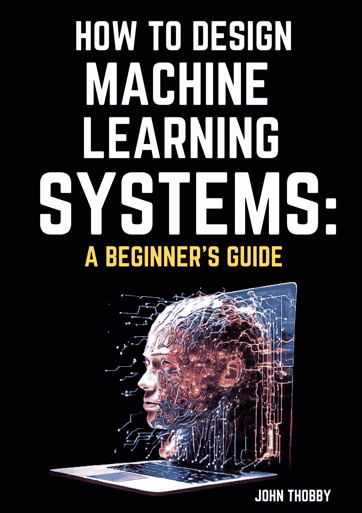

# 如何设计机器学习系统：初学者指南



## 第一部分：机器学习系统简介

# 第 1 章：什么是机器学习？

机器学习是人工智能（AI）的一个领域，专注于开发算法和统计模型，使计算机能够在没有显式编程的情况下执行特定任务。

这些任务通常涉及识别模式、做出预测以及随着时间的推移从经验中改进。

机器学习的核心思想允许系统从数据中学习并做出数据决策。

### 1.1 机器学习基础

机器学习的核心涉及使用数据来训练算法以做出决策。该过程通常遵循以下步骤：

1. `Data Collection`：收集代表你想要解决的问题的相关数据。
2. `Data Preprocessing`：清洗并准备数据，使其适用于分析。
3. `Model Selection`：为任务选择合适的算法或模型。
4. `Training`：使用数据训练模型，使其能够学习模式和关系。
5. `Evaluation`：在独立的数据集上评估模型的性能。
6. `Prediction`：使用训练好的模型对新的、未见的数据进行预测。
7. `Deployment and Maintenance`：将模型集成到生产环境中并在随时间推移对其维护。

### 1.2 历史背景

机器学习源于统计学和计算机科学。它的发展受到这两个领域进展的影响。

一些关键的里程碑包括：

- 1950 年代：“机器学习”一词被创造，第一批神经网络被开发出来。
- 1960-1970 年代：引入了早期的机器学习算法，如决策树和 K 近邻算法。
- 1980-1990 年代：开发了更复杂的模型，如支持向量机和集成方法。
- 2000 年代至今：在计算能力增强和大型数据集的推动下，深度学习和神经网络兴起。

### 1.3 核心概念与术语

理解机器学习需要熟悉几个关键概念和术语：

- `Algorithm`：解决问题的一组规则或程序。
- `Model`：用于预测的现实世界过程的数学表示。
- `Training Data`：用于训练模型的数据集。
- `Test Data`：用于评估模型性能的独立数据集。
- `Feature`：数据的单个可测量属性或特征。
- `Label`：模型试图预测的输出或结果。
- `Overfitting`（过拟合）：模型对训练数据的学习过好（包含了噪声），导致在新数据上的性能不佳。
- `Underfitting`（欠拟合）：模型太简单无法捕捉数据中的底层模式，导致在训练和新数据上的性能都很差。

### 1.4 挑战与局限性

尽管取得了许多成功，机器学习也面临着若干挑战：

- `Data Quality`：数据质量极大影响机器学习模型的性能。低质量的数据会导致不准确的预测。
- `Bias and Fairness`（偏差与公平性）：机器学习模型可能会延续甚至放大训练数据中存在的偏差，导致不公平的结果。
- `Interpretability`（可解释性）：复杂模型（尤其是深度学习模型）难以解释，使得理解决策是如何做出的具有性。
- `Scalability`（可扩展性）：处理大型数据集并确保模型能够随着数据量的增加而扩展是一项重大挑战。

在本章中，我们介绍了机器学习的概念、其历史背景、核心概念和挑战。

当我们在后续章节中深入研究设计和构建机器学习系统的过程时，理解这些基础是至关重要的。

# 第 2 章：机器学习的重要性

机器学习系统已成为现代技术不可缺的一部分，驱动着各行业的创新和效率。

它们的重要性在于能够处理海量数据、发现隐藏模式、做出预测并随着时间的推移不断提高其性能。

本章探讨了机器学习系统的意义及其对不同行业和我们日常生活各个方面的影响。

### 2.1 增强决策制定

机器学习系统的主要优势之一是其增强决策过程的能力。

通过分析大型数据集并识别模式，这些系统可以提供价值见解并支持数据驱动的决策。

例如：

- `Healthcare`（医疗健康）：机器学习模型可以预测疾病爆发、优化治疗计划并协助诊断疾病，从而获得更好的患者预后。
- `Finance`（金融）：算法可以检测欺诈交易、评估信用风险并预测市场趋势，帮助金融机构做出明智决策并有效管理风险。
- `Retail`（零售）：机器学习系统可以分析客户行为、优化库存管理并个性化营销策略，提升销售额和客户满意度。

### 2.2 自动化重复性任务

机器学习系统擅长自动化重复性和耗时的任务，将人力释放出来从事更复杂和创造性的活动。

这种自动化导致了各行业效率和生产力的提高：

- `Manufacturing`（制造业）：预测性维护算法可以预判设备故障并安排及时维修，减少停机时间和运营成本。
- `Customer Service`（客户服务）：由机器学习驱动的机器人和虚拟助手可以处理常规客户查询，提供快速准确的响应，同时让人工代理专注于更复杂的问题。
- `Data Entry`（数据录入）：光学字符识别 (`OCR`) 和自然语言处理 (`NLP`) 系统可以自动完成数据提取和录入，减少错误并加快工作流。

### 2.3 个性化与用户体验

机器学习系统在个性化用户体验以及交付定制内容和推荐方面起着至关重要的作用。

这种个性化提升了用户的满意度和参与度。

- 流媒体服务：推荐算法分析用户偏好和观看历史，推荐相关的电影、电视节目和音乐，创造个性化的娱乐体验。
- 电子商务：基于浏览和购买历史的个性化产品推荐提升了购物体验并增加了销售额。
- 社交媒体：内容推荐引擎策划个性化的新闻馈送并建议人际关系，让用户参与度更高并保持联系。

## 2.4 提高运营效率

通过优化各种流程，机器学习系统对显著提高各业的运营效率做出了贡献：

- 供应链管理：预测性分析可以预测需求、优化库存水平并简化物流，从而降低成本并确保准时交付。
- 能源管理：机器学习模型可以预测能源消耗模式并优化电力分配，从而节约能源并减少对环境的影响。
- 交通：路线优化算法改进了物流公司的配送路线，减少燃料消耗，并增强智能城市的交通管理。

## 2.5 驱动创新和新业务模式

机器学习系统使创新产品和服务成为可能，推动了新业务模式和机会创造：

- 自动驾驶车辆：自动驾驶汽车利用机器学习进行目标检测、路径规划和决策，彻底改变了运输行业。
- 医疗创新：AI 驱动的药物发现、个性化医疗和远程患者监测正在改变医疗服务的提供和结果。
- 金融科技 (FinTech)：机器学习驱动了机器人顾问、自动化交易系统和个性化财务规划，重塑了金融服务格局。

## 2.6 增强安全性与欺诈检测

机器学习系统在增强安全和检测欺诈活动方面发挥重要作用：

- 网络安全：异常检测算法可以识别异常模式和潜在的安全漏洞，帮助组织保护敏感数据和基础设施。
- 欺诈检测：机器学习模型分析交易数据以实时检测欺诈活动，防止损失并增强对金融系统的信任。
- 身份验证：由机器学习驱动的生物识别系统改进了身份验证过程，增强了各种应用的安全性。

## 2.7 应对全球挑战

机器学习系统正被解决世界上最紧迫的挑战：

- 气候变化：预测模型分析环境数据以预测气候模式，优化可再生能源，并开发缓解气候变化影响的策略。
- 医疗普及性：AI 驱动的诊断工具和远程医疗平台增加了偏远和欠发达地区医疗服务的可用性，改善了健康状况。
- 农业：机器学习系统优化作物产量，预测虫害爆发并增强了资源管理，为全球粮食安全做出贡献。

## 2.8 机器学习系统的未来

随着 AI、计算能力和数据可用性的进步驱动创新，机器学习系统的重要性将继续增长。

未来发展的关键领域包括：

- 可解释 AI (Explainable AI)：开发能够为其决策提供清晰且易懂解释的模型，增强透明度和信任。
- 自动化机器学习 (AutoML)：自动化机器学习工具简化了模型开发过程，使非专家也能更容易地使用机器学习。
- 伦理 AI (Ethical AI)：解决机器学习系统中的伦理考量和偏差，以确保公平和负责任的使用。

在本章中，我们探讨了机器学习系统的多方面重要性，从增强决策和自动化任务，到驱动创新和应对全球挑战。

随着我们的深入，我们将进入设计和构建有效机器学习系统的基础概念和实践方面。

理解它们的意义将为掌握后续的原理和技术提供强大的动力。

# 第 3 章：机器学习工作流概述

设计和实现机器学习系统涉及遵循结构化的工作流。

该工作流确保从数据收集到模型部署的每一步都以系统且高效的方式进行。

在本章中，我们将提供机器学习工作流中典型阶段的概述，突出每个阶段的关键活动和考虑因素。

## 3.1 理解问题

在深入进行数据收集和模型构建之前，清晰地理解你试图解决的问题至关重要。

这涉及：

- 定义目标和任务：你希望通过机器学习模型实现哪些具体结果？
- 了解领域：对问题所处的领域或行业获得深入见解。这有助于选择相关特征并准确地解释结果。
- 识别问题类型：确定问题是分类、回归、聚类还是推荐问题，因为这将影响算法的选择和评估指标。

## 3.2 数据收集

数据是任何机器学习项目的基石。

数据的质量和数量会影响模型的性能。数据收集阶段涉及：

- 识别数据源：确定你将在何处以及如何收集数据。这可以通过数据库、`APIs`、网络爬虫、传感器或手动收集的数据集。
- 收集数据：从已识别的源收集数据。确保你收集了足够的数据来有效训练和评估模型。
- 确保数据质量：验证收集数据的准确性、完整性和一致性，以确保其对分析是可靠的。

## 3.3 数据预处理

原始数据很少能直接用于机器学习模型。

数据预处理涉及对数据进行清洗和转换使其适用于分析：

- 处理缺失值：通过插值、删除或使用其他技术处理数据中的缺失点。
- 编码类别变量：使用独热编码（one-hot encoding）或标签编码（label encoding）等技术将类别变量转换为数值格式。
- 标准化和缩放：标准化数值特征以确保它们在相似范围内，这可以提高模型性能。
- 特征工程：创建新特征或修改现有特征，以更好地捕捉数据的底层模式。
- 划分数据：将数据分为训练集、验证集和测试集，以评估模型的性能。

## 3.4 模型选择

选择正确的算法或模型对于机器学习项目的成功至关重要。

选择阶段涉及：

- 探索不同的算法：评估各种算法以确定哪些最适用于你的问题。这可能涉及测试多个模型以找到最佳匹配。
- 考虑复杂度：在模型复杂度与过拟合或欠拟合的风险之间取得平衡。简单的模型可能更容易解释且训练更快，而复杂的模型可能会捕捉更复杂的模式。
- 评估性能：使用准确率、精确率、召回率、F1 分数、均方误差或其他与问题相关的指标来评估模型性能。

## 3.5 模型训练

模型训练涉及将训练数据输入所选算法，以学习模式和关系。

该阶段包括：

- 配置超参数：为算法设置超参数，如学习率、树的数量或网络深度，以优化性能。
- 训练模型：使用训练数据来拟合模型，使其能够从数据中学习。
- 监控训练进度：跟踪训练损失（loss）和准确率（accuracy）等指标，确保模型正在正确学习且没有过拟合。

## 3.6 模型评估

在模型训练后，评估其在未见数据上的性能至关重要，以确保其具有良好的泛化能力：

- 使用验证数据：在验证集上测试模型，以调优超参数并进行必要的调整。
- 评估性能：使用测试集和相关指标评估模型的性能。将结果与基准模型或基准测试进行比较。
- 分析错误：检查错误和分类错误，以理解模型的弱点和改进领域。

## 3.7 模型部署

模型的部署涉及将其集成到生产环境中，使其能够在环境中进行实时预测或决策：

- 选择部署策略：决定是将模型作为独立应用程序部署、集成到现有系统中，还是使用云服务。
- 搭建基础设施：确保已准备好支持模型的基础设施，包括服务器、数据库和 API。
- 监控性能：持续监控生产环境中模型的性能，以检测问题并确保其随时间推移保持准确性。

## 3.8 模型维护

维护模型对于确保其在数据数据可用和条件变化时继续表现良好至关重要：

- 重新训练模型：定期使用新数据重新训练模型，以保持其更新状态并提高其准确性。
- 更新特征：随着新信息的可用或问题的演变，修改或添加特征。
- 监控漂移：检测数据分布或模型性能的变化，这些变化可能意味着需要重新训练或调整。

## 3.9 文档与交流

在整个机器学习工作流中，记录每一步并有效沟通发现至关重要：

- 记录过程：保留数据收集、预处理步骤、模型配置和评估结果的详细记录。
- 结果结果：以清晰易懂的方式向利益相关者展示发现，重点介绍模型的性能、局限性和潜在的改进空间。

## 3.10 伦理考量

处理伦理考量对于确保负责任地使用机器学习系统至关重要：

- 确保公平：评估并减轻数据和模型中的偏差，以确保公平且无偏的结果。
- 保护隐私：实施措施保护敏感数据并遵守数据保护法规。
- 考量影响：评估模型对个人和社会的潜在影响，并采取措施尽可能地减少负面后果。

在本章中，我们提供了机器学习工作流的概述，涵盖了从问题理解到模型维护的关键阶段。

通过遵循这种结构化的方法，你可以确保你的机器学习项目组织良好、有效，并能够提供价值的见解和预测。

## 第二部分：机器学习基础

# 第四章：机器学习的类型：监督、无监督和强化学习

机器学习涵盖多种方法和体系，每种方法都适用于不同类型和数据。

机器学习的三大类是监督学习、无监督学习和强化学习。

在本章中，我们将探索这些类型及其特征和常见用例。

## 4.1 理解监督学习

监督学习是最常用的机器学习类型。

在监督学习中，模型在标记的数据集上进行训练，这意味着每个训练示例都包含输入数据和相应的输出。

目标是学习从输入到输出的映射，该映射可用于对新的未见数据进行预测。

### 4.1.1 监督学习的特征

- 标记数据：需要一个数据集，其中每个示例都与输出标签配对。
- 关注预测：主要用于目标是根据输入特征预测结果的任务。
- 误差最小化：模型通过最小化预测输出与实际标签之间的差异来学习。

### 4.1.2 监督学习的类型

- 分类：任务是根据输入特征预测离散标签。例如：垃圾邮件检测、图像分类和情感分析。
- 回归：任务是预测连续值。例如：房价预测、股市趋势和温度预测。

### 4.1.3 常见算法

- 线性回归：通过对数据拟合线性方程的回归算法。
- 逻辑回归：预测二分类结果概率的分类算法。
- 决策树：根据特征值将数据分为子集，创建树结构模型。
- 支持向量机 (SVM)：寻找最佳划分不同类别的超平面的算法。
- 神经网络：受大脑启发，能够学习复杂的模式和关系。

### 4.1.4 用例

- 医疗健康：根据医疗记录和症状进行疾病诊断。
- 金融：信用评分和欺诈检测。
- 营销：客户细分和流失预测。

## 4.2 理解无监督学习

无监督学习涉及在没有标记的数据上训练模型。

目标是发现数据内部隐藏的模式、关系或结构。

这种学习类型对于探索性数据分析和聚类特别有用。

### 4.2.1 无监督学习的特征

- 未标记数据：处理没有关联标签的数据。
- 模式发现：关注发现数据内部的结构和关系。
- 探索性分析：通常用于在没有预定义类别的情况下探索数据。

### 4.2.2 无监督学习的类型

- 聚类：将相似的数据点分组在一起的任务。例如：客户细分和图像聚类。
- 降维：在保留重要信息的情况下减少数据特征数量的任务。例如：主成分分析 (`PCA`) 和 t 分随机邻域嵌入 (`t-SNE`)。
- 异常检测：识别不符合整体的异常数据点。例如：欺诈检测和网络安全。

### 4.2.3 常见算法

- K-Means 聚类：根据特征相似性将数据划分为 `K` 个类的聚类算法。
- 层次聚类：通过迭代合并或分裂聚类构建聚类树的聚类算法。
- 主成分分析 (`PCA`)：一种将数据转换为低维空间的降维技术。
- 自动编码器：用于无监督学习任务（如异常检测和降维）的神经网络。

### 4.2.4 用例

- 零售：目标营销的客户细分。
- 基因组：识别基因表达模式。
- 金融：检测异常交易或欺诈活动。

## 4.3 理解强化学习

强化学习 (`RL`) 是一种机器学习类型，代理通过与环境交互来学习做出决策。

代理根据其动作接收奖励或惩罚形式的反馈，并旨在实现随时间累积奖励的最大化。

强化学习（RL）特别适用于顺序决策至重要的问题。

### 4.3.1 强化学习的特点

- **与环境交互**：代理通过与环境交互并接收反馈来学习。
- **顺序决策**：侧重于做出一系列决策，以实现长期奖励的最大化。
- **探索与利用**：在探索新动作和利用产生高奖励的已知动作之间取得平衡。

### 4.3.2 核心概念

- **代理 (Agent)**：学习者或决策者。
- **环境 (Environment)**：代理与之交互的系统。
- **动作 (Actions)**：代理可以执行的可能移动的集合。
- **状态 (State)**：环境的当前状况或配置。
- **奖励 (Rewards)**：环境根据代理动作提供的反馈。

### 4.3.3 常见算法

- **Q-Learning**：一种基于值的算法，代理学习一个价值函数来估计动作的预期效用。
- **深度 Q 网络 (DQN)**：将 `Q-learning` 与深度神经网络相结合，以处理高维状态空间。
- **策略梯度方法**：直接学习将状态映射到动作的策略，通常使用神经网络。

### 4.3.4 用用例

- **游戏**：训练 AI 代理来玩并精通象棋、围棋和视频游戏等复杂游戏。
- **机器人**：教机器人执行导航、操作和组装等任务。
- **金融**：算法交易和投资组合管理。

在本章中，我们探索了三种主要的机器学习类型：监督学习、无监督学习和强化学习。

每种类型都有独特的特点、算法和应用。

理解这些类型将帮助你为特定问题选择合适的方法，并利用每种方法的优势来设计有效的机器学习系统。

# 第 5 章：核心算法与模型

机器学习算法和模型是任何机器学习系统的骨干。

它们提供了从数据中学习并基于这种学习做出预测或决策的手段。

本章将向你介绍机器学习中使用的某些最基础的算法和模型，涵盖了传统方法和现代方法。

## 5.1 线性回归

线性回归是机器学习中最简单且应用最广泛的算法之一。


它通过对观测数据拟合线性方程，对因变量与一个或多个自变量之间的关系进行建模。

## 5.1 线性回归

### 5.1.1 工作原理

线性回归通过一组点寻找最佳拟合线来工作。

该线由方程定义：

`y = β⁰ + β¹x¹ + β²x² + ... + βnXn`

其中：

- `y` 是因变量
- `x¹`、`x²`、...、`xn` 是自变量
- `β⁰` 是截距
- `β¹`、`β²` 和 `β⁰` 是系数

### 5.1.2 应用场景

- 根据尺寸、位置和卧室数量等特征预测房价
- 根据广告支出、经济指标和其他因素预测销售额

## 5.2 逻辑回归

逻辑回归用于二分类问题，其目标是预测两个可能结果之一。

尽管名字带有回归，但它是一种分类算法，而不是回归算法。

### 5.2.1 工作原理

逻辑回归计算给定输入属于特定类别的概率。

输出使用逻辑函数进行转换，该函数将任何实数映射到 `[0, 1]` 范围：

```
P(y=1|x) = 1 / (1 + e^-(β⁰ + β¹x¹ + β²x² + ... + βnXn))
```

其中：

- `P(y=1|x)` 是输入 `x` 属于类别 1 的概率
- `e` 是自然对数的底

### 5.2.2 应用

- 垃圾邮件检测
- 贷款违约

## 5.3 决策树

决策树是用于分类和回归的通用机器学习模型。

它们通过递归划分数据来工作。

### 5.3.1 工作原理

决策树通过在每个节点选择最佳特征来划分数据。

树根据 Gini 纯度或信息增益构建。

该过程持续到树达到指定的深度或不再进一步分裂。

### 5.3.2 应用

- 图像分类
- 信用评分

### 5.3.3 应用

- 客户细分
- 疾病预测

## 5.4 支持向量机 (SVM)

支持向量机是强大的分类算法，用于寻找不同类别之间的最优超平面。

### 5.4.1 工作原理

SVM 通过最大化间距来工作。间距定义为类之间的距离。

### 5.4.2 应用

- 图像识别
- 文本分类

## 5.5 k-近邻 (k-NN)

k-近邻是一种用于分类和回归的简单直观的算法。

它基于特征空间中最近的示例进行预测。

### 5.5.1 工作原理

对于分类，预测类别是 `k` 个邻居中的多数。对于回归，预测值是 `k` 个邻居的平均值。

### 5.5.2 应用

- 文字识别
- 推荐系统

## 5.6 朴素贝叶斯

朴素贝叶斯是基于贝叶斯定理的概率分类器。

它假设在给定条件下特征是相互独立的，这一假设在实践中经常被违反。

### 5.6.1 工作原理

给定特征的类别概率计算如下：

```
P(C|X) = [P(X|C).P(C)] / P(X)
```

其中：

- `P(C|X)` 是给定特征 `X` 时类别 `C` 的后验概率
- `P(X|C)` 是给定类别 `C` 时特征 `X` 的似然概率
- `P(C)` 是类别 `C` 的先验概率
- `P(X)` 是特征 `X` 的先验概率

### 5.6.2 应用

- 邮件垃圾过滤
- 文档分类

## 5.7 神经网络

神经网络是一种受人类大脑启发的模型类。

它们由相互连接的节点（神经元）组成，可以学习复杂的模式。

### 5.7.1 工作原理

神经网络由输入层、一个或多个隐藏层以及输出层组成。

每个神经元对其输入应用线性变换，并将结果通过非线性激活函数。

网络使用反向传播进行训练，这是一个调整权重以最小化误差的过程。

### 5.7.2 应用

- 人脸识别
- 自然语言处理

## 5.8 集成方法

集成方法通过结合多个模型来提高性能。集成方法的两种主要类型是装袋和提升。

### 5.8.1 Bagging

Bagging（自助聚合）涉及在数据的子集上训练多个模型并平均它们的预测结果。

随机森林是一种流行的装袋方法，使用了决策树。

### 5.8.2 Boosting

提升按顺序训练模型，每个模型都修正前一个模型的错误。

AdaBoost 和梯度提升是常见的提升方法。

### 5.8.3 应用

- 提高预测模型的准确性
- 通过结合弱学习器来减少过拟合

这些过程将原始数据转换为机器学习算法可以有效使用的格式，这通常是区分平庸模型与高精度模型的关键。

本章涵盖了为准备数据和进行特征工程的核心技术和最佳实践，以提高模型性能。

## 6.1 数据准备

数据准备涉及对原始数据进行清洗并整理成适用于分析的格式。这一步至关重要，因为现实世界的数据通常是杂乱的，包含错误、缺失值和不一致之处。

### 6.1.1 数据清洗

数据清洗解决缺失值、重复和异常值等问题。

- **处理缺失值**：可以通过插补（用均值、中位数或众数替换缺失值）或在缺失值并非必要时删除相应的行/列来处理缺失数据。
- **移除重复项**：重复记录可能会扭曲分析，应该识别并移除。
- **异常值检测**：可以使用统计方法和可视化来检测异常值，然后通过删除或转换对其进行处理。

### 6.1.2 数据转换

应用转换使数据更适用于分析和建模。

- **归一化/标准化**：这些技术将数值特征缩放到标准范围或分布，这对于 `SVM` 和 `neural networks` 等算法特别重要。
- **类别变量编码**：需要使用独热编码（one-hot encoding）或标签编码（label encoding）等方法将类别变量转换为数值格式。

### 6.1.3 数据划分

将数据分为训练集、验证集和测试集可以确保在未见数据上评估模型，防止过拟合。

- **训练集**：用于训练模型。
- **验证集**：用于调整超参数并选择最佳模型。
- **测试集**：用于评估模型的最终性能。

## 6.2 特征工程

特征工程涉及创建新特征或修改现有特征，以提高机器学习模型的性能。这是一个需要领域知识和创造力的关键步骤。

### 6.2.1 创建新特征

- **交互特征**：结合两个或多个特征以捕捉它们的共同效应。
- **多项式特征**：添加多项式项（例如 `x²`、`x³`）以捕捉非线性关系。
- **聚合特征**：从多个特征中总结信息，例如计算相关特征的均值或和。

### 6.2.2 特征选择

选择最相关的特征可以降低模型复杂度并提高性能。

- **过滤方法**：基于相关性或卡方检验等统计量来选择特征。
- **包装方法**：使用搜索算法根据模型性能评估特征子集（例如递归特征消除）。
- **嵌入方法**：如 `Lasso`（`L1 regularization`）等算法在模型训练期间会执行特征选择。

### 6.2.3 特征提取

特征提取涉及将数据转换为低维空间，同时保留重要信息。

- **主成分分析 (PCA)**：通过将数据投影到主成分上来降低维度。
- **独立成分分析 (ICA)**：将多变量信号分离为加性的、独立的分量。
- **t-分布随机邻域嵌入 (t-SNE)**：通过将高维数据映射到低维空间来实现数据可视化。

## 6.3 处理不同数据类型

不同类型的数据需要不同的预处理技术。

### 6.3.1 数值数据

数值数据通常需要缩放、归一化或转换以提高模型性能。

- **缩放**：调整数据范围，通常使用 `Min-Max Scaling` 或 `Standard Scaling`。
- **归一化**：将数据转换为标准正态分布（`mean = 0`，`standard deviation = 1`）。

### 6.3.2 类别数据

类别数据需要编码后用于机器学习算法。

- **独热编码**：将类别变量转换为二进制矩阵，每个类别由一列表示。
- **标签编码**：为每个类别分配一个唯一的整数。

### 6.3.3 文本数据

文本数据需要特定的预处理技术将其转换为数值。

- **分词**：将文本拆分为单词或标记。
- **词干提取/词形还原**：将单词还原为基础形式或词根。
- **向量化**：使用 `Bag of Words` (BoW)、`Term Frequency-Inverse Document Frequency` (TF-IDF) 或词嵌入（`Word2Vec`、`GloVe`）等方法将文本转换为向量。

## 6.4 数据准备与特征工程的最佳实践

### 6.4.1 数据质量

在过程中处理缺失值、异常值和不一致性，以确保数据质量。

### 6.4.2 自动化

使用流水线和自动化工具简化数据准备和特征工程，确保可重复性。

### 6.4.3 迭代过程

数据准备和特征工程是迭代过程。根据模型性能和分析不断评估和改进特征。

### 6.4.4 领域知识

利用领域知识创建捕捉底层模式和关系的特征。

数据准备和特征工程是构建有效机器学习系统的基础。通过彻底清洗数据并工程化特征，可以显著提升模型性能。

# 第三部分：设计机器学习系统

# 第七章 系统需求与问题定义

系统需求和问题定义为设计成功的机器学习解决方案奠定了基础。本章重点识别必要的设施、软件工具以及定义问题声明。

## 7.1 理解系统需求

系统需求包含了实现机器学习系统所需的技术和运行需求。

### 7.1.1 硬件需求

指定训练和部署机器学习模型所需的硬件资源，如 `CPU`、`GPU`、`RAM` 和存储容量。

### 7.1.2 软件需求

识别数据预处理、模型开发、评估和部署所需的软件工具和库。包括编程语言（`Python`、`R`）、机器学习框架（`TensorFlow`、`PyTorch`）以及数据处理工具（`Pandas`、`NumPy`）。

### 7.1.3 环境搭建

搭建开发环境，确保所有所需软件组件的兼容性和功能。

## 7.2 定义问题声明

清晰的问题定义对于统一利益相关者的预期并引导机器学习解决方案至关重要。

### 7.2.1 问题识别

识别并说明机器学习系统旨在解决的特定问题或挑战。这包括理解背景、利益相关者和限制条件。

### 7.2.2 问题建模

将问题建模为机器学习任务，无论是分类、回归、聚类或其他类型的任务。定义输入数据、预期输出和评估指标。

### 7.2.3 数据需求

指定数据需求，包括数据源、数据量、数据质量以及任何与数据使用相关的考量。

## 7.3 范围与可行性分析

根据可用资源、时间线和问题的复杂度评估机器学习项目的范围和可行性。

### 7.3.1 项目范围

定义项目的边界和目标，以确保结果聚焦且可实现。

### 7.3.2 可行性评估

从技术能力、资源可用性和与业务目标的一致性评估项目的可行性。

## 7.4 利益相关者一致

确保利益相关者对项目目标、预期和成功标准达成共识。

### 7.4.1 利益相关者识别

识别关键利益相关者，包括业务所有者、领域专家、数据科学家和终端用户。

### 7.4.2 沟通计划

建立沟通计划，以促进整个项目生命周期内的协作与反馈。

## 7.5 需求文档化

以清晰易于访问的格式记录系统需求、问题陈述和项目范围。

### 7.5.1 需求文档

创建详细的文档，记录系统需求和问题定义的所有方面，以供参考和未来更新。

系统需求和问题定义为有效设计和实施机器学习解决方案提供了坚实的基础。

通过清晰地定义技术需求、问题陈述和项目范围，利益相关者可以更高效地协作以实现预期结果。

# 第 8 章：为你的问题选择合适的模型

为你的机器学习问题选择合适的模型是至关重要的一步，能够显著影响解决方案的性能和成功。

本章将引导你如何根据数据的性质、当前的问题以及各种评估标准来选择最合适的模型。

## 8.1 理解模型类型

不同类型的机器学习模型适用于不同类型的问题。理解模型的大类可以帮助你做出明智的选择。

### 8.1.1 线性模型

线性模型（如线性回归和逻辑回归）是简单但强大的模型，它们假设输入特征与目标变量之间存在线性关系。

### 8.1.2 决策树和集成方法

决策树是多功能模型，根据特征值将数据划分为子集。集成方法（如随机森林和梯度提升）结合多个决策树以提高性能并减少过拟合。

### 8.1.3 支持向量机 (SVM)

SVM 在分类任务中非常强大，特别是当类别不可线性分离时。它们在高维数据上表现良好，并可以使用核函数处理非线性关系。

### 8.1.4 神经网络

神经网络是高度灵活的模型，能够学习复杂的模式。它们对于涉及大量数据和复杂关系的任务（如图像识别和自然语言处理）特别有用。

### 8.1.5 聚类算法

聚类算法（如 `k-means` 和层次聚类）用于无监督学习任务，其目标是将相似的数据点分在一起。

### 8.1.6 强化学习

强化学习算法通过与环境交互并接收奖励或惩罚形式的反馈进行学习。它们被应用于游戏、机器人技术和自动系统等领域。

## 8.2 模型选择标准

选择合适的模型涉及评估各种标准，以确保所选模型符合你的问题需求和限制。

### 8.2.1 准确率与性能

首要目标是选择一个在数据上表现良好的模型。性能指标（如准确率、精确率、召回率和 `F1-score`）有助于评估模型预测目标变量的程度。

### 8.2.2 复杂性与可解释性

复杂模型（如深度神经网络）可以捕捉复杂的模式，但通常可解释性较低。简单的模型（如线性回归）更容易理解和解释，但在复杂数据上的表现可能不够好。

### 8.2.3 训练时间与可扩展性

考虑训练模型所需的时间以及它是否可以扩展以处理大型数据集。某些模型（如决策树）训练速度快，而其他模型（如深度学习模型）则需要大量的计算资源和时间。

### 8.2.4 数据可用性与质量

可用数据的数量和质量影响模型选择。某些模型需要大量的标记数据（例如神经网络），而其他模型在较小数据集上也能良好运行（例如 `SVMs`）。

### 8.2.5 过拟合与泛化

通过避免过拟合，确保模型对未见数据具有良好的泛化能力。使用 `cross-validation`、正则化和使用更简单的模型等技术可以防止过拟合。

## 8.3 模型选择的实践步骤

### 8.3.1 定义问题

清晰地定义问题，包括任务类型（分类、回归、聚类等）、可用数据以及预期结果。

### 8.3.2 探索与数据预处理

探索并对数据进行预处理，以便建模。

### 8.3.3 基准模型

从简单的基准模型开始，以建立性能基准。

### 8.3.4 模型比较

训练多个模型并使用 `cross-validation` 和其他评估指标进行比较，考虑性能。

### 8.3.5 超参数调优

通过 `grid search` 和 `random search` 等技术优化所选模型的超参数。

### 8.3.6 最终模型选择

选择最符合定义标准并在验证集上表现良好的模型。确保模型是健壮的且泛化良好。

## 8.4 工具与资源

多种工具和资源可以辅助模型选择和评估。

### 8.4.1 库与框架

使用机器学习库和框架，如 `scikit-learn`、`TensorFlow` 和 `PyTorch`，它们提供了丰富的模型和工具。

### 8.4.2 自动机器学习 (AutoML)

AutoML 工具（如 `Google AutoML` 和 `H2O.ai`）可以自动化模型选择、超参数调优和评估过程，更容易找到最佳模型。

### 8.4.3 文档与社区

利用文档、教程和社区论坛了解最佳实践、常见陷阱和高级选择技术。

为你的机器学习问题选择合适的模型涉及理解不同类型、评估关键标准并遵循结构化的选择方法。

通过考虑性能、可解释性、可扩展性和数据可用性，你可以选择最符合你问题需求和限制的模型。

# 第 9 章：面向可扩展性和性能的设计

设计机器学习系统时，可扩展性和性能是关键考虑因素。随着数据增长和预测需求增加，你的系统必须高效处理负载。

本章探讨了构建可扩展和高性能机器学习解决方案的策略和最佳实践。

## 9.1 理解可扩展性

可扩展性是指系统处理日益增加的工作负载的能力或其扩大以适应这种增长的潜力。

### 9.1.1 垂直扩展

垂直扩展（向上扩展）涉及为单个节点增加资源，例如增加 `CPU`、内存或存储容量。这种方法通常更容易实现，但有物理限制。

### 9.1.2 水平扩展

水平扩展（向外扩展）涉及向系统中添加更多节点，将负载分布在多台机器上。这种方法可以处理更大的规模，并提供冗余性和容错能力。

## 9.2 设计可扩展的机器学习系统

设计可扩展的机器学习系统需要仔细的规划以及使用适当的技术和架构。

### 9.2.1 分布式计算

利用分布式计算框架（如 `Apache Hadoop` 或 `Apache Spark`）在多个节点上处理大型数据集，提高速度和可扩展性。

### 9.2.2 微服务架构

实施微服务架构，将你的机器学习系统分解为更小、独立的服务，这些服务可以单独进行开发、部署和扩展。

### 9.2.3 容器化

使用 `Docker` 等容器化技术和 `Kubernetes` 等编排工具来高效地管理和扩展机器学习模型及服务。

### 9.2.4 云服务

利用 `AWS`、`Google Cloud` 和 `Azure` 等供应商提供的云服务，这些服务提供了可扩展的基础设施、托管机器学习服务以及用于分布式训练和部署的工具。

## 9.3 性能优化

性能优化确保你的机器学习系统高效运行，最小化延迟并最大化吞吐量。

### 9.3.1 高效算法和数据结构

选择高效的算法和数据结构以降低计算复杂度，提高数据处理和模型训练的速度。

### 9.3.2 模型优化技术

应用模型优化技术，如量化、剪枝和知识蒸馏，在不显著影响准确性的情况下减少模型的大小和复杂度。

### 9.3.3 并行处理

利用并行处理同时执行多次计算。这可以显著加速训练和推理，特别是对于大型数据集和复杂模型。

### 9.3.4 批量处理与小批量训练

使用批量处理和小批量训练，通过一次性处理多个数据点（而不是逐个处理）来提高计算效率。

## 9.4 监控与维护

持续的监控和维护对于确保机器学习系统的可扩展性和性能至关重要。

### 9.4.1 性能指标

跟踪关键性能指标（如延迟、吞吐量、资源利用率），以识别瓶颈并优化系统性能。

### 9.4.2 自动伸缩

实施根据需求调整资源的自动伸缩策略。这在确保最佳性能的同时最小化了成本。

### 9.4.3 定期维护

进行定期维护，包括更新软件、重新训练模型和优化基础设施，以保持高性能并解决任何新出现的问题。

## 9.5 案例研究与示例

研究真实世界的案例可以为设计可扩展和高性能的机器学习系统提供有效策略的见解。

### 9.5.1 大规模数据处理


探索 `Netflix` 和 `Uber` 等公司如何使用分布式计算框架和云服务处理海量数据集并提供实时预测。

## 9.5.2 机器学习中的微服务

向 `Amazon` 和 `Google` 等组织学习，它们利用微服务架构高效地部署和扩展其机器学习模型。

## 9.5.3 性能优化

了解 `Facebook` 和 `Twitter` 等公司如何优化其机器学习模型和基础设施，为数百万用户提供快速可靠的服务。

针对可扩展性和性能进行设计对于构建随数据和用户群增长的健壮机器学习系统至关重要。

通过采用分布式计算、微服务、容器化和云服务，你可以创建能够高效处理不断增加负载的系统。

此外，优化算法、利用并行处理以及进行定期的监控和维护，可以确保你的模型在各种情况下表现良好。

# 第四部分：构建与训练模型

# 第十章：数据收集与清洗

数据是任何机器学习系统的基石。数据的质量直接影响你模型的性能和可靠性。

本章将引导你完成数据收集和清洗过程，确保你有高质量的数据可供使用。

## 10.1 高质量数据的重要性

高质量数据对于机器学习项目的成功至关重要。数据质量差会导致模型不准确，从而导致糟糕的决策。

### 10.1.1 对模型性能的影响

机器学习模型的性能很大程度上依赖于数据的质量。清洁、准确且相关的数据有助于模型更有效的学习并做出更好的预测。

### 10.1.2 数据偏差与公平性

高质量数据也意味着无偏的数据。确保你的数据代表你想要建模的真实场景，有助于避免偏差并确保公平的结果。

## 10.2 数据收集

数据收集涉及从各种来源收集数据。这些数据将用于训练、验证和测试你的机器学习模型。

### 10.2.1 识别数据源

确定你的数据来源。数据源可以包括数据库、`APIs`、网络爬虫、传感器和用户生成的内容。

### 10.2.2 数据类型

有多种类型的数据，包括结构化数据（例如数据库）、半结构化数据（例如 `JSON` 文件）和非结构化数据（例如文本和图像）。

### 10.2.3 数据获取方法

使用如 `APIs`、网络爬虫、问卷和手动输入等方法获取数据。确保你拥有必要的权限并遵守相关法规。

### 10.2.4 实时数据与批量数据

决定你是否需要实时数据（例如来自传感器的流数据）或批量数据（例如数据库的定期数据）。

## 10.3 数据清洗

数据收集后，需要对其进行清洗以确保其可学习。

### 10.3.1 处理缺失数据

通过删除不记录、使用插值技术填充缺失值或使用处理缺失数据的算法来处理缺失数据。

### 10.3.2 去重

检测并移除重复记录，防止其影响分析和模型训练。

### 10.3.3 处理异常值

识别可能扭曲分析的异常值。根据其影响和相关性决定删除、转换还是单独处理。

### 10.3.4 数据归一化与缩放

对数据进行归一化和缩放，以确保所有特征对学习过程都有贡献。常见技术包括最小最大化缩放和标准化。

### 10.3.5 类别数据编码

使用独热编码、标签编码或顺序编码等技术将类别数据转换为数值格式。

### 10.3.6 处理数据不平衡

如果不同类别之间存在显著差异，平衡数据。技术包括过采样、欠采样以及使用合成数据生成方法 `SMOTE`。

## 10.4 数据质量评估

定期评估数据的质量，以确保其符合机器学习模型的标准。

### 10.4.1 数据画像

执行数据画像以理解数据的结构、关系和质量。这涉及统计摘要和可视化。

### 10.4.2 数据质量指标

使用数据准确性、完整性、一致性、及时性和有效性等数据质量指标来评估你的数据。

## 10.5 数据清洗自动化

自动化数据清洗过程以节省并确保一致性。

### 10.5.1 工具与库

利用 `pandas`、`Dask` 和 `Apache Spark` 等工具和库执行数据清洗任务。这些工具提供了处理缺失值、重复或其他问题的函数。

### 10.5.2 数据清洗流水线

创建数据清洗流水线，自动执行数据清洗的顺序步骤。这确保了过程的可重复性和一致性。

## 10.6 数据收集与清洗的最佳实践

遵循最佳实践以确保高效且有效的数据收集和清洗。

### 10.6.1 文档记录

记录你的数据源、收集方法和清洗过程。这有助于保持一致性，并允许他人理解和复制你的工作。

### 10.6.2 版本控制

对数据进行版本控制以跟踪更改并确保可重复性。像 `DVC`（数据版本控制）这样的工具可以帮助管理数据版本。

### 10.6.3 隐私与安全

确保你的数据收集和清洗过程符合隐私法律法规。使用适当的安全措施保护敏感数据。

## 10.7 案例研究

回顾成功的数据收集和清洗工作的案例，以获得见解并从真实示例中学习。

### 10.7.1 电子商务数据

探索电子商务公司如何从各种来源（交易、用户行为、评论）收集并清洗数据，以构建推荐系统。

#### 10.7.2 医疗健康数据

了解医疗提供者如何处理敏感的患者数据、确保数据质量并维护合规性，以开发用于患者结果的预测模型。

## 结论

数据收集和清洗是机器学习工作流中的基础步骤。

通过确保你拥有高质量的数据，你为构建准确可靠的模型奠定了坚实的基础。

下一章将讨论训练、验证和调优机器学习模型的关键方面，以获得最佳性能。

# 第 11 章：训练与评估模型

训练和评估模型是机器学习工作流中的关键步骤。

这些过程决定了你的模型在现实场景中的表现如何。

本章涵盖了训练机器学习模型、评估其性能以及迭代以提高准确性和可靠性的核心内容。

## 11.1 理解模型训练

模型训练涉及教授机器学习算法以识别数据中的模式。

目标是创建一个模型，使其在面对新数据时能够做出准确的预测或分类。

### 11.1.1 训练过程

训练过程通常涉及以下步骤：

1. **数据准备**：将数据集分为训练集和测试集。训练集用于训练模型，而测试集用于评估其性能。

2. **模型选择**：根据问题类型（回归、分类等）选择合适的算法。

3. **模型训练**：使用训练数据来拟合模型，调整其参数以最小化误差。

4. **验证**：使用验证集来调整模型的超参数并防止过拟合。

### 11.1.2 过拟合与欠拟合

- **过拟合**：当模型过度学习训练数据，捕捉了噪声和离群值时发生，这降低其对新数据的泛化能力。

- **欠拟合**：当模型太简单且未能捕捉数据中的底层模式时发生。

## 11.2 模型评估

评估你的模型对于理解其性能和识别改进领域至关重要。

### 11.2.1 评估指标

根据问题类型使用不同的指标来评估机器学习模型的性能：

- **回归指标**：

    - 平均绝对误差 (`MAE`)

    - 均方误差 (`MSE`)

    - 均方根误差 (`RMSE`)

    - R 平方 (`R²`)

- **分类指标**：

    - 准确率

    - 精率

    - 召回率

    - F1 分数

    - 接收者工作特征曲线下积 (`AUC-ROC`)

### 11.2.2 混淆矩阵

混淆矩阵是通过比较预测值和实际值来评估分类模型性能的表格。

它有助于计算 `precision`（精确率）、`recall`（召回率）和 `F1 score`。

## 11.3 交叉验证

交叉验证是一种评估模型泛化能力的技术。

它涉及将数据集分为多个折，并在这些折的不同组合上训练模型。

### 11.3.1 K-折交叉验证

在 `k`-折交叉验证中，数据集被分为 `k` 个子集，模型被训练 `k` 次，每次使用不同的子集作为验证集，剩余数据作为训练集。

最终评估是 `k` 次结果的平均值。

### 11.3.2 留一交叉验证 (LOOCV)

`LOOCV` 是 `k`-折交叉验证的一种特殊情况，其中 `k` 等于数据点的数量。

每个数据点都被用作单个验证案例，并在剩余数据上训练模型。

## 11.4 超参数调优

超参数是在训练模型之前设置的参数，其值不是从数据中学习的。

调优这些超参数对于优化模型性能至关重要。

### 11.4.1 网格搜索

网格搜索是对定义的超参数集合进行的穷搜索。对每种超参数组合进行模型训练和评估，以找到最佳集合。

### 11.4.2 随机搜索

随机搜索涉及对超参数组合进行随机采样，并对每种组合评估模型。

它的计算强度比网格搜索低，在寻找良好的超参数方面可能更高效。

### 11.4.3 贝叶斯优化

贝叶斯优化使用概率模型来寻找最优超参数。

它构建目标函数的代理模型，并使用它选择最有希望的超参数进行评估。

## 11.5 模型选择

选择正确的模型涉及比较不同模型的性能，并选择最符合你问题要求的模型。

### 11.5.1 模型比较

使用相同的评估指标和交叉验证技术比较多个模型。

考虑准确性、速度、可解释性和扩展性等因素。

### 11.5.2 集成方法

集成方法结合多个模型来提高性能。

技术包括袋法（bagging，例如 `Random Forest`）、提升法（boosting，例如 `Gradient Boosting`）和堆叠（stacking）。

## 11.6 迭代改进

模型开发是一个迭代过程。利用从评估中获得的见解来完善模型并提高其性能。

### 11.6.1 错误分析

执行错误分析以理解模型何时以及为何会出错。

这可能涉及检查分类错误的示例或分析回归模型中的残差。

### 11.6.2 特征工程

重新审特征工程，根据错误分析的见解添加、删除或转换特征。

改进特征可以带来更好的模型性能。

### 11.6.3 正则化技术

应用 `L1` (`Lasso`) 和 `L2` (`Ridge`) 正则化技术来防止过拟合并提高泛化能力。

## 11.7 案例研究

探索案例查看不同的技术和策略如何应用于真实场景：

### 11.7.1 医疗

检查如何训练和评估机器学习模型以预测患者结果、诊断疾病和个性化治疗。

### 11.7.2 金融

了解用于信用评分、欺诈检测和算法交易模型的构建和评估过程。

### 11.7.3 电子商务

从推荐系统、客户细分和需求预测的案例中学习。

超参数是在学习过程开始之前设置的参数。与从数据中学习的模型参数不同，超参数用于控制训练过程和模型的结构。

## 12.1 超参数示例

- **学习率（Learning Rate）**：控制模型相对于损失梯度调整的程度。

- **层数和神经元数（Number of Layers and Neurons）**：定义神经网络的架构。

- **正则化参数（Regularization Parameters）**：例如 `L1` 和 `L2` 正则化，有助于防止过拟合。

- **批大小（Batch Size）**：单次迭代中使用的训练示例数量。

- **轮数（Number of Epochs）**：学习算法遍历整个训练数据集的次数。

## 12.2 超参数调优的重要性

有效的超参数调优可以显著提高模型性能。选择不当的超参数可能导致模型过拟合或欠拟合。

### 12.2.1 过拟合与欠拟合

- **过拟合（Overfitting）**：当模型学习了训练数据中的噪声时，在训练数据上表现良好，但在新的未见数据上表现较差。

- **欠拟合（Underfitting）**：当模型过于简单无法捕捉数据中的底层模式时，导致在训练数据和测试数据上的表现都很差。

## 12.3 超参数调优方法

可以采用多种方法来调优超参数。方法的选择通常取决于问题的复杂性和可用的计算资源。

### 12.3.1 网格搜索（Grid Search）

网格搜索是在指定参数网格上的穷举搜索。它涉及对每种超参数组合进行训练和评估。

**优点**：

- 对超参数空间的全面探索。

**缺点**：

- 计算开销大且耗时，特别是当超参数数量很多时。

### 12.3.2 随机搜索（Random Search）

随机搜索从指定范围内随机采样超参数组合。它可能比网格搜索更高效，特别是当只有少数超参数对性能有显著影响时。

**优点**：

- 通常比网格搜索更高效。

- 可以覆盖超参数空间中更广泛的值范围。

**缺点**：

- 如果采样量不足，可能会错过最优超参数组合。

### 12.3.3 贝叶斯优化（Bayesian Optimization）

贝叶斯优化使用概率模型来寻找最优超参数。它构建目标函数的代理模型，并利用它来选择最有希望的超参数进行评估。

**优点**：

- 比网格搜索和随机搜索更高效。

- 可以通过更少的评估找到最优超参数。

**缺点**：

- 实现起来较复杂。

- 构建和更新代理模型存在计算开销。

## 12.4 高级优化技术

除了基本方法外，还可以采用几种高级技术进行超参数调优。

### 12.4.1 基于梯度的优化（Gradient-Based Optimization）

基于梯度的方法（如梯度下降）可以通沿目标函数的梯度方向迭代更新超参数来优化超参数。

**优点**：

- 对于连续型超参数高效。

- 可以与神经网络训练结合。

**缺点**：

- 可能会陷入局部最优。

- 需要可微的目标函数。

### 12.4.2 进化算法（Evolutionary Algorithms）

进化算法受自然选择的启发，使用变异、交叉和选择等机制，在连续代中演化超参数集的种群。

**优点**：

- 可以处理复杂且不可微的超参数空间。

- 可以跳出局部最优。

**缺点**：

- 计算密集型。

- 需要对进化过程参数进行仔细调优。

### 12.4.3 Hyperband

Hyperband 是一种基于多老虎机（bandit-based）的方法，动态地为有前景的超参数配置分配资源，并快速丢弃性能较差的选择。

**优点**：

- 高效分配计算资源。

- 可以显著缩短超参数调优所需的时间。

**缺点**：

- 可能对其自身的参数进行微调。

- 实现复杂。

## 12.5 实际考虑因素

在调优超参数时，请考虑以下实际方面：

### 12.5.1 资源约束

在调优超参数时，考虑可用的计算资源。网格搜索可能实际，而随机搜索可能可行。

### 12.5.2 交叉验证（Cross-Validation）

使用交叉验证以确保超参数对未见数据具有良好的泛化能力。这有助于缓解过拟合。

### 12.5.3 并行与分布式（Parallel and Distributed）

利用并行和分布式计算来加速调优。分布式计算框架可以在多台机器上分配工作负载。

## 12.6 案例研究

### 12.6.1 图像分类中的超参数调优

探索用于图像分类任务的卷积神经网络（CNN）的超参数调优。讨论调优方法以及带来的性能提升。

### 12.6.2 自然语言处理中的超参数调优

研究自然语言处理（NLP）模型的超参数调优，包括学习率、批大小和层数等。

## 总结

超参数调优和优化是实现模型最佳性能至关重要的。通过理解各种方法和策略并考虑实际限制，可以有效地调优超参数以提高模型准确性和泛化能力。下一章将探讨机器学习模型的部署，确保它们在生产环境中运行良好且具有扩展性和可维护性。

# 第五部分：部署与维护

## 第十三章：模型部署策略

将机器学习模型部署到生产环境是将训练模型转化为价值资产的关键步骤。本章探讨了部署机器学习模型的各种策略和最佳实践，确保它们稳健、可扩展且可维护。

## 13.1 理解模型部署

模型部署涉及将训练好的机器学习模型集成到现有的生产环境中，使其能够对新数据进行预测。这对于在现实应用中使用模型的预测能力至关重要。

## 13.2 部署的关键因素

在部署模型之前，必须解决几个关键因素，以确保从开发到生产的顺利过渡。

### 13.2.1 可扩展性

模型应该高效地处理增加的负载，无论是数据量还是预测请求数。确保扩展性涉及利用可以水平或垂直扩展的基础设施技术。

### 13.2.2 性能

部署应确保模型的推理时间满足应用程序的要求。优化性能可能包括模型压缩、量化或使用硬件加速器。

### 13.2.3 可靠性

部署的模型应该是可靠的，这意味着它能够一致地产生准确的预测，并优雅地处理故障。实施稳健的错误处理、监控和告警机制至关重要。

### 13.2.4 安全性

安全性在部署中至关重要。保护模型和数据免受未经授权的访问、篡改和其他威胁，涉及实施适当的身份验证、加密和其他安全措施。

## 13.3 部署架构

根据特定的需求和限制，可以采用多种架构来部署机器学习模型。

### 13.3.1 批处理（Batch Processing）

在批处理中，按计划间隔对大型数据集进行预测。

这种方法适用于不需要实时预测的场景，例如生成夜间报告。

### 13.3.2 实时处理

实时处理涉及在数据点到达时对其进行预测。

这种方法对于需要即时响应的应用（如欺诈检测或推荐系统）关重要。

### 13.3.3 微服务架构

微服务架构将部署分为更小的独立服务，这些服务通过网络进行通信。

每个服务都可以独立地开发、部署和扩展，提供了灵活性韧性。

### 13.3.4 无服务器架构

无服务器计算允许在不管理底层基础设施的情况下部署模型。

模型可以作为函数部署，并根据需求自动扩展，从而减少运营开销。

### 13.4 部署工具与平台

多种工具和平台有助于机器学习模型的部署。

### 13.4.1 云服务

`AWS`、`Google Cloud` 和 `Azure` 等云平台提供了用于部署和管理机器学习模型的全面服务。

这些平台提供了可扩展性、性能以及与其他云服务的集成。

### 13.4.2 Kubernetes 和 Docker

`Kubernetes` 和 `Docker` 实现了机器学习模型的容器化和编排，允许可扩展和可移植的部署。

容器封装了模型及其依赖项，确保了跨环境的一致性。

### 13.4.3 模型服务框架

`TensorFlow Serving`、`TorchServe` 和 `MLflow` 等框架在生产环境中提供模型服务。

这些工具提供了用于高效加载、服务和管理模型的 API。

## 13.5 监控与维护

一旦部署，就有对模型进行持续监控和维护，以确保其持续性能和可靠性。

### 13.5.1 监控

监控涉及跟踪性能指标，例如准确率、延迟和吞吐量。

实施监控工具和仪表板有助于尽早发现问题并采取纠正措施。

### 13.5.2 A/B 测试

A/B 测试可以比较生产环境中不同模型或配置的性能。

这种方法有助于完全部署之前确定性能最佳的模型。

### 13.5.3 重训练与更新


模型可能会由于数据分布的变化而随时间推移性能下降。

定期在新鲜数据上重新训练模型并在生产环境中更新它，对于保持其准确性和相关性至关重要。

## 13.6 案例与示例

### 13.6.1 电子商务推荐系统

探索为电子商务平台部署推荐系统的案例研究。讨论为确保可扩展性和实时性能而使用的架构、工具和策略。

### 13.6.2 银行业欺诈检测

检查银行环境中欺诈检测模型的部署，突出实时处理、安全可靠性的重要性。

模型部署是机器学习生命周期中的一个关键阶段，将训练好的模型转换为现实应用中的实用工具。

通过理解各种部署策略、工具和最佳实践，你可以确保你的模型在生产环境中是健壮、可扩展且易于维护的。

# 第 14 章：生产环境中的模型监控与维护

一旦机器学习模型部署到生产环境中，工作远未结束。

持续的监控和维护对于确保模型随时间推移保持准确、可靠和高效至关重要。

本章探讨了在生产环境中有效监控和维护机器学习模型所需的策略和工具。

### 14.1 监控与维护的重要性

在生产环境中监控和维护机器学习模型至关重要，原因有几个：

- **性能下降**：随着时间的推移，由于数据分布的变化（也称为数据漂移），模型可能会经历性能下降。

- **运营稳定性**：持续监控有助于及时检测和解决问题，确保运营稳定性。

- **合规性与安全性**：需要定期检查以确保符合法规，并维护模型和数据的安全性。

### 14.2 监控的关键指标

监控涉及跟踪各种指标以评估模型的性能和运行状况。

关键指标包括：

- **准确率 (Accuracy)**：衡量模型预测正确的频率。

- **精确率和召回率 (Precision and Recall)**：评估模型性能，特别是在分类任务中。

- **F1 分数 (F1 Score)**：精确率和召回率的调和平均数，提供了单一性能评估指标。

- **延迟 (Latency)**：模型进行预测所需，对于实时应用至关重要。

- **吞吐量 (Throughput)**：单位时间内完成预测次数。

- **资源利用率**：模型消耗的 CPU、GPU、内存和其他资源。

### 14.3 监控工具

各种工具和平台可以帮助监控机器学习模型：

- `Prometheus` 和 `Grafana`：用于收集和可视化指标的开源工具。

- `ELK Stack`（`Elasticsearch`、`Logstash`、`Kibana`）：用于日志、监控和可视化的强大套件。

- `Sentry`：帮助实时跟踪错误和异常。

- **云原生解决方案**：`AWS CloudWatch`、`Google Cloud Monitoring` 和 `Azure Monitor` 提供了为云环境定制的全面监控服务。

### 14.4 设置警报

设置警报对于主动监控至关重要。警报通知团队任何需要立即关注的异常或问题。

常见的警报条件包括：

- 准确率或其他性能指标大幅下降。

- 延迟或资源利用率异常升高。

- 错误率超过预定义的阈值。

### 14.5 A/B 测试与持续评估

A/B 测试涉及比较两个或多个模型或版本的性能，以确定生产环境中环境中环境中。

这种方法有助于：

- 在全面发布之前验证新模型的有效性。

- 通过测试新功能或调整持续改进模型。

## 14.6 模型重训练与更新

模型可能需要重训练或更新以维护其性能。

关键步骤包括：

- **数据收集**：持续从生产环境收集新数据，以捕捉模式的变化。

- **模型重训练**：使用最新数据定期重训练模型，以适应新趋势并保持准确性。

- **版本控制**：对模型实施版本控制，以跟踪变化并在必要时回滚到之前的版本。

### 14.7 处理数据漂移和概念漂移

数据漂移是指输入数据分布的变化，而概念漂移涉及输入数据与目标变量之间关系的变化。处理这些问题的策略包括：

- **漂移检测**：实施检测漂移的工具和技术，例如统计检验或漂移检测算法。

- **模型重训练**：定期或检测到显著漂移时重训练模型。

- **适应模型**：使用能够随时间适应数据分布变化的模型。

### 14.8 确保安全与合规

维护安全性和合规性涉及：

- **数据加密**：确保数据在传输和存储时均已加密。

- **访问控制**：实施严格的访问控制以保护模型和数据。

- **法规合规**：定期审查并确保符合相关法规和标准，例如 `GDPR` 或 `HIPAA`。

## 14.9 案例研究与最佳实践

### 14.9.1 金融服务

探索金融机构如何监控和维护欺诈检测模型，以确保高准确性和实时性性能。

### 14.9.2 医疗保健

检查医疗保健领域用于监测和维护诊断模型的策略，强调对法规合性和数据隐私的关注。

# 结论

在生产环境中对机器学习模型进行有效的监测和维护，对于确保其持续性能、可靠性和安全性至关重要。

通过理解并实施本章讨论的最佳实践和工具，你可以确保你的模型随着时间的推移持续提供价值。

# 第 15 章：处理模型退化与重新训练

机器学习模型不是静态实体；由于数据分布的变化、用户行为的演变或其建模的基础过程的变化等各种因素，它们的性能可能会随时间下降。

解决模型退化并实施有效的重新训练策略，对于维护机器学习系统的可靠性和准确性至关重要。

本章将探讨模型退化的原因、检测方法以及重新训练模型的最佳实践。

## 15.1 理解模型退化

模型退化是指机器学习模型的性能随时间推而下降。

这可能由于几个原因引起：

- `数据漂移 (Data Drift)`：输入数据的统计属性随时间的变化。

- `概念漂移 (Concept Drift)`：输入特征与目标变量之间底层关系的变化。

- `环境变化 (Environmental Changes)`：影响系统的外部因素，例如法规变化、新技术或用户行为的转变。

## 15.2 检测模型退化

为了有效处理模型退化，尽早检测至关重要。

检测退化的常用方法包括：

- `性能监测 (Performance Monitoring)`：持续跟踪关键性能指标（例如 `accuracy`、`precision`、`recall`）。

- `漂移检测算法 (Drift Detection Algorithms)`：使用统计检验和算法识别数据分布或模型性能的显著变化。示例包括 `Kolmogorov-Smirnov 检验 (K-S test)`、`群体稳定性指数 (PSI)` 和 `累积和 (CUSUM)` 控制图。

- `新数据验证 (Validation with New Data)`：定期使用反映当前环境的新数据验证模型，以检查性能是否下降。

## 15.3 重新训练策略

检测到退化时，重新训练模型可以帮助恢复其性能。

以下是重新训练的关键策略：

### 15.3.1 计划重新训练

为模型重新训练设置固定计划，例如每周、每月或每季度。这种方法确保模型使用新数据定期更新，有助于缓解渐进变化的影响。

### 15.3.2 事件驱动型重新训练

根据特定事件或条件触发重新训练，例如性能大幅下降或检测到数据漂移。这种方法允许根据环境变化进行及时更新。

### 15.3.3 持续学习

实施持续学习系统，在新数据数据可用时增量地更新模型。这种方法适用于数据频繁变化的动态环境。

## 15.4 重新训练的数据管理

有效的重新训练需要适当的数据管理实践：

- `数据收集 (Data Collection)`：持续从生产环境中收集并存储新数据。

- `数据标注 (Data Labeling)`：确保为监督学习任务准确标注新数据标签。

- `数据版本控制 (Data Versioning)`：实施数据版本控制，以跟踪用于训练、验证和测试的不同数据集。

## 15.5 模型版本与部署

维护不同版本的模型对于跟踪更改和确保更新之间的平滑过渡至关重要：

- `版本控制 (Version Control)`：使用版本控制系统管理模型的不同迭代，包括超参数、代码和训练数据。

- `金丝雀发布 (Canary Deployment)`：在全面发布之前，将新模型部署给小部分用户，以监测性能并尽早发现问题。

- `退滚机制 (Rollback Mechanisms)`：建立回滚机制，以便在新模型性能不佳或引入错误时回退到之前的模型版本。

## 15.6 重新训练后的监测

在重新训练并部署新模型后，持续监测至关重要：

- `性能跟踪 (Performance Tracking)`：监测关键性能指标，确保重新训练后的模型符合预期。

- `A/B 测试 (A/B Testing)`：进行 A/B 测试，将重新训练的模型与之前的版本进行比较并验证改进。

- `用户反馈 (User Feedback)`：收集并分析用户反馈，识别任何问题或需要进一步改进的领域。

## 15.7 案例与示例

### 15.7.1 电电子商务个性化

探索电子商务平台如何结合计划重新训练和事件驱动更新，解决推荐系统中的模型退化问题，以维持个性化质量。

### 15.7.2 金融风险评估

研究金融机构管理信用风险评估模型中模型退化的策略，包括数据漂移检测和持续学习方法。

处理模型退化并实施有效的重新训练策略对于维护机器学习系统的准确性和可靠性至关重要。

通过理解退化的原因、尽早检测并采用重新训练的最佳实践，你可以确保你的模型随着时间的推移持续提供价值。

# 第 6 部分：高级主题与未来方向

# 第 16 章：机器学习中的伦理与偏见

随着机器学习系统在社会中变得无处不在，它们对个人和社区的影响变得日益重要。

考虑这些系统的伦理影响，并解决开发和部署过程中可能出现的偏见至关重要。

本章探讨了机器学习中的伦理挑战、偏见的来源和类型，以及确保伦理且公平机器学习模型的最佳实践。

## 16.1 理解机器学习中的伦理

机器学习中的伦理涉及确保模型的开发和部署是以负责任的方式进行的，并尊重个人和社区的权利与福祉。

关键伦理考量包括：

- `隐私 (Privacy)`：保护个人数据的隐私和机密性。

- `公平性 (Fairness)`：确保模型不会对任何群体产生不公平的或歧视。

- `透明性 (Transparency)`：对模型的工作原理及其决策过程提供清晰的解释。

- `责任制 (Accountability)`：让开发人员和组织对其模型的结果负责。

## 16.2 机器学习中的偏见来源

机器学习中的偏见产生于各种来源，导致不公平或歧视的结果。偏见来源包括：

- `数据偏见 (Data Bias)`：训练数据中的偏见，例如某些群体代表不足或历史偏见会导致模型偏见。

- `算法偏见 (Algorithmic Bias)`：算法本身引入的偏见，通常由于其设计或训练的方式。

- `人为偏见 (Human Bias)`：开发和部署模型的个人决策和行为引入的偏见。

## 16.3 偏见的类型

不同类型的偏见会影响机器学习模型，包括：

- `选择偏偏 (Selection Bias)`：训练数据不能代表模型旨在服务的群体。

- `确认偏见 (Confirmation Bias)`：模型强化了有的信念或模式，可能忽略了重要但不明显的因素。

- `测量偏见 (Measurement Bias)`：用于训练的收集数据不准确或系统性地有利于某些结果。

- `标签偏见 (Label Bias)`：监督学习中使用的标签存在偏见或不一致。

## 16.4 识别与减轻偏见

为了确保机器学习模型的公平性并减少偏见，在整个开发过程中识别和减轻偏见至关重要。

策略包括：

- **多样化数据收集**：确保训练数据对于模型将要服务的多样化群体具有代表性。

- **偏见检测工具**：使用工具和技术检测并衡量数据及模型中的偏见，例如公平性指标和审计算法。

- **数据增强**：增强训练数据，包含更多来自代表性不足群体的示例。

- **公平算法**：采用设计用于减轻偏见的算法，例如公平性感知机器学习技术。

- **人机回**：在模型开发过程中让多元化的团队参与，以提供多个视角并识别潜在的偏见。

## 16.5 确保伦理实践

除了减轻偏见之外，机器学习中的伦理实践还涉及几个关键原则：

- **知情同意**：确保用于训练的数据的个人已对其数据的使用给出了知情同意。

- **透明度与可解释性**：提供清晰易于理解的解释，说明模型如何做出决策及其潜在影响。

- **隐私保护**：实施强有隐私保护以保护个人数据并防止未经授权的访问。

- **持续监控**：对生产环境中的模型进行持续监控，以检测并解决随时间推移可能出现的任何伦理问题。

## 16.6 案例研究与示例

### 16.6.1 医疗

探索医疗应用如何处理偏见和伦理考虑，例如疾病诊断和治疗建议的预测模型。

### 16.6.2 刑事司法

研究刑事司法应用中的偏见和道德挑战，例如用于判刑和假释决定的风险评估工具。

## 16.7 监管与法律考量

随着机器学习系统日益融入社会，监管和法律框架正在演进以应对伦理关注问题。关键考虑因素包括：

- **数据保护法规**：遵守如《通用数据保护条例》（`GDPR`）等法规以保护个人数据。

- **公平与问责法**：旨在确保自动化决策系统公平性和问责的新兴法律和指南。

## 16.8 伦理机器学习的最佳实践

为了促进伦理机器学习，请考虑以下最佳实践：

- **伦理指南**：为机器学习开发制定并遵守伦理指南和标准。

- **偏见审计**：定期进行偏见审计，以评估并解决数据和模型中的潜在偏见。

- **利益相关者参与**：与包括影响社区在内的利益相关者互动，了解他们的担忧并纳入他们的反馈。

- **伦理培训**：为开发者和从业人员提供机器学习伦理考虑和最佳实践的培训。

机器学习中的伦理和偏见是必须解决的关键问题，以确保这些技术在减少伤害的同时造福社会。

通过理解偏见的来源和类型，采用减轻偏见的策略并遵守伦理原则，开发者和组织可以创建更公平、更透明且更负责任的机器学习系统。

# 第 17 章：云端机器学习

云端机器学习改变了组织构建、部署和扩展机器学习模型的方式。

云机器学习服务提供了强大的工具和基础设施，让企业更容易利用机器学习，而无需在硬件和专业人员上投入大量。

本章探讨了在云端使用机器学习的优势、平台和最佳实践。

## 17.1 云端机器学习的优势

云端机器学习具有若干优势：

- **可扩展性**：云平台可以根据需要轻松扩展或缩小资源，允许高效处理大型数据集和复杂模型。

- **成本效益**：按需付费模式使组织能够有效管理成本，仅为所使用的资源付费。

- **可访问性**：只要有互联网连接，随处都可以访问云服务，方便了地理分布团队之间的协作。

- **集成性**：云平台与其他云服务无缝集成，例如数据存储、数据处理和部署工具。

- **维护**：云提供商处理基础设施维护、安全更新和硬件升级，允许团队专注于模型开发和部署。

## 17.2 机器学习的主要云平台

几个主要的云平台提供了稳健的机器学习服务。主要参与者包括：

### 17.2.1 Amazon 云服务 (AWS)

AWS 提供了一套全面的机器学习服务，包括：

- **Amazon SageMaker**：一种全托管服务，提供用于构建、训练和部署机器学习模型的工具。

- **AWS Lambda**：允许响应事件运行代码，适用于实时数据处理和模型推理。

- **AWS Glue**：一种全托管的 ETL（提取、转换、加载）服务，使为机器学习准备数据变得简单。

### 17.2.2 Google 云平台 (GCP)

GCP 提供一系列机器学习和 AI 服务，例如：

- **Google AI Platform**：一个用于开发和部署机器学习模型的统一平台。

- **BigQuery ML**：允许用户直接在 `BigQuery` 中构建和运行机器学习模型。

- **TensorFlow**：由 Google 开发的开源机器学习框架，在 `GCP` 上得到广泛支持。

### 17.2.3 Microsoft Azure

Azure 提供了多种 AI 和机器学习服务，包括：

- **Azure Machine Learning**：一个用于训练、部署和管理机器学习的云环境。

- **Azure Databricks**：一个基于 Apache Spark 的分析平台，针对 Azure 进行了优化，适用于大数据处理。

- **Cognitive Services**：用于视觉、语音、语言和决策的预构建 AI 模型。

### 17.2.4 IBM Cloud

IBM Cloud 提供多项 AI 和机器学习服务，包括：

- **Watson**：一套 AI 服务，包括用于构建和训练模型的 `Watson Studio`，以及用于部署和管理的 `Watson Machine Learning`。

- **IBM Cloud Pak for Data**：一个综合性的数据和 AI 平台，集成了数据管理、数据治理和机器学习。

## 17.3 云机器学习工作流

云端机器学习的工作流通常涉及以下步骤：

### 17.3.1 数据接入与存储

- **数据源**：从各种源（如数据库、API 和物联网设备）接入数据。

- **数据存储**：将数据存储在云解决方案中，如 `Amazon S3`、`Google Cloud Storage` 或 `Azure Blob Storage`。

### 17.3.2 数据准备

- **数据清洗**：使用云 ETL 工具清洗并处理数据。

- **数据转换**：将数据转换为适用于训练的格式。

### 17.3.3 模型开发

- **环境搭建**：使用云笔记本和 IDE 进行模型开发，例如 `Amazon SageMaker` 或 `Google Colab` 中的 `Jupyter notebooks`。

- **模型训练**：使用云计算资源训练模型，利用 `GPUs` 或 `TPUs` 加速。

### 17.3.4 模型部署

- **模型服务**：将模型部署到云环境中，例如 `Amazon SageMaker Endpoints` 或 `Google AI Platform Prediction`。

- **API**：将模型暴露为 `API` 以供应用程序集成。

### 17.3.5 监控与管理

- **监控**：使用云监控工具跟踪模型性能和使用情况。

- **重训练**：实施自动重训练工作流，以保持模型随新数据更新。

## 17.4 云端机器学习的最佳实践

为了最大化云端机器学习的优势，请考虑以下最佳实践：


- **成本管理**：监控资源使用并实施节约措施，例如关闭未使用的资源和使用竞价实例。
- **安全性**：通过加密、访问控制和定期的安全审计确保数据安全和合规性。
- **自动化**：自动化重复任务，如数据预处理、模型训练和部署，以提高效率和一致性。
- **协作**：利用云端协作工具促进数据科学家和工程师之间的团队合作和知识共享。
- **实验**：利用云平台对不同的模型和超参数进行实验，并在适当的情况下利用自动机器学习（`AutoML`）工具。

云端机器学习为高效且成本效益地构建、部署和扩展机器学习模型提供了强大的能力。通过利用云端服务并遵循最佳实践，组织可以加速其机器学习项目并取得更好的结果。

# 第 18 章：机器学习中的新兴趋势与技术

机器学习是一个快速发展的领域，算法、硬件和应用都在不断进步。本章探索了塑造机器学习未来的最新趋势和技术，为驱动下一代机器学习系统的创新提供了见解。

## 18.1 算法进展

机器学习算法的近期进展正在推向这些系统所能实现能力的边界。关键进展包括：

### 18.1.1 深度学习

深度学习是机器学习的一个子集，它使用具有许多层的神经网络（因此被称为“深度”）对数据中的复杂模式进行建模。深度学习的进展使得以下领域取得了突破：

- **自然语言处理 (NLP)**：`transformers` 和 `BERT`（双向编码器表示）等技术显著提升了语言模型的性能，实现了更准确且感知上下文的文本处理。
- **计算机视觉**：卷积神经网络（`CNNs`）和生成对抗网络（`GANs`）正在增强图像识别、目标检测和图像生成能力。
- **强化学习**：如深度 Q 网络（`DQNs`）和近端策略优化（`PPO`）等算法正在推进强化学习领域，催生出更复杂的决策系统。

### 18.1.2 自动机器学习 (AutoML)

`AutoML` 旨在将机器学习应用于现实世界问题的端到端过程自动化。这包括以下任务：

- **超参数优化**：自动调整模型参数以提高性能。
- **神经架构搜索 (NAS)**：自动设计为特定任务定制的神经网络架构。
- **模型选择**：为给定的数据集自动选择最佳模型和预处理步骤。

## 18.2 硬件创新

机器学习模型的性能很大程度上取决于底层硬件。过去的硬件创新使得更快、更高效地训练和部署更复杂的模型成为可能。

### 18.2.1 图形处理器 (GPUs)

`GPUs` 非常适合深度学习所需的并行处理。`GPU` 技术的进步使得更快的训练速度和更高效的模型推理成为可能。

### 18.2.2 张量处理器 (TPUs)

`TPUs` 由 Google 开发，是专门为机器学习工作负载设计的专用硬件加速器。它们为深度学习模型的训练和推理提供了显著的性能提升。

### 18.2.3 量子计算

量子计算通过解决经典计算机无法处理的问题，具有彻底改变机器学习的潜力。尽管仍处于早期阶段，但关于如何将量子算法应用于机器学习的研究仍在进行中。

## 18.3 边缘 AI

`Edge AI` 涉及将机器学习模型部署在边缘设备上，如智能手机、IoT 设备和自动驾驶汽车。这一趋势的驱动因素包括：

- **降低延迟**：在边缘设备上本地处理数据减少了与云端传输数据相关的延迟。
- **隐私**：将数据保留在本地设备上可以增强隐私性。
- **成本效益**：减少对持续数据传输的需求可以降低与云计算相关的成本。

## 18.4 可解释性 AI (XAI)

随着机器学习模型变得越来越复杂，理解它们如何做出决策至关重要。可解释 AI 旨在使模型更具透明和可解释性，这对于以下方面很重要：

- **信任**：通过为模型决策提供可理解的解释来建立用户的信任。
- **调试**：识别并修正模型中的错误或偏差。
- **合规**：满足 AI 系统透明度和问责制的监管要求。

## 18.5 联邦学习

联邦学习是一种分布式方法，可以在不共享原始数据的情况下，跨多个设备或服务器训练机器学习模型。这种技术对以下方面有益：

- **隐私性**：确保敏感数据保留在本地设备上。
- **效率**：减少对大规模数据传输的需求。
- **可扩展性**：在大量设备上实现模型训练。

## 18.6 与区块链的整合

区块链技术可以通过以下方式增强机器学习系统：

- **数据完整性**：确保用于训练模型的数据不可篡性和可追溯性。
- **去中心化**：通过安全管理来自多个源的贡献支持联邦学习。
- **智能合约**：自动化 AI 驱动应用程序中的交易和交互。

## 18.7 现实应用

新兴趋势和技术正在推动机器学习在各个领域的新型应用：

### 18.7.1 医疗健康

- **个性化医疗**：利用机器学习根据个人患者数据定制治疗方案。
- **医学影像**：通过先进的图像分析提高诊断准确性。
- **预测分析**：预测疾病爆发和患者结果。

### 18.7.2 金融

- **欺诈检测**：实时识别欺诈交易。
- **算法交易**：基于机器学习模型开发复杂的交易策略。
- **风险管理**：评估并缓解财务风险。

### 18.7.3 自动系统

- **自动驾驶汽车**：通过改进感知和决策算法提升自动驾驶汽车的能力。
- **无人机**：增强无人飞行器的导航和目标检测能力。

### 18.7.4 自然语言处理

- **对话式 AI**：提高聊天机器人和虚拟助理的性能。
- **情感分析**：分析社交媒体和其他来源的公众情绪。
- **语言翻译**：提高机器翻译系统的准确性和流畅度。

医院和医疗提供者旨在预测患者结果，以改进治疗方案、降低再入院率并更有效地分配资源。

## 19.1 医疗案例

### 19.1.2 解决方案

一家领先的医院实施了一个机器学习模型，用于预测患者在出院后 30 天内的再次入院情况。该模型使用了历史患者数据，包括人口统计数据、病史、治疗方案和出院摘要。

### 19.1.3 结果

该机器学习模型在预测再入院方面实现了高准确率，使医院能够：

- 识别高风险患者并提供针对性的院后护理。
- 通过对潜在再入院做好准备来优化资源分配。
- 提高整体疗效并降低医疗成本。

## 19.2 金融：欺诈检测

金融机构利用机器学习实时检测并防止欺诈活动。

### 19.2.1 问题

由于每日交易量巨大且欺诈手段日益复杂，一家大银行在识别欺诈交易方面面临着日益严峻的挑战。

### 19.2.2 解决方案

该银行部署了一个机器学习模型来分析交易模式并识别指示欺诈的异常情况。该模型整合了交易金额、地点、时间和客户行为等特征。

### 19.2.3 结果

基于机器学习的欺诈检测系统显著提升了银行的以下能力：

- 实时检测欺诈交易，减少财务损失。
- 最大限度地减少误报，确保合法交易不被错误标记。
- 通过提供安全的银行业体验来增强客户信任和满意度。

## 19.3 零售：个性化推荐

零售商使用机器学习来提供个性化的购物体验并增加客户参与度。

### 19.3.1 问题

一家电子商务公司旨在改进其推荐引擎，以提高客户满意度并提升销量。

### 19.3.2 解决方案

该公司实施了一个协作过滤模型，通过分析客户的购买历史、浏览行为和产品评分来生成个性化的产品推荐。

### 19.3.3 结果

增强后的推荐引擎带来了：

- 客户参与度增加，推荐产品的点击率提高。
- 通过个性化营销提高了销售和收入。
- 通过提供定制化的购物体验增强了客户忠诚度。

## 19.4 制造业：预测性维护

制造商应用机器学习来优化维护计划并防止设备故障。

### 19.4.1 问题

一家制造工厂寻求减少与意外设备故障相关的停机时间和维护成本。

### 19.4.2 解决方案

该工厂部署了一个机器学习模型，根据传感器数据、操作日志和维护记录来预测设备故障。该模型识别了指示潜在问题的模式和异常情况。

### 19.4.3 结果

预测性维护系统使工厂能够：

- 主动安排维护计划，减少非计划停机时间。
- 在问题导致故障之前解决它们，从而延长设备寿命。
- 降低维护成本并提高整体运营效率。

## 19.5 农业：作物产量预测

机器学习帮助农民优化作物产量并更有效地管理资源。

### 19.5.1 问题

一家大型农业公司希望提高其预测作物产量的能力，以优化种植计划、资源分配和供应链管理。

### 19.5.2 解决方案

该公司开发了一个机器学习模型，利用卫星图像、天气数据、土壤状况和历史产量数据来预测不同地区和作物的产量。

### 19.5.3 结果

作物产量预测模型允许公司：

- 在种植和收获计划上做出数据驱动的决策。
- 优化水、化肥和其他资源的使用。
- 改进供应链规划并减少浪费。

## 19.6 交通：自动驾驶车辆

交通行业正通过开发自动驾驶车辆而发生变革。

### 19.6.1 问题

一家自动驾驶车辆公司旨在提高其自动驾驶汽车在不同驾驶条件下的安全可靠性。

### 19.6.2 解决方案

该公司整合了多个机器学习模型，以实现在路况下的感知和决策。这些模型处理来自摄像头、激光雷达和 GPS 的数据。

### 19.6.3 结果

机器学习在自动驾驶领域的应用带来了：

- 通过准确感知和决策提高安全性。
- 减少对人类驾驶员的依赖。
- 增强公众对技术的信任。

## 19.7 能源：智能电网管理

能源公司利用机器学习来优化智能电网的运行和管理。

### 19.7.1 问题

一家能源公司寻求通过预测需求和更有效地管理来提高智能电网的效率。

### 19.7.2 解决方案

该公司实施了一个机器学习模型，根据历史消耗数据、天气模式和经济指标预测能源需求。该模型优化了电网的能源分配。

### 19.7.3 结果

智能电网管理系统带来了：

- 提高需求预测的准确性，减少过载或利用不足的风险。
- 提高能源分配效率。
- 更好地整合再生能源，助力可持续发展目标。

这些案例展示了机器学习对各行业的转型影响。通过利用机器学习，机构可以解决复杂问题、提高效率并进行以前无法想象的创新。随着机器学习技术的不断发展，其应用范围将不断扩大，为整个社会创造新机会。

# 第 20 章：构建自己的机器学习项目

开启自己的机器学习项目既兴奋又充满挑战。本章提供了一个分步骤指南，帮助你完成从构思到部署的过程。无论你是初学者还是已有一定经验，遵循这些结构化的步骤将确保你构建出成功的机器学习项目。

## 20.1 定义问题

每个机器学习项目都始于一个定义清晰的问题。问问自己：

- 我想解决的问题是什么？
- 为什么这个问题很重要？
- 解决这个问题潜在的好处是什么？

示例：假设你想预测某个城市的房屋价格，以帮助买家做出明智决策。

## 20.2 数据收集

数据是任何机器学习项目的基石。识别并收集解决问题所需的相关数据。这可能包括：

- 公共数据集（例如来自 Kaggle、UCI 机器学习库）
- 来自 API 的数据
- 网络爬虫数据
- 公司内部数据

示例：对于房屋价格预测项目，收集房屋价格、物业特征、社区特征和经济指标的数据。

## 20.3 数据清洗与准备

原始数据通常是混乱的，在用于建模之前需要清洗。关键步骤包括：

- 处理缺失值：填补或删除缺失数据。
- 去重：确保每个数据点都是唯一的。
- 修正错误：修复数据中的任何不一致或错误。
- 归一化/标准化：标准化数据以使所有特征处于相似的范围内。

示例：在房价预测项目中，处理房产特征中的缺失值，删除重复记录，并对面积和占地面积等数值特征进行归一化。

## 20.4 探索性数据分析 (EDA)

EDA 涉及分析数据以发现模式、趋势和关系。使用可视化工具和统计技术来：

- 理解特征的分布
- 识别特征之间的相关性
- 检测离群值

示例：可视化房价与卧室数量、位置和房产房龄等特征之间的关系。

## 20.5 特征工程

特征工程是创建新特征或修改现有特征以提高模型性能的过程。这包括：

- 创建交互项：结合多个特征以创建新特征。
- 特征转换：对特征应用数学变换。
- 类别变量编码：将类别数据转换为数值格式。

示例：为房价预测创建一个新特征（例如“每平方英尺价格”），并使用独热编码对“社区”等类别特征进行编码。

## 20.6 模型选择

选择正确的模型对于项目的成功至关重要。评估不同的算法以确定哪一个最适合你的问题。考虑：

- 线性模型（例如，`Linear Regression`、`Logistic Regression`）
- 基于树的模型（例如，`Decision Trees`、`Random Forests`、`Gradient Boosting`）
- 神经网络（例如用于复杂任务的 `Deep Learning` 模型）

示例：对于房价预测，从 `linear regression` 开始，然后尝试更复杂的模型，如 `Random Forests` 和 `Gradient Boosting`。

## 20.7 模型训练

使用准备好的数据训练你所选的模型。将数据分为训练集和验证集以评估模型性能。关键步骤包括：

- 选择评估指标（例如，`Mean Absolute Error`、`Accuracy`、`F1-Score`）
- 在训练集上训练模型
- 在验证集上评估模型

示例：在房价数据上训练 `Random Forest` 模型，并使用平均绝对误差 (`MAE`) 评估其性能。

## 20.8 超参数调优

优化模型的超参数以提高其性能。使用诸技术如：

- 网格搜索
- 随机搜索
- 贝叶斯优化

示例：调整 `Random Forest` 模型的超参数（如树的数量和最大深度），以最小化验证集上的 `MAE`。

## 20.9 模型评估

使用训练期间未使用的测试集评估最终模型的性能。确保模型对新数据具有良好的泛化能力。关键步骤包括：

- 在未见的数据上进行评估
- 分析性能指标
- 将结果与基准模型进行比较

示例：在独立的房价数据测试集上评估 `Random Forest` 模型，并将其性能与基准 `linear regression` 模型进行比较。

## 20.10 模型部署

一旦模型完成训练和评估，即可将其部署到生产环境中，使其能够对新数据进行预测。考虑：

- 创建 `REST API`
- 使用云服务（例如，`AWS`、`Google Cloud`、`Azure`）
- 将模型集成到应用程序中

示例：将房价预测模型部署为 `REST API`，房地产网站和应用可以访问并为用户提供价格估计。

## 20.11 监控与维护

监控已部署的模型以确保其随时间推移保持良好性能。建立流程以：

- 跟踪性能指标
- 检测模型漂移
- 使用新数据更新模型

示例：定期检查房价预测模型的性能，并使用新的住房市场数据对其重新训练以保持准确性。

## 20.12 案例研究：构建房价预测模型

为了说明整个过程，让我们走过一个构建房价预测模型的案例研究。

- 第 1 步：定义问题 - 预测特定城市的房价。
- 第 2 步：收集数据 - 收集房价、房产特征和社区特征的数据。
- 第 3 步：清洗和准备数据 - 处理缺失值、删除重复项并归一化特征。
- 第 4 步：执行 EDA - 可视化特征与房价之间的关系。
- 第 5 步：特征工程 - 创建新特征并编码类别变量。
- 第 6 步：选择模型 - 选择 `Random Forest` 因其处理复杂交互的能力。
- 第 7 步：训练模型 - 分分数据，训练 `Random Forest` 并使用 `MAE` 进行评估。
- 第 8 步：调优超参数 - 优化树的数量和最大深度。
- 第 9 步：评估模型 - 在未见的数据上进行测试并与基准模型进行比较。
- 第 10 步：部署模型 - 创建用于实时预测的 `REST API`。
- 第 11 步：监控与维护 - 跟踪性能并用新数据重新训练。

构建你的机器学习项目涉及从问题定义到维护的全过程。

# 第 21 章：分享你的旅程并留下好评

亲爱的读者：

恭喜你完成了《如何设计机器学习系统：初学者指南》！这不仅仅是一本书；这是你我共同投身的一段旅程。我们探索了机器学习的迷人世界，深入研究了它的复杂性，并开启了设计系统的秘诀。但我们的旅程并未此结束——这才是开始。

### 反思你的成就

花点时间反思一下你已经走了多远。从定义机器学习的核心概念到部署你自己的模型，你获得了无价的知识和技能。还记得最初激发你对机器学习兴趣的好奇心吗？看看现在的你——你已经将那种好奇心转化为了能力，这是非常值得赞赏的。

### 你的声音的力量

你的经验是独特且有力量的。分享你的想法、见解和反馈可以帮助那些刚刚开始旅程的人。想象有人正站在十字路口，不知道该选择哪种资源来引导他们。你的评论可能是点亮他们道路的灯塔。

### 为什么你的评论很重要

- **引导未来的读者**：你的见解可以帮助潜在读者了解预期以及这本书如何帮助到他们。
- **构建社区**：通过分享你的经验，你成为了相互支持成长的学习者和实践者社区。
- **鼓励持续改进**：你的反馈帮助我了解哪些方面有效，哪些可以改进，使我未来提供更好的资源。

### 撰写你的评论

你可以按照以下结构组织评论，使其更有影响力：

- **你的旅程**：简述你从哪里开始以及学什么。
- **核心要点**：突出书中最有价值的部分。
- **实际应用**：分享你如何应用这些知识以及你获得的结果。
- **个人影响**：解释这本书如何影响了你对机器学习的看法或职业。

### 情感共鸣

回想你在读这本书时那些豁然开朗的时刻。理解复杂概念的快感、成功实现模型的满足感、看到自己的项目出生的自豪感——这些情感是强大的。将它们传达到你的评论中，将引起渴望开启相似旅程的人的共鸣。

### 诚心的请求

我倾注了全部心血写了这本书，希望它能够帮助你在机器学习领域实现自己的目标。你的好评不仅证明了你从书中发现的价值，更是一种回馈他人的方式。你的话语可以激励和鼓舞他人，正如你曾被激励过一样。

## 如何留下评价

留下评价非常简单，只需要几分钟时间：

1. 前往你购买书籍的平台。
2. 找到评价或评分区域。
3. 编写你的评价，分享你的学习历程以及这本书对你学习的影响。
4. 提交你的评价并让更多人看到。

## 感谢

发自内心地，感谢你选择了《如何设计机器学习系统：初学者指南》。你的旅程、你的成就以及反馈对我来说至关重要。让我们一起继续学习、成长，并在机器学习领域共同做出贡献。


诚挚的问候，

John Thobby

# 第 22 章：一份爱的信息

朋友，在你离开之前，我想与你分享一段爱的信息。

朋友，耶稣爱你。他来是为了将你从罪恶和地狱中拯救出来。

他牺牲是为了让你能够通过祂与神建立亲密的个人关系。

耶稣来是为了给你生命和目标。

朋友，最好的朋友是耶稣。

无论你正在挣扎于什么，耶稣都来是为了让你获得自由。

今天就接受耶稣作为你个人的主和救主。

《圣经》罗马书 10:9 提到，若你心里认信，并且口里承认……你就可以得救。

用你的口说出这句祷告，并在心中凭信心相信它，你就得救了。

这样祷：“主耶稣，怜悯我吧，我得罪了，不起你的荣光。请赦免我。我相信你为我死在各他山的十字上，并在第三天复活了。主耶稣，救救我。赐给我恩典，让我一直为你而活直到。不要让我偏离。让我留在你的旨意中，并在你的恩典中支持我，奉耶稣的名。阿们。”

如果你已经这样做，欢迎你，朋友。你现在是基督身体的一员。

然而，这并未此结束。通过向祂祷告和每天阅读圣经来与神建立个人关系，并自觉地努力不要回到以前的生活。

加入离你最近的信圣经的教会，成为基督身体的一部分。

神会赐给你恩典，在耶稣的名里为你祂而活最后。阿们。

## 附录

### 机器学习术语表

- **算法 (Algorithm)**：赋予人工智能或机器学习模型的一组规则或指令，帮助其从数据中学习并做出预测或决策。

- **人工智能 (Artificial Intelligence (AI))**：在机器中模拟人类智能，使其能够思考和学习。

- **偏差 (Bias)**：由于学习过程中的错误假设导致预测系统性误差。它也可以指数据中偏斜结果的偏见。

- **分类 (Classification)**：一种监督学习类型，输出变量是一个类别，例如垃圾邮件或非垃圾邮件。

- **聚类 (Clustering)**：一种无监督学习技术，根据特征将相似的数据点分组在一起。

- **交叉验证 (Cross-Validation)**：一种评估机器学习模型的技术，通过在输入数据的子集上训练多个模型并在互补的子集上对其进行评估。

- **数据清洗 (Data Cleaning)**：从数据集中修复或移除错误、损坏或无关数据的过程。

- **数据挖掘 (Data Mining)**：检查大型数据库以生成新信息并发现隐藏模式的做法。

- **深度学习 (Deep Learning)**：机器学习的一个子集，使用具有许多层的神经网络（深层网络）对数据中的复杂模式进行建模。

- **特征工程 (Feature Engineering)**：选择、修改或创建新特征以提高机器学习模型性能的过程。

- **特征 (Feature)**：被观察现象的单个可测量属性或特征。

- **梯度下降 (Gradient Descent)**：一种用于最小化损失函数的优化算法。

- **超参数 (Hyperparameter)**：在学习过程之前设置的参数，例如学习率或神经网络的层数。

- **标签 (Label)**：监督学习中用于训练模型的输出变量。

- **机器学习 (Machine Learning (ML))**：人工智能的一个子集，允许系统从经验中学习而无需显式编程。

- **模型 (Model)**：使用算法创建的过程或系统的数学表示。

- **神经网络 (Neural Network)**：模仿人类大脑运作的一系列算法，用于识别数据关系。

- **过拟合 (Overfitting)**：当模型过度拟合有限的数据点时发生的建模误差，捕捉了噪声而非预期输出。

- **参数 (Parameter)**：模型中从训练数据学习的变量，与超参数相反。

- **回归 (Regression)**：一种监督学习类型，输出变量是一个真实值，例如预测房价。

- **正则化 (Regularization)**：通过对损失函数添加系数惩罚来减少过拟合的技术。

- **强化学习 (Reinforcement Learning)**：一种机器学习类型，智能体通过在环境中采取行动来最大化累计奖励。

- **监督学习 (Supervised Learning)**：一种在标记数据上训练的类型，意味着输入带有正确输出。

- **训练数据 (Training Data)**：用于训练机器学习模型的数据集。

- **无监督学习 (Unsupervised Learning)**：一种机器学习类型，模型在未标记数据上训练并自行发现模式和关系。

- **验证数据 (Validation Data)**：用于在训练期间对模型提供无偏评估的数据集。

- **方差 (Variance)**：对于给定数据点预测的可变性。高方差会导致过拟合。

- **权重 (Weight)**：神经网络中的参数，在训练期间进行调整以最小化损失函数并提高模型准确性。

此术语表涵盖了你在机器学习旅程中遇到的基本术语。理解这些概念将帮助你更有效地应对该领域，并应用从书中获得的知识。

## 出版详情

第一版

版权所有 © 2024

保留所有权利。未经出版者书面许可，不得以任何形式或方式（包括复印、录制或其他电子或机械方法）复制、发行或传输本书的任何部分，法律允许的批判性评论中的简短引用和其他某些非商业用途除外。许可请求，请通过下文地址联系出版者。

### 免责声明：

书中提供的信息仅供教育和参考之用，不构成专业建议。我们已尽力确保书中信息的准确性，但由于主题内容的快速变化性，作者和出版者不保证书中任何时候都是准确的。
