# 程序设计方法 第二版：编程与计算入门指南


## 前言

许多职业都需要某种形式的编程。会计人员编程电子表格；音乐家编程合成器；作者编程文字处理器；网页设计师编程样式表。当我们为本书第一版（1995–2000）撰写这些文字时，读者可能认为它们颇具未来感；如今，编程已成为一项必备技能，众多渠道——书籍、在线课程、K-12 课程——迎合了这一需求，其目标始终是提升人们的就业前景。

典型的编程课程教授一种“摸索直到成功”的方法。当它成功时，学生会欢呼“它成功了！”然后继续前进。不幸的是，这句话也是计算机领域最短的谎言，并让许多人浪费了大量生命时间。相比之下，本书侧重于 *良好编程* 的习惯，面向专业和职业程序员。

所谓“良好编程”，是指一种软件创建方法，它从一开始、在每个阶段、每个步骤中都依赖于系统性的思考、规划和理解。为了强调这一点，我们谈论系统性的 *程序设计* 和系统 *设计的程序*。关键的是，后者阐明了所需功能的依据。良好编程也满足了一种成就感的审美；优秀程序的优雅可比拟于经过时间检验的诗歌或过去时代的黑白照片。简而言之，编程与良好编程的区别，就像餐馆里的蜡笔速写与博物馆里的油画之间的区别。

不，本书不会让任何人成为大师级画家。但是，如果我们不相信

> 任何人都能设计程序

并每个人都能体验到创造性设计带来的满足感，我们就不会花十五年时间撰写这一版。

事实上，我们更进一步，主张程序设计——而不是编程——在通识教育中应与数学和语言技能享有同等地位。

设计专业的学生即使以后不再接触程序，也会掌握普遍有用的问题解决技能，体验深度的创造性活动，并学会欣赏一种新的审美形式。本前言的其余部分详细解释了我们所说的“系统设计”是什么、以什么方式对谁有益，以及我们如何教授所有这些内容。

### 系统程序设计

程序与人（称为用户）以及其他程序交互，在这种情况下我们称之为服务器和客户端组件。因此，任何相当完整的程序都由许多构建块组成：有些处理输入，有些生成输出，而有些则在这两者之间架起桥梁。我们选择使用函数作为基本构建块，因为每个人在初学代数时都会遇到函数，而且最简单的程序也就是这类函数。关键在于发现需要哪些函数，如何连接它们，以及如何从基本要素构建它们。

在此语境下，“系统程序设计”是指设计配方和迭代细化两个概念的混合。设计配方是作者们的创作，在此用于启用后者。

> 我们从 Michael Jackson 创建 COBOL 程序的方法中汲取了灵感，并参考了与 Daniel Friedman 关于递归、Robert Harper 关于类型论以及 Daniel Jackson 关于软件设计的对话。

**设计配方**适用于完整程序和单个函数。本书仅涉及两种完整程序的配方：一种用于带有图形用户界面（GUI）的程序，另一种用于批处理程序。相比之下，

函数的设计配方有多种多样：针对数字等原子形式的数据；针对不同种类数据的枚举；针对以固定方式组合其他数据的数据；针对有限但任意大的数据；等等。

函数级设计配方共享一个通用的 **设计过程**。图 1 展示了其六个基本步骤。每个步骤的标题指明预期的结果；“命令” 建议关键活动。示例在几乎每个阶段都起着核心作用。对于步骤 1 中选择的数据表示，写下示例证明了现实世界信息如何被编码为数据以及数据如何被解释为信息。步骤 3 说明，解决问题者必须通过具体场景来理解所需函数对于特定示例预计会计算什么。这种理解在步骤 5 中被利用，当时机到了定义函数。最后，步骤 6 要求将示例转换为自动化测试代码，以确保函数在某些情况下能正常工作。在现实数据上运行函数可能会揭示期望与结果之间的其他差异。

- 1. **从问题分析到数据定义**
  识别必须表示的信息以及它在所选编程语言中是如何表示的。制定数据定义，并用示例说明。

- 2. **签名、目的声明、标头**
  说明所需函数消耗和生成什么类型的数据。就函数计算 *什么* 这个问题提出一个简洁的答案。定义一个符合签名的存根。

- 3. **功能示例**
  处理说明函数目的的示例。

- 4. **函数模板**
  将数据定义转换为函数的轮廓。

- 5. **函数定义**
  填充函数模板中的空白。利用目的声明和示例。

- 6. **测试**
  将示例表述为测试并确保函数全部通过。这样可以发现错误。测试还补充了示例，因为当需要时，它们可以帮助他人阅读和理解定义——对于任何严肃的程序，这种需求都会出现。

**图 1：函数设计配方的基本步骤**

**教师** 让学生将图 1 复制在索引卡的一面。当学生卡壳时，让他们拿出卡片，并指出他们卡壳的步骤。

设计过程的每个步骤都有针对性的问题。对于某些步骤——例如，创建功能示例或模板——问题可能涉及数据定义。答案几乎会自动生成中间产品。这种脚手架在进行过程中的唯一创造性步骤（即完成函数定义）时会发挥作用。而且即使如此，在几乎所有情况下都可以获得帮助。

**教师** 步骤 4 和 5 的问题最重要。请学生用自己的话将这些问题写在索引卡的背面。

这种方法的新颖之处在于为初学者级程序创建中间产品。当新手卡壳时，专家或教师可以检查现有的中间产品。检查可能会使用设计过程中的通用问题，从而促使新手自我纠正。而这种自我赋能的过程是编程与程序设计之间的关键区别。

**迭代细化**解决了问题复杂且多方面的问题。一次性做到完美几乎是不可能的。相反，计算机科学家从物理科学中借鉴迭代细化来解决这个设计问题。本质上，迭代细化建议首先剔除所有非必要细节，并找到剩余核心问题的解决方案。细化步骤会添加其中一个被省略的细节，并尽可能利用现有解决方案重新求解扩展后的问题。对这些细化步骤的重复，也称为迭代，最终会导致一个完整的解决方案。

从这个意义上说，程序员是一名微型科学家。科学家为世界的某个理想化版本创建近似模型，以便对其进行预测。只要模型的预测成为现实，一切就好；当预测事件与实际事件不同时，科学家会修改其模型以减少差异。同样，当程序员被给予一项任务时，他们会创建一个初步设计，将其转换为代码，与实际用户一起评估，并迭代细化设计，直到程序的行为与所需产品紧密匹配。

本书以两种不同的方式引入迭代细化。由于通过细化进行设计即使在程序设计变得复杂时也变得有用，因此本书在第四部分明确引入了该技术，此时问题已获得一定程度的难度。此外，我们在本书前三部分中使用迭代细化来阐述同一问题日益复杂的变体。也就是说，我们选取一个核心问题，在一个章节中处理它，然后在后续章节中提出一个类似问题——其细节与新引入的概念相匹配。

### DrRacket 与教学语言

学习设计程序需要反复的动手实践。正如没有人不弹钢琴就能成为钢琴家一样，没有人不创建实际程序并使其正常运行就能成为程序设计师。因此，我们的书附带了一些软件支持：一种用于

用于编写程序的，以及一个*程序开发环境*，程序可像文档一样在其中编辑，读者也可在其中运行程序。

我们遇到的许多人告诉我们，他们希望自己会写代码，然后问应该学习*哪种编程语言*。鉴于某些编程语言获得的媒体关注，这个问题并不奇怪。但它也完全不恰当。在目前流行的编程语言中学习编程，往往会让学生最终失败。这个世界的时尚极其短暂。典型的“快速学习X编程”书籍或课程无法教授可迁移到下一种流行语言的原则。更糟的是，语言本身常常会分散对可迁移技能获取的注意力，无论是表达解决方案还是处理编程错误方面都是如此。

*教师* 对于面向非初学者的课程，可能可以使用现成的语言配合设计配方。

相比之下，学习设计程序主要是关于原理的研究和可迁移技能的获取。理想的编程语言必须支持这两个目标，但没有现成的工业语言能做到。关键问题在于，初学者在了解大部分语言之前就会犯错，而编程语言总是仿佛程序员已经了解整个语言一样来诊断这些错误。因此，诊断报告常常让初学者感到困惑。

我们的解决方案是从我们自己的定制教学语言开始，该语言被称为“入门学生语言”或BSL。这种语言本质上是学生在预代数课程中获得的“外语”。它包括函数定义、函数应用和条件表达式的表示法。此外，表达式可以嵌套。因此，这种语言非常小，以至于仅凭预代数基础的读者也能理解以整个语言为术语的错误诊断。

*教师* 你可能希望解释，BSL是带有额外数据形式和大量针对这些数据的预定义函数的预代数。

掌握结构化设计原则的学生可以随后进入“中间学生语言”和其他高级方言，统称为*SL。本书使用这些方言来教授抽象和一般递归的设计原则。我们坚信，使用这样一系列教学语言能为读者提供更优越的准备，以便为广泛的专业编程语言（JavaScript、Python、Ruby、Java和其他语言）创建程序。

注意 教学语言是在Racket中实现的，Racket是我们为构建编程语言而构建的一种编程语言。Racket已经从实验室走向现实世界，并成为从游戏到望远镜阵列控制等各种环境中首选的编程工具。虽然教学语言从Racket语言借鉴了元素，但本书并不教授Racket。同样，读完本书的学生可以轻松地转向Racket。结束

说到编程环境，我们面临与选择语言同样糟糕的抉择。面向专业人士的编程环境类似于喷气式客机的驾驶舱。它有大量的控制装置和显示屏，会让首次启动此类软件应用的任何人感到不知所措。初级程序员需要相当于双座单引擎螺旋桨飞机的东西，以便练习基本技能。因此，我们创建了DrRacket，一个面向初学者的编程环境。

DrRacket支持高度富有趣味性、面向反馈的学习，只需两个简单的交互式窗格：一个定义区域，包含函数定义；以及一个交互区域，允许程序员请求对可能引用定义的表达式进行求值。在此背景下，探索“如果……会怎样”的场景就像在电子表格应用程序中一样容易。实验可以从首次接触开始，使用传统的计算器式示例，并快速进入图像、单词和其他形式数据的计算。

像DrRacket这样的交互式程序开发环境从两个方面简化了学习过程。首先，它使初级程序员能够直接操作数据。因为不需要从文件或设备读取输入信息的设施，初学者不需要花费宝贵的时间去弄清楚这些是如何工作的。其次，该安排严格将数据和数据操作与来自“现实世界”的信息输入和输出分开。如今，这种分离被认为对系统化软件设计如此基本，以至于它有自己的名称：模型-视图-控制器架构。通过在DrRacket中工作，新程序员从一开始就自然而然地接触到这一基本软件工程理念。

## 可迁移的技能

从系统地学习设计程序中获得的技能在两个方向上可迁移。自然地，它们既适用于一般编程，也适用于电子表格、合成器、样式表甚至文字处理器的编程。我们的观察表明，图1中的设计过程几乎可以迁移到任何编程语言，并且它适用于10行程序，也适用于10,000行程序。跨语言和编程问题规模范围采用设计过程需要一些思考；但一旦该过程成为本能，其使用将以许多方式得到回报。

学习设计程序也意味着获得两种普遍有用的技能。程序设计当然教授与数学相同的分析技能，尤其是（预）代数和几何。但是，与数学不同，使用程序是一种积极的学习方法。创建软件提供即时反馈，从而导致探索、实验和自我评估。结果往往是交互式产品，与教科书中的练习相比，这种方法极大地增加了成就感。

除了提高学生的数学技能，程序设计还教授分析性阅读和写作技能。即使是最小的设计任务也被表述为应用题。没有扎实的阅读和理解能力，就不可能设计出解决中等复杂度问题的程序。相反，程序设计方法迫使创作者用得体且精确的语言表达自己的想法。确实，如果学生真正吸收了设计配方，他们将比任何其他事情更能提升表达能力。

为了说明这一点，请再看一遍图1中的过程描述。它说设计师必须

- 1. 分析问题陈述，通常表述为应用题；
- 2. 提取并抽象地表达其本质；
- 3. 用示例说明本质；
- 4. 基于此分析制定大纲和计划；
- 5. 根据预期结果评估结果；以及
- 6. 鉴于失败的检查和测试修改产品。

每个步骤都需要分析、精确性、描述、专注力和对细节的关注。任何有经验的企业家、工程师、记者、律师、科学家或其他专业人士都可以解释这些技能中有多少对于他们的日常工作是必要的。练习程序设计——在纸上和在DrRacket中——是获得这些技能的一种愉快方式。

同样，改进设计并不局限于计算机科学和程序创建。建筑师、作曲家、作家和其他专业人士也是如此。他们从脑海中的想法开始，并以某种方式表达其本质。他们在纸上完善这些想法，直到产品尽可能反映他们的心理图像。当他们将想法带到纸上时，他们使用类似于完全吸收的设计配方的技能：绘制、写作或弹钢琴，以表达建筑的某些风格元素、描述一个人的性格，或制定旋律的片段。使他们在迭代开发过程中高效的原因是，他们已经吸收了基本的设计配方，并学会了如何为当前情况选择使用哪一种。

## 本书及其各部分

本书的目的是向没有先前经验的读者介绍程序的系统化设计。与此同时，它呈现了一种计算的符号化观点，这是一种解释程序应用于数据如何工作的方法。粗略地说，这种方法概括了学生在小学算术和中学代数中学到的内容。但请放心。DrRacket附带一种机制——代数单步执行器——可以说明这些逐步计算。

本书由六个部分组成，中间夹杂五个间奏曲，序言和跋文作为首尾。主要部分专注于程序设计，而间奏曲则介绍与编程机制和计算相关的补充概念。

序言是对纯编程的快速介绍。它解释了如何在*SL中编写一个简单的动画。完成后，任何初学者都会感到既振奋又不知所措。因此，最后的注释解释了

为何不加系统设计的编程是错误的，以及如何通过系统、循序渐进的程序设计方法消除每个初学者通常会经历的畏难情绪。现在，舞台已经搭好，准备介绍本书的核心内容：

- 第一部分通过简单示例解释系统设计的最基本概念。其核心思想是：设计者通常大致知道程序应该消耗和产生什么数据。因此，系统化的设计方法必须尽可能从描述流入和流出程序的数据中提取线索。为保持简单，本部分从原子数据（数字、图像等）开始，然后逐步介绍描述数据的新方法：区间、枚举、项化、结构体及其组合。

- 间奏曲 1 详细描述了教学语言：其词汇、语法和含义。计算机科学家将这些称为语法和语义。程序设计者使用这种计算模型来预测其作品运行时会计算什么，或分析错误诊断。

- 第二部分在第一部分基础上，扩展了描述最有趣、最有用数据形式的手段：任意大小的复合数据。虽然程序员可以嵌套第一部分中的数据类型来表示信息，但这种嵌套始终具有固定的深度和宽度。本部分展示了如何通过微妙的泛化从固定深度和宽度过渡到任意大小的数据。然后，重点转向系统地设计处理此类数据的程序。

- 间奏曲 2 介绍了一种简洁而强大的记法，用于书写大量数据：引用和反引用。

- 第三部分承认，第二部分中的许多函数看起来都很相似。没有任何编程语言应该强迫程序员创建彼此高度相似的代码片段。相反，每种优秀的编程语言都提供消除此类相似性的方法。计算机科学家将消除相似性的步骤及其结果都称为*抽象*，并且知道抽象能极大地提高程序员的生产力。因此，本部分介绍了创建和使用抽象的设计方法。

- 间奏曲 3 承担两个角色。一方面，它引入了词法作用域的概念，即编程语言将每个名称的出现与程序员可以通过检查代码找到的定义绑定在一起。另一方面，它解释了一个带有额外抽象机制的库，包括所谓的 for 循环。

- 第四部分推广了第二部分，并将迭代细化的思想明确引入设计概念目录。

- 间奏曲 4 解释并说明了为何十进制数字在所有编程语言中都以如此奇怪的方式工作。每个初学者都应该了解这些基本事实。

- 第五部分引入了一种新的设计原则。虽然结构化设计和抽象足以应对程序员遇到的大多数问题，但它们偶尔会导致程序不够“高效”。也就是说，结构化设计的程序可能需要太多时间或能量来计算所需的答案。因此，计算机科学家用受益于问题领域临时洞见的程序取代结构化设计的程序。本书的这一部分展示了如何设计这样的一大类程序。

- 间奏曲 5 使用第五部分的示例来说明计算机科学家如何思考性能。

- 第六部分为设计师的工具箱增加了最后一招：累加器。粗略地说，累加器为函数增加了“内存”。添加内存极大地提高了本书前四部分中结构化设计函数的性能。对于第五部分中的临时程序，累加器可能是在找到答案和永远找不到答案之间起决定性作用。

《尾声》既是对全书的评估，也是对未来的展望。

独立读者应该通读全书，从第一页到最后一页。我们说“通读”是认真的，因为我们真正的意思是读者应该解决所有练习，或者至少知道如何解决它们。

同样，教师应该尽可能多地涵盖各个部分，从序言一直到尾声。我们的教学经验表明，这是可行的。通常，我们组织课程，使读者在一个学期内创建一个相当大且有趣的程序。然而，我们明白，某些情况需要大幅削减内容，某些教师的偏好也要求略有不同的使用本书的方式。

图 2 是希望从本书各个元素中挑选和选择的人的导航图。该图是一个依赖图。从一个元素到另一个元素的实心箭头表示强制顺序；例如，第二部分需要理解第一部分。相比之下，虚线箭头大多是一种建议；例如，理解序言对于读完本书其余部分并非必需。

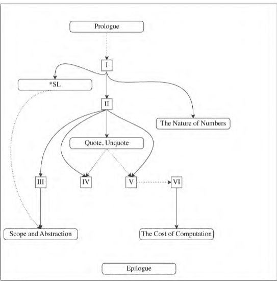

图 2：各部分和间奏曲之间的依赖关系

基于此图，以下是穿越本书的三条可行路径：

- 高中教师可能希望尽可能多地讲授第一部分和第二部分，包括一个小型项目，例如游戏。

- 采用季度制的大学教师可能希望专注于第一部分、第二部分、第三部分和第五部分，此外还包括关于 *SL 和 作用域* 的间奏曲。

- 采用学期制的大学教师可能希望尽早讨论设计中的性能权衡。在这种情况下，最好先讲授第一部分和第二部分，然后讲授不依赖于第五部分的第六部分累加器内容。到那时，就可以讨论间奏曲 5，并从这个角度学习本书的其余部分。

### 示例主题的迭代

本书会反复回顾某些练习和示例主题。例如，虚拟宠物贯穿第一部分，甚至出现在第二部分。同样，第一部分和第二部分都涵盖了实现交互式文本编辑器的替代方法。图出现在第五部分，紧接着又出现在第六部分。这些迭代的目的是为了激励迭代细化，并通过“后门”引入它。我们敦促教师布置这些主题练习序列，或自行创建此类序列。

## 不同之处

*如何设计程序* 第二版与第一版在若干主要方面有所不同：

- 1. 它明确区分了设计整个程序与构成程序的函数之间的差异。具体来说，本版本关注两种程序：事件驱动（主要是 GUI，但也包括网络）程序和批处理程序。

- 2. 程序设计先进行自顶向下的规划阶段，然后进行自底向上的构建阶段。我们明确展示了库接口如何决定某些程序元素的形式。特别是，程序设计的第一阶段会产生一个函数愿望清单。虽然愿望清单的概念在第一版中就存在，但第二版将其作为一个明确的设计元素。

- 3. 实现愿望清单中的每一项依赖于函数设计配方，这是本书六大部分的主题。

- 4. 结构化设计的一个关键元素是定义组合其他函数的函数。这种基于组合的设计对于批处理程序尤其有用。与生成递归一样，它需要一个“顿悟”时刻，具体来说，就是认识到：一个函数创建中间数据，第二个函数处理该中间结果，这会简化整体设计。这种方法也需要一个愿望清单，但制定这些愿望需要对中间数据定义进行富有洞察力的开发。本书第二版融入了许多关于基于组合的设计的明确练习。

> 我们感谢 Kathi Fisler 提请我们注意这一点。

- 5. 测试一直是我们设计理念的一部分，但教学语言和 DrRacket 直到 2002 年才开始正确支持它，就在我们发布第一版之后不久。这一新版本在很大程度上依赖这种测试支持。

- 6. 本版本书删去了命令式程序的设计内容。旧章节仍可在线阅读。这部分内容的改编版本将出现在该系列的第二卷 *如何设计组件* 中。

- 7. 本书的示例和练习使用了新的教学包。首选样式是通过 require 引入这些库，但仍然可以通过 DrRacket 的菜单添加教学包。

- 8. 最后，第二版与第一版在术语和记法方面也有几处不同：

| 第二版 | 第一版 |
|---|---|
| 签名 | 契约 |
| 项化 | 并集 |
| '() | empty |
| #true | true |
| #false | false |


最后三点差异极大地改善了列表的引用。

## 第一版致谢

四个人值得特别感谢：Robert “Corky” Cartwright，他与第一作者共同开发了莱斯大学入门课程的前身；Daniel P. Friedman，因为他要求第一作者在 1984 年重写 _The Little LISPper_（同样由 MIT Press 出版），因为这启动了本项目；John Clements，他设计、实现并维护 DrRacket 的单步调试器；以及 Paul Steckler，他忠实地通过为我们的编程工具套件做出贡献来支持团队。

本书的开发受益于许多其他朋友和同事，他们在课程中使用了本书，或/和对早期草稿提出了详细意见。我们感谢他们的帮助和耐心：Ian Barland、John Clements、Bruce Duba、Mike Ernst、Kathi Fisler、Daniel P. Friedman、John Greiner、Géraldine Morin、John Stone 和 Valdemar Tamez。

莱斯大学大约十几代 Comp 210 学生使用了本文的早期草稿，并以各种方式贡献了改进。此外，我们 TeachScheme! 工作坊的众多参与者在课堂上使用了早期草稿。许多人发送了评论和建议。作为这些人的代表，我们提及以下积极贡献者：Barbara Adler 女士、Stephen Bloch 博士、Karen Buras 女士、Jack Clay 先生、Richard Clemens 博士、Kyle Gillette 先生、Marvin Hernandez 先生、Michael Hunt 先生、Karen North 女士、Jamie Raymond 先生和 Robert Reid 先生。Christopher Felleisen 耐心地与父亲一起通读了本书的前几部分，并提供了年轻学生视角的直接见解。Hrvoje Blazevic（当时作为 _LPG/C Harriette_ 号船的船长）、Joe Zachary（犹他大学）和 Daniel P. Friedman（印第安纳大学）发现了初版中的众多拼写错误，我们现已修复。感谢每一个人。

最后，Matthias 对 Helga 表达感谢，感谢她多年的耐心，并为一个心不在焉的丈夫和父亲创造了一个家。Robby 对 Hsing-Huei Huang 表示感激，感谢她的支持和鼓励；没有她，他什么也成不了。Matthew 感谢 Wen Yuan 持续的支持和经久的音乐。Shriram 对 Kathi Fisler 感激不尽，感谢她的支持、耐心和双关语，以及她参与本项目。

## 致谢

与 2001 年一样，我们感谢 John Clements 设计、验证、实现并维护 DrRacket 的代数单步调试器。他已经这样做了近 20 年，该单步调试器已成为解释和教学不可或缺的工具。

在过去几年中，几位同事对各种草稿提出了评论并建议了改进。我们由衷感谢与以下人士进行的深思熟虑的交谈和交流：

Kathi Fisler（WPI 和布朗大学）、Gregor Kiczales（不列颠哥伦比亚大学）、Prabhakar Ragde（滑铁卢大学）和 Norman Ramsey（塔夫茨大学）。

多年来，成千上万的教师和培训师参加了我们的各种研讨会，许多人提供了宝贵反馈。但 Dan Anderson、Stephen Bloch、Jack Clay、Nadeem Abdul Hamid 和 Viera Proulx 脱颖而出，我们希望指出他们在制作本版中的作用。

Guillaume Marceau 与 Kathi Fisler 和 Shriram 合作，花了数月时间研究并改进了 DrRacket 中的错误消息。我们对他的出色工作表示感谢。

Celeste Hollenbeck 是有史以来最了不起的读者。她从不厌倦地质疑，直到理解散文。她不会停止，直到一个部分支持其论点、其组织匹配、其句子连贯。非常感谢你的非凡努力。

我们还要感谢以下人士：Saad Bashir、Steven Belknap、Stephen Bloch、Joseph Bogart、Tomas Cabrera、Estevo Castro、Stephen Chang、Jack Clay、Richard Cleis、John Clements、Mark Engelberg、Christopher Felleisen、Sebastian Felleisen、Vladimir Gajić、Adrian German、Ryan Golbeck、Jane Griscti、Alberto E. F. Guerrero、Nadeem Abdul Hamid、Wayne Iba、Jordan Johnson、Marc Kaufmann、Gregor Kiczales、Eugene Kohlbecker、Jackson Lawler、Ben Lerner、Elena Machkasova、Jay Martin、Jay McCarthy、Ann E. Moskol、Paul Ojanen、Klaus Ostermann、Alanna Pasco、S. Pehlivanoglu、David Porter、Norman Ramsey、Ilnar Salimzianov、Brian Schack、Tubo Shi、Stephen Siegel、Kartik Singhal、Marc Smith、Dave Smylie、Vincent St-Amour、 Éric Tanter、Sam Tobin-Hochstadt、Manuel del Valle、David Van Horn、Mitch Wand、Roelof Wobben 和 Andrew Zipperer，感谢他们对本第二版草稿的评论。

htdp.org 上的 HTML 布局是 Matthew Butterick 的作品，他为我们的在线文档创建了这些样式。

最后，我们感谢 MIT Press 的编辑 Ada Brunstein 和 Marie Lufkin Lee，她们允许我们在网上开发 *如何设计程序* 的第二版。我们还感谢 MIT 的 Christine Bridget Savage 和 Westchester Publishing Services 的 John Hoey 管理最终制作过程。John Donohue、Jennifer Robertson 和 Mark Woodworth 对稿件进行了出色的副本编辑。


## 序言：如何编程

当你还是个小孩时，你的父母教你用手指数数和进行简单的计算：“1 + 1 等于 2”；“1 + 2 等于 3”；依此类推。然后他们会问“3 + 2 等于多少？”而你会数一只手的手指。他们编程，你计算。在某种意义上，编程和计算的本质就这些。

从其网站下载 DrRacket。

现在是时候互换角色了。启动 DrRacket。这样会打开图 3 的窗口。从“语言”菜单中选择“选择语言”，这将打开一个对话框，列出《如何设计程序》的“教学语言”。选择“初学者学生”（初学者学生语言，或 BSL），然后单击“确定”以设置 DrRacket。完成此任务后，你可以进行编程，DrRacket 软件就变成了孩子。从所有计算中最简单的开始。你输入

```
(+ 1 1)
```

到 DrRacket 上半部分，单击“运行”，然后下半部分会显示 2。

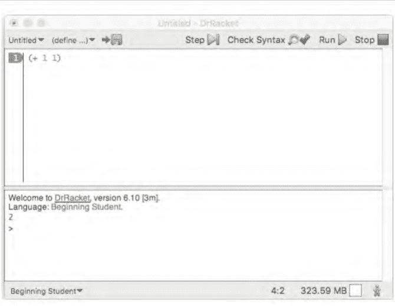

## 图 3：认识 DrRacket

编程就是这么简单。你仿佛在对一个孩子提问，DrRacket 为你计算。你也可以要求 DrRacket 一次处理多个请求：

```
(+ 2 2)
(* 3 3)
(- 4 2)
(/ 6 2)
```

单击“运行”后，你会在 DrRacket 的下半部分看到 4 9 2 3，这些是预期结果。

让我们放慢脚步片刻，介绍一些术语：

- DrRacket 的上半部分称为定义区。在此区域中，你创建程序，这称为编辑。一旦你在定义区添加一个词或更改某个内容，左上角就会出现“保存”按钮。当你第一次单击“保存”时，DrRacket 会要求你输入文件名，以便它可以永久存储你的程序。一旦你的定义区与文件关联，单击“保存”即可确保定义区的内容安全地存储在文件中。

- 程序由 *表达式* 组成。你在数学中见过表达式。目前，表达式要么是一个普通数字，要么是以左括号 “(” 开头并以匹配的右括号 “)” 结尾的内容——DrRacket 会通过给括号对之间的区域着色来奖励你。

- 当你单击 *运行* 时，DrRacket 会对定义区中的表达式求值，并在 *交互区* 中显示结果。然后，DrRacket，你忠实的仆人，在 *提示符 (>*) 处等待你的命令。提示符的出现表明 DrRacket 正在等待你输入其他表达式，它将像对待定义区中的表达式一样对其求值：

```
> (+ 1 1)
2
```

在提示符处输入一个表达式，按下键盘上的“回车”或“enter”键，观察 DrRacket 如何用结果响应。你可以随心所欲地多次这样做：

```
> (+ 2 2)
4
> (* 3 3)
9
> (- 4 2)
2
> (/ 6 2)
3
> (sqr 3)
9
> (expt 2 3)
8
> (sin 0)
0
> (cos pi)
#i-1.0
```

仔细看最后一个数字。它的 “#i” 前缀是 “我并不确切知道精确数字，暂且这样吧” 的缩写，或者说是一个 *不精确数字*。与计算器或其他编程系统不同，DrRacket 很诚实。当它


不知道确切数字，它会用这个特殊前缀警告你。稍后，我们将向你展示关于“计算机数字”的一些非常奇怪的事实，届时你将真正体会到DrRacket发出此类警告的好处。

到现在你或许在想DrRacket是否能一次加上两个以上的数字，答案是肯定的！事实上，它可以用两种不同的方式做到：

```
> (+ 2 (+ 3 4))
9
> (+ 2 3 4)
9
```

第一种是*嵌套算术*，就像你从学校学到的那样。第二种是*BSL算术*；而后者更自然，因为在这种记法中，你总是使用括号将操作和数字组合在一起。

> 这本书并不教你Racket，即使编辑器名为DrRacket。有关开发我们自己语言的选择的详细信息，请参阅前言，尤其是关于DrRacket和教学语言的部分。

在BSL中，每当你想要使用“计算器操作”时，你都要写一个左括号、你希望执行的操作（例如+）、操作作用的数字（由空格甚至换行符分隔），最后是一个右括号。操作后面的项目称为*操作数*。嵌套算术意味着你可以将表达式作为操作数，这就是为什么

```
> (+ 2 (+ 3 4))
9
```

你可以随心所欲地这样做：

```
> (+ 2 (+ (* 3 3) 4))
15
> (+ 2 (+ (* 3 (/ 12 4)) 4))
15
> (+ (* 5 5) (+ (* 3 (/ 12 4)) 4))
38
```

嵌套没有限制，除了你的耐心。

当然，当DrRacket为你计算时，它使用你从数学中熟知并喜爱的规则。和你一样，只有当所有操作数都是普通数字时，它才能确定加法的结果。如果操作数是一个带括号的运算符表达式——即以“(”和一个运算符开头的东西——它会先确定那个嵌套表达式的结果。与你不同，它从不需要思考先计算哪个表达式——因为这条第一条规则是唯一的规则。

DrRacket便利性的代价是括号有意义。你必须输入所有这些括号，并且不能输入太多。例如，虽然额外的括号你的数学老师可以接受，但BSL不行。表达式(+ (1) (2))包含太多括号，DrRacket会明确地让你知道：

```
> (+ (1) (2))
function call: expected a function after the open parenthesis, found a number
```

不过，一旦你习惯了BSL编程，你会发现这根本不算什么代价。首先，如果这样做很自然，你可以一次对多个操作数使用操作：

```
> (+ 1 2 3 4 5 6 7 8 9 0)
45
> (* 1 2 3 4 5 6 7 8 9 0)
0
```

如果你不知道一个操作对多个操作数的作用，可以在交互区输入一个示例并按“回车”；DrRacket会让你知道它是否工作以及如何工作。或者使用HelpDesk阅读文档。其次，当你阅读他人编写的程序时，你永远不需要思考先求值哪些表达式。括号和嵌套会立即告诉你。

如你所见，在线文本中操作的名称都链接到了HelpDesk中的文档。

在此语境下，编程就是编写可理解的算术表达式，而计算就是确定它们的值。使用DrRacket，探索这种编程和计算非常容易。

## 算术

如果编程仅仅关于数字和算术，那它会和数学一样乏味。幸运的是，编程远不止于数字：还有文本、真理、图像以及更多内容。

> 只是开玩笑：数学是一门迷人的学科，但目前你不需要学多少。

你需要知道的第一件事是，在BSL中，文本是任何用双引号(")括起来的键盘字符序列。我们称之为字符串。因此，"hello world"是一个完全正确的字符串；当DrRacket求值这个字符串时，它只是在交互区将其回显，就像数字一样：

```
> "hello world"
"hello world"
```

的确，许多人写的第一个程序就是显示这个字符串。

除此之外，你还需要知道，除了数字的算术，DrRacket还懂得字符串的算术。因此，这里有两个示例交互来说明这种算术形式：

```
> (string-append "hello" "world")
"helloworld"
> (string-append "hello " "world")
"hello world"
```

就像+一样，string-append是一个操作；它通过将第二个字符串添加到第一个字符串的末尾来创建一个字符串。如第一个交互所示，它是字面意思地这样做，在两个字符串之间不添加任何内容：没有空格，没有逗号，什么都没有。因此，如果你想看到短语"hello world"，你确实需要在这两个单词中的某个地方添加一个空格；第二个交互展示了这一点。当然，从这两个单词创建这个短语最自然的方法是输入

```
(string-append "hello" "" "world")
```

因为string-append，像+一样，可以处理任意数量的操作数。

你对字符串能做的不仅仅是追加。你可以从字符串中提取片段、将其反转、将所有字母转换为大写（或小写）、去除左右两侧的空格，等等。而且最好的是，你不需要记住任何这些内容。如果你需要知道可以对字符串做什么，请在HelpDesk中查找该术语。

> 使用F1或右侧的下拉菜单打开HelpDesk。查看BSL手册及其关于预定义操作的部分，尤其是字符串相关的操作。

如果你查阅了BSL的原语操作，你会发现原语（有时称为预定义或内置）操作可以消耗字符串并产生数字：

```
> (+ (string-length "hello world") 20)
31
> (number->string 42)
"42"
```

还有一个操作可以将字符串转换为数字：

```
> (string->number "42")
42
```

如果你期望的是“四十二”或类似巧妙的东西，抱歉，这确实不是你想从字符串计算器中得到的。

不过，最后一个表达式引发了一个问题。如果有人对一个用字符串引号括起来的非数字字符串使用string->number会怎样？在这种情况下，该操作会产生不同种类的结果：

```
> (string->number "hello world")
#false
```

这既不是数字也不是字符串；它是一个布尔值。与数字和字符串不同，布尔值只有两种：#true和#false。前者代表真，后者代表假。即便如此，DrRacket有几个用于

### 组合布尔值：

```
> (and #true #true)
#true
> (and #true #false)
#false
> (or #true #false)
#true
> (or #false #false)
#false
> (not #false)
#true
```

你会得到操作名称所暗示的结果。（不知道and、or和not计算什么？简单：(and x y)在x和y都为真时为真；(or x y)在x或y或两者都为真时为真；(not x)正好在x为#false时结果为#true。）

将两个数字“转换”为布尔值也很有用：

```
> (> 10 9)
#true
> (< -1 0)
#true
> (= 42 9)
#false
```

停！尝试以下三个表达式：(>= 10 10)、(<= -1 0)和(string=? "design" "tinker")。最后一个又有所不同；但别担心，你可以做到。

有了所有这些新的数据类型——是的，数字、字符串和布尔值都是数据——以及四处漂浮的操作，很容易忘记一些基础知识，比如嵌套算术：

```
(and (or (= (string-length "hello world")
   (string->number "11"))
  (string=? "hello world" "good morning"))
(>= (+ (string-length "hello world") 60) 80))
```

这个表达式的结果是什么？你是怎么算出来的？完全靠你自己？还是你只是把它输入到DrRacket的交互区并按下“回车”键？如果你做了后者，你觉得自己能独立做到这一点吗？毕竟，如果你无法预测DrRacket对小表达式的行为，那么在提交更大的任务进行求值时，你可能不想信任它。

在向你展示如何进行“真正”的编程之前，让我们再讨论一种数据来增加趣味性：图像。

当你像这样将图像插入交互区并按下“回车”时

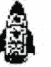

DrRacket会用图像回复。与许多其他编程语言不同，BSL理解图像，并且支持图像的算术，就像支持数字或字符串的算术一样。简而言之，你的程序可以对图像进行计算，并且你可以在交互区这样做。

此外，BSL程序员——与其他编程语言的程序员一样——会创建其他人可能觉得有用的库。使用这样的库就像用新单词扩展你的词汇量，或用新原语扩展你的编程词汇量一样。我们称这样的库为teachpacks，因为它们对教学很有帮助。

要将诸如此枚火箭之类的图像插入DrRacket，请使用插入菜单。或者，从浏览器复制并粘贴图像到DrRacket中。

一个重要的库——2htdp/image库——支持计算图像宽度和高度的操作：

```
(* (image-width ![rocket]) (image-height ![rocket]))
```

一旦你将库添加到程序中，点击RUN就会得到1176，因为那是28乘42图像的面积。

将(require 2htdp/image)添加到**定义区**，或者从语言菜单中选择“添加教学包”，然后从预安装的HTDP/2e教学包菜单中选择image。


你不必使用 Google 查找图像，并使用“插入”菜单将它们插入到你的 DrRacket 程序中。你也可以指示 DrRacket 从头开始创建简单图像：

```
> (circle 10 "solid" "red")
```


```
> (rectangle 30 20 "outline" "blue")
```


当表达式的结果是图像时，DrRacket 会将其绘制到交互区域。但除此之外，BSL 程序处理图像就像处理数字一样，将图像视为数据。特别是，BSL 有用于组合图像的操作，就像它有用于加数字或追加字符串的操作一样：

```
> (overlay (circle 5 "solid" "red")
(rectangle 20 20 "solid" "blue"))
```


以相反顺序叠加这些图像会产生一个实心蓝色正方形：

```
> (overlay (rectangle 20 20 "solid" "blue")
(circle 5 "solid" "red"))
```


停下来思考一下这个最后的结果片刻。

正如你所看到的，overlay 更像 string-append 而不是 +，但它确实像 string-append“追加”字符串、+ 加数字一样“组合”图像。下面是这个想法的另一个说明：

```
> (image-width (square 10 "solid" "red"))
10
```

```
> (image-width
(overlay (rectangle 20 20 "solid" "blue")
(circle 5 "solid" "red")))
20
```

这些与 DrRacket 的交互根本不会绘制任何东西；它们真的只是测量宽度。

还有两个重要的操作：empty-scene 和 place-image。第一个创建一个场景，一种特殊的矩形。第二个将图像放入这样的场景中：

```
(place-image (circle 5 "solid" "green")
50 80
(empty-scene 100 100))
```

你会得到这个：

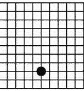

> 不完全是。图像没有带网格。我们在空场景上叠加网格，以便你可以看到绿点的确切位置。

从这张图中可以看出，原点（即 (0,0)）位于左上角。与数学不同，y 坐标向下测量，而不是向上。除此之外，图像显示了你应该期望的内容：在 100×100 的空矩形中，位于 (50,80) 坐标处的一个实心绿色圆盘。

让我们再总结一下。编程就是写下算术表达式，但你不再局限于枯燥的数字。在 BSL 中，算术是数字、字符串、布尔值乃至图像的算术。不过，计算仍然意味着确定表达式的值——只不过这个值可以是字符串、数字、布尔值或图像。

现在你已经准备好编写让火箭飞行的程序了。

## 输入与输出

你到目前为止编写的程序相当无趣。你写下一个或几个表达式；单击 RUN；你会看到一些结果。如果你再次单击 RUN，你会看到完全相同的结果。事实上，你可以随意单击 RUN 任意次，同样的结果会出现。简而言之，你的程序实际上就像口袋计算器上的计算，只不过 DrRacket 使用各种数据进行计算，而不仅仅是数字。

这是好消息也是坏消息。好消息是，编程和计算理应是使用计算器的自然推广。坏消息是，编程的目的是处理大量数据，并获得大量不同的结果，而计算大致相同。（它还应该快速计算这些结果，至少比我们快。）也就是说，在学会编程之前，你还需要学习更多。不过不用担心：凭借你对数字、字符串、布尔值和图像算术的所有知识，你几乎已经准备好编写一个创建电影的程序，而不仅仅是某处显示“hello world”的愚蠢程序。而这正是我们接下来要做的。

以防你不知道，电影是按顺序快速显示的一系列图像。如果你的代数老师知道你在上一节中看到的“图像算术”，你本可以在代数中制作电影，而不是枯燥的数字序列。好了，这里是另一个这样的表格：

| x = | 1 | 2 | 3 | 4 | 5 | 6 | 7 | 8 | 9 | 10 |
| --- | - | - | - | - | - | - | - | - | - | - |
| y = | 1 | 4 | 9 | 16 | 25 | 36 | 49 | 64 | 81 | ? |

你的老师现在会要求你填空，即用一个数字替换“？”标记。

事实证明，制作电影并不比完成这样的数字表格更复杂。事实上，这全都是关于这样的表格：

| x = | 1 | 2 | 3 | 4 |
| --- | - | - | - | - |
| y = | 方框内一点 | 方框内一点偏左 | 方框内一点偏下 | 方框内问号 |

具体来说，你的老师这里应该要求你画出第四张图像、第五张图像和第 1273 张图像，因为电影只是大量图像，每秒大约 20 或 30 张。所以你需要大约 1200 到 1800 张图像才能制作出一分钟的电影。

你可能还记得，你的老师不仅要求给出某个序列中的第四个或第五个数字，还要求给出一个从给定 x 确定序列中任何元素的表达式。在数字示例中，老师想要看到类似这样的东西：

$y = x \cdot x$

如果你为 x 代入 1、2、3 等等，你会得到 y 为 1、4、9 等等——正如表格所说。对于图像序列，你可以说类似这样的话：

$y = \text{顶部下方 } x^2 \text{ 像素处包含一个点的图像。}$

关键在于，这些单行代码不仅仅是表达式，而是函数。

乍一看，函数就像表达式，左边总是有一个 y，后面跟着一个 = 号，再跟一个表达式。然而，它们不是表达式。而且你在学校里经常看到的函数记法极其误导。因此，在 DrRacket 中，你写函数的方式略有不同：

```
(define (y x) (* x x))
```

define 表示“将 y 视为一个函数”，它像表达式一样计算一个值。不过，函数的值取决于所谓输入的值，我们用 (y x) 来表示。由于我们不知道这个输入是什么，我们使用一个名称来表示输入。遵循数学传统，我们在这里用 x 来代表未知的输入；但很快，我们将使用各种名称。

这一部分的意思是，你必须为 x 提供一个数字来确定 y 的特定值。当你这样做时，DrRacket 会将 x 的值代入与函数关联的表达式中。这里的表达式是 (* x x)。一旦 x 被替换为一个值，比如 1，DrRacket 就可以计算表达式的结果，这也被称为函数的输出。

单击 RUN 并观察没有任何事情发生。交互区域没有任何显示。DrRacket 的其他任何地方似乎都没有变化。就好像你没有完成任何事情。但你确实完成了。你实际上定义了一个函数并通知了 DrRacket 它的存在。事实上，后者现在已准备好供你使用该函数。输入

```
(y 1)
```

在交互区域的提示符处，并观察响应中出现一个 1。(y 1) 在 DrRacket 中被称为函数应用。尝试

```
(y 2)
```

你会看到弹出一个 4。当然，你也可以在定义区域中输入所有这些表达式并单击 RUN：

```
(define (y x) (* x x))
(y 1)
(y 2)
(y 3)
(y 4)
(y 5)
```

作为响应，DrRacket 显示：1 4 9 16 25，这些是表格中的数字。现在确定缺失的条目。

这一切对你意味着什么，就是函数提供了一种相当经济的方式，用单个表达式计算大量有趣的值。确实，程序就是函数；一旦你充分理解函数，你就几乎了解了编程需要知道的一切。鉴于它们的重要性，让我们回顾一下我们目前关于函数的了解：

- 首先，

```
(define (FunctionName InputName) BodyExpression)
```

你之所以能识别出这一点，是因为它以“define”关键字开头。它基本上由三部分组成：两个名称和


一个表达式。第一个名称是函数的名称；你需要它来随意应用该函数。第二个名称——称为参数——代表函数的输入，在应用函数之前都是未知的。这个表达式被称为主体，它为特定输入计算函数的输出。

- 第二，

```
(FunctionName ArgumentExpression)
```

是一个函数应用。第一部分告诉 DrRacket 你希望使用哪个函数。第二部分是你想要应用该函数的输入。如果你阅读的是 Windows 或 Mac 手册，它可能会告诉你，这个表达式“启动”名为 FunctionName 的“应用程序”，并且它将把 ArgumentExpression 作为输入进行处理。和所有表达式一样，后者可能是一段普通的数据，也可能是一个深层嵌套的表达式。

函数不仅可以输入数字，还可以输出各种类型的数据。我们的下一个任务是创建一个函数，模拟第二个表格——即带有彩色点图像的那个表格——就像第一个函数模拟数值表格一样。由于从表达式创建图像并非高中所学，让我们从简单的入手。你还记得 empty-scene 吗？我们在上一节末尾简要提到过它。当你将其输入交互区时，就像这样：

```
> (empty-scene 100 60)
```


DrRacket 生成一个空矩形，也称为场景。你可以使用 place-image 将图像添加到场景中：

```
> (place-image 50 23 (empty-scene 100 60))
```

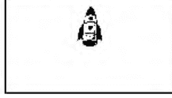

把火箭想象成一个对象，就像你数学课上那个表格中的点。不同之处在于火箭很有趣。

接下来，你应该让火箭下降，就像上面表格中的点一样。从上一节中，你知道如何通过增加提供给 place-image 的 y 坐标来实现这种效果：

```
> (place-image rocket 50 20 (empty-scene 100 60))
```

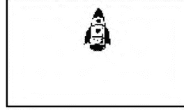

```
> (place-image rocket 50 30 (empty-scene 100 60))
```

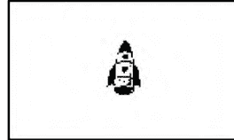

```
> (place-image rocket 50 40 (empty-scene 100 60))
```

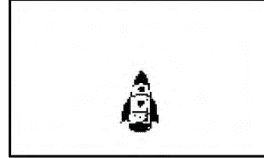

现在只需要轻松生成大量这样的场景，并以快速顺序显示它们。

当然，第一个目标可以通过一个函数来实现；请参见图 4。没错，这是一个函数定义。它不使用 y，而是使用名称 picture-of-rocket，这个名称立即告诉你函数输出什么：一个带有火箭的场景。函数定义不使用 x，而是使用 height 作为其参数的名称，这个名称暗示它是一个数字，并告诉函数在哪里放置火箭。函数的主体表达式与我们刚才实验的一系列表达式完全一样，只是用 height 代替了数字。我们可以用这一个函数轻松创建所有这些图像：

```
(picture-of-rocket 0)
(picture-of-rocket 10)
(picture-of-rocket 20)
(picture-of-rocket 30)
```

```
(define (picture-of-rocket height)
  (place-image 🚀 50 height (empty-scene 100 60)))
```

## 图 4：火箭着陆（版本 1）

在定义区或交互区尝试一下；两者都会创建预期的场景。

在 BSL 中，名称中可以使用各种字符，包括“-”和“.”。

第二个目标需要了解 2htdp/universe 库中的另一个原始操作：animate。因此，单击 RUN 并输入以下表达式：

```
> (animate picture-of-rocket)
```

停下来注意，参数表达式是一个函数。暂时不必担心将函数作为参数使用；它与 animate 配合良好，但目前不要在家里尝试定义类似 animate 的函数。

别忘了将 2htdp/universe 库添加到你的定义区。

一旦你按下“回车”键，DrRacket 就会计算该表达式；但它不会显示结果，甚至连提示符都不会显示。它会打开另一个窗口——一个画布——并启动一个每秒滴答 28 次的时钟。每次时钟滴答时，DrRacket 就会将 picture-of-rocket 应用于自该函数调用以来经过的滴答次数。这些函数调用的结果在画布中显示，产生动画电影的效果。模拟运行直到你关闭窗口。此时，animate 会返回经过的滴答次数。

问题是窗口中的图像来自哪里。简短的解释是，animate 在数字 0、1、2 等等上运行其操作数，并显示生成的图像。详细解释如下：

- animate 启动一个时钟并计算滴答次数；
- 时钟每秒滴答 28 次；
- 每次时钟滴答时，animate 都会将函数 picture-of-rocket 应用于当前的时钟滴答；以及
- 此应用创建的场景会在画布上显示。

这意味着火箭首先出现在高度 0，然后是 1，然后是 2，依此类推，这解释了为什么火箭从画布顶部下降到底部。也就是说，我们的三行程序在约 3.5 秒内创建大约 100 张图片，快速显示这些图片产生了火箭下降到地面的效果。

*练习 298 解释了如何设计 animate。*

这就是你在本节中学到的内容。函数很有用，因为它们可以在短时间内处理大量数据。你可以手动在少量选定的输入上启动函数，以确保它产生正确的输出。这称为测试函数。或者，DrRacket 可以借助某些库在大量输入上启动函数；当你这样做时，你就是在运行函数。当然，当你按下键盘上的键或操作计算机鼠标时，DrRacket 可以启动函数。要了解如何操作，请继续阅读。无论什么触发函数应用都不重要，但请记住，（简单的）程序就是函数。

## 多种计算方式

当你计算 `(animate picture-of-rocket)` 时，火箭最终会消失在地面里。这显然很荒谬。旧科幻电影中的火箭不会沉入地面；它们会优雅地落在底部，电影也应该就此结束。

这个想法表明，计算应根据情况以不同方式进行。在我们的例子中，picture-of-rocket 程序在火箭飞行时应照常工作。然而，当火箭底部触碰到画布底部时，它应该停止火箭继续下降。

从某种意义上说，这个想法对你来说不应该是新的。即使你的数学老师也会定义区分各种情况的函数：

sign(x) = 

| 条件 | 结果 |
|------|------|
| x > 0 | +1 |
| x = 0 | 0 |
| x < 0 | -1 |

这个 *sign* 函数区分三种输入：大于 0 的数字、等于 0 的数字和小于 0 的数字。根据输入不同，函数的结果是 +1、0 或 -1。

你可以在 DrRacket 中使用条件表达式轻松定义这个函数：

```
(define (sign x)
  (cond
    [(> x 0) 1]
    [(= x 0) 0]
    [(< x 0) -1]))
```

单击 *RUN* 后，你可以像使用任何其他函数一样与 *sign* 交互：

```
> (sign 10)
1
> (sign -5)
-1
> (sign 0)
0
```

在 DrRacket 中打开一个新标签页，从头开始。

一般来说，*条件表达式* 的形式如下：

```
(cond
  [ConditionExpression1 ResultExpression1]
  [ConditionExpression2 ResultExpression2]
  ...
  [ConditionExpressionN ResultExpressionN])
```

现在是探索 *STEP* 按钮功能的好时机。将 *(sign -5)* 添加到定义区，并为上面的 sign 程序单击 STEP。当新窗口出现时，单击其中的左右箭头。

也就是说，条件表达式由所需数量的 *条件行* 组成。每行包含两个表达式：左边通常称为 *condition*，右边称为 *result*；偶尔我们也使用 *question* 和 *answer*。要计算 cond 表达式，DrRacket 会计算第一个条件表达式，*ConditionExpression1*。如果结果为 #true，DrRacket 将用 *ResultExpression1* 替换 cond 表达式，计算它，并使用该值作为整个 cond 表达式的结果。如果 *ConditionExpression1* 的计算结果为 #false，DrRacket 会丢弃第一行并重新开始。如果所有条件表达式都计算为 #false，DrRacket 会报告错误。

有了这些知识，你现在可以改变模拟的进程。目的是不让火箭下降到 100×60 场景的地面以下。由于 *picture-of-rocket* 函数使用的是它应该在场景中放置火箭的高度，因此将给定高度与最大高度进行简单比较似乎就足够了。

有关修订后的函数定义，请参见图 5。该定义使用名称 *picture-of-rocket.v2* 来区分两个版本。使用不同的名称还允许我们在交互区中同时使用两个函数并比较结果。以下是原始版本的工作方式：

```
> (picture-of-rocket 5555)
```

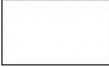

```
(define (picture-of-rocket.v2 height)
  (cond
    [(<= height 60)
     (place-image
      [rocket icon]
      50 height
      (empty-scene 100 60))]
    [(> height 60)
     (place-image
      [rocket icon]
      50 60
      (empty-scene 100 60))]))
```


## 图 5：火箭着陆（版本 2）

这是第二个：

```
> (picture-of-rocket.v2 5555)
```

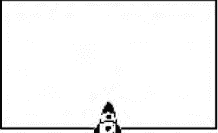

无论你给 picture-of-rocket.v2 什么数字，如果它超过 60，你都会得到相同的场景。特别是，当你运行

```
> (animate picture-of-rocket.v2)
```

火箭下降并陷入地面一半后才停止。

停！你觉得我们想看到什么？

这样着陆太丑了。不过，你知道如何修复程序的这一方面。正如你所见，BSL 了解图像的算术运算。当 place-image 将图像添加到场景时，它使用其中心点，就好像它是整个图像一样，尽管图像有真实的高度和宽度。如你所记得，你可以使用 image-height 操作来测量图像的高度。这个函数在这里很有用，因为你确实只想让火箭飞行，直到它的底部接触地面。

把两件事联系起来，你现在可以明白：

```
(- 60 (/ (image-height 🚀) 2))
```

这是你希望火箭停止下降的点。你可以通过直接与程序交互来得出这个结论，或者你可以在交互区域使用你的图像算术进行实验。

这是第一次尝试：

```
(place-image
 50 (- 60 (image-height 🚀))
(empty-scene 100 60))
```

现在将上述应用程序中的第三个参数替换为

```
(- 60 (/ (image-height 🚀) 2))
```

停！进行实验。你更喜欢哪个结果？

当你沿着这些思路思考和实验时，你最终会得到图 6 中的程序。给定一个表示火箭高度的数字，它首先测试火箭的底部是否在地面以上。如果是，它像以前一样将火箭放入场景。如果不是，它将火箭图像放置，使其底部接触地面。

```
(define (picture-of-rocket.v3 height)
(cond
[ (<= height (- 60 (/ (image-height 🚀) 2)))
(place-image
 50 height
(empty-scene 100 60))]
[ (> height (- 60 (/ (image-height 🚀) 2)))
(place-image
 50 (- 60 (/ (image-height 🚀) 2))
(empty-scene 100 60))])
```

图 6：火箭着陆（版本 3）

## 一个程序，多个定义

现在假设你的朋友观看动画但不喜欢画布的大小。他们可能会请求一个使用 200×400 场景的版本。这个简单的请求迫使你在程序中五处将 100 替换为 400，在其他两处将 60 替换为 200——更不用说 50 的出现，它实际上意味着“画布中央”。

停！在继续阅读之前，尝试这样做，以便了解对五行程序执行此请求有多困难。继续阅读时，请记住，现实世界中的程序包含 50,000 或 500,000 甚至 5,000,000 或更多行程序代码。

在理想程序中，像更改画布大小这样的小请求，应该只需要同样小的更改。在 BSL 中，实现这种简单性的工具是 define。除了定义函数，你还可以引入常量定义，它将某个名称分配给一个常量。常量定义的一般形式很简单：

```
(define Name Expression)
```

因此，例如，如果你写下

```
(define HEIGHT 60)
```

在你的程序中，你是在说 HEIGHT 始终表示数字 60。这样的定义的含义就是你所期望的。每当 DrRacket 在计算过程中遇到 HEIGHT 时，它都会改用 60。

现在看看图 7 中的代码，它实现了这个简单的更改，还为火箭图像命名。将程序复制到 DrRacket；点击 RUN 后，评估以下交互：

```
> (animate picture-of-rocket.v4)
```

确认程序仍像以前一样工作。

```
(define (picture-of-rocket.v4 h)
  (cond
    [(<= h (- HEIGHT (/ (image-height ROCKET) 2)))
     (place-image ROCKET 50 h (empty-scene WIDTH HEIGHT))]
    [(> h (- HEIGHT (/ (image-height ROCKET) 2)))
     (place-image ROCKET 50 (- HEIGHT (/ (image-height ROCKET) 2))
                    (empty-scene WIDTH HEIGHT))])

(define WIDTH 100)
(define HEIGHT 60)
(define ROCKET 🚀)
```

## 图 7：火箭着陆（版本 4）

图 7 中的程序包含四个定义：一个函数定义和三个常量定义。数字 100 和 60 只出现两次——一次作为 WIDTH 的值，一次作为 HEIGHT 的值。你可能还注意到，它对 picture-of-rocket.v4 的函数参数使用 h 而不是 height。严格来说，这个更改并非必要，因为 DrRacket 不会将 height 与 HEIGHT 混淆，但我们这样做是为了避免混淆 **你**。

当 DrRacket 评估 `(animate picture-of-rocket.v4)` 时，它每次遇到这些名称时都会将 HEIGHT 替换为 60，WIDTH 替换为 100，ROCKET 替换为图像。要体验真正程序员的乐趣，请将 HEIGHT 旁边的 60 改为 400，然后点击 RUN。你看到火箭在 100×400 的场景中下降并着陆。一小改动就搞定了一切。

从现代说法来看，你刚刚体验了第一次 _程序重构_。每次你重新组织程序以便为未来可能的更改请求做准备时，你就在重构你的程序。把它写进你的简历。听起来不错，你的未来雇主可能喜欢阅读这样的流行语，即使这不能让你成为一个好程序员。然而，一个好程序员绝不会忍受的是，程序中包含同一个表达式三次：

```
(- HEIGHT (/ (image-height ROCKET) 2))
```

每次你的朋友和同事阅读这个程序时，他们需要理解这个表达式计算的是什么，即，画布顶部与落在地面上的火箭中心点之间的距离。每次 DrRacket 计算表达式的值时，它都需要执行三个步骤：（1）确定图像的高度；（2）将其除以 2；（3）将结果从 HEIGHT 中减去。而且，每次都得出相同的数字。

这一观察要求引入另一个定义：

```
(define ROCKET-CENTER-TO-TOP
 (- HEIGHT (/ (image-height ROCKET) 2)))
```

现在在程序的其余部分中用 ROCKET-CENTER-TO-TOP 替换表达式 `(- HEIGHT (/ (image-height ROCKET) 2))`。你可能会想知道这个定义应该放在 HEIGHT 定义的上面还是下面。更一般地，你应该想知道定义的顺序是否重要。答案是，对于常量定义，顺序很重要；而对于函数定义，则不重要。一旦 DrRacket 遇到常量定义，它就会确定表达式的值，然后将名称与该值关联。例如，

```
(define HEIGHT (* 2 CENTER))
(define CENTER 100)
```

当 DrRacket 遇到 HEIGHT 的定义时，会抱怨“CENTER 在其定义之前被使用”。相比之下，

```
(define CENTER 100)
(define HEIGHT (* 2 CENTER))
```

按预期工作。首先，DrRacket 将 CENTER 关联到 100。其次，它评估 (* 2 CENTER)，结果为 200。最后，DrRacket 将 200 关联到 HEIGHT。

虽然常量定义的顺序很重要，但你将常量定义相对于函数定义放置的位置并不重要。事实上，如果你的程序包含许多函数定义，它们的顺序也不重要，不过最好先引入所有常量定义，然后按重要性递减的顺序引入函数定义。当你开始编写自己的多定义程序时，你会明白为什么这种顺序很重要。

> 该程序还包含两个行注释，由分号（“;”）引入。虽然 DrRacket 忽略此类注释，但阅读程序的人不应该忽略，因为注释是面向人类读者的。它是程序作者与所有未来读者之间的一种“后沟通渠道”，用于传达关于程序的信息。

一旦你消除了所有重复的表达式，你就会得到图 8 中的程序。它包含一个函数定义和五个常量定义。除了火箭中心的位置之外，这些常量定义还将图像本身以及空场景的创建提取出来了。


```scheme
; constants
(define WIDTH 100)
(define HEIGHT 60)
(define MTSCN (empty-scene WIDTH HEIGHT))
🚀
(define ROCKET
🚀
(define ROCKET-CENTER-TO-TOP
 (- HEIGHT (/ (image-height ROCKET) 2)))
; functions
(define (picture-of-rocket.v5 h)
 (cond
  [(<= h ROCKET-CENTER-TO-TOP)
   (place-image ROCKET 50 h MTSCN)]
  [(> h ROCKET-CENTER-TO-TOP)
   (place-image ROCKET 50 ROCKET-CENTER-TO-TOP MTSCN)]))
```

## 图 8：降落火箭（版本 5）

在继续阅读之前，请思考一下对程序的以下更改：

- 你将如何修改程序以创建 200×400 的场景？
- 你将如何修改程序以描绘一架绿色 UFO（未识别飞行物）的降落？绘制 UFO 很容易：
  (overlay (circle 10 "solid" "green")
  (rectangle 40 4 "solid" "green"))
- 你将如何修改程序以使背景始终为蓝色？
- 你将如何修改程序以使火箭降落在比场景底部高 10 像素的平坦岩石床上？别忘了也更改景观。

与其沉思，不如行动。这是学习的唯一方式。所以别让我们拦着你。就去做吧。

**魔法数字** 再次查看 picture-of-rocket.v5。由于我们消除了所有重复表达式，此函数定义中除一个数字外，所有数字都消失了。在编程世界中，这些数字被称为 _魔法数字_，没人喜欢它们。你还没来得及反应，就会忘记数字的作用以及哪些更改是合理的。最好在定义中为这些数字命名。

这里我们其实知道 50 是我们为火箭选择的 x 坐标。虽然 50 看起来不像什么表达式，但它确实也是一个重复表达式。因此，我们有两个理由从函数定义中消除 50，这件事留给你来做。

## 再加一个定义

回想一下，animate 实际上将其函数应用于首次调用以来经过的时钟滴答数。也就是说，picture-of-rocket 的参数不是高度，而是时间。我们之前对 picture-of-rocket 的定义为函数参数使用了错误的名称；它不应使用 h（height 的缩写），而应使用 t 表示时间：

```scheme
(define (picture-of-rocket t)
 (cond
  [(<= t ROCKET-CENTER-TO-TOP)
   (place-image ROCKET 50 t MTSCN)]
  [(> t ROCKET-CENTER-TO-TOP)
   (place-image ROCKET
    50 ROCKET-CENTER-TO-TOP
    MTSCN) ]))
```

对定义的这一小改动立即澄清了该程序将时间当作距离来使用。这是个糟糕的主意。

> 前方高能！本节介绍了一点物理知识。如果物理让你害怕，第一次阅读时可以跳过；编程不需要物理知识。

即使你从未上过物理课，也知道时间不是距离。所以我们的程序碰巧能运行。不过别担心；这很容易修复。你只需要知道一点火箭科学，像我们这样的人称之为物理。

物理？！好吧，你可能已经忘了那门课学的东西。或者，你可能从未上过物理课，因为你太年轻或太文雅了。别担心。最好的程序员也经常遇到这种情况，因为他们需要帮助音乐、经济学、摄影、护理以及各种其他领域的人解决问题。显然，连程序员也不可能无所不知。所以他们会查阅需要知道的内容。或者与合适的人交谈。如果你和一位物理学家交谈，你会发现行进的距离与时间成正比：

$d = v \cdot t$

也就是说，如果一个物体的速度是 v，那么该物体在 t 秒内行进 d 英里（或米或像素或任何单位）。

当然，老师应该向你展示一个合适的函数定义：

$d(t) = v \cdot t$

因为这能让每个人立即明白 d 的计算取决于 t，而 v 是一个常数。程序员会更进一步，为这些单字母缩写使用有意义的名称：

```scheme
(define v 3)
(define (distance t)
  (* v t))
```

这段程序片段包含两个定义：一个名为 distance 的函数，用于计算以恒定速度行进的物体的行驶距离；以及一个名为 v 的常数，用于描述速度。

你可能会问，这里为什么 v 是 3。没有特别的原因。我们认为每个时钟滴答 3 像素是一个不错的速度。你可能不这么认为。试着调整这个数字，看看动画会发生什么。

现在我们可以再次修复 picture-of-rocket 了。函数不再将 t 与高度进行比较，而是可以使用 (distance t) 来计算火箭下降了多远。最终程序如图 9 所示。它包含两个函数定义：picture-of-rocket.v6 和 distance。其余的常数定义使函数定义易于读取和修改。一如既往，你可以使用 animate 运行此程序：

```scheme
> (animate picture-of-rocket.v6)
```

```scheme
; properties of the "world" and the descending rocket
(define WIDTH 100)
(define HEIGHT 60)
(define V 3)
(define X 50)

; graphical constants
(define MTSN (empty-scene WIDTH HEIGHT))

(define ROCKET )
(define ROCKET-CENTER-TO-TOP
 (- HEIGHT (/ (image-height ROCKET) 2)))

; functions
(define (picture-of-rocket.v6 t)
 (cond
  [(<= (distance t) ROCKET-CENTER-TO-TOP)
   (place-image ROCKET X (distance t) MTSN)]
  [(> (distance t) ROCKET-CENTER-TO-TOP)
   (place-image ROCKET X ROCKET-CENTER-TO-TOP MTSN)]))

(define (distance t)
 (* V t))
```

## 图 9：降落火箭（版本 6）

与 picture-of-rocket 的早期版本相比，这个版本表明一个程序可能由多个相互引用的函数定义组成。同样，即使是第一个版本也用了 + 和 /——只是你把它们当作 BSL 中内置的东西。

当你成为一名十足的程序员时，你会发现程序由许多函数定义和许多常数定义组成。你还会看到函数不断地相互引用。你真正需要练习的是组织它们，以便你可以轻松阅读，即使在完成几个月后也是如此。毕竟，你之前的版本——或其他人——会想对这些程序进行修改；如果你无法理解程序的组织结构，即使是最小的任务也会让你感到困难。除此之外，你基本上已经知道需要知道的一切。

## 你现在是一名程序员了

前一节末尾说你是一名程序员，这可能让你感到惊讶，但这是事实。你了解关于 BSL 的所有机制。你知道编程使用数字、字符串、图像以及你所选编程语言支持的其他数据的算术。你知道程序由函数和常数定义组成。你知道，因为我们告诉过你，归根结底，一切都是关于正确地组织这些定义。最后但同样重要的是，你知道 DrRacket 和教学包支持许多其他函数，且 DrRacket 的 HelpDesk 解释了这些函数的作用。

你可能认为你还不知道足够多的东西来编写响应击键、鼠标点击等的程序。结果却并非如此。除了 animate 函数之外，2htdp/universe 库还提供其他函数，可将你的程序与键盘、鼠标、时钟以及计算机中的其他移动部件连接起来。实际上，它甚至支持编写将你的计算机与世界上任何其他计算机连接的程序。所以这真的不是问题。

简而言之，你已经了解了组装程序的几乎所有机制。如果你阅读所有可用函数的文档，你可以编写玩有趣的电脑游戏、运行模拟或跟踪业务账户的程序。问题是，这到底是否意味着你是一名程序员。你是吗？

停！别翻页。思考一下！

## 并非如此！

当你在随便一家书店的“编程”书架前查看时，你会看到大量声称能让你立刻成为程序员的书。不过，现在你已经学习了一些初始示例，可能意识到这绝不可能发生。

掌握编程的机械技能——学习编写计算机能理解的表达式，了解哪些函数和库可用，以及类似的活动——对**真正的**编程帮助不大。如果情况是这样，你同样可以通过背诵词典中的一千个单词和语法书中的几条规则来学习一门外语。

良好的编程远不止是掌握一门语言的机械技能。最重要的是，要牢记程序员编写程序是为了让他人在未来阅读。一个好的程序反映了问题陈述及其重要概念。它附带简洁的自我描述。示例阐释了这一描述，并将其与问题联系起来。这些示例确保未来的读者知道你的代码为什么以及如何工作。简而言之，良好的编程是关于系统地解决问题，并在代码中传达系统。最棒的是，这种编程方法实际上让每个人都能接触编程——所以它一举两得。

本书的其余部分全部讲述这些内容；书中很少涉及 DrRacket、BSL 或库的机械操作。本书向你展示了优秀程序员如何思考问题。而且，你甚至会学到这种解决问题的方法也适用于生活中的其他情况，例如医生、记者、律师和工程师的工作。

哦，顺便说一句，本书的其余部分使用的语气比这篇序言更适合严肃的文本。祝阅读愉快！

**关于本书不涉及的内容** 编程入门书籍往往包含大量关于作者最喜欢的应用学科的材料：谜题、数学、物理、音乐等等。这种材料很自然，因为编程在这些领域都显然很有用，但它也会分散对编程本质元素的注意力。因此，我们竭力尽量减少其他领域知识的使用，以便


我们可以关注计算机科学能教你关于计算问题解决的知识。


## 与客户会议笔记

- 在历史保护街区设计一栋单户住宅
- 方案：3卧室，2浴室 + 客厅、餐厅、厨房、工作室、游戏室、杂用室、甲板/门廊，约2000平方英尺，每平方英尺80美元
- 特殊要求：
  - 厨房和卧室有早晨阳光
  - 入口区域的楼梯作为视觉焦点
  - 公共区域与室外有强烈的联系
  - 全天有阳光的门廊和门廊秋千
- 功能关系气泡图

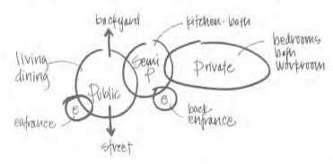

## 固定大小数据

每种编程语言都附带一种数据语言和一种对数据操作的语言。第一种语言始终提供某种形式的原子数据；为了将现实世界中各种信息表示为数据，程序员必须学习组合基本数据并描述此类组合。同样，第二种语言提供一些对原子数据的基本操作；程序员的任务是将这些操作组合成执行所需计算的程序。我们使用 _算术_ 来指代编程语言这两部分的结合，因为它概括了你从小学所学的知识。

本书第一部分（I）介绍了 BSL 的算术，BSL 是序言中使用的编程语言。从算术起步，距离你的第一个简单程序仅一步之遥，你可能从数学中了解这些程序，称之为 _函数_。不过，在你意识到之前，编写程序的过程看起来会让人困惑，你会渴望找到一种组织思路的方法。我们将“组织思路”等同于 _设计_，本书第一部分将向你介绍一种系统的程序设计方法。

## 1 算术

从序言中，你已了解如何用 BSL 记法写下你从一年级就熟知的 *表达式*：

- 写入“(”，
- 写下原语操作 op 的名称，
- 写下参数，用空格分隔，并且
- 写入")"

提醒一下，这是一个原始表达式示例：

```
(+ 1 2)
```

它使用 +，即加两个数的操作，后跟两个参数，这两个参数是普通数字。但这里还有另一个示例：

```
(+ 1 (+ 1 (+ 1 1) 2) 3 4 5)
```

这个第二个示例利用了上述描述中两个存在歧义的地方。首先，原语操作可以使用超过两个参数。其次，参数不必严格是数字；它们也可以是表达式。

> 快速浏览本章，跳到第二章，当你遇到不认识的“算术”时，再回来这里。

求值表达式也很简单。首先，BSL 求值原语操作的所有参数。其次，它将生成的数据片段“喂”给操作，从而产生结果。因此，

```
(+ 1 2)
==
3
```

和

```
(+ 1 (+ 1 (+ 1 1) 2) 3 (+ 2 2) 5)
==
(+ 1 (+ 1 2 2) 3 4 5)
==
(+ 1 5 3 4 5)
==
18
```

这些计算应该让你感到熟悉，因为它们与你在数学课上进行的计算类型相同。你可能以不同的方式写下步骤；你可能从未被教导如何写下一系列计算步骤。然而，BSL 的计算方式与你一样，这应该是一种宽慰。它保证你了解它对原始操作和原始数据的处理，因此有希望你能预测你的程序将计算什么。一般来说，程序员了解所选语言如何计算至关重要，否则程序的计算可能会伤害使用它的人或代表他们进行计算的人。

> _我们使用_ == _来表示“根据计算法则相等。”_

本章余下部分介绍了 BSL 的四种 _原子数据_ 形式：数字、字符串、图像和布尔值。此处的“atomic”一词借用了物理学的概念。你无法查看原子数据片段的内部，但你拥有可将多个原子数据片段组合成另一个数据片段的函数，也可以以原子数据的形式检索它们的“属性”，等等。本章各节将介绍其中一些函数，也称为 _原语操作_ 或 _预定义操作_。你可以在随 DrRacket 附带的 BSL 文档中找到其他函数。

> _下一卷，How to Design Components，将解释如何设计原子数据。_

### 1.1 数字的算术

大多数人听到“算术”时，会想到“数字”和“对数字的操作”。“对数字的操作”意味着将两个数字相加得到第三个数字，将一个数字从另一个数字中减去，确定两个数字的最大公约数，以及更多此类操作。如果我们不过于字面地理解算术，甚至可以包括角度的正弦、将实数四舍五入到最接近的整数等等。

BSL 语言支持数字及其上的算术。如在序言中讨论的，像 + 这样的算术操作是这样使用的：

```
(+ 3 4)
```

即，使用前缀记法形式。以下是我们语言提供的一些数字操作：+、-、*、/、abs、add1、ceiling、denominator、exact->inexact、expt、floor、gcd、log、max、numerator、quotient、random、remainder、sqr 和 tan。我们按字母顺序随意挑选，只是为了展示操作的多样性。去探索它们计算什么，然后再找出还有多少操作。

如果你需要一个你在数学课上学过的数字操作，BSL 很可能也知道它。猜测它的名称并在交互区中尝试。假设你需要计算某个角度的正弦；尝试：

```
> (sin 0)
0
```

然后就可以永远愉快地使用它了。或者在 HelpDesk 中查找。你会发现，除了操作之外，BSL 还认识一些广泛使用的数字的名称，例如 pi 和 e。

> 你可能从微积分中了解 e。它是一个实数，接近 2.718，称为“欧拉常数”。

说到数字，BSL 程序可以使用自然数、整数、有理数、实数和复数。我们假设你除了最后一个之外都听说过。最后一个可能在你的高中课堂中提到过。如果没有，别担心；虽然复数对各种计算都很有用，但初学者不必了解它们。

一个真正重要的区别涉及数字的精度。目前，重要的是要理解 BSL 区分 *精确数字* 和 *不精确数字*。在使用精确数字进行计算时，BSL 会尽可能保留此精度。例如，`(/ 4 6)` 生成精确分数 2/3，DrRacket 可以将其呈现为真分数、假分数或带小数。玩弄你的计算机鼠标，找到将分数转换为小数展开式的菜单。

BSL 的一些数字操作无法产生精确结果。例如，对 2 使用 `sqrt` 操作会产生一个无法用有限位数描述的无理数。由于计算机大小有限，BSL 必须以某种方式将此类数字装入计算机，因此它选择了一个近似值：1.4142135623730951。如在序言中提到的，`#i` 前缀警告新手程序员注意这种精度不足。虽然大多数编程语言都以这种方式降低精度，但很少宣传这一点，更少警告程序员。

**关于数字** “Number”一词泛指多种数字，包括计数数、整数、有理数、实数甚至复数。在大多数用途中，你可以安全地将 Number 等同于小学阶段的数轴，尽管有时这种等效过于不精确。如果我们希望精确，则使用合适的词汇：*整数*、*有理数* 等等。我们甚至可以使用 *正整数*、*非负数*、*负数* 等标准术语来进一步细化这些概念。**结束**

**练习** 1. 将 `x` 和 `y` 的以下定义添加到 DrRacket 的定义区域：

```
(define x 3)
(define y 4)
```

现在假设 `x` 和 `y` 是笛卡尔点的坐标。写下一个计算该点到原点距离的表达式，即坐标为 (0,0) 的点。

这些值的预期结果是 5，但即使你更改了这些定义，你的表达式也应该产生正确的结果。


以防万一你没有上过几何课，或者你忘了在那里遇到的公式，点 (x,y) 到原点的距离为
$\sqrt{x^2 + y^2}$
到原点。毕竟，我们在教你如何设计程序，而不是如何成为一名几何学家。

为了开发所需的表达式，最好点击 RUN 并在交互区进行实验。RUN 动作会告诉 DrRacket 当前 x 和 y 的值，以便你可以尝试涉及 x 和 y 的表达式：

```
> x
3
> y
4
> (+ x 10)
13
> (* x y)
12
```

当你得到能产生正确结果的表达式后，将其从交互区复制到定义区。

为了确认表达式正常工作，将 x 改为 12，y 改为 5，然后点击 RUN。结果应该是 13。

你的数学老师可能会说，你已经计算了距离公式。要在其他输入上使用该公式，你需要打开 DrRacket，编辑 x 和 y 的定义以表示所需的坐标，然后点击 RUN。但这种重用距离公式的方式既麻烦又幼稚。我们很快会向你展示定义函数的方法，这使得重用公式变得简单直接。目前，我们使用这种练习来引起对函数概念的关注，并为使用函数进行编程做好准备。

### 1.2 字符串的运算

关于计算机存在着普遍的偏见，即关注其内部构造。许多人认为这全都关于位和字节——无论那些是什么——可能还有数字，因为每个人都知道计算机可以计算。虽然电气工程师必须将计算机视为这样一个对象来理解和研究，但初学者程序员和其他任何人都永远不必（绝不）屈服于这种思维。

编程语言关乎使用信息进行计算，而信息有各种形状和形式。例如，程序可能会处理颜色、姓名、商务信函或人与人之间的对话。尽管我们可以将此类信息编码为数字，但这将是一个糟糕的主意。试想一下要记住大量的代码表，例如 0 表示“red”，1 表示“hello”，等等。

相反，大多数编程语言至少提供一种处理此类符号信息的数据类型。目前，我们使用 BSL 的字符串。一般而言，String 是可以在键盘上输入的字符序列，再加上几个我们暂时不关心的其他字符，并用双引号括起来。在序言中，我们已经见过一些 BSL 字符串："hello"、"world"、"blue"、"red" 等。前两个是可能出现在对话或信件中的单词；其余的是我们可能希望使用的颜色名称。

注意 我们使用 1String 来指代构成 String 的键盘字符。例如，"red" 由三个这样的 1String 组成："r"、"e"、"d"。事实证明，1String 的定义还有更多内容，但目前将它们视为长度为 1 的 String 即可。结束

BSL 只包含一种专门使用并生成字符串的操作：string-append，正如我们在序言中所见，它将两个给定字符串连接为一个。可以将 string-append 视为类似 + 的操作。后者使用两个（或多个）数字并生成一个新数字，而前者使用两个或多个字符串并生成一个新字符串：

```
> (string-append "what a " "lovely " "day" " 4 BSL")
"what a lovely day 4 BSL"
```

当 + 将数字相加时，给定数字本身不会改变，当 string-append 将字符串连接成一个大字符串时，给定字符串本身也不会改变。如果你希望求值此类表达式，只需认为 string-append 遵循与 + 类似的显而易见的法则即可：

```
(+ 1 1) == 2   (string-append "a" "b") == "ab"
(+ 1 2) == 3   (string-append "ab" "c") == "abc"
(+ 2 2) == 4   (string-append "a" " " ) == "a "
...   ...
```

### 练习 2. 将以下两行添加到定义区：

```
(define prefix "hello")
(define suffix "world")
```

然后使用字符串原语创建一个表达式，将 prefix 和 suffix 连接并在中间添加 "_"。运行此程序时，你将在交互区看到 "hello_world"。

有关如何使用 DrRacket 创建表达式，请参见练习 1。

### 1.3 混合使用

BSL 中所有其他与字符串相关的操作都使用或生成非字符串数据。以下是一些示例：

- string-length 使用一个字符串并生成一个数字；
- string-ith 使用一个字符串 s 和一个数字 i，并提取位于第 i 个位置（从 0 开始计数）的 1String；以及
- number->string 使用一个数字并生成一个字符串。

还可以查阅 substring 并了解它的作用。

如果 HelpDesk 中的文档看起来令人困惑，请在交互区尝试这些函数。为它们提供适当的参数，并找出它们计算的内容。还可以为某些操作使用不适当的参数，只是为了看看 BSL 如何反应：

```
> (string-length 42)
string-length:expects a string, given 42
```

如你所见，BSL 报告了一个错误。第一部分“string-length”告诉你哪个操作被误用；后半部分说明参数的问题所在。在这个特定示例中，string-length 本应应用于字符串，但却给出了一个数字，即 42。

当然，只要你跟踪哪些是合适的、哪些不合适，就可以嵌套使用使用和生成不同种类数据的操作。请考虑序言中的这个表达式：

```
(+ (string-length "hello world") 20)
```

内部表达式将 string-length 应用于 "hello world"，我们最喜欢的字符串。外部表达式让 + 使用内部表达式的结果和 20。

让我们逐步确定这个表达式的结果：

```
(+ (string-length "hello world") 20)
==
(+ 11 20)
==
31
```

毫不奇怪，处理此类混合数据的嵌套表达式的计算与处理数值表达式的计算没有区别。以下是另一个示例：

```
(+ (string-length (number->string 42)) 2)
==
(+ (string-length "42") 2)
==
(+ 2 2)
==
4
```

在继续之前，请构造一些以**错误**方式混合数据的嵌套表达式，例如，

```
(+ (string-length 42) 1)
```

在 DrRacket 中运行它们。研究红色的错误消息，但也要注意 DrRacket 在定义区中高亮显示的内容。

### 练习 3. 将以下两行添加到定义区：

```
(define str "helloworld")
(define i 5)
```

然后创建一个使用字符串原语的表达式，在位置 i 处添加 "_"。通常，这意味着生成的字符串比原字符串更长；在这里，预期结果是 "hello_world"。

_位置_ 意味着从字符串左侧开始计算的 _i_ 个字符，但程序员从 0 开始计数。因此，本示例中的第 5 个字母是 "w"，因为第 0 个字母是 "h"。**提示** 当你遇到此类“计数问题”时，可能希望在 str 下方添加一串数字以帮助计数：

```
(define str "helloworld")
(define ind "0123456789")
(define i 5)
```

有关如何在 DrRacket 中创建表达式，请参见练习 1。

### 练习 4. 使用与练习 3 相同的设置来创建一个从 str 中删除第 i 个位置的表达式。显然，此表达式创建的字符串比给定的字符串更短。哪些 i 的值是合法的？

### 1.4 图像的运算

Image 是一段可视的矩形数据，例如一张照片或一个几何图形及其边框。你可以在 DrRacket 中任何可以编写表达式的地方插入图像，因为图像是值，就像数字和字符串一样。

> 请记住在新选项卡中引入 2htdp/image 库。

你的程序也可以使用原始操作来操纵图像。这些原始操作有三种类型。第一种类型涉及创建基本图像：

- circle 从半径、模式字符串和颜色字符串生成一个圆形图像；
- ellipse 从两个半径、模式字符串和颜色字符串生成一个椭圆图像；
- line 从两个点和一个颜色字符串生成一条线段；
- rectangle 从宽度、高度、模式字符串和颜色字符串生成一个矩形图像；
- text 从字符串、字体大小和颜色字符串生成一个文本图像；以及
- triangle 从大小、模式字符串和颜色字符串生成一个向上指的等边三角形图像。

这些操作的名称大多说明了它们创建哪种类型的图像。你只需知道，模式字符串表示 "solid" 或 "outline"，而颜色字符串是类似 "orange"、"black" 等字符串。

在交互窗口中尝试这些操作：


```
> (circle 10 "solid" "green")

> (rectangle 10 20 "solid" "blue")

> (star 12 "solid" "gray")
```

停止！上面使用了之前未提及的操作。查阅其文档，找出 2htdp/image 库还附带多少这样的操作。尝试你找到的操作。

图像的第二类函数涉及图像属性：

- image-width 确定图像的宽度（以像素为单位）；
- image-height 确定图像的高度；

它们从图像中提取你所期望的那种值：

```
> (image-width (circle 10 "solid" "red"))
20
> (image-height (rectangle 10 20 "solid" "blue"))
20
```

停止！解释 DrRacket 如何确定这个表达式的值：

```
(+ (image-width (circle 10 "solid" "red"))
(image-height (rectangle 10 20 "solid" "blue")))
```

对图像组合原语的第三类有正确理解需要引入一个新概念：*锚点*。图像不仅仅是一个单一像素，它由许多像素组成。具体来说，每个图像就像一张照片，即一个像素矩形。这些像素中有一个是隐式锚点。当你使用图像原语组合两个图像时，组合是相对于锚点进行的，除非你显式指定其他点：

- overlay 将其应用到的所有图像堆叠在一起，使用中心作为锚点；
- overlay/xy 类似于 overlay，但在两个图像参数之间接受两个数字——x 和 y。它将第二个图像向右移动 x 个像素、向下移动 y 个像素——所有这些都相对于第一个图像的左上角；不出所料，负的 x 将图像向左移动，负的 y 将图像向上移动；以及
- overlay/align 类似于 overlay，但接受两个字符串，将锚点（或锚点）移动到矩形的其他部分。总共有九个不同的位置；尝试所有可能性！

2htdp/image 库还附带许多其他用于组合图像的原语函数。当你熟悉图像处理后，会想要阅读关于这些函数的内容。目前，我们介绍三个更多，因为它们对于创建动画场景和游戏图像很重要：

- empty-scene 创建一个给定宽度和高度的矩形；
- place-image 将图像放置到场景中的指定位置。如果图像不适合给定场景，则会适当地裁剪它；
- scene+line 接受一个场景、四个数字和一种颜色，在给定图像中绘制一条线。尝试它以了解其工作原理。

图像的运算定律与数字的类似；参见图 10 了解一些示例以及与数字运算的对比。同样，没有图像被销毁或更改。像 + 一样，这些原语只是以某种方式组合给定图像来创建新图像。

## 图 10：图像创建的定律

| 数字的运算 | 图像的运算 |
| :--- | :--- |
| `(+ 1 1) == 2` | `(overlay (square 4 "solid" "orange") (circle 6 "solid" "yellow"))` |
| `(+ 1 2) == 3` | `(underlay (circle 6 "solid" "yellow") (square 4 "solid" "orange"))` |
| `(+ 2 2) == 4` | `(place-image (circle 6 "solid" "yellow") 10 10 (empty-scene 20 20))` |

### **练习 5.** 使用 2htdp/image 库创建一艘简单的船或一棵树的图像。确保你可以轻松更改整个图像的比例。

*将图像复制并粘贴到你的 DrRacket 中。*

### **练习 6.** 将以下行添加到定义区：


```
(define cat )
```

创建一个计算图像中像素数量的表达式。

### 1.5 布尔值的运算

在我们能够设计程序之前，还需要最后一种原始数据：布尔值。只有两种布尔值：#true 和 #false。程序使用布尔值来表示决定或开关的状态。

对布尔值进行计算也很简单。特别是，BSL 程序只需三个操作：or、and 和 not。这些运算在某种程度上类似于数字的加法、乘法和取反。当然，由于只有两个布尔值，实际上可以展示这些函数在所有可能情况下的工作方式：

- or 检查给定的布尔值中是否有任何一个是 #true：

```
> (or #true #true)
#true
> (or #true #false)
#true
> (or #false #true)
#true
> (or #false #false)
#false
```

- and 检查给定的所有布尔值是否都是 #true：

```
> (and #true #true)
#true
> (and #true #false)
#false
> (and #false #true)
#false
> (and #false #false)
#false
```

- not 总是选择未给出的那个布尔值：

```
> (not #true)
#false
```

不出所料，or 和 and 可以用于两个以上的表达式。最后，or 和 and 的含义比这些说明所暗示的更多，但要解释这额外的部分，需要再次审视嵌套表达式。

### **练习 7.** 布尔表达式可以表达一些日常问题。

假设你想决定今天是否适合去商场。如果不是晴天，或者今天是星期五（因为那是商店发布新特价商品的时候），你就会去商场。

*Nadeem Hamid 提出了本练习的这种表述。*

以下是利用你对布尔值的新知识来处理此问题的方法。首先在 DrRacket 的定义区添加以下两行：

```
(define sunny #true)
(define friday #false)
```

现在创建一个表达式来计算 sunny 是否为假或 friday 是否为真。在这种情况下，答案是 #false。（为什么？）
参见练习 1 了解如何在 DrRacket 中创建表达式。你可以将 sunny 和 friday 与多少种布尔值组合关联？

### 1.6 布尔值的混合使用

布尔值的一个重要用途涉及不同种类数据的计算。我们知道，从序言中可知，BSL 程序可以通过定义来命名值。例如，我们可以这样开始一个程序：

```
(define x 2)
```

然后计算它的倒数：

```
(define inverse-of-x (/ 1 x))
```

只要不编辑程序并将 x 改为 0，这就没问题。

这时布尔值就派上用场了，特别是条件计算。首先，原始函数 = 决定两个（或多个）数字是否相等。如果是，则产生 #true，否则产生 #false。其次，有一种我们迄今未提及的 BSL 表达式：if 表达式。它使用单词“if”仿佛它是一个原始函数；但它不是。单词“if”后面跟着三个表达式，由空格分隔（这包括制表符、换行符等）。当然，整个表达式用括号括起来。这里是一个示例：

```
(if (= x 0) 0 (/ 1 x))
```

这个 if 表达式包含 (= x 0)、0 和 (/ 1 x)，三个所谓的子表达式。此表达式的求值分两步进行：

1. 第一个表达式始终被求值。其结果必须是布尔值。
2. 如果第一个表达式的结果是 #true，则求值第二个表达式；否则求值第三个表达式。无论它们的结果是什么，它们也是整个 if 表达式的结果。

右键单击结果并选择不同的表示形式。

根据上面的 x 定义，你可以在交互区尝试 if 表达式：

```
> (if (= x 0) 0 (/ 1 x))
0.5
```

使用运算定律，你可以自己算出结果：

```
(if (= x 0) 0 (/ 1 x))
== ; because x stands for 2
(if (= 2 0) 0 (/ 1 2))
== ; 2 is not equal to 0, (= 2 0) is #false
(if #false 0 (/ 1 x))
(/ 1 2)
== ; normalize this to its decimal representation
0.5
```

换句话说，DrRacket 知道 x 代表 2，且后者不等于 0。因此，(= x 0) 产生结果 #false，意味着 if 选择其第三个子表达式进行求值。

停止！假设你编辑了定义，使其如下所示：

```
(define x 0)
```

你认为

```
(if (= x 0) 0 (/ 1 x))
```

在此上下文中求值为什么？为什么？展示你的计算过程。

除了 =，BSL 还提供许多其他比较原语。解释以下四个比较原语关于数字确定什么：<、<=、>、>=。

字符串不是用 = 及其相关函数比较的。相反，如果你需要比较字符串，必须使用 string=? 或 string<=? 或 string>=?。虽然显而易见 string=? 检查两个给定字符串是否相等，但另外两个原语的含义有待解释。查阅其文档。或者，进行实验，猜测一个一般定律，然后检查文档以确认你的猜测是否正确。

你可能会想，什么时候有必要互相比较字符串。所以，想象一个处理交通信号灯的程序。它可能使用字符串


"green", "yellow", 和 "red"。这类程序可能包含这样的片段：

```
(define current-color ...)
```

```
(define next-color
 (if (string=? "green" current-color) "yellow" ...))
```

你很容易想象，这段代码处理的是确定下一个该点亮哪个灯泡、哪个该熄灭的计算。

> 当然，current-color 定义中的省略号不是程序的一部分。请用指代某个颜色的字符串替换它们。

接下来的几章将介绍比 if 更好的表达式，用于表达条件计算，最重要的是，介绍设计此类表达式的系统方法。

### 练习 8. 将以下行添加到定义区：


创建一个条件表达式，用于计算图像是“tall”还是“wide”。如果图像的高度大于或等于其宽度，则应将其标记为“tall”；否则为“wide”。请参见练习 1，了解如何在 DrRacket 中创建此类表达式；在实验时，将猫替换为你选择的矩形，以确保你知道预期答案。

现在尝试以下修改。创建一个表达式，用于计算图片是“tall”、“wide”还是“square”。

### 1.7 谓词：了解你的数据

请记住表达式 (string-length 42) 及其结果。实际上，该表达式没有结果，而是会报错。DrRacket 通过交互区中的红色文本和对错误表达式（在定义区中）的高亮显示来告知你错误。这种标记错误的方式在你将此表达式（或其相关表达式）深度嵌套于其他表达式中时尤其有用：

```
(* (+ (string-length 42) 1) pi)
```

将此表达式同时输入到 DrRacket 的交互区和定义区（然后单击 RUN）进行实验。

当然，你真不希望程序中出现这种会报错的表达式。通常，你也不会犯像把 42 用作字符串这样明显的错误。但是，程序处理的变量既可能是数字也可能是字符串，这种情况非常常见：

```
(define in ...)
```

```
(string-length in)
```

像 in 这样的变量可以是任何值的占位符，包括数字，而这个值随后会出现在 string-length 表达式中。

防止此类意外的一种方法是使用谓词，谓词是一个函数，它接收一个值并确定该值是否属于某类数据。例如，谓词 number? 用于确定给定值是否为数字：

```
> (number? 4)
#true
> (number? pi)
#true
> (number? #true)
#false
> (number? "fortytwo")
#false
```

如你所见，谓词生成布尔值。因此，当谓词与条件表达式结合使用时，程序可以保护表达式免受滥用：

```
(define in ...)

(if (string? in) (string-length in) ...)
```

本章介绍的每一类数据都附带一个谓词。尝试使用 number?、string?、image? 和 boolean?，以确保你理解它们的工作原理。

> 在交互区的提示符处输入 (sqrt -1) 并按下“enter”键。仔细查看结果。你所看到的结果是任何人遇到的第一个所谓复数。虽然你的老师可能告诉过你，不应该计算负数的平方根，但事实是，数学家和一些程序员认为这样做是可以接受且有用的。但请不要担心：理解复数对于成为程序设计师来说并非必不可少。

除了用于区分不同形式数据的谓词之外，编程语言还带有用于区分不同种类数字的谓词。在 BSL 中，数字的分类有两种方式：按构造和按精确性。构造指的是熟悉的数字集合：integer?、rational?、real? 和 complex?，但包括 BSL 在内的许多编程语言也选择对知名常数使用有限近似，这导致 rational? 谓词产生一些颇令人惊讶的结果：

```
> (rational? pi)
#true
```

至于精确性，我们之前已经提到过这个概念。目前，请尝试使用 exact? 和 inexact?，确保它们执行名称所暗示的检查。稍后我们将详细讨论数字的性质。

### 练习 9. 将以下行添加到 DrRacket 的定义区：

```
(define in ...)
```

然后创建一个表达式，将 `in` 的值转换为正数。对于字符串，它确定字符串的长度；对于图像，它使用面积；对于数字，它将数字减 1，除非该数字已经是 0 或负数；对于 #true 使用 10，对于 #false 使用 20。

请参见练习 1，了解如何在 DrRacket 中创建表达式。

### 练习 10. 现在，去放松、吃饭、睡觉，然后迎接下一章。

## 2 函数与程序

就编程而言，“算术”占一半，另一半是“代数。”当然，“代数”与学校中代数概念的关系，就如同前一章中“算术”概念与小学算术教学的关系一样，相去甚远。具体来说，所需的代数概念包括变量、函数定义、函数应用和函数合成。本章将以有趣且易懂的方式，让你重新熟悉这些概念。

### 2.1 函数

程序就是函数。与函数一样，程序接收输入并产生输出。与你可能了解的函数不同，程序处理各种数据：数字、字符串、图像、所有这些的混合物等等。此外，程序由现实世界中的事件触发，程序的输出会影响现实世界。例如，电子表格程序可能会响应会计的按键，向某些单元格填充数字；或者计算机上的日程程序可能会在每月的最后一天启动月度工资程序。最后，程序可能不会一次性消耗所有输入数据，而是决定以增量方式处理数据。

**定义** 尽管许多编程语言会掩盖程序与函数之间的关系，但 BSL 将其凸显出来。每个 BSL 程序由多个定义组成，通常后面跟着一个涉及这些定义的表达式。定义分为两种：

- *常量定义*，形式为 (define Variable Expression)，我们在前一章中遇到过；
- *函数定义*，有多种形式，其中一种我们在序言中使用过。

与表达式一样，BSL 中的函数定义具有统一的形状：

```
(define (FunctionName Variable ... Variable)
Expression)
```

也就是说，定义函数时，我们写下

- “(define ,”
- 函数名称，
- 后跟多个变量，用空格分隔，并以 “)” 结尾，
- 以及一个表达式，后跟 “)”。

仅此而已。以下是一些小示例：

- (define (f x) 1)
- (define (g x y) (+ 1 1))
- (define (h x y z) (+ (* 2 2) 3))

在解释这些示例为什么很愚蠢之前，我们需要解释函数定义的含义。大致来说，函数定义引入了一种对数据的新操作；换句话说，如果我们将原语操作视为始终可用的操作，那么它就是向我们的词汇表中添加一个操作。与原语函数一样，定义的函数会接收输入。变量的数量决定了函数接收多少个输入——也称为*参数*或*形参*。因此，f 是一个单参数函数，有时称为*一元*函数。相比之下，g 是一个双参数函数，也称为*二元*函数，h 是一个*三元*函数，也即三参数函数。该表达式——通常称为*函数体*——决定输出。

这些示例很愚蠢，因为函数内部的表达式不涉及变量。由于变量涉及输入，如果不在表达式中提及它们，就意味着函数的输出与其输入无关，因此始终相同。如果输出始终相同，我们就不需要编写函数或程序。

变量不是数据；它们代表数据。例如，像这样的常量定义

```
(define x 3)
```

表示 x 始终代表 3。*函数头*（即函数名称后面的变量）中的变量是**未知**数据片段的占位符，即函数的输入。在函数体中提及变量，就是在函数应用且变量的值变得已知时使用这些数据片段的方式。

考虑以下定义片段：

```
(define (ff a) ...)
```


它的函数头是 (`ff` `a`)，意味着 `ff` 消耗一段输入，变量 `a` 是这个输入的占位符。当然，在我们定义函数时，不知道其输入会是什么。的确，定义函数的全部意义在于，我们可以将函数多次应用于许多不同的输入。

有用的函数体会引用函数参数。对函数参数的引用，实际上就是对作为函数输入的那段数据的引用。如果我们这样完成 `ff` 的定义

```
(define (ff a)
 (* 10 a))
```

我们是在说，函数的输出是其输入的十倍。推测这个函数将以数字作为输入，因为对图像、布尔值或字符串乘以 10 没有意义。

目前，唯一剩下的问题是函数如何获得其输入。为此，我们转向函数应用的概念。

**应用** 函数应用让定义的函数发挥作用，它看起来就像预定义操作的应用一样：

- 写入 "("，
- 写下已定义函数 `f` 的名称，
- 写下 `f` 消耗的任意数量的参数，以空格分隔，
- 并在末尾添加 ")"。

有了这点解释，你现在可以在交互区尝试函数，就像我们建议你尝试原始操作以了解它们计算什么一样。例如，下面的三个实验确认，上面的 `f` 无论应用于什么输入都会产生相同的值：

```
> (f 1)
1
> (f "hello world")
1
> (f #true)
1
```

(f (circle 3 "solid" "red")) 产生什么？

*记住在定义区添加 (require 2htdp/image)。*

请看，即使以图像作为输入也不会改变 f 的行为。但当函数应用于太少或太多参数时，会发生以下情况：

```
> (f)
f:expects 1 argument, found none
> (f 1 2 3 4 5)
f:expects only 1 argument, found 5
```

DrRacket 会发出错误，这与你将原始操作应用于错误数量参数时看到的错误类似：

```
> (+)
+:expects at least 2 arguments, found none
```

函数不必在交互区的提示符处应用。将函数应用嵌套在其他函数应用中也是完全可以接受的：

```
> (+ (ff 3) 2)
32
> (* (ff 4) (+ (ff 3) 2))
1280
> (ff (ff 1))
100
```

**练习 11。** 定义一个函数，它消耗两个数字 x 和 y，并计算点 (x,y) 到原点的距离。

在练习 1 中，你为 x 和 y 的具体值开发了该函数的右侧部分。现在添加一个头部。

**练习 12。** 定义函数 cvolume，它接受正立方体的边长并计算其体积。如果有时间，也考虑定义 c-surface。

**提示** 正立方体是由六个正方形围成的三维容器。如果你知道正方形的面积是其边长自乘，就可以确定立方体的表面积。它的体积是边长与其中一个正方形面积的乘积。（为什么？）

**练习 13。** 定义函数 `string-first`，它从非空字符串中提取第一个 1String。

**练习 14。** 定义函数 `string-last`，它从非空字符串中提取最后一个 1String。

**练习 15。** 定义 `==>`。该函数消耗两个布尔值，分别称为 sunny 和 friday。如果 sunny 为假或 friday 为真，其答案为 `#true`。

**注意** 逻辑学家将此布尔操作称为 *蕴含*，并使用 sunny = > friday 符号来表示此目的。

**练习 16。** 定义函数 `image-area`，它计算给定图像中的像素数量。有关思路，请参见练习 6。

**练习 17。** 定义函数 `image-classify`，它消耗一个图像，如果图像高于宽则有条件地生成 "tall"，如果宽于高则生成 "wide"，如果宽度和高度相同则生成 "square"。有关思路，请参见练习 8。

**练习 18。** 定义函数 `string-join`，它消耗两个字符串并用 "_" 在中间将它们连接。有关思路，请参见练习 2。

**练习 19。** 定义函数 `string-insert`，它消耗一个字符串 str 加上一个数字 i，并在 str 的第 i 个位置插入 "_"。假设 i 是 0 到给定字符串长度之间的数字（包含 0 和长度）。有关思路，请参见练习 3。思考 `string-insert` 如何处理 ""。

**练习 20。** 定义函数 `string-delete`，它消耗一个字符串加上一个数字 i，并从 str 中删除第 i 个位置。假设 i 是 0（包含）到给定字符串长度（不包含）之间的数字。有关思路，请参见练习 4。`string-delete` 能处理空字符串吗？

### 2.2 计算

函数定义和应用协同工作。如果你想设计程序，就必须理解这种协作，因为你需要想象 DrRacket 如何运行你的程序，并且需要弄清楚当出错时**什么**出错、**何时**出错——而且它们**一定**会出错。

虽然你可能在代数课程中见过这个想法，但我们更喜欢用我们自己的方式来解释。那么，我们开始吧。求值函数应用分三步进行：DrRacket 确定参数表达式的值；它检查参数数量和函数参数数量是否相同；如果是，DrRacket 在所有参数替换为相应参数值后，计算函数体的值。这个最后的值就是函数应用的值。这有点绕，所以我们需要示例。

以下是 f 的一个示例计算：

```
(f (+ 1 1))
== ; DrRacket knows that (+ 1 1) == 2
(f 2)
== ; DrRacket replaced all occurrences of x with 2
1
```

最后那个方程很奇怪，因为 x 在 f 的函数体中根本没有出现。因此，在函数体中将 x 的出现替换为 2 会产生 1，即函数体本身。

对于 ff，DrRacket 执行另一种计算：

```
(ff (+ 1 1))
== ; DrRacket again knows that (+ 1 1) == 2
(ff 2)
== ; DrRacket replaces a with 2 in ff's body
(* 10 2)
== ; and from here, DrRacket uses plain arithmetic
20
```

最棒的一点是，当你将这些计算定律与算术定律结合起来时，你几乎可以预测任何程序在

### BSL:

```
(+ (ff (+ 1 2)) 2)
== ; DrRacket knows that (+ 1 2) == 3
(+ (ff 3) 2)
== ; DrRacket replaces a with 3 in ff's body
(+ (* 10 3) 2)
== ; now DrRacket uses the laws of arithmetic
(+ 30 2)
==
32
```

自然，我们可以在其他计算中复用这个计算的结果：

```
(* (ff 4) (+ (ff 3) 2))
== ; DrRacket substitutes 4 for a in ff's body
(* (* 10 4) (+ (ff 3) 2))
== ; DrRacket knows that (* 10 4) == 40
(* 40 (+ (ff 3) 2))
== ; now it uses the result of the above calculation
(* 40 32)
==
1280 ; because it is really just math
```

总而言之，DrRacket 是一名极其快速的代数学生；它熟知所有算术定律，并且擅长代换。更棒的是，DrRacket 不仅可以确定表达式的值，还可以向你展示它**是如何**做到的。也就是说，它可以逐步向你展示如何解决这些要求确定表达式值的代数问题。

再仔细看看 DrRacket 自带的按钮。其中一个看起来像音频播放器上的“下一首”按钮。如果你点击这个按钮，**步进器**窗口会弹出，你可以逐步执行定义区中程序的求值过程。

将 ff 的定义输入定义区。在底部添加 (ff (+ 1 1))。现在点击 STEP。步进器窗口将弹出；图 11 显示了该软件 6.2 版本的样子。此时，你可以使用前进和后退箭头来查看 DrRacket 用于确定表达式值的所有计算步骤。观察步进器如何执行与我们相同的计算。

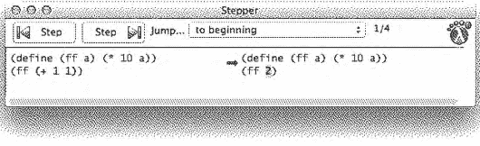

图 11：DrRacket 步进器

停！是的，你本可以使用 DrRacket 来解决一些代数作业。尝试步进器提供的各种选项。

**练习 21。** 使用 DrRacket 的步进器逐步求值 `(ff (ff 1))`。还尝试 `(+ (ff 1)(ff 1))`。DrRacket 的步进器会复用计算结果吗？

此时，你可能觉得自己又回到了代数课堂，所有这些涉及乏味函数和数字的计算。幸运的是，这种方法推广到本书中**所有**程序，包括有趣的程序。

让我们从处理字符串的函数开始。回顾一些字符串运算定律：

```
(string-append "hello" "" "world") == "hello world"
(string-append "bye" ", " "world") == "bye, world"
...
```

现在假设我们定义一个创建信件开头的函数：

```
(define (opening first-name last-name)
 (string-append "Dear " first-name ","))
```

当你将此函数应用于两个字符串时，你会得到一个信件开头：


> (opening "Matthew" "Fisler")
"Dear Matthew,"

更重要的是，计算定律解释了 DrRacket 如何确定此结果，以及你如何预测 DrRacket 的行为：

```
(opening "Matthew" "Fisler")
== ; DrRacket substitutes "Matthew" for first-name
(string-append "Dear " "Matthew" ",")
==
"Dear Matthew,"
```

由于 last-name 在 opening 的定义中未出现，将其替换为 "Fisler" 没有任何效果。

本书其余部分介绍了更多数据形式。为了解释对数据的操作，我们始终使用与此书中算术类似的定律。

> 最终你将遇到命令式操作，它们不组合或提取值，而是 **修改** 它们。要使用此类操作进行计算，你需要在算术和替换定律基础上添加一些定律。

### 练习 22.

对此程序片段使用 DrRacket 的单步调：

```
(define (distance-to-origin x y)
  (sqrt (+ (sqr x) (sqr y))))
(distance-to-origin 3 4)
```

该解释是否符合你的直觉？

### 练习 23.

"hello world" 中的第一个 1String 是 "h"。以下函数如何计算出此结果？

```
(define (string-first s)
  (substring s 0 1))
```

使用单步调验证你的想法。

### 练习 24.

以下是 ==> 的定义：

```
(define (==> x y)
  (or (not x) y))
```

使用单步调确定 (==> #true #false) 的值。

### 练习 25.

查看此尝试解决练习 17 的方案：

```
(define (image-classify img)
  (cond
    [(>= (image-height img) (image-width img)) "tall"]
    [(= (image-height img) (image-width img)) "square"]
    [(<= (image-height img) (image-width img)) "wide"]))
```

单步调试一个应用是否暗示了修复方法？

### 练习 26.

你预期此程序的值是什么：

```
(define (string-insert s i)
  (string-append (substring s 0 i)
                 "_"
                 (substring s i)))

(string-insert "helloworld" 6)
```

使用 DrRacket 及其单步调确认你的预期。

### 2.3 组合函数

程序很少仅由一个函数定义组成。通常，程序由一个 *主* 定义和若干其他函数组成，并将一个函数应用的结果转化为另一个函数的输入。借用代数中的类比，我们将这种定义函数的方式称为 *组合*，并称这些附加函数为 *辅助函数* 或 *辅助函数*。

请考虑图 12 中用于填写信件模板的程序。它由四个函数组成。第一个是主函数，它根据收件人的姓和名以及签名生成一封完整的信件。主函数引用三个辅助函数来生成信件的三个部分——开头、正文和结尾——并使用 string-append 按正确顺序组合结果。

```
(define (letter fst lst signature-name)
  (string-append
   (opening fst)
   "\n\n"
   (body fst lst)
   "\n\n"
   (closing signature-name)))

(define (opening fst)
  (string-append "Dear " fst ","))

(define (body fst lst)
  (string-append
   "We have discovered that all people with the" "\n"
   "last name " lst " have won our lottery. So, " "\n"
   fst ", " "hurry and pick up your prize."))

(define (closing signature-name)
  (string-append
   "Sincerely,"
   "\n\n"
   signature-name
   "\n"))
```

图 12：批处理程序

停止！将这些定义输入 DrRacket 的定义区域，点击 *运行*，并在交互区域对这些表达式求值：

```
> (letter "Matthew" "Fisler" "Felleisen")
"Dear Matthew,\n\nWe have discovered that ...\n"
> (letter "Kathi" "Felleisen" "Findler")
"Dear Kathi,\n\nWe have discovered that ...\n"
```

**旁注** 结果是一个包含 "\n" 的长字符串，当字符串被 **打印** 时，"\n" 表示换行。现在将 `(require 2htdp/batch-io)` 添加到你的程序中，这将向程序添加函数 `write-file`；它允许你将此字符串 **打印** 到控制台：

```
> (write-file 'stdout (letter "Matt" "Fiss" "Fell"))
Dear Matt,

We have discovered that all people with the
last name Fiss have won our lottery. So,
Matt, hurry and pick up your prize.

Sincerely,

Fell
'stdout
```

目前可以将 'stdout 视为一个字符串。

第 2.5 章详细解释了此类批处理程序。**结束**

一般来说，当问题涉及不同的计算任务时，程序应由每个任务一个函数以及一个将所有内容组合在一起的主函数组成。我们将这一想法概括为一句简单的口号：

*每个任务定义一个函数。*

遵循此口号的优势在于，你会得到相当小的函数，每个函数都易于理解，其组合也易于理解。一旦你学会设计函数，就会发现让小函数正确运行比让大函数正确运行要容易得多。更好的是，如果由于问题描述的变更而需要修改程序的一部分，当程序被组织为小函数的集合而非单一的大型单体块时，查找相关部分通常要容易得多。

以下是通过一个示例问题来说明这一点的小例子：

**示例问题** 一个小城镇中垄断电影院的业主在设定票价方面拥有完全的自由。他收费越高，能负担得起票的人就越少。他收费越低，运行一场演出的成本就越高，因为上座率上升了。在最近的一项实验中，业主确定了票价与平均上座率之间的关系。

当票价为每张 $5.00 时，有 120 人观看一场演出。票价每变化 10 美分，平均上座率就会变化 15 人。也就是说，如果业主收取 $5.10，平均约有 105 人观看；如果票价降至 $4.90，平均上座率会增加到 135 人。让我们将此想法转化为数学公式：

avg. attendance = 120 people − $(change in price) / $0.10 · 15 people

停止！在继续之前，请解释一下减号。

不幸的是，上座率增加也带来了更高的成本。每场演出对业主来说固定成本为 $180，外加每位观众 $0.04 的可变成本。

业主希望了解利润与票价之间的确切关系，以便最大化利润。

任务很明确，但如何着手却不明确。此时此刻，我们只能说几个数量相互依赖。

当面对这种情况时，最好逐一梳理各种依赖关系：

- 1. 问题描述规定了观众人数如何依赖于票价。计算此人数显然是一个独立任务，因此值得有自己的函数定义：

```
(define (attendees ticket-price)
  (- 120 (* (- ticket-price 5.0) (/ 15 0.1))))
```

- 2. *revenue* 完全由门票销售产生，这意味着它正好是票价与观众人数的乘积：

```
(define (revenue ticket-price)
  (* ticket-price (attendees ticket-price)))
```

- 3. *cost* 由两部分组成：固定部分（$180）和依赖于观众人数的可变部分。鉴于观众人数是票价的函数，计算演出成本的函数也必须消耗票价，以便能够复用 attendees 函数：

```
(define (cost ticket-price)
  (+ 180 (* 0.04 (attendees ticket-price))))
```

- 4. 最后，*profit* 是给定票价下的收入与成本之差：

```
(define (profit ticket-price)
  (- (revenue ticket-price)
     (cost ticket-price)))
```

BSL 中对 profit 的定义直接遵循了非正式问题描述的建议。

计算利润仅需要这四个函数，我们现在可以使用 profit 函数来确定一个良好的票价。

### 练习 27.

我们对示例问题的解决方案在函数中间包含几个常量。如“一个程序，多个定义”已指出的那样，最好给这些常量命名，以便未来的读者了解这些数字的来源。将 DrRacket 定义区域中的所有定义收集起来，并更改它们，使所有魔法数字都重构为常量定义。

### 练习 28.

确定这些票价（$1、$2、$3、$4 和 $5）下的潜在利润。哪个票价能最大化电影院的利润？确定


the best ticket price to a dime.

这里有一个同一程序的替代版本，以单个函数定义的形式给出：

```
(define (profit price)
  (- (* (+ 120
     (* (/ 15 0.1)
        (- 5.0 price))))
     price)
  (+ 180
     (* 0.04
        (+ 120
           (* (/ 15 0.1)
              (- 5.0 price))))))
```

将此定义输入 DrRacket，并确保它对 $1、$2、$3、$4 和 $5 产生的结果与原始版本相同。乍一看就足以看出，理解这个单一函数比理解上述四个函数要困难得多。

**练习 29.** 在研究演出成本后，业主发现了几种降低成本的方法。由于这些改进，不再有固定成本；每位参会者仍有 $1.50 的可变成本。

修改两个程序以反映这一变化。修改程序后，使用 $3、$4 和 $5 的票价再次测试它们，并比较结果。

### 2.4 全局常量

如前言所述，profit 等函数从使用全局常量中受益。每种编程语言都允许程序员定义常量。在 BSL 中，此类定义的形式如下：

- 写入 “(define”，
- 写下名称，
- 后跟一个空格和一个表达式，以及
- 写下 “)”)。

常量的名称是一个 _全局变量_，而定义称为 _常量定义_。我们倾向于将常量定义中的表达式称为定义的 _右侧_。

常量定义为所有形式的数据引入名称：数字、图像、字符串等等。以下是一些简单示例：

```
; the current price of a movie ticket:
(define CURRENT-PRICE 5)

; useful to compute the area of a disk:
(define ALMOST-PI 3.14)

; a blank line:
(define NL "\n")

; an empty scene:
(define MT (empty-scene 100 100))
```

前两个是数字常量，后两个分别是字符串和图像。按惯例，我们为全局常量使用大写字母，因为这样无论程序多大，读者都能轻松将此类变量与其他变量区分开来。

程序中的所有函数都可以引用这些全局变量。引用变量就像使用相应的常量一样。使用变量名而不是常量的优势在于，对常量定义的一次编辑会影响所有用途。例如，我们可能希望向 ALMOST-PI 添加数字或扩大空场景：

```
(define ALMOST-PI 3.14159)
; an empty scene:
(define MT (empty-scene 200 800))
```

我们的大多数示例定义在右侧使用字面常量，但最后一个使用表达式。的确，程序员可以使用任意表达式来计算常量。假设一个程序需要处理某个大小及其中心的图像：

```
(define WIDTH 100)
(define HEIGHT 200)
(define MID-WIDTH (/ WIDTH 2))
(define MID-HEIGHT (/ HEIGHT 2))
```

它可以使用两个右侧为字面常量的定义和两个计算常量，即变量的值不仅仅是字面常量，而是计算表达式值的结果。

再次，我们陈述一句命令式口号：

**针对问题陈述中提到的每个常量，引入一个常量定义。**

**练习 30.** 为电影院的票价优化程序定义常量，使得观众人数的价格敏感度（每 10 美分 15 人）成为一个计算常量。

### 2.5 程序

你已准备好创建简单的程序。从编码角度来看，程序只是一堆函数和常量定义。通常会将一个函数单独列为“主”函数，该主函数倾向于组合其他函数。然而，从启动程序的角度来看，有两种不同的类型：

- 批处理程序一次性消耗所有输入并计算其结果。其主函数是辅助函数的组合，这些辅助函数可能引用更多辅助函数，以此类推。当我们启动批处理程序时，操作系统会在其输入上调用主函数并等待程序的输出。
- 交互式程序消耗一些输入、计算、产生一些输出、再消耗更多输入，以此类推。当输入出现时，我们称之为事件，并且我们将交互式程序创建为事件驱动程序。此类事件驱动程序的主函数使用表达式来描述针对哪种事件调用哪些函数。这些函数称为事件处理程序。

当我们启动交互式程序时，主函数会向操作系统通报此描述。一旦发生输入事件，操作系统就会调用匹配的事件处理程序。同样，操作系统根据描述知道何时以及如何将这些函数调用的结果作为输出呈现。

本书主要关注通过图形用户界面（GUI）交互的程序；还有其他类型的交互式程序，随着你继续学习计算机科学，你将了解它们。

### 批处理程序

如前所述，批处理程序一次性消耗所有输入并从这些输入中计算结果。其主函数期望一些参数，将它们交给辅助函数，接收来自这些函数的结果，并将这些结果组合成其最终答案。

程序创建完成后，我们希望使用它们。在 DrRacket 中，我们在交互区启动批处理程序，以便观察程序的运行情况。

如果程序能从某个文件中获取输入并将输出交付到另一个文件，那么程序会更加有用。的确，“批处理程序”这个名称源于计算机早期，当时程序从一叠穿孔卡片中读取文件（或多个文件），并将结果放入其他文件（也是一叠卡片）中。从概念上讲，批处理程序一次性读取输入文件，并且一次性生成结果文件。

我们使用 2htdp/batch-io 库创建此类基于文件的批处理程序，该库向我们的词汇表添加了两个函数（还有其他函数）：

- read-file，将整个文件的内容作为字符串读取，以及
- write-file，从给定字符串创建文件。

这些函数将字符串写入文件并从文件中读取字符串：

```
> (write-file "sample.dat" "212")
"sample.dat"
> (read-file "sample.dat")
"212"
```

在对这些表达式求值之前，请将定义区域保存到一个文件中。

第一次交互后，名为 "sample.dat" 的文件包含

212

write-file 的结果是一个确认，表明它已将字符串放入文件。如果文件已存在，它会用给定字符串替换其内容；否则，它会创建一个文件并将给定字符串作为其内容。第二次交互，(read-file "sample.dat")，产生 "212"，因为它将 "sample.dat" 的内容转换为字符串。

出于实际原因，write-file 还接受 'stdout（一种特殊的标记）作为第一个参数。然后它会在当前交互区中显示生成的文件内容，例如：

```
> (write-file 'stdout "212\n")
212
'stdout
```

名称 'stdout 和 'stdin 分别是标准输出设备和标准输入设备的缩写。

类似地，read-file 接受 'stdin 来代替文件名，然后从当前交互区读取输入。

让我们通过一个简单的例子来说明批处理程序的创建。假设我们想创建一个程序，将华氏温度计上的温度转换为摄氏温度。别担心，这不是考察你物理知识的问题；以下是转换公式：

\( C = \frac{5}{9} \cdot (f - 32) \)

本书不是关于死记硬背事实，但我们确实希望你知道在哪里可以找到它们。你知道在哪里可以了解温度如何转换吗？

当然，在这个公式中，f 是华氏温度，C 是摄氏温度。虽然这个公式对于初等代数教科书来说可能已经足够，但数学家或程序员会在等式左侧写 C(f)，以提醒读者 f 是给定值，而 C 是从 f 计算得出的。

将此公式翻译成 BSL 很简单：

```
(define (C f)
  (* 5/9 (- f 32)))
```

请记住，5/9 是一个数字，精确说是一个有理分数，并且 C 取决于给定的 f，这就是函数符号所表达的含义。

在交互区启动此批处理程序与往常一样：

```
> (C 32)
0
> (C 212)
100
> (C -40)
-40
```

但是，假设我们希望将此函数作为读取文件中的华氏温度、将此数字转换为摄氏温度的程序的一部分来使用


温度，然后创建另一个包含结果的文件。

一旦在 BSL 中有了转换公式，创建主函数就意味着将 c 与现有的原语函数组合：

```racket
(define (convert in out)
  (write-file out
    (string-append
      (number->string
        (c (string->number (read-file in))))
      "\n")))
```

我们将主函数命名为 convert。它消耗两个文件名：in 是存放华氏温度的文件，out 是我们希望存放摄氏度结果的文件。五个函数的组合计算出 convert 的结果。让我们仔细逐步分析 convert 的函数体：

- (read-file in) 将命名文件的内容作为字符串检索；
- string->number 将此字符串转换为数字；
- c 将数字解释为华氏温度并将其转换为摄氏温度；
- number->string 消耗此摄氏温度并将其转换为字符串；以及
- (write-file out...) 将此字符串放入名为 out 的文件中。

冗长的步骤列表可能看起来令人不知所措，而且这甚至还不包括 string-append 部分。停下来！解释

```racket
(string-append ... "\n")
```

相比之下，初等代数课程中的平均函数组合涉及两个函数，可能是三个。但是请记住，程序完成现实世界的目的，而代数练习仅阐释函数组合的概念。

此时，我们可以对 convert 进行实验。首先，我们使用 write-file 为 convert 创建一个输入文件：

```racket
> (write-file "sample.dat" "212")
"sample.dat"
> (convert "sample.dat" 'stdout)
100
'stdout
> (convert "sample.dat" "out.dat")
"out.dat"
> (read-file "out.dat")
"100"
```

你也可以使用文件编辑器创建 "sample.dat"。

对于第一次交互，我们使用 'stdout，以便可以在 DrRacket 的交互区域中查看 convert 输出的内容。对于第二次，convert 被赋予名称 "out.dat"。正如预期的那样，对 convert 的调用返回此字符串；根据 write-file 的描述，我们还知道它将华氏温度存入了文件。在这里，我们使用 read-file 读取该文件的内容，但你也可以使用文本编辑器查看它。

除了运行批处理程序外，逐步跟踪计算过程也很有教育意义。确保文件 "sample.dat" 存在且仅包含一个数字，然后单击 DrRacket 中的 STEP 按钮。这样做会打开另一个窗口，你可以在其中浏览批处理程序的主函数调用所触发的计算过程。你会发现该过程遵循上述大纲。

### 练习 31

回顾第 2.3 章中的 letter 程序。以下是启动程序并将其输出写入交互区域的方法：

```racket
> (write-file
  'stdout
  (letter "Matthew" "Fisler" "Felleisen"))
Dear Matthew,

We have discovered that all people with the
last name Fisler have won our lottery. So,
Matthew, hurry and pick up your prize.

Sincerely,
Felleisen
'stdout
```

当然，程序很有用，因为你可以为许多不同的输入启动它们。在你选择的三个输入上运行 `letter`。

以下是一个读取三个文件中的姓名并写信的批处理程序：

```racket
(define (main in-fst in-lst in-signature out)
  (write-file out
    (letter (read-file in-fst)
            (read-file in-lst)
            (read-file in-signature))))
```

该函数消耗四个字符串：前三个是输入文件的名称，最后一个用作输出文件。它使用前三个文件分别从这三个命名文件中读取一个字符串，将这些字符串传递给 `letter`，最终将此函数调用的结果写入由 `out` 命名的文件，即 `main` 的第四个参数。

创建适当的文件，启动 `main`，并检查它是否在给定文件中交付了预期的信件。

## 交互式程序

批处理程序是计算机商业应用的支柱，但人们现在遇到的程序是交互式的。在这个时代，人们主要通过键盘和鼠标与桌面应用程序交互。此外，交互式程序还可以对计算机生成的事件做出反应，例如时钟滴答或来自其他计算机的消息到达。

### 练习 32

大多数人不再仅使用台式电脑来运行应用程序，还使用手机、平板电脑和汽车的信息控制屏幕。不久将来，人们将以智能眼镜、衣服和运动装备的形式使用可穿戴电脑。在稍远的将来，人们可能拥有直接与身体功能交互的内置生物计算机。请构思十种这类计算机上的软件应用程序需要处理的不同形式的事件。

本节的目的是介绍编写交互式 BSL 程序的机制。由于本书中许多项目风格的示例都是交互式程序，我们缓慢而仔细地介绍这些思想。当你处理一些交互式编程项目时，可能希望回到本节；第二次或第三次阅读可能会澄清其中的一些高级方面。

单靠一台裸机计算机不过是一堆无用的物理设备。之所以称之为硬件，是因为你可以触摸它。一旦安装了软件（即一组程序），这些设备就变得有用了。通常，首先安装在计算机上的软件是操作系统。它的任务是为你管理计算机，包括连接的设备，如显示器、键盘、鼠标、扬声器等。其工作方式是：当用户按下键盘上的某个键时，操作系统会运行一个处理按键的函数。我们称按键为键盘事件，该函数为事件处理器。同样，操作系统还会为时钟滴答、鼠标操作等运行事件处理器。相反，事件处理器完成工作后，操作系统可能需要更改屏幕上的图像、发出提示音、打印文档或执行类似操作。为了完成这些任务，它还会运行函数，将操作系统的数据转换为声音、图像、打印机上的操作等。

自然而然，不同的程序有不同的需求。一个程序可能将按键解释为控制核反应堆的信号；另一个程序则将其传递给文字处理器。为了让通用计算机处理这些截然不同的任务，不同的程序会安装不同的事件处理器。也就是说，发射火箭的程序使用一种函数来处理时钟滴答，而烤箱的软件使用另一种函数。

设计交互式程序需要一种方式来指定某个函数负责处理键盘事件、另一个函数负责处理时钟滴答、第三个函数负责将某些数据呈现为图像，等等。交互式程序的主函数的任务是将这些指定传达给操作系统，即启动程序的软件平台。

DrRacket 是一个小型操作系统，BSL 是其编程语言之一。后者附带 2htdp/universe 库，该库提供了 big-bang，这是一种告诉操作系统哪个函数处理哪个事件的机制。此外，big-bang 还跟踪程序的状态。

为此，它附带一个必需的子表达式，其值成为程序的 *初始状态*。否则，big-bang 由一个必需的子句和许多可选子句组成。必需的 to-draw 子句告诉 DrRacket 如何呈现程序的状态，包括初始状态。其他每个可选子句都告诉操作系统，某个函数负责处理某个事件。在 BSL 中，处理事件意味着该函数消耗程序的状态和事件的描述，并产生程序的下一个状态。因此，我们谈论程序的 *当前状态*。

### 术语

从某种意义上说，big-bang 表达式描述了程序如何与世界的一小部分连接。这个世界可能是程序用户玩的游戏、用户观看的动画，或是用户用来操作某些笔记的文本编辑器。因此，编程语言研究人员常说 big-bang 是对小世界的描述：其初始状态、状态如何转换、状态如何呈现，以及 big-bang 如何确定当前状态的其他属性。在这种精神下，我们也谈论 *世界状态*，甚至将 big-bang 程序称为 *世界程序*。**结束**

让我们逐步研究这个想法，从这个定义开始：

```racket
(define (number->square s)
  (square s "solid" "red"))
```

该函数消耗一个正数并生成该大小的实心红色方块。单击 *RUN* 后，尝试使用该函数，如下所示：

- `> (number->square 5)`
- `> (number->square 10)`
- `> (number->square 20)`


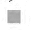


它的行为就像批处理程序，消耗一个数字并生成一张图像，由 DrRacket 为你呈现。

现在在交互区域尝试以下 big-bang 表达式：


> (big-bang 100 [to-draw number->square])

会出现一个单独的窗口，它显示一个 100 × 100 的红色正方形。此外，DrRacket 交互区域不会显示另一个提示符；程序似乎一直在运行，情况确实如此。要停止程序，请单击 DrRacket 的 STOP 按钮或窗口的 CLOSE 按钮：

```
> (big-bang 100 [to-draw number->square])
100
```

当 DrRacket 停止对 big-bang 表达式的求值时，它会返回当前状态，在本例中即初始状态：100。

这是一个更有趣的 big-bang 表达式：

```
> (big-bang 100
[to-draw number->square]
[on-tick sub1]
[stop-when zero?]))
```

这个 big-bang 表达式在前一个表达式的基础上添加了两个可选子句：on-tick 子句告诉 DrRacket 如何处理时钟滴答，而 stop-when 子句说明何时停止程序。我们按如下方式读取它，以 100 作为初始状态：

- 1. 每次时钟滴答时，从当前状态减去 1；
- 2. 然后检查 zero? 对新状态是否为真，如果是则停止；并且
- 3. 每次事件处理程序返回一个值时，使用 number->square 将其呈现为图像。

现在按下 "return" 键并观察发生的事情。最终表达式的求值终止，DrRacket 显示 0。

big-bang 表达式会跟踪当前状态。最初，该状态为 100。每次时钟滴答时，它会调用时钟滴答处理程序并得到一个新状态。因此，big-bang 的状态按如下方式变化：

```
100, 99, 98,..., 2, 1, 0
```

当状态值变为 0 时，求值完成。对于其他每个状态——从 100 到 1——big-bang 将状态转换为图像，使用 number->square，如 to-draw 子句所指示的。因此，窗口显示一个红色正方形，在 100 个时钟滴答内从 100 × 100 像素缩小到 1 × 1 像素。

让我们添加一个处理键盘事件的子句。首先，我们需要一个函数，它使用当前状态和描述键盘事件的字符串，然后返回一个新状态：

```
(define (reset s ke)
  100)
```

此函数丢弃其参数并返回 100，即我们希望修改的 big-bang 表达式的初始状态。其次，我们向 big-bang 表达式添加一个 on-key 子句：

```
> (big-bang 100
[to-draw number->square]
[on-tick sub1]
[stop-when zero?]
[on-key reset])
```

停止！解释当你按下 "return"、数到 10，最后按下 "a" 时会发生什么。

你会看到，红色正方形以每个时钟滴答一个像素的速度缩小。但是，一旦你按下 "a" 键，红色正方形就会重新膨胀到全尺寸，因为 reset 被对当前正方形长度和 "a" 调用，并返回 100。这个数字变成 big-bang 的新状态，number->square 将其呈现为全尺寸红色正方形。

为了一般性地理解 big-bang 表达式的求值，让我们看一个示意图版本：

```
(big-bang cw0
[on-tick tock]
[on-key ke-h]
[on-mouse me-h]
[to-draw render]
[stop-when end?]
...)
```

这个 big-bang 表达式指定了三个事件处理程序——tock、ke-h 和 me-h——以及一个 stop-when 子句。

这个 big-bang 表达式的求值从 cw0 开始，cw0 通常是一个表达式。DrRacket，我们的操作系统，将 cw0 的值安装为当前状态。它使用 render 将当前状态转换为图像，然后在单独的窗口中显示该图像。确实，render 是 big-bang 表达式向世界呈现数据的 **唯一** 方式。

事件的处理方式如下：

- 每次时钟滴答时，DrRacket 将 tock 应用于 big-bang 的当前状态并收到响应值；big-bang 将此返回值视为下一个当前状态。

- 每次按下键时，DrRacket 将 ke-h 应用于 big-bang 的当前状态和代表键的字符串；例如，按下 "a" 键用 "a" 表示，左箭头键用 "left" 表示。当 ke-h 返回一个值时，big-bang 将其视为下一个当前状态。

- 每次鼠标进入窗口、离开窗口、移动或被单击时，DrRacket 将 me-h 应用于 big-bang 的当前状态、事件的 x 和 y 坐标以及代表发生的鼠标事件类型的字符串；例如，单击鼠标按钮用 "button-down" 表示。当 me-h 返回一个值时，big-bang 将其视为下一个当前状态。

所有事件按顺序处理；如果两个事件似乎同时发生，DrRacket 充当打破平局者，并按某种顺序排列它们。

处理完事件后，big-bang 同时使用 end? 和 render 来检查当前状态：

- (end? cw) 生成一个布尔值。如果为 #true，big-bang 立即停止计算。否则，它继续执行。

- (render cw) 预期生成一个图像，big-bang 在单独的窗口中显示此图像。

图 13 中的表格简洁地总结了这个过程。在第一行中，它列出了当前状态的名称。第二行列举了 DrRacket 遇到的事件的名称：e0、e1，等等。每个 ei 可能是时钟滴答、键盘按键或鼠标事件。接下来的三行指定了处理事件的结果：

- 如果 e0 是时钟滴答，big-bang 求值 (tock cw0) 以生成 cw1。
- 如果 e0 是键盘事件，则求值 (ke-h cw0 e0) 并生成 cw1。处理程序必须应用于事件本身，因为一般来说，程序会对每个键做出不同反应。
- 如果 e0 是鼠标事件，big-bang 运行 (me-h cw0 e0 ...) 以获得 cw1。这个调用是一个草图，因为鼠标事件 e0 实际上与几个数据片段相关联——其性质和坐标——我们只是想表示这么多。
- 最后，render 将当前状态转换为图像，由最后一行指示。DrRacket 在单独的窗口中显示这些图像。

| 当前状态 | cw0 | cw1 | ... |
|---|---|---|---|
| 事件 | e0 | e1 | ... |
| 时钟滴答时 | (tock cw0) | (tock cw1) | ... |
| 按键时 | (ke-h cw0 e0) | (ke-h cw1 e1) | ... |
| 鼠标事件时 | (me-h cw0 e0 ...) | (me-h cw1 e1 ...) | ... |
| 其图像 | (render cw0) | (render cw1) | ... |

图 13：big-bang 的工作原理

cw1 下方的列显示如何生成 cw2，具体取决于 e1 发生的事件类型。

让我们用具体的事件序列来解释这个表格：用户按下 "a" 键，然后时钟滴答，最后用户单击鼠标在位置 (90,100) 触发 "button down" 事件。然后，用 Racket 表示法：

- 1. cw1 是 (ke-h cw0 "a") 的结果；
- 2. cw2 是 (tock cw1) 的结果；并且
- 3. cw3 是 (me-h cw2 90 100 "button-down") 的结果。

我们实际上可以将这三个步骤表示为三个定义的序列：

```
(define cw1 (ke-h cw0 "a"))
(define cw2 (tock cw1))
(define cw3 (me-h cw2 "button-down" 90 100))
```

停止！big-bang 如何显示这三个状态中的每一个？

现在让我们考虑三个时钟滴答的序列。在这种情况下，

- 1. cw1 是 (tock cw0) 的结果；
- 2. cw2 是 (tock cw1) 的结果；并且
- 3. cw3 是 (tock cw2) 的结果。

或者，用 BSL 重新表述：

```
(define cw1 (tock cw0))
(define cw2 (tock cw1))
(define cw3 (tock cw2))
```

确实，我们也可以通过单个表达式确定 cw3：

```
(tock (tock (tock cw0)))
```

这确定了 big-bang 在三个时钟滴答后计算的状态。停止！将第一个事件序列重新表述为表达式。

简而言之，事件序列确定 big-bang 按什么顺序概念性地遍历上述可能状态表，以到达每个时间段的当前状态。当然，big-bang 不会触碰当前状态；它只是保护它，并在需要时将其传递给事件处理程序和其他函数。

从这里开始，定义第一个交互程序非常简单。请参见图 14。该程序由两个常量定义组成，后跟三个函数定义：main，启动 big-bang 交互程序；place-dot-at，将当前状态转换为图像；以及 stop，丢弃其输入并生成 0。


```
(define BACKGROUND (empty-scene 100 100))
(define DOT (circle 3 "solid" "red"))
(define (main y)
  (big-bang y
    [on-tick sub1]
    [stop-when zero?]
    [to-draw place-dot-at]
    [on-key stop])
(define (place-dot-at y)
  (place-image DOT 50 y BACKGROUND))
(define (stop y ke)
  0)
```

图 14: 第一个交互式程序

单击 RUN 后，我们可以要求 DrRacket 对这些处理程序函数的应用进行求值。这是验证其工作原理的一种方法：

```
> (place-dot-at 89)
```

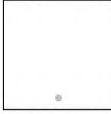

```
> (stop 89 "q")
0
```

停！现在尝试理解当你按下键时 main 如何反应。

验证你的猜想是否正确的一种方法是，在某个合理的数字上启动 main 函数：

```
> (main 90)
```

放松。

到这时，你可能会觉得前两章内容令人应接不暇。它们介绍了许多新概念，包括一种新语言、其词汇、含义、惯用法、一种用这种词汇书写文本的工具，以及运行这些程序的方式。面对这些众多的想法，你可能会想：面对问题描述时，如何创建一个程序？为了回答这个核心问题，下一章将退后一步，明确探讨程序的系统设计。所以，请先休息一下，准备好后再继续。

## 3 如何设计程序

本书前几章表明，学习编程需要掌握许多概念。一方面，编程需要一种语言，一种用于表达我们希望计算什么的记法。用于制定程序的人工语言是人造的，尽管习得编程语言与习得自然语言有一些共同之处。两者都附带词汇、语法以及对“短语”含义的理解。

另一方面，学习如何从问题描述到程序至关重要。我们需要确定问题描述中什么是相关的，什么可以忽略。我们需要梳理出程序消耗什么、产生什么，以及它如何将输入与输出关联起来。我们必须知道或查明，所选语言及其库是否为程序要处理的数据提供某些基本操作。如果没有，我们可能需要开发辅助函数来实现这些操作。最后，一旦有了程序，我们必须检查它是否实际执行了预期的计算。而这可能会揭示各种错误，我们需要能够理解并修复这些错误。

所有这些听起来相当复杂，你可能会想，为什么我们不随便试试，到处实验，当结果看起来还行时就了事？这种编程方法通常被称为“车库编程”，很常见，许多时候都能成功；有时它还是创业公司的启动平台。尽管如此，初创公司无法出售“车库努力”的结果，因为只有最初的程序员和他们的朋友能使用它们。

一个好的程序附带一段简短说明，解释它做什么、期望什么输入、产生什么输出。理想情况下，它还应附带某种保证，表明它确实能工作。在最佳情况下，程序与问题描述的联系显而易见，因此对问题描述的小改动容易转化为对程序的小改动。软件工程师将其称为“编程产品。”

所有这些额外工作都是必要的，因为程序员不是为自己编写程序。程序员编写程序是让其他程序员阅读，偶尔也会有人运行这些程序来完成工作。大多数程序是协作函数的庞大而复杂的集合，没有人能在一天之内编写完所有这些函数。程序员加入项目、编写代码、离开项目；其他人接管他们的程序并继续工作。另一个困难是，程序员的客户往往会改变他们真正想解决的问题的主意。他们通常差不多是对的，但更多时候，他们对一些细节理解错了。更糟的是，像程序这样的复杂逻辑结构几乎总是会出现人为错误；简而言之，程序员会犯错。最终有人会发现这些错误，程序员必须修复它们。他们需要重新阅读一个月前、一年前或二十年前编写的程序并对其进行修改。

> “其他”一词还包括程序员的旧版本，他们通常无法回忆起年轻版本在制作程序时投入的所有思考。

**练习 33. 研究“千年虫”问题。** 这里我们介绍一种设计配方，它将逐步过程与围绕问题数据组织程序的方式结合起来。对于那些不喜欢长时间盯着空白屏幕的读者来说，这种设计配方提供了一种系统地取得进展的方法。对于那些教别人设计程序的人来说，该配方是诊断新手困难的工具。对于其他人来说，我们的配方可能是他们可以应用到其他领域（例如医学、新闻业或工程）的东西。对于那些希望成为真正程序员的人来说，设计配方也提供了一种理解和处理现有程序的方法——尽管并非所有程序员都使用像这种设计配方这样的方法来编写程序。本章剩余部分专门介绍进入设计配方世界的第一个小步骤；后续章节和部分以某种方式完善和扩展该配方。

### 3.1 设计函数

**信息和数据** 程序的目的是描述一种消耗一些信息并产生新信息的计算过程。从这个意义上说，程序就像数学老师给小学生的指令。然而，与学生不同，程序处理的不只是数字：它使用导航信息进行计算，查找某人的地址，打开开关，或检查视频游戏的状态。所有这些信息都来自现实世界的一部分——通常称为程序的领域——而程序计算的结果代表该领域中的更多信息。

信息在我们的描述中起着核心作用。将信息视为关于程序领域的事实。对于处理家具目录的程序，“五条腿的桌子”或“两米乘两米的正方桌子”是信息片段。游戏程序处理不同种类的领域，其中“五”可能指某个对象从画布一部分移动到另一部分时每个时钟周期经过的像素数。或者，工资单程序可能处理“五项扣除。”

为了处理信息，程序必须将其转换为编程语言中的某种数据形式；然后处理数据；完成后，再将结果数据转换回信息。交互式程序甚至可能交错这些步骤，根据需要从世界获取更多信息，并在中间传递信息。

我们使用 BSL 和 DrRacket，因此你不必担心将信息转换为数据的问题。在 DrRacket 的 BSL 中，你可以直接将函数应用于数据并观察其产生的结果。因此，我们避免了编写将信息转换为数据及反之的函数所带来的严重鸡生蛋问题。对于简单类型的信息，设计这样的程序片段是微不足道的；对于非简单信息，你需要了解解析等知识，而这立即需要大量的程序设计专业知识。

软件工程师使用模型-视图-控制器（MVC）这一口号来描述 BSL 和 DrRacket 如何将数据处理与将信息解析为数据以及将数据转换为信息分开。的确，现在公认的智慧是，设计良好的软件系统强制执行这种分离，尽管大多数


入门书籍仍然将它们混为一谈。因此，使用 BSL 和 DrRacket 可以让你专注于程序核心的设计，在积累足够经验后，你可以学习设计信息-数据转换部分。

在此，我们使用两个预安装的 teachpack 来演示数据与信息的分离：2htdp/batch-io 和 2htdp/universe。从本章开始，我们将为**批处理**和**交互**程序开发设计配方，让你了解完整程序的设计思路。请牢记，成熟编程语言的库为完整程序提供了更多上下文，你需要恰当地调整设计配方。

鉴于信息和数据的核心作用，程序设计必须从它们之间的联系开始。具体来说，作为程序员的我们，必须决定如何使用所选编程语言将相关信息片段*表示*为数据，以及如何将数据*解释*为信息。图 15 通过一个抽象图表解释了这一想法。

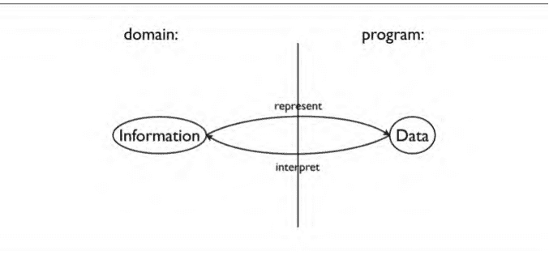

图 15：从信息到数据，再返回

为了使这一想法具体化，让我们通过一些示例来学习。假设你正在设计一个以数字形式消耗和生成信息的程序。虽然选择表示法很容易，但解释需要说明像 42 这样的数字在领域中表示什么：

- 42 可能指图像领域中距离顶部边距的像素数量；
- 42 可能表示模拟或游戏对象每个时钟周期移动的像素数量；
- 42 可能表示物理领域中华氏、摄氏或开尔文温标上的温度；
- 42 可能指定某个表格的大小，如果程序的领域是家具目录；或
- 42 可能只是计算字符串中的字符数量。

关键在于知道如何从作为信息的数字转换为作为数据的数字，反之亦然。

由于这项知识对阅读程序的每个人都非常重要，我们通常将其以注释形式写下来，我们称之为*数据定义*。数据定义有两个目的。首先，它使用有意义的词为一组数据命名——一个*类*。其次，它告知读者如何创建该类的元素，以及如何判断某个任意数据是否属于该集合。

> 计算机科学家使用“类”来表示类似于“数学集合”的概念。

以下是上述示例之一的数据定义：

```
; A Temperature is a Number.
; **interpretation** represents Celsius degrees
```

第一行介绍了数据集合的名称 Temperature，并告诉我们该类由所有 Numbers 组成。例如，如果我们询问 102 是否是温度，你可以回答“是的”，因为 102 是一个数字，所有数字都是温度。同样，如果我们询问 "cold" 是否是 Temperature，你会说“不”，因为没有字符串属于 Temperature。而且，如果我们让你编造一个示例 Temperature，你可能会想出类似 -400 的东西。

如果您恰好知道最低可能温度约为 -274°C，您可能会想知道是否可以在数据定义中表达这一知识。由于我们的数据定义实际上只是对类的英文描述，您确实可以以比此处所示更准确的方式定义温度类。在本书中，我们使用这种风格化的英文进行此类数据定义，下一章将介绍施加诸如“大于 -274”之类约束的风格。

至此，你已经遇到四个数据类的名称：Number、String、Image 和 Boolean。有了这些知识，制定新的数据定义只不过是为现有数据形式引入一个新名称，例如，为数字引入“temperature”。不过，即使是这些有限的知识，也足以说明我们设计过程的轮廓。

> 此时，你可能希望重新阅读前言中关于系统程序设计的章节，尤其是图 1。

## 设计过程

一旦你理解如何将输入信息表示为数据以及如何将输出数据解释为信息，单个函数的设计将按照一个简单直接的过程进行：

- 1. 表达你希望如何将信息表示为数据。一行注释就足够：

```
; We use numbers to represent centimeters.
```

为你认为对程序成功至关重要的数据类制定数据定义，就像 Temperature 的定义一样。

- 2. 写下签名、目的说明和函数头。

函数签名是一条注释，它告诉阅读你设计的人你的函数消耗多少输入，它们来自哪些类，以及它生成什么类型的数据。以下是分别的三个示例：

- 消耗一个 String 并生成一个 Number：

```
; String -> Number
```

- 消耗一个 Temperature 并生成一个 String：

```
; Temperature -> String
```

正如这个签名所指出的，将数据定义作为现有数据形式的别名引入，使得阅读签名背后的意图变得容易。

尽管如此，我们目前建议你远离为数据定义创建别名。这种名称的大量涌现可能会引起相当大的混乱。平衡对新名称的需求和程序的可读性需要实践，而且现在有更重要的想法需要理解。

- 消耗一个 Number、一个 String 和一个 Image：

```
; Number String Image -> Image
```

停！这个函数生成什么？

*目的说明* 是一条 BSL 注释，用一行总结函数的目的。如果你对目的说明有任何疑问，请写下以下问题的最简短答案：

*该函数计算什么？*

阅读你程序的每个人都应该理解你的函数计算什么，**而无需**阅读函数本身。

多函数程序也应附带一个目的说明。的确，优秀程序员会编写两个目的说明：一个供可能需要修改代码的读者，另一个供希望使用程序但不阅读代码的人。

最后，*头部* 是一个简单的函数定义，也称为*存根*。为签名中的每个输入类选取一个变量名；函数体可以是输出类中的任何数据。这三个函数头部与上述三个签名匹配：

- (define (f a-string) 0)
- (define (g n) "a")
- (define (h num str img) (empty-scene 100 100))

我们的参数名称反映了参数所代表的数据类型。有时，你可能希望使用暗示参数用途的名称。

在制定目的说明时，使用参数名称来澄清计算内容通常很有用。例如，

```
; Number String Image -> Image
; adds s to img,
; y pixels from the top and 10 from the left
(define (add-image y s img)
  (empty-scene 100 100))
```

此时，你可以点击 RUN 按钮并尝试该函数。当然，结果始终是同一个值，这使得这些实验相当乏味。

- 3. 使用一些功能示例来说明签名和目的说明。要构建一个功能示例，请从签名的每个输入类中选取一段数据，并确定你期望返回什么。

假设你正在设计一个计算正方形面积的函数。显然，这个函数消耗正方形的边长，最好用一个（正）数字表示。假设你已按照配方完成了第一个过程步骤，你将示例添加到目的说明和头部之间，得到如下结果：

```
; Number -> Number
; computes the area of a square with side len
; given: 2, expect: 4
; given: 7, expect: 49
(define (area-of-square len) 0)
```

- 4. 下一步是盘点，以了解已知条件是什么以及需要计算什么。对于我们目前考虑的简单函数，我们知道它们通过参数接收数据。而


参数是尚未知晓的值的占位符，但我们知道函数必须从这些未知数据中计算出结果。为提醒自己这一事实，我们将函数体替换为一个*模板*。

> “inventory”一词由Stephen Bloch提出。

目前，模板仅包含参数，因此前面的示例如下所示：

```
(define (area-of-square len)
 (... len ...))
```

省略号提醒你，这不是一个完整的函数，而是一个模板，一个组织建议。

本节的模板看起来很无聊。一旦我们引入新的数据形式，模板就会变得有趣。

- 5. 现在是编码的时候了。一般来说，编码意味着编程，但通常以最狭义的方式，即编写可执行的表达式和函数定义。

对我们来说，编码意味着用表达式替换函数体，该表达式尝试从模板的片段中计算出目的声明所承诺的内容。以下是area-of-square的完整定义：

```
; Number -> Number
; computes the area of a square with side len
; given: 2, expect: 4
; given: 7, expect: 49
(define (area-of-square len)
 (sqr len))
```

完成add-image函数需要多花点功夫：请参见图16。特别是，该函数需要将给定字符串s转换为图像，然后将其放置到给定场景中。

```
; Number String Image -> Image
; adds s to img, y pixels from top, 10 pixels to the left
; given:
;  5 for y,
;  "hello" for s, and
;  (empty-scene 100 100) for img
; expected:
;  (place-image (text "hello" 10 "red") 10 5 ...)
;  where ... is (empty-scene 100 100)
(define (add-image y s img)
 (place-image (text s 10 "red") 10 y img))
```

## 图16：设计步骤5的完成

- 6. 妥善设计的最后一步是使用之前推导出的示例来测试函数。目前，测试的工作方式如下。单击RUN按钮，并在交互区中输入与示例匹配的函数应用：

```
> (area-of-square 2)
4
>(area-of-square 7)
49
```

结果必须与预期输出匹配；你必须检查每个结果，确保其等于设计示例部分中记录的内容。如果结果与预期输出不匹配，请考虑以下三种可能性：

- (a) 你计算错误，为某些示例确定了错误的预期输出。

- (b) 或者，函数定义计算出了错误的结果。在这种情况下，你的程序中存在逻辑错误，也称为bug。

- (c) 示例和函数定义都是错误的。

当你确实遇到预期结果与实际值不一致的情况时，我们建议你先确认预期结果是否正确。如果是，假设错误出在函数定义中。否则，修复示例并重新运行测试。如果仍然遇到问题，你可能遇到了第三种情况，这种情况比较少见。

### 3.2 手指练习：函数

下面的前几个练习几乎是2.1节中练习的副本，不过后者使用“define”一词，而下面的练习使用“design”一词。这种差异意味着你应该遵循设计步骤来创建这些函数，你的解决方案应包含所有相关部分。

正如本节标题所暗示的，这些练习是帮助你内化过程的练习。在步骤变得得心应手之前，绝不要跳过任何一步，因为这样做会导致容易避免的错误。编程中还有大量复杂错误的空间；我们无需在愚蠢的错误上浪费时间。

- **练习34。** 设计函数string-first，从非空字符串中提取第一个字符。不要担心空字符串。¶

- **练习35。** 设计函数string-last，从非空字符串中提取最后一个字符。¶

- **练习36。** 设计函数image-area，计算给定图像中的像素数量。¶

- **练习37。** 设计函数string-rest，生成一个与给定字符串相似但移除了第一个字符的字符串。¶

- **练习38。** 设计函数string-remove-last，生成一个与给定字符串相似但移除了最后一个字符的字符串。¶

### 3.3 领域知识

自然会好奇编写函数体需要哪些知识。稍加思考就会发现，这一步骤要求对程序领域有适当的把握。事实上，这种*领域知识*有两种形式：

- 1. 来自外部领域的知识，例如数学、音乐、生物学、土木工程、艺术等。由于程序员不可能了解计算的所有应用领域，他们必须准备好理解各种应用领域的语言，以便与领域专家讨论问题。数学处于许多（但并非所有）领域的交汇处。因此，程序员在与领域专家共同解决问题时，常常需要学习新的语言。

- 2. 关于所选编程语言中库函数的知识。当你的任务是转换涉及正切函数的数学公式时，你需要知道或猜测你所选语言带有类似BSL的tan的函数。当你的任务涉及图形时，理解2htdp/image库的可能性将对你有帮助。

由于你永远无法预测自己将从事哪个领域，或者将使用哪种编程语言，因此必须牢固掌握当前可用且合适的计算机语言的全部可能性。否则，某些拥有半吊子编程知识的领域专家将接替你的工作。

你可以从推导出的数据定义中识别出需要领域知识的问题。只要数据定义使用所选编程语言中存在的类，函数体（和程序）的定义主要依赖于领域专业知识。后来，当我们引入复杂的数据形式时，函数的设计需要计算机科学知识。

### 3.4 从函数到程序

并非所有程序都只包含一个函数定义。有些需要多个函数；许多还使用常量定义。无论如何，系统地设计每个函数始终很重要，尽管全局常量和辅助函数会稍微改变设计过程。

定义全局常量后，你的函数可能会使用它们来计算结果。为了提醒自己它们的存在，你可能希望将这些常量添加到模板中；毕竟，它们属于可能对函数定义有贡献的事物清单。

多函数程序之所以出现，是因为交互式程序自动需要处理键盘和鼠标事件的函数、将状态渲染为音乐的函数，以及可能更多函数。即使是批处理程序，也可能需要几个不同的函数，因为它们执行几个独立的任务。有时问题陈述本身就暗示了这些任务；其他时候，你会在设计某个函数的过程中发现需要辅助函数。

出于这些原因，我们建议准备一份所需函数列表或愿望清单。愿望清单上的每个条目应包含三项内容：函数的有意义名称、签名和目的声明。对于批处理程序的设计，将主函数放在愿望清单上并开始设计它。对于交互式程序的设计，你可以将事件处理程序、stop-when函数和场景渲染函数放在列表上。只要列表不为空，就选一个愿望并设计该函数。如果在设计过程中发现需要另一个函数，就把它加到列表上。当列表为空时，你就完成了。

> “wish list”一词由John Stone提出。


### 3.5 关于测试

测试很快就会变成一项劳动密集型的琐事。在交互区域运行小型程序很容易，但这样做需要大量机械性工作和复杂的检查。随着程序员构建他们的系统，他们希望进行许多测试。很快，这项工作变得难以承受，程序员开始忽视它。同时，测试是发现和防止基本缺陷的首要工具。测试马虎会迅速导致有缺陷的函数——即带有隐藏问题的函数——而有缺陷的函数会以多种方式拖慢项目进度。

因此，机械化测试而不是手动执行测试至关重要。像许多编程语言一样，BSL 包含一个测试设施，而 DrRacket 知道这个设施。为了介绍这个测试设施，我们再次审视第 2.5 章中将华氏温度转换为摄氏温度的函数。这里是定义：

```
; Number -> Number
; converts Fahrenheit temperatures to Celsius
; given 32, expect 0
; given 212, expect 100
; given -40, expect -40
(define (f2c f)
  (* 5/9 (- f 32)))
```

测试函数的示例需要进行三次计算，每次比较两个数字，共三次比较。您可以构建这些测试并将其添加到 DrRacket 的定义区域中：

```
(check-expect (f2c -40) -40)
(check-expect (f2c 32) 0)
(check-expect (f2c 212) 100)
```

当您现在单击 RUN 按钮时，您会看到来自 BSL 的报告，表明程序通过了所有三个测试——您无需做其他事情。

除了让测试自动运行之外，check-expect 形式在测试失败时还显示另一个优势。要了解此工作原理，请修改上述测试之一，使结果错误，例如

`(check-expect (f2c -40) 40)`

当您现在单击 RUN 按钮时，会弹出一个额外窗口。窗口的文本说明三个测试中有一个失败了。对于失败的测试，窗口显示三部分：计算值、函数调用的结果（-40）；预期值（40）；以及指向失败测试用例文本的超链接。

您可以将 check-expect 规范放在其测试的函数定义上方或下方。当您单击 RUN 时，DrRacket 会收集所有 check-expect 规范，并在所有函数定义都添加到操作“词汇表”之后，**之后**对它们进行求值。图 17 展示了如何利用这种自由来合并示例和测试步骤。您不必将示例写成注释，而可以直接将其转换为测试。当您完成函数的设计后，单击 RUN 即可执行测试。如果出于任何原因更改了函数，下一次单击将重新测试该函数。

```
; Number -> Number
; converts Fahrenheit temperatures to Celsius temperatures

(check-expect (f2c -40) -40)
(check-expect (f2c 32) 0)
(check-expect (f2c 212) 100)

(define (f2c f)
  (* 5/9 (- f 32)))
```

图 17：BSL 中的测试

最后但同样重要的是，check-expect 也适用于图像。也就是说，您可以测试生成图像的函数。假设您希望设计函数 render，它将一辆名为 CAR 的汽车图像放入名为 BACKGROUND 的背景场景中。为设计此函数，您可以构建如下测试：

```
(check-expect   (render 50)
[image] )
(check-expect   (render 200)
[image] )
```

或者，您可以这样写它们：

```
(check-expect   (render 50)
(place-image CAR 50 Y-CAR BACKGROUND))
(check-expect   (render 200)
(place-image CAR 200 Y-CAR BACKGROUND))
```

这种替代方法有助于您弄清楚如何表达函数体，因此更可取。开发此类表达式的一种方法是在交互区域中进行实验。

> 有关表述测试的更多方法，请参见 intermezzo 1。

由于让 DrRacket 进行测试而不是亲自手动检查一切非常有用，我们立即为本书的其余部分切换到这种测试风格。这种测试形式被称为 *单元测试*，BSL 的单元测试框架特别针对初学者程序员进行了调整。总有一天您会切换到其他编程语言；您的第一项任务之一将是弄清楚其单元测试框架。

### 3.6 设计世界程序

尽管前一章以临时方式介绍了 _2htdp/universe_ 库，但本节演示了设计配方也能帮助您系统地创建世界程序。它首先根据数据定义和函数签名，对 _2htdp/universe_ 库做了简要总结。然后它详细阐述了世界程序的设计配方。

该教学包期望程序员开发一个表示世界状态的数据定义和一个名为 render 的函数，该函数知道如何为世界的每个可能状态创建图像。根据程序的需求，程序员随后必须设计响应时钟时钟打点、按键和鼠标事件的函数。最后，交互式程序可能需要在当前世界属于某个状态子类时停止；end? 识别这些 _最终状态_。图 18 以示意和简化的方式阐述了这一想法。

```
;
; WorldState: data that represents the state of the world (cw)
;
;
; WorldState -> Image
; when needed, big-bang obtains the image of the current
; state of the world by evaluating (render cw)
(define (render ws) ...)
;
;
; WorldState -> WorldState
; for each tick of the clock, big-bang obtains the next
; state of the world from (clock-tick-handler cw)
(define (clock-tick-handler cw) ...)
;
;
; WorldState String -> WorldState
; for each keystroke, big-bang obtains the next state
; from (keystroke-handler cw ke); ke represents the key
(define (keystroke-handler cw ke) ...)
;
;
; WorldState Number Number String -> WorldState
; for each mouse gesture, big-bang obtains the next state
; from (mouse-event-handler cw x y me) where x and y are
; the coordinates of the event and me is its description
(define (mouse-event-handler cw x y me) ...)
;
;
; WorldState -> Boolean
; after each event, big-bang evaluates (end? cw)
(define (end? cw) ...)
```

图 18：设计世界程序的愿望清单

假设您对 big-bang 的工作原理有初步了解，您可以专注于真正重要的问题：设计世界程序。让我们为以下设计配方构建一个具体示例：

### 示例问题

设计一个程序，让汽车在世界画布上从左向右移动，每个时钟时钟打点移动三个像素。

对于这个问题陈述，很容易想象领域中的场景：

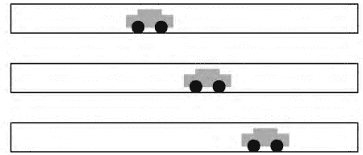

在本书中，我们经常将交互式 big-bang 程序的领域称为“世界”，并谈论设计“世界程序。”

世界程序的设计配方，如同函数的设计配方一样，是一种从问题陈述系统地迈向可运行程序的工具。它包含三个大步骤和一个小步骤：

- 1. 对于世界中随时间保持不变且用于将其呈现为图像所需的所有属性，引入常量。在 BSL 中，我们通过定义来指定此类常量。为了世界程序的目的，我们区分两种常量：

  - (a) “物理”常量描述世界中对象的一般属性，例如对象的速度或速率、颜色、高度、宽度、半径等。当然，这些常量并非真正指物理事实，但许多与现实世界的物理方面类似。

在我们的示例问题背景下，汽车车轮的半径和车轮之间的距离就是这样的“物理”常量：

```
(define WIDTH-OF-WORLD 200)
(define WHEEL-RADIUS 5)
(define WHEEL-DISTANCE (* WHEEL-RADIUS 5))
```

注意第二个常量是从第一个常量计算得出的。

  - (b) 图形常量是世界中对象的图像。程序将它们组合成代表世界完整状态的图像。

我们建议您在 DrRacket 的交互区域中进行实验，以开发此类图形常量。

这是我们示例汽车车轮图像的图形常量：

```
(define WHEEL
  (circle WHEEL-RADIUS "solid" "black"))
(define SPACE
  (rectangle ... WHEEL-RADIUS ... "white"))
(define BOTH-WHEELS
  (beside WHEEL SPACE WHEEL))
```

图形常量通常是计算得出的，计算往往涉及物理常量和其他图像。

最好为常量定义添加注释，说明其含义。

- 2. 随时间变化（对时钟时钟打点、按键或鼠标动作作出反应）的那些属性会产生世界的当前状态。您的任务是为世界的所有可能状态开发数据表示。开发结果是一个数据定义，它带有一个注释，告诉读者如何将世界信息表示为数据，以及如何将数据解释为关于世界的信息。

选择简单的数据形式来表示世界的状态。

对于运行中的示例，随时间变化的是汽车距离左边距的距离。虽然距离右边距的距离也会变化，但很明显，我们只需要其中之一来创建图像。距离以数字测量，因此以下是一个适当的数据定义：

```
; A WorldState is a Number.
```


; 解释场景左边界与汽车之间的像素数
; 场景左边界与汽车之间

另一种方法是统计已经过去的时钟打点数，并将此数作为世界的状态。我们将这种设计变体留作练习。

- 3. 一旦你有了表示世界状态的数据表示，就需要设计若干函数，以便能够形成一个有效的 big-bang 表达式。

首先，你需要一个函数，将任何给定的状态映射为图像，以便 big-bang 可以将状态序列渲染为图像：

```
; render
```

接下来，你需要决定哪类事件应该改变世界状态的哪些方面。根据你的决定，你需要设计下列三个函数中的一些或全部：

```
; clock-tick-handler
; keystroke-handler
; mouse-event-handler
```

最后，如果问题描述暗示当世界具有某些属性时程序应停止，则你必须设计

```
; end?
```

关于这些函数的通用签名和用途说明，请参见图 18。将这些通用用途说明改编为你所求解的具体问题，以便读者知道它们计算什么。

简言之，设计交互程序的愿望会自动在你的愿望清单中创建若干初始条目。逐一完成它们，你就能得到一个完整的世界程序。

让我们为示例程序逐步完成此步骤。虽然 big-bang 规定我们必须设计一个渲染函数，但我们仍需确定是否需要任何事件处理函数。由于汽车应该从左向右移动，我们肯定需要一个处理时钟打点的函数。因此，我们得到这个愿望清单：

```
; WorldState -> Image
; places the image of the car x pixels from
; the left margin of the BACKGROUND image
(define (render x)
 BACKGROUND)
```

```
; WorldState -> WorldState
; adds 3 to x to move the car right
(define (tock x)
 x)
```

注意我们如何根据手头问题量身定制了用途说明，并理解 big-bang 将如何使用这些函数。

- 4. 最后，你需要一个主函数。与所有其他函数不同，世界程序的主函数不需要设计或测试。其存在的唯一原因是，你可以方便地从 DrRacket 的交互区 **启动** 你的世界程序。

你必须做出的唯一决定涉及 main 的参数。对于我们的示例问题，我们选择一个参数：世界的初始状态。我们开始吧：

```
; WorldState -> WorldState
; launches the program from some initial state
(define (main ws)
 (big-bang ws
  [on-tick tock]
  [to-draw render]))
```

因此，你可以使用以下方式启动这个交互程序：

```
> (main 13)
```

以观看汽车从左边距 13 像素处开始移动。当你关闭 big-bang 的窗口时，它将停止。请记住，当求值停止时，big-bang 会返回世界的当前状态。

当然，你不必使用“WorldState”作为表示世界状态的数据类的名称。任何名称都可以，只要你在事件处理函数的签名中始终如一地使用它即可。此外，你也不必使用 tock、end? 或 render 这些名称。你可以随意命名这些函数，只要在编写 big-bang 表达式的子句时使用相同的名称即可。最后，你可能已经注意到，你可以按任意顺序列出 big-bang 表达式的子句，只要先列出初始状态即可。

现在，让我们使用迄今为止阐述的函数设计食谱和其他设计概念，来完成程序设计过程的其余部分。

### 练习 39。

优秀程序员确保诸如汽车这样的图像可以通过单个常量定义的更改来放大或缩小。我们使用单个简单定义开始了汽车图像的开发：

```
(define WHEEL-RADIUS 5)
```

> 优秀程序员为程序的所有方面建立单一控制点，而不仅仅是图形常量。若干章节都涉及这一问题。

WHEEL-DISTANCE 的定义基于车轮半径。因此，将 WHEEL-RADIUS 从 5 改为 10 会使汽车图像的大小加倍。这种程序组织被称为 *单一控制点*，良好的设计会尽可能多地运用这一理念。

开发你喜爱的汽车图像，使 WHEEL-RADIUS 保持为单一控制点。

愿望清单上的下一项是时钟打点处理函数：

```
; WorldState -> WorldState
; moves the car by 3 pixels for every clock tick
(define (tock ws) ws)
```

由于世界状态表示画布左边距与汽车之间的距离，且汽车每次时钟打点移动三像素，一个简洁的用途说明将这两个事实合而为一。这也使得创建示例和定义函数变得容易：

```
; WorldState -> WorldState
; moves the car by 3 pixels for every clock tick
; examples:
;  given: 20, expect 23
;  given: 78, expect 81
(define (tock ws)
 (+ ws 3))
```

最后的设计步骤要求确认示例按预期工作。因此，我们单击 RUN 按钮并求值这些表达式：

```
> (tock 20)
23
> (tock 78)
81
```

由于结果符合预期，tock 的设计已完成。

### 练习 40。

将示例表述为 BSL 测试，即使用 check-expect 形式。引入一个错误。重新运行测试。

愿望清单上的第二项指定一个将世界状态转换为图像的函数：

```
; WorldState -> Image
; places the car into the BACKGROUND scene,
; according to the given world state
(define (render ws)
 BACKGROUND)
```

为了为渲染函数制作示例，我们建议安排一个类似于 图 19 上半部分的表格。它列出了给定的世界状态和所需的场景。对于你的前几个渲染函数，你可能希望手绘这些图像。

| ws | 其图像 |
|---|---|
| 50 | [汽车图像] |
| 100 | [汽车图像] |
| 150 | [汽车图像] |
| 200 | [汽车图像] |

| ws | 表达式 |
|---|---|
| 50 | (place-image CAR 50 Y-CAR BACKGROUND) |
| 100 | (place-image CAR 100 Y-CAR BACKGROUND) |
| 150 | (place-image CAR 150 Y-CAR BACKGROUND) |
| 200 | (place-image CAR 200 Y-CAR BACKGROUND) |

## 图 19：移动汽车程序的示例

尽管这种图像表格直观且解释了运行中的函数将显示什么——一辆移动的汽车——但它并未解释函数 **如何** 创建此结果。为了从这里走到那里，我们建议编写类似于 图 19 下半部分的那些表达式，以创建表格中的图像。大写名称指代明显的常量：汽车图像、其固定 y 坐标以及当前为空的背景场景。

这个扩展表格为 render 函数主体中的公式暗示了一个模式：

```
; WorldState -> Image
; places the car into the BACKGROUND scene,
; according to the given world state
(define (render ws)
 (place-image CAR ws Y-CAR BACKGROUND))
```

设计一个简单的世界程序基本上就是这些了。

### 练习 41。

完成示例问题并使程序运行。也就是说，假设你已解决 练习 39，定义常量 BACKGROUND 和 Y-CAR。然后汇总所有函数定义，包括它们的测试。当你的程序运行令人满意时，为场景添加一棵树。我们使用了

```
(define tree
 (underlay/xy (circle 10 "solid" "green")
  9 15
  (rectangle 2 20 "solid" "brown")))
```

以创建树状形状。还要向 big-bang 表达式添加一个子句，当汽车在右侧消失时停止动画。

在确定世界状态的初始数据表示后，一位谨慎的程序员在设计过程的其余部分可能需要重新审视这一基本设计决定。例如，示例问题的数据定义将汽车表示为一个点。但是，（汽车的）图像并不仅仅是一个没有宽度和高度的数学点。因此，解释语句——左边距的像素数——是一个含糊的语句。该语句测量的是左边距与汽车左端之间的距离吗？其中心点吗？甚至是它的右端吗？我们在此忽略了这一问题，并留给 BSL 的图形原语为我们做决定。如果你不喜欢结果，请重新审视上面的数据定义并修改它或其解释语句，以符合你的口味。

### 练习 42。

修改示例数据定义的解释，使得一个状态表示汽车最右侧边缘的 x 坐标。

### 练习 43。

让我们使用基于时间的数据定义来处理相同的问题描述：

```
; An AnimationState is a Number.
; interpretation the number of clock ticks
; since the animation started
```

与原始数据定义一样，这个定义也将世界状态与数值类等同起来。然而，它的解释说明该数字的含义完全不同。

设计 tock 和 render 函数。然后开发一个 big-bang 表达式，以便你再次得到一辆汽车在世界画布上从左向右行驶的动画。

你认为这个程序与序言中的 animate 有何关系？

使用该数据定义设计一个程序，使汽车按照正弦波移动。（不要真的那样开车。）


本节以鼠标事件处理的一个例子结尾，这也说明了视图与模型分离所带来的优势。假设我们希望允许人们通过“超空间”移动汽车：

### 示例问题

设计一个程序，在世界画布上从左到右移动汽车，每次时钟滴答移动三个像素。**如果在画布上的任何位置单击鼠标，汽车将被放置在该单击的 x 坐标处。**

加粗部分是上面示例问题的扩展。

当我们面对修改后的问题时，会使用设计过程来指导必要的更改。如果正确使用，这个过程自然会确定我们需要向现有程序添加什么，以应对问题陈述的扩展。那么，我们开始吧：

- 1. 没有新属性，这意味着我们不需要新常量。

- 2. 程序仍然只关心随时间变化的一个属性，即汽车的 x 坐标。因此，数据表示已足够。

- 3. 修改后的问题陈述要求一个鼠标事件处理器，同时不放弃基于时钟的汽车移动。因此，我们提出一个适当的愿望：

```
; WorldState Number Number String -> WorldState
; places the car at x-mouse
; if the given me is "button-down"
(define (hyper x-position-of-car x-mouse y-mouse me)
  x-position-of-car)
```

- 4. 最后，我们需要修改 main 来处理鼠标事件。只需添加一个 on-mouse 子句，将其委派给愿望列表中的新条目即可：

```
(define (main ws)
 (big-bang ws
   [on-tick tock]
   [on-mouse hyper]
   [to-draw render])))
```

毕竟，修改后的问题要求处理鼠标单击，其他一切保持不变。

剩下的仅仅是设计一个函数的问题，为此我们使用函数设计食谱。

愿望列表中的一个条目涵盖了函数设计食谱的前两个步骤。因此，我们的下一步是开发一些函数示例：

```
; WorldState Number Number String -> WorldState
; places the car at x-mouse
; if the given me is "button-down"
; given: 21 10 20 "enter"
; wanted: 21
; given: 42 10 20 "button-down"
; wanted: 10
; given: 42 10 20 "move"
; wanted: 42
(define (hyper x-position-of-car x-mouse y-mouse me)
 x-position-of-car)
```

示例表明，如果字符串参数等于 "button-down"，函数返回 x-mouse；否则返回 x-position-of-car。

### 练习 44

将示例制定为 BSL 测试。点击 RUN 并观察它们失败。

要完成函数定义，我们必须唤起你对序言的美好回忆，具体来说，关于条件形式的回忆。使用 cond，hyper 是一个两行定义：

```
; WorldState Number Number String -> WorldState
; places the car at x-mouse
; if the given me is "button-down"
(define (hyper x-position-of-car x-mouse y-mouse me)
(cond
 [(string=? "button-down" me) x-mouse]
 [else x-position-of-car]))
```

*在下一章中，我们将详细解释使用 cond 进行设计。*

如果你解决了练习 44，重新运行程序并观察所有测试都成功。假设测试确实成功，计算

```
(main 1)
```

在 DrRacket 的交互区域，并将你的汽车通过超空间传送。

你可能会疑惑，为什么这个程序修改如此简单。原因其实有两个。首先，本书及其软件严格区分程序跟踪的数据——*模型*——和它显示的图像——*视图*。特别是，处理事件的函数与状态的呈现方式无关。如果我们希望修改状态的呈现方式，可以专注于 to-draw 子句中指定的函数。其次，程序和函数的设计食谱以正确的方式组织程序。如果问题陈述中有任何更改，第二次遵循设计食谱会自然指出原问题解决方案需要在哪里更改。虽然对于我们目前处理的简单问题，这可能看起来显而易见，但对于程序员在现实世界中遇到的问题，这至关重要。

### 3.7 虚拟宠物世界

本练习部分介绍虚拟宠物游戏的前两个元素。它从显示一只在画布上不断行走的猫开始。当然，不断行走会让猫不开心，它的不开心也显而易见。和所有宠物一样，你可以试试抚摸，这会有所帮助，或者你可以试试喂食，这会帮助更多。

那么，让我们从我们最喜欢的猫的图像开始：


```
(define cat1 )
```

复制猫图像并粘贴到 DrRacket 中，然后使用 define 给图像命名，就像上面一样。

### 练习 45

设计一个“虚拟猫”世界程序，让猫持续从左到右移动。我们称它为 cat-prog，并假设它接收猫的起始位置。此外，让猫每次时钟滴答移动三个像素。每当猫从右侧消失时，它会从左侧重新出现。你可能需要查阅模运算函数。

### 练习 46

使用略有不同的图像改进猫的动画：


```
(define cat2 )
```

调整练习 45 中的渲染函数，使其根据 x 坐标是否为奇数来使用其中一张猫图像。在 HelpDesk 中查阅 odd?，并使用 cond 表达式来选择猫图像。

### 练习 47

设计一个世界程序来维护和显示“幸福度仪表”。我们称它为 gauge-prog，并同意该程序接收最大幸福度。仪表显示从最大分数开始，每次时钟滴答，幸福度减少 -0.1；它永远不会低于 0，即最小幸福度分数。每次按下向下箭头键，幸福度增加 1/5；每次按下向上箭头键，幸福度增加 1/3。

为了显示幸福度水平，我们使用一个带有黑色边框的实心红色矩形场景。对于幸福度水平 0，红色条应该消失；对于最大幸福度水平 100，条应该贯穿整个场景。

**注意** 当你了解足够多时，我们将解释如何将仪表程序与练习 45 的解决方案结合起来。那时，我们将能够帮助猫，因为只要你忽略它，它就变得不那么快乐。如果你抚摸猫，它就变得更快乐。如果你喂猫，它就快乐得多、快乐得多。所以你可以看出，为什么你想了解比前三章所能告诉你的更多关于设计世界程序的知识。

## 4 区间、枚举和条目化

目前，你有四种方式将信息表示为数据：数字、字符串、图像和布尔值。对于许多问题来说，这已经足够，但还有许多问题，BSL（或其他编程语言）中的这四种数据集合不够。实际设计师需要额外的方式来将信息表示为数据。

至少，优秀的程序员必须学会在对这些内置集合施加限制的前提下设计程序。一种限制方式是列举集合中的一组元素，并声明这些是某些问题中将使用的唯一元素。列举元素仅在元素数量有限时有效。为了容纳“数量无限”的集合，我们引入区间，区间是满足特定属性的元素集合。

> 无限可能只是指“数量大到列举元素完全不切实际。”

定义枚举和区间意味着区分不同种类的元素。在代码中进行区分需要使用条件函数，即根据某个参数的值选择不同计算结果方式的函数。“多种计算方式”和第 1.6 章都通过示例说明了如何编写此类函数。然而，这两个部分都不涉及设计。两者都只是在你喜爱的编程语言（即 BSL）中介绍了一些新结构，并提供了一些使用示例。

在本章中，我们讨论枚举和区间的通用设计，这是新的数据描述形式。我们首先重新审视 cond 表达式。然后我们会浏览三种不同的数据描述方式：枚举、区间和条目化。枚举列出属于它的每一个数据项，而区间指定一个数据范围。最后一种，条目化，将前两者混合，在定义的一个子句中指定范围，在另一个子句中指定特定数据项。本章以这种情况下的通用设计策略结束。


### 4.1 使用条件进行编程

回顾序言中对条件表达式的简要介绍。由于 cond 是本书中最复杂的表达式形式，让我们仔细看看它的一般结构：

```
(cond
[ConditionExpression1 ResultExpression1]
[ConditionExpression2 ResultExpression2]
...
[ConditionExpressionN ResultExpressionN])
```

> 方括号使 cond 行突出。用 (...) 代替 [...] 也是可以的。

cond 表达式以 (cond（其关键字）开头，以 ) 结尾。在关键字之后，程序员根据需要编写任意数量的 cond 行；每个 cond 行由两个表达式组成，用开括号和闭括号括起来：[ 和 ]。

cond 行也称为 cond 子句。

下面是一个使用条件表达式的函数定义示例：

```
(define (next traffic-light-state)
(cond
[(string=? "red" traffic-light-state) "green"]
[(string=? "green" traffic-light-state) "yellow"]
[(string=? "yellow" traffic-light-state) "red"]))
```

与序言中的数学示例一样，此示例说明了使用 cond 表达式的便利性。在许多问题情境中，函数必须区分几种不同的情况。使用 cond 表达式，您可以为每种可能性使用一行，从而提醒代码读者问题陈述中不同情况对应的代码。

实用性说明：将 cond 表达式与第 1.6 章中的 if 表达式进行对比。后者将一种情况与所有其他情况区分开来。因此，if 表达式不太适合多种情况的情境；它们最适合用于我们只想表达“二选一”的情况。因此，当我们希望提醒代码读者某些不同的情况直接来自数据定义时，我们总是使用 cond。对于其他代码片段，我们使用最方便的结构。

当 cond 表达式中的条件变得过于复杂时，您偶尔希望说些类似“在所有其他情况下”的话。对于这类问题，cond 表达式允许在最后一个 cond 行中使用 else 关键字：

```
(cond
 [ConditionExpression1 ResultExpression1]
 [ConditionExpression2 ResultExpression2]
 ...
 [else DefaultResultExpression]))
```

如果在其他 cond 行中错误地使用 else，DrRacket 中的 BSL 会发出错误信号：

```
> (cond
 [(> x 0) 10]
 [else 20]
 [(< x 10) 30])
cond:found an else clause that isn't the last clause in its cond expression
```

也就是说，BSL 会拒绝语法错误的短语，因为弄清楚这样的短语可能意味着什么毫无意义。

想象一下，设计一个函数，作为游戏程序的一部分，在游戏结束时计算某个奖项。以下是其头部：

```
; A PositiveNumber is a Number greater than/equal to 0.

; PositiveNumber -> String
; computes the reward level from the given score s
```

下面是两个并排比较的变体：

```
(define (reward s)
 (cond
   [(<= 0 s 10)
    "bronze"]
   [(and (< 10 s)
         (<= s 20))
    "silver"]
   [(< 20 s)
    "gold"]))
```

```
(define (reward s)
 (cond
   [(<= 0 s 10)
    "bronze"]
   [(and (< 10 s)
         (<= s 20))
    "silver"]
   [else
    "gold"]))
```

左侧变体使用带有三个完整条件的 cond；右侧，函数带有 else 子句。要为左侧函数制定最后一个条件，您必须计算 (< 20 s) 成立，因为

- s 属于 PositiveNumber
- (<= 0 s 10) 为 #false
- (and (< 10 s) (<= s 20)) 也求值为 #false。

虽然在这种情况下计算看起来很简单，但很容易犯小错误并将错误引入程序。因此，如果您知道希望在 cond 中获得所有先前条件的精确相反项（称为补码），则最好像右侧所示那样制定函数定义。

### 4.2 有条件地计算

从阅读“多种计算方式”和第 1.6 章中，您大致了解 DrRacket 如何计算条件表达式。让我们对 cond 表达式更精确地回顾这一理念。再看一下这个定义：

```
(define (reward s)
 (cond
  [(<= 0 s 10) "bronze"]
  [(and (< 10 s) (<= s 20)) "silver"]
  [else "gold"]))
```

该函数接收一个数值分数——一个正数——并生成一种颜色。

仅查看 cond 表达式，您无法预测将使用哪个 cond 子句。这正是函数的要点。函数处理许多不同的输入，例如 2、3、7、18、29。对于每个输入，它可能需要以不同方式进行处理。区分不同的输入类别正是 cond 表达式的目的。

例如：

```
(reward 3)
```

您知道 DrRacket 在用参数替换形参后，用函数体替换函数应用。因此：

```
(reward 3) ; say 'equals'
==
(cond
 [(<= 0 3 10) "bronze"]
 [(and (< 10 3) (<= 3 20)) "silver"]
 [else "gold"]))
```

此时，DrRacket 一次计算一个条件。对于 **第一个** 求值为 #true 的条件，它继续处理结果表达式：

```
(reward 3)
==
(cond
 [(<= 0 3 10) "bronze"]
 [(and (< 10 3) (<= 3 20)) "silver"]
 [else "gold"])]
==
(cond
 [[#true "bronze"]
 [(and (< 10 3) (<= 3 20)) "silver"]
 [else "gold"])]
==
"bronze"
```

这里第一个条件成立，因为 3 在 0 和 10 之间。

下面是第二个示例：

```
(reward 21)
==
(cond
 [[(<= 0 21 10) "bronze"]
 [(and (< 10 21) (<= 21 20)) "silver"]
 [else "gold"])]
==
(cond
 [[#false "bronze"]
 [(and (< 10 21) (<= 21 20)) "silver"]
 [else "gold"])]
==
(cond
 [[(and (< 10 21) (<= 21 20)) "silver"]
 [else "gold"])]
```

请注意，这次第一个条件求值为 #false，如“多种计算方式”中所述，整个 cond 子句被丢弃。其余计算按预期进行：

```
(cond
 [(and (< 10 21) (<= 21 20)) "silver"]
 [else "gold"])]
==
(cond
 [[(and #true (<= 21 20)) "silver"]
 [else "gold"])]
==
(cond
 [(and #true #false) "silver"]
 [else "gold"])]
==
(cond
  [#false "silver"]
  [else "gold"]))
==
(cond
  [else "gold"]))
== "gold"
```

与第一个条件一样，第二个条件也求值为 #false，因此计算继续到第三个 cond 行。else 告诉 DrRacket 用该子句的答案替换整个 cond 表达式。

**练习 48。** 将 reward 的定义后跟 (reward 18) 输入到 DrRacket 的定义区域中，并使用步进器找出 DrRacket **如何** 计算函数应用。

**练习 49。** cond 表达式实际上只是一个表达式，因此可能出现在另一个表达式的中间：

```
(- 200 (cond [(> y 200) 0] [else y]))
```

使用步进器在 y 为 100 和 210 时求值该表达式。

嵌套 cond 表达式可以消除常见表达式。考虑图 20 中重复的火箭发射函数。cond 表达式的两个分支具有相同的形状，除了 ... 指出的部分之外：

```
(place-image ROCKET X ... MTSCN)
```

```
(define WIDTH 100)
(define HEIGHT 60)
(define MTSCN (empty-scene WIDTH HEIGHT))

(define ROCKET )
(define ROCKET-CENTER-TO-TOP
 (- HEIGHT (/ (image-height ROCKET) 2)))

(define (create-rocket-scene.v5 h)
 (cond
 [(<= h ROCKET-CENTER-TO-TOP)
 (place-image ROCKET 50 h MTSCN)]
 [(> h ROCKET-CENTER-TO-TOP)
 (place-image ROCKET 50 ROCKET-CENTER-TO-TOP MTSCN)]))
```

图 20：回顾“一个程序，多个定义”

重新制定 create-rocket-scene.v5 以使用嵌套表达式；结果函数只提到一次 place-image。

### 4.3 枚举

并非所有字符串都表示鼠标事件。如果您在上一节为 big-bang 引入 on-mouse 子句时查看了 HelpDesk，您会发现只有六个字符串用于通知程序鼠标事件：

```
; A MouseEvt is one of these Strings:
; -- "button-down"
; -- "button-up"
; -- "drag"
; -- "move"
; -- "enter"
; -- "leave"
```

这些字符串的解释非常直观。前两个字符串之一出现在计算机用户单击鼠标按钮或释放它时。相比之下，第三个和第四个是关于移动鼠标，同时可能按住鼠标按钮。最后，最后两个字符串表示鼠标移动到画布边缘的事件：要么从外部进入画布，要么离开画布。

更重要的是，用字符串表示鼠标事件的数据定义与我们迄今看到的数据定义截然不同。它称为 _枚举_，是一种列出每种可能性的数据表示。枚举很常见，这不足为奇。下面是一个简单示例：

```
; A TrafficLight is one of the following Strings:
; -- "red"
; -- "green"
; -- "yellow"
; interpretation the three strings represent the three
; possible states that a traffic light may assume
```

这是交通灯可以采用的状态的简化表示。与其他定义不同，此数据定义也使用略有不同的措辞来解释 TrafficLight 术语的含义，但这是一个无关紧要的差异。


使用枚举进行编程大多比较直接。当函数的输入是一类数据，其描述逐个罗列其元素时，函数应当只区分这些情况，并逐个情况计算结果。例如，如果你想定义一个函数来计算交通灯的下一个状态，给定的当前状态是 TrafficLight 的一个元素，你会得到类似下面这样的定义：

```lisp
; TrafficLight -> TrafficLight
; yields the next state given current state s
(check-expect (traffic-light-next "red") "green")
(define (traffic-light-next s)
 (cond
  [(string=? "red" s) "green"]
  [(string=? "green" s) "yellow"]
  [(string=? "yellow" s) "red"]]))
```

由于 TrafficLight 的数据定义由三个不同的元素组成，traffic-light-next 函数自然地区分三种不同的情况。对于每种情况，结果表达式只是另一个字符串，即对应于下一个情况的字符串。

**练习 50.** 如果你将上面的函数定义复制粘贴到 DrRacket 的定义区并点击 RUN，DrRacket 会高亮显示三个 cond 行中的两个。这种着色告诉你，你的测试用例没有覆盖完整的条件。添加足够的测试来让 DrRacket 满意。

**练习 51.** 设计一个 big-bang 程序，模拟给定持续时间的交通灯。该程序以适当颜色的实心圆渲染交通灯的状态，并在每次时钟滴答时改变状态。最合适的初始状态是什么？问问你的工程师朋友们。

枚举的主要思想是将数据集定义为有限个数据片。每个项目明确说明哪个数据片属于我们正在定义的数据类。通常，数据片原样显示；在某些情况下，枚举的项目是一个英文句子，用一个短语描述有限个数据片元素。

下面是一个重要的示例：

```lisp
; A 1String is a String of length 1,
; including
; -- "\" (the backslash),
; -- " " (the space bar),
; -- "\t" (tab),
; -- "\r" (return), and
; -- "\b" (backspace).
; interpretation represents keys on the keyboard
```

你知道这样的数据定义是合适的，如果你可以用 BSL 测试描述其所有元素。对于 1String，你可以使用以下方式找出某个字符串 s 是否属于该集合：

```lisp
(= (string-length s) 1)
```

检查你是否成功的另一种方法是枚举你希望描述的数据集合的所有成员：

```lisp
; A 1String is one of:
; -- "q"
; -- "w"
; -- "e"
; -- "r"
; ...
; -- "\t"
; -- "\r"
; -- "\b"
```

如果你看一下你的键盘，你会发现 ←、↑ 以及类似的标签。我们选择的编程语言 BSL 使用其自己的数据定义来表示此信息。下面是一个摘录：

```lisp
; A KeyEvent is one of:
; -- 1String
; -- "left"
; -- "right"
; -- "up"
; -- ...
```

此枚举中的第一项描述了 1String 描述的同一组字符串。随后的子句枚举了特殊按键事件的字符串，例如按下四个方向键之一或释放按键。

此时，我们可以系统地设计按键事件处理程序。以下是一个草图：

```lisp
; WorldState KeyEvent -> ...
(define (handle-key-events w ke)
(cond
 [(= (string-length ke) 1) ...]
 [(string=? "left" ke) ...]
 [(string=? "right" ke) ...]
 [(string=? "up" ke) ...]
 [(string=? "down" ke) ...]
 ...))
```

此事件处理函数使用 cond 表达式，数据定义的枚举中的每一行对应一行 cond。第一行 cond 中的条件标识枚举第一行中标识的 KeyEvents，第二个 cond 子句对应第二行数据枚举，以此类推。

当程序依赖于随选定编程语言（例如 BSL）或其库（例如 2htdp/universe 库）提供的数据定义时，它们通常只使用枚举的一部分。为了说明这一点，让我们看一个典型问题。

**示例问题** 设计一个按键事件处理程序，以响应按下左箭头和右箭头键，在水平线上将红点向左或向右移动。

图 21 给出了此问题的 **两个** 解决方案。左侧的函数根据在输入 KeyEvent 的数据定义中每一行使用一个 cond 子句的基本思想进行组织。相比之下，右侧显示了一个版本，它使用三个关键行：两个用于重要的键，一个用于其他所有情况。这种重新排序是合适的，因为只有两个 cond 行是相关的，并且可以从其他行中清晰地分离出来。当然，这种重新排列是在函数正确设计 **之后** 进行的。

```lisp
; A Position is a Number.
; interpretation distance between the left margin and the ball
; Position KeyEvent -> Position
; computes the next location of the ball
(check-expect (keh 13 "left") 8)
(check-expect (keh 13 "right") 18)
(check-expect (keh 13 "a") 13)

(define (keh p k)
  (cond
    [(= (string-length k) 1)
     p]
    [(string=? "left" k)
     (- p 5)]
    [(string=? "right" k)
     (+ p 5)]
    [else p]))

(define (keh p k)
  (cond
    [(string=? "left" k)
     (- p 5)]
    [(string=? "right" k)
     (+ p 5)]
    [else p]))
```

## 图 21：条件函数与特殊枚举

### 4.4 区间

想象你正在回应以下示例设计任务：

**示例问题** 设计一个程序来模拟 UFO 的下降。

稍加思考后，你可能会得出类似图 22 的东西。停下来！在继续阅读之前，先学习定义并替换点号。

```lisp
; A WorldState is a Number.
; interpretation number of pixels between the top and the UFO
(define WIDTH 300) ; distances in terms of pixels
(define HEIGHT 100)
(define CLOSE (/ HEIGHT 3))
(define MTSCN (empty-scene WIDTH HEIGHT))
(define UFO (overlay (circle 10 "solid" "green") ...))

; WorldState -> WorldState
(define (main y0)
  (big-bang y0
    [on-tick nxt]
    [to-draw render]))

; WorldState -> WorldState
; computes next location of UFO
(check-expect (nxt 11) 14)
(define (nxt y)
  (+ y 3))

; WorldState -> Image
; places UFO at given height into the center of MTSCN
(check-expect (render 11) (place-image UFO ... 11 MTSCN))
(define (render y)
  (place-image UFO ... y MTSCN))
```

图 22：下降的 UFO

然而，在发布这个“游戏”程序之前，你可能希望在画布上添加状态行的显示：

**示例问题** 添加一条状态行。当 UFO 的高度高于画布高度的三分之一时，它显示“下降”。低于该高度时，它切换为“正在接近”。最后，当 UFO 到达画布底部时，状态通知玩家 UFO 已“着陆”。

你可以自由使用适当的颜色来显示状态行。

在此示例中，我们没有不同元素或不同数据子类的有限枚举。毕竟，从概念上讲，`0` 和 `HEIGHT`（某个大于 `0` 的数字）之间的区间包含无限多的数字和大量整数。因此，我们使用区间对泛型数据定义施加一些组织，该定义只是使用“数字”来描述坐标类。

*区间* 是通过边界描述的一类数字。最简单的区间有两个边界：左边界和右边界。如果左边界包含在区间内，我们说它在左侧是 *闭合的*。同样，右闭区间包含其右边界。最后，如果区间不包含某个边界，则称其在该边界处是 *开放的*。

区间的图示和符号使用方括号表示闭合边界，使用圆括号表示开放边界。以下是四个这样的区间：

- [3,5] 是闭区间：

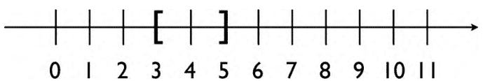

- (3,5] 是左开区间：

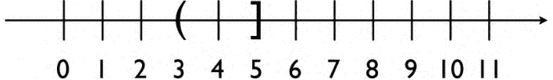

- [3,5) 是右开区间：

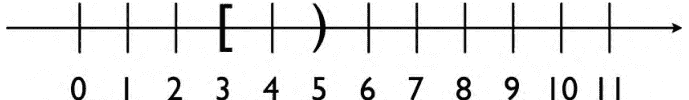

- 而 (3,5) 是开区间：


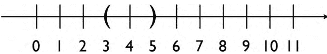

## 练习 52. 上述四个区间包含哪些整数？

The interval concept helps us formulate a data definition that captures the revised problem statement better than the “numbers”-based definition:

```
; A WorldState falls into one of three intervals:
; -- between 0 and CLOSE
; -- between CLOSE and HEIGHT
; -- below HEIGHT
```

Specifically, there are three intervals, which we may picture as follows:

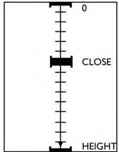

What you see is the standard number line, turned vertical and broken into intervals. Each interval starts with an angular downward-pointing bracket (`—`) and ends with an upward-pointing bracket (`—`). The picture identifies three intervals in this manner:

- the upper interval goes from 0 to CLOSE;
- the middle one starts at CLOSE and reaches HEIGHT; and
- the lower, invisible interval is just a single line at HEIGHT.

On a plain number line, the last interval starts at HEIGHT and goes on forever.

Visualizing the data definition in this manner helps with the design of functions in two ways. First, it immediately suggests how to pick examples. Clearly we want the function to work inside of all the intervals, and we want the function to work properly at the ends of each interval. Second, the image tells us that we need to formulate a condition that determines whether or not some “point” is within one of the intervals.

Putting the two together also raises a question, namely, how exactly the function deals with the end points. In the context of our example, two points on the number line belong to two intervals: CLOSE belongs to both the upper interval and the middle one, while HEIGHT seems to fall into both the middle one and the lowest one. Such overlaps usually cause problems for programs, and they ought to be avoided.

BSL functions avoid them naturally due to the way cond expressions are evaluated. Consider this natural organization of a function that consumes elements of WorldState:

```
; WorldState -> WorldState
(define (f y)
(cond
[(<= 0 y CLOSE) ...]
[(<= CLOSE y HEIGHT) ...]
[(>= y HEIGHT) ...]))
```

The three cond lines correspond to the three intervals. Each condition identifies those values of y that are in between the limits of the intervals. Due to the way cond lines are checked one by one, however, a y value of CLOSE makes BSL pick the first cond line, and a y value of HEIGHT triggers the evaluation of the second ResultExpression.

If we wanted to make this choice obvious and immediate for every reader of our code, we would use different conditions:

```
; WorldState -> WorldState
(define (g y)
(cond
[(<= 0 y CLOSE) ...]
[(and (< CLOSE y) (<= y HEIGHT)) ...]
[(> y HEIGHT) ...]))
```

Note how the second cond line uses and to combine a strictly-less check with a less-than-or-equal check instead of f’s <= with three arguments.

Given all that, we can complete the definition of the function that adds the requested status line to our UFO animation; see figure 23 for the complete definition. The function uses a cond expression to distinguish the three intervals. In each cond clause, the ResultExpression uses render (from figure 22) to create the image with the descending UFO and then places an appropriate text at position (10,10) with place-image.

```
; WorldState -> Image
; adds a status line to the scene created by render

(check-expect (render/status 10)
         (place-image (text "descending" 11 "green")
                      10 10
                      (render 10)))

(define (render/status y)
  (cond
    [(<= 0 y CLOSE)
     (place-image (text "descending" 11 "green")
                  10 10
                  (render y))]

    [(and (< CLOSE y) (<= y HEIGHT))
     (place-image (text "closing in" 11 "orange")
                  10 10
                  (render y))]

    [(> y HEIGHT)
     (place-image (text "landed" 11 "red")
                  10 10
                  (render y))]))
```

## Figure 23: Rendering with a status line

To run this version, you need to change main from figure 22 a bit:

```
; WorldState -> WorldState
(define (main y0)
  (big-bang y0
     [on-tick nxt]
     [to-draw render/status]))
```

One aspect of this function definition might disturb you, and to clarify why, let's refine the sample problem from above just a tiny bit:

### Sample Problem Add a status line, positioned at (20,20), that says “descending” when the UFO’s height is above one third of the height of the canvas....

This could be the response of a client who has watched your animation for a first time.

At this point, you have no choice but to change the function render/status at **six** distinct places because you have three copies of one external piece of information: the location of the status line. To avoid multiple changes for a single element, programmers try to avoid copies. You have two choices to fix this problem. The first one is to use constant definitions, which you might recall from early chapters. The second one is to think of the cond expression as an expression that may appear anywhere in a function, including in the middle of some other expression; see figure 24 and compare with figure 23. In this revised definition of render/status, the cond expression is the first argument to place-image. As you can see, its result is always a text image that is placed at position (20,20) into the image created by (render y).

```
; WorldState -> Image
; adds a status line to the scene created by render

(check-expect (render/status 42)
   (place-image (text "closing in" 11 "orange")
                20 20
                (render 42)))

(define (render/status y)
  (place-image
   (cond
    [(<= 0 y CLOSE)
     (text "descending" 11 "green")]
    [(and (< CLOSE y) (<= y HEIGHT))
     (text "closing in" 11 "orange")]
    [(> y HEIGHT)
     (text "landed" 11 "red")]]
   20 20
   (render y)))
```

## Figure 24: Rendering with a status line, revised

### 4.5 Itemizations

An interval distinguishes different sub-classes of numbers, which, in principle, is an infinitely large class. An enumeration spells out item for item the useful elements of an existing class of data. Some data definitions need to include elements from both. They use _itemizations_, which generalize intervals and enumerations. They allow the combination of any already-defined data classes with each other and with individual pieces of data.

Consider the following example, a rewrite of an important data definition from chapter 4.3:

```
; A KeyEvent is one of:
; -- 1String
; -- "left"
; -- "right"
; -- "up"
; -- ...
```

In this case, the KeyEvent data definition refers to the 1String data definition. Since functions that deal with KeyEvents often deal with 1Strings separately from the rest and do so with auxiliary functions, we now have a convenient way to express signatures for these functions, too.

The description of the string->number primitive employs the idea of an itemization in a sophisticated way. Its signature is

```
; String -> NorF
; converts the given string into a number;
; produces #false if impossible
(define (string->number s) (... s ...))
```

meaning that the result signature names a simple class of data:

```
; An NorF is one of:
; -- #false
; -- a Number
```

This itemization combines one piece of data (#false) with a large, and distinct, class of data (Number).

Now imagine a function that consumes the result of string->number and adds 3, dealing with #false as if it were 0:

```
; NorF -> Number
; adds 3 to the given number; 3 otherwise
(check-expect (add3 #false) 3)
(check-expect (add3 0.12) 3.12)
(define (add3 x)
  (cond
    [(false? x) 3]
    [else (+ x 3)]))
```

As above, the function’s body consists of a cond expression with as many clauses as there are items in the enumeration of the data definition. The first cond clause recognizes when the function is applied to #false; the corresponding result is 3 as requested. The second clause is about numbers and adds 3 as required.

Let’s study a somewhat more purposeful design task:

### Sample Problem Design a program that launches a rocket when the user of your program presses the space bar. The program first displays the rocket sitting at the bottom of the canvas. Once launched, it moves upward at three pixels per clock tick.

This revised version suggests a representation with two classes of states:

```
; An LR (short for launching rocket) is one of:
; -- "resting"
; -- NonnegativeNumber
; **interpretation** "resting" represents a grounded rocket
; a number denotes the height of a rocket in flight
```

While the interpretation of "resting" is obvious, the interpretation of numbers is ambiguous in its notion of height:

- 1. the word “height” could refer to the distance between the ground and the


rocket's point of reference, say, its center; or

- it could mean the distance between the top of the canvas and the reference point.

Either one works fine. The second one uses the conventional computer meaning of the word “height.” It is thus slightly more convenient for functions that translate the state of the world into an image, and we therefore choose to interpret the number in that spirit.

To drive home this choice, exercise 57 below asks you to solve the exercises of this section using the first interpretation of height.

### 练习 53.

The design recipe for world programs demands that you translate information into data and vice versa to ensure a complete understanding of the data definition. It’s best to draw some world scenarios and to represent them with data and, conversely, to pick some data examples and to draw pictures that match them. Do so for the LR definition, including at least HEIGHT and 0 as examples.

### 示例问题

Design a program that launches a rocket when the user presses the space bar. At that point, the simulation starts a countdown for three ticks, before it displays the scenery of a rising rocket. The rocket should move upward at a rate of three pixels per clock tick.

Following the program design recipe, we first collect constants:

```scheme
(define HEIGHT 300) ; distances in pixels
(define WIDTH 100)
(define YDELTA 3)
(define BACKG (empty-scene WIDTH HEIGHT))
(define ROCKET (rectangle 5 30 "solid" "red"))

(define CENTER (/ (image-height ROCKET) 2))
```

While WIDTH and HEIGHT describe the dimensions of the canvas and the background scene, YDELTA describes how fast the rocket moves along the y-axis, as specified in the problem statement. The CENTER constant is the **computed** center of the rocket.

Next we turn to the development of a data definition. This revision of the problem clearly calls for three distinct sub-classes of states:

```scheme
; An LRCD (for launching rocket countdown) is one of:
; -- "resting"
; -- a Number between -3 and -1
; -- a NonnegativeNumber
; interpretation a grounded rocket, in countdown mode,
; a number denotes the number of pixels between the
; top of the canvas and the rocket (its height)
```

The second, new sub-class of data—three negative numbers—represents the world after the user pressed the space bar and before the rocket lifts off.

At this point, we write down our wish list for a function that renders states as images and for any event-handling functions that we may need:

```scheme
; LRCD -> Image
; renders the state as a resting or flying rocket
(define (show x)
  BACKG)
```

```scheme
; LRCD KeyEvent -> LRCD
; starts the countdown when space bar is pressed,
; if the rocket is still resting
(define (launch x ke)
  x)
```

```scheme
; LRCD -> LRCD
; raises the rocket by YDELTA,
; if it is moving already
(define (fly x)
  x)
```

Remember that the design recipe for world programs dictates these signatures, though the choice of names for the data collection and the event handlers are ours. Also, we have specialized the purpose statements to fit our problem statement.

From here, we use the design recipe for functions to create complete definitions for all three of them, starting with examples for the first one:

```scheme
(check-expect
  (show "resting")
  (place-image ROCKET 10 HEIGHT BACKG))

(check-expect
  (show -2)
  (place-image (text "--2" 20 "red")
               10 (* 3/4 WIDTH)
               (place-image ROCKET 10 HEIGHT BACKG)))

(check-expect
  (show 53)
  (place-image ROCKET 10 53 BACKG))
```

As before in this chapter, we make one test per sub-class in the data definition. The first example shows the resting state, the second the middle of a countdown, and the last one the rocket in flight. Furthermore, we express the expected values as expressions that draw appropriate images. We used DrRacket’s interactions area to create these images; what would **you** do?

A close look at the examples reveals that making examples also means making choices. Nothing in the problem statement actually demands how exactly the rocket is displayed before it is launched, but doing so is natural. Similarly, nothing says to display a number during the countdown, yet it adds a nice touch. Lastly, if you solved exercise 53 you also know that 0 and HEIGHT are special points for the third clause of the data definition.

In general, intervals deserve special attention when you make up examples, that is, they deserve at least three kinds of examples: one from each end and another one from inside. Since the second sub-class of LRCD is a (finite) interval and the third one is a half-open interval, let’s take a look at their end points:

- Clearly, (show -3) and (show -1) must produce images like the one for (show -2). After all, the rocket still rests on the ground, even if the countdown numbers differ.

- The case for (show HEIGHT) is different. According to our agreement, the value HEIGHT represents the state when the rocket has just been launched.

- Pictorially this means the rocket is still resting on the ground. Based on the last test case above, here is the test case that expresses this insight:

```scheme
(check-expect
(show HEIGHT)
(place-image ROCKET 10 HEIGHT BACKG))
```

Except that if you evaluate the “expected value” expression by itself in DrRacket’s interactions area, you see that the rocket is halfway underground. This shouldn’t be the case, of course, meaning that we need to adjust this test case and the above:

```scheme
(check-expect
(show HEIGHT)
(place-image ROCKET 10 (- HEIGHT CENTER) BACKG))
```

```scheme
(check-expect
(show 53)
(place-image ROCKET 10 (- 53 CENTER) BACKG))
```

- Finally, determine the result you now expect from (show 0). It is a simple but revealing exercise.

Following the precedents in this chapter, show uses a cond expression to deal with the three clauses of the data definition:

```scheme
(define (show x)
  (cond
    [(string? x) ...]
    [(<= -3 x -1) ...]
    [(>= x 0) ...]))
```

Each clause identifies the corresponding sub-class with a precise condition: (string? x) picks the first sub-class, which consists of just one element, the string "resting"; (<= -3 x -1) completely describes the second sub-class of data; and (>= x 0) is a test for all non-negative numbers.

### 练习 54.

Why is (string=? "resting" x) incorrect as the first condition in show? Conversely, formulate a completely accurate condition, that is, a Boolean expression that evaluates to #true precisely when x belongs to the first sub-class of LRCD.

Combining the examples and the above skeleton of the show function yields a complete definition in a reasonably straightforward manner:

```scheme
(define (show x)
  (cond
    [(string? x)
     (place-image ROCKET 10 (- HEIGHT CENTER) BACKG)]
    [(<= -3 x -1)
     (place-image (text (number->string x) 20 "red")
                  10 (* 3/4 WIDTH)
                  (place-image ROCKET
                               10 (- HEIGHT CENTER)
                               BACKG))]
    [(>= x 0)
     (place-image ROCKET 10 (- x CENTER) BACKG)]))
```

Indeed, this way of defining functions is highly effective and is an essential element of the full-fledged design approach in this book.

### 练习 55.

Take another look at show. It contains three instances of an expression with the approximate shape:

```scheme
(place-image ROCKET 10 (- ... CENTER) BACKG)
```

This expression appears three times in the function: twice to draw a resting rocket and once to draw a flying rocket. Define an auxiliary function that performs this work and thus shorten show. Why is this a good idea? You may wish to reread the Prologue.

Let's move on to the second function, which deals with the key event to launch the rocket. We have its header material, so we formulate examples as tests:

```scheme
(check-expect (launch "resting" " ") -3)
```

```scheme
(check-expect (launch "resting" "a") "resting")
(check-expect (launch -3 " ") -3)
(check-expect (launch -1 " ") -1)
(check-expect (launch 33 " ") 33)
(check-expect (launch 33 "a") 33)
```

An inspection of these six examples shows that the first two are about the first sub-class of LRCD, the third and fourth concern the countdown, and the last two are about key events when the rocket is already in the air.

Since writing down the sketch of a cond expression worked well for the design of the show function, we do it again:

```scheme
(define (launch x ke)
  (cond
    [(string? x) ...]
    [(<= -3 x -1) ...]
    [(>= x 0) ...]))
```

Looking back at the examples suggests that nothing changes when the world is in a state that is represented by the second or third sub-class of data. Meaning, launch should produce x when this happens:

```scheme
(define (launch x ke)
  (cond
    [(string? x) ...]
    [(<= -3 x -1) x]
    [(>= x 0) x]))
```

Finally, the first example identifies the exact case when the launch function produces a new world state:

```scheme
(define (launch x ke)
  (cond
    [(string? x) (if (string=? " " ke) -3 x)]
    [(<= -3 x -1) x]
    [(>= x 0) x]))
```

Specifically, when the state of the world is "resting" and the user presses the space bar, the function starts the countdown with -3.

Copy the code into the definitions area of DrRacket and ensure that the


上述定义生效。到那时，你可能希望添加一个运行程序的函数：

```
; LRCD -> LRCD
(define (main1 s)
 (big-bang s
   [to-draw show]
   [on-key launch]))
```

此函数 **不** 指定时钟滴答时该做什么；毕竟，我们尚未设计 `fly`。尽管如此，借助 `main1` 可以运行这个不完整的程序版本，并检查是否可以启动倒计时。你会在调用 `main1` 时提供什么作为参数？

`fly`（时钟滴答处理器）的设计过程与前两个函数的设计过程类似，图 25 展示了设计过程的结果。再次强调，关键是要用大量示例来覆盖可能的输入数据空间，尤其是针对两个区间。这些示例确保倒计时以及从倒计时到发射的过渡能正常工作。

```
; LRCD -> LRCD
; raises the rocket by YDELTA if it is moving already
(check-expect (fly "resting") "resting")
(check-expect (fly -3) -2)
(check-expect (fly -2) -1)
(check-expect (fly -1) HEIGHT)
(check-expect (fly 10) (- 10 YDELTA))
(check-expect (fly 22) (- 22 YDELTA))

(define (fly x)
 (cond
   [(string? x) x]
   [(<= -3 x -1) (if (= x -1) HEIGHT (+ x 1))]
   [(>= x 0) (- x YDELTA)]))
```

图 25：启动倒计时和发射

**练习 56。** 定义 `main2`，以便你可以启动火箭并观看它起飞。阅读 on-tick 子句以确定一个滴答的时长以及如何更改它。

如果你观看整个发射过程，你会注意到火箭一旦到达顶部就会发生一些奇怪的事情。请解释。向 main2 添加一个 stop-when 子句，以便当火箭消失在视野之外时，发射模拟能优雅地停止。

练习 56 的解决方案得出了一个完整的、可工作的程序，但它的行为有点奇怪。有经验的程序员告诉你，使用负数表示倒计时阶段过于“脆弱”。下一章介绍了为这个问题提供良好数据定义的方法。然而，在我们去那里之前，下一节详细说明了如何设计使用条目化数据的程序。

**练习 57。** 回想一下，“height”这个词迫使我们在两种可能的解释中做出选择。既然你已经解决了本节中的练习，请使用该词的第一种解释再次解决它们。比较并对比解决方案。

### 4.6 使用条目化数据进行设计

### 使用条目化数据进行设计

前三节澄清的内容是，函数设计可以——而且必须——利用数据定义的组织。具体来说，如果数据定义突出了某些数据片段或指定了数据范围，那么示例的创建和函数的组织就体现这些情况和范围。

在本节中，我们改进了第 3.4 章的设计配方，以便当你遇到涉及使用条目化数据（包括枚举和区间）的函数的问题时，可以以系统的方式进行。为了使解释具体化，我们用下面这个有些简单化的例子来说明六个设计步骤：

**示例问题** 税收之国（Tax Land）为了应对财政赤字，制定了一种三级销售税。价格低于 1,000 美元的廉价商品不征税。价格超过 10,000 美元的奢侈品按 8.00% 的税率征税。中间价格范围内的所有商品加价 5.00%。

为收银机设计一个函数，给定商品的价格，计算销售税。

当我们修订设计配方的步骤时，请牢记这个问题：

- 1. 当问题陈述区分了不同类别的输入信息时，你需要精心制定的数据定义。

数据定义必须为每个数据子类（或在某些情况下只是单个数据片段）使用不同的 *子句*。每个子句为特定的信息子类指定数据表示。关键是每个数据子类与其他每个类都不同，因此我们的函数可以通过分析不相交的情况来进行。

我们的示例问题涉及价格和税金，通常是正数。它也清楚地区分了三个范围：

```
; A Price falls into one of three intervals:
; --- 0 through 1000
; --- 1000 through 10000
; --- 10000 and above.
; interpretation the price of an item
```

你是否理解这些范围与原始问题的关系？

- 2. 就签名、目的说明和函数头而言，你按以前的方式进行。

以下是我们运行示例的素材：

```
; Price -> Number
; computes the amount of tax charged for p
(define (sales-tax p) 0)
```

> 现实世界中的开发人员不会在所选的编程语言中使用纯数字来表示金额。有关数字的一些问题，请参见间奏曲 4。

- 3. 但是，对于功能示例，你必须从数据定义中的每个子类中至少选择一个示例。此外，如果子类是有限范围，请务必从范围的边界和内部各选择示例。

由于我们的示例数据定义涉及三个不同的区间，让我们选取所有边界示例以及每个区间内部的一个价格，并确定每个价格的税额：0、537、1000、1282、10000 和 12017。

停！尝试计算这些价格中每个价格的税额。

以下是我们的第一次尝试，税额已四舍五入：

| 0 | 537 | 1000 | 1282 | 10000 | 12017 |
|---|---|---|---|---|---|
| 0 | 0 | ??? | 64 | ????? | 961 |

问号指出，问题陈述使用了模糊的短语“低于 1,000 美元”和“超过 10,000 美元”来指定税表。虽然程序员可能会得出结论认为这些词意味着“严格小于”或“严格大于”，但立法者可能本意是说“小于或等于”或“大于或等于”，分别如此。持怀疑态度，我们在这里决定税收之国的立法者总是想花更多的钱，因此 1,000 美元的税率是 5%，10,000 美元的税率是 8%。一家税务公司的程序员将不得不咨询税法专家。

现在我们已经弄清楚了在域中如何解释边界，我们可以改进数据定义。我们相信你可以独立完成。

在我们离开之前，让我们将一些示例转换为测试用例：

```
(check-expect (sales-tax 537) 0)
(check-expect (sales-tax 1000) (* 0.05 1000))
(check-expect (sales-tax 12017) (* 0.08 12017))
```

仔细看看。我们不是只写下预期结果，而是写下如何计算预期结果。这使得以后更容易制定函数定义。

停！写下剩余的测试用例。思考一下为什么你可能需要比数据定义中的子类更多的测试用例。

- 4. 最大的新特性是条件模板。一般来说，

_模板使用 cond 来反映子类的组织。_

这个口号意味着两个具体的事情。首先，函数体必须是一个条件表达式，其子句数量与数据定义中的不同子类数量相同。如果数据定义提到三个不同的输入数据子类，你需要三个 cond 子句；如果它有十七个子类，cond 表达式就包含十七个子句。其次，你必须为每个 cond 子句制定一个条件表达式。每个表达式都涉及函数参数并识别数据定义中的一个数据子类：

```
(define (sales-tax p)
 (cond
  [(and (<= 0 p) (< p 1000)) ...]
  [(and (<= 1000 p) (< p 10000)) ...]
  [(>= p 10000) ...]))
```

- 5. 完成模板后，你就可以定义函数了。

鉴于函数体已经包含一个示意性的 cond 表达式，从各个 cond 行开始是自然而然的。对于每个 cond 行，你可以假设输入参数满足条件，因此你可以利用相应的测试用例。要制定相应的结果表达式，你将此示例的计算写成涉及函数参数的表达式。在处理一行时，忽略所有其他可能的输入数据类型；其他 cond 子句会处理那些数据。

```
(define (sales-tax p)
  (cond
    [(and (<= 0 p) (< p 1000)) 0]
    [(and (<= 1000 p) (< p 10000)) (* 0.05 p)]
    [(>= p 10000) (* 0.08 p)]))
```

- 6. 最后，运行测试并确保它们覆盖所有 cond 子句。

当其中一个测试用例失败时，你该怎么做？请复习第 3.1 章末尾关于测试失败的内容。

**练习 58。** 引入常量定义，将低价和奢侈品价格的区间与其他区间分开，以便税收之国的立法者可以更容易地进一步提高税收。


### 4.7 有限状态世界

有了本章的设计知识，你可以开发一个完整的美国交通信号灯模拟。当灯是绿色且需要停止交通时，灯会变黄，之后变红。当灯是红色且需要恢复交通时，灯会直接切换到绿色。

图 26 左侧将此描述总结为一个状态转换图。这种图由状态以及连接这些状态的箭头组成。每个状态描绘交通信号灯的某个特定配置：红色、黄色或绿色。每个箭头展示世界如何变化，即从哪个状态可以转换到另一个状态。我们的示例图包含三个箭头，因为交通信号灯有三种可能的变化方式。箭头上的标签指示变化的原因；交通信号灯随着时间的推移从一个状态转换到另一个状态。

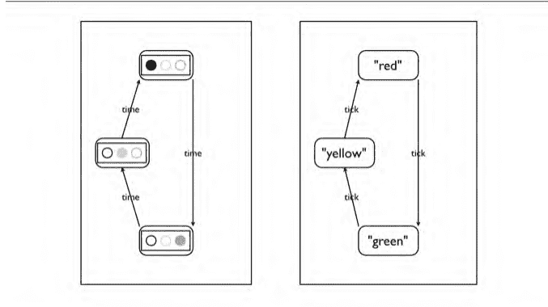

### 图 26：交通信号灯的工作原理

在许多情况下，状态转换图仅拥有有限数量的状态和箭头。计算机科学家将此类图称为有限状态机（FSM），也称为有限状态自动机（FSA）。尽管它们很简单，FSM/FSA 在计算机科学中扮演着重要角色。

要为 FSA 创建世界程序，我们必须首先为世界可能的“状态”选择一种数据表示，根据第 3.6 节，这表示世界中可能以某种方式改变的方面，区别于保持不变的方面。就我们的交通信号灯而言，变化的是灯的颜色，也就是哪个灯泡被点亮。灯泡的大小、排列方式（水平或垂直）以及其他方面都不会改变。由于只有三种状态，我们复用上面的基于字符串的 TrafficLight 数据定义。

图 26 右侧是 TrafficLight 数据定义的图示诠释。与图 26 中的图类似，它包含三种状态，排列方式使得每个数据元素都易于被视为某种具体配置的表示。此外，箭头现在标注了 **滴答**，以暗示我们的世界程序使用时间流逝作为改变交通信号灯状态的触发器。如果我们想模拟手动操作的信号灯，可能会基于按键选择转换。

既然我们知道如何表示世界的状态，如何从一个状态转到下一个状态，以及状态在每个时钟滴答时都会改变，我们可以写下需要设计的两个函数的签名、目的说明和存根：

```
; TrafficLight -> TrafficLight
; yields the next state, given current state cs
(define (tl-next cs) cs)
```

```
; TrafficLight -> Image
; renders the current state cs as an image
(define (tl-render current-state)
    (empty-scene 90 30))
```

前面的章节使用 render 和 next 来命名那些将世界状态转换为图像并处理时钟滴答的函数。这里我们在名称前加上一些音节，以暗示这些函数属于哪个世界。由于这些特定函数之前已经出现过，我们将它们作为练习留给读者。

**练习 59。** 完成模拟交通信号灯 FSA 的世界程序设计。这里是主函数：

```
; TrafficLight -> TrafficLight
; simulates a clock-based American traffic light
(define (traffic-light-simulation initial-state)
(big-bang initial-state
 [to-draw tl-render]
 [on-tick tl-next 1])))
```

该函数的参数是 big-bang 表达式的初始状态，它告诉 DrRacket 使用 tl-render 重新绘制世界状态，并使用 tl-next 处理时钟滴答。还要注意，它告知计算机时钟应该每秒滴答一次。

请完成 tl-render 和 tl-next 的设计。首先将 TrafficLight、tl-next 和 tl-render 复制到 DrRacket 的定义区域。

以下是后者设计的一些测试用例：

```
(check-expect (tl-render "red") )
(check-expect (tl-render "yellow") )
```

你的函数可以直接使用这些图像。如果你决定使用 2htdp/image 库中的函数创建图像，请设计一个辅助函数来创建单色灯泡的图像。然后阅读有关 place-image 函数的内容，它可以将灯泡放置在背景场景中。

**练习 60。** 交通信号灯程序的另一种数据表示可能使用数字而不是字符串：

```
; An N-TrafficLight is one of:
; -- 0 interpretation the traffic light shows red
; -- 1 interpretation the traffic light shows green
; -- 2 interpretation the traffic light shows yellow
```

这大大简化了 tl-next 的定义：

```
; N-TrafficLight -> N-TrafficLight
; yields the next state, given current state cs
(define (tl-next-numeric cs) (modulo (+ cs 1) 3))
```

为 tl-next-numeric 重新编写 tl-next 的测试。

tl-next 函数是否比 tl-next-numeric 函数更清楚地传达其意图？如果是，为什么？如果不是，为什么不是？

**练习 61。** 如第 3.4 节所述，程序必须定义常量并使用名称而非实际常量值。同样，交通信号灯的数据定义也必须使用常量：

```
(define RED 0)
(define GREEN 1)
(define YELLOW 2)
```

```
; An S-TrafficLight is one of:
; -- RED
; -- GREEN
; -- YELLOW
```

*经验丰富的设计师会采用这种形式的数据定义。*

**图 27** 显示两个不同的函数，用于在模拟程序中切换交通信号灯的状态。哪两个函数中有一个是使用条目化食谱正确设计的？如果将常量更改为以下内容，哪两个函数中有一个会继续工作？

```
(define RED "red")
(define GREEN "green")
(define YELLOW "yellow")
```

```
; S-TrafficLight -> S-TrafficLight
; yields the next state, given current state cs

(check-expect (tl-next- RED) YELLOW)
(check-expect (tl-next- YELLOW) GREEN)

(define (tl-next-numeric cs)
 (modulo (+ cs 1) 3))
(define (tl-next-symbolic cs)
 (cond
  [(equal? cs RED) GREEN]
  [(equal? cs GREEN) YELLOW]
  [(equal? cs YELLOW) RED]))
```

### 图 27：符号交通信号灯

这有助于你回答问题吗？

### 旁注

图 27 中的 equal? 函数比较两个任意值，无论这些值是什么。编程世界中的相等性是一个复杂的话题。结束

样例问题 设计一个世界程序，模拟带有自动门关闭器的门的工作方式。如果这种门锁着，你可以用钥匙打开它。一个未锁的门是关闭的，但有人推门就能打开它。一旦人通过门并松手，自动门就会接管并再次关上门。当门关闭时，它可以再次锁上。

为了提炼出关键元素，我们再次绘制一个转换图；见图 27 左侧。与交通信号灯类似，门有三个不同的状态：锁定、关闭和开启。锁定和解锁是导致门从锁定状态转换到关闭状态以及反之的活动。至于打开未锁的门，我们说需要推门打开。剩余的转换不同于其他转换，因为它不需要任何人或任何事物的活动。相反，门会随着时间的推移自动关闭。相应的转换箭头标注了 time 以强调这一点。

按照我们的食谱，我们首先将三个现实世界状态转换为 BSL 数据：

```
(define LOCKED "locked")    ; A DoorState is one of:
(define CLOSED "closed")    ; -- LOCKED
(define OPEN "open")        ; -- CLOSED
                              ; -- OPEN
```

我们还牢记练习 61 的教训，即最好定义符号常量，并以此类常量为基础制定数据定义。

世界设计的下一步要求，我们将所选域中的动作——即左侧图中的箭头——转换为 2htdp/universe 库可以处理的与计算机的交互。我们对门的状态和转换的图示表示，具体来说是来自


从开放到关闭，建议使用时钟滴答。对于其他箭头，我们可以使用按键或鼠标单击。让我们使用三个按键："u" 用于解锁门，"1" 用于锁门，空格键 " " 用于推开门。图 28 右侧的图形图示以图形方式表达了这些选择；它将状态机图从信息世界转移到 BSL 的数据世界中。

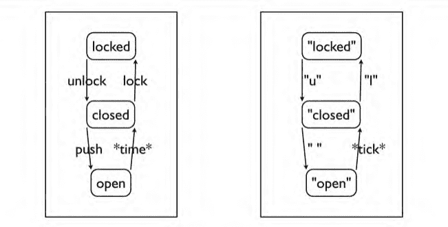

## 图 28：带自动关闭器的门的状态转移图

一旦我们决定对某个动作使用时间流逝，对其他动作使用按键，就必须设计渲染世界当前状态（表示为 DoorState）并将其转换为下一状态的函数。当然，这构成了一组 big-bang 函数的愿望列表：

- door-closer，在一次滴答期间关闭门；
- door-action，响应按键对其进行操作；以及
- door-render，将当前状态转换为图像。

停止！制定适当的签名。

我们从 door-closer 开始。由于 door-closer 充当 on-tick 处理器，我们根据 DoorState 作为世界状态集合的选择得到其签名：

```
; DoorState -> DoorState
```

```
; closes an open door over the period of one tick
(define (door-closer state-of-door) state-of-door)
```

当世界只能处于三种状态之一时，编造示例微不足道。这里我们使用表格来表达基本思路，就像上面给出的一些数学示例一样：

| 给定状态 | 期望状态 |
| --- | --- |
| LOCKED | LOCKED |
| CLOSED | CLOSED |
| OPEN | CLOSED |

停止！将这些示例表示为 BSL 测试。
模板步骤要求一个包含三个子句的条件表达式：

```
(define (door-closer state-of-door)
  (cond
    [(string=? LOCKED state-of-door) LOCKED]
    [(string=? CLOSED state-of-door) CLOSED]
    [(string=? OPEN state-of-door) CLOSED])))
```

别忘了运行你的测试。
第二个函数 door-action 处理图中剩余的三个箭头。处理键盘事件的函数同时消耗一个世界和一个按键事件，这意味着签名如下：

```
; DoorState KeyEvent -> DoorState
; turns key event k into an action on state s
(define (door-action s k)
  s)
```

我们再次以表格形式呈示示例：

| 给定状态 | 给定按键事件 | 期望状态 |
| --- | --- | --- |
| LOCKED | "u" | CLOSED |
| CLOSED | "1" | LOCKED |
| CLOSED | " " | OPEN |
| OPEN | - | OPEN |

这些示例结合了我们图纸中的信息以及我们关于将动作映射到键盘事件所做的选择。与交通灯示例的表格不同，此表格不完整。想想其他一些示例；然后考虑为什么我们的表格足够了。

从这里开始，创建完整设计非常简单：

```
(check-expect (door-action LOCKED "u") CLOSED)
(check-expect (door-action CLOSED "1") LOCKED)
(check-expect (door-action CLOSED " ") OPEN)
(check-expect (door-action OPEN "a") OPEN)
(check-expect (door-action CLOSED "a") CLOSED)

(define (door-action s k)
  (cond
    [(and (string=? LOCKED s) (string=? "1" k))
     CLOSED]
    [(and (string=? CLOSED s) (string=? "1" k))
     LOCKED]
    [(and (string=? CLOSED s) (string=? " " k))
     OPEN]
    [else s]))
```

请注意使用 and 来组合两个条件：一个涉及门的当前状态，另一个涉及给定的按键事件。

最后，我们需要将世界的状态呈现为一个场景：

```
; DoorState -> Image
; translates the state s into a large text image
(check-expect (door-render CLOSED)
             (text CLOSED 40 "red"))
(define (door-render s)
  (text s 40 "red"))
```

这个简单的函数使用大文本。以下是运行全部内容的方法：

```
; DoorState -> DoorState
; simulates a door with an automatic door closer
(define (door-simulation initial-state)
  (big-bang initial-state
            [on-tick door-closer]
            [on-key door-action]
            [to-draw door-render]))
```

现在是你收集这些部分并在 DrRacket 中运行它们，看看是否一切正常的时候了。

**练习** 62。在门模拟过程中，“开放”状态几乎不可见。修改 door-simulation 使时钟每三秒滴答一次。重新运行模拟。

## 5 添加结构

假设你想设计一个世界程序，模拟一个球在某个虚构的完美房间的地板和天花板之间沿一条垂直直线来回弹跳。假设它每次时钟滴答总是移动两个像素。如果你遵循设计方案，你的第一个目标是开发一个表示随时间变化的内容的数据表示。在这里，球的位置和方向随时间变化，但这是两个值，而 big-bang 只跟踪一个值。因此就出现了如何用一块数据表示两个随时间变化的信息量的问题。

这里有另一个引发相同问题的场景。你的手机大部分是几百万行代码，外面包裹着塑料。其中，它管理你的联系人。每个联系人都带有姓名、电话号码、电子邮件地址，也许还有其他信息。当你有很多联系人时，每个联系人最好表示为单一的数据块；否则，各个部分可能会不小心混在一起。

> 数学家知道一些将两个数字“合并”为一个数字的技巧，这样就可以检索原始数字。程序员认为这种技巧是邪恶的，因为它们模糊了程序的真实意图。

由于这类编程问题，每种编程语言都提供了一些机制，将多个数据块组合成一个复合数据块，并在需要时检索组成值。本章介绍了 BSL 的机制，即所谓的结构类型定义，以及如何设计处理复合数据的程序。

### 5.1 从位置到 posn 结构

世界画布上的位置由两个数据块唯一标识：距左边距的距离和距顶边距的距离。第一个称为 x 坐标，第二个称为 y 坐标。

DrRacket 基本上是一个 BSL 程序，它使用 posn 结构来表示这样的位置。posn 结构将两个数字组合成一个值。我们可以使用操作 make-posn 创建一个 posn 结构，它消耗两个数字并生成一个 posn。例如，

```
(make-posn 3 4)
```

这是一个创建 posn 结构的表达式，其 x 坐标为 3，y 坐标为 4。

posn 结构的地位与数字、布尔值或字符串相同。特别是，原始操作和函数都可以消耗和生成结构。此外，程序可以为 posn 结构命名：

```
(define one-posn (make-posn 8 6))
```

停止！用坐标描述 one-posn。

在做其他任何事情之前，让我们先看看 posn 结构的计算定律。这样，我们既可以创建处理 posn 结构的函数，也可以预测它们计算的结果。

### 5.2 使用 posn 进行计算

虽然函数和函数定律在初等代数中非常熟悉，但 posn 结构似乎是一个新概念。不过，posn 的概念应该看起来像你可能以前遇到过的平面中的笛卡尔点或位置。

选择笛卡尔点的组成部分也是一个熟悉的过程。例如，当老师说，“看看图 29 的图表，告诉我 $p_x$ 和 $p_y$ 是什么时，”你可能会分别回答 31 和 26，因为你知道需要读取从 p 向外辐射的垂直线和水平线与坐标轴相交处的值。

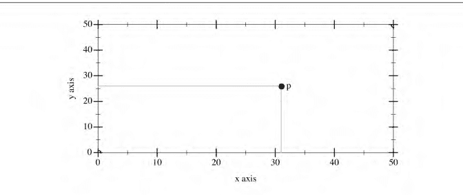

## 图 29：一个笛卡尔点

我们感谢 Neil Toronto 提供绘图库。

我们可以在 BSL 中表达这个想法。假设你添加

```
(define p (make-posn 31 26))
```

到定义区域，点击 RUN，并执行这些交互：

```
> (posn-x p)
31
> (posn-y p)
26
```


定义p就像在笛卡尔平面上标记一个点；使用posn-x和posn-y就像用索引下标p：p_x和p_y。

从计算角度来看，posn结构带有两个等式：

```
(posn-x (make-posn x0 y0)) == x0
(posn-y (make-posn x0 y0)) == y0
```

DrRacket在计算过程中使用这些等式。以下是一个涉及posn结构的计算示例：

```
(posn-x p)
== ; DrRacket replaces p with (make-posn 31 26)
(posn-x (make-posn 31 26))
== ; DrRacket uses the law for posn-x
31
```

停止！请用自己的计算确认上面的第二个交互。同时使用DrRacket的stepper进行双重检查。

### 5.3 使用posn进行编程

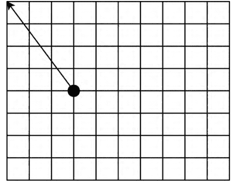

此图澄清，“距离”是指从指定点到画布左上角的最直接路径的长度——即“直线距离”。

以下是目的声明和头部：

```
; computes the distance of ap to the origin
(define (distance-to-0 ap)
 0)
```

关键在于，distance-to-0消耗一个单一值（即某个posn），并产生一个单一值，即该位置到原点的距离。

为了编写示例，我们需要知道如何计算此距离。对于其中一个坐标为0的点，结果为另一个坐标：

```
(check-expect (distance-to-0 (make-posn 0 5)) 5)
(check-expect (distance-to-0 (make-posn 7 0)) 7)
```

对于一般情况，我们可以尝试自己推导公式，也可以从几何课程中回忆公式。如您所知，这是您可能拥有的领域知识，但万一您没有，我们也会提供；毕竟，这并非计算机科学知识。因此，(x,y)的距离公式如下：

\(\sqrt{x^2 + y^2}\)

有了这个公式，我们可以轻松编写更多功能示例：

```
(check-expect (distance-to-0 (make-posn 3 4)) 5)
(check-expect (distance-to-0 (make-posn 8 6)) 10)
(check-expect (distance-to-0 (make-posn 5 12)) 13)
```

以防您好奇，我们特意设计了这些示例，使结果容易得出。但并非所有posn结构都是这样。

停止！将示例中的x和y坐标代入公式。验证所有五个示例的预期结果。

接下来，我们可以将注意力转向函数的定义。示例表明，distance-to-0的设计不需要区分不同情况；它始终只需计算给定posn结构中x和y坐标的距离。但是，函数必须从给定的posn结构中选择这些坐标。为此，它使用posn-x和posn-y原语。具体来说，函数需要计算(posn-x ap)和(posn-y ap)，因为ap是给定的未知posn结构的名称：

```
(define (distance-to-0 ap)
  (... (posn-x ap) ...
   ... (posn-y ap) ...))
```

使用此模板和示例，其余部分就很简单了：

```
(define (distance-to-0 ap)
  (sqrt
   (+ (sqr (posn-x ap)))
      (sqr (posn-y ap))))
```

该函数对(posn-x ap)和(posn-y ap)进行平方（它们分别表示x和y坐标），将结果相加，然后开平方。使用DrRacket，我们还可以快速检查新函数是否为我们的示例产生正确的结果。

### **练习63.** 求以下表达式的值：

- `(distance-to-0 (make-posn 3 4))`
- `(distance-to-0 (make-posn 6 (* 2 4)))`
- `(+ (distance-to-0 (make-posn 12 5)) 10)`

请手动计算。展示所有步骤。假设sqr在一步内完成其计算。使用DrRacket的stepper检查结果。

### **练习64.** 点到原点的曼哈顿距离考虑的是沿着曼哈顿矩形街道网格的路径。以下是两个示例：

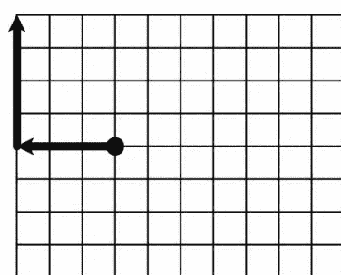

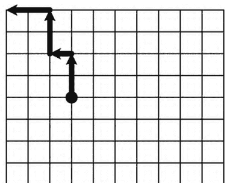

左侧展示了一种“直接”策略：先向左走所需的距离，然后再向上走所需的步数。相比之下，右侧展示了一种“随机游走”策略：走几个街区向左，几个街区向上，以此类推，直到到达目的地——在这里即原点。

停止！你所遵循的策略有区别吗？

设计函数manhattan-distance，用于测量给定posn到原点的曼哈顿距离。

### 5.4 定义结构类型

与数字或布尔值不同，像posn这样的结构通常不随编程语言一起提供。只提供定义结构类型的机制；其余部分留给程序员。BSL也是如此。

*结构类型定义*是另一种定义形式，与常量和函数定义不同。以下是DrRacket的创建者在BSL中定义posn结构类型的方式：

```
(define-struct posn [x y])
```

一般来说，结构类型定义的形状如下：

```
(define-struct StructureName [FieldName ...])
```

> 在结构类型定义中使用括号是一种惯例，而非必需。它使字段名称更加突出。将括号替换为圆括号完全可以接受。

关键字define-struct标志着新结构类型的引入。其后是结构名称。结构类型定义的第三部分是括号内的一系列名称；这些名称是字段。

结构类型定义实际上定义了函数。但是，与普通函数定义不同，**结构类型定义同时定义多个函数**。具体来说，它定义三种函数：

- 一个*构造函数*，用于创建*结构实例*的函数。它接受与字段数量相同的值；如前所述，*structure*是结构实例的缩写。*结构类型*是所有可能实例的集合的通用名称；
- 每个字段一个*选择器*，用于从结构实例中提取字段的值；以及
- 一个*结构谓词*，与普通谓词类似，用于将实例与其他所有类型的值区分开来。

程序可以像使用函数或内置原语一样使用这些。

有趣的是，结构类型定义为其创建的各种新操作编造名称。对于构造函数的名称，它在结构名称前加上“make-”；对于选择器的名称，它在结构名称后加上字段名称。最后，谓词只是在结构名称后加上“?”，大声读出来时发音为“huh”。

这种命名约定看起来复杂，甚至可能令人困惑。但是，经过少量练习，你就会掌握它。它还解释了posn结构附带的函数：make-posn是构造函数，posn-x和posn-y是选择器。虽然我们还没有遇到posn?，但现在我们知道它存在；下一章将详细解释这些谓词的作用。

### **练习** 65. 查看以下结构类型定义：

- (define-struct movie [title producer year])
- (define-struct person [name hair eyes phone])
- (define-struct pet [name number])
- (define-struct CD [artist title price])
- (define-struct sweater [material size producer])

写出每个定义引入的函数名称（构造函数、选择器，和谓词）。

暂且告一段落，不再讨论posn结构。让我们看看一个我们可能用来跟踪联系人（例如手机中的联系人）的结构类型定义：

```
(define-struct entry [name phone email])
```

此定义引入的函数名称如下：

- make-entry，它消耗三个值并构造一个entry实例；
- entry-name、entry-phone和entry-email，它们消耗一个entry实例并从三个字段值中选择一个；以及


- entry?，即谓词。

由于每个 entry 结合三个值，表达式

```
(make-entry "Al Abe" "666-7771" "lee@x.me")
```

创建一个 entry 结构，其中 name 字段为 "Al Abe"，phone 字段为 "666-7771"，email 字段为 "lee@x.me"。

### 练习 66

重新审视练习 65 中的结构类型定义。合理推测哪种值对应哪个字段。然后为每个结构类型定义创建至少一个实例。

每个结构类型定义都引入了一种新的结构类型，与其他所有结构类型不同。程序员需要这种表达能力，因为他们希望通过结构名称传达一种**意图**。无论何时创建、选择或测试结构，程序文本都会明确提醒读者这一意图。如果不是为了代码的未来读者，程序员可以为带有一个字段的结构使用一种结构定义，为带有两个字段的结构使用另一种，为带有三个字段的结构使用第三种，依此类推。

在此背景下，让我们来研究另一个编程问题：

### 示例问题

为本章开头简要提及的处理“弹跳球”的程序开发一个结构类型定义。球的位置是一个单一数字，即距顶部的像素距离。其恒定 *速率* 是其每个时钟滴答移动的像素数。其 *速度* 是速率 **加上** 其移动方向。

由于球沿着一条垂直直线移动，一个数字完全足以作为其速度的数据表示：

- 正数表示球向下移动。

- 负数表示球向上移动。

我们可以利用这些领域知识来制定结构类型定义：

```
(define-struct ball [location velocity])
```

两个字段都将包含数字，因此 `(make-ball 10 -3)` 是一个很好的数据示例。它表示一个距顶部 10 像素、每个时钟滴答向上移动 3 像素的球。

请注意，原则上，ball 结构仅仅组合了两个数字，就像 posn 结构一样。当程序包含表达式 `(ball-velocity a-ball)` 时，它立即传达出该程序处理的是球及其速度的表示。相比之下，如果程序改用 posn 结构，`(posn-y a-ball)` 可能会误导代码读者，让他们认为该表达式涉及 y 坐标。

### 练习 67

下面是表示弹跳球的另一种方式：

```
(define SPEED 3)
(define-struct ball1d [location direction])
(make-ball1d 10 "up")
```

解释这段代码片段，并创建其他 ball1d 实例。

由于结构是值，就像数字、布尔值或字符串一样，一个结构实例出现在另一个结构实例内部是合理的。考虑游戏对象。与弹跳球不同，这类对象并不总是沿垂直线移动。相反，它们以某种“斜向”方式在画布上移动。描述跨二维世界画布移动的球的位置和速度需要两个数字：每个方向一个。对于位置部分，这两个数字代表 x 和 y 坐标。速度描述水平和垂直方向的*变化*；换句话说，这些“变化数字”必须加到相应的坐标上，才能找出对象下一步将在哪里。

> 是物理学告诉你，将对象的速度加到其位置上，即可得到其下一个位置。
> 开发人员需要了解向谁咨询哪个领域。

显然，posn 结构可以表示位置。对于速度，我们定义 vel 结构类型：

```
(define-struct vel [deltax deltay])
```

它有两个字段：deltax 和 deltay。“delta”一词通常用于描述物理活动模拟中的变化，x 和 y 部分则指示涉及哪个坐标轴。

现在我们可以使用 ball 实例来组合 posn 结构和 vel 结构，以表示沿直线但不一定仅沿垂直（或水平）线移动的球：

```
(define ball1
 (make-ball (make-posn 30 40) (make-vel -10 5)))
```

解释该实例的一种方法是：想象一个距左侧 30 像素、距顶部 40 像素的球。它每个时钟滴答向左移动 10 像素，因为从 x 坐标减去 10 像素会使其更靠近左侧。至于垂直方向，球每个时钟滴答下落 5 像素，因为向 y 坐标加上正数会增加距顶部的距离。

### 练习 68

球的嵌套数据表示的替代方案是使用四个字段来跟踪四个属性：

```
(define-struct ballf [x y deltax deltay])
```

> 另一种替代方案是使用复数。如果你了解复数，不妨思考一种同时用于位置和速度的数据表示。例如，在 BSL 中，4-3i 是一个复数，可用于表示位置或速度 (4,-3)。

程序员称之为 _扁平表示_。创建一个 ballf 实例，使其与 ball1 具有相同的解释。

作为嵌套结构的第二个示例，让我们简要查看联系人列表的示例。许多手机支持联系人列表，允许每个名称有多个电话号码：一个用于家庭线路，一个用于办公室，一个用于手机号码。对于电话号码，我们希望同时包含区号和本地号码。由于这种嵌套了信息，最好也创建嵌套数据表示：

```
(define-struct centry [name home office cell])

(define-struct phone [area number])

(make-centry "Shriram Fisler"
 (make-phone 207 "363-2421")
 (make-phone 101 "776-1099")
 (make-phone 208 "112-9981"))
```

这里的意图是，联系人列表中的一个条目有四个字段：一个名称和三个电话记录。后者由 phone 实例表示，将区号与本地电话号码分开。

总而言之，嵌套信息是很自然的。用数据表示此类信息的最佳方式是用嵌套结构实例来镜像这种嵌套。这样做可以轻松在程序的应用领域中解释数据，并且从信息示例到数据的转换也很简单。当然，规定如何在信息和数据之间来回转换确实是数据定义的任务。然而，在研究结构类型定义的数据定义之前，我们首先要系统地研究结构的计算与思考方式。

### 5.5 使用结构进行计算

结构类型在两方面推广了笛卡尔点。首先，结构类型可以指定任意数量的字段：零个、一个、两个、三个，等等。其次，结构类型为字段命名，而不是对其编号。这有助于程序员读取代码，因为记住姓氏在名为 last-name 的字段中，比在第 7 个字段中要容易得多。

> 大多数编程语言也支持使用数字字段名的类结构数据。

同样，处理结构实例推广了对笛卡尔点的操作。要理解这一想法，让我们首先看一种将结构实例视为带有与字段数量相同隔间的储物箱的图示方法。以下是

```
(define entry1 (make-entry "Al Abe" "666-7771" "lee@x.me"))
```

的图示：

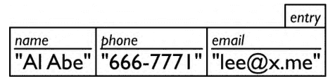

下面是另一个实例：

```
(make-entry "Tara Harp" "666-7770" "th@smlu.edu")
```

对应一个类似的箱形图，但内容不同：

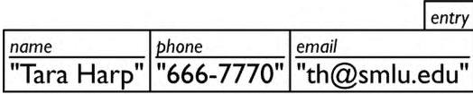

不出所料，嵌套结构实例的图示是箱中箱。因此，上面的 ball1 相当于这个图示：


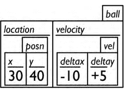

在这种情况下，外部框包含两个框，每个字段一个。

### 练习 69. 为练习 65 的解答绘制框表示。

在此意象的语境下，选择器就像一把钥匙。它为某种特定的箱子打开一个特定的隔层，从而使持有者能够提取其内容。因此，对上述 p1 应用 entry-name 会产生一个字符串：

```
> (entry-name p1)
"Al Abe"
```

但是，对 posn 结构应用 entry-name 会报错：

```
> (entry-name (make-posn 42 5))
entry-name:expects an entry, given (posn 42 5)
```

如果隔层包含一个箱子，可能需要连续使用两个选择器才能得到所需的数字：

```
> (ball-velocity ball1)
(make-vel -10 5)
```

对 ball1 应用 ball-velocity 提取速度字段的值，它是 vel 的一个实例。要获取沿 x 轴的速度，我们将一个选择器应用到第一次选择的结果上：

```
> (vel-deltax (ball-velocity ball1))
-10
```

因为内部表达式从 ball1 中提取速度，外部表达式提取 deltax 字段的值，在此例中为 -10。

这些交互还表明，结构实例也是值。DrRacket 会像处理数字等普通值一样，按输入的方式原样打印它们：

```
> (make-vel -10 5)
(make-vel -10 5)
> (make-entry "Tara Harp" "666-7770" "th@smlu.edu")
(make-entry "Tara Harp" "666-7770" "th@smlu.edu")
> (make-centry
"Shriram Fisler"
(make-phone 207 "363-2421")
(make-phone 101 "776-1099")
(make-phone 208 "112-9981"))
(make-centry ...)
```

别急！在家尝试最后这一条交互，以便你能看到正确的结果。

一般来说，结构类型定义不仅会创建新函数和新的值创建方式，还会将新的计算法则添加到 DrRacket 的知识库中。这些法则概括了第 5.2 节中 posn 结构的法则，最好通过示例来理解。

当 DrRacket 遇到具有两个字段的结构类型定义时，

```
(define-struct ball [location velocity])
```

它会引入两条法则，每个选择器一条：

```
(ball-location (make-ball 10 v0)) == 10
(ball-velocity (make-ball 10 v0)) == v0
```

对于不同的结构类型定义，它会引入类似的法则。因此，

```
(define-struct vel [deltax deltay])
```

DrRacket 将这两条法则添加到其知识库中：

```
(vel-deltax (make-vel dx0 dy0)) == dx0
(vel-deltay (make-vel dx0 dy0)) == dy0
```

利用这些法则，我们现在可以解释上面的交互：

```
(vel-deltax (ball-velocity ball1))
== ; DrRacket replaces ball1 with its value
(vel-deltax
(ball-velocity
  (make-ball (make-posn 30 40) (make-vel -10 5))))
== ; DrRacket uses the law for ball-velocity
(vel-deltax (make-vel -10 5))
== ; DrRacket uses the law for vel-deltax
-10
```

### 练习 70. 阐述这些结构类型定义的法则：

```
(define-struct centry [name home office cell])
(define-struct phone [area number])
```

使用 DrRacket 的单步执行器确认该表达式的值为 101：

```
(phone-area
  (centry-office
    (make-centry "Shriram Fisler"
      (make-phone 207 "363-2421")
      (make-phone 101 "776-1099"))
    (make-phone 208 "112-9981"))))
```

谓词是我们必须讨论的最后一个概念，以便理解结构类型定义。如上文所述，每个结构类型定义会引入一个新的谓词。DrRacket 使用这些谓词来发现选择器是否作用于正确类型的值；下一章将详细解释这一概念。这里我们只想说明，这些谓词就像“算术”中的谓词一样。number? 识别数字，string? 识别字符串，而 posn? 和 entry? 等谓词则识别 posn 结构和 entry 结构。我们可以通过交互区的实验来验证我们对它们工作原理的理解。假设定义区包含以下定义：

```
(define ap (make-posn 7 0))

(define pl (make-entry "Al Abe" "666-7771" "lee@x.me"))
```

如果 posn? 是一个区分 posn 和所有其他值的谓词，我们应当期望它对数字返回 #false，对 ap 返回 #true：

```
> (posn? ap)
#true
> (posn? 42)
#false
> (posn? #true)
#false
> (posn? (make-posn 3 4))
#true
```

同样，entry? 区分 entry 结构和所有其他值：

```
> (entry? pl)
#true
> (entry? 42)
#false
> (entry? #true)
#false
```

一般来说，一个谓词正好识别那些使用同名构造函数构造的值。间奏曲 1 详细解释了这一法则，并将 BSL 的计算法则汇总在一个地方。

### 练习 71. 将以下内容放入 DrRacket 的定义区：

```
; distances in terms of pixels:
(define HEIGHT 200)
(define MIDDLE (quotient HEIGHT 2))
(define WIDTH 400)
(define CENTER (quotient WIDTH 2))

(define-struct game [left-player right-player ball])

(define game0
 (make-game MIDDLE MIDDLE (make-posn CENTER CENTER)))
```

点击 RUN 并求值以下表达式：

```
(game-ball game0)
(posn? (game-ball game0))
(game-left-player game0)
```

使用逐步计算来解释结果。使用 DrRacket 的单步执行器再次核对你的计算。

### 5.6 使用结构进行编程

正确的编程需要数据定义。随着结构类型定义的引入，数据定义变得有趣起来。请记住，数据定义提供了一种将信息表示为数据并将数据解释为信息的方式。对于结构类型，这需要描述哪种数据进入哪个字段。对于某些结构类型定义，制定这样的描述既简单又直观：

```
(define-struct posn [x y])
; A Posn is a structure:
;   (make-posn Number Number)
; interpretation a point x pixels from left, y from top
```

使用其他类型的数据来创建 posn 是没有意义的。同样，根据前一节中的用法，entry——即我们用于联系人列表的条目的结构类型定义——的所有字段显然都应该是字符串：

```
(define-struct entry [name phone email])
; An Entry is a structure:
;   (make-entry String String String)
; interpretation a contact's name, phone#, and email
```

对于 posn 和 entry，读者都能轻松在应用领域中解释这些结构的实例。

与这种简单性形成对比的是，ball 的结构类型定义显然允许至少两种不同的解释：

```
(define-struct ball [location velocity])
; A Ball-1d is a structure:
;   (make-ball Number Number)
; interpretation 1 distance to top and velocity
; interpretation 2 distance to left and velocity
```

无论在程序中使用哪一种，我们都必须始终如一地坚持使用它。然而，如第 5.4 节所示，也可以完全以不同的方式使用 ball 结构：

```
; A Ball-2d is a structure:
; (make-ball Posn Vel)
; interpretation a 2-dimensional position and velocity
```

```
(define-struct vel [deltax deltay])
```

```
; A Vel is a structure:
; (make-vel Number Number)
; interpretation (make-vel dx dy) means a velocity of
; dx pixels [per tick] along the horizontal and
; dy pixels [per tick] along the vertical direction
```

在这里，我们将 Ball-2d 命名为第二个数据集合，与 Ball-1d 不同，用于描述在世界画布上直线运动的球的数据表示。简言之，可以用两种不同的方式使用同一个结构类型。当然，在一个程序中，最好只使用一种方式；否则你是在给自己找麻烦。

此外，Ball-2d 引用了我们的另一个数据定义，即 Vel 的定义。虽然迄今为止的所有其他数据定义都引用了内置数据集合（Number、Boolean、String），但你的一个数据定义引用另一个数据定义是完全可以接受的，而且很常见。

### 练习 72. 为上面的 phone 结构类型定义制定一个数据定义，以容纳给定的示例。

接下来使用这个结构类型定义为电话号码制定一个数据定义：

```
(define-struct phone# [area switch num])
```

历史上，前三位数字构成区号，接下来的三位是你所在街区的电话交换机（交换局）代码，最后四位是该街区内的电话号码。尽可能精确地用区间描述三个字段的内容。

此时，你可能会想知道数据定义到底意味着什么。这个问题及其答案是下一节的主题。目前，我们说明如何使用数据定义进行程序设计。


这里有一个问题陈述，用来设置一些上下文：

**示例问题** 你的团队正在设计一个交互式游戏程序，在 100 × 100 画布上移动一个红点，并允许玩家使用鼠标重置该点。以下是你们目前的进度：

```
(define MTS (empty-scene 100 100))
(define DOT (circle 3 "solid" "red"))
```

```
; A Posn represents the state of the world.
```

```
; Posn -> Posn
(define (main p0)
  (big-bang p0
    [on-tick x+]
    [on-mouse reset-dot]
    [to-draw scene+dot])))
```

你的任务是设计 scene+dot，该函数在指定位置在空画布上添加一个红点。

问题上下文规定了你的函数的签名：

```
; Posn -> Image
; adds a red spot to MTS at p
(define (scene+dot p) MTS)
```

添加目的陈述很简单。如第 3.1 章所述，它使用函数的参数来表达函数计算的内容。

现在我们列举几个示例并将其制定为测试：

```
(check-expect (scene+dot (make-posn 10 20))
              (place-image DOT 10 20 MTS))
(check-expect (scene+dot (make-posn 88 73))
              (place-image DOT 88 73 MTS))
```

鉴于函数消耗一个 Posn，我们知道该函数可以提取 x 和 y 字段的值：

```
(define (scene+dot p)
  (... (posn-x p) ... (posn-y p) ...))
```

一旦我们在函数体中看到这些额外的部分，定义的其余部分就很简单了。使用 `place-image`，该函数将 DOT 放入 MTS 中，位于 p 包含的坐标处：

```
(define (scene+dot p)
  (place-image DOT (posn-x p) (posn-y p) MTS))
```

函数可以产生结构。让我们回到上面的示例问题，因为它正好包含这样的任务：

**示例问题** 一位同事被要求定义 `x+`，这是一个消耗一个 Posn 并将 x 坐标增加 3 的函数。

请回顾，`x+` 函数处理时钟滴答。

我们可以借用 `scene+dot` 设计的前几个步骤：

```
; Posn -> Posn
; increases the x-coordinate of p by 3
(check-expect (x+ (make-posn 10 0)) (make-posn 13 0))
(define (x+ p)
  (... (posn-x p) ... (posn-y p) ...))
```

签名、目的和示例均源自问题陈述。与其说是一个带有默认结果的函数头，不如说我们的草图包含两个 Posn 的选择器表达式。毕竟，结果的信息必须来自输入，而输入是一个包含两个值的结构。

现在完成定义很容易。由于期望的结果是一个 Posn，该函数使用 `make-posn` 将各部分组合起来：

```
(define (x+ p)
  (make-posn (+ (posn-x p) 3) (posn-y p)))
```

**练习 73.** 设计函数 `posn-up-x`，它消耗一个 Posn `p` 和一个 Number n。它生成一个与 p 相同但 x 字段为 n 的 Posn。

一个巧妙的观察是，我们可以使用 posn-up-x 来定义 x+：

```
(define (x+ p)
   (posn-up-x p (+ (posn-x p) 3)))
```

**注意** 诸如 posn-up-x 之类的函数通常被称为 *更新器* 或 *函数设置器*。当你编写大型程序时，它们非常有用。

函数也可以从原子数据生成实例。虽然 make-posn 是一个内置原语，可以做到这一点，但我们的示例问题提供了另一个合适的说明：

**示例问题** 另一位同事被指派设计 reset-dot，这是一个在鼠标单击时重置点的函数。

要解决这个问题，你需要回顾第 3.6 章的知识：鼠标事件处理程序消耗四个值：世界的当前状态、鼠标单击的 x 和 y 坐标，以及一个 MouseEvt。

将示例问题的知识添加到程序设计配方中，我们得到了一个签名、一个目的陈述和一个函数头：

```
; Posn Number Number MouseEvt -> Posn
; for mouse clicks, (make-posn x y); otherwise p
(define (reset-dot p x y me) p)
```

鼠标事件处理程序的示例需要一个 Posn、两个数字和一个 MouseEvt，它只是一种特殊的 String。例如，鼠标单击由两个字符串之一表示："button-down" 和 "button-up"。前者表示用户单击了鼠标按钮，后者表示释放按钮。牢记这一点，这里有两个示例，你或许希望研究和理解：

```
(check-expect
 (reset-dot (make-posn 10 20) 29 31 "button-down")
 (make-posn 29 31))
(check-expect
 (reset-dot (make-posn 10 20) 29 31 "button-up")
 (make-posn 10 20))
```

虽然该函数只消耗原子形式的数据，但其目的陈述和示例表明，它区分了两种 MouseEvt："button-down" 和其他所有情况。这种情况分支暗示使用 cond 表达式：

```
(define (reset-dot p x y me)
  (cond
    [(mouse=? "button-down" me) (... p ... x y ...)]
    [else (... p ... x y ...)]))
```

遵循设计配方，这个骨架提及了参数，以提醒你可用的数据。

剩下的部分同样简单，因为目的陈述本身规定了函数在两种情况下分别计算什么：

```
(define (reset-dot p x y me)
  (cond
    [(mouse=? me "button-down") (make-posn x y)]
    [else p]))
```

如上所述，我们本可以提及 make-posn 创建 Posn 实例，但你已知晓此点，我们无需不断提醒你。

**练习 74.** 将所有相关的常量和函数定义复制到 DrRacket 的定义区中。添加测试并确保它们通过。然后运行程序，使用鼠标放置红点。

许多程序处理嵌套结构。我们用世界程序中的另一段小代码来说明这一点：

**示例问题** 你的团队正在设计一个游戏程序，用于跟踪一个以变化速度在画布上移动的对象。所选的数据表示需要两个数据定义：

```
(define-struct ufo [loc vel])
; A UFO is a structure:
; (make-ufo Posn Vel)
; **interpretation** (make-ufo p v) is at location
; p moving at velocity v
```

你的任务是开发 ufo-move-1。该函数计算给定 UFO 在一个时钟滴答之后的位置。

让我们先举几个例子，稍微探索一下数据定义：

```
(define v1 (make-vel 8 -3))
(define v2 (make-vel -5 -3))

(define p1 (make-posn 22 80))
(define p2 (make-posn 30 77))

(define u1 (make-ufo p1 v1))
(define u2 (make-ufo p1 v2))
(define u3 (make-ufo p2 v1))
(define u4 (make-ufo p2 v2))
```

前四个是 Vel 和 Posn 的元素。后四个以所有可能的组合组合了前四个。

接下来我们写下签名、目的、一些示例和一个函数头：

```
; UFO -> UFO
; determines where u moves in one clock tick;
; leaves the velocity as is

(check-expect (ufo-move-1 u1) u3)
(check-expect (ufo-move-1 u2)
              (make-ufo (make-posn 17 77) v2))

(define (ufo-move-1 u) u)
```

对于函数示例，我们使用数据示例 **和** 我们对位置和速度的领域知识。具体来说，我们知道一辆以每小时 60 英里向北和每小时 10 英里向西行驶的车辆，在开车一小时后将到达起点以北 60 英里和以西 10 英里的地方。
开车两小时后，它将到达起点以北 120 英里和以西 20 英里的地方。

与往常一样，一个消耗结构实例的函数可以（并且可能必须）从结构中提取信息来计算其结果。因此，我们再次在函数定义中添加选择器表达式：

```
(define (ufo-move-1 u)
 (... (ufo-loc u) ... (ufo-vel u) ...))
```

**注意** 选择器表达式提出了一个问题：我们是否需要进一步完善这个草图。毕竟，这两个表达式分别提取 Posn 和 Vel 的实例。这两个也是结构实例，我们可以再次从中提取值。结果骨架如下所示：

```
; UFO -> UFO
(define (ufo-move-1 u)
 (... (posn-x (ufo-loc u)) ...
 ... (posn-y (ufo-loc u)) ...
 ... (vel-deltax (ufo-vel u)) ...
 ... (vel-deltay (ufo-vel u)) ...))
```

然而，这样做显然会使草图看起来相当复杂。对于真正现实的程序，将此想法贯彻到底将创造极其复杂的程序大纲。更一般地说，

*如果函数处理嵌套结构，请为每个嵌套层级开发一个函数。*

在书的第二部分，这条准则变得更加重要，我们对其进行了细化。**结束**

在这里，我们关注如何将给定的 Posn 和给定的 Vel 组合起来，以得到 UFO 的下一个位置——因为这是我们的物理知识告诉我们的。具体来说，它说要将两者“相加”，这里的“相加”不能指通常应用于数字的运算。因此，让我们想象我们有一个将 Vel 添加到 Posn 的函数：


; Posn Vel -> Posn
; adds v to p
(define (posn+ p v) p)

像这样写下签名、目的和头部是一种合法的编程方式。它被称为“许愿”，是第 3.4 节中描述的“许愿清单”的一部分。

关键是要这样许愿，以便我们能完成正在处理的功能。这样一来，我们就可以将困难的编程任务拆分为不同的任务，这种技术有助于我们以相当小的步骤解决问题。对于示例问题，我们得到了 ufo-move-1 的完整定义：

```
(define (ufo-move-1 u)
  (make-ufo (posn+ (ufo-loc u) (ufo-vel u))
            (ufo-vel u)))
```

由于 ufo-move-1 和 posn+ 都是完整的定义，我们甚至可以点击 RUN，它会检查 DrRacket 是否对我们迄今的工作中出现的语法问题抱怨。当然，测试会失败，因为 posn+ 只是一个愿望，而不是我们需要的函数。

现在是时候关注 posn+ 了。我们已经完成了设计的前两步（数据定义、签名/目的/头部），因此必须创建示例。为“愿望”创建功能示例的一个简单方法是使用原始函数的示例，并将其转换为新函数的示例：

```
(check-expect (posn+ p1 v1) p2)
(check-expect (posn+ p1 v2) (make-posn 17 77))
```

> 在几何中，与 posn+ 对应的操作称为平移。

对于这个问题，我们知道 (ufo-move-1 (make-ufo p1 v1)) 应该产生 p2。同时，我们知道 ufo-move-1 将 posn+ 应用于 p1 和 v1，这意味着 posn+ 必须为这些输入产生 p2。停一下！检查我们的手动计算，以确保您理解我们正在做什么。

我们现在能够将选择器表达式添加到我们的设计草图中：

```
(define (posn+ p v)
 (...) (posn-x p) ... (posn-y p) ...
 ... (vel-deltax v) ... (vel-deltay v) ...))
```

因为 posn+ 消耗 Posn 和 Vel 的实例，并且每个数据都是一个两字段结构的实例，所以我们得到四个表达式。与上面的嵌套选择器表达式不同，这些是将选择器应用于参数的简单应用。

如果我们提醒自己这四个表达式代表什么，或者回想一下我们如何从两个结构中计算出所需的结果，那么我们对 posn+ 定义的完成就很简单了：

```
(define (posn+ p v)
 (make-posn (+ (posn-x p) (vel-deltax v))
            (+ (posn-y p) (vel-deltay v))))
```

第一步是将水平方向的速度加到 x 坐标上，将垂直方向的速度加到 y 坐标上。这会产生两个表达式，每个新坐标一个。使用 make-posn，我们可以将它们重新组合成一个 Posn。

**练习** 75。将这些定义及其测试用例输入 DrRacket 的定义区，并确保它们可以工作。这是您第一次处理“愿望”，您需要确保理解这两个函数如何协同工作。

### 5.7 数据的宇宙

每种语言都带有一个数据宇宙。这些数据代表来自外部世界的信息以及关于外部世界的信息；这是程序所操作的内容。这个数据宇宙是一个集合，不仅包含所有内置数据，还包含任何程序可能创建的任何数据片段。

> 请记住，数学家将数据集合或数据类称为集合。

图 30 的左侧展示了一种想象 BSL 数据宇宙的方式。由于有无限多的数字和字符串，所有数据的集合是无限的。我们在图中用“...”来表示“无限”，但真正的定义必须避免这种不精确。

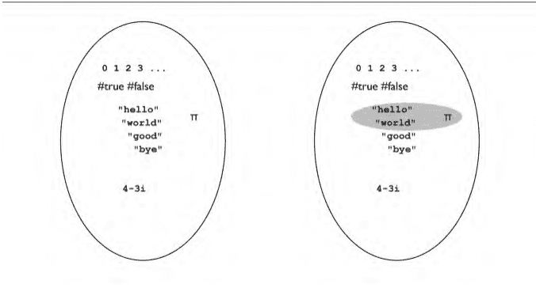

图 30：数据的宇宙

程序或程序中的单个函数都不会处理整个数据宇宙。数据定义的目的是描述这个宇宙的部分，并为这些部分命名，以便我们可以简洁地引用它们。换句话说，命名的数据定义是对数据集合的描述，该名称可用于其他数据定义和函数签名中。在函数签名中，该名称指定函数将处理什么数据，并且隐含地指定它不会处理数据宇宙的哪一部分。

实际上，前四章的数据定义限制了内置数据集合。它们通过对所有包含值进行显式或隐式的枚举来做到这一点。例如，图 30 右侧用灰色遮盖的区域描绘了以下数据定义：

```
; A BS is one of:
; --- "hello",
; --- "world", or
; --- pi.
```

虽然这个特定的数据定义看起来很傻，但请注意所使用的英语和 BSL 的风格化混合。其含义精确且明确，澄清了哪些元素属于 BS，哪些不属于。

结构类型的定义完全改变了这一图景。当程序员定义结构类型时，宇宙会扩展到包含所有可能的结构实例。例如，添加 posn 意味着出现两个字段中所有可能值的 posn 实例。图 31 中间的气泡描绘了这些值的添加，包括 (make-posn "hello" 0) 和 (make-posn (make-posn 0 1) 2) 等看似荒谬的情况。是的，其中一些 posn 实例对我们来说毫无意义。但是，BSL 程序可以构建其中的任何一个。

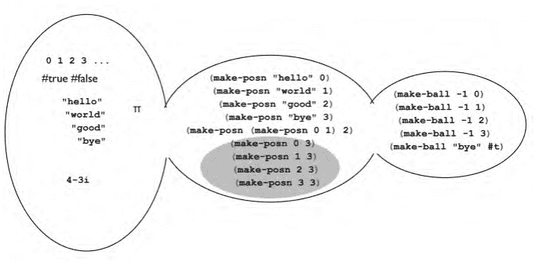

图 31：向宇宙添加结构

再说一次，添加 ball 的定义，也有两个字段。如图 31 中第三个气泡所示，这个添加会创建包含数字、posn 结构等的 ball 实例，以及包含 ball 实例的 posn 实例。在 DrRacket 中试一试！添加

```
(define-struct ball [location velocity])
```

到定义区，点击 RUN，并创建一些结构实例。

就数据定义的实际用途而言，结构类型的数据定义通过将现有数据定义与实例相结合来描述大型数据集合。当我们写

```
; Posn is (make-posn Number Number)
```

时，我们正在描述无数可能的 posn 实例。如上所述，数据定义使用自然语言、其他地方定义的数据集合和数据构造函数的组合。目前，数据定义中不应该出现其他内容。

结构的数据定义指定了由我们的函数要使用的那些实例组成的新数据集合。例如，Posns 的数据定义识别图 31 中宇宙中心气泡中灰色遮盖的区域，其中包括两个字段都包含数字的所有 posn 结构。同时，构建一个不满足两个字段都包含数字这一要求的 posn 实例也是完全可能的：

```
(make-posn (make-posn 1 1) "hello")
```

此结构在 x 字段中包含一个 posn，在 y 字段中包含一个字符串。

**练习 76。** 为以下结构类型定义制定数据定义：

- (define-struct movie [title producer year])
- (define-struct person [name hair eyes phone])
- (define-struct pet [name number])
- (define-struct CD [artist title price])
- (define-struct sweater [material size producer])

对每个字段中应该放入什么类型的值做出合理的假设。

**练习 77。** 提供一个结构类型定义和一个数据定义，用于表示自午夜以来的时间点。一个时间点由三个数字组成：小时、分钟和秒。

**练习 78。** 提供一个结构类型和一个数据定义，用于表示三个字母的单词。一个单词由小写字母组成，用 "a" 到 "z" 的 1Strings 加上 #false 表示。**注意** 此练习是猜单词游戏设计的一部分；请参见练习 396。

程序员不仅编写数据定义，还阅读它们，以便理解程序、扩展他们可以处理的数据类型、消除错误等等。我们阅读数据定义，以便了解如何创建属于指定集合的数据，并确定某个数据片段是否属于某个指定类别。

由于数据定义在设计过程中起着如此核心和重要的作用，用示例来说明数据定义通常是最好的，就像我们用示例来说明函数的行为一样。的确，从数据定义创建数据示例是简单的：

- 对于内置数据集合（数字、字符串、布尔值、图像），选择您喜欢的示例；

**注意** 有时，人们会使用描述性名称来限定内置数据集合，例如 NegativeNumber 或 OneLetterString。它们不能替代编写良好的数据定义。**结束**

- 对于枚举，使用枚举中的几个项目；
- 对于区间，使用端点（如果包含）和至少一个内部点；
- 对于项化，分别处理每个部分；以及
- 对于结构的数据定义，遵循自然语言描述；即，使用构造函数，并从每个字段命名的数据集合中选择一个示例。

这就是从数据定义构建示例的全部内容，对于大部分内容来说都是如此。


不过，数据定义将变得比你迄今所见的复杂得多。

### 练习 79. 为以下数据定义创建示例：

- ; _颜色_ 是以下之一：
  - ; --- "white"
  - ; --- "yellow"
  - ; --- "orange"
  - ; --- "green"
  - ; --- "red"
  - ; --- "blue"
  - ; --- "black"

**注意** DrRacket 将更多字符串识别为颜色。**结束**

- ; _H_ 是 0 到 100 之间的 Number。
  - ; **解释** 表示一个幸福值

- (define-struct person [fstname lstname male?])
  - ; _人_ 是一个结构：
    - ;   (make-person String String Boolean)

使用看起来像谓词名称的字段名是个好主意吗？

- (define-struct dog [owner name age happiness])
  - ; _狗_ 是一个结构：
    - ;   (make-dog Person String PositiveInteger _H_)

也为这个数据定义添加一个解释。

- ; _武器_ 是以下之一：
  - ; --- #false
  - ; --- Posn
  - ; **解释** #false 表示导弹尚未
  - ; 发射；Posn 表示它正在飞行

最后一个定义是一种不同寻常的枚举，结合了内置数据和结构类型。下一章将深入探讨此类定义。

### 5.8 使用结构进行设计

结构类型的引入强化了设计食谱中所有六个步骤的必要性。仅依赖内置数据集合来表示信息已不再足够；现在很明显，程序员必须为除了最简单问题之外的所有问题创建数据定义。

本节添加了一个设计食谱，并通过以下示例进行说明：

**示例问题** 设计一个函数，计算三维空间中物体到原点的距离。

我们开始：

- 当问题需要表示所属在一起或描述自然整体的信息片段时，你需要一个结构类型定义。它需要与相关属性同样多的字段。此结构类型的一个实例对应于整体，字段中的值对应于其属性。

结构类型的数据定义为合法实例的集合引入一个名称。此外，它必须描述哪种数据对应于哪个字段。**仅使用内置数据集合或先前定义的数据定义的名称。**

归根结底，我们（以及其他人）必须能够使用数据定义来创建示例结构实例。否则，我们的数据定义就有问题。为了确保我们可以创建实例，我们的数据定义应当附带**数据示例**。

我们将此想法应用于示例问题的方法如下：

```
(define-struct r3 [x y z])
; An R3 is a structure:
;  (make-r3 Number Number Number)

(define ex1 (make-r3 1 2 13))
(define ex2 (make-r3 -1 0 3))
```

结构类型定义引入了一种新的结构类型 r3，而数据定义将 R3 引入为包含仅数字的 r3 所有实例的名称。

- 你仍然需要一个签名、一个目的说明和一个函数头，但它们保持不变。停止！为示例问题去做吧。

- 使用第一步中的示例来创建功能示例。对于与区间或枚举相关的每个字段，请务必选择端点和中间点来创建功能示例。我们期望你继续处理示例问题。

- 一个消耗结构的函数通常——但不总是——从结构的各个字段中提取值。为提醒自己这种可能性，为此类函数的模板中的每个字段添加一个选择器。

以下是示例问题的内容：

```
; R3 -> Number
; determines the distance of p to the origin
(define (r3-distance-to-0 p)
  (... (r3-x p) ... (r3-y p) ... (r3-z p) ...))
```

你或许想在每个选择器表达式旁写下它从给定结构中提取的数据类型；你可以在数据定义中找到这些信息。停止！直接去做吧！

- 定义函数时，使用模板中的选择器表达式。请记住，你可能不需要其中的一些表达式。

- 测试。在编写函数头时立即测试。测试直到所有表达式都已覆盖。做出更改后再次测试。

完成示例问题。如果你记不起三维点到原点的距离，请查阅几何书籍。

在那里你会找到诸如 \(\sqrt{x^2 + y^2 + z^2}\) 这样的公式。

### 练习 80. 为消耗以下结构类型实例的函数创建模板：

- `(define-struct movie [title director year])`
- `(define-struct pet [name number])`
- `(define-struct CD [artist title price])`
- `(define-struct sweater [material size color])`

不，你不需要为此任务编写数据定义。

### 练习 81. 设计函数 `time->seconds`，它消耗时间结构的实例（参见练习 77），并生成自午夜以来经过的秒数。例如，如果你用其中一个结构表示 12 小时 30 分钟 2 秒，然后将 `time->seconds` 应用于该实例，正确结果是 45002。

### 练习 82. 设计函数 `compare-word`。该函数消耗两个三个字母的单词（参见练习 78）。它生成一个单词，指示给定单词在哪些位置一致、在哪些位置不一致。如果两个单词一致，该函数保留结构字段的内容；否则，它将 `#false` 放入结果单词的字段中。**提示** 这些练习提到了两个任务：单词的比较和“字母”的比较。

### 5.9 世界中的结构

当世界程序必须跟踪两个独立的信息片段时，我们必须使用一组结构来表示世界状态数据。一个字段跟踪一个信息片段，另一个字段跟踪第二个信息片段。当然，如果领域世界包含两个以上的独立信息片段，结构类型定义必须指定与不同信息片段同样多的字段。

考虑一个由 UFO 和坦克组成的太空入侵者游戏。UFO 沿一条笔直的垂直线下降，而坦克在场景底部水平移动。如果两个对象以已知的恒定速度移动，描述这两个对象所需的只是每个对象一个信息片段：UFO 的 y 坐标和坦克的 x 坐标。将它们组合在一起需要一个带有两个字段的结构：

```
(define-struct space-game [ufo tank])
```

我们留给你为这个结构类型定义制定一个充分的数据定义（包括解释）。请思考结构名称中的连字符。BSL 确实允许在变量、函数、结构和字段名中使用各种字符。这个结构的选择器名称是什么？谓词的名称是什么？

每当我们说“信息片段”时，不一定指单个数字或单个单词。一个信息片段本身可能结合多个信息片段。为这种信息创建数据表示自然会导致嵌套结构。

让我们为虚构的太空入侵者游戏增添一些趣味。一个仅沿垂直线下降的 UFO 很无聊。要将此想法变成一个坦克用某种武器攻击 UFO 的有趣游戏，UFO 必须能够沿非平凡线路下降，也许会随机跳跃。实现此想法意味着我们需要两个坐标来描述 UFO 的位置，因此我们对太空游戏的修订数据定义变为：

```
; A SpaceGame is a structure:
;  (make-space-game Posn Number).
; interpretation (make-space-game (make-posn ux uy) tx)
; describes a configuration where the UFO is
; at (ux,uy) and the tank's x-coordinate is tx
```

理解世界程序需要哪种数据表示需要实践。接下来的两节介绍几个相当复杂的问题陈述。在转到你可能希望自己设计的那种游戏之前，先解决它们。


### 5.10 图形编辑器

要在 BSL 中编程，你打开 DrRacket，在键盘上输入，并观看文本出现。按下键盘上的左箭头键会将光标向左移动；按下退格键（或删除键）会擦除光标左侧的一个字母——如果有字母的话。

这个过程被称为“编辑”，不过更准确的名称应该是“程序的文本编辑”，因为我们将使用“编辑”来指代比在键盘上打字更具挑战性的任务。当你编写和修改其他类型的文档（例如英语作业）时，你可能会使用其他软件应用程序，称为文字处理器，尽管计算机科学家将它们全部称为编辑器，甚至图形编辑器。

你现在有条件设计一个世界程序，它充当纯文本的一行编辑器。这里的编辑包括输入字母以及以某种方式改变已有文本，包括字母的删除和插入。这暗示了文本中位置的概念。人们将这个位置称为 _光标_；大多数图形编辑器以易于发现的方式显示它。

请看以下编辑器配置：

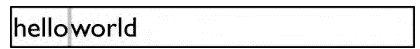

某人可能输入了文本“helloworld”，并按了五次左箭头键，导致光标从文本末尾移动到“o”和“w”之间。现在按下空格键会导致编辑器更改其显示，如下所示：

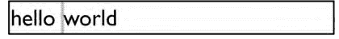

简而言之，该操作插入“”并将光标放在它和“w”之间。考虑到这些，编辑器必须跟踪两个信息：

- 1. 迄今输入的文本，以及
- 2. 光标的当前位置。

这暗示了一个带有两个字段的结构体类型。

我们可以想象几种从信息到数据再返回的不同方式。例如，结构体中的一个字段可能包含输入的整个文本，另一个字段包含光标与第一个字符（从左侧开始计数）之间的字符数。另一种数据表示是在两个字段中使用两个字符串：光标左侧的文本部分和光标右侧的文本部分。下面是我们表示编辑器状态的首选方法：

```racket
(define-struct editor [pre post])
; An Editor is a structure:
;   (make-editor String String)
; interpretation (make-editor s t) describes an editor
; whose visible text is (string-append s t) with
; the cursor displayed between s and t
```

基于此数据表示，解决接下来的几个练习。

### 练习 83
设计函数 render，它接收一个 Editor 并生成一个图像。

该函数的目的是在 200 × 20 像素的空白场景中渲染文本。对于光标，使用 1 × 20 的红色矩形；对于字符串，使用大小为 16 的黑色文本。

在 DrRacket 的交互区中为示例字符串开发图像。我们从以下表达式开始：

```racket
(overlay/align "left" "center"
 (text "hello world" 11 "black")
 (empty-scene 200 20))
```

你可能希望查阅 beside、above 等函数。当你对图像的外观满意时，使用该表达式作为测试和 render 设计的指南。

### 练习 84
设计函数 edit。该函数接收两个输入，一个编辑器 ed 和一个 KeyEvent ke，并生成另一个编辑器。它的任务是将单字符 KeyEvent ke 添加到 ed 的 pre 字段末尾，除非 ke 表示退格键 ("\b")。在这种情况下，它删除光标左侧紧邻的字符（如果有的话）。该函数忽略制表符键 ("\t") 和回车键 ("\r")。

该函数只关注长度超过一个字母的两个 KeyEvents："left" 和 "right"。左箭头将光标向左移动一个字符（如果有的话），右箭头将其向右移动一个字符（如果有的话）。所有其他此类 KeyEvents 都被忽略。

为 edit 开发大量示例，注意特殊情况。当我们解决此练习时，我们创建了 20 个示例，并将它们全部转换为测试。

**提示** 将此函数视为消耗 KeyEvents，这是一个指定为枚举的集合。它使用辅助函数来处理 Editor 结构。随时准备好愿望清单；你需要为大多数这些辅助函数设计其他函数，例如 string-first、string-rest、string-last 和 string-remove-last。如果你还没有这样做，请解决第 2.1 章的练习。

### 练习 85
定义函数 run。给定编辑器的 pre 字段，它启动一个交互式编辑器，分别使用前两个练习中的 render 和 edit 作为 to-draw 和 on-key 子句。

### 练习 86
请注意，如果你输入大量文本，你的编辑器程序不会显示所有文本。相反，文本会在右边缘被截断。修改练习 84 中的 edit 函数，以便如果将按键添加到 pre 字段末尾会导致渲染文本对你的画布来说太宽，则忽略该按键。

### 练习 87
基于我们的第一个想法，使用字符串和索引来开发编辑器的数据表示。然后重新解决前面的练习。重新梳理设计配方。**提示** 如果你还没有这样做，请解决第 2.1 章的练习。

### 设计选择说明
此练习是做出设计选择的初步研究。它表明，最初的设计选择涉及数据表示。做出正确的选择需要提前规划并权衡每种方案的复杂性。当然，擅长这一点取决于积累经验。

### 5.11 更多虚拟宠物

在本节中，我们继续来自第 3.7 章的虚拟动物园项目。具体来说，此练习的目标是将猫的世界程序与管理其幸福度条的程序结合起来。当结合后的程序运行时，你会看到猫在画布上行走，每走一步，它的幸福度就会下降。让猫开心的唯一方法是喂食它（下箭头）或抚摸它（上箭头）。最后，本节最后一个练习的目标是创建另一只虚拟的快乐宠物。

### 练习 88
定义一个结构体类型，用于跟踪猫的 x 坐标及其幸福度。然后为猫制定数据定义，称为 `VCat`，包括解释。

### 练习 89
设计快乐猫世界程序，它管理一只行走的猫及其幸福度。假设猫开始时拥有完美的幸福度。

**提示** (1) 复用第 3.7 章世界程序中的函数。(2) 使用前一练习中的结构体类型来表示世界的状态。

### 练习 90
修改前面练习中的快乐猫程序，使其在猫的幸福度降至 0 时停止。

### 练习 91
扩展练习 88 中的结构体类型定义和数据定义，添加一个方向字段。调整你的快乐猫程序，使猫朝指定方向移动。程序应沿当前方向移动猫，并在猫到达场景两端之一时将其转向。

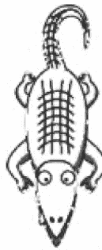

```racket
(define cham
```

上述变色龙图像是一张 **透明** 图像。要将其插入 DrRacket，请使用“插入图像”菜单项进行插入。使用此说明可保留图像像素的透明度。

当部分透明图像与彩色图形（例如矩形）组合时，图像会采用底层颜色。在变色龙图像中，实际上是动物的内部是透明的；外部区域是纯白色。在你的 DrRacket 中尝试以下表达式：

```racket
(define background
 (rectangle (image-width cham)
 (image-height cham)
 "solid"
 "red"))

(overlay cham background)
```

### 练习 92
设计 `cham` 程序，让变色龙从左向右在画布上不断行走。当它到达画布右端时，会消失并立即在左侧重新出现。与猫一样，变色龙因行走而感到饥饿，随着时间的推移，这种饥饿表现为不开心。

为了管理变色龙的幸福度条，你可以复用虚拟猫中的幸福度条。要让变色龙开心，你需要喂食它（下箭头，仅两点）；不允许抚摸。当然，像所有变色龙一样，我们的变色龙也能变色："r" 使其变红，"b" 变蓝，"g" 变绿。将变色龙世界程序添加到虚拟猫游戏中，并在可能时复用后者的函数。

首先从表示变色龙的数据定义 `VCham` 开始。■

### 练习 93
复制你对练习 92 的解答，并修改副本，使变色龙在三色背景上行走。我们的解答使用了以下颜色：

```racket
(define BACKGROUND
 (beside (empty-scene WIDTH HEIGHT "green")
 (empty-scene WIDTH HEIGHT "white")
 (empty-scene WIDTH HEIGHT "red")))
```


但你可以使用任何颜色。观察变色龙如何改变颜色以融入环境，当它跨越两种颜色之间的边界时。

做完后吃些意大利披萨。

注意 当你仔细观看动画时，你会看到变色龙骑在一个白色矩形上。如果你懂得使用图像编辑软件，修改图片使白色矩形不可见。这样变色龙就会真正融入环境。

## 6 枚举与结构

前两章介绍了制定数据定义的两种方式。采用枚举（枚举和区间）的方式用于从大集合中创建小集合。使用结构的方式则用于合并多个集合。由于数据表示的开发是正确程序设计的起点，程序员经常希望对涉及结构的数据定义进行枚举，或使用结构来合并枚举的数据，这不会让你感到惊讶。

回顾前一章第 5.9 节中提到的虚构太空入侵者游戏。迄今为止，游戏涉及一个从太空降落的 UFO 和一个在地面水平移动的坦克。我们的数据表示使用一个包含两个字段的结构：一个用于 UFO 的数据表示，另一个用于坦克的数据表示。自然，玩家会希望拥有一个可以发射导弹的坦克。突然间，我们可以想到第二种状态，它包含三个独立移动的对象：UFO、坦克和导弹。因此，我们有两个不同的结构：一个用于表示两个独立移动的对象，另一个用于表示第三个对象。由于世界状态现在可能是这两种结构之一，因此使用枚举来描述所有可能状态是很自然的：

- 1. 世界状态是一个包含两个字段的结构，或者
- 2. 世界状态是一个包含三个字段的结构。

就我们的领域（即实际游戏）而言，第一种状态表示坦克发射其唯一导弹之前的时间，第二种状态表示导弹发射后的时间。

> 别担心，本书的下一部分是关于随心所欲地发射导弹，无需重新装填。

本章介绍了对涉及结构的数据定义进行枚举的基本思想。由于我们拥有所有需要的其他要素，我们直接从枚举结构开始。之后，我们将讨论一些示例，包括受益于我们新能力的世界程序。最后一节是关于编程中的错误。

### 6.1 再次使用枚举进行设计

让我们从第 5.6 节中我们太空入侵者游戏的精炼问题描述开始。

**示例问题** 使用 2htdp/universe 库设计一个玩简单太空入侵者游戏的程序。玩家控制一辆坦克（一个小矩形），必须保护我们的星球（画布底部）免受一个 UFO 的侵袭，该 UFO 从画布顶部降落到底部（第 4.4 节提供了一种可能性）。为了阻止 UFO 着陆，玩家可以按空格键发射一枚导弹（一个比坦克小的三角形）。作为回应，导弹从坦克中射出。如果 UFO 与导弹碰撞，玩家获胜；否则 UFO 着陆，玩家失败。

关于三个游戏对象及其移动，以下是一些详细信息。首先，坦克沿着画布底部以恒定速度移动，尽管玩家可以使用左箭头键和右箭头键更改方向。其次，UFO 以恒定速度下降，但会向左或向右做小的随机跳跃。第三，导弹一旦发射，就沿直线垂直线以恒定速度上升，速度至少是 UFO 下降速度的两倍。最后，如果 UFO 和导弹的参考点足够近，它们就会碰撞，至于“足够近”是什么意思，由你自己决定。

以下两个小节将此示例问题作为贯穿示例，因此请好好研究它，并在继续之前解决以下练习。这样做将帮助你深入理解问题。

**练习 94.** 绘制游戏场景在各个阶段的示意图。使用这些示意图来确定游戏的恒定部分和可变部分。对于前者，开发描述世界（画布）及其对象尺寸的物理常量和图形常量。还要开发一些背景场景。最后，使用坦克、UFO 和背景的常量创建初始场景。

**定义枚举** 我们的设计配方的第一步是开发数据定义。数据定义的一个目的是描述表示世界状态的数据的构造；另一个是描述世界程序的事件处理函数可能消耗的所有可能数据片段。由于我们尚未见过包含结构的枚举，这个小节将介绍这一想法。虽然这可能不会让你感到惊讶，但请密切注意。

> > 对于这个太空入侵者游戏，我们可以使用一个包含三个字段的结构类型定义，其中第三个字段在导弹发射前包含 #false，之后包含导弹坐标的 Posn。请参阅下文。

如前所述，在本章引言中论述过，带有导弹发射坦克的太空入侵者游戏需要两种不同游戏状态的数据表示。我们选择两个结构类型定义：

```
(define-struct aim [ufo tank])
```

```
(define-struct fired [ufo tank missile])
```

第一个用于玩家试图将坦克移至射击位置的时期，第二个用于表示导弹发射后的状态。然而，在我们为完整的游戏状态制定数据定义之前，我们需要坦克、UFO 和 导弹的数据表示。

假设 WIDTH 和 HEIGHT 等物理常量的常量定义（练习 94 的主题），我们像这样制定数据定义：

```
; A UFO is a Posn.
; interpretation (make-posn x y) is the UFO's location
; (using the top-down, left-to-right convention)

(define-struct tank [loc vel])
; A Tank is a structure:
; (make-tank Number Number).
; interpretation (make-tank x dx) specifies the position:
; (x, HEIGHT) and the tank's speed: dx pixels/tick

; A Missile is a Posn.
; interpretation (make-posn x y) is the missile's place
```

每个这些数据定义都只描述一个结构，要么是新定义的 tank，要么是内置数据集合 Posn。至于后者，你可能会有点惊讶，Posn 被用来表示世界的两个不同方面。不过，我们已经使用数字（以及字符串和布尔值）来表示现实世界中许多不同类型的信息，因此重用像 Posn 这样的结构集合并不算什么大不了的事。

现在我们可以为太空入侵者游戏的状态制定数据定义了：

```
; A SIGS is one of:
; -- (make-aim UFO Tank)
; -- (make-fired UFO Tank Missile)
; interpretation represents the complete state of a
; space invader game
```

该数据定义的形式是一种枚举。然而，每个子句都描述结构类型的内容，就像我们迄今所见过的结构类型的数据定义一样。尽管如此，这个数据定义表明，并非每个数据定义都恰好附带一个结构类型定义；这里一个数据定义涉及两个不同的结构类型定义。

这种数据定义的含义也很直接。它引入了名称 SIGS，用于表示根据定义可以创建的所有结构实例的集合。那么，让我们创建一些：

- 这里有一个实例，描述坦克调整位置以发射导弹：

```
(make-aim (make-posn 20 10) (make-tank 28 -3))
```

- 这个与前一个类似，但导弹已经发射：

```
(make-fired (make-posn 20 10)
  (make-tank 28 -3)
  (make-posn 28 (- HEIGHT TANK-HEIGHT )))
```

当然，大写的名称指的是你定义的物理常量。


- 最后，这是一个导弹即将与 UFO 相撞的例子：

```
(make-fired (make-posn 20 100)
(make-tank 100 3)
(make-posn 22 103))
```

此示例假设画布高度超过 100 像素。

注意，SIGS 的第一个实例根据数据定义的第一个子句生成，第二个和第三个遵循第二个子句。当然，每个字段中的数字取决于你对全局游戏常量的选择。

### 练习 95。
解释为什么这三个实例根据数据定义的第一个或第二个子句生成。

### 练习 96。
描绘在假设 200 × 200 画布的情况下，如何渲染每个游戏状态。

## 设计配方

随着数据定义制定方式的新方法的出现，对设计配方进行了审视。本章介绍了一种结合两种或多种数据描述方式的方法，修订后的设计配方反映了这一点，特别是第一步：

- 1. 什么时候需要这种新的数据定义方式？你已经知道，对项化的需求是由于问题陈述中不同类别信息的区分。同样，对基于结构的数据定义的需求是由于需要将几个不同的信息片段分组。

    当问题陈述区分不同种类的信息，并且这些信息中至少有一些由几个不同的片段组成时，就需要对不同形式的数据（包括结构集合）进行项化。

    需要牢记的一件事是，数据定义可以引用其他数据定义。因此，如果数据定义中的某个子句看起来过于复杂，可以为该子句编写一个单独的数据定义，并引用这个辅助定义。

    和往常一样，使用数据定义来制定数据示例。

- 2. 第二步保持不变。制定一个仅提及定义的或内置的数据集合名称的函数签名，添加一个目的陈述，并创建函数标头。

- 3. 第三步没有变化。你仍然需要制定功能示例来说明第二步中的目的陈述，并且仍然需要为项化中的每个项目提供一个示例。

- 4. 模板的开发现在利用了两个不同的维度：项化本身及其子句中结构的使用。

    基于第一个维度，模板的主体由一个 cond 表达式组成，该表达式具有与项化项目数量相同数量的 cond 子句。此外，你必须为每个 cond 子句添加一个条件，以识别相应项目中的数据子类。

    基于第二个维度，如果某个项目涉及结构，模板包含选择器表达式——在处理该项目中描述的数据子类的 cond 子句中。

    然而，当你选择使用单独的数据定义来描述数据时，你**不**添加选择器表达式。相反，你为手头任务创建一个针对单独数据定义的模板，并通过函数调用引用该模板。后者表明此数据子类正在单独处理。

    **在着手开发模板之前**，简要反思函数的性质。如果问题陈述暗示有几个任务要执行，那么可能需要一套几个单独设计的函数的组合，而不是模板。在这种情况下，跳过模板步骤。

- 5. 填充模板中的空白。你的数据定义越复杂，这一步就越复杂。好消息是，这个设计配方在许多情况下都有帮助。

    如果卡住了，先填充简单的情况，对其他情况使用默认值。虽然这会导致一些测试用例失败，但你正在取得进展，并且可以可视化这种进展。

- 6. 测试。如果测试失败，确定出了什么问题：是函数、测试，还是两者。回到适当的步骤。

回到第 3.1 章，重新阅读简单设计配方的描述，并将其与这次修订进行比较。

让我们用本节开头示例问题的渲染函数设计来说明设计配方。回想一下，big-bang 表达式需要这样的渲染函数，在每次时钟滴答、鼠标点击或按键后将世界状态转换为图像。

这个渲染函数的签名表示它将世界状态类的一个元素映射到图像类：

```
; SIGS -> Image
; adds TANK, UFO, and possibly MISSILE to
; the BACKGROUND scene
(define (si-render s) BACKGROUND)
```

这里 TANK、UFO、MISSILE 和 BACKGROUND 是练习 94 要求的图像常量。回想一下，这个签名只是渲染函数通用签名的一个实例，该签名始终消耗世界状态集合并生成某个图像。

由于数据定义中的项化包含两个项目，让我们使用上面的数据示例制作三个示例。参见图 32。与数学书中找到的函数表不同，这个表是垂直呈现的。左列包含所需函数的示例输入；右列列出相应的期望结果。正如你所见，我们使用了设计配方第一步中的数据示例，它们涵盖了两个项目

| s | (si-render s) |
|---|---|
| `(make-aim<br>  (make-posn 10 20)<br>  (make-tank 28 -3))` | |
| `(make-fired<br>  (make-posn 20 100)<br>  (make-tank 100 3)<br>  (make-posn 22 103))` | |
| `(make-fired<br>  (make-posn 10 20)<br>  (make-tank 28 -3)<br>  (make-posn 32 (- HEIGHT TANK-HEIGHT 10)))` | |

图 32：通过示例渲染太空入侵者游戏状态

接下来我们转向模板的开发，这是设计过程中的最重要步骤。首先，我们知道 si-render 的主体必须是一个带有两个 cond 子句的 cond 表达式。遵循设计配方，这两个条件是 (aim? s) 和 (fired? s)，它们区分了 si-render 可能消耗的两种可能的数据类型：

```
(define (si-render s)
  (cond
    [(aim? s) ...]
    [(fired? s) ...]))
```

其次，我们为每个处理结构的 cond 子句添加选择器表达式。在这种情况下，两个子句都涉及结构的处理：aim 和 fired。前者带有两个字段，因此第一个 cond 子句需要两个选择器表达式，而后者类型的结构包含三个值，因此需要三个选择器表达式：

```
(define (si-render s)
  (cond
    [(aim? s) (... (aim-tank s) ... (aim-ufo s) ...)]
    [(fired? s) (... (fired-tank s) ... (fired-ufo s)
      ... (fired-missile s) ...)]))
```

模板包含了完成任务所需的几乎所有内容。为了完成定义，我们要为每个 cond 行想出如何组合我们拥有的值以计算预期结果。除了输入的各个部分之外，我们还可以使用全局定义的常量，例如 BACKGROUND，这在这里显然有帮助；原语或内置操作；以及，如果万不得已，愿望列表函数，也就是说，我们描述我们希望拥有的函数。

考虑第一个 cond 子句，我们有一个坦克的数据表示，即 (aim-tank s)，以及一个 UFO 的数据表示，即 (aim-ufo s)。从图 32 中的第一个示例，我们知道需要将这两个对象添加到背景场景中。此外，设计配方建议，如果这些数据带有自己的数据定义，我们应考虑定义辅助函数并使用它们来计算结果：

```
... (tank-render (aim-tank s)
   (ufo-render (aim-ufo s) BACKGROUND))
```

这里 tank-render 和 ufo-render 是愿望列表函数：

```
; Tank Image -> Image
; adds t to the given image im
(define (tank-render t im) im)

; UFO Image -> Image
; adds u to the given image im
(define (ufo-render u im) im)
```

稍作类比，我们可以用同样的方式处理第二个 cond 子句。图 33 显示了完整的定义。最好的是，我们可以立即重用我们的愿望列表函数 tank-render 和 ufo-render，我们只需要添加一个将导弹纳入场景的函数。合适的愿望列表条目是：


```
; Missile Image -> Image
; adds m to the given image im
(define (missile-render m im) im)
```

与上文一样，注释详细描述了我们想要的内容。

```
; SIGS -> Image
; renders the given game state on top of BACKGROUND
; for examples see figure 32
(define (si-render s)
  (cond
    [(aim? s)
     (tank-render (aim-tank s)
                  (ufo-render (aim-ufo s) BACKGROUND))]
    [(fired? s)
     (tank-render (fired-tank s)
                  (ufo-render (fired-ufo s)
                              (missile-render (fired-missile s)
                                              BACKGROUND)))]))
```

### 图 33：完整的渲染函数

**练习 97.** 设计函数 tank-render、ufo-render 和 missile-render。比较以下表达式：

```
(tank-render
 (fired-tank s)
 (ufo-render (fired-ufo s)
             (missile-render (fired-missile s)
                             BACKGROUND)))
```

与以下表达式：

```
(ufo-render
 (fired-ufo s)
 (tank-render (fired-tank s)
              (missile-render (fired-missile s)
                              BACKGROUND)))
```

这两个表达式在什么条件下会产生相同的结果？

练习 98. 设计函数 si-game-over？，用作 stop-when 处理程序。如果 UFO 降落或导弹击中 UFO，游戏停止。对于这两个条件，我们建议检查一个对象与另一个对象的接近程度。

stop-when 子句允许一个可选的第二个子表达式，即渲染游戏最终状态的函数。设计 si-render-final，并将其用作练习 100 中主函数 stop-when 子句的第二部分。

练习 99. 设计 si-move。该函数在每个时钟滴答时被调用，以确定对象现在移动到哪个位置。因此，它接收一个 SIGS 元素并生成另一个。

移动坦克和导弹（如果有的话）相对简单。它们以恒定速度沿直线移动。移动 UFO 需要向左或向右进行小幅度随机跳跃。由于您从未处理过生成随机数的函数，本练习的其余部分是一段关于如何处理此问题的较长提示。

BSL 自带一个生成随机数的函数。引入这个函数说明了为什么在设计过程中签名和目的说明起着如此重要的作用。以下是您需要的函数的相关材料：

```
; Number -> Number
; produces a number in the interval [0,n),
; possibly a different one each time it is called
(define (random n) ...)
```

既然签名和目的说明精确地描述了函数计算的内容，您现在可以在 DrRacket 的交互区域尝试 random。

停止！去做！

如果 random 几乎每次被调用时都产生不同的数字，那么测试使用 random 的函数就很困难。首先，将 si-move 及其适当功能分为两部分：

> 您必须使用 random 这一想法属于 BSL 知识，而不是您必须掌握的设计技能的一部分，这就是为什么我们提供这个提示。此外，random 是第一个也是唯一一个不是数学函数的 BSL 原语。编程中的函数受到数学函数的启发，但它们并不是相同的概念。

```
(define (si-move w)
  (si-move-proper w (random ...)))

; SIGS Number -> SIGS
; moves the space-invader objects predictably by delta
(define (si-move-proper w delta)
  w)
```

通过此定义，您将随机数的生成与移动游戏对象的行为分开了。虽然 random 每次被调用时可能产生不同的结果，但 si-move-proper 可以针对特定的数值输入进行测试，因此在给定相同输入时保证返回相同的结果。简而言之，大部分代码仍然可以测试。

与其直接调用 random，您可能希望设计一个为 UFO 创建随机 x 坐标的函数。考虑使用 BSL 测试框架中的 check-random 来测试这样的函数。

**练习 100.** 设计函数 si-control，它充当键盘事件处理程序。作为这样一个函数，它接收一个游戏状态和一个 KeyEvent，并生成一个新的游戏状态。它响应三个不同的按键：

- 按下左箭头键可确保坦克向左移动；
- 按下右箭头键可确保坦克向右移动；以及
- 按下空格键在导弹尚未发射时发射导弹。

一旦有了这个函数，您就可以定义 si-main 函数，它使用 big-bang 启动游戏窗口。祝您愉快！

数据表示很少是唯一的。例如，我们可以使用一个结构类型来表示太空侵略者游戏的状态：

```
(define-struct sigs [ufo tank missile])
; A SIGS.v2 (short for SIGS version 2) is a structure:
; (make-sigs UFO Tank MissileOrNot)
; **interpretation** represents the complete state of a
; space invader game
```

; A MissileOrNot 是以下之一：
; -- #false
; -- Posn
; **interpretation** #false 表示导弹在坦克中；
; Posn 表示导弹位于该位置

与游戏状态的第一种数据表示不同，这个第二个版本不区分导弹发射前和发射后。相反，每个状态都包含一些关于导弹的数据，尽管这部分数据可能只是 #false，表示导弹尚未发射。

因此，这种第二种状态数据表示的函数与第一种不同。特别是，接收 SIGS.v2 元素的函数不使用 cond 表达式，因为集合中只有一种元素。就设计方法而言，第 5.8 章中的结构设计配方就足够了。图 34 显示了为这种数据表示设计渲染函数的结果。

```
; SIGS.v2 -> Image
; renders the given game state on top of BACKGROUND
(define (si-render.v2 s)
  (tank-render
    (sigs-tank s)
    (ufo-render (sigs-ufo s)
      (missile-render.v2 (sigs-missile s)
                         BACKGROUND))))
```

### 图 34：再次渲染游戏状态

相比之下，使用 MissileOrNot 设计函数需要本节中的配方。让我们看看 missile-render.v2 的设计，它的工作是向图像添加导弹。以下是头部材料：

```
; MissileOrNot Image -> Image
; adds an image of missile m to scene s
(define (missile-render.v2 m s)
  s)
```

关于示例，我们必须至少考虑两种情况：一种是 m 为 #false，另一种是 m 为 Posn。在第一种情况下，导弹尚未发射，这意味着不应向给定场景添加导弹图像。在第二种情况下，导弹的位置已指定，导弹图像必须出现在该位置。图 35 通过两个不同的场景演示了该函数的工作原理。

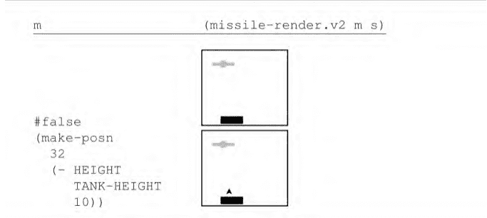

### 图 35：渲染太空侵略者游戏，附带坦克

**练习 101.** 将图 35 中的示例转换为测试用例。

现在我们准备开发模板了。因为主要参数（m）的数据定义是一个包含两个项目的枚举，函数体很可能由一个包含两个子句的 cond 表达式组成：

```
(define (missile-render.v2 m s)
  (cond
    [(boolean? m) ...]
    [(posn? m) ...]))
```

再次遵循数据定义，第一个 cond 子句检查 m 是否为布尔值，第二个子句检查它是否为 Posn 元素。如果有人不小心将 missile-render.v2 应用于 #true 和某个图像，函数将使用第一个 cond 子句来计算结果。我们将在下文详述此类错误。

模板的第二步要求在所有处理结构的 cond 子句中包含选择器表达式。在我们的示例中，这适用于第二个子句，选择器表达式从给定的 Posn 中提取 x 和 y 坐标：

```
(define (missile-render.v2 m s)
  (cond
    [(boolean? m) ...]
    [(posn? m) (... (posn-x m) ... (posn-y m) ...)]))
```

将此模板与上面的 si-render 模板进行比较。后者的数据定义处理两种不同的结构类型，因此 si-render 的函数模板在两个 cond 子句中都包含选择器表达式。然而，MissileOrNot 的数据定义混合了纯值项目和描述结构的项目。这两种定义都完全没问题；关键在于遵循配方，并找到与数据定义相匹配的代码组织方式。

以下是完整的函数定义：

```
(define (missile-render.v2 m s)
  (cond
    [(boolean? m) s]
    [(posn? m) (place-image MISSILE (posn-x m) (posn-y m) s)]))
```

逐步进行此操作，您首先处理简单的子句；在这个函数中，这是第一个子句。由于它表示导弹尚未发射，函数返回给定的 s。对于第二个子句，您需要记住 (posn-x m) 和 (posn-y m) 选择导弹图像的坐标。该函数必须将 MISSILE 添加到 s，因此您必须找出原始操作和您自己的函数的最佳组合来组合这四个值。选择这种组合操作正是您作为程序员的创造性洞察力所在。

**练习 102.** 为完成第二个数据定义的游戏设计所有其他所需的函数。

**练习 103.** 为以下四种动物园动物开发数据表示：

- 蜘蛛，其相关属性是剩余腿的数量（我们假设蜘蛛在事故中可能会失去腿）以及运输所需的空间；
- 大象，其唯一属性是运输所需的空间；


-   蟒蛇，其属性包括长度和围度；以及
-   犰狳，你必须为其确定适当的属性，包括一个确定运输所需空间的属性。

为处理动物园动物的函数开发一个模板。

设计 `fits?` 函数，它接收一只动物园动物和一个笼子的描述。它判断笼子的体积是否足够大，能够容纳该动物。

**练习 104.** 你的家乡管理一辆车队：汽车、面包车、公共汽车和 SUV。为车辆开发数据表示。每辆车的表示必须描述其可载乘客数量、车牌号码和燃油消耗（每加仑英里数）。为处理车辆的函数开发一个模板。

**练习 105.** 某个程序包含以下数据定义：

```
; A Coordinate is one of:
; -- a NegativeNumber
; **interpretation** on the y axis, distance from top
; -- a PositiveNumber
; **interpretation** on the x axis, distance from left
; -- a Posn
; **interpretation** an ordinary Cartesian point
```

为数据定义中的每个子句编造至少两个数据示例。对于每个示例，用画布草图解释其含义。

### 6.2 混合世界

本节为世界程序提出了几个设计问题，首先是一些关于我们的虚拟宠物的简单扩展练习。

**练习 106.** 在第 5.11 节中，我们讨论了创建带有幸福度量表的虚拟宠物。其中一个虚拟宠物是猫；另一个是变色龙。不过，每个程序只专注于一种宠物。

设计猫-变色龙世界程序。给定一个位置和一个动物，它将后者在画布上从给定位置开始行走。这里为动物选择的数据表示如下：

```
; A VAnimal is either
; -- a VCat
; -- a VCham
```

其中 VCat 和 VCham 是你来自练习 88 和 92 的数据定义。鉴于 VAnimal 是世界状态的集合，你需要设计

- 一个从 VAnimal 到 Image 的渲染函数；
- 一个用于处理时钟滴答的函数，从 VAnimal 到 VAnimal；以及
- 一个用于处理按键事件的函数，以便你可以根据情况喂食、抚摸和为你的动物上色。

给猫换颜色或抚摸变色龙仍然是不可能的。

**练习 107.** 设计变色龙和猫程序，它同时处理一只虚拟猫 **和** 一只虚拟变色龙。你需要为包含两种动物的“动物园”定义数据定义以及处理它的函数。

问题陈述未说明按键如何操作这两种动物。以下是两种可能的解释：

- 1. 每个按键事件都发送给两种动物。
- 2. 每个按键事件只适用于两种动物中的一种。

对于此替代方案，你需要一个数据表示，指定一个焦点动物，即当前可以被操作的动物。要切换焦点，让按键处理函数将 "k" 解释为 "kitty"，将 "1" 解释为蜥蜴。一旦玩家按下 "k"，随后的按键仅适用于猫——直到玩家按下 "1"。

选择其中一种替代方案并设计相应的程序。

**练习 108.** 在默认状态下，行人过街信号灯显示一个橙色人形站在红色背景上。当到允许行人过街的时候，信号灯接收到信号并切换到绿色行走人形。此阶段持续 10 秒。之后，灯显示数字 9、8、\(\cdots\)、0，奇数为橙色，偶数为绿色。当倒计时达到 0 时，灯切换回默认状态。

设计一个世界程序来实现这样的行人交通灯。当你按下键盘上的空格键时，灯从默认状态切换。所有其他转换必须是对时钟滴答的反应。你可以使用以下图像

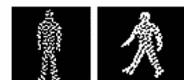

或者你可以使用图像库自行制作火柴人形象。

**练习 109.** 设计一个世界程序，用于识别按键事件序列中的模式。起初，程序显示一个 100 乘 100 的白色矩形。一旦你的程序遇到第一个期望的字母，它就显示同样大小的黄色矩形。在遇到最终字母后，矩形的颜色变为绿色。如果发生任何“错误”的按键事件，程序显示红色矩形。

你的程序查找的特定序列以 "a" 开头，接着是 "b" 和 "c" 的任意长度混合，并以 "d" 结束。显然，"acbd" 是一个可接受字符串的示例；另外两个是 "ad" 和 "abcbbcd"。当然，"da"、"aa" 或 "d" 不匹配。

**提示** 你的解决方案实现了一个有限状态机（FSM），这是第 4.7 节中介绍的世界程序设计原则之一。正如名称所说，FSM 程序可能处于有限数量的状态之一。第一个状态称为 _初始状态_。每个按键事件都会导致机器重新考虑其当前状态；它可以转移到同一状态或另一个状态。当你的程序识别出一组适当的按键事件时，它将转移到一个最终状态。

*右侧的数据定义使用了练习 61 中介绍的命名技术。*

对于序列识别问题，状态通常代表机器期望接下来看到的字母；有关数据定义，请参见图 36。查看最后一个状态，它表示已遇到非法输入。图 37 展示了以图示方式思考这些状态及其关系的方法。每个节点对应四个有限状态中的一个；每个箭头指定哪个按键事件导致程序从一个状态转移到另一个状态。

| 常规 | 已定义的缩写 |
| :--- | :--- |
| ; ExpectsToSee.v1 is one of: | ; ExpectsToSee.v2 is one of: |
| ; -- "start, expect an 'a'" | ; -- AA |
| ; -- "expect 'b', 'c', or 'd'" | ; -- BB |
| ; -- "finished" | ; -- DD |
| ; -- "error, illegal key" | ; -- ER |
| | (define AA "start, ...") |
| | (define BB "expect ...") |
| | (define DD "finished") |
| | (define ER "error, ...") |

图 36：编写 FSM 数据定义的两种方式

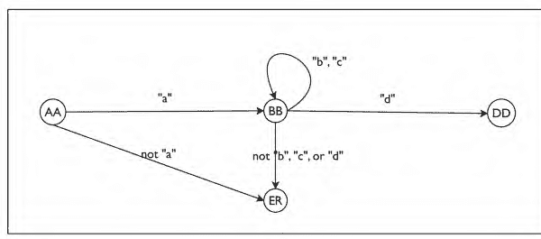

图 37：作为图示的有限状态机

**历史** 在 20 世纪 50 年代，我们会称其为计算机科学家的 Stephen C. Kleene 发明了 _正则表达式_，作为识别文本模式问题的一种表示法。对于上述问题，Kleene 会写

```
a (b|c)* d
```

这意味着一个 a，后面是 b 或 c 任意多次，直到遇到 d。

### 6.3 输入错误

本章的一个核心观点涉及谓词的作用。当你必须设计处理混合数据的函数时，它们至关重要。当问题陈述提及多种不同类型的信息时，这种混合自然会出现；但当你将函数和程序交给他人时，也会出现这种情况。毕竟，你了解并尊重自己的数据定义和函数签名。然而，你永远不知道你的朋友和同事会怎么做，尤其是你不知道不了解 BSL 和编程的人如何使用你的程序。因此，本节介绍了一种保护程序免受不当输入的方法。

> 期望我们总是尊重自己的函数签名，这是一种自我欺骗。在错误类型的数据上调用函数，连最优秀的人也会犯。虽然许多语言像 BSL 一样期望程序员自行检查签名，但其他语言会自动完成此操作，代价是增加一些额外的复杂性。

让我们用一个简单的程序来演示这一点，一个用于计算磁盘面积的函数：

```
; Number -> Number
; computes the area of a disk with radius r
(define (area-of-disk r)
  (* 3.14 (* r r)))
```

我们的朋友可能希望用这个函数来做几何作业。不幸的是，当我们的朋友使用这个函数时，他们可能不小心将其应用于字符串而不是数字。当这种情况发生时，函数会以一个神秘的错误消息停止程序执行：

```
> (area-of-disk "my-disk")
*:expects a number as 1st argument, given "my-disk"
```

使用谓词，你可以防止这种晦涩的错误消息，并发出你自己选择的信息性错误。

具体来说，当我们希望将函数交给朋友时，可以定义它们的检查版本。因为我们的朋友可能不太了解 BSL，我们


必须期望它们将此 _带检查的函数_ 应用于任意 BSL 值：数字、字符串、图像、Posn 等等。虽然我们无法预先知道 BSL 中会定义哪些结构类型，但我们知道所有 BSL 值集合的数据定义的大致轮廓。图 38 展示了该数据定义的这种形状。如第 5.7 节所述，Any 的数据定义是开放式的，因为每个结构类型定义都会添加新实例。这些实例可能再次包含 Any 值，这意味着 Any 的数据定义必须引用自身——乍一看是个可怕的想法。

```
; Any BSL value is one of:
; -- Number
; -- Boolean
; -- String
; -- Image
; -- (make-posn Any Any)
; -- (make-tank Any Any)
; ...
```

图 38：BSL 数据的宇宙

基于这一枚举，带检查函数的模板大致如下：

```
; Any -> ???
(define (checked-f v)
(cond
[(number? v) ...]
[(boolean? v) ...]
[(string? v) ...]
[(image? v) ...]
[(posn? v) (...(posn-x v) ... (posn-y v) ...)]
...
; which selectors are needed in the next clause?
[(tank? v) ...]
...))
```

当然，没人能列出该定义的所有子句；幸运的是，这也并非必要。我们知道的是，对于原始函数定义过的值类别中的所有值，检查版本必须产生相同的结果；对于其他所有值，它必须报错。

具体来说，我们的示例函数 checked-area-of-disk 接受任意 BSL 值，如果输入是数字，则使用 area-of-disk 计算圆的面积。否则，它必须显示一条错误消息并停止；在 BSL 中，我们使用 error 函数来完成此操作。error 函数接收一个字符串并停止程序：

```
(error "area-of-disk: number expected")
```

因此，checked-area-of-disk 的粗略定义如下：

```
(define MESSAGE "area-of-disk: number expected")

(define (checked-area-of-disk v)
  (cond
   [(number? v) (area-of-disk v)]
   [(boolean? v) (error MESSAGE)]
   [(string? v) (error MESSAGE)]
   [(image? v) (error MESSAGE)]
   [(posn? v) (error MESSAGE)]
   ...
   [(tank? v) (error MESSAGE)]
   ...))
```

使用 else 可帮助我们以自然的方式完成此定义：

```
; Any -> Number
; computes the area of a disk with radius v,
; if v is a number
(define (checked-area-of-disk v)
  (cond
   [(number? v) (area-of-disk v)]
   [else (error "area-of-disk: number expected")]))
```

为了确保我们得到想要的结果，让我们来试验一下：

```
> (checked-area-of-disk "my-disk")
```

```
area-of-disk:number expected
```

如果要分发程序供他人使用，编写带检查的函数很重要。但是，设计能够正常工作的程序要重要得多。本书专注于正确程序设计的设计过程，为此，我们同意始终遵循数据定义和签名，以免分心。至少，我们几乎总是这样做，只有在极少数情况下，我们可能会要求你设计函数或程序的带检查版本。

- **练习 110。** area-of-disk 的带检查版本还可以强制函数的参数是正数，而不仅仅是任意数字。以这种方式修改 checked-area-of-disk。

- **练习 111。** 查看这些定义：

```
(define-struct vec [x y])
; A vec is
;   (make-vec PositiveNumber PositiveNumber)
; interpretation represents a velocity vector
```

开发函数 checked-make-vec，将其理解为原语 make-vec 的带检查版本。它确保 make-vec 的参数是正数。换句话说，checked-make-vec 执行我们的非正式数据定义。

### 谓词

你可能会好奇如何设计自己的谓词。毕竟，带检查的函数似乎确实具有如下一般形式：

```
; Any -> ...
; checks that a is a proper input for function g
(define (checked-g a)
  (cond
    [(XYZ? a) (g a)]
    [else (error "g: bad input")]))
```

其中 g 本身是这样定义的：

```
; XYZ -> ...
(define (g some-x) ...)
```

我们假设存在一个标记为 XYZ 的数据定义，且当 a 是 XYZ 的元素时 (XYZ? a) 生成 #true，否则生成 #false。

对于 area-of-disk，它接收数字，number? 显然是合适的谓词。相比之下，对于像 missile-render 这样的函数，我们显然需要定义自己的谓词，因为 MissileOrNot 是一个自定义的、非内置的数据集合。因此，让我们为 MissileOrNot 设计一个谓词。

让我们回顾谓词的签名：

```
; Any -> Boolean
; is a an element of the MissileOrNot collection
(define (missile-or-not? a) #false)
```

使用问题作为谓词的目的陈述是良好的做法，因为应用谓词就像在询问关于某个值的问题。名称末尾的问号“？”也强化了这一想法；有些人可能会在发音此类函数名称时加上“huh”。

编造示例也很简单：

```
(check-expect (missile-or-not? #false) #true)
(check-expect (missile-or-not? (make-posn 9 2)) #true)
(check-expect (missile-or-not? "yellow") #false)
```

前两个示例提醒我们，MissileOrNot 的每个元素要么是 #false，要么是某个 Posn。第三个测试表明字符串不是该集合的元素。以下是另外三个测试：

```
(check-expect (missile-or-not? #true) #false)
(check-expect (missile-or-not? 10) #false)
(check-expect (missile-or-not? empty-image) #false)
```

### 解释预期答案！

由于谓词接收所有可能的 BSL 值，它们的模板与 checked-f 的模板一样。停下来！在继续阅读前，先找出模板并再看一遍。

与带检查的函数一样，谓词不需要所有可能的 cond 行。只需要那些可能产生 #true 的行：

```
(define (missile-or-not? v)
  (cond
    [(boolean? v) ...]
    [(posn? v) (... (posn-x v) ... (posn-y v) ...)]
    [else #false]))
```

其他所有情况都通过生成 #false 的 else 行来总结。

有了模板，定义 missile-or-not? 只需逐一考虑每种情况即可：

```
(define (missile-or-not? v)
  (cond
    [(boolean? v) (boolean=? #false v)]
    [(posn? v) #true]
    [else #false]))
```

只有 #false 是合法的 MissileOrNot；#true 不是。我们使用 (boolean=? #false v) 来表达这一想法，但 (false? v) 也可以：

```
(define (missile-or-not? v)
  (cond
    [(false? v) #true]
    [(posn? v) #true]
    [else #false]))
```

自然地，Posn 的所有元素也是 MissileOrNot 的成员，这解释了第二行中的 #true。

- **练习 112.** 现在使用 or 表达式重新表述谓词。‡

- **练习 113.** 为上一节中的以下数据定义设计谓词：SIGS、Coordinate (VAnimal。‡

最后，让我们提及 key-event? 和 mouse-event?，这是两个你可能希望在世界程序中使用的重要谓词。它们检查预期属性，但你应查阅其文档，以确保理解它们计算的内容。

### 6.4 检查世界

在世界程序中，很多事情都可能出错。尽管我们刚刚同意相信我们的函数始终应用于正确类型的数据，但在世界程序中，我们可能一次要处理太多事情，以至于无法对自己抱有那么多信任。当我们设计一个处理时钟滴答、鼠标点击、击键和渲染的世界程序时，很容易弄错其中的某种交互。当然，出错并不意味着 BSL 会立即识别出错误。例如，我们的某个函数可能会产生一个并非世界状态的数据表示的元素的结果。同时，big-bang 接收这段数据并保留它，直到下一个事件发生。只有当后续事件处理器收到这段不当数据时，程序可能会失败。但情况可能会更糟，因为即使第二、第三和第四个事件处理步骤实际上也能应对不当的状态值，所有问题也会在进程中更晚的时候才爆发。

为了帮助解决这类问题，big-bang 带有一个可选的 check-with 子句，它接受一个用于世界状态的谓词。例如，如果我们选择用 Number 表示所有世界状态，可以轻松地这样表达：

```
(define (main s0)
  (big-bang s0 ... [check-with number?] ...))
```

只要任何事件处理函数产生的不是数字，世界就会停止并显示适当的错误消息。

当数据定义不仅仅是带有 number? 等内置谓词的一类数据，而是像这个间隔定义这样微妙的东西时，check-with 子句更加有用：

```
; A UnitWorld is a number
; between 0 (inclusive) and 1 (exclusive).
```

在这种情况下，你想要为这个间隔定义一个谓词：

```
; Any -> Boolean
; is x between 0 (inclusive) and 1 (exclusive)
```


```
(check-expect (between-0-and-1? "a") #false)
(check-expect (between-0-and-1? 1.2) #false)
(check-expect (between-0-and-1? 0.2) #true)
(check-expect (between-0-and-1? 0.0) #true)
(check-expect (between-0-and-1? 1.0) #false)
```

```
(define (between-0-and-1? x)
  (and (number? x) (<= 0 x) (< x 1)))
```

有了这个谓词，你现在可以监控世界程序中的每一次状态转换了：

```
(define (main s0)
  (big-bang s0
    ...
    [check-with between-0-and-1?]
    ...)))
```

如果任何世界产生处理程序创建了区间之外的数字，或者更糟的是，创建了一个非数值，我们的程序会立即发现这个错误，并给我们机会来修复它。

**练习** 114. 使用练习113中的谓词来检查太空入侵者世界程序、虚拟宠物程序（练习106）和编辑程序（第5.10章）。

### 6.5 相等性谓词

一个 _相等性谓词_ 是一个函数，用于比较同一数据集合中的两个元素。回顾 TrafficLight 的定义，它是三个字符串的集合："red"、"green" 和 "yellow"。以下是定义 `light=?` 函数的一种方法：

```
; TrafficLight TrafficLight -> Boolean
; are the two (states of) traffic lights equal

(check-expect (light=? "red" "red") #true)
(check-expect (light=? "red" "green") #false)
(check-expect (light=? "green" "green") #true)
(check-expect (light=? "yellow" "yellow") #true)

(define (light=? a-value another-value)
  (string=? a-value another-value))
```

当我们点击 `RUN` 时，所有测试都通过，但不幸的是，其他交互揭示了与我们意图的冲突：

```
> (light=? "salad" "greens")
#false
> (light=? "beans" 10)
string=?:expects a string as 2nd argument, given 10
```

将这些交互与其他内置相等性谓词进行比较：

```
> (boolean=? "#true" 10)
boolean=?:expects a boolean as 1st argument, given "#true"
```

亲自尝试 `(string=? 10 #true)` 和 `(= 20 "help")`。它们都会发出关于应用到错误参数类型的错误。

> 字符的大小写很重要；"red" 与 "Red" 或 "RED" 不同。

`light=?` 的检查版本强制要求两个参数都属于 TrafficLight；如果不是，它会发出类似内置相等性谓词的错误。为了简洁，我们将 TrafficLight 的谓词称为 `light?`：

```
; Any -> Boolean
; is the given value an element of TrafficLight
(define (light? x)
 (cond
  [(string? x) (or (string=? "red" x)
                   (string=? "green" x)
                   (string=? "yellow" x))]
  [else #false]))
```

现在，我们可以通过遵循原始分析来完成对 `light=?` 的修订。首先，函数确定两个输入是 TrafficLight 的元素；如果不是，它会使用 error 来报告错误：

```
(define MESSAGE
 "traffic light expected, given some other value")

; Any Any -> Boolean
; are the two values elements of TrafficLight and,
; if so, are they equal

(check-expect (light=? "red" "red") #true)
(check-expect (light=? "red" "green") #false)
(check-expect (light=? "green" "green") #true)
(check-expect (light=? "yellow" "yellow") #true)

(define (light=? a-value another-value)
 (if (and (light? a-value) (light? another-value))
     (string=? a-value another-value)
     (error MESSAGE))))
```

**练习 115.** 修改 `light=?`，使错误消息指明两个参数中哪一个不是 TrafficLight 的元素。

虽然你的程序不太可能使用 `light=?`，但它们应该使用 `key=?` 和 `mouse=?`，这两个相等性谓词我们在上一小节末尾简要提及过。自然地，`key=?` 是用于比较两个 KeyEvent 的操作；同样，`mouse=?` 比较两个 MouseEvt。虽然两种事件都表示为字符串，但重要的是要意识到，并非所有字符串都表示键盘事件或鼠标事件。

我们建议从现在开始在键盘事件处理程序中使用 `key=?`，在鼠标事件处理程序中使用 `mouse=?`。在键盘事件处理程序中使用 `key=?` 可以确保函数真正比较表示键盘事件的字符串，而不是任意字符串。一旦，比如，函数意外地应用于 "hello\n world"，`key=?` 就会发出错误，从而告诉我们有问题。

## 7 总结

在本书的第一部分中，你学到了一系列简单但重要的经验教训。以下是总结：

- 1. 一个 **好程序员** 设计程序。一个糟糕的程序员一直摆弄，直到程序似乎能工作。

- 2. **设计食谱** 有两个维度。一个涉及设计过程，即要采取的步骤序列。另一个解释了所选数据表示如何影响设计过程。

- 3. 每个设计良好的程序都包含许多常量定义、结构类型定义、数据定义和函数定义。对于 **批处理程序**，一个函数是“主”函数，它通常组合几个其他函数来执行其计算。对于 **交互程序**，big-bang 函数扮演主函数的角色；它指定程序的初始状态、一个生成图像的输出函数，以及最多三个事件处理程序：一个用于时钟滴答，一个用于鼠标单击，一个用于键盘事件。在这两种程序中，函数定义都是按“从上到下”呈现的，从主函数开始，然后是主函数中提到的那些函数，以此类推。

- 4. 像所有编程语言一样，*初学者学生语言* 附带了 **词汇和语法**。程序员必须能够确定语言中每个句子的 **含义**，以便他们可以预见程序在给定输入时如何执行其计算。下面的间奏详细解释了这个想法。

- 5. 包括 BSL 在内的编程语言附带了一套丰富的库，因此程序员不必不断重新发明轮子。程序员应该熟悉库提供的函数，尤其是它们的签名和用途说明。这样做可以简化生活。

- 6. 程序员必须了解所选编程语言提供的“工具”。这些工具要么是语言本身的一部分，例如 cond 或 max，要么是从库中“导入”的。本着这个精神，请确保你理解以下术语：结构类型定义、函数定义、常量定义、结构实例、数据定义、big-bang 和事件处理函数。

## 间奏 1：初学者学生语言

第一部分把 BSL 当作一种自然语言来处理。它介绍了语言的“基本单词”，建议如何将“单词”组合成“句子”，并诉诸你对代数的知识，以直观地理解这些“句子”。虽然这种介绍在一定程度上有效，但真正有效的沟通需要一些正式的学习。

从很多方面来说，第一部分的类比是正确的。编程语言确实有词汇和语法，尽管程序员用 *语法* 一词来指代这些元素。BSL 中的句子是表达式或定义。BSL 的语法规定了如何构成这些短语。但并非所有语法正确的句子都是有意义的——无论在英语中还是在编程语言中。例如，英语句子“the cat is round”是一个有意义的句子，但“the brick is a car”毫无意义，尽管它完全符合语法。为了判断一个句子是否有意义，我们必须了解语言的 *含义*；程序员称之为 *语义*。

> 程序员最终必须理解这些 **计算** 原则，但它们与 **设计** 原则是互补的。

这个间奏把 BSL 呈现为中学熟悉的算术和代数语言的扩展。毕竟，计算始于这种简单的数学形式，我们应该理解这种数学与计算之间的联系。前三个部分介绍了 BSL 大部分内容的语法和语义。基于对 BSL 的这种新理解，第四部分恢复了我们对错误的讨论。其余部分将这种理解扩展到完整的语言；最后一个部分扩展了表达测试的工具。


## BSL 词汇表

图 39 介绍并定义了 BSL 的基本词汇表。它由字面常量（如数字或布尔值）；根据 BSL 具有含义的名称，例如 cond 或 +；以及程序可通过 define 或函数参数赋予其含义的名称组成。

一个 *名称* 或 *变量* 是字符序列，不包括空格或以下字符之一：`", ; ( ) [ ] { } | #`:

- 一个 *原语* 是 BSL 赋予含义的名称，例如 + 或 sqrt。
- 一个 *变量* 是没有预先赋含义的名称。

一个 *值* 是以下之一：

- 一个 *数字* 是以下之一：1, -1, 3/5, 1.22, #i1.22, 0+1i，等等。BSL 数字的语法较为复杂，因为它容纳了一系列格式：正数和负数、分数和小数、精确数和非精确数、实数和复数、非十进制数等。理解数字的确切记号需要深入了解语法和解析，但这超出了本间奏章节的范围。
- 一个 *布尔值* 是以下之一：#true 或 #false。
- 一个 *字符串* 是以下之一： "", "he says \"hello world!\" to you", "doll"，等等。一般来说，它是由一对 "" 包围的字符序列。
- 一个 *图像* 是 png、jpg、tiff 及各种其他格式。我们故意省略了精确定义。

当我们想表达“任何可能的值”时，我们使用 v、v-1、v-2 等等。

### 图 39：BSL 核心词汇表

每个解释都通过对其元素的暗示性枚举来定义一个集合。虽然有可能完全指定这些集合，但我们认为这里多此一举，并信任你的直觉。只需记住，这些集合中的每一个可能都包含一些额外元素。

## BSL 语法

图 40 展示了 BSL 语法的大部分内容，与其他语言相比，它极其简单。就 BSL 的表达能力而言，不要被外表迷惑。不过，首要任务是讨论如何读懂此类语法。每个带有 = 的行都会引入一个语法类别；读出 = 的最佳方式是“是其中之一”，读出 | 为“或”。无论您在哪里看到三个点，都可以想象任意多次重复点号前面的内容。这意味着，例如，一个程序要么为空，要么是单个 def-expr，要么是两个、三个、四个、五个或任意多个 def-expr 的序列。由于此示例并不特别启人深思，让我们来看看第二个语法类别。它说 def 要么是

> 大声读出语法会使其听起来像数据定义。确实，可以使用语法来写下我们许多数据定义。

```
(define (variable variable) expr)
```

因为“任意多”包括零，或者

```
(define (variable variable variable) expr)
```

这是一次重复，或者

```
(define (variable variable variable variable) expr)
```

这使用了两次重复。

```
program = def-expr ...
def-expr = def
         | expr
def = (define (variable variable variable ...) expr)
expr = variable
     | value
     | (primitive expr expr ...)
     | (variable expr expr ...)
     | (cond [expr expr] ... [expr expr])
     | (cond [expr expr] ... [else expr])
```

### 图 40：BSL 核心语法

关于语法的最后一点涉及三个以特殊字体显示的“字”：define、cond 和 else。根据 BSL 词汇定义，这三个词都是名称。词汇定义未告诉我们的是，这些名称具有预定义的含义。在 BSL 中，这些词充当标记，用于区分某些复合句，为了承认它们的作用，此类词被称为关键字。

现在我们准备好说明语法的目的了。编程语言的语法规定了如何从语法的词汇中构成句子。有些句子只是词汇元素。例如，根据图 40，42 是 BSL 的一个句子：

- 第一个语法类别说程序是一个 def-expr。表达式可以引用定义。
- 第二个告诉我们，def-expr 要么是一个定义，要么是一个表达式。
- 最后一个定义列出了形成表达式的所有方式，第二种是值。

由于我们知道从图 39 中 42 是一个值，因此我们得到了确认。

> 在 DrRacket 中，一个程序实际上由两个不同的部分组成：定义区和交互区中的表达式。

语法中有趣的部分展示了如何构成复合句，即由其他句子构建的句子。例如，`def` 部分告诉我们，函数定义是通过使用“(”，然后是关键字 `define`，接着是另一个“(”，然后是至少两个变量的序列，然后是“)”，接着是一个 `expr`，并用与第一个“(”匹配的右括号“)”结束。请注意，开头的关键字 `define` 将定义与表达式区分开来。

表达式（`expr`）有六种类型：变量、常量、原语应用、（函数）应用和两种条件表达式。前两种是原子句，最后四种是复合句。与 `define` 类似，关键字 `cond` 将条件表达式与应用区分开来。

以下是三个表达式示例："all"、`x` 和 `(f x)`。第一个属于字符串类，因此是表达式。第二个是变量，每个变量都是表达式。第三个是函数应用，因为 `f` 和 `x` 是变量。

相比之下，以下括号句子不是合法表达式：`(f define)`、`(cond x)` 和 `((f 2) 10)`。第一个部分匹配函数应用的形式，但它将 `define` 当作变量使用。第二个不是正确的 `cond` 表达式，因为它将变量作为第二个项目，而不是一对由括号包围的表达式。最后一个既不是条件表达式也不是应用，因为第一部分是一个表达式。

最后，您可能会注意到语法没有提及空白字符：空格、制表符和换行。BSL 是一种宽容的语言。只要程序中任何序列的元素之间存在一些空白字符，DrRacket 就能理解您的 BSL 程序。不过，优秀的程序员可能不喜欢您的写法。这些程序员使用空白字符来使其程序易于阅读。最重要的是，他们采用一种更偏向人类读者而非处理程序的软件应用程序（如 DrRacket）的风格。他们通过仔细阅读书籍中的代码示例并注意其格式来掌握这种风格。

> *请记住，两类读者会研究您的 BSL 程序：人类和 DrRacket。*

### **练习 116。** 请看以下句子：

- 1. x
- 2. (= y z)
- 3. (= (= y z) 0)

解释它们为什么是语法上合法的表达式。

### **练习 117。** 考虑以下句子：

- 1. (3 + 4)
- 2. number?
- 3. (x)

解释它们为什么在语法上是非法的。

### **练习 118。** 请看以下句子：

- 1. (define (f x)x)
- 2. (define (f x)y)
- 3. (define (f x y) 3)

解释它们为什么是语法上合法的定义。

### **练习 119。** 考虑以下句子：

- 1. (define (f "x") x)
- 2. (define (f x y z) (x))

解释它们为什么在语法上是非法的。

### **练习 120。** 区分合法句子和非法句子：

- 1. (x)
- 2. (+ 1 (not x))
- 3. (+ 1 2 3)

解释这些句子合法或非法的原因。确定合法的句子属于 expr 还是 def 类别。

### **关于语法术语的说明**

复合句的组成部分有名称。我们已非正式地介绍了一些名称。图 41 提供了这些约定的摘要。

```
; function application:
(function argument ... argument)
; function definition:
(define (function-name parameter ... parameter)
 function-body)
; conditional expression:
(cond
 cond-clause
 ...
 cond-clause)
; cond clause
[condition answer]
```

### 图 41：语法命名约定

除了图 41 的术语之外，我们将定义的第二个组件称为函数头。相应地，表达式组件称为函数体。将编程语言视为一种数学的人将头称为左侧，将体称为右侧。偶尔，您也会听到或读到“实际参数”这一术语，用于指代函数应用中的参数。结束


## BSL 含义

当你在键盘上按下回车键并要求 DrRacket 求值一个表达式时，它使用算术和代数的规律来获得一个 *值*。迄今所处理的 BSL 变体中，图 39 在语法上定义了什么是值——值的集合只是所有表达式的子集。该集合包括布尔值、字符串和图像。

求值规则分为两类。存在无数条规则，如同算术中的规则，用于解释如何确定将原始操作应用于值时的结果：

```
(+ 1 1) == 2
(- 2 1) == 1
...
```

请记住 `==` 表示两个表达式根据 BSL 的计算规律相等。但 BSL 算术不仅限于数字运算。它还包括处理布尔值、字符串等规则：

```
(not #true)         == #false
(string=? "a" "a") == #true
...
```

并且，如同代数中一样，你总是可以用等式替换等式；请参见图 42 了解示例计算。

```
(boolean? (= (string-length (string-append "h" "w"))
           (+ 1 3)))
==
(boolean? (= (string-length (string-append "h" "w")) 4))
==
(boolean? (= (string-length "hw") 4))
==
(boolean? (= 2 4))
==
(boolean? #false)
== #true
```

### 图 42：以等式替换等式

其次，我们需要一条来自代数的规则来理解函数对参数的应用。假设程序包含以下定义

```
(define (f x-1 ... x-n)
f-body)
```

那么函数的应用受以下规律支配：

```
(f v-1 ... v-n) == f-body
; with all occurrences of x-1 ... x-n
; replaced with v-1 ... v-n, respectively
```

由于诸如 BSL 之类语言的历史，我们将此规则称为 *beta* 或 *beta-value* 规则。

有关此规则的更多信息，请参见第 17.2 章。

此规则尽可能一般地表述，因此最好查看具体示例。假设定义是

```
(define (poly x y)
(+ (expt 2 x) y))
```

并且 DrRacket 给定表达式 `(poly 3 5)`。那么表达式求值的第一步使用 beta 规则：

```
(poly 3 5) == (+ (expt 2 3) 5) ... == (+ 8 5) == 13
```

除了 beta 之外，我们还需要确定 cond 表达式值的规则。这些规则是代数性质的，即使它们没有作为标准课程的一部分明确教授。当第一个条件为 #false 时，第一个 cond 行消失，其余行保持不变：

```
(cond
[#false ...]
[condition2 answer2]
...) == (cond
; first line removed
[condition2 answer2]
...)
```

此规则名为 cond_false。以下是 cond_true：

```
(cond
    [#true answer-1]
    [condition2 answer2]
    ...)
== answer-1
```

该规则也适用于第一个条件为 else 的情况。

考虑以下求值过程：

```
(cond
    [(zero? 3) 1]
    [(= 3 3) (+ 1 1)]
    [else 3])
== ; by plain arithmetic and equals-for-equals
(cond
    [#false 1]
    [(= 3 3) (+ 1 1)]
    [else 3])
== ; by rule cond_false
(cond
    [(= 3 3) (+ 1 1)]
    [else 3])
== ; by plain arithmetic and equals-for-equals
(cond
    [#true (+ 1 1)]
    [else 3])
== ; by rule cond_true
(+ 1 1)
```

此计算说明了普通算术规则、以等式替换等式以及两条 cond 规则。

## 练习 121. 逐步求值以下表达式：

- 1. (+ (* (/ 12 8) 2/3) (- 20 (sqrt 4)))
- 2. 
```
(cond
  [(= 0 0) #false]
  [(> 0 1) (string=? "a" "a")]
  [else (= (/ 1 0) 9)])
```
- 3. 
```
(cond
  [(= 2 0) #false]
  [(> 2 1) (string=? "a" "a")]
  [else (= (/ 1 2) 9)])
```

使用 DrRacket 的 stepper 确认你的计算结果。

## 练习 122. 假设程序包含以下定义：

```
(define (f x y)
  (+ (* 3 x) (* y y)))
```

展示 DrRacket 如何逐步求值以下表达式：

- 1. (+ (f 1 2) (f 2 1))
- 2. (f 1 (* 2 3))
- 3. (f (f 1 (* 2 3)) 19)

使用 DrRacket 的 stepper 确认你的计算结果。

## 含义与计算

DrRacket 中的 stepper 工具模拟了一名预代数课程的学生。与你不同，stepper 非常擅长应用此处阐述的算术和代数规律，而且速度极快。

> 一位科学家将 stepper 称为 DrRacket 求值机制的 *模型*。第 21 章《优化解释器》介绍了另一个模型，即 *解释器*。

当你不理解新语言结构的工作原理时，你可以并且应该使用 stepper。关于 **计算** 的章节为此目的建议练习，但你可以编造自己的示例，通过 stepper 运行它们，并思考为什么它会采取某些步骤。

最后，当你对程序计算出的结果感到惊讶时，你可能也希望使用 stepper。以这种方式有效地使用 stepper 需要练习。例如，这通常意味着复制程序并删除不必要的部分。但一旦你了解如何很好地使用 stepper，你会发现这种过程清楚地解释了程序中的运行时错误和逻辑错误。

## BSL 错误

当 DrRacket 发现某个带括号的短语不属于 BSL 时，它会发出语法错误。为了确定完全带括号的程序在语法上是否合法，DrRacket 使用图 40 中的语法，并按照上面解释的思路进行推理。然而，并非所有语法上合法的程序都有意义。

> 有关几乎完整的错误消息列表，请参见本间奏曲的最后一节。

当 DrRacket 求值一个语法上合法的程序，并发现某个操作被应用于错误类型的值时，它会引发运行时错误。考虑语法上合法的表达式 (/ 1 0)，如你从数学中所知，它没有值。由于 BSL 的计算必须与数学一致，DrRacket 会发出错误：

```
>(/ 1 0)
/:division by zero
```

当然，当像 (/ 1 0) 这样的表达式深度嵌套在另一个表达式中时，它也会发出错误：

```
>(+ (* 20 2) (/ 1 (- 10 10)))
/:division by zero
```

DrRacket 的行为转化为我们的计算如下。当我们发现一个不是值的表达式，并且求值规则不允许进一步简化时，我们说计算处于卡住状态。这种卡住的概念对应于运行时错误。例如，求上述表达式的值会导致卡住状态：

```
(+ (* 20 2) (/ 1 (- 10 10)))
==
(+ (* 20 2) (/ 1 0))
==
(+ 40 (/ 1 0))
```

此计算还表明，DrRacket 在发出错误时会消除卡住表达式的上下文。在此具体示例中，它消除了将 40 加到卡住表达式 (/ 1 0) 的操作。

并非所有嵌套的卡住表达式最终都会发出错误。假设程序包含以下定义：

```
(define (my-divide n)
  (cond
    [(= n 0) "inf"]
    [else (/ 1 n)]))
```

如果你现在将 my-divide 应用于 0，DrRacket 会按以下方式计算：

```
(my-divide 0)
==
(cond
  [(= 0 0) "inf"]
  [else (/ 1 0)])
```

显然，说函数现在会发出除以零的错误是错误的，即使对阴影子表达式的求值可能暗示这一点。原因是 (= 0 0) 求值为 #true，因此第二个 cond 子句不发挥任何作用：

```
(my-divide 0)
==
(cond
  [(= 0 0) "inf"]
  [else (/ 1 0)])
==
(cond
  [#true "inf"]
  [else (/ 1 0)])
== "inf"
```

幸运的是，我们的求值规则会自动处理这些情况。我们只需要记住它们何时适用。例如，在

```
(+ (* 20 2) (/ 20 2))
```

中，加法不能在乘法或除法之前进行。同样，在

```
(cond
[ (= 0 0) "inf"]
[else (/ 1 0)])
```

中，阴影的除法不能替换完整的 cond 表达式，直到对应的行成为 cond 中的第一个条件。

作为经验法则，最好牢记以下几点：

_始终选择最外层且最左侧嵌套的、已准备好求值的表达式。*

虽然这条准则可能看起来过于简单化，但它始终能解释 BSL 的结果。

在某些情况下，程序员还希望定义会引发错误的函数。回顾第 6.3 章中 area-of-disk 的检查版本：

```
(define (checked-area-of-disk v)
(cond
 [(number? v) (area-of-disk v)]
 [else (error "number expected")]))
```

现在想象将 checked-area-of-disk 应用于一个字符串：

```
(- (checked-area-of-disk "a")
  (checked-area-of-disk 10))
==
(- (cond
    [(number? "a") (area-of-disk "a")]
    [else (error "number expected")])
  (checked-area-of-disk 10))
==
(- (cond
    [#false (area-of-disk "a")]
```


## 布尔表达式

我们当前的 BSL 定义省略了 or 和 and 表达式。添加它们为研究新语言构造提供了一个案例研究。我们必须首先理解它们的语法，然后再理解它们的语义。

以下是表达式的修订语法：

```
expr = ...
| (and expr expr)
| (or expr expr)
```

语法规定 and 和 or 是关键字，各后跟两个表达式。它们不是函数应用。

要理解为什么 and 和 or 不是 BSL 定义的函数，我们必须首先看看它们的语用。假设我们需要制定一个条件来确定 (/ 1 n) 是否等于 r：

```
(define (check n r)
(and (not (= n 0)) (= (/ 1 n) r)))
```

我们将条件制定为 and 组合，因为我们不希望意外除以 0。现在让我们将 check 应用于 0 和 1/5：

```
(check 0 1/5)
== (and (not (= 0 0)) (= (/ 1 0) 1/5))
```

如果 and 是一个普通操作，我们就必须求值两个子表达式，这样做会触发错误。相反，当第一个表达式为 #false 时，and 仅仅不求值第二个表达式，也就是说，and 会短路求值。

> 为确保 expr-2 求值为布尔值，这些缩写应使用 (if expr-2 #true #false) 而不是仅 expr-2。我们在此略过这个细节。

为 and 和 or 制定求值规则很容易。解释它们含义的另一种方法是将它们翻译成其他表达式：

(and exp-1 exp-2) 是 (cond
[exp-1 exp-2]
[else #false]) 的缩写

并且

(or exp-1 exp-2) 是 (cond
[exp-1 #true]
[else exp-2]) 的缩写

所以如果你对如何求值 and 或 or 表达式有任何疑问，请使用上述等价式进行计算。但我们相信你能直观地理解这些操作，这几乎总是足够的。

### 练习 123。

if 的使用可能以另一种方式让你感到惊讶，因为这个间奏曲在其他地方没有提及这种形式。简而言之，这个间奏曲似乎用一种同样没有解释的形式来解释 and。此时，我们依赖你对 if 作为 cond 缩写的直观理解。请写下一条规则，展示如何将
```
(if exp-test exp-then exp-else)
```
重新表述为 cond 表达式。

## 常量定义

程序不仅由函数定义组成，还由常量定义组成，但这些没有包含在我们的第一个语法中。因此，这里是一个包含常量定义的扩展语法：

```
definition = ...
| (define name expr)
```

常量定义的形式与函数定义类似。虽然关键字 define 将常量定义与表达式区分开来，但它并不将其与函数定义区分开来。为此，人类读者必须查看定义的第二个组件。

> 事实证明，DrRacket 处理函数定义有另一种方式；参见第 17 章。

接下来我们必须理解常量定义的含义。对于右侧为文字常量的常量定义，例如

```
(define RADIUS 5)
```

变量只是值的简写。DrRacket 在求值过程中每次遇到 RADIUS，都会将其替换为 5。

对于右侧为适当表达式的定义，例如

```
(define DIAMETER (* 2 RADIUS))
```

我们必须立即确定表达式的值。此过程使用在此常量定义之前出现的所有定义。因此，

```
(define RADIUS 5)
(define DIAMETER (* 2 RADIUS))
```

等价于

```
(define RADIUS 5)
(define DIAMETER 10)
```

即使涉及函数定义，此过程也适用：

```
(define RADIUS 10)
(define DIAMETER (* 2 RADIUS))
(define (area r) (* 3.14 (* r r)))
(define AREA-OF-RADIUS (area RADIUS))
```

当 DrRacket 逐个处理这一系列定义时，它首先确定 RADIUS 代表 10，DIAMETER 代表 20，而 area 是一个函数的名称。最后，它将 (area RADIUS) 求值为 314，并将 AREA-OF-RADIUS 与该值关联。

混合常量和函数定义还会产生一种新的运行时错误。请看这个程序：

```
(define RADIUS 10)
(define DIAMETER (* 2 RADIUS))
(define AREA-OF-RADIUS (area RADIUS))
(define (area r) (* 3.14 (* r r)))
```

它与上面的程序类似，只是最后两个定义互换了。对于前两个定义，求值过程与之前相同。然而，对于第三个定义，求值出了问题。该过程要求求值 (area RADIUS)。尽管 RADIUS 的定义在此表达式之前，但 area 的定义尚未出现。如果你用 DrRacket 求值该程序，你会因此得到一个错误，说明“此函数未定义”。因此，只有在知道函数已定义时，才在常量定义中使用函数，要小心。

### 练习 124。

请逐步求值以下程序：

```
(define PRICE 5)
(define SALES-TAX (* 0.08 PRICE))
(define TOTAL (+ PRICE SALES-TAX))
```

求值以下程序是否会报错？

```
(define COLD-F 32)
(define COLD-C (fahrenheit->celsius COLD-F))
```

```
(define (fahrenheit->celsius f)
(* 5/9 (- f 32)))
```

下一个呢？

```
(define LEFT -100)
(define RIGHT 100)
(define (f x) (+ (* 5 (expt x 2)) 10))
(define f@LEFT (f LEFT))
(define f@RIGHT (f RIGHT))
```

使用 DrRacket 的单步调试器检查你的计算。

## 结构体类型定义

如你所料，define-struct 是最复杂的 BSL 构造。因此我们将其解释留到了最后。这里是语法：

```
definition = ...
| (define-struct name [name ...])
```

结构体类型定义是第三种定义形式。该关键字将其与函数和常量定义区分开来。

这是一个简单的例子：

```
(define-struct point [x y z])
```

由于 point、x、y 和 z 是变量，并且括号按照语法模式放置，因此这是一个适当的结构体类型定义。相比之下，下面两个带括号的句子

```
(define-struct [point x y z])
(define-struct point x y z)
```

是非法定义，因为 define-struct 后面没有跟单个变量名和括号内的变量序列。

虽然 define-struct 的语法很简单，但用求值规则来说明其含义比较困难。如前所述多次，define-struct 定义一次定义多个函数：一个构造函数、多个选择函数和一个谓词。因此，

```
(define-struct c [s-1 ... s-n])
```

将以下函数引入程序：

- 1. make-c：构造函数；
- 2. c s-1... c s-n：一系列选择函数；以及
- 3. c?：谓词。

这些函数与 +、- 或 * 具有相同的地位。但是，在理解管理这些新函数的规则之前，我们必须回到值的定义。毕竟，define-struct 的一个目的是引入与所有现有值不同的一类值。

简单来说，使用 define-struct 扩展了值的宇宙。首先，它现在还包含结构体，结构体将多个值组合为一个。当程序包含 define-struct 定义时，其求值会修改值的定义：

一个 *值* 是以下之一：一个 *数字*、一个 *布尔值*、一个 *字符串*、一个 *图像*，
- 或者一个结构体值：

```
(make-c _value-1 ... _value-n)
```

假设结构体类型 c 已定义。

例如，point 的定义添加了这种形式的值：

```
(make-point 1 2 -1)
(make-point "one" "hello" "world")
(make-point 1 "one" (make-point 1 2 -1))
...
```

现在我们有能力理解新函数的求值规则了。如果 c-s-1 应用于 c 结构体，它返回值的第一个组件。同样，第二个选择函数提取第二个组件，第三个选择函数提取第三个组件，依此类推。新数据构造函数与选择函数之间的关系最好通过添加到 BSL 规则中的 n 个方程来描述：

```
(c-s-1 (make-c V-1 ... V-n)) == V-1
(c-s-n (make-c V-1 ... V-n)) == V-n
```

对于我们的运行示例，我们得到具体的方程

```
(point-x (make-point V U W)) == V
(point-y (make-point V U W)) == U
(point-z (make-point V U W)) == W
```


当 DrRacket 看到 (point-y (make-point 3 4 5)) 时，它将表达式替换为 4，而 (point-x (make-point (make-point 1 2 3) 4 5)) 求值为 (make-point 1 2 3)。

谓词 c? 可以应用于任何值。如果值属于 c 类型，它返回 #true，否则返回 #false。我们可以将两部分翻译为两个方程：

```
(c? (make-c v-1 ... v-n)) == #true
(c? v)          == #false
```

如果 v 是一个未使用 make-c 构造的值。同样，最好结合我们的示例来理解这些方程：

```
(point? (make-point u v w)) == #true
(point? x)                 == #false
```

如果 x 是一个值但不是点结构。

## 练习 125. 区分合法语句和非法语句：

- 1. (define-struct oops [])
- 2. (define-struct child [parents dob date])
- 3. (define-struct (child person) [dob date])

解释这些语句为何合法或非法。

## 练习 126. 在以下表达式中识别出值，假设定义区包含以下结构类型定义：

```
(define-struct point [x y z])
(define-struct none [])
```

- 1. (make-point 1 2 3)
- 2. (make-point (make-point 1 2 3) 4 5)
- 3. (make-point (+ 1 2) 3 4)
- 4. (make-none)
- 5. (make-point (point-x (make-point 1 2 3)) 4 5)

解释这些表达式为何是值或不是值。

## 练习 127. 假设程序包含

```
(define-struct ball [x y speed-x speed-y])
```

- 1. (number? (make-ball 1 2 3 4))
- 2. (ball-speed-y (make-ball (+ 1 2) (+ 3 3) 2 3))
- 3. (ball-y (make-ball (+ 1 2) (+ 3 3) 2 3))
- 4. (ball-x (make-posn 1 2))
- 5. (ball-speed-y 5)

在交互区和使用 stepper 验证你的预测。

## BSL 测试

图 43 展示了 BSL 的全部内容以及许多测试形式。

```
def-expr = definition
    | expr
    | test-case

definition = (define (name variable variable ...) expr)
    | (define name expr)
    | (define-struct name [name ...])

expr = (name expr expr ...)
    | (cond [expr expr] ... [expr expr])
    | (cond [expr expr] ... [else expr])
    | (and expr expr expr ...)
    | (or expr expr expr ...)
    | name
    | number
    | string
    | image

test-case = (check-expect expr expr)
    | (check-within expr expr expr)
    | (check-member-of expr expr ...)
    | (check-range expr expr expr)
    | (check-error expr)
    | (check-random expr expr)
    | (check-satisfied expr name)
```

图 43: BSL，完整语法

测试表达式的一般含义很容易解释。当你点击 RUN 按钮时，DrRacket 会收集所有测试表达式并将它们移到程序末尾，保留它们出现的顺序。然后它会对定义区的内容求值。每个测试会对其组成部分求值，然后通过某个谓词将它们与预期结果进行比较。除此之外，测试还会与 DrRacket 通信，以收集一些统计信息以及有关如何显示测试失败的信息。

### 练习 128. 将以下测试复制到 DrRacket 的定义区中：

```
(check-member-of "green" "red" "yellow" "grey")
(check-within (make-posn #i1.0 #i1.1)
  (make-posn #i0.9 #i1.2) 0.01)
(check-range #i0.9 #i0.6 #i0.8)
(check-random (make-posn (random 3) (random 9))
  (make-posn (random 9) (random 3))))
(check-satisfied 4 odd?)
```

验证它们都会失败，并解释原因。

## BSL 错误消息

BSL 程序可能会发出多种语法错误。尽管我们专门为初学者（根据定义，他们会犯错误）开发了 BSL 及其错误报告系统，但错误消息需要一些时间来适应。

下面我们列举了你可能遇到的错误消息类型。清单中的每个条目由三部分组成：

- • 触发错误消息的代码片段；
- • 错误消息；以及
- • 包含修复错误建议的解释。

考虑以下示例，这是你可能见过的 **最糟糕的错误消息**：

```
(define (absolute n)
(cond
 [< 0 (- n)]
 [else n]))
<: expected a function call, but there is no open parenthesis before this function
```

cond 表达式由关键字后跟任意长度的 cond 子句序列组成。每个子句又由两部分组成：条件和答案，两者都是表达式。在这个 absolute 的定义中，第一个子句以 < 开头，它本应是一个条件，但根据我们的定义，它甚至不是一个表达式。这让 BSL 困惑不已，以至于它没有“看到” < 左侧的左括号。修复方法是将 (< n 0) 用作条件。

函数定义中对 < 的高亮显示指向了错误。如果你点击 RUN，在定义下方可以看到 DrRacket 在交互窗口中呈现的错误消息。请研究右侧的错误解释，以了解如何处理这个有些自相矛盾的消息。现在请放心，没有其他错误消息比这个更晦涩难懂了。

因此，当出现错误且需要帮助时，请找到合适的图表，在条目中搜索匹配项，然后研究完整的条目。

### 关于 BSL 中函数应用的错误消息

假设定义区仅包含以下内容，除此之外别无他物：

```
; Number Number -> Number
; finds the average of x and y
(define (average x y)
 (/ (+ x y)
  2))
```

点击 RUN 按钮。现在你可能会遇到以下错误消息。

```
(f 1)
f: this function is
not defined
```

该应用将 f 命名为函数，但 f 未在定义区中定义。请定义该函数，或确保变量名拼写正确。

```
(1 3 "three" #true)
function call:
expected a function
after the open
parenthesis, but found
a number
```

左括号后面必须始终跟随一个关键字或函数名，而 1 两者都不是。函数名要么由 BSL 定义（例如 +），要么在定义区中定义（例如 average）。

```
(average 7)
average: expects 2
arguments, but found
only 1
```

这个函数调用将 average 应用于一个参数 7，尽管它的定义要求两个数字。

```
(average 1 2 3)      average: expects 2
                   arguments, but found 3
```

这里 average 应用于 **三个** 数字，而不是两个。

```
(make-posn 1)        make-posn: expects 2
                   arguments, but found
                   only 1
```

由 BSL 定义的函数也必须应用正确数量的参数。例如，make-posn 必须应用于两个参数。

### *关于 BSL 中错误数据的错误消息*

下面的错误场景再次假设定义区包含以下内容：

```
; Number Number -> Number
; find the average of x and y
(define (average x y) ...)
```

请记住，posn 是一个预定义的结构类型。

```
(posn-x #true)       posn-x: expects a
                   posn, given #true
```

函数必须应用于它所期望的参数。例如，posn-x 期望一个 posn 的实例。

```
(average "one" "two")  +: expects a number as
                        1st argument, given
                        "one"
```

一个定义为消耗两个数字的函数必须应用于两个数字；这里 average 被应用于字符串。只有当 average 将这些字符串应用到 + 时，才会触发错误消息。像所有原语操作一样，+ 是一个受检查的函数。

### 关于 BSL 中条件表达式的错误消息

这次我们期望定义区中有一个常量定义：

```
; N in [0,1,...10]
(define 0-to-9 (random 10))
```

```
(cond
((>= 0-to-9 5)))
```

cond: 预期一个包含问题和答案的子句，但发现一个只有一部分的子句

每个 cond 子句必须恰好包含两部分：条件和答案。这里 (>= 0-to-9 5) 显然意图作为条件；答案缺失。

```
(cond
[(>= 0-to-9 5)
"head"
"tail"])
```

cond: 预期一个包含问题和答案的子句，但发现一个包含 3 个部分的子句

在这种情况下，cond 子句包含三部分，这也违反了语法。虽然 (>= 0-to-9 5) 显然意图作为条件，但子句带有两个答案："head" 和 "tail"。请选一个，或从这两个字符串中创建一个单一值。

```
(cond)
```

cond: 预期 cond 之后有一个子句，但那里什么都没有


条件表达式必须包含至少一个 cond 子句，并且通常包含至少两个。

## BSL 中函数定义的错误消息

以下所有错误场景均假设您已将代码片段放入定义区并点击 RUN。

```
(define f(x) x)
```

define: 期望仅
一个表达式位于
变量名 f 之后，
但发现多出 1 个部分

定义由三部分组成：define 关键字、用括号括起来的变量名序列，以及一个表达式。这个定义包含四部分；此定义试图为标题 f (x) 使用代数课程中的标准记法，而不是 (f x)。

```
(define (f x x) x)
```

define: 发现一个
被多次使用的
变量：x

函数定义中的参数序列不得包含重复变量。

```
(define (g) x)
```

define: 期望至少
一个变量位于
函数名
之后，但未找到

在 BSL 中，函数标题必须至少包含两个名称。第一个是函数名；其余的变量名是参数，而这里缺少了参数。

```
(define (f (x)) x)
```

define: 期望一个
变量，但发现一个
部分

函数标题包含 (x)，它**不是**变量名。

```
(define (h x y) x y)        define: expected only
                            one expression for the
                            function body, but
                            found 1 extra part
```

这个函数定义在标题后面跟有两个表达式：x 和 y。

## BSL 中结构类型定义的错误消息

现在您需要将结构类型定义放入定义区并点击 RUN，以尝试以下错误。

```
(define-struct (x) )
(define-struct (x y) )      define-struct:
                            expected the structure
                            name after
                            define-struct, but
                            found a part
```

结构类型定义由三部分组成：`define-struct` 关键字、结构的名称，以及用括号括起来的一系列名称。这里缺少了结构的名称。

```
(define-struct x
(y y))        define-struct: found a
             field name that is
             used more than once: y
```

结构类型定义中的字段名序列不得包含重复名称。

```
(define-struct x y)
(define-struct x y z)
```

```
define-struct:
expected at least one
field name (in
parentheses) after the
structure name, but
found something else
```

这些结构类型定义缺少用括号括起来的字段名序列。

## 网站分析

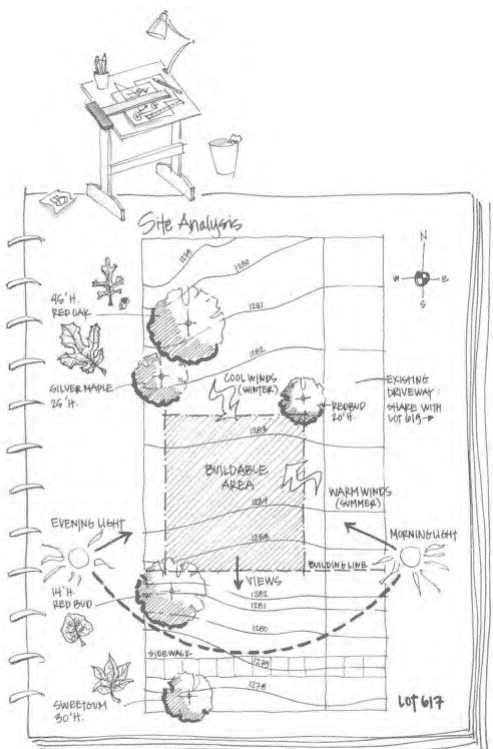

## II

## 任意大小的数据

第一部分中的每个数据定义都描述了固定大小的数据。对我们而言，布尔值、数字、字符串和图像都是原子的；计算机科学家说它们的大小为一个单位。使用结构，您可以组合固定数量的数据片段。即使您使用数据定义语言创建深层嵌套的结构，您也始终知道任何特定实例中原子数据片段的确切数量。然而，许多编程问题涉及不确定数量的信息片段，这些信息必须作为一个数据片段进行处理。例如，一个程序可能需要计算一组数字的平均值，而另一个程序可能需要跟踪交互式游戏中任意数量的对象。无论如何，凭借您目前的知识，无法制定出能够将此类信息表示为数据的数据定义。

本部分修订了数据定义语言，使得能够描述（有限但）任意大小的数据。为作具体说明，本部分的前半部分讨论列表，这是一种出现在大多数现代编程语言中的数据形式。与扩展后的数据定义语言并行，本部分还修订了设计配方，以应对此类数据定义。后面的章节展示了这些数据定义和修订后的设计配方在各种上下文中如何工作。

## 8 列表

您可能以前没有遇到过自引用定义。您的英语老师肯定会避开这些定义，许多数学课程在涉及此类定义时也比较含糊。程序员不能含糊其辞。他们的工作需要精确。虽然定义一般可能包含对自身的多个引用，但本章介绍的有用示例只需要一个引用，从列表的定义开始。

列表的引入也为我们可以研究的应用类型增添了趣味。虽然本章通过示例仔细建立您的直觉，但它也为下一章中设计配方的修订提供了动力，后者解释了如何系统地创建处理自引用数据定义的函数。

### 8.1 创建列表

我们都会不断地列清单。去杂货店购物之前，我们会写下想要购买的物品清单。有些人每天早上都会写待办事项清单。在十二月，许多孩子会准备圣诞节愿望清单。为了策划派对，我们会列出受邀人名单。将信息以清单形式安排是我们生活中无处不在的一部分。

鉴于信息以清单的形式出现，我们必须清楚地学习如何将此类清单表示为 BSL 数据。确实，由于列表非常重要，BSL 自带创建和操作列表的内置支持，类似于对笛卡尔点（posn）的支持。与点不同，列表的数据定义始终留给您。言归正传。我们从创建列表开始。

当我们形成列表时，我们总是从空列表开始。在 BSL 中，我们使用以下方式表示空列表：

```
'()
```

它读作“empty”，即“empty list”的缩写。像 #true 或 5 一样，'() 只是一个常量。当我们向列表中添加某个内容时，我们会构建另一个列表；在 BSL 中，cons 操作用于此目的。例如，

```
(cons "Mercury" '())
```

它从 '() 列表和字符串 "Mercury" 构建一个列表。图 44 以我们用于结构的同样图示方式展示了这个列表。cons 的框包含两个字段：first 和 rest。在这个特定示例中，first 字段包含 "Mercury"，而 rest 字段包含 '()。

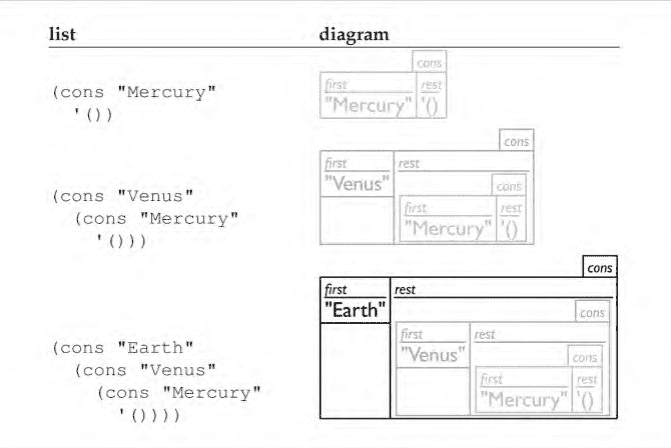

图 44：构建列表

一旦我们有了一个包含一个项目的列表，就可以再次使用 cons 构建包含两个项目的列表。这是一个示例：

```
(cons "Venus" (cons "Mercury" '()))
```

这是另一个示例：

```
(cons "Earth" (cons "Mercury" '()))
```

图 44 的中间行展示了您可以如何想象包含两个项目的列表。它也是一个包含两个字段的框，但这次 rest 字段包含一个框。的确，它包含同一图中最上面一行的框。

最后，我们构建一个包含三个项目的列表：

```
(cons "Earth" (cons "Venus" (cons "Mercury" '()))))
```

图 44 的最后一行展示了包含三个项目的列表。它的 rest 字段包含一个框，而该框里又包含一个框。因此，当我们创建列表时，我们把框放进框里、再放进框里，如此反复。虽然乍看之下这可能显得奇怪，但这就像一套中式礼品盒或一套嵌套的饮水杯，我们有时会在生日时收到它们。唯一的区别在于，BSL 程序可以将列表嵌套得比任何艺术家嵌套实体盒子都要深得多。

即使是优秀的艺术家也很难绘制深层嵌套的结构，因此计算机科学家改用框和箭头图。图 45 展示了如何重新排列图 44 的最后一行。每个 cons 结构变成一个独立的框。如果 rest 字段太复杂而无法在框内绘制，我们改绘一个项目符号，并画一条带箭头的线指向它所包含的框。根据框的排列方式，您会得到两种图表。第一种显示在图 45 的顶部行，按创建顺序列出框。第二种显示在底部行，按 cons 连接的顺序列出框。因此，第二张图立即告诉您将 first 应用于列表时会产生什么结果，无论列表有多长。出于这个原因，程序员更喜欢第二种排列方式。

```
(cons "Earth"
 (cons "Venus"
  (cons "Mercury"
   '())))
```

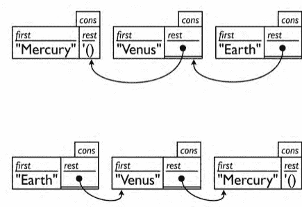

图 45：绘制列表

### 练习 129. 创建表示以下内容的 BSL 列表

- 1. 天体列表，例如，至少包括我们太阳系中的所有行星；
- 2. 餐点项目列表，例如，牛排、薯条、豆子、面包、水、布里奶酪和冰淇淋；以及
- 3. 颜色列表。

绘制这些列表的一些框表示，类似于图 44 和


## 45. 你更喜欢下面哪个草图？

你也可以创建数字列表。下面是一个包含 10 个数字的列表：

```
(cons 0
 (cons 1
  (cons 2
   (cons 3
    (cons 4
     (cons 5
      (cons 6
       (cons 7
        (cons 8
         (cons 9 '())))))))))
```

构建此列表需要 10 次列表构造和一个 '()。例如，对于三个任意数字的列表，

```
(cons pi
 (cons e
  (cons -22.3 '())))
```

我们需要三个 cons。

一般而言，列表不必只包含同一种类型的值，也可以包含任意值：

```
(cons "Robbie Round"
 (cons 3
  (cons #true
   '())))
```

此列表的第一个项目是字符串，第二个是数字，最后一个是布尔值。你可以将此列表视为包含三条数据的人员记录的表示：员工姓名、在公司工作的年数，以及该员工是否通过公司拥有健康保险。或者，你可以把它看作某个游戏中虚拟玩家的表示。如果没有数据定义，你就无法知道这些数据究竟代表什么。

以下是一个涉及 cons 的首个数据定义：

```
; A 3LON is a list of three numbers:
; (cons Number (cons Number (cons Number '())))
; interpretation a point in 3-dimensional space
```

当然，这个数据定义使用 cons，就像其他人使用结构实例的构造函数一样，从某种意义上说，cons 只是一个特殊的构造函数。这个数据定义未能展示的是如何形成任意长度的列表：即不含任何项、包含一项、两项、十项，或者也许 1,438,901 项的列表。因此，让我们再试一次：

```
; A List-of-names is one of:
; -- '()
; -- (cons String List-of-names)
; interpretation a list of invitees, by last name
```

深呼吸，再读一遍。这个数据定义是你遇到过的最不寻常的定义之一——你以前从未见过一个引用自身的定义。甚至不清楚它是否有意义。毕竟，如果你告诉你的英语老师，“a table is a table”定义了单词“table”，最可能的回答将是“胡说！”因为自引用定义并没有解释一个单词是什么意思。

但在计算机科学和编程中，自引用定义起着核心作用，只要小心处理，这样的定义确实是有意义的。这里“有意义”是指我们可以按预期使用数据定义，即生成属于所定义类的数据示例，或者检查给定的数据是否属于已定义的数据类。从这个角度看，List-of-names 的定义完全合理。至少，我们可以使用枚举中的第一个子句生成 '() 作为一个示例。将 '() 作为 List-of-names 的一个元素，很容易构造出第二个：

```
(cons "Findler" '())
```

这里我们使用一个字符串和 List-of-names 中唯一的列表，根据枚举中的第二个子句生成一段数据。应用同样的规则，我们可以生成更多此类列表：

```
(cons "Flatt" '())
(cons "Felleisen" '())
(cons "Krishnamurthi" '())
```

虽然这些列表都只包含一个名字（表示为字符串），但实际上可以使用数据定义的第二行来创建包含更多名字的列表：

```
(cons "Felleisen" (cons "Findler" '()))
```

这段数据属于 List-of-names，因为 "Felleisen" 是字符串，而 (cons "Findler" '()) 是经过确认的 List-of-names。

**练习 130.** 创建一个包含五个字符串的 List-of-names 元素。绘制类似于图 44 中所示的列表框图表示。解释为什么

```
(cons "1" (cons "2" '()))
```

是 List-of-names 的一个元素，而 (cons 2 '()) 则不是。▪

**练习 131.** 提供一个表示布尔值列表的数据定义。该类包含所有任意长度的布尔列表。▪

### 8.2 '() 和 cons 是什么

让我们暂时退后一步，仔细看看 '() 和 cons。如前所述，'() 只是一个常量。与 5 或 "this is a string" 等常量相比，它看起来更像是函数名或变量；但与 #true 和 #false 相比，不难看出它实际上只是 BSL 对空列表的表示。

就我们的求值规则而言，'() 是一种新的原子值，与其他任何类型都不同：数字、布尔值、字符串等等。它也不是像 Posns 那样的复合值。确实，'() 非常独特，它自成一类。因此，这一类值带有一个只能识别 '() 的谓词：

```
; Any -> Boolean
; is the given value '()
(define (empty? x) ...)
```

与所有谓词一样，empty? 可以应用于 BSL 值宇宙中的任何值。它仅在应用于 '() 时才产生 #true：

```
> (empty? '())
#true
> (empty? 5)
#false
> (empty? "hello world")
#false
> (empty? (cons 1 '()))
#false
> (empty? (make-posn 0 0))
#false
```

接下来我们来看看 cons。到目前为止我们所见的一切都表明，cons 是一个构造函数，就像结构类型定义引入的那些构造函数一样。更准确地说，cons 似乎是两个字段结构的构造函数：第一个字段用于任何类型的值，第二个字段用于任何列表类型的值。以下定义将此想法转化为 BSL：

```
(define-struct pair [left right])
; A ConsPair is a structure:
;   (make-pair Any Any).
; Any Any -> ConsPair
(define (our-cons a-value a-list)
  (make-pair a-value a-list))
```

唯一的问题是，our-cons 接受其第二个参数的所有可能 BSL 值，而 cons 不接受，如下面的实验所示：

```
> (cons 1 2)
cons:second argument must be a list, but received 1 and 2
```

换句话说，cons 实际上是一个受检查的函数，即第 6 章中讨论的那种，这暗示了以下改进：

```
; A ConsOrEmpty is one of:
; -- '()
; -- (make-pair Any ConsOrEmpty)
; interpretation ConsOrEmpty is the class of all lists
```

```
; Any Any -> ConsOrEmpty
(define (our-cons a-value a-list)
  (cond
    [(empty? a-list) (make-pair a-value a-list)]
    [(pair? a-list) (make-pair a-value a-list)]
    [else (error "cons: second argument ...")]))
```

如果 cons 是一个受检查的构造函数，你可能会想如何从生成的结构中提取各个部分。毕竟，第 5 章指出，使用结构进行编程需要选择器。由于 cons 结构有两个字段，因此有两个选择器：first 和 rest。它们也可以很容易地根据我们的 pair 结构来定义：

```
; ConsOrEmpty -> Any
; extracts the left part of the given pair
(define (our-first a-list)
  (if (empty? a-list)
      (error 'our-first "...")
      (pair-left a-list)))
```

停一下！定义 our-rest。

如果你的程序可以访问 pair 的结构类型定义，那么很容易创建右字段不包含 '() 或另一个 pair 的 pair。无论这些错误实例是有意还是无意创建的，它们往往会以奇怪的方式破坏函数和程序。因此，BSL 隐藏了 cons 的实际结构类型定义以避免这些问题。第 16.2 节演示了你的程序也可以隐藏此类定义的一种方法，但目前，你不需要这种能力。

图 46 总结了本节。关键洞察是，'() 是一个唯一值，而 cons 是一个生成列表值的受检查构造函数。此外，first、rest 和 cons? 只是常规谓词和选择器的不同名称。因此，本章所教授的**不是**一种创建数据的新方法，而是**一种表述数据定义的新方法**。

| '() | 一个特殊值，主要用于表示空列表 |
| --- | --- |
| empty? | 一个仅识别 '() 的谓词 |
| cons | 一个用于创建双字段实例的受检查构造函数 |
| first | 用于提取最后添加的项目的选择器 |
| rest | 用于提取剩余列表的选择器 |
| cons? | 一个识别 cons 实例的谓词 |

## 图 46：列表原语


### 8.3 使用列表进行编程

假设你正在用某个列表记录你的朋友，并且假设列表变得如此之大，以至于你需要一个程序来确定某个名字是否在列表中。为了使这个想法具体化，让我们将其作为一个练习：

> 这里我们使用“friend”一词是指社交网络中的含义，而非现实世界。

**示例问题** 你正在为某部新手机设计联系人列表。手机的主人会在各种场合更新和查询此列表。目前，你被分配的任务是设计一个函数，该函数接收这个联系人列表，并确定它是否包含名字“Flatt”。

一旦我们解决了这个示例问题，我们就会将其推广为一个在列表中查找任意名字的函数。

前面部分中List-of-names的数据定义适用于表示函数要搜索的名字列表。接下来我们转向头部材料：

```
; List-of-names -> Boolean
; determines whether "Flatt" is on a-list-of-names
(define (contains-flatt? a-list-of-names)
  #false)
```

虽然a-list-of-names是函数所接收的名字列表的一个好名字，但它拗口，因此我们将其缩短为alon。

遵循一般设计食谱，我们接下来编造一些示例来说明函数的目的。首先，我们确定最简单输入'()的输出。由于这个列表不包含任何字符串，它当然不包含"Flatt"：

```
(check-expect (contains-flatt? '()) #false)
```

然后我们考虑只有一个项目的列表。这里有两个示例：

```
(check-expect (contains-flatt? (cons "Find" '()))
  #false)
(check-expect (contains-flatt? (cons "Flatt" '()))
  #true)
```

在第一种情况下，答案是#false，因为列表中的单个项目不是"Flatt"；在第二种情况下，单个项目是"Flatt"，所以答案是#true。最后，这里有一个更通用的示例：

```
(check-expect
 (contains-flatt?
  (cons "A" (cons "Flatt" (cons "C" '()))))
 #true)
```

同样，答案必须是#true，因为列表包含"Flatt"。停！为答案必须为#false的情况编造一个通用示例。

喘口气。运行程序。头部是函数的“虚拟”定义；你有一些示例；它们已被转换为测试；而最棒的是，其中一些实际上成功了。它们出于错误的原因而成功，但它们确实成功了。如果现在事情说得通了，请继续阅读。

第四步是设计与数据定义相匹配的函数模板。由于字符串列表的数据定义有两个子句，函数体必须是一个带有两个子句的cond表达式。这两个条件确定函数接收了哪种类型的列表：

```
(define (contains-flatt? alon)
 (cond
  [(empty? alon) ...]
  [(cons? alon) ...]))
```

我们可以在第二个子句中使用else，而不是(cons? alon)。

我们可以通过逐一研究cond表达式的每个子句，为模板添加另一个提示。具体来说，回顾设计食谱建议，如果相应的输入类由复合体组成，则应使用选择器表达式对每个子句进行注释。在我们的例子中，我们知道'()没有复合体，因此没有组件。否则，列表是由一个字符串和另一个字符串列表构建的，我们通过将(first alon)和(rest alon)添加到模板中来提醒自己这一事实：

```
(define (contains-flatt? alon)
  (cond
   [(empty? alon) ...]
   [(cons? alon)
    (... (first alon) ... (rest alon) ...)]))
```

现在是时候转到真正的编程任务，即我们设计食谱的第五步。它从模板开始，分别处理每个`cond`子句。如果`(empty? alon)`为真，则输入是空列表，在这种情况下，函数必须产生结果`#false`。在第二种情况下，`(cons? alon)`为真。模板中的注释提醒我们，有一个第一个字符串，然后是列表的其余部分。因此，让我们考虑属于此类别的一个示例：

```
(cons "A"
  (cons ...
   ... '()))
```

该函数像人一样，必须将第一个项目与"Flatt"进行比较。在这个例子中，第一个是"A"而不是"Flatt"，因此比较结果为#false。如果我们考虑另一个例子，例如，

```
(cons "Flatt"
  (cons ...
   ... '()))
```

该函数将确定输入上的第一个项目是"Flatt"，因此将响应#true。这意味着`cond`表达式的第二行应包含一个表达式，该表达式将列表上的第一个名字与"Flatt"进行比较：

```
(define (contains-flatt? alon)
  (cond
    [(empty? alon) #false]
    [(cons? alon)
     (... (string=? (first alon) "Flatt")
       ... (rest alon) ...)]))
```

此外，如果比较结果为#true，函数必须产生#true。如果比较结果为#false，我们就剩下另一个字符串列表：(rest alon)。显然，在这种情况下，函数无法知道最终答案，因为答案取决于“...”代表什么。换句话说，如果第一个项目不是"Flatt"，我们需要一种方法来检查列表的其余部分是否包含"Flatt"。

幸运的是，我们有contains-flatt?，它正合适。根据其目的说明，它确定列表是否包含"Flatt"。该说明暗示(contains-flatt? l)告诉我们字符串列表l是否包含"Flatt"。同样，(contains-flatt? (rest alon))确定"Flatt"是否是(rest alon)的成员，这正是我们需要知道的。

简而言之，最后一行应该是(contains-flatt? (rest alon))：

```
;
; List-of-names -> Boolean
(define (contains-flatt? alon)
  (cond
    [(empty? alon) #false]
    [(cons? alon)
     (... (string=? (first alon) "Flatt") ...
       ... (contains-flatt? (rest alon)) ...)]))
```

现在的诀窍是以适当的方式组合两个表达式的值。如前所述，如果第一个表达式产生#true，则无需搜索列表的其余部分；但是，如果它是#false，第二个表达式仍然可能产生#true，这意味着名字"Flatt"在列表的其余部分。所有这一切都表明，如果最后一行中的**第一个表达式**或**第二个表达式**产生#true，那么(contains-flatt? alon)的结果就是#true。图47随后显示了完整的定义。总体而言，它与书中第一章的定义没有太大区别。它由签名、目的说明、两个示例和一个定义组成。此函数定义与你之前见过的任何东西的唯一区别在于自引用，即在define体中引用contains-flatt?。同样，数据定义也是自引用的，因此在某种意义上，函数中的自引用不应该太令人惊讶。

```
; List-of-names -> Boolean
; determines whether "Flatt" occurs on alon
(check-expect
 (contains-flatt? (cons "X" (cons "Y" (cons "Z" '()))))
 #false)
(check-expect
 (contains-flatt? (cons "A" (cons "Flatt" (cons "C" '()))))
 #true)
(define (contains-flatt? alon)
 (cond
  [(empty? alon) #false]
  [(cons? alon)
   (or (string=? (first alon) "Flatt")
       (contains-flatt? (rest alon)))]))
```

图47：搜索列表

### 练习132。

使用DrRacket在此示例中运行contains-flatt？：

```
(cons "Fagan"
 (cons "Findler"
  (cons "Fisler"
   (cons "Flanagan"
    (cons "Flatt"
     (cons "Felleisen"
      (cons "Friedman" '()))))))))
```

你期望什么答案？

### 练习133。

以下是对contains-flatt?中第二个cond子句的另一种表述方式：

```
. . . (cond
  [(string=? (first alon) "Flatt") #true]
  [else (contains-flatt? (rest alon))]) . . .
```

解释为什么这个表达式产生与图47版本中的或表达式相同的答案。哪个版本更好？

### 练习134。

开发contains?函数，该函数确定给定字符串是否出现在给定的字符串列表中。

**注意** BSL实际上自带member?，一个消耗两个值并检查第一个是否出现在第二个（一个列表）中的函数：

```
> (member? "Flatt" (cons "b" (cons "Flatt" '())))
#true
```

不要使用member?来定义contains?函数。


### 8.4 使用列表进行计算

由于我们仍在使用 BSL，代数规则——参见间奏曲 1——告诉我们如何确定如下表达式的值：

```
(contains-flatt? (cons "Flatt" (cons "C" '())))
```

无需 DrRacket。程序员必须直观理解这类计算的工作原理，因此我们逐步演练这个简单示例的计算过程。

图 48 展示了第一步，它使用通常的代换规则来确定函数应用的值。结果是一个条件表达式，因为，正如代数老师会说的那样，该函数是分步定义的。

```
(contains-flatt? (cons "Flatt" (cons "C" '())))
==
(cond
  [(empty? (cons "Flatt" (cons "C" '()))) #false]
  [(cons? (cons "Flatt" (cons "C" '())))
   (or
    (string=? (first (cons "Flatt" (cons "C" '()))) "Flatt")
    (contains-flatt? (rest (cons "Flatt" (cons "C" '())))))]
```

图 48：使用列表进行计算，步骤 1

计算在图 49 中继续。要找到 cond 表达式的正确子句，我们必须逐个确定条件的值。由于 consed 列表不为空，第一个条件的结果为 #false，因此我们排除第一个 cond 子句。最后，第二个子句中的条件求值为 #true，因为 consed 列表的 cons? 成立。

```
...
==
(cond
 [#false #false]
 [(cons? (cons "Flatt" (cons "C" '())))
  (or (string=? (first (cons "Flatt" (cons "C" '()))) "Flatt")
      (contains-flatt? (rest (cons "Flatt" (cons "C" '())))))]
==
(cond
 [(cons? (cons "Flatt" (cons "C" '())))
  ...
==
(cond
 [#true
  ...
==
(or (string=? (first (cons "Flatt" (cons "C" '()))) "Flatt")
    (contains-flatt? (rest (cons "Flatt" (cons "C" '())))))
```

图 49：使用列表进行计算，步骤 2

到这里，只需再进行三步算术运算即可得到最终结果。图 50 展示了这三个步骤。第一步根据 first 的定律将 (first (cons "Flatt"...)) 求值为 "Flatt"。第二步发现 "Flatt" 是一个字符串且等于 "Flatt"。第三步指出 (or #true x) 无论 x 是什么都为 #true。

```
...
==
(or (string=? "Flatt" "Flatt")
    (contains-flatt? (rest (cons "Flatt" (cons "C" '())))))
== (or #true (contains-flatt? ...))
== #true
```

图 50：使用列表进行计算，步骤 3

**练习 135。** 使用 DrRacket 的单步调试器检查以下内容的计算过程：

(contains-flatt? (cons "Flat" (cons "C" '())))

还要使用单步调试器确定以下内容的值：

(contains-flatt?

(cons "A" (cons "Flatt" (cons "C" '())))

当将 "Flatt" 替换为 "B" 时会发生什么？

**练习 136。** 使用 DrRacket 的单步调试器验证

```
(our-first (our-cons "a" '())) == "a"
(our-rest (our-cons "a" '())) == '()
```

这些函数的定义请参见第 8.2 节。

## 9 使用自引用数据定义进行设计

乍一看，自引用数据定义似乎比混合数据的数据定义复杂得多。但正如 contains-flatt? 的示例所示，设计配方的六个步骤依然有效。不过，在本节中，我们将对设计配方进行泛化，使其对自引用数据定义效果更好。新的部分涉及何时需要自引用数据定义的发现过程、模板的推导以及函数体的定义：

- 1. 如果问题陈述涉及任意大小的信息，则需要自引用数据定义来表示它。到目前为止，您只见过一个这样的类，名称列表（List-of-names）。图 51 的左侧展示了以同样的方式定义字符串列表（List-of-strings）的方法。其他原子数据列表的工作方式相同。

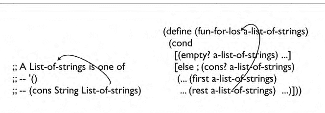

图 51：数据定义和模板中的自引用箭头

> *数字也似乎是任意大小的。对于非精确数字，这是一种幻觉。对于精确整数，情况确实如此。因此，处理整数是本章的一部分。*

要使自引用数据定义有效，必须满足两个条件。首先，它必须包含至少两个子句。其次，至少有一个子句不得回指所定义的数据类。最佳做法是明确用箭头标识自引用，即从数据定义中的引用指回被定义的术语；请参见图 51 中的此类标注示例。

必须通过创建数据示例来验证自引用数据定义的有效性。先从不引用数据定义的子句开始；接着处理另一个子句，在该子句引用定义本身时使用第一个示例。对于图 51 中的数据定义，你会得到类似下面三个列表：

```
'()
(cons "a" '())         by the first clause
(cons "b"                 by the second clause, previous example
   (cons "a"
   '()))
```

如果无法从数据定义生成示例，则该定义无效。如果可以生成示例但无法看到如何生成越来越大的示例，则该定义可能无法符合其预期解释。

- 2. 头部材料没有任何变化：签名、目的语句和虚拟定义。在制定目的语句时，应关注函数计算什么，而不是它如何进行，尤其是不要关注它如何遍历给定数据的实例。

下面是一个示例，用以具体说明这个设计配方：

```
; List-of-strings -> Number
; counts how many strings alos contains
(define (how-many alos)
 0)
```

目的语句明确指出该函数仅计算给定输入中的字符串数量；无需预先思考如何将此想法表述为 BSL 函数。

- 3. 在涉及功能示例时，请务必使用多次采用数据定义中自引用子句的输入进行操作。这是以后制定覆盖整个函数定义的测试的最佳方式。

对于我们的运行示例，目的语句几乎直接从数据示例本身生成功能示例：

| 给定 | 期望 |
|-------|--------|
| '() | 0 |
| (cons "a" '()) | 1 |
| (cons "b" (cons "a" '())) | 2 |

第一行涉及空列表，我们知道空列表不包含任何内容。第二行是一个包含一个字符串的列表，因此 1 是期望的答案。最后一行涉及一个包含两个字符串的列表。

- 4. 从本质上讲，自引用数据定义看起来像混合数据的数据定义。因此，模板的开发可以按照第 6 章中的配方进行。具体来说，我们构建一个 cond 表达式，其 cond 子句数量与数据定义中的子句数量相同，将每个识别条件与数据定义中的对应子句匹配，并在处理复合值的所有 cond 行中写下适当的选择器表达式。

图 52 将这一想法表述为一问一答游戏。左列提出了关于参数数据定义的问题，右列解释了答案对模板构建的含义。

| 问题 | 回答 |
| :--- | :--- |
| 数据定义是否区分不同的数据子类？ | 你的模板需要与数据定义区分的子类数量相同的 `cond` 子句。 |
| 各子类之间有何不同？ | 利用这些差异为每个子句制定一个条件。 |
| 是否有子句处理结构化值？ | 如果是，向子句中添加适当的选择器表达式。 |
| 数据定义是否使用自引用？ | 为模板制定“自然递归”，以表示数据定义的自引用。 |
| 如果数据定义引用其他数据定义，这种对另一个数据定义的交叉引用在哪里？ | 为其他数据定义专门化模板。引用该模板。请参见第 6.1 节，设计配方的步骤 4 和 5。 |

图 52：如何将数据定义转换为模板


如果你忽略最后一行，并将前三个问题应用于任何消耗 List-of-strings 的函数，你会得到这样的结构：

```scheme
(define (fun-for-los alos)
  (cond
    [(empty? alos) ...]
    [else
      (... (first alos) ... (rest alos) ...)]))
```

回想，不过，模板的目的是将数据定义表达为函数布局。也就是说，模板以代码形式表达输入的数据定义所用英文和 BSL 混合表达的内容。因此，数据定义的所有重要部分都必须在模板中找到对应部分，当数据定义是自引用的——即定义内部指向所定义术语的箭头——这一准则也应成立。具体来说，当数据定义在第 i 个子句和其中提到的结构的第 k 个字段中是自引用的时，模板应在第 i 个 cond 子句和第 k 个字段的选择器表达式中是自引用的。对于每个这样的选择器表达式，添加一个指回函数参数的箭头。最后，你的模板必须包含与数据定义中一样多的箭头。

图 51 通过将消耗 List-of-strings 的函数的模板与数据定义并排展示，说明了这一想法。两者都包含一个箭头，该箭头起源于第二个子句——分别是 rest 字段和选择器——并指回各自定义的顶部。

由于 BSL 和大多数编程语言都是面向文本的，你必须使用箭头的替代方案，即将函数自身应用于相应的选择器表达式：

```scheme
(define (fun-for-los alos)
  (cond
    [(empty? alos) ...]
    [else
      (... (first alos) ...
        ... (fun-for-los (rest alos)) ...)]))
```

我们将函数的自使用称为*递归*，在本书的前四部分中称为*自然递归*。

> 对好奇的读者来说，针对任意大数据的设计食谱在数学中对应于所谓的“归纳证明”，而“信仰飞跃”代表了在该证明的归纳步骤中使用归纳假设。逻辑通过归纳定理证明了这种证明技术的有效性。

- 5. 对于函数体，我们从那些不包含递归函数调用的 cond 行开始，这些行被称为*基准情况*。相应的答案通常很容易表述或已经作为示例给出。
- 然后我们处理自引用情况。我们首先提醒自己模板行中的每个表达式计算什么。对于自然递归，我们假设函数已按目的声明中指定的方式工作。最后一步是信仰飞跃，但你会发现，它总是有效。

**其余工作则是将各种值组合起来。**

图 53 为这一步制定了前四个问题及其答案。让我们用这个方法来完成 how-many 的定义。将 fun-for-los 模板重命名为 how-many，我们就得到了这个：

```scheme
; List-of-strings -> Number
; determines how many strings are on alos
(define (how-many alos)
 (cond
   [(empty? alos) ...]
   [else
    (... (first alos) ...
     ... (how-many (rest alos)) ...)]))
```

## 图 53：如何将模板转换为函数定义

| 问题 | 答案 |
| :--- | :--- |
| 非递归 `cond` 子句的答案是什么？ | 示例应该告诉你这里需要哪些值。如果不是，请制定适当的示例和测试。 |
| 递归子句中的选择器表达式计算什么？ | 数据定义告诉你这些表达式提取哪种数据，数据定义的解释告诉你这些数据代表什么。 |
| 自然递归计算什么？ | 使用函数的目的声明来确定递归值的含义，而不是它如何计算此答案。如果目的声明没有告诉你答案，请改进目的声明。 |
| 函数如何组合这些值以得到所需答案？ | 在 BSL 中查找组合这些值的函数。或者，如果这行不通，为辅助函数许下一个“愿望”。对于许多函数，最后一步很简单。目的、示例和模板共同告诉你哪个函数或表达式 `combines` 可用值以得到正确结果。我们将这个函数或表达式称为 `combinator`，略有滥用现有术语。 |

正如函数示例所暗示的，基准情况的答案是 0。第二个子句中的两个表达式分别计算第一个项目和 `(rest alos)` 中的字符串数量。要计算 `alos` 中的所有字符串有多少个，该函数只需将 1 加到后一个表达式的值上：

```scheme
(define (how-many alos)
  (cond
    [(empty? alos) 0]
    [else (+ (how-many (rest alos)) 1)]))
```

> *Felix Klock 建议采用这种基于表格的方法来猜测组合子。*

找到将值组合成所需答案的正确方法并不总是那么容易。新手程序员在这一步上经常会卡住。如图 54 所示，一个好主意是将函数示例整理成一个表格，该表格还列出了模板中表达式的值。图 55 显示了针对我们的 how-many 示例的表格长什么样。最左列列出示例输入，而最右列包含这些输入的所需答案。中间的三列显示模板表达式的值：(first alos)、(rest alos) 和 (how-many (rest alos))，即自然递归。如果你盯着这个表格看足够久，你会发现结果列始终比自然递归列中的值多 1。因此你可能会猜测：

```
(+ (how-many (rest alos)) 1)
```

是计算所需结果的表达式。由于 DrRacket 检查此类猜测的速度很快，将其插入并点击 RUN。如果示例转换为的测试通过，请仔细思考该表达式以说服自己它适用于所有列表；否则，向表格中添加更多示例行，直到你有了不同的想法。

| 问题 | 答案 |
| :--- | :--- |
| 因此，如果你在这里卡住了，…… | ……将第三步中的示例整理成表格。将给定的输入放在第一列，所需的输出放在最后一列。在中间列中输入选择器表达式和自然递归的值。添加示例，直到你发现一个暗示组合子的模式。 |
| 如果模板引用另一个模板，辅助函数计算什么？ | 查阅其他函数的目的声明和示例以确定它计算什么，并假设你可以使用结果，即使你还没有完成这个辅助函数的设计。 |

图 54：将模板转换为函数，表格方法

| alos | (first alos) | (rest alos) | (how-many (rest alos)) | (how-many alos) |
|---|---|---|---|---|
| (cons "a" '()) | "a" | '() | 0 | 1 |
| (cons "b" (cons "a" '())) | "b" | (cons "a" '()) | 1 | 2 |
| (cons "x" (cons "b" (cons "a" '()))) | "x" | (cons "b" (cons "a" '())) | 2 | 3 |

图 55：列出参数、中间值和结果

表格还指出，模板中的某些选择器表达式对实际定义可能是无关的。这里不需要 (first alos) 来计算最终答案——这与 contains-flatt? 形成了鲜明对比，后者使用了模板中的两个表达式。

在学习本书其余部分时，请记住，在许多情况下，组合步骤可以用 BSL 的原语表达，例如 +、and 或 cons。但是，在某些情况下，你可能需要许下一个“愿望”，即设计一个辅助函数。最后，在其他情况下，你可能需要嵌套条件。

- 6. 最后，确保将所有示例转换为测试，这些测试通过，并且运行它们覆盖函数的所有部分。

以下是 how-many 的示例，已转换为测试：

```scheme
(check-expect (how-many '()) 0)
(check-expect (how-many (cons "a" '())) 1)
(check-expect
 (how-many (cons "b" (cons "a" '()))) 2)
```

记住，最好直接将示例表述为测试，BSL 允许这样做。如果你需要采用上一步的基于表格的猜测方法，这样做也有帮助。

图 56 以表格形式总结了本节的设计食谱。第一列列出设计食谱的步骤，第二列列出每个步骤的预期结果。在第三列中，我们描述了活动


能帮你到达那里。该图表针对本章中使用的自引用列表定义进行了定制。一如既往，练习有助于你掌握这一过程，因此我们强烈建议你尝试以下练习，这些练习要求你将该配方应用于多种示例。

| steps | outcome | activity |
| :--- | :--- | :--- |
| 问题分析 | 数据定义 | 为信息开发数据表示；为特定信息项创建示例并将数据解释为信息；识别自引用。 |
| 头部 | 签名；目的；占位定义 | 使用已定义的名称编写签名；制定简洁的目的陈述；创建一个从指定范围生成常量值的占位函数。 |
| 示例 | 示例和测试 | 处理多个示例，数据定义中的每个子句至少一个。 |
| 模板 | 函数模板 | 将数据定义转换为模板：每个数据子句对应一个 `cond` 子句；在条件标识结构的地方使用选择器；每个自引用对应一个自然递归。 |
| 定义 | 完整定义 | 找到一个函数，将 `cond` 子句中表达式的值组合成预期答案。 |
| 测试 | 验证的测试 | 将它们转换为 `check-expect` 测试并运行。 |

**图 56：** 为自引用数据设计函数

你可能希望将图 56 复制到索引卡的一面，并在卡片背面写下你最喜欢的这种设计配方的问题与答案版本。然后随身携带以备将来参考。

### 9.1 列表手指练习

- **练习 137。** 比较 `contains-flatt?` 的模板与 `how-many` 的模板。忽略函数名，它们是相同的。解释相似之处。

- **练习 138。** 以下是表示金额序列的数据定义：

```racket
; A List-of-amounts is one of:
; -- '()
; -- (cons PositiveNumber List-of-amounts)
```

创建一些示例以确保你理解数据定义。还要为自引用添加一个箭头。

设计 `sum` 函数，它消耗一个 List-of-amounts 并计算金额之和。使用 DrRacket 的 stepper 查看 `(sum 1)` 如何对 List-of-amounts 中的短列表 `1` 工作。

- **练习 139。** 现在看一下这个数据定义：

```racket
; A List-of-numbers is one of:
; -- '()
; -- (cons Number List-of-numbers)
```

此类数据的一些元素是练习 138 中 `sum` 的适当输入，而另一些则不是。

设计函数 `pos?`，它消耗一个 List-of-numbers 并确定所有数字是否都是正数。换句话说，如果 `(pos? 1)` 产生 `#true`，则 `1` 是 List-of-amounts 的一个元素。使用 DrRacket 的 stepper 了解 `pos?` 如何对 `(cons 5 '())` 和 `(cons -1 '())` 工作。

还要设计 `checked-sum`。该函数消耗一个 List-of-numbers。如果输入也属于 List-of-amounts，则它生成它们的和；否则会发出错误信号。**提示** 请记得使用 check-error。

`sum` 对 List-of-numbers 的一个元素计算什么？

- **练习 140。** 设计函数 `all-true`，它消耗一个布尔值列表并确定它们是否都是 `#true`。换句话说，如果列表中有任何 `#false`，则该函数生成 `#false`。

现在设计 `one-true`，一个消耗布尔值列表并确定列表中是否至少有一个项目是 #true 的函数。

采用基于表格的编码方法。这可能有助于处理基础情况。使用 DrRacket 的 stepper 查看这些函数如何处理列表 `(cons #true '())`、`(cons #false '())` 和 `(cons #true (cons #false '()))`。

- **练习 141。** 如果要求你设计函数 `cat`，它消耗一个字符串列表并将它们全部追加成一个长字符串，那么你最终必然会得到这个部分定义：

```racket
; List-of-string -> String
; concatenates all strings in l into one long string

(check-expect (cat '()) "")
(check-expect (cat (cons "a" (cons "b" '()))) "ab")
(check-expect
 (cat (cons "ab" (cons "cd" (cons "ef" '()))))
 "abcdef")

(define (cat l)
 (cond
  [(empty? l) ""]
  [else (... (first l) ... (cat (rest l)) ...)]))
```

填写图 57 中的表格。猜测一个函数，它可以从子表达式计算出的值创建所需的结果。

| l | (first l) | (rest l) | (cat (rest l)) | (cat l) |
|---|---|---|---|---|
| (cons "a" (cons "b" '())) | ??? | ??? | ??? | "ab" |
| (cons "ab" (cons "cd" (cons "ef" '()))) | ??? | ??? | ??? | "abcdef" |

**图 57：** cat 的表格

使用 DrRacket 的 stepper 求值 `(cat (cons "a" '()))`。

- **练习 142。** 设计 `ill-sized?` 函数，它消耗一个图像列表 `loi` 和一个正数 `n`。它生成 `loi` 上第一个不是 `n` 乘 `n` 正方形的图像；如果找不到这样的图像，则它生成 `#false`。

**提示** 使用

```racket
; ImageOrFalse is one of:
; -- Image
; -- #false
```

### 9.2 非空列表

现在你已经足够了解如何使用 cons 并为列表创建数据定义。如果你解决了上一节末尾的（一些）练习，你就可以处理各种数字列表、布尔值列表、图像列表等等。在本节中，我们继续探讨列表是什么以及如何处理它们。

让我们从计算温度列表平均值这个看似简单的问题开始。为了简化，我们提供以下数据定义：

```racket
; A List-of-temperatures is one of:
; -- '()
; -- (cons CTemperature List-of-temperatures)
; A CTemperature is a Number greater than -272.
```

就我们的目的而言，你应该将温度视为普通数字，但第二个数据定义提醒你，在现实中并非所有数字都是温度，你应该牢记这一点。

头部材料很简单：

```racket
; List-of-temperatures -> Number
; computes the average temperature
(define (average alot) 0)
```

为这个问题编造示例也很容易，因此我们只制定一个测试：

```racket
(check-expect
 (average (cons 1 (cons 2 (cons 3 '())))) 2)
```

预期结果当然是温度之和除以温度的数量。

稍加思考就会告诉你，average 的模板应该与我们迄今看到的模板相似：

```scheme
(define (average alot)
 (cond
   [(empty? alot) ...]
   [(cons? alot)
    (... (first alot) ...
         ... (average (rest alot)) ...)]))
```

两个 cond 子句反映了数据定义的两个子句；问题区分空列表和非空列表；自然递归是因为数据定义中的自引用而需要的。

但是，将这个模板转换为函数定义非常困难。第一个 cond 子句需要一个表示空温度集合平均值的数字，但不存在这样的数字。同样，第二个子句要求一个函数，将一个温度和剩余温度的平均值组合成一个新的平均值。虽然可行，但以这种方式计算平均值非常不自然。

当我们计算温度的平均值时，我们用温度之和除以温度的数量。我们在制定那个微不足道的小示例时就是这样说的。这句话表明 average 是三个任务的函数：求和、计数和除法。第一部分的指南告诉我们为每个任务编写一个函数，如果我们这样做，average 的设计就显而易见：

```scheme
; List-of-temperatures -> Number
; computes the average temperature
(define (average alot)
 (/ (sum alot) (how-many alot)))
```

```scheme
; List-of-temperatures -> Number
; adds up the temperatures on the given list
(define (sum alot) 0)
```

```scheme
; List-of-temperatures -> Number
; counts the temperatures on the given list
(define (how-many alot) 0)
```

当然，最后两个函数定义是期望，我们需要为它们


设计完整的定义。这样做很容易，因为 how-many 适用于 List-of-strings 和 List-of-temperatures（为什么？），并且 sum 的设计遵循相同的老套路：

```
; List-of-temperatures -> Number
; adds up the temperatures on the given list
(define (sum alot)
  (cond
    [(empty? alot) 0]
    [else (+ (first alot) (sum (rest alote)))]))
```

停止！使用 average 的示例为 sum 创建一个，并确保测试能正常运行。然后运行 average 的测试。

现在读 average 的定义，它显然是正确的，因为它直接对应于每个人在学校学到的求平均数知识。不过，程序不仅是为我们自己运行，也是为他人运行。特别是，其他人应该能够读取签名并使用该函数，并期望得到有信息量的回答。但是，我们对 average 的定义不适用于空的温度列表。

### 练习 143。

确定 average 在 DrRacket 中应用于空列表时的行为。然后设计 checked-average，这是一个函数，当它被应用于 '() 时会生成一条信息丰富的错误消息。

> 在数学中，我们可以说练习 143 表明 average 是一个偏函数，因为它对 '() 抛出一个错误。

另一种解决方案是通过签名告知未来的读者 average 不适用于空列表。为此，我们需要一种排除 '() 的列表数据表示，例如：

```
; An NEList-of-temperatures is one of:
; -- ???
; -- (cons CTemperature NEList-of-temperatures)
```

问题是用什么来替换“???”，以便排除 '() 列表，但所有其他温度列表仍然可构造。一个提示是，虽然空列表是最短的列表，但任何只包含一个温度的列表都是次短列表。因此，这表明第一个子句应该描述所有可能的只包含一个温度的列表：

```
; An NEList-of-temperatures is one of:
; -- (cons CTemperature '())
; -- (cons CTemperature NEList-of-temperatures)
; interpretation non-empty lists of Celsius temperatures
```

虽然此定义与前面的列表定义不同，但它共享关键要素：一个自引用和一个**不**使用自引用的子句。严格遵循设计配方要求你编造一些 NEList-of-temperatures 的示例，以确保定义合理。与往常一样，你应该从基础子句开始，这意味着示例必须如下所示：

```
(cons c '())
```

其中 c 代表一个 CTemperature，例如：(cons -273 '())。同样很明显，List-of-temperatures 中的所有非空元素也是新数据类的元素：(cons 1 (cons 2 (cons 3 '()))) 符合要求，如果 (cons 2 (cons 3 '())) 符合要求的话，而 (cons 2 (cons 3 '())) 属于 NEList-of-temperatures，因为 (cons 3 '()) 是 NEList-of-temperatures 的元素，如前所述。请自行检查，NEList-of-temperatures 的大小没有限制。

现在让我们回到设计 average 的问题，让每个人都知道它仅适用于非空列表。有了 NEList-of-temperatures 的定义，我们现在有能力在签名中表达我们想要的内容：

```
; NEList-of-temperatures -> Number
; computes the average temperature
(check-expect (average (cons 1 (cons 2 (cons 3 '()))))
    2)
(define (average ne-l)
  (/ (sum ne-l)
     (how-many ne-l)))
```

> 这种替代方案说明，在这种情况下，我们可以缩小 average 的定义域并创建一个全函数。

当然，其余部分保持不变：目的说明、示例测试和函数定义。毕竟，计算平均值的概念本身就假设了一组非空的数字，这正是我们讨论的全部要点。

### 练习 144。

sum 和 how-many 即使是为 List-of-temperatures 的输入设计的，是否也能对 NEList-of-temperatures 工作？如果你认为它们不起作用，请提供反例。如果你认为它们可以工作，请解释原因。

不过，该定义也引发了如何设计 sum 和 how-many 的问题，因为它们现在使用 NEList-of-temperatures 的实例。以下是设计配方前三步的明显结果：

```
; NEList-of-temperatures -> Number
; computes the sum of the given temperatures
(check-expect
  (sum (cons 1 (cons 2 (cons 3 '())))) 6)
(define (sum ne-l) 0)
```

该示例改编自 average 的示例；虚拟定义产生一个数字，但对于给定的测试来说是错误的。

第四步是为 NEList-of-temperatures 设计 sum 最有趣的部分。所有先前的设计示例都要求一个模板来区分空列表和非空列表，也就是 cons 构造的列表，因为数据定义具有适当的形状。对于 NEList-of-temperatures，情况并非如此。这里两个子句都添加 cons 构造的列表。然而，这两个子句在列表的 rest 字段上有所不同。特别是，第一个子句在 rest 字段中始终使用 '()，而第二个子句则使用 cons。因此，区分第一种数据和第二种数据的适当条件是提取 rest 字段，然后使用 empty?：

```
; NEList-of-temperatures -> Number
(define (sum ne-l)
 (cond
  [(empty? (rest ne-l)) ...]
  [else ...]))
```

这里 else 替换了 (cons? (rest ne-l))。

接下来，你应该检查两个子句，确定其中一个或两个子句是否将 ne-l 当作结构体来处理。这当然是事实，无条件地在 ne-l 上使用 rest 就证明了这一点。换句话说，为两个子句添加适当的选择器表达式：

```
(define (sum ne-l)
 (cond
  [(empty? (rest ne-l)) (... (first ne-l) ...]
  [else (... (first ne-l) ... (rest ne-l) ...)]))
```

在继续阅读之前，请解释为什么第一个子句不包含选择器表达式 (rest ne-l)。

模板设计的最后一个问题涉及数据定义中的自引用。如你所知，NEList-of-temperatures 包含一个自引用，因此 sum 的模板要求一个递归调用：

```
(define (sum ne-l)
 (cond
  [(empty? (rest ne-l)) (... (first ne-l) ...]
  [else
   (... (first ne-l) ... (sum (rest ne-l)) ...)]))
```

具体来说，sum 在第二个子句中对 (rest ne-l) 进行调用，因为数据定义在类似的点上是自引用的。

对于第五个设计步骤，让我们看看我们已经拥有多少。由于第一个 cond 子句看起来比带有递归函数调用的第二个子句简单得多，你应该先处理那个子句。在这种情况下，条件表示 sum 应用于恰好包含一个温度的列表，即 (first ne-l)。显然，这个温度就是给定列表上所有温度的总和：

```
(define (sum ne-l)
  (cond
   [(empty? (rest ne-l)) (first ne-l)]
   [else
    (... (first ne-l) ... (sum (rest ne-l)) ...)]))
```

第二个子句表示列表包含一个温度和至少一个更多的温度；(first ne-l) 提取第一个位置，(rest ne-l) 提取剩余的温度。此外，模板建议使用 (sum (rest ne-l)) 的结果。但是 sum 是你正在定义的函数，你不可能知道它如何使用 (rest ne-l)。你所知道的只是目的说明所说的内容，即 sum 将给定列表（也就是 (rest ne-l)）上的所有温度相加。如果该说明为真，那么 (sum (rest ne-l)) 就会将 ne-l 中除一个之外的所有数字相加。要得到总和，函数只需将第一个温度加进去：

```
(define (sum ne-l)
  (cond
   [(empty? (rest ne-l)) (first ne-l)]
   [else (+ (first ne-l) (sum (rest ne-l)))]))
```

如果你现在为这个函数运行测试，你会看到这种信仰之跃是合理的。确实，出于超出本书范围的原因，这种跃迁**总是**合理的，这就是为什么它是设计配方固有的一部分。

### 练习 145。

设计 `sorted>?` 谓词，它接收一个 NEList-of-temperatures，如果温度按降序排列，则产生 #true。也就是说，如果第二个比第一个小，第三个比第二个小，依此类推。否则它产生 #false。

### 提示

这个问题也是另一个可使用基于表格的方法来猜测的问题


该组合子工作正常。图 58 中给出了一些示例的部分表格。请填写表格的其余部分。然后尝试创建一个从各部分计算结果的表达式。

| l | (first l) | (rest l) | (sorted>? (rest l)) | (sorted>? l) |
|---|---|---|---|---|
| (cons 1 (cons 2 '())) | 1 | ??? | #true | #false |
| (cons 3 (cons 2 '())) | 3 | (cons 2 '()) | ??? | #true |
| (cons 0 (cons 3 (cons 2 '()))) | 0 | (cons 3 (cons 2 '())) | ??? | ??? |

图 58：sorted>? 的表格

- **练习 146.** 为 NEList-of-temperatures 设计 how-many。这样做可以完成 average，因此也要确保 average 通过其所有测试。

- **练习 147.** 为 NEList-of-Booleans 开发数据定义，它是布尔值非空列表的表示。然后重新设计练习 140 中的函数 all-true 和 one-true。

- **练习 148.** 将本节中的函数定义（sum、how-many、all-true、one-true）与前几节中相应的函数定义进行比较。使用能够容纳空列表的数据定义比使用非空列表的数据定义更好吗？为什么？为什么不是？

### 9.3 自然数

BSL 编程语言提供了许多消耗列表的函数，也提供了少数生成列表的函数。其中之一是 make-list，它消耗一个数字 n 和另一个值 v，并生成一个包含 v 的 n 份副本的列表。以下是一些示例：

```
> (make-list 2 "hello")
(cons "hello" (cons "hello" '()))
> (make-list 3 #true)
(cons #true (cons #true (cons #true '())))
> (make-list 0 17)
'()
```

简而言之，尽管此函数消耗原子数据，但它生成任意大的数据片段。你的问题是：这是如何可能的？

我们的回答是，make-list 的输入不仅仅是一个数字，而是一种特殊的数字。在幼儿园，你把这些数字称为“计数数字”，也就是说，这些数字用于计数对象。在计算机科学中，这些数字被称为自然数。与常规数字不同，自然数带有数据定义：

```
; An N is one of:
; -- 0
; -- (add1 N)
; interpretation represents the counting numbers
```

第一个子句说明 0 是自然数；它用于表示没有对象可计数。第二个子句告诉你，如果 n 是自然数，那么 n + 1 也是自然数，因为 add1 是一个给定数字加 1 的函数。我们可以将第二个子句写成 (+ n 1)，但使用 add1 应该表明这种加法是特殊的。

这种使用 add1 的特殊之处在于，它的行为更像是某个结构类型定义的构造器，而不是常规函数。因此，BSL 还提供了函数 sub1，它是与 add1 对应的“选择器”。给定任何不等于 0 的自然数 m，你可以使用 sub1 找出构造 m 时所用的数字。换句话说，add1 类似于 cons，而 sub1 类似于 first 和 rest。

此时，你可能会想知道哪些谓词用于区分 0 与不为 0 的自然数。有两个，与列表一样：zero?，用于判断给定数字是否为 0；positive?，用于判断某个数字是否大于 0。

现在，你可以自己设计处理自然数的函数，例如 make-list。数据定义已经可用，所以让我们添加标题材料：

```
; N String -> List-of-strings
; creates a list of n copies of s

(check-expect (copier 0 "hello") '())

(check-expect (copier 2 "hello")
 (cons "hello" (cons "hello" '())))

(define (copier n s)
 '())
```

开发模板是下一步。模板的问题表明，copier 的主体是一个带有两个子句的 cond 表达式：一个用于 0，一个用于正数。此外，0 被视为原子，而正数被视为结构化值，这意味着第二个子句中需要一个选择器表达式。最后，N 的数据定义在第二个子句中是自引用的。因此，模板需要在第二个子句中对相应的选择器表达式进行递归应用：

```
(define (copier n s)
 (cond
  [(zero? n) ...]
  [(positive? n) (... (copier (sub1 n) s ...))]))
```

图 59 包含从其模板得出的 copier 函数的完整定义。让我们仔细重建这一步。和往常一样，我们从没有递归调用的 cond 子句开始。这里的条件告诉我们，输入（重要）是 0，这意味着函数必须生成一个包含 0 个项的列表，即，**没有**。当然，研究第二个示例已经澄清了这种情况。接下来我们转到另一个 cond 子句，提醒自己其表达式计算什么：

- (sub1 n) 提取构造 n 时所用的自然数，我们知道该数大于 0；
- (copier (sub1 n) s) 根据 copier 的用途说明，生成包含 (sub1 n) 个字符串 s 的列表。

```
; N String -> List-of-strings
; creates a list of n copies of s

(check-expect (copier 0 "hello") '())
(check-expect (copier 2 "hello")
   (cons "hello" (cons "hello" '())))

(define (copier n s)
  (cond
    [(zero? n) '()]
    [(positive? n) (cons s (copier (sub1 n) s))]))
```

# 图 59：创建副本列表

但是，函数得到了 n，因此必须生成一个包含 n 个字符串 s 的列表。给定一个少一个字符串的列表，很容易看出，函数只需将一个 s cons 到 (copier (sub1 n) s) 的结果上即可。这正是第二个子句所规定的。

此时，你应该运行测试以确保该函数至少对这两个示例有效。此外，你可能希望在其他一些输入上使用该函数。

- **练习 149.** 当你将 copier 应用于自然数和布尔值或图像时，它是否正常工作？或者你需要设计另一个函数？阅读第 III 部分以了解答案。

```
(define (copier.v2 n s)
 (cond
  [(zero? n) '()]
  [else (cons s (copier.v2 (sub1 n) s))]))
```

当你将 copier 和 copier.v2 应用于 0.1 和 "x" 时，它们的行为如何？请解释。使用 DrRacket 的 stepper 来验证你的解释。

- **练习 150.** 设计函数 add-to-pi。它消耗一个自然数 n 并将其加到 pi 上，**不**使用原始 + 操作。以下是一个开头：

```
; N -> Number
; computes (+ n pi) without using +
```

```
(check-within (add-to-pi 3) (+ 3 pi) 0.001)
```

```
(define (add-to-pi n)
  pi)
```

拥有完整定义后，将该函数推广为 add，它在不使用 + 的情况下将自然数 n 加到任意数字 x 上。为什么框架使用 check-within？

- **练习 151.** 设计函数 multiply。它消耗一个自然数 n，并在不使用 * 的情况下将其与数字 x 相乘。

使用 DrRacket 的 stepper 计算 (multiply 3 x)（x 可以是你喜欢的任何值）。multiply 与你在小学学到的内容有何关系？

- **练习 152.** 设计两个函数：col 和 row。

函数 col 消耗一个自然数 n 和一个图像 img。它生成一个列——即 img 的 n 份副本的垂直排列。

函数 row 消耗一个自然数 n 和一个图像 img。它生成一个行——即 img 的 n 份副本的水平排列。

- **练习 153.** 此练习的目标是可视化 1968 年风格的欧洲学生骚乱的结果。大致想法如下。一小群学生聚集在一起制作装满颜料的气球，进入某个讲堂，并随机朝听众投掷气球。你的程序显示气球如何为讲堂的座位上色。

使用练习 152 中的两个函数，创建一个 8 乘 18 的矩形，每个正方形的大小为 10 乘 10。将其放置在相同大小的 empty-scene 中。此图像即为你的讲堂。

设计 add-balloons。该函数消耗一个 Posn 列表，其坐标适合讲堂的尺寸。它生成一个讲堂图像，并根据 Posn 添加红点。

图 60 显示了在给定某些 Posn 列表时，我们解决方案的输出。最左边是干净的讲堂，第二张是在两个气球击中后的状态，最后一张是 10 次击中极不可能的分布。第 10 个在哪里？

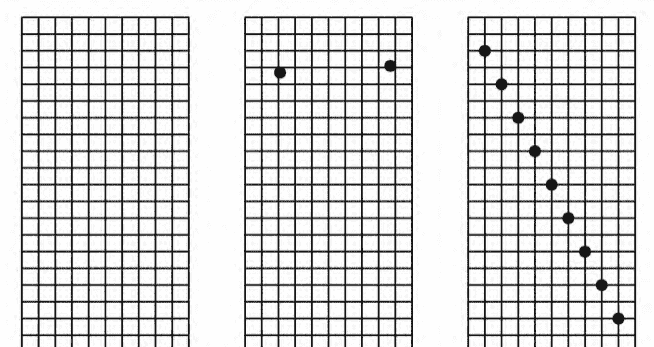

图 60：随机攻击


### 9.4 俄罗斯套娃

维基百科将俄罗斯套娃定义为“一套大小递减的娃娃，一个套在另一个里面”，并用这张图片进行说明：


在这张图中，套娃被拆开了，这样观看者就能全部看到它们。

> _这个问题可能让你觉得抽象甚至荒谬；不清楚你为何想要表示俄罗斯套娃，或者会用这种表示做什么。暂时配合一下就好。_

现在考虑用BSL数据来表示这种俄罗斯套娃的问题。稍加想象，不难看出艺术家可以创建包含任意数量套娃的巢。毕竟，你总可以在某个给定的俄罗斯套娃外面再包一层。同时，你也知道，最内部是一个没有任何东西的实心娃娃。

对于俄罗斯套娃的每一层，我们可能关心很多不同的方面：它的大小（虽然与嵌套层级相关）；它的颜色；表面绘制的图像；等等。这里我们只选一个，即娃娃的颜色，用字符串表示。因此，我们知道俄罗斯套娃的每一层都有两个属性：颜色和里面的娃娃。要表示具有两个属性的信息，我们总是定义一个结构体类型：

```
(define-struct layer [color doll])
```

接着添加一个数据定义：

; 一个RD（俄罗斯套娃的缩写）是以下之一：

```
; -- String
; -- (make-layer String RD)
```

自然而然地，这个数据定义的第一个子句表示最内层的娃娃，或者更准确地说，是它的颜色。第二个子句用于在某个给定的俄罗斯套娃外面加一层。我们用layer的一个实例来表示，它显然包含娃娃的颜色和另一个字段：紧套在这个娃娃里面的娃娃。

看看这个娃娃：

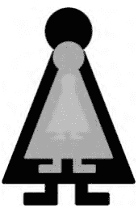

它由三个娃娃组成。红色的是最内层的，绿色的在中间，黄色的是目前最外层的包装。要用RD的一个元素来表示这个娃娃，你可以从任意一端开始。我们从内到外进行。红色的娃娃很容易表示为RD。因为里面什么都没有，而且它是红色的，字符串"red"就很好。对于第二层，我们使用：

```
(make-layer "green" "red")
```

这表示一个绿色的（空心）娃娃里面装着一个红色的娃娃。最后，要得到最外层，我们只需在这个最后的娃娃外面再包一层：

```
(make-layer "yellow" (make-layer "green" "red"))
```

这个过程应该能让你很好地了解如何从任何一组彩色的俄罗斯套娃转换为数据表示。但请记住，程序员还必须能够做相反的事情，即从一段数据转换为具体信息。在这个精神下，为以下RD元素绘制一个示意图俄罗斯套娃：

```
(make-layer "pink" (make-layer "black" "white"))
```

你甚至可以在BSL中尝试一下。

既然我们有了数据定义，并理解了如何表示实际娃娃以及如何将RD元素解释为娃娃，我们就可以开始设计消费RD的函数了。具体来说，让我们设计一个函数，用于计算一个俄罗斯套娃集合包含多少个娃娃。这句话是一个很好的目的陈述，也确定了签名：

```
; RD -> Number
; how many dolls are part of an-rd
```

至于数据示例，让我们从(make-layer "yellow" (make-layer "green" "red"))开始。上图告诉我们预期答案是3，因为有三个娃娃：红色的、绿色的和黄色的。只处理这一个示例也告诉我们，当输入是这个娃娃的表示时


那么答案就是1。

第四步要求开发一个模板。使用这一步骤的标准问题会产生这个模板：

```
; RD -> Number
; how many dolls are a part of an-rd
(define (depth an-rd)
  (cond
    [(string? an-rd) ...]
    [(layer? an-rd)
     (... (layer-color an-rd) ...
     ... (depth (layer-doll an-rd)) ...)]))
```

cond子句的数量由RD定义中的子句数量决定。每个子句具体说明了它涉及哪种数据，这告诉我们使用string?和layer?谓词。虽然字符串不是复合数据，但layer的实例包含两个值。如果函数需要这些值，它使用选择器表达式(layer-color an-rd)和(layer-doll an-rd)。最后，数据定义的第二个子句包含从layer结构的doll字段到其自身的自引用。因此，对于第二个选择器表达式，我们需要一个递归函数调用。

示例和模板几乎决定了函数定义。对于非递归的cond子句，答案显然是1。对于递归子句，模板表达式计算以下结果：

- (layer-color an-rd)提取描述当前层颜色的字符串；
- (layer-doll an-rd)提取当前层中包含的娃娃；以及
- (depth (layer-doll an-rd))根据depth的目的陈述，确定(layer-doll an-rd)包含多少个娃娃。

这个最后的数字几乎就是所期望的答案，但不完全是，因为an-rd和(layer-doll an-rd)之间的区别是一层，即多了一个娃娃。换句话说，函数必须将递归结果加1才能得到实际答案：

```
; RD -> Number
; how many dolls are a part of an-rd
(define (depth an-rd)
  (cond
    [(string? an-rd) 1]
    [else (+ (depth (layer-doll an-rd)) 1)]))
```

请注意，函数定义在第二个子句中没有使用(layer-color an-rd)。再次，我们看到模板是组织我们所知道的关于数据定义的一切的架构，但我们可能不需要所有这些部分来编写实际定义。

让我们最后将示例转换为测试：

```
(check-expect (depth "red") 1)
(check-expect
 (depth
  (make-layer "yellow" (make-layer "green" "red")))
 3)
```

如果你在DrRacket中运行这些，你会看到它们的求值触及了depth定义的所有部分。

**练习154。** 设计函数colors。它消费一个俄罗斯套娃，并生成一个由所有颜色组成的字符串，颜色之间用逗号和空格分隔。因此，我们的示例应该产生

```
"yellow, green, red"
```

**练习155。** 设计函数inner，它消费一个RD，并生成（最内层娃娃的）颜色。使用DrRacket的步进器为你最喜欢的rd求值(inner rd)。

### 9.5 列表与世界

有了列表和一般的自引用数据定义，你可以设计和运行比有限数据多得多的有趣世界程序。想象一下，你现在可以创建第6章中空间入侵者程序的一个版本，允许玩家从坦克发射任意多的子弹。让我们先从这个问题的一个简单版本开始：

> **示例问题** 设计一个世界程序来模拟发射子弹。每次“玩家”按下空格键时，程序就会在画布底部添加一颗子弹。这些子弹以每个时钟周期一个像素的速度垂直上升。

> 如果你很久没有设计过世界程序，请重读第3.6节。

设计世界程序始于将信息分为常量和不断变化的世界状态的元素。对于前者，我们引入物理和图形常量；对于后者，我们需要为世界状态开发数据表示。尽管示例问题对细节描述比较模糊，但它明显假设了一个矩形场景，子弹沿着一条垂直线绘制。显然，子弹的位置随每个时钟周期变化，但场景的大小和子弹线的x坐标保持不变：

```
(define HEIGHT 80) ; distances in terms of pixels
(define WIDTH 100)
(define XSHOTS (/ WIDTH 2))

; graphical constants
(define BACKGROUND (empty-scene WIDTH HEIGHT))
(define SHOT (triangle 3 "solid" "red"))
```

问题描述中没有什么要求这些特定选择，但只要它们容易更改——即通过编辑单个定义来更改——我们就实现了目标。

至于“世界”中变化的那些方面，问题描述


提到了两点。首先，按空格键会添加一发子弹。其次，所有子弹每时钟周期直线向上移动一个像素。鉴于我们无法预测玩家会“发射”多少发子弹，我们使用列表来表示它们：

```
; A List-of-shots is one of:
; -- '()
; -- (cons Shot List-of-shots)
; interpretation the collection of shots fired
```

剩下唯一的问题是如何表示每个单独的子弹。我们已经知道它们都有相同的 x 坐标，并且该坐标始终不变。此外，所有子弹看起来都一样。因此，它们的 y 坐标是它们彼此区别的唯一属性。所以，将每个子弹表示为一个数字就足够了：

```
; A Shot is a Number.
; interpretation represents the shot's y-coordinate
```

我们可以将子弹的表示限制在 HEIGHT 以下的数字区间内，因为我们知道所有子弹都从画布底部发射，然后向上移动，意味着它们的 y 坐标连续减少。

你也可以使用这样的数据定义来表示这个世界：

```
; A ShotWorld is List-of-numbers.
; interpretation each number on such a list
;  represents the y-coordinate of a shot
```

毕竟，上述两个定义描述了所有数字列表；我们已经有数字列表的定义，而 ShotWorld 告诉所有人这类数据的含义。

一旦你定义了常数并为世界状态开发了数据表示，关键任务就是选择要使用的事件处理程序，并将其签名调整为给定问题。运行示例提到了时钟周期和空格键，所有这些都转化为三个函数的愿望列表：

- 将世界状态转换为图像的函数：

```
; ShotWorld -> Image
; adds the image of a shot for each y on w
; at {MID,y} to the background image
(define (to-image w) BACKGROUND)
```

因为问题需要视觉渲染；

- 用于处理时钟事件的函数：

```
; ShotWorld -> ShotWorld
; moves each shot on w up by one pixel
(define (tock w) w)
```

- 以及用于处理键盘事件的函数：

```
; ShotWorld KeyEvent -> ShotWorld
; adds a shot to the world
; if the player presses the space bar
(define (keyh w ke) w)
```

别忘了，除了最初的愿望列表外，你还需要定义一个 main 函数，它实际设置世界并安装处理程序。图 61 包含这个函数，它不是设计出来的，而是作为标准模式的修改来定义的。

```
; ShotWorld -> ShotWorld
(define (main w0)
  (big-bang w0
    [on-tick tock]
    [on-key keyh]
    [to-draw to-image])))

; ShotWorld -> ShotWorld
; moves each shot up by one pixel
(define (tock w)
  (cond
    [(empty? w) '()]
    [else (cons (sub1 (first w)) (tock (rest w)))]))

; ShotWorld KeyEvent -> ShotWorld
; adds a shot to the world if the space bar is hit
(define (keyh w ke)
  (if (key=? ke " ") (cons HEIGHT w) w))

; ShotWorld -> Image
; adds each shot y on w at (XSHOTS,y) to BACKGROUND
(define (to-image w)
  (cond
    [(empty? w) BACKGROUND]
    [else (place-image SHOT XSHOTS (first w)
                       (to-image (rest w)))]))
```

图 61：基于列表的世界程序

让我们从 to-image 的设计开始。我们有它的签名、目的陈述和头部，所以接下来需要示例。由于数据定义有两个子句，应该至少有两个示例：’() 和一个 cons 列表，例如 (cons 9 '())。对 ’() 的预期结果显然是 BACKGROUND；但如果有 y 坐标，该函数必须将子弹图像放置在 MID 和指定坐标处：

```
(check-expect (to-image (cons 9 '()))
 (place-image SHOT XSHOTS 9 BACKGROUND))
```

在继续阅读之前，先手动演示一个将 to-image 应用于两个 Shots 列表的示例。这样有助于理解函数的工作原理。

第四步是将数据定义转换为模板：

```
; ShotWorld -> Image
(define (to-image w)
 (cond
  [(empty? w) ...]
  [else
   (... (first w) ... (to-image (rest w)) ...)]))
```

列表数据定义的模板现在非常熟悉，不需要太多解释。如果有任何疑问，请回顾图 52 中的问题并亲自设计模板。

从这里开始，定义函数就很简单了。关键是将示例与模板结合，并回答图 53 中的问题。遵循这些步骤，你从子弹空列表的基本情况开始，从示例中，你知道预期答案是 BACKGROUND。接下来，你制定第二个 cond 子句中的模板表达式计算什么：

- (first w) 从列表中提取第一个坐标；
- (rest w) 是其余坐标；以及
- (to-image (rest w)) 将 (rest w) 上的每个子弹添加到背景图像中，根据 to-image 的目的陈述。

换句话说，(to-image (rest w)) 将列表的其余部分渲染为图像，因此完成了几乎所有工作。缺少的是第一个子弹，(first w)。如果你现在将目的陈述应用于这两个表达式，你会得到第二个 cond 子句所需的表达式：

```
(place-image SHOT XSHOTS (first w)
           (to-image (rest w)))
```

添加的图标是子弹的标准图像；两个坐标在目的陈述中明确说明；place-image 的最后一个参数是从列表其余部分构建的图像。

图 61 显示了 to-image 的完整函数定义，当然还有程序的其余部分。tock 的设计与 to-image 的设计类似，你应该亲自推演一下。不过，keyh 处理程序的签名提出了一个有趣的问题。它规定该处理程序消耗两个具有非平凡数据定义的输入。一方面，ShotWorld 是一个自引用数据定义。另一方面，KeyEvents 的定义是一个大枚举。目前，我们让你“猜测”哪个参数应该驱动模板的开发；稍后我们将深入研究此类情况。

就世界程序而言，诸如 `keyh` 这样的键盘处理程序是关于它消耗的键盘事件的。因此，我们将其视为主要参数，并使用其数据定义来推导模板。具体来说，遵循第 4.3 章中 KeyEvent 的数据定义，它规定该函数需要一个包含大量子句的 cond 表达式，如下所示：

```
(define (keyh w ke)
  (cond
    [(key=? ke "left") ...]
    [(key=? ke "right") ...]
    ...
    [(key=? ke " ") ...]
    ...
    [(key=? ke "a") ...]
    ...
    [(key=? ke "z") ...]))
```

当然，就像消耗所有可能 BSL 值的函数一样，键盘处理程序通常不需要检查所有可能的情况。对于我们的运行问题，你特别知道键盘处理程序只对空格键做出反应，其他所有键都被忽略。因此，将除了 " " 的子句之外的所有 `cond` 子句折叠到一个 `else` 子句中是很自然的。

**练习 156.** 为 **图 61** 中的程序添加测试，并确保其通过测试。解释 `main` 的作用。然后通过 `main` 运行程序。

**练习 157.** 进行实验，确定关于常数的任意决定是否容易更改。例如，确定更改单个常数定义是否能达到预期效果：

- 将画布高度更改为 220 像素；
- 将画布宽度更改为 30 像素；
- 将子弹行的 x 位置更改为“中间左侧的某处”；
- 将背景更改为绿色矩形；以及
- 将子弹的渲染更改为红色细长矩形。

还要检查是否可以在不更改任何其他内容的情况下将子弹大小加倍，或将其颜色更改为黑色。

**练习 158.** 如果你运行 main，按空格键（发射一颗子弹），然后等待相当长的时间，子弹就会从画布上消失。然而，当你关闭世界画布时，结果是一个仍然包含这个不可见子弹的世界。

设计一个替代的 tock 函数，它不仅将子弹每时钟周期移动一个像素，还要消除那些坐标位于画布上方的子弹。提示：你可能希望考虑为递归 cond 子句设计一个辅助函数。

**练习 159.** 将练习 153 的解决方案转换为世界程序。其主函数名为 riot，消耗学生想要扔的气球数量；其可视化显示每秒一个气球接连下落。该函数生成气球击中的 Posns 列表。

**提示** (1) 这是一种可能的数据表示：

```
(define-struct pair [balloon# lob])
; A Pair is a structure (make-pair N List-of-posns)
; A List-of-posns is one of:
; -- '()
; -- (cons Posn List-of-posns)
; interpretation (make-pair n lob) means n balloons
; must yet be thrown and added to lob
```

(2) big-bang 表达式实际上只是一个表达式。将其嵌套在另一个表达式中是合法的。

(3) 回顾 random 创建随机数。


### 9.6 关于列表和集合的说明

本书依赖你对集合作为BSL值集合的直观理解。第5.7章专门指出，数据定义为一组BSL值引入了一个名称。本书关于集合始终提出的一个问题是，某个元素是否在某个给定集合中。例如，4在Number中，而"four"则不在。本书还展示了如何使用数据定义来检查某个值是否是某个命名集合的成员，以及如何使用一些数据定义来生成集合的示例元素，但这两个过程是关于数据定义的，而非集合本身。

同时，列表代表值的集合。因此，你可能会想知道列表和集合之间有什么区别，或者这是否是一种不必要的区分。如果是这样，本节就是为你而写的。

目前，集合和列表之间的主要区别在于：前者是我们用于讨论代码设计步骤的概念，而后者是BSL（我们选择的编程语言）中众多数据形式之一。这两个概念在我们的讨论中处于相当不同的层次。然而，鉴于数据定义引入了BSL内部实际信息的数据表示，且集合是信息的集合，你现在可能会问自己：集合在BSL内部是如何作为数据表示的？

> 大多数功能齐全的语言都直接支持列表和集合的数据表示。

虽然列表在BSL中具有特殊地位，但集合没有，但与此同时，集合在某种程度上类似列表。关键区别在于程序通常与这两种数据形式一起使用的函数类型。BSL为列表提供了几个基本常量和函数——例如，empty、empty?、cons、cons?、first、rest——以及一些你可以自行定义的函数——例如，member?、length、remove、reverse等等。以下是一个你可以定义但BSL未提供的函数示例。

```
; List-of-string String -> N
; determines how often s occurs in los
(define (count los s)
 0)
```

停止！完成这个函数的设计。

让我们以一种直截了当且可能天真的方式来说，集合基本上就是列表。并且，为了进一步简化，本节我们专注于数字列表。如果我们现在接受，只关乎一个数字是否是集合的一部分，那么很明显，我们可以用列表以**两**种不同的方式来表示集合。

图62展示了这两个数据定义。两者基本上都说，集合表示为数字列表。区别在于右侧的定义带有约束：列表中不能有数字出现超过一次。毕竟，我们关于集合提出的关键问题是某个数字是否在集合中，而它在集合中出现一次、两次还是三次并没有区别。

| ; A Son.L 是以下之一： | ; A Son.R 是以下之一： |
| --- | --- |
| ; -- empty | ; -- empty |
| ; -- (cons Number Son.L) | ; -- (cons Number Son.R) |
| ; | ; |
| ; Son在 | ; **约束** 如果s是Son.R， |
| ; 应用于Son.L和Son.R时被使用 | ; s中没有数字出现两次 |

图62：集合的两种数据表示

无论你选择哪个定义，你已经可以定义两个重要概念：

```
; Son
(define es '())
```

```
; Number Son -> Boolean
; is x in s
(define (in? x s)
(member? x s))
```

第一个是**空集**，在两种情况下都由空列表表示。第二个是成员资格测试。

构建更大集合的一种方法是使用cons和上述定义。假设我们希望构建包含1、2和3的集合的表示。以下是这样的一个表示：

```
(cons 1 (cons 2 (cons 3 '())))
```

它对两种数据表示都有效。但是，

```
(cons 2 (cons 1 (cons 3 '())))
```

真的不是同一集合的表示吗？或者怎样

```
(cons 1 (cons 2 (cons 1 (cons 3 '()))))
```

只要主要关心的是一个数字是否在集合中，答案就必须是肯定的。然而，尽管cons的顺序无关紧要，但右侧数据定义中的约束排除了最后一个列表作为Son.R，因为它包含了两次1。

两个数据定义之间的区别在我们设计函数时会显现出来。假设我们想要一个从集合中删除数字的函数。以下是适用于两种表示的愿望列表条目：

```
; Number Son -> Son
; subtracts x from s
(define (set- x s)
s)
```

目的说明使用“subtract”一词，因为这是逻辑学家和数学家在处理集合时所使用的词。

图63显示了结果。两列在两点上有所不同：

- 左侧的测试使用包含两次1的列表，而右侧则使用单个cons表示同一集合。
- 由于这些差异，左侧的set-必须使用remove-all，而右侧只需使用remove。

```
; Number Son.L -> Son.L
; removes x from s
(define sl.L
  (cons 1 (cons 1 '())))

(check-expect
 (set-.L 1 sl.L) es)

(define (set-.L x s)
  (remove-all x s))

; Number Son.R -> Son.R
; removes x from s
(define sl.R
  (cons 1 '()))

(check-expect
 (set-.R 1 sl.R) es)

(define (set-.R x s)
  (remove x s))
```

图63：集合两种数据表示的函数

停止！将代码复制到DrRacket定义区域，并确保测试通过。然后继续阅读，并在这样做时尝试代码。

图63的一个不吸引人的方面是，测试使用es（一个普通列表）作为预期结果。这个问题乍一看可能微不足道。然而，请考虑以下示例：

```
(set- 1 set123)
```

其中set123以两种方式之一表示包含1、2和3的集合：

```
(define set123-version1
 (cons 1 (cons 2 (cons 3 '()))))
```

```
(define set123-version2
 (cons 1 (cons 3 (cons 2 '()))))
```

无论我们选择哪种表示，(set- 1 set123)都会求值为以下两个列表之一：

```
(define set23-version1
 (cons 2 (cons 3 '())))
```

```
(define set23-version2
 (cons 3 (cons 2 '())))
```

但我们无法预测这两个set-中的哪一个会生成。

对于两种替代方案的简单情况，可以按以下方式使用check-member-of测试设施：

```
(check-member-of (set- 1 set123-version1)
 set23-version1
 set23-version2)
```

如果预期集合包含三个元素，则有六种可能的变体，不包括左侧数据定义允许的带有重复的表示。

修复这个问题需要结合两个想法。首先，回顾一下，set-实际上是关于确保给定元素不出现在结果中。这是我们将示例转换为测试的方式所没有体现的想法。其次，借助BSL的check-satisfied测试设施，可以准确地表达这个想法。

间奏曲1简要提到了check-satisfied，但简而言之，该设施确定一个表达式是否满足某个属性。属性是从值到布尔值的函数。在我们的特定情况下，我们希望说明1不是某个集合的成员：

```
; Son -> Boolean
; #true if 1 a member of s; #false otherwise
(define (not-member-1? s)
 (not (in? 1 s)))
```

使用not-member-1?，我们可以按以下方式制定测试用例：

```
(check-satisfied (set- 1 set123) not-member-1?)
```

这种变体清楚地说明了函数应该完成什么。更好的是，这种表述根本不依赖于输入或输出集合的表示方式。

总而言之，列表和集合都关乎值的集合，因此有关联，但它们也有很大差异：

| 属性 | 列表 | 集合 |
|---|---|---|
| 成员资格 | 众多之一 | 关键 |
| 排序 | 关键 | 无关 |

| 出现次数 | 有意义 | 无关 |
|---|---|---|
| 大小 | 有限但任意 | 有限或无限 |

表格中的最后一行提出了一个新观点，尽管也是显而易见的。本书中提到的许多集合都是无限大的，例如，Number、String以及List-of-strings。相比之下，列表**总是**有限的，尽管它可能包含任意数量的项目。

总而言之，本节解释了集合和列表之间的基本差异，以及如何用两种不同的方式用有限列表表示有限集合。BSL的表达能力不足以表示无限集合；练习299介绍了一种完全不同的集合表示，该表示也可以处理无限集合。然而，实际编程语言如何表示集合的问题超出了本书的范围。

练习160. 设计函数`set+.L`和`set+.R`，分别为左侧和右侧数据定义创建一个集合，方法是将数字x添加到某个给定集合s中。


## 10 更多关于列表

列表是一种多用途的数据形式，如今几乎所有编程语言都提供了这种形式。程序员们利用列表构建了大型应用程序、人工智能、分布式系统等。本章阐释了这一领域的一些理念，包括创建列表的函数、需要在列表内部使用结构的数据表示，以及将文本文件表示为列表。

### 10.1 生成列表的函数

下面是一个用于计算时薪员工工资的函数：

```
; Number -> Number
; computes the wage for h hours of work
(define (wage h)
  (* 12 h))
```

它接受工作小时数并输出工资。不过，希望使用工资软件的公司并不对这个函数感兴趣。它需要一个能为所有员工计算工资的函数。

把这个新函数称为 wage*。它的任务是处理所有员工的工作时间，并确定每位员工应得的工资。为简化起见，我们假设输入是一个数字列表，每个数字表示一名员工的工作小时数，而预期结果是已赚取的周薪列表，同样用数字列表表示。

由于输入和输出已有数据定义，我们可以直接进入第二个设计步骤：

```
; List-of-numbers -> List-of-numbers
; computes the weekly wages for the weekly hours
(define (wage* whrs)
  '())
```

接下来你需要一些输入示例及其对应的输出。于是你编造了一些表示周工作时间的短数字列表：

| 给定 | 预期 |
|---|---|
| `'()` | `'()` |
| `(cons 28 '())` | `(cons 336 '())` |
| `(cons 4 (cons 2 '()))` | `(cons 48 (cons 24 '()))` |

为计算输出，你需要确定给定输入列表中每个数字的周薪。对于第一个示例，输入列表中没有数字，因此输出为 `'()`。请确保你明白为什么第二个和第三个预期输出是你想要的结果。

由于 `wage*` 消耗的数据类型与第 8 章中几个其他函数相同，而且模板仅取决于数据定义的形状，你可以复用此模板：

```scheme
(define (wage* whrs)
  (cond
    [(empty? whrs) ...]
    [else (... (first whrs) ...
         ... (wage* (rest whrs)) ...)])])
```

如果你想练习模板的开发，请使用图 52 中的问题。

现在是进行最具创造性的设计步骤的时候了。遵循设计食谱，我们分别考虑模板中的每个 cond 分支。对于非递归情况，`(empty? whrs)` 为真，意味着输入是 `'()`。上面的示例指定了所需答案 `'()`，因此我们完成了。

在第二种情况下，设计问题要求我们说明模板中每个表达式计算的内容：

- `(first whrs)` 产生 `whrs` 上的第一个数字，即第一个工作小时数；

- `(rest whrs)` 是给定列表的其余部分；并且

- `(wage* (rest whrs))` 表示其余部分由我们正在定义的那个函数处理。一如既往，我们使用其签名和目的说明来推断这个表达式的结果。签名告诉我们它是一个数字列表，而目的说明解释这个列表表示其输入的工资列表，其输入是工时列表的其余部分。

关键在于，即使函数尚未定义，在制定此情况下计算结果的表达式时也要依赖这些事实。

由于我们已有 `whrs` 除第一个项目外的所有工资列表，函数必须执行两次计算才能为 **整个** `whrs` 生成预期输出：计算 `(first whrs)` 的周薪，并构建表示 `whrs` 所有周薪的列表。对于第一部分，我们复用 `wage`。对于第二部分，我们将两段信息 cons 成一个列表：

(cons (wage (first whrs)) (wage* (rest whrs)))

这样一来，定义就完成了：参见图 64。

```
; List-of-numbers -> List-of-numbers
; computes the weekly wages for all given weekly hours
(define (wage* whrs)
  (cond
    [(empty? whrs) '()]
    [else (cons (wage (first whrs)) (wage* (rest whrs)))]))

; Number -> Number
; computes the wage for h hours of work
(define (wage h)
  (* 12 h))
```

## 图 64：计算所有员工的工资

**练习 161.** 将示例转换为测试并确保它们都通过。然后修改图 64 中的函数，使每个人每小时获得 $14。现在修订整个程序，以便为每个人更改工资只需对 **整个** 程序进行一次更改，而非多次。 ◻

**练习 162.** 没有员工可能每周工作超过 100 小时。为保护公司免受欺诈，函数应检查 `wage*` 的输入列表中没有任何一项超过 100。如果有一项超过，函数应立即发出错误信号。如果我们想执行这一基本的现实检查，应如何更改图 64 中的函数？ ◻

_展示设计食谱各步骤的产出物。如果你卡住了，请根据设计食谱向他人展示你进行到了哪一步。这个食谱不仅仅是你使用的设计工具；它也是一个诊断系统，以便他人可以帮助你自助。_

**练习 163.** 设计 `convertFC`。该函数将华氏度的测量值列表转换为摄氏度测量值列表。 ◻

**练习 164.** 设计函数 `convert-euro`，它将美元金额列表转换为欧元金额列表。在网上查询当前汇率。

将 `convert-euro` 推广为函数 `convert-euro*`，它接受一个汇率和一个美元金额列表，并将后者转换为欧元金额列表。■

**练习 165.** 设计函数 `subst-robot`，它接受一个玩具描述列表（单词字符串），并将所有出现的 "robot" 替换为 "r2d2"；所有其他描述保持不变。

将 `subst-robot` 推广为 `substitute`。后者接受两个字符串，分别称为 new 和 old，以及一个字符串列表。它通过将所有出现的 old 替换为 new 来生成一个新的字符串列表。■

### 10.2 列表中的结构

将一周工作量表示为一个数字是个糟糕的选择，因为打印支票所需的信息比每周工作小时数更多。此外，并非所有员工都挣相同的时薪。幸运的是，列表可以包含除原子值以外的项目；事实上，列表可以包含我们想要的任何值，尤其是结构。

我们持续使用的示例正是需要这种数据表示。我们不再使用数字，而是使用表示员工及其工作时间和薪资率的结构：

```
(define-struct work [employee rate hours])
; A (piece of) Work is a structure:
;   (make-work String Number Number)
; interpretation (make-work n r h) combines the name
; with the pay rate r and the number of hours h
```

尽管这种表示仍然很简单，但它正好构成了额外的挑战，因为它迫使我们为包含结构的列表制定数据定义：

```
; Low (short for list of works) is one of:
; -- '()
; -- (cons Work Low)
; interpretation an instance of Low represents the
; hours worked for a number of employees
```

以下是 Low 的三个元素：

```
'()
(cons (make-work "Robby" 11.95 39)
      '())
(cons (make-work "Matthew" 12.95 45)
      (cons (make-work "Robby" 11.95 39)
            '()))
```

使用数据定义来解释这些数据为什么属于 Low。
停止！还要使用数据定义生成另外两个示例。

> 当你参与现实世界的项目时，不会使用这种后缀；而是使用管理不同版本代码的工具。

既然你知道 Low 的定义是合理的，是时候重新设计函数 wage* 了，使其消耗 Low 的元素，而不仅仅是数字列表：

```
; Low -> List-of-numbers
; computes the weekly wages for the given records
(define (wage*.v2 an-low)
  '())
```

函数名末尾的后缀 “.v2” 告知代码的每个读者，这是该函数的第二个修订版本。在此例中，修订从新签名和调整后的目的说明开始。头部与上面相同。

设计食谱的第三步是通过一个示例来讲解。让我们从上面的第二个列表开始。它包含一个工作记录，即 (make-work "Robby" 11.95 39)。其解释是 "Robby" 工作了 39 小时，时薪为 $11.95。因此他这一周的工资是 $466.05，即 (* 11.95 39)。所以 wage*.v2 的期望结果是 (cons 466.05 '())。当然，如果输入列表包含两个工作记录，我们将执行两次这种计算，结果是一个包含两个数字的列表。停止！确定上面第三个数据示例的期望结果。

**关于数字** 请记住，BSL——与大多数其他编程语言不同——理解小数就像你一样，即作为精确分数。例如，Java 这种语言会为第一个工作记录的预期工资生成 466.04999999999995。由于你无法预测小数运算何时会以这种奇怪的方式运作，因此你最好这样写下此类示例为


(check-expect
(wage*.v2
(cons (make-work "Robby" 11.95 39) '(()))
(cons (* 11.95 39) '(())))

这只是为了让你为其他编程语言做好准备。再说，以这种风格写下示例也意味着你确实已经弄清楚如何计算工资了。结束

从这里开始，我们进入模板的开发。如果你使用模板问题，你很快就能得到这样多：

```
(define (wage*.v2 an-low)
(cond
[(empty? an-low) ...]
[(cons? an-low)
(... (first an-low) ...
... (wage*.v2 (rest an-low)) ...)]))
```

因为数据定义由两个子句组成，因为它在第一个子句中引入了 '()，在第二个子句中引入了 consed 结构，等等。但你也意识到，你对输入的了解比这个模板表达的还要多。例如，你知道 (first an-low) 从给定列表中提取一个包含三个字段的结构。这似乎暗示在模板中添加三个更多的表达式：

```
(define (wage*.v2 an-low)
(cond
[(empty? an-low) ...]
[(cons? an-low)
(... (first an-low) ...
... ... (work-employee (first an-low)) ...
... ... (work-rate (first an-low)) ...
... ... (work-hours (first an-low)) ...
(wage*.v2 (rest an-low)) ...)]))
```

此模板列出了所有可能感兴趣的数据。

在这里，我们采用不同的策略。具体来说，我们建议在你为引用其他数据定义的数据定义开发模板时，创建并引用一个单独的函数模板：

```
(define (wage*.v2 an-low)
 (cond
  [(empty? an-low) ...]
  [(cons? an-low)
   (... (for-work (first an-low))
    ... (wage*.v2 (rest an-low)) ...)]))
```

```
; Work -> ???
; a template for processing elements of Work
(define (for-work w)
  (... (work-employee w) ...
   ... (work-rate w) ...
   ... (work-hours w) ...)))
```

将模板拆分后，工作会自然地划分到函数中和函数之间；它们都不会变得太大，并且都与特定的数据定义相关联。

最后，你准备好编程了。和往常一样，你从看起来简单的情况开始，即这里的第一个 cond 行。如果将 wage*.v2 应用于 '()，你期望得到 '() 返回，这就解决了。接下来，你移到第二行，并提醒自己这些表达式计算什么：

- 1. `(first an-low)` 从列表中提取第一个工作结构；
- 2. `(for-work ...)` 表示你希望设计一个处理工作结构的函数；
- 3. `(rest an-low)` 提取给定列表的其余部分；以及
- 4. `(wage*.v2 (rest an-low))` 根据函数的目的说明，确定除第一个工作记录之外的所有工作记录的工资列表。

如果你在这里卡住了，请使用图 54 中的表格方法。

如果你完全理解，你会发现将这两个表达式 cons 在一起就足够了：

```
... (cons (for-work (first an-low))
           (wage*.v2 (rest an-low))) ...
```

假设 for-work 计算第一个工作记录的工资。简而言之，你已经通过将另一个条目添加到你的函数愿望列表中来完成该函数。

由于 for-work 只是一个占位符名称，而且对于这个函数来说是个糟糕的名称，让我们将该函数命名为 wage.v2，并写下它的完整愿望列表条目：

```
; Work -> Number
; computes the wage for the given work record w
(define (wage.v2 w)
  0)
```

这种类型函数的设计在第 I 部分中已详细介绍，因此此处不需要任何额外说明。图 65 显示了开发 wage 和 wage*.v2 的最终结果。

```
; Low -> List-of-numbers
; computes the weekly wages for all weekly work records
(check-expect
 (wage*.v2 (cons (make-work "Robby" 11.95 39) '()))
 (cons (* 11.95 39) '()))

(define (wage*.v2 an-low)
  (cond
    [(empty? an-low) '()]
    [(cons? an-low) (cons (wage.v2 (first an-low))
                          (wage*.v2 (rest an-low)))])

; Work -> Number
; computes the wage for the given work record w
(define (wage.v2 w)
  (* (work-rate w) (work-hours w)))
```

## 图 65：从工作记录计算工资

### 练习 166.

wage*.v2 函数使用一份工作记录列表并生成一份数字列表。当然，函数也可能生成结构列表。

为支票开发一种数据表示。假设支票包含两个独特的信息片段：员工姓名和金额。然后设计函数 wage*.v3。它使用一份工作记录列表，并从中计算出一份支票列表，每条记录一张。

实际上，支票还包含员工编号。为员工信息开发一种数据表示，并更改工作记录的数据定义，使其使用员工信息而不是仅用字符串表示员工姓名。同样，更改支票的数据表示，使其也包含员工的姓名和编号。最后，设计 wage*.v4，一个将修订后的工作记录列表映射到修订后的支票列表的函数。

### 关于迭代细化的说明

本练习演示了任务的 *迭代细化*。我们没有使用包含所有相关信息的数据表示，而是从支票的简化表示开始，逐步使表示变得现实。对于这个简单的程序，细化是大材小用；以后我们会遇到这种情况，迭代细化不仅是一种选择，更是一种必要。

### 练习 167.

设计函数 sum，它使用一份 Posns 列表并生成所有 x 坐标的总和。

### 练习 168.

设计函数 translate。它使用并生成 Posns 列表。对于前者中的每个 `(make-posn x y)`，后者包含 `(make-posn x (+ y 1))`。我们从几何学中借用“translate”一词，在几何学中，沿直线将点移动固定距离称为 *平移*。

### 练习 169.

设计函数 legal。与练习 168 中的 translate 类似，该函数使用并生成一份 Posns 列表。结果包含所有 x 坐标在 0 到 100 之间且 y 坐标在 0 到 200 之间的 Posns。

### 练习 170.

以下是表示电话号码的一种方式：

```
(define-struct phone [area switch four])
; A Phone is a structure:
; (make-phone Three Three Four)
; A Three is a Number between 100 and 999.
; A Four is a Number between 1000 and 9999.
```

设计函数 replace。它使用并生成一份 Phones 列表。它将所有出现的区号 713 替换为 281。

### 10.3 列表嵌套列表、文件

第 2 章介绍了 read-file，这是一个将整个文本文件作为字符串读取的函数。换句话说，read-file 的创建者选择将文本文件表示为字符串，该函数为特定文件（由名称指定）创建数据表示。然而，文本文件并不是简单的长文本或字符串。它们被组织成行和单词、行和单元格，以及许多其他方式。简而言之，将文件内容表示为普通字符串在偶尔可能有效，但通常是个糟糕的选择。

```
Add (require 2htdp/batch-io) to your definitions area.
```

为具体起见，请查看图 66 中的示例文件。它包含 Piet Hein 的一首诗，由许多行和单词组成。当你使用程序时

```
(read-file "ttt.txt")
```


图 66：事情需要时间

要将此文件转换为 BSL 字符串，你会得到这个：

```
"TTT \n \n Put up in a place\where ...."
```

其中字符串内的 "\n" 表示换行符。

正如你可能猜到的那样，省略号实际上并不是结果的一部分。

虽然确实可以使用字符串的原始操作（例如 explode）拆分此字符串，但大多数编程语言——包括 BSL——都支持多种不同的文件表示，以及从现有文件创建此类表示的函数：

- 表示此文件的一种方式是将其作为行列表，其中每行表示为一个字符串：

```
(cons "TTT"
  (cons ""
    (cons "Put up in a place"
      (cons ...
        '())))))
```

这里列表的第二个项目是空字符串，因为文件包含一个空行。

- 另一种方式是使用单词列表，同样每个单词表示为一个字符串：

```
(cons "TTT"
  (cons "Put"
    (cons "up"
      (cons "in"
        (cons ...
          '())))))
```

注意，使用这种表示时，空的第二行消失了。毕竟，空行上没有单词。

- 第三种表示依赖于单词的列表的列表：


(cons (cons "TTT" '())
 (cons '()
   (cons (cons "Put"
      (cons "up"
         (cons ... '()) )))
   (cons ...
      '()) )))

这种表示相对于第二种表示有一个优势，即它保留了文件的组织结构，包括第二行的空白。代价是列表中突然包含了列表。

虽然列表包含列表的想法一开始可能让人感到害怕，但你无需担心。设计方案即使在面对这种复杂情况时也能提供帮助。

在开始之前，先看一下图 67。它介绍了一些有用的文件读取函数。这些函数并不全面：处理文件中的文本有很多其他方法，你需要了解更多才能应对所有可能的文本文件。就我们在此的目的而言——教学和学习系统程序设计的原则——它们已经足够，并能使你设计出相当有趣的程序。

```
;
; String -> String
; produces the content of file f as a string
(define (read-file f) ...)

;
; String -> List-of-string
; produces the content of file f as a list of strings,
; one per line
(define (read-lines f) ...)

;
; String -> List-of-string
; produces the content of file f as a list of strings,
; one per word
(define (read-words f) ...)

;
; String -> List-of-list-of-string
; produces the content of file f as a list of list of
; strings, one list per line and one string per word
(define (read-words/line f) ...)

;
; The above functions consume the name of a file as a String
; argument. If the specified file does not exist in the
; same folder as the program, they signal an error.
```

## 图 67：读取文件

图 67 使用了两个尚未定义的数据定义的名称，其中一个涉及列表包含列表。和往常一样，我们从数据定义开始，但这次我们将这项任务留给你。因此，在继续阅读之前，请解决以下练习。要完全理解这张图，需要这些解答，如果不做这些练习，你就无法真正理解本节的其余部分。

### 练习 171

你知道字符串列表的数据定义长什么样。把它写出来。确保你能将 Piet Hein 的诗表示为该定义的一个实例，其中每一行表示为一个字符串，另一个实例中每个单词表示为一个字符串。使用 `read-lines` 和 `read-words` 来确认你的表示选择。

接下来开发字符串列表的列表的数据定义。同样，将 Piet Hein 的诗表示为该定义的一个实例，其中每一行表示为字符串列表（每个单词一个字符串），整首诗是此类行表示的列表。你可以使用 `read-words/line` 来确认你的选择。■

你大概知道，操作系统自带一些用于测量文件的程序。一个统计行数，另一个确定每行有多少个单词。让我们从后者开始，来说明设计方案如何帮助设计复杂函数。

第一步是确保我们拥有所有必要的数据定义。如果你解决了上面的练习，你就拥有目标函数所有可能输入的数据定义，而前一节定义了数字列表，它描述了所有可能的输入。为了简洁起见，我们使用 LLS 来指代字符串列表的列表类，并用它来写下目标函数的头部材料：

```
; LLS -> List-of-numbers
; determines the number of words on each line
(define (words-on-line lls) '())
```

我们将该函数命名为 `words-on-line`，因为这很合适，并且用一个短语概括了目的陈述。

然而，真正需要的是一组 **数据示例**：

```
(define line0 (cons "hello" (cons "world" '())))
(define line1 '())
```

```
(define lls0 '())
(define lls1 (cons line0 (cons line1 '())))
```

前两个定义介绍了两个行示例：一个包含两个单词，另一个不包含任何单词。最后两个定义展示了如何从这些行示例构建 LLS 的实例。确定当函数接收到这两个示例时的预期结果。

有了数据示例，就很容易制定功能示例；只需想象将函数应用于每个数据示例。当你将 `words-on-line` 应用于 `lls0` 时，你应该得到空列表，因为没有行。当你将 `words-on-line` 应用于 `lls1` 时，你应该得到一个包含两个数字的列表，因为有两行。这两个数字分别是 2 和 0，因为 `lls1` 中的两行分别包含两个单词和零个单词。

以下是将所有这些转换为测试用例的方法：

```
(check-expect (words-on-line lls0) '())
(check-expect (words-on-line lls1)
  (cons 2 (cons 0 '())))
```

在第二步结束时这样做，你就拥有一个完整的程序，尽管运行它会导致一些测试用例失败。

模板的开发是这个示例问题中有趣的一步。通过回答图 52 中的模板问题，你可以立即得到通常的列表处理模板：

```
(define (words-on-line lls)
  (cond
    [(empty? lls) ...]
    [else
      (... (first lls) ; a list of strings
      ... (words-on-line (rest lls)) ...)]))
```

与前一节一样，我们知道表达式 `(first lls)` 提取一个字符串列表，它也有复杂的组织结构。诱惑在于插入一个嵌套模板来表达这个知识，但正如你应该记得的，更好的做法是开发第二个辅助模板，并更改第二个条件中的第一行，使其引用这个辅助模板。

由于这个辅助模板是针对消耗列表的函数，因此该模板与之前的模板几乎相同：

```
(define (line-processor ln)
(cond
  [(empty? lls) ...]
  [else
    (... (first ln) ; a string
    ... (line-processor (rest ln)) ...)]))
```

重要的区别是 `(first ln)` 从列表中提取一个字符串，我们将字符串视为原子值。有了这个模板，我们可以将 `words-on-line` 中第二个分支的第一行更改为

```
... (line-processor (first lls)) ...
```

这提醒我们在第五步，`words-on-line` 的定义可能需要设计一个辅助函数。

现在是编程的时候了。和往常一样，我们使用图 53 中的问题来指导这一步。第一个关于空行列表的情况是容易的情况。我们的示例告诉我们，在这种情况下的答案是 `'()`，即空数字列表。第二个关于 `cons` 的情况包含多个表达式，我们先回顾一下它们计算什么：

- `(first lls)` 从非空的（表示的）行列表中提取第一行；
- `(line-processor (first lls))` 暗示我们可能希望设计一个辅助函数来处理这一行；
- `(rest lls)` 是行列表的其余部分；以及
- `(words-on-line (rest lls))` 计算列表其余部分每行的单词列表。我们怎么知道这一点？我们通过 `words-on-line` 的签名和目的陈述就承诺了这一点。

假设我们可以设计一个辅助函数，它消耗一行并计算一行上的单词数——让我们称其为 `words#`——那么完成第二个条件就很容易了：

```
(cons (words# (first lls))
(words-on-line (rest lls)))
```

此表达式将 `lls` 第一行的单词数 cons 到一个数字列表上，该列表表示 `lls` 其余行的单词数。

剩下的就是设计 `words#` 函数。它的模板被称为 `line-processor`，目的是计算一行上的单词数，这只是一个字符串列表。所以这里是愿望清单条目：

```
; List-of-strings -> Number
; counts the number of words on los
(define (words# los) 0)
```

此时，你可能回忆起第 9 章中用来说明自引用数据设计方案的示例。该函数称为 `how-many`，它也计算字符串列表上的字符串数量。尽管 `how-many` 的输入应该代表一组名称列表，但这个区别根本不重要；只要它正确计算字符串列表上的字符串数量，`how-many` 就解决了我们的问题。

由于重用现有函数是件好事，你可以将 `words#` 定义为

```
(define (words# los)
 (how-many los))
```

然而，在现实中，编程语言自带解决此类问题的函数。BSL 将此函数称为 `length`，它计算任何值列表上的值的数量，不管这些值是什么。


将在即将到来的某个问题中派上用场。使用此类函数可以节省您的时间，而不是我们的时间。

图 68 总结了我们示例问题的完整设计。该图包含两个测试用例。另外，与其使用独立的函数 words#，不如说 words-on-line 的定义直接调用 BSL 自带的 length 函数。在 DrRacket 中尝试该定义，并确保两个测试用例覆盖整个函数定义。

```
; An LLS is one of:
; -- '()
; -- (cons Los LLS)
; interpretation a list of lines, each is a list of Strings

(define line0 (cons "hello" (cons "world" '())))
(define line1 '())

(define lls0 '())
(define lls1 (cons line0 (cons line1 '())))

; LLS -> List-of-numbers
; determines the number of words on each line

(check-expect (words-on-line lls0) '())
(check-expect (words-on-line lls1) (cons 2 (cons 0 '())))

(define (words-on-line lls)
 (cond
   [(empty? lls) '()]
   [else (cons (length (first lls))
               (words-on-line (rest lls)))])
```

### 图 68：逐行计算单词数

只需迈出一小步，您现在就可以设计第一个文件实用程序：

```
; String -> List-of-numbers
; counts the words on each line in the given file
(define (file-statistic file-name)
 (words-on-line
  (read-words/line file-name)))
```

它只是将库函数与 words-on-line 组合在一起。前者将文件读取为字符串列表的列表，并将该值传递给后者。

将内置函数与新设计的函数相结合的想法很常见。当然，人们不会随机设计函数，并期望在所选编程语言中找到某种东西来补充他们的设计。相反，程序设计师会提前规划，并设计函数以匹配可用函数提供的输出。更一般来说，如上文所述，通常将解决方案视为两个计算的组合，并开发适当的数据集合，以将一个计算的结果传递给第二个计算，其中每个计算都由一个函数实现。

### 练习 172. 设计函数 collapse，将行列表转换为字符串。字符串应由空格 (" ") 分隔。行应由换行符 ("\n") 分隔。

### 挑战 完成后，按以下方式使用程序：

```
(write-file "ttt.dat"
 (collapse (read-words/line "ttt.txt")))
```

为确保文件 "ttt.dat" 和 "ttt.txt" 相同，请删除 T.T.T. 诗歌版本中所有多余的空白字符。

### 练习 173. 设计一个程序，从文本文件中删除所有冠词。程序读取文件名 n，读取文件，删除冠词，并将结果写入一个文件，其名称是将 "no-articles-" 与 n 连接得到的结果。本练习中，冠词是以下三个单词之一："a"、"an" 和 "the"。

使用 read-words/line 以便转换保留原始文本按行和单词组织的结构。程序设计完成后，在 Piet Hein 的诗歌上运行它。

### 练习 174. 设计一个以数值方式对文本文件进行编码的程序。单词中的每个字母都应编码为一个数值范围在 0 到 256 之间的三位数字字符串。图 69 显示了我们针对单个字母的编码函数。开始之前，请解释这些函数。

```
; 1String -> String
; converts the given 1String to a 3-letter numeric String

(check-expect (encode-letter "z") (codel "z"))
(check-expect (encode-letter "\\t")
              (string-append "00" (codel "\\t")))
(check-expect (encode-letter "a")
              (string-append "a" (codel "a")))
              ; "00" (codel "a")))

(define (encode-letter s)
  (cond
    [(>= (string->int s) 100) (codel s)]
    [(< (string->int s) 10)
     (string-append "00" (codel s))]
    [(< (string->int s) 100)
     (string-append "0" (codel s))]))

; 1String -> String
; converts the given 1String into a String

(check-expect (codel "z") "122")

(define (codel c)
  (number->string (string->int c)))
```

### 图 69：字符串编码

### 提示

- 使用 read-words/line 以保留文件按行和单词组织的结构。
- 再次阅读有关 explode 的内容。

### 练习 175. 设计一个 BSL 程序，模拟 Unix 命令 wc。该命令的目的是统计给定文件中 1String、单词和行的数量。也就是说，该命令读取文件名并生成由三个数字组成的值。

### 练习 176. 到此时，数学老师可能已经向您介绍了矩阵计算。原则上，矩阵仅表示数字矩形。以下是矩阵的一种可能数据表示：

```
; A Matrix is one of:
; -- (cons Row '())
; -- (cons Row Matrix)
; **constraint** all rows in matrix are of the same length

; A Row is one of:
; -- '()
; -- (cons Number Row)
```

注意矩阵上的约束。研究数据定义，并将由数字 11、12、21 和 22 组成的二乘二矩阵转换为这种数据表示。停下来，在弄清楚数据示例之前，不要继续阅读。

五秒谜题的解答如下：

```
(define row1 (cons 11 (cons 12 '())))
(define row2 (cons 21 (cons 22 '())))
(define mat1 (cons row1 (cons row2 '())))
```

如果您没有亲自创建它，请立即研究它。

图 70 中的函数实现了矩阵条目转置的重要数学运算。转置是指沿对角线（即从左上角到右下角的直线）镜像条目。

```
(define wor1 (cons 11 (cons 21 '())))
(define wor2 (cons 12 (cons 22 '())))
(define tam1 (cons wor1 (cons wor2 '())))

(check-expect (transpose mat1) tam1)

(define (transpose lln)
  (cond
    [(empty? (first lln)) '()]
    [else (cons (first* lln) (transpose (rest* lln)))]))
```

### 图 70：转置矩阵

停下！先手动转置 mat1，然后再阅读图 70。为什么 transpose 要询问 (empty? (first lln))？

定义假设存在两个辅助函数：

- first*，它读取矩阵并生成第一列作为数字列表；以及
- rest*，它读取矩阵并删除第一列。结果是一个矩阵。

即使您缺少这些函数的定义，也应该能够理解 transpose 的工作原理。您还应该理解，您 **不能** 使用迄今所见的设计食谱来设计此函数。解释原因。

设计这两个愿望列表函数。然后使用一些测试用例完成 transpose 的设计。

### 10.4 再探图形编辑器

第 5.10 章介绍了交互式图形单行编辑器的设计。它建议了两种表示编辑器状态的不同方式，并敦促您探索两者：包含一对字符串的结构，或者将字符串与当前位置索引相结合的结构（参见练习 87）。

第三种替代方案是使用结合两个 1String 列表的结构：

```
(define-struct editor [pre post])
; An Editor is a structure:
;   (make-editor Lo1S Lo1S)
; An Lo1S is one of:
; -- '()
; -- (cons 1String Lo1S)
```

在好奇原因之前，让我们编造两个数据示例：

```
(define good
 (cons "g" (cons "o" (cons "o" (cons "d" '())))))
(define all
 (cons "a" (cons "l" (cons "l" '()))))
(define lla
 (cons "l" (cons "l" (cons "a" '()))))
```

```
; data example 1:
(make-editor all good)

; data example 2:
(make-editor lla good)
```

这两个示例表明写下解释有多么重要。虽然编辑器的两个字段明显代表光标左侧和右侧的字母，但这两个示例表明，对结构类型至少有两种解释方式：

- 1. (make-editor pre post) 可能意味着 pre 中的字母在光标之前，post 中的字母在光标之后，并且组合文本为

(string-append (implode pre) (implode post))

请回想，implode 将 1String 列表转换为字符串。

- 2. (make-editor pre post) 也可能同样意味着 pre 中的字母按 **逆序** 在光标之前。如果是这样，我们以如下方式获得显示编辑器中的文本：

(string-append (implode (rev pre))
(implode post))

函数 rev 必须读取 1String 列表并将其反转。

即使没有 rev 的完整定义，您也可以想象它的工作原理。利用这种理解，请确保您明白：根据第一种解释将第一个数据示例转换为信息，并根据第二种解释处理第二个数据示例，会产生相同的编辑器显示：

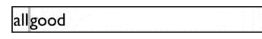

两种解释都是不错的选择，但事实证明，使用第二种解释极大地简化了程序设计。本节余下部分将说明这一点，同时演示在结构中使用列表。为了充分理解这一经验教训，您应该已经解决了第 5.10 章中的练习。

让我们从 rev 开始，因为我们显然需要这个函数才能理解数据定义。其头部材料很简单：

```
; Lo1s -> Lo1s
; produces a reverse version of the given list
```

```
(check-expect
 (rev (cons "a" (cons "b" (cons "c" '())))
```

```scheme
(cons "c" (cons "b" (cons "a" '()))))
```

```scheme
(define (rev l) l)
```

为确保万无一失，我们添加了一个“显而易见”的示例作为测试用例。你可能希望添加一些额外的示例，以确保你理解所需内容。

rev 的模板是常规的列表模板：

```scheme
(define (rev l)
  (cond
    [(empty? l) ...]
    [else (... (first l) ...
        ... (rev (rest l)) ...]))
```

有两种情况，第二种情况伴有多个选择器表达式和一个自引用表达式。

对于第一个子句，填写模板很容易：空列表的逆序版本仍是空列表。对于第二个子句，我们再次使用编程问题：

- (first l) 是 1Strings 列表上的第一个项目；
- (rest l) 是列表的其余部分；以及
- (rev (rest l)) 是列表其余部分的逆序。

停！尝试使用这些提示完成 rev 的设计。

如果这些提示让你感到困惑，请记住从示例中创建一个表格。图 71 显示了两个示例的表格：(cons "a" '()) 和 (cons "a" (cons "b" (cons "c" '())))。第二个示例尤其有说明性。查看倒数第二列显示，(rev (rest l)) 通过生成 (cons "c" (cons "b" '())) 完成了大部分工作。由于期望的结果是 (cons "c" (cons "b" (cons "a" '())))，rev 必须以某种方式将 "a" 添加到递归结果的末尾。确实，因为 (rev (rest l)) 始终是列表其余部分的逆序，显然只需将 (first l) 添加到其末尾即可。虽然我们没有一个向列表末尾添加项目的函数，但我们可以期望它并使用它来完成函数定义：

```scheme
(define (rev l)
  (cond
    [(empty? l) '()]
    [else (add-at-end (rev (rest l)) (first l))]))
```

| l | (first (rest l)) | (rev (rest l)) | (rev l) |
|---|---|---|---|
| (cons "a" '()) | "a" | '() | (cons "a" '()) |
| (cons "a" (cons "b" '())) | (cons "b" '()) | (cons "c" '()) | (cons "c" (cons "b" '())) |

## 图 71：为 rev 建表

以下是 add-at-end 的扩展期望清单条目：

```scheme
; LoIs 1String -> LoIs
; creates a new list by adding s to the end of l
```

```scheme
(check-expect
 (add-at-end (cons "c" (cons "b" '())) "a")
 (cons "c" (cons "b" (cons "a" '()))))
```

```scheme
(define (add-at-end l s)
  l)
```

之所以说它是“扩展”的，是因为它附带一个作为测试用例的示例。该示例源自 rev 的示例，的确，它正是激发此期望清单条目的示例。在继续阅读之前，请编造一个 add-at-end 处理空列表的示例。

由于 add-at-end 也是一个列表处理函数，模板只是对你已非常熟悉的模板的重命名：

```scheme
(define (add-at-end l s)
  (cond
    [(empty? l) ...]
    [else (... (first l) ...
          ... (add-at-end (rest l) s) ...]]))
```

要将其完成为函数定义，我们根据第 5 步的配方问题进行处理。我们的第一个问题是为“基本”情况（即此处的第一种情况）制定答案。如果你完成了建议的练习，你就会知道

```scheme
(add-at-end '() s)
```

的结果始终是 (cons s '()))。毕竟，结果必须是一个列表，并且列表必须包含给定的 1string。

接下来的两个问题涉及“复杂”或“自引用”情况。我们知道第二个 cond 行中的表达式计算什么：第一个表达式从给定列表中提取第一个 1String，第二个表达式“通过将 s 添加到 (rest l) 的末尾来创建一个新列表”。也就是说，目的陈述规定了函数在此必须生成什么。由此可知，函数必须将 (first l) 重新添加到递归的结果中：

```scheme
(define (add-at-end l s)
  (cond
    [(empty? l) (cons s '())]
    [else
     (cons (first l) (add-at-end (rest l) s))]])
```

运行测试示例以让自己放心，这个函数有效，因此 rev 也有效。当然，你不应惊讶地发现 BSL 已经提供了一个可以反转任何给定列表（包括 1Strings 列表）的函数。而自然，它被称为 reverse。

## 练习 177

设计函数 create-editor。该函数接收两个字符串并生成一个 Editor。第一个字符串是光标左侧的文本，第二个字符串是光标右侧的文本。本节的其余部分依赖于此函数。

此时，你应该完全理解我们的图形单行编辑器的数据表示。遵循第 3.6 章中交互式程序的设计策略，你应该定义物理常量——例如编辑器的宽度和高度——以及图形常量——例如光标。以下是我们的：

```scheme
(define HEIGHT 20) ; the height of the editor
(define WIDTH 200) ; its width
(define FONT-SIZE 16) ; the font size
(define FONT-COLOR "black") ; the font color

(define MT (empty-scene WIDTH HEIGHT))
(define CURSOR (rectangle 1 HEIGHT "solid" "red"))
```

不过，重要的是要为你的事件处理程序以及绘制编辑器状态的函数编写期望清单。请记住，_2htdp/universe_ 库规定了这些函数的头部材料：

```scheme
; Editor -> Image
; renders an editor as an image of the two texts
; separated by the cursor
(define (editor-render e) MT)
```

```scheme
; Editor KeyEvent -> Editor
; deals with a key event, given some editor
(define (editor-kh ed ke) ed)(index "editor-kh")
```

此外，第 3.6 章要求你为你的程序编写一个主函数：

```scheme
; main : String -> Editor
; launches the editor given some initial string
(define (main s)
  (big-bang (create-editor s "")
    [on-key editor-kh]
    [to-draw editor-render]))
```

重读练习 177 以确定此程序的初始编辑器。

虽然你接下来处理哪个期望无关紧要，但我们选择先设计 editor-kh，再设计 editor-render。既然我们有头部材料，让我们用两个示例来解释关键事件处理程序的工作原理：

```scheme
(check-expect (editor-kh (create-editor "" ""))
              (create-editor "e" ""))
(check-expect (editor-kh (create-editor "cd" "fgh"))
              (create-editor "cde" "fgh")))
```

这两个示例都演示了当你按下键盘上的字母 “e”时会发生什么。计算机在编辑器的当前状态和 "e" 上运行函数 editor-kh。在第一个示例中，编辑器是空的，这意味着结果是一个仅包含字母 "e" 后跟光标的编辑器。在第二个示例中，光标位于字符串 "cd" 和 "fgh" 之间，因此结果是一个光标位于 "cde" 和 "fgh" 之间的编辑器。简而言之，该函数始终将任何普通字母插入光标位置。

在继续阅读之前，你应该编造一些示例，说明当你按下退格键 ("\b") 删除某个字母、按下“左”和“右”箭头键移动光标，或按下其他箭头键时 editor-kh 是如何工作的。在所有情况下，请考虑当编辑器为空、光标位于编辑器中非空字符串的左端或右端，以及光标位于中间时应该发生什么。尽管你在此处不使用区间，但为“极端”情况开发示例仍然是个好主意。

一旦你有了测试用例，就可以开发模板了。对于 editor-kh，你正在处理一个消耗两种复杂数据形式的函数：一种是包含列表的结构，另一种是大量字符串的枚举。一般来说，这种设计情况需要一种改进的设计配方；但在这些情况下，也很明显你应该先处理其中一个输入，即按键。

话虽如此，模板只是一个大的 cond 表达式，用于检查函数接收到了哪个 KeyEvent：


```
(define (editor-kh ed k)
  (cond
    [(key=? k "left") ...]
    [(key=? k "right") ...]
    [(key=? k "\b") ...]
    [(key=? k "\t") ...]
    [(key=? k "\r") ...]
    [(= (string-length k) 1) ...]
    [else ...]))
```

cond 表达式与 KeyEvent 的数据定义不太匹配，因为某些 KeyEvent 需要特别关注（"left"、"\b" 等等），某些需要被忽略，因为它们是特殊的（"\t" 和 "\r"），而某些则应归类为一个大组（普通键）。

## 练习 178.

解释为什么 editor-kh 的模板在检查长度为 1 的字符串之前先处理 "\t" 和 "\r"。

对于第五步——函数定义——我们分别处理条件中的每个子句。第一个子句要求移动光标并保持编辑器字符串内容不变。第二个子句也是如此。第三个子句则要求从编辑器内容中删除一个字母——如果有的话。最后，第六个 cond 子句涉及在光标位置添加字母。遵循第一个基本准则，我们大量使用愿望清单，并为每个任务想象一个函数：

```
(define (editor-kh ed k)
  (cond
    [(key=? k "left") (editor-lft ed)]
    [(key=? k "right") (editor-rgt ed)]
    [(key=? k "\b") (editor-del ed)]
    [(key=? k "\t") ed]
    [(key=? k "\r") ed]
    [(= (string-length k) 1) (editor-ins ed k)]
    [else ed]))
```

从 editor-kh 的定义可以看出，四个愿望清单函数中的三个具有相同的签名：

```
; Editor -> Editor
```

最后一个函数接受两个参数，而不是一个：

```
; Editor 1String -> Editor
```

我们将前三个函数的愿望表述留给你，专注于第四个函数。

让我们从目的声明和函数头开始：

```
; insert the 1String k between pre and post
(define (editor-ins ed k)
  ed)
```

目的直接来源于问题描述。为了构建函数头，我们需要一个 Editor 实例。由于 pre 和 post 是当前编辑器的两个部分，我们只需将它们重新组合起来。

接下来，我们从 editor-kh 的示例中推导出 editor-ins 的示例：

```
(check-expect
  (editor-ins (make-editor '() '()) "e")
  (make-editor (cons "e" '()) '()))

(check-expect
  (editor-ins
    (make-editor (cons "d" '())
                 (cons "f" (cons "g" '()))))
  "e")
  (make-editor (cons "e" (cons "d" '()))
               (cons "f" (cons "g" '()))))
```

你应该使用 Editor 的解释来逐一验证这些示例。也就是说，确保你理解给定编辑器在信息层面上意味着什么，以及函数调用在那些层面上应该达到什么目的。在这种情况下，最好绘制编辑器的可视化表示，因为它能很好地表达信息。

第四步要求开发模板。第一个参数保证是一个结构，第二个参数是一个字符串，是一个原子数据片。换句话说，模板只是从给定的编辑器表示中提取各个部分：

```
(define (editor-ins ed k)
 (... ed ... k ...
  ... (editor-pre ed) ...
  ... (editor-post ed) ...))
```

请记住，模板会列出参数，因为它们也是可用的。

从模板和示例中，可以相对容易地得出结论：editor-ins 应该根据给定编辑器的 pre 和 post 字段创建一个编辑器，并将 k 添加到前者的前面：

```
(define (editor-ins ed k)
  (make-editor (cons k (editor-pre ed))
               (editor-post ed)))
```

尽管 (editor-pre ed) 和 (editor-post ed) 都是 1String 列表，但不需要设计辅助函数。要获得所需结果，只需使用 cons 即可，它会创建列表。

此时，你应该做两件事。首先，运行此函数的测试。其次，使用 Editor 的解释，抽象地解释为什么此函数执行插入操作。不仅如此，你还可以将这个简单定义与练习 84 中的定义进行比较，找出为什么另一个需要辅助函数，而我们这里的定义不需要。

## 练习 179。设计函数

```
; Editor -> Editor
; moves the cursor position one 1String left,
; if possible
(define (editor-lft ed) ed)
```

```
; Editor -> Editor
; moves the cursor position one 1String right,
; if possible
```

```
(define (editor-rgt ed) ed)

; Editor -> Editor
; deletes a 1String to the left of the cursor,
; if possible
(define (editor-del ed) ed)
```

同样，彻底验证大量示例至关重要。

为编辑器设计渲染函数带来了一些新的但较小的挑战。第一个是开发足够数量的测试用例。一方面，它要求覆盖可能的组合：光标左侧为空字符串、右侧为空字符串、两个字符串都为空。另一方面，它还需要尝试图像库提供的函数。具体来说，需要一种方法将两个字符串片段作为文本图像组合起来，还需要一种方法将文本图像放入空图像框架（MT）中。以下是我们为 (create-editor "pre" "post") 的结果创建图像的方法：

```
(place-image/align
 (beside (text "pre" FONT-SIZE FONT-COLOR)
        CURSOR
        (text "post" FONT-SIZE FONT-COLOR))
 1 1
 "left" "top"
 MT)
```

如果你将此与上面的编辑器图像进行比较，你会注意到一些差异，这没关系，因为确切的布局对本练习的目的并不重要，而且修改后的布局也不会使问题变得简单。无论如何，请在 DrRacket 的交互区域进行实验，找到你喜欢的编辑器显示效果。

现在你可以开发模板了，你应该能得到这样的结果：

```
(define (editor-render e)
 (... (editor-pre e) ... (editor-post e)))
```

给定的参数只是一个具有两个字段的结构类型。然而，它们的值是 1String 列表，你可能会想进一步细化模板。不要！相反，请记住，当一个数据定义引用另一个复杂数据定义时，最好使用愿望清单。

如果你已经处理了足够数量的示例，你也知道愿望清单上想要什么：一个将字符串转换为适当大小和颜色的文本的函数。我们将此函数命名为 editor-text。然后，editor-render 的定义只是两次使用 editor-text，然后用 beside 和 place-image 组合结果：

```
; Editor -> Image
(define (editor-render e)
 (place-image/align
  (beside (editor-text (editor-pre e))
   CURSOR
   (editor-text (editor-post e)))
  1 1
  "left" "top"
  MT))
```

虽然此定义将表达式嵌套了三层，但使用虚构的 editor-text 函数使其相当易读。

剩下的就是设计 editor-text。根据 editor-render 的设计，我们知道 editor-text 接收一个 1String 列表并生成一个文本图像：

```
; Lo1s -> Image
; renders a list of 1Strings as a text image
(define (editor-text s)
 (text "" FONT-SIZE FONT-COLOR))
```

这个伪定义生成一个空文本图像。

为了演示 editor-text 应该计算什么，我们来看一个示例。示例输入是

```
(create-editor "pre" "post")
```

它也用于解释 editor-render，并等价于

```
(make-editor
 (cons "e" (cons "r" (cons "p" '())))
 (cons "p" (cons "o" (cons "s" (cons "t" '())))))
```

我们选择第二个列表作为 editor-text 的示例输入，并且我们知道来自 editor-render 示例的预期结果：

```
(check-expect
 (editor-text
  (cons "p" (cons "o" (cons "s" (cons "t" '())))))
 (text "post" FONT-SIZE FONT-COLOR))
```

在继续阅读之前，你可以自行编造第二个示例。

鉴于 editor-text 接收一个 1String 列表，我们可以毫不费力地写出模板：

```
(define (editor-text s)
 (cond
  [(empty? s) ...]
  [else (... (first s)
     ... (editor-text (rest s)) ...)]))
```

毕竟，模板由描述函数输入的数据定义所决定。但如果你理解并牢记 Editor 的解释，就不需要模板。它使用 explode 将字符串转换为 1String 列表。自然而然地，有一个名为 implode 的函数执行逆向计算，即，

```
> (implode (cons "p" (cons "o" (cons "s" (cons "t" '())))))
"post"
```

使用这个函数，editor-text 的定义从示例到函数体仅有一小步：


```
(define (editor-text s)
  (text (implode s) FONT-SIZE FONT-COLOR)))
```

### 练习 180. 不使用 implode 设计 editor-text。

当你测试这两个函数时，真正的惊喜才来临。虽然 editor-text 的测试通过，但 editor-render 的测试失败。对失败的检查显示，光标左侧的字符串—"pre"—是反向排版的。我们忘记了编辑器状态的这部分是以反向表示的。幸运的是，这两个函数的单元测试指出了哪个函数有问题，甚至告诉我们函数哪里出了问题，并建议如何修复：

```
(define (editor-render ed)
  (place-image/align
    (beside (editor-text (reverse (editor-pre ed))))
          CURSOR
          (editor-text (editor-post ed))))
  1 1
  "left" "top"
  MT))
```

这个定义对 ed 的 pre 字段使用了 reverse 函数。

注意 现代应用程序允许用户使用鼠标（或其他基于手势的设备）定位光标。原则上，为你的编辑器添加此功能是可能的，但我们将等到第 32.4 节再这样做。

## 11 通过组合进行设计

到现在为止，你已经知道程序是复杂的产品，它们的生产需要设计许多协作的函数。如果设计者知道何时设计多个函数以及如何将这些函数组合成一个程序，这种协作就能很好地工作。

你多次遇到过设计相互关联函数的需求。有时，问题陈述暗示了几个不同的任务，每个任务最好用一个函数来实现。在其他时候，一个数据定义可能引用另一个数据定义，在这种情况下，处理前一种数据的函数依赖于处理后一种数据的函数。

在本章中，我们将介绍几种需要设计组合许多函数的程序的场景。为了支持这种设计，本章介绍了一些关于如何分配函数和组合函数的非正式准则。然而，由于这些示例要求复杂的列表形式，本章首先以一个关于简洁列表表示法的章节开始。

### 11.1 list 函数

到这个地步，你可能已经厌倦了写那么多 cons 来创建列表，尤其是对于包含一堆值的列表。幸运的是，我们有一个额外的教学语言为你提供了简化程序员生活这部分的机制。BSL+ 也是如此。

> 你已从 BSL 毕业。是时候使用“语言”菜单并选择“带列表缩写的初学者学生”进行学习了。

关键创新是 list，它消耗任意数量的值并创建一个列表。理解 list 的最简单方法是将其视为缩写。具体来说，每个形状的表达式

```
(list exp-1 ... exp-n)
```

代表一系列 n 个 cons 表达式：

```
(cons exp-1 (cons ... (cons exp-n '()))))
```

请记住，'() 在这里不是列表的一项，而实际上是列表的其余部分。下面是一个包含三个示例的表格：

| 简写形式 | 长形式 |
| :--- | :--- |
| (list "ABC") | (cons "ABC" '()) |
| (list #false #true) | (cons #false (cons #true '())) |
| (list 1 2 3) | (cons 1 (cons 2 (cons 3 '())))) |

它们分别引入包含一项、两项和三项的列表。

当然，我们不仅可以将 list 应用于值，也可以应用于表达式：

```
> (list (+ 0 1) (+ 1 1))
(list 1 2)
> (list (/ 1 0) (+ 1 1))
/:division by zero
```

在构建列表之前，必须对表达式求值。如果在表达式求值期间发生错误，列表永远不会形成。简而言之，`list` 的行为就像任何其他消耗任意数量参数的原始操作一样；它的结果恰好是一个用 cons 构建的列表。

使用 `list` 大大简化了包含许多项的列表以及包含列表或结构体的列表的表示法。下面是一个示例：

```
(list 0 1 2 3 4 5 6 7 8 9)
```

这个列表包含 10 个项目，如果用 cons 来构建，则需要 10 次 cons 和一个 '() 实例。同样，下面的列表

```
(list (list "bob" 0 "a")
 (list "carl" 1 "a")
 (list "dana" 2 "b")
 (list "erik" 3 "c")
 (list "frank" 4 "a")
 (list "grant" 5 "b")
 (list "hank" 6 "c")
 (list "ian" 7 "a")
 (list "john" 8 "d")
 (list "karel" 9 "e") )
```

需要 11 次 `list` 的使用，这与 40 次 cons 和 11 次额外的 '() 使用形成鲜明对比。

### 练习 181. 使用 `list` 构建下列列表的等价形式：

- 1. (cons "a" (cons "b" (cons "c" (cons "d" '())))))

- 2. (cons (cons 1 (cons 2 '())) '())

- 3. (cons "a" (cons (cons 1 '()) (cons #false '())))

- 4. (cons (cons "a" (cons 2 '())) (cons "hello" '()))

也尝试一下这个：

```
(cons (cons 1 (cons 2 '()))
 (cons (cons 2 '())
  '()))
```

首先确定每个列表和每个嵌套列表包含多少项。使用 check-expect 来表达你的答案；这确保你的缩写形式与长形式确实相同。

### 练习 182. 使用 cons 和 '() 构建下列列表的等价形式：

- 1. (list 0 1 2 3 4 5)

- 2. (list (list "he" 0) (list "it" 1) (list "lui" 14))

- 3. (list 1 (list 1 2) (list 1 2 3))

使用 check-expect 来表达你的答案。

### 练习 183. 在某些场合，列表是使用 cons 和 list 组合形成的。

- 1. (cons "a" (list 0 #false))

- 2. (list (cons 1 (cons 13 '())))

- 3. (cons (list 1 (list 13 '())) '())

- 4. (list '() '() (cons 1 '()))

- 5. (cons "a" (cons (list 1) (list #false '()))))

用仅 cons 或仅 list 重新编写下列每个表达式。使用 check-expect 来检查你的答案。

### 练习 184. 确定下列表达式的值：

- 1. (list (string=? "a" "b") #false)

- 2. (list (+ 10 20) (* 10 20) (/ 10 20))

- 3. (list "dana" "jane" "mary" "laura")

使用 check-expect 来表达你的答案。

### 练习 185. 你已经了解 BSL 中的 first 和 rest，但 BSL+ 还带来了更多选择器。确定下列表达式的值：

- 1. (first (list 1 2 3))

- 2. (rest (list 1 2 3))

- 3. (second (list 1 2 3))

从文档中了解 third 和 fourth 是否存在。

#### 11.2 函数组合

第 3 章解释了程序是定义的集合：结构体类型定义、数据定义、常量定义和函数定义。为了指导函数之间的分工，该部分还提出了一条粗略的准则：

> 为每个任务设计一个函数。为问题中各量之间的每个依赖关系制定辅助函数定义。

> 别忘了测试。

本书的这一部分引入了关于辅助函数的另一条准则：

> 为每个数据定义设计一个模板。当一个数据定义指向第二个数据定义时，制定辅助函数定义。

在本节中，我们将看一下设计过程中可能需要额外辅助函数的一个特定位置：定义步骤，它从模板中创建一个完整的函数定义。将模板转换为完整的函数定义意味着将模板子表达式的值组合成最终答案。在这样做时，你可能会遇到几种表明需要辅助函数的情况：

- 1. 如果值的组合需要特定应用领域的知识——例如，组合两个（计算机）图像、会计、音乐或科学——设计一个辅助函数。

- 2. 如果值的组合需要对可用值进行案例分析——例如，取决于一个数字是正数、零还是负数——使用 cond 表达式。如果 cond 看起来复杂，设计一个辅助函数，其参数是模板的表达式，其主体是 cond 表达式。

- 3. 如果值的组合必须处理来自自引用数据定义的元素——列表、自然数或类似的东西——设计一个辅助函数。

- 4. 如果一切都失败了，你可能需要设计一个**更通用**的函数，并将主函数定义为通用函数的特定用法。这个建议听起来违反直觉，但在非常多的情况下都是必要的。

最后两个标准是我们之前没有详细讨论过的情况，尽管之前出现过一些示例。接下来的两个部分将用更多示例来说明这些原则。

不过，在继续之前，请记住，管理程序设计的关键是维护经常提到的 **愿望清单**。

维护一个必须设计的函数头列表以完成程序。写下完整的函数头确保你可以测试已经完成的程序部分，即使许多测试会失败，这也很有用。当然，当愿望清单为空时，所有测试都应该通过，所有函数都应该由测试覆盖。

在将函数放入愿望清单之前，你应该检查类似的函数是否已经存在于你的语言库中，或者类似的内容是否已经在愿望清单上。BSL、BSL+ 以及确实所有编程语言都提供许多内置操作和许多库函数。当你有时间和需要时，应该探索你选择的语言，以便了解它提供了什么。


### 11.3 递归辅助函数

人们经常需要对事物进行排序，程序也是如此。投资顾问会根据每个持仓产生的利润对投资组合进行排序。游戏程序会根据分数对玩家列表进行排序。邮件程序会根据日期、发件人或其他标准对消息进行排序。

一般来说，如果你能比较并排序每对数据项，就可以对一堆项目进行排序。虽然并非每种数据都自带比较原语，但我们都知道一种支持比较的数据：数字。因此，本节使用一个简单但高度具代表性的示例问题：

**示例问题** 设计一个函数，对实数列表进行排序。

下面的练习阐明了如何将此函数调整为适用于其他数据。

由于问题描述未提及任何其他任务，而且排序似乎也暗示不出其他任务，因此我们遵循设计准则。排序意味着重新排列一堆数字。这种重述暗示了函数输入和输出的自然数据定义，进而暗示了其签名。鉴于我们已有 List-of-numbers 的定义，第一步很容易：

```
; List-of-numbers -> List-of-numbers
; produces a sorted version of alon
(define (sort> alon)
 alon)
```

返回 alon 可以确保就函数签名而言结果是合适的，但通常情况下，给定的列表并未排序，这个结果是错误的。

说到编造示例，问题描述很快就显得相当不精确。与之前一样，我们使用 List-of-numbers 的数据定义来组织示例的开发。由于数据定义包含两个子句，我们需要两个示例。显然，当将 sort> 应用于 '() 时，结果必须是 '()。问题是对

```
(cons 12 (cons 20 (cons -5 '()))))
```

的结果应该是什么。该列表未排序，但有两种排序方式：

- (cons 20 (cons 12 (cons -5 '())))，即数字按 **降序** 排列的列表；以及
- (cons -5 (cons 12 (cons 20 '())))，即数字按 **升序** 排列的列表。

在现实世界中，你现在需要向提出问题的人寻求澄清。这里我们选择降序方案；设计升序方案并不会带来不同的障碍。

这一决定要求修订头部材料：

```
; List-of-numbers -> List-of-numbers
; rearranges alon in descending order

(check-expect (sort> '()) '())
(check-expect (sort> (list 3 2 1)) (list 3 2 1))
(check-expect (sort> (list 1 2 3)) (list 3 2 1))
(check-expect (sort> (list 12 20 -5))
         (list 20 12 -5))

(define (sort> alon)
 alon)
```

头部材料现在包括重新表述为单元测试并使用 list 的示例。如果使用 list 让你感到不自在，可以用 cons 重新表述测试，以练习来回转换。至于另外两个示例，它们要求 sort> 对已经按升序和降序排列的列表也能正常工作。

接下来我们必须将数据定义转换为函数模板。我们以前处理过数字列表，所以这一步很简单：

```
(define (sort> alon)
 (cond
  [(empty? alon) ...]
  [else (... (first alon) ...
       ... (sort> (rest alon)) ...)])])
```

使用此模板，我们终于可以转向程序开发中有趣的部分。我们分别考虑 cond 表达式的每个情况，从简单的情况开始。如果 sort> 的输入是 '()，答案也是 '()，如示例所指定。如果 sort> 的输入是一个 cons 列表，模板暗示了两个可能有帮助的表达式：

- `(first alon) 从输入中提取第一个数字；以及
- `(sort> (rest alon)) 按降序重新排列 (rest alon)，依据函数的目的声明。

为澄清这些抽象答案，让我们用第二个示例详细解释这些部分。当 sort> 接收 (list 12 20 -5) 时，

- `(first alon) 是 12，
- `(rest alon) 是 (list 20 -5)，以及
- `(sort> (rest alon)) 生成 (list 20 -5)，因为该列表已经排好序。

为了产生期望的答案，sort> 必须将 12 插入到最后一个列表的两个数字之间。更一般地说，我们必须找到一个表达式，将 (first alon) 插入到 (sort> (rest alon)) 结果的适当位置。如果做到这一点，排序就是一个容易解决的问题。

将一个数字插入已排序的列表显然不是一件简单的事情。它要求在已排序的列表中搜索，以找到该项的适当位置。搜索任何列表都需要一个辅助函数，因为列表的大小是任意的，并且根据前一节的第 3 项，处理任意大小的值需要设计辅助函数。

所以，这是新的愿望列表条目：

```
; Number List-of-numbers -> List-of-numbers
; inserts n into the sorted list of numbers alon
(define (insert n alon) alon)
```

也就是说，insert 接受一个数字和一个按降序排序的列表，通过将前者插入后者来生成一个排序列表。

有了 insert，完成 sort> 的定义就很容易了：

```
(define (sort> alon)
  (cond
    [(empty? alon) '()]
    [else
    (insert (first alon) (sort> (rest alon)))]))
```

为了生成最终结果，sort> 提取非空列表的第一个元素，计算其余部分的排序版本，并使用 insert 从这两部分生成完全排序的列表。

停下！按原样测试程序。有些测试用例通过，有些失败。这是进展。其设计的下一步是创建功能示例。由于 insert 的第一个输入是任意数字，我们使用 5，并利用 List-of-numbers 的数据定义为第二个输入编造示例。

首先，我们考虑当给定一个数字和 '() 时，insert 应该生成什么。根据 insert 的目的声明，输出必须是一个列表，必须包含第二个输入中的所有数字，并且必须包含第一个参数。这暗示了以下内容：

```
(check-expect (insert 5 '()) (list 5))
```

其次，我们使用仅包含一个元素的非空列表：

```
(check-expect (insert 5 (list 6)) (list 6 5))
(check-expect (insert 5 (list 4)) (list 5 4))
```

为什么这些是预期结果的推理与之前如出一辙。其一，结果必须包含第二个列表中的所有数字以及额外的那个数字。其二，结果必须是排序好的。

最后，让我们创建一个包含多个元素的列表示例。

确实，我们可以从 sort> 的示例中推导出这样的示例，尤其是从我们对第二个 cond 子句的分析中。在那里，我们知道 sort> 能正常工作，只有当 12 被插入 (list 20 -5) 的适当位置时：

```
(check-expect (insert 12 (list 20 -5))
(list 20 12 -5))
```

也就是说，给 insert 一个第二个列表，该列表按降序排列。

请注意示例开发给我们的启示。insert 函数必须找到第一个小于给定 n 的数字。当没有这样的数字时，函数最终会到达列表末尾，并且必须将 n 添加到末尾。现在，在进入模板之前，你应该编出一些额外的示例。为此，你可以希望使用 sort> 的补充示例。

与 sort> 相反，insert 函数消耗两个输入。由于我们知道第一个输入是数字且是原子的，我们可以在模板开发中关注第二个参数——数字列表：

```
(define (insert n alon)
  (cond
    [(empty? alon) ...]
    [else (... (first alon) ...
         ... (insert n (rest alon)) ...)]))
```

此模板与 sort> 模板的唯一区别是，这个模板需要考虑额外的参数 n。

为了填补 insert 模板中的空白，我们再次逐个案例进行处理。第一个案例涉及空列表。根据第一个示例，(list n) 是第一个 cond 子句中需要的表达式，因为它从 n 和 alon 构造一个排序列表。

第二个案例比第一个更复杂，因此我们遵循图 53 中的问题：

- (first alon) 是 alon 上的第一个数字；
- (rest alon) 是 alon 的其余部分，并且像 alon 一样，按降序排列；以及


- 3. `(insert n (rest alon))` 从 n 和 `(rest alon)` 中的数字生成一个排序后的列表。

问题是如何将这些数据片段组合起来以得到最终答案。让我们通过一些示例来具体化这一切：

```
(insert 7 (list 6 5 4))
```

这里 n 是 7，且大于第二个输入中的任何数字。我们只需查看列表的第一个元素即可知道这一点。它是 6，但因为列表已排序，列表中的所有其他数字都比 6 更小。因此，只需将 7 cons 到 (list 6 5 4) 即可。

相比之下，当应用类似于：

```
(insert 0 (list 6 2 1 -1))
```

n 确实必须插入到列表的其余部分中。更具体地说，(first alon) 是 6；(rest alon) 是 (list 2 1 -1)；根据目的说明，(insert n (rest alon)) 生成 (list 2 1 0 -1)。通过将 6 重新添加到该最后列表上，我们得到了 (insert 0 (list 6 2 1 -1)) 所需的答案。

要获得完整的函数定义，必须对这些示例进行泛化。用例分析表明一个嵌套条件表达式，用于判断 n 是否大于（或等于）(first alon)：

- 如果是，那么 alon 中的所有项都比 n 小，因为 alon 已经排序。在这种情况下的答案是 (cons n alon)。

- 然而，如果 n 小于 (first alon)，那么函数尚未找到将 n 插入 alon 的适当位置。结果的第一个项必须是 (first alon)，并且必须将 n 插入到 (rest alon)。在这种情况下的最终结果是

```
(cons (first alon) (insert n (rest alon)))
```

因为这个列表包含 n 和 alon 的所有项，且按排序顺序排列——这正是我们需要的。

将此讨论转译为 BSL+ 需要针对这种情况使用 if 表达式。条件是 (>= n (first alon))，两个分支的表达式已经拟定。

图 72 包含完整的排序程序。将其复制到 DrRacket 的定义区中，重新添加测试用例并测试程序。现在所有测试都应通过，并且它们应覆盖所有表达式。

```
; List-of-numbers -> List-of-numbers
; produces a sorted version of l
(define (sort> l)
 (cond
  [(empty? l) '()]
  [(cons? l) (insert (first l) (sort> (rest l)))]))

; Number List-of-numbers -> List-of-numbers
; inserts n into the sorted list of numbers l
(define (insert n l)
 (cond
  [(empty? l) (cons n '())]
  [else (if (>= n (first l))
   (cons n l)
   (cons (first l) (insert n (rest l)))))]))
```

## 图 72：对数字列表进行排序

**术语** 这种特定的排序程序在编程文献中称为*插入排序*。稍后我们将学习对列表进行排序的替代方法，采用完全不同的设计策略。

## 练习 186. 再次审视间奏曲 1，即介绍 BSL 及其测试表述方式的那个间奏曲。后者之一是 check-satisfied，用于判断一个表达式是否满足某个属性。使用练习 145 中的 sorted>？来重新使用 check-satisfied 表述 sort> 的测试。

```
; List-of-numbers -> List-of-numbers
; produces a sorted version of l
(define (sort>/bad l)
(list 9 8 7 6 5 4 3 2 1 0))
```

你能拟定一个测试用例来表明 sort>/bad **不是**一个排序函数吗？你能使用 check-satisfied 来拟定这个测试用例吗？

注释 (1) 这里可能会让你惊讶的是，我们定义了一个函数来创建测试。在现实世界中，这一步很常见，有时你确实需要为测试设计函数——连同它们自己的测试等。 (2) 使用 check-satisfied 表述测试有时比使用 check-expect（或其他形式）更容易，而且也更通用一些。当谓词完全描述了函数所有可能输入和输出之间的关系时，计算机科学家称其为规范。第 17.4 节解释了如何完全指定 sort>。

## 练习 187. 设计一个按分数对游戏玩家列表进行排序的程序：

```
(define-struct gp [name score])
; A GamePlayer is a structure:
;   (make-gp String Number)
; interpretation (make-gp p s) represents player p who
; scored a maximum of s points
```

**提示** 拟定一个比较两个 GamePlayer 元素的函数。

## 练习 188. 设计一个按日期对电子邮件列表进行排序的程序：

```
(define-struct email [from date message])
; An Email Message is a structure:
;   (make-email String Number String)
; interpretation (make-email f d m) represents text m
; sent by f, d seconds after the beginning of time
```

还要开发一个按名称对电子邮件消息列表进行排序的程序。要按字母顺序比较两个字符串，请使用 string<?> 原语。

## 练习 189. 以下是函数 search：

```
; Number List-of-numbers -> Boolean
(define (search n alon)
(cond
[(empty? alon) #false]
[else (or (= (first alon) n)
(search n (rest alon)))]))
```

它确定某个数字是否出现在一个数字列表中。该函数可能需要遍历整个列表才能发现感兴趣的数字不在列表中。

开发函数 search-sorted，用于确定一个数字是否出现在排序后的数字列表中。该函数必须利用列表已排序的事实。

## 练习 190. 设计前缀函数 prefixes，它接受一个 1String 列表并生成所有前缀的列表。如果列表 p 和 l 在 p 的所有项上都相同，则列表 p 是 l 的前缀。例如，(list "a" "b" "c") 是其自身以及 (list "a" "b" "c" "d") 的前缀。

设计函数 suffixes，它接受一个 1String 列表并生成所有后缀。如果列表 s 和 l 从末尾开始在 s 的所有项上都相同，则列表 s 是 l 的后缀。例如，(list "b" "c" "d") 是其自身以及 (list "a" "b" "c" "d") 的后缀。

### 11.4 具有泛化作用的辅助函数

偶尔，辅助函数不仅仅是一个小的辅助函数，而是一个更一般问题的解决方案。当问题描述过于狭窄时，需要这样的辅助函数。当程序员执行设计配方的步骤时，他们可能会发现“自然”的解决方案是错误的。对这个有缺陷解决方案的分析可能会提出一个略有不同、但更一般的问题描述，以及一种将一般问题的解决方案应用于原始问题的简单方法。

> 保罗·C·费舍尔提出了这个问题。

我们用以下问题的解决方案来说明这个想法：

## 示例问题 设计一个将多边形添加到给定场景中的函数。

以防你不记得基本的几何（领域）知识，我们添加了一个（简化的）多边形定义：

多边形是一个平面图形，由至少三个点（不在一条直线上）通过三条直线边连接而成。

因此，多边形的一种自然数据表示是 Posn 列表。例如，以下两个定义

```
(define triangle-p
 (list
 (make-posn 20 10)
 (make-posn 20 20)
 (make-posn 30 20)))
(define square-p
 (list
 (make-posn 10 10)
 (make-posn 20 10)
 (make-posn 20 20)
 (make-posn 10 20)))
```

正如名称所言，分别引入了一个三角形和一个正方形。现在你可能会想如何将 '() 或 (list (make-posn 30 40)) 解释为多边形，答案是它们不描述多边形。因为多边形由至少三个点组成，多边形的良好数据表示是包含至少三个 Posn 的列表集合。

遵循非空温度列表（NEList-of-temperatures，第 9.2 章）的数据定义开发过程，为多边形制定数据表示很直接：

```
; A Polygon is one of:
; -- (list Posn Posn Posn)
; -- (cons Posn Polygon)
```

第一个子句说明三个 Posn 的列表是一个多边形，第二个子句说明将一个 Posn cons 到某个现有多边形上会创建另一个多边形。由于这是第一个在子句中使用 list 的数据定义，我们用 cons 将其拼写出来，只是为了确保你看到这种从缩写到长形式的转换：

```
; a Polygon is one of:
; -- (cons Posn (cons Posn (cons Posn '())))
; -- (cons Posn Polygon)
```

重点是，天真选择的数据表示——普通的 Posn 列表——可能无法正确表示预期的信息。在初始探索过程中修订数据定义是正常的；事实上，在设计过程的其余部分，这种修订有时会变得必要。但是，只要你坚持系统的方法，对数据定义的更改就可以自然地传播到设计的其余部分。

第二步需要函数的签名、目的说明和头部。由于问题说明只提到一项任务且未隐含其他任务，我们从一个函数开始：

```
(define MT (empty-scene 50 50))
```

```
; Image Polygon -> Image
; renders the given polygon p into img
(define (render-poly img p)
  img)
```


为了简化示例的表述，需要对 MT 进行额外的定义。

对于第一个示例，我们使用上述提到的三角形。查看 2htdp/image 库可知，scene+line 是渲染三角形三条边所需的函数：

```
(check-expect
 (render-poly MT triangle-p)
 (scene+line
  (scene+line
   (scene+line MT 20 10 20 20 "red")
  20 20 30 20 "red")
 30 20 20 10 "red"))
```

最内层的 scene+line 渲染从第一个 Posn 到第二个 Posn 的线段；中间的使用第二个和第三个 Posn；而最外层的 scene+line 则连接第三个和第一个 Posn。

> 当然，我们在 DrRacket 的交互区域中进行了实验，以确保这个表达式正确。

鉴于第一个也是最小的多边形是三角形，那么矩形或正方形自然可作为第二个示例。我们使用 square-p：

```
(check-expect
 (render-poly MT square-p)
 (scene+line
  (scene+line
   (scene+line
    (scene+line MT 10 10 20 10 "red")
   20 10 20 20 "red")
  20 20 10 20 "red")
 10 20 10 10 "red"))
```

正方形比三角形多一个点，很容易渲染。你也可以在方格纸上绘制这些形状。

模板的构建存在挑战。具体来说，图 52 中的第一个和第二个问题询问数据定义是否区分了不同的子集以及如何区分它们。虽然数据定义在第一个子句中明确将三角形与所有其他多边形区分开来，但如何区分这两者并不立即清晰。两个子句都描述了 Posn 列表。第一个描述三个 Posn 的列表，而第二个描述至少包含四个项目的 Posn 列表。因此，一个替代方案是询问给定的多边形是否只有三个项目长：

```
(= (length p) 3)
```

使用第一个子句的详细版本，即，

```
(cons Posn (cons Posn (cons Posn '()))))
```

这暗示了表述第一个条件的第二种方式，即检查在使用三个 rest 函数后给定的 Polygon 是否为空：

```
(empty? (rest (rest (rest p))))
```

由于所有 Polygons 至少包含三个 Posns，使用三次 rest 是合法的。与 length 不同，rest 是一个原始操作，易于理解，具有明确的操作意义。它选择 cons 结构中的第二个字段，仅此而已。

> 使用内置谓词和选择器来表述条件，确实比使用你自己的（递归）函数更好。有关说明，请参见间奏曲 5。

图 52 中的其余问题都有直接答案，因此我们得到了这个模板：

```
(define (render-poly img p)
 (cond
   [(empty? (rest (rest (rest p))))
    (... (first p) ... img ...
        ... (second p) ...
        ... (third p) ...)]
   [else (... (first p) ...
        ... (render-poly img (rest p)) ...)]])
```

因为 p 在第一个子句中描述一个三角形，它必须恰好包含三个 Posns，这些 Posn 通过 first、second 和 third 提取。在第二个子句中，p 包含一个 Posn 和一个 Polygon，这证明了 (first p) 和 (rest p) 的合理性。前者从 p 中提取一个 Posn，后者提取一个 Polygon。因此，我们在其周围添加一个自引用函数调用；我们还必须牢记，处理这个子句中的 (first p) 和第一个子句中的三个 Posn 可能需要设计一个辅助函数。

现在我们准备专注于函数定义，一次处理一个子句。第一个子句涉及三角形，这暗示了一个直接的答案。具体来说，有三个 Posn，render-poly 应该在一个 50 像素乘 50 像素的空场景中连接这三个点。鉴于 Posn 是一个独立的数据定义，我们得到一个明显的愿望列表条目：

```
; Image Posn Posn -> Image
; draws a red line from Posn p to Posn q into im
(define (render-line im p q)
 im)
```

使用这个函数，render-poly 中的第一个 cond 子句如下：

```
(render-line
 (render-line
   (render-line MT (first p) (second p))
   (second p) (third p))
 (third p) (first p))
```

这个表达式显然通过从第一个到第二个、从第二个到第三个，以及从第三个到第一个 Posn 绘制线段，将给定的 Polygon p 渲染为三角形。

第二个 cond 子句涉及扩展了一个 Posn 的 Polygons。在模板中，我们找到两个表达式，并且，按照图 53，我们提醒自己这些表达式计算什么：

- 1. `(first p)` 提取第一个 Posn；
- 2. `(rest p)` 从 p 中提取 Polygon；以及
- 3. `(render-poly img (rest p))` 渲染 (rest p)，这正是该函数目的说明中所说的内容。

问题是如何使用这些片段来渲染给定的 Polygon p。

一个可能想到的想法是，(rest p) 包含至少三个 Posn。因此，可以从这个嵌入的 Polygon 中提取至少一个 Posn，并将 (first p) 与这个额外点连接起来。这个想法用 BSL+ 代码如下所示：

```
(render-line (render-poly MT (rest p)) (first p) (second p))
```

如前所述，高亮的子表达式在一个空的 50 乘 50 场景中渲染嵌入的 Polygon。使用 render-line 向这个场景添加一条线，从 p 的第一个 Posn 到第二个 Posn。

我们的分析暗示了一个相当自然的完整函数定义：

```
(define (render-poly img p)
 (cond
   [(empty? (rest (rest (rest p))))
    (render-line
     (render-line
      (render-line MT (first p) (second p))
      (second p) (third p))
     (third p) (first p))]
   [else
    (render-line (render-poly img (rest p))
                 (first p)
                 (second p))]))
```

设计 render-line 是你在书的第一部分解决过的那类问题。因此，我们只提供最终定义，以便你可以测试上面的函数：

```
; Image Posn Posn -> Image
; renders a line from p to q into img
(define (render-line img p q)
 (scene+line
  img
  (posn-x p) (posn-y p) (posn-x q) (posn-y q)
  "red"))
```

停止！为 render-line 开发一个测试。

最后，我们必须测试这些函数。render-poly 的测试失败了。一方面，测试失败是幸运的，因为测试的目的正是在问题影响普通消费者之前发现它们。另一方面，这个缺陷令人遗憾，因为我们遵循了设计配方，做出了相当自然的选择，但函数仍然无法工作。

停止！你认为测试为什么会失败？绘制 render-poly 模板中各片段的图像。然后绘制连接它们的线。或者，在 DrRacket 的交互区域中进行实验：

```
> (render-poly MT square-p)
```


图像显示，render-poly 连接 (rest p) 的三个点，然后将 (first p) 连接到 (rest p) 的第一个点，即 (second p)。你可以通过一个直接将 (rest square-p) 用作 render-poly 输入的交互来轻松验证这一说法：

```
> (render-poly MT (rest square-p))
```

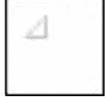

此外，你可能会好奇，如果我们向原始正方形添加另一个点，例如 (make-posn 40 30)，render-poly 会绘制什么：

```
> (render-poly MT (cons (make-posn 40 30) square-p))
```

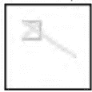

render-poly 始终在给定 Polygon 的末尾绘制三角形，并连接三角形之前的 Posn，而不是绘制所需的五边形。

虽然实验确认了我们设计的问题，但它们也表明该函数“几乎正确”。它连接 Posn 列表指定的连续点，然后从拖尾三角形的第一个 Posn 绘制到最后一个 Posn 的线段。如果跳过这一最后一步，函数将只是“连接点”，从而绘制一个“开放”多边形。通过连接第一个点和最后一个点，它就可以完成任务。

换句话说，我们失败分析暗示了一个两步解决方案：

- 1. 求解一个更一般的问题。


2. 使用解决这个一般问题的方案来解决原始问题。

我们从一般问题的陈述开始：

## 示例问题

设计一个函数，在给定场景中绘制给定点集之间的连接。

虽然 render-poly 的设计几乎解决了这个问题，但我们还是基本从头开始设计这个函数。首先，我们需要一个数据定义。除非我们至少有几个点，否则连接点没有意义。为了简单起见，我们要求至少有一个点：

```
; An NELoP is one of:
; -- (cons Posn '())
; -- (cons Posn NELoP)
```

其次，我们为“连接点”函数制定签名、目的说明和函数头：

```
; Image NELoP -> Image
; connects the dots in p by rendering lines in img
(define (connect-dots img p)
MT)
```

第三，我们将 render-poly 的示例改编为这个新函数。正如我们的失败分析所说，该函数将 p 上的第一个 Posn 连接到第二个，第二个连接到第三个，第三个连接到第四个，依此类推，一直到最后一个，最后一个不连接任何东西。下面是第一个示例（包含三个 Posn 的列表）的改编版本：

```
(check-expect (connect-dots MT triangle-p)
    (scene+line
    (scene+line MT 20 20 30 20 "red")
    20 10 20 20 "red"))
```

期望的值是一幅带有两条线的图像：一条从第一个 Posn 到第二个 Posn，另一条从第二个 Posn 到第三个 Posn。

### 练习 191

将 render-poly 函数的第二个示例改编为 connect-dots。

第四，我们使用处理非空列表的函数模板：

```
(define (connect-dots img p)
  (cond
    [(empty? (rest p)) (... (first p) ...)]
    [else (... (first p) ...
        ... (connect-dots img (rest p)) ...)]))
```

该模板有两个子句：一个用于只有一个 Posn 的列表，另一个用于包含多个元素的列表。由于两种情况都至少有一个 Posn，模板在两个子句中都包含 (first p)；第二个子句还包含 (connect-dots (rest p)) 以提醒我们数据定义第二个子句中的自引用。

第五步也是核心步骤，是将模板转换为函数定义。由于第一个子句最简单，我们先从它入手。正如我们之前所说，当给定列表只包含一个 Posn 时，不可能连接任何东西。因此，函数在第一个 cond 子句中直接返回 MT。对于第二个 cond 子句，让我们回顾一下模板表达式计算的内容：

- (first p) 提取第一个 Posn；
- (rest p) 从 p 中提取 NELoP；以及
- (connect-dots img (rest p)) 通过在 img 中渲染线条来连接 (rest p) 中的点。

从我们设计 render-poly 的第一次尝试中我们知道，connect-dots 需要在 (connect-dots img (rest p)) 的结果基础上添加一条线，即从 (first p) 到 (second p)。我们知道 p 包含第二个 Posn，因为否则 cond 的求值会选择第一个子句。

将一切整合在一起，我们得到如下定义：

```
(define (connect-dots img p)
  (cond
    [(empty? (rest p)) img]
    [else
     (render-line
      (connect-dots img (rest p))
      (first p)
      (second p))]))
```

这个定义看起来比 render-poly 有缺陷的版本更简单，尽管它比 render-poly 能够处理多出的两种 Posn 列表。

相反，我们说 connect-dots 泛化了 render-poly。后者的每个输入也是前者的输入。或者从数据定义的角度来说，每个 Polygon 也是一个 NELoP。但是，有许多 NELoP **不是** Polygon。确切地说，所有包含两个或一个元素的 Posn 列表都属于 NELoP，但不属于 Polygon。然而，你的关键洞察是，仅仅因为一个函数需要处理比另一个函数更多的输入，并 **不** 意味着前者比后者更复杂；泛化通常会简化函数定义。

> 这个论证是 **非正式** 的。如果你需要关于集合或函数之间关系的此类主张的 **正式** 论证，你将需要学习逻辑。的确，本书的设计过程深受逻辑影响，计算逻辑课程是一个自然的补充。一般而言，逻辑之于计算，正如分析之于工程。

如上所述，render-polygon 可以使用 connect-dots 连接给定 Polygon 的所有连续 Posn；为了完成任务，它还必须添加一条从第一个 Posn 到最后一个 Posn 的线。从代码角度来说，这只是意味着组合两个函数：connect-dots 和 render-line，但我们还需要一个从 Polygon 中提取最后一个 Posn 的函数。一旦我们得到这个愿望，render-poly 的定义就是一行代码：

```
; Image Polygon -> Image
; adds an image of p to img
(define (render-polygon img p)
  (render-line (connect-dots img p)
    (first p)
    (last p)))
```

为 `last` 制定愿望清单条目很简单：

```
; Polygon -> Posn
; extracts the last item from p
```

同样很明显，`last` 可能是一个通用有用的函数，我们最好为来自 NELoP 的输入来设计它：

```
; NELoP -> Posn
; extracts the last item from p
(define (last p)
  (first p))
```

停！为什么使用 `first` 来定义 `last` 的存根是可以接受的？

### 练习 192

论证在 Polygons 上使用 `last` 为何可以接受。同时论证为何你可以将 `connect-dots` 的模板改编为 `last`：

```
(define (last p)
  (cond
    [(empty? (rest p)) (... (first p) ...)]
    [else (... (first p) ... (last (rest p)) ...)]))
```

最后，为 `last` 开发示例，将它们转换为测试，并确保图 73 中 `last` 的定义在你的示例上能正常工作。

```
; Image Polygon -> Image
; adds an image of p to MT
(define (render-polygon img p)
  (render-line (connect-dots img p) (first p) (last p)))

; Image NELoP -> Image
; connects the Posns in p in an image
(define (connect-dots img p)
  (cond
    [(empty? (rest p)) MT]
    [else (render-line (connect-dots img (rest p))
           (first p)
           (second p))]))

; Image Posn Posn -> Image
; draws a red line from Posn p to Posn q into im
(define (render-line im p q)
  (scene+line
   im (posn-x p) (posn-y p) (posn-x q) (posn-y q) "red"))

; Polygon -> Posn
; extracts the last item from p
(define (last p)
  (cond
    [(empty? (rest (rest (rest p)))) (third p)]
    [else (last (rest p))]))
```

## 图 73：绘制多边形

总而言之，render-poly 的开发自然引导我们考虑连接一系列连续点的一般问题。我们可以通过定义一个将一般函数与其他辅助函数组合的函数来解决原始问题。因此，程序由一个相对简单的主函数——render-poly——和执行大部分工作的复杂辅助函数组成。你将反复看到，这种设计方法很常见，是设计和组织程序的好方法。

### 练习 193

定义 render-poly 的另外两个想法：

- render-poly 可以将 p 的最后一项 cons 到 p 上，然后调用 connect-dots。
- render-poly 可以通过一个在 Polygons 上工作的 add-at-end 版本，将 p 的第一项添加到 p 的末尾。

使用这两个想法定义 render-poly；确保两个定义都能通过测试用例。

### 练习 194

修改 connect-dots，使其额外接收一个 Posn，最后一个 Posn 将连接到该 Posn。然后修改 render-poly 以使用这个新版本的 connect-dots。

当然，像 last 这样的函数在功能齐全的编程语言中可用，类似 render-poly 的东西在 2htdp/image 库中也可用。如果你在想我们为什么刚刚设计了这些函数，请考虑本书和本节的标题。目标 **不** 是（仅仅）设计有用的函数，而是研究如何系统地设计代码。具体来说，本节是关于设计过程中的泛化思想；有关此思想的更多信息，请参见第三部分和第六部分。


## 12 项目：列表

本章介绍了若干扩展练习，旨在巩固你对设计要素的理解：批处理和交互式程序的设计、通过组合进行设计、设计愿望列表以及函数的设计食谱。第一节涉及真实世界数据的问题：英语词典和 iTunes 资料库。单词游戏问题需要两节：一节用于说明通过组合进行设计，另一节用于解决问题的核心。其余各节关于游戏和有限状态机。

> *本章依赖于 2htdp/batch-io 库。*

### 12.1 真实世界数据：词典

真实世界中的信息往往以大量形式出现，因此使用程序来处理它非常合理。例如，词典不仅包含十几个词，而是数十万个词。当你想要处理如此大量的信息时，必须使用小示例仔细设计程序。一旦你确信程序工作正常，就可以在真实世界数据上运行它们以获得真实结果。如果程序处理此大量数据太慢，请反思每个函数及其工作方式。思考是否可以消除任何冗余计算。

> 关于性能问题，请参见第 V 部分。从这里到那里，重点是系统地设计程序，以便你可以随后正确地探索性能问题。

图 74 显示了读取整个英语词典所需的一行代码。要了解此类词典的大小，请调整图中的代码以适应你的特定计算机，并使用 length 确定你的词典中有多少个词。截至今天（2017 年 7 月 25 日），我们的词典中有 235,886 个词。

```
; On OS X:
(define LOCATION "/usr/share/dict/words")
; On LINUX: /usr/share/dict/words or /var/lib/dict/words
; On WINDOWS: borrow the word file from your Linux friend
; A Dictionary is a List-of-strings.
(define AS-LIST (read-lines LOCATION))
; -- "a"
; -- ...
; -- "z"
; or, equivalently, a member? of this list:
(define LETTERS
  (explode "abcdefghijklmnopqrstuvwxyz"))
```

图 74：读取词典

**提示** 使用 list 为练习制定示例和测试。

### **练习 195.** 设计函数 starts-with#，它接受一个 Letter 和 Dictionary，然后计算给定 Dictionary 中有多少个词以给定 Letter 开头。一旦你知道你的函数正常工作，就确定你计算机的词典中有多少个词以 "e" 开头，以及有多少个以 "z" 开头。

### **练习 196.** 设计 count-by-letter。该函数接受一个 Dictionary，并统计每个字母在给定词典中作为词的首字母出现的频率。其结果是一个 Letter-Counts 列表，这是一种将字母和计数组合在一起的数据。

一旦你的函数设计完成，就确定你计算机的词典中所有字母各有多少个词出现。

**设计选择说明** 另一种选择是设计一个辅助函数，它接受一个字母列表和一个词典，并生成一个 Letter-Counts 列表，报告给定字母在词典中作为首字母出现的频率。你当然可以重用练习 195 的解决方案。**提示** 如果你设计这个变体，请注意该函数接受两个列表，这需要一个在第 23 章中详细介绍的设计问题。将 Dictionary 视为随行的原子数据，并根据需要将其传递给 starts-with#。

### **练习 197.** 设计 most-frequent。该函数接受一个 Dictionary。它生成在给定词典中出现频率最高的首字母的 Letter-Count。

你计算机的词典中最常用的字母是什么，以及它被使用了多少次？

**设计选择说明** 本练习要求将前一练习的解决方案与一个函数进行组合，该函数从 Letter-Counts 列表中选择正确的配对。设计后者函数有两种方法：

- 设计一个选择计数最大的配对的函数。
- 设计一个从已排序的配对列表中选择第一个的函数。

考虑同时设计两者。你更喜欢哪一个？为什么？

### **练习 198.** 设计 words-by-first-letter。该函数接受一个 Dictionary，并生成一个按字母分组的 Dictionary 列表，每个字母对应一个。

使用这个新函数重新设计练习 197 中的 most-frequent。将新函数命名为 most-frequent.v2。完成设计后，确保这两个函数在你的计算机词典上计算出相同的结果：

```
(check-expect
 (most-frequent AS-LIST)
 (most-frequent.v2 AS-LIST))
```

**设计选择说明** 对于 words-by-first-letter，你在处理给定词典不包含某个字母的任何单词的情况时有选择权：

- 一种替代方案是从整体结果中排除生成的空词典。这样做既简化了函数的测试，也简化了 most-frequent.v2 的设计，但也需要设计一个辅助函数。
- 另一种方案是在查找某个字母的单词时包含 ’() 作为结果，即使没有任何单词。这种替代方案避免了第一种替代方案所需的辅助函数，但为 most-frequent.v2 的设计增加了复杂性。结束

**中间数据与除林说明** 这个词计数函数的第二个版本通过创建一个大的中间数据结构来计算所需结果，该结构除了其部分被计数外没有实际用途。有时，编程语言会通过将两个函数融合为一个来自动消除它们，这种程序变换也称为除林。当你知道语言不执行除林操作时，如果程序处理数据不够快，请考虑消除此类数据结构。

### 12.2 真实世界数据：iTunes

Apple 的 iTunes 软件广泛用于收集音乐、视频、电视节目等。你可能希望分析你的 iTunes 应用程序收集的信息。提取其数据库实际上非常简单。选择应用程序的“文件”菜单，选择“资料库”，然后选择“导出”——瞧，你可以导出所谓的 iTunes 信息的 XML 表示。第 22 章详细介绍了 XML 处理；在这里，我们依赖 2htdp/itunes 库来获取信息。具体来说，该库使你能够检索 iTunes 资料库中包含的音乐曲目。

虽然细节有所不同，但 iTunes 资料库为每个音乐曲目维护以下某些类型的信息，偶尔会少一些：

| 字段 | 描述 | 示例 |
|------|------|------|
| Track ID | 相对于你的资料库的曲目唯一标识符 | 442 |
| Name | 曲目标题 | Wild Child |
| Artist | 制作艺术家 | Enya |
| Album | 其所属专辑的标题 | A Day Without |
| Genre | 曲目所属的音乐流派 | New Age |
| Kind | 音乐的编码格式 | MPEG audio file |
| Size | 文件大小 | 4562044 |
| Total Time | 曲目长度（毫秒） | 227996 |
| Track Number | 曲目在专辑中的位置 | 2 |
| Track Count | 专辑中的曲目数量 | 11 |
| Year | 发行年份 | 2000 |
| Date Added | 曲目添加时间 | 2002-7-17 3:55:14 |
| Play Count | 播放次数 | 20 |
| Play Date | 上次播放时间 | 3388484113 Unix 秒 |
| Play Date UTC | 上次播放时间 | 2011-5-17 17:35:13 |

与往常一样，首要任务是为此信息选择一种 BSL 数据表示。在本节中，我们对音乐曲目使用**两种**表示：一种基于结构，另一种基于列表。前者仅在所有信息都可用时，为每个曲目记录固定数量的属性；后者则带有可用的任何信息，以数据形式表示。各自适用于特定用途；对于某些用途，两种表示都很有用。

*除 2htdp/batch-io 库外，本节还依赖 2htdp/itunes 库。*

图 75 和图 76 介绍了由 2htdp/itunes 库实现的基于结构的曲目表示。曲目结构类型带有八个字段，每个字段代表曲目的某个属性。大多数字段包含原子数据类型，例如字符串和数字；其他字段包含日期，日期是具有六个字段的结构类型。2htdp/itunes 库导出了曲目和日期结构类型的所有谓词和选择器，但不提供构造函数，而是提供检查过的构造函数。


; 2htdp/itunes 库文档，第 1 部分：

; LTracks 是以下之一：
; -- '()
; -- (cons Track LTracks)

(define-struct track
    [name artist album time track# added play# played])

; Track 是一个结构：
;   (make-track String String String N N Date N Date)
; 解释：实例按顺序记录：曲目标题、制作艺术家、所属专辑、
; 播放时间（以毫秒计）、在专辑中的位置、添加日期、
; 播放次数以及上次播放日期

(define-struct date [year month day hour minute second])
; Date 是一个结构：
;   (make-date N N N N N N N)
; 解释：实例记录六条信息：
; 日期的年份、月份（1 到 12 之间，包含 1 和 12）、
; 日期（1 到 31 之间）、小时（0 到 23 之间）、
; 分钟（0 到 59 之间）和秒（也在 0 到 59 之间）。

### 图 75：将 iTunes 曲目表示为结构（结构）

; Any Any Any Any Any Any Any Any -> Track 或 #false
; 为合法输入创建一个 Track 实例
; 否则生成 #false
(define (create-track name artist album time
                      track# added play# played)
  ...)

; Any Any Any Any Any Any Any -> Date 或 #false
; 为合法输入创建一个 Date 实例
; 否则生成 #false
(define (create-date y mo day h m s)
  ...)

; String -> LTracks
; 从文件名（iTunes 的 XML 导出）中的文本创建曲目列表表示
(define (read-itunes-as-tracks file-name)
  ...)

### 图 76：将 iTunes 曲目表示为结构（函数）

_2htdp/itunes_ 库描述的最后一个元素是一个函数，它读取 iTunes XML 库描述并提供曲目列表（LTracks）。当你从某个 iTunes 应用导出 XML 库后，可以运行以下代码片段来检索所有记录：

```
; modify the following to use your chosen name
(define ITUNES-LOCATION "itunes.xml")

; LTracks
(define itunes-tracks
  (read-itunes-as-tracks ITUNES-LOCATION))
```

将代码片段保存在与 iTunes XML 导出文件相同的文件夹中。请记住不要将 itunes-tracks 用于示例；它太大了，不适合此目的。确实，它可能非常大，以至于每次在 DrRacket 中运行 BSL 程序时读取文件都需要花费大量时间。因此，在设计函数时，你可能希望将第二行注释掉。只有在需要计算 iTunes 库相关信息时才取消注释。

**练习 199.** 虽然重要的数据定义已提供，但设计配方的第一步仍不完整。编造 Dates、Tracks 和 LTracks 的示例。这些示例在后续练习中作为输入非常有用。

**练习 200.** 设计函数 total-time，它接收一个 LTracks 元素并生成总的播放时间。程序完成后，计算你 iTunes 库的总播放时间。

**练习 201.** 设计 select-all-album-titles。该函数接收一个 LTracks 并生成一个专辑标题列表（字符串列表）。

同时设计函数 create-set。它接收一个字符串列表并构造一个包含给定列表中每个字符串且仅出现一次的列表。**提示** 如果字符串 s 位于给定列表的开头，且在列表其余部分也出现，则 create-set 不保留 s。

最后设计 select-album-titles/unique，它接收一个 LTracks 并生成一个唯一专辑标题列表。使用此函数确定你 iTunes 库中的所有专辑标题，并找出它包含多少个不同的专辑。

**练习 202.** 设计 select-album。该函数接收一个专辑标题和一个 LTracks。它从后者中提取属于给定专辑的曲目列表。

**练习 203.** 设计 `select-album-date`。该函数接收一个专辑标题、一个日期和一个 LTracks。它从后者中提取属于给定专辑且在给定日期后播放过的曲目列表。**提示** 你必须设计一个函数，它接收两个 Date 并判断第一个是否在第二个之前发生。

**练习 204.** 设计 `select-albums`。该函数接收一个 LTracks 元素。它生成一个 LTracks 列表，每个专辑一个。每个专辑由其标题唯一标识，在结果中仅出现一次。**提示** (1) 你希望使用前面练习的一些解决方案。(2) 该分组函数接收两个列表：专辑标题列表和曲目列表；它将后者视为原子，直到将其交给辅助函数。参见练习 196。

**术语** 名称以 `select-` 开头的函数被称为 _数据库查询_。有关更多详细信息，请参见第 23.7 章。**结束**

图 77 显示了 _2htdp/itunes_ 库如何使用列表表示曲目。LLists 是曲目表示的列表，每个表示都是一个配对字符串与四种值的列表列表。函数 `read-itunes-as-lists` 读取 iTunes XML 库并生成一个 LLists 元素。因此，如果你将以下定义添加到程序中，就可以访问所有曲目信息：

```
; modify the following to use your chosen name
(define ITUNES-LOCATION "itunes.xml")

; LLists
(define list-tracks
 (read-itunes-as-lists ITUNES-LOCATION))
```

### 图 77：将 iTunes 曲目表示为列表

然后将其保存在存储 iTunes 库的同一文件夹中。

**练习 205.** 开发 LAssoc 和 LLists 的示例，即曲目的列表表示和此类曲目列表的列表。

**练习 206.** 设计函数 find-association。它接收三个参数：一个名为 key 的字符串、一个 LAssoc 和一个名为 default 的 Any 元素。它生成第一个第一项等于 key 的 Association，如果没有这样的 Association，则生成 default。

**注意** 设计此函数后，再阅读有关 assoc 的内容。

**练习 207.** 设计 total-time/list，它接收一个 LLists 并生成总的播放时间。**提示** 首先解决练习 206。

完成设计后，计算你 iTunes 库的总播放时间。将此结果与练习 200 中 total-time 函数计算的时间进行比较。为什么会有差异？

**练习 208.** 设计 boolean-attributes。该函数接收一个 LLists 并生成与布尔属性关联的字符串。**提示** 使用练习 201 中的 create-set。

完成后，确定你的 iTunes 库为其曲目使用了多少个布尔值属性。它们合理吗？

**注意** 基于列表的表示比基于结构的表示稍逊一筹。在这种语境下，偶尔会使用“半结构化”一词。此类列表表示容纳那些很少出现且因此不适合结构类型的属性。人们经常使用此类表示来探索未知信息，并在格式众所周知后再引入结构。设计函数 track-as-struct，在可能时将 LAssoc 转换为 Track。**结束**

### 12.3 文字游戏，组合示例

你们中的一些人会在报纸和杂志上解决文字谜题。试试这个：

**示例问题** 给定一个单词，找出所有由相同字母组成的单词。例如，“cat”也可以拼成“act”。

让我们通过一个示例进行讲解。假设给定“dear”。这四个字母有二十四种可能的排列：

| ader | aedr | aerd | adre | arde | ared |
| --- | --- | --- | --- | --- | --- |
| daer | eadr | eard | dare | rade | raed |
| dear | edar | erad | drae | rdae | read |
| dera | edra | erda | drea | rdea | reda |

在这个列表中，有三个合法单词：“read”、“dear”和“dare”。

**注意** 如果一个单词包含两次相同的字母，那么所有重新排列的集合中可能包含多个相同字符串的副本。就我们的目的而言，这是可以接受的。对于实际程序，你可能希望通过使用集合而不是列表来避免重复条目。参见第 9.6 章。**结束**

系统地枚举所有可能的排列显然是一个程序的任务，在英语词典中搜索也是如此。本节介绍搜索函数的设计，将另一个问题的解决留给下一节。通过分离这两个问题，第一部分可以专注于系统程序设计的高层次概念。

有关处理真实词典的内容，请参见第 12.1 章。

让我们想象一下如何手动解决这个问题。如果你有足够的时间，你可能会枚举给定单词中所有字母的所有可能排列，然后只挑选出那些在词典中也出现的变体。显然，程序也可以以这种方式进行，这暗示了一种通过组合进行的自然设计，但，一如既往，我们将系统地进行，并首先为我们的输入和输出选择数据表示。

乍一看，将单词表示为 Strings 并将结果表示为单词列表或 List-of-strings 是自然的。基于这一选择，我们可以制定


一个签名和目的陈述：

```racket
; String -> List-of-strings
; finds all words that use the same letters as s
(define (alternative-words s)
...)
```

下一步，我们需要一些示例。如果给定的单词是 “cat”，我们要处理三个字母：c、a 和 t。一些尝试表明，这些字母有六种排列：cat、cta、tca、tac、act 和 atc。其中两个是实际单词：“cat” 和 “act”。由于 alternative-words 生成一个字符串列表，因此有两种方式来表示结果：(list "act" "cat") 和 (list "cat" "act")。幸运的是，BSL 提供了一种方式来表达函数返回两种可能结果之一：

```racket
(check-member-of (alternative-words "cat")
 (list "act" "cat")
 (list "cat" "act"))
```

停止！查阅文档中关于 check-member-of 的说明。
处理这个示例暴露了两个问题：

- 第一个问题涉及测试。假设我们使用了单词 “rat”，它有三个变体：“rat”、“tar” 和 “art”。在这种情况下，我们必须制定六个列表，每个列表都可能是函数的结果。对于像 “dear” 这样有四个可能变体的单词，制定测试会更加困难。

- 第二个问题涉及单词表示的选择。尽管 String 乍看之下很自然，但示例澄清了我们的一些函数必须将单词视为字母序列，并且可以随意重新排列它们。虽然可以在 String 内重新排列字母，但字母列表显然更适合此目的。

让我们逐个解决这些问题，从测试开始。
假设我们希望为 alternative-words 和 "rat" 制定一个测试。
从上面我们知道，结果必须包含 "rat"、"tar" 和 "art"，但我们无法知道这些单词在结果中出现的顺序。

在这种情况下，check-satisfied 派上用场了。我们可以将其与一个函数一起使用，该函数检查字符串列表是否包含我们的三个字符串：

```racket
; List-of-strings -> Boolean
(define (all-words-from-rat? w)
  (and (member? "rat" w)
       (member? "art" w)
       (member? "tar" w) ))
```

请参见间奏 1。

有了这个函数，为 alternative-words 制定测试就很容易了：

```racket
(check-satisfied (alternative-words "rat")
             all-words-from-rat?)
```

**关于数据与设计的说明** 本讨论表明，alternative-words 函数构建的是一个集合，而不是列表。要详细了解区别，请参见第 9.6 章。这里只需知道，集合表示值的集合，**不考虑**值的顺序或这些值出现的次数。当一种语言不支持集合的数据表示时，程序员往往会诉诸一种接近的替代方案，例如这里的 List-of-strings 表示。随着程序的增长，这种选择可能会给程序员带来麻烦，但解决这类问题将是第二本书的主题。**结束**

关于单词表示的问题，我们将其推迟到下一节。具体来说，我们说下一节将介绍：(1) 适合重新排列字母的 Word 数据表示，(2) List-of-words 的数据定义，以及 (3) 将 Word 映射到 List-of-words 的函数，即所有可能重新排列的列表：

```racket
; A Word is ...
```

```racket
; A List-of-words is ...
```

```racket
; Word -> List-of-words
; finds all rearrangements of word
(define (arrangements word)
  (list word))
```

**练习 209。** 上述内容让我们有两个额外的愿望：一个函数接收一个 String 并生成相应的 Word，另一个函数用于相反方向。以下是愿望列表条目：

```racket
; String -> Word
; converts s to the chosen word representation
(define (string->word s) ...)
```

```racket
; Word -> String
; converts w to a string
(define (word->string w) ...)
```

请在下一节中查找 Word 的数据定义，并完成 `string->word` 和 `word->string` 的定义。**提示** 你可能希望查看 BSL 提供的函数列表。

解决了这两个小问题后，我们回到 alternative-words 的设计。我们现在有：(1) 签名，(2) 目的陈述，(3) 示例和测试，(4) 关于数据表示选择的见解，以及 (5) 将问题分解为两个主要步骤的想法。

因此，我们不是创建模板，而是写下我们心中想要的组合：

```racket
(in-dictionary (arrangements s))
```

该表达式表示，给定一个单词 s，我们使用 arrangements 创建字母的所有可能重新排列列表，并使用 in-dictionary 选择那些也出现在字典中的重新排列。

停止！查找这两个函数的签名以确保组合可行。你具体需要检查什么？

这个表达式未能捕获第四点，即不使用普通字符串来重新排列字母的决定。在将 s 交给 arrangements 之前，我们需要将其转换为一个单词。幸运的是，练习 209 正好要求这样的函数：

```racket
(in-dictionary
 (... (arrangements (string->word s))))
```

同样，我们需要将生成的单词列表转换为字符串列表。虽然练习 209 要求转换单个单词的函数，但这里我们需要处理它们列表的函数。是时候提出另一个愿望了：

```racket
(in-dictionary
 (words->strings
 (arrangements (string->word s))))
```

停止！words->strings 的签名是什么，其目的是什么？图 78 收集了所有部分。接下来的练习要求你设计剩余的函数。

```racket
; List-of-strings -> Boolean
(define (all-words-from-rat? w)
 (and
 (member? "rat" w) (member? "art" w) (member? "tar" w)))

; String -> List-of-strings
; finds all words that the letters of some given word spell
(check-member-of (alternative-words "cat")
 (list "act" "cat")
 (list "cat" "act"))

(check-satisfied (alternative-words "rat")
 all-words-from-rat?)

(define (alternative-words s)
 (in-dictionary
 (words->strings (arrangements (string->word s)))))

; List-of-words -> List-of-strings
; turns all Words in low into Strings
(define (words->strings low) '())

; List-of-strings -> List-of-strings
; picks out all those Strings that occur in the dictionary
(define (in-dictionary los) '())
```

图 78：查找替代单词

**练习 210。** 完成图 78 中指定的 `words->strings` 函数的设计。**提示** 使用你对练习 209 的解决方案。

**练习 211。** 完成图 78 中指定的 `in-dictionary` 的设计。**提示** 请参见第 12.1 章，了解如何读取字典。

### 12.4 文字游戏，问题的核心

目标是设计 arrangements，一个消耗 Word 并生成单词逐字母重新排列列表的函数。这个扩展练习强化了深度愿望列表的必要性，即一份所需函数列表，随着你完成的每个函数而似乎越来越长。

> 数学术语是排列。

如上所述，字符串可以作为单词的表示，但字符串是原子的，而 arrangements 需要重新排列其字母这一事实本身就要求一种不同的表示。因此，我们选择的单词数据表示是 1Strings 的列表，其中输入中的每个项目代表一个字母：

```racket
; A Word is one of:
; -- '() or
; -- (cons 1String Word)
; interpretation a Word is a list of 1Strings (letters)
```

**练习 212。** 写出 List-of-words 的数据定义。编造 Words 和 List-of-words 的示例。最后，使用 check-expect 制定上面的函数示例。而不是完整示例，考虑使用仅包含两个字母的单词，例如 "d" 和 "e"。

arrangements 的模板是列表处理函数的模板：

```racket
; Word -> List-of-words
; creates all rearrangements of the letters in w
(define (arrangements w)
 (cond
   [(empty? w) ...]
   [else (... (first w) ...
              ... (arrangements (rest w)) ...)]))
```

为第五步做准备，让我们看看模板的 cond 行：


- 如果输入是 '()，则输入只有一种可能的重排：即 '() 这个词。因此结果是 (list '())，即只包含空列表作为唯一项的列表。

- 否则，单词中有一个首字母，且 (first w) 即为该字母。同时，递归会产生单词其余部分的所有可能重排列表。例如，如果列表是

```
(list "d" "e" "r")
```

那么递归即为 (arrangements (list "e" "r"))。它将产生结果

```
(cons (list "e" "r")
 (cons (list "r" "e")
 '()))
```

要获得整个列表的所有可能重排，现在必须将首项（在我们的例子中是 "d"）插入到这些单词的所有可能字母之间，以及开头和结尾。

我们的分析表明，如果能够以某种方式将一个字母插入到许多不同单词的所有位置中，就可以完成 arrangements。任务描述的最后一方面隐含地提到了列表，并且遵循本章的建议，需要一个辅助函数。我们将此函数命名为 insert-everywhere/in-all-words，并使用它来完成 arrangements 的定义：

```
(define (arrangements w)
 (cond
 [(empty? w) (list '())]
 [else (insert-everywhere/in-all-words (first w)
 (arrangements (rest w)))]))
```

- **练习 213.** 设计 insert-everywhere/in-all-words。它接收一个 1String 和一个单词列表。结果是一个单词列表，类似于其第二个参数，但将第一个参数插入到给定列表中所有单词的开头、所有字母之间以及结尾。

从一个完整的愿望列表条目开始。为空列表、包含一个字母单词的列表以及包含两个字母单词的另一个列表等补充测试。在继续之前，请仔细研究以下三个提示。

### Hints

- (1) 重新考虑上面的示例。它指出需要将 "d" 插入到单词 (list "e" "r") 和 (list "r" "e") 中。因此，以下应用是一个自然的示例候选：

```
(insert-everywhere/in-all-words "d"
  (cons (list "e" "r")
    (cons (list "r" "e")
      '())))
```

- (2) 你想使用 BSL+ 操作 append，它接收两个列表并生成这两个列表的串联：

```
> (append (list "a" "b" "c") (list "d" "e"))
(list "a" "b" "c" "d" "e")
```

像 append 这样的函数的开发是第 23 章的主题。

- (3) 本练习的解决方案是一系列函数。请耐心遵循设计配方，并系统地处理你的愿望列表。

- **练习** 214. 将 arrangements 与第 12.3 章的部分程序集成。在确保整个测试套件通过后，在一些你喜欢的示例上运行它。

### 12.5 喂蠕虫

**蠕虫**——也称为 *贪吃蛇*——是最古老的电脑游戏之一。当游戏开始时，一条蠕虫和一块食物出现。蠕虫正朝着墙壁移动。不要让它到达墙壁；否则游戏结束。相反，使用箭头键控制蠕虫的移动。

游戏的目标是让蠕虫尽可能多地吃食物。随着蠕虫吃食物，它会变长；越来越多的片段出现。一旦一块食物被消化，另一块食物就会出现。然而，蠕虫的增长会危及蠕虫本身。当它增长得足够长时，它可能会撞到自身，如果发生这种情况，游戏也会结束。

图 79 显示了一系列屏幕截图，说明游戏在实际中如何运行。左侧显示初始设置。蠕虫由一个红色片段组成，即其头部。它正朝着食物移动，食物显示为一个绿色圆盘。中间的屏幕截图显示蠕虫即将吃掉一些食物的情况。在最右侧的屏幕截图中，蠕虫撞上了右墙。游戏结束；玩家得了 11 分。

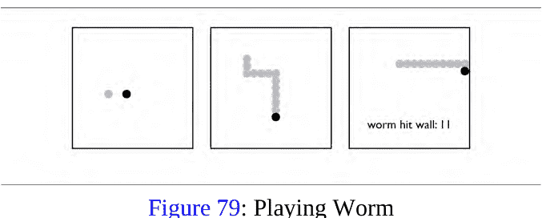

以下练习将指导你设计和实现一个蠕虫游戏。与第 10.2 章一样，这些练习说明了如何通过迭代细化来解决非平凡问题。也就是说，你不会一次性设计整个交互程序，而是在多个阶段（称为 *迭代*）中进行。每个迭代都会添加细节并完善程序——直到它让你或你的客户满意。如果你对练习的结果不满意，请随意创建变体。

- **练习 215.** 设计一个 world 程序，它持续移动一条单片段蠕虫，并允许玩家使用四个方向箭头键控制蠕虫的移动。你的程序应使用红色圆盘来呈现蠕虫的唯一片段。对于每个时钟滴答，蠕虫应移动一个直径。

### Hints

- (1) 重读第 3.6 章以回忆如何设计 world 程序。当你定义 worm-main 函数时，使用时钟滴答的速率作为其参数。请参阅 on-tick 的文档以了解如何描述速率。（2）当你为蠕虫开发数据表示时，请考虑使用两种不同的表示：物理表示和逻辑表示。物理表示跟踪蠕虫在画布上的实际物理位置；逻辑表示计算蠕虫距离左侧和顶部有多少个（片段宽度）。对于这两种表示中的哪一种，更容易更改“游戏”的物理外观（蠕虫片段大小、游戏框大小）？

- **练习 216.** 修改你在练习 215 中的程序，使其在蠕虫到达世界墙壁时停止。当程序因这一条件而停止时，它应该在世界场景的左下角显示文本 "worm hit border" 来呈现最终场景。提示 你可以在 big-bang 中使用 stop-when 子句以特殊方式呈现最后一个 world。

- **练习 217.** 为带有尾部的蠕虫开发数据表示。蠕虫的尾巴是一系列可能为空的“连接”片段。这里“连接”意味着一个片段的坐标与其前一个片段的坐标在最多一个方向上不同。为简化问题，请以相同方式对待所有片段——头部片段和尾部片段。

现在修改你在练习 215 中的程序，以容纳多片段蠕虫。保持简单：(1) 你的程序可以将所有蠕虫片段呈现为红色圆盘，并且 (2) 忽略蠕虫可能撞到墙壁或自身的情况。提示 实现蠕虫移动的一种方法是在其移动方向添加一个片段，并删除最后一个片段。

- **练习 218.** 重新设计你在练习 217 中的程序，使其在蠕虫撞到世界墙壁或撞到自身时停止。显示一条类似于练习 216 中的消息，以说明程序是因为蠕虫撞到墙壁还是因为它撞到自身而停止。

### Hints

- (1) 要确定蠕虫是否即将撞到自身，请检查如果它移动，头部的位置是否会与其旧尾片段中的一个重合。（2）阅读 member? 函数的文档。

- **练习 219.** 为你在练习 218 中的程序配备食物。在任何时间点，框中应包含一块食物。为简化问题，一块食物的大小与蠕虫片段相同。当蠕虫的头部位于与食物相同的位置时，蠕虫就会吃掉食物，这意味着蠕虫的尾部会延长一个片段。当一块食物被吃掉后，另一块会在不同位置出现。

为游戏添加食物需要更改 world 状态的数据表示。除了蠕虫之外，状态现在还包括食物的表示，尤其是其当前位置。游戏表示的更改暗示了处理事件的新函数，尽管这些函数可以重用用于蠕虫的函数（来自练习 218）及其测试用例。这也意味着滴答处理程序不仅要移动蠕虫；此外，它还必须管理进食过程和新食物的创建。

你的程序应该在框内随机放置食物。为正确地做到这一点，你需要一种之前未见过的设计技术——即生成递归，在第 V 部分中介绍——因此我们在图 80 中提供了这些函数。然而，在使用它们之前，请先解释这些函数的工作原理——假设 MAX 大于 1——然后制定目的陈述。

```
; Posn -> Posn
; ???
(check-satisfied (food-create (make-posn 1 1)) not=-1-1?)
(define (food-create p)
  (food-check-create
   p (make-posn (random MAX) (random MAX))))
; Posn Posn -> Posn
; generative recursion
; ???
(define (food-check-create p candidate)
  (if (equal? p candidate) p (food-create p) candidate))
; Posn -> Boolean
; use for testing only
(define (not=-1-1? p)
  (not (and (= (posn-x p) 1) (= (posn-y p) 1))))
```

图 80：随机放置食物


**提示** (1) 理解“进食”的一种方式是说：头部移动到食物曾经所在的位置，尾部增长一个线段，插入在头部曾经所在的位置。为什么这种解释作为函数容易设计？(2) 我们发现，为最后一步向 `worm-main` 函数添加第二个参数很有用，即一个 **布尔值**，用于确定 `big-bang` 是否在单独的窗口中显示世界的当前状态；请参阅关于状态的文档，了解如何请求此信息。

完成这最后一个练习后，你就拥有一个完整的贪吃蛇游戏。现在修改你的 `worm-main` 函数，使其返回最终蛇的长度。然后在 DrRacket 中使用 `Racket` 菜单下的 `create Executable`，将你的程序转换为任何人都可以启动的程序，而不仅仅是了解 BSL+ 的人。

你也可以考虑为游戏增加额外的变化，使它真正成为你自己的游戏。我们尝试过有趣的游戏结束信息、在场景中放置几块不同的食物、在房间里添加额外障碍物，以及其他一些想法。你能想到什么？

### 12.6 简单俄罗斯方块

俄罗斯方块是软件早期的另一款游戏。由于设计一款完整的俄罗斯方块游戏需要大量劳动，但收益有限，本节聚焦于一个简化版本。如果你感到雄心勃勃，可以查找俄罗斯方块的真实运作方式，并设计一个完整版本。

在我们的简化版本中，游戏从单个方块从场景顶部掉落开始。一旦其中一个方块落在地面上，它就会停下来，另一个方块开始从某个随机位置掉落。玩家可以使用“左”和“右”方向键控制掉落的方块。一旦方块落在画布底部或某个已经停止的方块上方，它就会停下来并变得不可移动。很快，方块就会堆叠起来；如果一堆方块到达画布顶部，游戏结束。自然，本游戏的目标是尽可能多地落下方块。参见图 81，了解该想法的示意图。

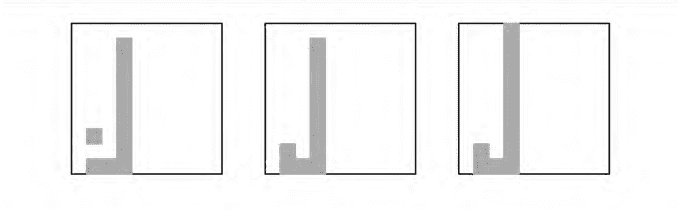

图 81：简单俄罗斯方块

根据此描述，我们可以参考第 3.6 章中关于交互式程序的设计准则。它们要求将恒定属性与可变属性分开。前者可以写为“物理”和图形常量；后者则暗示了构成简单俄罗斯方块游戏所有可能状态的数据。因此，这里有一些示例：

- 游戏的宽度和高度是固定的，方块也是如此。在 BSL+ 中，你需要像这样的定义：

```
(define WIDTH 10) ; # of blocks, horizontally
(define SIZE 10) ; blocks are squares
(define SCENE-SIZE (* WIDTH SIZE))
(define BLOCK ; red squares with black rims
 (overlay
   (square (- SIZE 1) "solid" "red")
   (square SIZE "outline" "black")))
```

在继续阅读之前，先解释这些定义。

- 方块的“地貌”因游戏而异，也随时钟滴答而变化。让我们更精确地说明。方块的外观保持不变；它们的位置不同。

现在，我们面临的核心问题是为掉落方块和地面上的方块地貌设计数据表示。对于掉落的方块，同样有两种可能性：一种是选择“物理”表示，另一种是“逻辑”表示。**物理**表示跟踪画布上方块的实际物理**位置**；*逻辑*表示则计算方块距离左侧和顶部有多少个方块宽度。对于停止的方块，选择比单个方块更多：物理位置列表、逻辑位置列表、堆叠高度列表，等等。

有关相关的设计决策，请参见练习 215。

在本节中，我们为你选择了数据表示：

```
(define-struct tetris [block landscape])
(define-struct block [x y])

; A Tetris is a structure:
; (make-tetris Block Landscape)
; A Landscape is one of:
; -- '()
; -- (cons Block Landscape)
; A Block is a structure:
; (make-block N N)
; interpretations
; (make-block x y) depicts a block whose left
; corner is (* x SIZE) pixels from the left and
; (* y SIZE) pixels from the top;
; (make-tetris b0 (list b1 b2 ...)) means b0 is the
; dropping block, while b1, b2, and ... are resting
```

### 练习 220。

当你面对一个复杂的数据定义——例如俄罗斯方块游戏状态的数据定义时，你首先要创建各种数据集合的实例。这里有一些示例名称，你稍后可以用于功能示例：

```
(define landscape0 ...)
(define block-dropping ...)
(define tetris0 ...)
(define tetris0-drop ...)
...
(define block-landed (make-block 0 (- HEIGHT 1)))
...
(define block-on-block (make-block 0 (- HEIGHT 2)))
```

设计程序 tetris-render，将给定的 Tetris 实例转换为图像。使用 DrRacket 的交互区域来开发渲染你（极其）简单的数据示例的表达式。然后将功能示例作为单元测试和函数本身来制定。

### 练习 221。

设计交互式程序 tetris-main，它显示方块从画布顶部沿直线掉落，落在地面上或已经停止的方块上。tetris-main 的输入应决定时钟滴答的速率。请参阅 on-tick 的文档，了解如何指定速率。

要发现方块是否落地，我们建议你让它掉落，并检查它是否在地面上，或者是否与停止方块列表中的某个方块重叠。提示：阅读 member? 原语的文档。

当方块落地时，你的程序应立即创建另一个方块，它沿着当前方块右侧的一列下落。如果当前方块已经在最右侧一列，则下一个方块应使用最左侧一列。或者，定义函数 block-generate，它随机选择一个与当前列不同的列；请参阅练习 219 以获得灵感。

### 练习 222。

修改练习 221 中的程序，使玩家可以控制掉落方块的水平移动。每次玩家按下“左”方向键时，掉落的方块应向左移动一列，除非它已在第 0 列，或其左侧已经有一堆停止的方块。同样，每次玩家按下“右”时，如果可能，掉落的方块应向右移动一列。

### 练习 223。

为练习 222 中的程序添加 stop-when 子句。当某一列包含足够多的方块以“接触”画布顶部时，游戏结束。

一旦你解决了练习 223，你就拥有一个简陋的俄罗斯方块游戏。在向朋友展示之前，你或许想对其进行一些润色。例如，最终画布可以显示一段文字，说明玩家堆叠了多少个方块。或者每个画布都可以包含这样的文字。选择权在你。

### 12.7 太空战争

第 6 章提及一款动作较少的太空入侵者游戏；玩家只能来回移动地面部队。第 9.5 章使玩家可以随意发射任意数量的弹药。本节提出了一些练习，帮助你完成这个游戏。

一如既往，一架 UFO 正试图降落在地球上。玩家的任务是阻止 UFO 降落。为此，游戏附带一辆可以发射任意数量弹药的坦克。当其中一颗弹药足够接近 UFO 的重心时，游戏结束，玩家获胜。如果 UFO 足够接近地面，玩家就输了。

### 练习 224。

运用前两节学到的经验，缓慢设计游戏扩展，一次添加一个游戏功能。始终使用设计配方，并遵循辅助函数的指导原则。如果你喜欢这个游戏，可以添加其他功能：显示滚动文字；为 UFO 配备可以消灭坦克的炸弹；创建一支进攻的 UFO 舰队；最重要的是，发挥你的想象力。

如果你不喜欢 UFO 和坦克互相射击，可以使用相同的想法制作一个类似的、文明的游戏。

### 练习 225。

设计一款消防游戏。

游戏设定在西部各州，大火在广袤的森林中肆虐。它模拟了空中消防行动。具体来说，玩家扮演一名飞机飞行员，向地面上的火灾投下水量。玩家控制飞机的水平移动和水量的释放。

你的游戏软件会在地面上的随机位置引发火灾。你可能希望限制火灾数量，使其成为当前燃烧的火灾数量或其他因素的函数。游戏的目标是在有限的时间内扑灭所有火灾。**提示** 使用本节所描述的迭代设计方法来创建这个游戏。


### 12.8 有限状态机

有限状态机（FSM）和正则表达式是编程中无处不在的元素。如第 4.7 章所述，状态机是思考世界程序的一种方式。相反，练习 109 展示了如何设计实现 FSM 并检查玩家是否按下特定一系列按键的世界程序。

你或许还记得，有限状态机与正则表达式等价。因此，计算机科学家倾向于说 FSM 接受与特定正则表达式匹配的按键，例如来自练习 109 的这个

```
a (b|c) * d
```

。如果你想要一个识别不同模式的程序，比如说，

```
a (b|c) * a
```

，你只需适当修改现有程序即可。这两个程序会相互类似，如果你为几种不同的正则表达式重复这个练习，最终会得到一大堆长得差不多的程序。

一个自然的想法是寻找一个通用解决方案，即一个消耗 FSM 数据表示并识别玩家是否按下匹配按键序列的世界程序。本节介绍了这样一个世界程序的设计，尽管是一个大大简化的版本。具体来说，这些 FSM 没有初始状态或最终状态，匹配过程忽略实际的按键；相反，只要按下任何键，就会发生从一个状态到另一个状态的转换。此外，我们要求状态是颜色字符串。这样，解释 FSM 的程序就可以简单地将当前状态显示为一种颜色。

设计选择备注。这里是另一次泛化的尝试：

示例问题：设计一个在特定 KeyEvents 列表上解释给定 FSM 的程序。也就是说，程序消耗一个 FSM 的数据表示和一个字符串。如果字符串与对应于该 FSM 的正则表达式匹配，其结果为 #true；否则为 #false。

然而，事实证明，你**无法使用**前两部分的原理来设计这个程序。事实上，解决这个问题要等到第 30 章；参见练习 476。结束

简化后的问题描述规定了若干要点，包括 FSM 表示的数据定义、其状态的性质以及它们作为图像的外观。图 82 收集了这些信息。它以 FSM 的数据定义开头。如你所见，FSM 只是一个 Transition 列表。我们必须使用列表，因为我们希望世界程序能与任何 FSM 一起工作，这意味着有限但任意多的状态数量。每个 Transition 在一个结构中组合两个状态：当前状态和下一个状态，即当玩家按下键时机器转换到的状态。数据定义的最后部分指出，状态只是一个颜色名称。

```
;; An FSM is one of:
;; -- '()
;; -- (cons Transition FSM)
(define-struct transition [current next])
;; A Transition is a structure:
;; (make-transition FSM-State FSM-State)
;; FSM-State is a Color.
;; interpretation An FSM represents the transitions that a
;; finite state machine can take from one state to another
;; in reaction to keystrokes
```

图 82：一般情况下表示和解释有限状态机

### 练习 226. 设计 state=?，一种用于状态的等价判断谓词。

由于这个定义比较复杂，我们遵循设计配方并创建一个示例：

```scheme
(define fsm-traffic
  (list (make-transition "red" "green")
        (make-transition "green" "yellow")
        (make-transition "yellow" "red")))
```

你可能已经猜到，这个转换表描述了一个交通灯。它的第一个转换告诉我们交通灯从 "red" 跳转到 "green"，第二个表示从 "green" 到 "yellow" 的转换，最后一个用于从 "yellow" 到 "red"。

### 练习 227. BW 机器是一种 FSM，它对每个按键事件在黑与白之间切换并返回黑色。为 BW 机器制定一个数据表示。

显然，我们问题的解决方案是一个世界程序：

```scheme
; FSM -> ???
; match the keys pressed with the given FSM
(define (simulate an-fsm)
  (big-bang ...
    [to-draw ...]
    [on-key ...]))
```

它应该消耗一个 FSM，但我们不知道程序应产生什么。我们称该程序为 simulate，因为它响应玩家的按键，表现得像给定的 FSM。

无论如何，让我们遵循世界程序的设计配方，看看它能把我们带向何方。它告诉我们要区分“现实世界”中变化的事物和保持不变的事物。虽然 simulate 函数消耗一个 FSM 实例，但我们也知道这个 FSM 不会改变。变化的是机器的当前状态。

此分析表明以下数据定义

```scheme
; A SimulationState.v1 is an FSM-State.
```

根据世界程序的设计配方，这个数据定义完成了主函数：

```scheme
(define (simulate.v1 fsm0)
  (big-bang initial-state
    [to-draw render-state.v1]
    [on-key find-next-state.v1]))
```

并暗示了一个带有两个条目的愿望列表：

```scheme
; SimulationState.v1 -> Image
; renders a world state as an image
(define (render-state.v1 s)
  empty-image)

; SimulationState.v1 KeyEvent -> SimulationState.v1
; finds the next state from ke and cs
(define (find-next-state.v1 cs ke)
  cs)
```

这个草图提出了两个问题。首先，有关如何确定最初的 SimulationState.v1 的问题。目前，选定的状态 initial-state 被标记为灰色，以提醒你注意这个问题。第二，愿望列表上的第二个条目必然会引起一些困惑：

find-next-state 如何可能在只获得当前状态和一个按键的情况下找到下一个状态？

这个问题尤其值得深思，因为根据简化后的问题描述，按键的确切性质无关紧要；无论按下哪个键，FSM 都会转换到下一个状态。

这个第二个问题暴露了 **BSL+ 的一个根本性局限性**。为了理解这种局限性，我们先从一个权宜之计开始。基本上，分析要求 find-next-state 函数不仅接收当前状态，还要接收 FSM，以便它可以搜索转换列表并挑选下一个状态。换句话说，世界的状态必须同时包括 FSM 的当前状态和 FSM 本身：

```scheme
(define-struct fs [fsm current])
; A SimulationState.v2 is a structure:
;   (make-fs FSM FSM-State)
```

> Alonzo Church 和 Alan Turing，这两位最早的计算机科学家，在 1930 年代证明所有编程语言都可以计算数字上的某些函数。因此，他们主张所有编程语言都是等价的。本书的第一位作者不同意这一观点。他根据编程语言 **如何** 允许程序员表达解决方案来区分语言。

根据世界设计配方，这一变化也意味着按键事件处理程序必须返回这个组合：

```scheme
; SimulationState.v2 -> Image
; renders a world state as an image
(define (render-state.v2 s)
  empty-image)
```

```scheme
; SimulationState.v2 KeyEvent -> SimulationState.v2
; finds the next state from ke and cs
(define (find-next-state.v2 cs ke)
  cs)
```

最后，主函数现在必须消耗两个参数：FSM 及其第一个状态。毕竟，simulate 消耗的各种 FSM 带有各种状态；我们不能假设它们都有相同的初始状态。以下是修订后的函数标题：

```scheme
; FSM FSM-State -> SimulationState.v2
; match the keys pressed with the given FSM
(define (simulate.v2 an-fsm s0)
  (big-bang (make-fs an-fsm s0)
       [to-draw state-as-colored-square]
       [on-key find-next-state]))
```

让我们回到交通灯 FSM 的示例。对于这个机器，最好将 simulate 应用于机器和 "red"：

```scheme
(simulate.v2 fsm-traffic "red")
```

停下来！你认为为什么 "red" 适合交通灯？

> 工程师将 "red" 称为安全状态。

表达能力备注。鉴于这个权宜之计，我们现在可以解释 BSL 的局限性。尽管给定的 FSM 在模拟过程中不会改变，但其描述必须成为世界状态的一部分。理想情况下，程序应该表达 FSM 的描述保持不变，但相反，程序必须将 FSM 视为不断变化的状态的一部分。程序的读者无法仅从第一个 big-bang 表达式中推断出这一事实。

本书的下一部分通过引入一种新的编程语言和一种特定的语言结构：ISL 和局部定义来解决这个难题。详情见第 16.3 章。结束

此时，我们可以转向愿望列表并逐一处理其条目。第一个，state-as-colored-square 的设计非常简单，因此我们直接提供完整的定义：

```scheme
; SimulationState.v2 -> Image
; renders current world state as a colored square

(check-expect (state-as-colored-square
               (make-fs fsm-traffic "red"))
             (square 100 "solid" "red"))

(define (state-as-colored-square an-fsm)
  (square 100 "solid" (fs-current an-fsm)))
```

相比之下，按键事件处理程序的设计值得一些讨论。

回顾头部材料：

```scheme
; SimulationState.v2 KeyEvent -> SimulationState.v2
; finds the next state from ke and cs
(define (find-next-state an-fsm current)
```


an-fsm)

根据设计食谱，处理器必须消费世界的状态和一个 KeyEvent，并且必须产生下一个世界状态。用平话阐述签名也指导了示例的设计。以下是前两个示例：

```
(check-expect
(find-next-state (make-fs fsm-traffic "red") "n")
(make-fs fsm-traffic "green"))
(check-expect
(find-next-state (make-fs fsm-traffic "red") "a")
(make-fs fsm-traffic "green"))
```

这些示例表明，当当前状态结合 fsm-traffic 机器及其 "red" 状态时，结果结合相同的 FSM 与 "green"，无论玩家在键盘上按了 "n" 还是 "a"。还有一个示例：

```
(check-expect
(find-next-state (make-fs fsm-traffic "green") "q")
(make-fs fsm-traffic "yellow"))
```

在继续阅读之前，先解读这个示例。你能想到另一个吗？

由于该函数消费一个结构，我们写下结构处理的模板：

```
(define (find-next-state an-fsm ke)
(... (fs-fsm an-fsm) .. (fs-current an-fsm) ...))
```

此外，由于期望的结果是 SimulationState.v2，我们可以通过添加适当的构造器来细化模板：

```
(define (find-next-state an-fsm ke)
(make-fs
... (fs-fsm an-fsm) ... (fs-current an-fsm) ...))
```

示例表明，提取的 FSM 成为新 SimulationState.v2 的第一个组件，而该函数实际上只需从当前状态和构成给定 FSM 的 Transitions 列表中计算出下一个状态。由于后者长度任意，我们许下一个愿望——一个 find 函数，遍历列表来查找当前状态为 (fs-current an-fsm) 的 Transition——并完成定义：

```
(define (find-next-state an-fsm ke)
(make-fs
(fs-fsm an-fsm)
(find (fs-fsm an-fsm) (fs-current an-fsm))))
```

这是新愿望的表述：

```
; FSM FSM-State -> FSM-State
; finds the state representing current in transitions
; and retrieves the next field
(check-expect (find fsm-traffic "red") "green")
(check-expect (find fsm-traffic "green") "yellow")
(check-error (find fsm-traffic "black")
"not found: black")
(define (find transitions current)
  current)
```

这些示例源自 find-next-state 的示例。

停止！先开发一些额外的示例，然后再着手练习。

## 练习 228. 完成 find 的设计。

一旦辅助函数经过测试，使用 simulate 来玩转 fsm-traffic 和练习 227 中的 BW 机器。

我们的模拟程序故意非常限制。特别是，你不能用它来表示根据玩家按下的键从一个状态转换到另一个状态的 FSM。但是，鉴于系统化的设计，你可以扩展该程序以具备这些功能。

## 练习 229. 这是 Transition 的修订数据定义：

```
(define-struct ktransition [current key next])

; A Transition.v2 is a structure:
;   (make-ktransition FSM-State KeyEvent FSM-State)
```

用 Transition.v2 表示 FSM；忽略错误和最终状态。

修改 simulate 的设计，使其现在能以适当的方式处理按键。遵循设计食谱，从调整数据示例开始。

使用修订后的程序来模拟练习 109 中的 FSM 运行以下按键序列："a"、"b"、"b"、"c" 和 "d"。

有限状态机确实带有初始状态和最终状态。当运行 FSM 的程序到达最终状态时，应该停止。最后一个练习再次修订 FSM 的数据表示以引入这些概念。

## 练习 230. 考虑以下 FSM 的数据表示：

```
(define-struct fsm [initial transitions final])
(define-struct transition [current key next])
; An FSM.v2 is a structure:
;   (make-fsm FSM-State LOT FSM-State)
; A LOT is one of:
; -- '()
; -- (cons Transition.v3 LOT)
; A Transition.v3 is a structure:
;   (make-transition FSM-State KeyEvent FSM-State)
```

在此上下文中表示练习 109 中的 FSM。

设计函数 fsm-simulate，它接受一个 FSM.v2 并在玩家的按键上运行它。如果按键序列迫使 FSM.v2 达到最终状态，fsm-simulate 停止。提示：该函数使用给定 fsm 结构的 initial 字段来跟踪当前状态。

关于迭代细化的注记：最后这两个项目引入了“通过迭代细化进行设计”的概念。基本思想是，第一个程序只实现期望行为的一小部分，下一个程序多实现一点，以此类推。最终你会得到一个表现出所有期望行为的程序，或者至少足以满足客户的行为。更多细节，参见第 20 章。完

## 13 总结

本书第二部分关于设计处理任意大数据的程序。正如你容易想象的，当软件用于没有预设大小限制的信息时尤其有用，这意味着“任意大数据”是你成为真正程序员道路上的关键一步。本着此精神，我们建议你带走三个教训：

- 1. 本部分 **细化设计食谱** 以处理数据定义中的自引用和交叉引用。前者的出现要求设计递归函数，后者的出现要求设计辅助函数。

- 2. 复杂问题需要 **分解** 为独立的子问题。当你分解一个问题时，你需要两部分：解决各个子问题的函数，以及将这些独立解决方案组合成一个整体的数据定义。为了确保在花时间编写独立程序后，组合仍然有效，你需要将你的“愿望”与所需的数据定义一起表述出来。

分解-组合设计在问题陈述隐式或显式提到辅助任务、函数的编码步骤要求遍历另一段任意大数据、以及——也许令人惊讶的是——一个一般问题比问题陈述中描述的具体问题更容易求解时尤其有用。

- 3. **务实很重要。** 如果你希望设计 big-bang 程序，你需要理解其各个子句及其完成的工作。或者，如果你的任务是设计求解数学问题的程序，你最好确保你知道所选语言及其库提供哪些数学运算。

虽然本部分主要以列表作为任意大数据的一个良好示例——因为它们在 Haskell、Lisp、ML、Racket 和 Scheme 等语言中非常实用——但这些思想适用于各种此类数据：文件、文件夹、数据库等。

第四部分继续探讨“大”结构化数据，并展示设计食谱如何扩展到最复杂的数据类型。与此同时，下一部分处理你此刻应该有一个重要的担忧，即程序员的工作全都是一遍又一遍地创建同一种程序。

## 间奏 2：引用与反引用

列表在我们的书中以及在 Racket（我们教学语言的基础）中都扮演着重要角色。对于程序设计，理解列表如何从第一原理构造至关重要；这指导着我们程序的创建。然而，常规的列表工作需要一种紧凑的记法，例如第 11.1 节中引入的 `list` 函数。

*请务必将语言级别设置为 BSL+ 或更高。*

自 20 世纪 50 年代末以来，Lisp 风格的语言配备了一对更强大的列表创建工具：引用与反引用。现在许多编程语言都支持它们，而 PHP 网页设计语言将这一理念引入了商业世界。

这个间奏让你尝试一下这个引用机制。它还引入了 *symbols*，一种与引用紧密相关的数据形式。虽然这个介绍比较非正式并使用了简单的示例，但本书其余部分用近乎现实的变体来说明这一理念的威力。如果这些示例中的任何一个给你带来麻烦，请回到这个间奏。

### 引用

*引用* 是一种用于轻松编写大列表的简写机制。粗略地说，用 `list` 函数构造的列表可以通过引用列表来更加简洁地构造。反之，引用的列表是 `list` 构造的缩写。

从技术上讲，quote 是一种复合句的关键字，遵循间奏 1 的精神，用法如下：`(quote (1 2 3))`。DrRacket 将此表达式翻译为 `(list 1 2 3)`。至此，你可能会好奇我们为什么称 quote


这是一个缩写，因为被引用的表达式看起来比它的翻译更复杂。关键在于 ' 是 quote 的简写。下面是一些简短示例：

```
> '(1 2 3)
(list 1 2 3)
> '("a" "b" "c")
(list "a" "b" "c")
> '(#true "hello world" 42)
(list #true "hello world" 42)
```

如你所见，使用 ' 创建了承诺的列表。如果你忘记了 (list 1 2 3) 的含义，请重读 chapter 11.1；它解释这个列表是 (cons 1 (cons 2 (cons 3 '()))) 的简写。

到目前为止，quote 看起来只是对 list 的微小改进，但请看：

```
> '(("a" 1)
("b" 2)
("d" 4))
(list (list "a" 1) (list "b" 2) (list "d" 4))
```

使用 ' 我们可以构造列表以及嵌套列表。

要理解 quote 的工作原理，请将其想象为一个遍历所给结构的函数。当 ' 遇到一个普通数据片段——一个数字、字符串、布尔值或图像时，它会消失。当它位于左括号 ( 前面时，它会在括号右侧插入 list，并在 ( 与右括号之间的所有项目上加上 '。例如，

'(1 2 3) is short for (list '1 '2 '3)

如你已知，' 从数字中消失，所以剩下的就简单了。下面是一个创建嵌套列表的示例：

'(("a" 1) 3) is short for (list '("a" 1) '3)

要延续此示例，我们展开第一个位置的缩写：

```
(list '("a" 1) '3) is short for (list (list "a" 1) 3)
```

其余部分留给你来完成此示例。

## 练习 231。使用 list 取代这些表达式中的 quote：

- '(1 "a" 2 #false 3 "c")
- '()
- 和这个表格状结构：
  ```
  '(("alan" 1000)
   ("barb" 2000)
   ("carl" 1500))
  ```

现在在需要的地方使用 cons 取代 list。

## 准引用和去引用

前一节应该已经让你相信 ' 和 quote 的优点。你甚至可能会疑惑，为什么本书直到现在才介绍 quote，而不是一开始就介绍。它似乎大大简化了涉及列表的测试用例的编写，以及对大量数据集合的跟踪。但所有好事都伴随着惊喜，quote 也不例外。

在程序设计方面，让初学者将列表视为被引用的甚至由 list 构造的值是具有误导性的。与 quote 等隐藏底层构造的简写相比，使用 cons 构造列表对于程序的逐步创造更有启发性。所以，在设计列表处理函数时遇到困难，别忘了想想 cons。

那么，让我们继续，来看看 quote 背后隐藏的真正惊喜。假设你的定义区域包含一个常量定义：

```
(define x 42)
```

想象运行此程序并尝试

```
'(40 41 x 43 44)
```

在交互区域。你期望什么结果？停！试着应用上面的 ' 规则片刻。

这是实验

```
> '(40 41 x 43 44)
(list 40 41 'x 43 44)
```

此时要记住 DrRacket 显示的是值。列表上的所有内容都是值，包括 'x。这是你从未见过的值，即一个 Symbol。就我们的目的而言，符号看起来像变量名，只是它以 ' 开头，并且 **一个符号是一个值**。变量只代表值；它们本身并不是值。符号发挥着类似于字符串的作用；它们是将符号信息表示为数据的好方法。第 IV 部分说明了如何做到这一点；目前，我们只是将符号视为另一种数据形式。

为了巩固符号的概念，请考虑第二个示例：

```
'(1 (+ 1 1) 3)
```

你可能期望这个表达式构造 (list 1 2 3)。然而，如果你使用展开 ' 的规则，你会发现

'(1 (+ 1 1) 3) is short for (list '1 '(+ 1 1) '3)

列表第二个项目上的 ' 不会消失。相反，它缩写了另一个列表的构造，因此整个示例结果为

```
(list 1 (list '+ 1 1) 3)
```

这意味着 '+ 是一个符号，就像 'x 一样。正如前者与变量 x 无关一样，后者与 BSL+ 自带的函数 + 也没有直接关系。同样，你应该能想象 '+ 可以作为函数 + 的一种优雅数据表示，就像 '(+ 1 1) 可以作为 (+ 1 1) 的数据表示一样。第 IV 部分采纳了这一想法。

在某些情况下，你不想创建嵌套列表。你实际上希望在引用的列表中有一个真实表达式，并希望在列表构造期间对该表达式求值。对于这种情况，你想使用 quasiquote，它与 quote 一样，只是复合句子的一个关键字：(quasiquote (1 2 3))。并且，与 quote 类似，quasiquote 也有一个简写，即 ` 字符，这是键盘上的“另一个”单引号键。

乍一看，` 的作用与 ' 类似，因为它构造列表：

```
> `(1 2 3)
(list 1 2 3)
> `("a" "b" "c")
(list "a" "b" "c")
> `(#true "hello world" 42)
(list #true "hello world" 42)
```

` 的最佳之处在于你还可以用它进行 unquote，也就是说，你可以要求在准引用的列表中逃回到编程语言本身。让我们用上面的例子说明这个想法：

```
> `(40 41 ,x 43 44)
(list 40 41 42 43 44)
> `(1 ,(+ 1 1) 3)
(list 1 2 3)
```

与上面一样，第一次交互假设定义区域包含 (define x 42)。理解这种语法的最佳方法是使用实际关键字而不是 ` 和 , 简写来查看：

```
(quasiquote (40 41 (unquote x) 43 44))
(quasiquote (1 (unquote (+ 1 1)) 3))
```

展开准引用和去引用结构的规则是 quote 的规则加上一条新规则。当 ` 出现在括号前面时，它会分布在它与匹配的右括号之间的所有部分上。当它出现在基本数据片段旁边时，它会消失。当它位于某个变量名前面时，你会得到一个符号。而新规则是，当 ` 紧随 unquote 之后时，两个字符都会消失：

```
`(1 ,(+ 1 1) 3) is short for (list `1 `(+ 1 1) `3)
```

和

```
(list `1 `(+ 1 1) `3) is short for (list 1 (+ 1 1) 3)
```

这就是你如何得到 (list 1 2 3)，正如上面所见。

从这里到生成网页只有一小步。是的，你看对了——网页！原则上，网页是用 HTML 和 CSS 编程语言编码的。但没有人直接编写 HTML 程序；相反，人们设计生成网页的程序。不出所料，你也可以在 BSL+ 中编写这样的函数，图 83 中有一个简单示例。如你所见，此函数消耗两个字符串并生成一个深度嵌套列表——一个网页的数据表示。

```
; String String -> ... deeply nested list ...
; produces a web page with given author and title
(define (my-first-web-page author title)
  (html
   (head
    (title ,title)
    (meta ((http-equiv "content-type")
           (content "text-html"))))
   (body
    (h1 ,title)
    (p "I, " ,author " made this page."))))
```

### 图 83：一个简单的 HTML 生成器

再仔细看，还会发现标题参数在函数体中出现了两次：一次嵌套在标有 'head 的嵌套列表中，另一次嵌套在标有 'body 的嵌套列表中。另一个参数只出现一次。我们将这个嵌套列表视为页面模板，参数是模板中的空白，将由有用的值填充。如你所想象，这种模板驱动的创建网页的样式在你希望为网站创建许多相似页面时最有用。

为了理解函数的工作原理，我们在 DrRacket 的交互区域进行实验。基于你对 quasiquote 和 unquote 的了解，你应该能预测

```
(my-first-web-page "Matthias" "Hello World")
```

的结果。再说，DrRacket 非常快，因此直接向你展示结果更好：参见图 84 的左列。表格的右列包含等效的 HTML 代码。如果你在浏览器中打开这个网页，你会看到类似这样的内容：

| 嵌套列表表示 | 网页代码 (HTML) |
|---|---|
| '(html
 (head
  (title "Hello World")
  (meta
   ((http-equiv "content-type")
    (content "text-html")))
 (body
  (h1 "Hello World")
  (p "I, "
     "Matthias"
     ", made this page."))) | <html>
<head>
<title>
Hello World
</title>
<meta
http-equiv="content-type"
content="text-html" />
</head>
<body>
<h1>
Hello World
</h1>
<p>
I,
Matthias,
made this page.
</p>
</body>
</html> |

### 图 84：基于嵌套列表的数据表示

请注意，“Hello world”又出现了两次：一次在网页浏览器的标题栏中——这是由于 <title> 规范——另一次在网页文本中。

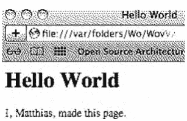

你可以使用 web-io.rkt 库中的 show-in-browser 在网页浏览器中显示结果。

如果现在是 1993 年，你可以将上述函数作为一家点com公司出售，它通过一个简单的函数调用生成人们的第一个网页。唉，


在这个时代，这只是一个练习。

## 练习 232

从以下表达式中消除 `quasiquote` 和 `unquote`，使它们改用 `list` 编写：

- `(1 "a" 2 #false 3 "c")`

- 这种表格状图形：

```
`(("alan" ,(* 2 500))
 ("barb" 2000)
 (,(string-append "carl" " , the great") 1500)
 ("dawn" 2300))`
```

- 和这个第二个网页：

```
`(html
 (head
  (title ,title))
 (body
  (h1 ,title)
  (p "A second web page")))`
```

其中 `(define title "ratings")`。

同时写下这些表达式产生的嵌套列表。

## 取消引用拼接

当准引用在短写形式的展开过程中遇到 `unquote` 时，两者相互抵消：

```
`(tr
 ,(make-row
  '(3 4 5)))
 is short for
 (list 'tr
  (make-row
   (list 3 4 5)))`
```

是简写形式

```
(list 'tr
  (make-row
   (list 3 4 5)))
```

因此，`make-row` 产生的任何内容都成为列表的第二项。特别是，如果 `make-row` 产生一个列表，这个列表就成为列表的第二项。如果 `make-row` 将给定的数字列表转换为字符串列表，那么结果是

```
(list 'tr (list "3" "4" "5"))
```

然而，在某些情况下，我们可能希望将这样的嵌套列表拼接到外层列表中，因此对于我们的运行示例，我们将得到

```
(list 'tr "3" "4" "5")
```

解决这个小问题的一种方法是求助于 cons。也就是说，将 cons 与 quote、准引用和 unquote 混合使用。毕竟，所有这些字符只是 consed 列表的简写形式。以下是我们示例中获得所需结果所需的内容：

```
(cons 'tr (make-row '(3 4 5)))
```

让自己相信结果是 (list 'tr "3" "4" "5")。

由于这种情况在实践中非常常见，BSL+ 支持另一种用于列表创建的简写机制：,@，也称为关键字形式的 unquote-splicing。使用此形式，可以轻松地将嵌套列表拼接到周围列表中。例如，

```
`(tr ,@(make-row '(3 4 5)))
```

转换为

```
(cons 'tr (make-row '(3 4 5)))
```

这正是我们示例所需要的。

现在考虑在我们的嵌套列表表示中创建 HTML 表的问题。这里是一个有两行、每行四个单元格的表：

```
' (table ((border "1"))
  (tr (td "1") (td "2") (td "3") (td "4"))
  (tr (td "2.8") (td "-1.1") (td "3.4") (td "1.3")))
```

第一个嵌套列表告诉 HTML 在表格中每个单元格周围绘制一个细边框；其他两个嵌套列表分别表示一行。

在实践中，你希望创建具有任意宽行和任意多行的此类表格。目前，我们只处理第一个问题，这需要一个将数字列表转换为 HTML 行的函数：

```
; List-of-numbers -> ... nested list ...
; creates a row for an HTML table from 1
(define (make-row l)
 (cond
  [(empty? l) '()]
  [else (cons (make-cell (first l))
              (make-row (rest l)))]))
```

```
; Number -> ... nested list ...
; creates a cell for an HTML table from a number
(define (make-cell n)
 `(td ,(number->string n))))
```

与其添加示例，不如在 DrRacket 的交互区中探索这些函数的行为：

```
> (make-cell 2)
(list 'td "2")
> (make-row '(1 2))
(list (list 'td "1") (list 'td "2"))
```

这些交互显示了表示单元格和行的列表的创建。

要将这些行列表转换为 HTML 表表示中的实际行，我们需要将它们拼接到以 'tr 开头的列表中：

```
; List-of-numbers List-of-numbers -> ... nested list ...
; creates an HTML table from two lists of numbers
(define (make-table row1 row2)
 `(table ((border "1"))
   (tr ,@(make-row row1))
   (tr ,@(make-row row2)))))
```

此函数消耗两个数字列表并创建 HTML 表表示。使用 make-row，它将列表转换为单元格表示的列表。使用 ,@，这些列表被拼接到表模板中：

```
> (make-table '(1 2 3 4 5) '(3.5 2.8 -1.1 3.4 1.3))
(list 'table (list (list 'border "1")) '....)
```

对 make-table 的这一应用说明了人们编写程序创建网页而不是手动制作网页的另一个原因。

> 这些点 *不是* 输出的一部分。

## 练习 233

开发仅使用 list 并产生相同值的以下表达式的替代方案：

- `(0,@'(1 2 3) 4)`

- 这种表格状图形：

```
`(("alan" ,(* 2 500))
 ("barb" 2000)
 (,(string-append "carl" " , the great") 1500)
 ("dawn" 2300))`
```

- 和这个第三个网页：

```
`(html
 (body
  (table ((border "1"))
  (tr ((width "200"))
  ,@(make-row '(1 2)))
  (tr ((width "200"))
  ,@(make-row '(99 65))))))`
```

其中 make-row 是上面的函数。

使用 check-expect 检查你的工作。

## 练习 234

创建函数 make-ranking，它消耗一个排名歌曲标题列表并产生 HTML 表的列表表示。考虑此示例：

```
(define one-list
  '("Asia: Heat of the Moment"
    "U2: One"
    "The White Stripes: Seven Nation Army"))
```

如果将 make-ranking 应用于 one-list 并在浏览器中显示生成的网页，你会看到类似于图 85 中的屏幕截图。


图 85：使用 BSL+ 生成的网页

**提示** 虽然你可以设计一个从字符串列表中确定排名的函数，但我们希望你专注于表格的创建。因此，我们提供以下函数：

```
(define (ranking los)
  (reverse (add-ranks (reverse los))))

(define (add-ranks los)
  (cond
    [(empty? los) '()]
    [else (cons (list (length los) (first los))
                (add-ranks (rest los)))]))
```

在使用这些函数之前，为它们配备签名和目的说明。然后在 DrRacket 的交互区中探索它们的工作原理。第 VI 部分扩展了设计方法，提供了一种创建比 ranking 和 add-ranks 更简单的计算排名的函数的方法。▪

## 计划研究


## III

### 摘要

我们的许多数据定义和函数定义看起来相似。例如，字符串列表的定义与数字列表的定义仅在两个地方不同：数据类的名称以及单词“String”和“Number”。同样，在字符串列表中查找特定字符串的函数与在数字列表中查找特定数字的函数几乎无法区分。

经验表明，这种相似性是有问题的。相似性之所以出现，是因为程序员——在身体上或在脑海中——复制代码。当程序员面临一个与另一个问题大致相似的问题时，他们会复制解决方案并修改新副本以解决新问题。你会在“真实”编程环境以及电子表格和数学建模的世界中发现这种行为。然而，复制代码意味着程序员也会复制错误，并且相同的修复可能需要应用到许多副本中。这也意味着，当底层数据定义被修订或扩展时，必须找到所有代码副本并以相应的方式修改它们。这个过程既昂贵又容易出错，给编程团队带来不必要的成本。

优秀的程序员会尽可能在编程语言允许的范围内消除相似性。“消除”意味着程序员写下程序的初稿，发现相似性（和其他问题），并摆脱它们。对于最后一步，他们要么进行抽象，要么使用现有的（抽象）函数。通常需要多次迭代这个过程才能使程序达到满意的状态。

> 程序就像一篇文章。第一个版本是草稿，而草稿需要编辑。

本部分的前半部分展示了如何在函数和数据定义上抽象相似性。程序员也将此过程的结果称为抽象，混淆了过程名称及其结果。本部分的后半部分是关于使用现有抽象和新语言元素来促进这一过程。虽然本部分的示例取自列表领域，但


观念具有普遍适用性。

## 14 到处都是相似之处

如果你解决了第二部分中的（一些）练习，你就知道许多解决方案看起来都很相似。事实上，这些相似之处可能会诱使你复制一个问题的解决方案来创建下一个问题的解决方案。但你不得盗用代码，甚至包括你自己的代码。相反，你必须对相似的代码片段进行抽象，本章将教你如何进行抽象。

我们避免相似之处的方法特定于“中级学生语言”，简称 ISL。几乎所有其他编程语言都提供类似的方法；在面向对象语言中，你可能会发现额外的抽象机制。无论如何，这些机制共享本章中阐述的基本特征，因此这里解释的设计思想也适用于其他场景。

> 在 DrRacket 中，从“语言”菜单的“如何设计程序”子菜单中选择“中级学生”。

### 14.1 函数中的相似之处

设计食谱决定了函数的基本组织，因为模板是根据数据定义创建的，而不考虑函数的目的。因此，不奇怪的是，消耗同一种数据的函数看起来相似。

考虑图 86 中的两个函数，它们消耗字符串列表并查找特定字符串。左边的函数查找 "dog"，右边的查找 "cat"。这两个函数几乎无法区分。每个都消耗字符串列表；每个函数体都包含一个具有两个子句的 cond 表达式。如果输入是 '()，每个都生成 #false；每个都使用 or 表达式来确定第一个项目是否是所需的项目，如果不是，则使用递归在列表的其余部分中查找。唯一的区别是嵌套 cond 表达式比较中使用的字符串：contains-dog? 使用 "dog"，而 contains-cat? 使用 "cat"。为了突出差异，这两个字符串被阴影标记。

```scheme
; Los -> Boolean
; does l contain "dog"?
(define (contains-dog? l)
(cond
[(empty? l) #false]
[else
(or
(string=? (first l)
"dog")
(contains-dog?
(rest l)))]))

; Los -> Boolean
; does l contain "cat"?
(define (contains-cat? l)
(cond
[(empty? l) #false]
[else
(or
(string=? (first l)
"cat")
(contains-cat?
(rest l)))]))
```

图 86：两个相似的函数

优秀的程序员懒得定义几个密切相关的函数。相反，他们定义一个单一函数，该函数可以在字符串列表中同时查找 "dog" 和 "cat"。这个通用函数消耗一段额外的数据——要查找的字符串——除此之外与原始的两个函数完全一样：

```scheme
; String Los -> Boolean
; determines whether l contains the string s
(define (contains? s l)
  (cond
    [(empty? l) #false]
    [else (or (string=? (first l) s)
              (contains? s (rest l)))]))
```

如果你真的需要像 `contains-dog?` 这样的函数，你可以将其定义为一行函数，`contains-cat?` 函数也是如此。图 87 就是这样做的，你应该简要地将其与图 86 进行比较，以确保你理解我们是如何从那里到达这里的。但最重要的是，有了 `contains?`，在字符串列表中查找任何字符串都变得微不足道，而且不再需要定义像 `contains-dog?` 这样的专门函数。


你刚刚目睹的东西被称为 _抽象_ ，或者更确切地说，是 _函数抽象_ 。对不同版本的函数进行抽象是消除程序中相似之处的一种方法，正如你将看到的，消除相似之处简化了长期保持程序完整性的过程。

> 计算机科学家从数学中借用“抽象”这一术语。在那里，“6”是一个抽象概念，因为它代表了枚举六件事物的**所有**方式。相比之下，“6 英寸”或“6 个鸡蛋”是具体用法。

**练习 235。** 使用 `contains?` 函数定义分别搜索 "atom"、"basic" 和 "zoo" 的函数。

**练习 236.** 为以下两个函数创建测试套件：

```scheme
; Lon -> Lon
; adds 1 to each item on l
(define (add1* l)
(cond
 [(empty? l) '()]
 [else
 (cons
  (add1 (first l))
  (add1* (rest l)))]))
```

```scheme
; Lon -> Lon
; adds 5 to each item on l
(define (plus5 l)
(cond
 [(empty? l) '()]
 [else
 (cons
  (+ (first l) 5)
  (plus5 (rest l)))]))
```

然后对它们进行抽象。根据抽象将上述两个函数定义为一行函数，并使用现有的测试套件确认修订后的定义工作正常。最后，设计一个函数，从给定列表中的每个数字减去 2。

### 14.2 不同的相似之处

在 `contains-dog?` 和 `contains-cat?` 函数的情况下，抽象看起来很容易。只需比较两个函数定义，用函数参数替换字面字符串，并快速检查使用抽象函数定义旧函数是否容易。这种抽象如此自然，以至于它在书前两部分中不费吹灰之力就出现了。

本节说明完全相同的原则如何产生一种强大的抽象形式。看看图 88。两个函数都消耗一个数字列表和一个阈值。左边的一个生成所有低于阈值的数字列表，而右边的一个生成所有高于阈值的数字列表。

```scheme
; Lon Number -> Lon
; select those numbers on l
; that are below t
(define (small l t)
  (cond
    [(empty? l) '()]
    [else
     (cond
       [(< (first l) t)
        (cons (first l)
              (small (rest l) t))]
       [else
        (small
         (rest l) t)]))])

; Lon Number -> Lon
; select those numbers on l
; that are above t
(define (large l t)
  (cond
    [(empty? l) '()]
    [else
     (cond
       [(> (first l) t)
        (cons (first l)
              (large (rest l) t))]
       [else
        (large
         (rest l) t)]))])
```

图 88：另外两个相似的函数

这两个函数只在一个地方不同：决定给定列表中的数字是否应成为结果一部分的比较运算符。左边的函数使用 <，右边的使用 >。除此之外，这两个函数看起来是一样的，不计函数名。

让我们遵循第一个示例，通过一个额外参数对这两个函数进行抽象。这次，额外参数表示比较运算符，而不是字符串：

```scheme
(define (extract R l t)
 (cond
  [(empty? l) '()]
  [else (cond
         [(R (first l) t)
          (cons (first l)
                (extract R (rest l) t))]
         [else
          (extract R (rest l) t)]]))
```

要应用这个新函数，我们必须提供三个参数：一个比较两个数字的函数 R、一个数字列表 l 和一个阈值 t。然后该函数提取 l 中所有使 (R i t) 求值为 #true 的项 i。

停！此时你应该问一下这个定义是否有意义。没有多费周折，我们创建了一个消耗函数的函数——这可能是你以前从未见过的东西。然而，事实证明，你的简单小教学语言 ISL 支持这类函数，定义此类函数是优秀程序员最强大的工具之一——即使是在似乎不提供函数消耗函数的语言中也是如此。

> 如果你修过微积分课程，你就接触过微分算符和不定积分。这两者都是消耗并产生函数的函数。但我们不假设你修过微积分课程。

测试表明，`(extract < l t)` 计算的结果与 `(small l t)` 相同：

```scheme
(check-expect (extract < '() 5) (small '() 5))
(check-expect (extract < '(3) 5) (small '(3) 5))
(check-expect (extract < '(1 6 4) 5)
             (small '(1 6 4) 5))
```

同样，`(extract > l t)` 产生与 `(large l t)` 相同的结果，这意味着你可以像这样定义原来的两个函数：


; Lon Number -> Lon                 ; Lon Number -> Lon
(define (small-1 l t)               (define (large-1 l t)
  (extract < l t))                     (extract > l t))

重要的洞察是 **不**在于 small-1 和 large-1 是单行定义。一旦你拥有像 extract 这样的抽象函数，就可以在其他地方好好利用它：

- 1. (extract = l t)：该表达式提取 l 中等于 t 的所有数字。
- 2. (extract <= l t)：这个生成 l 中小于或等于 t 的数字列表。
- 3. (extract >= l t)：最后这个表达式计算出大于或等于阈值的数字列表。

事实上，extract 的第一个参数不必是 ISL 预定义的操作之一。相反，你可以使用任何消耗两个参数并生成布尔值的函数。请看这个示例：

```
; Number Number -> Boolean
; is the area of a square with side x larger than c
(define (squared>? x c)
  (> (* x x) c))
```

也就是说，squared>? 检查 x² > c 这一说法是否成立，并且它可以与 extract 一起使用：

```
(extract squared>? (list 3 4 5) 10)
```

这个应用提取 (list 3 4 5) 中平方大于 10 的那些数字。

### 练习 237

在 DrRacket 中求值 (squared>? 3 10) 和 (squared>? 4 10)。那么 (squared>? 5 10) 呢？

到目前为止，你已经看到抽象函数定义比原始函数更有用。例如，contains? 比 contains-dog? 和 contains-cat? 更有用，extract 比 small 和 large 更有用。抽象的另一个重要方面是，你现在对所有这些函数都有一个单一的控制点。如果发现抽象函数中有错误，修复其定义就足以修复所有其他定义。同样，如果你想出如何加快抽象函数的计算速度或如何降低其能耗，那么所有基于此函数定义的函数都将在无需任何额外努力的情况下得到改进。以下练习说明了这些单一控制点的改进是如何工作的。

> 抽象带来的这些好处在编程的所有层级都可用：Word 文档、电子表格、小型应用和大型工业项目。为后者创建抽象推动了对编程语言和软件工程的研究。

### 练习 238

将图 89 中的两个函数抽象为一个函数。两者都消耗非空数字列表（Nelon）并生成一个数字。左边的函数生成列表中最小的数字，右边的函数生成最大的数字。

```
; Nelon -> Number
; determines the smallest
; number on l
(define (inf l)
 (cond
  [(empty? (rest l))
   (first l)]
  [else
   (if (< (first l)
        (inf (rest l)))
       (first l)
       (inf (rest l)))]))

; Nelon -> Number
; determines the largest
; number on l
(define (sup l)
 (cond
  [(empty? (rest l))
   (first l)]
  [else
   (if (> (first l)
        (sup (rest l)))
       (first l)
       (sup (rest l)))]))
```

### 图 89：在数字列表中查找 inf 和 sup

使用抽象函数定义 inf-1 和 sup-1。使用以下两个列表测试它们：

```
(list 25 24 23 22 21 20 19 18 17 16 15 14 13
 12 11 10 9 8 7 6 5 4 3 2 1)
(list 1 2 3 4 5 6 7 8 9 10 11 12 13 14 15 16
 17 18 19 20 21 22 23 24 25)
```

为什么这些函数在某些长列表上很慢？

使用 `max`（选取两个数字中较大的一个）和 `min`（选取两个数字中较小的一个）修改原始函数。然后再次抽象，定义 `inf-2` 和 `sup-2`，并使用相同的输入再次测试它们。为什么这些版本快这么多？

有关这些问题的另一个解答，请参见第 16.2 节。

### 14.3 数据定义中的相似性

现在仔细看一下以下两个数据定义：

```
; An Lon (List-of-numbers)                    ; An Los (List-of-String)
; is one of:                                  ; is one of:
; -- '()                                      ; -- '()
; -- (cons Number Lon)                        ; -- (cons String Los)
```

左边的定义引入数字列表；右边的定义描述字符串列表。这两个数据定义是相似的。与相似函数一样，这两个数据定义使用两个不同的名称，但这无关紧要，因为任何名称都可以。唯一的真正区别在于第二个子句中 cons 的第一个位置，它指定列表包含什么类型的项目。

为了抽象这一个差异，我们假装数据定义是一个函数来进行处理。我们引入一个参数，使数据定义看起来像一个函数，并且在以前有不同引用的地方，我们使用这个参数：

```
; A [List-of ITEM] is one of:
; -- '()
; -- (cons ITEM [List-of ITEM])
```

我们称这种抽象数据定义为 *参数化数据定义*，因为有这个参数。粗略地说，参数化数据定义对特定数据集合的引用进行抽象，就像函数对特定值进行抽象一样。

问题在于，这些参数的范围是什么。对于函数，它们代表一个未知值；当函数被应用时，这个值就变得已知。对于参数化数据定义，一个参数代表一个整个值的类别。向参数化数据定义提供数据集合名称的过程称为 *实例化*；以下是 List-of 抽象的一些实例化示例：

- 当我们写 [List-of Number] 时，我们表示 ITEM 代表所有数字，所以它只是 List-of-numbers 的另一个名称；
- 同样，[List-of String] 定义的数据类与 List-of-String 相同；并且
- 如果我们识别了一类库存记录，像这样：

```
(define-struct ir [name price])
; An IR is a structure:
;   (make-ir String Number)
```

那么 [List-of IR] 就是库存记录列表的一个名称。

按照惯例，我们为数据定义的参数使用全大写字母的名称，而参数则按需拼写。

我们验证这些简称确实如我们所说的那样的方法是，将数据定义的实际名称（例如 Number）代入数据定义的参数 ITEM，并为数据定义使用一个普通名称：

```
; A List-of-numbers-again is one of:
; -- '()
; -- (cons Number List-of-numbers-again)
```

由于数据定义是自引用的，我们复制了整个数据定义。生成的定义看起来与列表数字的常规定义完全一样，并确实标识了同一类数据。

让我们简要看一下第二个示例，从一个结构体类型定义开始：

```
(define-struct point [hori veri])
```

以下是使用该结构体类型的两个不同数据定义：

```
; A Pair-boolean-string is a structure:
;   (make-point Boolean String)
```

```
; A Pair-number-image is a structure:
;   (make-point Number Image)
```

在这种情况下，数据定义在两个地方不同——这两个地方都已用高亮标记。hori 字段的差异相互对应，veri 字段的差异也是如此。因此，有必要引入两个参数来创建一个抽象数据定义：

```
; A [CP H V] is a structure:
;   (make-point H V)
```

这里 H 是 hori 字段的数据集合参数，而 v 代表可以出现在 veri 字段中的数据集合。

要用两个参数实例化一个数据定义，你需要两个数据集合的名称。使用 Number 和 Image 作为 CP 的参数，你得到 [CP Number Image]，它描述了将数字与图像结合的点集合。相比之下，[CP Boolean String] 将布尔值与字符串结合在一个点结构中。

### 练习 239

两个项目的列表是 ISL 编程中另一种常用的数据形式。以下是一个带有两个参数的数据定义：

```
; A [List X Y] is a structure:
;   (cons X (cons Y '()))
```

实例化此定义以描述以下数据类：

- 数字对，
- 数字和 1String 的对，
- 字符串和布尔值的对。

还为这三个数据定义中的每一个制作一个具体示例。

一旦你拥有参数化数据定义，你就可以将它们混合搭配来


产生良好的效果。考虑一下这个例子：

```
; [List-of [CP Boolean Image]]
```

最外层的表示法是 [List-of ... ]，这意味着你正在处理一个列表。问题是该列表包含哪种类型的数据，要回答这个问题，你需要研究 List-of 表达式的内部：

```
; [CP Boolean Image]
```

这部分内部内容将布尔值和图像组合在一个点中。由此推断，

```
; [List-of [CP Boolean Image]]
```

是一个由结合布尔值和图像的点组成的列表。同样，

```
; [CP Number [List-of Image]]
```

是 CP 的一个实例化，它将一个数字与一个图像列表相结合。

### 练习 240.
这里有两个奇怪但相似的数据定义：

```
; An LStr is one of:                 ; An LNum is one of:
; -- String                          ; -- Number
; -- (make-layer LStr)               ; -- (make-layer LNum)
```

两个数据定义都依赖于这个结构体类型定义：

```
(define-struct layer [stuff])
```

两者都定义了嵌套形式的数据：一个关于数字，另一个关于字符串。为两者制作示例。对两者进行抽象。然后实例化抽象定义以得到原始定义。

### 练习 241.
比较 NEList-of-temperatures 和 NEList-of-Booleans 的定义。然后制定一个抽象数据定义 NEList-of。

### 练习 242.
这里还有一个参数化数据定义：

```
; A [Maybe X] is one of:
; -- #false
; -- X
```

解释这些数据定义：[Maybe String]、[Maybe [List-of String]] 和 [List-of [Maybe String]]。

以下函数签名是什么意思：

```
; String [List-of String] -> [Maybe [List-of String]]
; returns the remainder of los starting with s
; #false otherwise
(check-expect (occurs "a" (list "b" "a" "d" "e"))
 (list "d" "e"))
(check-expect (occurs "a" (list "b" "c" "d")) #f)
(define (occurs s los)
 los)
```

按照设计食谱完成其余步骤。

### 14.4 函数即值

这一部分的函数拓展了我们对程序求值的理解。很容易理解函数可以处理不仅仅是数字，比如说字符串或图像。结构体和列表稍微有点牵强，但最终它们是有限的“东西”。然而，消耗函数的函数却很奇怪。事实上，这个想法以两种方式违反了第一个间奏曲：(1) 原语和函数的名称被用作应用中的参数，以及 (2) 参数被用于应用的函数位置。

阐明问题会告诉你 ISL 语法与 BSL 语法有何不同。首先，我们的表达式语言定义中应包括函数名称和原语操作的名称。其次，应用的第一个位置应允许除函数名称和原语操作之外的其他东西；至少，它必须允许变量和函数参数。

语法的变化似乎要求改变求值规则，但变化的只有值的集合。具体来说，为了容纳函数作为函数的参数，最简单的改变是说函数和原语操作 **是** 值。

### 练习 243.
假设 DrRacket 的定义区域包含

```
(define (f x) x)
```

识别以下表达式中的值：

- 1. (cons f '())
- 2. (f f)
- 3. (cons f (cons 10 (cons (f 10) '())))

解释它们为何是（或不是）值。

### 练习 244.
论证为什么以下句子现在是合法的：

- 1. (define (f x) (x 10))
- 2. (define (f x) (x f))
- 3. (define (f x y) (x 'a y 'b))

解释你的推理。

### 练习 245.
开发 function=at-1.2-3-and-5.775? 函数。给定两个从数字到数字的函数，该函数确定这两个函数在 1.2、3 和 -5.775 上是否产生相同的结果。

数学家说，如果两个函数在给定相同输入时计算出相同的结果——对所有可能的输入都成立——则它们相等。

我们能指望定义 function=? 吗，它决定两个从数字到数字的函数是否相等？如果可以，定义该函数。如果不能，解释原因，并考虑这一含义：你遇到了第一个易于定义但无法定义函数的想法。

### 14.5 使用函数进行计算

从 BSL+ 切换到 ISL 允许将函数用作参数，并允许在应用的第一个位置使用名称。DrRacket 对这些位置中的名称的处理方式与其他地方一样，但自然地，它期望结果是一个函数。令人惊讶的是，对代数法则的简单调整就足以对 ISL 程序进行求值。

让我们看看这在第 14.2 章中的 extract 是如何工作的。显然，

```
(extract < '() 5) == '()
```

成立。我们可以使用间奏曲 1 中的替代法则，并继续使用函数体进行计算。像许多次一样，参数 R、l 和 t 分别被替换为它们的参数 <、'() 和 5。从此开始，就是普通的算术，从条件语句开始：

```
==
(cond
 [(empty? '()) '()]
 [else (cond
   [(< (first '()) t)
    (cons (first '()) (extract < (rest '()) 5))])
   [else (extract < (rest '()) 5)]]))
```

```
==
(cond
 [(#true '())
 [else (cond
   [(< (first '()) t)
    (cons (first '()) (extract < (rest '()) 5))])
   [else (extract < (rest '()) 5)]]))
```

```
== '()
```

接下来我们看看一个单元素列表：

```
(extract < (cons 4 '()) 5)
```

结果应该是 (cons 4 '())，因为该列表的唯一项是 4，且 (< 4 5) 为真。下面是求值的第一步：

```
(extract < (cons 4 '()) 5)
==
(cond
  [(empty? (cons 4 '())) '()]
  [else (cond
    [(< (first (cons 4 '())) 5)
     (cons (first (cons 4 '()))
           (extract < (rest (cons 4 '())) 5))]
    [else (extract < (rest (cons 4 '())) 5)]]))
```

同样，所有 R 的出现都被 < 替换，l 被 (cons 4 '()) 替换，t 被 5 替换。其余部分很简单：

```
(cond
  [empty? (cons 4 '())
   '()]
  [else (cond
     [(< (first (cons 4 '())) 5)
      (cons (first (cons 4 '()))
            (extract < (rest (cons 4 '())) 5))]
     [else (extract < (rest (cons 4 '())) 5)]]))
```

```
(cond
 [#false '()]
[else (cond
   [(< (first (cons 4 '())) 5)
    (cons (first (cons 4 '()))
          (extract < (rest (cons 4 '())) 5))]
   [else (extract < (rest (cons 4 '())) 5)]]))
```

```
(cond
 [(< (first (cons 4 '())) 5)
  (cons (first (cons 4 '()))
        (extract < (rest (cons 4 '())) 5))]
[else (extract < (rest (cons 4 '())) 5)])
```

```
(cond
 [(< 4 5)
  (cons (first (cons 4 '()))
        (extract < (rest (cons 4 '())) 5))]
[else (extract < (rest (cons 4 '())) 5)])
```

这是关键步骤，< 被替换到该位置后被使用。然后它继续进行算术：

```
==
(cond
 [#true
  (cons (first (cons 4 '())))
  (extract < (rest (cons 4 '())) 5))]
 [else (extract < (rest (cons 4 '())) 5))]
==
(cons 4 (extract < (rest (cons 4 '())) 5))
==
(cons 4 (extract < '() 5))
==
(cons 4 '())
```

最后一步是上面的等式，意味着我们可以应用以等代等的定律。

我们的最后一个示例是将 extract 应用于一个包含两个元素的列表：

```
(extract < (cons 6 (cons 4 '())) 5)
== (extract < (cons 4 '()) 5)
== (cons 4 (extract < '() 5))
== (cons 4 '())
```

步骤 1 是新的。它处理了 extract 删除列表第一项（如果它不低于阈值）的情况。

### 练习 246.
检查上述计算的第 1 步

```
(extract < (cons 6 (cons 4 '())) 5)
==
(extract < (cons 4 '()) 5)
```

使用 DrRacket 的 stepper。

### 练习 247.
使用 DrRacket 的 stepper 对 (extract < (cons 8 (cons 4 '())) 5) 求值。

### 练习 248.
在 DrRacket 的 stepper 中对 (squared>? 3 10) 和 (squared>? 4 10) 求值。

考虑这个交互：

```
> (extract squared>? (list 3 4 5) 10)
(list 4 5)
```

下面是 stepper 会显示的一些步骤：

```
(extract squared>? (list 3 4 5) 10)
==
(cond
  [(empty? (list 3 4 5)) '()]
  [else
   (cond
    [(squared>? (first (list 3 4 5)) 10)
     (cons (first (list 3 4 5))
           (extract squared>?
            (rest (list 3 4 5))
            10))]
    [else (extract squared>?
            (rest (list 3 4 5))
            10)]])
== ... ==
(cond
  [(squared>? 3 10)
   (cons (first (list 3 4 5))
         (extract squared>?
          (rest (list 3 4 5))
          10))]
  [else (extract squared>?
          (rest (list 3 4 5))
          10)])
```

使用 stepper 确认从第 (1) 行到第 (2) 行的步骤。继续步进以填补步骤 (2) 和 (3) 之间的空白。将每个步骤解释为定律的应用。

### 练习 249.
函数即值：参数、结果、列表中的项目。将以下定义和表达式放入 DrRacket 的定义窗口中，并使用 stepper 来了解运行此程序的工作原理：

```
(define (f x) x)
(cons f '())
(f f)
(cons f (cons 10 (cons (f 10) '())))


The stepper displays functions as \lambda expressions; see chapter 17.

## 15 设计抽象

本质上，抽象就是将具体的事物转化为参数。在前一节中我们多次这样做。要抽象相似的函数定义，你需要添加参数，用这些参数替换定义中的具体值。要抽象相似的数据定义，你需要创建参数化的数据定义。当你接触其他编程语言时，你会发现它们的抽象机制也需要引入参数，尽管这些参数可能不是函数参数。

### 15.1 从示例中抽象

当你最初学习加法时，你使用的是具体的例子。你的父母可能教过你用手指来加两个小数。后来，你学习了如何加两个任意的数字；这时你接触到了第一种抽象。更晚些时候，你学习了如何编写表达式，将摄氏温度转换为华氏温度，或计算汽车在给定速度和时间下行驶的距离。简而言之，你从非常具体的例子进入了抽象关系。

本节介绍了从示例中创建抽象的设计食谱。如前一节所示，创建抽象很容易。我们将困难的部分留到下一节，届时我们将向你展示如何查找和使用现有的抽象。

回顾第 14 章的要点。我们从两个具体的定义开始；我们比较它们；我们标记差异；然后我们进行抽象。创建抽象大致就是这些：

- 1. 第 1 步是比较两个项目的相似之处。

当你发现两个函数定义几乎相同，除了名称和对应位置的一些值之外，就比较它们并标记差异。如果两个定义在不止一个地方不同，请用一行线连接对应的差异。

> 该食谱针对非值抽象需要进行重大修改。

图 90 显示了一对相似的函数定义。这两个函数将一个函数应用于列表中的每个项目。它们仅在应用于每个项目的函数上有所不同。两个高亮强调了这一基本差异。它们还在两个非基本方面不同：函数的名称和参数的名称。

```
; List-of-numbers -> List-of-numbers
; converts a list of Celsius
; temperatures to Fahrenheit
(define (cf* l)
  (cond
    [(empty? l) '()]
    [else
     (cons
      (C2F (first l))
      (cf* (rest l)))])

; Number -> Number
; converts one Celsius
; temperature to Fahrenheit
(define (C2F c)
  (+ (* 9/5 c) 32))

; Inventory -> List-of-strings
; extracts the names of
; toys from an inventory
(define (names i)
  (cond
    [(empty? i) '()]
    [else
     (cons
      (IR-name (first i))
      (names (rest i)))]))

(define-struct IR
    [name price])
; An IR is a structure:
;   (make-IR String Number)
; An Inventory is one of:
; -- '()
; -- (cons IR Inventory)
```

图 90：一对相似的函数

- 2. 接下来我们进行抽象。要*抽象*意味着将对应代码高亮的内容替换为新名称，并将这些名称添加到参数列表中。对于我们的运行示例，在用 g 替换差异后，我们得到以下一对函数；参见图 91。这一初步变化消除了基本差异。现在每个函数都遍历列表，并将某个给定函数应用于每个项目。

```
(define (cf* l g)
  (cond
    [(empty? l) '()]
    [else
     (cons
      (g (first l))
      (cf* (rest l) g))])

(define (map1 k g)
  (cond
    [(empty? k) '()]
    [else
     (cons
      (g (first k))
      (map1 (rest k) g))])

(define (names i g)
  (cond
    [(empty? i) '()]
    [else
     (cons
      (g (first i))
      (names (rest i) g))])
```

图 91：抽象后的同一对相似函数

非基本差异——函数的名称和偶尔某些参数的名称——很容易消除。的确，如果你探索过 DrRacket，你就会知道 check syntax 允许你系统且轻松地完成此操作；参见图 91 底部。我们选择使用 map1 作为函数名，k 作为列表参数名。无论你选择什么名称，结果都是两个相同的函数定义。

我们的示例很简单。在许多情况下，你会发现不止一对差异。关键是找到差异对。当你用纸和笔标记差异时，用一行线连接相关的框。然后每行引入一个额外的参数。别忘了更改函数的所有递归用法，以便额外的参数一同传递。

- 3. 现在我们必须验证新函数是原函数对的正确抽象。验证意味着 **测试**，这里意味着使用抽象来定义两个原始函数。

因此，假设一个原始函数称为 f-original，它消耗一个参数，而抽象函数称为 abstract。如果 f-original 与另一个具体函数在使用一个值（例如 val）方面不同，则以下函数定义

```
(define (f-from-abstract x)
  (abstract x val))
```

它引入了函数 f-from-abstract，该函数应与 f-original 等价。也就是说，对于每个合适的值 v，(f-from-abstract v) 应该产生与 (f-original v) 相同的答案。特别是，它必须对 f-original 的测试所使用的所有值都成立。因此，为 f-from-abstract 重新表述并重新运行那些测试，并确保它们成功。

让我们回到我们的运行示例：

```
; List-of-numbers -> List-of-numbers
(define (cf*-from-map1 l) (map1 l C2F))
```

```
; Inventory -> List-of-strings
(define (names-from-map1 i) (map1 i IR-name))
```

一个完整的示例将包含一些测试，因此我们可以假设 cf* 和 names 都带有一些测试：

```scheme
(check-expect (cf* (list 100 0 -40))
         (list 212 32 -40))

(check-expect (names
               (list
                (make-IR "doll" 21.0)
                (make-IR "bear" 13.0)))
              (list "doll" "bear"))
```

为了确保使用 map1 定义的函数正常工作，你可以复制测试并适当更改函数名：

```scheme
(check-expect
 (cf*-from-map1 (list 100 0 -40))
 (list 212 32 -40))

(check-expect
 (names-from-map1
  (list
   (make-IR "doll" 21.0)
   (make-IR "bear" 13.0)))
 (list "doll" "bear"))
```

- 4. 一个新抽象需要 **签名**，因为，如第 16 章所解释的，抽象的重用始于它们的签名。查找有用的签名是一个严肃的问题。目前我们使用运行示例来说明这一困难；第 15.2 节解决了该问题。

考虑 map1 的签名问题。一方面，如果你将 map1 视为 cf* 的抽象，你可能会认为它是

```scheme
; List-of-numbers [Number -> Number] -> List-of-numbers
```

即，原始签名扩展了用于函数的一部分：

```scheme
; [Number -> Number]
```

由于 map1 的额外参数是一个函数，使用函数签名来描述它不应令你感到惊讶。这个函数签名也很简单；它是所有从数字到数字的函数的一个“名称”。C2F 就是这样的函数，add1、sin 和 imag-part 也是。

另一方面，如果你将 map1 视为 names 的抽象，签名就截然不同了：

```scheme
; Inventory [IR -> String] -> List-of-strings
```

这次，额外的参数是 IR-name，它是一个选择器函数，消耗 IRs 并生成 Strings。但很明显，第二个签名在第一种情况下无用，反之亦然。为了同时适应这两种情况，map1 的签名必须表明 Number、IR 和 String 是巧合的。

关于签名，你现在可能很想使用 List-of。显然，写 [List-of IR] 比为 Inventory 拼写出数据定义要容易得多。所以，是的，目前，当一切都涉及列表时，我们使用 List-of，你也应该这样做。

一旦你抽象了两个函数，你应该检查抽象函数是否有其他用途。如果是这样，这个抽象就真正有用。以 map1 为例，可以轻松看出如何使用它为数字列表中的每个数字加 1：

```
; List-of-numbers -> List-of-numbers
(define (add1-to-each l)
  (map1 l add1))
```

同样，map1 也可以用于提取库存中每个项目的价格。当你能为新抽象想象出许多这样的用途时，将其添加到有用函数库中以备使用。当然，很可能其他人也想到了它，并且该函数已经是语言的一部分。对于像 map1 这样的函数，参见第 16 章。


### 练习 250.
设计 `tabulate`，它是图 92 中两个函数的抽象。当 `tabulate` 设计得当后，使用它为 `sqr` 和 `tan` 定义一个制表函数。


图 92：练习 250 的相似函数

### 练习 251.
设计 `fold1`，它是图 93 中两个函数的抽象。


图 93：练习 251 的相似函数

### 练习 252.
设计 `fold2`，它是图 94 中两个函数的抽象。将本练习与练习 251 进行比较。尽管两者都涉及 product 函数，但本练习提出了一个额外的挑战，因为第二个函数 `image*` 接收一个 Posns 列表并生成一个 Image。尽管如此，解决方案仍在本节材料的范围内，并且将解决方案与前一个练习的解决方案进行比较尤其值得。这种比较会产生关于抽象签名的有趣见解。

```
; [List-of Number] -> Number
(define (product l)
  (cond
    [(empty? l) 1]
    [else
     (* (first l)
        (product (rest l)))]))

; [List-of Posn] -> Image
(define (image* l)
  (cond
    [(empty? l) emt]
    [else
     (place-dot (first l)
                (image* (rest l)))]))

; Posn Image -> Image
(define (place-dot p img)
  (place-image
   dot
   (posn-x p) (posn-y p)
   img))

; graphical constants:
(define emt
  (empty-scene 100 100))
(define dot
  (circle 3 "solid" "red"))
```

图 94：练习 252 的相似函数

最后，在处理数据定义时，抽象过程以类似的方式进行。数据定义的额外参数代表值的集合，而测试意味着为一些具体示例拼写出数据定义。总体而言，对数据定义进行抽象往往比对函数进行抽象更容易，因此我们留给你来适当地调整设计配方。

### 15.2 签名中的相似之处

事实证明，函数的签名是其重用的关键。因此，你必须学会制定以最一般性术语描述抽象的签名。为了理解这是如何工作的，我们从重新审视签名开始，并从这样一个简单——尽管可能令人惊讶——的洞察出发：签名基本上就是数据定义。

签名和数据定义都指定了一个数据类；区别在于数据定义还为该数据类命名，而签名不命名。尽管如此，当你写下

```
; Number Boolean -> String
(define (f n b) "hello world")
```

你的第一行描述了一个完整的数据类，而你的第二行说明 f 属于该类。准确地说，签名描述的是 **所有函数** 的类，这些函数接收一个 Number 和一个 Boolean，并产生一个 String。

一般来说，签名的箭头表示法类似于第 14.3 章中的 List-of 表示法。后者接收（一个数据类的名称），比如说 X，并描述所有 x 项目的列表——而不为其命名。箭头表示法接收任意数量的数据类，并描述函数的集合。

这意味着抽象设计配方也适用于签名。你比较相似的签名；你突出差异；然后用参数替换这些差异。但是，抽象签名的过程感觉比函数的过程更复杂，部分原因是签名已经是设计配方的抽象片段，部分原因是基于箭头的表示法比我们遇到的其他任何东西都要复杂得多。

让我们从 `cf*` 和 names 的签名开始：


比较两个签名显示它们在两个地方不同：在箭头左侧，我们看到 Number 与 IR，而在右侧，是 Number 与 String。

如果我们用某种参数（比如说 x 和 y）替换这两个差异，我们就得到了相同的签名：

```
; [X Y] [List-of X] -> [List-of Y]
```

新签名以一系列变量开头，类比于函数定义和上面的数据定义。粗略地说，这些变量是签名的参数，就像函数和数据定义的参数一样。为了使后者具体化，变量序列类似于 List-of 定义中的 ITEM，或者第 14.3 章中 CP 定义中的 x 和 y。并且就像它们一样，X 和 Y 在值的类上变化。

这个参数列表的实例化是签名的其余部分，其中参数被数据集合替换：要么是它们的名称，要么是其他参数，要么是像上面的 List-of 这样的缩写。因此，如果你将 X 和 Y 都替换为 Number，你就得到了 cf* 的签名：

```
; [List-of Number] -> [List-of Number]
```

如果你选择 IR 和 String，你就得到了 names 的签名：

```
; [List-of IR] -> [List-of String]
```

这就解释了为什么我们可以将这个参数化签名视为 cf* 和 names 原始签名的抽象。

一旦我们为这两个函数添加额外的函数参数，我们就得到了 map1，签名如下：

```
[List-of Number] (Number -> Number) -> [List-of Number]
[List-of IR]       (String -> String)       -> [List-of String]
```

同样，签名以图形形式呈现，并用箭头连接相应的差异。这些标记表明，第二个参数（一个函数）中的差异与原始签名中的差异有关。具体来说，新箭头左侧的 Number 和 IR 指的是第一个参数（一个列表）中的项目，而右侧的 Number 和 String 指的是结果（也是一个列表）中的项目。

由于列出签名的参数是额外的工作，出于我们的目的，我们简单地说，从现在开始，签名中的所有变量都是参数。然而，其他编程语言坚持明确列出签名的参数，但作为回报，你可以在这些签名中阐述额外的约束，并且在运行程序之前会检查签名。

现在让我们应用同样的技巧来获得 map1 的签名：

```
; [X Y] [List-of X] [X -> Y] -> [List-of Y]
```

具体来说，map1 接收一个项目列表，所有项目都属于某个（尚待确定）的数据集合，称为 X。它还接收一个函数，该函数消耗 x 的元素并产生第二个未知集合（称为 Y）的元素。map1 的结果是包含 Y 中项目的列表。

对签名进行抽象需要练习。这里是第二对：

```
; [List-of Number] -> Number
; [List-of Posn] -> Image
```

它们是练习 252 中 product 和 image* 的签名。虽然两个签名有一些共同的组织，但差异是明确的。让我们先详细拼写出共同的组织：

- 两个签名都描述一个参数函数；以及
- 两个参数描述都使用 List-of 构造。

与第一个示例相反，这里一个签名两次引用 Number，而第二个签名在类似位置引用 Posns 和 Images。结构比较显示，第一次出现的 Number 对应 Posn，第二次对应 Image：

```
[List-of Number] -> Number
[List-of Posn] -> Image
```

为了在练习 252 的两个函数抽象的签名上取得进展，让我们采取设计配方的前两步：

```
(define (pr* l bs jn)
  (cond
    [(empty? l) bs]
    [else
     (jn (first l)
         (pr* (rest l)
              bs
              jn)))]))
(define (im* l bs jn)
  (cond
    [(empty? l) bs]
    [else
     (jn (first l)
         (im* (rest l)
              bs
              jn)))]))
```

由于两个函数在两对值上不同，修订后的版本消耗两个额外的值：一个是原子值，用于基准情况，另一个是一个函数，用于将自然递归的结果与给定列表的第一个项目结合起来。

关键是将这种洞察转化为两个新函数的两个签名。当你对 `pr*` 这样做时，你得到

```
; [List-of Number] Number [Number Number -> Number]
; -> Number
```

因为基准情况下的结果是一个数字，并且第二个 cond 行的函数是 +。同样，`im*` 的签名是

```
; [List-of Posn] Image [Posn Image -> Image]
; -> Image
```

如你从 `im*` 的函数定义中所见，基准情况返回一个图像，组合函数是 `place-dot`，它将一个 Posn 和一个 Image 结合为一个 Image。


现在，我们取上面的图表，并用附加输入扩展它到签名：

```
[List-of Number] Number (Number Number -> Number) -> Number
[List-of Posn] Image (Posn Image -> Image) -> Image
```

从这个图表中，你可以轻松看出，两个修订后的签名比原始的两个签名共享更多的组织结构。此外，描述基本情况的片段彼此对应，描述组合函数的子签名片段也彼此对应。总而言之，有六对差异，但它们归结为只有两点：

- 1. 某些 Number 出现对应于 Posn，以及
- 2. 其他 Number 出现对应于 Image。

因此，为了抽象，我们需要两个变量，每种对应关系一个。

以下是 fold2 的签名，即练习 252 中的抽象：

```
; [X Y] [List-of X] Y [X Y -> Y] -> Y
```

停！请确保将签名的两个参数 X 和 Y 都替换为 Number 可得到 pr* 的签名，且将相同变量分别替换为 Posn 和 Image 可得到 im* 的签名。

这两个示例说明了如何找到一般签名。原则上，这个过程与抽象函数的过程相同。但是，由于签名的非正式性质，它不能像检查代码那样通过运行示例来检查。以下是一个逐步表述：

- 1. 给定两个相似的函数定义 f 和 g，比较它们的签名以寻找相似之处和差异。目标是发现签名的组织结构，并标记一个签名与另一个签名不同的地方。将差异成对连接起来，就像你分析函数体时所做的那样。
- 2. 将 f 和 g 抽象为 f-abs 和 g-abs。也就是说，添加消除 f 和 g 之间差异的参数。为 f-abs 和 g-abs 创建签名。请记住新参数原先代表什么；这有助于你找出签名的新部分。
- 3. 检查步骤 1 的分析是否扩展到 f-abs 和 g-abs 的签名。如果是，用表示数据类的变量替换差异。一旦两个签名相同，你就得到了抽象函数的签名。
- 4. 测试抽象签名。首先，确保抽象签名中变量的适当替换生成 f-abs 和 g-abs 的签名。其次，检查一般化签名是否与代码同步。例如，如果 p 是一个新参数，其签名为

```
; ... [A B -> C] ...
```

那么 p 必须始终应用于两个参数，第一个来自 A，第二个来自 B。而且 p 应用的结果将是一个 C，并且应在期望 C 类型元素的地方使用。

与抽象函数一样，关键是比较示例的具体签名并确定相似之处和差异。经过足够的练习和直觉，你很快就能在很少指导的情况下抽象签名。

### 练习 253。每个签名都描述了一个函数类：

```
; [Number -> Boolean]
; [Boolean String -> Boolean]
; [Number Number Number -> Number]
; [Number -> [List-of Number]]
; [[List-of Number] -> Boolean]
```

用 ISL 中的至少一个示例描述这些集合。

### 练习 254。为以下函数制定签名：

- sort-n，它消耗一个数字列表和一个消耗两个数字（来自列表）并生成布尔值的函数；sort-n 生成一个排序后的数字列表。
- sort-s，它消耗一个字符串列表和一个消耗两个字符串（来自列表）并生成布尔值的函数；sort-s 生成一个排序后的字符串列表。

然后，按照上述步骤对两个签名进行抽象。还要表明，一般化签名可以实例化为描述 IR 列表排序函数的签名。

### 练习 255。为以下函数制定签名：

- map-n，它消耗一个数字列表和一个从数字到数字的函数以生成一个数字列表。
- map-s，它消耗一个字符串列表和一个从字符串到字符串的函数，并生成一个字符串列表。

然后，按照上述步骤对两个签名进行抽象。还要表明，一般化签名可以实例化为描述上面 map1 函数的签名。

### 15.3 单一控制点

一般来说，程序就像论文的草稿。编辑草稿对于纠正拼写错误、修复语法错误、使文档保持一致以及消除重复非常重要。没有人想读大量重复自己的论文，也没有人想读这样的程序。

消除相似之处以支持抽象有许多好处。创建抽象简化了定义。它还可能发现现有函数的问题，尤其是当相似之处不太准确时。但是，最重要的优势是为某些常见功能创建单一控制点。

将某些功能的定义放在一个地方，使程序易于维护。当你发现一个错误时，只需去一个地方修复它。当你发现代码应该处理另一种形式的数据时，可以将代码添加到一个地方。当你想出一个改进时，一个改动就能改进功能的所有使用。如果你复制了函数或代码，你就必须找到所有副本并修复它们；否则错误可能会继续存在，或者只有一个函数运行得更快。

因此，我们制定了以下准则：

创建抽象，而不是复制和修改任何代码。

我们用于抽象函数的设计配方是创建抽象的最基本工具。使用它需要练习。随着你练习，你扩展了阅读、组织和维护程序的能力。最好的程序员是那些积极编辑程序以构建新抽象的人，这样他们就能将与任务相关的事物收集到单一位置。在这里，我们使用函数抽象来研究这种做法；在其他编程课程中，你将遇到其他形式的抽象，最重要的是基于类的面向对象语言中的继承。

## 15.4 来自模板的抽象

这部分的前两章介绍了许多基于相同模板的函数。毕竟，设计配方说要围绕（主要）输入数据定义的组织来组织函数。因此，许多函数定义彼此相似也就不足为奇了。

事实上，你应该直接从模板抽象，并且应该自动这样做；一些实验性编程语言就是这样做的。尽管这个主题仍然是研究课题，但你现在有能力理解基本思想。考虑列表的模板：

```
(define (fun-for-l l)
 (cond
   [(empty? l) ...]
   [else (... (first l) ...
      ... (fun-for-l (rest l)) ...)]))
```

它包含两个空缺，每个子句一个。当你使用此模板定义列表处理函数时，你通常在第一个 cond 子句中用一个值填充这些空缺，在第二个子句中用一个 combine 函数填充。combine 函数消耗列表的第一个项目和自然递归的结果，并从这两个数据片段中创建结果。

现在你已经知道如何创建抽象，你可以根据这个非正式描述完成抽象的定义：

```
; [X Y] [List-of X] Y [X Y -> Y] -> Y
(define (reduce l base combine)
 (cond
   [(empty? l) base]
   [else (combine (first l)
                  (reduce (rest l) base combine))]))
```

它消耗两个额外参数：base，即基本情况的值；combine，即执行第二个子句值组合的函数。

使用 reduce，你可以将许多普通列表处理函数定义为“一


liners。”以下是 sum 和 product 的定义，这两个函数在本章前几个部分中多次使用：

```
; [List-of Number] -> Number ; [List-of Number] -> Number
(define (sum lon) (define (product lon)
 (reduce lon 0 +)) (reduce lon 1 *))
```

对于 sum，基准情况始终产生 0；将第一个项目和自然递归的结果相加，结合第二个子句的值。类似的推理解释了 product。其他列表处理函数也可以以类似的方式使用 reduce 来定义。

## 16 使用抽象

一旦有了抽象，你应尽可能使用它们。它们创建单点控制，并且是节省工作的工具。更确切地说，使用抽象有助于你的代码的**读者**理解你的意图。如果抽象是众所周知的并且内置于语言中或随其标准库提供，它比自定义设计的代码更清晰地表明你的函数的作用。

本章完全关于现有 ISL 抽象的复用。它从一节关于现有 ISL 抽象开始，其中一些你以前在错误的名称下见过。其余部分关于复用此类抽象。一个关键成分是一个新的语法结构 `local`，用于在函数内部本地定义函数和变量（甚至结构类型）。一个辅助成分，在最后一节引入，是 `lambda` 结构用于创建无名函数；`lambda` 是方便的，但对复用抽象函数的想法来说不是必需的。

### 16.1 现有抽象

ISL 提供了一些用于处理自然数和列表的抽象函数。图 95 收集了最重要的几个的头部材料。第一个处理自然数并构建列表：

```
> (build-list 3 add1)
(list 1 2 3)
```

接下来的三个处理列表并产生列表：

```
> (filter odd? (list 1 2 3 4 5))
(list 1 3 5)
> (sort (list 3 2 1 4 5) >)
(list 5 4 3 2 1)
> (map add1 (list 1 2 2 3 3 3))
(list 2 3 3 4 4 4)
```

相比之下，andmap 和 ormap 将列表归约为布尔值：

```
> (andmap odd? (list 1 2 3 4 5))
#false
> (ormap odd? (list 1 2 3 4 5))
#true
```

```
; [X] N [N -> X] -> [List-of X]
; constructs a list by applying f to 0, 1, ..., (sub1 n)
; (build-list n f) == (list (f 0) ... (f (- n 1)))
(define (build-list n f) ...)

; [X] [X -> Boolean] [List-of X] -> [List-of X]
; produces a list from those items on lx for which p holds
(define (filter p lx) ...)

; [X] [List-of X] [X X -> Boolean] -> [List-of X]
; produces a version of lx that is sorted according to cmp
(define (sort lx cmp) ...)

; [X Y] [X -> Y] [List-of X] -> [List-of Y]
; constructs a list by applying f to each item on lx
; (map f (list x-1 ... x-n)) == (list (f x-1) ... (f x-n))
(define (map f lx) ...)

; [X] [X -> Boolean] [List-of X] -> Boolean
; determines whether p holds for every item on lx
; (andmap p (list x-1 ... x-n)) == (and (p x-1) ... (p x-n))
(define (andmap p lx) ...)

; [X] [X -> Boolean] [List-of X] -> Boolean
; determines whether p holds for at least one item on lx
; (ormap p (list x-1 ... x-n)) == (or (p x-1) ... (p x-n))
(define (ormap p lx) ...)
```

图 95：ISL 用于列表处理的抽象函数 (1)

因此，这种计算被称为归约。

图 96 中的两个函数 foldr 和 foldl 非常强大。两者都将列表归约为值。示例计算通过将函数应用于 +、0 和一个短列表，解释了 foldr 和 foldl 头部中的抽象示例。如你所见，foldr 从右到左处理列表值，而 foldl 从左到右。虽然对于某些函数方向无关紧要，但一般而言并非如此。

```
; [X Y] [X Y -> Y] Y [List-of X] -> Y
; applies f from right to left to each item in lx and b
; (foldr f b (list x-1 ... x-n)) == (f x-1 ... (f x-n b))
(define (foldr f b lx) ...)

(foldr + 0 '(1 2 3 4 5))
== (+ 1 (+ 2 (+ 3 (+ 4 (+ 5 0))))))
== (+ 1 (+ 2 (+ 3 (+ 4 5)))))
== (+ 1 (+ 2 (+ 3 9))))
== (+ 1 (+ 2 12)))
== (+ 1 14)

; [X Y] [X Y -> Y] Y [List-of X] -> Y
; applies f from left to right to each item in lx and b
; (foldl f b (list x-1 ... x-n)) == (f x-n ... (f x-1 b))
(define (foldl f b lx) ...)

(foldl + 0 '(1 2 3 4 5))
== (+ 5 (+ 4 (+ 3 (+ 2 (+ 1 0))))))
== (+ 5 (+ 4 (+ 3 (+ 2 1)))))
== (+ 5 (+ 4 (+ 3 3))))
== (+ 5 (+ 4 6)))
== (+ 5 10)
```

图 96：ISL 用于列表处理的抽象函数 (2)

数学中，如果顺序无关紧要，则称函数为结合律的。ISL 的 = 在整数上是结合的，但在非精确数上不是。见下文。

**练习 256。** 解释以下抽象函数：

```
; [X] [X -> Number] [NEList-of X] -> X
; finds the (first) item in lx that maximizes f
; if (argmax f (list x-1 ... x-n)) == x-i,
; then (>= (f x-i) (f x-1)), (>= (f x-i) (f x-2)), ...
(define (argmax f lx) ...)
```

在 ISL 中对具体示例使用它。你能为 argmin 阐述一个类似的目的说明吗？

图 97 说明了组合图 95 和图 96 中函数的功能。其主函数是 listing。目的是从地址列表创建一个字符串。其目的说明暗示了三个任务，因此设计了三个函数：

- 1. 一个从给定的 Addr 列表中提取名字的函数；
- 2. 一个按字母顺序对这些名字进行排序的函数；以及
- 3. 一个将步骤 2 中的字符串串联起来的函数。

```
(define-struct address [first-name last-name street])
; An Addr is a structure:
; (make-address String String String)
; interpretation associates an address with a person's name
; [List-of Addr] -> String
; creates a string from first names,
; sorted in alphabetical order,
; separated and surrounded by blank spaces
(define (listing l)
  (foldr string-append-with-space " "
    (sort (map address-first-name l) string<?)))
; String String -> String
; appends two strings, prefixes with " "
(define (string-append-with-space s t)
  (string-append " " s t))
(define ex0
  (list (make-address "Robert" "Findler" "South")
    (make-address "Matthew" "Flatt" "Canyon")
    (make-address "Shriram" "Krishna" "Yellow")))
(check-expect (listing ex0) " Matthew Robert Shriram ")
```

图 97：使用抽象创建程序

在继续阅读之前，你或许希望执行这个计划。也就是说，设计所有三个函数，然后按第 11.2 节的意义组合它们，以获得你自己的 listing 版本。

在抽象的新世界中，可以设计一个实现相同目标的单个函数。仔细看看图 97 中 listing 的最内层表达式：

```
(map address-first-name l)
```

根据 map 的目的说明，它将 address-first-name 应用于 address 的每个实例，产生一个作为字符串的名字列表。这里是紧邻其周围的表达式：

```
(sort ... string<?)
```

省略号表示 map 表达式的结果。由于后者提供一个字符串列表，sort 表达式产生一个已排序的名字列表。那只剩下最外层的表达式：

```
(foldr string-append-with-space " " ...)
```

这个使用名为 string-append-with-space 的函数将已排序的名字列表归约为单个字符串。有了这样一个寓意明显的名字，你现在可以轻松想象，这种归约以所需方式串联所有字符串——即使你并不完全理解 foldr 和 string-append-with-space 的组合是如何工作的。

**练习 257。** 你可以使用你知道的设计配方来设计 build-list 和 foldl，但它们不会像 ISL 提供的那样。例如，设计你自己的 foldl 函数需要使用列表反转函数：

```
; [X Y] [X Y -> Y] Y [List-of X] -> Y
; f*oldl works just like foldl
(check-expect (f*oldl cons '() '(a b c))
   (foldl cons '() '(a b c)))
(check-expect (f*oldl / 1 '(6 3 2))
   (foldl / 1 '(6 3 2)))
(define (f*oldl f e l)
   (foldr f e (reverse l))))
```

设计 build-1*st，它的工作方式与 build-list 相同。**提示** 回顾练习 193 中的 add-at-end 函数。**设计说明** 第 VI 部分涵盖了从头设计这些函数所需的概念。


### 16.2 局部定义

让我们再审视一下图 97。`string-append-with-space` 函数明显起着次要作用，并且在这个狭窄的上下文之外毫无用处。此外，函数体的组织并未反映上面识别的三个任务。

几乎所有编程语言都支持以程序的一部分来声明此类关系的方式。这个想法称为 _局部定义_，也称为 _私有定义_。在 ISL 中，`local` 表达式引入局部定义的函数、变量和结构类型。

本节介绍 `local` 的机制。一般来说，`local` 表达式的形式如下：

```
(local (def ...)
; --- IN ---
body-expression)
```

求值此类表达式的过程类似于求值完整程序。首先，设置定义，这可能涉及求值常量定义的右侧。正如你熟知并喜爱的顶层定义一样，`local` 表达式中的定义可以互相引用。它们也可以引用周围函数的参数。其次，求值 _主体表达式_，它成为 `local` 表达式的结果。通常将 `local defs` 与主体表达式用注释分开很有帮助；如所示，我们可以使用 -- IN --，因为这个词暗示定义在某个表达式中可用。

图 98 展示了使用 `local` 对图 97 的修订。`listing.v2` 函数的主体现在是一个 `local` 表达式，由两部分组成：一系列定义和一个主体表达式。局部定义序列看起来与 DrRacket 定义区中的序列完全一样。

```scheme
; [List-of Addr] -> String
; creates a string of first names,
; sorted in alphabetical order,
; separated and surrounded by blank spaces
(define (listing.v2 l)
  (local (; 1. extract names
          (define names (map address-first-name l))
          ; 2. sort the names
          (define sorted (sort names string<?>))
          ; 3. append them, add spaces
          ; String String -> String
          ; appends two strings, prefix with " "
          (define (helper s t)
            (string-append " " s t))
          (define concat+spaces
            (foldr helper "" sorted))))
  concat+spaces))
```

## 图 98：使用 local 组织函数

在这个示例中，定义序列包含四个部分：三个常量定义和一个函数定义。每个常量定义代表三个规划任务中的一个。函数定义是 `string-append-with-space` 的重命名版本；它与 `foldr` 一起用于实现第三个任务。`local` 的主体只是第三个任务的名称。

> 由于名称仅在 local 表达式内可见，缩短名称是可以的。

最直观的区别在于整体组织。它清楚地表明函数完成三个任务以及顺序。事实上，这个示例体现了可读性的一般原则：

> Use local to reformulate deeply nested expressions. Use well-chosen names to express what the expressions compute.

未来的读者会感激这一点，因为他们只需查看名称和 `local` 表达式的主体就能理解代码。

### 关于组织的注释

`local` 表达式实际上只是一个表达式。它可以出现在常规表达式出现的任何位置。因此，可以精确指示辅助函数需要的位置。考虑 `listing.v2` 的 `local` 表达式的这种重组：

```scheme
... (local ((define names ...)
  (define sorted ...)
  (define concat+spaces
    (local (; String String -> String
            (define (helper s t)
              (string-append " " s t))))
    (foldr helper "" sorted))))
  concat+spaces) ...
```

它恰好包含三个定义，暗示需要三个计算步骤。第三个定义右侧包含一个 `local` 表达式，表明 `helper` 仅在第三步中真正需要。

是否希望以这种精度表达程序片段之间的关系，取决于两个约束：编程语言以及代码预期的生命周期。有些语言甚至无法表达 `helper` 仅对第三步有用的想法。同样，你需要平衡创建程序所需的时间，以及你或他人需要重新查看并再次理解代码的预期。Racket 团队的偏好是站在未来开发者一边，因为团队成员知道没有程序是最终完成的，所有程序都需要修复。

图 99 提供了第二个示例。此函数定义的组织告诉读者，`sort-cmp` 调用两个辅助函数：`isort` 和 `insert`。由于局部性，显而易见，`insert` 的目的说明中的形容词“sorted”指的是 `isort`。换句话说，`insert` 仅在此上下文中有用；程序员不应尝试在其他地方、脱离上下文地使用它。虽然此约束在 `sort-cmp` 函数的原始定义中已经很重要，但 `local` 表达式将其作为程序的一部分来表达。

```scheme
; [List-of Number] [Number Number -> Boolean]
; -> [List-of Number]
; produces a version of alon, sorted according to cmp
(define (sort-cmp alon0 cmp)
  (local (; [List-of Number] -> [List-of Number]
         ; produces the sorted version of alon
         (define (isort alon)
           (cond
             [(empty? alon) '()]
             [else
              (insert (first alon) (isort (rest alon)))]))
         ; Number [List-of Number] -> [List-of Number]
         ; inserts n into the sorted list of numbers alon
         (define (insert n alon)
           (cond
             [(empty? alon) (cons n '())]
             [else (if (cmp n (first alon)))
                   (cons n alon)
                   (cons (first alon)
                         (insert n (rest alon)))])))
  (isort alon0)))
```

## 图 99：使用 local 组织相互关联的函数定义

此 `sort-cmp` 定义重组的另一个重要方面涉及 `cmp`（第二个函数参数）的可见性。局部定义的函数可以引用 `cmp`，因为它在定义的上下文中已定义。通过 **不** 将 `cmp` 在 `isort` 和 `insert` 之间传来传去（或反之），读者可以立即推断 `cmp` 在整个排序过程中保持不变。

### 练习 258.

使用 `local` 表达式组织图 73 中绘制多边形的函数。如果全局定义的函数非常有用，请勿将其设为局部。

### 练习 259.

使用 `local` 表达式组织第 12.4 章中重排单词的函数。

`local` 有用性的最后一个示例涉及性能。考虑图 89 中 `inf` 的定义。它包含两个

```
(inf (rest l))
```

的副本，这是第二个 `cond` 行中的自然递归。根据问题的结果，该表达式被求值两次。使用 `local` 为该表达式命名可以改善函数的可读性和性能。

图 100 显示了修订版。此处 `local` 表达式出现在 `cond` 表达式的中间。它定义一个常量，其值是自然递归的结果。现在回想一下，`local` 表达式的求值会在进入主体之前对定义求值一次，这意味着 `(inf (rest l))` 被求值一次，而 `local` 表达式的主体两次引用该结果。因此，`local` 在计算的每个阶段都节省了对 `(inf (rest l))` 的重复求值。

```lisp
; Nelon -> Number
; determines the smallest number on l
(define (inf.v2 l)
  (cond
    [(empty? (rest l)) (first l)]
    [else
     (local ((define smallest-in-rest (inf.v2 (rest l))))
       (if (< (first l) smallest-in-rest)
           (first l)
           smallest-in-rest))]))
```

## 图 100：使用 local 可能改善性能

### 练习 260.

通过重复练习 238 的性能实验，验证关于 `inf.v2` 性能的见解。

### 练习 261.

考虑图 101 中的函数定义。嵌套 `cond` 表达式的两个子句都从 `an-inv` 中提取第一项，并且两者都计算 `(extract1 (rest an-inv))`。使用 `local` 为该表达式命名。这有助于提高函数计算结果的速度吗？显著？稍微？完全没有？

```lisp
; Inventory -> Inventory
; creates an Inventory from an-inv for all
; those items that cost less than a dollar
(define (extract1 an-inv)
  (cond
    [(empty? an-inv) '()]
    [else
     (cond
       [(<= (ir-price (first an-inv)) 1.0)
        (cons (first an-inv) (extract1 (rest an-inv)))]
       [else (extract1 (rest an-inv))]))])
```


图 101：关于清单的函数，参见练习 261

### 16.3 局部定义增加表达能力

第三个也是最后一个示例说明了`local`如何为BSL和BSL+增加表达能力。第 12.8 章介绍了世界程序的设计，该程序模拟有限状态机如何识别按键序列。虽然数据分析自然地导致了图 82 中的数据定义，但尝试设计世界程序的主函数失败了。具体来说，尽管给定的有限状态机在模拟过程中保持不变，但世界的状态必须包含它，以便程序在玩家按键时可以从一个状态转换到下一个状态。

图 102 展示了该问题的 ISL 解决方案。它使用 `local` 函数定义，因此可以将世界的状态等同于有限状态机的当前状态。具体来说，`simulate` 在本地定义了按键事件处理程序，该处理程序仅消耗世界的当前状态和表示玩家按键的 KeyEvent。因为这个本地定义的函数可以引用给定的有限状态机 `fsm`，所以可以在转换表中找到下一个状态——尽管转换表 **不是** 该函数的参数。

```
; FSM FSM-State -> FSM-State
; matches the keys pressed by a player with the given FSM
(define (simulate fsm s0)
  (local (; State of the World: FSM-State
          ; FSM-State Key-Event -> FSM-State
          (define (find-next-state s key-event)
            (find fsm s)))
        (big-bang s0
          [to-draw state-as-colored-square]
          [on-key find-next-state]))))

; FSM-State -> Image
; renders current state as colored square
(define (state-as-colored-square s)
  (square 100 "solid" s))

; FSM FSM-State -> FSM-State
; finds the current state in fsm
(define (find transitions current)
(cond
  [(empty? transitions) (error "not found")]
  [else
    (local ((define s (first transitions)))
      (if (state=? (transition-current s) current)
          (transition-next s)
          (find (rest transitions) current))))))
```

图 102：来自局部函数定义的力量

如图所示，所有其他函数都与主函数并行定义。这包括函数 `find`，它在转换表中执行实际搜索。相对于 BSL 的关键改进在于，局部定义的函数可以引用函数的参数和全局定义的辅助函数。

简而言之，这种程序组织向未来的读者准确传达了世界程序设计配方中数据分析阶段发现的洞见。首先，给定的有限状态机表示保持不变。其次，在模拟过程中发生变化的是有限状态机的当前状态。

这一教训是，所选的编程语言既影响程序员表达解决方案的能力，也影响未来读者识别原始创建者设计洞见的能力。

**练习** 262. 设计函数 `identityM`，它创建由 0 和 1 组成的对角阵：

线性代数称这些方阵为单位矩阵。

```
> (identityM 1)
((list (list 1)))
> (identityM 3)
((list (list 1 0 0) (list 0 1 0) (list 0 0 1)))
```

使用结构设计配方并利用 `local` 的表达能力。

### 16.4 使用 `local` 进行计算

ISL 的 `local` 表达式要求第一条真正超出预代数知识的计算规则。该规则相对简单，但相当不寻常。通过一些示例最好说明。我们先重新审视这个定义：

```
(define (simulate fsm s0)
  (local ((define (find-next-state s key-event)
            (find fsm s)))
    (big-bang s0
      [to-draw state-as-colored-square]
      [on-key find-next-state])))
```

现在假设我们想计算 DrRacket 对于以下内容可能产生的结果：

```
(simulate AN-FSM A-STATE)
```

其中 `AN-FSM` 和 `A-STATE` 是未知值。使用通常的替换规则，我们按如下步骤进行：

```
==
(local ((define (find-next-state s key-event)
          (find AN-FSM s)))
  (big-bang A-STATE
    [to-draw state-as-colored-square]
    [on-key find-next-state]))
```

这是 `simulate` 的函数体，其中所有出现的 `fsm` 和 `s` 都分别被参数值 `AN-FSM` 和 `A-STATE` 替换了。

此时我们陷入了困境，因为该表达式是一个 `local` 表达式，我们不知道如何对其进行计算。那么，我们开始吧。为了在程序求值中处理 `local` 表达式，我们分两步进行：

- 1. 我们重命名本地定义的常量和函数，以使用程序中其他地方未使用的名称。
- 2. 我们将 `local` 表达式中的定义提升到顶层，然后求值 `local` 表达式的函数体。

停止！不要思考。暂时接受这两个步骤。

让我们一次一步地将这两个步骤应用到我们的运行示例中：

```
==
(local ((define (find-next-state-1 s key-event)
         (find an-fsm a-state)))
  (big-bang a-state
    [to-draw state-as-colored-square]
    [on-key find-next-state-1]))
```

我们的选择是在函数名末尾追加 "-1"。如果该名称的变体已存在，则改用 "-2"，依此类推。因此，步骤 2 的结果如下：

```
==
(define (find-next-state-1 s key-event)
 (find an-fsm a-state))
⊕
(big-bang a-state
 [to-draw state-as-colored-square]
 [on-key find-next-state-1])
```

我们使用 ⊕ 表示该步骤产生两个部分。

结果是一个普通的程序：一些全局定义的常量和函数，后跟一个表达式。常规规则适用，别无他话。

此时，是时候解释这两个步骤了。对于重命名步骤，我们使用图 100 中 `inf` 函数的一个变体。显然，

```
(inf (list 2 1 3)) == 1
```

问题是，你能否展示 DrRacket 为确定此结果所执行的计算。

第一步很简单：

```
(inf (list 2 1 3))
==
(cond
  [(empty? (rest (list 2 1 3)))
   (first (list 2 1 3))]
  [else
   (local ((define smallest-in-rest
             (inf (rest (list 2 1 3)))))
     (cond
       [(< (first (list 2 1 3)) smallest-in-rest)
        (first (list 2 1 3))]
       [else smallest-in-rest])))])
```

我们用 (list 2 1 3) 替换 l。

由于列表非空，我们跳过求值条件表达式的步骤，专注于下一个要求值的表达式：

```
...

(local ((define smallest-in-rest
         (inf (rest (list 2 1 3)))))
  (cond
    [(< (first (list 2 1 3)) smallest-in-rest)
     (first (list 2 1 3))]
    [else smallest-in-rest]]))
```

对 `local` 规则应用这两个步骤会产生两部分：提升到顶层的局部定义和 `local` 表达式的函数体。我们这样记录：

```
==
(define smallest-in-rest-1
  (inf (rest (list 2 1 3))))
⊕
(cond
  [(< (first (list 2 1 3)) smallest-in-rest-1)
   (first (list 2 1 3))]
  [else smallest-in-rest-1])
```

奇怪的是，接下来需要求值的表达式是 `local` 表达式中常量定义的右侧。但计算的要点在于，你可以在任何地方用等价表达式替换表达式：

```
==
(define smallest-in-rest-1
  (cond
    [(empty? (rest (list 1 3))) (first (list 1 3))]
    [else
     (local ((define smallest-in-rest
                (inf (rest (list 1 3)))))
       (cond
         [(< (first (list 1 3)) smallest-in-rest)
          (first (list 1 3))]
         [else smallest-in-rest])]))])
⊕
(cond
  [(< (first (list 2 1 3)) smallest-in-rest-1)
   (first (list 2 1 3))]
  [else smallest-in-rest-1])
```

再次，我们跳过条件步骤，专注于 else 子句，它也是一个 `local` 表达式。实际上，这是 `inf` 定义中 `local` 表达式的另一个变体，其中用不同的列表值替换了参数：


```scheme
(define smallest-in-rest-1
 (local ((define smallest-in-rest
          (inf (rest (list 1 3)))))
   (cond
    [(< (first (list 1 3)) smallest-in-rest)
     (first (list 1 3))]
    [else smallest-in-rest])))
⊕
(cond
 [(< (first (list 2 1 3)) smallest-in-rest-3)
  (first (list 2 1 3))]
 [else smallest-in-rest-3])
```

因为它源自 `inf` 中相同的 `local` 表达式，所以它为常量使用相同的名称 `smallest-in-rest`。**如果我们在提升之前不重命名局部定义，我们就会为同一个名称引入两个冲突的定义**，而冲突的定义对数学计算是灾难性的。

以下是继续的方式：

```scheme
==
(define smallest-in-rest-2
 (inf (rest (list 1 3))))
⊕
(define smallest-in-rest-2
 (cond
  [(< (first (list 1 3)) smallest-in-rest-2)
   (first (list 1 3))]
  [else smallest-in-rest-2]))
⊕
(cond
 [(< (first (list 2 1 3)) smallest-in-rest-2)
  (first (list 2 1 3))]
 [else smallest-in-rest-2])
```

关键在于，我们现在从函数定义中的**同一个** `local` 表达式生成了**两个**定义。事实上，对于给定列表中的每个项目（减去 1 个），我们都会得到这样的定义。

### 练习 263。

使用 DrRacket 的单步调试器详细研究此计算的步骤。

### 练习 264。

使用 DrRacket 的单步调试器计算它如何求值

```scheme
(sup (list 2 1 3))
```

其中 sup 是图 89 中带有 local 的函数。

为了解释提升步骤，我们使用一个直击问题核心的玩具示例，即函数现在是值：

```scheme
((local ((define (f x) (+ (* 4 (sqr x)) 3))) f)
1)
```

深深地我们知道这等价于 (f 1)，其中

```scheme
(define (f x) (+ (* 4 (sqr x)) 3))
```

但初等代数的规则不适用。关键在于，函数可以是表达式（包括 local 表达式）的结果。思考这个问题的最佳方式是将这样的局部定义移至顶部，并像处理普通定义一样处理它们。这样做使定义在计算的每个步骤中都可见。到现在你也理解，重命名步骤确保定义的提升不会意外混淆名称或引入冲突的定义。

以下是计算的前两个步骤：

```scheme
((local ((define (f x) (+ (* 4 (sqr x)) 3))) f)
1)
==
((local ((define (f-1 x) (+ (* 4 (sqr x)) 3)))
f-1)
1)
==
(define (f-1 x) (+ (* 4 (sqr x)) 3))
⊕
(f-1 1)
```

请记住，`local` 规则的第二步用主体替换 `local` 表达式。在此例中，主体仅仅是函数的名称，而其周围是应用于 1。其余部分是算术：

```scheme
[(f-1 1)] == [(+ (* 4 (sqr 1)) 3)] == 7
```

### 练习 265。

使用 DrRacket 的单步调试器填补上面的任何空白。

### 练习 266。

使用 DrRacket 的单步调试器找出 ISL 如何求值

```scheme
((local ((define (f x) (+ x 3))
         (define (g x) (* x 4))))
     (if (odd? (f (g 1)))
         f
         g))
  2)
```

为 5。

### 16.5 通过示例使用抽象

既然你理解了 `local`，你就可以轻松使用图 95 和 96 中的抽象。让我们看一些示例，先从这个开始：

### 示例问题

设计 add-3-to-all。该函数使用一个 Posn 列表，并为每个 Posn 的 x 坐标添加 3。

如果我们遵循设计食谱，并将问题描述作为目的陈述，就可以快速完成前三个步骤：

```scheme
; [List-of Posn] -> [List-of Posn]
; adds 3 to each x-coordinate on the given list

(check-expect
 (add-3-to-all
  (list (make-posn 3 1) (make-posn 0 0)))
 (list (make-posn 6 1) (make-posn 3 0)))

(define (add-3-to-all lop) '())
```

虽然你可以运行程序，但这样做会因为函数返回默认值 '() 而表明唯一的测试用例失败。

此时，我们停下来思考我们正在处理什么类型的函数。显然，add-3-to-all 是一个列表处理函数。问题是它是否与图 95 和 96 中的任何函数相似。签名告诉我们 add-3-to-all 是一个使用并生成列表的列表处理函数。在这两个图中，我们有几个具有相似签名的函数：map、filter 和 sort。

目的陈述和示例还告诉你 add-3-to-all 分别处理每个 Posn，并将结果组装成一个列表。一些思考还说明这也确认了结果列表包含与给定列表一样多的项目。所有这些思考都指向一个函数——map——因为 filter 的目的是从列表中删除项目，而 sort 有一个极其特定的目的。

以下是 map 的签名：

```scheme
; [X Y] [X -> Y] [List-of X] -> [List-of Y]
```

它告诉我们 map 使用一个从 x 到 Y 的函数和一个 xs 列表。鉴于 add-3-to-all 使用 Posn 列表，我们知道 x 代表 Posn。同样，add-3-to-all 要生成一个 Posn 列表，这意味着我们将 Y 替换为 Posn。

通过对签名的分析，我们得出结论：当给出正确的 Posn 到 Posn 的函数时，map 可以完成 add-3-to-all 的工作。使用 local，我们可以将此想法表示为 add-3-to-all 的模板：

```scheme
(define (add-3-to-all lop)
  (local (; Posn -> Posn
          ; ...
          (define (fp p)
            ... p ...))
        (map fp lop))))
```

这样做将问题简化为在 Posn 上定义一个函数。

鉴于 add-3-to-all 的示例和 map 的抽象示例，你可以真正想象求值过程是如何进行的：

```scheme
(add-3-to-all (list (make-posn 3 1) (make-posn 0 0)))
==
(map fp (list (make-posn 3 1) (make-posn 0 0)))
==
(list (fp (make-posn 3 1)) (fp (make-posn 0 0)))
```

这展示了 fp 如何应用于给定列表中的每个 Posn，这意味着它的工作是向 x 坐标添加 3。

从这里开始，包装定义就很简单了：

```scheme
(define (add-3-to-all lop)
  (local (; Posn -> Posn
          ; adds 3 to the x-coordinate of p
          (define (add-3-to-1 p)
            (make-posn (+ (posn-x p) 3) (posn-y p))))
        (map add-3-to-1 lop))))
```

我们选择 add-3-to-1 作为局部函数的名称，因为名称告诉你它计算什么。它向一个 Posn 的 x 坐标添加 3。

你现在可能认为使用抽象很难。但请记住，第一个示例详细拼写出每一个细节，这样做是因为我们希望教你如何选择合适的抽象。让我们更快地看看第二个示例：

### 示例问题

设计一个函数，它从给定列表中消除所有 y 坐标大于 100 的 Posn。

设计食谱的前两个步骤产生如下内容：

```scheme
; [List-of Posn] -> [List-of Posn]
; eliminates Posns whose y-coordinate is > 100
(check-expect
 (keep-good (list (make-posn 0 110) (make-posn 0 60)))
 (list (make-posn 0 60)))

(define (keep-good lop) '())
```

到目前为止，你可能已经猜到这个函数类似于 filter，其目的是将“好”与“坏”分开。

加上 local 后，下一步也很简单：

```scheme
(define (keep-good lop)
 (local (; Posn -> Boolean
         ; should this Posn stay on the list
         (define (good? p) #true))
   (filter good? lop)))
```

local 函数定义引入了 filter 所需的辅助函数，local 表达式的主体将 filter 应用于这个局部函数和给定列表。局部函数被称为 good?，因为 filter 保留 lop 中所有 good? 产生 #true 的项目。

在继续阅读之前，分析 filter 和 keep-good 的签名，并确定为什么辅助函数使用单个 Posn 并生成布尔值。

将我们所有的想法结合起来产生如下定义：

```scheme
(define (keep-good lop)
  (local (; Posn -> Boolean
          ; should this Posn stay on the list
          (define (good? p)
            (not (> (posn-y p) 100))))
    (filter good? lop)))
```

解释 good? 的定义并对其进行简化。

在我们详细说明设计食谱之前，让我们处理另一个示例：

### 示例问题

设计一个函数，它判断 Posn 列表中是否有任何一个靠近某个给定位置 pt，其中“靠近”意味着距离最多为 5 像素。

这个问题明显由两个不同的部分组成：一部分涉及列表处理，另一部分需要一个函数来确定点与 pt 之间的距离是否“靠近”。由于第二部分与列表遍历的抽象重用无关，我们假设存在一个适当的函数：

```scheme
; Posn Posn Number -> Boolean
; is the distance between p and q less than d
(define (close-to p q d) ...)
```

你应该自己完成这个定义。

按照问题描述的要求，该函数使用两个参数：Posn 列表和“给定”的点 pt。它生成一个布尔值：


; [List-of Posn] Posn -> Boolean
; is any Posn on lop close to pt

(check-expect
 (close? (list (make-posn 47 54) (make-posn 0 60))
         (make-posn 50 50))
#true)

(define (close? lop pt) #false)

签名使此示例区别于先前的示例。

布尔值的返回范围也关于图 95 和 96 提供了线索。这个列表中只有两个函数会产生布尔值——andmap 和 ormap——它们必须是定义 close? 主体的首要候选者。虽然对 andmap 的说明指出某个属性必须对给定列表中的每个项目都成立，而 ormap 的目的说明告诉我们它只寻找一个这样的项目。鉴于 close? 只是检查是否有一个 Posn 与 pt 接近，我们应该先尝试 ormap。

让我们应用我们的标准“技巧”，添加一个 local，其主体在某个局部定义的函数和给定列表上使用所选的抽象：

```
(define (close? lop pt)
 (local (; Posn -> Boolean
         ; ...
         (define (is-one-close? p)
           ...))
   (ormap close-to? lop))))
```

根据 ormap 的描述，局部函数一次消耗列表中的一个项目。这解释了其签名中 Posn 的部分。此外，局部函数应产生 #true 或 #false，而 ormap 会检查这些结果，直到找到 #true。

以下是 ormap 和 close? 签名的比较，先从前者开始：

```
; [X] [X -> Boolean] [List-of X] -> Boolean
```

在我们的情况中，列表参数是一个 Posn 列表。因此 X 代表 Posn，这解释了 is-one-close? 消耗的内容。此外，它确定局部函数的结果必须是布尔值，以便它可以作为 ormap 的第一个参数。

其余工作只需要再多思考一下。虽然 is-one-close? 消耗一个参数——一个 Posn——但 close-to 函数消耗三个：两个 Posn 和一个“容差”值。虽然 is-one-close? 的参数是两个 Posn 中的一个，但很明显，另一个是 pt，即 close? 本身的参数。当然，“容差”参数是 5，如问题中所述：

```
(define (close? lop pt)
  (local (; Posn -> Boolean
          ; is one shot close to pt
          (define (is-one-close? p)
            (close-to p pt CLOSENESS)))
    (ormap is-one-close? lop)))
```

```
(define CLOSENESS 5) ; in terms of pixels
```

请注意这个定义的两个特性。首先，我们坚持常数值得定义的规则。其次，is-one-close? 中对 pt 的引用表明，这个 Posn 在遍历整个 lop 期间保持不变。

### 16.6 使用抽象进行设计

前一节中的三个示例问题足以制定设计配方：

- 1. 第 1 步是遵循函数的设计配方的前三个步骤。具体来说，你应该将问题陈述提炼为签名、目的说明、示例和存根定义。考虑为给定的 Posn 列表定义一个在 200 × 200 画布上放置小红圆圈的函数的问题。设计配方的前三个步骤得出如下结果：

```
; [List-of Posn] -> Image
; adds the Posns on lop to the empty scene

(check-expect (dots (list (make-posn 12 31)))
             (place-image DOT 12 31 MT-SCENE))

(define (dots lop)
  MT-SCENE)
```

添加常数的定义，以便 DrRacket 可以运行代码。

- 2. 接下来，我们利用签名和目的说明来找到匹配的抽象。匹配意味着选择一个比要设计的函数目的更一般的抽象；它还意味着签名是相关的。通常最好从所需输出开始，找到具有相同或更一般输出的抽象。对于我们的示例，所需输出是 Image。虽然可用的抽象没有一个能产生图像，但其中两个在

```
; foldr : [X Y] [X Y -> Y] Y [List-of X] -> Y
; foldl : [X Y] [X Y -> Y] Y [List-of X] -> Y
```

这意味着我们可以插入任何想要的数据集合。如果我们使用 Image，

-> 左侧的签名要求一个辅助函数，它消耗一个 x 连同一个 Image 并产生一个 Image。此外，由于给定列表包含 Posns，x 确实代表 Posn 集合。

- 3. 写下**一个模板**。为了抽象的重用，模板以两种不同的目的使用 local。第一个是在 local 表达式的主体中注明使用哪个抽象以及如何使用。第二个是写下辅助函数的存根：其签名、目的（可选）和头部。请记住，前一步中的签名比较暗示了辅助函数的大部分签名。如果我们选择 foldr 函数，这个模板在我们的示例中如下所示：

```
(define (dots lop)
  (local (; Posn Image -> Image
          (define (add-one-dot p scene) ...))
  (foldr add-one-dot MT-SCENE lop)))
```

foldr 的描述要求一个“基础” Image 值，在列表为空时使用。在我们的情况中，对于这种情况，我们显然希望使用空画布。否则，foldr 使用辅助函数并遍历 Posn 列表。

- 4. 最后，是时候在 local 内部定义辅助函数了。在大多数情况下，这个函数消耗相对简单的数据类型，如第 I 部分中遇到的那些。原则上，你知道如何设计它们。区别在于，现在你不仅使用函数的参数和全局常数，还使用周围函数的参数。

在我们的示例中，辅助函数的目的是将一个点添加到给定场景中，你可以（1）猜测或（2）从示例中推导：

```
(define (dots lop)
(local (; Posn Image -> Image
; adds a DOT at p to scene
(define (add-one-dot p scene)
(place-image DOT
(posn-x p) (posn-y p)
scene)))
(foldr add-one-dot MT-SCENE lop))))
```

- 5. 最后一步是以通常方式测试定义。

对于抽象函数，有时可以使用其目的说明的抽象示例来在更一般的级别上确认其工作方式。你可能希望使用 foldr 的抽象示例来确认 dots 确实会将一个接一个的点添加到背景场景中。

在第三步中，我们毫不犹豫地选择了 foldr。尝试使用 foldl 看看它如何帮助完成此函数。像 foldl 和 foldr 这样的函数很有名，并且正以各种形式广泛使用。熟悉它们是个好主意，这也是接下来两节的要点。

### 16.7 手指练习：抽象

### 练习 267。

使用 map 定义函数 convert-euro，它根据 1.06 美元兑 1 欧元的汇率（2017 年 4 月 13 日）将美元金额列表转换为欧元金额列表。

还要使用 map 定义 convertFC，它将华氏度量列表转换为摄氏度量列表。

最后，尝试 translate，一个将 Posn 列表转换为数字对列表的列表的函数。

### 练习 268。

库存记录指定了项目的名称、描述、获取价格和建议销售价格。

定义一个函数，按两个价格之间的差异对库存记录列表进行排序。

### 练习 269。

定义 eliminate-expensive。该函数消耗一个数字 ua 和一个库存记录列表，并生成所有销售价格低于 ua 的结构列表。

然后使用 filter 定义 recall，它消耗一个名为 ty 的库存项目的名称和一个库存记录列表，并生成不使用名称 ty 的库存记录列表。

此外，定义 selection，它消耗两个名称列表，并从第二个列表中选择所有也在第一个列表中的名称。

### 练习 270。

使用 build-list 定义一个函数，该函数

- 1. 对于任何自然数 n，创建列表 (list 0 ... (- n 1))；
- 2. 对于任何自然数 n，创建列表 (list 1 ... n)；
- 3. 对于任何自然数 n，创建列表 (list 1 1/2 ... 1/n)；
- 4. 创建前 n 个偶数的列表；以及
- 5. 创建由 0 和 1 组成的对角正方形；参见练习 262。

最后，使用 build-list 定义练习 250 中的 tabulate。

### 练习 271。

使用 ormap 定义 find-name。该函数消耗一个名称和一个名称列表。它确定后者中的名称是否有任何


与前者相等或是其扩展。

With andmap you can define a function that checks all names on a list of names that start with the letter "a".

使用 andmap 可以定义一个函数，该函数检查以字母 "a" 开头的名称列表中的所有名称。

Should you use ormap or andmap to define a function that ensures that no name on some list exceeds a given width?

你应该使用 ormap 还是 andmap 来定义一个函数，以确保列表中没有任何名称超过给定的宽度？

**Exercise 272.** Recall that the append function in ISL concatenates the items of two lists or, equivalently, replaces '() at the end of the first list with the second list:

**练习 272.** 回顾 ISL 中的 append 函数会串联两个列表的项，或者等价地，将第一个列表末尾的 '() 替换为第二个列表：

```
(equal? (append (list 1 2 3)) (list 4 5 6 7 8))
   (list 1 2 3 4 5 6 7 8))
```

Use foldr to define append-from-fold. What happens if you replace foldr with foldl?

使用 foldr 定义 append-from-fold。如果将 foldr 替换为 foldl，会发生什么？

Now use one of the fold functions to define functions that compute the sum and the product, respectively, of a list of numbers.

现在使用 fold 函数之一来定义分别计算数字列表的和与积的函数。

With one of the fold functions, you can define a function that horizontally composes a list of Images. Hints (1) Look up beside and empty-image. Can you use the other fold function? Also define a function that stacks a list of images vertically. (2) Check for above in the libraries.

使用 fold 函数之一，可以定义一个函数来水平组合图像列表。提示（1）查找 beside 和 empty-image。你可以使用另一个 fold 函数吗？还要定义一个函数，将图像列表垂直堆叠。（2）在库中查找 above。

**Exercise 273.** The fold functions are so powerful that you can define almost any list processing functions with them. Use fold to define map.

**练习 273.** fold 函数非常强大，你几乎可以用它们来定义任何列表处理函数。使用 fold 定义 map。

**Exercise 274.** Use existing abstractions to define the prefixes and suffixes functions from exercise 190. Ensure that they pass the same tests as the original function.

**练习 274.** 使用现有抽象来定义练习 190 中的 prefixes 和 suffixes 函数。确保它们通过与原始函数相同的测试。

### 16.8 Projects: Abstraction

### 16.8 项目：抽象

Now that you have some experience with the existing list-processing abstractions in ISL, it is time to tackle some of the small projects for which you already have programs. The challenge is to look for two kinds of improvements. First, inspect the programs for functions that traverse lists. For these functions, you already have signatures, purpose statements, tests, and working definitions that pass the tests. Change the definitions to use abstractions from figures 95 and 96. Second, also determine whether there are opportunities to create new abstractions. Indeed, you might be able to abstract across these classes of programs and provide generalized functions that help you write additional programs.

既然你已经对 ISL 中现有的列表处理抽象有了一些经验，是时候处理一些你已经有程序的小型项目了。挑战在于寻找两种改进。首先，检查程序中遍历列表的函数。对于这些函数，你已经拥有签名、目的说明、测试以及通过测试的可工作定义。修改定义以使用图 95 和 96 中的抽象。其次，还要确定是否有创建新抽象的机会。实际上，你可能能够跨这些类别的程序进行抽象，并提供帮助你编写更多程序的通用函数。

> *You may wish to tackle these exercises again after studying chapter 17.*

> *你可能希望在学习第 17 章后再次尝试这些练习。*

**Exercise 275.** Chapter 12.1 deals with relatively simple tasks relating to English dictionaries. The design of two of them just call out for the use of existing abstractions:

**练习 275.** 第 12.1 节涉及与英语字典相关的相对简单的任务。其中两个任务的设计恰好需要使用现有抽象：

- Design most-frequent. The function consumes a Dictionary and produces the Letter-Count for the letter that is most frequently used as the first one in the words of the given Dictionary.
- Design words-by-first-letter. The function consumes a Dictionary and produces a list of Dictionarys, one per Letter. Do not include ' () if there are no words for some letter; ignore the empty grouping instead.

- 设计 most-frequent。该函数接收一个 Dictionary 并生成给定字典中单词首字母最常用字母的 Letter-Count。
- 设计 words-by-first-letter。该函数接收一个 Dictionary 并生成一个 Dictionarys 列表，每个字母一个。如果某个字母没有单词，则不包括 ' ()；相反，忽略空分组。

For the data definitions, see figure 74.

有关数据定义，请参见图 74。

**Exercise 276.** Chapter 12.2 explains how to analyze the information in an iTunes XML library.

**练习 276.** 第 12.2 节解释如何分析 iTunes XML 库中的信息。

- Design select-album-date. The function consumes the title of an album, a date, and an LTracks. It extracts from the latter the list of tracks from the given album that have been played after the date.
- Design select-albums. The function consumes an LTracks. It produces a list of LTracks, one per album. Each album is uniquely identified by its title and shows up in the result only once.

- 设计 select-album-date。该函数接收一个专辑标题、一个日期和一个 LTracks。它从后者中提取给定专辑中在日期之后播放过的曲目列表。
- 设计 select-albums。该函数接收一个 LTracks。它生成一个 LTracks 列表，每个专辑一个。每个专辑由其标题唯一标识，并且在结果中只出现一次。

See figure 77 for the services provided by the 2htdp/itunes library.

有关 2htdp/itunes 库提供的服务，请参见图 77。

**Exercise 277.** Chapter 12.7 spells out a game of space war. In the basic version, a UFO descends and a player defends with a tank. One additional suggestion is to equip the UFO with charges that it can drop at the tank; the tank is destroyed if a charge comes close enough.

**练习 277.** 第 12.7 节描述了一款太空战争游戏。在基本版本中，UFO 下降，玩家用坦克防御。另一个建议是为 UFO 配备可以投放到坦克上的炸弹；如果炸弹足够接近，坦克会被摧毁。

Inspect the code of your project for places where it can benefit from existing abstraction, that is, processing lists of shots or charges.

检查你的项目代码，找出可以从现有抽象中受益的地方，即处理射击或炸弹列表。

Once you have simplified the code with the use of existing abstractions, look for opportunities to create abstractions. Consider moving lists of objects as one example where abstraction may pay off.

在使用现有抽象简化代码后，寻找创建抽象的机会。考虑移动对象列表作为抽象可能有回报的一个例子。

**Exercise 278.** Chapter 12.5 explains how another one of the oldest computer games work. The game features a worm that moves at a constant speed in a player-controlled direction. When it encounters food, it eats the food and grows. When it runs into the wall or into itself, the game is over.

**练习 278.** 第 12.5 节解释了另一款最古老的电脑游戏的工作原理。游戏中有一条蠕虫，它以玩家控制的方向以恒定速度移动。当它遇到食物时，它会吃掉食物并生长。当它撞到墙壁或自身时，游戏结束。

This project can also benefit from the abstract list-processing functions in ISL. Look for places to use them and replace existing code, a piece at a time. Tests will ensure that you aren’t introducing mistakes.

这个项目也可以从 ISL 中的抽象列表处理函数中受益。寻找可以使用它们的地方，并逐块替换现有代码。测试将确保你没有引入错误。

## 17 Nameless Functions

## 17 匿名函数

Using abstract functions needs functions as arguments. Occasionally these functions are existing primitive functions, library functions, or functions that you defined:

使用抽象函数需要将函数作为参数。有时候，这些函数是现有的原语函数、库函数或你自己定义的函数：

- (build-list n add1) creates (list 1.. n);
- (foldr cons another-list a-list) concatenates the items in a-list and another-list into a single list; and
- (foldr above empty-image images) stacks the given images.

- (build-list n add1) 创建 (list 1.. n)；
- (foldr cons another-list a-list) 将 a-list 和 another-list 中的项串联成一个列表；以及
- (foldr above empty-image images) 堆叠给定的图像。

At other times, it requires the definition of a simple helper function, a definition that often consists of a single line. Consider this use of filter:

在其他时候，它需要定义一个简单的辅助函数，其定义通常只有一行。考虑对 filter 的这种用法：

```
; [List-of IR] Number -> Boolean
(define (find l th)
  (local (; IR -> Boolean
          (define (acceptable? ir)
            (<= (ir-price ir) th))))
  (filter acceptable? l)))
```

It finds all items on an inventory list whose price is below th. The auxiliary function is nearly trivial yet its definition takes up three lines.

它查找库存列表中价格低于 th 的所有项目。辅助函数几乎是平凡的，但其定义占用了三行。

> In DrRacket, choose “Intermediate Student with lambda” from the “How to Design Programs” submenu in the “Language” menu. The history of lambda is intimately involved with the early history of programming and programming language design.

> 在 DrRacket 中，从“语言”菜单的“如何设计程序”子菜单中选择“带 lambda 的中级学生语言”。lambda 的历史与编程和编程语言设计的早期历史密切相关。

This situation calls for an improvement to the language. Programmers should be able to create such small and insignificant functions without much effort. The next level in our hierarchy of teaching languages, “Intermediate Student Language with lambda,” solves the problem with a new concept, nameless functions. This chapter introduces the concept: its syntax, its meaning, and its pragmatics. With lambda, the above definition is, conceptually speaking, a one-liner:

这种情况需要对语言进行改进。程序员应该能够不费吹灰之力地创建这种微小而无关紧要的函数。在我们教学语言层次结构的下一级，“带 lambda 的中级学生语言”通过一个新概念（即匿名函数）解决了这个问题。本章介绍了该概念：其语法、含义和实用性。使用 lambda，从概念上讲，上述定义是一个一行代码：

```
; [List-of IR] Number -> Boolean
(define (find l th)
 (filter (lambda (ir) (<= (ir-price ir) th)) l))
```

The first two sections focus the mechanics of lambda; the remaining ones use lambda for instantiating abstractions, for testing and specifying, and for representing infinite data.

前两节介绍 lambda 的机制；其余各节使用 lambda 来实例化抽象、进行测试和说明，以及表示无限数据。

### 17.1 Functions from lambda

### 17.1 来自 lambda 的函数

The syntax of lambda is straightforward:

lambda 的语法很简单：

```
(lambda (variable-1 ... variable-N) expression)
```

Its distinguishing characteristic is the keyword lambda. The keyword is followed by a sequence of variables, enclosed in a pair of parentheses. The last piece is an arbitrary expression, and it computes the result of the function when it is given values for its parameters.

其显著特征是关键字 lambda。关键字后面跟着一系列变量，用一对括号括起来。最后一部分是任意表达式，当为其参数提供值时，它会计算函数的结果。

Here are three simple examples, all of which consume one argument:

以下是三个简单示例，它们都接受一个参数：

- (lambda (x) (expt 10 x)), which assumes that the argument is a number and computes the exponent of 10 to the number;
- (lambda (n) (string-append "To " n ", ")), which uses a given string to synthesize an address with string-append; and
- (lambda (ir) (<= (ir-price ir) th)), which is a function on an IR structure that extracts the price and compares it with th.

- (lambda (x) (expt 10 x))，它假设参数是一个数字并计算 10 的该数字次幂；
- (lambda (n) (string-append "To " n ", "))，它使用给定字符串通过 string-append 合成一个地址；以及
- (lambda (ir) (<= (ir-price ir) th))，它是作用于 IR 结构的函数，提取价格并将其与 th 比较。

One way to understand how lambda works is to view it as an abbreviation for a local expression. For example,

理解 lambda 工作原理的一种方法是将其视为 local 表达式的缩写。例如：

```
(lambda (x) (* 10 x))
```

is short for

是以下内容的简写：

```
(local ((define some-name (lambda (x) (* 10 x))))
some-name)
```

> This way of thinking about lambda shows one more time why the rule for computing with local is complicated.

> 这种思考 lambda 的方式再次表明，处理 local 的计算规则之所以复杂。

This “trick” works, in general, as long as some-name does not appear in the body of the function. What this means is that lambda creates a function with a name that nobody knows. If nobody knows the name, it might as well be nameless.

一般而言，这个“技巧”有效，前提是 some-name 不出现在函数体中。这意味着 lambda 创建了一个无人知晓名称的函数。如果没有人知道名称，那它实际上就是匿名的。

To use a function created from a lambda expression, you apply it to the correct number of arguments. It works as expected:

要使用由 lambda 表达式创建的函数，需将其应用于正确数量的参数。它按预期工作：

```
> ((lambda (x) (expt 10 x)) 2)
100
> ((lambda (name rst) (string-append name ", " rst))
"Robby"
"etc.")
"Robby, etc."
> ((lambda (ir) (<= (ir-price ir) th))
(make-ir "bear" 10))
#true
```

Note how the second sample function requires two arguments and that the last example assumes a definition for th in the definitions window such as this one:

注意，第二个示例函数需要两个参数，而最后一个示例假设在定义窗口中为 th 定义了如下内容：

```
(define th 20)
```

The result of the last example is #true because the price field of the inventory record contains 10, and 10 is less than 20.

最后一个示例的结果是 #true，因为库存记录的价格字段包含 10，且 10 小于 20。

The important point is that these nameless functions can be used wherever a function is required, including with the abstractions from figure 95:

重要的是，这些匿名函数可以在需要函数的任何地方使用，包括与图 95 中的抽象：

```
> (map (lambda (x) (expt 10 x))
       '(1 2 3))
(list 10 100 1000)
> (foldl (lambda (name rst)
           (string-append name ", " rst))
         "etc."
         '("Matthew" "Robby"))
"Robby, Matthew, etc."
> (filter (lambda (ir) (<= (ir-price ir) th))
          (list (make-ir "bear" 10)
                (make-ir "doll" 33)))
(list (ir ...))
```

Once again, the last example assumes a definition for th.

再次提醒，最后一个示例假设定义了 th。


**练习 279。**判断以下哪些短语是合法的 `lambda` 表达式：

- 1. (lambda (x y) (x y y))
- 2. (lambda () 10)
- 3. (lambda (x) x)
- 4. (lambda (x y) x)
- 5. (lambda x 10)

解释它们为何合法或不合法。如有疑问，请在 DrRacket 的交互区进行实验。

**练习 280。**计算以下表达式的结果：

```
1. ((lambda (x y) (+ x (* x y)))
  1 2)
```

```
2. ((lambda (x y)
   (+ x
    (local ((define z (* y y)))
      (+ (* 3 z) (/ 1 x)))))
  1 2)
```

```
3. ((lambda (x y)
   (+ x
    ((lambda (z)
      (+ (* 3 z) (/ 1 z)))
     (* y y))))
  1 2)
```

在 DrRacket 中检查你的结果。

**练习 281。**编写一个 lambda 表达式，它

- 1. 接收一个数字并判断它是否小于 10；
- 2. 将两个给定数字相乘并将结果转换为字符串；
- 3. 接收一个自然数，偶数返回 0，奇数返回 1；
- 4. 接收两条库存记录并按价格比较它们；以及
- 5. 在给定 Image 的给定 Posn 位置添加一个红点。

在交互区演示如何使用这些函数。

### 17.2 使用 lambda 进行计算

lambda 缩写了一种特定形式的 local 这一洞察，同时也连接了常量定义和函数定义。与其视函数定义为既定事实，不如将 lambda 视为另一种基本概念，并说函数定义是右侧带有 lambda 表达式的普通常量定义的缩写。

最好看一些具体示例：

```
(define (f x)     is short for     (define f
  (* 10 x))           (lambda (x)
                      (* 10 x)))
```

这句话表明，函数定义包含两个步骤：函数的创建及其命名。在这里，右侧的 lambda 创建了一个以 x 为唯一参数、计算 10 · x 的函数；而正是 define 为该 lambda 表达式命名为 f。我们给函数命名有两个不同的原因。一方面，函数常被其他函数多次调用，我们不希望每次调用时都用 lambda 拼写出该函数。另一方面，由于函数常处理递归形式的数据而具有递归性，命名函数能让创建递归函数更加容易。

练习 282。在 DrRacket 中尝试以上定义。还要添加

```
; Number -> Boolean
(define (compare x)
  (= (f-plain x) (f-lambda x)))
```

到定义区，之后将左侧 f 重命名为 f-plain，右侧重命名为 f-lambda。然后运行

```
(compare (random 100000))
```

几次，以确保两个函数对各种输入都达成一致。

如果函数定义只是常量定义的缩写，我们可以用其 lambda 表达式替换函数名：

```
(f (f 42))
==
((lambda (x) (* 10 x)) ((lambda (x) (* 10 x)) 42))
```

但奇怪的是，这种替换似乎创建了一个违反我们所知语法的表达式。精确地说，它生成了一个函数位置为 lambda 表达式的应用表达式。

关键在于 ISL+'s 语法与 ISL 在两个方面有所不同：它显然支持 lambda 表达式，还允许任意表达式出现在应用表达式的函数位置。这意味着，在进行应用之前，你可能需要先求值函数位置，但你知道如何求值大多数表达式。当然，真正的区别在于表达式的求值结果可能是一个 lambda 表达式。函数确实是值。以下语法修订了中场 1 中的语法，以总结这些差异：

```
expr = ...
| (expr expr ...)

value = ...
| (lambda (variable variable ...) expr)
```

> 艾隆佐·邱奇在 20 世纪 20 年代末发明了 lambda，他希望构建一个统一的函数理论。他大致这样陈述了 beta 公理。——从他的工作我们知道，从理论角度看，一旦有了 lambda，语言就不再需要 local。但本页边距太小，无法充分解释这个想法。如果你好奇，请去查阅 Y 组合子。

你真正需要知道的是如何对带参数的 lambda 表达式应用进行求值，而且这出奇地简单：

```
((lambda (x-1 ... x-n) f-body) v-1 ... v-n) == f-body
; with all occurrences of x-1 ... x-n
; replaced with v-1 ... v-n, respectively [beta-v]
```

也就是说，lambda 表达式的应用过程与普通函数一样。我们用实际参数值替换函数的形参，并计算函数体的值。

下面是如何在本章第一个示例中使用此规则：

```
((lambda (x) (* 10 x)) 2)
==
(* 10 2)
==
20
```

第二个示例以类似方式进行：

```
((lambda (name rst) (string-append name ", " rst))
"Robby" "etc.")
==
(string-append "Robby" ", " "etc.")
==
"Robby, etc."
```

停！运用你的直觉计算第三个示例：

```
((lambda (ir) (<= (ir-price ir) th))
(make-ir "bear" 10))
```

假设 th 大于或等于 10。

**练习 283。**确认 DrRacket 的单步调试器可以处理 lambda。使用它来逐步执行第三个示例，并确定 DrRacket 如何求值以下表达式：

```
(map (lambda (x) (* 10 x))
     '(1 2 3))
```

```
(foldl (lambda (name rst)
     (string-append name ", " rst))
"etc."
     '("Matthew" "Robby"))
```

```
(filter (lambda (ir) (<= (ir-price ir) th))
     (list (make-ir "bear" 10)
           (make-ir "doll" 33)))
```

### **练习 284。**逐步求值此表达式：

```
((lambda (x) x) (lambda (x) x))
```

现在逐步求值这个：

```
((lambda (x) (x x)) (lambda (x) x))
```

停！你认为我们接下来应该尝试什么？

是的，尝试求值

```
((lambda (x) (x x)) (lambda (x) (x x)))
```

准备好按下 STOP。

### 17.3 使用 lambda 进行抽象

尽管你可能需要一段时间来适应 lambda 记法，但你很快就会注意到，lambda 使短函数比 local 定义易读得多。事实上，你会发现可以调整第 16.6 章设计配方的第 4 步，改用 lambda 而非 local。考虑该部分的运行示例。基于 local 的模板如下：

```
(define (dots lop)
  (local (; Posn Image -> Image
          (define (add-one-dot p scene) ...))
    (foldr add-one-dot BACKGROUND lop)))
```

如果你将参数拼写出来，使其名称包含签名，就可以轻松地将 local 中的所有信息打包到一个单独的 lambda 中：

```
(define (dots lop)
  (foldr (lambda (a-posn scene) ...) BACKGROUND lop))
```

从这里开始，你应该能像从原始模板一样完成定义：

```
(define (dots lop)
  (foldr (lambda (a-posn scene)
           (place-image DOT
                        (posn-x a-posn)
                        (posn-y a-posn)
                        scene))
         BACKGROUND lop))
```

让我们用第 16.5 章的一些更多示例来阐明 lambda：

- 第一个函数的目的是给给定 Posn 列表中的每个 x 坐标加 3：

```
; [List-of Posn] -> [List-of Posn]
(define (add-3-to-all lop)
 (map (lambda (p)
   (make-posn (+ (posn-x p) 3) (posn-y p))))
 lop))
```

因为 map 期望一个单参数函数，我们显然需要 (lambda (p)...)。然后该函数解构 p，将 3 加到 x 坐标上，并将数据重新打包为 Posn。

- 第二个函数消除 y 坐标高于 100 的 Posn：

```
; [List-of Posn] -> [List-of Posn]
(define (keep-good lop)
 (filter (lambda (p) (<= (posn-y p) 100)) lop))
```

这里我们知道，filter 需要一个单参数且返回布尔值的函数。首先，lambda 函数从 filter 应用该函数的 Posn 中提取 y 坐标。其次，它检查该值是否小于或等于 100，即所需的上限。

- 第三个函数确定 lop 中是否有 Posn 靠近某个给定点：

```
; [List-of Posn] -> Boolean
(define (close? lop pt)
 (ormap (lambda (p) (close-to p pt CLOSENESS))
   lop))
```

与前两个示例类似，ormap 是一个期望单参数函数，并将该函数参数应用于给定列表上每个项目的函数。如果任何结果为 #true，ormap 也返回 #true；如果所有结果均为 #false，ormap 产生 #false。

最好将第 16.5 章的定义与以上定义并排比较。这样做时，你应该注意从 local 到 lambda 的过渡有多容易，以及 lambda 版本与之相比有多简洁。


本地版本。因此，如果你有任何疑虑，请先使用 `local` 进行设计，然后将经过测试的版本转换为使用 `lambda` 的版本。不过请记住，`lambda` 并非万能药。本地定义的函数带有一个解释其用途的名称，而且，如果它很长，使用带有命名函数的抽象远比使用大的 `lambda` 更易于理解。

以下练习要求你在 ISL+ 中使用 `lambda` 解决第 16.7 章的问题。

### 练习 285.
使用 `map` 定义函数 `convert-euro`，该函数根据汇率（每欧元 1.06 美元）将美元金额列表转换为欧元金额列表。

同样使用 `map` 定义 `convertFC`，该函数将华氏度测量值列表转换为摄氏度测量值列表。

最后，尝试编写 `translate`，该函数将 Posn 列表转换为数字对列表的列表。

### 练习 286.
库存记录指定库存项目的名称、描述、采购价格和建议销售价格。

定义一个按两个价格之差对库存记录列表进行排序的函数。

### 练习 287.
使用 `filter` 定义 `eliminate-exp`。该函数接收一个数字 `ua` 和一个库存记录列表（包含名称和价格），并生成所有采购价格低于 `ua` 的结构列表。

然后使用 `filter` 定义 `recall`，它接收一个库名 `ty` 和一个库存记录列表，并生成不使用名称 `ty` 的库存记录列表。

此外，定义 `selection`，它接收两个名称列表，并从第二个列表中选择所有也出现在第一个列表中的名称。

### 练习 288.
使用 `build-list` 和 `lambda` 定义一个函数，该函数：

- 1. 对于任何自然数 `n`，创建列表 `(list 0 ... (- n 1))`；
- 2. 对于任何自然数 `n`，创建列表 `(list 1 ... n)`；
- 3. 对于任何自然数 `n`，创建列表 `(list 1 1/2 ... 1/n)`；
- 4. 创建前 `n` 个偶数的列表；以及
- 5. 创建一个由 `0` 和 `1` 组成的对角方阵；参见练习 262。

还要使用 lambda 定义 tabulate。

### 练习 289.
使用 ormap 定义 find-name。该函数接收一个名称和一个名称列表。它判断后者中是否有任何名称等于或是前者的扩展。

使用 andmap 可以定义一个函数，该函数检查名称列表中所有以字母 "a" 开头的名称。

你应该使用 ormap 还是 andmap 来定义一个函数，该函数确保某个列表上的没有名称超过给定的宽度？

### 练习 290.
请回顾，ISL 中的 append 函数将两个列表的项目串联起来，或者说，将第二个列表替换到第一个列表末尾的 '() 处：

```
(equal? (append (list 1 2 3) (list 4 5 6 7 8))
(list 1 2 3 4 5 6 7 8))
```

使用 foldr 定义 append-from-fold。如果将 foldr 替换为 foldl，会发生什么？

现在，使用其中一个折叠函数定义函数，分别计算数字列表的总和和乘积。

使用其中一个折叠函数，你可以定义一个函数，水平地组合图像列表。提示（1）查找 beside 和 empty-image。你能使用另一个折叠函数吗？还要定义一个函数，垂直堆叠图像列表。（2）检查库中的 above。

### 练习 291.
折叠函数非常强大，你几乎可以用它们定义任何列表处理函数。使用 fold 定义 map-via-fold，它模拟 map。

### 17.4 使用 lambda 进行指定

图 99 显示了一个通用排序函数，它接收一个值列表和用于此类值的比较函数。为方便起见，图 103 复现了定义的核心内容。sort-cmp 的主体引入了两个局部辅助函数：isort 和 insert。此外，该图还附带了两个测试用例，用于说明 sort-cmp 的工作原理。一个展示了该函数在字符串上的工作方式，另一个在数字上的工作方式。

```
; [X] [List-of X] [X X -> Boolean] -> [List-of X]
; sorts alon0 according to cmp

(check-expect (sort-cmp '("c" "b") string<?) '("b" "c"))
(check-expect (sort-cmp '(2 1 3 4 6 5) <) '(1 2 3 4 5 6))

(define (sort-cmp alon0 cmp)
  (local (; [List-of X] -> [List-of X]
          ; produces a variant of alon sorted by cmp
          (define (isort alon) ...)
          ; X [List-of X] -> [List-of X]
          ; inserts n into the sorted list of numbers alon
          (define (insert n alon) ...))
  (isort alon0)))
```

图 103：一个通用排序函数

现在快速看一下练习 186。它要求你使用 sorted>? 谓词为 sort> 编写 check-satisfied 测试。前者是按降序对数字列表进行排序的函数；后者是判断数字列表是否按降序排序的函数。因此，本练习的解决方案是

```
(check-satisfied (sort> '()) sorted>?)
(check-satisfied (sort> '(12 20 -5)) sorted>?)
(check-satisfied (sort> '(3 2 1)) sorted>?)
(check-satisfied (sort> '(1 2 3)) sorted>?)
```

问题是如何以类似的方式重新表述 sort-cmp 的测试。

由于 sort-cmp 接收一个比较函数和一个列表，sorted>? 的通用版本也必须接收一个比较函数。如果是这样，以下测试用例可能是这样的：

```
(check-satisfied (sort-cmp '("c" "b") string<?)
       (sorted string<?))
(check-satisfied (sort-cmp '(2 1 3 4 6 5) <)
       (sorted <))
```

(sorted string<?) 和 (sorted <) 都必须生成谓词。前者检查某个字符串列表是否根据 string<? 排序，后者检查某个数字列表是否通过 < 排序。

因此，我们已经确定了 sorted 的所需签名和目的：

```
; [X X -> Boolean] -> [ [List-of X] -> Boolean ]
; generates a function that determines whether
; some list is sorted according to cmp
(define (sorted cmp)
  ...)
```

接下来我们需要完成其余的设计过程。

让我们先完善头部。请记住，头部生成一个与签名匹配且可能会破坏大多数测试/示例的值。这里我们需要 sorted 生成一个函数，该函数接收一个列表并生成一个布尔值。使用 lambda，这其实很简单：

```
(define (sorted cmp)
 (lambda (l)
  #true))
```

停！这是你的第一个生成函数的函数。再读一遍定义。你能用自己的话解释这个定义吗？

接下来我们需要示例。根据我们上面的分析，sorted 接收 string<? 和 < 等谓词，但显然 >、<= 和你自己的比较函数也应可接受。乍一看，这暗示了以下形式的测试用例

```
(check-expect (sorted string<?) ...)
```

```
(check-expect (sorted <) ...)
```

但是，(sorted ...) 生成一个函数，根据练习 245，无法比较函数。

因此，为了制定合理的测试用例，我们需要将 (sorted ...) 的结果应用于适当的列表。基于这一认识，测试用例几乎不言自明；实际上，它们可以轻松地从图 103 中 sort-cmp 的测试用例推导出来：

```
(check-expect [(sorted string<?) '("b" "c")] #true)
(check-expect [(sorted <) '(1 2 3 4 5 6)] #true)
```

注意：使用方括号而不是括号，强调第一个表达式生成一个函数，然后将其应用于参数。

从这一点开始，设计就相当常规了。我们基本上希望设计第 9.2 章中 sorted>? 的一个推广版本；让我们称此函数为 sorted/l。关于 sorted/l 不寻常之处在于，它“存在”于 sorted 内部 lambda 的主体中：

```
(define (sorted cmp)
 (lambda (l)
  (local ((define (sorted/l l) ...)))
 ...)))
```

注意，sorted/l 是局部定义的，但引用了 cmp。

### 练习 292.
设计函数 sorted?，其签名和目的说明如下：

```
; [X X -> Boolean] [NEList-of X] -> Boolean
; determines whether l is sorted according to cmp
```

```
(check-expect (sorted? < '(1 2 3)) #true)
(check-expect (sorted? < '(2 1 3)) #false)
(define (sorted? cmp l)
 #false)
```

愿望清单甚至包括示例。


图 104 显示了设计过程的结果。sorted 函数接受一个比较函数 cmp 并产生一个谓词。后者接受一个列表 l0 并使用一个局部定义的函数来确定 l0 中的所有项目是否通过 cmp 有序。具体来说，该局部定义的函数检查一个非空列表；在 local 的主体中，sorted 首先检查 l0 是否为空，在这种情况下它简单地产生 #true，因为空列表是有序的。

```scheme
; [X X -> Boolean] -> [[List-of X] -> Boolean]
; is the given list l0 sorted according to cmp
(define (sorted cmp)
  (lambda (l0)
    (local (; [NEList-of X] -> Boolean
            ; is l sorted according to cmp
            (define (sorted/l l)
              (cond
                [(empty? (rest l)) #true]
                [(else (and (cmp (first l) (second l))
                           (sorted/l (rest l)))))]
              (if (empty? l0) #true (sorted/l l0)))))
```

## 图 104：用于检查列表顺序的柯里化谓词

停！你能重新定义 sorted 以使用练习 292 中的 sorted? 吗？解释一下为什么 sorted/l 不将 cmp 作为参数。

图 104 中的 sorted 函数是一个柯里化版本的函数，该函数接受两个参数：cmp 和 l0。柯里化函数不是一次性接受两个参数，而是接受一个参数，然后返回一个接受第二个参数的函数。

> 动词“curry”向 Haskell Curry 致敬，他是发明该想法的第二个人。第一个是 Moses Schönfinkel。

练习 186 询问如何制定一个暴露排序函数中错误的测试用例。考虑这个定义：

```scheme
; List-of-numbers -> List-of-numbers
; produces a sorted version of l
(define (sort-cmp/bad l)
  '(9 8 7 6 5 4 3 2 1 0))
```

使用 check-expect 制定此类测试用例很简单。

为了设计一个揭露 sort-cmp/bad 有缺陷的谓词，我们需要理解 sort-cmp 或排序的一般目的。显然，丢弃给定列表并产生另一个列表来代替是不可接受的。这就是为什么 isort 的目的陈述说该函数“产生给定列表的一个 **变体**”。“变体”意味着该函数不会丢弃给定列表上的任何项目。

有了这些想法，我们现在可以说，我们想要一个谓词来检查结果是否有序 **并且** 包含来自给定列表的所有项目：

```scheme
; [List-of X] [X X -> Boolean] -> [[List-of X] -> Boolean]
; is l0 sorted according to cmp
; are all items in list k members of list l0
(define (sorted-variant-of k cmp)
  (lambda (l0) #false))
```

目的陈述的两行暗示了示例：

```scheme
(check-expect [(sorted-variant-of '(3 2) <) '(2 3)]
              #true)
(check-expect [(sorted-variant-of '(3 2) <) '(3)]
              #false)
```

与 sorted 一样，sorted-variant-of 接受参数并产生一个函数。对于第一种情况，sorted-variant-of 产生 #true，因为 '(2 3) 是有序的，并且它包含 '(3 2) 中的所有数字。相比之下，在第二种情况下，该函数产生 #false，因为 '(3) 缺少最初给定列表中的 2。

两行的目的陈述暗示了两个任务，而两个任务意味着函数本身是两个函数的组合：

```scheme
(define (sorted-variant-of k cmp)
  (lambda (l0)
    (and (sorted? cmp l0)
         (contains? l0 k))))
```

函数的主体是一个 and 表达式，它组合了两个函数调用。调用练习 292 中的 sorted? 函数，该函数实现了目的陈述的第一行。第二个调用，(contains? k l0)，是对辅助函数的隐含期望。

我们立即给出完整的定义：

```scheme
; [List-of X] [List-of X] -> Boolean
; are all items in list k members of list l
(define (contains? l k)
  (andmap (lambda (in-k) (member? in-k l)) k))
```

```scheme
(check-expect (contains? '(1 2 3) '(1 4 3)) #false)
(check-expect (contains? '(1 2 3 4) '(1 3)) #true)
```

一方面，我们从未解释过如何系统地设计一个接受两个列表的函数，它实际上需要自己的章节；参见第 23 章。另一方面，函数定义明显满足目的陈述。andmap 表达式检查 k 中的每个项目是否是 l 的 member?，这正是目的陈述所承诺的。

遗憾的是，sorted-variant-of 未能正确描述排序函数。

考虑这个排序函数的变体：

```scheme
; [List-of Number] -> [List-of Number]
; produces a sorted version of l
(define (sort-cmp/worse l)
  (local ((define sorted (sort-cmp l <)))
    (cons (- (first sorted) l) sorted)))
```

再次使用 check-expect 测试很容易揭露这个函数中的缺陷，该测试本应通过但显然失败：

```scheme
(check-expect (sort-cmp/worse '(1 2 3)) '(1 2 3))
```

令人惊讶的是，基于 sorted-variant-of 的 check-satisfied 测试成功：

```scheme
(check-satisfied (sort-cmp/worse '(1 2 3))
  (sorted-variant-of '(1 2 3) <))
```

确实，这样的测试对任何数字列表都成功，而不仅仅是 '(1 2 3)，因为谓词生成器仅检查原始列表上的所有项目是否是结果列表的成员；它未能检查结果列表上的所有项目是否也是原始列表的成员。

将此第三个检查添加到 sorted-variant-of 的最简单方法是在 and 表达式中添加第三个子表达式：

```scheme
(define (sorted-variant-of.v2 k cmp)
  (lambda (l0)
    (and (sorted? cmp l0)
         (contains? l0 k)
         (contains? k l0))))
```

我们选择重用 contains?，但反转其参数。

此时，你可能会疑惑，为什么我们要费心开发这样的谓词，而我们可以使用普通的 check-expect 测试来排除糟糕的排序函数。区别在于 check-expect 只检查我们的排序函数在特定列表上是否有效。使用像 sorted-variant-of.v2 这样的谓词，我们可以表达排序函数对所有可能输入都有效的主张：

```scheme
(define a-list (build-list-of-random-numbers 500))
(check-satisfied (sort-cmp a-list <)
                 (sorted-variant-of.v2 a-list <))
```

让我们仔细看一下这两行。第一行生成一个包含 500 个数字的列表。每次你要求 DrRacket 求值这个测试时，它很可能会生成一个从未见过的列表。第二行是一个测试用例，表示对生成的列表进行排序会产生一个列表，该列表 (1) 是有序的，(2) 包含生成列表上的所有数字，(3) 不包含其他任何内容。换句话说，这几乎就像在说对于 **所有** 可能的列表，sort-cmp 产生的结果都经过 sorted-variant-of.v2 的认可。

计算机科学家称 sorted-variant-of.v2 为排序函数的规范。**所有** 数字列表都通过上述测试用例的想法是一个关于排序函数规范与其实现之间关系的 **定理**。如果程序员可以用数学论证证明这个定理，我们说该函数相对于其规范是 **正确** 的。如何证明函数或程序的正确性超出了本书的范围，但一个好的计算机科学课程会在后续课程中向你展示如何构建这样的证明。

## 练习 293. 为 find 函数开发 found? 规范：

```scheme
; X [List-of X] -> [Maybe [List-of X]]
; returns the first sublist of l that starts
; with x, #false otherwise
(define (find x l)
(cond
[(empty? l) #false]
[else
(if (equal? (first l) x) l (find x (rest l)))]))
```

使用 found? 为 find 制定一个 check-satisfied 测试。

## 练习 294. 为 index 开发 is-index? 规范：

```scheme
; X [List-of X] -> [Maybe N]
; determine the index of the first occurrence
; of x in l, #false otherwise
(define (index x l)
(cond
[(empty? l) #false]
[else (if (equal? (first l) x)
0
(local ((define i (index x (rest l)))))
(if (boolean? i) i (+ i 1))))]))
```

使用 is-index? 为 index 制定一个 check-satisfied 测试。

## 练习 295. 为下面的 random-posns 函数开发 n-inside-playground? 规范。该函数生成一个谓词，确保给定列表的长度是某个给定计数，并且该列表中的所有 Posns 都在 WIDTH x HEIGHT 矩形内：


```racket
; distances in terms of pixels
(define WIDTH 300)
(define HEIGHT 300)

; N -> [List-of Posn]
; generates n random Posns in [0,WIDTH) by [0,HEIGHT)
(check-satisfied (random-posns 3)
                 (n-inside-playground? 3))

(define (random-posns n)
  (build-list
   n
   (lambda (i)
     (make-posn (random WIDTH) (random HEIGHT)))))
```

定义 random-posns/bad，使其满足 n-inside-playground?，但不符合上述目的陈述所暗示的期望。注意：此规范是 **不完整的**。虽然 “partial” 这个词可能会浮现在脑海中，但计算机科学家将 “partial specification”这个短语保留用于另一个目的。

### 17.5 使用 lambda 进行表示

因为在 ISL+ 中函数是头等公民，我们可以将其视为另一种形式的数据，并用于数据表示。本节对这一想法有所介绍；接下来的几章并不依赖它。其标题使用 “abstracting”，因为人们认为使用函数的数据表示是抽象的。

一如既往，我们从一个代表性问题开始：

**示例问题** 海军战略家将舰队表示为矩形（舰船本身）和圆形（其武器的打击范围）。舰队的覆盖范围是所有这些形状的组合。为矩形、圆形和形状组合设计一种数据表示。然后设计一个函数，用于判断某个点是否位于某个形状内。

> 此问题也可通过自指数据表示来解决，即一个形状是圆形、矩形或两个形状的组合。有关此设计选择，请参见本书的下一部分。

此问题伴随着各种具体的解释，此处不再赘述。20 世纪 90 年代中期，耶鲁大学受美国国防部委托举办的一场编程比赛的主题就是此问题的一个稍复杂版本。

一种数学方法将形状视为点上的谓词。也就是说，形状是一个将笛卡尔点映射到布尔值的函数。让我们将这些英文单词翻译成数据定义：

```
; A Shape is a function:
; [Posn -> Boolean]
; interpretation if s is a shape and p a Posn, (s p)
; produces #true if p is in s, #false otherwise
```

其解释部分很详尽，因为这种数据表示如此不寻常。如此不寻常的表示需要立即通过示例进行探索。然而，我们暂时推迟这一步，转而定义一个检查点是否在某个形状内的函数：

```
; Shape Posn -> Boolean
(define (inside? s p)
 (s p))
```

由于给定的解释，这样做很直接。结果证明，这比创建示例更简单，而且，令人惊讶的是，该函数对于制定数据示例很有帮助。

停下！解释 inside? 如何工作以及为什么有效。

现在让我们回到 Shape 元素的问题。以下是该类的一个简单元素：

```
; Posn -> Boolean
(lambda (p) (and (= (posn-x p) 3) (= (posn-y p) 4)))
```

如所要求，它消耗一个 Posn p，其主体将 p 的坐标与点 (3,4) 的坐标进行比较，这意味着该函数表示一个单点。虽然将点作为 Shape 的数据表示看似荒谬，但它暗示了我们如何定义创建 Shape 元素的函数：

```
; Number Number -> Shape
(define (mk-point x y)
(lambda (p)
 (and (= (posn-x p) x) (= (posn-y p) y))))
(define a-sample-shape (mk-point 3 4))
```

我们使用 “mk” 是因为此函数不是一个普通的构造函数。

再次停下！让自己相信最后一行创建了 (3,4) 的数据表示。考虑使用 DrRacket 的 stepper。

如果我们要 **设计** 这样的函数，我们将制定一个目的陈述并提供一些示例。就目的而言，我们可以采用明显的说法：

```
; creates a representation for a point at (x,y)
```

或者，更简洁且更恰当地说，

```
; represents a point at (x,y)
```

对于示例，我们希望采用 Shape 的解释。例如，(mk-point 3 4) 应该求值为一个函数，该函数仅在给定 (make-posn 3 4) 时返回 #true。使用 inside?，我们可以通过测试来表达此声明：

```
(check-expect (inside? (mk-point 3 4) (make-posn 3 4))
#true)
(check-expect (inside? (mk-point 3 4) (make-posn 3 0))
#false)
```

简而言之，要创建点表示，我们定义一个类似构造函数的函数，它消耗点的两个坐标。而不是记录，此函数使用 lambda 构造另一个函数。它创建的函数消耗一个 Posn，并确定其 x 和 y 字段是否等于最初给定的坐标。

接下来，我们将此想法从简单的点推广到形状，比如说圆。在你的几何课程中，你学到圆是所有到圆心距离相同的点的集合——半径。对于圆内的点，距离小于或等于半径。因此，创建圆的 Shape 表示的函数必须消耗三个部分：圆心的两个坐标和半径：

```
; Number Number Number -> Shape
; creates a representation for a circle of radius r
;   located at (center-x, center-y)
(define (mk-circle center-x center-y r)
  ...)
```

与 mk-point 类似，它通过 lambda 生成一个函数。返回的函数确定给定的某个 Posn 是否在圆内。以下是一些示例，同样表述为测试：

```
(check-expect
(inside? (mk-circle 3 4 5) (make-posn 0 0)) #true)
(check-expect
(inside? (mk-circle 3 4 5) (make-posn 0 9)) #false)
(check-expect
(inside? (mk-circle 3 4 5) (make-posn -1 3)) #true)
```

原点，(make-posn 0 0)，距离圆心 (3,4) 正好五个单位；参见第 5.4 节。停下！解释其余示例。

**练习 296.** 使用圆规和铅笔绘图来检查测试。

从数学上讲，我们说 Posn p 在圆内，如果 p 与圆心之间的距离小于半径 r。让我们希望有合适的辅助函数，并写下我们现有的内容。

```
(define (mk-circle center-x center-y r)
; [Posn -> Boolean]
(lambda (p)
(<= (distance-between center-x center-y p) r)))
```

distance-between 函数是一个简单的练习。

**练习 297.** 设计函数 distance-between。它消耗两个数字和一个 Posn：x、y 和 p。该函数计算点 (x, y) 和 p 之间的距离。

**领域知识** (x₀, y₀) 和 (x₁, y₁) 之间的距离是

\(\sqrt{(x_0 - x_1)^2 + (y_0 - y_1)^2}\)

也就是说，(x₀ - x₁, y₀ - y₁) 到原点的距离。

矩形的数据表示以类似的方式表达：

```
; Number Number Number Number -> Shape
; represents a width by height rectangle whose
; upper-left corner is located at (ul-x, ul-y)
(check-expect (inside? (mk-rect 0 0 10 3)
                (make-posn 0 0))
        #true)
(check-expect (inside? (mk-rect 2 3 10 3)
                 (make-posn 4 5))
          #true)
; Stop! Formulate a negative test case.
(define (mk-rect ul-x ul-y width height)
         (lambda (p)
           (and (<= ul-x (posn-x p) (+ ul-x width))
                (<= ul-y (posn-y p) (+ ul-y height))))))
```

其构造函数接收四个数字：左上角的坐标、宽度和高度。结果同样是一个 lambda 表达式。与圆一样，此函数消耗一个 Posn 并生成一个布尔值，检查 Posn 的 x 和 y 字段是否在适当的区间内。

此时，我们只剩下一项任务，即设计一个将两个 Shape 表示映射到其组合的函数。签名和头部很容易：

```
; Shape Shape -> Shape
; combines two shapes into one
(define (mk-combination s1 s2)
  ; Posn -> Boolean
  (lambda (p)
    #false))
```

确实，即使是默认值也很简单。我们知道形状被表示为从 Posn 到 Boolean 的函数，因此我们写下一个 lambda，它消耗某个 Posn 并生成 #false，这意味着它表示没有点在组合中。


所以假设我们希望合并上面的圆和矩形：

```
(define circle1 (mk-circle 3 4 5))
(define rectangle1 (mk-rect 0 3 10 3))
(define union1 (mk-combination circle1 rectangle1))
```

在这个组合中，有些点在内部，有些在外部：

```
(check-expect (inside? union1 (make-posn 0 0)) #true)
(check-expect (inside? union1 (make-posn 0 9)) #false)
(check-expect (inside? union1 (make-posn -1 3)) #true)
```

由于 (make-posn 0 0) 同时在两个图形内部，毫无疑问它在两者的组合内部。同样地，(make-posn 0 -1) 不在任何一个图形中，因此也不在组合中。最后，(make-posn -1 3) 在 circle1 中但不在 rectangle1 中。但该点必须在两个图形的组合中，因为任何在某一个或另一个图形中的点都在它们的组合中。

这种对示例的分析意味着需要对 mk-combination 进行修订：

```
; Shape Shape -> Shape
(define (mk-combination s1 s2)
  ; Posn -> Boolean
  (lambda (p)
    (or (inside? s1 p) (inside? s2 p))))
```

or 表达式表示，如果两个表达式中的任何一个产生 #true，结果就是 #true：(inside? s1 p) 或 (inside? s2 p)。第一个表达式确定 p 是否在 s1 中，第二个表达式确定 p 是否在 s2 中。这正是将我们上面的解释翻译成 ISL+ 的精确表达。

**Exercise** 298. 设计 my-animate。回顾，animate 函数接收一个图像流的表示，每个自然数对应一张图像。由于流是无限长的，普通复合数据无法表示它们。相反，我们使用函数：

```
; An ImageStream is a function:
; [N -> Image]
; interpretation a stream s denotes a series of images
```

你可能会认出这是序言中的第一段代码之一。

(my-animate s n) 的任务是以每秒 30 张图像的速率显示 (s 0)、(s 1) 等等，总共最多 n 张图像。其结果是启动以来经过的时钟滴答数。

**Note** 这是一个容易编写示例/测试用例的情况，但这些示例/测试本身并不能指导这个 big-bang 函数的设计过程。将函数用作数据表示，需要比本书提供的更多设计概念。

**Exercise** 299. 为有限集和无限集设计一种数据表示，以便你可以表示所有奇数的集合、所有偶数的集合、所有能被 10 整除的数的集合，等等。

设计函数 `add-element`（向集合中添加一个元素）、`union`（合并两个集合的元素）和 `intersect`（收集两个集合共有的所有元素）。

**Hint** 数学家将集合视为函数：消耗一个潜在元素 `ed`，仅当 `ed` 属于该集合时才产生 `#true`。

## 18 摘要

本书第三部分关于抽象在程序设计中的作用。抽象有两个方面：创建和使用。因此，将本章总结为两个教训是很自然的：

- **重复的代码模式需要抽象**。抽象意味着提取出重复的代码片段——即抽象本身——并对差异进行参数化。通过设计合适的抽象，程序员可以避免未来的工作和麻烦，因为错误、低效率和其他问题都集中在一个地方。对抽象的一次修复就能永久消除任何特定问题。相比之下，代码重复意味着程序员在发现问题时必须找到所有副本并全部修复。
- 大多数语言都附带大量抽象。有些由语言设计团队贡献；有些由使用该语言的程序员添加。为了实现这些抽象的**有效复用**，其创建者必须提供适当的文档片段——**目的说明**、**签名**和**良好示例**——程序员使用它们来应用抽象。

所有编程语言都附带构建抽象的手段，尽管有些手段比其他更好。所有程序员都必须了解抽象的手段以及语言提供的抽象。有眼光的程序员将学会沿着这些维度区分编程语言。

除了抽象之外，本书第三部分还引入了**函数是值，可以表示信息**的观点。

对于 Lisp 语言家族（例如 ISL+）和编程语言研究专家来说，这一想法已有悠久历史，但直到最近才在大多数现代主流语言——C#、C++、Java、JavaScript、Perl、Python——中获得接受。

## INTERMEZZO 3: 作用域与抽象

虽然前一部分可以以非正式的方式解释 local 和 lambda，但引入此类抽象机制确实需要更多术语来促进此类讨论。特别是，这些讨论需要用来划分程序区域并指代变量特定用法的词汇。

这个插曲从定义新术语的部分开始：作用域、绑定变量和束缚变量。它立即利用这一新能力来介绍编程语言中常见的两种抽象机制：for 循环和模式匹配。前者是 map、build-list、andmap 等函数的替代方案；后者对本书前三部分函数中的条件进行抽象。两者不仅需要函数定义，还需要创建全新的语言构造，这意味着它们通常不是程序员可以设计并添加到其词汇中的东西。

### 作用域

考虑以下两个定义：

```
(define (f x) (+ (* x x) 25))
(define (g x) (+ (f (+ x 1)) (f (- x 1))))
```

显然，f 中出现的 x 与 g 定义中出现的 x 完全无关。我们可以系统地将带阴影的出现替换为 y，函数仍将计算出完全相同的结果。简而言之，带阴影的 x 出现仅在 f 的定义内部有意义，在其他任何地方都没有意义。

同时，f 中第一个出现的 x 与其他出现不同。当我们求值 (f n) 时，f 的出现完全消失，而 x 被替换为 n。为了区分这两种变量出现，我们称函数头部的 x 为绑定出现，函数体中的出现为束缚出现。我们还说，x 的绑定出现绑定 f 函数体中所有 x 的出现。确实，研究编程语言的人甚至为绑定出现起作用的区域起了一个名字，即其词法作用域。

f 和 g 的定义还绑定了两个名称：f 和 g。它们的作用域称为顶层作用域，因为我们认为作用域是嵌套的（见下文）。

自由出现一词适用于没有任何绑定出现的变量。它是一个没有定义的名称，也就是说，语言、其库或程序都没有将其与某个值关联。例如，如果你将上述程序单独放入定义区域并运行，在交互提示符中输入 f、g 和 x 将显示前两个已定义，而最后一个未定义：

```
> f
f
> g
g
> x
x: this variable is not defined
```

对词法作用域的描述暗示了 f 定义的图形表示：


DrRacket 的“Check Syntax”功能会绘制此类图表。

以下是顶层作用域的箭头图：

```
```scheme
(define (h x)
(f (* 2 x))))
(define (f x)
(+ (* x x) 25))
(define (g x)
(+ (f (+ x 1)) (f (- x 1))))
```
```

请注意，f 的作用域包括其定义上方和下方的所有定义。第一个出现上方的圆点表明它是绑定出现。从绑定出现到束缚出现的箭头暗示了值的流动。当绑定出现的值已知时，束缚出现将从中接收它们的值。

同样，这些图表也解释了重命名是如何工作的。如果你想重命名函数参数，需要在作用域中查找所有束缚出现并替换它们。例如，在上述程序中将 f 的 x 重命名为 y 意味着

```
(define (f x) (+ (* x x) 25))
(define (g x) (+ (f (+ x 1)) (f (- x 1))))
```

仅更改两个 x 的出现：

```
(define (f y) (+ (* y y) 25))
(define (g x) (+ (f (+ x 1)) (f (- x 1))))
```

**Exercise 300.** 以下是一个简单的 ISL+ 程序：


(define (p1 x y)
  (+ (* x y)
     (+ (* 2 x)
        (+ (* 2 y) 22))))

(define (p2 x)
  (+ (* 55 x) (+ x 11)))

(define (p3 x)
  (+ (p1 x 0)
     (+ (p1 x 1) (p2 x))))

从 p1 的 x 参数向其所有绑定出处绘制箭头。从 p1 向所有 p1 的绑定出处绘制箭头。使用 DrRacket 的 CHECK SYNTAX 功能检查结果。

与顶层函数定义相比，`local` 中定义的作用域是有限的。具体来说，局部定义的作用域 `is` `local` 表达式。考虑在 `local` 表达式中定义一个辅助函数 `f`。它绑定 `local` 表达式内的所有出现，但不绑定外部的任何出现：


`local` 外部的两个出现不受 `f` 的局部定义绑定。与往常一样，函数定义（无论是局部还是非局部）的参数仅在函数体中绑定。

由于函数名或函数参数的作用域是一个文本区域，人们也会绘制框图来表示作用域。更准确地说，对于参数，会在函数体周围绘制一个框：

```
(define (f x)
  (+ (* 2 x) 10))
```

在 `local` 的情况下，框是绘制在整个表达式周围的：

```
(define (f z)
  (local ((define (f x) (+ x (* x x) 55))
          (define (g y) (+ (f y) 10)))
    (f z)))
```

在这个示例中，框描述了 f 和 g 定义的作用域。

在作用域周围绘制框，我们也可以轻松理解在 `local` 表达式中重用函数名称意味着什么：

```
(define (a-function y)
  (local ((define (f z y) (+ (* x y) (+ x y)))
          (define (g z)
            (local ((define (f x) (+ (* x x) 55))
                    (define (g y) (+ (f y) 10)))
              (f z)))
    (define (h x) (f x (g x))))
  (h y))
```

灰色框描述了 f 内部定义的作用域；白色框是 f 外部定义的作用域。因此，灰色框中所有 f 的出现都指向内部 local；白色框中（减去灰色框部分）的所有出现都指向外部 local 中的定义。换句话说，灰色框是外部 f 定义作用域中的一个空洞。

参数定义的作用域中也可能出现空洞：

```
(define (f x)
  (local ((define (g x)
            (+ x (* x 2)))
          (g x))))
```

在这个函数中，参数 x 被使用了两次：一次用于 f，一次用于 g；因此后者的作用域是前者作用域中的一个空洞。

通常，如果同一个名称在函数中出现多次，描述相应作用域的框永远不会重叠。在某些情况下，框彼此嵌套，从而产生空洞。然而，图像始终是越来越小的嵌套框的层次结构。

### 练习 301。在图 105 中，围绕 `sort` 和 `alon` 的每个绑定出现绘制一个框。然后，从 `sort` 的每个出现向相应的绑定出现绘制箭头。现在为图 106 中的变体重复此练习。除了名称之外，这两个函数还有区别吗？

```
(define (insertion-sort alon)
  (local ((define (sort alon)
          (cond
            [(empty? alon) '()]
            [else (add (first alon) (sort (rest alon)))]))
         (define (add an alon)
           (cond
             [(empty? alon) (list an)]
             [else
              (cond
                [(> an (first alon)) (cons an alon)]
                [else (cons (first alon)
                            (add an (rest alon)))]))))
        (sort alon))))
```

### 图 105：为练习 301 绘制词法作用域轮廓

```
(define (sort alon)
  (local ((define (sort alon)
          (cond
            [(empty? alon) '()]
            [else
             (add (first alon) (sort (rest alon))))])
        (define (add an alon)
          (cond
            [(empty? alon) (list an)]
            [else
             (cond
               [(> an (first alon)) (cons an alon)]
               [else (cons (first alon)
                           (add an (rest alon))))]])))
  (sort alon))
```

### 图 106：为练习 301 绘制词法作用域轮廓（版本 2）

### 练习 302。回顾，每个变量的出现都从其绑定出处获取值。考虑以下定义：

```
(define x (cons 1 x))
```

x 的阴影出现绑定在哪里？由于该定义是常量定义而非函数定义，我们需要立即求值右侧。根据我们的规则，右侧的值应该是什么？

如第 17.1 章所讨论，lambda 表达式只是 `local` 表达式的简写。也就是说，如果 `a-new-name` 不出现在 `exp` 中，

```
(lambda (x-1 ... x-n) exp)
```

是以下内容的简写：

```
(local ((define (a-new-name x-1 ... x-n) exp)
  a-new-name)
)
```

这种简写说明暗示

```
(lambda (x-1 ... x-n) exp)
```

将 x-1, ..., x-n 引入为绑定出现，并且参数的作用域是 `exp`，例如：

```
(define f
  (lambda
    (x
      (+ (* x
         x) 25))))
```

当然，如果 `exp` 包含进一步的绑定构造（例如，嵌套的 `local` 表达式），则变量的作用域可能会有空洞。

### 练习 303。在以下三个 lambda 表达式中，从 x 的阴影出现向其绑定出现绘制箭头：

```
1. (lambda (x y)
   (+ x (* x y)))
```

```
2. (lambda (x y)
   (+ x
     (local ((define x (* y y)))
       (+ (* 3 x)
          (/ 1 x)))))
```

```
3. (lambda (x y)
   (+ x
     ((lambda (x)
        (+ (* 3 x)
           (/ 1 x))))
     (* y y)))
```

同时，为每个带阴影的 x 的作用域绘制一个框，并在必要时绘制作用域中的空洞。

## ISL 中的 for 循环

尽管从未提及这个词，第三部分仍然介绍了循环。抽象地说，循环遍历复合数据，一次处理一块。在此过程中，循环也会合成数据。例如，map 遍历列表，对每个项目应用函数，并将结果收集到列表中。同样，build-list 列出自然数的前驱序列（从 0 到 (- n 1)），将每个项映射到某个值，并将结果收集到列表中。

> 使用 2htdp/abstraction 库。在书中其余部分使用该库的教师应该解释设计原则如何适用于没有 for 和 match 的语言。

ISL+ 的循环与传统语言中的循环有两点不同。首先，传统循环不会直接创建新数据；相比之下，map 和 build-list 等抽象完全在于从遍历中计算新数据。其次，传统语言通常只提供固定数量的循环；ISL+ 程序员根据需要定义新循环。换句话说，传统语言将循环视为类似于 `local` 或 `cond` 的语法构造，而引入它们需要详细解释其词汇、语法、作用域和含义。

作为语法构造的循环相对于前一部分的函数式循环有两个优点。一方面，它们的形状比函数组合更直接地表明意图。另一方面，语言实现通常将语法循环转换为比函数式循环更快的计算机命令。因此，即使是函数式编程语言——尽管它们强调函数和函数组合——也通常提供语法循环。

在本节中，我们介绍所谓的 ISL+ for 循环。目标是说明如何将传统循环视为语言结构，并指示使用抽象构建的程序可以改用循环。图 107 详细说明了我们所选 for 循环的语法，它是 intermezzo 1 中 BSL 语法的扩展。每个循环都是一个表达式，并且像所有复合构造一样，由关键字标记。后者跟随一个所谓的 `_推导子句_` 的括号序列和一个单个表达式。这些子句引入所谓的 `_循环变量_`，而末尾的表达式是 `_循环体_`。

```
expr = ...
       | (for/list (clause clause ...) expr)
       | (for*/list (clause clause ...) expr)
       | (for/and (clause clause ...) expr)
       | (for*/and (clause clause ...) expr)
       | (for/or (clause clause ...) expr)
       | (for*/or (clause clause ...) expr)
       | (for/sum (clause clause ...) expr)
       | (for*/sum (clause clause ...) expr)
       | (for/product (clause clause ...) expr)
       | (for*/product (clause clause ...) expr)
       | (for/string (clause clause ...) expr)
       | (for*/string (clause clause ...) expr)

clause = [variable expr]
```

### 图 107：扩展了 for 循环的 ISL+

对语法稍加留意就会发现，这十几个循环构造成对出现，共六对：针对 `list`、`and`、`or`、`sum` 等，各有一个 `for` 和 `for*` 变体：


产品，和字符串。所有 for 循环在循环体中绑定其子句的变量；`for*` 变体也在后续子句中绑定变量。以下两个近乎相同的代码片段说明了这两个作用域规则之间的区别：

```scheme
(define width 20)
(for/list ([width 10]
          [height width])
  (list width height))
```

```scheme
(define width 20)
(for*/list ([width 10]
            [height width])
  (list width height))
```

Racket 对这些循环的版本提供了比这里展示的更多功能，而且该语言有比这里更多的循环。

语法上的区别是，左边使用 `for/list`，右边使用 `for*/list`。从作用域角度看，正如箭头所示，两者差异很大。虽然两段都引入了循环变量 `width` 和 `height`，但左边使用外部定义的变量作为 `height` 的初始值，而右边使用第一个循环变量。

从语义上看，`for/list` 表达式会对其子句中的表达式求值，以生成值序列。如果子句表达式求值为

- 一个列表，其项构成序列值；
- 一个自然数 `n`，序列由 0, 1, ..., (- n 1) 组成；以及
- 一个字符串，其单字符字符串是序列项。

接下来，`for/list` 用生成的序列值依次绑定循环变量来求值循环体。最后，它将循环体的值收集到一个列表中。`for/list` 表达式的求值在最短序列耗尽时停止。

术语 对循环体的每次求值称为一次迭代。同样，可以说循环遍历其循环变量的值。

根据这个解释，我们可以轻松生成从 0 到 9 的列表：

```scheme
> (for/list ([i 10])
  i)
(list 0 1 2 3 4 5 6 7 8 9)
```

这相当于一个 `build-list` 循环：

```scheme
> (build-list 10 (lambda (i) i))
(list 0 1 2 3 4 5 6 7 8 9)
```

第二个示例将两个序列「拉链」在一起：

```scheme
> (for/list ([i 2] [j '(a b)])
  (list i j))
(list (list 0 'a) (list 1 'b))
```

为了再次进行比较，这里是使用纯 ISL+ 的相同表达式：

```scheme
> (local ((define i-s (build-list 2 (lambda (i) i)))
         (define j-s '(a b)))
    (map list i-s j-s))
(list (list 0 'a) (list 1 'b))
```

最后一个示例强调使用 `for/list` 进行设计：

### 示例问题

设计 `enumerate`。该函数接收一个列表，并生成一个与相同项配对的相对索引列表。

停止！使用 ISL+ 的抽象，系统地设计这个函数。使用 `for/list`，这个问题有一个直接的解决方案：

```scheme
; [List-of X] -> [List-of [List N X]]
; pairs each item in lx with its index
(check-expect
 (enumerate '(a b c)) '((1 a) (2 b) (3 c)))
(define (enumerate lx)
  (for/list ([x lx] [ith (length lx)])
    (list (+ ith 1) x)))
```

函数体使用 `for/list` 遍历给定列表和一个从 0 到 `(length lx)`（减 1）的数字列表；循环体将索引（加 1）与列表项相结合。

从语义上看，`for*/list` 以嵌套方式遍历序列，而 `for/list` 则并行遍历它们。也就是说，`for*/list` 表达式基本上展开为循环嵌套：

```scheme
(for*/list ([i 2] [j '(a b)])
  ...)
```

是以下内容的简写：

```scheme
(for/list ([i 2])
  (for/list ([j '(a b)])
    ...))
```

此外，`for*/list` 通过使用 `foldl` 和 `append` 将嵌套列表连接起来，收集成一个 **单一** 列表。

## 练习 304.

求值

```scheme
(for/list ([i 2] [j '(a b)]) (list i j))
```

和

```scheme
(for*/list ([i 2] [j '(a b)]) (list i j))
```

在 DrRacket 的交互区中。

让我们继续探索，将 `for/list` 和 `for*/list` 之间的作用域差异转化为语义差异：

```scheme
> (define width 2)
> (for/list ([width 3][height width])
   (list width height))
(list (list 0 0) (list 1 1))
> (for*/list ([width 3][height width])
   (list width height))
(list (list 1 0) (list 2 0) (list 2 1))
```

要理解第一个交互，请记住 `for/list` 并行遍历两个序列，并在较短的序列耗尽时停止。这里，两个序列是

| width | = | 0, 1, 2 |
| height | = | 0, 1 |
| body | = | (list 0 0) (list 1 1) |

前两行显示两个循环变量的值，它们同步变化。最后一行显示每次迭代的结果，这解释了第一个结果以及不包含 2 的对的缺失。

现在将这种情况与 `for*/list` 进行对比：

| width | = | 0 | 1 | 2 |
| height | = | 0 | | 0, 1 |
| body | = | | (list 1 0) | (list 2 0) (list 2 1) |

虽然第一行与 `for/list` 的情况类似，但第二行现在在其单元格中显示数字序列。`for*/list` 的隐式嵌套意味着每次迭代都会为特定的 `width` 值重新计算 `height`，从而创建一个独特的 `height` 值 **序列**。这解释了为什么 `height` 值的第一个单元格是空的；毕竟，在 0（包含）和 0（不包含）之间没有自然数字。最后，每个嵌套的 `for` 循环都会生成一对序列，这些序列被收集成一个单一的对列表。

这里有一个问题，说明了 `for*/list` 在上下文中的这种用法：

### 示例问题

设计 `cross`。该函数接收两个列表 `l1` 和 `l2`，并生成这些列表中所有项的对。

停止！花点时间设计该函数，使用现有的抽象。在设计 `cross` 时，您会使用这样的表格：

| cross | 'a | 'b | 'c |
|---|---|---|---|
| 1 | (list 'a 1) | (list 'b 1) | (list 'c 1) |
| 2 | (list 'a 2) | (list 'b 2) | (list 'c 2) |

第一行显示给定的 `l1`，而最左列显示 `l2`。表格中的每个单元格对应一个要生成的对。

由于 `for*/list` 的目的是枚举所有这样的对，因此通过 `for*/list` 定义 `cross` 很简单：

```scheme
; [List-of X] [List-of Y] -> [List-of [List X Y]]
; generates all pairs of items from `l1` and `l2`
(check-satisfied (cross '(a b c) '(1 2))
                 (lambda (c) (= (length c) 6)))
```

```scheme
(define (cross l1 l2)
  (for*/list ([x1 l1][x2 l2])
    (list x1 x2)))
```

我们使用 `check-satisfied` 而不是 `check-expect`，因为我们不希望预测 `for*/list` 生成对的精确顺序。

注意，图 108 展示了 `for*/list` 的另一个上下文用法。它显示了为给定列表中的字母创建所有可能重排的扩展设计问题的紧凑解决方案。

```scheme
; [List-of X] -> [List-of [List-of X]]
; creates a list of all rearrangements of the items in w
(define (arrangements w)
  (cond
    [(empty? w) '(())]
    [else (for*/list ([item w]
                      [arrangement-without-item
                       (arrangements (remove item w))])
            (cons item arrangement-without-item))])

; [List-of X] -> Boolean
(define (all-words-from-rat? w)
  (and (member? (explode "rat") w)
       (member? (explode "art") w)
       (member? (explode "tar") w)))

(check-satisfied (arrangements '("r" "a" "t"))
                 all-words-from-rat?)
```

### 图 108：使用 `for*/list` 的紧凑排列定义

虽然第 12.4 章概述了这个复杂程序的正确设计，但图 108 使用 `for*/list` 和一种不寻常的递归的结合力量，将同一程序定义为一个五行函数定义。该图仅展示了这些抽象的威力；关于基础设计，请参见特别是练习 477。结束

> 我们感谢 Mark Engelberg 提出展示这种表达能力的建议。

`../list` 后缀明确表明循环表达式创建一个列表。此外，该库还带有 `for` 和 `for*x` 循环，它们都有同样富有暗示性的后缀：

- `.../and` 使用 `and` 收集所有迭代的值：

```scheme
> (for/and ([i 10]) (> (- 9 i) 0))
#false
> (for/and ([i 10]) (if (>= i 0) i #false))
9
```

从实际角度看，该循环返回最后生成的值或 `#false`。

- `.../or` 与 `.../and` 类似，但使用 `or` 而不是 `and`：


```racket
> (for/or ([i 10]) (if (= (- 9 i) 0) i #false))
9
> (for/or ([i 10]) (if (< i 0) i #false))
#false
```

这些循环返回第一个不是 #false 的值。

- for/sum 将迭代生成的数字相加：

```racket
> (for/sum ([c "abc"]) (string->int c))
294
```

- for/product 将迭代生成的数字相乘

```racket
> (for/product ([c "abc"]) (+ (string->int c) 1))
970200
```

- for/string 从 1String 序列创建字符串：

```racket
> (define a (string->int "a"))
> (for/string ([j 10]) (int->string (+ a j)))
"abcdefghij"
```

停下！想象一下 for/fold 循环将如何工作。

再停一下！使用 ISL+ 中现有的抽象来重新编写上述所有示例是一个很有教育意义的练习。这样做也表明了如何使用 for 循环而不是抽象函数来设计函数。**提示** 设计 and-map 和 or-map，它们分别像 andmap 和 ormap 一样工作，但返回适当的非 #false 值。

对数字进行循环并不总是枚举 0 到 (- n 1) 的问题。通常程序需要遍历非连续的数字序列；有时，还需要无限的数字供应。为了适应这种编程形式，Racket 附带生成序列的函数，图 109 列出了 ISL+ 抽象库中提供的两个函数。

```racket
; N -> sequence?
; 构建从 n 开始的自然数的**无限**序列，
; starting from n
(define (in-naturals n) ...)

; N N N -> sequence?
; 构建以下自然数的**有限**序列：
; start
; (+ start step)
; (+ start step step)
; ...
; until the number exceeds end
(define (in-range start end step) ...)
```

## 图 109：构建自然数序列

使用第一个函数，我们可以稍微简化 enumerate 函数：

```racket
(define (enumerate.v2 lx)
  (for/list ([item lx] [ith (in-naturals 1)])
    (list ith item)))
```

这里使用 in-naturals 生成从 1 开始的自然数的无限序列；当 1 被耗尽时，for 循环停止。

使用第二个函数，例如，可以遍历前 n 个数字中的偶数：

```racket
; N -> Number
; adds the even numbers between 0 and n (exclusive)
(check-expect (sum-evens 2) 0)
(check-expect (sum-evens 4) 2)
(define (sum-evens n)
  (for/sum ([i (in-range 0 n 2)]))
)
```

虽然这种用法看起来微不足道，但许多起源于数学的问题正是需要这样的循环，这也是为什么像 in-range 这样的概念出现在许多编程语言中的原因。

**练习 305.** 使用循环定义 convert-euro。参见练习 267。

**练习 306.** 使用循环定义一个函数，该函数

- 1. 对于任何自然数 n，创建列表 (list 0 ... (- n 1))；
- 2. 对于任何自然数 n，创建列表 (list 1 ... n)；
- 3. 对于任何自然数 n，创建列表 (list 1 1/2 ... 1/n)；
- 4. 创建前 n 个偶数的列表；以及
- 5. 创建一个由 0 和 1 组成的对角线方阵；参见练习 262。

最后，使用循环定义练习 250 中的 tabulate。

**练习 307.** 定义 find-name。该函数消耗一个名称和一个名称列表。它检索后者中与前者相等或是前者扩展的第一个名称。

定义一个函数，确保某些名称列表中没有名称超过给定的宽度。与练习 271 进行比较。

## 模式匹配

当我们为具有六个子句的数据定义设计函数时，我们使用六个分支的 cond 表达式。当我们制定 cond 子句之一时，我们使用谓词来确定该子句是否应处理给定值，如果是，则使用选择器来解构任何复合值。本书的前三部分反复阐述了这一思想。

> 有兴趣的讲师可能希望研究 2htdp/abstraction 库的设施来定义代数数据类型。

重复呼吁抽象。虽然第三部分解释了程序员如何创建其中一些抽象，但谓词-选择器模式只能由语言设计师来解决。特别是，函数式编程语言的设计者已经认识到需要抽象这些重复使用的谓词和选择器。因此，这些语言提供模式匹配作为一种语言结构，它结合并简化了这些 cond 子句。

本节介绍了 Racket 模式匹配器的简化版本。图 110 显示了其语法；match 显然是一个语法上复杂的构造。虽然它的轮廓类似于 cond，但它使用模式而不是条件，并且模式有其自己的规则。

```racket
expr = ...
   | (match expr [pattern expr] ...)

pattern = variable
   | literal-constant
   | (cons pattern pattern)
   | (structure-name pattern ...)
   | (? predicate-name)
```

## 图 110：ISL+ match 表达式

大体上说，

```racket
(match expr
  [pattern1 expr1]
  [pattern2 expr2]
  ...)
```

的执行方式类似于 cond 表达式，它求值 expr，然后依次尝试将其结果与 pattern1、pattern2、... 进行匹配，直到使用 patterni 成功为止。此时，它确定 expr_i 的值，也就是整个 match 表达式的结果。

关键区别在于，match 不同于 cond，它引入了一个新作用域，这一点最好通过 DrRacket 的屏幕截图来说明：


如图所示，该函数的每个模式子句都绑定变量。此外，变量的作用域是子句的主体，因此即使两个模式引入相同的变量绑定——如上述代码片段所示——它们的绑定也不会互相干扰。

在语法上，模式类似于嵌套的结构数据，其叶节点是字面常量、变量或形状为

```racket
(? predicate-name)
```

的谓词模式。

在后者中，predicate-name 必须引用作用域中的谓词函数，即，
一个消耗一个值并生成布尔值的函数。

在语义上，模式与值 v 进行匹配。如果模式是

- 字面常量，它仅匹配该字面常量

```racket
> (match 4
   [’four 1]
   ["four" 2]
   [#true 3]
   [4 "hello world"])
"hello world"
```

- 变量，它匹配任何值，并在求值相应 match 子句的主体期间将该值与变量关联

```racket
> (match 2
   [3 "one"]
   [x (+ x 3)])
5
```

由于 2 不等于第一个模式（即字面常量 3），match 将 2 与第二个模式匹配，第二个模式是普通变量，因此匹配任何值。因此，match 选择第二个子句，并在 x 代表 2 的情况下求值其主体。

- (cons pattern1 pattern2)，它仅匹配 cons 的实例，假设其第一个字段匹配 pattern1，其其余部分匹配 pattern2

```racket
> (match (cons 1 '())
   [(cons 1 tail) tail]
   [(cons head tail) head])
'()
> (match (cons 2 '())
   [(cons 1 tail) tail]
   [(cons head tail) head])
2
```

这些交互展示了 match 如何首先解构 cons，然后为给定列表的叶节点使用字面常量和变量。

- (structure-name pattern₁ ... patternₙ)，它仅匹配 structure-name 结构，假设其字段值分别匹配 pattern₁、···、patternₙ

```racket
> (define p (make-posn 3 4))
> (match p
   [(posn x y) (sqrt (+ (sqr x) (sqr y)))])
5
```

显然，将 posn 实例与模式匹配就像匹配 cons 模式一样。不过请注意，模式使用 posn 作为模式，而不是构造函数的名称。

匹配也适用于我们自己的结构类型定义：

```racket
> (define-struct phone [area switch four])
> (match (make-phone 713 664 9993)
   [(phone x y z) (+ x y z)])
11370
```

同样，模式使用结构的名称 phone。

最后，匹配也适用于多层结构：

```racket
> (match (cons (make-phone 713 664 9993) '())
   [(cons (phone area-code 664 9993) tail)
    area-code])
713
```

这个 match 表达式从列表中的电话号码提取区号，前提是交换机代码为 664，最后四位数字为 9993。

- (? predicate-name)，当 (predicate-name v) 产生 #true 时匹配

```racket
> (match (cons 1 '())
   [(cons (? symbol?) tail) tail]
   [(cons head tail) head])
1
```


这个表达式产生 1，即第二个子句的结果，因为 1 不是符号。

停！在继续阅读之前，先尝试 match。

此时，是时候展示 match 的用处了：

**示例问题** 设计函数 last-item，它检索非空列表上的最后一个项目。回顾，非空列表定义如下：

```
; A [Non-empty-list X] is one of:
; -- (cons X '())
; -- (cons X [Non-empty-list X])
```

停！第二部分处理这个问题。查找解决方案。

使用 match，设计者可以从使用 cond 的解决方案中消除三个选择器和两个谓词：

```
; [Non-empty-list X] -> X
; retrieves the last item of ne-l
(check-expect (last-item '(a b c)) 'c)
(check-error (last-item '()))
(define (last-item ne-l)
  (match ne-l
    [(cons lst '()) lst]
    [(cons fst rst) (last-item rst)]))
```

与使用谓词和选择器不同，这个解决方案使用与数据定义中发现的模式完全相同的模式。对于数据定义中的每个自引用和集合参数出现，模式都使用程序级变量。match 子句的主体不再使用选择器从列表中提取相关部分，而只是引用这些名称。与以前一样，该函数在给定 cons 的 rest 字段上递归，因为数据定义在此位置指自身。在基本情况中，答案是 lst，代表列表上最后一个项目的变量。

让我们来看看第二部分的第二个问题：

**示例问题** 设计函数 depth，它测量围绕俄罗斯套娃的层数。以下是数据定义：

```
(define-struct layer [color doll])
; An RD.v2 (short for Russian doll) is one of:
; -- "doll"
; -- (make-layer String RD.v2)
```

以下是使用 match 的 depth 定义：

```
; RD.v2 -> N
; how many dolls are a part of an-rd
(check-expect (depth (make-layer "red" "doll")) 1)
(define (depth a-doll)
  (match a-doll
    ["doll" 0]
    [(layer c inside) (+ (depth inside) 1)]))
```

虽然第一个 match 子句中的模式查找 "doll"，但第二个模式匹配任何 layer 结构，将 c 与 color 字段中的值关联，将 inside 与 doll 字段中的值关联。简而言之，match 再次使函数定义简洁。

最后一个问题是广义 UFO 游戏的摘录：

**示例问题** 设计函数 move-right。它消耗一个 Posn 列表（代表画布上对象的位置）加上一个数字。该函数将后者添加到每个 x 坐标，这表示这些对象向右移动。

```
; [List-of Posn] -> [List-of Posn]
; moves each object right by delta-x pixels

(define input `(,(make-posn 1 1),(make-posn 10 14)))
(define expect `(,(make-posn 4 1),(make-posn 13 14)))

(check-expect (move-right input 3) expect)

(define (move-right lop delta-x)
  (for/list ((p lop))
    (match p
      [(posn x y) (make-posn (+ x delta-x) y)]))
```

停！你注意到我们使用 define 来制定测试吗？如果你用 define 为数据示例起好名字，并旁边写下函数产生的预期结果，那么以后阅读代码会比仅仅写下常量要容易得多。

停！使用 cond 和选择器的解决方案与之相比如何？把它写出来并比较两者。你更喜欢哪一个？

**练习 308.** 设计函数 replace，它在电话记录列表中将区号 713 替换为 281。

**练习 309.** 设计函数 words-on-line，它确定字符串列表列表中每个项目的字符串数量。


## 章节


## IV

## 交织的数据

你可能会认为列表和自然数的数据定义相当不同寻常。这些数据定义指自身，而且很可能这是你遇到的第一此类定义。事实证明，许多类别的数据需要比这两个更复杂的数据定义。常见的概括涉及一个数据定义中的许多自引用，或者一组相互引用的数据定义。这些数据形式已经无处不在，因此程序员学会应对 **任意** 数据定义集合至关重要。而这正是设计食谱的要义。

本部分首先对设计食谱进行概括，使其适用于所有形式的结构性数据定义。接下来，它基于严格的基础介绍了第 12 章中的迭代细化概念，因为复杂的数据定义不是一蹴而就的，而是分几个阶段开发的。事实上，使用迭代细化是所有程序员都是小科学家的原因之一，也是我们学科在其英文名称中使用“科学”一词的原因。最后两个章节阐释了这些观点：一个解释如何为 BSL 设计解释器，另一个关于处理 XML（一种用于 Web 的数据交换语言）。最后一章再次扩展设计食谱，重新设计用于同时处理两个复杂参数的函数。

## 19 S 表达式的诗意

编程类似诗歌。就像诗人一样，程序员在看似毫无意义的想法上练习他们的技能。他们不断修改和编辑，如前一章所解释的。本章介绍了越来越复杂的数据形式——看似没有实际用途。即使我们提供了激励性背景，所选的数据类型也纯粹到极点，而且你不太可能再次遇到它们。

尽管如此，本章展示了设计食谱的全部威力，并向你介绍了实际程序所处理的数据类型。为了将此材料与你作为程序员在生活中将遇到的内容联系起来，我们为每个部分贴上适当的标签：树、森林、XML。最后一个标签有点误导，因为它实际上是关于 S 表达式的；S 表达式与 XML 之间的联系在第 22 章中得到澄清，与本章不同，第 22 章更接近复杂数据形式的实际应用。

### 19.1 树

我们所有人都有家谱。绘制家谱的一种方法是每出生一个孩子就添加一个元素，并连接父亲和母亲的元素。对于父母未知的人，没有可绘制的连接。结果是一个祖先家谱，因为给定任何人，树都指向该人所有已知的祖先。

图 111 显示了一个三代家谱。Gustav 是 Eva 和 Fred 的孩子，而 Eva 是 Carl 和 Bettina 的孩子。除了人们的姓名和家庭关系外，树还记录了出生年份和眼睛颜色。根据这张草图，你可以轻松想象一张追溯许多代并记录其他类型信息的家谱。


图 111：一棵家谱树

一旦家谱变大，将其表示为数据并设计处理此类数据的程序就很有意义。鉴于家谱中的一个点包含五项信息——父亲、母亲、姓名、出生日期和眼睛颜色——我们应该定义一个结构类型：

```
(define-struct child [father mother name date eyes])
```

结构类型定义需要一个数据定义：

```
; A Child is a structure:
;   (make-child Child Child String N String)
```

虽然这个数据定义看起来很简单，但也无用。它指自身，但由于没有任何子句，无法创建适当的 Child 实例。大致来说，我们必须写出

```
(make-child (make-child (make-child ...) ...) ...)
```

没有尽头。为了避免这种毫无意义的数据定义，我们要求自引用数据定义有多个子句，并且其中至少有一个不指回数据定义。

让我们暂时搁置数据定义，转而进行实验。假设我们即将向现有家谱添加一个孩子，并且已经有父母的表示。在这种情况下，我们可以简单地构建一个新的子结构。例如，要在已经表示 Carl 和 Bettina 的程序中表示 Adam，只需添加以下子结构：

```
(define Adam
  (make-child Carl Bettina "Adam" 1950 "hazel"))
```

假设 Carl 和 Bettina 代表 Adam 父母的表示。

再说，一个人的父母可能未知，就像图 111 家谱中 Bettina 的情况。即便如此，我们仍必须在子表示中填充相应的父母字段。无论我们选择什么数据，都必须表明信息缺失。一方面，我们可以使用现有值池中的 #false、"none" 或 '()。另一方面，我们应该真正表示家谱中缺少该信息。通过引入一个带有适当名称的结构类型，可以最好地实现这一目标：

```
(define-struct no-parent [])
```

现在，为 Bettina 构建子结构，我们说

```
(make-child (make-no-parent)
  (make-no-parent)
  "Bettina" 1926 "green")
```

当然，如果只缺少一项信息，我们就只用以下内容填充该字段

这个特殊值。

我们的实验得出两个结论。首先，我们寻找的**不是**描述如何生成子结构实例的数据定义，而是描述如何表示家谱的数据定义。其次，该数据定义包含两个子句，一个用于描述未知家谱的变体，另一个用于描述已知家谱：

```
(define-struct no-parent [])
(define-struct child [father mother name date eyes])
; An FT (short for *family tree*) is one of:
; -- (make-no-parent)
; -- (make-child FT FT String N String)
```

由于“无父母”树将在我们的程序中频繁出现，我们将 NP 定义为简写形式，并对数据定义做了一点修改：

```
(define NP (make-no-parent))
; An FT is one of:
; -- NP ;
; -- (make-child FT FT String N String)
```

按照第 9 章的设计配方，我们使用数据定义来创建家谱示例。具体来说，我们将图 111 中的家谱翻译成我们的数据表示。Carl 的信息很容易翻译成数据：

```
(make-child NP NP "Carl" 1926 "green")
```

Bettina 和 Fred 使用类似的 child 实例表示。Adam 的情况需要嵌套子项，一个是 Carl，一个是 Bettina：

```
(make-child (make-child NP NP "Carl" 1926 "green")
                (make-child NP NP "Bettina" 1926 "green")
                "Adam"
                1950
                "hazel")
```

由于 Carl 和 Bettina 的记录也用于构建 Dave 和 Eva 的记录，因此最好引入命名特定 child 实例的定义，并在其他地方使用变量名。图 112 说明了这种方法，用于图 111 中家谱的完整数据表示。请仔细观察；该树将作为后续设计练习的运行示例。

```
; Oldest Generation:
(define Carl (make-child NP NP "Carl" 1926 "green"))
(define Bettina (make-child NP NP "Bettina" 1926 "green"))

; Middle Generation:
(define Adam (make-child Carl Bettina "Adam" 1950 "hazel"))
(define Dave (make-child Carl Bettina "Dave" 1955 "black"))
(define Eva (make-child Carl Bettina "Eva" 1965 "blue"))
(define Fred (make-child NP NP "Fred" 1966 "pink"))

; Youngest Generation:
(define Gustav (make-child Fred Eva "Gustav" 1988 "brown"))
```

图 112：示例家谱的数据表示

与其直接设计针对家谱的具体函数，不如先看看这种函数的通用组织方式。也就是说，在没有具体任务的情况下，尽可能地按照设计配方进行。我们从头部材料开始，即配方的第 2 步：

```
; FT -> ???
; ...
(define (fun-FT an-ftree) ...)
```

尽管我们没有说明函数的用途，但我们知道它接受一个家谱，并且这种形式的数据是主要输入。签名中的“???”表示我们不知道函数会产生什么类型的数据；“...”提醒我们不知道它的用途。

缺乏用途意味着我们无法编造功能示例。尽管如此，我们可以利用 FT 数据定义的组织方式来设计模板。由于它包含两个子句，因此模板必须包含一个带有两个子句的 cond 表达式：

```
(define (fun-FT an-ftree)
(cond
[(no-parent? an-ftree) ...]
[else ...]))
```

如果 fun-FT 的参数满足 no-parent?，则该结构不包含其他数据，因此第一个子句是完整的。对于第二个子句，输入包含五个数据项，我们在模板中使用五个选择器来表示它们：

```
; FT -> ???
(define (fun-FT an-ftree)
(cond
[(no-parent? an-ftree) ...]
[else (... (child-father an-ftree) ...
... (child-mother an-ftree) ...
... (child-name an-ftree) ...
... (child-date an-ftree) ...
... (child-eyes an-ftree) ...)]))
```

模板的最后一个补充涉及自引用。如果数据定义引用其自身，则函数可能会递归，模板会通过暗示性的自然递归来指示这一点。FT 的定义包含两个自引用，因此模板需要两个这样的递归：

```
; FT -> ???
(define (fun-FT an-ftree)
(cond
[(no-parent? an-ftree) ...]
[else (... (fun-FT (child-father an-ftree)) ...
... (fun-FT (child-mother an-ftree)) ...
... (child-name an-ftree) ...
... (child-date an-ftree) ...
... (child-eyes an-ftree) ...)]))
```

具体来说，fun-FT 被应用于第二个 cond 子句中父母的数据表示，因为数据定义的第二个子句包含相应的自引用。

现在让我们转到一个具体示例，即 blue-eyed-child? 函数。其目的是确定给定家谱中的任何 child 结构是否有蓝眼睛。你可以复制、粘贴并重命名 fun-FT 以获取其模板；我们将“???”替换为 Boolean 并添加一个目的声明：

```
; FT -> Boolean
; does an-ftree contain a child
; structure with "blue" in the eyes field
(define (blue-eyed-child? an-ftree)
  (cond
    [(no-parent? an-ftree) ...]
    [else (... (blue-eyed-child?
                 (child-father an-ftree)) ...
                 ... (blue-eyed-child?
                     (child-mother an-ftree)) ...
                 ... (child-name an-ftree) ...
                 ... (child-date an-ftree) ...
                 ... (child-eyes an-ftree) ...)]))
```

采用这种工作方式时，必须将模板的通用名称替换为特定名称。

按照我们的配方进行检查，我们意识到在进入定义步骤之前，需要回溯并开发一些示例。如果从家谱中的第一个人 Carl 开始，我们看到 Carl 的家谱中不包含眼睛颜色为"blue"的 child。具体来说，表示 Carl 的 child 说明眼睛颜色是"green"；鉴于 Carl 的祖先树是空的，它们不可能包含眼睛颜色为"blue"的 child：

```
(check-expect (blue-eyed-child? Carl) #false)
```

相反，Gustav 包含一个子 child Eva，她确实有蓝眼睛：

```
(check-expect (blue-eyed-child? Gustav) #true)
```

现在我们准备好定义实际函数了。该函数区分两种情况：一种是 no-parent，另一种是 child。对于第一种情况，即使我们没有编造任何示例，答案也应该很明显。因为给定的家谱根本不包含任何 child，因此不可能包含眼睛颜色为"blue"的 child。因此，第一个 cond 子句的结果是 #false。

对于第二个 cond 子句，设计需要更多的工作。再次遵循设计配方，我们先提醒自己模板中的表达式完成什么：

- 1. 根据函数的目的声明，
   (blue-eyed-child? (child-father an-ftree))
   确定父亲的 FT 中是否有 child 的眼睛颜色为"blue"；
- 2. 同样，(blue-eyed-child? (child-mother an-ftree)) 确定母亲的 FT 中是否有人有蓝眼睛；以及
- 3. 选择器表达式 (child-name an-ftree)、(child-date an-ftree) 和 (child-eyes an-ftree) 分别从给定的 child 结构中提取名称、出生日期和眼睛颜色。

现在我们只需要弄清楚如何组合这些表达式。

显然，如果 child 结构的眼睛字段包含"blue"，则函数的答案是 #true。接下来，涉及名称和出生日期的表达式无用，只剩下递归调用。如所述，(blue-eyed-child? (child-father an-ftree)) 遍历父亲一方的树，而家谱的母亲一方则使用 (blue-eyed-child? (child-mother an-ftree)) 进行处理。如果其中任何一个表达式返回 #true，则 an-ftree 包含眼睛颜色为"blue"的 child。

我们的分析表明，如果以下三个表达式之一为 #true，则结果应为 #true：

- (string=? (child-eyes an-ftree) "blue")
- (blue-eyed-child? (child-father an-ftree))
- (blue-eyed-child? (child-mother an-ftree))

这反过来意味着我们需要使用 or 组合这些表达式：


```
(or (string=? (child-eyes an-ftree) "blue")
(blue-eyed-child? (child-father an-ftree))
(blue-eyed-child? (child-mother an-ftree))))
```

图 113 将所有内容汇总到一个定义中。

```
; FT -> Boolean
; does an-ftree contain a child
; structure with "blue" in the eyes field
(check-expect (blue-eyed-child? Carl) #false)
(check-expect (blue-eyed-child? Gustav) #true)
(define (blue-eyed-child? an-ftree)
(cond
[(no-parent? an-ftree) #false]
[else (or (string=? (child-eyes an-ftree) "blue")
(blue-eyed-child? (child-father an-ftree))
(blue-eyed-child? (child-mother an-ftree)))])))
```

### 图 113：在祖先树中查找蓝眼睛的孩子

由于这是首个使用两次递归的函数，我们模拟步进器对 `(blue-eyed-child? Carl)` 的行为，让你了解其工作原理：

```
(blue-eyed-child? Carl)
==
(blue-eyed-child?
(make-child NP NP "Carl" 1926 "green"))
```

假设 NP 是一个值，并使用 carl 作为 child 实例的缩写：

```
==
(cond
 [(no-parent?
   (make-child NP NP "Carl" 1926 "green"))
  #false]
 [else (or (string=? (child-eyes carl) "blue")
    (blue-eyed-child? (child-father carl))
    (blue-eyed-child? (child-mother carl)))])
```

去掉第一个 cond 行后，是时候将 carl 替换为其值，并执行图 114 中的三个辅助计算了。利用这些，通过以等式代换等式，其余的计算就很容易解释了：

```
==
(or (string=? "green" "blue")
   (blue-eyed-child? (child-father carl)))
   (blue-eyed-child? (child-mother carl)))
== (or #false #false #false)
== #false
```

- 1. (child-eyes (make-child NP NP "Carl" 1926 "green"))
  ==
  "green"

- 2. (blue-eyed-child?
    (child-father
     (make-child NP NP "Carl" 1926 "green")))
  ==
  (blue-eyed-child? NP)
  ==
  #false

- 3. (blue-eyed-child?
    (child-mother
     (make-child NP NP "Carl" 1926 "green")))
  ==
  (blue-eyed-child? NP)
  ==
  #false

### 图 114：使用树进行计算

虽然我们相信你在数学课程中见过这样的辅助计算，但你也需要理解，步进器**不会**执行此类计算；相反，它只计算绝对必要的部分。

**练习 310。** 开发 count-persons 函数。该函数消耗一棵家谱树并统计树中的子结构数量。

**练习 311。** 开发 average-age 函数。它消耗一棵家谱树和当前年份。它输出家谱树中所有子结构的平均年龄。

**练习 312。** 开发 eye-colors 函数，它消耗一棵家谱树并输出树中所有眼睛颜色的列表。眼睛颜色在结果列表中可能出现多次。**提示** 使用 append 连接递归调用所得的列表。

**练习 313。** 假设我们需要函数 blue-eyed-ancestor?，它类似于 blue-eyed-child?，但只有当真正的祖先（而非给定的子结构本身）有蓝眼睛时才返回 #true。

虽然目标明显不同，但签名相同：

```
; FT -> Boolean
(define (blue-eyed-ancestor? an-ftree) ...)
```

停止！为该函数制定目的陈述。

为了理解差异，我们来看看 Eva：

```
(check-expect (blue-eyed-child? Eva) #true)
```

Eva 有蓝眼睛，但没有蓝眼睛的祖先。因此，

```
(check-expect (blue-eyed-ancestor? Eva) #false)
```

相比之下，Gustav 是 Eva 的儿子，并且确实有蓝眼睛的祖先：

```
(check-expect (blue-eyed-ancestor? Gustav) #true)
```

现在假设一个朋友提出了这个解决方案：

```
(define (blue-eyed-ancestor? an-ftree)
 (cond
  [(no-parent? an-ftree) #false]
  [else
   (or
    (blue-eyed-ancestor?
     (child-father an-ftree))
    (blue-eyed-ancestor?
     (child-mother an-ftree)))]))
```

解释为什么这个函数无法通过其中一个测试。无论你选择哪个 `A`，`(blue-eyed-ancestor? A)` 的结果是什么？你能修复你朋友的解决方案吗？

## 19.2 森林

从家谱树到家谱森林只有一小步：

```
; An FF (short for family forest) is one of: ;
; -- '()
; -- (cons FT FF)
; interpretation a family forest represents several
; families (say, a town) and their ancestor trees
```

以下是来自图 111 的一些树摘录，按森林排列：

```
(define ff1 (list Carl Bettina))
(define ff2 (list Fred Eva))
(define ff3 (list Fred Eva Carl))
```

前两个森林包含两个无关的家庭，第三个说明与真实森林不同，家谱森林中的树可以重叠。

现在考虑关于家谱树的这个有代表性的问题：

**示例问题** 设计函数 `blue-eyed-child-in-forest?`，用于判断家谱森林中是否包含眼睛字段为 "blue" 的子结构。

直观的解决方案显示在图 115 中。请自行研究签名、目的陈述和示例。我们关注程序组织。关于模板，设计可能会使用列表模板，因为该函数消耗一个列表。如果列表上的每个项目都是带有眼睛字段且无其他内容的结构，函数将使用眼睛字段的选择器函数和字符串比较来遍历这些结构。在这种情况下，每个项目都是一棵家谱树，但幸运的是，我们已经知道如何处理家谱树了。

```
; FF -> Boolean
; does the forest contain any child with "blue" eyes

(check-expect (blue-eyed-child-in-forest? ff1) #false)
(check-expect (blue-eyed-child-in-forest? ff2) #true)
(check-expect (blue-eyed-child-in-forest? ff3) #true)

(define (blue-eyed-child-in-forest? a-forest)
  (cond
    [(empty? a-forest) #false]
    [else
     (or (blue-eyed-child? (first a-forest))
         (blue-eyed-child-in-forest? (rest a-forest)))]))
```

### 图 115：在家谱森林中查找蓝眼睛的子结构

让我们退后一步，看看我们是如何解释图 115 的。起点是一对**数据定义**，其中第二个引用第一个，两者都自引用。结果是一对**函数**，其中第二个引用第一个，两者都自引用。换句话说，函数定义相互引用的方式与数据定义相互引用的方式相同。早期章节对这种关系一笔带过，但现在情况足够复杂，值得关注。

**练习** 314。使用 List-of 抽象重新表述 FF 的数据定义。现在对 `blue-eyed-child-in-forest?` 函数做同样的事。最后，使用前一章中的某个列表抽象定义 `blue-eyed-child-in-forest?`。▼

**练习** 315。设计 `average-age` 函数。它消耗一个家谱森林和一个年份（N）。从这些数据中，它输出森林中所有子实例的平均年龄。**注意** 如果森林中的树重叠，结果不是真正的平均值，因为有些人贡献更多。对于此练习，请假装树不重叠。▼

## 19.3 S-表达式

虽然间奏曲 2 非正式地介绍了 S-表达式，但可以使用三个数据定义的组合来描述它们：

```
; An S-expr is one of:
; -- Atom
; -- SL

; An Atom is one of:
; -- Number
; -- String
; -- Symbol

; An SL is one of:
; -- '()
; -- (cons S-expr SL)
```

请回顾，Symbols 看起来像是开头带单引号、结尾不带引号的字符串。

S-表达式的想法源于 John McCarthy 和他的 Lisper 们，他们在 1958 年创建了 S-表达式，以便用其他 Lisp 程序处理 Lisp 程序。这种看似循环的推理听起来可能很深奥，但如同在间奏曲 2 中提到的，S-表达式是一种通用的数据形式，经常被重新发现，最近应用于万维网。因此，使用 S-表达式可以为讨论如何为高度交织的数据定义设计函数做好准备。

**练习 316。** 定义 atom? 函数。

到目前为止，本书中没有数据需要像 S-表达式那样复杂的数据定义。然而，只要多一个提示，如果你遵循设计配方，就可以设计处理 S-表达式的函数。为了说明这一点，让我们通过一个具体的示例来学习：

**示例问题** 设计 count 函数，用于确定某个符号在某个 S-表达式中出现的次数。

虽然第一步需要数据定义，看似已完成，但请记住，它还需要创建数据示例，尤其是在定义复杂时。

数据定义应该是创建数据的规范，其“测试”在于它是否可用。S-expr 的数据定义的一个要点是


关键在于，每个 Atom 都是 S-expr 的一个元素，而你已经知道 Atoms 很容易构造：

```
'hello
20.12
"world"
```

同样，每个 SL 既是一个列表，也是一个 S-expr：

```
'()
(cons 'hello (cons 20.12 (cons "world" '())))
(cons (cons 'hello (cons 20.12 (cons "world" '())))
     '())
```

前两个显而易见；第三个值得再看一眼。它重复了第二个 S-expr，但嵌套在 (cons... '()) 里。这意味着它是一个只包含一个项目的列表，即第二个示例。你可以用 list 来简化这个示例：

```
(list (cons 'hello (cons 20.12 (cons "world" '())))
; or
(list (list 'hello 20.12 "world"))
```

确实，借助 intermezzo 2 的引用机制，书写 S-表达式会更加容易。下面是最后三个：

```
> '()
'()
> '(hello 20.12 "world")
(list 'hello #i20.12 "world")
> '((hello 20.12 "world"))
(list (list 'hello #i20.12 "world"))
```

为了帮助你，我们在 DrRacket 的交互区中对这些示例求值，这样你可以看到结果，这比引用记法更接近上述结构。

使用引用，很容易构造复杂的示例：

```
> '(define (f x)
 (+ x 55))
(list 'define (list 'f 'x) (list '+ 'x 55))
```

这个示例可能让你觉得奇怪，因为它看起来像 BSL 中的定义，但是，正如与 DrRacket 的交互所显示的，它只是一段数据。下面是另一个：

```
> '((6 f)
 (5 e)
 (4 d))
(list (list 6 'f) (list 5 'e) (list 4 'd))
```

这段数据看起来像一个表格，将字母与数字关联起来。最后一个示例是一件艺术品：

```
> '(wing (wing body wing) wing)
(list 'wing (list 'wing 'body 'wing) 'wing)
```

现在是时候为 count 写出相当明显的头部了：

```
; S-expr Symbol -> N
; counts all occurrences of sy in sexp
(define (count sexp sy)
 0)
```

由于头部显而易见，我们继续进入函数示例。如果给定的 S-expr 是 'world，而要计数的符号是 'world，那么答案显然是 1。下面是一些更多示例，立即表述为测试：

```
(check-expect (count 'world 'hello) 0)
(check-expect (count '(world hello) 'hello) 1)
(check-expect (count '(((world) hello) hello) 'hello) 2)
```

你可以看到引用记法对测试用例有多方便。然而，在涉及模板时，用引用的思维方式思考是灾难性的。

在进入模板步骤之前，我们需要为你准备好设计配方的下一个推广：

> **提示** 对于交织的数据定义，为每个数据定义创建一个模板。并行创建它们。确保它们以数据定义相同的方式相互引用。**结束**

这个提示听起来比实际更复杂。对于我们的问题，这意味着我们需要三个模板：

- 一个用于 count，用于计算 S-expr 中符号出现的次数；
- 一个用于计算 SL 中符号出现次数的函数；以及
- 一个用于计算 Atom 中符号出现次数的函数。

下面是三个部分模板，由三个数据定义所暗示的条件组成：

```
(define (count sexp sy)
 (cond
   [(atom? sexp) ...]
   [else ...]))
```

```
(define (count-atom at sy)
 (cond
   [(number? at) ...]
   [(string? at) ...]
   [(symbol? at) ...]))
```

```
(define (count-sl sl sy)
 (cond
   [(empty? sl) ...]
   [else ...]))
```

count 的模板包含一个两个分支的条件，因为 S-expr 的数据定义有两个子句。它使用 atom? 函数来区分 Atoms 的情况和 SLs 的情况。名为 count-sl 的模板消耗一个 SL 元素和一个符号，由于 SL 基本上是一个列表，count-sl 也包含一个两个分支的 cond。最后，count-atom 应该同时适用于 Atoms 和 Symbols。这意味着它的模板检查 Atom 数据定义中提到的三种不同的数据形式。

下一步是在相关子句中拆分复合数据：

```
(define (count sexp sy)
(cond
  [(atom? sexp) ...]
  [else ...]))
```

```
(define (count-atom at sy)
(cond
  [(number? at) ...]
  [(string? at) ...]
  [(symbol? at) ...]))
```

```
(define (count-sl sl sy)
(cond
  [(empty? sl) ...]
  [else
    (... (first sl) ...
    ... (rest sl))]))
```

为什么我们只向 count-sl 添加两个选择器表达式？

模板创建过程的最后一步要求检查数据定义中的自引用。在我们的上下文中，这意味着自引用 **和** 从一个数据定义到另一个数据定义的引用（可能还有返回）。让我们检查三个模板中的 `cond` 行：

- count 中的 `atom?` 行对应 S-expr 定义中的第一行。为了指示从这里到 Atom 的交叉引用，我们添加 (count-atom sexp sy)，这意味着我们将 sexp 解释为一个 Atom，并让相应的函数处理它。
- 沿着同样的思路，count 中的第二个 cond 行需要添加 (count-sl sexp sy)。
- count-sl 中的 `empty?` 行对应数据定义中不引用另一个数据定义的一行。
- 相比之下，`else` 行包含两个选择器表达式，每个提取不同种类的值。具体来说，(first sl) 是 S-expr 的一个元素，这意味着我们用 (count ...) 包装它。毕竟，count 负责在任意 S-expr 内部计数。接下来，(rest sl) 对应一个自引用，我们知道需要通过递归函数调用来处理它们。
- 最后，Atom 中的所有三种情况都引用原子形式的数据。因此

count-atom 函数不需要更改。

图 116 展示了三个完整的模板。填写这些模板中的空白是直接的，如图 117 所示。你应该能够解释三个定义中的任何随机行。例如：

```
[(atom? sexp) (count-atom sexp sy)]
```

```
(define (count sexp sy)
(cond
 [(atom? sexp)
 (count-atom sexp sy)]]
 [else
 (count-sl sexp sy)]))

(define (count-atom at sy)
 (cond
 [(number? at) ...]
 [(string? at) ...]
 [(symbol? at) ...]))

(define (count-sl sl sy)
 (cond
 [(empty? sl) ...]
 [else
 ...
 (count (first sl) sy)
 ...
 (count-sl (rest sl) sy)
 ...]]))
```

## 图 116：S-表达式的模板

```
; S-expr Symbol -> N
; counts all occurrences of sy in sexp
(define (count sexp sy)
(cond
 [(atom? sexp) (count-atom sexp sy)]
 [else (count-sl sexp sy)]))

; SL Symbol -> N
; counts all occurrences of sy in sl
(define (count-sl sl sy)
(cond
 [(empty? sl) 0]
 [else
 (+ (count (first sl) sy) (count-sl (rest sl) sy))]))

; Atom Symbol -> N
; counts all occurrences of sy in at
(define (count-atom at sy)
(cond
 [(number? at) 0]
 [(string? at) 0]
 [(symbol? at) (if (symbol=? at sy) 1 0)]))
```

## 图 117：S-表达式的程序

确定 sexp 是否是一个 Atom，如果是，则通过 count-atom 将 S-expr 解释为 Atom。

```
[else
(+ (count (first sl) sy) (count-sl (rest sl) sy))]
```

这意味着给定的列表由两部分组成：一个 S-expr 和一个 SL。通过使用 count 和 count-sl，相应的函数用于计算 sy 在每一部分中出现的次数，并将两个数字相加——得出 sexp 中所有 sy 出现次数的总和。

[(symbol? at) (if (symbol=? at sy) 1 0)]

这告诉我们，如果一个 Atom 是一个 Symbol，当它等于 sexp 时 sy 出现一次，否则根本不出现。由于这两个数据都是原子的，没有其他可能性。

**练习 317.** 由三个相互关联的函数组成的程序应该用 `local` 表达式来表达这种关系。

复制并重新组织图 117 中的程序，使用 `local` 将其合并为一个函数。使用 count 的测试套件验证修订后的代码。

传递给局部函数的第二个参数 sy 永远不会改变。它始终与原始符号相同。因此，你可以从局部函数定义中删除它，以告知读者 sy 在遍历过程中是一个常量。

**练习 318.** 设计 depth。该函数消耗一个 S-表达式并确定其深度。Atom 的深度为 1。S-表达式列表的深度是其项目的最大深度加 1。

**练习 319.** 设计 substitute。它消耗一个 S-表达式 s 和两个符号 old 和 new。结果类似于 s，但所有 old 的出现都被 new 替换。

**练习 320.** 重新表述 S-expr 的数据定义，使第一个子句展开为 Atom 的三个子句，第二个子句使用 List-of 抽象。为这个数据定义重新设计 count 函数。

现在将 SL 的定义合并到 S-expr 中。简化 count


再次考虑使用 lambda。

**注意** 这种简化并不总是可能，但有经验的程序员往往能识别出此类机会。

**练习** 321. 对 S-expr 和 SL 的数据定义进行抽象，使其对可能出现的 Atom 种类进行抽象。

## 19.4 与交织数据进行设计

从自引用数据定义到具有相互引用的数据定义集合的跃迁，远小于从有限数据的数据定义到自引用数据定义的跃迁。的确，自引用数据定义的设计食谱——参见第 9 章——只需进行微小调整，即可应用于这种看似复杂的情况：

- 1. 对相互关联的数据定义“巢穴”的需求，与对自引用数据定义的需求类似。问题描述涉及许多不同种类的信息，而一种形式的信息指向其他种类。

在处理此类情况之前，请绘制箭头将引用与定义连接起来。考虑图 118 的左侧。它显示了 S-expr 的定义，其中包含对 SL 和 Atom 的引用，这些引用通过箭头连接到各自的定义。同样，SL 的定义包含一个自引用和一个指回 SL 的引用；同样，两者都由适当的箭头连接。


图 118：数据定义和模板巢穴的箭头

与自引用数据定义类似，这些定义巢穴也需要验证。至少，你必须能够为每个单独的定义构造一些示例。从不引用巢穴中任何其他数据定义的子句开始。请记住，如果无法从中生成示例，则定义可能无效。

- 2. 关键变化是，你必须与数据定义数量相同地并行设计同等数量的函数。每个函数专门针对一个数据定义；其余参数保持不变。基于此，你从签名、目的陈述和虚拟定义**针对每个函数**开始。

- 3. 请务必处理使用数据定义巢穴中所有相互引用的函数示例。

- 4. 对于每个函数，根据其主要数据定义设计模板。使用图 51 指导模板创建直到最后一步。修订后的最后一步要求检查所有自引用和交叉引用。使用带有箭头注释的数据定义来指导此步骤。对数据定义中的每个箭头，在模板中包含一个箭头。有关模板的带箭头注释版本，请参见图 118 的右侧。

现在用实际函数调用替换箭头。随着经验的积累，你会自然而然地跳过绘制箭头的步骤，直接使用函数调用。

**注意** 观察两个巢穴——数据定义的巢穴和函数模板的巢穴——都包含四个箭头，并注意箭头对如何相互对应。研究人员将这种对应称为 _对称_。这是设计食谱提供从问题到解决方案的自然方式的证据。

- 5. 对于主体的设计，我们从那些不包含自然递归或对其他函数调用的 _cond_ 行开始。它们称为 _基础情况_。相应的答案通常容易制定，或已由示例给出。之后，你处理自引用情况和跨函数调用情况。让图 53 的问答指导你。

- 6. 在完成所有定义后运行测试。如果辅助函数出错，你可能会收到两个错误报告，一个针对主函数，另一个针对有缺陷的辅助定义。一次修复应该消除两者。请务必确保运行的测试覆盖函数的所有部分。

最后，如果在第 5 步卡住了，请记住基于表格的方法来猜测组合函数。在交织数据的情况下，你可能不仅需要每个情况一个表格，还需要每个情况和每个函数一个表格来解出组合。

## 19.5 项目：BSTs

程序员经常使用数据的树形表示来提高函数性能。一种特别著名的树形式是 **二叉搜索树**，因为它是快速存储和检索信息的好方法。

具体来说，让我们讨论管理人员信息的二叉树。与家谱中的子结构不同，二叉树包含节点：

```
(define-struct no-info [])
(define NONE (make-no-info))

(define-struct node [ssn name left right])
; A BT (short for BinaryTree) is one of:
; -- NONE
; -- (make-node Number Symbol BT BT)
```

相应的数据定义类似于家谱的定义，其中 `NONE` 表示缺少信息，每个节点记录社会安全号码、姓名和另外两个二叉树。后者类似于家谱中的父母，尽管节点与其 `left` 和 `right` 树之间的关系并非基于家庭关系。

以下是两个二叉树：

```
(make-node
 15
 'd
 NONE
 (make-node
 24 'i NONE NONE))

(make-node
 15
 'd
 (make-node
 87 'h NONE NONE)
 NONE)
```

图 119 展示了我们应如何将此类树视为图画。这些树是倒置绘制的，根在顶部，树冠在底部。每个圆圈对应一个节点，标记有相应节点结构的 ssn 字段。图画省略了 NONE。


图 119：一个二叉搜索树和一个二叉树

**练习 322。** 按图 119 的方式绘制上述两棵树。然后设计 contains-bt?，用于确定给定数字是否出现在给定的 BT 中。

**练习 323。** 设计 search-bt。该函数接收一个数字 n 和一个 BT。如果树中包含 ssn 字段为 n 的节点结构，则该函数生成该节点中 name 字段的值。否则，该函数生成 #false。

**提示** 考虑先使用 contains-bt? 检查整个树，或使用 boolean? 检查每个阶段自然递归的结果。

如果我们从左到右读取图 119 中两棵树上的数字，我们会得到两个不同的序列：

树 A 10 15 24 29 63 77 89 95 99
树 B 87 15 24 29 63 33 89 95 99

树 A 的序列按升序排序，而树 B 则不是。第一类二叉树是 **二叉搜索树**。每个二叉搜索树都是二叉树，但并非每个二叉树都是二叉搜索树。更具体地说，我们制定一个条件——或称数据不变式——用于区分二叉搜索树和二叉树：

### BST 不变式

BST（即 *二叉搜索树* 的缩写）是根据以下条件的 BT：

- NONE 始终是 BST。

- (make-node ssn0 name0 L R) 是 BST 如果
  - L 是 BST，
  - R 是 BST，
  - L 中的所有 ssn 字段都小于 ssn0，
  - R 中的所有 ssn 字段都大于 ssn0。

换句话说，要检查 BT 是否也属于 BST，我们必须检查所有子树中的所有数字，并确保它们小于或大于某个给定数字。这给数据构建带来了额外负担，但正如以下练习所示，这非常值得。

**练习 324。** 设计函数 `inorder`。它接收一棵二叉树，并生成树中所有 `ssn` 数字的序列，这些数字在观察树图时从左到右出现。

**提示** 使用 append，它连接列表，如下所示：

```
(append (list 1 2 3) (list 4) (list 5 6 7))
==
(list 1 2 3 4 5 6 7)
```

`inorder` 对二叉搜索树生成什么？

在 BST 中查找具有给定 ssn 的节点可以利用 BST 不变式。要找出 BT 是否包含具有特定 ssn 的节点，函数可能需要查看树中的每个节点。相比之下，要找出二叉搜索树是否包含相同的 ssn，函数在检查的每个节点上都可以排除两个子树中的一个。

让我们用这个示例 BST 来说明这个想法：

```
(make-node 66 'a L R)
```

如果我们在查找 66，我们已经找到了要找的节点。现在，如果我们在查找较小的数字，比如 63，我们可以将搜索集中在 `L` 上，因为 **所有** ssn 字段小于 66 的节点都在 `L` 中。同样，如果我们要查找 99，我们会忽略 `L` 并集中在 `R` 上，因为 **所有** `ssn`s 大于 66 的节点都在 `R` 中。

**练习 325。** 设计 `search-bst`。该函数接收一个数字 `n` 和一个


BST。如果树中包含一个 ssn 字段为 n 的节点，则函数返回该节点的 name 字段的值。否则，函数返回 NONE。函数的组织必须利用 BST 不变量，使函数进行尽可能少的比较。

有关在有序列表中搜索，请参见练习 189。比较！▼

构建二叉树很容易；构建二叉搜索树则很复杂。给定任意两个 BT、一个数字和一个名字，我们只需按正确顺序将 make-node 应用于这些值，瞧，我们就得到了一个新的 BT。同样的程序对 BST 却行不通，因为结果通常不是 BST。例如，如果一个 BST 包含 ssn 字段为 3 和 5 且顺序正确的节点，另一个包含 ssn 字段为 2 和 6 的节点，那么仅用另一个社会安全号码和一个名字将两棵树简单合并，并不会产生一个 BST。

剩下的两个练习说明如何从数字和名字列表构建 BST。具体来说，第一个练习要求一个函数，将给定的 ssn0 和 name0 插入 BST；也就是说，它生成一个与给定 BST 类似的 BST，只是多了一个包含 ssn0、name0 和 NONE 子树的节点。第二个练习则要求一个能够处理完整数字和名字列表的函数。

**练习** 326。设计函数 create-bst。它接收一个 BST B、一个数字 N 和一个符号 S。它生成一个与 B 完全相同的 BST，只是将一个 NONE 子树替换为以下节点结构：

```
(make-node N S NONE NONE)
```

设计完成后，在图 119 的树 A 上使用该函数。▼

**练习** 327。设计函数 create-bst-from-list。它接收数字和名字的列表，并通过反复应用 create-bst 生成一个 BST。以下是签名：

```
; [List-of [List Number symbol]] -> BST
```

使用完整函数从以下示例输入创建一个 BST：

```
' ((99 o)
 (77 l)
 (24 i)
 (10 h)
 (95 g)
 (15 d)
 (89 c)
 (29 b)
 (63 a))
```

如果遵循结构设计食谱，结果是图 119 中的树 A。如果使用现有抽象，你仍可能得到这棵树，但也可能得到一个“倒置”的树。为什么？

## 19.6 简化函数

练习 317 展示了如何使用 local 来组织处理交织数据形式的函数。一旦我们知道数据定义是最终的，这种组织方式也有助于简化函数。为了说明这一点，我们解释如何简化练习 319 的解决方案。

图 120 展示了 substitute 函数的完整定义。该定义使用 local 和三个辅助函数，正如数据定义所建议的那样。图中包含一个测试用例，以便在下面建议的每次编辑后重新测试函数。停止！开发更多测试用例；一个几乎从来都不够。

```
; S-expr Symbol Atom -> S-expr
; replaces all occurrences of old in sexp with new

(check-expect (substitute '(((world) bye) bye) 'bye '42)
 '(((world) 42) 42))

(define (substitute sexp old new)
 (local (; S-expr -> S-expr
         (define (for-sexp sexp)
           (cond
            [(atom? sexp) (for-atom sexp)]
            [else (for-sl sexp)])))

         ; SL -> S-expr
         (define (for-sl sl)
           (cond
            [(empty? sl) '()]
            [else (cons (for-sexp (first sl))
                        (for-sl (rest sl)))]))

         ; Atom -> S-expr
         (define (for-atom at)
           (cond
            [(number? at) at]
            [(string? at) at]
            [(symbol? at) (if (equal? at old) new at)])))
  (for-sexp sexp)))
```

图 120：待简化的程序

练习 328。将图 120 复制粘贴到 DrRacket 中；包含你的测试套件。验证测试套件。在阅读本节剩余部分的同时，执行编辑并重新运行测试套件，以确认我们论点的有效性。

既然我们知道 SL 描述的是 S-expr 列表，我们可以使用 map 来简化 for-sl。请参见图 121 查看结果。虽然原程序说明 for-sexp 应用于 sl 上的每个项目，但修订后的定义用 map 更简洁地表达了相同的思想。

```
(define (substitute sexp old new)
  (local (; S-expr -> S-expr
          (define (for-sexp sexp)
            (cond
             [(atom? sexp) (for-atom sexp)]
             [else (for-sl sexp)]))
          ; SL -> S-expr
          (define (for-sl sl)
            (map for-sexp sl))
          ; Atom -> S-expr
          (define (for-atom at)
            (cond
             [(number? at) at]
             [(string? at) at]
             [(symbol? at) (if (equal? at old) new at)])))
  (for-sexp sexp)))
```

图 121：程序简化，步骤 1

为了进行第二次简化步骤，我们需要提醒你 equal? 比较两个任意值。牢记这一点，第三个 local 函数变成了一行代码。图 122 展示了这种第二次简化。

```
(define (substitute sexp old new)
  (local (; S-expr -> S-expr
          (define (for-sexp sexp)
            (cond
             [(atom? sexp) (for-atom sexp)]
             [else (for-sl sexp)]))
          ; SL -> S-expr
          (define (for-sl sl) (map for-sexp sl))
          ; Atom -> S-expr
          (define (for-atom at)
            (if (equal? at old) new at)))
  (for-sexp sexp)))

(define (substitute.v3 sexp old new)
  (local (; S-expr -> S-expr
          (define (for-sexp sexp)
            (cond
             [(atom? sexp) (if (equal? sexp old) new sexp)]
             [else (map for-sexp sexp)])))
  (for-sexp sexp)))
```

图 122：程序简化，步骤 2 和 3

此时，最后两个 `local` 定义各只有一行。而且，两个定义都不是递归的。因此，我们可以在 `for-sexp` 中对函数进行 *内联*。内联意味着用 `(if (equal? sexp old) new sexp)` 替换 `(for-atom sexp)`，也就是说，我们用实际参数 sexp 替换参数 at。同样，对于 `(for-sl sexp)`，我们插入 `(map for-sexp sexp)`；请参见图 121 的下半部分。现在剩下的只是一个函数，其定义引入了一个 `local` 函数，该函数在相同的主要参数上调用。如果我们系统地提供另外两个参数，就会立即发现可以使用局部定义的函数来代替外部函数。

> 虽然 sexp 也是一个参数，但这种替换确实是可以接受的，因为它同样代表一个实际值。

将最后这一想法转化为代码，结果如下：

```
(define (substitute sexp old new)
  (cond
    [(atom? sexp) (if (equal? sexp old) new sexp)]
    [else
      (map (lambda (s) (substitute s old new)) sexp)]))
```

停止！解释为什么我们必须在最后这一简化中使用 lambda。

## 20 迭代精炼

开发实际程序时，你可能会面对复杂形式的信息以及用数据表示它们的问题。处理这项任务的最佳策略是使用 *迭代精炼*，这是一种众所周知的科学过程。科学家的问题是用某种形式的数学表示现实世界的一部分。这种努力的结果称为模型。然后科学家以多种方式测试模型，特别是通过预测实验结果。如果预测与测量值之间的差异过大，则会对模型进行精炼，目标是改进预测。这种迭代过程持续进行，直到预测足够准确。

假设一位物理学家希望预测火箭的飞行路径。虽然“火箭作为点”的表示很简单，但也相当不准确，例如无法考虑空气摩擦。作为回应，物理学家可以添加火箭的大致轮廓，并引入必要的数学来表示摩擦。这个第二个模型是第一个模型的 *精炼*。通常，科学家会重复——或者说程序员所说的 *迭代*——这个过程，直到模型能以足够的准确性预测火箭的飞行路径。

计算机科学系培养的程序员应该像这位物理学家一样行事。关键是找到对现实世界信息及其处理函数的准确数据表示。复杂情况需要一个精炼过程，以获得足够的数据表示以及合适的函数。该过程从基本信息开始，并根据需要添加其他信息。有时，程序员必须在程序**部署后**对模型进行精炼，因为用户要求更多功能。

到目前为止，在处理复杂形式的数据时，我们一直为你使用迭代精炼。本章以一个扩展示例说明迭代精炼作为程序开发原则，即表示和处理（计算机文件系统的）部分。我们先简要讨论文件系统，然后迭代开发三种数据表示。在此过程中，我们提出了一些编程练习，让你看到设计食谱也有助于修改现有程序。


## 20.1 数据分析

在关闭DrRacket之前，你要确保所有工作都安全地存放在某处。否则，下次启动DrRacket时，你得重新输入所有内容。所以你让计算机将程序和数据保存在文件中。一个文件大致上是一个字符串。

> 文件实际上是一串字节，一个接一个。尝试定义文件的类。

在大多数计算机系统中，文件被组织在目录或文件夹中。大致来说，一个目录包含一些文件和一些更多的目录。后者被称为子目录，可能包含更多子目录和文件。由于这种层级结构，我们称之为目录树。

图123包含一个小目录树的图形草图，图片解释了为什么计算机科学家称它们为树。违背计算机科学的惯例，该图显示树向上生长，有一个名为TS的根目录。根目录包含一个文件，名为read!，以及两个子目录，分别名为Text和Libs。第一个子目录Text只包含三个文件；后者Libs只包含两个子目录，每个子目录至少包含一个文件。最后，每个框都有两种标注之一：目录标注为DIR，文件标注为一个数字，即其大小。


### 图123：示例目录树

练习329。文件名`read!`在目录树`TS`中出现多少次？你能描述从根目录到这些出现位置的路径吗？树中所有文件的总大小是多少？如果每个目录节点大小为1，目录的总大小是多少？它包含多少层目录？

## 20.2 完善数据定义

练习329列出了用户经常询问的关于目录的一些问题。为了回答此类问题，计算机的操作系统提供了可以回答这些问题的程序。如果你想设计此类程序，你需要开发目录树的数据表示。

在本节中，我们使用迭代改进来开发三种此类数据表示。对于每个阶段，我们需要决定包含哪些属性、忽略哪些属性。考虑图123中的目录树，想象它是如何创建的。当用户首次创建一个目录时，它是空的。随着时间的推移，用户添加文件和目录。一般来说，用户通过名称引用文件，但大多认为目录是容器。

**模型1** 我们的思想实验表明，我们的第一个模型应关注具有名称的文件作为原子实体，以及作为容器的目录。以下是将目录视为列表、文件视为字符串（即它们的名称）的数据定义：

```
; A Dir.v1 (short for directory) is one of:
; -- '()
; -- (cons File.v1 Dir.v1)
; -- (cons Dir.v1 Dir.v1)

; A File.v1 is a String.
```

名称带有.v1后缀，以便与未来的改进区分开来。

- **练习330。** 按照模型1，将图123中的目录树翻译为数据表示。

- **练习331。** 设计函数how-many，确定给定的Dir.v1包含多少个文件。请记住遵循设计配方；练习330为你提供了数据示例。

**模型2** 如果你解决了练习331，你就知道这个第一个数据定义仍然相当简单。但是，它也掩盖了目录的本质。使用这种第一种表示，我们将无法列出给定目录的所有子目录名称。为了以比容器更忠实的方式建模目录，我们必须引入一种结构类型，将名称与容器结合起来：

```
(define-struct dir [name content])
```

这种新的结构类型，反过来，建议对数据定义进行如下修订：

```
; A Dir.v2 is a structure:
;   (make-dir String LOFD)
```

```
; An LOFD (short for list of files and directories) is one of:
; -- '()
; -- (cons File.v2 LOFD)
; -- (cons Dir.v2 LOFD)
```

```
; A File.v2 is a String.
```

请注意，Dir.v2的数据定义引用了LOFDs的定义，而LOFDs的定义又引用回Dir.v2。这两个定义是相互递归的。

**练习332。** 按照模型2，将图123中的目录树翻译为数据表示。

**练习333。** 设计函数how-many，确定给定的Dir.v2包含多少个文件。练习332为你提供了数据示例。将你的结果与练习331的结果进行比较。

**练习334。** 展示如何为目录添加两个更多属性：大小和可读性。前者衡量目录本身（而非其内容）占用多少空间；后者指定除用户之外是否还有其他人可以浏览目录的内容。

**模型3** 与目录一样，文件也有属性。要引入这些属性，我们采用与上述相同的方法。首先，我们为文件定义一个结构：

```
(define-struct file [name size content])
```

其次，我们提供一个数据定义：

```
; A File.v3 is a structure:
;   (make-file String N String)
```

正如字段名称所指示的那样，字符串表示文件的名称，自然数表示其大小，字符串表示其内容。

最后，让我们将目录的content字段拆分为两部分：文件列表和子目录列表。这一更改要求修订结构类型定义：

```
(define-struct dir.v3 [name dirs files])
```

这是完善的数据定义：

```
; A Dir.v3 is a structure:
;   (make-dir.v3 String Dir* File*)
```

```
; A Dir* is one of:
; -- '()
; -- (cons Dir.v3 Dir*)
```

```
; A File* is one of:
; -- '()
; -- (cons File.v3 File*)
```

遵循计算机科学的惯例，使用*作为名称的结尾表示“许多”，并作为区分名称与类似名称（如File.v3和Dir.v3）的标记。

**练习335。** 按照模型3，将图123中的目录树翻译为数据表示。文件的内容使用""。

**练习336。** 设计函数how-many，确定给定的Dir.v3包含多少个文件。练习335为你提供了数据示例。将你的结果与练习333的结果进行比较。

鉴于数据定义的复杂性，思考一下任何人如何能够设计出正确的函数。你为什么确信how-many能产生正确的结果？

**练习337。** 使用List-of来简化数据定义Dir.v3。然后使用图95和图96中的ISL+列表处理函数来简化练习336解决方案的函数定义。

从第一个模型的简单表示开始，并逐步完善，我们开发了一个相当准确的目录树数据表示。确实，第三个数据表示比前两个更忠实地捕捉了目录树的本质。基于此模型，我们可以创建许多用户期望从计算机操作系统获得的其他功能。

## 20.3 完善函数

为了使以下练习有些现实感，DrRacket随本书第一版附带了dir.rkt库。这个教学包引入了模型3中的两个结构类型定义，尽管没有.v3后缀。此外，这个教学包提供了一个函数，用于在你的计算机上创建目录树的表示：

```
Add (require htdp/dir) to the definitions area.
```

```
; String -> Dir.v3
; creates a representation of the a-path directory
(define (create-dir a-path) ...)
```

例如，如果你打开DrRacket并在定义区域中输入以下三行：

```
(define O (create-dir "Users...")) ; on OS X
(define L (create-dir "varlog/")) ; on Linux
(define W (create-dir "C:\\Users\\...")) ; on Windows
```

保存并运行程序后，你会得到计算机上目录的数据表示。确实，你可以使用create-dir将计算机上的整个文件系统映射到Dir.v3的一个实例。

警告（1）对于大型目录树，DrRacket可能需要大量时间来构建表示。首先在小型目录树上使用create-dir。（2）不要定义你自己的dir结构类型。教学包已经定义了它们，你不能定义同一结构类型两次。

虽然create-dir仅提供目录树的一个表示，但它足够现实，能让你了解在那个层次设计程序是什么样子。以下练习说明了这一点。它们使用Dir来指代目录树数据表示的通用概念。使用允许你完成各自练习的最简单的Dir数据定义。请随意使用练习337中的数据定义和图95及图96中的函数。


**练习 338.** 使用 create-dir 将一些目录转换为 ISL+ 数据表示。然后使用来自练习 336 的 how-many 来统计它们包含多少个文件。你为什么相信 how-many 对这些目录产生正确的结果？▶

**练习 339.** 设计 find?。该函数接收一个 Dir 和一个文件名，并确定目录树中是否存在名为该文件的文件。▶

**练习 340.** 设计函数 ls，列出给定 Dir 中所有文件和目录的名称。▶

**练习 341.** 设计 du，这是一个接收 Dir 并计算整个目录树中所有文件总大小的函数。假设在 Dir 结构中存储一个目录需要 1 个文件存储单位。在现实世界中，目录基本上是一个特殊的文件，其大小取决于其关联目录的大小。▶

其余练习依赖于路径的概念，就我们的目的而言，路径是一个名称列表：

```
; A Path is [List-of String].
; interpretation directions into a directory tree
```

再看一眼图 123。在那个图表中，从 TS 到 part1 的路径是 (list "TS" "Text" "part1")。同样，从 TS 到 Code 的路径是 (list "TS" "Libs" "Code")。

**练习 342.** 设计 find。该函数接收一个目录 d 和一个文件名 f。如果 (find? d f) 为 #true，find 生成指向名为 f 的文件的路径；否则生成 #false。

**提示** 虽然诱人先检查文件名是否出现在目录树中，但你必须对每个子目录都这样做。因此，最好合并 find? 和 find 的功能。

**挑战** find 函数仅发现图 123 中两个名为 read! 的文件中的一个。设计 find-all，它概括了 find 并生成所有指向 d 中 f 的路径列表。当 (find? d f) 为 #false 时，find-all 应该生成什么？与基本问题相比，这部分真的是挑战吗？▶

**练习 343.** 设计函数 ls-R，列出给定 Dir 中包含的所有文件的路径。▶

**练习 344.** 使用练习 343 中的 ls-R 重新设计练习 342 中的 find-all。这是通过组合进行设计，如果你解决了练习 342 的挑战部分，你的新函数也可以查找目录。

## 21 改进解释器

DrRacket 是一个程序。它是一个复杂的程序，处理许多不同种类的数据。像大多数复杂程序一样，DrRacket 也由许多函数组成：一个允许程序员编辑文本，另一个充当交互区域，第三个检查定义和表达式是否“语法正确”，等等。

在本章中，我们将向你展示如何设计实现交互区域核心功能的函数。自然而然，我们为这个设计项目使用迭代改进。事实上，专注于 DrRacket 这一特性的想法本身就是改进的另一个实例，即只实现一段功能的显而易见的做法。

简单来说，交互区域执行确定你输入的表达式值的任务。单击 RUN 后，交互区域了解所有定义。然后它准备好接受可能引用这些定义的表达式，确定该表达式的值，并按你意愿重复这个循环。出于这个原因，许多人也将交互区域称为读-求值-打印循环，其中 eval 是 evaluator 的缩写，该函数也称为解释器。

像本书一样，我们的改进过程从数值 BSL 表达式开始。它们很简单；不假设对定义的理解；甚至你五年级的妹妹也能确定它们的值。一旦你理解了这一步，你就知道 BSL 表达式及其表示之间的区别。接下来，我们将处理带有变量的表达式。最后一步是添加定义。

### 21.1 解释表达式

我们的首要任务是就 BSL 程序的数据表示达成一致。也就是说，我们必须想出如何将 BSL 表达式表示为一段 BSL 数据。起初，这听起来奇怪而不寻常，但并不困难。假设我们最初只想表示数字、加法和乘法。显然，数字可以代表数字。然而，加法表达式需要复合数据，因为它包含两个表达式，并且与乘法表达式不同，乘法表达式也需要数据表示。

遵循第 5 章，表示加法和乘法的一种直接方法是定义两个结构类型，每个都有两个字段：

```
(define-struct add [left right])
(define-struct mul [left right])
```

其意图是 left 字段包含一个操作数——即运算符“左侧”的那个——而 right 字段包含另一个操作数。下表显示了三个示例：

| BSL 表达式 | BSL 表达式的表示 |
|---|---|
| 3 | 3 |
| (+ 1 1) | (make-add 1 1) |
| (* 300001 100000) | (make-mul 300001 100000) |

下一个问题是关于带有子表达式的表达式：

```
(+ (* 3 3) (* 4 4))
```

出人意料的简单答案是，字段可以包含任何值。在这种情况下，left 和 right 可以包含表达式的表示，并且你可以随意嵌套。有关更多示例，请参见图 124。

| BSL 表达式 | BSL 表达式的表示 |
|---|---|
| `(+ (* 1 1) 10)` | `(make-add (make-mul 1 1) 10)` |
| `(+ (* 3 3) (* 4 4))` | `(make-add (make-mul 3 3) (make-mul 4 4))` |
| `(+ (* (+ 4 1 2) 3) (* (* (+ 1 1) 2) 4))` | `(make-add (make-mul (make-add 1 2) 3) (make-mul (make-mul (make-add 1 1) 2) 4))` |

图 124：在 BSL 中表示 BSL 表达式

**练习 345.** 根据 add 和 mul 的结构类型定义，为 BSL 表达式的表示制定数据定义。让我们使用 _BSL-expr_，类比于 S-expr，作为这类新数据的名称。

将以下表达式转换为数据：

- 1. `(+ 10 -10)`
- 2. `(+ (* 20 3) 33)`
- 3. `(+ (* 3.14 (* 2 3)) (* 3.14 (* -1 -9)))`

将以下数据解释为表达式：

- 1. `(make-add -1 2)`
- 2. `(make-add (make-mul -2 -3) 33)`
- 3. `(make-mul (make-add 1 (make-mul 2 3)) 3.14 ▪`

> 这里“解释”意味着“将数据转换为信息。”相比之下，本章标题中的“解释器”指的是一个程序，它接收程序的表示并生成其值。虽然这两个想法有关联，但它们不相同。

既然你有了 BSL 程序的数据表示，现在是时候设计一个求值器了。这个函数接收 BSL 表达式的表示并生成其值。同样，这个函数与你之前设计的任何函数都不同，因此通过一些实验会很有价值。为此，你可以使用算术规则来确定表达式的值，或者可以在 DrRacket 的交互区域中“玩耍”。请查看下表中的示例：

| BSL 表达式 | 其表示 | 其值 |
|---|---|---|
| 3 | 3 | 3 |
| (+ 1 1) | (make-add 1 1) | 2 |
| (* 3 10) | (make-mul 3 10) | 30 |
| (+ (* 1 1) 10) | (make-add (make-mul 1 1) 10) | 11 |

**练习 346.** 为 BSL 表达式的表示可以求值的值类别制定数据定义。**练习 347.** 设计 eval-expression。该函数接收 BSL 表达式的表示并计算其值。**练习 348.** 开发由 #true、#false、and、or 和 not 构成的布尔 BSL 表达式的数据表示。然后设计 eval-bool-expression，它接收（布尔 BSL 表达式的表示）并计算它们的值。这些布尔表达式产生什么样的值？

使用和解析 S 表达式为在我们的编程语言中表示 BSL 表达式提供了一种方便的方式：

```
> (+ 1 1)
2
> '(+ 1 1)
(list '+ 1 1)
> (+ (* 3 3) (* 4 4))
25
> '(+ (* 3 3) (* 4 4))
(list '+ (list '* 3 3) (list '* 4 4))
```

只需在表达式前加上引号，我们就能得到 ISL+ 数据。

解释 S 表达式的表示很笨拙，主要是因为并非所有 S 表达式都代表 BSL-expr。例如，#true、"hello" 和 '(+ x 1) 都不是 BSL 表达式的代表。因此，S 表达式对解释器设计者来说相当不方便。程序员发明了解析器，以弥合使用便利性与实现之间的差距。解析器同时检查某段数据是否符合数据定义


并且，如果确实如此，则从所选的数据类中构建一个匹配的元素。后者称为 _分析树_。如果给定的数据不符合规范，解析器会发出错误信号，这与第 6.3 章中的受检函数类似。

**图 125** 展示了用于 S 表达式的 BSL 解析器。具体而言，parse 接受一个 S-expr 并生成一个 BSL-expr——当且仅当给定的 S 表达式是对带有 BSL-expr 表示的 BSL 表达式进行引用的结果。

```
; S-expr -> BSL-expr
(define (parse s)
  (cond
   [(atom? s) (parse-atom s)]
   [else (parse-sl s)]))

; SL -> BSL-expr
(define (parse-sl s)
  (local ((define L (length s)))
    (cond
     [(< L 3) (error WRONG)]
     [(and (= L 3) (symbol? (first s)))
      (cond
       [(symbol=? (first s) '+)
        (make-add (parse (second s)) (parse (third s)))]
       [(symbol=? (first s) '*)
        (make-mul (parse (second s)) (parse (third s)))]
       [else (error WRONG)])]
     [else (error WRONG)]))))

; Atom -> BSL-expr
(define (parse-atom s)
  (cond
   [(number? s) s]
   [(string? s) (error WRONG)]
   [(symbol? s) (error WRONG)])))
```

图 125：从 S-expr 到 BSL-expr

**练习 349。** 为 parse 创建测试，直到 DrRacket 告诉你在测试运行期间覆盖了定义区中的每个元素。

**练习 350.** 就设计食谱而言，此程序的定义有什么不寻常之处？

**注意** 一个不寻常的方面是，parse 在列表参数上使用 `length`。真正的解析器会避免使用 `length`，因为它会减慢函数的运行速度。

**练习 351.** 设计 `interpreter-expr`。该函数接受 S 表达式。如果 parse 将它们识别为 BSL-expr，则生成它们的值。

否则，它会发出与 parse 相同的错误。■

## 21.2 解释变量

由于第一部分忽略了常量定义，如果表达式包含变量，则它没有值。事实上，除非我们知道 x 代表什么，否则对 (+ 3 x) 求值没有意义。因此，对求值器的第一个改进是将变量添加到我们希望求值的表达式中。假设定义区包含如下定义：

```
(define x 5)
```

并且程序员在交互区中对包含 x 的表达式求值：

```
> x
5
> (+ x 3)
8
> (* 1/2 (* x 3))
7.5
```

的确，你可以设想第二个定义，例如 (define y 3)，以及涉及两个变量的交互：

```
> (+ (* x x)
     (* y y))
34
```

前一部分隐含地提出将符号作为变量的表示。毕竟，如果你选择引用的 S 表达式来表示带有变量的表达式，符号会自然而然地出现：

```
> 'x
'x
> '(* 1/2 (* x 3))
(list '* 0.5 (list '* 'x 3))
```

一个显而易见的替代方案是使用字符串，以便 "x" 表示 x，但本书并非关于设计解释器，因此我们坚持使用符号。由此决定，可知如何修改练习 345 中的数据定义：

```
; A BSL-var-expr is one of:
; -- Number
; -- Symbol
; -- (make-add BSL-var-expr BSL-var-expr)
; -- (make-mul BSL-var-expr BSL-var-expr)
```

我们只需在数据定义中添加一条子句。

至于数据示例，下表展示了一些带变量的 BSL 表达式及其 BSL-var-expr 表示：

| BSL 表达式 | BSL 表达式的表示 |
|---|---|
| x | 'x |
| (+ x 3) | (make-add 'x 3) |
| (* 1/2 (* x 3)) | (make-mul 1/2 (make-mul 'x 3)) |
| (+ (* x x) (* y y)) | (make-add (make-mul 'x 'x) (make-mul 'y 'y)) |

它们均取自上面的交互，这意味着当 x 为 5、y 为 3 时，你已经知道结果。

确定带变量表达式的值的一种方法是将所有变量替换为它们所代表的值。这是你从学校数学课上熟知的方法，也是一种完全可行的方法。

**练习 352.** 设计 subst。该函数接收一个 BSL-var-expr ex、一个 Symbol x 和一个 Number v。它生成一个与 ex 类似的 BSL-var-expr，其中所有出现的 x 都被替换为 v。

**练习 353.** 设计 numeric? 函数。它判断一个 BSL-var-expr 是否也是一个 BSL-expr。这里我们假设，你对练习 345 的解答是没有 Symbol 的 BSL-var-expr 的定义。

**练习 354.** 设计 eval-variable。该受检函数接收一个 BSL-var-expr，如果 numeric? 对输入返回 true，则确定其值；否则它会发出错误信号。

一般来说，程序会在定义区中定义许多常量，而表达式包含不止一个变量。为了对这类表达式求值，当定义区包含一系列常量定义时，我们需要对其进行表示。在此练习中，我们使用关联列表：

```
; An AL (short for *association list*) is [List-of Association].
; An *Association* is a list of two items:
;   (cons Symbol (cons Number '())).
```

编造 AL 的元素。

设计 eval-variable*。该函数接收一个 BSL-var-expr ex 和一个关联列表 da。从 ex 开始，它迭代地将 subst 应用到 da 中的所有关联上。如果结果满足 numeric?，则确定其值；否则它会发出与 eval-variable 相同的错误。**提示** 将给定的 BSL-var-expr 视为一个原子值，而改为遍历给定的关联列表。我们提供此提示是因为创建此函数需要第 23 章的一些设计知识。

### 环境模型

练习 354 依赖于对常量定义的数学理解。如果一个名被定义为代表某个值，那么该名的所有出现都可以被替换为该值。替换在求值过程甚至开始之前就一次性地完成了此替换。

另一种方法，称为 *环境模型*，是在需要时查找变量的值。求值器会立即开始处理表达式，但同时也会携带定义区的表示。每当求值器遇到一个变量时，它就会在定义区中查找其值并使用它。

**练习 355.** 设计 eval-var-lookup。此函数与 eval-variable* 具有相同的签名：

```
; BSL-var-expr AL -> Number
(define (eval-var-lookup e da) ...)
```

不使用替换，而是按照 BSL-var-expr 的设计食谱所暗示的方式遍历表达式。在下降表达式的过程中，它会“携带” da。当它遇到符号 x 时，它会使用 assq 在关联列表中查找 x 的值。如果没有值，eval-var-lookup 会发出错误信号。'

## 21.3 解释函数

到此，你已了解如何求值由常量定义和带变量表达式组成的 BSL 程序。自然而然地，你希望添加函数定义，以便你至少在原则上知道如何处理所有 BSL。

本节的目标是改进第 21.2 章的求值器，使其能够处理函数。由于函数定义出现在定义区中，描述改进后的求值器的另一种说法是：它模拟了 DrRacket，当定义区包含若干函数定义，而程序员在交互区中输入一个包含这些函数调用的表达式时。

为简化起见，假设定义区中的所有函数都接收一个参数，并且只有一个此类定义。所需的领域知识可以追溯到学校时期，在那里你学到 f(x) = e 表示函数 f 的定义，f(a) 表示将 f 应用于 a，而要对后者求值，则在 e 中将 a 替换为 x。事实证明，在诸如 BSL 这样的语言中，对函数应用求值的工作方式也大体相同。

在处理以下练习之前，你可能希望重温关于函数术语的知识，如间奏曲 1 中所述。大多数时候，代数课程会跳过数学的这一方面，但当你希望解决这些问题时，精确使用和理解术语是必要的。

**练习 356.** 扩展第 21.2 章的数据表示，以包含程序员定义函数的应用。回顾，函数应用由两部分组成：一个名称和一个表达式。前者是应用的函数名；后者是参数。

表示这些表达式：(k (+ 1 1))、(* 5 (k (+ 1 1)))、(* (i 5) (k (+ 1 1)))。我们将这个新定义的数据类称为 *BSL-fun-expr*。

**练习 357.** 设计 `eval-definition1`。该函数接收四个参数：

- 一个 BSL-fun-expr ex；
- 一个符号 f，表示函数名；
- 一个符号 x，表示函数的参数；以及


4. 一个 BSL-fun-expr b，它表示函数的主体。

它确定 ex 的值。当 eval-definition1 遇到对 f 的某个参数的应用时，它

- 1. 对参数求值，
- 2. 将参数的值代入 b 中的 x；并
- 3. 最后使用 eval-definition1 对生成的表达式求值。

以下是将这些步骤表示为代码的方法，假设 arg 是函数应用的参数：

```
(local ((define value (eval-definition1 arg f x b))
          (define plugd (subst b x value))))
  (eval-definition1 plugd f x b))
```

请注意，这一行使用了一种尚未涵盖的递归形式。此类函数的适当设计在第 V 部分中讨论。

如果 eval-definition1 遇到一个变量，它会发出与练习 354 中 eval-variable 相同的错误。它还会对引用除 f 之外的函数名的函数应用发出错误。

**警告** 使用这种未涵盖的递归形式会将一个新元素引入你的计算：非终止。也就是说，一个程序可能会永远运行，而不是交付结果或发出错误信号。如果你遵循了前四部分的设计食谱，你无法编写这样的程序。为了好玩，为 eval-definition1 构造一个导致它永远运行的输入。使用 STOP 来终止程序。

对于模仿交互区的求值器，我们需要定义区域的表示。我们假设它是一个定义列表。

**练习 358。** 为函数定义提供一种结构体类型和数据定义。回顾，此类定义有三个基本属性：

- 1. 函数的名称，用符号表示；
- 2. 函数的参数，也是一个名称；并
- 3. 函数的主体，是一个变量表达式。

我们使用 BSL-fun-def 来指代这一类数据。

使用你的数据定义来表示这些 BSL 函数定义：

- 1. `(define (f x) (+ 3 x))`
- 2. `(define (g y) (f (* 2 y)))`
- 3. `(define (h v) (+ (f v) (g v)))`

接下来，定义类 BSL-fun-def* 来表示由若干单参数函数定义组成的定义区域。将定义 f、g 和 h 的定义区域翻译为你的数据表示，并将其命名为 da-fgh。

最后，处理以下愿望：

```
; BSL-fun-def* Symbol -> BSL-fun-def
; retrieves the definition of f in da
; signals an error if there is none
(check-expect (lookup-def da-fgh 'g) g)
(define (lookup-def da f) ...)
```

查找定义是应用求值所必需的。

**练习 359。** 设计 eval-function*。该函数消耗 ex，一个 BSL-fun-expr，和 da，一个表示定义区域的 BSL-fun-def* 表示。它产生如果你在交互区中对 ex 求值且定义区域包含 da 时 DrRacket 显示的结果。

该函数的工作方式与练习 357 中的 eval-definition1 类似。对于某个函数 f 的应用，它

- 1. 对参数求值；
- 2. 在 da 的 BSL-fun-def 表示中查找 f 的定义，该定义附带一个参数和一个主体；
- 3. 将参数的值代入函数主体中的函数参数；并
- 4. 通过递归对新表达式求值。

与 DrRacket 类似，当 eval-function* 在定义区域中遇到未定义的变量或函数名时，它会发出错误。

## 21.4 解释一切

看看下面的 BSL 程序：

```
(define close-to-pi 3.14)

(define (area-of-circle r)
 (* close-to-pi (* r r)))

(define (volume-of-10-cylinder r)
 (* 10 (area-of-circle r)))
```

将这些定义视为 DrRacket 中的定义区域。单击 RUN 后，你可以在交互区中对涉及 close-to-pi、area-of-circle 和 volume-of-10-cylinder 的表达式求值：

```
> (area-of-circle 1)
#i3.14
> (volume-of-10-cylinder 1)
#i31.400000000000002
> (* 3 close-to-pi)
#i9.42
```

本节的目标是再次改进你的求值器，使其能够模仿 DrRacket 的这部分功能。

**练习 360。** 为 DrRacket 定义区域的表示制定数据定义。具体来说，数据表示应适用于自由混合常量定义和单参数函数定义的序列。确保你可以表示本节开头由三个定义组成的定义区域。我们将这类数据命名为 BSL-da-all。

设计函数 lookup-con-def。它消耗一个 BSL-da-all da 和一个符号 x。如果在 da 中存在名为 x 的常量定义的数据，它会生成该常量定义的表示；否则，该函数会发出错误，说明找不到这样的常量定义。

设计函数 lookup-fun-def。它消耗一个 BSL-da-all da 和一个符号 f。如果在 da 中存在名为 f 的函数定义的数据，它会生成该函数定义的表示；否则，该函数会发出错误，说明找不到这样的函数定义。

**练习 361。** 设计 eval-all。与练习 359 中的 eval-function* 类似，该函数消耗表达式的表示和定义区域。它产生与 DrRacket 显示的相同的值，如果表达式在交互区的提示符处输入，且定义区域包含适当的定义。**提示** 你的 eval-all 函数应像练习 355 中的 eval-var-lookup 那样处理给定表达式中的变量。

**练习 362。** 输入 BSL 表达式和定义区域的基于结构的数据表示很麻烦。如第 21.1 章末所示，引用表达式和（定义的）列表要容易得多。

设计一个名为 interpreter 的函数。它消耗一个 s-expr 和一个 sl。前者应该表示一个表达式，后者表示一个定义列表。该函数使用适当的解析函数解析两者，然后使用练习 361 中的 eval-all 对表达式求值。**提示** 你必须调整练习 350 的想法，为定义和定义列表创建一个解析器。

你应该知道，eval-all-sexpr 使得检查它是否真正模仿 DrRacket 的求值器变得简单。

到此为止，你已经了解了关于解释 BSL 的很多知识。以下是一些缺失的部分：带有 cond 或 if 的布尔值；字符串及 string-length 或 string-append 等操作；以及带有 '()、empty?、cons、cons?、first、rest 等的列表，等等。一旦你的求值器能够处理所有这些，它就基本完成了，因为你的求值器已经知道如何解释递归函数。当我们说“相信我们，你知道如何设计这些改进”时，我们是认真的。

## 22 项目：XML 的商务

XML 是一种广泛使用的数据语言。一种用途涉及运行在不同计算机上的程序之间的消息交换。例如，当你将网页浏览器指向一个网站时，你正在将计算机上的一个程序连接到另一台计算机上的一个程序，后者将 XML 数据发送给前者。一旦浏览器接收到 XML 数据，它就会将其呈现为计算机显示器上的图像。

下面的比较用一个具体示例说明了这个想法：

| XML 数据 | 在浏览器中呈现 |
|---|---|
| `<ul><li> hello </li><li> <ul><li> one </li><li> two </li></ul></li></li><li> world </li><li> good bye </li></ul>` | hello<br>one<br>two<br>world<br>good bye |

左边，你看到一个网站可能会发送到你的网页浏览器的一段 XML 数据。右边，你看到一个流行的浏览器如何以图形方式呈现这段代码片段。

> 如果你认为 XML 对 2018 年来说太过时，欢迎为 JSON 或其他现代数据交换格式重做练习。设计原则保持不变。

本章解释了处理 XML 的基础知识，这是另一个关于交织数据定义和迭代改进的设计练习。下一节从 S 表达式和 XML 数据的非正式比较开始，并用它来制定一个完整的数据定义。其余部分通过示例解释如何处理 XML 数据的 S 表达式。


## 22.1 将 XML 作为 S 表达式

最基本的 XML 数据片段如下：

```xml
<machine> </machine>
```

它被称为*元素*，“machine”是元素的名称。元素的两个部分就像括号，界定了元素的*内容*。当两部分之间除了空白字符外没有内容时，XML 允许使用简写：

```xml
<machine />
```

但，就我们在此关心的范围而言，这种简写与明确括号化的版本等价。

> *Racket 的 xml 库同时使用结构和 S 表达式来表示 XML。*

从 S 表达式的角度看，XML 元素是一对带有**名称**的括号，用于包围一些内容。的确，用 S 表达式表示上述内容非常自然：

```lisp
'(machine)
```

此数据片段拥有开括号和闭括号，并留有用于嵌入内容的空间。

下面是一段带有内容的 XML 数据：

```xml
<machine><action ></machine>
```

请记住，`<action />` 部分是一种简写，意味着我们实际上是在看这段数据：

```xml
<machine><action></action></machine>
```

一般而言，XML 元素的内容是一系列 XML 元素：

```xml
<machine><action /></action><action ></machine>
```

停止！在继续之前，先展开 `<action />` 的简写。

S 表达式表示仍然很简单。这是第一个：

```lisp
'(machine (action))
```

这是第二个的表示：

```lisp
'(machine (action) (action) (action))
```

当你看到一段 XML 数据，其内容为三个 <action /> 元素的序列时，你会意识到可能希望将这些元素相互区分。为此，XML 元素带有属性。例如：

```xml
<machine initial="red"/></machine>
```

这是“machine”元素，配备了一个名为“initial”、值为“red”（带字符串引号）的属性。

下面是一个复杂的 XML 元素，其中嵌套元素也带有属性：

```xml
<machine initial="red">
    <action state="red" next="green" />
    <action state="green" next="yellow" />
    <action state="yellow" next="red" />
</machine>
```

我们使用空格、缩进和换行符来使元素易于阅读，但这些空白字符在此处的 XML 数据中没有任何含义。

> XML 比 S 表达式年轻 40 年。

自然，这些“machine”元素的 S 表达式与其 XML 表亲非常相似：

```scheme
'(machine ((initial "red")))
```

要为元素添加属性，我们使用一个列表的列表，其中后者中的每个列表包含两个项目：一个符号和一个字符串。符号表示属性的名称，字符串表示其值。这一想法自然也适用于复杂形式的 XML 数据：

```scheme
'(machine ((initial "red"))
 (action ((state "red") (next "green")))
 (action ((state "green") (next "yellow")))
 (action ((state "yellow") (next "red"))))
```

目前请注意，属性由两个开括号标记，而其余的（XML 元素表示）列表有一个开括号。

你可能还记得间奏曲 2 中的想法，它使用 S 表达式来表示 XHTML，这是 XML 的一种特殊方言。特别是，间奏曲展示了程序员如何轻松地编写非平凡的 XML 数据，甚至使用反引号和取消引号来编写 XML 表示的模板。当然，第 21.1 章指出，你需要一个解析器来确定给定的 S 表达式是否是 XML 数据的表示，而解析器是一种复杂且不寻常的函数。

尽管如此，我们选择基于 S 表达式的 XML 表示，以便在实践中展示这一古老而富有诗意的想法的实用性。我们循序渐进地制定数据定义，运用迭代细化。下面是第一次尝试：

```scheme
; An Xexpr.v0 (short for X-expression) is a one-item list:
;   (cons Symbol '())
```

这是本节开头提到的“带名称的括号”想法。为该元素表示添加内容很简单：

```scheme
; An Xexpr.v1 is a list:
;   (cons Symbol [List-of Xexpr.v1])
```

符号名称成为列表的第一个项目，列表的其余部分由 XML 元素代表组成。

最后的细化步骤是添加属性。由于 XML 元素中的属性是可选的，修订后的数据定义包含两个子句：

```scheme
; An Xexpr.v2 is a list:
; -- (cons Symbol Body)
; -- (cons Symbol (cons [List-of Attribute] Body))
; where Body is short for [List-of Xexpr.v2]
; An Attribute is a list of two items:
;  (cons Symbol (cons String '()))
```

**练习 363。** Xexpr.v2 的所有元素都以符号开头，但有些后面跟着属性列表，有些后面跟着仅包含 Xexpr.v2 的列表。重新表述 Xexpr.v2 的定义，以分离共同的开头并突出不同的结尾。

从 Xexpr.v2 中消除 List-of 的使用。

**练习 364。** 将此 XML 数据表示为 Xexpr.v2 元素：

- 1.<transition from="seen-e" to="seen-f" />
- 2.<ul><li><word /><word ><li><li><word ><li></ul>

哪个可以在 Xexpr.v0 或 Xexpr.v1 中表示？

**练习 365。** 将以下 Xexpr.v2 元素解释为 XML 数据：

- 1. '(server ((name "example.org")))
- 2. '(carcas (board (grass)) (player ((name "sam"))))
- 3. '(start)

哪些是 Xexpr.v0 或 Xexpr.v1 的元素？

粗略地说，X 表达式通过列表模拟结构。这种模拟对程序员来说很方便；它要求最少的键盘敲击。例如，如果 X 表达式不带属性列表，则直接省略。这种数据表示选择在手动编写此类表达式与自动处理它们之间存在权衡。处理后者问题的最佳方法是提供使 X 表达式看起来像结构的函数，尤其是访问准字段的函数：

- *xexpr-name*，它提取元素表示的标签；
- *xexpr-attr*，它提取属性列表；以及
- *xexpr-content*，它提取内容元素列表。

一旦有了这些函数，我们就可以使用列表来表示 XML，但它们表现得就像结构类型的实例一样。

这些函数解析 S 表达式，而解析器设计起来很棘手。因此，让我们仔细设计它们，先从一些数据示例开始：

```scheme
(define a0 '((initial "X")))
(define e0 '(machine))
(define e1 `(machine ,a0))
(define e2 '(machine (action)))
(define e3 '(machine () (action)))
(define e4 `(machine ,a0 (action) (action)))
```

第一个定义引入了一个属性列表，该列表在构建 X 表达式时被重复使用两次。e0 的定义提醒我们，X 表达式可能既不带属性也不带内容。你应该能够解释为什么 e2 和 e3 基本上是等价的。

接下来，我们制定签名、目的说明和标题：

```scheme
; Xexpr.v2 -> [List-of Attribute]
; retrieves the list of attributes of xe
(define (xexpr-attr xe) '())
```

这里我们专注于 xexpr-attr；另外两个留作练习。

编写函数示例需要决定如何从不带任何属性的 X 表达式中提取属性。尽管我们选择的表示完全省略了缺失的属性，但我们必须为基于结构的 XML 表示提供 '()。因此，该函数对此类 X 表达式生成 '()：

```scheme
(check-expect (expr-attr e0) '())
(check-expect (expr-attr e1) '((initial "X")))
(check-expect (expr-attr e2) '())
(check-expect (expr-attr e3) '())
(check-expect (expr-attr e4) '((initial "X")))
```

是时候开发模板了。由于 Xexpr.v2 的数据定义复杂，我们要逐步、循序渐进地进行。首先，尽管数据定义区分了两种 X 表达式，但两个子句都描述了通过将符号 cons 到列表上构建的数据。其次，区分两个子句的是列表的其余部分，尤其是属性列表的可选存在。让我们将这两点洞察转化为模板：

```scheme
(define (expr-attr xe)
  (local ((define optional-loa+content (rest xe))))
  (cond
    [(empty? optional-loa+content) ...]
    [else ...])))
```

local 定义去掉了 X 表达式的名称，留下列表的其余部分，该部分可能以属性列表开头，也可能不以属性列表开头。关键是这只是一个列表，两个 cond 子句表明了这一点。第三，这个列表不是通过自引用定义的，而是将一些属性可选地 cons 到一个可能为空的 X 表达式列表上。换句话说，我们仍然需要区分通常的两种情况并提取通常的部分：

```scheme
(define (expr-attr xe)
  (local ((define optional-loa+content (rest xe))))
  (cond
    [(empty? optional-loa+content) ...]
    [else (... (first optional-loa+content)
        ... (rest optional-loa+content) ...)])))
```


此时，我们已经可以看出，手头的任务不需要递归。因此，我们切换到设计配方的第五步。很明显，如果给定的 X 表达式仅带有一个名称，则没有属性。在第二个子句中，问题是列表中的第一项是属性列表还是仅仅是一个 Xexpr.v2。因为这听起来很复杂，我们许个愿：

```
; [List-of Attribute] or Xexpr.v2 -> ???
; determines whether x is an element of [List-of Attribute]
; #false otherwise
(define (list-of-attributes? x)
  #false)
```

有了这个函数，完成 xexpr-attr 就变得很简单；参见图 126。如果第一项是属性列表，函数就返回它；否则没有属性。

```
(define (xexpr-attr xe)
  (local ((define optional-loa+content (rest xe)))
    (cond
      [(empty? optional-loa+content) '()]
      [else
       (local ((define loa-or-x
                 (first optional-loa+content)))
         (if (list-of-attributes? loa-or-x)
             loa-or-x
             '())))]))
```

图 126: xexpr-attr 的完整定义

对于 list-of-attributes? 的设计，我们以同样的方式进行，得到这个定义：

```
; [List-of Attribute] or Xexpr.v2 -> Boolean
; is x a list of attributes
(define (list-of-attributes? x)
  (cond
    [(empty? x) #true]
    [else
     (local ((define possible-attribute (first x))))
     (cons? possible-attribute)])))
```

我们跳过设计过程的细节，因为它们不值得一提。值得注意的是，**值得一提的是**这个函数的签名。它不是指定单一的数据定义作为可能的输入，而是将两个数据定义用英文单词“or”分隔组合在一起。在 ISL+ 中，这种带有明确含义的非正式签名在某些情况下是可以接受的。

**练习 366。** 设计 xexpr-name 和 xexpr-content。▪

**练习 367。** 设计配方要求在 xexpr-attr 的模板中加入自引用。将此自引用添加到模板中，然后解释为什么最终的解析函数不包含它。▪

**练习 368。** 制定一个数据定义，以替代 list-of-attributes? 函数定义中非正式的“or”签名。▪

**练习 369。** 设计 find-attr。该函数接收一个属性列表和一个符号。如果属性列表将符号与字符串关联，则函数检索该字符串；否则返回 #false。查找 assq 并使用它来定义该函数。▪

在本章的其余部分，Xexpr 指的是 Xexpr.v2。此外，我们假设 xexpr-name、xexpr-attr 和 xexpr-content 已经定义。最后，我们使用练习 369 中的 find-attr 来检索属性值。

## 22.2 渲染 XML 枚举

XML 实际上是一种语言**家族**。人们为特定的通信渠道定义方言。例如，XHTML 是以 XML 格式发送 Web 内容的语言。在本节中，我们将说明如何为一小段 XHTML 设计渲染函数，具体来说，就是本章开头的枚举。

`ul` 标签包围所谓的无序 HTML 列表。列表中的每个项目都带有 `li` 标签，它通常包含单词，但也可能包含其他元素，甚至是枚举。所谓“无序” HTML 是指每个项目都应使用前导项目符号而不是数字来渲染。

由于 Xexpr 本身不带普通字符串，在子集中如何表示 XHTML 枚举并不立刻显而易见。一种选择是进一步细化数据表示，使 Xexpr 可以是一个 String。另一种选择是引用文本表示：

```
; An XWord is 'word ((text String))).
```

在这里，我们使用第二种选择；Racket（教学语言所源自的语言）提供了将 String 包含在 Xexpr 中的库。

**练习 370。** 为 XWord 拟定三个示例。设计 `word?`，用于检查某个 ISL+ 值是否属于 XWord，以及 `word-text`，用于提取 XWord 实例中唯一属性的值。▪

**练习 371。** 细化 Xexpr 的定义，以便可以表示纯字符串的 XML 元素，包括枚举中的项目。▪

给定单词的表示，以 XHTML 风格表示单词枚举是简单的：

```
; An XEnum.v1 is one of:
; -- (cons 'ul [List-of XItem.v1])
; -- (cons 'ul (cons Attributes [List-of XItem.v1]))
; An XItem.v1 is one of:
; -- (cons 'li (cons XWord '()))
; -- (cons 'li (cons Attributes (cons XWord '())))
```

为了完整性，数据定义包括属性列表，尽管它们不影响渲染。

停！论证 XEnum.v1 的每个元素也属于 Xexpr。

以下是 XEnum.v1 的一个示例元素：

```
(define e0
  '(ul
    (li (word ((text "one"))))
    (li (word ((text "two"))))))
```

它对应于本章开头示例中的内部枚举。借助 *2htdp/image* 库的帮助来渲染它，应该得到如下图像：


项目符号的半径和项目符号与文本之间的距离是审美问题；这里重要的是思路。

*我们在交互区开发了这些表达式。你会怎么做？*

要创建这种图像，你可能会使用这个 ISL+ 程序：

```
(define e0-rendered
  (above/align
   'left
   (beside/align 'center BT (text "one" 12 'black))
   (beside/align 'center BT (text "two" 12 'black))))
```

假设 BT 是项目符号的渲染结果。

现在让我们仔细设计这个函数。由于数据表示需要两个数据定义，设计配方告诉你必须并行设计两个函数。不过，再仔细看一下会发现，在这种情况下，第二个数据定义与第一个无关，这意味着我们可以单独处理它。

此外，XItem.v1 的定义包含两个子句，这意味着函数本身也应该包含两个子句的 cond。然而，将 XItem.v1 视为 Xexpr 的子语言的要点是，用 Xexpr 选择器函数的术语来思考这两个子句，特别是 expr-content。有了这个函数，我们就可以提取项目的文本部分，而不管它是否带有属性：

```
; XItem.v1 -> Image
; renders an item as a "word" prefixed by a bullet
(define (render-item1 i)
  (... (expr-content i) ...))
```

一般来说，expr-content 提取一个 Xexpr 列表；在这种情况下，列表恰好包含一个 XWord，而这个词包含一个文本：

```
(define (render-item1 i)
  (local ((define content (expr-content i))
          (define element (first content))
          (define a-word (word-text element)))
    (... a-word ...)))
```

提取出要在项目中渲染的文本后，问题就变成了将其渲染为文本并添加前导项目符号；参见上面的示例，了解如何发现这一最后一步。

**练习 372。** 在继续阅读之前，为 render-item1 的定义添加测试。确保以不依赖 BT 常量的方式来制定这些测试。然后解释函数的工作原理；请记住，目的说明解释了函数的作用。

现在我们可以专注于设计渲染枚举的函数。使用上面的示例，前两个设计步骤很容易：

```
; XEnum.v1 -> Image
; renders a simple enumeration as an image
(check-expect (render-enum1 e0) e0-rendered)
(define (render-enum1 xe) empty-image)
```

关键步骤是开发模板。根据数据定义，XEnum.v1 的一个元素包含一个有趣的数据，即（XML 元素的）表示。第一项始终是 'ul，因此无需提取它，第二个可选项是属性列表，我们忽略它。考虑到这一点，第一个模板草稿与 render-item1 的模板类似：

```
(define (render-enum1 xe)
  (... (xexpr-content xe) ...)) ; [List-of XItem.v1]
```

虽然面向数据的设计配方告诉你，每当遇到复杂的数据形式时都应该设计一个单独的函数，但第三部分中的基于抽象的设计配方告诉你，尽可能复用现有的抽象，例如来自图 95 和 96 的列表处理函数。鉴于 render-enum1 应该处理列表并从中创建单个图像，唯二符合要求的列表处理抽象是 foldr 和 fold1。如果你还研究它们的目的说明，你会看到一种与上面的 e0-rendered 示例类似的模式，尤其是 foldr。让我们尝试使用它，遵循复用设计配方：

```
(define (render-enum1 xe)
  (local ((define content (xexpr-content xe))
          ; XItem.v1 Image -> Image
          (define (deal-with-one item so-far)
            ...))
    (foldr deal-with-one empty-image content)))
```

从类型匹配来看，你还知道：

- foldr 的第一个参数必须是一个双参数函数；


- 2. 第二个参数必须是图像；且

- 3. 最后一个参数是表示 XML 内容的列表。

当然，empty-image 是正确的起点。

这种通过复用进行设计的方式将我们的注意力集中在要对列表进行“折叠”的函数上。它将一个项目和 `foldr` 迄今创建的图像转换为另一个图像。`deal-with-one` 的签名阐明了这一洞察。由于第一个参数是 XItem.v1，`render-item1` 是渲染它的函数。这会产生两个必须合并的图像：第一个项目的图像和其余项目的图像。要堆叠它们，我们使用 `above`：

```
(define (render-enum1 xe)
  (local ((define content (xexpr-content xe)))
    ; XItem.v1 Image -> Image
    (define (deal-with-one item so-far)
      (above/align 'left
        (render-item1 item)
        so-far)))
(foldr deal-with-one empty-image content))))
```

扁平枚举很常见，但它们也只是完整情况的一个简单近似。在现实世界中，Web 浏览器必须处理通过网络传送的任意嵌套枚举。在 XML 及其 Web 浏览器方言 XHTML 中，嵌套很简单。任何元素都可能出现作为任何其他元素的内容。为了在我们受限的 XHTML 表示中表达这种关系，我们说一个项目要么是一个单词，要么是另一个枚举。图 127 显示了数据定义的第二次修订。它包括对枚举数据定义的修订，以便第一个定义引用正确形式的项目。

```
; An XItem.v2 is one of:
; -- (cons 'li (cons XWord '()))
; -- (cons 'li (cons [List-of Attribute] (list XWord)))
; -- (cons 'li (cons XEnum.v2 '()))
; -- (cons 'li (cons [List-of Attribute] (list XEnum.v2)))
;
; An XEnum.v2 is one of:
; -- (cons 'ul [List-of XItem.v2])
; -- (cons 'ul (cons [List-of Attribute] [List-of XItem.v2]))
```

### 图 127：XML 枚举的现实数据表示

> 你是否在思考任意嵌套是否是思考这个问题的正确方式？如果是，请开发一个仅允许三层嵌套的数据定义，然后使用它。

接下来的问题是，对数据定义的这一更改如何影响渲染函数。换句话说，我们需要修订 render-enum1 和 render-item1，以便它们分别能够处理 XEnum.v2 和 XItem.v2。软件工程师不断遇到这类问题，这是设计配方发挥作用的又一种情况。

图 128 给出了完整答案。由于更改仅限于 XItem.v2 的数据定义，因此渲染程序的更改出现在渲染项目的函数中，这不足为奇。虽然 render-item1 不需要区分 XItem.v1 的不同形式，但 render-item 被迫使用 cond，因为 XItem.v2 列出了两种不同的项目。鉴于此数据定义接近现实世界中的定义，区分特征并非简单的东西——例如 '() 与 cons 的区别——而是给定项目的某个特定部分。如果项目的内容是一个 Word，渲染函数如以前一样继续。否则，项目包含一个枚举，在这种情况下，render-item 使用 render-enum 来处理数据，因为 XItem.v2 的数据定义正好在这一点上指回 XEnum.v2。

```
(define SIZE 12) ; font size
(define COLOR "black") ; font color
(define BT ; a graphical constant
(beside (circle 1 'solid 'black) (text "" SIZE COLOR)))

; Image -> Image
; marks item with bullet
(define (bulletize item)
(beside/align 'center BT item))

; XEnum.v2 -> Image
; renders an XEnum.v2 as an image
(define (render-enum xe)
(local ((define content xe))
; XItem.v2 Image -> Image
(define (deal-with-one item so-far)
(above/align 'left (render-item item) so-far))))
(foldr deal-with-one empty-image content))))

; XItem.v2 -> Image
; renders one XItem.v2 as an image
(define (render-item an-item)
(local ((define content (first (xexpr-content an-item))))
(bulletize
(cond
[(word? content)
(text (word-text content) SIZE 'black)]
[else (render-enum content)]))))
```

### 图 128：改进函数以匹配数据定义的改进

**Exercise 373.** 图 128 缺少测试用例。为所有函数开发测试用例。

**Exercise 374.** 图 127 中的数据定义使用 list。重写它们以使用 cons。然后使用设计配方从头开始设计 XEnum.v2 和 XItem.v2 的渲染函数。你应该得出与图 128 中相同的定义。

**Exercise 375.** 将 cond 用

(beside/align 'center BT ...)

可能会让你感到惊讶。修改函数定义，使包装在每个子句中只出现一次。你为什么确信你的更改有效？你更喜欢哪个版本？•

**Exercise 376.** 设计一个程序，计算 XEnum.v2 实例中所有 "hello" 的数量。•

**Exercise 377.** 设计一个程序，将枚举中所有 "hello" 替换为 "bye"。•

## 22.3 特定领域语言

工程师通常会构建大型软件系统，这些系统在运行前需要针对特定上下文进行配置。这项配置任务通常落到 *系统管理员* 身上，他们必须处理许多不同的软件系统。“配置”一词指的是程序启动时主函数需要的数据。在一定意义上，配置只是一个额外参数，但由于其通常非常复杂，程序设计人员更倾向于使用不同的机制来传递它。

由于软件工程师不能假设系统管理员懂得每种编程语言，他们倾向于设计简单的、特定用途的配置语言。这些特殊语言也称为 *特定领域语言*（DSL）。围绕一个共同核心（例如众所周知的 XML 语法）开发这些 DSL，可以简化系统管理员的工作。他们可以编写小型 XML “程序”，从而配置他们必须启动的系统。

> 由于配置对各种数据进行抽象，Paul Hudak 在 1990 年代认为 DSL 是 *终极抽象*，也就是说，它们将第三部分的思想完美地推广。

虽然 DSL 的构建通常被视为高级程序员的任务，但你实际上已经具备理解、欣赏和实现一个相当复杂的 DSL 的条件。本节解释了这一切是如何工作的。它首先让你重新认识有限状态机（FSM）。然后，它展示了如何设计、实现和编程一个用于配置模拟任意 FSM 的系统的 DSL。

### 再谈有限状态机

有限状态机的主题在计算中很重要，本书已多次介绍它。这里我们重用第 12.8 章中的示例，作为我们希望为其设计和实现配置 DSL 的组件。

为方便起见，图 129 再次展示了完整代码，但使用仅列表重新表述，并充分利用了 ISL+ 的全部功能。该程序由两个数据定义、一个数据示例和两个函数定义组成：simulate 和 find。与前几章中相关的程序不同，这个程序将转换表示为两个项目的列表：当前状态和下一个状态。

```
; An FSM is a [List-of ITransition]
;   A ITransition is a list of two items:
;   (cons FSM-State (cons FSM-State '()))
; An FSM-State is a String that specifies a color

; data examples
(define fsm-traffic
  '(("red" "green") ("green" "yellow") ("yellow" "red")))

; FSM FSM-State -> FSM-State
; matches the keys pressed by a player with the given FSM
(define (simulate state0 transitions)
  (big-bang state0 ; FSM-State
    [to-draw
     (lambda (current)
       (square 100 "solid" current))]
    [on-key
     (lambda (current key-event)
       (find transitions current))]])

; [X Y] [List-of [List X Y]] X -> Y
; finds the matching Y for the given X in alist
(define (find alist x)
  (local [(define fm (assoc x alist))]
    (if (cons? fm) (second fm) (error "not found"))))
```

### 图 129：再谈有限状态机

主函数 simulate 接受一个转换表和一个初始状态；然后它计算一个 big-bang 表达式，该表达式通过状态转换响应每个按键事件。状态显示为彩色方块。to-draw 和 on-key 子句使用 lambda 表达式指定，这些表达式消耗当前状态加上实际的按键事件，并分别生成一个图像或下一个状态。

如其签名所示，辅助函数 find 与 FSM 应用程序完全独立。它消耗一个两项列表的列表和一个项目，但项目的实际性质通过参数指定。在此程序的上下文中，X 和 Y 表示 FSM-State，这意味着 find 消耗一个转换表连同一个状态并生成一个状态。函数体使用内置 assoc 函数来完成大部分工作。查阅 assoc 的文档，以便理解为什么 local 的主体使用 if 表达式。


- **练习 378.** 修改渲染函数，使其将状态名称叠加到彩色方块上。

- **练习 379.** 为 find 制定测试用例。

- **练习 380.** 重新制定 1Transition 的数据定义，以便可以将转换限制为某些按键。尝试制定此更改，以使 find 无需更改即可继续工作。要使完整程序工作，还需要更改什么？设计配方的哪一部分提供了答案？有关原始练习陈述，请参见练习 229。

## 配置

FSM 模拟函数使用两个参数，它们共同描述一台机器。与其教导潜在的“客户”如何在 DrRacket 中打开 ISL+ 程序并启动一个带有两个参数的函数，不如 simulate 的“销售者”希望用配置组件来补充此产品。

配置组件由两部分组成。第一部分是一种广泛使用的简单语言，客户使用它来为组件的主函数制定初始参数。第二部分是一个函数，它将客户的输入翻译成对主函数的函数调用。对于 FSM 模拟器，我们必须就如何在 XML 中表示有限状态机达成一致。经过周密规划，第 22.1 节介绍了一系列非常适合此任务的机器示例。回顾本节中的最后一个机器示例：

```
<machine initial="red">
  <action state="red"     next="green" />
  <action state="green"   next="yellow" />
  <action state="yellow"  next="red" />
</machine>
```

将其与此示例的 Xexpr 表示中的转换表 fsm-traffic 进行比较：

```
(define xm0
  '(machine ((initial "red"))
    (action ((state "red") (next "green")))
    (action ((state "green") (next "yellow")))
    (action ((state "yellow") (next "red")))))
```

我们仍然缺少一个描述 FSM 所有可能 Xexpr 表示的通用数据定义：

```
; An XMachine is a nested list of this shape:
;   `(machine ((initial ,FSM-State)) [List-of X1T])
; An X1T is a nested list of this shape:
;   `(action ((state ,FSM-State) (next ,FSM-State))))
```

与 XEnum.v2 类似，XMachine 描述了所有 Xexpr 的一个子集。因此，在设计处理这种新形式数据的函数时，我们可以继续使用通用 Xexpr 函数来访问各个部分。

- **练习 381.** XMachine 和 X1T 的定义使用了 quote，这对初学者程序设计者来说极不合适。首先将它们重写为使用 list，然后再改用 cons。

- **练习 382.** 为 BW 机器制定一个 XML 配置，该机器在每个按键事件时在白色和黑色之间切换。将 XML 配置翻译成 XMachine 表示。有关将机器作为程序实现，请参见练习 227。

在深入配置问题的翻译部分之前，让我们先将其明确：

**示例问题** 设计一个程序，使用 XMachine 配置来运行 simulate。

虽然此问题特定于我们的情况，但很容易想象类似系统的推广，我们鼓励你这样做。

问题陈述暗示了一个完整的轮廓：

```
; XMachine -> FSM-State
; simulates an FSM via the given configuration
(define (simulate-xmachine xm)
  (simulate ... ...))
```

根据问题陈述，我们的函数用两个待定参数调用 simulate。要完成定义，我们需要两部分：一个初始状态和一个转换表。这两部分都是 xm 的一部分，我们最好期望有合适的函数：

- xm-state0 从给定的 XMachine 中提取初始状态：
  (check-expect (xm-state0 xm0) "red")

- xm->transitions 将嵌入的 X1T 列表翻译成 1Transition 列表：
  (check-expect (xm->transitions xm0) fsm-traffic)

由于 XMachine 是 Xexpr 的子集，定义 xm-state0 很简单。由于初始状态作为属性指定，xm-state0 使用 xexpr-attr 提取属性列表，然后获取 'initial 属性的值。

然后我们来看看 xm->transitions，它将 XMachine 配置中的转换翻译成转换表：

```
; XMachine -> [List-of 1Transition]
; extracts & translates the transition table from xm
(define (xm->transitions xm)
  '())
```

函数名称规定了签名并暗示了目的陈述。我们的目的陈述描述了一个两步过程：(1) 提取转换的 Xexpr 表示，(2) 将它们翻译成 [1Transition 的列表] 的一个实例。

虽然提取部分显然使用 xexpr-content 来获取列表，但翻译部分需要更多分析。如果你回头看 XMachine 的数据定义，你会看到 Xexpr 的内容是 X1T 列表。签名告诉我们转换表是 1Transition 列表。确实，很明显前一列表中的每个项目都被翻译成后一列表中的一个项目，这暗示了使用 map：

```
(define (xm->transitions xm)
  (local (; X1T -> 1Transition
          (define (xaction->action xa)
            ...))
    (map xaction->action (xexpr-content xm))))
```

如你所见，我们遵循第 16.5 节的设计思想，将函数制定为一个主体使用 map 的 local。定义 xaction->action 同样只是从 Xexpr 中提取适当值的问题。

图 130 展示了完整的解决方案。这里从 DSL 到正确函数调用的翻译与原始组件一样大。在实际系统中并非如此；DSL 组件往往只是整个产品的一小部分，这就是这种方法如此流行的原因。

```
; XMachine -> FSM-State
; interprets the given configuration as a state machine
(define (simulate-xmachine xm)
  (simulate (xm-state0 xm) (xm->transitions xm)))

; XMachine -> FSM-State
; extracts and translates the transition table from xm0
(check-expect (xm-state0 xm0) "red")

(define (xm-state0 xm0)
  (find-attr (xexpr-attr xm0) 'initial))

; XMachine -> [List-of 1Transition]
; extracts the transition table from xm
(check-expect (xm->transitions xm0) fsm-traffic)

(define (xm->transitions xm)
  (local (; X1T -> 1Transition
          (define (xaction->action xa)
            (list (find-attr (xexpr-attr xa) 'state)
                  (find-attr (xexpr-attr xa) 'next))))
    (map xaction->action (xexpr-content xm))))
```

图 130：解释 DSL 程序

- **练习 383.** 使用练习 382 中的 BW 机器配置运行图 130 中的代码。

## 22.4 读取 XML

系统管理员期望复杂的应用程序能够从文件或可能是 Web 上的某个位置读取配置程序。在 ISL+ 中，你的程序可以检索（部分）XML 信息。图 132 显示了教学包中的相关摘录。为保持一致性，该图为其 XML 表示使用后缀 .v3，包括那些没有版本 2 的数据定义：

```
; An Xexpr.v3 is one of:
; -- Symbol
; -- String
; -- Number
; -- (cons Symbol (cons Attribute*.v3 [List-of Xexpr.v3]))
; -- (cons Symbol [List-of Xexpr.v3])
;
; An Attribute*.v3 is a [List-of Attribute.v3].
;
; An Attribute.v3 is a list of two items:
;   (list Symbol String)
```

本节使用 2htdp/batch-io、2htdp/universe 和 2htdp/image 库。

假设我们有图 131 中的文件。如果需要 2htdp/batch-io 库，程序可以使用 read-plain-xexpr 读取元素。该函数以与 XMachine 数据定义匹配的格式检索 XML 元素。教学包中还提供了一个从 Web 检索 XML 元素的函数。在 DrRacket 中尝试此操作：

```
> (read-plain-xexpr/web
  (string-append
   "http://www.ccs.neu.edu/"
   "home/matthias/"
   "HtDP2e/Files/machine-configuration.xml"))
```

```
machine-configuration.xml
<machine initial="red">
<action state="red" next="green" />
<action state="green" next="yellow" />
<action state="yellow" next="red" />
</machine>
```

图 131：带有机器配置的文件

如果你的计算机已连接到网络，此表达式将检索我们的标准机器配置。

读取文件或网页将一个全新的想法引入我们的计算模型。如间奏曲 1 所解释，BSL 程序的求值方式与你在代数中对变量表达式求值的方式相同。函数定义也像代数中一样处理。确实，大多数代数课程介绍条件函数定义，这意味着 cond 也不会带来任何挑战。最后，虽然 ISL+ 将函数作为值引入，但求值模型仍然基本相同。

这个计算模型的一个基本属性是，无论你多少次对某些参数调用函数 f

```
(f a ...)
```

答案保持不变。但是，引入 read-file、read-xexpr 及其相关函数破坏了这一属性。问题在于文件和网站可能会随时间变化，因此每次程序读取文件或网站时都可能得到一个新结果。

考虑查询公司股价的想法。将浏览器指向 google.com/finance 或任何其他此类金融网站，输入你喜欢的公司名称，例如 Ford。作为响应，该网站将显示该公司股票的当前价格和其他信息——例如，价格自上次发布以来变化了多少、当前时间，以及许多其他事实和广告。重要的是，随着你在一天或一周内重新加载此页面，此网页上的某些信息将发生变化。

查询此类公司信息的手动替代方案是编写


一个小型程序，定期检索此类信息，例如每 15 秒一次。使用 ISL，你可以编写一个世界程序来完成此任务。你可以这样启动它：

```
> (stock-alert "Ford")
```

以查看显示类似下图图像的世界窗口：


开发此类程序需要超出常规程序设计的技能。首先，你需要调查网站如何格式化其信息。以 Google 的财务服务页面为例，检查网页源代码显示顶部附近有以下模式：

```
<meta content="17.09" itemprop="price" />
<meta content="+0.07" itemprop="priceChange" />
<meta content="0.41" itemprop="priceChangePercent" />
<meta content="2013-08-12T16:59:06Z" itemprop="quoteTime" />
<meta content="NYSE real-time data" itemprop="dataSource" />
```

如果有一个函数可以搜索 Xexpr.v3 并提取（XML 的表示）具有属性值 "price" 和 "priceChange" 的 meta 元素，那么 stock-alert 的其余部分就很直接了。

图 133 显示了程序的核心。get 的设计留给练习，因为其工作原理全部关于交织数据。

如图所示，主函数定义了两个局部函数：一个时钟滴答处理程序和一个渲染函数。big-bang 规范要求时钟每 15 秒滴答一次。当时钟滴答时，ISL+ 将 retrieve-stock-data 应用于当前世界，而它会忽略该世界。相反，该函数通过 read-xexpr/web 访问网站，并使用 get 提取适当信息。因此，新世界是从网络上新可用的信息中创建的，而不是某些本地数据。

**练习 384。** 图 133 提到 read-xexpr/web。参见图 132 了解其签名和目的说明，然后阅读其文档以确定它与其“普通”亲属的区别。

```
; Any -> Boolean
; is x an Xexpr.v3
; effect displays bad piece if x is not an Xexpr.v3
(define (xexpr? x) ...)

; String -> Xexpr.v3
; produces the first XML element in file f
(define (read-expr f) ...)

; String -> Boolean
; #false, if this url returns a '404'; #true otherwise
(define (url-exists? u) ...)

; String -> [Maybe Xexpr.v3]
; retrieves the first XML (HTML) element from URL u
; #false if (not (url-exists? u))
(define (read-plain-expr/web u) ...)

; String -> [Maybe Xexpr.v3]
; retrieves the first XML (HTML) element from URL u
; #false if (not (url-exists? u))
(define (read-expr/web u) ...)
```

## 图 132：读取 X-表达式

图 133 还缺少几个重要部分，特别是所有局部定义函数的数据解释和目的说明。拟定缺失部分，以便你理解该程序。

```
(define PREFIX "https://www.google.com/finance?q=")
(define SIZE 22) ; font size

(define-struct data [price delta])
; A StockWorld is a structure: (make-data String String)

; String -> StockWorld
; retrieves the stock price of co and its change every 15s
(define (stock-alert co)
 (local ((define url (string-append PREFIX co)))
   ; [StockWorld -> StockWorld]
   (define (retrieve-stock-data ___w)
     (local ((define x (read-xexpr/web url)))
       (make-data (get x "price")
                  (get x "priceChange")))))

 ; StockWorld -> Image
 (define (render-stock-data w)
   (local (; [StockWorld -> String] -> Image
           (define (word sel col)
             (text (sel w) SIZE col)))
     (overlay (beside (word data-price 'black)
                      (text " " SIZE 'white)
                      (word data-delta 'red))
              (rectangle 300 35 'solid 'white)))))

(big-bang (retrieve-stock-data 'no-use)
          [on-tick retrieve-stock-data 15]
          [to-draw render-stock-data])))
```

## 图 133：Web 数据作为事件

**练习 385.** 在 Google 的财务服务页面上查找你最喜欢公司的当前股价。如果你没有偏好的公司，请选 Ford。然后将页面的源代码另存为工作目录中的文件。在 DrRacket 中使用 read-xexpr 查看源代码作为 Xexpr.v3。

**练习 386.** 这里是 get 函数：

```
; Xexpr.v3 String -> String
; retrieves the value of the "content" attribute
; from a 'meta element that has attribute "itemprop"
; with value s
(check-expect
  (get '(meta ((content "+1") (itemprop "F"))) "F")
  "+1")

(define (get x s)
  (local ((define result (get-xexpr x s)))
    (if (string? result)
      result
      (error "not found"))))
```

它假设存在 get-xexpr，这是一个函数，用于在任意 Xexpr.v3 中搜索所需属性并生成 [Maybe String]。

拟定测试用例，查找 "F" 以外的其他值，并迫使 get 发出错误。

设计 get-xexpr。从 get 的示例中导出此函数的功能示例。概括这些示例，以确信 get-xexpr 可以遍历任意 Xexpr.v3。最后，拟定一个使用练习 385 中保存的 Web 数据的测试。

## 23 同时处理

某些函数必须消耗两个属于具有非平凡数据定义的类的参数。此类函数的设计取决于参数之间的关系。首先，一个参数可能必须被视为原子。其次，函数可能必须同步处理两个参数。最后，函数可能根据所有可能的情况处理给定数据。本章用示例说明这三种情况，并提供增强的设计食谱。最后一节讨论复合数据的相等性。

### 23.1 同时处理两个列表：情况 1

考虑以下签名、目的说明和标题：

```
; [List-of Number] [List-of Number] -> [List-of Number]
; replaces the final '() in front with end
(define (replace-eol-with front end)
  front)
```

签名表示该函数消耗两个列表。让我们看看在这种情况下设计食谱如何工作。

我们从处理示例开始。如果第一个参数是 '()，replace-eol-with 必须产生第二个参数，无论它是什么：

```
(check-expect (replace-eol-with '() '(a b)) '(a b))
```

相比之下，如果第一个参数不是 '()，目的说明要求我们将 front 末尾的 '() 替换为 end：

```
(check-expect  (replace-eol-with (cons 1 '()) '(a))
               (cons 1 '(a)))
(check-expect  (replace-eol-with
               (cons 2 (cons 1 '())) '(a))
               (cons 2 (cons 1 '(a)))))
```

目的说明和示例表明，只要第二个参数是列表，函数就不需要知道关于它的任何信息。由此推断，其模板应该是关于第一个参数的列表处理函数模板：

```
(define (replace-eol-with front end)
  (cond
    [(empty? front) ...]
    [else
     (... (first front) ...
      ... (replace-eol-with (rest front) end) ...)]))
```

按照设计食谱的第五步填补模板中的空白。如果 front 是 '()，replace-eol-with 产生 end。如果 front 不是 '()，我们必须回忆模板表达式计算的内容：

- `(first front)` 求值为列表上的第一个项目，以及
- `(replace-eol-with (rest front) end)` 将 `(rest front)` 中的最终 `'()` 替换为 `end`。

停下！使用表格方法来理解这些要点对正在运行的示例意味着什么。

从这里到完整定义只有一小步：

```
(define (replace-eol-with front end)
 (cond
 [(empty? front) end]
 [else
 (cons (first front)
 (replace-eol-with (rest front) end))]))
```

**练习 387.** 设计 cross。该函数消耗一个符号列表和一个数字列表，并生成符号和数字的所有可能有序对。也就是说，当给定 '(a b c) 和 '(1 2) 时，预期结果是 '((a 1) (a 2) (b 1) (b 2) (c 1) (c 2))。


## 23.2 同时处理两个列表：情况 2

第 10.1 章介绍了函数 wages*，它根据工作小时数计算某些工人的周薪。它消耗一个数字列表，表示每周工作的小时数，并生成一个数字列表，即相应的周薪。虽然该问题假设所有员工都获得相同的薪资率，但即使是小公司也会为其员工支付差异化的工资。

这里我们来看一个稍微更现实的版本。该函数现在消耗两个列表：工作小时数列表和相应的时薪列表。我们将这个修订后的问题转换为一个修订后的头部：

```
; [List-of Number] [List-of Number] -> [List-of Number]
; multiplies the corresponding items on
; hours and wages/h
; assume the two lists are of equal length
(define (wages*.v2 hours wages/h)
  '())
```

构造示例很简单：

```
(check-expect (wages*.v2 '() '()) '())
(check-expect (wages*.v2 (list 5.65) (list 40))
             (list 226.0))
(check-expect (wages*.v2 '(5.65 8.75) '(40.0 30.0))
              '(226.0 262.5))
```

如要求所示，所有三个示例都使用长度相等的列表。

关于输入的假设也可以用于模板的开发。更具体地说，条件指出当 (empty? wages/h) 为真时 (empty? hours) 为真，并且当 (cons? wages/h) 为真时 (cons? hours) 也为真。因此，可以对两个列表中的其中一个使用模板：

```
(define (wages*.v2 hours wages/h)
 (cond
  [(empty? hours) ...]
  [else
   (... (first hours)
    ... (first wages/h) ...
    ... (wages*.v2 (rest hours) (rest wages/h)))]))
```

在第一个 cond 子句中，hours 和 wages/h 都是 '()。因此不需要选择器表达式。在第二个子句中，hours 和 wages/h 都是构造的列表，这意味着我们需要四个选择器表达式。最后，因为最后两个是长度相等的列表，它们构成 wages*.v2 自然递归的自然候选对象。

这个模板唯一不同寻常的方面是递归应用由两个表达式组成，两者都是针对两个参数的选择器表达式。但是，这个想法直接源自该假设。

从此，到完整函数定义只有一小步：

```
(define (wages*.v2 hours wages/h)
 (cond
  [(empty? hours) '()]
  [else
   (cons
    (weekly-wage (first hours) (first wages/h))
    (wages*.v2 (rest hours) (rest wages/h)))]))
```

第一个示例表明第一个 cond 子句的答案是 '()。在第二个示例中，我们有三个可用值：
- (first hours)，表示每周小时数的第一个数字；
- (first wages/h)，即第一个薪资率；以及
- (wages*.v2 (rest hours) (rest wages/h))，根据目的说明，计算两个列表其余部分的周薪列表。

现在我们只需要将这些值组合起来以获得最终答案。如示例所示，我们必须计算第一位员工的周薪，并从该工资和剩余工资构建一个列表：

```
(cons (weekly-wage (first hours) (first wages/h))
      (wages*.v2 (rest hours) (rest wages/h))))
```

辅助函数 weekly-wage 使用工作小时数和薪资率来计算一名工人的周薪：

```
; Number Number -> Number
; computes the weekly-wage from pay-rate and hours
(define (weekly-wage pay-rate hours)
 (* pay-rate hours))
```

停！如果你想计算一名工人的工资，需要使用哪个函数？如果你想处理所得税，需要更改哪个函数？

### 练习 388

在现实世界中，wages*.v2 消耗员工结构体列表和工作记录列表。员工结构体包含员工的姓名、社会安全号码和薪资率。工作记录也包含员工的姓名和一周工作的小时数。结果是一个包含员工姓名和周薪的结构体列表。

修改本节中的程序，使其适用于这些现实版本的数据。提供必要的结构体类型定义和数据定义。使用设计配方来指导修改过程。◼

### 练习 389

设计 zip 函数，它消耗一个表示为字符串的名称列表和一个也是字符串的电话号码列表。它将这些长度相等的列表组合成一个电话记录列表：

```
(define-struct phone-record [name number])
; A PhoneRecord is a structure:
;   (make-phone-record String String)
```

假设对应的列表项属于同一个人。◼

## 23.3 同时处理两个列表：情况 3

这里是第三种类型的问题：

### 示例问题

给定一个符号列表 `los` 和一个自然数 `n`，函数 `list-pick` 从 `los` 中提取第 n 个符号；如果没有这样的符号，则会发出错误信号。

问题是设计配方对 `list-pick` 的设计效果如何。

虽然到现在符号列表的数据定义相当熟悉，但请回顾第 9.3 章中的自然数类：

```
; N is one of:
; -- 0
; -- (add1 N)
```

现在我们可以进行第二步了：

```
; [List-of Symbol] N -> Symbol
; extracts the nth symbol from l;
; signals an error if there is no such symbol
(define (list-pick l n)
 'a)
```

符号列表和自然数都是具有复杂数据定义的类。这种组合使问题变得非标准，这意味着我们必须在设计配方的每个步骤中关注每一个细节。

此时，我们通常选择一些输入示例并找出所需的输出是什么。我们从函数必须完美工作的输入开始：'(a b c) 和 2。对于一个包含三个符号的列表和索引 2，list-pick 必须返回一个符号。问题是它是 'b 还是 'c。在小学里，你会数 1、2，然后不加思索地选 'b。但这是计算机科学，而不是小学。在这里，人们从 0 开始计数，这意味着 'c 是同样合适的选择。的确，这就是我们使用的选择：

```
(check-expect (list-pick '(a b c) 2) 'c)
```

现在我们已经消除了 `list-pick` 的这个细微之处，让我们来看看实际问题，即输入的选择。示例步骤的目标是尽可能覆盖输入空间。我们通过在复杂数据形式的描述中为每个子句选择一个输入来做到这一点。在这里，这种程序建议我们从每个类中至少选取两个元素，因为每个数据定义都有两个子句。我们为第一个参数选择 ’()) 和 (cons ’a ’())，为后一个参数选择 0 和 3。每个参数两个选择总共意味着四个示例；毕竟，两个参数之间没有立即明显的连接，签名中也没有限制。

事实证明，这些配对中只有一个能产生正确的结果；其余的选择了一个不存在的位置，因为列表中没有足够的符号：

```
(check-error (list-pick '() 0) "list too short")
(check-expect (list-pick (cons 'a '()) 0) 'a)
(check-error (list-pick '() 3) "list too short")
```

该函数预期会发出错误信号，我们在这里选择自己喜欢的消息。

停！将这些片段放入 DrRacket 的定义区域并运行部分程序。

关于示例的讨论表明，在设计函数时确实有四个独立案例需要我们检查。发现这些案例的一种方法是将每个子句的条件安排成一个二维表：

| | (empty? l) | (cons? l) |
|---|---|---|
| (= n 0) | | |
| (> n 0) | | |

表格的水平维度列出了 `list-pick` 必须关于列表提出的问题；垂直维度列出了关于自然数的问题。通过这种安排，我们自然得到四个方格，每个方格代表水平轴和垂直轴上的条件同时为真的情况。

我们的表格表明，函数模板的 `cond` 有四个子句。我们可以通过对每个子句进行 and-ing 来确定每个子句的适当条件。


表格中每个单元格的水平和垂直条件：

| | (empty? l) | (cons? l) |
|---|---|---|
| (= n 0) | (and (empty? l) (= n 0)) | (and (cons? l) (= n 0)) |
| (> n 0) | (and (empty? l) (> n 0)) | (and (cons? l) (> n 0)) |

模板的 cond 大纲仅仅是将此表翻译成条件表达式：

```lisp
(define (list-pick l n)
  (cond
    [(and (= n 0) (empty? l)) ...]
    [(and (> n 0) (empty? l)) ...]
    [(and (= n 0) (cons? l)) ...]
    [(and (> n 0) (cons? l)) ...]))
```

一如既往，cond 表达式允许我们区分四种可能性，并在为每个 cond 子句添加选择器表达式时分别关注每一种情况：

```lisp
(define (list-pick l n)
  (cond
    [(and (= n 0) (empty? l))
     ...]
    [(and (> n 0) (empty? l))
     (... (sub1 n) ...)]
    [(and (= n 0) (cons? l))
     (... (first l) ... (rest l)...)]
    [(and (> n 0) (cons? l))
     (... (sub1 n) ... (first l) ... (rest l) ...)]))
```

第一个参数 l 是列表，而非空列表的模板 cond 子句包含两个选择器表达式。第二个参数 n 属于 N，而非 0 数字的模板 cond 子句只需要一个选择器表达式。在

那些 (empty? l) 或 (= n 0) 成立的情况中，相应的参数是原子值，不需要对应的选择器表达式。

模板构建的最后一步要求我们用递归标注模板，其中选择器表达式的结果属于与输入相同的类。在这个第一个例子中，我们关注最后一个 cond 子句，它包含两个参数的选择器表达式。然而，如何形成自然递归尚不明确。如果我们忽略函数的目的，则有三种可能的递归：

- 1. (list-pick (rest l) (sub1 n))
- 2. (list-pick l (sub1 n))
- 3. (list-pick (rest l) n)

每一个都代表可用表达式的可行组合。由于我们无法知道哪一个重要，或者三者是否都重要，我们进入下一个开发阶段。

遵循第五步的设计食谱，让我们分析模板中的每个 cond 子句并决定一个适当的答案是什么：

- 1. 如果 (and (= n 0) (empty? l)) 成立，list-pick 必须从空列表中选取第一个符号，这是不可能的。答案必须是错误信号。
- 2. 如果 (and (> n 0) (empty? l)) 成立，list-pick 又被要求从空列表中选取一个符号。
- 3. 如果 (and (= n 0) (cons? l)) 成立，list-pick 应该从 l 中产生第一个符号。选择器表达式 (first l) 就是答案。
- 4. 如果 (and (> n 0) (cons? l)) 成立，我们必须分析可用表达式计算什么。如我们所见，这一步通过处理现有示例是个好主意。我们选取第一个示例的缩短版本：

```lisp
(check-expect (list-pick '(a b) 1) 'b)
```

以下是三个自然递归用这些值计算的结果：

- (a) (list-pick '(b) 0) 产生 'b；
- (b) (list-pick '(a b) 0) 求值为 'a，这是错误答案；
- (c) (list-pick '(b) 1) 发出错误信号。

由此，我们得出结论，(list-pick (rest l) (sub1 n)) 在最后一个 cond 子句中计算出所需的答案。

### 练习 390. 设计函数 tree-pick。该函数消耗一个符号树和一组方向列表：

```lisp
(define-struct branch [left right])

; A TOS is one of:
; -- Symbol
; -- (make-branch TOS TOS)

; A Direction is one of:
; -- 'left
; -- 'right

; A list of Directions is also called a path
```

显然，Direction 告诉函数在非符号树中选择左分支还是右分支。tree-pick 函数的结果是什么？别忘了制定完整的签名。当给定一个符号和一个非空路径时，函数会发出错误信号。

## 23.4 函数简化

图 134 中的 list-pick 函数远比必要的复杂。前两个 cond 子句发出错误信号。也就是说，如果以下任一情况成立

```lisp
; [List-of Symbol] N -> Symbol
; extracts the nth symbol from l;
; signals an error if there is no such symbol
(define (list-pick l n)
  (cond
    [(and (= n 0) (empty? l))
     (error 'list-pick "list too short")]
    [(and (> n 0) (empty? l))
     (error 'list-pick "list too short")]
    [(and (= n 0) (cons? l)) (first l)]
    [(and (> n 0) (cons? l)) (list-pick (rest l) (sub1 n))]))
```

图 134：列表索引

```lisp
(and (= n 0) (empty? alos))
```

或

```lisp
(and (> n 0) (empty? alos))
```

成立，答案是错误。我们可以将这一观察转化为代码：

```lisp
(define (list-pick alos n)
  (cond
    [(or (and (= n 0) (empty? alos))
         (and (> n 0) (empty? alos)))
     (error 'list-pick "list too short")]
    [(and (= n 0) (cons? alos)) (first alos)]
    [(and (> n 0) (cons? alos))
     (list-pick (rest alos) (sub1 n))]))
```

为了进一步简化此函数，我们需要熟悉关于布尔值的代数定律：

```lisp
(or (and bexp1 bexp2)
   (and bexp1 a-bexp)) == (and bexp1 (or bexp2 a-bexp))
```

这些方程被称为德摩根定律。

当 and 的子表达式互换时，类似定律也适用。将这些定律应用于 list-pick 得到：

```lisp
(define (list-pick n alos)
  (cond
    [(and (or (= n 0) (> n 0)) (empty? alos))
     (error 'list-pick "list too short")]
    [(and (= n 0) (cons? alos)) (first alos)]
    [(and (> n 0) (cons? alos))
     (list-pick (rest alos) (sub1 n))]))
```

现在考虑 (or (= n 0) (> n 0))。它总是 #true，因为 n 属于 N。由于 (and #true (empty? alos)) 等价于 (empty? alos)，我们可以再次重写函数：

```lisp
(define (list-pick alos n)
  (cond
    [(empty? alos) (error 'list-pick "list too short")]
    [(and (= n 0) (cons? alos)) (first alos)]
    [(and (> n 0) (cons? alos))
     (list-pick (rest alos) (sub1 n))]])
```

这个最后的定义已经比图 134 中的定义简单得多，但我们还能做得更好。比较最新版本 list-pick 中的第一个条件与第二和第三个条件。由于第一个 cond 子句过滤掉了所有 alos 为空的情况，最后两个子句中的 (cons? alos) 始终会求值为 #true。如果我们将条件替换为 #true 并再次简化 and 表达式，我们就得到 list-pick 的三行版本

图 135 显示了这个简化版本的 list-pick。虽然它比原版简单得多，但重要的是要理解，我们以系统的方式设计了原版，并能够使用经过验证的代数定律将第一个转换为第二个。因此我们可以信任这个简单版本。如果我们试图直接找到函数的简单版本，迟早会在分析中遗漏某种情况，并必然会产生有缺陷的程序。

```lisp
; list-pick: [List-of Symbol] N[>= 0] -> Symbol
; determines the nth symbol from alos, counting from 0;
; signals an error if there is no nth symbol
(define (list-pick alos n)
  (cond
    [(empty? alos) (error 'list-pick "list too short")]
    [(= n 0) (first alos)]
    [(> n 0) (list-pick (rest alos) (sub1 n))]))
```

## 图 135：列表索引，简化版

### 练习 391. 使用第 23.3 节的策略设计 replace-eol-with。

从测试开始。系统地简化结果。▪

### 练习 392. 简化练习 390 中的函数 tree-pick。▪

## 23.5 设计消耗两个复杂输入的函数

设计消耗两个（或更多）复杂参数的函数的正确方法是遵循一般配方。你必须进行数据分析并定义相关的数据类。如果使用参数化定义（如 List-of）和简写示例（如 '(1 b &)'）让你困惑，请展开它们以使构造函数变得显式。接下来，你需要一个函数签名和目的。此时，你可以提前思考并决定你面临以下三种情况中的哪一种：

- 1. 如果其中一个参数起主导作用，就将另一个视为原子数据（就函数而言）。
- 2. 在某些情况下，参数取值于同一类值且必须具有相同的大小。例如，两个列表必须具有相同的长度，或者两个网页必须具有相同的长度，且如果其中一个包含嵌入页面，另一个也包含。如果两个参数具有这种同等地位，且目的表明它们以同步方式处理，则你选择一个参数，围绕它组织函数，并以并行方式遍历另一个。
- 3. 如果两个参数之间没有明显的联系，你必须用示例分析所有可能的情况。然后利用此分析来开发模板，特别是递归部分。

一旦你确定函数属于第三类，就开发一个二维表，以确保没有遗漏任何情况。让我们再使用一对非平凡的数据定义来说明这个想法：

```lisp
; An LOD is one of:
; -- '()
; -- (cons Direction LOD)
; A TID is one of:
; -- Symbol
; -- (make-binary TID TID)
; -- (make-with TID Symbol TID)
```

左边的数据定义是通常的列表定义；右边的一个是 TOS 的三子句变体。它使用两个结构体类型定义：


(define-struct with [lft info rght])
(define-struct binary [lft rgt])

假设函数消耗一个 LOD 和一个 TID，你应该构建的表格形状如下：

| | (empty? l) | (cons? l) |
|---|---|---|
| (symbol? t) | | |
| (binary? t) | | |
| (with? t) | | |

沿水平方向，我们枚举识别第一个参数（此处为 LOD）子类的条件；沿垂直方向，我们枚举第二个参数 TID 的条件。

该表格指导函数示例和函数模板的开发。如所述，示例必须覆盖所有可能的情况；也就是说，表格中的每个单元格至少应有一个示例。同样，模板必须为每个单元格包含一个 cond 子句；其条件将水平和垂直条件组合在一个 and 表达式中。每个 cond 子句反过来必须包含两个参数的所有可行选择器表达式。如果其中一个参数是原子，则无需选择器表达式。最后，你需要了解可行的自然递归。一般而言，所有可能的选择器表达式组合（以及可选的原子参数）都是自然递归的候选项。因为我们无法知道哪些是必要的、哪些不是，所以我们在编码步骤中牢记它们。

总之，多参数函数的设计只是旧设计配方主题的一个变体。关键思想是将数据定义转换为一个表格，展示所有可行且有趣的组合。函数示例和模板的开发尽可能地利用该表格。

## 23.6 手指练习：两个输入

- **练习 393.** 图 62 展示了有限集的两个数据定义。为你选择的有限集表示设计 union 函数。它消耗两个集合，并产生一个包含两者元素的集合。

  为相同的集合表示设计 intersect 函数。它消耗两个集合，并产生恰好包含在两个集合中都出现的元素的集合。

- **练习 394.** 设计 merge 函数。该函数消耗两个按升序排列的数字列表。它产生一个包含两个输入列表上所有数字的单一排序数字列表。一个数字在输出中出现的次数等于它在两个输入列表中出现的次数之和。

- **练习 395.** 设计 take 函数。它消耗一个列表 l 和一个自然数 n。它产生 l 中的前 n 个项，或者如果 l 太短则产生 l 中的所有项。

  设计 drop 函数。它消耗一个列表 l 和一个自然数 n。其结果是移除了前 n 个项的 l，或者如果 l 太短则产生 '()'。

- **练习 396.** 猜词游戏是一款广为人知的猜词游戏。一名玩家选出一个单词，另一名玩家会被告知该单词包含多少个字母。后者选出一个字母，并询问第一名玩家该字母是否以及在所选单词的哪个位置出现。游戏在商定好的时间或轮数结束后结束。

  图 136 展示了限时版本的游戏精髓。有关 checked-compare 为何在本地定义，请参见第 16.3 节。

```
; An HM-Word is a [List-of Letter or "_"]
; interpretation "_" represents a letter to be guessed

; HM-Word N -> String
; runs a simplistic hangman game, produces the current state
(define (play the-pick time-limit)
  (local ((define the-word (explode the-pick))
          (define the-guess (make-list (length the-word) "_"))
          ; HM-Word -> HM-Word
          (define (do-nothing s) s)
          ; HM-Word KeyEvent -> HM-Word
          (define (checked-compare current-status ke)
            (if (member? ke LETTERS)
                (compare-word current-status ke)
                current-status)))

  (implode
    (big-bang the-guess ; HM-Word
              [to-draw render-word]
              [on-tick do-nothing 1 time-limit]
              [on-key checked-compare])))

; HM-Word -> Image
(define (render-word w)
  (text (implode w) 22 "black"))
```

### 图 136：简单的猜词游戏

本练习的目标是设计 compare-word，即核心函数。它消耗要猜的单词、一个表示猜测玩家已发现多少/少的单词 s，以及当前猜测。该函数产生 s，并将其中猜测揭示出字母的所有 "_" 替换为该字母。

一旦你设计好了该函数，请像这样运行程序：

```
(define LOCATION "/usr/share/dict/words") ; on OS X
(define AS-LIST (read-lines LOCATION))
(define SIZE (length AS-LIST))
(play (list-ref AS-LIST (random SIZE)) 10)
```

请参见图 74 获取解释。欢迎按需享受并完善！▪

- **练习 397.** 在一家工厂里，员工到达时和离开时都要打卡。电子打卡卡包含员工编号，并记录每周工作的小时数。员工记录始终包含员工姓名、员工编号和薪资标准。

  设计 wages*.v3 函数。该函数消耗一个员工记录列表和一个打卡记录列表。它产生一个工资记录列表，包含员工姓名和每周工资。如果找不到某张打卡卡对应的员工记录，或反之，则函数会报错。

  **假设** 每个员工编号最多有一张打卡卡。

- **练习 398.** 线性组合是多个线性项的和，即变量和数字的乘积。在此语境中，后者称为系数。以下是一些示例：

  - 5 · x
  - 5 · x + 17 · y
  - 5 · x + 17 · y + 3 · z

  在所有示例中，x 的系数是 5，y 的系数是 17，z 的系数是 3。

  如果给定变量的值，我们可以确定多项式的值。例如，如果 x = 10，则 5 · x 的值为 50；如果 x = 10 且 y = 1，则 5 · x + 17 · y 的值为 67；如果 x = 10、y = 1 且 z = 2，则 5 · x + 17 · y + 3 · z 的值为 73。

  线性组合有多种不同的表示方式。例如，我们可以使用函数来表示它们。另一种表示方式是系数列表。上述组合将表示为：

  ```
  (list 5)
  (list 5 17)
  (list 5 17 3)
  ```

  这种表示选择假设变量的顺序固定。

  设计 value 函数。该函数消耗两个等长列表：一个线性组合和一个变量值列表。它为这些值产生组合的值。

- **练习 399.** Louise、Jane、Laura、Dana 和 Mary 决定举办一场抽奖，为每人分配一名礼物接收者。由于 Jane 是开发者，她们请她编写一个以公平方式执行此任务的程序。当然，程序不能将任何姐妹分配给她自己。

  以下是 Jane 程序的核心：

  ```
  ; [List-of String] -> [List-of String]
  ; picks a random non-identity arrangement of names
  (define (gift-pick names)
  (random-pick
  (non-same names (arrangements names)))
  ```

  ```
  ; [List-of String] -> [List-of [List-of String]]
  ; returns all possible permutations of names
  ; see exercise 213
  ```

  ```
  (define (arrangements names)
  ...)
  ```

  它消耗一个名称列表，并随机选择一个与原列表在任何位置都不一致的排列。

  你的任务是设计两个辅助函数：

  ```
  ; [NEList-of X] -> x
  ; returns a random item from the list
  ```

  ```
  (define (random-pick l)
  (first l))
  ```

  ```
  ; [List-of String] [List-of [List-of String]]
  ; ->
  ; [List-of [List-of String]]
  ; produces the list of those lists in ll that do
  ; not agree with names at any place
  ```

  ```
  (define (non-same-names ll)
  ll)
  ```

  请回顾 random 随机选取一个数字；参见练习 99。

- **练习 400.** 设计 DNAprefix 函数。该函数接受两个参数，均为 'a、'c、'g 和 't 符号的列表，这些符号出现在 DNA 描述中。第一个列表称为模式，第二个列表称为搜索字符串。如果模式与搜索字符串的初始部分相同，则函数返回 #true；否则返回 #false。

  还要设计 DNAdelta 函数。此函数类似于 DNAprefix，但返回模式之后搜索字符串中的第一个项目。如果列表相同且模式之后没有 DNA 字母，则函数报错。如果模式与搜索字符串的开头不匹配，则返回 #false。该函数不得遍历任一列表多次。


Can DNAprefix 或 DNAdelta 可以简化吗？

**练习 401。** 设计 sexp=？，一个用于判断两个 S-表达式是否相等的函数。为方便起见，这里以简化形式给出数据定义：

```
; An S-expr (S-expression) is one of:
; -- Atom
; -- [List-of S-expr]
;
; An Atom is one of:
; -- Number
; -- String
; -- Symbol
```

每当你使用 check-expect 时，它会使用类似 sexp=? 的函数来检查两个任意值是否相等。如果不相等，检查就会失败，check-expect 会据此报告。

**练习 402。** 重读练习 354。解释我们提示你先将给定表达式视为原子值的理由。

## 23.7 项目：数据库

许多软件应用程序使用数据库来跟踪数据。粗略地说，数据库是一个带有明确说明的组织规则的表格。前者是 *内容*；后者称为 *模式*。图 137 显示了两个示例。每个表由两部分组成：线上方的模式和线下方的内容。


图 137：作为表格的数据库

*本章汇集了本书四个部分的知识。*

让我们关注左边的表格。它有三列和四行。每列都附带一条两部分的规则：

- 1. 最左边一列的规则规定该列的标签为“Name”，且该列中的每个数据均为 String；
- 2. 中间一列标记为“Age”，包含 Integer；以及
- 3. 最右边一列的标签为“Present”；其值为 Boolean。

停顿！用同样的方式解释右边的表格。

计算机科学家将这些表视为 *关系*。模式引入了术语，用于引用关系中的列以及行中的单个单元格。每一行关联固定数量的值；所有行的集合构成整个关系。按照这种术语，图 137 中左侧表格的第一行将 "Alice" 与 35 和 #true 关联。此外，行中的第一个单元格称为“Name”单元格，第二个称为“Age”单元格，第三个称为“Present”单元格。

在本节中，我们通过结构体和列表来表示数据库：

```
(define-struct db [schema content])
; A DB is a structure: (make-db Schema Content)
; A Schema is a [List-of Spec]
; A Spec is a [List Label Predicate]
; A Label is a String
; A Predicate is a [Any -> Boolean]

; A (piece of) Content is a [List-of Row]
; A Row is a [List-of Cell]
; A Cell is Any
; **constraint** cells do not contain functions

; **integrity constraint** In (make-db sch con),
; for every row in con,
; (I1) its length is the same as sch's, and
; (I2) its ith Cell satisfies the ith Predicate in sch
```

停顿！将图 137 中的数据库翻译成所选的数据表示形式。注意，表格中的内容已经使用了 ISL+ 数据。

图 138 展示了如何在 DB 中表示这两个表格。其左侧表示图 137 左侧表格的模式、内容和数据库；其右侧对应右侧表格。为简洁起见，示例使用了准引用和取消引用符号。请回顾，它允许在其他情况下被引用的列表中包含诸如 boolean? 之类的值。如果你对这种符号感到不适，请使用 list 重新编写这些示例。

```
(define school-schema
 '(("Name" ,string?)
   ("Age" ,integer?)
   ("Present" ,boolean?)))

(define school-content
 '(("Alice" 35 #true)
   ("Bob" 25 #false)
   ("Carol" 30 #true)
   ("Dave" 32 #false)))

(define school-db
 (make-db school-schema
   school-content))
```

```
(define presence-schema
 '(("Present" ,boolean?)
   ("Description" ,string?)))

(define presence-content
 '((#true "presence")
   (#false "absence")))

(define presence-db
 (make-db presence-schema
   presence-content))
```

图 138：作为 ISL+ 数据的数据库

**练习 403。** Spec 将 Label 和 Predicate 组合成一个列表。虽然这可以接受，但此选择违背了我们针对固定数量信息片段使用结构体类型的准则。

这里是替代的数据表示形式：

```
(define-struct spec [label predicate])
; Spec is a structure: (make-spec Label Predicate)
```

使用此替代定义来表示图 137 中的数据库。

### 完整性检查

数据库的使用高度依赖于其完整性。这里的“完整性”指的是数据定义中的约束 (I1) 和 (I2)。检查数据库完整性显然是一个函数的任务：

```
; DB -> Boolean
; do all rows in db satisfy (I1) and (I2)
```

```
(check-expect (integrity-check school-db) #true)
(check-expect (integrity-check presence-db) #true)
```

```
(define (integrity-check db)
  #false)
```

两个约束的表述表明，某个函数必须对给定数据库内容中的每一行都产生 #true。将此想法用代码表达，需要对 db 的内容使用 andmap：

```
(define (integrity-check db)
  (local (; Row -> Boolean
          (define (row-integrity-check row)
            ...))
    (andmap row-integrity-check (db-content db))))
```

遵循使用现有抽象的设计食谱，模板通过局部定义引入辅助函数。

row-integrity-check 的设计始于以下内容：

```
; Row -> Boolean
; does row satisfy (I1) and (I2)
(define (row-integrity-check row)
  #false)
```

与往常一样，制定目的说明的目的是理解问题。这里指出，该函数检查 **两个** 条件。当涉及两个任务时，我们的设计准则要求编写函数并组合它们的结果：

```
(and (length-of-row-check row)
     (check-every-cell row))
```

将这些函数添加到你的愿望清单中；它们的名称传达了它们的目的。

在设计这些函数之前，我们必须思考是否可以组合现有的原语操作来计算所需的值。例如，我们知道 `(length row)` 计算 row 中有多少个单元格。再进一步，我们显然希望：

```
(= (length row) (length (db-schema db)))
```

此条件检查 row 的长度是否等于 db 模式的长度。

同样，check-every-cell 要求检查某个函数是否对行中的每个单元格都产生 #true。再一次，看起来可能需要 andmap：

```
(andmap cell-integrity-check row)
```

cell-integrity-check 的目的显然是检查约束 (I2)，即：

检查“第 i 个单元格是否满足 db 模式中的第 i 个谓词。”

现在我们卡住了，因为这个目的说明涉及给定单元格在 row 中的相对位置。然而，andmap 的要点是将 cell-integrity-check 一致地应用于每个单元格。

当你卡住时，必须通过示例来推演。对于辅助函数或局部函数，最好从主函数的示例中推导这些示例。integrity-check 的第一个示例断言 school-content 满足完整性约束。显然，school-content 中的所有行都与 school-schema 具有相同的长度。问题是，为什么诸如下面这样的行：

```
(list "Alice" 35 #true)
```

满足对应模式中的谓词：

```
(list (list "Name" string?) (list "Age" integer?) (list "Present" boolean?))
```

答案是，将三个谓词分别应用到相应单元格的所有三次应用均产生 true：

```
> (string? "Alice")
#true
> (integer? 35)
#true
> (boolean? #true)
#true
```

由此，只需一小步就可以看出，该函数必须并行处理这两个列表——db 的模式和给定的 row。

**练习 404。** 设计函数 andmap2。它接收一个从两个值到 Boolean 的函数 f 以及两个长度相同的列表。其结果也是一个 Boolean。具体来说，它将 f 应用于两个列表中对应值的配对，如果 f 始终产生 #true，则 andmap2 也产生 #true。否则，andmap2 产生 #false。简而言之，andmap2 类似于 andmap，但适用于两个列表。

停顿！在继续阅读前，先解决练习 404。

如果在 ISL+ 中有 andmap2，那么检查 row 上的第二个条件将变得简单：

```
(andmap2 (lambda (s c) [(second s) c])
  (db-schema db)
  row)
```

给定的函数接收 db 模式中的一个 Spec s，提取第二个位置的谓词，并将其应用于给定的单元格 c。无论谓词返回什么，都是 lambda 函数的结果。

再次停顿！解释 [(second s) c]。

事实证明，ISL+ 中的 andmap 已经类似于 andmap2：

```
(define (integrity-check db)
  (local (; Row -> Boolean
          ; does row satisfy (I1) and (I2)
          (define (row-integrity-check row)
            (and (= (length row)
                    (length (db-schema db)))
                 (andmap (lambda (s c) [(second s) c])
                         (db-schema db)
                         row))))
        (andmap row-integrity-check (db-content db))))
```

最后一次停顿！开发一个 integrity-check 必须失败的测试。

### 表达式提升说明

我们对 integrity-check 的定义存在多个问题，有些显而易见，有些不明显。显然，该函数提取了两次 db 的模式。借助现有的局部定义，可以引入一个定义来避免这种重复：


(define (integrity-check.v2 db)
  (local ((define schema (db-schema db))
          ; Row -> Boolean
          ; does row satisfy (I1) and (I2)
          (define (row-integrity-check row)
            (and (= (length row) (length schema))
                 (andmap (lambda (s c) [(second s) c])
                         schema
                         row))))
  (andmap row-integrity-check (db-content db))))

我们知道第 16.2 章中，提升这样的表达式可能会缩短运行完整性检查所需的时间。就像图 100 中 `inf` 的定义一样，`integrity-check` 的原始版本为每个单独的行都从 db 中提取 schema，尽管它显然保持不变。

**术语** Computer scientists speak of “hoisting an expression.” In a similar vein, the `row-integrity-check` function determines the length of db’s schema every single time it is called. The result is always the same. Hence, if we are interested in improving the performance of this function, we can use a `local` definition to name the width of the database content once and for all. 图 139 displays the result of hoisting (`length schema`) out of the `row-integrity-check`. For readability, this final definition also names the content field of db.

(define (integrity-check.v3 db)
  (local ((define schema (db-schema db))
          (define content (db-content db))
          (define width (length schema))
          ; Row -> Boolean
          ; does row satisfy (I1) and (I2)
          (define (row-integrity-check row)
            (and (= (length row) width)
                 (andmap (lambda (s c) [(second s) c])
                         schema
                         row))))
  (andmap row-integrity-check content)))

### 图 139：系统表达式提升的结果

## 投影与选择

程序需要从数据库中提取数据。

一种提取是 *选择* 内容，如第 12.2 章所述。另一种提取生成一个缩减的数据库；它被称为 *投影*。更具体地说，投影通过仅保留给定数据库中的某些列来构建一个数据库。

投影的描述暗示了以下内容：

(define (project db labels) (make-db '() '()))

鉴于投影的复杂性，最好先通过一个示例来讲解。假设我们希望消除图 137 左侧数据库中的 age 列。以下是这种转换在表格中的样子：

| 姓名 字符串 | 年龄 整数 | 在场 布尔值 | 姓名 字符串 | 在场 布尔值 |
|---|---|---|---|---|
| "Alice" | 35 | #true | "Alice" | #true |
| "Bob" | 25 | #false | "Bob" | #false |
| "Carol" | 30 | #true | "Carol" | #true |
| "Dave" | 32 | #false | "Dave" | #false |

一种自然的方式将示例表述为测试，复用图 138：

(define projected-content
   (("Alice" #true)
     ("Bob" #false)
     ("Carol" #true)
     ("Dave" #false)))

(define projected-schema
   (("Name" ,string?) ("Present" ,boolean?)))

(define projected-db
   (make-db projected-schema projected-content))
; Stop! Read this test carefully. What's wrong?
(check-expect (project school-db '("Name" "Present"))
   projected-db)

如果在 DrRacket 中运行上述代码，你会得到错误消息

等式的第一个参数不能是一个函数

在 DrRacket 甚至能判断测试是否成功之前。回想第 14.4 章，函数是无限大的对象，不可能确保两个函数在应用于相同参数时总是产生相同的结果。因此我们削弱了测试用例：

(check-expect
   (db-content (project school-db '("Name" "Present")))
   projected-content)

对于模板，我们再次复用现有的抽象；参见图 140。`local` 表达式定义了两个函数：一个用于与 `filter` 配合以缩小给定数据库的架构，另一个用于与 `map` 配合以精简内容。此外，该函数再次从给定数据库中提取并命名架构和内容。

(define (project db labels)
  (local ((define schema (db-schema db))
           (define content (db-content db))
           ; Spec -> Boolean
           ; does this spec belong to the new schema
           (define (keep? c) ....))
           ; Row -> Row
           ; retains those columns whose name is in
  labels
           (define (row-project row) ....))
     (make-db (filter keep? schema)
              (map row-project content))))

### 图 140：project 的模板

在转到愿望列表之前，让我们退后一步，研究采用两次现有抽象重用的决定。签名告诉我们该函数消费一个结构并产生一个 DB 的元素，因此

(local ((define schema (db-schema db))
         (define content (db-content db))))
(make-db ... schema ...
     ... content ...))

is clearly called for. It is also straightforward to see that the new schema is created from the old schema and the new content from the old content. Furthermore, the purpose statement of project calls for the retention of only those labels that are mentioned in the second argument. Hence, the filter function correctly narrows down the given schema. In contrast, the rows per se stay except that each of them loses some cells. Thus, map is the proper way of processing content.

现在我们可以转向两个辅助函数的设计。keep? 的设计很简单。以下是完整的定义：

(define (keep? c)
  (member? (first c) labels))

该函数作用于 Spec，Spec 将一个 Label 和一个 Predicate 组合在一个列表中。如果前者属于 labels，则保留给定的 Spec。

对于 row-project 的设计，目标是保留 content 中每个 Row 中那些名称属于给定 labels 的 Cell。让我们分析上面的示例。这四行是：

(list "Alice" 35 #true)
(list "Bob"   25 #false)
(list "Carol" 30 #true)
(list "Dave"  32 #false)

这些行中的每一行都与 school-schema 一样长：

(list "Name" "Age" "Present")

架构中的名称决定了给定行中单元格的名称。因此，row-project 必须保留每行的第一个和第三个单元格，因为它们的名称在给定的 labels 中。

由于 Row 是递归定义的，单元格内容及其名称之间的这种匹配过程需要一个递归辅助函数，row-project 可以将其应用于单元格的内容和标签。让我们将其指定为一个愿望：

; Row [List-of Label] -> Row
; retains those cells whose corresponding element
; in names is also in labels
(define (row-filter row names) '(()))
Using this wish, row-project 是一行代码：

(define (row-project row)
  (row-filter row (map first schema)))

map 表达式提取单元格的名称，并将这些名称交给 row-filter 以提取匹配的单元格。

### 练习 405. 设计函数 row-filter。根据 project 的示例为 row-filter 构造示例。

假设 给定的数据库通过完整性检查，这意味着每行的长度都与架构一样长，因此其名称列表也是如此。

图 141 将所有部分组合在一起。函数 project 带有后缀 .v1，因为它需要一些改进。以下练习要求你实现其中一些。

(define (project.v1 db labels)
  (local ((define schema  (db-schema db))
          (define content (db-content db)))

  ; Spec -> Boolean
  ; does this column belong to the new schema
  (define (keep? c)
    (member? (first c) labels))

  ; Row -> Row
  ; retains those columns whose name is in labels
  (define (row-project row)
    (row-filter row (map first schema)))

  ; Row [List-of Label] -> Row
  ; retains those cells whose name is in labels
  (define (row-filter row names)
    (cond
      [(empty? names) '()]
      [else
       (if (member? (first names) labels)
           (cons (first row)
                 (row-filter (rest row) (rest names)))
           (row-filter (rest row) (rest names)))]))

  (make-db (filter keep? schema)
           (map row-project content))))

### 图 141：数据库投影

### 练习 406. row-project 函数为数据库内容中的每一行重新计算标签。结果会随函数调用而有所不同吗？如果没有，请提升该表达式。

### 练习 407. 使用 foldr 重新设计 row-filter。完成后，你可以将 row-project 和 row-filter 合并为一个函数。提示 ISL+ 中的 foldr 函数可能会消耗两个列表并并行处理它们。

最后的观察是，row-project 检查每个单元格中标签在 labels 中的成员资格。对于不同行中同一列的单元格，结果将是相同的。因此，将此计算从函数中提升出来也是有意义的。


这种形式的提升比普通表达式提升要困难一些。我们基本希望预先计算
```
(member? label labels)
```
在所有行上的结果，并将结果传递给函数，而不是传递标签列表。也就是说，我们用一个布尔值列表替换标签列表，这些布尔值指示对应位置的单元格是否应保留。幸运的是，计算这些布尔值只是在架构上再次应用 keep?：
```
(map keep? schema)
```
与从给定架构中保留一些 Spec 并丢弃其他 Spec 不同，这个表达式只是收集这些决策。图 142 显示了 project 的最终版本，并整合了前面练习的解决方案。它还使用 local 来提取和命名 schema 和 content，并使用 keep? 来检查某个 Spec 中的标签是否值得保留。剩下的两个定义引入了 mask，它代表上面讨论的布尔值列表，以及 row-project 的修订版本。后者使用 foldr 以并行方式处理给定的行和 mask。

```
(define (project db labels)
(local ((define schema (db-schema db))
        (define content (db-content db)))
; Spec -> Boolean
; does this column belong to the new schema
(define (keep? c)
(member? (first c) labels))
; Row -> Row
; retains those columns whose name is in labels
(define (row-project row)
(foldr (lambda (cell m c) (if m (cons cell c) c))
        '()
        row
        mask))
(define mask (map keep? schema)))
(make-db (filter keep? schema)
         (map row-project content))))
```

图 142：数据库投影

将此修订版的 `project` 与图 141 中的 `project.v1` 进行比较。最终定义比原始版本既更简单又更快速。系统性设计与仔细修订相结合收益颇丰；测试套件可确保修订不会破坏程序的功能。

### 练习 408.
设计函数 `select`。它接收一个数据库、一个标签列表和一个行谓词。结果是满足给定谓词的行列表，并投影到给定的标签集合上。

### 练习 409.
设计 `reorder`。该函数接收一个数据库 `db` 和一个标签列表 `lol`。它生成一个类似于 `db` 但列根据 `lol` 重新排序的数据库。**提示** 查阅 `list-ref`。

一开始假设 `lol` 正好包含 `db` 列的所有标签。完成设计后，研究如果 `lol` 包含的标签少于列数，以及包含不是 `db` 中列标签的字符串时需要做哪些更改。

### 练习 410.
设计函数 `db-union`。它接收两个架构完全相同的数据库，并生成一个具有该架构和两者联合内容的新数据库。该函数必须消除内容完全相同的行。

假设各架构对每一列的谓词一致。

### 练习 411.
设计 `join`，一个接收两个数据库：`db-1` 和 `db-2` 的函数。`db-2` 的架构以与 `db-1` 架构末尾完全相同的 Spec 开头。该函数从 `db-1` 创建一个数据库，方法是将每行中的最后一个单元格替换为 `db-2` 中单元格的 *翻译*。

这里有一个示例。请参阅图 137 中的数据库。这两个数据库满足这些练习的假设，即第一个数据库架构中的最后一个 Spec 等于第二个数据库的第一个 Spec。因此可以将它们连接：

| 姓名 字符串 | 年龄 整数 | 描述 字符串 |
|---|---|---|
| "Alice" | 35 | "presence" |
| "Bob" | 25 | "absence" |
| "Carol" | 30 | "presence" |
| "Dave" | 32 | "absence" |

其翻译将 #true 映射为 "presence"，将 #false 映射为 "absence"。

### 提示
- (1) 一般来说，第二个数据库可能将单元格“翻译”为一行值，而不仅仅是一个值。通过在“presence”和“absence”的行中添加更多术语来修改示例。
- (2) 它还可能将单元格“翻译”为多行，在这种情况下，该过程会向新数据库添加多行。下面是第二个示例，与图 137 中的一对数据库略有不同：

| 姓名 字符串 | 年龄 整数 | 出席 布尔值 |
| :--- | :--- | :--- |
| "Alice" | 35 | #true |
| "Bob" | 25 | #false |
| "Carol" | 30 | #true |
| "Dave" | 32 | #false |

| 出席 布尔值 | 描述 字符串 |
| :--- | :--- |
| #true | "presence" |
| #true | "here" |
| #false | "absence" |
| #false | "there" |

将左边的数据库与右边的数据库连接，会得到一个包含八行的数据库：

| 姓名 字符串 | 年龄 整数 | 描述 字符串 |
| :--- | :--- | :--- |
| "Alice" | 35 | "presence" |
| "Alice" | 35 | "here" |
| "Bob" | 25 | "absence" |
| "Bob" | 25 | "there" |
| "Carol" | 30 | "presence" |
| "Carol" | 30 | "here" |
| "Dave" | 32 | "absence" |
| "Dave" | 32 | "there" |

- (3) 使用迭代细化来解决问题。在第一次迭代中，假设“翻译”只为每个单元格找到一行。在第二次迭代中，放弃此假设。

### 关于假设的说明
本练习及整个部分主要依赖对给定数据库的非正式假设。这里，join 的设计假设“db-2 的架构以与 db-1 架构末尾完全相同的 Spec 开头”。在现实中，数据库函数必须是带检查的函数，符合第 6.3 章的精神。然而，为你设计带检查的 join 是不可能的。比较 db-1 架构中的最后一个 Spec 与 db-2 中的第一个 Spec，需要比较函数。关于实际解决方案，请参阅数据库教材。

## 24 总结

本书第四部分讲述的是设计处理数据的函数，这些数据的描述需要许多相互交织的定义。这些数据形式在现实世界中无处不在，从你电脑的本地文件系统到万维网，再到动画电影中使用的几何形状。仔细学习本书这一部分后，你会知道设计配方也适用于这些形式的数据：

- 1. 当程序数据的描述需要多个相互引用的数据定义时，设计配方要求同时开发模板，每个数据定义一个模板。如果数据定义 A 引用数据定义 B，那么模板函数-for-A 以完全相同的位置和方式引用函数-for-B。否则，设计配方的工作方式与以前一样，函数对函数。

- 2. 当函数需要处理两种复杂数据时，你需要区分三种情况。首先，函数可能将其中一个参数视为原子数据来处理。其次，两个参数预期具有完全相同的结构，函数以完全并行的方式遍历它们。第三，函数可能需要分别处理所有可能的组合。在这种情况下，你需要制作一个二维表，一个维度枚举一个数据定义中的所有数据类型，另一个维度处理第二种数据。最后，利用表格的单元格为各种情况制定条件和答案。

本书这一部分讨论的是针对两个复杂参数的函数。如果你遇到函数接收三个复杂数据片段的罕见情况，你就知道需要（想象）一个三维表。

你现在已经见过职业生涯中可能遇到的所有结构化数据形式，尽管细节会有所不同。如果你卡住了，记住设计配方；它会让你入门。

## 间奏 4：数字的本质

在数字方面，编程语言弥合了底层硬件与真正数学之间的差距。典型的计算机硬件使用固定大小的数据块来表示数字；它们还配备了专门处理此类块的处理器。在纸笔计算中，我们不必担心处理多少位数字；原则上，我们可以处理由一位数字、10 位数字或 10,000 位数字组成的数字。因此，如果编程语言使用底层硬件的数字，其计算效率最高。如果它坚持使用我们从数学中知道的数字，则必须将这些数字转换为硬件数据块并再转换回来——这些转换需要时间。由于这种开销，大多数编程语言的创建者都采用基于硬件的方案。

> *这些块被称为位、字节和字。*

这个间奏将数字的硬件表示作为数据表示的练习来讲解。具体来说，第一小节介绍了数字的具体固定大小数据表示，讨论如何将数字映射到此表示中，并暗示此类数字上的计算如何工作。第二和第三节说明了这种选择的两个最基本问题：分别是算术溢出和下溢。最后一节概述了教学语言中算术的工作方式；其数字系统**概括**了当今大多数编程语言中所发现的内容。最后的练习展示了当程序使用数字进行计算时，事情可能会变得多么糟糕。

### 固定大小数字算术


假设我们可以用四位数字来表示数字。如果我们表示自然数，一个可表示的范围是 [0,10000)。对于实数，我们可以在 0 到 1 之间选取 10,000 个分数，或者在 0 到 1 之间选取 5,000 个，在 1 到 2 之间再选取 5,000 个，以此类推。无论哪种情况，四位数字对于所选间隔最多只能表示 10,000 个数字，而该间隔的数轴上包含无限多个数字。

硬件数字的常见选择是使用所谓的科学计数法，即数字由两部分表示：

*对于纯科学计数法，基数在 0 到 9 之间；我们忽略此约束。*

- 尾数，即基数，以及
- 指数，用于确定一个 10 进制因子。

用公式表示，我们将数字写作

$m \cdot 10^e$

其中 m 是尾数，e 是指数。例如，用这种方案表示 1200 的一种方式是

$120 \cdot 10^1,$

另一种方式是

$12 \cdot 10^2.$

一般来说，一个数字在这种表示下有多个等价形式。

我们也可以使用负指数，代价是多一项数据：指数的符号，从而增加分数。例如，

$1 \cdot 10^{-2}$

表示 \(\frac{1}{100}\)。

要为我们的问题使用一种尾数-指数表示法，我们必须决定四位数字中有多少位用于表示尾数，多少位用于表示指数。这里我们各用两位，再加上指数的一个符号；其他选择也是可能的。做出这个决定后，我们仍然可以将 0 表示为

\(0 \cdot 10^0\)

我们能表示的最大数字是

\(99 \cdot 10^{99}\)

即 99 后面跟着 99 个 0。使用负指数，我们可以向下增加分数，直到

\(01 \cdot 10^{-99}\)

这是最小可表示的数字。总之，使用四位数字（和一个符号）的科学计数法，我们可以表示一个非常广泛的数字和分数范围，但这种改进也带来了自己的问题。

为了理解这些问题，最好用 ISL+ 中的数据表示来具体化这些选择，并运行一些实验。让我们用一个具有三个字段的结构来表示一个固定大小的数字：

```scheme
(define-struct inex [mantissa sign exponent])
; An Inex is a structure:
;   (make-inex N99 S N99)
; An S is one of:
; -- 1
; -- -1
; An N99 is an N between 0 and 99 (inclusive).
```

由于 Inex 字段的条件非常严格，我们定义函数 create-inex 来实例化此结构类型定义；参见图 143。

### 图 143：不精确表示的函数

图中还定义了 inex->number，它使用上述公式将 Inex 转换为数字。

```scheme
; N Number N -> Inex
; makes an instance of Inex after checking the arguments
(define (create-inex m s e)
  (cond
    [(and (<= 0 m 99) (<= 0 e 99) (or (= s 1) (= s -1)))
     (make-inex m s e)]
    [else (error "bad values given")]))
; Inex -> Number
; converts an inex into its numeric equivalent
(define (inex->number an-inex)
  (* (inex-mantissa an-inex)
     (expt
      10 (* (inex-sign an-inex) (inex-exponent an-inex))))))
```

让我们将上面的示例 1200 转换为我们的数据表示：

```
(create-inex 12 1 2)
```

然而，根据我们的 Inex 数据定义，将 1200 表示为 120 · 10¹ 是非法的：

```
> (create-inex 120 1 1)
bad values given
```

不过，对于其他数字，我们可以找到两个 Inex 等价形式。一个示例是 5e-19：

```
> (create-inex 50 -1 20)
(make-inex 50 -1 20)
> (create-inex 5 -1 19)
(make-inex 5 -1 19)
```

使用 inex->number 来确认这两个数字的等价性。

使用 create-inex 也很容易划定可表示数字的范围，对于许多应用来说，这个范围实际上相当小：

```scheme
(define MAX-POSITIVE (create-inex 99 1 99))
(define MIN-POSITIVE (create-inex 1 -1 99))
```

问题是，0 到 MAX-POSITIVE 之间哪些实数可以转换为 Inex。特别是，任何小于

10⁻⁹⁹

的正数都没有等价的 Inex。同样，表示法在中间存在间隙。例如，

```
(create-inex 12 1 2)
```

的直接后继是

```
(create-inex 13 1 2)
```

第一个 Inex 表示 1200，第二个表示 1300。中间的数字，比如说 1240，可以表示为其中之一——没有其他 Inex 有意义。标准做法是将数字四舍五入到最接近的可表示等价形式，这就是计算机科学家所说的不精确数字。也就是说，所选的数据表示迫使我们将数学数字映射到近似值。

最后，我们还必须考虑 Inex 结构上的算术运算。将两个具有相同指数的 Inex 表示相加，意味着将两个尾数相加：

```
(inex+ (create-inex 1 1 0) (create-inex 2 1 0))
==
(create-inex 3 1 0)
```

翻译成数学符号，我们有

1·10⁰
+ 2·10⁰
───────
3·10⁰

当两个尾数相加产生太多位数时，我们必须使用 Inex 中最接近的邻值。考虑将 55 · 10⁰ 加到自身上。在数学上我们得到

110 · 10⁰，

但我们不能只是天真地将此数字翻译成我们选择的表示法，因为 110 > 99。正确的纠正措施是将结果表示为

11 · 10¹。

或者，翻译成 ISL+，我们必须确保 inex+ 的计算如下：

```
(inex+ (create-inex 55 1 0) (create-inex 55 1 0))
==
(create-inex 11 1 1)
```

更一般地说，如果结果的尾数太大，我们必须将其除以 10 并将指数加一。

有时，结果包含的尾数位数超过我们能表示的位数。在这些情况下，inex+ 必须四舍五入到 Inex 世界中最接近的等价值。例如：

```
(inex+ (create-inex 56 1 0) (create-inex 56 1 0))
==
(create-inex 11 1 1)
```

将其与精确计算进行比较：

56 · 10⁰ + 56 · 10⁰ = (56 + 56) · 10⁰ = 112 · 10⁰

由于结果包含太多尾数位数，结果尾数除以 10 的整除产生近似结果：

11 · 10¹。

这是 Inex 算术中许多近似值的一个示例。

> 并且 *不精确* 是合适的。

我们也可以相乘 Inex 数字。回顾一下

```
(a · 10^n) · (b · 10^m)
= (a · b) · 10^n · 10^m
= (a · b) · 10^(n+m)
```

因此我们得到：

```
2 · 10^{+4} · 8 · 10^{+10} = 16 · 10^{+14}
```

或者，在 ISL+ 表示法中：

```
(inex* (create-inex 2 1 4) (create-inex 8 1 10))
==
(create-inex 16 1 14)
```

与加法一样，事情并不简单直接。当结果的尾数中有太多有效位数时，inex* 必须增加指数：

```
(inex* (create-inex 20 1 1) (create-inex 5 1 4))
==
(create-inex 10 1 6)
```

和 inex+ 一样，如果真实尾数在 Inex 中没有精确的等价值，inex* 也会引入近似：

```
(inex* (create-inex 27 -1 1) (create-inex 7 1 4))
==
(create-inex 19 1 4)
```

### 练习 412.

设计 inex+。该函数将两个具有相同指数的 Inex 数字表示相加。该函数必须能够处理会增加指数的输入。此外，如果结果超出范围，它必须自行发出错误信号，而不依赖 create-inex 进行错误检查。

### 挑战

扩展 inex+，使其能够处理指数相差 1 的输入：

```
(check-expect
 (inex+ (create-inex 1 1 0) (create-inex 1 -1 1))
 (create-inex 11 -1 1))
```

在阅读以下小节之前，请不要尝试处理比这更大的输入类别。

### 练习 413.

设计 inex*。该函数将两个 Inex 数字表示相乘，包括会强制输出指数额外增加的输入。与 inex+ 一样，如果结果超出范围，它必须自行发出错误信号，而不依赖 create-inex 执行错误检查。

### 练习 414.

如前所述，数据表示中的间隙会导致在将数字映射到 Inex 时出现舍入错误。问题在于，这些舍入错误会在计算过程中累积。

设计 add，一个函数，将 n 个 #i1/185 相加。对于示例，使用 0 和 1；对于后者，使用 0.0001 的容差。(add 185) 的结果是什么？你预期什么？如果将结果乘以一个大数字，会发生什么？

设计 sub。该函数计算可以从参数中减去多少次 1/185，直到结果为 0。对于示例，使用 0 和 1/185。预期结果是什么？(sub 1) 和 (sub #i1.0) 的结果是什么？第二种情况下会发生什么？为什么？

## 溢出

虽然科学计数法扩展了我们可以用固定大小的数据块表示的数字范围，但它仍然是有限的。有些数字太大，无法放入固定大小的数字表示中。例如，

$99 \cdot 10^{500}$

无法表示，因为指数 500 无法放入两位数字中，而尾数已经达到法定最大值。


在计算过程中，可能会出现超出 Inex 范围的数字。例如，两个我们可以表示的数字相加，可能会得到一个我们无法表示的数字：

```
(inex+ (create-inex 50 1 99) (create-inex 50 1 99))
==
(create-inex 100 1 99)
```

这违反了数据定义。当 Inex 运算产生无法表示的过大数字时，我们称之为（算术）溢出。

当发生溢出时，有些语言实现会发出错误信号并停止计算。另一些则会指定一个名为无穷大（infinity）的符号值来表示这类数字，并将其通过算术运算传播。

> **注意** 如果 Inex 对尾数有符号字段，那么两个负数相加可能会得到一个过于负以至于无法表示的结果。这称为**负方向溢出**。**结束**

### 练习 415。
ISL+ 使用 +inf.0 来处理溢出。确定整数 n，使得

```
(expt #i10.0 n)
```

是一个非精确数，而 (expt #i10.0 (+ n 1)) 被近似为 +inf.0。提示：设计一个函数来计算 n。

## 下溢

在光谱的另一端，有一些小数字在 Inex 中没有表示。例如，10^-500 不是 0，但它比我们能表示的最小非零数字还要小。当我们将两个小数相乘且结果对于 Inex 来说太小时，就会出现（算术）下溢：

```
(inex* (create-inex 1 -1 10) (create-inex 1 -1 99))
==
(create-inex 1 -1 109)
```

这会发出错误信号。

当发生下溢时，有些语言实现会发出错误信号；另一些则使用 0 来近似结果。使用 0 来近似下溢与在 Inex 中选择一个数的近似表示在性质上有本质区别。具体来说，用 (create-inex 12 1 2) 近似 1250 会丢弃尾数中的有效数字，但结果始终与要表示的数字在 10% 范围内。然而，近似下溢意味着丢弃整个尾数，这意味着结果与真实结果之间不在可预测的百分比范围内。

### 练习 416。
ISL+ 使用 #i0.0 来近似下溢。确定最小的整数 n，使得 (expt #i10.0 n) 仍然是一个非精确的 ISL+ 数字，而 (expt #i10.0 (- n 1)) 被近似为 0。**提示** 使用函数来计算 n。考虑对该函数和练习 415 的解进行抽象。

## *SL 数字

大多数编程语言只支持数字的近似表示和运算。典型的语言将其整数限制在与运行硬件的数据块大小相关的区间内。其对实数的表示大致基于前面各节中的草图，不过使用的块比 Inex 使用的四位数字更大，且位数来自基于 2 的数制。

非精确实数表示有多种形式：float、double、extflonum 等等。

教学语言同时支持精确数和非精确数。它们的整数和有理数可以任意大且精确，仅受限于计算机整个内存的绝对大小。对这些数进行计算时，我们的教学语言会尽可能使用底层硬件，只要相关的有理数能放入支持的数据块中；对于超出此区间的数字，它会自动切换到不同的表示和不同版本的算术运算。其实数有两种形式：精确和非精确。精确数真正表示一个实数；非精确数按照前面各节的精神近似一个实数。算术运算在可能时保持精确性；在必要时产生非精确结果。因此，sqrt 对 2 的精确和非精确表示都返回一个非精确数。相比之下，给定精确 4 时，sqrt 产生精确 2；而对输入 #i14.0，则产生 #i2.0。最后，教学程序中的数值常量被理解为精确有理数，除非它带有 #i 前缀。

Plain Racket 将所有十进制数解释为非精确数；它还将所有实数呈现为小数，无论它们是精确还是非精确。这意味着所有此类数字都很危险，因为它们很可能是真实数字的非精确近似。程序员可以通过给数值常量加上 #e 前缀，强制 Racket 将带有小数点的数字解释为精确数。

此时此刻，你可能会想知道，如果程序使用这些非精确数，其结果可能与真实结果相差多少。这是早期计算机科学家曾苦苦思索的问题，而在过去几十年中，这些研究催生了一个独立的领域，称为数值分析。每一位计算机科学家，事实上，每一位使用计算机和软件的人，都应该了解它的存在以及它对数值程序运作机制的一些基本认识。作为初步了解，以下练习说明事情会有多糟糕。请通读这些练习，切勿忽视非精确数的问题。

> 如需一本通俗易懂的入门读物——使用 Racket——请阅读 Neil Toronto 和 Jay McCarthy 撰写的关于误差分析的文章《Practically Accurate Floating-Point Math》。观看 Neil Toronto 在 RacketCon 2011 上的讲座《Debugging Floating-Point Math in Racket》也很有趣，该讲座可在 YouTube 上观看。

### 练习 417。
在 Racket 和 ISL+ 中求值 (expt 1.001 1e-12)。解释你所看到的现象。

### 练习 418。
在不使用 expt 的情况下设计 my-expt。该函数将给定的第一个数字乘以第二个数字（一个自然数）的幂。使用这个函数，进行以下实验。添加

```
(define inex (+ 1 #i1e-12))
(define exac (+ 1 1e-12))
```

到定义区域。(my-expt inex 30) 是多少？(my-expt exac 30) 呢？哪个答案更有用？

### 练习 419。
当你将两个数量级相差悬殊的非精确数相加时，可能会得到较大的那个数作为结果。例如，如果一个数系统只使用 15 位有效数字，当相加的数字相差超过 10^16 倍时，我们就会遇到问题：

1.0 \cdot 10^{16} + 1 = 1.0000000000000001 \cdot 10^{16},

但最接近的可表示答案是 10^{16}。

乍一看，这种近似似乎不算太糟。相差 10^{16} 分之一（一千万亿分之一）已经足够接近真相。不幸的是，这类问题可能积累成巨大的问题。考虑图 144 中的数字列表，并确定以下表达式的值：

- (sum JANUS)
- (sum (reverse JANUS))
- (sum (sort JANUS <))

```
(define JANUS
 (list 31.0
   #i2e+34
   #i-1.2345678901235e+80
   2749.0
   -2939234.0
   #i-2e+33
   #i3.2e+270
   17.0
   #i-2.4e+270
   #i14.2344294738446e+170
   1.0
   #i-8e+269
   0.0
   99.0))
```

## 图 144：双面性的非精确数系列

假设 sum 从左到右将列表中的数字相加，请解释这些表达式计算什么。你觉得这些结果如何？

关于非精确计算的一般性建议告诉程序员，先从最小的数字开始相加。虽然将一个大数加到两个小数上可能会得到那个大数，但先加小数会创建一个大数，这可能会改变结果：

```
> (expt 2 #i53.0)
#i9007199254740992.0
```

```
> (sum (list #i1.0 (expt 2 #i53.0)))
#i9007199254740992.0
> (sum (list #i1.0 #i1.0 (expt 2 #i53.0)))
#i9007199254740994.0
```

这个技巧**可能**不起作用；请参阅上面的 JANUS 示例。

在诸如 ISL+ 这样的语言中，你可以将数字转换为精确有理数，对这些数使用精确算术，然后将结果转换回来：

```
(exact->inexact (sum (map inexact->exact JANUS)))
```

求值这个表达式，并将结果与上面的三个求和进行比较。你现在对网上的建议有什么看法？

## 练习 420。
JANUS 只是一个固定列表，但请看这个函数：

```
(define (oscillate n)
  (local ((define (O i)
           (cond
             [(> i n) '()]
             [else
              (cons (expt #i-0.99 i) (O (+ i 1)))])))
        (O 1)))
```

将 oscillate 应用于自然数 n 会产生一个数学系列的前 n 个元素。它最好通过图表来理解，如图 145 所示。在 DrRacket 中运行 (oscillate 15) 并检查结果。


## 图 145：oscillate 的图像

从左到右对其结果求和，与从右到左求和会得到不同的结果：

```
> (sum (oscillate #i1000.0))
#i-0.49746596003269394
> (sum (reverse (oscillate #i1000.0)))
#i-0.4974659600326953
```

同样，在看到上下文之前，差异可能看起来很小：

```
> (- (* 1e+16 (sum (oscillate #i1000.0)))
     (* 1e+16 (sum (reverse (oscillate #i1000.0)))))
#i14.0
```

这种差异重要吗？我们可以信任计算机吗？

问题是，如果程序员有选择权，他们应该在程序中使用哪些数字。答案当然取决于上下文。在财务报表领域，数值常量应被解释为精确数字，对财务报表的计算操作应当能够依赖数学运算的精确性保持特性。毕竟，法律无法容忍不精确数字及其运算所带来的严重错误。然而，在科学计算中，产生精确结果所需的额外时间可能会造成过重的负担。因此，科学家倾向于使用不精确数字，但会仔细分析他们的程序，以确保数值错误对于程序输出的用途是可容忍的。

## 立面 + 材料研究


### (A)


- 所有屋顶都带兜檐
  山墙 - 不
  适合该地区
  入口上方的山墙屋顶 - 平滑/

### (B)


- 山墙屋顶位于
  长伸屋檐之下
  砖？低维护


- 使用砖石图案
  以强调悬檐
  构件

### (C)


- 木瓦？ - 主要
  社区中的材料
  更大的门廊 / 入口
  由山墙标记
  黑色底座 - 防火，
  耐候


#### 体量研究

## 生成递归

如果你遵循前四部分的设计配方，要么将领域知识转化为代码，要么利用数据定义的结构来组织代码。后者函数通常将其参数分解为直接的结构组件，然后处理这些组件。如果这些直接组件中的某一个与输入属于同一类数据，则该函数是 *结构递归* 的。虽然结构设计的函数构成了世界上绝大部分代码，但有些问题无法通过结构化设计方法来解决。

> 某些函数仅仅是组合此类函数；我们将这些函数归为“结构”组。

为了解决此类复杂问题，程序员使用 *生成递归*，这是一种比结构递归严格更强大的递归形式。生成递归的研究与数学一样古老，通常被称为 *算法* 的研究。算法的输入代表一个问题。算法倾向于将一个问题重新排列成一组若干问题，解决这些问题，并将它们的解合并为一个整体解。通常，这些新 **生成** 的问题中的一些与给定的问题属于同一类问题，在这种情况下，算法可以被重用来求解它们。在这些情况下，算法是递归的，但其递归使用的是新生成的数据，而不是输入数据的直接部分。

从生成递归的描述本身就可以看出，设计生成递归函数更多是一种临时性的活动，而非设计结构递归函数。尽管如此，一般设计配方的许多元素也适用于算法的设计，本书的这一部分说明了设计配方如何提供帮助以及提供多大帮助。设计算法的关键是“生成”步骤，这通常意味着对问题进行分解。而找到分解问题的新方法需要洞察力。有时只需要很少的洞察力。例如，可能只需要一点关于拆分字母序列的常识知识。在其他时候，它可能依赖于关于数字的深层数学定理。在实践中，程序员自己设计简单的算法，并为复杂的算法依赖领域专家。对于这两种类型，程序员都必须彻底理解底层思想，以便他们能够编写算法，并让程序与未来的读者进行交流。熟悉这一想法的最佳方法是研究大量示例，并培养对可能在现实世界中出现的生成递归类型的直觉。

在希腊语中，这就是“欧里卡！”

## 25 非标准递归

到此为止，你已经设计了许多采用结构递归的函数。当你设计一个函数时，你知道需要查看其主要输入的数据定义。如果这个输入是由自指数据定义描述的，那么你最终会得到一个函数，它基本上在数据定义自指的地方自身引用。

本章展示了两个使用不同递归方式的示例程序。它们说明了一些需要“灵光一闪”的问题，从显而易见的想法到深刻的洞察。

### 25.1 无结构递归

想象你加入了 DrRacket 团队。该团队正在开发一个共享服务，以支持程序员之间的协作。具体来说，DrRacket 的下个版本将使 ISL 程序员能够在多台计算机之间共享其 DrRacket 定义区域的内容。每当一名程序员修改缓冲区时，修订后的 DrRacket 就会将定义区域的内容广播到参与共享会话的 DrRacket 实例中。

**示例问题** 你的任务是设计函数 `bundle`，它准备定义区域的内容以供广播。DrRacket 将内容作为 1Strings 列表交付。该函数的任务是将单个字母的“片段”打包成块，从而生成给定长度的字符串列表——称为 **块** ——该长度称为 **块大小**。

正如你所见，问题基本上已经给出了签名，无需任何特定于问题的数据定义：

```racket
; [List-of 1String] N -> [List-of String]
; bundles chunks of s into strings of length n
(define (bundle s n)
  '())
```

目的陈述重新表述了问题陈述中的一个句子片段，并使用了虚拟函数标题中的参数。

第三步要求提供函数示例。以下是一个 1Strings 列表：

```racket
(list "a" "b" "c" "d" "e" "f" "g" "h")
```

如果我们告诉 `bundle` 将此列表打包成对——即 n 为 2——那么以下列表是预期结果：

```racket
(list "ab" "cd" "ef" "gh")
```

现在如果 n 是 3，则会剩下一个“字母”。由于问题陈述没有告诉我们哪个字符被剩下，我们可以想象至少两种有效的场景：

- 该函数生成 (list "abc" "def" "g")；也就是说，它将最后一个字母视为剩下的那个。
- 或者，它生成 (list "a" "bcd" "efg")，将首字符单独打包成一个字符串。

停！想出至少一种其他选择。

为了简化问题，我们选择第一个选项作为期望结果，并通过编写相应的测试来说明：

```racket
(check-expect (bundle (explode "abcdefg") 3)
(list "abc" "def" "g"))
```

注意 explode 的使用；它使测试易于阅读。

示例和测试还必须描述数据定义边界处发生的情况。在此上下文中，边界显然是指 bundle 给定的列表对于给定的块大小来说太短：

```racket
(check-expect (bundle '("a" "b") 3) (list "ab"))
```

这也意味着我们必须考虑当 bundle 给定 '() 时会发生什么。为简单起见，我们选择 '() 作为期望结果：

```racket
(check-expect (bundle '() 3) '())
```

一个自然的替代方案是要求 '("")。你能看出还有其他选项吗？

模板步骤揭示了结构方法行不通。图 146 展示了四个可能的模板。由于 bundle 的两个参数都是复杂的，前两个模板将其中一个参数视为原子。这显然不可能，因为函数必须拆解每个参数。第三个模板基于两个参数同步处理的假设，这很接近——除了 bundle 显然必须在定期间隔将块大小重置为其原始值。最后一个模板表示两个参数独立处理，这意味着在每个阶段都有四种继续的可能性。这


最终设计使参数解耦过度，因为列表和计数数字必须一起处理。简而言之，我们必须承认结构模板对这个设计问题似乎无用。

```
; N as compound, s considered atomic (chapter 23.1)
(define (bundle s n)
  (cond
    [(zero? n) (...)]
    [else (... s ... n ... (bundle s (sub1 n)))]))

; [List-of 1String] as compound, n atomic (chapter 23.1)
(define (bundle s n)
  (cond
    [(empty? s) (...)]
    [else (... s ... n ... (bundle (rest s) n))]))

; [List-of 1String] and N are on equal footing (chapter 23.2)
(define (bundle s n)
  (cond
    [(and (empty? s) (zero? n)) (...)]
    [else (... s ... n ... (bundle (rest s) (sub1 n)))]))

; consider all possibilities (chapter 23.3)
(define (bundle s n)
  (cond
    [(and (empty? s) (zero? n)) (...)]
    [(and (cons? s) (zero? n)) (...)]
    [(and (empty? s) (positive? n)) (...)]
    [else (... (bundle s (sub1 n)) ...
         ... (bundle (rest s) n) ...)]))
```

图 146：用于将字符串分块的无用模板

图 147 给出了 bundle 的完整定义。该定义使用了练习 395 中要求的 drop 和 take 函数；这些函数也可在标准库中找到。为了完整起见，该图还附带了它们的定义：drop 从列表前部消除最多 n 个项目，take 返回最多那么多个项目。使用这些函数，定义 bundle 非常直接：

- 1. 如果给定列表为 ' ()，结果为 ' ()，如前面所决定；
- 2. 否则，bundle 使用 take 从 s 中获取前 n 个 1String，并将它们合并为一个普通 String；
- 3. 然后它使用缩短了 n 个项目的列表进行递归，这通过 drop 完成；以及
- 4. 最后，cons 将第 2 步的字符串与第 3 步的字符串列表组合起来，以创建完整列表的结果。

```
; [List-of 1String] N -> [List-of String]
; bundles chunks of s into strings of length n
; idea take n items and drop n at a time
(define (bundle s n)
  (cond
    [(empty? s) '()]
    [else
     (cons (implode (take s n)) (bundle (drop s n) n)))];
; [List-of X] N -> [List-of X]
; keeps the first n items from l if possible or everything
(define (take l n)
  (cond
    [(zero? n) '()]
    [(empty? l) '()]
    [else (cons (first l) (take (rest l) (sub1 n)))]]);
; [List-of X] N -> [List-of X]
; removes the first n items from l if possible or everything
(define (drop l n)
  (cond
    [(zero? n) l]
    [(empty? l) l]
    [else (drop (rest l) (sub1 n)))]))
```

图 147：生成递归

列表项目 3 突出了 bundle 与本书前四部分中任何函数之间的关键区别。因为 List-of 的定义是将一个项 cons 到列表上以创建另一个列表，所以前四部分中的所有函数都使用 first 和 rest 来解构非空列表。相比之下，bundle 使用 drop，它一次删除不止一个，而是 n 个项目。

虽然 bundle 的定义不同寻常，但其基本思想直观，与迄今看到的函数差别不大。确实，如果块大小 n 为 1，bundle 将特化为结构递归定义。另外，drop 保证生成给定列表的一个完整部分，而非任意重新排列的版本。而这一想法正是下一节所要介绍的。

练习 421. (bundle '("a" "b" "c") 0) 是 bundle 函数的正确用法吗？它生成什么？为什么？

**练习 422.** 定义函数 `list->chunks`。它接收任意数据的列表 `l` 和一个自然数 `n`。函数的结果是大小为 `n` 的列表块列表。每个块代表 `l` 中的一组子序列项目。
使用 `list->chunks` 通过函数组合定义 `bundle`。

**练习 423.** 定义 `partition`。它接收一个 `String` `s` 和一个自然数 `n`。函数生成大小为 `n` 的字符串块列表。
对于非空字符串 `s` 和正自然数 `n`，

```
(equal? (partition s n) (bundle (explode s) n))
```

的值为 `#true`。但不要使用此等式作为 `partition` 的定义；改用 `substring` 代替。

**提示** 让 `partition` 对空字符串生成其自然结果。对于 `n` 为 `0` 的情况，请参见练习 421。

**注意** `partition` 函数比 `bundle` 更接近协作式 DrRacket 环境所需的内容。

### 25.2 忽略结构的递归

回顾第 11 章中的 `sort>` 函数，它接收数字列表并按某种顺序重新排列，通常是升序或降序。它通过将第一个数字插入到剩余已排序列表的适当位置来工作。换句话说，它是一个结构递归函数，会重新处理自然递归的结果。

Hoare 的快速排序算法以一种根本不同的方式对列表进行排序，并已成为生成递归的经典示例。底层生成步骤采用分而治之的经典策略。也就是说，它将问题的非平凡实例分为两个较小的相关问题；解决这些较小的问题；并将它们的解组合为原问题的解。在快速排序算法的情况下，中间目标是将数字列表分为两个列表：

- 包含所有严格小于第一个数字的列表
- 以及另一个包含所有严格大于第一个数字的项目的列表。

然后，两个较小的列表通过快速排序算法进行排序。一旦两个列表排序完毕，结果将第一个项目放在中间进行组合。由于其特殊角色，列表上的第一个项目称为 _枢轴项目_。

为了理解快速排序算法的工作原理，让我们逐步演示对 `(list 11 8 14 7)` 进行快速排序。图 148 以图形方式说明该过程。该图由上半部分（分割阶段）和下半部分（合并阶段）组成。


图 148：快速排序算法的图形说明

分割阶段用方框和实心箭头表示。每个方框列表中会发出三个箭头，指向一个包含三个部分的方框：中间的带圈枢轴元素，左边是小于枢轴的数字方框列表，右边是大于枢轴的数字方框列表。这些步骤中的每一个都至少将一个数字隔离为枢轴，这意味着两个相邻列表比给定列表更短。因此，整个过程也会终止。

考虑第一步，输入为 (list 11 8 14 7)。枢轴项目是 11。将列表分为大于和小于 11 的项目，产生 (list 8 7) 和 (list 14)。分割阶段的其余步骤以类似方式工作。分割在所有数字都被隔离为枢轴元素时结束。此时，你可以通过从左到右读取枢轴来读取最终结果。

合并阶段用虚线箭头和方框列表表示。三个箭头进入每个结果方框：中间一个来自枢轴，左边一个来自排序较小数字的方框结果，右边一个来自排序较大数字的方框结果。每个步骤至少向结果列表添加一个数字，即枢轴，这意味着列表向图表底部增长。底部的方框是顶部给定列表的排序版本。

看一下最左边、最上面的合并步骤。它将枢轴 7 与两个空列表组合，结果为 '(7)。下一个对应于隔离 8 的分割步骤，因此产生 '(7 8)。合并阶段的每个级别都对应分割阶段的一个级别。毕竟，整个过程是递归的。

**练习 424.** 为 `(list 11 9 2 18 12 14 4 1)` 绘制一个与 **图 148** 中类似的快速排序图。

既然我们对快速排序的想法有了良好的理解，就可以将其转换为 ISL+。显然，`quick-sort<` 区分两种情况。如果输入是 `'()`，它产生 `'()`，因为该列表已经排序；否则，它执行生成递归。这种情况拆分暗示了以下 `cond` 表达式：

```
; [List-of Number] -> [List-of Number]
; produces a sorted version of alon
(define (quick-sort< alon)
  (cond
    [(empty? alon) '()]
    [else ...]))
```

第一种情况的答案已经给出。对于第二种情况，当 `quick-sort<` 的输入是非空列表时，算法使用第一个项目将列表的其余部分分为两个子列表：一个包含所有小于枢轴项目的项目，另一个包含所有大于枢轴项目的项目。

由于列表的其余部分大小未知，我们将分割列表的任务留给两个辅助函数：`smallers` 和 `largers`。它们处理列表，并分别过滤出小于和大于枢轴的项目。因此，每个辅助函数都接受两个参数，即一个数字列表和一个数字。设计这两个函数是结构递归的练习。请自行尝试，或阅读 **图 149** 中显示的定义。


```scheme
; [List-of Number] -> [List-of Number]
; produces a sorted version of alon
; assume the numbers are all distinct
(define (quick-sort< alon)
  (cond
    [(empty? alon) '()]
    [else (local ((define pivot (first alon)))
        (append (quick-sort< (smallers alon pivot))
                (list pivot)
                (quick-sort< (largers alon pivot))))]))
; [List-of Number] Number -> [List-of Number]
(define (larger alon n)
  (cond
    [(empty? alon) '()]
    [else (if (> (first alon) n)
            (cons (first alon) (larger (rest alon) n))
            (larger (rest alon) n))]))
; [List-of Number] Number -> [List-of Number]
(define (smallers alon n)
  (cond
    [(empty? alon) '()]
    [else (if (< (first alon) n)
            (cons (first alon) (smallers (rest alon) n))
            (smallers (rest alon) n))]))
```

图 149：快速排序算法

使用 quick-sort< 分别对这些列表进行排序，这意味着使用递归，具体是以下两个表达式：

- 1. `(quick-sort< (smallers alon pivot))`，对小于枢轴的项目列表进行排序；以及
- 2. `(quick-sort< (largers alon pivot))`，对大于枢轴的项目列表进行排序。

一旦 quick-sort< 拥有两个列表的排序版本，就必须按正确顺序组合这两个列表和枢轴：首先是所有小于枢轴的项目，然后是枢轴，最后是所有大于枢轴的项目。由于第一个和最后一个列表已经排序，quick-sort< 可以直接使用 append：

```
(append (quick-sort< (smallers alon pivot))
       (list (first alon))
       (quick-sort< (largers alon pivot)))
```

图 149 包含完整程序；在继续之前请先阅读。

既然有了实际函数定义，我们可以手动求值上面的示例：

```
(quick-sort< (list 11 8 14 7))
```

```
==
(append (quick-sort< (list 8 7))
        (list 11)
        (quick-sort< (list 14)))
==
(append (append (quick-sort< (list 7))
                (list 8)
                (quick-sort< '(())))
        (list 11)
        (quick-sort< (list 14)))
==
(append (append (append (quick-sort< '(() )
                                (list 7)
                                (quick-sort< '(())))
                        (list 8)
                        (quick-sort< '(())))
                (list 11)
                (quick-sort< (list 14)))
==
(append (append (append '(()
                        (list 7
                        '(())))
                (list 8)
                '(())))
        (list 11)
        (quick-sort< (list 14)))
==
(append (append (list 7)
                (list 8)
                '(())))
        (list 11)
        (quick-sort< (list 14)))
...
```

该计算展示了排序过程的基本步骤，即分区步骤、递归排序步骤以及三部分的连接。通过此计算，可以轻松看出 quick-sort< 如何实现图 148 所示的过程。

图 148 和该计算也都展示了 quick-sort< 如何完全忽略给定列表的结构。第一个递归处理原始给定列表中的两个遥远数字，第二个递归处理列表的第三个项目。这些递归并非随机，但它们确实不依赖于数据定义的结构。

将 quick-sort 的组织方式与第 11 章的 sort> 函数进行对比。后者的设计遵循结构化设计步骤，生成一个逐项处理列表的程序。通过拆分列表，quick-sort< 可以加快列表排序过程，尽管代价是不再使用普通的 first 和 rest。

**练习 425.** 为图 149 中的 smallers 和 largers 阐述目的说明。

**练习 426.** 完成上面的手动求值。仔细检查求值过程表明 quick-sort< 存在一个额外的平凡情况。每次 quick-sort< 处理一个包含单个项目的列表时，它都会原样返回它。毕竟，包含单个项目的列表的排序版本就是该列表本身。

修改 quick-sort< 以利用这一观察。重新求值示例。修改后的算法节省了多少步骤？

**练习 427.** 虽然 quick-sort< 在许多情况下能快速减小问题规模，但对于小问题来说它不适当地慢。因此，人们使用 quick-sort< 来减小问题规模，并在列表足够小时切换到不同的排序函数。

开发一个版本的 quick-sort<，当输入长度低于某个阈值时使用 sort<（第 11.3 章中 sort> 的适当改编变体）。

**练习 428.** 如果 quick-sort< 的输入包含多次出现的相同数字，算法返回的列表将比输入严格短。为什么？修复此问题，使输出长度与输入相同。

**练习 429.** 使用 filter 定义 smallers 和 largers。

**练习 430.** 开发一个 quick-sort< 变体，仅使用一个比较函数，例如 <。其分区步骤将给定列表 alon 分为一个包含 alon 中小于枢轴的项目的列表和另一个包含不小于枢轴的项目的列表。

使用 local 将程序封装为单个函数。将此函数抽象为接受列表和比较函数。

## 26 设计算法

本部分的概述已经说明，生成性递归函数的设计比结构化设计更加随意。如第一章所示，两个生成性递归在处理函数的方式上可能存在根本差异。bundle 和 quick-sort< 都处理列表，但前者至少尊重给定列表中的顺序，而后者则随意重排其给定列表。问题是，单一设计步骤是否能帮助创建如此截然不同的函数。

第一部分展示了如何将设计步骤的过程维度适应生成性递归。第二部分聚焦于另一个新现象：算法可能无法为某些输入生成答案。因此，程序员必须分析其程序，并在设计信息中补充关于终止的注释。其余部分对比结构化递归和生成性递归。

### 26.1 调整设计步骤

让我们结合前一章的示例，审视我们结构化设计步骤的六个一般步骤：

- • 与以前一样，我们必须将问题信息表示为所选编程语言中的数据。问题的 **数据表示** 选择会影响我们对计算过程的思考，因此需要提前规划。否则，要做好回溯和探索不同数据表示的准备。无论如何，我们都必须分析问题信息并定义数据集合。

- • 我们还需要签名、函数头和目的说明。由于生成性步骤与数据定义的结构无关，目的说明必须超出函数要计算 **什么** 的范畴，还要解释函数 **如何** 计算其结果。

- • 用函数示例解释“如何”很有用，就像我们在上一章中解释 bundle 和 quick-sort< 那样。也就是说，结构化世界中的函数示例仅指定函数对哪些输入生成哪些输出，而生成性递归世界中示例的目的是解释计算过程背后的基本思想。

对于 bundle，示例说明了函数的一般行为以及某些边界情况的行为。对于 quick-sort<，图 148 中的示例说明了函数如何相对于枢轴项目对给定列表进行分区。通过将此类示例添加到目的说明中，我们——设计者——对所需过程有了更深入的理解，并将此理解传达给这段代码的未来读者。

- • 我们的讨论暗示了算法的一般模板。粗略地说，算法设计区分了两种问题：可 *平凡求解* 的问题和不可平凡求解的问题。如果给定问题是可平凡求解的，算法会生成匹配的解决方案。例如，排序空列表或单项目列表的问题是可平凡求解的。包含多个项目的列表是非平凡问题。对于这些


非平凡问题，算法通常会生成与给定问题同类的新问题，递归求解这些问题，并将解组合成一个整体解。

在这部分书中，“平凡”是一个技术术语。

基于这个草图，所有算法的大致组织如下：

```
(define (generative-recursive-fun problem)
 (cond
  [(trivially-solvable? problem)
   (determine-solution problem)]
  [else
   (combine-solutions
    ... problem ...
    (generative-recursive-fun
     (generate-problem-1 problem))
    ...
    (generative-recursive-fun
     (generate-problem-n problem)))]))
```

在组合新生成问题的解时，偶尔需要原始问题，这就是为什么它被传递给 combine-solutions 的原因。

- 这个模板只是一个示意性蓝图，而不是确定的形状。模板的每一部分都是用来提醒我们思考以下四个问题：
  - 什么是平凡可解问题？
  - 平凡解是如何求解的？
  - 算法如何生成比原始问题更容易求解的新问题？我们生成的是一个新问题还是多个？
  - 给定问题的解是否与新问题（之一）的解相同？或者，我们是否需要组合解来为原始问题创建解？如果是，我们是否需要原始问题数据中的任何内容？

要将算法定义为函数，我们必须用所选数据表示的函数和表达式来表达这四个问题的答案。

对于这一步，第 9 章的表驱动尝试可能再次有帮助。重新考虑第 26.2 章中的 quick-sort< 示例。quick-sort< 的核心思想是将给定列表分为较小项目列表和较大项目列表，并分别对它们进行排序。图 150 说明了一些简单数值示例在非平凡情况下的工作方式。从这些示例中，可以直观地猜测，第四个问题的答案是将较小数字的已排序列表、主元数字和较大数字的已排序列表相连，这可以轻松地翻译成代码。

| alon | pivot | sorted, smaller | sorted, larger | expected |
| :--- | :--- | :--- | :--- | :--- |
| '(2 3 1 4) | 2 | '(1) | '(3 4) | '(1 2 3 4) |
| '(2 0 1 4) | 2 | '(0 1) | '(3) | '(0 1 2 3 4) |
| '(3 0 1 4) | 3 | '(0 1) | '(4) | '(0 1 3 4) |

图 150：基于表的组合解猜测方法

- 一旦函数完成，就可以进行测试了。与以前一样，测试的目标是发现并消除错误。

**练习 431.** 为 bundle 问题回答四个关键问题，为 quick-sort< 问题回答前三个问题。需要多少个 generate-problem 实例？

**练习 432.** 练习 219 介绍了函数 food-create，它接受一个 Posn 并生成一个随机选择的、保证与给定 Posn 不同的 Posn。首先使用 local 将两个函数重新定义为单一定义；然后证明 food-create 的设计。

### 26.2 终止

生成递归为计算增加了一个全新的方面：非终止。像 bundle 这样的函数对于某些输入可能永远不会产生值或发出错误信号。练习 421 询问 (bundle '("a" "b" "c") 0) 的结果是什么，以下是解释为什么它没有结果的原因：

```
(bundle '("a" "b" "c") 0)
==
(cons (implode (take '("a" "b" "c") 0))
      (bundle (drop '("a" "b" "c") 0)))
==
(cons (implode '())
      (bundle (drop '("a" "b" "c") 0)))
== (cons "" (bundle (drop '("a" "b" "c") 0)))
== (cons "" (bundle '("a" "b" "c") 0))
```

该计算表明，对 (bundle '("a" "b" "c") 0) 求值需要对同一个表达式有结果。在 ISL+ 的上下文中，这意味着求值不会停止。计算机科学家说，当第二个参数是 0 时，bundle 不会终止；他们还说该函数会循环，或者计算陷入无限循环。

将这一洞见与前四部分所展示的设计相对比。根据配方设计的每个函数，对于每个输入都会产生答案或引发错误信号。毕竟，配方规定每个自然递归都会消耗输入的直接部分，而不是输入本身。由于数据以层次结构构建，输入在每个阶段都会缩小。最终，函数应用于原子数据，递归停止。

这一提醒还解释了为什么生成递归函数可能会发散。根据生成递归的设计配方，算法可以在没有任何限制的情况下生成新问题。如果设计配方要求保证新问题比给定问题“小”，那么它就会终止。但是，施加此类限制将不必要地使 bundle 等函数的设计复杂化。

因此，在这本书中，我们基本保持设计配方的前六个步骤不变，并补充了一个第七个步骤：终止论证。图 151 展示了生成递归设计配方的第一部分，图 152 展示了第二部分。它们以常规表格形式展示了设计配方。未修改的步骤在活动列中带有破折号。其他步骤则附有注释，说明生成递归的设计配方与结构递归的设计配方有何不同。图 152 的最后一行是全新的。

| 步骤 | 产出 | 活动 |
|---|---|---|
| 问题分析 | 数据表示和定义 | — |
| 头部 | 关于函数“如何”的目的陈述 | 用一句话说明如何计算结果，以补充对函数计算内容的解释 |
| 示例 | 示例和测试 | 用几个示例演练“如何” |
| 模板 | 固定模板 | — |

图 151：设计算法（第 1 部分）

| 步骤 | 产出 | 活动 |
|---|---|---|
| 定义 | 完整的函数定义 | 为平凡可解问题制定条件；为这些平凡情况制定答案；确定如何为非平凡问题生成新问题（可能使用辅助函数）；确定如何将生成问题的解组合成给定问题的解 |
| 测试 | 发现错误 | — |
| 终止 | (1) 每个递归调用的大小论证，或 (2) 终止异常示例 | 调查每个递归数据的问题数据是否比给定数据小；找出导致函数循环的示例 |

图 152：设计算法（第 2 部分）

终止论证有两种形式。第一种论证说明每个递归调用处理的问题都比给定问题小。通常这个论证很简单；在少数情况下，你需要与数学家合作来为这类论证证明定理。第二种类型通过示例说明函数可能不会终止。理想情况下，它还应该描述函数可能循环的数据类。在少数情况下，你可能无法提出任何一种论证，因为计算机科学目前还不了解足够多。

> 你不能为这个类定义一个谓词；否则你可以修改函数并确保它始终终止。

让我们用示例说明两种终止论证。对于 bundle 函数，警告读者关于块大小为 0 即可：

```
; [List-of 1String] N -> [List-of String]
; bundles sub-sequences of s into strings of length n
; termination (bundle s 0) loops unless s is '()
(define (bundle s n) ...)
```

在这种情况下，可以定义一个精确描述 bundle 何时终止的谓词。对于 quick-sort<，关键观察是每次递归调用 quick-sort< 都会接收一个比 alon 更短的列表：

```
; [List-of Number] -> [List-of Number]
; creates a sorted variant of alon
; termination both recursive calls to quick-sort<
; receive list that miss the pivot item
(define (quick-sort< alon) ...)
```

在一种情况下，列表由严格小于主元的数字组成；另一种情况适用于严格大于主元的数字。

**练习 433.** 开发 bundle 的检查版本，该版本保证对所有输入都终止。它可以在原始版本循环的那些情况下发出错误信号。

**练习 434.** 考虑以下 smallers 的定义，它是 quick-sort< 的两个“问题生成器”之一：

```
; [List-of Number] Number -> [List-of Number]
(define (smallers l n)
  (cond
    [(empty? l) '()]
    [else (if (<= (first l) n)
              (cons (first l) (smallers (rest l) n))
              (smallers (rest l) n))]))
```

当此版本与第 26.2 章中的 quick-sort< 定义一起使用时，可能会出什么问题？

**练习 435.** 当你做练习 430 或练习 428 时，你可能已经得出了循环解。同样，练习 434 实际上揭示了 quick-sort< 的终止论证是多么脆弱。在所有情况下，该论证都依赖于 smallers 和 largers 生成的列表长度最多等于给定列表的观点，以及我们对 neither 包含给定主元在结果中的理解。

基于此解释，修改 quick-sort< 的定义，使两个函数都接收比给定列表更短的列表。

**练习 436.** 为 food-create 制定终止论证，来自


## 练习 432.

### 26.3 结构递归与生成递归

算法的模板如此通用，以至于它包含了结构递归函数。考虑图 153 的左侧。这个模板专门用于处理一个平凡子句和一个生成步骤。如果我们将 trivial? 替换为 empty?，将 generate 替换为 rest，我们就得到一个用于列表处理函数的模板；参见图 153 的右侧。

```racket
(define (general P)
  (cond
    [(trivial? P) (solve P)]
    [else
     (combine-solutions
      P
      (general
       (generate P)))]))

(define (special P)
  (cond
    [(empty? P) (solve P)]
    [else
     (combine-solutions
      P
      (special (rest P)))]))
```

图 153：从生成递归到结构递归

**练习 437.** 定义 solve 和 combine-solutions，使得

- special 计算其输入的长度，
- special 对给定数字列表中的每个数字求负，和
- special 将给定的字符串列表转换为大写。

你从这些练习中得出什么结论？

现在你可能会疑惑，结构递归设计与生成递归设计之间是否存在真正的区别。我们的回答是“视情况而定。”当然，我们可以说，所有使用结构递归的函数只是生成递归的特例。然而，这种“万物皆一”的态度，如果我们希望理解设计函数的过程，则毫无帮助。它混淆了两种需要不同知识形式且产生不同后果的设计。一种依赖于系统的数据分析，除此之外不需要太多；另一种则需要对解决问题的过程本身有深入的、通常是数学上的洞察。一种会让程序员自然地写出终止函数；另一种则需要终止论证。将这两种方法混为一谈是无帮助的。

### 26.4 做出选择

当你与一个对数字列表进行排序的函数 f 交互时，你不可能知道 f 是 `sort<` 还是 `quick-sort<`。这两个函数的表现可观测地等价。这就引发了这样一个问题：编程语言应该提供这两个函数中的哪一个。更一般地说，当我们可以使用结构递归和生成递归来设计一个函数时，我们必须弄清楚该选择哪一个。

> 可观测等价是编程语言研究中的一个核心概念。

为了说明这种选择的后果，我们讨论一个数学中的经典示例：求两个正自然数的最大公约数（gcd）的问题。所有这样的数都有 1 作为公约数。偶尔——比如说，2 和 3——这也是唯一的公约数。6 和 25 都是具有多个约数的数字：

> John Stone 建议将最大公约数作为一个合适的示例。

- 6 可以被 1、2、3 和 6 整除；
- 25 可以被 1、5 和 25 整除。

然而，它们的最大公约数是 1。相比之下，18 和 24 有许多公约数，它们的最大公约数是 6：

- 18 可以被 1、2、3、6、9 和 18 整除；
- 24 可以被 1、2、3、4、6、8、12 和 24 整除。

完成设计配方的前三个步骤很简单：

```racket
; N[>= 1] N[>= 1] -> N
; finds the greatest common divisor of n and m
(check-expect (gcd 6 25) 1)
(check-expect (gcd 18 24) 6)
(define (gcd n m) 42)
```

签名指定输入为大于或等于 1 的自然数。

从这里我们设计一个结构递归解和一个生成递归解。

既然本书这一部分是关于生成递归的，我们仅在图 154 中展示一个结构解，并将设计思路留给练习。请注意，(= (remainder n i) (remainder m i) 0) 编码了 n 和 m 都可以被 i“整除”的概念。

```racket
(define (gcd-structural n m)
  (local (; N -> N
          ; determines the gcd of n and m less than i
          (define (greatest-divisor<= i)
            (cond
              [(= i 1) 1]
              [else
               (if (= (remainder n i) (remainder m i) 0)
                   i
                   (greatest-divisor<= (- i 1)))])))
  (greatest-divisor<= (min n m))))
```

图 154：通过结构递归求最大公约数

**练习 438.** 用你自己的话说：`greatest-divisor<=` 是如何工作的？使用设计配方来找到合适的表述。为什么局部定义的 `greatest-divisor<=` 要对 `(min n m)` 递归？

虽然 `gcd-structural` 的设计相当简单，但它也是天真的。它只是测试 `n` 和 `m` 中较小的数与 1 之间的每个数，看它是否同时整除 `n` 和 `m`，并返回第一个这样的数。对于较小的 `n` 和 `m`，这工作得很好。然而，考虑以下示例：

```
(gcd-structural 101135853 45014640)
```

结果是 177。为了达到这个结果，`gcd-structural` 检查 45014640 的“整除”条件，也就是说，它检查了 45014640 - 177 个余数。检查这么多余数——两次！——是一项巨大的工作，即使是速度相当快的计算机也需要时间来完成这项任务。

**练习 439.** 将 `gcd-structural` 复制到 DrRacket 并在交互区域求值

```
(time (gcd-structural 101135853 45014640))
```

自从数学家很久以前就认识到这个结构函数的低效率以来，他们深入研究了寻找约数的问题。核心洞察是：

对于两个自然数，用 L 表示 **较大的数**，用 s 表示 **较小的数**，最大公约数等于 s 与 L 除以 s 的余数的最大公约数。

以下是如何将这一洞察表述为一个等式：

```
(gcd L S) == (gcd S (remainder L S))
```

由于 `(remainder L S)` 比 L 和 s 都小，等号右边对 gcd 的调用首先使用 s。

以下是这一洞察如何应用于我们的小示例：

- 给定的数字是 18 和 24。
- 根据这一洞察，它们与 18 和 6 具有相同的最大公约数。
- 而这两个数与 6 和 0 具有相同的最大公约数。

现在我们似乎卡住了，因为 0 是出乎意料的。但是，0 可以被每个数字整除，这意味着我们已经找到了答案：6。

通过该示例不仅验证了基本洞察，还暗示了如何将洞察转化为算法：

- 当数字中较小的一个是 0 时，我们面临一个平凡情况；
- 在平凡情况下，两个数字中较大的那个就是解；
- 生成一个新问题需要一次 `remainder` 操作；以及
- 上述等式告诉我们，新生成问题的答案也是最初给定问题的答案。

简而言之，设计配方的四个问题的答案就出来了。

图 155 展示了算法的定义。局部定义引入了该函数的主力：clever-gcd。它的第一个 cond 行通过将较小的数与 0 进行比较来发现平凡情况，并生成匹配的解。生成步骤将较小的数作为新的第一个参数，并将 (remainder large small) 作为新的第二个参数传递给 clever-gcd。

```racket
(define (gcd-generative n m)
  (local (; N[>= 1] N[>= 1] -> N
          ; generative recursion
          ; (gcd L S) == (gcd S (remainder L S))
          (define (clever-gcd L S)
            (cond
              [(= S 0) L]
              [else (clever-gcd S (remainder L S))])))
    (clever-gcd (max m n) (min m n))))
```

图 155：通过生成递归求最大公约数

如果我们现在对上面的示例使用 gcd-generative，

```
(gcd-generative 101135853 45014640)
```

我们会看到响应几乎是即时的。手工求值显示，clever-gcd 只递归九次就会产生解：

```
...
== (clever-gcd 101135853 45014640)
== (clever-gcd 45014640 11106573)
== (clever-gcd 11106573 588348)
== (clever-gcd 588348 516309)
== (clever-gcd 516309 72039)
== (clever-gcd 72039 12036)
== (clever-gcd 12036 11859)
== (clever-gcd 11859 177)
== (clever-gcd 177 0)
```

这也意味着它只检查了九个余数条件，显然比 gcd-structural 花费的精力小得多。


## Exercise 440. 将 gcd-generative 复制到 DrRacket 的定义区并求值

```
(time (gcd-generative 101135853 45014640))
```

在交互区中。

你现在可能认为生成递归设计已经找到了 gcd 问题的一个更快速的解决方案，并可能得出结论认为生成递归总是正确的做法。这个判断过于仓促，原因有三。第一，即使设计良好的算法，也不总是比等价的结构递归函数更快。例如，quick-sort< 只在列表较大时才有优势；对于较小的列表，标准 sort< 函数更快。更糟糕的是，设计糟糕的算法会严重影响程序的性能。第二，使用结构递归的配方设计函数通常更容易。相反，设计算法需要一个如何生成新问题的想法，这一步往往需要深刻的洞察。最后，阅读函数的程序员可以轻松理解结构递归函数，即使没有太多文档。然而，算法的生成步骤基于“顿悟！”如果没有良好的解释，未来的读者（包括你早期的自己）也很难理解。

经验表明，程序中的大多数函数都采用结构设计；只有少数利用生成递归。当我们遇到一种设计既可以使用结构递归的配方，也可以使用生成递归的配方的情况时，最好的方法是先从结构版本开始。如果结果对于手头的任务来说太慢——且只有在这种情况下——才是探索使用生成递归的时候。

## Exercise 441. 求值

```
(quick-sort< (list 1 2 3 4 5 6 7 8 9 10 11 12 13 14))
```

手动求值。只显示引入对 quick-sort< 的新递归调用的那些行。需要多少次对 quick-sort< 的递归应用？需要多少次对 append 函数的递归应用？针对长度为 n 的列表，提出一个一般规则。

求值

```
(quick-sort< (list 1 2 3 4 5 6 7 8 9 10 11 12 13 14))
```

手动求值。需要多少次对 quick-sort< 的递归应用？需要多少次对 append 的递归应用？这是否与练习的第一部分相矛盾？◾

## Exercise 442. 将 sort< 和 quick-sort< 添加到定义区。对函数运行测试，以确保它们在基本示例上工作。还要开发 create-tests，一个随机生成大型测试用例的函数。然后探索它们在各种列表上的运行速度。

实验是否证实了这样的说法：对于短列表，普通的 sort< 函数通常优于 quick-sort<，反之亦然？

确定交叉点。利用它构建一个 clever-sort 函数，该函数对大列表的行为类似于 quick-sort<，对低于此交叉点的列表的行为类似于 sort<。与练习 427 进行比较。◾

## Exercise 443. 鉴于 gcd-structural 的头部材料，设计配方的天真使用可能会使用以下模板或其变体：

```
(define (gcd-structural n m)
(cond
[ (and (= n 1) (= m 1)) ... ]
[ (and (> n 1) (= m 1)) ... ]
[ (and (= n 1) (> m 1)) ... ]
[else
(... (gcd-structural (sub1 n) (sub1 m)) ...
... (gcd-structural (sub1 n) m) ...
... (gcd-structural n (sub1 m)) ... )]))
```

为什么用这种策略无法找到除数？◾

## Exercise 444. 练习 443 意味着 gcd-structural 的设计需要一些规划和一种基于组合的设计方法。

> 理想情况下，你应该使用集合而不是列表。

“最大公约数”的本身解释就暗示了一种两阶段方法。首先设计一个可以计算自然数的除数列表的函数。其次，设计一个函数，从 n 的除数列表和 m 的除数列表中选出最大的公共数。整体函数看起来会像这样：

```
(define (gcd-structural S L)
  (largest-common (divisors S S) (divisors S L)))
```

```
; N[>= 1] N[>= 1] -> [List-of N]
; computes the divisors of 1 smaller or equal to k
(define (divisors k l)
  '())
```

```
; [List-of N] [List-of N] -> N
; finds the largest number common to both k and l
(define (largest-common k l)
  1)
```

你认为 divisors 为什么要消耗两个数字？为什么它在两次使用中都将 s 作为第一个参数？

## 27 变奏曲

算法的设计始于对一种过程的非正式描述，该过程创建一个比给定问题更容易求解的问题，并且其解决方案有助于解决给定问题。想出这种想法需要灵感、对应用领域的深入以及对多种不同示例的经验。

本章介绍了几个算法的示例。有些直接取自数学，这是许多想法的来源；其他则来自计算环境。第一个示例是我们原则的图形说明：西尔宾斯基三角形。第二个示例用寻找函数根的简单数学例子解释了分治原则。然后它展示了如何将这个想法转化为搜索序列的快速算法，这是一个广泛使用的应用。第三部分涉及 1Strings 序列的“解析”，这也是现实世界编程中的常见问题。

### 27.1 分形，初步尝试

分形在计算几何中扮演着重要角色。Flake 在 *自然的计算之美* (The MIT Press, 1998) 中写道：“几何可以扩展到考虑具有分数维度的对象。这些被称为 *分形* 的对象，非常接近于捕捉自然界中发现的形式的丰富性和多样性。分形在多个……尺度上具有结构自相似性，这意味着一个分形的碎片通常看起来就像整体。”

图 156 显示了一个分形图形的示例，称为西尔宾斯基三角形。基本形状是一个（等边）三角形，如中心所示。当这个三角形以三角形方式充分多次组合时，我们得到最左边的形状。


图 156：西尔宾斯基三角形

图 156 中最右侧的图像解释了生成步骤。单独来看，它表示：给定一个三角形，找到每条边的中点并将它们相互连接。这一步产生四个三角形；对这三个外三角形中的每一个重复该过程，除非这些三角形太小。

> 我们要感谢 Marc Smith 提供这个解决方案。

另一种解释非常适合 2htdp/image 库中的形状组合函数，它基于从中心图像到右侧图像的过渡。通过将两个中心三角形并置，然后在它们上方放置一个副本，我们也得到了右侧的形状：

```
> (s-triangle 3)
```


```
> (beside (s-triangle 3) (s-triangle 3))
```


```
> (above (s-triangle 3)
(beside (s-triangle 3) (s-triangle 3)))
```


本节使用替代描述来设计西尔宾斯基算法；第 34.3 章讨论第一种描述。鉴于目标是生成等边三角形的图像，我们用一个（正）数（即三角形边长）来编码问题。这个决定产生了签名、目的陈述和头部：

```
; Number -> Image
; creates Sierpinski triangle of size side
(define (sierpinski side)
(triangle side 'outline 'red))
```

现在是时候回答生成递归的四个问题了：

- 当给定的数字非常小，以至于在其中绘制三角形毫无意义时，问题是平凡的。
- 在这种情况下，生成一个三角形就足够了。
- 否则，算法必须生成大小为 side / 2 的西尔宾斯基三角形，因为将两个这样的三角形沿任何方向并置会产生大小为 side 的三角形。
- 如果 half-sized 是大小为 side / 2 的西尔宾斯基三角形，那么
  (above half-sized
   (beside half-sized half-sized))
  是大小为 side 的西尔宾斯基三角形。

有了这些答案，定义函数就很简单了。图 157 详细说明了具体细节。“平凡条件”转化为 (<= side SMALL)，其中 SMALL 是某个常量。对于平凡答案，函数返回给定大小的三角形。在递归情况下，一个局部表达式引入了 half-sized 名称，指大小为指定尺寸一半的西尔宾斯基三角形。一旦递归调用生成了小西尔宾斯基三角形，它就会通过 above 和 beside 组合这张图像。

```
(define SMALL 4) ; a size measure in terms of pixels

(define small-triangle (triangle SMALL 'outline 'red))

; Number -> Image
; generative creates Sierpinski Δ of size side by generating
; one for (/ side 2) and placing one copy above two copies

(check-expect (sierpinski SMALL) small-triangle)
(check-expect (sierpinski (* 2 SMALL))
 (above small-triangle
  (beside small-triangle small-triangle)))

(define (sierpinski side)
 (cond
  [(<= side SMALL) (triangle side 'outline 'red)]
  [else
   (local ((define half-sized (sierpinski (/ side 2))))
    (above half-sized (beside half-sized half-sized)))])))
```

图 157：西尔宾斯基算法

该图还强调了另外两点。首先，目标陈述是


表述为对函数**完成的工作**的解释

```
; creates Sierpinski triangle of size side by ...
```

以及**如何**实现这一目标：

```
; ... generating one of size (/ side 2) and
; placing one copy above two composed copies
```

其次，示例说明了两种可能的情况：一种是给定大小足够小，另一种是大小仍然太大。在后一种情况下，计算预期值的表达式准确地说明了目的声明的含义。

由于 sierpinski 基于生成递归，定义函数和测试它并不是最后一步。我们还必须考虑为什么算法对于任何给定的合法输入都会终止。sierpinski 的输入是一个单一的正数。如果该数字小于 SMALL，算法终止。否则，递归调用使用一个大小为给定数值一半的数字。因此，假设 SMALL 也是正数，算法必须对于所有正边终止。

对 Sierpinski 过程的一种看法是，它将问题一分为二，直到可以立即求解。稍加想象，你可以看到该过程可用于搜索具有特定属性的数字。下一节将详细解释这一想法。

### 27.2 二分查找

应用数学家用非线性方程建模现实世界，然后试图求解它们。具体来说，他们将问题转化为一个从数字到数字的函数 f，并寻找某个数字 r，使得

f(r) = 0.

值 r 被称为 f 的根。

这是一个来自物理领域的问题：

> **示例问题** 一枚火箭以每小时 v 英里的恒定速度沿直线飞向某个目标，目标距离 d<sub>0</sub> 英里。然后它以每小时平方 a 英里的速率加速 t 小时。它何时会击中目标？

物理学告诉我们，覆盖的距离是时间的以下函数：

d(t) = (v * t + 1/2 * a * t<sup>2</sup>)

关于何时击中目标的问题要求我们找到时间 t<sub>0</sub>，使物体达到所需目标：

d<sub>0</sub> = (v * t<sub>0</sub> + 1/2 * a * t<sub>0</sub><sup>2</sup>)

从代数我们知道，这是一个二次方程，并且如果 d<sub>0</sub>、a 和 v 满足某些条件，就可以求解此类方程。

一般来说，此类问题所需的复杂性高于二次方程。作为回应，数学家花了过去几个世纪的时间为不同类型的函数开发根查找方法。在本节中，我们研究了一种基于介值定理（IVT，分析的早期结果）的解决方案。生成的算法是基于数学定理的生成递归的主要示例。计算机科学家将其推广为二分查找算法。

介值定理指出，如果 f(a) 和 f(b) 在 x 轴的两侧，则连续函数 f 在区间 [a,b] 中有一个根。连续的意思是函数不会“跳跃”，没有间隙，并且沿着“平滑”的路径进行。

图 158 说明了介值定理。函数 f 是一个连续函数，如不间断、平滑的图所示。它在 a 处位于 x 轴下方，在 b 处位于 x 轴上方，实际上，它在该区间的某个地方与 x 轴相交，在图中标记为“范围 1”。


图 158：在区间 [a,b] 中带有根的数值函数 f（阶段）

现在来看看 a 和 b 之间的中点：

```
m = (a+b) / 2
```

它将区间 [a,b] 划分为两个较小、大小相等的区间。我们现在可以计算 f 在 m 处的值，并看它是在 0 以下还是以上。这里 f(m) > 0，因此根据介值定理，根位于左区间：[a,m]。我们的图证实了这一点，因为根位于区间的左半部分，在图 158 中标记为“范围 2”。

我们现在有了根查找过程关键步骤的描述。接下来，我们将此描述转换为 ISL+ 算法。我们的第一任务是说明其目的。显然，该算法消耗一个函数以及我们预期在其中找到根的区间的边界：

```
; [Number -> Number] Number Number -> ...
(define (find-root f left right) ...)
```

这三个参数不能是任意函数和数字。为了使 find-root 工作，我们必须假设以下条件成立：

```
(or (<= (f left) 0 (f right))
(<= (f right) 0 (f left)))
```

也就是说，(f left) 和 (f right) 必须在 x 轴的两侧。

> DrRacket 允许使用 ε 等希腊符号。但你也可以改写 EPSILON。

接下来，我们需要确定函数的结果并制定目的声明。简单地说，find-root 找到包含根的区间。搜索将区间不断划分，直到其大小 (- right left) 足够小，例如小于某个常数 ε。此时，函数可能产生三种结果之一：左边界、右边界或区间的表示。任何一种都能完全标识该区间，由于返回数字更简单，我们选择左边界。以下是完整的头部材料：

```
; [Number -> Number] Number Number -> Number
; determines R such that f has a root in [R,(+ R ε)]
; assume f is continuous
; (2) (or (<= (f left) 0 (f right)) (<= (f right) 0 (f left)))
; generative divides interval in half, the root is in
; one of the two halves, picks according to (2)
(define (find-root f left right)
0)
```

### 练习 445。

考虑以下函数定义：

```
; Number -> Number
(define (poly x)
(* (- x 2) (- x 4)))
```

它定义了一个二项式，我们可以手动确定其根：

```
> (poly 2)
0
> (poly 4)
0
```

使用 poly 为 find-root 制定 check-satisfied 测试。

还使用 poly 来说明根查找过程。从区间 [3,6] 开始，并在 ε = 0 时按以下方式表格化信息：

| 步骤 | left | f left | right | f right | mid | f mid |
| :--- | :--- | :--- | :--- | :--- | :--- | :--- |
| n=1 | 3 | -1 | 6.00 | 8.00 | 4.50 | 1.25 |
| n=2 | 3 | -1 | 4.50 | 1.25 | ? | ? |

我们的下一项任务是解决算法设计的四个问题：

- 1. 我们需要一个条件来描述何时问题已解决以及匹配的答案。根据迄今为止的讨论，这很简单：

```
(<= (- right left) ε)
```

- 2. 平凡情况下的匹配结果是 left。

- 3. 对于生成情况，我们需要一个表达式来为 find-root 生成新问题。根据我们的非正式描述，这一步需要确定中点及其函数值：

```
(local ((define mid (/ (+ left right) 2))
         (define f@m (f mid)))
   ...)
```

然后使用中点来选择下一个区间。根据 IVT，如果

```
(or (<= (f left) 0 f@m) (<= f@m 0 (f left)))
```

而如果

```
(or (<= f@m 0 (f right)) (<= (f right) 0 f@m))
```

翻译成代码，local 的主体必须是一个条件：

```
(cond
  [(or (<= (f left) 0 f@m) (<= f@m 0 (f left)))
   (... (find-root f left mid) ...)]
  [(or (<= f@m 0 (f right)) (<= (f right) 0 f@m))
   (... (find-root f mid right) ...)])
```

在两个子句中，我们使用 find-root 继续搜索。

- 4. 最后一个问题的答案显而易见。由于对 find-root 的递归调用找到了 f 的根，因此无需其他操作。

完成的函数在图 159 中显示；以下练习详细阐述了其设计。

```
; [Number -> Number] Number Number -> Number
; determines R such that f has a root in [R, (+ R E)]
; assume f is continuous
; assume (or (<= (f left) 0 (f right)) (<= (f right) 0 (f
; left)))
; generative divides interval in half, the root is in one of
; the two
; halves, picks according to assumption
; define (find-root f left right)
(cond
  [(<= (- right left) E) left]
  [else
   (local ((define mid (/ (+ left right) 2))
           (define f@mid (f mid)))
     (cond
       [(or (<= (f left) 0 f@mid) (<= f@mid 0 (f left)))
        (find-root f left mid)]
       [(or (<= f@mid 0 (f right)) (<= (f right) 0 f@mid))
        (find-root f mid right))])))]
```

### 图 159：find-root 算法

练习 446。将练习 445 中的测试添加到图 159 的程序中。尝试不同的 E 值。

练习 447。poly 函数有两个根。使用 find-root 和 poly


and an interval that contains both roots.

**练习 448。** 对于所有满足假设的（连续）f、left 和 right，`find-root` 算法都会终止。为什么？制定一个终止论证。

**提示** 假设 `find-root` 的参数描述了大小为 S1 的区间。在对 `find-root` 的第一次和第二次递归调用中，`left` 和 `right` 之间的距离有多大？经过多少步后，(- right left) 会小于或等于 ε？

**练习 449。** 如图 159 所示，`find-root` 为每个边界值计算两次 f 的值以生成下一个区间。使用 `local` 来避免这种重复计算。

此外，`find-root` 在跨递归调用时会重新计算边界值。例如，(`find-root` f `left` `right`) 计算 (`f` `left`)，如果 [`left`,`mid`] 被选为下一个区间，`find-root` 会再次计算 (`f` `left`)。引入一个辅助函数，它类似于 `find-root`，但在每个递归阶段不仅消耗 `left` 和 `right`，还消耗 (`f` `left`) 和 (`f` `right`)。

这种设计最多避免了多少次 (`f` `left`) 的重新计算？

**注意** 此辅助函数的两个附加参数在每个递归阶段都会变化，但这种变化与数值参数的变化相关。这些参数称为*累加器*，是第 VI 部分的主题。

**练习 450。** 如果每当 (< a b) 成立时 (<= (f a) (f b)) 也成立，则函数 f 是*单调递增*的。在假定给定函数不仅连续而且单调递增的情况下，简化 `find-root`。

**练习 451。** 表是一个包含两个字段的结构：自然数 VL 和一个函数 array，该函数消耗自然数，并对 0 到 VL 之间（不含 VL）的自然数产生答案：

```
(define-struct table [length array])
; A Table is a structure:
;   (make-table N [N -> Number])
```

> 许多编程语言，包括 Racket，都支持数组和向量，它们与表类似。

由于这种数据结构有些不同寻常，用示例来说明它至关重要：

示例：

```
(define table1 (make-table 3 (lambda (i) i)))
```

```
; N -> Number
(define (a2 i)
 (if (= i 0)
  pi
  (error "table2 is not defined for i != 0")))
```

```
(define table2 (make-table 1 a2))
```

这里 table1 的 array 函数定义的输入比其 length 字段允许的更多；table2 只针对一个输入（即 0）定义。最后，我们还定义了一个用于在表中查找值的有用函数：

```
; Table N -> Number
; looks up the ith value in array of t
(define (table-ref t i)
 ((table-array t) i))
```

表 t 的根是 (table-array t) 中接近 0 的一个数。根索引是一个自然数 i，使得 (table-ref t i) 是表 t 的根。如果 (table-ref t 0) 小于 (table-ref t 1)，(table-ref t 1) 小于 (table-ref t 2)，依此类推，则表 t 是单调递增的。

设计 find-linear。该函数消耗一个单调递增的表，并找到表中根的最小索引。使用 N 的结构化设计模板，从 0 到 1、2，依此类推，直到给定表的数组长度。这种根查找过程通常称为线性搜索。

设计 find-binary，它也查找单调递增表中根的最小索引，但使用生成递归来实现。与普通二分查找类似，该算法将区间缩小到最小可能的大小，然后选择索引。不要忘记制定终止论证。

提示 关键问题是表索引是自然数，而不是普通数字。因此，find 的区间边界参数必须是自然数。考虑这一观察如何改变 (1) 可平凡求解的问题实例的性质，(2) 中点计算，(3) 以及生成下一个区间的决定。为了具体化，想象一个有 1024 个槽位且根位于 1023 的表。在 find-linear 和 find-binary 中分别需要多少次 find 调用？■

### 27.3 一窥解析

如前文第 20 章所述，计算机自带文件，提供了一种永久内存形式。从我们的角度来看，文件只是 1Strings 的列表，不过被一个特殊字符串打断：

```
; A File is one of:
; -- '()
; -- (cons "\\n" File)
; -- (cons 1String File)
; interpretation represents the content of a file
; "\\n" is the newline character
```

> 确切的约定因操作系统而异，但就我们的目的而言，这无关紧要。

其理念是将 Files 分解为行，其中 "\\n" 表示所谓的换行符，指示一行的结束。在继续之前，我们也引入行的概念：

```
; A Line is a [List-of 1String].
```

许多函数需要将文件作为行列表来处理。read-lines（来自 2htdp/batch-io 库）就是其中之一。具体来说，该函数将文件

```
(list
 "h" "o" "w" " " "a" "r" "e" " " "y" "o" "u" "\\n"
 "d" "o" "i" "n" "g" "?" "\\n"
 "a" "n" "y" " " "p" "r" "o" "g" "r" "e" "s" "s" "?")
```

转换为一个包含三行的列表：

```
(list
 (list "h" "o" "w" " " "a" "r" "e" " " "y" "o" "u")
 (list "d" "o" "i" "n" "g" "?")
 (list "a" "n" "y" " " "p" "r" "o" "g" "r" "e"
 "s" "s" "?"))
```

同样，文件

```
(list "a" "b" "c" "\\n" "d" "e" "\\n" "f" "g" "h" "\\n")
```

也对应于一个包含三行的列表：

```
(list (list "a" "b" "c")
 (list "d" "e")
 (list "f" "g" "h"))
```

停止！针对这三种情况：'()、(list "\\n") 和 (list "\\n" "\\n")，行列表表示分别是什么？这些示例为什么是重要的测试用例？

将 1Strings 序列转换为行列表的问题称为解析问题。许多编程语言提供从文件中检索行、单词、数字和其他所谓标记的函数。但即使如此，程序通常还需要对这些标记进行进一步解析。本节展示了一种解析技术的概要。然而，解析非常复杂，而且对于创建完整的软件应用程序至关重要，以至于大多数本科课程都至少开设一门解析课程。所以不要以为掌握本节内容后，你就能妥善处理实际解析问题。

我们首先列出显而易见的内容——一个签名、一个目的说明、上面的示例之一和一个头部——用于将 File 转换为 Line 列表的函数：

```
; File -> [List-of Line]
; converts a file into a list of lines

(check-expect (file->list-of-lines
   (list "a" "b" "c" "\\n"
      "d" "e" "\\n"
      "f" "g" "h" "\\n"))
   (list (list "a" "b" "c")
      (list "d" "e")
      (list "f" "g" "h"))))

(define (file->list-of-lines afile) '())
```

基于我们对第 26.1 节的经验，描述解析过程也很容易：

- 1. 如果文件是 '()，问题可以平凡求解。
- 2. 在这种情况下，文件不包含任何行。
- 3. 否则，文件至少包含一个 "\\n" 或其他 1String。这些项目（一直到包括第一个 "\\n"，如果有的话）必须与 File 的其余部分分开。其余部分是 file->list-of-lines 可以解决的同类新问题。
- 4. 然后只需将初始段作为单一行 cons 到由 File 其余部分产生的 Lines 列表中即可。

这四个问题暗示了生成递归函数模板的直接实例化。由于从文件中分离初始段需要扫描任意长的 1Strings 列表，我们将两个辅助函数列入愿望清单：first-line，它收集所有 1Strings 直到（但不包括）第一个 "\\n" 出现或列表末尾；以及 remove-first-line，它移除 first-line 收集的完全相同的项目。

到这里，创建程序的其余部分就很容易了。在 file->list-of-lines 中，第一个子句的答案必须是 '()，因为空文件不包含

包含任何行。第二个子句的答案必须将 (first-line afile) 的值 cons 到 (file->list-of-lines (remove-first-line afile)) 的值上，因为第一个表达式计算第一行，第二个表达式计算其余行。最后，辅助函数以结构递归的方式遍历其输入；它们的开发是一个简单的练习。图 160 展示了完整的程序代码。

```
; File -> [List-of Line]
; converts a file into a list of lines
(define (file->list-of-lines afile)
  (cond
    [(empty? afile) '()]
    [else
     (cons (first-line afile)
           (file->list-of-lines (remove-first-line afile)))]))
; File -> Line
(define (first-line afile)
  (cond
    [(empty? afile) '()]
    [(string=? (first afile) NEWLINE) '()]
    [else (cons (first afile) (first-line (rest afile)))]))
; File -> Line
(define (remove-first-line afile)
  (cond
    [(empty? afile) '()]
    [(string=? (first afile) NEWLINE) (rest afile)]
    [else (remove-first-line (rest afile))]))
(define NEWLINE "\\n") ; the 1String
```

## 图 160：将文件转换为行列表

下面展示 file->list-of-lines 如何处理第二个测试：

```
(file->list-of-lines
(list "a" "b" "c" "\\n" "d" "e" "\\n" "f" "g" "h" "\\n"))
```

```
(cons
  (list "a" "b" "c")
  (file->list-of-lines
   (list "d" "e" "\\n" "f" "g" "h" "\\n"))))
```

```
(cons
  (list "a" "b" "c")
  (cons (list "d" "e")
        (file->list-of-lines
         (list "f" "g" "h" "\\n")))))
```

```
(cons (list "a" "b" "c")
      (cons (list "d" "e")
            (cons (list "f" "g" "h")
                  (file->list-of-lines '())))))
```

```
(cons (list "a" "b" "c")
      (cons (list "d" "e")
            (cons (list "f" "g" "h")
                  '()))))
```

这次求值再次提醒我们，file->list-of-lines 递归调用的参数几乎从来不是给定文件的其余部分。它也说明了为什么这种生成递归对于任何给定的 File 都保证终止。每次递归调用都消耗一个比给定列表更短的列表，这意味着当过程到达 '() 时递归过程停止。

**练习 452.** `first-line` 和 `remove-first-line` 都缺少用途说明。请阐述合适的说明。

**练习 453.** 设计函数 `tokenize`。它将一个 Line 转换为一组 tokens。这里的 token 是一个 1String，或者仅由小写字母组成且不包含其他内容的 String。也就是说，所有空白 1Strings 都会被丢弃；所有其他非字母字符保持不变；所有连续的字母都被捆绑成“单词”。**提示** 查阅 string-whitespace? 函数。

**练习 454.** 设计 `create-matrix`。该函数消费一个数字 `n` 和一个包含 $n^2$ 个数字的列表。它生成一个 $n \times n$ 矩阵，例如：

```
(check-expect
 (create-matrix 2 (list 1 2 3 4))
 (list (list 1 2)
   (list 3 4)))
```

编造第二个示例。

## 28 数学示例

许多数学问题的解决方案都采用生成递归。未来的程序员必须了解此类解决方案，原因有二。一方面，相当多的编程任务本质上就是将这类数学思想转化为程序。另一方面，通过此类数学问题的练习，往往能为算法设计提供灵感。本章讨论三个此类问题。

### 28.1 牛顿法

第 27.2 节介绍了一种寻找数学函数根的方法。正如同一节中的练习所概述的，该方法自然地推广到计算问题，例如在表格、向量和数组中查找特定值。在数学应用中，程序员倾向于采用源自解析数学的方法。其中一个突出的方法源自牛顿。类似于二分查找，所谓的牛顿法反复改进对根的近似，直到它“足够接近”。从一个猜测开始，比如说 r1，该过程的本质是在 r1 处构造 f 的切线并确定其根。虽然切线近似函数，但确定其根也是直接的。通过充分重复此过程，算法可以找到一个根 r，使得 (f r) 足够接近 0。

> 牛顿证明了这一事实。

显然，这个过程依赖于关于切线的两个领域知识：它们的斜率和根。非正式地说，f 在某点 r1 处的切线是经过点 (r1, f (r1)) 并与 f 具有相同斜率的直线。获得切线斜率的一种数学方法是在 x 轴上选取两个彼此靠近且距 r1 等距的点，并使用 f 在该两点处确定的直线的斜率。惯例是选择一个很小的数 ε，并使用 r1 + ε 和 r1 - ε。也就是说，这些点是 (r1 - ε, f(r1 - ε)) 和 (r1 + ε, f(r1 + ε))，它们确定了一条直线和一个斜率：

```
slope(f, r_1) = \frac{f(r_1+\epsilon)-f(r_1-\epsilon)}{(r_1+\epsilon)-(r_1-\epsilon)} = \frac{1}{2\epsilon} \cdot (f(r_1 + \epsilon) - f(r_1 - \epsilon))
```

**练习 455.** 将此数学公式翻译为 ISL+ 函数 slope，该函数将函数 f 和数字 r1 映射到 f 在 r1 处的斜率。假设 ε 是全局常量。对于你的示例，使用你能算出确切斜率的函数，比如说，水平线、线性函数，以及如果你了解一些微积分，或许还有多项式。

第二个领域知识涉及切线的根，它只是一条直线或一个线性函数。切线经过 (r1, f (r1)) 并具有上述斜率。从数学上讲，它定义为

tangent(x) = slope(f, r₁) · (x - r₁) + f(r₁)

查找 tangent 的根意味着找到一个值 root-of-tangent，使得 tangent(root-of-tangent) 等于 0：

0 = slope(f, r₁) · (root-of-tangent - r₁) + f(r₁) .

我们可以以直接的方式求解此方程：

root-of-tangent = r₁ - \frac{f(r₁)}{slope(f, r₁)} .

**练习 456.** 设计 root-of-tangent，这是一个将 f 和 r1 映射到经过 (r1,(f r1)) 的切线根的函数。

现在我们可以使用设计食谱将牛顿过程的描述翻译为 ISL+ 程序。该函数——让我们以它的发明者之名称其为 newton——消费一个函数 f 和一个数字 r1：

```
; [Number -> Number] Number -> Number
; finds a number r such that (f r) is small
; generative repeatedly generates improved guesses
(define (newton f r1) 1.0)
```

对于 newton 的模板，我们转向生成递归设计食谱的核心四个问题：

- 1. 如果 (f r1) 足够接近 0，则问题已解决。接近 0 可能意味着 (f r1) 是一个很小的正数或很小的负数。因此我们检查其绝对值：
  (<= (abs (f r1)) )

- 2. 解是 r1。

- 3. 该算法的生成步骤包括查找 f 在 r1 处的切线的根，这会生成下一个猜测。通过将 newton 应用于 f 和这个新猜测，我们恢复该过程。

- 4. 递归的答案也是原问题的答案。

图 161 显示了 newton。它包含两个测试，这些测试源自第 27.2 节中针对 find-root 的测试。毕竟，这两个函数都在搜索函数的根，而 poly 有两个已知的根。

```
; [Number -> Number] Number -> Number
; finds a number r such that (<= (abs (f r)) ε)
(check-within (newton poly 1) 2 ε)
(check-within (newton poly 3 .5) 4 ε)

(define (newton f r1)
  (cond
    [(<= (abs (f r1)) ε) r1]
    [else (newton f (root-of-tangent f r1))]))

; see exercise 455
(define (slope f r) ...)

; see exercise 456
(define (root-of-tangent f r) ...)
```

## 图 161：牛顿过程

我们还没有完成 newton 的设计。设计食谱的新第七步要求调查函数的终止行为。对于 newton，问题出现在 poly 上：

```
; Number -> Number
(define (poly x) (* (- x 2) (- x 4)))
```

如前所述，它的根是 2 和 4。图 162 中 poly 的图表证实了这些根，并且还显示在两个根之间函数会趋于平坦。对于喜欢数学的人来说，这种形状引发了一个问题：当初始猜测为 3 时，newton 计算出什么：

```
> (poly 3)
-1
```


> (newton poly 3)
/:division by zero
```


图 162: poly 在区间 [-1,5] 上的图像

解释在于斜率会产生一个“坏”值，而根-切线函数将其转换为错误：

```
> (slope poly 3)
0
> (root-of-tangent poly 3)
/:division by zero
```

除了这个运行时错误，newton 在终止方面还表现出另外两个问题。幸运的是，我们可以用 poly 来演示这两个问题。第一个问题涉及数字的本质，我们在第 1.1 章中简要提及过。对于许多初学者的编程练习，可以安全地忽略精确数和非精确数之间的区别，但当涉及将数学转换为程序时，你需要格外谨慎。请考虑以下内容：

```
> (newton poly 2.9999)
```

ISL+ 程序将 2.9999 视为精确数，newton 中的计算也将其视为精确数，尽管由于这些数不是整数，计算使用精确的有理分数。由于分数的算术运算可能比非精确数的算术运算慢得多，上述函数调用在 DrRacket 中需要花费相当长的时间。取决于你的电脑，可能需要几秒钟到一分钟或更长时间。如果你碰巧选择其他触发这种计算形式的数字，可能会觉得对 newton 的调用根本不会终止。

第二个问题涉及非终止。这里是示例：

```
> (newton poly #i3.0)
```

它使用非精确数 #i3.0 作为初始猜测，这与 3 不同，会引起另一种问题。具体来说，斜率函数现在对 poly 产生一个非精确的 0，而 root-of-tangent 跳转到无穷大：

```
> (slope poly #i3.0)
#i0.0
> (root-of-tangent poly #i3.0)
#i+inf.0
```

结果，求值立即陷入无限循环。

简而言之，newton 在复杂终止行为方面表现出完整的问题范围。对于某些输入，函数产生正确的结果。对于其他一些输入，它会发出错误信号。而对于又其他一些输入，它会进入无限循环或看似进入无限循环。newton 的头注释——或其他某段文字——必须警告那些希望使用该函数以及这些复杂性的未来读者，常见编程语言中的优秀数学库也是如此。

> newton 中的计算将 #i+inf.0 转换为 +nan.0，这是一个表示“不是数字”的数据。大多数算术运算会传播这个值，这解释了 newton 的行为。

## Exercise 457.

设计函数 double-amount，计算当储蓄账户按固定利率每月支付利息时，翻倍给定金额需要多少个月。

### 域知识

通过微小的代数变换，你可以证明给定金额无关紧要。只有利率重要。此外，域专家知道，只要利率 r 是“小”的，翻倍大约在 72/r 个月后发生。

### 28.2 数值积分

许多物理问题归结为确定曲线下的面积：

### 示例问题

一辆汽车以 v 米/秒的恒定速度行驶。它在 5、10、15 秒内行驶多远？
一枚火箭以 12 m/s² 的恒定加速度起飞。
它在 5、10、15 秒后到达的高度是多少？

物理学告诉我们，如果车辆以恒定速度 v 移动 t 秒，则行驶 \(d_{con}(t) = v \cdot t\) 米。对于加速车辆，行驶距离取决于经过的时间 \(t\) 的平方：

\(d_{acc}(t) = \frac{1}{2} \cdot a \cdot t^2\)

一般来说，定律告诉我们，距离对应于随时间 \(t\) 变化的速度 \(v(t)\) 图像下的面积。

图 163 以图形方式说明了这个想法。左侧，我们看到两个图像的叠加：实平线是车辆的速度，上升的虚线是行驶的距离。快速检查表明，后者确实是前者和 x 轴在每个时间点确定的面积。同样，右侧的图像显示了以恒定增加速度移动的火箭与其达到的高度之间的关系。确定函数在某个特定区间内的图像下的这个面积称为（函数）_积分_。


图 163: 恒定速度与加速速度下的行驶距离

虽然数学家知道为两个示例问题给出精确答案的公式，但一般问题需要计算解决方案。问题是，曲线通常具有复杂的形状，更像图 164 中的那些，这表明有人需要知道 x 轴、标记为 a 和 b 的垂直线以及 f 的图像之间的面积。应用数学家以近似方式确定此类面积，通过求和许多小几何形状的面积。因此，开发处理这些计算的算法是自然而然的。


图 164: 在 a 和 b 之间对函数 f 进行积分

积分算法消耗三个输入：函数 f 和两个边界 a 和 b。第四部分，x 轴，是隐含的。这暗示了以下签名：

```
; [Number -> Number] Number Number -> Number
```

为了理解积分背后的思想，最好研究简单的示例，例如常数函数或线性函数。因此，请考虑

```
(define (constant x) 20)
```

将 constant 连同 12 和 22 传递给 integrate，描述了一个宽度为 10、高度为 20 的矩形。该矩形的面积为 200，这意味着我们得到这个测试：

```
(check-expect (integrate constant 12 22) 200)
```

同样，让我们使用 linear 来创建第二个测试：

```
(define (linear x) (* 2 x))
```

如果我们将 linear、0 和 10 与 integrate 一起使用，面积是一个底边宽度为 10、高度为 20 的三角形。以下是测试示例：

```
(check-expect (integrate linear 0 10) 100)
```

毕竟，三角形的面积是其底边宽度与高度乘积的一半。

作为第三个示例，我们利用一些特定领域的知识。如所述，数学家知道如何以精确方式确定某些函数下的面积。例如，函数

$square(x) = 3 \cdot x^2$

在区间 [a,b] 下的面积可以用以下公式计算

$b^3 - a^3$

以下是将此想法转化为具体测试的方法：

```
(define (square x) (* 3 (sqr x)))
```

```
(check-expect (integrate square 0 10)
(- (expt 10 3) (expt 0 3)))
```

图 165 收集了设计食谱前三步的结果。该图添加了目的陈述以及关于两个区间边界的明显假设。它不使用 check-expect，而是使用 check-within，后者预期此类计算中计算近似所带来的数值不准确。类似地，integrate 的头注释将 #i0.0 指定为返回结果，表明该函数预期会返回一个非精确数。

```
(define ε 0.1)
; [Number -> Number] Number Number -> Number
; computes the area under the graph of f between a and b
; assume (< a b) holds
(check-within (integrate (lambda (x) 20) 12 22) 200 ε)
(check-within (integrate (lambda (x) (* 2 x)) 0 10) 100 ε)
(check-within (integrate (lambda (x) (* 3 (sqr x))) 0 10)
             1000
             ε)
(define (integrate f a b) #i10.0)
```

图 165: 一个通用的积分函数

以下两个练习展示了如何将领域知识转化为积分函数。这两个函数都计算相当粗糙的近似值。虽然第一个的设计仅使用数学公式，但第二个也利用了一些结构设计思想。解决这些练习将产生对本节核心的必要认识，本节介绍了一种生成递归积分算法。

> 该方法被称为开普勒法则。

## Exercise 458.

开普勒提出了一种简单的积分方法。要计算 f 在 a 和 b 之间的面积估计值，请按以下步骤进行：

- 1. 在 mid = (a + b)/2 处将区间分为两半；
- 2. 计算这两个梯形的面积：
  - (a,0),(a,f (a)),(mid,0),(mid,f (mid))
  - (mid,0),(mid,f (mid)),(b,0),(b,f (b));
- 3. 然后将两个面积相加。


## Domain Knowledge

让我们来看看这些梯形。这里有两种可能的形状，使用最少的标注以减少混乱：


左侧形状假设 f (L) > f (R) 而右侧显示的是 f (L) < f (R) 的情况。尽管不对称，仍然可以用一个公式计算这些梯形的面积：

```
[(R - L) · f(R)] + [1/2 · (R - L) · (f(L) - f(R))]
```

停下来！说服自己，这个公式对左侧梯形将三角形面积加到较低矩形的面积上，而对右侧梯形则从大矩形面积中减去三角形面积。还要证明上面的公式等于

```
1/2 · (R - L) · (f(L) + f(R))
```

这是对公式不对称性的数学验证。

设计函数 `integrate-kepler`。也就是说，将数学知识转换为 ISL+ 函数。将图 165 中的测试用例改编为此用途。哪个测试失败，失败了多少？ »

### Exercise 459

另一种简单的积分方法将面积分为许多小矩形。每个矩形有固定宽度，高度等于矩形中间处函数图的高度。将矩形面积相加，得到函数图下方面积的估计值。

让我们使用 R = 10 来表示要考虑的矩形数量。因此每个矩形的宽度为

W = (b - a)/R 。

其中一个矩形的高度是 f 在其中点处的值。第一个中点显然在 a 加上矩形宽度的一半处，

S = width/2 ，

因此其面积为

W · f(a + S) 。

要计算第二个矩形的面积，我们必须将一个矩形的宽度加到第一个中点上：

W · f(a + W + S) ，

对于第三个矩形，我们得到

W · f(a + 2 · W + S) 。

一般来说，我们可以对第 i 个矩形使用以下公式：

W · f(a + i · W + S) 。

第一个矩形索引为 0，最后一个为 R - 1。
使用这些矩形，我们现在可以确定图下方的面积：

\sum_{i=0}^{i=R-1} W \cdot f(a + i \cdot W + S) \quad = \quad W \cdot f(a + 0 \cdot W + S)
+
\dots
+
\dots
W \cdot f(a + (R - 1) \cdot W + S) .

将过程描述转换为 ISL+ 函数。将图 165 中的测试用例改编为此情况。

算法使用的矩形越多，其估计值就越接近实际面积。将 R 设为顶级常量，并以 10 倍的因子增加，直到算法的精度消除 ε 值为 0.1 的问题。

将 ε 减小到 0.01，并增加 R 以再次消除任何失败的测试用例。将结果与练习 458 进行比较。

练习 458 中的开普勒方法立即暗示了一种类似第 27.2 章中介绍的二分查找的分治策略。大致而言，该算法将区间分成两部分，递归计算每个部分的面积，并将两个结果相加。

### Exercise 460

开发算法 `integrate-dc`，它使用分治策略对函数 `f` 在边界 `a` 和 `b` 之间进行积分。当区间足够小时使用开普勒方法。

练习 460 的分治方法是浪费的。考虑一个函数，其图在某一部分平缓，在另一部分快速变化；见图 166 的具体示例。对于图上平缓的部分，继续分割区间是徒劳的。计算整个区间的梯形与计算两半的梯形一样容易。然而，对于“波动”的部分，算法必须继续分割区间，直到图的不规则性足够小。


**图 166：自适应积分的候选方案**

要发现 $f$ 何时平缓，我们可以按以下方式更改算法。新算法不仅测试区间的大小，而是计算三个梯形的面积：给定的梯形及其两个半部分。如果两者的差小于高度为 $\varepsilon$、宽度为 $b - a$ 的小矩形的面积，

\(\varepsilon \cdot (b - a)\)

则可以安全地假设总体面积是一个良好的近似值。换句话说，算法确定 $f$ 是否变化到影响误差范围的程度。如果是，它继续采用分治方法；否则，它停止并使用开普勒近似。

### Exercise 461

设计 integrate-adaptive。也就是说，将递归过程描述转换为 ISL+ 算法。确保将图 165 中的测试用例改编为此用途。

不要讨论 integrate-adaptive 的终止问题。

integrate-adaptive 是否总是比 integrate-kepler 或 integrate-rectangles 计算出更好的答案？integrate-adaptive 保证改进哪个方面？

## Terminology

该算法称为自适应积分，因为它自动将时间分配给需要它的图形部分，而在其他部分花费很少时间。具体来说，对于 $f$ 的平缓部分，它只执行少量计算；对于其他部分，它检查小区间以减少误差范围。计算机科学中有许多自适应算法，integrate-adaptive 只是其中之一。

### 28.3 Project: Gaussian Elimination

数学家不仅寻找一元方程的解，还研究整个线性方程组：

**示例问题** 在以物易物的世界中，煤炭 (x)、石油 (y) 和天然气 (z) 的值由以下交换方程确定：

```
2 · x + 2 · y + 3 · z = 10
2 · x + 5 · y + 12 · z = 31   (†)
4 · x + 1 · y − 2 · z = 1
```

这样的方程组的解由一组数字组成，每个变量一个，使得如果我们用相应的数字替换变量，每个方程的两边都计算为相同的数字。在我们的运行示例中，解是

```
x = 1, y = 1, and z = 2.
```

我们可以轻松验证此说法：

```
2 · 1 + 2 · 1 + 3 · 2 = 10
2 · 1 + 5 · 1 + 12 · 2 = 31
4 · 1 + 1 · 1 − 2 · 2 = 1
```

三个方程归约为

```
10 = 10, 31 = 31, and 1 = 1.
```

图 167 为我们的问题域介绍了一种数据表示。它包括一个方程组及其解的示例。这种表示捕获了方程组的本质，即左侧变量的数值系数和右侧的值。变量的名称不起任何作用，因为它们类似于函数的参数；也就是说，只要它们被一致地重新命名，方程的解就相同。

```scheme
; An SOE is a non-empty Matrix.
; constraint for (list r1 ... rn), (length ri) is (+ n 1)
; interpretation represents a system of equations

; An Equation is a [List-of Number].
; constraint an Equation contains at least two numbers.
; interpretation if (list a1 ... an b) is an Equation,
; a1, ..., an are the left-hand-side variable coefficients
; and b is the right-hand side

; A Solution is a [List-of Number]

(define M ; an SOE
  (list (list 2 2 3 10) ; an Equation
        (list 2 5 12 31)
        (list 4 1 -2 1)))

(define S '(1 1 2)) ; a Solution
```

**图 167：方程组的数据表示**

在本节的其余部分，使用这些函数很方便：

```scheme
; Equation -> [List-of Number]
; extracts the left-hand side from a row in a matrix
(check-expect (lhs (first M)) '(2 2 3))
(define (lhs e)
  (reverse (rest (reverse e))))
```

```scheme
; Equation -> Number
; extracts the right-hand side from a row in a matrix
(check-expect (rhs (first M)) 10)
(define (rhs e)
  (first (reverse e)))
```

### Exercise 462

设计函数 check-solution。它接受一个 SOE 和一个 Solution。如果将 Solution 中的数字代入 SOE 的 Equations 中的变量，产生相等的左侧值和右侧值，则结果为 #true；否则函数产生 #false。使用 check-solution 与 check-satisfied 一起制定测试。

**提示** 首先设计函数 plug-in。它接受 Equation 的左侧和一个 Solution，并计算左侧在


解中的数值被代入变量中。

高斯消元法是求解线性方程组解的标准方法。它包含两个步骤。第一步是将方程组转换成形状不同但解相同的方程组。第二步是逐个求解方程。此处我们关注第一步，因为它是生成性递归的另一个有趣示例。

高斯消元算法的第一步被称为“三角化”，因为其结果是一个呈三角形状的方程组。相比之下，原始方程组是矩形的。要理解这一术语，请查看下列代表原始系统的列表：

```
(list (list 2 2 3 10)
      (list 2 5 12 31)
      (list 4 1 -2 1))
```

三角化将此矩阵转换为以下形式：

```
(list (list 2 2 3 10)
      (list 3 9 21)
      (list 1 2))
```

如所承诺，该方程组的形状（大致）是一个三角形。

### 练习 463。检查以下方程组

```
2·x + 2·y + 3·z = 10
   3·y + 9·z = 21   (*)
        1·z = 2
```

与标记为（†）的方程组具有相同的解。请手动验证，并使用练习 462 中的 check-solution。

三角化的关键思路是用其余方程减去第一个方程。将一个方程从另一个方程中减去，意味着减去两个方程中对应的系数。以我们的运行示例为例，用第二个方程减去第一个方程会得到以下矩阵：

```
(list (list 2 2 3 10)
      (list 0 3 9 21)
      (list 4 1 -2 1))
```

这些减法的目标是让除第一个方程外的所有方程的第一列都变为 0。对于第三个方程，使第一个位置变为 0 意味着从第三个方程中减去两倍的第一个方程：

```
(list (list 2 2 3 10)
      (list 0 3 9 21)
      (list 0 -3 -8 -19))
```

按照惯例，我们去掉最后两个方程开头的 0：

```
(list (list 2 2 3 10)
      (list 3 9 21)
      (list -3 -8 -19))
```

也就是说，我们首先将第一行的每个项目乘以 2，然后从最后一行中减去结果。如所述，这些减法不会改变解；也就是说，原始系统的解也是转换后系统的解。

> 数学教导如何证明此类事实。我们使用它们。

### 练习 464。检查以下方程组

2·x + 2·y + 3·z = 10
   3·y + 9·z = 21 (†)
 - 3·y - 8·z = -19

与标记为（†）的方程组具有相同的解。请再次手动验证，并使用练习 462 中的 check-solution。

### 练习 465。设计 subtract。该函数接收两个长度相等的方程。它“减去”第二个方程的某个倍数与第一个方程，逐项进行，使得结果方程在第一个位置上为 0。由于已知首个系数为 0，subtract 返回减法结果的列表余下部分。

现在考虑 SOE 的余下部分：

```
(list (list  3   9   21)
      (list  -3  -8  -19))
```

它也是一个 SOE，因此我们可以再次应用相同的算法。在我们的运行示例中，下一步减法需要将第一个方程的 -1 倍从第二个方程中减去。这样会产生：

```
(list (list  3   9  21)
      (list    1   2))
```

该 SOE 的余下部分是一个单方程，无法进一步简化。

### 练习 466。以下是三角形 SOE 的表示：

```
; A TM is an [NEList-of-Equation]
; such that the Equations are of decreasing length:
;   n + 1, n, n - 1, ..., 2.
; interpretation represents a triangular matrix
```

设计 triangulate 算法：

```
; SOE -> TM
; triangulates the given system of equations
(define (triangulate M)
  '((1 2)))
```

将上述示例转换为测试，并根据我们的松散描述，明确给出四个问题的答案。

暂不处理设计配方中的终止步骤。

不幸的是，练习 466 的解偶尔无法产生所需的三角形系统。考虑以下方程组的表示：

```
(list (list 2 3 3 8)
      (list 2 3 -2 3)
      (list 4 -2 2 4))
```

其解为 x = 1、y = 1 和 z = 1。

第一步是将第一行从第二行中减去，并将其减去两次从最后一行中减去，得到以下矩阵：

```
(list (list 2 3 3 8)
      (list 0 -5 -5)
      (list -8 -4 -12))
```

接下来，三角化将关注矩阵的余下部分：

```
(list (list 0 -5 -5)
      (list -8 -4 -12))
```

但该矩阵的首个元素为 0。由于无法除以 0，算法通过 subtract 发出错误信号。

为克服这一问题，我们需要利用问题领域中的另一条知识。数学告诉我们，在方程组中交换方程不会影响解。当然，在交换方程时，我们最终必须找到一个首项系数不为 0 的方程。在此，我们可以简单地交换前两个：

```
(list (list -8 -4 -12)
      (list 0 -5 -5))
```

从此处开始，我们可以像之前一样继续，将第一个方程从剩余方程中减去 0 次。最终的三角形矩阵为：

```
(list (list 2 3 3 8)
      (list -8 -4 -12)
      (list -5 -5))
```

停！证明 x = 1、y = 1 和 z = 1 仍然是这些方程的解。

### 练习 467。修改练习 466 中的 triangulate 算法，使其

在从其余方程中减去第一个方程之前，先旋转方程以找到首项系数不为 0 的方程。

该算法是否对所有可能的方程组都会终止？

**提示** 以下表达式旋转非空列表 L：

```
(append (rest L) (list (first L)))
```

解释原因。

有些 SOE 没有解。考虑这个方程组：

2·x + 2·y + 2·z = 6
2·x + 2·y + 4·z = 8
2·x + 2·y + 1·z = 2

如果尝试三角化这个 SOE——无论是手动还是使用练习 467 的解——你会得到一个中间矩阵，其所有方程都以 0 开头：

0·x + 0·y + 2·z = 6
0·x + 0·y - 1·z = 0

### 练习 468。修改练习 467 中的 triangulate，使其在遇到所有首项系数均为 0 的 SOE 时发出错误信号。

在获得类似于练习 463 中 (*) 的三角形方程组后，我们可以逐个求解方程。在我们的特定示例中，最后一个方程表明 z 等于 2。掌握这一知识后，我们可以通过代入法从第二个方程中消去 z：

3·y + 9·2 = 21

这样反过来确定了 y 的值：

y = (21 - 9·2)/3

现在我们有 z = 2 和 y = 1，可以将这些值代入第一个方程：

2·x + 2·1 + 3·2 = 10

这得到一个单变量方程，我们这样求解：

x = (10 - (2·1 + 3·2))/2

这最终得出了 x 的值，从而得出整个 SOE 的完整解。

### 练习 469。设计 solve 函数。它接收三角形 SOE 并产生一个解。

**提示** 使用结构递归进行设计。首先设计一个函数，该函数在给定最后 n 个变量的解的情况下，求解 n+1 个变量中的单个线性方程。一般来说，该函数将左侧其余部分的值代入，从右侧减去结果，然后除以第一个系数。尝试此建议和上述示例。

**挑战** 使用现有抽象和 lambda 来设计 solve。

### 练习 470。定义 gauss，它结合了练习 468 的 triangulate 函数和练习 469 的 solve 函数。

## 29 回溯算法

问题求解并不总是沿着某条直线进行。有时我们可能遵循一种方法，却发现因为走错了路而陷入僵局。一个明显的选择是回溯到做出关键决策的地方，然后采取不同的路线。有些算法的工作原理正是如此。本章介绍了两个例子。第一部分讨论遍历图的算法。第二部分是一个扩展练习，在国际象棋谜题的情境中使用回溯。


### 29.1 遍历图

图在我们的世界和计算世界中随处可见。想象一群人，比如说，你学校里的学生。写下所有的名字，并连接那些相互认识的人的名字。你刚刚创建了你的第一个无向图。

> 社会科学家使用此类算法来弄清楚公司中的权力结构。同样，他们使用此类图来预测人们的可能活动，即使不知道他们电子邮件的内容。

现在看看图 168，它显示了一个小型有向图。它由七个节点（带圈的字母）和九条边（箭头）组成。该图可能代表电子邮件网络的一个小型版本。想象一家公司以及所有来回的电子邮件。写下所有员工的电子邮件地址。然后，逐个地址，从该地址向所有在一周内收到该所有者发送电子邮件的地址画一条箭头。这就是你创建图 168 中有向图的方法，尽管它最终可能看起来复杂得多，几乎难以理解。


图 168：有向图

一般来说，图由一组节点和一组边组成，边连接节点。在有向图中，边表示节点之间的单向连接；在无向图中，边表示节点之间的双向连接。在此背景下，以下是一种常见的问题类型：

### 示例问题

设计一个算法，为大型公司的有向电子邮件图中引入一个人给另一个人提出一种方式。程序接收一个表示已建立的电子邮件连接的有向图和两个电子邮件地址。它返回一连串连接第一个电子邮件与第二个电子邮件的电子邮件地址。

数学科学家将所需的序列称为 *路径*。

图 168 使示例问题具体化。例如，你可能希望测试程序是否能找到从 C 到 D 的路径。这个特定的路径由起始节点 C 和目标节点 D 组成。相比之下，如果你希望将 E 与 D 连接起来，有两条路径：

- 从 E 向 F 发送电子邮件，然后再向 D 发送。
- 从 E 向 C 发送，然后再向 D 发送。

有时不可能用路径连接两个节点。在图 168 的图中，你不能通过沿箭头移动从 C 到达 G。

查看图 168，你可以轻松找出如何从一个节点到达另一个节点，而不需要太思考你是如何做到的。现在暂时想象图 168 中的图是一个大公园。再想象有人说你位于 E，你需要到达 G。你可以清楚地看到两条路径，一条通往 C，另一条通往 F。沿着第一条路径走，并务必记住从 E 到 F 也是可行的。现在你有了一个新问题，即如何从 C 到达 G。关键洞察是，这个新问题就像原问题一样；它要求你找到从一个节点到另一个节点的路径。此外，如果你能解决这个问题，你就知道如何从 E 到达 G——只需添加从 E 到 C 的步骤。但是，从 C 到 G 没有路径。幸运的是，你记得也可以从 E 到达 F，这意味着你可以 *回溯* 到某个你有选择要做的点，并从那里重新开始搜索。

现在让我们以系统的方式设计这个算法。遵循一般设计配方，我们从数据分析开始。以下是图 168 中图的两种紧凑的基于列表的表示：

```scheme
(define sample-graph
  '((A (B E))
    (B (E F))
    (C (D))
    (D ())
    (E (C F))
    (F (D G))
    (G ()))))
```

```scheme
(define sample-graph
  '((A B E)
    (B E F)
    (C D)
    (D)
    (E C F)
    (F D G)
    (G)))
```

两者都为每个节点包含一个列表。这些列表中的每一个都以节点的名称开头，后面跟着它的（直接）*邻居*，即通过遵循单个箭头可到达的节点。两者在连接（节点的）名称及其邻居的方式上有所不同：左侧使用 `list`，而右侧使用 `cons`。例如，第二个列表表示图 168 中节点 B 及其指向 E 和 F 的两条出边。在左侧，'B 是两元素列表上的第一个名称；在右侧，它是三元素列表上的第一个名称。

### 练习 471。

使用 `list` 和适当的符号，将上述定义之一转换为正确的列表形式。

节点的数据表示很简单：

```scheme
; A Node is a Symbol.
```

制定一个数据定义来描述所有 *图* 表示的类，允许任意数量的节点和边。上述表示中只有一个必须属于图。

设计函数 neighbors。它接收一个节点 n 和一个图 g，并生成 g 中 n 的直接邻居列表。

使用你针对 Node 和 Graph 的数据定义——无论你选择了哪一个，只要你也设计了 neighbors——我们现在可以为 find-path（在图中搜索路径的函数）制定签名和目的陈述：

```scheme
; Node Node Graph -> [List-of Node]
; finds a path from origination to destination in G
(define (find-path origination destination G)
  '())
```

这个标题留下未决的确切是结果的形状。它暗示结果是一个节点列表，但并没有说它包含哪些节点。

为了理解这种歧义及其重要性，让我们研究上面的示例。在 ISL+ 中，我们现在可以这样制定它们：

```scheme
(find-path 'C 'D sample-graph)
(find-path 'E 'D sample-graph)
(find-path 'C 'G sample-graph)
```

对 find-path 的第一个调用必须返回一个唯一路径，第二个必须从两个中选择一个，第三个必须发出信号表明在 sample-graph 中从 'C 到 'G 没有路径。那么，构造返回值有两种可能性：

- 函数的结果由从起始节点到目标节点的所有节点组成，包括这两个节点。在这种情况下，空路径可用于表示两个节点之间没有路径。
- 或者，由于调用本身已经列出了其中两个节点，输出可以只提及路径的“内部”节点。那么第一个调用的答案将是 '()，因为 'D 是 'C 的直接邻居。当然，'() 此时不再能表示失败。

> 很容易想象其他可能性，例如跳过给定节点中的任意一个。

关于没有路径的问题，我们必须选择一个独特的值来发出此信号。因为 #false 是独特的、有意义的，并且在两种情况下都有效，所以我们选择它。至于多路径问题，我们暂时推迟做出选择，并在示例部分列出两种可能性：

```scheme
; A Path is a [List-of Node] .
; interpretation The list of nodes specifies a sequence
; of immediate neighbors that leads from the first
; Node on the list to the last one.
```

```scheme
; Node Node Graph -> [Maybe Path]
; finds a path from origination to destination in G
; if there is no path, the function produces #false
```

```scheme
(check-expect (find-path 'C 'D sample-graph)
 '(C D))

(check-member-of (find-path 'E 'D sample-graph)
 '(E F D) '(E C D))

(check-expect (find-path 'C 'G sample-graph)
 #false)
```

```scheme
(define (find-path origination destination G)
 #false)
```

我们的下一个设计步骤是理解函数的四个基本部分：“平凡问题”条件、匹配解、新问题的生成以及组合步骤。上述关于搜索过程的讨论和对三个示例的分析给出了答案：

- 如果给定的两个节点在给定图中由箭头直接连接，则路径仅由这两个节点组成。但有一个更简单的情况，即 find-path 的起始参数等于其目标参数。
- 在这种情况下，问题确实是平凡的，匹配的答案是 (list destination)。
- 如果参数不同，算法必须检查起始节点的所有直接邻居，并确定是否存在从其中任何一个到目标节点的路径。换句话说，选择其中一个邻居会生成一个新的“查找路径”问题实例。


4. 最后，一旦算法找到了从起点某个邻居到终点的路径，就很容易构建从前者到后者的完整路径——只需将起点节点添加到列表中即可。

从编程角度看，第三点至关重要。由于一个节点可以拥有任意数量的邻居，“检查所有邻居”任务对于单个原语来说太复杂了。我们需要一个辅助函数，它接受一个节点列表，并为每个节点生成一个新的路径问题。换句话说，该函数是 find-path 的面向列表版本。

让我们将这个辅助函数称为 find-path/list 并为其制定一个愿望：

```
; [List-of Node] Node Graph -> [Maybe Path]
; finds a path from some node on lo-originations to
; destination; otherwise, it produces #false
(define (find-path/list lo-originations destination G)
 #false)
```

利用这个愿望，我们可以填充生成递归函数的通用模板，以获得 find-path 的初稿：

```
(define (find-path origination destination G)
 (cond
  [(symbol=? origination destination)
   (list destination)]
  [else
   (... origination ...
   ...(find-path/list (neighbors origination G)
   destination G) ...)])
```

它使用练习 471 中的 neighbors 和愿望列表函数 find-path/list，否则使用关于生成递归函数的四个问题的答案。

设计过程的其余部分是关于正确组合这些函数的细节。考虑 find-path/list 的签名。像 find-path 一样，它生成 [Maybe Path]。也就是说，如果它从任何邻居找到一条路径，它就生成该路径；否则，如果没有邻居与 destination 相连，函数生成 #false。因此，find-path 的答案取决于 find-path/list 产生的结果类型，这意味着代码必须使用 cond 表达式区分两种可能的答案：

```
(define (find-path origination destination G)
 (cond
  [(symbol=? origination destination)
   (list destination)]
  [else
   (local ((define next (neighbors origination G))
     (define candidate
       (find-path/list next destination G)))
     (cond
      [(boolean? candidate) ...]
      [(cons? candidate) ...])])))
```

这两种情况反映了我们可能收到的两种答案：布尔值或列表。在第一种情况中，find-path/list 无法从任何邻居找到到 destination 的路径，意味着 find-path 本身也无法构建这样的路径。在第二种情况中，辅助函数找到了一条路径，但 find-path 仍必须将 origination 添加到该路径的前面，因为 candidate 以 origination 的某个邻居开头，而不是根据上述约定的 origination 本身。

图 169 包含了 find-path 的完整定义。它还包含了 find-path/list 的定义，该定义通过结构递归处理其第一个参数。对于列表中的每个节点，find-path/list 使用 find-path 来检查是否存在一条路径。如果 find-path 确实生成了一个路径，该路径就是它的答案。否则，find-path/list 进行回溯。

```
; Node Node Graph -> [Maybe Path]
; finds a path from origination to destination in G
; if there is no path, the function produces #false
(define (find-path origination destination G)
  (cond
    [(symbol=? origination destination) (list destination)]
    [else (local ((define next (neighbors origination G))
                  (define candidate
                    (find-path/list next destination G)))
            (cond
              [(boolean? candidate) #false]
              [else (cons origination candidate))]))))
; [List-of Node] Graph -> [Maybe Path]
; finds a path from some node on lo-Os to D
; if there is no path, the function produces #false
(define (find-path/list lo-Os D G)
  (cond
    [(empty? lo-Os) #false]
    [else (local ((define candidate
                    (find-path (first lo-Os) D G)))
            (cond
              [(boolean? candidate)
               (find-path/list (rest lo-Os) D G)]
              [else candidate]))]))
```

图 169：在图中查找路径

注意 第 19.1 章在结构化世界中讨论了回溯。一个特别好的例子是在家谱中搜索蓝眼睛祖先的函数。当函数遇到一个节点时，它首先搜索家谱的一个分支，比如说父亲那边，如果这个搜索产生 #false，它就搜索另一半。由于图是树的泛化，将此函数与 find-path 进行比较是一个有益的练习。**结束**

最后，我们需要检查 find-path 是否对所有可能的输入都能产生答案。相对容易地检查，当给定图 168 中的图以及该图中任意两个节点时，find-path 总是会产生一些答案。停止！在继续阅读之前，先解决下一个练习。

**练习 472.** 测试 find-path。使用该函数在 sample-graph 中找到从 'A 到 'G 的路径。它找到了哪条路径？为什么？

设计 test-on-all-nodes，一个消耗图 g 并确定任意两个节点之间是否存在路径的函数。

然而，对于其他图，find-path 对某些节点对可能无法终止。考虑图 170 中的图。


图 170：带环的有向图

停止！定义 cyclic-graph 以表示此图中的图。

与图 168 相比，这个新图只多了一条边，从 C 到 B。然而，这个看似微小的添加允许我们从一个节点开始搜索并返回到同一个节点。具体来说，可以从 B 移动到 E 再到 C 然后回到 B。确实，当将 find-path 应用于 'B、'D 和此图时，它无法停止，正如手动求证所证实的：

```
(find-path 'B 'D cyclic-graph)
== .. (find-path 'B 'D cyclic-graph) ..
== .. (find-path/list (list 'E 'F) 'D cyclic-graph) ..
== .. (find-path 'E 'D cyclic-graph) ..
== .. (find-path/list (list 'C 'F) 'D cyclic-graph) ..
== .. (find-path 'C 'D cyclic-graph) ..
== .. (find-path/list (list 'B 'D) 'D cyclic-graph) ..
== .. (find-path 'B 'D cyclic-graph) ..
```

手动求证显示，在对 find-path 和 find-path/list 进行七次应用后，ISL+ 必须求证它开始时的完全相同的表达式。
由于相同的输入对任何函数都会触发相同的求证过程，find-path 对这些输入不终止。

总结一下，终止参数如下。如果给定的图没有环，find-path 对任何给定输入都会产生一些输出。毕竟，每条路径只能包含有限数量的节点，路径的数量也是有限的。因此，函数要么从某个给定节点穷举检查所有解，要么找到从起点到终点的路径。然而，如果图包含一个环，即从某个节点回到自身的路径，find-path 可能对某些输入不产生结果。

*你只知道这一规则的一个例外：random。*

下一部分介绍了一种针对这类问题的程序设计技术。特别是，它介绍了一个可以处理图中环的 find-path 变体。

**练习 473.** 在 'B、'C 和图 170 的图上测试 find-path。同时使用练习 472 中的 test-on-all-nodes。▪

**练习 474.** 将 find-path 程序重新设计为单个函数。▪

**练习 475.** 重新设计 find-path/list，使其使用图 95 和 96 中的现有列表抽象，而不是显式的结构递归。**提示** 阅读 Racket 的 ormap 文档。它与 ISL+ 的 ormap 函数有何不同？前者在这里有帮助吗？▪

## 关于数据抽象的注释

你可能已经注意到，find-path 函数不需要知道 Graph 是如何定义的。只要为 Graph 提供一个正确的 neighbors 函数，find-path 就能完美工作。简而言之，find-path 程序使用了数据抽象。

如第三部分所述，数据抽象的工作方式与函数抽象类似。在这里，你可以创建一个函数 abstract-find-path，它比 find-path 多消耗一个参数：neighbors。只要你始终将来自 Graph 的图 G 和匹配的 neighbors 函数交给 abstract-find-path，它就能正确处理该图。虽然额外的参数暗示了传统意义上的抽象，但两个参数之间——G 和 neighbors——的必要关系实际上意味着 abstract-find-path 也是对 Graph 的定义进行抽象。由于后者是数据定义，这个想法被称为数据抽象。

当程序变大时，数据抽象成为构建程序组件的关键工具。《如何设计程序》系列的下一卷深入探讨了这一想法；下一节用另一个例子说明了这一想法。**结束**

**练习 476.** 第 12.8 节提出了一个关于有限状态机和字符串的问题，但立即推迟到本章，因为解决方案需要生成递归。你现在已经掌握了解决该问题所需的设计知识。


设计函数 fsm-match。它接收一个有限状态机的数据表示和一个字符串。如果字符串中的字符序列导致有限状态机从初始状态转移到最终状态，则它生成 #true。

由于本问题涉及生成递归函数的设计，我们提供了基本的数据定义和一个数据示例：

```
(define-struct transition [current key next])
(define-struct fsm [initial transitions final])
```

```
; An FSM is a structure:
;   (make-fsm FSM-State [List-of 1Transition] FSM-State)
; A 1Transition is a structure:
;   (make-transition FSM-State 1String FSM-State)
; An FSM-State is String.
```

```
; data example: see exercise 109
(define fsm-a-bc*-d
 (make-fsm
  "AA"
  (list (make-transition "AA" "a" "BC")
   (make-transition "BC" "b" "BC")
   (make-transition "BC" "c" "BC")
   (make-transition "BC" "d" "DD")))
  "DD"))
```

该数据示例对应正则表达式 a (b|c)* d。如练习 109 中所述，"acbd"、"ad" 和 "abcd" 是可接受字符串的示例；"da"、"aa" 或 "d" 不匹配。

在此背景下，您正在设计以下函数：

```
; FSM String -> Boolean
; does an-fsm recognize the given string
(define (fsm-match? an-fsm a-string)
 #false)
```

**提示** 在 `fsm-match?` 函数内部局部设计必要的辅助函数。在此背景下，将问题表示为一对参数：有限状态机的当前状态和剩余的 1Strings 列表。

我们感谢 Mark Engelberg 提出此练习。

**练习 477.** 检查图 171 中 arrangements 函数的定义。

该图展示了第 12.4 章所涵盖的扩展设计问题的一个生成递归解决方案，即给定一个单词，创建其字母的所有可能重排。

```
; [List-of X] -> [List-of [List-of X]]
; creates a list of all rearrangements of the items in w
(define (arrangements w)
  (cond
    [(empty? w) '(() )]
    [else (foldr (lambda (item others)
                 (local ((define without-item (arrangements (remove item w)))
                         (define add-item-to-front
                           (map (lambda (a) (cons item a)))
                                without-item)))
                     (append add-item-to-front others))))
          '()
          w)]))
(define (all-words-from-rat? w)
  (and (member (explode "rat") w)
       (member (explode "art") w)
       (member (explode "tar") w)))
(check-satisfied (arrangements '("r" "a" "t"))
                all-words-from-rat?)
```

图 171：使用生成递归定义 arrangements

这个扩展练习直接指导主函数和两个辅助函数的结构递归设计，而后者的设计需要再创建两个辅助函数。相比之下，图 171 利用生成递归的力量——加上 `foldr` 和 `map`——将同一个程序定义为单个函数定义。

解释 arrangements 的生成递归版本的设计。

回答生成递归设计食谱提出的所有问题，包括终止问题。

图 171 中的 arrangements 是否创建与第 12.4 章解决方案相同的列表？

### 29.2 项目：回溯

n 皇后问题是国际象棋领域的一个著名问题，也以一种自然的方式说明了回溯的适用性。就我们的目的而言，棋盘是一个 n 乘 n 的方格网格。皇后是一种棋子，可以水平、垂直或对角线方向任意远地移动，而不“跳过”另一枚棋子。如果皇后位于某个方格上或可以移动到该方格，我们就说皇后威胁该方格。图 172 以图形方式说明了这一概念。皇后位于第二列和第六行。从皇后辐射出去的实线穿过所有被皇后威胁的方格。


图 172：带有单个皇后及其威胁位置的棋盘

> 我们感谢 Mark Engelberg 对本节的重新表述。

经典的皇后问题是将 8 个皇后放置在 8 乘 8 的棋盘上，使得棋盘上的皇后互不威胁。计算机科学家将问题推广，询问是否可以将 n 个皇后放置在 n 乘 n 的棋盘上，使得皇后彼此不构成威胁。

对于 n = 2，完整的谜题显然无解。放置在四个方格中的任何一个皇后都会威胁所有剩余的方格。

对于 n = 3 也没有解。图 173 展示了两个皇后的所有不同放置方式，即 k = 3 和 n = 2 的解。在每种情况下，左侧皇后占据左列中的一个方格，而第二个皇后被放置在第一个皇后不威胁的两个方格中的一个。放置第二个皇后会威胁所有剩余的未占据方格，这意味着无法放置第三个皇后。


图 173：3 乘 3 棋盘上的三种皇后配置

**练习 478.** 您也可以将第一个皇后放置在最上行、最右列和最下行的所有方格中。解释为什么所有这些解决方案都与图 173 中描绘的三种情形类似。

这留下了中央方格。在 3 乘 3 棋盘的中央方格放置一个皇后后，是否还能放置第二个皇后？

图 174 展示了 n 皇后问题的两个解：左侧为 n = 4，右侧为 n = 5。该图显示，在每种情况下，一个解在每一行和每一列都有一个皇后，这是有道理的，因为皇后会威胁其方格辐射出的整行和整列。


图 174：4 乘 4 和 5 乘 5 棋盘上 n 皇后问题的解

在进行了足够详细的分析之后，我们可以进入解决方案阶段。分析提出了几个想法：

- 1. 问题在于一次放置一个皇后。当我们在棋盘上放置一个皇后时，可以将相应的行、列和对角线标记为其他皇后不可用。
- 2. 对于另一个皇后，我们只考虑未受威胁的位置。
- 3. 以防这个第一个位置选择后来导致问题，我们记得放置该皇后的其他可行方格。
- 4. 如果我们需要在棋盘上放置一个皇后但没有安全的方格了，我们就会回溯到过程中之前选择一个方格而非另一个的节点，并尝试剩余方格中的一个。

简而言之，这个解决过程类似于“find a path”算法。

从过程描述转向设计算法，显然需要两种数据表示：一种用于棋盘，另一种用于棋盘上的位置。让我们从后者开始：

```
(define QUEENS 8)
; A QP is a structure:
;   (make-posn CI CI)
; A CI is an N in [0,QUEENS).
; interpretation (make-posn r c) denotes the square at
;   the r-th row and c-th column
```

毕竟，棋盘基本上决定了这一选择。

CI 的定义可以使用 [1,QUEENS] 而不是 [0, QUEENS)，但两个定义基本等价，而且从 0 开始计数是程序员的做法。同样，国际象棋位置的所谓代数记号使用字母 'a 到 'h 表示棋盘的一个维度，这意味着 QP 可以使用 CIs 和此类字母。同样，两者大致等价，而且在 ISL+ 中，使用自然数字比使用字母更容易创建许多位置。

**练习 479.** 设计 threatening? 函数。它接收两个 QP，并确定放置在两个各自方格上的皇后是否会互相威胁。

**领域知识** (1) 研究图 172。图中的皇后威胁水平、垂直和对角线上的所有方格。反之，这些线上任何方格上的皇后都会威胁该皇后。

(2) 将您的见解转化为涉及方格坐标相互关系的数学条件。例如，水平线上的所有方格都有相同的 y 坐标。同样，一条对角线上的所有方格的坐标之和相同。那是哪条对角线？对于另一条对角线，the


两个坐标的差值保持不变。这个想法描述的是哪条对角线？

### 提示
一旦你掌握了领域知识，就制定一个覆盖水平线、垂直线和对角线的测试套件。别忘了包括使 threatening? 返回 #false 的参数。

### 练习 480. 设计 render-queens。
该函数接收一个自然数 n、一个 QP 列表和一个图像。它生成一个 n×n 棋盘的图像，并根据给定的 QP 放置给定图像。

你可以在网上查找国际象棋皇后的图像，或使用现有的图像函数创建一个简单的图像。

至于 Boards 的数据表示，我们推迟这一步，直到了解算法如何实现该过程。这样做是另一次数据抽象练习。事实上，甚至不需要 Board 的数据定义来为算法本身声明签名：

```
; N -> [Maybe [List-of QP]]
; finds a solution to the n queens problem
; data example: [List-of QP]
(define 4QUEEN-SOLUTION-2
 (list  (make-posn 0 2) (make-posn 1 0)
        (make-posn 2 3) (make-posn 3 1)))

(define (n-queens n)
 #false)
```

完整的谜题是在 n×n 棋盘上找到 n 个皇后的放置方式。因此，显然，算法仅消耗一个自然数，并且如果存在解，它就生成 n 个皇后放置方式的表示。后者可以用 QP 列表表示，这就是我们选择

```
; [List-of QP] or #false
```

作为结果。当然，#false 表示未能找到解。

下一步是开发示例并将其制定为测试。我们知道 n-queens 在输入 2 或 3 时必须失败。对于 4，有两个使用真实棋盘和四个相同皇后的解。图 174 显示了其中一个（在左侧），另一个是这个：


然而，就数据表示而言，有多种不同的方式来表示这两张图像。图 175 勾勒了一些。请填写其余部分。

```
; N -> [Maybe [List-of QP]]
; finds a solution to the n queens problem

(define 0-1 (make-posn 0 1))
(define 1-3 (make-posn 1 3))
(define 2-0 (make-posn 2 0))
(define 3-2 (make-posn 3 2))

(check-member-of
 (n-queens 4)
 (list 0-1 1-3 2-0 3-2)
 (list 0-1 1-3 3-2 2-0)
 (list 0-1 2-0 1-3 3-2)
 (list 0-1 2-0 3-2 1-3)
 (list 0-1 3-2 1-3 2-0)
 (list 0-1 3-2 2-0 1-3)
 ...
 (list 3-2 2-0 1-3 0-1))

(define (n-queens n)
 (place-queens (board0 n) n))
```

### 图 175：4 皇后谜题的解

### 练习 481. 图 175 中的测试很糟糕。没有哪个现实世界的程序员会列出所有这些可能的结果。

一种解决方案是再次使用属性测试。设计 n-queens-solution? 函数，它接收一个自然数 n 并生成一个关于皇后放置的谓词，用于判断给定的放置是否是 n 皇后谜题的解：

- n 皇后谜题的解必须长度为 n。
- 列表中的 QP 不得威胁列表中任何其他不同的 QP。

一旦你测试了这个谓词，就使用它和 check-satisfied 来为 n-queens 制定测试。

另一种解决方案是将 QP 列表理解为集合。如果两个列表包含相同的 QP 但顺序不同，则如图所示它们是等价的。因此，你可以将 n-queens 的测试制定为

```
; [List-of QP] -> Boolean
; is the result equal [as a set] to one of two lists
(define (is-queens-result? x)
  (or (set=? 4QUEEN-SOLUTION-1 x)
      (set=? 4QUEEN-SOLUTION-2 x)))
```

设计函数 set=?. 它接收两个列表并确定它们是否包含相同的项目——无论顺序如何。

### 练习 482. 关键思想是设计一个在可能已包含一些皇后的棋盘上放置 n 个皇后的函数：

```
; Board N -> [Maybe [List-of QP]]
; places n queens on board; otherwise, returns #false
(define (place-queens a-board n)
  #false)
```

图 175 已经在 n-queens 的定义中引用了这个函数。

设计 place-queens 算法。假设你有以下用于处理 Boards 的函数：

```
; N -> Board
; creates the initial n by n board
(define (board0 n) ...)
```

```
; Board QP -> Board
; places a queen at qp on a-board
(define (add-queen a-board qp)
  a-board))
; Board -> [List-of QP]
; finds spots where it is still safe to place a queen
(define (find-open-spots a-board)
  '())
```

第一个函数在图 175 中用于为 place-queens 创建初始棋盘表示。你需要另外两个函数来描述算法的生成步骤。

你还无法确认前一个练习的解决方案是否有效，因为它依赖于一个详尽的愿望清单。它要求一种支持愿望清单中三个函数的 Boards 数据表示。那么，这就是你剩下的问题。

### 练习 483. 为 Board 开发数据定义并设计练习 482 中指定的三个函数。考虑以下想法：

- Board 收集仍可放置皇后的位置；
- Board 包含已放置皇后位置的列表；
- Board 是一个 n×n 方格网格，每个方格可能被皇后占据。使用具有三个字段的结构来表示一个方格：一个用于 x，一个用于 y，第三个表示该方格是否受到威胁。

使用上述想法之一来解决这个练习。

### 挑战 使用所有三个想法来提出三种不同的 Board 数据表示。抽象你对练习 482 的解决方案，并确认它可与你的任何 Board 数据表示一起使用。

## 30 总结

本书的第五部分将“灵光一闪！”的想法引入程序设计。与前四部分的结构化设计不同，“灵光一闪！”设计从程序应该如何解决问题或处理表示问题的数据这一想法出发。这里的设计意味着想出一种巧妙的方式，在一个与给定问题类似但更简单的新问题上调用递归函数。

请记住，虽然我们称其为 **生成递归**，但大多数计算机科学家将这些函数称为 **算法**。

完成本书的这一部分后，你将了解关于生成递归设计的以下内容：

- 1. 设计食谱的标准大纲仍然有效。

- 2. 主要变化涉及编码步骤。它引入了四个新问题，用于从生成递归的完全通用模板转向完整函数。借助其中两个问题，你可以理清解决过程中的“平凡”部分；借助另外两个问题，你可以理清生成解决方案步骤。

- 3. 次要变化涉及生成递归函数的终止行为。与结构化设计的函数不同，算法对于某些输入可能不终止。这个问题可能源于想法本身的固有局限性，或将想法转化为代码时的问题。无论如何，你程序的未来读者都值得得到关于潜在“错误”输入的警告。

在实际编程任务中，你会遇到一些简单或著名的算法，并且需要能够应对。对于真正巧妙的算法，软件公司会雇佣高薪专家、领域专家和数学家来研究概念细节，然后才请程序员将概念转化为程序。你也必须为这种任务做好准备，而最好的准备就是练习。

## 插曲 5：计算的代价

当以下测试通过后，你对程序 f 了解什么：

```
(check-expect (f 0) 0)
(check-expect (f 1) 1)
(check-expect (f 2) 8)
```

如果这个问题出现在标准测试中，你可能会这样回答：

```
(define (f x) (expt x 3))
```

但以下代码也没有问题：

```
(define (f x) (if (= x 2) 8 (* x x)))
```

测试只能告诉你程序在某些输入上按预期工作。

同样，为特定输入计时程序应用的求值，只能告诉你计算这些输入的答案花费了多长时间——仅此而已。你可能有两个程序——prog-linear 和 prog-square——在给定相同输入时计算相同的答案，并且你可能会发现，对于所有选定的输入，prog-linear 始终比 prog-square 更快地计算出答案。第 26.4 节介绍了这样一对程序：gcd，一个结构递归程序，以及 gcd-generative，一个等价的生成递归程序。计时比较表明，后者比前者快得多。


你有多大把握希望使用 prog-linear 而非 prog-square？请参考图 176 中的图表。在这个图表中，x 轴记录输入的大小——比如说，列表的长度——而 y 轴记录针对特定大小输入计算答案所需的时间。假设直线表示 prog-linear 的运行时间，而曲线图表示 prog-square 的运行时间。在阴影区域中，prog-linear 所需时间多于 prog-square，但在该区域的边缘两条图线相交，而在其右侧，prog-square 的性能比 prog-linear 差。如果出于任何原因，你仅在阴影区域内的输入大小上评估了 prog-linear 和 prog-square 的性能，而你的客户主要在落在非阴影区域的输入上运行你的程序，那么你将交付错误的程序。


图 176：两个运行时间表达式的比较

本间奏章节介绍了算法分析的思想，它允许程序员对程序的性能做出一般性陈述，也让其他人能够对函数的增长做出陈述。任何认真的程序员和科学家最终都必须彻底熟悉这一概念。它是分析程序性能属性的基础。为了正确理解这一思想，你需要通读一本教材。

> > 我们感谢 Prabhakar Ragde 分享他关于将本书第一版与算法分析相联系的笔记。

## 具体时间，抽象时间

第 26.4 章比较了 gcd 和 gcd-generative 的运行时间。此外，它认为后者更好，因为它计算答案时总是比前者使用更少的递归步骤。我们将此作为出发点来分析 how-many 的性能，这是一个来自第 9 章的简单程序：

```scheme
(define (how-many a-list)
  (cond
   [(empty? a-list) 0]
   [else (+ (how-many (rest a-list)) 1)]))
```

假设我们想知道计算某个未知非空列表的长度需要多长时间。使用间奏 1 中的计算规则，我们可以将此过程视为一系列代数变换：

```text
(how-many some-non-empty-list)
==
(cond
 [(empty? some-non-empty-list) 0]
 [else (+ (how-many (rest some-non-empty-list)) 1)])
==
(cond
 [#false 0]
 [else (+ (how-many (rest some-non-empty-list)) 1)])
==
(cond
 [else (+ (how-many (rest some-non-empty-list)) 1)])
==
(+ (how-many (rest some-non-empty-list)) 1)
```

第一步是将 how-many 定义中的 a-list 替换为实际参数 some-non-empty-list，从而得到第一个 cond 表达式。接下来我们必须求值

```text
(empty? some-non-empty-list)
```

按假设，结果是 #false。问题是确定这个结果需要多长时间。虽然我们不知道确切的时间量，但可以安全地说，检查列表的构造器需要少量且固定的时间。确实，这个假设在下一步也成立，即当 cond 检查第一个条件的值是什么时。因为它是 #false，所以第一个 cond 行被丢弃。检查一个 cond 行是否以 else 开头同样快，这意味着我们得到了

```text
(+ (how-many (rest some-non-empty-list)) 1)
```

最后，我们可以安全地假设 rest 在固定时间内提取列表的其余部分，但除此之外，我们似乎陷入了僵局。要计算 how-many 确定某个列表长度需要多长时间，我们需要知道 how-many 数该列表其余部分中的项目数量需要多长时间。

或者，如果我们假设谓词和选择器需要一定量的固定时间，那么 how-many 确定列表长度所需的时间取决于其递归步骤的数量。更准确地说，求值 (how-many some-list) 大约需要 n 乘以某个固定量，其中 n 是列表的长度，或者等价地说，是程序递归的次数。

从这个例子推广表明，运行时间取决于输入的大小，而递归步骤的数量是评估序列长度的一个良好估计。因此，计算机科学家将程序的抽象运行时间讨论为输入大小与评估中的递归步骤数量之间的关系。在我们的第一个例子中，输入的大小是列表中的项目数量。因此，一个包含一个项目的列表需要一个递归步骤，两个项目需要两个步骤，而对于 n 个项目的列表，则需要 n 个步骤。

之所以称为“抽象”，是因为该度量忽略了原语步骤所需时间量的细节。

计算机科学家使用短语“程序 f 大约需要 n 步”来表述关于 f 的抽象运行时间的主张。要正确使用这个短语，它必须附带对 n 的解释，例如，“它计算给定列表上的项目数量”或“它是给定数字中的位数”。没有这样的解释，原始短语实际上是没有意义的。

并非所有程序都有像 how-many 那样简单的抽象运行时间。请看本书中的第一个递归程序：

```scheme
(define (contains-flatt? lo-names)
 (cond
  [(empty? lo-names) #false]
  [(cons? lo-names)
   (or (string=? (first lo-names) 'flatt)
       (contains-flatt? (rest lo-names)))]))
```

对于以 'flatt 开头的列表，比如说，

```scheme
(contains-flatt?
 (list 'flatt 'robot 'ball 'game-boy 'pokemon))
```

该程序不需要递归步骤。相比之下，如果 'flatt 出现在列表末尾，如，

```scheme
(contains-flatt?
 (list 'robot 'ball 'game-boy 'pokemon 'flatt))
```

求值所需的递归步骤数量与列表中的项目数量一样多。

这一第二次分析将我们带到程序分析的第二个重要思想，即所进行的分析类型：

- 最佳情况分析关注程序可以轻松找到答案的输入类别。在我们的示例中，以 'flatt 开头的列表是最佳类型的输入。

- 其次，*最坏情况分析*确定程序对压力最大的输入的表现有多糟糕。`contains-flatt?` 函数在 'flatt 位于输入列表末尾时表现出其最差性能。

- 最后，*平均分析*基于这样的思想：程序员不能假设输入总是最佳形状，并且必须希望输入不是最坏形状。在许多情况下，他们必须估计程序所花费的**平均**时间。例如，`contains-flatt?` 平均在输入列表的中间某处找到 'flatt。因此，如果后者包含 *n* 个项目，`contains-flatt?` 的平均运行时间是 *n*/2，也就是说，它递归的次数是输入中项目数量的一半。

因此，计算机科学家通常将“大约”的短语与“平均”或“最坏情况”结合使用。

回到 `contains-flatt?` 平均使用“大约 *n*/2 步”的想法，这将我们带到抽象运行时间的另一个特征。因为它忽略了评估原语计算步骤所需的确切时间——检查谓词、选择值、选择 cond 子句——所以我们可以省略除以 2。原因如下。按假设，每个基本步骤需要 *k* 个时间单位，这意味着 `contains-flatt?` 花费的时间为

*k* · ½ · *n*.

如果你有一台更新的电脑，这些基本计算可能运行快两倍，在这种情况下，我们将使用 *k*/2 作为基本工作的常数。让我们称这个常数为 *c* 并计算：

*k* · ½ · *n* = ½ · *k* · *n* = *c* · *n*

也就是说，抽象运行时间总是 *n* 乘以一个常数，这就是说“大约 *n*”所需的全部内容。

现在考虑我们来自图 72 的排序程序。以下是针对小输入的手动求值，列出了所有递归步骤：

```scheme
(sort (list 3 1 2))
```


== (insert 3 (sort (list 1 2)))
== (insert 3 (insert 1 (sort (list 2))))
== (insert 3 (insert 1 (insert 2 (sort '()))))
== (insert 3 (insert 1 (insert 2 '(()))))
== (insert 3 (insert 1 (list 2))))
== (insert 3 (cons 2 (insert 1 '(()))))
== (insert 3 (list 2 1))
== (insert 3 (list 2 1))
== (list 3 2 1)

求值过程展示了 sort 如何遍历给定列表，以及如何为列表中的每个数字设置一次 insert 的应用。换句话说，sort 是一个两阶段程序。在第一阶段，sort 的递归步骤设置的 insert 应用次数与列表中的项目数量相同。在第二阶段，每次 insert 的应用都会遍历一个已排序的列表。

插入一个项目与查找一个项目类似，因此 insert 和 contains-flat? 的性能相似并不奇怪。将 insert 应用于包含 _l_ 个项目的列表会触发 0 到 _l_ 个递归步骤。平均而言，我们假设它需要 _l_/2 步，这意味着 insert 需要“按 _l_ 个步骤的数量级”，其中 _l_ 是给定列表的长度。

\(\sum_{l=0}^{l=n-1} \frac{1}{2} \cdot l = \frac{1}{2} \cdot \sum_{l=0}^{n-1} l = \frac{1}{2} \cdot \frac{(n-1)\cdot n}{2} = \frac{1}{4} \cdot (n-1) \cdot n = \frac{1}{4} \cdot (n^2 - n)\)

这意味着

\(\frac{1}{4} \cdot n^2 - \frac{1}{4} \cdot n\)

代表了插入步骤平均数量的最佳“猜测”。在这个最后一项中，_n_<sup>2</sup> 是主导因素，因此我们说排序过程需要“按 _n_<sup>2</sup> 个步骤的数量级”。练习 486 要求你论证以这种方式简化此说法是正确的。

有关此情况的原因，请参见练习 486。

我们也可以采用较少形式化和严谨的方法。由于 sort 对列表中的每个项目使用一次 insert，因此我们得到“按 n 的数量级”的 insert 步骤，其中 n 是列表的大小。由于 insert 需要 n/2 步，我们现在看到排序过程需要 n · n/2 步，即“按 n² 的数量级。”

总计来看，对于包含 n 个项目的列表，sort 需要“按 n 个步骤的数量级”加上 insert 中的 n² 个递归步骤，这产生了

$n^2 + n$

步骤。有关详细信息，请再次参见练习 486。**注意** 此分析假设比较列表中的两个项目需要固定的时间。**结束**

我们的最后一个示例是第 16.2 章中的 inf 程序：

```scheme
(define (inf l)
  (cond
    [(empty? (rest l)) (first l)]
    [else (if (< (first l) (inf (rest l)))
              (first l)
              (inf (rest l)))]))
```

让我们从一个小输入开始：(list 3 2 1 0)。我们知道结果是 0。以下是手动求值的第一个重要步骤：

```scheme
(inf (list 3 2 1 0))
==
(if (< 3 (inf (list 2 1 0)))
  3
  (inf (list 2 1 0)))
```

从此处，我们必须求值第一个递归调用。由于结果是 0，条件因此为 #false，我们也必须求值 else 分支中的递归。

一旦我们这样做，我们就能看到对 (inf (list 1 0)) 的两次求值：

```scheme
(inf (list 2 1 0))
==
(if (< 2 (inf (list 1 0))) 2 (inf (list 1 0)))
```

此时，我们可以概括模式并在表中总结它：

| 原始表达式 | 需要两次求值的内容 |
|---|---|
| (inf (list 3 2 1 0)) | (inf (list 2 1 0)) |
| (inf (list 2 1 0)) | (inf (list 1 0)) |
| (inf (list 1 0)) | (inf (list 0)) |

总共，针对包含四个项目的列表，手动求值需要八个递归步骤。如果我们在列表前面添加 4，递归步骤的数量将再次翻倍。从代数角度讲，当列表中的最后一个数字是最大值时，inf 对包含 n 个数字的列表需要按 2^n 的数量级进行递归步骤，这显然是 inf 的最坏情况。

停！如果你仔细注意，你就会知道上面的建议是不严谨的。inf 程序实际上只需要对包含 n 个项目的列表进行 2^{n-1} 个递归步骤。这是怎么回事？

请记住，当我们说“按……的数量级”时，我们并不真正测量确切时间。相反，我们跳过所有内置谓词、选择器、构造函数、算术运算等，只关注递归步骤。现在考虑这个计算：

```
2^{n-1} = \frac{1}{2} \cdot 2^n .
```

这表明 2^{n-1} 和 2^n 相差一个小因子：2，这意味着“按 2^{n-1} 个步骤的数量级”描述的是 inf，在这样一个世界中，*SL 提供的所有基本运算的运行速度都比运行“按 2^n 步骤的数量级”的 inf 程序慢一半。从这个意义上说，这两个表达式实际上意味着同一件事。问题是它们究竟意味着什么，这将是下一节的主题。

**练习 484.** 虽然按降序排序的列表显然是 inf 最坏的输入，但对 inf 的抽象运行时间分析解释了为什么使用 local 重写 inf 可以缩短运行时间。为方便起见，我们在此复制此版本：

```scheme
(define (infL l)
  (cond
    [(empty? (rest l)) (first l)]
    [else (local ((define s (infL (rest l))))
       (if (< (first l) s) (first l) s))]))
```

手动求值 (infL (list 3 2 1 0))。然后论证 infL 在最好和最坏情况下都使用“按 n 个步骤的数量级”。你现在可能希望重新审视练习 261，它要求你探索一个类似的问题。

**练习 485.** 数字树要么是一个数字，要么是一对数字树。设计 sum-tree，它确定树中数字的总和。它的抽象运行时间是什么？衡量这种树大小的可接受指标是什么？树的最坏形状是什么？最好的形状是什么？

## “按……的数量级”的定义

前一节提到了“按……的数量级”这一短语的所有关键要素。现在是时候引入对该短语的严格描述了。让我们从前一节发展的两个想法开始：

- 1. 性能的抽象度量是两个量之间的关系：输入的大小和确定答案所需的递归步骤数。这种关系实际上是一个数学函数，它将一个自然数（输入的大小）映射到另一个（所需的时间）。
- 2. 因此，关于程序性能的一般陈述是关于函数的陈述，而比较两个程序的性能则需要比较两个这样的函数。

你如何判断这样的函数是否比另一个“更好”？

> *练习 245 涉及一个不同的问题，即我们是否可以制定一个程序来判断另外两个程序是否相等。在这个间奏曲中，我们不是在编写程序；我们使用纯粹的数学论证。*

让我们回到介绍中的虚构程序：prog-linear 和 prog-square。它们计算相同的结果，但性能不同。

prog-linear 程序需要“按 n 个步骤的数量级”，而 prog-square 使用“按 n² 个步骤的数量级”。从数学角度讲，prog-linear 的性能函数是

```
L(n) = c_L \cdot n
```

而 prog-square 关联的性能函数是

```
S(n) = c_S \cdot n^2
```

在这些定义中，c_L 是 prog-square 中每个递归步骤的成本，c_S 是 prog-linear 中每个步骤的成本。

假设我们发现 c_L = 1000 且 c_S = 1。然后我们可以将这些抽象运行时间表格化，以便具体比较：

| n | 10 | 100 | 1000 | 2000 |
|---|---|---|---|---|
| prog-square | 100 | 10000 | 1000000 | 4000000 |
| prog-linear | 10000 | 100000 | 1000000 | 2000000 |

与图 176 中的图表一样，表格起初似乎表明 prog-square 比 prog-linear 更好，因为对于相同大小 n 的输入，prog-square 的结果小于 prog-linear 的结果。但是，请看表格的最后一列。一旦输入足够大，prog-square 的优势就会下降，直到在输入大小为 1000 时消失。**此后**，prog-square **总是**比 prog-linear 更慢。

这一最后见解是“数量级”短语精确定义的关键。如果自然数上的函数 f 对所有自然数都产出比某个函数 g 的数更大，那么 f 显然大于 g。但是，如果这种比较仅在少数输入（例如 1000 或 1000000）上失败，而对其他所有输入都成立，那怎么办？在这种情况下，我们仍然希望说 f 比 g 更好。这就引出了以下定义。

### 定义

给定自然数上的函数 g，O(g)（读作：“大 O 的 g”）是自然数上的函数类。如果 **存在** 数字 c 和 bigEnough 使得，函数 f 就是 O(g) 的成员。


对于所有 \( n \geqslant bigEnough \)，都有 \( f(n) \leqslant c \cdot g(n) \) 成立。

**术语** 如果 \( f \in O(g) \)，我们说 \( f \) 不比 \( g \) 差。

自然，我们很乐意用上面提到的 prog-linear 和 prog-square 的例子来说明这个定义。回顾 prog-linear 和 prog-square 的性能函数，代入常数后：

\( S(n) = 1 \cdot n^2 \)

和

\( L(n) = 1000 \cdot n \)。

关键是要找到神奇数字 \( c \) 和 \( bigEnough \)，使得 \( L \in O(S) \)，从而验证 prog-square 的性能不比 prog-linear 差。目前，我们直接告诉你这些数字是：

\( bigEnough = 1000, c = 1 \)。

使用这些数字，我们需要证明

\( L(n) \leqslant 1 \cdot S(n) \)

对于每一个大于 1000 的 \( n \)。这种论证的具体步骤如下：

选择一个满足条件的特定 \( n_0 \)：

\( 1000 \leqslant n_0 \)。

我们使用符号名 \( n_0 \)，以便不对它做任何特定假设。现在回想代数知识：不等式两边同时乘以同一个正因子，不等式仍然成立。我们使用 \( n_0 \)：

\( 1000 \cdot n_0 \leqslant n_0 \cdot n_0 \)。

此时，观察不等式左边正好是 \( L(n_0) \)，右边是 \( S(n_0) \)：

\( L(n_0) \le S(n_0) \)。

由于 \( n_0 \) 是一个合适类型的通用数字，我们已经正好证明了想要证明的内容。

通常你是通过逆向进行此类论证来找到 _bigEnough_ 和 \( c \) 的。虽然这种数学推理很有趣，但我们将其留给算法课程。

\( O \) 的定义也以数学严谨性解释了为什么我们在比较抽象运行时间时不必关注特定常数。假设我们可以让 prog-linear 的每个基本步骤快两倍，那么我们有：

\( S(n) = \frac{1}{2} \cdot n^2 \)

和

\( L(n) = 1000 \cdot n \)。

通过将 _bigEnough_ 加倍到 2000，上述论证仍然成立。

最后，大多数人将 _O_ 与表示函数的简写连用。因此他们说 how-many 的运行时间是 _O_(_n_)——因为他们倾向于把 _n_ 视为数学函数 _id_(_n_) = _n_ 的缩写。同样，这种用法得出结论：sort 的最坏情况运行时间是 _O_(_n_<sup>2</sup>)，inc 的是 _O_(2<sup>_n_</sup>)——同样因为 _n_<sup>2</sup> 是函数 _sqr_(_n_) = _n_<sup>2</sup> 的简写，而 2<sup>_n_</sup> 是 _expt_(_n_) = 2<sup>_n_</sup> 的简写。

停！说一个函数的性能是 _O_(1) 是什么意思？

**练习 486.** 在第一小节中，我们指出函数 _f_(_n_) = _n_<sup>2</sup> + _n_ 属于类 _O_(_n_<sup>2</sup>)。确定验证这一说法的数字对 _c_ 和 _bigEnough_。

**练习 487.** 考虑函数 _f_(_n_) = 2<sup>_n_</sup> 和 _g_(_n_) = 1000_n_。证明 _g_ 属于 _O_(_f_)，这意味着从抽象上讲，_f_ 比 _g_ 更昂贵（或至少同样昂贵）。如果输入大小保证在 3 到 12 之间，哪个函数更好？

练习 488. 比较 f(n) = nlog(n) 和 g(n) = n^2。f 属于 O(g) 还是 g 属于 O(f)？

### 为什么程序使用谓词和选择器？

“量级”的概念解释了为什么设计食谱既能产生组织良好的程序，也能产生“高性能”程序。我们用一个单一例子来说明这一洞见，即设计一个在数字列表中查找数字的程序。以下是签名、目的说明以及作为测试的示例：

```
; Number [List-of Number] -> Boolean
; is x in l
```

```
(check-expect (search 0 '(3 2 1 0)) #true)
(check-expect (search 4 '(3 2 1 0)) #false)
```

以下是两个符合这些期望的定义：

```
(define (searchL x l)         (define (searchS x l)
  (cond                           (cond
    [(empty? l) #false]           [(= (length l) 0) #false]
    [else                         [else
     (or (= (first l) x)         (or (= (first l) x)
         (searchL                  (searchS
          x (rest l)))]))         x (rest l)))]))
```

左边程序的设计遵循设计食谱。特别是，模板的开发要求在数据定义的每个子句中使用结构谓词。遵循这一建议会产生一个条件程序，其第一个 cond 行处理空列表，第二个 cond 行处理所有其他情况。第一个 cond 行中的问题使用 empty?，第二个 cond 行使用 cons? 或 else。

searchS 的设计未能达到结构设计食谱的要求。相反，它从列表是具有大小的容器这一理念中汲取灵感。因此，程序可以检查这个大小是否为 0，这等同于检查空列表。

尽管这一想法在功能上是正确的，但它假设 *SL 提供的操作的代价是固定常数。然而，如果 `length` 更像 how-many，那么 `searchS` 将比 `searchL` 慢。使用我们的新术语，`searchL` 使用 O(n) 个递归步骤，而 `searchS` 对于 n 个项目的列表需要 O(n^2) 个步骤。简而言之，使用任意 *SL 操作来构建条件可能会将性能从一个函数类转移到一个差得多的函数类。

让我们通过一个实验来结束这一插曲，该实验检查 `length` 是否是常数时间函数，或者它是否消耗与给定列表长度成比例的时间。最简单的方法是定义一个程序，创建一个长列表并确定搜索程序每个版本花费多少时间：

```
; N -> [List Number Number]
; how long do searchS and searchL take
; to look for n in (list 0 ... (- n 1))
(define (timing n)
  (local ((define long-list
            (build-list n (lambda (x) x))))
    (list
     (time (searchS n long-list))
     (time (searchL n long-list)))))
```

现在在 10000 和 20000 上运行此程序。如果 `length` 类似于 `empty?`，那么第二次运行的时间将大致是第一次的两倍；否则，`searchS` 的时间将急剧增加。

停！进行实验。

假设你已经完成了实验，现在你知道 `length` 耗时与给定列表的大小成正比。`searchS` 中的 “S” 代表 “squared”，因为其运行时间是 O(n^2)。但不要得出这种推理适用于你将遇到的每种编程语言的结论。许多语言处理容器的方式与 *SL 不同。理解此过程需要另一个设计概念——累加器，这是本书最后一部分的主题。

*参见第 33.2 节，了解其他语言如何跟踪容器的大小。*

## 墙体部分

- A. 瓦片
- 带防潮层的椽子衬板
- 2" O.C. 的短撑
- 带 2X 搁栅 - 16" O.C.
- 排水沟
- 封檐板
- 带通风格栅的檐口
- 窗口开口处的墙体框架
- 木框架窗
- 

- 木墙板
- 外墙衬板
- 2×4 木龙骨，@ 16" O.C.
- 木搁栅地板系统
- 

- 保温层/防潮层
- 

- 底部砖，边缘搁栅
- 带 D. 搁栅地板系统
- 锚固到基础墙的垫木


## VI 累加器

当你要求 ISL+ 将某个函数 f 应用到参数 a 时，你通常会得到某个值 v。如果你再次求值 (f a)，你会再次得到 v。事实上，无论你请求求值 (f a) 多少次，你都会得到 v。无论函数是第一次被应用还是第百次被应用，无论应用位于 DrRacket 的交互区域还是函数内部，都无关紧要。函数根据其目的说明工作，你只需要知道这些。

> 函数应用也可能无限循环或发出错误信号，但我们忽略这些可能性。
> 我们也忽略 random，这是该规则的真正例外。

这一上下文独立性原则在递归函数的设计中起着关键作用。在设计方面，你可以自由地假设函数计算的是目的说明所承诺的内容——即使函数尚未定义。特别是，你可以自由地使用递归调用的结果来创建某个函数的代码，通常是在其 cond 子句中的一个。结构递归和生成递归函数的设计食谱的模板和编码步骤都依赖于这一想法。

尽管上下文独立性有助于函数设计，但它会导致两个问题。一般来说，上下文独立性会在递归求值过程中导致知识丢失；函数“不知道”它是被调用在完整列表上还是列表的一部分上。对于结构递归程序，这种知识丢失意味着它们可能需要多次遍历数据，从而导致性能开销。对于使用生成递归的函数，这种丢失意味着函数可能根本无法计算结果。前一部分用一个图遍历函数来说明了第二个问题，该函数无法找到环形图中两个节点之间的路径。

本部分引入了设计食谱的一个变体，以解决这一“上下文丢失”问题。由于我们希望保留这一原则，即 (f a) 无论被求值多少次或在何处求值都返回相同的结果，唯一的解决方案是


add **表示函数调用上下文的参数** of the function call. We call this additional argument an accumulator. During the traversal of data, the recursive calls continue to receive regular arguments while accumulators change in relation to those and the context.

正确设计带有累加器的函数显然比前几章中的任何设计方法都更复杂。关键是要理解适当参数与累加器之间的关系。以下章节解释了如何设计带有累加器的函数及其工作原理。

## 31 知识的丢失

按照结构化食谱设计的函数和生成式函数都会遭受知识丢失的问题，尽管方式不同。本章通过两个例子（每个类别一个）解释了缺乏上下文知识如何影响函数性能。第一节讨论结构递归，第二节则涉及生成式领域的问题。

### 31.1 结构处理中的一个问题

让我们从一个看似简单直接的例子开始：

**示例问题** 你正在为一个几何团队工作，该团队将测量道路段的长度。团队要求你设计一个程序，将一系列道路点之间的相对距离转换为从某个起点开始的绝对距离。

For example, we might be given a line such as this:


每个数字指定两个点之间的距离。我们需要的是下面这幅图，其中每个点都标注了到最左端点的距离：


设计执行此计算的程序只是结构化函数设计的一个练习。图 177 包含完整的程序。当给定的列表不是 '() 时，自然递归计算 (rest l) 中剩余点到第一个点的绝对距离。因为第一个点不是实际原点，且它到原点的距离为 (first l)，所以必须将 (first l) 加到自然递归结果中的每个数字上。这一第二步——将一个数字加到数字列表的每个项目上——需要一个辅助函数。

```racket
; [List-of Number] -> [List-of Number]
; converts a list of relative to absolute distances
; the first number represents the distance to the origin
(check-expect (relative->absolute '(50 40 70 30 30))
 '(50 90 160 190 220))
(define (relative->absolute l)
 (cond
  [(empty? l) '()]
  [else (local ((define rest-of-l
                 (relative->absolute (rest l)))
             (define adjusted
              (add-to-each (first l) rest-of-l)))
       (cons (first l) adjusted))]))
; Number [List-of Number] -> [List-of Number]
; adds n to each number on l
(check-expect (cons 50 (add-to-each 50 '(40 110 140 170)))
 '(50 90 160 190 220))
(define (add-to-each n l)
 (cond
  [(empty? l) '()]
  [else (cons (+ (first l) n) (add-to-each n (rest l)))]))
```

**图 177：将相对距离转换为绝对距离**

虽然设计该程序相对简单，但在越来越大的列表上使用它会暴露出一个问题。考虑以下表达式的求值：

```racket
(relative->absolute (build-list size add1))
```

随着 size 的增加，所需时间增长得更快：

| 大小 | 1000 | 2000 | 3000 | 4000 | 5000 | 6000 | 7000 |
|------|------|------|------|------|------|------|------|
| 时间 | 25   | 109  | 234  | 429  | 689  | 978  | 1365 |

当项目数从 1000 增加到 2000 时，时间不仅没有翻倍，而是变成了原来的四倍。从 2000 增加到 4000 时也是近似关系，依此类推。使用间奏曲 5 的术语，我们说该函数的性能为 $O(n^2)$，其中 $n$ 是给定列表的长度。

*时间会因计算机和年份而异。这些测量是在 2017 年于运行 OS X 10.11 的 MacMini 上进行的；之前的测量发生在 1998 年，当时的时间是其 100 倍。*

**练习 489.** 使用 `map` 和 `lambda` 重新表述 add-to-each。

**练习 490.** 开发一个描述 `relative->absolute` 抽象运行时间的公式。**提示** 手动求解表达式 `(relative->absolute (build-list size add1))`。首先将 `size` 替换为 1、2 和 3。每次需要多少次 `relative->absolute` 和 `add-to-each` 的递归？

考虑到问题的简单性，程序所做的工作量令人惊讶。如果我们要手动转换同一个列表，我们会累加总距离，并在沿线行进时将其加到相对距离上。为什么程序不能这样做呢？

让我们尝试设计一个接近我们手动方法的函数版本。我们仍然从列表处理模板开始：

```racket
(define (relative->absolute/a l)
 (cond
  [(empty? l) ...]
  [else
   (... (first l) ...
        ... (relative->absolute/a (rest l)) ...)])
```

现在让我们模拟手动求解：

```racket
(relative->absolute/a (list 3 2 7))
== (cons ... 3 ... (relative->absolute/a (list 2 7)))
== (cons ... 3 ...
     (cons ... 2 ...
           (relative->absolute/a (list 7))))
== (cons ... 3 ...
     (cons ... 2 ...
           (cons ... 7 ...
                 (relative->absolute/a '()))))
```

结果列表的第一个项目显然应该是 3，构建这个列表很容易。但是，第二个项目应该是 (+ 3 2)，然而 relative->absolute/a 的第二个实例无法“知道”原始列表的第一个项目是 3。“知识”丢失了。

同样，问题在于递归函数独立于其上下文。一个函数处理 (cons N L) 中的 L 的方式与处理 (cons K L) 中的 L 相同。确实，如果单独给出 L，它也会以同样的方式处理该列表。

为了弥补“知识”的丢失，我们为函数配备了一个额外的参数：accu-dist。后者代表累积距离，即我们在将相对距离列表转换为绝对距离列表时保持的总计。其初始值必须为 0。当函数遍历列表时，它必须将数字加到总计中。

这是修订后的定义：

```racket
(define (relative->absolute/a l accu-dist)
  (cond
    [(empty? l) '()]
    [else
     (local ((define tally (+ (first l) accu-dist)))
       (cons tally
             (relative->absolute/a (rest l) tally)))]))
```

递归应用消耗列表的其余部分和当前点到原点的新绝对距离。虽然两个参数在每次调用中都在变化，但第二个参数的变化严格取决于第一个参数。该函数仍然是一个普通的列表处理过程。

现在让我们再次评估我们的运行示例：

```racket
(relative->absolute/a (list 3 2 7))
== (relative->absolute/a (list 3 2 7) 0)
== (cons 3 (relative->absolute/a (list 2 7) 3))
== (cons 3 (cons 5 (relative->absolute/a (list 7) 5)))
== (cons 3 (cons 5 (cons 12 ???)))
== (cons 3 (cons 5 (cons 12 '()))))
```

停止！在第 4 行填写问号。

手动求解表明使用累加器在多大程度上简化了转换过程。列表中的每个项目只处理一次。当 relative->absolute/a 达到参数列表的末尾时，结果已完全确定，不需要进一步的工作。通常，对于包含 N 个项目的列表，该函数执行约 N 次自然递归步骤。

一个问题是，与 relative->absolute 不同，新函数消耗两个参数，而不仅仅是一个。更糟的是，有人可能会误用 relative->absolute/a，将其应用于数字列表和一个不是 0 的数字。我们可以通过使用局部定义来封装 relative->absolute/a 的函数定义来解决这两个问题；图 178 显示了结果。现在，relative->absolute 在输入-输出方面与 relative->absolute.v2 无法区分。

```racket
; [List-of Number] -> [List-of Number]
; converts a list of relative to absolute distances
; the first number represents the distance to the origin

(check-expect (relative->absolute.v2 '(50 40 70 30 30))
             '(50 90 160 190 220))

(define (relative->absolute.v2 l)
  (local (; [List-of Number] Number -> [List-of Number]
          (define (relative->absolute/a l accu-dist)
            (cond
              [(empty? l) '()]
              [else
               (local ((define accu (+ (first l) accu-dist)))
                 (cons accu
                       (relative->absolute/a (rest l) accu)))])))
    (relative->absolute/a l 0)))
```

**图 178：使用累加器转换相对距离**

现在让我们看看这个版本的程序性能如何。为此，我们求解

```racket
(relative->absolute.v2 (build-list size add1))
```

并为 size 的多个值列出结果：


| 大小 | 1000 | 2000 | 3000 | 4000 | 5000 | 6000 | 7000 |
|------|------|------|------|------|------|------|------|
| 时间 | 0 | 0 | 0 | 0 | 0 | 1 | 1 |

令人惊讶的是，relative->absolute.v2 处理此类列表从不超过一秒钟，即使是包含 7000 个数字的列表。将此性能与 relative->absolute 的性能相比，你可能会认为累加器是所有运行缓慢程序的灵丹妙药。不幸的是，情况并非如此，但当结构递归函数需要重新处理自然递归的结果时，你肯定应该考虑使用累加器。在这个特定情况下，性能从 O(n²) 提高到了 O(n)，并且常数项大幅降低。

**练习 491。** 经过一点设计和一点摸索，你的一位朋友为示例问题提出了以下解决方案：

```
(define (relative->absolute l)
 (reverse
  (foldr (lambda (f l) (cons (+ f (first l)) l))
     (list (first l))
     (reverse (rest l)))))
```

Adrian German 和 Mardin Yadegar 提出了此练习。

这个简单的解决方案仅使用了众所周知的 ISL+ 函数：reverse 和 foldr。使用 lambda，如你所知，只是一种便利。你还可能从第三部分回忆起，foldr 可以使用本书前两部分介绍的设计食谱来设计。

你朋友的解决方案是否意味着在这一激励部分不需要我们复杂的设计？要了解答案，请参见第 32.1 节，但请先思考这个问题。**提示** 尝试自行设计 reverse。

### 31.2 生成递归的问题

让我们重新审视在图中沿着路径“旅行”的问题：

**示例问题** 设计一个算法，用于检查两个节点是否在一个 *简单图* 中相连。在这样的图中，每个节点都有且仅有一个指向另一个节点（可能是其自身）的单向连接。

第 29 章介绍了算法需要发现路径的变体。这个示例问题比那个更简单，因为本节专注于算法累加器版本的设计。

请参考图 179 中的示例图。该图包含六个节点（A 到 F）和六个连接。从 A 到 E 的路径必须包含 B 和 C。不过，从 A 到 F 或从除自身以外的任何其他节点都没有路径。


```
(define a-sg
 '((A B)
   (B C)
   (C E)
   (D E)
   (E B)
   (F F)))
```

图 179：一个简单图

图 179 的右部分展示了如何使用嵌套列表表示此图。每个节点由一个包含两个符号的列表表示。第一个符号是节点的标签；第二个符号是从第一个节点可到达的唯一节点。以下是相关的数据定义：

- ; SimpleGraph 是一个 [List-of Connection]
- ; Connection 是一个包含两个项目的列表：
- ;   (list Node Node)
- ; Node 是一个 Symbol。

这些是对我们非正式描述的直接翻译。

我们已经知道该问题需要生成递归，并且很容易创建头部材料：

```
; Node Node SimpleGraph -> Boolean
; is there a path from origin to destination
; in the simple graph sg
(check-expect (path-exists? 'A 'E a-sg) #true)
(check-expect (path-exists? 'A 'F a-sg) #false)
(define (path-exists? origin destination sg)
 #false)
```

我们需要的是生成递归设计食谱中四个基本问题的答案：

- 如果 origin 与 destination 相同，则问题很平凡。
- 平凡解是 #true。
- 如果 origin 与 destination 不同，我们只能做一件事：移动到直接邻居，并从那里搜索 destination。
- 如果我们找到了新问题的解，则无需做任何事情。如果 origin 的邻居与 destination 相连，那么 origin 也相连。否则没有连接。

从此，我们只需将这些答案用 ISL+ 表达出来，即可得到一个完整的程序。

图 180 包含完整的程序，其中包括在简单图中查找节点邻居的函数——这是结构递归的一个直接练习——以及两种可能结果的测试用例。不过，不要运行该程序。如果运行，请准备好用鼠标停止失控的程序。确实，即使粗略地看一眼该函数也能看出我们有一个问题。虽然该函数应该在 origin 到 destination 没有路径时产生 #false，但程序中任何地方都没有 #false。相反，我们需要问当两个节点之间没有路径时，该函数实际上会做什么。

```
; Node Node SimpleGraph -> Boolean
; is there a path from origin to destination in sg
(check-expect (path-exists? 'A 'E a-sg) #true)
(check-expect (path-exists? 'A 'F a-sg) #false)
(define (path-exists? origin destination sg)
 (cond
  [(symbol=? origin destination) #t]
  [else (path-exists? (neighbor origin sg)
                  destination
                  sg)])))
; Node SimpleGraph -> Node
; determine the node that is connected to a-node in sg
(check-expect (neighbor 'A a-sg) 'B)
(check-error (neighbor 'G a-sg) "neighbor: not a node")
(define (neighbor a-node sg)
 (cond
  [(empty? sg) (error "neighbor: not a node")]
  [else (if (symbol=? (first (first sg)) a-node)
          (second (first sg))
          (neighbor a-node (rest sg)))]))
```

图 180：在简单图中查找路径

再看一眼图 179。在这个简单图中，从 C 到 D 没有路径。从 C 出发的连接擦过 D 而直接通向 E。因此，让我们来看看一次手工求值：

```
(path-exists? 'C 'D '((A B) ... (F F)))
== (path-exists? 'E 'D '((A B) ... (F F)))
== (path-exists? 'B 'D '((A B) ... (F F)))
== (path-exists? 'C 'D '((A B) ... (F F)))
```

这证实了当函数递归时，它反复用完全相同的参数调用自身。换句话说，求值永远不会停止。

path-exists? 的问题再次是“知识”的丢失，这与上面的 relative->absolute 类似。与 relative->absolute 一样，path-exists? 的设计使用了一种食谱，并假设递归调用与其上下文无关。就 path-exists? 而言，这尤其意味着函数“不知道”当前递归链中的先前调用是否接收了完全相同的参数。

解决此设计问题的方案遵循前一部分的模式。我们添加了一个名为 seen 的参数，它表示函数从原始调用开始所遇到的起始节点的累积列表。其初始值必须是 '()。当函数检查特定 origin 并移动到其邻居时，origin 会被添加到 seen。

以下是 path-exists? 的第一个修订版，称为 path-exists?/a：

```
; Node Node SimpleGraph [List-of Node] -> Boolean
; is there a path from origin to destination
; assume there are no paths for the nodes in seen
(define (path-exists?/a origin destination sg seen)
  (cond
    [(symbol=? origin destination) #true]
    [else (path-exists?/a (neighbor origin sg)
                          destination
                          sg
                          (cons origin seen))]))
```

仅添加新参数本身并不能解决我们的问题，但如前所示的手工求值

```
(path-exists?/a 'C 'D '((A B) ... (F F)) '())
```

所示，它为解决方案奠定了基础：

```
== (path-exists?/a 'E 'D '((A B) ... (F F)) '(C))
== (path-exists?/a 'B 'D '((A B) ... (F F)) '(E C))
== (path-exists?/a 'C 'D '((A B) ... (F F)) '(B E C))
```

与原始函数不同，修订后的函数不再使用完全相同的参数调用自身。虽然三个正常参数在第三次递归调用中再次相同，但累加器参数与第一次调用不同。它不再是 '()，而是 '(B E C)。新值告诉我们，在搜索从 'C 到 'D 的路径期间，函数已将 'B、'E 和 'C 检查为起始点。

我们现在所需要做的就是让算法利用累积的知识。具体来说，算法可以确定给定的 origin 是否已经是 seen 中的一项。如果是，问题也可以平凡地解决，结果是


#false 作为解决方案。图 181 包含了 path-exists.v2? 的定义，它是 path-exists? 的修订版。该定义引用了 member?，这是一个 ISL+ 函数。

```
; Node Node SimpleGraph -> Boolean
; is there a path from origin to destination in sg
(check-expect (path-exists.v2? 'A 'E a-sg) #true)
(check-expect (path-exists.v2? 'A 'F a-sg) #false)
(define (path-exists.v2? origin destination sg)
  (local (; Node Node SimpleGraph [List-of Node] -> Boolean
          (define (path-exists?/a origin seen)
            (cond
              [(symbol=? origin destination) #t]
              [(member? origin seen) #f]
              [else (path-exists?/a (neighbor origin sg)
                                    (cons origin seen))])))
    (path-exists?/a origin '())))
```


path-exists.v2? 的定义也消除了第一个修订版中的两个小问题。通过本地化累积函数的定义，我们可以确保第一次调用始终使用 '() 作为 seen 的初始值。而且，path-exists.v2? 满足与 path-exists? 函数完全相同的签名和目的说明。

尽管如此，path-exists.v2? 与 relative-to-absolute2 之间仍存在显著差异。相对而言，relative-to-absolute2 与原始函数等价，而 path-exists.v2? 改进了 path-exists?。虽然 path-exists? 对某些输入无法找到答案，但 path-exists.v2? 能为任何简单图找到解决方案。

**练习 492.** 修改图 169 中的定义，使得即使程序遇到相同的起点两次，也会产生 #false。

## 32 设计累加器风格的函数

前一章通过两个示例说明了累积额外知识的必要性。在一种情况中，累积使得函数易于理解，并产生一个比原始版本快得多的版本。在另一种情况中，累积对于函数正常工作是必要的。然而，在这两种情况中，累积的必要性只有在存在一个设计良好的函数后才会变得明显。

从前一章推广可知，累加器函数的设计有两个主要方面：

- 1. 认识到函数可以从累加器中受益；以及
- 2. 理解累加器代表什么。

前两个部分解决这两个问题。由于第二个是一个难点话题，第三部分通过一系列将常规函数转换为累加器风格函数的示例来阐述它。

### 32.1 识别累加器的必要性

识别累加器的必要性并非易事。我们已经看到两个原因，它们也是最常见的原因。在这两种情况下，首先基于常规设计食谱构建一个完整的函数至关重要。然后我们研究该函数，并按以下步骤进行：

- 1. 如果一个结构递归函数使用辅助递归函数遍历其自然递归的结果，请考虑使用累加器参数。

请看图 182 中 invert 的定义。递归应用的结果产生列表其余部分的逆序。它使用 add-as-last 将第一个项目添加到这个逆序列表中，从而创建整个列表的逆序。这个第二个辅助函数也是递归的。因此，我们已经确定了一个累加器候选项。

```
; [List-of X] -> [List-of X]
; constructs the reverse of alox

(check-expect (invert '(a b c)) '(c b a))

(define (invert alox)
  (cond
    [(empty? alox) '()]
    [else
     (add-as-last (first alox) (invert (rest alox)))]))

; X [List-of X] -> [List-of X]
; adds an-x to the end of alox

(check-expect (add-as-last 'a '(c b)) '(c b a))

(define (add-as-last an-x alox)
  (cond
    [(empty? alox) (list an-x)]
    [else
     (cons (first alox) (add-as-last an-x (rest alox)))]))
```

图 182：使用累加器进行设计，一个结构示例

现在是时候像第 31.1 章一样研究一些手动求值，以了解累加器是否有帮助。请考虑以下内容：

```
(invert '(a b c))
== (add-as-last 'a (invert '(b c)))
== (add-as-last 'a (add-as-last 'b (invert '(c))))
== ...
== (add-as-last 'a (add-as-last 'b '(c)))
== (add-as-last 'a '(c b))
== '(c b a)
```

停！用缺少的两个步骤替换省略号。然后你可以看到，invert 最终到达给定列表的末尾——就像 add-as-last 一样——如果它知道要放入哪些项目，就不需要辅助函数了。

- 2. 如果我们处理的是基于生成递归的函数，我们将面临一项更加困难的任务。我们的目标必须是理解算法是否可能对我们期望有结果的输入无法产生结果。如果是这样，添加一个累积知识的参数可能会有帮助。由于这些情况比较复杂，我们将示例的讨论推迟到第 33 章。

**练习 493.** 论证在 intermezzo 5 的术语中，当给定列表包含 n 个项目时，invert 消耗 $O(n^2)$ 时间。

**练习 494.** 第 11.3 章中的 insertion-sort> 函数需要累加器吗？如果需要，为什么？如果不需要，为什么不需要？

### 32.2 添加累加器

一旦你决定为现有函数配备累加器，请采取以下两个步骤：

- 确定累加器代表的知识、使用什么样的数据，以及知识如何作为数据获取。

例如，对于将相对距离转换为绝对距离，累积迄今遇到的总距离就足够了。当函数处理相对距离列表时，它将找到的每个新相对距离添加到累加器的当前值。对于路由问题，累加器会记住遇到的每个节点。当路径检查函数遍历图时，它将每个新节点 cons 到累加器上。

一般来说，你希望按以下步骤进行。

- 1. 创建一个累加器模板：

```
; Domain -> Range
(define (function d0)
  (local (; Domain AccuDomain -> Range
          ; accumulator ...
          (define (function/a d a)
            ...))
    (function/a d0 a0)))
```

绘制函数应用的手动求值草图，以理解累加器的本质。

- 2. 确定累加器跟踪的数据类型。

写下一条说明，将累加器解释为辅助函数/a 的参数 d 与原始参数 d0 之间的关系。

**注意** 该关系在求值过程中保持不变，也称为 **不变量**。由于此属性，累加器说明通常被称为 _不变量_。

- 3. 使用不变量来确定 a 的初始值 a0。

- 4. 还要利用不变量来确定如何在 function/a 的定义中为递归函数调用计算累加器。

- 利用累加器的知识来设计 function/a。

对于结构递归函数，累加器的值通常用于基本情况，即不递归的 cond 子句。对于使用生成递归函数的函数，累积的知识可能用于现有的基本情况、新的基本情况，或处理生成递归的 cond 子句。

如你所见，关键在于精确描述累加器的作用。因此，练习这项技能非常重要。

让我们来看看 invert 示例：

```
(define (invert.v2 alox0)
(local (; [List-of X] ??? -> [List-of X]
; constructs the reverse of alox
; accumulator ...
(define (invert/a alox a)
(cond
[(empty? alox) ...]
[else
(invert/a (rest alox) ... a ...)])))
(invert/a alox0 ...)))
```

如前一节所示，此模板足以绘制诸如以下示例的手动求值草图：

```
(invert '(a b c))
```

其思路如下：

```
== (invert/a '(a b c) a0)
== (invert/a '(b c) .... 'a .... a0)
== (invert/a '(c) .... 'b .... 'a .... a0)
== (invert/a '() .... 'c .... 'b .... 'a .... a0)
```

这个草图表明，invert/a 可以在一个列表中跟踪它所见过的所有项目，该列表以逆序跟踪 alox0 与 a 之间的差异。初始值显然是 '()；在 invert/a 内部使用 cons 更新累加器，当 invert/a 达到 '() 时会产生所需的值。

下面是一个包含这些见解的改进模板：

```
(define (invert.v2 alox0)
  (local (; [List-of X] [List-of X] -> [List-of X]
          ; constructs the reverse of alox
          ; accumulator a is the list of all those
          ; items on alox0 that precede alox
          ; in reverse order
          (define (invert/a alox a)
            (cond
              [(empty? alox) a]
              [else
               (invert/a (rest alox)
                         (cons (first alox) a))]]))
(invert/a alox0 '()))
```

虽然局部定义的主体使用 '() 初始化累加器，但递归调用使用 cons 将 alox 的当前头部添加到累加器。在基本情况中，invert/a 使用累加器中的知识，即逆序列表。

请注意，再次，invert.v2 仅仅是遍历列表。相比之下，invert 使用 add-as-last 重新处理其自然递归的每个结果。停！测量 invert.v2 比 invert 快多少。

**术语** 程序员使用短语 _累加器风格函数_ 来讨论使用累加器参数的函数。累加器风格函数的示例有 relative->absolute/a、invert/a 和 path-exists?/a。


### 32.3 将函数转换为累加器风格

阐述累加器语句很困难，但如果不制定一个好的不变式，就无法理解累加器风格的函数。由于程序员的目标是确保后来者能轻松理解代码，练习这项技能至关重要。制定不变式也需要大量练习。

本节的目标是通过三个案例研究来学习累加器语句的制定：求和函数、阶乘函数和树遍历函数。每个案例都涉及将结构递归函数转换为累加器风格。这些案例实际上并不需要使用累加器参数。但它们易于理解，并且在消除所有其他干扰的情况下，使用此类示例可以让我们专注于累加器不变式的阐述。

作为第一个示例，考虑 `sum` 函数的以下定义：

```scheme
(define (sum.v1 alon)
  (cond
    [(empty? alon) 0]
    [else (+ (first alon) (sum.v1 (rest alon)))]))
```

以下是向累加器版本迈出的第一步：

```scheme
(define (sum.v2 alon0)
  (local (; [List-of Number] ??? -> Number
          ; computes the sum of the numbers on alon
          ; accumulator ...
          (define (sum/a alon a)
            (cond
              [(empty? alon) ...]
              [else (... (sum/a (rest alon)
                              ... a ...) ...)])))
    (sum/a alon0 ...)))
```

停止！提供一个对两者都适用的签名和测试用例。

正如我们的第一步所示，我们已将 `sum/a` 的模板放入局部定义中，添加了一个累加器参数，并重命名了 sum 的参数。

图 183 展示了并排的两份手算草图。比较后立即可以看出核心思想，即 sum/a 可以使用累加器来累加它遇到的数字。关于累加器不变式，计算表明 a 表示迄今遇到的数字之和：

```
(sum.v1 '(10 4))
== (+ 10 (sum.v1 '(4)))
== (+ 10 (+ 4 (sum.v1 '())))
== (+ 10 (+ 4 (+ 0)))
...
== 14

(sum/a '(10 4) a0)
== (sum/a '(4) ... 10 ... a0)
== (sum/a '() ... 4 ... 10 ... a0)
...
== 14
```

### 图 183：使用累加器模板进行计算

a 是 alon 相对于 alon0 所缺少的数字之和

例如，该不变式强制使以下关系成立：

| alon0 | alon | a |
|---|---|---|
| '(10 4 6) | '(4 6) | 10 |
| '(10 4 6) | '(6) | 14 |
| '(10 4 6) | '() | 20 |

基于这个精确的不变式，其余设计就简单明了了：

```scheme
(define (sum.v2 alon0)
  (local (; [List-of Number] ??? -> Number
          ; computes the sum of the numbers on alon
          ; accumulator a is the sum of the numbers
          ; that alon lacks from alon0
          (define (sum/a alon a)
            (cond
              [(empty? alon) a]
              [else (sum/a (rest alon)
                           (+ (first alon) a))])))
    (sum/a alon0 0)))
```

如果 alon 是 '()，sum/a 返回 a，因为它表示 alon 上所有数字的和。该不变式还意味着 0 是 a0 的初始值，而 + 通过将即将被“遗忘”的数字——(first alon)——加到累加器 a 上来更新累加器。

**练习 495.** 完成图 183 中 `(sum/a '(10 4) 0)` 的手算。这样做表明 `sum` 和 `sum.v2` 按相反顺序对给定数字求和。虽然 `sum` 从右到左求和，但累加器风格版本从左到右求和。

**关于数字** 请记住，对于精确数字，这种差异不影响最终结果。对于不精确数字，这种差异可能非常显著。请参见间奏曲 5 末尾的练习。

作为第二个示例，我们转向著名的阶乘函数：

```scheme
; N -> N
; computes (* n (- n 1) (- n 2) ... 1)
(check-expect (!.v1 3) 6)
(define (!.v1 n)
  (cond
    [(zero? n) 1]
    [else (* n (!.v1 (sub1 n)))]))
```

*阶乘函数对于算法分析很有用。*

虽然 `relative-2-absolute` 和 `invert` 处理的是列表，但阶乘函数处理的是自然数，其模板也反映了这一点。

我们像以前一样，先给出累加器风格版本的模板：

```scheme
(define (!.v2 n0)
  (local (; N ??? -> N
          ; computes (* n (- n 1) (- n 2) ... 1)
          ; accumulator ...
          (define (!/a n a)
            (cond
              [(zero? n) ...]
              [else (... (!/a (sub1 n)
                           ... a ...) ...)])))
    (!/a n0 ...)))
```

接着是手算草图：

```
(!.v1 3)                             (!.v2 3)
== (* 3 (!.v1 2))                    == (!/a 3 a0)
== (* 3 (* 2 (!.v1 1)))              == (!/a 2 ... 3 ... a0)
...                                   ...
== 6                                  == 6
```

左列显示原始版本的工作方式；右列勾勒了累加器风格函数的执行过程。两者都结构性地遍历自然数，直到达到 0。虽然原始版本仅安排乘法，但累加器在结构性遍历下降过程中会跟踪每个数字。

鉴于乘积这些数字的目标，!/a 可以立即使用累加器来乘积这些数字：

a 是区间 [n0,n) 内自然数的乘积。

特别是，当 n0 为 3 且 n 为 1 时，a 为 6。

练习 496. 当 n0 为 3 且 n 为 1 时，a 的值应为多少？当 n0 为 10 且 n 为 8 时又应为多少？

使用这个不变式，我们可以轻松确定 a 的初始值——它是 1——并且知道将当前累加器与 n 相乘是正确的更新操作：

```scheme
(define (!.v2 n0)
  (local (; N N -> N
          ; computes (* n (- n 1) (- n 2) ... 1)
          ; accumulator a is the product of the
          ; natural numbers in the interval [n0,n)
          (define (!/a n a)
            (cond
              [(zero? n) a]
              [else (!/a (sub1 n) (* n a))])))
    (!/a n0 1)))
```

累加器语句还表明，当 n 为 0 时，累加器是 n 到 1 的乘积，即期望的结果。因此，与 sum 类似，!/a 在这种情况下返回 a，并在第二种情况下使用递归的结果。

**练习 497.** 与 sum 类似，!.v1 以相反顺序执行原始计算，在这里是乘法。令人惊讶的是，这对函数的性能产生了负面影响。

测量评估 `(!.v1 20)` 1,000 次所需的时间。请记住，`(time an-expression)` 函数确定运行 an-expression 所需的时间。

作为第三个也是最后一个示例，我们使用一个测量简化二叉树高度的函数。该示例说明累加器风格编程适用于各种数据，而不仅限于使用单一自引用定义的数据。事实上，它像用于列表和自然数一样，也常用于复杂的数据定义。

以下是相关定义：

```scheme
(define-struct node [left right])
; A Tree is one of:
; -- '()
; -- (make-node Tree Tree)
(define example
  (make-node (make-node '() (make-node '() '())) '()))
```

这些树不携带任何信息；它们的叶子是 '()。尽管如此，仍然有许多不同的树，如图 184 所示；它还使用暗示性图形来展示这些数据作为树的样子。


### 图 184：一些简化的二叉树

可能希望计算的一个属性是这种树的高度：

```scheme
(define (height abt)
  (cond
    [(empty? abt) 0]
    [else (+ 1 (max (height (node-left abt))
                    (height (node-right abt)))]))
```

停止！提供一个签名和一个测试。图 184 中的表格指示如何测量树的高度，尽管它使这一概念有些模糊：它要么是从树根到最高叶子的节点数，要么是此类路径上的连接数。height 函数采用第二种选项。

要将此函数转换为累加器风格函数，我们遵循标准路径。我们从一个合适的模板开始：


```
(define (height.v2 abt0)
 (local (; Tree -> N
          ; measures the height of abt
          ; accumulator ...
         (define (height/a abt a)
           (cond
             [(empty? abt) ...]
             [else
              (... (height/a (node-left abt)
                             ... a ...) ...)
              ... (height/a (node-right abt)
                            ... a ...) ...]]))
   (height/a abt0 ...)))
```

始终如一，问题是确定累加器代表什么知识。一个明显的选择是已遍历的分支数：

a 是从 abt0 到 abt 所需的步骤数。

用图形示例来说明这个累加器不变式最为合适。再看一眼图 184。最底部的树带有两个注释，每个都指向一棵子树：

- 1. 如果 abt0 是完整树且 abt 是被带圈的 1 指向的子树，累加器的值必须为 1，因为从 abt 的根到 abt0 的根正好需要一步。

- 2. 出于同样的理由，对于标记为 2 的子树，累加器为 2，因为到达这个位置需要两步。

与前两个示例一样，不变式基本上规定了如何遵循累加器设计配方的其余部分：a 的初始值为 0；更新操作是 add1；基本情况使用累积的知识，直接返回它。将其转换为代码会产生以下骨架定义：

```
(define (height.v2 abt0)
  (local (; Tree N -> N
          ; measures the height of abt
          ; accumulator a is the number of steps
          ; it takes to reach abt from abt0
          (define (height/a abt a)
            (cond
              [(empty? abt) a]
              [else
               (... (height/a (node-left abt)
                              (+ a 1)) ...
               ... (height/a (node-right abt)
                             (+ a 1)) ...]]))
  (height/a abt0 0)))
```

但是，与前两个示例不同，a 不是最终结果。在第二个 cond 分句中，两个递归调用产生两个值。结构化函数的设计配方规定，我们需要将这些值组合起来，以此为情况制定答案；上面的省略号表示我们仍需选择一个操作来组合这些值。

遵循设计配方还告诉我们，需要解释这两个值以找到合适的函数。根据 height/a 的目的说明，第一个值是左子树的高度，第二个值是右子树的高度。鉴于我们关心的是 abt 本身的高度，而高度是到达叶节点所需的最大步数，我们使用 max 函数来选择合适的那个；完整定义请参见图 185。

```
; Tree -> N
; measures the height of abt0
(check-expect (height.v2 example) 3)
(define (height.v2 abt0)
  (local (; Tree N -> N
          ; measures the height of abt
          ; accumulator a is the number of steps
          ; it takes to reach abt from abt0
          (define (height/a abt a)
            (cond
              [(empty? abt) a]
              [else
               (max
                (height/a (node-left abt) (+ a 1))
                (height/a (node-right abt) (+ a 1)))]))
              (height/a abt0 0)))
```

## 图 185：采用累加器样式的 *高度* 版本

**关于另一种设计的说明** 除了计算到达节点所需的步骤数之外，累加器函数还可以保存迄今遇到的最大高度。以下是该设计思路的累加器说明：

第一个累加器表示从 abt0 的根到 abt 所需的步骤数。第二个累加器表示 abt0 中严格位于 abt 左侧的部分的高度。

显然，此说明假设了一个带有两个累加器参数的模板，这是我们之前未曾遇到过的：

```
... ; Tree N N -> N
; measures the height of abt
; accumulator s is the number of steps
; it takes to reach abt from abt0
; accumulator m is the maximal height of
; the part of abt0 that is to the left of abt
(define (h/a abt s m)
(cond
[(empty? abt) ...]
[else
(... (h/a (node-left abt)
... s ... ... m ...) ...]
... (h/a (node-right abt)
... s ... ... m ...) ...)]))
```

练习 498. 完成 height.v3。提示 图 184 中最底部的树在标记为 1 的子树左侧不包含子树。它在标记为 2 的子树左侧的树部分中包含一条从根到叶子的完整路径；这条路径由两步组成。

与第一个设计相比，第二个设计具有更复杂的累加器不变式。因此，其实现需要更加小心。同时，它没有任何明显的优势。

我们的观点是，不同的累加器不变式会产生不同的变体。您可以遵循相同的设计配方，系统地设计这两个变体。当您拥有完整的函数定义后，可以比较和对比结果，然后根据证据决定保留哪一个。结束

练习 499. 设计 product 的累加器样式版本，该函数计算数字列表的乘积。在制定累加器不变式并请他人检查后停止。

product 的性能为 O(n)，其中 n 是列表的长度。累加器版本能改进这一点吗？

练习 500. 设计 how-many 的累加器样式版本，该函数确定列表中的项目数量。在制定不变式并请他人检查后停止。

how-many 的性能为 O(n)，其中 n 是列表的长度。累加器版本能改进这一点吗？

当您手动求值 (how-many some-non-empty-list) 时，当函数到达 '() 时，n 个 add1 调用处于挂起状态——n 是列表中的项目数。计算机科学家有时说 how-many 需要 O(n) 空间来表示这些挂起的函数调用。累加器能减少计算结果所需的空间吗？

## 练习 501. 设计 add-to-pi 的累加器样式版本。该函数将自然数加到 pi 上，且不使用 +：

```
; N -> Number
; adds n to pi without using +
(check-within (add-to-pi 2) (+ 2 pi) 0.001)
(define (add-to-pi n)
  (cond
    [(zero? n) pi]
    [else (add1 (add-to-pi (sub1 n)))]))
```

在制定累加器不变式并请他人检查后停止。

## 练习 502. 设计函数 palindrome，它接受一个非空列表，通过围绕最后一项镜像列表来构造回文。当给定 (explode "abc") 时，它会生成 (explode "abcba")。

提示 以下是通过函数组合设计的解决方案：

```
; [NEList-of 1String] -> [NEList-of 1String]
; creates a palindrome from s0
(check-expect
 (mirror (explode "abc")) (explode "abcba"))
(define (mirror s0)
  (append (all-but-last s0)
          (list (last s0))
          (reverse (all-but-last s0))))
```

参见第 11.4 章了解 last；以类似的方式设计 all-but-last。

此解决方案遍历 s0 四次：

- 1. 通过 all-but-last，
- 2. 通过 last，
- 3. 再次通过 all-but-last，以及
- 4. 通过 reverse，这是 ISL+ 中 invert 的版本。

即使为 all-but-last 的结果设置局部定义，该函数仍需要三次遍历。虽然这些遍历不是“堆叠”的，因此对函数性能没有灾难性影响，但累加器版本可以通过单次遍历计算出相同的结果。

**练习 503** 练习 467 隐含地要求设计一个函数，该函数旋转一个矩阵，直到第一行的第一个系数不同于 0。在练习 467 的上下文中，该解决方案要求一个生成递归函数，当在第一个位置遇到 0 时，它通过将第一行移到末尾来创建一个新矩阵。以下是解决方案：

```
; Matrix -> Matrix
; finds a row that doesn’t start with 0 and
; uses it as the first one
; **generative** moves the first row to last place
; **no termination** if all rows start with 0
(check-expect (rotate-until.v2 '((0 4 5) (1 2 3)))
               '((1 2 3) (0 4 5)))

(define (rotate M)
  (cond
    [(not (= (first (first M)) 0)) M]
    [else
     (rotate (append (rest M) (list (first M))))]))
```

停止！修改此函数，以便当所有行都以 0 开头时发出错误。

如果您在大规模的 Matrix 实例上测量此函数，您会得到一个令人惊讶的结果：


| M 中的行数 | 1000 | 2000 | 3000 | 4000 | 5000 |
| --- | --- | --- | --- | --- | --- |
| rotate | 17 | 66 | 151 | 272 | 436 |

当行数从 1,000 增加到 5,000 时，rotate 花费的时间并没有增加五倍，而是增加了二十倍。

问题是 rotate 使用了 append，它只是为了在末尾添加 (first M) 而创建一个全新的列表，如 (rest M)。如果 M 包含 1,000 行，且最后一行是唯一带有非 0 系数的行，那么大约是

1,000 · 1,000 = 1,000,000

个列表。如果 M 包含 5,000 行，我们会得到多少个列表？

现在假设我们推测累加器风格的版本比生成式的更快。以下是 rotate 结构递归版本的累加器模板：

```scheme
(define (rotate.v2 M0)
  (local (; Matrix ... -> Matrix
          ; accumulator ...
          (define (rotate/a M seen)
            (cond
              [(empty? M) ...]
              [else (... (rotate/a (rest M)
                                ... seen ...)
                         ...]))]
    (rotate/a M0 ...)))
```

目标是在首个系数为 0 时记住第一行，而无需在每次递归中使用 append。

制定一个累加器语句。然后遵循累加器设计准则完成上述函数。在由首尾除外全是首位为 0 的行组成的 Matrix 上测量其运行速度。如果设计正确，该函数运行速度相当快。

### Exercise 504. 设计 to10。它消耗一个数字列表并生成相应的数字。列表中的第一项是 **最高位** 数字。因此，当应用于 '(1 0 2) 时，它生成 102。

**领域知识** 你可能还记得从小学知道，结果由 1 · 10^2 + 0 · 10^1 + 2 · 10^0 = ((1 · 10 + 0) · 10) + 2 = 102 决定。

### Exercise 505. 设计函数 `is-prime?`。它消耗一个自然数，如果是质数则返回 `#true`，否则返回 `#false`。

**领域知识** 如果数字 _n_ 不能被 2 到 _n_ - 1 之间的任何数字整除，则它是质数。

**提示** N [>=1] 的设计准则建议以下模板：

```scheme
; N [>=1] -> Boolean
; determines whether n is a prime number
(define (is-prime? n)
 (cond
  [(= n 1) ...]
  [else (... (is-prime? (sub1 n)) ...)]))
```

这个模板立即告诉你，函数在递归时会忘记 _n_，即它的初始参数。由于确定 _n_ 是否能被 (- _n_ 1)、(- _n_ 2) 等整除肯定需要 _n_，所以你知道需要一个累加器风格的函数。

**关于速度** 初次接触累加器风格函数的程序员往往觉得它们总是比普通版本更快。那么让我们来看看练习 497 的解答：

| | | | | | | |
|---|---|---|---|---|---|---|
| ! .v1 | 5.760 | 5.780 | 5.800 | 5.820 | 5.870 | 5.806 |
| ! .v2 | 5.970 | 5.940 | 5.980 | 5.970 | 6.690 | 6.111 |

_对这些时间的解释超出了本书的范围。_

表格的第一行显示了 (! .v1 20) 五次运行的秒数，第二行列出了 (! .v2 20) 运行的秒数。最后一列显示平均值。简而言之，表格显示人们容易下结论过早；至少有一个累加器风格函数的性能比原始版本差。**不要轻信成见**。相反，请自行衡量你的程序的性能特征。**结束**

### Exercise 506. 设计 `map` 的累加器风格版本。

### Exercise 507. 练习 257 解释了如何使用本书前两部分的设计准则和指导方针来设计 foldl：

```scheme
(check-expect (f*ldl + 0 '(1 2 3))
       (foldl + 0 '(1 2 3)))
(check-expect (f*ldl cons '() '(a b c))
       (foldl cons '() '(a b c))))
```

; version 1
```scheme
(define (f*ldl f e l)
  (foldr f e (reverse l)))
```

也就是说，foldl 是先反转给定列表，然后使用 foldr 在该中间列表上折叠给定函数的结果。

f*ldl 函数显然遍历了两次列表，但一旦我们设计完所有函数，就会清楚它要费多大的劲：

```scheme
; version 2
(define (f*ldl f e l)
  (local ((define (reverse l)
          (cond
            [(empty? l) '()]
            [else (add-to-end (first l)
                              (reverse (rest l)))]))
         (define (add-to-end x l)
           (cond
             [(empty? l) (list x)]
             [else (cons (first l)
                         (add-to-end x (rest l)))]))
         (define (foldr l)
           (cond
             [(empty? l) e]
             [else (f (first l) (foldr (rest l)))])))
    (foldr (reverse l))))
```

我们知道 reverse 必须针对列表中的每个项目遍历一次列表，这意味着对于长度为 n 的列表，f*ldl 实际上要执行 n² 次遍历。幸运的是，我们知道如何使用累加器来消除这个瓶颈：

```scheme
; version 3
(define (f*ldl f e l)
  (local ((define (invert/a l a)
          (cond
            [(empty? l) a]
            [else (invert/a (rest l)
                            (cons (first l) a))]))
         (define (foldr l)
           (cond
             [(empty? l) e]
             [else
               (f (first l) (foldr (rest l)))])))
    (foldr (invert/a l '()))))
```

一旦 reverse 使用累加器，我们实际上就得到了遍历列表两次的表面性能。问题是，我们是否可以通过给局部定义的 fold 添加累加器来进一步改进：

```scheme
; version 4
(define (f*ldl f e l)
  (local ((define (fold/a a l)
          (cond
            [(empty? l) a]
            [else
             (fold/a (f (first l) a) (rest l))])))
    (fold/a e l)))
```

既然给函数配备累加器会反转列表的遍历顺序，那么列表的初始反转就多余了。

### Task 1 回顾 foldl 的签名：

```scheme
; [X Y] [X Y -> Y] Y [List-of X] -> Y
```

这也是 f*ldl 的签名。为 fold/a 及其累加器不变式制定签名。**提示** 假设 `l0` 和 `l` 之间的差异是 (list x1 x2 x3)。那么 `a` 是什么？

你可能还想知道为什么 fold/a 按这种不寻常的顺序消耗其参数，先是累加器，然后是列表。为了理解这种顺序的原因，假设 fold/a 也将 f 作为第一个参数。此时就显而易见 fold/a 就是 foldl：

```scheme
; version 5
(define (f*ldl f i l)
  (cond
    [(empty? l) i]
    [else (f*ldl f (f (first l) i) (rest l))]))
```

### Task 2 使用累加器风格设计 build-l*st。该函数必须满足以下测试：

```scheme
(check-expect (build-l*st n f) (build-list n f))
```

对于任何自然数 n 和函数 f。

### 32.4 带鼠标的图形编辑器

第 5.10 章介绍了单行编辑器的概念，并提出了若干关于创建图形编辑器的练习。请回顾，图形编辑器是一种交互式程序，它将按键事件解释为字符串上的编辑操作。具体来说，当用户按下左箭头或右箭头键时，光标会向左或向右移动；同样，按下删除键会从正在编辑的文本中删除一个 1String。编辑器程序使用一种数据表示，将两个字符串组合在一个结构中。第 10.4 章继续这些练习，并展示相同的程序如何从一种不同的数据结构中获益匪浅，该结构组合了两个字符串。

这两部分都没有涉及导航的鼠标操作，尽管所有现代应用程序都支持此功能。处理鼠标事件的基本难点在于将光标放在合适的位置。由于程序处理的是单行文本，在 (x,y) 处的鼠标单击显然旨在将光标放在 x 位置附近可见字母之间。本部分填补了这一空白。

请回顾第 10.4 章中的相关定义：

```scheme
(define FONT-SIZE 11)
(define FONT-COLOR "black")
```

```scheme
; [List-of 1String] -> Image
; renders a string as an image for the editor
(define (editor-text s)
 (text (implode s) FONT-SIZE FONT-COLOR))
```

```scheme
(define-struct editor [pre post])
; An Editor is a structure:
;   (make-editor [List-of 1String] [List-of 1String])
; interpretation if (make-editor p s) is the state of
; an interactive editor, (reverse p) corresponds to
; the text to the left of the cursor and s to the
; text on the right
```

### Exercise 508. 使用结构设计准则设计 split-structural。


该函数消费一个 1Strings 列表 ed 和一个自然数 x；前者表示某个 Editor 中的完整字符串，后者表示鼠标点击的 x 坐标。该函数生成

```
(make-editor p s)
```

使得 (1) p 和 s 组成 ed，且 (2) x 大于 p 的图像，且小于 p 与 s 上第一个 1String（若有）扩展后的图像。

以下是用 ISL+ 表达式表示的第一个条件：

```
(string=? (string-append p s) ed)
```

第二个条件是

```
(<= (image-width (editor-text p))
x
(image-width (editor-text (append p (first s)))))
```

假设 (cons? s)。

**提示** (1) x 坐标测量的是从左侧的距离。因此，该函数必须检查 ed 越来越小的前缀是否适应给定的宽度。第一个不适应的对应于所需编辑器的 pre 字段，ed 的其余部分对应于 post 字段。

(2) 设计此函数需要充分开发示例和测试。参见第 4 章。

**练习** 509. 设计函数 split。使用累加器设计配方来改进练习 508 的结果。毕竟，提示已经指出，当函数发现正确的拆分点时，它需要列表的两部分，而由于递归，其中一部分显然会丢失。

解决此练习后，为第 10.4 章的主函数添加鼠标点击子句。当你尝试通过鼠标点击移动光标时，你会发现它的行为与你在其他设备上使用的应用程序并不完全相同——即使 split 通过了所有测试。

图形程序（如编辑器）需要通过实验来获得最佳的“外观和体验”体验。在此情况下，你的编辑器在光标放置方面过于简单。在你计算机上的应用程序确定拆分点后，它们还会确定哪个字母分区更靠近 x 坐标，并将光标放置在那里。

**练习 510.** 许多操作系统都自带 fmt 程序，它可以重新排列文件中的单词，使生成文件中的所有行都具有最大宽度。作为广泛使用的程序，fmt 支持一系列相关功能。本练习侧重于其核心功能。

设计程序 fmt。它消费一个自然数 w、输入文件 in-f 的名称和输出文件 out-f 的名称——与 2htdp/batch-io 库中的 read-file 的含义相同。其目的是从 in-f 读取所有单词，按给定顺序将这些单词排列成最大宽度为 w 的行，并将这些行写入 out-f。

## 33 累加器的更多用途

本章介绍了累加器的三个更多用途。第一节讨论了累加器与树处理函数结合使用的问题。它以 ISL+ 的编译为例进行说明。第二节解释了我们为什么偶尔希望在数据表示内部使用累加器，以及如何将它们放置在那里。最后一节继续讨论渲染分形。

### 33.1 累加器与树

当你要求 DrRacket 运行 ISL+ 程序时，它会将程序翻译为适用于你特定计算机的命令。此过程称为编译，执行该任务的 DrRacket 部分称为编译器。在编译器翻译 ISL+ 程序之前，它会检查每个变量是否通过 define、define-struct 或 lambda 声明。

停！将 x、(lambda (y) x) 和 (x 5) 作为完整的 ISL+ 程序输入 DrRacket 并要求它分别运行每个程序。你期望看到什么？

让我们将此想法表述为一个示例问题：

**示例问题** 你已被雇佣来重新创建 ISL+ 编译器的一部分。具体来说，你的任务涉及以下语言片段，它使用许多编程语言手册中使用的所谓语法表示法指定：

```
expression = variable
  | (λ (variable) expression)
  | (expression expression)
```

> > 我们使用希腊字母 λ 而不是 lambda 来表明，本练习将 ISL+ 作为研究对象，而不仅仅是一种编程语言。

还记得幕间曲 1 吗，你可以将语法大声读出来，将 = 替换为“之一”，将 | 替换为“或”。

回想一下，λ 表达式是没有名称的函数。它们在其主体中绑定参数。反之，变量出现由指定相同参数名称的周围 λ 声明。你可能希望重新查看幕间曲 3，因为它从程序员的角度处理了相同的问题。查找术语“绑定出现”、“已绑定出现”和“自由”。

为上述语言片段开发数据表示；使用符号表示变量。然后设计一个函数，将所有未声明的变量替换为 ‘*undeclared。

此问题代表了翻译过程中的许多步骤，同时也是累加器样式函数的绝佳案例研究。

在深入问题之前，让我们看看这个迷你语言中的一些示例，回顾我们对 lambda 的了解：

- (λ (x) x) 是返回其所给内容的函数，也称为恒等函数；
- (λ (x) y) 看起来像是一个在给定参数时返回 y 的函数，除了 y 未被声明；
- (λ (y) (λ (x) y)) 是一个函数，当给定某个值 v 时，它生成一个始终返回 v 的函数；
- ((λ (x) x) (λ (x) x)) 将恒等函数应用于其自身；
- ((λ (x) (x x)) (λ (x) (x x))) 是一个短无限循环；以及
- (((λ (y) (λ (x) y)) (λ (z) z)) (λ (w) w)) 是一个复杂表达式，最好在 ISL+ 中运行以查看它是否终止。

确实，你可以在 DrRacket 中运行上述所有 ISL+ 表达式来确认关于它们的描述。

**练习 511.** 解释上述示例中每个绑定出现的作用域。从绑定出现向绑定出现画箭头。

为语言开发数据表示很容易，尤其是因为其描述使用语法表示法。以下是一种可能性：

```
; A Lam is one of:
; -- a Symbol
; -- (list 'λ (list Symbol) Lam)
; -- (list Lam Lam)
```

由于 quote，此数据表示使得为我们 ISL+ 子集中的表达式创建数据表示变得容易：

```
(define ex1 '(λ (x) x))
```

```
(define ex2 '(λ (x) y))
(define ex3 '(λ (y) (λ (x) y)))
(define ex4 '((λ (x) (x x)) (λ (x) (x x))))
```

这四个数据示例是上述某些表达式的表示。停！为其余示例创建数据表示。

**练习 512.** 定义 is-var?、is-λ? 和 is-app?，即区分变量与 λ 表达式和应用的谓词。

还要定义

- λ-para，从 λ 表达式中提取参数；
- λ-body，从 λ 表达式中提取主体；
- app-fun，从应用中提取函数；以及
- app-arg，从应用中提取参数。

有了这些谓词和选择器，你基本上可以假设自己定义了面向结构的数据表示。

设计 `declareds`，它生成 λ 项中用作 λ 参数的所有符号列表。不用担心重复符号。

**练习 513.** 为相同的 ISL+ 子集开发使用结构而不是列表的数据表示。还要按照你的数据定义为 ex1、ex2 和 ex3 提供数据表示。

我们遵循结构设计配方，以下是步骤二和三的产物：

```
; Lam -> Lam
; replaces all symbols s in le with '*undeclared
; if they do not occur within the body of a λ
; expression whose parameter is s
```

```
(check-expect (undeclareds ex1) ex1)
(check-expect (undeclareds ex2) '(λ (x) *undeclared))
(check-expect (undeclareds ex3) ex3)
(check-expect (undeclareds ex4) ex4)
```

```
(define (undeclareds le0)
le0)
```

注意我们期望 undeclareds 处理 ex4，尽管该表达式运行时会无限循环；编译器不运行程序，它们读取程序并创建其他程序。

仔细观察目的声明直接表明该函数需要一个累加器。当我们检查 undeclareds 的模板时，这变得更加清楚：

```
(define (undeclareds le)
(cond
 [(is-var? le) ...]
 [(is-λ? le) (... (undeclareds (λ-body le)) ...)]
 [(is-app? le)
  (... (undeclareds (app-fun le))
       ... (undeclareds (app-arg le)) ...)]))
```

当 undeclareds 对 λ 表达式（的表示）的主体进行递归时，它会忘记 (λ-para le1)，即声明的变量。

因此，让我们从累加器样式模板开始：


(define (undeclareds le0)
(local
  (; Lam ??? -> Lam
  ; accumulator a represents ...
  (define (undeclareds/a le a)
  (cond
    [(is-var? le) ....]
    [(is-λ? le)
    (... (undeclareds/a (λ-body le)
        ... a ....) ....)]
    [(is-app? le)
    (... (undeclareds/a (app-fun le)
        ... a ....)
    ... (undeclareds/a (app-arg le)
        ... a ....) ....)]))))
(undeclareds/a le0 ....)))

在此上下文中，我们现在可以制定一个累加器不变式：
a 表示从 le0 顶部到 le 顶部路径上遇到的 λ 参数列表。

例如，如果 le0 是

```
'((λ (y) (λ (x) y)) (λ (z) z)) (λ (w) w))
```

而 le 是高亮子树，那么 a 包含 y。图 186 的左侧展示了同一示例的图形说明。它将 Lam 表达式显示为一棵倒置的树；也就是说，根在顶部。@ 节点表示具有两个后代的应用；其他节点不言自明。在这个树图中，粗体路径通过单个变量声明从 le0 导向 le。


### 图 186: 作为树的 Lam 项

同样，如果我们选择同一数据的另一个子树，

```
'(((λ (y) (λ (x) y)) (λ (z) z)) (λ (w) w))
```

我们得到一个累加器，其中包含 'y 和 'x。图 186 的右侧再次说明了这一点。这里粗体路径穿过两个 'λ 节点到达带框子树，累加器是沿粗体路径的已声明变量列表。

既然我们已确定累加器及其不变式的数据表示，我们可以解决剩余的设计问题：

- 我们选择 '() 作为初始累加器值。
- 我们使用 cons 将 (λ-para le) 添加到 a。
- 我们在 undeclareds/a 处理变量的子句中利用累加器。具体来说，函数使用累加器来检查变量是否在声明的作用域内。

图 187 展示了如何将这些想法转化为完整的函数定义。注意累加器的名称 declareds；它传达了累加器不变式背后的关键思想，帮助程序员理解定义。基础情况使用 ISL+ 中的 member? 来确定变量 le 是否在 declareds 中，如果不在，则将其替换为 '*undeclared。第二个 cond 子句使用 local 来引入扩展累加器 newd。因为 para 也用于重建表达式，所以它有自己的局部定义。最后，最后一个子句涉及函数应用，它们不声明变量也不直接使用任何变量。因此，它是三个子句中最简单的一个。

```
; Lam -> Lam
(define (undeclareds le0)
  (local (; Lam [List-of Symbol] -> Lam
          ; accumulator declareds is a list of all λ
          ; parameters on the path from le0 to le
          (define (undeclareds/a le declareds)
            (cond
              [(is-var? le)
               (if (member? le declareds) le '*undeclared)]
              [(is-λ? le)
               (local ((define para (λ-para le))
                       (define body (λ-body le))
                       (define newd (cons para declareds))))
               (list '*λ (list para)
                     (undeclareds/a body newd))]
              [(is-app? le)
               (local ((define fun (app-fun le))
                       (define arg (app-arg le))))
               (list (undeclareds/a fun declareds)
                     (undeclareds/a arg declareds)))]))
  (undeclareds/a le0 '())))
```

### 图 187: 查找未声明变量

### 练习 514. 构造一个 ISL+ 表达式，其中 x 同时出现为自由变量和绑定变量。将其表述为 Lam 的一个元素。undeclareds 在你的表达式上能正确工作吗？

### 练习 515. 考虑以下表达式：

```
(λ (*undeclared) ((λ (x) (x *undeclared)) y))
```

是的，它将 *undeclared 用作变量。在 Lam 中表示它，并检查 undeclareds 对该表达式生成什么。

修改 undeclareds，使其将 'x 的自由出现替换为

```
(list '*undeclared 'x)
```

并将 'y 的绑定出现替换为

```
(list '*declared 'y)
```

这样做可以明确识别问题点，程序开发环境（如 DrRacket）可以使用它们来突出错误。

注意：用应用的表示形式替换变量出现的技巧感觉很别扭。如果你不喜欢，请考虑改为合成符号 '*undeclared:x 和 'declared:y。

### 练习 516. 为练习 513 中基于结构的数据表示重新设计 undeclareds 函数。

### 练习 517. 设计 static-distance。该函数将所有变量出现替换为一个自然数，表示声明 λ 距离有多远。图 188 说明了以下术语的想法：


### 图 188: 静态距离

```
'((λ (x)((λ (y)(y x))x))(λ (z)z))
```

以图形形式。它包括从变量出现指向相应变量声明的虚线箭头。在右侧，图示显示了形状相同的树，但没有箭头。'λ 节点没有名称，变量出现已被替换为指定哪个 'λ 声明变量的自然数。每个自然数 n 表示绑定出现向上 n 步——朝向 Lam 树的根。值 0 表示通往根路径上的第一个 'λ，1 表示第二个，以此类推。

提示：undeclareds/a 的 undeclareds 累加器是从 le 到 le0 路径上所有参数的列表，按逆序排列——最后看到的在列表的最前面。

### 33.2 带累加器的数据表示

小插曲 5 的结尾解释，*SL 通过遍历容器（例如列表）来测量其大小，并暗示其他编程语言使用一种不同的、开销更小的方式来计算大小。在本节中，我们展示如何通过**向数据表示添加累加器**来实现这一想法。

> 有关此想法的早期示例，请参见第 12.8 章。

考虑 *SL 中无处不在的列表。所有列表都由 cons 和 '() 构造；quote 和 `list` 等操作（例如）只是这两者的简写。如第 8.2 章所示，也可以使用合适的结构类型和函数定义在 BSL 中模拟列表。

图 189 回顾了基本思想。停！你能现在定义 our-rest 吗？

```
(define-struct pair [left right])
; ConsOrEmpty is one of:
; -- '()
; -- (make-pair Any ConsOrEmpty)

; Any ConsOrEmpty -> ConsOrEmpty
(define (our-cons a-value a-list)
  (cond
    [(empty? a-list) (make-pair a-value a-list)]
    [(our-cons? a-list) (make-pair a-value a-list)]
    [else (error "our-cons: ...")]))

; ConsOrEmpty -> Any
; extracts the left part of the given pair
(define (our-first mimicked-list)
  (if (empty? mimicked-list)
      (error "our-first: ...")
      (pair-left mimicked-list)))
```

### 图 189: 在 BSL 中实现列表

关键洞察是，我们可以向 pair 的结构类型定义添加第三个字段：

```
(define-struct cpair [count left right])
```

```
; A [MyList X] is one of:
; -- '()
; -- (make-cpair (tech "N") X [MyList X])
; accumulator the count field is the number of cpairs
```

正如累加器语句所说，额外字段用于跟踪创建列表所用的 cpair 实例数量。也就是说，它记住了关于列表构造的一个事实。我们将这种结构字段称为 _数据累加器_。

向主要列表构造函数添加字段并非没有代价。首先，它要求更改构造函数的检查版本，即实际可用于程序的版本：

```
; data definitions, via a constructor-function
(define (our-cons f r)
 (cond
  [(empty? r) (make-cpair 1 f r)]
  [(cpair? r) (make-cpair (+ (cpair-count r) 1) f r)]
  [else (error "our-cons: ...")]))
```

如果扩展列表是 '()，则 count 填充为 1；否则，函数从给定的 cpair 计算长度。

现在 our-length 的函数定义显而易见：

```
; Any -> N
; how many items does l contain
(define (our-length l)
 (cond
  [(empty? l) 0]
  [(cpair? l) (cpair-count l)]
  [else (error "our-length: ...")]))
```

该函数消耗任何类型的值。对于 '() 和 cpair 实例，它生成自然数；否则它会发出错误信号。

添加 count 字段的第二个问题涉及性能。确实，有两个担忧。一方面，每个单独的列表


construction 现在带有一个额外字段，意味着内存消耗增加了 33%。另一方面，添加该字段降低了 our-cons 构建列表的速度。除了检查扩展列表是 '() 还是 cpair 的实例之外，构造函数现在还会计算列表的大小。虽然此计算只消耗常量时间，但它强加于每一次 our-cons 的使用——想想这本书使用 cons 了多少次，却从不计算生成列表的长度！

**练习 518。** 论证 our-cons 计算其结果所需的时间是恒定的，无论其输入的大小如何。

**练习 519。** 将额外开销强加于所有程序的 cons 上，以将 length 转换为常量时间函数，这样做可以接受吗？

虽然在列表中添加计数字段存疑，但有时数据累加器在寻找解决方案中起着至关重要的作用。下一个示例是关于向棋盘游戏程序添加所谓的*人工智能*，其数据累加器是绝对必要的。

当你玩棋盘游戏或解谜时，你倾向于思考每个阶段可能的移动。随着水平提高，你甚至可能想象第一步之后的可能性。结果是所谓的*游戏树*，即规则允许的所有可能移动的（部分）树。让我们从一个问题开始：

## 示例问题

你的经理讲了以下故事。

“从前，三个食人族正在带领三个传教士穿过一片丛林。他们正在前往最近的传教站。过了一段时间，他们来到一条宽阔的河流，河里充满了致命的蛇和鱼。没有船就无法渡河。幸运的是，短暂搜寻后他们找到了一艘带有两只桨的划艇。不幸的是，这艘船太小，无法载下所有人。它勉强能一次载两个人。更糟的是，由于河宽，必须有人划船返回。

“由于传教士不信任食人族，他们必须想出一个计划，将所有人安全地渡到河对岸。问题是，这些食人族一旦在某个地方食人族多于传教士，就会杀死并吃掉传教士。我们的传教士必须制定一个计划，确保河流两岸任何一方都不会出现传教士处于少数的情况。然而，在其他方面可以信任食人族会合作。具体来说，他们不会放弃任何潜在食物，就像传教士不会放弃任何潜在皈依者一样。”

虽然你的经理没有分配任何具体的设计任务，但他希望探索公司是否能够设计（并出售）解决此类谜题的程序。

虽然谜题不是棋盘游戏，但该程序以最直截了当的方式说明了游戏树的概念。

从原则上讲，用手解决此类谜题相当直接。大致思路如下。选择问题状态的图形表示。我们的表示由一个三部分的框组成：左边表示传教士和食人族；中间结合了河流和船；第三部分是河流的右岸。请看下面的初始状态表示：


黑圈表示传教士，白圈表示食人族。所有人都在河的左岸。船也在左边。右边没有人。下面是另外两个状态：


第一个是最终状态，所有人物和船都在河的右岸。第二个描述了一种中间状态，其中两人连船在左边，四人在右边。

既然你有了记录谜题状态的方法，就可以考虑每个阶段的可能性。这样就得出了可能移动的树。图 190 勾勒了这样的树中的前两层半。最左边的状态是初始状态。因为船最多能载两人，且必须至少有人划，所以你有五种可能性需要探索：一个食人族划船过河；两个食人族划船过河；一个传教士和一个食人族一起去；一个传教士过河；或者两个传教士一起去。这些可能性由从初始状态指向五个中间状态的五个箭头表示。


### 图 190：创建游戏树

对于这五个中间状态中的每一个，你都可以再次进行同样的游戏。在图 190 中，你可以看到对于新状态中的中间（第三个）状态，游戏是如何继续的。因为右岸只有两个人，所以你看到三种可能性：一个食人族返回，一个传教士返回，或者两人都返回。因此，三个箭头将中间状态连接到树右侧的三个状态。如果你以系统的方式继续绘制这个可能性树，最终你会发现最终状态。

再次审视图 190，揭示了这种生成可能性树的朴素方法的两个问题。第一个问题是连接右侧中间状态到初始状态的虚线箭头。它表示从右到左划回两个人会使谜题回到初始状态，意味着你要重新开始，这显然是不可取的。第二个问题涉及右上角带有星号的那些状态。在这两种情况下，左岸白圈食人族比黑圈传教士多，这意味着食人族会吃掉传教士。同样，目标是避免此类状态，因此这些移动是不可取的。

将此谜题转化为程序的一种方法是设计一个函数，以确定从某个给定状态是否可到达某个最终状态——这里就是最终状态。以下是一个合适的函数定义：

```
; PuzzleState -> PuzzleState
; is the final state reachable from state0
; **generative** creates a tree of possible boat rides
; termination ???

(check-expect (solve initial-puzzle) final-puzzle)
```

```
(define (solve state0)
  (local (; [List-of PuzzleState] -> PuzzleState
          ; **generative** generates the successors of los
          (define (solve* los)
            (cond
              [(ormap final? los)
               (first (filter final? los))]
              [else
               (solve* (create-next-states los))]]))
  (solve* (list state0))))
```

辅助函数使用生成递归，基于可能性列表生成所有新可能性。如果给定的可能性之一是最终状态，函数将返回它。

显然，solve 非常通用。只要你定义一组 PuzzleState、一个识别最终状态的函数，以及一个创建所有“后继”状态的函数，solve 就可以用于你的谜题。

**练习 520。** solve* 函数在查看需要 n+1 次船程的状态之前，先生成所有可通过 n 次船程到达的状态，即使其中一些船程会返回之前遇到过的状态。由于这种系统化的树遍历方式，solve* 不会陷入无限循环。为什么？**术语** 这种搜索树或图的方式被称为广度优先搜索。

**练习 521.** 为传教士和食人族谜题的状态开发一个表示。就像图形表示一样，数据表示必须记录河流两岸传教士和食人族的数量，以及船的位置。

PuzzleState 的描述需要一种新的结构类型。在你的表示中表示上述初始、中间和最终状态。

设计函数 final?，以检测在给定状态中是否所有人物都在河的右岸。

设计函数 render-mc，将传教士和食人族谜题的状态映射到图像。

问题在于，返回最终状态并未说明玩家如何从初始状态到达最终状态。换句话说，create-next-states 忘记了它如何从给定状态到达返回的状态。这种情况显然需要一个累加器，但与此同时，积累的知识最好与每个单独的 PuzzleState 关联，而不是与 solve* 或任何其他函数关联。

**练习 522.** 修改练习 521 中的表示，使得一个状态记录到达那里所遍历的状态序列。使用状态列表。

用数据定义阐明并写下一个累加器语句，以解释该额外字段。

根据需要为此表示修改 final? 或 render-mc。

**练习 523.** 设计 create-next-states 函数。它接收传教士和食人族状态列表，并生成船程可以到达的所有这些状态的列表。

在 create-next-states 的第一个草稿中忽略累加器，但确保函数不生成食人族可以吃掉传教士的状态。

对于第二个设计，更新状态结构中的累加器字段，并使用它来排除在通往当前状态的路上遇到过的状态。

**练习 524.** 利用面向累加器的数据表示来修改 solve。修订后的函数生成从初始 PuzzleState 到最终状态的状态列表。

还可以考虑从这个列表创建一个电影，使用 render-mc 生成图像。使用 run-movie 显示电影。


## 33.3 作为结果的累加器

再看一遍图 157。它显示了一个谢宾斯基三角形以及如何创建它的建议。具体来说，右边的图片解释了该过程背后的生成思想的一个版本：

给定的问题是一个三角形。当三角形太小而无法再细分时，算法不做任何处理；否则，它找到三条边的中点，并递归处理三个外侧三角形。

相比之下，第 27.1 节展示了如何代数地组合谢宾斯基三角形，这一过程与上述描述不符。

大多数程序员期望“draw”表示向某个画布添加三角形的操作。2htdp/image 库中的 scene+line 函数使这一想法具体化。该函数消耗一个图像 s 和两个点的坐标，并将穿过这两个点的一条线添加到 s。很容易从 scene+line 推广到 add-triangle，再从 add-triangle 推广到 add-sierpinski：

### 示例问题

设计 add-sierpinski 函数。它消耗一个图像和三个描述三角形的 Posn。它使用后者将一个谢宾斯基三角形添加到此图像中。

注意这个问题如何隐含地引用上面关于如何绘制谢宾斯基三角形的过程描述。换句话说，我们面临一个经典的生成递归问题，可以从生成递归的经典模板和四个核心设计问题开始：

- 如果三角形太小而无法细分，则问题平凡。
- 在平凡情况下，函数返回给定的图像。
- 否则，确定给定三角形各边的中点以添加另一个三角形。然后递归处理每个“外侧”三角形。
- 每个这些递归步骤都产生一个图像。剩下的问题是如何组合这些图像。

图 191 显示了将这些答案翻译成骨架定义的结果。由于每个中点被使用两次，骨架使用 local 来在 ISL+ 中制定生成步骤。local 表达式引入三个新中点以及 add-sierpinski 的三个递归应用。其主体中的省略号暗示场景的组合。

```racket
; Image Posn Posn Posn -> Image
; generative adds the triangle (a, b, c) to s,
; subdivides it into three triangles by taking the
; midpoints of its sides; stop if (a, b, c) is too small
(define (add-sierpinski scene0 a b c)
  (cond
    [(too-small? a b c) scene0]
    [else
     (local
       ((define scene1 (add-triangle scene0 a b c))
        (define mid-a-b (mid-point a b))
        (define mid-b-c (mid-point b c))
        (define mid-c-a (mid-point c a))
        (define scene2
          (add-sierpinski scene0 a mid-a-b mid-c-a))
        (define scene3
          (add-sierpinski scene0 b mid-b-c mid-a-b))
        (define scene4
          (add-sierpinski scene0 c mid-c-a mid-b-c)))
      ; ---IN---
      (... scene1 ... scene2 ... scene3 ...)))]
```

### 图 191：作为生成递归结果的累加器，骨架

### 练习 525。

处理骨架所暗示的愿望清单：

```racket
; Image Posn Posn Posn -> Image
; adds the black triangle a, b, c to scene
(define (add-triangle scene a b c) scene)
```

```racket
; Posn Posn Posn -> Boolean
; is the triangle a, b, c too small to be divided
(define (too-small? a b c)
  #false)
```

```racket
; Posn Posn -> Posn
; determines the midpoint between a and b
```

```racket
(define (midpoint a b)
  a)
```

设计这三个函数。

### 领域知识

(1) 对于 too-small? 函数，只需测量两点之间的距离并检查是否低于某个选定的阈值，例如 10。点 (x0, y0) 和 (x1, y1) 之间的距离是

```
\sqrt{(x_0 - x_1)^2 + (y_0 - y_1)^2}
```

即 (x0 - x1, y0 - y1) 到原点的距离。

点 (x0, y0) 和 (x1, y1) 之间的中点，其坐标为相应 x 和 y 坐标的中点：

```
(\frac{1}{2} \cdot (x_0 + x_1), \frac{1}{2} \cdot (y_0 + y_1))
```

现在我们有了所有辅助函数，是时候回到组合递归调用创建的三个图像的问题上了。一个明显的猜测是使用 overlay 或 underlay 函数，但在 DrRacket 的交互区域进行评估表明，这些函数会隐藏底层的三角形。

具体来说，想象三个递归调用产生以下空场景，每个场景在适当位置带有单个三角形：

```
> scene1
[Triangle in box]
> scene2
[Triangle in box]
> scene3
[Triangle in box]
```

组合应该看起来像这个图：


但是，用 overlay 或 underlay 组合这些形状并不能产生所需的形状：

```
> (overlay scene1 scene2 scene3)
```


```
> (underlay scene1 scene2 scene3)
```


确实，ISL+ 的图像库不支持以适当方式组合这些场景的函数。

让我们再看一下这些交互。如果 scene1 是向给定场景添加上三角形的结果，而 scene2 是在左下方添加三角形的结果，也许第二个递归调用应该向第一个调用的结果添加三角形。这样做将产生


并将此场景交给第三个递归调用，就得到了所需的结果：


图 192 显示了基于这一洞察的重新表述。三个高亮部分指出了关键设计思想。它们都涉及三角形足够大并被添加到给定场景的情况。一旦其边被细分，第一个外侧三角形将使用 scene1（即添加给定三角形的结果）进行递归处理。同样，第一个递归的结果（称为 scene2）用于第二个递归，即处理第二个三角形。最后，scene3 流入第三个递归调用。总之，新颖之处在于累加器同时是参数、收集知识的工具以及函数的结果。

```racket
; Image Posn Posn Posn -> Image
; generative adds the triangle (a, b, c) to s,
; subdivides it into three triangles by taking the
; midpoints of its sides; stop if (a, b, c) is too small
; accumulator the function accumulates the triangles scene0
(define (add-sierpinski scene0 a b c)
(cond
 [(too-small? a b c) scene0]
 [else
 (local
  [(define scene1 (add-triangle scene0 a b c))
   (define mid-a-b (mid-point a b))
   (define mid-b-c (mid-point b c))
   (define mid-c-a (mid-point c a))
   (define scene2
    (add-sierpinski scene1 a mid-a-b mid-c-a))
   (define scene3
    (add-sierpinski scene2 b mid-b-c mid-a-b)))
   ; ---IN---
   (add-sierpinski scene3 c mid-c-a mid-b-c))]))
```

### 图 192：作为生成递归结果的累加器，函数

要探索 add-sierpinski，最好从等边三角形和留有足够大边框的图像开始。以下定义满足这两个标准：

```racket
(define MT (empty-scene 400 400))
(define A (make-posn 200 50))
(define B (make-posn 27 350))
(define C (make-posn 373 350))

(add-sierpinski MT A B C)
```

检查这段代码片段会产生什么样的谢宾斯基分形。尝试练习 525 中的定义，创建比第一个更稀疏和更密集的谢宾斯基三角形。

### 练习 526。

要计算等边谢宾斯基三角形的端点，画一个圆并选取圆上相隔 120 度的三个点，例如，120、240 和 360。

### 设计 circle-pt 函数：

```racket
(define CENTER (make-posn 200 200))
(define RADIUS 200)
; the radius in pixels

; Number -> Posn
; determines the point on the circle with CENTER
; and RADIUS whose angle is

; examples
; what are the x and y coordinates of the desired
; point, when given: 120/360, 240/360, 360/360

(define (circle-pt factor)
 (make-posn 0 0))
```

### 领域知识

这个设计问题涉及数学知识。一种看待问题的方法是将复数从极坐标表示转换为 Posn 表示。查阅 ISL+ 中的 make-polar、real-part 和 imag-part。另一种方法是使用三角函数 sin 和 cos 来确定坐标。如果你选择这条路线，请记住这些三角函数以弧度而非角度计算正弦和余弦。还要记住，屏幕上的位置是向下增长，而不是向上。

### 练习 527。

看看以下两张图片：


它们展示了如何像图 156 展示如何绘制谢宾斯基三角形一样生成分形萨凡纳树。左图展示了分形萨凡纳树的样子。右图解释了生成


构建步骤。

设计函数 add-savannah。该函数接收一张图像和四个数字：（1）线条基点的 x 坐标，（2）线条基点的 y 坐标，（3）线条长度，（4）线条角度。它会在给定图像上添加一棵分形萨万纳树。

除非线条太短，否则函数会将指定线条添加到图像中。然后它将线条分为三段。它递归地使用两个中间点作为两条新线条的起点。两条分支的长度和角度以固定方式变化，但相互独立。使用常量来定义这些变化，并不断调整，直到你对自己的树满意为止。

**提示** 尝试将每个左分支缩短至少三分之一，并向左旋转至少 0.15 度。对于每个右分支，缩短至少 20% 并向相反方向旋转 0.2 度。

该练习由 Géraldine Morin 提出。

## 练习 528。图形程序员通常需要用平滑曲线连接两点，而“平滑”是相对于某个视角而言的。以下是两幅草图：


左侧展示了一条连接点 A 和点 C 的平滑曲线；右侧提供了视角点 B 以及观察者的角度。

绘制此类曲线的一种方法源自 Bézier。它是生成递归的典型示例，以下序列解释了该算法背后的“顿悟！”：


请看左侧的图像。它会让你想起，给定的三个点确定了一个三角形，而从 A 到 C 的连线是算法的焦点。目标是将从 A 到 C 的线向 B 拉拢，使其变成一条平滑曲线。

现在看中间的图像。它解释了生成步骤的核心思想。算法确定了两条观察线 A-B 和 B-C 上的中点，以及它们的中点 A-B-C。

最后，最右侧的图像展示了这三个新点如何生成两个不同的递归调用：一个处理左侧的新三角形，另一个处理右侧的三角形。更准确地说，A-B 和 B-C 成为新的观察点，而从 A 到 A-B-C 以及从 C 到 A-B-C 的线条成为两个递归调用的焦点。

当三角形足够小时，我们就得到了一个平凡可解的情况。算法只需绘制该三角形，它在给定图像上就会显现为一个点。在实现该算法时，你需要尝试“足够小”这一概念，以使曲线看起来平滑。

## 34 总结

最后这部分是关于使用累加器进行设计，累加器是一种在数据结构遍历过程中收集知识的机制。添加累加器可以修复性能缺陷并消除终止问题。你从这部分获得的收获是两个半设计经验：

- 1. 第一步是认识到引入累加器的必要性。遍历在从一部分移动到下一部分时会“忘记”参数的某些片段。如果你发现这样的知识可以简化函数的设计，请考虑引入累加器。第一步是切换到 **累加器模板**。

- 2. 关键步骤是制定累加器声明。后者必须表达累加器收集**什么知识**，以及以**何种数据形式**收集。在大多数情况下，累加器声明描述了原始参数与当前参数之间的差异。

- 3. 第三步是一个次要步骤，即从累加器声明推导出 (a) 初始累加器值是什么，(b) 如何在遍历步骤中维护它，以及 (c) 如何利用其知识。

积累知识的理念无处不在，以多种不同的形式和形态出现。它在所谓的函数式语言（如 ISL+）中得到广泛使用。使用命令式语言的程序员以另一种方式遇到累加器，主要是通过原始循环结构中的赋值语句，因为后者无法返回值。设计此类命令式累加器程序的过程与这里设计累加器函数类似，但细节超出了这本关于系统程序设计的第一本书的范围。


## 尾声：继续前行

你已经读完了这本计算机与编程导论（或者说是程序设计导论，就像我们这里所说的那样）。尽管这两门学科还有更多可学之处，但这是一个停下来、总结并展望未来的好时机。

## 计算

在小学里，你学习使用数字进行计算。起初，你使用数字来计数现实事物：三个苹果、五个朋友、十二个贝果。稍晚些，你遇到了加法、减法、乘法，甚至除法；接着是分数。最终，你了解到变量和函数，你的老师称之为代数。变量表示数字，函数将数字与数字关联起来。

在这个过程中，你一直在使用数字，因此并没有太多思考数字作为表示现实世界信息的手段。没错，你最初是从三只熊、五只狼和十二匹马开始的；但到了高中，已经没有人再提醒你这种关系了。

当你从数学计算转向计算时，从信息到数据再返回的这一步变得核心。如今，程序处理音乐、视频、分子、化学化合物、商业案例研究、电气图和蓝图的表示形式。幸运的是，你不需要用数字，或者更糟的是只用 0 和 1 来编码所有这些信息；如果非要如此，生活将无比枯燥。相反，计算推广了算术和代数，因此当你编程时，你可以使用字符串、布尔值、字符、结构体、列表、函数以及许多其他类型的数据来编码——你的程序也可以使用这些数据进行计算。

数据类及其函数附带解释其含义的等式定律，就像数字及其函数的定律一样。虽然这些等式定律简单到如 "(+ 1 1) 求值为 2" 和 "(not #true) 等于 #false"，但你可以用它们来预测整个程序的行为。当你运行程序时，你实际上只是应用其众多函数之一，这一行为可以用最初在间奏曲 1 中提到的 beta 规则来解释。一旦变量被替换为值，数据定律就开始起作用，直到你只剩下一个值或另一个函数应用。但没错，计算的一切就在于此。

## 程序设计

典型的软件开发项目需要许多程序员协作，其结果包含成千上万个函数。在这样一个项目的生命周期中，程序员会来也会走。因此，程序的设计结构实际上是程序员随时间推移进行沟通的手段。当你接触到别人过去编写的代码时，程序应该表达其目的及其与其他部分的关系——因为那个人可能已经不在了。

在这种情况下，如果程序员希望工作合理的工时或生产高质量的产品，就必须以有纪律的方式创建程序。遵循系统的设计方法可以保证程序组织易于理解。然后，其他人可以轻松理解各个部分和整体，并修复错误或添加新的功能部分。

本书的设计过程就是这些方法之一，每当你创建可能在乎的程序时，都应该遵循它。你从对信息世界的分析以及代表该信息的数据描述开始。然后你制定一个计划，即所需函数的工作列表。如果这个列表很大，你会以迭代的方式细化这个过程。你从函数子集开始，快速产生一个客户可以交互的产品。在观察这些交互时，你会迅速弄清楚工作列表中哪些元素应该下一步处理。

设计程序或仅仅是一个函数，都需要严谨地理解它计算什么。除非你能用简洁的语句描述一段代码的目的，否则你无法为未来的程序员产出任何有用的东西。编造并推敲示例。将这些示例转化为一套测试。当涉及程序的未来修改时，这个测试套件甚至更加重要。任何修改代码的人都可以重新运行这些测试，并重新确认程序仍然适用于基本示例。

最终，你的程序也会失败。其他程序员可能以未预料的方式使用它。现实世界的用户可能会发现与预期


与实际行为。因为你以系统的方式设计了代码，你会知道该做什么。你会为程序的主函数制定一个失败的测试用例。从这一个测试中，你会为主函数提到的每个函数推导出一个测试用例。那些通过新测试的函数不会导致失败。其他函数中有一个会导致；有时候，多个可能串通制造一个 Bug。如果损坏的函数组合了其他函数，继续测试创建；否则你已经找到了问题的根源。当整个程序通过所有测试时，你就会知道问题已修复。

无论你多么努力，函数或程序在第一次通过测试套件时并不算完成。你必须找时间检查它是否存在设计缺陷和设计的重复。如果你发现任何设计模式，形成新的抽象或使用现有抽象来消除这些模式。

如果你遵循这些指南，你将用合理的努力生产出可靠的软件。它会工作，因为你理解它为什么以及如何工作。其他必须修改或增强你的软件的人会很快理解它，因为代码传达了它的过程和目的。通读本书让你入门了。现在你必须练习，练习，再练习。而且你将需要学习远超一本入门书所能教授的关于程序设计和计算的知识。

## 向前，开发者与计算机科学家

现在，你可能在想接下来该学什么。答案是既要学更多编程，也要学更多计算。

作为程序设计的学生，你的下一个任务是学习设计过程如何应用于成熟的编程语言环境。其中一些语言类似于教学语言，过渡会很容易。其他语言则需要不同的思维方式，因为它们提供了拼写数据定义（_类_ 和 _对象_）以及制定签名的方法，以便在程序运行前进行交叉检查（_类型_）。此外，你还需要学习如何将设计过程扩展到所谓的框架（“栈”）和组件的使用与生产。大体上说，框架抽象了许多软件系统共有的功能片段——例如，图形用户界面、数据库连接和 Web 连接。你需要学习实例化这些抽象，你的程序将组合这些实例以创建连贯的系统。同样，学习创建新的系统组件也本质上是提升技能的一部分。

> 鉴于你的知识基础，学习 Racket（本书中教学语言背后的语言）对你来说很容易。请参阅《Racket 领域》作为一种可能的入门。

作为计算的学生，你还需要扩大对计算过程的理解。本书专注于描述过程本身的定律。为了作为真正的软件工程师发挥作用，你需要了解该过程的代价，无论是理论层面还是实践层面。更深入地学习大 O 概念是在这个方向上的第一个小步骤；学习如何测量和分析程序性能才是真正的目标，因为作为开发人员，你将定期需要这项技能。超越这些基本概念，你还需要了解硬件、网络、软件分层以及各个学科的专用算法。

## 向前，会计师、记者、外科医生与其他所有人

你们中有些人想了解计算和编程到底是什么。你们现在知道，计算仅仅是计算的一种推广，你们可能意识到程序设计对你们有多有用。即使你们不再开发程序，你们也知道什么区分了车库程序员和严肃的软件开发人员。作为专业人士与开发人员交互时，你们知道系统设计很重要，因为它影响着你们的生活质量和企业的利润。

不过，在现实中，你们很可能会定期地再次“编程”；只是你们可能未能从这个角度看待自己的活动。试想一位记者。他的故事始于收集信息和数据，将其排版、组织，并添加轶事。如果你仔细看，你会发现这只是设计过程的第一步。让我们转向一位家庭医生，在检查你的症状后，他会制定一个关于可能影响你的因素的假设。你看到第二步了吗？或者，想象一位律师，用许多例子来说明论点——这是第三步的一个例子。最后，一位土木工程师在桥梁建设过程中进行交叉检查，以确保其符合蓝图和底层静态计算。交叉检查是一种测试——该过程的第六步；它将实际测量值与预测计算中的预期值进行比较。这些专业人士各自开发出一套系统，以高效、有效地工作；而深层次上，这个系统很可能与本书所采用的设计过程相似。

现在，一旦你接受许多活动是一种编程形式，你就可以将设计过程中的更多想法转移到你自己的生活中。例如，如果你识别出模式，你可以花一点额外的时间来创建一个“抽象”——一个单一的控制点——以简化你未来的工作。因此，无论你是成为会计师、医生还是其他什么，无论走到哪里、做什么，都要记住设计过程。

练习：写一篇短文，阐述设计过程如何帮助你从事所选职业。

## 室内视角 - 入口

门窗周围的线脚

木地板表面平整

- 实木地板
  - 向平面图添加厨房门
  - 第一段楼梯仅设踢面 - 更改平面图


## 索引

- !.v1, !.v2, 715
- 1String, 110
- 1Transition, 548, 670
- 3LON, 235
- ==, 57
- 累加器语句, 709, 752
- add-3-to-all, 429, 446
- add-as-last, 706
- add-at-end, 305
- add-image, 83
- add-queen, 678
- add-ranks, 378
- add-sierpinski, 741, 747
- add-to-each, 699
- add-to-pi, 266, 720
- add-triangle, 742
- add1*, 384
- add1-to-each, 401
- add3, 119
- Addr, 415
- AL, 528
- all-words-from-rat, 347
- all-words-from-rat?, 347, 475, 671
- alternative-words, 346, 347
- andmap, 412
- AnimationState, 98
- Any, 192
- area-of-circle, 532
- area-of-disk, 191
- area-of-square, 83, 84
- argmax, 413
- 排列, 348, 475, 572, 671
- 关联, 344, 528
- 原子, 499
- 与会者, 60
- 属性, 537
- Attribute.v3, 553
- 平均值, 257, 258, 260
- Ball-1d, Ball-2d, 153
- 批处理程序, 64
- 批处理程序, 设计, 79
- between-0-and-1, 197
- 二叉搜索树, 510
- BinaryTree, 508
- 块, 357
- blue-eyed-ancestor?, 497
- blue-eyed-child-in-forest?, 498
- blue-eyed-child?, 492, 494
- Board, 675
- board0, 678
- 主体, 58
- 布尔, 44
- BS, 161
- BSDN, 344
- BSL-da-all, 532
- BSL-expr, 523
- BSL-fun-def, 531
- BSL-fun-def*, 531
- BSL-fun-expr, 530
- BSL-var-expr, 527
- 二叉搜索树, 510
- 二叉树, 508
- build-list, 412
- bulletize, 546
- bundle, 605, 606, 619
- C, 66
- C2F, 397
- cat, 256
- Cell, 575
- cf*, 397
- cf*-from-map1, 400
- check-error, 220
- check-expect, 220
- check-member-of, 220
- check-random, 220
- check-range, 220
- check-satisfied, 220, 281, 282, 324, 347, 354, 450, 454, 456, 475, 635, 659, 671, 677
- check-with, 197
- check-within, 220
- checked-area-of-disk, 193
- checked-f, 192
- checked-g, 194
- Child, 489
- CI, 675
- circle-pt, 747
- classify, 57
- close-to, 432
- close?, 432, 447
- closing, 58
- code1, 298
- Color, 165
- compare, 443
- 计算过程, 78
- cond, 子句, 206
- cond, 220
- connect-dots, 332, 334, 335
- Connection, 702
- ConsOrEmpty, 238
- ConsPair, 238
- 常量, 649
- 常量定义, define, 220
- contains-cat?, 382, 383
- contains-dog?, 382, 383
- contains-flatt?, 240, 686
- contains?, 383, 454
- Content, 575
- convert, 66, 68
- Coordinate, 188
- copier, 264
- copier.v2, 266
- 成本, 61
- 计数, 278, 501, 504
- count-atom, 502, 504
- count-sl, 504
- create-date, 341
- create-dir, 520
- create-inex, 591
- create-rocket-scene, 107, 462
- create-track, 341
- cross, 475
- CTemperature, 257
- 数据定义, 82, 93, 164, 174, 178, 246, 248, 397, 404, 410, 457, 615, 619, 754
- 数据示例, 158, 164, 178, 247
- 数据表示, 93, 127, 138, 168, 169, 175, 181, 185, 189, 200, 255, 272, 372, 615, 618, 619
- 数据, 结构性, 480, 487, 588
- Date, 341
- 数据库, 574
- define, 函数定义, 204
- define, 常量定义, 220
- define, 局部定义, 416
- define, 结构定义, 220


- 深度, 270, 484

- 设计指南, 159, 213, 308, 314, 317, 353, 356, 359, 410, 577

- 设计过程, 78, 81, 126, 180, 200, 317, 452, 614, 622, 753

- 设计食谱, 78, 285, 382, 516, 546, 588, 591, 603, 604, 614, 706

- 设计食谱 & 归纳, 250

- 设计食谱, 抽象, 397, 404, 410, 433, 577

- 设计食谱, 批处理程序, 79

- 设计食谱, 维度, 200

- 设计食谱, 失败, 606

- 设计食谱, 函数, 81, 95

- 设计食谱, 生成递归, 614, 615, 618, 619, 621, 622, 679, 696, 697, 703

- 设计食谱, 交互式程序, 79

- 设计食谱, 枚举, 127

- 设计食谱, 混合数据, 177, 248

- 设计食谱, 互相引用的数据定义, 506, 544

- 设计食谱, 自引用的数据定义, 246, 253, 423, 506

- 设计食谱, 同时处理, 568

- 设计食谱, 结构化数据, 512, 603, 610, 614, 621, 622, 669, 671, 679, 682, 691, 692, 695, 708

- 设计食谱, 结构, 166, 185

- 设计食谱, 使用抽象, 544

- 设计食谱, 带累加器, 717

- 设计食谱, 世界程序, 122

- 设计食谱, 691

- 设计, 组合, 314

- 设计, 细化, 367, 487, 514, 522, 534, 536

- 字典, 337

- 目录*, 519

- 目录.v1, 518

- 目录.v2, 518

- 目录.v3, 519

- 方向, 566

- 距离, 26

- 距离到0, 141, 142

- 到原点的距离, 57

- 约数, 627

- 门操作, 136, 137

- 门渲染, 137

- 门模拟, 137

- *门状态*, 134

- 点, 434, 446

- 丢弃, 608

- 虚拟头节点, 82

- *编辑器*, 170, 302

- 编辑器-删除, 310

- 编辑器-插入, 310

- 编辑器-kh, 306

- 编辑器-左, 310

- 编辑器-渲染, 306, 311

- 编辑器-右, 310

- 编辑器-文本, 312

- *电子邮件消息*, 325

- 编码字母, 298

- *条目*, 153

- 枚举, 473

- 枚举.v2, 478

- *方程*, 656

- 求值-变量-查找, 529

- *期望看到.v1*, 190

- *期望看到.v2*, 190

- 提取, 385

- f*ldl, 723

- f*oldl, 416

- f2c, 88

- *FF*, 497

- *文件*, 638

- *文件* *, 519

- 文件->列表-行, 640

- 文件统计, 297

- 文件.v1, 518

- 文件.v2, 518

- 文件.v3, 519

- 过滤, 412

- 查找, 366, 421, 439, 455, 548

- 查找下一个状态, 365

- 查找下一个状态.v1, 362

- 查找下一个状态.v2, 363

- 查找空闲位置, 679

- 查找路径, 665, 666, 667

- 查找根, 634, 637

- 第一个, 57

- 第一行, 640

- 飞行, 121, 125

- 左折叠, 413

- 右折叠, 413

- 食物-创建, 354

- 四, 291

- FSM, 361, 670

- fsm-匹配?, 671

- FSM-状态, 361, 670

- 第一个, 58

- 家谱, 490

- 函数, 50

- 函数定义, 14

- 函数定义, 50

- 函数定义, 定义, 204

- 函数示例, 83, 85, 96, 158, 164, 248, 252, 270, 320, 358, 615

- 游戏玩家, 325

- 最大公约数, 623

- 最大公约数-生成式, 626

- 最大公约数-结构式, 624, 627

- 获取, 557

- 礼物-选择, 572

- 图, 664

- - H, 165

- - 处理键盘事件, 111

- - 高度, 716

- - 高度.v2, 716, 718, 719

- - HM-Word, 571

- - 有多少, 248, 252, 258, 683

- - 超, 99, 100

- - im*, 406

- - 图像, 40

- - image*, 403

- - 图像流, 461

- - 在字典中, 347

- - 在自然数中, 477

- - 在范围内, 477

- - 在?, 279

- - 索引, 456

- - Inex, 591

- - inex->数字, 599

- - inf, 387, 687

- - inf.v2, 420

- - infL, 691

- - 插入, 58, 321, 324

- - 插入排序, 468

- - 内部?, 457

- - 整数, 36

- - 积分, 655

- - 完整性检查, 576, 579

- - 交互式程序, 64

- - 交互式程序, 设计, 79

- - 库存, 398

- - 反转, 706

- - 反转.v2, 711

- - IR, 389, 398

- - 是否为素数?, 723

- - 是否为皇后结果?, 677

- 保留良好, 447

- 保留?, 583

- keh, 111

- 键盘事件, 111, 118

- keyh, 274

- 标签, 575

- Lam, 728

- 风景, 357

- 大的, 384

- 大的-1, 386

- 大的, 611

- 最大公共, 630

- LAssoc, 344

- 最后一个, 335

- 最后一项, 483

- 发射, 121, 125

- 字母, 338

- 字母计数, 338

- 左侧, 655

- 灯等于?, 198

- 是灯?, 198

- 行, 638

- 行处理器, 296

- 线性的, 650

- 列表, 390

- 列表- , 388

- 列表-金额, 254

- 列表-属性?, 539

- 列表-列表-字符串, 293

- 列表-名称, 236

- 列表-数字, 254, 388

- 列表-位置, 277

- 列表-射击, 272

- 列表-字符串, 388

- 列表-字符串, 247

- 列表-温度, 257

- 列表-单词, 350

- 列表-选择, 562

- 列表, 413

- 列表.v2, 417

- LLists, 344

- LLS, 298

- LNum, 391

- Lo1S, 302

- 本地, 定义 & 定义结构, 416

- LOD, 569

- LOFD, 518

- Lon, 388

- 查找-定义, 531

- Los, 388

- LOT, 367

- 低, 286

- LR, 120

- LRCD, 121

- LStr, 391

- LTracks, 341

- 主函数, 94, 95, 99, 112, 116, 197, 306

- 创建单元格, 377

- 创建行, 377

- 创建表格, 377

- 映射, 412

- 映射1, 397

- 矩阵, 300

- 可选, 391

- 中点, 745

- 镜像, 721

- 导弹, 176

- 导弹或否, 195

- 导弹渲染, 181

- 导弹渲染.v2, 185, 186

- 导弹或否, 185

- 创建圆, 459

- 创建组合, 460, 461

- 创建点, 458

- 创建矩形, 460

- 鼠标事件, 108

- 向右移动, 484

- 我的第一个网页, 373

- MyList, 734

- N, 264

- n皇后, 676, 677

- N-交通灯, 132

- N99, 591

- 名称, 397

- 从映射1获取名称, 400

- 负数, 36

- 邻居, 703

- NE列表- , 391

- NE列表-布尔值, 263

- NE列表-温度, 259

- Nelon, 387

- NELoP, 332

- 牛顿, 645

- 下一个, 103

- 节点, 664, 702

- 非空列表, 483

- 不同, 573

- 非负数, 36

- NorF, 119

- 不成员1?, 281

- 不等于-1-1?, 354

- 数字, 35

- 数字->平方, 70

- nxt, 112

- 发生, 391

- 开始, 56, 58

- 或映射, 412

- 振荡, 603

- our-cons, 238, 734, 738

- our-first, 238, 735

- our-length, 741

- 对, 277

- 对-布尔值-字符串, 389

- 对-数字-图像, 389

- 解析, 525

- 解析原子, 525

- 解析-sl, 525

- 路径, 521, 665

- 路径存在.v2?, 706

- 路径存在?, 702, 704

- 路径存在?/a, 705

- 人, 165

- 电话, 291

- 电话记录, 561

- 火箭图片, 16, 26

- 火箭图片.v2, 19

- 火箭图片.v3, 21

- 火箭图片.v4, 22

- 火箭图片.v5, 24

- 火箭图片.v6, 27

- 放置点, 403

- 放置点于, 75

- 放置皇后, 678

- 播放, 571

- 加5, 384

- 多边形, 649

- 多边形, 327

- 位置, 112

- 正整数, 36

- 正数, 104

- Posn, 152

- 位置+, 159, 160

- pr*, 406

- 谓词, 575

- 价格, 128

- 乘积, 402, 411

- 利润, 61

- 程序设计食谱, 79

- 项目, 581, 582, 585

- 项目.v1, 585

- 目的声明, 78, 81, 84, 248, 250, 615, 752

- 谜题状态, 739

- QP, 674

- 准引用 & ` , 372

- 取消引用 & ,, 372

- 引用 & ', 369

- 准引用 & `, 372

- R3, 166

- r3-距离到0, 167

- 随机, 183

- 随机选择, 573

- 随机位置, 456

- 排名, 378

- 有理数, 36

- RD, 268

- RD.v2, 483

- rdd-链接, 268

- 读取文件, 293

- 将iTunes读取为列表, 343

- 将iTunes读取为音轨, 341

- 读取行, 293

- 读取纯xexpr/web, 553

- 读取单词, 293

- 读取xexpr, 553

- 读取xexpr/web, 553

- 归约, 411

- 相对->绝对, 697, 702

- 相对->绝对.v2, 701

- 移除第一行, 644

- 渲染, 94, 96, 112

- 渲染枚举, 546

- 渲染项, 546

- 渲染行, 329, 330, 335

- 渲染多边形, 327, 330

- 渲染多边形, 334, 335

- 渲染状态, 362

- 渲染单词, 571

- 渲染/状态, 116

- 替换行尾为, 558, 559

- 重置, 72

- 重置点, 156

- 反转, 303

- 收入, 61

- 奖励, 104, 105

- 右侧, 656

- 切线根, 645

- 旋转, 722

- 旋转.v2, 722

- 行, 301, 575

- 行过滤, 583

- 行完整性检查, 577

- 行投影, 584

- S, 591

- S-表达式, 499

- S-交通灯, 133

- 销售税, 128, 130

- 场景+点, 154

- 架构, 575

- 搜索, 325

- 搜索L, 691

- 搜索S, 691

- 集合-, 280

- 集合-.1, 280

- 集合-.R, 280

- 形状, 457

- 射击, 273

- 射击世界, 273

- 显示, 121, 123, 124

- si-移动, 183

- si-渲染, 179, 181, 184

- 西尔宾斯基, 630, 633

- 符号, 18

- 签名, 81, 83, 248, 404, 406, 754

- SIGS, 176

- SIGS.v2, 184

- 简单图, 702

- 模拟, 364, 421, 423, 548

- 模拟-xmachine, 550, 551

- 模拟.v1, 362

- 模拟状态.v1, 362

- 模拟状态.v2, 363

- SL, 499

- 斜率, 645

- 小的, 384

- 小的-1, 386

- 较小的, 614, 621

- SOE, 656

- 解, 656

- 求解, 741

- 儿子, 279

- 儿子.L, 279

- 儿子.R, 279

- 排序, 412, 468


sort-cmp, 418, 449
sort-cmp/bad, 452
sort-cmp/worse, 454
sort>, 319, 321, 324
sort>/bad, 324
sorted, 450, 452
sorted-variant-of, 453
sorted-variant-of.v2, 454
SpaceGame, 169
Spec, 575
square, 650
squared>?, 386
state-as-colored-square, 365, 421
stock-alert, 555
StockWorld, 556
stop, 75
String, 38
string->number, 119
string-append-with-space, 413
结构定义, define-struct, 220
substitute, 512, 514
substitute.v3, 513
sum, 258, 261, 402, 411
sum-evens, 478
sum, 712
sup, 387
Symbol, 371

tab-sin, 402
tab-sqrt, 402
Table, 637
表格方法, 252, 289, 304, 559
table-ref, 639
take, 606
Tank, 176
tank-render, 181

Temperature, 81
模板, 84, 129, 167, 178, 248, 249, 270, 382, 410, 588, 615, 616, 709
模板, 累加器, 709
模板, 生成式, 616
终止语句, 614, 618, 619, 669, 679, 747
测试, 套件, 352, 384, 505, 675, 753
测试, 单元, 90, 313, 320, 358
Tetris, 357
Three, 291
TID, 569
timing, 695
tl-next, 131
tl-next-numeric, 133
tl-render, 131
TM, 659
to-image, 273
tock, 94, 96, 273
too-small?, 744
TOS, 566
Track, 341
traffic-light-next, 109
traffic-light-simulation, 132
TrafficLight, 109
Transition, 361, 366, 367
transpose, 300
Tree, 715
triangulate, 659
UFO, 157
ufo-move-1, 158
ufo-render, 181
undeclareds, 734
UnitWorld, 197
url-exists?, 553
VAnimal, 188

VCat, 172
VCham, 173
vec, 194
Vel, 153
volume-of-10-cylinder, 532

wage, 283
wage*, 283, 286
wages*.v2, 559
Weapon, 165
weekly-wage, 561
Word, 350
words#, 297
words->strings, 347
words-on-line, 294, 295, 297
Work, 286
世界程序, 设计食谱, 90
WorldState, 93, 113

x+, 155
X1T, 550
XEnum, 541, 545
Xexpr, 536, 537, 541, 553
xexpr-attr, 538
xexpr?, 553
XItem, 541, 545
xm->transitions, 551, 552
xm-state0, 551
XMachine, 550
XWord, 541
XYZ, 194

y, 作为函数, 13
