# 人机交互：实证研究视角（第2版）

## 献词

谨以此书纪念 Torsten Felzer

## 第二版前言

Scott MacKenzie

自 2013 年本书第一版出版以来……天哪，从何说起！发生了太多事情。2019 冠状病毒病（Covid-19）于 2020 年爆发，气候灾难如今已成为日常新闻，到处都有战争、外国渎职行为和政治动荡。哎呀，说错书了。是的，世界变了。幸运的是，本书的关注点是一个更窄的世界：人机交互（HCI）。在 HCI 领域，变化是持续的、快速的且意料之中的。计算产品、界面和交互技术层出不穷。现代智能手机拥有多个摄像头，并包含日益增大的内存、更高分辨率的显示屏、不断扩展的算力、指纹和其他新型传感器等。用于虚拟现实（VR）的头戴式显示器（HMD）不再是小众产品。新型 HMD 成为许多用户玩游戏的首选，且通常内置眼动追踪功能。智能手表、Fitbits、佳明（Garmins）和 Strava 记录我们的每一步，计时、测量距离、绘制路线，并激励我们锻炼和分享成就。有款应用适合这里，有款设备适合那里。是的，有太多内容需要拆解。别忘了人工智能（AI）的主流崛起。本书的下一版可能就会有位新作者：Chat-某某某。

2019 冠状病毒病（Covid-19）大流行改变了我们生活的许多方面，包括计算机的使用方式。大流行带来了交互方式的转变，转向远程工作和在线社交。2020 年 2 月，我从未听说过 Zoom。快进几个月，Zoom 就成了我日常工作的一部分。远程社交成了我们所有人的新常态。我们现在正在回归疫情前的常态，但未来如何，谁也说不准。

值得注意的是，实证研究在人机交互中的作用，今天与本书第一版出版时一样。不同之处仅在于，今天有新的产品和理念激励并挑战着我们。通过实证和实验性研究探索新理念的价值依然存在。

第二版包含与第一版相同的八章，但出现了数十个新主题，并更新了现有的主题和示例。新增了 20 多道学生练习题。现在增加了实证研究中最常用术语的词汇表。第 2 章（人为因素）增加了对误差和异常值的严谨处理；第 3 章（交互元素）增加了额外的现代交互方法。第 4 章（科学基础）现在包含对研究本质及其与工程和设计关系的更深入分析。第 5 章（设计 HCI 实验）更全面地涵盖了伦理问题和问卷设计。第 6 章（假设检验）的一项变更是使用单一 GUI 工具来演示和实现 HCI 用户研究中最常用的假设检验统计程序。`GoStats` 是一个易于使用的单一 `.jar` 文件，可在任何能运行 Java 程序的计算机上运行。它可在本书网站上免费下载。还增加了一个额外程序：用于正态性检验的 Lilliefors 检验。第 7 章（交互建模）增加了使用自我评价人形量化评定的情感圆环模型。第 8 章（撰写和发表研究论文）通过引文和参考文献的新实践以及推广 Overleaf 等现代环境而与时俱进。

一个网站作为本书的补充，主要用于托管包含书中数据和分析的可下载文件：

[www.yorku.ca/mack/HCIbook2e](http://www.yorku.ca/mack/HCIbook2e)

本书网站上的下载内容包括第 6 章（假设检验）中所有统计检验的 SPSS、R、MATLAB 和 StatView 实现。对于每种应用程序，都有一个可下载的 ZIP 文件，包含必要的文件和一个 `readme.txt` 文件，说明如何在 SPSS、R、MATLAB 或 StatView 中进行分析。

多伦多，2023

## 第一版前言

Scott MacKenzie

## 实证研究视角下的人机交互

几年前，我儿子向我求助。那时是 11 月，夏令时已结束，他的手表快了一个小时。他在调整时间时遇到了麻烦。我能帮忙吗？"当然，"我说。他把手表递给我。按大多数标准，我是用户界面专家。现代手表功能众多，却只有寥寥几个按钮。它们有模式。我懂模式。反复按一个按钮可循环切换模式。长按另一个按钮，设备即进入修改状态。诸如此类。虽可能需反复试错，但任务看似简单。我错了。我怎么试，手表都纹丝不动。我无法调整时间！我借了手表带到工作单位。当时我正讲授"高级人机交互"课程。学生们全是硕士或博士研究生，比授课教师更懂技术。毕竟，这些学生生于数字时代。技术对他们如食物或空气。他们消费技术！我说明情况，把手表递给最近的一位学生。几分钟后，手表传给下一位，再下一位。约 30 分钟后，手表回到我手中。时间未变。没有一位学生能调整时间。

我庆幸有此类故事。它们给你我指明了方向——给我们提供思考与钻研的课题。人机交互（HCI）作为研究与实践领域，可追溯至 20 世纪 80 年代。虽有建树，我们仍面对令我们彻底困惑、沮丧的技术。是的，任重道远。

本书非讲如何设计更好的手表。终极目标固然是更好的设计与产品，但本书聚焦于理念——关于新用户界面或交互技术的改进理念。从理念到产品，路漫漫。理念嵌入产品前，须实现、打磨、测试、再打磨、再测试，循环往复。测试至关重要：理念好不好？有多好？是否优于现有做法？依何标准，优多少？用户喜不喜欢？直观、高效、甚至有趣，还是让用户觉得别扭、沮丧？本书旨在回答此类问题。上述问题体现了好奇心，捕捉了创新思维真实、非结构化的精神。但回答这些问题颇具挑战。"好不好"、"优不优于"等词主观性强。为清晰、确凿地作答，必须重述并聚焦问题——使其可回答。关于用户界面新理念的良构问题，引出对人与相关技术交互的观察与测量。聚焦后，问题成为"研究问题"。此外，通过观察与测量追问的问题，属实证范畴。于是，我们确立本书主题：人机交互，实证研究视角。

本书对 HCI 实证研究的探讨承认狭窄。恳请读者勿视此为轻视 HCI 中其他实证但侧重定性或非实验的研究方法。HCI 领域极广，实证研究相当多，尤其在社科领域，多用观察法而非实验法。本书侧重实验法，系单作者设计的副产物。若要在此同等篇幅展开观察法，将辜负擅长这些方法的庞大研究群体。本书反映一位研究者的视角，该视角更多源于作者个人经历与专长，而非暗示某些方法优于他人。因此，"实证研究"标签被委托给副标题。用"视角"与不定冠词"一个"括住实证研究，系深思熟虑。本书呈现 HCI 实证研究的一个视角。视角常宽泛（何为实证？何为研究？），但仍侧重实证与实验的研究。若本书有一交付成果，即设计并实施"用户研究"所需的知识与技能——一种让人类参与者参与的因子实验，在其中对用户界面的两个或更多侧面进行实证且定量的比较。

全书共八章。第 1 章以领域历史背景开篇，记述通向 20 世纪 80 年代 HCI 作为研究与实践领域涌现的重要工作。第 2 章概述人因，介绍并总结人的感知、运动、认知特征。第 3 章呈现人机交互核心要素。考察聚焦于人的动作及其在计算机中引发的响应。目标当然是区分行之有效的动作-响应配对与那些别扭或困惑的配对。第 4 章详述研究的科学基础，尤其是实验研究。我们将学习如何构思狭窄且可检验的研究问题。同时也会探讨科学与研究的基本原理。第 5 章提供分步指南，讲授如何设计并实施 HCI 实验（即用户研究）。聚焦于控制实验，涉及自变量、因变量、被试内与被试间条件分配、平衡序列等。第 6 章论及假设检验；从统计意义上回答研究问题。综述属入门级、食谱式，且局限于方差分析（因果关系）、卡方检验（情势关系）以及有序资料的非参数检验。

HCI 研究的一个重要主题是构建并检验交互模型。这是第 7 章主题，呈现两种建模途径。描述性模型划分问题空间，常辅以视觉辅助，助理解人与技术交互的某个侧面。预测性模型是根据任务特征预测人类绩效的方程。研究的最后关键步骤是发表结果，故第 8 章以撰写与发表研究论文的技巧与讨论作结。

文风上，本书采取多种途径。它非研究专著，虽包含一些原创未发表研究。例如视觉搜索实验，引出预测模型。该模型给出在显示器上扫描 `n` 个项目以搜寻特定项目所需时间。此任务在 HCI 中常见。例如，触屏设备上的软键盘常含词补全。随输入推进，系统提供补全当前按键序列的候选词。若列表中有 `n` 个候选词，用户判断目标词是否存在需多少时间？查看列表的代价可与不查看的代价权衡。设计决策随之而来。此即预测建模的精髓，该主题在 HCI 领域（及本书中）研究深入。

本书并非虚构作品，但故事和轶事有助于构建许多讨论的框架（具有 HCI 动机）。在后续页面中，您将读到情景喜剧角色 Dobie Gillis 在“思想者”雕像旁的沉思时刻（如何寻找研究课题），奥运会百米短跑中“抢跑”的异常定义（人类对听觉刺激的反应时间），开车时喂养电子宠物的危险（视觉注意力；次要任务），用胶带修补糟糕用户界面的做法（触觉反馈的重要性；形式与功能），以及科学重要成就的阐述，如微生物学家路易·巴斯德建立标准化研究方法论（研究必须可复现；用户研究统一方法论的重要性）。文笔偶尔会滑入第一人称视角，当个人经历显得相关时。例如我 1981 年在芝加哥国家计算机会议（NCC）的经历。该会议的大事记是施乐 Star 系统的发布——首个采用图形用户界面（GUI）和鼠标的计算机系统。

本书主要是一本教材，但也可作为手册使用。目标读者是 HCI 专业的学生，但任何从事 HCI 实证或实验研究的人都可能在其中找到感兴趣的内容。许多主题的呈现带有教学意图，例如设计和实施实验（用户研究），从实验数据构建回归模型，或执行和解释方差分析。此外，还有学生练习，以磨练读者在书中主题上的技能。

一个网站作为本书的补充。其主要目的是托管支持书中主题的可下载文件。其中包含基于 Java 的软件，包括完整的源代码和详细的 API。方差分析应用程序（`Anova2`）和其他统计工具均已包含在内，此外还有几个完整的 HCI 实验包。网址如下：

[www.yorku.ca/mack/HCIbook](http://www.yorku.ca/mack/HCIbook)

随着更多资源的可用，该网站将不断更新。该软件适用于桌面计算环境或运行 Android 操作系统的设备。未来将添加更多内容。

多伦多，2013 年

# 第 1 章：历史背景

## 摘要

本章介绍并讨论了导致 1983 年人机交互（HCI）作为一个研究与实践领域诞生的重大事件。回顾的关键事件包括：Vannevar Bush 的论文《我们怎样思考》（1945）出版，Ivan Sutherland 的交互式图形系统 Sketchpad（1962）问世，Doug Engelbart 发明计算机鼠标（1963），施乐 Star 发布（1981），ACM 计算机-人交互特别兴趣小组（SIGCHI，1983）成立，Card、Moran 和 Newell 的《人机交互心理学》出版（1983），以及 Apple Macintosh 发布（1984）。本章将 Engelbart 及其同事 1967 年涉及计算机鼠标的比较评估作为实验研究和 HCI 首个“用户研究”的范例进行分析。

### 关键词

人机交互；Vannevar Bush；Ivan Sutherland；Sketchpad；Douglas Engelbart；计算机鼠标的发明；施乐 Star；ACM SIGCHI；《人机交互心理学》；Apple Macintosh

人机交互。人，然后是计算机，然后是交互。是的，就是这样。起初，只有人类。20 世纪 40 年代，计算机出现了。20 世纪 80 年代，交互出现了。等等！1940 年到 1980 年期间怎么样？那时人类不是在*交互*计算机吗？嗯，是的，勉强算，但不是任何普通人。那时的计算机太珍贵、太复杂，不能让普通人随意摆弄。计算机受到严密看管。它们过着安全、隐秘的生活，居住在企业或大学研究实验室、政府机构的大型恒温机房里，架空地板，门锁紧闭。机房常设有玻璃墙，以展示内部庞然大物的独特地位。是的，那是一个特殊的时代。

如果你是被允许接触计算机的那类人，你可能是工程师或科学家——计算机科学家。而且你知道该做什么。无论是在 ENIAC（20 世纪 40 年代）上用跳线连接继电器，更换 UNIVAC（20 世纪 50 年代）的磁鼓存储器，调整 System/360（20 世纪 60 年代）的 JCL 栈，还是在 PDP-11（20 世纪 70 年代）上 `greping` 和 `awking` 地穿梭于 unix 命令集中，你都如鱼得水。像 `grep` 这样的 Unix 命令，意为“全局正则表达式打印”，显而易见。何必查阅手册？你就是写手册的人！还有 unix 的 `vi` 编辑器。如果某个倒霉蛋愚蠢地在命令模式下开始输入文本，嗯，那是他自作自受。^(¹)

设计、构建、配置和编程早期计算机的工程师和科学家脑中没有“交互”这一概念。但到了 20 世纪 80 年代，交互到来了。新计算机不仅强大，而且易用——人人可用！随着易用性的加入，计算机从安全的禁地走上了职场中人们的办公桌，关键的是，走进了人们的家庭。人机交互如此令人兴奋的原因之一，在于该领域的出现与进步与计算实践的这一剧变保持一致，并在很大程度上推动了这一变革。

本书关注人机交互研究。如同所有领域一样，HCI 研究是迁移到人们用于工作或娱乐的产品和流程中的进步的根本动力。虽然 HCI 范围广泛且应用成分重大——最著名的是设计——但本书的焦点很窄。焦点在于研究——是什么、为什么、以及怎么做——穿插着几个故事。

许多人将 HCI 研究与开发新的或改进的交互/界面并在用户研究中测试它联系在一起。这没问题。但本书采取了更正式的方法，将用户研究定义为“涉及人类参与者的实验”。本书贯穿讨论 HCI 实验。之所以加上“实证”一词，只是为了赋予实验研究某些宝贵特性更大的权重。本书倡导的研究是实证的，因为它基于观察和经验，并以一种允许其他研究者通过努力验证或反驳结果的方式进行和报告。这样，每一项 HCI 研究都汇聚成一个庞大的研究体系，整体上定义了该领域，并为在真实产品或流程中应用 HCI 知识设定了背景。

我们从 HCI 的历史背景开始。

### 1.1 背景

尽管 HCI 领域直到 20 世纪 80 年代才涌现，但它对更古老的学科负有重大债务。其中最核心的是*人因工程*，也称*工效学*。事实上，HCI 领域最顶级的会议是由计算机协会（ACM）下属的一个特别兴趣小组赞助的年度论坛。^(²)

人因工程既是一门科学，也是一个工程领域。它关注人类的能力、局限和表现，以及设计对使用者而言高效、安全、舒适甚至愉悦的系统。从某种意义上说，它也是一门艺术，体现在尊重并鼓励从业者以创造性方式应用技能设计系统。只需将“系统”改为“计算系统”，即可从人因工程跨越到 HCI。因此，HCI 就是人因工程，但狭义地聚焦于人类与某种计算技术的交互。

“狭义聚焦”通常不与 HCI 联系在一起。相反，HCI 范围广泛，汲取了心理学（特别是认知心理学和实验心理学）、社会学、人类学、认知科学、计算机科学和语言学等学科的兴趣与专长。

### 1.2 瓦内瓦·布什的《我们可以如何思考》（1945）

作为历史背景的铺垫，图 1.1 展示了一条时间线，记录了通向人机交互（HCI）作为一门学科诞生与涌现的重要事件。我们从 20 世纪 40 年代开始。

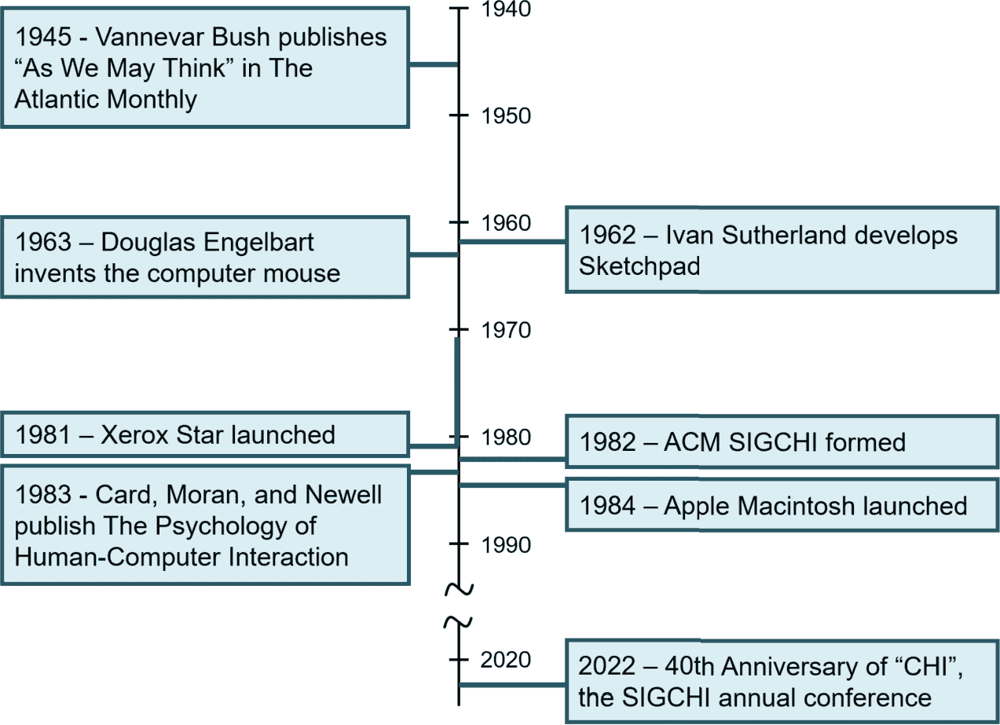

**图 1.1** 人机交互（HCI）历史上的重要事件。

瓦内瓦·布什的先见之作《我们可以如何思考》于 1945 年 7 月发表在《大西洋月刊》上 [\[47\]](#Chp001_1-29_B9780443140969000075.xhtml#br0235)。即使在今天，这篇文章仍是许多 HCI 课程的必读文献。该文在学术出版物中获得了 10000+ 次引用。^(³)

布什（见图 1.2）曾任美国政府科学研究办公室主任，并担任富兰克林·D·罗斯福总统的科学顾问。他受命领导约 6000 名美国科学家将科学应用于战争。那是 1945 年。但布什敏锐地意识到，在和平时期将科学应用于更崇高、更人道的追求中，蕴藏着希望与可能性。他的文章关注学术知识的传播、存储与获取。布什写道：

> *人类经验的总和正以惊人的速度扩展，而我们用来穿越随之而来的迷宫、寻找当下重要条目的手段，与桅杆船时代所用的手段别无二致。*
>
> [\[47, p. 37\]](#Chp001_1-29_B9780443140969000075.xhtml#br0235)^(⁴)

除了提到桅杆船，布什的话语在今天依然切中肯綮，尤其是他结合 HCI 提到的*不断扩展的人类经验*。对大多数人而言，若无奥林匹克级别的天赋，根本无法跟上这个信息时代的最新进展。布什的*随之而来的迷宫*即是今日的*信息过载*或*迷失在超文本空间*。布什的*当下重要条目*听起来像是一篇博客帖子或一条推文？尽管 1945 年尚无博客和推文，布什却清晰地预见了它们。


**图 1.2** 瓦内瓦·布什工作照（约 1940-1944 年）。

布什提议用一种名为 *memex* 的装置来导航知识迷宫。Memex 的功能之一是*联想索引*，即将感兴趣的点连接起来，使得选择一项自动选择另一项：“当用户建立一条路径时，他为其命名，将名称记入他的代码本，并在键盘上敲入。” [\[47, p. 44\]](#Chp001_1-29_B9780443140969000075.xhtml#br0235)。这听起来像超链接和书签。尽管今天我们很容易将 memex 等同于超文本和万维网，但布什的灵感源于当时的电话交换机，他将其描述为“封装在薄玻璃容器中的金属蜘蛛网”（即真空管）[\[47, p. 38\]](#Chp001_1-29_B9780443140969000075.xhtml#br0235)。电话交换机中的连接迷宫，催生了布什关于大脑中信息、个人经历的蜘蛛网式连接这一更普遍的主题。

今天看来，布什的一些想法似乎很天真（例如*干式摄影*），这并不奇怪。然而，这些想法之所以显得天真，仅是因为将它们与布什对一个我们至今仍在努力应对、仍在不断调试与完善的世界的卓越预见相对比时。

### 1.3 伊万·萨瑟兰的 Sketchpad（1962）

伊万·萨瑟兰在 20 世纪 60 年代初，作为麻省理工学院（MIT）电子工程博士研究的一部分，开发了 Sketchpad。Sketchpad 是一个图形系统，支持使用光笔在显示器上操纵几何形状和线条（对象）。要理解当时萨瑟兰可用的计算机完全缺乏易用性，请参考他在 1963 年发表的一篇论文中的开篇评论：

> *迄今为止，人与计算机之间的大多数交互，都因必须将所有通信简化为可打字的书面陈述而受阻。过去我们是在给计算机“写信”，而不是与它们“商谈”。*
>
> [\[478, p. 329\]](#Chp001_1-29_B9780443140969000075.xhtml#br2390)


有了 Sketchpad，命令无需键入。用户不再“给计算机写信”。相反，对象被绘制、调整大小、抓取和移动、延伸、删除——直接使用光笔操作。见图 1.3。对象操作在约束条件下工作，以维持对象的几何关系和属性。

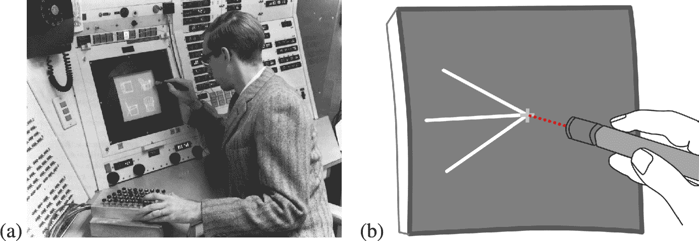

**图 1.3** (a) 伊万·萨瑟兰 Sketchpad 的演示。(b) 光笔拖拽（“橡皮筋效应”）线条，受约束条件限制。

指点设备用于输入，使 Sketchpad 成为首个`直接操纵`界面——这是未来发展的征兆。“直接操纵”这一术语直到多年后才由马里兰大学的本·施奈德曼提出，旨在为这一新类型人机界面中自然融合在一起的一套相关特性提供心理学语境 [\[449\]](#Chp001_1-29_B9780443140969000075.xhtml#br2245)。这些特性包括：对象可见性、增量动作、快速反馈、可逆性、探索性、所有动作的语法正确性，以及以行动取代语言。虽然萨瑟兰的 Sketchpad 是直接操纵系统最早的例子之一，但很快出现了其他系统，最著名的是施乐帕洛阿尔托研究中心（PARC）的艾伦·凯提出的 Dynabook 概念系统 [\[241\]](#Chp001_1-29_B9780443140969000075.xhtml#br1205)。本章后文将更多地介绍施乐 PARC。

萨瑟兰的工作于 1963 年在底特律的 IEEE 会议上发表 [\[478\]](#Chp001_1-29_B9780443140969000075.xhtml#br2390)。该文可在 ACM 数字图书馆中找到。^(⁵)

### 1.4 鼠标的发明（1963）

如果说有一种计算设备比其他所有设备都更能象征 HCI 的兴起，那便是计算机鼠标。鼠标由道格拉斯·恩格尔巴特于 1963 年发明，注定要从根本上改变人类与计算机交互的方式。^(⁶)

恩格尔巴特是位于加利福尼亚州门洛帕克的斯坦福研究所（SRI）一个研究小组的成员。该项目需要一种改进的指点设备，该项目为 NLS（oN-Line System，在线系统），一个早期的超文本系统。具体需求是替代光笔。光笔是一项成熟技术，但使用笨拙。用户须将笔悬持在显示器前的空中。交互几分钟后，疲劳感便会袭来。一种更自然、更舒适的设备会是什么样？或许是桌面上的某种东西，某种靠近键盘的东西。键盘是用户双手通常所在的位置，所以键盘旁的设备最合理。恩格尔巴特的发明满足了这一要求。

#### 第一个鼠标原型

第一个鼠标原型见图 1.4a。该设备包含两个相互垂直放置的电位器。大型金属轮连接在电位器的轴上，并略微突出于外壳底座。当设备在表面上移动时，轮子随之转动。左右移动转动一个轮子；前后移动转动另一个。对角线移动时，两个轮子均会转动，转动程度与各方向上的位移量成比例。对于每个轮子，其转动都会改变电位器滑动触点端的电压。这些电压被传递给主机系统进行处理。屏幕上物体或光标的 `x` 和 `y` 位置由这两个电压信号间接控制。图中可见用户食指下方有一个用于选择的按钮。图 1.4b 展示了恩格尔巴特手持他的发明（左手）和一个稍晚开发的三键鼠标变体（右手）。

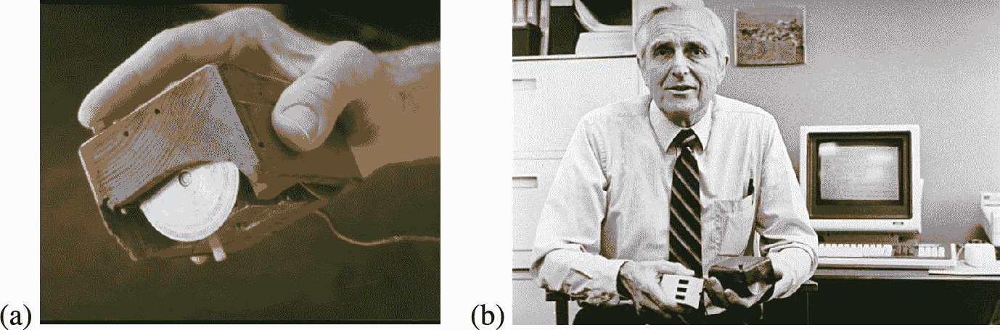

**图 1.4** (a) 第一个鼠标。(b) 发明家道格拉斯·恩格尔巴特手持他的发明（左手）和一个早期的三键变体（右手）。

初步测试侧重于文本的选择和操作，而非图形对象的绘制和操作。恩格尔巴特是涉及鼠标的首个已发表评估的第二作者。可以说，这是人机交互（HCI）领域的首个用户研究，因此有必要在此略作介绍。恩格尔巴特与 English 和 Berman 一起，进行了一项受控实验，对比了多种既能选择又能控制屏幕光标 `x`–`y` 位置的输入设备 [\[115\]](#Chp001_1-29_B9780443140969000075.xhtml#br0575)。除了鼠标，对比对象还包括光笔、操纵杆、膝控杆和 Grafacon（图形转换器）。操纵杆（图 1.5a）属于等张型（即摇杆可移动），并采用两种控制模式运行。在绝对或位置控制模式下，光标在显示器上的位置与摇杆位置具有绝对对应关系。在速率控制模式下，光标速度由摇杆偏转量决定，而光标移动方向由摇杆方向决定。摇杆内嵌有一个开关用于选择，通过向下按压摇杆来激活。

![Figure 1.5 Additional devices used in the first comparative evaluation of a mouse. (a) Joystick. (b) Lightpen. (c) Knee-controlled lever. (d) Grafacon (Source, a, b, d adapted from \[115\]; c, 1967 IEEE Reprinted with permission.)](images/B9780443140969000075/gr005.jpg)

**图 1.5** 首次鼠标对比评估中使用的其他设备。(a) 操纵杆。(b) 光笔。(c) 膝控杆。(d) Grafacon（图形转换器）（来源：a、b、d 改编自 [\[115\]](#Chp001_1-29_B9780443140969000075.xhtml#br0575)；c，1967 IEEE 经许可转载。）

#### 光笔

光笔（图 1.5b）的操作方式与萨瑟兰使用的笔非常相似（见图 1.3）。用户拿起设备，将笔尖指向显示器表面上期望的目标对象进行移动。一个投射的橙色光圈向透镜系统指示目标位置。选择操作通过按压笔杆上的开关完成。

#### 膝控杆

膝控杆（图 1.5c）连接两个电位器。膝盖的左右运动控制光标在左右方向（`x` 轴）的移动；膝盖的上下运动控制光标在上下方向（`y` 轴）的移动。膝盖的上下运动是通过“脚掌前部的摇动”来实现的 [\[115, p. 7\]](#Chp001_1-29_B9780443140969000075.xhtml#br0575)。该设备不包含集成的选择方法。相反，使用系统键盘上的一个按键进行选择。

#### Grafacon（图形转换器）

Grafacon（图 1.5d）是一种用于曲线描绘的商业设备。该设备“由一个连接到线性电位器的可伸缩臂组成，线性电位器的外壳枢接在一个角度电位器上” [\[115, p. 6\]](#Chp001_1-29_B9780443140969000075.xhtml#br0575)。最初，臂的末端装有一支笔；不过，后来这被一个旋钮-开关组件所取代（见图）。用户握住旋钮并移动它来控制屏幕光标。按下旋钮即可进行选择。

#### 研究过程与设计决策

膝控杆和 Grafacon 是鼠标有趣的替代方案。它们展示并暗示了实证研究所涉及的过程。恩格尔巴特不太可能只是某天早上醒来就发明了鼠标。虽然新颖的想法有时确实源于“尤里卡时刻”（灵光一现），但这远不止于此。完善想法——决定什么行得通、什么行不通——是一个迭代过程，涉及大量的试错。毫无疑问，恩格尔巴特和同事们从一开始就知道，他们需要一种设备，能够接受某种形式的人类动作作为输入，并输出两路（`x`–`y`）模拟定位数据。还需要一种选择操作，以在定位操作结束时产生命令或形成闭合。当然，我们今天称之为`指点-选择`或`指点-点击`操作。而且，在远离显示器的位置操作设备，意味着需要一个屏幕跟踪符（如箭头）来建立`设备空间`与`显示空间`之间的对应关系。今天这一切似乎显而易见。但在 20 世纪 60 年代，这是一种新兴的人机交互形式。

#### 对比评估结果

在对比评估中，English 等人 [\[115\]](#Chp001_1-29_B9780443140969000075.xhtml#br0575) 测量了用户的`存取时间`（将手从键盘移至设备所需时间）和`运动时间`（从光标开始移动到最终选择所需时间）。^(⁷)

![Figure 1.6 Results of the first comparative evaluation including a computer mouse. (a) Task completion time in seconds. (b) Error rate as the ratio of missed selections to all selections (adapted from \[115\]).](images/B9780443140969000075/gr006.jpg)

**图 1.6** 包含计算机鼠标的首次对比评估结果。(a) 任务完成时间（秒）。(b) 错误率，即未命中选择次数与所有选择次数之比（改编自 [\[115\]](#Chp001_1-29_B9780443140969000075.xhtml#br0575)）。

虽然从时间角度看膝控杆似乎是最佳设备，但图 1.6a 中的每个柱状图都同时包含了存取时间和运动时间。膝控杆的存取时间当然为零。作者指出，若仅考虑运动时间，膝控杆“不再表现得那么有利” [\[115, p. 12\]](#Chp001_1-29_B9780443140969000075.xhtml#br0575)。光笔以每次试验 2.43 秒的成绩略优于鼠标的 2.62 秒；然而，考虑到光笔持续使用时的不适感——它需悬空在显示器表面操作——这一优势必须打折扣。此外，在准确性方面，鼠标是明显的赢家。鼠标的错误率不到评估中任何其他设备条件错误率的一半（见图 1.6b）。

English 等人 [\[115\]](#Chp001_1-29_B9780443140969000075.xhtml#br0575) 对鼠标的评估标志着 HCI（人机交互）研究的一个里程碑。该方法论基于实证，且撰写报告包含了我们如今期望在面向会议演示和会议论文集发表的用户研究中看到的大部分内容。例如，报告中包含了对参与者、设备和程序的详细描述。如果其他研究人员希望验证或反驳这些发现，该研究是可以复现的。当然，今天要复现该评估将很困难，因为那些设备已不再可用。评估包含一个自变量——输入法，共六个水平：鼠标、光笔、操纵杆（位置控制）、操纵杆（速率控制）、光笔（注：原文此处重复）和膝控杆。有两个因变量：任务完成时间和错误率。每位参与者接受设备条件测试的顺序各不相同，这种做法在今天被称为平衡法。虽然未使用方差分析（ANOVA）来检验统计学显著性差异，但重要的是要记住，作者当时并不像我们今天这样，拥有电子表格和统计应用程序等许多我们视为理所当然的工具。

大约十年后，Card、English 和 Burr [\[60\]](#Chp001_1-29_B9780443140969000075.xhtml#br0300) 进行了下一次涉及鼠标的比较评估。Card 等人的工作是在施乐 PARC 进行的，是更大规模工作的一部分，最终促成了第一个基于窗口的图形用户界面（GUI）（见下一节）。除其他事项外，鼠标在 PARC 经历了大幅度的改进和重新设计。最显著的是，电位器滚轮被滚球组件取代，该组件由 Rider [\[414\]](#Chp001_1-29_B9780443140969000075.xhtml#br2070) 开发。改进后的鼠标优于竞争设备这一优势，得到了 Card 等人 [\[60\]](#Chp001_1-29_B9780443140969000075.xhtml#br0300) 的再次确认，并在此后及整个 HCI 历史上的无数比较评估中得到证明。Engelbart 的发明即将改变计算面貌，这变得显而易见。

数年后，Engelbart 获得了 ACM 图灵奖（1997 年）和 ACM SIGCHI 终身成就奖（1998 年；首位获得者）。有趣的是，Engelbart 的开创性发明可追溯至 1960 年代初，但鼠标的商业化直到 1981 年施乐 Star 发布时才发生。

### 1.5 施乐 Star（1981 年）

1981 年 5 月，在芝加哥举行的 NCC（全国计算机大会）现场议论纷纷。在那个年代，NCC 是计算机领域`一年一度`的盛会。这是一个研究人员聚会（由 AFIPS，即美国信息处理学会联合会赞助）和贸易展览会。该活动规模巨大，1981 年的出席人数达 73,000 人 [\[417\]](#Chp001_1-29_B9780443140969000075.xhtml#br2085)。所有业内主角都到场了。有大玩家，如 IBM，也有小玩家，如加拿大安大略省基奇纳的 Qupro Data Systems 公司。我当时也在场，在 Qupro 的展位工作。我们的主打产品是基于名为 Pascal MicroEngine 的单板计算机的小型桌面计算机系统。但那是另一个故事了。

NCC 上的热议不是关于 Qupro，也不是关于 IBM。热议的是施乐。“你去施乐展位了吗？”我会听到。“你得去看看。真的很酷。”确实如此。施乐展位在整个会议期间都围满了大量人群。每隔一小时左右就有脚本化的演示，人群显然对所见之物感到兴奋。演示的是 Star，即正式名称“施乐 8100 Star 信息系统”。这种兴奋是当之无愧的，因为 1981 年在 NCC 上发布的施乐 Star 标志着计算史上的一个分水岭时刻。Star 是首个商业发布的带有 GUI 和鼠标的计算机系统。它拥有窗口、图标、菜单和指点设备（WIMP）。它支持直接操纵和所见即所得（WYSIWYG）交互。Star 拥有将计算带给大众所需的一切。

Star 的故事始于 1970 年左右，当时施乐在加利福尼亚建立了帕洛阿尔托研究中心（PARC）。次年，施乐与 SRI 签署协议，获得使用 Engelbart 发明的鼠标的许可 [\[230, p. 22\]](#Chp001_1-29_B9780443140969000075.xhtml#br1150)。在接下来的十年里，沿多条战线推进开发。其中一条是从 1973 年开始开发 Alto，它是 Star 的前身。Alto 同样包含图形用户界面和鼠标。它在施乐内部及少数外部测试站点广泛使用。然而，Alto 从未商业发布——据一些人说，这是一个规模宏大的错失良机 [\[458\]](#Chp001_1-29_B9780443140969000075.xhtml#br2290)。

图 1.7 展示了 Star 工作站。以今天的标准来看它平平无奇，但图像显示了系统显示器上的图形信息。这在当时是新颖的。显示器是位映射的，意味着图像是通过将内存中的位映射到显示器上的像素来形成的。当时大多数系统使用字符映射显示器，意味着屏幕图像由字符序列组成，每个字符局限于一个固定模式（如 7×10 像素），从只读内存中检索。字符映射显示器所需内存少得多，但限制了显示图像的丰富度。鼠标——一种两键款式——可见于系统键盘旁。

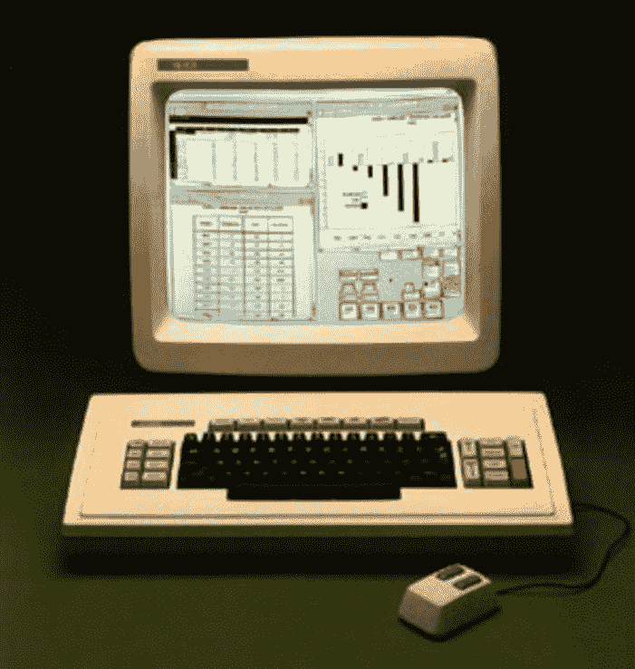

图 1.7 施乐 Star 工作站。

正如设计师所指出的，Star 旨在作为一个`办公自动化系统` [\[230\]](#Chp001_1-29_B9780443140969000075.xhtml#br1150)。商务专业人士桌上会有 Star 工作站，用于创建、修改和管理文档、图形表格、演示文稿等。工作站通过高速以太网电缆连接，共享打印机、文件服务器等中心化资源。Star 设计理念的一个关键原则是：员工想完成工作，而不是摆弄计算机。显然，计算机必须易于使用，或者可以说是`隐形`的。

Star 的一项新颖功能是`桌面隐喻`。隐喻在 HCI 中很重要。当存在隐喻时，用户在知道该做什么方面就有了先发优势。用户利用来自另一领域的现有知识。桌面隐喻将办公桌面的概念带到系统显示器上。在显示器上，用户会找到文档、文件夹、托盘以及计算器、打印机、记事本等配件的图示表示（图标）。图 1.8 中展示了 Star 图标的几个例子。通过利用对桌面的现有知识，用户能立即明白该做什么以及事物如何运作。Star 的设计师及此后的其他人不断拓展隐喻的边界，使其更多地成为一种办公隐喻而非单纯的桌面隐喻。显示器上有窗口、打印机和垃圾桶，但当然，这些实物并不存在于办公桌面上。但隐喻似乎奏效了，因为我们至今仍听说 GUI 是“桌面隐喻”的一个例子。我们将在第 3 章进一步讨论隐喻。

![Figure 1.8 Examples of icons appearing on the Xerox Star desktop (adapted from [457]).](images/B9780443140969000075/gr008.jpg)

图 1.8 施乐 Star 桌面上出现的图标示例（改编自 [\[457\]](#Chp001_1-29_B9780443140969000075.xhtml#br2285)）。

为了使系统易用（“不可见”），Star 的开发者创建了与文件交互的方式，而非与程序交互。因此，用户是 `open a document`（打开文档），而不是 `invoke an editor`（调用编辑器）。这意味着文件与应用程序相关联，但这些细节对用户隐藏。打开电子表格文档会启动电子表格应用程序，而打开文本文档则会打开编辑器。

凭借 GUI 和点选交互，Star 界面成为了直接操纵的原型。关于图形交互（如 Sutherland 的工作）和指点设备（如 Engelbart 的工作）的奠基性研究已告一段落。相比之下，早期的命令行界面只有一个输入通道。每个动作都需要一条命令。用户必须学习并记忆系统命令的语法，并将其键入以完成任务。直接操纵系统（如 Star）拥有众多输入通道，且每个通道都与特定任务直接对应。此外，与通道的交互是根据任务属性量身定制的。连续属性（如显示亮度或音量）拥有连续控制（如滑块）。离散属性（如字体系列或文本对齐方式）拥有离散控制（如多位开关或菜单项）。每个控件在显示器上也都有专用位置，并通过直接的点选操作来激活。Johnson 等人 [[230, p. 14]](#Chp001_1-29_B9780443140969000075.xhtml#br1150) 将直接操纵比作驾驶汽车。油门踏板控制车速，拨杆控制雨刷，旋钮控制收音机音量。每个控件都是一个专用通道，每个都有固定位置，且均根据其控制的属性进行操作。


驾驶汽车时，驾驶员可以先调节收音机音量，再打开雨刷；也可以先打开雨刷，再调节音量。汽车能根据驾驶员的意愿，以任何顺序响应驾驶员的输入。在计算领域，直接操纵带来了同样的灵活性。这绝非易事。相比之下，命令行界面很简单。它们遵循一种称为 `sequential programming`（顺序编程）的软件范式。每个动作都在系统控制下按顺序发生。当系统需要特定输入时，会提示用户输入。

直接操纵界面需要不同的方法，因为它们必须根据用户的意愿接受用户的动作。例如，在文本编辑器中操作 `hello` 时，用户可能先将字体改为 Courier (`hello`)，再将样式改为粗体 (`**hello**`)。或者，用户可能先将样式设为粗体 (`**hello**`)，再将字体改为 Courier (`**hello**`)。结果相同，但动作顺序不同。关键在于用户掌握控制权，而非系统。为支持这一点，直接操纵系统采用一种称为 `event-driven programming`（事件驱动编程）的软件范式进行设计，这比顺序编程更复杂。虽然事件驱动编程并非新事物（它用于过程控制以响应 `sensor events` 传感器事件），但设计能异步响应 `user events`（用户事件）的系统在 1970 年代初 Star 开始研发时还是新鲜事物。当然，从用户角度来看，这一细节无关紧要（记住“不可见”的计算机）。我们在此提及，仅是为了肯定为设计 Star 并将其推向市场所付出的赫拉克勒斯般的巨大努力。

设计 Star 不仅仅是利用窗口、图标、菜单和指点设备（WIMP）构建一个界面，而是设计一个能让这些组件存在并协同工作的系统。Alan Kay 领导的 PARC 团队从 1970 年左右开始开发这样一个系统。核心要素是一种名为 Smalltalk 的新面向对象编程语言和一种称为 `model-view controller`（模型-视图-控制器）的软件架构。这是一个复杂的编程环境，并与 Star 的设计并行演进。因此，Star 的开发历时约十年也就不足为奇了，因为设计者们不仅在发明一种新的人机交互风格，还在发明构建这种新风格所依赖的架构。

最终，Star 在商业上并未取得成功。关于原因众说纷纭（如 [[458]](#Chp001_1-29_B9780443140969000075.xhtml#br2290)），但最主要的原因可能是 Star 不是一台个人计算机。在 Star 界面设计者 Johnson 等人 [[230]](#Chp001_1-29_B9780443140969000075.xhtml#br1150) 的文章中，多次将 Star 称为个人计算机。但他们对“个人”的定义不同。他们视 Star 为连接到中央服务器的终端的增强版，“一组个人计算机” [[230, p. 12]](#Chp001_1-29_B9780443140969000075.xhtml#br1150)。在另一篇文章中，设计者 Smith 和 Irby 称 Star 为“专为办公专业人士设计的个人计算机” [[456, p. 17]](#Chp001_1-29_B9780443140969000075.xhtml#br2280)。个人？按今天的标准并不算。

从根本上说，Star 是一台连接服务器、面向办公环境的网络工作站。而且它很贵：仅工作站就要 16,000 美元。这与我们今天所知的个人计算相去甚远。这也与 1970 年代末和 1980 年代初存在的个人计算相去甚远。是的，即使在那时，个人计算也已蓬勃发展。Apple Computer 于 1977 年推出的 Apple II 取得了巨大成功。它是首个电子表格应用 VisiCalc 的开发平台。VisiCalc 最终售出 70 多万份，被称为首个 `killer app`（杀手级应用）。值得注意的是，Star 没有电子表格应用，也无法运行市场上任何电子表格或其他应用。Star 的架构是 `closed`（封闭）的——它只能运行由施乐开发的应用程序。

当时其他流行的个人计算机系统包括 Commodore Business Machines 的 PET、VIC-20 和 Commodore 64，以及 Tandy Corp. 的 TRS-80。这些系统才是真正的个人计算机。大多位于人们的家中。但用户界面糟糕透顶。这些系统采用传统的命令行界面。操作系统——如果能称之为操作系统的话——通常由一个 BASIC 语言解释器和一个控制台提示符组成。Load（加载）、Save（保存）、Run（运行）、Edit（编辑）及其他寥寥几条命令就是其全部功能。虽然这些系统确实是个人化的，但典型用户是爱好者、计算机发烧友，或有足够技术技能连接组件并应对不可避免的软硬件故障的人。但爱好者们喜爱它们，而且它们便宜。然而，它们难以使用。因此，虽然 Star 上的直接操纵用户界面可能直观易用，且有潜力让没有技术技能（或兴趣！）的人使用，但该系统始终未能触达合适的受众。

## 1.6 HCI 的诞生 – 1983

1983 年可被视为人机交互诞生的标志性年份。至少有三个关键事件作为里程碑：

1. 首届 ACM SIGCHI 大会
2. Card、Moran 和 Newell 的 *The Psychology of Human-Computer Interaction*（人机交互心理学）[[64]](#Chp001_1-29_B9780443140969000075.xhtml#br0320) 出版
3. Apple Macintosh（Mac）发布

虽然 Mac 于 1984 年 1 月正式上市，但它于 1983 年 12 月通过传单发布了预告。因此我们将其列在此处。

### 1.6.1 首届 ACM SIGCHI 大会 (1983)

# 人机交互历史

人机交互的根源至少可以追溯到 1969 年，当时 ACM 成立了社会与行为计算特别兴趣小组（SIGSOC）[[36]](#Chp001_1-29_B9780443140969000075.xhtml#br0180)。最初，SIGSOC 关注社会科学中的计算机应用。然而，重点很快转移到了用户的需求和行为特征上，并开始讨论用户界面或计算的人因工程。从 1978 年开始，SIGSOC 向 ACM 游说更名。这一变更发生在 1982 年马里兰州盖瑟斯堡举行的*计算系统人因会议*上，ACM 计算机-人交互特别兴趣小组（SIGCHI）的成立首次公开宣布。如今，ACM 提供了关于 SIGCHI 及其使命的以下声明：

> ACM 计算机-人交互特别兴趣小组（SIGCHI）是全球最大的专业人士协会，其成员致力于人机交互（HCI）的研究与实践。我们是一个跨学科群体，成员包括计算机科学家、软件工程师、心理学家、交互设计师、平面设计师、社会学家、多媒体设计师、信息科学家和人类学家，仅列举了部分在此领域贡献专业知识的学科。将我们凝聚在一起的是共同的理解：设计有用且可用的技术是一个跨学科过程，如果做得恰当，它拥有改变生活的力量。^(⁸)

次年（1983 年），首届 SIGCHI 会议在波士顿举行。会上发表了 59 篇技术论文。会议采用了稍作修改的名称以反映其新地位：*ACM SIGCHI 计算系统人因会议*。"CHI"（发音为硬 "k" 音）自那时起每年举办一次，近年来参会人数约 3000 人。^(⁹)

CHI 会议汇聚了研究人员和从业者。研究人员参会是为了技术项目（论文发表），而从业者参会是为了了解学术界和工业界的最新研究主题。实际上，两类人群也都为了建立人脉（会面和社交），与来自世界各地志同道合的 HCI 爱好者交流。简单来说，CHI *就是* HCI 领域的盛会，每年的参会之旅往往是视 HCI 为本职领域的人士日程表中最重要的安排。

技术项目竞争激烈。研究论文经过同行评审，录用标准揭示了高质量门槛。1984 年至 2021 年的统计数据显示，论文投稿总数为 36,042 篇，录用 8,581 篇，总录用率为 23.8%。图 1.9 按年份展示了细分情况。^(¹⁰)

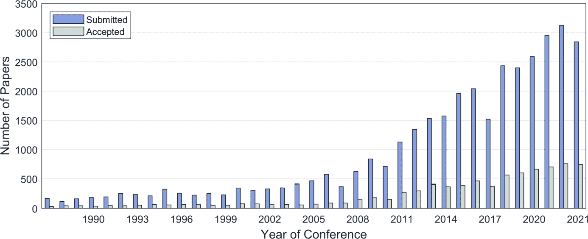

图 1.9 ACM SIGCHI 计算系统人因会议（“CHI”）历年论文投稿与录用数量。

录用后，研究人员可在会上展示工作成果，通常为 15-20 分钟的演讲，配以幻灯片，或许还有研究视频演示。录用也意味着最终提交的论文将发表在会议论文集中，并收录于 ACM 数字图书馆。关于撰写和发表研究论文的技巧见第 8 章。

CHI 论文曝光度高，意味着它们能触达该领域庞大的研究人员和从业者群体。衡量工作质量的一个指标是影响力，即论文被引用次数。鉴于录用标准严格，人们可能预期 CHI 论文在 HCI 领域具有高影响力。确实如此 [[299]](#Chp001_1-29_B9780443140969000075.xhtml#br1495)。我们将在第 4 章详述研究影响力。

### 1.6.2 人机交互心理学（1983）

如果听到两位 HCI 研究人员谈论 "Card, Moran, and Newell"（卡德、莫兰和纽厄尔），他们大概率是在讨论《人机交互心理学》——这本 1983 年出版、由 Stuart Card、Tom Moran 和 Allen Newell 合著的书。见图 1.10。该书源于施乐 PARC 的研究工作。Card 和 Moran 于 1974 年抵达 PARC，不久后加入了 PARC 的*应用信息处理心理学项目*（AIP）。Newell 是 1975 年 ACM 图灵奖得主，当时是匹兹堡卡内基梅隆大学的计算机科学与认知心理学教授，担任该项目顾问。AIP 的使命是“通过在应用背景下开展必要的基础研究，创建一个人机交互的应用心理学”[[64, p. ix]](#Chp001_1-29_B9780443140969000075.xhtml#br0320)。

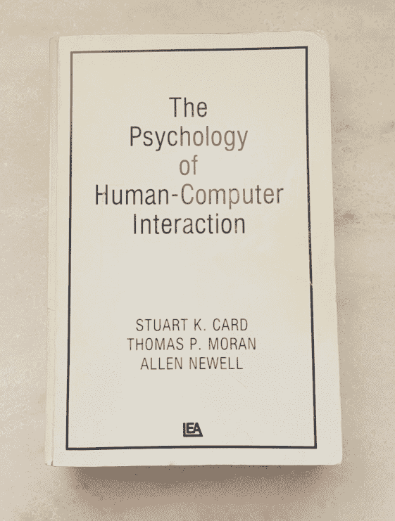

图 1.10 Card、Moran 和 Newell 合著的《人机交互心理学》，Erlbaum 1983 年出版。

全书包含 13 章，大致组织如下：

- 科学基础（100 页）
- 文本编辑示例（150 页）
- 建模（80 页）
- 扩展与泛化（100 页）

那么，什么是“人机交互的应用心理学”？首先，应用心理学建立在心理学基础研究之上。书中前 100 多页全面概述了与人类感觉、认知和运动系统相关的基础心理学核心知识。许多 1980 年代的计算机科学学生（和专业人士）面临为计算机系统构建简单直观界面的挑战，特别是考虑到基于图形用户界面的新兴交互风格。对许多人来说，Card、Moran 和 Newell 的书是他们首次系统接触人类感知输入（如视觉感知刺激）、认知（如决定适当反应）和运动输出（如反应并移动手或光标至目标）。当然，当时人类感觉、认知和运动行为的研究已相当成熟。Card 指出，挑战在于如何应用这些知识：

> 任何曾试图从文献中获取心理学指导以设计交互式计算机系统的人，都深知因实证结果与微观理论的混杂而产生的巨大挫败感，这些结果和理论紧密绑定于实验范式。
>
> [[59, p. 301]](#Chp001_1-29_B9780443140969000075.xhtml#br0295)

Card、Moran 和 Newell 所做的，是将低层级人类过程与人类与计算机看似无害的交互（如打字或使用鼠标）建立联系。其框架是*人类处理器模型*（MHP）。见图 1.11。MHP 拥有眼睛和耳朵（用于感官输入至知觉处理器）、大脑（包含认知处理器、短时记忆和长时记忆），以及手臂、手和手指（用于运动反应）。

![图 1.11 人类处理器模型（MHP）[64, p. 26]。](images/B9780443140969000075/gr011.jpg)

图 1.11 人类处理器模型（MHP）[[64, p. 26]](#Chp001_1-29_B9780443140969000075.xhtml#br0320)。

书中选定用于构建分析框架的应用是文本编辑。在今天这可能显得奇怪，但重要的是要记住，1983 年早于万维网以及当今大多数计算环境，如移动计算、基于触摸的输入、虚拟现实、短信、推文（发推）等。文本编辑似乎是发展人机交互应用心理学的正确框架。^(¹¹)

心理学与计算机科学之间存在一种有趣的协同效应——书中对此有很好的体现——即人类行为可以被理解，甚至建模为一种信息处理活动。Claude Shannon [[444]](#Chp001_1-29_B9780443140969000075.xhtml#br2220)、Huffman [[203]](#Chp001_1-29_B9780443140969000075.xhtml#br1015) 等人在 1940 年代和 1950 年代关于通过电子信道传输信息的研究，很快被 Miller [[358]](#Chp001_1-29_B9780443140969000075.xhtml#br1790)、Fitts [[125]](#Chp001_1-29_B9780443140969000075.xhtml#br0625)、Welford [[514]](#Chp001_1-29_B9780443140969000075.xhtml#br2570) 等心理学家采纳，作为刻画人类知觉、认知和运动行为的一种方式。Card、Moran 和 Newell 将人类行为的信息处理模型应用于交互系统。书中最著名的两个例子是用于选择反应时间的 Hick-Hyman 定律 [[189]](#Chp001_1-29_B9780443140969000075.xhtml#br0945) 和用于快速瞄准运动的 Fitts 定律 [[125]](#Chp001_1-29_B9780443140969000075.xhtml#br0625)。我们将在第 7 章“交互建模”中详述这些内容。

Newell 后来回顾了《人机交互心理学》的目标，并写道：

> 我们心中考虑的是界面设计师对理论的需求。界面的设计是人机交互的杠杆点。人因工程和人机心理学的传统重点在于实验分析，这要求系统或合适的模型可供实验，但等到这种具体系统存在时，界面中大多数重要的自由度已经被固定下来了。设计师需要的是思维工具——以便在设计时，用户的特性和约束能够被纳入考量，从而做出关键选择。……我们的目标是发展一种工程风格的用户理论，允许进行近似的、草稿纸式的计算，以预测用户在终端操作时如何与计算机交互。
>
> [[369, pp. 29-30]](#Chp001_1-29_B9780443140969000075.xhtml#br1845)

在这里，Newell 敏锐地指出了该领域的一个困境：实验要等到为时已晚才能进行。正如他所说，系统已构建完成，自由度已被固定。这或许有些夸张，但确实如此：新产品中的新颖交互总似乎会激发大量研究论文，指出弱点并提出和评估改进。然而，故事远不止这些。请考虑 Apple iPhone 的双指手势、Nintendo Wii 的加速度感应挥动、Microsoft IntelliMouse 的滚轮，或 Palm Pilot 的文本输入手势（即 Graffiti）。这些创新并非源于工程或设计才华的全新想法。这些突破的背景是人机交互及相关领域基础研究的环境。^(¹²)

Newell 还指出，该书旨在生成思维工具。这是对模型——交互模型——的一种随意称呼。这些模型可能是定量且预测性的，也可能是定性且描述性的。无论哪种方式，它们都是工具，是雕刻家的刀，鞋匠的针，随你怎么称呼。无论是跨替代设计生成定量预测，还是划定问题空间以揭示新关系，模型的目的都是挖掘假设或原型设计中的优势和劣势，并引发改进机会。书中包含了典范，如击键层模型（`KLM`）和目标、操作符、方法与选择规则模型（`GOMS`）。这两个模型在早期工作 [[62],[63]](#Chp001_1-29_B9780443140969000075.xhtml#br0315) 中已有介绍，但在书中重新呈现，并附带了额外的讨论和分析。然而，该书在建模方面的主要贡献在于令人信服地论证了模型为何重要以及如何构建模型，并教会我们如何构建它们。为此，HCI 领域对 Card、Moran 和 Newell 欠下了巨大的债务。我们将在第 7 章“交互建模”中进一步讨论描述性和预测性模型。

Newell 还建议使用近似的“草稿纸式”计算作为描述或预测用户交互的便捷方式。在《人机交互心理学》中，这些计算（除其他方式外）通过第 2 章中的 19 个交互示例呈现 [[64, pp. 23-97]](#Chp001_1-29_B9780443140969000075.xhtml#br0320)。示例以关于用户交互的问题形式出现。解决方案使用粗略计算，但基于从实验心理学基础研究中获得的数据和概念。示例 10 [[64, p. 66]](#Chp001_1-29_B9780443140969000075.xhtml#br0320) 具有代表性：


在给出解决方案之前，这里有一个现代背景。假设一位用户使用智能手机的软键盘给朋友发短信。与软键盘的交互包括“词补全”。每输入一个字母，候选词就会出现在键盘上方。如果用户查看候选词，交互就涉及一个选择：如果单词出现，选择它；如果单词未出现，输入下一个字母。^(¹³)


图 1.12 在带有词补全的软键盘上输入“computer”。交互需要简单的决策。详见正文讨论。

正如 Card、Moran 和 Newell 详述的那样，刚才描述的交互是一种称为*物理匹配*的*简单决策*类型。读者将通过人类处理器模型逐步了解解决方案，说明从刺激、认知处理到运动反应的每一步。该解决方案是近似的。有一个标称预测，伴随一个*快手*预测和一个*慢手*预测。用户的反应时间（`RT`）计算如下：

```
RT = t[P] + 2 × t[C] + t[M] = 100[30 ∼ 200] + 2 × (70[25 ∼ 170]) + 70[30 ∼ 100] = 310[130 ∼ 640] ms
```

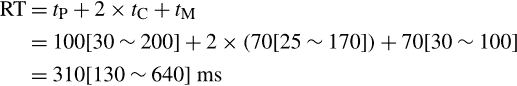(1.1)


[\[64, p. 69\]](#Chp001_1-29_B9780443140969000075.xhtml#br0320)。共有四个低级处理周期：一个知觉处理器周期（`t[P]`）、两个认知处理器周期（`t[C]`）和一个运动处理器周期（`t[M]`）。对于每一个周期，标称值由预期最小值和最大值括定。公式 (1.1) 中的数值源自实验心理学的基础研究，书中已引用。fastman-slowman 范围很大，表明准确预测人类行为的挑战。书中还有其他类似示例。而且这些示例也有现代背景，只待被发现和应用。

可能不太明显，预测一个仅需三分之一秒的任务所需时间，与设计交互式系统的宏观图景有何关联。但不要被迷惑了。如果一个复杂任务可以分解为基本动作，那么很有可能通过将任务划分为一系列穿插着感知和认知处理周期的运动动作，来预测完成该任务的时间。这一思想在 Card、Moran 和 Newell 的著作中作为击键级模型（`KLM`）呈现，我们将在第 7 章中遇到它。

《人机交互心理学》至今仍可购买（例如见 [`www.amazon.com`](http://www.amazon.com)），并在研究论文中被定期且大量引用（根据 Google Scholar 数据引用 9000+ 次）。在 2008 年意大利佛罗伦萨举行的 ACM SIGCHI 大会上，曾举行一个专题讨论会，庆祝该书出版 25 周年。Card 和 Moran 均就该书的历史以及他们在将心理学科学引入交互式计算系统设计时所面临的挑战发表了演讲。其他人则谈到了该书如何影响和塑造了他们自己在人机交互领域的研究。

#### 1.6.3 Apple Macintosh 的发布（1984 年 1 月）

1984 年 1 月 22 日是体育界的大日子。那是第十八届超级碗（Super Bowl XVIII）举行的日子，即美国国家橄榄球联盟（NFL）的冠军赛。这也是广告界的大日子。面对数百万观众，各公司争相竞逐（并支付高额费用！），向渴望娱乐、蓄势待发准备购买最新必备产品的观众传递短暂的宣传冲击。其中一条广告——在第三节播放——是一段长达 60 秒的 Apple Macintosh（"Mac"）广告。该广告可在 YouTube 上观看^(¹⁴)。

广告奏效了。不久之后，计算机爱好者们抢购了 Mac。Mac 外观时尚，并配备了最新的输入设备——计算机鼠标。参见 图 1.13。操作系统和应用软件宣告了图形用户界面（`GUI`）新时代的到来，具有直接操纵和指点选择交互。Mac 不仅酷炫，其界面还简单直观。任何人都能使用。这种简洁性部分归功于单按钮鼠标。只有一个按钮，就不会对该按哪个按钮感到困惑。

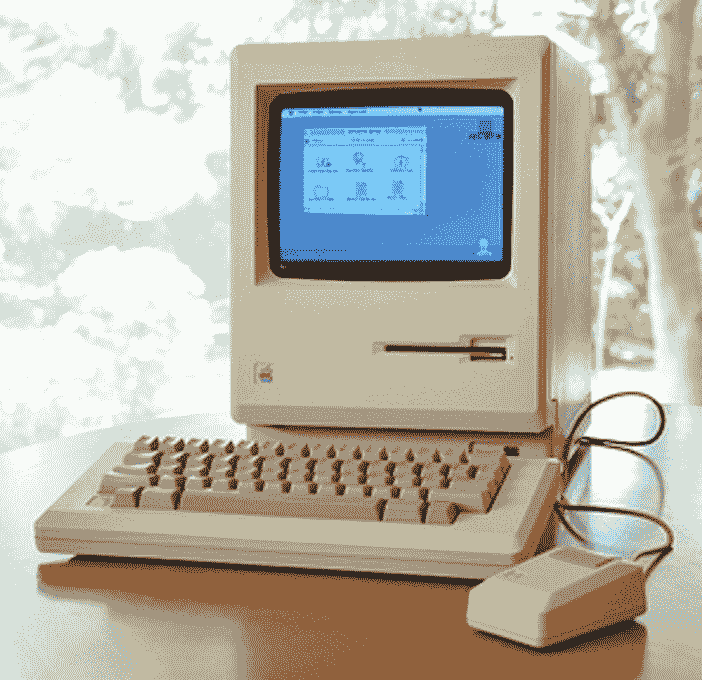

图 1.13 Apple Macintosh。

有大量资料记录了 Apple 的历史以及通向 Mac 发布的事件 \[280,287,[359\]](#Chp001_1-29_B9780443140969000075.xhtml#br1795)。不幸的是，伴随 Apple 及其张扬领导者的超凡地位而来的，还有大量需要理清的传闻。图 1.14 列出了几个值得注意的事件。^(¹⁵)

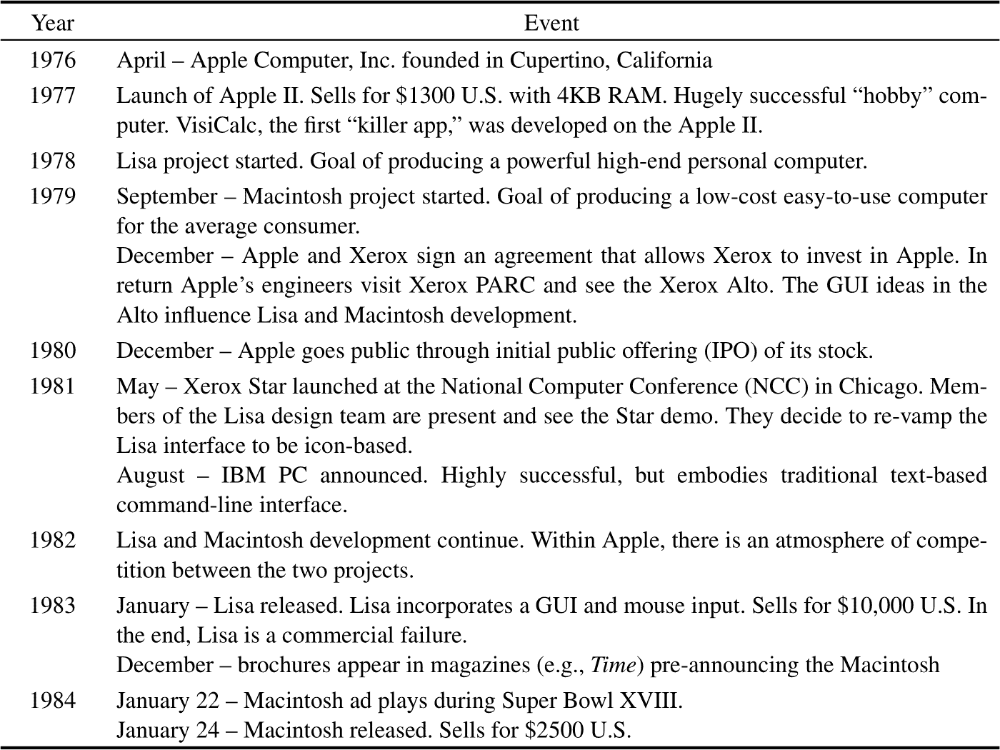

图 1.14 通向 Macintosh 发布的 Apple 内部事件时间线。

### 1.7 HCI 与图形用户界面的发展

随着 ACM SIGCHI 于 1983 年成立，以及 Apple Macintosh 于 1984 年发布并取得成功，人机交互正式起步。`GUI` 进入主流，因此，更广泛的用户和研究者群体接触到了这一新类型的交互。Microsoft 在图形用户界面领域起步较晚。Microsoft Windows 的早期版本出现于 1985 年，但直到 Windows 3.0（1990 年）发布，特别是 Windows 3.1（1992 年）发布，Microsoft Windows 才被视为 Macintosh 操作系统的有力替代品。Microsoft 凭借改进版 Windows 增加了市场份额，最著名的有 Windows 95（1995 年）、Windows 98（1998 年）、Windows XP（2001 年）、Windows 7（2009 年）、Windows 10（2014 年），或许还有 Windows 11（2021 年）。2022 年关于桌面计算机操作系统的报告称，Windows 占据约 76% 的市场份额，而 MacOS 约为 15%。^(¹⁶)

随着人们对人机交互的兴趣日增，所有主要大学都开设了 HCI 或用户界面设计课程，研究生们经常选择 HCI 课题作为论文研究方向。许多此类学习项目设在计算机科学系；然而，HCI 也在其他领域成为合法且热门的研究方向，如心理学、认知科学、工业工程、信息系统和社会学。不仅是大学。公司很快意识到，设计优秀的用户界面是好生意。但这并不容易。HCI 领域关于糟糕 UI 的故事不胜枚举（例如 \[87,229,[376\]](#Chp001_1-29_B9780443140969000075.xhtml#br1880)）。因此，大有可为。从业者——即在工业界应用 HCI 原则的专家——是 HCI 社区的重要成员，他们构成了当今许多 HCI 大会的重要参会群体。

### 1.8 HCI 中的实证研究

对人机交互的研究兴趣，至少最初，集中在界面的质量、有效性和效率上。人们使用 `GUI` 与基于文本的命令行界面完成常见任务，速度和准确性如何？又或者，给定 `GUI` 实现的两种或多种变体，哪种更快或更准确？这些或类似的问题构成了 HCI 早期大量实证研究的基础。至今仍是如此。

HCI 早期研究课题的一个经典例子是菜单设计。有了 `GUI`，向计算机发出命令主要取决于在菜单中选择项目。菜单需要*识别*；键入命令需要*回忆*。已知在用户界面中，识别优于回忆 [\[17, p. 144\]](#Chp001_1-29_B9780443140969000075.xhtml#br0085) \[196,[201\]](#Chp001_1-29_B9780443140969000075.xhtml#br1005)，至少对新手而言如此，但一个新问题浮现出来。如果菜单中有大量命令，该如何组织它们？

一种方法是将菜单命令组织在一个包含深度和广度的层级结构中。问题随之而来：层级的最佳结构是什么？考虑在一个菜单中组织 64 个命令的情况。菜单可以组织为深度 = 8、广度 = 2，或深度 = 2、广度 = 6。这两种结构都提供对 64 个菜单项的访问。强调广度的情况给出 8² = 64 个选择（图 1.15a）。强调深度的情况给出 2⁶ = 64 个选择（图 1.15b）。哪种组织更好？是否还有更好的组织（例如 4³ = 64）？考虑到这些问题，菜单设计在 HCI 早期成为活跃的研究课题也就不足为奇了（例如 \[58,245,271,357,459,[494\]](#Chp001_1-29_B9780443140969000075.xhtml#br2470)）。

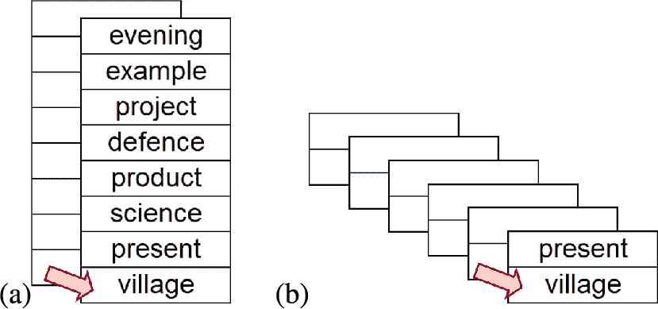

图 1.15 菜单设计中的广度与深度。(a) 宽层级结构中的 8 × 8 选择。(b) 深层级结构中的 2 × 2 × 2 × 2 × 2 × 2 选择。

深度与广度并非菜单设计中的唯一研究议题。涉及菜单设计与访问的研究问题包括以下内容：

#### 研究问题示例

*   项目是否应按字母顺序或功能排序 [[58]](#Chp001_1-29_B9780443140969000075.xhtml#br0290)[[354]](#Chp001_1-29_B9780443140969000075.xhtml#br1770)？

*   子菜单上是否有标题能改善菜单访问 [[154]](#Chp001_1-29_B9780443140969000075.xhtml#br0770)？

*   如果在标签中添加图标，访问是否会改善 [[186]](#Chp001_1-29_B9780443140969000075.xhtml#br0930)？

*   不同年龄组的人对宽层级与深层级菜单层次结构的反应是否不同 [[543]](#Chp001_1-29_B9780443140969000075.xhtml#br2715)？

*   在移动设备上，菜单是否存在深度与广度的优势 [[141]](#Chp001_1-29_B9780443140969000075.xhtml#br0705)？

*   听觉反馈是否能改善菜单访问 [[553]](#Chp001_1-29_B9780443140969000075.xhtml#br2765)？

*   手机的倾斜是否可用于菜单导航 [[411]](#Chp001_1-29_B9780443140969000075.xhtml#br2055)？

*   菜单列表可以是饼状的，而不是线性的吗 [[55]](#Chp001_1-29_B9780443140969000075.xhtml#br0275)？

*   饼菜单可用于文本输入吗 [[501]](#Chp001_1-29_B9780443140969000075.xhtml#br2505)？

以上提出了研究问题但未给出答案。答案见引文论文。此处目的非回顾与评判菜单设计研究，而是呈现与 HCI 相关的研究问题，并将问题构建为实证研究的机会。

#### 1.8.1 会议 —— HCI 的支柱

为庆祝 SIGCHI 于 2022 年成立 40 周年，ACM 的 *interactions* 杂志发布了 24 个 SIGCHI 赞助会议创办时间表 [[260]](#Chp001_1-29_B9780443140969000075.xhtml#br1300)。参见 图 1.16。除 CHI 本身外，每个会议均被视为“专题会议” —— 专注于人机交互广泛领域内的子主题。

![图 1.16 从 1983 年 CHI 开始的 SIGCHI 赞助会议时间表（源自 [260]）。](images/B9780443140969000075/gr016.jpg)

图 1.16 从 1983 年 CHI 开始的 SIGCHI 赞助会议时间表（源自 [[260]](#Chp001_1-29_B9780443140969000075.xhtml#br1300)）。

图 1.16 中会议名称所暗示的主题广泛。无论涉及儿童 (IDC)、机器人 (HRI) 还是汽车 (AUTOMOTIVE)，只要交互涉及计算机，就有 HCI 会议可探索新颖想法。参加会议展示并与志同道合的研究者分享工作，是所有人机交互研究者的动力。正如 Kumar 等人所言：

> 会议构成了 SIGCHI 的支柱。它们是我们作为一个集体实体和特别兴趣小组存在的理由。它们将我们连接在一起，把我们聚集为一个由人机交互 (HCI) 研究者、教育工作者、学生和从业者组成的社区。
>
> [[260, p. 35]](#Chp001_1-29_B9780443140969000075.xhtml#br1300)

除专题会议外，还有区域性会议，如 NordiCHI（北欧人机交互会议）、OzCHI（澳大利亚）、IndiaHCI 或 AfriCHI。其他著名会议包括 ASSETS（由 ACM 无障碍计算特别兴趣小组 SIGACCESS 赞助）、INTERACT（由 IFIP 国际信息处理联合会赞助）、HCII（国际人机交互会议）和 GI（图形界面，加拿大计算机图形学与人机交互会议）。GI 于 1987 年与 CHI 联合举办 (CHI+GI)，拥有作为人机交互领域历史最悠久的持续举办会议的殊荣；首届于 1969 年在渥太华举办。[[17]](#fn17)

### 1.9 其他参考文献

以下文献为 HCI 历史的重要贡献。

*   “Personal Dynamic Media”，1977，A. Kay 和 A. Goldberg [[241]](#Chp001_1-29_B9780443140969000075.xhtml#br1205) —— 文中描述了 Dynabook。虽从未制造，Dynabook 为笔记本电脑、平板电脑和电子书提供了概念基础。

*   “The Computer for the 21st Century”，1991，M. Weiser [[513]](#Chp001_1-29_B9780443140969000075.xhtml#br2565) —— 预言普适计算的散文。Weiser 开篇即言：“最深刻的技术是那些消失的技术。它们将自身编织进日常生活的肌理，直至与之不可分辨” [[513, p. 94]](#Chp001_1-29_B9780443140969000075.xhtml#br2565)。

*   “A Brief History of Human-Computer Interaction Technology”，1998，B. Myers [[364]](#Chp001_1-29_B9780443140969000075.xhtml#br1820) —— 回顾早期 HCI 用户界面与交互技术，包括手势识别。

*   “The Evolution of HCI and Human Factors: Integrating Human and Artificial Intelligence”，2023，M. Chignell 等 [[76]](#Chp001_1-29_B9780443140969000075.xhtml#br0380) —— 历史视角审视 HCI 从人因工程与心理学中萌发及其关系，涵盖本书和章节中提到的许多事件和人物。预见数据科学与人工智能 (AI) 出现带来的未来挑战。

其他从历史视角审视人机交互的文献包括 Baecker 等 [[16]](#Chp001_1-29_B9780443140969000075.xhtml#br0080)、Erickson 和 McDonald [[118]](#Chp001_1-29_B9780443140969000075.xhtml#br0590) 以及 Grudin [[163]](#Chp001_1-29_B9780443140969000075.xhtml#br0815)[[164]](#Chp001_1-29_B9780443140969000075.xhtml#br0820) 的出版物。

### 1.10 资源

以下是在线资源，适合开展人机交互研究。

*   Google Scholar：<http://scholar.google.ca/>

*   ACM Digital Library：<http://portal.acm.org/>

*   HCI Bibliography：<http://hcibib.org/>

*   Wikipedia：<http://en.wikipedia.org/>

随书第二版提供配套网站资源：

*   <http://www.yorku.ca/mack/HCIbook2e>

可下载大量资源，配合书中示例使用。

---

在此历史介绍后，我们将进入人机交互实证研究的具体主题。下一站 —— 下一章 —— 是人因因素。

### 学生练习

1.  **1-1** 直接操作的特征包括对象可见性、增量动作、快速反馈、可逆性、探索性、所有动作的语法正确性，以及以动作替代语言。针对每个特征，考虑并讨论一个使用现代图形用户界面 (`GUI`) 执行的示例任务。将该任务与在命令行环境（如 Unix、Linux 或 DOS）中执行同一任务进行对比。

2.  **1-2** 顺序编程与事件驱动编程有何区别？结合本章所述两种用户界面类型作答。详述示例（本章未涉及者）。

3.  **1-3** 图 1.1 中存在时间跨度：从 1984 年 Apple Macintosh 发布，到 2022 年 SIGCHI 庆祝 40 周年。请在该时间范围内选取五个重大事件（如产品发布），这些事件显著影响了计算领域，特别是人机交互。确保 1990 年代、2000 年代和 2010 年代每个十年至少有一个事件。撰写简要报告或制作幻灯片演示，突出事件及其对领域的重要性。旨在将事件的重要性与事件发生时期的计算实践并置对比。可包含销量等统计数据，以确证事件的重要性。

### 参考文献

*   **[16]** R.M. Baecker, J. Grudin, W.A.S. Buxton, S. Greenberg. 历史与智识视角。载于：R.M. Baecker, J. Grudin, W.A.S. Buxton, S. Greenberg, 编。*人机交互读本：迈向 2000 年*。第 2 版。旧金山：Morgan Kaufmann；1995：35–47。

*   **[17]** R.W. Bailey. *人类性能工程：为计算机产品、应用和系统设计高质量、专业的用户界面*。第 3 版。新泽西州 Upper Saddle River：Prentice Hall；1996。ISBN 978-0131496347。

*   **[36]** L. Borman. SIGCHI：早期岁月。*SIGCHI Bulletin*。1996 年 1 月；28(1)：4–6。[10.1145/249170.249172](http://dx.doi.org/10.1145/249170.249172)。

*   **[47]** V. Bush. 我们想得怎样。*The Atlantic Monthly*。1945 年 7 月；176(1)：101–108。转载于 ACM 的*Interactions* 1996 年 3 月：35–46。[10.1145/227181.227186](http://dx.doi.org/10.1145/227181.227186)。


### 参考文献

*   **[55]** J.R. Callahan, D. Hopkins, M.D. Weiser, B. Shneiderman. 饼状菜单与线性菜单的实证对比。*ACM SIGCHI 人机因素计算系统会议论文集 - CHI '88*。纽约：ACM；1988：95–100。[`doi.org/10.1145/57167.57182`](http://dx.doi.org/10.1145/57167.57182)。

*   **[58]** S.K. Card. 计算机命令菜单搜索中的用户知觉机制。*计算机系统人因论文集*。纽约：ACM；1982：190–196。[`doi.org/10.1145/800049.801779`](http://dx.doi.org/10.1145/800049.801779)。

*   **[59]** S.K. Card. 模型人处理器：用于进行人类性能工程计算的模型。*第 25 届人因学会年会论文集*。加利福尼亚州圣莫尼卡：人因学会；1981：301–305。[`doi.org/10.1177/107118138102500180`](http://dx.doi.org/10.1177/107118138102500180)。

*   **[60]** S.K. Card, W.K. English, B.J. Burr. 鼠标、速率控制等力操纵杆、步进键和文本键在 CRT 上文本选择任务中的评价。*Ergonomics*。1978；21(8)：601–613。[10.1080/00140137808931762](http://dx.doi.org/10.1080/00140137808931762)。

*   **[62]** S.K. Card, T.P. Moran, A. Newell. 计算机文本编辑：一种例行认知技能的信息加工分析。*Cognitive Psychology*。1980；12(1)：32–74。[10.1016/0010-0285(80)90003-1](http://dx.doi.org/10.1016/0010-0285(80)90003-1)。

*   **[63]** S.K. Card, T.P. Moran, A. Newell. 交互系统用户性能时间的击键层模型。*Communications of the ACM*。1980 年 7 月；23(7)：396–410。[10.1145/358886.358895](http://dx.doi.org/10.1145/358886.358895)。

*   **[64]** S.K. Card, T.P. Moran, A. Newell. *人机交互心理学*。新泽西州 Hillsdale：Erlbaum；1983。

*   **[76]** M. Chignell, L. Wang, A. Zare, J. Li. HCI 与人因学的演进：融合人类与人工智能。*ACM Transactions on Computer-Human Interaction*。2023 年 3 月；30(2)：17.1–17.30。[10.1145/3557891](http://dx.doi.org/10.1145/3557891)。

*   **[87]** A. Cooper. *囚徒在奔跑*。印第安纳波利斯：Sams；1999。[`doi.org/10.1007/978-3-322-99786-9_1`](http://dx.doi.org/10.1007/978-3-322-99786-9_1)。

*   **[102]** P. Dietz, D. Leigh. DiamondTouch：一种多用户触摸技术。*ACM 用户界面软件与技术研讨会论文集 - UIST '01*。纽约：ACM；2001：219–226。[`doi.org/10.1145/502348.502389`](http://dx.doi.org/10.1145/502348.502389)。

*   **[114]** D. Engelbart. *显示系统的 X-Y 位置指示器*。[(美国专利 3,541,541)] 1970。

*   **[115]** W.K. English, D.C. Engelbart, M.L. Berman. 文本操作的显示选择技术。*IEEE Transactions on Human Factors in Electronics*。1967；HFE-8(1)：5–15。[10.1109/THFE.1967.232994](http://dx.doi.org/10.1109/THFE.1967.232994)。

*   **[118]** T. Erickson, D.W. McDonald. *HCI Remix：对影响 HCI 社区作品的反思*。马萨诸塞州剑桥：MIT Press；2007。

*   **[125]** P.M. Fitts. 人类运动系统在控制运动幅度方面的信息容量。*Journal of Experimental Psychology*。1954；47(6)：381–391。[10.1037/h0055392](http://dx.doi.org/10.1037/h0055392)。

*   **[141]** A. Geven, R. Sefelin, M. Tschelig. 远离桌面的深度与广度：移动使用的最优信息层级。*MobileHCI '06 论文集*。纽约：ACM；2006：157–164。[`doi.org/10.1145/1152215.1152248`](http://dx.doi.org/10.1145/1152215.1152248)。

*   **[148]** D. Goldberg, C. Richardson. 手写笔盲打。*INTERACT '93 和 CHI '93 人机因素计算系统会议论文集 - INTERCHI '93*。纽约：ACM；1993：80–87。[`doi.org/10.1145/169059.169093`](http://dx.doi.org/10.1145/169059.169093)。

*   **[154]** J. Gray. 菜单标题作为层级菜单导航辅助的作用。*SIGCHI Bulletin*。1986 年 1 月；17(3)：33–40。[10.1145/15671.15674](http://dx.doi.org/10.1145/15671.15674)。

*   **[163]** J. Grudin. 移动的靶子：人机交互的演进。载于：J.A. Jacko, 编。*人机交互手册：基础、演进技术与新兴应用*。第 3 版。佛罗里达州 Boca Raton：CRC Press；2012：xxvii–lxi。

*   **[164]** J. Grudin. *从工具到伙伴：人机交互的演进*。柏林：Springer；2017。[`doi.org/10.1007/978-3-031-02218-0`](http://dx.doi.org/10.1007/978-3-031-02218-0)。

*   **[177]** B. Harrison, K.P. Fishkin, A. Gujar, C. Mochon, R. Want. 挤一挤，拿一拿，倾一倾！对操纵式用户界面的探索。*ACM SIGCHI 人机因素计算系统会议论文集 - CHI '98*。纽约：ACM；1998：17–24。[`doi.org/10.1145/274644.274647`](http://dx.doi.org/10.1145/274644.274647)。

*   **[186]** K. Hemenway. 命令菜单中使用图标的心理学问题。*人机因素计算系统会议论文集*。纽约：ACM；1982：20–23。[`doi.org/10.1145/800049.801748`](http://dx.doi.org/10.1145/800049.801748)。

*   **[187]** C.F. Herot, G. Weinzapfel. 计算机显示器矢量信息的单点触摸输入。*SIGGRAPH '78 论文集*。纽约：ACM；1978：210–216。[`doi.org/10.1145/800248.807392`](http://dx.doi.org/10.1145/800248.807392)。

*   **[189]** W.E. Hick. 关于信息获取速率。*Quarterly Journal of Experimental Psychology*。1952；4(1)：11–36。[10.1080/17470215208416600](http://dx.doi.org/10.1080/17470215208416600)。

*   **[196]** G.M. Hodgson, S.R. Ruth. 在线系统设计中菜单的使用：回顾性视角。*SIGCHI Bulletin*。1985 年 7 月；17(1)：16–22。[10.1145/378965.378969](http://dx.doi.org/10.1145/378965.378969)。

*   [[201]](#Chp001_1-29_B9780443140969000075.xhtml#cs0025_2) A. Howes, S.J. Payne, 基于显示的胜任力：面向菜单驱动界面的用户模型，*International Journal of Man-Machine Studies* 1990;33(6):637–655 [10.1016/S0020-7373(05)80067-7](http://dx.doi.org/10.1016/S0020-7373\(05\)80067-7).

*   [[203]](#Chp001_1-29_B9780443140969000075.xhtml#cf0360) D.A. Huffman, 一种构造最小冗余码的方法，*Proceedings of the IRE* 1952;40(9):1098–1101 [10.1109/JRPROC.1952.273898](http://dx.doi.org/10.1109/JRPROC.1952.273898).

*   [[229]](#Chp001_1-29_B9780443140969000075.xhtml#cs0020_2) J. Johnson, *GUI Bloopers 2.0*. 旧金山：Morgan Kaufmann；2007.

*   [230] J. Johnson, T.L. Roberts, W. Verplank, D.C. Smith, C. Irby, M. Beard, K. Mackey, Xerox Star：回顾，*IEEE Computer* 1989 年 9 月;22(9):11–29 [10.1109/2.35211](http://dx.doi.org/10.1109/2.35211).

*   [241] A. Kay, A. Goldberg, 个人动态媒体，*IEEE Computer* 1977 年 3 月;10(3):31–41 [10.1109/C-M.1977.217672](http://dx.doi.org/10.1109/C-M.1977.217672).

*   [[245]](#Chp001_1-29_B9780443140969000075.xhtml#cs0030_2) J.I. Kiger, 菜单驱动用户界面设计中的深度/广度权衡，*International Journal of Human-Computer Studies* 1984;20(2):201–213 [10.1016/S0020-7373(84)80018-8](http://dx.doi.org/10.1016/S0020-7373\(84\)80018-8).

*   [260] N. Kumar, J.A. Adams, B. Buxton, L. Candy, P. Cesar, L. Clark, B.R. Cowan, A. Dey, P.O.T. Dugas, E. Edmonds, M.A. Goodrich, M. Green, J. Grudin, Y. Kitamura, J. Konstan, C. Latulipe, M. Lee, T. Malone, R. Mandryk, P. Markopoulos, M. Muller, L. Nacke, Y. Nakano, M. Obrist, M. Porcheron, A. Sarcevic, J. Schöning, S. Scott, B. Sharif, F. Steinicke, S. Stumpf, E. Tse, V. Vinayagamoorthy, SIGCHI 会议编年史：1983 至 2022，*Interactions* 2022 年 11 月;29(6):34–41 [10.1145/3568732](http://dx.doi.org/10.1145/3568732).

*   [[271]](#Chp001_1-29_B9780443140969000075.xhtml#cs0030_3) T.K. Landauer, D.W. Nachbar, 使用触摸屏从字母和数字菜单树中选择：广度、深度和宽度，*Proceedings of the ACM SIGCHI Conference on Human Factors in Computing Systems - CHI '85*. 纽约：ACM；1985:73–77. [`doi.org/10.1145/1165385.317470`](http://dx.doi.org/10.1145/1165385.317470).

*   [[280]](#Chp001_1-29_B9780443140969000075.xhtml#cs0015_1) S. Levy, *Insanely Great: The Life and Times of Macintosh, the Computer That Changed Everything*. 纽约：Penguin；1995.

*   [[287]](#Chp001_1-29_B9780443140969000075.xhtml#cs0015_2) O.W. Linzmayer, *Apple Confidential 2.0: The Definitive History of the World's Most Colorful Company*. 旧金山：No Starch Press；2004.

*   [[299]](#Chp001_1-29_B9780443140969000075.xhtml#cf0325) I.S. MacKenzie, 被引用、未被引用，以及两者之间的模糊地带，*Extended Abstracts of the ACM SIGCHI Conference on Human Factors in Computing Systems - CHI '09*. 纽约：ACM；2009:2545–2554. [`doi.org/10.1145/1520340.1520360`](http://dx.doi.org/10.1145/1520340.1520360).

*   [[354]](#Chp001_1-29_B9780443140969000075.xhtml#cs0035_2) B. Mehlenbacher, T.M. Duffy, J. Palmer, 在菜单上查找信息：将菜单组织链接到用户目标，*Human-Computer Interaction* 1989;4(3):231–251 [10.1207/s15327051hci0403\_3](http://dx.doi.org/10.1207/s15327051hci0403_3).

*   [[357]](#Chp001_1-29_B9780443140969000075.xhtml#cs0030_4) D.P. Miller, 分层计算机菜单中的深度/广度权衡，*Proceedings of the Human Factors Society*. 圣莫尼卡，加州：Human Factors Society；1981:12–16. [`doi.org/10.1177/107118138102500179`](http://dx.doi.org/10.1177/107118138102500179).

*   [[358]](#Chp001_1-29_B9780443140969000075.xhtml#cf0365) G.A. Miller, 神奇的数字七加减二：关于我们信息处理能力限制的一些探讨，*Psychological Review* 1956;63(2):81–97.

*   [[359]](#Chp001_1-29_B9780443140969000075.xhtml#cs0015_3) M. Moritz, *The Little Kingdom: The Private Story of Apple Computer*. 纽约：William Morrow；1984.

*   [[364]](#Chp001_1-29_B9780443140969000075.xhtml#cf0600) B.A. Myers, 人机交互技术简史，*Interactions* 1998 年 3 月;5(2):44–54 [10.1145/274430.274436](http://dx.doi.org/10.1145/274430.274436).

*   [[369]](#Chp001_1-29_B9780443140969000075.xhtml#cf0390) A. Newell, *Unified Theories of Cognition*. 剑桥，马萨诸塞州：Harvard University Press；1990.

*   [[376]](#Chp001_1-29_B9780443140969000075.xhtml#cs0020_3) D.A. Norman, *The Design of Everyday Things*. 纽约：Basic Books；1988.


*   [[410]](#Chp001_1-29_B9780443140969000075.xhtml#cf0400) J. Rekimoto, 拾取-放置：一种用于多计算机环境的直接操纵技术，*Proceedings of the ACM Symposium on User Interface Software and Technology - UIST '97*. 纽约：ACM；1997:31–39. [`doi.org/10.1145/263407.263505`](http://dx.doi.org/10.1145/263407.263505).

*   [[411]](#Chp001_1-29_B9780443140969000075.xhtml#cf0535) J. Rekimoto, 用于小屏幕界面的倾斜操作，*Proceedings of the ACM Symposium on User Interface Software and Technology - UIST '96*. 纽约：ACM；1996:167–168. [`doi.org/10.1145/237091.237115`](http://dx.doi.org/10.1145/237091.237115).

*   [[414]](#Chp001_1-29_B9780443140969000075.xhtml#cf0230) R.E. Rider, *显示系统的位置指示器*. \[(U.S. Patent 3,835,464, 1973)\] 1973.

*   [[417]](#Chp001_1-29_B9780443140969000075.xhtml#cf0240) S.K. Roberts, NCC '81 一瞥，*Byte* 1981 年 9 月:36–37.

*   [[444]](#Chp001_1-29_B9780443140969000075.xhtml#cf0355) C.E. Shannon, W. Weaver, *The Mathematical Theory of Communications*. 厄巴纳，伊利诺伊州：University of Illinois Press；1949.

*   [[449]](#Chp001_1-29_B9780443140969000075.xhtml#cf0095) B. Shneiderman, 直接操纵：超越编程语言的一步，*IEEE Computer* 1983 年 8 月;16(8):57–69 [10.1145/800276.810991](http://dx.doi.org/10.1145/800276.810991).

*   [[456]](#Chp001_1-29_B9780443140969000075.xhtml#cf0290) D.C. Smith, C.H. Irby, Xerox Star 现场演示，*Proceedings of the ACM SIGCHI Conference on Human Factors in Computing Systems - CHI '98*. 纽约：ACM；1998;vol. 2:17. [`doi.org/10.1145/286498.286507`](http://dx.doi.org/10.1145/286498.286507).

*   [[457]](#Chp001_1-29_B9780443140969000075.xhtml#cf0020) D.C. Smith, C. Irby, R. Kimball, E. Harslem, Star 用户界面：概述，*Proceedings of the AFIPS Joint Computer Conference*. 纽约：ACM；1982:515–528. [`doi.org/10.1145/1500774.1500840`](http://dx.doi.org/10.1145/1500774.1500840).

*   [458] D.K. Smith, R.C. Alexander, *Fumbling the Future: How Xerox Invented, then Ignored, the First Personal Computer*. 纽约：William Morrow；1988.

*   [[459]](#Chp001_1-29_B9780443140969000075.xhtml#cs0030_5) K. Snowberry, S.R. Parkinson, N. Sisson, 计算机显示菜单，*Ergonomics* 1983;26(7):699–712 [10.1080/00140138308963390](http://dx.doi.org/10.1080/00140138308963390).

*   [478] I.E. Sutherland, Sketchpad：一种人机图形通信系统，*Proceedings of the AFIPS Spring Joint Computer Conference*. 纽约：ACM；1963;vol. 23:329–346. [`doi.org/10.1177/003754976400200514`](http://dx.doi.org/10.1177/003754976400200514).

*   [[494]](#Chp001_1-29_B9780443140969000075.xhtml#cs0030_6) T.S. Tullis, 设计面向操作系统的基于菜单的界面，*Proceedings of the ACM SIGCHI Conference on Human Factors in Computing Systems - CHI '85*. 纽约：ACM；1985:70–84. [`doi.org/10.1145/317456.317471`](http://dx.doi.org/10.1145/317456.317471).

*   [[499]](#Chp001_1-29_B9780443140969000075.xhtml#cf0420) D. Venolia, 便捷的 3D 操纵，*Proceedings of the INTERACT '93 and CHI '93 Conference on Human Factors in Computing Systems - INTERCHI '93*. 纽约：ACM；1993:31–36. [`doi.org/10.1145/169059.169065`](http://dx.doi.org/10.1145/169059.169065).

*   [[501]](#Chp001_1-29_B9780443140969000075.xhtml#cf0545) D. Venolia, F. Neiberg, T-Cube: 一种快速、自揭示的基于笔的字母表, *Proceedings of the ACM SIGCHI Conference on Human Factors in Computing Systems - CHI '94*. 纽约: ACM; 1994:265–270. [`doi.org/10.1145/191666.191761`](http://dx.doi.org/10.1145/191666.191761).

*   [513] M. Weiser, 21 世纪的计算机, *Scientific American* 1991 年 9 月;265(3):94–105 [10.1145/329124.329126](http://dx.doi.org/10.1145/329124.329126).

*   [[514]](#Chp001_1-29_B9780443140969000075.xhtml#cf0375) A.T. Welford, *Fundamentals of Skill*. 伦敦: Methuen; 1968.

*   [[543]](#Chp001_1-29_B9780443140969000075.xhtml#cf0520) P. Zaphiris, S.H. Kurniawan, R.D. Ellis, 年龄相关差异及分层在线信息系统中的深度与广度权衡, *Proceedings of the 7th ERCIM International Workshop on User Interfaces for All - UI4ALL '02 (LNCS 2615)*. 柏林: Springer; 2002:23–42. [`doi.org/10.1007/3-540-36572-9_2`](http://dx.doi.org/10.1007/3-540-36572-9_2).

*   [[553]](#Chp001_1-29_B9780443140969000075.xhtml#cf0530) S. Zhao, P. Dragicevic, M. Chignell, R. Balakrishnan, P. Baudisch, EarPod: 利用触控输入和反应式音频反馈实现的免视觉菜单选择, *Proceedings of the ACM SIGCHI Conference on Human Factors in Computing Systems - CHI '07*. 纽约: ACM; 2007:1395–1404. [`doi.org/10.1145/1240624.1240836`](http://dx.doi.org/10.1145/1240624.1240836).

---

# 第 2 章：人为因素

## 摘要

本章探讨交互式计算系统中的人为因素。我们首先简要回顾人类的感觉、知觉、认知和运动过程。从长时记忆和短时记忆的角度考察人类记忆，其中短时记忆限制在约 7（±2）个单位或组块。从信息角度（熵和冗余度）考察语言，特别是书面语言。通过实验的设置和结果研究并阐释人类在简单反应和视觉搜索任务中的表现。通过计算领域的实例呈现并讨论熟练表现、注意力和人为错误。

### 关键词

人类感官；知觉；运动反应；认知；记忆；组块化；语言；反应时间；视觉搜索；熟练表现；注意力；人为错误；离群值

人机交互（HCI）最深层的挑战在于人为因素。人类很复杂。相比之下，计算机很简单。计算机是设计和构建的，它们严格按照其编程能力运行。这与人类截然不同。人类科学家（包括 HCI 领域的科学家）面临着计算机科学家很少思考的问题：变异性。人各不相同。我们有老有少、有女有男、有同性恋有异性恋有跨性别者、有专家有新手、有左撇子有右撇子、有说英语的有说西班牙语的、有来自北方的有来自南方的、有高有矮、有强有弱、有快有慢、有健全人有残障人、有视力正常的有盲人、有积极的有懒惰的、有创造性的有平庸的、有疲惫的有警觉的，不一而足。人类带来的这种变异性意味着我们的工作永远不精确，总是近似的。设计出运行良好——仅此而已——的系统是一个崇高的目标，但遗憾的是，无法通过精确的方式实现。一个系统可能适合人类状况的一个子集，但如果涉及上述列表中任何维度的边缘情况，该系统可能运行不佳，甚至完全无法工作。正因如此，HCI 设计师遵循诸如“了解你的用户”[[450, p. 66]](#Chp002_31-91_B9780443140969000087.xhtml#br2250)之类的准则。

HCI 研究者有很多问题。我们擅长解决小问题，但大问题很难：为什么人类会犯错？为什么人类会忘记如何做事？为什么人类在电脑上安装“应用程序”时会感到困惑？为什么人类开车时打手机会遇到麻烦？为什么人类如此沉迷 Facebook 或 Twitter？显然，人的部分至关重要且引人入胜。我们越了解人类，设计出的交互式系统——交互——就越有可能按预期工作。因此，在本章中我们将探讨人类，但计算机和交互从未远离。

上一段的问题都以“为什么”开头。它们是大问题。遗憾的是，它们不适合实证探究——本书的重点。以第一个问题为例：*为什么人类会犯错？* 从实证研究的角度来看，这个问题太宽泛了。无法精确回答。我们最好的策略是缩小范围到一个特定的人群（一个*总体*），让他们在特定环境中在特定系统上执行特定任务。我们观察交互并测量行为。在此过程中，我们记录错误、分类错误、统计错误，并记下错误发生的位置和方式。如果我们的方法论合理，我们可能会积累足够的信息，从狭义上回答“为什么”的问题。如果我们做足够多这样的研究，我们可能会在广义上形成答案。但实证研究的扎实严谨方法要求提出小而聚焦的问题。

描述性模型（我们将在第 7 章讨论）旨在划定和分类问题空间。它们是思维工具，而非预测工具。一个关于“人类”的描述性模型将非常有用。它将帮助我们开始理解人类，划定和分类与 HCI 相关的人类方面。事实上存在许多此类模型，我们将在本章遇到几个。

### 2.1 人类行为的时间尺度

Newell 的*人类行为时间尺度*是人类的一个描述性模型[[369, p. 122]](#Chp002_31-91_B9780443140969000087.xhtml#br1845)。它通过将不同类型的人类行为定位在其发生的时间框架内来划定问题空间。见图 2.1。该模型有四个带：一个*生物带*、一个*认知带*、一个*理性带*和一个*社会带*。每个带分为三个层级。时间以秒为单位排序，呈对数刻度，每个层级比其下方层级长一个数量级。单位从底部的微秒到顶部的月份。对于九个层级，Newell 指明了正在起作用的人类系统标签（例如*操作*或*任务*）。在这些标签中，我们看到了与 HCI 的联系。这些带的标签暗示了一种人类行为的世界观或理论。

![图 2.1 Newell 的人类行为时间尺度（源自[[369, p. 122]](#Chp002_31-91_B9780443140969000087.xhtml#br1845)）。](images/B9780443140969000087/gr001.jpg)

图 2.1 Newell 的人类行为时间尺度（源自[[369, p. 122]](#Chp002_31-91_B9780443140969000087.xhtml#br1845)）。

HCI 实验研究中最常见的因变量是时间——用户完成任务所需的时间。从这个意义上说，Newell 的时间尺度模型与 HCI 相关。该模型也很合适，因为它反映了该领域的多学科性质。HCI 研究既是*高层面*的也是*低层面*的，我们在模型中看到了这一点。如果需要，我们可以从 HCI 会议论文集或期刊中随机选择一篇论文，研究它，然后将其工作定位在图 2.1 中的某个位置。例如，关于选择技术、菜单设计、力或听觉反馈、文本输入、手势输入等方面的研究，属于认知带范畴。这些交互的任务通常持续几百毫秒到几十秒。Newell 将这些表征为审慎行为、操作和单元任务。

#### 理性频段

在理性频段中，用户从事的任务跨度为几分钟、几十分钟或几小时。此处的研究主题包括 Web 导航、用户搜索策略、以用户为中心的设计、协同计算、普适计算、社会导航和情境感知。与这些研究领域相关的任务占据用户数分钟或数小时。

#### 社会频段

持续数天、数周或数月的任务属于社会频段。此处的 HCI 主题可能包括工作场所习惯、群件使用模式、社交网络、在线约会、隐私、媒体空间、用户风格和偏好、设计理论等。

Newell 模型的另一个见解涉及研究方法论。刻度底部的研究本质上是高度定量的。例如，生物频段的工作很可能是实验性和经验性的——处于神经冲动的层面。在刻度顶部，情况则相反。在社会频段，研究方法倾向于定性和非实验性。研究人员在此采用的技术包括访谈、观察、案例研究、场景等。此外，从图中自上而下从定性到定量方法的过渡是渐进的。随着一种方法论变得更突出，另一种则变得不那么突出。社会频段的研究人员主要使用定性方法，但通常也包含一些定量方法。例如，关于工作场所习惯的研究，虽然主要是定性的，但也可能量化工作时每天发送的个人电子邮件数量。因此，社会频段的定性研究也可能包含定量评估。反之，认知频段的研究人员主要使用定量方法，但通常也包含一些定性方法。例如，关于指向设备人机性能的实验，虽然主要是定量的，但最后可能包含访谈以收集关于交互的意见和建议。因此，认知频段的定量实验工作也包含一些定性评估。

Newell 进一步推测了社会频段之上的频段：在年份到数千年层面运作的*历史频段*，以及在数万年到数百万年层面运作的*进化频段* [[369, p. 152]](#Chp002_31-91_B9780443140969000087.xhtml#br1845)。我们将不再从人机交互的角度解读这些内容。

### 2.2 人因

表征交互系统中的人有多种方式。一种是 Card 等人 [[64]](#Chp002_31-91_B9780443140969000087.xhtml#br0320) 的模型人处理器，我们在第 1 章中已见过。但也存在其他表征。人因研究人员通常使用一种模型，显示人类操作员面对一台机器，如图 2.2 所示。人类通过传感器和显示器监控计算机的状态，并通过响应器和控制器控制计算机的状态。虚线垂线很重要，因为它是交互发生的界面。这是研究人员观察和测量形成交互的行为事件的位置。

![Figure 2.2 Human factors view of the human operator in a work environment (after [[238, p. 4]](#Chp002_31-91_B9780443140969000087.xhtml#br1190)).](images/B9780443140969000087/gr002.jpg)

图 2.2 人因视角下工作环境中的人类操作员（参考 [[238, p. 4]](#Chp002_31-91_B9780443140969000087.xhtml#br1190)）。

图 2.2 是组织本节的便捷方式，因为它将人类简化为三个组件：传感器、响应器和大脑。

### 2.3 传感器

> **Rosa：** 你否认一切，除了你想相信的。这就是你这类人。
>
> **Bjartur：** 我有我的五感，不觉得还需要更多。
>
> —— Halldór Laxness, *Independent People*

五种经典人类感官分别为视觉、听觉、味觉、嗅觉和触觉。每种感官将环境截然不同的物理属性带给人类。这些感官共享的一个特征是接收物理现象（如声波、光线、味道、气味或物理接触）并将其转化为电神经信号。这些信号被传输到大脑进行处理。感觉刺激和感觉器官是生理学层面的。知觉（稍后讨论）既包括对刺激的感知，也包括利用大脑建立对所感知事物的识别、觉察和理解。我们从刚才提到的五种感官中的第一种——视觉开始。


#### 2.3.1 视觉

视觉是人类以可见光形式从环境接收信息的能力。视觉感觉通道极其重要，因为大多数人约 80% 的信息是通过光感获得的 [[14]](#Chp002_31-91_B9780443140969000087.xhtml#br0070)。看的动作始于光线通过眼球晶状体的接收。晶状体将光线聚焦成图像，投射到眼球后部的视网膜上。见图 2.3。视网膜是一个换能器，将可见光转换为通过视神经发送到大脑的神经信号。


图 2.3 眼睛。

视网膜中心附近是中央凹，负责清晰的中央视觉，如阅读或看电视。中央凹在环境中的成像涵盖略多于 1° 的视角，大约相当于伸直手臂时拇指的宽度（见图 2.4）。虽然中央凹仅占视网膜大小的约 1%，但与中央凹成像相关的神经处理却占用了大脑视觉皮层约 50% 的资源。


图 2.4 中央凹成像跨越略多于 1° 视角的区域。

与其他感觉刺激一样，光也具有强度、频率等属性。

##### 2.3.1.1 频率

频率是导致颜色感知的光的属性。可见光是电磁波谱中的一小段，后者包含从无线电波到 `X` 射线的所有内容。不同颜色位于电磁波可见光谱内，一端是紫色（390 纳米），另一端是红色（750 nm）。见图 2.5。

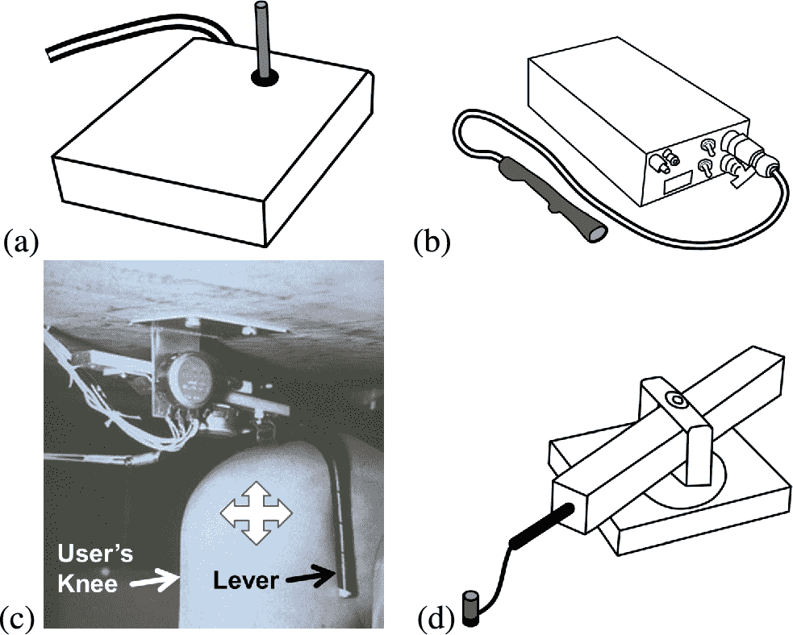

图 2.5 电磁波的可见光谱。

##### 2.3.1.2 强度

虽然光的频率是一个相对简单的概念，但强度的情况则不同。从人类视角量化光强度很复杂，因为眼睛的光敏度随光的波长而变化，也随光源的复杂性而变化（例如单一频率与混合频率）。与强度相关的是*亮度*，指单位面积通过的光量。随亮度而来的是*明度*，这是眼睛的一种主观属性，包含大脑的感知。亮度的单位是坎德拉每平方米 (cd/m²)。

##### 2.3.1.3 注视与扫视

视觉不仅仅是人眼接收具有频率和强度的电磁波。通过双眼，人类观察并感知环境。在此过程中，眼睛会进行两种原始动作：注视和扫视。在注视期间，眼睛保持静止，从环境中获取视觉细节。注视时长可长可短，但通常至少持续 200 毫秒。将注视点转移到新位置需要执行扫视——即眼睛快速重新定位到新位置。扫视天生迅速，仅需 30-120 毫秒。

关于注视和扫视的早期且极具影响力的研究，由阿尔弗雷德·亚布斯在 1965 年的一份俄文出版物中发表，后被译为《眼动与视觉》（参见文献 [[482]](#Chp002_31-91_B9780443140969000087.xhtml#br2410)）。亚布斯展示了人们观看场景时的多种检视模式。其中一个例子使用了画家伊利亚·列宾（1844-1930）的作品《意外的访客》。参与者被给予指令并被要求观看场景，如图 2.6a 所示。针对各种任务，记录并绘制了眼动（注视和扫视）轨迹。图 2.6b 展示了一名参与者在任务“记住房间里人物和物体的位置”下的结果，图 2.6c 则展示了任务“估计人物年龄”下的结果。亚布斯提供了许多此类图表，并附带分析，展示了参与者内部和参与者之间的差异，以及观看模式随时间推移和后续观看的变化。例如，他指出，单个观看者的检视模式相似度大于不同观看者之间的模式相似度。

![Figure 2.6 Yarbus's research on eye movements and vision [[482]](#Chp002_31-91_B9780443140969000087.xhtml#br2410). (a) Scene: Repin's The Unexpected Visitor. (b) Task: Remember the position of the people and objects in the room. (c) Task: Estimate the ages of the people.](images/B9780443140969000087/gr006.jpg)

**图 2.6** 亚布斯关于眼动与视觉的研究 [[482]](#Chp002_31-91_B9780443140969000087.xhtml#br2410)。(a) 场景：列宾的《意外的访客》。(b) 任务：记住房间里人物和物体的位置。(c) 任务：估计人物的年龄。

人机交互（HCI）领域的眼动研究有几个主题。其中之一是分析人们如何阅读和查看网页内容。图 2.7 展示了一个用户在页面不同位置查看内容时的扫视路径（注视和扫视的序列）示例。（另见文献 [[149, Figure 2]](#Chp002_31-91_B9780443140969000087.xhtml#br0745)。）这对设计有启示意义。例如，广告商和产品设计师对观看模式 [[382]](#Chp002_31-91_B9780443140969000087.xhtml#br1910) 感兴趣，以及例如男性和女性在查看内容方面有何差异。眼动存在性别差异 [[385]](#Chp002_31-91_B9780443140969000087.xhtml#br1925)，但尚待证实的是，如何利用低层级的实验结果来指导和辅助设计。


**图 2.7** 用户在网页上定位内容的扫视路径。

#### 2.3.2 听觉

听觉是人类对声音的探测。声音以声波的形式在环境中传播——即介质（如空气）中压力的周期性波动。当物体移动或振动时，会产生声波，从而引起气压波动。例子包括拨动吉他弦、关门声、洗牌声或人类说话。在后一种情况下，产生声音的物理器官是喉咙里的喉部或声带。

当声波到达人耳并刺激耳膜产生神经冲动，进而传送到大脑时，听觉就发生了。声音呈现出许多可归类的特性 [[463, p. 65]](#Chp002_31-91_B9780443140969000087.xhtml#br2315)。图 2.8 列出了声音的七个属性及其在极端情况下的主观感受。

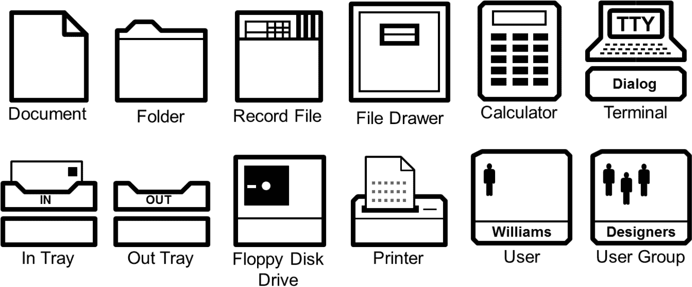

**图 2.8** 声音的属性及其在极端情况下的主观感受。

来自单一声源的单一声音至少具有四个物理属性：强度（响度）、频率（音高）、音色（音质）和包络（波形）。以一个简单的例子为例，考虑一种乐器（如小号）演奏的一个音符。该音符可能响亮或柔和（强度），音高可能高或低（频率）。我们之所以能听出并识别该音符来自小号而非长笛，是因为该音符的音色（音质）和包络（波形）。让我们逐一分析这些属性。

##### 2.3.2.1 响度（强度）

响度是物理属性强度或音量的主观对应量。它通过*声压级*来量化，声压级表示声波中的压力相对于介质中平均压力的比值。声压级的单位是分贝 (dB)。人类听觉始于 0-10 dB 的声音。日常交谈的响度约为 50-70 dB。当人类暴露在约 120-140 dB 的声音中时，会感到疼痛。

当人类长时间暴露在过大的声音中时，可能会发生听力损失，例如，音乐超过 80 dB 持续 40 小时（在 7 天周期内）。带有耳机的设备（如 Apple iPhone）会对此提供通知，并相应降低音量。

##### 2.3.2.2 音高（频率）

音高是频率的主观对应量，频率是声波压力模式中波峰间时间的倒数。音高的单位是每秒周期数，即赫兹 (Hz)。人类可感知的频率范围约为 20 Hz 至 20,000 Hz (20 kHz)，尽管上限往往随年龄增长而降低。

标准 88 键钢琴键盘上的音符音高范围从低音 A (A[0]) 的 27.5 Hz 到高音 C (C[8]) 的 4186 Hz。中音 C (C[4]) 为 261.1 Hz。乐器的调音标准为“A440”，对应 440 Hz，即中央 C 上方的 A 音。

典型成年人的语音频率范围约为：男性 85 至 155 Hz，女性 165 至 255 Hz。然而，由于谐波的存在（见下文）以及为实现合理的保真度，语音输出系统通常包含高达约 3000 Hz 的频率。

##### 2.3.2.3 音色（音质）

音色（又称音质或亮度）源于声音的谐波结构。回到乐器音符的例子，谐波是音符基频或基音频率的整数倍。例如，基频为 200 Hz 的乐器音符包含 400 Hz、600 Hz、800 Hz 等处的谐波。谐波的相对振幅产生了音色或音质的主观感知。虽然人耳听到的音高是 200 Hz，但正是音色将该音色区分为来自特定乐器。例如，如果小号和双簧管演奏相同频率和响度的音符，这两个音符听起来不同，部分原因在于每种乐器产生的独特谐波模式。音符最纯净的形式是正弦波，它仅包含基频，不包含基频以上的谐波。长笛产生的乐器音符接近正弦波。

##### 2.3.2.4 包络（波形）

包络或形状是指声音及其谐波随时间建立和过渡的方式——从无声到可听再到无声。音符的起始包络，即起音，包含大量信息。在上述小号和双簧管演奏相同频率、相同响度音符的例子中，起音也有助于区分声源。如果将小号音符和双簧管音符录制下来，去除起音后回放，要区分这两种乐器会变得令人惊讶地困难。起音部分源于乐器的固有属性（如铜管乐器与木管乐器的区别），也部分源于音符的发音方式（如断奏与连奏的区别）。

#### 其他声音属性

除了物理属性，声音还有其他属性。这些与人类的听觉和感知有关。声音，特别是复合声音，可以是和谐的（悦耳），也可以是不和谐的（刺耳）。这一属性与复合声音（如音乐和弦）中不同频率的混合方式有关。声音还可能传达紧迫感或速度感。

#### 空间听觉

人类有两只耳朵，但每个声音只有一个声源。声音到达两耳时物理属性的细微差别，帮助人类识别声音的位置（方向和距离）。当来自多个声源的多个声音通过两只耳朵被听到时，会产生立体声等感知效应。

#### 声音提示与无障碍

声音为人类提供了令人惊讶的丰富提示阵列，无论是在购物时行走，还是坐在电脑前打邮件。毫不奇怪，声音对盲人用户至关重要，例如用于传达环境现象的位置和距离信息 [[481]](#Chp002_31-91_B9780443140969000087.xhtml#br2405)。

#### 视觉与听觉的比较

在继续之前，比较人类的两大主要感官——视觉和听觉——颇具启发意义。图 2.9 从若干共同维度对眼睛和耳朵进行了定位，包括环境条件以及大脑中的感知和认知加工 [[463]](#Chp002_31-91_B9780443140969000087.xhtml#br2315)。

![图 2.9 沿质量和能力的共同维度对眼睛（视觉）和耳朵（听觉）的比较 [463, p. 151]。](images/B9780443140969000087/gr009.jpg)

图 2.9 沿质量和能力的共同维度对眼睛（视觉）和耳朵（听觉）的比较 [[463, p. 151]](#Chp002_31-91_B9780443140969000087.xhtml#br2315)。

#### 2.3.3 触觉

触觉是人类五大传统感官之一。^(¹⁸)

在人机交互（HCI）中，触觉反馈是指当身体部位（如手指）与物理物体接触（触摸）时，通过躯体感觉系统提供的信息。物体的温度、形状、纹理、位置或阻力大小等附加信息也会被传达。

所有涉及用户双手（或其他身体部位）与物理接触的用户界面都包含触觉反馈。仅仅握住鼠标并移动它，就能给人类操作者带来大量信息——鼠标机身光滑或橡胶般的手感，在桌面上滑动时滑腻或粘滞的阻力。与台式键盘的交互也由触觉反馈引导。用户感知键帽的边缘和形状，按下按键时体验阻力。键帽上的触觉标识有助于盲打定位。标识位于数字小键盘的 5 键和字母数字键盘的 F、J 键上。感知到标识即告知用户已找到基准位置。见图 2.10a。

![图 2.10 触觉反馈。(a) 键帽上的标识。(b) 食指下的电磁驱动针（改编自 [5]）。(c) 振动提示来电。](images/B9780443140969000087/gr010.jpg)

图 2.10 触觉反馈。(a) 键帽上的标识。(b) 食指下的电磁驱动针（改编自 [[5]](#Chp002_31-91_B9780443140969000087.xhtml#br0025)）。(c) 振动提示来电。

通过主动触觉反馈增强用户体验是常见的研究课题。图 2.10b 展示了一款在食指下方装有电磁驱动针的鼠标 [[5]](#Chp002_31-91_B9780443140969000087.xhtml#br0025)。当鼠标光标跨越边界（如软按钮或窗口的边缘）时，针会被驱动（脉冲触发）。这种额外的触觉反馈有助于告知和引导交互，并可能降低对视觉通道的需求。移动电话中触觉反馈的常见用途是振动，用于提示来电或短信。见图 2.10c。

#### 2.3.4 嗅觉与味觉

嗅觉是感知气味的能力。对人类而言，这是通过鼻腔中的感觉细胞实现的。味觉是通过舌头和口腔中的味蕾，直接化学感受甜、咸、苦、酸感觉的过程。风味是大脑中的一个感知过程，通过嗅觉和味觉的协同产生。虽然嗅觉和味觉为几乎所有人类直观已知——且具有专家级的敏锐度——但它们不如视觉和听觉那样被深入理解。

气味通常与记忆相关联。事实上，这种关联往往带有情感色彩且生动鲜明，与过去的事件和经历有着强烈的自传体联系 [[380]](#Chp002_31-91_B9780443140969000087.xhtml#br1900)。此外，人类能辨别数千种气味。但在这数千种气味中，仅有十类左右：芳香、树脂/体味、果香（非柑橘）、化学、薄荷/胡椒薄荷、甜、爆米花、柠檬、刺鼻、腐烂 [[416]](#Chp002_31-91_B9780443140969000087.xhtml#br2080)。

复杂的气味和味道可以由简单元素构建，但其感知过程仍是研究课题。例如，特定行业（如香水、葡萄酒）已开发出分类方案，但这些方案无法推广到人类对其他气味和味道的体验中。

虽然人类时刻无意识地使用嗅觉和味觉，但这些感官通常未被“设计进”系统中。在 HCI 领域有一些例子。Brewster 等人 [[40]](#Chp002_31-91_B9780443140969000087.xhtml#br0200) 研究了嗅觉作为搜索数字相册的辅助手段。用户采用文本和气味两种标记方法，随后利用标记回答关于照片的问题。由于气味与记忆相关，推测气味提示可能有助于回忆。最终，使用气味标记的回忆效果比文字标记差。Bodnar 等人 [[34]](#Chp002_31-91_B9780443140969000087.xhtml#br0170) 的相关工作比较了嗅觉、听觉和视觉模态在通知用户来消息打断方面的效果。他们也发现嗅觉表现较差。不过，这两个例子值得注意的地方在于，都采用实证研究方法探索嗅觉在用户界面中的潜力。两项研究都包含实验研究的所有标志，包括自变量、因变量、统计显著性检验，以及针对组内自变量的平衡序列。

嗅觉和味觉，连同其他感官和大脑，构成了爱立信“感官互联网”愿景中的基础支柱，这是一个面向未来的计算展望 [[119]](#Chp002_31-91_B9780443140969000087.xhtml#br0595)。该 2019 年报告基于一项覆盖全球 15 个城市的在线民意调查，每个城市至少有 500 名受访者。受访者被问及对未来计算的期望与憧憬，并提供了相关场景。例如，59% 的受访者认为未来只需思考目的地，即可在 VR 眼镜上看到地图路线。许多场景假设嗅觉和味觉将通过数字化手段在未来的交互中得以实现。对于嗅觉，60% 的受访者预测未来可通过数字方式“造访”森林或乡村，体验这些地方的自然气息。对于味觉，40% 的受访者预期在线购物将迎来革命，用户能在设备前舒适地数字化品尝样品。不出所料，该报告构想丰富，但细节匮乏。

#### 2.3.5 其他感知

除上述五种感官外，“感知”一词还出现在许多语境中。我们常听到紧迫感、方向感、音乐感、直觉、道德感，甚至常识。这些及相关感知对人机交互（HCI）的价值不可估量。尽管它们运作在比五大基础感官更高的层面，但这些额外的感知概括了人类对计算机交互的感受与体验。是否存在像鼻腔细胞那样能接收这些感知的受体？也许有。有人论证并提供实验证据，表明人类可能拥有类似味觉的道德感 [[157]](#Chp002_31-91_B9780443140969000087.xhtml#br0785)。我们拥有感知甜与咸的天然受体。同理，我们可能也拥有帮助我们识别公平或残酷的天然受体。正如几种基本味觉能衍生出多种菜系，几种基本道德感也能衍生出不同的道德文化。

### 2.4 大脑

大脑是已知最复杂的生物结构。凭借数十亿个神经元，大脑赋予人类多种能力与资源，包括思考、记忆、回忆、推理、决策和沟通。虽然传感器（人类输入）和响应器（人类输出）形成了良好的镜像对应，但正是大脑将它们连接起来。若无感知或体验环境，大脑将无事可做。然而，一旦通过传感器体验环境，大脑的任务便开始了。

#### 2.4.1 感知

感知是大脑处理的第一阶段。当来自环境的感官信号输入时，感知便发生了。在感知阶段，联想与意义形成。听觉刺激被感知为和谐或不和谐。气味被感知为愉悦或厌恶。视觉场景被感知为熟悉或陌生。触摸物体，表面被感知为光滑或粗糙、炎热或冰冷。随着联想与意义附着于感官输入，人类在与机器交互时展现出巨大的优势。Norman 解释道：

> 人类擅长感知、创造，以及超越所给信息的能力，能理解原本混乱的事件。我们常需在可用信息之外解释事件，而我们高效、轻松地做到这一点的能力——通常甚至未意识到自己正在这么做——极大地增强了我们的功能。
>
> [[376, p. 136]](#Chp002_31-91_B9780443140969000087.xhtml#br1880)

自 19 世纪末以来，感知一直在心理物理学这一实验心理学专门领域中被研究。心理物理学考察人类感知与物理现象之间的关系。在心理物理学实验中，向人类呈现物理刺激，然后询问其感受到或感知到的感觉。这种联系在于真实世界现象中可测量的、刺激人类感官的属性，与人类对该现象的主观解释之间。


常见的实验目标是测量刺激的“刚察觉差异”（JND）。向受试者依次呈现两个刺激。这两个刺激在某一物理属性（如频率或强度）上有所不同，受试者被问及这两个刺激是相同还是不同。该任务在一系列试验中重复进行，并随机改变被操纵物理属性差异的大小。低于某一阈值时，两个刺激的差异太小，以至于受试者无法感知。这个阈值就是 JND。JND 已在所有人类感官及多种情境下得到深入研究。JND 是否取决于刺激的绝对大小（如高强度刺激与低强度刺激）？一属性（如强度）的 JND 是否取决于第二属性（如频率）的绝对值？JND 是否取决于年龄、性别或其他人类特性？这些基础研究问题表面上似乎与人机界面研究相去甚远。但随着时间的推移，以及延伸前人成果的新研究出现，确实产生了应用。例如，心理物理学基础研究被用于 MP3 音频编码的音频压缩算法中。

感知的另一特性是模糊性——人类对感官输入发展出多种解释的能力。模糊图像为视觉提供了演示。图 2.11a 展示了 Necker 线框立方体。右上角是在前表面，还是后表面？图 2.11b 展示了 Rubin 面孔杯。图像是一个花瓶，还是两张脸？我们能在这些图像中感知到模糊性，这一事实本身就揭示了我们“超越所给信息”的感知能力。

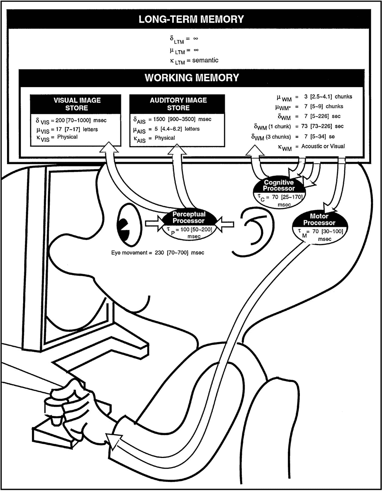

图 2.11 模糊图像。(a) Necker 立方体。(b) Rubin 面孔杯。

与模糊性相关的是错觉，即对常识的欺骗。图 2.12a 展示了 Ponzo 线条。两条黑线长度相同；然而，由于 3D 透视，靠近底部的黑线看起来更短。图 2.12b 展示了 Müller-Lyer 箭头。比较两个箭头中的直线段，顶部箭头中的线段看起来更长，但实际上两者长度相同。我们的直觉欺骗了我们。


图 2.12 视觉错觉。(a) Ponzo 线条。(b) Müller-Lyer 箭头。

除了长度或大小，视觉色彩错觉也是可能的。这些提醒我们，对刺激的主观解释独立于其物理结构。图 2.13 展示了一个 Munker 错觉（来自 [\[248\]](#Chp002_31-91_B9780443140969000087.xhtml#br1240)）。有两个实心圆，每个都有前景光栅和背景光栅。两个圆颜色相同。光栅的效果是将圆的视觉色调向前景光栅的方向偏移，并向与背景光栅相反的方向偏移。由于两幅图像中的前景和背景光栅互换，偏移对左、右圆产生相反的效果。


图 2.13 Munker 色彩错觉。两个圆颜色相同。详见正文讨论。

图 2.13 中的视觉错觉演示了标准、普遍存在的颜色选择器界面用户常见挫败感的成因。用户挑选了一种他们感知为合适的颜色，但发现在上下文中查看时却显得不正确 [[219]](#Chp002_31-91_B9780443140969000087.xhtml#br1095)。因此，需要一些工具通过硬件界面直接操作颜色，以便在上下文中进行颜色调整 [[56]](#Chp002_31-91_B9780443140969000087.xhtml#br0280)。

如果视觉刺激中可能存在错觉，那么合理推测其他感官中也存在错觉。听觉错觉的一个例子是谢泼德音阶。人类感知到它持续上升或下降，但不知为何听起来却保持不变。一种变体是称为谢泼德-里塞特滑音的连续音乐音调——一种音调在音高上持续上升，同时却继续保持在同一音高。图 2.14 对此进行了说明。每条垂直线代表一条正弦波。每条线的高度代表正弦波的感知响度。每个波与其相邻波的频率位移相同；因此，这些波是基频等于该位移的一个音乐音符的谐波。这就是人类感知到的单一音调的频率。如果正弦波整体频率上升（图中的块状箭头），会产生音调上升的感觉。然而，由于正弦波间距相等，存在一种竞争性的感觉，即音调保持不变（因为感知到的频率是谐波之间的距离）。频率分布高端的正弦波逐渐消失，而新的正弦波在低端加入。谢泼德音阶和谢泼德-里塞特滑音的例子可以在 YouTube 上听到。


图 2.14 听觉错觉。一组等间距的正弦波在响度包络内频率上升。人耳听到的音调明显在频率上升，但同时保持不变。

触觉或本体感觉错觉也存在。一个有详细记录的例子是“幻肢”。因截肢而失去肢体的人类，往往继续感觉到该肢体的存在，并感觉它像截肢前一样随其他身体部位移动 [[172]](#Chp002_31-91_B9780443140969000087.xhtml#br0860)。

超越感知，感觉刺激被整合到无数其他体验中，产生想法、决策、策略、行动等。在生物分类方案中，人类之所以处于顶层，动力源于其擅长这些高层能力的能力。很大程度上，是人类思考和推理的能力赋予了这一特殊地位。

#### 2.4.2 认知

大脑的重要机能中包括认知——人类有意识的智力活动过程，例如那些包裹认知操作的活动。图 2.15a 进行了说明。由于感觉刺激和运动反应是可观察和可测量的，该图大致传达了如何测量认知操作。

![图 2.15 反应时任务中的认知操作。(a) 问题示意图。(b) 操作序列 [17, p. 41]。](images/B9780443140969000087/gr015.jpg)

图 2.15 反应时任务中的认知操作。(a) 问题示意图。(b) 操作序列 [[17, p. 41]](#Chp002_31-91_B9780443140969000087.xhtml#br0085)。

尽管如此，仍存在挑战。如果感觉刺激是视觉的，视网膜将光转换为神经冲动，传输到大脑进行知觉处理。这需要时间。因此，认知操作的开始时间并不精确已知。类似地，如果运动反应涉及手指按按钮，大脑中会形成反应的神经联想，神经信号传输到手部——在运动开始之前。因此，认知操作的精确结束时间也是未知的。事件序列如 图 2.15b 所示，标注了操作及各自的时间范围。此处最引人注目的观察是数值范围很宽——这表明难以精确确定测量的位置和方式。尽管存在这些挑战，但仍存在测量认知操作持续时间的技术。稍后将讨论这些技术。

适用于 图 2.15 的认知操作范围很广。开车时，针对信号灯变化决定刹车很简单。人机交互 (HCI) 中类似场景比比皆是。使用手机时，可能会针对来电决定按 `Reject-Call` 键。在线阅读早间新闻时，可能会决定点击弹窗广告上的 `Close` 按钮。编辑文档时，可能会因新邮件的音频提醒而切换到邮箱。这些例子都依次涉及一个感觉刺激、一个认知操作和一个运动反应。

其他决策则更复杂。玩 21 点纸牌游戏（又称 Blackjack）时，也许是在线玩，^(¹⁹)

#### 2.4.3 记忆

记忆是人类存储、保持和回忆信息的能力。我们记忆的容量非同寻常。无论是几天前还是几十年前的经历，都汇聚在大脑庞大的存储库中，称为 `long-term memory`（长时记忆）。有趣的是，大脑中的记忆与计算机中的记忆有相似之处。计算机内存通常包括数据和代码的独立区域。大脑中的记忆组织方式类似。一个陈述性/显性区域存储关于时间中事件和外部世界物体的信息。这类似于数据空间。大脑记忆中的一个内隐性/程序性区域存储关于如何使用物体或如何做事的信息。这类似于代码空间。^(²⁰)

#### 长期记忆中的工作记忆

在长期记忆中存在一个用于*短期记忆*或工作记忆的活跃区域。工作记忆的内容处于激活状态，随时可供访问。此类记忆的容量较小，约为 7 个单元，具体取决于任务和测量方法。1956 年，Miller 发表了一项关于短期记忆的研究，题为“The magic number seven plus or minus two”[\[358\]](#Chp002_31-91_B9780443140969000087.xhtml#br1790)。^(²¹)

Miller 将这项工作扩展到人类记忆领域，描述了一个实验：参与者观看一系列项目，随后被要求回忆这些项目。他发现人类处理此类任务的能力同样约为 7 个项目（±2）。图 2.16 展示了一个验证 Miller 论点的简单演示。在这个“微型实验”中，记录表被分发给一堂人机交互课程的学生（$n \approx 60$）。教师口述随机数字序列，序列长度从 4 位到 13 位不等。每次口述后，学生从短期记忆中回忆序列并记录在表上。图中显示了不同序列长度下的正确响应百分比。在长度为 7 时，正确响应率约为 50%。长度为 5 和 9 时，数值分别约为 90% 和 20%。^(²²)

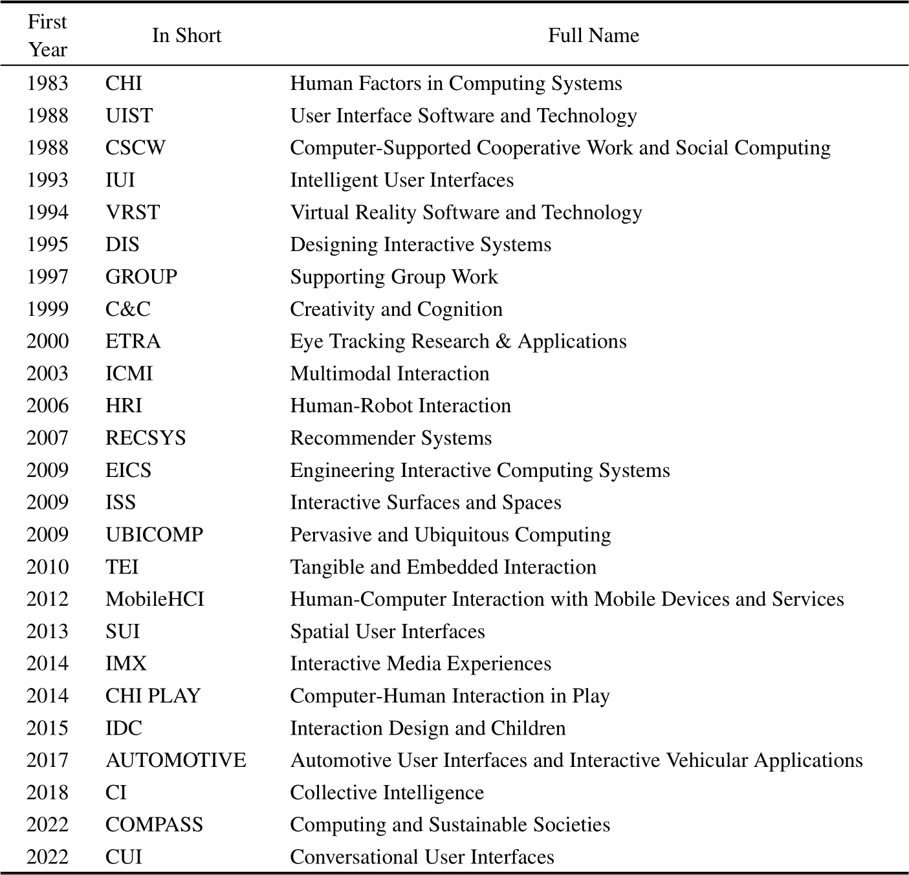

**图 2.16** 短期记忆测试结果。详见正文讨论。

Miller 通过揭示和分析大脑中一个简单但强大的过程——我们将多个项目关联为一个整体的能力——扩展了他的研究。所谓的**组块**是指人类将一系列低层级项目归类为单个高层级项目的过程。他用二进制数字举例说明。例如，一个 16 位的序列，如

```
1000110001110010
```

很难记忆。然而，如果将其按每 4 位分组

```
1000 1100 0111 0010
```

并组块为十进制数或十六进制数字，模式会变得更小、更容易记忆：

```
8 12 7 2
8 C 7 2
```

Card 等人[\[64, p. 36\]](#Chp002_31-91_B9780443140969000087.xhtml#br0320)给出了 `BSCBMICRA` 的例子。这个 9 个单元的字母序列超出了大多数人的复述能力。但该序列类似于以下三个 3 字母序列：`CBS IBM RCA`。以这种方式呈现时，序列包含三个组块，只要人们能足够快地进行重新编码，就相对容易记忆。组块过程主要是非正式且无结构的。人类直观地以递归和层级的方式构建组块结构，从而在大脑中形成复杂的记忆组织。

### 2.5 响应器

通过运动或运动控制，人类能够影响周围环境。控制通过**响应器**实现。无论是用手指发短信^(²³)

![Figure 2.17 Motor homunculus showing human responders and the corresponding cortical area (adapted from [392]).](images/B9780443140969000087/gr017.jpg)

**图 2.17** 运动皮层小人图，展示人类响应器及对应的皮层区域（改编自[\[392\]](#Chp002_31-91_B9780443140969000087.xhtml#br1960)）。

另请参阅学生练习 2-1。

#### 2.5.1 肢体

人类对机器的控制通常与肢体相关，特别是上肢。在 HCI 领域也是如此。我们用手指、手和臂在键盘上打字、操控鼠标和按按钮、握持手机并按键、触摸和滑动触屏手机表面、在显示器前挥动游戏控制器。当然，腿和脚也可以作为响应器为计算机提供输入。对于手臂使用受限或无法使用的用户，头部运动可以控制屏幕光标。图 2.18 展示了一些示例场景。

![Figure 2.18 Use of the limbs in HCI. (a) Hands (sketch courtesy of Shawn Zhang). (b) Fingers [116]. (c) Thumbs. (d) Arms (sketch courtesy of Shawn Zhang). (e) Feet (adapted from [390]). (f) Head [221].](images/B9780443140969000087/gr018.jpg)

**图 2.18** HCI 中肢体的使用。(a) 手（草图由 Shawn Zhang 提供）。(b) 手指[\[116\]](#Chp002_31-91_B9780443140969000087.xhtml#br0580)。(c) 拇指。(d) 臂（草图由 Shawn Zhang 提供）。(e) 脚（改编自[\[390\]](#Chp002_31-91_B9780443140969000087.xhtml#br1950)）。(f) 头[\[221\]](#Chp002_31-91_B9780443140969000087.xhtml#br1105)。

肢体运动与躯体感觉系统（特别是本体感觉）紧密耦合，以便在身体部位相对于整体移动时实现准确性和灵巧性。不看鼠标就能抓住它、不看键盘就能打字就是例子。

在图 2.18a 中，用户的左手握住鼠标。推测该用户是左撇子。在图 2.18b 中，用户的右手食指接触触控板表面。推测该用户是右撇子。有趣的是，惯用手或手部偏好并非非此即彼的条件。虽然 8%-15% 的人被认为是左撇子，但手部偏好存在于一个连续体上，人们按程度被认为是左撇子或右撇子。双手灵巧者在手部偏好上基本无差异。

评估手部偏好的广泛使用工具是 **爱丁堡惯用手量表**，可追溯至 1971 年[\[381\]](#Chp002_31-91_B9780443140969000087.xhtml#br1905)。该量表是一系列自我评估，测量一个人在执行常见任务（如投球）时对左手或右手的偏好程度。图 2.19 展示了量表及其说明、评分和解释。^(²⁴)

![Figure 2.19 Edinburgh Handedness Inventory for hand dominance assessment [381].](images/B9780443140969000087/gr019.jpg)

**图 2.19** 用于手优势评估的爱丁堡惯用手量表[\[381\]](#Chp002_31-91_B9780443140969000087.xhtml#br1905)。


在 HCI 领域，有许多实验向参与者施测爱丁堡惯用手量表的例子[\[27\]](#Chp002_31-91_B9780443140969000087.xhtml#br0135),[\[75\]](#Chp002_31-91_B9780443140969000087.xhtml#br0375),[\[81\]](#Chp002_31-91_B9780443140969000087.xhtml#br0405),[\[82\]](#Chp002_31-91_B9780443140969000087.xhtml#br0410),[\[101\]](#Chp002_31-91_B9780443140969000087.xhtml#br0505),[\[233\]](#Chp002_31-91_B9780443140969000087.xhtml#br1165),[\[235\]](#Chp002_31-91_B9780443140969000087.xhtml#br1175),[\[346\]](#Chp002_31-91_B9780443140969000087.xhtml#br1730)。在许多情况下，会报告手部偏好的程度。例如，Hinckley 等人[\[191\]](#Chp002_31-91_B9780443140969000087.xhtml#br0955)报告其研究中的所有参与者均为“强右撇子”，量表平均得分为 71.7。

另一个例子是 Annett 等人[\[9\]](#Chp002_31-91_B9780443140969000087.xhtml#br0045)关于在平板上书写时手写笔行为的研究。在用户研究中，他们招募了 16 名右撇子参与者和 14 名左撇子参与者。两组均施测了该量表。右撇子和左撇子参与者的平均得分分别为 73.7 和 -57.4。

#### 手部偏好、手部尺寸与手指尺寸对交互的影响

Joshi 等人 [\[233\]](#Chp002_31-91_B9780443140969000087.xhtml#br1165) 研究了手部偏好、使用的手以及手指与拇指输入在触屏智能手机目标选择任务中的交叉影响。他们使用爱丁堡利手量表对参与者进行预筛选，最终确定 32 名参与者，左右手偏好者各半。被判定为左撇子或右撇子的参与者，其得分分别低于 −28 或高于 +48。这种不平衡可能是出于实际考虑，因为社会上右撇子占多数。

手部偏好在涉及触控或压感显示屏的场景中显然具有相关性。如果交互需要在显示屏上使用手写笔或手指，用户的手可能会遮挡部分显示区域。遮挡可能导致性能下降 [\[133\]](#Chp002_31-91_B9780443140969000087.xhtml#br0665)，或迫使用户采用“钩状姿势”，即通过扭曲手臂位置来方便交互 [\[507\]](#Chp002_31-91_B9780443140969000087.xhtml#br2535)。这可以通过将 UI 元素定位在显示屏的不同区域来避免 [\[173\]](#Chp002_31-91_B9780443140969000087.xhtml#br0865), [\[508\]](#Chp002_31-91_B9780443140969000087.xhtml#br2540)。当然，这需要感知或确定用户的手部偏好，因为左撇子和右撇子的遮挡区域是不同的。

除了不同的手部偏好，用户的手部尺寸和手指尺寸也各不相同。手部尺寸是影响用户使用游戏控制器时的性能和偏好的潜在因素。Brown 和 MacKenzie [\[44\]](#Chp002_31-91_B9780443140969000087.xhtml#br0220) 研究了手部尺寸与游戏控制器易用性之间的关系。他们发现手部尺寸与四款控制器的易用性之间存在显著关系。手部较大的参与者能够轻松操作更多的控件，而手部较小的参与者则较难。然而，手部尺寸对用户偏好没有影响。手部尺寸采用“8 字测量法” [\[391\]](#Chp002_31-91_B9780443140969000087.xhtml#br1955) 进行测量。参见 图 2.20。研究参与者的平均手部尺寸为 15.9 英寸（*SD* = 1.2 英寸）。个体测量值范围从 13.0 英寸到 18.3 英寸。（注：1 英寸 = 25.4 毫米）

![图 2.20 用于测量手部尺寸的 8 字测量法（来源：[44, 图 6]）。](images/B9780443140969000087/gr020.jpg)


图 2.20 用于测量手部尺寸的 8 字测量法（来源：[[44, 图 6]](#Chp002_31-91_B9780443140969000087.xhtml#br0220)）。

手指尺寸在与智能手机或平板电脑等小型设备交互时具有潜在相关性。对于带触摸屏的设备，用户经常用手指触摸选择较小的 UI 元素。这一挑战常被称为“粗手指问题” [\[518\]](#Chp002_31-91_B9780443140969000087.xhtml#br2590)。选择准确率是否受手指尺寸影响？一项旨在测量智能手机上基于触摸的目标选择 Fitts 吞吐率的用户研究对此进行了调查 [\[302\]](#Chp002_31-91_B9780443140969000087.xhtml#br1510)。该研究还考察了参与者手指宽度与错误率之间的关系。使用图 2.21 中的游标卡尺，测量了参与者食指远端关节处的宽度。手指宽度范围为 12.0 毫米至 16.5 毫米（平均值 = 14 毫米，*SD* = 1.4 毫米）。

![图 2.21 用于测量手指宽度的游标卡尺（来源：[302, 图 5]）。](images/B9780443140969000087/gr021.jpg)

图 2.21 用于测量手指宽度的游标卡尺（来源：[[302, 图 5]](#Chp002_31-91_B9780443140969000087.xhtml#br1510)）。

任务涉及选择两种宽度的目标：78 像素（6.2 毫米）和 130 像素（10.4 毫米）。设备为 LG Nexus 4。目标尺寸看似较小，因为即使是最大目标（10.4 毫米）也小于平均手指宽度（14.0 毫米）。事实上，这并不罕见。图 2.22 通过将典型用户的手指与大小目标进行比较，直观展示了这一情况。中间图像显示了设备屏幕上渲染的应用程序图标。可以看到，目标宽度范围涵盖了应用程序图标的尺寸。

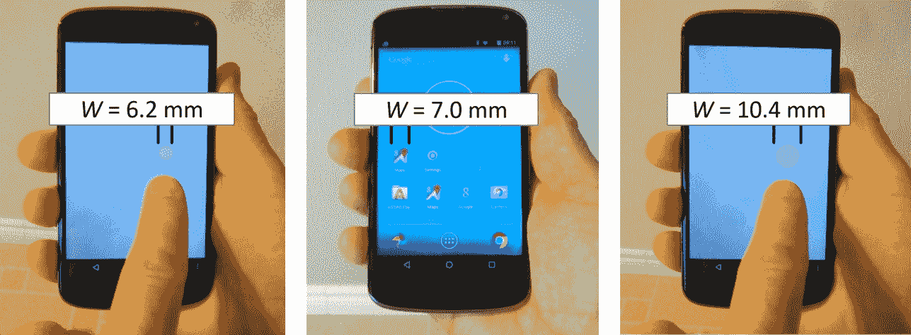

图 2.22 食指、目标及设备显示屏上应用程序图标的尺寸对比。

准确的基于触摸的目标选择极具挑战性，因为选择点是从手指与显示屏表面的接触区域数字化而来的。接触区域的形状和大小会随手指接触角度、接触压力和手指大小而变化。研究中的错误率为 7.4%。进一步检查发现，小目标的错误率比大目标高出 4 倍以上（12.2% 对比仅 2.7%）。考虑到目标尺寸相对于用户指尖的大小——对比图 2.22 中的左侧和右侧图像——这并不令人惊讶。图 2.23 展示了研究中 16 名参与者按目标宽度划分的错误率。手指宽度呈正相关趋势，特别是在小目标上尤为明显。对于小目标，手指最宽的参与者（16.5 毫米）错误率高达 19.8%，而手指最窄的参与者（12 毫米）错误率不到其一半，仅为 9.3%（见图）。因此，寻找创造性方法来改进基于触摸的目标选择成为 HCI 研究的常见主题。我们将在第 3 章（第 3.7 节，移动情境）中回到这一点。

![图 2.23 目标宽度和手指宽度下的错误率（来源：[302, 图 11]）。](images/B9780443140969000087/gr023.jpg)

图 2.23 目标宽度和手指宽度下的错误率（来源：[[302, 图 11]](#Chp002_31-91_B9780443140969000087.xhtml#br1510)）。

### 2.5.2 语音

人类声带是发声器官。通过喉部（即声盒）的运动与肺部肺压的结合，人类能够发出多种多样的声音。最明显的发声形式是语言——人类交流的主要渠道。作为一种输入模态，语音通过宿主计算机软件中实现的算法进行识别。借此，计算机能像识别键盘输入的相同单词一样解读口语单词。Vertanen 和 Kristensson [\[502\]](#Chp002_31-91_B9780443140969000087.xhtml#br2510) 描述了一种利用自动语音识别进行移动文本输入的系统。他们报告称，坐姿下输入速率为 18 词/分，行走时为 13 词/分。

计算机输入也可以使用非语音发声来实现，这种模式称为 `non-verbal voice interaction` (NVVI，非语言语音交互)。在这种情况下，声音信号的声学参数（如音高、音量或音色）会随时间测量，并将数据流解释为输入通道。该技术对于指定模拟参数特别有用。例如，用户发出“`volume up, aaah`”（音量增大，啊），只要用户持续发出“`aaah`”，系统就会增加电视音量 [\[207\]](#Chp002_31-91_B9780443140969000087.xhtml#br1035)。Harada 等人 [\[176\]](#Chp002_31-91_B9780443140969000087.xhtml#br0880) 描述了 `vocal joystick`（语音操纵杆）——一种利用 NVVI 模拟操纵杆并控制屏幕光标的系统（例如，“`eee`”= 光标左移）。Zinck 和 Vogel [\[557\]](#Chp002_31-91_B9780443140969000087.xhtml#br2785) 将 NVVI 扩展到用户发出音乐声音，如音程或三音旋律。

此处的应用通常用于无法使用手动替代方案的用户的无障碍计算领域。

### 2.5.3 眼睛作为响应器

在正常情况下，人眼以来自环境的光的形式接收感官刺激。在观察场景时，眼睛结合**注视**（fixations，以查看特定位置）和**扫视**（saccades，以移动到不同位置）。这是眼睛作为感觉器官的角色。然而，眼睛也能作为响应器，通过注视和扫视向计算机提供输入。在这种功能下，眼睛被要求“身兼二职”，因为它既充当传感器，又充当响应器。这一想法如图 2.24 所示，这是图 2.2（第 34 页）中人机界面的修改视图。从人到计算机的正常路径被改变了。手不再通过物理设备（灰色部分）提供运动响应来控制计算机，而是眼睛提供运动响应，通过系统显示器上的软控件或虚拟控件来控制计算机。

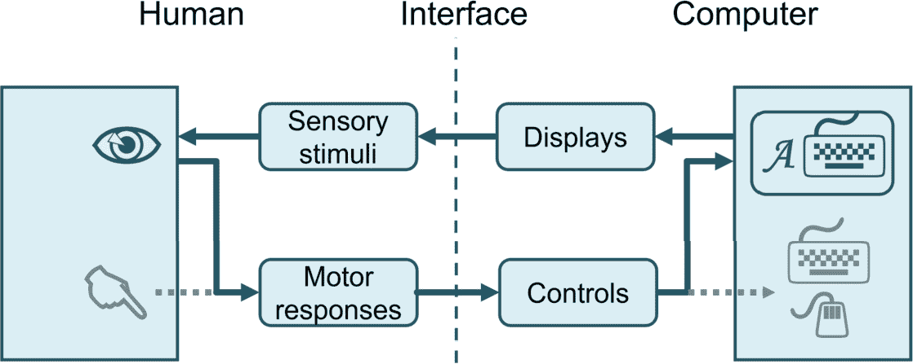

图 2.24 使用眼动仪进行计算机输入的人机界面。眼睛身兼二职，处理来自计算机显示器的感官刺激，并提供运动响应以控制系统。

对于使用眼睛进行计算机输入控制，需要眼动追踪装置来感知和数字化注视位置和眼球运动。眼动仪通常配置为模拟计算机鼠标。就像用鼠标进行指点选择操作一样，眼睛可以“看选”，从而激活软控件，如按钮、图标、链接或文本（例如 [\[551\]](#Chp002_31-91_B9780443140969000087.xhtml#br2755)）。用眼睛选择的最常用方法是注视或停留在可选择目标上一段预定时间，如 700 ms。停留时间选择一个广为人知的缺点是无意选择，如果用户随意看一眼屏幕上的可选对象就会发生。这被称为“迈达斯之手问题” [\[215\]](#Chp002_31-91_B9780443140969000087.xhtml#br1075)。

最早使用眼睛进行计算机输入的研究之一由 Ware 和 Mikaelian 于 1987 年在 CHI+GI 大会上发表 [\[510\]](#Chp002_31-91_B9780443140969000087.xhtml#br2550)。^(²⁵)

眼动追踪用于输入控制的一个常见应用是文本输入。所谓的“眼控打字”使用屏幕键盘 [\[335\]](#Chp002_31-91_B9780443140969000087.xhtml#br1675)。用户注视软键，停留规定的停留时间以进行选择。一个使用 SensoMotoric Instruments 公司 iView X RED-III 眼动追踪设备的示例设置^(²⁶)

![Figure 2.25 Eye typing. (a) Apparatus. (b) Example sequence of fixations and saccades [334].](images/B9780443140969000087/gr025.jpg)

图 2.25 眼控打字。(a) 设备。(b) 注视和扫视序列示例 [\[334\]](#Chp002_31-91_B9780443140969000087.xhtml#br1670)。

虽然不直接涉及眼睛本身，但眨眼可以被检测并用于计算机控制 [\[257\]](#Chp002_31-91_B9780443140969000087.xhtml#br1285)。见图 2.26a。检测可以使用眼动仪或其他感知眼睑开合的装置来实现。这比感知眼睛在显示器上的注视点要简单。

![Figure 2.26 (a) The blink of an eye can serve as a responder for computer control (b) BlinkWrite text entry using an eye tracker to detect blinks [308].](images/B9780443140969000087/gr026.jpg)

图 2.26 (a) 眨眼可作为响应器用于计算机控制 (b) 使用眼动仪检测眨眼的 BlinkWrite 文本输入 [\[308\]](#Chp002_31-91_B9780443140969000087.xhtml#br1540)。

“眨眼输入”的一个例子是 BlinkWrite，见图 2.26b [\[308\]](#Chp002_31-91_B9780443140969000087.xhtml#br1540)。该设置使用 EyeTech Digital Systems^(²⁷)

### 2.5.4 大脑作为响应器

HCI 中一个活跃的研究领域是脑机交互 (BCI)。BCI 的目标是利用大脑产生的信号来控制用户界面。有几种方法可以实现这一点。一种方法是“运动意象”，即用户有意识地思考某些动作，如握拳或抬脚，同时测量并识别伴随该动作的大脑发出的信号。一旦识别，就会在软件中生成事件作为计算机输入。这一想法在第 3 章（第 3.1.4.2 节，脑信号）中进一步阐述。

### 2.6 语言

语言——使人类能够交流的心智能力——几乎为所有人类普遍拥有。值得注意的是，语言作为言语无需努力即可获得。儿童在成长发育过程中，无需有意识的努力就能学会说话和理解语言。书写作为语言的编码形式，是一个晚得多的现象。而学习书写需要付出努力，巨大的努力，跨越数年的学习和实践。Daniels 和 Bright 如下区分语言和书写：“语言定义了人类；但书写定义了文明。” [\[98, p. 1\]](#Chp002_31-91_B9780443140969000087.xhtml#br0490)。这些话提醒我们，与文明相关的文化和技术地位是由书写系统实现的。确实，应用于人类的术语 `prehistory`（史前史），从数百万年前类人生物的出现，延续到书写的出现。是书写预示了 `recorded history`（有文字记载的历史）的开始，那仅仅是六千年前的事。

我们对语言的 HCI 兴趣主要在于书写方法以及实现书面交流的技术。文本是页面或显示器上的书面材料。它是如何到达那里的，是一个令 HCI 研究人员着迷和挑战的话题，也是创建支持文本创作或文本输入产品的工程师和设计师关注的焦点。虽然文本输入在 HCI 中极其重要，但我们这里的兴趣在于语言本身——以书面形式。

表征和研究一种语言书面形式的方法之一是通过语料库——即从多样且具有代表性的来源（如报纸、书籍、电子邮件和杂志）收集的大量文本样本集合。当然，语料库不可能既广泛又精确地代表一种语言。采样过程带来了局限性：样本是在什么时间范围内写成的？在哪个国家？在该国的哪个地区？样本关注什么主题？由谁撰写？一个著名的语料库是英国国家语料库（BNC），包含 1 亿个单词。^(²⁸)

为了便于研究和分析，语料库有时会被简化为词频列表，该列表列出语料库中的唯一单词及其频率。BNC 的一种此类简化版本包含约 64,000 个唯一单词，其频率总计达 9000 万 [\[454\]](#Chp002_31-91_B9780443140969000087.xhtml#br2270)。仅包含在原始语料库中出现三次或以上的单词。最高频单词是 "the"，约占所有单词的 6.8%。

图 2.27 给出了几个语料库的摘录，展示了前五个最高频单词以及排名第 1000-1004 位的单词。英语条目来自英国国家语料库。还有法语 [\[367\]](#Chp002_31-91_B9780443140969000087.xhtml#br1835)、德语 [\[467\]](#Chp002_31-91_B9780443140969000087.xhtml#br2335)、芬兰语、短信英语和短信拼音 [\[289\]](#Chp002_31-91_B9780443140969000087.xhtml#br1445) 的额外列。^(²⁹)

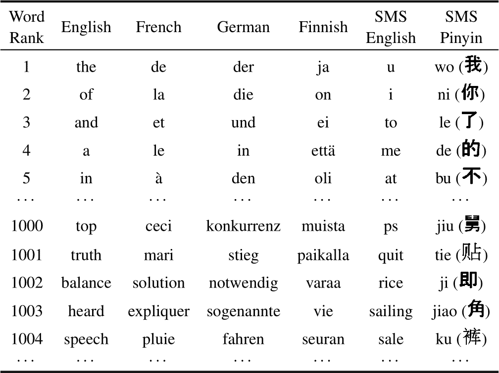

图 2.27 各种语言词频列表中的样本单词。详见正文讨论。

图 2.27 最右侧的列是短信拼音。拼音自 1958 年以来一直是普通话的标准编码系统。这些条目是拼音标记，而非单词。每个标记对应括号中所示的汉字。这些条目来自包含 63 万条短信、逾 900 万个汉字的语料库。

某些语料库的一个显著特征是词性（POS）标注，即按词类（如名词、动词、形容词）对单词进行标记。重要的是，词性取决于语境，反映了单词在原文中的用法。例如，`paint` 有时是动词（*Children paint with passion*，孩子们怀着激情作画），有时是名词（*The paint is dry*，油漆干了）。在预测系统中，词性标注可能很重要，因为了解单词的词性能限制下一个单词的可能性 [\[153\]](#Chp002_31-91_B9780443140969000087.xhtml#br0765)。

#### 2.6.1 语言中的冗余

某种语言的母语使用者天生拥有对该语言的海量统计理解。我们会自动填补被省略或模糊的单词（*ham and \_\_\_\_ sandwich*，火腿和\_\_\_\_ 三明治）。我们能预判单词（*a picture is worth a thousand \_\_\_\_*，一幅画胜过千言\_\_\_\_）、字母（*questio\_\_*）甚至整个短语（*to be or \_\_ \_\_ \_\_*，生存还是\_\_\_\_\_\_）。我们可能会想：既然人类能填补缺失的字母或单词，也许那些不必要的部分可以省略。让我们进一步探讨。图 2.28 中的示例给出了同一段文本的三种变体。原始摘录包含 243 个字符。在 (a) 部分，所有 71 个元音字母被移除，从而使文本缩短了 29.2%。许多单词很容易猜出（例如 `smmr` → `summer`，`thrgh` → `through`），稍加努力就能领会文本大意。它与夏天 [`smmr`]、花园 [`grdn`] 和气味 [`scnt`] 有关。(b) 部分类似，只是每个单词的首字母保留下来，即使它是元音。仍有 62 个元音缺失。含义稍微容易辨认一些。原文在 (c) 部分。这是奥斯卡·王尔德的《道林·格雷的画像》的第一段。

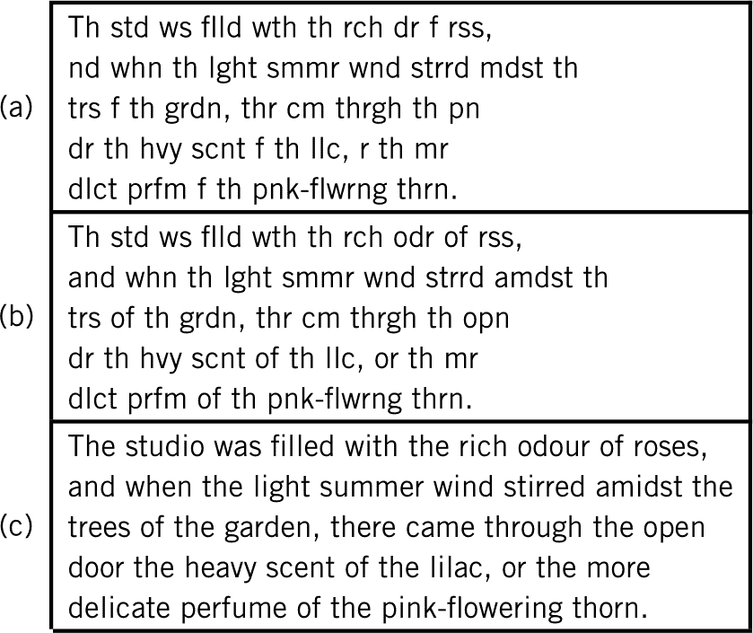

图 2.28 奥斯卡·王尔德《道林·格雷的画像》第一段。(a) 移除元音。(b) 单词开头的元音保留。(c) 原文。

还有其他示例，如上所示，移除部分文本后仍能理解。在短信中经常移除字符。重新编码是一种选择，例如利用发音（`th@s` → `that's`，`gr8` → `great`）或创造首字母缩略词（`w` → `with`，`gf` → `girlfriend`，`x` → `times`）[\[161\]](#Chp002_31-91_B9780443140969000087.xhtml#br0805)。有个轶事讲述了一名 13 岁学生提交了一篇完全用短信简写写成的作文。^(³⁰)

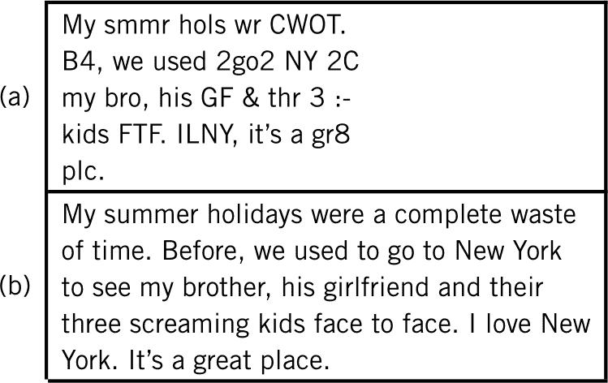

图 2.29 缩写英语。(a) 短信简写。(b) 标准英语。

不幸的是，书面文本中的冗余还有更隐蔽的一面。写作中的常见毛病是存在多余词汇，许多文体指南都提倡删除这些词。斯特伦克和怀特的第 17 条规则是“省略不必要的词”，并建议例如将 "he is a man who ..." 简化为 "he ..."，或将 "this is a subject that ..." 简化为 "this subject ..." [\[474, p. 23\]](#Chp002_31-91_B9780443140969000087.xhtml#br2370)。关于写作文体的提示见第 8 章。

#### 2.6.2 语言中的熵

如果语言中的冗余是我们固有所知，那么熵就是我们未知之物——即对即将到来的字母、单词、短语、观点、概念等的不确定性。显然，冗余与熵相关：如果我们移除已知部分，剩下的就是未知部分。20 世纪 50 年代，香农通过一个猜字母实验展示了书面英语中的冗余与熵 [\[443\]](#Chp002_31-91_B9780443140969000087.xhtml#br2215)。见图 2.30。实验过程如下。参与者看到一系列代表短语中字母的破折号，被要求从开头开始猜测字母。随着猜测进行，短语逐字母地向参与者揭示。结果记录在图中每个短语下方的行中。破折号（“-”）表示猜测正确；字母表示猜测错误。香农称第二行为“简化文本”。就冗余和熵而言，破折号代表冗余（已知），而字母代表熵（未知）。图 2.30 中有趣的观察之一是：错误更多发生在单词开头，随着单词推进错误减少。在单词内部，语言的统计特性和参与者对语言的固有理解有助于猜测。


![图 2.30 香农的猜字母实验（改编自 [\[443\]](#Chp002_31-91_B9780443140969000087.xhtml#br2215)）。](images/B9780443140969000087/gr030.jpg)

图 2.30 香农的猜字母实验（改编自 [\[443\]](#Chp002_31-91_B9780443140969000087.xhtml#br2215)）。

图 2.30 中的字母猜测实验不仅仅是个奇闻趣事。香农的动机是用信息论术语量化英语的熵。例如，他指出短语中的两行包含相同的信息，因为利用良好的统计模型，可以从第二行恢复第一行。由于印刷英语中的冗余（即破折号），通信系统只需传输精简后的文本。原始文本可使用统计模型恢复。香农还演示了如何计算印刷英语的熵。仅考虑字母频率时，熵约为每字母 4.25 比特。^(³¹)

另请参阅本章末尾的学生练习 2-3。

#### 2.6.3 用于文本创建的语言建模

最常见的文本创建形式是在传统 Qwerty 键盘上的用户输入。每次按键生成一个文本字符。简单明了。然而，文本创建通常利用字典或语言模型来发挥语言的统计特性，并包含单词预测、单词补全或自动更正等功能。单词补全的一个示例前文已在图 1.12 中给出（第 22 页）。目标是改进并可能加速创建过程。在按键减少方面有明显益处，这些益处可使用 `KSPC`（每字符按键数）等指标进行分析量化 [303,[325]](#Chp002_31-91_B9780443140969000087.xhtml#br1625)。

然而，也出现了其他因素，例如需要更高的警惕性。虽然自动补全单词甚至整个短语具有一定的吸引力和益处，但语言模型并不完美。因此，在文本创建过程中，用户的注意力必须在显示器的不同区域之间切换，以监控并参与该过程。疏忽大意是有代价的。举个个人例子，有一次我用手机给朋友发邮件，点击“发送”后惊恐地发现，我原本想发的文本“[名字] finally got back to me …”（[名字]终于回复我了……），竟被发成了“[名字] finally got bacteria to me …”（[名字]终于把细菌传给我了……）。显然，分心和误触战胜了应有的审慎。

将心理操作符（用于注意）与按键（用于输入）相结合的用户性能，可使用 Card 等人的按键级模型（`KLM`）进行建模，我们将在第 7 章中介绍。第 7.2.4.5 节（KLM 与预测性文本输入，第 331 页）探讨了带有单词预测和补全的文本创建。

语言模型也用于 `machine translation`（机器翻译）——将文本从一种语言翻译成另一种语言。机器翻译类似于文本创建，只是该过程始于另一种语言的文本，而非按键或手势。`Google Translate`（谷歌翻译）是主要示例，能在 100 多种语言之间转换文本，据估计每日用户达 2 亿。^(³²)

语言建模的更大图景是 AI 聊天机器人的出现——这些产品使用文本或人工语音模拟人类对话。一个例子是 OpenAI 的 `ChatGPT`。^(³³)

### 2.7 人类表现

人类利用他们的感官器官、大脑和效应器来做事。当这三个要素协同工作以达成目标时，人类表现便产生了。无论是系鞋带、叠衣服、搜索网页，还是在智能手机上输入短信，人类表现无处不在。更好的表现通常与更快或更准确的行为相关，这导致了人类表现的一个基本属性——`speed-accuracy trade-off`（速度-准确性权衡）：速度越快，错误越多；放慢速度，准确性越高。学术论文早在一个多世纪前就已报道这一现象（参见 [[479]](#Chp002_31-91_B9780443140969000087.xhtml#br2395) 综述），这既是平凡的谚语（“欲速则不达”），也符合常识（我们本能地放慢速度以避免错误），很难想象有比这更平常的人类表现特征。显然，使用新界面或交互技术的人类表现研究必须同时考虑完成任务的速度和总体准确性。

人类在速度-准确性权衡中的定位方式，既舒适又符合其目标。有时我们行动匆忙，甚至鲁莽；有时则极度注重细节。此外，我们可能在次要任务存在的情况下行动，例如听收音机、与朋友交谈或开车。显然，情境起着重要作用，感官器官、大脑和效应器的极限与能力也是如此。

在人类表现中，我们看到了 HCI 中存在的复杂性和挑战，这些在物理或化学等传统科学中是不存在的。人类带来了多样性和变异性，这些特征带来了不精确性和不确定性。有些人执行任务比其他人好。此外，某人在一种情境和环境下执行任务可能比在另一种情境和环境下执行同一任务表现更好。再者，如果同一个人在相同情境和环境下重复执行同一任务，结果也可能会有所不同。

人们执行任务的差异有时用类似正态分布的分布来说明。见图 2.31。此处，分布揭示了执行任务的人数（y 轴）与其熟练程度（x 轴）的关系。该示例假设计算机用户为总体，以打字为任务。大多数人处于中间位置，打字速度约为每分钟 30 到 70 词（wpm）。有些人较慢，有些人较快。然而，极少数人会快得惊人，例如每分钟 150 词或更快。还有极少数人难以达到即使是适度的速度，例如每分钟 5 词，相当于每 12 秒打一个词。

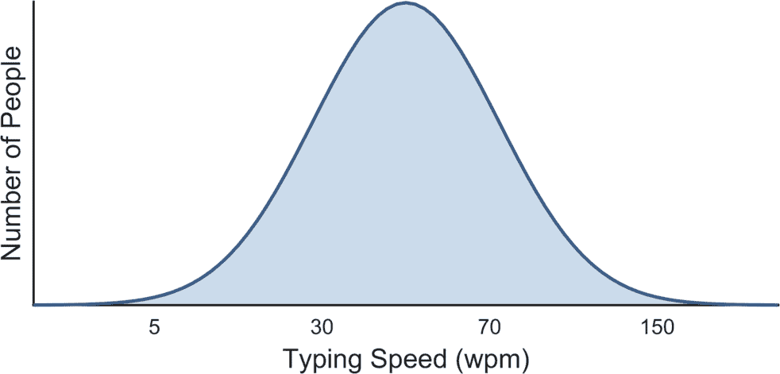

图 2.31 人们执行打字等任务的变异性。

#### 2.7.1 反应时间

人类表现最原始的表现之一是 `simple reaction time`（单纯反应时间），定义为单一固定刺激出现与为其分配的反应启动之间的延迟 [[127, p. 95]](#Chp002_31-91_B9780443140969000087.xhtml#br0635)。一个例子是针对刺激灯的亮起按下按钮。该任务涉及图 2.15 中所示的人类三个要素（第 47 页）。认知操作微不足道，因此该任务易于研究。虽然实验环境中的装置通常简单，但人类在日常活动和各种情境中会定期做出反应，例如对电话铃声的反应、对红绿灯的反应、或对浴缸中水的反应（烫！）。这三个例子都涉及运动反应。但感觉刺激不同。电话铃声是听觉刺激；红绿灯变化是视觉刺激；热水接触皮肤是触觉刺激。已知单纯反应时间因刺激源而异，近似值为 150 ms（听觉）、200 ms（视觉）、300 ms（嗅觉）和 380 ms（痛觉）[[17, p. 41]](#Chp002_31-91_B9780443140969000087.xhtml#br0085) [[402, Figure 3]](#Chp002_31-91_B9780443140969000087.xhtml#br2010)。

#### 反应时间实验

为了进一步探索视觉反应时间，开发了一个名为 `ReactionTimeExperiment` 的应用程序，用于实验性地测试和演示多种反应时间任务。^(³⁴)

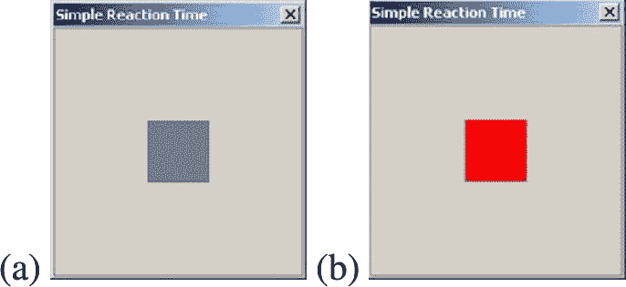

**图 2.32** 简单反应时间。(a) 用户注视灰色方框。(b) 延迟一段时间后，方框变红，用户尽可能快地按下按键。

该软件实现了简单反应任务的三种扩展：*物理匹配*、*名称匹配* 和 *类别匹配*。每一种都增加了一层认知操作的复杂性。这些任务是根据 Card 等人 [\[64, pp. 65-71\]](#Chp002_31-91_B9780443140969000087.xhtml#br0320) 的描述建模的。对于物理匹配，向用户呈现一个五字母单词作为初始刺激。延迟一段时间后，出现第二个刺激，也是一个五字母单词。用户通过按下两个按键之一尽快做出反应：如果第二个刺激与第一个刺激匹配，则按“匹配”键；如果第二个刺激与第一个刺激不同，则按“不匹配”键。匹配出现的概率为 50%。一个示例实验设置如**图 2.33**所示。

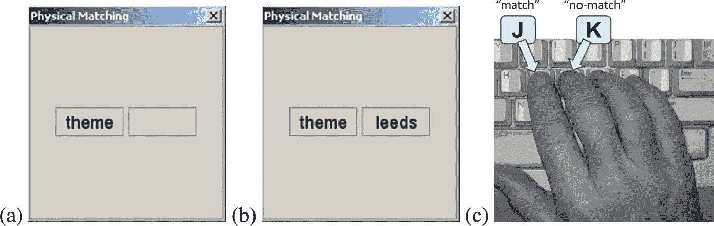

**图 2.33** 物理匹配。(a) 初始刺激。(b) 延迟一段时间后，出现第二个刺激。(c) 设置。详见正文讨论。

显然，物理匹配比简单反应更复杂，因为用户需要将刺激与工作记忆中的编码进行比较。人机交互 (HCI) 中的一个例子是手机上的预测文本输入，用户在工作记忆中有一个预期的单词。每输入一个字母，候选词就会出现。在每个节点上，用户有两个选择：接受一个候选词或输入下一个字母。^(³⁵)

名称匹配与物理匹配相同，只是单词的外观各异：大写或小写、等宽或无衬线、普通或粗体、18 磅或 20 磅。如果单词相同，无论外观如何，均视为匹配。见**图 2.34**。名称匹配所需时间应比物理匹配长，因为“用户现在必须等待视觉编码被识别，以及代表字母名称的抽象编码变得可用” [\[64, p. 69\]](#Chp002_31-91_B9780443140969000087.xhtml#br0320)。

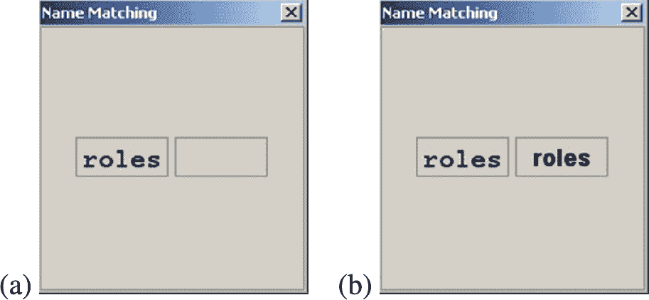

**图 2.34** 名称匹配。(a) 初始刺激。(b) 第二个刺激。详见正文讨论。

对于类别匹配，初始刺激包含一个字母或数字。延迟一段时间后，出现第二个刺激，也包含一个字母或数字。字体为等宽或无衬线、普通或斜体、18 磅或 20 磅。如果两个符号属于同一类别，即均为字母或均为数字，则视为匹配。类别匹配耗时更长，因为“用户必须多次参考长时记忆” [\[64, p. 70\]](#Chp002_31-91_B9780443140969000087.xhtml#br0320)。为避免混淆，不包含 0（数字）和 O（字母），也不包含 1（数字）和 I（字母）。见**图 2.35**。

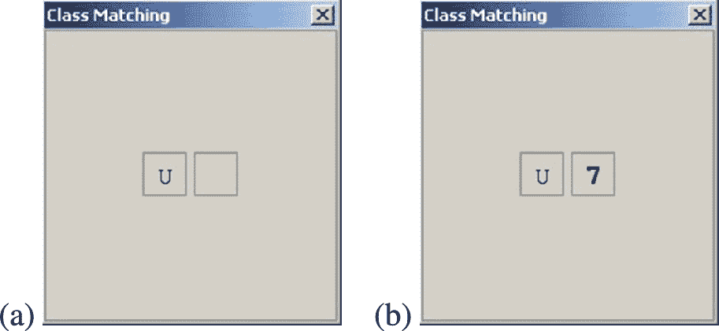

**图 2.35** 类别匹配。(a) 初始刺激。(b) 第二个刺激。详见正文讨论。

上述界面在 HCI 课程的实验环节中进行了测试。十四名学生担任参与者，针对每种条件执行了 3 组每组 10 次的试验。第一组视为练习并予以丢弃。为抵消学习效应，参与者被分成两组，每组人数相等。一组先执行简单反应任务，随后依次执行物理、名称和类别匹配任务。另一组则按相反顺序执行任务。

结果如**图 2.36**所示。简单反应的平均时间为 276 ms。该值恰好落在前文针对反应时间任务提到的 113 至 528 ms 范围内（见**图 2.15**）。请注意，时间测量始于第二个刺激的到达，终于软件中注册的按键事件；因此，该测量包含了运动反应的时间。

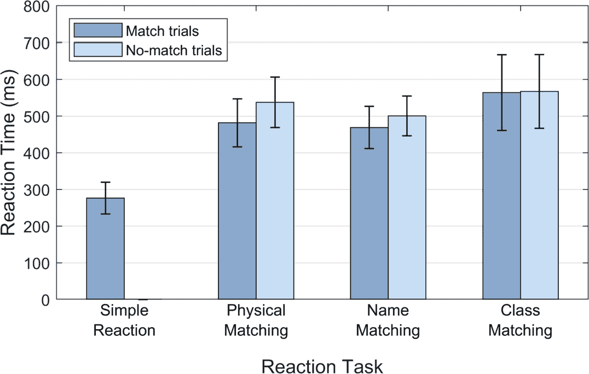

**图 2.36** 对比多种反应任务的实验结果。误差线显示 ±1 `SD`。

物理匹配所需时间约为简单反应的两倍，具体取决于第二个刺激是匹配 (482 ms) 还是不匹配 (538 ms)。有趣的是，名称匹配并未比物理匹配耗时更长。一种解释是，名称匹配任务中的单词外观变化不足以要求额外的认知处理。类别匹配是最难的任务，匹配和不匹配条件下的平均值均约为 565 ms。

*选择反应* 是另一种类型的反应时间任务。在这种情况下，用户有 *n* 个刺激（如灯光）和 *n* 个响应器（如开关）。刺激与响应之间存在一一对应关系。选择反应时间将在第 7 章建模中讨论。

#### 2.7.2 视觉搜索

反应时间的一种变体是 *视觉搜索*，用户扫描一组项目以寻找目标项目。显然，所需时间会随着待扫描项目数量的增加而增加。上述软件包含一个视觉搜索模式，搜索空间可配置为 1、2、4、8、16 或 32 个项目。*N* = 16 的一个示例显示在**图 2.37**中。初始刺激是一个单个字母。经过 2 到 5 秒的随机延迟后，右侧的方格会被随机选取的字母填充。初始刺激以 50% 的概率出现在右侧。用户根据情况按下“匹配”或“不匹配”键。

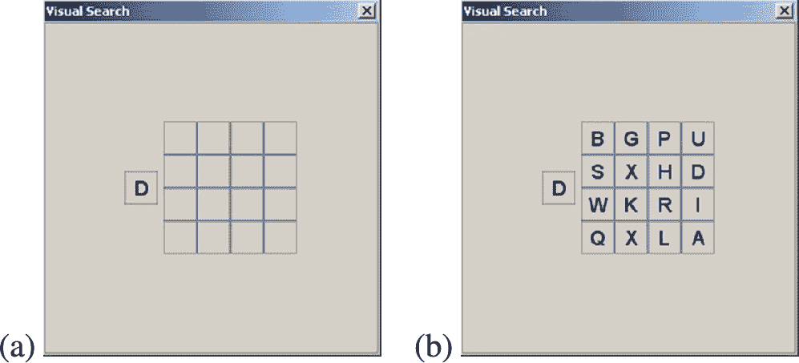

**图 2.37** 视觉搜索。(a) 初始刺激。(b) 延迟一段时间后，出现一组字母。详见正文讨论。

#### 2.7.3 熟练行为

上一节中的反应时任务很简单：感觉刺激引发一个简单的认知操作，随后产生一个简单的运动反应。只需几次尝试就能熟悉该任务，且通过额外练习，表现几乎没有任何提升。然而，在许多任务中，人类的表现会随着练习显著且持续地提高。对于这类任务，学习和进步的现象非常显著，以至于该任务最迷人的特性在于表现的进步以及根据速度、准确度、成功程度等标准所达到的表现水平。**熟练行为**因此是人类行为的一种属性，即人类的表现必然通过练习而提高。例如包括玩飞镖、下棋，或在计算场景中的游戏或编程。一个人完成这些任务的能力很大程度上取决于练习的数量。

刚才引用的例子是经过挑选的。它们划分了熟练行为的两大类别：**感觉运动技能**和**心智技能** [[514, p. 21]](#Chp002_31-91_B9780443140969000087.xhtml#br2570)。玩飞镖或游戏的熟练程度可能侧重于感觉运动技能，而下棋或计算机编程的熟练程度可能侧重于心智技能。当然，这并非二元对立。所有熟练行为都需要心智能力，如感知、决策和判断。同样，即使是最沉思性的熟练任务，也需要双手或其他器官协调的外显动作。

虽然游戏或计算机编程等任务可能分别侧重于感觉运动技能或心智技能，但其他任务则包含大量这两种要素。设想一位医生正在进行微创手术，这在腹部手术中很常见。为了进入腹腔，安装在腹腔镜末端的摄像头和灯光通过一个小切口插入，图像显示在头顶的监视器上。工具通过其他切口插入，以便于接触内部器官。外科医生观察监视器并操纵工具以夹持和切割组织。在图 2.39a 中，显示了外科医生用于夹持（左侧）和切割（顶部）的工具尖端，它们呈现为在胆囊切除术期间显示器上的样子。这些工具在体外由手动操作。图 2.39b 展示了训练模拟器中此类工具的示例。这些工具是复杂的仪器。例如请注意，工具尖端可以关节式活动，即弯曲，从而为外科医生提供了额外的自由度 [188,[344]](#Chp002_31-91_B9780443140969000087.xhtml#br1720)。显然，人机交互同时涉及感觉运动技能（在观察监视器的同时操作工具）和心智技能（知道做什么以及做的策略）。


随着熟练行为的形成而来的是**隐性知识**。任务变得过度学习且自动化。扣衬衫扣子和系鞋带就是例子。大多数成年人都是专家，已经“练习”了很多年。隐性知识与**显性知识**形成对比。新手使用显性知识来执行专家能自动完成的相同任务。一个学习系鞋带的人会思考并视觉关注每个步骤。专家则自动进行。

#### 2.7.4 注意力

开车发短信。很难想象有比这更能引发争议的主题来开启我们关于注意力的讨论。虽然开车相对容易，但即使是经验最丰富的司机，如果选择在开车时阅读和发送短信，也会变成潜在的杀手。问题在于一个人无法同时关注这两项任务。正如工作记忆（7 ± 2 个项目）造成的瓶颈一样，人类的注意能力也是有限的。但是，极限在哪里？更根本地说，什么是注意力？哪些任务需要注意力？哪些不需要？人类表现受到何种影响？根据一种观点，注意力是人类行为的一种属性，当一个人专注于一件事时，就无法专注于另一件事时发生 [\[243, p. 4\]](#Chp002_31-91_B9780443140969000087.xhtml#br1215)。例如，打字需要注意力，因为在打字时我们无法进行交谈。另一方面，走路需要的注意力很少，因为我们走路时可以思考、交谈和做其他事情。研究注意力的一种方法是观察和测量人类分别执行两项任务，然后重复该过程，让这两项任务同时执行。如果在同时执行的情况下任务表现下降，则认为该任务需要注意力。

注意力通常沿两个主题进行研究：*分散注意力* 和 *选择性注意力* [\[238, p. 179\]](#Chp002_31-91_B9780443140969000087.xhtml#br1190)。分散注意力是同时做并专注于多项任务的过程。开车发短信就是一个例子，其效果显而易见。在其他情况下，分散注意力不成问题，如走路和说话。选择性注意力（又称 *聚焦注意力*）是指专注于一项任务而排除其他任务。例如，我们在拥挤嘈杂的房间里与朋友交谈，同时屏蔽无关的闲聊。但这也是有极限的。在同一次交谈中，我们偶尔无法回忆起刚说出的词语，因为我们的注意力游离了或被干扰吸引走了。因此，选择性注意力是人类忽略无关事件并保持对主要任务专注的能力。


一种选择性注意力理论认为，我们选择性注意的能力与事件对个人的重要性有关。如果从另一个位置传来某人的名字，正在听演讲的人很可能会停止倾听 [\[243, p. 140\]](#Chp002_31-91_B9780443140969000087.xhtml#br1215)。自己的名字具有内在重要性，很可能会干扰选择性地专注于演讲的能力。显然，重要性是主观的。Wickens 描述了一起飞机失事，机组人员全神贯注于驾驶舱内的一个故障，而该故障与飞行安全无关 [\[515, p. 249\]](#Chp002_31-91_B9780443140969000087.xhtml#br2575)。机组人员关注该故障，却未能注意到关键的高度表读数，显示飞机正逐渐向地面下降。该故障对机组人员而言具有显著的重要性。

分散注意力与选择性注意力的区别通常用通道来解释 [\[515, p. 254\]](#Chp002_31-91_B9780443140969000087.xhtml#br2575)。单一通道（如视觉、听觉、运动）内的事件并行处理，而不同通道中的事件串行处理。当并行处理事件（单一通道）时，一个事件可能会干扰专注于另一个事件的能力。当串行处理事件（不同通道）时，我们努力专注于一个事件而排除其他事件，或以方便的方式在通道间分配注意力。

分析事故是人因工程中的一个重要主题，正如上述航空例子所示。此类事件屡见不鲜。道路、空中、海上或工业中的事故数不胜数，在许多情况下，原因至少部分归咎于人为因素——分心或选择性地关注不当事件。曾发生一起涉及司机和骑车人的事故，原因是电子宠物（Tamagotchi）分散了司机的注意力。^(³⁷)

注意力在 HCI 中具有相关性，例如在办公环境中，要求任务切换的干扰会影响生产力 [\[96\]](#Chp002_31-91_B9780443140969000087.xhtml#br0480)。移动时代带来了大量与注意力相关的问题。注意力资源不仅有限，而且这些资源在用户移动时被占用。趋势转向需要持续警惕和用户随时可用的即时简短任务，且对响应时间的要求日益苛刻。所谓的心理社会任务竞争并消耗注意力资源，有证据表明这最终会导致交互流畅性的崩溃 [\[383\]](#Chp002_31-91_B9780443140969000087.xhtml#br1915)。

### 2.7.5 人为错误

#### 人为错误视角

人为错误有不同的视角。当用户与计算机交互以执行任务时，某种错误是不可避免的。如果用户是 HCI 实验的参与者，并使用新界面（可能采用新的交互技术）执行任务，那么错误的记录和分析就很重要。目的是评估界面的优点或问题。完美是理想的，但很少能实现。单次试验可能完成得正确，但在许多次试验的过程中，错误——至少会有一些——很可能发生。表面上看，*错误* 一词似乎几乎没有解释的余地：做了某事，而且做错了！这导出了一个简单的定义：

> **错误是一个离散事件，其中任务的结果不正确，偏离了正确且期望的结果。**

在实验研究中，事件会被记录并作为人类表现的一个组成部分进行分析，与任务完成时间和交互的其他可测量属性一起。最常见的是，错误以*错误率*的形式以百分比报告：错误完成的试验次数与所有试验次数的比率（×100）。有时也会报告*准确率*——正确完成的试验次数与所有试验次数的比率。

后续的讨论参考 `Figure 2.41` 中的示例，涉及目标选择任务和文本输入任务。对于每一项，目标都很简单。对于目标选择，目标是操作输入设备，将跟踪符号——光标——从起始位置移动到目标并选择该目标。也许使用输入设备上的一个按钮进行选择。对于文本输入，目标是使用键盘等设备或手写等技术输入单词 `quickly`。在 (a) 中，任务执行正确：目标被选中，单词被输入。

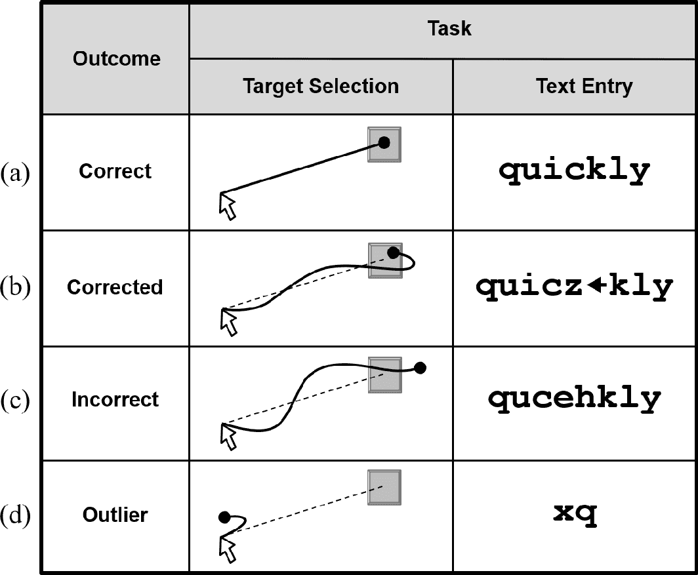

**图 2.41** 结果不同的计算任务。详见正文讨论。

在 `Figure 2.41b` 中，任务也执行正确了，但仅在采取纠正动作之后。对于目标选择任务，光标路径摇摆并穿过目标，最后通过调整来选择目标。对于文本输入任务，输入了 `z` 而不是 `k`。随后进行了纠正动作（退格键），并输入了正确的字母。

在 `Figure 2.41c` 中，任务执行不正确——发生了错误。对于目标选择任务，光标穿过目标，最终在目标外部进行选择。对于文本输入任务，输入了错误的字母组合。`Figure 2.41d` 将在下一节“离群值”中讨论。

`Figure 2.41` 的 (b) 和 (c) 部分中的行为细节丰富。从离散错误的意义上讲，(b) 中的任务是正确的，尽管经过了纠正；而 (c) 中的任务则是错误的。然而，需要更深入的观察。为什么 (a) 中的理想场景中的交互会出现偏差？在实验研究中，利用这些洞察来寻找合理的解释至关重要。实验研究的本质就是比较两个或更多条件。^(³⁸)

再次考虑 `Figure 2.41` (b) 和 (c) 部分中的目标选择任务。跟踪符号偏离了通往目标的直接路径。但为什么？是否存在用户握持或控制输入设备方式上的握力或稳定性问题？设备的增益设置是否过于灵敏？设备是鼠标、触控板、眼动仪、游戏手柄还是其他设备？注意在 (b) 中，跟踪符号进入目标后又移出。在任务的最终目标获取阶段是否存在特定问题？

现在考虑 (b) 和 (c) 中的文本输入任务。哪里出错了？如果输入涉及键盘，错误是否由于用户按到了正确键相邻的键？也许按键太小。如果输入涉及使用手指或手写笔的手势输入，用户是否输入了错误的手势或形状不佳的手势？^(³⁹)

分析错误的更广泛视角可能会考虑与任务同时发生的环境条件。用户是否因噪音、振动、照明或其他环境条件而处于劣势？用户是在走路、交谈、驾驶，还是在执行次要任务？他们是否受到他人在场的不利影响，就像可能发生在社交或协作工作环境中那样？

`Figure 2.41` 描绘了单次试验。在 HCI 实验中，可能有几十次，也许几百次，甚至几千次这样的试验。虽然生成和评判交互的可视化很有用且重要，但对于大量试验来说，这项工作是艰巨的。如果有一种方法能将相关行为收集并汇总在一起，那将非常方便。这本身就很有趣且有价值。改进 HCI 研究方法论可能与发现新颖且有用的交互技术一样重要。因此，一项研究贡献就是开发并展示能够捕捉交互细微方面的行为测量方法。计算机的一个优势是它们愿意不知疲倦地收集、存储和汇总数据。研究人员无需检查潜在的数千个行为可视化，而是可以检查行为的汇总测量值。当然，这是跨测试条件进行的，以发现差异。但正如发现差异很重要一样，解释差异也很重要——通过能捕捉行为细微差别的测量来解释。让我们来看看 `Figure 2.41` 中行为的一些候选测量方法。

#### 运动变异性

对于目标选择任务，光标偏离了通往目标的直接路径。可能有几个控制问题需要考虑。无论它们是什么，第一个挑战是量化“摇摆”。其中一种度量是运动变异性 (`MV`)。在 `Figure 2.42a` 中，光标路径被数字化为一系列 `x`-`y` 点。

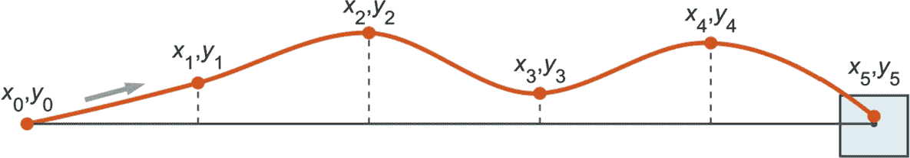

**图 2.42** 数字化的光标路径。

只要装置嵌入了用于研究交互的软件，捕获这些数据相对简单。给定一组点，如 `Figure 2.42` 所示，运动变异性计算公式为

$$

\text{MV} = \sqrt{\frac{\Sigma{(y_{i} - \overline{y})}^{2}}{n - 1}}.

$$

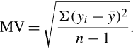 (2.2)

运动变异性也可以在 3D 中计算。一个例子是虚拟现实 (`VR`) 环境，其中虚拟手移向并获取目标。手是直接移动到目标，还是路径在途中发生变化？`Figure 2.43` 显示了一个示例，其中理想路径——任务轴——显示为黑色直线。运动路径显示为红色实线段。对于每个采样点，一条最短长度的虚线被投影到任务轴上。在图中，投影距离分别为 0、12.3、14.1、22.6 和 7.3。^(⁴⁰)

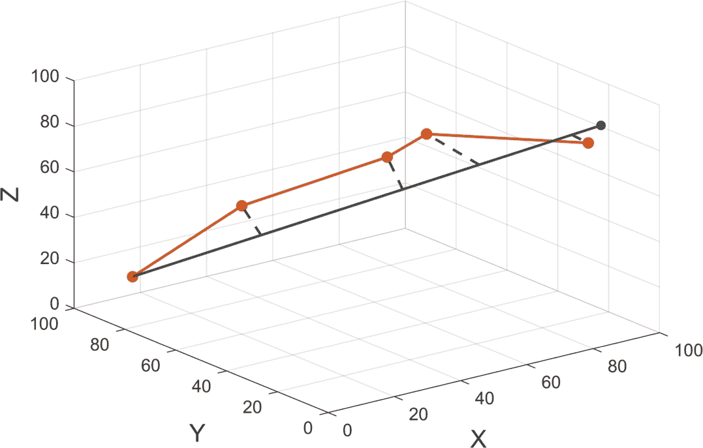

**图 2.43** 3D 交互的数字化路径。详见正文讨论。

#### 目标重入 (TRE)

在 `Figure 2.41b` 的目标选择任务中，光标进入目标，移出，然后在最终选择前重新进入。正如前面所述，这种行为可能表明最终选择阶段存在控制问题。捕捉此行为的一个指标是**目标重入 (`TRE`)**，即光标（在已进入一次后）重新进入目标的次数。显然，计数为零是最理想的。`Figure 2.44` 展示了一项研究平板电脑上目标选择实验的示例试次 [\[326, 图 9\]](#Chp002_31-91_B9780443140969000087.xhtml#br1630)。该交互利用设备倾斜来控制光标。选择要求光标进入目标并停留 500 ms。在该示例中，`TRE = 3`。

![Figure 2.44 Digitized cursor path for a target selection task using tilt input on a tablet computer [\[326, Fig. 9\]](#Chp002_31-91_B9780443140969000087.xhtml#br1630). There were three target re-entries.](images/B9780443140969000087/gr044.jpg)

**图 2.44** 使用平板电脑倾斜输入进行目标选择任务的数字化光标路径 [\[326, 图 9\]](#Chp002_31-91_B9780443140969000087.xhtml#br1630)。共有三次目标重入。

正如 `Figure 2.44` 所示，交互中存在多种光标控制问题。如果 `MV` 或 `TRE` 等指标较高——或者更确切地说，在某一条件下比另一条件下更高——这对于区分交互方法具有相关性。结合交互的显性且已知属性来看待测量值，对于寻找合理的解释非常重要。这对研究至关重要——为了理解为什么某些测试条件效果良好而其他条件效果不佳。

#### 目标选择的附加指标

目标选择任务的附加指标示例包括**运动偏移 (`MO`)**、**运动误差 (`ME`)**、**任务轴穿越 (`TAC`)**、**运动方向改变 (`MDC`)** 和**正交方向改变 (`ODC`)** [\[314\]](#Chp002_31-91_B9780443140969000087.xhtml#br1570)。这些指标与 `MV` 和 `TRE` 一样，都是实验中的潜在因变量，详见第 5 章（第 5.5 节，因变量）。这些指标在 HCI 实验中应用的示例可见于 Long 和 Gutwin [\[290\]](#Chp002_31-91_B9780443140969000087.xhtml#br1450)、Murthy 等人 [\[362\]](#Chp002_31-91_B9780443140969000087.xhtml#br1810)、Keates 和 Trewin [\[242\]](#Chp002_31-91_B9780443140969000087.xhtml#br1210)、Herring 等人 [\[188\]](#Chp002_31-91_B9780443140969000087.xhtml#br0940)、Pandey 等人 [\[386\]](#Chp002_31-91_B9780443140969000087.xhtml#br1930)、Wobbrock 和 Gajos [\[523\]](#Chp002_31-91_B9780443140969000087.xhtml#br2615) 以及 Pino 等人 [\[401\]](#Chp002_31-91_B9780443140969000087.xhtml#br2005) 的著作中。另请参阅学生练习 2-9。

#### 文本输入指标

让我们转向 `Figure 2.41` 中的文本输入任务。在 (b) 部分中，最终文本是正确的，但这只是在经过纠正操作之后。因此，仅考虑最终文本会遗漏交互的重要方面。捕捉 (b) 部分行为的一个指标是**每字符击键数 (`KSPC`)** [\[303\]](#Chp002_31-91_B9780443140969000087.xhtml#br1515)、[\[325\]](#Chp002_31-91_B9780443140969000087.xhtml#br1625)。`KSPC` 既是一个分析指标，也是一个实证指标。分析指标或模型是通过分析计算得出的，无需观察实际交互。^(⁴¹)

```
KSPC = len(quicz < kly) / len(quickly) = 9 / 7 = 1.286
```

**(2.3)**

此处，我们假设输入是通过 Qwerty 键盘或其他某种一个动作产生一个字符的方法进行的。在此基础上，无误输入的基线为 `KSPC = 1.000`。`KSPC` 超出基线的程度衡量了制造和纠正错误的开销。

公式 (2.3) 适用于单个词条的输入。如果在多个输入单元上计算平均值（每个单元通常是从语料库中随机抽取的一个短语）[\[321\]](#Chp002_31-91_B9780443140969000087.xhtml#br1605)，`KSPC` 作为性能的实证指标会更有用。此外，跨两个或多个测试条件的计算有可能揭示区分测试条件的差异。关于 `KSPC` 作为实证指标在 HCI 文献中的更多应用示例，请参阅 Abdrabou 等人 [\[1\]](#Chp002_31-91_B9780443140969000087.xhtml#br0005)、Hassan 等人 [\[181\]](#Chp002_31-91_B9780443140969000087.xhtml#br0905)、Jain 和 Balakrishnan [\[218\]](#Chp002_31-91_B9780443140969000087.xhtml#br1090)、Kuang 等人 [\[258\]](#Chp002_31-91_B9780443140969000087.xhtml#br1290) 以及 Palin 等人 [\[384\]](#Chp002_31-91_B9780443140969000087.xhtml#br1920) 的著作。^(⁴²)

#### 最小字符串距离 (MSD) 和错误率 (ER)

在 `Figure 2.41c` 中，最终文本不正确：`qucehkly` 而非 `quickly`。在词级层面，这算作一个错误。但在字符级层面，情况有所不同，因为输入部分正确。再一次，超越可视化——量化观察行为的某个属性——是有价值的。让我们通过两个问题来研究这个想法。首先，最终文本（`qucehkly`）中有多少字符级错误？这有点棘手。仔细对比实际文本与期望文本表明有三个错误。捕捉这一点的一个指标是**最小字符串距离 (`MSD`)** [\[464\]](#Chp002_31-91_B9780443140969000087.xhtml#br2320)。`MSD` 算法递归遍历两个字符串，并构建一个矩阵来列出字符串间的差异。最后一个条目是一个整数，等于将一个字符串转换为另一个字符串所需的最少基本操作数。对于该示例，`MSD = 3`。见 `Figure 2.45a`。当然，无误输入产生 `MSD = 0`。`MSD` 随错误数量增加而上升。

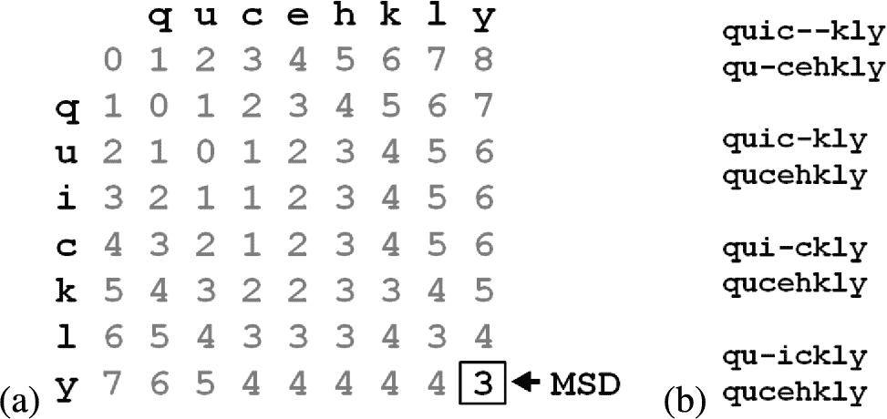

**图 2.45** 字符级错误。 (b) MSD 矩阵与统计量。 (b) 对齐。

该示例的错误率 (`ER`) 为

```
ER = MSD(A,B) / max(len(A), len(B)) = 3 / 8 = 0.125 = 12.5%
```

**(2.4)**

分母使用最大值函数以确保错误率不超过 100%。与公式 (2.3)（用于 `KSPC`）类似，公式 (2.4) 中的计算针对单个词条。当然，如果在更大的输入单元（如短语）上计算平均值，并跨多个测试条件进行分析，错误率分析最为有用。在 HCI 文献中使用 `MSD` 错误率的示例包括 Castellucci 等人 [\[72\]](#Chp002_31-91_B9780443140969000087.xhtml#br0360)、Hedeshy 等人 [\[185\]](#Chp002_31-91_B9780443140969000087.xhtml#br0925)、Mutasim 等人 [\[363\]](#Chp002_31-91_B9780443140969000087.xhtml#br1815)、Nicolau 和 Jorge [\[372\]](#Chp002_31-91_B9780443140969000087.xhtml#br1860) 以及 Tominaga 等人 [\[492\]](#Chp002_31-91_B9780443140969000087.xhtml#br2460) 的著作。^(⁴³)

深入理解出了什么问题以及为什么会出问题是很重要的，这有助于揭示交互中微妙的方面——这些特性可能会阻碍输入并损害用户体验。这引出了我们的第二个问题：错误是什么？了解发生了什么错误可能很有用，而不仅仅是对它们进行计数。然而，提出的问题可能没有简单的答案。以 `Figure 2.41c` 中的文本输入示例为例，至少有四种答案。这些答案在 `Figure 2.45b` 中显示为*对齐*，它们揭示了错误——即将一个字符串转换为另一个字符串所需的操作 [[319]](#Chp002_31-91_B9780443140969000087.xhtml#br1595)。有四种可能的场景，每种场景都对比了期望（上）和实际（下）文本。当上下字符串中的字符不同时，显示为*替换*。当上字符串中出现破折号时，显示为*插入*。当下字符串中出现破折号时，显示为*删除*。当然，仅通过查看数据无法知道发生了什么。除非有特定理由认为某个场景是正确的，否则一种方法是同等权重地对待各种可能性。随着收集到更多数据，模式可能会浮现。这些分析很重要，因为它们可以确定诸如哪些键在按键输入中容易出错，或哪些笔画在手势输入中经常被误识别等影响。让我们转向 `Figure 2.41` 的第 (d) 部分。

### 2.7.6 离群值

人为错误的一个重要类别是*离群值*。请看 `Figure 2.41d`。是的，出了严重的问题。目标选择任务过早且突然地结束了。文本输入任务的结果与预期单词毫无相似之处。这些结果极其恶劣，值得特别关注和分类。


将一次试验归类为离群值既是一个定性过程，也是一个定量过程。定性上，离群值是指位于主要事件集合之外，或被归类为与主要事件集合不同的事件。该事件是不同的，实质性地不同。该过程涉及观察和评估，而非测量。目标是发现并解释出了什么问题（而不仅仅是测量某事物偏离了预期值）。定量上，离群值是指其数值与样本中其他测量值显著不同的测量值。定量评估很直接，因为它基于数字。当然，判断标准由研究者设定，且该标准不一定是定量的。

在图 2.41d 中，目标选择的测量标准可能是“移动距离小于预期距离一半的试验”。文本输入的标准可能是“错误率超过 50% 的试验”。这些标准将捕捉到示例试验。用定性解释来辅助定量评估很重要。出了什么问题？将试验归类为离群值需要一个合理的解释。前面，我们为图 2.41 第 (b) 和 (c) 部分中的变异行为提出了一些此类解释。类似的解释也可能适用于离群值。

从广义上讲，参与者本身也可能是一个离群值，原因可能是由于生理或其他原因不理解任务或缺乏技能。例如，在眼动追踪实验中，佩戴眼镜的参与者可能会遇到严重的校准困难。让我们通过一个假设示例继续探讨离群值。

### 2.7.6.1 示例

招募了十五名参与者，并演示了一个新的搜索引擎界面。他们使用该界面执行 20 个搜索任务。每个任务的成功率在 0（*不成功*）到 100（*非常成功*）的量表上进行评估。分数被汇总。见图 2.46。平均值（未显示）为 66.4，标准差（*SD*）为 13.4。平均值和标准差是衡量集中趋势（平均值）和变异性（*SD*）最常用的统计指标。在一组正态分布的数据中，例如，约 68.2% 的值应位于平均值 ±1 *SD* 范围内，95.4% 位于 ±2 *SD* 范围内，99.7% 位于 ±3 *SD* 范围内。让我们结合平均值和标准差来检查原始分数。

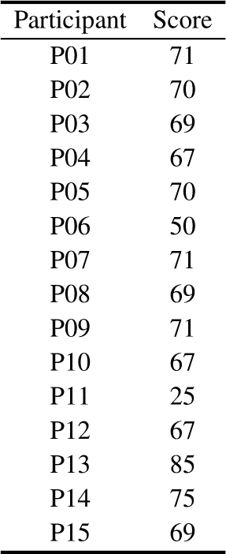

图 2.46 参与者搜索任务成功率的评分。

浏览图 2.46 中的数据，大多数参与者的分数接近平均值。然而，一些分数与平均值有显著偏差。P06 和 P11 的分数较低，分别为 50 和 25。P13 的分数较高，为 85。这些分数连同基于该数据集的平均值和 *SD* 绘制的正态分布曲线一起显示在图 2.47 中。引用的数值位于 ±1 *SD* 范围（即 53.0 到 79.8）之外。当然，有些数值落在这个范围之外是合理的。所以，数据可能并没有什么异常。然而，P11 的得分 25 低于 26.2，后者是平均值以下 3 *SD* 处的值。这个值极不寻常。P11 的得分可能是一个离群值。

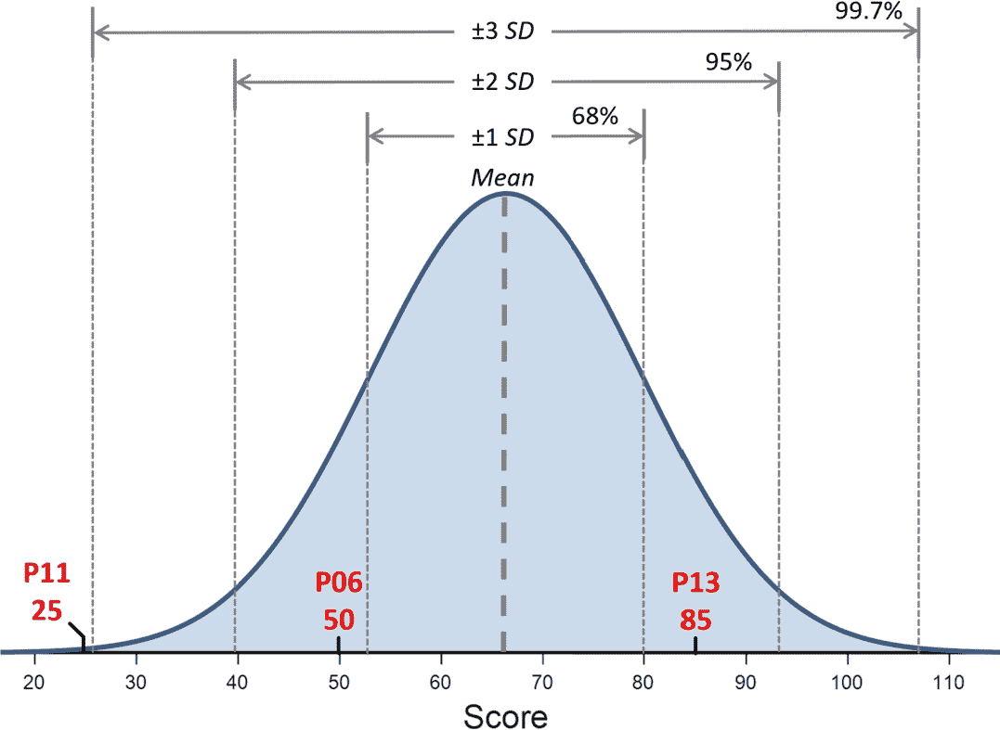

图 2.47 平均值 = 66.4，*SD* = 13.4 的正态分布。图 2.46 中三名参与者的得分标注在图中。

此时，排除 P11 的数据是一种选择。虽然危险信号出在数据中（数据是定量的），但将一个数据点归类为离群值值得更深入的审视。出了什么问题？P11 理解说明了吗？参与者完成任务了吗，还是有些任务中途被打断或放弃了？需要一个解释。只要有明确的标准（定量）和基本原理（定性），将某些数据标记为离群值并丢弃它们就是合理的。另见学生练习 2-8。

### 2.7.7 事故

人因研究人员经常结合商业或工业事故来研究人为错误，在这类事故中，结果造成了重大损失或人员伤亡。此类事件极少仅仅因为人为操作员按错了按钮，或与系统或界面发生交互错误而发生。通常，故障是系统性的——是多种事件汇聚的结果，其中许多与特定的人关系不大。

如果将重大事故归咎于人为错误，深入分析往往更能揭示真相。Casey 对数十起此类事故的复述得出的结论是，这些失败往往是*设计诱发的错误* [66, [67]](#Chp002_31-91_B9780443140969000087.xhtml#br0335)。这一点可以重述如下：如果人类操作员误拨了错误的开关或输入了不正确的数值，且该动作导致了严重事故，这是人为错误造成的失败吗？也许部分如此，但显然是设计使得事故得以发生。一种仅因操作员交互错误就可能导致灾难性后果的设计，就是有缺陷的设计。对于安全关键系统，必须考虑并预留操作员交互错误的余地。此类错误不仅可能发生，而且随着时间的推移，极有可能发生。安全关键系统的设计必须能适应人类行为的这种变数。

***

在本章中，我们探讨了人机交互（HCI）中的人为因素。主题的组织以人为中心。在必要时，提供了与技术相关的示例和背景。下一章的主题将专门针对交互。

本书第二版配套的资源网站如下：

*   [`www.yorku.ca/mack/HCIbook2e`](http://www.yorku.ca/mack/HCIbook2e)

## 学生练习

1.  **2-1** 图 2.17 (第 51 页) 中的彭菲尔德运动皮层小人图展示了大脑皮层中负责人类各效应器的区域。该草图用实心条代表每个效应器的皮层区域。每个条的长度是一个定量指标。对运动皮层小人图进行逆向工程，以确定每个条的长度。在电子表格中整理数据。图 2.48 展示了脚趾和脚踝的大致思路。阴影单元格包含从图像处理应用程序数字化得到的数值。例如，脚趾条从 (52, 153) 延伸到 (55, 111)。根据勾股定理，其长度为 42.1 像素。当然，比例和单位是任意的。显然，大脑皮层中用于脚踝的区域比用于脚趾的区域多约 15.7%。这在图中也很明显。

    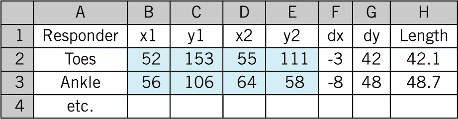

    图 2.48 彭菲尔德运动皮层小人图的学生练习。

    1.  对于所有效应器，将对应条的端点数字化并在电子表格中录入数值，如图 2.48 所示。创建一个条形图，显示每个效应器皮层区域的相对大小。将腿、臂和头的数值汇总在一起可能会很有用，每个部位显示为其组成效应器之和。准备一份简短的报告或幻灯片演示，介绍运动皮层小人图及各效应器的实证数据。

2.  **2-2** 按如下方式进行一项记忆回忆实验。找一个废弃的旧键盘，取下字母键帽 (图 2.49，左)。使用绘图应用程序，创建并打印 Qwerty 键盘字母区的轮廓图 (图 2.49，右)。(或者，只需使用 26 张小纸板方块，在每个方块上印一个字母。) 找五位计算机用户（参与者）。要求每位将键帽放置在打印图上。将任务时间限制在三分钟内。记录正确放置的键帽数量。(建议：拍照记录结果，事后再进行分析。)

    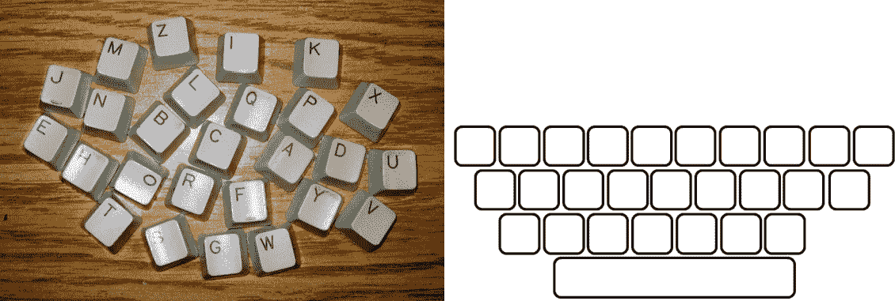

    图 2.49 键盘按键位置记忆回忆的学生练习。

    1.  然后，按如下方式评估每位参与者的打字风格和打字速度。在编辑器中打开一个空白文档，输入 43 字符的短语 “the quick brown fox jumps over the lazy dog.” 在下一行，要求参与者正确输入相同的短语。测量并记录时间（秒）。重复五次。对于每位参与者，观察并记录其打字风格是盲打还是两指禅（hunt-and-peck）。将数据录入电子表格。将输入短语的时间 (*t*，单位：秒) 转换为打字速度 (*s*，单位：词/分)^(⁴⁴)

        ```
        s = \frac{(43/5)}{(t/60)}.
        ```

        (2.5)

        1.  

        2.  准备一份简短的报告或幻灯片演示，汇报 “正确放置的键帽数量” 的发现。从总体上以及按打字速度和打字风格分类来考察参与者。讨论其他相关观察结果。

3.  **2-3** 进行一项关于书面英语冗余度和熵的小型实验，类似于前文描述的香农字母猜测实验。参见图 2.30 (第 64 页)。使用 5-10 名参与者。实验使用本书网站上的 `LetterGuessingExperiment` 软件。每位参与者进行五次试验（短语）。图 2.50 显示了设置对话框和实验过程的屏幕截图。数据收集由软件自动完成。分析正确猜测字母数量（冗余度）和错误猜测字母数量（熵）的结果。从总体和按参与者分类来检查结果。此外，调查响应是否因字母在单词和短语中的位置而异。准备一份简短的报告或幻灯片演示，汇报你的发现。

    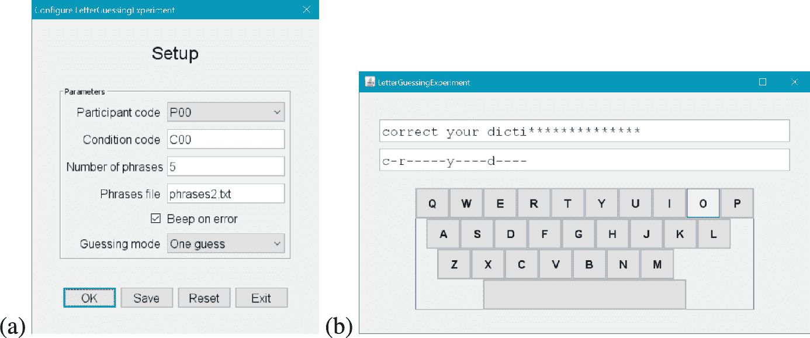

    图 2.50 使用香农字母猜测实验的学生练习。(a) 设置对话框。(b) 实验任务。

    1.  

    2.  **2-4** 绘制一张熟练行为图表，一轴代表感知运动技能，另一轴代表心智技能。在两轴靠近原点处标注 “少”，靠近末端处标注 “多”。图 3.67 (第 154 页) 给出了类似图表的示例。在图表中添加标记，显示至少五种计算技能。根据每项任务中感知运动技能和心智技能的相对侧重程度定位标记。准备一份简短的报告或幻灯片演示，描述每项技能并论证图表中标记位置的合理性。关于指导，请参阅本章 “熟练行为” 一节的讨论。如需进一步指导，请阅读第 7 章 “描述性模型” 的讨论。

    3.  **2-5** 使用本书网站上的 `GraffitiExperiment` 软件，进行一项关于手势输入、人机性能和人为错误的小型实验。该软件有 Windows 版和 Android 版。招募约 10 名参与者。将参与者分成两组，每组使用不同的输入方式。可考虑使用鼠标和触控板 (Windows) 或手指和触控笔 (Android)。该软件使用 Graffiti 手势进行文本输入。实验中，参与者需输入 10 次字母表。图 2.51 显示了 Windows 版 (顶部) 和 Android 版 (底部) 的设置对话框和实验过程屏幕截图。

    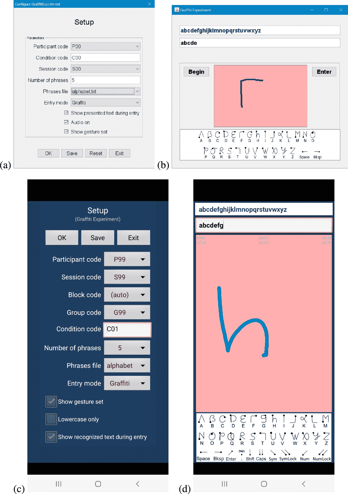

### 学生练习

#### 2-5 Graffiti 手势输入实验

**图 2.51** 学生 Graffiti 手势输入练习。(a) 设置对话框 (Windows)。(b) 实验任务 (Windows)。(c) 设置对话框 (Android)。(d) 实验任务 (Android)。

1.  设置对话框中的选项之一是“Phrases file”（短语文件）。请使用 `alphabet.txt`。将“Number of phrases”（短语数量）设置为 10。保持“Show gesture set”（显示手势集）选中状态。手势可在实验屏幕中查看（参见图 2.51）。参与者可使用退格笔画（←）纠正错误。但请指导参与者每个符号的纠正尝试不超过三次。

2.  数据收集是自动化的。完整详情请参考 `API`。分析数据以揭示两组参与者在 10 次试验中的进展。分析输入速度 (wpm)、错误率 (%) 和每字符击键数 (KSPC)。（此处“击键”指手势笔画。）准备一份简要报告或幻灯片演示来展示你的发现。

#### 2-6 人类反应时间实验

使用本书网站上的 `ReactionTimeExperiment` 软件进行一项关于人类反应时间的小型实验。招募约 10 名参与者。设置对话框如图 2.52 所示。实验过程的示例在前文已给出（参见“Reaction Time”，第 66 页）。考虑以某种方式修改软件，例如在视觉搜索任务中使用单词代替字母，或在简单反应时间任务中使用听觉刺激代替视觉刺激。该修改可作为比较点（例如，单词与字母的视觉搜索对比，或听觉刺激与视觉刺激的反应时间对比）。准备一份简要报告或幻灯片演示来展示你的发现。

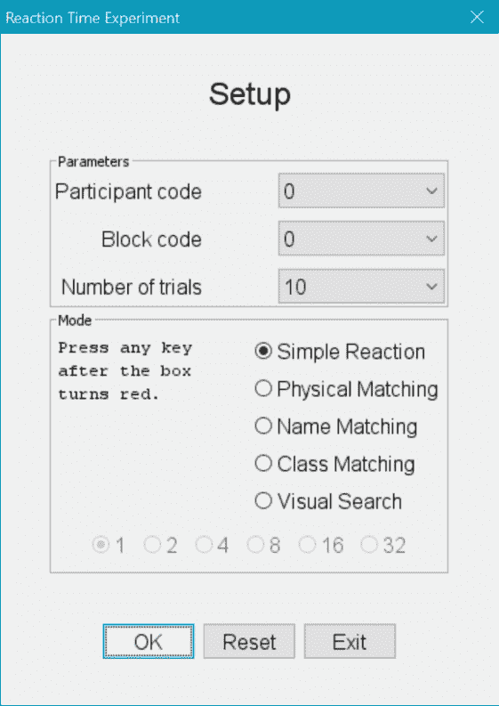

**图 2.52** 学生人类反应时间练习。

#### 2-7 单键文本输入实验

使用 5-10 名参与者进行一项单键文本输入小型实验。使用本书网站上的扫描模糊键盘软件 `SAKExperiment`。设置对话框和实验过程的屏幕快照如图 2.53 所示。准备一份简要报告或幻灯片演示来展示你的发现。

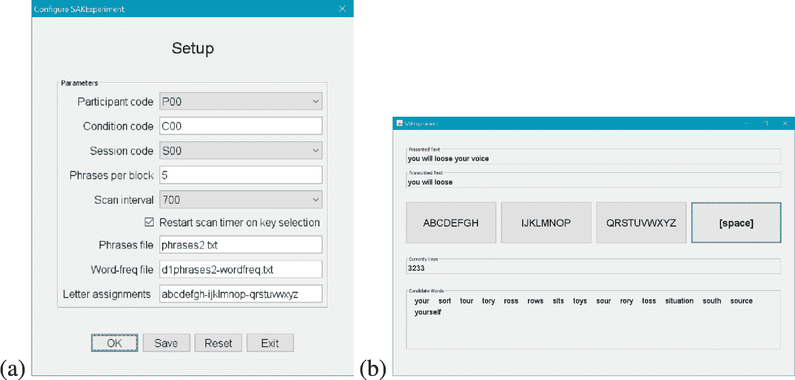

**图 2.53** 学生扫描模糊键盘 (SAK) 练习。(a) 设置对话框。(b) 实验任务。

#### 2-8 目标选择坐标数据分析

以下 48 个数据点是目标选择实验中一系列试验的 *x* 轴选择坐标（像素）。数据位于本书网站的文件 `StudentExercise2-8.txt` 中。目标宽 16 像素，中心位于 *x* = 0。

| -6 | 5 | 1 | 7 | 4 | 10 | -4 | 0 | -15 | 16 | -4 | 9 |
| --- | --- | --- | --- | --- | --- | --- | --- | --- | --- | --- | --- |
| -3 | 2 | -1 | 5 | -5 | 2 | 6 | -34 | 0 | 4 | 1 | -1 |
| -38 | 2 | 0 | 1 | -16 | 0 | 1 | 0 | -2 | -30 | -67 | 3 |
| -2 | 11 | -4 | 4 | 0 | -45 | -7 | 3 | -4 | 3 | 0 | -2 |

1.  分析数据以检查集合中是否存在异常值。准备一份简要报告或幻灯片演示来展示你的发现。包含一张显示选择坐标分布的适当图表。

#### 2-9 目标选择任务数据分析

以下数据来自一个目标选择任务：

| From (x/y): | | 765, 592.5 |
| --- | --- | --- |
| To (x/y): | | 640, 126 |
| Width: | | 100 |
| Px: | | 762, 764, 766, 766, 767, 768, 769, … |
| Py: | | 626, 628, 629, 630, 631, 631, 631, … |

任务是将光标从“From”坐标移动到“To”坐标，并选择一个直径为“Width”、中心位于“To”坐标的圆形目标。实际光标路径以一系列点的形式给出，其坐标为 *P*[*x*] 和 *P*[*y*]。完整路径以 224 个点进行数字化。完整数据集位于本书网站的文件 `StudentExercise2-9.txt` 中。分析数据以计算运动变异性 (MV) 和目标重入次数 (TRE)。计算可以在电子表格中完成，也可以使用你选择的编程语言。包含可能揭示交互性能问题的其他指标。准备一份简要报告或幻灯片演示来展示你的发现。根据需要包含视觉辅助材料。

## 参考文献

*   [[1]](#Chp002_31-91_B9780443140969000087.xhtml#cf1230) Y. Abdrabou, M. Mostafa, M. Khamis, A. Elmougy, Calibration-free text entry using smooth pursuit eye movements, *Proceedings of the 2019 Symposium on Eye Tracking Research & Applications - ETRA '19*. New York: ACM; 2019:35.1–35.5. [`doi.org/10.1145/3314111.3319838`](http://dx.doi.org/10.1145/3314111.3319838).

*   [5] M. Akamatsu, I.S. MacKenzie, T. Hasbrouq, A comparison of tactile, auditory, and visual feedback in a pointing task using a mouse-type device, *Ergonomics* 1995;38(4):816–827 [10.1080/00140139508925152](http://dx.doi.org/10.1080/00140139508925152).

*   [[8]](#Chp002_31-91_B9780443140969000087.xhtml#cf0815) A.S. Anggaira, Linguistic errors on narrative text translation using Google Translate, *Pedagogy: Journal of English Language Teaching* 2017;5(1):1–14.

*   [[9]](#Chp002_31-91_B9780443140969000087.xhtml#cf0485) M. Annett, F. Anderson, W.F. Bischof, A. Gupta, The pen is mightier: Understanding stylus behaviour while inking on tablets, *Proceedings of Graphics Interface - GI '14*. Toronto: Canadian Information Processing Society; 2014:193–200.


### 参考文献

*   [[14]](#Chp002_31-91_B9780443140969000087.xhtml#cf0150) C. Asakawa, H. Takagi, Text entry for people with visual impairments, I.S. MacKenzie, K. Tanaka-Ishii, eds. *Text Entry Systems: Mobility, Accessibility, Universality*. San Francisco: Morgan Kaufmann; 2007:305–318. [`doi.org/10.1016/B978-012373591-1/50016-4`](http://dx.doi.org/10.1016/B978-012373591-1/50016-4).

*   [17] R.W. Bailey, *Human Performance Engineering: Designing High Quality, Professional User Interfaces for Computer Products, Applications, and Systems*. 3rd ed. Upper Saddle River, NJ: Prentice Hall; 1996 978-0131496347.

*   [[19]](#Chp002_31-91_B9780443140969000087.xhtml#cf0435) R. Balakrishnan, I.S. MacKenzie, Performance differences in the fingers, wrist, and forearm in computer input control, *Proceedings of the ACM SIGCHI Conference on Human Factors in Computing Systems - CHI '97*. New York: ACM; 1997:303–310. [`doi.org/10.1145/258549.258764`](http://dx.doi.org/10.1145/258549.258764).

*   [[27]](#Chp002_31-91_B9780443140969000087.xhtml#cs0015_1) A.U. Batmaz, X. Sun, D. Taskiran, W. Stuerzlinger, Eye-hand coordination training for sports with mid-air VR, *Proceedings of the 26th ACM Symposium on Virtual Reality Software and Technology - VRST '20*. New York: ACM; 2020:19.1–19.10. [`doi.org/10.1145/3385956.3418971`](http://dx.doi.org/10.1145/3385956.3418971).

*   [[34]](#Chp002_31-91_B9780443140969000087.xhtml#cf0280) A. Bodnar, R. Corbett, D. Nekrasovski, AROMA: Ambient awareness through olfaction in a messaging application, *Proceedings of the 6th International Conference on Multimodal Interfaces - ICMI '04*. New York: ACM; 2004:183–190. [`doi.org/10.1145/1027933.1027965`](http://dx.doi.org/10.1145/1027933.1027965).

*   [[40]](#Chp002_31-91_B9780443140969000087.xhtml#cf0275) S.A. Brewster, D. McGookin, C. Miller, Olfoto: Designing a smell-based interaction, *Proceedings of the ACM SIGCHI Conference on Human Factors in Computing Systems - CHI '06*. New York: ACM; 2006:653–662. [`doi.org/10.1145/1124772.1124869`](http://dx.doi.org/10.1145/1124772.1124869).

### 参考文献

*   **[44]** M.A. Brown, I.S. MacKenzie, 评估与用户手型相关的视频游戏控制器易用性，*第 13 届多媒体与人机交互国际会议论文集 - MHCI '13*。加拿大渥太华：ASET；2013：114.1–114.8。

*   **[56]** T. Canham, I.S. MacKenzie, R.F. Murray, M.S. Brown, 感知优化对色彩空间可导航性的影响，*图形界面会议论文集 - GI '23*。多伦多：加拿大信息处理学会；2023：14.1–14.10。

*   **[61]** S.K. Card, J.D. Mackinlay, G.G. Robertson, 输入设备设计空间的形态学分析，*ACM 办公信息系统汇刊* 1991；9(2)：99–122 [10.1145/123078.128726](http://dx.doi.org/10.1145/123078.128726)。

*   **[64]** S.K. Card, T.P. Moran, A. Newell, *人机交互心理学*。新泽西州希尔斯代尔：Erlbaum；1983。

*   **[66]** S.M. Casey, *将相位器设为眩晕模式：以及其他关于设计、技术和人为错误的真实故事*。第 2 版。加利福尼亚州圣塔芭芭拉：Aegean Publishing Company；1998。[`doi.org/10.1080/00140139408964936`](http://dx.doi.org/10.1080/00140139408964936)。

*   **[67]** S.M. Casey, *原子厨师：以及其他关于设计、技术和人为错误的真实故事*。加利福尼亚州圣塔芭芭拉：Aegean Publishing Company；2006。[`doi.org/10.1097/01.HP.0000238602.11156.a7`](http://dx.doi.org/10.1097/01.HP.0000238602.11156.a7)。

*   **[72]** S.J. Castellucci, I.S. MacKenzie, M. Misra, L. Pandey, A.S. Arif, TiltWriter：一种用于手持设备的免触控倾斜文本输入方法的设计与评估，*第 18 届移动与泛在多媒体国际会议论文集 - MUM '19*。纽约：ACM；2019：7.1–7.8。[`doi.org/10.1145/3365610.3365629`](http://dx.doi.org/10.1145/3365610.3365629)。

*   **[75]** D.K.Y. Chen, J.-B. Chossat, P.B. Shull, HaptiVec：利用嵌入式触觉针阵列在手持控制器中呈现触觉反馈矢量，*ACM SIGCHI 人机交互系统会议论文集 - CHI '19*。纽约：ACM；2019：171.1–171.11。[`doi.org/10.1145/3290605.3300401`](http://dx.doi.org/10.1145/3290605.3300401)。

*   **[81]** L.D. Clark, M. El Iskandarani, S.L. Riggs, 移动方向、优势手与半球空间对虚拟现实中伸手运动学的影响，*ACM SIGCHI 人机交互系统会议论文集 - CHI '23*。纽约：ACM；2023：407.1–407.18。[`doi.org/10.1145/3544548.3581191`](http://dx.doi.org/10.1145/3544548.3581191)。

*   **[82]** L.D. Clark, S.L. Riggs, 基于 VR 的运动学评估：考察任务属性对手臂运动学的影响，*ACM SIGCHI 人机交互系统会议扩展摘要 - CHI '22*。纽约：ACM；2022：413.1–413.8。[`doi.org/10.1145/3491101.3519841`](http://dx.doi.org/10.1145/3491101.3519841)。

*   **[85]** A. Cockburn, C. Gutwin, S. Greenberg, 菜单性能预测模型，*ACM SIGCHI 人机交互系统会议论文集 - CHI '07*。纽约：ACM；2007：627–636。[`doi.org/10.1145/1240624.1240723`](http://dx.doi.org/10.1145/1240624.1240723)。

*   **[89]** L. Coretti, D. Pica, Facebook 的通信协议、算法过滤与抗议：一种批判性的社会技术视角，M. Mortensen, C. Neumayer, T. Poell 编。*社交媒体物质性与抗议：批判性反思*。伦敦：Routledge；2018。[`doi.org/10.4324/9781315107066`](http://dx.doi.org/10.4324/9781315107066)。

*   **[96]** M. Czerwinski, E. Horvitz, S. Wilhite, 任务切换与中断的日记研究，*ACM SIGCHI 人机交互系统会议论文集 - CHI '04*。纽约：ACM；2004：175–182。[`doi.org/10.1145/985692.985715`](http://dx.doi.org/10.1145/985692.985715)。

*   **[98]** P.T. Daniels, W. Bright, *世界书写系统*。纽约：牛津大学出版社；1996。

*   **[101]** L. Diana, P. Pilastro, E.N. Aiello, A.K. Eberhard-Moscicka, R.M. Müri, N. Bolognini, 眼跳、注意定向与脱离：阳极经颅直流电刺激右侧顶后皮层（PPC）和前眼区（FEF）的效应，*2021 年眼动研究与应用研讨会论文集 - ETRA '21*。纽约：ACM；2021：20.1–20.7。[`doi.org/10.1145/3448018.3457995`](http://dx.doi.org/10.1145/3448018.3457995)。

*   **[104]** M. Dragovic, 改进爱丁堡利手量表的测量，*Laterality* 2004；9(4)：411–419 [10.1080/13576500342000248](http://dx.doi.org/10.1080/13576500342000248)。

*   **[116]** N. Enns, I.S. MacKenzie, 基于触控的远程控制设备，*ACM SIGCHI 人机交互系统会议扩展摘要 - CHI '98*。纽约：ACM；1998：229–230。[`doi.org/10.1145/286498.286717`](http://dx.doi.org/10.1145/286498.286717)。

*   **[119]** Ericsson, *2030 年十大热门消费趋势：感官互联网*。Ericsson ConsumerLab；2019 年 12 月。[`www.ericsson.com/4ac661/assets/local/reports-papers/consumerlab/reports/2019/10hctreport2030.pdf`](https://www.ericsson.com/4ac661/assets/local/reports-papers/consumerlab/reports/2019/10hctreport2030.pdf)。

*   **[127]** P.M. Fitts, M.I. Posner, *人类表现*。加利福尼亚州贝尔蒙特：Brooks/Cole Publishing Company；1968。

*   **[133]** C. Forlines, R. Balakrishnan, 评估指向与穿越选择任务中的触觉反馈以及直接与间接手写笔输入，*ACM SIGCHI 人机交互系统会议论文集 - CHI '08*。纽约：ACM；2008：1563–1572。[`doi.org/10.1145/1357054.1357299`](http://dx.doi.org/10.1145/1357054.1357299)。

*   **[136]** A. Fuentes-Luque, 分析西班牙南部餐厅菜单翻译质量的一种方法，*多语言与多元文化发展期刊* 2017；38(2)：177–188 [10.1080/01434632.2016.1187154](http://dx.doi.org/10.1080/01434632.2016.1187154)。

*   **[145]** M. Gladwell, *异类：不一样的成功启示录*。纽约：Little Brown；2008。

*   **[149]** J.H. Goldberg, J.I. Helfman, 视觉扫视路径表示，*2010 年眼动研究与应用研讨会论文集 - ETRA '10*。纽约：ACM；2010：203–210。[`doi.org/10.1145/1743666.1743717`](http://dx.doi.org/10.1145/1743666.1743717)。

*   **[150]** E.B. Goldstein, J.R. Brockmole, *感觉与知觉*。第 10 版。波士顿：Cengage Learning；2017。

*   **[153]** J. Gong, P. Tarasewich, I.S. MacKenzie, 针对多义键盘文本输入的改进词表排序，*第五届北欧人机交互会议论文集 - NordiCHI '08*。纽约：ACM；2008：152–161。[`doi.org/10.1145/1463160.1463177`](http://dx.doi.org/10.1145/1463160.1463177)。

### 参考文献

*   [[157]](#Chp002_31-91_B9780443140969000087.xhtml#cf0290) J. Greene, J. Haidt, How (and where) does moral judgment work? *Trends in Cognitive Sciences* 2002;6(1):517–523 [10.1016/S1364-6613(02)02011-9](http://dx.doi.org/10.1016/S1364-6613\(02\)02011-9).

*   [[158]](#Chp002_31-91_B9780443140969000087.xhtml#cf0965) A. Greif, *Devon Allen's storybook ending wiped out in 0.001 of a second at world championships*. Los Angeles Times; 2022. [`www.latimes.com/sports/olympics/story/2022-07-17/devon-allen-disqualified-110-hurd%20les-%20false-start?\_amp=true`](https://www.latimes.com/sports/olympics/story/2022-07-17/devon-allen-disqualified-110-hurd%20les-%20false-start?_amp=true) (visited on 09/22/2022).

*   [[161]](#Chp002_31-91_B9780443140969000087.xhtml#cf0740) R. Grinter, M. Eldridge, Wan2tlk? Everyday text messaging, *Proceedings of the ACM SIGCHI Conference on Human Factors in Computing Systems - CHI '03*. New York: ACM; 2003:441–448. [`doi.org/10.1145/642611.642688`](http://dx.doi.org/10.1145/642611.642688).

*   [[172]](#Chp002_31-91_B9780443140969000087.xhtml#cf0350) P.W. Halligan, A. Zemen, A. Berger, Phantoms in the brain: Question the assumption that the adult brain is ‘hard wired’, *British Medical Journal* 1999;319:587–588 [10.1136/bmj.319.7210.587](http://dx.doi.org/10.1136/bmj.319.7210.587).


### 参考文献

*   [[173]](#Chp002_31-91_B9780443140969000087.xhtml#cs0020_1) M.S. Hancock, K.S. Booth, Improving menu placement strategies for pen input, *Proceedings of Graphics Interface - GI '04*. Toronto: Canadian Information Processing Society; 2004:221–230. [`doi.org/10.14288/1.0051221`](http://dx.doi.org/10.14288/1.0051221).

*   [[176]](#Chp002_31-91_B9780443140969000087.xhtml#cf0560) S. Harada, J.A. Landay, J. Malkin, X. Li, J.A. Bilmes, The vocal joystick: Evaluation of voice-based cursor control techniques, *Proceedings of the ACM Conference on Computers and Accessibility - ACCESS '06*. New York: ACM; 2006:187–204. [`doi.org/10.1145/1168987.1169021`](http://dx.doi.org/10.1145/1168987.1169021).

*   [[181]](#Chp002_31-91_B9780443140969000087.xhtml#cf1235) A. Hassan, G. Sohn, I.S. MacKenzie, Comparison of one-handed and two-handed text entry in virtual reality using handheld controllers, *Proceedings of the 14th International Conference on Applied Human Factors and Ergonomics - AHFE '23*. New York: AHFE International; 2023:101–111. [`doi.org/10.54941/ahfe1003872`](http://dx.doi.org/10.54941/ahfe1003872).

*   [[185]](#Chp002_31-91_B9780443140969000087.xhtml#cf1295) R. Hedeshy, C. Kumar, R. Menges, S. Staab, Hummer: Text entry by gaze and hum, *Proceedings of the ACM SIGCHI Conference on Human Factors in Computing Systems - CHI '21*. New York: ACM; 2021:741.1–741.11. [`doi.org/10.1145/3411764.3445501`](http://dx.doi.org/10.1145/3411764.3445501).

*   [188] S.R. Herring, A.E. Trejo, M.S. Hallbeck, Evaluation of four cursor control devices during a target acquisition task for laparoscopic tool control, *Applied Ergonomics* 2010;41(1):47–57.

*   [[191]](#Chp002_31-91_B9780443140969000087.xhtml#cf0480) K. Hinckley, R. Pausch, D. Proffitt, J. Patten, N. Kassell, Cooperative bimanual action, *Proceedings of the ACM SIGCHI Conference on Human Factors in Computing Systems - CHI '97*. New York: ACM; 1997:27–34. [`doi.org/10.1145/258549.258571`](http://dx.doi.org/10.1145/258549.258571).

*   [[198]](#Chp002_31-91_B9780443140969000087.xhtml#cs0030_2) A.J. Hornof, D.E. Kieras, Cognitive modeling reveals menu search is both random and systematic, *Proceedings of the ACM SIGCHI Conference on Human Factors in Computing Systems - CHI '97*. New York: ACM; 1997:107–114. [`doi.org/10.1145/258549.258621`](http://dx.doi.org/10.1145/258549.258621).

*   [[206]](#Chp002_31-91_B9780443140969000087.xhtml#cf0945) IAAF, Competition rules 2018-2019, Monaco, 2017 [`www.worldathletics.org/`](https://www.worldathletics.org/).

*   [[207]](#Chp002_31-91_B9780443140969000087.xhtml#cf0555) T. Igarashi, J.F. Hughes, Voice as sound: Using non-verbal voice input for interactive control, *Proceedings of the ACM Symposium on User Interface Software and Technology - UIST '01*. New York: ACM; 2001:155–156. [`doi.org/10.1145/502348.502372`](http://dx.doi.org/10.1145/502348.502372).

*   [[215]](#Chp002_31-91_B9780443140969000087.xhtml#cf0585) R.J.K. Jacob, What you look at is what you get: Eye movement-based interaction techniques, *Proceedings of the ACM SIGCHI Conference on Human Factors in Computing Systems - CHI '90*. New York: ACM; 1990:11–18. [`doi.org/10.1145/97243.97246`](http://dx.doi.org/10.1145/97243.97246).

*   [218] M. Jain, R. Balakrishnan, User learning and performance with bezel menus, *Proceedings of the ACM SIGCHI Conference on Human Factors in Computing Systems - CHI '12*. New York: ACM; 2012:2221–2230. [`doi.org/10.1145/2207676.2208376`](http://dx.doi.org/10.1145/2207676.2208376).

*   [[219]](#Chp002_31-91_B9780443140969000087.xhtml#cf0335) G. Jalal, N. Maudet, W.E. Mackay, Color portraits: From color picking to interacting with color, *Proceedings of the ACM SIGCHI Conference on Human Factors in Computing Systems - CHI '15*. New York: ACM; 2015:4207–4216. [`doi.org/10.1145/2702123.2702173`](http://dx.doi.org/10.1145/2702123.2702173).

*   [[221]](#Chp002_31-91_B9780443140969000087.xhtml#cf0055) R. Javanovic, I.S. MacKenzie, MarkerMouse: Mouse cursor control using a head-mounted marker, *Proceedings of the 12th International Conference on Computers Helping People with Special Needs - ICCHP '10*. Berlin: Springer; 2010:49–56.

*   [[226]](#Chp002_31-91_B9780443140969000087.xhtml#cf0810) M.A. Jiménez-Crespo, *Translation and Web Localization*. Routledge, London, ISBN 978-0-203-52002-8 2013.

*   [233] A. Joshi, A. Ajikumar, K. Umaraiya, P. Chavan, Fitts' throughput and “absolute” finger precision by handedness, hand, digit and target width, *Proceedings of the Nordic Human-Computer Interaction Conference - NordiCHI '22*. New York: ACM; 2022:57.1–57.11. [`doi.org/10.1145/3546155.3546644`](http://dx.doi.org/10.1145/3546155.3546644).

*   [[235]](#Chp002_31-91_B9780443140969000087.xhtml#cs0015_7) P. Kabbash, I.S. MacKenzie, W. Buxton, Human performance using computer input devices in the preferred and non-preferred hands, *Proceedings of the INTERACT '93 and CHI '93 Conference on Human Factors in Computing Systems - INTERCHI '93*. New York: ACM; 1993:474–481. [`doi.org/10.1145/169059.169414`](http://dx.doi.org/10.1145/169059.169414).

*   [238] B.H. Kantowitz, R.D. Sorkin, *Human Factors: Understanding People-System Relationships*. New York: Wiley; 1983.

*   [[242]](#Chp002_31-91_B9780443140969000087.xhtml#cf1175) S. Keates, S. Trewin, Effect of age and Parkinson's disease on cursor positioning using a mouse, *Proceedings of the 7th International ACM SIGACCESS Conference on Computers and Accessibility - ASSETS '05*. New York: ACM; 2005:68–75. [`doi.org/10.1145/1090785.1090800`](http://dx.doi.org/10.1145/1090785.1090800).

*   [243] S.W. Keele, *Attention and Human Performance*. Pacific Palisades, CA: Goodyear Publishing Company, Inc.; 1973:184.

*   [[248]](#Chp002_31-91_B9780443140969000087.xhtml#cf0325) A. Kitaoka, A brief classification of colour illusions, *Color: Design and Creativity* 2010;5(3):1–9.

*   [[257]](#Chp002_31-91_B9780443140969000087.xhtml#cf0640) A. Królak, P. Strumiłło, Eye-blink controlled human-computer interface for the disabled, Z.S. Hippe, J.L. Kulikowski, eds. *Human-Computer Systems Interaction: Advances in Intelligent and Soft Computing*. Berlin: Springer; 2009;vol. 60:123–133. [`doi.org/10.1007/978-3-642-03202-8_10`](http://dx.doi.org/10.1007/978-3-642-03202-8_10).

*   [[258]](#Chp002_31-91_B9780443140969000087.xhtml#cf1245) E. Kuang, R. Chen, M. Fan, 利用小屏触摸设备上的 T9 键盘提升老年人的手势打字体验，*ACM SIGCHI 人机交互会议论文集 - CHI '23*。纽约：ACM；2023：1–14。 [`doi.org/10.1145/3544548.3581105`](http://dx.doi.org/10.1145/3544548.3581105).

*   [[269]](#Chp002_31-91_B9780443140969000087.xhtml#cf0825) D.R. Lamichhane, J.R. Read, I.S. MacKenzie, 当儿童使用机器翻译文本聊天时：问题、可能性、潜力，*第 22 届 ACM 交互设计与儿童会议论文集 - IDC '23*。纽约：ACM；2023：198–209。 [`doi.org/10.1145/3585088.3589369`](http://dx.doi.org/10.1145/3585088.3589369).

*   [[271]](#Chp002_31-91_B9780443140969000087.xhtml#cs0030_3) T.K. Landauer, D.W. Nachbar, 使用触摸屏从字母和数字菜单树中选择：广度、深度和宽度，*ACM SIGCHI 人机交互会议论文集 - CHI '85*。纽约：ACM；1985：73–77。 [`doi.org/10.1145/1165385.317470`](http://dx.doi.org/10.1145/1165385.317470).

*   [[289]](#Chp002_31-91_B9780443140969000087.xhtml#cf0710) Y. Liu, K.-J. Räihä, 预测手机上的中文文本输入速度，*ACM SIGCHI 人机交互会议论文集 - CHI '10*。纽约：ACM；2010：2183–2192。 [`doi.org/10.1145/1753326.1753657`](http://dx.doi.org/10.1145/1753326.1753657).

*   [[290]](#Chp002_31-91_B9780443140969000087.xhtml#cf1165) M. Long, C. Gutwin, 本地延迟对游戏指向设备和游戏指向任务的影响，*ACM SIGCHI 人机交互会议论文集 - CHI '19*。纽约：ACM；2019：1–12。 [`doi.org/10.1145/3290605.3300438`](http://dx.doi.org/10.1145/3290605.3300438).

*   [[293]](#Chp002_31-91_B9780443140969000087.xhtml#cf0670) X. Lu, D. Yu, H.-N. Liang, W. Xu, Y. Chen, X. Li, K. Hasan, 探索虚拟现实的免提文本输入技术，*IEEE 混合与增强现实国际研讨会论文集 - ISMAR '20*。纽约：IEEE；2020：344–349。 [`doi.org/10.1109/ISMAR50242.2020.00061`](http://dx.doi.org/10.1109/ISMAR50242.2020.00061).


### 参考文献

*   [[302]](#Chp002_31-91_B9780443140969000087.xhtml#cf0670) I.S. MacKenzie, Fitts 吞吐量及基于触摸的目标选择这一非凡案例，*第 16 届人机交互国际会议论文集 - HCII '15 (LNCS 9170)*。柏林：Springer；2015：238–249。 [`doi.org/10.1007/978-3-319-20916-6_23`](http://dx.doi.org/10.1007/978-3-319-20916-6_23)。

*   [[303]](#Chp002_31-91_B9780443140969000087.xhtml#cf0670) I.S. MacKenzie, KSPC（每字符击键数）作为文本输入技术的一种特征，*第四届移动设备人机交互国际研讨会论文集 - MobileHCI '02*。柏林：Springer；2002：195–210。 [`doi.org/10.1007/3-540-45756-9_16`](http://dx.doi.org/10.1007/3-540-45756-9_16)。

*   [[308]](#Chp002_31-91_B9780443140969000087.xhtml#cf0670) I.S. MacKenzie, B. Ashtiani, BlinkWrite：利用眨眼实现高效文本输入，*Universal Access in the Information Society* 2011；10：69–80 [10.1007/s10209-010-0188-6](http://dx.doi.org/10.1007/s10209-010-0188-6)。

*   [[311]](#Chp002_31-91_B9780443140969000087.xhtml#cf0665) I.S. MacKenzie, T. Felzer, SAK：用于高效单键文本输入的扫描模糊键盘，*ACM Transactions on Computer-Human Interaction* 2010；17(3)：11:1–11:39 [10.1145/1806923.1806925](http://dx.doi.org/10.1145/1806923.1806925)。

*   [[314]](#Chp002_31-91_B9780443140969000087.xhtml#cf1160) I.S. MacKenzie, T. Kauppinen, M. Silfverberg, 评估计算机指向设备的准确性度量，*ACM SIGCHI 人机交互会议论文集 - CHI '01*。纽约：ACM；2001：9–16。 [`doi.org/10.1145/365024.365028`](http://dx.doi.org/10.1145/365024.365028)。

*   [[319]](#Chp002_31-91_B9780443140969000087.xhtml#cf1335) I.S. MacKenzie, R.W. Soukoreff, 一种用于评估文本输入方法的字符级错误分析技术，*第二届北欧人机交互会议论文集 - NordiCHI '02*。纽约：ACM；2002：243–246。 [`doi.org/10.1145/572020.572056`](http://dx.doi.org/10.1145/572020.572056)。

*   [[321]](#Chp002_31-91_B9780443140969000087.xhtml#cf1225) I.S. MacKenzie, R.W. Soukoreff, 用于评估文本输入技术的短语集，*ACM SIGCHI 人机交互会议扩展摘要 - CHI '03*。纽约：ACM；2003：754–755。 [`doi.org/10.1145/765891.765971`](http://dx.doi.org/10.1145/765891.765971)。

*   [[325]](#Chp002_31-91_B9780443140969000087.xhtml#cf1225) I.S. MacKenzie, K. Tanaka-Ishii, 使用少量按键进行文本输入，I.S. MacKenzie, K. Tanaka-Ishii 编。*文本输入系统：移动性、可访问性、普适性*。旧金山：Morgan Kaufmann；2007：105–121。 [`doi.org/10.1016/B978-012373591-1/50005-X`](http://dx.doi.org/10.1016/B978-012373591-1/50005-X)。

*   [[326]](#Chp002_31-91_B9780443140969000087.xhtml#cf1225) I.S. MacKenzie, R.J. Teather, FittsTilt：Fitts 定律在基于倾斜交互中的应用，*第 7 届北欧人机交互会议论文集 - NordiCHI '12*。纽约：ACM；2012：568–577。 [`doi.org/10.1145/2399016.2399103`](http://dx.doi.org/10.1145/2399016.2399103)。

*   [[334]](#Chp002_31-91_B9780443140969000087.xhtml#cf1225) P. Majaranta, I.S. MacKenzie, A. Aula, K.-J. Räiha, 反馈和停留时间对注视打字速度和准确性的影响，*Universal Access in the Information Society (UAIS)* 2006；5：199–208 [10.1007/s10209-006-0034-z](http://dx.doi.org/10.1007/s10209-006-0034-z)。

*   [[335]](#Chp002_31-91_B9780443140969000087.xhtml#cf0605) P. Majaranta, K.-J. Räihä, 眼控打字二十年：系统与设计问题，*2002 年眼动研究与应用研讨会论文集 - ETRA '02*。纽约：ACM；2002：15–22。 [`doi.org/10.1145/507072.507076`](http://dx.doi.org/10.1145/507072.507076)。

*   [[344]](#Chp002_31-91_B9780443140969000087.xhtml#cs0035_2) D.V. Martinec, P. Gatta, B. Zheng, P.M. Denk, L.L. Swanstrom, 灵活性与操作性之间的权衡：关节腹腔镜器械的任务表现，*Surgical Endoscopy* 2009；23：2697–2701 [10.1007/s00464-009-0462-y](http://dx.doi.org/10.1007/s00464-009-0462-y)。

*   [[346]](#Chp002_31-91_B9780443140969000087.xhtml#cs0015_8) E. Matias, I.S. MacKenzie, W. Buxton, QWERTY 键盘上的单手触键打字，*Human-Computer Interaction* 1996；11(1)：1–27 [10.1207/s15327051hci1101_1](http://dx.doi.org/10.1207/s15327051hci1101_1)。

*   [[358]](#Chp002_31-91_B9780443140969000087.xhtml#cf0605) G.A. Miller, 神奇的数字七加减二：我们信息处理能力的一些限制，*Psychological Review* 1956；63(2)：81–97。

*   [[362]](#Chp002_31-91_B9780443140969000087.xhtml#cf1170) L.R.D. Murthy, A. Mukhopadhyay, V. Yellheti, S. Arjun, P. Thomas, M. Dilli Babu, K.P. Singh Saluja, D.V. JeevithaShree, P. Biswas, 评估军事航空环境中眼动控制界面的准确性，*2020 IEEE 航空航天会议论文集*。纽约：IEEE；2020：1–12。 [`doi.org/10.1109/AERO47225.2020.9172480`](http://dx.doi.org/10.1109/AERO47225.2020.9172480)。

*   [[363]](#Chp002_31-91_B9780443140969000087.xhtml#cf1300) A.K. Mutasim, A.U. Batmaz, M.H. Mughrabi, W. Stuerzlinger, 反复输入同一短语能否为专家文本输入性能提供良好的估计？*ACM SIGCHI 人机交互会议扩展摘要 - CHI '23*。纽约：ACM；2023：90.1–90.8。 [`doi.org/10.1145/3544549.3585647`](http://dx.doi.org/10.1145/3544549.3585647)。

*   [[367]](#Chp002_31-91_B9780443140969000087.xhtml#cf0700) B. New, C. Pallier, M. Brysbaert, L. Ferrand, Lexique 2：一个新的法语词库，*Behavior Research Methods, Instruments, & Computers* 2004；36：516–524 [10.3758/BF03195598](http://dx.doi.org/10.3758/BF03195598)。

*   [[369]](#Chp002_31-91_B9780443140969000087.xhtml#cf0700) A. Newell, *统一认知理论*。马萨诸塞州剑桥：哈佛大学出版社；1990。

*   **[372]** H. Nicolau, J. Jorge, Touch typing using thumbs: Understanding the effect of mobility and hand posture, *Proceedings of the ACM SIGCHI Conference on Human Factors in Computing Systems - CHI '12*. New York: ACM; 2012:2683–2686. [`doi.org/10.1145/2207676.2208661`](http://dx.doi.org/10.1145/2207676.2208661).

*   **[376]** D.A. Norman, *The Design of Everyday Things*. New York: Basic Books; 1988.

*   **[380]** M. Obrist, A.N. Tuch, K. Hornbaek, Opportunities for odor: Experiences with smell and implications for technology, *Proceedings of the ACM SIGCHI Conference on Human Factors in Computing Systems - CHI '14*. New York: ACM; 2014:2843–2852. [`doi.org/10.1145/2556288.2557008`](http://dx.doi.org/10.1145/2556288.2557008).

*   **[381]** R.C. Oldfield, The assessment and analysis of handedness: The Edinburgh inventory, *Neuropsychololgia* 1971;9(1):97–113 [10.1016/0028-3932(71)90067-4](http://dx.doi.org/10.1016/0028-3932\(71\)90067-4).

*   **[382]** C. Oswald, K. Adjikari, A. Mohan, Effect of front-of-package labels on consumer product evaluation and preferences, *Current Research in Food Science* 2022;5:131–140 [10.1016/j.crfs.2021.12.016](http://dx.doi.org/10.1016/j.crfs.2021.12.016).

*   **[383]** A. Oulasvirta, S. Tamminen, V. Roto, J. Kuorelahti, Interaction in 4-second bursts: The fragmented nature of attentional resources in mobile HCI, *Proceedings of the ACM SIGCHI Conference on Human Factors in Computing Systems - CHI '05*. New York: ACM; 2005:919–928. [`doi.org/10.1145/1054972.1055101`](http://dx.doi.org/10.1145/1054972.1055101).

*   **[384]** K. Palin, A.M. Feit, S. Kim, P.O. Kristensson, A. Oulasvirta, How do people type on mobile devices? Observations from a study with 37,000 volunteers, *Proceedings of the 21st International Conference on Human-Computer Interaction with Mobile Devices and Services - MobileHCI '19*. New York: ACM; 2019. [`doi.org/10.1145/3338286.3340120`](http://dx.doi.org/10.1145/3338286.3340120).

*   **[385]** B. Pan, H.A. Hembrooke, G.K. Gay, L.A. Granka, M.K. Feusner, J.K. Newman, The determinants of web page viewing behavior: An eye-tracking study, *Proceedings of the 2004 Symposium on Eye Tracking Research & Applications - ETRA '04*. New York: ACM; 2004:147–154. [`doi.org/10.1145/968363.968391`](http://dx.doi.org/10.1145/968363.968391).

*   **[386]** V. Pandey, N.C. Khan, A.S. Gupta, K.Z. Gajos, Accuracy and reliability of at-home quantification of motor impairments using a computer-based pointing task with children with Ataxia-Telangiectasia, *ACM Transactions on Accessible Computing* Jan. 2023:1–25 [10.1145/3581790](http://dx.doi.org/10.1145/3581790).

*   **[390]** G. Pearson, M.D. Weiser, Of moles and men: The design of foot controls for workstations, *Proceedings of the ACM SIGCHI Conference on Human Factors in Computing Systems - CHI '86*. New York: ACM; 1986:333–339. [`doi.org/10.1145/22627.22392`](http://dx.doi.org/10.1145/22627.22392).

*   **[391]** G.L. Pellecchia, Figure-of-eight method of measuring hand size: Reliability and concurrent validity, *Journal of Hand Therapy* 2003;14(4):300–304 [10.1197/S0894-1130(03)00154-6](http://dx.doi.org/10.1197/S0894-1130\(03\)00154-6).

*   **[392]** W. Penfield, T. Rasmussen, *The Cerebral Cortex of Man: A Clinical Study of Localization of Function*. New York: Macmillan; 1990.


# 参考文献

*   **[401]** A. Pino, E. Tzemis, N. Ioannou, G. Kouroupetroglou, Using Kinect for 2D and 3D pointing tasks: Performance evaluation, M. Kurosu, ed. *Human-Computer Interaction. Interaction Modalities and Techniques*. Berlin: Springer; 2013:358–367. [`doi.org/10.1007/978-3-642-39330-3_38`](http://dx.doi.org/10.1007/978-3-642-39330-3_38).

*   **[402]** M. Ploner, J. Gross, L. Timmermann, A. Schnitzler, Pain processing is faster than tactile processing in the human brain, *Journal of Neuroscience* 2006;26(42):10879–10882 [`10.1523/JNEUROSCI.2386-06.2006`](http://dx.doi.org/10.1523/JNEUROSCI.2386-06.2006).

*   **[416]** M. Roberts, *Humans sense 10 basic types of smell, scientists say*. BBC Online News; Sept. 2021. [`www.bbc.co.uk/news/health-24123676`](http://www.bbc.co.uk/news/health-24123676).

*   **[431]** G. Salvendy, ed. *Handbook of Human Factors*. New York: Wiley; 1987.

*   **[443]** C.E. Shannon, Prediction and entropy of printed English, *Bell System Technical Journal* 1951;30(1):50–64 [`10.1002/j.1538-7305.1951.tb01366.x`](http://dx.doi.org/10.1002/j.1538-7305.1951.tb01366.x).

*   **[450]** B. Shneiderman, C. Plaisant, *Designing the User Interface: Strategies for Effective Human-Computer Interaction*. 4th ed. New York: Pearson; 2005.

*   **[454]** M. Silfverberg, I.S. MacKenzie, P. Korhonen, Predicting text entry speed on mobile phones, *Proceedings of the ACM SIGCHI Conference on Human Factors in Computing Systems - CHI '00*. New York: ACM; 2000:9–16. [`doi.org/10.1145/332040.332044`](http://dx.doi.org/10.1145/332040.332044).

*   **[460]** K.M. Snyder, Y. Ashitaka, H. Shimada, J.E. Ulrich, G.D. Logan, What skilled typists don't know about the QWERTY keyboard, *Attention, Perception, & Psychophysics* 2014;76:162–171 [`10.3758/s13414-013-0548-4`](http://dx.doi.org/10.3758/s13414-013-0548-4).

*   **[463]** D. Sonnenschein, *Sound Design: The Expressive Power of Music, Voice, and Sound Effects in Cinema*. Studio City, CA: Michael Weiser Productions; 2001 0-941188-26-4.

*   **[464]** R.W. Soukoreff, I.S. MacKenzie, Measuring errors in text entry tasks: An application of the Levenshtein string distance statistic, *Extended Abstracts of the ACM SIGCHI Conference on Human Factors in Computing Systems - CHI '01*. New York: ACM; 2001:319–320. [`doi.org/10.1145/634067.634256`](http://dx.doi.org/10.1145/634067.634256).

*   **[465]** R.W. Soukoreff, I.S. MacKenzie, Metrics for text entry research: An evaluation of MSD and KSPc, and a new unified error metric, *Proceedings of the ACM SIGCHI Conference on Human Factors in Computing Systems - CHI '03*. New York: ACM; 2003:113–120. [`doi.org/10.1145/642611.642632`](http://dx.doi.org/10.1145/642611.642632).

*   **[467]** A.J. Sporka, T. Felzer, S.H. Kurniawan, P. Ondrej, P. Haiduk, I.S. MacKenzie, CHANTI: Predictive text entry using non-verbal vocal input, *Proceedings of the ACM SIGCHI Conference on Human Factors in Computing Systems - CHI '11*. New York: ACM; 2011:2463–2472. [`doi.org/10.1145/1978942.1979302`](http://dx.doi.org/10.1145/1978942.1979302).

*   **[474]** W. Strunk Jr., E.B. White, *The Elements of Style*. 4th ed. Needham Heights, MA: Pearson; 2000.

*   **[479]** R.G. Swensson, The elusive tradeoff: Speed vs accuracy in visual discrimination tasks, *Perception & Psychophysics* 1972;12(1A):16–32 [`10.3758/BF03212837`](http://dx.doi.org/10.3758/BF03212837).

*   **[481]** M. Talbot, W. Cowan, On the audio representation of distance for blind users, *Proceedings of the ACM SIGCHI Conference on Human Factors in Computing Systems - CHI '09*. New York: ACM; 2009:1839–1848. [`doi.org/10.1145/1518701.1518984`](http://dx.doi.org/10.1145/1518701.1518984).

*   **[482]** B.W. Tatler, N.J. Wade, H. Kwan, J.M. Findlay, B.M. Velichkovsky, Yarbus, eye movements, and vision, *i-Perception* 2010;1(1):7–27 [`10.1068/i0382`](http://dx.doi.org/10.1068/i0382).

*   **[492]** K. Tominaga, S. Fujita, R. Takakura, B. Shizuki, Investigating the effects of position and angle of virtual keyboard on text entry performance and workload, *Proceedings of the Asian CHI Symposium 2021*. New York: ACM; 2021:25–27. [`doi.org/10.1145/3429360.3468174`](http://dx.doi.org/10.1145/3429360.3468174).

*   **[502]** K. Vertanen, P.-O. Kristensson, Parakeet: A continuous speech recognition system for mobile touch-screen devices, *Proceedings of the ACM Conference on Intelligent User Interfaces - IUI '09*. New York: ACM; 2009:237–246. [`doi.org/10.1145/1502650.1502685`](http://dx.doi.org/10.1145/1502650.1502685).

*   **[507]** D. Vogel, R. Balakrishnan, Direct pen interaction with a conventional graphical user interface, *Human-Computer Interaction* 2010;25(4):324–388 [`10.1080/07370024.2010.499839`](http://dx.doi.org/10.1080/07370024.2010.499839).

*   **[508]** D. Vogel, P. Baudisch, Shift: A technique for operating pen-based interfaces using touch, *Proceedings of the ACM SIGCHI Conference on Human Factors in Computing Systems - CHI '07*. New York: ACM; 2007:657–666. [`doi.org/10.1145/1240624.1240727`](http://dx.doi.org/10.1145/1240624.1240727).

*   **[510]** C. Ware, H.H. Mikaelian, An evaluation of an eye tracker as a device for computer input, *Proceedings of the CHI+GI Conference on Human Factors in Computing Systems - CHI+GI '87*. New York: ACM; 1987:183–188. [`doi.org/10.1145/30851.275627`](http://dx.doi.org/10.1145/30851.275627).

*   **[514]** A.T. Welford, *Fundamentals of Skill*. London: Methuen; 1968.

*   **[515]** C.D. Wickens, *Engineering Psychology and Human Performance*. New York: Harper Collins; 1987. [`doi.org/10.4324/9781003177616`](http://dx.doi.org/10.4324/9781003177616).

*   **[518]** D. Wigdor, C. Forlines, P. Baudisch, J. Barnwell, C. Shen, LucidTouch: A see-through mobile device, *Proceedings of the ACM Symposium on User Interface Software and Technology - UIST '07*. New York: ACM; 2007:269–278. [`doi.org/10.1145/1294211.1294259`](http://dx.doi.org/10.1145/1294211.1294259).

*   **[523]** J.O. Wobbrock, K.Z. Gajos, A comparison of area pointing and goal crossing for people with and without motor impairments, *Proceedings of the ACM SIGACCESS Conference in Computers and Accessibility - ASSETS '07*. New York: ACM; 2007:3–10. [`doi.org/10.1145/1296843.1296847`](http://dx.doi.org/10.1145/1296843.1296847).

*   **[530]** H. Yamada, A historical study of typewriters and typing methods: From the position of planning Japanese parallels, *Journal of Information Processing* 0387-6101 1980;2(4):175–202.

*   **[533]** S. Yanisky-Ravid, C. Martens, From the myth of Babel to Google Translate: Confronting malicious use of artificial intelligence: Copyright and algorithmic biases in online translations systems, *Seattle University Law Review* 2019;43:99 [`10.2139/ssrn.3345716`](http://dx.doi.org/10.2139/ssrn.3345716).

*   **[551]** X. Zhang, I.S. MacKenzie, Evaluating eye tracking with ISO 9241 – Part 9, *Proceedings of HCI International - HCII '07 (LNCS 4552)*. Heidelberg: Springer; 2007:779–788. [`doi.org/10.1007/978-3-540-73110-8_85`](http://dx.doi.org/10.1007/978-3-540-73110-8_85).

*   **[557]** G. Zinck, D. Vogel, Evaluating singing for computer input using pitch, interval, and melody, *Proceedings of the ACM SIGCHI Conference on Human Factors in Computing Systems - CHI '22*. New York: ACM; 2022:213.1–213.15. [`doi.org/10.1145/3491102.3517691`](http://dx.doi.org/10.1145/3491102.3517691).

***

# 第 3 章：交互元素

## 摘要


# 本章介绍了人类与计算技术交互的基本元素

所呈现的元素包括点选操作和文本输入的方法、单开关扫描、手势输入、脑机接口、控制与显示之间的空间关系、延迟、控制阶数、自由度、模式，以及隐喻在人机界面中的应用。讨论重点在于桌面或笔记本系统，但也考察了虚拟现实和移动环境，涉及基于触摸的交互、多点触控以及基于倾斜的输入控制。最后一节探讨了交互错误及其对用户体验的影响。

## 关键词

指向与选择；单开关扫描；手势输入；软控件；控制-显示关系；CD 增益；延迟；控制阶数；自由度；模式；隐喻；触摸；多点触控；倾斜；交互错误

当人类使用计算技术执行任务时，就会发生交互。任务通常是目标导向的，例如发送电子邮件、裁剪照片、用微波炉加热食物，或在汽车 GPS 追踪系统中输入目的地。但有时并无特定目标。仅阅读早间新闻、浏览网页，或在社交网站上与好友聊天就足够了。如果用户正在从事任何涉及计算技术的活动，交互就正在发生。

在本章中，将探讨人机交互的要素。这些主题并未全面涵盖 HCI 领域。相反，主题具有选择性，侧重于交互的低层面面。大多数任务处于第 2 章（第 33 页）Newell 人类行为时间尺度中的认知带。这些交互涉及刻意行为（∼100 ms）、操作（∼1 s）和单元任务（∼10 s）。持续时间从 100 ms 到 10 s，这些任务非常适合实证研究。确实，HCI 中的大多数实验研究都集中于此类任务。由于任务简短，无关行为易于控制。因此，可以进行具有高 `internal validity`（内部效度）的实验。（内部效度将在下一章讨论。）虽然也可以实验性地研究高层任务——即理性带和社会带中的任务——但由于任务持续时间长，会产生困难。这些带中的操作耗时从几分钟到几个月不等（见图 2.1，第 33 页），因此包含无关行为，如暂停、任务切换、沉思、决策，以及次要和无关任务。尽管这些行为与 HCI 体验相关，但它们给实验研究带来了挑战。因此，我们专注于认知带中的交互元素。

在最基础的层面上，交互涉及人类利用其感知器和响应器来监控和控制包含计算技术的设备、机器或系统。我们在第二章（见图 2.2，第 34 页）中看到了这一现象的典型人因视角。人和机器的内部状态通过控制器和显示器（机器侧）以及运动-感觉行为（人类侧）在一个闭环系统中相互作用。按照惯例，“输入”和“输出”这两个术语是相对于机器而言的。因此，输入或输入设备是指受人类输出控制或操纵的、输入到机器中的信息。最常见的人类输出是肢体——手指、手、手臂、腿、脚——但语音、清晰的声音、眼球运动、眨眼、眨单眼、点头、呼吸、脑信号等也可以作为人类输出。例如，其中一些通信通道对于有特殊需求的用户极其重要。

遵循经典的“旋钮和刻度盘”视角，人因研究有着悠久的历史 [73, 495]。人类操作员利用响应器操纵旋钮（控制器），或许心中有目标，同时调动感官去感知刻度盘（显示器）上显示的系统状态。

我们从人与计算机之间的基本交互（旋钮或控制器）开始。随着 20 世纪 80 年代图形用户界面的出现，最常见的交互涉及指向和选择，或许使用鼠标。随着智能手机和平板电脑的普及，以及游戏、虚拟现实、眼球追踪甚至脑机接口（BCI）等环境的出现，如今的配置更加多样化。

## 3.1 技术

计算机系统上的许多交互都表现出“形成意图”随后“确认意图”的模式。这些表述很好地对应到了更常见但范围更窄的术语“指向”（形成意图）和“选择”（确认意图）。确实，在整个人机交互（HCI）历史中，设计新颖的指向-选择方法并在用户研究中对其进行评估是一个常见的研究主题。正如第一章所述，这一研究在 20 世纪 80 年代初图形用户界面（GUI）和计算机鼠标引入后蓬勃发展。

指向-选择操作的可能性是巨大的。图 3.1 提供了一个粗略的总结，同时为更深入的探讨敞开了大门。在表中，SOI 指“感兴趣的可选择对象”，例如按钮、图标或其他感兴趣的目标。


图 3.1 指向和选择的示例方法。注：SOI = 感兴趣的可选择对象。

最常见的指向-选择方法位于图 3.1 的前三行。包含其他方法是为了承认可能性的广度。

值得注意的是，形成-确认（FC）动作存在于一个层级中。在高层级上，FC 动作可能是一项任务，例如在线预订酒店。这涉及考虑备选酒店（形成意图），然后缩小范围或选择一家酒店进行预订（确认意图）。该任务包含较低层级的 FC 操作，例如查看并确认房间选项（如“含早餐”）、输入电子邮件或电话联系信息，或输入信用卡号。而每一次按钮点击或字符输入都需要一个更低层级的 FC 动作，例如将手指定位在按键上，然后按下按键。FC 动作的这种多层级视角可能映射到第二章（第 33 页）介绍的纽厄尔人类行为时间尺度中。

指向-选择操作最常见的评估技术遵循费茨定律范式，我们将在第七章中介绍。

### 3.1.1 指向

指向的原型设备是计算机鼠标。指向涉及操纵设备以控制显示器上指针或跟踪符号（例如 ``、``、``）的位置。这种交互是“间接的”，因为需要一个跟踪符号作为中介，将设备的移动或位置与感兴趣的可选择对象联系起来。

除了鼠标，还有其他间接指向设备，它们通常使用不同的指向和选择方法。作为一条通用规则，如果涉及光标或指针，则交互是间接的。笔记本电脑通常包含触控板，这也是一种间接指向设备。触控板是内置的：指向通过在触控板表面移动手指来实现。

对于所有间接指向技术，考虑与输入设备（控制器）的交互与屏幕上跟踪符号（显示器）移动之间的关系非常重要。这种控制-显示关系将在本章后面更详细地介绍。

对于直接指向，不需要跟踪符号或光标。最明显的例子是平板电脑或智能手机等触摸屏设备上的手指输入。另一个例子是眼球追踪输入，眼睛直接注视一个对象并将其选中，通常使用停留时间选择。

### 3.1.2 选择

选择通常通过按下并释放设备上或附近的按钮来实现，例如鼠标、触控板或游戏控制器。对于触控板，至少有三种选择方法：(i) 按下触控板附近的按钮，(ii) 将手指从触控板上抬起并快速轻触表面，或 (iii) 手指保持接触表面同时用力按下。后一种技术的出现记录在第七章（见图 7.14，第 307 页）中。

如果没有按钮可用，则可以使用停留时间选择。用户在预定的时间间隔内获取一个对象，时间到则发生选择。在这种情况下，需要反馈来告知用户停留进度。见图 3.2。


图 3.2 停留时间选择反馈。

### 3.1.3 指向-选择改进

已经提出并评估了许多改进指向-选择体验的想法。这些通常涉及在指向或选择动作期间实时更改交互属性。目标是使指向-选择操作更快或更准确。

#### 3.1.3.1 空间滞后

改进选择的一种可能性是*空间滞后*。使用空间滞后时，会在目标周围添加一个更大的虚拟目标。当鼠标指针进入“真实目标”时，视为进入了目标。当指针退出滞后区域时，视为离开了目标。因此，如果指针进入目标，然后离开目标但仍停留在滞后区域内，仍可选择该目标。见图 3.3。


#### 空间滞后

图 3.3 空间滞后。右图展示了空间滞后的应用。当指针进入目标时，目标即被选中；随后指针离开目标但仍停留在空间滞后区域内，目标保持选中状态。注意：显示空间滞后区域的虚线不会出现在显示器上。

Hansen 等人 [[175]](#Chp003_93-160_B9780443140969000099.xhtml#br0875) 在一项关于头戴式显示器（HMD）中使用眼动追踪进行目标选择的研究中采用了空间滞后。空间滞后区域为名义目标宽度的 2 倍。当注视点进入目标时，目标尺寸加倍，但在视觉上保持不变。Elmadjian 和 Morimoto 的 GazeBar [[113]](#Chp003_93-160_B9780443140969000099.xhtml#br0565) 是空间滞后的一种变体，同样用于眼动追踪。在 GazeBar 中，只有当注视点进入目标内部的阈值区域时，目标才会被获取。内部阈值区域小于实际目标。目标将持续保持获取状态，直到注视点离开界定实际目标的外部阈值。GazeBar 的目标是缓解眼动追踪系统中常见的“迈达斯之触”问题。

空间滞后只是“扩展目标”技术的一个例子——这类技术通过增加目标的实际或视觉尺寸来改进选择 [[350]](#Chp003_93-160_B9780443140969000099.xhtml#br1750), [[545]](#Chp003_93-160_B9780443140969000099.xhtml#br2725)。另一个例子是气泡光标。

#### 3.1.3.2 气泡光标

如果许多目标紧密排列，空间滞后的价值有限，因为滞后区域可能与其他目标重叠。Grossman 和 Balakrishnan 的*气泡光标*技术 [[162]](#Chp003_93-160_B9780443140969000099.xhtml#br0810) 利用每个目标周围的 Voronoi 区域作为目标的有效尺寸，从而尊重相邻目标。参见 图 3.4。这在不侵犯相邻目标的前提下，将每个目标的尺寸扩大到最大可能范围。他们发现选择错误率降低了 28%，从标准点光标的 3.2% 降至使用气泡光标时的 2.3%。


图 3.4 目标尺寸扩展到由 Voronoi 区域决定的有效尺寸。

气泡光标技术也扩展到了 3D 虚拟环境中的目标 [[100]](#Chp003_93-160_B9780443140969000099.xhtml#br0500), [[496]](#Chp003_93-160_B9780443140969000099.xhtml#br2480)。在这种情况下，在考虑相邻目标的前提下，每个目标的有效体积被最大化。

#### 3.1.3.3 偏移光标

对于触摸输入，手指遮挡是目标选择的一个问题。触摸屏的一种选择增强技术是*偏移光标*，最初由 Potter 等人 [[405]](#Chp003_93-160_B9780443140969000099.xhtml#br2025) 于 1988 年在 ACM SIGCHI 会议上提出。

![Figure 3.5 Improving touch selection. (a) Concept image for Potter et al.'s offset cursor introduced in 1988. (b) ExtendedThumb is offset from the real thumb in the direction of thumb movement (from [268, Fig. 1b]).](images/B9780443140969000099/gr005.jpg)

图 3.5 改进触摸选择。(a) Potter 等人 1988 年提出的偏移光标概念图。(b) ExtendedThumb 在拇指移动方向上偏移真实拇指（源自 [[268, Fig. 1b]](#Chp003_93-160_B9780443140969000099.xhtml#br1340)）。

Lai 和 Zhang [[268]](#Chp003_93-160_B9780443140969000099.xhtml#br1340) 提出的 ExtendedThumb 是 Potter 等人偏移光标的一种变体。ExtendedThumb 是一种偏移光标，表现为从用户真实拇指（或手指）延伸出的虚拟拇指，随其在显示表面移动而移动。一个有趣的特性是虚拟拇指在拇指移动方向上偏离真实拇指。参见 图 3.5b。当真实拇指离开显示表面时，选择发生在虚拟拇指高亮的红色十字处。在实证测试中，ExtendedThumb 比直接触摸慢但更准确。然而，在用户体验方面有优势。ExtendedThumb 在感知易用性、感知有效性和总体满意度上显著优于直接触摸。

偏移光标还有其他变体。最常见的是智能手机和平板电脑的软键盘。图 3.6a 显示了键盘的一部分，包括 D 键。在 图 3.6b 中，用户的手指接触 D 键。该键被遮挡。然而，偏移动画提示用户 D 键已暂时选中。用户可将手指滑向另一个键，或抬起手指以输入 D。

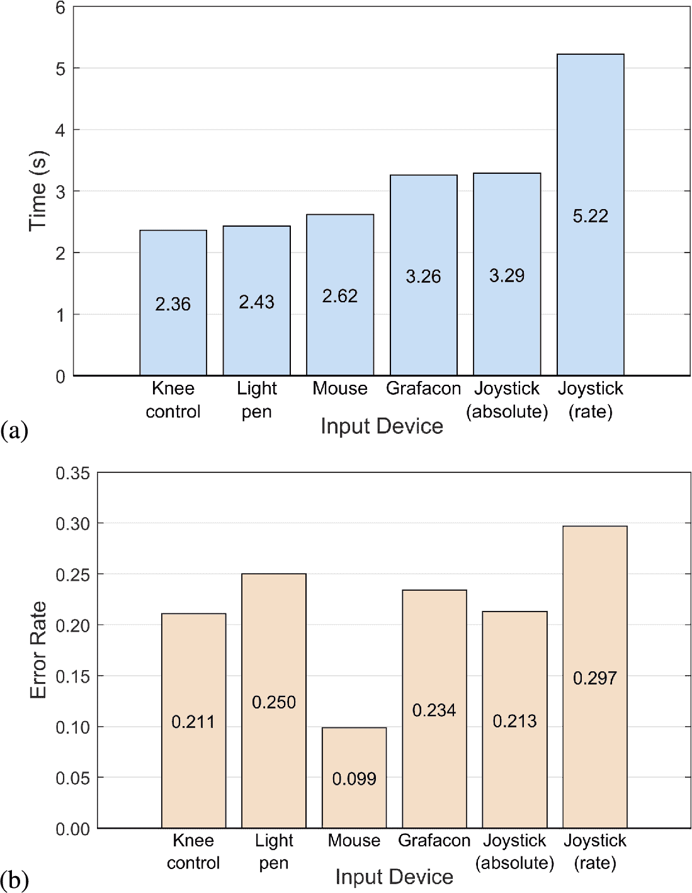

图 3.6 增强触摸屏选择。(a) 智能手机软键盘。(b) 手指在带有偏移动画的 D 键上。抬起手指时发生选择。

### 3.1.4 替代输入

虽然大多数用户对计算机的输入是通过触摸（如平板表面）或设备（如鼠标或手写笔）进行的，但在某些情境下，替代输入很常见，例如无障碍计算。

#### 3.1.4.1 皮肤表面电信号

在无障碍计算中，用户通常缺乏足够的运动控制来操作传统的计算机输入设备。一种输入可能性是表面肌电图（sEMG），它利用肌肉产生的、在皮肤表面测量到的电信号。在 O'Meara 的研究 [[378]](#Chp003_93-160_B9780443140969000099.xhtml#br1890) 中，参与者前臂连接了电极，并采用策略生成信号用于计算机控制。参见 图 3.7。

![Figure 3.7 Surface electromyography (sEMG) interface [378]. (a) Electrode placement. (b) Experiment setup (photos courtesy of Sarah O'Meara).](images/B9780443140969000099/gr007.jpg)

图 3.7 表面肌电图（sEMG）界面 [[378]](#Chp003_93-160_B9780443140969000099.xhtml#br1890)。(a) 电极放置。(b) 实验装置（照片由 Sarah O'Meara 提供）。

训练期间，参与者在示波器上观察 sEMG 信号，同时练习不同的手部或手腕动作。他们自行选择最适合自己的动作。这些动作包括屈伸手腕、握拳或抬起一两个手指。生成的信号被用作输入命令，控制光标在 Fitts 定律目标选择任务中的移动和方向。选择采用停留时间选择——在目标内保持光标一秒。在用户研究中，吞吐量结果达到 3.6 bits/s。对于没有手臂控制能力的用户，需要不同的策略。

Magee 等人 [[331]](#Chp003_93-160_B9780443140969000099.xhtml#br1655) 在用户的额头上使用了 sEMG 设备。他们使用了 Camera Mouse + ClickerAID 系统，该系统利用网络摄像头追踪面部动作并控制光标位置（图 3.8a）。点击选择通过从压电传感器接收到的 sEMG 信号发生。传感器置于头带下的用户额头上，通过抬眉激活（图 3.8b）。该设备用于一项涉及一名患有神经肌肉疾病弗里德赖希共济失调的残障参与者的案例研究中。在 Fitts 定律目标选择任务中，该参与者在控制光标位置方面有相当大的困难，吞吐率仅为 0.45 bits/s。

![Figure 3.8 Interaction using Camera Mouse + ClickerAID [331]. (a) Camera Mouse setup. (b) ClickerAID setup.](images/B9780443140969000099/gr008.jpg)

图 3.8 使用 Camera Mouse + ClickerAID 进行交互 [[331]](#Chp003_93-160_B9780443140969000099.xhtml#br1655)。(a) Camera Mouse 设置。(b) ClickerAID 设置。

区分用于计算机输入控制的身体传感器（见上文）与监测个人生理状态的更传统应用非常重要。作为后者的一个例子，Mandryk 等人 [[338]](#Chp003_93-160_B9780443140969000099.xhtml#br1690) 使用传感器测量参与者玩 EA Sports 的 NHL 2003 时的情绪反应。两个传感器放置在面部，一个用于检测微笑，一个用于检测皱眉。额外的传感器通过心电图 (EKG) 电极监测参与者的皮肤电反应 (GSK) 和心率。数据被输入模糊逻辑系统，根据 Russell 的情感圆周模型 (CMA) [[424]](#Chp003_93-160_B9780443140969000099.xhtml#br2120) 在二维效价-唤醒空间中计算参与者的情绪状态。（CMA 在第 7 章中讨论。）用户研究包含三种游戏条件，参分别与同处一地的朋友、同处一地的陌生人或计算机对战。他们的设备能够显著区分不同游戏条件下玩家的情绪状态，测量评估与主观评估之间有很强的相关性。

#### 3.1.4.2 脑信号


脑信号，或脑机接口 (BCI)，已被研究用于无障碍计算和其他应用，如游戏。Hou 等人 [[200]](#Chp003_93-160_B9780443140969000099.xhtml#br1000) 测试了一款此类商业设备 NextMind^⁴⁸。

![Figure 3.9 NextMind BCI system [200]. (a) Experiment setup. (b) Simulation for TV control.](images/B9780443140969000099/gr009.jpg)

图 3.9 NextMind BCI 系统 [[200]](#Chp003_93-160_B9780443140969000099.xhtml#br1000)。(a) 实验设置。(b) 电视控制模拟。

与基于摄像头的眼动追踪类似，脑机接口 (BCI) 可提供用户注视位置的信息，从而实现注视交互。因此，BCI 是基于摄像头的眼动追踪的一种潜在替代方案，后者对环境光和其他干扰源敏感。

Wong [[527]](#Chp003_93-160_B9780443140969000099.xhtml#br2635) 描述了一种 BCI 系统，该系统在佩戴装有 31 个传感器的脑电帽以检测脑信号的参与者身上进行测试。三名四肢瘫痪参与者能够使用运动意象控制轮椅的移动。向右移动时，参与者想象移动双臂。向左移动时，他们想象移动双腿。然而，准确性是一个挑战。在前 10 次训练中，“参与者 1” 仅有 37% 的时间发出了被正确解读的指令。在最后 10 次训练中，准确率提高到了 87%。

### 3.1.4.3 雾屏交互

使用手指进行直接指向的一个例子是交互式雾屏。雾屏是由流动的散射光粒子薄层（如雾）形成的非实体中空显示器。用户可以伸手进入甚至穿过显示器。见 图 3.10a。

![Figure 3.10 Fogscreen interaction [412]. (a) Reaching into the fog display. (b) User interaction is possible using a Kinect gesture detecting sensor. (photos used with permission).](images/B9780443140969000099/gr010.jpg)

图 3.10 雾屏交互 [[412]](#Chp003_93-160_B9780443140969000099.xhtml#br2060)，[[433]](#Chp003_93-160_B9780443140969000099.xhtml#br2165)。(a) 伸手进入雾显示器。(b) 用户交互可使用 Kinect 手势检测传感器实现。（照片经许可使用）。

在一种雾屏设置中 [[412]](#Chp003_93-160_B9780443140969000099.xhtml#br2060)，[[433]](#Chp003_93-160_B9780443140969000099.xhtml#br2165)，使用 Microsoft Kinect 手势检测传感器增加了交互功能。见 图 3.10b。没有光标：用户直接“触摸”显示器。系统使用 GoFitts 软件进行目标选择评估。图中可见一个示例目标。测试了两种选择方法：空中点按（将手指移入并移出目标）或停留时间选择（将手指在目标内停留一秒）。由于用户的动作不是在硬表面上进行的，因此需要反馈。这通过描绘停留间隔进度的图形动画实现，如前所示于 图 3.2。点按选择的吞吐率为 2.18 bits/s，停留时间选择的吞吐率为 1.43 bits/s。

### 3.1.5 单开关扫描

无障碍计算中一种常见的交互方法是*扫描*，通常称为*单开关扫描*。该方法备受关注，且对于有运动控制障碍的用户有时是必不可少的。用户不使用双手操作键盘和指向设备，而是通过任何可用的方式操作单个输入开关或按钮。图 3.11 展示了使用单开关扫描进行交互，用户操作安装在手掌中的按钮。其他输入方式包括眨眼、脚踏开关、呼吸、点头或 sEMG 传感器，如前所述。


图 3.11 手掌中的输入按钮进行单开关扫描。

单开关扫描的一个常见应用是使用虚拟或屏幕键盘进行文本输入。虚拟键按顺序高亮显示（“扫描”），当带有所需字母的键被高亮时，激活输入开关。线性扫描的原理如 图 3.12 所示。该方法显然很慢，因为需要大量的扫描间隔——“扫描步骤”才能到达字母表中前几个之后的字母。时间间隔将根据用户的能力而变化。700 ms 到 1200 ms 的速率常用于测试。


图 3.12 线性扫描。虚拟键根据计时器按线性扫描顺序高亮显示。当高亮到达带有所需字符的键时，通过激活开关进行选择。

为了加快输入速度，通常采用两级扫描模式，例如行列扫描。图 3.13 展示了一个将字母按字母顺序排列在矩形中的示例。扫描逐行进行。当包含所需字符的行被高亮显示时，用户选择该行。随后扫描在该行内按列进行。当包含所需字符的键被高亮显示时，用户选择该键。该字符被追加到文本消息中，扫描从顶行重新开始。扫描是循环的，因此如果用户错过了机会，可以在下一轮进行选择。请注意，虽然两级扫描潜在速度更快，但对身体要求更高，因为生成每个字符需要两次选择。


图 3.13 行列扫描。输入“K”。第 1 次选择行“I J K L”，第 2 次选择该行内的列“K”。

一个扫描键盘的例子是嵌入在 Microsoft Windows 中的屏幕键盘（OSK）。参见图 3.14。这是一个功能齐全的 Qwerty 键盘，提供对传统桌面键盘所有功能的访问。默认使用系统物理键盘上的空格键进行输入，尽管也支持其他输入选项。OSK 不使用行列扫描，而是采用三级行-组-键扫描。扫描逐行进行，然后在选定行中按组进行，最后在选定组中按键进行。在图中，用户即将输入“r”，它位于第 3 行的第 2 组中。预期短语为“hello world”。


图 3.14 在 Microsoft 屏幕键盘（OSK）单开关扫描模式下输入“hello world”。键盘使用三级行-组-键扫描。用户即将在“hello world”中输入“r”。

请注意图 3.14 中，OSK 顶行包含单词预测功能，并纳入扫描序列中。对于该示例，用户无需输入“r”，可选择顶行并直接选中“world”，立即生效。显然，此时选择“world”减少了扫描步数，带来性能优势。图 3.15 对比了逐字母交互与使用单词预测交互的差异。差异显著：逐字母交互需 41 个扫描步，而使用单词预测仅需 18 个扫描步。


图 3.15 在 Microsoft 屏幕键盘上使用扫描输入“world”的分析。(a) 逐字母。(b) 使用单词预测。在 Input 下，“.” 表示被动扫描步，“R” 表示行选择，“G” 表示组选择，“W” 表示单词选择，小写字母表示字母选择。

图 3.15 中的分析有助于更广泛地考虑使用“每字符扫描步数”（SPC）作为分析指标的替代设计。对于包含 5 个字符的“world”，逐字母交互的 SPC 为 $\frac{41}{5} = 8.2$，使用单词预测的 SPC 为 $\frac{18}{5} = 3.6$。

对单个单词的交互进行比较虽有趣，但价值有限。加上语料库（如字母频率表或单词频率表），图 3.15 中的计算可推广到一种语言（如英语），并计算整个语料库的加权平均值。结果是使用特定键盘和交互策略进行英文文本输入的总体平均 SPC [[304]](#Chp003_93-160_B9780443140969000099.xhtml#br1520)。使用字母频率表，SPC 计算公式为

$$\text{SPC} = \frac{\Sigma(S_{c} \times F_{c})}{\Sigma(N_{c} \times F_{c})}$$

(3.1)

其中

*   • $S[c]$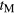 为输入字符 $c$ 所需的扫描步数
*   • $F[c]$ 为语料库中字符 $c$ 的频率计数
*   • $N[c]$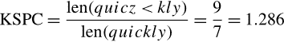 = 1（字符 $c$ 的数量）

计算 SPC 的过程与计算 KSPC（每字符击键数）作为物理键盘分析指标（如多义电话键盘 [[303]](#Chp003_93-160_B9780443140969000099.xhtml#br1515),[[325]](#Chp003_93-160_B9780443140969000099.xhtml#br1625)）的过程相似。虽然公式 (3.1) 中 $N[c]$ = 1，但若使用单词频率表，计算可在单词级进行，将公式中的 $c$（字符）替换为 $w$（单词）。此时 $N[w]$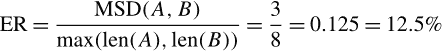 为单词字符数 +1（单词后的空格）。

另一种加快输入的方法是将高频字母（如英语中的“e”、“a”、“t”）放在扫描序列的开头附近。这减少了到达这些字母所需的扫描步数。一个例子是 Shein 等人的 WiViK 键盘 [[445]](#Chp003_93-160_B9780443140969000099.xhtml#br2225)。图 3.16 展示了 WiViK 字母排列及单词预测的单词位置。用户可在优化字母排列或 Qwerty 字母排列间选择。对于优化排列，常用字母位于左上角，从而减少到达它们的扫描步数。结果为英文文本输入带来整体性能优势：优化排列 SPC = 2.64，Qwerty 排列 SPC = 3.80 [[304]](#Chp003_93-160_B9780443140969000099.xhtml#br1520).^(⁴⁹)

![图 3.16 WiViK 扫描键盘。(a) 优化字母排列。(b) Qwerty 字母排列。图片展示字母排列及单词预测的单词位置（源自 [[304]](#Chp003_93-160_B9780443140969000099.xhtml#br1520)）。空白键用于其他输入。](images/B9780443140969000099/gr016.jpg)

图 3.16 WiViK 扫描键盘。(a) 优化字母排列。(b) Qwerty 字母排列。图片展示字母排列及单词预测的单词位置（源自 [[304]](#Chp003_93-160_B9780443140969000099.xhtml#br1520)）。空白键用于其他输入。

还有其他可能性对扫描键盘进行建模并潜在地改进文本输入。一些带有和不带单词预测的替代设计已在本书网站提供的 `ScanningKeyboardExperiment` 软件中实现。该应用程序还支持自定义设计。

一般来说，低 SPC 意味着高效的输入。例如，MacKenzie 和 Felzer 的扫描模糊键盘（SAK）在英文文本输入时的 SPC = 1.56 [\[311, 图 6\]](#Chp003_93-160_B9780443140969000099.xhtml#br1555)。一种实现是 BlinkWrite，它使用眼眨作为输入开关（参见第 2 章，图 2.26，第 59 页）。

每字符扫描步数（SPC），虽然作为比较点很有用，但必须放在更大的背景下看待，该背景还要考虑用户的认知和身体负担。扫描键盘还有其他许多设计问题 \[32,252,279,340,434,472,[480\]](#Chp003_93-160_B9780443140969000099.xhtml#br2400)。另请参阅 图 5.16a（第 234 页）中的字母排列以及本章末尾的学生练习 3-1。

单开关扫描也可作为通用目标选择的一种交互方法。Raynal 和 MacKenzie [\[408\]](#Chp003_93-160_B9780443140969000099.xhtml#br2040) 描述了 TBS³，即双条单开关扫描，这是一种利用横向和纵向线条遍历显示器、以其交点标记选择点的技术。该方法速度较慢，但交互不需要操作鼠标或触控板等指点设备。输入通过单个输入开关完成。在实证评估中，参与者使用系统物理键盘上的空格键，在二维 Fitts 定律目标选择任务中选择目标。参见 图 3.17。Fitts 定律在第 7 章中有更详细的介绍。

![Figure 3.17 TBS3 (two-bar single-switch scanning) [408]. Single-switch selections control the movement of horizontal and vertical bars. The intersection marks the location for target selection.](images/B9780443140969000099/gr017.jpg)

图 3.17 TBS³（双条单开关扫描）[\[408\]](#Chp003_93-160_B9780443140969000099.xhtml#br2040)。单开关选择控制横向和纵向条的移动。交点标记目标选择的位置。

### 3.1.6 手势输入

手势是用于交流的动作。它们与人类交流息息相关，无论是交谈时的眼部、面部或头部运动，还是为提供语境或强调而做出的手指、手部或臂部动作。

从广义上描述（*用于交流的动作*），手势涵盖了人类与计算机的所有交互。^(⁵⁰)

1980 年的一个手势示例是 Bolt 的“Put That There”演示 [\[35\]](#Chp003_93-160_B9780443140969000099.xhtml#br0175)。用户在空中做手势，移动手来指向大屏幕上的物体或位置，然后发出语音指令。Bolt 的系统是一个配有大型投影屏幕和仪器椅的房间。该系统包含用于简单指令的语音识别和安装在用户手或手腕上的 Polhemus 6 DOF 追踪器。它或许是第一个 VR“洞穴”。显示器上会出现一个“x”光标，作为指向的视觉反馈。由于有光标，Bolt 的系统是间接指向的一个例子；光标是用户手部位置与显示器上位置之间的中介。但是，指向动作是手势，将位置或物体指定为语音指令的目标。

通常，手势的意图或目的取决于手势的位置和形状。经典的非计算示例是校对员在文档上做的标记。Kurtenbach 和 Buxton 的 GEdit 将这一想法扩展到使用手写板和手写笔进行图形编辑的手势 [\[264\]](#Chp003_93-160_B9780443140969000099.xhtml#br1320)。参见 图 3.18。诸如复制或删除对象等操作，通常需要双手配合键盘和鼠标或手写笔输入。值得注意的是，GEdit 手势只需要手写笔输入，因此只涉及单手使用。

![Figure 3.18 GEdit graphics editing gestures (from [264]).](images/B9780443140969000099/gr018.jpg)

图 3.18 GEdit 图形编辑手势（来自 [\[264\]](#Chp003_93-160_B9780443140969000099.xhtml#br1320)）。

对于文本输入，有 Goldberg 和 Richardson 的用于英文字母的 Unistrokes [\[148\]](#Chp003_93-160_B9780443140969000099.xhtml#br0740)。每个字母由单个手势笔画形成；因此，避免了“分割问题”，使得免视觉输入成为可能。^(⁵¹)

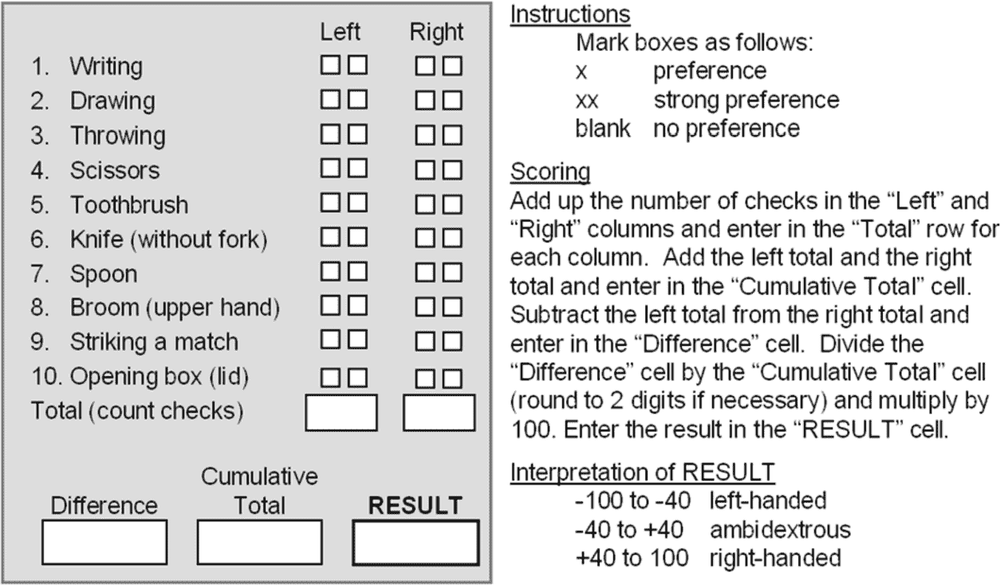

图 3.19 Graffiti 笔画中“easy”的手势。


有时手势的含义或目的取决于手势路径中的关节点。例子有很多，包括 Quikwriting [\[393\]](#Chp003_93-160_B9780443140969000099.xhtml#br1965)、EdgeWrite [\[524\]](#Chp003_93-160_B9780443140969000099.xhtml#br2620)、Cirrin [\[339\]](#Chp003_93-160_B9780443140969000099.xhtml#br1695)、WatchMI [\[537\]](#Chp003_93-160_B9780443140969000099.xhtml#br2685) 和 MojiBoard [\[7\]](#Chp003_93-160_B9780443140969000099.xhtml#br0035)。一个广泛使用的例子是*形状书写*，即通过在软键盘上滑过单词中字母所在的键来输入单词 [\[256,547,548\]](#Chp003_93-160_B9780443140969000099.xhtml#br2740)。“easy”的手势如图 3.20a 所示。当与底层的 Qwerty 键盘一起查看时，如图 3.20b 所示，手势与单词的关联就显现出来了。手势从“e”开始，经过“a”和“s”，最后在“y”结束。请注意图中使用了单词预测，提供了“way”和“ready”作为备选。用于文本输入的形状书写手势也适用于整句输入 [\[503\]](#Chp003_93-160_B9780443140969000099.xhtml#br2515) 或其他键盘布局，如模糊电话键盘 [\[258\]](#Chp003_93-160_B9780443140969000099.xhtml#br1290)。

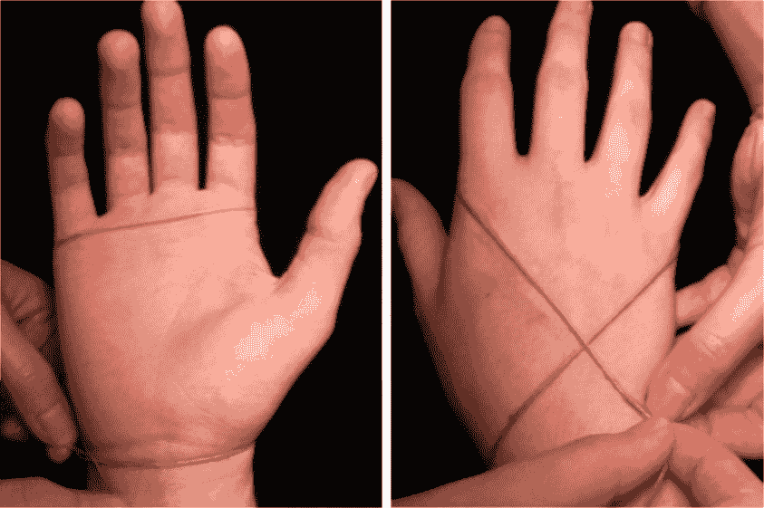

图 3.20 Qwerty 键盘上的形状书写。(a) “easy”。(b) 手势叠加在键盘上。

请参阅 Dube 等人 [\[106, 表 1\]](#Chp003_93-160_B9780443140969000099.xhtml#br0530)、Fallah 和 MacKenzie [\[121, 表 1\]](#Chp003_93-160_B9780443140969000099.xhtml#br0605) 或 Remizova 等人 [\[412, 表 1\]](#Chp003_93-160_B9780443140969000099.xhtml#br2060) 以了解更多基于手势的输入技术综述。

### 3.2 硬控件和软控件

#### 控制-显示关系

在计算机渗透到我们家庭和工作场所的方方面面之前，显示器和控制器往往是物理的单一用途设备。诸如操纵杆、开关、开关阵列、按钮、按键、键盘、鼠标、方向盘、把手、旋钮、杠杆等控制器，都是经过设计、工程和制造等复杂流程才诞生的。一旦制造完成，它们的功能就终身固定了。这意味着它们的行为受限于与其配套的显示器之间的一小组关系。即使是飞机驾驶舱，也只有相对较少的控制器和显示器。因为它们是物理的且单一用途的，所以它们之间存在的关系属于有限集合。

随着拥有软件、图形显示器和指向选择交互的计算机的出现，这一状况发生了改变。通过*软界面*，人类与技术交互的方式发生了变化，且无处不在。显示器通过软件的可塑性，为相对较小的物理空间带来了无限的可能性。其结果是*软控制*。软控制的诞生可能仅源于程序员的一时兴起——几行计算机代码和一两轮快速的编码-编译-测试——全都在早咖啡休息和午餐之间完成。在你意识到之前，工具栏上就多了一个新按钮，一个新的“选项……”弹出对话框，或一个通过 `Ctrl-*something*` 调用的新绘图模式。可能性是无限的。^(⁵²)

人机界面包含大量控制器。大多数是由物理控制器（鼠标、手指或键盘）操纵的软控制。例如，桌面计算机应用程序拥有数千种控制-显示布局。用软控制执行的每一个可想象的动作，只要能在系统上产生显示响应，都是一个例子。控制器根据上下文调用不同的响应（显示），因此组合数量迅速增加。

对于软控制而言，控制器与显示器的界限变得模糊。既然软控制是通过软件渲染在显示器上的，那么它的大小、形状或外观就可以动态变化，以向用户传达信息。因此，软控制通常具有显示器的属性。工具栏按钮和部件是典型示例。图 3.21 展示了一个文字处理器的示例。该图像包含三个组合框和九个按钮。每一个既是控制器又是显示器。组合框显示样式为正文、字体为 Times、字号为 12 磅。按钮显示插入点处文本的状态。文本为*斜体*、*下划线*、*左对齐*。

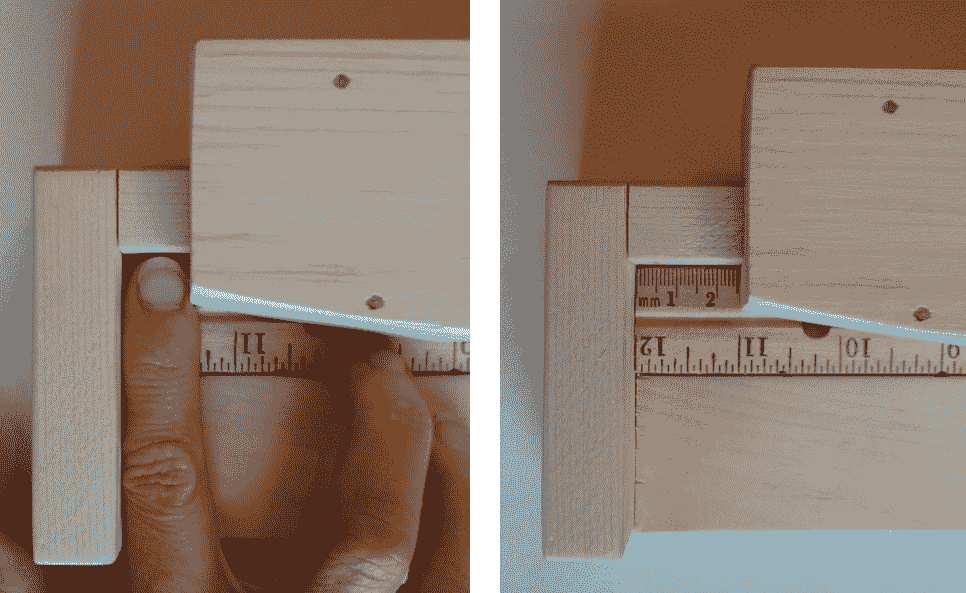

图 3.21 许多软控制同时也是显示器。详见正文讨论。

滚动条滑块（或称为电梯）是另一个例子。^(⁵³)


图 3.22 滚动条滑块既是控制器又是显示器。详见正文讨论。

软控制占用空间很小。图 3.23 展示了 GUI 应用程序的一个小区域。它只有 40 cm²，却包含令人眼花缭乱的软控制阵列——超过 20 个。或者，它们是显示器？每一个都是一个独立的世界，并通过其形状、位置、标签或图标来标识或暗示其用途。每个软控制都通过点击由硬控制操纵。或者是双击？或者是 `Shift-点击`？或者是拖拽？右键点击呢？键盘访问呢？并且还预设了这一切对用户来说 somehow 都讲得通。此外，每个控制器都危险地靠近其邻居。该应用程序（Microsoft Word）的许多用户将投入数百小时来操作这个 40 cm² 的界面。据所有报道，这些用户都是专家。然而，即使是专家用户，在操作这个相同空间时也会犯下数百次错误。有时，他们操之过急。其他时候，他们只是不确定该做什么。这是一个复杂的空间，这个 40 cm²。而只需一个用户动作——一个按键或按钮点击——整个 40 cm² 就会变形为一个完全不同的界面。另请参阅本章末尾的学生练习 3-2。

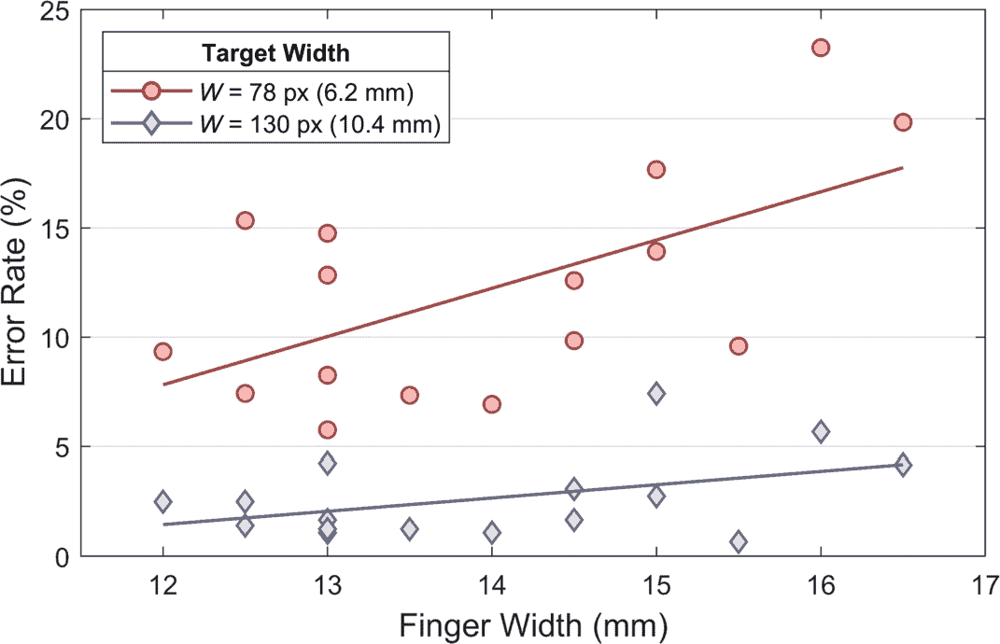

图 3.23 图形显示器上的一个小物理空间。在 40 cm² 的区域内有 20 多个软控制和显示器。单个用户动作可以触发空间的完全重新定义。

硬控制/软控制的区别类似于*空分复用*与*时分复用* [\[50\]](#Chp003_93-160_B9780443140969000099.xhtml#br0250)。采用空分复用时，每个受控参数都有一个专用的物理控制器。每个控制器都有独立的物理位置。采用时分复用时，控制器少于参数，因此单个设备（例如显示器的一个小区域）会被重新配置，以在操作的不同阶段控制不同的参数。

在下一节中，我们将按空间关系来考察控制器和显示器。我们从硬控制器（如鼠标）和桌面计算机系统上常见的典型显示器开始。

### 3.3 控制-显示关系

当用户握住鼠标并向右移动时，系统显示器上的指针也向右移动。这种*控制-显示关系*并非用户会深思熟虑的东西。这才是人机交互应有的样子——用户所做的与所体验到的之间的关系是自然的、无缝的、直观的、高效的，等等。控制-显示关系有时被称为*映射*，因为这些关系描述了控制器属性如何映射到显示器属性。

上述例子描述的是*空间关系*。还有*动态关系*，描述控制器如何影响响应速度；以及*物理关系*，描述响应是针对控制器的运动还是力。我们将在本节中逐一考察，首先从空间关系开始。

#### 3.3.1 空间关系

上述鼠标-指针空间关系如图 3.24a 所示。该映射是*一致的*，因为控制器输入与显示器输出之间存在精确的空间对应关系。向右移动鼠标，指针向右移动。图 3.24b 中的情况则不同。向*前*移动鼠标，指针向*上*移动。就像左右移动一样，用户可能不会过多思考这一点。然而，当某人第一次接触鼠标时，很可能对其工作原理存在一些不确定性。它有什么作用？它控制什么？效果在哪里显现？毫无疑问，鼠标与指针之间的空间关系学习起来非常快。^(⁵⁴)


图 3.24 鼠标和指针的控制-显示关系。详见正文讨论。

#### 空间映射与控制-显示关系

在此时引入标签以进一步检查输入控制与输出显示之间的空间映射是很有用的。图 3.25a 和图 3.25b 展示了笛卡尔坐标空间中的显示和鼠标垫表面，包含 `x` 轴、`y` 轴和 `z` 轴。^(⁵⁵)

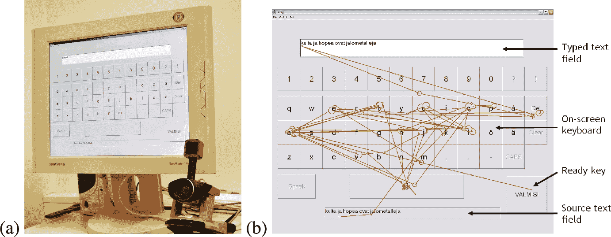

**图 3.25 轴标签。(a) 控制空间。(b) 显示空间。(c) 鼠标和指针的控制-显示映射。**

图 3.25c 展示了鼠标到指针的映射。这里我们看到了上文提到的轻微不连贯性。鼠标 `x` 轴运动映射到指针 `x` 轴运动，但鼠标 `z` 轴运动映射到指针 `y` 轴运动。加号（`+`）符号表示控制的正向运动在每个轴上产生显示的正向运动。

指针 `y` 轴运动是*变换空间映射*的一个例子。在这种情况下，如果沿 `y`-`z` 平面观察，变换角度为 90°。我们可能预期空间变换会对用户性能产生影响。事实确实如此。已知瞄准误差在 90° 到 135° 变换时较高，在 0° 或 180° 变换时较低 [[93]](#Chp003_93-160_B9780443140969000099.xhtml#br0465)。还知道所有变换都会发生适应，仅需 50 次试验即可 [[519]](#Chp003_93-160_B9780443140969000099.xhtml#br2595)。因此，虽然初次接触鼠标可能会带来问题（并导致指向不准确），但通过练习，这种关系会被学习，准确度也会提高。

在三维（3D）空间中描述鼠标-指针映射（如上所述），引发了对其他控制-显示关系的更深入分析。这至少是合理的，因为人机交互（HCI）不仅仅是桌面交互。无论是使用拇指控制的滚轮浏览日历，还是使用手持控制器在第一人称射击游戏中消灭敌人，我们所做与所得之间的关系在设计高效透明的界面和交互技术时至关重要。

现在考虑滚动图像或文档的视图。滚动窗格包含带有滑块的滚动条以移动视图。交互涉及操作物理控制器（如鼠标，一种硬控制），移动指针到滑块（一种软控制）并通过按下按钮获取它。然后拖动滑块上下移动以产生视图的变化。此场景为控制-显示映射增加了第三层。图 3.26a 显示了鼠标和 GUI 窗口中显示的地图图像。带有滑块的滚动条出现在窗口的右侧和底部。硬控制与软控制之间、软控制与显示视图之间存在空间变换。见图 3.26b。

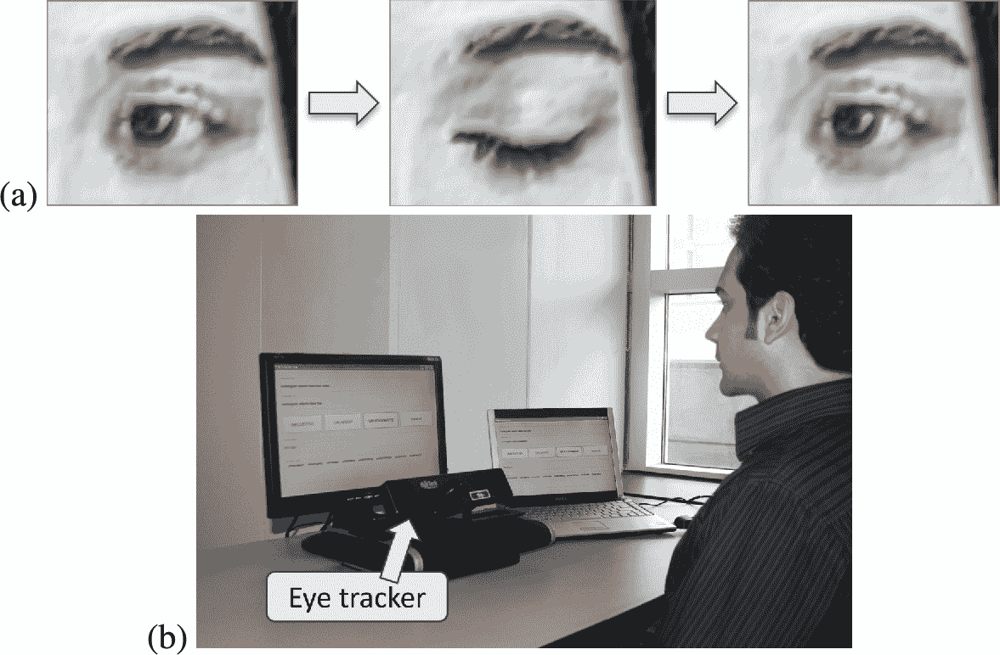

**图 3.26 三层控制-显示关系。(a) 向前移动硬控制使软控制向上移动，进而使显示（视图内容）向下移动。(b) 控制-显示映射。详见正文讨论。**

大多数计算机用户擅长浏览文档，对图 3.26 中的空间变换没有困难。然而，`z` 轴上控制-显示关系的 `+`/`−` 反转很有趣。如果软控制（滚动条滑块）与显示（地图图像）之间的关系反转会怎样？这可以吗？可以，但必须学习这种关系。

检查空间关系的下一步是将 3D 空间扩展为包含绕每个轴的旋转。这在图 3.27 中使用 theta（`θ`）表示角度或旋转。对于平移，箭头表示相对于原点的右（`x`）、上（`y`）和后（`z`）移动。对于旋转，箭头表示从原点沿每个轴向外看时的顺时针运动。总共有六个参数，即*自由度*（DOF）。“自由度”意味着每个参数可以独立于其他参数进行操作。要在 3D 空间中完全放置一个对象，需要六个参数：三个用于对象在空间中的*位置*（`x`、`y`、`z`），三个用于对象在空间中的*方向*（`θ[x]`、`θ[y]`、`θ[z]`）。在航空学中，旋转术语称为俯仰（`θ[x]`）、滚转（`θ[z]`）和偏航（`θ[y]`）。


**图 3.27 三维空间的轴标签。详见正文讨论。**

加入旋转后，让我们考虑轨迹球。虽然轨迹球常用于游戏和其他专业场景，但它们也是许多用户在桌面系统中比鼠标更首选的选择。在模拟鼠标时，旋转球控制显示上指针的移动。图 3.28a 显示了球旋转与指针平移之间的关系。图中红色和蓝色揭示了控制与显示之间的对应关系。图 3.28b 使用图 3.27 中的 6 DOF 标签显示了控制-显示映射。注意，运动控制涉及两个轴的变换空间映射。此外，`x` 轴顺时针旋转存在符号反转。这在图中是必要的，因为绕 `x` 轴顺时针旋转球会使显示上的指针向下移动。


**图 3.28 轨迹球示例。(a) 绕 `x` 轴（蓝色）旋转球使显示指针沿 `y` 轴（蓝色）移动。绕 `z` 轴（红色）旋转使指针沿 `x` 轴（红色）移动。(b) 6 DOF 空间中的控制-显示对应关系。详见正文讨论。**

图 3.29a 显示了具有*空间一致性*的 3D 交互。控制空间中的每个自由度都正确匹配显示空间中的相应自由度（另见 [[556]](#Chp003_93-160_B9780443140969000099.xhtml#br2780)）。当然，深度或 `z` 轴是在显示上模拟的。尽管如此，该图说明了轻松 6 DOF 交互的目标。图中显示了一个 6 DOF 输入手套（控制器）与显示上的模拟手套在空间上完全对应。交互的流畅性显而易见：如图 3.29b 所示，所有 6 DOF 的映射都是一致的。


**Figure 3.29** 三维空间一致性。(a) 6 DOF 输入控制器和 6 DOF 显示器（草图由 Bartosz Bajer 提供）。(b) 6 DOF 控制-显示对应关系。详见正文讨论。

大多数交互系统仅支持三维空间中可用的 6 DOF 的一个子集。而且在大多数情况下，空间变换都会给用户带来一些微小的挑战，需要学习和克服，就像前面考察的鼠标-指针或轨迹球-指针交互一样。由于鼠标只能感知沿 `x` 轴和 `z` 轴的平移，因此旋转对鼠标来说是一个挑战。无法实现控制-显示空间一致性；因此，需要创造性的映射来促进交互。典型的解决方案是模式，我们稍后将更详细地探讨。

现在考虑 Google 地图中的街景，它提供了世界各地主要城市街道的全景视图。^⁵⁶

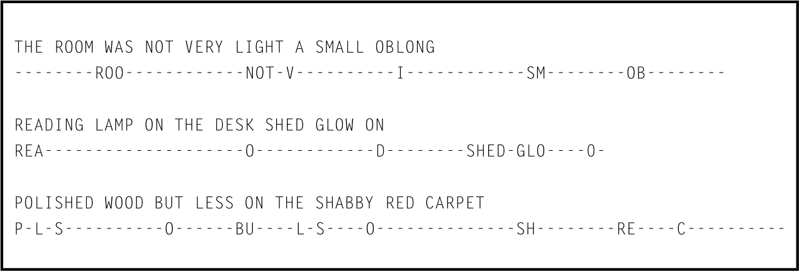

**Figure 3.30** 旋转三维场景。(a) 带有平移和缩放控件的多伦多街景。(b) 如果拖动场景，鼠标控制平移的映射关系。

场景操作通过各种使用键盘或鼠标的交互来支持。使用鼠标平移的一种方法是拖动图像——将指针置于图像任意位置，按住鼠标主键不放，然后移动指针。鼠标的左右或 `x` 轴线性移动会导致场景绕 `y` 轴旋转。鼠标的前后或 `z` 轴线性移动会使场景绕 `x` 轴旋转。这些映射如 Fig. 3.30b 所示。尽管映射看起来很复杂，但交互相当简单（即易于快速学习）。

使用鼠标平视的另一种方法是通过图中标记为 Pan 的软控件。点击箭头会在预期方向上产生离散的平移。通过拖动包围箭头的圆圈，可以实现左右连续平移。这种交互很棘手，价值存疑。它需要鼠标左右、上下线性移动的紧密耦合，并且需要用户将视觉注意力集中在软控件上！当然，用户更愿意看场景。

缩放是通过点击图中所示的加号（`+`）和减号（`–`）软控件来执行的。其效果是沿 `z` 轴将视图放大和缩小。考虑通过鼠标 `z` 轴移动进行缩放很有意思，因为其结果是一种空间一致的控制-显示映射。^⁵⁷

另一个值得考虑的一致映射是使用鼠标的 `y` 轴旋转来控制相机的 `y` 轴旋转，以实现左右平移。`y` 轴旋转相当于在鼠标垫或桌面上旋转鼠标。当然，这种移动无法被感知。但通过一些仔细的重新设计，它可以被感知（稍后在本章中讨论）。


将鼠标的 `y` 轴旋转用于交互是一种潜在的有趣且新颖的交互技术——值得通过实证研究进行探讨。能否使用其他输入控制器或其他映射来改进用户与 Google 街景的交互？如果可以，如何评估推测的改进？任务是什么？哪些用户性能指标是相关的？在人机交互中，输入控件与输出显示之间的空间映射数量众多，且关系往往复杂。这些复杂性引发了对问题空间的思考，促使我们搜寻新的、潜在简便的交互方式，然后通过实验研究对其进行测试和比较。另请参阅本章末尾的学生练习 3-4。

### 3.3.2 CD 增益与传递函数

鼠标-指针移动不仅涉及空间映射。另一个属性是 `CD 增益`——对于给定的控制量，显示对象（如指针）的移动量。^⁵⁸


**Figure 3.31** 从鼠标控制面板控制 `CD 增益`（指针速度）。

控制器运动与指针运动之间的关系通常是非线性的，并使用 `幂函数`。在这种情况下，指针的运动量还取决于鼠标运动的速度。在 Fig. 3.31 中，通过选择“增强指针精度”来启用此功能。如果鼠标移动快，`CD 增益` 会增加。如果鼠标移动慢，`CD 增益` 会降低。降低慢速控制器运动的 `CD 增益` 有助于提高点选操作结束时目标选择的精度。有时会使用术语 `传递函数`，因为非线性关系更为复杂。为了确保指针对鼠标移动做出响应且无可感知延迟，非线性关系的软件实现通常使用查找表将控制器运动映射到显示器运动。另请参阅学生练习 3-5。

关于优化 `CD 增益` 的研究至少可以追溯到 20 世纪 40 年代，当时开发了第一批电子操纵杆 [[224]](#Chp003_93-160_B9780443140969000099.xhtml#br1120)。然而，优化比看起来更棘手。对于每个点选任务，总时间是移动时间（`MT`），它结合了定位时间（`PT`）和选择时间（`ST`）：

```
MT = PT + ST
```

 (3.2)

在公式 (3.2) 中，`PT` 用于大幅度移动（移动到目标大致附近），`ST` 用于微调移动（进行最终选择）。^⁵⁹

改变 `CD 增益` 暴露了 `PT` 和 `ST` 之间的权衡。见 Fig. 3.32。从简化的意义上讲，最优设置是使移动时间最小化——即大幅度移动时间和微调移动时间的总和最小。然而，使移动时间最小化的 `CD 增益` 可能无法使错误率最小化。其他因素（如显示器大小或比例，独立于 `CD 增益`）也让这个常见输入设备参数的优化变得值得商榷 [13, [33]](#Chp003_93-160_B9780443140969000099.xhtml#br0165)。


**Figure 3.32** 作为 `CD 增益` 函数的定位时间（`PT`）与选择时间（`ST`）之间的权衡。

自 20 世纪 80 年代以来，CD 增益因其与桌面计算系统上 GUI 的交互而备受研究关注（例如，\[24,223,[237]\]](#Chp003_93-160_B9780443140969000099.xhtml#br1185)）。大多数研究发现，调整 CD 增益并不能获得显著的性能提升。其中一个挑战在于定义最优性能。目标是最大化速度还是最大化准确性？同时优化速度和准确性的目标是有问题的，因为存在速度-准确性权衡。提高速度的因素往往会降低准确性，反之亦然。一个结合了速度和准确性的有用指标是 Fitts 吞吐量 \[300,[312]\]](#Chp003_93-160_B9780443140969000099.xhtml#br1560)，但文献中吞吐量的计算方法差异很大，这加剧了对 CD 增益和人类性能形成全面理解的难度。

优化 CD 增益仍是持续关注的焦点，研究背景涉及多种场景。HCI 文献中的示例包括以下内容：

*   超大显示器 \[251,[348]\]](#Chp003_93-160_B9780443140969000099.xhtml#br1740)
*   超小显示器 [\[178\]]](#Chp003_93-160_B9780443140969000099.xhtml#br0890)
*   无障碍计算 [\[522\]]](#Chp003_93-160_B9780443140969000099.xhtml#br2610)
*   远程指向 [\[255\]]](#Chp003_93-160_B9780443140969000099.xhtml#br1275)
*   3D 交互 [\[11\]]](#Chp003_93-160_B9780443140969000099.xhtml#br0055)
*   VR 中的鼠标指向 [\[554\]]](#Chp003_93-160_B9780443140969000099.xhtml#br2770)
*   基于光标轨迹的 CD 增益自动调整 [\[274\]]](#Chp003_93-160_B9780443140969000099.xhtml#br1370)

在每个示例中，研究都为调节输入控制与输出显示器上交互之间的关系这一问题带来了新思路。由于人类性能是优化的主要标准，CD 增益研究非常适合实证探究和实验。另请参阅本章末尾的学生练习 3-5 和 3-6。

### 3.3.3 延迟

人机交互是双向的。作为闭环系统的参与者，我们通过输入控制器发出指令，并在输出显示器上处理响应。后续输入取决于最新的输出。毫不奇怪，当反馈延迟时，人类性能和交互体验会受到不利影响。输入动作与显示器上相应响应之间的延迟称为 `latency`（延迟）或 `lag`（滞后）。幸运的是，在许多交互式计算任务中，如打字或指针定位，延迟可以忽略不计。

另一个极端是远程操作，此时人类操作员在物理位置上与受控机器分离。延迟可能源于机械连杆，也可能源于通信信道中的传输延迟。例如，在控制遥远卫星或行星上的航天器（在显示器上观察）时，传输延迟——即延迟——通常达数分钟甚至更长。

互联网连接中常存在延迟——点击链接后需等待数秒或更久页面才会出现。此处的研究问题更多关乎用户体验和挫败感，而非人类性能。例如，如果界面包含告知用户网络正在处理请求的反馈，挫败感会有所降低 [\[37\]]](#Chp003_93-160_B9780443140969000099.xhtml#br0185)。

虚拟现实高度依赖于在模拟 3D 环境中对手、头或身体运动的跟踪。真实感的呈现要求用户对环境的视图与决定该视图的动作（通常是手、头或身体运动）之间保持紧密联系。当环境变化滞后于输入动作时，保真度会大幅下降。

延迟归因于输入设备、输出设备和软件的特性。输入设备通常以每秒 10 到 60 个样本的固定速率进行采样。例如，以 60 Hz 采样时，输入移动可能在 $\frac{1}{60}$ = 16.7 ms 内未被检测到。由于软件开销——一个涵盖各种系统相关因素的宽泛表述——延迟进一步增加。通信模式、网络配置、数值计算和应用软件都会造成影响。

当输出需要大量图形渲染计算时，延迟会显著增加。10 Hz 的显示帧率被认为是实现实时动画的最低要求。由于帧渲染仅在位置已知时开始，因此并行处理的潜力有限。使用标准双缓冲（仅在帧完全绘制后呈现），帧显示间隔开始时的最小延迟为 100 ms，帧显示间隔中间时的延迟为 150 ms。

请注意，无法从目标系统内部准确测量延迟。在系统内部使用软件记录输入和输出操作的时间戳，会遗漏人机界面处的动作和响应。为了反映用户的整体体验，必须在外部进行适当的延迟测量 \[415,[471]\]](#Chp003_93-160_B9780443140969000099.xhtml#br2355)。Teather 等人 [\[486\]]](#Chp003_93-160_B9780443140969000099.xhtml#br2430) 描述了一种用于测量延迟的摆装置。输入控制器在输出显示器前摆动，高速摄像机记录输入动作与输出响应之间的时间关系。

虚拟现实中的延迟主要与连接在手、头或身体上的 6 DOF 跟踪设备以及低帧率引起的延迟有关。典型的跟踪设备包括 Polhemus^(⁶⁰)


图 3.33 Polhemus `G`⁴ 6 DOF 跟踪系统。箭头所指为 6 DOF 传感器（照片由 Polhemus 提供）。

尽管延迟被公认为 VR 系统中的一个妥协参数 [\[284\]]](#Chp003_93-160_B9780443140969000099.xhtml#br1420)，且其对人类性能有显著影响，但证据多为轶事性质。基于直觉，Pausch 指出，低延迟比高质量图形或立体视觉重要得多 [\[388\]]](#Chp003_93-160_B9780443140969000099.xhtml#br1940)。他的低端 VR 系统通过以线框图像维持每秒七次屏幕更新，强调了临场感（即低延迟）胜过输出图形。在一项力反馈实验中，Brooks 等人 [\[43\]]](#Chp003_93-160_B9780443140969000099.xhtml#br0215) 得出结论，为了维持所感知力量连续变化的错觉，屏幕更新频率至少需要达到每秒 15 次。即使在这一速率下，受试者仍感觉到手感的“海绵感”。其他研究将头戴式显示器的滞后引起的晕动症作为副作用引用 \[105,131,273,[415]\]](#Chp003_93-160_B9780443140969000099.xhtml#br2075)。

#### 跨延迟层级的人类表现实证测量很少见

20 世纪 60 年代曾有一些研究（例如，[142,[446]]](#Chp003_93-160_B9780443140969000099.xhtml#br2230)）涉及远程操作系统控制器的设计；然而测试的延迟极长（长达数秒）。在一个案例中，装置是机械式的[[446]]](#Chp003_93-160_B9780443140969000099.xhtml#br2230)；在另一个案例中，延迟被编程为指数时间常数，除非编程了故意的超调，否则指针无法完全到达目标[[142]]](#Chp003_93-160_B9780443140969000099.xhtml#br0710)。在这两种情况下，由延迟导致的运动时间增加都非常显著——远超延迟量本身。由于 VR 中的延迟通常在几百毫秒量级，其对人类表现的影响不那么明显。

MacKenzie 和 Ware[[327]]](#Chp003_93-160_B9780443140969000099.xhtml#br1635)在系统中系统性地引入延迟，并测量了其对简单指向选择任务中人类表现的影响。在 75 毫秒延迟下，运动时间增加了 16%，错误率增加了 36%。在 225 毫秒时，影响显著，运动时间增加了 64%，错误率增加了 214%。

游戏是低延迟至关重要的典型例子。在一项有五名参与者的研究中，Eg 等人[[111]]](#Chp003_93-160_B9780443140969000099.xhtml#br0555)在一个追逐捕捉游戏中注入延迟，玩家必须捕捉一个弹跳的冰球。他们系统性地改变了冰球速度和延迟。当冰球速度为 1550 像素/秒时，在低或可忽略延迟下捕捉冰球的时间约为 3 秒。在 440 毫秒延迟下，这一时间增加到 25 秒以上。Halbhuber 等人[[171]]](#Chp003_93-160_B9780443140969000099.xhtml#br0855)研究了第一人称射击游戏中的延迟。他们展示了使用人工神经网络预测用户输入并预判输出响应来补偿延迟的潜力。

### 3.3.4 感知属性与控制阶次

当人类操作输入控制器时，动作涉及触摸、点击、抓握、移动、推、弹、挤压等。输入控制器感知交互并将`感知属性`转换为数据，传输给主机计算机进行处理。对于指向设备，最常见的感知属性是`位置`、`位移`或`力`。在本节中，我们将同时考察感知属性以及该属性如何用于控制输出显示器上的对象或视图。感知属性是控制对象或视图的位置还是速度？这个问题涉及`控制阶次`，我们稍后将介绍。

对于绘图板、触控板或触摸屏，感知属性是手写笔或手指在数字化表面上的位置。位置沿`x`轴和`z`轴在接触点处被感知为绝对坐标。（此处讨论使用图 3.27 中的轴标注。）鼠标则不同。无法知道鼠标在鼠标垫或桌面上的具体位置。对于鼠标，感知属性是`位移`——沿`x`轴和`z`轴的移动量。每个采样点相对于上一个采样点报告。笔记本电脑上的触控板通常以鼠标仿真模式运行。尽管感知属性是手指在触控板表面上的绝对位置，但向主机报告的值是相对的——相对于上一个采样点的手指位移量。绘图板通常支持绝对或相对报告模式。

最常见的控制阶次是`位置控制`和`速度控制`，后者也称为`速率控制`[249,291,[528]]](#Chp003_93-160_B9780443140969000099.xhtml#br2640)。采用`位置控制`时，输入设备的感知属性控制显示器上对象或视图的位置。鼠标是典型例子，因为鼠标位移控制指针位置。采用`速度控制`时，感知属性控制对象或视图的速度。`位置控制`和`速度控制`的替代术语分别是`零阶控制`和`一阶控制`。如果速度函数是如前所述的非线性幂函数，则适用`二阶控制`术语。

控制阶次常与操纵杆相关联。操纵杆分为`等张`或`等度`两类。使用`等张`操纵杆时，用户操纵摇杆，使其绕支点摆动。感知属性是摇杆的移动。等张操纵杆也称为`位移操纵杆`。输出信号表示摇杆相对于中立或原点位置的位移量（即旋转角度），绕`x`轴和`z`轴。例如 Kraft Systems 的 Premium II，这是 20 世纪 80 年代常见的电脑游戏操纵杆。见图 3.34a.^(⁶¹)


图 3.34 操纵杆。(a) 等张（位移感应）。(b) 等度（力感应）。

使用`等度`操纵杆时，摇杆不动。感知属性是施加在摇杆上的力。输出信号表示沿`x`轴和`z`轴的力量大小。例如许多笔记本电脑键盘上 G、H、B 键之间的操纵杆。见图 3.34b。

等张（位置感应）和等度（力感应）操纵杆的控制阶次映射如图 3.35 所示。这些可能性引出了性能问题：对于常见的指向选择任务，哪种映射在速度和准确性方面最佳？Kantowitz 和 Elvers[[237]]](#Chp003_93-160_B9780443140969000099.xhtml#br1185)分别在`位置控制`和`速度控制`模式下评估了等度操纵杆。`速度控制`表现最佳。要全面探究图 3.35 中的可能性，需要以两个自变量进行评估：感知属性和被控属性。换句话说，必须在`位置控制`和`速度控制`模式下分别测试位置感应和力感应输入控制器。Zhai 进行了此类实验，观察到位置控制最适合位置感应设备，而速度控制最适合力感应设备[[544, p. 35]]](#Chp003_93-160_B9780443140969000099.xhtml#br2720)。这些映射在图中已标示。


图 3.35 感知属性与被控属性的控制阶次映射。勾号表示首选映射。

Teather 等人[[487]]](#Chp003_93-160_B9780443140969000099.xhtml#br2435)在虚拟操纵杆中使用`速度控制`来控制游戏中的玩家移动。该操纵杆通过平板显示器上的触摸实现。见图 3.36。手指远离操纵杆中心滑动会增加玩家移动的速度。`位置控制`未进行测试，因为在初步测试中效果不佳。这与 Zhai 的观察（如上所述）相反，因为当手指位置映射到玩家速度时，发生了首选交互。^(⁶²)

![图 3.36 虚拟摇杆中使用的速度控制，用于控制游戏中的玩家移动（来自 [487]）。](images/B9780443140969000099/gr036.jpg)

图 3.36 虚拟摇杆中使用的速度控制，用于控制游戏中的玩家移动（来自 [[487]]](#Chp003_93-160_B9780443140969000099.xhtml#br2435)）。

控制阶数也与基于倾斜的交互相关。在某些应用中，设备的倾斜被用作输入基元，例如用于控制迷宫弹珠游戏中滚动的小球。倾斜控制的是小球的速度还是位置？两者皆有可能。Teather 和 MacKenzie [[484]]](#Chp003_93-160_B9780443140969000099.xhtml#br2420) 利用平板倾斜控制乒乓游戏中挡板的移动，对此进行了研究。位置控制表现更佳：与速度控制相比，参与者使用位置控制达到标准分数的速度大约快一倍。

## 3.4 心智模型与隐喻

学习或适应不仅仅是体验。最常见的学习和适应方式之一是通过*物理类比* [[376, p. 23]]](#Chp003_93-160_B9780443140969000099.xhtml#br1880) 或*隐喻* [[65]]](#Chp003_93-160_B9780443140969000099.xhtml#br0325)。一旦我们基于经验对某种交互建立了物理层面的理解，一切就都讲得通了。我们经历过它，了解它，它看起来很自然。对于滚动窗格，向*上*移动滑块会使视图向*上*移动。如果关系反转，向上移动滑块会使*内容*向上移动。我们很容易建立起*滑块向上* → *视图向上* 或 *滑块向上* → *内容向上* 的物理感觉。每个表达式中的“上-上”都表明了寻找空间上一致的物理理解的重要性。这两种类比需要相反的控制-显示关系，但两者皆可，只要在各应用程序和平台上的实现保持一致，我们使用其中任何一个都同样容易。


物理类比和隐喻是更一般概念——`心智模型`（也称为`概念模型`）的例子。心智模型在人机交互（HCI）中很常见。其思想简单明了：“用户对……的心智模型是什么？”这需要与人类经验相关联。HCI 的第一个心智模型可能是办公室或桌面。桌面隐喻帮助用户理解图形用户界面（GUI）。如今，很难想象 GUI 之前的时代，但在 1970 年代末和 1980 年代初，GUI 很陌生。它需要一种新的思维方式。设计者利用办公室或桌面的隐喻，让用户对界面有一个良好的开端 [[230]](#Chp003_93-160_B9780443140969000099.xhtml#br1150)。而且奏效了。用户无需学习新奇陌生的事物，而是凭借已理解的概念进行操作：文档、文件夹、文件柜、垃圾桶、桌面、指点、选择、拖拽、放置，等等。这就是心智模型的精髓。

另一个例子是书架。它是我们都理解的物理世界中的工件。对于电子书集合，条目可以组织并呈现给用户为一组文件，例如通过浏览器。毕竟，电子书就是文件。但对用户而言，这些是电子书，而非文件。我们可以做得更好。用户界面可以使用书架隐喻来组织条目 [[497]](#Chp003_93-160_B9780443140969000099.xhtml#br2485)。参见图 3.37。UI 立即向用户传达了目的感和可能性——条目是什么，以及如何访问和使用它们。


图 3.37 书架隐喻。在书架上组织电子书能给用户一种目的感和可能性。

应避免实现模型。这些系统强加给用户一组遵循应用程序内部运作的交互。Cooper 和 Reimann 举了一个基于软件的传真产品的例子，用户被迫经历一系列痛苦的细节和对话框 [[88, p. 25]](#Chp003_93-160_B9780443140969000099.xhtml#br0440)。交互遵循实现模型，而非用户关于如何发送传真的心智模型。系统在程序接收信息方便时提示用户输入信息，而非在用户觉得合理时。用户通常对传真机、打印机、日历、媒体播放器等工件有既有经验。在设计基于软件的产品时，最好抓住一切机会利用这些经验。让我们看看人机界面中的其他一些例子。

GUI 中的工具栏是心智模型的沃土。为了保持按钮小巧且尺寸一致，它们装饰有图标而非标签。图标是一种图示表示。在 HCI 中，图标会触发用户心中的心理意象，作为与按钮或工具相关联的动作相关的现实世界经验的线索。绘图或绘画应用程序提供了很好的例子。图 3.38a 显示了 Corel Paint Shop Pro 的工具调色板^(⁶³)。


图 3.38 图标创建关联。(a) Corel Paint Shop Pro 的工具栏按钮阵列。(b) Picture Tube 图标的工具提示帮助。

准备这个例子让我停下来思考我使用该工具栏的经验。我经常使用该应用程序，但其中一些按钮对我来说很陌生。1991 年，Apple 推出了一种方法来帮助像我这样的用户。将鼠标指针悬停在 GUI 按钮上，会弹出一个字段，简要说明按钮的用途。Apple 称这些弹出框为`气球`，尽管如今它们更常被称为`工具提示`或`屏幕提示`。图 3.38b 给出了 Paint Shop Pro 中一个按钮的例子。显然，该按钮的用途与图片管有关。我依然一头雾水，但并不孤单：“每个用户只学习完成工作所需的最小功能集，其余的则弃之不理” [[87, p. 33]](#Chp003_93-160_B9780443140969000099.xhtml#br0435)。

心智模型的另一个例子是将时钟表盘或指南针作为方向或位置的隐喻。大多数用户对时钟或指南针有根深蒂固的理解。标签可以作为方向的心智模型。一旦理解了隐喻的存在，用户就拥有了心智模型，并能高效、准确地用于方向判断：`12 点钟`方向或`北`代表正前方或向上，`9 点钟`方向或`西`代表左侧，以此类推。

Cassidy 等人的雷达界面定位对象实验证明了这一点 [[69]](#Chp003_93-160_B9780443140969000099.xhtml#br0345)。参见图 3.39a。比较了四种界面，包括时钟表盘（图 3.39b）和指南针（图 3.39c）。雷达扫描遍历 180°，并在时钟表盘或指南针的刻度点发出哔哔声。哔哔声序列中会听到一个独特的区分音，以识别物体的位置。用户能够在实际位置约 10° 范围内识别出物体的位置。

![图 3.39 心智模型示例。(a) 雷达扫描结合 (b) 时钟隐喻或 (c) 指南针隐喻（来自 [69]）。](images/B9780443140969000099/gr039.jpg)

### 3.5 模式

用户界面的一个常见且有时令人沮丧的特性是模式。模式是“一种功能安排或状态”。图 3.23（第 112 页）中的软控件演示了模式，因为每个新应用程序都带来了一种新的控制和显示功能安排。不过，通常模式被视为一种更有限的意义，例如小写模式与大写模式。无论哪种方式，这是一个简单的事实：各种系统都有模式。

我们到处都会遇到模式，往往是在不知不觉中。例如，办公电话有模式：灯亮 = “有留言待读”。电动订书机有模式：LED 灯亮 = “需添加订书钉”。复杂的物理系统，如割草机、炉灶、交通路口、洗衣机等，则更具挑战性。如果涉及计算机，情况就更复杂了。例如，交通路口的某些灯光——在计算机控制下——包含一个时间段模式来控制提前绿灯信号。存在提前绿灯信号，但仅限于高峰时段。或者，是非高峰时段？交通流量可能会改善，但也可能出现其他问题，例如行人或驾驶员错误地预判了模式。

对于交互系统，模式带来的挑战是因为控件少于任务。计算机键盘就是一个例子。标准台式机键盘约有 100 个键，但利用 `Shift`、`Ctrl` 和 `Alt` 等修饰键提供的模式，可以产生 800 多种按键变体。例如，一个键在一种模式下可能产生 `a`，在另一种模式下产生 `A`。见图 3.42a。大多数用户完全了解键盘的 `Shift` 模式。欧洲语言（如德语）的键盘，某些键包含三种模式。见图 3.42b。毫无疑问，本地用户对这种安排很熟悉；然而，首次操作这种键盘是一个挑战。尽管如此，标准键盘的模式问题仍会出现。一个例子是 `Caps_Lock` 模式，我们稍后将讨论。

#### 图 3.39 心智模型示例

(a) 雷达扫描结合 (b) 时钟隐喻或 (c) 指南针隐喻（源自 [69]）。

时钟有十二个刻度，提供的粒度比指南针更精细（“前方 2 点钟方向有障碍物！”）。人机交互（HCI）中的示例包括数字输入 [151, 211, 352] 以及在环境中定位人员和物体 [429, 440]。图 3.40 展示了使用触控笔进行数字输入时采用时钟隐喻的情况。用户不再使用罗马字符书写数字，而是使用直线笔画输入数字。笔画的方向对应数字在时钟表盘上的位置。在一项纵向研究中，McQueen 等人 [352] 发现，与手写数字相比，使用直线笔画进行数字输入的速度快约 24%。12 点钟位置用于输入 0。10 点钟和 11 点钟位置保留给系统命令。

#### 图 3.40 心智模型示例

(a) 时钟表盘。(b) 使用触控笔进行数字输入。


[图 3.40] 心智模型示例。 (a) 时钟表盘。 (b) 使用触控笔进行数字输入。

Sáenz 和 Sánchez 描述了一种辅助盲人的系统 [429]。用户携带一个移动定位设备，该设备提供关于附近物体位置的语音信息（见图 3.41a）。为了使隐喻生效，假设用户面向 12 点钟方向。该系统允许用户在无需视觉的情况下在建筑物内导航（见图 3.41b）。用户可以向定位器请求位置和方向信息。系统使用时钟隐喻和语音合成模块提供听觉反馈（例如，“3 点钟方向有门”）。

#### 图 3.41 空间隐喻

(a) 听觉反馈提供定位物体的信息，例如“4 点钟方向有物体”。(b) 导航任务（改编自 [429]）。(c) NaviRadar（改编自 [423]）。

![图 3.41 空间隐喻。 (a) 听觉反馈提供定位物体的信息，例如“4 点钟方向有物体”。 (b) 导航任务（改编自 [429]）。 (c) NaviRadar（改编自 [423]）。](images/B9780443140969000099/gr041.jpg)

图 3.41 空间隐喻。 (a) 听觉反馈提供定位物体的信息，例如“4 点钟方向有物体”。 (b) 导航任务（改编自 [429]）。 (c) NaviRadar（改编自 [423]）。

Rümelin 的 NaviRadar [423] 是一种类似的界面，它使用触觉反馈而非听觉反馈。虽然不专门使用时钟隐喻，但 NaviRadar 利用用户对周围环境的空间感来辅助导航。用户接收长短组合的振动脉冲来指示方向（见图 3.41c）。虽然这些模式需要学习，但该系统简单且避免了听觉反馈，后者在某些情况下可能不切实际。

Cassidy 等人 [69]、Sáenz 和 Sánchez [429] 以及 Rümelin 等人 [423] 描述的系统目标相似，但呈现和评估方式不同。Sáenz 和 Sánchez 详细强调并描述了系统架构。虽然这对人机交互社区中的某些人有吸引力，但从用户角度来看，系统架构无关紧要。报告了用户测试，但评估并非实验性的。没有自变量或因变量。用户使用系统执行任务，然后回答问卷项目，表达他们对“软件具有激励性”或“我喜欢软件中的声音”等断言的同意程度。虽然定性评估是任何评估的必要组成部分，但本文描述的导航和定位辅助工具非常适合实验性测试。替代实现方案，甚至界面的微小修改，都是潜在的自变量。速度（例如完成任务的时间）和准确性（例如错误转弯、重试、改变方向、撞墙的次数）是潜在的因变量。

Cassidy 等人 [69] 和 Rümelin 等人 [423] 采用了实证和实验的方法。研究包括雷达界面的技术细节，以及包含自变量、因变量等的正式实验评估。主要自变量包括 Cassidy 等人 [69] 情况下的不同雷达扫描界面，或 Rümelin 等人 [423] 情况下触觉脉冲的不同强度、持续时间和节奏。由于采用了实证方法，可以进行重要分析，例如指示方向/位置与报告方向/位置的偏差，或这种偏差如何随雷达扫描界面或触觉信息的方向和类型而变化。这种方法使其他研究人员能够从实证角度研究界面的优缺点，并考虑改进方法。


图 3.42 按键与模式。(a) 具有两种模式的按键。(b) 具有三种模式的德国键盘按键。

将键盘上 A 键的特性归因为模式是否有失偏颇？并非如此。采用 HCI（人机交互）研究视角涉及诸多方面，其中之一便是寻找解释复杂现象的简单方法。如果计算机键盘上的按键具有模式，这值得深思。对模式或其他 HCI 元素采取宽广的视角，是一种开发全面理解的有力途径，这种理解涵盖了复杂、常见和平凡的各个层面。这一思想支撑着`描述性模型`，其目标在于描绘并分类问题空间。第 7 章（交互建模）将更详细地描述描述性模型。

功能键拥有许多模式。Microsoft Word 的帮助文档列出了 F9 键的六种解释。单独按下时，它意味着“更新选定域”。配合 Shift、Ctrl 或 Alt 组合键，还有五种额外的解释。

一些手机拥有带模式的物理按键。这一想法最早于 1997 年作为 Navi 键由诺基亚引入 [[286, p. 24]](#Chp003_93-160_B9780443140969000099.xhtml#br1430)。图 3.43a 展示了诺基亚 3210 的实现方式。Navi 键仅压印了一条蓝色横线，其功能含义不明确。当时的新颖诀窍在于对显示屏的创造性利用。Navi 键的当前动作（模式）由键上方显示屏上的文字揭示。因此，可能性急剧增加。快速查阅 3210 用户指南即可发现 Navi 键至少有十四种解释：菜单、选择、接听、拨打、挂断、确定、选项、指派、发送、阅读、使用、查看、列表、贪睡和是。按键上方显示的文字提供了反馈——这对具有模式的系统至关重要。显示屏（文字）与控件（Navi 键）的紧密邻近性，使用户能察觉 Navi 键的当前模式及按下该键关联的动作。


图 3.43 具有模式的物理按键。(a) 诺基亚 3210 手机上的 Navi 键。(b) 计算机显示器上的图像调节按钮。

图 3.43b 展示了同一概念的当代版本。图中显示了计算机显示器的一部分。电源按钮上方（图像右侧）有四个物理按钮。从广义上讲，这些按钮用于调整图像或配置显示。然而，与电源按钮不同，这些按钮上没有压印图标或标签，导致其用途不明确。按下任意按钮，一组关联功能就会出现在显示屏上。由于这些关联是在软件中创建的，按钮的用途可以随使用上下文而改变。

如果我们将上述想法与前文关于软控件的讨论相结合，就存在建立`按键模式模型`的可能性。标准键盘上的物理按键是`硬键`。它们只有少数模式。刚才描述的 Navi 键和图像调节按钮属于`软硬键`，因为它们同时涉及物理按键和通过软件创建的按键用途。它们拥有大量模式。图 3.23（第 112 页）所示图形用户界面上的微小区域，是`软键`的完全体现。其大小、形状、位置和功能完全可塑。软键拥有无限数量的模式。

设计无模式交互是可取的 [[209]](#Chp003_93-160_B9780443140969000099.xhtml#br1045)；但在大多数情况下，模式无法避免。例如，汽车至少有三种变速器模式：空挡、前进挡和倒挡。祝你设计无模式汽车好运。计算机系统也是如此，正如上文所示，模式在其中是不可避免的。从设计视角来看，模式的主要问题在于（a）模式切换，以及（b）反馈，即让用户察觉当前模式。让我们逐一探讨。

#### 3.5.1 模式切换

图 3.44a 展示了 Microsoft PowerPoint 中用于切换视图模式的五个软控件。这些控件持久显示在屏幕上，因此具有可发现性。它们对用户清晰可见。这很好。此外，工具提示（见图 3.38b）在必要时帮助用户。这也很好。更改模式只需点击所需的软按钮即可。一切都很简单，运作也相当良好。但问题依然潜伏。例如，有五种视图模式，就有 5 × 4 = 20 种模式转换。大多数转换可通过图 3.44a 中的软按钮完成。然而，从“幻灯片放映”模式切换到其他模式则不行，因为按钮在“幻灯片放映”模式下是隐藏的。用户必须按下系统键盘上的 Esc 键。按下 Esc 可从“幻灯片放映”模式切换回前一个模式。虽然许多用户知道这一点，但并非所有人都知道。你能想起某个时刻，你被困在某个模式里，不得不采取激进措施才能退出，比如退出应用程序，甚至更糟——重启系统吗？^(⁶⁴)


图 3.44 模式切换。(a) Microsoft PowerPoint 上的专用软按钮更改视图模式。(b) 运动手表上的单个物理按钮循环切换手表模式。

媒体播放器、手持游戏机、手表、收音机、恒温器等小型设备受限更多。它们拥有较小的显示屏（如果有的话），且仅有少数物理控件。但模式却很多。图 3.44b 演示了运动手表切换模式的方法。按钮是物理的，但只有五个。更改模式需要使用单个按钮循环遍历各模式。

物理按钮在大多数智能手机或平板电脑上不存在或使用别扭。模式切换可使用软控件。例如，用一只手的手指触摸显示屏上的一个区域以唤起模式切换，而另一只手的手指则根据新模式进行交互。凭借压力感应、多点触控、手势能力和内置传感器，智能手机和平板电脑为模式和模式切换提供了丰富的设计空间。Surale 等人 [[477]](#Chp003_93-160_B9780443140969000099.xhtml#br2385) 探索了这一空间，描述了基于触摸界面的多种模式切换可能性。图 3.45 展示了一个示例。图中，模式切换软按钮方便地放置在用户非惯用手的位置。此外，该区域会根据用户（a）以坐姿操作设备（即受支撑）还是（b）站立操作，自动调整位置。

![Figure 3.45 Touch-based mode-switching. A mode-switch region (green) is positioned for activation by the user's non-dominant hand [477]. (a) Location if the device is in a supported position. (b) Location if the user is standing (figure courtesy of Hemant Surale).](images/B9780443140969000099/gr045.jpg)

图 3.45 基于触摸的模式切换。模式切换区域（绿色）的位置便于用户用非惯用手激活 [[477]](#Chp003_93-160_B9780443140969000099.xhtml#br2385)。(a) 设备处于支撑位置时的位置。(b) 用户站立时的位置（图片由 Hemant Surale 提供）。

#### 3.5.2 反馈与模式错误


让用户清晰知晓当前模式是用户界面设计中一项由来已久的原则。关键在于反馈。Shneiderman 和 Plaisant 建议要“提供信息丰富的反馈” [\[450, p. 74\]](#Chp003_93-160_B9780443140969000099.xhtml#br2250)。Norman 主张要“让事物可见” [\[376, pp. 17-25\]](#Chp003_93-160_B9780443140969000099.xhtml#br1880)。显然，如果用户不知道系统处于什么模式或状态，就会出现问题。

一个经典例子是 `unix` 操作系统中的 `vi` 编辑器。它有两种模式：命令模式和插入模式。`vi` 启动时处于命令模式。这本身就很有意思。如果用户启动 `vi` 后立即输入“hello”，后果自负！输入的字母会被解释为命令。用户必须输入的第一个键是“i”以进入插入模式。按下 `Esc` 键可切回命令模式。参见 图 3.46a。值得注意的是，没有任何反馈指示当前模式，也没有反馈指示模式间的转换。因此，`vi` 编辑器容易发生模式错误，这一现象在 HCI 文献中有详细记录（例如 [\[41\]](#Chp003_93-160_B9780443140969000099.xhtml#br0205)、[\[276\]](#Chp003_93-160_B9780443140969000099.xhtml#br1380)、[\[375\]](#Chp003_93-160_B9780443140969000099.xhtml#br1875)、[\[403\]](#Chp003_93-160_B9780443140969000099.xhtml#br2015)、[\[439\]](#Chp003_93-160_B9780443140969000099.xhtml#br2195)）。


图 3.46 模式切换与模式可见性。(a) vi 编辑器。(b) Microsoft Word。详见正文讨论。

`vi` 文本编辑器是一款传统应用，象征着 GUI 之前基于文本的顺序编程和命令行交互时代。大多数 `vi` 用户都是计算机专家——专家级用户。基于 GUI 的系统需要更高的易用性标准，因为它们面向广大用户群体，其中许多人并非计算机专业人士。这一点在第一章 1 中已有论述。然而，问题依然存在。Microsoft Word 中的插入模式与改写模式便是一个类似 `vi` 的例子。参见 图 3.46b。Word 的默认模式是插入模式。在插入模式下，输入的文本会出现在现有文本中。在改写模式下，输入的文本会覆盖现有文本。这里存在两个问题：模式切换和模式可见性。模式切换使用 `Insert` 键。这看似简单，但快速浏览键盘布局图就会发现 `Insert` 键的位置差异很大。^(⁶⁵)

因此，`Insert` 键导致模式切换成为一个潜在问题。模式可见性也是一个问题。虽然有反馈（参见 图 3.46b），但它位于屏幕底部状态栏中。它过于隐蔽，以至于许多用户不太可能注意到。此外，意外进入改写模式的用户，可能无法将他们正在经历的问题与“overtype（改写）”这一术语建立语言关联。这是*评估鸿沟*的一个例子——即系统提供的内容与用户的意图和预期之间的脱节 [\[376, p. 51\]](#Chp003_93-160_B9780443140969000099.xhtml#br1880)。^(⁶⁶)

从实证研究的角度来看，值得思考改进涉及模式的交互的方法。反馈是关键问题。音频反馈能否提高用户对模式转换的感知？更大的视觉指示是否有帮助？如果有，权衡是什么？如果进入模式时屏幕中央出现一个大的视觉指示，随后收缩为屏幕底部一个小的持久模式显示，能否提高模式感知？另请参阅本章末尾的学生练习 3-7。

#### 3.5.3 图形与 3D

模式在图形和 3D 交互中很常见。请看 图 3.47 中的控制-显示操作。在 (a) 中，手+鼠标的运动结合了左右和前后移动。显示器上被操作的物体也以类似方式移动。当然，手鼠运动发生在桌面上，即 `x`-`z` 平面，而物体运动发生在显示器上，即 `x`-`y` 平面（使用 图 3.25 中的标注）。尽管存在空间不一致性，但用户已习惯这种（习得的）关系。在 图 3.47b 中，手鼠动作包含扫动或旋转运动。这里还存在一个额外的缺陷。请注意，三角形在 (a) 和 (b) 中的最终位置相同。然而手鼠的运动却不同。让我们更详细地分析这一点。


图 3.47 手+鼠标的二维运动。(a) 仅 `x` 和 `y` 位移。(b) 手+鼠标的 `z` 轴旋转未被检测到，因此显示器上的物体仅经历 `x` 和 `y` 位移。

如果用户希望三角形随手部移动而移动，则交互就会中断。这源于二维指点设备（如鼠标）的能力与二维平面特性之间的鸿沟。典型的修复方法是*旋转模式*。在典型图形应用中旋转三角形需几个步骤：(1) 选择三角形，(2) 选择应用程序的旋转工具，(3) 获取三角形的控制柄，(4) 拖动控制柄。这在 图 3.48 中展示。部分 (a) 显示了 Microsoft PowerPoint 的旋转工具，下方附有使用说明。部分 (b) 显示了正在被旋转的三角形。鼠标的左右 `x` 轴运动或前后 `z` 轴运动（按住按钮拖动）用于旋转三角形。这里明显存在脱节。我们虽然能应付，但交互笨拙且困难。首先，处于旋转模式时无法平移三角形。这种控制-显示关系绝谈不上自然。


图 3.48 旋转模式。(a) 选中了 Microsoft PowerPoint 的旋转工具，下方附有使用说明。(b) 选中的三角形进入旋转模式。按住鼠标按钮拖动时的 `x` 和 `y` 位移用于旋转三角形。(c) 较新版本的 PowerPoint。选中三角形时会出现旋转控制柄。

在较新版本的 PowerPoint 中，选中对象时会出现旋转控制柄。参见 图 3.48c。这消除了对旋转模式的需求。然而，控制-显示关系依然相同——旋转用一种映射，平移用另一种映射。

### 3.6 关于自由度的更多内容

HCI 研究文献中有许多为提供额外感知能力而设计的设备示例。Rockin'Mouse 是一款具有弧形底部的 4 DOF 鼠标 [\[18\]](#Chp003_93-160_B9780443140969000099.xhtml#br0090)。它像普通鼠标一样感测平面 `x`-`z` 运动，但也能感测左右摇晃（`θ`[`z`]）和前后摇晃（`θ`[`x`]）。请参见 图 3.53。

![Figure 3.53 The Rockin'Mouse works like a mouse but also senses side-to-side (θz) rotation (shown) and forward-backward (θx) rotation [18]. Rotation about the z-axis is not sensed (sketch courtesy of Bartosz Bajer).](images/B9780443140969000099/gr053.jpg)

消除 2D 中旋转模式的另一种方法是重新设计鼠标以使其感测旋转。有几种可能的配置。Almeida 和 Cubaud [\[6\]](#Chp003_93-160_B9780443140969000099.xhtml#br0030) 将两个小鼠标粘在一起。请参见 图 3.49a。MacKenzie 等人 [\[323\]](#Chp003_93-160_B9780443140969000099.xhtml#br1615) 将两个鼠标的机械和电气组件装入单个机箱。他们的“双球鼠标”如 图 3.49b 所示。现代设计更有可能使用摄像头技术。Hannagan 和 Regenbrecht 的 [\[174\]](#Chp003_93-160_B9780443140969000099.xhtml#br0870) TwistMouse（见 图 3.49c）就是一个例子。后两种配置从用户角度来看更有优势，因为该设备具有传统鼠标的外观和手感。

![Figure 3.49 Mouse configurations sensing rotation. (a) Two small mice glued together [6] (photo courtesy of Rodrigo Almeida). (b) The components from two mice assembled in a single chassis [323]. (c) Optical mouse with additional camera for rotation [174] (photo courtesy of Holger Regenbrecht).](images/B9780443140969000099/gr049.jpg)

图 3.49 感测旋转的鼠标配置。(a) 粘在一起的两个小鼠标 [\[6\]](#Chp003_93-160_B9780443140969000099.xhtml#br0030)（照片由 Rodrigo Almeida 提供）。(b) 两个鼠标的组件组装在单个机箱中 [\[323\]](#Chp003_93-160_B9780443140969000099.xhtml#br1615)。(c) 带有用于旋转的额外摄像头的光学鼠标 [\[174\]](#Chp003_93-160_B9780443140969000099.xhtml#br0870)（照片由 Holger Regenbrecht 提供）。

对于 图 3.49 中的所有示例，原型相当于两个鼠标，并且需要自定义驱动程序来处理两个数据流。如果设备仅通过 `x`- 和 `z`-轴位移操纵，则两个数据流相同。如果运动包含 `y`-轴旋转，则两个数据流略有不同。通过一些三角函数，驱动程序能够产生与 `x`- 和 `z`-轴平移同时发生的 `y`-轴旋转数据。因此，获取的对象可以同时进行平移和旋转。

3 DOF 鼠标存在有趣的设计问题。通常不需要额外的 DOF；因此，大多数情况下可以忽略旋转数据。当任务同时需要平移和旋转时，修饰键可以启用第三个 DOF。这本身就很有趣。回顾一下，我们的分析始于消除图形应用程序中的旋转模式。然而，解决方案却包含模式：一个 2 DOF 仅平移模式和一个 3 DOF 平移-旋转模式。

另一个挑战在于适应前臂的生物力学。如果屏幕上的对象旋转了很大的角度（例如 200^∘），则很难完成所需的手腕运动。一种解决方案是使用另一个修饰键来放大鼠标旋转的角度映射。这类似于 CD 增益，只不过增益应用于旋转。Hinckley 等人 [\[193\]](#Chp003_93-160_B9780443140969000099.xhtml#br0965) 采取了不同的方法。他们的系统基于摄像头，鼠标垫作为摄像头图像的地面平面。他们提出了一种双手技术：一只手操纵和旋转鼠标，而另一只手反向旋转鼠标垫。从而实现大角度旋转。

虽然 3 DOF 鼠标演示效果很好，但要作为产品部署，仍需进行彻底的自底向上重新设计。如今的光学鼠标非常适合这一点。由于内置摄像头以每秒 1000 多帧的速度捕获桌面表面的 2D 图像（例如 18 × 18），因此相对容易确定鼠标运动的旋转分量，而无需第二个摄像头（如 TwistMouse 所用；见 图 3.49c）。然而，将此类举措转化为产品说起来容易做起来难。除了重新设计硬件和固件外，还需要新的驱动程序协议（包含 `y`-轴旋转数据），以及对应用程序进行修改，以有效利用 3 DOF 数据的全部潜力。

在 3D 环境中，情况更为复杂，因为有六个自由度（见 图 3.27，第 115 页）。如果输入控制器的自由度少于六个，则需要模式才能完全访问环境。图 3.50 显示了一种特别不自然的交互。该图显示了 Microsoft Excel 中的 3D 曲面图。^(⁶⁷)


图 3.50 同一图表中同一数据的两个视图。(a) 原始图表。(b) 3D 旋转弹出对话框。(c) 旋转后的视图，是在笨拙且不自然的交互之后得到的。

图 3.51 显示了一个稍微改进的例子。(a) 部分显示了在 MATLAB® 中渲染的同一数据图表。(b) 部分显示了选中图表时出现的交互工具。激活 3D 旋转工具后，用户可以通过拖动鼠标来交互式地旋转图像。沿 `x`-轴的鼠标平移使图像绕 `y`-轴旋转，沿 `y`-轴的鼠标平移使图像绕 `x`-轴旋转。图像绕 `z`-轴旋转是不可能的。


图 3.51 在 MATLAB 中旋转 3D 图表。详见正文讨论。

桌面系根本不适合这种交互。如果目标是 3D，则需要更复杂的设置。通常，会添加不同或额外的设备，以提供更自然的控制-显示关系。这些系统可能包括头戴式显示器和 6 DOF 运动追踪器，以提供在 3D 空间中查看 3D 对象的改进视图。不仅头部位置通过六个自由度进行追踪，提供给每只眼睛的图像也会略微改变以提供深度线索，使虚拟场景呈现三维效果。加上 6 DOF 手部追踪器，可以实现更强大的 3D 控制。一个示例设置如 图 3.52 所示（另见 [\[138\]](#Chp003_93-160_B9780443140969000099.xhtml#br0690)）。


图 3.52 头戴式显示器连同 6 DOF 头部和手部追踪器提供 3D 视图和控制（草图由 Bartosz Bajer 提供）。

图 3.53 Rockin'Mouse 的工作方式类似鼠标，但也能感测左右（θ[z]）旋转（如图所示）和前后（θ[x]）旋转 [[18]](#Chp003_93-160_B9780443140969000099.xhtml#br0090)。不感测绕 z 轴的旋转（草图由 Bartosz Bajer 提供）。

原型机在平板电脑表面上运行。一个无线传感器安装在 Rockin'Mouse 的中心。该传感器取自平板电脑的触控笔。从平板电脑的角度来看，Rockin'Mouse 就是一支触控笔。从用户的角度来看，它看起来和感觉上都像鼠标，除了圆底。平板电脑感测并报告传感器的 x 和 z 位置以及倾斜度（θ[x] 和 θ[z]）。Balakrishnan 等人 [[18]](#Chp003_93-160_B9780443140969000099.xhtml#br0090) 在一项 3D 定位任务中评估了 Rockin'Mouse，该任务利用倾斜控制物体的上下移动。在鼠标对比条件下，参与者必须选择物体上的一个把手来切换移动模式。总体而言，Rockin'Mouse 比鼠标快约 30%。

Evans 等人 [[120]](#Chp003_93-160_B9780443140969000099.xhtml#br0600) 早在 1981 年就预见了一种三轴轨迹球，能感测绕 x、y 和 z 轴的旋转。见图 3.54a。尽管轨迹球的常规操作是指针的 x-y 平面控制，但球体可自由旋转；因此，图 3.54a 中自由度的标注是恰当的。这样的设备有潜力在控制图 3.50 中的 3D 曲面图视图方面表现良好。球体的三轴旋转与曲面图的类似旋转之间，空间一致性显然是可能的。当然，加入模式以允许鼠标仿真相对容易。

![图 3.54 三轴轨迹球。(a) 1981 年概念 [120]。(b) Kensington 的 SlimBlade 轨迹球。](images/B9780443140969000099/gr054.jpg)

图 3.54 三轴轨迹球。(a) 1981 年概念 [[120]](#Chp003_93-160_B9780443140969000099.xhtml#br0600)。(b) Kensington 的 SlimBlade 轨迹球。

三轴轨迹球的一个商业化例子是 Kensington 的 SlimBlade。^(⁶⁸)


自由度不仅仅是计数的问题。重要的是考虑设备属性（如自由度）与任务需求之间的关系。Jacob 等人 [[217]](#Chp003_93-160_B9780443140969000099.xhtml#br1085) 谈到了自由度的*整体性*和*可分离性*。使用普通鼠标时，很难单独控制一个自由度而不受另一个影响。考虑在应用程序的绘图模式下用鼠标画一条水平线。之所以困难，是因为 x 和 y 自由度是*整体*的。当然，自由度也可以*分离*。用于 x-y 定位的经典例子是 20 世纪 50 年代由 Ohio Art Company 推出的儿童玩具 Etch-A-Sketch（魔法屏/绘图板）。见图 3.55。有单独的 1 DOF 控制器分别沿 x 和 y 轴移动绘图工具。画水平线很容易。然而，画对角线却是个挑战。关于使用 Etch-A-Sketch 和其他玩具进行输入的更多讨论，请参见 Buxton [[50]](#Chp003_93-160_B9780443140969000099.xhtml#br0250)。


图 3.55 Etch-A-Sketch 儿童玩具，x 和 y 自由度有单独的控制。

另一个例子是滚轮鼠标，于 1996 年作为微软的 IntelliMouse 发布。见图 3.56a。旋转滚轮给鼠标增加了一个额外的——且*分离*的——自由度。一个不太成功的版本是 Mouse Systems 的 ProAgio，早发布约一年。见图 3.56b。更早的是 Venolia 的 Roller Mouse [[499]](#Chp003_93-160_B9780443140969000099.xhtml#br2495)，于 1993 年在 ACM SIGCHI 年会上展示。见图 3.56c。Roller Mouse 有两个滚轮。预期用途是控制 3D 图形应用中的自由度。

![图 3.56 滚轮鼠标。(a) 微软的 IntelliMouse。(b) Mouse Systems 的 ProAgio（改编自 [144]）。(c) Roller Mouse 研究原型（改编自 [500]）。](images/B9780443140969000099/gr056.jpg)

图 3.56 滚轮鼠标。(a) 微软的 IntelliMouse。(b) Mouse Systems 的 ProAgio（改编自 [[144]](#Chp003_93-160_B9780443140969000099.xhtml#br0720)）。(c) Roller Mouse 研究原型（改编自 [[500]](#Chp003_93-160_B9780443140969000099.xhtml#br2500)）。

Balakrishnan 和 Patel 的 PadMouse [[20]](#Chp003_93-160_B9780443140969000099.xhtml#br0100) 中也明显存在额外的但*分离*的自由度。见图 3.57a。在普通鼠标表面增加了一个触控板。意图是支持在触控板上用手势访问饼菜单，同时鼠标照常操作，控制屏幕指针。显然，以这种方式结合交互需要将饼菜单访问和指针控制的自由度分离开。

![图 3.57 通过触控板增加自由度。(a) PadMouse [20]。(b) 缩放和平移显示屏 [453]，俯视图（左），底视图（右）。](images/B9780443140969000099/gr057.jpg)

图 3.57 通过触控板增加自由度。(a) PadMouse [[20]](#Chp003_93-160_B9780443140969000099.xhtml#br0100)。(b) 缩放和平移显示屏 [[453]](#Chp003_93-160_B9780443140969000099.xhtml#br2265)，俯视图（左），底视图（右）。

Silfverberg 等人 [[453]](#Chp003_93-160_B9780443140969000099.xhtml#br2265) 描述了一种显示屏，允许通过设备下方的两个触摸传感器对显示图像进行缩放和平移（图 3.57b）。由于手指在显示屏下方操作，避免了遮挡。此外，1 DOF 缩放和 2 DOF 平移操作是分离的，因此互不干扰。

Villar 等人 [[504]](#Chp003_93-160_B9780443140969000099.xhtml#br2520) 描述了多种配备触摸检测（包括多点触控）的鼠标配置。这些设备使用 IR 发射器将光注入亚克力表面的边缘。表面下方的 IR 摄像头接收表面图像。当手指接触表面时，光在接触点发生散射。图像处理软件确定接触点的位置和压力。一些设备配置如图 3.58 所示。这些设备支持多点触控手势以及常规鼠标操作。

![图 3.58 多点触控感测输入设备 [504]（照片由 Nicolas Villar 提供）。](images/B9780443140969000099/gr058.jpg)

图 3.58 多点触控感测输入设备 [[504]](#Chp003_93-160_B9780443140969000099.xhtml#br2520)（照片由 Nicolas Villar 提供）。

其中一种配置是 CapMouse（图 3.58 中左数第二个）。它使用电容式传感器，而不是 IR 发射器和摄像头。设置类似于 Balakrishnan 和 Patel 的 PadMouse（图 3.57a），只是触摸感测表面是弧面的，并与设备机箱无缝集成。

本节的信息是自由度（DOF）是一种跨越丰富任务和交互技术互补集的属性。用户交互多种多样，并以复杂的方式并置，例如重叠、顺序或并行。交互中的自由度值得更深入的考虑。实证研究的机会很多。让我们继续了解移动计算世界中的独特交互。

### 3.7 移动环境

移动计算始于 20 世纪 80 年代，随着袖珍组织者和个人数字助理（PDA）的出现。随后在 20 世纪 90 年代初，出现了首批基于手写笔的平板电脑和支持短信的手机。从用户界面的角度来看，一个重要的后续事件是 2007 年苹果 iPhone 的发布。随着 iPhone 和后续产品（如基于触摸的平板电脑）的到来，人机交互（HCI）的格局经历了巨大的转变。在小键盘上按键或用手写笔手势操作让位于手指动作：滑动、轻弹、捏合、点击等。此外，此类设备还包含额外的组件以增强用户体验。摄像头、光传感器、振动触觉执行器、加速度计、陀螺仪、GPS 追踪器等协同工作，拓宽了用户的体验。凭借“智能”前缀，这些设备成为了成熟的媒体播放器，通过 5G 和互联网接入为用户提供了前所未有的连接性。

上述桌面环境中的许多交互元素在移动环境中甚至不存在。这源于早前详述的 `indirect input`（间接输入）和 `direct input`（直接输入）的区别（参见 图 3.1）。使用鼠标或触控板进行光标或指针控制是 `indirect input` 的一个例子，因为系统响应在空间上与输入设备分离。在触摸敏感显示屏上的手指输入使用 `direct input`，因为系统响应位于触摸点。在触摸敏感显示屏上，不需要指针或屏幕跟踪符号。控制-显示映射和 CD 增益等属性在 `direct input` 中不存在。另一方面，基于鼠标的系统需要屏幕跟踪符号，如光标或指针。当然，这是 `indirect input` 的副产品。`Direct touch input`（直接触摸输入）是 WYSIWYG 交互——`what you see is what you get`（所见即所得）的完整体现。平板电脑上的一个简单示例见 图 3.59。一个控制屏幕亮度的滑块出现在平板电脑的显示屏上（左）。手指直接与滑块交互（右）。


图 3.59 直接输入。一个用于控制显示亮度的滑块 GUI 元素（展开，左）被用户的手指直接操作（右）。

然而，`direct touch input` 有一个不幸的副作用：精确的像素级选择很困难。在桌面系统中，屏幕指针的尖端在视觉上标识选择点。使用触摸屏时，用户通常不知道，也无法控制接触点的确切位置。有两个原因：（i）手指遮挡了接触位置，（ii）手指接触形成的是一个区域，而不是一个点。这就是前面提到的“胖手指问题”[\[518\]](#Chp003_93-160_B9780443140969000099.xhtml#br2590)，源于人手指的生理结构。接触区域的大小和形状因用户而异，也因使用模式而异，例如施加的力量或手臂的伸展程度。另请参阅第 2 章（第 2.5.1 节，肢体）。

新技术带来可能性，可能性反过来带来挑战。有了挑战，就有了解决方案的想法。早期的触摸屏研究集中在其在信息亭中的应用上。提高指向精度是一个关键挑战。如何为触摸输入适应遮挡和精度？有没有替代方法可供考虑，如果有，哪种表现更好？这些问题是支撑 HCI 实证研究的典型问题。

触摸输入和鼠标输入的另一个区别在于触摸感应技术能够感知多个接触点。`Multi-touch`（多点触控）确实是进入主流计算领域最引人注目的交互技术之一。图 3.60 显示了一个示例，其中地图通过滑动手势移动，然后通过双手指反向捏合手势调整大小。


图 3.60 触摸示例。地图图像（1）通过触摸地图（2）并拖动手指（3）来移动。通过用两个手指触摸（4）并增加手指间的距离（5）来放大图像。

`Multi-touch` 不止于两点。现代设备可以感知多个接触点。图 3.61a 是平板电脑上的多点触控演示。虽然图像中拇指接触部分被遮挡，但感应到了十个接触点。它们显示为彩色圆圈。从右侧的小指接触点开始，圆圈遵循电子电阻器上数字的颜色编码：黑色（0）、棕色（1）、红色（2）、橙色（3）、黄色（4）、绿色（5）、蓝色（6）、紫色（7）、灰色（8）和白色（9）。


图 3.61 多点触控演示。（a）感应到十个接触点。标记从右侧的用户小指开始，遵循电子电阻器的颜色代码。（b）钢琴键盘应用。

很容易想象使用多个接触点（>2）的输入应用。一个简单的例子是 图 3.61b 中的钢琴键盘。早在 1985 年，Lee 等人 [\[275\]](#Chp003_93-160_B9780443140969000099.xhtml#br1375) 描述的多点触控输入系统就建议了这一应用。他们的系统还能感应压力（现代触摸敏感显示屏也是如此）。有了额外的压力数据，音符的音高和响度都可以在手指接触时得到控制。多点触控钢琴键盘应用可供下载用于 Android 平板电脑。

除了 `Multi-touch`，今天的移动设备还包括许多额外的组件。一个很好的例子是加速度计。该技术在价格、尺寸、数据速度、精度和功耗方面已成熟，以至于加速度计现在已成为智能手机和平板电脑的标准配置。加速度计允许感应设备的角度或倾斜。因此，倾斜作为一种输入基元已进入移动计算交互技术的主流。

#### 早期倾斜输入研究

早期关于倾斜输入的研究可追溯至 20 世纪 90 年代，主要考察了其在文档滚动 [\[25\]](#Chp003_93-160_B9780443140969000099.xhtml#br0125)、[\[177\]](#Chp003_93-160_B9780443140969000099.xhtml#br0885)、[\[455\]](#Chp003_93-160_B9780443140969000099.xhtml#br2275)、平移与缩放 [\[455\]](#Chp003_93-160_B9780443140969000099.xhtml#br2275)、菜单导航 [\[411\]](#Chp003_93-160_B9780443140969000099.xhtml#br2055) 以及改变屏幕方向 [\[192\]](#Chp003_93-160_B9780443140969000099.xhtml#br0960) 等任务中的潜力。与任何新技术一样，研究最初关注的是*“能做什么”*而非*“能做得有多好”*。重点在于技术本身及其在原型设备中的集成。用户测试结果往往基于轶事，而非实证。事实上，倾斜输入是一种非常适合实证研究的用户输入基元。对于刚才提到的每一项任务，要么已存在多种输入方法，要么可以设想出替代方案。利用倾斜输入实现这些任务是新颖且令人兴奋的。但是，这些任务执行得有多好？从人类表现角度来看，倾斜输入与替代方法相比如何？倾斜的哪些方面会影响人类表现？这些问题非常适合实证研究。其中一项评估比较了四种倾斜增益设置：25、50、100、200 [\[326\]](#Chp003_93-160_B9780443140969000099.xhtml#br1630)。^(⁶⁹)

在另一个应用中，智能手机的倾斜被用来控制机器人的移动 [\[542\]](#Chp003_93-160_B9780443140969000099.xhtml#br2710)。其他应用将倾斜输入用于游戏，例如控制弹珠迷宫游戏中小球的移动 [\[86\]](#Chp003_93-160_B9780443140969000099.xhtml#br0430) 或乒乓游戏中挡板的移动 [\[484\]](#Chp003_93-160_B9780443140969000099.xhtml#br2420)。

#### 空间感知显示

加速度计输入的另一个应用是空间感知显示。在这种情况下，显示器上的视图会随着设备的移动而移动，这由加速度计感知。参见 图 3.62。这引发了各种新问题。对于平面 2D 移动，交互是直观的。但如果设备旋转，或前后移动怎么办？视图应如何变化？交互是否流畅自然？这些问题非常适合实证研究。Fitzmaurice [\[128\]](#Chp003_93-160_B9780443140969000099.xhtml#br0640)、Rohs 和 Oulasvirta [\[419\]](#Chp003_93-160_B9780443140969000099.xhtml#br2095)、Cao 等人 [\[57\]](#Chp003_93-160_B9780443140969000099.xhtml#br0285) 等人报道了关于空间感知显示的实验研究。


图 3.62 空间感知显示。随着设备移动，虚拟图像中的视图也随之移动。

如果从每年一度的 ACM SIGCHI 大会中能得出一个观察结果，那就是 HCI 领域的创新步伐正在加快。新技术和新的交互理念层出不穷，且涌现迅速。它们通常像倾斜输入初期那样，作为可能性被呈现。原型、演示、视频、海报、进行中的工作贡献等，将这些想法传播出去。但迟早，合理的想法需要经过用户测试。建议进行实证和实验性的测试。结果将增加工程师和设计师在推出新颖酷炫产品时所依赖的知识库。

### 3.8 交互错误

本章大多数分析针对人机界面的物理属性，例如 2D 或 3D 中的自由度，或输入控制器与输出显示器之间的空间和时间关系。虽然人类表现在第 2 章中已详细阐述，但此处未深入讨论，仅通过次要观察提及某些交互较好、较差、笨拙或不直观。然而，归根结底，人类表现才是关键。物理属性虽具指导性且必不可少，但属于次要。换个说法，人类表现如同食物，而物理属性如同盘碗。我们追求的是美味且营养丰富的食物。

HCI 领域的实证研究主要在于寻找能改善和增强人类表现的物理属性及其组合。我们以关于那个令人沮丧的人类表现层面——交互错误——的评论作为本章关于交互元素的结语。虽然完成任务的时间可在一定程度上促进或阻碍表现，但错误只会阻碍。没有错误在很大程度上是不可见的。事实证明，错误——交互错误——与 HCI 体验息息相关。大错误是容易发现的——它们会被修复。有意思的是那些小错误。让我们来看看。

随着 HCI 领域的成熟，一种普遍观点浮现出来：困难问题（在桌面计算中）已解决，研究人员应专注于新前沿——移动性、表面计算、虚拟现实、普适计算、在线社交网络、游戏等。这种观点部分正确。是的，新兴主题令人振奋，是 HCI 研究的沃土。而且过去令人沮丧的许多 UI 问题已不复存在。但桌面计算仍充满问题，大量问题。让我们审视其中几个。虽然下面的例子来自桌面计算，但移动计算中也有对应情况。另见学生练习 3-10。


下面展开的四个例子选择自特定原因。它们呈递进关系。在严重程度上，从导致信息丢失的严重问题，到大多数用户很少考虑甚至可能注意不到的无害问题。在频率上，从极少发生（甚至不再发生），到用户从事计算活动时可能每分钟发生多次。那些大而棘手的问题在文献中广为流传，有来源提供了关于出错原因和缘由的深度分析（例如 [\[66\]](#Chp003_93-160_B9780443140969000099.xhtml#br0330)、[\[67\]](#Chp003_93-160_B9780443140969000099.xhtml#br0335)、[\[87\]](#Chp003_93-160_B9780443140969000099.xhtml#br0435)、[\[229\]](#Chp003_93-160_B9780443140969000099.xhtml#br1145)、[\[238\]](#Chp003_93-160_B9780443140969000099.xhtml#br1190)、[\[376\]](#Chp003_93-160_B9780443140969000099.xhtml#br1880)）。大问题受到大量关注，通常会被修复，而小问题往往挥之不去。我们马上就会看到其效应。让我们从一个大问题开始。

### 3.8.1 信息丢失

大多数用户在使用电脑时，都曾在某个时刻丢失过信息。新工作没有保存，反而被错误地丢弃、覆盖，或以其他方式丢失。有哪个用户没经历过这种事吗？当然，每个人都有因某种愚蠢方式丢失数据的经历。也许是分心了，也许只是不知情。不管怎样，事故发生了。图 3.63 展示了一个例子。对话框弹出，用户反应稍快了一点。在“保存更改？”对话框（图 3.63a）中按回车键一切安好，但在“放弃更改？”对话框（图 3.63b）中做出相同反应则酿成大祸。信息丢失了。Cooper [\[87, p. 14\]](#Chp003_93-160_B9780443140969000099.xhtml#br0435) 所述的这一场景，是一个严重的 UI 设计缺陷。细心的读者会立即反驳：是的，但如果“放弃更改？”对话框默认为“否”，信息就是安全的。但这偏离了重点。重点在于用户预期被打破了。被打破的预期迟早会导致错误。


图 3.63 HCI 已走过漫漫长途。(a) 如今的 UI 始终如一地使用相同的、可预测的对话框来提醒用户潜在的信息丢失。(b) 旧式对话框，如今极少见到。

如今，系统和应用程序始终如一地使用图 3.63a 中的“保存更改？”对话框。随着时间的推移和经验的积累，用户期望逐渐形成并固化下来。“保存更改？”对话框在预期之中，我们毫不犹豫地采取行动。一切安好。但新用户没有经验，没有期望。他们当然会逐渐建立起这些期望，但在这个过程中难免会留下一些“伤疤”。像“放弃更改？”这种严重缺陷的对话框，在当今的桌面应用程序中已很少见。

### 3.8.2 Caps_Lock 错误

另一个例子是输入密码。如果提示输入密码，且 `Caps_Lock` 模式处于开启状态，登录将失败，必须重新输入密码。用户可能不知道 `Caps_Lock` 已开启。也许发生了按键错误。用户在 `Caps_Lock` 模式仍然开启的情况下，缓慢而正确地重新输入密码。糟糕！如果第三次犯同样的错误，可能会被禁止进一步尝试登录。这不如因按 Enter 键响应一个叛逆对话框而导致信息丢失那么严重，但这仍然是一个交互错误。或者，这是一个设计缺陷？它完全是不必要的，它是一种骚扰，它拖慢了我们的交互，而且很容易纠正。如今，许多系统已经修正了这个问题（图 3.64a），而其他系统则没有（图 3.64b）。


图 3.64 输入密码。(a) 有些系统会在 `Caps_Lock` 开启时提醒用户。(b) 其他的则不会。

`Caps_Lock` 错误算不上太糟糕。但它已经够糟糕了，以至于偶尔会获得足够的关注，从而受惠于那些弹出 `Caps_Lock` 警报所需的寥寥几行额外代码。

### 3.8.3 超速滚动

让我们来检视另一个小问题。在编辑文档时，用户可能希望将某些文本移动到另一个位置。这项任务很简单。当指针定位在文本开头处时，用户按住鼠标主键不放并开始拖动。但是，文本跨越多行，并延伸至可视区域之外。随着拖动范围接近可视区域的边缘，用户即将陷入一种困难的局面。交互即将发生剧烈变化。请参见图 3.65。在可视区域内，交互是位置控制——鼠标指针的位移控制拖动范围的 `position`（位置）。一旦鼠标指针移出可视区域，滚动开始，交互就变成了速度控制——鼠标指针的位移控制拖动范围的 `velocity`（速度）。用户当心！


图 3.65 处于超速滚动的边缘。当鼠标指针被拖向可视区域边缘时，用户极其接近于失去对拖动速度的控制。

在速度控制模式下，会发生什么谁也说不准。这是一个设计缺陷。在撰写此例时快速检查了几个应用程序，发现在从位置控制过渡到速度控制时，它们的反应截然不同。在一种情况下，滚动速度极快，拖动范围在不到反应时间（约 200 毫秒）内就延伸到了文档末尾。在另一种情况下，滚动速度虽可控，却令人沮丧地缓慢。你能想出改进这种交互的方法吗？也许可以采用双手操作的方法。任何能完成任务并让用户对交互形成预期的技术都是一种改进。也许这里正等待着一些实证研究。

无论速度控制是过于灵敏还是过于迟钝，其实都不重要。重要的是用户体验被打断或变得笨拙。关于交互轻松、无缝或透明的任何假象都不复存在。用户最终会恢复过来，且没有信息丢失，但交互已降级为错误恢复。这是一个设计错误，或者至少是一个设计诱发的错误。让我们继续看一个非常小的错误。

### 3.8.4 焦点不确定性

当一个应用程序或对话框处于活动状态时，UI 组件中的一个拥有焦点，并接收来自键盘的事件（如果按下了某个键）。对于按钮，焦点通常用虚线边框指示（参见图 3.63 中的“是”按钮）。对于输入字段，通常用闪烁的插入符（“|”）指示。“焦点推进”指的是焦点从一个 UI 组件进展到下一个组件。在 UI 组件获取和失去焦点的方式，以及焦点从一个组件推进到下一个组件的方式上，存在着广泛的不一致。用户大多数时候都处于困境中。这里有个简单的例子。当登录对话框弹出时，你能立即开始输入用户名和密码吗？有时可以。有时不行。在后一种情况下，输入字段没有焦点。用户必须用鼠标指针点击该字段，或按 `Tab` 键将焦点推进到输入字段。上文的图 3.64 提供了例子。两者都是真实的界面。(a) 中的用户名字段出现时带有焦点；(b) 中的同一字段出现时则没有焦点。关键在于用户不知道。这是一个小问题（还是交互错误？），但它极其普遍。焦点不确定性无处不在，遍布当今的用户界面。这里还有一个更具体的例子。

许多在线活动，如预订机票或预订度假，要求用户将数据输入表单。输入字段通常需要非常具体的信息，例如两位数的月份、七位数的账号等。输入信息后，焦点是自动推进还是需要用户操作？大多数情况下，我们就是不知道。所以，我们只能“提高警惕”。图 3.66 给出了一个例子，一个真实的例子，来自一个典型的登录对话框。系统要求用户输入账号。账号为 9 位数字，分为三个 3 位数的段。看到对话框后，用户看一眼键盘开始输入：9、8、4，然后呢？用户在输入数字账号时很可能正盯着键盘看。即使用户可以一次性输入全部九位数字，交互在第一组输入后也会停顿，因为用户不知道焦点是否会自动推进到下一个字段。这里没有任何预期，因为这种 GUI 交互的例子尚未演化并稳定为一致的行为。数据输入字段尚未达到例如“保存与放弃更改”对话框（图 3.63a）那种演化地位。用户要么采取行动，有 50% 的可能性犯错；要么暂停，将注意力切换到显示器上（*焦点是否已推进到下一个字段？*）。


图 3.66 不一致的焦点推进让用户“提心吊胆”。下一步该怎么做？

严格来说，此处并不存在评估鸿沟。虽然图中未显示，但插入点是存在的。输入 984 后，如果焦点未推进，插入点位于第一个字段中 0 的后面；如果焦点已推进，则位于下一个字段的开头。因此，系统确实“提供了一种可被感知的物理表征，且能直接按人的意图和期望进行解释”[[376, p. 51]](#Chp003_93-160_B9780443140969000099.xhtml#br1880)。但这还不够好。用户的注意力在键盘上，而物理呈现却在系统的显示器上。这种脱节虽小，但仍需要用户转移注意力。

由于缺乏预期，用户时刻保持警惕。用户往往不太确定该做什么，也不知会发生什么。结果是在交互过程中所需的注意力略微增加，导致透明度略微下降。用户本应专注于任务，却被迫分心去应付计算机的需求。用户就像一个磨刀的木雕师，而不是创作艺术品的艺术家。

### 3.8.5 小错误长期存在

在错误后果较小的情况下，例如多一次按钮点击或视线移动，错误往往会长期存在。在很大程度上，这些错误无人关注。构建应用程序的程序员有更大的问题要关注，比如在迫在眉睫的截止日期前，完成应用程序 2.0 版本待添加新功能清单上的工作。^(⁷⁰)

每当用户转移一次注意力（例如从键盘到显示器再回到键盘），成本就是两次视线移动。每次视线移动（或快速眼动）耗时 10 到 100 毫秒 [[107, p. 40]](#Chp003_93-160_B9780443140969000099.xhtml#br0535)。^(⁷¹)

小错误长期存在的另一个原因是，它们常被视为*用户错误*，而非设计、编程或系统错误。这些错误与大多数错误一样，更准确的说法是*设计诱发错误* [[67, p. 12]](#Chp003_93-160_B9780443140969000099.xhtml#br0335)。当“产品、系统或服务的设计者未能考虑到人的特征和能力以及人类行为的变数”时，就会发生此类错误 [[66, p. 11]](#Chp003_93-160_B9780443140969000099.xhtml#br0330)。我们都应该做得更好一点。

图 3.67 说明了错误成本与错误频率之间的权衡。此处并无坚实依据——这只是一张草图。图中展示了上述四种错误。其主张是：高成本错误低频发生。它们受到高度关注并得到解决。随着系统成熟和重大错误被修复，设计师将精力转向成本较低的错误，例如 `Caps_Lock` 设计诱发错误，或速度控制滚动的一致性实现。最终，越来越多的系统包含了这些交互的合理且适当的实现。实现上的差异减小，整体来看，行业范围内逐渐聚合为相同的一致实现（例如 `Caps_Lock` 的弹出警报）。这为用户预期的形成奠定了基础。


图 3.67 错误成本与错误频率之间的权衡。

在图 3.67 所述的错误中，“放弃更改”已成往事（按计算机术语而言），`Caps_Lock` 仍是个问题但正在改善，新应用程序中的“滚动狂乱”已大幅好转，而焦点不确定性嘛，依然一团糟。成本虽小，但错误频繁发生。

这是另一个小错误的例子。实际上，这不是错误。只是一个微小的恼人脱节。请看图 3.68。用户知道发生了什么，但不确定该做什么。图中显示了一个在线表单中的字段，支持“自动完成”（又称“预输入”）。^(⁷²)


图 3.68 自动完成。下一步该怎么做？

回答上述问题不是重点。重点是用户不确定该做什么。`Tab` 键不管用，`Enter` 键也不行。用户必须按向下箭头键 (↓) 然后按 `Enter`。用户极有可能在没有任何严重失误的情况下通过此关。问题在于交互未标准化：碰运气，试错。在网上试玩几个例子，你就会遇到同样的问题。另见学生练习 3-11。

图形用户界面已成熟了四十多年。肯定……再说一遍，你懂我的意思。让我以一个小小的观察结束。许多 ACM 会议标题中都带有“智能”一词。其中一个称为国际智能用户界面会议，简称 IUI。这是一个始于 1993 年的年度会议。我怀疑参加该会议的研究人员正在研究“大问题”。而我这里的例子无论如何算是个“小问题”。它小到不值得费心吗？你怎么看？

在许多方面，小错误最有趣，因为它们溜过了设计师和程序员的眼睛。一点自我观察和反思大有裨益。你想做什么？第一次就按预期工作了吗？小交互最能说明问题。你的手和眼睛在做什么？交互是快速自然的，还是有不必要或别扭的步骤？稍微重新设计交互能否有所帮助？审慎运用听觉或触觉反馈能否避免注意力转移？当输入字段获得焦点时，是否可以发出“准备好输入”的听觉信号？这能否减少注意力转移的需要？这能否提升用户性能？能否改善用户体验？用户会喜欢还是觉得烦人？小小的可能性积少成多。把它们看作机遇——人机交互（HCI）实证研究的机遇。另见学生练习 3-11 和 3-13。

---

本章探讨了人与计算机系统的基本交互。下一章将探讨科学研究的基础。

本书第二版配套资源网站：

*   [`www.yorku.ca/mack/HCIbook2e`](http://www.yorku.ca/mack/HCIbook2e)

### 学生练习

#### 3-1 使用电子表格，计算两种单开关扫描键盘的英文文本输入平均每字符扫描步数 (SPC)：图 3.12 中的线性排列和图 3.13 中的行列排列。本分析仅考虑英文字母表中的 26 个字母。使用公式 (3.1)（第 106 页）和图 7.25 中给出的字母频率数据（第 321 页）。数据也可在本书网站上获取。

#### 2. 扫描步骤分析

首先确定输入每个字母所需的扫描步骤数。对两种键盘都进行此操作。以线性布局为例，输入 `A` 需 1 个扫描步骤，输入 `B` 需 2 个扫描步骤，以此类推。使用行列布局时，输入 `A` 需 2 个扫描步骤（1 步选择行 + 1 步选择 `A`），输入 `L` 需 7 个扫描步骤（3 步到达并选择正确的行 + 4 步到达 `L`，参见图 3.13）。

#### 3. 字母排列比较

哪种字母排列更快（即每个字符所需的扫描步骤更少）？提出第三种字母排列，使其速度更快。

#### 4. 练习 3-2：图标识别实验

按如下方式进行一项关于图标识别的小型实验。找 15 位计算机用户（参与者）并询问他们的计算机使用经验。寻找具有不同计算机经验水平的用户（例如 `<10 hr/week`、`10-25 hr/week`、`>25 hr/week`）。最好每个经验水平的参与者人数相等。准备一份包含图 3.23a（第 112 页）所示六个工具栏按钮（软控件）的讲义。总体思路如图 3.69 所示。请每位参与者辨认这些按钮的用途。记录回答。撰写一份简短报告，展示并讨论总体参与者、按钮维度以及经验水平维度的回答情况。


图 3.69 学生图标识别练习。

#### 5. 练习 3-3：图标识别实验（组间比较）

按如下方式进行一项关于图标识别的小型实验。找 15 位参与者。将他们分为 A、B、C 三组，每组 5 人。给每位参与者发放其所在组的表格副本（参见图 3.70），并请他们在提供的空白处填写每个图标的名称或含义。按正确回答的数量评分。结果极有可能因组别而异。各组分别为“未知主题内容”（A 组）、“已知主题内容”（B 组）和“从集合中选择”（C 组）。准备一份简短报告或幻灯片演示，汇报你的发现。


图 3.70 学生图标识别练习。

1. 保存此微型实验的数据。学习第 6 章假设检验后，分析数据以确定各组间的回答是否存在显著差异。

#### 6. 练习 3-4：平移与缩放实验

利用 Google Street View 进行一项关于平移与缩放的小型实验。设计三个任务，并使用两种输入方法（例如键盘 vs. 鼠标、触控板 vs. 鼠标）测量用户表现。示例任务见图 3.30a（第 117 页）。针对该场景，一个合理的任务是：平移并缩放至钟楼（图像右侧），辨认钟面上的时间，然后平移并缩放回起始位置。用户表现可通过多种方式衡量，如任务完成时间、最终场景位置的准确性、步骤数或纠正动作数等。使用 5 位参与者。准备一份简短报告或幻灯片演示，汇报你的观察和测量结果。

#### 7. 练习 3-5：CD 增益测量

进行一项小型实验，测量计算机系统中鼠标和光标的 CD 增益。制作一个装置，或许用木板，上面留有供鼠标通过的开口。参见图 3.71a。测量开口宽度和鼠标宽度，如图所示，并确定鼠标在开口内的移动范围。将控制面板中的指针速度设为滑块中间位置。参见图 3.71b。将系统指针（光标）置于显示器左侧附近，将鼠标置于开口左侧。以正常速度将鼠标移过开口。测量并记录显示器上指针的移动量。重复 5 次。针对慢速和快速鼠标移动重复上述练习。此外，针对控制面板中的另外两个指针速度设置和两个指针精度设置重复实验。根据所用计算机系统控制面板的选项进行调整。


图 3.71 学生 CD 增益练习。(a) 装置。(b) 鼠标速度设置。

1. 总测量次数为 90 次（5 次重复 × 3 种鼠标移动速度 × 3 种指针速度设置 × 2 种增强指针精度设置）。准备一份简短报告或幻灯片演示，汇报你的观察和测量结果。

#### 8. 练习 3-6：光标定位与 CD 增益


进行一项小型实验，研究作为 CD 增益函数的光标定位速度和准确性。找 5 位计算机用户（参与者）。按如下方式准备计算机系统。将系统控制面板中的指针速度设为中间位置。以全屏模式打开任意应用程序（图 3.72，左）。点击“还原/向下”按钮。通过拖动标题栏定位窗口，使该按钮（现变为“最大化”）距离初始位置约 15 厘米（图 3.72，右）。请参与者使用鼠标（或其他指点设备）交替执行“还原/向下”和“最大化”窗口操作 10 次。测量并记录完成任务的时间。观察并记录代表准确性的行为（如误选）。使用较低和较高的指针速度设置重复实验。准备一份简短报告或幻灯片演示，汇报你的观察和测量结果。


图 3.72 学生光标定位与 CD 增益练习。

### 9. 练习 3-7：模式切换实验

按如下方式进行一项关于模式切换的小型实验。找 5 位熟悉 Microsoft PowerPoint 的计算机用户（参与者）。让他们坐在装有一组幻灯片的计算机系统前，幻灯片在 PowerPoint 中以幻灯片视图模式（又称普通模式）打开。让每位参与者执行以下两项任务。首先，请他们使用系统的指点设备切换模式（例如切换到大纲模式或幻灯片浏览模式）。记录完成任务的时间以及他们使用的是按钮法还是菜单法（按钮法 = 显示屏上的软按钮；菜单法 = “视图”下拉菜单或功能区）。将模式恢复为幻灯片/普通模式。其次，请他们再次更改模式，但这次告诉他们使用另一种方法，而不告知另一种方法的具体内容。准备一份简短报告或幻灯片演示，汇报你的观察结果。

### 10. 练习 3-8：Web 隐喻分析

许多公司利用万维网销售产品（如 amazon.com）。为协助用户购物，这些网站常采用源自杂货店用户体验的隐喻。这种隐喻是什么？参考至少两个此类网站，讨论该隐喻的实现。描述隐喻的呈现方式和支持的操作。使用屏幕截图或其他辅助材料支持分析。以简短报告或幻灯片演示的形式展示你的发现。

### 4. 3-9

本章包含多项分析，对比输入控制器的映射与输出显示器上光标的移动。例如，请参阅 `Fig. 3.24`、`Fig. 3.25`、`Fig. 3.29` 和 `Fig. 3.30` 中的控制-显示映射。对 English 等人 [[115]](#Chp003_93-160_B9780443140969000099.xhtml#br0575) 研究中的六种设备条件，执行类似的分析，该研究见第 1 章（1.4 节，鼠标的发明）。设备如 `Fig. 1.4a` 和 `Fig. 1.5` 所示。

### 5. 3-10

考虑 `Fig. 3.67` 中所示的错误成本与错误频率之间的权衡。示例来自桌面计算。对于这四个错误中的每一个，找出一个使用触摸屏设备（如手机或平板电脑）进行移动计算时的相应错误。“相应”是指错误的严重程度，而非交互本身。将错误定位在类似的图表中，并展开讨论以证明错误选择及其在图表中位置的合理性。以简短报告或幻灯片演示的形式展示你的发现。

### 6. 3-11

寻找并分析五个类似于 `Fig. 3.68` 的“自动完成”（又称“预输入”）示例。寻找能演示交互不一致性的示例。使用你选择的输入单词或短语，描述该示例如何响应 `Tab`、`Enter` 或方向键等按键。准备一份简短报告或幻灯片演示。展示界面截图，并识别和讨论完成输入时有效或无效的交互。包含一个表格，标识每个界面的可能性及结果。

### 7. 3-12

在移动应用上输入食物订单后，`Fig. 3.73` 中的按钮会出现。该按钮的用途是什么？如果你认为该按钮会导航至支付订单的屏幕，那你就错了。该按钮会导航至设置或更改支付方式的屏幕。这是“按钮不确定性”的一个例子——即按钮的用途与合理暗示的不符。^(⁷³)


**Figure 3.73 Student exercise on button uncertainty.**

### 8. 3-13

本学生练习探讨“点击不确定性”。当你在 UI 元素上“单击”或“双击”时会发生什么？在电子邮件或其他应用程序中输入文本时，如果用户希望给单词加下划线，常用的方法是双击该单词并输入 `Ctrl+U`。但不同应用程序的结果并不一致。请参阅 `Fig. 3.74`。一个常见问题是，下划线会延伸至单词后的空格中。这极有可能不是用户的本意。在一些应用程序中探索这种交互。找出至少三个演示该问题的示例和三个不存在此问题的示例。准备一份简短报告或幻灯片演示来展示你的发现。包含截图或其他视觉材料以演示观察到的交互。


**Figure 3.74 Student exercise on click uncertainty.**

### 9. 3-14

秉承前一个学生练习的精神，在用户界面或用户与某种技术的交互方式中寻找一个小问题。寻找一个可以在不同设置下比较交互且结果不同的示例。准备一份简短报告或幻灯片演示，描述该问题并演示不同设置下的不一致性。

## Bibliography

*   [[6]](#Chp003_93-160_B9780443140969000099.xhtml#cf0455) R. Almeida, P. Cubaud, Supporting 3D window manipulation with a yawing mouse, *Proceedings of the 4th Nordic Conference on Human-Computer Interaction - NordiCHI '06*. New York: ACM; 2006:477–480. [`doi.org/10.1145/1182475.1182541`](http://dx.doi.org/10.1145/1182475.1182541).

*   [[7]](#Chp003_93-160_B9780443140969000099.xhtml#cf0455) J. Alvina, C. Qu, J. McGrenere, W.E. Mackay, MojiBoard: Generating parametric emojis with gesture keyboards, *Extended Abstracts of the ACM SIGCHI Conference on Human Factors in Computing Systems - CHI '19*. New York: ACM; 2019:1–6. [`doi.org/10.1145/3290607.3312771`](http://dx.doi.org/10.1145/3290607.3312771).

*   [[11]](#Chp003_93-160_B9780443140969000099.xhtml#cf0720) F. Argelaguet, C. Andujar, Improving 3D selection in VEs through expanding targets and forced disocclusion, *Proceedings of the 9th International Symposium on Smart Graphics - SG '08 (LNIP 5116)*. Berlin: Springer; 2008:45–57. [`doi.org/10.1007/978-3-540-85412-8_5`](http://dx.doi.org/10.1007/978-3-540-85412-8_5).

*   [[13]](#Chp003_93-160_B9780443140969000099.xhtml#cs0045_1) L.Y. Arnault, J.S. Greenstein, Is display/control gain a useful metric for optimizing an interface? *Human Factors* 1990;32(6):651–663 [10.1177/001872089003200604](http://dx.doi.org/10.1177/001872089003200604).

*   [[18]](#Chp003_93-160_B9780443140969000099.xhtml#cf0455) R. Balakrishnan, T. Baudel, G. Kurtenbach, G. Fitzmaurice, The Rockin'Mouse: Integral 3D manipulation on a plane, *Proceedings of the ACM SIGCHI Conference on Human Factors in Computing Systems - CHI '97*. New York: ACM; 1997:311–318. [`doi.org/10.1145/258549.258778`](http://dx.doi.org/10.1145/258549.258778).

*   [[20]](#Chp003_93-160_B9780443140969000099.xhtml#cf0455) R. Balakrishnan, P. Patel, The PadMouse: Facilitating selection and spatial positioning for the non-dominant hand, *Proceedings of the ACM SIGCHI Conference on Human Factors in Computing Systems - CHI '98*. New York: ACM; 1998:9–16. [`doi.org/10.1145/274644.274646`](http://dx.doi.org/10.1145/274644.274646).

*   [[24]](#Chp003_93-160_B9780443140969000099.xhtml#cs0050_1) R.C. Barrett, E.J. Selker, J.D. Rutledge, R.S. Olyha, Negative inertia: A dynamic pointing function, *Companion Proceedings of the ACM SICGHI Conference on Human Factors in Computing Systems - CHI '95*. New York: ACM; 1995:316–317. [`doi.org/10.1145/223355.223692`](http://dx.doi.org/10.1145/223355.223692).

*   [[25]](#Chp003_93-160_B9780443140969000099.xhtml#cs0100_1) J.F. Bartlett, Rock 'n' Scroll is here to stay, *IEEE Computer Graphics and Applications* May 2000;20(3):40–45 [10.1109/38.844371](http://dx.doi.org/10.1109/38.844371).

*   [[32]](#Chp003_93-160_B9780443140969000099.xhtml#cs0035_1) S. Bhattacharya, D. Samanta, A. Basu, Performance models for automatic evaluation of virtual scanning keyboards, *IEEE Transactions on Neural Systems and Rehabilitation Engineering* 2008;16(5):510–519 [10.1109/TNSRE.2008.2003377](http://dx.doi.org/10.1109/TNSRE.2008.2003377).

*   [[33]](#Chp003_93-160_B9780443140969000099.xhtml#cs0045_2) R. Blanch, Y. Guiard, M. Beaudouin-Lafon, Semantic pointing: Improving target acquisition with control-display ratio adaptation, *Proceedings of the ACM SIGCHI Conference on Human Factors in Computing Systems - CHI '04*. New York: ACM; 2004:519–526. [`doi.org/10.1145/985692.985758`](http://dx.doi.org/10.1145/985692.985758).

*   [[35]](#Chp003_93-160_B9780443140969000099.xhtml#cf0400) R.A. Bolt, “Put-That-There”: Voice and gesture at the graphics interface, *Proceedings of the 7th Annual Conference on Computer Graphics and Interactive Techniques - SIGGRAPH '80*. New York: ACM; 1980:262–270. [`doi.org/10.1145/800250.807503`](http://dx.doi.org/10.1145/800250.807503).

## 参考文献

*   [[37]](#Chp003_93-160_B9780443140969000099.xhtml#cf0745) A. Bouch, A. Kuchinsky, N. Bhatti, Quality is in the eye of the beholder: Meeting users' requirements for Internet quality of service, *Proceedings of the ACM SIGCHI Conference on Human Factors in Computing Systems - CHI '00*. New York: ACM; 2000:297–304. [`doi.org/10.1145/332040.332447`](http://dx.doi.org/10.1145/332040.332447).

*   [[41]](#Chp003_93-160_B9780443140969000099.xhtml#cs0095_1) S.A. Brewster, P.C. Wright, A.D.N. Edwards, The design and evaluation of an auditory-enhanced scrollbar, *Proceedings of the ACM SIGCHI Conference on Human Factors in Computing Systems - CHI '94*. New York: ACM; 1994:173–179. [`doi.org/10.1145/191666.191733`](http://dx.doi.org/10.1145/191666.191733).

*   [[43]](#Chp003_93-160_B9780443140969000099.xhtml#cf0780) F.P. Brooks Jr., M. Ouh-Young, J.J. Batter, P.J. Kilpatrick, Project GROPE: Haptic displays for scientific visualization, *Computer Graphics* 1990;24(2):177–185 [10.1145/97880.97899](http://dx.doi.org/10.1145/97880.97899).

*   [[50]](#Chp003_93-160_B9780443140969000099.xhtml#cf1285) W. Buxton, There's more to interaction than meets the eye: Some issues in manual input, D.A. Norman, S.W. Draper, eds. *User Centered System Design: New Perspectives on Human-Computer Interaction*. Hillsdale, NJ: Erlbaum; 1986:319–337.

*   [[56]](#Chp003_93-160_B9780443140969000099.xhtml#cf1285) T. Canham, I.S. MacKenzie, R.F. Murray, M.S. Brown, The effect of perceptual optimization on color space navigability, *Proceedings of Graphics Interface - GI '23*. Toronto: Canadian Information Processing Society; 2023:14.1–14.10.


## 参考文献

*   [[57]](#Chp003_93-160_B9780443140969000099.xhtml#cf1460) X. Cao, J.J. Li, R. Balakrishnan, Peephole pointing: Modeling acquisition of dynamically revealed targets, *Proceedings of the ACM SIGCHI Conference on Human Factors in Computing System - CHI '08*. New York: ACM; 2008:1699–1708. [`doi.org/10.1145/1357054.1357320`](http://dx.doi.org/10.1145/1357054.1357320).

*   [[60]](#Chp003_93-160_B9780443140969000099.xhtml#cf0140) S.K. Card, W.K. English, B.J. Burr, Evaluation of mouse, rate-controlled isometric joystick, step keys, and text keys for text selection on a CRT, *Ergonomics* 1978;21(8):601–613 [10.1080/00140137808931762](http://dx.doi.org/10.1080/00140137808931762).

*   [[65]](#Chp003_93-160_B9780443140969000099.xhtml#cf0875) J.M. Carroll, J.C. Thomas, Metaphor and the cognitive representation of computing systems, *IEEE Transactions on Systems, Man and Cybernetics* 1982;12(2):107–116 [10.1109/TSMC.1982.4308795](http://dx.doi.org/10.1109/TSMC.1982.4308795).

*   [66] S.M. Casey, *Set Phasers on Stun: And Other True Tales of Design, Technology, and Human Error*. 2nd ed. Santa Barbara, CA: Aegean Publishing Company; 1998. [`doi.org/10.1080/00140139408964936`](http://dx.doi.org/10.1080/00140139408964936).

*   [67] S.M. Casey, *The Atomic Chef: And Other True Tales of Design, Technology, and Human Error*. Santa Barbara, CA: Aegean Publishing Company; 2006. [`doi.org/10.1097/01.HP.0000238602.11156.a7`](http://dx.doi.org/10.1097/01.HP.0000238602.11156.a7).

*   [[69]](#Chp003_93-160_B9780443140969000099.xhtml#cf0140) B. Cassidy, J.C. Read, I.S. MacKenzie, An evaluation of radar metaphors for providing directional stimuli using non-verbal sound, *Proceedings of the ACM SIGCHI Conference on Human Factors in Computing Systems - CHI '19*. New York: ACM; 2019:59:1–59:8. [`doi.org/10.1145/3290605.3300289`](http://dx.doi.org/10.1145/3290605.3300289).

*   [[73]](#Chp003_93-160_B9780443140969000099.xhtml#cs0010_1) A. Chapanis, *Man-Machine Engineering*. Belmont, CA: Wadsworth; 1965.

*   [[86]](#Chp003_93-160_B9780443140969000099.xhtml#cf1435) C.I. Constantin, I.S. MacKenzie, Tilt-controlled mobile games: Velocity-control vs. position-control, *Proceedings of the 6th IEEE Consumer Electronics Society Games, Entertainment, Media Conference - GEM '14*. New York: IEEE; 2014:1–7. [`doi.org/10.1109/GEM.2014.7048091`](http://dx.doi.org/10.1109/GEM.2014.7048091).

*   [87] A. Cooper, *The Inmates Are Running the Asylum*. Indianapolis: Sams; 1999. [`doi.org/10.1007/978-3-322-99786-9_1`](http://dx.doi.org/10.1007/978-3-322-99786-9_1).

*   [[88]](#Chp003_93-160_B9780443140969000099.xhtml#cf0895) A. Cooper, R. Riemann, *About Face 2.0: The Essentials of Interaction Design*. Indianapolis: Wiley; 2003.

*   [[93]](#Chp003_93-160_B9780443140969000099.xhtml#cf0575) H.A. Cunningham, Aiming error under transformed spatial mappings suggest a structure for visual-motor maps, *Journal of Experimental Psychology: Human Perception and Performance* 1989;15(3):493–506 [10.1037/0096-1523.15.3.493](http://dx.doi.org/10.1037/0096-1523.15.3.493).

*   [[100]](#Chp003_93-160_B9780443140969000099.xhtml#cs0020_1) W. Delamare, M. Daniel, K. Hasan, MultiFingerBubble: A 3D bubble cursor variation for dense environments, *Extended Abstracts of the ACM SIGCHI Conference on Human Factors in Computing Systems - CHI '22*. New York: ACM; 2022:453.1–453.6. [`doi.org/10.1145/3491101.3519692`](http://dx.doi.org/10.1145/3491101.3519692).

*   [[105]](#Chp003_93-160_B9780443140969000099.xhtml#cs0070_1) M.H. Draper, E.S. Viire, T.A. Furness, V.J. Gawron, Effects of image scale and system time delay on simulator sickness within head-coupled virtual environments, *Human Factors* 2001;43(1):120–146 [10.1518/001872001775992552](http://dx.doi.org/10.1518/001872001775992552).

*   [[106]](#Chp003_93-160_B9780443140969000099.xhtml#cf0480) T.J. Dube, Y. Ren, H. Limerick, I.S. MacKenzie, A.S. Arif, Push, tap, dwell, and pinch: Evaluation of four mid-air selection methods augmented with ultrasonic haptic feedback, *Proceedings of the ACM on Human–Computer Interaction* Nov. 2022;6(ISS):565.1–565.19 [10.1145/3567718](http://dx.doi.org/10.1145/3567718).

*   [[107]](#Chp003_93-160_B9780443140969000099.xhtml#cf1555) A.T. Duchowski, *Eye Tracking Methodology: Theory and Practice*. 3rd ed. London: Springer; 2017.

*   [[111]](#Chp003_93-160_B9780443140969000099.xhtml#cf0800) R. Eg, K. Raaen, M. Claypool, Playing with delay: With poor timing comes poor performance, and experience follows suit, *Proceedings of the 10th International Conference on Quality of Multimedia Experience - QoMEX '18*. New York: IEEE; 2018:1–6. [`doi.org/10.1109/QoMEX.2018.8463382`](http://dx.doi.org/10.1109/QoMEX.2018.8463382).

*   [[113]](#Chp003_93-160_B9780443140969000099.xhtml#cf0170) C. Elmadjian, C.H. Morimoto, GazeBar: Exploiting the Midas touch in gaze interaction, *Extended Abstracts of the ACM SIGCHI Conference on Human Factors in Computing Systems - CHI '21*. New York: ACM; 2021:248.1–248.7. [`doi.org/10.1145/3411763.3451703`](http://dx.doi.org/10.1145/3411763.3451703).

*   [115] W.K. English, D.C. Engelbart, M.L. Berman, Display selection techniques for text manipulation, *IEEE Transactions on Human Factors in Electronics* 1967;HFE-8(1):5–15 [10.1109/THFE.1967.232994](http://dx.doi.org/10.1109/THFE.1967.232994).

*   [120] K.B. Evans, P.P. Tanner, M. Wein, Tablet based valuators that provide one, two, or three degrees of freedom, *Computer Graphics* 1981;15(3):91–97 [10.1145/965161.806794](http://dx.doi.org/10.1145/965161.806794).

*   [[121]](#Chp003_93-160_B9780443140969000099.xhtml#cf0485) S. Fallah, I.S. MacKenzie, H4VR: One-handed gesture-based text entry in virtual reality using a four-key keyboard, *Extended Abstracts of the ACM SIGCHI Conference on Human Factors in Computing Systems - CHI '23*. New York: ACM; 2023:151.1–151.7. [`doi.org/10.1145/3544549.3585876`](http://dx.doi.org/10.1145/3544549.3585876).

*   [125] P.M. Fitts, The information capacity of the human motor system in controlling the amplitude of movement, *Journal of Experimental Psychology* 1954;47(6):381–391 [10.1037/h0055392](http://dx.doi.org/10.1037/h0055392).

*   [[128]](#Chp003_93-160_B9780443140969000099.xhtml#cf1450) G.W. Fitzmaurice, 定位信息空间和空间感知掌上电脑, *Communications of the ACM* 1993;36(7):39–49 [10.1145/159544.159566](http://dx.doi.org/10.1145/159544.159566).

*   [[131]](#Chp003_93-160_B9780443140969000099.xhtml#cs0070_2) J.D. Foley, A. van Dam, S.K. Feiner, J.F. Hughes, *Computer Graphics: Principles and Practice*. 第 2 版. Reading, MA: Addison-Wesley; 1987.

*   [[138]](#Chp003_93-160_B9780443140969000099.xhtml#cf1235) M. Garau, M. Slater, V. Vinayagamoorthy, A. Brogni, A. Steed, M.A. Sasse, 头像真实感和眼神控制对共享沉浸式虚拟环境中感知沟通质量的影响, *Proceedings of the ACM SIGCHI Conference on Human Factors in Computing Systems - CHI '03*. New York: ACM; 2003:529–536. [`doi.org/10.1145/642611.642703`](http://dx.doi.org/10.1145/642611.642703).

*   [142] C.B. Gibbs, 控制器设计: 控制肢体、时滞和增益在位置和速度系统中的交互, *Ergonomics* 1962;5(2):383–402 [10.1080/00140136208930602](http://dx.doi.org/10.1080/00140136208930602).

*   [[144]](#Chp003_93-160_B9780443140969000099.xhtml#cf0100) W.G. Gillick, C.C. Lam, *用于在窗口应用程序中实现滚动的滚轮鼠标*. [(U. S. Patent 5,530,455)] 1994.

*   [[148]](#Chp003_93-160_B9780443140969000099.xhtml#cf0415) D. Goldberg, C. Richardson, 使用手写笔进行盲打, *Proceedings of the INTERACT '93 and CHI '93 Conference on Human Factors in Computing Systems - INTERCHI '93*. New York: ACM; 1993:80–87. [`doi.org/10.1145/169059.169093`](http://dx.doi.org/10.1145/169059.169093).

*   [[151]](#Chp003_93-160_B9780443140969000099.xhtml#cs0085_1) M. Goldstein, D. Chincholle, M. Backström, 评估两种新的可穿戴输入范式: 手指关节手势掌上键盘手套和隐形手机时钟, *Personal and Ubiquitous Computing* 2000;4:123–133 [10.1007/BF01324119](http://dx.doi.org/10.1007/BF01324119).


### 参考文献

*   **[155]** W.D. Gray, D.A. Boehm-Davis, 毫秒很重要: 微策略简介及其在描述和预测交互行为中的应用, *Journal of Experimental Psychology: Applied* 2000;6(4):322–335 [10.1037/1076-898X.6.4.322](http://dx.doi.org/10.1037/1076-898X.6.4.322).

*   **[162]** T. Grossman, R. Balakrishnan, 气泡光标: 通过动态调整光标激活区域大小来增强目标获取, *Proceedings of the ACM SIGCHI Conference on Human Factors in Computing Systems - CHI '05*. New York: ACM; 2005:281–290. [`doi.org/10.1145/1054972.1055012`](http://dx.doi.org/10.1145/1054972.1055012).

*   **[171]** D. Halbhuber, N. Henze, V. Schwind, 提高高延迟系统中的玩家表现和游戏体验, *Proceedings of the ACM on Human–Computer Interaction* 2021 年 10 月;5(CHI PLAY):283.1–283.20 [10.1145/3474710](http://dx.doi.org/10.1145/3474710).

*   **[174]** J. Hannagan, *用于同时平移和旋转的 TwistMouse*. \[B. Comm. Dissertation\] Dunedin, New Zealand: University of Otego; 2007.

*   **[175]** J.P. Hansen, V. Rajanna, I.S. MacKenzie, P. Bækgaard, 一项关于注视、头部和鼠标在头戴式显示器中点击和停留交互的 Fitts 定律研究, *Proceedings of the Workshop on Communication by Gaze Interaction - COGAIN '18*. New York: ACM; 2018:7.1–7.5. [`doi.org/10.1145/3206343.3206344`](http://dx.doi.org/10.1145/3206343.3206344).

*   **[177]** B. Harrison, K.P. Fishkin, A. Gujar, C. Mochon, R. Want, 挤压我, 握住我, 倾斜我! 对操纵式用户界面的探索, *Proceedings of the ACM SIGCHI Conference on Human Factors in Computing Systems - CHI '98*. New York: ACM; 1998:17–24. [`doi.org/10.1145/274644.274647`](http://dx.doi.org/10.1145/274644.274647).

*   **[178]** C. Harrison, S.E. Hudson, 在可视显示器上提供动态可变的物理按钮, *Proceedings of the ACM SIGCHI Conference on Human Factors in Computing Systems - CHI '09*. New York: ACM; 2009:299–308. [`doi.org/10.1145/1518701.1518749`](http://dx.doi.org/10.1145/1518701.1518749).

*   **[192]** K. Hinckley, J. Pierce, M. Sinclair, E. Horvitz, 移动交互的感知技术, *Proceedings of the ACM Symposium on User Interface Software and Technology - UIST '00*. New York: ACM; 2000:91–100. [`doi.org/10.1145/354401.354417`](http://dx.doi.org/10.1145/354401.354417).

*   **[193]** K. Hinckley, M. Sinclair, E. Hanson, R. Szeliski, M. Conway, VideoMouse: 一种基于摄像头的多自由度输入设备, *Proceedings of the ACM Symposium on User Interface Software and Technology - UIST '99*. New York: ACM; 1999:103–112. [`doi.org/10.1145/320719.322591`](http://dx.doi.org/10.1145/320719.322591).

*   **[200]** B.J. Hou, J.P. Hansen, C. Uyanik, P. Bækgaard, S. Puthusserypady, J.M. Araujo, I.S. MacKenzie, 视觉诱发脑信号注视交互设备的可行性, *Proceedings of the 2022 Symposium on Eye Tracking Research & Applications - ETRA '22*. New York: ACM; 2022:62.1–62.7. [`doi.org/10.1145/3517031.3529232`](http://dx.doi.org/10.1145/3517031.3529232).

*   **[209]** H. Ishii, B. Ullmer, 有形比特: 迈向人、比特和原子之间的无缝界面, *Proceedings of the ACM SIGCHI Conference on Human Factors in Computing Systems - CHI '97*. New York: ACM; 1997:234–241. [`doi.org/10.1145/258549.258715`](http://dx.doi.org/10.1145/258549.258715).

*   **[210]** ISO, *人系统交互工效学 — 第 411 部分: 物理输入设备设计的评价方法*. \[报告编号 ISO/TS 9241-411:2012\] 国际标准化组织; 2012.

*   **[211]** P. Isokoski, M. Käki, 两种基于触控板的数字输入方法的比较, *Proceedings of the ACM SIGCHI Conference on Human Factors in Computing Systems - CHI '02*. New York: ACM; 2002:25–32. [`doi.org/10.1145/503376.503382`](http://dx.doi.org/10.1145/503376.503382).

*   **[217]** R.J.K. Jacob, L.E. Sibert, D.C. McFarlane, M.P. Mullen Jr., 输入设备的整体性和可分性, *ACM Transactions on Computer-Human Interaction* 1994;1(1):3–26 [10.1145/174630.174631](http://dx.doi.org/10.1145/174630.174631).

*   **[223]** H.D. Jellinek, S.K. Card, 强力鼠标和用户性能, *Proceedings of the ACM SIGCHI Conference on Human Factors in Computing Systems - CHI '90*. New York: ACM; 1990:213–220. [`doi.org/10.1145/97243.97276`](http://dx.doi.org/10.1145/97243.97276).

*   **[224]** W.L. Jenkins, M.B. Connor, 线性刻度设置中的一些设计因素, *Journal of Applied Psychology* 1949;33(4):395–409 [10.1037/h0056573](http://dx.doi.org/10.1037/h0056573).

*   **[229]** J. Johnson, *GUI Bloopers 2.0*. San Francisco: Morgan Kaufmann; 2007.

*   **[230]** J. Johnson, T.L. Roberts, W. Verplank, D.C. Smith, C. Irby, M. Beard, K. Mackey, Xerox Star: 回顾, *IEEE Computer* 1989 年 9 月;22(9):11–29 [10.1109/2.35211](http://dx.doi.org/10.1109/2.35211).

*   **[237]** B.H. Kantowitz, G.C. Elvers, 等距控制器下的费茨定律：控制顺序与控制显示增益的影响，*Journal of Motor Behavior* 1988;20(1):53–66 [10.1080/00222895.1988.10735432](http://dx.doi.org/10.1080/00222895.1988.10735432)。

*   **[238]** B.H. Kantowitz, R.D. Sorkin, *Human Factors: Understanding People-System Relationships*（人因工程：理解人-系统关系）。纽约：Wiley；1983。

*   **[249]** C. Klochek, I.S. MacKenzie, 三维环境下游戏控制器的性能度量，*Proceedings of Graphics Interface - GI '12*（图形界面会议论文集 - GI '12）。多伦多：Canadian Information Processing Society；2006:73–79。

*   **[251]** M. Kobayashi, T. Igarashi, 忍者光标：利用多光标辅助大屏幕上的目标获取，*Proceedings of the ACM SIGCHI Conference on Human Factors in Computing Systems - CHI '08*（ACM SIGCHI 人因计算系统会议论文集 - CHI '08）。纽约：ACM；2008:949–958。 [`doi.org/10.1145/1357054.1357201`](http://dx.doi.org/10.1145/1357054.1357201)。

*   **[252]** H.H. Koester, S.P. Levine, 基于词预测界面的文本输入速度建模，*IEEE Transactions on Rehabilitation Engineering* 1994;2(3):177–187 [10.1109/86.331567](http://dx.doi.org/10.1109/86.331567)。

*   **[255]** W.A. Konig, J. Gerken, S. Dierdorf, H. Reiterer, 自适应指向：绝对指向设备精度增强技术的设计与评估，*Proceedings of INTERACT '09*（INTERACT '09 会议论文集）。柏林：Springer；2009:659–671。 [`doi.org/10.1007/978-3-642-03655-2_73`](http://dx.doi.org/10.1007/978-3-642-03655-2_73)。

*   **[256]** P.-O. Kristensson, S. Zhai, SHARK²：面向笔式计算机的大词汇速记书写系统，*Proceedings of the ACM Symposium on User Interface Software and Technology - UIST '04*（ACM 用户界面软件与技术研讨会论文集 - UIST '04）。纽约：ACM；2004:43–52。 [`doi.org/10.1145/1029632.1029640`](http://dx.doi.org/10.1145/1029632.1029640)。

*   **[258]** E. Kuang, R. Chen, M. Fan, 利用小触屏设备上的 T9 键盘提升老年人的手势打字体验，*Proceedings of the ACM SIGCHI Conference on Human Factors in Computing Systems - CHI '23*（ACM SIGCHI 人因计算系统会议论文集 - CHI '23）。纽约：ACM；2023:1–14。 [`doi.org/10.1145/3544548.3581105`](http://dx.doi.org/10.1145/3544548.3581105)。

*   **[264]** G. Kurtenbach, B. Buxton, GEdit：一种基于连续手势编辑的测试平台，*SIGCHI Bulletin* 1991 年 3 月;23(2):22–26 [10.1145/122488.122490](http://dx.doi.org/10.1145/122488.122490)。

*   **[268]** J. Lai, D. Zhang, ExtendedThumb：触屏手机单手交互的一种目标获取方法，*IEEE Transactions on Human-Machine Systems* 2015;45(3):362–370 [10.1109/THMS.2014.2377205](http://dx.doi.org/10.1109/THMS.2014.2377205)。

*   **[273]** B. Laurel, *Computers as Theatre*（计算机即剧场）。马萨诸塞州雷丁：Addison-Wesley；1991。

*   **[274]** B. Lee, M. Nancel, S. Kim, A. Oulasvirta, AutoGain：基于子运动效率优化的增益函数自适应，*Proceedings of the ACM SIGCHI Conference on Human Factors in Computing Systems - CHI '20*（ACM SIGCHI 人因计算系统会议论文集 - CHI '20）。纽约：ACM；2020:1–12。 [`doi.org/10.1145/3313831.3376244`](http://dx.doi.org/10.1145/3313831.3376244)。

*   **[275]** S.K. Lee, W. Buxton, K.C. Smith, 一种多点触控三维触敏平板，*Proceedings of the ACM SIGCHI Conference on Human Factors in Computing Systems - CHI '85*（ACM SIGCHI 人因计算系统会议论文集 - CHI '85）。纽约：ACM；1985:21–25。 [`doi.org/10.1145/1165385.317461`](http://dx.doi.org/10.1145/1165385.317461)。


### 参考文献

*   **[276]** S. Lee, J. Lee, G. Lee, 韩英双语键盘中模式错误的诊断与应对，*Proceedings of the ACM SIGCHI Conference on Human Factors in Computing Systems - CHI '19*（ACM SIGCHI 人因计算系统会议论文集 - CHI '19）。纽约：ACM；2019:1–12。 [`doi.org/10.1145/3290605.3300255`](http://dx.doi.org/10.1145/3290605.3300255)。

*   **[279]** G. Lesher, B. Moulton, D.J. Higginbotham, 增强扫描通信的技术，*Augmentative and Alternative Communication* 1998;14(2):81–101 [10.1080/07434619812331278236](http://dx.doi.org/10.1080/07434619812331278236)。

*   **[284]** J. Liang, C. Shaw, M. Green, 虚拟现实环境中的时空真实感，*Proceedings of the ACM Symposium on User Interface Software and Technology - UIST '91*（ACM 用户界面软件与技术研讨会论文集 - UIST '91）。纽约：ACM；1991:19–25。 [`doi.org/10.1145/120782.120784`](http://dx.doi.org/10.1145/120782.120784)。

*   **[286]** C. Lindholm, T. Keinonen, H. Kiljander, *Mobile Usability: How Nokia Changed the Face of the Mobile Phone*（移动可用性：诺基亚如何改变手机面貌）。纽约：McGraw Hill；2003。

*   **[291]** S.K. Long, J.P. Bliss, 控制设备对机械臂任务表现的影响，*Proceedings of the Human Factors and Ergonomics Society Annual Meeting - HFES '16*（人因与工效学会年会论文集 - HFES '16）。华盛顿特区：HFES；2016:795–799。 [`doi.org/10.1177/1541931213601182`](http://dx.doi.org/10.1177/1541931213601182)。

*   **[300]** I.S. MacKenzie, 费茨定律，K.L. Norman, J. Kirakowski 编. *Handbook of Human-Computer Interaction*（人机交互手册）。新泽西州霍博肯：Wiley；2018:349–370。 [`doi.org/10.1002/9781118976005`](http://dx.doi.org/10.1002/9781118976005)。

*   **[303]** I.S. MacKenzie, KSPC（每字符击键数）作为文本输入技术的一种特性，*Proceedings of the Fourth International Symposium on Human-Computer Interaction with Mobile Devices - MobileHCI '02*（第四届移动设备人机交互国际研讨会论文集 - MobileHCI '02）。柏林：Springer；2002:195–210。 [`doi.org/10.1007/3-540-45756-9_16`](http://dx.doi.org/10.1007/3-540-45756-9_16)。

*   **[304]** I.S. MacKenzie, 单开关扫描文本输入建模，*Proceedings of the 13th International Conference on Computers Helping People with Special Needs – ICCHP 2012 (LNCS 7383)*（第 13 届计算机帮助特殊需求人群国际会议论文集 – ICCHP 2012 (LNCS 7383)）。柏林：Springer；2012:423–430。 [`doi.org/10.1007/978-3-642-31534-3_63`](http://dx.doi.org/10.1007/978-3-642-31534-3_63)。

*   **[310]** I.S. MacKenzie, J. Chen, A. Oniszczak, Unipad：基于语言加速的单笔画文本输入，*Proceedings of the Fourth Nordic Conference on Human-Computer Interaction - NordiCHI '06*（第四届北欧人机交互会议论文集 - NordiCHI '06）。纽约：ACM；2006:78–85。 [`doi.org/10.1145/1182475.1182484`](http://dx.doi.org/10.1145/1182475.1182484)。

*   **[311]** I.S. MacKenzie, T. Felzer, SAK：用于高效单键文本输入的扫描模糊键盘，*ACM Transactions on Computer-Human Interaction* 2010;17(3):11:1–11:39 [10.1145/1806923.1806925](http://dx.doi.org/10.1145/1806923.1806925)。

*   **[312]** I.S. MacKenzie, P. Isokoski, 费茨吞吐量与速度-准确性权衡，*Proceedings of the ACM SIGCHI Conference on Human Factors in Computing Systems - CHI '08*（ACM SIGCHI 人因计算系统会议论文集 - CHI '08）。纽约：ACM；2008:1633–1636。 [`doi.org/10.1145/1357054.1357308`](http://dx.doi.org/10.1145/1357054.1357308)。

*   **[323]** I.S. MacKenzie, R.W. Soukoreff, C. Pal, 双球鼠标提供三度自由，*Extended Abstracts of the ACM SIGCHI Conference on Human Factors in Computing Systems - CHI '97*（ACM SIGCHI 人因计算系统会议扩展摘要 - CHI '97）。纽约：ACM；1997:303–304。 [`doi.org/10.1145/1120212.1120405`](http://dx.doi.org/10.1145/1120212.1120405)。

*   **[325]** I.S. MacKenzie, K. Tanaka-Ishii, 使用少量按键进行文本输入，载：I.S. MacKenzie, K. Tanaka-Ishii (编)，*文本输入系统：移动性、可访问性、普适性*，Morgan Kaufmann，旧金山，2007，第 105–121 页。 [`doi.org/10.1016/B978-012373591-1/50005-X`](https://doi.org/10.1016/B978-012373591-1/50005-X)。

*   **[326]** I.S. MacKenzie, R.J. Teather, FittsTilt：菲茨定律在基于倾斜交互中的应用，*第 7 届北欧人机交互会议论文集 - NordiCHI '12*，ACM，纽约，2012，第 568–577 页。 [`doi.org/10.1145/2399016.2399103`](https://doi.org/10.1145/2399016.2399103)。

*   **[327]** I.S. MacKenzie, C. Ware, 延迟作为交互系统性能的决定因素，*INTERACT '93 与 CHI '93 人因计算系统联合会议论文集 - INTERCHI '93*，ACM，纽约，1993，第 488–493 页。 [`doi.org/10.1145/169059.169431`](https://doi.org/10.1145/169059.169431)。

*   **[331]** J. Magee, T. Felzer, I.S. MacKenzie, 摄像头鼠标 + ClickerAID：鼠标替代界面中的停留与单肌肉点击触发对比，*第 16 届国际人机交互会议论文集 - HCII '15 (LNCS 9175)*，Springer，瑞士，2015，第 74–84 页。 [`doi.org/10.1007/978-3-319-20678-3_8`](https://doi.org/10.1007/978-3-319-20678-3_8)。

*   **[338]** R.L. Mandryk, M.S. Atkins, K.M. Inkpen, 对交互游戏环境情感体验的连续客观评估，*ACM SIGCHI 人因计算系统会议论文集 - CHI '06*，ACM，纽约，2006，第 1027–1036 页。 [`doi.org/10.1145/1124772.1124926`](https://doi.org/10.1145/1124772.1124926)。

*   **[339]** J. Mankoff, G.D. Abowd, Cirrin：一种用于笔输入的词级单笔画键盘，*ACM 用户界面软件与技术研讨会论文集 - UIST '98*，ACM，纽约，1998，第 213–214 页。 [`doi.org/10.1145/288392.288611`](https://doi.org/10.1145/288392.288611)。

*   **[340]** R.E. Mankowski, *预测沟通速率：扫描模型的功效*，[硕士学位论文]，匹兹堡大学，匹兹堡，PA，2009。

*   **[348]** D.C. McCallum, P. Irani, ARC-Pad：用于配合移动触摸屏的大屏幕显示的绝对+相对光标定位，*ACM 用户界面软件与技术研讨会论文集 - UIST '09*，ACM，纽约，2009，第 153–156 页。 [`doi.org/10.1145/1622176.1622205`](https://doi.org/10.1145/1622176.1622205)。

*   **[349]** J. McGrenere, G. Moore, 我们都在同一个“臃肿”里吗？，*Graphics Interface 会议论文集 - GI '00*，Canadian Information Processing Society，多伦多，2000，第 187–196 页。 [`doi.org/10.20380/GI2000.25`](https://doi.org/10.20380/GI2000.25)。

*   **[350]** M. McGuffin, R. Balakrishnan, 扩大目标的获取，*ACM SIGCHI 人因计算系统会议论文集 - CHI '02*，ACM，纽约，2002，第 57–64 页。 [`doi.org/10.1145/503376.503388`](https://doi.org/10.1145/503376.503388)。

*   **[352]** C. McQueen, I.S. MacKenzie, S.X. Zhang, 基于笔计算机数字输入的扩展研究，*Graphics Interface 会议论文集 - GI '95*，Canadian Information Processing Society，多伦多，1995，第 215–222 页。 [`doi.org/10.20380/GI1995.25`](https://doi.org/10.20380/GI1995.25)。

*   **[375]** D.A. Norman, 基于人为错误分析的设计规则，*ACM 通讯* 26(4) (1983) 254–258。 [`doi.org/10.1145/2163.358092`](https://doi.org/10.1145/2163.358092)。

*   **[376]** D.A. Norman, *设计心理学*，Basic Books，纽约，1988。

*   **[378]** S. O'Meara, *用于人机界面的单部位表面肌电图*，[博士学位论文]，加州大学戴维斯分校，2021。

*   **[388]** R. Pausch, 每天五美元玩转虚拟现实，*ACM SIGCHI 人因计算系统会议论文集 - CHI '91*，ACM，纽约，1991，第 265–269 页。 [`doi.org/10.1145/108844.108913`](https://doi.org/10.1145/108844.108913)。

*   **[393]** K. Perlin, Quikwriting：连续手写笔文本输入，*ACM 用户界面软件与技术研讨会论文集 - UIST '98*，ACM，纽约，1998，第 215–216 页。 [`doi.org/10.1145/288392.288613`](https://doi.org/10.1145/288392.288613)。

*   **[403]** M.F. Poller, S.K. Garter, 模式对资深编辑用户文本编辑的影响，*人因工程* 26(4) (1984) 449–462。 [`doi.org/10.1177/001872088402600408`](https://doi.org/10.1177/001872088402600408)。

*   **[405]** R.L. Potter, L.J. Weldon, B. Shneiderman, 提高触摸屏准确性：三种策略的实验评估，*ACM SIGCHI 人因计算系统会议论文集 - CHI '88*，ACM，纽约，1988，第 27–32 页。 [`doi.org/10.1145/57167.57171`](https://doi.org/10.1145/57167.57171)。

*   **[408]** M. Raynal, I.S. MacKenzie, TBS³：用于目标选择的双条单开关扫描，*第 18 届计算机帮助特殊需求人群国际会议论文集 – ICCHP '22 (LNCS 13341)*，Springer，Cham，2022，第 338–346 页。 [`doi.org/10.1007/978-3-031-08648-9_39`](https://doi.org/10.1007/978-3-031-08648-9_39)。

*   **[411]** J. Rekimoto, 用于小屏幕界面的倾斜操作，*ACM 用户界面软件与技术研讨会论文集 - UIST '96*，ACM，纽约，1996，第 167–168 页。 [`doi.org/10.1145/237091.237115`](https://doi.org/10.1145/237091.237115)。

*   **[412]** V. Remizova, A. Sand, I.S. MacKenzie, O. Špakov, K. Nyyssönen, I. Rakkolainen, A. Kylliäinen, V. Surakka, Y. Gizatdinova, 利用大型雾屏进行中空手势交互，*多模态技术与交互* 7(63) (2023) 1–18。 [`doi.org/10.3390/mti7070063`](https://doi.org/10.3390/mti7070063)。

*   **[415]** D. Roberts, T. Duckworth, C. Moore, R. Wolff, J. O'Hare, 对比沉浸式协作环境与视频会议的端到端延迟，*第 13 届分布式仿真与实时应用研讨会论文集*，ACM，纽约，2009，第 89–94 页。 [`doi.org/10.1109/DS-RT.2009.43`](https://doi.org/10.1109/DS-RT.2009.43)。

*   **[419]** M. Rohs, A. Oulasvirta, 将摄像头手机作为神奇透镜使用时的目标获取，*ACM SIGCHI 人因计算系统会议论文集 - CHI '08*，ACM，纽约，2008，第 1409–1418 页。 [`doi.org/10.1145/1357054.1357275`](https://doi.org/10.1145/1357054.1357275)。

*   **[423]** S. Rümelin, E. Rukzio, R. Hardy, NaviRadar：用于行人导航的触觉信息显示，*ACM 用户界面软件与技术研讨会论文集 - UIST '11*，ACM，纽约，2011，第 293–302 页。 [`doi.org/10.1145/2047196.2047234`](https://doi.org/10.1145/2047196.2047234)。

*   **[424]** J.A. Russell, 情感的圆环模型，*人格与社会心理学杂志* 39(6) (1980) 1161–1178。 [`doi.org/10.1037/h0077714`](https://doi.org/10.1037/h0077714)。


*   [429] M. Sáenz, J. Sánchez, 面向盲人的室内定位与定向，*Human-Computer Interaction International - HCII '07 会议论文集 (LNCS 5616)*。柏林：Springer；2009：236–245。[`doi.org/10.1007/978-3-642-02713-0_25`](http://dx.doi.org/10.1007/978-3-642-02713-0_25)。

*   [[433]](#Chp003_93-160_B9780443140969000099.xhtml#cs0025_2) A. Sand, V. Remizova, I.S. MacKenzie, O. Špakov, K. Nieminen, I. Rakkolainen, A. Kylliäinen, V. Surakka, J. Kuosmanen, 大型雾屏中空手势交互的触觉反馈，*第 23 届 Academic Mindtrek 国际会议论文集 - AcademicMindtrek '20*。纽约：ACM；2020：161–164。[`doi.org/10.1145/3377290.3377316`](http://dx.doi.org/10.1145/3377290.3377316)。

*   [[434]](#Chp003_93-160_B9780443140969000099.xhtml#cs0035_5) F.E. Sandnes, F.O. Medola, 针对英语文本优化 QWERTY 布局扫描键盘的扫描路径效果，P. Cudd, L. de Witte 编。*利用技术力量改善生活*。阿姆斯特丹：IOS Press；2017：930–938。

*   [[439]](#Chp003_93-160_B9780443140969000099.xhtml#cs0095_5) A.J. Sellen, G.P. Kurtenbach, W.A.S. Buxton, 通过感官反馈防止模式错误，*Human-Computer Interaction* 1992；7(2)：141–164 [10.1207/s15327051hci0702_1](http://dx.doi.org/10.1207/s15327051hci0702_1)。

*   [[440]](#Chp003_93-160_B9780443140969000099.xhtml#cs0090_2) A. Sellen, R. Eardley, S. Iazdl, R. Harper, Whereabouts Clock：情境感知设备的早期测试，*ACM SIGCHI 人机交互会议扩展摘要 - CHI '06*。纽约：ACM；2006：1307–1312。[`doi.org/10.1145/1125451.1125694`](http://dx.doi.org/10.1145/1125451.1125694)。

*   [[445]](#Chp003_93-160_B9780443140969000099.xhtml#cf0350) F. Shein, G. Hamann, N. Brownlow, J. Treviranus, M. Milner, P. Parnes, WiViK：面向 Windows 3.0 的可视键盘，*北美康复工程学会年会论文集 - RESNA '91*。弗吉尼亚州阿灵顿：RESNA；1991：160–162。

*   [446] T.B. Sheridan, W.R. Ferrell, 带传输延迟的远程操纵控制，*IEEE Transactions on Human Factors in Electronics* 1968；HFE-4(1)：25–29 [10.1109/THFE.1963.231283](http://dx.doi.org/10.1109/THFE.1963.231283)。

*   [[450]](#Chp003_93-160_B9780443140969000099.xhtml#cf1085) B. Shneiderman, C. Plaisant, *Designing the User Interface: Strategies for Effective Human-Computer Interaction*。第 4 版。纽约：Pearson；2005。

*   [453] M. Silfverberg, P. Korhonen, I.S. MacKenzie, *Zooming and panning content on a display screen*。[(国际专利 WO 03021568 (A1))] 2003。

*   [455] D. Small, H. Ishii, 空间感知可抓取显示器的设计，*ACM SIGCHI 人机交互会议论文集 - CHI '97*。纽约：ACM；1997：367–368。[`doi.org/10.1145/1120212.1120437`](http://dx.doi.org/10.1145/1120212.1120437)。

*   [[458]](#Chp003_93-160_B9780443140969000099.xhtml#cf0505) D.K. Smith, R.C. Alexander, *Fumbling the Future: How Xerox Invented, then Ignored, the First Personal Computer*。纽约：William Morrow；1988。

*   [[466]](#Chp003_93-160_B9780443140969000099.xhtml#cs0105_2) R.W. Soukoreff, I.S. MacKenzie, 走向指向设备评价标准：HCI 领域 27 年 Fitts 定律研究的视角，*International Journal of Human-Computer Studies* 2004；61(6)：751–789 [10.1016/j.ijhcs.2004.09.001](http://dx.doi.org/10.1016/j.ijhcs.2004.09.001)。

*   [[471]](#Chp003_93-160_B9780443140969000099.xhtml#cs0065_2) A. Steed, 一种用于估算交互式实时图形仿真延迟的简单方法，*ACM 虚拟现实软件与技术研讨会论文集 - VRST '08*。纽约：ACM；2008：123–129。[`doi.org/10.1145/1450579.1450606`](http://dx.doi.org/10.1145/1450579.1450606)。

*   [[472]](#Chp003_93-160_B9780443140969000099.xhtml#cs0035_6) C.E. Steriadis, P. Constantinou, 为四肢瘫痪者设计人机界面，*ACM Transactions on Computer-Human Interaction* 2003；10(2)：87–118 [10.1145/772047.772049](http://dx.doi.org/10.1145/772047.772049)。

*   [477] H.B. Surale, F. Matulic, D. Vogel, 基于触摸用户界面中模式切换技术的实验分析，*ACM SIGCHI 人机交互会议论文集 - CHI '17*。纽约：ACM；2017：3267–3280。[`doi.org/10.1145/3025453.3025865`](http://dx.doi.org/10.1145/3025453.3025865)。

*   [[480]](#Chp003_93-160_B9780443140969000099.xhtml#cs0035_7) A.Y.J. Szeto, E.J. Allen, M.C. Littrell, 选定电子通信设备与输入方法的速度与准确性比较，*Augmentative and Alternative Communication* 1993；9(4)：229–242 [10.1080/07434619312331276651](http://dx.doi.org/10.1080/07434619312331276651)。

*   [484] R.J. Teather, I.S. MacKenzie, 倾斜与触摸游戏控制顺序的比较，*2014 交互娱乐会议论文集 – IE '14*。纽约：ACM；2014：1–10。[`doi.org/10.1145/2677758.2677766`](http://dx.doi.org/10.1145/2677758.2677766)。

*   [[486]](#Chp003_93-160_B9780443140969000099.xhtml#cf0750) R.J. Teather, A. Pavlovych, W. Stuerzlinger, I.S. MacKenzie, 跟踪技术、延迟和空间抖动对物体移动的影响，*IEEE 3D 用户界面研讨会论文集 - 3DUI '09*。纽约：IEEE；2009：43–50。[`doi.org/10.1109/3DUI.2009.4811204`](http://dx.doi.org/10.1109/3DUI.2009.4811204)。

*   [487] R.J. Teather, A. Roth, I.S. MacKenzie, 倾斜-触摸协同：“双摇杆”风格移动游戏的输入控制，*Entertainment Computing* 2017；21：33–43 [10.1016/j.entcom.2017.04.005](http://dx.doi.org/10.1016/j.entcom.2017.04.005)。

*   [[495]](#Chp003_93-160_B9780443140969000099.xhtml#cs0010_2) H.P. Van Cott, R.G. Kinkade, *Human Engineering Guide to Equipment Design*。华盛顿特区：U.S. Government Printing Office；1972。

*   [[496]](#Chp003_93-160_B9780443140969000099.xhtml#cs0020_2) L. Vanacken, T. Grossman, K. Coninx, 探索环境密度和目标可见性对 3D 虚拟环境中物体选择的影响，*IEEE 3D 用户界面研讨会论文集 - 3DUI '07*。纽约：IEEE；2007：117–124。[`doi.org/10.1109/3DUI.2007.340783`](http://dx.doi.org/10.1109/3DUI.2007.340783)。

*   [[497]](#Chp003_93-160_B9780443140969000099.xhtml#cf0885) N. Vanderschantz, C. Timpany, A. Hinze, 面向平板设备上个人数字图书馆的电子书界面设计探索，*第 15 届新西兰人机交互会议论文集 - CHINZ '15*。纽约：ACM；2015：21–30。[`doi.org/10.1145/2808047.2808054`](http://dx.doi.org/10.1145/2808047.2808054)。

*   [[499]](#Chp003_93-160_B9780443140969000099.xhtml#cf1315) D. Venolia, 简易 3D 操作，*INTERACT '93 和 CHI '93 人机交互会议论文集 - INTERCHI '93*。纽约：ACM；1993：31–36。[`doi.org/10.1145/169059.169065`](http://dx.doi.org/10.1145/169059.169065)。

*   [[500]](#Chp003_93-160_B9780443140969000099.xhtml#cf0105) D.S. Venolia, S. Ishikawa, *Three degree of freedom graphic object controller*。[(U. S. Patent 5,313,230)] 1994。

*   [[503]](#Chp003_93-160_B9780443140969000099.xhtml#cf0470) K. Vertanen, H. Memmi, J. Emge, S. Reyal, P.O. Kristensson, VelociTap：基于触摸屏键盘输入的句子级解码研究快速移动文本输入，*ACM SIGCHI 人机交互会议论文集 - CHI '15*。纽约：ACM；2015：659–668。[`doi.org/10.1145/2702123.2702135`](http://dx.doi.org/10.1145/2702123.2702135)。

*   [504] N. Villar, S. Izadi, D. Rosenfeld, H. Benko, J. Helmes, J. Westhues, S. Hodges, E. Ofek, A. Butler, X. Cao, B. Chen, Mouse 2.0: Multi-touch meets the mouse, *Proceedings of the ACM Symposium on User Interface Software and Technology - UIST '09*. New York: ACM; 2009:33–42. [`doi.org/10.1145/1622176.1622184`](http://dx.doi.org/10.1145/1622176.1622184).

*   [[518]](#Chp003_93-160_B9780443140969000099.xhtml#cf1375) D. Wigdor, C. Forlines, P. Baudisch, J. Barnwell, C. Shen, LucidTouch: A see-through mobile device, *Proceedings of the ACM Symposium on User Interface Software and Technology - UIST '07*. New York: ACM; 2007:269–278. [`doi.org/10.1145/1294211.1294259`](http://dx.doi.org/10.1145/1294211.1294259).

*   [[519]](#Chp003_93-160_B9780443140969000099.xhtml#cf0580) D. Wigdor, C. Shen, C. Forlines, R. Balakrishnan, Effects of display position and control space orientation on user preference and performance, *Proceedings of the ACM SIGCHI Conference on Human Factors in Computing Systems - CHI '06*. New York: ACM; 2006:309–318. [`doi.org/10.1145/1124772.1124819`](http://dx.doi.org/10.1145/1124772.1124819).

*   [[522]](#Chp003_93-160_B9780443140969000099.xhtml#cf0710) J.O. Wobbrock, J. Fogarty, S.-Y. Liu, S. Kimuro, S. Harada, The angle-mouse: Target-agnostic dynamic gain adjustment based on angular deviation, *Proceedings of the ACM SIGCHI Conference on Human Factors in Computing Systems - CHI '09*. New York: ACM; 2009:1401–1410. [`doi.org/10.1145/1518701.1518912`](http://dx.doi.org/10.1145/1518701.1518912).

*   [[524]](#Chp003_93-160_B9780443140969000099.xhtml#cf0440) J.O. Wobbrock, B.A. Myers, J.A. Kembel, EdgeWrite: A stylus-based text entry method designed for high accuracy and stability of motion, *Proceedings of the Annual ACM Symposium on User Interface Software and Technology - UIST '03*. New York: ACM; 2003:61–70. [`doi.org/10.1145/964696.964703`](http://dx.doi.org/10.1145/964696.964703).

*   [[527]](#Chp003_93-160_B9780443140969000099.xhtml#cf0280) C. Wong, *People with paralysis navigate a room via a mind-controlled wheelchair*. New Scientist; Nov. 2022. [`www.newscientist.com/article/2347757`](https://www.newscientist.com/article/2347757).


*   [[528]](#Chp003_93-160_B9780443140969000099.xhtml#cs0080_3) N. Wong, C. Gutwin, Controlling an avatar's pointing gestures in desktop collaborative virtual environments, *Proceedings of the ACM International Conference on Supporting Group Work - GROUP '12*. New York: ACM; 2012:21–30. [`doi.org/10.1145/2389176.2389180`](http://dx.doi.org/10.1145/2389176.2389180).

*   [[537]](#Chp003_93-160_B9780443140969000099.xhtml#cf0450) H.-S. Yeo, J. Lee, A. Bianchi, A. Quigley, WatchMI: Pressure touch, twist and pan gesture input on unmodified smartwatches, *Proceedings of the 18th International Conference on Human-Computer Interaction with Mobile Devices and Services - MobileHCI '16*. New York: ACM; 2016:394–399. [`doi.org/10.1145/2935334.2935375`](http://dx.doi.org/10.1145/2935334.2935375).

*   [[542]](#Chp003_93-160_B9780443140969000099.xhtml#cf1430) G. Zand, Y. Ren, A.S. Arif, TiltWalker: Operating a telepresence robot with one-hand by tilt controls on a smartphone, *Proceedings of the ACM on Human–Computer Interaction* Nov. 2022;6(ISS):572.1–572.26 [10.1145/3567725](http://dx.doi.org/10.1145/3567725).

*   [[544]](#Chp003_93-160_B9780443140969000099.xhtml#cf0845) S. Zhai, *Human performance in six degree of freedom input control*. [Doctoral Dissertation] University of Toronto; 1995.

*   [[545]](#Chp003_93-160_B9780443140969000099.xhtml#cs0015_2) S. Zhai, S. Conversy, M. Beaudouin-Lafon, Y. Guiard, Human on-line response to target expansion, *Proceedings of the ACM SIGCHI Conference on Human Factors in Computing Systems - CHI '03*. New York: ACM; 2003:177–184. [`doi.org/10.1145/642611.642644`](http://dx.doi.org/10.1145/642611.642644).

*   [[547]](#Chp003_93-160_B9780443140969000099.xhtml#cs0040_2) S. Zhai, P.O. Kristensson, The word-gesture keyboard: Reimagining keyboard interaction, *Communications of the ACM* Sept. 2012;55(9):91–101 [10.1145/2330667.2330689](http://dx.doi.org/10.1145/2330667.2330689).

*   [[548]](#Chp003_93-160_B9780443140969000099.xhtml#cs0040_3) S. Zhai, P.-O. Kristensson, Shorthand writing on a stylus keyboard, *Proceedings of the ACM SIGCHI Conference on Human Factors in Computing Systems - CHI '03*. New York: ACM; 2003:97–104. [`doi.org/10.1145/642611.642630`](http://dx.doi.org/10.1145/642611.642630).

*   [[554]](#Chp003_93-160_B9780443140969000099.xhtml#cf0725) Q. Zhou, G. Fitzmaurice, F. Anderson, In-depth nouse: Integrating desktop mouse into virtual reality, *Proceedings of the ACM SIGCHI Conference on Human Factors in Computing Systems - CHI '22*. New York: ACM; 2022:354.1–354.17. [`doi.org/10.1145/3491102.3501884`](http://dx.doi.org/10.1145/3491102.3501884).

*   [[556]](#Chp003_93-160_B9780443140969000099.xhtml#cf0625) T.G. Zimmerman, J. Lanier, C. Blanchard, S. Bryson, Y. Harvill, A hand gesture interface device, *Proceedings of the ACM SIGCHI Conference on Human Factors in Computing Systems - CHI+GI '87*. New York: ACM; 1987:189–192. [`doi.org/10.1145/1165387.275628`](http://dx.doi.org/10.1145/1165387.275628).

---

# 第 4 章：科学基础

## 摘要

本章总结了 HCI（人机交互）领域实证与实验研究的科学基础。我们定义并探讨了研究、实证研究和科学方法的本质，同时区分了研究与设计及工程。观察、测量、内部效度、外部效度以及构建可检验研究问题等概念得到了解释，并通过示例加以演示。文中提出了四个寻找研究课题的技巧。

### 关键词

研究；实证研究；实验研究；科学方法；观察；测量；内部效度；外部效度；研究方法；研究问题；伴随关系；因果关系；研究课题

在上一章中，我们考察了 HCI 中各种交互主题。总体而言，研究这些主题的方法论是实证且科学的。想法被构思、开发和实现，然后被构建为假设并在实验中接受检验。本章呈现了这种方法论的支撑特性。我们的目标是确立研究的内容、原因和方式，重点关注既是实证又是实验的研究。虽然大部分讨论具有普遍性，但示例均针对 HCI 领域。我们从研究和实证研究的相关术语入手。

### 4.1 什么是研究？

研究对不同的人意味着不同的事物。“成为一名研究者”或“从事研究”在大学、学院和企业中具有某种崇高的地位。因此，“研究”一词在无数场合被随意提及。通常，该词仅用于增加断言的分量（“我们的研究表明……”）。在撰写本章早期草稿时，安大略省南部正播放一则互联网服务提供商的电视广告。广告宣称：“**独立研究证明我们的互联网服务速度最快、最可靠——毫无争议。**”^(⁷⁴)

回到词义本身，研究至少有三种定义。^(⁷⁵)


因此，仔细搜索花园以查找并清除杂草符合进行研究的一个标准。又或者，有人在计算机上进行搜索以定位某个特定日期修改的所有文件。这也是研究。这不是硕士或博士论文的材料，但它符合研究的一个定义。

这是第二个定义：


因此，调查选民以收集政治观点信息即属于开展研究。在人机交互（HCI）领域，我们可能会观察人们与界面的交互，并收集有关其交互行为的信息，例如他们查阅手册的次数、点击错误按钮的次数、重试某项操作的次数，或是爆粗口的次数。这也是研究。

第三个定义更为详尽：


其中包含了激发本书讨论的研究几个关键要素。我们看到了 `experimentation`（实验）的概念。开展实验是许多人机交互研究的核心活动，我们将在下一章详述这一点。在人机交互中，实验通常被称为 `user study`（用户研究）。其方法论有时是正式的，有时是临时的（遗憾的是）。之所以倾向于正式且标准化的方法论，是因为它能为一系列工作带来一致性，并便于对不同研究的评审与比较。本书的一个目标是推广在人机交互实验研究中使用一致的方法论。

公平地说，本书在付印前标题曾更改几次。这本书是关于 `experimental research`（实验研究）的吗？嗯，是的，很大程度上是，但也存在重要的非实验形式的人机交互研究。为免排除这些研究，重点转移到了 `empirical research`（实证研究）上，这是一个更宽泛的术语，涵盖了实验和非实验两种方法论。后者包括构建和测试交互模型，我们将在第 7 章介绍。

回到研究本身，第三个定义提到了 `facts`（事实）。事实是证据的基石，而证据正是我们在实验研究中所寻求的。例如，我们可能观察到用户在使用界面输入命令时犯了三个错误。这是一个事实。当然，语境很重要。用户是否有使用该界面或类似界面的先前经验？用户是儿童还是计算机专家？也许我们观察并统计了一组用户在一段时间内与两个不同界面交互时所犯的错误。如果他们使用其中一个界面时犯的错误比另一个多 15%，这些事实就更具说服力（但同样，语境很重要）。这些事实共同构成了一种外在迹象，指向证据——即证明某个界面比另一个更好、或更不易出错的证据。第 6 章“假设检验”将更详细地介绍证据检验。请注意，此处未使用 `prove`（证明）或 `proof`（证据/证明）一词。在人机交互研究中，我们不证明事物，而是收集事实、构建并检验证据。我们的结论始终承担着概率的重担。

第三个定义提到了 `theories`（理论）和 `laws`（定律）。理论有几种常见含义，有些相当宽泛，例如 `a hypothesis assumed for the sake of argument`（为辩论而假设的假设）^(⁷⁶)。

定律不同于理论。定律更具体、更具约束力、更正式、更具约束力。在最严格的意义上，定律是指在给定条件下 `invariable under given conditions`（恒定不变）的关系或现象。既然变异性是人类行为的固有属性，那么定律与人机交互的相关性便值得商榷。

当然，人机交互也有定律。以人机交互最著名的定律为例。菲茨定律指代一系列工作，最初源于人类运动行为研究 [\[125\]](#Chp004_161-201_B9780443140969000105.xhtml#br0625)，但现在广泛应用于人机交互。菲茨的工作涉及快速瞄准运动，例如快速移动手以抓取物体，或在较新的语境下，快速移动光标至图形用户界面中的物体并选中它。菲茨本人从未提出过定律。他提出的是一个人类运动行为模型。从各方面来看，菲茨定律就是——一个模型，一个行为的、描述性的和预测性的模型。它包含用于预测指向选择任务时间的方程等。之所以称为定律，只是因为其他研究者采用这一标签，以此庆祝菲茨开创性工作的普遍性和重要性。我们都该有这么好的运气。第 7 章将更详细地介绍菲茨定律。

根据第三个定义，研究涉及 `discovery`（发现）、`interpretation`（解释）和 `revision`（修正）。发现显而易见。这就是我们所做的——寻找或发现新颖且有用的事物。也许发现是一种新的界面风格或一种新的交互技术。解释和修正是研究的核心。研究不是在真空中进行的。今天的研究建立在已知或假设的事物之上。我们解释已知事物，通过发现进行修正和扩展。

研究还有字典定义未涵盖的额外特征。让我们来探讨其中几个。

#### 4.1.1 研究必须发表

发表是研究的最后一步，也是必不可少的一步。从未有哪句格言像 `publish or perish`（发表或灭亡）这样让人感同身受。研究人员，尤其是学术界的，必须发表论文。薄弱或不足的出版物清单，在申请研究经费或大学终身教职（tenure-track professorship）时可能会导致失望。因此，发表论文的技能培养始于研究生阶段，并贯穿研究人员的整个职业生涯，无论是在学术界还是工业界。撰写研究论文的细节与挑战将在第 8 章详述。

发表至关重要，且理由充分。在发表之前，通过研究获得的知识无法实现其关键目的——拓展、完善或修正该领域现有的知识体系。这非常重要，因此需要经过严格审查标准的发表。不是随便什么发表，而是在存档的同行评审期刊或会议论文集上发表。研究结果被“写成论文”、提交，并因其诚信度、相关性和贡献度而接受评审。评审者是同行——从事类似工作的其他研究人员。结果是否新颖且有用？证据是否支持结论？是否对该领域有贡献？方法论是否符合研究的预期标准？如果这些问题都能得到满意的回答，该工作就有很大机会被接收和发表。恭喜。最终，工作被发表并存档。`Archived`（存档）意味着该工作被加入到全球其他研究人员可访问的相关工作收藏中。这就是前文提到的“现有知识体系”。最后一步完成。

研究结果有时会发展成名副其实的发明。如果个人或公司希望从其发明中获利，则申请专利是一种选择。发明会在专利申请中披露，申请中还会描述先前的相关工作（现有技术）、该发明如何满足某种需求，以及最佳实施模式。如果申请成功，专利被授予，发明人或公司随即拥有该发明的权利。如果另一家公司希望为商业目的使用该发明，他们可以与专利持有者签订许可协议。之所以包含此侧边栏，只是为了说明一点：专利也是一种发表。通过申请专利，个人或公司既保留了发明的所有权，又通过专利的公开发表使其公之于众。因此，专利符合研究必须发表的标准。

#### 4.1.2 引用、参考文献、影响力

想象一下没有超链接的万维网。网页将孤立存在，彼此之间没有联系。超链接提供了连接网页与其他网页的基本路径，从而为某个主题或题材提供了结构和凝聚力。同样，很难想象没有*引用*和*参考文献*的世界已发表研究成果体系。引用就像超链接一样，将研究论文与其他研究论文连接起来。通过引用，研究成果体系逐渐成型。早期研究中的见解和经验为后续研究提供了参考和指导。引用本身只是出现在论文正文中的简略标记，例如，


或


这两个示例的格式不同，遵循的是会议或期刊的要求。引用在论文末尾的参考文献列表中会展开为完整的书目条目。第 8 章讨论了引用和参考文献的格式。

引用有多种用途，包括体现学术诚信。通过引用前人的工作，研究人员承认他们的观点是延续、拓展或改进了早期研究中的观点。引用对于支持原本存疑的断言也很重要，例如，“全球平板电脑用户数量现已超过二十亿 \[9\]。”在研究论文的结果部分，引用用于将当前结果与早期研究的结果进行比较，例如，“构思搜索查询的平均时间比 Smith 和 Jones \[5\] 报告的时间少约 15%。”

图 4.1 是一组研究论文集合的示意图。引用显示为箭头。图中有一条时间线，因此所有箭头都指向左侧，即更早的论文。其中一篇论文似乎有相当多的引用指向它。一篇研究论文被引用的次数是衡量该论文*影响力*的指标。如果许多研究人员都引用同一篇论文，那么被引论文中描述的工作极有可能既具有高质量，又对该领域意义重大。学术界常提及这一点：“与论文质量高度相关的唯一客观透明指标是引用次数。”^(⁷⁷)


图 4.1 研究论文集合。箭头表示对早期论文的引用。

由于可以获得单篇论文的引用次数，因此也很容易汇总单个研究人员的引用次数。因此，不仅可以评估论文的影响力，也可以评估研究人员的影响力。衡量研究人员出版记录影响力最公认的单一指标是 H 指数。如果将研究人员的出版物按每篇论文的被引次数排序，H 指数就是排名等于被引次数的那个点。因此，H 指数 = *n* 的研究人员拥有 *n* 篇出版物，每篇至少被引 *n* 次。物理学家 J. Hirsch 于 2005 年首次提出 H 指数 [\[195\]](#Chp004_161-201_B9780443140969000105.xhtml#br0975)。H 指数用单一数字量化了研究生产力（出版物数量）和研究成果的总体影响力（被引次数）。关于 H 指数作为影响力衡量指标的优缺点，其他文献有详细阐述 [\[299\]](#Chp004_161-201_B9780443140969000105.xhtml#br1495)。一个常见主题是利用可视化手段探索研究影响力和引用情况 \[345,470,[509\]](#Chp004_161-201_B9780443140969000105.xhtml#br2545)。

#### 4.1.3 研究必须可复现

无法复现的研究毫无用处。因此，达到预期的可复现性或可重复性标准至关重要。这是推行标准化方法论的原因之一：它强制规定了进行和撰写研究的流程，确保包含足够的细节以便复现结果。如果一位熟练的研究人员想要验证这些主张，他或她将在方法论中找到足够的指导来复现原始研究。这是研究的一个基本特征。


科学和研究领域的许多重大进展都与方法论有关。例如，路易·巴斯德（1822-1895）的一项重要贡献，就是他在微生物学研究中采用了一致的方法论 [\[99, pp. 8-9\]](#Chp004_161-201_B9780443140969000105.xhtml#br0495)。巴斯德关于细菌和疾病的实验发现在当时颇具争议。正如巴斯德所意识到的，消除怀疑的最好方法是赋予批评者——其他科学家——亲自验证的能力。因此，他采用了一种包含标准化且细致的材料和步骤描述的方法论。这使得他的实验和发现得以复现。质疑某个结果的研究人员可以重做实验，从而验证或反驳该结果。这是科学界的一项关键进步。如今，审稿人在评审提交出版的稿件时，常被要求就这一点进行评判：“这项工作可复现吗？”答案若为“否”，则意味着必然被拒。

出版史上被引次数最多的论文之一是一篇方法论文献。Lowry 等人 1951 年的论文“使用福林酚试剂测定蛋白质”获得了超过 220,000 次引用 [\[292\]](#Chp004_161-201_B9780443140969000105.xhtml#br1460)。^(⁷⁸)

### 4.1.4 研究与工程与设计

区分研究、工程和设计的方式有很多。企业界的研究人员通常与工程师和设计师紧密合作，但三者带来的技能和贡献各不相同。工程师和设计师的职责是构建事物。他们创建产品，力求融合最佳的`形式`（设计侧重）和`功能`（工程侧重）。“形式追随功能”这一表达可追溯至 19 世纪末，源于建筑学领域，意指建筑必须首先满足用途要求（功能），然后实现美学上的美感（形式）。如今，功能通常指产品执行预期任务的效果如何，而形式则反映产品为使用者创造的体验。图 4.2 用二维图表大致表达了这一概念，展示了设计对形式的侧重和工程对功能的侧重（源自 [\[307\]](#Chp004_161-201_B9780443140969000105.xhtml#br1535)）。


图 4.2 从形式与功能角度对比设计与工程。

#### 形式与功能：寻找平衡

人们可以想象，形式与功能之间存在着某种张力，甚至是一种权衡。找到恰当的平衡至关重要。然而，有时天平会向一方倾斜。当这种情况发生时，结果就是一个产品或功能以牺牲另一方（形式或功能）为代价来实现一方。图 4.3a 所示即为一例。图中展示了笔记本电脑的一部分，由一家知名电脑公司制造。按大多数说法，这是一台典型的笔记本电脑。图中显示了部分键盘以及内置指针设备——触控板。触控板的设计（还是工程实现？）很有意思。它无缝嵌入机箱系统中。外观优雅——光滑、亮丽、金属质感。但有些地方不对劲。因为安装是无缝且光滑的，触控板侧边缺乏触觉反馈。在定位光标时，用户无法通过触觉感知手指何时到达触控板边缘，只能通过观察屏幕指针停止移动来判断。这是**形式压倒功能**的一个例子。一位用户的解决方案如图 4.3b 所示。在触控板两侧贴上胶带，提供了至关重要的触觉反馈。^(⁷⁹)


**图 4.3** 形式压倒功能。(a) 带触控板的笔记本电脑。(b) 胶带提供触觉反馈指示触控板边缘。

#### 工程师、设计师与研究人员

工程师和设计师工作在产品的世界里。他们的重点在于设计完整的系统或产品。研究则不同。研究往往聚焦狭窄。小想法被构思、原型化、测试，然后推进或丢弃。新想法建立在先前想法之上，迟早会有好的想法被提炼成基石——材料和工艺——并找到应用于产品的途径。但是，研究问题的范围通常较小。研究倾向于渐进式的，而非里程碑式的。

工程师和设计师也使用原型，但目的是在相对较晚的阶段评估备选方案：作为产品开发的一部分。研究人员的原型是想法的早期模型，不太可能直接出现在产品中。然而，无论是用于研究还是产品开发，利用原型来提供信息或进行评估的理念却惊人地相似。蒂姆·布朗（设计公司 IDEO 主席）的以下描述虽面向设计师，但与研究中原型的使用高度契合：

> *原型应仅投入生成有用反馈和演进想法所需的时间、精力和资源。原型看起来越“完善”，其创建者就越不可能关注并从反馈中获益。原型制作的目的不是为了完成，而是为了了解想法的优势和劣势，并确定后续原型可能采取的新方向。*

> [[46, p. 3]](#Chp004_161-201_B9780443140969000105.xhtml#br0230)

将研究与工程、设计区分开来的一个方面是时间线。研究先于工程和设计。此外，研究的前进步伐缓慢，不受截止日期的束缚。图 4.4 展示了研究、工程和设计的时间线。产品是截止日期的产物。设计师和工程师在企业界工作，开发能够畅销、并希望大卖的产品。工程师和设计师的原材料是已存在或通过研究涌现的知识——材料和工艺。换个说法，研究涉及知识的**创造**，而设计和工程涉及知识的**创造性使用**（另见 [[122]](#Chp004_161-201_B9780443140969000105.xhtml#br0610)）。


**图 4.4** 研究、工程和设计的时间线。

#### 4.1.5 研究的本质

研究并非产品驱动的活动。如果声称两者有关联，我们可能会质疑该工作是否真的是研究。也许这项工作只是，嗯，工作。在这种情况下，常听到*应用研究*一词。但是，应用研究成果本身算研究吗？还是说这正是工程师和设计师所做的：以创造性和高效的方式应用和组合已有知识，构建吸引消费者的产品。

研究至少有两个方面与工程和设计相悖。一是时间线。计算机鼠标再次是个好例子。尽管鼠标于 1981 年首次出现在商业产品中，但研究始于近 20 年前，目标是改善用户与图形界面的交互。通向第一个鼠标原型的研究发生在一个短暂时期——20 世纪 60 年代。但将鼠标推向市场却是一个漫长且迭代的过程。这在巴克斯顿的《创新的长鼻子》[[48]](#Chp004_161-201_B9780443140969000105.xhtml#br0240) 中有所描述。见图 4.5。图表始于创新——新想法的涌现。前进缓慢且需要大量打磨。就恩格尔巴特的鼠标而言，这其中包括用滚球替换垂直电位器等。我们可能会问，完善一个创新是研究还是工程？不同视角的人对此有不同看法。但完善创新很可能不是由截止日期驱动的。该过程的关键在于，在达到最终形式之前，会尝试并丢弃多个打磨点。最终形式无法预先知晓；它伴随着大量的试错，甚至意外的好运而到来。这引出了第二个区别。

![图 4.5 创新的长鼻子（根据 [48] 绘制）。](images/B9780443140969000105/gr005.jpg)

**图 4.5** 创新的长鼻子（根据 [[48]](#Chp004_161-201_B9780443140969000105.xhtml#br0240) 绘制）。

研究与其对应物工程和设计的第二个区别不那么有形，但同样重要。图 4.5 中的“牵引力”一词颂扬了最终且期望的目标——一种获得牵引力并在市场上产生影响的材料或工艺。计算机鼠标就是一个例子，一个容易的例子。之所以容易，是因为我们利用事后诸葛亮，从研究的大环境中挑选了一个成功案例——一个全垒打。但绝大多数研究只能算是触击上垒，而非全垒打。让我们再推进一下棒球隐喻。^(⁸⁰)

此时，不妨思考一下约翰·沃纳梅克关于其巨额广告投资的名言：

> *我在广告上花的钱有一半是浪费的。问题在于，我不知道是哪一半。*^(⁸¹)

沃纳梅克的洞见与研究一脉相承：人们无法简单地*选择*只做产生高影响力结果的研究。需要付出全部努力，否则就不会有高影响力的结果出现。

当然，研究成果并非凭空结晶而出。研究人员和消费者生活在同一个物质世界中。回到图 4.4，考虑从“产品”指向“材料和工艺”及“研究”的虚线。从最广泛的意义上理解这条线。它是实证研究中的“实证”（即依赖经验或观察；见第 4.2 节）。

关于计算机鼠标的类似故事至今仍在上演。鼠标是一款极其成功的产品，在许多方面定义了 1981 年施乐 Star 发布后的一代计算技术。但在 20 世纪 60 年代，鼠标仅仅是一个想法。作为原型，它作为一种输入控制器，能很好地操控图形显示器上的跟踪符号。Engelbart 的发明 [[115]](#Chp004_161-201_B9780443140969000105.xhtml#br0575) 耗时近 20 年才被设计制造成为一款成功的产品。

别忘了 Apple Computer Inc.，它长期以来以创新领导者著称，总能造出更好的捕鼠器。一个例子是 2007 年 6 月推出的 iPhone。显然，世界已踏破门槛涌向 Apple 的大门。^(⁸²)

## 4.2 什么是实证研究？

在 research 前加上 *empirical*，便赋予了其强有力的新内涵。根据一种定义，empirical 意为*源于观察或经验，或基于观察或经验*。因此，实证研究是建立在观察或经验——即人类经验——之上的研究。实证研究与*理论研究*形成对比，后者探索物理世界中现象固有的结构和关系。

根据另一种定义，empirical 意为*仅依赖经验或观察，往往不顾系统和理论*。这表明实证研究由对现象的直接观察和经验引导，不受现有理论的偏见影响，甚至不考虑现有理论。这一强有力的理念是科学的指导原则——不被教条或先入为主的观念所蒙蔽。例如，在 15 世纪之前，盛行的*体系*或*理论*认为天体围绕地球旋转。波兰科学家尼古拉·哥白尼（1473-1543）发现了相反的证据。他的工作是实证的。它基于观察，不偏向、不受影响、也不顾及现有理论。他观察、收集数据、在数据中寻找模式和关系，并从数据中发现了与当时思维相悖的证据。他的实证证据导致了现代科学伟大成就之一——日心说宇宙学，它将太阳而非地球置于太阳系的中心。这真是个了不起的发现（见本章开头 research 的第三个定义）。在人机交互和其他研究领域，发现通常较为温和。

根据另一种定义，empirical 意为*能够通过观察或实验被验证或证伪*。这些措辞很有力量。人机交互研究计划由假设构建——关于界面或交互技术优劣的断言。这些断言必须足够清晰和具体，以便通过收集和检验证据来验证或证伪假设。这意味着在断言中使用的语言必须直接指向交互中可实证观察、可量化的方面。我们将在本章后面讨论研究问题时深入探讨这一点。

## 4.3 研究方法

在人机交互及自然科学和社会科学的其他学科中，开展研究有三种常见的途径或方法：*观察法*、*实验法*和*相关法*。这三种都是实证的，因为它们都基于观察或经验。但它们存在差异，这源于所采用途径的目标不同。让我们逐一考察每种方法。

### 4.3.1 观察法

观察是起点。在开展人机交互实证研究时，观察人类与计算机或某种嵌入式计算机技术的交互至关重要。观察法涵盖了人机交互研究中一系列常用技术。这些包括访谈、实地调查、情境探究、案例研究、实地研究、焦点小组、出声思维法、讲故事、演练、文化探针等。该方法是定性的而非定量的。因此，观察法在牺牲*精确性*的同时实现了*相关性* [[447, p. 76]](#Chp004_161-201_B9780443140969000105.xhtml#br2235)。行为是在自然环境中通过直接观察现象来研究的，而不是在人工实验室环境中构建受约束的行为。真实世界的现象具有高相关性，但缺乏受控实验室实验所能提供的精确性。

观察法通常关注发现和解释人类行为背后的原因。在人机交互中，这是交互的*为什么*或*怎么做*，而不是*是什么*、*在哪里*或*何时*。这些方法关注人类的思想、感受、态度、情绪、激情、感觉、反思、表达、情感、观点、心境、展望、举止、风格、途径、策略等。这些人类特质可以通过观察法研究，但难以度量。观察可能涉及记笔记、拍照、录像或录音，而不是测量。如果收集测量数据，倾向于使用分类数据或现象的简单计数。换种说法，观察法倾向于考察和记录交互的质量，而非可量化的人类表现。

遵循观察法的最常见人机交互研究例子是*可用性评估*。可用性评估旨在评估系统用户界面（`UI`）的可用性，以识别具体问题 [[103, p. 319]](#Chp004_161-201_B9780443140969000105.xhtml#br0515)。尽管存在 100 多种不同的可用性评估方法 [[214]](#Chp004_161-201_B9780443140969000105.xhtml#br1070)，但总体方法是让用户使用 UI 完成任务。目标是发现损害可用性的问题。一些可用性评估方法涉及专家用户对界面进行观察评价。

### 4.3.2 实验法

采用实验法（也称*科学方法*），知识是通过在实验室环境中进行的受控实验获得的。获取知识可能意味着收集新知识，但也可能意味着研究现有知识，以验证、反驳、修正、整合或扩展它。在相关性-精确性的权衡中，受控实验的定位显而易见。由于任务是人为的且发生在受控的实验室环境中，相关性降低了。然而，方法论固有的控制带来了精确性，因为无关因素——现实世界的多样性和混乱——被减少或消除了。在人机交互中，受控实验通常称为*用户研究*。

受控实验至少需要两个变量：一个`操纵变量`和一个`响应变量`。在人机交互中，操纵变量通常是以不同配置呈现给参与者的界面或交互技术的一个属性。操纵变量是指系统地让参与者接触界面或交互技术的不同配置。操纵变量也称为`自变量`或`因子`。

响应变量是人类行为的一种属性，具有可观察性、可量化性和可测量性。最常见的响应变量是`time`，通常称为`task completion time`或其变体。给定一个任务，参与者在每种测试配置下完成该任务需要多长时间？当然，还有许多其他行为符合响应变量的定义。具体使用哪些取决于研究中所涉及界面或交互技术的特性。响应变量也称为`dependent variable`。自变量和因变量将在第 5 章中详细探讨。

HCI 实验涉及人类。因此，所采用的方法论源自实验心理学，这是一个有着悠久人类研究历史的领域。从某种意义上说，HCI 是这一更成熟领域的受益者。然而，心理学实验中操纵的环境往往与 HCI 实验中操纵的环境截然不同。HCI 专注于人与计算技术之间的交互，而实验心理学涵盖了人类体验更广泛的范围。

认为我们可以简单地选择专注于实验法，而忽略实验程序范围之外的交互特性，这是天真的。一个完整且恰当的用户研究——即涉及人类参与者的实验——不仅仅包含测量和分析人类表现。我们通过征求参与者的评论、想法和观点来采用观察法。即使任务完成得很快且几乎没有错误，如果参与者经历了疲劳、挫败感、不适或其他交互质量问题，我们也想了解这些情况。这些交互质量可能不会体现在数字中，但它们很重要。

关于实验法，最后一点值得一提。如果设计和实施得当，受控实验支持从数据和分析中得出一种强有力的结论形式。自变量与因变量之间的关系是`cause and effect`。也就是说，界面或交互技术的操纵被认为`caused`了响应变量中观察到的差异。这一点稍后将详细阐述。在使用观察法或相关法的研究中，无法得出因果结论。

### 4.3.3 相关法

相关法涉及寻找变量之间的关系。例如，研究人员可能有兴趣了解用户在社交网络应用中的隐私设置是否与其性格、智商、教育水平、就业状况、年龄、性别、收入等有关。收集每个项目（隐私设置、性格等）的数据，然后检验它们之间的关系。例如，数据可能显示具有特定人格特质的用户倾向于比具有其他人格特质的用户使用更严格的隐私设置。

量化现象是相关研究的决定性步骤。变量的可能性是无限的：年龄、性别、每天玩电脑游戏的小时数、隐私设置的数量等。对于名义尺度变量，建立类别（如人格类型、性别），然后收集计数。数据可以通过多种方法收集，如观察、访谈、在线调查、问卷或测量。如果实验程序中包含问卷，相关法通常会伴随实验法。响应变量的测量是否暗示了按性别、年龄、经验水平等划分的关系？

使用调查收集的数据通常受自我选择偏差影响。如果调查通过大规模分发过程传播，如自动电话、电子邮件列表或互联网，响应数量通常少于联系的人数。有些人响应，其他人不响应。响应者可能对该主题有特定或既得利益，并希望分享他们对该主题的看法。结果产生了偏差，因为响应者不是从感兴趣的总体中随机抽取的样本。

相关法在相关性和精确性之间提供了平衡。由于数据不是在受控环境中收集的，精确性有所牺牲。然而，使用非正式技术（如访谈）收集的数据带来了相关性——与真实生活经验的联系。最后，使用相关法获得的数据是间接的，而非因果的。我们稍后将回到这一点。

本书主要针对 HCI 研究的实验法。然而，从上述讨论中可以清楚地看到，实验法通常会包含观察法和相关法。

### 4.3.4 实验方法论中的精确性与相关性

让我们总结一下精确性和相关性问题，以及它们与研究方法论的关系。图 4.6 提供了上述要点的可视化总结。

![图 4.6 精确性、相关性与研究方法论之间的关系 [307, 图 1]。](images/B9780443140969000105/gr006.jpg)

图 4.6 精确性、相关性与研究方法论之间的关系 [[307, 图 1]](#Chp004_161-201_B9780443140969000105.xhtml#br1535)。

观察法具有高相关性，因为观察是在真实世界环境中收集的。然而，它们的精确性较低，因为真实世界环境固有地反映了人类体验的多样性。这种多样性带来了变异性，进而损害了精确性。实验法位于相关性轴的低端，因为数据是在人工和受控的实验室环境中收集的。然而，它们具有高精确性，因为真实世界情境的多样性被消除或控制了。相关法在相关性和精确性方面达成了妥协。

这里的观点是，试图描述一种方法论优于另一种是错误的。每种方法论都带来了其他方法论无法提供的东西。

### 4.3.5 用户研究与可用性评估

我们在 4.3.2 节中指出，HCI 中的受控实验通常称为`user study`。用户研究（或受控实验）至少需要一个操纵变量（即`independent variable`），而该变量又必须至少有两个水平或配置。用户接触操纵变量的不同水平，同时观察和测量他们的表现。因此，比较是用户研究的核心。这一点值得进一步阐述。

在 HCI 中，我们经常听到研究人员或从业者进行`usability evaluation`。总的来说，可用性评估是对特定用户界面（`UI`）的评估。`UI`可能是商业产品，但通常是原型。目标是发现`UI`中的缺陷或弱点，通常参考公认的`UI`设计原则。


显然，对于将产品推向市场的公司来说，可用性评估非常重要。但区分可用性评估和用户研究也很重要。在可用性评估中，没有操纵变量。用户执行各种任务，同时记录问题；但不同的任务不是操纵变量的水平。选择这些任务只是为了涵盖支持的活动范围，并针对寻求可用性评估的活动。

另一个区别在于探究的层级。用户研究属于低层级探究。其目标是评估并比较两个或更多交互细节，以确定哪种效果更好。所研究和比较的细节是交互的微小之处——例如，考察某项特定任务或操作在触觉反馈与弹出式动画哪种条件下表现更佳。可用性评估属于高层级探究。其目标是整体评估一个 UI 或应用程序，并发掘最终用户可能遇到的潜在问题。这是更高层级的探究，因为评估涉及在完整的（或许是原型）UI 或应用程序上完成完整任务。

还有一个区别在于第 4.1.4 节（第 167 页）讨论的研究-工程-设计时间线中的位置。用户研究发生在时间线早期，可用性评估发生在后期。图 4.7 直观展示了这一点，它在图 4.4 的基础上（第 169 页）增加了这些活动的位置。用户研究是研究阶段的结束步骤，而可用性评估紧随工程和设计之后，更接近最终产品。

![图 4.7 研究-工程-设计时间线。用户研究紧随研究之后，而可用性评估紧随工程和设计之后 [307, 图 11]。](images/B9780443140969000105/gr007.jpg)

图 4.7 研究-工程-设计时间线。用户研究紧随研究之后，而可用性评估紧随工程和设计之后 [[307, 图 11]](#Chp004_161-201_B9780443140969000105.xhtml#br1535)。

从图 4.7 可以清楚地看出，为何用户研究与研究相关联：它是最后一步。该图暗示可用性评估与研究相距甚远，因为它处于时间线更靠后的位置。当然，可用性评估属于研究，因为它符合研究的第一个定义（“收集关于特定主题的信息”，第 4.1 节，第 161 页）。就研究方法而言，可用性评估是观察性研究的一个例子，而用户研究是实验性研究的一个例子。

图 4.8 总结了区分用户研究与可用性评估的特征。


图 4.8 用户研究与可用性评估的区别。

### 4.4 观察与测量

让我们回到实证研究的基础：观察。

#### 4.4.1 观察

HCI 实证研究的出发点是观察人类与计算机的交互。但是，观察是如何进行的？有两种可能。要么由另一个人担任观察者，要么由仪器担任观察者。人类观察者是实验者或调查者，而非与计算机交互的那个人。观察是`测量`的前奏，如果调查者是观察者，则测量数据是手工收集的。这可能涉及使用记录表或笔记本记录观察到的感兴趣事件的数量。感兴趣的事件可能包括点击按钮、手从键盘移至鼠标、或旋转智能手机。这可能涉及在公共场所观察用户，并统计以特定方式使用智能手机或平板电脑的用户数量，例如边走路边使用、边开车边使用、或在收银台付款时使用。观察结果可按性别或其他感兴趣的属性细分。

手工观察也可能涉及手工计时活动的持续时间，例如输入一段文本所需的时间或输入搜索查询所需的时间。人们可以想象手工收集上述测量数据的困难，更不用说测量中的不准确性了。尽管如此，手工计时对于初步测试（有时称为`试点测试`）很有用。

在实证研究中，观察任务更多时候是委托给仪器——即计算机——来完成的。当然，在某些情况下这是一个挑战。例如，如果交互对象是数字运动手表或自动取款机 (ATM)，则无法在仪器中嵌入数据收集软件。即使仪器是传统的台式计算机，某些感兴趣的行为也难以检测。例如，考虑测量用户在执行任务时注意力从显示器切换到键盘的次数。计算机无法检测这种行为。在这种情况下，或许可以使用眼动仪或摄像头，但这会使实验装置复杂化。另一个例子是“抓握调整”——即提起并重新定位鼠标。从主机传输的数据不包含抓握调整的信息，因此传统主机系统无法观察和记录这种行为。同样，可能需要设计额外的装置或传感技术。或者，可以使用人工观察者。因此，根据感兴趣的行为，需要一些独创性来构建装置并收集适当的测量数据。

如果装置包含实现界面或交互技术的定制软件，则记录事件（如按键、鼠标移动、选择、手指触摸或手指滑动及其相关时间戳）就很容易。这些数据存储在文件中，供后续分析使用。

#### 4.4.2 测量量表

仅靠观察价值有限。请考虑关于雨水和花朵的观察。在某些地区，四月雨水充沛但鲜花稀少，随后五月雨水减少却百花齐放。观察可能激发轶事——“四月雨带来五月花”——但对雨水和花朵模式的严肃考察需要测量。在这种情况下，位于花园中的观察者会观察、测量并记录雨量和盛开的花朵数量。测量在四月和五月每天进行，或许由多位观察者在多个花园中进行。测量数据汇总后，按月汇总，并分析“显著差异”（见第 6 章）。有了测量，轶事就变成了实证证据。观察者现在可以分别量化四月和五月的雨量和盛开花朵的数量。

测量的增值对于科学至关重要。正如工程师兼物理学家开尔文勋爵（1824-1907，开尔文温标即以其命名）所言：

> *没有测量，你的知识就是贫乏且令人不满意的。*^(⁸³)

正如许多统计学教科书所详述，存在四种测量量表。按这些量表组织我们的讨论将有所帮助。图 4.9 沿着一个连续体展示了这些量表，名义量表测量最为简单，比率量表测量最为复杂。这源于每种测量可进行的计算类型，下文将详述。


图 4.9 测量量表：名义、顺序、间隔和比率。名义测量被认为简单，而比率测量被认为复杂。详见正文讨论。

每种量表的性质、局限性和能力决定了在研究环境中可能进行的信息和分析类型。下面简要定义每一种。

##### 4.4.2.1 名义数据

名义量表上的测量涉及将代码任意分配给属性或类别。这种测量非常任意，以至于代码不必是数字（尽管也可以是）。例如汽车牌照号、会员卡号、学生证号、邮政编码、职业分类、军衔等。显然，对名义数据进行数学运算是无意义的。例如，计算几个车牌号的平均值就是胡扯。名义数据标识互斥的类别。成员资格或排除在外是有意义的，但仅此而已。唯一成立的关系是等价性，它存在于同一类别的实体之间。名义数据也称为`categorical data`（分类数据）。

如果有兴趣了解男性和女性在手机使用上是否存在差异，调查可能从观察人们开始，并为每人分配一个代码：“M”代表男性，“F”代表女性。在这里，属性是性别，代码是 M 或 F。如果有兴趣研究惯用手，可能会观察用户的书写习惯。用户被分配代码“LH”代表左撇子，“RH”代表右撇子。如果有兴趣研究滚动策略，可能会观察用户与 GUI 应用程序的交互，并根据其滚动方法进行分类，例如“MW”代表鼠标滚轮，“CD”代表点击并拖动滚动条，或“KB”代表键盘。

名义数据常与频数或计数一起使用——即每个属性出现的次数。在这种情况下，研究很可能关注类别之间的计数差异：“男性还是女性更有可能……”， “左撇子还是右撇子在……方面遇到更多困难”，或“Mac 用户还是 PC 用户更倾向于……”。请记住，虽然属性是分类的，但计数是比率量表测量（稍后讨论）。

下面是一个使用真实数据的名义量表属性示例。参加人机交互研究课程的学员被派往大学校园的几个地点。他们的任务是观察、分类并统计课间行走的学生。每个学生按性别（男、女）以及是否在使用手机（未使用、使用）进行分类。计数结果如图 4.10 所示。共观察了 1,527 名学生。性别分布大致均等（51.1% 男性，48.9% 女性）。按手机使用情况分，13.1% 的学生（200 人）在行走时被观察到正在使用手机。


图 4.10 名义量表数据的两个例子：性别（男、女）和手机使用情况（未使用、使用）。

图 4.10 中的研究问题是：在大学校园行走时，男性还是女性更有可能使用手机？我们将在第 6 章假设检验中演示如何回答这个问题。

##### 4.4.2.2 序数数据

序数量表测量为属性提供顺序或等级。该属性可以是任何感兴趣的特征或情况。例如，用户可能试用三款车载 GPS 追踪器一段时间，然后按偏好对系统进行排序：首选、次选、第三选择。或者，用户可以考虑手机的属性，如价格、功能、酷炫度和易用性，然后按个人重要性对功能排序。一位用户可能选择易用性（第 1 位）、酷炫度（第 2 位）、价格（第 3 位），然后是功能（第 4 位）。序数数据的主要局限在于量表上相邻点之间的间距本质上不相等。在刚才引用的例子中，没有与生俱来的感觉能说明易用性比酷炫度重要多少，或者这种差异是大于还是小于酷炫度与价格之间的差异。

如果我们有兴趣研究电子邮件习惯，可能会使用问卷收集数据。图 4.11 给出了一个征求序数数据的问卷项目示例。根据每天收到的电子邮件数量，共有五个等级。以这种方式征求数据，或者另一种方式——询问每天收到的电子邮件数量的估计值——是一个选择问题。这将取决于数据如何被使用和分析。


图 4.11 征求序数响应的问卷项目示例。

序数数据比名义数据稍微复杂一些，因为可以进行`greater than`（大于）或`less than`（小于）比较。然而，计算序数数据的平均值是无效的。

##### 4.4.2.3 等距数据

在复杂程度上更进一步，等距数据在相邻值之间具有相等的距离。然而，零点是任意的。零值并不意味着被测属性的不存在。等距数据的经典例子是用华氏或摄氏量表测量的温度。与序数数据不同，计算等距数据的平均值是有意义的，例如，七月份的平均正午温度。然而，等距数据的比率是无意义的。例如，说 20^∘ C 是 10^∘ C 的两倍暖和，这只不过是一种观点而已。

在人机交互（HCI）中，等距数据常用于征求线性量表响应的问卷中。一个例子是李克特量表^(⁸⁴)


图 4.12 使用李克特量表的问卷项目。这些响应是等距量表数据的例子。

研究人员对于图 4.12 中各项目间假设的等距分级存在一些分歧。受访者是否认为 1 和 2 之间的差异（*强烈不同意* 和 *轻微不同意*）与 2 和 3 之间的差异（*轻微不同意* 和 *中立*）相同？给数字附加语言标签可能会给响应带来个人解读。有证据表明，受访者认为量表两端的项目比中间的项目距离更远 [[240]](#Chp004_161-201_B9780443140969000105.xhtml#br1200)。尽管如此，这里的响应分级比图 4.11 中五个序数响应之间的分级更相似。解决李克特量表响应项目中非等距分级的一个补救措施，就是简单地指示受访者将这些项目理解为等距分布。

HCI 研究论文中李克特量表问卷项目的例子引用如下 [[272,285,294,371,413,428]](#Chp004_161-201_B9780443140969000105.xhtml#br2140)。

##### 4.4.2.4 比率数据

#### 比率量表测量

比率量表测量是四种测量量表中最复杂的一种。比率数据具有绝对零点。零意味着被测属性的缺失。对于比率数据，可以进行无数种计算来总结、比较和检验数据。数据可以进行加、减、乘、除、求平均，并可计算标准差和方差。

在人机交互（HCI）中，最常见的比率量表测量是时间——完成任务所需的时间。但总体而言，所有物理测量也是比率量表，例如光标在显示器上移动的距离或速度、手指在触摸屏上施加的力、改变注视点时眼球的角度运动等。许多社会变量也是比率量表，例如用户的年龄或计算机使用年限。

除了时间，常见的比率量表测量还有计数（如上所述）。在 HCI 研究中，我们经常统计某些人类活动发生的次数，例如按钮点击次数、纠错性按钮点击次数、输入字符数、错误字符数、选项被选中的次数、注视转移次数、鼠标与键盘之间的手部移动次数、任务重试次数、搜索查询中的单词数等。虽然我们倾向于给予`time`特别关注，但它本身也是一种计数——即活动进行过程中经过的秒数或分钟数。这些都是比率量表测量。

#### 计数的归一化

通过`normalization`（归一化），即将数值表示为“每……的计数”，可以增强计数的表达力。因此，例如，知道在 30 秒内输入了一个 10 词的短语，不如知道输入速率为 $\frac{10}{0.5}$ = 20 词/分钟（wpm）更有启示性。归一化计数的主要好处是改善比较。将一种方法的 20 wpm 与另一种方法的 23 wpm 进行比较很容易——后一种方法更快。但要比较一种方法在 30 秒内输入 10 词，与另一种方法在 47 秒内输入 14 词，则困难得多。

再举一个例子，假设在输入一段 50 字符的文本时发生了两个错误。仅报告发生了两个错误信息量很小，除非我们同时知道短语的长度。即便如此，与另一项研究的结果进行比较也很困难。如果那项研究使用的短语长度不同怎么办？然而，如果结果报告为 $\frac{2}{50}$ = 4% 的错误率，人们就能立即理解所测量的人类表现的含义、量级和相关性，而且按照惯例，另一项研究很可能也以类似的方式报告了错误率。因此，在可能的情况下，应对计数进行归一化，使测量更有意义并便于比较。

#### 文献案例

文献中的一个例子是一项比较五种不同文本输入方法的实验 [[332]](#Chp004_161-201_B9780443140969000105.xhtml#br1660)。在速度方面，结果以“词/分钟”报告（这没问题）；然而，在准确性方面，结果却以错误次数报告。例如，新手参与者使用多次点击法时犯了 24 个错误 [[332, Table 2]](#Chp004_161-201_B9780443140969000105.xhtml#br1660)。虽然这个数字有助于在实验内部比较结果，但它无法提供关于结果如何与相关研究相比的洞见。更好的方法是针对文本量进行归一化，并报告“错误率”——字符错误数 / 输入字符总数 × 100。

文献中的另一个例子是关于用于计算机输入的足部运动研究。Velloso 等人 [[498]](#Chp004_161-201_B9780443140969000105.xhtml#br2490) 研究了用于执行通常由手完成（例如使用鼠标）的任务的足部输入。在他们的文献综述中，比较了五项足部运动研究。毫不奇怪，各研究的实验任务差异很大。因此，无法在研究之间比较任务完成时间。为了便于研究间比较，Velloso 等人首先对数据进行了归一化。对于每项研究，他们计算了足部运动任务完成时间与手部运动任务完成时间的比率。然后就可以比较这些比率了。例如，一项研究中的足部:手部任务完成时间比率为 2.32，另一项研究中为 1.58 [[498, Table 1]](#Chp004_161-201_B9780443140969000105.xhtml#br2490)。

### 4.5 研究问题

在 HCI 中，我们进行实验研究是为了回答（并提出！）关于新的或现有的用户界面或交互技术的问题。通常，这些问题涉及两个变量之间的关系，其中一个变量是被操纵的环境或条件（界面属性），另一个是被观察和测量的行为反应（任务表现）。

提出或回答问题的概念看似简单，但由于人的因素，这其实很棘手。与算法处理数据集不同，算法每次尝试搜索、排序或其他操作所需的时间都相同，人们的行为则因人而异。这对于不同人之间以及同一个人重复任务时都成立。结果总是不同的。这种变异性影响了我们回答`research questions`（研究问题）的置信度。为了衡量答案的置信度，我们使用统计技术，详见第 6 章（假设检验）。

研究问题源于一个探究过程。研究者有一个想法，希望验证其是否有价值。最初的想法是流动且非正式的：

*   它可行吗？
*   它与现有做法相比是一样好还是更好？
*   它的优势和劣势是什么？
*   几种备选方案中哪个最好？
*   人类表现的极限和能力是什么？
*   它对新手、对专家效果如何？
*   需要多少练习才能熟练掌握？

这些问题显然相关，因为它们捕捉了研究者在项目早期阶段的思考。然而，上述问题存在缺陷：它们**不可测试**。因此，目标是从松散、非正式的思考推进到适合实证和实验探究的可测试问题。

让我们用一个例子来看看如何做到这一点。假设一位研究者对智能手机上的文本输入感兴趣。“发短信”是人们经常做的事。该研究者熟悉智能手机上的 Qwerty 软键盘，但发现它容易出错且速度慢。经过一番思考，一个新的文本输入技术想法浮现出来。也许这是个好主意。也许它真的很好，比基本的 Qwerty 软键盘（QSK）更好。出于在 HCI 中做研究的动力，研究者构建了该技术的原型，并反复调整实现直到其良好运行。研究者决定进行一些实验研究来评估这个想法。研究问题是什么？也许以下问题捕捉了研究者的思考：

*   这个新技术好不好？
*   这个新技术比 QSK 好吗？
*   这个新技术比 QSK 快吗？
*   经过一点练习后，这个新技术比 QSK 快吗？
*   经过 15 分钟练习后，新技术测得的输入速度（词/分钟）是否高于 QSK？

从上到下，问题逐渐变得更加具体和聚焦。像“any good”（有没有好）或“better than”（优于）这样的表达初衷虽好，但存在问题。如何衡量“优于”？列表越往下，问题涉及的特质越是可观察和可测量的。此外，它们是在备选设计之间表达的，因此可以进行比较。最后一个问题非常具体地涉及以每分钟单词数衡量的输入速度、两种方法之间的比较以及练习的标准。这是一个可检验的研究问题。

评估研究问题的一种方法是确保它们通过“ROT”测试[[342, p. 49]](#Chp004_161-201_B9780443140969000105.xhtml#br1710)——即它们是*可重复的*、*可观察的*和*可检验的*。这些词出现在前面的段落中。更具体地说，“可重复的”或“可复制的”是指需要以足够的细节描述实验装置和程序，以便其他研究人员能够提出并回答相同的研究问题。（另见第 4.1.3 节，研究必须可复制。）“可观察的”意味着测试人类的反应，这些反应可以通过观察直接测量，例如完成任务的时间。（另见第 4.4.1 节，观察。）“可检验的”是指需要提出关于数字的问题；例如，一种技术完成任务的时间是否比另一种技术少？


对于定性性质的问题，满足可检验标准更加困难，因为用户的感受、观点或态度无法直接观察和测量。在这种情况下，方法是通过问卷征求用户反馈。如果回答使用数字评分量表，例如从 1（*强烈不同意*）到 5（*强烈同意*），那么通过分析编码后的回答就满足了可检验标准。研究问题的检验是第 6 章（假设检验）的重点。

### 4.6 内部效度和外部效度

此时，我们可以考虑实验研究的两个重要属性：*内部效度*和*外部效度*。让我们用上述研究问题来构建讨论框架。其中两个问题出现在图 4.13 中。x 轴标记为“问题的广度”，或者也可以称为“外部效度”。y 轴标记为“答案的准确性”，或者也可以称为“内部效度”。


图 4.13 内部效度和外部效度的图形化比较。

问题，


位于广度较高的位置（这很好！），但答案的准确性较低（这不好！）。如前所述，这个问题在实证意义上是不可检验的。直接回答它的尝试充满了问题，因为我们缺乏观察和测量“优于”的方法论（尽管寻找更好的界面是最终目标）。

另一个更详细的问题，


位于广度较低的位置（这不好！），但答案的准确性较高（这很好！）。这个问题是可检验的，这意味着我们可以设计一种方法论，通过观察和测量来回答它。不幸的是，问题的狭窄范围带来了不同的问题。关注输入速度没问题，但互动的其他方面呢？准确性、努力程度、舒适度、认知负荷、用户满意度、技术的实际使用等呢？该问题排除了对这些方面的考虑，因此广度评级较低。

图 4.13 中坐标轴的替代标签是内部效度和外部效度。该图旨在引出对实验研究中这些重要术语的讨论。

*内部效度*是指观察到的效应归因于测试条件的程度。对于该示例，*效应*就是新技术与 QSK 之间输入速度的差异。如果我们进行实验来测量和比较这两种技术的输入速度，我们希望确信观察到的差异确实是由于技术本身的固有差异造成的。内部效度体现了这种信心。也许差异是由于其他原因造成的，例如研究中参与者反应的变异性。人各不相同。有些人天生一丝不苟，而另一些人则无忧无虑，甚至鲁莽。此外，人类行为——无论是个体还是群体间——都可能在瞬间发生变化，且没有明显原因。有些参与者是在一天早些时候测试的，另一些是在晚些时候测试的吗？测试期间有没有干扰、打断或其他环境变化？简而言之，任何超出测试条件固有属性所导致的变异来源都倾向于损害内部效度。高内部效度意味着观察到的效应真实存在。

*外部效度*是指实验结果可推广到其他人和其他情境的程度。*可推广*显然对应图 4.13 中的*广度*。研究追求的问题框架越宽泛，结果往往越具广泛适用性。但这还不够。适用于“其他人”的研究结果意味着参与者具有代表性，代表了更大的目标人群。如果实验使用了 18 到 25 岁、懂计算机的大学生，结果可能推广到中年懂计算机的专业人士。但可能无法推广到没有计算机经验的中年人。而且很可能不适用于老年人、儿童或有特定残疾的用户。在实验研究中，随机抽样对泛化性很重要，即参与者是从目标人群中随机抽取的。

可推广到“其他情境”意味着实验*环境*和*程序*代表了将使用该界面或技术的真实世界情境。如果研究针对出租车司机或送货人员的 GPS 追踪器的可用性，但实验是在安静、封闭的研究实验室进行的，可能存在外部效度问题。也许应考虑不同的实验环境。如果文本输入研究让参与者输入预定的文本短语，没有标点符号、没有大写字符，且无法纠正错误，可能存在外部效度问题。同样，应考虑不同的实验程序。

上述场景过于教条。实验设计是妥协的练习。虽然从最严格的意义上谈论高内部效度和高外部效度，但在实践中，两者往往是此消彼长的关系，正如图 4.14 所示。


图 4.14 内部效度和外部效度之间的张力。改善一方以牺牲另一方为代价。详见正文讨论（草图由 Bartosz Bajer 提供）。

#### 探讨内部效度与外部效度的张力

为了探讨内部效度与外部效度之间的张力，现举两个额外的例子。

#### 实验环境

考虑一个对比两种演示系统远程指向设备的实验。为提高外部效度，实验环境模拟了预期的使用场景。参与者在一个配有大尺寸演示显示器的大房间内接受测试，他们站立着，距离显示器几米远。其他参与者作为观众，围坐在房间内的桌旁观看测试过程。毫无疑问，这种环境提高了外部效度。但是，内部效度如何呢？部分参与者可能会被观众分心或感到畏惧；另一些人可能倾向于表现自己、给人留下深刻印象或做作。这些行为引入了待测设备范畴之外的变异来源，从而损害了内部效度。因此，我们为通过环境因素提高外部效度所做的努力，可能会对内部效度产生负面影响。

#### 实验程序

第二个例子涉及实验程序。考虑一个对比两种文本输入法的实验。为提高外部效度，指示参与者输入他们想到的任何文本。文本可能包含标点符号、大小写字符，参与者可在输入过程中编辑文本并纠正错误。同样，这提高了外部效度，因为这正是人们正常输入文本时的行为。然而，内部效度受损，因为引入了与文本输入技术无直接关联的行为——例如沉思（“*我接下来该输入什么？*”）和摆弄命令（“*如何移动光标回去并修改？如何启用覆盖模式？*”）。此外，由于参与者自行生成文本，错误难以记录，因为没有“源文本”可供与输入的文本进行比较。因此，我们再次看到了这种妥协。为通过程序因素提高外部效度的愿望，可能会对内部效度产生负面影响。

遗憾的是，针对内部效度与外部效度之间的张力，并无通用的补救措施。至少，必须承认其局限性。得出超出结果所暗示范围的结论，定会招致评审者的不满。然而，我们可以通过一种简单的方法，力求两全其美。提出多个涵盖影响更广泛（不可直接测试）问题的狭窄（可测试）问题，将同时提高内部效度和外部效度。例如，一种技术如果更快、更准确、易学、易记，且用户认为舒适愉悦，则通常更优。通常，可测试问题与不可测试问题之间存在正相关；即，如果 UI 更快、更准确、步骤更少、更愉悦、更舒适等，参与者通常会认为它更好。

在继续之前，值得一提的是*生态效度*，这是一个与外部效度密切相关的术语。主要区别在于术语的使用方式。生态效度指方法论（使用典型的真实世界材料、任务和情境），而外部效度指结果（获得可推广到广泛人群和情境的结果）。高生态效度意味着测试以模仿真实世界条件的方式进行。

显然，生态效度与外部效度相关：在自然环境中测试（生态效度）有助于获得可推广的结果（外部效度）。

### 4.7 比较评估

评估用户界面或交互技术的新想法，是人机交互研究的核心。然而，HCI 中的评估有时聚焦于单一想法或界面。该想法被构思、设计、实现和评估——但未进行比较。此类评估的研究成分值得商榷。或者，若将该练习标记为研究，它更符合前文提到的研究的第二个定义：“收集关于特定主题的信息。”

从研究角度来看，第三个定义更具吸引力，因为它包含实验、发现和开发交互理论的思想。毫无疑问，若执行比较评估，将获得更有意义和洞见的结果。换言之，设计并实现一种新的用户界面或交互技术，然后将其与一种或多种替代设计进行比较，以确定哪种更快、更准确、少困惑、更受用户青睐等。替代方案可以是新设计的变体、既定设计（基线条件），或两者的结合。事实上，上述可测试的研究问题均被设计为比较形式（例如，“对于……方法 A 是否比方法 B 更快？”）。且理由充分。受控实验必须包含至少一个自变量，且自变量必须至少有两个水平或测试条件。因此，比较是遵循前文讨论的实验方法的研究所固有的。HCI 实验的设计将在第 5 章进一步阐述。

将既定设计作为基线条件纳入，这一想法极具吸引力。这有两大益处。首先，基线条件可作为方法论的检验。基线条件在研究文献中已被广泛探讨，因此新实验的结果应与先前结果一致。其次，基线条件允许将结果与其他研究进行比较。图 4.15 展示了这一总体思路。图中展示了两个假设性用户研究的结果。两项研究均为比较评估，且均包含条件 A 作为基线。若方法论相似，条件 A 的性能结果也应相似。这不仅作为方法论的检验，还便于在两项用户研究间进行比较。快速观察图表可知，条件 C 优于条件 B。这是一个有趣的观察，因为条件 C 在一项研究中评估，条件 B 在另一项研究中评估。


图 4.15 包含基线条件可作为方法论的检验，并便于在用户研究间比较结果。

考虑前文提到的对比两种演示系统远程指向设备的想法。若纳入常规鼠标作为基线条件，该研究将受益匪浅。^(⁸⁵)

进行比较研究的价值在 Tohidi 等人的研究 [[491]](#Chp004_161-201_B9780443140969000105.xhtml#br2455) 中得到了探讨，他们检验了这样一个假设：比较评估比单一评估能产生更多洞见。在他们的研究中，参与者被分成不同组别，并被要求使用气候控制界面（即恒温器）手动执行简单任务。测试了三种不同的界面。一些参与者仅与一种界面交互，而另一些参与者则使用所有三种界面执行相同的任务。与所有三种界面交互的参与者始终发现了更多问题，并对界面提出了更多批评。他们也不太倾向于虚高地给出主观评分。虽然该实验完全是定性的——未对人类表现进行测量或量化——但得出的结论是一致的：比较评估比单一界面评估能产生更有价值、更有洞见的结果。

### 4.8 关系：因果与情境

我们在前文中指出，寻找并解释有趣的关系是 HCI 研究工作的一部分。通常，控制实验的设计与实施专门为此目的，如果操作得当，便可得出特定类型的结论。我们常可断言，实验中操纵的条件*导致*了观察和测量到的人类反应发生变化。这就是*因果关系*，或简称为*因果关系*。

在 HCI 中，被操纵的条件通常是界面的一个名义尺度属性，例如设备、输入方式、反馈模态、选择技术、菜单深度、按钮布局等。被测量的属性通常是人类行为的比率尺度指标，例如任务完成时间、错误率、按钮点击次数、滚动事件、视线转移次数等。

在 HCI 实验中发现因果关系能得出有力的结论。如果被测量的人类反应在 HCI 中至关重要（如完成常见任务的时间），那么得知实验中测试的某个条件能缩短该时间，就是一个有价值的成果。如果该条件是一种新颖想法的实现，且与现行做法进行了比较，则可能有理由庆祝。这不仅发现了因果关系，而且新想法改进了现有实践。这为学科增添了宝贵知识，推动了技术水平的发展。^(⁸⁶)

发现关系并不一定意味着因果关系。许多关系是*情境性的*。它们客观存在，可被观察、测量和量化。但将这种关系表述为因果关系是错误的。经典案例是吸烟与癌症的关系。假设一项研究追踪了大量人群多年的习惯与健康状况。该方法论属于相关研究，而非实验研究。最终发现了一种关系：吸烟人群的癌症患病率更高。能否据此得出吸烟*导致*癌症的结论？不能。这种关系是情境性的，而非因果性的。考虑这一点：对数据的深入分析发现，患癌人群也更倾向于饮酒、食用高脂食物、熬夜、听摇滚乐等。癌症或许是由酒精或高脂食物摄入量增加，或其他因素导致的。这种关系是情境性的，而非因果性的。

当然，或许可以设计一项控制实验来寻找吸烟与癌症之间的因果关系。但此类实验从未开展过。阻碍点在于伦理。涉及人类参与者的实验在进行前必须通过伦理审批。如果参与者在实验中可能受到伤害，审批将不会通过。（另见第 5.2 节，伦理审批。）这并非说*情境关系*没有用处。寻找并发现情境关系往往是进一步研究的第一步，部分原因在于收集数据并寻找情境关系相对容易。

因源于控制实验。寻找因果关系要求研究满足多项条件，其中包括：参与者从总体中随机抽取，并随机分配到测试条件中。随机分配确保各组参与者在除测试条件外的所有方面大致相同。因此，出现的差异更可能归因于（*由*）测试条件引起，而非环境或其他情境因素。有时参会被平衡分组，即筛选各组参与者，使各组在其他相关属性上相等。例如，测试两款游戏输入控制器的实验可随机分配参与者分组，或平衡分组以确保游戏经验范围大致相当。

此处有一个类似于吸烟与癌症的 HCI 示例：一位研究者希望比较在 Qwerty 软键盘上进行文本输入时的点击与手势两种方式。点击是常规方式：用手指点击软键输入字母。手势输入则通过滑过包含目标字母的软键来输入单词。^(⁸⁷)

根据上述示例得出手势输入比点击输入更快的结论为时过早。仔细检查数据后发现，手势输入用户更懂技术，报告拥有多得多的智能手机使用经验。他们还报告每天发送的短信数量远多于点击输入用户，后者总体上表示不喜欢发短信，且极少发送。因此，观察到的差异可能源于经验或使用习惯，而非所比较方法的内在差异。若真有兴趣确定一种文本输入法是否比另一种更快，则需要进行控制实验。这是下一章的主题。

还有一点值得一提。在某些类型的控制实验中，无法得出因果结论。如果被操纵的变量是人的*自然属性*，则因果结论不可靠。自然属性的例子包括性别（女性、男性）、性格（外向、内向）、惯用手（左、右）、母语（如英语、法语、西班牙语）、政治观点（左、右）等。这些属性是合法的自变量，但无法被操纵，也就是说，无法将其分配给参与者。在这种情况下，因果结论不可靠，因为无法避免混淆变量（定义见第 5 章）。身为男性、外向者、左撇子等，会带来与感兴趣属性相关的其他属性。应避免得出因果结论，因为无法确知实验效应是源于自变量，还是源于其他属性的混淆影响。

例如，Hinckley 等人 [[194]](#Chp004_161-201_B9780443140969000105.xhtml#br0970) 在使用 3D 输入设备进行旋转任务的评估中，将*性别*视为自变量。他们发现男性和女性在任务完成时间上存在统计学显著差异。虽然这种差异可能源于男性与女性在物体旋转方面的知觉或认知加工差异，但也可能源于其他非性别因素，例如先前使用特定软件应用或输入设备的经历。

### 4.9 研究主题

大多数 HCI 研究并非关于设计产品。甚至也不是关于为产品设计应用程序。事实上，甚至与设计或产品无关。HCI 领域的研究，与大多数领域一样，倾向于在边缘处“啃”前进。进步是渐进的。事实是，大多数研究构想都是建立在现有构想之上，且幅度适度。对这个稍作改进，对那个略作改动。当重大变革确实出现时，通常涉及通过工程和设计将研究文献中已存在的构想推向市场。例如触屏手机上使用的手指轻扫和双指手势。大多数用户可能首次接触这些手势是在 2007 年 6 月发布的 Apple iPhone 上。这些手势看似是交互领域大胆的新进展，但当然并非如此。轻扫手势至少可追溯到 20 世纪 60 年代。Sutherland 在他的 Sketchpad 系统中使用它们来终止绘图手势 [[478]](#Chp004_161-201_B9780443140969000105.xhtml#br2390)。双指手势至少可追溯到 20 世纪 70 年代。图 4.16 展示了 Herot 和 Weinzapfel 的双指手势，用于在触敏显示器上旋转虚拟旋钮 [[187]](#Chp004_161-201_B9780443140969000105.xhtml#br0935)。据报道，旋钮可旋转至目标位置 5^∘ 范围内。因此，看似大胆的新进展，往往是利用已有构想进行优秀工程和设计的结果。

![Figure 4.16 A two-finger gesture on a touch-sensitive display is used to rotate a virtual knob (adapted from [187]).](images/B9780443140969000105/gr016.jpg)

图 4.16 触敏显示器上的双指手势用于旋转虚拟旋钮（改编自 [[187]](#Chp004_161-201_B9780443140969000105.xhtml#br0935)）。

寻找*研究课题*往往是 HCI 领域（及其他领域）研究生面临的最具挑战性的一步。“ABD”（All But Dissertation，即“除论文外一切就绪”）这一说法凄凉地提醒着这一困境。研究生有时会发现自己已完成所有学位要求（如课程学习、教学实习），却始终无法确定论文研究的核心课题。学生可能会惊讶地发现，高校和业界的资深研究人员同样为寻找下一个“重大构想”而苦恼。这类似于“写作障碍”，越是用力尝试，构想越不易出现。下文我们提供四条建议以克服“研究者障碍”。首先，我们提出一些关于构想及其产生方式和来源的观察。

#### 4.9.1 构想

在二战后的太平岁月里，美国有一部电视剧，一部情景喜剧，名为《多比·吉利斯的许多爱情》（1959-1963）。很像多年后的《宋飞正传》，这部剧主要讲的就是，嗯，无关痛痒的琐事。多比悠闲的生活主要集中在发财或赢得美人芳心上。每一集都始于一个构想，一个计谋。开场常将多比置于公园长椅上，身旁是《思想者》，法国雕塑家奥古斯特·罗丹（1840-1917）的青铜大理石雕像。见图 4.17。在雕像旁沉思片刻后，多比的构想，他的计谋，便会降临。 Voilà！要是 HCI 研究构想也能同样唾手可得，且像多比的构想那样充满把握，那该多好。然而，它们并非如此，这也不必担心。多比的计划通常惨遭失败，所以我们或许该质疑他构思计划的方法。难道《思想者》的姿势更容易激发“写作障碍”，而非那迫切寻求的构想？答案可能是肯定的，但这里缺乏科学依据。我们面对的是人类思维、灵感、创造力，以及一系列高度多变且充其量只是被肤浅理解的人类特质。


图 4.17 《思想者》出现在美国情景喜剧《多比·吉利斯的许多爱情》的开场镜头中。

如果努力寻找好构想行不通，或许更好的方法是放松心情，继续过自己的日子。这对古希腊学者阿基米德（公元前 287-212 年）似乎奏效了，相传他在洗澡时毫不费力地想出了解决问题的绝妙构想。作为科学家，阿基米德受命判断希罗国王的王冠是纯金还是掺杂了劣质合金。一种方法是熔化王冠，分离组成部分。这会毁坏王冠——并非好主意。阿基米德的构想很简单，相传他是在洗澡时发现的。是的，是洗澡，而非像《思想者》那样摆姿势坐上几小时。他瞬间意识到——自己进入浴缸时排出的水量必定等于自己身体的体积。将王冠浸入水中同样能得出王冠体积，结合王冠重量即可算出王冠密度。若王冠密度等于已知金密度，则国王的王冠是纯金——问题解决。传说阿基米德因这一顿悟时刻欣喜若狂，便从浴缸中跳出，裸奔于叙拉古街头，高呼“Eureka!”（“我发现了！”）。


传说虽成佳话，但我们不大可能像阿基米德那样幸运，能为 HCI 研究课题找到好构想。灵感并非总源于单一的顿悟时刻。它往往是渐进的，源头未知，或与问题没有有意识的、可识别的关联。回顾本书开篇章节描述的 Vannevar Bush 的 Memex。Memex 是一个概念。它从未被制造出来，尽管 Bush 详细描述了与 Memex 的交互。我们今天知道 Memex 是超文本和万维网。但是，Bush 从何处、如何获得灵感？起点是有一个待解决的问题。Bush 感兴趣的问题是应对不断膨胀的信息量。像 Bush 这样的科学家需要一种便捷的方式来获取这些信息。但如何做到？Bush 对 Memex 的灵感似乎源自……让我们稍作停顿，免得我们推断 Bush 正在进行结构化的问题求解。不大可能 Bush 某天早上上班就立志解决信息获取问题。更有可能的是，构想在非刻意努力下产生。它可能瞬间一闪而过，或在数天、数周、数月内渐次浮现。谁知道呢？但已知的是，构想并非凭空而来。构想源于人类体验。这也是为什么在 HCI 中我们常读到“头脑中的知识与世界中的知识” [[376, chap. 3]](#Chp004_161-201_B9780443140969000105.xhtml#br1880) 或隐喻与类比 [[65]](#Chp004_161-201_B9780443140969000105.xhtml#br0325) 等内容。灵感的语境是人类体验。那么，Bush 对 Memex 灵感的来源是什么？答案在 Bush 的文章中，也在第 1 章中。

还有其他与 HCI 相关的例子吗？当然。Twitter 联合创始人 Jack Dorsey 据说是在公园里，坐在儿童滑梯上吃墨西哥食物时，想出了这个热门博客网站的点子。^(⁸⁸)

![Figure 4.18 Pie menus in HCI. (a) The inspiration? (b) HCI example (adapted from [262]).](images/B9780443140969000105/gr018.jpg)

图 4.18 HCI 中的饼菜单。(a) 灵感来源？(b) HCI 示例（改编自 [[262]](#Chp004_161-201_B9780443140969000105.xhtml#br1310)）。

另请参阅本章末尾的学生练习 4-2。

#### 4.9.2 寻找课题

寻找一个有趣的研究课题绝非易事。在以下段落中，提供了四条关于寻找适合研究课题的建议。正如早前关于错误成本与频率的讨论（参见 图 3.67，第 154 页），此处鲜有科学方法可供参考。这些想法源于个人经验，以及与 HCI 领域学生和其他研究人员的合作。

##### 4.9.2.1 建议 #1：着眼小处！

最近在一次会议上，我与一名学生进行了一次有趣的交谈。他是 HCI 方向的研究生。“你为你的研究找到课题了吗？”我问道。“还没有，”他说道。他倒是有个课题，但仅限于宽泛的层面。看来他的导师获得了一项与航空相关的大型研究项目的资助。目标是为空中交通管制系统开发一个改进的用户界面。他陷入了僵局。从何入手？我有什么建议给他吗？其实，我并没有。谁不会被难住呢？为空中交通管制系统开发 UI 这项任务浩大无比。此外，该项目主要涉及工程与设计。设计任何类型的改进系统，其研究性在哪里？研究问题是什么？实验变量是什么？遗憾的是，研究生常常被迫背负类似的大难题，因为导师的资金来源要求如此。我们后续的讨论集中在大幅缩小问题范围——不是缩小到某个可定义的子系统，而是缩小到界面或交互的一个微小层面。越小越好。

这里的要点是**着眼小处**。一旦找到那个“大想法”，建议是……**忘掉它**。一旦你摒弃了寻找真正重大且重要事物的天生渴望，随之而来的成果会让你惊叹。如果你有一个小想法，某种看似略有用处的东西，它很可能值得作为一个研究项目去追究。追究它，随后你会发现，三四个相关的交互改进想法接踵而至。很快，一个论文课题就初具雏形了。所以，不要犹豫，**着眼小处**。

##### 4.9.2.2 建议 #2：复现！

开展研究的一个有效途径是复现 HCI 文献中现有的实验。这听起来似乎有些反常。单纯复现已有的工作，研究性在哪里？当然，没有任何研究性。但这里有个诀窍。多年来我多次讲授 HCI 课程，深知学生在为课程研究项目寻找课题时经常会卡住。学生常来向我寻求建议。如果我有个想法似乎符合学生的兴趣，我会提出来。但通常（大多数情况！）我并没有什么具体想法。如果一时想不起来，我会采取另一种方法。建议学生直接研读 HCI 文献——例如 CHI 会议论文集中的研究论文——并找到一项感兴趣课题上的实验研究。然后，直接复现该实验。学生会问：这样可以吗？当然，没问题。

诀窍在于通往复现的路径。复现一个研究实验需要大量工作。研读一篇研究论文并精确确定其做了什么，接着实现它、测试它、调试它、围绕它做实验，等等，这一过程将赋予学生——即研究者——对相关问题的深刻理解，这比单纯阅读论文深入得多。这推进了研究进程。舞台已搭建好。往往会冒出新想法、新切入点。但重要的是，**不要** *强求* 有新东西。那样施加的压力可能适得其反。新东西可能会冒出来，但这可能要等到过程后期，甚至实验结束后才会发生。因此，避免将“创新”作为硬性要求至关重要。这很难，因为追求新东西是人之常情。自我怀疑可能让进程陷入停滞。所以，保持低预期。这里微调一下，那里小改一点。足够了。没压力。就去复现。你可能会对结果感到惊喜。

##### 4.9.2.3 建议 #3：熟悉文献！

这或许显而易见，但研读感兴趣课题上的研究论文，是孕育研究项目想法的绝佳途径。起点是从总体上确定课题。如果对游戏感兴趣，游戏就是课题；如果对社交网络感兴趣，那便是课题。随后的任务是搜寻并深入研读、分析该课题的所有已发表研究。如果文献太多，就缩小课题范围。具体对游戏或社交网络的哪方面感兴趣？继续搜索。使用 `Google Scholar`、`ACM Digital Library` 或任何方便可用的资源。下载所有论文，存储、整理、研读、做笔记，然后打开电子表格，开始汇总论文中的特征。每篇论文占一行。在列中，汇总界面或交互技术的各方面、测试条件、获得的结果等。以任何看似合理的方式组织表格。

过程初期是混乱的。从何入手？问题是什么？这项任务至少是令人望而生畏的，因为报告方法千差万别。但，这正是关键所在。收获在于过程——给混乱带来形状与结构。随着更多论文被找到和分析，表格会不断扩充。本书中有一个例子。参见 图 7.23（第 319 页）。

已发表的论文中也有许多此类例子。图 4.19 摘自一篇关于使用小键盘进行文本输入的研究论文。该表格是文献综述摘要。尽管整齐有序，别被迷惑了。它源于一个艰难且混乱的过程：审阅一组论文，寻找共同且相关的问题。最右列的备注集锦便是这种困难的证据：指出了使其他列数据难以比较的问题。

![图 4.19 表格展示了关于使用小键盘进行文本输入的研究论文中的论文（行）与相关条件或结果（列）（源自 [[306, 表 1]](#Chp004_161-201_B9780443140969000105.xhtml#br1530)；详情请参阅该文献以获取所引用研究的完整细节)。](images/B9780443140969000105/gr019.jpg)

图 4.19 表格展示了关于使用小键盘进行文本输入的研究论文中的论文（行）与相关条件或结果（列）（源自 [[306, 表 1]](#Chp004_161-201_B9780443140969000105.xhtml#br1530)；详情请参阅该文献以获取所引用研究的完整细节）。

图 4.19 中潜藏着研究课题吗？很有可能。但重点在于过程，而非产物。构建这样的表格将研究塑造为相关的探究范畴。

文献中也展示了类似的表格，例如 Hafizi 等人 [[169, 表 1]](#Chp004_161-201_B9780443140969000105.xhtml#br0845)、Ivory 和 Hearst [[214, 表 1]](#Chp004_161-201_B9780443140969000105.xhtml#br1070)、Choi 等人 [[79, 表 1]](#Chp004_161-201_B9780443140969000105.xhtml#br0395)、Soukoreff 和 MacKenzie [[466, 表 3 和表 4]](#Chp004_161-201_B9780443140969000105.xhtml#br2330)、Teather 和 MacKenzie [[485, 表 1]](#Chp004_161-201_B9780443140969000105.xhtml#br2425)、Al-Megren [[353, 表 1]](#Chp004_161-201_B9780443140969000105.xhtml#br1765)、Dube 等人 [[106, 表 1]](#Chp004_161-201_B9780443140969000105.xhtml#br0530) 以及 Griffiths 等人 [[160, 表 1]](#Chp004_161-201_B9780443140969000105.xhtml#br0800)。

另请参阅本章末尾的学生练习 4-3。

##### 4.9.2.4 建议 #4：跳出思维定势！

#### 思考框内与框外

常见的表达“think outside the box”（跳出框架思考）对所有人都是一种挑战。其核心思想是摒弃既定的信念和假设（框内），以一种不预设前提、质疑一切的新方式思考。然而，这一挑战存在一个问题。当代精通技术的人们，尽管聪明，往往认为自己确实在“框外”思考，而其他人都局限于“框内”的平庸生活。持这种观点，挑战在开始前就已失败。技巧 #4 中有一条不讨喜的准则：**你就在框内！** 但并非全无希望。所谓“框内思考”，就是思考并挑战自己的经历——即框内的经历。思路很简单：继续你的日常，但在每一个关口、每一次互动中，都要思考和提问。发生了什么？为什么会发生？有替代方案吗？扮演参与者（这是不可避免的）和观察者的双重角色。观察他人固然重要，但更重要的是观察自己。你在框内，但要观察、研究并重新审视。

#### 示例：电梯按钮

这里有个例子，表面看似微不足道（但请参考技巧 #1）。在约克大学工作时，我正赶去人机交互课程的教室。因为有点晚，我匆忙赶路。教室在附近一栋楼的 3 楼，我手里还拿着些设备。我进了电梯，按了按钮——**按错了**。显然，控制面板上每层楼都有一个**按钮标签**和一个**按钮**。参见 图 4.20a。我按到了按钮标签而不是按钮。一秒钟后我按对了按钮，行程继续。故事结束。


**图 4.20** 思考个人经历。(a) 电梯控制面板。按钮标签比按钮更显眼。(b) 指引行人的标志牌。

当然，事情不止于此。为什么我会按错按钮？是的，我赶时间，但这不是全部原因。按钮标签采用黑底白字，比按钮本身更显眼地标识了楼层。而且按钮标签是圆的，看起来像个按钮。而在真正的按钮上，数字凹陷在金属里，几乎不可见。这个错误很小，只是一次**滑失**（意图正确，动作错误，参见 [[376, chap. 5]](#Chp004_161-201_B9780443140969000105.xhtml#br1880)）。这里有研究课题吗？也许有，也许没有。但体验、观察并思考自己与技术的互动，能产生想法，并培养一种谦逊而质疑的思维框架——这种思维能推进研究课题的形成。事实是，我每天都有许多这样的时刻，你也是！大多数无关紧要，但与技术互动中的这些小失误引人入胜，值得深思。另请参阅学生练习 4-5。

#### 示例：会议中心指引标志

再举个例子，2013 年在 ACM SIGCHI 大会期间，我在会议中心地下的走廊迷宫里试图找地铁站。有许多指引标志指向目的地。图 4.20b 展示了其中一个。它包含一个地铁图标（圆圈中的大写 M）和一个箭头。我跟着箭头走——**又是错的**！我向左转了，而不是继续直行。现在看显而易见，但当时我匆忙，只匆匆一瞥。这标志看似设计良好。有一条垂直线分隔项目组。但在那短暂的刺激-反应时刻，左箭头与 M 的邻近性明显压倒了垂直线的分隔作用。这里的教训是什么？正如电梯按钮的例子，重点不在于深度分析，而在于思考个人经历——在框内思考。

---

#### 本章小结

本章探讨了人机交互研究的科学基础。下一个挑战是设计并实施涉及人类参与者（用户）的实验，以评估用户界面和交互技术的新想法。这些主题将在第 5 章讨论。

本书第二版配套的资源网站：

*   [`www.yorku.ca/mack/HCIbook2e`](http://www.yorku.ca/mack/HCIbook2e)

### 学生练习

1.  **4-1** 考察一些 HCI 领域的已发表论文，找出将结果作为原始计数（如错误数）而非比率（如错误率）报告的例子。找出三个例子，制作简报或幻灯片，详述结果如何报告以及该方法的弱点或局限。提出更好的报告方式。适当使用图表。

2.  **4-2** Vannevar Bush 的哪些“个人经历”启发了 memex 的构想？（如需复习，可阅读 Bush 的文章“As We May Think”，或参阅第 1 章的讨论。）他的灵感与 memex 有何相似之处？

3.  **4-3** 以下是一些研究主题：3D 主机游戏、VR 游戏、驾驶时使用手机、社交网络隐私设置、位置感知用户界面、游戏触觉反馈、多点触控桌面交互。选择其中一个（或其他主题），制作类似 图 4.19 的表格。必要时缩小主题范围（如驾驶时发短信），并找到至少五篇相关研究论文纳入表格。表格每行一篇论文，列包含可供比较的研究细节。撰写简报或幻灯片介绍该表格。包含所选论文的引用和参考文献。

4.  **4-4** 图 4.2（第 167 页）中设计与工程的形式与功能对比，在 图 4.21 中以两个榨汁器的形式与功能定位重新呈现。创建三张类似 图 4.21 的图表，每图包含某事物的两种实现（任意事物）。确保至少一张图使用基于计算机的物品，至少一张使用非计算机物品。撰写简报或幻灯片，描述制品、实现及其在图表中定位的理由。


**图 4.21** 学生练习：形式与功能。

5.  **4-5** 根据你与计算技术互动的个人经历，找出一个小的交互问题。制作简报或幻灯片，识别并描述该问题。无论问题多小，都要尽可能详细地描述。提出解决方案。适当使用视觉辅助。参考第 4.9.2.4 节技巧 #4 中详述的问题作为示例。本练习中，“计算技术”定义广泛。微波炉、运动手表等均适用（但请勿用这些作为你的例子）。

6.  **4-6** 重复上述练习，但使用一个与计算技术无关的制品或情境作为例子。

### 参考文献

*   [\[46\]](#Chp004_161-201_B9780443140969000105.xhtml#cf0130) T. Brown, Design thinking, *Harvard Business Review* June 2008;86(6):84–92.

### 参考文献

*   **[48]** B. Buxton, *The long nose of innovation (revised)*。Business Week 电子文章；2008 年 1 月。<https://www.billbuxton.com/01%20The%20Long%20Nose%20of%20Innovation%20Revised.pdf>。

*   **[51]** W. Buxton, R. Hill, P. Rowley, Issues and techniques in touch-sensitive tablet input, *Proceedings of SIGGRAPH '85*。New York: ACM; 1985:215–224。<https://doi.org/10.1145/325334.325239>。

*   **[55]** J.R. Callahan, D. Hopkins, M.D. Weiser, B. Shneiderman, An empirical comparison of pie vs. linear menus, *Proceedings of the ACM SIGCHI Conference on Human Factors in Computing Systems - CHI '88*。New York: ACM; 1988:95–100。<https://doi.org/10.1145/57167.57182>。

*   **[65]** J.M. Carroll, J.C. Thomas, Metaphor and the cognitive representation of computing systems, *IEEE Transactions on Systems, Man and Cybernetics* 1982;12(2):107–116。<https://doi.org/10.1109/TSMC.1982.4308795>。

*   **[79]** M. Choi, D. Sakamoto, T. Ono, Kuiper Belt: Utilizing the “out-of-natural angle” region in the eye-gaze interaction for virtual reality, *Proceedings of the ACM SIGCHI Conference on Human Factors in Computing Systems - CHI '22*。New York: ACM; 2022。<https://doi.org/10.1145/3491102.3517725>。

*   **[99]** R.A. Day, B. Gastel, *How to Write and Publish a Scientific Paper*。第 6 版。Westport, CT: Greenwood Publishing; 2006。<https://doi.org/10.1017/S095026880003079X>。


## 参考文献

*   **[103]** A. Dix, J. Finlay, G. Abowd, R. Beale, *Human-Computer Interaction*。第 3 版。London: Prentice Hall; 2004。

*   **[106]** T.J. Dube, Y. Ren, H. Limerick, I.S. MacKenzie, A.S. Arif, Push, tap, dwell, and pinch: Evaluation of four mid-air selection methods augmented with ultrasonic haptic feedback, *Proceedings of the ACM on Human–Computer Interaction* 2022 年 11 月;6(ISS):565.1–565.19。<https://doi.org/10.1145/3567718>。

*   **[115]** W.K. English, D.C. Engelbart, M.L. Berman, Display selection techniques for text manipulation, *IEEE Transactions on Human Factors in Electronics* 1967;HFE-8(1):5–15。<https://doi.org/10.1109/THFE.1967.232994>。

*   **[122]** D. Fallman, Design-oriented human-computer interaction, *Proceedings of the ACM SIGCHI Conference on Human Factors in Computing Systems - CHI '03*。New York: ACM; 2003:225–232。<https://doi.org/10.1145/642611.642652>。

*   **[125]** P.M. Fitts, The information capacity of the human motor system in controlling the amplitude of movement, *Journal of Experimental Psychology* 1954;47(6):381–391。<https://doi.org/10.1037/h0055392>。

*   **[160]** D. Griffiths, S. Cunningham, J. Weinel, R. Picking, A multi-genre model for music emotion recognition using linear regressors, *Journal of New Music Research* 2021;50(4):355–372。<https://doi.org/10.1080/09298215.2021.1977336>。

*   **[169]** A. Hafizi, J. Henderson, A. Neshati, W. Zhou, E. Lank, D. Vogel, In-vehicle performance and distraction for midair and touch directional gestures, *Proceedings of the ACM SIGCHI Conference on Human Factors in Computing Systems - CHI '23*。New York: ACM; 2023:316.1–316.12。<https://doi.org/10.1145/3544548.3581335>。

*   **[177]** B. Harrison, K.P. Fishkin, A. Gujar, C. Mochon, R. Want, Squeeze me, hold me, tilt me! An exploration of manipulative user interfaces, *Proceedings of the ACM SIGCHI Conference on Human Factors in Computing Systems - CHI '98*。New York: ACM; 1998:17–24。<https://doi.org/10.1145/274644.274647>。

*   **[183]** A.G. Hauptmann, Speech and gestures for graphic image manipulation, *Proceedings of the ACM SIGCHI Conference on Human Factors in Computing Systems - CHI '89*。New York: ACM; 1989:241–246。<https://doi.org/10.1145/67449.67496>。

*   **[187]** C.F. Herot, G. Weinzapfel, One-point touch input of vector information for computer displays, *Proceedings of SIGGRAPH '78*。New York: ACM; 1978:210–216。<https://doi.org/10.1145/800248.807392>。

*   **[192]** K. Hinckley, J. Pierce, M. Sinclair, E. Horvitz, Sensing techniques for mobile interaction, *Proceedings of the ACM Symposium on User Interface Software and Technology - UIST '00*。New York: ACM; 2000:91–100。<https://doi.org/10.1145/354401.354417>。

*   **[194]** K. Hinckley, J. Tullio, R. Pausch, D. Proffitt, N. Kassell, Usability analysis of 3D rotation techniques, *Proceedings of the ACM Symposium on User Interface Software and Technology - UIST '97*。New York: ACM; 1997:1–10。<https://doi.org/10.1145/263407.263408>。

*   **[195]** J.E. Hirsch, An index to quantify an individual's scientific research output, *Proceedings of the National Academy of Sciences* 2005;102(46):16568–16572。

*   **[214]** M.Y. Ivory, M.A. Hearst, The state of the art in automating usability evaluation of user interfaces, *ACM Computing Surveys* 2001;33(4):470–516。<https://doi.org/10.1145/503112.503114>。

*   **[240]** M. Kaptein, C. Nass, M. Markopoulos, Powerful and consistent analysis of likert-type rating scales, *Proceedings of the ACM SIGCHI Conference on Human Factors in Computing Systems - CHI '10*。New York: ACM; 2010:466–472。<https://doi.org/10.1145/1753326.1753686>。

*   **[256]** P.-O. Kristensson, S. Zhai, SHARK²: A large vocabulary shorthand writing system for pen-based computers, *Proceedings of the ACM Symposium on User Interface Software and Technology - UIST '04*。New York: ACM; 2004:43–52。<https://doi.org/10.1145/1029632.1029640>。

*   **[262]** G.P. Kurtenbach, *The design and evaluation of marking menus*。[博士学位论文] University of Toronto; 1993。

*   **[272]** M. Langner, N. Aßfalg, P. Toreini, A. Maedche, EyeLikert: Eye-based interactions for answering surveys, *Proceedings of the 2022 Symposium on Eye Tracking Research & Applications - ETRA '22*。New York: ACM; 2022:16.1–16.3。<https://doi.org/10.1145/3517031.3529776>。

*   **[285]** C.J. Lin, S.-H. Ho, Prediction of the use of mobile device interfaces in the progressive aging process with the model of Fitts' law, *Journal of Biomedical Informatics* 2020;107:1–18。<https://doi.org/10.1016/j.jbi.2020.103457>。

*   **[292]** O.H. Lowry, N.J. Rosenbrough, A.L. Farr, R.J. Randall, 使用福林酚试剂进行蛋白质测定，*Journal of Biological Chemistry* 1951;193:265–275.

*   **[294]** E. Lyakso, O. Frolova, E. Kleshnev, N. Ruban, A.M. Mekala, K.V. Arulalan, 儿童情感发展方法（CEDM）的批准/验证，*Proceedings of the International Conference on Multimodal Interaction - ICMI '22*. 纽约：ACM；2022：1–10. [`doi.org/10.1145/3536220.3563371`](http://dx.doi.org/10.1145/3536220.3563371).

*   **[299]** I.S. MacKenzie, 被引、未被引及两者之间的模糊地带，*Extended Abstracts of the ACM SIGCHI Conference on Human Factors in Computing Systems - CHI '09*. 纽约：ACM；2009：2545–2554. [`doi.org/10.1145/1520340.1520360`](http://dx.doi.org/10.1145/1520340.1520360).

*   **[306]** I.S. MacKenzie, 单键挑战：寻找高效的单键文本输入法，*Proceedings of the ACM Conference on Computers and Accessibility - ASSETS '09*. 纽约：ACM；2009：91–98. [`doi.org/10.1145/1639642.1639660`](http://dx.doi.org/10.1145/1639642.1639660).

*   **[307]** I.S. MacKenzie, 用户研究与可用性评估：从研究到产品，*Proceedings of Graphics Interface - GI '15*. 多伦多：Canadian Information Processing Society (CIPS)；2015：1–8.

*   **[313]** I.S. MacKenzie, S. Jusoh, 两种远程指向输入设备的评估，*Proceedings of the Eighth IFIP Working Conference on Engineering for Human-Computer Interaction - EHCI '01 (LNCS 2254)*. 柏林：Springer；2001：235–249. [`doi.org/10.1007/3-540-45348-2_21`](http://dx.doi.org/10.1007/3-540-45348-2_21).

*   **[332]** C. Magerkurth, R. Stenzel, 一种普适键盘：将输入与显示分离，*Proceedings of the 1st IEEE Conference on Pervasive Computing and Communications - PerCom '03*. 纽约：IEEE；2003：388–395.

*   **[342]** D.W. Martin, *《心理学实验法》*。第 7 版。加利福尼亚州贝尔蒙特：Wadsworth；2007.

*   **[345]** J. Matejka, T. Grossman, G. Fitzmaurice, Citeology：可视化论文谱系，*Extended Abstracts of the ACM SIGCHI Conference on Human Factors in Computing Systems - CHI '12*. 纽约：ACM；2012：181–190. [`doi.org/10.1145/2212776.2212796`](http://dx.doi.org/10.1145/2212776.2212796).

*   **[353]** S. Al-Megren, 面向智能手表交互的预测性手指笔画级模型，*Multimodal Technologies and Interaction* 2018;2(3):1–23 [10.3390/mti2030038](http://dx.doi.org/10.3390/mti2030038).

*   **[371]** M. Nguyen, M. Laly, B.C. Kwon, C. Mougenot, J. McNamara, Moody Man：通过动态情感识别改善创意团队合作，*Extended Abstracts of the ACM SIGCHI Conference on Human Factors in Computing Systems - CHI '22*. 纽约：ACM；2022：465.1–465.14. [`doi.org/10.1145/3491101.3519656`](http://dx.doi.org/10.1145/3491101.3519656).

*   **[376]** D.A. Norman, *《日常事物的设计》*。纽约：Basic Books；1988.

*   **[410]** J. Rekimoto, 拾取-放置：一种面向多计算机环境的直接操纵技术，*Proceedings of the ACM Symposium on User Interface Software and Technology - UIST '97*. 纽约：ACM；1997：31–39. [`doi.org/10.1145/263407.263505`](http://dx.doi.org/10.1145/263407.263505).


*   [\[413\]](#Chp004_161-201_B9780443140969000105.xhtml#cs0025_5) M.A. Renom, B. Caramiaux, M. Beaudouin-Lafon, 探索数字工具使用中的技术推理，*Proceedings of the ACM SIGCHI Conference on Human Factors in Computing Systems - CHI '22*. 纽约：ACM；2022：579.1–579.17. [`doi.org/10.1145/3491102.3501877`](http://dx.doi.org/10.1145/3491102.3501877).

*   [\[428\]](#Chp004_161-201_B9780443140969000105.xhtml#cs0025_6) A. Saad, U. Gruenefeld, L. Mecke, M. Koelle, F. Alt, S. Schneegass, 在公共场合摘口罩并不总是方便的！COVID-19 大流行对设备使用和用户认证的影响，*Extended Abstracts of the ACM SIGCHI Conference on Human Factors in Computing Systems - CHI '22*. 纽约：ACM；2022：218.1–218.7. [`doi.org/10.1145/3491101.3519804`](http://dx.doi.org/10.1145/3491101.3519804).

*   [\[438\]](#Chp004_161-201_B9780443140969000105.xhtml#cf0195) T. Selker, 触摸未来，*Communications of the ACM* 2008 年 12 月；51(12)：14–16 [10.1145/1409360.1409366](http://dx.doi.org/10.1145/1409360.1409366).

*   [\[447\]](#Chp004_161-201_B9780443140969000105.xhtml#cf0200) D. Sheskin, *《参数与非参数统计程序手册》*。第 5 版。佛罗里达州博卡拉顿：CRC Press；2011. [`doi.org/10.1201/9781420036268`](http://dx.doi.org/10.1201/9781420036268).

*   [\[466\]](#Chp004_161-201_B9780443140969000105.xhtml#cf0470) R.W. Soukoreff, I.S. MacKenzie, 迈向指向设备评估标准：关于 HCI 领域 27 年 Fitts 定律研究的视角，*International Journal of Human-Computer Studies* 2004;61(6):751–789 [10.1016/j.ijhcs.2004.09.001](http://dx.doi.org/10.1016/j.ijhcs.2004.09.001).

*   [\[470\]](#Chp004_161-201_B9780443140969000105.xhtml#cs0010_2) J. Stasko, J. Choo, Y. Han, M. Hu, H. Pileggi, R. Sadana, C.D. Stolper, CiteVis：可视化探索会议论文引用数据，*Posters of IEEE InfoVis '13*. 纽约：IEEE；2013；vol. 2:2–3.

*   [\[478\]](#Chp004_161-201_B9780443140969000105.xhtml#cf0395) I.E. Sutherland, Sketchpad：一种人机图形通信系统，*Proceedings of the AFIPS Spring Joint Computer Conference*. 纽约：ACM；1963；vol. 23:329–346. [`doi.org/10.1177/003754976400200514`](http://dx.doi.org/10.1177/003754976400200514).

*   [\[485\]](#Chp004_161-201_B9780443140969000105.xhtml#cf0475) R.J. Teather, I.S. MacKenzie, 基于倾斜交互的位置控制与速度控制，*Proceedings of Graphics Interface - GI '14*. 多伦多：Canadian Information Processing Society；2014：51–58.

*   [\[491\]](#Chp004_161-201_B9780443140969000105.xhtml#cf0375) M. Tohidi, W. Buxton, R. Baecker, A. Sellen, 正确设计与设计正确：测试多个方案优于单一， *Proceedings of the ACM SIGCHI Conference on Human Factors in Computing Systems - CHI '06*. 纽约：ACM；2006：1243–1252. [`doi.org/10.1145/1124772.1124960`](http://dx.doi.org/10.1145/1124772.1124960).

*   \[498\] E. Velloso, J. Alexander, A. Bulling, H. Gellersen, 桌下交互：坐姿下用于输入的足部动作表征，*Proceedings of the 15th IFIP TC13 Conference on Human-Computer Interaction - INTERACT '15*. 柏林：Springer；2015：384–401. [`doi.org/10.1007/978-3-319-22701-6\_29`](http://dx.doi.org/10.1007/978-3-319-22701-6_29).

*   [\[509\]](#Chp004_161-201_B9780443140969000105.xhtml#cs0010_3) Y. Wang, C. Shi, L. Li, H. Tong, H. Qu, 通过引用数据可视化研究影响力，*ACM Transactions on Interactive Intelligent Systems* 2018;8(1):5.1–5.24 [10.1145/3132744](http://dx.doi.org/10.1145/3132744).

*   [\[548\]](#Chp004_161-201_B9780443140969000105.xhtml#cs0030_2) S. Zhai, P.-O. Kristensson, 手写笔键盘上的速记书写，*Proceedings of the ACM SIGCHI Conference on Human Factors in Computing Systems - CHI '03*. 纽约：ACM；2003：97–104. [`doi.org/10.1145/642611.642630`](http://dx.doi.org/10.1145/642611.642630).

---

# 第 5 章：设计 HCI 实验

## 摘要

### 设计与实施 HCI 实验

本章介绍设计与实施 HCI 实验的关键要素。重点强调了符合人类参与者实验公认标准的一致性方法论的优势。文中解释了伦理审批、参与者选择和总体抽样。通过示例，定义了自变量、因变量、控制变量、随机变量和混淆变量。详细阐述了任务选择和实验流程，重点关注组内设计与组间设计，以及使用拉丁方或随机分配测试条件进行平衡。通过示例演示了顺序效应、组别效应和不对称技能迁移。

## 关键词

伦理审批；参与者选择和总体抽样；自变量；因变量；控制变量；随机变量；混淆变量；实验任务；实验流程；数据收集；组内设计；组间设计；平衡；拉丁方；顺序效应；纵向研究

学习如何设计和实施涉及人类参与者的实验，是所有人机交互研究人员必备的技能。本章将介绍设计和实施 HCI 实验的核心细节。理解实验设计的一种方式是通过信号与噪声的隐喻。在这个隐喻中，我们将观测和测量分为两个部分：信号和噪声。请参见图 5.1。源数据呈现了一条时间序列。虽然隐约可见轻微的上升趋势，但源数据中的变异性或噪声使得这一趋势难以检测。如果我们将源数据分离为信号和噪声两个分量，信号中的趋势就变得清晰明了。


图 5.1 实验设计的信噪比概念。

在 HCI 实验中，信号与感兴趣的变量相关，例如输入设备、反馈模式或正在研究的交互技术。噪声则是其他一切：随机影响因素。这些包括环境条件，如温度、照明、背景噪音、摇晃的椅子或电脑屏幕上的眩光。此外，实验中的参与者也是噪声或变异性的来源。有些参与者可能状态良好，而另一些则不然。有些人倾向于以特定方式表现；而另一些人则表现不同。设计实验的过程，就是在增强信号的同时减少噪声的过程。这通过仔细考虑实验设置来实现，涉及被操纵和测量的变量、被控制的变量、流程、任务等。这些实验属性共同确立了研究的方法论。

### 5.1 何种方法论？

术语 `method` 或 `methodology` 指的是实验的设计和实施方式。这涉及确定人员（参与者）、软硬件（材料或仪器）、任务、任务顺序、参与者简报和准备程序、变量、数据收集与分析等。拥有合理的方法论至关重要。在这方面，艾伦·纽厄尔毫不犹豫地指出：

> *科学即方法。其他皆为注脚。*^(⁸⁹)

这番言辞掷地有声。为何纽厄尔用如此有力且狭义的语言来形容科学这样宽泛的主题？原因在于，纽厄尔等人深知方法论是科学的基石。如果研究方法论薄弱或有缺陷，便无科学可言。剩下的不过是评论而已。

在前一章中，我们主张采用标准化方法论以强化实验研究。反之，临时拼凑或自行编造的方法论会削弱研究。仅仅因为某种方法似乎是测试或演示想法的好途径，就强行制定一套方法论，这毫无意义。

那么，人机交互研究的适当方法论是什么？后续讨论仅涉及实验研究，特别是 `factorial experiments`（因子实验），即参与者暴露于不同水平的因素（即 `independent variables`，自变量）下，同时观测和测量其行为（人类表现）。总体而言，该方法论源自 HCI 的母学科之一：实验心理学。

正如美国计算机协会（ACM）是监管计算机科学及相关专业兴趣组（如 HCI）的主导组织，美国心理学会（APA）是监管实验心理学的主导组织。其《美国心理学会出版手册》于 1929 年首次出版，是从事涉及人类参与者实验研究的研究人员必备的资源 [\[10\]](#Chp005_203-242_B9780443140969000117.xhtml#br0050)。该手册现已出至第 7 版，被跨学科的 1000 多种期刊采用 [\[29\]](#Chp005_203-242_B9780443140969000117.xhtml#br0145)。其中包括 HCI 期刊。ACM 的《人机交易汇刊》（TOCHI）[\[4\]](#Chp005_203-242_B9780443140969000117.xhtml#br0020) 和 Taylor and Francis 的《人机交互》[\[483\]](#Chp005_203-242_B9780443140969000117.xhtml#br2415) 等期刊均推荐遵循 APA 规范。

APA 的《出版手册》不仅关乎出版格式；手册还规定了许多方法论问题，如自变量和因变量的命名与引用、招募参与者、统计检验结果的报告等。这部著作的整体通常被称为“APA 风格”。此外，标题也反映了研究与出版之间的重要联系。

ACM SIGCHI 年会（“CHI”）的论文集也是极佳的资源。CHI 论文可轻松从 ACM 数字图书馆或 Google Scholar 查阅下载。当然，CHI 论文集中许多研究论文并不呈现实验研究。这无可厚非。HCI 是多学科交叉领域，针对人机交互技术的研究方法同样多元。然而，在呈现 `user study`（用户研究）——即涉及人类参与者的实验——的论文中，遗憾的是有不少采用了临时拼凑的方法论。在努力理解一个新颖且潜在有趣的想法的同时，还要额外负担去摸索一套陌生的方法论，这使得研读这些论文变得困难。这种情况太常见了，也令人遗憾。

幸运的是，许多 CHI 论文遵循了涉及人类参与者实验的标准方法论。这类论文相对容易识别。如果论文包含名为 `Method` 或 `Experiment`（或类似名称）的章节，且其下的第一个小节名为 `Participants`，那么该论文及其描述的研究很有可能遵循本章和本书所阐述的实验研究标准。^(⁹⁰)

### 5.2 伦理审批

每项 HCI 实验之前的关键步骤是 `ethics approval`（伦理审批）。由于 HCI 研究涉及人类，研究人员必须尊重人类参与者的安全、福利和尊严，并平等、公正地对待他们。审批流程由监管研究的机构或资助机构管理。在作者所在机构，研究项目必须经人类参与者审查委员会（HRPC）批准。其他常用的委员会名称包括机构审查委员会（IRB）、伦理审查委员会（ERC）等。

通常，审查委员会确保伦理准则得到确认并遵守。这些准则包括参与者知情权，具体如下：

*   研究的性质（假设、目标和目的等），
*   研究方法（如医疗程序、问卷调查、参与式观察等），
*   任何风险或收益，
*   不参与、不回答任何问题或随时终止参与的权利，且不受任何损害（如无学业处罚、不撤销报酬等），以及
*   匿名权和保密权。

最后一点尤为重要。参与者享有隐私权和保密权。任何可识别参与者身份的收集信息都必须受到保护。因此，伦理审查过程通常要求研究人员详细说明数据在研究期间及研究结束多年后将如何处理和存储。一个值得考虑的建议是：与其设计复杂的加锁协议来保护机密信息，不如干脆完全避免收集此类信息。当一个人同意参与研究项目时，通常只需用代码标识他们（如 `P01`），并避免记录或存储他们的姓名或任何其他身份识别信息。

伦理批准的细节因当地指南而异。对于弱势参与者（如孕妇、儿童或老年人）会给予特别关注。涉及人类参与者的研究批准依据，在于在参与者风险与社会收益之间取得平衡。

### 5.3 实验设计

实验设计是将测试用户界面或交互技术假设所需的所有要素整合在一起的过程。它涉及决定并定义使用哪些变量、采用什么任务和程序、招募多少参与者以及如何招募等。

在设计 HCI 实验中，最困难的步骤之一就是迈出第一步。关于新颖界面或交互技术的想法，远在进行实验的念头出现之前就已成型。甚至可能已存在实现研究想法的原型。也可能——暂时——没有原型。无论如何，都存在一个关于界面或交互技术的想法，且显得新颖有趣。做实验来测试该想法似乎是个好主意，但从开发新颖想法这种富有创造性和激情的工作，过渡到做实验这种略显机械和枯燥的工作，却很困难。以下这个问题能比任何其他问题更有效地集中思维，助力 HCI 实验的启动与推进：

*实验变量是什么？*

这似乎是个奇怪的切入点。毕竟，实验变量与迄今为止投入的创造性努力似乎相去甚远。其实不然。思考实验变量是一项极好的练习。原因如下。这一过程迫使我们从善意但宽泛且不可检验的问题（如*我的想法好不好？*）过渡到具体且可检验的问题（如*与现有界面相比，使用我的新界面能否更快地完成任务？*）。如有必要，请回顾前一章关于研究问题、内部效度和外部效度的讨论。

思考实验变量迫使我们构思具体且可检验的问题。最重要的两个实验变量是*自变量*和*因变量*。事实上，这些变量就蕴含在上一段的示例问题中。诸如“更快”或“步骤更少”等表述捕捉了因变量的本质：被测量的人类行为。而“与现有界面相比，使用我的新界面”这一表述捕捉了自变量的本质：一种与替代界面进行比较的界面。事实上，一个可检验的研究问题内在地表达了自变量与因变量之间的关系。让我们更详细地考察这两个变量。

### 5.4 自变量

*自变量*是在人与某种界面或技术交互时，为引发行为反应而被操纵或系统性控制的情境或特征。自变量也称为*因子*。采用自变量设计的实验常被称为*因子实验*。该变量在情境或特征的两个或更多水平上进行操纵。之所以称为“自变量”，是因为它独立于参与者行为，即参与者无法影响自变量。

被操纵的变量通常是名义量表属性，常与界面属性相关。查阅任何呈现因子实验或用户研究的 HCI 论文，都能轻易找到自变量的例子。它们是任何可能影响用户使用计算机系统熟练度的因素。以下是文献中常见的自变量示例，括号内为该自变量的水平。

*   设备（`鼠标`、`轨迹球`、`手写笔`）[\[318\]](#Chp005_203-242_B9780443140969000117.xhtml#br1590)
*   反馈模式（`听觉`、`视觉`、`触觉`）[\[5\]](#Chp005_203-242_B9780443140969000117.xhtml#br0025)
*   跨显示技术（`拼接`、`鼠标以太`、`以太+光环`）[\[365\]](#Chp005_203-242_B9780443140969000117.xhtml#br1825)
*   传递函数（`恒定增益`、`指针加速`）[\[68\]](#Chp005_203-242_B9780443140969000117.xhtml#br0340)
*   树可视化（`传统`、`列表`、`多列`）[\[461\]](#Chp005_203-242_B9780443140969000117.xhtml#br2305)
*   导航技术（`标准平移`、`缩放`、`多重缩放`）[\[222\]](#Chp005_203-242_B9780443140969000117.xhtml#br1110)
*   滚动方法（`动能滚动`、`点按滚动`、`指纹滚动`）[\[140\]](#Chp005_203-242_B9780443140969000117.xhtml#br0700)
*   输入模式（`盲操作`、`视觉操作`）[\[534\]](#Chp005_203-242_B9780443140969000117.xhtml#br2670)


*   输入方法（`仅触控`、`触控+注视`、`触控-注视路径`）[\[259\]](#Chp005_203-242_B9780443140969000117.xhtml#br1295)
*   输入方法（`手指`、`手写笔`）[\[70\]](#Chp005_203-242_B9780443140969000117.xhtml#br0350)

这些变量易于操纵，因为它们是装置（即计算机或软件）的属性。“操纵”的含义仅指作为实验程序一部分，系统地向参与者提供一种界面，然后再提供另一种。

然而，自变量不一定非得是计算机系统的属性。它可以是人的特征，如年龄 [\[77\]](#Chp005_203-242_B9780443140969000117.xhtml#br0385)、[\[78\]](#Chp005_203-242_B9780443140969000117.xhtml#br0390)、[\[258\]](#Chp005_203-242_B9780443140969000117.xhtml#br1290)、[\[285\]](#Chp005_203-242_B9780443140969000117.xhtml#br1425)，性别 [\[476\]](#Chp005_203-242_B9780443140969000117.xhtml#br2380)、[\[541\]](#Chp005_203-242_B9780443140969000117.xhtml#br2705)，惯用手 [\[235\]](#Chp005_203-242_B9780443140969000117.xhtml#br1175)、[\[396\]](#Chp005_203-242_B9780443140969000117.xhtml#br1980)，网页评估专业知识 [\[39\]](#Chp005_203-242_B9780443140969000117.xhtml#br0195)，行动能力 [\[124\]](#Chp005_203-242_B9780443140969000117.xhtml#br0620)，偏好操作系统，母语，政治观点，宗教观点，最高学历，收入，身高，体重，发色，鞋码，等等。这些人类特征是否必然与 HCI 相关尚不清楚，但谁也说不准。

#### 独立变量的特性与设计建议

请注意，人类特征（如性别或母语）是自然发生的属性。虽然这些属性是合法的独立变量，但它们无法像界面属性那样被“操纵”。关于这一点，另请参阅第 4 章（第 4.8 节，关系、情境与因果，第 190 页）的讨论。

独立变量也可以是环境情境，例如背景噪音（安静、嘈杂）、室内照明（阳光、白炽灯、荧光灯）、振动水平（平静、在汽车中、在火车中）等。

以下是两条值得考虑的建议。

##### 建议一：明确命名独立变量及其水平

首先，在构思独立变量时，既要从情境或特征本身的角度表达，也要从为测试而选定的情境或特征水平的角度表达。（独立变量的水平常被称为`测试条件`，或在统计学教科书中称为`处理`。）因此，我们可能会有一个名为 `interaction stance` 的独立变量，其水平为 `sitting`、`standing` 和 `walking`。

这看似是一个微不足道的观点；然而，在阅读 HCI 研究论文时，令人惊讶地发现独立变量往往没有被显式命名。

**示例**：CHI 会议论文集 [\[421\]](#Chp005_203-242_B9780443140969000117.xhtml#br2105) 中的一篇论文展示了一个实验，对比了标记菜单 [\[263\]](#Chp005_203-242_B9780443140969000117.xhtml#br1315) 与一种将标记菜单与单笔画手势相结合的新技术。作者将该技术称为“扩充字母”。在方法部分指出，实验对比了扩充字母（AL）与标记菜单（MM）。尽管 AL 和 MM 是一个独立变量的水平，但文章并未命名该独立变量。事实上，文章甚至未提及实验包含独立变量或因子。统计结果随之给出，并陈述参与者使用 AL 完成任务的时间比使用 MM 更长。虽然作者的描述没有严格错误，但仍有改进空间。

更好的做法是指出实验有一个独立变量并为其命名。在方法部分，这可以表述为：“独立变量是 `gesture technique`，水平为扩充字母（AL）和标记菜单（MM）。” 然后引用独立变量（`gesture technique`）对因变量（任务完成时间）的统计效应来给出结果。当然，均值、效应量和其他数据可根据需要提供。这里的关键在于清晰度：帮助读者理解。一种有价值的技术是通过识别和命名独立变量及每个独立变量的水平，提供实验设计的清晰宏观总结。另请参阅本章末尾的学生练习 5-1。

##### 建议二：术语使用的一致性

第二条建议与第一条相关：一旦确定了独立变量的名称和水平的名称，请在整篇论文中始终如一地坚持使用这些术语。这些术语在实验中具有特殊含义，任何形式的偏离都可能让读者感到困惑。改用诸如 `interaction position`（对比 `interaction stance`）、`upright`（对比 `standing`）、`sound`（对比 `audio`）或 `vibration`（对比 `tactile`）等术语可能会造成困惑。

上述观点的另一个例子也见于 CHI 会议论文集 [\[399\]](#Chp005_203-242_B9780443140969000117.xhtml#br1995)。作者描述了一个包含单一独立变量的实验。在方法部分，读者被告知“独立变量是 `cueing intensity`” [\[399, p. 1272\]](#Chp005_203-242_B9780443140969000117.xhtml#br1995)。然而，“`cueing intensity`”一词在论文的其他地方从未出现。在结果部分，报告了“`type of cueing`”的显著统计效应 [\[399, p. 1273\]](#Chp005_203-242_B9780443140969000117.xhtml#br1995)。仔细阅读可知，“`cueing intensity`”和“`type of cueing`”指代相同事物，但术语的变更极易引起混淆。同样，清晰度是目标：帮助读者。另请参阅本章末尾的学生练习 5-3。

以上观点仅仅是琐碎的吹毛求疵吗？不是。有时，要跟上研究论文中的讨论是一场挣扎。过错在于撰写方式，而非读者的理解能力。撰写研究成果的研究人员有责任以最清晰的方式呈现基本原理、方法论、结果、讨论和结论。清晰、一致、简洁的写作风格怎么强调都不为过。关于为清晰度而写作的更多技巧，请参阅第 8 章。

##### 独立变量的数量与效应

虽然设计和进行仅包含单一独立变量的 HCI 实验是合理的，但实验通常包含多个独立变量。由于设计和执行实验投入了大量工作，研究者倾向于塞入额外的变量，以便提出并推定回答更多研究问题。然而，包含过多变量可能会损害整个实验。每增加一个独立变量，变量之间就存在更多效应。

图 5.2 进行了说明。给定 *k* 个独立变量，共有 $2^k - 1$ 个效应，包含 *k* 个主效应和 $2^k - k - 1$ 个交互效应。


**图 5.2** 效应数量（主效应和交互效应）随独立变量数量的增加而增加。

仅包含单一独立变量的设计只包含*主效应*——即独立变量对因变量的效应。包含两个独立变量的设计包含两个主效应和一个*交互效应*，共三个效应。交互效应是*双向交互*，因为它是两个独立变量对因变量的联合效应。例如，包含独立变量 `device` 和 `task` 的实验，包含 `device` 和 `task` 的主效应以及 `Device × Task` 交互效应。^(⁹¹)

一旦引入第三个独立变量，情况就会扩大：共有七个效应。当有四个和五个独立变量时，分别有 15 个和 31 个效应。变量太多了！当效应如此之多时，很难为所有效应找到有意义的解释。此外，每个独立变量都会增加人类反应的变异性，如果包含太多变量，一切可能都会失控。三向或更高阶的交互效应极难解释，最好避免。良好的设计将独立变量的数量限制在一到两个，最多三个。^(⁹²)

### 5.5 因变量

*因变量*是一种被测量的人类行为。在 HCI 中，最常见的因变量与速度或准确性有关，速度常以其倒数形式——时间（任务完成时间）报告。准确性常以正确或错误执行的试验或其他动作的百分比报告。在后一种情况下，准确性称为错误率。

因变量中的“因”是指该变量依赖于人类。测量值*取决于*参与者的行为。例如，如果因变量是任务完成时间，那么显然测量值高度依赖于参与者的行为。

除了速度和准确性，HCI 实验中还使用许多其他因变量。其他因变量包括准备时间、动作时间、吞吐量、注视转移、鼠标到键盘的手部切换、退格键按下次数、目标重入次数、重试次数、按键动作、注视转移、wobduls 等。可能性是无限的。

如果你想知道“wobduls”是什么，说明你在认真跟进讨论。那么，什么是 wobdul？其实，它什么也不是。这只是一个编造的词。提到它是为了强调因变量的一个重要方面：**任何可观察、可测量的人类行为方面都是潜在的因变量**。只要该行为有能力揭示测试条件之间的性能差异，能阐明一种条件相对于另一种条件的优势或劣势，它就是一个合法的因变量。因此，对于因变量来说，“自行定义”是可以接受的。当然，所有因变量都必须定义清晰，以确保研究可复现。

一个新颖因变量的例子是*读文本事件*。在对文本输入眼动追踪系统（眼控打字）进行初步测试时，Majaranta 等人观察到用户经常将注视点从屏幕键盘转移到已输入文本，以监控进度 [\[334\]](#Chp005_203-242_B9780443140969000117.xhtml#br1670)。人们感觉这种行为在某个测试条件下尤为突出。因此，定义了 RTE（读文本事件）并将其用作因变量。同一研究还使用*重聚焦事件*（RFE）作为因变量。RFE 是指参与者重新聚焦于某个键以选中它的次数。

另一个例子是 Duh 等人在对三款用于游戏的手机进行比较评估时定义的*负面面部表情* [\[108\]](#Chp005_203-242_B9780443140969000117.xhtml#br0540)。参与者在不同手机上玩游戏的过程被录像。对录像带进行事后分析，统计负面面部表情的次数，如皱眉、困惑、沮丧和摇头。将统计结果录入方差分析，以确定参与者对任何界面是否有不同程度的困难。

还有一个例子。在游戏研究中，Negini 等人使用了一个名为*击杀数*的因变量，定义为游戏过程中杀死的僵尸数量 [\[366\]](#Chp005_203-242_B9780443140969000117.xhtml#br1830)。实验使用了一个名为*条件*的自变量的四个水平（游戏参数调整）。参与者玩第一人称射击游戏，尽可能多地杀死僵尸。对于每个测试条件，杀死的僵尸数量以计数形式记录。后续分析测试因变量“击杀数”是否因条件而异。

除非研究眼控打字或移动游戏，否则不太可能将读文本事件、负面面部表情或僵尸击杀数用作因变量。提到它们只是为了强调：定义、测量和分析任何可能暴露所研究界面或交互技术差异的人类行为都是有价值的。另见学生练习 5-5。

与自变量一样，将变量名与其单位分开命名通常很有帮助。例如，在文本输入实验中，可能有一个称为*文本输入速度*的因变量，单位为“词/分”。计算机指向设备实验通常使用费茨定律范式进行测试。通常有一个称为*吞吐量*的因变量，单位为“比特/秒”。最常见的因变量是“任务完成时间”，单位为“秒”或“毫秒”。如果测量是简单的事件计数，则本身没有单位。

在设计因变量时，重要的是要考虑如何收集测量数据，以及如何组织和存储数据。最高效的方法是设计实验软件，基于时间戳、按键或其他通过软件事件可检测的交互来收集测量数据。数据应以便于后续分析的方式组织和存储。图 5.3 显示了一个文本输入实验的示例。有两个数据文件。第一个包含低级时间戳和按键数据，第二个汇总完整短语的输入，每行一个短语。


图 5.3 文本输入实验的示例数据文件。(a) 概要数据一（.sd1）文件包含时间戳和击键数据。(b) 概要数据二（.sd2）文件每个输入短语占一行。

图 5.3 中的数据文件由实验软件创建。初步测试至关重要。它是对用户界面的粗略测试——通过修改使交互正确。这没错。但初步测试对于确保收集的数据正确且以适合后续分析的格式可用也很重要。因此，要对实验软件进行初步测试，并对收集的数据进行初步分析。电子表格应用程序通常足以胜任。

为了便于后续分析，数据还应包含识别参与者和测试条件的代码。通常，此信息出现在数据的附加列中、文件名中，或两者兼有。例如，图 5.3a 中数据的文件名为 `TextInputHuffman-P01-D99-B06-S01.sd1`，标识了实验（`TextInputHuffman`）、参与者（`P01`）、设备（`D99`）、区块（`B06`）和会话（`S01`）。后缀 `.sd1` 代表“概要数据一”。注意，图 5.3b 中的 `.sd2` 文件是逗号分隔的，以便导入，并包含一行标题，标识下方每列的数据。

如果实验使用商业产品，通常无法通过软件收集数据。参与者是从外部观察的，而非通过软件。在这种情况下，数据收集很成问题，需要创造性的方法。方法包括实验员手动计时、使用记录表和铅笔记录事件，或在输入过程中拍摄交互的照片或屏幕截图。例如，如果试验结束时结果显示在屏幕上，照片就很有用。录像是另一种选择，但视频数据的后续分析非常耗时。像 Noldus 这样的公司^(⁹³)

### 5.6 其他变量

除了自变量和因变量，还有三种其他变量：控制变量、随机变量和混淆变量。这些变量受到的关注较少，在研究论文中很少提及。尽管如此，理解每一种对于实验研究都很重要。

#### 5.6.1 控制变量

有许多情况或因素可能会影响因变量，但并非研究调查的对象。这些因素需要被理解并以某种方式加以处理。一种方法是控制它们——将它们视为 `control variables`（控制变量）。例如包括室内照明、室温、背景噪音、显示器尺寸、鼠标形状、鼠标光标速度、键盘角度、椅子高度等。大多数情况下，研究人员不会考虑这些条件。但它们确实存在，并且可能会影响因变量。控制它们意味着在实验期间将它们固定在标称设置上——这样它们就不会产生干扰。但是，如果设置为极端值，它们可能会产生干扰。如果背景噪音水平非常高，或者房间太冷，这些因素可能会影响结果。允许此类情况以固定的标称值存在是实验研究中的典型做法。这些情况即为控制变量。

考虑一项调查在线阅读理解的实验，特别是字体颜色或背景颜色是否有影响。自变量是字体颜色和背景颜色。因变量是理解力测试的得分。为了避免过度的变异来源，所有测试组合的设置都使用相同的字体系列（如 Times）和相同的字体大小（如 12 磅）。研究人员还在配有荧光灯的房间里进行所有测试。在这个例子中，字体系列、字体大小和室内照明是控制变量。

作为 HCI 文献中的一个例子，McIntire 等人 [[351]](#Chp005_203-242_B9780443140969000117.xhtml#br1755) 描述了一项实验，参与者执行一项模拟空中交通管制员所需持续警觉性的任务。正如作者所指出的，“实验室警觉性任务对外部刺激非常敏感”（第 168 页）。因此，他们致力于控制可能影响参与者行为的环境因素。测试室与噪音隔离，参与者被要求佩戴耳塞。参与者坐在半墙后面，看不见实验者。参与者看不见时钟、手表或手机。室内照明经过调整，保持一致且任务屏幕上的眩光最小。显然，McIntire 及其同事关注这些环境因素对参与者行为的潜在影响。这些环境因素被保持恒定——被视为控制变量。

有时控制参与者的特征是可取的。界面类型或研究目标可能要求测试具有特定属性的参与者，例如右撇子参与者、视力 20-20 的参与者或具有特定经验的参与者。拥有大量控制变量可以减少测量行为的变异性，但会导致结果的泛化性降低。

#### 5.6.2 随机变量

有些情况或因素不进行控制，而是允许其随机变化。此类情况称为 `random variables`（随机变量）。这样做是有代价的，因为测量中引入了更多的变异性，但也有好处，因为结果的泛化性更强。

通常，随机变量涉及参与者的特征，包括生物测量指标（如身高、体重、手型、握力）、社会性格（如尽责、放松、紧张），甚至遗传特征（如性别、智商）。通常，允许这些特征随机变化。

考虑一项研究，调查用户站姿是否影响玩《吉他英雄》、《节奏光剑》或其他节奏游戏/音乐表演游戏时的表现。自变量是站姿（站立、坐着）。因变量是歌曲得分。在招募参与者时，研究人员没有筛选音乐能力。他们也没有给参与者关于测试前喝咖啡的任何指示。在这里，音乐能力和咖啡摄入量是随机变量。

在继续之前，有必要总结一下上文提到的控制变量和随机变量之间的权衡。最好的比较方式是将它们与实验的内部效度和外部效度特性并列对比，这在前一章中已有讨论。图 5.4 展示了这种权衡。


图 5.4 随机变量和控制变量与内部效度和外部效度之间的关系。

#### 5.6.3 混淆变量

任何随自变量水平系统性变化的情况或条件都是 `confounding variable`（混淆变量）。与控制变量或随机变量不同，混淆变量在实验研究中通常是有问题的：观察到的效应是由于自变量还是混淆变量？研究人员必须警惕混淆变量的潜在存在，并将其消除、调整或以某种方式加以考虑。否则，观察到的效应可能会被错误地解释。


混淆变量最明显的例子是“经验”。这种混淆发生在使用组内设计的实验中。虽然通过平衡法（见第 5.11 节）可以轻松避免，但此处仍有必要进行讨论。考虑一项实验，一组参与者在三种交互技术变体上接受测试。自变量是“技术”，水平为 A、B 和 C。如果测试从技术 A 开始，然后进行技术 B，参与者可能会因为对技术 A 的经验而在技术 B 上表现更好。在使用技术 A 时，他们熟悉了实验程序并掌握了该技术的技巧。这可能会导致他们在技术 B 上表现更好。如果随后测试技术 C，他们的表现可能会更好，因为他们拥有技术 A 和 B 的经验。在这里，“经验”是一个混淆变量，因为它随自变量的水平系统性变化。“系统性变化”的概念如图 5.5 所示，经验从“无”到“一点”再到“很多”，随自变量“技术”的水平增加。


图 5.5 混淆变量“经验”随自变量“技术”的水平系统性变化。

由于示例中存在混淆变量，观察到的技术间性能差异可能并非源于技术的固有属性。如果技术 A 表现不佳，也许是因为参与者首先测试技术 A，因此缺乏实验程序、任务以及技术总体方面的经验。这个例子的解决方案很简单（见第 5.11 节）。在其他情况下，处理混淆变量则更棘手。

这里还有一个例子，其中混淆变量的存在并不那么显而易见。请设想一个眼动追踪实验，旨在确定*摄像头距离*是否影响用户利用眼动选择屏幕按钮的能力。在该实验中，摄像头距离——自变量——有两个水平：近和远。对于近距离条件，一个小型摄像头（A）安装在连接用户眼镜的支架上。对于远距离条件，则使用商用眼动追踪系统，摄像头（B）位于系统显示器上方。在此，摄像头是一个混淆变量，因为它随自变量的水平系统性地变化：近距离条件用摄像头 A，远距离条件用摄像头 B。如果实验显示摄像头距离对人类表现有显著影响，则有可能该影响与摄像头距离毫无关系。也许这种影响仅仅是因为近距离条件使用了一个摄像头，而远距离条件使用了另一个不同的摄像头。通过在近距离和远距离条件下使用同一个摄像头（和同一个系统），可以避免这种混淆。另一种可能性就是简单地重命名自变量。新名称可以是“设置”，水平为“近距离设置”和“远距离设置”。新标签承认自变量包含界面的多个侧面，在本例中即摄像头距离、摄像头和系统。这种区分很重要，如果没有其他理由，也是为了确保结论广泛针对不同的设置，而不仅仅针对摄像头距离本身。

有时会刻意使用混淆变量。只要承认该变量的存在并正确解释结果，这没有问题。一个例子见于对用于文本输入的扫描模糊键盘（SAK）的评估中 [\[306\]](#Chp005_203-242_B9780443140969000117.xhtml#br1530)。该评估旨在测量学习进程，因此参与者在五个测试模块中输入文本。因此，“模块”是一个具有五个水平的自变量。对于扫描键盘，扫描速率影响表现：快速扫描促进快速输入，但准确输入很难，尤其是对新手而言。慢速扫描对新手更容易，但限制了文本输入速率。为了适应扫描间隔的影响并促进学习，第 1 个模块的扫描间隔设为 1100 ms，随后每个后续模块减少 100 ms，在第 5 个模块结束时达到 700 ms。在此，“扫描间隔”是一个混淆变量，因为它随自变量的水平系统性地变化。在撰写报告时，显示“各模块输入速度”的图表承认了扫描间隔在 5 个模块中的系统性变化。见 图 5.6。由于存在混淆变量，在解释模块对输入速度影响的统计检验时必须谨慎。报告中是这样处理的：“虽然模块对输入速度的主效应显著（*F*[4, 44] = 7.58，*p* < .0001），但考虑到扫描间隔的混淆影响，这是预期之中的” [\[306, p. 96\]](#Chp005_203-242_B9780443140969000117.xhtml#br1530)。

![图 5.6 作为混淆变量的扫描间隔。扫描间隔随自变量模块的水平系统性地变化 [306, Fig. 10]。](images/B9780443140969000117/gr006.jpg)

图 5.6 作为混淆变量的扫描间隔。扫描间隔随自变量模块的水平系统性地变化 [\[306, Fig. 10\]](#Chp005_203-242_B9780443140969000117.xhtml#br1530)。

## 5.7 任务与步骤

让我们重温一下自变量的定义：“在实验中被操纵的一种情境或特征，旨在*引发人机交互时人类反应的变化*。” 重点加在“引发人类反应的变化”上。当参被试者接受一个测试条件时，会被要求在测量其表现的同时执行一项任务。随后，他们会接受另一个测试条件——自变量的另一个水平——并被要求再次执行该任务。显然，任务的选择至关重要。

设计一个良好任务有两个目标：*代表性*和*区分度*。一个好的任务能代表人们使用界面时进行的活动。与实际或预期用法相似的任务将提高研究的外部效度——即将结果推广到其他人和其他情境的能力。一个好的任务还能区分测试条件。显然，交互中存在某些区分测试条件的因素，否则就没有研究的必要。一个好的任务能敏锐地捕捉这些区分点，以引发能暴露测试条件间优劣的行为反应。这应表现为测量反应在测试条件间的差异。如果界面或交互技术在任务执行方式上有足够的区别，就会出现差异。

通常，任务的选择是不言而喻的。如果研究构想是电子表格中插入函数的图形化方法，一个好的任务就是在电子表格中插入函数——使用图形化方法与传统键入方法对比。如果研究构想是编程 GPS 追踪器时的听觉反馈技术，一个好的任务就是在 GPS 追踪器中编程目的地——辅以听觉反馈与视觉反馈对比。

使任务具有实际用法的代表性将提高外部效度，但也有缺点。任务越具代表性，越可能包含与被测界面或交互方法无直接关联的行为。此类行为可能损害任务区分测试条件的能力。这并非什么阴谋。这只是反映了人类在使用计算机时处理事务的复杂方式。当我们输入文本时，也在思考输入什么。我们可能会停顿、思考、输入一些内容、再思考、改变主意、删除一些内容、继续输入，等等。这是实际用法。如果研究目标是评估一种新的文本输入法，模仿实际用法的任务将包含次要任务——大量的次要任务。如果任务涉及例如以每分钟词数测量文本输入速度，若存在与输入法无关的任务，测量将严重受损。

虽然使用具有实际用法代表性的任务能提高外部效度，但缺点是降低了内部效度。回顾一下，高内部效度意味着观察到的效应（即因变量均值的差异）是由测试条件引起的。次要任务引入的额外变异来源降低了观察到的差异实际上归因于或由测试条件引起的可能性。这些差异可能仅仅是次要任务的产物。此外，额外的变异可能导致非显著的统计结果。如果测试条件之间确实存在固有差异——本应产生统计学显著结果的差异——这将是不幸的。

一个好的任务应当自然，但又要局限于交互的核心方面：即测试条件之间的差异点。相似点虽然符合实际使用情况，但会引入变异性。考虑在实验评估中对比两种不同的文本输入技术。如果这两种技术包含相同的大小写输入方法，那么大小写输入就无法区分这两种技术，因此可以从实验任务中排除。包含大小写输入会提高外部效度，但也会因增加的变异性而损害内部效度。

上述考虑的任务大多是基于性能或基于技能的。有时，自变量需要使用 `knowledge-based task`（基于知识的任务）。例如，如果研究是在对比两种搜索方法，一个合理的任务就是在数据库或互联网上查找一条信息（例如，“查找阿尔伯特·爱因斯坦的出生日期”）。性能仍然会被测量；然而，参与者会获得任务目标的知识，因此无法再次接触相同的任务。如果自变量采用组内设计（下文讨论），这就会成为一个问题。当参与者使用另一种搜索方法接受测试时，任务必须更改（例如，“查找威廉·莎士比亚的出生日期”）。这很棘手，因为新任务必须或多或少相同（以便公平对比搜索方法），但也必须有足够的差异，使参与者不会从先前类似任务的接触中获益。

实验步骤包括任务，还包括给予参与者的指示、演示或练习。步骤涵盖了参与者所做的一切或所接触的一切。如果在测试前或测试后发放了问卷，这也是实验步骤的一部分，值得应有的重视——并在实验报告中加以说明。

## 5.8 参与者

研究人员通常假设他们的结果适用于未接受测试的人群。将结果应用于未接受测试的人群是可能的；然而，需要满足两个条件。首先，实际接受测试的人必须属于假设结果适用的那一个人群。例如，如果实验参与者完全来自当地大学校园，那么结果不太可能适用于儿童。其次，必须测试足够数量的参与者。这一要求与统计检验的关系更大，而非参与者与人群的相似性。^(⁹⁴)

鉴于上述观点，我们可能会问：

*实验应该使用多少参与者？*

虽然答案看似奇特，但大致如下：使用与类似研究相同数量的参与者 [\[342, p. 234\]](#Chp005_203-242_B9780443140969000117.xhtml#br1710)。使用更多参与者似乎是个好主意，但也有负面影响。随着参与者数量的增加，达到统计显著性的可能性趋近于 100% [\[447, p. 63\]](#Chp005_203-242_B9780443140969000117.xhtml#br2235)。有时固有的差异很微小，问题就在这里。为了解释，请考虑一个研究问题：在使用鼠标执行点选任务时，左撇子和右撇子用户之间存在速度差异吗？可能存在微小的差异；但只有测试非常大量的左撇子和右撇子参与者时，这种差异才可能显现出来。使用足够多的参与者，微小差异的统计显著结果就会出现。但该差异可能微乎其微，没有任何实际价值。这就是使用大量参与者的问题：对无实际意义的微小差异得出了统计显著结果。

反之亦然。如果参与者数量不足，统计显著性可能无法显现。可能存在实质性的实验效应，但方差加上样本量小（参与者不足）可能会阻止统计显著性的出现。

可以计算统计检验的效力，从而确定所需的参与者数量。这种分析可以是先验的——在实验进行之前。在实践中，先验效力分析很少进行，因为它取决于在数据收集前就知道样本的方差。^(⁹⁵)

在人机交互（HCI）领域，我们经常听到研究人员进行 `usability evaluation`（可用性评估）或 `usability testing`（可用性测试）。这些练习通常旨在让用户评估原型系统，以确定界面存在的问题。此类评估通常不组织为因子实验。因此，从统计意义上讲，参与者数量的问题并不相关。在可用性评估中，已知少量参与者足以暴露界面中高百分比的问题。有证据表明，大约五名参与者（通常是可用性专家）足以暴露约 80% 的可用性问题 \[281,[373\]](#Chp005_203-242_B9780443140969000117.xhtml#br1865)。

值得反思一下 `participants`（参与者）这一术语。当专门指代实验时，请使用“参与者”一词（例如，“所有参与者都表现出较高的错误率”）。关于该主题的一般性评论或得出的结论可以使用其他术语（例如，“这些结果表明用户不太可能…… ”）。

招募参与者时，重要的是要考虑参与者是如何被选中的。他们是通过口碑相传、电子邮件列表、张贴在墙上的通知，还是通过其他方式招募的？理想情况下，参与者应从人群中随机抽取。在实践中，这很少见，部分原因是需要获得距离近且有空的参与者。

更典型的是使用 `convenience sampling`（便利抽样）。从方便获取的个体池中招募参与者（例如，工作场所的成员、学校的儿童或当地大学校园的学生）。严格来说，便利抽样会损害研究的外部效度，因为真实的人群比期望的人群要窄一些。

为了帮助确定人群，参与者通常在实验开始或结束时会收到一份简短的问卷（稍后讨论），以收集人口统计数据，如年龄和性别。根据研究相关性收集其他信息，例如每日计算机使用情况或对特定应用程序、设备、产品或任务的经验。例如，Zinck 和 Vogel [\[557\]](#Chp005_203-242_B9780443140969000117.xhtml#br2785) 研究了非语言声乐交互（NVVI），并进行了一项用户研究，参与者通过发声演唱音程和旋律来执行简单交互。测试开始前，参与者被问了各种问题，包括他们的音乐背景，例如“您接受过多少年私人音乐课程？”以及“您多久唱一次歌？”对于后一个问题，回答采用七点量表，从 1 (`rarely`，很少) 到 7 (`multiple times a day`，每天多次)。

HCI 实验通常需要具有特定技能的参与者。也许会筛选候选人，以确保只使用合适的参与者。例如，一项研究新游戏输入设备的实验可能需要具有特定技能的参与者群体，如每周玩电脑游戏至少 15 小时。或者，可能需要没有游戏经验的参与者。无论哪种情况，选择标准都应明确，并应在方法论的撰写中，在标有“参与者”的章节中说明。

根据监管研究的机构或机构，研究的伦理批准通常要求参与者在测试前签署知情同意书。其目的是确保参与者知晓其参与是自愿的，不会遭受身体或心理伤害，可随时退出，且其隐私、匿名性和保密性将受到保护。

## 5.9 问卷设计

问卷是大多数 HCI 实验的一部分。主要有两个目的：(i) 收集参与者信息，如人口统计学特征（例如年龄、性别、收入、教育水平）以及与研究相关的经验；(ii) 征求参与者对测试中使用的设备或交互任务的意见。

问卷是调查研究的主要工具，调查研究旨在向大量人群询问其对某一主题（如政治、消费习惯或技术使用）的意见和行为。此类问卷通常篇幅很长，跨越多页。另请参见第 4.3.3 节，相关法（第 174 页）。HCI 实验中使用的问卷则相对简短，通常只需几分钟即可完成。

测试开始前，通常会给参与者一份简短的欢迎问卷，收集人口统计学信息及其与研究相关的技术或交互技术经验细节。

### 5.9.1 人口统计学特征与经验

如前所述（参见伦理批准，第 205 页），如果可能，最好避免收集可能识别参与者身份的信息。为区分参与者，通常只需一个代码即可：


如果实验采用组内设计，欢迎问卷为分配参与者到不同组别以进行平衡提供了良机：


另请参见实验工作表中组别代码的用法（参见 图 5.11，第 231 页）。

年龄可作为开放式项目收集：


以此方式收集时，年龄属于比率量表反应，因此易于计算平均值和标准差。比率量表反应对于探寻数据关系也很有用。例如，如果同一问卷还包含一个关于每日发送短信数量的比率量表项目，则可以考察二者是否相关（例如，*每日发送短信数量是否与年龄相关？*）。

年龄也可作为有序量表反应收集：


此时，将统计各类别的计数。若受访者数量庞大，此类数据尤为有用。然而，有序数据本质上不如比率量表数据质量高，因为无法计算平均值或标准差。

“Sex”（生理性别）和“gender”（社会性别）含义不同，但常混用。Sex 是指人和动物的一组生物学属性，通常分为“女性”或“男性”两类。Gender 指社会建构的角色和行为，反映人们如何认知自己以及如何与他人互动。

收集性别信息时，问卷应使用包容性语言，以支持性别非顺从者。视伦理或法律要求及具体情况而定，以下任何问题均可合理用于收集参与者的性别信息：


根据所需信息的性质及预期用途，可通过多种方式收集与研究相关的附加信息。封闭式问题很方便，因为它们将参与者的回答限制在一小组选项内。例如，


上述问题包含一个开放式类别“其他”。当然，整个问题也可以是开放式的：


封闭式问题简化了后续分析，因为统计回答计数非常直接。

### 5.9.2 参与者意见

测试后也会使用问卷获取定性反馈：参与者对界面或交互技术的意见和感受。项目常采用李克特量表格式（另见 图 4.12，第 182 页），以便汇总和分析回答。例如 NASA-TLX（任务负荷指数），它从六个子量表评估感知负荷：心理需求、身体需求、时间需求、绩效、努力程度和挫败感 [\[179\]](#Chp005_203-242_B9780443140969000117.xhtml#br0895)。挫败感项目可呈现如下：


非键盘输入设备的 ISO 9241-411 标准包含一份 12 项问卷，用于评估参与者体验的舒适度和疲劳度 [\[210\]](#Chp005_203-242_B9780443140969000117.xhtml#br1050)。项目与 NASA-TLX 类似，但针对鼠标、操纵杆、手写笔、手指或眼动仪等设备的交互。项目会根据测试设备量身定制。例如，用于计算机控制的眼动仪评估可能包含以下项目（另见 [\[551, 图 7\]](#Chp005_203-242_B9780443140969000117.xhtml#br2755)）：


注意，上述首选回答为 7，而 NASA-TLX 示例中的首选回答为 1。若对多个回答项目计算平均值，务必确保项目结构一致，或根据需要调整评分。

另一常用问卷是系统可用性量表（SUS），由 Brooke 于 20 世纪 90 年代开发 [\[42\]](#Chp005_203-242_B9780443140969000117.xhtml#br0210)。SUS 包含 10 个项目，采用 1 分（*强烈不同意*）到 5 分（*强烈同意*）的李克特量表回答。参见 图 5.7。其目标是评估整个系统的可用性。因此，SUS 与可用性评估高度契合，这有别于第 4 章的用户研究（见第 176 页）。用户研究通常聚焦于交互技术或研究原型的某个系统层面。若以此方式使用 SUS，需做一些修改。例如，图 5.7 中的“system”可视情况替换为“*xyz* 输入法”。

![图 5.7 系统可用性量表（SUS）问卷项目 [\[42\]](#Chp005_203-242_B9780443140969000117.xhtml#br0210)。](images/B9780443140969000117/gr007.jpg)

图 5.7 系统可用性量表（SUS）问卷项目 [\[42\]](#Chp005_203-242_B9780443140969000117.xhtml#br0210)。


SUS 总分为 100 分，分数越高表示整体可用性越好。第 1、3、5、7、9 题，分数越高越好。每题得分为 0 到 4 分，计算方法为圈选数字减 1。第 2、4、6、8、10 题采用反向计分，分数越低越好。每题得分为 5 减去圈选数字，同样得出 0 到 4 分。所有项目得分之和乘以 2.5，即得满分 100 分的总分。

对于总结性的 SUS 评分，通常会使用语言标签来解读，大约 71 分或 86 分分别被认为是“良好”或“优秀”[[22, Table 3]](#Chp005_203-242_B9780443140969000117.xhtml#br0110)。或者，评分可以映射为学生字母等级，其中 77.2 到 78.8 范围内的 SUS 评分对应 B+ 的可用性等级[[282, Table 1]](#Chp005_203-242_B9780443140969000117.xhtml#br1410)。

在使用 SUS 对系统或交互技术进行评分时，有几个注意事项需要考虑。正如 Brooke 所指出的：

> 可用性……只能参考特定语境来定义。反过来说，这意味着不存在绝对的可用性度量，因为如果制品的可用性是由使用该制品的语境定义的，那么可用性的度量也必然必须由该语境来定义。

[[42, p. 189]](#Chp005_203-242_B9780443140969000117.xhtml#br0210)

这意味着，虽然 SUS 评分在一项研究内部是有效的，但除非研究的方法论和语境相同，否则不能跨研究比较 SUS 评分。这种情况极少见。此外也有指出，SUS 的第 4 项和第 10 项涉及易学性，而非可用性[[283]](#Chp005_203-242_B9780443140969000117.xhtml#br1415)。

## 5.10 组内设计，组间设计

测试条件（因子的水平）的实施方式要么是`组内设计`，要么是`组间设计`。`组内设计`，也称为`重复测量`，意味着每个参与者都在因子的所有水平上接受了测试，因为每个测试条件下的测量都在每个参与者身上重复进行。采用`组间设计`分配条件意味着每个参与者仅在因子的一个水平上接受测试。在这种情况下，每个测试条件使用一组独立的参与者。图 5.8 直观地说明了两者的区别。该图假设有一个包含三个水平（A、B 和 C）的单一因子。图 5.8a 展示了`组内设计`分配，因为每个参与者都在该因子的所有三个水平上接受了测试（但请参见第 5.11 节，平衡法）。图 5.8b 展示了`组间设计`分配，因为每个参与者仅在该因子的一个水平上接受测试。共有三组参与者，每组两名参与者。


图 5.8 将测试条件分配给参与者。(a) 组内设计 (b) 组间设计。详见正文讨论。

这涉及一种权衡。对于`组间设计`，需要更多参与者才能获得相同数量的观测值（图 5.8b）。对于`组内设计`，所需参与者较少；然而，每个参与者需要接受更多测试（图 5.8a）。鉴于这种权衡，合理的问题是：将因子分配为`组内设计`好，还是`组间设计`好？让我们来探讨一下各种可能性。

有时因子必须是`组间设计`。例如，如果研究男性或女性谁更擅长发短信，实验任务是在手机上输入短信。自变量是性别，包含男性和女性两个水平。性别变量属于`组间设计`。别无选择！参与者不能前一半测试时是男性，后一半变成女性。另一个例子是惯用手。研究左撇子和右撇子用户的性能差异需要一组左撇子参与者和一组右撇子参与者。因此，惯用手是一个`组间因子`。同样别无选择。

有时因子必须是`组内设计`。最明显的例子是练习，因为技能的习得发生在个体内部，而非个体之间。练习通常通过让参与者经历多个试验模块来研究。对于此类设计，模块是一个自变量或因子，且有多个水平，如模块 1、模块 2、模块 3 等。显然，模块是`组内设计`，因为每个参与者都会经历多个测试模块。别无选择。

有时可以自行选择。前面提到了一个重要的权衡。即`组内设计`所需参与者较少，但要求每个参与者接受更多测试。参与者较少有一个显著优势，因为招募、安排日程、简要说明、演示、练习等工作在参与者较少时会更容易。

`组内设计`的另一个优势是，参与者先入为主倾向导致的方差在各测试条件下将大致相同。此处的先入为主倾向，指参与者个性、心理状态或生理状态中任何可能影响表现的方面。换句话说，一个倾向于一丝不苟（或马虎！）的参与者，很可能以相同的方式将这种倾向带入各测试条件中。对于`组间设计`，参与者更多，因此因参与者个体差异导致的变异性也更大。

`组内设计`的又一个优势是不需要平衡参与者组——因为只有一组！`组间设计`为每个测试条件包含一组独立的参与者。在这种情况下，需要进行平衡，以确保各组在可能引入测量偏差的特征上大致相等。平衡通常通过随机分配进行，但也可根据合理标准显式地将参与者分配到各组（例如，确保各组的计算机经验水平相似）。

鉴于上述`组内设计`的优势：

*   参与者更少
*   减少了因参与者导致的变异
*   无需平衡组别

HCI 领域的实验倾向于青睐`组内设计`而非`组间设计`。

然而，`组间设计`也有其优势。`组间设计`避免了测试条件之间的干扰。此处的干扰，指参与者接触一种测试条件后切换到另一种测试条件时产生的冲突。例如，考虑一个在第一人称射击游戏中比较两种游戏手柄“击杀敌人”表现的实验。这两种手柄的按钮和摇杆布局不同。使用一种游戏手柄所需的运动技能很可能与另一种手柄所需的技能冲突。参与者无法在测试另一种条件前“遗忘”一种条件。`组间设计`避免了这一点，因为每个参与者仅测试两种游戏手柄中的一种。

以一篇 CHI 论文为例，Castellucci 和 MacKenzie [[71]](#Chp005_203-242_B9780443140969000117.xhtml#br0355) 对比了两种基于笔势的手势集用于文本输入，即 Unistrokes 和 Graffiti。这两套手势的形状差异显著，因此学习一套手势所需的运动技能很可能干扰另一套手势的运动技能。为避免这种情况，采用了`组间设计`。

当使用`组间分配`时（如上述游戏手柄和手势示例），重要的是要随机将参与者分配到各条件中。避免允许参与者自行选择测试条件，因为这会引入自我选择偏差的可能性。如果存在自我选择偏差，就无法知道观察到的差异是源于测试条件，还是源于个体的预存特征。

如果条件之间的干扰极小，或者可以通过少量的热身试验来缓解，那么`组间设计`的优势就会降低，而`组内设计`则成为最佳选择。事实上，出现在 HCI 实验中的大多数因素都属于这种情况；因此，因素的水平倾向于采用`组内分配`方式。我们将在下一节详细讨论干扰问题。

值得注意的是，在某些研究领域，`组内设计`很少被使用。例如，测试新药的研究不会使用`组内设计`，因为存在干扰效应。通常会采用`组间设计`。

对于包含两个因素的实验，可以将一个因素的水平安排为`组内设计`，另一个因素的水平安排为`组间设计`。这就是`混合设计`。以一个比较左撇子和右撇子用户学习文本输入方法的实验为例。该实验有两个因素：区块是`组内因素`，可能有 10 个水平（区块 1、区块 2 …… 区块 10）；惯用手是`组间因素`，有两个水平（左、右）。

## 5.11 顺序效应、平衡与拉丁方

当一个因素（测试条件）的水平采用`组内分配`时，参与者会先接受一种条件的测试，然后接受另一种条件的测试，依此类推。正如上文所述，在这种情况下，由于测试顺序的原因，测试条件之间可能会产生干扰。在大多数`组内设计`中，参与者的表现随着他们从一个测试条件进展到下一个条件而改善，这不仅是可能的，实际上是很有可能的。因此，参与者在第二个条件下的表现可能更好，仅仅是因为他们从第一个条件的练习中受益了。他们熟悉了设备和流程，并学会了如何更有效地完成任务。因此，练习是一个混淆变量，因为练习量从一个条件到下一个条件系统性地增加。这被称为`练习效应`或`学习效应`。

也有可能，后续条件下的表现会变差。这可能源于精神或身体疲劳——即`疲劳效应`。从广义上讲，这种现象称为`顺序效应`或`序列效应`，可能表现为表现提升或表现下降，具体取决于任务的性质、测试条件的固有属性以及`组内设计`中测试条件的顺序。

如果实验目标是根据因变量上的表现来比较测试条件，那么练习的混淆影响就是一个问题。补偿顺序效应的常用方法是将参与者分成几组，并为每组安排不同的条件顺序。为了抵消练习效应而对测试条件进行的补偿性排序称为`平衡`。

在只有两个水平 A 和 B 的最简单情况下，参与者被分成两组。如果总共有 12 名参与者，则第 1 组有 6 名，第 2 组有 6 名。第 1 组先接受条件 A 的测试，然后接受条件 B 的测试。第 2 组则按相反的顺序接受测试条件。这是`拉丁方`的最简单情况。一般来说，拉丁方是一个 *n* × *n* 表格，填充有 *n* 个不同的符号（例如 A、B、C 等）。^(⁹⁶)


图 5.9 拉丁方。(a) 2 × 2。(b) 3 × 3。(c) 4 × 4。(d) 5 × 5。

3 阶及以上拉丁方的一个缺陷是：某个条件在其他条件之前和之后出现的次数不相等。例如在 4 × 4 拉丁方中，B 跟在 A 后面出现了三次，但 A 跟在 B 后面只出现了一次。因此，如果存在 A-B 序列效应，无法得到完全补偿。解决这个问题的方法是`平衡拉丁方`，它可以为偶数阶表格构建。图 5.10 展示了 4 × 4 和 6 × 6 的平衡拉丁方。其模式有点特殊。第 1 列按顺序排列，从 A 开始。第 1 行的序列为 A、B、*n*、C、*n* - 1、D、*n* - 2 等。第 2 列及后续各列的条目按顺序排列，并循环回绕。


图 5.10 每个条件在其他条件之前和之后出现次数相等的平衡拉丁方。(a) 4 × 4。(b) 6 × 6。

在设计`组内平衡`实验时，因素的水平数必须能整除参与者的数量。如果一个因素有三个水平，则实验需要 3 的倍数名参与者，例如 9、12 或 15 名。如果有 12 名参与者，则分为三组，每组 4 名。条件按 ABC 顺序分配给第 1 组，按 BCA 顺序分配给第 2 组，按 CAB 顺序分配给第 3 组（见图 5.9b）。让我们通过一个假设的例子来探讨这种设计。

一位实验者想确定三种编辑方法（A、B、C）在完成常见编辑任务所需时间上是否存在差异。评估使用了以下任务：^(⁹⁷)


比较了三种编辑方法（细节省略）：

*   方法 A – 方向键
*   方法 B – 查找和替换
*   方法 C – 鼠标指向

招募了 12 名参与者。为了平衡学习效应，参与者被分成三组，任务的施测顺序按照拉丁方进行（见图 5.9b）。每位参与者用一种编辑方法做任务五次，然后用第二种方法再做五次，最后用第三种方法再做五次。

为了便于实验施测，研究人员制作并打印了一份工作表，标明参与者并揭示施测条件的顺序。见图 5.11。工作表有助于避免混淆。每位参与者被分配一个代码和组别，并按工作表上注明的顺序接受测试条件。每施测完一个条件，实验者就在工作表上划掉或勾选相应条目，然后进行下一个条件。


图 5.11 协助实验的工作表。条件采用 3 × 3 拉丁方在 3 组 12 名参与者中进行平衡。

稍后整理数据时，将条件按直列组织而不反映测试顺序会比较方便。这有助于计算均值和标准差，如图 5.12 所示。该表显示了每位参与者使用每种编辑方法的平均任务完成时间，以及每种编辑方法和每组的总体均值和标准差。请注意，图中测试条件的从左到右顺序仅适用于第 1 组。第 2 组的顺序是 BCA，第 3 组是 CAB（见图 5.9b）。


### 5.11 逆向平衡与拉丁方

图 5.12 单个组内因素具有三个水平（A、B、C）的实验示例数据。数值为编辑任务五次重复的平均任务完成时间（秒）。

鼠标法（C）最快，为 13.0 秒。方向键法（A）较慢 17.4%，为 15.2 秒，而查找替换法（B）较慢 19.3%，为 15.5 秒。（关于差异统计显著性的检验将在下一章讨论。）显然，逆向平衡奏效了，因为组间均值非常接近，相差在 0.3 秒以内。图 5.12 中的列表数据通常不会在研究报告中提供。结果更有可能以图表形式呈现，类似于图 5.13 所示。


图 5.13 图 5.12 数据中各编辑方法的任务完成时间（秒）。误差棒显示 ±1 `SD`。

尽管在上述假设示例中逆向平衡奏效了，但 3 × 3 拉丁方存在一个潜在问题。请注意图 5.9b 中，B 跟随 A 出现了两次，但 A 跟随 B 只出现了一次。因此存在不平衡。这种情况发生在条件数为奇数的拉丁方中。一种解决方案是使用所有序列进行逆向平衡。3 × 3 的情况如图 5.14 所示。共有 3! = 6 种组合。平衡是完整的（例如，B 跟随 A 三次，A 跟随 B 三次）。MacKenzie 和 Isokoski [\[312\]](#Chp005_203-242_B9780443140969000117.xhtml#br1560) 在一项有 18 名参与者的实验中使用了这种安排，每个顺序分配 3 名参与者。


图 5.14 使用所有（`n`!）种组合对奇数个条件进行逆向平衡。

抵消学习效应的另一种方法是将条件的顺序随机化。这最适用于以下情况：(a) 任务非常简短，(b) 任务有许多重复，以及 (c) 有许多测试条件。例如，使用点选任务的实验通常将移动方向、移动距离或目标大小作为因素（图 5.15）。


图 5.15 适合随机分配的测试条件。(a) 移动方向。(b) 移动距离。(c) 目标大小。

图 5.15 中的测试条件可能作为因素出现在实验中，即使该实验主要针对其他方面。例如，比较不同指向设备性能的研究可能将设备作为一个包含三个水平（鼠标、轨迹球、手写笔）的因素。移动方向、移动距离和目标大小可能会被变化，以确保任务涵盖典型范围的条件。将这些条件视为因素可确保它们以系统的方式处理。为确保平等对待，条件是不放回地随机选择的。一旦所有条件都已使用，如果需要多个实验块，该过程可重复。

## 5.12 组效应与非对称技能迁移

如果在`组内设计`中，从一个条件到另一个条件的学习效应相同，那么因变量的组均值应大致相等。^(⁹⁸)

我们本可以像上面的逆向平衡示例那样，用假设数据开发一个非对称技能迁移的例子；然而，在一份研究报告中有一个示例数据集，其中明显存在非对称迁移效应。该示例很好地展示了该效应的可视化，并提供了理解非对称技能迁移发生原因的机会。因此，我们将使用该数据。

该实验比较了两种用于文本输入的单键扫描键盘 [[252]](#Chp005_203-242_B9780443140969000117.xhtml#br1260)。扫描键盘使用屏幕虚拟键盘和单个按钮或开关进行输入。按键行依次逐个高亮（“扫描”）。当包含所需字母的行被高亮时，将其选中。扫描进入该行并从左向右推进。当包含所需字母的键被高亮时，将其选中并将该字母添加到文本消息中。更多细节见第 3 章（第 3.1.5 节，单键扫描）。扫描键盘为许多身体残疾用户提供了便捷的文本输入方法。

实验比较了两种键盘：仅字母（LO）扫描键盘和增加了词预测功能的类似键盘（L+WP）。键盘如图 5.16a 所示。六名参与者输入了 20 个短语，先用一种键盘输入 10 个，然后用另一种键盘输入 10 个。为补偿学习效应，采用了逆向平衡。参与者分为两组。第 1 组先用 LO 键盘输入文本，然后用 L+WP 键盘。第 2 组按相反顺序使用键盘。虽然通常不在报告中提供，但结果以表格形式给出，显示了以字符每分钟（cpm）为单位的输入速度。数据复现于图 5.16b，呈现方式同原始报告 [[252, Table 2]](#Chp005_203-242_B9780443140969000117.xhtml#br1260)。两列显示测试顺序；前半段，后半段。阴影和非阴影单元格分别显示 LO 和 L+WP 键盘的结果，从而揭示了逆向平衡的顺序。


图 5.16 比较两种扫描键盘的实验。(a) LO（仅字母）和 L+WP（字母加词预测） (b) 以字符每分钟（cpm）为单位的输入速度结果。阴影单元格为 LO 键盘。

总结图 5.16b 中数据的方法至少有三种。左侧图表（图 5.17）显示了 LO 和 L+WP 键盘之间差异的总体结果。显然，两种键盘差别极小：LO 键盘为 30.0 cpm，L+WP 键盘为 30.3 cpm。L+WP 键盘仅快 1%。误差棒较大，主要是因为如图 5.16b 所示，试次间存在进步。


图 5.17 总结图 5.16b 结果的三种方式：按键盘（左）、按测试半程（中）、按组别（右）。误差棒显示 ±1 `SD`。

### 5.12 非对称技能迁移

图 5.17 中间的图表展示了结果的另一种视角，对比了测试的前半段和后半段。清晰地观察到了学习效应。测试前半段（第 1 到 10 次试验）的总体输入速度为 26.4 cpm，测试后半段（第 11 到 20 次试验）为 33.8 cpm，即高出 28%。学习效应完全在预料之中，因此这一结果并不令人惊讶。

现在请看图 5.17 右侧的图表。只有当顺序效应相同或相似时，平衡法才有效。这意味着 `LO → L+WP` 顺序带来的性能提升与 `L+WP → LO` 顺序带来的性能提升是相同的。如果是这样，组间均值将大致相等。这一点在之前的平衡法示例中已得到演示。请参见图 5.12。图 5.17 右侧的图表却揭示了不同的情况。第 1 组和第 2 组的均值分别为 31.4 cpm 和 28.8 cpm。由于某些原因，第 2 组存在 8% 的性能劣势。这是**非对称技能迁移**的一个例子。图 5.18 对此进行了说明。该图将图 5.16b 中的数据简化为四个点，分别代表每 10 次试验一个象限的数据。在测试前半段和后半段之间，连接 `LO` 点与 `L+WP` 点的线条发生交叉，清晰地显示了非对称性。如果平衡法有效，图 5.18 中的线条应大致平行。之所以不平行，是因为 `LO → L+WP` 顺序与 `L+WP → LO` 顺序之间存在非对称性。


**图 5.18** 非对称技能迁移演示。该图表使用了图 5.16b 中的数据。

非对称技能迁移通常可以通过考虑测试条件或实验程序来解释。对于本实验，该效应的发生是因为仅字母（`LO`）键盘与字母加单词预测（`L+WP`）键盘输入文本存在固有差异。事实上，这个例子提供了一个绝佳的机会来理解非对称技能迁移为何有时会发生。解释如下。`L+WP` 键盘是 `LO` 键盘的增强版。两种键盘输入字母的基本方法相同；然而，`L+WP` 键盘增加了单词预测功能，允许在输入完单词的所有字母之前输入单词。首先使用 `LO` 键盘输入文本，极有可能为随后使用更难的 `L+WP` 键盘输入文本这一任务提供了极好的练习。要理解这一点，请查看图 5.18 中标记为“第 1 组”的两个点。第 1 组参与者的总体表现较好，因为他们最初在较简单的 `LO` 键盘上接受测试，随后转为增强版 `L+WP` 键盘。第 2 组参与者表现较差，因为他们最初在更难的 `L+WP` 键盘上接受测试。

避免非对称技能迁移最简单的方法是使用被试间设计。显然，如果参与者仅接触一种测试条件，他们就无法从另一种测试条件中经历技能迁移。还有其他可能性，例如在数据收集前让参与者在某一条件下练习。练习试验旨在消除先前条件下练习带来的益处，以使测得的性能准确反映测试条件的固有属性。在本例中，这不一定奏效。参与者无法“遗忘”已学到的技能。

归根结底，`LO` 和 `L+WP` 键盘之间的性能差异仍是一个悬而未决的研究问题。练习效应（28%）远大于组间效应（8%）；因此，很难断定 `L+WP` 键盘中的单词预测是否提供了性能优势。显然，`L+WP` 键盘有其优势，因为单词可在输入完所有字母前录入。然而，也存在代价，因为用户必须关注持续的预测过程，这会降低输入速度。要确定从长远来看代价是否超过收益，需要进行纵向研究。这将在下一节中探讨。

### 5.13 纵向研究

前面的讨论集中在自变量采用被试内设计的实验中，学习的混淆影响。学习效应——更广泛地说是顺序效应——是有问题的，必须以某种方式加以应对，例如平衡法。然而，有时研究对学习或技能习得本身有特定兴趣。在这种情况下，参与者会在多个会话中接受测试，同时测量其性能的提升。研究不再旨在消除学习，而是寻求观察、测量并可能对其建模。参与者在较长时期内练习的实验评估称为**纵向研究**。

在纵向研究中，“练习量”是一个自变量。参与者在多个测试单元中执行任务，同时观察和测量其随练习而提升的表现。每个测试单元是自变量的一个水平。自变量有各种名称，但典型的例子是“会话”，其水平为会话 1、会话 2、会话 3 等。一个例子是比较手机两种文本输入法的实验：多次点击法和 LetterWise [[315]](#Chp005_203-242_B9780443140969000117.xhtml#br1575)。当时，多次点击法是手机发送短信的标准输入法。LetterWise 是一种新方法，可减少 44% 的按键次数。尽管潜在速度更快，但性能优势可能不会立即显现，因为用户必须学习该技术。此外，随着参与者熟悉实验程序和任务，两种方法都会产生学习效应。然而，人们认为 LetterWise 减少的按键次数最终会产生更高的文本输入速度。为验证这一点，进行了一项纵向研究，输入法采用被试间设计分配。结果如图 5.19 所示。确实观察到了随练习而提升的推测性改进。第 1 次会话中，两种方法的初始输入速度均约为 7.3 wpm。随着练习，两种方法均有提升；然而，LetterWise 的提升幅度更大，因为它平均能以更少的按键次数生成英文文本。到第 20 次会话时，LetterWise 的文本输入速度为 21.0 wpm，比多次点击法的 15.5 wpm 高出约 36%。


**图 5.19** 纵向研究示例。测试并比较了两种文本输入法，历时 20 个输入会话。每个会话涉及约 30 分钟的文本输入。

如图 5.19 所示，纵向研究中的性能趋势通常伴随着一个方程和最佳拟合曲线，以展示学习的幂律。示例见第 7 章，第 7.2.5 节（技能习得）。

#### 纵向研究中的交叉点与成本效益分析

在许多情况下，纵向研究的目标是将新技术的可行性与当前实践进行比较。这里的“当前实践”是指任何可用性能指标量化的常规交互。示例包括文本输入、编辑、指向、选择、搜索、平移、缩放、旋转、绘图、滚动、菜单访问等。如果用户熟练掌握当前的交互技术，则预期他们在使用新技术时初期表现相对较差。但随着学习的进展，性能趋势最终可能会交叉，即新技术的性能超过当前实践。这在图 5.20 中有所说明。


图 5.20 交叉点。随着练习，人类使用新交互技术的性能可能超过使用当前技术的性能（来源：333）。

无处不在的 Qwerty 键盘是一个绝佳的例子。尽管已知存在改进的设计，但熟练使用 Qwerty 键盘的用户不太可能立即展示出使用替代设计的性能提升。可能需要大量的练习，新键盘的性能才能超过 Qwerty 键盘。例如，Dvorak 简化键盘（DSK）已在纵向研究中被证明比 Qwerty 具有速度优势（详见文献 377 的综述）。然而，Qwerty 仍然是计算机键盘的主流外形规格。从实际角度来看，学习新技术需要付出代价，因为初期当前技术的性能更优。然而，一旦达到交叉点，新技术便提供收益，因为其性能优于当前实践。这种成本效益权衡如图 5.21 所示。


图 5.21 在已掌握当前实践技能的情况下学习新交互技术的成本效益演进。

尽管图 5.21 中显示了长期收益，新技术往往仍徘徊在边缘，而成熟但非最优的设计继续主导市场。显然，收益不足以抵消成本。就 Qwerty 之争而言，存在两类成本。一是制造和改装成本。键盘是机电设备；因此，新设计需要从头重新设计，并采用新的制造材料和工艺。这很昂贵。另一成本在于克服用户的认知和态度。总体而言，用户厌恶变革：他们不愿放弃已习得且习惯的操作。Noyes 指出，用户“因需要重新培训而不愿更换新的键盘布局”[377, p. 278]。

一个有趣的例子是软键盘或虚拟键盘，常用于智能手机或平板电脑。输入通常通过手指或触控笔进行。大多数此类键盘采用 Qwerty 字母排列。然而，由于键盘是由软件创建的，替代设计不存在改装成本。因此，优化设计进入市场的机会可以说更大。一种提高文本输入速度的想法是重新排列字母，将常用字母聚集在布局中心，不常用字母分布在周边。速度的提升源于手指或触控笔移动距离的减少。然而，由于用户不熟悉优化后的字母排列，初期性能主要受视觉搜索（即寻找下一个字母）主导。如果学习新技术可能需要数小时或更长时间，则评估需要进行纵向研究，在多次输入会话中测试用户。最终，交叉点可能会出现。这一想法将在第 7 章（第 7.2.5 节，技能习得）中进一步探讨。

### 5.14 运行实验

当实验设计完成、装置构建并测试完毕、参与者招募和日程安排就绪后，测试便开始了。但请等一下！您确定开始测试的时机到了吗？用一两名参与者进行一次试点测试（是的，再做一次试点测试）总是有用的。这将有助于理顺参与者简报和准备的流程。它还可以核对每位参与者所需的时间量。如果测试安排为一小时，则所有测试加上简报、练习等必须能舒适地在一小时内完成。可能需要对流程进行最后的微调。现在调整总比事后后悔好。

实验正式开始。实验员迎接每位参与者并介绍实验，通常要求参与者签署知情同意书。通常会发放一份简短的问卷，以收集人口统计数据和参与者在研究主题方面的经验信息。这只需几分钟。随后展示装置，解释并演示任务。根据情况允许进行练习试验。

实验的一个重要方面是给参与者的指示。指示取决于实验的性质和任务。对于大多数交互任务，参与者应快速且准确地进行。这些术语——“快速”和“准确”——取决于解释和参与者的能力。对一名参与者而言合理的速度，对另一名可能无法达到。以个人舒适的速度合理快速且高准确地执行任务，通常是目标。示例请见图 5.22。可能需要额外的指示，例如发现错误时是应纠正还是忽略。


图 5.22 给参与者的指示（示例措辞）。

无论目标如何，指示都必须经过仔细考虑，并以相同的方式给予所有参与者。如果参与者要求澄清，在详述指示时务必谨慎。应避免任何可能激励参与者表现出与其他参与者不同行为的额外解释。

实验员（又称研究者）扮演着特殊角色，是实验的公众形象。保持中立很重要。如果您创造了一个非常巧妙的东西并希望实验揭示这一点，这没问题。但不要向参与者推销您的想法。保持平和的态度，以避免在参与者行为中引入偏差。参与者不应感到有压力去产生特定结果。应避免刻意在某一测试条件下比另一条件下表现得更好。同样，参与者也不应察觉到实验员的特定态度。过度关注的实验员可能让参与者紧张。传达冷漠或漠视的态度可能会影响参与者。中立的态度最好。

****

本章介绍了设计 HCI 实验的关键要素。虽然该过程看似简单，但 HCI 实验（以及其他实验）要想设计和实施得当却颇具挑战。在下一章中，我们将探讨用于确定实验的自变量是否显著影响因变量的统计检验。

有一个网站可作为本书第二版的配套资源：

*   [`www.yorku.ca/mack/HCIbook2e`](http://www.yorku.ca/mack/HCIbook2e)

### 学生练习

1.  **5-1** 第 5.4 节（自变量）指出，研究论文中的自变量有时会被识别但未被命名。请查阅一些 HCI 实验研究论文，找出三个此类例子。为该自变量提出一个名称，并给出改进论文的示例。以简短报告或幻灯片演示的形式展示你的发现。

2.  **5-2** 第 5.4 节（自变量）指出，自变量的名称有时会在研究论文中发生变化。自变量水平的名称也是如此。这可能会让读者感到困惑。请找出三篇 HCI 研究论文，其中自变量或自变量的某个水平在论文的不同部分被不同名称所指代。准备一份简短报告或幻灯片演示，指出这些问题并提供改进写作的方法。

3.  **5-3** 查阅一些 HCI 实验研究论文，找出三个自变量被指派为被试间设计的例子。在报告或幻灯片演示中简要描述其基本原理。

4.  **5-4** 找一篇描述包含三个（或更多）自变量的实验的 HCI 研究论文。绘制一张类似于图 5.2 的图表，标注自变量。标明报告了哪些效应，哪些效应（如有）未被报告。

5.  **5-5** 找一篇描述包含不寻常且独特因变量（即不同于任务完成时间或错误率等指标）的实验的 HCI 研究论文。准备一份简短报告或幻灯片演示，介绍该因变量，包括其名称、单位、定义、所用分析方法，以及论文如何提及并论证将该测量作为因变量使用的合理性。

6.  **5-6** 用户与计算机（第一部分）。设计并实施一份简单的问卷，以收集四项信息：性别、年龄、每天使用计算机的小时数，以及偏好的计算机品牌（Mac 与 PC）。使用比率量表题目获取受访者的年龄。针对调查结果准备一份简短报告或幻灯片演示。本练习将在第 6 章（第二部分）和第 7 章（第三部分）继续进行。

7.  **5-7** 找一篇本书未引用的、描述纵向研究的 HCI 论文。准备一份简短报告或幻灯片演示，描述测试程序。测试持续了多长时间？试验是如何组织的？确定主要自变量（及其水平），并讨论其是如何实施的。注明诸如平衡法、被试内或被试间指派，以及是否进行了练习试验等特征。

### 参考文献

*   **[4]** ACM, TOCHI author guidelines, [`dl.acm.org/journal/tochi/author-guidelines`](https://dl.acm.org/journal/tochi/author-guidelines); 2021.

*   **[5]** M. Akamatsu, I.S. MacKenzie, T. Hasbrouq, A comparison of tactile, auditory, and visual feedback in a pointing task using a mouse-type device, *Ergonomics* 1995;38(4):816–827 [10.1080/00140139508925152](http://dx.doi.org/10.1080/00140139508925152).

*   **[10]** APA, *Publication Manual of the American Psychological Association*. 7th ed. Washington, DC: APA; 2020.

*   **[22]** A. Bangor, P. Kortum, J. Miller, Determining what individual SUS scores mean: Adding an adjective rating scale, *Journal of Usability Studies* May 2009;4(3):114–123.

*   **[29]** S. Belia, F. Fidler, J. Williams, G. Cumming, Researchers misunderstand confidence intervals and standard error bars, *Psychological Methods* 2005;10(4):389–396 [10.1037/1082-989X.10.4.389](http://dx.doi.org/10.1037/1082-989X.10.4.389).

*   **[39]** G. Brajnik, Y. Yesilada, S. Harper, The expertise effect of web accessibility evaluation methods, *Human-Computer Interaction* 2011;26(3):246–283 [10.1080/07370024.2011.601670](http://dx.doi.org/10.1080/07370024.2011.601670).

*   **[42]** J. Brooke, SUS: A ‘quick and dirty’ usability scale, P.W. Jordan, B. Thomas, I.L. McClelland, B. Weerdmeester, eds. *Usability Evaluation in Industry*. London: CRC Press; 1996:189–194. [`doi.org/10.1201/9781498710411`](http://dx.doi.org/10.1201/9781498710411).


## 参考文献

*   **[63]** S.K. Card, T.P. Moran, A. Newell, The keystroke-level model for user performance time with interactive systems, *Communications of the ACM* July 1980;23(7):396–410 [10.1145/358886.358895](http://dx.doi.org/10.1145/358886.358895).

*   **[68]** G. Casiez, D. Vogel, Q. Pan, C. Chaillou, RubberEdge: Reducing clutching by combining position and rate control with elastic feedback, *Proceedings of the ACM Symposium on User Interface Software and Technology - UIST '07*. New York: ACM; 2007:129–138. [`doi.org/10.1145/1294211.1294234`](http://dx.doi.org/10.1145/1294211.1294234).

*   **[70]** B. Cassidy, J.C. Read, I.S. MacKenzie, FittsFarm: Comparing children's drag-and-drop performance using finger and stylus input on tablets, *Human-Computer Interaction – INTERACT '19 (LNCS 11748)*. Berlin: Springer; 2019:656–668. [`doi.org/10.1007/978-3-030-29387-1_38`](http://dx.doi.org/10.1007/978-3-030-29387-1_38).

*   **[71]** S.J. Castellucci, I.S. MacKenzie, Graffiti vs. unistrokes: An empirical comparison, *Proceedings of the ACM SIGCHI Conference on Human Factors in Computing Systems - CHI '08*. New York: ACM; 2008:305–308. [`doi.org/10.1145/1357054.1357106`](http://dx.doi.org/10.1145/1357054.1357106).

*   **[77]** J. Chin, W.-T. Fu, Interactive effects of age and interface difference on search strategies and performance, *Proceedings of the ACM SIGCHI Conference on Human Factors in Computing Systems - CHI '10*. New York: ACM; 2010:403–412. [`doi.org/10.1145/1753326.1753387`](http://dx.doi.org/10.1145/1753326.1753387).

*   **[78]** J. Chin, W.-T. Fu, T. Kannampallil, Adaptive information search: Age-dependent interactions between cognitive profiles and strategies, *Proceedings of the ACM SIGCHI Conference on Human Factors in Computing Systems - CHI '09*. New York: ACM; 2009:1683–1692. [`doi.org/10.1145/1518701.1518961`](http://dx.doi.org/10.1145/1518701.1518961).

*   **[108]** H.B.-L. Duh, V.H.H. Chen, C.B. Tan, Playing different games on different phones: An empirical study on mobile gaming, *Proceedings of MobileHCI '08*. New York: ACM; 2008:391–394. [`doi.org/10.1145/1409240.1409296`](http://dx.doi.org/10.1145/1409240.1409296).

*   **[[112]](#Chp005_203-242_B9780443140969000117.xhtml#cf0075)** L.A. Elkin, J.-B. Beau, G. Casiez, D. Vogel, 使用有形笔状输入进行操作、学习和回忆，*ACM SIGCHI 人机交互会议论文集 - CHI '20*。纽约：ACM；2020：1–12。[`doi.org/10.1145/3313831.3376772`](http://dx.doi.org/10.1145/3313831.3376772)。

*   **[[124]](#Chp005_203-242_B9780443140969000117.xhtml#cf0165)** D. Fitton, I.S. MacKenzie, J.C. Read, M. Horton, 探索面向青少年的移动设备基于倾斜的文本输入，*第 27 届英国计算机学会人机交互国际会议论文集 – HCI '13*。伦敦：英国计算机学会；2013：1–6。[`doi.org/10.14236/ewic/HCI2013.34`](http://dx.doi.org/10.14236/ewic/HCI2013.34)。

*   **[[140]](#Chp005_203-242_B9780443140969000117.xhtml#cf0140)** S. Garg, I.S. MacKenzie, 指纹滚动：无触控与触控式滚动导航技术的对比，*第 18 届 IFIP TC 13 国际人机交互会议论文集 - INTERACT '21 (LNCS 12932)*。柏林：Springer；2021：139–150。[`doi.org/10.1007/978-3-030-85613-7_10`](http://dx.doi.org/10.1007/978-3-030-85613-7_10)。

*   **[[169]](#Chp005_203-242_B9780443140969000117.xhtml#cf0080)** A. Hafizi, J. Henderson, A. Neshati, W. Zhou, E. Lank, D. Vogel, 车内中空手势与触控方向手势的性能与分心表现，*ACM SIGCHI 人机交互会议论文集 - CHI '23*。纽约：ACM；2023：316.1–316.12。[`doi.org/10.1145/3544548.3581335`](http://dx.doi.org/10.1145/3544548.3581335)。

*   **[[179]](#Chp005_203-242_B9780443140969000117.xhtml#cf0345)** S.G. Hart, L.E. Staveland, NASA-TLX（任务负荷指数）的开发：实证与理论研究结果，P.A. Hancock, N. Meshkati 编。*人类精神负荷*。*心理学进展*。阿姆斯特丹：Elsevier；1988；第 52 卷：139–183。[`doi.org/10.1016/S0166-4115(08)62386-9`](http://dx.doi.org/10.1016/S0166-4115(08)62386-9)。

*   **[[185]](#Chp005_203-242_B9780443140969000117.xhtml#cf0085)** R. Hedeshy, C. Kumar, R. Menges, S. Staab, Hummer：基于注视与哼鸣的文本输入，*ACM SIGCHI 人机交互会议论文集 - CHI '21*。纽约：ACM；2021：741.1–741.11。[`doi.org/10.1145/3411764.3445501`](http://dx.doi.org/10.1145/3411764.3445501)。

*   **[[210]](#Chp005_203-242_B9780443140969000117.xhtml#cf0350)** ISO，*人系统交互工效学 — 第 411 部分：物理输入设备设计的评价方法*。[报告编号 ISO/TS 9241-411:2012] 国际标准化组织；2012。

*   **[[220]](#Chp005_203-242_B9780443140969000117.xhtml#cf0090)** I. Jamil, K. O'Hara, M. Perry, A. Karnik, S. Subramanian, 交互技术对围绕交互式桌面进行协同同伴学习时谈话模式的影响，*ACM SIGCHI 人机交互会议论文集 - CHI '11*。纽约：ACM；2011：3043–3052。[`doi.org/10.1145/1978942.1979393`](http://dx.doi.org/10.1145/1978942.1979393)。

*   **[[222]](#Chp005_203-242_B9780443140969000117.xhtml#cf0135)** W. Javed, S. Ghani, N. Elmaqvist, PolyZoom：二维视觉空间中的多尺度与多焦点探索，*ACM SIGCHI 人机交互会议论文集 - CHI '12*。纽约：ACM；2010：287–296。[`doi.org/10.1145/2207676.2207716`](http://dx.doi.org/10.1145/2207676.2207716)。

*   **[[235]](#Chp005_203-242_B9780443140969000117.xhtml#cs0020_1)** P. Kabbash, I.S. MacKenzie, W. Buxton, 人在惯用手与非惯用手下使用计算机输入设备的表现，*INTERACT '93 与 CHI '93 人机交互会议论文集 - INTERCHI '93*。纽约：ACM；1993：474–481。[`doi.org/10.1145/169059.169414`](http://dx.doi.org/10.1145/169059.169414)。

*   **[252]** H.H. Koester, S.P. Levine, 基于词预测界面的文本输入速度建模，*IEEE 康复工程汇刊* 1994；2(3)：177–187 [10.1109/86.331567](http://dx.doi.org/10.1109/86.331567)。

*   **[[258]](#Chp005_203-242_B9780443140969000117.xhtml#cs0010_3)** E. Kuang, R. Chen, M. Fan, 利用小屏触控设备上的 T9 键盘提升老年人的手势打字体验，*ACM SIGCHI 人机交互会议论文集 - CHI '23*。纽约：ACM；2023：1–14。[`doi.org/10.1145/3544548.3581105`](http://dx.doi.org/10.1145/3544548.3581105)。

*   **[[259]](#Chp005_203-242_B9780443140969000117.xhtml#cf0150)** C. Kumar, R. Hedeshy, I.S. MacKenzie, S. Staab, TAGSwipe：用于文本输入的触控辅助注视滑动，*ACM SIGCHI 人机交互会议论文集 - CHI '20*。纽约：ACM；2020：1–12。[`doi.org/10.1145/3313831.3376317`](http://dx.doi.org/10.1145/3313831.3376317)。

*   **[[263]](#Chp005_203-242_B9780443140969000117.xhtml#cf0175)** G.P. Kurtenbach, A.J. Sellen, W.A.S. Buxton, 对标记菜单某些发音与认知层面的实证评估，*人机交互* 1993；8(1)：1–23 [10.1207/s15327051hci0801_1](http://dx.doi.org/10.1207/s15327051hci0801_1)。

*   **[[281]](#Chp005_203-242_B9780443140969000117.xhtml#cs0025_1)** J.R. Lewis, 可用性研究的样本量：其他考量，*人因* 1994；36(2)：366–378 [10.1177/001872089403600215](http://dx.doi.org/10.1177/001872089403600215)。

*   **[[282]](#Chp005_203-242_B9780443140969000117.xhtml#cf0380)** J.R. Lewis, J. Sauro, 系统可用性量表的项目基准，*可用性研究杂志* 2018 年 5 月；13(3)：158–167。

*   **[[283]](#Chp005_203-242_B9780443140969000117.xhtml#cf0390)** J.R. Lewis, J. Sauro, 系统可用性量表的因子结构，*国际以人为本设计会议 - HCD '09 (LNISA 5619)*。柏林：Springer；2009：94–103。

*   **[[285]](#Chp005_203-242_B9780443140969000117.xhtml#cs0010_4)** C.J. Lin, S.-H. Ho, 基于菲茨定律模型预测渐进老龄化过程中移动设备界面的使用，*生物医学信息学杂志* 2020；107：1–18 [10.1016/j.jbi.2020.103457](http://dx.doi.org/10.1016/j.jbi.2020.103457)。

*   **[306]** I.S. MacKenzie, 单键挑战：寻找高效的单键文本输入方法，*ACM 辅助技术会议论文集 - ASSETS '09*。纽约：ACM；2009：91–98。[`doi.org/10.1145/1639642.1639660`](http://dx.doi.org/10.1145/1639642.1639660)。

*   **[[312]](#Chp005_203-242_B9780443140969000117.xhtml#cf0500)** I.S. MacKenzie, P. Isokoski, 菲茨吞吐量与速度-准确性权衡，*ACM SIGCHI 人机交互会议论文集 - CHI '08*。纽约：ACM；2008：1633–1636。[`doi.org/10.1145/1357054.1357308`](http://dx.doi.org/10.1145/1357054.1357308)。

*   **[[315]](#Chp005_203-242_B9780443140969000117.xhtml#cf0600)** I.S. MacKenzie, H. Kober, D. Smith, T. Jones, E. Skepner, LetterWise：用于移动文本输入的基于前缀的消歧方法，*ACM 用户界面软件与技术研讨会论文集 - UIST '01*。纽约：ACM；2001：111–120。[`doi.org/10.1145/502348.502365`](http://dx.doi.org/10.1145/502348.502365)。

*   **[318]** I.S. MacKenzie, A. Sellen, W. Buxton, 基元指向与拖拽任务中输入设备的对比，*ACM SIGCHI 人机交互会议论文集 - CHI '91*。纽约：ACM；1991：161–166。[`doi.org/10.1145/108844.108868`](http://dx.doi.org/10.1145/108844.108868)。

*   **[[333]](#Chp005_203-242_B9780443140969000117.xhtml#cf0035)** P. Majaranta, U.-K. Ahola, O. Špakov, Fast gaze typing with an adjustable dwell time, *Proceedings of the ACM SIGCHI Conference on Human Factors in Computing Systems - CHI '09*. New York: ACM; 2009:357–360. [`doi.org/10.1145/1518701.1518758`](http://dx.doi.org/10.1145/1518701.1518758).

*   **[[334]](#Chp005_203-242_B9780443140969000117.xhtml#cf0230)** P. Majaranta, I.S. MacKenzie, A. Aula, K.-J. Räiha, Effects of feedback and dwell time on eye typing speed and accuracy, *Universal Access in the Information Society (UAIS)* 2006;5:199–208 [10.1007/s10209-006-0034-z](http://dx.doi.org/10.1007/s10209-006-0034-z).


*   [\[342\]](#Chp005_203-242_B9780443140969000117.xhtml#cf0320) D.W. Martin, *Doing Psychology Experiments*. 7th ed. Belmont, CA: Wadsworth; 2007.
*   [\[351\]](#Chp005_203-242_B9780443140969000117.xhtml#cf0275) L.K. McIntire, J.P. McIntire, A. McKinley, C. Goodyear, Detection of vigilance performance with pupillometry, *Proceedings of the 2014 Symposium on Eye Tracking Research & Applications - ETRA '14*. New York: ACM; 2014:167–174. [`doi.org/10.1145/2578153.2578177`](http://dx.doi.org/10.1145/2578153.2578177).
*   [\[365\]](#Chp005_203-242_B9780443140969000117.xhtml#cf0120) M.A. Nacenta, R.L. Mandryk, C. Gutwin, Targeting across displayless space, *Proceedings of the ACM SIGCHI Conference on Human Factors in Computing Systems - CHI '08*. New York: ACM; 2008:777–786. [`doi.org/10.1145/1357054.1357178`](http://dx.doi.org/10.1145/1357054.1357178).
*   [\[366\]](#Chp005_203-242_B9780443140969000117.xhtml#cf0240) F. Negini, R.L. Mandryk, K.G. Stanley, Using affective state to adapt characters, NPCs, and the environment in a first-person shooter game, *Proceedings of the IEEE Games, Entertainment, Media Conference - IEEE-GEM '14*. New York: IEEE; 2014:109–116. [`doi.org/10.1109/GEM.2014.7048094`](http://dx.doi.org/10.1109/GEM.2014.7048094).
*   [\[373\]](#Chp005_203-242_B9780443140969000117.xhtml#cs0025_2) J. Nielsen, Estimating the number of subjects needed for a thinking aloud test, *International Journal of Human-Computer Studies* 1994;41(3):385–397 [10.1006/ijhc.1994.1065](http://dx.doi.org/10.1006/ijhc.1994.1065).
*   [\[377\]](#Chp005_203-242_B9780443140969000117.xhtml#cf0xxx) J. Noyes, Chord keyboards, *Applied Ergonomics* 1983;14(1):55–59 [10.1016/0003-6870(83)90221-1](http://dx.doi.org/10.1016/0003-6870(83)90221-1).
*   [\[396\]](#Chp005_203-242_B9780443140969000117.xhtml#cs0020_2) M. Peters, J. Ivanoff, Performance asymmetries in computer mouse control of right-handers, and left-handers with left- and right-handed mouse experience, *Journal of Motor Behavior* 1999;31(1):86–94 [10.1080/00222899909601894](http://dx.doi.org/10.1080/00222899909601894).
*   [\[399\]](#Chp005_203-242_B9780443140969000117.xhtml#cf0xxx) B. Pfleging, N. Henze, A. Schmidt, D. Rau, B. Reitschuster, Influence of subliminal cueing on visual search tasks, *Extended Abstracts of the ACM SIGCHI Conference on Human Factors in Computing Systems - CHI '13*. New York: ACM; 2013:1269–1274. [`doi.org/10.1145/2468356.2468583`](http://dx.doi.org/10.1145/2468356.2468583).
*   [\[421\]](#Chp005_203-242_B9780443140969000117.xhtml#cf0170) Q. Roy, S. Malacria, Y. Guiard, E. Lecolinet, J. Eagan, Augmented letters: Mnemonic gesture-based shortcuts, *Proceedings of the ACM SIGCHI Conference on Human Factors in Computing Systems - CHI '13*. New York: ACM; 2013:2325–2328. [`doi.org/10.1145/2470654.2481321`](http://dx.doi.org/10.1145/2470654.2481321).
*   [\[441\]](#Chp005_203-242_B9780443140969000117.xhtml#cf0095) K. Sengupta, S. Bhattarai, S. Sarcar, I.S. MacKenzie, S. Staab, Leveraging error correction in voice-based text entry by talk-and-gaze, *Proceedings of the ACM SIGCHI Conference on Human Factors in Computing Systems - CHI '20*. New York: ACM; 2020:1–11. [`doi.org/10.1145/3313831.3376579`](http://dx.doi.org/10.1145/3313831.3376579).
*   [\[447\]](#Chp005_203-242_B9780443140969000117.xhtml#cf0325) D. Sheskin, *Handbook of Parametric and Nonparametric Statistical Procedures*. 5th ed. Boca Raton, FL: CRC Press; 2011. [`doi.org/10.1201/9781420036268`](http://dx.doi.org/10.1201/9781420036268).
*   [\[461\]](#Chp005_203-242_B9780443140969000117.xhtml#cf0130) H. Song, B. Kim, B. Lee, J. Seo, A comparative evaluation on tree visualization methods for hierarchical structures with large fan-outs, *Proceedings of the ACM SIGCHI Conference on Human Factors in Computing Systems - CHI '10*. New York: ACM; 2010:223–232. [`doi.org/10.1145/1753326.1753359`](http://dx.doi.org/10.1145/1753326.1753359).
*   [\[476\]](#Chp005_203-242_B9780443140969000117.xhtml#cs0015_1) X. Sun, Q. Zhang, S. Wiedenbeck, T. Chintakovid, Gender differences in trust perception when using IM and video, *Extended Abstracts of the ACM SIGCHI Conference on Human Factors in Computing Systems - CHI '06*. New York: ACM; 2006:1373–1378. [`doi.org/10.1145/1125451.1125705`](http://dx.doi.org/10.1145/1125451.1125705).
*   [\[477\]](#Chp005_203-242_B9780443140969000117.xhtml#cf0100) H.B. Surale, F. Matulic, D. Vogel, Experimental analysis of mode switching techniques in touch-based user interfaces, *Proceedings of the ACN SIGCHI Conference on Human Factors in Computing Systems - CHI '17*. New York: ACM; 2017:3267–3280. [`doi.org/10.1145/3025453.3025865`](http://dx.doi.org/10.1145/3025453.3025865).
*   [\[483\]](#Chp005_203-242_B9780443140969000117.xhtml#cf0065) Taylor and Francis HCI guidelines for final submissions, [`files.taylorandfrancis.com/hhciguidelines.pdf`](https://files.taylorandfrancis.com/hhciguidelines.pdf); 2021.
*   [\[534\]](#Chp005_203-242_B9780443140969000117.xhtml#cf0145) L. Ye, F.E. Sandnes, I.S. MacKenzie, QB-Gest: Qwerty bimanual gestural input for eyes-free smartphone text input, *Proceedings of the International Conference on Human-Computer Interaction – HCII '20 (LNCS 12188)*. Berlin: Springer; 2020:223–242. [`doi.org/10.1007/978-3-030-49282-3_16`](http://dx.doi.org/10.1007/978-3-030-49282-3_16).
*   [\[541\]](#Chp005_203-242_B9780443140969000117.xhtml#cs0015_2) C. Zanbaka, P. Goolkasian, L. Hodges, Can a virtual cat persuade you? The role of gender and realism in speaker persuasiveness, *Proceedings of the ACM SIGCHI Conference on Human Factors in Computing Systems - CHI '06*. New York: ACM; 2006:1153–1162. [`doi.org/10.1145/1124772.1124945`](http://dx.doi.org/10.1145/1124772.1124945).
*   [\[550\]](#Chp005_203-242_B9780443140969000117.xhtml#cf0105) M.R. Zhang, S. Zhai, J.O. Wobbrock, TypeAnywhere: A QWERTY-based text entry solution for ubiquitous computing, *Proceedings of the ACM SIGCHI Conference on Human Factors in Computing Systems - CHI '22*. New York: ACM; 2022:339.1–339.16. [`doi.org/10.1145/3491102.3517686`](http://dx.doi.org/10.1145/3491102.3517686).
*   [\[551\]](#Chp005_203-242_B9780443140969000117.xhtml#cf0355) X. Zhang, I.S. MacKenzie, Evaluating eye tracking with ISO 9241 – Part 9, *Proceedings of HCI International - HCII '07 (LNCS 4552)*. Heidelberg: Springer; 2007:779–788. [`doi.org/10.1007/978-3-540-73110-8_85`](http://dx.doi.org/10.1007/978-3-540-73110-8_85).
*   [\[557\]](#Chp005_203-242_B9780443140969000117.xhtml#cf0335) G. Zinck, D. Vogel, Evaluating singing for computer input using pitch, interval, and melody, *Proceedings of the ACM SIGCHI Conference on Human Factors in Computing Systems - CHI '22*. New York: ACM; 2022:213.1–213.15. [`doi.org/10.1145/3491102.3517691`](http://dx.doi.org/10.1145/3491102.3517691).

---

# 第 6 章：假设检验

## 摘要

本章探讨用于回答研究问题的统计程序。该方法侧重实用，而非理论。所研究的程序包括方差分析（`ANOVA`）、事后成对比较、卡方检验、正态性检验，以及四种用于有序数据的常见非参数检验。详细阐述了参数检验与非参数检验及其数据之间的区别。针对 HCI（人机交互）领域最常见的实验设计演示了这些程序。示例使用商业统计应用软件和 `GoStats`（一种可从本书网站下载的 Java 应用程序）。

### 关键词

统计显著性；概率与置信度；方差分析；卡方检验；正态分布；非参数检验；事后比较；组间效应

在鸡尾酒会上，最好避免讨论宗教或政治。原因在于人们往往在这些棘手的话题上持有强烈且截然不同的观点。让我们把统计学也加入这个清单吧。鲜有话题能像将统计技术应用于实验研究的数据和假设那样引发更多争议。幸运的是，读者此处无需卷入这场辩论。^(⁹⁹)

用于假设检验的统计程序主要有两类：`参数检验` 和 `非参数检验`。本章将对两者均进行探讨。其区别在于：参数检验作用于来自概率分布的数据（如正态分布或 `t` 分布），而非参数检验是“自由分布”的，即它们不对底层数据的分布做任何假设。

区分参数检验和非参数检验的一个有用方法是依据被测数据的测量尺度 [\[447, p. 109\]](#Chp006_243-291_B9780443140969000129.xhtml#br2235) [\[451, Table 1\]](#Chp006_243-291_B9780443140969000129.xhtml#br2255)。图 6.1 进行了说明。该图展示了第 4 章（第 4.9 节，测量尺度）中讨论的四种测量尺度，其中比率数据最为复杂，名义数据最为简单。


图 6.1 数据的测量尺度、数据特性及适用的统计检验。

参数检验适用于比率数据和区间数据，尽管最常用于比率数据。本章详细讨论的方差分析（`ANOVA`）是应用最广泛的参数检验程序。在 HCI 实验研究中，比率数据通常是人类表现测量值，例如完成任务的时间、速度或准确性，或按键、手指轻弹、视线转移、目标重入等事件的计数。


非参数检验适用于任何尺度的数据，尽管最常用于名义数据或有序数据。本章探讨的非参数程序包括用于名义数据的卡方（`χ`²）检验，以及用于有序数据的曼-惠特尼 U 检验、威尔科克森符号秩检验、克鲁斯卡尔-沃利斯检验和弗里德曼检验。通常，非参数检验使用的数据为名义类别、问卷回答、评分或量表评估。非参数检验用于比率数据的情况有限，本章稍后将回到这一话题。

由于非参数检验涵盖图 6.1 右侧列的所有尺度，因此它们比参数检验具有更广泛的适用性。然而，从统计功效的标准来看，参数检验优于非参数检验。也就是说，如果真实效应存在，参数检验更有可能检测到它。这是参数检验强假设和严格要求的副产品。只要合理满足这些假设，参数检验就能在统计检验中提供更强的能力（功效）来得出正确结论。

本章的初始部分聚焦于 `ANOVA`。然而，大多数使用 `ANOVA` 的研究人员对支撑 `ANOVA` 中 “`F` 检验” 的计算和假设知之甚少。这没关系。但理解检验是什么、如何进行、以及如何解读和解释它至关重要。因此，我们此处的方法更像“食谱式”指南，而非学术论述。

## 6.1 实用软件：GoStats

本章所有分析均可使用 `GoStats` 实用软件完成，该软件可在本书网站上免费下载。^(¹⁰⁰)


图 6.2 GoStats 启动界面。选择所需检验并点击“执行”。

首次启动时，示例数据文件将被解压并放置在名为 `GoStatsExamples` 的目录中。本章稍后将详细介绍 `GoStats`。

## 6.2 方差分析

`ANOVA` 或 `F` 检验是一种参数检验。它是因子实验中假设检验的主要统计程序。描述实验的大多数 HCI 研究论文都包含 `ANOVA` 的结果，给出 `F` 统计量、`F` 统计量的自由度以及相关的 `p` 值。`ANOVA` 结果通常以括号形式报告，作为支持某陈述的依据，指明检验结果是否具有统计显著性。

`ANOVA` 的目标是确定自变量——即测试条件——是否对因变量——即测量响应——产生了显著影响。`ANOVA` 通过将因变量测量值的方差划分为可归因于各方差源的成分来实现这一判断。“可归因成分”即测试条件（因子与水平）和参与者。

`F` 统计量是一个比率。分子是“效应”（测试条件）导致的方差，分母是所有剩余方差（由其他测试组合和参与者导致）。如果效应导致的方差相对于剩余方差较大，通常可以得出结论：测试条件的区分特性*导致*了因变量测量值的观察差异。若如此，则称该因子对因变量产生了统计显著效应。

根据实验设计的不同，设置 `ANOVA` 的方式也不同。我们的讨论从具有两个测试条件的简单单因子设计开始。随后推进到具有四个测试条件的单因子设计。如果测试条件超过两个，通常会使用事后比较检验，我们也将给出此类检验的示例。然后讨论包含两个或更多因子、每个因子具有两个或更多水平的更复杂设计。

最初的示例假设测试条件采用组内设计分配给参与者。这意味着每位参与者都在一个因子的所有水平上接受测试。某些设计采用组间设计，即招募单独的参与者群体并分配到各测试条件。本章也给出了几个组间 `ANOVA` 的示例。

### 6.2.1 为何分析方差？

#### 方差分析 (ANOVA)

我们之前提到，研究问题通常具有比较性。典型的目标是比较两个或多个界面或交互技术，以确定哪个更好。所谓“更好”，是指在一个或多个因变量上的表现更优，例如任务完成时间、错误率、任务重试次数、`Backspace` 键按下次数、目标重新进入次数等。有趣的是，该检验被称为“方差分析”，而我们的兴趣却在于整体表现：


上述问题涉及时间——观察和测量到的总体、平均或均值时间。无法从单一参与者在单一测试条件下的单次试验的单一观察中推断出太多信息。因此，会针对每个测试条件，跨多个用户（通常也跨多次代表性任务试验）计算均值。均值是一个更稳定的度量，因为它代表了一组测量值的集中趋势。

在某些情况下，会进行多次任务试验以研究学习效应（参见第 5 章，纵向研究）；但通常，多次试验仅用于获得稳定且具有代表性的测量值。尽管如此，我们感兴趣的是均值之间的差异，而非方差。请注意，虽然上述研究问题当然很重要，但所追求的统计问题并非一个问题。它是一个称为*零假设*的陈述：


这里假设“不存在差异”，这是一个合理的起点。ANOVA 对数据进行检验，以确定零假设为真（站得住脚）或为假（被拒绝）的可能性。在大多数情况下，研究者寻求拒绝零假设。按照惯例，统计显著结果意味着零假设为真的可能性很小。在这种情况下的结论是：(i) 均值存在差异，(ii) 该差异具有统计显著性，且 (iii) 该差异是由测试条件中可区分的属性引起的。让我们看看这是如何完成的。

考虑一个假设实验，10 名参与者使用两种交互技术执行几次任务重复。这些技术可以是任何东西，例如，在智能手机上使用手指与触控笔进行输入。选择的任务应能代表常见交互，同时又可能暴露出内在差异。一个例子可能是在日历应用中输入约会。使用手指输入需要多长时间？使用触控笔输入需要多长时间？为便于讨论，我们将这两种交互方法简称为 A 和 B。请记住，该实验只有一个因素（交互方法），包含两个水平（A 和 B）。

性能通过因变量（如任务完成时间，单位：秒）来衡量，并计算每位参与者在几次试验中的均值。然后计算每种方法的均值。该假设实验的两个示例结果如图 6.3 的条形图所示。


**图 6.3** 两种交互方法 A 和 B 的任务完成时间差异（单位：秒）。展示了两种假设结果：(a) 差异具有统计显著性。(b) 差异不具有统计显著性。详见正文讨论。

图 6.3a 和图 6.3b 中的平均任务完成时间相同。然而，标注却宣称了截然不同的结果。在图 6.3a 中，均值差异具有统计显著性。这意味着在极大可能下，观察到的差异是真实的，且是由方法 A 与方法 B 的区别属性引起的。简单来说，方法 A 比方法 B 更快。再做一次测试，结果很有可能相似。

在图 6.3b 中，均值差异不具有统计显著性。这意味着均值差异很可能是由偶然因素导致的。没有合理依据表明任一方法比另一方法更快。再做一次测试，结果很可能会反转。尽管解释截然不同，但这两个例子看起来似乎相同：方法 A 的任务完成时间为 4.5 秒，方法 B 为 5.5 秒。这是为什么？答案在于观察值的变异性——即方差。让我们仔细看看。

图 6.4a 给出了图 6.3a 中模拟的数据，即每位参与者使用每种方法的平均任务完成时间（单位：秒），以及每种方法的总体均值和标准差。图 6.4b 显示了添加了误差线的相应条形图。误差线显示均值上下 ±1 个标准差的范围。方差是标准差的平方；然而，在研究论文中更常报告标准差，因为标准差和均值的单位相同（本例中均为“秒”）。


**图 6.4** 图 6.3a 中的模拟。(a) 数据。(b) 条形图。误差线显示均值上下 ±1 个标准差的范围。

对图 6.4a 中的数据进行 ANOVA 的分步过程取决于所用的统计应用程序。结果是一个类似于图 6.5 所示的表格。^(¹⁰¹)


**图 6.5** 图 6.4a 中数据的方差分析表。

表中最重要的统计量是“`p` 值”。`p` 值是在零假设为真时获得观察数据的概率。低概率表明，考虑到零假设，均值差异不太可能发生。高概率表明，均值差异可能只是偶然结果。当 `p` = .0121 时，该差异仅为偶然结果的概率相当低——小于 2%。极大可能是方法中存在可区分的属性导致了该差异。请注意前句中的“导致”一词。实验研究之所以如此有价值，原因之一就在于可以得出因果性质的结论。

同时，重要的是要承认 ANOVA 等统计程序以及统计学本身的一个重要局限性。统计学可以确定事件的概率——在本例中，即观察数据与零假设一致的概率——但统计学不进行解释或说明。为此，研究者需要依靠洞察力和其他资源，例如对所涉及行为和反应的考察。

在实验研究中，统计意义上的显著性通常要求 `p` 小于 .05，即 1/20 的概率。^(¹⁰²)


图 6.6 在研究论文中报告方差分析结果的示例文本。

请注意，概率值并未被精确引用。相反，`p` 值被引用为小于集合 {.05, .01, .005, .001, .0005, .0001} 中一个更保守的阈值。因此，`p` 被引用为 `p < .05`，而不是 `p = .0121`。^(¹⁰³)

图 6.6 中的语言既包含了测试条件的均值，也包含了均值之差。均值之差即为*效应量*。在 HCI 研究中，效应量通常通过给出均值和绝对差值（本例中为 1 秒）或相对差值（本例中为 18.2%）来传达。当然，效应量是否具有实际意义不在方差分析（ANOVA）的范围之内。^(¹⁰⁴)

`F` 统计量在研究论文中的格式往往不规范，因此值得暂停片刻，观察图 6.6 中的以下几点：

*   方差分析结果置于括号内
*   `F` 大写
*   `p` 小写
*   `F` 和 `p` 使用斜体
*   等号两侧有空格
*   逗号后有空格
*   小于号两侧有空格
*   自由度为下标、正体、较小字号^(¹⁰⁵)
*   `F` 统计量保留三到四位有效数字
*   `p` 统计量小数点前不加零（因为其取值范围在 0 和 1 之间）^(¹⁰⁶)

### 6.2.2 非显著的方差分析结果

现在转到第二个示例——图 6.3b 中的模拟，其数据及添加了误差线的相应条形图如图 6.7 所示。


图 6.7 图 6.3b 中的模拟。(a) 数据。(b) 条形图。误差线显示均值附近的 ±1 标准差。

如前所述，第二个模拟的结果在统计学上不显著。图 6.7b 中巨大的误差线暗示了这一点。方差分析通过一个较高的 `p` 值揭示并确认了这种不显著性。请参见图 6.8。均值之差约有 45% 的可能性仅仅是偶然结果。尽管均值与第一个模拟相同，但参与者的表现存在巨大差异——大到测试条件之间的均值差异可能仅仅是由于偶然造成的。例如观察图 6.7a，参与者 #8 使用方法 A 在 1.2 秒内完成任务，而参与者 #10 却花费了 6.6 秒。显然，存在一些超出正在测试的两种交互方法解释能力之外的因素在起作用。


图 6.8 图 6.7a 数据的方差分析。详见正文讨论。

在研究论文中，报告非显著结果同样重要。图 6.9 展示了第二个模拟在研究论文中可能呈现的报告示例。


图 6.9 报告统计学上不显著的方差分析结果。

对于非显著结果，方差分析结果通常通过以下两种方式之一报告：

*   若 `p > .05` 且 `F > 1`，报告为 "`p > .05`"
*   若 `p > .05` 且 `F ≤ 1`，报告为 "ns"（代表 "not significant"，即不显著）

采用后一种格式是因为若 `F ≤ 1`，差异不可能显著。

有时，非显著的方差分析结果反而是期望的结果。一个例子是 Roig-Maimó 等人 [\[420\]](#Chp006_243-291_B9780443140969000129.xhtml#br2100) 对三种尺寸移动设备进行基于摄像头的颈部运动监测比较，用于受伤后的康复。他们设计了一款体感游戏，要求参与者按各种模式移动头部和颈部。自变量为设备类型，包含三个水平：iPhone X4（小）、iPad Mini 4（中）和 iPad Air（大）。在检验设备类型对活动范围（ROM，因变量）的影响时，方差分析显示六个运动方向上设备类型均无显著差异。这被视为一个积极结果，并得出结论：该康复体感游戏可用于不同设备。

另一个例子是 MacKenzie 和 Isokoski 的用户研究 [\[312\]](#Chp006_243-291_B9780443140969000129.xhtml#br1560)，该研究检验假设：Fitts 吞吐量独立于速度-准确性权衡。自变量为认知设定，包含三个水平：强调速度、标准、强调准确性。方差分析显示认知设定对吞吐量的影响在统计学上不显著。这被解释为支持该假设的证据。

请记住，非显著的方差分析并不意味着零假设为真。非显著的方差分析仅表明证据不足以拒绝零假设：零假设依然站得住脚。这类似于刑事审判中的裁决，其中“无罪推定”是默认的零假设。当陪审团结束商议时，他们会给出有罪或无罪的裁决。无罪裁决并不意味着犯罪未发生或被告未犯罪。无罪裁决仅意味着证据未达到拒绝无罪推定（如排除合理怀疑）的严格要求。零假设——本例中即无罪——依然站得住脚。

### 6.2.3 超过两个测试条件

上述示例涉及一个因素两个水平（测试条件）的情况。^(¹⁰⁷)


图 6.10 比较四种交互方法的实验。(a) 数据。(b) 条形图。误差线显示均值附近的 ±1 标准差。

对数据进行方差分析可得出图 6.11 中的表格。首先可以看到，`p` 小于 .05，即公认的显著性阈值。直白地说，交互方法对因变量有显著影响（`F`[3, 45] = 4.95, `p < .005`）。括号中的相关统计量均取自该表，同前。本示例中的自由度有所不同。


图 6.11 图 6.10a 数据的方差分析。

若 `n` 为交互方法的数量，`m` 为参与者数量，则自由度为：因素（交互方法）引起的方差为 (`n` – 1)，剩余方差为 (`n` – 1)(`m` – 1)。

由于 ANOVA 表中的 `p` 值为 .0047，均值差异属于偶然结果的概率小于 0.5%。该差异很可能是由交互方法间的区别特性引起的。换句话说，交互方法对因变量的影响在统计学上显著。

### 6.2.4 事后比较

图 6.11 中的 ANOVA 仅表明至少有一个均值与至少另一个均值显著不同。快速浏览图 6.10b 中的条形图，会让我们疑惑哪些交互方法与其他交互方法存在差异。为确定这一点，需执行*事后比较*。可用的事后比较检验包括 Fisher PLSD、Bonferroni/Dunn、Dunnett、Scheffé、Tukey/Kramer、Games/Howell、Student-Newman-Keuls 和正交对比。不同检验的结果通常相同或相似。每种检验都包含固有的统计假设，此处不予讨论。

图 6.12 展示了一个使用 Scheffé 检验的示例。在四种交互方法中，可进行六种比较。其中，仅 A-C 和 B-C 比较显著。换言之，交互方法 A 与 C 之间、交互方法 B 与 C 之间的均值显著不同。其他四种比较未达到 5% 的显著性阈值。


图 6.12 图 6.10a 中数据的 Scheffé 事后比较。“S” 标识满足 `p` < .05 显著性阈值的比较。

由于每次比较都是在两个值之间进行，事后比较有时被称为*成对比较*或*多重比较*。通常，若有 `k` 个条件，则有 `k` × (`k` – 1) / 2 次比较。

此处引用了数篇使用 Scheffé 事后分析的 HCI 研究论文 [74,95,123,135,261,[266]](#Chp006_243-291_B9780443140969000129.xhtml#br1330)。

### 6.2.5 组间设计

上述示例使用的是组内设计：每位参与者均在所有交互方法（因子水平）上接受测试。虽然组内设计在 HCI 中常见，但组间设计也被采用。对任一设计的数据执行 ANOVA 时，正确设置分析至关重要，因为组内数据与组间数据的方差划分方式不同。


考虑一个示例实验，研究左撇子与右撇子用户使用手写笔在智能手机上添加日历条目时的差异。视屏幕布局而定，当左撇子用户与显示器右侧的控件交互时，可能发生遮挡。遮挡会影响性能吗？也许会，也许不会。实验招募了 16 名参与者。惯用手是一个包含两个水平的组间因子。有 8 名左撇子参与者和 8 名右撇子参与者。每位参与者执行几次“添加日历条目”任务。各参与者完成任务的平均时间列于图 6.13a 中。


图 6.13 以惯用手为组间因子的实验。(a) 按参与者和惯用手划分的数据。(b) 按惯用手划分的数据。(c) 条形图。

虽然研究论文中通常不提供图 6.13a 此类表格，但此处给出数据是为了说明组间 ANOVA 的数据组织方式。许多 ANOVA 应用程序操作的数据矩阵行数等于参与者数量。因此，图 6.13a 中的数据组织为 16 行。组间因子作为一列名义数据出现，对因子水平进行编码。“L” 和 “R” 分别标识左撇子与右撇子参与者。

图 6.13b 按惯用手汇总结果，而图 6.13c 以条形图形式呈现相同信息，这可能出现在研究论文中。ANOVA 在图 6.13a 右侧两列的 16 × 2 矩阵上执行。结果如图 6.14 所示。自由度为：惯用手导致的方差为 (`n` – 1)，残差方差为 (`m` – `n`)。


图 6.14 图 6.13a 中数据的组间 ANOVA。

由于图 6.14 中的 `p` 值大于 .05，左撇子与右撇子的差异在统计学上不显著。尽管两组间约有 10% 的差异——左撇子 22.0 秒，右撇子 19.9 秒——但观测值存在相当大的变异性。基于本实验结果，我们认为零假设站得住脚，并得出结论：在测试系统上执行添加日历条目任务时，左撇子与右撇子用户不存在性能差异。

#### 6.2.6 双因素方差分析

包含两个自变量（或两个因子）的实验称为*双因素设计*。此类实验的方差分析检验各因子对因变量的主效应，以及交互效应。显著的交互效应意味着因子组合会影响因变量。让我们看看这些效应如何在双因素方差分析中显现。

若实验有两个因子，将条件分配给参与者有三种可能：两个因子均为组内设计、两个因子均为组间设计、或一个因子为组内设计而另一个为组间设计。后者称为*混合设计*，如前所述（第 228 页）。

考虑一个包含两个组内因子的示例实验。该实验比较了在智能手机上使用手指、戴导电手套的手指和手写笔进行指向和拖拽操作。因子为：输入法（三个水平：手指、手指+手套、手写笔）和任务（两个水平：指向、拖拽）。

#### 6.2.7 使用 GoStats 进行方差分析

利用本书网站提供的 `GoStats` 实用软件，可以轻松进行方差分析。只需启动 `GoStats` 并点击“Go”。请参见图 6.2。这将在 `GoStats` 中打开方差分析工具。请参见图 6.18a。


图 6.18 GoStats。(a) 方差分析 GUI。(b) 文件 `dix-example-10x2.txt` 中的数据已加载到数据窗格中。(c) `dix-example-10x2.txt` 中数据的方差分析表。

`GoStats` 方差分析工具包含一个内容详尽的教程，其中有许多方差分析示例等。这些内容均可在线查看，通过方差分析 GUI 中的 API 链接（图中的箭头所指）即可在浏览器中打开。让我们通过一个示例来演示操作过程。

文件 `dix-example-10x2.txt` 包含了一项关于图标识别的假设实验数据，该实验由 Dix 等人描述[[103, p. 337]](#Chp006_243-291_B9780443140969000129.xhtml#br0515)。要加载数据，请点击“打开……”，导航至 `GoStatsExamples` 文件夹并选择该文件。这会将数据加载到方差分析 GUI 的数据窗格中。请参见图 6.18b。

`dix-example-10x2.txt` 中的数据构成一个 10 × 2 矩阵。共有 10 名参与者和一个组内因素（图标设计），该因素有两个水平（自然和抽象）。数据是任务完成时间的测量值，即因变量。第一列包含自然图标的任务完成时间，第二列包含抽象图标的任务完成时间。每一行包含一名参与者的测量值。

平均任务完成时间（未显示）分别为：自然图标 697.7 秒，抽象图标 750.3 秒。显然，自然图标的识别时间比抽象图标少约 7%。方差分析可确定这种差异是否具有统计学显著性，还是可能归因于偶然因素。为此，首先在 `F1` 框中输入“2”。这表明第一个组内因素 `F1` 有两个水平。点击“分析”，方差分析表随即出现。请参见图 6.18c。

正如表格所示，这在研究论文中可能会这样表述：“实验揭示了图标类型对任务完成时间有显著影响（*F*[1, 9] = 33.36，*p* < .0005）。”

#### 6.2.8 检验组间效应

正如上一章所述，如果因子采用组内设计，则使用平衡法来抵消顺序效应。对于具有两个水平（A、B）的单一因子，参与者被分成两个等量的组。一组（G1）先测试 A 后测试 B，另一组（G2）先测试 B 后测试 A。目的是平衡或抵消可能出现的练习或疲劳效应。如果平衡法奏效，则不应存在组间效应——即 G1 和 G2 之间没有显著差异。这听起来很简单，但如何验证平衡法是否奏效呢？通过将“组”视为组间因子来检验组间效应。当然，“组”并非研究课题意义上的因子。尽管如此，数据仍可按组作为组间因子进行组织，方差分析（ANOVA）可检验*组间效应*——即组别对因变量的主效应。

让我们通过修改上一节的图标设计示例来探讨这一点。由于设计采用组内设计，因此很可能使用了平衡法来抵消练习效应。有 10 名参与者和两个条件，因此需要两组，每组 5 名参与者。一组先测试自然图标后测试抽象图标（NA）。另一组则按相反顺序接受条件（AN）。

修改后的数据位于 `dix-example-h10x2b.txt` 中，如图 6.19 所示。组别代码（NA、AN）作为单独的一列名义数据添加。同时也添加了表头行，以简化方差分析操作并提高 ANOVA 表的可读性。有关完整详情，请参阅 `GoStats` 中的 ANOVA API。


图 6.19 `dix-example-h10x2b.txt` 文件的内容。数据用于图标识别实验，经过修改以演示平衡法以及在 `GoStats` 中使用表头行。

添加组别代码后，实验现在成为一个 2×2 设计，包含一个组内因子（“图标类型”，水平为自然和抽象）和一个组间因子（“组别”，水平为 NA 和 AN）。只需打开数据文件并点击“Analyse（分析）”即可执行 ANOVA。见图 6.20。由于文件包含表头行，因此无需提供额外信息。


图 6.20 图 6.19 数据的 ANOVA。

组间效应显示在图 6.20 的顶行，不显著（*F*[1, 8] = 0.466，ns）。这是个好消息。不显著的组间效应意味着平衡法奏效了。发生的任何学习效应都被平衡抵消了。实验的主要结果保持不变，尽管由于计算方差时数据划分方式的改变，*F*值和*p*值略有不同。结果仍然显示图标类型对任务完成时间有显著影响（*F*[1, 8] = 30.68，*p* < .001）。

图 6.20 中还有一个第三效应。这是图标类型与组别之间的双向交互效应。正如 ANOVA 表所示，该效应不显著（*F*[1, 8] = 0.277，ns）。如果该效应显著，则代表一种称为*非对称技能迁移* [\[406\]](#Chp006_243-291_B9780443140969000129.xhtml#br2030)的现象，意味着存在学习效应，且从 A 过渡到 N 的效应与从 N 过渡到 A 的效应不同（另见第 5 章，第 5.12 节，第 233 页）。

`GoStats` 的一个独特功能值得注意。如果选择了“Summary statements（摘要陈述）”输出选项，`GoStats` 将从 ANOVA 表中提取相关统计量，并将其组织成通用的摘要陈述。将输出主效应和双向交互效应的陈述。如果数据文件包含表头行（如图 6.19 所示），摘要陈述将包含自变量和因变量的名称。见图 6.21。这些陈述或类似陈述常见于展示 ANOVA 结果的研究论文中。


图 6.21 使用 `GoStats` 生成摘要 ANOVA 陈述。(a) 输出选项。(b) 图 6.20 表格的摘要 ANOVA 陈述。

在许多研究实验中，组内因子使用平衡法，但并不实际检验组间效应。这主要取决于选择。

请参阅本章末尾的学生练习，以获取方差分析的实践示例。

### 6.3 卡方检验

用于研究关系的常见统计程序是卡方检验，也称为皮尔逊卡方检验，有时用“squared”代替“square”。发音为*kī*（与*sky*押韵）。这些关系存在于分类变量或名义尺度变量之间，这些变量代表人的属性、交互方法、系统等。数据通常汇总在*列联表*中——一种交叉分类表，将数据按行和列组织，每个单元格包含一个计数，即该类别中的观测数量。卡方检验将观测值——表中的计数——与期望值进行比较。期望值是在假设表中各类别无差异的前提下得出的。卡方检验是一种非参数检验，因为类别是名义尺度属性，没有与之相关的概率分布。一个假设例子将对此进行说明。

#### 6.3.1 示例 1

一位研究人员想了解男性或女性在使用台式计算机系统时，滚动方法是否存在差异。为研究此问题，观察了大量用户。对每位用户，记录其性别（男或女）以及滚动方式：使用鼠标滚轮（MW）、点击拖动滚动条（CD）或键盘（KB）。类别为性别（男、女）和滚动方法（MW、CD、KB）。图 6.22a 以 2×3 列联表形式展示数据。共观察了 100 多名用户，包括 56 名男性和 45 名女性。滚动方法的使用计数分别为 49（MW）、24（CD）和 28（KB）。图 6.22b 以条形图形式展示数据，这可能出现在研究论文中。


图 6.22 列联表示例。(a) 数据。(b) 条形图。详见正文讨论。

快速浏览数据和图表表明，男性和女性在台式计算机系统上的滚动方式可能确实存在差异。只有 9 名女性使用点击拖动，而男性有 15 名。然而，总体观察到的男性更多；因此差异并不像看起来那么显著。问题在于观察到的差异是真实的，还是仅仅由于随机效应。为了确定这一点，使用了卡方检验。检验统计量是 `χ²`，使用小写希腊字母 `chi`。^(¹⁰⁸)

#### 6.3.2 卡方计算

卡方检验是观察值与期望值之间的比较，期望值考虑了不同的行总计和列总计。图 6.23a 显示了在无差异假设下图 6.22a 中数据的期望值。每个期望值等于行总计乘以列总计，再除以总总计。例如，男性-MW 的期望值为 (56 × 49) / 101 = 27.2。根据观察值和期望值，创建了一个卡方表，如图 6.23b 所示。每个卡方值等于观察值减去期望值的平方，再除以期望值。例如，男性-MW 的卡方值为 (28.0 − 27.2)²/27.2 = 0.025。


图 6.23 图 6.22 中数据的期望值和卡方值。(a) 用户期望数量。(b) 卡方值。

最终卡方值是表中各个卡方值的总和。对于该示例，`χ²` = 1.462，显示在图 6.23b 右下角的单元格中。确定单元格条目之间是否存在统计学显著差异，涉及将最终卡方值与临界值表中的值进行比较。如果卡方值超过临界值，列联表中的差异具有统计学显著性，意味着表中名义尺度变量存在显著差异。需要两个额外细节：(a) 自由度，以及 (b) 显著性所需的 α 水平，或 `p` 值。卡方统计量的自由度为 (`r` – 1)(`c` – 1)，其中 `r` 是行数，`c` 是列数。对于该示例，`df` = (2 – 1)(3 – 1) = 2。α 水平在检验前选定。示例中我们使用 α = .05。临界值通过查表获得。图 6.24 给出了 `df` = 1 到 `df` = 8 在四种常见 α 水平下的卡方临界值。在 α = .05 和 `df` = 2 时，临界值为 `χ²` = 5.99。由于计算出的 `χ²` = 1.462 小于临界值，观察值中的差异（见图 6.22）不具有统计学显著性。结论是男性和女性使用台式计算机系统滚动的方式没有差异。


图 6.24 卡方临界值。

#### 6.3.3 GoStats 中的卡方检验

在 GoStats 中进行卡方检验非常简单。从启动屏幕选择“Chi Square”（卡方检验）（见图 6.2，第 245 页）并点击“Go”。随即出现 ChiSquare 实用程序。点击“Open …”打开文件选择器。本示例的数据位于 GoStatsExamples 文件夹中。导航到该文件夹并打开 `chi-square-ex1.txt`。点击“Analyse”（分析）。见图 6.25。结果相同，`χ²` = 1.462。然而，使用 GoStats 和其他统计程序，概率是直接计算的，从而避免了将检验统计量与查表值进行比较的需要。在图 6.25 中，我们发现 `p` = .4814。由于 `p` > .05，结论相同：男性和女性使用台式计算机系统滚动的方式没有差异。


图 6.25 用于计算卡方统计量和概率 `p` 的 GoStats 实用程序。

#### 6.3.4 示例 2

在本示例中，结果具有统计学显著性，并使用事后比较来确定哪些条件之间存在显著差异。

一位研究人员希望调查学生、教授和家长对于课堂讲座期间使用手机这一主题是否持有相同的观点。为此，随机抽取大量学生、教授和家长，询问他们是否同意学生应被允许在课堂讲座期间使用手机。类别包括观点（同意、不同意）和人员（学生、教授、家长）。共抽取 300 人，包括 40 名学生、60 名教授和 200 名家长。回复为 120 个同意和 180 个不同意。图 6.26 中的列联表显示了按观点和人员分类的回复数量。


图 6.26 显示关于课堂讲座期间手机使用问题的回复数量的列联表。

显然，受访者总体认为课堂讲座期间不应允许使用手机。此外，所有三类人员的回复方向一致。然而，仔细观察表格会发现各类别之间存在一些差异。虽然不同意的学生是同意者的三倍，但不同意的家长仅比同意者多出少数。为了确定回复差异是否具有统计学显著性，使用了卡方检验。

得出卡方统计量的计算过程与上一个示例演示的相同。本例结果为 `χ²` = 20.5，`df` = 2。参考图 6.24，卡方统计量在 α = .05（5.99）和 α = .001（13.82）下均超过临界值。显然，学生、教授和家长在关注的问题上存在观点差异。然而，由于有三类人员，需要进行事后成对比较检验以确定哪些类别彼此不同。

GoStats 中的 ChiSquare 实用程序包含“Post hoc tests”（事后检验）选项以执行比较。见图 6.27。比较显示 1:3 和 2:3 比较具有统计学显著性（`p` < .05）。因此，在相关问题上，学生与家长之间、教授与家长之间存在观点差异。然而，学生与教授之间不存在观点差异。^(¹⁰⁹)


图 6.27 包括事后成对比较的卡方检验。

#### 6.3.5 示例 3


本示例使用发表在 ACM SIGCHI 会议论文集中的数据。Ayyavu 和 Jensen [[15]](#Chp006_243-291_B9780443140969000129.xhtml#br0075) 研究了帮助用户判断网站是否可信（无垃圾邮件、无掠夺性内容等）的工具。具体而言，他们关注的是基于社区的工具与基于启发式的工具所提供评分之间的差异。他们考察了 Web Of Trust (WOT) 作为基于社区的工具，以及 McAfee's Site Advisor (MSA) 作为基于启发式的工具。这两个工具共呈现了 20,000 个网站，并对每个网站给出了好（安全）、坏（不安全）或不确定的评估。

在移除 WOT 或 MSA 给出“不确定”评分的网站后，剩下 18,690 个。Ayyavu 和 Jensen 以列联表的形式展示了这些网站的结果，如图 6.28a 所示。值得庆幸的是，大多数网站被判定为好，即安全。WOT 将 9.21% 的网站评为坏，即不安全。MSA 的这一比例为 3.36%。这看起来是一个巨大的差异。为了确定该差异是否具有统计学显著性，使用了卡方检验。结果为 *χ*² = 543.5，*df* = 1。这在 GoStats 中得到了确认（见图 6.28b）。该值高于 *p* < .05 时的临界值 *χ*² = 3.84（见图 6.24）。Ayyavu 和 Jensen 得出结论，两个工具提供的评估之间存在统计学显著差异。事实上，他们报告称该差异“高度显著”，并指出卡方统计量超过了 *p* < .0001 的临界值 [[15, p. 2309]](#Chp006_243-291_B9780443140969000129.xhtml#br0075)。

![图 6.28 Web Of Trust (WOT) 与 McAfee's Site Advisor (MSA) 对网站评估的比较。(a) 数据（来自文献 [15] 中的表 1）。(b) GoStats 卡方检验。](images/B9780443140969000129/gr028.jpg)

图 6.28 Web Of Trust (WOT) 与 McAfee's Site Advisor (MSA) 对网站评估的比较。(a) 数据（来自文献 [[15]](#Chp006_243-291_B9780443140969000129.xhtml#br0075) 中的表 1）。(b) GoStats 卡方检验。

****

列联表结合卡方检验是研究 HCI（人机交互）研究中关系的一种简单有效的方法。这些关系通常发生在人的自然属性（男性与女性、Mac 用户与 PC 用户等）及其行为（如首选滚动方式、短信习惯等）之间。但正如最后一个示例所示，这些属性也可能涉及系统及系统的行为。特此再引用 HCI 文献中卡方检验的几个其他示例 [26, 236, 247, [407]](#Chp006_243-291_B9780443140969000129.xhtml#br2035)。另请参阅学生练习 6-6、6-7 和 6-8。

### 6.4 正态性的 Lilliefors 检验

在 HCI 研究中，有时会假设或期望参与者的反应遵循某种分布，通常是正态分布。许多反应指标备受关注，例如任务完成时间、选择坐标、测试分数等。给定这些反应的数据，拥有一种统计程序来检验数据服从正态分布这一假设将非常有用。在本节中，我们将介绍这样一种检验。

有几种统计程序可用于检验数据集的正态性假设。一个著名的例子是用于正态性的 Kolmogorov-Smirnov (K-S) 检验。然而，K-S 检验的计算使用的是总体均值和方差。研究人员往往希望在不指定特定正态分布的情况下检验正态性假设。K-S 检验的一种变体是 Lilliefors 检验，它在计算中使用样本均值和方差。这两种检验都评估原假设：即一组数据点样本服从正态分布。如果目标是在事先不知道总体均值和方差的情况下检验正态性假设，那么 Lilliefors 检验是一个不错的选择。

检验统计量 (`M`) 的计算对于 K-S 检验和 Lilliefors 检验是相同的，不同之处在于后者的计算使用样本均值和标准差。^(¹¹⁰)

与卡方检验一样，Lilliefors 检验比较观测值和期望值。然而，这种比较不是在人、系统、交互技术等的名义量表属性的计数之间进行的。相反，比较的是两个分布中观测累积概率与期望累积概率之间的差异。期望分布是正态分布，以标准化 *z* 分数表示。观测分布则由样本数据得出。下面通过 HCI 文献中的示例来描述 Lilliefors 检验。

#### 6.4.1 示例 1

一位研究人员正在研究社交网络站点上朋友之间的关系。作为研究的一部分，用户需要填写一份包含大五人格量表的问卷，以评估人格特质 [[228]](#Chp006_243-291_B9780443140969000129.xhtml#br1140)。15 位用户对“宜人性”这一项目的汇总反应如下：

33, 28, 31, 33, 33, 32, 34, 33, 41, 43, 42, 34, 36, 37, 25

反应的平均值为 34.3（*SD* = 4.9）。^(¹¹¹)


图 6.29 基于 15 位用户对问卷人格项目反应的正态性 Lilliefors 检验。

#### 6.4.2 示例 2

一位研究人员正在研究智能手机上的手指目标选择。在一个有 16 名参与者的实验中，通过在显示屏上呈现的目标对之间来回点击 20 次来选择目标。这是 Fitts 引入的相互点击任务的一个例子 [[125]](#Chp006_243-291_B9780443140969000129.xhtml#br0625)。见图 6.30。在整个实验过程中，使用不同的运动振幅和目标宽度执行多个 20 次试验的序列。

![图 6.30 触屏智能手机上使用手指进行目标选择（来自文献 [302]）。(a) 屏幕快照。(b) 参与者执行任务。](images/B9780443140969000129/gr030.jpg)

图 6.30 触屏智能手机上使用手指进行目标选择（来自文献 [[302]](#Chp006_243-291_B9780443140969000129.xhtml#br1510)）。(a) 屏幕快照。(b) 参与者执行任务。

对于某个序列，记录了以下数据：

| -13.9, -13.9, -26.6, -7.5, -14.6, -13.5, -15.2, 33.1, -10.7, 36.8 |
| --- |
| 2.4, -12.2, -1.5, -24.5, 21.8, 17.3, 1.9, 23.7, -6.7, -11.0 |

数据是选择的 `x` 坐标，经过映射使得 0.0 为目标中心。负值表示在近侧的选择，正值表示在远侧的选择。尽管数据包含目标中心附近的选择以及两侧的选择，但研究者质疑数据是否服从正态分布。为确定这一点，采用了 Lilliefors 检验。参见图 6.31。正如输出最后三行所示，检验统计量（`M` = 0.2054）超过了临界值（`CV` = 0.1920）；因此，拒绝原假设。结论是：该试次序列的选择坐标不服从正态分布。


图 6.31 目标选择任务中选择坐标的 Lilliefors 正态性检验。

本例中需考虑的一个问题是选择坐标是否包含离群值。总体而言，响应只是轻微偏离——足以导致非正态分布？还是说存在一两个特定响应偏离程度极大、异常到足以被判定为离群值？该问题在第 2 章（人为因素）中进行了研究。参见第 2.7.6 节（第 83 页）。

大多数详述 K-S 检验或 Lilliefors 检验的资料都包含对比观测累积概率与期望累积概率的图表。图 6.32 是图 6.31 中分析的一个示例。检验统计量（`M`）是观测累积分布与期望累积分布之间最大的垂直距离。


图 6.32 示例 2（图 6.31）的观测累积概率分布与期望累积概率分布对比。检验统计量（`M`）是两条线之间最大的垂直距离。

#### 6.4.3 示例 3

示例 2 检验了单个 20 次试次序列的正态性假设。然而，实验包含多个自变量，且每个条件有多个区块 [[302]](#Chp006_243-291_B9780443140969000129.xhtml#br1510)。总共有 1920 个试次序列。GoStats 中的 Lilliefors 实用程序提供选项，可一次性分析并汇总多个数据序列。例如，文件 `lilliefors-ex3.txt` 包含该实验中 12 个试次序列的数据。如果使用“单行输出”和“元结果”选项运行该实用程序，输出将汇总所有序列的分析。参见图 6.33。单行输出选项为每个序列给出样本数、均值、标准差、检验统计量和临界值。随后是原假设检验的结果：拒绝或 `Not_Rejected`。元结果选项（图 6.33 中的最后一行）汇总了分析。在该示例中，九个序列被判定为服从正态分布，三个序列被判定为不服从正态分布。


图 6.33 多数据序列的 Lilliefors 检验。

其他使用 Lilliefors 检验的 HCI 研究引用如下 [70，165，[182]](#Chp006_243-291_B9780443140969000129.xhtml#br0910)。另请参见本章末尾的学生练习 6-10 和 6-11。

### 6.5 有序数据的非参数检验

非参数检验不对总体的概率分布做任何假设，基础数据即从此总体中获得。在后续示例中，非参数检验将按其在 HCI 研究中的典型用法描述——用于分析有序数据（有时也包括等距数据）。数据通常通过问卷（如使用李克特量表）、偏好评分或量表评估获得。数据不是通过直接测量人类反应获得，而是主观地从参与者处获得，或使用启发式或其他非实证或半实证方法获得。

最常见的四种非参数检验过程是 Mann-Whitney U 检验、Wilcoxon 符号秩检验、Kruskal-Wallis 检验和 Friedman 检验。每种检验用于特定情境，取决于检验条件的数量和实验设计。图 6.34 进行了说明。如图所示，组间设计和组内设计产生的数据分别来自 `独立样本` 和 `相关样本`。组间设计产生独立样本，因为不同参与者接受不同条件的测试。组内设计产生相关样本（又称依赖样本），因为相同参与者接受所有条件的测试。请记住，条件是实验中单一自变量（因子）的水平。


图 6.34 基于实验设计和条件数量选择非参数检验。

图 6.34 中的非参数检验将通过一系列假设示例进行演示。随着问题描述和数据呈现，将会清楚哪种检验是合适的。由于 Kruskal-Wallis 检验和 Friedman 检验作用于三个或更多条件，统计显著的结果通常会随后进行事后成对比较。这也将得到演示。

对于每个示例，提供两种版本的数据分析。一种使用商业统计应用程序，另一种使用本书网站上提供的 GoStats 实用程序。两种分析的结果相同。让我们开始吧。

#### 6.5.1 Mann-Whitney U 检验

一位研究者旨在确定 Mac 用户与 PC 用户的政治倾向是否存在差异。Mac 用户还是 PC 用户更有可能持有偏“左”或偏“右”的政治观点？实验者随机选择了 10 名 Mac 用户和 10 名 PC 用户。^(¹¹²)


图 6.35 10 名 Mac 用户和 10 名 PC 用户的政治倾向评估。详见正文讨论。

平均分（未显示）为：Mac 用户 3.7 分，PC 用户 4.5 分。显然，PC 用户略微更“右倾”。但是，这种差异是真实的，还是仅仅是回答变异性的产物？数据潜在为等距量表，但研究者感觉连续编码之间的间隔并不相等——因为它们基于定性评估。数据至少是有序的；因此，选择非参数检验来回答这个问题。有两个条件且分配是被试间设计，因此合适的检验是 Mann-Whitney U 检验（参见图 6.34）。结果如图 6.36 所示，分别使用商业应用程序和 GoStats 进行计算。在得出检验统计量 *U* 的过程中，涉及大量幕后的数据处理和计算。^(¹¹³)


图 6.36 Mac 和 PC 用户政治倾向的 Mann-Whitney U 检验。(a) 商业应用程序。(b) GoStats。

对于该示例，*U* = 31.0，*p* = .1418（校正了连续值）。由于 *p* 大于 .05，评估差异未达到统计显著性的常规阈值。结论是 Mac 用户和 PC 用户的政治倾向没有差异（*U* = 31.0，*p* > .05）。

#### 6.5.2 Wilcoxon 符号秩检验

一位研究者有兴趣比较两种新的媒体播放器设计。特别想知道这两种设计在年轻用户中的“酷吸引力”是否不同。招募了十位年轻且精通技术的参与者，让他们试用两款媒体播放器（MPA、MPB）。参与者被要求在 1（*完全不酷*）到 10（*非常酷*）的线性量表上对设计的“酷吸引力”进行评分。结果见图 6.37。


图 6.37 两款媒体播放器“酷吸引力”的评分。详见正文讨论。

平均评分（未显示）为：媒体播放器 A 6.4 分，媒体播放器 B 3.7 分。媒体播放器 A 似乎表现得比媒体播放器 B 好得多。然而，回答中存在一些变异性，所以这种差异可能只是偶然结果。为了检验评分差异是否真实，使用了统计检验。由于数据是等距量表（参见示例 1 的讨论），选择了非参数检验。有两个测试条件且设计是被试内设计，因此 Wilcoxon 符号秩检验是合适的（参见图 6.34）。结果见图 6.38 所示，分别使用商业应用程序和 GoStats 进行计算。


图 6.38 两款媒体播放器“酷吸引力”评分的 Wilcoxon 符号秩检验。(a) 商业应用程序。(b) GoStats。

Wilcoxon 符号秩检验的检验统计量是标准化的 *z* 分数。对于该示例，*z* = -2.254，*p* = .0242（校正了连续值）。由于 *p* 小于 .05，超过了统计显著性的常规阈值。结论是两款媒体播放器在“酷吸引力”上存在差异（*z* = -2.254，*p* < .05）。

#### 6.5.3 Kruskal-Wallis 检验

一款新型车载 GPS 追踪器的设计者想知道年龄是否会成为产品接受度的一个因素。他们决定进行一个小型实验来探究。从三个年龄组中各招募 8 名参与者：20-29 岁、30-39 岁和 40-49 岁。参与者试用新 GPS 追踪器演示后，被问及是否喜欢到足以考虑为个人使用购买。他们在 1（*绝对不*）到 10（*绝对会*）的线性量表上作答。结果见图 6.39。


图 6.39 三个年龄组对 GPS 追踪器的接受度评分。详见正文讨论。

各年龄组的平均分（未显示）为：7.1 分（20-29 岁）、4.0 分（30-39 岁）和 2.9 分（40-49 岁）。存在差异，因为 20-29 岁年龄组给出的接受度评分高于其他两组。然而，评分中也存在变异性。因此问题依然是：三个年龄组间的接受度评分差异在统计学上是否显著，还是仅仅是偶然结果？由于数据是等距量表（参见示例 1 的讨论），选择非参数检验来帮助回答问题。有三个年龄组且设计是被试间设计，因此 Kruskal-Wallis 检验是合适的（参见图 6.34）。结果见图 6.40 所示，分别使用商业应用程序和 GoStats 进行计算。


图 6.40 三个年龄组对 GPS 追踪器接受度的 Kruskal-Wallis 检验。(a) 商业应用程序。(b) GoStats（含事后比较）。

检验统计量为 *H*，服从自由度 *df* = *k* - 1 的卡方分布（*k* 为组数）。在该示例中，*H* = 9.605，*p* = .0082（校正了连续值）。由于 *p* 低于统计显著性的常规阈值（.05），检验显示年龄组对 GPS 追踪器设计接受度有显著影响（*χ*² = 9.605，*df* = 2，*p* < .05）。

共有三个年龄组，因此需要事后成对比较来确定哪些年龄组之间存在显著差异。在图 6.40b 中勾选“事后检验”框，即可在 GoStats 中进行此操作。^(¹¹⁴)

#### 6.5.4 Friedman 检验


一位研究者实现了搜索引擎界面的四种变体（A、B、C 和 D）。每种变体使用不同的对话框供用户构建查询。研究者想知道这些界面产生的结果质量是否不同。招募了八名参与者，让他们观看每个界面的演示，然后完成一系列搜索任务。为每位参与者和每个搜索引擎评估“结果质量”。评估使用 1（*非常差*）到 100（*非常好*）的线性量表。使用拉丁方平衡条件顺序，但这在此处不重要。结果见 图 6.41。


图 6.41 搜索引擎界面四种变体的结果质量。详见正文讨论。

搜索引擎 A 到 D 的平均分（未显示）分别为 71.0、68.1、60.9 和 69.8。最高分和最低分之间的差距只有约 10 分，因此不清楚这四个界面的结果质量是否存在差异。尽管如此，进行显著性差异检验仍然是值得的。由于数据属于等距量表（参见示例 1 的讨论），因此选择非参数检验进一步研究。共有四个测试条件，且条件采用组内设计分配，因此 Friedman 检验是合适的（参见图 6.34）。结果如图 6.42 所示，分别使用商业应用程序和 GoStats 进行分析。


图 6.42 四个搜索引擎界面结果质量的 Friedman 检验。(a) 商业应用程序。(b) GoStats（含事后比较）。

Friedman 检验统计量为 `H`，其遵循自由度为 `k` – 1 的卡方分布（`k` = 条件数）。如图所示，四个搜索引擎界面的结果质量确实存在差异（`χ`² = 8.692，`df` = 3，`p` < .05）。

需要进行事后成对比较，以确定哪些搜索引擎界面之间存在显著差异。在图 6.42b 中勾选“事后检验”框，即可在 GoStats 中进行此操作。^(¹¹⁵)

### 6.6 讨论

在上述示例中，数据使用各条件的平均值（均值）进行了汇总。这对于此类数据在 HCI 研究中是常见做法，也是有效的。由于评估量表被描述为“线性的”，因此数据属于等距量表。所以，平均数是集中趋势的正确统计量。然而，许多 HCI 实验使用李克特量表或数字与语言标签的其他组合作为问卷回答选项。由于回答项目取决于人的解释，从最严格的意义上说，数据可能不是等距量表（参考温度量表）。如果量表是非线性的，则数据质量会受损。在最坏的情况下，数据退化为顺序量表，此时集中趋势的适当统计量是中位数（中间值）或众数（最常见值）。在一些研究论文中，问卷回答用平均数汇总，而在另一些论文中则用中位数。在这个问题上，我们进入了一个灰色地带，对于哪种度量是正确的度量存在不同观点。有人完全断言李克特量表回答属于顺序量表，报告平均数纯属错误（例如，[\[418\]](#Chp006_243-291_B9780443140969000129.xhtml#br2090)）。真相很可能介于两者之间（即介于等距量表和顺序量表之间）。

上述演示的非参数检验仅限于单因素分析。例如，Friedman 检验可以分析多个条件；但这些条件都是单一因素的不同水平。该检验不能用于多因素分析，例如 2 × 3 设计或 4 × 2 × 2 设计。（当然，参数检验 ANOVA 适用于多因素实验。）尽管存在非参数检验向多因素实验的扩展\[240,[521\]](#Chp006_243-291_B9780443140969000129.xhtml#br2605)，但这些工具对 HCI 研究的价值有限。非参数检验最常用于分析问卷数据或评分，如上述示例所示。问卷很少在多因素实验的每个条件下施测（例如 4 × 2 × 2 = 16 次）。通常，在测试结束时使用单一问卷，目的是收集参与者对所测试条件（可能是在多因素实验中）的评论和偏好评分。在这种情况下，上述演示的非参数检验是合适的。一个可能的例外是将非参数检验用于比率量表数据，我们将在下一节讨论。

本节演示了非参数程序在假设检验中的应用，这在 HCI 研究中是典型用法。为最常见的非参数检验各提供了一个示例：Mann-Whitney U 检验、Wilcoxon 符号秩检验、Kruskal-Wallis 检验和 Friedman 检验（参见图 6.34）。另请参阅本章末尾的学生练习。

### 6.7 参数检验与非参数检验

当有多种替代检验可用于研究实验数据时，需要依据基本原理在各种可能性中进行选择。对于统计检验，指导原则是效力。统计效力关乎在原假设上做出正确判断的几率：即在应该拒绝原假设时拒绝它，在没有充分依据拒绝时不拒绝它。然而还有其他问题需要考虑。Sheskin [\[447, p. 109\]](#Chp006_243-291_B9780443140969000129.xhtml#br2235) 建议，合适的检验是其测量要求与所收集数据的测量量表一致的检验。在四种测量量表——名义、顺序、等距、比率（参见图 4.9，第 179 页）——中，配对原则很简单。如果研究数据是顺序的，那么作用于顺序数据的统计检验就是一个好选择。类似地，如果实验数据是比率的，那么作用于比率数据的统计检验就是一个好选择。在 HCI 领域，存在一种跨越这一简单原则的常见做法。在本章关于 HCI 研究假设检验的最后一节中，我们将涉足本章引言中宣布的禁区：争议。不过，这种涉足将是简短的。

参数检验（如方差分析）假设数据取自某一概率分布（如正态分布）。只要满足这一假设和其他几个假设，参数检验的统计效力就更强，且比非参数检验更准确、更精确。然而，如果假设不满足，研究人员必须决定采取适当的措施。有三种可能性：(i) 继续进行参数检验，(ii) 以某种方式转换或清洗数据以修正违规情况，然后进行参数检验，或 (iii) 使用非参数检验。这三种选择都有优缺点。在可能违反潜在假设的数据上进行参数检验是一种常见做法。这可能是因为研究人员不理解或无法获得检验假设的统计工具。此外，一些研究人员认为参数检验对违规具有合理的稳健性，而且在分析真实数据时，潜在假设很少能完全满足[\[117\]](#Chp006_243-291_B9780443140969000129.xhtml#br0585)。特别关注假设违规的研究人员倾向于选择后两种方案之一。然而，这两种方案都要付出代价。

使用对数或幂函数转换数据是纠正假设违背的有效方法。然而，正如 Siegel 所问：“通过改变分数的数值来‘正态化’分布的过程，会不会导致所研究的实验效应产生扭曲？”[\[451, p. 14\]](#Chp006_243-291_B9780443140969000129.xhtml#br2255)。他指出，这是研究者可能无法回答的问题。Sheskin 补充道：“人们可能会把数据转换看作仅仅是一种方便的机制，用来‘烹饪’数据，直到它允许研究者达到特定目标”，同时也承认“如果审慎使用，数据转换可以是一个有价值的工具”[\[447, p. 483\]](#Chp006_243-291_B9780443140969000129.xhtml#br2235)。因此，数据转换的问题需要更深入的考量。

第三种选择是采用非参数检验。方便的是，这种方法避开了关于潜在数据概率分布的问题。然而，在比率尺度数据上使用非参数检验的决定不应轻率做出。让我们进一步考虑这一点。

对于有序数据，如排名或量表上的定性评估，非参数检验是合乎逻辑的选择。对于比率数据，如人类绩效测量，首选参数检验，部分原因在于其效力更强（拒绝错误原假设的能力），也因为检验与数据的搭配符合简单的标准。但是，比率尺度的人类绩效测量是否满足参数数据的要求？换个说法，完成任务的时间或错误等测量值是否服从正态分布？这个问题的答案从精确意义上讲永远不是“是”。数据是样本，因此继承了多种随意的、甚至反复无常的倾向。如果指望样本能呈现出概率分布（如正态性）的精确属性，那么失望在所难免。

存在许多针对正态性、偏度等的检验，小规模的经验采样数据经常会失败这些检验。如果数据是在实验中收集的因变量测量值，研究者可能会得出数据非参数的结论，然后采用非参数检验。但这可能是不必要的，甚至是不明智的。

我们上面提到，非参数检验将数据折叠为秩。正如 Sheskin 所指出的：“当研究者选择将一组区间/比率数据转换为秩时，信息就被牺牲了”[\[447, p. 531\]](#Chp006_243-291_B9780443140969000129.xhtml#br2235)。让我们通过一个例子来说明。考虑一项比较三种眼动追踪方法 A、B 和 C 准确度的研究。在实验中，参与者进行一些注视选择试验，同时测量他们的准确度。方法 A 的准确度为 94%，方法 B 为 17%，方法 C 为 15%。测量值中显然存在巨大差异：方法 A 比方法 B 或 C 准确得多。但测试的参与者很少，且数据存在变异性。决定对数据进行检验，以确定差异是否具有统计显著性。图 6.43a 说明了如果使用参数检验所比较的比率数据。图 6.43b 说明了如果研究者采用非参数检验所比较的秩序数据。显然，当比率数据被降级为秩时，信息就丢失了。


图 6.43 信息丢失。方法 A 表现远好于方法 B 或 C（左）。然而，如果数据转换为秩，这一点就丢失了（右）。

因此，对于偏离正态性的比率尺度测量选择非参数检验，就是用另一种缺陷替代一种缺陷。建议保持克制。在实验研究中为收集比率尺度人类绩效数据而建立的程序和仪器，不应如此随意地被削弱——正如将比率数据降级为有序数据（秩）时所发生的那样。让我们再审视几个相关点。

在 20 世纪 50 年代和 60 年代初，社会科学中的应用统计经历了一次向非参数检验的大规模迁移。然而，正如 Glass 等人所指出的[\[147\]](#Chp006_243-291_B9780443140969000129.xhtml#br0735)，放弃参数检验——主要是参数方差分析（ANOVA）——而青睐非参数检验，在很大程度上是不必要的。这种转变发生的原因是研究者问错了问题。他们问的是“参数 ANOVA 的假设满足了吗？”，而不是“参数 ANOVA 中不可避免的假设违背会带来什么后果？”这两个问题中的第一个很容易回答，因为有许多针对参数数据的“假设检验”。^(¹¹⁶)

在避免使用参数检验时，一些研究者显然不愿完全采用非参数方法。Munteanu 等人报告道：

> 尽管我们检验了数据的正态性，但也运行了用于相关样本的非参数（无分布）检验——Friedman 秩检验，并计算了卡方值，以确认通过 ANOVA 获得的 F 值的有效性。
>
> [\[361, p. 497\]](#Chp006_243-291_B9780443140969000129.xhtml#br1805)

给出了参数检验和非参数检验双方的结果。结果表明，两种检验得出了相同的结论。Perugini 等人报告道：

> 由于任务完成时间的分布与正态分布显著不同，我们也用于非参数统计显著性的 Mann-Whitney U 检验。然而，由于八项任务中显著差异的模式（p* < *.05）在 ANOVA 和 Mann-Whitney U 检验中相同，我们呈报 ANOVA 的结果。
>
> [\[394, p. 968\]](#Chp006_243-291_B9780443140969000129.xhtml#br1970)

在这两个例子中，我们都看到了一丝谨慎——即在比率尺度数据上使用非参数检验存在问题。那么，哪种是正确的检验？此时，建议严格使用参数检验（尽管假设有违背）或非参数检验（尽管信息丢失和统计效力降低）来检验比率数据，都是不负责任的。可以说，天平倾向于参数检验，因为其具有更高的精度和统计效力。然而，Munteanu 等人[\[361\]](#Chp006_243-291_B9780443140969000129.xhtml#br1805)和 Perugini 等人[\[394\]](#Chp006_243-291_B9780443140969000129.xhtml#br1970)的做法值得称赞：两条途径都考察，考虑各自的结果，并针对可能的矛盾进行调适。

***

本章介绍了通常用于 HCI 实验的假设检验。我们对这些主题的论述虽有限但实用，旨在演示检验背后的基本思想及其操作机制。下一章将探讨人机交互的描述性和预测性模型。

提供了一个网站作为本书第二版的配套资源：

*   [`www.yorku.ca/mack/HCIbook2e`](http://www.yorku.ca/mack/HCIbook2e)

### 学生练习

1.  **6-1** 图 6.44 中的数据来自一项假设实验，比较坐姿与行走时在智能手机上的短信输入速度。测试了八名参与者。^(¹¹⁷) 

    图 6.44 关于短信输入速度的学生练习。

    1.

#### 6-2

一项研究项目调查了分心对驾驶的影响。实验使用驾驶模拟器，在三种分心条件下测量平均驾驶误差（以像素为单位）：无分心、接听电话和发短信。共测试了 12 名参与者。参与者被分为三组，分心条件的施加顺序采用拉丁方设计以抵消顺序效应。数据如 图 6.45 所示。对数据执行方差分析（ANOVA），以确定分心条件是否对驾驶误差有影响。同时，判断使用拉丁方进行平衡是否充分抵消了可能发生的顺序效应。准备一份简要报告或幻灯片演示来展示你的发现。包含一张图表来说明结果，如果合适的话，还要包含事后多重比较。


图 6.45 学生练习：分心驾驶。

#### 6-3

玩家在操作 3D 图形环境中的物体方面是否比非玩家更熟练？该问题通过一个包含 10 名参与者的实验进行调查，其中包括 5 名非玩家和 5 名玩家。参与者执行了五次物体操作试验，并记录任务完成时间以供后续分析。这五个任务难度相当。数据见 图 6.46。对数据执行方差分析（ANOVA），以确定参与者背景是否对任务完成时间有影响。此外，调查五个任务过程中是否发生了学习效应，以及如果有学习进展，该进展对于两组参与者是否相同。准备一份简要报告或幻灯片演示来展示你的发现。包含一张图表来说明结果。


图 6.46 学生练习：玩家与非玩家在五次试验中的 3D 物体操作。

#### 6-4

一项包含 12 名参与者的实验旨在确定使用轻扫手势是否能改善触屏手机的交互，以及这种改善（如果存在）是否与单手与双手交互有关。实验设计了多种地图定位任务。所有任务难度相当。对于每个任务，向参与者展示一个起始位置，并要求他们使用手指在地图图像上通过手势导航至最终位置。为避免任务中的视觉搜索，地图和位置对参与者而言是熟悉的。系统配置为仅拖拽模式（禁用轻扫）和拖拽-轻扫模式。12 名参与者被分为两组，对单手与双手条件进行平衡。任务完成时间的数据如 图 6.47 所示。对数据执行方差分析（ANOVA），以确定手的使用方式（单手、双手）或交互方法（仅拖拽、拖拽+轻扫）是否对地图定位任务的完成时间有影响。准备一份简要报告或幻灯片演示来展示你的发现。


图 6.47 学生练习：触屏交互。

#### 6-5

使用 Google Scholar 查找并阅读一些 HCI 研究论文。寻找 `F` 统计量报告不当或格式不当的因子实验示例。指出错误之处并建议改进的报告方式。以简要报告或幻灯片演示的形式展示你的发现。

#### 6-6

图 4.10 （第 180 页）中的数据展示了男性和女性大学生在手机使用习惯方面的观察结果。使用卡方检验确定数据是否揭示了男性和女性在校园行走时使用或不使用手机的倾向上存在统计学显著差异。使用电子表格应用程序并采用 图 6.22 中数据所示的方法进行计算。使用本书网站上提供的 GoStats 实用程序验证结果。

#### 6-7

验证 图 6.28 中数据报告的卡方统计量 `χ²` = 543.5，该数据用于比较 Web of Trust (WOT) 和 McAfee Site Advisor (MSA) 工具评估网站安全性的效果。使用电子表格应用程序并采用 图 6.22 中数据所示的方法进行计算。

#### 6-8

一位研究人员有兴趣调查 Mac 或 PC 用户在桌面使用“墙纸”习惯上是否存在差异。（墙纸是个性化的背景图片。）研究人员在大学校园接触了一些用户，并要求他们提供两项信息。首先，询问他们的主力系统是 Mac 还是 PC。其次，询问他们的墙纸使用习惯，特别是他们是否 (a) 不使用墙纸，(b) 使用个性化墙纸但更换频率少于每月一次（过去一年少于 12 次），或 (c) 使用个性化墙纸且更换频率多于每月一次。回答分别编码为 `none`、`static` 和 `dynamic`。数据如 图 6.48 所示。每个单元格包含每个类别的用户数量。对上述数据执行卡方检验，以确定 Mac 或 PC 用户在墙纸习惯上是否存在差异。准备一份简要报告或幻灯片演示来展示你的发现。


图 6.48 学生练习：墙纸习惯。

#### 6-9

用户与计算机（第二部分）。扩展本练习第一部分的报告（见第 5 章，第 242 页），根据卡方检验考察用户对 Mac 或 PC 的偏好是否因性别而异。按年龄进行类似的检验。对于年龄检验，将受访者按中位数年龄分为大小相等的名义量表组：年龄较小组和年龄较大组。（使用中位数年龄划分组别。）本学生练习在第 7 章继续（第三部分）。

#### 6-10

以下是目标选择实验中一序列试验的选择坐标。

```
-29, 8, 3, 7, 4, -19, 44, -15, -8, -1, -27, 18, 26, 22, 21, 31, -16, 45, 71, 63
```

这些选择坐标是否服从正态分布？准备一份简要报告或幻灯片演示来展示你的发现。

#### 6-11

第 2 章中的一个示例考察了 15 名参与者在搜索任务上的表现分数。见 图 2.46 （第 84 页）。重新审视该示例，并对分数进行 Lilliefors 正态性检验。准备一份简要报告或幻灯片演示来展示你的发现。


### 7. 6-12

进行一个小型自我实验，以确定在简单反应时任务中重复试验的测量值是否呈正态分布。使用本书网站上提供的 `ReactionTimeSoftware`。执行 5 到 10 个序列（区块），每个序列 16 次试验，并对每个序列执行 Lilliefors 正态性检验。数据由该工具自动收集和存储。详情请参阅 `API`。准备一份简短的报告或幻灯片演示来汇报你的发现。

### 8. 6-13

一家电信公司为其最新智能手机开发了一种新的短信界面。他们想知道该手机对女性和男性用户的接受度是否相同，并决定通过一个小型实验来调查。招募了九名女性和九名男性参与者（均为经验丰富的短信用户），并让他们演示了该短信界面。随后将手机交给参与者，要求他们测试短信功能一周。之后，他们在一个 25 分的线性量表上对短信界面进行评分，从 1 分（`非常差`）到 25 分（`非常好`）。数据见图 6.49。女性和男性对短信界面的评分有差异吗？准备一份简短的报告或幻灯片演示来汇报你的发现。


图 6.49 学生练习：八名女性和八名男性对短信界面的接受度。

### 9. 6-14

一家软件公司开发了一款个人项目规划工具。该工具包含多种功能，公司希望与潜在用户一起测试这些功能。招募了八名参与者，演示了个人项目规划器，然后让他们使用四项功能测试该工具：拖拽链接、集成、上下文创建和大纲。之后，参与者在 5 分量表上对这些功能的预期使用频率进行评分（1 = `绝不使用`，5 = `每天使用`）。数据如图 6.50 所示。个人项目规划器中各功能的预期使用频率有差异吗？准备一份简短的报告或幻灯片演示来汇报你的发现。^(¹¹⁸)


图 6.50 学生练习：参与者对项目规划工具的评分。

### 10. 6-15

一家专注于儿童玩具的机器人公司设计并制作了两款电脑化机电宠物狗原型：Waggy 和 Sniffy。通过软件的奇妙之处，^(¹¹⁹)


图 6.51 学生练习：儿童与玩具狗的语言互动。

## 参考文献

*   [10] APA, *Publication Manual of the American Psychological Association*. 7th ed. Washington, DC: APA; 2020.

*   [15] P. Ayyavu, C. Jensen, Integrating user feedback with heuristic security and privacy management systems, *Proceedings of the ACM SIGCHI Conference on Human Factors in Computing Systems - CHI '11*. New York: ACM; 2011:2305–2314. [`doi.org/10.1145/1978942.1979281`](http://dx.doi.org/10.1145/1978942.1979281).

*   [[23]](#Chp006_243-291_B9780443140969000129.xhtml#cs0010_1) N. Banovic, F.C.Y. Li, D. Dearman, K. Yatani, K.N. Truong, Design of unimanual multi-finger pie menu interaction, *Proceedings of the ACM International Conference on Interactive Tabletops and Surfaces – ITS '11*. New York: ACM; 2011:120–129. [`doi.org/10.1145/2076354.2076378`](http://dx.doi.org/10.1145/2076354.2076378).

*   [[26]](#Chp006_243-291_B9780443140969000129.xhtml#cs0020_1) C. Bartneck, M. Verbunt, O. Mubin, A.A. Mahmud, To kill a mockingbird robot, *Proceedings of the ACM/IEEE International Conference on Human-Robot Interaction - HRI '07*. New York: ACM; 2007:81–87. [`doi.org/10.1145/1228716.1228728`](http://dx.doi.org/10.1145/1228716.1228728).

*   [[70]](#Chp006_243-291_B9780443140969000129.xhtml#cs0025_1) B. Cassidy, J.C. Read, I.S. MacKenzie, FittsFarm: Comparing children's drag-and-drop performance using finger and stylus input on tablets, *Human-Computer Interaction – INTERACT '19 (LNCS 11748)*. Berlin: Springer; 2019:656–668. [`doi.org/10.1007/978-3-030-29387-1_38`](http://dx.doi.org/10.1007/978-3-030-29387-1_38).

*   [[74]](#Chp006_243-291_B9780443140969000129.xhtml#cs0015_1) C.-H. Chen, Y.-H. Chien, Reading Chinese text on a small screen with RSVP, *Displays* 2005;26(3):103–108 [10.1016/j.displa.2005.02.004](http://dx.doi.org/10.1016/j.displa.2005.02.004).

*   [[95]](#Chp006_243-291_B9780443140969000129.xhtml#cs0015_2) M. Czerwinski, S. Dumais, G. Robertson, S. Dziadosz, S. Tiernan, M. van Dantzich, Visualizing implicit queries for information management and retrieval, *Proceedings of the ACM SIGCHI Conference on Human Factors in Computing Systems - CHI '99*. New York: ACM; 1999:560–567. [`doi.org/10.1145/302979.303158`](http://dx.doi.org/10.1145/302979.303158).

*   [[99]](#Chp006_243-291_B9780443140969000129.xhtml#cf0405) R.A. Day, B. Gastel, *How to Write and Publish a Scientific Paper*. 6th ed. Westport, CT: Greenwood Publishing; 2006. [`doi.org/10.1017/S095026880003079X`](http://dx.doi.org/10.1017/S095026880003079X).

*   [[103]](#Chp006_243-291_B9780443140969000129.xhtml#cf0420) A. Dix, J. Finlay, G. Abowd, R. Beale, *Human-Computer Interaction*. 3rd ed. London: Prentice Hall; 2004.

*   [117] D.M. Erceg-Hurn, V.M. Mirosevich, Modern robust statistical methods: An easy way to maximize the accuracy and power of your research, *American Psychologist* 2008;63(7):591–601 [10.1037/0003-066X.63.7.591](http://dx.doi.org/10.1037/0003-066X.63.7.591).

*   [[123]](#Chp006_243-291_B9780443140969000129.xhtml#cs0015_3) R. Fang, J.Y. Chai, F. Ferreira, Between linguistic attention and gaze fixations in multimodal conversational interfaces, *Proceedings of the '09 International Conference on Multimodal Interfaces - ICMI '09*. New York: ACM; 2009:143–150. [`doi.org/10.1145/1647314.1647339`](http://dx.doi.org/10.1145/1647314.1647339).

*   [[125]](#Chp006_243-291_B9780443140969000129.xhtml#cf0630) P.M. Fitts, The information capacity of the human motor system in controlling the amplitude of movement, *Journal of Experimental Psychology* 1954;47(6):381–391 [10.1037/h0055392](http://dx.doi.org/10.1037/h0055392).

*   [[135]](#Chp006_243-291_B9780443140969000129.xhtml#cs0015_4) M. Freeman, A. Norris, P. Hyland, Usability of online grocery systems: A focus on errors, *Proceedings of OzCHI '06*. New York: ACM; 2006:269–275. [`doi.org/10.1145/1228175.1228222`](http://dx.doi.org/10.1145/1228175.1228222).

*   [[146]](#Chp006_243-291_B9780443140969000129.xhtml#cf0555) G.V. Glass, K.D. Hopkins, *Statistical Methods in Education and Psychology*. 2nd ed. Englewood Cliffs, NJ: Prentice Hall; 1984.

*   [147] G.V. Glass, P.D. Peckham, J.R. Sanders, Consequences of failure to meet assumptions underlying the fixed effects analyses of variance and covariance, *Review of Educational Research* 1972;42(3):237–288 [10.3102/00346543042003237](http://dx.doi.org/10.3102/00346543042003237).

## 参考文献

*   **[165]** F. Grzeskowiak, M. Babel, J. Bruneau, J. Pettre, 基于虚拟现实的机器人在人群中导航评估研究, *2020 IEEE 虚拟现实与 3D 用户界面会议*. 纽约: IEEE; 2020:766–774. [`doi.org/10.1109/VR46266.2020.00100`](http://dx.doi.org/10.1109/VR46266.2020.00100).

*   **[182]** M. Hassan, J. Magee, I.S. MacKenzie, 笔记本电脑上免手与手持输入的菲茨定律评估, *第 21 届人机交互国际会议论文集 – HCII '19 (LNCS 11572)*. 柏林: Springer; 2019:234–249. [`doi.org/10.1007/978-3-030-23563-5_20`](http://dx.doi.org/10.1007/978-3-030-23563-5_20).

*   **[228]** O.P. John, S. Srivastava, 大五人格特质分类法：历史、测量与理论视角, L.A. Pervin, O.P. John, 编. *人格手册*. 第 2 版. 纽约: Guilford Publications; 1999:102–138.

*   **[232]** W. Jones, P. Klasnja, A. Civan, M.L. Adcock, 个人项目规划器：规划组织个人信息, *ACM SIGCHI 人因计算系统会议论文集 - CHI '08*. 纽约: ACM; 2008:681–684. [`doi.org/10.1145/1357054.1357162`](http://dx.doi.org/10.1145/1357054.1357162).

*   **[236]** S.K. Kane, J.O. Wobbrock, R.E. Ladner, 盲人可用手势：理解偏好与表现, *ACM SIGCHI 人因计算系统会议论文集 - CHI '11*. 纽约: ACM; 2011:413–422. [`doi.org/10.1145/1978942.1979001`](http://dx.doi.org/10.1145/1978942.1979001).

*   **[240]** M. Kaptein, C. Nass, M. Markopoulos, 李克特类评定量表的有力且一致的分析, *ACM SIGCHI 人因计算系统会议论文集 - CHI '10*. 纽约: ACM; 2010:466–472. [`doi.org/10.1145/1753326.1753686`](http://dx.doi.org/10.1145/1753326.1753686).

*   **[247]** T. Kindberg, E. O'Neill, C. Beven, V. Kostakos, D.S. Fraser, T. Jay, Wi-Fi 热点信任度测量, *ACM SIGCHI 人因计算系统会议论文集 - CHI '08*. 纽约: ACM; 2008:173–182. [`doi.org/10.1007/978-3-030-64357-7_6`](http://dx.doi.org/10.1007/978-3-030-64357-7_6).

*   **[250]** U. Knief, W. Forstmeier, 违反正态性假设可能是两害相权取其轻, *行为研究方法* 2021;53(6):2576–2590 [10.3758/s13428-021-01587-5](http://dx.doi.org/10.3758/s13428-021-01587-5).

*   **[261]** K. Kurihara, D. Vronay, T. Igarashi, 基于约束的灵活时间轴用户界面, *ACM SIGCHI 人因计算系统会议扩展摘要 - CHI '05*. 纽约: ACM; 2005:1581–1584. [`doi.org/10.1145/1056808.1056971`](http://dx.doi.org/10.1145/1056808.1056971).

*   **[266]** H. Kuzuoka, J. Kosaka, K. Yamazaki, Y. Suga, A. Yamazaki, P. Luff, C. Heath, 调解双重生态环境, *ACM 计算机支持协作工作会议论文集 - CSCW '04*. 纽约: ACM; 2004:478–486. [`doi.org/10.1145/1031607.1031686`](http://dx.doi.org/10.1145/1031607.1031686).

*   **[298]** K.F. MacDorman, T.J. Whalen, C.-C. Ho, H. Patel, 基于新手与专家表现的改进易用性度量, *国际人机交互期刊* 2011;27(3):280–302 [10.1080/10447318.2011.540472](http://dx.doi.org/10.1080/10447318.2011.540472).

*   **[302]** I.S. MacKenzie, 菲茨吞吐量与基于触摸的目标选择的非凡案例, *第 16 届人机交互国际会议论文集 - HCII '15 (LNCS 9170)*. 柏林: Springer; 2015:238–249. [`doi.org/10.1007/978-3-319-20916-6_23`](http://dx.doi.org/10.1007/978-3-319-20916-6_23).


# 参考文献

*   **[312]** I.S. MacKenzie, P. Isokoski, 菲茨吞吐量与速度-准确性权衡, *ACM SIGCHI 人因计算系统会议论文集 - CHI '08*. 纽约: ACM; 2008:1633–1636. [`doi.org/10.1145/1357054.1357308`](http://dx.doi.org/10.1145/1357054.1357308).

*   **[361]** C. Munteanu, R. Baecker, G. Penn, E. Toms, D. James, 语音识别准确率对网络广播存档实用性与易用性的影响, *ACM SIGCHI 人因计算系统会议论文集 - CHI '06*. 纽约: ACM; 2006:493–502. [`doi.org/10.1145/1124772.1124848`](http://dx.doi.org/10.1145/1124772.1124848).

*   **[394]** S. Perugini, T.J. Anderson, W.F. Moroney, 菜单式、IVR、语音信箱系统中越位交互研究, *ACM SIGCHI 人因计算系统会议论文集 - CHI '07*. 纽约: ACM; 2007:961–970. [`doi.org/10.1145/1240624.1240770`](http://dx.doi.org/10.1145/1240624.1240770).

*   **[406]** E.C. Poulton, *追踪技能与手动控制*. 纽约: Academic Press; 1974:427.

*   **[407]** P. Qvarfordt, A. Jönsson, N. Dahlbäck, 语音反馈在体验多模态界面拟人化中的作用, *第 5 届多模态界面国际会议论文集 - ICMI '03*. 纽约: ACM; 2003:250–257. [`doi.org/10.1145/958432.958478`](http://dx.doi.org/10.1145/958432.958478).

*   **[418]** J. Robertson, 李克特类量表、统计方法与效应量, *ACM 通讯* 2012;55(5):6–7 [10.1145/2160718.2160721](http://dx.doi.org/10.1145/2160718.2160721).

*   **[420]** M.F. Roig-Maimó, I. Salinas-Bueno, R. Mas-Sansó, J. Varona, P. Martínez-Bueso, 移动设备类型对基于摄像头的颈部运动监测用于颈椎康复的影响, *传感器* 2023;23(5):2481.1–2482.13 [10.3390/s23052482](http://dx.doi.org/10.3390/s23052482).

*   **[447]** D. Sheskin, *参数与非参数统计程序手册*. 第 5 版. 博卡拉顿, 佛罗里达州: CRC Press; 2011. [`doi.org/10.1201/9781420036268`](http://dx.doi.org/10.1201/9781420036268).

*   **[451]** S. Siegel, 非参数统计, *美国统计学家* 1957;11(3):13–19 [10.1080/00031305.1957.10501091](http://dx.doi.org/10.1080/00031305.1957.10501091).

*   **[452]** S. Siegel, N.J. Castellan, *行为科学非参数统计*. 伦敦: McGraw-Hill; 1988.

*   **[468]** J. Staiano, B. Lepri, N. Aharony, F. Pianesi, N. Sebe, A. Pentland, 朋友不说谎：从社交网络结构推断人格特质, *ACM 普适计算会议论文集 - UbiComp '12*. 纽约: ACM; 2012:321–330. [`doi.org/10.1145/2370216.2370266`](http://dx.doi.org/10.1145/2370216.2370266).

*   **[469]** C.M. Stanton, P.H. Kahn Jr., R.L. Severson, J.H. Ruckert, B.T. Gill, 机器人动物可能有助于自闭症儿童的社会发展, *人机交互会议论文集 - HRI '08*. 纽约: ACM; 2008:271–278. [`doi.org/10.1145/1349822.1349858`](http://dx.doi.org/10.1145/1349822.1349858).

*   **[512]** S. Weisband, S. Kiesler, 计算机表单上的自我披露：元分析与启示，*ACM SIGCHI 人机交互会议论文集 - CHI '96*。纽约：ACM；1996：3–10。 [`doi.org/10.1145/238386.238387`](http://dx.doi.org/10.1145/238386.238387)。

*   **[521]** J.O. Wobbrock, L. Findlater, D. Gergle, J.J. Higgins, 用于仅使用方差分析程序的非参数因子分析的对齐秩变换，*ACM SIGCHI 人机交互会议论文集 - CHI '11*。纽约：ACM；2011：143–146。 [`doi.org/10.1145/1978942.1978963`](http://dx.doi.org/10.1145/1978942.1978963)。

---

# 第 7 章：交互建模

## 摘要

本章从描述性模型和预测性模型的角度探讨了 HCI 模型。通过示例论证并演示了构建和使用交互模型的必要性。所呈现的描述性模型包括协作软件的象限模型、键盘的键-动作模型、图形界面的三状态模型以及双手交互的双手模型。所呈现的预测性模型包括击键层模型、费茨定律、希克-海曼定律以及技能习得模型。通过假设示例和 HCI 文献中的示例，研究了使用最小二乘回归建立线性、幂和对数预测方程的方法。

### 关键词

描述性模型；预测性模型；协作软件象限模型；键-动作模型；图形输入三状态模型；双手输入双手模型；击键层模型；线性预测方程；费茨定律；希克-海曼定律；学习幂定律

模型是现实的简化。请设想建筑师的建筑比例模型，或物理学家用于抛掷球体轨迹的方程。两者均为更复杂现象的还原或简化。它们之所以有用，是因为它们允许我们探索现象、思考现象、做出修改等——而无需实际建造大楼或抛掷球体。许多人机交互问题正是以这种方式被探索的。本章关注交互建模——构建模型、测试模型、使用模型，以及通过模型思考交互。

“模型”一词常被宽泛使用，缺乏清晰简明的定义。数学家的模型很可能与心理学家或社会学家的模型截然不同。对数学家而言，模型是通过计算机仿真检验的形式演算。对心理学家或社会学家而言，它通常是对行为的语言分析描述。Pew 和 Baron 详细阐述道：

> 模型变化存在一个连续体，一端是松散的语言类比和隐喻，另一端是闭式数学方程。
>
> [[398, p. 664]](#Chp007_293-360_B9780443140969000130.xhtml#br1990)

这似乎是组织我们讨论的有用方式。使用“松散语言类比和隐喻”的模型描述现象。我们称之为*描述性模型*。使用“闭式数学方程”的模型预测现象。我们称之为*预测性模型*。本章开篇即给出了各类模型的一个示例。建筑师的建筑模型是描述性模型。物理学家用于抛掷球体轨迹的方程是预测性模型。

HCI 领域存在许多描述性和预测性模型的例子。本章其余部分分两部分组织。下一节呈现描述性模型。将给出示例，并讨论每个模型如何为设计或交互问题提供洞见。随后，我们将以类似的结构呈现几个预测性模型的例子。

## 7.1 描述性模型

描述性模型无处不在。它们源于一个过程，该过程自然得几乎不像是在建模。翻阅任何 HCI 论文，你很有可能会发现描述性模型，或许你自己都未察觉。前文中有许多例子，例如 Card 等人的模型人处理器（见第 1 章 图 1.11，第 19 页）。在许多情况下，甚至未使用“模型”一词。第 2 章即是如此，其中介绍了 Newell 的人类行为时间尺度（图 2.1，第 33 页）以及工作环境中人类操作员的人因视角（图 2.2，第 34 页）。第 3 章对错误成本与频率的分析（图 3.67，第 154 页）和第 4 章对形式与功能的对比（图 4.2，第 167 页）亦是如此。毋庸置疑：这些都是模型，描述性模型。它们为研究人机交互的任何侧面提供了强有力的机制。下一节将展开阐述这一总体思路。

### 7.1.1 划定问题空间

描述性模型对问题空间进行划分。若作为一个整体而不加划分，问题空间就是……嗯，那就是它本身，一个空间——广袤且未被测绘，或许是一团“大模糊云”。然而，稍加思考与组织，它便成为一个划分的领域。有了划分，我们便能换个角度思考问题空间，深入其中并看清组成部分或过程。我们可以聚焦于问题空间的特定部分，考量某部分与其他部分的差异或关联，权衡某些部分相对于其他部分的优劣、长短、利弊。

此处举一非 HCI 示例，仅作引入。考虑政治，这是我们都略知一二的主题。图 7.1a 给出了政治的“大模糊云”模型。当然，这根本算不上模型！它只是事物本身，未经划分。若我们真想研究政治，将其分解、划定、分类、构建结构——以深入问题、识别并标记组成部分，并着手将问题空间的一个角落绘制为研究领域——将大有裨益。在图 7.1b 中，我们看到了 Johnston 对政治问题空间的划定 [[231, p. 19]](#Chp007_293-360_B9780443140969000130.xhtml#br1155)。这是一个政治的描述性模型。打开任何学科的教科书，你都可能找到类似的图表。

![图 7.1 政治。(a) “大模糊云”模型。(b) 划定问题空间的描述性模型（源自 [[229, p. 19]](#Chp007_293-360_B9780443140969000130.xhtml#br1145)）。](images/B9780443140969000130/gr001.jpg)

图 7.1 政治。(a) “大模糊云”模型。(b) 划定问题空间的描述性模型（源自 [[229, p. 19]](#Chp007_293-360_B9780443140969000130.xhtml#br1145)）。

约翰斯顿在图 7.1b 中的图表制作精美。它被组织为一个半圆形的辐条轮，政治位于中心。你喜欢这种组织方式吗？是否有其他组织方式可能效果更好？请注意“国家/政府”（左侧）与“公民/社区”（右侧）之间的对称性。很棒。“观念/利益”与“过程”相互镜像。这合理吗？那“制度”下的“联邦制”又如何？这似乎很奇怪。联邦制是一种制度吗？也许联邦制，像民主制一样，应该归属于“观念/利益”之下。就说这么多吧。图 7.1b 中的描述性模型增加了对政治的洞见。它不仅让我们能够思考问题，还能**批判性地**思考问题。随着每一次调整、完善和改进，我们获得了一个更好的模型，更重要的是，我们获得了对问题更好的理解。这就是描述性模型的目标。

在人机交互（HCI）领域，研究人员通常以类似的方式处理问题。让我们看看 HCI 中的几个描述性模型，并考察它们是如何被用来分析问题空间并指导交互设计的。

### 7.1.2 群件的象限模型

HCI 内部一个重要的研究领域是计算机支持的协作工作（CSCW）。用于支持协作的计算机应用被称为 `群件`。群件有许多侧面，包括电视会议、团队写作、群组投票等。能否将群件的问题空间划分为一个描述性模型？当然可以。而且方法有很多。出发点，一如既往，就是思考群件，考虑那些在某些方面有所不同的侧面。这些差异有助于将问题空间划分为更简单的组件或过程。

群件的一种可能性是从空间和时间两个维度来考虑协作。在空间上，用户可能在同一物理场所协作，也可能在不同的物理场所协作。在时间上，用户可能在同一时间协作，也可能在不同的时间协作。协作的空间和时间属性在约汉森的 `群件象限模型` [[227],[239]](#Chp007_293-360_B9780443140969000130.xhtml#br1195) 中得到了说明。请参见图 7.2。该模型将群件呈现为一个 2 × 2 矩阵，包含四个单元格，每个单元格代表一种独特的交互质量。一组同事共同撰写报告，涉及人们在不同地点、不同时间工作。这被标记为“群组写作”，出现在右下角单元格。团队会议中成员利用计算机技术演示和讨论想法，涉及人们在同一地点、同一时间工作。这被标记为“PC 投影仪”，出现在左上角单元格。

![Figure 7.2 Quadrant model of groupware (after [227, Figure 1]).](images/B9780443140969000130/gr002.jpg)

图 7.2 群件的象限模型（源自 [[227, Figure 1]](#Chp007_293-360_B9780443140969000130.xhtml#br1135)）。

图 7.2 中的示例来自 1991 年发布的一份报告 [[227]](#Chp007_293-360_B9780443140969000130.xhtml#br1135)。如今存在许多在 1991 年不存在的协作形式。想想分享自拍、网络摄像头、社交网络、推文、Zoom 会议、FaceTime、Overleaf 等。所有这些都涉及人们以某种方式与他人协作或互动。这些互动能定位在群件象限模型中吗？大概可以。另请参阅学生练习 7-2。

以 Zoom 会议为例，由于 2020 年新冠疫情导致远程工作的转变，Zoom 会议进入了计算主流。Zoom 会议的与会者身处不同地点但在同一时间——即图 7.2 中的左下象限。进一步来看，一些与会者开启摄像头，而另一些则关闭。一些会议被录制以供稍后观看，另一些则不录制。Zoom 会议通常涉及屏幕共享或用于小组会议的分组讨论室。还有聊天评论、表情反应、白板等。因此，我们可能会问，模型的左下象限是否足以捕捉 Zoom 会议中协作的全谱系。上述细微差别表明，需要对模型进行完善或建立一个新模型。

我们的目的不是针对群件或 Zoom 会议进行这一练习，而只是要表明描述性模型为这些分析和这种思维方式提供了背景。

使用群件象限模型的 HCI 研究示例包括以下内容：

*   探究人类与人工队友或网络代理之间的群件机会 [[130]](#Chp007_293-360_B9780443140969000130.xhtml#br0650)
*   探索用于群组支持系统的基于云的工具中的问题 [[535]](#Chp007_293-360_B9780443140969000130.xhtml#br2675)
*   面向移动群件的设计模式分类提案 [[139]](#Chp007_293-360_B9780443140969000130.xhtml#br0695)

### 7.1.3 按键-动作模型（KAM）

如今的计算机键盘包含大量按钮，即按键。大多数台式机键盘顶部有一排功能键，右侧有一个数字小键盘。你有没有想过键盘上按键的操作与组织？这里有一个为此目的而设的描述性模型：`按键-动作模型`（KAM）。KAM 包含三类按键：

*   符号键
*   执行键
*   修饰键

符号键向应用程序（如文本编辑器）传递图形符号。通常这些是字母、数字或标点符号。执行键在应用程序或系统层面调用动作。示例包括 `Enter`、`F1` 或 `Esc`。修饰键本身不产生符号也不调用动作。相反，它们设置一种条件，修改随后按下的按键的效果。示例包括 `Shift` 或 `Alt`。大致就是这样。KAM 是一个简单的模型。它有一个名称，划定了一个问题空间，并确定了三类按键，为每类提供了名称、定义和示例。没有像图 7.1b 那样针对政治的图表。也许你可以试着画一个。你怎么看 KAM？它正确吗？有缺陷吗？所有键盘按键都符合该模型吗？你能想到额外的类别或子类别来改进模型，使其更准确或更全面吗？某些按键是否具有多个类别的特征？该模型有用吗？

上述问题——就其本质而言——证明了像 KAM 这样的描述性模型的价值。该模型激发了我们的兴趣，并指出了键盘操作中值得考量的各个方面，特别是在考虑新设计时。最重要的问题是最后一个。模型的优点在于其能否在交互领域中挖掘出关于潜力、能力和局限性的关键论据。KAM 能做到这一点吗？让我们看看。

图 7.3 展示了一个键盘，按键根据 KAM 进行了高亮显示。这是一个典型的台式机键盘，底部有一个宽大的空格键，顶部是功能键，右侧是数字小键盘，非字母键位于各处。


图 7.3 按键-动作模型（KAM）示意图。

图 7.3 中有什么异常之处吗？请从左手和右手的使用角度来思考这个问题。请考虑执行键，例如 `Enter`。在键盘左侧，我们发现有四个执行键：`Tab`、`Caps_Lock`、`Esc` 和 `Windows`。在键盘右侧，…… 天哪，右侧发生了很多情况。快速统计显示右侧有 19 个执行键：^(¹²⁰)

执行键的数量左侧为 4 个，右侧为 19 个。这些键被归并在一起，并通过图 7.4 中的圆点进行标识。显然，执行键存在右侧偏向。


图 7.4 按键动作模型 (KAM) 揭示了执行键的右侧偏向。

在继续之前，让我们记住我们的目标。我们此处并非要提供键盘教程，而是要开发一个描述性模型，该模型能够划定问题空间，并有可能暴露问题和提出机会。前一段的分析就是一个很好的例子。利用按键动作模型，我们发现了桌面键盘中一种奇特的偏向。让我们继续深入。

桌面键盘的执行键左右比为 4:19，显然深陷右侧偏向之中。简单来说，我们的右手很忙碌。此外，随着 20 世纪 80 年代鼠标的出现，右手变得更加忙碌。右手是否实际上已经过载了呢？


将执行键激活与点击操作并置的交互，对右撇子用户而言是有问题的。右手实在太忙了。如果右手握着鼠标，同时需要按下右侧的执行键，选项只有 (a) 用左手“伸过去”按，或 (b) 松开鼠标，用右手去寻找并激活该执行键。这两种情况都不理想。对于用左手操作鼠标的用户来说，情况则截然不同。^(¹²¹)

按键动作模型仅捕捉键盘的一个方面，即与每个键相关联的动作。另一种思考键盘的方式是按键的歧义性。如果按下符号键总是产生相同的符号，那么情况就很简单。但如果一个键可以产生两个或更多符号，那么这值得深思。为此，“按键歧义”描述性模型可能会很有用 [[322, 图 5]](#Chp007_293-360_B9780443140969000130.xhtml#br1610)。

按键动作模型为键盘划定了一个设计空间，并允许进行分析以挖掘设计问题。让我们继续讨论另一个描述性模型。

### 7.1.4 双手控制模型

人类不仅是双手的，而且他们使用双手的方式也不同。这种人类行为已在人类运动控制的一个专门领域——双手控制或侧化 [[244,395,404,520]](#Chp007_293-360_B9780443140969000130.xhtml#br2600) 中得到了大量研究。研究日常任务中双手的分工表明，大多数任务是不对称的：我们的双手协同工作，但扮演不同的角色。鉴于此，以及人们被认为是右撇子或左撇子这一事实，研究任务分配给双手的情况是一项有益的练习。Guiard 进行了这样的练习，并提出了他所描述的“一个基于非定量物理方法的简单模型，旨在描述似乎支配人类各种双手不对称动作的分工逻辑” [[166]](#Chp007_293-360_B9780443140969000130.xhtml#br0830)。这正是描述性模型的精髓。其成果是 Guiard 的*双手控制模型*——一个简单的三部分描述性模型，用于识别非惯用手和惯用手的角色和动作。请参见 图 7.5。

![图 7.5 双手控制模型（源自 [234]）。](images/B9780443140969000130/gr005.jpg)

图 7.5 双手控制模型（源自 [[234]](#Chp007_293-360_B9780443140969000130.xhtml#br1170)）。

图 7.5 中的要点最好通过一个典型的图解和叙述来解释。在 图 7.6 中，一位右撇子平面设计师正在绘制一款新车的设计草图。设计师用左手（非惯用手先行）拿起模板。模板在工作区上被操纵（粗大动作，设定参考系）。右手（惯用手跟随）拿起触控笔并将其移至模板附近（在非惯用手设定的参考系内工作）。绘制草图开始（惯用手进行精细动作）。^(¹²²)


图 7.6 双手交互范式（草图由 Shawn Zhang 提供）。

刚才描述的角色和动作为描述人类如何处理常见任务提供了一种发人深省且耳目一新的方式。这对于日常任务和人机交互的专业语境均适用。

Guiard 的研究发表在一本实验心理学期刊上，而非人机交互领域。在最初发表时，并未提供人机交互的背景。在人机交互等多学科领域，分水岭时刻往往发生在研究人员通过尽职调查，在其他领域找到并采纳相关研究时——这些研究能够为其自身学科提供信息和指导。^(¹²³)

#### 7.1.4.1 双手控制与滚动

在桌面系统上，滚动通常通过拖动应用程序窗口侧边滚动条的滑块来执行。获取滑块是一项目标获取任务，每次试验最多耗时两秒 [[305]](#Chp007_293-360_B9780443140969000130.xhtml#br1525)。然而，这一动作与良好用户界面的一个基本目标相冲突：不显眼和透明。也就是说，用户不应被迫将注意力从主要任务（阅读、编辑、绘图等）上移开，去获取和操作用于滚动的用户界面部件。

1996 年，随着微软 IntelliMouse 的推出，桌面系统的滚动功能发生了巨大变化，该鼠标在鼠标按钮之间包含一个滚轮。随后，其他制造商推出了大量模仿变体。所谓的“滚轮鼠标”将滚动操作放在了惯用手中。正如前一节所述，这可以说对右撇子用户不利，因为它加剧了右侧偏向。这一见解——由 Guiard 的双手控制描述性模型揭示——为设计提供了一个机会。对滚动及其伴随任务的分析表明，滚动非常适合由非惯用手执行。图 7.7 为此提供了证据，它将滚动的特性与通常伴随滚动执行的任务并置在一起。（邀请读者将 图 7.7 中要点的组织方式与 图 7.5 中的进行比较，后者呈现了双手控制的指导原则。）


图 7.7 滚动与常见 GUI 任务之间的关系。

图 7.8 展示了一个面向右手用户的滚动概念。在键盘左侧显示了一条触控条，但滚轮同样适用。存在许多实现问题，例如滚动灵敏度和对上/下翻页的支持，但此处不作探讨。我们的观点仅在于：滚动是一项适合交由非惯用手执行的任务，而这一点在双手控制模型中得到了揭示。另请参阅 Buxton 和 Myers [[52]](#Chp007_293-360_B9780443140969000130.xhtml#br0260) 的研究。


图 7.8 滚动界面示例（草图由 Shawn Zhang 提供）。

顺便一提，非惯用手滚动的想法极具吸引力，以至于我决定对一款微软 Intellimouse 进行再工程设计，将滚轮组件从鼠标上分离出来。这种新设置允许用惯用手操作鼠标，同时用非惯用手进行滚动，如 图 7.9a 所示（针对右手用户）。该设置被用于多次演示和展示。1998 年 2 月，在访问位于华盛顿州雷德蒙德的微软总部期间，进行了两次此类演示。第一个受众是微软硬件人体工程学组的“鼠标小组”。该想法颇具启发性，因此该团队安排了当天晚些时候的一个临时会议，面向“键盘小组”。我再次进行了相同的演示。正如双手控制模型所建议的，非惯用手滚动的想法令人信服。微软内部启动了一个新项目。约两年后，微软发布了 Office 键盘。请见 图 7.9b。在左侧，该设备包含一些电源键和一个滚动滚轮（见箭头）——非常适合右手用户。


图 7.9 非惯用手滚动。(a) 作者改装的微软 Intellimouse，滚轮位于键盘左侧。(b) 微软 Office 键盘，滚轮位于左侧。

随后，微软和其他键盘制造商（包括罗技）相继发布了带有左侧滚动功能的键盘变体。然而，最终滚轮鼠标的势头和普及度实在太强了。非惯用手滚动的优势不足以克服学习新交互方法的成本。满意的用户群体无法被说服转向新的界面范式。^(¹²⁴)

在本节中，我们考察了常见的 GUI 任务和双手技能模式。出现了两个重要观察结果：首先，当前桌面系统倾向于左手使用鼠标；其次，滚动通过委托给非惯用手得到了良好支持。这些见解是描述性模型如何为人机交互的分析和设计提供参考的典型例子。

### 7.1.5 情感环状模型

*情感环状模型*（CMA）由 Russell [[424]](#Chp007_293-360_B9780443140969000130.xhtml#br2120) 于 1980 年提出，是一种二维的人类情感或情绪描述性模型。该可视化将情感定位在一个二维空间中，水平轴代表愉悦度与不愉悦度，垂直轴代表唤醒度与睡眠度。请见 图 7.10。“效价”一词常用于指代愉悦-不愉悦轴。可以想象，在任何时刻，我们每个人都位于该模型二维空间中的某个位置。

![图 7.10 情感环状模型 (CMA)（根据 [424] 绘制）。](images/B9780443140969000130/gr010.jpg)

图 7.10 情感环状模型 (CMA)（根据 [[424]](#Chp007_293-360_B9780443140969000130.xhtml#br2120) 绘制）。

与 Guiard 的双手控制模型一样，情感环状模型起源于 HCI 领域之外，具体而言是社会心理学。CMA 在 HCI 中的首次应用是 Schiano 等人 [[435]](#Chp007_293-360_B9780443140969000130.xhtml#br2175) 于 2000 年在 SIGCHI 会议上发表的，将该模型应用于人类面部表情的评估。此后出现了许多应用。

Griffiths 等人 [[159]](#Chp007_293-360_B9780443140969000130.xhtml#br0795),[[160]](#Chp007_293-360_B9780443140969000130.xhtml#br0800) 利用该模型生成音乐播放列表。用户的情绪状态通过获取的生理和情境数据及模糊逻辑推理进行评估。音乐偏好也被纳入考量。目标是将用户定位在 CMA 的二维空间中。另一个单独的过程通过提取的音频特征（如节奏结构和旋律特征）分析音乐文件，以便也将歌曲定位在 CMA 中。如果歌曲在 CMA 中的位置接近用户位置，则认为该音乐适合加入播放列表。用户也可以选择根据自己对音乐在 CMA 中位置的个人感受，将音乐重新归类到不同位置。

Song 和 Yamada [[462]](#Chp007_293-360_B9780443140969000130.xhtml#br2310) 在人机器人研究中使用了 CMA，指出机器人的原位运动和表情灯光可以传达情绪。Yoshida 和 Yonezawa [[539]](#Chp007_293-360_B9780443140969000130.xhtml#br2695) 建议，在 CMA 的背景下，机器人的人工呼吸频率和心率可以表达情绪。

CMA 的一个有趣扩展是将主要为定性的效价和唤醒度评估转换为数值评分。为此，Russell 等人 [[425]](#Chp007_293-360_B9780443140969000130.xhtml#br2125) 将 CMA 重构为一个 9 × 9 的“情感网格”，水平和垂直维度分别代表效价和唤醒度。评估涉及根据心境、面部表情或其他事物的效价和唤醒度估计位置，在网格中打勾。打勾的位置会产生效价（水平位置）和唤醒度（垂直位置）各自 1 到 9 的数值评分。

一种相关工具是 Bradley 和 Lang 的自我评价人仔量表 (SAM) [[38]](#Chp007_293-360_B9780443140969000130.xhtml#br0190)。参与者会看到带有情感表情的人仔草图。其中一组代表效价（图 7.11a），另一组代表唤醒度（图 7.11b）。图旁标有代表两极的词语，参与者被要求从 1 到 9 中选择一个位置。他们可能是在评估自己，也可能是在评估其他情境，例如音乐片段、面部表情或机器人的行为。

![图 7.11 自我评价人仔量表 (SAM) 回答呈现表（根据 [[552]](#Chp007_293-360_B9780443140969000130.xhtml#br2760) 绘制）。(a) 效价项目。(b) 唤醒度项目。](images/B9780443140969000130/gr011.jpg)

图 7.11 自我评价人仔量表 (SAM) 回答呈现表（根据 [[552]](#Chp007_293-360_B9780443140969000130.xhtml#br2760) 绘制）。(a) 效价项目。(b) 唤醒度项目。

当使用 SAM 或情感网格为情绪状态分配数值代码时，这对模型有一层含义。该过程将 CMA 模型从描述性转变为分析性。它不完全是预测模型，因为没有生成预测，但它不仅仅是“问题空间的划分”，因为评估是数值化的。它成为了一种分析模型。

情感环状模型在 HCI 中的其他用途包括：

*   通过形变界面传达情绪 [[473]](#Chp007_293-360_B9780443140969000130.xhtml#br2365)

### 7.1.6 图形输入的三态模型

另一个描述性模型是*图形输入的三态模型*，由 Buxton 于 1990 年针对鼠标、手写笔和手指输入提出 [[49]](#Chp007_293-360_B9780443140969000130.xhtml#br0245)，而 Newman 更早前则针对光笔输入提出了该模型 [[370]](#Chp007_293-360_B9780443140969000130.xhtml#br1850)。该模型通过状态转换来描述计算机指向设备的操作。它被描述为“一种词汇，用于识别和探索指向设备与其提供的交互技术之间的关系” [[49, p. 449]](#Chp007_293-360_B9780443140969000130.xhtml#br0245)。从这个意义上说，它是描述性建模的一个范例。这三种状态在图 7.12 中标识出来，并针对鼠标交互进行了标注。

![图 7.12 图形输入的三态模型（源自 [[49]](#Chp007_293-360_B9780443140969000130.xhtml#br0245)）。](images/B9780443140969000130/gr012.jpg)

**图 7.12** 图形输入的三态模型（源自 [[49]](#Chp007_293-360_B9780443140969000130.xhtml#br0245)）。

在图 7.12 中从左到右，这些状态分别是：*超出范围*（状态 0），用于在桌面上搬运或重新定位鼠标；*跟踪*（状态 1），用于在显示器上移动跟踪符号；*拖拽*（状态 2），用于在显示器上移动对象，或对一组对象或一段文本进行分组。该模型看似简单且显而易见，我们可能会质疑它为现有的指向设备研究增添洞见的能力。然而，该模型可以扩展以捕捉指向设备交互的其他方面，例如多按钮交互以及直接与间接输入。更多细节请参阅 Buxton [[49]](#Chp007_293-360_B9780443140969000130.xhtml#br0245)。

作为这项工作的进一步佐证，MacKenzie 和 Oniszczak [[316]](#Chp007_293-360_B9780443140969000130.xhtml#br1580) 利用三态模型帮助描述了一种在该模型提出时尚不存在的交互技术。这一洞见促使对一种交互技术进行了重新设计，该技术后来出现在 RIM 的 Blackberry Storm 和 Apple 的 MacBook 中。此处简要回顾了这项工作。

Apple 向来不惧创新，于 1994 年大胆地在其 PowerBook 500 笔记本电脑中商业化了一种新型指向设备：TrackPoint 触控板 [[330]](#Chp007_293-360_B9780443140969000130.xhtml#br1650)。如今，触控板是笔记本电脑的主流指向设备。触控板支持的交互技术之一是“提起再点击”，即无需按钮即可实现点击、双击或拖拽等基本操作。这些新的交互基本元素在三态模型中很容易表示。图 7.13 简单对比了鼠标 (a) 和触控板上使用“提起再点击” (b) 进行拖拽任务时的状态转换。

![图 7.13 拖拽任务的状态转换。(a) 鼠标。(b) 使用提起再点击的触控板。拖拽始于进入状态 2（源自 [[316]](#Chp007_293-360_B9780443140969000130.xhtml#br1580)）。](images/B9780443140969000130/gr013.jpg)

**图 7.13** 拖拽任务的状态转换。(a) 鼠标。(b) 使用提起再点击的触控板。拖拽始于进入状态 2（源自 [[316]](#Chp007_293-360_B9780443140969000130.xhtml#br1580)）。

此类图表证明了三态模型等描述性模型的价值。有两点观察结果：（1）与鼠标相比，“提起再点击”需要额外的状态转换；（2）“提起再点击”使用状态 1-0-1 转换，这与搬运（未显示）使用的状态转换相同，二者混淆在一起。^(¹²⁵)

凭借对触控板交互的更深入理解，触控板上的状态转换被重新设计了。利用触控板额外的压力感应能力，通过“用力按压”来实现状态 1-2 转换。^(¹²⁶)

![图 7.14 触觉触控板 [[316]](#Chp007_293-360_B9780443140969000130.xhtml#br1580),[[324]](#Chp007_293-360_B9780443140969000130.xhtml#br1620)。(a) 俯视图。(b) 底视图，显示继电器。](images/B9780443140969000130/gr014.jpg)

**图 7.14** 触觉触控板 [[316]](#Chp007_293-360_B9780443140969000130.xhtml#br1580),[[324]](#Chp007_293-360_B9780443140969000130.xhtml#br1620)。(a) 俯视图。(b) 底视图，显示继电器。

有了触觉触控板，点击、双击和拖拽等操作无需按钮即可实现，却使用了与鼠标相同的状态转换。完整细节见 ACM SIGCHI 会议 1997 年和 1998 年的论文集 [[316]](#Chp007_293-360_B9780443140969000130.xhtml#br1580),[[324]](#Chp007_293-360_B9780443140969000130.xhtml#br1620)。

尽管图形输入的三态模型于 1990 年提出，它至今仍作为交互系统的一个描述性模型发挥作用。近期的应用包括以下内容：

*   利用可穿戴设备，添加视觉线索到振动触觉信号中以传达情绪 [[552]](#Chp007_293-360_B9780443140969000130.xhtml#br2760)
*   在 VR 中，研究颜色和音乐的情感关联对冷萃咖啡评价的影响 [[374]](#Chp007_293-360_B9780443140969000130.xhtml#br1870)
*   评估一个通过皮肤纹理和人类触觉进行交流的机器人的情感表达 [[202]](#Chp007_293-360_B9780443140969000130.xhtml#br1010)


*   评估针对真实世界感觉（如动物呼噜声或流水声）的情感共振振动触觉刺激 [[297]](#Chp007_293-360_B9780443140969000130.xhtml#br1485)
*   评估互动游戏环境中用户的情绪状态 [[338]](#Chp007_293-360_B9780443140969000130.xhtml#br1690)
*   移动目标选择 [[170]](#Chp007_293-360_B9780443140969000130.xhtml#br0850)
*   间接触控输入 [[506]](#Chp007_293-360_B9780443140969000130.xhtml#br2530)
*   远程操作任务中的搬运 [[137]](#Chp007_293-360_B9780443140969000130.xhtml#br0685)
*   通过触觉感知有形物体建模数字内容的物理操作 [[505]](#Chp007_293-360_B9780443140969000130.xhtml#br2525)
*   为公共显示器上的 3D 环境建模智能手机射线投射 [[400]](#Chp007_293-360_B9780443140969000130.xhtml#br2000)
*   针对大型交互显示器，建模在显示器上以及显示器前方空中的交互 [[91]](#Chp007_293-360_B9780443140969000130.xhtml#br0455)

让我们跨越建模空间的连续体，转向使用闭式数学方程的模型——预测模型。

### 7.2 预测模型

预测模型是一个方程。该方程根据一个或多个其他变量（预测变量）的值，预测某一变量上的结果。结果或响应变量通常是因变量，例如完成任务的时间或速度。它也可以是准确性，表现为空间变异性、错误率或人类行为的任何其他度量。唯一的要求是该变量使用连续数据或比率尺度数据。

许多统计学来源将预测变量称为自变量。虽然这在术语上是正确的，但在此处存在问题。在实验研究中，`independent variable` 具有特殊含义：它是被操纵的情境或特征。绝大多数自变量是名义尺度属性（例如设备、反馈模态、显示类型、性别）。这带来了一个问题，因为名义尺度变量不能作为预测方程中的预测变量（例如，`3 × device = ?`）。当然，实验研究中的自变量也可以是比率尺度属性。此类变量可以作为预测方程中的预测变量。示例包括到目标的距离、目标大小、目标数量、运动角度、系统延迟、操纵杆力度、倾斜角度、背景噪声分贝 (dB) 电平、词长、选项数量等。预测变量也可以是用户的比率尺度属性，例如年龄、计算机使用年限、每天收到的电子邮件数量、每天玩视频游戏的小时数、与朋友的地理距离等。^(¹²⁷)

预测模型在人机交互（HCI）中很有用。与描述性模型一样，它们允许探索问题空间。然而，使用预测模型时，我们处理的是数字，而非概念。Card、English 和 Burr [\[60\]](#Chp007_293-360_B9780443140969000130.xhtml#br0300) 于 1978 年提出了可能是 HCI 领域的第一个预测模型。他们进行了一项实验，比较四种输入设备（鼠标、操纵杆、文本键、步进键）对用户在 CRT 显示器上选择文本的速度和准确性的影响。在许多方面，他们的工作是直截了当的；其方法论符合有人类参与者实验的预期。然而，Card 等人的研究超越了典型的用户研究。以下是其“讨论”部分的前两句话：

> *虽然这些实证结果对于选择指向设备直接有用，但如果能对结果进行理论解释，显然将更有益。一方面，这可能免去某些实验的必要性；另一方面，可能会提出改进指向性能的方法。*
>
> [\[60, p. 608\]](#Chp007_293-360_B9780443140969000130.xhtml#br0300)

这是对其构建模型讨论的一个极具启发性的序言——这些交互模型（a）蕴含了对潜在人类过程的理论解释，并（b）作为后续设计替代方案分析的预测工具。其论文的其余部分是关于使用 Fitts 定律进行建模。他们为鼠标和操纵杆构建并比较了 Fitts 定律模型。随后出现了数十篇关于 Fitts 定律的 HCI 论文，沿用了相同的思路。我们稍后将探讨 Fitts 定律，但首先让我们看看预测方程是如何构建的。

#### 7.2.1 线性回归模型

基本预测方程表达了预测变量 (*x*) 与准则或响应变量 (*y*) 之间的线性关系：

*y* = *m**x* + *b*

(7.1)

其中 *m* 是关系的斜率，*b* 是 *y* 轴截距。请参见 图 7.15。


图 7.15 预测变量 (*x*) 与响应变量 (*y*) 之间的线性关系。

要构建此方程，我们首先需要一组 *x*-*y* 样本点。虽然任何两个比率尺度变量都可以，但最常见的是将预测变量或自主比率尺度变量的设置 (*x*) 与因变量 (*y*) 上测得的人类响应值结合起来。因为我们处理的是人类，变异性是不可避免的；因此，样本点不太可能落在直线上。它们会四处分散。如果模型良好，这些点将合理地接近一条直线。有多接近是一个关键问题。

寻找最佳拟合直线涉及统计学中称为线性回归的过程。目标是在公式 (7.1) 中找到系数 *m* 和 *b*，使该直线使数据点到直线的平方距离之和（最小二乘法）最小化。^(¹²⁸)

作为一项使用手写笔在软键盘上进行文本输入实验的一部分，MacKenzie 和 Zhang [\[328\]](#Chp007_293-360_B9780443140969000130.xhtml#br1640) 还想知道，用手写笔点击输入的速度是否可以根据用户使用标准键盘触键打字的速度来预测。该实验涉及 12 名参与者。每位参与者先进行前测以测量其触键打字速度。在实验期间，参与者使用手写笔和 LCD 平板电脑上显示的 Qwerty 软键盘输入文本。每位参与者的前测触键打字速度（预测变量）和实验测得的手写笔点击速度（响应变量）如 图 7.16a 所示。按照惯例，预测变量位于 *x* 轴，响应变量位于 *y* 轴。

![Figure 7.16 Relationship between stylus-tapping speed and touch-typing speed. (a) Data. (b) Scatter plot (adapted from \[328, Fig. 4\]).](images/B9780443140969000130/gr016.jpg)

图 7.16 手写笔点击速度与触键打字速度之间的关系。(a) 数据。(b) 散点图（改编自 [\[328, Fig. 4\]](#Chp007_293-360_B9780443140969000130.xhtml#br1640)）。

作为构建预测方程的前奏，通常会先提出一个更简单的问题：这两个变量之间是否存在关系？对于本例，问题是：快速触键打字员在手写笔点击输入方面也快吗？^(¹²⁹)

下一步是构建预测方程——即根据触键打字速度 (*x*) 预测手写笔点击速度 (*y*) 的最佳拟合直线方程。使用 Microsoft Excel 等电子表格应用程序即可轻松完成。^(¹³⁰)

*y* = 0.1342 *x* + 15.037

(7.2)

图 7.17 是 图 7.16b 中图表的装饰版。除了点的散布外，它还显示了预测方程的直线、方程本身以及平方相关系数 *R*² = .2733。（按惯例，*R*² 使用大写，*r* 使用小写。）*R*² 可解释为“模型所解释的数据变异量”。它通常以百分比表示。因此，公式 (7.2) 中的模型解释了 图 7.16a 中数据变异的约 27%。这不算很高，所以在这种情况下，该模型充其量只是根据触键打字速度预测手写笔点击速度的一个适度预测器。^(¹³¹)


图 7.17 来自 图 7.16b 的散点图，装饰有线性回归线、预测方程、平方相关系数 (*R*²) 以及显示 95% 置信区间的虚线。

预测模型的优势之一在于能够预测从未实际观测到的自变量值对应的结果。请注意图 7.16a 中，没有参与者的触键速度在 60 wpm 范围内。即便如此，我们仍可推测：触键速度为 60 wpm 的用户，其手写笔点击速度将为

*y* = 0.1342 × 60 + 15.037 = 23.1 wpm.

(7.3)

鉴于图 7.16b 中数据点的离散程度，该预测显然存在不确定性。标准误差（*SE*）是衡量这种不确定性的有用统计量。*SE* 确立了预测值周围的置信区间。对于图 7.16a 中的数据，*SE* = 3.39 wpm.^(¹³²)

通常线性回归模型的报告会给出方程和 *R*²。置信区间和 *SE* 一般不予报告，尽管也有例外 \[80,[309\]](#Chp007_293-360_B9780443140969000130.xhtml#br1545)。有时，线性回归模型中斜率和截距系数的标准误会单独给出 \[2,57,[387\]](#Chp007_293-360_B9780443140969000130.xhtml#br1935)。接下来我们将介绍人机交互领域一种流行的预测模型——费茨定律。

#### 7.2.2 费茨定律

费茨定律是人机交互领域最广泛使用的模型之一。如果一种交互涉及快速瞄准运动（如移动手指或光标至目标并选中目标），那么很有可能有人已针对该交互进行过实验，并使用费茨定律对其建模。费茨定律在人机交互中有三大用途：

*   通过建立预测方程并检验相关性的“拟合优度”，判断设备或交互技术是否符合该模型
*   利用预测方程分析设计备选方案
*   将费茨性能指数（现称吞吐率）作为因变量用于对比评估

下文将逐一探讨这些用途。

由于费茨定律源于实验心理学的基础研究，我们首先回顾一些背景知识。详细综述请参阅其他文献 \[301,356,466,[514\]](#Chp007_293-360_B9780443140969000130.xhtml#br2570)。

##### 7.2.2.1 背景

费茨是一位实验心理学家，致力于将信息论应用于人类行为研究。这是 1950 年代研究的常见主题，它将人类表现的概念与电子通信中当代新兴的数学“信息”概念相融合。费茨认为，瞄准运动的振幅类似于电子信号中的信息，而移动的空间精度类似于电子噪声。此外，他提出人类运动系统类似于一个通信通道，动作类似于信号的传输。费茨的类比源自香农定理 17，该定理表达了带宽为 *B*（单位 s⁻¹ 或 Hz）的通信通道的信息容量 *C*（单位 bits/s）：

```
C = B log₂(S/N + 1)
```

(7.4)

其中 *S* 为信号功率，*N* 为噪声功率 [\[444, p. 100-103\]](#Chp007_293-360_B9780443140969000130.xhtml#br2220)。

费茨在两篇极具影响力的论文中提出了他的类比——即现在的“定律”：一篇发表于 1954 年 [\[125\]](#Chp007_293-360_B9780443140969000130.xhtml#br0625)，另一篇发表于 1964 年 [\[126\]](#Chp007_293-360_B9780443140969000130.xhtml#br0630)。1954 年的论文描述了一个连续（或往返）目标获取任务，参交替点击宽度为 *W*、振幅相隔 *A* 的目标（见图 7.18a）。1964 年的论文描述了一个使用离散任务的类似实验，受试者根据刺激灯选择两个目标之一（见图 7.18b）。不难想象如何用计算机输入设备和屏幕渲染的目标来更新费茨的实验装置。

![Figure 7.18 Experiment paradigms for Fitts' law. (a) Serial task [125]. (b) Discrete task [126].](images/B9780443140969000130/gr018.jpg)

图 7.18 费茨定律的实验范式。(a) 连续任务 [\[125\]](#Chp007_293-360_B9780443140969000130.xhtml#br0625)。(b) 离散任务 [\[126\]](#Chp007_293-360_B9780443140969000130.xhtml#br0630)。

费茨研究的关系涉及运动任务的振幅、所需时间，以及运动终止区域的宽度（或容差）。在实验心理学史上或许是最低调的结论中，费茨总结其发现如下：“结果具有足够的一致性，表明速度、振幅和容差之间假设的关系可能是普遍的” [\[125, p. 389\]](#Chp007_293-360_B9780443140969000130.xhtml#br0625)。确实，费茨定律的稳健性非同寻常。自费茨开创性工作以来的几十年间，该关系已在极其多样的环境中被无数次验证，无论是在显微镜下还是在水下。

费茨提议利用信息论，以“比特”为度量单位，量化运动任务的难度——即难度指数 *ID*。具体而言：

```
ID = log₂(2A/W)
```

(7.5)

振幅 (*A*) 和宽度 (*W*) 分别类似于公式 (7.4) 中香农的信号 (*S*) 和噪声 (*N*)。请注意方程中 *A* 和 *W* 的抵消影响：目标距离加倍的效果等同于目标尺寸减半。费茨研究的一项重要论点是任务难度与运动时间 (*MT*) 之间呈线性关系。后来引入了以下 *ID* 表达式，以改进该关系的信息论基础 [\[301\]](#Chp007_293-360_B9780443140969000130.xhtml#br1505)：

```
ID = log₂(A/W + 1)
```

(7.6)

由于 *A* 和 *W* 均为距离度量，公式 (7.6) 括号内的项无量纲。“比特”单位源于对数以 2 为底。

费茨还提议以“比特每秒”为单位，量化人类在瞄准运动中的信息处理速率。这是一个纯基于类比而无人类心理运动行为学基础的大胆想法。费茨的*性能指数*，现称*吞吐率* (*TP*，单位 bits/s)，通过将 *ID*（比特）除以一系列试验的平均运动时间 *MT*（秒）来计算：

```
TP = IDₑ / MT
```

(7.7)

*ID*ₑ 中下标“e”反映了一个虽小但重要的调整，费茨在其 1964 年论文中认可了该调整。精度调整首先涉及计算有效目标宽度：

*W*ₑ = 4.133 × *SD*[*x*]

(7.8)

其中 *SD*[*x*] 为参与者选择坐标的标准差。^(¹³³)

```
IDₑ = log₂(A/Wₑ + 1)
```

(7.9)

使用精度调整进行计算，`TP` 是一种人类绩效度量，它同时包含了响应的速度和准确性。因此，`TP` 比单独的速度或准确性是一种更稳定的度量 [\[167\]](#Chp007_293-360_B9780443140969000130.xhtml#br0835)、[\[312\]](#Chp007_293-360_B9780443140969000130.xhtml#br1560)、[\[546\]](#Chp007_293-360_B9780443140969000130.xhtml#br2730)。图 7.19 展示了公式 (7.7) 的扩展版本，显示了与参与者响应速度和准确性的联系。


图 7.19 显示速度和准确性的吞吐量公式。

吞吐量作为因变量，在以指向设备或指向技术作为自变量的因子实验中最为有用。

如果目标是使用菲茨定律作为预测模型，则完成任务的运动时间（`MT`）可使用一个简单的线性方程进行预测：^(¹³⁴)

```
MT = a + b × ID
```

(7.10)

预测方程中的斜率和截距系数通过经验测试确定，通常使用线性回归。测试在受控实验中进行，使用一组参与者和一种或多种输入设备及任务条件。

##### 7.2.2.2 示例

在本节中，我们演示如何使用一项比较两种指向设备实验的部分数据 [\[313\]](#Chp007_293-360_B9780443140969000130.xhtml#br1565) 来构建菲茨定律预测模型。其中一种设备是 Interlink Electronics RemotePoint。RemotePoint 是一种在空中操作的无线指向设备，例如在使用大型交互式垂直显示器进行演示时。光标位置由拇指操作的等距操纵杆控制。选择使用由食指操作的扳机式开关。参见 图 7.20a。Microsoft Mouse 2.0 作为基线条件。十二名参与者跨九种目标条件执行了一系列相互指向-选择任务：`A` = 40, 80, 160 像素与 `W` = 10, 20, 40 像素交叉。使用公式 (7.6)，目标条件跨越的难度范围从

```
ID = log₂(40/40 + 1) = 1.00 bits
```

(7.11)

到

```
ID = log₂(160/10 + 1) = 4.09 bits.
```

(7.12)

参见 图 7.20b。


图 7.20 菲茨定律示例。(a) RemotePoint 指向设备。(b) 实验任务。

图 7.21 给出了鼠标和 RemotePoint 条件的数据。共有九行，每行对应一种 `A`-`W` 目标条件。左侧三列是目标条件（`A`、`W` 和计算出的任务难度指数 `ID`）。其余列是参与者的响应。`W`[e] 是有效目标宽度（公式 (7.8)）。`ID`[e] 是有效难度指数（公式 (7.9)）。`MT` 是以毫秒为单位的平均运动时间。`TP` 是以 bits/s 为单位的吞吐量（公式 (7.7)）。


图 7.21 标准鼠标和 RemotePoint 的实验条件（`A`、`W`、`ID`）和参与者响应（`W`[e]、`ID`[e]、`MT`、`TP`）。

可以为图 7.21 中的两种设备条件构建菲茨定律模型。预测方程使用 `MT` 作为因变量，使用 `ID` 或 `ID`[e] 作为预测变量。使用 `ID`[e] 的优势在于模型同时包含了响应的速度和准确性，因此能更准确地反映参与者行为。

构建和演示模型最简单的方法是使用电子表格应用程序。图 7.22 以散点图形式提供了每种设备数据的可视化。图表还包括回归线、预测方程和 `R`²。两个 `R`² 值都非常高。例如，鼠标模型解释了观测值中 97% 的方差。

![Figure 7.22 Scatter plot and regression lines for data in Fig. 7.21 (adapted from [313]).](images/B9780443140969000130/gr022.jpg)

图 7.22 图 7.21 数据的散点图和回归线（改编自 [\[313\]](#Chp007_293-360_B9780443140969000130.xhtml#br1565)）。

图 7.22 中预测方程的格式可以改进。对于 RemotePoint，将光标移动距离 `A` 以选择宽度为 `W` 的目标的预测时间为

```
MT = 597 + 408 × log₂(A/W + 1) ms.
```

(7.13)

对于鼠标，预测方程为

```
MT = 159 + 204 × log₂(A/W + 1) ms.
```

(7.14)

图 7.22 中的菲茨定律模型揭示了什么见解？最初的观察是，两种设备的指向-选择操作都符合菲茨定律，这从 `R`² 的高值中可见一斑。这是前文提到的菲茨定律的第一种用途。此外，显而易见的是，与鼠标相比，RemotePoint 表现不佳。对于所有目标条件，RemotePoint 的运动时间都要长得多。回归线的斜率表明 RemotePoint 的信息处理速率要低得多。斜率的单位是 ms/bit。斜率的倒数（换算为秒后）的单位是 bits/s。因此，较低的斜率意味着较高的信息处理速率（吞吐量）。鼠标显然是更好的设备。^(¹³⁵)

关于吞吐量的计算方法也存在一些争议。例如，使用均值相除法（图 7.21），鼠标的吞吐量为 3.60 bits/s；而使用回归方程中的斜率倒数（图 7.22），即 `1/204` = 4.90 bits/s。进一步讨论请参见 Soukoreff 和 MacKenzie [\[466\]](#Chp007_293-360_B9780443140969000130.xhtml#br2330) 或 Zhai 等人 [\[546\]](#Chp007_293-360_B9780443140969000130.xhtml#br2730)。

HCI 文献中有许多包含菲茨定律预测模型的散点图。图 7.23 总结了一些示例。尽管图中所有模型的 `R`² > .8，但斜率系数存在显著差异。这部分归因于收集数据和构建模型时使用了不同的方法论。因此，跨研究的菲茨定律研究比较往往很困难。


Figure 7.23 Fitts 定律回归模型示例。

在 20 世纪 50 年代，当 Fitts 提出其人类运动模型时，图形用户界面和计算机指向设备尚不存在。然而，在 HCI 的整个历史中，自 Card 等人[\[60\]](#Chp007_293-360_B9780443140969000130.xhtml#br0300)以来，关于计算机指向的研究就与 Fitts 定律密不可分。最初的研究集中在设备比较和模型一致性上。然而，随着领域的发展和成熟，Fitts 定律扩展到了各种主题——这些主题仅在边缘上与指向设备相关。示例包括扩展目标、隐藏目标、鱼眼目标、基于穿越的界面、路径跟随、操控、移动中指向、眼球追踪、力反馈、重力井、多显示器、魔法透镜等。这些主题及其他更多主题的研究，都在 Fitts 定律启发和指导下的理论与预测建模技术推动下蓬勃发展。这是 Fitts 留给人机交互研究的遗产。

回顾过去，Fitts 定律在 HCI 中的成功，在很大程度上归功于 Card、Moran 和 Newell 在《人机交互心理学》[\[64\]](#Chp007_293-360_B9780443140969000130.xhtml#br0320)中早期对该模型的认可。他们的模型人类处理器（MHP）包含两个通用的心理学信息论模型，作为该领域的指导原则[\[64, pp. 26-27\]](#Chp007_293-360_B9780443140969000130.xhtml#br0320)。一个是 Fitts 定律。另一个是用于选择反应时的 Hick-Hyman 定律。

#### 7.2.3 选择反应时

用于选择反应时的 Hick-Hyman 定律，与 Fitts 定律一样，是通过实验心理学的基础研究进入 HCI 领域的——该研究旨在根据信息处理原理建模人类行为[\[189\]](#Chp007_293-360_B9780443140969000130.xhtml#br0945)，[\[205\]](#Chp007_293-360_B9780443140969000130.xhtml#br1025)。该模型也采用预测方程的形式。给定 `n` 个刺激，与 `n` 个反应一一对应，对刺激出现做出反应并作出正确反应的时间（`RT`）由下式给出：

*R**T* = *a* + *b* log2

(7.15)

其中 `a` 和 `b` 是经验确定的常数。常数的合理值为 `a` = 200 ms 和 `b` = 150 ms/bit[\[64, pp. 27, 75\]](#Chp007_293-360_B9780443140969000130.xhtml#br0320)。^(¹³⁶)


Figure 7.24 选择反应时实验范式。

与 Fitts 定律一样，对数项类似于任务的信息含量，单位为“比特”。对于选择反应时，这里有一个有趣的转折。如果某些选择比其他选择更可能发生，则任务的信息含量会降低。这反过来又会减少选择反应时。让我们探讨一下这个想法。

对于一组具有不同概率的备选项，信息量（`H`）为：

$H = \\sum\\limits\_{i}p\_{i}\\text{~log}\_{2}\\left( \\frac{1}{p\_{i}} + 1 \\right)$

(7.16)

其中 `p`[*i*]是集合中第 `i`^(*t**h*)项出现的概率。考虑一个包含 26 个备选项的选择任务。如果备选项以相等概率出现，则任务的信息含量简化为：

*H* = log2 = 4.70 bits

(7.17)

如果备选项以不同概率出现，则根据公式(7.16)，信息量会减少。例如，如果这 26 个刺激是英文字母，并按英语的预期频率出现，就会发生这种情况。例如，“e”常见，“z”罕见。英语字母频率和概率的示例集如图 7.25 所示。数据源自英国国家语料库^(¹³⁷)


图 7.25 英文字母及其来自语料库的频次和概率。信息量 `H`（单位：比特）是使用公式(7.16)计算的。

由于“e”出现的频率高于例如“z”，因此任务稍微容易一些，因为在刺激出现时，存在预判选择的微小机会。这样做减少了反应时间。总体而言，任务中的不确定性或信息量减少了。任务的信息含量从 4.70 比特（公式(7.17)）降低到 4.25 比特（公式(7.16)，如图 7.25 所示）。

Hick-Hyman 定律在 HCI 研究的几个情境中浮现。Card 等人[\[64, p. 74\]](#Chp007_293-360_B9780443140969000130.xhtml#br0320)描述了一个电话接线员在按钮背后的灯亮起时，从十个按钮中选择一个的例子。

Landauer 和 Nachbar[\[271\]](#Chp007_293-360_B9780443140969000130.xhtml#br1355)应用 Hick-Hyman 定律来测量和预测在分层菜单中选择项目的时间。除了证实该定律适用于这一类任务外，他们还发现了经验证据，支持在分层菜单中应倾向于广度而非深度。请注意，选择反应不同于视觉搜索，后者是项目数量的线性函数。Landauer 和 Nachbar 通过确保“备选项集经过充分练习和有序排列，因此不必按顺序搜索即可找到目标位置”[\[271, p. 73\]](#Chp007_293-360_B9780443140969000130.xhtml#br1355)，消除了任务中的视觉扫描。

Roy 等人[\[421\]](#Chp007_293-360_B9780443140969000130.xhtml#br2105)讨论了学习对选择反应时的影响，这由 Hick-Hyman 定律建模。Ruiz 等人[\[422\]](#Chp007_293-360_B9780443140969000130.xhtml#br2110)利用 Hick-Hyman 定律建模用户在平板界面中用非惯用手切换模式的感知、规划和激活时间。

尽管有这些努力和其他一些尝试，Hick-Hyman 定律在 HCI 中未能获得与 Fitts 定律相同的势头[\[442\]](#Chp007_293-360_B9780443140969000130.xhtml#br2210)。原因之一是该模型单独使用效用有限[\[288\]](#Chp007_293-360_B9780443140969000130.xhtml#br1440)。在许多情况下，存在与选择反应同时发生的额外行为，如移动或视觉搜索，这些使模型的应用变得复杂。

#### 7.2.4 键击级模型

HCI 文献中最早、当然也是最全面的预测模型之一，是 Card、Moran 和 Newell 提出的键击级模型（KLM）[\[63\]](#Chp007_293-360_B9780443140969000130.xhtml#br0315)，[\[64, chap. 8\]](#Chp007_293-360_B9780443140969000130.xhtml#br0320)。与 Fitts 定律和 Hick-Hyman 定律不同，KLM 是专门为分析交互式计算系统中的人类性能而开发的。它被作为一种实用的设计工具，或者正如作者所称，一种工程模型。该模型使用以下元素预测专家无错误任务完成时间：

*   任务（或一系列子任务）
*   使用的方法
*   系统的命令语言
*   用户的运动技能参数
*   系统的响应时间参数

当执行任务的交互序列已知时，该模型非常有用。例如，如果任务是“删除一个文件”，只要能指定交互（操作符），KLM 就能预测完成该任务的时间。如果有两三种不同的方法来完成任务（例如，鼠标 + 菜单选择 vs. 键盘 + 命令输入），那么 KLM 可以预测每种方法的时间。如果在设计阶段使用，则可以考虑和比较设计备选方案。

如果交互的细节未知，KLM 就没有用处。一个相关模型 GOMS（目标、操作符、方法、选择规则）在更高层面上运作，除其他外，试图预测用户将采用的方法 [[64, chap. 5]](#Chp007_293-360_B9780443140969000130.xhtml#br0320)。这很复杂，因为它建立在用户的认知信息处理活动之上，并且还假设用户在实现目标时是理性行事的。

KLM 预测将任务分解为子任务或基本操作。总预测时间是子任务时间的总和。该模型使用四个运动控制操作符（`K` = 击键，`P` = 指向，`H` = 归位，`D` = 绘制）、一个心理操作符（`M`）和一个系统响应操作符（`R`）：

```
t[EXECUTE] = t[K] + t[P] + t[H] + t[D] + t[M] + t[R]
```

(7.18)

根据任务不同，某些操作会被省略或重复。例如，如果一个击键子任务需要 `n` 次击键，`t[K]` 就变为 `n × t[K]`。每个 `t[K]` 操作根据用户的技能水平分配一个值，数值范围从高技能打字员的 `t[K] = 0.08 s` 到面对陌生键盘的新手的 `t[K] = 1.20 s`。指向操作符 `t[P]` 是基于菲茨定律的常数。原始 KLM 的操作符及其数值见图 7.26。

![Figure 7.26 Keystroke-level model (KLM) operators and values (from [64, p. 264]).](images/B9780443140969000130/gr026.jpg)

图 7.26 击键层模型（KLM）操作符及数值（源自 [[64, p. 264]](#Chp007_293-360_B9780443140969000130.xhtml#br0320)）。

##### 7.2.4.1 原始 KLM 实验

为了验证 KLM，Card、Moran 和 Newell 进行了一项实验，使用各种方法执行十四个任务。例如，任务 T1 是“用另一个 5 字母单词替换一个 5 字母单词（来自前一个任务的一行）”。它在三个不同的系统上执行，每个系统都有独特的命令集。在 POET 系统上，所需的子任务序列如下：

| 子任务 | 操作符 |
| :--- | :--- |
| 跳到下一行 | `M K` 换行 |
| 发出替换命令 | `M K` `[S]` |
| 输入新单词 | `5K` `[word]` |
| 结束新单词输入 | `M K` 回车 |
| 输入旧单词 | `5K` `[word]` |
| 结束旧单词输入 | `M K` 回车 |
| 结束命令 | `K` 回车 |

每个子任务的操作符显示在右侧。该任务需要 4 个心理操作（`M`）和 15 个击键操作（`K`）：

```
t[EXECUTE] = 4 × t[M] + 15 × t[K]
```

(7.19)

`t[M]` 设为 1.35 s（图 7.26）。`t[K]` 设为 0.23 s，基于参与者的平均击键时间，在五分钟的预测试中确定。因此，任务 T1 在 POET 上的预测执行时间为

```
t[EXECUTE] = 4 × 1.35 + 15 × 0.23 = 8.58 s.
```

(7.20)

在实验中，十二位用户各自平均执行了 27 次该任务。平均执行时间为 7.8 s（`SE` = 0.9 s）。因此，观察值与预测值的偏差约为 11%。其他任务的结果也类似。图 7.27 显示了所有 14 个任务（计算方法变体共 32 个任务）的观察执行时间与预测执行时间的对比。数据点围绕对角线聚集的现象显而易见。这为该模型提供了总体验证。箭头标识了上述任务 T1 的结果。

![Figure 7.27 Observed vs. predicted execution times for tasks in the KLM validation experiment. The arrow shows task T1 with POET (adapted from [64, p. 277]).](images/B9780443140969000130/gr027.jpg)

图 7.27 KLM 验证实验中任务的观察执行时间与预测执行时间对比。箭头显示了使用 POET 的任务 T1（改编自 [[64, p. 277]](#Chp007_293-360_B9780443140969000130.xhtml#br0320)）。

##### 7.2.4.2 参数分析


模型是一种可塑的工具，研究人员可以也应该对其进行塑造，以在问题空间中探明问题或机会——构建更好界面或更好交互技术的机会。Card、Moran 和 Newell 的一项教导是他们对 KLM 的参数分析或敏感性分析。预测模型建立在参数之上。如果参数变成变量，并上下滑动，对模型结果有什么影响？预测对参数变化有多敏感？这通过一系列论证和演示进行了探索 [[64, pp. 287-293]](#Chp007_293-360_B9780443140969000130.xhtml#br0320)。图 7.28 是一个编辑任务的示例。该图表显示了三种交互方法的 `t[EXECUTE]` 作为 `n` 的函数——`n` 为从初始位置到待纠正拼写错误单词位置的词距。从左向右看，当 `n < 2.7` 时方法 W 实现最优性能，`2.7 < n < 10.2` 时方法 S 最优，`n > 10.2` 时方法 R 最优。如果设计师正在候选方法中选择，且已知某些 `n` 值很常见，那么图 7.28 中的参数分析恰好提供了所需的精确信息。设计选择得以做出，并由交互模型获得的证据支持。自 Card 等人最初的 KLM 发表以来，出现了类似的敏感性分析（例如，[[2]](#Chp007_293-360_B9780443140969000130.xhtml#br0010)、[[84]](#Chp007_293-360_B9780443140969000130.xhtml#br0420)、[[156]](#Chp007_293-360_B9780443140969000130.xhtml#br0780)、[[320]](#Chp007_293-360_B9780443140969000130.xhtml#br1600)）。

![Figure 7.28 Parametric analysis showing the sensitivity of predictions for three methods based on changes in n – the location of an edit relative to the current location (adapted from [64, p. 290]).](images/B9780443140969000130/gr028.jpg)

图 7.28 参数分析显示了基于 `n` 变化的三种方法预测的敏感性——编辑位置相对于当前位置的位置（改编自 [[64, p. 290]](#Chp007_293-360_B9780443140969000130.xhtml#br0320)）。

早期的 KLM 实验主要涉及文本编辑和文档管理。任务包括“删除一行文本”、“给框添加标签”或“将文件传输到另一台计算机并重命名” [[64, p. 272]](#Chp007_293-360_B9780443140969000130.xhtml#br0320)。这些任务在今天与 1980 年代初一样常见；然而，可用的任务方法却大不相同。将文件传输到另一台计算机就是一个很好的例子。今天，此任务可能涉及基于 GUI 的 FTP（文件传输协议）应用程序中的鼠标和键盘操作混合。在原始实验中，任务也涉及 FTP；但该方法仅涉及键盘。子任务编码包含 31 个击键操作和 0 个指向操作。

### 7.2.4.3 更新指向操作符 (P)

### 7.2.4.4 其他应用与扩展

上述示例是当今 GUI 系统上的一项常见任务。其他任务为按键级建模提供了广泛的可能性。示例包括：使用鼠标滚轮、手指或手机上的拇指输入（或许是在行走时）滚动文档、迷你 Qwerty 键盘上的双拇指输入，或 PDA 上的手写笔输入。这些任务如何用按键级模型来建模？显然，在 KLM 的当代应用中有许多问题需要考虑。尽管存在这些问题——或者该说是受这些问题驱动——研究人员仍继续使用 KLM 为新颖的 HCI 语境下的交互建模。

其他 KLM 应用包括以下内容：

*   手机注意力转移模型 [[197]](#Chp007_293-360_B9780443140969000130.xhtml#br0985)
*   基于手写笔的圈选手势 [[190]](#Chp007_293-360_B9780443140969000130.xhtml#br0950)
*   电子邮件应用中的文件夹与消息管理 [[21]](#Chp007_293-360_B9780443140969000130.xhtml#br0105)
*   手机预测性文本输入 [[12]](#Chp007_293-360_B9780443140969000130.xhtml#br0060)、[[110]](#Chp007_293-360_B9780443140969000130.xhtml#br0550)、[[289]](#Chp007_293-360_B9780443140969000130.xhtml#br1445)
*   多显示器系统中的任务切换 [[180]](#Chp007_293-360_B9780443140969000130.xhtml#br0900)
*   平板电脑上的模式切换 [[422]](#Chp007_293-360_B9780443140969000130.xhtml#br2110)
*   车载信息系统 (IVIS) 造成的分心 [[397]](#Chp007_293-360_B9780443140969000130.xhtml#br1985)
*   营养师使用电子健康食谱辅助患者 [[92]](#Chp007_293-360_B9780443140969000130.xhtml#br0460)
*   混合现实 (MR) 系统中的交互 [[54]](#Chp007_293-360_B9780443140969000130.xhtml#br0270)
*   使用多种指点方法的界面 [[132]](#Chp007_293-360_B9780443140969000130.xhtml#br0660)
*   多维图可视化探索 [[355]](#Chp007_293-360_B9780443140969000130.xhtml#br1775)
*   基于触摸的智能手表任务分析 [[353]](#Chp007_293-360_B9780443140969000130.xhtml#br1765)
*   使用强化学习估算 KLM 参数 [[278]](#Chp007_293-360_B9780443140969000130.xhtml#br1390)

在其他情况下，KLM 是一个通用建模工具的嵌入式组件。一个例子是 `CogTool-Explorer` [[488]](#Chp007_293-360_B9780443140969000130.xhtml#br2440)。

上述引用的大部分工作通过添加或改进操作符来扩展 KLM，以适应应用需求。例如，Ruiz 等人 [[422]](#Chp007_293-360_B9780443140969000130.xhtml#br2110) 定义了一个新操作符 `t[INT]`，即用非惯用手进行模式切换与开始下一个动作之间的间隔。Pettitt 等人 [[397]](#Chp007_293-360_B9780443140969000130.xhtml#br1985) 定义了 `t[RF]` 表示“远距离伸手”，即从汽车方向盘伸手到车载信息系统 (IVIS) 所需的时间。正如上文所述，模型是一种可塑的工具。使用它，修改它，以适应问题。

在所有情况下，使用 KLM 都意味着将任务分解为子任务，并使用公式 (7.18) 构建总体预测，或许需要用新的或改进的操作符进行更新。如果特定的 KLM 实现被证实有效，则预测结果可用于真正的设计或工程环境中——这正是其初衷。然而，如果模型正在被扩展或应用于新颖的研究计划，则需要验证。这通常通过正式或半正式实验完成，让用户执行任务，同时观察和测量任务完成时间。然后比较预测时间和观察时间。如果两者相同或相似，则 KLM 得到验证。预测与观察之间的偏差预示着问题，但不一定是 KLM 本身的问题。差异可能表明任务编码存在问题。这种洞察可能很有价值。正如 Hinckley 等人 [[190]](#Chp007_293-360_B9780443140969000130.xhtml#br0950) 所指出的：

> *［这种差异］显示了技术偏离模型之处，表明存在隐性成本。这些成本可能包括因规划下一步做什么而导致的反应时间增加、思维停顿，或用户在执行动作后关注视觉反馈时的延迟。我们的方法无法将这些成本归因于特定原因。它只是让我们推断出在任务的特定部分必须存在隐性成本。这足以产生许多洞察，了解性能瓶颈在哪里，以及技术的哪些部分可能得到改进。*
>
> [[190, p. 187]](#Chp007_293-360_B9780443140969000130.xhtml#br0950)

因此，与描述性模型一样，像 KLM 这样的预测模型是思考的工具，是产生洞察的工具。

Hinckley 等人将反应、规划、停顿和关注称为导致预测与观察偏差的隐性成本。这些无形因素令人头疼：很难深入用户的内心了解他们在思考什么，更别说在模型中为心理过程分配时间成本了。可以说，KLM 中的心理操作符 (`M`) 是其阿喀琉斯之踵。它是一个单一操作符，固定为 1.35 秒，却用于所有心理过程。人类的大脑实在太过丰富，无法如此均一地提炼。

因此，研究人员通常不建模或预测执行时间，而是仅建模或预测击键次数或其他原始动作。这是一个简单得多的问题。动作，如击键、手写笔点击、手指手势、按钮点击、视线转移、菜单访问等，往往能捕捉交互方法的重要方面，而不涉及人类表现要素。而且对这些动作建模相对简单。最终结果是一个准确但有局限的模型。虽然优化“动作参数”是崇高的事业，但它与用户表现的联系充其量只是微弱的。隐性成本是真实成本，越早核算——即在建模或设计阶段——越好。

#### 7.2.4.5 KLM 与预测性文本输入

减去隐性成本的击键级建模在人机交互 (HCI) 领域的一个经典例子是文本输入，特别是使用模糊键盘时，例如电话式键盘。相关统计指标是 KSPC（每字符击键数）。KSPC 既是一个分析指标，也是一个实证度量。^(¹⁴¹)

最初的 KLM 实验并未包含“输入一段 43 字符的文本短语”这类任务。这可能因为任务被认为太琐碎，不值得费心，因为预测简化为 43 × `t[K]`，其中 `t[K]` 是基于打字速度预测测试得出的参与者击键时间。本质上，该任务只会确认预测测试。

然而，如果目标系统使用电话式键盘，且文本输入法为多次敲击，该任务似乎适合用 KLM 进行预测。真是这样吗？考虑这句 43 字符的短语“the quick brown fox jumps over the lazy dog”。使用多次敲击输入需要 88 次击键。^(¹⁴²)

然而，与电话式键盘交互与在计算机键盘上双手打字截然不同。电话式键盘通常握在手中，按键由持握手的拇指或另一只手的食指按下，分别如图 7.33a 和图 7.33b 所示。由于仅使用单个手指进行输入，每次按键的时间可以用菲茨定律建模，如图 7.33c 所示，为在“t”之后按下“h”。许多多次敲击按键发生在同一键上，这也是一个菲茨定律任务（`A` = 0；`MT` ≈ 160 ms）。因此，多次敲击文本输入的更精细预测可以使用 KLM 的指向操作符，其菲茨定律系数在预测测试中确定。Silfverberg 等人 [[454]](#Chp007_293-360_B9780443140969000130.xhtml#br2270) 开发了这种方法，分别给出了拇指和食指的菲茨定律模型。


图 7.33 与电话式模糊键盘的交互。(a) 拇指。(b) 食指。(c) “t” 之后的 “h”。

对于 Qwerty 键盘上的盲打或电话式键盘上的多次敲击，不需要 KLM 的心理操作符 (`M`)。用户知道该做什么，并根据其击键熟练度去执行。但对于预测性文本输入则不然。涉及词补全、词预测、短语预测或其他基于语言的自适应或预测功能的系统众所周知会占用用户的注意力（例如 [[243]](#Chp007_293-360_B9780443140969000130.xhtml#br1215)，[[253]](#Chp007_293-360_B9780443140969000130.xhtml#br1265)，[[454]](#Chp007_293-360_B9780443140969000130.xhtml#br2270)）。预测性文本输入技术要求用户关注并考虑系统的行为。对其建模需要 KLM 的心理操作符 (`M`)——或类似机制。让我们考虑一下可能性。

在电话式键盘上进行预测性文本输入，输入一个词每个字符仅需一次击键。^(¹⁴³)

为了进一步阐述这一想法，图 7.34a 显示了在电话式键盘上使用预测性输入输入“beep”时的按键序列（左）和显示进度（右）。作为参考，图 7.34b 显示了一个电话式键盘。按键序列包括按 `n` 代表 Next（例如 ↓），以便在发生编码冲突时浏览候选词列表。输入 2337 后，屏幕显示“beer”。需要按四次 Next 才能到达目标词。当目标词出现时，按 0 选择它并添加一个空格。


图 7.34 使用预测输入在电话式键盘上输入“beep”。(a) 按键序列和显示进度。注：`n` 为 Next 键（如 ↓）。(b) 电话式键盘（供参考）。

图 7.34a 中的交互如何用 KLM 建模？显然，仅使用击键操作符 (K) 或指向操作符 (P) 进行原始分解是不合适的。这些交互不仅需要按键或指向，还需要心理处理。KLM 的心理操作符 (M) 用于在心理上准备采取下一个动作 [[64, p. 263]](#Chp007_293-360_B9780443140969000130.xhtml#br0320)。这在此处是不够的，因为用户必须感知、决策和反应。然而，显然需要 M 的一个变体。图 7.35 提出了一种包含九次击键操作和五次心理操作的任务编码。M 被编码为 M[P]，用于在刺激（呈现的单词）与用户短时记忆中存储的代码（期望的单词）之间执行物理匹配。按下 2337 后，用户看到的是错误的单词。用户通过按下 Next (`n`) 来反应。在期望的单词出现之前，每次按下 Next 后都会发生类似的 M[P]，随后用户按下 0 以选择该单词并追加空格。此处的一个假设是候选单词一次呈现一个给用户，这符合大多数手机的典型情况。


图 7.35 输入“beep”的按键序列和心理操作符（见图 7.34）。

在将 KLM 原理应用于预测式界面时，有一个问题：什么是专家用户？这个问题并不像人们想象的那么奇怪。请记住，最初的 KLM 对专业程度使用了滑动量表。击键操作符 (K) 根据用户的打字技能进行调整。心理操作符是否有类似的滑动量表？也许有。考虑输入“the”(843)、“of”(63)、“and”(263) 或英语中的其他常用词。新手可能会在输入 843 后查看显示屏以确认单词已显示；但稍加练习后，监控就不再必要。8430 即可生成“the” —— 无需监控显示屏！因此，问题不在于根据专业程度调整 M[P] 的值，而在于决定心理操作符何时何地存在。

可以通过检查英语单词的排名列表并考虑每个单词在歧义词集中的位置，来探讨 M[P] 操作符的存在或必要性。为进行此分析，从英国国家语料库中提取了包含 64,000 个唯一英语单词的排名列表。^(¹⁴⁴)


图 7.36 需要按一次 Next 键的前十个歧义单词。

要超越仅靠击键建模，需要针对隐性成本（即心理操作符）的启发式方法。有两种简单的可能性：“全包”或“全排”。全包模型在每一个合理的节点都包含心理操作符（如图 7.35）。全排模型假设一个全知的绝对专家，并排除所有心理操作符。假设击键操作符 (K) 取一个合理的值，这两种方法分别产生执行时间预测的上界（全包）和下界（全排）。在实践中，两者都不太可能发生。更准确的预测需要更智能的启发式方法，或许可通过创造性的预测试获得。

手机上的预测文本输入只是文本输入这一丰富多样的问题空间中的一个点。词补全通过允许在仅输入部分单词后输入完整单词，丰富了这一组合。这在电话键盘上尤为有趣，因为 26 个字母分布在 8 个键上，键盘对文本输入而言是模糊的。每次按键选择都会生成一个完整单词的候选列表。如果期望的单词靠前出现，可立即选择，从而节省击键次数。为探索涉及词预测和词补全的手机文本输入，开发了一个名为 `PhoneKeypadExperiment` 的应用程序来测试和演示多种设置。^(¹⁴⁵)


图 7.37 使用带有词补全功能的模糊电话键盘 GUI 模拟输入“vegetables”。按三次键 (834) 后，“vegetables”作为候选列表中的第三个条目出现。

虽然按键动作减少了，但执行时间或文本输入速度是否会提高尚不确定。什么是这种交互的合理模型？图 7.38 展示了两种可能性。如果候选列表直到第三次按键动作才生成，或者用户选择在第三次按键动作前不看列表，则适用图 7.38a 中的模式。按键动作 W 代表在候选词上的选择。心理操作符 M 编码为 M[V]，代表视觉扫描候选词所需的时间。这显然与 M[P] 不同 —— M[P] 是在刺激与短时记忆中的代码之间执行物理匹配。第 2 章（第 2.7.2 节）中开发的视觉搜索方程是 M[V] 的合理替代，但此处不作探讨。


图 7.38 输入“vegetables”的按键序列和心理操作符（见图 7.37）。(a) 第三次击键后视觉检查。(b) 每次击键后视觉检查。

图 7.38b 对用户在每次按键动作后都被呈现并查看候选列表的不同场景建模。哪种行为产生更好的性能？对于该示例，图 7.38a 中的行为更快（操作更少），但对于英语整体呢？这就是增强型 KLM 可以提供帮助的地方。存在许多设计问题。较长的候选列表带来成本，因为视觉扫描耗时更长，但也带来收益，因为期望的单词出现得更早。在每次按键后查看列表会增加交互时间（成本），但允许在最早机会输入预期单词（收益）。

触控笔或手指输入与按键输入的方法也不同。对于触控笔或手指输入，一旦期望的单词出现并被定位，即可直接选择。对于按键输入，假设需要方向键导航列表，选择候选列表中第 `n` 个单词需要额外 `n − 1` 次按键动作。如前所述，对于手机键盘或触控笔输入，指向操作符 (`P`)（以 Fitts 定律预测的形式）比击键操作符 (`K`) 更合适。显然，存在许多适合进行 KLM 分析的设计选择和建模问题 —— 即包含一组修订后的心理操作符的分析。

HCI 文献中预测性文本输入的模型通常不考虑心理操作。重点通常在于对按键操作进行建模或减少按键次数 [[109]](#Chp007_293-360_B9780443140969000130.xhtml#br0545)，[[110]](#Chp007_293-360_B9780443140969000130.xhtml#br0550)，[[152]](#Chp007_293-360_B9780443140969000130.xhtml#br0760)，[[303]](#Chp007_293-360_B9780443140969000130.xhtml#br1515)，[[389]](#Chp007_293-360_B9780443140969000130.xhtml#br1945)，[[426]](#Chp007_293-360_B9780443140969000130.xhtml#br2130)。预测文本输入速度的模型通常仅通过结合按键 (`K`) 或指向 (`P`) 操作符来实现 [[322]](#Chp007_293-360_B9780443140969000130.xhtml#br1610)，[[454]](#Chp007_293-360_B9780443140969000130.xhtml#br2270)。

##### 7.2.4.6 更新心理操作符（M）

前面我们主张更新 KLM 的指向操作符 (`P`)，使其包含菲茨定律预测 (`P[A,W]`)。也许心理操作符 (`M`) 也需要重新审视。能否用一组操作符来取代 KLM 的单一心理操作符 (`M`)，以涵盖需要用户注意和认知的各种交互？上文建议了 `M[P]` 和 `M[V]` 作为心理操作，其中认知过程涉及物理匹配或视觉搜索。但是，它们的执行时间是多少？支持这些及其他心理操作符的理论是什么？有趣的是，KLM 的心理操作符并没有任何理论支持。KLM 心理操作符的安置涉及启发式方法，用于分析任务中的操作并推断心理操作可能发生的位置 [[64, p. 265]](#Chp007_293-360_B9780443140969000130.xhtml#br0320)。并未提供关于认知过程或操作预期执行时间的理论，这些理论本可从心理学或其他领域的实验工作中获得。正如所指出的，“使用单一心理操作符是一种刻意的简化” [[64, p. 263]](#Chp007_293-360_B9780443140969000130.xhtml#br0320)。

`M` 是从实验数据中估算得出的，“方法是从观察到的执行时间中去除所有物理操作的预测时间” [[64, p. 274]](#Chp007_293-360_B9780443140969000130.xhtml#br0320)。然后，通过所去除时间与估算心理操作数量的最小二乘拟合来估算 `t[M]`。结果为 `t[M] = 1.35 s`（`SD` = 1.1 s）。^(¹⁴⁶)

`M[P]`，即物理匹配，其动机源于 Card 等人的模型人处理器 [[64, chap. 2]](#Chp007_293-360_B9780443140969000130.xhtml#br0320)，其中包含一系列称为“简单决策”的人类行为。值得注意的是，这些行为不包含在 KLM 中。这些行为均涉及一个刺激，该刺激通过一个或多个认知处理周期与一个响应相连接。这些行为列于**图 7.39**中，并附带了建议的助记符。有两组标称执行时间，一组由 Card 等人提供，另一组来自第 2 章所述实验（见**图 2.36**和**图 2.38**）。范围以括号形式出现，Card 等人的值为上下界，第 2 章的值为 ±1 标准差。执行时间包含运动响应的时间（例如按钮或按键按下）。


**图 7.39** 简单决策任务的心理操作符及建议助记符，连同标称值和执行时间范围（毫秒）。第 2 章的值见**图 2.36**和**图 2.38**。详见正文讨论。

Card 等人的数值是通过回顾大量关于人类感知运动反应的文献获得的。括号中的执行时间范围之大，是因为他们的综述包含了各种实验程序和任务条件。某些条件会增加执行时间，而另一些则会减少执行时间。例如，已知反应时间随刺激强度而变化：增加刺激的响度（听觉）或亮度（视觉）会减少反应时间。第 2 章的值作为示例提供。它们被认为是准确的，但仅限于实验中使用的任务、设备和程序。对于 `M[S]`、`M[P]`、`M[N]` 和 `M[L]`，其值均落在 Card 等人提供的范围内，尽管在所有情况下该值都大于 Card 等人的标称值。

对于简单反应 (`M[S]`)，用户正在关注系统，等待刺激出现。刺激一出现，用户通过按键或按钮做出反应。对于物理匹配 (`M[P]`)，用户将刺激与存储在短时记忆中的代码进行比较。当刺激出现并推断出刺激与记忆中的代码匹配时，用户按下按键或按钮。前面已给出一个示例（见**图 7.35**）。名称匹配 (`M[N]`) 类似于物理匹配，区别在于用户以某种方式抽象刺激，推断等价性。例如，无论外观如何（如“key”与“`KEY`”与 ），用户都可能针对“键”这一刺激按下按键或按钮。对于类别匹配 (`M[L]`)，用户从长时记忆中进行多次提取。一个例子是无论出现哪个字母，都对字母刺激做出反应。

**图 7.39** 中前四个心理操作符的标称执行时间在 240-566 毫秒范围内。所有值均远低于 1.35 秒，即 KLM 原始心理操作符 (`M`) 的值（见**图 7.26**，第 323 页）。至少，增加新操作符——这些操作符更符合用户的感知和认知过程——应有助于对包含自适应或预测功能的界面进行 KLM 建模。考虑到上下界，执行时间也存在相当大的重叠。这些在**图 7.40**中说明。因此，用这些操作符增强的任务或子任务预测，虽然在行为上是正确的，但会有相当大的差异。

![Figure 7.40 Mental operators. Nominal values and ranges (ms) for MS, MP, MN, and ML. Times are from Card et al. [64, pp. 65-76]. Circles are means from experiment results in Fig. 2.36 and summarized in Fig. 7.39.](images/B9780443140969000130/gr040.jpg)

图 7.40 心理操作符。`M[S]`、`M[P]`、`M[N]` 和 `M[L]` 的标称值和范围（毫秒）。时间源自 Card 等人 [[64, pp. 65-76]](#Chp007_293-360_B9780443140969000130.xhtml#br0320)。圆圈代表**图 2.36**中实验结果的平均值，汇总于**图 7.39**。

视觉搜索操作符 (`M[V]`) 无法用标称值甚至数值范围来表示。时间取决于用户必须扫描的选项数量。对于**图 7.38**中的示例，用户在十个选项中搜索一个单词，

```
t[M[V]] = 498 + 41 × 10 = 908 ms.
```

(7.26)

如果此延迟不可接受，可通过将候选词列表缩减至五个单词来降低延迟：

*t*[M[V]] = 498 + 41 × 5 = 703 ms.

 (7.27)

此时间包含匹配或不匹配的按键操作，这可能是一种过度简化，具体取决于界面。205 ms 的差异是巨大的，说明如果使用按键级模型分析和比较交互范围，可以实现何种设计权衡。

在本节中，我们回顾了 Card、Moran 和 Newell 的按键级模型（KLM）作为预测模型的一个示例。我们还建议将原始指向操作符 (`P`) 更新为 `P[A,W]`，其中 `A` 和 `W` 分别代表指向操作的移动振幅和目标宽度。此外，还提供了一组增强的心理操作符（`M[S]`、`M[P]`、`M[N]`、`M[L]` 和 `M[C]`），以增强原始 KLM 中单一的心理操作符 (`M`)。让我们考虑另一种预测模型。

#### 7.2.5 技能习得

毫不奇怪，技能与练习之间存在关系。无论是学习演奏乐器、驾驶飞机、搜索数据库、浏览菜单系统，还是在键盘上盲打，我们都是从新手开始的。初期表现较差，但随着练习我们会获得技能。随着持续练习，我们会变得熟练，甚至成为专家。如果技能或熟练度可以用比率尺度变量来衡量，那么从新手到专家的转变非常适合预测建模。^(¹⁴⁷)

技能与练习之间的关系是非线性的。起初，少量练习会产生显著的提高。后来，同样的“少量”练习只会产生微小的提高。似乎表达这种关系的最佳数学公式是幂函数形式：

*y* = *b* × *x*^(*a*)

 (7.28)

其中 *x* 是自变量或回归变量（练习量），*y* 是因变量（表现），*a* 和 *b* 是决定关系形状的常数。以这种形式表示时，技能与练习之间的关系通常被称为*学习幂定律*或*练习幂定律* [[64]](#Chp007_293-360_B9780443140969000130.xhtml#br0320)，[[368, p. 27]](#Chp007_293-360_B9780443140969000130.xhtml#br1840)。该定律至少可以追溯到 20 世纪 20 年代 [[369, p. 6]](#Chp007_293-360_B9780443140969000130.xhtml#br1845)。

如果因变量是完成任务的时间 *T*，则公式 (7.28) 可改写为：

*T*[*n*] = *T*[1] × *n*^(*a*)

 (7.29)

其中 *T*[*n*] 是第 *n* 次 尝试完成任务的时间，*T*[1] 是第一次尝试的时间。*n* 是尝试次数，*a* 是设定曲线形状的常数。*尝试* 是任何练习指标，如重复次数、练习小时数、会话次数等。注意 *a* 为负值，因为技能的习得意味着任务完成时间随练习而减少。

或者，因变量可以是速度 (*S*)，即时间的倒数。在这种情况下，模型预测的是“单位时间内的任务数”，而不是“每个任务的时间”。速度的一个例子可能是文本输入速度，单位为“词/分”。对于预测速度，公式 (7.28) 可改写为：

*S*[*n*] = *S*[1] × *n*^(*a*)

 (7.30)

其中 *S*[*n*] 是第 *n* 次 尝试的速度，*S*[1] 是第一次尝试的速度，*n* 是尝试次数，*a* 是设定曲线形状的常数。在这种形式下，*a* 为正值，因为速度随练习而增加。此外，0 < *a* < 1，以反映练习带来的边际效益递减。让我们通过一个例子来展开说明。

##### 7.2.5.1 示例

一项实验比较了两种使用手写笔进行文本输入的软键盘布局。参见 **图 7.41**。一种布局采用熟悉的 Qwerty 字母排列。另一种是 Opti，一种旨在最小化英语文本输入时手写笔或手指移动的设计。Opti 布局对所有参与者都是新的。因为参与者熟悉 Qwerty 布局，所以预期 Qwerty 条件下的表现会更好，至少在初期是这样。为了测试 Opti 布局的潜力，进行了一项纵向研究。随着技能的习得，Opti 最终会超越 Qwerty 吗？如果会，需要多少练习才能达到交叉点？实验涉及 20 个文本输入会话。（完整详情请参见 [[329]](#Chp007_293-360_B9780443140969000130.xhtml#br1645)。）


图 7.41 软键盘布局。(a) Qwerty。(b) Opti。

图 7.42a 给出了实验的汇总数据。自变量是练习（表中标记为“会话”）和布局（Qwerty 和 Opti）。因变量是文本输入速度，单位为词/分 (wpm)。由于比较了两种布局，因此有两种学习模式需要考虑。这些如 **图 7.42b** 所示。两种情况下随练习的提高都遵循推测的非线性模式。交叉点——即 Opti 变得比 Qwerty 快——出现在第 11 个会话。


图 7.42 通过对比两种软键盘布局在 20 个测试会话中的文本输入任务，演示技能习得情况。(a) 数据。(b) 图表。

Qwerty 布局的曲线更平坦，因为参与者因熟悉字母排列，在实验开始时已处于学习曲线的后期阶段。使用电子表格应用程序（如 Microsoft Excel）可以轻松地将每组数据点拟合到公式 (7.28)。结果如 **图 7.43** 所示。两条曲线均显示为幂函数，观测点紧密聚集在线条附近。


图 7.43 Opti 和 Qwerty 的学习幂定律，显示外推至第 50 个会话。

每种布局的预测方程显示在图表中。方程以其默认的幂形式呈现（参见公式 (7.28)），这是由 Microsoft Excel 生成的。拟合优度由平方相关系数 (*R*²) 给出，通常表述为模型解释的方差百分比。对于 Opti，99.7% 的方差由模型解释；对于 Qwerty，则为 98.0%。这些高数值证明两个模型都是极佳的预测器。

图 7.43 还显示了模型外推至第 50 个会话的情况。然而，超出测试范围进行外推是有风险的。尽管两个模型的相关性都很高，但预测文本输入速度的能力会随着偏离测试范围越远而减弱。例如，在第 50 个会话，Opti 的预测文本输入速度为：

*S*[50] = 17.24 × 50^(0.3219) = 60.7 wpm.

 (7.31)

这太快了！也许太快了。这里有一个简单的练习，用于演示模型外推的能力（或无能！）。仅使用 Opti 第 1-10 次会话的数据，预测方程为

```
S[n] = 17.03 × n^(0.3319)
```

(7.32)

使用该方程预测第 20 次会话的文本输入速度得出

```
S[20] = 17.03 × 20^(0.3319) = 46.03 wpm.
```

(7.33)

但观测到的第 20 次会话文本输入速度为 44.29 wpm（参见 **图 7.42a**）。预测值偏高 (46.03 – 44.29) / 44.28 = 4.0%。因此，第 50 次会话的预测值或许也偏高。^(¹⁴⁸)

##### 7.2.5.2 HCI 中的技能习得研究

除了上文总结的实验外，HCI 文献中还有其他学习幂定律的例子。最早的是 Card、English 和 Burr [[60]](#Chp007_293-360_B9780443140969000130.xhtml#br0300) 的研究，他们比较了鼠标、操纵杆和两种键盘技术在 CRT 显示器上选择文本的表现。在构建学习模型时，他们对 `x` 轴数据（块）和 `y` 轴数据（定位时间）都进行了对数变换。经过这一变换，关系变为线性。鼠标的关系如 **图 7.44** 所示。Recker 和 Pitkow [[409]](#Chp007_293-360_B9780443140969000130.xhtml#br2045) 报告了将文档访问映射到多媒体数据库中文档存储的类似对数-对数（线性）模型，Seibel 也为选择反应任务报告了类似模型（见 [[369, p. 7]](#Chp007_293-360_B9780443140969000130.xhtml#br1845)）。

![Figure 7.44 Skill acquisition for the mouse in a text selection task (adapted from [60]).](images/B9780443140969000130/gr044.jpg)


图 7.44 文本选择任务中鼠标的技能习得（改编自 [\[60\]](#Chp007_293-360_B9780443140969000130.xhtml#br0300)）。

此外，在《人机交互心理学》中，还有反应时间 [\[64, pp. 57-59\]](#Chp007_293-360_B9780443140969000130.xhtml#br0320) 和执行时间 [\[64, pp. 284-285\]](#Chp007_293-360_B9780443140969000130.xhtml#br0320) 的技能习得模型。HCI 文献中有许多其他来源报告了技能习得的预测模型。文本输入是主要主题 \[30,71,83,121,212,254,295,296,315,329,352,363,516,517,525,526,[549\]](#Chp007_293-360_B9780443140969000130.xhtml#br2745)。文献中也有以图表形式呈现学习过程但不包含行为模型的例子（例如 \[213,[336\]](#Chp007_293-360_B9780443140969000130.xhtml#br1680)）。

#### 7.2.6 不止一个预测变量

上述方程根据单个预测变量（自变量）预测因变量上的结果。也可以构建一个模型，根据多个预测变量预测结果。在统计学中，该技术称为多元回归，形式为

`y = a + b[1]x[1] + b[2]x[2] + b[3]x[3] + …`

 (7.34)

##### 7.2.6.1 示例

一位研究人员对学习计算机游戏所需时间与玩家年龄及计算机使用习惯之间的关系感兴趣。年龄是学习游戏的一个因素吗？每日计算机使用量是一个因素吗？能否根据玩家的年龄和每日计算机使用量来预测学习游戏所需的时间？最后一个问题暗示了一个包含多个预测变量的预测方程。因变量是 `y`，即达到游戏表现标准所需的时间。两个自变量（预测变量）是 `x[1]`，即玩家的年龄，和 `x[2]`，即玩家每日计算机使用时长（小时）。

为探讨上述研究问题，进行了一项实验。招募了 13 名参与者。他们的年龄范围为 16 至 40 岁，计算机使用时长范围为每天 2 至 8 小时。参与者接受了游戏操作的基本指导。随后，在一周内，研究人员以 15-20 分钟为一个片段观察他们玩游戏和学习游戏。他们一直玩直到达到标准分数。数据如图 7.45 所示。


图 7.45 一个假设实验的数据，测试学习计算机游戏所需时间与玩家年龄及每日计算机使用量之间的关系。

肉眼扫描原始数据很难发现模式；因此，第一步是将数据导入电子表格或统计应用程序，并构建散点图和其他图表。图 7.46 显示了两个散点图。^(¹⁴⁹)


图 7.46 数据中达到标准分数所需时间与 (a) 年龄和 (b) 每日计算机使用量的关系。在两种情况下相关系数 (`r`) 均较高。

使用任何统计应用程序，通过多元回归构建预测方程都很简单。视功能可用性而定，电子表格应用程序也可使用。Microsoft Excel 通过其分析工具库（作为加载项提供）支持多元回归。无论使用何种工具，图 7.45 中数据的多元预测方程得出

`y = 3.274 + 0.158 x[1] − 0.495 x[2]`

 (7.35)

其中 `y` 为达到标准分数所需时间，`x[1]` 为玩家年龄，`x[2]` 为玩家每日计算机使用时长（小时）。该方程附带 `R²` = .9249，意味着该模型解释了数据中约 92.5% 的方差。总的来说，这是一个非常好的模型。通常还会提供其他统计量，例如预测方程整体的估计标准误（上例中 `SE` = 0.6769）和每个回归系数的标准误，以及每个系数的 `p` 值。

##### 7.2.6.2 示例

#### 文献示例：延迟对鼠标点选任务的影响

MacKenzie 和 Ware [\[327\]](#Chp007_293-360_B9780443140969000130.xhtml#br1635) 研究了在点选任务中使用鼠标时，延迟（即系统延迟或潜伏期）对人类表现的影响。实验遵循 Fitts 定律范式，以常规方式操纵目标振幅（*A*）和目标宽度（*W*）。通过缓冲鼠标采样来操纵延迟。处理延迟为屏幕刷新周期的倍数。因素包括目标振幅（*A* = 96、192 和 384 像素）、目标宽度（*W* = 6、12、24 和 48 像素）以及延迟（8.3、25、75 和 225 ms）。*A*-*W* 条件产生了六个任务难度指数（*ID*）等级，范围从 1.58 位到 6.02 位。因变量是完成点选任务的运动时间（*MT*，单位：ms）。他们提出了四个 *MT* 模型。参见 图 7.47。

![Figure 7.47 Models for movement time (MT) based on index of difficulty (IDe) and system lag (LAG) (from [327]).](images/B9780443140969000130/gr047.jpg)

**图 7.47** 基于难度指数（*ID*[e]）和系统延迟 (LAG) 的运动时间 (*MT*) 模型（来源：[\[327\]](#Chp007_293-360_B9780443140969000130.xhtml#br1635)）。

图中第一个模型是仅含单一预测变量 *ID*[e] 的传统 Fitts 定律模型。相关性相当低，这可能归因于延迟引入的额外方差。第二个模型也使用单一预测变量 LAG，拟合度略好。第三个模型使用两个预测变量 *ID*[e] 和 LAG，拟合度相当好（*R* = .948）^(¹⁵⁰)。

图 7.47 中的最终模型重新组织了自变量，以展示延迟与任务难度之间观察到的交互效应。确实，模型得到了改进：*R* = .967，解释了 93.5% 的方差。当延迟 = 0 ms 时，第四个模型简化为：

```
MT = 230 + 169 × ID[e]
```

(7.36)

这与鼠标的其他 Fitts 定律模型一致。在第四个模型中，每增加 1 毫秒的延迟，预测线的斜率就会增加 1 ms/bit。这就是激励在回归模型中添加额外预测变量的额外解释力。

HCI 文献中多元回归的类似用法引用如下 [\[2\]](#Chp007_293-360_B9780443140969000130.xhtml#br0010), [\[57\]](#Chp007_293-360_B9780443140969000130.xhtml#br0285), [\[419\]](#Chp007_293-360_B9780443140969000130.xhtml#br2095), [\[436\]](#Chp007_293-360_B9780443140969000130.xhtml#br2180), [\[490\]](#Chp007_293-360_B9780443140969000130.xhtml#br2450)。

---

#### 社会科学视角下的多元回归

具有社会科学视角的 HCI 研究人员倾向于以略微不同的动机使用多元回归。社会科学家更关注观察和解释人类行为，而非测量和预测人类表现。通常，研究旨在确定若干行为因素（自变量）对因变量的相对影响。常用方法是逐步线性回归。所有变量单独测试，以确定哪个对因变量方差具有最大的解释力（最高的 *R*²）。使用该变量建立线性模型。然后，逐个测试剩余变量与模型的拟合，以确定哪个对剩余方差具有最大的解释力。重复此过程，直到加入所有变量。

例如，Dabbish 等人 [\[97\]](#Chp007_293-360_B9780443140969000130.xhtml#br0485) 描述了一个以“回复电子邮件的概率”为因变量的模型。该模型使用 12 个预测变量构建。一些变量对因变量有显著正向贡献（例如，仅有一个收件人的邮件数量），一些有显著负向贡献（例如，来自亲密同事的邮件数量），而其他变量几乎没有影响（例如，关于日程安排的邮件数量）。即使有 12 个变量，模型的 *R*² 也仅为 .37。然而，行为变量通常比表现变量稳定性差，因此总体而言 Dabbish 等人的模型是良好的。其他研究人员描述了类似的逐步多元回归模型 [\[80\]](#Chp007_293-360_B9780443140969000130.xhtml#br0400), [\[208\]](#Chp007_293-360_B9780443140969000130.xhtml#br1040), [\[270\]](#Chp007_293-360_B9780443140969000130.xhtml#br1350), [\[379\]](#Chp007_293-360_B9780443140969000130.xhtml#br1895), [\[430\]](#Chp007_293-360_B9780443140969000130.xhtml#br2150), [\[437\]](#Chp007_293-360_B9780443140969000130.xhtml#br2185), [\[448\]](#Chp007_293-360_B9780443140969000130.xhtml#br2240), [\[475\]](#Chp007_293-360_B9780443140969000130.xhtml#br2375)。

多元回归的一个性质值得一提：向模型中添加额外预测变量时，相关系数（*R*）总是增加，不会减少。因此，仅因相关性提高就宣称新模型“更好”是需要谨慎的^(¹⁵¹)。

### 7.3 模型连续体模型

我们通过回到 Pew 和 Baron 在开头提到的模型连续体，结束对交互建模的讨论。在本章中，我们将建模问题空间视为二分法——一个具有两个互斥区域的空间：描述性模型和预测性模型。虽然这很有用，但它与 Pew 和 Baron 提出的连续体观点相冲突。如果空间是连续体而非二分法，则沿途会有可识别的点。让我们通过提出另一个模型——模型连续体模型 (MCM) 来结束本章。参见 图 7.48。


**图 7.48** 模型连续体模型 (MCM)，一端为描述性模型，另一端为预测性模型。

图 7.48 充其量只是一个建议，一个进行中的工作。它当然缺乏 图 7.1 中政治描述性模型的组织性和清晰度。该模型展示了一个连续体，将描述性模型和预测性模型置于两端。它建议了连续体上的某些位置，根据描述性或预测性的侧重，将特定类型的活动或过程放置其中。有没有改进模型的方法？也许应该在两端分别添加“定性”和“定量”术语。

本章介绍了人机交互描述性模型和预测性模型的核心思想。后续的学生练习将采纳并扩展上述许多观点。

---

### 总结与展望

至此，我们已经考察了人机交互实证研究的许多方面，包括描述性模型和预测性模型的定位。研究的最后一步是撰写论文以供发表。这将是我们下一章（也是最后一章）的主题。

随书第二版提供的配套网站资源：

*   [`www.yorku.ca/mack/HCIbook2e`](http://www.yorku.ca/mack/HCIbook2e)

### 学生练习

1.  **7-1** 图 7.49 展示了一个人机交互的“大模糊云”模型。请根据第 7.1.1 节“界定问题空间”的讨论，提出一个改进的人机交互描述性模型。以简短报告或幻灯片演示的形式展示你的发现。


#### 学生练习：描述性建模

#### 7-2

图 7.50 展示了来自图 7.2（第 296 页）的群件象限模型的空白版本。为模型的每个象限确定两项当前的群件活动，并重绘图形以包含这些活动。不要使用图 7.2 中的任何示例。准备一份简短的报告或幻灯片演示，总结每项活动并论证其在模型中的位置。


#### 7-3

提出一个文本输入的描述性模型。（提示：不要试图涵盖文本输入的所有方面。仅使用两三个能够表明问题空间划分的文本输入方面。）在简短的报告或幻灯片演示中展示你的模型。

#### 7-4

提出一个 \_\_\_\_\_\_\_\_ 的描述性模型。（填入任意 HCI 研究主题。）

#### 7-5

查阅 HCI 领域的已发表论文以寻找一个描述性模型。请注意，在某些情况下，研究人员会给出问题空间的分解，而并未真正称其为描述性模型，甚至未使用“模型”一词。总结该模型。找出该模型中至少一个弱点或局限性，并提出至少一个改进或扩展。在简短的报告或幻灯片演示中展示你的发现。

#### 7-6

在一次人机交互会议上，演讲者使用维恩图演示计算机科学（CS）、人机交互（HCI）和交互设计（ID）三个学科之间的关系。参见图 7.51。评析这个描述性模型。建议对该模型进行修改。也许可以在维恩图中再增加一个圆圈，以纳入一个额外的学科或活动。在简短的报告或幻灯片演示中展示你的发现。


#### 7-7

图 7.52 展示了一个设计过程的描述性模型（来自[[489]](#Chp007_293-360_B9780443140969000130.xhtml#br2445)）。该模型展示了一个涵盖设计活动的连续体，依据的是*设计思维*的哲学[45,343]。准备一份简短的报告或幻灯片演示，针对该模型考虑以下问题。什么是设计思维？在设计思维中，“奥秘”、“启发式”、“算法”和“二进制代码”分别意味着什么？为什么标签以两组形式出现？正如箭头所暗示的，在连续体的每一端之外是否还有活动？（提示：使用“design thinking”短语在 Google Scholar 中搜索。）


#### 7-8

图 7.53 展示了一个多任务处理的描述性模型（来自[[432]](#Chp007_293-360_B9780443140969000130.xhtml#br2160)）。该模型展示了沿时间连续体的一系列任务配对，一端是并发多任务处理，另一端是顺序多任务处理。准备一份简短的报告或幻灯片演示，对该模型进行分析，考虑以下问题。什么是多任务处理？什么是并发多任务处理和顺序多任务处理？找出至少三个额外的任务配对，其中至少有一个任务涉及人与技术的交互，并将每个配对置于模型中。此外，找出一个位于模型左端极值之外的任务配对，以及一个位于右端极值之外的任务配对。


#### 7-9

除了台式机键盘，按键动作模型（KAM）还适用于移动设备上的物理键盘或软键盘。参见图 7.54。创建一个类似于图 7.3（第 297 页）的插图，用于移动电话键盘（如上图所示）。最好使用你自己的设备。提出一些修改建议，使模型更能代表该键盘。在简短的报告或幻灯片演示中展示你的发现。


#### 7-10

考虑图 7.6（第 300 页）中 Guiard 双手控制模型的示范图。为其他某个常见任务创建一个类似的图表，该任务能说明惯用手和非惯用手的非对称但协同使用。使用图 7.5（第 299 页）中的语言风格编写任务的简短描述。将图表绘制为草图、照片，或使用你选择的图形应用程序创建。在简短的报告或幻灯片演示中展示你的发现。

#### 7-11

Beaudouin-Lafon 将交互模型定义为“一组指导界面设计的原则、规则和属性”[28, p. 446]。交互模型在图 7.48 的“模型连续体模型”中处于什么位置？准备一份简短的报告或幻灯片演示，介绍这两个模型，并提出一个包含交互模型及 Beaudouin-Lafon 所评述的其他模型的修订版模型连续体模型图示。

#### 7-12

Jacob 等人[[216]](#Chp007_293-360_B9780443140969000130.xhtml#br1080) 为一类称为*基于现实的交互*（RBI）的交互风格提出了一个框架。他们的框架是一个描述性模型。总结 RBI 并演示它如何满足上述描述性模型的标准。给出示例。在简短的报告或幻灯片演示中展示你的发现。

#### 7-13

图 7.55 中的数据显示了 10 名参与者的文本输入速度（wpm）。输入方式包括平板电脑上的手写笔点击和台式计算机上的触键输入。这两种输入方式之间的相关系数（*r*）是多少？给定触键输入速度，手写笔点击速度的线性预测方程是什么？预测模型解释了多少百分比的变异（*R*²）？创建一个图表，显示散点图、预测方程和 *R*²。在简短的报告或幻灯片演示中展示你的发现。


#### 7-14


图 7.56 展示了一张改编自 Fitts 定律研究的图表，该研究对比了固定目标和扩展目标的选择时间 [[545]](#Chp007_293-360_B9780443140969000130.xhtml#br2725)。（注：当光标靠近时，扩展目标的虚拟尺寸会增大，从而有可能改善交互。）作者未为这些数据集构建预测模型，但本可以构建。请使用尺子或其他工具（如 `Microsoft PowerPoint` 或 `Adobe PhotoShop`）对图表进行逆向工程，并为扩展条件和固定条件创建数据集。将数据录入电子表格应用程序（如 `Microsoft Excel`），或使用你选择的编程语言。创建一张新图表，其中包含每个条件的回归线、预测方程和 *R*²。哪种条件在吞吐量方面表现更好？请解释。以简短报告或幻灯片演示的形式呈现你的发现。


图 7.56 学生练习：对固定目标和扩展目标的选择时间进行建模。

### 7-15

图 7.57 改编自一项研究，该研究基于菜单项在菜单中的序列位置来测量菜单项的选择时间 [[53, 图 1]](#Chp007_293-360_B9780443140969000130.xhtml#br0265)。散点图出现时不带回归线。请对图表进行逆向工程并为散点图构建数据集。重绘图表，显示散点、回归线、回归方程和 *R*²。选择菜单中的第五个项的预测时间是多少？该预测的 95% 置信区间是多少？以简短报告或幻灯片演示的形式呈现你的发现。


图 7.57 学生练习：对菜单中项目的选择时间进行建模。

### 7-16

图 7.58 中的数据来自一项使用鼠标的 Fitts 定律研究。请使用电子表格创建一张图表，显示散点图、回归线、预测方程和 *R*²。（注：这些数据曾用于文献 [[526]](#Chp007_293-360_B9780443140969000130.xhtml#br2630) 的图 4a 中。）


图 7.58 学生练习：构建 Fitts 定律回归模型。

### 7-17

用户与计算机（第三部分）。扩展本练习第二部分的报告（见第 6 章，第 289 页），以考察受访者年龄与每日计算机使用小时数之间是否存在关系。由于这两个变量均为比率尺度，可使用散点图、回归线和相关系数（*r*）来探索二者关系。就报告而言，请根据 图 7.59 中的标准，判断该关系是强、中还是弱。若关系较强，请提出一个预测方程，给出每日计算机使用小时数作为用户年龄的函数。以简短报告或幻灯片演示的形式呈现你的发现。


图 7.59 学生练习：线性回归。

### 7-18

图 7.60 中的数据来自一项选择反应时间实验。请绘制数据并使用几种不同的关系（如线性、幂函数）构建回归模型。哪个模型解释了数据中最大的变异？（注：这些数据是从文献 [[442]](#Chp007_293-360_B9780443140969000130.xhtml#br2210) 的图 4 中逆向工程得到的。）以简短报告或幻灯片演示的形式呈现你的发现。


图 7.60 学生练习：选择反应时间。

### 7-19

图 7.61 中的图表改编自一项实验，该实验展示了使用智能手机摄像头进行目标选择任务时，错误率与目标宽度之间的关系 [[419, 图 5]](#Chp007_293-360_B9780443140969000130.xhtml#br2095)。正如预期的那样，较小的目标比较大的目标更容易被错误选择。该关系似乎非常适合使用幂公式进行曲线拟合。请对图表进行逆向工程并生成一组 *x*–*y* 点，其中 *x* = 目标宽度，*y* = 错误率。使用电子表格应用程序重绘图表，显示点的分布和最佳拟合曲线。该模型解释了观测值中多少百分比的变异？以简短报告或幻灯片演示的形式呈现你的发现。


图 7.61 学生练习：使用智能手机摄像头进行目标选择。

### 7-20

在一项选择反应时间实验中，人工操作员关注八个刺激灯，当相应的灯亮起时，按下八个键中的一个。其中两个灯亮起的频率高于其他灯，分别占所有激活次数的 40% 和 30%。其余灯泡以相同的频率激活。该任务的信息量是多少？以简短报告或幻灯片演示的形式呈现你的发现。

### 7-21

图 7.62 展示了 Qwerty 和 Dvorak 键盘的布局，以及 Card 等人 [[64, p. 63]](#Chp007_293-360_B9780443140969000130.xhtml#br0320) 提出的字母顺序布局。假设这些布局作为标准物理键盘实现，哪种设计在左手和右手按键之间提供了最均匀的分配？（见 图 7.25。）请提出一种新设计，使左右手之间的分配更加均匀。以简短报告或幻灯片演示的形式呈现你的发现。


图 7.62 学生练习：按手划分的键盘使用情况。

### 7-22

如果 图 7.62 中的 Qwerty 键盘作为桌面计算机上的软键盘实现，则可以使用鼠标访问（按下）按键。请使用电子表格和公式 (7.14) （第 317 页）中的 Fitts 定律鼠标模型，计算输入“the quick brown fox jumps over the lazy dog.”所需的时间。将该时间转换为每分钟词数（wpm）的输入速度。对 Dvorak 和字母顺序布局重复上述操作。在键盘数字化时，忽略图像中按键之间的微小间隙。以简短报告或幻灯片演示的形式呈现你的发现。

### 7-23

针对 图 7.41b 中的 Opti 软键盘布局，重复上述练习。对于 Opti 上的四个空格键，假设用户选择能使移动距离最小化的那个（例如，对于 `C_W`，用户选择右上角的空格键）。以简短报告或幻灯片演示的形式呈现你的发现。

### 7-24

图 7.63 演示了一系列鼠标操作，用于将“小型大写字母”设置为文本单词的格式样式。屏幕截图来自 MS Word。该任务的预测执行时间是多少？如果使用键盘代替鼠标，预测执行时间是多少？针对该问题，假设 `t[K] = 0.4` 秒。针对这两个问题，请提供所有操作的 KLM 分解。以简短报告或幻灯片演示的形式呈现你的发现。


图 7.63 关于图形用户界面中鼠标操作的学生练习。

### 7-25

使用 KLM 预测在手机上输入“I hate baking pies”所需的时间。提供三种预测：一种用于多次点击法，一种用于预测性输入（对心理操作符采用“全包”假设），一种用于预测性输入（对心理操作采用“全排”假设）。在构建模型时，假设击键操作符（`K`）标称值为 `t[K] = 0.4` 秒。对于预测性输入，单词末尾的有序碰撞集分别为 `I = {I}`、`hate = {have, gave, gate, hate}`、`baking = {baking, baling, caking}` 和 `pies = {pier, pies, rids}`。以简短报告或幻灯片演示的形式呈现你的发现。

### 7-26

为学生练习 7-16 （第 353 页）中的数据建立多元回归模型。将 `MT` 视为因变量，将 `A` 和 `W` 视为预测变量。多元回归方程是什么？模型解释了多少百分比的方差？尝试对 `A` 和 `W` 进行一些变换以获得更好的模型（更高的 `R²`）。哪种变换产生了最高的 `R²`？以简短报告或幻灯片演示的形式呈现你的发现。

### 7-27

图 7.64 是一张图表，显示了三种输入法在七个测试块中的文本输入速度（字符/分钟，cpm）之间的关系：GazeTalk（标准版）、GazeTalk（居中版）和 Dasher（改编自 [[213, 图 4]](#Chp007_293-360_B9780443140969000130.xhtml#br1065)）。图表中清晰地展示了练习幂定律；然而，文献中未提供模型。对该图表进行逆向工程，为三种输入法各自生成一组 `x`-`y` 数据点。使用电子表格，重新创建图表，显示数据点的散点分布以及每种方法的最佳拟合曲线和预测方程。每个模型解释了观测值中多少百分比的变异？以简短报告或幻灯片演示的形式呈现你的发现。


图 7.64 比较三种文本输入方法的学生练习。

### 7-28

设计一个实验，研究两种用于指向和选择的输入方法。使用本书网站上的 `GoFitts` 软件。使用任意两种输入方法。可考虑使用两种输入设备，或以不同方式操作单一输入设备。设置对话框如 图 7.65a 所示。


图 7.65 使用 GoFitts 软件比较两种输入方法的学生练习。(a) 设置对话框。(b) 实验屏幕。

1.  招募偶数名参与者，约 12 名，并将他们分成两组，以平衡测试输入方法的顺序。为每位参与者分配一个代码（`P01`、`P02` 等）。同时，为每位参与者分配一个组代码，以标识其平衡分组（`G01` 或 `G02`）。测试前，在设置对话框中输入这些代码并点击“保存”。

2.  该软件实现了用于评估非键盘输入设备的 ISO 9241-411 协议。完整细节请参阅 API。将软件配置为 2D 任务。输入三个运动振幅（`128`、`256`、`512`），三个目标宽度（`32`、`64`、`128`），并将目标数量设为 `15`。点击“保存”。实验屏幕示例见 图 7.65b。

3.  要求参与者针对每种输入方法执行五个块的试验。包含三个振幅和三个宽度，每个块由九个试验序列组成，每个序列包含 `15` 次目标选择（试验）。测试每位参与者每种输入方法约需 15 分钟。考虑实验设计的其他方面，参阅第 5 章（设计 HCI 实验）中的讨论。准备一份简短报告或幻灯片演示来汇报你的发现。对于结果，使用方差分析（ANOVA）检验输入方法、块和组对运动时间、错误率、吞吐量及其他因变量影响的统计显著性。根据需要包含条形图或折线图。此外，按照 图 7.22 （第 317 页）的要求，包含一张带有散点数据、回归线、预测方程和平方相关系数的图表。

### 7-29

让我们重新审视 CD 增益与选择目标时的大幅运动时间和微调运动时间之间的关系。这在第 3 章中已从一般术语进行了展示。参见 图 3.32 （第 119 页）。在本学生练习中，我们将为该图赋予实证性质。

使用 `GoFitts` 软件和鼠标或触控板进行输入，设计并运行一个实验，以验证 图 3.32 中所示的效果。使用五种指针速度设置：`VL`（*极低*）、`L`（*低*）、`N`（*标称*）、`H`（*高*）、`VH`（*极高*）。这些设置如 图 7.66a 所示。CD 增益设置从系统控制面板更改。


图 7.66 探索 CD 增益与目标选择任务中大幅运动时间和微调运动时间关系的学生练习。(a) 指针速度的五种 CD 增益设置。(b) 五种 CD 增益设置下大幅运动时间和微调运动时间之间的权衡。注：CD 增益设置为 VL（极低）、L（低）、N（标称）、H（高）和 VH（极高）。

1.  招募 10 或 15 名参与者，并将他们分成五组。使用 `5 × 5` 拉丁方来施行 CD 增益设置，以抵消顺序效应。

2.  对于 `GoFitts` 设置，使用 2D 任务，每个序列 `15` 个目标。为使实验规模较小，仅使用一个运动振幅值（例如 `500`）和一个目标宽度值（例如 `75`）。对于每个 CD 增益设置，视时间允许情况给予三到五个测试块。一个块是包含 `15` 次试验（目标选择）的单个序列。第一个块可视为练习试验。

#### 实验设置与参与者编码

每位参与者会被分配一个代码（P01、P02 等）。请确保在测试开始前，在设置对话框中输入并保存该代码。此外，使用设置对话框中的 **Condition Code** 设置来表示 CD 增益设置，如 图 7.67 所示。

**非常重要**：每次更改 CD 增益时，请务必更改并保存 **Condition Code**。每位参与者需进行五次此操作。为避免混淆，请准备并使用实验工作表。示例请参见 图 5.11 (p. 231)。


图 7.67 CD 增益设置的条件代码。

#### 数据分析与报告

`GoFitts` 软件会记录并记录许多用户性能指标。其中之一是运动时间（`MT`），即定位时间（`PT`）加上选择时间（`ST`）。请记住，`PT` 是大幅度运动时间，`ST` 是精细运动时间。分析数据并创建图表，展示精细运动时间与大幅度运动时间之间的权衡。共有 10 个关注点：5 个用于大幅度运动时间，5 个用于精细运动时间。这些在 图 7.66b 中显示为红点。根据需要为其他性能指标（如错误率）创建其他图表。准备一份简要报告或幻灯片演示，汇报你的发现。

### 参考文献

*   [2] J. Accot, S. Zhai, Refining Fitts' law models for bivariate pointing, *Proceedings of the ACM SIGCHI Conference on Human Factors in Computing Systems - CHI '03*. New York: ACM; 2003:193–200. [`doi.org/10.1145/642611.642646`](http://dx.doi.org/10.1145/642611.642646).

*   [[12]](#Chp007_293-360_B9780443140969000130.xhtml#cs0075_1) A.S. Arif, W. Stuerzlinger, Predicting the cost of error correction in character-based text entry technologies, *Proceedings of the ACM SIGCHI Conference on Human Factors in Computing Systems - CHI '10*. New York: ACM; 2010:5–14. [`doi.org/10.1145/1753326.1753329`](http://dx.doi.org/10.1145/1753326.1753329).

*   [[21]](#Chp007_293-360_B9780443140969000130.xhtml#cf1055) O. Bälter, Keystroke level analysis of email message organization, *Proceedings of the ACM SIGCHI Conference on Human Factors in Computing Systems - CHI '00*. New York: ACM; 2000:105–112. [`doi.org/10.1145/332040.332413`](http://dx.doi.org/10.1145/332040.332413).

*   [[28]](#Chp007_293-360_B9780443140969000130.xhtml#cf1580) M. Beaudouin-Lafon, Instrumental interaction: An interaction model for designing post-WIMP user interfaces, *Proceedings of the ACM SIGCHI Conference in Human Factors on Computing Systems - CHI '00*. New York: ACM; 2000:446–453. [`doi.org/10.1145/332040.332473`](http://dx.doi.org/10.1145/332040.332473).

*   [[30]](#Chp007_293-360_B9780443140969000130.xhtml#cs0100_1) T. Bellman, I.S. MacKenzie, A probabilistic character layout strategy for mobile text entry, *Proceedings of Graphics Interface - GI '98*. Toronto: Canadian Information Processing Society; 1998:168–176. [`doi.org/10.20380/GI1998.21`](http://dx.doi.org/10.20380/GI1998.21).


### 参考文献

*   [[38]](#Chp007_293-360_B9780443140969000130.xhtml#cf0375) M.M. Bradley, P.J. Lang, Measuring emotion: The self-assessment manikin and the semantic differential, *Journal of Behavior Therapy and Experimental Psychiatry* 1994;25(1):49–59 [10.1016/0005-7916(94)90063-9](http://dx.doi.org/10.1016/0005-7916\(94\)90063-9).

*   [[45]](#Chp007_293-360_B9780443140969000130.xhtml#cs0120_1) T. Brown, *Change by Design: How Design Thinking Transforms Organizations and Inspires Innovation*. New York: HarperBusiness; 2009 978-0061766084.

*   [49] W. Buxton, A three-state model of graphical input, *Proceedings of the IFIP TC13 Third International Conference on Human-Computer Interaction - INTERACT '90*. Amsterdam: Elsevier; 1990:449–456.

*   [[52]](#Chp007_293-360_B9780443140969000130.xhtml#cf0325) W. Buxton, B.A. Myers, A study in two-handed input, *Proceedings of the ACM SIGCHI Conference on Human Factors in Computing Systems - CHI '87*. New York: ACM; 1986:321–326. [`doi.org/10.1145/22339.22390`](http://dx.doi.org/10.1145/22339.22390).

*   [[53]](#Chp007_293-360_B9780443140969000130.xhtml#cf1615) M.D. Byrne, J.R. Anderson, S. Douglass, M. Matessa, Eye tracking the visual search of click-down menus, *Proceedings of the ACM SIGCHI Conference on Human Factors in Computing Systems - CHI '99*. New York: ACM; 1999:402–409. [`doi.org/10.1145/302979.303118`](http://dx.doi.org/10.1145/302979.303118).

*   [[54]](#Chp007_293-360_B9780443140969000130.xhtml#cf1080) F. Cabric, E. Dubois, M. Serrano, A predictive performance model for immersive interactions in mixed reality, *2021 IEEE International Symposium on Mixed and Augmented Reality (ISMAR)*. New York: IEEE; 2021:202–210. [`doi.org/10.1109/ISMAR52148.2021.00035`](http://dx.doi.org/10.1109/ISMAR52148.2021.00035).

*   [57] X. Cao, J.J. Li, R. Balakrishnan, Peephole pointing: Modeling acquisition of dynamically revealed targets, *Proceedings of the ACM SIGCHI Conference on Human Factors in Computing System - CHI '08*. New York: ACM; 2008:1699–1708. [`doi.org/10.1145/1357054.1357320`](http://dx.doi.org/10.1145/1357054.1357320).

*   [60] S.K. Card, W.K. English, B.J. Burr, Evaluation of mouse, rate-controlled isometric joystick, step keys, and text keys for text selection on a CRT, *Ergonomics* 1978;21(8):601–613 [10.1080/00140137808931762](http://dx.doi.org/10.1080/00140137808931762).

*   [[63]](#Chp007_293-360_B9780443140969000130.xhtml#cf0920) S.K. Card, T.P. Moran, A. Newell, The keystroke-level model for user performance time with interactive systems, *Communications of the ACM* July 1980;23(7):396–410 [10.1145/358886.358895](http://dx.doi.org/10.1145/358886.358895).

*   [64] S.K. Card, T.P. Moran, A. Newell, *The Psychology of Human-Computer Interaction*. Hillsdale, NJ: Erlbaum; 1983.

*   [[71]](#Chp007_293-360_B9780443140969000130.xhtml#cs0100_2) S.J. Castellucci, I.S. MacKenzie, Graffiti vs. unistrokes: An empirical comparison, *Proceedings of the ACM SIGCHI Conference on Human Factors in Computing Systems - CHI '08*. New York: ACM; 2008:305–308. [`doi.org/10.1145/1357054.1357106`](http://dx.doi.org/10.1145/1357054.1357106).

*   [80] K. Chung, L. Hossain, Network structure, position, ties and ICT use in distributed knowledge-intensive work, *Proceedings of the ACM Conference on Computer Supported Cooperative Work - CSCW '08*. New York: ACM; 2008:545–554. [`doi.org/10.1145/1460563.1460649`](http://dx.doi.org/10.1145/1460563.1460649).

*   [[83]](#Chp007_293-360_B9780443140969000130.xhtml#cs0100_3) E. Clarkson, J. Clawson, K. Lyons, T. Starner, An empirical study of typing rates on mini-QWERTY keyboards, *Proceedings of the ACM SIGCHI Conference on Human Factors in Computing Systems - CHI '05*. New York: ACM; 2005:1288–1291. [`doi.org/10.1145/1056808.1056898`](http://dx.doi.org/10.1145/1056808.1056898).

*   [[84]](#Chp007_293-360_B9780443140969000130.xhtml#cs0070_2) J. Clawson, K. Lyons, A. Rudnick, R.A. Iannucci, T. Starner, Automatic whiteout++: Correcting mini-QWERTY typing errors using keypress timing, *Proceedings of the ACM SIGCHI Conference on Human Factors in Computing Systems - CHI '08*. New York: ACM; 2008:573–582. [`doi.org/10.1145/1357054.1357147`](http://dx.doi.org/10.1145/1357054.1357147).

*   [[91]](#Chp007_293-360_B9780443140969000130.xhtml#cf0505) E. Courtoux, C. Appert, O. Chapuis, SurfAirs: Surface + mid-air input for large vertical displays, *Proceedings of the ACM SIGCHI Conference on Human Factors in Computing Systems - CHI '23*. New York: ACM; 2023. [`doi.org/10.1145/3544548.3580877`](http://dx.doi.org/10.1145/3544548.3580877).

*   [[92]](#Chp007_293-360_B9780443140969000130.xhtml#cf1075) C.A.S. Cunha, R.P. Duarte, 多设备营养控制, *Sensors* 2022;22(7):1–24 [10.3390/s22072617](http://dx.doi.org/10.3390/s22072617).

*   [[94]](#Chp007_293-360_B9780443140969000130.xhtml#cs0025_1) L.D. Cutler, B. Fröhlich, P. Hanrahan, 响应工作台上的双手直接操作, *1997 年交互式三维图形研讨会论文集 - I3D '97*. 纽约: ACM; 1997:107–114. [`doi.org/10.1145/253284.253315`](http://dx.doi.org/10.1145/253284.253315).

*   [[97]](#Chp007_293-360_B9780443140969000130.xhtml#cf1485) L.A. Dabbish, R.E. Kraut, S. Fussell, S. Kiesler, 理解电子邮件使用：预测对消息的行动, *ACM SIGCHI 人机交互会议论文集 - CHI '05*. 纽约: ACM; 2005:591–700. [`doi.org/10.1145/1054972.1055068`](http://dx.doi.org/10.1145/1054972.1055068).

*   [[109]](#Chp007_293-360_B9780443140969000130.xhtml#cs0085_1) M.D. Dunlop, 手表顶部文本输入：仅用 5 个按键能实现手机式预测文本输入吗？ *MobileHCI '04 论文集*. 海德堡: Springer; 2004:342–346.

*   [110] M.D. Dunlop, A. Crossan, 移动电话预测文本输入法, *Personal and Ubiquitous Computing* 2000;4:134–143 [10.1007/BF01324120](http://dx.doi.org/10.1007/BF01324120).

*   [[121]](#Chp007_293-360_B9780443140969000130.xhtml#cs0100_4) S. Fallah, I.S. MacKenzie, H4VR：基于四键键盘的虚拟现实中单手手势文本输入, *ACM SIGCHI 人机交互会议扩展摘要 - CHI '23*. 纽约: ACM; 2023:151.1–151.7. [`doi.org/10.1145/3544549.3585876`](http://dx.doi.org/10.1145/3544549.3585876).

*   [125] P.M. Fitts, 人类运动系统在控制运动幅度方面的信息容量, *Journal of Experimental Psychology* 1954;47(6):381–391 [10.1037/h0055392](http://dx.doi.org/10.1037/h0055392).

*   [126] P.M. Fitts, J.R. Peterson, 离散运动反应的信息容量, *Journal of Experimental Psychology* 1964;67(2):103–112 [10.1037/h0045689](http://dx.doi.org/10.1037/h0045689).

*   [[129]](#Chp007_293-360_B9780443140969000130.xhtml#cs0025_2) G.W. Fitzmaurice, H. Ishii, W.A.S. Buxton, Bricks：为可掌握用户界面奠定基础, *ACM SIGCHI 人机交互会议论文集 - CHI '95*. 纽约: ACM; 1995:442–449. [`doi.org/10.1145/223904.223964`](http://dx.doi.org/10.1145/223904.223964).

*   [[130]](#Chp007_293-360_B9780443140969000130.xhtml#cf0190) C. Flathmann, B. Schelble, B. Tubre, N. McNeese, P. Rodeghero, 调用群件原则以开发和评估当前及未来的人-代理团队, *第 8 届人-代理交互国际会议论文集 - HAI '20*. 纽约: ACM; 2020:15–24. [`doi.org/10.1145/3406499.3415072`](http://dx.doi.org/10.1145/3406499.3415072).

*   [[132]](#Chp007_293-360_B9780443140969000130.xhtml#cf1085) M.J. Foley, Q. Roy, D.-Y. Huang, W. Li, D. Vogel, 在当前和新兴计算机形态因素下标准指向方法间的切换, *ACM SIGCHI 人机交互会议论文集 - CHI '22*. 纽约: ACM; 2022:212.1–212.14. [`doi.org/10.1145/3491102.3517433`](http://dx.doi.org/10.1145/3491102.3517433).

*   [[134]](#Chp007_293-360_B9780443140969000130.xhtml#cs0025_3) C. Foucoult, M. Micaux, D. Bonnet, M. Beaudouin-Lafon, SPad：多点触控平板上生产力应用的双手交互技术, *ACM SIGCHI 人机交互会议扩展摘要 - CHI '14*. 纽约: ACM; 2014:1879–1884. [`doi.org/10.1145/2559206.2581277`](http://dx.doi.org/10.1145/2559206.2581277).

*   [[137]](#Chp007_293-360_B9780443140969000130.xhtml#cf0490) Z. Gao, H. Wang, A. Ge, H. Lv, G. Feng, 离合机制对远程物体操作任务的影响, *IEEE 虚拟现实与 3D 用户界面摘要及研讨会论文集 – VRW '22*. 纽约: IEEE; 2022:538–539. [`doi.org/10.1145/1357054.1357250`](http://dx.doi.org/10.1145/1357054.1357250).

*   [[139]](#Chp007_293-360_B9780443140969000130.xhtml#cf0200) H.L. Garcia, R.M. Gonzalez, M.V. Martin, J.M. Arteaga, F.J.A. Rodriguez, L.C.R. Martinez, 支持移动群件系统的设计模式分类, *第 5 届墨西哥人机交互会议论文集 - MexIHC '14*. 纽约: ACM; 2014:46–52. [`doi.org/10.1145/2676690.2676691`](http://dx.doi.org/10.1145/2676690.2676691).


### 参考文献

*   [[143]](#Chp007_293-360_B9780443140969000130.xhtml#cf0290) J.J. Gibson, *视知觉的生态学方法*. 新泽西州希尔斯代尔: Erlbaum; 1979. [`doi.org/10.4324/9781315740218`](http://dx.doi.org/10.4324/9781315740218).

*   [[152]](#Chp007_293-360_B9780443140969000130.xhtml#cs0085_3) J. Gong, P. Tarasewich, 移动电话文本输入的字母约束键盘设计, *ACM SIGCHI 人机交互会议论文集 - CHI '05*. 纽约: ACM; 2005:211–220. [`doi.org/10.1145/1054972.1055002`](http://dx.doi.org/10.1145/1054972.1055002).

*   [[156]](#Chp007_293-360_B9780443140969000130.xhtml#cs0070_3) W.D. Gray, B.E. John, M.E. Atwood, Ernestine 项目：验证用于预测和解释真实任务绩效的 GOMS 分析, *Human-Computer Interaction* 1993;8(3):237–309 [10.1207/s15327051hci0803_3](http://dx.doi.org/10.1207/s15327051hci0803_3).

*   [[159]](#Chp007_293-360_B9780443140969000130.xhtml#cs0030_1) D. Griffiths, S. Cunningham, J. Weinel, 关于利用情感技术进行自动音乐播放列表生成的音乐特征讨论, *第 8 届 Audio Mostly 会议论文集 - AM '14*. 纽约: ACM; 2013:13.1–13.4. [`doi.org/10.1145/2544114.2544128`](http://dx.doi.org/10.1145/2544114.2544128).

*   [[160]](#Chp007_293-360_B9780443140969000130.xhtml#cs0030_2) D. Griffiths, S. Cunningham, J. Weinel, R. Picking, 基于线性回归器的音乐情感识别多流派模型, *Journal of New Music Research* 2021;50(4):355–372 [10.1080/09298215.2021.1977336](http://dx.doi.org/10.1080/09298215.2021.1977336).

*   [[166]](#Chp007_293-360_B9780443140969000130.xhtml#cf0245) Y. Guiard, 人类熟练双手动作中的非对称分工：运动链作为模型, *Journal of Motor Behavior* 1987;19(4):486–517 [10.1080/00222895.1987.10735426](http://dx.doi.org/10.1080/00222895.1987.10735426).

*   [[167]](#Chp007_293-360_B9780443140969000130.xhtml#cs0060_1) Y. Guiard, H.B. Olafsdottir, S.T. Perrault, Fitt 定律作为显式的时间/误差权衡, *ACM SIGCHI 人机交互会议论文集 - CHI '11*. 纽约: ACM; 2011:1619–1628. [`doi.org/10.1145/1978942.1979179`](http://dx.doi.org/10.1145/1978942.1979179).

*   [[170]](#Chp007_293-360_B9780443140969000130.xhtml#cf0480) A.A. Hajri, S. Fels, G. Miller, M. Ilich, 二维图形用户界面中的移动目标选择, *人机交互 IFIP 会议论文集 – INTERACT '11*. 柏林: Springer; 2011:141–161. [`doi.org/10.1007/978-3-642-23771-3_12`](http://dx.doi.org/10.1007/978-3-642-23771-3_12).

*   [[180]](#Chp007_293-360_B9780443140969000130.xhtml#cf1060) A. Hashizume, M. Kurosu, T. Kaneko, 多窗口系统与工作记忆, *工程心理学与认知工效学国际会议论文集 - EPCE '07 (LNAI 4562)*. 柏林: Springer; 2007:297–305.

*   [[189]](#Chp007_293-360_B9780443140969000130.xhtml#cs0065_1) W.E. Hick, 关于信息获取率, *Quarterly Journal of Experimental Psychology* 1952;4(1):11–36 [10.1080/17470215208416600](http://dx.doi.org/10.1080/17470215208416600).

*   **[190]** K. Hinckley, F. Guimbretière, P. Baudisch, R. Sarin, M. Agrawala, E. Cutrell, The springboard: Multiple modes in one spring-loaded control, *Proceedings of the ACM SIGCHI Conference on Human Factors in Computing Systems - CHI '06*. New York: ACM; 2006:181–190. [`doi.org/10.1145/1124772.1124801`](http://dx.doi.org/10.1145/1124772.1124801).

*   **[197]** P. Holleis, F. Otto, H. Hussmann, A. Schmidt, Keystroke-level model for advanced mobile phone interaction, *Proceedings of the ACM SIGCHI Conference on Human Factors in Computing Systems - CHI '07*. New York: ACM; 2007:1505–1514. [`doi.org/10.1145/1240624.1240851`](http://dx.doi.org/10.1145/1240624.1240851).

*   **[202]** Y. Hu, G. Hoffman, Using skin texture change to design emotion expression in social robots, *Proceedings of the 14th ACM/IEEE International Conference on Human-Robot Interaction - HRI '20*. New York: IEEE; 2020:2–10.

*   **[205]** R. Hyman, Stimulus information as a determinant of reaction time, *Journal of Experimental Psychology* 1953;45(3):188–196 [10.1037/h0056940](http://dx.doi.org/10.1037/h0056940).

*   **[208]** S.T. Iqbal, B.P. Bailey, Leveraging characteristics of task structure to predict the cost of interruption, *Proceedings of the ACM SIGCHI Conference on Human Factors in Computing Systems - CHI '06*. New York: ACM; 2006:741–750. [`doi.org/10.1145/1124772.1124882`](http://dx.doi.org/10.1145/1124772.1124882).

*   **[212]** P. Isokoski, R. Raisamo, Quikwriting as a multi-device text entry method, *Proceedings of the Third Nordic Conference on Human-Computer Interaction - NordiCHI '04*. New York: ACM; 2004:105–108. [`doi.org/10.1145/1028014.1028031`](http://dx.doi.org/10.1145/1028014.1028031).

*   **[213]** K. Itoh, H. Aoki, J.P. Hansen, A comparative usability study of two Japanese gaze typing systems, *Proceedings of the 2006 Symposium on Eye Tracking Research & Applications - ETRA '06*. New York: ACM; 2006:59–66. [`doi.org/10.1145/1117309.1117344`](http://dx.doi.org/10.1145/1117309.1117344).

*   **[216]** R.J.K. Jacob, A. Girouard, L.M. Hirshfield, M.S. Horn, O. Shaer, E.T. Solovey, J. Zigelbaum, Reality-based interaction: A framework for post-WIMP interfaces, *Proceedings of the ACM SIGCHI Conference on Human Factors in Computing - CHI '00*. New York: ACM; 2008:201–210. [`doi.org/10.1145/1357054.1357089`](http://dx.doi.org/10.1145/1357054.1357089).

*   **[227]** R. Johansen, Groupware: Future directions and wild cards, *Journal of Organizational Computing and Electronic Commerce* 1991;1(2):219–227 [10.1080/10919399109540160](http://dx.doi.org/10.1080/10919399109540160).

*   **[229]** J. Johnson, *GUI Bloopers 2.0*. San Francisco: Morgan Kaufmann; 2007.

*   **[231]** L. Johnston, *Politics: An Introduction to the Modern Democratic State*. 3rd ed. Peterborough, ON, Canada: Broadview Press; 2007.

*   **[234]** P. Kabbash, W. Buxton, A. Sellen, Two-handed input in a compound task, *Proceedings of the ACM SIGCHI Conference on Human Factors in Computing Systems - CHI '94*. New York: ACM; 1994:417–423. [`doi.org/10.1145/191666.191808`](http://dx.doi.org/10.1145/191666.191808).

*   **[239]** S. Kaplan, The CSCW column: The quadrant model of GroupWare, *SIGGROUP Bulletin* Aug. 1997;18(2):11–14 [10.1145/265665.265669](http://dx.doi.org/10.1145/265665.265669).

*   **[243]** S.W. Keele, *Attention and Human Performance*. Pacific Palisades, CA: Goodyear Publishing Company, Inc.; 1973:184.

*   **[244]** J.A.S. Kelso, D.L. Southard, D. Goodman, On the coordination of two-handed movements, *Journal of Experimental Psychology: Human Perception and Performance* 1979;5(2):229–238 [10.1037/0096-1523.5.2.229](http://dx.doi.org/10.1037/0096-1523.5.2.229).

*   **[253]** H.H. Koester, S.P. Levine, Validation of a keystroke-level model for a text entry system used by people with disabilities, *Proceedings of the First ACM Conference on Assistive Technologies*. New York: ACM; 1994:115–122. [`doi.org/10.1145/191028.191061`](http://dx.doi.org/10.1145/191028.191061).

*   **[254]** T. Költringer, T. Grechenig, Comparing the immediate usability of Graffiti 2 and virtual keyboard, *Extended Abstracts of the ACM SIGCHI Conference on Human-Factors in Computing Systems - CHI '04*. New York: ACM; 2004:1175–1178. [`doi.org/10.1145/985921.986017`](http://dx.doi.org/10.1145/985921.986017).

*   **[265]** G. Kurtenbach, G. Fitzmaurice, T. Baudel, B. Buxton, The design of a GUI paradigm based on tablets, two-hands, and transparency, *Proceedings of the ACM SIGCHI Conference on Human Factors in Computing Systems - CHI '97*. New York: ACM; 1997:35–42. [`doi.org/10.1145/258549.258574`](http://dx.doi.org/10.1145/258549.258574).

*   **[270]** C.A.C. Lampe, N. Ellison, C. Steinfield, A familiar face(book): Profile elements as signals in an online social network, *Proceedings of the ACM SIGCHI Conference on Human Factors in Computing Systems - CHI '07*. New York: ACM; 2007:435–444. [`doi.org/10.1145/1240624.1240695`](http://dx.doi.org/10.1145/1240624.1240695).

*   **[271]** T.K. Landauer, D.W. Nachbar, Selection from alphabetic and numeric menu trees using a touch screen: Breadth, depth, and width, *Proceedings of the ACM SIGCHI Conference on Human Factors in Computing Systems - CHI '85*. New York: ACM; 1985:73–77. [`doi.org/10.1145/1165385.317470`](http://dx.doi.org/10.1145/1165385.317470).


### 参考文献

*   **[278]** K. Leino, A. Oulasvirta, M. Kurimo, RL-KLM: Automating keystroke-level modeling with reinforcement learning, *Proceedings of the 24th International Conference on Intelligent User Interfaces - IUI '19*. New York: ACM; 2019:476–480. [`doi.org/10.1145/3301275.3302285`](http://dx.doi.org/10.1145/3301275.3302285).

*   **[288]** W. Liu, J. Gori, O. Rioul, M. Beaudouin-Lafon, Y. Guiard, How relevant is Hick's Law for HCI? *Proceedings of the ACM SIGCHI Conference on Human Factors in Computing Systems - CHI '20*. New York: ACM; 2020:1–11. [`doi.org/10.1145/3313831.3376878`](http://dx.doi.org/10.1145/3313831.3376878).

*   **[289]** Y. Liu, K.-J. Räihä, Predicting Chinese text entry speeds on mobile phones, *Proceedings of the ACM SIGCHI Conference on Human Factors in Computing Systems - CHI '10*. New York: ACM; 2010:2183–2192. [`doi.org/10.1145/1753326.1753657`](http://dx.doi.org/10.1145/1753326.1753657).

*   **[295]** K. Lyons, T. Starner, B. Gane, Experimental evaluation of the Twiddler one-handed chording mobile keyboard, *Human-Computer Interaction* 2006;21(4):343–392 [10.1207/s15327051hci2104_1](http://dx.doi.org/10.1207/s15327051hci2104_1).

### 参考文献

*   [[296]](#Chp007_293-360_B9780443140969000130.xhtml#cs0100_8) K. Lyons, T. Starner, D. Plaisted, J. Fusia, A. Lyons, A. Drew, E.W. Looney, Twiddler 打字：面向移动电话的单手弦式文本输入，*ACM SIGCHI 人因计算系统会议论文集 - CHI '04*。纽约：ACM；2004：671–678。[`doi.org/10.1145/985692.985777`](http://dx.doi.org/10.1145/985692.985777)。

*   [[297]](#Chp007_293-360_B9780443140969000130.xhtml#cf0410) S.A. Macdonald, S. Brewster, F. Pollick, 利用唤起真实感知的振动触觉刺激引发情绪，*2020 年多模态交互国际会议论文集 - ICMI '20*。纽约：ACM；2020：125–133。[`doi.org/10.1145/3382507.3418812`](http://dx.doi.org/10.1145/3382507.3418812)。

*   [[300]](#Chp007_293-360_B9780443140969000130.xhtml#cs0055_2) I.S. MacKenzie, 菲茨定律，K.L. Norman, J. Kirakowski 编。*人机交互手册*。新泽西州霍博肯：Wiley；2018：349–370。[`doi.org/10.1002/9781118976005`](http://dx.doi.org/10.1002/9781118976005)。

*   [301] I.S. MacKenzie, 菲茨定律作为人机交互中的研究与设计工具，*人机交互* 1992；7(1)：91–139 [10.1207/s15327051hci0701_3](http://dx.doi.org/10.1207/s15327051hci0701_3)。

*   [303] I.S. MacKenzie, KSPC（每字符击键数）作为文本输入技术的一种特征，*第四届移动设备人机交互国际研讨会论文集 - MobileHCI '02*。柏林：Springer；2002：195–210。[`doi.org/10.1007/3-540-45756-9_16`](http://dx.doi.org/10.1007/3-540-45756-9_16)。

*   [305] I.S. MacKenzie, 面向人机交互的运动行为模型，J.M. Carroll 编。*HCI 模型、理论与框架：迈向多学科科学*。旧金山：Morgan Kaufmann；2003：27–54。

*   [[309]](#Chp007_293-360_B9780443140969000130.xhtml#cs0040_2) I.S. MacKenzie, W. Buxton, 图形用户界面中指向和拖拽时间的预测，*Interacting with Computers* 1994；6(2)：213–227 [10.1016/0953-5438(94)90025-6](http://dx.doi.org/10.1016/0953-5438(94)90025-6)。

*   [[312]](#Chp007_293-360_B9780443140969000130.xhtml#cs0060_2) I.S. MacKenzie, P. Isokoski, 菲茨吞吐量与速度-准确性权衡，*ACM SIGCHI 人因计算系统会议论文集 - CHI '08*。纽约：ACM；2008：1633–1636。[`doi.org/10.1145/1357054.1357308`](http://dx.doi.org/10.1145/1357054.1357308)。

*   [313] I.S. MacKenzie, S. Jusoh, 两种远程指向输入设备的评估，*第八届 IFIP 人机交互工程工作会议论文集 - EHCI '01 (LNCS 2254)*。柏林：Springer；2001：235–249。[`doi.org/10.1007/3-540-45348-2_21`](http://dx.doi.org/10.1007/3-540-45348-2_21)。

*   [[315]](#Chp007_293-360_B9780443140969000130.xhtml#cs0100_9) I.S. MacKenzie, H. Kober, D. Smith, T. Jones, E. Skepner, LetterWise：面向移动文本输入的基于前缀的消歧，*ACM 用户界面软件与技术研讨会论文集 - UIST '01*。纽约：ACM；2001：111–120。[`doi.org/10.1145/502348.502365`](http://dx.doi.org/10.1145/502348.502365)。

*   [316] I.S. MacKenzie, A. Oniszczak, 触控板三种选择技术的比较，*ACM SIGCHI 人因计算系统会议论文集 - CHI '98*。纽约：ACM；1998：336–343。[`doi.org/10.1145/274644.274691`](http://dx.doi.org/10.1145/274644.274691)。

*   [[320]](#Chp007_293-360_B9780443140969000130.xhtml#cs0070_4) I.S. MacKenzie, R.W. Soukoreff, 双拇指文本输入模型，*Graphics Interface 会议论文集 - GI '02*。多伦多：加拿大信息处理学会；2002：117–124。[`doi.org/10.20380/GI2002.14`](http://dx.doi.org/10.20380/GI2002.14)。

*   [322] I.S. MacKenzie, R.W. Soukoreff, 移动计算文本输入：模型与方法、理论与实践，*人机交互* 2002；17(2)：147–198 [10.1080/07370024.2002.9667313](http://dx.doi.org/10.1080/07370024.2002.9667313)。

*   [324] I.S. MacKenzie, A. Oniszczak, 触觉触控板，*ACM SIGCHI 人因计算系统会议扩展摘要 - CHI '97*。纽约：ACM；1997：309–310。[`doi.org/10.1145/1120212.1120408`](http://dx.doi.org/10.1145/1120212.1120408)。

*   [327] I.S. MacKenzie, C. Ware, 延迟作为交互系统性能的决定因素，*INTERACT '93 与 CHI '93 人因计算系统联合会议论文集 - INTERCHI '93*。纽约：ACM；1993：488–493。[`doi.org/10.1145/169059.169431`](http://dx.doi.org/10.1145/169059.169431)。

*   [328] I.S. MacKenzie, S.X. Zhang, 软键盘新手体验的实证研究，*Behaviour & Information Technology* 2001；20(6)：411–418 [10.1080/01449290110089561](http://dx.doi.org/10.1080/01449290110089561)。

*   [329] I.S. MacKenzie, S.X. Zhang, 高性能软键盘的设计与评估，*ACM SIGCHI 人因计算系统会议论文集 - CHI '99*。纽约：ACM；1999：25–31。[`doi.org/10.1145/302979.302983`](http://dx.doi.org/10.1145/302979.302983)。

*   [[330]](#Chp007_293-360_B9780443140969000130.xhtml#cf0455) D. MacNeill, C.H. Blickenstorfer, 触控板：替代输入技术，*Pen Computing* 1996 年 5 月；3(10)：42–45。

*   [[336]](#Chp007_293-360_B9780443140969000130.xhtml#cs0105_2) S. Malacria, G. Bailly, J. Harrison, A. Cockburn, C. Gutwin, 通过 ExposeHK 练习促进热键使用，*ACM SIGCHI 人因计算系统会议论文集 - CHI '13*。纽约：ACM；2013：573–582。[`doi.org/10.1145/2470654.2470735`](http://dx.doi.org/10.1145/2470654.2470735)。

*   [[337]](#Chp007_293-360_B9780443140969000130.xhtml#cs0025_5) S. Malik, J. Laszlo, 可视触控板：一种双手手势输入设备，*第六届多模态界面国际会议论文集 - ICMI '04*。纽约：ACM；2004：289–296。[`doi.org/10.1145/1027933.1027980`](http://dx.doi.org/10.1145/1027933.1027980)。

*   [[338]](#Chp007_293-360_B9780443140969000130.xhtml#cf0415) R.L. Mandryk, M.S. Atkins, K.M. Inkpen, 对互动游戏环境情绪体验的连续客观评估，*ACM SIGCHI 人因计算系统会议论文集 - CHI '06*。纽约：ACM；2006：1027–1036。[`doi.org/10.1145/1124772.1124926`](http://dx.doi.org/10.1145/1124772.1124926)。

*   [[343]](#Chp007_293-360_B9780443140969000130.xhtml#cs0120_2) R.L. Martin, *商业设计：为什么设计思维是下一个竞争优势*。马萨诸塞州波士顿：哈佛商学院；2009。

*   [[352]](#Chp007_293-360_B9780443140969000130.xhtml#cs0100_11) C. McQueen, I.S. MacKenzie, S.X. Zhang, 基于笔的计算机数字输入扩展研究，*Graphics Interface 会议论文集 - GI '95*。多伦多：加拿大信息处理学会；1995：215–222。[`doi.org/10.20380/GI1995.25`](http://dx.doi.org/10.20380/GI1995.25)。

*   [[353]](#Chp007_293-360_B9780443140969000130.xhtml#cf1095) S. Al-Megren, 面向智能手表交互的预测性手指笔画级模型，*Multimodal Technologies and Interaction* 2018；2(3)：1–23 [10.3390/mti2030038](http://dx.doi.org/10.3390/mti2030038)。

*   [[355]](#Chp007_293-360_B9780443140969000130.xhtml#cf1090) A. Menin, R. Cava, C.M.D.S. Freitas, O. Corby, M. Winckler, 面向探索过程中分析溯源可视化表示的可视化方法，*第 25 届信息可视化国际会议 - IV '21*。纽约：IEEE；2021：21–28。[`doi.org/10.1109/IV53921.2021.00014`](http://dx.doi.org/10.1109/IV53921.2021.00014)。

### 参考文献

*   [[356]](#Chp007_293-360_B9780443140969000130.xhtml#cs0050_2) D.E. Meyer, J.E.K. Smith, S. Kornblum, R.A. Abrams, C.E. Wright, Speed-accuracy tradeoffs in aimed movements: Toward a theory of rapid voluntary action, M. Jeannerod, ed. *Attention and Performance XIII*. Hillsdale, NJ: Erlbaum; 1990.

*   [[360]](#Chp007_293-360_B9780443140969000130.xhtml#cs0025_6) M.R. Morris, A. Huang, A. Paepcke, T. Winograd, Cooperative gestures: Multi-user gestural interactions for co-located groupware, *Proceedings of the ACM SIGCHI Conference on Human Factors in Computing Systems - CHI '06*. New York: ACM; 2006:1201–1210. [`doi.org/10.1145/1124772.1124952`](http://dx.doi.org/10.1145/1124772.1124952).

*   [[363]](#Chp007_293-360_B9780443140969000130.xhtml#cs0100_12) A.K. Mutasim, A.U. Batmaz, M.H. Mughrabi, W. Stuerzlinger, Does repeatedly typing the same phrase provide a good estimate of expert text entry performance? *Extended Abstracts of the ACM SIGCHI Conference on Human Factors in Computing Systems - CHI '23*. New York: ACM; 2023:90.1–90.8. [`doi.org/10.1145/3544549.3585647`](http://dx.doi.org/10.1145/3544549.3585647).

*   [[368]](#Chp007_293-360_B9780443140969000130.xhtml#cs0095_2) A. Newell, P.S. Rosenbloom, Mechanisms of skill acquisition and the law of practice, J.R. Anderson, ed. *Cognitive Skills and Their Acquisition*. Hillsdale, NJ: Erlbaum; 1981:1–55.


### 参考文献

*   [369] A. Newell, *Unified Theories of Cognition*. Cambridge, MA: Harvard University Press; 1990.

*   [[370]](#Chp007_293-360_B9780443140969000130.xhtml#cf0425) W.M. Newman, A graphical technique for numerical input, *The Computer Journal* 1968;11(1):63–64 [10.1093/comjnl/11.1.63](http://dx.doi.org/10.1093/comjnl/11.1.63).

*   [[374]](#Chp007_293-360_B9780443140969000130.xhtml#cf0400) A. Nivedhan, L.A. Mielby, Q.J. Wang, The influence of emotion-oriented extrinsic visual and auditory cues on coffee perception: A virtual reality experiment, *Companion Proceedings of the 2020 International Conference on Multimodal Interaction - ICMI '21*. New York: ACM; 2021:301–306. [`doi.org/10.1145/3395035.3425646`](http://dx.doi.org/10.1145/3395035.3425646).

*   [[376]](#Chp007_293-360_B9780443140969000130.xhtml#cf0285) D.A. Norman, *The Design of Everyday Things*. New York: Basic Books; 1988.

*   [[379]](#Chp007_293-360_B9780443140969000130.xhtml#cs0115_4) P. O'Toole, D. Glowinski, I. Pitt, M. Mancini, When emotions are triggered by single musical notes: Revealing the underlying factors of auditory-emotion associations, *Companion Publication of the '21 International Conference on Multimodal Interaction*. New York: ACM; 2021:291–298. [`doi.org/10.1145/3461615.3485419`](http://dx.doi.org/10.1145/3461615.3485419).

*   [[387]](#Chp007_293-360_B9780443140969000130.xhtml#cs0045_3) R. Pastel, Measuring the difficulty of steering through corners, *Proceedings of the ACM SIGCHI Conference on Human Factors in Computing Systems - CHI '06*. New York: ACM; 2006:1087–1096. [`doi.org/10.1145/1124772.1124934`](http://dx.doi.org/10.1145/1124772.1124934).

*   [[389]](#Chp007_293-360_B9780443140969000130.xhtml#cs0085_5) A. Pavlovych, W. Stuerzlinger, Less-tap: A fast and easy-to-learn text input technique for phones, *Proceedings of Graphics Interface - GI '03*. Toronto: Canadian Information Processing Society; 2003:97–104. [`doi.org/10.20380/GI2003.12`](http://dx.doi.org/10.20380/GI2003.12).

*   [[395]](#Chp007_293-360_B9780443140969000130.xhtml#cs0020_2) M. Peters, Constraints in the performance of bimanual tasks and their expression in unskilled and skilled subjects, *Quarterly Journal of Experimental Psychology* 1985;37(2):171–196 [10.1080/14640748508400929](http://dx.doi.org/10.1080/14640748508400929).

*   [397] M. Pettitt, G. Burnett, A. Stevens, An extended keystroke level model (KLM) for predicting the visual demand of in-vehicle information systems, *Proceedings of the ACM SIGCHI Conference on Human Factors in Computing Systems - CHI '07*. New York: ACM; 2007:1515–1524. [`doi.org/10.1145/1240624.1240852`](http://dx.doi.org/10.1145/1240624.1240852).

*   [[398]](#Chp007_293-360_B9780443140969000130.xhtml#cf0135) R.W. Pew, S. Baron, Perspectives on human performance modelling, *Automatica* 1983;19:663–676 [10.1016/B978-0-08-029348-6.50008-7](http://dx.doi.org/10.1016/B978-0-08-029348-6.50008-7).

*   [[400]](#Chp007_293-360_B9780443140969000130.xhtml#cf0500) K. Pietroszek, A. Kuzminykh, J.R. Wallace, E. Lank, Smartcasting: A discount 3D interaction technique for public displays, *Proceedings of the 26th Australian Computer-Human Interaction Conference - OzCHI '14*. New York: ACM; 2014:119–128. [`doi.org/10.1145/2686612.2686629`](http://dx.doi.org/10.1145/2686612.2686629).

*   [[404]](#Chp007_293-360_B9780443140969000130.xhtml#cs0020_3) C. Porac, S. Coren, *Lateral Preference and Human Behaviour*. New York: Springer; 1981.

*   [[409]](#Chp007_293-360_B9780443140969000130.xhtml#cf1415) M.M. Recker, J.E. Pitkow, Predicting document access in large multimedia repositories, *ACM Transactions on Computer-Human Interaction* 1996;3(4):352–375 [10.1145/235833.236058](http://dx.doi.org/10.1145/235833.236058).

*   [419] M. Rohs, A. Oulasvirta, Target acquisition with camera phones when used as magic lenses, *Proceedings of the ACM SIGCHI Conference on Human Factors in Computing Systems - CHI '08*. New York: ACM; 2008:1409–1418. [`doi.org/10.1145/1357054.1357275`](http://dx.doi.org/10.1145/1357054.1357275).

*   [[421]](#Chp007_293-360_B9780443140969000130.xhtml#cf0900) Q. Roy, S. Malacria, Y. Guiard, E. Lecolinet, J. Eagan, Augmented letters: Mnemonic gesture-based shortcuts, *Proceedings of the ACM SIGCHI Conference on Human Factors in Computing Systems - CHI '13*. New York: ACM; 2013:2325–2328. [`doi.org/10.1145/2470654.2481321`](http://dx.doi.org/10.1145/2470654.2481321).

*   [422] J. Ruiz, A. Bunt, E. Lank, A model of non-preferred hand mode switching, *Proceedings of Graphics Interface - GI '08*. Toronto: Canadian Information Processing Society; 2008:49–56. [`doi.org/10.1145/1375714.1375724`](http://dx.doi.org/10.1145/1375714.1375724).

*   [424] J.A. Russell, A circumplex model of affect, *Journal of Personality and Social Psychology* 1980;39(6):1161–1178 [10.1037/h0077714](http://dx.doi.org/10.1037/h0077714).

*   [[425]](#Chp007_293-360_B9780443140969000130.xhtml#cf0370) J.A. Russell, A. Weiss, G.A. Mendelsohn, Affect grid: A single-item scale of pleasure and arousal, *Journal of Personality and Social Psychology* 1989;57(3):493–502 [10.1037/0022-3514.57.3.493](http://dx.doi.org/10.1037/0022-3514.57.3.493).

*   [[426]](#Chp007_293-360_B9780443140969000130.xhtml#cs0085_6) H. Ryu, K. Cruz, LetterEase: Improving text entry on a handheld device via letter reassignment, *Proceedings of the 19th Conference of the Computer-Human Interaction Special Interaction Group (CHISIG) of Australia - OZCHI '05*. New York: ACM; 2005:1–10.

*   [[427]](#Chp007_293-360_B9780443140969000130.xhtml#cs0025_7) N. Ryu, H.-Y. Jo, M. Pahud, M. Sinclair, A. Bianchi, GamesBond: Bimanual haptic illusion of physically connected objects for immersive VR using grip deformation, *Proceedings of the ACM SIGCHI Conference on Human Factors in Computing Systems - CHI '21*. New York: ACM; 2021:125.1–125.10. [`doi.org/10.1145/3411764.3445727`](http://dx.doi.org/10.1145/3411764.3445727).

*   [[430]](#Chp007_293-360_B9780443140969000130.xhtml#cs0115_5) S. Sallam, Y. Sakamoto, J. Leboe-McGowan, C. Latulipe, P. Irani, Towards design guidelines for effective health-related data videos: An empirical investigation of affect, personality, and video content, *Proceedings of the ACM SIGCHI Conference on Human Factors in Computing Systems - CHI '22*. New York: ACM; 2022:342.1–342.22. [`doi.org/10.1145/3491102.3517727`](http://dx.doi.org/10.1145/3491102.3517727).

*   [[432]](#Chp007_293-360_B9780443140969000130.xhtml#cf1555) D. Salvucci, N.A. Taatgen, J.P. Borst, 迈向多任务连续体的统一理论：从并发执行到任务切换、中断与恢复，*ACM SIGCHI 人机交互系统因素会议论文集 - CHI '09*。纽约：ACM；2009：1819–1828。[`doi.org/10.1145/1518701.1518981`](http://dx.doi.org/10.1145/1518701.1518981)。

*   [[435]](#Chp007_293-360_B9780443140969000130.xhtml#cf0355) D.J. Schiano, S.M. Ehrlich, K. Rahardja, K. Sheridan, 面对界面：人与机器的面部情感，*ACM SIGCHI 人机交互系统因素会议论文集 - CHI '00*。纽约：ACM；2000：193–200。[`doi.org/10.1145/332040.332430`](http://dx.doi.org/10.1145/332040.332430)。

*   [[436]](#Chp007_293-360_B9780443140969000130.xhtml#cs0110_4) A. Sears, B. Shneiderman, 高精度触摸屏：设计策略及与鼠标的比较，*International Journal of Man-Machine Studies* 1991；34(4)：593–613 [10.1016/0020-7373(91)90037-8](http://dx.doi.org/10.1016/0020-7373\(91\)90037-8)。

*   [[437]](#Chp007_293-360_B9780443140969000130.xhtml#cs0115_6) A.F. Seay, R.E. Kraut, 大规模项目：在线游戏的自我调节与问题性使用，*ACM SIGCHI 人机交互系统因素会议论文集 - CHI '07*。纽约：ACM；2007：829–838。[`doi.org/10.1145/1240624.1240749`](http://dx.doi.org/10.1145/1240624.1240749)。

*   [[442]](#Chp007_293-360_B9780443140969000130.xhtml#cf0635) S.C. Seow, HCI 的信息论模型：Hick-Hyman 定律与 Fitts 定律的比较，*Human-Computer Interaction* 2005；20(3)：315–352 [10.1207/s15327051hci2003\_3](http://dx.doi.org/10.1207/s15327051hci2003_3)。

*   [[444]](#Chp007_293-360_B9780443140969000130.xhtml#cf0635) C.E. Shannon, W. Weaver, *通信的数学理论*。伊利诺伊州厄巴纳：伊利诺伊大学出版社；1949。


*   [[448]](#Chp007_293-360_B9780443140969000130.xhtml#cf1105) I. Shklovski, R. Kraut, J. Cummings, 互联网使用的常规模式与心理健康：应对住所变动，*ACM SIGCHI 人机交互系统因素会议论文集 - CHI '06*。纽约：ACM；2006：969–978。[`doi.org/10.1145/1124772.1124917`](http://dx.doi.org/10.1145/1124772.1124917)。

*   [[454]](#Chp007_293-360_B9780443140969000130.xhtml#cf0360) M. Silfverberg, I.S. MacKenzie, P. Korhonen, 预测手机上的文本输入速度，*ACM SIGCHI 人机交互系统因素会议论文集 - CHI '00*。纽约：ACM；2000：9–16。[`doi.org/10.1145/332040.332044`](http://dx.doi.org/10.1145/332040.332044)。

*   [[462]](#Chp007_293-360_B9780443140969000130.xhtml#cf0360) S. Song, S. Yamada, 为机器人设计表达性灯光与原地动作以表达情感，*第六届人机交互国际会议论文集 - HAI '18*。纽约：ACM；2018：222–228。[`doi.org/10.1145/3284432.3284458`](http://dx.doi.org/10.1145/3284432.3284458)。

*   [[466]](#Chp007_293-360_B9780443140969000130.xhtml#cf0390) R.W. Soukoreff, I.S. MacKenzie, 迈向指向设备评估的标准：HCI 中 Fitts 定律研究 27 年的视角，*International Journal of Human-Computer Studies* 2004；61(6)：751–789 [10.1016/j.ijhcs.2004.09.001](http://dx.doi.org/10.1016/j.ijhcs.2004.09.001)。

*   [[473]](#Chp007_293-360_B9780443140969000130.xhtml#cf0390) P. Strohmeier, J.P. Carrascal, B. Cheng, M. Meban, R. Vertegaal, 形变传达情感的评估，*ACM SIGCHI 人机交互系统因素会议论文集 - CHI '16*。纽约：ACM；2016：3781–3792。[`doi.org/10.1145/2858036.2858537`](http://dx.doi.org/10.1145/2858036.2858537)。

*   [[475]](#Chp007_293-360_B9780443140969000130.xhtml#cs0115_8) N.M. Su, G. Mark, 沟通链与多任务处理，*ACM SIGCHI 人机交互系统因素会议论文集 - CHI '08*。纽约：ACM；2008：83–92。[`doi.org/10.1145/1357054.1357069`](http://dx.doi.org/10.1145/1357054.1357069)。

*   [[488]](#Chp007_293-360_B9780443140969000130.xhtml#cf1105) L. Teo, B.E. John, 按键层级模型预测与观测数据的比较，*ACM SIGCHI 人机交互系统因素会议扩展摘要 - CHI '06*。纽约：ACM；2006：1421–1426。[`doi.org/10.1145/1125451.1125713`](http://dx.doi.org/10.1145/1125451.1125713)。

*   [[489]](#Chp007_293-360_B9780443140969000130.xhtml#cf1545) P. Thornton, 立体声中的设计思维：Brown 与 Martin，*Interactions* 2010 年 3 月；17(2)：12–15 [10.1145/1699775.1699778](http://dx.doi.org/10.1145/1699775.1699778)。

*   [[490]](#Chp007_293-360_B9780443140969000130.xhtml#cs0110_5) G. Tisza, K. Sharma, S. Papavlasopoulou, P. Markopoulos, M. Giannakos, 理解学习编程中的乐趣：一种多模态数据方法，*交互设计与儿童会议论文集 - IDC '22*。纽约：ACM；2022：274–287。[`doi.org/10.1145/3501712.3529716`](http://dx.doi.org/10.1145/3501712.3529716)。

*   [[505]](#Chp007_293-360_B9780443140969000130.xhtml#cf0495) S. Voelker, C. Corsten, N.A.-h. Hamdan, K.I. Overgaard, J. Borchers, 面向交互式表面上触觉感知实体的交互模型，*ACM SIGCHI 人机交互系统因素会议扩展摘要 - CHI '04*。纽约：ACM；2014：1873–1878。[`doi.org/10.1145/2559206.2581273`](http://dx.doi.org/10.1145/2559206.2581273)。

*   [[506]](#Chp007_293-360_B9780443140969000130.xhtml#cf0485) S. Voelker, C. Wacharamanotham, J. Borchers, 间接触摸系统状态切换方法的评估，*ACM SIGCHI 人机交互系统因素会议论文集 - CHI '13*。纽约：ACM；2013：745–754。[`doi.org/10.1145/2470654.2470759`](http://dx.doi.org/10.1145/2470654.2470759)。

*   [[511]](#Chp007_293-360_B9780443140969000130.xhtml#cs0025_8) A.M. Webb, M. Pahud, K. Hinckley, B. Buxton, 可穿戴设备作为 Guiard 双手触摸原则的情境，*ACM 用户界面软件与技术研讨会论文集 - UIST '16*。纽约：ACM；2016：287–300。[`doi.org/10.1145/2984511.2984564`](http://dx.doi.org/10.1145/2984511.2984564)。

*   [[514]](#Chp007_293-360_B9780443140969000130.xhtml#cs0100_13) A.T. Welford, *技能基础*。伦敦：Methuen；1968。

*   [[516]](#Chp007_293-360_B9780443140969000130.xhtml#cs0100_13) D. Wigdor, R. Balakrishnan, 手机连续与并发输入文本输入技术的比较，*ACM SIGCHI 人机交互系统因素会议论文集 - CHI '04*。纽约：ACM；2004：81–88。[`doi.org/10.1145/985692.985703`](http://dx.doi.org/10.1145/985692.985703)。

*   [[517]](#Chp007_293-360_B9780443140969000130.xhtml#cs0100_14) D. Wigdor, R. Balakrishnan, TiltText：利用倾斜进行手机文本输入，*ACM 用户界面软件与技术研讨会论文集 - UIST '03*。纽约：ACM；2003：81–90。[`doi.org/10.1145/964696.964705`](http://dx.doi.org/10.1145/964696.964705)。

*   [[520]](#Chp007_293-360_B9780443140969000130.xhtml#cs0020_4) A. Wing, 重复双手运动的时机与协调，*Quarterly Journal of Experimental Psychology* 1982；34(3)：339–348 [10.1080/14640748208400847](http://dx.doi.org/10.1080/14640748208400847)。

*   [[525]](#Chp007_293-360_B9780443140969000130.xhtml#cs0100_15) J.O. Wobbrock, B.A. Myers, B. Rothrock, 少键文本输入再探讨：四键上的助记手势，*ACM SIGCHI 人机交互系统因素会议扩展摘要 - CHI '06*。纽约：ACM；2006：489–492。[`doi.org/10.1145/1124772.1124846`](http://dx.doi.org/10.1145/1124772.1124846)。

*   [[526]](#Chp007_293-360_B9780443140969000130.xhtml#cs0100_15) J.O. Wobbrock, J. Rubinstein, M.W. Sawyer, A.T. Duchowski, 用于文本输入的离散连续注视手势的纵向评估，*2008 年眼动追踪研究与应用研讨会论文集 - ETRA '08*。纽约：ACM；2008：11–18。[`doi.org/10.1145/1344471.1344475`](http://dx.doi.org/10.1145/1344471.1344475)。

# 第 8 章：撰写与发表研究论文

## 摘要

本章探讨研究项目的最后一步：发表结果。结合同行评审和已发表研究的归档要求，介绍了会议论文和期刊论文的 HCI（人机交互）背景。描述了描述用户研究的研究论文的主要章节：标题、摘要、关键词、引言、方法（包含参与者、设备、步骤、设计等子章节）、结果与讨论、结论和参考文献。提供了准备稿件的技巧，重点关注格式、引用、参考文献、视觉辅助工具以及为清晰度而写作。

### 关键词

会议论文；期刊论文；同行评审；档案；研究论文的组织；呈现风格；格式；引用；参考文献；视觉辅助工具；为清晰度而写作

### 参考文献

*   [[531]](#Chp007_293-360_B9780443140969000130.xhtml#cs0025_9) M. Yamagami, S. Junuzovic, M. Gonzalez-Franco, E. Ofek, E. Cutrell, J.R. Porter, A.D. Wilson, M.E. Mott, Two-in-one: A design space for mapping unimanual input into bimanual interactions in VR for users with limited movement, *ACM Transactions on Accessible Computing* July 2022;15(3):23.1–23.25 [10.1145/3510463](http://dx.doi.org/10.1145/3510463)。

*   [[535]](#Chp007_293-360_B9780443140969000130.xhtml#cf0195) M. Yearworth, L. White, Group support systems: Experiments with an online system and implications for same-time/different places working, D.M. Kilgour, C. Eden, eds. *Handbook of Group Decisions and Negotiation*. 2nd ed. Cham: Springer; 2019:1–28. [`doi.org/10.1007/978-3-030-49629-6_48`](http://dx.doi.org/10.1007/978-3-030-49629-6_48)。

*   [[536]](#Chp007_293-360_B9780443140969000130.xhtml#cs0025_10) K.-P. Yee, Two-handed interaction on a tablet display, *Extended Abstracts of the ACM SIGCHI Conference on Human Factors in Computing Systems - CHI '04*. New York: ACM; 2004:1493–1496. [`doi.org/10.1145/985921.986098`](http://dx.doi.org/10.1145/985921.986098)。

*   [[538]](#Chp007_293-360_B9780443140969000130.xhtml#cf0605) M. Yin, S. Zhai, The benefits of augmenting telephone voice menu navigation with visual browsing and search, *Proceedings of the ACM SIGCHI Conference on Human Factors in Computing Systems - CHI '06*. New York: ACM; 2006:319–328. [`doi.org/10.1145/1124772.1124821`](http://dx.doi.org/10.1145/1124772.1124821)。

*   [[539]](#Chp007_293-360_B9780443140969000130.xhtml#cf0365) N. Yoshida, T. Yonezawa, Arousal and valence in robot's emotional expression of breathing and heartbeat, *Proceedings of the 6th International Conference on Human-Agent Interaction - HAI '18*. New York: ACM; 2018:330–332. [`doi.org/10.1145/3284432.3287176`](http://dx.doi.org/10.1145/3284432.3287176)。

*   [[545]](#Chp007_293-360_B9780443140969000130.xhtml#cf1605) S. Zhai, S. Conversy, M. Beaudouin-Lafon, Y. Guiard, Human on-line response to target expansion, *Proceedings of the ACM SIGCHI Conference on Human Factors in Computing Systems - CHI '03*. New York: ACM; 2003:177–184. [`doi.org/10.1145/642611.642644`](http://dx.doi.org/10.1145/642611.642644)。

*   [[546]](#Chp007_293-360_B9780443140969000130.xhtml#cs0100_17) S. Zhai, J. Kong, X. Ren, Speed-accuracy tradeoff in Fitts' law tasks: On the equivalency of actual and nominal pointing precision, *International Journal of Human-Computer Studies* 2004;61(6):823–856 [10.1016/j.ijhcs.2004.09.007](http://dx.doi.org/10.1016/j.ijhcs.2004.09.007)。

*   [[549]](#Chp007_293-360_B9780443140969000130.xhtml#cs0100_17) S. Zhai, A. Sue, J. Accot, Movement mode, hits distribution and learning in virtual keyboarding, *Proceedings of the ACM SIGCHI Conference on Human Factors in Computing Systems - CHI '02*. New York: ACM; 2002:17–24. [`doi.org/10.1145/503376.503381`](http://dx.doi.org/10.1145/503376.503381)。


*   [[552]](#Chp007_293-360_B9780443140969000130.xhtml#cs0100_17) Z. Zhang, R. Héron, E. Lecolinet, F. Detienne, S. Safin, VisualTouch: Enhancing affective touch communication with multi-modality stimulation, *Proceedings of the 2019 International Conference on Multimodal Interaction - ICMI '19*. New York: ACM; 2019:114–123. [`doi.org/10.1145/3340555.3353733`](http://dx.doi.org/10.1145/3340555.3353733)。

---

在第 4 章中，我们指出发表是研究的最后一步（第 4.1.1 节，第 163 页）。因此，将我们的最后一步设为关于撰写和发表研究论文的章节是恰如其分的。

典型的 HCI 研究论文展示一个新颖的界面构想，并附带对该构想的用户研究评估。用户研究的设计（或理应如此！）遵循人类参与者实验的公认标准，如第 5 章所述。遵守公认标准在 HCI 和其他领域都很重要，因为这种做法为定义该领域的研究主体带来了一致性。这种做法延伸至研究的最后一步——准备和发表结果。

### 8.1 会议论文，期刊论文

发表 HCI 研究论文的主要场所是会议论文集和期刊。期刊被视为研究出版物的最高层级。主要有两个原因。首先，期刊投稿要经过严格控制的同行评审，以确保研究具有新颖性、正确性，并按照该领域的公认标准开展。评审人是相关主题的专家，由期刊编辑或编委会成员邀请。其次，期刊被世界各地的主要图书馆收录。因此，发表在期刊上的研究可供其他研究人员随时获取。对于物理学等某些学科，期刊出版物几乎是唯一重要的东西，会议贡献被视为仅仅是一个人在会议上演讲的摘要，其内容出现过（或将出现）在期刊出版物中。因此，物理学会议投稿的评审充其量只是草率的。

HCI 不同。正如第 1 章所述，HCI 会议汇聚了研究人员和从业者。从业者是产品的工程师和设计师，他们到会是为了了解 HCI 的最新研究。此类产品的生命周期和时间线很短。像 IBM、Apple、Microsoft 或 Google 这样的大公司会定期并大肆宣传发布新产品。因此，要触达并影响产品的设计师和工程师，HCI 研究也需要有较短的时间线。^(¹⁵²)

发表前，研究论文是一份稿件。在某些情况下，投稿场所在写作开始前就已决定。该决定将取决于许多因素，如主题、研究的时机和范围，以及会议或期刊的声望。会议的一个额外因素是地点和差旅成本，因为稿件被录用意味着要参加会议并展示研究。

期刊通常对投稿格式要求宽松。这是合理的，因为期刊投稿一旦被录用，在发表前要经过一两轮修改。修改是根据评审人的建议改进稿件。录用通常以期刊编辑或评审人的最终批准为条件。期刊出版通常包括期刊工作人员的专业编辑润色。因此，初始稿件的格式不是那么重要。

#### 会议与投稿要求

另一方面，会议对投稿格式有严格要求，包括页数限制。原因有几点。首先，时间线紧凑。整个流程由截止日期驱动，设有初稿提交、审稿人反馈、通知（录用或拒稿）和最终版提交等节点。初稿通常有格式要求（见下文），因为几乎没有时间将粗糙的手稿返工成用于出版的最终摄像就绪版。

要求对初稿进行排版的另一个原因是，提供最终出版的摄像就绪版责任在于作者。录用通知通常包含“小幅修改”的要求，这基于审稿人的建议。然而，由于时间线短，很少或根本没有对修改内容或手稿内部格式进行审核。因此，排版工作由作者负责，且先于初稿提交。

在深入探讨排版与呈现之前，我们先考察研究论文的主要组成部分。以下讨论适用于描述用户研究的会议或期刊投稿。

### 8.2 研究论文的组成部分

本节将研究论文分解为其构成要素。针对每个部分，我们将探讨其目标与要求。图 8.1 以 Kumar 等人 [[259]](#Chp008_361-390_B9780443140969000142.xhtml#br1295) 的一篇 12 页会议论文为背景，展示了主要章节。文本呈双栏排版，这是会议论文的典型形式。然而，从主要章节和内容的角度来看，这无关紧要。

![图 8.1 研究论文的组成部分。背景论文为 Kumar 等人 [[259]](#Chp008_361-390_B9780443140969000142.xhtml#br1295) 的一篇 12 页会议贡献论文。](images/B9780443140969000142/gr001.jpg)

图 8.1 研究论文的组成部分。背景论文为 Kumar 等人 [[259]](#Chp008_361-390_B9780443140969000142.xhtml#br1295) 的一篇 12 页会议贡献论文。

图 8.1 中的章节适用于大多数但非所有人机交互（HCI）研究论文。该背景论文描述了一个新颖的界面构想，并通过用户研究对其进行了评估。用户研究在“方法”和“结果与讨论”章节中详细阐述。部分 HCI 研究论文不涉及用户研究。例如，ACM SIGCHI 年会还欢迎其他类型的投稿，如晚期突破性成果、交互演示、HCI 实践或案例研究。^(¹⁵³)

#### 8.2.1 标题

字字珠玑！标题简短，所以每个词都必须发挥作用。标题必须在明确论文主题领域的同时，缩小工作范围。图 8.1 中的背景论文标题为“TAGSwipe: Touch Assisted Gaze Swipe for Text Entry”（TAGSwipe：用于文本输入的触觉辅助注视滑动）。标题分为两部分，中间用分隔符（通常为冒号）隔开，分别为主标题和副标题。此处无固定规则。任一部分均可用于拓宽或缩小工作范围。

主标题为“TAGSwipe”，即论文中提出并评估的一种新颖交互技术的名称。副标题将其展开为“Touch Assisted Gaze Swipe”（触觉辅助注视滑动），并附加“for Text Entry”（用于文本输入）。这七个单词的标题在大体上明确了主题，同时将范围聚焦于文本输入这一应用。

有时，标题力求吸引读者注意，或许会用到挑衅性的主张或措辞。例如：“Rock 'n' Scroll is here to stay” [[25]](#Chp008_361-390_B9780443140969000142.xhtml#br0125)、“You're In Control: A Urinary User Interface”（掌控在你：一种泌尿用户界面）[[347]](#Chp008_361-390_B9780443140969000142.xhtml#br1735)、“To Kill a Mockingbird Robot”（杀死一只模仿鸟机器人）[[26]](#Chp008_361-390_B9780443140969000142.xhtml#br0130) 或 “Are We All in the Same 'Bloat'”（我们是否都陷在同一个“臃肿”中）[[349]](#Chp008_361-390_B9780443140969000142.xhtml#br1745)。

你开发了一种新颖的交互技术吗？背景论文的作者认为他们做到了。他们为该技术创造了一个名称，并将其纳入标题：`TAGSwipe`。有了这个创造性名称，就为未来的检索创建了一个新关键词。如果上述 `TAGSwipe` 被后续研究采用或引用，便可轻松使用“TAGSwipe”作为搜索关键词检索到源文献。HCI 研究论文标题中创造性术语的例子包括 `EdgeWrite` [[524]](#Chp008_361-390_B9780443140969000142.xhtml#br2620)、`TwitInfo` [[341]](#Chp008_361-390_B9780443140969000142.xhtml#br1705)、`NaviRadar` [[423]](#Chp008_361-390_B9780443140969000142.xhtml#br2115)、`QB-Gest` [[534]](#Chp008_361-390_B9780443140969000142.xhtml#br2670)、`GIMIS` [[199]](#Chp008_361-390_B9780443140969000142.xhtml#br0995)、`BlinkWrite` [[308]](#Chp008_361-390_B9780443140969000142.xhtml#br1540)、`BubbleBoard` [[90]](#Chp008_361-390_B9780443140969000142.xhtml#br0450)、`PinchText` [[225]](#Chp008_361-390_B9780443140969000142.xhtml#br1125)、`TapGazer` [[184]](#Chp008_361-390_B9780443140969000142.xhtml#br0920)、`GazeBar` [[113]](#Chp008_361-390_B9780443140969000142.xhtml#br0565)、`OddEyeCam` [[246]](#Chp008_361-390_B9780443140969000142.xhtml#br1230)、`TiltWalker` [[542]](#Chp008_361-390_B9780443140969000142.xhtml#br2710)、`TiltWriter` [[72]](#Chp008_361-390_B9780443140969000142.xhtml#br0360)、`VisualTouch` [[552]](#Chp008_361-390_B9780443140969000142.xhtml#br2760)、`PizzaText` [[540]](#Chp008_361-390_B9780443140969000142.xhtml#br2700)、`SliceType` [[31]](#Chp008_361-390_B9780443140969000142.xhtml#br0155)、`SurfAirs` [[91]](#Chp008_361-390_B9780443140969000142.xhtml#br0455) 等。

简而言之，只要标题简洁、明确主题领域并缩小工作范围，任何标题皆可。

标题之后是作者姓名、单位和联系方式。这些信息根据会议或期刊的投稿要求提供并定位。

#### 8.2.2 摘要

摘要最后撰写。通常有字数限制，如 150 词，因此摘要必须简练。没有空间铺陈！摘要为单段落，不含引文。在标题之后，摘要很可能是研究论文中最先被阅读的部分。标题吸引了某人的兴趣；摘要随后呈现内部故事的简明摘要。读完摘要后，读者将决定论文其余部分是否相关且值得一读。

如果摘要写得不好，未能实现其基本目标（见下段），则该论文极难被阅读，甚至更糟——被接受发表。所以，反复修改，再修改。摘要应是论文中写得最好的部分。英语和语法必须完美，内容简练明了。写得糟糕的摘要预示着任何有耐心继续阅读的人都将面临艰难的阅读过程。

撰写摘要有两个目标：告诉读者*你做了什么*和*你发现了什么*。由于摘要篇幅受限，这两个主题都高度浓缩。尽管如此，这正是摘要的使命。Zinck 和 Vogel [[557]](#Chp008_361-390_B9780443140969000142.xhtml#br2785) 在其论文“Evaluating Singing for Computer Input Using Pitch, Interval, and Melody”（评估利用音高、音程和旋律进行歌唱计算机输入）中提供了一个精心撰写的摘要范例：

> 在基于语音的界面中，非语音特征代表了一个简单且未被充分利用的设计空间，可用于免提、与语言无关的交互。我们评估了三种基础的基于语音的音乐交互类型的表现：音高、音程和旋律。这些交互涉及演唱或哼唱一个或多个音符的序列。一项针对 21 人的研究评估了这些交互的可行性和愉悦性。表现最好的参与者在训练后能相当快速地（<5 秒）完成所有交互，平均错误率在 1.3% 到 8.6% 之间。其他参与者经过训练有所提高，但在音高和旋律交互中的错误率仍高达 46%。大多数参与者认为所有任务都很有趣。利用这些结果，我们提出了使用演唱交互的设计考量，以及针对标准计算机和增强现实眼镜的潜在用例。
>
> 557, p. 213.1

摘要包含 8 个句子，共 130 个单词：

- 介绍 – 1 句
- 工作内容 – 3 句
- 发现结果 – 3 句
- 设计考量 – 1 句

第一句传达了研究主题。引入主题能创造语境，使摘要行文流畅。但引言性材料应尽量减少——最多一句。不幸的是，将摘要视为引言是一个常见缺陷。这一点值得强调：**摘要不是引言！** 读者已读过标题，正在查阅摘要以获取更多细节。可以合理假设，从广义上讲，读者熟悉该主题。请将引言性材料留给“引言”部分。

示例摘要随后继续了七个句子。作者用清晰简洁的语言告知读者做了什么（“我们评估了……的性能”）以及发现了什么（“表现最好的参与者能够……”）。

在摘要中传达具体的定量结果很重要，且不应包含统计检验的结果。摘要往往只传达笼统的结果。与其说“A 比 B 快”，不如说“A 比 B 快 15%”总是更好。作者们做到了这一点：“……训练后平均错误率在 1.3% 和 8.6% 之间。”因此，请在摘要中传达最重要的发现。另请参阅学生练习 8-1。

为了完善示例摘要，作者提到在论文中提出了一些“设计考量”，并为他们的工作提供了一些“用例”。这种评论在 HCI 研究论文的摘要中很常见，能给人一种完结感。但它不包含任何实质信息。或许最好省略这一点，给出更多结果，或实际给出一条设计建议或工作的用例。

#### 8.2.3 关键词

关键词用于数据库索引和检索。它们让对该工作感兴趣的人能找到它。关键词由作者选择。它们标识了工作的主题和范围。对于图 8.1 中的背景论文，关键词为“眼控打字；多模态交互；触摸输入；免注视打字；词级文本输入；滑动；眼动追踪。”

自 1998 年起，并在 2012 年修订，发表在 ACM 会议论文集或期刊上的研究论文还要求根据 ACM 计算机分类系统 (CCS) 提供索引和检索信息。正如所指出的，“这对[作者]有益，因为准确的分类能为读者提供快速的内容参考，便于检索相关文献，以及在 ACM 数字图书馆和其他在线资源中检索您的作品” [[3]](#Chp008_361-390_B9780443140969000142.xhtml#br0015)。

在应用 CCS 时，研究论文包含“类别和主题描述符”及“通用术语”。对于会议投稿，这些简称为“CCS 概念”，如图 8.2 所示的背景论文。格式要求（如方括号、粗体、斜体）必须严格遵循。虽然选择术语有挑战性，但有一个简便的方法。只需在同一论文集或期刊中找到一篇同类或相似主题的论文，模仿该论文的描述符和术语即可。事实上，ACM 推荐这种做法 [[3]](#Chp008_361-390_B9780443140969000142.xhtml#br0015)。当然需谨慎，以防已发表论文中有不当的描述符。


图 8.2 ACM 计算机分类系统示例。

#### 8.2.4 引言

研究论文的开头部分通常称为“引言”，虽然“背景”等其他标题也可以。引言为研究提供背景。开头评论通常描述现有技术水平，并说明为何该主题有趣且相关。会确定一个用户界面问题或挑战，并尽早提醒读论文其余部分开发的解决方案或方法。

常见做法是概述全文内容——也许是总体结果——通常在引言的第一页左右的合适位置。图 8.3 是背景论文（图 8.1）第 5 段的摘录。


图 8.3 引言部分。提供全文概述。

陈述工作的贡献也是可取的。这比较棘手，因为它涉及为工作的新颖之处确立“吹嘘的资本”，可以说。像“此处提出的方法是……的首个例子”这样的陈述虽有力，但在大多数情况下应避免。通常只需指出该想法改进了现有实践，或类似表述即可。

引言可能跨越多个章节。任何合理的组织都可以。其他章节可使用与引言章节相同级别的标题，并可根据需要添加子章节。这是你的故事！请随意准备和组织引言，以你认为合适的方式。

通常需要文献综述。这通常在一个单独的章节中组织，并带有合适的标题（如“相关工作”）。文献综述讨论与当前研究相关的已发表工作。陈述相关观点并与当前研究对比。每提到一篇出版物都要包含引用。根据需要包含图表、图形或表格。

在文献综述中包含一个总结所评论论文的表格很有用。这个过程比较棘手，因为必须从不同论文中提取共同要素并加以组织以便于比较。但结果是值得的，且对读者有帮助。第 4 章（第 197 页）提供了一个例子。

在描述新交互方法时，您可能需要包含大量技术细节，例如算法或复杂原型的设计。如果是这样，最好在引言的专门章节中进行，而不是在“方法”部分的“仪器”子章节中（见下文）。

The main points developed in the paper should be elaborated in the Introduction. Use equations, screenshots, sketches, or any suitable visual aids to help the reader understand the solution to the problem posed by the research. The Introduction usually ends with a statement pointing out the need for an empirical evaluation to test the point. This sets the stage for the Method section.

#### 8.2.5 Method


# The Method Section

The Method section of a research paper tells the reader how the experiment was designed and conducted. While "Method" or "Methodology" are the most common headings, the section sometimes appears under other headings, such as Evaluation, Experiment, User Study, etc.

The Method section should be written in a completely straightforward and predictable manner. Any creative flair conveyed in the Introduction should stop here, completely. The Method section should read like a recipe. The reader wants to know what you did and how you did it. And this information must be presented in a simple, clear, and predictable style.

We noted earlier that a key requirement of research is that it must be replicable (see Section 4.1.3, p. 166). It is the Method section that gives this key property. After reading the Method section, the reader might ask: "Can this study be replicated?" If the reader is reviewing the paper for a conference or journal, and the answer is "no" or "I'm not sure," the chances of acceptance are slim.

Predictability matters. It allows the reader to quickly scan the paper to find the key points and results. If the reader struggles to determine the independent variables, dependent variables, number of participants, tasks performed by participants, and other important details of the experiment, they will lose patience. So, keep it simple, make it predictable. Regarding predictability, convention dictates that the Method section be divided into the following subsections, in this order:

*   **Participants**
*   **Apparatus**
*   **Procedure**
*   **Design**

Let's examine each in turn.

## 8.2.5.1 Participants

The Participants subsection states the number of participants and how they were selected. Relevant demographic information is also given, such as age, gender, and relevant experience. Other details may be useful, such as education level, native language, handedness, or whether participants wore glasses or contact lenses. The details required depend on the tasks and apparatus used in the experiment.

The participant information establishes the population used, and therefore the population to which the results apply. It is reasonable to restrict the participant pool to those with specific skills or attributes if it makes sense for the study. For example, an experiment on a gaming device might recruit only university students who play computer games more than 10 hours per week. That is fine, but the results may not generalize to other populations.

The Participants subsection is usually short—just a sentence or two. However, if an attribute of the user (rather than the interface) is an independent variable, then the Participants section is usually more detailed. For example, Brajnik et al. [[39]](#Chp008_361-390_B9780443140969000142.xhtml#br0195) describe an experiment where the independent variable was "expertise in judging website accessibility." The experiment included a group of experts and a group of non-experts. The Participants section of the paper is quite detailed because it is necessary to quantify the level of expertise of the two groups and describe how this expertise was determined and applied.

## 8.2.5.2 Apparatus

The Apparatus subsection describes the hardware and software. Other headings for this section include Materials, Interface, or Hardware and Software. Think replicability when preparing this section. Provide all the necessary details so that an experienced researcher could replicate the apparatus if they wished. Of course, unnecessary details can be omitted. For example, one might mention that the test computer was a Lenovo Thinkpad T80 running Microsoft Windows 10, but the amount of RAM or hard drive capacity might be irrelevant. Some discretion is needed. If the experimental task involves finger input on a touchscreen, then the make and model of the touchscreen are important. Other details might include screen resolution, screen size, sampling rate, how the screen was held, and even the size of the participants' fingers.

If a custom interface was used in the experiment, the development language (e.g., `Java`) and other relevant details should be given. Providing a screenshot or photograph of the interface is always helpful. If comprehensive details of the interface have been disclosed prior to the Method section, it is reasonable to simply direct the reader to the earlier material, for example, "The software incorporated the algorithm described in the previous section."

## 8.2.5.3 Procedure

The Procedure subsection states exactly what each participant went through. State the instructions given, and whether a demonstration or practice was used, etc. If participants completed a questionnaire before or after the test (or both), state this in the Procedure section. It is also common to state whether participants were paid, volunteered without pay, or were required to participate (e.g., as part of a university course).

Often, participants are tested under multiple conditions, and there may be multiple trials per condition. Give the details. There is usually a specific task that participants perform. Make sure the task is well defined. What is the task? What is the goal of the task? When does timing start and stop? Are errors recorded? What is the precise definition of an error? Are participants allowed and instructed to correct errors? Do they correct all errors or only at their own discretion? How are errors corrected? Are breaks allowed or encouraged? What is the total test time per participant? And so on. Again, a screenshot of the interface may be helpful. It is also common to include a photograph of a participant performing the task.

If participants needed to prepare for the test in any special way, give the details in the Procedure subsection. For example, Mandryk et al. [[338]](#Chp008_361-390_B9780443140969000142.xhtml#br1690) describe a user study where participants' emotional states were measured via physiological sensors while they played a game. It was important that participants be calm and relaxed before the test began. Figure 8.4 comes from the Procedure subsection and reveals how this was done.

![Figure 8.4 Procedure subsection. Preparing a participant for the test [338, p. 1031].](images/B9780443140969000142/gr004.jpg)

Figure 8.4 Procedure subsection. Preparing a participant for the test [[338, p. 1031]](#Chp008_361-390_B9780443140969000142.xhtml#br1690).

## 8.2.5.4 Design

The Design subsection summarizes the experiment in terms of the independent variables (factors and levels), dependent variables (measures and units), trial repetitions, and other relevant details. For short papers, this information is sometimes given in the Procedure subsection.

Many details of the user study design are implicitly revealed in the earlier material. Primarily, the goal of the Design subsection is to provide a compact summary of the user study in a predictable location. This all-important summary is the perfect and necessary prelude to the Results section that follows.

## 8.2.5 设计

通常以诸如“该实验采用 2 × 5 组内设计”之类的陈述开始设计小节。如果使用了平衡法，应说明条件是如何呈现给参与者的。要详尽且清晰！确保你的研究具有可重复性。

结束设计小节的一个好方法是说明实验中的总试验次数。这可以通过一个包含参与者数量、变量和研究中重复次数的计算来揭示。图 8.5 提供了一个示例。读者将对用户研究中发生的事情有一个清晰的总结。


图 8.5 设计小节。一个计算揭示了实验中的总试验次数（来自 181）。

## 8.2.6 结果与讨论

在方法部分之后，给出实验结果。在 HCI 领域，通常将结果与讨论结合在一起，尽管先呈现结果，随后进行讨论也是可以接受的。另请注意，“结果与讨论”标题与“方法”处于同一级别。结果不是方法的一部分！

如果数据收集过程中出现问题，请开门见山地说明，并详细说明分析前被剔除的任何数据。此类数据通常被称为离群值，如前所述（参见 2.7.6 节，第 83 页）。离群值也可能由参与者极其异常的行为产生。无论哪种方式，重要的是要 (a) 说明将数据归类为离群值的标准，(b) 描述根本原因并论证为何某些数据出现偏差，以及 (c) 指明被剔除数据的数量。图 8.6 显示了一个示例。


图 8.6 结果部分。剔除离群值数据 181, p. 6。

虽然没有严格规定，但通常使用子节按因变量组织结果，从最重要的因变量开始。通常这是速度或任务完成时间。然后呈现准确率或错误率的结果，随后是其他因变量的结果。


对于每个因变量，从一个宽泛的观察开始，例如总体平均值，通常称为“总平均值”，然后转向更精细的细节，如每个测试条件的平均值。测试条件之间平均值的差异即为效应量。在 HCI 中，效应量通常以绝对差异或相对差异给出，后者表示一种条件与另一种条件之间的百分比差异。以绝对值提供平均值并以百分比提供差异，有助于揭示结果的实际意义。例如，如果方法 A 的平均任务完成时间为 3.0 秒，方法 B 为 2.7 秒，则结果可以如图 8.7 所示呈现。


图 8.7 以绝对和相对术语报告结果。

重要的是通过讨论来解释结果：是什么导致了跨实验条件测量值的差异。交互中的什么细节导致一种方法较慢？某个条件是否需要更多输入动作？参与者是否感到困惑？该方法是否难学？参与者是否经历了疲劳或不适？任务执行过程中是否需要纠正动作？显然，答案在于实验中使用的交互方式，以及实验者的观察或通过实验后问卷或访谈获得的观察。

跨实验条件的观测因变量极有可能存在差异。这种差异可能是真实的，也可能是涉及人类参与者的实验中固有的变异性造成的伪影。当然，发现真实差异往往是研究的目标：一种新颖的交互方法改进了现有的交互方法。“改进”通常意味着交互更快、更准确、更高效，或在其他可量化方面更好（例如，重试次数更少、移动更少、结果质量更高等）。

检验真实差异通常涉及对数据进行方差分析，如第 6 章所述。该检验的结果以简洁的陈述形式给出，指示结果。参见图 6.6（第 250 页），其中展示了差异为真实（即统计显著）的示例。参见图 6.9（第 252 页），其中展示了差异被判定为随机效应（即统计不显著）的示例。

在传达结果时，请记住统计检验的结果本身*不是*结果。结果在于观察和测量。这一点值得特别强调。研究论文中常见的一个弱点是过度关注统计检验。这可能是年轻研究者在学习使用统计工具和程序分析数据上投入大量精力的副作用。这可能导致一种错觉，认为统计结果*就是*结果。它们不是！统计程序（如 ANOVA）的结果只起辅助作用。结果最好以实际获得的测量值和跨测试条件的测量差异来表述。如果差异被判定为统计显著，请说明并在括号中给出支持证据——统计检验的结果。

一个未能做到这一点的例子见于一项比较三种无接触中空手势方法的研究 168。用户研究包括使用三种手势方法各自执行的目标选择任务。因变量之一是吞吐率（比特/秒）。在结果部分，报告了三种手势方法吞吐率值之间的统计显著差异。事后成对比较检验的结果也已给出。但是，吞吐率的实际值未给出。读者对任何手势方法的吞吐率大小毫无概念。总结并强调：结果在于观察和测量，统计检验仅起辅助作用。

实验软件可以记录大量数据，统计软件可以针对这些数据生成大量图表和分析。因此，一个关键挑战是决定呈现哪些结果、排除哪些结果。给出过多结果或过多数据表明你无法区分什么重要、什么不重要。此处的建议是将呈现限制在一组最小的、有启示性的结果上——能揭示研究目标的结果。切勿“仅为记录”而给出结果。如果无洞见可提供，请略去。

让结果对读者更有趣的另一种方式是通过可视化。条形图、折线图、三维图等出现在大多数 HCI 研究论文中，本书全书均有示例。

结果与讨论部分应将结果与同一主题的其他研究论文中的结果进行比较，并适当引用前人的工作。新技术是更快、更慢、更准确还是不那么准确？

结果与讨论部分还总结了在测试结束时通过问卷或访谈获得的信息。参与者的反馈往往极具启发性。请将其纳入并进行讨论。参与者的反馈对交互改进有何建议？

#### 8.2.7 结论

结论总结了你所做的工作，重述重要发现，并重述贡献。通常会指出未来工作的主题，尽管应避免在结论部分提出新观点。

结论之后通常会有致谢部分，感谢资金来源以及以各种方式协助研究的人员。

#### 8.2.8 参考文献

研究论文的最后一部分是参考文献列表。该列表包含论文前文中引用论文的完整书目详情。只有在论文中被引用的论文才会被列入参考文献列表。参考文献应按照会议或期刊的规定进行格式化。格式细节将在下一节讨论。

### 8.3 准备手稿

阅读研究论文的体验应当如同聆听音乐。希望音乐富有创意、有趣且演奏精湛。同时也希望播放系统没有杂音、噪音、干扰或其他令人恼火的声音。如果由于外部因素，富有创意且演奏精湛的音乐无法吸引听众，那就得不偿失了。

同样，研究论文旨在呈现富有创意和趣味的观点。且研究必须达到本书中所述领域内的预期标准。但这还不够。如果由于研究质量以外的因素（如呈现和表达上的缺陷）导致读者分心，他或她可能难以跟进和理解这些观点。很快，读者的耐心就会耗尽。因此，仅仅呈现富有创意且执行良好的观点是不够的。故事必须被妥善组装和呈现。

在本节中，我们将提出关于准备手稿的想法和建议。这一过程更多关乎简洁而非花哨：采用直白的写作风格，构建简单、清晰且一致的图表、表格和其他视觉元素。说起来容易做起来难。但请抵制任何花哨包装呈现方式的诱惑。研究论文是学术成果的产物，而非营销手册。

#### 8.3.1 环境

多年来，大多数研究人员使用 `Microsoft Word` 或 `LaTeX` 来准备研究论文、技术报告、学位论文、书籍和其他学术文档。至今仍是如此。然而，自 2017 年左右起，`Overleaf`（前身为 `WriteLaTeX`）已成为撰写研究论文的流行平台。^(¹⁵⁴)

项目所有者可以邀请其他研究人员加入项目——这非常适合多作者论文。除此之外，`Overleaf` 本质上只是一个基于 Web 的 `LaTeX` 前端，拥有包含许多项目管理功能的广阔用户界面。`Overleaf` 可免费使用（有特定限制），或通过付费订阅以获取额外功能。

大多数会议提供模板以帮助研究人员开始准备投稿。例如，`ACM` 的年度 `SIGCHI` 会议提供 `MS/Word` 和 `LaTeX` 模板，且 `LaTeX` 模板也可在 `Overleaf` 中预加载使用。

图 8.8 展示了在 Web 浏览器中打开的 `Overleaf`，已加载 `ACM SIGCHI` 会议模板并作为项目打开。UI 包含三个面板：(i) 左侧，显示项目文件的文件树面板；(ii) 中间，用于编辑文件（如源 `.tex` `LaTeX` 文件）的编辑器面板；(iii) 右侧，显示编译后的项目（可下载的 PDF 文件）的 PDF 面板。建议初次接触 `Overleaf` 和 `LaTeX` 的读者从 `Overleaf Documentation Home` 页面开始。^(¹⁵⁵)


图 8.8 Overleaf 基于 Web 的 LaTeX 前端。

#### 8.3.2 格式化

格式化是细枝末节，但不要被迷惑。每一位成功的研究人员都知道：*细节决定成败！* 格式化涵盖手稿中的许多细节：字体、栏数、页边距、标题位置、标点、拼写、大小写、斜体、引号、缩写、数字、变量等。这些手稿属性对清晰度和流畅度至关重要。目标是把格式弄对，实际上是……*完美！* 事实上，要完美到读者甚至不会注意到它的存在。请记住，阅读论文的第一批人通常是审稿人，他们会就录用或拒稿提出建议。审稿人会根据论文的价值和新颖性进行评价，并忽略令人困惑的表达或糟糕的格式（导致他或她反复阅读）吗？也许会，但这是你不愿冒的风险。一个因格式缺陷和其他干扰而苦苦挣扎的审稿人，最终极有可能失去专注和耐心，从而给出负面评价。目标是让研究的故事清晰呈现。

格式规则多得无法在此一一列举。幸运的是，有许多资源可供参考。推荐使用《美国心理学会出版手册》（APA）[\[10\]](#Chp008_361-390_B9780443140969000142.xhtml#br0050)。第 7 版第 6 章是“文体规范”——一篇长达 39 页的*力作*，包含大量手稿格式化的技巧，实为规则。其中有关于小细节的小节——句号、逗号、分号、冒号、引号、双引号或单引号、括号、方括号、斜线的正确用法——也有关于更广泛细节的小节，如大小写、连字符、斜体、缩写、统计和拼写。

词典也是宝贵的资产。权威词典（如 `Merriam-Webster's Collegiate Dictionary`）被视为拼写的最终权威。^(¹⁵⁶)

会议提供的模板文件内嵌了许多格式要求，如页边距大小、标题和正文字体、行间距、段落间距等。通常，手稿是在模板文件的重命名副本中直接准备的。

模板文件还提供了关于作者可控方面的论文说明和指导。这些包括写作风格、图表和其他视觉辅助工具的准备、引用和参考文献的格式化等。

#### 8.3.3 引用与参考文献

引用与参考文献是将研究串联起来的纽带。研究投稿（如 `CHI`）对引用和参考文献列表有格式要求。这是 `HCI` 会议通常偏离 `APA` 指南的一个领域。以下是 `CHI` 及许多其他 `HCI` 会议投稿中引用和参考文献格式的简要概览。

##### 8.3.3.1 参考文献列表

`HCI` 研究论文中最常引用的出版物类型包括会议论文、期刊论文、书籍、编著书籍中的章节、杂志文章和在线文档。图 8.9 以 `CHI` 会议论文集中的呈现为例，展示了这些类型的格式化示例。该示例使用 `CHI` 会议的 `Overleaf` 模板制作。条目按编号排列，并按第一作者姓氏的字母顺序排序。


Figure 8.9 Formatting examples for papers published in the CHI conference proceedings.

不建议将网页或从互联网下载的文档作为研究的主要来源引用。然而，如果相关来源仅在网络上可用或作为可下载文档，则引用它是合理的。此处的格式要求各异。图 8.9 中的示例包含四项：来源（如作者或组织）、标题、URL 和访问文档的日期。对于产品信息，通过脚注引用网页通常是最佳做法。

以下是 CHI 会议论文集参考文献列表常见格式规则的核对清单。

*   对参考文献编号：1、2、3 等。

*   按第一作者姓氏的字母顺序排列条目。

*   包含所有作者，但超过约八位作者时，使用“等”。

*   对于每位作者，先给出名字，后给出姓氏，按其在出版物中出现的顺序（例如，“John A. Smith”）。

*   标题使用句式大小写，正文排版。即仅将第一个单词、副标题的第一个单词（例如冒号后）和专有名词大写。正文排版。

*   包含年份。对于已录用但尚未出版的论文，用“in press”代替。

*   对于论文，包含页码。给出页数（针对在线论文）或页码范围（例如，“pp. 25-35”），视可用情况而定。

*   刊物名称用斜体，并将所有关键词大写（例如，*Proceedings of the ACM SIGCHI Conference on Human Factors in Computing Systems – CHI ‘22*）。

*   对于期刊论文，包含卷号，后跟期号。正文排版。

*   如果版面允许，会议和期刊使用全称。如果版面紧张，会议使用缩写名称（例如，*Proc CHI ’22*），期刊使用缩写名称（例如，*ACM Trans Comput-Hum Interact*）。不要混用全称和缩写；统一使用一种风格。

*   为会议论文和书籍提供出版商的名称和地址（例如，“ACM, New York”）。最佳实践是使用最经济且易懂的出版商表达方式（例如，“IEEE”而非“Institute for Electrical and Electronics Engineers”）和地址（例如，“New York”而非“New York, NY, U.S.A.”）。

*   仅包含论文中引用的作品。

*   保持一致。

##### 8.3.3.2 引用

引用将当前研究与先前研究或其他来源联系起来。对于会议投稿，引用最常以括号内数字的形式出现。以下是正确引用先前工作的示例和提示。

基本引用：


将多个引用组合在一起。用逗号分隔数字。如果有其他已知来源支持同一观点，以“例如，”开头：


不要将引用视为名词：


例外：在括号内，引用可充当名词：


引文需要包含页码的引用：


如果引用书籍中的特定观点，请包含页码。如果该观点跨越多页，请指明范围：


如果通过作者引用出版物，请引用第一作者，若有三位或以上作者，后跟“等”：


或者，在引用首次出现时包含所有作者姓名，后续出现时使用“等”。所有作者姓名（最多约八位）均出现在参考文献列表中。

正确处理引用和参考文献值得付出努力。Clarivate 的 EndNote^(¹⁵⁷)

Overleaf 和 LaTeX 能够在文档编译时自动格式化引用并生成参考文献列表。图 8.9 中的引用和参考文献列表是使用 ACM SIGCHI 会议论文模板，从 Overleaf 项目中的 `.tex` 文件创建的。论文被包含在单独的 BibTeX 格式 `.bib` 文件中。作为示例，图 8.10 显示了图 8.9 中会议论文的 BibTeX 条目。详情请参阅 Wikipedia 中的“bibtex”条目。^(¹⁵⁸)


Figure 8.10 BibTeX entry for a conference paper.

#### 8.3.4 视觉辅助

视觉辅助是传达想法和结果的有力工具。实验研究中鲜有哪个领域能像结果展示的方法和工具那样，从技术进步中获益良多。图表、表格、图形、绘图和照片现已完全数字化，拥有用于编辑和美化展示的复杂工具。^(¹⁵⁹)

常见的展示结果是自变量对因变量的影响。条形图通常是最合适的格式，因为大多数自变量是名义尺度属性。请参见图 8.11a。该图展示了 Zhu 等人关于远程操作实验的结果 [\[555\]](#Chp008_361-390_B9780443140969000142.xhtml#br2775)。参与者在操作机械臂将岩石推入孔中时使用了场景摄像头。自变量是摄像头控制模式（手动、自然、自动）。因变量是在指定时间间隔内沉入孔中的岩石数量。如图所示，自然模式表现最佳。（这在方差分析中得到了确认。）

![Figure 8.11 Charts presenting research results. (a) Bar chart for categorical data. (b) Line chart for continuous data (adapted from [\[555\]](#Chp008_361-390_B9780443140969000142.xhtml#br2775)).](images/B9780443140969000142/gr011.jpg)

Figure 8.11 Charts presenting research results. (a) Bar chart for categorical data. (b) Line chart for continuous data (adapted from [\[555\]](#Chp008_361-390_B9780443140969000142.xhtml#br2775)).

请注意图 8.11a 中误差线的存在。误差线是对人类反应变异性的重要提醒。然而，除非在图注中适当标注（Zhu 等人的论文中并非如此），否则误差线几乎无法提供洞见。典型标注为“误差线显示 ±1 *SD*。”有时会用标准误（*SE*）代替标准差（*SD*），以减小误差线的大小。^(¹⁶⁰)

如果 *x* 轴显示的变量是连续的，则折线图更合适。在 Zhu 等人的远程操作实验中，参与者在时间限制下进行。一个额外结果展示了三个 60 秒间隔中每个间隔沉入的岩石数量。请参见图 8.11b。各间隔间的连线传达了一种实验试验逐步推进的连续感。

#### 8.3.5 为清晰而写

撰写研究论文的目标在于沟通。有效的沟通要求清晰：“头脑清醒地攻击一个陈述清晰的问题，并产出陈述清晰的结论” [\[99, pp. 3-4\]](#Chp008_361-390_B9780443140969000142.xhtml#br0495)。清晰源于简练——说该说的，仅说该说的。这看似简单直接。但事实并非如此。清晰且简练地写作是一项永远无法完全达成的挑战。即使是最资深的研究人员，也在持续努力，力求以最清晰、最简洁的方式表达思想。决不可松懈，否则文字便会变得冗长膨胀。

清晰写作既是一门技艺，也是一门艺术。技艺由规则、严谨与精确驱动。艺术则富有创造性，调动想象力、灵感、独创性和独到性等人类特质。二者兼备，且在保持简练的同时兼具风格，极具挑战性。然而，与虚构写作不同，学术写作的平衡点倾向于技艺。在学术写作中，清晰压倒一切。

教授学术写作的技艺或艺术超出了本书的范畴。相关主题包括句子结构、语法、时态、行文流畅度、语气、连贯性、表达的简练性等。这是一个浩大的工程。此外，这些及相关主题已有优秀的参考资料。下文推荐四部著作。前三部涉及学术写作及实验研究方法论。第四部是经典的“斯特伦克和怀特”著作，首版于 1919 年。全书 105 页，每页所含的写作风格精华胜过任何其他同类资料。不容错过。

*   APA 的《美国心理学会出版手册》 [\[10\]](#Chp008_361-390_B9780443140969000142.xhtml#br0050)

*   Day 和 Gastel 的《如何撰写并发表科学论文》 [\[99\]](#Chp008_361-390_B9780443140969000142.xhtml#br0495)

*   Martin 的《心理学实验指南》 [\[342\]](#Chp008_361-390_B9780443140969000142.xhtml#br1710)

*   斯特伦克和怀特的《风格的要素》 [\[474\]](#Chp008_361-390_B9780443140969000142.xhtml#br2370)

有一个通向表达清晰的策略，我们将在结尾段落中详述。依本书作者之见，这是将松散的手稿转化为简洁明了的研究论文的**单一最强大技巧**。该技巧很简单：*清除冗余*。


若清晰是奖赏，冗余便是诅咒。大量填充空间却无增益的文字，必将扼杀任何研究论文。毫无疑问，面对源源不断的多余废话，读者会迅速厌倦。多余的词汇吸引读者注意，最终却累赘而非启迪。所有写作风格指南皆对此有论述。斯特伦克和怀特的第 17 条规则是：省略不必要的词：

> *句子不应有多余的词，段落不应有多余的句子，正如绘图不应有多余的线条，机器不应有多余的零件。*

>

> [\[474, p. 23\]](#Chp008_361-390_B9780443140969000142.xhtml#br2370)

APA 的《出版手册》给出了类似建议：

> *只说该说的话。用词更简练——即更节制用词——的作者，写出的论文可读性更强。*

>

> [\[10, p. 113\]](#Chp008_361-390_B9780443140969000142.xhtml#br0050)

幽默家马克·吐温从另一角度切入，却传达了同一信息：

> *抱歉写了这么长的信——因为我没时间写短信。*^(¹⁶¹)

吐温的观点很简单：简练写作比随意记下啰嗦冗长的文字更费力气。

图 8.14 基于斯特伦克和怀特的第 17 条规则，提供了几个修改示例。这些例子均为真实案例。源自本书作者在编辑、合著或审稿 HCI 手稿时整理的更大规模案例库。在每个案例中，冗余词汇均被删除。修改后的措辞简洁明了。以更少的阅读精力传达相同的观点。


**图 8.14** 省略不必要的词。

逐一分析图 8.14 中的每处修改收效甚微。不过，或许有一点观察值得一提：以过去时撰写的用户研究，已经实施完毕。此外，它们是在当前之前的某个过去时间进行的……请看图中最后一个例子。是的，每个句子都应以此方式解析。拆解它。清除每一个多余的词。结果便是清晰与简练——一份更好的手稿。

在准备手稿初稿时，请放松心态。首先，也是最重要的，将文字和想法记录下来并融入手稿中。如果能在初稿中呈现出图 8.14 修订版那样的编辑效果固然很好。但这不太可能，也没必要。很少有作家天赋异禀，能在第一遍就写出干练的文笔。所以，不要纠结于让初稿成为定稿。但在提交手稿前，请在时间允许的范围内，倾尽全力进行编辑。审稿人会对此心存感激，而结果最终——且充满希望——将达成研究中最后且至关重要的一步——发表。恭喜并祝好运。

****

本书第二版配套提供了一个网站资源：

*   [`www.yorku.ca/mack/HCIbook2e`](http://www.yorku.ca/mack/HCIbook2e)

### 学生练习

1.  **8-1** 使用 `Google Scholar` 或 `ACM 数字图书馆` 查找近期会议论文集中的几篇研究论文。研读摘要，判断其是否简洁明了，以及是否传达了研究中“做了什么”和“发现了什么”。选取其中两篇摘要（也许是最好和最差的），并准备一份简短的报告或幻灯片演示来阐述你的分析。在适当的地方提出改进建议。

2.  **8-2** 在 `Google Scholar` 上搜索“触觉反馈”（或其他感兴趣的主题）。从列表开头开始检索返回的论文。分别找出两篇会议论文、期刊论文和书籍章节。撰写一份简短报告（仅一两段），引用每个来源并总结其核心主题和发现。此外，使用表格展示这些论文，每行一篇，重要细节列在列中。请参阅图 4.19（第 197 页）作为示例。在末尾附上参考文献列表。按照第 8.3.3 节“引用与参考文献”的建议格式化引用和参考文献列表。

3.  **8-3** 设计并向一组人（参与者）发放问卷。收集参与者特征及其与技术交互各方面的数据。分析数据并撰写报告，概述主题（引言）、方法论（方法）和结果（结果与讨论）。

4.  参与者（理想情况下）从总体中随机抽取。为完成本练习，请使用方便抽样。招募当地大学生或其他方便获取的成年计算机用户，例如当地购物中心、地铁站或你居住社区的人群。

5.  根据需要缩小总体范围。例如，如果对 `Apple Mac` 用户、`WhatsApp` 用户、`Instagram` 用户或 50 岁以上人群感兴趣，则筛选候选人，仅使用目标总体中的人员。至少使用 25 名参与者。

6.  遵循第 5.9 节“问卷设计”（第 221 页）中的指南创建问卷。

7.  可让参与者自行填写问卷。或者，采用访谈方式直接向参与者提问。在后一种情况下，能获得更可靠的信息，因为参与者投入度更高，且可寻求澄清。

8.  那么，哪些数据是感兴趣的？问卷通常以询问简单的人口统计学信息开始，如年龄和性别。还应征集与主题相关的更具体信息，如母语、每日计算机使用小时数、每日玩电子游戏小时数、首选浏览器（`Chrome` 对比 `Firefox`）、首选计算机类型（`Mac` 对比 `PC`）、每日发推数量、首选消息传递方式（短信对比语音输入）、预估打字速度等。可能性众多。尝试思考有趣的关系以及总结、分组和绘制数据图表的方法？

9.  超越上述示例进行探索。记住，这是你的研究项目！还有哪些其他关系？文科学生与理科学生在……方面是否不同？年龄或性别在……方面是否有影响？左撇子是否更倾向于……？每日发送短信数量是否与……相关？平板电脑用户是否更有可能……？笔记本电脑用户偏好哪种指点设备？人们更有可能接听朋友、兄弟姐妹还是同事的电话？男性与女性在后一种行为上是否不同？是否存在年龄效应？星巴克忠实顾客比 `Dunkin' Donuts` 顾客更有可能驾驶跑车吗？有身体穿孔的人更有可能是 `Mac` 用户还是 `PC` 用户？

10. 寻找任何关系都可以，但需要合理的解释。例如，戴眼镜的人与不戴眼镜的人在发短信习惯上不太可能存在差异。但谁知道呢。如果调查此类关系，那是可以的，但要提出合理的理由并在报告中包含它。如果最终未发现所寻求的关系，那也没关系。但解释是必要的。提示：使用 `Google Scholar` 确定其他研究人员是否调查过类似主题。你可能会对发现感到惊讶。

11. 报告请使用标准的双栏会议格式。最好使用 `LaTeX` 或 `Overleaf`，并配合 `ACM 会议投稿模板`。最终排版后的报告应为 5-10 页，并包含至少四篇论文的引用和参考文献。

12. **8-4** 为一项使用两种键盘布局纸质模型的文本输入研究招募一些参与者。^(¹⁶²) 

     图 8.15 学生练习：使用两种键盘布局纸质模型进行文本输入实验。

     1.  两种键盘使用图 8.15 所示的 Opti (A) 和 Qwerty (B)，或其他感兴趣的布局，如 Hunter 等人设计的 Metropolis 布局 [\[204\]](#Chp008_361-390_B9780443140969000142.xhtml#br1020) 或 Textware Solutions 设计的 Fitaly 布局。^(¹⁶³)

     2.  要求参与者使用非标记触控笔（如倒拿的笔）点击键盘图像来输入短语。他们在一种键盘上输入短语五次，然后在另一种键盘上输入五次。使用手表或其他计时装置记录每次短语的输入时间。在记录表上记录时间。将参与者分成两组并对测试顺序进行平衡（见第 5.11 节，第 228 页）。

     3.  测试完成后，将数据录入电子表格。使用以下公式将输入时间 *t*（秒）转换为输入速度 *s*（词/分）：

     ```
     s = \frac{43/5}{t/60}
     ```

     (8.1)

     1.  其中 `\frac{43}{5}` 为词数，`\frac{t}{60}` 为分钟数。^(¹⁶⁴)

     2.  按照本章和本书的指南撰写实验研究论文。使用标准的双栏会议格式。最好使用 `LaTeX` 或 `Overleaf`，并配合 `ACM 会议投稿模板`。最终排版后的报告应为 6-8 页，并包含至少四篇论文的引用和参考文献。

#### 3. 8-5 为文本输入研究招募一些参与者

采用类似于前一个学生练习的程序。但是，不要使用纸质模型，而要使用本书网站上的 `SoftKeyboardExperiment` 软件。许多选项通过设置对话框（图 8.16a）进行设置，包括从七种预配置键盘布局中进行选择。请参见图 8.16b。任选其中两种。该软件还支持自定义布局和词补全。更多详情请参阅 API 文档。图 8.16c 展示了实验任务。数据收集在软件中自动进行，包括输入速度 (wpm)、错误率 (%) 和每字符击键数 (KSPC) 等因变量指标。


**图 8.16** 使用 `SoftKeyboardExperiment` 软件进行的学生练习。(a) 设置对话框。(b) 键盘选项。(c) 实验任务。

1.  按照本章和本书中的指南，为该实验撰写一篇研究论文。使用标准的双栏会议格式和 `ACM 会议投稿模板`。引用并参考至少四篇论文（例如关于软键盘的研究论文）。

2.  **8-6 用户估算其打字速度的准确性如何？**

针对该问题开展一个小型实验。招募一些参与者，并向每人发放一份简短问卷。包含一个问题，询问他们在台式机上打字的速度（以词/分为单位）。然后使用本书网站提供的 `TypingTestExperiment` 软件测量他们的打字速度。图 8.17 展示了设置对话框和实验过程的屏幕快照。将软件配置为输入十个短语。将用户的估算值与观察到的打字速度进行比较。用户倾向于高估还是低估他们的打字速度？女性和男性参与者之间的差异是否不同？尝试思考其他需要考虑的问题。在简短报告或幻灯片演示中展示你的发现。


图 8.17 使用 `TypingTestExperiment` 软件测试用户估算打字速度能力的学生练习。(a) 设置对话框。(b) 实验屏幕。

---

### 参考文献

*   [3] ACM, ACM computing classification system, <https://dl.acm.org/ccs>; 2012.

*   [10] APA, *Publication Manual of the American Psychological Association*. 7th ed. Washington, DC: APA; 2020.

*   [[25]](#Chp008_361-390_B9780443140969000142.xhtml#cf0080) J.F. Bartlett, Rock 'n' Scroll is here to stay, *IEEE Computer Graphics and Applications* May 2000;20(3):40–45 [10.1109/38.844371](http://dx.doi.org/10.1109/38.844371).

*   [[26]](#Chp008_361-390_B9780443140969000142.xhtml#cf0090) C. Bartneck, M. Verbunt, O. Mubin, A.A. Mahmud, To kill a mockingbird robot, *Proceedings of the ACM/IEEE International Conference on Human-Robot Interaction - HRI '07*. New York: ACM; 2007:81–87. <https://doi.org/10.1145/1228716.1228728>.

*   [[31]](#Chp008_361-390_B9780443140969000142.xhtml#cf0175) B. Benligiray, C. Topal, C. Akinlar, SliceType: Fast gaze typing with a merging keyboard, *Journal on Multimodal User Interfaces* 2019;13(4):321–334 [10.1007/s12193-018-0285-z](http://dx.doi.org/10.1007/s12193-018-0285-z).

*   [[39]](#Chp008_361-390_B9780443140969000142.xhtml#cf0230) G. Brajnik, Y. Yesilada, S. Harper, The expertise effect of web accessibility evaluation methods, *Human-Computer Interaction* 2011;26(3):246–283 [10.1080/07370024.2011.601670](http://dx.doi.org/10.1080/07370024.2011.601670).

*   [[72]](#Chp008_361-390_B9780443140969000142.xhtml#cf0160) S.J. Castellucci, I.S. MacKenzie, M. Misra, L. Pandey, A.S. Arif, TiltWriter: Design and evaluation of a no-touch tilt-based text entry method for handheld devices, *Proceedings of the 18th International Conference on Mobile and Ubiquitous Multimedia - MUM '19*. New York: ACM; 2019:7.1–7.8. <https://doi.org/10.1145/3365610.3365629>.

*   [[90]](#Chp008_361-390_B9780443140969000142.xhtml#cf0130) G. Costagliola, M. De Rosa, V. Fuccella, B. Martin, BubbleBoard: A zoom-based text entry method on smartwatches, *Proceedings of the International Conference on Human-Computer Interaction - HCII '22 (LNCS 13303)*. Berlin: Springer; 2022:14–27. <https://doi.org/10.1007/978-3-031-05409-9_2>.

*   [[91]](#Chp008_361-390_B9780443140969000142.xhtml#cf0180) E. Courtoux, C. Appert, O. Chapuis, SurfAirs: Surface + mid-air input for large vertical displays, *Proceedings of the ACM SIGCHI Conference on Human Factors in Computing Systems - CHI '23*. New York: ACM; 2023. <https://doi.org/10.1145/3544548.3580877>.

*   [99] R.A. Day, B. Gastel, *How to Write and Publish a Scientific Paper*. 6th ed. Westport, CT: Greenwood Publishing; 2006. <https://doi.org/10.1017/S095026880003079X>.

*   [[113]](#Chp008_361-390_B9780443140969000142.xhtml#cf0145) C. Elmadjian, C.H. Morimoto, GazeBar: Exploiting the Midas touch in gaze interaction, *Extended Abstracts of the ACM SIGCHI Conference on Human Factors in Computing Systems - CHI '21*. New York: ACM; 2021:248.1–248.7. <https://doi.org/10.1145/3411763.3451703>.

*   [121] S. Fallah, I.S. MacKenzie, H4VR: One-handed gesture-based text entry in virtual reality using a four-key keyboard, *Extended Abstracts of the ACM SIGCHI Conference on Human Factors in Computing Systems - CHI '23*. New York: ACM; 2023:151.1–151.7. <https://doi.org/10.1145/3544549.3585876>.


### 参考文献

*   [[168]](#Chp008_361-390_B9780443140969000142.xhtml#cf0260) D. Guiness, A. Jude, G.M. Poor, A. Dover, Models for rested touchless gestural interaction, *Proceedings of the 3rd ACM Symposium on Spatial User Interfaces - SUI '15*. New York: ACM; 2015:34–43. <https://doi.org/10.1145/2788940.2788948>.

*   [181] A. Hassan, G. Sohn, I.S. MacKenzie, Comparison of one-handed and two-handed text entry in virtual reality using handheld controllers, *Proceedings of the 14th International Conference on Applied Human Factors and Ergonomics - AHFE '23*. New York: AHFE International; 2023:101–111. <https://doi.org/10.54941/ahfe1003872>.

*   [[184]](#Chp008_361-390_B9780443140969000142.xhtml#cf0140) Z. He, C. Lutteroth, K. Perlin, TapGazer: Text entry with finger tapping and gaze-directed word selection, *Proceedings of the ACM SIGCHI Conference on Human Factors in Computing Systems - CHI '22*. New York: ACM; 2022:337.1–337.16. <https://doi.org/10.1145/3491102.3501838>.

*   [[199]](#Chp008_361-390_B9780443140969000142.xhtml#cf0120) B.J. Hou, P. Bækgaard, I.S. MacKenzie, J.P. Hansen, S. Puthusserypady, GIMIS: Gaze input with motor imagery selection, *Proceedings of the 2020 Symposium on Eye Tracking Research & Applications – ETRA '20 Adjunct*. New York: ACM; 2020:18:1–18:10. <https://doi.org/10.1145/3379157.3388932>.

### 参考文献

*   [[204]](#Chp008_361-390_B9780443140969000142.xhtml#cf0475) M. Hunter, S. Zhai, B.A. Smith, 基于物理的图形键盘设计，*ACM SIGCHI 人机交互会议扩展摘要 - CHI '00*。纽约：ACM；2000：157–158。[`doi.org/10.1145/633292.633380`](http://dx.doi.org/10.1145/633292.633380)。

*   [[225]](#Chp008_361-390_B9780443140969000142.xhtml#cf0135) H. Jiang, D. Weng, X. Dongye, Y. Liu, PinchText：一种结合捏合手势和手部位置用于头戴式显示器的单手文本输入技术，*International Journal of Human–Computer Interaction* 2022；0(0)：1–17 [10.1080/10447318.2022.2115333](http://dx.doi.org/10.1080/10447318.2022.2115333) (开放获取)。

*   [[246]](#Chp008_361-390_B9780443140969000142.xhtml#cf0150) D. Kim, K. Park, G. Lee, OddEyeCam：一种利用广视场 RGB 和窄视场深度相机进行以身体为中心的窥孔交互的感知技术，*ACM 用户界面软件与技术研讨会论文集 - UIST '20*。纽约：ACM；2020：85–97。[`doi.org/10.1145/3379337.3415889`](http://dx.doi.org/10.1145/3379337.3415889)。

*   [259] C. Kumar, R. Hedeshy, I.S. MacKenzie, S. Staab, TAGSwipe：用于文本输入的触觉辅助注视滑动，*ACM SIGCHI 人机交互会议论文集 - CHI '20*。纽约：ACM；2020：1–12。[`doi.org/10.1145/3313831.3376317`](http://dx.doi.org/10.1145/3313831.3376317)。

*   [277] I. Leftheriotis, K. Chorianopoulos, 多点触控任务中的用户体验质量，*ACM 交互式计算系统工程会议论文集 - EICS '11*。纽约：ACM；2011：161–164。[`doi.org/10.1145/1996461.1996536`](http://dx.doi.org/10.1145/1996461.1996536)。

*   [[308]](#Chp008_361-390_B9780443140969000142.xhtml#cf0125) I.S. MacKenzie, B. Ashtiani, BlinkWrite：利用眨眼进行高效文本输入，*Universal Access in the Information Society* 2011；10：69–80 [10.1007/s10209-010-0188-6](http://dx.doi.org/10.1007/s10209-010-0188-6)。

*   [[317]](#Chp008_361-390_B9780443140969000142.xhtml#cf0460) I.S. MacKenzie, J.R. Read, M. Horton, 人机交互实证研究方法，*ACM SIGCHI 人机交互会议论文集 - CHI '23*。纽约：ACM；2023。[`doi.org/10.1145/3544549.3574165`](http://dx.doi.org/10.1145/3544549.3574165)。

*   [338] R.L. Mandryk, M.S. Atkins, K.M. Inkpen, 交互式游戏环境情感体验的连续客观评估，*ACM SIGCHI 人机交互会议论文集 - CHI '06*。纽约：ACM；2006：1027–1036。[`doi.org/10.1145/1124772.1124926`](http://dx.doi.org/10.1145/1124772.1124926)。

*   [[341]](#Chp008_361-390_B9780443140969000142.xhtml#cf0105) A. Marcus, M.S. Berstein, O. Badar, D.R. Karger, S. Madden, R.C. Miller, TwitInfo：聚合和可视化微博以供事件探索，*ACM SIGCHI 人机交互会议论文集 - CHI '11*。纽约：ACM；2011：227–236。[`doi.org/10.1145/1978942.1978975`](http://dx.doi.org/10.1145/1978942.1978975)。

*   [[342]](#Chp008_361-390_B9780443140969000142.xhtml#cf0410) D.W. Martin, *Doing Psychology Experiments*。第 7 版。加利福尼亚州贝尔蒙特：Wadsworth；2007。

*   [[347]](#Chp008_361-390_B9780443140969000142.xhtml#cf0085) D. Maynes-Aminzade, H. Raffle, You're in control：一种泌尿用户界面，*ACM SIGCHI 人机交互会议扩展摘要 - CHI '03*。纽约：ACM；2003：986–987。[`doi.org/10.1145/765891.766108`](http://dx.doi.org/10.1145/765891.766108)。

*   [[349]](#Chp008_361-390_B9780443140969000142.xhtml#cf0095) J. McGrenere, G. Moore, 我们都在同一个“臃肿”里吗？*Graphics Interface 会议论文集 - GI '00*。多伦多：Canadian Information Processing Society；2000：187–196。[`doi.org/10.20380/GI2000.25`](http://dx.doi.org/10.20380/GI2000.25)。

*   [[423]](#Chp008_361-390_B9780443140969000142.xhtml#cf0110) S. Rümelin, E. Rukzio, R. Hardy, NaviRadar：一种用于行人导航的触觉信息显示，*ACM 用户界面软件与技术研讨会论文集 - UIST '11*。纽约：ACM；2011：293–302。[`doi.org/10.1145/2047196.2047234`](http://dx.doi.org/10.1145/2047196.2047234)。

*   [474] W. Strunk Jr., E.B. White, *The Elements of Style*。第 4 版。马萨诸塞州尼德姆海茨：Pearson；2000。

*   [[524]](#Chp008_361-390_B9780443140969000142.xhtml#cf0100) J.O. Wobbrock, B.A. Myers, J.A. Kembel, EdgeWrite：一种基于手写笔的文本输入方法，旨在实现高精度和运动稳定性，*ACM 用户界面软件与技术年度研讨会论文集 - UIST '03*。纽约：ACM；2003：61–70。[`doi.org/10.1145/964696.964703`](http://dx.doi.org/10.1145/964696.964703)。

*   [[534]](#Chp008_361-390_B9780443140969000142.xhtml#cf0115) L. Ye, F.E. Sandnes, I.S. MacKenzie, QB-Gest：用于免视智能手机文本输入的 Qwerty 双手手势输入，*International Conference on Human-Computer Interaction 会议论文集 – HCII '20 (LNCS 12188)*。柏林：Springer；2020：223–242。[`doi.org/10.1007/978-3-030-49282-3\_16`](http://dx.doi.org/10.1007/978-3-030-49282-3_16)。

*   [[540]](#Chp008_361-390_B9780443140969000142.xhtml#cf0170) D. Yu, K. Fan, H. Zhang, D. Monteiro, W. Xu, H.-N. Liang, PizzaText：使用双拇指摇杆的虚拟现实系统文本输入，*IEEE Transactions on Visualization and Computer Graphics* 2018；24(11)：2927–2935 [10.1109/TVCG.2018.2868581](http://dx.doi.org/10.1109/TVCG.2018.2868581)。

*   [[542]](#Chp008_361-390_B9780443140969000142.xhtml#cf0155) G. Zand, Y. Ren, A.S. Arif, TiltWalker：通过智能手机上的倾斜控制单手操作远程存在机器人，*Proceedings of the ACM on Human–Computer Interaction* 2022 年 11 月；6(ISS)：572.1–572.26 [10.1145/3567725](http://dx.doi.org/10.1145/3567725)。

*   [[552]](#Chp008_361-390_B9780443140969000142.xhtml#cf0165) Z. Zhang, R. Héron, E. Lecolinet, F. Detienne, S. Safin, VisualTouch：通过多模态刺激增强情感触觉沟通，*2019 国际多模态交互会议论文集 - ICMI '19*。纽约：ACM；2019：114–123。[`doi.org/10.1145/3340555.3353733`](http://dx.doi.org/10.1145/3340555.3353733)。

*   [555] D. Zhu, T. Gedeon, K. Taylor, 探索多任务遥操作环境下的摄像机视点控制模型，*ACM SIGCHI 人机交互会议论文集 - CHI '11*。纽约：ACM；2011：53–62。[`doi.org/10.1145/1978942.1978952`](http://dx.doi.org/10.1145/1978942.1978952)。

*   [557] G. Zinck, D. Vogel, 评估利用音高、音程和旋律进行唱歌作为计算机输入，*ACM SIGCHI 人机交互会议论文集 - CHI '22*。纽约：ACM；2022：213.1–213.15。[`doi.org/10.1145/3491102.3517691`](http://dx.doi.org/10.1145/3491102.3517691)。

---

### 参考文献

*   [1] Y. Abdrabou, M. Mostafa, M. Khamis, A. Elmougy, 利用平滑追踪眼动的免标定文本输入，*2019 年眼动追踪研究与应用研讨会论文集 - ETRA '19*。纽约：ACM；2019：35.1–35.5。[`doi.org/10.1145/3314111.3319838`](http://dx.doi.org/10.1145/3314111.3319838)。

*   [2] J. Accot, S. Zhai, 完善用于二维指向的 Fitts 定律模型，*ACM SIGCHI 人机交互会议论文集 - CHI '03*。纽约：ACM；2003：193–200。[`doi.org/10.1145/642611.642646`](http://dx.doi.org/10.1145/642611.642646)。

*   [3] ACM, ACM 计算分类系统，[`dl.acm.org/ccs`](https://dl.acm.org/ccs)；2012。

*   [4] ACM, TOCHI 作者指南，[`dl.acm.org/journal/tochi/author-guidelines`](https://dl.acm.org/journal/tochi/author-guidelines)；2021。

### 参考文献

*   [5] M. Akamatsu, I.S. MacKenzie, T. Hasbrouq, 使用鼠标类设备进行指向任务时触觉、听觉和视觉反馈的比较，*Ergonomics* 1995;38(4):816–827 [10.1080/00140139508925152](http://dx.doi.org/10.1080/00140139508925152)。

*   [6] R. Almeida, P. Cubaud, 使用偏航鼠标支持三维窗口操作，*第 4 届北欧人机交互会议论文集 - NordiCHI '06*。纽约：ACM；2006:477–480。 [`doi.org/10.1145/1182475.1182541`](http://dx.doi.org/10.1145/1182475.1182541)。

*   [7] J. Alvina, C. Qu, J. McGrenere, W.E. Mackay, MojiBoard：利用手势键盘生成参数化表情符号，*ACM SIGCHI 人机交互会议扩展摘要 - CHI '19*。纽约：ACM；2019:1–6。 [`doi.org/10.1145/3290607.3312771`](http://dx.doi.org/10.1145/3290607.3312771)。

*   [8] A.S. Anggaira, 使用谷歌翻译进行叙事文本翻译时的语言错误，*Pedagogy: Journal of English Language Teaching* 2017;5(1):1–14。

*   [9] M. Annett, F. Anderson, W.F. Bischof, A. Gupta, 笔胜于剑：理解在平板电脑上书写时的手写笔行为，*Graphics Interface 会议论文集 - GI '14*。多伦多：Canadian Information Processing Society；2014:193–200。

*   [10] APA, *美国心理学会出版手册*。第 7 版。华盛顿特区：APA；2020。


### 参考文献

*   [11] F. Argelaguet, C. Andujar, 通过扩展目标和强制消除遮挡改进虚拟环境中的三维选择，*第 9 届智能图形国际研讨会论文集 - SG '08 (LNIP 5116)*。柏林：Springer；2008:45–57。 [`doi.org/10.1007/978-3-540-85412-8_5`](http://dx.doi.org/10.1007/978-3-540-85412-8_5)。

*   [12] A.S. Arif, W. Stuerzlinger, 预测基于字符的文本输入技术中错误纠正的成本，*ACM SIGCHI 人机交互会议论文集 - CHI '10*。纽约：ACM；2010:5–14。 [`doi.org/10.1145/1753326.1753329`](http://dx.doi.org/10.1145/1753326.1753329)。

*   [13] L.Y. Arnault, J.S. Greenstein, 显示/控制增益是优化界面的有用指标吗？*Human Factors* 1990;32(6):651–663 [10.1177/001872089003200604](http://dx.doi.org/10.1177/001872089003200604)。

*   [14] C. Asakawa, H. Takagi, 视障人士的文本输入，I.S. MacKenzie, K. Tanaka-Ishii, 编辑。*文本输入系统：移动性、可访问性、普适性*。旧金山：Morgan Kaufmann；2007:305–318。 [`doi.org/10.1016/B978-012373591-1/50016-4`](http://dx.doi.org/10.1016/B978-012373591-1/50016-4)。

*   [15] P. Ayyavu, C. Jensen, 将用户反馈与启发式安全和隐私管理系统相结合，*ACM SIGCHI 人机交互会议论文集 - CHI '11*。纽约：ACM；2011:2305–2314。 [`doi.org/10.1145/1978942.1979281`](http://dx.doi.org/10.1145/1978942.1979281)。

*   [16] R.M. Baecker, J. Grudin, W.A.S. Buxton, S. Greenberg, 历史与智力视角，R.M. Baecker, J. Grudin, W.A.S. Buxton, S. Greenberg, 编辑。*人机交互读本：迈向 2000 年*。第 2 版。旧金山：Morgan Kaufmann；1995:35–47。

*   [17] R.W. Bailey, *人类性能工程：为计算机产品、应用和系统设计高质量专业用户界面*。第 3 版。新泽西州 Upper Saddle River：Prentice Hall；1996 978-0131496347。

*   [18] R. Balakrishnan, T. Baudel, G. Kurtenbach, G. Fitzmaurice, Rockin'Mouse：平面上的整体三维操作，*ACM SIGCHI 人机交互会议论文集 - CHI '97*。纽约：ACM；1997:311–318。 [`doi.org/10.1145/258549.258778`](http://dx.doi.org/10.1145/258549.258778)。

*   [19] R. Balakrishnan, I.S. MacKenzie, 手指、手腕和前臂在计算机输入控制中的性能差异，*ACM SIGCHI 人机交互会议论文集 - CHI '97*。纽约：ACM；1997:303–310。 [`doi.org/10.1145/258549.258764`](http://dx.doi.org/10.1145/258549.258764)。

*   [20] R. Balakrishnan, P. Patel, PadMouse：促进非惯用手的选择和空间定位，*ACM SIGCHI 人机交互会议论文集 - CHI '98*。纽约：ACM；1998:9–16。 [`doi.org/10.1145/274644.274646`](http://dx.doi.org/10.1145/274644.274646)。

*   [21] O. Bälter, 电子邮件组织的击键层级分析，*ACM SIGCHI 人机交互会议论文集 - CHI '00*。纽约：ACM；2000:105–112。 [`doi.org/10.1145/332040.332413`](http://dx.doi.org/10.1145/332040.332413)。

*   [22] A. Bangor, P. Kortum, J. Miller, 确定单个 SUS 分数的含义：增加形容词评定量表，*Journal of Usability Studies* 2009 年 5 月;4(3):114–123。

*   [23] N. Banovic, F.C.Y. Li, D. Dearman, K. Yatani, K.N. Truong, 单手多指饼状菜单交互设计，*ACM 交互式桌面与表面国际会议论文集 – ITS '11*。纽约：ACM；2011:120–129。 [`doi.org/10.1145/2076354.2076378`](http://dx.doi.org/10.1145/2076354.2076378)。

*   [24] R.C. Barrett, E.J. Selker, J.D. Rutledge, R.S. Olyha, 负惯性：一种动态指向功能，*ACM SIGCHI 人机交互会议伴随论文集 - CHI '95*。纽约：ACM；1995:316–317。 [`doi.org/10.1145/223355.223692`](http://dx.doi.org/10.1145/223355.223692)。

*   [25] J.F. Bartlett, Rock 'n' Scroll 将长久存在，*IEEE Computer Graphics and Applications* 2000 年 5 月;20(3):40–45 [10.1109/38.844371](http://dx.doi.org/10.1109/38.844371)。

*   [26] C. Bartneck, M. Verbunt, O. Mubin, A.A. Mahmud, 杀死一只知更鸟机器人，*ACM/IEEE 人机交互国际会议论文集 - HRI '07*。纽约：ACM；2007:81–87。 [`doi.org/10.1145/1228716.1228728`](http://dx.doi.org/10.1145/1228716.1228728)。

*   [27] A.U. Batmaz, X. Sun, D. Taskiran, W. Stuerzlinger, 利用中空 VR 进行体育项目的眼手协调训练，*第 26 届 ACM 虚拟现实软件与技术研讨会论文集 - VRST '20*。纽约：ACM；2020:19.1–19.10。 [`doi.org/10.1145/3385956.3418971`](http://dx.doi.org/10.1145/3385956.3418971)。

*   [28] M. Beaudouin-Lafon, 工具交互：一种用于设计后 WIMP 用户界面的交互模型，*ACM SIGCHI 计算系统人因会议论文集 - CHI '00*。纽约：ACM；2000:446–453。 [`doi.org/10.1145/332040.332473`](http://dx.doi.org/10.1145/332040.332473)。

*   [29] S. Belia, F. Fidler, J. Williams, G. Cumming, 研究人员误解置信区间和标准误差棒，*Psychological Methods* 2005;10(4):389–396 [10.1037/1082-989X.10.4.389](http://dx.doi.org/10.1037/1082-989X.10.4.389)。

*   [30] T. Bellman, I.S. MacKenzie, 移动文本输入的概率字符布局策略，*Graphics Interface 会议论文集 - GI '98*。多伦多：Canadian Information Processing Society；1998:168–176。 [`doi.org/10.20380/GI1998.21`](http://dx.doi.org/10.20380/GI1998.21)。

*   [31] B. Benligiray, C. Topal, C. Akinlar, SliceType：基于融合键盘的快速注视输入，*Journal on Multimodal User Interfaces* 2019;13(4):321–334 [10.1007/s12193-018-0285-z](http://dx.doi.org/10.1007/s12193-018-0285-z)。

*   [32] S. Bhattacharya, D. Samanta, A. Basu, 用于虚拟扫描键盘自动评估的性能模型，*IEEE Transactions on Neural Systems and Rehabilitation Engineering* 2008;16(5):510–519 [10.1109/TNSRE.2008.2003377](http://dx.doi.org/10.1109/TNSRE.2008.2003377)。

*   [33] R. Blanch, Y. Guiard, M. Beaudouin-Lafon, Semantic pointing: Improving target acquisition with control-display ratio adaptation, *Proceedings of the ACM SIGCHI Conference on Human Factors in Computing Systems - CHI '04*. New York: ACM; 2004:519–526. [`doi.org/10.1145/985692.985758`](http://dx.doi.org/10.1145/985692.985758).

*   [34] A. Bodnar, R. Corbett, D. Nekrasovski, AROMA: Ambient awareness through olfaction in a messaging application, *Proceedings of the 6th International Conference on Multimodal Interfaces - ICMI '04*. New York: ACM; 2004:183–190. [`doi.org/10.1145/1027933.1027965`](http://dx.doi.org/10.1145/1027933.1027965).

*   [35] R.A. Bolt, “Put-That-There”：图形界面上的语音与手势, *Proceedings of the 7th Annual Conference on Computer Graphics and Interactive Techniques - SIGGRAPH '80*. New York: ACM; 1980:262–270. [`doi.org/10.1145/800250.807503`](http://dx.doi.org/10.1145/800250.807503).

*   [36] L. Borman, SIGCHI：早期岁月, *SIGCHI Bulletin* Jan. 1996;28(1):4–6 [10.1145/249170.249172](http://dx.doi.org/10.1145/249170.249172).

*   [37] A. Bouch, A. Kuchinsky, N. Bhatti, 质量在于观察者的眼中：满足用户对互联网服务质量的要求, *Proceedings of the ACM SIGCHI Conference on Human Factors in Computing Systems - CHI '00*. New York: ACM; 2000:297–304. [`doi.org/10.1145/332040.332447`](http://dx.doi.org/10.1145/332040.332447).

*   [38] M.M. Bradley, P.J. Lang, 测量情绪：自我评价人形图与语义差异法, *Journal of Behavior Therapy and Experimental Psychiatry* 1994;25(1):49–59 [10.1016/0005-7916(94)90063-9](http://dx.doi.org/10.1016/0005-7916\(94\)90063-9).

*   [39] G. Brajnik, Y. Yesilada, S. Harper, Web 可访问性评估方法的专业知识效应, *Human-Computer Interaction* 2011;26(3):246–283 [10.1080/07370024.2011.601670](http://dx.doi.org/10.1080/07370024.2011.601670).

*   [40] S.A. Brewster, D. McGookin, C. Miller, Olfoto：设计一种基于气味的交互, *Proceedings of the ACM SIGCHI Conference on Human Factors in Computing Systems - CHI '06*. New York: ACM; 2006:653–662. [`doi.org/10.1145/1124772.1124869`](http://dx.doi.org/10.1145/1124772.1124869).

*   [41] S.A. Brewster, P.C. Wright, A.D.N. Edwards, 一种听觉增强滚动条的设计与评估, *Proceedings of the ACM SIGCHI Conference on Human Factors in Computing Systems - CHI '94*. New York: ACM; 1994:173–179. [`doi.org/10.1145/191666.191733`](http://dx.doi.org/10.1145/191666.191733).

*   [42] J. Brooke, SUS：一种“快速粗糙”的可用性量表, P.W. Jordan, B. Thomas, I.L. McClelland, B. Weerdmeester, eds. *Usability Evaluation in Industry*. London: CRC Press; 1996:189–194. [`doi.org/10.1201/9781498710411`](http://dx.doi.org/10.1201/9781498710411).

*   [43] F.P. Brooks Jr., M. Ouh-Young, J.J. Batter, P.J. Kilpatrick, Project GROPE：用于科学可视化的触觉显示, *Computer Graphics* 1990;24(2):177–185 [10.1145/97880.97899](http://dx.doi.org/10.1145/97880.97899).

*   [44] M.A. Brown, I.S. MacKenzie, 评估与用户手型相关的视频游戏控制器可用性, *Proceedings of the International Conference on Multimedia and Human-Computer Interaction - MHCI '13*. Ottawa, Canada: ASET; 2013:114.1–114.8.

*   [45] T. Brown, *Change by Design: How Design Thinking Transforms Organizations and Inspires Innovation*. New York: HarperBusiness; 2009 978-0061766084.

*   [46] T. Brown, 设计思维, *Harvard Business Review* June 2008;86(6):84–92.

*   [47] V. Bush, 我们想得怎样, *The Atlantic Monthly* July 1945;176(1):101–108. 后收录于 ACM *Interactions* 1996 年 3 月:35–46 [10.1145/227181.227186](http://dx.doi.org/10.1145/227181.227186).

*   [48] B. Buxton, *创新的长鼻子（修订版）*. Business Week 电子文章; Jan. 2008. [`www.billbuxton.com/01%20The%20Long%20Nose%20of%20Innovation%20Revised.pdf`](https://www.billbuxton.com/01%20The%20Long%20Nose%20of%20Innovation%20Revised.pdf).


### 参考文献

*   [49] W. Buxton, 图形输入的三状态模型, *Proceedings of the IFIP TC13 Third International Conference on Human-Computer Interaction - INTERACT '90*. Amsterdam: Elsevier; 1990:449–456.

*   [50] W. Buxton, 交互远不止眼见：手工输入中的一些问题, D.A. Norman, S.W. Draper, eds. *User Centered System Design: New Perspectives on Human-Computer Interaction*. Hillsdale, NJ: Erlbaum; 1986:319–337.

*   [51] W. Buxton, R. Hill, P. Rowley, 触敏平板输入中的问题与技术, *Proceedings of SIGGRAPH '85*. New York: ACM; 1985:215–224. [`doi.org/10.1145/325334.325239`](http://dx.doi.org/10.1145/325334.325239).

*   [52] W. Buxton, B.A. Myers, 双手输入研究, *Proceedings of the ACM SIGCHI Conference on Human Factors in Computing Systems - CHI '87*. New York: ACM; 1986:321–326. [`doi.org/10.1145/22339.22390`](http://dx.doi.org/10.1145/22339.22390).

*   [53] M.D. Byrne, J.R. Anderson, S. Douglass, M. Matessa, 点击下拉菜单视觉搜索的眼动追踪, *Proceedings of the ACM SIGCHI Conference on Human Factors in Computing Systems - CHI '99*. New York: ACM; 1999:402–409. [`doi.org/10.1145/302979.303118`](http://dx.doi.org/10.1145/302979.303118).

*   [54] F. Cabric, E. Dubois, M. Serrano, 混合现实中沉浸式交互的预测性能模型, *2021 IEEE International Symposium on Mixed and Augmented Reality (ISMAR)*. New York: IEEE; 2021:202–210. [`doi.org/10.1109/ISMAR52148.2021.00035`](http://dx.doi.org/10.1109/ISMAR52148.2021.00035).

*   [55] J.R. Callahan, D. Hopkins, M.D. Weiser, B. Shneiderman, 饼菜单与线性菜单的实证对比, *Proceedings of the ACM SIGCHI Conference on Human Factors in Computing Systems - CHI '88*. New York: ACM; 1988:95–100. [`doi.org/10.1145/57167.57182`](http://dx.doi.org/10.1145/57167.57182).

*   [56] T. Canham, I.S. MacKenzie, R.F. Murray, M.S. Brown, 感知优化对颜色空间可导航性的影响, *Proceedings of Graphics Interface - GI '23*. Toronto: Canadian Information Processing Society; 2023:14.1–14.10.

*   [57] X. Cao, J.J. Li, R. Balakrishnan, 窥视指向：动态显现目标获取建模, *Proceedings of the ACM SIGCHI Conference on Human Factors in Computing System - CHI '08*. New York: ACM; 2008:1699–1708. [`doi.org/10.1145/1357054.1357320`](http://dx.doi.org/10.1145/1357054.1357320).

*   [58] S.K. Card, 计算机命令菜单搜索中的用户感知机制, *Proceedings of Human Factors in Computer Systems*. New York: ACM; 1982:190–196. [`doi.org/10.1145/800049.801779`](http://dx.doi.org/10.1145/800049.801779).

*   [59] S.K. Card, 人类模型处理器：用于进行人类性能工程计算的模型, *Proceedings of the 25th Annual Meeting of the Human Factors Society*. Santa Monica, CA: Human Factors Society; 1981:301–305. [`doi.org/10.1177/107118138102500180`](http://dx.doi.org/10.1177/107118138102500180).

*   [60] S.K. Card, W.K. English, B.J. Burr, 鼠标、速控等距摇杆、步进键和文本键在 CRT 上文本选择任务中的评估, *Ergonomics* 1978;21(8):601–613 [10.1080/00140137808931762](http://dx.doi.org/10.1080/00140137808931762).

*   [61] S.K. Card, J.D. Mackinlay, G.G. Robertson, 输入设备设计空间的形态学分析, *ACM Transactions on Office Information Systems* 1991;9(2):99–122 [10.1145/123078.128726](http://dx.doi.org/10.1145/123078.128726).

*   [62] S.K. Card, T.P. Moran, A. Newell, 计算机文本编辑：一种例行认知技能的信息处理分析, *Cognitive Psychology* 1980;12(1):32–74 [10.1016/0010-0285(80)90003-1](http://dx.doi.org/10.1016/0010-0285\(80\)90003-1).

*   [63] S.K. Card, T.P. Moran, A. Newell, 交互系统用户性能时间的击键层级模型，*ACM 通讯* 1980 年 7 月；23(7)：396–410 [10.1145/358886.358895](http://dx.doi.org/10.1145/358886.358895).

*   [64] S.K. Card, T.P. Moran, A. Newell, *人机交互心理学*。新泽西州希尔斯代尔：Erlbaum；1983.

*   [65] J.M. Carroll, J.C. Thomas, 隐喻与计算系统的认知表征，*IEEE 系统、人与控制论汇刊* 1982；12(2)：107–116 [10.1109/TSMC.1982.4308795](http://dx.doi.org/10.1109/TSMC.1982.4308795).

*   [66] S.M. Casey, *将相位器设为眩晕模式：以及其他关于设计、技术和人为错误的真实故事*。第 2 版。加利福尼亚州圣巴巴拉：Aegean Publishing Company；1998。[`doi.org/10.1080/00140139408964936`](http://dx.doi.org/10.1080/00140139408964936).

*   [67] S.M. Casey, *原子厨师：以及其他关于设计、技术和人为错误的真实故事*。加利福尼亚州圣巴巴拉：Aegean Publishing Company；2006。[`doi.org/10.1097/01.HP.0000238602.11156.a7`](http://dx.doi.org/10.1097/01.HP.0000238602.11156.a7).

*   [68] G. Casiez, D. Vogel, Q. Pan, C. Chaillou, RubberEdge：通过结合位置控制与速率控制及弹性反馈来减少离合操作，*ACM 用户界面软件与技术研讨会论文集 - UIST '07*。纽约：ACM；2007：129–138。[`doi.org/10.1145/1294211.1294234`](http://dx.doi.org/10.1145/1294211.1294234).

*   [69] B. Cassidy, J.C. Read, I.S. MacKenzie, 利用非语言声音提供方向刺激的雷达隐喻评估，*ACM SIGCHI 人机交互会议论文集 - CHI '19*。纽约：ACM；2019：59:1–59:8。[`doi.org/10.1145/3290605.3300289`](http://dx.doi.org/10.1145/3290605.3300289).

*   [70] B. Cassidy, J.C. Read, I.S. MacKenzie, FittsFarm：比较儿童使用手指和手写笔在平板电脑上的拖放性能，*人机交互 – INTERACT '19 (LNCS 11748)*。柏林：Springer；2019：656–668。[`doi.org/10.1007/978-3-030-29387-1_38`](http://dx.doi.org/10.1007/978-3-030-29387-1_38).

*   [71] S.J. Castellucci, I.S. MacKenzie, Graffiti 与 Unistrokes：实证比较，*ACM SIGCHI 人机交互会议论文集 - CHI '08*。纽约：ACM；2008：305–308。[`doi.org/10.1145/1357054.1357106`](http://dx.doi.org/10.1145/1357054.1357106).

*   [72] S.J. Castellucci, I.S. MacKenzie, M. Misra, L. Pandey, A.S. Arif, TiltWriter：基于倾斜的免触控手持设备文本输入法的设计与评估，*第 18 届移动与泛在多媒体国际会议论文集 - MUM '19*。纽约：ACM；2019：7.1–7.8。[`doi.org/10.1145/3365610.3365629`](http://dx.doi.org/10.1145/3365610.3365629).

*   [73] A. Chapanis, *人机工程*。加利福尼亚州贝尔蒙特：Wadsworth；1965.

*   [74] C.-H. Chen, Y.-H. Chien, 利用 RSVP 在小屏幕上阅读中文文本，*显示器* 2005；26(3)：103–108 [10.1016/j.displa.2005.02.004](http://dx.doi.org/10.1016/j.displa.2005.02.004).

*   [75] D.K.Y. Chen, J.-B. Chossat, P.B. Shull, HaptiVec：利用嵌入式触觉针阵列在手持控制器中呈现触觉反馈向量，*ACM SIGCHI 人机交互会议论文集 - CHI '19*。纽约：ACM；2019：171.1–171.11。[`doi.org/10.1145/3290605.3300401`](http://dx.doi.org/10.1145/3290605.3300401).

*   [76] M. Chignell, L. Wang, A. Zare, J. Li, HCI 与人因工程的演进：整合人类与人工智能，*ACM 计算机-人类交互汇刊* 2023 年 3 月；30(2)：17.1–17.30 [10.1145/3557891](http://dx.doi.org/10.1145/3557891).

*   [77] J. Chin, W.-T. Fu, 年龄与界面差异对搜索策略和性能的交互效应，*ACM SIGCHI 人机交互会议论文集 - CHI '10*。纽约：ACM；2010：403–412。[`doi.org/10.1145/1753326.1753387`](http://dx.doi.org/10.1145/1753326.1753387).

*   [78] J. Chin, W.-T. Fu, T. Kannampallil, 自适应信息搜索：认知特征与策略之间的年龄依赖性交互，*ACM SIGCHI 人机交互会议论文集 - CHI '09*。纽约：ACM；2009：1683–1692。[`doi.org/10.1145/1518701.1518961`](http://dx.doi.org/10.1145/1518701.1518961).

*   [79] M. Choi, D. Sakamoto, T. Ono, 柯伊伯带：在虚拟现实眼动交互中利用“超出自然角度”区域，*ACM SIGCHI 人机交互会议论文集 - CHI '22*。纽约：ACM；2022。[`doi.org/10.1145/3491102.3517725`](http://dx.doi.org/10.1145/3491102.3517725).

*   [80] K. Chung, L. Hossain, 分布式知识密集型工作中的网络结构、位置、联系与 ICT 使用，*ACM 计算机支持协作工作会议论文集 - CSCW '08*。纽约：ACM；2008：545–554。[`doi.org/10.1145/1460563.1460649`](http://dx.doi.org/10.1145/1460563.1460649).

*   [81] L.D. Clark, M. El Iskandarani, S.L. Riggs, 移动方向、惯用手与半球空间对虚拟现实中伸手运动学的影响，*ACM SIGCHI 人机交互会议论文集 - CHI '23*。纽约：ACM；2023：407.1–407.18。[`doi.org/10.1145/3544548.3581191`](http://dx.doi.org/10.1145/3544548.3581191).

*   [82] L.D. Clark, S.L. Riggs, 基于 VR 的运动学评估：考察任务属性对手臂运动运动学的影响，*ACM SIGCHI 人机交互会议扩展摘要 - CHI '22*。纽约：ACM；2022：413.1–413.8。[`doi.org/10.1145/3491101.3519841`](http://dx.doi.org/10.1145/3491101.3519841).

*   [83] E. Clarkson, J. Clawson, K. Lyons, T. Starner, 迷你 QWERTY 键盘打字速率的实证研究，*ACM SIGCHI 人机交互会议论文集 - CHI '05*。纽约：ACM；2005：1288–1291。[`doi.org/10.1145/1056808.1056898`](http://dx.doi.org/10.1145/1056808.1056898).

*   [84] J. Clawson, K. Lyons, A. Rudnick, R.A. Iannucci, T. Starner, Automatic whiteout++：利用按键时序纠正迷你 QWERTY 键盘输入错误，*ACM SIGCHI 人机交互会议论文集 - CHI '08*。纽约：ACM；2008：573–582。[`doi.org/10.1145/1357054.1357147`](http://dx.doi.org/10.1145/1357054.1357147).

*   [85] A. Cockburn, C. Gutwin, S. Greenberg, 菜单性能预测模型，*ACM SIGCHI 人机交互会议论文集 - CHI '07*。纽约：ACM；2007：627–636。[`doi.org/10.1145/1240624.1240723`](http://dx.doi.org/10.1145/1240624.1240723).

*   [86] C.I. Constantin, I.S. MacKenzie, 倾斜控制移动游戏：速度控制与位置控制，*第 6 届 IEEE 消费电子学会游戏、娱乐、媒体会议论文集 - GEM '14*。纽约：IEEE；2014：1–7。[`doi.org/10.1109/GEM.2014.7048091`](http://dx.doi.org/10.1109/GEM.2014.7048091).

*   [87] A. Cooper, *囚徒在奔跑*。印第安纳波利斯：Sams；1999。[`doi.org/10.1007/978-3-322-99786-9_1`](http://dx.doi.org/10.1007/978-3-322-99786-9_1).

*   [88] A. Cooper, R. Riemann, *About Face 2.0：交互设计精要*。印第安纳波利斯：Wiley；2003.


### 参考文献

*   **[89]** L. Coretti, D. Pica, Facebook 的通信协议、算法过滤与抗议：一种批判性的社会技术视角，M. Mortensen, C. Neumayer, T. Poell 编。*社交媒体物质性与抗议：批判性反思*。伦敦：Routledge；2018。[`doi.org/10.4324/9781315107066`](http://dx.doi.org/10.4324/9781315107066)。

*   **[90]** G. Costagliola, M. De Rosa, V. Fuccella, B. Martin, BubbleBoard: 一种基于缩放的智能手表文本输入法，*International Conference on Human-Computer Interaction 会议论文集 - HCII '22 (LNCS 13303)*。柏林：Springer；2022：14–27。[`doi.org/10.1007/978-3-031-05409-9_2`](http://dx.doi.org/10.1007/978-3-031-05409-9_2)。

*   **[91]** E. Courtoux, C. Appert, O. Chapuis, SurfAirs：面向大型垂直显示器的表面 + 空中输入，*ACM SIGCHI Conference on Human Factors in Computing Systems 会议论文集 - CHI '23*。纽约：ACM；2023。[`doi.org/10.1145/3544548.3580877`](http://dx.doi.org/10.1145/3544548.3580877)。

*   **[92]** C.A.S. Cunha, R.P. Duarte, 多设备营养控制，*Sensors* 2022；22(7)：1–24 [10.3390/s22072617](http://dx.doi.org/10.3390/s22072617)。

*   **[93]** H.A. Cunningham, 变换空间映射下的瞄准误差暗示了视觉-运动映射的一种结构，*Journal of Experimental Psychology: Human Perception and Performance* 1989；15(3)：493–506 [10.1037/0096-1523.15.3.493](http://dx.doi.org/10.1037/0096-1523.15.3.493)。

*   **[94]** L.D. Cutler, B. Fröhlich, P. Hanrahan, 响应工作台上的双手直接操作，*1997 Symposium on Interactive 3D Graphics 会议论文集 - I3D '97*。纽约：ACM；1997：107–114。[`doi.org/10.1145/253284.253315`](http://dx.doi.org/10.1145/253284.253315)。

*   **[95]** M. Czerwinski, S. Dumais, G. Robertson, S. Dziadosz, S. Tiernan, M. van Dantzich, 面向信息管理与检索的隐式查询可视化，*ACM SIGCHI Conference on Human Factors in Computing Systems 会议论文集 - CHI '99*。纽约：ACM；1999：560–567。[`doi.org/10.1145/302979.303158`](http://dx.doi.org/10.1145/302979.303158)。

*   **[96]** M. Czerwinski, E. Horvitz, S. Wilhite, 任务切换与中断的日记研究，*ACM SIGCHI Conference on Human Factors in Computing Systems 会议论文集 - CHI '04*。纽约：ACM；2004：175–182。[`doi.org/10.1145/985692.985715`](http://dx.doi.org/10.1145/985692.985715)。

*   **[97]** L.A. Dabbish, R.E. Kraut, S. Fussell, S. Kiesler, 理解电子邮件使用：预测对消息的行动，*ACM SIGCHI Conference on Human Factors in Computing Systems 会议论文集 - CHI '05*。纽约：ACM；2005：591–700。[`doi.org/10.1145/1054972.1055068`](http://dx.doi.org/10.1145/1054972.1055068)。

*   **[98]** P.T. Daniels, W. Bright, *The World's Writing Systems*（《世界书写系统》）。纽约：Oxford University Press；1996。

*   **[99]** R.A. Day, B. Gastel, *How to Write and Publish a Scientific Paper*（《如何撰写和发表科学论文》）。第 6 版。Westport, CT：Greenwood Publishing；2006。[`doi.org/10.1017/S095026880003079X`](http://dx.doi.org/10.1017/S095026880003079X)。

*   **[100]** W. Delamare, M. Daniel, K. Hasan, MultiFingerBubble：面向稠密环境的 3D 气泡光标变体，*ACM SIGCHI Conference on Human Factors in Computing Systems 扩展摘要 - CHI '22*。纽约：ACM；2022：453.1–453.6。[`doi.org/10.1145/3491101.3519692`](http://dx.doi.org/10.1145/3491101.3519692)。

*   **[101]** L. Diana, P. Pilastro, E.N. Aiello, A.K. Eberhard-Moscicka, R.M. Müri, N. Bolognini, 眼跳、注意定向与脱离：右侧顶后皮层 (PPC) 和前眼区 (FEF) 阳极经颅直流电刺激 (tDCS) 的效应，*2021 Symposium on Eye Tracking Research & Applications 会议论文集 - ETRA '21*。纽约：ACM；2021：20.1–20.7。[`doi.org/10.1145/3448018.3457995`](http://dx.doi.org/10.1145/3448018.3457995)。

*   **[102]** P. Dietz, D. Leigh, DiamondTouch：一种多用户触摸技术，*ACM Symposium on User Interface Software and Technology 会议论文集 - UIST '01*。纽约：ACM；2001：219–226。[`doi.org/10.1145/502348.502389`](http://dx.doi.org/10.1145/502348.502389)。

*   **[103]** A. Dix, J. Finlay, G. Abowd, R. Beale, *Human-Computer Interaction*（《人机交互》）。第 3 版。伦敦：Prentice Hall；2004。

*   **[104]** M. Dragovic, 改进爱丁堡利手量表的测量，*Laterality* 2004；9(4)：411–419 [10.1080/13576500342000248](http://dx.doi.org/10.1080/13576500342000248)。

*   **[105]** M.H. Draper, E.S. Viire, T.A. Furness, V.J. Gawron, 图像缩放和系统时延对头耦合虚拟环境中模拟器疾病的影响，*Human Factors* 2001；43(1)：120–146 [10.1518/001872001775992552](http://dx.doi.org/10.1518/001872001775992552)。

*   **[106]** T.J. Dube, Y. Ren, H. Limerick, I.S. MacKenzie, A.S. Arif, 推、点、停留和捏：四种增强了超声波触觉反馈的空中选择方法的评估，*Proceedings of the ACM on Human–Computer Interaction* 2022 年 11 月；6(ISS)：565.1–565.19 [10.1145/3567718](http://dx.doi.org/10.1145/3567718)。

*   **[107]** A.T. Duchowski, *Eye Tracking Methodology: Theory and Practice*（《眼动追踪方法论：理论与实践》）。第 3 版。伦敦：Springer；2017。

*   **[108]** H.B.-L. Duh, V.H.H. Chen, C.B. Tan, 在不同手机上玩不同游戏：关于移动游戏的实证研究，*MobileHCI '08 会议论文集*。纽约：ACM；2008：391–394。[`doi.org/10.1145/1409240.1409296`](http://dx.doi.org/10.1145/1409240.1409296)。

*   **[109]** M.D. Dunlop, 手表顶部文本输入：仅用 5 个按键能实现手机式预测文本输入吗？*MobileHCI '04 会议论文集*。海德堡：Springer；2004：342–346。

*   **[110]** M.D. Dunlop, A. Crossan, 移动电话预测文本输入法，*Personal and Ubiquitous Computing* 2000；4：134–143 [10.1007/BF01324120](http://dx.doi.org/10.1007/BF01324120)。

*   **[111]** R. Eg, K. Raaen, M. Claypool, 带着延迟玩游戏：时序差导致性能差，体验随之而来，*10th International Conference on Quality of Multimedia Experience 会议论文集 - QoMEX '18*。纽约：IEEE；2018：1–6。[`doi.org/10.1109/QoMEX.2018.8463382`](http://dx.doi.org/10.1109/QoMEX.2018.8463382)。

*   **[112]** L.A. Elkin, J.-B. Beau, G. Casiez, D. Vogel, 使用有形笔状输入进行操作、学习与回忆，*ACM SIGCHI Conference on Human Factors in Computing Systems 会议论文集 - CHI '20*。纽约：ACM；2020：1–12。[`doi.org/10.1145/3313831.3376772`](http://dx.doi.org/10.1145/3313831.3376772)。

*   **[113]** C. Elmadjian, C.H. Morimoto, GazeBar：在注视交互中利用“迈达斯之触”，*ACM SIGCHI Conference on Human Factors in Computing Systems 扩展摘要 - CHI '21*。纽约：ACM；2021：248.1–248.7。[`doi.org/10.1145/3411763.3451703`](http://dx.doi.org/10.1145/3411763.3451703)。

*   **[114]** D. Engelbart, *X-Y position indicator for a display system*（《显示系统的 X-Y 位置指示器》）。[(U.S. Patent 3,541,541)] 1970。

*   **[115]** W.K. English, D.C. Engelbart, M.L. Berman, 文本操作的显示选择技术，*IEEE Transactions on Human Factors in Electronics* 1967；HFE-8(1)：5–15 [10.1109/THFE.1967.232994](http://dx.doi.org/10.1109/THFE.1967.232994)。

*   **[116]** N. Enns, I.S. MacKenzie, 基于触摸的远程控制设备，*ACM SIGCHI Conference on Human Factors in Computing Systems 扩展摘要 - CHI '98*。纽约：ACM；1998：229–230。[`doi.org/10.1145/286498.286717`](http://dx.doi.org/10.1145/286498.286717)。

*   **[117]** D.M. Erceg-Hurn, V.M. Mirosevich, 现代稳健统计方法：最大化研究准确性和效力的简便途径，*American Psychologist* 2008；63(7)：591–601 [10.1037/0003-066X.63.7.591](http://dx.doi.org/10.1037/0003-066X.63.7.591)。

*   **[118]** T. Erickson, D.W. McDonald, *HCI Remixed: Reflections on Works That Have Influenced the HCI Community*（《HCI 重混：对影响 HCI 社区作品的反思》）。剑桥，马萨诸塞州：MIT Press；2007。

*   **[119]** Ericsson, *10 hot consumer trends 2030: The Internet of senses*（《2030 年十大热门消费趋势：感官互联网》）。Ericsson ConsumerLab；2019 年 12 月。[`www.ericsson.com/4ac661/assets/local/reports-papers/consumerlab/reports/2019/10hctreport2030.pdf`](https://www.ericsson.com/4ac661/assets/local/reports-papers/consumerlab/reports/2019/10hctreport2030.pdf)。

*   **[120]** K.B. Evans, P.P. Tanner, M. Wein, 提供一、二或三个自由度的基于平板的定位器，*Computer Graphics* 1981;15(3):91–97 [10.1145/965161.806794](http://dx.doi.org/10.1145/965161.806794)。

*   **[121]** S. Fallah, I.S. MacKenzie, H4VR：利用四键键盘在虚拟现实中进行单手基于手势的文本输入，*ACM SIGCHI 人机交互会议扩展摘要 - CHI '23*。纽约：ACM；2023：151.1–151.7。 [`doi.org/10.1145/3544549.3585876`](http://dx.doi.org/10.1145/3544549.3585876)。

*   **[122]** D. Fallman，面向设计的人机交互，*ACM SIGCHI 人机交互会议论文集 - CHI '03*。纽约：ACM；2003：225–232。 [`doi.org/10.1145/642611.642652`](http://dx.doi.org/10.1145/642611.642652)。

*   **[123]** R. Fang, J.Y. Chai, F. Ferreira，多模态对话界面中的语言注意力与注视固定，*第九届多模态界面国际会议论文集 - ICMI '09*。纽约：ACM；2009：143–150。 [`doi.org/10.1145/1647314.1647339`](http://dx.doi.org/10.1145/1647314.1647339)。

*   **[124]** D. Fitton, I.S. MacKenzie, J.C. Read, M. Horton，探索面向青少年的移动设备基于倾斜的文本输入，*第 27 届英国计算机学会人机交互会议论文集 – HCI '13*。伦敦：英国计算机学会；2013：1–6。 [`doi.org/10.14236/ewic/HCI2013.34`](http://dx.doi.org/10.14236/ewic/HCI2013.34)。

*   **[125]** P.M. Fitts，人类运动系统在控制运动幅度方面的信息容量，*Journal of Experimental Psychology* 1954;47(6):381–391 [10.1037/h0055392](http://dx.doi.org/10.1037/h0055392)。

*   **[126]** P.M. Fitts, J.R. Peterson，离散运动反应的信息容量，*Journal of Experimental Psychology* 1964;67(2):103–112 [10.1037/h0045689](http://dx.doi.org/10.1037/h0045689)。


### 参考文献

*   **[127]** P.M. Fitts, M.I. Posner，*人类表现*。加利福尼亚州贝尔蒙特：Brooks/Cole Publishing Company；1968。

*   **[128]** G.W. Fitzmaurice，情境信息空间和空间感知掌上电脑，*Communications of the ACM* 1993;36(7):39–49 [10.1145/159544.159566](http://dx.doi.org/10.1145/159544.159566)。

*   **[129]** G.W. Fitzmaurice, H. Ishii, W.A.S. Buxton，Bricks：为可掌控用户界面奠定基础，*ACM SIGCHI 人机交互会议论文集 - CHI '95*。纽约：ACM；1995：442–449。 [`doi.org/10.1145/223904.223964`](http://dx.doi.org/10.1145/223904.223964)。

*   **[130]** C. Flathmann, B. Schelble, B. Tubre, N. McNeese, P. Rodeghero，调用群件原则以开发和评估当前及未来的人机团队，*第八届人机交互国际会议论文集 - HAI '20*。纽约：ACM；2020：15–24。 [`doi.org/10.1145/3406499.3415072`](http://dx.doi.org/10.1145/3406499.3415072)。

*   **[131]** J.D. Foley, A. van Dam, S.K. Feiner, J.F. Hughes，*计算机图形学：原理与实践*。第 2 版。马萨诸塞州雷丁：Addison-Wesley；1987。

*   **[132]** M.J. Foley, Q. Roy, D.-Y. Huang, W. Li, D. Vogel，在当前和新兴计算机形态因素下在标准指向方法间切换，*ACM SIGCHI 人机交互会议论文集 - CHI '22*。纽约：ACM；2022：212.1–212.14。 [`doi.org/10.1145/3491102.3517433`](http://dx.doi.org/10.1145/3491102.3517433)。

*   **[133]** C. Forlines, R. Balakrishnan，评估触觉反馈以及指点和穿越选择任务中直接与间接手写笔输入，*ACM SIGCHI 人机交互会议论文集 - CHI '08*。纽约：ACM；2008：1563–1572。 [`doi.org/10.1145/1357054.1357299`](http://dx.doi.org/10.1145/1357054.1357299)。

*   **[134]** C. Foucoult, M. Micaux, D. Bonnet, M. Beaudouin-Lafon，SPad：一种用于多点触控平板生产力应用的双手交互技术，*ACM SIGCHI 人机交互会议扩展摘要 - CHI '14*。纽约：ACM；2014：1879–1884。 [`doi.org/10.1145/2559206.2581277`](http://dx.doi.org/10.1145/2559206.2581277)。

*   **[135]** M. Freeman, A. Norris, P. Hyland，在线杂货系统的易用性：聚焦错误，*OzCHI '06 论文集*。纽约：ACM；2006：269–275。 [`doi.org/10.1145/1228175.1228222`](http://dx.doi.org/10.1145/1228175.1228222)。

*   **[136]** A. Fuentes-Luque，分析西班牙南部餐厅菜单翻译质量的一种方法，*Journal of Multilingual and Multicultural Development* 2017;38(2):177–188 [10.1080/01434632.2016.1187154](http://dx.doi.org/10.1080/01434632.2016.1187154)。

*   **[137]** Z. Gao, H. Wang, A. Ge, H. Lv, G. Feng，离合机制对远程物体操作任务的影响，*IEEE 虚拟现实与 3D 用户界面摘要及研讨会论文集 – VRW '22*。纽约：IEEE；2022：538–539。 [`doi.org/10.1145/1357054.1357250`](http://dx.doi.org/10.1145/1357054.1357250)。

*   **[138]** M. Garau, M. Slater, V. Vinayagamoorthy, A. Brogni, A. Steed, M.A. Sasse，化身真实感和眼神控制对共享沉浸式虚拟环境中感知沟通质量的影响，*ACM SIGCHI 人机交互会议论文集 - CHI '03*。纽约：ACM；2003：529–536。 [`doi.org/10.1145/642611.642703`](http://dx.doi.org/10.1145/642611.642703)。

*   **[139]** H.L. Garcia, R.M. Gonzalez, M.V. Martin, J.M. Arteaga, F.J.A. Rodriguez, L.C.R. Martinez，支持移动群件系统的设计模式分类，*第五届墨西哥人机交互会议论文集 - MexIHC '14*。纽约：ACM；2014：46–52。 [`doi.org/10.1145/2676690.2676691`](http://dx.doi.org/10.1145/2676690.2676691)。

*   **[140]** S. Garg, I.S. MacKenzie，指纹滚动：无触控与基于触控滚动导航技术的比较，*第 18 届 IFIP TC 13 国际人机交互会议论文集 - INTERACT '21 (LNCS 12932)*。柏林：Springer；2021：139–150。 [`doi.org/10.1007/978-3-030-85613-7_10`](http://dx.doi.org/10.1007/978-3-030-85613-7_10)。

*   **[141]** A. Geven, R. Sefelin, M. Tschelig，远离桌面的深度与广度：移动使用的最优信息层级，*MobileHCI '06 论文集*。纽约：ACM；2006：157–164。 [`doi.org/10.1145/1152215.1152248`](http://dx.doi.org/10.1145/1152215.1152248)。

*   **[142]** C.B. Gibbs，控制器设计：控制肢体、时滞与增益在位置和速度系统中的交互，*Ergonomics* 1962;5(2):383–402 [10.1080/00140136208930602](http://dx.doi.org/10.1080/00140136208930602)。

*   **[143]** J.J. Gibson，*视觉感知的生态学方法*。新泽西州希尔斯代尔：Erlbaum；1979。 [`doi.org/10.4324/9781315740218`](http://dx.doi.org/10.4324/9781315740218)。

*   **[144]** W.G. Gillick, C.C Lam，*用于在窗口应用程序中实现滚动的滚轮鼠标*。\[（美国专利 5,530,455）\] 1994。

*   **[145]** M. Gladwell，*异类：不一样的成功启示录*。纽约：Little Brown；2008。

*   **[146]** G.V. Glass, K.D. Hopkins，*教育与心理学统计方法*。第 2 版。新泽西州英格伍德克利夫斯：Prentice Hall；1984。

*   **[147]** G.V. Glass, P.D. Peckham, J.R. Sanders，未满足方差分析和协方差分析固定效应模型假设的后果，*Review of Educational Research* 1972;42(3):237–288 [10.3102/00346543042003237](http://dx.doi.org/10.3102/00346543042003237)。

*   **[148]** D. Goldberg, C. Richardson，手写笔盲打，*INTERACT '93 和 CHI '93 人机交互会议论文集 - INTERCHI '93*。纽约：ACM；1993：80–87。 [`doi.org/10.1145/169059.169093`](http://dx.doi.org/10.1145/169059.169093)。

*   **[149]** J.H. Goldberg, J.I. Helfman, 视觉扫视路径表示，*2010 年眼动追踪研究与应用研讨会论文集 - ETRA '10*。纽约：ACM；2010：203–210。[`doi.org/10.1145/1743666.1743717`](http://dx.doi.org/10.1145/1743666.1743717)。

*   **[150]** E.B. Goldstein, J.R. Brockmole, *感觉与知觉*。第 10 版。波士顿：Cengage Learning；2017。

*   **[151]** M. Goldstein, D. Chincholle, M. Backström, 评估两种新的可穿戴输入范式：指关节手势掌式键盘手套和隐形手机时钟，*Personal and Ubiquitous Computing* 2000；4：123–133 [10.1007/BF01324119](http://dx.doi.org/10.1007/BF01324119)。

*   **[152]** J. Gong, P. Tarasewich, 移动电话文本输入的字母约束键盘设计，*ACM SIGCHI 人机交互计算机系统会议论文集 - CHI '05*。纽约：ACM；2005：211–220。[`doi.org/10.1145/1054972.1055002`](http://dx.doi.org/10.1145/1054972.1055002)。

*   **[153]** J. Gong, P. Tarasewich, I.S. MacKenzie, 面向模糊键盘文本输入的改进词表排序，*第五届北欧人机交互会议论文集 - NordiCHI '08*。纽约：ACM；2008：152–161。[`doi.org/10.1145/1463160.1463177`](http://dx.doi.org/10.1145/1463160.1463177)。

*   **[154]** J. Gray, 菜单标题作为层级菜单导航辅助的作用，*SIGCHI Bulletin* 1986 年 1 月；17(3)：33–40 [10.1145/15671.15674](http://dx.doi.org/10.1145/15671.15674)。

*   **[155]** W.D. Gray, D.A. Boehm-Davis, 毫秒至关重要：微策略简介及其在描述和预测交互行为中的应用，*Journal of Experimental Psychology: Applied* 2000；6(4)：322–335 [10.1037/1076-898X.6.4.322](http://dx.doi.org/10.1037/1076-898X.6.4.322)。

*   **[156]** W.D. Gray, B.E. John, M.E. Atwood, Ernestine 项目：验证用于预测和解释真实任务表现的 GOMS 分析，*Human-Computer Interaction* 1993；8(3)：237–309 [10.1207/s15327051hci0803_3](http://dx.doi.org/10.1207/s15327051hci0803_3)。

*   **[157]** J. Greene, J. Haidt, 道德判断是如何（以及在何处）起作用的？*Trends in Cognitive Sciences* 2002；6(1)：517–523 [10.1016/S1364-6613(02)02011-9](http://dx.doi.org/10.1016/S1364-6613(02)02011-9)。

*   **[158]** A. Greif, *德文·艾伦的童话结局在世锦赛上因 0.001 秒被抹去*。Los Angeles Times；2022。[`www.latimes.com/sports/olympics/story/2022-07-17/devon-allen-disqualified-110-hurdles-false-start?_amp=true`](https://www.latimes.com/sports/olympics/story/2022-07-17/devon-allen-disqualified-110-hurdles-false-start?_amp=true)（访问于 09/22/2022）。

*   **[159]** D. Griffiths, S. Cunningham, J. Weinel, 关于利用情感技术进行自动音乐播放列表生成的音乐特征讨论，*第 8 届 Audio Mostly 会议论文集 - AM '14*。纽约：ACM；2013：13.1–13.4。[`doi.org/10.1145/2544114.2544128`](http://dx.doi.org/10.1145/2544114.2544128)。

*   **[160]** D. Griffiths, S. Cunningham, J. Weinel, R. Picking, 基于线性回归器的音乐情感识别多流派模型，*Journal of New Music Research* 2021；50(4)：355–372 [10.1080/09298215.2021.1977336](http://dx.doi.org/10.1080/09298215.2021.1977336)。

*   **[161]** R. Grinter, M. Eldridge, Wan2tlk？日常短信消息，*ACM SIGCHI 人机交互计算机系统会议论文集 - CHI '03*。纽约：ACM；2003：441–448。[`doi.org/10.1145/642611.642688`](http://dx.doi.org/10.1145/642611.642688)。

*   **[162]** T. Grossman, R. Balakrishnan, 气泡光标：通过动态调整光标激活区域大小来增强目标获取，*ACM SIGCHI 人机交互计算机系统会议论文集 - CHI '05*。纽约：ACM；2005：281–290。[`doi.org/10.1145/1054972.1055012`](http://dx.doi.org/10.1145/1054972.1055012)。

*   **[163]** J. Grudin, 移动的靶心：人机交互的演变，J.A. Jacko 编。*人机交互手册：基础、演变技术与新兴应用*。第 3 版。佛罗里达州博卡拉顿：CRC Press；2012：xxvii–lxi。

*   **[164]** J. Grudin, *从工具到伙伴：人机交互的演变*。柏林：Springer；2017。[`doi.org/10.1007/978-3-031-02218-0`](http://dx.doi.org/10.1007/978-3-031-02218-0)。

*   **[165]** F. Grzeskowiak, M. Babel, J. Bruneau, J. Pettre, 面向人群中机器人导航的基于虚拟现实的评估方法，*2020 IEEE 虚拟现实与 3D 用户界面会议*。纽约：IEEE；2020：766–774。[`doi.org/10.1109/VR46266.2020.00100`](http://dx.doi.org/10.1109/VR46266.2020.00100)。

*   **[166]** Y. Guiard, 人类熟练双手动作中的非对称分工：动力链作为模型，*Journal of Motor Behavior* 1987；19(4)：486–517 [10.1080/00222895.1987.10735426](http://dx.doi.org/10.1080/00222895.1987.10735426)。

*   **[167]** Y. Guiard, H.B. Olafsdottir, S.T. Perrault, 作为显式时间/误差权衡的 Fitts 定律，*ACM SIGCHI 人机交互计算机系统会议论文集 - CHI '11*。纽约：ACM；2011：1619–1628。[`doi.org/10.1145/1978942.1979179`](http://dx.doi.org/10.1145/1978942.1979179)。

*   **[168]** D. Guiness, A. Jude, G.M. Poor, A. Dover, 静息式无接触手势交互模型，*第 3 届 ACM 空间用户界面研讨会论文集 - SUI '15*。纽约：ACM；2015：34–43。[`doi.org/10.1145/2788940.2788948`](http://dx.doi.org/10.1145/2788940.2788948)。


### 参考文献

*   **[169]** A. Hafizi, J. Henderson, A. Neshati, W. Zhou, E. Lank, D. Vogel, 车内中空手势与触控方向手势的性能与分心表现，*ACM SIGCHI 人机交互计算机系统会议论文集 - CHI '23*。纽约：ACM；2023：316.1–316.12。[`doi.org/10.1145/3544548.3581335`](http://dx.doi.org/10.1145/3544548.3581335)。

*   **[170]** A.A. Hajri, S. Fels, G. Miller, M. Ilich, 二维图形用户界面中的移动目标选择，*IFIP 人机交互会议论文集 – INTERACT '11*。柏林：Springer；2011：141–161。[`doi.org/10.1007/978-3-642-23771-3_12`](http://dx.doi.org/10.1007/978-3-642-23771-3_12)。

*   **[171]** D. Halbhuber, N. Henze, V. Schwind, 提升高延迟系统中的玩家表现与游戏体验，*ACM 人机交互会刊* 2021 年 10 月；5(CHI PLAY)：283.1–283.20 [10.1145/3474710](http://dx.doi.org/10.1145/3474710)。

*   **[172]** P.W. Halligan, A. Zemen, A. Berger, 大脑中的幽灵：质疑成年大脑“硬连线”的假设，*British Medical Journal* 1999；319：587–588 [10.1136/bmj.319.7210.587](http://dx.doi.org/10.1136/bmj.319.7210.587)。

*   **[173]** M.S. Hancock, K.S. Booth, 改进笔输入的菜单放置策略，*Graphics Interface 会议论文集 - GI '04*。多伦多：Canadian Information Processing Society；2004：221–230。[`doi.org/10.14288/1.0051221`](http://dx.doi.org/10.14288/1.0051221)。

*   **[174]** J. Hannagan, *用于同步平移与旋转的 TwistMouse*。[B. Comm. 学位论文] 新西兰但尼丁：奥塔哥大学；2007。

*   **[175]** J.P. Hansen, V. Rajanna, I.S. MacKenzie, P. Bækgaard, 一项关于注视、头部和鼠标在头戴式显示器中点击和停留交互的 Fitts 定律研究，*注视交互沟通研讨会论文集 - COGAIN '18*。纽约：ACM；2018：7.1–7.5。[`doi.org/10.1145/3206343.3206344`](http://dx.doi.org/10.1145/3206343.3206344)。

*   **[176]** S. Harada, J.A. Landay, J. Malkin, X. Li, J.A. Bilmes, 声控摇杆：基于语音的光标控制技术评估，*ACM 计算机无障碍会议论文集 - ACCESS '06*。纽约：ACM；2006：187–204。[`doi.org/10.1145/1168987.1169021`](http://dx.doi.org/10.1145/1168987.1169021)。

*   **[177]** B. Harrison, K.P. Fishkin, A. Gujar, C. Mochon, R. Want, Squeeze me, hold me, tilt me! An exploration of manipulative user interfaces, *Proceedings of the ACM SIGCHI Conference on Human Factors in Computing Systems - CHI '98*. New York: ACM; 1998:17–24. [`doi.org/10.1145/274644.274647`](http://dx.doi.org/10.1145/274644.274647).

*   **[178]** C. Harrison, S.E. Hudson, Providing dynamically changeable physical buttons on a visual display, *Proceedings of the ACM SIGCHI Conference on Human Factors in Computing Systems - CHI '09*. New York: ACM; 2009:299–308. [`doi.org/10.1145/1518701.1518749`](http://dx.doi.org/10.1145/1518701.1518749).

*   **[179]** S.G. Hart, L.E. Staveland, Development of NASA-TLX (Task Load Index): Results of empirical and theoretical research, P.A. Hancock, N. Meshkati, eds. *Human Mental Workload*. *Advances in Psychology*. Amsterdam: Elsevier; 1988;vol. 52:139–183. [`doi.org/10.1016/S0166-4115(08)62386-9`](http://dx.doi.org/10.1016/S0166-4115(08)62386-9).

*   **[180]** A. Hashizume, M. Kurosu, T. Kaneko, Multi-window system and the working memory, *Proceedings of International Conference on Engineering Psychology and Cognitive Ergonomics - EPCE '07 (LNAI 4562)*. Berlin: Springer; 2007:297–305.

*   **[181]** A. Hassan, G. Sohn, I.S. MacKenzie, Comparison of one-handed and two-handed text entry in virtual reality using handheld controllers, *Proceedings of the 14th International Conference on Applied Human Factors and Ergonomics - AHFE '23*. New York: AHFE International; 2023:101–111. [`doi.org/10.54941/ahfe1003872`](http://dx.doi.org/10.54941/ahfe1003872).

*   **[182]** M. Hassan, J. Magee, I.S. MacKenzie, A Fitts' law evaluation of hands-free and hands-on input on a laptop computer, *Proceedings of the 21st International Conference on Human-Computer Interaction – HCII '19 (LNCS 11572)*. Berlin: Springer; 2019:234–249. [`doi.org/10.1007/978-3-030-23563-5_20`](http://dx.doi.org/10.1007/978-3-030-23563-5_20).

*   **[183]** A.G. Hauptmann, Speech and gestures for graphic image manipulation, *Proceedings of the ACM SIGCHI Conference on Human Factors in Computing Systems - CHI '89*. New York: ACM; 1989:241–246. [`doi.org/10.1145/67449.67496`](http://dx.doi.org/10.1145/67449.67496).

*   **[184]** Z. He, C. Lutteroth, K. Perlin, TapGazer: Text entry with finger tapping and gaze-directed word selection, *Proceedings of the ACM SIGCHI Conference on Human Factors in Computing Systems - CHI '22*. New York: ACM; 2022:337.1–337.16. [`doi.org/10.1145/3491102.3501838`](http://dx.doi.org/10.1145/3491102.3501838).

*   **[185]** R. Hedeshy, C. Kumar, R. Menges, S. Staab, Hummer: Text entry by gaze and hum, *Proceedings of the ACM SIGCHI Conference on Human Factors in Computing Systems - CHI '21*. New York: ACM; 2021:741.1–741.11. [`doi.org/10.1145/3411764.3445501`](http://dx.doi.org/10.1145/3411764.3445501).

*   **[186]** K. Hemenway, Psychological issues in the use of icons in command menus, *Proceedings of the Conference on Human Factors in Computing Systems*. New York: ACM; 1982:20–23. [`doi.org/10.1145/800049.801748`](http://dx.doi.org/10.1145/800049.801748).

*   **[187]** C.F. Herot, G. Weinzapfel, One-point touch input of vector information for computer displays, *Proceedings of SIGGRAPH '78*. New York: ACM; 1978:210–216. [`doi.org/10.1145/800248.807392`](http://dx.doi.org/10.1145/800248.807392).

*   **[188]** S.R. Herring, A.E. Trejo, M.S. Hallbeck, Evaluation of four cursor control devices during a target acquisition task for laparoscopic tool control, *Applied Ergonomics* 2010;41(1):47–57.

*   **[189]** W.E. Hick, On the rate of gain of information, *Quarterly Journal of Experimental Psychology* 1952;4(1):11–36 [10.1080/17470215208416600](http://dx.doi.org/10.1080/17470215208416600).

*   **[190]** K. Hinckley, F. Guimbretière, P. Baudisch, R. Sarin, M. Agrawala, E. Cutrell, The springboard: Multiple modes in one spring-loaded control, *Proceedings of the ACM SIGCHI Conference on Human Factors in Computing Systems - CHI '06*. New York: ACM; 2006:181–190. [`doi.org/10.1145/1124772.1124801`](http://dx.doi.org/10.1145/1124772.1124801).

*   **[191]** K. Hinckley, R. Pausch, D. Proffitt, J. Patten, N. Kassell, Cooperative bimanual action, *Proceedings of the ACM SIGCHI Conference on Human Factors in Computing Systems - CHI '97*. New York: ACM; 1997:27–34. [`doi.org/10.1145/258549.258571`](http://dx.doi.org/10.1145/258549.258571).

*   **[192]** K. Hinckley, J. Pierce, M. Sinclair, E. Horvitz, Sensing techniques for mobile interaction, *Proceedings of the ACM Symposium on User Interface Software and Technology - UIST '00*. New York: ACM; 2000:91–100. [`doi.org/10.1145/354401.354417`](http://dx.doi.org/10.1145/354401.354417).

*   **[193]** K. Hinckley, M. Sinclair, E. Hanson, R. Szeliski, M. Conway, The VideoMouse: A camera-based multi-degree-of-freedom input device, *Proceedings of the ACM Symposium on User Interface Software and Technology - UIST '99*. New York: ACM; 1999:103–112. [`doi.org/10.1145/320719.322591`](http://dx.doi.org/10.1145/320719.322591).

*   **[194]** K. Hinckley, J. Tullio, R. Pausch, D. Proffitt, N. Kassell, Usability analysis of 3D rotation techniques, *Proceedings of the ACM Symposium on User Interface Software and Technology - UIST '97*. New York: ACM; 1997:1–10. [`doi.org/10.1145/263407.263408`](http://dx.doi.org/10.1145/263407.263408).

*   **[195]** J.E. Hirsch, An index to quantify an individual's scientific research output, *Proceedings of the National Academy of Sciences* 2005;102(46):16568–16572.

*   **[196]** G.M. Hodgson, S.R. Ruth, The use of menus in the design of on-line systems: A retrospective view, *SIGCHI Bulletin* July 1985;17(1):16–22 [10.1145/378965.378969](http://dx.doi.org/10.1145/378965.378969).

*   **[197]** P. Holleis, F. Otto, H. Hussmann, A. Schmidt, Keystroke-level model for advanced mobile phone interaction, *Proceedings of the ACM SIGCHI Conference on Human Factors in Computing Systems - CHI '07*. New York: ACM; 2007:1505–1514. [`doi.org/10.1145/1240624.1240851`](http://dx.doi.org/10.1145/1240624.1240851).


### 参考文献

*   **[198]** A.J. Hornof, D.E. Kieras, Cognitive modeling reveals menu search is both random and systematic, *Proceedings of the ACM SIGCHI Conference on Human Factors in Computing Systems - CHI '97*. New York: ACM; 1997:107–114. [`doi.org/10.1145/258549.258621`](http://dx.doi.org/10.1145/258549.258621).

*   **[199]** B.J. Hou, P. Bækgaard, I.S. MacKenzie, J.P. Hansen, S. Puthusserypady, GIMIS: Gaze input with motor imagery selection, *Proceedings of the 2020 Symposium on Eye Tracking Research & Applications – ETRA '20 Adjunct*. New York: ACM; 2020:18:1–18:10. [`doi.org/10.1145/3379157.3388932`](http://dx.doi.org/10.1145/3379157.3388932).

*   **[200]** B.J. Hou, J.P. Hansen, C. Uyanik, P. Bækgaard, S. Puthusserypady, J.M. Araujo, I.S. MacKenzie, Feasibility of a device for gaze interaction by visually-evoked brain signals, *Proceedings of the 2022 Symposium on Eye Tracking Research & Applications - ETRA '22*. New York: ACM; 2022:62.1–62.7. [`doi.org/10.1145/3517031.3529232`](http://dx.doi.org/10.1145/3517031.3529232).

*   **[201]** A. Howes, S.J. Payne, Display-based competence: Towards user models for menu-driven interfaces, *International Journal of Man-Machine Studies* 1990;33(6):637–655 [10.1016/S0020-7373(05)80067-7](http://dx.doi.org/10.1016/S0020-7373(05)80067-7).

*   **[202]** Y. Hu, G. Hoffman, Using skin texture change to design emotion expression in social robots, *Proceedings of the 14th ACM/IEEE International Conference on Human-Robot Interaction - HRI '20*. New York: IEEE; 2020:2–10.

*   **[203]** D.A. Huffman, A method for the construction of minimum redundancy codes, *Proceedings of the IRE* 1952;40(9):1098–1101 [10.1109/JRPROC.1952.273898](http://dx.doi.org/10.1109/JRPROC.1952.273898).

### 参考文献

*   [204] M. Hunter, S. Zhai, B.A. Smith, 基于物理的图形键盘设计，*ACM SIGCHI 人机交互计算机系统会议扩展摘要 - CHI '00*。纽约：ACM；2000：157–158。[`doi.org/10.1145/633292.633380`](http://dx.doi.org/10.1145/633292.633380)。

*   [205] R. Hyman, 刺激信息作为反应时的决定因素，*实验心理学杂志* 1953；45(3)：188–196 [10.1037/h0056940](http://dx.doi.org/10.1037/h0056940)。

*   [206] IAAF，2018-2019 竞赛规则，摩纳哥，2017 [`www.worldathletics.org/`](https://www.worldathletics.org/)。

*   [207] T. Igarashi, J.F. Hughes, 声音即声响：利用非语言语音输入进行交互控制，*ACM 用户界面软件与技术研讨会论文集 - UIST '01*。纽约：ACM；2001：155–156。[`doi.org/10.1145/502348.502372`](http://dx.doi.org/10.1145/502348.502372)。

*   [208] S.T. Iqbal, B.P. Bailey, 利用任务结构特征预测中断成本，*ACM SIGCHI 人机交互计算机系统会议论文集 - CHI '06*。纽约：ACM；2006：741–750。[`doi.org/10.1145/1124772.1124882`](http://dx.doi.org/10.1145/1124772.1124882)。

*   [209] H. Ishii, B. Ullmer, 有形比特：迈向人、比特与原子之间的无缝界面，*ACM SIGCHI 人机交互计算机系统会议论文集 - CHI '97*。纽约：ACM；1997：234–241。[`doi.org/10.1145/258549.258715`](http://dx.doi.org/10.1145/258549.258715)。

*   [210] ISO，*人系统交互工效学 —— 第 411 部分：物理输入设备设计的评价方法*。[报告编号 ISO/TS 9241-411:2012] 国际标准化组织；2012。

*   [211] P. Isokoski, M. Käki, 两种基于触控板的数字输入方法比较，*ACM SIGCHI 人机交互计算机系统会议论文集 - CHI '02*。纽约：ACM；2002：25–32。[`doi.org/10.1145/503376.503382`](http://dx.doi.org/10.1145/503376.503382)。

*   [212] P. Isokoski, R. Raisamo, Quikwriting 作为一种多设备文本输入方法，*第三届北欧人机交互会议论文集 - NordiCHI '04*。纽约：ACM；2004：105–108。[`doi.org/10.1145/1028014.1028031`](http://dx.doi.org/10.1145/1028014.1028031)。

*   [213] K. Itoh, H. Aoki, J.P. Hansen, 两种日文注视打字系统的比较可用性研究，*2006 年眼动研究与应用研讨会论文集 - ETRA '06*。纽约：ACM；2006：59–66。[`doi.org/10.1145/1117309.1117344`](http://dx.doi.org/10.1145/1117309.1117344)。

*   [214] M.Y. Ivory, M.A. Hearst, 用户界面可用性评估自动化的现状，*ACM 计算机调查* 2001；33(4)：470–516 [10.1145/503112.503114](http://dx.doi.org/10.1145/503112.503114)。

*   [215] R.J.K. Jacob, 所看即所得：基于眼动的交互技术，*ACM SIGCHI 人机交互计算机系统会议论文集 - CHI '90*。纽约：ACM；1990：11–18。[`doi.org/10.1145/97243.97246`](http://dx.doi.org/10.1145/97243.97246)。

*   [216] R.J.K. Jacob, A. Girouard, L.M. Hirshfield, M.S. Horn, O. Shaer, E.T. Solovey, J. Zigelbaum, 基于现实的交互：面向后 WIMP 界面的框架，*ACM SIGCHI 人机交互计算机会议论文集 - CHI '00*。纽约：ACM；2008：201–210。[`doi.org/10.1145/1357054.1357089`](http://dx.doi.org/10.1145/1357054.1357089)。

*   [217] R.J.K. Jacob, L.E. Sibert, D.C. McFarlane, M.P. Mullen Jr., 输入设备的整体性与可分性，*ACM 计算机-人交互汇刊* 1994；1(1)：3–26 [10.1145/174630.174631](http://dx.doi.org/10.1145/174630.174631)。

*   [218] M. Jain, R. Balakrishnan, 用户对边框菜单的学习与表现，*ACM SIGCHI 人机交互计算机系统会议论文集 - CHI '12*。纽约：ACM；2012：2221–2230。[`doi.org/10.1145/2207676.2208376`](http://dx.doi.org/10.1145/2207676.2208376)。

*   [219] G. Jalal, N. Maudet, W.E. Mackay, 色彩肖像：从拾色到与色彩交互，*ACM SIGCHI 人机交互计算机系统会议论文集 - CHI '15*。纽约：ACM；2015：4207–4216。[`doi.org/10.1145/2702123.2702173`](http://dx.doi.org/10.1145/2702123.2702173)。

*   [220] I. Jamil, K. O'Hara, M. Perry, A. Karnik, S. Subramanian, 交互技术对围绕交互式桌面进行协同同伴学习时谈话模式的影响，*ACM SIGCHI 人机交互计算机系统会议论文集 - CHI '11*。纽约：ACM；2011：3043–3052。[`doi.org/10.1145/1978942.1979393`](http://dx.doi.org/10.1145/1978942.1979393)。

*   [221] R. Javanovic, I.S. MacKenzie, MarkerMouse：利用头戴式标记进行鼠标光标控制，*第 12 届计算机帮助特殊需求人群国际会议论文集 - ICCHP '10*。柏林：Springer；2010：49–56。

*   [222] W. Javed, S. Ghani, N. Elmaqvist, PolyZoom：二维视觉空间中的多尺度与多焦点探索，*ACM SIGCHI 人机交互计算机系统会议论文集 - CHI '12*。纽约：ACM；2010：287–296。[`doi.org/10.1145/2207676.2207716`](http://dx.doi.org/10.1145/2207676.2207716)。

*   [223] H.D. Jellinek, S.K. Card, 功能鼠标与用户表现，*ACM SIGCHI 人机交互计算机系统会议论文集 - CHI '90*。纽约：ACM；1990：213–220。[`doi.org/10.1145/97243.97276`](http://dx.doi.org/10.1145/97243.97276)。

*   [224] W.L. Jenkins, M.B. Connor, 线性刻度设置中的一些设计因素，*应用心理学杂志* 1949；33(4)：395–409 [10.1037/h0056573](http://dx.doi.org/10.1037/h0056573)。

*   [225] H. Jiang, D. Weng, X. Dongye, Y. Liu, PinchText：一种结合捏合手势与手部位置用于头戴式显示器的单手文本输入技术，*国际人机交互期刊* 2022；0(0)：1–17 [10.1080/10447318.2022.2115333](http://dx.doi.org/10.1080/10447318.2022.2115333) (开放获取)。

*   [226] M.A. Jiménez-Crespo, *翻译与网站本地化*。Routledge，伦敦，ISBN 978-0-203-52002-8 2013。

*   [227] R. Johansen, 群件：未来方向与变数，*组织计算与电子商务杂志* 1991；1(2)：219–227 [10.1080/10919399109540160](http://dx.doi.org/10.1080/10919399109540160)。

*   [228] O.P. John, S. Srivastava, 大五人格特质分类法：历史、测量与理论视角，L.A. Pervin, O.P. John, 编。*人格手册*。第 2 版。纽约：Guilford Publications；1999：102–138。

*   [229] J. Johnson, *GUI 失误 2.0*。旧金山：Morgan Kaufmann；2007。

*   [230] J. Johnson, T.L. Roberts, W. Verplank, D.C. Smith, C. Irby, M. Beard, K. Mackey, Xerox Star：回顾，*IEEE Computer* 1989 年 9 月；22(9)：11–29 [10.1109/2.35211](http://dx.doi.org/10.1109/2.35211)。

*   [231] L. Johnston, *政治学：现代民主国家导论*。第 3 版。加拿大安大略省彼得伯勒：Broadview Press；2007。

*   [232] W. Jones, P. Klasnja, A. Civan, M.L. Adcock, 个人项目规划器：规划以组织个人信息，*ACM SIGCHI 人机交互计算机系统会议论文集 - CHI '08*。纽约：ACM；2008：681–684。[`doi.org/10.1145/1357054.1357162`](http://dx.doi.org/10.1145/1357054.1357162)。

*   [233] A. Joshi, A. Ajikumar, K. Umaraiya, P. Chavan, 不同惯用手、手、手指及目标宽度下的菲茨吞吐量与“绝对”手指精度，*北欧人机交互会议论文集 - NordiCHI '22*。纽约：ACM；2022：57.1–57.11。[`doi.org/10.1145/3546155.3546644`](http://dx.doi.org/10.1145/3546155.3546644)。

### 参考文献

*   **[234]** P. Kabbash, W. Buxton, A. Sellen, 复合任务中的双手输入，*ACM SIGCHI 人机交互会议论文集 - CHI '94*。纽约：ACM；1994：417–423。[`doi.org/10.1145/191666.191808`](http://dx.doi.org/10.1145/191666.191808)。

*   **[235]** P. Kabbash, I.S. MacKenzie, W. Buxton, 人在惯用手和非惯用手使用计算机输入设备时的表现，*INTERACT '93 和 CHI '93 人机交互会议论文集 - INTERCHI '93*。纽约：ACM；1993：474–481。[`doi.org/10.1145/169059.169414`](http://dx.doi.org/10.1145/169059.169414)。

*   **[236]** S.K. Kane, J.O. Wobbrock, R.E. Ladner, 盲人可用的手势：理解偏好与表现，*ACM SIGCHI 人机交互会议论文集 - CHI '11*。纽约：ACM；2011：413–422。[`doi.org/10.1145/1978942.1979001`](http://dx.doi.org/10.1145/1978942.1979001)。

*   **[237]** B.H. Kantowitz, G.C. Elvers, 等长控制器下的费茨定律：控制阶次与控制-显示增益的影响，*运动行为杂志* 1988；20(1)：53–66 [10.1080/00222895.1988.10735432](http://dx.doi.org/10.1080/00222895.1988.10735432)。

*   **[238]** B.H. Kantowitz, R.D. Sorkin, *人因工程：理解人-系统关系*。纽约：Wiley；1983。

*   **[239]** S. Kaplan, CSCW 专栏：群件的象限模型，*SIGGROUP Bulletin* 1997 年 8 月；18(2)：11–14 [10.1145/265665.265669](http://dx.doi.org/10.1145/265665.265669)。


### 参考文献

*   **[240]** M. Kaptein, C. Nass, M. Markopoulos, 李克特类评定量表的强大且一致的分析，*ACM SIGCHI 人机交互会议论文集 - CHI '10*。纽约：ACM；2010：466–472。[`doi.org/10.1145/1753326.1753686`](http://dx.doi.org/10.1145/1753326.1753686)。

*   **[241]** A. Kay, A. Goldberg, 个人动态媒体，*IEEE Computer* 1977 年 3 月；10(3)：31–41 [10.1109/C-M.1977.217672](http://dx.doi.org/10.1109/C-M.1977.217672)。

*   **[242]** S. Keates, S. Trewin, 年龄和帕金森病对鼠标光标定位的影响，*第 7 届 ACM SIGACCESS 计算机无障碍国际会议论文集 - ASSETS '05*。纽约：ACM；2005：68–75。[`doi.org/10.1145/1090785.1090800`](http://dx.doi.org/10.1145/1090785.1090800)。

*   **[243]** S.W. Keele, *注意与人类表现*。加利福尼亚州太平洋帕利塞兹：Goodyear Publishing Company, Inc.；1973：184。

*   **[244]** J.A.S. Kelso, D.L. Southard, D. Goodman, 关于双手运动的协调，*实验心理学杂志：人类感知与表现* 1979；5(2)：229–238 [10.1037/0096-1523.5.2.229](http://dx.doi.org/10.1037/0096-1523.5.2.229)。

*   **[245]** J.I. Kiger, 菜单驱动用户界面设计中的深度/广度权衡，*国际人机研究杂志* 1984；20(2)：201–213 [10.1016/S0020-7373(84)80018-8](http://dx.doi.org/10.1016/S0020-7373(84)80018-8)。

*   **[246]** D. Kim, K. Park, G. Lee, OddEyeCam：一种利用广视场 RGB 和窄视场深度相机进行以身体为中心的窥孔交互的感知技术，*ACM 用户界面软件与技术研讨会论文集 - UIST '20*。纽约：ACM；2020：85–97。[`doi.org/10.1145/3379337.3415889`](http://dx.doi.org/10.1145/3379337.3415889)。

*   **[247]** T. Kindberg, E. O'Neill, C. Beven, V. Kostakos, D.S. Fraser, T. Jay, 测量 Wi-Fi 热点的信任度，*ACM SIGCHI 人机交互会议论文集 - CHI '08*。纽约：ACM；2008：173–182。[`doi.org/10.1007/978-3-030-64357-7_6`](http://dx.doi.org/10.1007/978-3-030-64357-7_6)。

*   **[248]** A. Kitaoka, 色彩错觉的简要分类，*色彩：设计与创造* 2010；5(3)：1–9。

*   **[249]** C. Klochek, I.S. MacKenzie, 三维环境中游戏控制器的性能度量，*Graphics Interface 会议论文集 - GI '12*。多伦多：Canadian Information Processing Society；2006：73–79。

*   **[250]** U. Knief, W. Forstmeier, 违反正态性假设可能是两害相权取其轻，*行为研究方法* 2021；53(6)：2576–2590 [10.3758/s13428-021-01587-5](http://dx.doi.org/10.3758/s13428-021-01587-5)。

*   **[251]** M. Kobayashi, T. Igarashi, 忍者光标：利用多光标协助大屏幕上的目标获取，*ACM SIGCHI 人机交互会议论文集 - CHI '08*。纽约：ACM；2008：949–958。[`doi.org/10.1145/1357054.1357201`](http://dx.doi.org/10.1145/1357054.1357201)。

*   **[252]** H.H. Koester, S.P. Levine, 带词预测界面的文本输入速度建模，*IEEE 康复工程汇刊* 1994；2(3)：177–187 [10.1109/86.331567](http://dx.doi.org/10.1109/86.331567)。

*   **[253]** H.H. Koester, S.P. Levine, 残疾人使用的文本输入系统击键层级模型的验证，*首届 ACM 辅助技术会议论文集*。纽约：ACM；1994：115–122。[`doi.org/10.1145/191028.191061`](http://dx.doi.org/10.1145/191028.191061)。

*   **[254]** T. Költringer, T. Grechenig, 比较 Graffiti 2 和虚拟键盘的即时易用性，*ACM SIGCHI 人机交互会议扩展摘要 - CHI '04*。纽约：ACM；2004：1175–1178。[`doi.org/10.1145/985921.986017`](http://dx.doi.org/10.1145/985921.986017)。

*   **[255]** W.A. Konig, J. Gerken, S. Dierdorf, H. Reiterer, 自适应指向：绝对指向设备精度增强技术的设计与评估，*INTERACT '09 论文集*。柏林：Springer；2009：659–671。[`doi.org/10.1007/978-3-642-03655-2_73`](http://dx.doi.org/10.1007/978-3-642-03655-2_73)。

*   **[256]** P.-O. Kristensson, S. Zhai, SHARK²：一种用于笔式计算机的大词汇速记书写系统，*ACM 用户界面软件与技术研讨会论文集 - UIST '04*。纽约：ACM；2004：43–52。[`doi.org/10.1145/1029632.1029640`](http://dx.doi.org/10.1145/1029632.1029640)。

*   **[257]** A. Królak, P. Strumiłło, 面向残疾人的眨眼控制人机界面，Z.S. Hippe, J.L. Kulikowski 编。*人机系统交互：智能与软计算进展*。柏林：Springer；2009；第 60 卷：123–133。[`doi.org/10.1007/978-3-642-03202-8_10`](http://dx.doi.org/10.1007/978-3-642-03202-8_10)。

*   **[258]** E. Kuang, R. Chen, M. Fan, 利用小触摸屏设备上的 T9 键盘增强老年人的手势打字体验，*ACM SIGCHI 人机交互会议论文集 - CHI '23*。纽约：ACM；2023：1–14。[`doi.org/10.1145/3544548.3581105`](http://dx.doi.org/10.1145/3544548.3581105)。

*   **[259]** C. Kumar, R. Hedeshy, I.S. MacKenzie, S. Staab, TAGSwipe：用于文本输入的触觉辅助注视滑动，*ACM SIGCHI 人机交互会议论文集 - CHI '20*。纽约：ACM；2020：1–12。[`doi.org/10.1145/3313831.3376317`](http://dx.doi.org/10.1145/3313831.3376317)。

*   **[260]** N. Kumar, J.A. Adams, B. Buxton, L. Candy, P. Cesar, L. Clark, B.R. Cowan, A. Dey, P.O.T. Dugas, E. Edmonds, M.A. Goodrich, M. Green, J. Grudin, Y. Kitamura, J. Konstan, C. Latulipe, M. Lee, T. Malone, R. Mandryk, P. Markopoulos, M. Muller, L. Nacke, Y. Nakano, M. Obrist, M. Porcheron, A. Sarcevic, J. Schöning, S. Scott, B. Sharif, F. Steinicke, S. Stumpf, E. Tse, V. Vinayagamoorthy, SIGCHI 会议编年史：1983 至 2022，*Interactions* 2022 年 11 月；29(6)：34–41 [10.1145/3568732](http://dx.doi.org/10.1145/3568732)。

*   **[261]** K. Kurihara, D. Vronay, T. Igarashi, 基于约束的灵活时间线用户界面，*ACM SIGCHI 人机交互会议扩展摘要 - CHI '05*。纽约：ACM；2005：1581–1584。[`doi.org/10.1145/1056808.1056971`](http://dx.doi.org/10.1145/1056808.1056971)。

*   **[262]** G.P. Kurtenbach, *The design and evaluation of marking menus*. [博士学位论文] 多伦多大学；1993 年。

*   **[263]** G.P. Kurtenbach, A.J. Sellen, W.A.S. Buxton, An empirical evaluation of some articulatory and cognitive aspects of marking menus, *Human-Computer Interaction* 1993;8(1):1–23 [10.1207/s15327051hci0801_1](http://dx.doi.org/10.1207/s15327051hci0801_1)。

*   **[264]** G. Kurtenbach, B. Buxton, GEdit: A test bed for editing by contiguous gestures, *SIGCHI Bulletin* 1991 年 3 月;23(2):22–26 [10.1145/122488.122490](http://dx.doi.org/10.1145/122488.122490)。

*   **[265]** G. Kurtenbach, G. Fitzmaurice, T. Baudel, B. Buxton, The design of a GUI paradigm based on tablets, two-hands, and transparency, *Proceedings of the ACM SIGCHI Conference on Human Factors in Computing Systems - CHI '97*. 纽约：ACM；1997:35–42. [`doi.org/10.1145/258549.258574`](http://dx.doi.org/10.1145/258549.258574)。

*   **[266]** H. Kuzuoka, J. Kosaka, K. Yamazaki, Y. Suga, A. Yamazaki, P. Luff, C. Heath, Mediating dual ecologies, *Proceedings of the ACM Conference on Computer Supported Cooperative Work - CSCW '04*. 纽约：ACM；2004:478–486. [`doi.org/10.1145/1031607.1031686`](http://dx.doi.org/10.1145/1031607.1031686)。

*   **[267]** S. Kyian, R. Teather, Selection performance using a smartphone in VR with redirected input, *Proceedings of the ACM Symposium on Spatial User Interaction - SUI '21*. 纽约：ACM；2021:6.1–6.12. [`doi.org/10.1145/3485279.3485292`](http://dx.doi.org/10.1145/3485279.3485292)。

*   **[268]** J. Lai, D. Zhang, ExtendedThumb: A target acquisition approach for one-handed interaction with touch-screen mobile phones, *IEEE Transactions on Human-Machine Systems* 2015;45(3):362–370 [10.1109/THMS.2014.2377205](http://dx.doi.org/10.1109/THMS.2014.2377205)。

*   **[269]** D.R. Lamichhane, J.R. Read, I.S. MacKenzie, When children chat with machine translated text: Problems, possibilities, potential, *Proceedings of the 22nd Annual ACM Interaction Design and Children Conference - IDC '23*. 纽约：ACM；2023:198–209. [`doi.org/10.1145/3585088.3589369`](http://dx.doi.org/10.1145/3585088.3589369)。

*   **[270]** C.A.C. Lampe, N. Ellison, C. Steinfield, A familiar face(book): Profile elements as signals in an online social network, *Proceedings of the ACM SIGCHI Conference on Human Factors in Computing Systems - CHI '07*. 纽约：ACM；2007:435–444. [`doi.org/10.1145/1240624.1240695`](http://dx.doi.org/10.1145/1240624.1240695)。

*   **[271]** T.K. Landauer, D.W. Nachbar, Selection from alphabetic and numeric menu trees using a touch screen: Breadth, depth, and width, *Proceedings of the ACM SIGCHI Conference on Human Factors in Computing Systems - CHI '85*. 纽约：ACM；1985:73–77. [`doi.org/10.1145/1165385.317470`](http://dx.doi.org/10.1145/1165385.317470)。

*   **[272]** M. Langner, N. Aßfalg, P. Toreini, A. Maedche, EyeLikert: Eye-based interactions for answering surveys, *Proceedings of the 2022 Symposium on Eye Tracking Research & Applications - ETRA '22*. 纽约：ACM；2022:16.1–16.3. [`doi.org/10.1145/3517031.3529776`](http://dx.doi.org/10.1145/3517031.3529776)。

*   **[273]** B. Laurel, *Computers as Theatre*. 美国马萨诸塞州雷丁：Addison-Wesley；1991 年。

*   **[274]** B. Lee, M. Nancel, S. Kim, A. Oulasvirta, AutoGain: Gain function adaptation with submovement efficiency optimization, *Proceedings of the ACM SIGCHI Conference on Human Factors in Computing Systems - CHI '20*. 纽约：ACM；2020:1–12. [`doi.org/10.1145/3313831.3376244`](http://dx.doi.org/10.1145/3313831.3376244)。


### 参考文献

*   **[275]** S.K. Lee, W. Buxton, K.C. Smith, A multi-touch three dimensional touch-sensitive tablet, *Proceedings of the ACM SIGCHI Conference on Human Factors in Computing Systems - CHI '85*. 纽约：ACM；1985:21–25. [`doi.org/10.1145/1165385.317461`](http://dx.doi.org/10.1145/1165385.317461)。

*   **[276]** S. Lee, J. Lee, G. Lee, Diagnosing and coping with mode errors in Korean-English dual-language keyboard, *Proceedings of the ACM SIGCHI Conference on Human Factors in Computing Systems - CHI '19*. 纽约：ACM；2019:1–12. [`doi.org/10.1145/3290605.3300255`](http://dx.doi.org/10.1145/3290605.3300255)。

*   **[277]** I. Leftheriotis, K. Chorianopoulos, User experience quality in multi-touch tasks, *Proceedings of the ACM Conference in Engineering Interactive Computing Systems - EICS '11*. 纽约：ACM；2011:161–164. [`doi.org/10.1145/1996461.1996536`](http://dx.doi.org/10.1145/1996461.1996536)。

*   **[278]** K. Leino, A. Oulasvirta, M. Kurimo, RL-KLM: Automating keystroke-level modeling with reinforcement learning, *Proceedings of the 24th International Conference on Intelligent User Interfaces - IUI '19*. 纽约：ACM；2019:476–480. [`doi.org/10.1145/3301275.3302285`](http://dx.doi.org/10.1145/3301275.3302285)。

*   **[279]** G. Lesher, B. Moulton, D.J. Higginbotham, Techniques for augmenting scanning communication, *Augmentative and Alternative Communication* 1998;14(2):81–101 [10.1080/07434619812331278236](http://dx.doi.org/10.1080/07434619812331278236)。

*   **[280]** S. Levy, *Insanely Great: The Life and Times of Macintosh, the Computer That Changed Everything*. 纽约：Penguin；1995 年。

*   **[281]** J.R. Lewis, Sample sizes for usability studies: Additional considerations, *Human Factors* 1994;36(2):366–378 [10.1177/001872089403600215](http://dx.doi.org/10.1177/001872089403600215)。

*   **[282]** J.R. Lewis, J. Sauro, Item benchmarks for the system usability scale, *Journal of Usability Studies* 2018 年 5 月;13(3):158–167。

*   **[283]** J.R. Lewis, J. Sauro, The factor structure of the system usability scale, *International Conference on Human-Centered Design - HCD '09 (LNISA 5619)*. 柏林：Springer；2009:94–103。

*   **[284]** J. Liang, C. Shaw, M. Green, On temporal-spatial realism in the virtual reality environment, *Proceedings of the ACM Symposium on User Interface Software and Technology - UIST '91*. 纽约：ACM；1991:19–25. [`doi.org/10.1145/120782.120784`](http://dx.doi.org/10.1145/120782.120784)。

*   **[285]** C.J. Lin, S.-H. Ho, Prediction of the use of mobile device interfaces in the progressive aging process with the model of Fitts' law, *Journal of Biomedical Informatics* 2020;107:1–18 [10.1016/j.jbi.2020.103457](http://dx.doi.org/10.1016/j.jbi.2020.103457)。

*   **[286]** C. Lindholm, T. Keinonen, H. Kiljander, *Mobile Usability: How Nokia Changed the Face of the Mobile Phone*. 纽约：McGraw Hill；2003 年。

*   **[287]** O.W. Linzmayer, *Apple Confidential 2.0: The Definitive History of the World's Most Colorful Company*. 旧金山：No Starch Press；2004 年。

*   **[288]** W. Liu, J. Gori, O. Rioul, M. Beaudouin-Lafon, Y. Guiard, How relevant is Hick's Law for HCI? *Proceedings of the ACM SIGCHI Conference on Human Factors in Computing Systems - CHI '20*. 纽约：ACM；2020:1–11. [`doi.org/10.1145/3313831.3376878`](http://dx.doi.org/10.1145/3313831.3376878)。

*   **[289]** Y. Liu, K.-J. Räihä, Predicting Chinese text entry speeds on mobile phones, *Proceedings of the ACM SIGCHI Conference on Human Factors in Computing Systems - CHI '10*. 纽约：ACM；2010:2183–2192. [`doi.org/10.1145/1753326.1753657`](http://dx.doi.org/10.1145/1753326.1753657)。

*   **[290]** M. Long, C. Gutwin, Effects of local latency on game pointing devices and game pointing tasks, *Proceedings of the ACM SIGCHI Conference on Human Factors in Computing Systems - CHI '19*. 纽约：ACM；2019:1–12. [`doi.org/10.1145/3290605.3300438`](http://dx.doi.org/10.1145/3290605.3300438)。

*   **[291]** S.K. Long, J.P. Bliss, The effect of control device on performance in a robotic arm task, *Proceedings of the Human Factors and Ergonomics Sociecy Annual Meeting - HFES '16*. 华盛顿特区：HFES；2016:795–799. [`doi.org/10.1177/1541931213601182`](http://dx.doi.org/10.1177/1541931213601182)。

*   **[292]** O.H. Lowry, N.J. Rosenbrough, A.L. Farr, R.J. Randall, 使用福林酚试剂测定蛋白质, *Journal of Biological Chemistry* 1951;193:265–275.

*   **[293]** X. Lu, D. Yu, H.-N. Liang, W. Xu, Y. Chen, X. Li, K. Hasan, 虚拟现实免提文本输入技术探索, *Proceedings of the IEEE International Symposium on Mixed and Augmented Reality - ISMAR '20*. New York: IEEE; 2020:344–349. [`doi.org/10.1109/ISMAR50242.2020.00061`](https://doi.org/10.1109/ISMAR50242.2020.00061).

*   **[294]** E. Lyakso, O. Frolova, E. Kleshnev, N. Ruban, A.M. Mekala, K.V. Arulalan, 儿童情感发展方法(CEDM)的批准/验证, *Proceedings of the International Conference on Multimodal Interaction - ICMI '22*. New York: ACM; 2022:1–10. [`doi.org/10.1145/3536220.3563371`](https://doi.org/10.1145/3536220.3563371).

*   **[295]** K. Lyons, T. Starner, B. Gane, Twiddler 单手和弦移动键盘的实验评估, *Human-Computer Interaction* 2006;21(4):343–392 [10.1207/s15327051hci2104_1](http://dx.doi.org/10.1207/s15327051hci2104_1).

*   **[296]** K. Lyons, T. Starner, D. Plaisted, J. Fusia, A. Lyons, A. Drew, E.W. Looney, Twiddler 打字：移动电话的单手和弦文本输入, *Proceedings of the ACM SIGCHI Conference on Human Factors in Computing Systems - CHI '04*. New York: ACM; 2004:671–678. [`doi.org/10.1145/985692.985777`](https://doi.org/10.1145/985692.985777).

*   **[297]** S.A. Macdonald, S. Brewster, F. Pollick, 利用唤起真实感官感觉的振动触觉刺激引发情绪, *Proceedings of the 2020 International Conference on Multimodal Interaction - ICMI '20*. New York: ACM; 2020:125–133. [`doi.org/10.1145/3382507.3418812`](https://doi.org/10.1145/3382507.3418812).

*   **[298]** K.F. MacDorman, T.J. Whalen, C.-C. Ho, H. Patel, 基于新手和专家表现的改进易用性度量, *International Journal of Human–Computer Interaction* 2011;27(3):280–302 [10.1080/10447318.2011.540472](http://dx.doi.org/10.1080/10447318.2011.540472).

*   **[299]** I.S. MacKenzie, 被引用、未被引用及两者之间的模糊地带, *Extended Abstracts of the ACM SIGCHI Conference on Human Factors in Computing Systems - CHI '09*. New York: ACM; 2009:2545–2554. [`doi.org/10.1145/1520340.1520360`](https://doi.org/10.1145/1520340.1520360).

*   **[300]** I.S. MacKenzie, 菲茨定律, K.L. Norman, J. Kirakowski, eds. *Handbook of Human-Computer Interaction*. Hoboken, NJ: Wiley; 2018:349–370. [`doi.org/10.1002/9781118976005`](https://doi.org/10.1002/9781118976005).

*   **[301]** I.S. MacKenzie, 菲茨定律作为人机交互中的研究与设计工具, *Human-Computer Interaction* 1992;7(1):91–139 [10.1207/s15327051hci0701_3](http://dx.doi.org/10.1207/s15327051hci0701_3).

*   **[302]** I.S. MacKenzie, 菲茨吞吐量及基于触摸的目标选择的非凡案例, *Proceedings of the 16th International Conference on Human-Computer Interaction - HCII '15 (LNCS 9170)*. Berlin: Springer; 2015:238–249. [`doi.org/10.1007/978-3-319-20916-6_23`](https://doi.org/10.1007/978-3-319-20916-6_23).

*   **[303]** I.S. MacKenzie, KSPC（每字符击键数）作为文本输入技术的特征, *Proceedings of the Fourth International Symposium on Human-Computer Interaction with Mobile Devices - MobileHCI '02*. Berlin: Springer; 2002:195–210. [`doi.org/10.1007/3-540-45756-9_16`](https://doi.org/10.1007/3-540-45756-9_16).

*   **[304]** I.S. MacKenzie, 单开关扫描文本输入建模, *Proceedings of the 13th International Conference on Computers Helping People with Special Needs – ICCHP 2012 (LNCS 7383)*. Berlin: Springer; 2012:423–430. [`doi.org/10.1007/978-3-642-31534-3_63`](https://doi.org/10.1007/978-3-642-31534-3_63).

*   **[305]** I.S. MacKenzie, 人机交互的运动行为模型, J.M. Carroll, ed. *HCI Models, Theories, and Frameworks: Toward a Multidisciplinary Science*. San Francisco: Morgan Kaufmann; 2003:27–54.

*   **[306]** I.S. MacKenzie, 单键挑战：寻找高效的单键文本输入方法, *Proceedings of the ACM Conference on Computers and Accessibility - ASSETS '09*. New York: ACM; 2009:91–98. [`doi.org/10.1145/1639642.1639660`](https://doi.org/10.1145/1639642.1639660).


### 参考文献

*   **[307]** I.S. MacKenzie, 用户研究与易用性评估：从研究到产品, *Proceedings of Graphics Interface - GI '15*. Toronto: Canadian Information Processing Society (CIPS); 2015:1–8.

*   **[308]** I.S. MacKenzie, B. Ashtiani, BlinkWrite：利用眨眼实现高效文本输入, *Universal Access in the Information Society* 2011;10:69–80 [10.1007/s10209-010-0188-6](http://dx.doi.org/10.1007/s10209-010-0188-6).

*   **[309]** I.S. MacKenzie, W. Buxton, 图形用户界面中指向和拖拽时间的预测, *Interacting with Computers* 1994;6(2):213–227 [10.1016/0953-5438(94)90025-6](http://dx.doi.org/10.1016/0953-5438(94)90025-6).

*   **[310]** I.S. MacKenzie, J. Chen, A. Oniszczak, Unipad：基于语言加速的单笔画文本输入, *Proceedings of the Fourth Nordic Conference on Human-Computer Interaction - NordiCHI '06*. New York: ACM; 2006:78–85. [`doi.org/10.1145/1182475.1182484`](https://doi.org/10.1145/1182475.1182484).

*   **[311]** I.S. MacKenzie, T. Felzer, SAK：用于高效单键文本输入的扫描模糊键盘, *ACM Transactions on Computer-Human Interaction* 2010;17(3):11:1–11:39 [10.1145/1806923.1806925](http://dx.doi.org/10.1145/1806923.1806925).

*   **[312]** I.S. MacKenzie, P. Isokoski, 菲茨吞吐量与速度-准确性权衡, *Proceedings of the ACM SIGCHI Conference on Human Factors in Computing Systems - CHI '08*. New York: ACM; 2008:1633–1636. [`doi.org/10.1145/1357054.1357308`](https://doi.org/10.1145/1357054.1357308).

*   **[313]** I.S. MacKenzie, S. Jusoh, 两种远程指向输入设备的评估, *Proceedings of the Eighth IFIP Working Conference on Engineering for Human-Computer Interaction - EHCI '01 (LNCS 2254)*. Berlin: Springer; 2001:235–249. [`doi.org/10.1007/3-540-45348-2_21`](https://doi.org/10.1007/3-540-45348-2_21).

*   **[314]** I.S. MacKenzie, T. Kauppinen, M. Silfverberg, 评估计算机指向设备的准确性度量, *Proceedings of the ACM SIGCHI Conference on Human Factors in Computing Systems - CHI '01*. New York: ACM; 2001:9–16. [`doi.org/10.1145/365024.365028`](https://doi.org/10.1145/365024.365028).

*   **[315]** I.S. MacKenzie, H. Kober, D. Smith, T. Jones, E. Skepner, LetterWise：移动文本输入的基于前缀的消歧, *Proceedings of the ACM Symposium on User Interface Software and Technology - UIST '01*. New York: ACM; 2001:111–120. [`doi.org/10.1145/502348.502365`](https://doi.org/10.1145/502348.502365).

*   **[316]** I.S. MacKenzie, A. Oniszczak, 触控板三种选择技术的比较, *Proceedings of the ACM SIGCHI Conference on Human Factors in Computing Systems - CHI '98*. New York: ACM; 1998:336–343. [`doi.org/10.1145/274644.274691`](https://doi.org/10.1145/274644.274691).

*   **[317]** I.S. MacKenzie, J.R. Read, M. Horton, 人机交互实证研究方法, *Proceedings of ACM SIGCHI Conference on Human Factors in Computing Systems - CHI '23*. New York: ACM; 2023. [`doi.org/10.1145/3544549.3574165`](https://doi.org/10.1145/3544549.3574165).

*   **[318]** I.S. MacKenzie, A. Sellen, W. Buxton, 基元指向和拖拽任务中输入设备的比较, *Proceedings of the ACM SIGCHI Conference on Human Factors in Computing Systems - CHI '91*. New York: ACM; 1991:161–166. [`doi.org/10.1145/108844.108868`](https://doi.org/10.1145/108844.108868).

### 参考文献

*   **[319]** I.S. MacKenzie, R.W. Soukoreff, 面向文本输入方法评估的字符级错误分析技术，*第二届北欧人机交互会议论文集 - NordiCHI '02*。纽约：ACM；2002：243–246。[`doi.org/10.1145/572020.572056`](http://dx.doi.org/10.1145/572020.572056)。

*   **[320]** I.S. MacKenzie, R.W. Soukoreff, 双拇指文本输入模型，*图形界面会议论文集 - GI '02*。多伦多：加拿大信息处理学会；2002：117–124。[`doi.org/10.20380/GI2002.14`](http://dx.doi.org/10.20380/GI2002.14)。

*   **[321]** I.S. MacKenzie, R.W. Soukoreff, 用于评估文本输入技术的短语集，*ACM SIGCHI 人因计算系统会议扩展摘要 - CHI '03*。纽约：ACM；2003：754–755。[`doi.org/10.1145/765891.765971`](http://dx.doi.org/10.1145/765891.765971)。

*   **[322]** I.S. MacKenzie, R.W. Soukoreff, 移动计算文本输入：模型与方法、理论与实践，*人机交互* 2002；17(2)：147–198 [10.1080/07370024.2002.9667313](http://dx.doi.org/10.1080/07370024.2002.9667313)。

*   **[323]** I.S. MacKenzie, R.W. Soukoreff, C. Pal, 双球鼠标提供三度自由，*ACM SIGCHI 人因计算系统会议扩展摘要 - CHI '97*。纽约：ACM；1997：303–304。[`doi.org/10.1145/1120212.1120405`](http://dx.doi.org/10.1145/1120212.1120405)。

*   **[324]** I.S. MacKenzie, A. Oniszczak, 触觉触控板，*ACM SIGCHI 人因计算系统会议扩展摘要 - CHI '97*。纽约：ACM；1997：309–310。[`doi.org/10.1145/1120212.1120408`](http://dx.doi.org/10.1145/1120212.1120408)。

*   **[325]** I.S. MacKenzie, K. Tanaka-Ishii, 使用少量按键进行文本输入，I.S. MacKenzie, K. Tanaka-Ishii 编。*文本输入系统：移动性、可访问性、普适性*。旧金山：Morgan Kaufmann；2007：105–121。[`doi.org/10.1016/B978-012373591-1/50005-X`](http://dx.doi.org/10.1016/B978-012373591-1/50005-X)。

*   **[326]** I.S. MacKenzie, R.J. Teather, FittsTilt：菲茨定律在基于倾斜交互中的应用，*第七届北欧人机交互会议论文集 - NordiCHI '12*。纽约：ACM；2012：568–577。[`doi.org/10.1145/2399016.2399103`](http://dx.doi.org/10.1145/2399016.2399103)。

*   **[327]** I.S. MacKenzie, C. Ware, 作为交互系统性能决定因素的延迟，*INTERACT '93 与 CHI '93 人因计算系统联合会议论文集 - INTERCHI '93*。纽约：ACM；1993：488–493。[`doi.org/10.1145/169059.169431`](http://dx.doi.org/10.1145/169059.169431)。

*   **[328]** I.S. MacKenzie, S.X. Zhang, 新手使用屏幕键盘经验的实证研究，*行为与信息技术* 2001；20(6)：411–418 [10.1080/01449290110089561](http://dx.doi.org/10.1080/01449290110089561)。

*   **[329]** I.S. MacKenzie, S.X. Zhang, 高性能屏幕键盘的设计与评估，*ACM SIGCHI 人因计算系统会议论文集 - CHI '99*。纽约：ACM；1999：25–31。[`doi.org/10.1145/302979.302983`](http://dx.doi.org/10.1145/302979.302983)。

*   **[330]** D. MacNeill, C.H. Blickenstorfer, 触控板：替代输入技术，*笔式计算* 1996 年 5 月；3(10)：42–45。

*   **[331]** J. Magee, T. Felzer, I.S. MacKenzie, 摄像头鼠标 + ClickerAID：鼠标替代界面中的停留与单肌肉点击触发对比，*第十六届国际人机交互会议论文集 - HCII '15 (LNCS 9175)*。瑞士：Springer；2015：74–84。[`doi.org/10.1007/978-3-319-20678-3_8`](http://dx.doi.org/10.1007/978-3-319-20678-3_8)。

*   **[332]** C. Magerkurth, R. Stenzel, 普适键盘：将输入与显示分离，*第一届 IEEE 普适计算与通信会议论文集 - PerCom '03*。纽约：IEEE；2003：388–395。

*   **[333]** P. Majaranta, U.-K. Ahola, O. Špakov, 可调停留时间的快速注视打字，*ACM SIGCHI 人因计算系统会议论文集 - CHI '09*。纽约：ACM；2009：357–360。[`doi.org/10.1145/1518701.1518758`](http://dx.doi.org/10.1145/1518701.1518758)。

*   **[334]** P. Majaranta, I.S. MacKenzie, A. Aula, K.-J. Räiha, 反馈和停留时间对注视打字速度和准确性的影响，*信息社会通用访问 (UAIS)* 2006；5：199–208 [10.1007/s10209-006-0034-z](http://dx.doi.org/10.1007/s10209-006-0034-z)。

*   **[335]** P. Majaranta, K.-J. Räihä, 眼控打字二十年：系统与设计问题，*2002 年眼动研究与应用研讨会论文集 - ETRA '02*。纽约：ACM；2002：15–22。[`doi.org/10.1145/507072.507076`](http://dx.doi.org/10.1145/507072.507076)。

*   **[336]** S. Malacria, G. Bailly, J. Harrison, A. Cockburn, C. Gutwin, 通过 ExposeHK 练习促进热键使用，*ACM SIGCHI 人因计算系统会议论文集 - CHI '13*。纽约：ACM；2013：573–582。[`doi.org/10.1145/2470654.2470735`](http://dx.doi.org/10.1145/2470654.2470735)。

*   **[337]** S. Malik, J. Laszlo, 可视触控板：一种双手手势输入设备，*第六届多模态界面国际会议论文集 - ICMI '04*。纽约：ACM；2004：289–296。[`doi.org/10.1145/1027933.1027980`](http://dx.doi.org/10.1145/1027933.1027980)。

*   **[338]** R.L. Mandryk, M.S. Atkins, K.M. Inkpen, 交互游戏环境情感体验的连续客观评估，*ACM SIGCHI 人因计算系统会议论文集 - CHI '06*。纽约：ACM；2006：1027–1036。[`doi.org/10.1145/1124772.1124926`](http://dx.doi.org/10.1145/1124772.1124926)。

*   **[339]** J. Mankoff, G.D. Abowd, Cirrin：面向笔输入的词级单笔画键盘，*ACM 用户界面软件与技术研讨会论文集 - UIST '98*。纽约：ACM；1998：213–214。[`doi.org/10.1145/288392.288611`](http://dx.doi.org/10.1145/288392.288611)。

*   **[340]** R.E. Mankowski, *预测沟通速率：扫描模型的功效*。[硕士论文] 匹兹堡，PA：匹兹堡大学；2009。

*   **[341]** A. Marcus, M.S. Berstein, O. Badar, D.R. Karger, S. Madden, R.C. Miller, TwitInfo：聚合与可视化微博以供事件探索，*ACM SIGCHI 人因计算系统会议论文集 - CHI '11*。纽约：ACM；2011：227–236。[`doi.org/10.1145/1978942.1978975`](http://dx.doi.org/10.1145/1978942.1978975)。

*   **[342]** D.W. Martin, *心理学实验实做*。第 7 版。贝尔蒙特，CA：Wadsworth；2007。

*   **[343]** R.L. Martin, *商业设计：为什么设计思维是下一个竞争优势*。波士顿，MA：哈佛商学院；2009。

*   **[344]** D.V. Martinec, P. Gatta, B. Zheng, P.M. Denk, L.L. Swanstrom, 柔性与操作性的权衡：关节腹腔镜器械的任务表现，*外科内镜* 2009；23：2697–2701 [10.1007/s00464-009-0462-y](http://dx.doi.org/10.1007/s00464-009-0462-y)。

*   **[345]** J. Matejka, T. Grossman, G. Fitzmaurice, Citeology：可视化论文谱系，*ACM SIGCHI 人因计算系统会议扩展摘要 - CHI '12*。纽约：ACM；2012：181–190。[`doi.org/10.1145/2212776.2212796`](http://dx.doi.org/10.1145/2212776.2212796)。

*   **[346]** E. Matias, I.S. MacKenzie, W. Buxton, QWERTY 键盘上的单手触键打字，*人机交互* 1996；11(1)：1–27 [10.1207/s15327051hci1101_1](http://dx.doi.org/10.1207/s15327051hci1101_1)。


### 参考文献

*   **[347]** D. Maynes-Aminzade, H. Raffle, You're in control: A urinary user interface, *Extended Abstracts of the ACM SIGCHI Conference on Human Factors in Computing Systems - CHI '03*. New York: ACM; 2003:986–987. [`doi.org/10.1145/765891.766108`](http://dx.doi.org/10.1145/765891.766108).

*   **[348]** D.C. McCallum, P. Irani, ARC-Pad: Absolute+relative cursor positioning for large displays with a mobile touchscreen, *Proceedings of the ACM Symposium on User Interface Software and Technology - UIST '09*. New York: ACM; 2009:153–156. [`doi.org/10.1145/1622176.1622205`](http://dx.doi.org/10.1145/1622176.1622205).

*   **[349]** J. McGrenere, G. Moore, Are we all in the same “bloat”? *Proceedings of Graphics Interface - GI '00*. Toronto: Canadian Information Processing Society; 2000:187–196. [`doi.org/10.20380/GI2000.25`](http://dx.doi.org/10.20380/GI2000.25).

*   **[350]** M. McGuffin, R. Balakrishnan, Acquisition of expanding targets, *Proceedings of the ACM SIGCHI Conference on Human Factors in Computing Systems - CHI '02*. New York: ACM; 2002:57–64. [`doi.org/10.1145/503376.503388`](http://dx.doi.org/10.1145/503376.503388).

*   **[351]** L.K. McIntire, J.P. McIntire, A. McKinley, C. Goodyear, Detection of vigilance performance with pupillometry, *Proceedings of the 2014 Symposium on Eye Tracking Research & Applications - ETRA '14*. New York: ACM; 2014:167–174. [`doi.org/10.1145/2578153.2578177`](http://dx.doi.org/10.1145/2578153.2578177).

*   **[352]** C. McQueen, I.S. MacKenzie, S.X. Zhang, An extended study of numeric entry on pen-based computers, *Proceedings of Graphics Interface - GI '95*. Toronto: Canadian Information Processing Society; 1995:215–222. [`doi.org/10.20380/GI1995.25`](http://dx.doi.org/10.20380/GI1995.25).

*   **[353]** S. Al-Megren, A predictive fingerstroke-level model for smartwatch interaction, *Multimodal Technologies and Interaction* 2018;2(3):1–23 [10.3390/mti2030038](http://dx.doi.org/10.3390/mti2030038).

*   **[354]** B. Mehlenbacher, T.M. Duffy, J. Palmer, Finding information on a menu: Linking menu organizaton onto the user's goals, *Human-Computer Interaction* 1989;4(3):231–251 [10.1207/s15327051hci0403_3](http://dx.doi.org/10.1207/s15327051hci0403_3).

*   **[355]** A. Menin, R. Cava, C.M.D.S. Freitas, O. Corby, M. Winckler, Towards a visual approach for representing analytical provenance in exploration processes, *25th International Conference on Information Visualisation - IV '21*. New York: IEEE; 2021:21–28. [`doi.org/10.1109/IV53921.2021.00014`](http://dx.doi.org/10.1109/IV53921.2021.00014).

*   **[356]** D.E. Meyer, J.E.K. Smith, S. Kornblum, R.A. Abrams, C.E. Wright, Speed-accuracy tradeoffs in aimed movements: Toward a theory of rapid voluntary action, M. Jeannerod, ed. *Attention and Performance XIII*. Hillsdale, NJ: Erlbaum; 1990.

*   **[357]** D.P. Miller, The depth/breadth tradeoff in hierarchical computer menus, *Proceedings of the Human Factors Society*. Santa Monica, CA: Human Factors Society; 1981:12–16. [`doi.org/10.1177/107118138102500179`](http://dx.doi.org/10.1177/107118138102500179).

*   **[358]** G.A. Miller, The magical number seven plus or minus two: Some limits on our capacity for processing information, *Psychological Review* 1956;63(2):81–97.

*   **[359]** M. Moritz, *The Little Kingdom: The Private Story of Apple Computer*. New York: William Morrow; 1984.

*   **[360]** M.R. Morris, A. Huang, A. Paepcke, T. Winograd, Cooperative gestures: Multi-user gestural interactions for co-located groupware, *Proceedings of the ACM SIGCHI Conference on Human Factors in Computing Systems - CHI '06*. New York: ACM; 2006:1201–1210. [`doi.org/10.1145/1124772.1124952`](http://dx.doi.org/10.1145/1124772.1124952).

*   **[361]** C. Munteanu, R. Baecker, G. Penn, E. Toms, D. James, The effect of speech recognition accuracy rates on the usefulness and usability of webcast archives, *Proceedings of the ACM SIGCHI Conference on Human Factors in Computing Systems - CHI '06*. New York: ACM; 2006:493–502. [`doi.org/10.1145/1124772.1124848`](http://dx.doi.org/10.1145/1124772.1124848).

*   **[362]** L.R.D. Murthy, A. Mukhopadhyay, V. Yellheti, S. Arjun, P. Thomas, M. Dilli Babu, K.P. Singh Saluja, D.V. JeevithaShree, P. Biswas, Evaluating accuracy of eye gaze controlled interface in military aviation environment, *Proceedings of the 2020 IEEE Aerospace Conference*. New York: IEEE; 2020:1–12. [`doi.org/10.1109/AERO47225.2020.9172480`](http://dx.doi.org/10.1109/AERO47225.2020.9172480).

*   **[363]** A.K. Mutasim, A.U. Batmaz, M.H. Mughrabi, W. Stuerzlinger, Does repeatedly typing the same phrase provide a good estimate of expert text entry performance? *Extended Abstracts of the ACM SIGCHI Conference on Human Factors in Computing Systems - CHI '23*. New York: ACM; 2023:90.1–90.8. [`doi.org/10.1145/3544549.3585647`](http://dx.doi.org/10.1145/3544549.3585647).

*   **[364]** B.A. Myers, A brief history of human-computer interaction technology, *Interactions* Mar. 1998;5(2):44–54 [10.1145/274430.274436](http://dx.doi.org/10.1145/274430.274436).

*   **[365]** M.A. Nacenta, R.L. Mandryk, C. Gutwin, Targeting across displayless space, *Proceedings of the ACM SIGCHI Conference on Human Factors in Computing Systems - CHI '08*. New York: ACM; 2008:777–786. [`doi.org/10.1145/1357054.1357178`](http://dx.doi.org/10.1145/1357054.1357178).

*   **[366]** F. Negini, R.L. Mandryk, K.G. Stanley, Using affective state to adapt characters, NPCs, and the environment in a first-person shooter game, *Proceedings of the IEEE Games, Entertainment, Media Conference - IEEE-GEM '14*. New York: IEEE; 2014:109–116. [`doi.org/10.1109/GEM.2014.7048094`](http://dx.doi.org/10.1109/GEM.2014.7048094).

*   **[367]** B. New, C. Pallier, M. Brysbaert, L. Ferrand, Lexique 2: A new French lexical database, *Behavior Research Methods, Instruments, & Computers* 2004;36:516–524 [10.3758/BF03195598](http://dx.doi.org/10.3758/BF03195598).

*   **[368]** A. Newell, P.S. Rosenbloom, Mechanisms of skill acquisition and the law of practice, J.R. Anderson, ed. *Cognitive Skills and Their Acquisition*. Hillsdale, NJ: Erlbaum; 1981:1–55.

*   **[369]** A. Newell, *Unified Theories of Cognition*. Cambridge, MA: Harvard University Press; 1990.

*   **[370]** W.M. Newman, A graphical technique for numerical input, *The Computer Journal* 1968;11(1):63–64 [10.1093/comjnl/11.1.63](http://dx.doi.org/10.1093/comjnl/11.1.63).

*   **[371]** M. Nguyen, M. Laly, B.C. Kwon, C. Mougenot, J. McNamara, Moody Man: Improving creative teamwork through dynamic affective recognition, *Extended Abstracts of the ACM SIGCHI Conference on Human Factors in Computing Systems - CHI '22*. New York: ACM; 2022:465.1–465.14. [`doi.org/10.1145/3491101.3519656`](http://dx.doi.org/10.1145/3491101.3519656).

*   **[372]** H. Nicolau, J. Jorge, Touch typing using thumbs: Understanding the effect of mobility and hand posture, *Proceedings of the ACM SIGCHI Conference on Human Factors in Computing Systems - CHI '12*. New York: ACM; 2012:2683–2686. [`doi.org/10.1145/2207676.2208661`](http://dx.doi.org/10.1145/2207676.2208661).

*   **[373]** J. Nielsen, Estimating the number of subjects needed for a thinking aloud test, *International Journal of Human-Computer Studies* 1994;41(3):385–397 [10.1006/ijhc.1994.1065](http://dx.doi.org/10.1006/ijhc.1994.1065).

*   **[374]** A. Nivedhan, L.A. Mielby, Q.J. Wang, The influence of emotion-oriented extrinsic visual and auditory cues on coffee perception: A virtual reality experiment, *Companion Proceedings of the 2020 International Conference on Multimodal Interaction - ICMI '21*. New York: ACM; 2021:301–306. [`doi.org/10.1145/3395035.3425646`](http://dx.doi.org/10.1145/3395035.3425646).

*   **[375]** D.A. Norman, Design rules based on analyses of human error, *Communications of the ACM* 1983;26(4):254–258 [10.1145/2163.358092](http://dx.doi.org/10.1145/2163.358092).


### 参考文献

*   [376] D.A. Norman, *The Design of Everyday Things*. New York: Basic Books; 1988.

*   [377] J. Noyes, Chord keyboards, *Applied Ergonomics* 1983;14(1):55–59 [10.1016/0003-6870(83)90221-1](http://dx.doi.org/10.1016/0003-6870(83)90221-1).

*   [378] S. O'Meara, *Single-site surface electromyography for human-machine interfaces*. [Doctoral Dissertation] Davis: University of California; 2021.

*   [379] P. O'Toole, D. Glowinski, I. Pitt, M. Mancini, When emotions are triggered by single musical notes: Revealing the underlying factors of auditory-emotion associations, *Companion Publication of the '21 International Conference on Multimodal Interaction*. New York: ACM; 2021:291–298. [`doi.org/10.1145/3461615.3485419`](http://dx.doi.org/10.1145/3461615.3485419).

*   [380] M. Obrist, A.N. Tuch, K. Hornbaek, Opportunities for odor: Experiences with smell and implications for technology, *Proceedings of the ACM SIGCHI Conference on Human Factors in Computing Systems - CHI '14*. New York: ACM; 2014:2843–2852. [`doi.org/10.1145/2556288.2557008`](http://dx.doi.org/10.1145/2556288.2557008).

*   [381] R.C. Oldfield, The assessment and analysis of handedness: The Edinburgh inventory, *Neuropsychololgia* 1971;9(1):97–113 [10.1016/0028-3932(71)90067-4](http://dx.doi.org/10.1016/0028-3932(71)90067-4).

*   [382] C. Oswald, K. Adjikari, A. Mohan, Effect of front-of-package labels on consumer product evaluation and preferences, *Current Research in Food Science* 2022;5:131–140 [10.1016/j.crfs.2021.12.016](http://dx.doi.org/10.1016/j.crfs.2021.12.016).

*   [383] A. Oulasvirta, S. Tamminen, V. Roto, J. Kuorelahti, Interaction in 4-second bursts: The fragmented nature of attentional resources in mobile HCI, *Proceedings of the ACM SIGCHI Conference on Human Factors in Computing Systems - CHI '05*. New York: ACM; 2005:919–928. [`doi.org/10.1145/1054972.1055101`](http://dx.doi.org/10.1145/1054972.1055101).

*   [384] K. Palin, A.M. Feit, S. Kim, P.O. Kristensson, A. Oulasvirta, How do people type on mobile devices? Observations from a study with 37,000 volunteers, *Proceedings of the 21st International Conference on Human-Computer Interaction with Mobile Devices and Services - MobileHCI '19*. New York: ACM; 2019. [`doi.org/10.1145/3338286.3340120`](http://dx.doi.org/10.1145/3338286.3340120).

*   [385] B. Pan, H.A. Hembrooke, G.K. Gay, L.A. Granka, M.K. Feusner, J.K. Newman, The determinants of web page viewing behavior: An eye-tracking study, *Proceedings of the 2004 Symposium on Eye Tracking Research & Applications - ETRA '04*. New York: ACM; 2004:147–154. [`doi.org/10.1145/968363.968391`](http://dx.doi.org/10.1145/968363.968391).

*   [386] V. Pandey, N.C. Khan, A.S. Gupta, K.Z. Gajos, Accuracy and reliability of at-home quantification of motor impairments using a computer-based pointing task with children with Ataxia-Telangiectasia, *ACM Transactions on Accessible Computing* Jan. 2023:1–25 [10.1145/3581790](http://dx.doi.org/10.1145/3581790).

*   [387] R. Pastel, Measuring the difficulty of steering through corners, *Proceedings of the ACM SIGCHI Conference on Human Factors in Computing Systems - CHI '06*. New York: ACM; 2006:1087–1096. [`doi.org/10.1145/1124772.1124934`](http://dx.doi.org/10.1145/1124772.1124934).

*   [388] R. Pausch, Virtual reality on five dollars a day, *Proceedings of the ACM SIGCHI Conference on Human Factors in Computing Systems - CHI '91*. New York: ACM; 1991:265–269. [`doi.org/10.1145/108844.108913`](http://dx.doi.org/10.1145/108844.108913).

*   [389] A. Pavlovych, W. Stuerzlinger, Less-tap: A fast and easy-to-learn text input technique for phones, *Proceedings of Graphics Interface - GI '03*. Toronto: Canadian Information Processing Society; 2003:97–104. [`doi.org/10.20380/GI2003.12`](http://dx.doi.org/10.20380/GI2003.12).

*   [390] G. Pearson, M.D. Weiser, Of moles and men: The design of foot controls for workstations, *Proceedings of the ACM SIGCHI Conference on Human Factors in Computing Systems - CHI '86*. New York: ACM; 1986:333–339. [`doi.org/10.1145/22627.22392`](http://dx.doi.org/10.1145/22627.22392).

*   [391] G.L. Pellecchia, Figure-of-eight method of measuring hand size: Reliability and concurrent validity, *Journal of Hand Therapy* 2003;14(4):300–304 [10.1197/S0894-1130(03)00154-6](http://dx.doi.org/10.1197/S0894-1130(03)00154-6).

*   [392] W. Penfield, T. Rasmussen, *The Cerebral Cortex of Man: A Clinical Study of Localization of Function*. New York: Macmillan; 1990.

*   [393] K. Perlin, Quikwriting: Continuous stylus-based text entry, *Proceedings of the ACM Symposium on User Interface Software and Technology - UIST '98*. New York: ACM; 1998:215–216. [`doi.org/10.1145/288392.288613`](http://dx.doi.org/10.1145/288392.288613).

*   [394] S. Perugini, T.J. Anderson, W.F. Moroney, A study of out-of-turn interaction in menu-based, IVR, voicemail systems, *Proceedings of the ACM SIGCHI Conference on Human Factors in Computing Systems - CHI '07*. New York: ACM; 2007:961–970. [`doi.org/10.1145/1240624.1240770`](http://dx.doi.org/10.1145/1240624.1240770).

*   [395] M. Peters, Constraints in the performance of bimanual tasks and their expression in unskilled and skilled subjects, *Quarterly Journal of Experimental Psychology* 1985;37(2):171–196 [10.1080/14640748508400929](http://dx.doi.org/10.1080/14640748508400929).

*   [396] M. Peters, J. Ivanoff, Performance asymmetries in computer mouse control of right-handers, and left-handers with left- and right-handed mouse experience, *Journal of Motor Behavior* 1999;31(1):86–94 [10.1080/00222899909601894](http://dx.doi.org/10.1080/00222899909601894).

*   [397] M. Pettitt, G. Burnett, A. Stevens, An extended keystroke level model (KLM) for predicting the visual demand of in-vehicle information systems, *Proceedings of the ACM SIGCHI Conference on Human Factors in Computing Systems - CHI '07*. New York: ACM; 2007:1515–1524. [`doi.org/10.1145/1240624.1240852`](http://dx.doi.org/10.1145/1240624.1240852).

*   [398] R.W. Pew, S. Baron, Perspectives on human performance modelling, *Automatica* 1983;19:663–676 [10.1016/B978-0-08-029348-6.50008-7](http://dx.doi.org/10.1016/B978-0-08-029348-6.50008-7).

*   [399] B. Pfleging, N. Henze, A. Schmidt, D. Rau, B. Reitschuster, Influence of subliminal cueing on visual search tasks, *Extended Abstracts of the ACM SIGCHI Conference on Human Factors in Computing Systems - CHI '13*. New York: ACM; 2013:1269–1274. [`doi.org/10.1145/2468356.2468583`](http://dx.doi.org/10.1145/2468356.2468583).

*   [400] K. Pietroszek, A. Kuzminykh, J.R. Wallace, E. Lank, Smartcasting: A discount 3D interaction technique for public displays, *Proceedings of the 26th Australian Computer-Human Interaction Conference - OzCHI '14*. New York: ACM; 2014:119–128. [`doi.org/10.1145/2686612.2686629`](http://dx.doi.org/10.1145/2686612.2686629).

*   [401] A. Pino, E. Tzemis, N. Ioannou, G. Kouroupetroglou, Using Kinect for 2D and 3D pointing tasks: Performance evaluation, M. Kurosu, ed. *Human-Computer Interaction. Interaction Modalities and Techniques*. Berlin: Springer; 2013:358–367. [`doi.org/10.1007/978-3-642-39330-3_38`](http://dx.doi.org/10.1007/978-3-642-39330-3_38).

*   [402] M. Ploner, J. Gross, L. Timmermann, A. Schnitzler, Pain processing is faster than tactile processing in the human brain, *Journal of Neuroscience* 2006;26(42):10879–10882 [10.1523/JNEUROSCI.2386-06.2006](http://dx.doi.org/10.1523/JNEUROSCI.2386-06.2006).

*   [403] M.F. Poller, S.K. Garter, The effects of modes on text editing by experienced editor users, *Human Factors* 1984;26(4):449–462 [10.1177/001872088402600408](http://dx.doi.org/10.1177/001872088402600408).

*   [404] C. Porac, S. Coren, *Lateral Preference and Human Behaviour*. New York: Springer; 1981.


### 参考文献

*   **[405]** R.L. Potter, L.J. Weldon, B. Shneiderman, Improving the accuracy of touch screens: An experimental evaluation of three strategies, *Proceedings of the ACM SIGCHI Conference on Human Factors in Computing Systems - CHI '88*. New York: ACM; 1988:27–32. [`doi.org/10.1145/57167.57171`](http://dx.doi.org/10.1145/57167.57171).

*   **[406]** E.C. Poulton, *Tracking Skill and Manual Control*. New York: Academic Press; 1974:427.

*   **[407]** P. Qvarfordt, A. Jönsson, N. Dahlbäck, The role of spoken feedback in experience multimodal interfaces as human-like, *Proceedings of the 5th International Conference on Multi-modal Interfaces - ICMI '03*. New York: ACM; 2003:250–257. [`doi.org/10.1145/958432.958478`](http://dx.doi.org/10.1145/958432.958478).

*   **[408]** M. Raynal, I.S. MacKenzie, TBS³: Two-bar single-switch scanning for target selection, *Proceedings of the 18th International Conference on Computers Helping People with Special Needs – ICCHP '22 (LNCS 13341)*. Cham: Springer; 2022:338–346. [`doi.org/10.1007/978-3-031-08648-9_39`](http://dx.doi.org/10.1007/978-3-031-08648-9_39).

*   **[409]** M.M. Recker, J.E. Pitkow, Predicting document access in large multimedia repositories, *ACM Transactions on Computer-Human Interaction* 1996;3(4):352–375 [10.1145/235833.236058](http://dx.doi.org/10.1145/235833.236058).

*   **[410]** J. Rekimoto, Pick-and-drop: A direct manipulation technique for multiple computer environments, *Proceedings of the ACM Symposium on User Interface Software and Technology - UIST '97*. New York: ACM; 1997:31–39. [`doi.org/10.1145/263407.263505`](http://dx.doi.org/10.1145/263407.263505).

*   **[411]** J. Rekimoto, Tilting operations for small screen interfaces, *Proceedings of the ACM Symposium on User Interface Software and Technology - UIST '96*. New York: ACM; 1996:167–168. [`doi.org/10.1145/237091.237115`](http://dx.doi.org/10.1145/237091.237115).

*   **[412]** V. Remizova, A. Sand, I.S. MacKenzie, O. Špakov, K. Nyyssönen, I. Rakkolainen, A. Kylliäinen, V. Surakka, Y. Gizatdinova, Mid-air gestural interaction with a large fogscreen, *Multimodal Technologies and Interaction* 2023;7(63):1–18 [10.3390/mti7070063](http://dx.doi.org/10.3390/mti7070063).

*   **[413]** M.A. Renom, B. Caramiaux, M. Beaudouin-Lafon, Exploring technical reasoning in digital tool use, *Proceedings of the ACM SIGCHI Conference on Human Factors in Computing Systems - CHI '22*. New York: ACM; 2022:579.1–579.17. [`doi.org/10.1145/3491102.3501877`](http://dx.doi.org/10.1145/3491102.3501877).

*   **[414]** R.E. Rider, *Position indicator for a display system*. [(U.S. Patent 3,835,464, 1973)] 1973.

*   **[415]** D. Roberts, T. Duckworth, C. Moore, R. Wolff, J. O'Hare, Comparing the end to end latency of an immersive collaborative environment and a video conference, *Proceedings of the 13th Symposium on Distributed Simulation and Real Time Applications*. New York: ACM; 2009:89–94. [`doi.org/10.1109/DS-RT.2009.43`](http://dx.doi.org/10.1109/DS-RT.2009.43).

*   **[416]** M. Roberts, *Humans sense 10 basic types of smell, scientists say*. BBC Online News; Sept. 2021. [`www.bbc.co.uk/news/health-24123676`](http://www.bbc.co.uk/news/health-24123676).

*   **[417]** S.K. Roberts, A look at NCC '81, *Byte* Sept. 1981:36–37.

*   **[418]** J. Robertson, Likert-type scales, statistical methods, and effect sizes, *Communications of the ACM* 2012;55(5):6–7 [10.1145/2160718.2160721](http://dx.doi.org/10.1145/2160718.2160721).

*   **[419]** M. Rohs, A. Oulasvirta, Target acquisition with camera phones when used as magic lenses, *Proceedings of the ACM SIGCHI Conference on Human Factors in Computing Systems - CHI '08*. New York: ACM; 2008:1409–1418. [`doi.org/10.1145/1357054.1357275`](http://dx.doi.org/10.1145/1357054.1357275).

*   **[420]** M.F. Roig-Maimó, I. Salinas-Bueno, R. Mas-Sansó, J. Varona, P. Martínez-Bueso, The influence of mobile device type on camera-based monitoring of neck movements for cervical rehabilitation, *Sensors* 2023;23(5):2481.1–2482.13 [10.3390/s23052482](http://dx.doi.org/10.3390/s23052482).

*   **[421]** Q. Roy, S. Malacria, Y. Guiard, E. Lecolinet, J. Eagan, Augmented letters: Mnemonic gesture-based shortcuts, *Proceedings of the ACM SIGCHI Conference on Human Factors in Computing Systems - CHI '13*. New York: ACM; 2013:2325–2328. [`doi.org/10.1145/2470654.2481321`](http://dx.doi.org/10.1145/2470654.2481321).

*   **[422]** J. Ruiz, A. Bunt, E. Lank, A model of non-preferred hand mode switching, *Proceedings of Graphics Interface - GI '08*. Toronto: Canadian Information Processing Society; 2008:49–56. [`doi.org/10.1145/1375714.1375724`](http://dx.doi.org/10.1145/1375714.1375724).

*   **[423]** S. Rümelin, E. Rukzio, R. Hardy, NaviRadar: A tactile information display for pedestrian navigation, *Proceedings of the ACM Symposium on User Interface Software and Technology - UIST '11*. New York: ACM; 2011:293–302. [`doi.org/10.1145/2047196.2047234`](http://dx.doi.org/10.1145/2047196.2047234).

*   **[424]** J.A. Russell, A circumplex model of affect, *Journal of Personality and Social Psychology* 1980;39(6):1161–1178 [10.1037/h0077714](http://dx.doi.org/10.1037/h0077714).

*   **[425]** J.A. Russell, A. Weiss, G.A. Mendelsohn, Affect grid: A single-item scale of pleasure and arousal, *Journal of Personality and Social Psychology* 1989;57(3):493–502 [10.1037/0022-3514.57.3.493](http://dx.doi.org/10.1037/0022-3514.57.3.493).

*   **[426]** H. Ryu, K. Cruz, LetterEase: Improving text entry on a handheld device via letter reassignment, *Proceedings of the 19th Conference of the Computer-Human Interaction Special Interaction Group (CHISIG) of Australia - OZCHI '05*. New York: ACM; 2005:1–10.

*   **[427]** N. Ryu, H.-Y. Jo, M. Pahud, M. Sinclair, A. Bianchi, GamesBond: Bimanual haptic illusion of physically connected objects for immersive VR using grip deformation, *Proceedings of the ACM SIGCHI Conference on Human Factors in Computing Systems - CHI '21*. New York: ACM; 2021:125.1–125.10. [`doi.org/10.1145/3411764.3445727`](http://dx.doi.org/10.1145/3411764.3445727).

*   **[428]** A. Saad, U. Gruenefeld, L. Mecke, M. Koelle, F. Alt, S. Schneegass, Mask removal isn't always convenient in public! The impact of the Covid-19 pandemic on device usage and user authentication, *Extended Abstracts of the ACM SIGCHI Conference on Human Factors in Computing Systems - CHI '22*. New York: ACM; 2022:218.1–218.7. [`doi.org/10.1145/3491101.3519804`](http://dx.doi.org/10.1145/3491101.3519804).

*   **[429]** M. Sáenz, J. Sánchez, Indoor position and orientation for the blind, *Proceedings of Human-Computer Interaction International - HCII '07 (LNCS 5616)*. Berlin: Springer; 2009:236–245. [`doi.org/10.1007/978-3-642-02713-0_25`](http://dx.doi.org/10.1007/978-3-642-02713-0_25).

*   **[430]** S. Sallam, Y. Sakamoto, J. Leboe-McGowan, C. Latulipe, P. Irani, Towards design guidelines for effective health-related data videos: An empirical investigation of affect, personality, and video content, *Proceedings of the ACM SIGCHI Conference on Human Factors in Computing Systems - CHI '22*. New York: ACM; 2022:342.1–342.22. [`doi.org/10.1145/3491102.3517727`](http://dx.doi.org/10.1145/3491102.3517727).

*   **[431]** G. Salvendy, ed. *Handbook of Human Factors*. New York: Wiley; 1987.

*   **[432]** D. Salvucci, N.A. Taatgen, J.P. Borst, Toward a unified theory of the multitasking continuum: From concurrent performance to task switching, interruption, and resumption, *Proceedings of the ACM SIGCHI Conference on Human Factors in Computing Systems - CHI '09*. New York: ACM; 2009:1819–1828. [`doi.org/10.1145/1518701.1518981`](http://dx.doi.org/10.1145/1518701.1518981).


## 参考文献

*   **[433]** A. Sand, V. Remizova, I.S. MacKenzie, O. Špakov, K. Nieminen, I. Rakkolainen, A. Kylliäinen, V. Surakka, J. Kuosmanen, 大型雾屏中空中手势交互的触觉反馈, *第 23 届学术 Mindtrek 国际会议论文集 - AcademicMindtrek '20*. 纽约: ACM; 2020:161–164. [`doi.org/10.1145/3377290.3377316`](https://doi.org/10.1145/3377290.3377316).

*   **[434]** F.E. Sandnes, F.O. Medola, 针对英文文本优化 QWERTY 布局扫描键盘扫描路径的效果, P. Cudd, L. de Witte, 编. *利用技术力量改善生活*. 阿姆斯特丹: IOS Press; 2017:930–938.

*   **[435]** D.J. Schiano, S.M. Ehrlich, K. Rahardja, K. Sheridan, 面对界面：人与机器的面部情感, *ACM SIGCHI 人因计算系统会议论文集 - CHI '00*. 纽约: ACM; 2000:193–200. [`doi.org/10.1145/332040.332430`](https://doi.org/10.1145/332040.332430).

*   **[436]** A. Sears, B. Shneiderman, 高精度触摸屏：设计策略及与鼠标的比较, *国际人机研究杂志* 1991;34(4):593–613 [10.1016/0020-7373(91)90037-8](https://doi.org/10.1016/0020-7373(91)90037-8).

*   **[437]** A.F. Seay, R.E. Kraut, 大规模项目：在线游戏的自我调节与问题性使用, *ACM SIGCHI 人因计算系统会议论文集 - CHI '07*. 纽约: ACM; 2007:829–838. [`doi.org/10.1145/1240624.1240749`](https://doi.org/10.1145/1240624.1240749).

*   **[438]** T. Selker, 触摸未来, *ACM 通讯* 2008 年 12 月;51(12):14–16 [10.1145/1409360.1409366](https://doi.org/10.1145/1409360.1409366).

*   **[439]** A.J. Sellen, G.P. Kurtenbach, W.A.S. Buxton, 通过感官反馈防止模式错误, *人机交互* 1992;7(2):141–164 [10.1207/s15327051hci0702_1](https://doi.org/10.1207/s15327051hci0702_1).

*   **[440]** A. Sellen, R. Eardley, S. Iazdl, R. Harper, 行踪时钟：情境感知设备的早期测试, *ACM SIGCHI 人因计算系统会议扩展摘要 - CHI '06*. 纽约: ACM; 2006:1307–1312. [`doi.org/10.1145/1125451.1125694`](https://doi.org/10.1145/1125451.1125694).

*   **[441]** K. Sengupta, S. Bhattarai, S. Sarcar, I.S. MacKenzie, S. Staab, 利用注视伴随语音进行语音文本输入中的错误纠正, *ACM SIGCHI 人因计算系统会议论文集 - CHI '20*. 纽约: ACM; 2020:1–11. [`doi.org/10.1145/3313831.3376579`](https://doi.org/10.1145/3313831.3376579).

*   **[442]** S.C. Seow, HCI 的信息论模型：Hick-Hyman 定律与 Fitts 定律的比较, *人机交互* 2005;20(3):315–352 [10.1207/s15327051hci2003_3](https://doi.org/10.1207/s15327051hci2003_3).

*   **[443]** C.E. Shannon, 印刷英语的预测与熵, *贝尔系统技术期刊* 1951;30(1):50–64 [10.1002/j.1538-7305.1951.tb01366.x](https://doi.org/10.1002/j.1538-7305.1951.tb01366.x).

*   **[444]** C.E. Shannon, W. Weaver, *通信的数学理论*. 伊利诺伊州厄巴纳: 伊利诺伊大学出版社; 1949.

*   **[445]** F. Shein, G. Hamann, N. Brownlow, J. Treviranus, M. Milner, P. Parnes, WiViK: 适用于 Windows 3.0 的可视键盘, *北美康复工程协会年会论文集 - RESNA '91*. 弗吉尼亚州阿灵顿: RESNA; 1991:160–162.

*   **[446]** T.B. Sheridan, W.R. Ferrell, 带传输延迟的远程操纵控制, *IEEE 人因电子学汇刊* 1968;HFE-4(1):25–29 [10.1109/THFE.1963.231283](https://doi.org/10.1109/THFE.1963.231283).

*   **[447]** D. Sheskin, *参数与非参数统计过程手册*. 第 5 版. 佛罗里达州博卡拉顿: CRC Press; 2011. [`doi.org/10.1201/9781420036268`](https://doi.org/10.1201/9781420036268).

*   **[448]** I. Shklovski, R. Kraut, J. Cummings, 互联网使用的常规模式与心理健康：应对居住变迁, *ACM SIGCHI 人因计算系统会议论文集 - CHI '06*. 纽约: ACM; 2006:969–978. [`doi.org/10.1145/1124772.1124917`](https://doi.org/10.1145/1124772.1124917).

*   **[449]** B. Shneiderman, 直接操纵：超越编程语言的一步, *IEEE Computer* 1983 年 8 月;16(8):57–69 [10.1145/800276.810991](https://doi.org/10.1145/800276.810991).

*   **[450]** B. Shneiderman, C. Plaisant, *设计用户界面：高效人机交互策略*. 第 4 版. 纽约: Pearson; 2005.

*   **[451]** S. Siegel, 非参数统计, *美国统计学家* 1957;11(3):13–19 [10.1080/00031305.1957.10501091](https://doi.org/10.1080/00031305.1957.10501091).

*   **[452]** S. Siegel, N.J. Castellan, *行为科学非参数统计*. 伦敦: McGraw-Hill; 1988.

*   **[453]** M. Silfverberg, P. Korhonen, I.S. MacKenzie, *显示屏上内容的缩放与平移*. [(国际专利 WO 03021568 (A1))] 2003.

*   **[454]** M. Silfverberg, I.S. MacKenzie, P. Korhonen, 预测手机上的文本输入速度, *ACM SIGCHI 人因计算系统会议论文集 - CHI '00*. 纽约: ACM; 2000:9–16. [`doi.org/10.1145/332040.332044`](https://doi.org/10.1145/332040.332044).

*   **[455]** D. Small, H. Ishii, 空间感知可抓取显示器的设计, *ACM SIGCHI 人因计算系统会议论文集 - CHI '97*. 纽约: ACM; 1997:367–368. [`doi.org/10.1145/1120212.1120437`](https://doi.org/10.1145/1120212.1120437).

*   **[456]** D.C. Smith, C.H. Irby, Xerox Star 现场演示, *ACM SIGCHI 人因计算系统会议论文集 - CHI '98*. 纽约: ACM; 1998;第 2 卷:17. [`doi.org/10.1145/286498.286507`](https://doi.org/10.1145/286498.286507).

*   **[457]** D.C. Smith, C. Irby, R. Kimball, E. Harslem, Star 用户界面：概述, *AFIPS 联合计算机会议论文集*. 纽约: ACM; 1982:515–528. [`doi.org/10.1145/1500774.1500840`](https://doi.org/10.1145/1500774.1500840).

*   **[458]** D.K. Smith, R.C. Alexander, *丢失的未来：施乐如何发明了第一台个人电脑却又将其忽视*. 纽约: William Morrow; 1988.

*   **[459]** K. Snowberry, S.R. Parkinson, N. Sisson, 计算机显示菜单, *人因工程学* 1983;26(7):699–712 [10.1080/00140138308963390](https://doi.org/10.1080/00140138308963390).

*   **[460]** K.M. Snyder, Y. Ashitaka, H. Shimada, J.E. Ulrich, G.D. Logan, 熟练打字员不了解的 QWERTY 键盘知识, *注意、知觉与心理物理学* 2014;76:162–171 [10.3758/s13414-013-0548-4](https://doi.org/10.3758/s13414-013-0548-4).

*   **[461]** H. Song, B. Kim, B. Lee, J. Seo, 针对大扇出层级结构的树可视化方法比较评估, *ACM SIGCHI 人因计算系统会议论文集 - CHI '10*. 纽约: ACM; 2010:223–232. [`doi.org/10.1145/1753326.1753359`](https://doi.org/10.1145/1753326.1753359).

*   **[462]** S. Song, S. Yamada, 为机器人设计表达性灯光与就地动作以表达情感, *第 6 届人机交互国际会议论文集 - HAI '18*. 纽约: ACM; 2018:222–228. [`doi.org/10.1145/3284432.3284458`](https://doi.org/10.1145/3284432.3284458).

*   **[463]** D. Sonnenschein, *声音设计：音乐、人声与音效在电影中的表现力*. 加利福尼亚州工作室城: Michael Weiser Productions; 2001 0-941188-26-4.

*   **[464]** R.W. Soukoreff, I.S. MacKenzie, Measuring errors in text entry tasks: An application of the Levenshtein string distance statistic, *Extended Abstracts of the ACM SIGCHI Conference on Human Factors in Computing Systems - CHI '01*. New York: ACM; 2001:319–320. [`doi.org/10.1145/634067.634256`](http://dx.doi.org/10.1145/634067.634256).

*   **[465]** R.W. Soukoreff, I.S. MacKenzie, Metrics for text entry research: An evaluation of MSD and KSPc, and a new unified error metric, *Proceedings of the ACM SIGCHI Conference on Human Factors in Computing Systems - CHI '03*. New York: ACM; 2003:113–120. [`doi.org/10.1145/642611.642632`](http://dx.doi.org/10.1145/642611.642632).

*   **[466]** R.W. Soukoreff, I.S. MacKenzie, Towards a standard for pointing device evaluation: Perspectives on 27 years of Fitts' law research in HCI, *International Journal of Human-Computer Studies* 2004;61(6):751–789 [10.1016/j.ijhcs.2004.09.001](http://dx.doi.org/10.1016/j.ijhcs.2004.09.001).

*   **[467]** A.J. Sporka, T. Felzer, S.H. Kurniawan, P. Ondrej, P. Haiduk, I.S. MacKenzie, CHANTI: Predictive text entry using non-verbal vocal input, *Proceedings of the ACM SIGCHI Conference on Human Factors in Computing Systems - CHI '11*. New York: ACM; 2011:2463–2472. [`doi.org/10.1145/1978942.1979302`](http://dx.doi.org/10.1145/1978942.1979302).

*   **[468]** J. Staiano, B. Lepri, N. Aharony, F. Pianesi, N. Sebe, A. Pentland, Friends don't lie: Inferring personality traits from social network structure, *Proceedings of the ACM Conference on Ubiquitous Computing - UbiComp '12*. New York: ACM; 2012:321–330. [`doi.org/10.1145/2370216.2370266`](http://dx.doi.org/10.1145/2370216.2370266).

*   **[469]** C.M. Stanton, P.H. Kahn Jr., R.L. Severson, J.H. Ruckert, B.T. Gill, Robotic animals might aid in the social development of children with autism, *Proceedings of Human Robot Interaction - HRI '08*. New York: ACM; 2008:271–278. [`doi.org/10.1145/1349822.1349858`](http://dx.doi.org/10.1145/1349822.1349858).

*   **[470]** J. Stasko, J. Choo, Y. Han, M. Hu, H. Pileggi, R. Sadana, C.D. Stolper, CiteVis: Exploring conference paper citation data visually, *Posters of IEEE InfoVis '13*. New York: IEEE; 2013;vol. 2:2–3.

*   **[471]** A. Steed, A simple method for estimating the latency of interactive, real-time graphics simulations, *Proceedings of the ACM Symposium on Virtual Reality Software and Technology - VRST '08*. New York: ACM; 2008:123–129. [`doi.org/10.1145/1450579.1450606`](http://dx.doi.org/10.1145/1450579.1450606).


### 参考文献

*   **[472]** C.E. Steriadis, P. Constantinou, Designing human-computer interfaces for quadriplegic people, *ACM Transactions on Computer-Human Interaction* 2003;10(2):87–118 [10.1145/772047.772049](http://dx.doi.org/10.1145/772047.772049).

*   **[473]** P. Strohmeier, J.P. Carrascal, B. Cheng, M. Meban, R. Vertegaal, An evaluation of shape changes for conveying emotions, *Proceedings of the ACM SIGCHI Conference on Human Factors in Computing Systems - CHI '16*. New York: ACM; 2016:3781–3792. [`doi.org/10.1145/2858036.2858537`](http://dx.doi.org/10.1145/2858036.2858537).

*   **[474]** W. Strunk Jr., E.B. White, *The Elements of Style*. 4th ed. Needham Heights, MA: Pearson; 2000.

*   **[475]** N.M. Su, G. Mark, Communication chains and multitasking, *Proceedings of the ACM SIGCHI Conference on Human Factors in Computing Systems - CHI '08*. New York: ACM; 2008:83–92. [`doi.org/10.1145/1357054.1357069`](http://dx.doi.org/10.1145/1357054.1357069).

*   **[476]** X. Sun, Q. Zhang, S. Wiedenbeck, T. Chintakovid, Gender differences in trust perception when using IM and video, *Extended Abstracts of the ACM SIGCHI Conference on Human Factors in Computing Systems - CHI '06*. New York: ACM; 2006:1373–1378. [`doi.org/10.1145/1125451.1125705`](http://dx.doi.org/10.1145/1125451.1125705).

*   **[477]** H.B. Surale, F. Matulic, D. Vogel, Experimental analysis of mode switching techniques in touch-based user interfaces, *Proceedings of the ACN SIGCHI Conference on Human Factors in Computing Systems - CHI '17*. New York: ACM; 2017:3267–3280. [`doi.org/10.1145/3025453.3025865`](http://dx.doi.org/10.1145/3025453.3025865).

*   **[478]** I.E. Sutherland, Sketchpad: A man-machine graphical communication system, *Proceedings of the AFIPS Spring Joint Computer Conference*. New York: ACM; 1963;vol. 23:329–346. [`doi.org/10.1177/003754976400200514`](http://dx.doi.org/10.1177/003754976400200514).

*   **[479]** R.G. Swensson, The elusive tradeoff: Speed vs accuracy in visual discrimination tasks, *Perception & Psychophysics* 1972;12(1A):16–32 [10.3758/BF03212837](http://dx.doi.org/10.3758/BF03212837).

*   **[480]** A.Y.J. Szeto, E.J. Allen, M.C. Littrell, Comparison of speed and accuracy for selected electronic communication devices and input methods, *Augmentative and Alternative Communication* 1993;9(4):229–242 [10.1080/07434619312331276651](http://dx.doi.org/10.1080/07434619312331276651).

*   **[481]** M. Talbot, W. Cowan, On the audio representation of distance for blind users, *Proceedings of the ACM SIGCHI Conference on Human Factors in Computing Systems - CHI '09*. New York: ACM; 2009:1839–1848. [`doi.org/10.1145/1518701.1518984`](http://dx.doi.org/10.1145/1518701.1518984).

*   **[482]** B.W. Tatler, N.J. Wade, H. Kwan, J.M. Findlay, B.M. Velichkovsky, Yarbus, eye movements, and vision, *i-Perception* 2010;1(1):7–27 [10.1068/i0382](http://dx.doi.org/10.1068/i0382).

*   **[483]** Taylor and Francis HCI guidelines for final submissions, [`files.taylorandfrancis.com/hhciguidelines.pdf`](https://files.taylorandfrancis.com/hhciguidelines.pdf); 2021.

*   **[484]** R.J. Teather, I.S. MacKenzie, Comparing order of control for tilt and touch games, *Proceedings of the 2014 Conference on Interactive Entertainment – IE '14*. New York: ACM; 2014:1–10. [`doi.org/10.1145/2677758.2677766`](http://dx.doi.org/10.1145/2677758.2677766).

*   **[485]** R.J. Teather, I.S. MacKenzie, Position vs. velocity control for tilt-based interaction, *Proceedings of Graphics Interface - GI '14*. Toronto: Canadian Information Processing Society; 2014:51–58.

*   **[486]** R.J. Teather, A. Pavlovych, W. Stuerzlinger, I.S. MacKenzie, Effects of tracking technology, latency, and spatial jitter on object movement, *Proceedings of the IEEE Symposium on 3D User Interfaces - 3DUI '09*. New York: IEEE; 2009:43–50. [`doi.org/10.1109/3DUI.2009.4811204`](http://dx.doi.org/10.1109/3DUI.2009.4811204).

*   **[487]** R.J. Teather, A. Roth, I.S. MacKenzie, Tilt-touch synergy: Input control for “dual-analog” style mobile games, *Entertainment Computing* 2017;21:33–43 [10.1016/j.entcom.2017.04.005](http://dx.doi.org/10.1016/j.entcom.2017.04.005).

*   **[488]** L. Teo, B.E. John, Comparisons of keystroke-level model predictions to observed data, *Extended Abstracts of the ACM SIGCHI Conference on Human Factors in Computing Systems - CHI '06*. New York: ACM; 2006:1421–1426. [`doi.org/10.1145/1125451.1125713`](http://dx.doi.org/10.1145/1125451.1125713).

*   **[489]** P. Thornton, Design thinking in stereo: Brown and Martin, *Interactions* Mar. 2010;17(2):12–15 [10.1145/1699775.1699778](http://dx.doi.org/10.1145/1699775.1699778).

*   **[490]** G. Tisza, K. Sharma, S. Papavlasopoulou, P. Markopoulos, M. Giannakos, Understanding fun in learning to code: A multi-modal data approach, *Proceedings of Interaction Design and Children - IDC '22*. New York: ACM; 2022:274–287. [`doi.org/10.1145/3501712.3529716`](http://dx.doi.org/10.1145/3501712.3529716).

*   **[491]** M. Tohidi, W. Buxton, R. Baecker, A. Sellen, Getting the right design and the design right: Testing many is better than one, *Proceedings of the ACM SIGCHI Conference on Human Factors in Computing Systems - CHI '06*. New York: ACM; 2006:1243–1252. [`doi.org/10.1145/1124772.1124960`](http://dx.doi.org/10.1145/1124772.1124960).

*   **[492]** K. Tominaga, S. Fujita, R. Takakura, B. Shizuki, Investigating the effects of position and angle of virtual keyboard on text entry performance and workload, *Proceedings of the Asian CHI Symposium 2021*. New York: ACM; 2021:25–27. [`doi.org/10.1145/3429360.3468174`](http://dx.doi.org/10.1145/3429360.3468174).

*   **[493]** E. Triantafyllidis, Z. Li, The challenges in modeling human performance in 3D space with Fitts' law, *Extended Abstracts of the ACM SIGCHI Conference on Human Factors in Computing Systems - CHI '21*. New York: ACM; 2021:56.1–56.9. [`doi.org/10.1145/3411763.3443442`](http://dx.doi.org/10.1145/3411763.3443442).

*   **[494]** T.S. Tullis, Designing a menu-based interface to an operating system, *Proceedings of the ACM SIGCHI Conference on Human Factors in Computing Systems - CHI '85*. New York: ACM; 1985:70–84. [`doi.org/10.1145/317456.317471`](http://dx.doi.org/10.1145/317456.317471).

*   **[495]** H.P. Van Cott, R.G. Kinkade, *Human Engineering Guide to Equipment Design*. Washington, DC: U.S. Government Printing Office; 1972.

*   **[496]** L. Vanacken, T. Grossman, K. Coninx, Exploring the effects of environment density and target visibility on object selection in 3D virtual environments, *Proceedings of the IEEE Symposium on 3D User Interfaces - 3DUI '07*. New York: IEEE; 2007:117–124. [`doi.org/10.1109/3DUI.2007.340783`](http://dx.doi.org/10.1109/3DUI.2007.340783).

*   **[497]** N. Vanderschantz, C. Timpany, A. Hinze, Design exploration of ebook interfaces for personal digital libraries on tablet devices, *Proceedings of the 15th New Zealand Conference on Human-Computer Interaction - CHINZ '15*. New York: ACM; 2015:21–30. [`doi.org/10.1145/2808047.2808054`](http://dx.doi.org/10.1145/2808047.2808054).

*   **[498]** E. Velloso, J. Alexander, A. Bulling, H. Gellersen, Interactions under the desk: A characterisation of foot movements for input in a seated position, *Proceedings of the 15th IFIP TC13 Conference on Human-Computer Interaction - INTERACT '15*. Berlin: Springer; 2015:384–401. [`doi.org/10.1007/978-3-319-22701-6_29`](http://dx.doi.org/10.1007/978-3-319-22701-6_29).

*   **[499]** D. Venolia, Facile 3D manipulation, *Proceedings of the INTERACT '93 and CHI '93 Conference on Human Factors in Computing Systems - INTERCHI '93*. New York: ACM; 1993:31–36. [`doi.org/10.1145/169059.169065`](http://dx.doi.org/10.1145/169059.169065).

*   **[500]** D.S. Venolia, S. Ishikawa, *Three degree of freedom graphic object controller*. [(U. S. Patent 5,313,230)](http://dx.doi.org/10.1145/169059.169065) 1994.


### 参考文献

*   **[501]** D. Venolia, F. Neiberg, T-Cube: A fast, self-disclosing pen-based alphabet, *Proceedings of the ACM SIGCHI Conference on Human Factors in Computing Systems - CHI '94*. New York: ACM; 1994:265–270. [`doi.org/10.1145/191666.191761`](http://dx.doi.org/10.1145/191666.191761).

*   **[502]** K. Vertanen, P.-O. Kristensson, Parakeet: A continuous speech recognition system for mobile touch-screen devices, *Proceedings of the ACM Conference on Intelligent User Interfaces - IUI '09*. New York: ACM; 2009:237–246. [`doi.org/10.1145/1502650.1502685`](http://dx.doi.org/10.1145/1502650.1502685).

*   **[503]** K. Vertanen, H. Memmi, J. Emge, S. Reyal, P.O. Kristensson, VelociTap: Investigating fast mobile text entry using sentence-based decoding of touchscreen keyboard input, *Proceedings of the ACM SIGCHI Conference on Human Factors in Computing Systems - CHI '15*. New York: ACM; 2015:659–668. [`doi.org/10.1145/2702123.2702135`](http://dx.doi.org/10.1145/2702123.2702135).

*   **[504]** N. Villar, S. Izadi, D. Rosenfeld, H. Benko, J. Helmes, J. Westhues, S. Hodges, E. Ofek, A. Butler, X. Cao, B. Chen, Mouse 2.0: Multi-touch meets the mouse, *Proceedings of the ACM Symposium on User Interface Software and Technology - UIST '09*. New York: ACM; 2009:33–42. [`doi.org/10.1145/1622176.1622184`](http://dx.doi.org/10.1145/1622176.1622184).

*   **[505]** S. Voelker, C. Corsten, N.A.-h. Hamdan, K.I. Overgaard, J. Borchers, An interaction model for touch-aware tangibles on interactive surfaces, *Extended Abstracts of the ACM SIGCHI Conference on Human Factors in Computing Systems - CHI '04*. New York: ACM; 2014:1873–1878. [`doi.org/10.1145/2559206.2581273`](http://dx.doi.org/10.1145/2559206.2581273).

*   **[506]** S. Voelker, C. Wacharamanotham, J. Borchers, An evaluation of state switching methods for indirect touch systems, *Proceedings of the ACM SIGCHI Conference on Human Factors in Computing Systems - CHI '13*. New York: ACM; 2013:745–754. [`doi.org/10.1145/2470654.2470759`](http://dx.doi.org/10.1145/2470654.2470759).

*   **[507]** D. Vogel, R. Balakrishnan, Direct pen interaction with a conventional graphical user interface, *Human-Computer Interaction* 2010;25(4):324–388 [10.1080/07370024.2010.499839](http://dx.doi.org/10.1080/07370024.2010.499839).

*   **[508]** D. Vogel, P. Baudisch, Shift: A technique for operating pen-based interfaces using touch, *Proceedings of the ACM SIGCHI Conference on Human Factors in Computing Systems - CHI '07*. New York: ACM; 2007:657–666. [`doi.org/10.1145/1240624.1240727`](http://dx.doi.org/10.1145/1240624.1240727).

*   **[509]** Y. Wang, C. Shi, L. Li, H. Tong, H. Qu, Visualizing research impact through citation data, *ACM Transactions on Interactive Intelligent Systems* 2018;8(1):5.1–5.24 [10.1145/3132744](http://dx.doi.org/10.1145/3132744).

*   **[510]** C. Ware, H.H. Mikaelian, An evaluation of an eye tracker as a device for computer input, *Proceedings of the CHI+GI Conference on Human Factors in Computing Systems - CHI+GI '87*. New York: ACM; 1987:183–188. [`doi.org/10.1145/30851.275627`](http://dx.doi.org/10.1145/30851.275627).

*   **[511]** A.M. Webb, M. Pahud, K. Hinckley, B. Buxton, Wearables as context for Guiard-abiding bimanual touch, *Proceedings of the ACM Symposium on User Interface Software and Technology - UIST '16*. New York: ACM; 2016:287–300. [`doi.org/10.1145/2984511.2984564`](http://dx.doi.org/10.1145/2984511.2984564).

*   **[512]** S. Weisband, S. Kiesler, Self disclosure on computer forms: Meta-analysis and implications, *Proceedings of the ACM SIGCHI Conference on Human Factors in Computing Systems - CHI '96*. New York: ACM; 1996:3–10. [`doi.org/10.1145/238386.238387`](http://dx.doi.org/10.1145/238386.238387).

*   **[513]** M. Weiser, The computer for the 21st century, *Scientific American* Sept. 1991;265(3):94–105 [10.1145/329124.329126](http://dx.doi.org/10.1145/329124.329126).

*   **[514]** A.T. Welford, *Fundamentals of Skill*. London: Methuen; 1968.

*   **[515]** C.D. Wickens, *Engineering Psychology and Human Performance*. New York: Harper Collins; 1987. [`doi.org/10.4324/9781003177616`](http://dx.doi.org/10.4324/9781003177616).

*   **[516]** D. Wigdor, R. Balakrishnan, A comparison of consecutive and concurrent input text entry techniques for mobile phones, *Proceedings of the ACM SIGCHI Conference on Human Factors in Computing Systems - CHI '04*. New York: ACM; 2004:81–88. [`doi.org/10.1145/985692.985703`](http://dx.doi.org/10.1145/985692.985703).

*   **[517]** D. Wigdor, R. Balakrishnan, TiltText: Using tilt for text input to mobile phones, *Proceedings of the ACM Symposium on User Interface Software and Technology - UIST '03*. New York: ACM; 2003:81–90. [`doi.org/10.1145/964696.964705`](http://dx.doi.org/10.1145/964696.964705).

*   **[518]** D. Wigdor, C. Forlines, P. Baudisch, J. Barnwell, C. Shen, LucidTouch: A see-through mobile device, *Proceedings of the ACM Symposium on User Interface Software and Technology - UIST '07*. New York: ACM; 2007:269–278. [`doi.org/10.1145/1294211.1294259`](http://dx.doi.org/10.1145/1294211.1294259).

*   **[519]** D. Wigdor, C. Shen, C. Forlines, R. Balakrishnan, 显示位置和控制空间方向对用户偏好和性能的影响，*ACM SIGCHI 人机交互会议论文集 - CHI '06*。纽约：ACM；2006:309–318。[`doi.org/10.1145/1124772.1124819`](http://dx.doi.org/10.1145/1124772.1124819)。

*   **[520]** A. Wing, 重复双手运动的时机与协调，*实验心理学季刊* 1982;34(3):339–348 [10.1080/14640748208400847](http://dx.doi.org/10.1080/14640748208400847)。

*   **[521]** J.O. Wobbrock, L. Findlater, D. Gergle, J.J. Higgins, 用于仅使用 ANOVA 程序的非参数阶乘分析的对齐秩变换，*ACM SIGCHI 人机交互会议论文集 - CHI '11*。纽约：ACM；2011:143–146。[`doi.org/10.1145/1978942.1978963`](http://dx.doi.org/10.1145/1978942.1978963)。

*   **[522]** J.O. Wobbrock, J. Fogarty, S.-Y. Liu, S. Kimuro, S. Harada, Angle-mouse：基于角度偏差的目标不可知动态增益调整，*ACM SIGCHI 人机交互会议论文集 - CHI '09*。纽约：ACM；2009:1401–1410。[`doi.org/10.1145/1518701.1518912`](http://dx.doi.org/10.1145/1518701.1518912)。

*   **[523]** J.O. Wobbrock, K.Z. Gajos, 有无运动障碍人群的区域指向与目标穿越比较，*ACM SIGACCESS 计算机无障碍会议论文集 - ASSETS '07*。纽约：ACM；2007:3–10。[`doi.org/10.1145/1296843.1296847`](http://dx.doi.org/10.1145/1296843.1296847)。

*   **[524]** J.O. Wobbrock, B.A. Myers, J.A. Kembel, EdgeWrite：一种基于手写笔的文本输入法，旨在实现高精度和运动稳定性，*ACM 用户界面软件与技术年度研讨会论文集 - UIST '03*。纽约：ACM；2003:61–70。[`doi.org/10.1145/964696.964703`](http://dx.doi.org/10.1145/964696.964703)。

*   **[525]** J.O. Wobbrock, B.A. Myers, B. Rothrock, 少键文本输入再探访：四键助记手势，*ACM SIGCHI 人机交互会议扩展摘要 - CHI '06*。纽约：ACM；2006:489–492。[`doi.org/10.1145/1124772.1124846`](http://dx.doi.org/10.1145/1124772.1124846)。

*   **[526]** J.O. Wobbrock, J. Rubinstein, M.W. Sawyer, A.T. Duchowski, 用于文本输入的离散连续注视手势的纵向评估，*2008 年眼动研究与应用研讨会论文集 - ETRA '08*。纽约：ACM；2008:11–18。[`doi.org/10.1145/1344471.1344475`](http://dx.doi.org/10.1145/1344471.1344475)。

*   **[527]** C. Wong, *瘫痪患者通过意念控制轮椅在房间内导航*。New Scientist；2022 年 11 月。[`www.newscientist.com/article/2347757`](https://www.newscientist.com/article/2347757)。

*   **[528]** N. Wong, C. Gutwin, 桌面协作虚拟环境中控制化身的指向手势，*ACM 国际协作工作会议论文集 - GROUP '12*。纽约：ACM；2012:21–30。[`doi.org/10.1145/2389176.2389180`](http://dx.doi.org/10.1145/2389176.2389180)。

*   **[529]** J. Woodward, J. Cato, J. Smith, I. Wang, B. Benda, L. Anthony, J. Ruiz, 考察儿童在触摸屏上指向任务的 Fitts 定律和 FFitts 定律模型，*国际高级视觉界面会议论文集 - AVI '20*。纽约：ACM；2020:56.1–56.5。[`doi.org/10.1145/3399715.3399844`](http://dx.doi.org/10.1145/3399715.3399844)。

*   **[530]** H. Yamada, 打字机与打字方法的历史研究：从规划日语对应物的角度，*信息处理学会志*0387-6101 1980;2(4):175–202。

*   **[531]** M. Yamagami, S. Junuzovic, M. Gonzalez-Franco, E. Ofek, E. Cutrell, J.R. Porter, A.D. Wilson, M.E. Mott, 二合一：为活动受限用户将单手输入映射为 VR 中双手交互的设计空间，*ACM 无障碍计算汇刊* 2022 年 7 月；15(3):23.1–23.25 [10.1145/3510463](http://dx.doi.org/10.1145/3510463)。

*   **[532]** S. Yamanaka, H. Usuba, 移动触摸屏上触点歧义的计算，用于建模目标选择时间，*ACM 交互式、移动、可穿戴和普适技术会议论文集 - IMWUT '21*。纽约：ACM；2021:186.1–186.21。[`doi.org/10.1145/3494976`](http://dx.doi.org/10.1145/3494976)。


### 参考文献

*   **[533]** S. Yanisky-Ravid, C. Martens, 从巴别塔神话到谷歌翻译：应对人工智能的恶意使用：在线翻译系统中的版权与算法偏见，*西雅图大学法律评论* 2019;43:99 [10.2139/ssrn.3345716](http://dx.doi.org/10.2139/ssrn.3345716)。

*   **[534]** L. Ye, F.E. Sandnes, I.S. MacKenzie, QB-Gest：用于免视觉智能手机文本输入的 Qwerty 双手手势输入，*国际人机交互会议论文集 – HCII '20 (LNCS 12188)*。柏林：Springer；2020:223–242。[`doi.org/10.1007/978-3-030-49282-3_16`](http://dx.doi.org/10.1007/978-3-030-49282-3_16)。

*   **[535]** M. Yearworth, L. White, 群组支持系统：在线系统实验及对同一时间/不同地点工作的启示，D.M. Kilgour, C. Eden, 编。*群组决策与谈判手册*。第 2 版。Cham：Springer；2019:1–28。[`doi.org/10.1007/978-3-030-49629-6_48`](http://dx.doi.org/10.1007/978-3-030-49629-6_48)。

*   **[536]** K.-P. Yee, 平板显示器上的双手交互，*ACM SIGCHI 人机交互会议扩展摘要 - CHI '04*。纽约：ACM；2004:1493–1496。[`doi.org/10.1145/985921.986098`](http://dx.doi.org/10.1145/985921.986098)。

*   **[537]** H.-S. Yeo, J. Lee, A. Bianchi, A. Quigley, WatchMI：未修改智能手表上的压力触控、扭转和平移手势输入，*第 18 届移动设备与服务人机交互国际会议论文集 - MobileHCI '16*。纽约：ACM；2016:394–399。[`doi.org/10.1145/2935334.2935375`](http://dx.doi.org/10.1145/2935334.2935375)。

*   **[538]** M. Yin, S. Zhai, 以可视化浏览和搜索增强电话语音菜单导航的益处，*ACM SIGCHI 人机交互会议论文集 - CHI '06*。纽约：ACM；2006:319–328。[`doi.org/10.1145/1124772.1124821`](http://dx.doi.org/10.1145/1124772.1124821)。

*   **[539]** N. Yoshida, T. Yonezawa, 机器人呼吸和心跳情感表达中的唤醒度和效价，*第 6 届人机交互国际会议论文集 - HAI '18*。纽约：ACM；2018:330–332。[`doi.org/10.1145/3284432.3287176`](http://dx.doi.org/10.1145/3284432.3287176)。

*   **[540]** D. Yu, K. Fan, H. Zhang, D. Monteiro, W. Xu, H.-N. Liang, PizzaText：使用双拇指摇杆的虚拟现实系统文本输入，*IEEE 可视化与计算机图形学汇刊* 2018;24(11):2927–2935 [10.1109/TVCG.2018.2868581](http://dx.doi.org/10.1109/TVCG.2018.2868581)。

*   **[541]** C. Zanbaka, P. Goolkasian, L. Hodges, 虚拟猫能说服你吗？性别和真实感在演讲者说服力中的作用，*ACM SIGCHI 人机交互会议论文集 - CHI '06*。纽约：ACM；2006:1153–1162。[`doi.org/10.1145/1124772.1124945`](http://dx.doi.org/10.1145/1124772.1124945)。

*   **[542]** G. Zand, Y. Ren, A.S. Arif, TiltWalker：通过智能手机上的倾斜控制单手操作远程存在机器人，*ACM 人机交互汇刊* 2022 年 11 月；6(ISS):572.1–572.26 [10.1145/3567725](http://dx.doi.org/10.1145/3567725)。

*   **[543]** P. Zaphiris, S.H. Kurniawan, R.D. Ellis, Age related differences and the depth vs. breadth tradeoff in hierarchical online information systems, *Proceedings of the 7th ERCIM International Workshop on User Interfaces for All - UI4ALL '02 (LNCS 2615)*. Berlin: Springer; 2002:23–42. [`doi.org/10.1007/3-540-36572-9_2`](http://dx.doi.org/10.1007/3-540-36572-9_2).

*   **[544]** S. Zhai, *Human performance in six degree of freedom input control*. [Doctoral Dissertation] University of Toronto; 1995.

*   **[545]** S. Zhai, S. Conversy, M. Beaudouin-Lafon, Y. Guiard, Human on-line response to target expansion, *Proceedings of the ACM SIGCHI Conference on Human Factors in Computing Systems - CHI '03*. New York: ACM; 2003:177–184. [`doi.org/10.1145/642611.642644`](http://dx.doi.org/10.1145/642611.642644).

*   **[546]** S. Zhai, J. Kong, X. Ren, Speed-accuracy tradeoff in Fitts' law tasks: On the equivalency of actual and nominal pointing precision, *International Journal of Human-Computer Studies* 2004;61(6):823–856 [10.1016/j.ijhcs.2004.09.007](http://dx.doi.org/10.1016/j.ijhcs.2004.09.007).

*   **[547]** S. Zhai, P.O. Kristensson, The word-gesture keyboard: Reimagining keyboard interaction, *Communications of the ACM* Sept. 2012;55(9):91–101 [10.1145/2330667.2330689](http://dx.doi.org/10.1145/2330667.2330689).

*   **[548]** S. Zhai, P.-O. Kristensson, Shorthand writing on a stylus keyboard, *Proceedings of the ACM SIGCHI Conference on Human Factors in Computing Systems - CHI '03*. New York: ACM; 2003:97–104. [`doi.org/10.1145/642611.642630`](http://dx.doi.org/10.1145/642611.642630).

*   **[549]** S. Zhai, A. Sue, J. Accot, Movement mode, hits distribution and learning in virtual keyboarding, *Proceedings of the ACM SIGCHI Conference on Human Factors in Computing Systems - CHI '02*. New York: ACM; 2002:17–24. [`doi.org/10.1145/503376.503381`](http://dx.doi.org/10.1145/503376.503381).

*   **[550]** M.R. Zhang, S. Zhai, J.O. Wobbrock, TypeAnywhere: A QWERTY-based text entry solution for ubiquitous computing, *Proceedings of the ACM SIGCHI Conference on Human Factors in Computing Systems - CHI '22*. New York: ACM; 2022:339.1–339.16. [`doi.org/10.1145/3491102.3517686`](http://dx.doi.org/10.1145/3491102.3517686).

*   **[551]** X. Zhang, I.S. MacKenzie, Evaluating eye tracking with ISO 9241 – Part 9, *Proceedings of HCI International - HCII '07 (LNCS 4552)*. Heidelberg: Springer; 2007:779–788. [`doi.org/10.1007/978-3-540-73110-8_85`](http://dx.doi.org/10.1007/978-3-540-73110-8_85).

*   **[552]** Z. Zhang, R. Héron, E. Lecolinet, F. Detienne, S. Safin, VisualTouch: Enhancing affective touch communication with multi-modality stimulation, *Proceedings of the 2019 International Conference on Multimodal Interaction - ICMI '19*. New York: ACM; 2019:114–123. [`doi.org/10.1145/3340555.3353733`](http://dx.doi.org/10.1145/3340555.3353733).

*   **[553]** S. Zhao, P. Dragicevic, M. Chignell, R. Balakrishnan, P. Baudisch, EarPod: Eyes-free menu selection using touch input and reactive audio feedback, *Proceedings of the ACM SIGCHI Conference on Human Factors in Computing Systems - CHI '07*. New York: ACM; 2007:1395–1404. [`doi.org/10.1145/1240624.1240836`](http://dx.doi.org/10.1145/1240624.1240836)。

*   **[554]** Q. Zhou, G. Fitzmaurice, F. Anderson, In-depth nouse: Integrating desktop mouse into virtual reality, *Proceedings of the ACM SIGCHI Conference on Human Factors in Computing Systems - CHI '22*. New York: ACM; 2022:354.1–354.17. [`doi.org/10.1145/3491102.3501884`](http://dx.doi.org/10.1145/3491102.3501884)。

*   **[555]** D. Zhu, T. Gedeon, K. Taylor, Exploring camera viewpoint control models for a multi-tasking setting in teleoperation, *Proceedings of the ACM SIGCHI Conference on Human Factors in Computing Systems - CHI '11*. New York: ACM; 2011:53–62. [`doi.org/10.1145/1978942.1978952`](http://dx.doi.org/10.1145/1978942.1978952)。

*   **[556]** T.G. Zimmerman, J. Lanier, C. Blanchard, S. Bryson, Y. Harvill, A hand gesture interface device, *Proceedings of the ACM SIGCHI Conference on Human Factors in Computing Systems - CHI+GI '87*. New York: ACM; 1987:189–192. [`doi.org/10.1145/1165387.275628`](http://dx.doi.org/10.1145/1165387.275628)。

*   **[557]** G. Zinck, D. Vogel, Evaluating singing for computer input using pitch, interval, and melody, *Proceedings of the ACM SIGCHI Conference on Human Factors in Computing Systems - CHI '22*. New York: ACM; 2022:213.1–213.15. [`doi.org/10.1145/3491102.3517691`](http://dx.doi.org/10.1145/3491102.3517691)。

### 术语表

本术语表仅限于与遵循实验、观察或相关范式的实证研究相关的术语，特别是在人机交互（HCI）领域中使用的术语。

*   **`alpha`** 在实验中，错误拒绝零假设的可能性；即拒绝一个真实的零假设的概率（即犯第一类错误）。Alpha 由研究者根据实验可接受的标准来选择，通常使用 `α = .05`。

*   **`analysis of variance (ANOVA)`** 一种统计程序，用于研究一组条件（如自变量的水平）对因变量的影响。

*   **`apparatus`** 在实验中，所使用的仪器或设备（包括硬件和软件）。

*   **`balanced Latin square`** 一种拉丁方，其中每个条件先于和后于其他每个条件的次数相等。仅适用于偶数阶拉丁方（例如 `4 × 4`）。

*   **`between-subjects`** 一种实验设计，其中每位参与者仅在自变量的一个水平上接受测试。每个水平都需要单独的一组参与者。

*   **`categorical data`** *参见* `nominal scale data`。

*   **`convenience sampling`** 在实验中，一种根据可用性选择参与者的过程。

*   **`correlated samples`** *参见* `dependent samples`。

*   **`correlation coefficient (r)`** 一个介于 -1 和 +1 之间的数值指数，反映两个变量之间线性关系的程度，-1 表示完美的负相关，+1 表示完美的正相关，0 表示无相关关系。

*   **`correlational research`** 一种研究方法，在不控制这些关系存在的环境的情况下，观察和研究变量之间的关系。

*   **`counterbalancing`** 安排实验条件，以最小化顺序效应（如练习或疲劳）的影响。

*   **`degrees of freedom`** 在统计学中，计算中可变化的元素数量。通常比分数数量少一。

*   **`dependent samples`** 在实验中，从单个参与者组收集的数据集。*另见* `within-subjects`。

*   **`dependent variable (DV)`** 在实验中，在自变量的不同水平上观察到的结果。

*   **`ecological validity`** 实验方法论代表现实世界条件的程度。

*   **`effect size`** 两个变量之间关系的大小或意义的度量，旨在传达研究发现的实际意义。

*   **`empirical`** 1：源于或基于观察或经验；2：依赖经验或观察，往往不充分考虑系统和理论；3：能够通过观察或实验来验证或证伪。

*   **`empirical research`** 以观察为得出结论或确定的基础的研究，区别于投机性、理论性或纯粹基于推理的方法。

### 实验研究术语表

#### 实验设计基础

**experiment**

在受控条件下进行的一系列观察，旨在推断变量间的因果关系。实验涉及操纵一个或多个**自变量**，测量**因变量**，并让参与者接触研究条件。


# 实验研究

一种研究方法，将参与者随机分配到不同条件，并系统地操纵变量，以得出因果结论。

# 外部效度

实验结果可推广至测试样本和情境之外的程度。

# 内部效度

实验免受内部结构缺陷影响、从而产生准确结果的程度。

## 统计分析

### F-statistic

方差分析中，组间/条件间方差（分子）与剩余方差（分母）的比率。该值用于决定是否接受“组间无差异”的`null hypothesis`，较大值表明存在显著效应。

### post hoc test

方差分析显示显著效应后进行的统计程序，旨在确定哪些条件对存在显著差异。也称`multiple comparisons test`、`pairwise comparisons test`。

### parametric test

基于总体分布或其他属性假设的统计检验。

### non-parametric test

不对总体分布做假设的统计检验。

### probability (p-value)

假设检验中，若`null hypothesis`为真，获得观测数据的可能性。

### statistical power

（即`power`）检测真实效应的概率。

## 实验设计类型

### factorial experiment

操纵分类变量（`factor`）以研究其单独影响（`main effect`）或组合影响（`interaction effect`）的实验。

### longitudinal user study

在延长时期内观测测量因变量的实验设计。通常以时间序列练习单元（如“session”或“block”）作为自变量水平。

### mixed design

至少包含一个`within-subjects`和一个`between-subjects`的实验设计。

### within-subjects

（即`repeated measures`）同一组参与者经历所有条件的设计。

### between-subjects

不同组参与者经历不同条件的设计。也见`independent samples`。

### counterbalanced design

通过平衡条件顺序来控制`order effect`的组内设计。

## 变量与测量

### independent variable (IV)

为评估其对因变量影响而被操纵的变量。也称`factor`。

### dependent variable

被测量以评估自变量效应的变量。

### level

自变量的一个类别。

### main effect

单一自变量对因变量的稳定总效应。

### interaction effect

两个或多个自变量对因变量的组合效应。

### measurement

在某维度、属性或标准上赋予数值、量或程度的行为。

### nominal-scale data

数值不表示顺序、大小或真零点，仅标识互斥类别的数据或编码。

### ordinal-scale data

数值不表示大小或真零点，仅反映测量属性的等级顺序的数据。

### interval-scale data

等间距且任意两连续值差等价的刻度数据。

### ratio-scale data

具有真零点（表示属性缺失）和有意义数值比率的测量刻度数据。

### Likert scale

包含陈述及反映对陈述正面/负面情感程度的反应的态度量表。常用五点量表，中性中点可选。

## 效应与偏差

### learning effect

因参与者熟悉任务而导致的表现提升。也称`practice effect`。

### fatigue effect

因参与者疲劳或厌倦导致的表现下降。

### order effect

组内设计中条件施测顺序的影响（如首次与二次施测的差异）。

### group effect

平衡设计中组别对因变量的影响。组别是人为设定的组间变量，理想情况下不显著。

### self-selection bias

参与者自选测试条件而非随机分配导致的偏差。

## 研究方法论

### observation

为收集数据或得出结论而对对象、过程或现象的仔细检查。

### observational research

实验者被动观察参与者行为、不干预或操纵影响行为情境的研究方法。

### research

1. 仔细搜寻；2. 收集主题信息；3. 旨在发现和解释事实、修正理论或定律的调查或实验。

### scientific method

系统追求知识的原则与程序：识别并构建问题、通过观察和实验收集数据、构建并检验假设。

### procedure

实验中对每位参与者发生事件的分步说明，包括简报、知情同意、指示、演示、练习、执行任务、休息、填写问卷、访谈、报酬、耗时等。

### random sampling

从大群体中选取参与者的过程，每人入选机会均等。

## 统计建模

### linear regression

预测变量`x`与准则/因变量`y`相关，`x`增加导致`y`持续增加或减少的回归分析。

### multiple regression

考察两个或多个预测变量（`x`[1], `x`[2], …）与准则/因变量（`y`）间线性关系的统计技术。

## 其他概念

### law

给定条件下恒定关系的陈述。

### Latin square

`n`×`n`矩阵，填入`n`个拉丁字母（A, B, …），每行每列每字母恰好出现一次。实验中每行对应一组参与者，行中各列字母对应测试条件。

### null hypothesis

实验将在测试条件间发现无显著差异的陈述。

### participant

参与调查、研究或实验的人（如执行任务或回答问题）。

### precision-relevance tradeoff

（即`relevance-precision tradeoff`）精确准确测量因变量（精度）与获得超出实验局限设定适用结果（相关性）之间的平衡。

# 术语表

*   **statistical power** 统计功效——假设检验在真实效应存在时检测到该效应的可能性。统计功效强的检验更有可能拒绝假阴性（即犯 `Type II error`）。

*   **statistical significance** 统计显著性——在实验中，条件间的差异（如自变量的水平）无法合理归因于偶然或随机效应的程度。

*   **t-test** t 检验——用于确定两个总体或组别的均值是否存在显著差异的统计程序。

*   **test condition** 测试条件——进行实验时呈现给参与者的自变量水平（或多因素实验中水平的组合）。*另见* level。

*   **theory** 理论——1：为论证而假设的假说；2：抽象或推测性思维；3：一套被科学界接受的、用于解释现象的原则体系。

*   **Type I error** 第一类错误——在原假设实际上为真时将其拒绝。

*   **Type II error** 第二类错误——在原假设实际上不为真时未将其拒绝。

*   **usability evaluation** 可用性评估——测定用户学习和使用产品的效果如何，重点关注易学性、使用效率、错误（包括频率和严重程度）、总体满意度等。产品通常为原型、界面、网站、软件产品、计算机应用或商业系统。

*   **user study** 用户研究——有人类参与者参与的实验。*另见* experiment。

*   **within-subjects** 组内设计——一种实验设计，其中每个参与者都在自变量的所有水平上接受测试。

# 索引

## A

*   **Abstract** (research paper)，364，365

*   **Accelerometer input**，*see* Tilt input

*   **Access time**，*see* Homing time

*   **Accessible computing**，27，56，99，103

*   **Accidents**，76，85

*   **Accuracy measures** (pointing devices)，79，80

    *   student exercise，91

*   **ACM**

    *   Digital Library，2，6，17，28，197，205，366，385

    *   founding，2

    *   *interactions* magazine，3，26

    *   role in computer science，204

    *   SIGCHI，*see* SIGCHI

    *   Turing Award，10，17

*   **Affordances**，300，301

*   **AFIPS**，11

*   **AI** (artificial intelligence)，xiii，28，65，290

*   **Alignments** (MSD)，82

*   **Alpha** (statistics)，249，266，268，270

    *   definition，431

*   **Alphabetic keyboard**，*see* Keyboards

*   **Alto** (Xerox)，11，24

*   **Ambiguous keyboard**，*see* Keyboards

*   **Analytic models**，*see* Models

*   **Annotations** (in figures)，382

*   **ANOVA**，245–263

    *   assumptions not met (what to do)，283–285

    *   between-subjects，255–257

    *   definition，431

    *   degrees of freedom，253，257

    *   explained，246–251

    *   **F-statistic**，246

        *   definition，432

        *   how to report，250，252

    *   mixed design，228，257

    *   non-significant results，251–253

    *   number of effects，209

    *   **p-value**，248

    *   post hoc comparisons，253–255

    *   student exercise，285–288，388

    *   two-way，253

    *   within-subjects，246–248

*   **APA** (American Psychological Association)，204，375

*   **APA style**，204，250，375

*   **Apparatus**，*see* Experiment

    *   section in research paper，369

    *   student exercise，157

*   **Apple II** (Apple)，14，24

*   **Apple Macintosh**，*see* Macintosh (Apple)

*   **Applied Information-Processing Psychology Project** (AIP)，17

*   **Archimedes**，*see* Eureka moment

*   **As We May Think** (essay)，3–5

*   **Ascension 6 DOF tracker**，121

## A (中文)

*   计算机协会 (ACM)，*参见* ACM

*   非对称技能迁移，233–236，262

*   注意力，64，75，76，117，151，152，154，178，301，329，332，336

    *   分散注意力，75

    *   选择性注意力，75

*   听觉

    *   反馈，26，32，129，154，207，217，307

    *   幻觉，*参见* 谢泼德音阶

    *   感觉，*参见* 听觉

*   自动补全，*参见* 预测性文本输入

*   自动纠错，*参见* 预测性文本输入

## B

*   平衡拉丁方，*参见* 拉丁方

*   弹道运动，119

*   气球（弹出式帮助），127

*   条形图（参见折线图），379–381

*   巴特利特检验，284

*   BASIC（编程语言），15

*   BCI（脑机接口），59，101

*   《节奏光剑》（游戏），214

*   被试间设计，226–228，236，237，256，262，274，278 *另见* 方差分析

    *   定义，431

    *   学生练习，241

*   BibTeX，379

*   大五人格量表，270

*   双手控制模型，*参见* 模型

    *   学生练习，351

*   Blackberry Storm（RIM），306

*   BlinkWrite，58，107

*   身体传感器，101

*   书柜隐喻，126

*   大脑，*参见* 人类

    *   作为响应者，59，101

*   亮度（声音），39

*   英国国家语料库 (BNC)，60，320，334

*   气泡光标，97，98

*   布什，万尼瓦尔，3，194，200

## C

*   摄像头鼠标，100

*   卡德，斯图尔特，9，17，22，94，204

*   案例研究，172

*   分类数据，*参见* 名义尺度数据

*   因果关系，*参见* 研究

*   因果关系，174，192，246

*   洞穴（VR），108

*   CD 增益，*参见* 控制-显示关系

*   聊天机器人，65

*   ChatGPT（OpenAI），65

*   卡方检验，264–269

    *   学生练习，288，289

*   选择反应时间模型，*参见* 模型

*   组块，49

*   情感圆环模型 (CMA)，*参见* 模型

*   偶然关系，*参见* 研究

*   Cirrin（文本输入），109

*   引用

    *   格式，164，377–379

    *   影响力，165

    *   重要性，164，165

    *   被引用最多的论文，166

*   类别匹配，*参见* 反应时间

*   ClickerAID，100

*   时钟隐喻，127–129

*   封闭式问题，*参见* 问卷

*   闭环运动，*参见* 反馈引导运动

*   离合操作，178，305–307

*   Cog Tool-Explorer，329

## C (中文)

*   认知，*参见* 人类

*   颜色错觉，*参见* 错觉

*   拾色器，45

*   色彩空间导航，141

*   命令行交互，*参见* 顺序编程

*   Commodore（康 modore）

    *   64，14

    *   PET，14

    *   VIC-20，14

*   罗盘隐喻，127

*   计算机分类系统 (CCS)，366

*   概念模型，*参见* 心智模型

*   结论部分（研究论文），373

*   置信区间，311

*   保密性，*参见* 问卷

*   确认意图，94

*   混淆变量，*参见* 变量

    *   在自然发生的属性中，192

*   知情同意，*参见* 伦理审批

*   情境探究，172

*   列联表，264、265、267、269

*   控制变量，*参见* 变量

*   控制-显示关系，112

    *   CD 增益，118–120

        *   学生练习，359

    *   延迟，120–122

    *   控制阶数，122–125

    *   空间关系，113–118

    *   学生练习，157–159

    *   传递函数，118

*   便利抽样，*参见* 抽样

*   哥白尼，尼古拉斯，172

*   Corel，127

*   语料库（文本），60、61、105、320、334

*   修正错误率（文本输入），82

*   相关样本，*参见* 相依样本

*   相关系数 (*r*)，311、344

    *   定义，431

    *   平方 (*R*²)，70、311、316

        *   学生练习，352、353、356

    *   学生练习，352、353

*   相关研究，*参见* 研究方法

*   成本-收益分析，214、239、302、335

*   反平衡，9、215、228–233、262、263、287、359、370

    *   定义，431

*   新冠疫情，xiii、16、296

*   CSCW（计算机支持的协同工作），*参见* 群件

*   文化探针，172

*   曲线追踪，8

## D

*   达尔文（进化论），163

*   Dasher（文本输入），357

*   分贝，39、308

*   深度学习，65

*   自由度（输入设备），108、115、116、121、137、138、140–143

*   自由度（统计学）

    *   ANOVA，253、257

    *   卡方，266

    *   定义，431

    *   Friedman，281

*   相依样本，274、431

*   因变量 (DV)，*参见* 变量


* 描述性模型，*参见* `模型`
* 设计，2、20、110、133、153
    * *参见* `工程与研究`，167–169
    * 研究论文中的章节，370
    * 以用户为中心，32

#### D

* 设计导致的错误，85，151，153
* 桌面隐喻，12，125
* DiamondTouch，20
* 直接输入（*参见* `间接输入`），94–96，144，305
* 直接操纵，5，11–14，23
    * 学生练习，29
* 位移操纵杆，*参见* `位置控制操纵杆`
* 分心，64，75，76，148，186，187，373
    * 驾驶时，76，329
        * 学生练习，286，287
* 干扰目标，9
* 分散注意力，*参见* `注意力`
* Dobie Gillis（电视节目），xvii，193
* Dorsey, Jack，195
* 拖拽模式，5，112，117，135，139，145，149，150，158，257，258，264，301，305，329
* Dvorak 键盘，355 *另见* `键盘`
* 停留时间选择，57，95，96，100，102
* Dynabook，6，28

#### E

* EA Sports，101
* 鼓膜，38
* 生态效度，188，431
* EdgeWrite，109
* 爱丁堡利手量表，51–53
* EEG（脑电图）输入信号，101
* 效应量，208，250，371，431
* 爱因斯坦（相对论），163
* EKG（心电图）输入信号，101
* Emerson, Ralf Waldo，171
* EMG，*参见* `sEMG`
* 经验的（定义），171，172，432
* 实证研究，*参见* `研究`
* EndNote (Clarivate)，378
* Engelbart, Douglas，6，7，10，94，169，171
* 工程（*参见* `设计和研究`），167–169
* ENIAC，1
* 熵（语言），63
* 包络（声音），38，40
* Ericsson，42
* 误差棒，69，232，235，248，251，254，258，380
* 错误，*参见* `交互错误`
* Etch-A-Sketch（Ohio Art Company），142
* 伦理审批，191，205，206，221
* 伦理审查委员会 (ERC)，205
* Euler, Leonhard，229
* 尤里卡时刻，8，194
* 事件驱动编程，14
    * 学生练习，29
* 扩展目标，97，352
* 实验

#### E

* **Experiment** `实验`
    * `apparatus` `仪器/装置`, 9, 178, 185, 204, 207, 228, 369, 431
    * `data collection` `数据收集`, 211–213
    * `definition` `定义`, 432
    * `design` `设计`, 206, 207, 370
    * `factorial` `因子设计/因子实验`, xvi, 204, 207, 220, 245
        * `definition` `定义`, 432
    * `instructions to participants` `参与者指导语`, 240
    * `method` `方法`, 204, 205, 367–370
    * `participants` `参与者`, *see* `Participants`
    * `procedure` `程序/步骤`, 9, 185, 204, 217–219, 228, 369, 434
    * `role of experimenter` `实验者的角色`, 240
    * `self-selection bias` `自我选择偏差`, 228
    * `signal-to-noise concept` `信噪比概念`, 203
    * `task` `任务`, 118, 204, 217–219, 369
    * `worksheet` `工作表/记录表`, 230
    * `write-up` `撰写报告/实验报告`, 9, 204, 205
* **Experimental research** `实验研究`, *see* `Research methods`
* **Explicit knowledge** `显性知识`, 74
* **ExtendedThumb** `扩展拇指/ExtendedThumb`, 98
* **External validity** `外部效度`, 185–188, 215, 432
* **Eye tracking** `眼动追踪`, 56–59, 83, 96, 178, 211, 216, 224, 283, 318
* **Eyes (responder)** `眼睛（响应器/接收端）`, 56–59

#### F

* **F-statistic** `F 统计量`, *see* `ANOVA`
* **Facebook** `脸书/Facebook`, 31
* **FaceTime** `FaceTime`, 295
* **Factor** `因子`, *see* `Independent variables`
* **Factorial experiment** `因子实验`, *see* `Experiment`
* **False negative** `假阴性`, *see* `Type II error`
* **False positive** `假阳性`, *see* `Type I error`
* **Fat finger problem** `胖手指问题`, 54, 144
* **Fatigue effect** `疲劳效应`, *see* `Order effects`
    * `definition` `定义`, 432
* **Feedback (importance of)** `反馈（重要性）`, xvii, 1, 103, 131–133, 167, 307
* **Feedback-guided movements** `反馈引导运动`, 119
* **Field investigations** `现场调查`, 172
* **Field studies** `现场研究`, 172
* **Figure-of-eight method** `八字法`, *see* `Hand size measurement`
* **Finger width** `手指宽度`, 54
* **Firefox (Mozilla)** `Firefox (Mozilla)`, 132
* **First-order control** `一阶控制`, *see* `Velocity-control`
* **Fitaly keyboard** `Fitaly 键盘`, *see* `Keyboards`
* **Fitts' law** `菲茨定律`, 19, 95, 100, 107, 163, 210, 211, 300, 309, 312–318, 323, 326, 328, 331, 346, 352, 353, 355
    * `adjustment for accuracy` `精度调整`, 314, 315
    * `index of difficulty (bits)` `困难指数（比特）`
        * `equation (original)` `方程（原始）`, 314
        * `equation (Shannon)` `方程（香农）`, 314
        * `equation (using W[e])` `方程（使用 W[e]）`, 315
    * `index of performance` `性能指数`, *see* `Throughput`
    * `law vs. model` `定律与模型`, 163, 313
    * `models for joystick and mouse` `摇杆和鼠标的模型`, 315, 318
    * `original paradigms` `原始范式`, 313

#### F

* **原始作品**，313–315
* **学生练习**，357，359
* **吞吐量 (bits/s)**，54，120，147，210，312，314–316，318，359，372
    * **公式**，314
    * **速度-准确性权衡**，252，315
    * **学生练习**，352
* **注视**，36，56，153
* **FlexT9 (文本输入)**，191
* **轻扫输入**，*参见* `手势输入`
* **焦点小组**，172
* **雾屏**，101–103
* **脚部 (计算机输入)**，52，183
* **力反馈**，*参见* `触觉`
* **形式与功能**，xvii，167，168
    * **学生练习**，200
* **形成意图**，94
* **中央凹图像**，35
* **频率 (声音)**，38，39
* **Friedman 检验**，244，274，279–281，285
* **模糊逻辑**，101，303

#### G

* **游戏**，101，114，122，125，211，214，221，227，305
* **GazeTalk (文本输入)**，357
* **GEdit**，108
* **性别**，37，174，177，179，180，192，207，214，226，264，265，290，308，368 *另见* `问卷`
    * **学生练习**，242，289，386
* **手势输入**，28，32，78，81，82，88，89，101，108，109，142，143，145，329，330
    * **轻扫**，193，287
    * **Graffiti**，20，88，89，108
    * **中空**，108，372
    * **文本输入**，*参见* `文本输入`
    * **双指捏合**，171，193
    * **单笔划**，20，108，208
* **GoFitts (软件)**，102，357，359
* **GOMS (目标、操作符、方法、选择规则)**，20，322
* **Google Scholar**，3，22，28，165，197，205，288，350，385，386
* **Google Translate**，65
* **GoStats (软件)**，xiii，245，260–263
* **Grafacon**，8
* **Graffiti**，*参见* `手势输入`

#### G

* 组间效应 (ANOVA)，233–236，262
    * 定义，432
    * 学生练习，286
* 组件软件/群件，32，295，296
    * 学生练习，349
* GSK (皮肤电反应) 输入信号，101
* 吉他英雄 (游戏)，214
* 评估鸿沟，135
* 味觉，*参见* `味觉`

#### H

* H 指数 (定义)，165
* 手部尺寸测量，54
* 惯用手，51–53，133，179，207，255–257
* 手持控制器 (VR 中)，381
* 触觉，*参见* `触觉`
    * 参照 `触觉`，41
    * 错觉，*参见* `错觉`
* 硬控件 (参照 `软控件`)，110–112
* HCI (历史)
    * 学生练习，29
* HCI 参考文献，28
* 头戴式显示器 (HMD)，122，139，140
    * 带眼动追踪，59，96
* 听觉 (感觉)，34，37–40
    * 听力损失，39
* 心率输入信号，101
* 希克-海曼定律，19，319–322
* 归位时间 (手到设备)，9，322
* 人
    * 大脑，43–50
    * 认知，46–48
    * 错误，76–82
    * 性别，*参见* `性别`
    * 语言，59–65，105，192 *另见* `语料库`
    * 记忆，48–50
    * 感知，43–46
    * 表现/性能，65–85
    * 性格，174，192，227，270，271
    * 反应时间，*参见* `反应时间`
    * 应答器/反应者，50–59
    * 传感器，34–43
* 人类参与者审查委员会 (HPRC)，205
* 人机交互 (HRI)，147，304，305，379
* 超链接，4，164
* 假设
    * 参照 `理论`，163
    * 零假设，248，249，252，253，257，270，271，273，275，282，283
        * 定义，246，433
    * 检验

#### I

* 国际田联虚假起跑规则，*参见* `反应时间`
* 图标，12–14，26，55，111，126，156，260，263
    * 学生练习，155
* IDEO，168
* 错觉
    * 听觉错觉，45
    * 颜色错觉，45
    * 触觉错觉，46
    * 长度错觉，45
* 实现模型，126
* 隐性知识，74
* 车载信息系统 (IVIS)，330
* 包容性语言，*参见* `问卷`
* 独立样本，274
    * 定义，432
* 自变量 (IV)，*参见* `变量`
* 难度指数，*参见* `菲茨定律`
* 绩效指数，*参见* `菲茨定律`
* 间接输入 (参照 `直接输入`)，94–96，108，144，305

#### I

* 信息（比特、计算），64，319–321
    * 学生练习，355
* Instagram，386
* 机构审查委员会（IRB），205
* IntelliMouse（微软），20，142，301，303
* 强度（声音），38，39
* 交互效应（ANOVA），209，257，259
    * 定义，432
* 交互错误，147–155
    * 成本与频率，153
    * 定义，76
    * 设计诱发的，85，151，153
    * 失误与错误，78，198
    * 学生练习，159，160，200，201
* 交互式垂直显示器，307，316
* 内部效度，93，185–188，215
    * 定义，432
* 感官互联网（爱立信），42
* 等距量表数据，181，244
    * 定义，432
* 访谈，172，174
* 绪论（研究论文），366，367
* iPad（苹果），252
* iPhone（苹果），20，39，144，171，193，252
* ISO 9241-411
    * 问卷，224
    * 测试，146，359
* 等力操纵杆，*参见* `操纵杆`
* 等位移操纵杆，*参见* `操纵杆`

#### J

* JND（刚可觉差），44
* 操纵杆，7，119，343
    * 等力，123，316
    * 等位移，7，123
    * 位置控制，7，9
    * 速度控制，7，9
    * 虚拟，124，125

#### K

* Kay, Alan，14
* Kelvin, Lord（开尔文勋爵），178
* Kensington，141
* 按键动作模型（KAM），*参见* `模型`
    * 学生练习，350
* 键盘
    * 字母顺序，355
    * 多义，58，88，106，109，216，331，335，389
    * Dvorak，238，355
    * Fitaly，387，389
    * Metropolis，387，389
    * 屏幕键盘（OSK），104
    * Opti，340，341，355，387，389
    * 手机，131，331，336，350，389
    * Qwerty，21，109，340，341，355，387
    * 扫描，58，88，103–107，216
    * 软键盘，21，99，184，239，350
        * 学生练习，388

#### K

* **split**，355
* **WiViK 键盘**，106
* **关键词（研究论文）**，366
* **杀手级应用（首个）**，14
* **Kinect（微软）**，101，102
* **本体感觉**，41
* **KLM（击键层级模型）**，20，22，64，230，322–339
    * **操作符**，322，323
    * **原始实验**，323，324
    * **其他应用与扩展**，329，330
    * **参数分析**，324
    * **预测性文本输入**，331–336
    * **学生练习**，356
    * **更新心理操作符**，336–339
    * **更新指向操作符**，326–329
* **膝控杆**，7，9


### 索引

#### L

*   **基于知识的任务**，218
*   **科尔莫戈罗夫-斯米尔诺夫检验**，270，284
*   **克鲁斯卡尔-沃利斯检验**，244，274，278，279
*   **KSPC（每字符击键数）**，64，81，82，88，331
    *   cf. **GPC（每字符手势数）**，81
    *   cf. **SPC（每字符扫描步数）**，106
    *   **学生练习**，388
*   **延迟**，*参见* Latency
*   **语言**，*参见* Human
    *   cf. **写作**，60
*   **Latency（潜时/延迟）**，*参见* 控制-显示关系
    *   在 **菲茨定律方程** 中，346
    *   在 **反应时间** 中，47
*   **LaTeX**，374，379，387，388
*   **拉丁方**，228–233，286，359
    *   **平衡**，229，431
    *   **定义**，432
*   **定律（定义）**，163，433
*   **Laxness, Halldór**，34
*   **学习**，*参见* 技能习得
*   **学习效应**，*参见* 顺序效应
    *   **定义**，433
*   **字母猜测实验**，63，64
    *   **学生练习**，87
*   **LetterWise**，237
*   **Levene 检验**，284
*   **光笔**，5–7，9，305
*   **李克特量表**，181，223，274，281，382
    *   **定义**，433
*   **Lilliefors 检验**，269–274
    *   **学生练习**，289
*   **肢体**，50–55
*   **折线图（对比柱状图）**，379–381
*   **线性回归**，*参见* 模型
*   **Lisa（苹果）**，24
*   **文献综述**
    *   在 **研究论文** 中，367
    *   **学生练习**，200，385
    *   **以表格形式总结**，197，198，385
*   **创新的长鼻子**，169
*   **长时记忆**，48
*   **纵向用户研究**，128，237–239，340
    *   **定义**，433
    *   **学生练习**，242
*   **响度（声音）**，38，39
*   **亮度**，36

#### M

*   **MacBook（苹果）**，306
*   **机器翻译**，65
*   **Macintosh（苹果）**，15，22–24
*   **MacOS**，25
*   **主效应 (ANOVA)**，209，249，257，259，262
    *   定义，433
*   **操纵变量**，*参见* 变量
*   **曼-惠特尼 U 检验**，244，274–276，285
*   **映射**，*参见* 空间关系
*   **标记菜单**，208
*   **MATLAB**，xiv，139
*   **莫克利检验**，284
*   **McAfee Site Advisor (MSA)**，268，269，288
*   **测量 (定义)**，433
*   **测量量表**，178–183，243，244，282
*   **Memex**，4，194
    *   学生练习，200
*   **记忆**，*参见* 人
*   **记忆回忆**，74
    *   学生练习，86
*   **心智模型**，125–130
*   **菜单设计研究**，25，26，32，70，142，146，208，352
*   **隐喻**，125–130
    *   学生练习，159
*   **方法**
    *   重要性，204，205
    *   研究论文中的章节，367–370
*   **Metropolis 键盘**，*参见* 键盘
*   **Microsoft Office 键盘**
    *   背后的故事，301，302
*   **Microsoft Windows**，*参见* Windows
*   **中空手势**，*参见* 手势输入
*   **迈达斯触碰问题**，57，97
*   **错误 (参考 失误)**，*参见* 交互错误
*   **混合设计**，*参见* ANOVA
    *   定义，433
*   **模型人处理器 (MHP)**，19，33，318
*   **模型-视图-控制器**，14
*   **模型**
    *   分析模型，81，105，304
    *   描述性模型，xvi，32，293–307
        *   双手控制模型，299–302
        *   情感圆环模型，101，303–305
        *   按键-动作模型 (KAM)，296–299
        *   政治性，294
        *   群件象限模型，295，296
        *   图形输入三状态模型，305–307
    *   击键层级模型，*参见* KLM
    *   线性回归 (定义)，433
    *   模型连续体模型 (MCM)，293，347，348
        *   学生练习，351
    *   多元回归，343–347，433
    *   预测性模型，xvi，163，308–347
        *   选择反应时间模型，319–322，353，355
        *   菲茨定律，*参见* 菲茨定律
        *   KLM，*参见* KLM (击键层级模型)
        *   线性回归，309–312，315，316
        *   技能习得，*参见* 技能习得
*   **模式**，xv，7，116，123，130–140，322
    *   反馈，133–135
    *   图形和 3D，135–140
    *   模式错误，1，133–135，149 *另见* vi (unix 编辑器)
    *   模式切换，132，133，329
*   学生练习，158
*   **MojiBoard（文本输入）**，109
*   **Moran, Tom**，17，18，22
*   **运动病（VR）**，122
*   **运动时间**，9
*   **运动皮层小人**，50
    *   学生练习，85
*   **鼠标**
    *   3DOF，136–138
    *   发明，6–11，169，171
    *   滚轮，20，117，142，179，264，301，303，329
*   **Mouse Systems**，142
*   **运动方向变化 (MDC)**，80
*   **运动误差 (ME)**，80
*   **运动偏移 (MO)**，80
*   **运动变异性 (MV)**，79，91
*   **MSD（最小字符串距离）**，81，82
*   **米勒-莱尔箭头（错觉）**，45
*   **多点触控**，20，143，145，146，171，200，382
*   **多重比较**，*参见* 事后比较
*   **多元回归**，*参见* 模型
    *   学生练习，356
*   **芒克错觉**，45
*   **音乐播放列表，创建**，303

#### N

*   **姓名匹配**，*参见* 反应时
*   **NASA-TLX**，224
*   **自然语言处理**，65
*   **自然发生的属性（人类）**，192，208，269
*   **Navi 键（诺基亚 3210）**，131
*   **NaviRadar**，129
*   **NCC（全国计算机会议）**，xvii，11
*   **内克立方体**，44
*   **多余词汇（省略）**，*参见* 为清晰而写
*   **神经网络**，122
*   **Newell, Allen**，17，32，204
*   **NextMind（BCI）**，101
*   **NHL 2003（EA Sports）**，101
*   **NLS（联机系统）**，6
*   **诺基亚**，131
*   **定类量表数据**，179，180，244
    *   定义，433
*   **非参数检验**，243，244，274–281
    *   参见 参数检验，282–285
    *   定义，243，433
    *   学生练习，289，290
    *   何时使用，282–285
    *   选用哪种，274
*   **正态分布**，66，72，83，243，269，270，282，285
    *   检验方法，*参见* Lilliefors
*   **未校正错误率**，*参见* MSD（最小字符串距离）
*   **零假设**，*参见* 假设
*   **NVVI（非语言声乐交互）**，56，220

#### O

*   **观察（定义）**，433
*   **观察研究**，*参见* 研究方法
*   **遮挡**，53，98，142，144，255
*   **偏移光标**，98，99
*   **嗅觉**，*参见* 嗅觉
*   **省略多余词汇**，*参见* 为清晰而写
*   **屏幕键盘 (OSK)**，*参见* 键盘
*   **开放式问题**，*参见* 问卷
*   **开环运动**，*参见* 弹道运动
*   **OpenAI**，65
*   **Opti 键盘**，*参见* 键盘
*   **顺序效应**，228–233
*   **定义**，433
*   **控制顺序**，*参见* 控制-显示关系
*   **有序量表数据**，180，222，244，283
    *   **定义**，433
*   **正交方向变化 (ODC)**，80
*   **离群值**，83–85，91，271
    *   **研究论文中的报告**，370
    *   **学生练习**，90
*   **Overleaf**，295，374，376，379，387，388

#### P

*   **p 值**，248
    *   **定义**，434
    *   **如何报告**，250
*   **PadMouse**，142，143
*   **Paint Shop Pro (Corel)**，127
*   **成对比较**，*参见* 事后比较
*   **Palm Pilot (U.S. Robotics)**，20，108
*   **平移**，116，117，143，146
    *   **学生练习**，157
*   **参数检验**，243–274
    *   cf. **非参数检验**，282–285
    *   **定义**，243，434
    *   **何时使用**，282–285
*   **PARC (帕洛阿尔托研究中心)**，6，9，11，14，17，24
*   **词性标注**，61
*   **参与者**，9，204，219–221，434
    *   **多少人**，219
    *   **抽样**，*参见* 抽样
    *   **研究论文中的章节**，221，368
*   **研究论文的组成部分**，362–373
*   **Pascal MicroEngine**，11
*   **巴斯德，路易**，166
*   **专利**，6，164
*   **PDP-11**，1
*   **皮尔逊卡方检验**，*参见* 卡方检验
*   **感知**，*参见* 人
*   **人格**，*参见* 人
*   **电话键盘**，*参见* 键盘
*   **物理类比**，125
*   **物理匹配**，*参见* 反应时
*   **钢琴键盘**，39，146
*   **拾取放置**，20
*   **饼菜单**，26，142，195
*   **压电传感器**，100
*   **试点测试**，178，212，240
*   **拼音**，61
*   **音高 (声音)**，38，39
*   **Polhemus 6 DOF 追踪器**，108，121
*   **Pong (游戏)**，125
*   **庞佐线条 (错觉)**，45
*   **位置控制**，123 *另见* 操纵杆
*   **事后比较**，246，267，268，274，278–280，286，434 *另见* 方差分析
*   **功效 (统计)**，*参见* 统计功效
*   **幂函数 (CD 增益)**，118
*   **学习幂定律**，237，340，343，357
    *   **学生练习**，357
*   **练习幂定律**，*参见* 学习幂定律
*   **PowerBook 500 (Apple)**，306
*   **练习效应**，*参见* 顺序效应
*   **精确度 (cf. 相关性)**，*参见* 研究方法
    *   **定义**，434
*   **预测模型**，*参见* 模型
*   **预测性文本输入**，21，22，67，104，153，159，331
    *   自动纠错，64
    *   冲突，332
    *   使用 KLM 探索，331–336
    *   学生练习，388
*   **预测变量**，*参见* 变量
*   **ProAgio (Mouse Systems)**，142
*   **过程**，*参见* 实验
    *   研究论文中的章节，369
*   **本体感觉**，41
*   **原型（重要性）**，20，146，147，168，176，220，224
*   **出版（重要性）**，*参见* 研究
*   **美国心理学会出版手册**，204，250，375，383
*   **发表或灭亡**，*参见* 研究

#### Q

*   **群件象限模型**，*参见* 模型
*   **定性**
    *   参见定量，20，32，33，83，172，348
    *   反馈，*参见* 问卷
*   **定量（参见定性）**，*参见* 定性
*   **问卷**，221–226
    *   年龄，221
    *   封闭式问题，223
    *   数据收集，174
    *   人口统计信息，221
    *   经验信息，221
    *   性别（参见性别/生理性别），222
    *   包容性语言，222
    *   ISO 9241-411，224
    *   NASA-TLX，224
    *   开放式问题，221，223
    *   定性反馈，129，185，223，382
    *   反向计分，224
    *   自我选择偏差，174
    *   性别/生理性别（参见性别），222
    *   学生练习，242，385
    *   SUS（系统可用性量表），224–226
*   **Quikwriting**，109
*   **Qupro Data Systems**，11
*   **Qwerty 键盘**，*参见* 键盘

#### R

*   **R（统计应用）**，xiv，243
*   **雷达隐喻**，127
*   **随机抽样**，*参见* 抽样
*   **随机变量**，*参见* 变量
*   **秩序数据**，*参见* 有序量表数据
*   **速率控制**，123 *另见* 操纵杆
*   **比率量表数据**，181–183，222，244，283
    *   定义，434
    *   学生练习，199
*   **射线投射**
    *   智能手机，307
    *   VR（虚拟现实），381
*   **反应时间**，66–70
    *   听觉与视觉，72
    *   选择，*参见* 模型
    *   类别匹配，68，69
    *   国际田联假起跑规则，xvii，71，72
    *   姓名匹配，68，69
    *   物理匹配，21，67，69
    *   简单，47，66，69，72
    *   学生练习，88，289
    *   视觉搜索，xvii，70，71
*   **基于现实的交互 (RBI)**，351
*   **识别（参见回忆）**，25
*   **冗余（语言）**，61
    *   学生练习，87
*   **参考文献**
    *   **格式化**，376，377
    *   **研究论文章节**，373
*   **回归**，*参见* 模型
*   **相关性**（参阅 精确度），*参见* 研究方法
    *   定义，434
*   **远程操作**，120，307，379
*   **RemotePoint（Interlink Electronics 产品）**，315
*   **重复测量**，*参见* 组内设计
*   **列宾，伊利亚**，36
*   **研究**
    *   应用研究，169
    *   因果研究与情境研究，174，190–192
    *   参阅 工程与设计，167–169
    *   定义，161–163，434
    *   生态效度，*参见* 生态效度
    *   实证研究，171，172
    *   伦理，*参见* 伦理审批


#### S

*   **扫视**，36，56，152
*   **SAK**（扫描模糊键盘），58，88，216
*   **SAM**（自我评价量表），304
*   **抽样**
    *   便利抽样，220，386，431
    *   随机抽样，220，386，434
*   **SAS**，243，248
*   **测量量表**，*参见* 测量量表
*   **扫描**，*参见* 单开关扫描
*   **扫描键盘**，*参见* 键盘
*   **扫视路径**（眼睛），37，58
*   **每字符扫描步数 (SPC)**，104–107
    *   学生练习，155
*   **科学方法**，173，434
*   **斯科特，雷德利**，23
*   **屏幕提示**（弹出帮助），127
*   **滚动**，111，125，149–151，153，179，207，264，265，301
    *   **鼠标滚轮**，20，301，303
    *   **倾斜**，146
*   **二阶控制**，123
*   **视觉（感觉）**，34–37
*   **分割问题（手写识别）**，108
*   **《宋飞正传》（电视节目）**，193
*   **可选关注对象 (SOI)**，94
*   **选择性注意**，*参见* 注意力
*   **自我选择偏差**，174，228
    *   定义，434
*   **sEMG（表面肌电）输入信号**，99–101
*   **传感器**，*参见* 人
*   **序列效应**，*参见* 顺序效应
*   **顺序编程**，13，134
    *   学生练习，29
*   **性别**，*参见* 问卷
*   **香农，克劳德**，19，63，64，87，313
*   **形状（声音）**，38，40
*   **形状书写**，109，191
*   **Shapiro-Wilk 检验**，284
*   **SHARK（文本输入）**，191
*   **谢泼德音阶（错觉）**，45
*   **施奈德曼，本**，5，98，133
*   **短时记忆**，48
*   **SIGCHI**
    *   年度 CHI 会议，2
    *   从 SIGSOC 分离，15
    *   首届会议，15
    *   终身成就奖，10
    *   使命宣言，16
    *   赞助会议，26
*   **单纯反应时**，*参见* 反应时
*   **单开关扫描**，103–108，216，233
*   **Sketchpad**，5，6，193
*   **技能习得**，74，339–343
*   **熟练行为**，72–75
    *   学生练习，88
*   **SlimBlade 轨迹球（Kensington）**，141
*   **滑失（参考错误）**，*参见* 交互错误
*   **Smalltalk（编程语言）**，14
*   **嗅觉（感觉）**，34，42
*   **SMS（短消息服务）**，237
*   **软控制（参考硬控制）**，110–112
*   **软键盘**，*参见* 键盘
*   **躯体感觉系统**，41
*   **声音**，*参见* 听觉
*   **空间复用（参考时间复用）**，112
*   **空间一致性**，116
*   **空间滞后**，96，97
*   **空间关系**，*参见* 控制-显示关系
*   **空间感知显示器**，147
*   **语音（响应器）**，55，56，93
*   **速度-准确性权衡**，65，119，252，308，314–316
*   **分体键盘**，*参见* 键盘
*   **SPSS**，xiv，243，284
*   **SRI（斯坦福研究所）**，6，11
*   **标准误 (SE)**，311，380
*   **Star 工作站（施乐）**，11–15，171
    *   商业（不）成功，14，15
*   **统计功效**，244，283
    *   定义，434
*   **统计显著性**，249
    *   ANOVA，245
    *   定义，434
*   **StatView**，xiv，248
*   **立体声**
    *   声音，40
    *   视觉，122
*   **讲故事**，172
*   **斯特伦克和怀特**，63，383
*   **主观反馈**，*参见* 定性
*   **第十八届超级碗**，22
*   **调查研究**，*参见* 问卷
*   **SUS (系统可用性量表)**，224–226
*   **萨瑟兰，伊万**，5，193
*   **Swype (文本输入)**，191
*   **System/360**，1

#### T

*   **T 检验**，253
    *   定义，434
*   **T9 (预测性文本输入)**，332
*   **T9 Trace (文本输入)**，191
*   **触觉**
    *   反馈，41，129，154，167，176，200，207，307
    *   感觉，*参见* 触觉
*   **触觉触控板**，*参见* 触控板
*   **抬起选择**，*参见* 偏移光标
*   **电子宠物机**，76
*   **有形物体**，307
*   **目标重入 (TRE)**，79，91
*   **任务**，*参见* 实验
*   **任务轴穿越 (TAC)**，80
*   **味觉 (味觉)**，34，42
*   **远程操作**，*参见* 远程操纵
*   **文本输入**，*参见* 键盘
    *   错误率计算，81 *另见* MSD (最小字符串距离)
    *   错误，77，78，80–82
    *   眨眼，58
    *   眼动追踪，58
    *   手势，20，108，109，191
    *   Graffiti，*参见* 手势输入
    *   研究，32
    *   短信，60
    *   语音，56
    *   速度计算，*参见* 打字速度
    *   学生练习，88，388
*   **文字输入**，*参见* 文本输入
*   **《风格的要素》**，*参见* 斯特伦克和怀特
*   **《多比·吉利斯的多重爱恋》(电视剧)**，*参见* 多比·吉利斯
*   **《人机交互心理学》**，15，17–22，318，343
*   **《思想者》(雕像)**，xvii，193
*   **理论 (定义)**，163，435
*   **出声思维协议**，172
*   **图形输入三状态模型**，*参见* 模型
*   **吞吐量**，*参见* 菲茨定律
*   **拇指输入 (智能手机)**，53
*   **拇指摇杆**，228
*   **倾斜输入**，20，26，80，141，146，147，171，308
*   **音色 (声音)**，38，39，56
*   **时间复用 (参阅 空间复用)**，112
*   **人类行为时间尺度**，32，93，95
*   **标题 (研究论文)**，363，364
*   **工具提示 (弹出帮助)**，127，132
*   **触觉 (触觉)**，34，41
*   **触控板**，51，95，306
    *   添加到鼠标，142
    *   形式大于功能，167
    *   感知属性，122，123
    *   选择方法，96，306
    *   学生练习，88，157，359
    *   触觉，305–307
    *   缩放和平移显示，142
*   **轨迹球**，115，141
*   **TrackPoint（苹果）**，306
*   **传递函数**，*参见* CD 增益
*   **TRS-80（Tandy）**，14
*   **图灵奖**，*参见* ACM
*   **吐温，马克**，383
*   **推特**，31，195
*   **双球鼠标**，136
*   **双指捏合**，*参见* 手势输入
*   **双指旋转**，*参见* 旋转模式
*   **双手输入**，*参见* 双手控制模型
*   **预输入**，*参见* 预测性文本输入
*   **I 型错误（统计学）**，249，435
*   **II 型错误（统计学）**，249，435
*   **打字速度**，66，311，331
    *   计算，87
    *   学生练习，86，388

#### U

*   **普适计算**，28
*   **未纠正错误率**，*参见* MSD（最小字符串距离）
*   **单笔画**，*参见* 手势输入
*   **UNIVAC**，1
*   **Unix**，1，133
*   **可用性评估**，173，176，220，224，435
*   **用户错误**，*参见* 交互错误
*   **用户研究**，*参见* 实验
    *   参见 可用性评估，176，220
*   **以用户为中心的设计**，*参见* 设计

#### V

*   **变量**
    *   混淆，214–216，228
    *   控制，213，214
    *   因变量 (DV)，9，210–213，308
        *   定义，431
        *   学生练习，241
    *   自变量 (IV)，9，204，207–210，308
        *   环境特征，208
        *   人的特征，192，207
        *   定义，432
        *   效应数量，209
        *   学生练习，241
    *   操纵变量，173，308
    *   预测变量，308，309
    *   随机变量，214
    *   响应变量，173，308，309
*   **方差，分析**，*参见* ANOVA
*   **速度控制**，123
*   **Vi（Unix 编辑器）**，1，133，134
*   **VIC-20**，*参见* Commodore
*   **虚拟摇杆**，*参见* 摇杆
*   **虚拟键盘**，*参见* 键盘
*   **VisiCalc**，14，24
*   **视觉（感觉）**，34–37
*   **视觉辅助**
    *   在研究论文中，379–382
*   **视觉错觉**，*参见* 错觉
*   **视觉搜索**，*参见* 反应时间
*   **语音（响应器）**，55，56，108
    *   唱歌，56，365
    *   声控摇杆，56
*   **音量（声音）**，39
*   **Voronoi 区域**，97
*   **VR（虚拟现实）**，59，79，121，122，381

#### W

*   **演练**，172
*   **瓦纳梅克，约翰**，170
*   **WatchMI（文本输入）**，109
*   **信任网络 (WOT)**，268，269
*   **WhatsApp**，386
*   **滚轮鼠标**，*参见* 鼠标
*   **Wii（任天堂）**，20
*   **维基百科**，28
*   **Wilcoxon 符号秩检验**，244，274，276，277
*   **王尔德，奥斯卡**，62
*   **WIMP** (windows, icons, menus, pointing)，11，14
*   **Windows** (操作系统)，24，104
*   **组内设计**，215，218，221，226–229，231，233，237，255，257，262，263，274，370 *另见* ANOVA
    *   定义，435
*   **WiVik 键盘**，*见* 键盘
*   **词补全**，*见* 预测性文本输入
*   **词预测**，*见* 预测性文本输入
*   **为清晰而写**，63，209，382–385
*   **WYSIWYG** (what you see is what you get)，11，144

#### X

*   **施乐 Alto**，*见* Alto (施乐)
*   **施乐 PARC**，*见* PARC
*   **施乐 Star**，*见* Star 工作站

#### Y

*   **亚布斯，阿尔弗雷德**，36

#### Z

*   **零阶控制**，*见* 位置控制
*   **Zoom 会议**，xiii，296
*   **缩放**，116，117，143，146
    *   学生练习，157


164. ^()↩
