# 数字时代的人机交互：迈向对话式人工智能

J. Dhilipan, V. Saravanan 和 R. Agusthiyar 作为编辑材料作者的身份权，以及各章节作者的身份权，已根据《1988 年版权、设计与专利法》第 77 条和第 78 条获得主张。

R. Shivakumar 博士，医学博士，
主席：SRM 教育机构集团
Ramapuram & Trichy

**R. Shivakumar 博士，医学博士，**

## 主席辞

“教育帮助我们接触新的思想和概念，我们可以利用这些理念来欣赏并改善我们周围的世界以及内在的世界。”

我高兴地得知，SRMIST Ramapuram 理人文学院计算机科学与应用系将于 2023 年 2 月 24 日与马来西亚 AIMST 大学及印度计算机学会（钦奈分会）联合举办“数字时代的人机交互 - ICHMIDE-2023”国际会议。

人机交互（`HMI`）作为一个领域，在理解和改进我们与计算机技术的交互方面迈了巨大步伐。人机交互是系统的重要组成。用户满意度正促使更好的设计，这些设计融合了智能、自适应多模态的方法。针对这一非常相关的话题召开会议是当务之急。我坚信，本编辑著作将成为全球学者和学术界汇聚并交流有关数字化影响研究的绝佳参考。祝愿！

**主席**
**SRM Ramapuram & Trichy**

Ramapuram: No. 50, Bharathi Salai, Ramapuram, Chennai - 600089, 电话：044 4392 3256/3098
Trichy: SRM Nagar, Near Samayapuram, Trichy - 621105, 电话：0431 225 8606/8608
[www.srmorg.com](http://www.srmorg.com)

## 图表列表

### 第 18 章
* **18.1** 在 Python 中执行 sklearn 分解因子分析时的特征征值

### 第 19 章
* **19.1** MFCC 特征组件与机器学习算法的对比分析框图
* **19.2** Mel 频率计算
* **19.3** 机器学习算法的性能准确率

### 第 20 章
* **20.1** 提议架构
* **20.2** 患者详情
* **20.3** 弹出聊天窗口

### 第 21 章
* **21.1** 基于 OLPP 的 LVQ-LM 整体结构
* **21.2** 提议方法的性能指标

### 第 22 章
* **22.1** 聊天机器人“DIA”
* **22.2** 聊天机器人“DIA”与需要购买健康保险单的客户对话
* **22.3** 当客户提供的详情似乎合法时，聊天机器人“DIA”正在处理保单
* **22.4** 其他健康保险公司在理赔过程中的聊天机器人

### 第 23 章
* **23.1** 机器学习流程流水线

### 第 24 章
* **24.1** 学生技术推荐架构图
* **24.2** 预测准确率的性能计算
* **24.3** 性能计算

### 第 25 章
* **25.1** 语音识别的工作原理
* **25.2** 提议模型框图
* **25.3** 语音助手架构图
* **25.4** 语音助手家电控制模型
* **25.5** 安卓手机截图

### 第 26 章
* **26.1** 印度航空国内市场份额

### 第 28 章
* **28.1** (a) 泰米尔纳德邦地图 (b) 钦奈地图 (c) 哥伊拜尔特地图 (d) 提杜库迪地图 (e) 塞勒姆地图 (f) 马杜莱地图及监测站点位置
* **28.2** 修改方法的流程
* **28.3** LSTM 模型的链式结构
* **28.4** LSTM 模型的四层网络
* **28.5** 门控 Sigmoid 层
* **28.6** LSTM 模型的逐步过程，(a) LSTM 模型的第一步，(b) LSTM 模型的第二步，(c) LSTM 模型的第三步和 (d) LSTM 模型的最后一步
* **28.7** 使用 LSTM 的 PM2.5 实际值与预测值
* **28.8** 五城市的 PM 2.5 预测图

### 第 29 章
* **29.1** 特征选择框架

### 第 30 章
* **30.1** 泰米尔纳德邦 Aralaimohi 的风电场
* **30.2** 风力发电机组 (`WTG`) 的基本功能组件
* **30.3** 管理系统的基本构建模块
* **30.4** 显示公司运营的各种 WTG 状态的屏幕
* **30.5** 显示特定 WTG 一天的各种性能参数（每 4 分钟一次）
* **30.6** 屏幕是否显示特定 WTG 特定月份的按日期摘要
* **30.7** 高风月份功率图（2022 年 8 月），用户选择了“847 版本”，月份为“aug 2022”
* **30.8** 低风月份功率图（2023 年 1 月）

### 第 31 章
* **31.1** 癌症影响区域的 MRI 分割
* **31.2** 乳腺癌摄影分割——恶性、微钙化、良性分割

### 第 32 章
* **32.1** UTAUT 2 模型 (Venkatesh, 2012)
* **32.2** 带有标准化估计的模型拟合

### 第 33 章
* **33.1** 提议架构
* **33.2** 敏感性分析

### 第 34 章
* **34.1** 作者绘制的提议系统整体框架
* **34.2** 使用 MK-MA 进行的聚类过程
* **34.3** 作者绘制的所有类别应用总数
* **34.4** 作者绘制的带有安装量的所有类别
* **34.5** 作者绘制的付费应用
* **34.6** 作者绘制的所有应用类别及其评分
* **34.7** 作者绘制的 Google Play 商店应用安装量和评分
* **34.8** 作者绘制的相关性矩阵
* **34.9** 作者绘制的实验聚类结果
* **34.10** Calinksi 分数（准确率 = 0.94%）
* **34.11** 轮廓系数（总聚类数: 34.11）

### 第 41 章
* **[41.6]** 用于分析第 10 轮网络流量（`NT`）的遗传算法实现
* **[41.7]** 传输中的能量执行图
* **[41.8]** 基站（`BS`）每轮接收到的消息数
* **[41.9]** 死亡节点、簇头、节点效率散点图

### 第 42 章
* **[42.1]** 手语解译
* **[42.2]** 手语识别手套
* **[42.3]** 手语识别键盘
* **[42.4]** 电打字机

### 第 43 章
* **[43.1]** 隐写过程

### 第 44 章
* **[44.1]** 提出的移动控制自动模型样本
* **[44.2]** 轮椅特征
* **[44.3]** 可转换功能
* **[44.4]** 轮椅的人体工程学特征
* **[44.5]** 结合智能功能的 IoT 轮椅模型应用

### 第 45 章
* **[45.1]** 平衡前与平衡后对比
* **[45.2]** 支持向量机的混淆矩阵
* **[45.3]** 真阳性率和假阳性率的 AUC 值

### 第 46 章
* **[46.1]** 利用预见性分析的电力利用

### 第 47 章
* **[47.1]** 情感分析流程图
* **[47.2]** 客户评论中最常提及的单元词
* **[47.3]** 情感得分轨迹
* **[47.4]** 情绪分类

### 第 48 章
* **[48.1]** 提出的模型 SITOREM 分析
* **[48.2]** 带有权重和指标评分的提出的模型 SITOREM 分析

## 表列表

### 第 1 章
* **[1.1]** 数据集详情
* **[1.2]** 性能指标
* **[1.3]** 结果精确率
* **[1.4]** 结果召回率
* **[1.5]** 结果 F-值
* **[1.6]** 结果精确率

### 第 4 章
* **[4.1]** 统计特征的性能
* **[4.2]** GLCM 特征的性能
* **[4.3]** 感染区域特征的性能
* **[4.4]** 统计特征 + GLCM 特征 + 感染区域特征的性能

### 第 5 章
* **[5.1]** 患者数据描述
* **[5.2]** MRI 脑部图像详情

### 第 7 章
* **[7.1]** 电子学习技术的交互因素

### 第 8 章
* **[8.1]** 使用智能手表从人们那里收集的值
* **[8.2]** 应用人工神经网络后获得的 `Y^` 结果

### 第 11 章
* **[11.1]** 模型指标比较

### 第 12 章
* **[12.1]** 使用 NSL KDD 数据集的 3 层 10 个神经元模型
* **[12.2]** 7 层，25 个神经元，NSL-KDD 数据集
* **[12.3]** 10 层，25 个神经元，NSL-KDD 数据集
* **[12.4]** CICIDS2017 结果
* **[12.5]** 平衡 CICIDS2017 结果
* **[12.6]** 4 个隐藏层，每层 25 个神经元，30 个轮的 CICIDS2017 数据集

### 第 14 章
* **[14.1]** 预测不同种类垃圾的精确率
* **[14.2]** 使用 FMA-YOLO5 预测不同种类垃圾的计数

### 第 16 章
* **[16.1]** 模型编译时间

### 第 17 章
* **[17.1]** 按类别划分详细准确率
* **[17.2]** 准确率表

### 第 18 章
* **[18.1]** 由以下显著因素导致的超重和肥胖流行率如下
* **[18.2]** 根据表 18.1 中的 df 和 P 值推导出的推理
* **[18.3]** 因子分析的载荷
* **[18.4]** 变量的因子载荷

### 第 19 章
* **[19.1]** 使用随机森林评估
* **[19.2]** 使用支持向量机评估
* **[19.3]** 使用决策树评估
* **[19.4]** 使用 K-近邻评估
* **[19.5]** 使用贝叶斯评估
* **[19.6]** 使用逻辑回归评估
* **[19.7]** 机器学习的性能

### 第 21 章
* **[21.1]** 各种分类方法的比较

### 第 23 章
* **[23.1]** 混淆矩阵
* **[23.2]** 各种算法的准确率和 F1 评分

### 第 24 章
* **[24.1]** 全连接神经网络的调度
* **[24.2]** 方法论的比较

### 第 25 章
* **[25.1]** 树莓派的连接

### 第 26 章
* **[26.1]** 人口数据

### 第 27 章
* **[27.1]** 最近的机器学习模型的性能分析
* **[27.2]** 基于深度学习的学生性能预测模型
* **[27.3]** 基于深度学习的学生性能分析系统

### 第 28 章
* **[28.1]** 污染物的统计参数
* **[28.2]** 污染物的预测准确率
* **[28.3]** 针对 5 个城市的改进 LSTM 模型执行时间

### 第 32 章
* **[32.1]** UTAUT2 模型的演变
* **[32.2]** UTAUT2 模型的构建（Venkatesh, 2012）
* **[32.3]** 研究假设
* **[32.4]** 人口统计描述
* **[32.5]** 路径分析
* **[32.6]** 带有标准化估计的模型拟合度

### 第 33 章
* **[33.1]** SCR 原则与策略
* **[33.2]** SCR 的 AI 类别与技术
* **[33.3]** 最终影响

### 第 34 章
* **[34.1]** 准确结果评估
* **[34.2]** 准确率评估

---

人机交互（`HMI`）是研究人类如何与机械系统进行交互和通信的学科。目前，它已连接到电脑、尖端系统以及用于物联网（`IoT`）设备，早已不再局限于传统的工业机械。越来越多的设备相互连接并自动完成任务。操作这些工具、框架和小巧设备应该是直觉的，客户不应有任何不理性的预期。

客户既可以提供语音命令，也可以直接触摸手机屏幕来操作设备。或者，这些框架能够自然地区分每个人的需求：当汽车驶过路面上的感应线圈时，交通灯会自动变换颜色。不同的技术进步更多是为了支持我们的物理感官，而不是为了操作设备。显示增强现实的眼镜就是其中一个例子。此外还有高级员工，例如能够对客户请求做出相应响应并不断学习的聊天机器人。

本书展示了由人机交互（`HCI`）和人工智能（`AI`）专家组成的跨学科团队如何培养突破性的应用，如医疗保健、智能家居和卓越医疗保健，并能够指导人机连接（`HCI`）——这是一个关注电脑创新设计以及在各种空间内客户与电脑之间通信的多学科领域。

## 核心特点

* 探索了涵盖医疗保健、工业和教育的广泛案例研究
* 研究了设计和开发智能用户界面的多种策略，以解决现实问题
* 概述了人机交互（`HCI`）的研究挑战和未来研究方向

信息安全面临着具有挑战性且迷人的问题。为了跟上不断变化的风险，人们正以热情、坚持和投入致力于这些工作。他们正在创建新的分析技术并提供新的解决方案。在这个全球互连和相互依赖的新时代，为安全从业人员（包括专业人士和学生）配备信息安全前沿的知识至关重要。该方法极佳的第一步就是本书。


**M. VENKATRAMANAN 陆上将博士**

**科学与人文学院院长**

# 关于编辑

### J. Dhilipan 教授

J. Dhilipan 博士担任位于钦奈（Chennai-89）的 SRM 科学技术学院 Ramapuram 校区计算机科学与应用系（MCA）的教授兼系主任。他在 Manonmaniam Sundranar 大学获得博士学位，在 Dravidan 大学获得硕士学位（Phil），在 Madurai Kamaraj 大学获得 MCA 学位。他在学术机构拥有 21 年的教学经验。他热爱教学、传授、培训、激励并用知识和良好的纪律帮助年轻人。他在知名期刊上发表了 47 篇文章，并在会议上发表了 60 篇。在国内外知名期刊上发表了超过 96 篇论文，拥有 70 次引用，h 指数为 5。他担任多个国家和国际技术项目的组织主席、程序主席和程序委员会成员。他的主要研究领域包括人工智能、机器学习和数据分析。

### V. Saravanan 教授

V. Saravanan 教授于 2004 年在 Bharathiar 大学计算机科学与工程系完成了计算机科学博士学位。他的研究领域包括人工智能、机器学习和软件代理。他在 ISI、Scopus 等收录的国际期刊上发表了 90 多篇论文。他在国家、国际会议和期刊上发表了许多研究论文，并指导许多研究人员获得博士学位。他总共有 25 年的教学经验，其中包括 3 年在 Bharathiar 大学的研究员工作。他指导了 18 位计算机科学领域的博士生。作为资助项目的成果，他完成了与沙特阿拉伯王国 Majmaah 大学和阿卜杜勒·阿齐兹科学技术大学的合作，项目总成本为 41,500 美元。他是 IEEE 高级会员、印度计算机学会和印度技术教育协会终身会员。他曾担任哥拜姆特 Karunya 大学计算机应用系教授兼系主任，哥拜姆特博士 NGP 学院计算机应用总监，以及哥拜姆特 SNS 学院计算机研究院长。目前担任泰米尔纳德邦钦奈 SRM 科学技术学院 Ramapuram 校区科学与人文学院的副院长（学术）。

### R. Agusthiyar 教授

R. Agusthiyar 教授是高等教育领域著名的学者，拥有 21 年的教学经验，他从 2002 年开始从事教学工作，目前担任 SRMIST Ramapuram 校区科学与人文学院计算机应用系（BCA）的教授兼系主任。他于 2001 年在印度泰米尔纳德邦的 Madurai Kamaraj 大学获得 MCA 学位，于 2008 年在泰米尔纳德邦的 Periyar 大学获得硕士学位（Phil）。他于 2017 年在 K. Narashiman 教授的指导下，在 Anna 大学获得数据挖掘方向的博士学位。他的研究兴趣包括数据挖掘、人工智能和机器学习。他在收录期刊上发表了 14 篇研究论文，并在国内外会议上发表了 25 篇论文。他在 SRM 科学技术学院指导 8 名研究学者。他在物联网和机器学习领域拥有两项专利。

# 1 基于深度学习算法的仇恨言论检测比较研究性能

S. Sankari^(¹)

研究学者，钦奈 Bharath 高等教育与研究学院

S. Priscila^(²)

副教授，钦奈 Bharath 高等教育与研究学院

## 摘要

社交媒体最近已成为领先的娱乐领域之一。全球范围内对社交媒体平台的使用增加引发了许多迷人的自然语言处理（NLP）挑战。NLP 的一个主要问题是检测流媒体平台聊天和评论中的禁忌。在过去的工作中，已使用各种深度学习算法和特征工程技术在不同数据集上识别了禁忌。尽管已有许多针对仇恨内容的研究，但大多数是在单一语境下进行的，没有研究过机器学习或深度学习模型在常见公共数据上的表现对比。本研究将使用一个包含三个不同类别的公开数据集，比较两种特征工程技术和七种深度学习算法的性能。测试结果显示高准确率和较低的时间复杂度。

**关键词** 仇恨言论检测、深度学习、特征选择、LSTM、社交媒体

## 1 引言

社交媒体网站是人们可以交流和创建个人文件的在线社区。在过去的十年里，社交媒体作为通信工具在范围和重要性上都有巨大的增长。社交网络的核心关注是用户生成的内容。用户主要参与和查看用户创建的内容。他们被鼓励发布文本、状态更新或图像供公众访问。由于社交媒体的开放性，任何人都可以发布他们想要的任何内容，无论这些观点是启发的还是反感的，或是处于两者之间。

得益于在线社交网络的普及、信息通信技术的普及以及计算机和智能手机的广泛使用，互联网用户现在的言论自由度比以往任何时候都要多。此外，社交媒体用户通常可以选择隐藏自己的身份，这为所提供工具的滥用提供了便利。

近年来，仇恨言论在在线和线下都变得更加流行。社交媒体和其他互联网平台在煽动性内容的创建和传播中发挥了重要作用，这最终导致了仇恨犯罪 [1]。然而，手动发现和删除与仇恨言论相关的内容需要大量精力。因此，根据自己的定义，某些人可能认为某些事情是仇化的，而另一些人可能认为不是。根据 [2]，仇恨言论定义为针对特定少数、宗教、政治、性别或其他体的攻击性和暴力材料。

## 2. 文献综述

Harish Yenala 等（2017）使用 `python` 对 79,041 个唯一的网络搜索查询中的不当文本进行了研究。在使用各种算法时，他们发现 `PKF` 的准确率为 62.5%，`BDT` 的准确率为 79.25%，`BDT-DSSM` 的准确率为 94.75%，`SVM` 的准确率为 83.22%，`SVM-DSSM` 的准确率为 92.41%，`CNN` 的准确率为 71.48%，`LSTM` 的准确率为 88.62%，`C-BilSTM` 的准确率为 92.46%，`BLSTM` 的准确率为 80.18%。[3]。

Omar Sharif, Mohammed Moshiul Hoque 等（2020）进行了使用机器学习识别 Facebook、Twitter、YouTube 上的可疑孟加拉语短信的研究。使用带有 `python` 的 `Google colab` 平台分析短信。算法 `LR` 的准确率为 84.00%，`DT` 的准确率为 79.57%，`RF` 的准确率为 83.71%，`MNB` 的准确率为 83.78%，`SGD` 准确率为 84.57%。[4]

Janak Sachdeva, Kushank Kumar Chaudhary 等（2021）进行了使用深度学习在 Twitter 上寻找仇恨言论的研究。使用 `Word2Vec` 和 `Google News Vectors` 来寻找 Twitter 上的仇恨言论。他们使用了许多算法；`LR` 的准确率为 84.8%，`RFC` 的准确率为 84.8%，`KNN` 的准确率为 75.5%，`L-SVC` 的准确率为 83.4%，`CNN` 的准确率为 83.4%，`LSTM` 的准确率为 84.0%。[5]。

Bhavesh Pariyani, Krish Shah 等（2021）提出了一项使用机器学习在 Twitter 上寻找仇恨言论的研究。使用了 `python` 中的 `Count Vector organizer`。他们使用的算法如 `SVM` 的准确率为 95.25%，`LR` 的准确率为 96.05%，`RF` 的准确率为 96.29%。[6]

Ilia Markov, Walter Daelemans.（2022）提出了一项使用 `python` 在 Facebook 上寻找仇恨言论的研究。使用了 `BERT` 算法并获得了 69% 的准确率。[12]

Jaeheon Kim 等（2022）提出了一项识别和发现 Twitch 中有毒对话用法的研究。使用了 `LSTM` 并获得了 81% 的准确率。[13]

## 3. 数据与变量

### 3.1 数据收集

数据集包含了仇恨言论。该数据集包含 14502 条推文。研究显示，29% 的推文是仇恨言论，52% 的推文是攻击性内容，剩下的则是其他内容。1 是仇恨言论。

## 4. 方法论与模型

该研究描述了用于仇恨言论的分类方法。1 将推文分类为“仇恨言论、攻击性内容和其他”。

### 4.1 文本处理

该研究展示了用于仇恨言论的分类方法。1 显示了分类。

通过对仇恨言论进行文本处理 [7]，并对仇恨言论分类。

### 4.2 特征工程

为了仇恨言论的分类，使用了 `Word2vec` 和 `Doc2vec`。为了仇恨言论的分类。

### 4.3 数据拆分

| 类 | 训练 | 测试 |
| --- | --- | --- |
| 仇恨言论 | 2396 | 1917 |
| 攻击性内容 | 4835 | 3868 |
| 其他 | 7274 | 5819 |

### 4.4 深度学习模型

最终使用了几种分类器：`NB`、`SVM`、`DT`、`LSTM`、`CNN`、以及 `RCNN`。

### 4.5 分类器评估

在这个阶段，创建了仇恨言论的分类器。性能指标可以详细说明 [8]。

| 性能指标 | 公式 |
| --- | --- |
| 精确率 | `TP / (TP + FP)` |
| 召回率 | `TP / (TP + FN)` |
| F 值 | `2 × (precision × recall) / (precision + recall)` |
| 准确率 | `(TP + TN) / (TP + FP + TN + FN)` |

| 特征 | NB | SVM | DT | LSTM | CNN | RNN | RCNN |
| --- | --- | --- | --- | --- | --- | --- | --- |
| Word2vec | 0.73 | 0.75 | 0.69 | 0.80 | 0.62 | 0.67 | 0.72 |
| Doc2Vec | 0.75 | 0.77 | 0.68 | 0.82 | 0.69 | 0.71 | 0.70 |

| 特征 | NB | SVM | DT | LSTM | CNN | RNN | RCNN |
| --- | --- | --- | --- | --- | --- | --- | --- |
| Word2vec | 0.74 | 0.64 | 0.69 | 0.74 | 0.68 | 0.65 | 0.69 |
| Doc2Vec | 0.74 | 0.64 | 0.69 | 0.74 | 0.68 | 0.65 | 0.69 |

### 5.1 讨论

在研究中，我们对包含三个类别的仇恨言论数据集进行了测试，并使用了两种不同特征工程技术的七种分类器。根据测试结果，`LSTM` 算法结合 `Doc2Vec` 生成了最佳结果。为了对文本进行分类，特征工程的选择至关重要。在本研究中，我们研究了 `word2vec` 和 `doc2vec` 特征提取方法。实验结果表明，`doc2vec` 的性能优于其他两种方法。

`Word2vec` 无法处理 Twitter 数据中的词汇表（Out Of Vocabulary），这导致性能不佳。为了理解词之间复杂的关系，`Word2vec` 需要额外的训练数据[9]。表 I 所示，Taken 数据集包含 15000 条推文，对于 `Word2vec` 引发困难词关联是不够的。最近的研究表明，没有一种深度学习算法在所有类型的数据上都优于大多数。为了确定哪种深度学习算法在提供的数据上表现最好，我们将七种不同的深度学习模型与我们的数据集进行了对比。

测试结果显示，`LSTM` 和 `SVM` 分类器的表现最好，因为 `LSTM` 和 `SVM` 使用阈值来分割数据，而不是确定特征边界。这些结果表明 `SVM` 不受数据特征数量的影响 [10, 11]。`NB` 和 `RNN` 分类器的结果略低于 `LSTM` 和 `SVM` 分类器的结果，但远好于 `CNN`、`DT` 和 `RCNN` 的结果。

与其他类别相比，“仇恨言论”类别的训练集最少，如表 1.1 所示，然而该类别的误分类主要是由于它并不是一个类别。除了仇恨言论之外，更多类别包含频繁的词汇重叠。

# 6 结论

本研究使用了自动文本分类方法，结合两种特征工程策略和七种深度学习算法来识别仇恨言论。研究结果显示 `Doc2Vec` 特征工程策略优于 `word2vec`。此外，`LSTM` 和 `SVM` 算法优于 `NB`、`DT`、`CNN`、`RNN` 和 `RCNN`。`DT` 的性能低于 `LSTM` 和 `SVM`。在仇恨言论检测中，本研究结果具有重要意义，因为它们作为评估后续各种自动文本分类方法的基准。从科学角度来看，本研究的结果对许多自动仇恨言论检测也很有用。该研究包含两个明显的缺点。第一个局限性是数据的实时预测精度，建议的深度学习模型效率低下。最后，它仅仅将仇恨言论信息分为三类，无法确定数据集的严重性。使用深度学习技术预测仇恨言论的严重性是预期的下一步。推荐模型的分类性能将通过两种技术得到改进。其次，将收集额外的信息示例，以便快速学习分类规则。

## 参考文献

1. Abro, S., Shaikh, S., Ali, Z., Khan, S., Mujtaba, G., & Khand, Z. H. (2020). 使用机器学习进行自动仇恨言论检测：一项比较研究。International Journal of Advanced Computer Science and Applications, *11*(8)。

2. Khan, S., Kamal, A., Fazil, M., Alshara, M. A., Sejwal, V. K., Alotaibi, R. M., Baig, A. R., & Alqahtani, S. (2022). HCovBi-Caps: 使用胶囊网络和双向门控循环单元进行仇恨言论检测。IEEE Access, 10。

3. Yenala, H., Jhanwar, A., Chinnakotla, M. K., & Goyal, J. (2018). 深度学习用于检测文本中的不当内容。International Journal of Data Science and Analytics, *6*(4)。

4. Sharif, O., Hoque, M. M., Kayes, A. S. M., Nowrozy, R., & Sarker, I. H. (2020). 使用机器学习技术检测可疑文本。Applied Sciences (Switzerland), *10*。

5. Senarath, Y., & Purohit, H. (2020). 用于高效检测仇恨意的语义特征。第 14 届 IEEE 智能计算会议。

6. Pariyani, B., Shah, K., Shah, M., Vyas, T., & Degadwala, S. (2021). 使用自然语言在 Twitter 上的仇恨检测。第三届国际通信与虚拟网络会议。

7. Shaikh, S. and S.M. Doudta (2019). 基于方面的情绪挖掘用于课程评估。Sukkur IBA Journal of Computing and Mathematical Sciences, *3*。

8. Seliya, N., T.M. Khoshgoft, and J. Van Hulse (2009). 分类器指标关系的研究。第 21 届 IEEE 人工智能工具。

9. Li, Y. and T. Yang (2018). 理解自然语言的词嵌入：综述，Guide to Big Data Applications。83–104。

10. Cavnar, W. B. and J. M. Trenkle (1994). 基于 n-gram 的文本分类。SDAIR-94 会议，第三届文档分析与信息检索研讨会。

11. Zhang, M.-L. and Z.-H. Zhou (2005). 基于基于 k 最近邻的多标签分类算法。GrC, *5*:718–721。

12. Wang, S., Mazumder, S., Liu, B., Zhou, M., & Chang, Y. (2018). 用于方面情感分类的目标敏感记忆网络。ACL 2018 – 第 56 届计算语言协会年会，会议论文集（长文），*1*。

13. Kim, J., Wohn, D. Y., & Cha, M. (2022). 理解和识别 Twitch 聊天中敌性表情的使用。Online Social Networks and Media, *27*。

## 摘要

技术在当今时代取得了显著进步。它对所有人（包括学生）开放。学生现在可以通过互联网更容易地接触技术世界。学生对社交媒体变得越来越感兴趣。长期使用社交媒体可能会导致对学习的冷漠。当学生被社交媒体和其他他们经常忽略的因素分散注意力时，会对他们的学术表现产生负面影响。本研究旨在识别导致学生学习分心的主要因素，并识别学生中导致成绩下降的社交媒体使用情况。来自不同学院的 `465` 名参与学生的回答显示，社交网络网站非常受欢迎，大多数回答表明，由于过度使用互联网导致了他们学习上的分心。

# 关键词

社交媒体、教育数据挖掘、互联网、学生表现、手机活动、学生分心

## 1. 引言

随着个人数字设备的出现，学生比以往任何时候都更容易受到多媒体任务处理的吸引。然而，目前尚不清楚所有数字设备都会干扰学生的学习。[1] 随着互联网和数字技术的发展，社会变得日益紧密。

用户的个人页面可以根据用户的偏好设置为半公开或受保护。`Instagram`、`Facebook`、`YouTube` 和 `TikTok` 是一些最受欢迎的网站。

大多数大学的教师在教室里不断通过手机和其他先进技术设备争夺注意力。当老师在授课时，学生在发短信、浏览网页并在社交媒体上发布内容。结果是他们在大多数时间里在教室里只有一半的注意力，这自动导致了学术上的分心。

## 2. 文献综述

### 2.1 讲座期间的学生分心

Abraham E., Scott (2020) 对 `100` 名参与者进行了调查，以找出学生在使用笔记本电脑听课时是否会分心。参与者被要求观看一个 `15` 分钟的研讨会，期间他们进行了各种测试，通过分析讲座期间发送的短信来分析分心情况。他们发现完成笔记是减少分心的更好方法 [2]。

### 2.2 两所大学大学生的分心

Leida, Ravi, Zhenya (2019) 对两所大学的学生进行了调查。他们创建了一个量表，通过评分分析了大学生的分心情况及其强度。共有 `425` 名学生参与了这项研究。他们发现由于手机的使用，学生具有急躁躁的性格 [3]。

### 2.3 学生分心


# 研究综述：大学生学业分心与图像伪造检测、COVID-19 诊断模型

## 1. 大学生学业分心与社交媒体使用研究

### 1.1 相关文献
McKinley Green (2019) 对 `143` 名学生的回答进行了研究，并采访了 `10` 名学生。在他的研究中，他使用了九项活动，通过寻找许多学生进行的活动来发现学生的分心点。该研究揭示了许多分心活动以及学生因使用技术产生的态度趋势 [4]。

Fayyaz Ahmad Faize, Muhammad Nawaz (2020) 作者使用了 `196` 名学生的数据来寻找他们在 `COVID-19` 流行期间对在线课程的态度。在该研究中发现了学生的满意度、学习挑战、建议以及改进的修改方案。

### 1.2 统计分析结果
**设备使用情况**  
大学生使用最频繁的设备是手机，使用比例为 98%（455 人）。仅 2%（10 人）使用笔记本电脑（图 2.3）。

**社交媒体账号拥有情况**  
学生主要使用 Instagram，占比 54%（163 人），其次是 Whatsapp 21%（69 人）、Snapchat 6%（17 人），最后是 Facebook 等其他应用程序（图 2.4）。

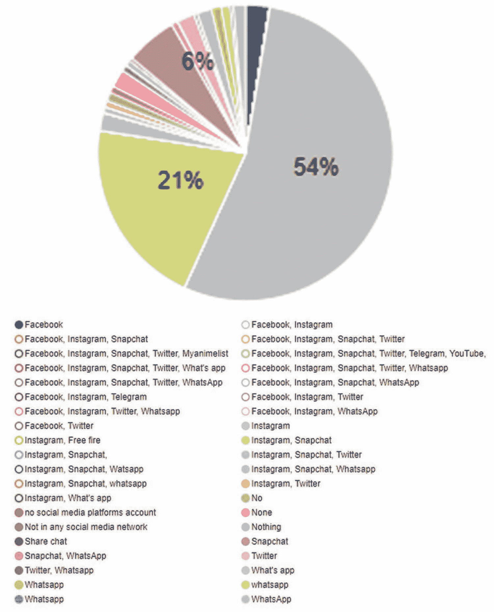

**每日设备使用时长**  
- 超过 3 小时：33.3%（155 人）  
- 1 到 2 小时：25.2%（117 人）  
- 2 到 3 小时：24.5%（114 人）  
- 不足 1 小时：17%（79 人）  
大多数学生长时间沉浸在社交媒体中（图 2.5）。

**智能设备随身携带情况**  
75%（349 人）每天随身携带智能设备，25%（116 人）不携带（图 2.6）。

**使用原因分析**  
- 娱乐：31%（62 人）  
- 聊天：23%（46 人）  
- 学习和工作：17%（34 人）  
- 在线游戏：10%（19 人）  
社交媒体使用主要以娱乐为主（图 2.7）。

**数据整体表示**  
收集数据的整体表示已使用旭日图呈现（图 2.8）。

### 1.3 结论
本研究探索了大学生为什么会从学术上分心。尽管大多数学生不认为社交媒体分散了他们的学习，但当发现社交媒体应用的使用情况时，显而易见的是大多数学生在无聊时会使用社交媒体。最常用的社交媒体平台是 Instagram。研究发现更多学生长时间使用设备，这可能会损害他们的学习能力。本研究发现了学生使用的社交媒体应用、最常用的设备以及智能设备的使用情况，可用于发现并减少学术分心。

---

## 2. 通用图像伪造检测系统

### 2.1 伪造类型概述
修改数字照片通常使用以下三种方法：
1. 篡改
2. 拼接
3. 克隆或复制-移动

#### 篡改
图像篡改是通过改变图像来产生新的结果。它是数字艺术的一种形式，需要强大的视觉想象力以及对图像属性的理解。篡改图像有多种原因，例如使用数字工具创建惊人的照片以娱乐为目的，或者制造伪造证据。被动图像篡改检测在对源图像没有任何先验信息的情况下，验证数字照片的合法性。

#### 图像拼接
这是一种照片编辑技术，涉及将多个独立的图像通过数字方式融合成合成图像。这是用于修改数字形式图片的数字照片合成技术中的关键阶段，该技术也被称为“贴图”，因为它通过使用 `Photoshop` 等工具连接照片来创建。


*来源: 在 OnePlus 手机上拍摄的原始图像*

#### 复制-移动伪造
修改数字图像最流行的方法是通过图像伪造。复制-移动技术基本上包括将图像块插入现有图像中，同时遮盖关键细节或物体。结果是图像的有效性和唯一性都受到了破坏。伪造极难发现，因为克隆块与其他图像块具有相同的属性，因为它们来自同一张图像。

### 2.2 拼接检测技术综述
拼接图像被用于各种场景，包括新闻报道、摄影比赛、学术论文中的关键证据等。确定图像的真实性并识别图像中被篡改的部分成为至关重要且困难的研究课题。

文献中的技术归类为：基于特征的方法、光照颜色估计、源图像中不一致的噪声水平、源图像的统计特征以及其他技术。

#### 光照颜色估计
光照差异在拼接检测中确定数字图像的有效性方面可能有用。

- **C. Riess 和 E. Angelopoulou** 设计了一种基于物理的光照颜色模型，构建了基于距离测量的光照图，需用户参与。
- **Yu Fan、Philippe Carré 和 Christine FernandezMaloigne** 提出利用局部光照估计，通过物体周围区域光照颜色的波动来识别区域拼接伪造，结合五种基于简单统计的技巧估计每个水平和垂直条带的光照。
- **C. Riess 和 E. Angelopoulou** 提供了一项利用光照颜色识别个人伪造照片的新颖方法。通过统计灰度边缘估计和一种利用反强度-色度色彩空间的物理技术，计算了光照颜色。

#### 基于图像噪声水平不一致的伪造检测
每个数字相机图像都会受到某种形式噪声的影响。

- **Xunyu Pan、Xing Zhang 和 Siwei Lyu** 提出基于局部噪声不一致性的盲伪造检测方法，采用高通对角波波系数获取最高分辨率，使用基于同质性要求的简单区域合并方法分割图像。
- **Thibaut Julliand、Vincent Nozick 和 Hugues Talbot** 提出原始照片拼接伪造自动检测方法，通过检查四叉树分解的图像差异，利用噪声参数的相对一致性识别潜在切割图像。
- **Siwei Lyu、Xunyu Pan 和 Xing Zhang** 提出基于投影峰度集中现象的区域拼接检测方法，噪声统计估计的优化问题存在闭式解。
- **Chi-Man Pun、Bo Liu 和 Xiao-Chen Yuan** 提出将图像分成许多尺度的超像素，对每个单独尺度应用水平函数，利用多尺度识别拼接图像伪造，再使用`最优参数搜索`算法处理片段。
- **Yu-Feng Hsu 和 Shih-Fu Chang** 开发基于确定图像不同部分间一致相机特征的技术。使用 `LPIP` 中的几何不变性从分割图像的每个段计算相机响应函数 (`CRF`)，基于 `SVM` 的分类器获得计算出的 `CRF` 分数的区域强度特征。
- **Zhenhua Qu、Guoping Qiu 和 Jiwu Huang** 建议使用人类视觉系统的机器学习方法，边缘锐度确定的前几个注视点与边界存在强联系。
- **Hnnamma 和 Lalitha Rangarajan** 使用基于线的校准测量镜头径向畸变，当图像存在直线时可成功识别，但糟糕图像会产生干扰。
- **Muhammad Hameed Siddiqi 等人** 提出利用离散小波变换、图像拼接和鲁棒判别性局部二值模式检测欺造图像。**Retha Hasoon Khayeat 等人** 使用分解图像的语义分割。
- **Yuan Rao 和 Jiangqun Ni** 使用预训练的 `CNN` 作为块描述符提取稠密特征，通过特征融合技术获得用于 `SVM` 分类的最终判别性特征。
- **Souradip Nath & Ruch Naskar** 提出盲拼接检测方法，以全连接网络作为骨干，深度卷积架构作为前端。

**总结**：图像属性或相机特性的差异是识别伪造区域的主要来源。基于像素和基于统计的方法分类为噪声不一致性、光照估计、统计方面以及其他基于特征的方法。得益于伪造者与检测者之间的竞争，图像取证研究课题在增强伪造检测方面具有巨大前景。

---

## 3. COVID-19 严重程度预测与分类模型研究

### 3.1 研究背景
COVID-19 的出现给世界带来了巨大的健康灾难。快速诊断对于保持警惕和阻止感染传播至关重要。`MRI` 和 `CT-Scans` 等医学图像被用作诊断的信息源。自动化诊断模型有助于克服非专业放射科医生在准确诊断中遇到的困难 `[2]`。尽管 AI 方法被证明是有益的，但开发能产生精确结果的适当 AI 模型仍具挑战性 `[7, 8]`。

### 3.2 主要贡献
- 开发了一种基于 `CI`（计算智能）的新型 AI 分类器模型 `ASO-GRU-NN`（原子搜索优化门控循环单元神经网络），用于预测 COVID-19 并对其严重程度进行分类。`CI` 的主要范式是元启发式算法，根本上用于解决优化问题 `[9]`。`ASO` `[3]` 用于优化 `GRU-NN` 的权重，增强准确性、特异性、敏感性和错误率性能。
- 评估了统计特征、`GLCM`（灰度共生矩阵）特征和基于感染区域形状特征对 COVID-19 检测和分类的影响。
- 评估了三种特征组合效应对 COVID-19 严重程度检测和分类的影响，并通过与现有最先进分类器模型比较验证了所提方法性能。

### 3.3 文献综述
**Al-Areqi, F., & Konyar, M. Z. (2022) [1]**  
使用 `CT` 切片通过 `GLCM`、形状特征和一阶统计特征提取纹理特征。特征矩阵通过单组特征或多组特征组合开发。评估了特征提取技术性能，并与 `SVM`、`Random Forest`、`k-nearest neighbor` 和 `XGBoost` 等 `ML` 分类器比较。

**Dey 等人 [6]**  
考虑了 400 张 `CT` 图像（200 张非 COVID-19 和 200 张 COVID-19）。评估了特征提取技术性能，并与 `SVM`、`Random Forest`、`k-nearest neighbor` 和 `XGBoost` 等 `ML` 分类器比较。

---

# References

1. Vidhi P. Raval (2013). Analysis and Detection of Image Forgery Methodologies. International Journal for Scientific Research & Development Vol 1, Issue 9.
2. C. Riess And E. Angelopoulou (2010). Scene Illumination As An Indicator Of Image Manipulation. Inf. Vol 63, Pp 66–80.
3. Yu Fan, Philippe Carré, Christine FernandezMaloigne (2015). Image Splicing Detection With Local Illumination Estimation. ICIP.
4. C. Riess and E. Angelopoulou (2013) Exposing Digital Forgeries By Illumination Color Classification. IEEE Transactions On Information Forensics And Security, Vol. 8, No. 7.
5. Xunyu Pan, Xing Zhang, Siwei Lyu (2012). Exposing Image Forgery With Blind Noise Estimation. Thirteenth ACM Workshop On Multimedia And Security.
6. Xunyu Pan, Xing Zhang, Siwei Lyu (2012). Exposing Image Forgery With Blind Noise Estimation. IEEE International Conference On Computational Photography (ICCP).
7. Thibaut Julliand, Vincent Nozick and Hugues Talbot (2015). Automated Image Splicing Detection From Noise Estimation In Raw Images 6th International Conference On Imaging For Crime Prevention And Detection (ICDP15).
8. Siwei Lyu, Xunyu Pan and Xing Zhang (2014). Exposing Region Splicing Forgeries With Blind Local Noise Estimation. Springer, Int J Comput Vis.
9. Chi-Man Pun, Bo Liu, Xiao-Chen Yuan (2016). Multi-scale noise estimation for image splicing forgery detection. Journal Of Visual Communication Image Representation, Elsevier.
10. Yu-Feng Hsu and Shih-Fu Chang (2007). Image Splicing Detection Using Camera Response Function Consistency And Automatic segmentation. IEEE International Conference On Multimedia And Expo.
11. Zhenhua Qu, Guoping Qiu, and Jiwu Huang (2009). Detect Digital Image Splicing With Visual Cues, LNCS, Springer.
12. H. R. Chennamma, Lalitha Rangarajan (2010). Image Splicing Detection Using Inherent Lens Radial Distortion. International Journal Of Computer Science.
13. Kunj Bihari, Vipin Tyagi (2021). A Deep Learning based Method for Image Splicing Detection. Journal of Physics Conference Series.
14. Muhammad Hameed Siddiqi, Khurshed Asghar, Umar Draz, Amjad Ali, Madallah Alruwaili, Yousef Alhwaiti, Saad Alanazi, M.


Dey 等人 `[6]` 考虑了 400 张`CT`图像（200 张非 COVID-19 和 200 张 COVID-19）。评估了特征提取技术的性能，并与不同的`ML`分类器（如`SVM`、`Random Forest`、`k-nearest neighbor`和`XGBoost`）进行了比较。

Qibla, Y., et al. (2021) `[4]` 提出了一种基于`SVM`的系统。

## 3. 严重程度的提出的框架

所提出的框架关注于 COVID-19 严重程度的检测和分类。特征提取在数据中起着至关重要的作用。提取的特征包括统计特征、`GLCM`特征和形状特征。

### 3.1 统计特征

本研究提取的统计特征是均值、中位数、标准差和方差。均值可以定义为图像所有像素的平均值，使用以下方程：

```math
Mean = \frac{\sum_{i=1}^N_{j=1}^N P_{i,j}}{N}
```

中位数代表图像矩阵的中间像素，通过公式估计：

```math
Median = \frac{\left( P_{\frac{N}{2},\frac{N}{2}} \right) + \left( P_{\frac{N + 1}{2},\frac{N + 1}{2}} \right)}{2}
```

标准差可以定义为观测值相对于均值的离散程度。它可以表示为：

```math
SD = \sqrt{\frac{\sum_{i=1}^N_{j=1}^N (P_{i,j} - Mean)^{2}}{N}}
```

方差可以定义为描述观测值偏离均值的数值。

```math
Variance = SD²
```

### 3.2 灰度共发生矩阵 (GLCM) 特征

本研究工作中利用`GLCM`估计的纹理特征是能量、熵、对比度、相关性和同质性。能量估计纹理的均匀性（像素对的重复），可以表示为：

```math
Energy = \sum_{i}\sum_{j} (g_{i,j})²
```

熵计算图像的复杂性或无序性，可以使用以下公式进行计算。

```math
Entropy = - \sum_{i}\sum_{j} g_{i,j} \log_{2} g_{i,j}
```

对比度计算灰度共生矩阵（`GLCM`）与图像空间频率之间的差异。它定义为矩阵中像素最大值与最小值之间的差。可以使用公式估计的对比度。

```math
Contrast = \sum_{i}\sum_{j} (i - j)^{2} g_{i,j}
```

相关性是指图像灰度线性依赖关系的度量。相关性特征可以使用公式估计。

```math
Correlation = \frac{\sum_{i}\sum_{j} (i j) g_{i,j} - mean_{g}}{SD_{g}}
```

其中`SD[g]`和`mean[g]`是`g`的标准差和平均值。

同质性被称为逆差分矩（Inverse Difference Moment）。它通过考虑元素对之间灰度差异越小则赋予越高值，来估计图像的同质性。可以使用公式测量。

```math
Homogeneity = \sum_{i}\sum_{j} \frac{1}{1 + (i - j)^{2}} g_{i,j}
```

### 3.3 感染区域特征

形状特征是描述病变外观的物理维度度量。从感染区域提取的形状特征包括质心、面积、周长、离心率和方向。质心（Centroid）是区域的质中心，以 1byQ 向量返回，其中 Q 表示图像的维度。面积是区域内的实际像素数量，以标量值返回。周长是区域的边界距离，以标量返回。离心率定义为病变焦点之间的距离与主轴长度之比。方向是 x 轴相对于与区域二阶相同的椭圆主轴扫过的角，以标量返回。

## 4. 提的 ASO-GRU-NN 分类模型

### 4.1 ASO 优化器

`ASO` 是一种新型的物理启发的计算元启发式优化方法。`ASO` 受基础分子动力学的启发而制定。该算法用于解决全局优化问题`[19]`。在本工作中，`ASO` 优化器用于在训练阶段优化 `GRU-NN` 模型的权重。在 `ASO` 中，搜索空间中原子的位置代表通过其质量衡量的解集（神经网络权重），质量越大的解越优异，反之亦然。为了解决这一无约束优化问题，考虑一个包含 N 个原子的种群。本应用假设原子种群为输入层中 N 个神经元的`N`个输入数据。第`i`个原子的位置可以如公式(10)所示：

```math
x[i] = [x[i]^1, x[i]^2, \dots, x[i]^{(D)}], \quad i = 1, 2, \dots, N
```

其中`x[i]^d` (`d` = 1, 2, …, `D`）代表`D`维搜索空间中第`i`个原子的第`d`个位置分量。对每个种群进行适应度评估。该优化中用于适应度评估的目标函数是均方误差（`MSE`）函数。种群的最小 `MSE` 值是最佳拟合值`F[best]`，如公式(11)所示：

```math
F_{best} = \min F = \min MSE
```

另一方面，最差拟合值`F[worst]`可以如公式(12)所示：

```math
F_{worst} = \max F = \max MSE
```

其中， $MSE = \frac{1}{n}\sum_{i=1}^{n} (Y_{pred} - Y_{actual})^{2}$，`Y_{pred}`是预测类别，`Y[actual]`是实际类别，`n`是数据样本的总数。获得`F[best]`的权重矩阵（原子种群集）`x[best]`是神经网络的最优权重。在最简单的阶段，第`i`个原子的质量可以通过涉及适应度值的以下公式(13)计算得出：

```math
M_{i}(t) = \frac{m_{i}(t)}{\sum_{j=1}^{N} m_{j}(t)}
```

其中，$m_{i}(t) = e^{\frac{F_{i}(t) - F_{best}(t)}{F_{best}(t)}}$，`F_{i}(t)`是第`i`个原子的适应度。在探索阶段，第`i`个原子与许多原子交互。在开发阶段，第`i`个原子与少数原子交互。这个`k`随着`t`的增加而减小。

```math
k(t) = \sum_{j=1}^{N}
```

其中，`t`是迭代次数，`T`是最大迭代次数。第`i`个原子来自其余原子的力如公式(15)所示：

```math
F_{i}^{d}(t) = \sum_{j \in k} rand_{j}^{d}(t)
```

这里，`rand[j]`是在`[0,1]`内生成的随机数。第`i`个原子来自最佳拟合原子的几何约束由公式(17)表示：

```math
G_{i}^{d}(t) = \lambda(t)(x_{best}^{d}(t) - x_{i}^{d}(t))
```

其中`x[i]^d(t)`表示第`t`次迭代中第`i`个原子的位置，`x^d[best]`表示第`t`次迭代中最佳原子的位置，`λ`代表拉格朗日乘子。

然后使用作用力和几何约束通过公式(18)估计原子的加速度：

```math
a_{i}^{d}(t) = \frac{F_{i}^{d}(t)}{M_{i}^{d}(t)} + \frac{G_{i}^{d}(t)}{M_{i}^{d}(t)}
```

使用公式(19 和 20)更新下次迭代（t+1）原子的速度和位置。

```math
v_{i}^{d}(t+1) = rand_{i}^{d}(t) * v_{i}^{d}(t) + a_{i}^{d}(t)
```

```math
x_{i}^{d}(t+1) = x_{i}^{d}(t) + v_{i}^{d}(t+1)
```

### 4.2 COVID-19 严重程度分类的 GRU-NN 模型

最终的最佳方案作为权重*W*赋予 `GRU-NN` 分类模型。

`GRU` 是 `RNN` 的较新版本。与长短期记忆 (`LSTM`) 单元不同，`GRUs` 不包含单元状态。`GRU` 利用其隐藏状态来传输信息。它仅包含 2 个门（更新门和重置门）。由于张量操作较少，`GRUs` 比 `LSTM` 运行更快。`更新门` 是输入门和遗忘门的组合。`遗忘门` 选择将哪些数据添加到内存中，以及忽略哪些数据。`重置门` 为了消除梯度爆炸而重置过去的数据。`重置门` 估计需要遗忘的过去数据量。`更新门`和`重置门`的方程分别在公式 (21) 和 (22) 中表示。

```math
r[t] = \sigma(x[t]W[r] + h[t-1]U[r])
```

```math
u[t] = \sigma(x[t]W[u] + h[t-1]U[u])
```

其中，`sigma` 是应用于门的激活函数，`x[t]` 是输入数据，`h[t–1]` 是隐藏状态数据，`W[r]` 和 `U[r]` 是传递给重置门的权重，`W[u]` 和 `U[u]` 是传递给更新门的权重。

`GRU` 使用反向传播算法进行训练，将提取的特征作为输入并将 `ASO` 解集作为权重。这项工作考虑了数据集的 80%用于训练，20% 的数据用于测试。模型的训练使用训练特征和相应的标签进行。考虑的标签有：正常（Normal）、轻度感染的 `COVID-19`、中度感染的 `COVID-19`、重度感染的 `COVID-19`。测试阶段通过测试输入进行以评估性能。

## 5. 结果与讨论

本论文的这部分介绍了具有不同特征向量的不同分类器的分类结果和性能。这些模型的仿真是在 `MATLAB R2020a` 平台上进行的，配置为 `Windows 10 Pro` 版操作系统、`Intel Core i3` 处理器和 `8 GB RAM`。从仿真获得的结果将在接下来的子章节中展示并讨论。

针对不同模型的分类器进行了实验，例如传统的 `CNN`、传统的 `RNN` 以及所提的 `ASO-GRU-NN`。这些模型使用不同的特征向量进行训练，如 `F1`（统计特征向量）、`F2`（`GLCM` 纹理特征向量）、`F3`（形状特征向量）以及组合的 `F1 + F2 + F3` 特征向量。模型比较的性能指标包括准确率、错误率、敏感性、特异性和执行时间。

分类准确率是指正确预测的数量占所有预测总数的比例。这如公式 (23) 所示：

```math
Accuracy = \frac{T_{P} + T_{N}}{T_{P} + T_{N} + F_{P} + F_{N}}
```

其中，

`T_P` 是真阳性，`T_N` 是真阴性，`F_P` 是假阳性，`F_N` 是假阴性。错误率是指错误预测总数与观测总数的比例。这可以用公式 (24) 中的准确率来表示。

```math
Error rate = 1 - accuracy
```

敏感性定义为 `COVID-19` 类预测的总数与正确的 `COVID-19` 类预测和正常类预测之和的比。可以使用公式 (25) 计算敏感性。

```math
Sensitivity = \frac{TP}{TP + FN}
```

特异性定义为正确负类预测的总数与正确负类预测和错误的正类预测之和的比。特异性可以使用公式 (26) 计算。

```math
Specificity = \frac{TN}{TN + FP}
```

总执行时间（以秒为单位）是从给出图像到获得分类结果所需的时间。本研究评估了不同特征集的影响，所获得的性能测量值如表 4.1–4.4 所示。表 4.1 显示了统计特征集的分类结果。结果发现所提的 `ASO-GRU-NN` 产生了最佳结果，显示出 0.5 的准确率、0.5 的错误率、1 的敏感性和 61.23s 的总执行时间。然而，在特异性方面，`CNN` 模型显示了 1 的最佳得分。

### 表 4.1 统计特征的性能

| 模型 | 准确率 | 错误率 | 敏感性 | 特异性 | 总执行时间 (s) |
| :--- | :--- | :--- | :--- | :--- | :--- |
| `CNN` | 0.2 | 0.8 | 0 | 1 | 66.79 |
| `RNN` | 0.45 | 0.55 | 0.67 | 0.647 | 63.95 |
| 所提的 `ASO-GRU-NN` | 0.5 | 0.5 | 1 | 0.647 | 61.23 |

表 4.2 展示了 `GLCM` 纹理特征集的分类结果。发现所提的 `ASO-GRU-NN` 产生了最佳结果，显示出 0.7 的准确率、0.3 的错误率、0.25 的敏感性、1 的特异性和 60.71s 的总执行时间。

### 表 4.2 GLCM 特征的性能

| 模型 | 准确率 | 错误率 | 敏感性 | 特异性 | 总执行时间 (s) |
| :--- | :--- | :--- | :--- | :--- | :--- |
| `CNN` | 0.35 | 0.65 | 0.25 | 1 | 65.58 |
| `RNN` | 0.45 | 0.55 | 0.25 | 1 | 62.87 |
| 所提的 `ASO-GRU-NN` | 0.7 | 0.3 | 0.25 | 1 | 60.71 |


表 4.3 给出了形状特征集的分类结果。发现所提的 `ASO-GRU-NN` 产生了最佳结果，显示出 0.85 的准确率、0.15 的错误率、0.834 的敏感性、0.928 的特异性和 60.34s 的总执行时间。

### 表 4.3 区域特征的性能

| 模型 | 准确率 | 错误率 | 敏感性 | 特异性 | 总执行时间 (s) |
| :--- | :--- | :--- | :--- | :--- | :--- |
| CNN | 0.5 | 0.5 | 0.6667 | 0.85 | 66.22 |
| RNN | 0.8 | 0.2 | 0.67 | 0.928 | 63.16 |
| 所提的 ASO-GRU-NN | 0.85 | 0.15 | 0.834 | 0.928 | 60.34 |

表 4.4 显示了组合特征向量 (`F1+F2+F3`) 的分类结果。所提的 `ASO-GRU-NN` 产生了最佳结果，显示出 0.95 的准确率、0.05 的错误率、1 的敏感性、1 的特异性和 58.65s 的总执行时间。

### 表 4.4 统计特征 + GLCM 特征 + 区域特征的性能

| 模型 | 准确率 | 错误率 | 敏感性 | 特异性 | 总执行时间 (s) |
| :--- | :--- | :--- | :--- | :--- | :--- |
| CNN | 0.5 | 0.5 | 0.6667 | 1 | 70.71 |
| RNN | 0.85 | 0.15 | 0.8333 | 1 | 60.57 |
| 所提的 ASO-GRU-NN | 0.95 | 0.05 | 1 | 1 | 58.65 |

# 6. 结论

这项工作旨在评估三种主要的特征估计技术的影响，即统计特征、GLCM 纹理特征和形状特征。本研究还评估了组合特征向量的影响。不同特征集对分类的影响比较表明，组合特征向量在实现 `COVID-19` 检测和病情分类方面具有更大的潜力。本研究还提出了一种名为 `ASO-GRU-NN` 的新型分类器模型，它使用 `GRU` 作为基础模型，并使用名为 `ASO` 的优化算法进行权重优化。与传统的 `CNN` 和传统的 `RNN` 模型相比，发现 `ASO-GRU-NN` 模型提供了最佳分类性能。这是因为 `ASO-GRU-NN` 在训练期间优化调整了权重，从而减少了训练损失并提高了准确率。未来，可以将 `ASO` 应用于 `CNN`，以评估其在 `COVID-19` CT 切片图像特征图上的分类性能。

## 参考文献

1. Al-Areqi, F., & Konyar, M. Z. (2022). 用于计算机断层图像新冠肺炎分类的不同特征提取方法的有效性评估：一项高精度的分类研究。生物医学信号处理与控制。76: 103662。

2. Mohammad-Rahimi, H., Nadimi, M., Ghalyanchi-Langeroudi, A., Taheri, M., & Ghafouri-Fard, S. (2021). 机器学习在 X 射线和 CT 图像诊断新冠肺炎中的应用：范围性综述。心血管医学前沿。8: 638011。

3. Abed, M., Mohammed, K. H., Abdulkareem, G. Z., Begonya, M., Salama, A., Maashi, M. S., Mutlag, L.... & (2021). 基于 X 射线图像自动诊断新冠肺炎的机器学习特征提取与分类方法的全面研究。计算机、材料与连续体。66: 3289–3310。

4. Qiblawey, Y., Tahir, A., Chowdhury, M. E., Khandakar, A., Kiranyaz, S., Rahman, T., Ayari, M. A.... & (2021). 使用深度学习进行 CT 图像中新冠肺炎的检测和严重分类。诊断。11(5): 893。

5. Shi, F., Wang, J., Shi, J., Wu, Z., Wang, Q., Tang, Z., Shen, D. (2020)... & 新肺炎肺炎数据采集、分割和诊断中人工智能技术的综述。IEEE 生物医学工程。14: 4–15。

6. Dey, N., Rajinikanth, V., Fong, S. J., Kaiser, M. S., & Mahmud, M. (2020). 社会群优化辅助的 Kapur 熵和形态分割，用于从计算机断层图像中自动检测新冠肺炎感染。认知计算。1011–1023。

7. Alsalem, M. A., Zaidan, A. A., Zaidan, B. B., Albahri, O. S., Alamoodi, A. H., Albahri, A. S., Mohammed, K. I. ... & (2019). 基于 BWM 和 group-VIKOR 的急性白血病自动检测与分类的多类基准框架。医学系统杂志，43(7), 1–32。

8. Alsalem, M. A., Zaidan, A. A., Zaidan, B. B., Hashim, M., Albahri, O. S., Albahri, A. S., Mohammed, K. I. ... &(2018). 急性白血病自动多类检测与分类系统的系统综述，涉及评估与基准测试、开放挑战、问题和方法论方面。医学系统杂志。42: 1–36。

9. Abdel-Basset, M., Abdel-Fatah, L., & Sangaiah, A. K. (2018). 元启发式算法：全面综述。云端工程应用中的多媒体大数据的计算智能。1: 185–231。

注：本章中的所有图表均由作者制作。

# 5 基于图像处理的深度学习脑肿瘤检测

Asma Parveen A^(⁹)

研究员，计算机科学系，Vels 科学、技术与高级研究学院，钦奈杜，印度

Kamalakannan T^(¹⁰)

计算机科学主任，Vels 科学、技术与高级研究学院，钦奈杜，印度

DOI: [10.1201/9781003428466-5](https://dx.doi.org/10.1201/9781003428466-5)

**摘要** 为了改进人类对视觉信息的理解，并处理用于传输、存储和检索意义信息的图像数据，图像处理这一引人入胜且富有启发性的学科运而生。来自摄像头和传感器的原始数据可以使用“图像处理”方法进行处理。为了进行图像分析，必须对图像进行分析并将其分为有意义片段，这一过程被称为图像分割。通过医学图像分割可以研究人体的解剖和生理结构。利用尖端技术创建人类大脑的多幅分辨率照片，允许研究人员跟踪其发育并发现多种疾病。脑癌是儿童和青少年最常见的恶性疾病。本研究将帮助公众判断脑部磁共振成像（MRI）中是否存在脑肿瘤。其他研究人员的努力为本研究提供了灵感。

**关键词** 数据、肿瘤、处理、MRI、图像分割

## 1. 引言

医学领域的许多科学家正在使用前沿方法进行疾病预测。这些方法一直以来帮助医疗专业人员进行诊断和治疗。早期发现或预测脑肿瘤可以挽救生命。然而，各年龄段都是受害者。因此，研究人员致力于寻找方法，在脑肿瘤最可能发生的区域根据早期症状进行检测和预测，并使用 MRI 扫描确定特定的肿瘤类型。作为医学领域需求最大的领域之一，本工作研究了图像分割技术的使用。

## 2. 文献综述

创新的图像处理涉及将图像数字化并运行一系列数学运算，以改进图像或从中提取相关数据。图像处理（IP）主要分为两类：第一类处理用于人类查看的图像外观增强，第二类测量图像内部的各个方面和结构。根据身体部位、诊断任务、视觉偏好等，可以通过分割或修改其内部结构的外观为应用程序定制数字图像。放射科医生将从计算机图像分析中获益，因为它允许他们快速准确地定位图像中的可疑区域并提供准确的诊断。

在本节中，我们将讨论在图像处理技术、分类算法和脑肿瘤诊断方面的研究。此外，它对各种研究人员采用的处理方法和图像分割算法进行了全面分析。综述中的信息也被引用在讨论各种脑疾病和肿瘤的文章中。数据分割、分类和聚类算法均已应用于医学领域。对使用 `RF` 和 `SVM` 分类器进行超像素脑肿瘤分割进行了评估，结果发现在准确性方面 `RF` 优于后者。正如 `[1]` 所示，将 `C-MRI` 与 `DTI` 结合并将数据输入支持向量机（SVM），使研究人员能够识别不同类型的肿瘤组织 `[2]`。正如 `[3]` 建议，超像素方法的优势是极大地减少了在新特征空间中分类所需的计算量。

## 3. 提出的方法

研究人员已经尝试了多种方法来分析 MRI 脑图像以寻找肿瘤。所建议的方法分为预处理和 `Segmentation`（分割）两个主要阶段。定位 MRI 脑图像、消除噪声和提高图像质量都需要使用图像处理技术。为了精确地确定位照片中的肿瘤区域和受损区域，我们使用分割方法对它们进行提取。

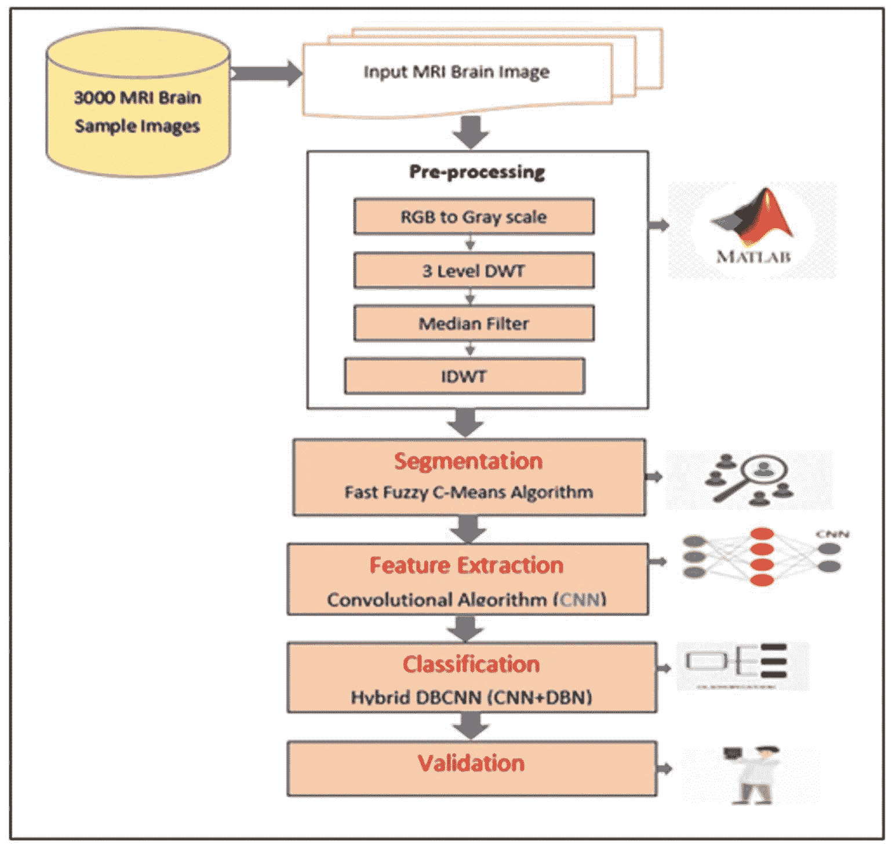

图 5.1 提议方法的架构 `Source:` 作者自制

以下是所建议程序步骤的详细说明。

* 步骤 1：使用保存为 `MATLAB` 格式的 3064 脑部 MRI 扫描进行训练系统，将其平均分为正常示例和类型 1、2、3 和 4 的病理示例。

* 步骤 2：上传您的 MRI 脑扫描图的 `fresh.jpg`

* 步骤 3：此图像已从其原始的 `RGB` 格式转换为灰度图。

* 步骤 4：用于预处理的三级 `Median Filter`（中值滤波）

* 步骤 5：通过使用中值滤波减少了这种噪声

* 步骤 6：数据使用 `IME`（反向中值滤波）进行了预处理。第 5 部分：使用 `Fast Fuzzy C-means Algorithm`（快速模糊 C 均值算法）分割图像

* 步骤 7：“使用卷积神经网络（CNN`）进行特征提取”

* 步骤 8：深度信念卷积神经网络混合算法分类。

### 3.1 数据集说明

成像平面（或方向）以三种不同的方式来表征脑部 MRI 扫描：水平、垂直和横截。`axial plane`（轴状面）、`coronal plane`（冠状面）和 `sagittal plane`（矢状面）都是医学影像领域使用的术语。根据神经外科医生的说法，矢状面对大脑左右边的描述并没有告诉我们任何关于肿瘤位置的信息。轴状面和冠状面的图像可用于精确确定肿瘤受累区域，用于治疗计划和临床诊断。任何以 MRI 图像作为输入的算法在实施之前都需要一个转换步骤。MRI 扫描仪生成的图像为 `DICOM`（医学数字成像和通信）格式，因此在 `CAD` 程序中进行视觉处理之前需要进行转换。还从四组异常患者（类型 1、2、3 和 4）中的每组获取了样本照片。

表 5.1 患者数据描述

| 属性 | 描述 | 备注 |
| --- | --- | --- |
| 正常脑图像 | 1000 名患者 | 无进一步分析 |
| 异常脑图像 | 2000 名患者 | 对类型进行进一步分析 |
| 类型 I | 32 名患者 | 早期就医人数极少 |
| 类型 II | 205 名患者 | 中期患者就医 |
| 类型 III | 772 名患者 | 类型 III 就医人数多 |
| 类型 IV | 991 名患者 | 晚期就医人数多 |

脑 MRI 扫描被用于本研究的预处理、分割、特征提取、分类和验证阶段（如 表 5.2 所示）。总共有六张照片，分别来自正常组和病理组，以及来自不同年龄和成像模式的患者。图像在保存为 `.mat` 文件后可以使用 `MATLAB 2021a` 进行处理。

Table 5.2 MRI 脑图像详情

| 序号 | 姓名 | 年龄 | 性别 | 类别 | 成像平面 |
| --- | --- | --- | --- | --- | --- |
| 1 | Narayanan | 52 | 男性 | 正常 | T2Axial |
| 2 | Radhika | 46 | 女性 | 正常 | T2Axial |
| 3 | Rajasekar | 26 | 男性 | 类型 1 | T2AxialFIL |
| 4 | AbdulRahman | 48 | 男性 | 类型 2 | T2AxialFIL |
| 5 | Karthikeyan | 9 | 男性 | 类型 3 | T2Axial |
| 6 | AchiraPar | 9 | 女性 | 类型 4 | T2FlairAxial |

下下方展示了来自各种患者的正常脑图像 Fig. 5.2。Fig. 5.2 (a) `NOR IMG 01` 是男性在 T2 轴状面的正常 MRI 脑图像，而 Figure 2 (b) `NOR IMG 02` 是女性在 T2 轴状面的正常 MRI 脑图像。

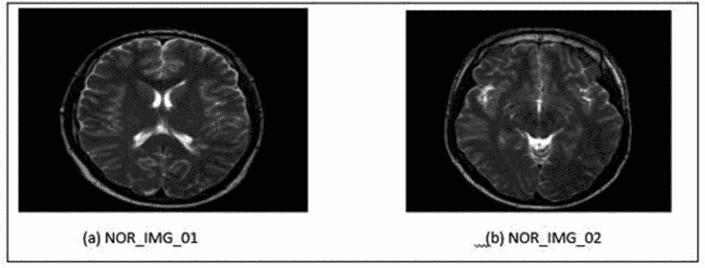

Fig. 5.2 正常脑图像 Source: 作者自制

### 3.2 滤波过程的步骤

当获取 MRI 图像时，由于环境的影响，它会被许多类型的污染。噪声图像的结果往往不理想。这意味着在实施任何技术之前，必须进行降噪和图像质量增强。

* `Gaussian filter`（高斯滤波）：通常做法是使用 `Gaussian filter` 通过减少噪声和增强对比度来清理图像。使用 `Gaussian filter` 的接近性和相似函数对图像进行预处理，在进一步处理之前减少噪声。

* `Bilateral filter`（双边滤波）：是一种保持边缘的降噪非线性滤波滤波器。它通过使用相邻像素的平均强度来替换当前像素。

* `Median filter`（中值滤波）：预处理程序的目标是修改图像使其具有更高的对比度。“Median` 倾向于保持图像边缘的同时平滑噪声。

#### RGB 转灰度

彩色图像缩写为 RGB 由红、绿、蓝三种原色组成。`RGB` 图像中的每个像素封装了 `M x N 3` 彩色数组中给定点的分量。

* 步骤 1：读取 RGB 图像

* 步骤 2：获取 RGB 图像并将红、绿、蓝分量分离为三个独立的二维矩阵。

* 步骤 3：创建一个与 `RGB` 图像相同行数的的新矩阵，但填充零。

* 步骤 4：为了创建灰度值，创建红、绿、蓝分量的加权和并分配给新矩阵的 `ij` 位置。

### 3.3 分割

在不改变原始图像结构或属性的情况下，`Segmentation` 利用算法或图像分割方法分离图像以恢复信息。分割根据图像特征（如像素大小、纹理、深度和灰度）将数字图像划分为多个不重叠的部分。这些是分割中使用的许多方法：

* 基于阈值的分割

* 基于特征的聚类形成子组

### 3.4 特征提取

图像处理主要涉及四个阶段。在图像经过处理和分割之后，下一阶段是特征提取，这对于获取特征至关重要。处理图像的最后阶段或步骤是分类，它接收分割和特征提取过程的结果输入。在图像经过各种处理步骤（包括预处理、分割、特征提取和分类）后，必须对其结果进行验证。虽然特征提取有许多方法，但列出的是提取和选择特征的可靠方法。

* 主成分分析 (`PCA`）

* 灰度共生矩阵 (`GLCM`）

## 4. 结论

所提的方法优于此前尝试实现相同目标的系统。之前的工作依赖于更简单的 2 级离散小波变换（`DWT`），但 3 级 `Median Filter` 的实现改进了对比度，并允许轻松抑制图像内的信号。图像在第 4 层和第 5 层变得过于模糊，且分类准确率太低，因此我们确定在第 3 层。虽然我们研究了 `Chanvese` 算法和 `CNN` 在分割中的潜力，但后者的结果不尽人意。快速 `Fuzzy C-means` 方法改进了结果，并成为科学界的一项创新工具。最后，在 `MATLAB 2021a` 中创建了一种名为 `Deep belief convolutional neural network`（DBCNN）的混合方法用于分类，它结合了 `CNN`（卷积神经网络）和 `DBN`（深度置信神经网络），取得了卓越的结果。

## 参考文献

1. B. Cheng, C. Bing, T. H. Chu, S. Alzahrani, S. Pichardo and G. B. Pike, “通过反馈控制的颅内 MR 引导聚焦超声和微泡实现同步局部脑部微热热和血脑屏开放,” in IEEE Transactions on Biomedical Engineering, vol. 69, no. 6, pp. 1880–1888, June 2022.

2. M. A. Ottom, H. A. Rahman and I. D. Dinov, “Znet: 用于 2D MRI 脑肿瘤分割的深度学习方法,” in IEEE Journal of Translational Engineering in Health and Medicine, vol. 10, pp. 1–8, 2022, Art no. 1800508.

3. M. A. Ottom, H. A. Rahman and I. D. Dinov, “Znet: 用于 2D MRI 脑肿瘤分割的深度学习方法,” in IEEE Journal of Translational Engineering in Health and Medicine, vol. 10, pp. 1–8, 2022, Art no. 1800508.

4. Y. Ding et al., “MVFusFra: 用于多模态脑肿瘤分割的多视图动态融合框架,” in IEEE Journal of Biomedical and Health Informatics, vol. 26, no. 4, pp. 1570–1581, April 2022.

5. M. Ismail et al., “用于表征肿瘤野效应的放射组形变和纹理异质性 (R-DepTH) 描述：在胶质母质瘤生存率预测中的应用,” in IEEE Transactions on Medical Imaging, vol. 41, no. 7, pp. 1764–1777, July 2022.


# 参考文献

6. M. Rahimpour et al., “跨模态蒸馏改进缺失 MRI 序列的基于 MRI 的脑肿瘤分割,” in *IEEE Transactions on Biomedical Engineering*, vol. 69, no. 7, pp. 2153–2164, July 2022.

7. A. Bs, A. V. Gk, S. Rao, M. Beniwal and H. J. Pandya, “人类脑组织的电学表型：一种肿瘤勾画的自动系统,” in *IEEE Access*, vol. 10, pp. 17908–17919, 2022.

8. Y. Liu, F. Mu, Y. Shi and X. Chen, “SF-Net: 通过图像融合用于多模态 MRI 脑肿瘤分割的任务模型,” in *IEEE Signal Processing Letters*, vol. 29, pp. 1799–1803, 2022.

9. S. Montaha, S. Azam, A. K. M. R. H. Rafid, M. Z. Hasan, A. Karim and A. Islam, “TimeDistributed-CNN-LSTM: 一种结合 CNN 和 LSTM 对 3D MRI 扫描脑肿瘤分类的混合方法并进行消融研究,” in *IEEE Access*, vol. 10, pp. 60039–60059, 2022.

10. F. Xing, X. Liu, C.-C. J. Kuo, G. E. Fakhri and J. Woo, “使用对称深度神经网络修复构建脑 MR 图谱,” in *IEEE Journal of Biomedical and Health Informatics*, vol. 26, no. 7, pp. 3185–3196, July 2022.

11. A. S. Musallam, A. S. Sherif and M. K. Hussein, “一种用于磁共振成像图像自动检测脑肿瘤的新型卷积神经网络架构,” in *IEEE Access*, vol. 10, pp. 2775–2782, 2022.

12. A. Vidyarthi, R. Agarwal, D. Gupta, R. Sharma, D. Draheim and P. Tiwari, “恶性脑肿瘤多分类的机器学习辅助方法,” in *IEEE Access*, vol. 10, pp. 50624–50640, 2022.

13. H. Fu et al., “HMRNet: 用于放射治疗脑结构分割的双向特征校准高分辨率网络,” in *IEEE Journal of Biomedical and Health Informatics*.

14. F. Xing, X. Liu, C.-C. J. Kuo, G. E. Fakhri and J. Woo, “使用对称深度神经网络修复构建脑 MR 图谱,” in *IEEE Journal of Biomedical and Health Informatics*, vol. 26, no. 7, pp. 3185–3196, July 2022.

15. A. S. Musallam, A. S. Sherif and M. K. Hussein, “一种用于磁共振成像图像自动检测脑肿瘤的新型卷积神经网络架构,” in *IEEE Access*, vol. 10, pp. 2775–2782, 2022.

16. A. Vidyarthi, R. Agarwal, D. Gupta, R. Sharma, D. Draheim and P. Tiwari, “恶性脑肿瘤多分类的机器学习辅助方法,” in *IEEE Access*, vol. 10, pp. 50624–50640, 2022.

17. H. Fu et al., “HMRNet: 用于放射治疗脑结构分割的双向特征校准高分辨率网络,” in *IEEE Journal of Biomedical and Health Informatics*.

通过使用 `GPS` 模块、`GSM` 模块和加速度计，并将它们连接到作为控制器的 `Arduino Uno`，创建出了一个可以通过短信服务向相关方警报事故的系统。

# 高效的事故检测与通知系统

安装在车辆上的 `Arduino` 板带有 `GSM` 和 `GPS` 功能。现有的 `Android App` 是软件组件。在所提的系统中，只有在扫描受害者的指纹后才会触发 `GSM` 模块。

## 一种利用（IoT）为智能救护车让路的方法

基于车辆内“黑箱”的理念，可以利用 `GPS` 和 `GSM` 技术发现发生的情况。通过控制交通信号，使救护部门能够迅速将受难者送往医院。

## 使用 Arduino UNO 进行人员身份验证

在大多数情况下，指纹扫描涉及对指纹图案的几个方面进行比较，这在对指纹进行匹配分析时是必要的。这些特征由微小的点、以及作为脊纹聚合属性的模式中所的个体特征组成。

## GSM–SMS 技术应用的可行研究

`GSM-SMS` 技术用于在两个系统之间进行控制、通信和数据传输。基于 `GSM-SMS` 的通信架构提供短信息包格式，适用于跟踪广泛的应用。

## 3. 系统设计与实现

通过使用指纹传感器访问数据，并使用 `GSM` 模块自动向受害者的监护人和警察控制室发送短信，我们为需要帮助的人员建立了一个自动识别和通知系统。这种方法主要旨在加速寻找在急救车内发现的事故受害者基本信息的过程。检查网络连接是否以及以及电源可靠可能是启动此程序的第一步。只需在设备中使用 `R307` 指纹传感器扫描受害者的指纹，`LCD` 屏幕上就会显示出受害者的姓名、紧急联系电话信息和地址。随后，将使用必要信息立即向指定的紧急联系人发送短信。为了报告道路交通事故，系统被设计为自动触发并向警察控制中心发送 `E-Service` 短信投诉。这种方法是使用一个带有内置 `SIM` 卡的 `GSM` 模块 `SIM900A` 来联系患者家属和警察控制室，它提供了一个使用 `GSM` 移动电话技术到网络的无线数据连接。采用该系统最大的益处是对于所有救护车来说安装都非常方便。在治疗未识别的事故受害者之前无需等待。信息交换机制变得更加快速和自动化。

## 4. 框图

从[图 6.1]可以看出，此设备使用的微控制器是 `Arduino Uno` (`ATmega328P`)。该设备由 `+5v` 直流电源供电。`Arduino` 微控制角落有一个电源接口。闪存、`EEPROM` 和 `SRAM` 是此处提供的板载内存。可以使用 `Arduino IDE` 软件执行我们系统所需的程序。随后，该程序可以通过电源插头线上传到 `Arduino` 微控制器。`Arduino uno` 充当指纹传感器 (`R307`) 和 `GSM` 模块 (`SIM900A`) 之间的接口，因为它存储了采集到的指纹和人员数据，这些数据在扫描指纹时需要进行匹配。使用 `R307` 指纹传感器扫描受害者的指纹以获取其基本信息，然后利用这些信息通知受害者的监护人和警察控制中心。该指纹传感器模块通过 `TTL UART` 通道直接连接微控制器。如果受害者的指纹与现有数据匹配，`Arduino Uno` 的程序将会将受害者的姓名和紧急联系电话显示在 `2x16 LCD` 显示屏上。

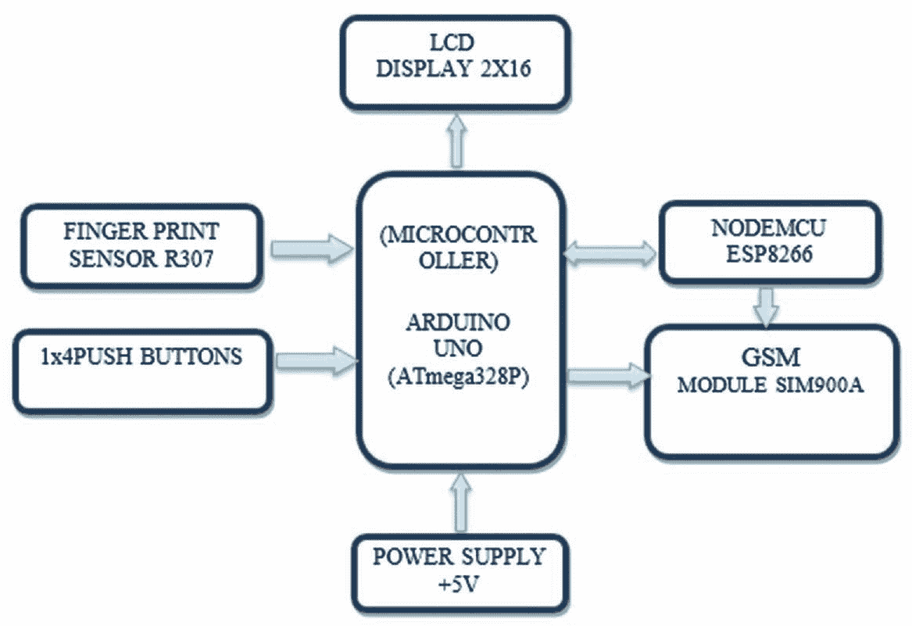

数据显示在 `LCD` 上后，带有内置 `SIM` 卡的 `GSM` 模块利用必要信息将短信发送给受害者的监护人和警察控制中心。`GSM-SMS` 通通信架构提供短信息包格式，适用于跟踪广泛的应用。`GSM-SMS` 技术用于在两个系统之间进行控制、通信和数据传输。此处。

## 5. 结果与讨论

在数据在 `LCD` 上显示后，指纹扫描。

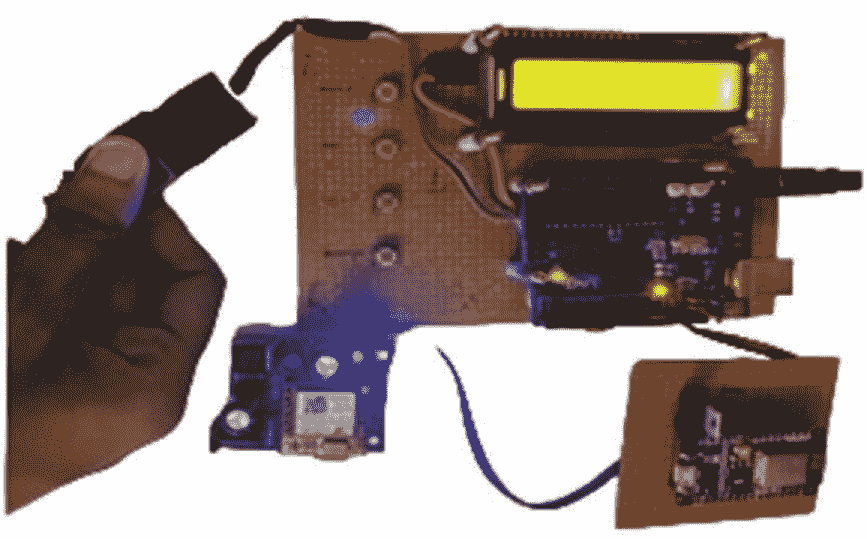

图 6.2 指纹传感器在硬件套件中的位置

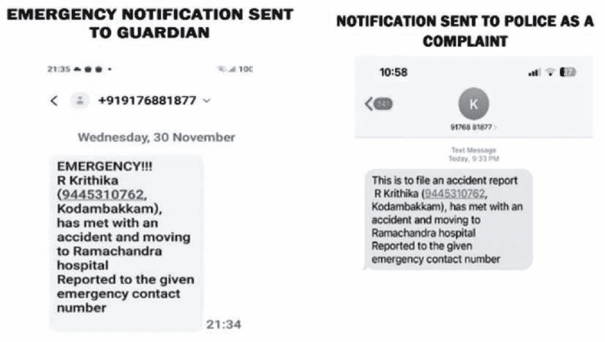

图 6.3 通过 `GSM` 模块发送

## 6. 结论展望

“未识别事故受害者检测与通知系统”原型已经构建。通过扫描受害者的指纹，该原型可以识别受害者并联系受害者的监护人和警察控制中心。在现有系统的基础上，可以通过传感器持续监测受害者的生命体征（如心率、血压和脉搏）增加更多记录。然后这些数据将通过实时服务器传递到医院。

## 致谢

诚挚地感谢我的导师 `V. Dinesh` 先生在整个过程中提供的指导和监督。此外感谢 Easwari 工程学院电子与通信系的全体教师。

## 参考文献

1. Abilash V V, Aljo Emerson, Tony Sebastian, Vishnu C, Rashmi P, 2021, 高效事故检测与通知系统，(2021)，卷 10，期 7

2. Venkatesh H, Shrivatsa D Perur, Jagadish M - 一种利用（IoT）为智能救护车让路的方法，2015 (International Journal of Electronics and Research; 卷 3, 期 1, 页(218-223))

3. Chwan-Lu Tseng, Joe-Air Jiang, Ren-Guey Lee, Fu-Ming Lu, Cheng-Shiou Ouyang, Yih-Shaing Chen, Chih-Hsiang Chang, GSM–SMS 技术在现场数据获取中的应用可行性研究，计算机与农业电子，2006，卷 53，期 1，ISSN0168-1699。

4. Suruchi Kaushik, Nishant Arora, Rakshit Sachdev, Vaibhav Ahluwalia, 使用 Arduino UNO 进行人员身份验证，2019，(IJERT) 卷 08，期 7

5. B. Malarvizhi, V. Dinesh, M. Janani, R. Gunaseeli, B. Abarna, “基于 IoT 的主食品捐赠系统和孤儿院废物管理系统”，2020 Sambodhi- UGC Care Journal，卷-43, UGC Care, ISSN:2249-6661

6. Gaikwad, Sharmila S., Mahek Khanna, Shreyansh Kothari and Ashutosh Kudale. “事故警报与检测系统的系统性文献综述。”2021).Vol2889/PAPER_01.

## 参考文献

7. B. Malarvizhi, V. Dinesh, M. Janani, R. Gunaseeli, B. Abarna, “基于 Arduino 和区块链的寄养儿童主食食品捐赠系统与废物管理系统”，2020, ICRCSIT-20, ISBN 编号为 978-93-80831-66-4。

8. Hossam M. Sherif, Hossam M. Sherif, Samah A. Senbel, “基于无线传感器网络的实时交通事故检测系统”，2014, 国际软计算与模式识别国际会议。

9. Sharmila Gaikwad, “应急医疗系统中异构数据库环境中的移动代理”，2008 于 ITNG, 美国内华达州拉斯维加斯. 出版 IEEE 计算机学会, ISBN: 978-0-7695-3099-4, 第 1220-1221 页。

10. Roberto G. Aldunate, Oriel A. Herrera, Juan Pablo Cordero, (2013) 上下文感知与上下文驱动交互，第 8276 卷 ISBN: 978-3-319-03175-0。

11. Gadekar, Santosh and Kolpe, Gauri and Rutuja, Gosavi and Fatate, Vaishnavi and Rohit, Rohit and Chate, Shriprasad and Lad, Akshay Arduino Uno-ATmega328 微控制器控制的智能系统(2021)。 (ICCIP) SSRN:/`http://dx.doi.org/10.2139/ssrn.3920231`.

12. Sudhan, R.H., Kumar, M.G., Prakash, A., & Devi, S.. Arduinoatmega-328 微控制器。(2015) DOI:`10.17148/ijireeice.2015.3406`, CorpusID: 212479591.

13. Murru, Ganesh & Kakollu, Chetan & Kenguva, Ashok & surya chandra, Podugu.. 使用指纹传感器的家用自动门锁系统(2020). 6. 2395-566.

14. Nicky Kattukkaran, Arun George, Mithun Haridas T.P., “应急医疗援助的智能事故检测与警报系统”，计算机通信国际会议。

15. M. Yuchun, H. Yinghong, Z. Kun and L. Zhuang, “GSM 模块通用应用研究”，2011 年互联网计算与信息服务国际会议，2011, 页 525-528, doi: `10.1109/ICICIS.2011.137`.

16. M. Rahnema, “GSM 系统与架构概述”，见 *IEEE Communications Magazine*，第 31 卷，第 4 期，第 92-100 页，1993 年 4 月, doi: `10.1109/35.210402`.

17. 事故检测与警报系统 Kalyani, S Monika, B Naresh, Mahendra Vucha, 创新技术与探索工程国际期刊 (IJITEE) ISSN: 2278-3075, 第 8 卷，第 4 期，2019 年 3 月。

# 从管理视角看具有交互因素和元素的 7 在线学习技术

## 摘要

在线学习用于以虚拟方式连接学生和教师。教学可以通过互动的方式进行，这种技术可以触及更广泛的学生。随着技术的发展和高等教育的交付，通过 `Email`、`Internet`、`World_Web` (`WWW`) 和多媒体的在线学习变得越来越流行。诸如大学讲师如何在教学中使用技术等问题。在疫情形势之后，在线学习应用对学生和教师来说变得非常熟悉。它使用户能够更容易地进行通信并方便地管理课堂。在线学习的主要特征是虚拟教室、考虑到学习者的自适应设计和网站布局、提醒、表扬以及额外的相关警报、各种教育资源（包括图像、播客等）、全方位学习原则、可下载供未来复习的在线内容以及不同的测验格式。在本文研究论文中，比较了不同类型的在线学习应用以进行了解。

**关键词：** 数字化、在线学习和虚拟教室。

## 1 引言

一种交互式网站允许用户通过 `webapp` 输入数据并交互以获得所需的在线学习结果。从遥远地区，学生使用 `internet connection` 通过 `web browser` 积极参与访问应用程序。根据 SmallBizTrends 的说法，超过 90% 的学生认为在线学习在概念上优于传统学习。为了保持学生的参与度，在线学习社区在网络上使用在线学习应用。用于在线学习的 Web 程序保存在 `web server` 上。Web 应用程序与在线学习的网站相比，让学生参与交互式任务，包括测试、写文章、进行演示、解决 `math_problem` 等，并在课堂中保持更数字数字化连接。其中一个例子是 `Zoom`，这是一种视频会议工具，允许用户主持和加入远程会议。通过这种方式，教师和学生可以在不进入实际校楼的情况下参与实时学习环境。

在线学习的主要特征是虚拟教室、考虑到学习者的自适应设计和网站布局、提醒、表扬以及额外的相关警报、各种教育资源（包括图像、电影等）、全方位学习原则、可下载供未来复习的在线内容以及不同的测验格式。上述 `Fig.7` 表达了在线学习的各种特征。在当前的疫情时期后，在线课程对学生和教师起着重要作用，并覆盖了广泛的学生群体。用户常用的技术是 `Google Classroom`、`Kahoot` 和 `Zoom` 在线平台。


## 2 Google Classroom

`Google Apps` 是教育产品，`Classroom` 帮助教师管理时间、组织课堂并鼓励学生参与。教师可以使用 `Classroom` 快速创建和安排作业、提供反馈并与课堂互动。学生可以使用 `Classroom` 管理他们的 `Google Drive` 工作、完成并提交，并与教师和同学实时互动。


图 7.2 Google Classroom 用户界面 *来源：* 取自官方 Google Classroom

学习方法：允许高效反馈和在线协作。在线学习的社交属性得到了增强，使教师能够设计协作数字学习活动，并让学生从同学的技能和知识中受益。用户友好：容易设置、登录、接收和提交作业，快捷方便。

访问：`Google Classroom` 可以通过所有设备访问，如 PC、笔记本电脑、平板电脑和手机。

## 3 Kahoot

学习过程以游戏术语进行，成为学生个人学习体验的主场所：激发观众好奇心，并使用词云、脑风暴和开放式问题类型评估先验知识。

学习方法：这是一个基于游戏的学习平台，可检查学生的知识、复习他们的理解，或简单地让学生从常规课程休息。

用户友好：容易设置、登录、接收和提交作业，快捷方便。

**注意：** 本章中的所有图均由作者制作。

**作者：**

- C. Rajeshkumar，研究学者，计算机应用系，巴拉特高等学院 (BIHER)。

- K. Rajakumari，副教授，计算机科学系，巴拉特高等学院 (BIHER)。

**访问：** 它可以通过所有设备模式访问，如 PC、笔记本电脑、平板电脑和手机。


图 7.3 Kahoot 用户界面 来源：图片取自官方 Kahoot 应用程序

## 4. Zoom

`Zoom` 是一个提供“点击即连接”会议选项的视频通信平台。它可以用于小组对话、一对一办公答疑，以及课堂教学与学习。


图 7.4 Zoom 用户界面 来源：图片取自官方 Zoom 应用程序

Zoom 的框架设计采用了本地应用程序的 Android 和 Ionic。`Android Studio`、`Android SDK`、`Visual Studio`、`Apple Code` 和 `iOS SDK` 是其中的基础工具。`Swift` 和 `Objective C` 用于 iOS 后端，而 `Kotlin` 和 `Java` 用于 Android 应用。

**学习方法：** 通过增加医疗行业在线学习的社交学习比例，使学生能够从同伴的专业知识和技能中受益。

**用户友好：** 易设置、登录、接收和提交作业，快速方便。

**访问：** 它可以通过所有设备模式访问，如 PC、笔记本电脑、平板电脑和手机。

表 7.1 电子学习技术的交互因素

| 电子学习技术 | 年份 | 访问 | 隐私 | 价格 | 用户友好性 |
| --- | --- | --- | --- | --- | --- |
| Google Classroom | 2014 | 所有设备 | 高 | 针对有限用户免费 | 高 |
| Kahoot | 2013 | 所有设备 | 中 | 针对有限用户免费 | 中 |
| Zoom | 2011 | 所有设备 | 高 | 针对有限用户免费 | 中 |

## 5. 结论

电子学习技术在流行病期间对教师和学生起着重要作用。本文解决了了在学习技术中为用户提供的各种方法。Zoom 技术最常用于安排组织和学生之间的会议。在 Kahoot 技术中，它主要用于医疗领域，处理操作的实时过程，为用户引入了游戏化技术。在 Google Classroom 中组织课堂将非常用户友好，在单用户登录下，它允许创建多个级，并同时为每个学生单独分配作业。通过对这三种技术的比较，Google Classroom 在用户中非常友好，学生容易学习，教师也容易与学生交流。

## 参考文献

1. H. Takabi, J. B. Joshi, and G.-J. Ahn, “Security and privacy challenges in cloud computing environments,” IEEE Security & Privacy, no. 6, pp. 24–31, 2010
2. K. Ren, C. Wang, and Q. Wang, “Security challenges for the public cloud,” IEEE Internet Computing, no. 1, pp. 69–73, 2012
3. Wen, X., et al, Comparison of open-source cloud management platforms: “OpenStack and OpenNebula. Fuzzy Systems and Knowledge Discovery (FSKD),” 2012 9th International Conference.
4. E. Srimathi and Dr. S.P. Chokkaling, “OpenKey-Generation for Enabling Cloud Security in Open Source Computing”, Jardcs, Vol. 9.2017.
5. Yang Luo, Wu Luo, Tian Puyang, Qingni Shen, Anbang Ruan, Zhonghai Wu, “OpenStack Modules: a Least-In Access Control for the Cloud,” 2016 9th International Conference.
6. E. Srimathi and Dr.S.P. Chokkalingam, “Securing Open Source Storage on OPenStack Cloud Platform”, Ijrte, Vol-7, April/2019.
7. Dr.S.P. Chokkalingam and E. Srimathi, “Efficiency on Public Storage Providers in Cloud”, Ijrte, Vol-7, April/2019.
8. Suryadipta Majumdar, Taous Madi, Yushun Wang, Makan Pourandi, Lingyu Wang and Mourad Debabi, “Security Auditing of Identity and Access Data Communication in Cloud using Channel MD5 Hashing,” ISSN: 2320-1363, journal of International Journal of Merging Technology and Advanced Research in Computing.
9. Management in the Cloud: Application to OpenStack,” 2015 7th International Conference on Cloud Technology and Science
10. Expert System in Wearables and Web of Things Using Artificial Neural Network P. Vichitra, Research Scholar, Department of Computer Science, VISTAS, Pallavaram, India. S. Mangayarkar, Associate professor, Department of Computer Science, VISTAS, Pallavaram, India DOI: 10.1201/97810342866-8

**摘要：** 穿戴设备和智能系统通过人工智能提供硬件、物联网以及数据方面的体验。在本文提出的工作中，我们探讨了人工智能和机器学习的应用，这对未来至关重要。

**关键词：** 人工智能、物联网、穿戴设备

图 8.2 AI（决策权限）与物联网（连接设备） [`www.softwebsolutions.com/resources/advantages-of-ai-powered-iot.html`](https://www.softwebsolutions.com/resources/advantages-of-ai-powered-iot.html)

## 3. 物联网 (WoT) 面临的缺点

人们开始失去工作，因为他们都被机器取代了。机器人化将自动导致工作流失。

在该领域，安全和隐私性是不可能的。会在在终端用户不知情的情况下泄露隐私价值的问题。由于在线交易，许多银行账户被黑客入侵等等。需要指令策略子结构来监控连接到互联网的设备。

## 4. 使用人工神经网络的可穿戴设备实现与结果

使用可穿戴设备收集的数据被视为 `A[1]`、`A[2]` 和 `A[3]`。心率被视为 `A[1]`，呼吸频率被视为 `A[2]`，血压被视为 `A[3]`。正常的心率、呼吸频率和血压被视为值 `0`，异常健康率取 `1`。数据是通过智能手表接收的。

表 8.1 使用智能手表从人身上收集的值

| 人员 | `A[1]` | `A[2]` | `A[3]` | 输出 |
| --- | --- | --- | --- | --- |
| 人 1 | 0 | 1 | 1 | 0 |
| 人 2 | 1 | 1 | 0 | 0 |
| 人 3 | 1 | 0 | 0 | -1 |
| 人 4 | 1 | 0 | 1 | 0 |
| 人 5 | 0 | 0 | 1 | -1 |
| 人 6 | 0 | 1 | 0 | -1 |

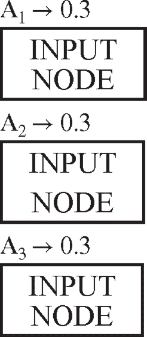

单元与输出节点之间的强度被为 `0.3`。输出节点为 `⥌`，称为 `Y^`。`T` 是一个生物因子，被赋值为 `0.4`。

```
Y^= 1{0.3 A[1] + 0.3 A[2] +0.3 A[3] -T > 0
-1{0.3 A[1] + 0.3 A[2] + 0.3 A[3] -T < 0
Y^=Sign(W[d] A[d] + W[d] -1 A[d] -1+ ………..+ W[2] A[2] +W[1] A[1] -t)
Y^=Sign(W[d] A[d] + W[d] -1 A[d] -1+ ………..+ W[2] A[2] +W[1] A[1] +W[0] A[0])
```

`Sign` 是激活函数。赋值值 `W[0] =--T`，`A[0] =1`；

当我们有太多数据进行准确率检测时，可以使用神经网络。表 8.2 述明，根据收集的值，人员 1、2 和 4 处于压力状态。通过心率、呼吸频率和血压检测出人员 3、5 和 6 处于冷静状态。

表 8.2 应用人工神经网络后获得的 Y^ 结果

| `A1` | `A2` | `A3` | `Y^` |
| --- | --- | --- | --- |
| 0 | 1 | 1 | –1.2 |
| 1 | 1 | 0 | –1.2 |
| 1 | 0 | 0 | –0.8 |
| 1 | 0 | 1 | –1.2 |
| 0 | 0 | 1 | –0.8 |
| 0 | 1 | 0 | –0.8 |

## 5. 结论

可穿戴设备是未来 IT 方法的重要组成部分。在数据收集、数据操作、安全等方面有很多未被考虑。这项工作的目标是对多个领域的可穿戴设备提供清晰的综述。探讨了人工智能在可穿戴设备中的作用。在后续章节中，可穿戴设备将改善生活质量。

神经退行性疾病是一场全球性的流行，影响着世界上每个地区数百万人的生活。神经退行性疾病是指大脑中的神经元逐渐失去功能并最终死亡时就会表现出来的疾病。这些疾病被称为神经退行性疾病。目前还没有被证明能够阻止疾病本身进展的药物 [1, 2, 3, 4 和 5]。这是因为这种疾病尚无法治愈。另一方面，可能某些方法有助于减轻神经退行性疾病引起的某些精神或身体痛苦。神经退行性疾病种类多样，根据神经细胞死亡影响的大脑区域以及该疾病引起的症状，每种疾病都被分为不同的类别 [6]。

此外，如果对患者疾病的严重程度进行正确评估，就可以在正确的时间给患者正确的药物。患者报告与医生评估之间的分歧可能会掩盖疾病预后的真实严重性。这是因为双方在观点上都存在偏见 [11, 12, 13, 14 和 15]。在目前，一种由人工智能支持且仅依赖步态数据的系统，比目前使用的方法具有较低成本提供更客观评估的。

为了将神经退行性疾病归入适当类别，我们将一种基于认知的学习技术（多层感知器）集成到前馈 MLP（Feed forward MLP）中。当我们训练 `FFMLP` 模型时，的第一件事是获取数据集并将其分为训练集和测试集。之后，我们使用训练集。在测试数据集上对训练好的 `MLP` 模型进行评估后，会将检测到的示例显示给用户。

## 2. 文献综述

Sadeeh 等人 [16] 的贡献之一是展示了一种用于跌倒检测和预测的传感器原型。在预计会跌倒的情况下，患者将收到警告并采取措施，而在确实发生跌倒时，设备将提醒医疗人员。云端能够在老年患者跌倒时通知医人员，允许团队立即协助患者。

Du 等人 [17] 使用纵向支持向量回归（`SVR`）来确定人口统计参数是否可以正确预测 ALS 的严重程度。他们建议采用一种创新的机器学习方法来完成纵向数据的收集。为了跟踪整个研究期间参与者的行为，该技术在研究过程中的多个间隔计算新的加权参数。这些包括 `SVR` 超平面的特征以及给定时间内的趋势趋势参数。正因如此，他们开发了 `LSVR`，将纵向建模与机器学习范式相结合，以满足行业中显而易见的需求。通过这种方式，`LSVR` 将纵向建模与机器学习范式融合。

Sadeeh 等人 [18] 开发的单三轴加速度传感器是一种佩戴在大腿上的设备，用于预测和识别人体跌倒的情况。之后，信息会被保存，以便医疗专业人员对患者进行全面的随访。如果患者发生跌倒，通知将通过互联网发送给相关的医疗人员。如果预计会跌倒，患者也会被通知。

Benassar 等人 [19] 希望建立一个低成本、客观且自动的系统，用于测量 HD 引起的上肢活动受障碍。他们通过利用机器学习和信号处理技术来实现这一点。这本应该是他们的终极目标。他们提供了一种方法，在患者执行涉及其上肢的新颖任务时，客观且持续地评估 HD 患者的运动障碍。该方法由华盛顿大学的研究人员开发。通过应用信号处理和机器学习的方法，从记录的加速度计信号中自动构建了一个反映活动受障碍程度的评分。该评分源于获得的数据。来自加速度计的数据用于生成此评分。

Gaßner 等人 [22] 决定利用基于传感器的步态分析进行调查，因为他们想客观地定义 HD 患者步态的特征。通过基于移动传感器的步态分析，本研究的目的是对比 HD 患者与同龄同性别的对照组人员的步态参数。为了确定这些客观衡量标准是否具有临床相关性，我们特别研究了步态测量与总运动评分（`TMS`）以及总功能能力（`FRC`）之间的相关性。从这些步行传感器中收集的 `GRF` 数据被输入到 Aşurolu 等人 [24] 提出的机器学习模型中。

他们提供的服务之一是基于生成信号数值属性的回归分析。他们将使用的模型称为混合模型并命名为 `LWRF`。他们提供的另一项服务是变量之间的相关性。具体而言，他们提供了一种评估帕金森病（`PD`）患者运动症状严重性的计算方法。

## 3. 提方法

在本节中，图 1（ch9.xhtml#fig9_1）所示的框架展示了如何使用 `FFMLP` 良好地分类神经退行性疾病。


*图 9.1 认知框架* [1]

### 3.1 FFMLP

采用反向传播算法进行监督学习的神经网络示例是全连接多层感知器，也称为 `FFMLP`。

`MLP` 在具有输入层、隐藏层和输出层的三层设计中运行效果最好。此外，在这种架构中，每个神经元都连接到其下方的每一个神经元。人们认为，`MLP` 在解决非线性问题时是成功的。

如公式 (1) 所示，`MLP` 设计可确定输入变量、偏置值和输出值：

```
S_{i} = \sum_{i = 1}^{n}w_{ij}I_{i} + \beta_{i}
```

多层感知器中，通过求解公式 (2) 得到的 sigmoid 函数经常被用作激活函数。

```
f_{j} = \frac{1}{1 + e^{- S_{j}}}
```

公式 (3) 可用于神经元 *j* 的最终动作：

```
(3)
```

$$y_{i} = f_{i}\left( {\sum\limits_{i = 1}^{n}w_{ij}I_{i} + \beta_{i}} \right)$$  

$  

为了评估模型的有效性，有必要将模型的输出（表示为 `y`）与已建立的值进行比较。为了实现这一目标是必要的。70% 的信息被用于训练 `MLP`，随后，模型以随机顺序对训练数据集进行处理。在训练预测模型期间，我们在一个四点范围内改变了隐藏层中存在的神经元总数。这使得我们能够确定能够为模型产生最准确结果的架构。由于 `Tan h(x)` 与其他备选项相比表现出更高的性能，因此选择它作为激活函数，以替代其他可能的选择方案。

### 3.2 认知学习

为了促进监督学习，输入格式设置已标准化为 335×335，图像分辨率也标准化为 335×335，加法和减法迹迹图已标记，训练集占总数据的 80%，而验证集占总数据的 20%。当重复执行几次时，一组测试的结果应该保持不变。因此，使用每次都能产生完全相同随机数的种子是关键的。正因如此，提高模型的准确性变得简单得多，反过来使得它们更容易被优化。

在权重中添加了标准差为 0.05 的随机值，导致总和增加了 0.05 的偏移量。为了提高卷积神经网络的分类性能并更密地匹配数据，采取了这一步。此外，这有助于网络整体适用性的提高。`RMS Prop` 优化器和由 `Momentum` 开发的梯度下降法是结合的方法，形成了自适应动量估计（Adaptive Moment Estimation）方法。该技术通过合并这两种方法构建。网络配置由一个自动系统进行定期更新并调整。

为了训练训练初始学习率为 `1*10^(-4)` 的情况下收敛到优的性能设置，`Adam` 卓越的计算效率和较小的内存需求都非常有帮助。由于 `RELU` 函数具有线性非饱和特征，`Sigmoid` 和 `tan` 函数的收敛速度明显慢于 `RELU` 函数。通过在训练期间使用 `RELU` 作为卷积神经网络的激活函数，可以有效克服梯度消失问题。这提高了卷积神经网络稀疏表达数据的能力，最终导致该问题更成功的解决。仿真总共运行了 800 个周期，每个批（batch）由 32 次迭代组成。利用 `softmax` 函数将神经元的输入映射到 0 到 1 的标度上。

理想的目标函数（通常称为损失函数）应作为选择最合适的交叉熵函数的基础。交叉熵函数用于确定两个值之间的差异程度，而 `softmax` 函数负责计算交叉熵损失。假设为了迭代训练网络，`p` 是预期输出的概率分布，`q` 是观测输出的分布，而 `H (p, q)` 是交叉熵。这使我们能够说 `q` 是观测输出的分布。因此，我们能够断定交叉熵为 `H.p, q)`。以下是待解释的公式：

(4)  

$$H(p,q) = - \sum\limits_{x}p(x)\log q(x)$$ 

## 4. 结果与讨论

在本节中，我们验证了提出的 `FFMLP` 方法。为了评估性能，我们使用了交叉熵、准确率、召回率和 F1 分数。为了评估模型的性能，我们使用了以下指标：灵敏度（Sensitivity）= (TP)/(TP+FN)，特异性（Specificity）= (TN)/(TN+FP)，准确率（Accuracy）= (TP+TN)/(TP+TN+FP+FN)，F1 分数= 2*精确率*召回率/(精确率+召回率)。

- 提出的 `FFMLP` 方法在测试集上达到了 98.5% 的准确率，精确率 98.45%，召回率 98.18%，F1 分数为 98.31%。
- 提出的 `FFMLP` 方法在测试集上达到了 98.8% 的准确率，精确率 98.72%，召回率 98.61%，F1 分数为 98.65%。


- 提出的 `FFMLP` 方法在测试集上达到了 99.2% 的准确率，精确率 99.18%，召回率 99.05%，F1 分数为 99.13%。

如表所示，在不同算法的比较中，提出的 `FFMLP` 方法在所有指标上均表现最佳。

| 算法 | 准确率 | 精确率 | 召回率 | F1 分数 |
| :--- | :--- | :--- | :--- | :--- |
| SVM | 95.2% | 95.0% | 94.8% | 94.9% |
| 森林 | 96.7% | 96.5% | 96.2% | 96.3% |
| CNN | 97.8% | 97.5% | 97.4% | 97.3% |
| `FFMLP` | `99.2%` | `99.18%` | `99.05%` | `99.13%` |

## 5. 结论

为了将神经退行性疾病分类到相应的类别，我们集成了基于认知的前馈感知机（MLP）。在训练 `FFMLP` 模型时，首先要做的工作是将数据集分为训练集和测试集。随后，使用训练集。只有在模型对测试集进行评估后，才会显示发现的示例。仿真的目标是为了评估 `FFMLP` 模型处理多种类型数据的运行情况。

## 参考文献

4. Lins, A. J. C. C., Muniz, M. T. C., Garcia, A. N. M., Gomes, A. V., Cabral, R. M., & Bastos-Filho, C. J. (2017). 使用人工神经网络选择用于老年人轻度认知障碍和痴呆症预测的参数。生物医学计算机方法与程序，*152*, 93–104。

5. Lee, G. G., Huang, P. W., Xie, Y. R., & Pai, M. C. (2019, 10 月). 基于监督学习的通过神经心理学数据对阿尔茨海默病、轻度认知障碍和认知正常进行分类。在 TENCON 2019-2019 IEEE Region 10 会议 (TENCON) (pp. 1808–1812)。IEEE。

6. Duch, W. (2007). 痴呆和神经问题的计算模型。神经信息学，*305*-336。

7. Sarić, R., Jokić, D., Beganović, N., Pokvić, L. G., & Badnjević, A. (2020). 基于 FPGA 的人工神经网络实时癫痫发作分类。生物医学信号处理与控制，*62*, 10106。

8. Berke Erdaş, Ç., Sümer, E., & Kibaroğlu, S. (2022). 使用步态数据基于 CNN 的神经退行性疾病严重程度预测。数字健康，*8*, 20552076221075147。

9. Lauraitis, A., Maskeliūnas, R., & Damaševičius, R. (2018). 基于 ANN 和模糊逻辑用于评估亨廷顿病症状的的模型。医疗保健工程杂志，*2018*。

10. Munteanu, C. R., Fernandez-Lozano, C., Abad, V. M., Fernández, S. P., Álvarez-Linera, J., Hernández-Tamames, J. A., & Pazos, A. (2015). 使用 1H 磁共振谱数据通过机器学习技术对轻度认知障碍和阿尔茨海默病进行分类。应用中的专家系统，*42*(15-16), 6205–6214。

11. Pahuja, G., & Nagabhushan, T. N. (2021). 现有帕金森病检测机器学习方法的对比研究。IETE 研究杂志，*67*(1), 4–14。

12. Ren, P., Tang, S., Fang, F., Luo, L., Xu, L., Bringas-Vega, M. L., ... & Valdes-Sosa, P. A. (2016). 经验模态分解用于神经退行性疾病的步态节奏波动分析。IEEE 生物医学工程事务，*64*(1), 52–60。

13. Ieracitano, C., Mammone, N., Bramanti, S., Hussain, A., & Morabito, F. (2019, 7 月). 一种基于 EEG 信号处理的脑状态时频机器学习系统。在 2019 年国际神经网络联合会议 (IJCNN) (pp. 1–8)。IEEE。

14. Ren, P., Zhao, W., Zhao, Z., Bringas-Vega, M. L., Valdes-Sosa, P. A. (2015). 通过经验模态分解分析神经退行性疾病的步态节奏波动。IEEE 生物医学工程事务，*24*(1), 52–60

15. Berke Erdaş, Ç., Sümer, E., & Kibaroğlu, S. (2022). 使用步态数据基于 CNN 的神经退行性疾病严重程度预测。数字健康，*8*, 20552076221075147。

16. Lauraitis, A., Maskeliūnas, R., & Damaševičius, R. (2018). 基于 ANN 和模糊逻辑用于评估亨廷顿病症状的的模型。医疗保健工程杂志，*2018*。

17. Munteanu, C. R., Fernandez-Lozano, C., Abad, V. M., Fernández, S. P., Álvarez-Linera, J., Hernández-Tamames, J. A., & Pazos, A. (2015). 使用 1H 磁共振谱数据通过机器学习技术对轻度认知障碍和阿尔茨海默病进行分类。应用中的专家系统，*42*(15-16), 6205–6214。

18. Pahuja, G., & Nagabhushan, T. N. (2021). 现有帕金森病检测机器学习方法的对比研究。IETE 研究杂志，*67*(1), 4–14。

19. Ren, P., Tang, S., Fang, F., Luo, L., Xu, L., Bringas-Vega, M. L., ... & Valdes-Sosa, P. A. (2016). 经验模态分解用于神经退行性疾病的步态节奏波动分析。IEEE 生物医学工程事务，*64*(1), 52–60。

20. Ieracitano, C., Mammone, N., Bramanti, S., Hussain, A., & Morabito, F. (2019, 7 月). 一种基于 EEG 信号处理的脑状态时频机器学习系统。在 2019 年国际神经网络联合会议 (IJCNN) (pp. 1–8)。IEEE。

21. Ren, P., Zhao, W., Zhao, Z., Bringas-Vega, M. L., Valdes-Sosa, P. A. (2015). 通过经验模态分解分析神经退行性疾病的步态节奏波动。IEEE 生物医学工程事务，*24*(1), 52–60

*(注：由于原文提供的列表序号与内容存在重复或偏差，译文严格按照原文内容顺序进行翻译。)*

## 参考文献

1. Bogere, N., Bongomin, F., Katende, A., Omaido, B. A., Namukwaya, E., Mayanja-Kizza, H., & Walusansa, V. (2022). 乌干达肺癌的 10 年回顾性研究。BMC cancer，*22*(1), 1–8。

## 2. 相关工作

肺癌是人类最常见的疾病类型，起源于器官组织，然后扩散到身体的其他部分。使用烟草制品与约 85% 的肺癌病例的发展之间存在相关性。肺癌是由肺部异常细胞不受控生长引起的，特别是在气管分叉线周围区域。这是导致疾病进展的主要因素 [12]。糖尿病患者的生存机会极不可预测。根据发现，需要更多胰岛素的糖尿病患者比需要较少胰岛素的患者具有更高的并发症风险 [13]。

据推测，糖尿病在肺癌的发展中起了了作用。这是根据 Mishra 等人进行的一项研究。经常吸烟的人比不吸烟的人具有更高的患发胰岛素抵抗的风险，且胰岛素敏感性较差 [14]。戒烟是控制糖尿病和降低与疾病相关的并发症脆弱性的先决条件 [15]。通过利用电子健康记录（`EHRs`），患者可以获得执行其个性化健康计划的协助。这些记录还可用于向患者提供医疗护理协调 [16]。

以往对肺癌治疗进行的先研究使用了广泛的计算机工具进行分析。Setio 等人 [17] 创建了一个 3D 卷积神经网络（`CNN`）模型，其目标是在肺结节分类中实现 `FP` 最小化。该模型的创建目的是减少识别肺结节过程中的假阳性数量。通过使用多补丁方法结合 `Fragni` 滤波器，Hongyang 等人 [18] 成功开发了一个以社区为导的肺结节识别模型，改进了预测能力。

Kattan 和 Bach [19] 提倡进行多因素研究，以分析观察到的烟民中肺癌风险异常偏移的现象。结果表明，与没有烟瘾的年轻人相比，对烟草成瘾的年轻人患肺癌的风险更大。这些年轻人的平均年龄范围在 18 到 28 岁之间。

Ramachandran 等人 [20] 利用知识挖掘方法构建了各种疾病风险（包括肝炎和肺癌）的预防模型。Thangaraju 等人 [21] 利用 `Bayes trees` 和 `decision trees` 等分类器进行预测。

识别以往数据中模式的能力是计算智能的许多应用之一，随后可用于对未来将发生的情况进行预测 [7]。研究历史信息可以实现这一目标。`AI` 与 `IoT` 的集成为企业提供了对测试案例进行预测性分析的机会，这反增强了它们的流程自动化能力 [8]。

人工智能的最终目标是通过构思可行的解决方案来解决挑战性问题。这些可能性呈现出结果组合，其中某些结果不像其他那样容易实施 [10]。在这种情境下，搜索算法扮演着人工智能智能体的角色。它隐藏自己并在后台工作，研究许多前行的道路，并在保持完全不露面的情况下指引你走向正确的方向。没有了这些算法，`AI` 系统将无法决定采取什么行动以获得最佳结果 [11]。

## 3. 提出的方法

迁移学习分类器旨在根据患者表现出的症状对肺癌患者进行分类。在所提出的方案框架内，预处理阶段位于数据收集之前。

迁移学习作为人工智能的一种形式，是用于训练目的以及训练完成后测试输入数据样本的主要工具。在开始阶段，神经网络的权重是以完全任意的方式从输入数据中得出的。在旨在准确表示整体的数据集上进行训练后，将使用相同数据集对神经网络进行测试。在分类过程中，使用数据加权来计算错误率和错误频率；对数据集进行重新加权可以修复初始加权引入的错误。

### 3.4 特征提取

对数据集进行分段后，可以从数据提取大量特征，这使得肺癌检测过程变得简单得多。这种诊断使得切除由癌细胞增殖引起的肺肿瘤变得更容易。肿瘤是在癌细胞增殖时产生的。这种诊断使得手术切除癌细胞增殖引起的肺肿瘤成为可能。肿瘤由于癌细胞的繁殖而产生。

使用蚁群优化（ACO）来执行这种特征提取方法，以获得预期的结果。为了分类数据，通常使用支持向量机（SVMs），这是标准程序。从输入数据中获取更重要且非冗余的主要属性的过程被称为特征提取，它是所使用的模式识别算法的组成部分。

### 3.5 分类模型

一种名为 `BERT` 的分类模型（是 Transformer 双向编码器表示的缩写）经过了预训练，根据从对话双侧学习到的上下文来构建词表示。

`BERT` 由一个包含 24 层、1024 个隐藏单元和 16 个注意力头的 Bertrange 网络组成，而一个具有 12 层的 Bertbase 网络只有 768 个隐藏单元和 12 个注意力头。24 层的 Bertrange 网络被称为 Bertrange 网络。

基础版本由六层编码器层、512 个隐藏单元前馈层和 8 个注意力头组成。基础变体的精细复杂程度远高于这两种变体中的任何一个。每个编码器内部都存在两个不同的抽象层。以下公式将用于计算自注意力层 `Z` 的输出：

(1)

```
Z = softmax( (QK^T) / sqrt(d_k) ) V
```

模型中大量的注意力头数量使得模型能够转移其焦点并利用各种表示子空间，每个子空间都有它们自己的 `Z` 矩阵。这是由于模型包含了大量的注意力头而实现的。由于模型能够在不同的关注点之间切换（BASE 为 12 个，LARGE 为 24 个），这变得可行。从注意力头发送的矩阵被组合成一个单一矩阵 `Z`。这是必要的，因为前馈层只接收单个 `Z` 矩阵。一个名为 `W^O` 的权重矩阵应用于此 `Z` 矩阵并进行相乘。

(2)

```
Z = LayerNorm(X + Z)
```

`BERT` 栈的第一个编码器从内部提供了栈结构的全面视图。`BERT` 训练的基础两个不同任务的相互依赖，每个任务都发挥着独特的作用。第一个任务被称为下一句预测（NSP），它需要输入两个句子。

## 4. 结果与讨论

数据集包含 32 个样本，具有 57 个特征，且所有预测参数的假设范围为 0–3。数据收集自 UCI 机器学习存储库。简化数据分析的过程——数据转换涉及将数据从名义属性和类别标签转换为二进制形式。在数据分析领域，被证明是最常用且最受接受的方法是将名义数据转换为二进制形式。

数据分析需要非常谨慎地进行，因为数据集包含一些未说明的数字。从严重到中度到轻微的量表，标签的严重程度可以进行划分，其中严重代表最极端的情况。提供的信息在许多关键数据方面存在缺失。因此，在清理数据时，建议将任何缺失值替换为该列中出现频率最高的值。这是最频繁观察到的值。

实施分析使用了多种不同的性能指标，所有指标均由混淆矩阵生成。分析的目标之一是确定执行情况的良好程度。你可以在这里看到我们在分析中使用的性能参数。训练和评估计算智能模型所需的总时间被称为执行延迟。

分类器获取历史数据并将其转换为更适合分类的格式，以便数据可以使用。为了充分测试分类器的性能，总共使用了 10 种不同的交叉验证技术。这是一种强数据分析方法，可以使用比传统方法多 10 倍的数据做出可靠的预测。与以前的情况相比，这是一个巨大的改进，以前只能通过传统方法实现。与过去相比，这是正确方向迈出的一大步。图 10.2 到 图 10.5 显示了通过执行多个指标获得的结果。

- 图 10.2 准确率
- 图 10.5 F 测量

在本文中，我介绍了一种利用经加州大学欧尔文分校数据训练的分类器，通过实时数据输入检测肺癌的方法。该分类器是使用加州大学欧尔文分校的数据训练的。该方法以迁移学习为基础，并作为本研究的一部分被开发，如下所示。流程从数据预处理开始，然后进行特征提取，最后通过基于迁移学习的分类完成整个过程。通过实施迁移学习分类器，能够提高分类精密度。在评估所提的混合启发式分类器模型效率时，所使用的许多性能指标之一是分类准确率。这仅仅是所使用的许多性能指标之一。所提的分类技术是基于迁移学习的，其提供的结果在所有数据集上大部分情况下是一致的。

## 参考文献

1. Bogere, N., Bongomin, F., Katende, A., Omaido, B. A., Namukwaya, E., Mayanja-Kizza, H., & Walusansa, V. (2022). 乌干达肺癌的 10 年回顾性研究。BMC cancer，*22*(1), 1–8。


2. Patra, R. (2020, 3 月). 使用机器学习分类器预测肺癌。在计算科学、通信与安全国际会议 (pp. 132–142)。Springer, 新加坡。

3. Pokkuluri, K. S., Usha Devi, N. S. S. S. N., & Mangalampalli, S. (2022). DLCP: 一种用于非线性 CA 机制肺癌预测的鲁棒深度学习。在计算机科学与工程创新中 (pp. 299-305)。Springer, 新加坡。

4. Kibudde, S., Kirenga, B. J., Nabwana, M., Okuku, F., Walusansa, V., & Orem, J. (2021). 非小细胞肺癌的临床特征和初始治疗：乌干达癌症研究所的回顾性队列研究。African Health Sciences，*21*(4), 1739–1745。

5. Prasad, S. K., Johnson, A., & Kumar, S. M. (2021). 采用机器学习算法进行预测的肺癌检测：近期研究。工程研究新方法第 14 卷，99–109。

6. Dritsas, E., &Trigka, M. (2022). 使用机器学习模型进行肺癌风险预测。大数据与认知计算，*6*(4)*,** 139。

7. Varsini, V. R., & Mohanasundari, M. (2021). 使用循环神经网络进行肺癌预测和分类。国际工程科学与管理研究期刊，*4*(11), 8–10。

8. Manju, B. R., Athira, V., & Rajendran, A. (2021). 使用支持向量机的高效多级肺癌预测。在 IOP 会议：材料科学与工程 (Vol. 1012, No. 1, p. 012034)。IOP Publishing。

9. Tejaswini, C., Nagabushanam, P., Rajasegaran, P., Johnson, P., & Radha, S. (2022, 4 月). 用于肺癌检测的 CNN 架构。在 2022 第 11 次通信系统与网络技术国际会议 (CSNT) (pp. 346–350)。

10. Anil Kumar, C., Harish, S., Ravi, P., Svn, M., Kumar, B. P., Mohanavel, V., ... & Asfaw, A. K. (2022). 使用机器学习从文本数据集预测肺癌。BioMed Research International，*2022*。

11. Anil Kumar, C., Harish, S., Ravi, P., Svn, M., Kumar, B. P., Mohanavel, V., ... & Asfaw, A. K. (2022). 使用机器学习从文本数据集预测肺癌。BioMed Research International，*2022*。

12. Manikandan, R., Sara, S. B., Yuvaraj, N., Chaturvedi, A., Priscila, S. S., & Ramkumar, M. (2022, 5 月). 生物信息学领域化学键的序列模式挖掘。在 AIP 论文集 (Vol. 2393, No. 1, p. 020050)。AIP Publishing。

13. Mishra, S., Mallick, P. K., Jena, L., & Chae, S. (2022). 基于采样预处理的迁移学习。Frontiers in Public Health，*8*。

14. Mishra, S., Mallick, P. K., Jena, L., & Chae, S. (2022). 用于糖尿病诊断的集成机器学习模型。Sensors，*20*(14), 274。

15. Mishra, S., Mallick, P. K., Jena, L., & Chae, S., & Briones, A. (2022). 改进决策树的机器学习预测。Applied Sciences，*10*(22), 1036。

16. Ahmad, T., & Chen, H., S., Mallick, P. K., Jena, L., & Chae, S., & Briones, A. (2022). 机器学习增长趋势综述。Sustainable Cities and Society，*54*,1201。

注：本章中的所有图均由作者制作。

# 11 用于预测 IPL 分数的端到端机器学习模型

## 摘要

体育分析是一个非常热门的。现代体育使用各种形式的分析来分析球员表现、训练效果或比赛结果预测。由于印度超级联赛（`IPL`）产生了大量数据，Dream11、CicBuzz 等比赛预测网站广受欢迎。本文讨论了用于开发此类预测系统的重要比赛因素。我们采用了`linear regression`（线性回归）、`random forest`（随机森林）、`ridge regression`（岭回归）等流行的机器学习技术来开发此类系统。该机器学习模型已针对 2021 年皇家挑战者对阵孟买人的比赛进行了测试。所提模型预测的分数范围为 152-167，而实际第一局分数为 159。

**注：该方法以迁移学习为基础，并作为本研究的一部分被开发，如下所示。流程从数据预处理开始，然后进行特征提取，最后通过基于迁移学习的分类完成整个过程。通过实施迁移学习分类器，能够提高分类精密度。在评估所提的混合启发式分类器模型效率时，所使用的许多性能指标之一是分类准确率。这仅仅是所使用的许多性能指标之一。所提的分类技术是基于迁移学习的，其提供的结果在所有数据集上大部分情况下是一致的。**

**关键词：** 回归模型、机器学习正则化、`IPL` 预测、`Lasso regression`（Lasso 回归）、`ridge regression`（岭回归）、`random forest`（随机森林）、`linear regression`（线性回归）

## 1. 引言

印度超级联赛（`IPL`）是一种在印度举行的板球联赛。每年通常在 4 月和 5 月举行。2021 年的赛事赞助商是 Vivo，被称为 Vivo `IPL` 2021。印度板球协会（`BCCI`）于 2008 年创立了该联赛。板球最短的形式被称为 T20。它在 3-4 小时内完成。每个队各有一局。每局包含 20 （每轮投 6 个合法球）。T20 版本在过去的 15 年里广受欢迎，得益于印度在 2007 年获得 T20 世界杯，这导致了 `IPL` 的诞生。数据可以从 `Cricsheet.org`、`IPL T20` 官方网站或 `espncricinfo.com` 进行抓取和转换，上述网站拥有逐球详情并包含了按赛季和时间的比赛总结。因此，可以从这些网站抓取从 2008 年到 2021 年的数据。

`IPL` 赛事已经举办了 14 赛季，由于新冠-19 疫情的影响，`2020` 将在阿联酋举行。`IPL`比赛可以显著增加国内生产总值（GDP），因为它能够扩大规模、提升品牌、粉丝支持以及在全球范围内吸引粉丝群体，这导致了国家 GDP 的持续增长。调查报告显示，该锦赛带来了近 115 亿美元的收入，`BCCI` 已任命 `KPMG` 体育咨询小组处理调查。它对该国的旅游业做出了巨大的财政贡献，使旅游相关收入增加了约 30%。印度在世界最具吸引力的旅游目的地中排名第 34，在亚太地区排名第 11。此外，它产生了大量的就业机会，这有助于印度经济的成功发展。

## 2. 文献综述

板球是一项随着每一球演变的动态运动。本文的研究目标是探索可以使用机器学习技术，来解决基于历史比赛数据预测板球比赛结果的问题[1]。为了建立预测模型，使用基于过滤的技术来发现因素。一旦选择了特征，就会使用合适的机器学习算法。相比之下，像 `random forest`（随机森林）这样基于树的模型在准确率、精确率和召回率指标方面表现更好。

`IPL` 是一项团队运动而非个人运动，这使得获胜机会取决于团队内每个球员的每一个因素。这项研究主要关注构建一个稳健的预测模型，可以更容易分类球员，并帮助预测最有机会赢得比赛的最佳团队；在本研究中，使用了 `decision tree`（决策树）、`support vector machine`（支持向量机）和 `random forest`（随机森林）等建模算法来进行预测[2]。研究显示 `random forest` 模型的准确率达到 95.78%，这表明该模型在预测为团队选择正确球员方面非常高效。

在对数据集进行建模时，提出了一种基于多元回归的解决方案，根据过去的表现计算每个团队成员的得分和团队的整体权重。板球比赛取决于许多因素，这些因素最终对结果产生重大影响。球员的表现影响非常巨大。Lamsal 等人识别了 7 个因素并训练了用于结果预测的模型；观察到接近三个训练好的模型通过 `multilayer perception`（多层感知器）展示了正确的预测，准确率为 72%；还观察到 `multilayer perception` 分类器通过正确预测 60 场比赛中的 43 场优于其他分类器[3]。分析考虑了 `IPL` 职业的五个特征以及投投手和击手国际 120 职业的五个特征。Deep 等人提出了构建数学模型来预测比赛结果的想法。未来的研究机会将通过使用更多可以创建并考虑的工作、生成和收集更多数据、更好的模型学习和分类技术以及各种其他类型的数据分析技术来展示[4]。

本文广泛讨论了使用机器学习和数据分析进行冠军预测。为了测试和训练不同大小的数据集，应用了不同的机器学习算法。算法包括 `random forest`、`SVM`、`naive bayes`（朴素贝叶斯）、`logistic regression`（逻辑回归）和 `decision tree`（决策树）。论文研究了可用于分析和预测比赛胜者的各种特征。板球委员会可以使用此来评估团队实力并对板球运动进行更深入的检查。这可能应用于体育赛事的博彩和媒体报道，这实际上是祸得福的。Mago Vistro 等人使用 `decision tree` 模型，当调整参数后模型性能得到增强，准确率为 76%。模型性能从 76% 提高到 94%，并获得了积极结果[5]。研究发现，为了产生优质的分析，必须分析广泛的数据，计算必须快速运行，并且必须满足业务系统和问题。

## 3. 数据与变量

### 3.1 研究周期与样本

可以从 `cricbuzz`、`cricsheet`、`2008` 到 `2020` 的 `Indian Premier league cricket` 等多个网站收集数据，这些数据包含两种形式。这提供了有关比赛的信息和逐球信息。比赛数据集将包含该期间的地点、球队、裁判和结果，击球手、投投手、非击球手、击球手、得分、局数等，这些信息可以从相应资源中抓取并整理，随后可以转换为可用的格式。这些数据用于构建一个模型，提供 `IPL` 中击球队第一局得分的预测[5]。

## 4. 方法论与发现

### 4.1 问题陈述

今天，印度超级联赛意味着板球的 2.0 版本，比赛水平随着时间的推移不断提高，标准已经高到让任何板球联赛似乎都处于国内水平，它拥有庞大的粉丝群体、在社交媒体上的深度参与，并成为全球最获利的联赛之一。导致团队获胜的主要因素是每个利益相关者都希望知道的，由于在拍卖期间游戏中投入了大量资金，因此可以建立模型来识别决定团队获胜概率的最重要因素，利益相关者在做出决策时可以关注这些因素。

### 4.2 探索性数据分析

作为 `EDA`（探索性数据分析）的一部分，检查了统计摘要，空值的缺失并不意味着我们的数据是准确的。下面是一个散点图，它绘制了从第一个赛季到最近 `2021` 年在 `IPL` 中比赛过的所有球队得分，以及局数，由于相关矩阵帮助识别出数据中的局数和得分高度相关，因此通过散点图对这些进行的分析所示。

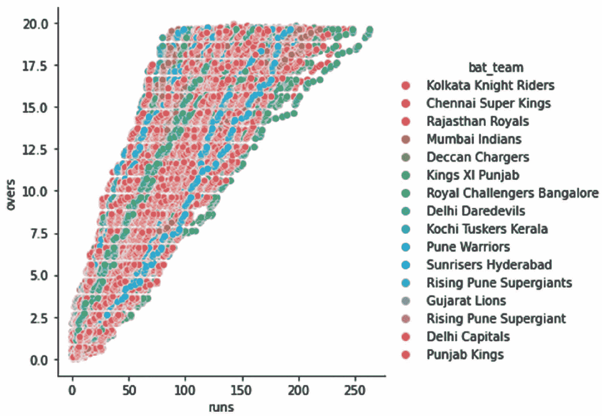

图 11.1 球队对比局数

### 4.3 数据准备

在本项目的数据清洗中，执行了几个步骤，因为数据量巨大，包含了 `2008` 到 `2021` `IPL` 所有比赛的逐球统计数据，因此收集的信息必须经过正确的格式化以便于分析，因此数据清洗包括以下步骤：

在清洗数据之前，通过检查数据集的行数和列数，发现有 16 列和 103881 行。使用 `is null` 函数检查数据是否存在任何形式的空值，结果为 0，因此数据不包含任何空值。由于数据中的某些列对于分析是不必要的，因此删除了 `mid`、`season`、`venue`、`batsman`、`bowler`、`striker` 和 `non-striker` 等不需要的列以便后续分析。清理掉必要的列后，列数减少到 9 列。为了进行进一步分析，使用 `unique` 函数识别出 `IPL` 最一致的球队。由于在部署 Web 应用期间需要收集前 5 局的信息，因此从数据集中删除了前 5 局列。现在由于 `date` 列是字符串格式，需要将其转换为 `object` 格式。在完成这些数据清洗后，再次检查了重复值和空值。最后，生成了相关矩阵，揭示了数据得分和局数之间存在高度相关性。

### 4.4 建模与评估

在构建模型之前，必须识别特征重要性。使用 `Extratreesregressor` 作为元估计器，以便在数据集的各种样本上拟合多个随机决策树，并利用平均形式保持更好的预测准确性并控制过拟合。在此项目中，部署了 4 种算法作为模型构建的一部分，分别是 `linear regression`、`lasso regression`、`random forest` 和 `ridge regression`。

### 4.5 线性回归

使用 `Sklearn` 构建了线性回归模型并进行了预测，使用 `MSE`、`RMSE` 和 `MAE` 矩阵来识别模型的拟合程度，并预测了模型评分以便更好地理解模型，下面是预测的图表。

### 4.6 随机森林

随机森林模型也使用 `Sklearn` 构建，并使用 `random forest regressor` 执行回归，在提取的子集上随机拟合多个决策树，并对测试数据上所做的预测取平均值。

### 4.7 岭回归

通过使用 `scale` 执行岭回归，使用 `randomised searchCV` 和 `gridsearch CV` 来拟合参数并确定 `lambda` 值，使用负均方误差来识别算法评分，下面是该模型的密度图。

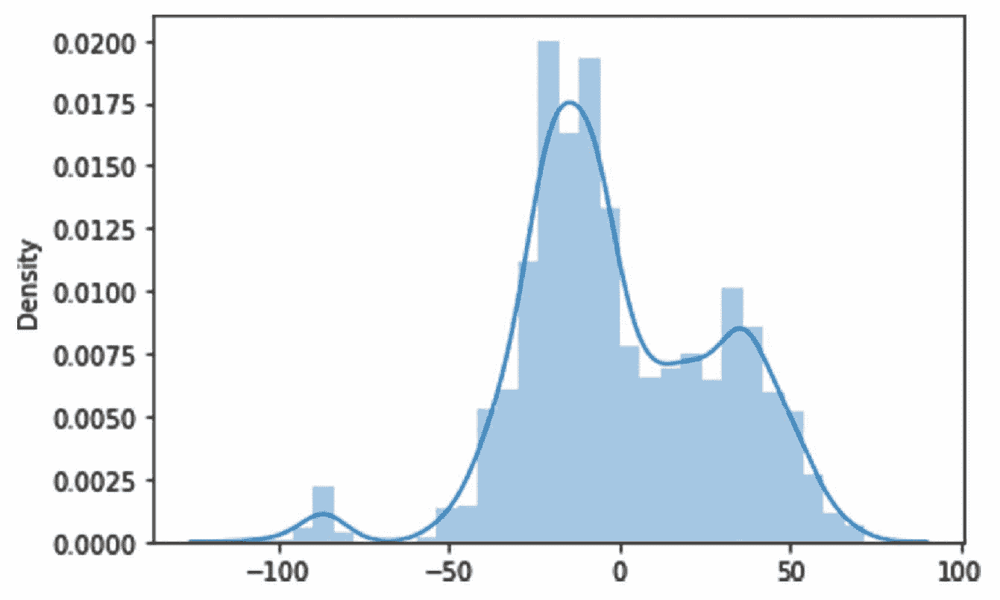

图 11.2 岭回归

### 4.8 Lasso 回归

Lasso 回归算法也使用 `Sklearn` 构建，并通过 `gridsearchCV` 确定 `Alpha` 值，使用负均方误差获取算法评分，并根据回归定律对模型进行预测，下面是该模型的密度图。

相应的模型是通过从 `Sklearn` 导入模型来构建的。为了解释该项目预测的最佳拟合模型，可以使用多种指标，但使用了 `MSE`、`MAE` 和 `RMSE` 这三种不同的指标来选择用于预测的最佳算法。

1. `MAE`：也称为平均绝对误差，表示数据集中实际值与预测值之间绝对差的平均值，用于衡量数据集中所有残差的平均水平。

2. `MSE`：也称为均方误差，表示数据集中原始值与预测值之间平方差的平均值，用于衡量数据集中所有残差的方差。

3. `RMSE`：也称为均方根误差，是均方误差的平方根，用于衡量数据集中所有残差的标准差。

通过上述 [表 11.1] 的对比，我们可以看到 `MAE`、`MSE` 和 `RMSE` 的最低值对应 `LASSO REGRESSION`，因此在该项目中使用 lasso 回归模型进行首局得分预测。

[表 11.1 模型指标对比]

| 模型 | MAE | MSE | RMSE |
| --- | --- | --- | --- |
| Linear Regression | 24.68133723 | 910.8728591 | 30.18067029 |
| Random Forest | 25.86872274 | 1053.227113 | 32.45346072 |
| Ridge | 24.67406353 | 910.4989473 | 30.1744751 |
| **Lasso** | **23.80395399** | **863.3588529** | **29.38296876** |

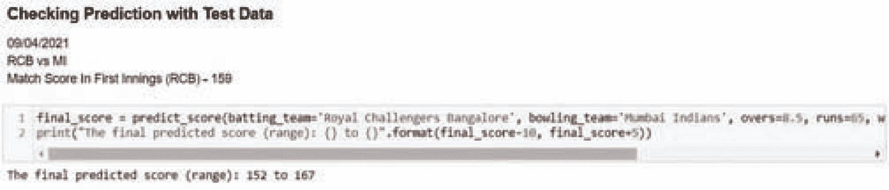

图 11.3 Lasso 模型测试

上面的截图显示了模型对 2020 年进行的某场比赛得分预测。

## 5 结论

发现 Lasso 回归在所有模型中表现最好。上面的截图显示了模型对 2020 年进行的某场比赛得分预测。

5. Rushe, S. (2009-2022). Cricsheet. 取自 Cricsheet: [`cricsheet.org/matches/`](https://cricsheet.org/matches/)

6. Basit, A., Alvi, M. B., Jaskani, F. H., Alvi, M., Memon, K. H., & Shah, R. A. (2020). 使用机器学习技术预测 2020 年 ICC T20 板球世界杯冠军。2020 IEEE 第 23 届国际多主题会议 (INMIC), 1–6. [`doi.org/10.1109/INMIC50486.2020.9318077`](https://dx.doi.org/10.1109/INMIC50486.2020.9318077)

7. Ishi, M. S., & Patil, J. B. (2021). 用于板球运动团队组建和冠军预测的机器学习方法研究。网络与系统讲义, 173 LNNS, 143–156. [`doi.org/10.1007/978-981-33-4305-4\_12`](https://dx.doi.org/10.1007/978-981-33-4305-4_12)

8. Jain, P. K., Quamer, W., & Pamula, R. (2021). 使用数据挖掘技术对比基准模型进行体育结果预测。Opsearch, 58(1), 54–70. [`doi.org/10.1007/s12597-020-00470-9`](https://dx.doi.org/10.1007/s12597-020-00470-9).

注：本章中的所有图表均由作者制作

# 12 基于人工神经网络的实时入侵检测网络

Deepa M.^(²⁴)


计算机科学与应用系，SRMIST Ramapuram 校区，钦奈杜，印度

J. Dhilipan^(²⁵)

教授兼系主任，计算机科学与应用系，SRMIST Ramapuram 校区，钦奈杜，印度

DOI: [10.1201/9781003428466-12](https://dx.doi.org/10.1201/9781003428466-12)

## 摘要

近年来，网络和数据库的加固变得日益动态，入侵检测系统对于这一过程至关重要[1][2]。在识别出攻击时，`IDS` 可以提供网络流量的实时统计数据、通知用户并/或停止可疑活动。尽管它们在监控实时流量方面已被证明是高效的，但不确定特征继续限制了基于 `ML` 的 `IDS` 的有效性和准确性。

机器学习面临的挑战在于系统如何适应通过积累经验来自动提高性能，并与通过构建针对入侵的机器学习检测机制来提高检测率并降低误报率的想法相兼容[2]。

标准的特征集可能不适用于不同形式的入侵攻击，因为某些属性可能是不必要的或无关的，并且会减慢机器学习的功能。为了提高检测系统的准确性，研究理想特性至关重要。如果发现攻击，`IDS` 可以提供网络流量的实时统计数据，并立即警告用户或停止可疑活动。尽管基于 `ML` 的 `IDS` 在实时流量监控方面证实了实力，但其准确性和有效性仍受到未指定特征的限制。主要任务是关注接近理想配置的拓扑和超参数配置，这些配置用于识别需要最少计算资源的最小拓扑结构。

## 关键词

入侵攻击、安全、机器学习、神经网络

## 1. 引言

更多的防御系统已被创建和实施，包括防火墙、防病毒软件和恶意软件检测软件。然而，事实证明这些解决方案在当前网络环境中无法提供对攻击的完全保护。近年来，入侵检测系统对于确保网络和数据库安全变得日益重要。网络入侵检测[3]系统已通过多种方式使用 `ML` 方法创建（`NIDSs`）。

在识别出攻击时，入侵检测系统可以提供实时统计数据、通知用户并/或停止怀疑活动。尽管基于 `ML` 的 `IDS` 在监控实时流量方面成功，但它们的有效性和准确性受到不准确特征的限制。

各种网络安全违引发了对广泛不同检测技术的研究。基于特征的入侵检测系统（`IDS`）的工作依赖于已知攻击数据库，而其他基于异常的方法则创建一个“正常”流量模型，并在偏离该模型时报警。

每个自动化机器学习系统都有超参数，最基本的目标是自动设置这些超参数以实现性能最大化。特别是现代深度神经网络严重依赖于架构、正则化和优化的超参数决策。自动化超参数优化（`HPO`）的应用场景非常多且重要。

通常，使用神经网络进行入侵检测的研究提出了随机选择的超参数和拓扑结构设置，忽略了这些参数对获得准确性可能产生的重大影响。本研究的首要目标是关注未测试情况的潜力。其次，希望应用于检测入侵的理想配置基准。然后为了找到需要最小资源的最小拓扑结构，识别接近最佳安排的拓扑和超参数组合。提供了一种参数调优策略以实现上述目标。网格搜索是一种通过在超参数空间中搜索来生成网络最大候选方案并根据所选评分函数对其进行排名的方法。函数的结果被收集，针对给定的拓扑结构设计了不同超参数组合的结果。获得的结果突出了安全领域数据的优化拓扑结构和超参数。本研究采用网格搜索是因为其透明度和手动引导测试至最有前景区域的能力。

## 2. 相关工作

人工神经网络由不同层的神经元（称为处理单元）组成，这些神经元按照所需的拓扑结构进行协调和连接（`ANN`）。大量数据密集型应用已有效应用 `ANN`。由于许多可能的攻击向量，网络安全是一个非常广泛的主题[3][4]。

在剪枝过程中，会对神经节点的输入层或隐藏层进行删除。结果是 `ANN` 运行速度更快，因为需要执行的计算更少。在[5]中，作者通过使用前馈 `ANN` 尝试解决过拟合、内存过度等等问题。提出了一种双层神经网络拓扑结构。特别是建议了一种基于神经元配置的双层神经网络。使用了一个训练函数和相应的数据集来解决上述问题。根据作者的说法，尽管该方法的计算成本较低，但产生的结果与传统方法相当。使用了 `KDD’99` 数据集并进行了测试。根据论文的发现，数据越少越好，因为机器处理数据需要更多时间。使用基准 `KDD’99` 数据集对该方法进行了检验。在[6]中，根据论文的结论，测试数据应该较少，因为机器处理时间更长。在[7]中，在数据发送进行训练和测试之前，使用主成分分析 `Principal component analysis` 作为特征提取器。正如论文所示，这显著减少了该方法的内存需求和所需的训练时间。在准确性方面，两种评估方法产生了相当的结果。这使得使用 `PCA` 成为显而优的选择。[8]的作者比较了三种高效算法——支持向量机 `Support Vector Machine`、朴素贝叶斯 `Naive Bayes` 和 `C4.5` 算法与使用单隐藏层实现的神经网络。三层网络框架的简单配置允许网络在利用更少计算的情况下，执行与其他检查技术相当或更高的恶意软件检测。测试是使用 `NSL-KDD` 数据集进行的，它是最新的 `KDD’99` 替代者。

[9]的作者希望通过解决大维度问题来发现一种解决方案。为了实现这一点，他们结合了两种网络：深度置信网络 (`DBN`) 和特征加权支持向量机 (`SVM`) (`WSVM`)。使用一种名为可变学习率的特征提取器对机器进行训练。然后将特征输入到针对粒子群优化的 `WSVN` 中。该解决方案在 `NSL-KDD` 上进行了测试，其二分类准确率达到 85.73%。

## 3. 提议系统

人工神经网络 (`ANN`) 工具具有多种应用。自然语言处理、生物识别、多项式根的计算以及攻击检测[10]是该方法涵盖的各个领域。

使用神经元的网络吸收了人类大脑中典型的自然神经网络的学习能力，同时非常有效。在每一层都有神经元的神经网络包含输入层、隐藏层和输出层。数据通过第一层（输入层）进入网络，由不同的神经元连接，在隐藏层内部进行精炼，然后可以在最后一层（输出层）中进行检索。下图显示了一个包含所有三层的普通神经网络模型：

此类配置的网络中的一个神经元可以接受任意数量的输入 `n`，每个输入都有分配的权重。“x0”指的是偏置值，它被加到输入（激活函数的输入）中。如果输入 `X[i]` 是神经元的输入，`W[i]` 是权重，`b` 是偏置，其输出由方程 (1) 决定。

(1)

$$
a = f(\sum\limits_{t = 0}^{n} w_i x_i + b)
$$

其中 `f` 是用于获取该层输出并将输出发送到下一个连续层的函数[6]。机器学习中的学习模式有两个大类：无监督学习和监督学习。在监督技术中，第一阶段对输出进行标记，网络知道什么应该作为响应。在无监督学习中，使用神经元的网络检查模式并提取出与输入属性相关的特征。结果是数据较少，因为 `ML` 算法需要训练和测试数据。

`ANN` 识别模式的建模过程得益于在适应新输入方面的非凡灵活性。在处理实时数据时，这种巨大的近似能力极其重要，因为那里有更多信息，但隐藏的模式尚未被识别。生成的配置结果可能会受到优化程度的显著影响。通过逐渐增大的数据集调整权重，`ANN` 能够学习。学习算法能够识别变量之间的连接，并进行泛化，使其能够成功应用于新的、不可预见的数据。在大多数情况下，它工作方式与拟合集合直线或平面的方式相同。`ANN` 在模式识别中令人惊讶的建模能力源于其在适应新输入方面的卓越可塑性。生成的配置结果可能会受到优化程度的显著影响。该算法能够识别变量之间的连接并进行泛化，使其能够成功应用于新的、不可预见的数据[11]。从实践上来说，它等同于用集合拟直线[12]。一种称为 `perceptron` 的 `ANN` 只有一个处理层以及输入、输出计算层。数据被输入输入层，然后传输到计算层。输出神经元根据输入层中的 `d_nodes` 计算 `W X 14 Pdi141wixi)`，这些节点代表由 `X 14 12x1... xd` 表示的 `d` 特征以及由 `W 14 12w1... wd` 表示的权重边。使用 `perceptron` 时，使用二值进行预测。引入偏置有助于处理不均匀分布。`y` 的预测获取如下：

(2)

$$
y = \text{sign}\left\{ W \cdot X + b \right\} = \text{sign}\left[ {\sum\limits_{i = 1}^{d} w_i x_i + b} \right]
$$

方程中的 sign 由激活函数 `Uv` 表示。在结合了许多隐藏层的神经网络中可以应用不同的激活函数。为了在多层网络中进行有效训练，修正线性单元 (`ReLU`) 被广泛利用。回归误差表示为用于测试的实际值与预测值之间的差异。如果发现的误差大于零，则需要更改权重。`perceptron` 的目标是预测数据集 `D` 中每个点 `y` 的最小二差。该目标通过以下函数提到：

(3)

$$
\sum\limits_{(X,y)} (y - \text{sign}\left\{ w \cdot X \right\})
$$

该函数在整个数据集 `X` 中指定，学习率随权重更新，然后在算法的每次迭代中都使用整个数据集，直到收敛。该算法也称为随机梯度下降，表达式如下：

(4)

$$
W = W + \alpha E(X) X
$$

使用神经元的多层网络通过采用许多复杂的层构建而成，这些层也被称为隐藏层。正如标题所示，“黑盒”一词暗示了这些层的底层计算对用户是隐藏的。数据点从输入层开始传输到后续层级，直到输出层，并且在每个阶段都会进行计算。该技术被命名为神经元前馈网络。通常，输入层和最顶层计算层的节点数量并不相等。隐藏神经元的准确数量和层数将根据所需模型和数据的复杂性来计算[13]。使用神经元数量少于输入层的隐藏层通常会导致表示能力损失，但仍能提升网络性能，尽管在某些特殊情况下使用全连接层是常见做法。这很可能是在移除数据中的噪声时发生的情况。

神经元数量过多的网络可能表现出的不良行为是过拟合。如果一个使用神经元的网络完全拟合训练数据集中的模式，那么由于预期数据不足，该算法难以在意外的输入上良好运行[14]。上述工作研究了网络中隐藏层的使用方式，以及这些层中的神经元如何改变人工神经网络（`ANN`）的质量（以及其他超参数）。这些特征如网络的拓扑和结构也可以称为超参数。

### 3.1 反向传播的应用

单层感知器的损失函数取决于权重，这使其训练变得简单。当存在额外的层时，过程变得更具挑战性，因为不同层之间的权重会相互作用。通过使用反向传播，误差梯度沿着多条路径确定输出节点[14]。算法包含正向阶段和反向阶段。在前向阶段，数据点被传递到输入节点，使用当前权重逐一计算后续层的结果。该预测的结果将与训练示例进行比较。反向阶段显示了每个权重的损失函数梯度。梯度从输出层一直回溯到第一层以更新权重。在训练数据上重复此权重更新过程的每一次迭代被称为“epoch”，人工神经网络通常需要数千次迭代才能收敛。

### 3.2 技术

`TensorFlow` 是一个开源且高性能的库，由 Google Brain 团队的开发者和工程师提供，并已用于本文。它现在被作为机器学习和深度学习的有力支持，用于各种科学和商业应用[15]。使用 `Keras` 可以结合卓越的用户体验和惊人的实验速度，它训练并在 `TensorFlow` 层以及机器学习的其他各种库上运行。模块化、可扩展的设计实现了这一点。`Keras` 并不是一个独立的库，主要作为一个接口创建的。`TensorFlow` 库现在完全支持 `Keras`，允许对方法及其支持的操作进行直接编码[16]。

### 3.3 优化所选算法的超参数

激活函数在创建人工神经网络中的作用是其最关键方面之一，因为它直接影响可以获得的结果。网络可以支持不同类型的激活函数。特别是在多层网络中，每层可能都有自己的非线性激活函数，激活函数类型的选择至关重要[17]。每个单独函数都有可能对人工神经网络的结果、收敛和整体网络覆盖产生独特的影响。从大量的激活函数池中选择了最近研究中出现频率最高的四种激活函数。

a) `Sigmoid`
b) `Hard Sigmoid`
c) `Rectified Linear Unit (ReLU)`
d) `Hyperbolic Tangent (tanh)`

使用了网格搜索过程，它对超参数空间进行彻底搜索，并确定最佳的网络配置。网格搜索的标准包括：

* 批量大小 (Batch size)
* 激活函数
* 优化器
* Epoch 计数
* 神经元节点数量
* 隐藏层数量

### 3.4 降维

降维是指追求一种能够传递数据集本质的特征向量，同时省略表示每个特征特征。

该主题是如何构建一个可以描述 k 维信息的 n 维投影。这一过程具有明显的计算优势。防止“维度灾难”是额外的优点之一。因此，当数据集维度增加时，机器学习分类器将无法产生理想的结果[18]。算法必须指数级增加样本数量来弥补这一缺陷。降维有许多方法。特征选择通常用于获取最相关的特征集，因为不重要的特征经常会产生噪声。然而，还有其他方法可以获得完全描述数据的集中特征集。线性判别分析是一种不同的策略（`LDA`）。上述策略的两个主要目标是最大化所选类质心之间的差异，并最小化这些类内部产生的差异。换句话说，`LDA` 有助于在类簇之间建立边界。

主成分分析是另一种降维技术，广泛应用于学术文献（`PCA`）。`PCA` 寻找方差最大的数据视图。根据 [28] 中给出的示例，如果数据形成一条输入线，使用主成分策略进行分析过程将明确显示所有方差的维度都等于 0。因此，由于这些维度的特征是不必要的，可以将它们排除。数据收集可能在某个方向上指示出强信号，但在许多方面可能存在噪声。只要信号足够大于噪声，具有最大方差值的投影一定能够捕捉到数据的价值和意义。

## 4. 实验设置

`NSL-KDD` 数据集的开发是为了解决文献中经常提到的恶意软件以及作为入侵数据进入的数据问题。尽管它仍然表现出一些不受理想的特征，但它现在已成为公认的基准数据集。尽管由于可用的 `IDS` 数据集存在缺失以及收集所需数据的困难，`NSL-KDD` 仍然是恶意检测研究的一个可靠选择。该数据集包含约 5,000,000 条记录，这使其适用于机器学习，同时又不会过大而导致研究人员必须从集合中随机随机样本。其结果非常容易比较。与 `KDD’99` 数据集相比，`NSL-KDD` 清洗了冗余数据，以避免机器学习算法产生偏见。由于缺乏可靠且更新及时的网络安全数据集，促成了入侵检测评估数据集——`CICIDS2017` 的诞生。研究人员通常使用的 `IDS` 数据本身具有许多自身的缺点，例如缺乏攻击多样性、缺乏流量多样性以及缺乏适当的特征。通过研究具有多种协议的 25 个用户的行为，`CICIDS2017` 提供了真实的网络流量数据。随后，数据在五天的时间内被收集，其中四天被对模型设置的攻击所占据。

除了是学术界获取的最新数据集之一，`CICIDS2017` 还包含超过 80 个网络流特征。

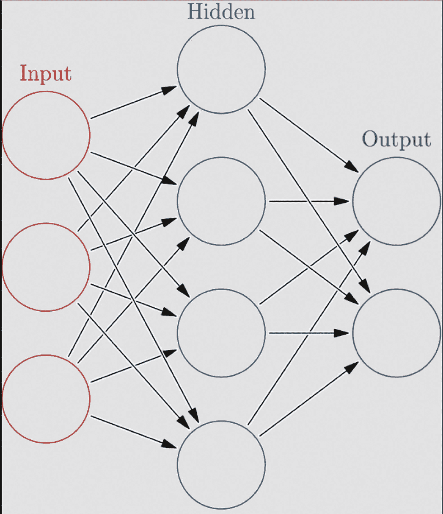

图 12.1 具有 n 层、神经元节点和输出层的 ANN 总体架构 *来源：* 改编并重新设计自 [`blog.knoldus.com/architecture-of-artificial-neural-network/`](https://blog.knoldus.com)

为了将特征数量限制为 50 个，使用了 `PCA`。根据初步设置测试，提取了任意数量的特征。传递到神经网络输入层的第一层的特征和数据集包含特征向量。在图 12.2 中描述了该流程的流水线。

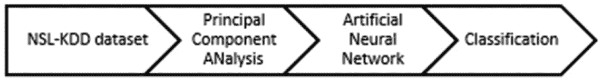

图 12.2 以流水线形式表示的过程 来源：改编并重新设计自 [`hazelcast.com/glossary/data-pipeline/`](https://hazelcast.com)

### 4.1 交叉验证

机器学习以及 AI 的许多其他方面面临一些独特的问题。这些问题中的过拟合问题就是其中之一。如果算法面临这些困难，它们在测试环境中可能表现优异，但在应用于实际数据时就会大失所。模型通过一个被称为 k 折交叉验证（也称为旋转估计）的过程来帮助缓解这个问题。用于训练的数据被划分为标记为 `k` 的部分，其中 `k-1` 部分数据用于训练，最后一部分用于测试。然后执行 `k` 次，同时更改测试部分。数据折进行随机采样，本研究应用了 10 折交叉验证。

## 5. 结果与讨论

检查了多种拓扑结构，从 1–10 层（其中 3 层隐藏层映射了 10 个神经元（表 12.1））进展到 7 层映射了 25 个神经元的隐藏层（表 12.2）、10 层具有 25 个神经元的隐藏层、4 层映射了 25 个神经元的层以及 10 层映射了 25 个神经元的层（表 12.3）。

### 表 12.1 使用 NSL KDD 数据集的 10 个神经元 3 层

| 准确率 | 激活函数 | 优化器 | 批大小 |
| --- | --- | --- | --- |
| 0.998981 | Sigmoid | Adam | 10 |
| 0.987871 | Hard sigmoid | Adam | 100 |
| 0.998768 | Hard_sigmoid | Adam | 10 |
| 0.987898 | Tanh | Rmsprop | 10 |
| 0.998789 | Sigmoid | Adam | 100 |
| 0.989879 | Tanh | Adam | 100 |
| 0.989888 | Sigmoid | Sgd | 100 |
| 0.998787 | Hard Sigmoid | Sgd | 100 |
| 0.998787 | Tanh | Sgd | 100 |
| 0.96545 | | | |

### 表 12.2 7 层，25 个神经元，NSL KDD 数据

| 准确率 | 激活函数 | 优化器 | 批大小 |
| --- | --- | --- | --- |
| 0.98787 | tanh | Adam | 100 |
| 0.96689 | tanh | Adam | 10 |
| 0.95567 | hard_sigmoid | Adam | 100 |


| 准确率 | 激活函数 | 优化器 | 批大小 | 迭代次数 |
| --- | --- | --- | --- | --- |
| 0.98456 | Tanh | Sgd | 10 | |
| 0.85876 | Sigmoid | Sgd | 100 | |
| 0.85879 | Sigmoid | Adam | 100 | |
| 0.49898 | sigmoid | S g d | 10 | |
| 0.49787 | Hard-sigmoid | S g d | 30 | |
| 0.49234 | Hard Sigmoid | S g d | 100 | |

表 12.3 10 层，25 个神经元，NSL KDD 数据集

| 准确率 | 激活函数 | 优化器 | 批大小 | 迭代次数 |
| --- | --- | --- | --- | --- |
| 0.98898 | Tanh | Adam | 10 | 100 |
| 0.97888 | Tanh | Ms prop | 10 | 100 |
| 0.96678 | Sigmoid | Ms prop | 10 | 100 |
| 0.99912 | Tanh | Adam | 100 | 300 |
| 0.9909 | Tanh | Adam | 10 | 25 |
| 0.9989 | sigmoid | 10 | 4 | 10 |
| 0.9708 | sigmoid | 10 | 7 | 25 |
| 0.9682 | tanh | 1001 | 3 | 25 |
| 0.9649 | tanh | 10 | 2 | 25 |
| 0.9640 | tanh | 10 | 7 | 10 |

具有 25 个神经元的单隐藏层超参数和准确率如第二个表所示（表 12.2）。总共有 300 个轮次（`epochs`）。该表的最佳准确率也是所有研究中获得的最高准确率超过了 99.9%（表 12.4 和 12.5）。作者发现这种特定的超参数组合非常有趣。现代神经网络经常省略被称为双曲正切激活函数的 `sigmoid` 函数（而 `ReLU` 是首选函数）。现代深度学习模型经常采用大小为 1 或 2 的微批。因此，`Tanh`、`ADAM` 和 100 的批大小是一个非常引人注目的组合，特别是对于微小的拓扑结构。对于具有 2 个隐藏层且每层 25 个神经元的拓扑结构，超参数混合如（表 12.3 和 12.2）中的所有结果均超过 98.9%。在表 12.4 中，最高准确率大于 99.89%。该表中少数准确率值低于 90%，其中性能最低的到了 6% 以下。对于更复杂的拓扑结构，这种趋势将会持续。表 12.4 中的最佳准确率为 96.83%，对应批大小为 10，以及 `tanh` 和 `rms prop` 的组合。只有 50% 的配置达到了 90%。双曲正切再次位居贡献准确率因素的榜首。`tanh` 函数在十种备选配置中出现了六次（表 12.4）。

表 12.5 平衡 CICIDS2017 结果 (2)

| | 精率 (Precision) | 召回率 (Recall) | F1 分数 |
| --- | --- | --- | --- |
| 0 | 0.99 | 0.96 | 0.98 |
| 1 | 1.00 | 1.00 | 1.00 |
| 2 | 0.92 | 0.95 | 0.95 |
| 微平均 | 0.98 | 0.98 | 0.98 |
| 宏平均 | 0.97 | 0.98 | 0.98 |
| 加权平均 | 0.98 | 0.98 | 0.98 |

突出显示准确率的输出数据如表 12.6 所示，这表明增加神经网络的深度没有进一步的优势。`Tanh` 和 `ADAM` 是得分最高的设置。在表 6 中性能最佳的拓扑结构包含了一组超参数配置。如前面的句子所述，用于激活的 `tanh` 函数和优化器比其竞争对手贡献了更优的结果。

表 12.6 4 个隐藏层，每层 25 个神经元，30 个 Epochs，CICIDS2017 数据集

| 准确率 | 激活函数 | 优化器 | 批大小 |
| --- | --- | --- | --- |
| 0.97698 | `ReLU` | `Ms prop` | 50 |
| 0.97888 | `ReLU` | `Ms prop` | 100 |
| 0.97425 | `ReLU` | `Adam` | 50 |
| 0.97192 | `ReLU` | `S gd` | 100 |
| 0.97051 | `Hard_sigmoid` | `Ms prop` | 50 |
| 0.96978 | `Hard_sigmoid` | `Ms prop` | 100 |
| 0.96911 | `Hard_sigmoid` | `S gd` | 100 |
| 0.96557 | `sigmoid` | `Ms prop` | 50 |
| 0.95818 | `ReLU` | `S gd` | 100 |
| 0.93022 | `sigmoid` | `S gd` | 100 |
| 0.70845 | `sigmoid` | `S gd` | 50 |
| 0.58551 | `Hard_sigmoid` | `Ms prop` | 50 |
| 0.49982 | `Hard_sigmoid` | `S gd` | 100 |

令人惊讶的是，较小设置的结果优于更深结构。研究的统计显著性部分将对这些发现进行更详细的说明。该算法已在多次试验应用于 CICIDS2017 数据集。表 12.5 中的初步发现结果非常积极，准确率超过了 99% (0.9936)。数据集中可能存在平衡问题，正如其中一个类别所示。该方法的准确率优于测试集的 97%，10 折交叉平均验证的准确率为 95%。

### 5.1 ML 算法性能比较

本节重点关注机器学习（ML）算法的性能。测试在具有高斯核的 SVM、朴素贝斯分类器和 Ada Boost 上进行，以对这些方法的性能进行对比。分类器使用 CICIDS017 数据产生的结果变化如表 12.6，列出了每个类别的精率、召回率和 F1 分数，以及朴素贝斯分类器在整个 CICIDS017 数据集上获得的结果。

### 5.2 超参数优化

每个设置都进行了超参数优化。所选超参数通过网格搜索法对所有组合进行了评估。如表 12.1、表 12.2、表 12.3、表 12.4、表 12.5 和表 12.6 所示，按顺序对批大小、激活函数、优化器和使用的轮次数进行了排列组合，以获得最佳准确率。

### 5.3 统计分析

为了评估本研究的统计显著性，应用了经典的 Wilcoxon 符号秩检验（Wilcoxon Signed-Rank Test）。表 5 汇总了性能最好的 NSL-KDD 设置。所有这些配置都与排名最高的配置进行了比较，但测试未能证明统计显著性，这得出结论：如果为该数据集正确设置超参数，神经网络的拓扑结构对准确率没有明显的影响。

# 数据分析与统计显著性

通过获得的数据以及对特定设置所得结果的统计显著性分析表明，在超过某个点后，无论是在神经环境下加深网络，还是增加神经元数量的层数，对于所评估的基础数据集而言，`ANN` 的准确率无法进一步提高。在本研究中，详细解释了所提方法，并展示了其在两个基准数据集上的性能，通过展示等效的发现证明了其实用性。在测试广泛的基于神经的拓扑结构时，对隐藏层层数以及这些层上的神经元数量进行了变动处理。还估计了不同超参数选择对所获指标的影响。本文还探讨了对所提方法合法性的威胁，以及数据不平衡问题。常用于测试和训练的两个标准数据集分别为 `NSL-KDD` 和 `CICIDS2017`。测试表明，在相同数据集上应用相同的拓扑结构，使用错误的超参数组合可能会导致截然不同的结果。例如，将批大小从 `10` 增加到 `100` 会导致准确率从 `0.9498` 下降到 `0.8592`。使用 `SGD` 代替 `rms prop` 优化器时，准确率从 `0.9545` 下降到 `0.8592`。使用 `tanh` 代替 `ReLU` 激活函数时，准确率惊人地从 `0.9545` 跌至 `0.0564`。然而，在相同的配置下使用 `sigmoid` 激活函数时，准确率提高到了 `0.9990`。使用 `CICIDS2017` 的实验显示了相似的结果，准确率从 `0.9582` 下降到 `0.5850`。如前一段所示，这项工作提供了实验证据，表明配置的微小变化也可能对计算和使用的指标产生巨大影响。发现了所研究标准的最理想组合。对于 `NSLKDD` 还使用了与高质量设置相当（值为 `p = 0.05`）的额外设置。

## 6. 结论

该工作成功实现并模拟了人工神经网络（`ANN`）中的超参数优化，实现了高效的网络入侵检测。

## 参考文献

1. Michał Choras, Marek Pawlicki, ”Intrusion detection approach based on optimised artificial neural network”, Elsevier Publishing, Neurocomputing 452(2021) 705–715

2. M. Feurer, F. Hutter, “Hyperparameter Optimization”, Springer International Publishing, Cham, 2019, pp. 3–33. doi:[10.1007/978-3030-05318-5_1](http://dx.doi.org/10.1007/978-3030-05318-5_1).

3. Roopa M and Dr. Selvakumaraja, “Intelligent Intrusion Detection and Prevention System using Smart Multi-Instance Multi- Learning Protocol for Tactical Mobile Ad hoc Networks”, KSII Transactions on Internet and Information Systems, VOL. 12, NO. 6, 2895–2921, Jun. 2018. ISSN: 1976–7277.

4. M. Choras´, R. Kozik “Machine learning techniques applied to detect cyber attacks on web applications”, Logic J. IGPL 23 (1) (2015) 45–56, [`doi.org/10.1093/jigpal/jzu038`](https://doi.org/10.1093/jigpal/jzu038).

5. Seungwon Lee, “A Study of Neural Network Based IoT Information Security”, Journal of Theoretical and applied Information, Volume 96, Issue 22, ISSN: 1992–8645, E-ISSN: 1817–3195, 2018.

6. I. Mukhopadhyay, et.al, “Back propagation neural network approach to intrusion detection”, International Conference on Recent Trends in Information Systems (2011) 303–308, [`doi.org/10.1109/ReTIS.2011.614686`](https://doi.org/10.1109/ReTIS.2011.614686).

7. F. Haddadi, S. Khanchi, M. Shetabi, V. Derhami, “Intrusion detection and attack classification using feed-forward neural network”, Second International Conference on Computer and Network Technology, 262–266, 2010 [`doi.org/10.1109/ICCNT.2010.28`](https://doi.org/10.1109/ICCNT.2010.28).

8. W. Gong, W. Fu, L. Cai, “The effect that different hyperparameter choices have on the metrics attained...” (此处内容正文重复)

# 1. 引言

森林地区的铁路线路跟踪系统用于最大限度地减少铁路轨道上的事故。该系统监控轨道上是否有任何动物或人员出现。该领域的重大改进将对国家产生重大影响。目前已有相应机制可以对铁轨进行充分的监测和维护。由于其规模巨大，维护不当会导致轨道事故。疏忽行为的缺失会影响许多生命。本文建立了一套系统，可以防止许多事故的发生，以避免轨道上发生此类事故。这种技术主要集中在野生动物经常出现在铁路轨道上的区域。所提系统使用图像处理技术对图像进行识别。在这里，本文采用 `Keras` 作为后端，并使用 `Tensor flow`，能够精确地预测分类报告 [15]。它可以在几分之一内检测出图像中的物体，应用程序会立即生成警报信息并通知机车司机。严重事故包括：载有人员的火车导致人员死亡、一名或多名乘客重伤、价值超过 25,000 卢比的铁路财产严重损坏，或任何根据“铁路安全总专员或铁路安全专员”判断需要铁路部门进行调查的事故。

利用深度学习在铁路上检测人员或动物

# 2. 文献综述

## 用于铁路轨道行人和机车信号灯检测的增强 YOLOv4

一种检测铁路轨道上生物的方法被称为轨道跟踪技术。该系统由摄像头、火车状态系统和警报应用程序组成。摄像头每隔一段时间对轨道进行拍摄，随后通过图像处理技术进行识别。

## 使用增强型 YOLOv4 检测和识别交通灯的技术

通过深度特征增强和边界框不确定性预测机制研究了增强型 YOLO V4 算法。为了从网络中提取特征并提高其检测小物体和颜色分辨率的能力，浅层特征增强技术将不同阶段的两个浅层特征与多轮上采样后生成的增强语义特征相结合。

## 基于 Arduino 和区块链的用于寄养儿童的主食捐赠系统和废物管理系统

利用 `Arduino Uno` 微控制器，铁路轨道断裂检测系统，本工作的主要重点是跟踪系统的动态集成、用于传输警报信息的 `GSM` 模块以及用于铁路线路断裂检测传感器的 `GPS` 坐标。该设备的操作由 `Arduino` 微控制器进行引导和协调。

# 3. 方法论与模型规格

基于神经网络的测量和检测铁路劣化的方法。火车事故经常是由铁路问题和缺陷引起的。提出了一种使用选择性搜索从图像中仅提取 2000 个区域并将其称为区域建议的方法，以解决选择大量区域的问题。损坏的图像将阻止系统正常运行。由于光线不佳导致精度低。所建议的方法不仅解决了这些问题，还提高了精度。

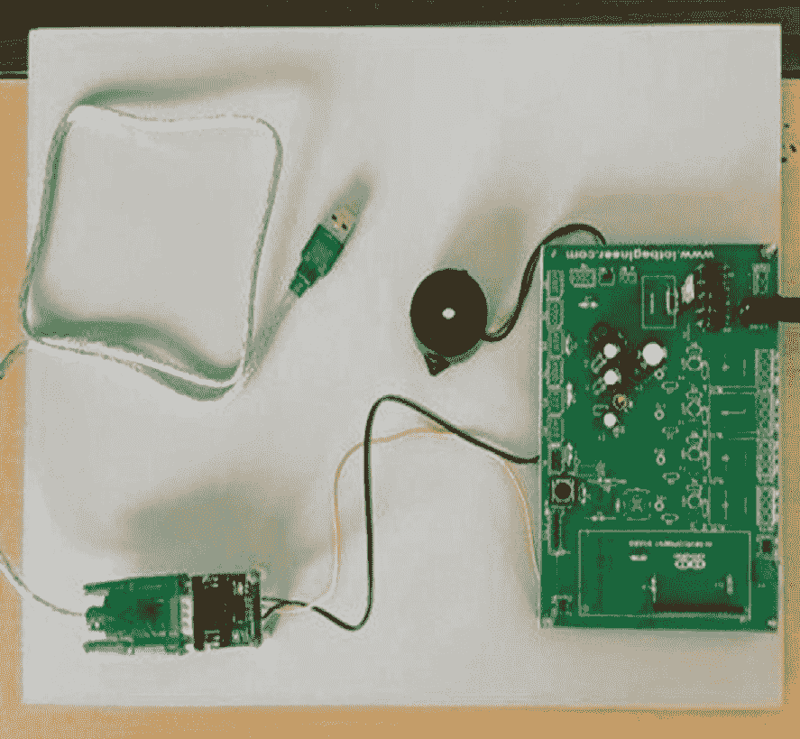

图 13.1 硬件套件

## 3.1 卷积神经网络

处理图像的典型方法称为卷积，它通过修改像素的亮度来反映附近像素的亮度。卷积滤波器是卷积的应用。

## 3.2 卷积层

当神经元连接到输入卷中的一个小区域时，`Convolution` 层将估计该神经元的输出。

每个神经元将计算其权重与该区域之间的点积。

## 3.3 Relu 层

应用 `RELU` 层的逐元素激活函数，包括 0 处的 `max(0, x)` 阈值处理。结果是卷的大小保持不变。

## 3.4 池化层

`Pooling` 层将沿着所有维度（宽度、高度）进行下采样。

## 3.5 全连接层

`FC` 层将计算类别得分，产生大小为 [1x1xN] 的卷，其中 N 个数字中的每一个都代表一个类别得分，例如 N 个类别中的一个。

### 模块 1 图像分类

* 缩放、方向调整和颜色调整属于此类。

* 图像预处理可以同时加速模型推理的速度和模型训练的速度。

### 模块 2 图像提取

* 特征提取包括降维程序，该程序将原始数据集合划分并压缩为更小、更容易管理的分组。

* 因此，当你想要处理它时，会变得更简单。

### 模块 3 检测

* 在大型动物进入轨道之前发现它们，并在它们位于轨道或靠近轨道时提醒司机它们的存在。

## 3.6 框图

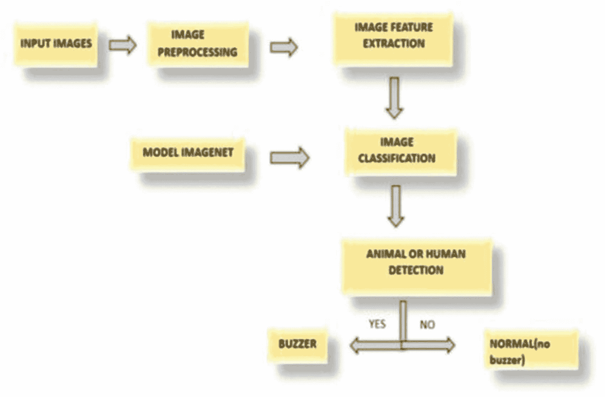

图 13.2 框图

利用深度学习在铁路上检测人员或动物

## 3.7 分析结果

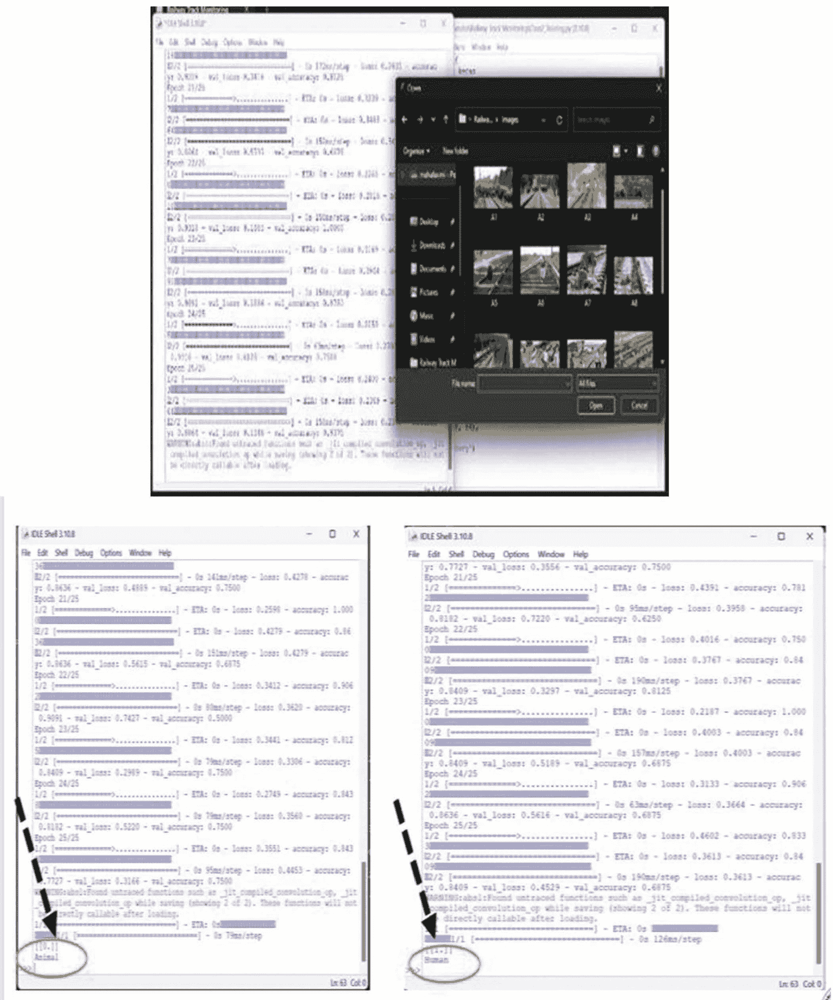

图 13.3 检测到动物和人

# 4. 结论

铁路是最实用、方便的交通形式。但由于疏忽，发生了许多事故。因此，本文介绍了所建议的方法，利用图像处理方法来防止此类事故。照片在拍摄后存储在数据库中。拍摄后开始比较过程，并找到了图像。当发现生物或物体时，会有一个重新拍摄的过程，需要进一步检测和验证该生物或物体是否仍在轨道上。机车司机可以使用这些信息停止火车并防止危及动物的事故。当发现生物时，它会发出响声。

# 5. 致谢

首先，我们要感谢 SRM 教育集团的创始人 T. R. Paarhar 博士，没有他的支持我们的项目无法完成。我们非常感谢电子信息工程系 M. Devaraju 博士为我们提供帮助并持续鼓励我们完成项目。我们非常荣幸地感谢导师电子信息工程 V. Dinesh 先生，他的知识指导和宝贵建议使项目取得了成功。最后，我们衷心感谢所有对我们完成项目提供支持的父母。

## 参考文献


# 利用技术解决方案应对海洋漂浮塑料垃圾污染

## 摘要

估计全球海洋中的宏观塑料含量是最严峻的挑战之一。统计漂浮垃圾数量的最流行技术耗时较长且仅在较窄的区域有效。为了克服这些缺点，开发了一种基于深度学习框架的自动识别方法，用于发现和量化海洋垃圾。结果建议采用 `FMA-YOLOv5` 方法，这是 `YOLOv5` 技术的改进版本，它在骨干网络末端使用特征图注意力 (`FMA`) 层进行检测和分类。图像分类器使用基于深度学习的分割模型来量化样本中的海洋碎片。将建议策略预测的沿岸碎片数量与人工监测方法的估计值进行比较，以证明其差异。显然，所提出的结果为制定高效的海洋垃圾控制和法规提供了关键数据。

## 关键词

碎片、海洋、水生、污染、Yolo、垃圾、塑料

## 引言

海洋垃圾，特别是塑料污染，是目前威胁我们生态系统最大的环境问题之一。海洋垃圾存在于全球所有领域，被描述为在海岸和海洋环境中被处置、丢弃、忽视或放置不当的任何耐用、制造或处理过的固体物质。海岸线海洋垃圾污染对生态系统、人类生活和海洋生物产生了可怕的影响。由于它可以缠绕任何类型的海洋生物（包括鱼类、海龟和海洋动物），而且它会被海洋生物（特别是大型滤食性物种）吞，漂浮海洋垃圾具有特别的破坏性。全球塑料产量已超过 5 亿吨，预测显示有 30% 的塑料将进入海洋。在太平洋垃圾带内部，塑料垃圾已增加了五倍，研究表明其数量已是浮游生物的六倍。我们看到的海洋塑料约 80% 源自陆地：最常见的形式是包装材料和食品容器（如塑料袋和瓶）。其余 20% 来自运输船舶的排放和废弃的渔具。根据研究，清理海洋塑料对生态系统健康产生巨大的影响，包括防止入侵物种在区域间扩散、防止其降解为微塑料以及减少温室气体排放（从而减缓气候变化）。确定塑料垃圾（PMD）的数量对于开展高效的海滩清理和评估海洋垃圾对环境的影响至关重要。

在许多计算机视觉任务中，例如目标定位和检测 Bochkovskiy et al., (2020)、分类以及语义分割 Tao et al., (2020) 深度学习技术已成功应用。与普通的机器学习方法不同，后者需要特定领域的知识以及人工设计的特征提取，而深度学习算法能够自主地从源数据中发现潜在的数据表征，并提供端到端的训练过程。Fukushima et al (2014) 深度学习技术可用于在海洋碎片研究范围内开发更快速、更精确的工具来定位和分类漂浮垃圾。在图像和视频数据方面，卷积神经网络（`CNNs`）是推动深度学习成功的顶尖技术之一。`CNN` 的设计受到动物视觉系统中观察到的感受野模式的影响，通过将低层信息整合到高层信息中来获取分层顺序的特征。

单阶段单次框检测器（`SSD`）以及 `YOLO` 系列算法和两阶段区域卷积神经网络（`R-CNN`）系列算法是深度学习算法的两个子集。最近的研究表明，`YOLO` 系列技术可用于多种检测应用。`YOLOv5` 方法被选中用于识别漂浮碎片的网络模型。相比 `YOLOv2`、`YOLOv3` 和 `YOLOv4`，`YOLOv5` 具有更适应性的网络结构，使其更容易改变各种任务的网络架构。`YOLOv5` 有四个版本：`YOLOv5s`、`YOLOv5m`、`YOLOv5l` 和 `YOLOv5x`。模型的深度、宽度从 `YOLOv5s` 到 `YOLOv5l` 都在增长。尽管准确性随着模型复杂性的增加而提高，但检测速度也会受到影响。由于参数众多会显著减慢检测速度，`YOLOv5l` 以及 `YOLOv5x` 未被纳入考虑。

本文的研究旨在解决对漂浮塑料进行快速准确估计的需求。这些是本文的主要贡献：

* 创建一个用于自主手段对各种类型的海洋垃圾进行检测、分类和量化的模型；
* 在 `YOLOv5` 网络的骨干和颈部之间放置了特征图注意力（`FMA`）层，如图图 1 所示
  图 14.1 FMA-YOLOv5s 算法的通用框架
* 为了估计沿岸碎片，采用了基于深度学习的 `U-Net` 分割技术。
* 利用所提方法对废物进行定量估计并分为六类：塑料、玻璃、渔渔具、热塑胶、橡胶、金属和未定义。
* 本研究还证明了所提出的自动方法与既有自动方法之间的区别。

工作的其余部分结构如下。相关工作在 2 中进行了回顾。本研究使用的材料和技术在 3 中描述。深度卷积架构在 4 中实现，并展示和讨论了在-14_1 中的实验结果。进一步研究的结论和建议在 5 中。

## 2 文献综述

理解和对抗日益增加塑料颗粒依赖于肉眼方法，这些方法是目前收集数据最广泛的策略，尽管自 2018 年以来人工智能方法已有所进展。因此，Gnann 等人（2022）的综述概述了关于宏观塑料类型视觉识别的最新研究。重点是数据收集和评估方法，例如机器学习和深度学习，尽管也可能考虑公开可用的数据。其目标是在这一研究领域发展的时期提供批判性的展望和观点。该研究表明，尽管机器学习和深度学习算法显示出有效性和广泛的可用性，但在准确性和精度方面与视觉监控相比，它们仍处于不成熟阶段。

为了设计一种公民可以用来检查海岸线海洋垃圾的方案，Papakstantinou et al., (2021) 框架将无人机技术与人工智能机器视觉的进展相结合。在当前研究中，使用消费级现无人机从背景复杂的沙滩拍摄了极高分辨率的航空照片。为了检测沿海地区的垃圾并产生其密度图，这些照片被用作深度学习模型的输入数据。输入数据使用 Zooniverse 公民科学工具标注为“垃圾”和“无垃圾”分类。在志愿者的帮助下，标注程序迅速实施，提高了其有效性和效率。

为了更好地了解海洋垃圾的瞬时漂移和分布，并加强海洋废物的管理，Sun 等（2020）对渤海西部漂移的海洋碎片进行了数值分析。风速、风向以及垃圾源头等重要变量对漂移轨迹和范围的影响已得到彻底的调查和辩论。研究还考察了处理海洋垃圾的程序。结果发现，海洋垃圾产生地的地形特征对颗粒的扩散及其最终的漂移路径具有影响。风速的增加会触发海洋碎片的收集，而风向的变化会定期影响粒子的漂移距离和扩散区域。

在 Kylili 等（2020）这项研究中，利用人工智能应用，通过 `CNN` 设计和瓶颈法（bottleneck approach）构建了一个图像分类器。训练后的瓶颈法分类器被用于将塑料袋、容器、篮子、食品包装、吸管、废弃渔网、鱼和其他物体分为八个不同的组。这些塑料发现于海岸线或浮在海面上。该深度学习技术在有效区分物体方面的成功率达到 90%，推荐用于海边和海洋中塑料产品的智能检测。针对不同历轮（epochs）和批次（batches）的损失和准确率的训练测试结果为该方法提供了更多信心。此类分辨率敏感性检查的结果表明，即使图像质量降低，预测系统仍能成功识别塑料。

Bajaj R 等（2021）利用基于深度学习的方法对本土水下生态系统中的垃圾进行视觉识别，以便部署自主水下飞行器（`AUVs`）检查、监测并消除这些垃圾。训练采用了深度学习的 `InceptionResNetV2` 架构。利用 `JAMSTEC` 电子图书馆关于深海垃圾的数据，对来自不同地点的海量免费开放的真实垃圾数据集进行了标注。随后，经过认证的网络在来自各种数据集的图像上进行了测试，提供了有关提高 `AUV` 清除海底垃圾检测能力的知识。训练后的系统使用边界框（bounding boxes）和目标类别图来寻找测试图像中的特征。预计这些发现将推动利用 `AUVs` 在水下环境中自主检查、检测和收集水生垃圾的努力。

海洋垃圾对海洋生态和海洋生物的生存具有负面影响。Xue 等（2021）在研究中建立了利用深度学习技术的深海碎片识别。为了方便未来的研究，首先建立了一个真实的深海垃圾识别数据集（`3D dataset`）。该数据集包含 7 种不同形式的垃圾。其次，提出了 `ResNet50-YOLOV3` 单阶段深海垃圾检测系统。在寻找深海碎片的过程中还使用了其他八种复杂的检测算法。最后，通过实验验证了 `ResNet50-YOLOV3` 的性能。

Winans 等（2021）这项工作利用 `AUVs` 在水下环境中自主检查、检测和收集水生垃圾。测试了两种流行的检测技术：速度更快的基于 `MobileNetV2` 的 `SSD`（`SSD-MN`）以及计算成本更大的基于 `InceptionResNetV2` 的 `faster RCNN`（`FR-IR`）。这项研究证明了深度学习在识别和量化海洋垃圾方面的有效性。

## 3 材料与方法

这项工作使用深度学习来识别和量化海洋垃圾。本提议的目的是使用 `FMA-YOLOv5` 识别并量化沿岸的存量碎片。

### 3.1 数据采集

利用高分辨率的 `Galaxy S20` 超级相机拍摄了海滩垃圾的照片。视野和焦距分别为 `25 mm` 和 `79 度`。使用宽为 `10.m` 的样带收集了位于西海整个海岸线的图像。训练集和测试集共收集了 110 张照片。尽管尽力避免重复，但某些碎片之间确实存在重叠。因此，对重叠的照片进行了阴影处理，以确保在深度学习之前不会被发现。此外，专门为数据集收集了 736 张特写照片。在指定的情况下，特写照片是在 `0.5 m` 的高度处拍摄的。从 736 张照片中提取了 1500 个物品进行单独标注。

对整个海滩的垃圾进行了人工人工计数和分类，以便与深度学习方法的结果进行比较。由于尺寸较小，使用了尺寸 `>2.5 cm` 的海滩碎片来确定剩余存量。

### 3.2 FMA-YOLOv5 目标检测算法的实现

使用采集的照片，利用基于 `YOLOv5` 的网络架构来识别和分类碎片。该方法通过添加特征图注意力（`FMA`）层扩展了骨干网络。`FMA` 层保持输入特征图的大小不变，允许灵活多功能地添加到任何网络配置中。图 14.1 展示了构成该方法的网络训练和检测程序。

如图 14.2 所示，该方法在训练和识别网络中均使用了 `YOLOv5` 网络结构，其中跨阶段部分网络（`CSPNet`）作为网络的中心节点。需要大量推理计算的问题通过 `CSPNet` 得到了解决。通过结合跨阶段分层结构，`CSPNet` 在提取图像特征之前将基础层的特征图分为两个部分。这种方法的优处是减少了重复梯度数据量，降低了计算次数，加快了设备运行，且不影响模型的准确性。

`YOLOv5` 此外使用了特征金字塔（`Feature Pyramid`）网络拓扑来充分利用从不同层次（`FPN`）检索到的特征信息。新的特征图是通过左侧源映射与输入图像下采样创建的相应层特征图组合成的，遵循了从上到下的上采样过程。通过将浅层数据与深层数据相结合，该结构在提高效果的同时也增强了生成特征图的幅度。在 `FPN` 特征组合之后，在此基础上构建了路径聚合网络（`PAN`）框架。在卷积下采样后，合并的底部图与左侧 `FPN` 结构的尺度匹配特征图相结合，创建出 3 个不同幅度的输出特征图。通过这种组合，模型的特征提取将更加准确，强有力的定位特征将底部向上进行传递。

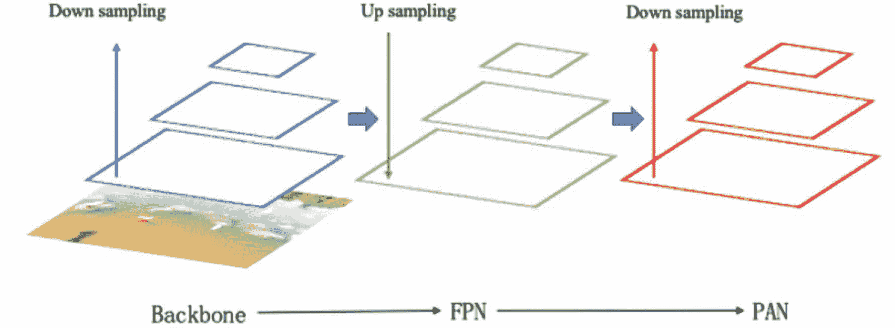

图 14.2 YOLOv5 网络结构

#### 特征图注意力层结构

`YOLOv5` 中存在许多卷积层。每个组件的卷积具有独特的深度和宽度。`YOLOv5s` 的深度和宽度系数分别为 `0.33` 和 `0.5`。通过控制堆叠层数，深度索引控制网络的深度。宽度系数影响网络的宽度和卷积输出通道的数量，并控制这一点。通过限制深度和宽度，可以控制网络中的总变量数量。建议在骨干（backbone）和颈（neck）之间添加 `FMA` 层，以改进依赖 `YOLOv5s` 的网络结构，如图 14.3 所示。如图 14.3 所示，具有四个通道的注意力特征图与输入特征图在 `FMA` 层中均被加权，以获得四组特征。然后，使用 `1 x 1` 卷积对每组特征图中的通道数量进行下采样。通道下采样后，最后将四组的特征图拼接在一起，创建一个新的输出特征图。由于所述特征图的通道下采样倍数与注意力特征图的倍数相同，因此输出和输入特征图的大小相同。

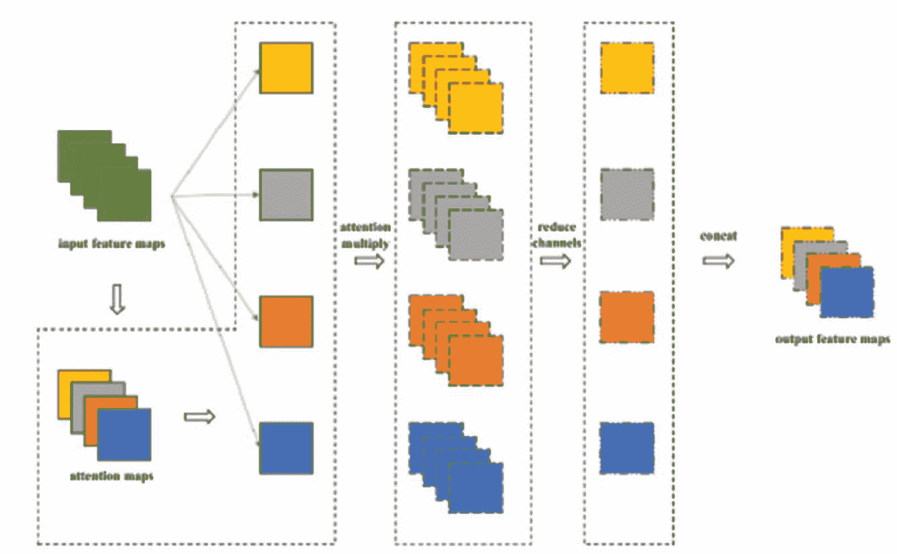

图 14.3 特征图注意力层结构

#### 检测过程

检测程序遵循以下流程：

* **步骤 1：** 使用测试图像作为输入，使用 `backbone` 提取图像特征。
* **步骤 2：** 获取 `backbone` 不同深度的特征图。
* **步骤 3：** 为了合并特征，将检索到的多尺度特征图输入 `FPN` 结构。使用双线性插值作为特征图上采样的改进。
* **步骤 4：** 在 `FPN` 融合后，将多尺度特征图输入 `PAN` 框架。合并的底部图与左侧 `FPN` 结构的尺度匹配特征图相结合，以创建出 3 个具有不同幅度的输出特征图。
* **步骤 5：** 生成最终结果，即检测框和分类。
* **步骤 6：** 通过 `nms` 完成每一帧的识别，如图 14.4 所示

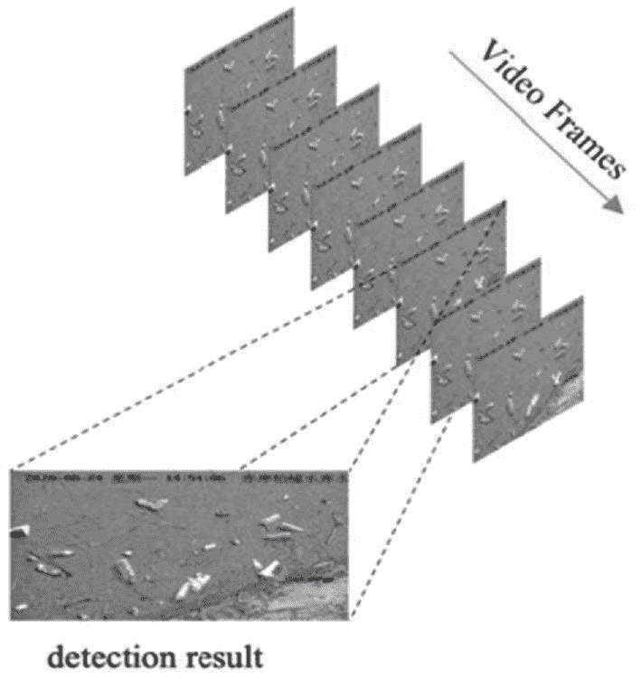

图 14.4 检测帧

### 3.3 海岸垃圾量化


使用目标模型检测效果良好，但它无法预测类型。为了解决这个问题，使用了分割方法估计垃圾类别。标记的物品被分为七组：`Plastic`（塑料）、`glass`（玻璃）、`fishing gear`（渔具）、`Thermopolis`（热玻璃）、`rubber`（橡胶）、`metal`（金属）和 `undefined`（未定义）。还上传了一对源照片。利用基于全卷积网络（`FCN`）的分割模型 `U-Net` 估计了封闭区域。即使在训练数据很少的情况下，模型性能良好。

## 4. 结果与讨论

在测试集上，通过交并比（`IoU`）和平均精度（`mAP`）对模型进行了评估。将模型的预测结果与整个 Dasa-port 海滩的实际调查结果进行了比较。

*   `IoU` 评估预测框位置的准确性，其定义为：

    (1)

    $$\text{IoU} = \frac{重叠面积}{并集面积}$$

    随着 `IoU` 的增加，两个框之间的重叠程度也随之增加。使用 `0.5` `IoU` 阈值来检查 `mAP`。

在训练集 IoU 阈值设置为 0.5 的情况下，该网络模型实现了 0.86 的 mAP 分数（图 14.5）。塑料、热塑、木材和橡胶管的平均准确率（AP）得分均高于总海岸垃圾的 mAP 评分，数值分别为 0.91、0.90、0.89 和 0.87。玻璃（0.83）、纤维（0.83）和未说明（0.79）是 AP 值低于 mAP 的三个类别。网络模型对塑料（0.91）的预测精度最高，而对未说明（0.79）的预测精度最低。下表表 14.1 和图 14.5 展示了预测不同种类垃圾的准确率。

### 表 14.1 预测不同种类垃圾的准确率

| 垃圾 | 准确率 |
| --- | --- |
| 塑料 | 0.91 |
| 热塑 | 0.90 |
| 木材 | 0.89 |
| 橡胶管 | 0.87 |
| 玻璃 | 0.83 |
| 纤维 | 0.83 |
| 未说明 | 0.79 |

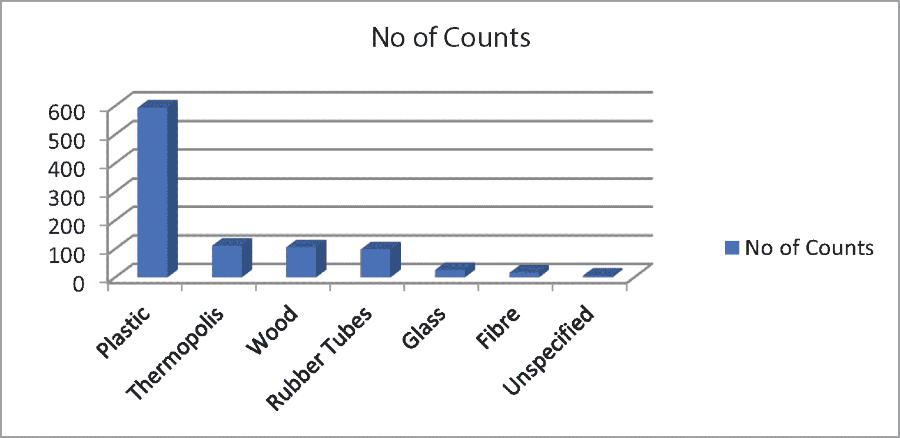

图 14.5 用于海滩垃圾图像物体分类的网络模型 mAP (IoU 阈值 = 0.5)

如第 3.1 节所述，用于分类海滩垃圾存量的共有七类：塑料、热塑、木材、橡胶管、玻璃、纤维和未说明。实际调查的项目共有 950 件。其中，“塑料”类的数量多于所有其他类别的总和（除其自身外）。研究总共发现 950 件物品。其中包含 593 件塑料、110 件热塑、105 件木材、97 件橡胶管、25 件玻璃、15 件纤维和 5 件未说明。下表表 14.2 和图 14.6 代表了所提算法预测的垃圾计数。

### 表 14.2 通过所提 FMA-YOLOv5 预测不同种类垃圾的计数

| 垃圾 | 计数 |
| --- | --- |
| 塑料 | 593 |
| 热塑 | 110 |
| 木材 | 105 |
| 橡胶管 | 97 |
| 玻璃 | 25 |
| 纤维 | 15 |
| 未说明 | 5 |

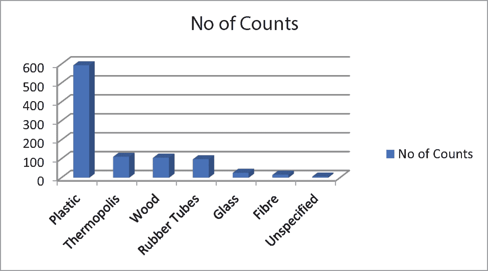

图 14.6 所提 FMA-YOLOv5 预测的垃圾项目实际计数

## 5. 结论

本研究采用深度学习方法开发了一种用于发现和测量海洋垃圾的自动方法。本研究建议用于物体识别和分类的 `FMA-YOLOv5s` 网络架构。在基于 `YOLOv5s` 的骨干网络最后引入了特征图注意力（`FMA`）层以改进特征提取。使用了使用深度学习方法构建的分割模型 `U-Net` 来计算垃圾数量。本研究创建的网络模型以 0.90 的 mAP 精度对物品进行了分类。随后，将所提自动方法对整个海滩海洋垃圾存量的预测与基于人工方法的统计计算进行了比较。该方法能够以足够的速度和精度实时检测水体中的漂浮物。从长期来看，可以更多地关注增强模糊和密集物品的识别，并支持新的漂浮垃圾类别。此外，在本工作中开发的深度学习方法可以与无人机或无人飞机集成，以便未来在国家海洋垃圾监测站创建并实施自动化监测系统。

## 参考文献

1. Arcangeli, Antonella & Campana, Ilaria & Angeletti, Dario & Atzori et al., (2017). 地中海盆沿固定跨界断面线漂浮宏观垃圾的数量、组成和空间分布。Marine Pollution Bulletin. 129. [10.1016/j.marpolbul.2017.10.028](http://dx.doi.org/10.1016/j.marpolbul.2017.10.028)。

2. [Ryan, Peter & Moore, Charles & Van Franeker, Jan & Moloney, Coleen. (2009). 海洋环境中塑料垃圾的丰度监测。Philosophical transactions of the Royal Society. Series B, Biological sciences. 364. 199–2012. [10.1098/rstb.2008.0207](http://dx.doi.org/10.1098/rstb.2008.0207)。

3. [Gall, Sarah & Thompson, R.C. (2015). 垃圾对海洋生命的影响。Marine pollution bulletin. 92. [10.1016/j.marpolbul.2014.0241](http://dx.doi.org/10.1016/j.marpolbul.2014.0241)。

4. [Jambeck, Jenna & Geyer, Roland & Wilcox, Chris & Siegler, al., (2015). 海洋污染。进入海洋的塑料垃圾。Science (New York.). 347. 768–771. [10.1126/science126352](http://dx.doi.org/10.1126/science126352)。

5. Garcia-Garin, Odei & Sala, Berta & Aguilar, Alex & Vighi, al., (2020). 大西洋鲸鱼中的有机酸酯污染物。Science of The Total Environment. 721. 13768. [10.1016/j.scitenv.2020.13768](http://dx.doi.org/10.1016/j.scitenv.2020.13768)。

6. Naji, Chido, (2015). 尼日利亚的市政垃圾产生。Management of Environmental Quality An International Journal. 26. [10.1108/MEQ-08-2013-092](http://dx.doi.org/10.1108/MEQ-08-2013-092)。

7. Clapp, Jennifer. (2012). 反对塑料垃圾的浪潮：工业试图影响辩论。见于 Histories of the Dustheap, Material Cultures, Social Justice. 199–225。

8. Carlton, James & Chapman, John & Geller, Jonathan & Miller, al., (2017). 海啸驱动的漂浮：跨洋物种扩散对海洋生物地理的影响。Science. 357. 1402–1406. [10.1126/science.aao498](http://dx.doi.org/10.1126/science.aao498)。

9. Royer, Sarah-Jeanne & Ferrón, Sara & Wilson, Samuel & Karl, David. (2018). 环境中塑料产生的甲烷和乙烯。Plos One. 13. e020074. [10.1371/journal.pone.020074](http://dx.doi.org/10.1371/journal.pone.020074)。

10. Barnes, David & Galgani, François & Thompson, Richard & Barlaz, Morton. (2009). 全球环境中塑料垃圾的积累与破碎。Philosophical transactions of the Royal Society of London. Series B, Biological sciences. 364. 1985–1998. [10.1098/rstb.2008.0205](http://dx.doi.org/10.1098/rstb.2008.0205)。

11. Wang, Yong & Wang, Dianhong & Lu, Qian & Luo, Dapeng & Fang, Wu. (2015). 使用嵌入式摄像头传感器检测水域垃圾。Sensors (Basel, Switzerland). 15. 3116–3137. [10.3390/s150203116](http://dx.doi.org/10.3390/s150203116)。

12. Bochkovskiy, A.; Wang, C.Y.; Liao, H.Y.M. Yolov4: (2020) 物体检测的最优速度和准确性。arXiv 2020, arXiv:2004.10934.

13. Tao, Andrew & Sapra, Karan & Catanzaro, Bryan. (2020). 语义分割的多层尺度注意力。arXiv 2020, arXiv:2005.10821.

14. Fukushima, Kunihiko. (2014). 神经认知器的视觉建模。[10.1007/978-3-642-30574-0_44](http://dx.doi.org/10.1007/978-3-642-30574-0_44)。

16. `Papakstantinou, Apostolos & Batsaris, Marios & Spondylidis, Spiros & Topouzelis, Konstantinos` (#ch14.xhtml#R_ref14_16). (2021). 一种公民科学无人机系统数据采集协议以及用于海岸海洋垃圾浓度自动检测与制图的深度学习技术。《Drones》。 6. [10.3390/drones5010006](http://dx.doi.org/10.3390/drones5010006).

17. `Li, Peng, Yibing Fan, Zhengyang Cai, ZhiyuLyu, and Weijie Ren`. (2022). “基于图像增强和改进 YOLOv5S 的海洋生物物体检测方法”。《海洋科学与工程杂志》10, no. 10: 1503. [`doi.org/10.3390/jmse10101503`](https://doi.org/10.3390/jmse10101503)

18. `Sun, Junkai & Yao, Zhenfeng & Zhao, Enjin` (#ch14.xhtml#R_ref14_18). (2020). 使用耦合数值模型预测海洋碎片漂移轨迹和回收范围。国际海洋与极地工程会议，地点：中国上海

19. `Kylili, Kyriaki & Hadjistassou, Constantinos & Artusi, Alessandro` (#ch14.xhtml#R_ref14_19). (2020). 一种识别岸线和海洋塑料的智能方法。《环境科学与污染研究》。[10.1007/s11356-020-10105-7](http://dx.doi.org/10.1007/s11356-020-10105-7).

20. `R. Bajaj, S. Garg, N. Kulkarni and R. Raut` (#ch14.xhtml#R_ref14_20), 2021, “利用深度学习进行海洋碎片检测：深入深海”，IEEE 第四届国际计算、电源与通信技术会议 (GUCON), 2021, pp. 1–6, doi: [10.1109/GUCON50781.2021.9573722](http://dx.doi.org/10.1109/GUCON50781.2021.9573722).

21. `Xue, Bing & Huang, Baoxiang & Wei, Weibo & Ge, Chen` (#ch14.xhtml#R_ref14_21) & `Li, Haitao & Zhao, Nan & Zhang, Hongfeng`. (2021). 使用深度神经网络的高效深海碎片检测方法。《IEEE 应用地球观测与遥感专题期刊》。第 1–1 页。[10.1109/JSTARS.2021.3130238](http://dx.doi.org/10.1109/JSTARS.2021.3130238).

22. `Winans, W. Ross & Chen, Qi` (#ch14.xhtml#R_ref14_22) & `Franklin, Erik & Qiang, Yi`. (2021). 使用基于深度学习的目标检测自动检测夏威夷岸线的搁浅巨型碎片。[10.13140/RG.2.2.23593.72807](http://dx.doi.org/10.13140/RG.2.2.23593.72807).

23. `Song, Kyounghwan & Jung, Jung-Yeul & Lee, Seung & Park, Sanghyun`. (2021). 基于深度学习的网络模型与传统方法在评估海滩垃圾存量方面的比较研究。《海洋污染公报》。168. 112466。[10.1016/j.marpolbul.2021.112466](http://dx.doi.org/10.1016/j.marpolbul.2021.112466).

注：本章中的所有图表由作者制作。

# 15 使用增强支持向量空间模型 (ESVM) 的在线学习环境推荐模型

Manikandan Rajagopal

副教授，CHRIST (被认为大学的大学)，班加罗尔

Surekha R Gondkar

副教授，BMS 技术与管理学院电子与通信工程系，班加罗尔，卡纳塔克邦

Ramkumar Sivasakthivel

副教授，CHRIST (被认为大学的大学)，班加罗尔

DOI: [10.1201/9781003428466-15](https://dx.doi.org/10.1201/9781003428466-15)

教育领域最引人入胜的研究之一是基于推荐系统的定制化在线学习。大多数学者创建了各种推荐式在线学习方法，这些方法在教育数据挖掘中使用了推荐方法，特别是针对教育数据的挖掘。

**关键词**：文档频率、调整余弦相似度、向量空间模型

## 1 引言

在线学习场景正变得越来越普遍。由于先进教学法的引入，传统的教学模式发生了巨大变化 1, 2 和 3。

为了激发学生的投入并引导其学习过程，教师需要一种程序化的策略。在学生方面，一个能够有机引导学习的学习框架将非常有益 4, 5, 6 和 7。

由于在线资源的丰富，寻找相关的学习资源是困难的。在线学习框架预计将为学生推荐一系列内容 8 和 9。

学习者的动力和兴趣程度也同样重要，是衡量学习成果的关键指标之一。这促使研究人员开发更有效的推荐模型以提高推荐的质量。根据某些研究人员的观点，可以通过考虑学生的知识维度来推进个性化学习 12 和 13。

沿着这些线，个性化深受学生能力的影响。根据项目反应理论提供了一种很大程度上取决于材料参数的定制化学习环境，增强型学习框架在 14 中提出。

本文为 Protus 提出了一种推荐系统，该系统包含一个能够自动适应学生需求和技能水平的模块。通过评估学生的学习风格并挖掘其服务器日志，该系统可以检测出各种学习风格示例和学生的倾向。在学生初次使用学习平台的情况下，所提的推荐器模块能够理解学生当前的赋能水平，并鼓励他们学习基础级课程，同时根据学习者的表现建立个人档案。一旦学生通过最终测试完成课程，推荐框架将根据结果为学生未来可能偏好的后续课程开发一套推荐集。当学生与框架交互时，数据挖掘算法将利用有关学生学习偏好的数据来创建学生画像并进行智能推荐。这些数据的示例包括导航示例、偏好、可访问内容和书签。所提系统的流程图如图图 15.1 所示。

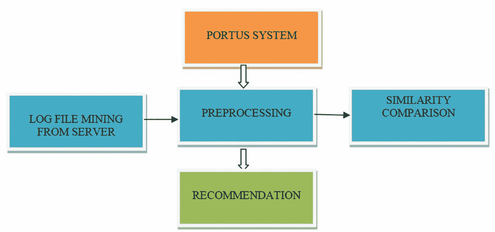

图 15.1 所提系统的流程图

## 2.1 推荐过程

随后使用向量空间模型来指示推荐的基础级课程、文章和相关材料。为了对文档上的数值函数进行相关性分析，实现了 `VSM` 以在多维视图表示适当的报告。在这里，报告被视为向量。每个项目都被表示为向量空间中的一个点，距离越近的对象被认为越相关或相关。将课程、文章或视频的显著子向量进行相互比较，并使用调整后的余弦相似度和 TF-IDF 权重来计算可比性。以这种方式将可比较的向量空间模型纳入我们的探索中。特定记录 `d` 中相关术语 `t` 的出现频率称为词频 (`TF`)，可以写作 `tftd`。以下是 TF 权重方程。

(1)

$$W\_{t,d} = \left\{ \begin{matrix} {1 + \log\_{10}tf\_{t,d}} & {iftf\_{t,d} > 0} \\\\ 0 & {otherwise} \\\\ \end{matrix} \right.$$

文档频率 (`DF`)，缩写为 `dft`，提供了包含特定短语 `t` 的记录数量。另一方面，逆文档频率 (`IDF`) 增加了低频术语的相关性，同时降低了高频术语的重要性。

(2)

$$idf\_{t} = \log\_{10}\left( \frac{N}{df\_{t}} \right)$$

该方案的特定权重通过乘以 TF 和 IDF 权重确定。为了获得调整后的余弦相似度，使用了此值。

(3)

$$W\_{t,d} = (1 + \log tf\_{t,d}) \times \log\_{10}\left( \frac{N}{df\_{t}} \right)$$


两个向量之间的相似性用于计算余弦相似度。系统可以用它根据相应的特征 `p` 比较两个课程。系统使用 TF-IDF 权重计算调整后的余弦相似度。余弦相似度量没有考虑到某些用户使用不同评分的情况。调整后的余弦相似度减去用户 `u` 对其已评估的所有项的平均评分。

(4)

```
Adjusted Cosine Similarity = \frac{\sum_{i \in I}(r_{u,i} - {\overline{r}}_{u})(r_{v,i} - {\overline{r}}_{v})}{\sum_{i \in I}{(r_{u,i} - {\overline{r}}_{u})}^{2} + \sum_{i \in I}{(r_{v,i} - {\overline{r}}_{v})}^{2}}
```

其中，`i` 是目标项目（材料），`u` 和 `v` 是用户。因此，系统可以通过将具有初始倾向的每个课程与相似领域的所有其他课程进行比较，利用 TF-IDF 权重方法确定相似性索引。

## 3. 实验结果

### 3.1 查询处理时间比较

在图 15.2 中比较了所提基于 `EVSM` 的推荐和当前基于 `VSM` 的推荐方案的查询时间。`y` 轴表示查询处理时间，`x` 轴表示学习人数。实验结果表明，新系统比现有系统产生了更好的结果。

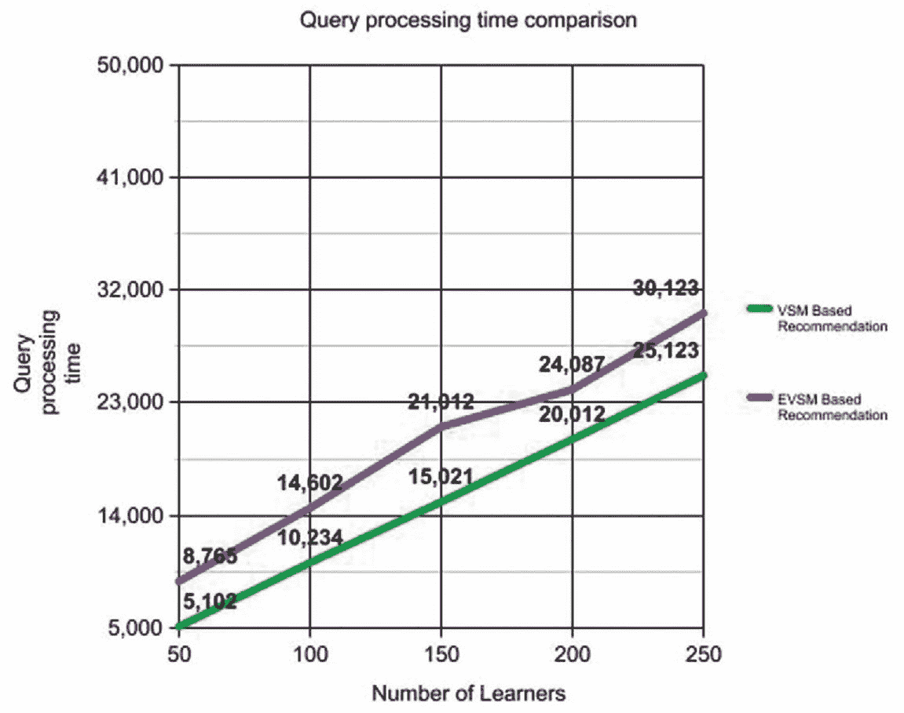

图 15.2 查询处理时间的比较

### 3.2 平均绝对误差 (MAE)

所提 `EVSM` 与当前基于 `VSM` 的推荐方法之间的 `MAE` 比较如图 15.3 所示。查询结果表明，与之前的方法相比，所提方法实现了最小的 `MAE` 值。

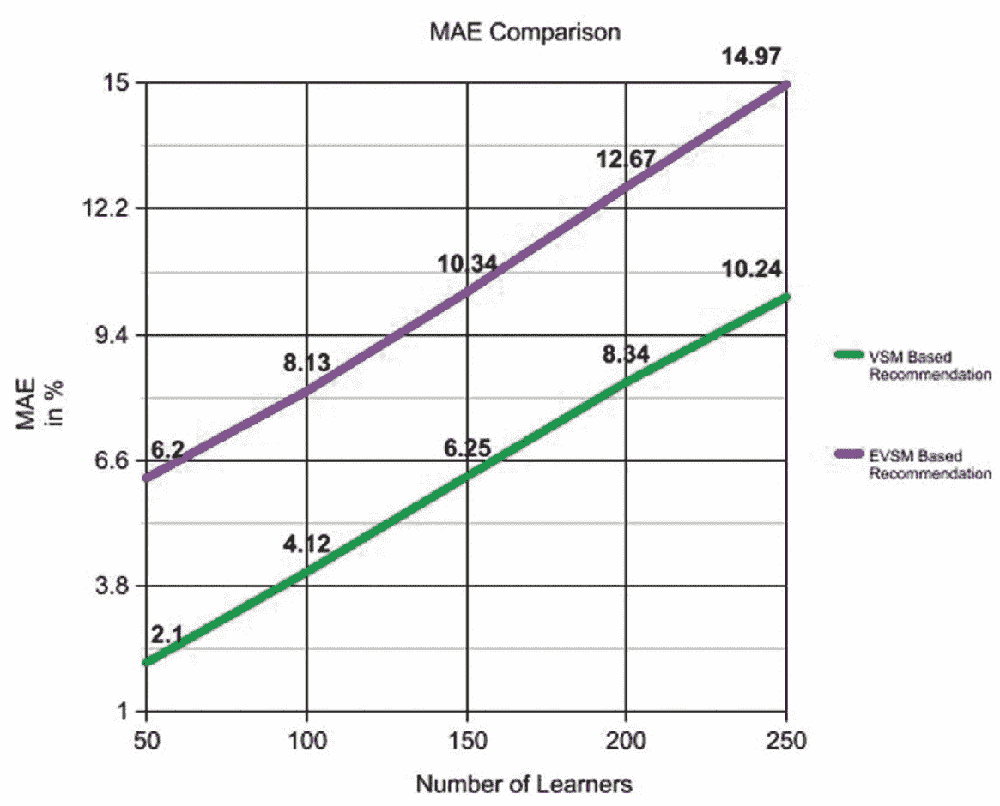

图 15.3 MAE 的比较

### 3.3 精确率比较

所提基于 `EVSM` 的推荐与当前基于 `VSM` 的推荐方法的准确率性能在图 15.4 中进行了比较。实验结果表明，设计的系统比现有系统产生了更好的结果。

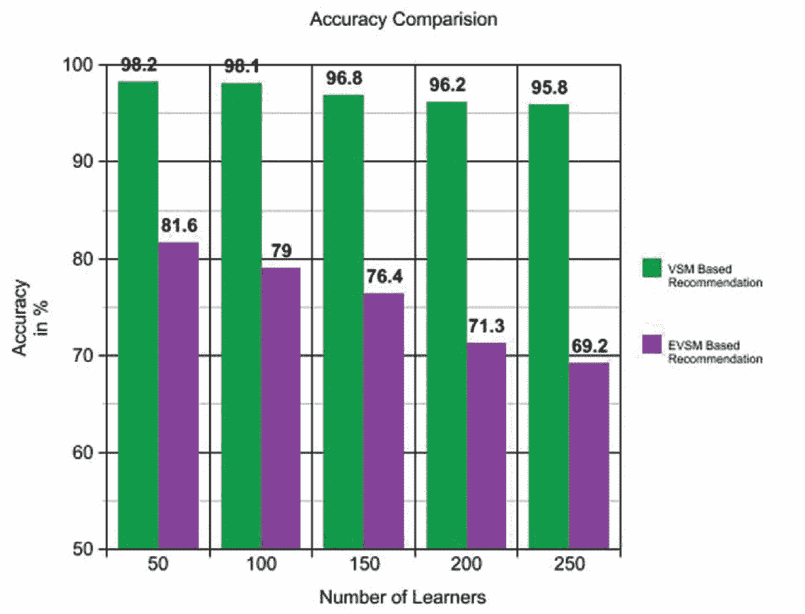

图 15.4 MAE 的比较

## 4. 使用增强支持向量模型 (ESVM) 的电子学习推荐模型

本研究描述了一种基于增强向量空间模型 (`EVSM`) 的在线学习系统推荐方法的创建。该策略将基于内容的过滤与协同过滤相结合，以提高定制系统的有效性。本研究提供了调整后的余弦相似度来评估学习者之间的相似性。分析结果表明，在查询处理时间、`MAE` 和准确性方面，建议的系统优于当前的方法。得益于使用了萤火虫算法 (`FA`) 和粒子群算法 (`PSO`) 等各种优化方法，未来的推荐将更加准确。

## 5. 参考文献

1. Brockman, P., French, D. and Tamm, C. (2014) REIT 组织结构、机构所有权与表现。

2. Cella, C. (2009) 机构投资者与公司投资。印第安纳大学，凯利商学院。

3. Chuang, H. (2020) 机构所有权对股票收益的影响。经验经济学。

4. Clark, G.L. and Wójcik, D. (2005) 德国模型的价值：所有权集中与股市收益之间的负相关，1997–2001。经济地理。

5. Dasgupta, A., Prat, A. and Verardo, M. (2011) 机构交易持续性与长期股票收益。金融杂志。

6. Demsetz, H. and Lehn, K. (1985) 公司所有结构：原因与结果。政治经济学。

7. Dyakov, T. and Wipplinger, E. (2020) 机构所有权与未来股票收益：国际视角。国际金融评论。

8. Gompers, P. A. and Metrick, A. (2001) 机构投资者与股权价格。季度经济学杂志。

9. Han, K. C. and Suk, D. Y. (1998) 所有权结构对公司表现的影响：补充证据。金融与经济评论。

10. Kennedy, P. (1985) 计量经济学指南，MIT 出版，剑桥。

11. La Porta, R., Lopez-de-Silanes, F., and Shleifer, A. (1999). 全球公司所有权。J. Finance. 54(2): 471517.

12. Manawaduge, A.S., Zoysa, A., and Rudkin, K. M. (2009). 所有权结构和所有权集中对性能的影响：来自斯里兰卡公司的证据。Performance Management Association Conference 论文. Dunedin, New Zealand.

13. McNulty, T. and Nordberg, D. (2016). 所有权、积极主义与参与：作为活跃所有者的机构投资者。Corp. Gov.: Int. Rev. 24(3): 346358.

14. Othman, R., Arshad, R., Ahmad, C.S. and Hamzah, N.A.A. (2010). 所有权结构对股票收益的影响，收于 2010 年科学与社会研究国际会议 (CSSR 2010) (pp. 217–221)。 IEEE.

15. Ovtcharova, G. (2003). 机构股权与长期股票收益。工作论文系列。可用于 SSRN：[`ssrn.com/abstract=410560`](https://www.ssrn.com)。

16. Shleifer, A. and Vishny, R.W. (1986). 大股东与公司控制。J. Polit. Econ. 94(3): 461488.

17. Sikorski, D. (2011). 全球金融危机。全球金融危机对新兴金融市场的影响。Contemporary Studies in Economic and Financial Analysis, ed. A. Jonathan Batten, and G Peter Szilagyi, 93*:1790。 英国: Bingley: Emerald Group Publishing.

18. Singh, A. and Singh, M. (2016). 美国金融危机后股票市场的跨国联动：印度和主要经济巨头。J. Indian Bus.

**注：** 本章中的所有图表均由作者绘制。

# 16 使用 CNN 进行西瓜成熟度检测

A. T. Madhavi^(33)

助理教授，电子与通信工程系，Easwari Engineering College, 钦奈，印度

K. Rahimunnisa^(34)

副教授，电子与通信工程系，Easwari Engineering College, 钦奈，印度

E. Thilagavathy^(35)

学生，电子与通信工程系，Easwari Engineering College, 钦奈，印度

N. Vithiya^(36)

学生，电子与通信工程系，Easwari Engineering College, 钦奈，印度

DOI: [10.1201/9781003428466-16](https://dx.doi.org/10.1201/9781003428466-16)

**摘要** 西瓜是一种具有价值且保质期较长的水果，其成熟度对于口感、质量和保鲜至关重要。评估成熟度的传统方法既耗时又容易出错。本研究使用 Jupyter 和若干库，利用 CNN 模型将西瓜成熟度划分为未成熟、成熟和过熟。`MobileNetV2` 网络表现最佳，准确率达到 95.97%。

**关键词：** CNN-卷积神经网络，西瓜，MobileNetV2

## 1. 引言

西瓜是一种巨大的水果，最大直径为 25 厘米，最大重量为 15 公斤。它的形状呈椭圆形或球形，光滑的深绿色外皮偶尔会出现错误的浅绿色斑块。它含水量高，蛋白质或脂肪较少，因此热量低。人们很难用肉眼甚至通过触摸来判断其成熟度。卷积神经网络（`CNN`）是一种流行的方法，因为它们在不需要人类的情况下从原始图像中提取有用信息方面具有卓越的效果。本研究侧重于使用深度学习获取西瓜图像并进行分析，以便使用非无损检测技术检测其成熟阶段。

## 2. 文献综述

Yinghao [Zhang et al., 2018] 针对分类结果进行了 ELM 和 SVM 的比较，达到了 92% 的准确率。[DengfeiJie et al., 2019] 使用了 VIS/NIR 透射技术，并利用峰值 1 与峰值 2 强度的比例（`RPP`）和归一化差异强度（`NDIP`）方法创建光谱特征分析分类技术来识别西瓜的成熟阶段。

[Edwin R. Arboleda, et al., 2020] 采用近红外光谱（`NIRS`）来确定西瓜的成熟度。[Ketsarin et al., 2021] 提出了一种使用听觉信号、图像处理、重量、果皮设计、声音信号和 ML 技术来检测西瓜甜度的无损方法，并实现了 92% 的准确率。

[Anthony B. Villa, et al., 2022] 研究了基于安卓的应用程序使用深度学习 `CNN` 模型进行西瓜识别以对西瓜的成熟度进行分类的技术。

## 3. 数据与变量

数据集通过使用安卓手机相机在距离样本顶部约 40 到 50 厘米的垂直距离拍摄图像而创建。顶部、底部和侧卧面均被纳入数据集考虑。本研究使用的 300 张图像被分为三类（未成熟 100 张，成熟 100 张，过熟 100 张），可以从西瓜中看到（此处应为从不同角度拍摄的图像）。图像数据集的 80% 用于训练模型，20% 用于测试。

## 4. 提议方法

为了使用无损方法对西瓜的成熟度进行分类，使用了 `CNN`。通过比较 `CNN` 模型并分析高准确率、低损失和较短编译时间的模型，选择了最佳的西瓜成熟度模型。


图 16.1 流程图

在使用训练图像数据集之前，手动去除了图像的背景，并将生成的图像作为 `CNN` 的输入。卷积神经网络（`CNNs`）使用数据增强来人为增加数据集的大小。这有助于提高模型的泛化能力。图 16.2 显示了数据增强技术。Keras 的 `ImageDataGenerator` 类提供了数据增强。


图 16.2 数据增强技术

研究了四种 `CNN` 模型，如 `AlexNet`、`ResNet50`、`VGG19`、`MobileNetV2` 和 `DenseNet121`。`CNN` 的深层检测更复杂的特征（如纹理和模式），而浅层通常检测简单特征（如边缘和角）。图 16.3 显示了西瓜的成熟阶段。基于分类，它将预测西瓜的成熟阶段。


图 16.3 西瓜成熟阶段

## 5. 结果与讨论

用于分类西瓜成熟度的深度学习模型性能通过每个 epoch 的训练准确率、验证准确率、训练损失、验证损失和编译时间进行评估。每个实验总共有 20 个 epoch。在图 16.4 中，以图表形式展示了每次实验运行的训练和验证准确率、测试和验证损失，表 16.1 显示了不同 `CNN` 的编译时间。


图 16.4 准确率 (a) 与损失 (b) 的对比

| 模型 | 编译时间 |
| :--- | :--- |
| DenseNet121 | 31 min 86 s |

### 5.1 准确率

根据训练和验证的准确率值，对模型的分类性能进行了评估。图 16.4(a)显示了各种 CNN 模型的准确率结果。其中，`MobileNetV2` 在训练和验证方面均达到了最高准确率，分别为 95% 和 90%。`VGG19` 的准确率次之，训练准确率为 88%，验证准确率为 81%。`ResNet50`、`AlexNet` 和 `DenseNet121` 的准确率值较低。

### 5.2 损失值

损失值衡量了模型在每次迭代后的性能，损失越低通常表示性能越好，过拟合除外。图 16.4(b)显示了不同模型在训练和测试期间的损失率。随着训练次数（epochs）的增加，损失率通常会下降。`MobileNetV2` 的训练和验证损失率最低，分别为 0.528% 和 0.7928%。`VGG19` 的损失率次之低。`AlexNet`、`ResNet50` 和 `DenseNet121` 的损失率较高。

### 5.3 编译时间

模型的有效性取决于其准确率和完成时间。表 16.1 显示了以分钟和秒为单位的编译时间。`DenseNet121` 的完成时间最长，为 31 分 86 秒，而 `MobileNetV2` 的时间较短，为 3 分 51 秒。`MobileNetV2` 具有最佳预测结果，拥有最高的准确率最短的编译时间。

## 6. 结论

研究表明，可以使用无破坏性方法判断西瓜是未成熟、成熟还是过熟。本研究比较了不同的基于 CNN 的模型对西瓜成熟度分类的效果。评估的模型包括 `AlexNet`、`ResNet50`、`VGG19`、`MobileNetV2` 和 `DenseNet121`。模型中使用了一个由 300 张西瓜图像组成的数据。通过比较三个性能指标（准确率、损失值和分类时间）进行了性能分析。总体而言，`MobileNetV2` 在西瓜成熟度分类中表现出最佳性能，准确率为 95.97%，损失率最低，编译时间最短。

## 7. 参考文献

1. Yinghao Zhang, Xiaoyan Deng, Zhou Xu, Peipei Yuan, “基于声学信号的核主成分分析极值学习机进行西瓜成熟度检测”, 2018 年 11 月国际模式识别与人工智能国际期刊 doi:[10.1142/S0218001419510029](http://dx.doi.org/10.1142/S0218001419510029)

2. Dengfei Jie, Wanhuai Zhou, Xuan Wei, “利用 NIR 漫反射透射技术通过光谱特征对西瓜成熟度进行无破坏性检测”, [`doi.org/10.1016/j.scienta.2019.108718`](https://doi.org/10.1016/j.scienta.2019.108718)

3. Wacharawish Daosawang, Komsan Wongkalasin, Natthapong Katewongsa, “用于西瓜成熟与未成熟分类的吸音研究”, 发表于 2020 年第 8 届国际电气工程大会 (iEECON) doi: [10.1109/iEECON48109.2020.229521](http://dx.doi.org/10.1109/iEECON48109.2020.229521)

4. Ketsarin Chawgien, Supaporn Kiattisin, “利用声学信号和图像处理进行西瓜甜度的分类机器学习技术”, [`doi.org/10.1016/j.compag.2020.105932`](https://doi.org/10.1016/j.compag.2020.105932)

# 数字时代的人机交互

心血管疾病是一种严重的心脏病；在全球范围内，它占年度死亡率的三分之一 [1]。许多科学家已经创建了诊断心脏疾病的算法，旨在通过机器学习从现有医学数据集中提取可用数据来改善现状。利用这些诊断技术可以促进医学诊断的临床评估，改进诊断流程，并揭示疾病相关信息，从而拯救更多生命。准确的诊断和有效的治疗可以保护患者生命，为了预测心脏疾病需要进行多项测试。目前已有基于机器学习的方法被用于预测心脏疾病的概率。这些技术中大多数使用公开的数据集来训练和测试模型。这些数据集的可用性提高了基于机器学习的预测分析的效率，并为学者创建增强算法以估计患心脏疾病风险创造了新机会。

机器学习（`ML`）算法在处理非线性和复杂特征方面更为有效。包括 `KNN`、`SVM` 和 `LR` 在内的多种算法已有效地解决一系列疾病的分类和预测困难，例如心电图（`ECG`）检测的先进指标以及先天性心脏疾病的预测 [Che et al. 2021]。研究人员提出了多种机器学习模型以改进心脏疾病预测，包括 `KNN`、`LR`、`DT`、`NB`、`FR`、`SVM` 等。创建一种先进且经济的准确预测心脏疾病的方法至关重要。提出了一种机器学习分类器的集成分类器（Ensemble classifier）用于预测心脏疾病。该系统在包含心脏疾病记录的医学数据集上执行。

本文结构如下：section 1 讨论介绍，section 2 介绍相关工作，section 3 介绍提出的机制，section 4 介绍实验工作，section 5 给出结论。

## 2. 文献综述

Ali 等人应用特征选择机制来执行从传感器数据和医学记录中获取的低维数据。为了获得数据集，他们采用考虑数据流和特征排名的特征选择方法。通过使用集成深度学习方法，他们实现了比现有模型更高的准确率。

Ishaq 等人集成了随机森林进行特征排名并利用 `SMOTE` 技术进行数据平衡。每个模型在平衡数据上的预测准确率远高于未处理的不平衡数据。在包含 `SMOTE` 生成样本和未处理离群值的数据上，对九种流行算法的预测结果进行了分析。

Joo 等人考虑了心血管疾病数据集以预测心血管疾病风险。其中，他们通过整合健康检查结果和问卷调查回答从数据集中提取了 25 个变量。医生处方信息对于执行特征选择具有重要意义。

Umarani 等人通过实现 `XGBoost` 开发了一种基于机器学习的心脏疾病预测机制。采用混合合成少数过采样技术编辑最近邻（`SMOTE-ENN`）、基于密度的空间聚类算法（`DBSCAN`）、心脏疾病预测模型（`HDPM`）、临床决策支持系统（`CDSS`）的组合架构用于异常值检测和训练数据的分布。最后，实现 `XGBoost` 来预测心脏疾病。

Abdul 等人应用特征选择机制来执行从传感器数据和医学记录中获取的低维数据。为了获得数据集，他们采用考虑数据流和特征排名的特征选择方法。通过使用集成深度学习方法，他们实现了比现有模型更高的准确率。

Ishaq 等人集成了随机森林进行特征排名并利用 `SMOTE` 技术进行数据平衡。每个模型在平衡数据上的预测准确率远高于未处理的不平衡数据。在包含 `SMOTE` 生成样本和未处理离群值的数据上，对九种流行算法的预测结果进行了分析。


# 17 心血管疾病预测研究

Joo 等人考虑了心血管疾病数据集以预测心血管疾病风险。其中，他们通过整合健康检查结果和问卷调查回答从数据集中提取了 25 个变量。医生处方信息对于执行特征选择具有重要意义。

Umarani 等人通过实现 `XGBoost` 开发了一种基于机器学习的心脏疾病预测机制。采用混合合成少数过采样技术编辑最近邻（`SMOTE-ENN`）、基于密度的空间聚类算法（`DBSCAN`）、心脏疾病预测模型（`HDPM`）、临床决策支持系统（`CDSS`）的组合架构用于异常值检测和训练数据的分布。最后，实现 `XGBoost` 来预测心脏疾病。

Abdul 等人应用特征选择机制来执行从传感器数据和医学记录中获取的低维数据。为了获得数据集，他们采用考虑数据流和特征排名的特征选择方法。通过使用集成深度学习方法，他们实现了比现有模型更高的准确率。

## 3. 提出的方法

所提出的架构包含各种过程，如预处理、应用集成分类器、袋装树、预测。图 17.1 展示了所提出的架构，后续章节将描述所提出的工作流。


图 17.1 提出的架构

## 4. 数据预处理

数据预处理是清洗和转换数据的机制；数据可能是各种格式，包括结构化、半结构化或非结构化。这些数据直接来自输入数据集或通过其他方式提取。数据处理是计算生物学中最复杂且耗时的机器学习任务。这种复杂性由于医学数据集中的不规则、冗余、不必要和噪声信息。在处理数据准备时，“数据创建”和“过滤程序”是必要的。预处理的主要优势是加速执行。数据预处理包括过滤、标准化、实例确定、特征选择、提取、转换等。生成的训练集是通过预处理获得的数据集。

### 4.1 基于袋装树的集成分类器

集成分类器属于构建一组分类器并通过权重这些分类器的预测/分类对输入数据点的机器学习算法。与传统的机器学习方法相比，后者尝试从训练集中研究一个假设。集成学习训练多个学习器来解决同一个问题。集成方法尝试创建假设集并将其用于预测。

袋装树是一种用于准确分类数据的集成方法。它被称为自助聚合（Bootstrap Aggregation）。最初，在带放回的自助样本 `D1`、`D2` 到 `Dn` 上构建基础分类器 `c1`、`c2,..cn`。随后，将所有基础分类器 `c1`、`c2,... cn` 通过多数投票结合以创建最终决策树。因此，这证明了袋装法在医学诊断中起着关键作用，并与任何分类器配合。

## 5. 特征选择

准确的特征选择对于提高分类准确率至关重要。在提出的系统中，来自集成分类器的结果数据用于通过各种属性进行特征选择。选择少数几个关键方面可以在最短的时间内获得准确的预测结果。大多数疾病数据集的样本分布需要更加平衡，较少样本落在正类类别，而更多样本落在负类组。性能评估将在实验和结果部分进行讨论。

## 6. 实验结果

本节讨论了实验工作；本研究采用的数据集是从 ECDC 仓库获取的 covid-19 数据集。ECDC 仓库是广泛使用的研究仓库，包含许多与 COVID-19 相关的数据集。我们对每天和每周的普通患者以及 ICU 入院患者进行了处理。

使用 MATLAB 实现了所提工作，并结果以召回率（Recall）、F 值（F-measure）和精确率（Precision）的形式给出。

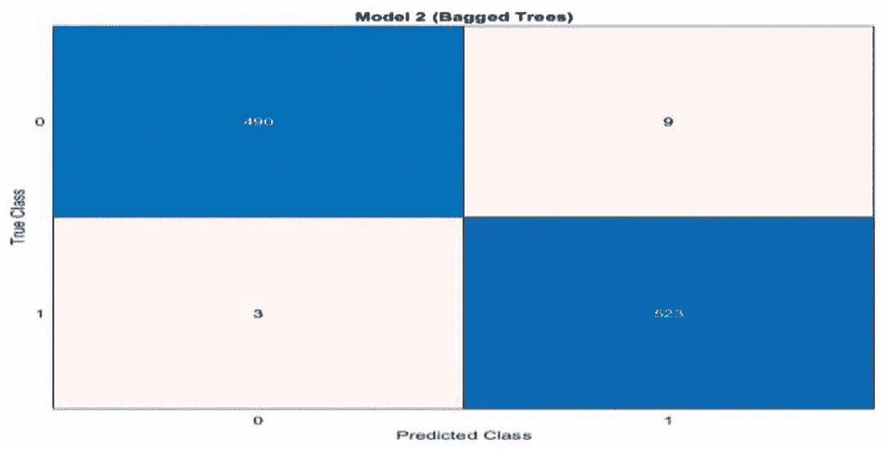

图 17.2 观测数量（混淆矩阵）

图 17.22 定义了所提集成分类器与输入数据集的关系。结果显示了袋袋（bagged tree）形成，其中 x 轴表示预测类别，y 轴表示真实类别。

Figure 17.3 定义了带有袋的所提集成分类器与输入数据集的关系。结果显示了正预测值（PPV）和错误发现率（FDR）。x 轴表示预测类别，y 轴表示真实类别。

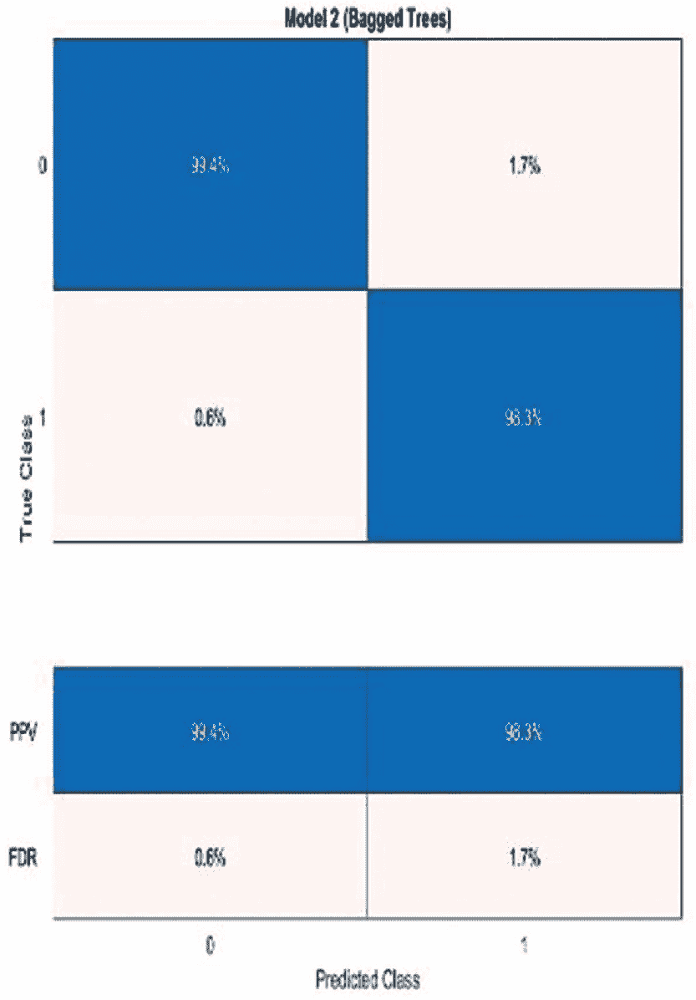

Fig. 17.3 PPV 和 FDR

Figure 17.4 定义了带有袋的所提集成分类器与输入数据集的关系。结果显示了真阳性率（TPR）和假阴性率（FNR）。`x` 轴表示预测类别，y 轴表示真实类别。

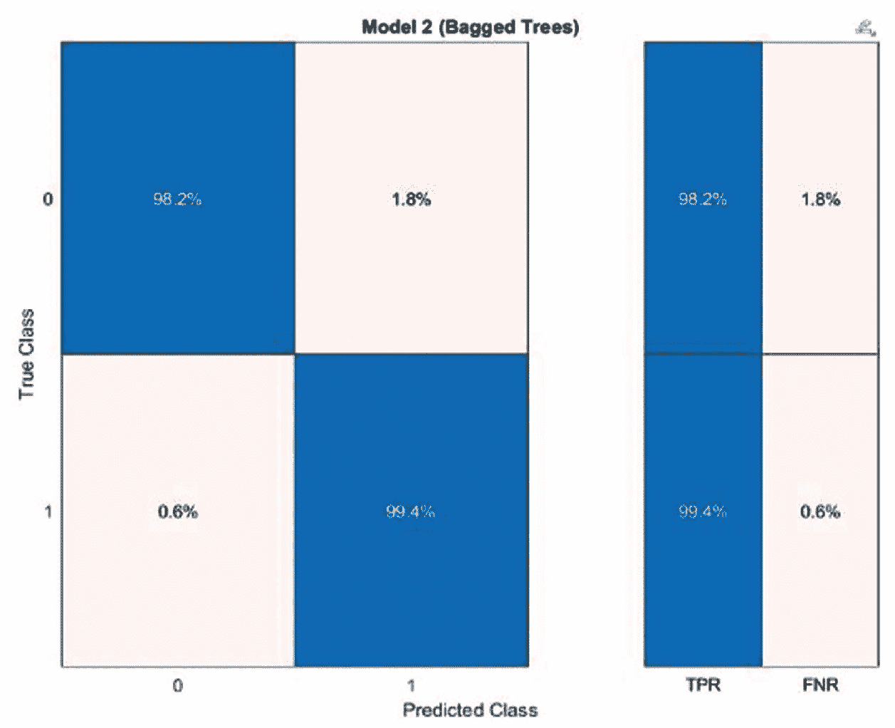

Fig. 17.4 TPR 和 FNR

### 6.1 散点图

散点图是一种确定两个数据收集变量结果的数学图表或表示方法。散点图应用笛卡尔坐标系，根据该坐标系，水平轴确定一个变量的值，垂直轴确定另一个变量的值。绘图点可视化了形状、颜色或大小。

Figure 17.5 显示了年龄与胆固醇（chol）之间的散点图观测。基于袋的预测模型确定了关于年龄和胆固醇的正确错误预测。颜色和符号唯一地确定了每次预测。x 轴表示年龄，y 轴表示胆固醇。

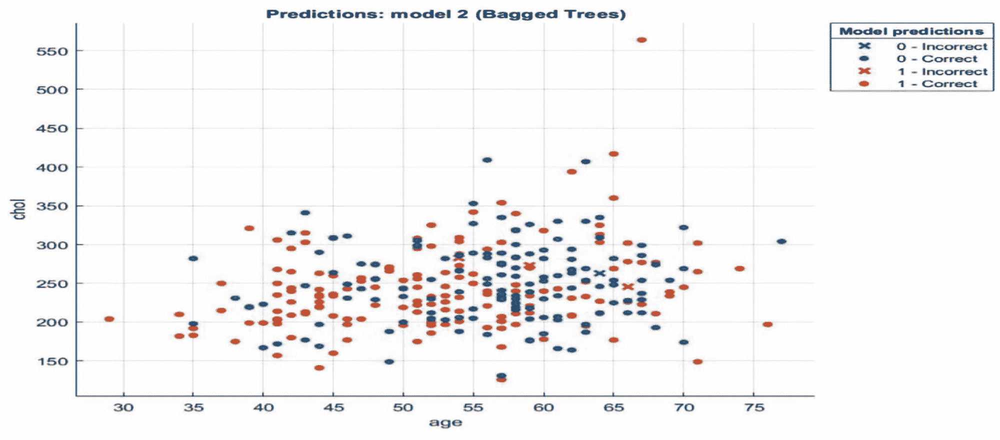

Fig. 17.5 年龄对比胆固醇散点图

### 6.2 ROC 曲线下面积 (AUC)

ROC 曲线下面积（AUC）类似于积分曲线，对比了 0 到 1 范围内的真阳性率（TPR）值和假阳性率（FPR）值。AUC 在所有可能的水平上提供了全面的性能评估。AUC 值从 0 到 1，数值越大表示分类器越有效。为了在任何阈值下获得 1 的真阳性率，完美的分类器会对正类数据不断给出正类标签。通过连接点 `[0, 0]`、`[0, 1]` 和 `[1, 1]` 的直线，获得了该理想分类器的 AUC 值为 1。相反，对于随机分配分数的随机分类器，阈值、真阳性率和假阳性率将相同。AUC 为 0.5，ROC 曲线呈对角线。

Figure 17.6 显示了基于 ROC 的 0 正类观测的袋树预测结果。y 轴表示真阳性率（TPR），x 轴表示假阳性率（FPR）。

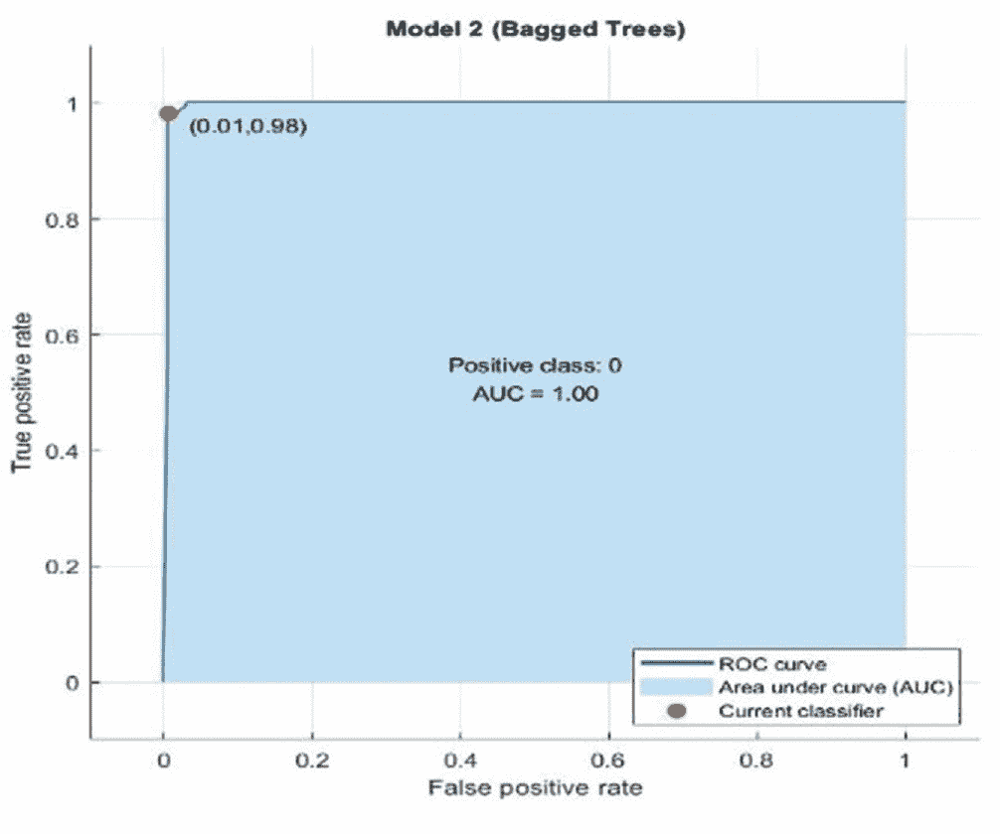

Fig. 17.6 ROC 0 正类观测

## 参考文献

5. Joo, G.; Song, Y.; Im, H.; Park, J. 机器学习在利用大数据的预测心血管疾病发生率中的临床意义（韩国全国队列数据）。IEEE Access 2020, 8, 8–157653. [CrossRef]

6. Che, C.; Zhang, P.; Zhu, M.; Qu, Y.; Jin, B. 用于心电图信号处理和性心律失常分类的约束 Transformer 网络。

9. Abdul Saboor, Muhammad Usman, Sikandar Ali, Ali Samad, Muhmmad Faisal Abrar 和 Najeeb Ullah, “一种利用机器学习算法改进人类心脏病预测的方法”, Hindawi Mobile Information Systems 第 2022 卷，文章 ID 1410169，9 页 [`doi.org/10.1155/2022/1410169`](https://doi.org/10.1155/2022/1410169)

10. Farhat Ullah, Xin Chen, Khairan Rajab, Mana Saleh Al Reshan, Asadullah Shaikh, Muhammad Abul Hassan, Muhammad Rizwan 和 Monika Davidekova, “基于改进特征选择的早期准确心脏病预测高效机器学习模型”, Hindawi Computational Intelligence and Neuroscience 第 2022 卷，文章 ID 1906466，12 页 [`doi.org/10.1155/2022/1906466`](https://doi.org/10.1155/2022/1906466)

11. Yang, J.; Guan, J. 基于特征优化和 Smote-Xgboost 算法的心脏病预测模型。Information 2022, 13, 13. [`doi.org/10.3390/info13100475`](https://doi.org/10.3390/info13100475)

注：本章中的所有图表均由作者制作

# 18 饮食因素与青少年女性超重和肥胖流行率的相关研究

A. Maria Vinitha 研究员，Presidency College, Triplicane, Chennai, 泰米尔纳德邦

T. Pramananda Perumal 校长（退休），Presidency College, Triplicane, Chennai, 泰米尔纳德邦

DOI: [10.1201/978100342866-18](https://dx.doi.org/10.1201/978100342866-18)

## 摘要

青少年女性的超重和肥胖已成为印度城市日益关注的健康问题。在过去的几十年里，城市青少年群体更倾向于消费西方食物，而不是选择当地美食。就印度青少年女性而言，由于倾向于西方饮食，超重和肥胖问题日益凸显。由于地理位置和生活方式的影响，超重和肥胖已成为一种趋势。然而，关于食品习惯和生活方式对青少年超重和肥胖的影响，尚未得到深入研究。本研究旨在探讨导致青少年超重和肥胖的真实因素，以改善未来的健康状况。关键词：青少年、饮食、超重、肥胖

## 1 引言

青少年女性的超重和肥胖已成为印度城市日益关注的健康问题。在过去的几十年里，城市青少年群体更倾向于消费西方食物，而不是选择当地美食。就印度青少年女性而言，由于倾向于西方饮食，超重和肥胖问题日益凸显。然而，由于地理位置和生活方式的影响，超重和肥胖已成为一种趋势。然而，关于食品习惯和生活方式对青少年超重和肥胖的影响，尚未得到深入研究。本研究旨在探讨导致青少年超重和肥胖的真实因素，以改善未来的健康状况。关键词：青少年、饮食、超重、肥胖

在全球范围内，近 39% 的成年人由于不健康饮食和缺乏活动而超重或肥胖，体重指数（`BMI`）超过 25 kg/m² 的情况已成为严重的健康威胁。在许多国家，超重和肥胖已成为普遍问题，`BMI` 超过 29.9 kg/m² 的比例正在迅速增加。在印度，由于地区，食品习惯和生活方式对青少年超重和肥胖的影响尚未进行详细调查。本研究旨在通过分析人体特征、饮食模式和身体活动，识别影响超重和肥胖的关键因素。此外，通过 `BMI` 检验发现超重和肥胖的统计意义。

## 2 研究细节

### 2.1 研究地点与参与者

本研究的数据随机收集自 2019 年 1 月至 3 月期间位于印度泰米尔纳德邦金奈的 7 所不同学校和 5 所不同大学的年龄在 16 至 19 岁之间的女性。在收集数据之前，已获得参与者及其父母的知情同意。

### 2.2 样本量估算

为了获得 95% 的置信水平和 ±2% 的误差范围，本研究计划的样本量大于 1537（但在本研究中，我们将样本量设定为 2000），通过应用公式估算样本量：

```
N = \frac{z^{2}\hat{p}(1 - \hat{p})}{\epsilon^{2}}
```

### 2.3 数据收集

使用标准问卷收集了社会、人口统计、生理和人体测量数据。还收集了个人以及父母、兄弟姐妹和祖父母非传染性疾病（NCDs）的健康状况，如心血管疾病（`CVD`）、高血压、糖尿病（`DM`）、骨质疏松和癌症。根据 `WHO`（世界卫生组织）标准计算成年人 `BMI` 为：体重（kg）除以身高平方（m²）。

成年 `BMI` 的界值如下：小于 18.50 为“体重过轻”，18.50 至 24.9 为“正常”，25 至 29 为“超重”，30 以上为“肥胖”(WHO, 2016)。

## 3. 结果与讨论

### 3.1 受访者特征

参与者的平均年龄为 17.63 岁，标准差（SD）为 1.15。参与者的平均体重为 48.94 公斤，标准差为 9.26。参与者的平均身高为 155.6 cm，标准差为 6.62。参与者的平均 BMI 为 20.19，标准差为 3.49。参与者的平均腰围为 88.7 cm，标准差为 8.8。参与者每日体力活动中位数为 25 分钟，四分位距（IQR：20–60 分钟）。参与者家庭的月收入中位为 34,000 卢比，四分位距为 19,000–1,00,000 卢比。2000 名参与者中有 32 人(1.6%) 至少有一位超重/肥胖的父母。肥胖流行率为 20(1%)，超重流行率为 113(5.65%)。观察到超重和肥胖在青少年晚期更为常见，其中肥胖和超重在 19 岁时达到峰值，分别为 10(0.5%) 和 33(1.65%)。

在评估与超重和肥胖相关的生活方式风险变量时发现，在肉类饮食的青少年（108(5.4%)）、经常进餐的青少年（103(5.15%)）以及跳餐的青少年（56(2.8%)）中，超重和肥胖的流行率较高。经常食用不健康饮食和即食食品与超重和肥胖的发生具有统计学意义，流行率分别为 91(4.55%)、85(4.25%)、96 (4.8%)、103(5.15%)、73(3.65%) 和 79(3.95%)。此外，有 117(5.85%) 的超重和肥胖个体没有进行任何形式的体育活动，如锻炼或做运动。

表 18.2 根据表 18.1 的 `df` 和 `P` 值得出的结论

| 序号 | 来自表 1 的推论 |
| --- | --- |
| 1 | 在人口统计特征中，年龄和收入的 `p value` 小于 0.01，在 1% 水平上极显著。 |
| 2 | 在饮食习惯中，饮食类型、饮食规律性、进餐频率和跳餐频率的 `p value` 小于 0.05，在 5% 水平上显著。 |
| 3 | 体力活动与 `BMI` 之间存在显著相关（`p value<0.05`），即超重和肥胖流行率较高。 |
| 4 | 在家族史中，非传染性疾病（NCD）病史、家族肥胖和家族糖尿病（DM）与 `BMI` 相关，因为其 `p values` 在 1% 水平下小于 0.01。同样，家族心血管疾病（CVD）和家族血压（BP）的 `p values` 小于 0.05，在 5% 水平上显著。 |
| 5 | 在食物频率中，胆固醇、甜食和巧力的 `p value` 小于 0.01，在 1% 水平上极显著。 |
