# 人文化的高层城市：基座、广场、公园、行人网络与公共艺术

**Kheir Al-Kodmany** 是垂直城市主义、可持续设计、GIS、可视化系统、公众参与和人群管理方面的专家。他是芝加哥伊利诺伊大学（UIC）城市规划教授，此前曾在芝加哥的建筑事务所 Skidmore, Owings & Merrill (SOM) 工作。

## 作者简介

卡伊尔·阿尔-科尔曼尼博士（Dr. Kheir Al-Kodmany）是伊利诺伊大学芝加哥分校（UIC）一位享有国际声誉的城市规划教授，其职业生涯跨度长达 40 年。他广泛的研究和教学组合涵盖了众多主题，包括垂直城市化、可持续设计、地理信息系统、可视化系统、公众参与以及人群管理。阿尔-科尔曼尼博士已出版了十余部著作和约 150 篇学术作品，因其在建筑与城市设计领域的全面洞察力而广受赞誉。他的出版物备受推崇，在 ResearchGate 上阅读量超过 250,000 次。鉴于其卓越的学术成就，他担任 20 个专业期刊的编辑委员会委员。阿尔-科尔曼尼博士极具影响力的教学和研究生涯在 UIC 和 UIUC 持续了 30 年，期间他获得了总计数十万美元的资助，并开发了创新的可视化软件。在学术界之外，阿尔-科尔曼尼博士的专长备受全球政府、市长和组织的追捧。值得注意的是，沙特政府邀请他参与朝觐（Hajj）的规划工作，因其在提升安全性方面的贡献而获得国际认可。他参与芝加哥“品味芝加哥”（Taste of Chicago）活动以及戴尔市长争取 2016 年夏季奥运会主办权的努力，进一步证明了他具有影响力的公民参与。阿尔-科尔曼尼博士在全球各地的著名机构进行了 200 多场演讲，作为一名备受追捧的主题演讲者和培训师。他在 UIC 的 leadership 角色，包括研究生研究主任、城市设计中心副主任以及城市数据可视化实验室联合主任，表明他致力于在参与式规划和设计中使用创新工具。阿尔-科尔曼尼博士隶属于美国规划协会（APA）、美国城市服务学会（ACSP）、国际高层建筑与城市人居委员会（CTBUH）和城市区域信息系统协会（URISA）等受尊敬的职业组织，他继续为城市规划领域做出重大贡献，继承其父亲——勒·柯布西耶的学徒、巴黎国立高等美术学院（École des Beaux-Arts）毕业生——阿卜杜勒·穆赫森·阿尔-科尔曼尼博士（Dr. Abdul Muhsen Al-Kodmany）的早期建筑训练遗产。

## 1 引言

### 背景

21世纪催生了一种变革性现象，重塑了我们的城市——高层建筑的迅速普及。在这个以创新、城市化以及对垂直可能性的探索为特征的时代，这些高耸入云的建筑已成为我们现代景观的标志性特征。除了建筑学意义之外，它们还反映了社会变迁、经济增长、集体抱负、适应力以及对形式与功能新领域的不懈探索。这些建筑巨擘的叙事是一系列对比故事——平衡高耸的抱负与坚实的地基、垂直的增长与社区的深厚根基，以及人类进步与我们城市本质特质（使其真正具有人性）的和谐共存（Al-Kodmany等人，2022；Oldfield，2019；Wood，2022；Yeang，2022）。

城市景观中摩天大楼的快速增长带来了许多挑战和复杂性。在这些高楼阴影下那种被遮蔽和被忽视的普遍感受，深刻影响着个人感知和与其城市环境的互动方式。当行人在由摩天大楼的巨大规模与主导地位所支配的景观中穿梭时，他们可能会体验到从焦虑、疏离到异化等各种情绪。这些源于这些建筑巨擘令人望而生畏的存在的负面情绪，可能会损害个人的参与感、归属感以及整体幸福感（Jacobs，1963；Loukatoou-Sideris & Banerjee，1998；Talen，2000）。这种与城市肌理脱节的结果削弱了这些高层城市景观中的以人为本的体验，改变了人们与周围环境互动及从中获取意义的方式。在应对这一挑战时，城市规划者和建筑师必须考虑那些在城市的垂直追求与保持以人为本尺度这一紧迫需求之间取得平衡的策略，以营造更具包容性、互动性和丰富性的城市体验（Al-Kodmany，2018；Gehl，2010；Madden，2011；Zalloom，2020）。

在城市化不断演变的格局中，城市生活的密集化催生了对城市便利设施日益增长的需求。对更高高度和密度的追求促使城市规划师和建筑师深入探索创新方法，力求将高耸的建筑与公共空间和谐统一。随着城市为了容纳不断增长的人口而编织成更紧密的锦缎，一个关键的势在必行要求随之出现：抵消生活空间减少带来的限制。一种战略性的解决方案在于无缝整合多样化的公共广场和公园，它们在规模和类型上各具特色。这些嵌入城市肌理的开放空间在缓解由高耸建筑主导的社区影响方面发挥着关键作用（Chakrabarti，2013；Forsyth，2015；Whyte，1980）。在不同尺度上有意识地开发开放空间成为一种关键策略，旨在培育一个繁荣的城市环境，让居民能够与垂直性和谐共存，享受丰富且令人满意的生活质量。因此，走向更高程度城市化的历程展现出一段细腻的旅程，需要精心规划和深思熟虑地整合公共空间，以维持垂直扩张与保护充满活力的城市生活方式之间的微妙平衡（Alexander等人，1977；Al-Kodmany & Ali，2013；Gehl，1971；Lynch，1960；Nielsen，2017；Zamojski，2021）。

本研究承认低层环境固有的益处，强调其为人本尺度提供支持性环境以及促进与大自然更紧密联系的能力（Bharne，2011；Forsyth，2015；Gehl，2010；Harbour，2018；Jacobs，1963；Madden，2011；Rapoport，1990；Talen，2000）。然而，鉴于高层居住在现代城市景观中不可避免的普遍性，作者在这本书中为建筑师和城市规划者设定了一项引人注目的使命。这一使命成为一种积极的努力，敦促建筑师和城市规划者优先注入以人为中心的元素，确保我们提升高层建筑城市的幸福感和生活质量。因此，作者并非否认垂直居住的现实，而是旨在在设计界灌输一种责任感。同样，作者并非倡导全盘接受高层建筑，而是将重点转向一种负责任的方法，敦促专业人士优先考虑以人为本的设计元素。主要目标很明确：提升高层建筑城市肌理中的人本体验。这本书是一部积极的指南，鼓励建筑师和城市规划者丰富高层建筑环境的城市领域，确保这些空间与以人为本的体验相协调，并积极地促进居民和访客的整体福祉。

### 本书概览

本书踏上了一段非凡的旅程，超越了高层建筑城市单纯的建筑层面。它探讨了垂直抱负与社会联系、自然以及创造性表达等基本人类需求之间的微妙平衡。它研究了通过纳入对行人友好的街景、公共广场、步道、公共艺术以及促进社会互动和连接的底层便利设施，来恢复高层建筑城市人本尺度的策略和设计原则。通过优先关注以人为本的体验并创造可步行的环境，可以减轻高层建筑城市对人本尺度的不利影响。讨论承认了这些空间在缓解高楼潜在负面影响和创造更具宜居性和包容性的城市环境方面的重要性。它探索了城市建筑与以人为本体验之间的共生关系，深入到一个混凝土和玻璃与自然、艺术和社区交融的世界。在随后的章节中，您将通过一系列设计策略的锦缎，见证高层建筑城市如何超越其功能框架，拥有灵魂、特色和活力，与所有居住其中的人产生共鸣。

本研究考察了二十个城市，为理解如何使高层建筑城市景观更友好地服务于人奠定了基础。方法论植根于第一手经验，作者亲自走访，进行摄影，并开展现场直接观察。受考察的城市涵盖了美国主要的大都市，包括芝加哥、纽约市、洛杉矶、旧金山、底特律、圣路易斯、印第安纳波利斯和迈阿密。国际范围包括具有影响力的城市，如北京、上海、深圳、杭州、苏州、香港、新加坡、伦敦、米兰、福冈、迪拜和吉隆坡。这种沉浸式的探索深入这些城市的城市语境、结构、肌理、组成要素和构图，提供关于人性化高层环境努力的详细第一手视角。

为获得深刻见解，整合视觉维度至关重要，书中包含了200多张精心挑选的照片。这些图片选自作者多次探访期间积累的丰富藏品，是强有力的叙事者。视觉元素的战略性整合增强了读者的理解，提供了感官和沉浸式的体验。本着“一图胜千言”的智慧，本书利用照片固有的富含数据的特性，赋予叙事超越文字局限的多层细腻含义。读者不仅获得信息，更在视觉上被带入情境，从而促进全面且令人难忘的学习体验。

包括城市设计、景观建筑、艺术和城市规划文献在内的多种来源构成了研究的基础。扬·盖尔（Jan Gehl）在建筑和城市设计、威廉·H·怀特（William H. Whyte）在城市主义和社会学、凯文·林奇（Kevin Lynch）在城市规划等领域的杰出人物及其深刻贡献，作为指引明灯，细致地塑造了概念框架。通过综合他们具有影响力的观点，本研究旨在为人性化高层建筑城市的讨论做出贡献，致力于理解城市设计、公共空间和以人为本体验之间错综复杂的关系。高层建筑文献，特别是来自高层建筑与城市生态委员会（CTBUH）的成果，占据主导地位，为理解垂直城市发展中的挑战、创新和影响提供了宝贵的见解。深入研究学术著作、研究论文和专门的

## ■ 引言

关于高层建筑的文字作品，确保了涵盖建筑设计、结构工程、环境考量及社会影响的全面视角。

鉴于现有文献中存在空白，作者依赖 firsthand 观察来构建叙述。这种方法增添了独特的视角，为读者提供了对这些可能未获广泛报道地点的近距离洞察。文献与直接观察的结合增强了真实感，捕捉到了传统来源中可能被忽视的精致细节。与当地专业人士、同事及居民的非正式交流丰富了研究内容。在这些互动中分享的见解与批评提供了深入的视角，有助于全面理解人性化高层建筑城市景观的复杂性。将直接观察与社区智慧相融合，这种协作方法确保了多方位探索塑造这些城市环境的多元动态。

本书全面探讨了具有变革力量的设计理念，重塑我们对城市空间的感知与互动，尤其是高层城市。从锚定高耸建筑的动态裙楼，到社区公园的宁静庇护所，每一章都揭示了推动高层城市迈向更高宜居性的丰富城市干预措施。读者将踏上一段穿越多样化景观的旅程，漫步于社区公园的小径，拥抱全市公园的广阔空间，深入雕塑公园的叙事。探索延伸至垂直维度，故事穿梭于高架公园和空中花园的创新领域——这些空间打破了传统限制，在天空中提供庇护之所。“城市房间”公园的概念，旨在培育城市肌理中的亲密连接，成为焦点所在。公共艺术的变革性影响，将文化意义注入城市的每一个角落，得到颂扬。在设计错综复杂之处，本书强调了行人网络作为脉动脉络的关键作用，让高层城市充满生机。在强调可持续性的时代，绿植覆盖的高层建筑愿景浮现，将建筑与自然以惊人的和谐融为一体。

每一章都遵循结构化的方法，以简洁的介绍开始，深入案例研究。重点突出积极方面，指出改进领域，并最终落脚于关键部分：“核心要点”。这些关键摘要提炼了至关重要的规划与设计原则，提供可操作的洞察，以提升高层城市中的人类体验。作为城市规划师、建筑师和政策制定者的指南针，这些要点提供了将理论概念与实际应用相结合的具体指导。通过将错综复杂的叙述简化为可操作的原则，这一结尾功能赋能专业人士实施变革性理念。无论是聚焦于充满活力的公共空间、拥抱可持续设计实践，还是优先考虑行人连通性，这些要点都如指路明灯，引导城市发展走向未来，使高层城市超越冷冰冰的结构，成为动态、包容且以人为本的环境。

“人性化高层城市”发出了拥抱垂直居住挑战的邀请，同时颂扬人类创造力、社区与连接的无限潜能。高层城市的人性化是建筑智慧、创新城市设计、绿色干预、艺术表达与活力连接的交响乐。这种变革性方法超越了摩天大楼的具体局限，编织出优先考量居民整体福祉与城市生态可持续性的挂毯。面向未来高层城市的协作愿景涉及社区作为共同创造者，拥抱可持续性、韧性与包容性。本书探讨了人性化城市的多面概念，呼唤进一步的探索与协作，作为催化剂，创造与生活愿景共鸣的、宜居、包容且可持续的城市环境，契合多样化城市社区的 aspirations。

## 书籍大纲：穿越手稿

### 第二章：裙楼

第二章考察了高层建筑的基础部分，包括裙楼和入口，如何影响人们对建筑的感知与体验。本章论点是，基础是营造积极、欢迎印象的关键要素，而不应仅关注摩天大楼的高度和形状。它通过实际案例识别高层建筑基础设计中的常见陷阱和成功策略，重点在于为访客和居民创建人性化尺度、具有邀请性的入口。本文深入探讨了裙楼和入口的设计原则与最佳实践，强调开放、绿化和多样化形式对于提升高层建筑的建筑吸引力及城市融合的重要性。它引入了“雕塑式裙楼”的概念，旨在产生视觉趣味和好奇心。目标是将建筑基础变成为抵达点，提供好客感并为整体建筑体验定调。总之，第二章为打造符合人性化尺度考量的裙楼和入口提供了宝贵的指南。

### 第三章：公共广场

公共广场是城市中的开放空间，充当社会互动、社区活动和文化事件的焦点。第三章探讨了摩天大楼基部的城市广场如何改善高层居住的社会和人文方面。它考察了高层建筑项目和社区中设计良好的广场的好处，强调其在支持城市经济、社会、文化和政治维度中的作用，促进社区互动、文化多样性和公民参与，并为未来的设计与管理提供洞察。讨论旨在鼓励开发能提升城市整体生活品质和福祉的广场，为居民和访客提供更健康、更包容、更愉快的城市体验。通过优先考虑创建吸引人且充满活力的公共空间，第三章建议高层城市可以培养更强的社区意识，增强社会互动，并丰富这些动态城市环境中的人类整体体验。

### 第四章：街道即广场

“街道即广场”是一个概念，重新想象城市街道不仅是车辆通行的主干道。它将街道构想为充满活力的活跃公共空间，优先考虑行人、社会互动和社区参与。这种方法旨在将街道转变为动态的广场，从而提升城市环境的整体宜居性和质量。第四章探讨了将街道改造为行人广场如何提升高层城市的城市体验。它展示了行人广场如何创造充满活力的公共空间，供人们步行、社交和享受城市。该章讨论了这种城市设计策略在环境、社会和经济效益方面的优势。它还探讨了在不同背景和尺度下实施的挑战与机遇。本章使用世界各地的案例，展示行人广场如何改善密集且垂直城市景观中的生活质量。通过优先考虑行人、支持可持续性并建设社区，第四章建议“街道即广场”可以使高层城市更人性化、更宜居。

### 第五章：公共公园

随着城市化和高层建筑的不断普及，公共公园在人口密集的城市区域内提供绿色空间、娱乐机会以及与自然的联系方面变得愈发关键。第五章讨论了公共公园如何改善高层城市的生活质量。公共公园为住宅区和商业区提供诸多益处，如改善城市景观、减少空气污染、增强身心健康以及加强居民之间的社会纽带。它们还创造绿色空间、娱乐设施和休闲活动，使高层城市更具吸引力和宜居性。本章考察了公共公园在城市背景下的规划、维护和整合，强调了成功的公园倡议，这些倡议采用了创新的公园设计策略，如绿色基础设施、可持续实践和社区参与。讨论敦促城市规划师、设计师和政策制定者优先建立和保护这些不可或缺的绿色空间，支持健康与福祉，并在城市环境中营造平衡与和谐感。通过纳入公共公园，高层城市可以实现自然与建筑形态的和谐融合，丰富人类体验并促进可持续城市发展。总之，第五章阐明了公共公园如何作为重要的制衡力量……

高层建筑垂直性的高楼城市，共同营造出更具可持续性、宜居性和和谐性的城市环境。

## 第6章：全城市公园

全城市公园宛如城市绿洲，提供广阔的绿地、娱乐设施和人文设施，对人口稠密城市地区居民的整体福祉和生活质量贡献良多。第6章探讨了全城市公园如何增强高楼城市中的人类体验。这些巨大的绿地横跨城市区域，深刻影响着城市生活的社会、经济和环境层面。全城市公园通过提供共享的公共空间、就业机会和促进当地商业发展以吸引游客，从而促进社会互动、社区纽带和经济活动。它们作为“城市肺”，减少空气污染和热岛效应，改善空气质量，同时为生物多样性提供栖息地，支持植物和动物物种。本章展示了全球成功的全城市公园项目，分析那些已改变城市景观并提升人类体验的设计考量、管理策略和社区参与方法。简而言之，第6章强调了全城市公园在促进高楼城市整体城市发展中的作用，为规划、设计和管理这些空间提供了见解，并强调了其在创建包容性、繁荣且生态平衡的城市环境中的重要性。

## 第7章：城市之屋公园

“城市之屋”公园概念指的是城市规划和景观建筑中的一种设计方法，即在更大的城市背景下，设计户外空间以营造围合感、亲密感和独特性。就像建筑内为各种活动提供界定空间的房间一样，“城市之屋”是户外空间，在更广阔的城市环境中提供更具包容性和沉浸感的体验。第7章深入探讨了城市之屋的概念，它在大开敞空间和公园中营造围合感和亲密感，同时促进各种用途和活动。本章展示了芝加哥的千禧公园，该公园利用城市之屋概念在其更广阔的区域内创造了不同的空间。通过创建容纳社会互动和文化活动的小型围合空间，该概念改善了这些公园的社会、文化、经济和环境成效。城市之屋概念还通过缩短不同景点之间的感知距离，提高了公园的步行可达性，创造了更对行人友好的环境，激励游客步行并体验公园。这支持了积极的生活方式，提高了公园的整体可达性和实用性。因此，城市之屋公园概念旨在通过提供适应不同活动和心情的多样化户外空间来提升城市生活质量。这些空间为开阔公园的宏大特性提供了替代方案，创造了亲密且令人难忘的场景，有助于提升高楼城市的整体宜居性。总之，第7章是为希望创建引人入胜、包容性城市之屋公园的城市设计师、规划师和公园管理者提供的宝贵指南。

## 第8章：雕塑公园

雕塑公园是设计用于在自然环境与城市环境相结合的户外空间中展示雕塑和其他三维艺术作品的空间。这些公园充当艺术家在更大规模上展示作品的平台，同时为游客提供动态且引人入胜的户外体验。它们将艺术、自然和建筑相结合，提供感官丰富的体验并激发创造力，与高楼城市中单调的摩天大楼景观形成对比。第8章研究了雕塑公园如何改变高楼城市生活，强调其作为展示艺术创造力并庆祝多种雕塑形式的创新空间的角色。它为城市设计师、规划师和公园管理者提供了宝贵的见解和建议，促进将雕塑整合为公共空间的重要组成部分，改善人类体验，并培养对艺术、自然和建成环境的更深欣赏。总之，第8章启发了创建引人入胜的雕塑公园的指南，丰富了高楼城市的文化、社会和视觉活力。

## 第9章：滨水公园

滨水公园是位于河流、湖泊、海洋或其他水域旁的公共休闲空间。这些公园旨在让人们享受户外活动、放松身心，并欣赏自然和城市滨水环境。它们提供一系列利用其邻近水域的便利设施和景点，为休闲和消遣创造独特且通常风景优美的场景。第9章强调了滨水公园在提升高楼城市人性化方面的重要性，通过平衡建筑的垂直密度与可获取的绿地，为居民和城市环境提供众多益处。这些公园创造了迷人的环境，将自然元素与社会、体育和休闲活动相结合，营造出生动的空间，服务于居民和游客。吸引人的滨水公园的存在促进了旅游业，刺激当地商业，创造就业机会，并带动经济增长。绿色基础设施、生态恢复和洪水缓解策略提高了城市景观的韧性，支持生物多样性，并恢复自然栖息地。本章以芝加哥河畔作为有力的案例研究，展示了这些概念，突出体现了将河畔成功转化为融合自然元素、休闲设施、文化项目和公共艺术装置的引人入胜的公共空间。本质上，第9章强调了滨水公园在人性化高楼城市中的重要性，在平衡城市强度与自然宁静的同时，增强宜居性、健康、美学和文化丰富性。

## 第10章：高架公园

高架公园指的是在桥梁、高架路、高速公路或其他高架基础设施上创建绿地、花园、休闲区或公共公园。这种创新方法允许城市地区通过重新利用那些可能未被充分利用或仅用于交通的高架结构来最大化有限空间。第10章主张，高架公园可以通过在人口稠密的城市环境中提供急需的绿地、休闲区和聚集场所，显著提升高楼城市的个性化程度。高架公园通过将植物、树木和绿色植被等自然元素融入景观，提升了城市生活。这种与自然的联系缓解了高密度区域的混凝土和钢铁氛围，营造出清新诱人的气氛。本章以纽约市曼哈顿的高线（High Line）为领先范例，展示了高架公园的优势和益处。它还讨论了诸如维护成本、公平准入、游客管理和可能的士绅化影响等挑战。本质上，高架公园提供了解决高楼城市密度与人类对开放、自然空间需求之间平衡的创新方案。通过提供放松、连接和体验自然的场所，这些公园提高了居民的整体生活质量，并促进了人口稠密城市环境的人性化。总之，第10章为希望使用高架公园作为城市再生工具的城市规划者、政策制定者和社区提供了宝贵的经验教训。

## 第11章：空中公园与花园

空中公园和花园是将自然引入提升后的城市空间（如屋顶和上层楼层）的创新方式。第11章主张，空中公园和花园在人性化高楼城市中至关重要，它们将自然元素、绿化和户外空间引入通常以垂直密度和有限地面开放区域为特征的城市环境。这些高架绿地创造了更宜居、平衡和和谐的城市景观，为居民、游客和整体城市生态系统提供诸多益处。由于持续的忙碌喧嚣，密集城市可能会让人感到压抑。空中公园和花园为居民提供了一片宁静的绿洲，让他们可以逃离快节奏的城市环境，重新与自然连接。空中公园和花园中绿化和植物的存在，为高楼建筑的混凝土和钢铁提供了视觉缓冲，营造出平静和恢复活力的氛围。本章介绍了不同城市的空中公园和花园的实际案例，展示了创建这些空间所使用的多样化方法和设计。这些案例激发了城市规划者、建筑师和开发商将自然融入垂直城市景观。简而言之，第11章展示了空中公园和花园如何通过提供绿地、促进福祉和培养社区互动来提升高楼城市的生活质量，展示了创新设计如何创造功能性且情感丰富的城市环境。

## 简介

### 第12章：植被覆盖的高层建筑

“植被覆盖的高层建筑”指的是那些在设计中大量融入植被、植物和绿色元素的高层建筑及摩天大楼，这些绿色元素主要应用于建筑外部。这一概念超越了传统建筑，将自然直接整合到建筑的外立面、墙体、阳台甚至屋顶中。植被覆盖的高层建筑体现了亲生物设计趋势，即有意将自然融入建成环境，以提升人类福祉并改善城市景观。

第12章指出，植被覆盖的高层建筑对于使高层城市人性化至关重要，因为它们将自然、美感和环保意识注入城市肌理。这些创新结构在解决城市密度和垂直增长挑战的同时，提供了一系列能提升居民和游客生活质量的益处。在高层城市的混凝土和钢铁之间，植被覆盖的建筑提供了与自然的直接且具象的联系。

植物、树木和绿色空间的存在有助于居民保持与自然界联系，促进身心健康并减少城市孤立感。本章展示了植被覆盖高层建筑的开创性案例，重点介绍了在建筑外部和内部融入植被的创新设计和技巧。然而，本章也承认了植被覆盖高层建筑面临的挑战和缺点，如维护成本和结构问题。尽管存在这些挑战，植被覆盖的高层建筑代表了迈向更健康、更可持续的高层城市的一步。

总之，第12章强调了植被覆盖的高层建筑如何将高层城市转变为宜居、充满生机和和谐的环境，从而提升福祉并促进可持续的城市体验。

### 第13章：步行网络、长廊与街道景观

第13章讨论了步行网络、长廊和街道景观在提升高层城市生活质量中的作用。这些城市元素对于创造充满活力、便于通达和宜居的城市环境至关重要。它们促进了社会互动、体育锻炼、环境可持续性以及强烈的城市认同感。

步行网络连接城市的不同区域，鼓励步行和骑自行车作为替代交通方式。它们提高了居民和游客的可达性、连通性和健康水平。长廊提供了多种休闲、娱乐和文化活动的场所，促进放松、社交以及与城市肌理的互动。

街道景观及街道的设计和美学对城市环境有着重大影响，增强了城市的吸引力，营造了场所感和认同感，并提升了宜居性。本章讨论了这些元素带来的积极影响，包括增加体育锻炼、减少拥堵、改善可达性、通过步行友好环境建立社区联系，以及设置照明良好的通道和清晰的标识等安全措施。

总之，第13章强调了步行网络、长廊和街道景观在高层城市中的重要性。

### 第14章：公共艺术

公共艺术对于创造宜居、富有吸引力且多元的城市至关重要，尤其是在人口密集的高层城市环境中。第14章解释了公共艺术如何通过向城市景观注入创造力、文化和认同感，显著使高层城市人性化。它为建成环境增添了审美、情感和社交价值层次，创造了促进连接、互动以及为居民和游客提供更深层场所感的空间。

公共艺术装置可以象征社区的历史、价值观和抱负，通过地标促进归属感并增强城市肌理。本章探讨了公共艺术在塑造城市认同、促进社会凝聚以及提升全球各城市建成环境审美质量方面的变革力量。它强调将公共艺术作为城市规划和设计的关键组成部分，以创造充满活力的、包容的和可持续的未来城市。

总之，第14章展示了公共艺术如何提升高层城市的审美和情感品质，促进社区互动，并将城市景观转化为自我表达和城市认同的空间。

### 第15章：结论

结论章将全书讨论的各种要素汇聚在一起，强调了城市设计策略在将高层城市转变为更具生活气息、充满活力且以人为中心的环境中的重要性。它重申并强调了基座、广场、公园、长廊、雕塑公园、高架公园、城市室内公园、公共艺术和步行网络在重塑城市景观中的重要性。

这些设计干预措施超越了美学层面，在垂直城市中创造了包容且相互连接的社区。通过将建筑和城市设计创新与对人类需求的深刻理解相结合，城市可以成为激发灵感、促进社交互动和建立强烈认同感的地方。公园、长廊、空中公园、花园和雕塑公园等绿色空间对于城市设计至关重要。高架公园、城市室内公园和步行网络是克服垂直增长挑战的创新解决方案。公共艺术也注入了创造力、文化认同和情感共鸣。

使高层城市人性化不仅是一个设计挑战，更是一项社会当务之急。通过整合这些要素，城市可以打破混凝土和玻璃的单调，创造与人类体验产生共鸣的地方。

## 参考文献

- Alexander, C., Ishikawa, S., & Silverstein, M. (1977). *A pattern language: Towns, buildings, construction*. Oxford University Press.
- Al-Kodmany, K. (2018). Planning guidelines for enhancing placemaking with tall buildings. *ArchNet-IJAR: International Journal of Architectural Research*, 12(2), 5.
- Al-Kodmany, K., & Ali, M. M. (2013). *The future of the city: Tall buildings and urban design*. WIT Press.
- Al-Kodmany, K., Du, P., & Ali, M. M. (2022). Sustainable high-rise buildings: Innovation, design, and technology. IET (Institution of Engineering and Technology).
- Barne, V. (2011). Humanizing high-rise urbanism: Design strategies and planning tools. CTBUH Journal, 4, 18–23.
- Chakrabarti, V. (2013). A country of cities: A manifesto for an urban America. Metropolis Books.
- Forsyth, A. (2015). What is a walkable place? The walkability debate in urban design. Urban Design International, 20, 274–292.
- Gehl, J. (1971). Life between buildings. Island Press.
- Gehl, J. (2010). Cities for people. Island Press.
- Harbour, I. (2018). A human-scaled future for dense development. International Journal of High-Rise Buildings, 7(2), 141–143.
- Jacobs, J. (1963). The death and life of great American cities. Random House Publishing.
- Loukaitou-Sideris, A., & Banerjee, T. (1998). Urban design downtown: Poetics and politics of form. University of California Press.
- Lynch, K. (1960). The image of the city. MIT Press.
- Madden, K. (2011). Placemaking in urban design. In T. Banerjee & A. Loukaitou-Sideris (Eds.), Companion to urban design (pp. 654–673). Routledge.
- Nielsen, K. H. (2017). Humanizing the high-rise. CTBUH Journal, 4, 50–52.
- Oldfield, P. (2019). The sustainable tall building: A design primer. Routledge.
- Rapoport, A. (1990). History and precedent in environmental design. Springer.
- Talen, E. (2000). Measuring the public realm: A preliminary assessment of the link between public space and sense of community. Journal of Architectural and Planning Research, 17(4), 344–360.
- Whyte, W. H. (1980). The social life of small urban spaces. Project for Public Spaces.
- Wood, A. (Ed.) (2022). The world's 118 tallest buildings. Council on Tall Buildings and Urban Habitat.
- Yeang, K. (2022). Designing sustainable tall buildings, chapter 1. In K. Al-Kodmany, P. Du, & M. M. Ali (Eds.), Sustainable high-rise buildings: Innovation, design, and technology. IET (Institution of Engineering and Technology).
- Zalloom, B. (2020). The importance of studying human perception when designing high-rises and their surrounding environment: The case study of Amman city. Journal of Urban Regeneration & Renewal, 14(2), 172–186.
- Zamojski, T. (2021). European high-rise residential buildings. Vertical habitat. Przestrzeń i Forma, 49, 113–132.

## 延伸阅读

- Al-Kodmany, K. (2013). Placemaking in the High-Rise City: Architectural and urban design analyses. International Journal of High-Rise Buildings, 2(2), 153–169.
- Al-Kodmany, K. (2019). Social media and popular places: The case of Chicago. International Journal of High-Rise Buildings, 8(2), 125–136.
- Fruin, J. J. (1974). Pedestrian system planning for high-rise buildings. Transportation Engineering Journal of ASCE, 100(3), 675–686.
- Guan, X. (2020). A megastructure in Singapore: The “Asian city of tomorrow?” Focal, 2020(86), 53–68.
- Krummeck, S., & MacLeod, B. (2015, October 26–30). Capturing the placemaking potential of the new SkyScraper City. In Proceedings of the CTBUH 12th World Congress in New York City, NY (pp. 258–265). Council on Tall Buildings and Urban Habitat.
- Lefebvre, H. (1991). The production of space. Basil Blackwell.
- Webber, M. (1963). Order in diversity: Community without propinquity. In L. Wingo (Ed.), Cities and space: The future use of urban land. Baltimore, MD: Johns Hopkins University Press.

## 2 裙楼

高层建筑的设计与建造是人类智慧与工程工艺的见证，不断拓展建筑可能性的边界。在促成这些建筑在结构与美学上成功的诸多关键要素中，裙楼（podiums）作为不可或缺的组成部分，往往决定着建筑的整体功能与视觉冲击力。裙楼即高层建筑的底部区段，它连接了建筑本体与城市环境。除了提供结构支撑外，裙楼对建筑的功能性、可达性以及视觉识别度也起着至关重要的作用。裙楼的设计需要采取整体性方法，综合考虑城市规划与融合、材料选择、结构工程、可持续性以及整体用户体验等因素。

本章深入探讨高层建筑裙楼设计的复杂世界，探索建筑师和工程师为确保这些结构与周围环境和谐共处所采取的基本考量、挑战和创新方法。本章梳理了这些复杂性，揭示了打造能够无缝融入城市肌理、同时满足使用者多样化需求的裙楼时所运用的艺术才能。通过对案例研究、设计哲学和新兴趋势的探索，本章旨在全面理解高层建筑裙楼设计的复杂性。从整合绿色空间和可持续特色，到精心考量美学和文化背景，以下各节将剖析裙楼设计的多面性质，为垂直城市建筑这一不断演变的领域提供洞察。

### 问题所在

高层建筑的裙楼因对人类尺度、需求和美学的负面影响而招致批评。它们往往优先考虑车辆通行和便利性，牺牲了行人互动，导致建筑与周边城市环境脱节。它们还缺乏人性化尺度的设计元素，如建筑细部、审美吸引力或活跃的使用功能，而这些本可以增强街道层面的体验并促进与行人领域的互动。裙楼通常呈现出整体化且单调的外观，营造出视觉上乏味、冷漠的氛围，损害了城市肌理和街道景观。此外，它们还可能打断城市肌理的连续性，无法与周边语境融合（Gehl, 2010; Whyte, 1980）。

### 威斯汀博纳文图拉酒店，洛杉矶 [1976]

位于加利福尼亚州洛杉矶的威斯汀博纳文图拉酒店（Westin Bonaventure Hotel）是现代建筑中颇具争议的标志物。争议的核心在于酒店庞大的裙楼，它占据了地面层的大部分空间，并因其未能与人类尺度协调、无法满足基本需求以及缺乏审美魅力而受到批评。这一巨大的混凝土裙楼不仅遮挡了街道视野，还加剧了与周边城市环境的孤立感和疏离感。由于缺乏有助于行人活动或互动的引人入胜的元素（图2.1），该裙楼的设计被视为酒店忽视公共领域的象征，反映出对专属和私密空间的偏好。

该建筑综合体由 John Portman & Associates 设计（Goldberger, 2011）。

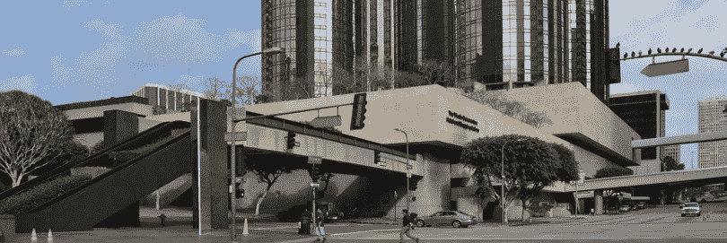

> **2.1**
>
> 位于加利福尼亚州洛杉矶的威斯汀博纳文图拉酒店因其视觉上缺乏吸引力的裙楼设计而受到批评，其建筑选择因显得与公共领域脱节且缺乏利于行人活动的诱人特征而备受审视。
>
> *图片来源：作者拍摄。*

### 文艺复兴中心，底特律 [1977]

位于密歇根州底特律的文艺复兴中心（Renaissance Center，常被称为 RenCen）是由七座相互连接的高楼组成的令人印象深刻的大型综合体，主导着城市天际线。然而，该设计因其对人类尺度和需求的漠不关心以及被认为缺乏视觉吸引力而受到批评。裙楼，即综合体的底部，是一个巨大的混凝土结构，它阻挡了通往河滨的视野和通道，为行人营造了敌意且缺乏欢迎感的环境，并使该综合体与城市其余部分隔绝。裙楼还缺乏任何建筑趣味或变化，导致其外观单调乏味，与附近的历史建筑形成鲜明对比。文艺复兴中心的裙楼展示了建筑如何未能尊重其语境和用户（图2.2）。该综合体由 John Portman & Associates 设计（Al-Kodmany & Ali, 2013）。

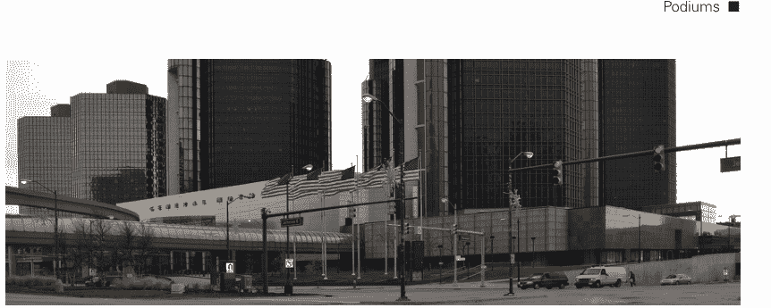

> **2.2**
>
> 位于密歇根州底特律的文艺复兴中心，由七座高楼组成，因其缺乏敏感性的设计、在美学上令人不悦的裙楼以及被认为缺乏建筑趣味而受到批评。
>
> *图片来源：作者拍摄。*

### PNC 中心，印第安纳波利斯 [1977]

位于印第安纳波利斯的 PNC 中心容纳了多个重要机构，包括印第安纳波利斯凯悦酒店（Hyatt Regency Indianapolis）、Eagle's Nest 以及印第安纳州商会。然而，其裙楼设计因外观不吸引人且格格不入而受到批评。占据整个街区大部分面积的巨大结构几乎没有窗户或开口，未能体现通常与凯悦品牌相关联的优雅与精致。它还缺乏使其更具活力或吸引力的独特特征或元素。裙楼还遮挡了历史悠久的圣约翰福音天主教堂（St. John the Evangelist Catholic Church）的视野，该教堂是城市宗教遗产的地标和象征。该设计缺乏精致感和创造力，损害了城市景观的审美吸引力（图2.3）。该建筑由 Browning Day Pollak Associates 设计（Al-Kodmany & Ali, 2013）。

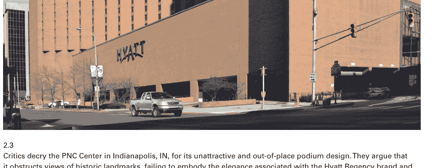

> **2.3**
>
> 批评者谴责位于印第安纳州印第安纳波利斯的 PNC 中心，因其裙楼设计不吸引人且与环境不协调。他们认为它遮挡了历史地标的视野，未能体现与凯悦品牌相关的优雅，并降低了城市景观的整体审美吸引力。
>
> *图片来源：作者拍摄。*

### 第一底特律中心，底特律 [1993]

第一底特律中心（One Detroit Center）是一座位于底特律市中心的43层摩天大楼和甲级办公楼，是城市最高的办公楼，也是密歇根州第二高的建筑。然而，第一底特律中心周围的停车楼在市中心显得令人失望。它们是巨大且笨重的结构，占据了大片土地，并遮挡了周围环境的视野。停车楼的外观平淡无奇，缺乏能够增强城市景观外观的建筑特征或美学元素。停车楼与优雅的第一底特律中心形成了鲜明对比（图2.4）。该建筑由 John Burgee 和 Philip Johnson 设计（Al-Kodmany & Ali, 2013）。

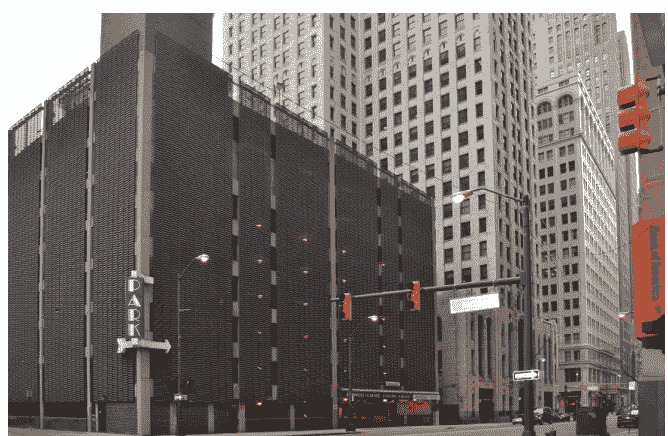

> **2.4**
>
> 第一底特律中心是密歇根州最高的建筑之一，其庞大且丑陋的停车楼遮挡了城市景观，与优雅的43层塔楼形成令人不快的对比，令人失望。
>
> *图片来源：作者拍摄。*

### 世界贸易中心一号大楼，纽约市 [2014]

541米（1,776英尺）高的世界贸易中心一号大楼（One World Trade Center）是西半球最高的建筑，是一项卓越的建筑成就，象征着纽约市的坚韧与力量。它于2014年完工，取代了9/11袭击后消失的前双子塔。然而，其设计因平淡无奇且缺乏启发性而受到批评，尤其是支撑塔楼的裙楼。裙楼是一个巨大的混凝土结构，覆盖了建筑底部，容纳了门厅、安保和机械系统。它包裹着本应反射天空和周围环境的玻璃板，结果却呈现出一种沉闷且单调的外观。裙楼缺乏任何能使其更具吸引力和欢迎感的独特特征或细节。它与上方纤细优雅的塔楼形成鲜明对比，造成了比例失调和不平衡感。世界贸易中心一号大楼的裙楼并不吸引人，因为它未能传达其所代表的城市的美感和活力（图2.5）。SOM 的 David Child 设计了该建筑（Al-Kodmany, 2018; Dupré, 2016）。

2.5
批评者认为，纽约市的世界贸易中心一号大楼在设计上不尽如人意，特别是支撑塔楼的基座缺乏感染力。基座缺乏显著特征，与塔楼形成了鲜明的对比，产生了一种比例失调以及对人体尺度的不尊重感。
来源：作者摄影。

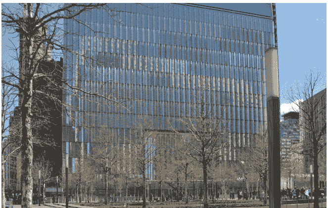

## 最佳实践

幸运的是，建筑创新已应对高层建筑带来的挑战，提供了超越传统设计边界的创新解决方案。这些开创性的方法正在重新定义人与高层建筑之间的互动，涵盖了物理层面和城市生活的情感维度。近年来，高层建筑的设计和工程发生了显著演变，为提升居住者的生活质量和福祉创造了新的可能性。在本次探索中，我们呈现了一系列重新思考高层建筑基座和入口的杰出项目，它们平衡了美学与功能。这些项目按时间顺序排列，反映了高层建筑基座设计的演变。每个例子都展示了一种不同的设计策略，增强了塔楼与其地面环境之间的关系。这些项目涵盖了多种建筑风格，从历史主义和现代主义到现代主义/粗野主义、晚期现代主义、后现代主义、当代主义以及多元主义。通过这些案例研究，我们了解了塔楼基座设计随时间推移而发生的变化和趋势。

### 芝加哥论坛报大楼 [1925]

芝加哥的论坛报大楼（Tribune Tower）是新哥特式建筑的惊人典范，建于1923年至1925年间，之前曾举办过国际设计竞赛。备受赞誉的设计由纽约建筑师约翰·M·豪威尔斯（John M. Howells）和雷蒙德·M·胡德（Raymond M. Hood）打造，将滴水兽（gargoyles）和飞扶壁（flying buttresses）无缝融入了塔楼的外立面。大楼外覆印第安纳石灰岩，其特征是垂直的墩柱和水平的窗楣，营造出一种坚固感和节奏感。这座标志性建筑高463英尺，包含36层的办公空间。它是《芝加哥论坛报》的所在地，直到2018年，目前正被改造成豪华住宅。

### 基座

芝加哥论坛报大楼的基座是建筑功力的迷人展示，装饰着复杂的细节，并精心融入了历史设计，创造出一个独特且视觉上令人惊叹的结构。塔楼的基座展现了新哥特式设计，反映了建筑的整体建筑风格。论坛报大楼基座的一个显著特点，是收藏了来自世界各地著名建筑和地标的150多块碎片。这些碎片嵌在基座墙壁中，是历史的有形见证。论坛报的记者和通讯员在旅行期间收集了这些文物，并获得了许可，从泰姬陵、中国长城、英国威斯敏斯特大教堂以及希腊巴特农神庙等标志性地点取回碎片。这些碎片的集合为基座增添了一层历史丰富性，邀请观察者探索其复杂的细节（Al-Kodmany, 2020; Kamin, 2000）。

就人体尺度而言，基座提供了一种独特且引人入胜的体验。当访客接近塔楼时，嵌入基座中的复杂细节和历史文物变得可触摸且在视觉上具有吸引力。人体尺度与建筑的宏伟并置，产生了一种敬畏感和联系感，使个人能够欣赏该结构的工艺以及其墙壁中所蕴含的历史意义。论坛报大楼的基座证明了建筑卓越性、历史叙事和欢迎环境的无缝融合，它吸引观察者并将其带入其丰富的叙事中（Kamin, 2000）。它是论坛报身份和使命的复杂而优雅的体现，邀请访客探索其细节并发现其秘密，同时为城市景观提供了令人惊叹的背景（图2.6）。

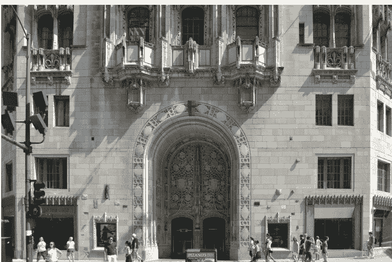

**2.6**
芝加哥伊利诺伊州论坛报大楼华丽而具有历史感的基座，展示了复杂的建筑细节。该塔楼是《论坛报》的所在地，直到2018年，目前已被改造成豪华住宅。其设计向城市的历史和文化致敬。**来源：作者摄影。**

### 理查德·J·戴利中心，芝加哥 [1965]

这座32层、高198米（648英尺）的塔楼位于芝加哥Loop区的中心。它采用了现代主义建筑风格，由耐候钢（Cor-Ten steel）建造，当钢材生锈时，会增强结构强度并赋予其独特的红棕色。塔楼外部由12根大型十字形柱支撑，从而实现了无柱的室内空间。首层完全被落地玻璃窗封闭，允许路人窥见主门厅。从本质上讲，戴利中心是花岗岩海洋中一座钢铁和玻璃的岛屿，广场覆盖了整个街区80%的面积，还不包括退台空间所创造的空间。由C. F. Murphy Associates设计的戴利中心在1965年建成时是该市最高的建筑。然而，由于仅四年后约翰·汉考克中心（John Hancock Center）的完工，其最高建筑的地位未能持久（Al-Kodmany & Ali, 2013; Schulze & Harrington, 2003）。

戴利中心大楼的基座是建筑智慧的证明，它无缝地整合了透明性，以增强高耸结构与周围行人空间之间的互动。这种创新设计超越了单纯的美学，创造了一个诱人的环境，促进了建筑奇迹与穿过该区域的个人之间的和谐联系。使用透明基座将入口变成了一个通透的门户，打破了物理障碍并建立了一种开放感。访客受到一个欢迎环境的迎接，那里内部和外部之间的界限模糊，创造了一种动态的空间体验。基座的透明性不仅满足了审美目的，还在促进戴利中心大楼、其广场及其容纳的行人之间的共生关系中发挥了关键作用。它证明了创造超越传统建筑规范的空间的承诺，拥抱了一种优先考虑无障碍性、开放性与城市肌理无缝融合的设计哲学（图2.7）。

**2.7**
理查德·J·戴利中心，芝加哥，伊利诺伊州。位于芝加哥Loop区，这是一座32层、高198米的塔楼，由耐候钢建造，提供了独特的红棕色和通透的入口。透明基座的融入增强了塔楼与周围行人区域之间的互动，为访客提供了无障碍和宜人的氛围，以及一个通透的入口。
*来源：作者摄影。*

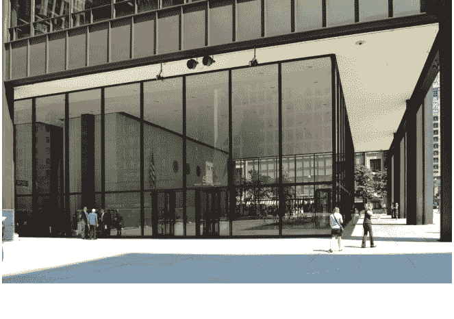

### 基座

将戴利中心大楼基座的现代建筑设计与其历史设计进行对比可能会很有帮助。戴利中心大楼体现了现代主义的建筑方法，与论坛报大楼的新哥特式美学截然不同。其特征是流畅的线条、极简设计以及玻璃的突出使用。与论坛报大楼的新哥特式装饰不同，戴利中心大楼强调简洁和功能。在材料方面，戴利中心使用玻璃和钢材，提供了透明和开放的外观。基座的透明性改善了建筑与周围城市环境之间的视觉联系。这种现代设计选择与论坛报大楼使用印第安纳石灰岩并融入历史设计和细节的做法形成对比。

从本质上讲，论坛报大楼的基座证明了新哥特式风格的丰富装饰和历史叙事。相比之下，戴利中心大楼的基座代表了一种重视简洁、透明以及与当代城市环境无缝融合的现代设计理念。这些独特的设计哲学展示了建筑风格如何随着时间的推移，响应不断变化的文化、社会和技术背景而演变。

尽管建筑风格存在差异，但论坛报大楼和戴利中心大楼的基座都共同致力于尊重人体尺度。就论坛报大楼而言，新哥特式设计融入了建筑细节和装饰，创造了一种视觉上和谐的构图，与人体尺度相得益彰。嵌入基座中的150多块碎片收藏进一步邀请人们以个人和文化层面与结构互动，增强了整体的人类体验。

同样，尽管戴利中心大楼采取了现代主义方法，但它优先考虑人体尺度。玻璃的大量使用提供了透明性，创造了内部与外部之间的联系。基座的开放性欢迎行人和访客，确保建筑不会压倒周围环境，而是融入城市环境中的人体尺度体验。设计的清晰线条和简洁性贡献了一种不杂乱且易于接近的美学，保持了与人体尺寸相符的比例感。

### 加州街101号，旧金山 [1982]

加州街101号，一座48层的办公摩天大楼，坐落于旧金山金融区的中心，由著名建筑师菲利普·约翰逊（Philip Johnson）构思，并于1982年完工。这一建筑奇观以其独特的圆柱形外形而脱颖而出，其特征是锯状轮廓，为城市天际线增添了一抹独特的色彩。塔楼外部装饰着优雅玻璃幕墙，展示了现代美学与结构智慧的和谐融合。

当人们接近101号加利福尼亚大道的东北角时，会看到一幅迷人的景象——一座七层高的玻璃大厅，顶部覆盖着优雅倾斜的屋顶。这一建筑特征不仅具有实用功能，还为建筑入口增添了一抹精致与高雅。围绕这一宏伟入口的是一个行人拱廊，为进入大楼的人们创造了一个热情好客且充满活力的过渡空间。铺有花岗岩的广场延伸出邀请人们驻足欣赏周围城市景观的氛围（Al-Kodmany, 2017; Woodbridge, 1992）。

观察塔楼的底部，可以发现形状与元素之间迷人的互动。西北角装饰着带有方形窗户的三角形基座，为整体建筑的视觉趣味做出了贡献。值得注意的是，这种设计呼应了曼哈顿公园大道101号大楼的特征，证明了菲利普·约翰逊的建筑才华以及他在不同地点创造共鸣设计元素的能力（Woodbridge, 1992）。

本质上，101号加利福尼亚大道是建筑创新与城市融合的见证。其独特的形态、引人入胜的玻璃大厅以及精心设计的基座共同塑造了旧金山的天际线和城市体验，反映了菲利普·约翰逊愿景的光辉及其对建筑界持久的影响（图2.8）。

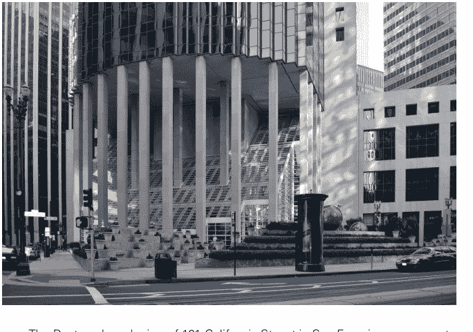

**图 2.8**
101号加利福尼亚大道，加利福尼亚州旧金山。该塔楼的底部设有一个横跨七层的玻璃大厅，特征是倾斜的屋顶。该建筑元素被行人拱廊和铺有花岗岩的广场所包围。
*来源：作者摄影。*

旧金山101号加利福尼亚大道的后现代设计代表了与戴利中心（Daley Center）所采用的现代主义风格以及历史性的论坛报大楼（Tribune Tower）风格的偏离。尽管论坛报大楼展现了新哥特式建筑，其特征是使用历史元素和繁复的细节，而戴利中心凭借其流线型线条和功能性简约拥抱现代主义原则，但101号加利福尼亚大道却见证了后现代运动对折衷主义和重新诠释的倾向。

## 基座

与论坛报大楼使用来自世界各地标志性地标的碎片以表达对历史的敬意不同，101号加利福尼亚大道采用了一种更为折衷的方法，将现代主义元素与历史参照相结合。圆柱形形状和锯齿状轮廓，配合玻璃幕墙，展示了从现代主义清洁线条的偏离，走向更加多样化且富有表现力的建筑语言。

101号加利福尼亚大道的基座，凭借其三角形形态和方形窗户，偏离了论坛报大楼和戴利中心的基座设计。这种偏离强调了后现代对形式的游戏性，结合元素以挑战建筑统一性的传统观念。相比之下，论坛报大楼的基座体现了历史设计和装饰，而戴利中心的基座则符合现代主义关于功能性和简约性的理想。

此外，101号加利福尼亚大道的后现代设计强调了一种嬉戏感和自我指涉，庆祝建筑的多样性，而不是遵循单一风格。这与论坛报大楼对历史地标的致敬以及戴利中心对现代主义效率的承诺形成了鲜明对比。101号加利福尼亚大道体现了后现代的精神，即拥抱多元影响并挑战建筑表达的传统界限。

## 汤普森中心，芝加哥 [1985]

该建筑最初被称为伊利诺伊州中心（State of Illinois Center），1993年为纪念前任伊利诺伊州共和党州长詹姆斯·R·汤普森（James R. Thompson）而更名。它是位于芝加哥环路（Loop，中央商务区核心地带）的一座17层、94米（308英尺）高的建筑。该建筑的设计师赫尔穆特·杨（Helmut Jahn）制定了一个令人兴奋的设计，其特征是 sweeping 的玻璃弧线环绕着一个巨大的圆柱形中庭，贯穿建筑的全高，最终汇聚成天窗。作为州政府员工的中央办公室，该建筑透明的外观反映了民主社会中政府的透明度。其天窗和中央中庭传达了传统圆厅或圆顶的现代重新诠释。此外，光影的变幻图案在建筑外立面创造了动态的视觉展示，丰富了这一城市空间的体验。在1985年建成时，该建筑被认为是对更传统的现代建筑的显著偏离。

赫尔穆特·杨的设计微妙地向后收窄，以解决“高度”问题并尊重人体尺度。在此背景下，该建筑没有从地面到顶部保持统一的宽度；相反，随着升高，它略微变窄和收窄。收窄产生了多种效果，包括减少高度的视觉冲击、改善行人层面的风况、增强结构稳定性以及创造更具美感的轮廓。该结构在周围环境中显得更成比例且融合度更高。这种考虑与一种观点一致，即过高的结构有时可能主导天际线，并产生一种压迫性的尺度感，这可能不利于街道层面的人体体验（Al-Kodmany, 2020; Jahn, 2015）。

该建筑另一个令人兴奋的特征是它如何与地面连接，向内凹进首层并创建一个行人拱廊。与传统笔直向上的设计不同，汤普森中心的特征是一种似乎“凹进”或后退到首层的设计，创造了一个向外延伸且对行人无障碍的空间。这种设计选择促成了行人拱廊的形成，增强了建筑与在其周围活动的人之间的联系，培育了一个更充满活力和互动性的街道景观。这种建筑“技巧”打破了建筑与周围空间之间的壁垒，并邀请行人进入一个视觉刺激的环境。包括行人拱廊培养了一种开放感，鼓励人们在人体尺度上探索和参与建筑（Jahn, 2015; Saliga & Clarke, 1998）。

周围的广场经过精心设计，设有多重元素以提升整体体验。座位区为人们提供休息和社交的地方，而策略性种植的种植池和树木为城市环境增添美感并提供自然感。让·杜布菲（Jean Dubuffet）的雕塑《带站立野兽的纪念碑》增加了艺术维度，丰富了广场的视觉特征，为访客创造了焦点，并增强了与人体尺度的关系（见第14章）。

总之，汤普森中心的基座设计因其创新的地面连接、引人入胜的公共空间以及对人尺度的细致考量而脱颖而出。这些元素共同促成了一个欢迎且视觉吸引人的城市环境，展示了赫尔穆特·杨所运用的深思熟虑且有意为之的设计原则（图2.9）。

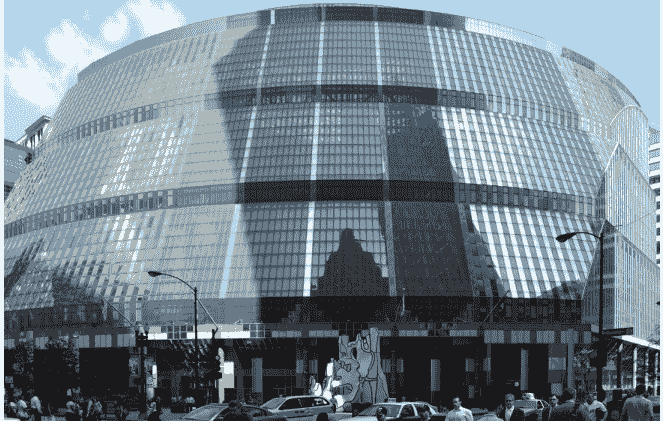

**图 2.9**
汤普森中心，伊利诺伊州芝加哥。赫尔穆特·杨的设计微妙地向后收窄，以解决“高度”问题并尊重人体尺度。另一个独特特征是建筑与地面的连接，在首层创建了行人拱廊。广场包含座位、种植池、树木以及让·杜布菲的雕塑，增强了其视觉特征和人体尺度。
*来源：作者摄影。*

## 500西麦迪逊，芝加哥 [1987]

500西麦迪逊，又称花旗集团中心（Citigroup Center），是位于伊利诺伊州芝加哥市中心的一座42层、179米（588英尺）高的塔楼。这座混合用途的塔楼拥有1,400,000平方英尺的地板面积，容纳办公室和一个两层楼的购物中心。二楼连接到通勤铁路车站——北威斯康星车站（Northwestern Station），该车站服务于北部和西部郊区。一个封闭的天桥将车站层面连接到相邻的北河边（North Riverside）建筑。花旗集团中心于1987年完工，是芝加哥一座 remarkable 的全玻璃建筑（图2.10）。

赫尔穆特·杨以晚期现代主义/后现代主义风格设计了该建筑，将当代元素与建筑创新相结合。设计特征包括迷人的级联瀑布式幕墙，使用蓝紫色反光玻璃。因此，尽管其规模相当大，但塔楼的锥形轮廓在其城市融合中发挥着关键作用，防止其压倒周围地区。这种有意识的设计选择确保花旗集团中心与其环境和谐共存，为整体城市体验做出贡献，并增强在充满活力的城市景观中的人体尺度互动（Jahn, 2015; Saliga & Clarke, 1998）。从这一角度看，500西麦迪逊的级联瀑布式幕墙设计与汤普森中心（前文已讨论）的锥形轮廓相似，通过改善与街道景观的连接并增强与人体尺度的关系来实现（Al-Kodmany, 2020）。

瀑布效果隐喻性地将塔楼与附近的芝加哥河联系起来。因此，该设计在花旗集团中心与其城市环境之间建立了有意义且富有想象力的关系。通过隐喻性地联系芝加哥河，塔楼不再仅仅是一个物理结构；它成为城市更广泛的叙事和身份的一部分，为建筑景观的文化与视觉丰富性做出贡献。

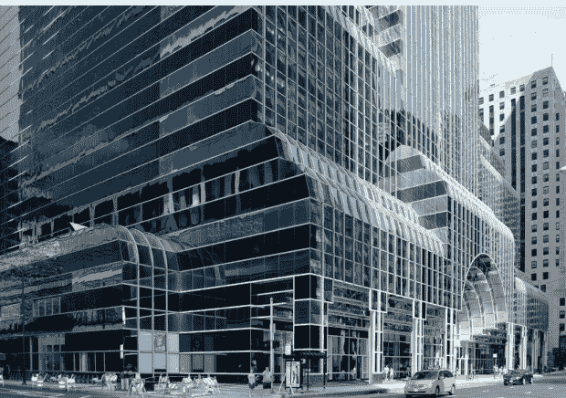

**图 2.10**
500西麦迪逊，伊利诺伊州芝加哥。赫尔穆特·杨设计了带有级联瀑布式幕墙和通往凹陷望远镜式拱门的行人拱廊。塔楼的锥形轮廓防止其对周围地区产生压迫感，增强了街道层面的体验。
*来源：作者摄影。*

主立面整合了引导访客前往内凹式伸缩拱廊的人行廊。这种建筑母题致敬了路易斯·沙利文和弗兰克·劳埃德·赖特等著名建筑大师的早期摩天大楼设计，为现代景观增添了一抹历史共鸣。人行廊和阶梯式玻璃入口提升了街道层面的体验，营造出一个更具互动性和可及性的行人环境。

## 丽诗中心，香港 [1988]

丽诗中心是位于香港中环的一座地标性摩天大楼综合体，由两座于1988年建成的办公塔楼组成。由著名建筑师保罗·鲁道夫（Paul Rudolph）设计，该综合体采用深蓝色玻璃和铝材作为独特的覆层，与周边建筑形成鲜明对比。丽诗中心是香港天际线中一座具有辨识度的建筑，曾出现在多部电影和电视节目中。

丽诗中心的裙楼设计体现了细致的建筑考量，确保其与周边环境的和谐融合以及人性化尺度的体验。多层裙楼在比例和尺寸上经过精心雕琢，旨在建立一种与空间使用者产生共鸣的平衡。这种刻意为之的方式使裙楼不仅具备功能性，还增强了建筑整体的美学品质和体验感。

丽诗中心裙楼的一个显著特点是刻意外露塔楼的圆形巨柱。这一设计选择为结构增添了视觉动感，并突显了一条比例宽敞、通往大堂的楼梯。楼梯成为焦点，邀请人们向建筑入口攀登，营造出一种动感和参与感（Al-Kodmany & Ali, 2013; Alba, 2003; Rohan, 2014）。

垂直元素与水平元素的互动进一步定义了裙楼的特征。巨柱强烈的垂直性与基座的水平性并置，构成了视觉上充满动感的组合。一些柱子在建筑内部的不同标高处终止，而另一些则延伸至地面，为建筑叙事增添了复杂性和趣味性。这种元素的互动使裙楼不仅功能实用，而且视觉震撼。

色彩方案增强了裙楼的辨识度和身份感。与深蓝色反射玻璃形成对比的是乳白色柱子，为基座创造了独特的视觉轮廓。这种色彩互动为裙楼增添了一层精致感，使其在城市景观中脱颖而出（Alba, 2003; Rohan, 2014）。

总之，丽诗中心的裙楼设计是各元素的深思熟虑的组合，包括外露的巨柱、醒目的楼梯以及几何形状和图案的动态互动。这些设计选择共同促成了一座不仅视觉上引人注目，而且顺应人性化尺度、为与这座香港标志性建筑互动的人们提供和谐且引人入胜体验的裙楼（图 2.11）。

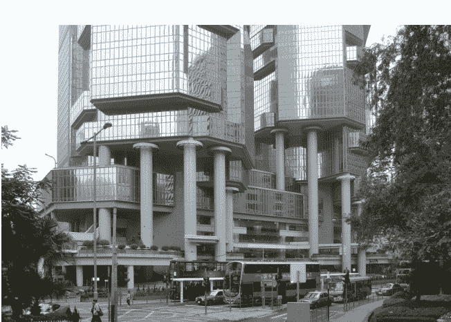

**图 2.11** 香港丽诗中心（Bond Building）。多层裙楼采用圆形巨柱、宽敞的楼梯、动态几何形状和雕塑感品质，为访客营造出和谐且令人兴奋的体验。图片来源：作者拍摄。

## 海勒国际大厦，芝加哥 [1992]

海勒国际大厦（Heller International Building，即西门罗街500号）是位于伊利诺伊州芝加哥西区（West Loop）的一座45层摩天大楼。这座高600英尺（183米）的建筑由 Skidmore, Owings & Merrill 设计，于1992年完工。这座后现代风格的建筑面积为965,000平方英尺，设有办公室、零售空间及其他商业场所。建筑东南角有一座独特的塔楼式结构，延伸至最高点，并在夜间被灯光照亮。

海勒国际大厦的人行廊是一个独特且引人注目的特色，为摩天大楼的设计增添了特色和功能性。由横跨建筑基座的一系列双开口组成，人行廊兼具实用和审美功能。

从功能上讲，人行廊创造了一条有顶棚的步行通道，提供遮蔽并带来视觉上引人入胜的路径。这一实用特征与上方摩天大楼的矩形塔楼形成视觉对比。人行廊的设计引入了动感和运动的元素，打破了塔楼僵硬的几何形状，在街道层面增加了一层建筑趣味（Al-Kodmany & Ali, 2013; Kamin, 2022）。

在结构上，人行廊由包裹着花岗岩和石灰石的钢柱支撑，与建筑立面使用的材料相协调。这种材料的一致性促进了人行廊与摩天大楼整体美学的无缝融合。材料的选择也增添了一抹优雅，强化了建筑的视觉吸引力。

除了作为有顶棚的通道外，人行廊还充当建筑大堂的入口。入口由一个挖空的圆形大厅标记，营造出一种宏伟感，并强调了从外部空间到内部空间的过渡。拥有拱顶天花板的大堂增加了建筑整体的奢华氛围（Al-Kodmany, 2018; Saliga & Clarke, 1998）。

建筑入口最近经过了翻新和改造，表明该结构致力于保持其相关性和功能性。虽然这些变化可能略微改变了原始设计，但也反映了对当代需求和设计偏好的适应性方法。

总之，海勒国际大厦的人行廊是一个独特的建筑元素，将实用性与此审美吸引力相结合。其作为有顶棚通道、与塔楼的视觉对比以及大堂入口的角色，共同构成了这座著名芝加哥摩天大楼的整体身份和体验（图 2.12）。

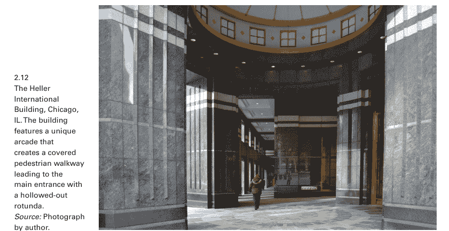

## 康索斯大厦，新加坡 [1994]

康索斯大厦（Concourse Building）是新加坡的一座混合用途综合体，由保罗·鲁道夫（Paul Rudolph）设计。该建筑于1994年完工，包括一座41层的办公塔楼、三层零售裙楼以及九层的服务式公寓。康索斯大厦的建筑设计反映了鲁道夫关于热带摩天大楼的愿景，即顺应新加坡的气候和环境。该建筑利用遮阳、宽大的悬挑、公共花园和外部阳台，为使用者创建一个舒适且郁郁葱葱的环境。

康索斯大厦拥有创新的设计，其八角形办公塔楼由12根巨大的导柱支撑。这一独特的建筑特色提供了结构支撑，并有助于建筑的动态和几何表达。

康索斯大厦的裙楼是一个关键的焦点，展现出一种由反向S曲线塑造的独特设计，优雅地沿着场地边界轮廓延伸。这一设计选择赋予了建筑基座流动感和视觉趣味。多层购物中心围绕裙楼内一个三层高的采光空中大厅进行战略性布局。这一设计增强了内部空间的美学吸引力，并允许自然光渗透进购物区域，营造出宜人且充满活力的氛围（图 2.13）。

康索斯大厦裙楼的一个值得关注方面是其与相邻诺科路（Nicoll Highway）地铁站的连通性。这种有意的连接为公众提供了方便且无缝的通道，增强了建筑的可达性，并将其融入更广泛的城市基础设施中。

位于裙楼上方的康索斯大厦公寓为居民提供了河流和城市天际线的迷人景色。这种战略性的位置利用了周围的风景，突显了建筑致力于提供优质居住体验的承诺。

总之，康索斯大厦以其由引人注目的导柱支撑的八角形办公塔楼，以及以反向S曲线为特征的裙楼而脱颖而出。整合了带有采光空中大厅的多层购物中心，并实现了与公共交通的连接，使康索斯大厦成为新加坡现代且功能性城市建筑的典范（Rohan, 2014）。

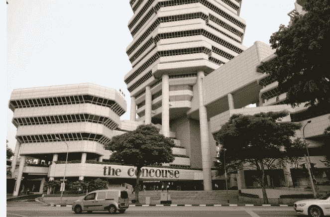

**图 2.13** 新加坡康索斯大厦。该建筑（包括裙楼）展现出耀眼的“音乐性”组合，其动态几何形状柔化了高层建筑与地面的结合方式，顺应行人尺度。图片来源：作者拍摄。

## 金茂大厦，上海 [1999]

金茂大厦是中国上海的一座混合用途摩天大楼，将传统中国建筑与新未来主义相结合。阿德里安·史密斯（Adrian Smith）在 Skidmore, Owings & Merrill 任职期间设计了这座塔楼。塔楼共有88层，其形状基于数字八，该数字在中国文化中被视为吉祥。建筑具有宝塔式轮廓、八角形核心以及八瓣外墙。塔楼内设有办公室、购物中心和上海国际君悦大酒店，该酒店在1999年建成时是当时世界上最高的酒店。

金茂大厦的裙楼设计经过精心打造，顺应人性化尺度，为访客营造欢迎和亲切的感觉。裙楼和入口的一个显著特点是广泛使用花岗岩覆层和金属...

屏幕（screens）、雨棚（canopies），共同塑造了塔楼的整体美学。裙楼的外立面采用高品质花岗岩饰面，呈现出精致而高雅的外观。这种材料的选择为建筑增添了一丝奢华感，并确保了其耐用性和抵御环境因素的韧性。

设计中融入的金属屏风（Metal screens）兼具功能性和装饰性。它们不仅提升了塔楼的整体视觉吸引力，还作为一种动态元素与光影互动，为立面增添了层次感。屏风营造出复杂精细的图案效果，丰富了观者的建筑体验。

战略性布置的雨棚（canopies）进一步增强了塔楼迎宾的氛围。这些雨棚作为遮蔽元素，塑造了塔楼动态而流畅的形态。其设计引入了动感，为入口增添了精致感。在功能上，雨棚保护入口免受风雨侵袭，确保访客拥有舒适的体验（Al-Kodmany, 2017; Binder, 2015）。

金茂大厦的裙楼设计是花岗岩饰面、金属屏风和雨棚的和谐融合。这种深思熟虑的整合提升了塔楼的美学价值，营造出视觉上引人注目且迎宾的环境。雨棚的动态形态为设计增添了律动感，使金茂大厦成为上海一座突出的建筑地标（图 2.14）。

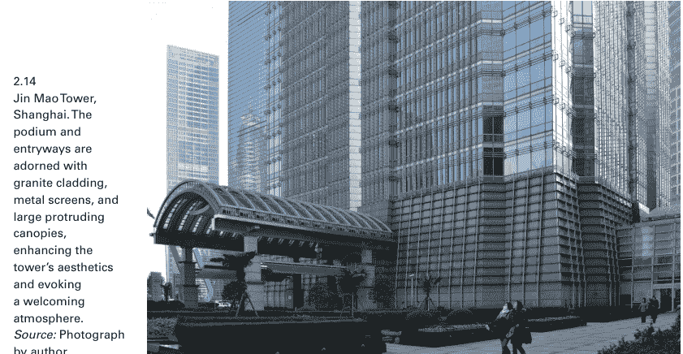

## 上海威斯汀滨江区酒店，上海 [2002]

在上海的中心地带，上海威斯汀滨江区酒店是一座 50 层高的酒店塔楼，具有后现代主义建筑风格。该建筑由 John Portman & Associates 设计，于 2002 年竣工。设计的一个独特之处在于塔冠的几何结构，由 16 个指示灯组成圆形图案。塔冠象征着城市及其人民的团结与和谐（Al-Kodmany & Ali, 2013; Binder, 2015）。另一个独特之处在于连接大堂和中庭的壮观玻璃楼梯，营造出通透和开放的感觉。

上海威斯汀滨江区酒店的裙楼设计体现了经过深思熟虑且精致的建筑理念，专注于为访客打造温馨和谐的环境。在建筑入口处，一个宁静的水景成为焦点，为空间增添了一抹宁静与优雅。这一水景作为视觉焦点，有助于营造宁静的氛围，提升了接近入口者的整体体验。

入口处上方冠以一具异域风情的雨棚，兼具艺术魅力和功能意义。该雨棚增添了一个独特的建筑特征，并作为遮蔽物，为进出建筑的人们提供遮风挡雨的保护。雨棚的异域设计增强了整体的优雅感和精致感，形成了强烈的视觉声明。

入口设计中的充足自然采光至关重要，确保空间光线充足且令人向往。自然光线倾泻进区域，营造出明亮通透的氛围。这一设计选择提高了可见度，并赋予入口开放感，促进了与周围环境的联系。

裙楼简约而精致的白色配色方案与西滨江公共建筑的建筑风格完美契合。这种设计在更广阔的城市语境中营造了一种统一感和连续性，建立了补充周边结构的视觉语言。

总之，上海威斯汀滨江区酒店的裙楼设计拥有宁静的水景、充足的自然采光、茂盛的植被和异域风情的雨棚。结合极简主义的白色配色方案，这些元素经过精心调整以适应人体尺度，确保访客获得温馨且美观的体验（图 2.15）。

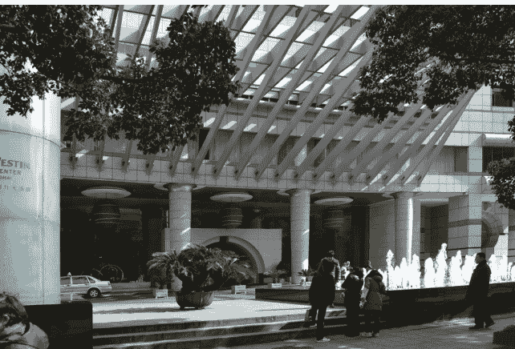

**图 2.15** 上海威斯汀滨江区酒店，上海。建筑入口点缀着宁静的水景，四周环绕着充足的自然采光、茂盛的植被和异域风情的雨棚。总体而言，包括其特征、尺度和比例在内的裙楼设计，均旨在适应人体尺度。*图片来源：作者摄影。*

## 一号北瓦克（One North Wacker），芝加哥 [2002]

一号北瓦克（One North Wacker，原名 UBS Tower）是位于芝加哥环路区（Loop）的一座 50 层高、高 199 米（653 英尺）的摩天大楼。该建筑于 2002 年竣工，其设计正值后现代主义建筑价值观转向当代风格时期。该建筑提供 163,000 平方米（1,754,000 平方英尺）的办公空间及配套设施，包括会议中心、健身中心和一个双层地下车库（Goettsch, 2012）。由建筑公司 Goettsch Partners 设计，该建筑以自 1980 年代末以来芝加哥市中心办公楼最高的每平方英尺售价成交。

一号北瓦克的裙楼设计展示了对通透性、美感和安全性的仔细考量，为动态且融合的城市体验做出贡献。建筑底部设有一个高度透明的缆索支撑围护结构，采用低铁玻璃和非反射涂层建造。这种设计在外部和内部空间之间建立了无缝的视觉连接，有效地将大堂融入周围的街道景观。底部的通透性将自然光引入大堂，在内部营造出开放且迎宾的氛围（Al-Kodmany, 2017; Goettsch, 2012）。

为了提升建筑的整体品质和精致感，室内外均采用了高质量的装饰材料。提升至四层高的大堂作为一个宏伟且迎宾的空间伫立其中。其高度增强了开放感和空间连续性，进一步模糊了室内与室外环境之间的界限。

建筑的入口处体现了一种好客姿态，在室外广场的东侧和南侧设有圆形花岗岩休憩空间。这些休憩空间为访客提供了休息和接触城市环境的地方，并作为花坛承担双重功能，同时满足了 9/11 事件后对摩天大楼强制要求的安全规范。将这些花坛无缝地整合到景观设计中，确保了安全措施与景观设计相结合，为使用者和访客提供安全且愉悦的体验。

凭借其圆形休憩区和花坛，室外广场成为建筑内部空间在功能和美学上的延伸。这种室内外元素的刻意融合增强了建筑与其城市背景的整体连通性，为使用者和路人营造了一个充满活力且引人入胜的环境。

总之，该建筑的底部设有一个高度透明的缆索支撑围护结构，配有非反射涂层和低铁玻璃。这种透明的底部使外部空间与内部空间融合，使大堂成为街道景观的一部分。室内外使用了高质量的装饰材料，大堂的高度提升至四层。建筑的入口是一种迎宾姿态，在室外广场的东侧和南侧设有圆形花岗岩休憩空间。这些花坛作为安全屏障发挥作用，这是 9/11 事件后对摩天大楼提出的要求（图 2.16）。

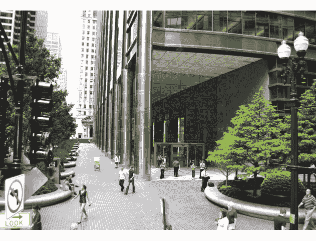

**图 2.16** 一号北瓦克，伊利诺伊州芝加哥。建筑底部设有一个高度透明的缆索支撑围护结构，配有非反射涂层和低铁玻璃，将室内外无缝融合。*图片来源：作者摄影。*

## 111 南瓦克（111 South Wacker），芝加哥 [2005]

111 南瓦克大道（111 South Wacker Drive）是位于芝加哥环路区（Loop）的一座 51 层高、高 208 米（681 英尺）的摩天大楼，于 2005 年竣工。该建筑的外观引人注目且具有现代感，拥有结合玻璃、钢材和其他高质量材料的流线型优雅立面。设计采用了简洁的线条、光滑的表面和现代美学，反映了其建筑方法的精致与创新。其比例得当的形态和深思熟虑的构图共同增强了其视觉吸引力，并与周围城市环境和谐融合。

111 南瓦克的裙楼设计是一幅杰作，优先考虑开放性、可见性和迎宾氛围。以 12 层高的基座为锚，该建筑设有一个四层大堂和一个八层停车库。作为基座核心元素的大堂以其卓越的通透性脱颖而出，这是通过使用低铁玻璃和非反射涂层的缆索支撑围护结构实现的。这种设计选择允许内部和外部之间无缝的视觉连接，营造出令人向往且开放的氛围（Al-Kodmany, 2017; Goettsch, 2012）。

值得注意的是，从塔楼外围柱过渡到仅四个大堂层柱，它们之间跨度惊人地达到 25 米（82 英尺），增强了大堂的开放感。在大堂后方，建筑的核心以白色大理石包裹，进一步强调了对可见性和开放性的承诺。

裙楼的一个独特特征是通往停车库的圆形坡道，它产生了一个复杂的瓷砖图案。这个图案在视觉上引人入胜，被深思熟虑地整合进大堂，并延伸至人行道，创造了和谐且连续的设计语言。放射状图案是

## **迈阿密万丽酒店南塔楼 [2005]**

这也体现在嵌入天花板的照明系统中，在大堂倾斜的天花板营造出一种“戏剧性”效果。这一设计选择为空间增添了一层动感和精致感。

浅色室内大理石的选择，辅以花岗岩、嵌入式不锈钢和玻璃外部元素，共同强化了地面层的开阔感和通透感。精致的照明系统提升了大堂的视觉吸引力，营造出温暖和亲切的氛围。对设计细节的精心关注唤起了一种好客的感觉，使大堂不仅仅是一个过渡空间，更是一个邀请人们停留并与建筑内部互动的目的地 (Goettsch, 2012)。

总之，111 西沃克南大道的裙楼设计特点是透明且视觉上连贯的大堂、战略性地使用白色大理石等材料、产生复杂图案的圆形坡道，以及精致的照明系统。这些元素共同创造了一个优先考虑可见性和开放性的裙楼，为营造友好且视觉动感的城市环境做出贡献 (图 2.17)。

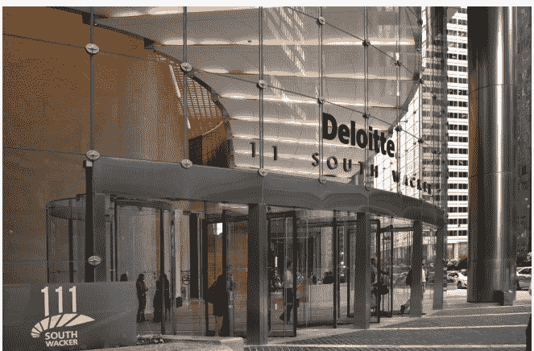

**2.17** 111 西沃克南大道，伊利诺伊州芝加哥。与 One North Wacker（前一个案例研究）类似，该塔楼的底部设有一个高度透明的大堂，使用由缆索支撑的围护结构，采用低铁玻璃和非反射涂层。车库坡道被设计为大堂中的装饰特征。
*来源：作者拍摄。*

万丽酒店南塔楼（Bentley Bay South Tower）是位于佛罗里达州迈阿密海滩的一栋 26 层、高 79 米（259 英尺）的住宅公寓楼。其姊妹楼万丽酒店北塔楼（Bentley Bay North Tower）是一栋 24 层的住宅公寓楼。这两座塔楼均由 Arquitectonica 设计，并于 2005 年竣工。万丽酒店建筑群像帆一样优雅地矗立在比斯坎湾的岸边。

万丽酒店南塔楼南端的车库空间在建筑群中作为一个独特且创新的特征脱颖而出。这座跨越四层楼高的停车场设施通过采用“绿色”墙体引入了一种独特的元素，这些墙体利用了 Jakob 绳索系统。该系统集成了钢丝绳、钢丝网和钢管，使植物能够自由地在结构上攀爬。

值得注意的是，钢管以半垂直和随机的方式排列，与建筑整体的水平方向形成视觉上的强烈对比。每层楼板有规律地突出，进一步强调了建筑的水平线条，使绿色墙面成为建筑构图中充满动感和引人注目的补充。

除了美学吸引力外，这些绿色墙面还具有双重作用。首先，它们通过促进空气净化为环境可持续性做出贡献。攀爬在墙上的植物积极参与自然空气过滤过程，提升了周围的整体空气质量。其次，将绿化元素融入其中产生了一种有趣的视觉效果，这与传统车库往往枯燥的外观显著不同 (Al-Kodmany, 2017; Shulman et al., 2010)。

通过在大堂空间中融入自然，万丽酒店南塔楼解决了与空气质量相关的实际问题，并转变了停车设施的视觉体验。绿化与车库结构元素的并置创造了自然与建筑的和谐融合，为停车基础设施提供了美观且具有环境意识的解决方案。本质上，大堂空间不再仅仅是一个功能性结构；它成为一个具有视觉吸引力且对环境做出响应的元素，有助于提升万丽酒店南塔楼建筑群的整体吸引力和可持续性 (图 2.18)。

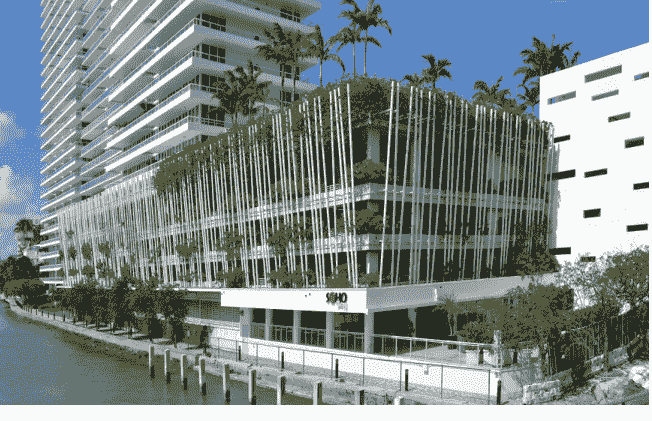

**2.18** 迈阿密万丽酒店南塔楼，佛罗里达州。除了环保之外，该设计还增强了车库的美观度。将此车库设计与密歇根州底特律的 One Detroit Center 进行比较，如图 2.4 所示。
*来源：作者拍摄。*

## **上海明耀国际广场 [2006]**

明耀国际广场（Shimao International Plaza）是位于中国上海黄浦区的一座摩天大楼。它由专注于生态和可持续建筑的德国建筑事务所 Ingenhoven Overdick and Partners 设计。该建筑在经过五年的建设后于 2006 年竣工，高度为 333 米，地上共 60 层。该建筑具有独特的三角形形状，随着高度增加而变窄，营造出修长而优雅的轮廓。这种形状还减少了风荷载并优化了空间使用。立面由玻璃和铝板组成，配有水平百叶，提供遮阴并减少能耗。

明耀国际广场的裙楼设计旨在打造一个充满活力且互动的城市空间，以反映城市的活力和多样性。当人们望向裙楼的顶端时，会看到一种引人入胜的玻璃面板排列，采用阶梯式图案，赋予空间明显的动感和节奏感。这种有意的排列有助于空间的视觉动感，并允许自然光渗透到室内。

裙楼的显著特征是延伸至结构顶端的巨大空间框架雨篷，形成了一个与塔楼的垂直性形成刻意对比的独特天际线。该雨篷由不同大小和角度的三角形模块组成，形成了动态且雕塑般的形态。这些模块不规则的排列赋予雨篷一种艺术气息，创造了光影之间引人入胜的相互作用 (Al-Kodmany, 2018; Binder, 2015)。

值得注意的是，裙楼的雕刻式设计具有双重目的。除了美学意义外，这一设计元素还保护行人，使他们免受风雨侵袭，并确保在城市空间中的舒适和遮蔽体验。支撑上层楼层的大型圆形立柱有助于裙楼的结构完整性，并作为独特的设计元素，增强了整体的视觉吸引力。

总之，明耀国际广场的裙楼设计是艺术表达、功能性和保护性的深思熟虑的结合。通过融入动态元素，如阶梯式玻璃面板、引人注目的空间框架雨篷和保护性雕刻式设计，裙楼创造了一个具有美学吸引力的城市环境，响应居住者和穿行者的实际需求。结果是形式与功能的和谐融合，有助于明耀国际广场的整体建筑身份 (图 2.19)。

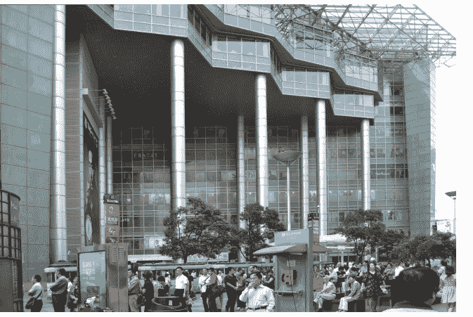

**2.19** 上海明耀国际广场。塔楼的底部向南京路步行街的人群致意，该步行街从外滩到人民广场几乎呈东西走向延伸近一英里。
*来源：作者拍摄。*

## **上海陆家嘴一号 [2008]**

上海陆家嘴一号（One Lujiazui，又称开发塔）位于中国上海的陆家嘴金融贸易区（LFTD）。这座 47 层、高 269 米（883 英尺）的塔楼包含混合用途功能，包括商业办公空间、住宅公寓和购物中心。该建筑由日本建筑事务所日建设计（Nikken Sekkei）的小谷野朋彦设计，于 2008 年竣工，由内部混凝土结构和玻璃外墙组成。

上海陆家嘴一号的裙楼设计是其脱颖而出的显著特征。值得注意的是，其底部由两个倾斜的翼楼组成，环绕着一个突出且略微弯曲的玻璃入口。这种建筑配置创造了视觉上引人注目且动态的效果。透明入口与不透明白色翼楼之间的相互作用形成了鲜明的对比。下降翼楼与上升入口之间的相反运动强调了材料和透明度水平的并置 (Al-Kodmany & Ali, 2013; Al-Kodmany, 2017; Binder, 2015)。

为了增加视觉趣味，翼楼展现出锯齿状的阶梯式轮廓，为裙楼增添了生动和动态的外观。这种锯齿图案为结构增加了动感，并引入了独特的建筑节奏。翼楼的阶梯式设计增强了裙楼的三维质感，创造了引人入胜且现代的审美效果。

翼楼的强烈对比、动态角度和阶梯式轮廓使得上海陆家嘴一号的底部成为一个建筑焦点。透明度与不透明度之间的相互作用，加上独特的形状和轮廓，不仅具有美学目的，还有助于建筑的整体身份。具有独特特征的裙楼设计建立了建筑动感和视觉兴趣感，使上海陆家嘴一号成为上海城市景观中一个引人注目且令人难忘的存在 (图 2.20)。

## **上海环球金融中心，上海 [2008]**

这座多用途、101 层、高 492 米（1,614 英尺）的塔楼也位于上海陆家嘴金融贸易区（LFTD）。它于 2008 年竣工，由 Kohn Pedersen Fox 事务所设计

### 2.20

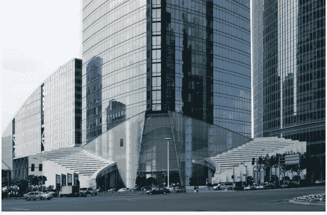

上海陆家嘴一号。塔楼的基座是该建筑引人注目的元素。它由两个白色的倾斜翼状结构组成，中间夹着一个突出且略微弯曲的玻璃入口。
图片来源：作者拍摄。

[KPF](https://www.kpf.org)设计的这座塔楼采用了独特的玻璃和钢结构幕墙，强调简洁的单体外观。

上海环球金融中心裙楼的设计是一个非凡且富有创意的特色，增强了塔楼与周围行人环境的互动。塔楼的基座被构思为一个独立的“雕塑物体”，精致地附着在这座超高层建筑上，容纳了入口、大堂、零售空间和餐饮区。这一设计选择促进了塔楼在街道层面体验上的视觉吸引力和功能整合。

一个独特的设计方面是锥形的基座，它为结构增添了雕塑感，并开放了行人空间，创造了一个更广阔和宜人的环境。这种锥形效果有助于美学，并作为视觉引导，将观众的视线引向背景中高耸的建筑（Al-Kodmany & Ali, 2013; Binder, 2015）。

基座融入了正交元素，勾勒出入口的轮廓，进一步增强了雕刻基座的视觉吸引力。精细的细节和设计元素营造出一种精确和精致的感觉，增添了结构的整体美学品质。基座的人体尺度是一个关键考量，促进愉快的街道生活，为行人提供一个放松的环境。

重要的是，上海环球金融中心的设计通过分离基座与塔楼，并赋予两者雕塑特质，采取了一种独特的方式。这标志着一种实用且具有创新性的设计策略，为之前讨论过的更广泛的雕塑裙楼组合做出了贡献。这个组合中的著名例子包括位于香港的丽โพ中心、由保罗·鲁道夫（Paul Rudolph）设计的位于新加坡的康乐中心（Concourse），以及由赫尔穆特·杨（Helmut Jahn）构思的500 West Madison。此外，由山崎笃彦（Tomohiko Yamanashi）设计的上海陆家嘴一号和由阿德里安·史密斯（Adrian Smith）设计的特朗普大厦（稍后详述）也符合这一组合，共同展示了对创新和视觉冲击力强的建筑解决方案的承诺。

上海环球金融中心的裙楼设计展示了一种深思熟虑且富有创意的方法，将超高层结构与其直接的行人环境相整合（图 2.21）。值得注意的是，最近的翻新对原始设计进行了更改，表明了对适应性的承诺，确保裙楼保持为城市景观中充满生机和吸引力的部分。

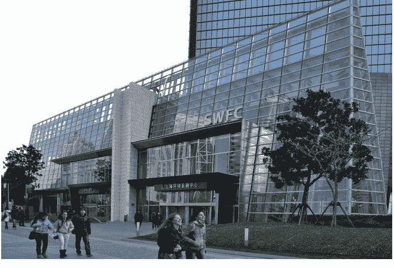

### 2.21

上海，上海环球金融中心。塔楼的基座与行人环境精密整合，呈现为一个附着在结构上的独特“雕塑物体”。锥形设计创造了一个更开放和宜人的氛围，用于容纳入口、迎宾大堂、零售空间和餐饮区。
图片来源：作者拍摄。

## 155 北沃克街（155 North Wacker Drive），芝加哥 [2009]

155 North Wacker Drive 是芝加哥环路区（Loop）的一座 45 层、高 195 米的摩天大楼，由 Goettsch Partners 设计，此前已在本章中讨论并展示了 1 North Wacker Drive 和 111 South Wacker Drive（见 图 2.16 和 图 2.17）。

155 North Wacker Drive 的裙楼设计以其精心组合的悬挑楼层、引人注目的拱廊和宽敞的广场为特征，共同散发出透明、轻盈和开放的氛围。三层拱廊是一个突出的特色，引导行人走向建筑的两个入口和迎宾大堂。这个拱廊既是一个功能元素，也是一个审美享受，装饰着街道家具和绿植，为行人创造一个欢迎的空间，让他们在免受风雨的同时欣赏建筑的迷人美学。

拱廊和大堂区域展示了精心设计，具有几何图案、高质量的饰面和精致的建筑细节。这种对细节的关注创造了视觉连续性，增强了建筑设计的整体连贯性（Al-Kodmany, 2020; Goettsch, 2012）。

在结构的东侧，一个公共广场进一步有助于将自然整合到塔楼周围。成熟的树木、茂盛的草地、鲜艳的花朵和花岗岩长凳相结合，形成了一个宁静且视觉上令人愉悦的户外空间。这个广场为游客提供了休憩之处，提供了自然与城市建筑的和谐融合。

155 North Wacker Drive、111 South Wacker 和 1 North Wacker 的裙楼设计在对透明性的承诺上具有共同点，它们无缝地将室内和室外空间的界限融合在一起，营造了一种宜人的氛围。采用尖端的设计原则，这些建筑散发出优雅和精致，作为材料、技术和结构进步的见证。

要充分理解其创新贡献的深度，与 Daley Center 的比较分析变得很有启发性。值得注意的是，Daley Center 拥有一个透明的基座，可追溯至其 1965 年的建造时期，作为一个历史基准（图 2.7）。对比这些建筑（见 图 2.16、2.17 和 2.22）强调了建筑设计在演进上的进步，展示了从早期透明基座设计到以 155 North Wacker Drive、111 South Wacker 和 1 North Wacker 为代表的当代杰作的渐进演化（Goettsch, 2012）。

该项目在 2009 年完工，强调了当代设计原则以及致力于创造不仅具备功能性办公空间，而是丰富城市体验的地方。总体而言，155 North Wacker Drive 的裙楼设计展示了在城市景观中成功整合美学、功能和绿色空间的典范（图 2.22）。

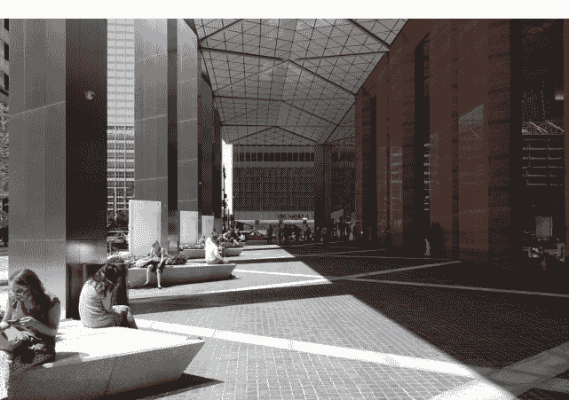

### 2.22

155 North Wacker Drive，伊利诺伊州芝加哥。三层拱廊连接建筑的两个入口和大堂，设有街道家具和种植，让行人在免受风雨的同时享受迷人的美学。拱廊和大堂展示了几何图案、高质量的饰面和建筑细节，创造了视觉连续性。
图片来源：作者拍摄。

## 特朗普国际酒店及塔楼（Trump Tower），芝加哥 [2009]

特朗普国际酒店及塔楼高度为 423 米（1,388 英尺），共有 98 层，于 2009 年建成。它现在保持着该市第二高建筑的位置，被 1974 年建成的威利斯大厦（Willis Tower），更常被称为西尔斯大厦（Sears Tower）在高度上超越。

该塔楼的裙楼设计以其与芝加哥河的独特整合为特色。这一特征促成了该建筑在城市景观中的标志性地位。塔楼的基座经过艺术雕刻，揭示了较低楼层的“地形”轮廓，创造了一个模仿邻近河流曲线的起伏设计。这种建筑选择赋予基座一种动态且视觉上引人入胜的外观（Al-Kodmany, 2020; Kamin, 2022）。

基座的凹入楼层巧妙地揭示了建筑的结构柱，为设计注入了迷人的节奏感和秩序感。这种结构中的有意透明性不仅增添了建筑趣味性的引人入胜层面，还为观察者提供了对塔楼内部运作和基础元素独特的 glimpse。它创造了一种形式与功能之间的动态互动，让观众参与到对建筑结构复杂性的探索中。

除了对基座设计的深思熟虑外，塔楼与河流的联系通过整合层叠露台得到提升。这些露台不仅作为功能组件，也是视觉上的享受，编排了建筑结构与伦敦风格滨水景之间的无缝过渡。其精心设计的布置增强了建筑的美学吸引力，同时促进了与自然环境的更深联系。这些战略定位的台地位于为居民和游客提供了独特的观景角度，提供了无以伦比的机会，去品尝和欣赏河流及其周边环境的风景美。

为了激活行人体验，零售商店被战略性地放置在塔楼的基座。意图是促进充满活力的行人活动。然而，这一策略的有效性受到了批评，因为其中一些零售空间仍然空置，导致行人领域利用不足。尽管存在这一挑战，裙楼的总体设计反映了对协调建筑与其滨水环境以及参与芝加哥动态城市环境的深思熟虑的尝试（图 2.23）。

## 北京国贸中心（China World Trade Tower） [2010]

中国国际贸易中心（China World Trade Tower）是北京中央商务区的一座 81 层摩天大楼。它矗立在令人印象深刻的高度 330 米，拥有将现代性与中国传统元素相结合的独特建筑设计。由 Skidmore, Owings, and Merrill (SOM) 设计并于 2010 年完工，塔楼包含办公室、会议室、餐厅和中国大饭店（China World Summit Wing）酒店，64 层有大堂，81 层有观景台。

## 2.23 特朗普大厦，伊利诺伊州芝加哥市

该塔的底部经过雕塑处理，呈现出低层“等高线”般的轮廓，呼应河流的弯曲形态，而内凹的楼层则暴露了结构柱。活动的基座和层叠的露台增强了与河流的界面互动，同时零售店铺的布置旨在促进行人活力。遗憾的是，许多店铺目前仍空置。

来源：作者摄影。

该塔的裙楼设计以其宽敞且诱人的布局为特征，为访客营造了欢迎的环境。入口和雨棚的建筑设计凸显了该塔作为地标和综合体入口的重要性。入口的比例 generous。其建筑元素经过精心打造，旨在传达宏伟与重要性，奠定了该塔在城市景观中的角色基调 (Al-Kodmany, 2018; Binder, 2015)。

一个显著的特点是引人注目的精致雨棚，它从塔楼外立面延伸覆盖至入口上方。该雨棚具有多重用途——它为塔楼外观增添了独特的视觉元素，为进出建筑的人提供遮阳，并作为雨水收集器，有助于塔楼的环保设计。

综上所述，中国世界贸易大厦的入口不仅在建筑上具有重要意义，还充分考虑了待客之道。其宽敞、设计精良的布局和引人注目的雨棚共同营造了一种整体的宜人氛围，使其成为北京城市环境中一个突出且欢迎的特色（图 2.24）。

## 国际金融中心；香港 [2010]

由 Kohn Pedersen Fox (KPF) 合伙人公司设计，高度达 484 米（1,588 英尺），共 118 层，国际金融中心 (ICC) 塔楼是香港最高的建筑。该塔楼于 2010 年竣工，位于联合广场（Union Square）综合体的西南角，由香港地铁公司（Hong Kong MTR Corporation Ltd.）和恒基地产（Sun Hung Kai Properties）拥有。楼内设有商业办公空间以及一家五星级丽思卡尔顿酒店（Ritz-Carlton Hong Kong），该酒店占据了大楼的最高楼层（102 至 118 层）。

### 裙楼

2.24

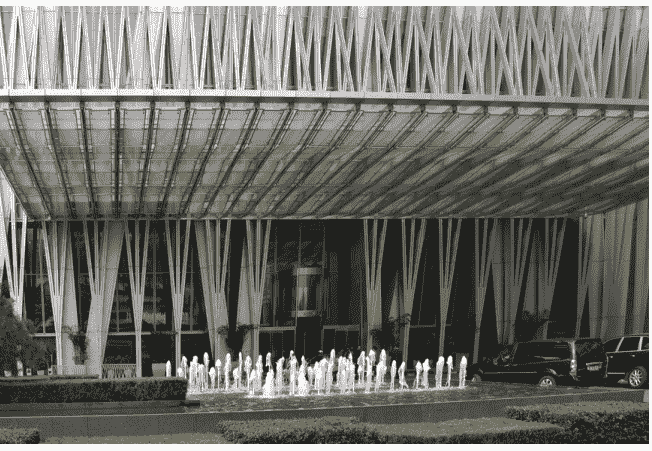

中国世界贸易大厦，北京。令人惊叹的精致雨棚从塔楼立面延伸出来，覆盖了入口区域。迷人的喷泉和茂盛的景观布置唤起了一种欢迎和到达的感觉。

来源：作者摄影。

国际金融中心 (ICC) 的裙楼设计以其对建筑元素的深思熟虑的整合而著称，这些元素增强了美学和功能。在大楼的北侧，立面优雅地向下延伸，形成一个呈“龙尾”形状的中庭。这一独特的建筑特色从塔楼基座延伸出来，创造了一个视觉上迷人的公共空间，将塔楼与火车站和购物中心连接起来，并为整体设计增添了艺术色彩（图 2.25）。

在“龙尾”的另一侧是建筑物的主要入口。该入口以一个横跨下车区域的大型玻璃雨棚为标志，旨在为访客和来宾提供宏伟的抵达体验。玻璃雨棚为入口增添了现代和诱人的美感，并作为天窗发挥作用，允许自然光穿透大堂和购物中心 (Al-Kodmany & Ali, 2013; Binder, 2015)。

喷泉是广场内的一个焦点，具有象征意义。它象征着塔楼与维多利亚港的联系，并作为城市的隐喻灯塔，喷泉设有一个圆形池盆，带有动态喷头，可产生各种水图案和效果，如雾、喷雾和波浪。这一中心水景元素为公共空间增添了动态和互动的元素，提升了 ICC 裙楼的整体体验质量。

综上所述，香港国际金融中心的裙楼设计以创新性地融入建筑元素为特征，如“龙尾”中庭和玻璃雨棚入口，这些元素不仅增强了建筑的美学吸引力，还提升了空间的功能性。具有象征意义的喷泉进一步加强了塔楼与周围环境及其作为城市景观中突出地标的联系。

### 2.25

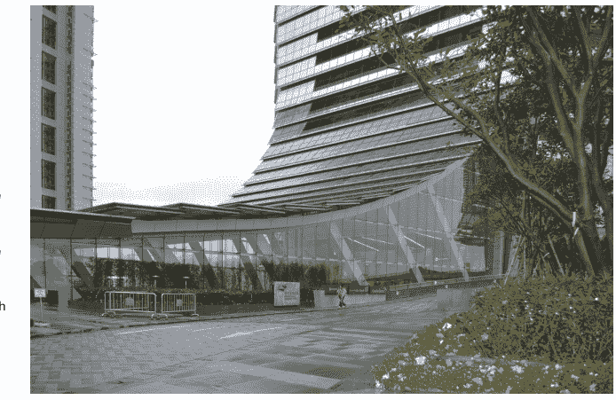

国际金融中心 (ICC)，香港。建筑北侧立面向下扫过，围合出一个呈“龙尾”形状的中庭，从塔楼基座延伸出来，作为连接塔楼与火车站和购物中心的公共空间。

*来源：作者摄影。*

## 恒基兆和地产，上海 [2011]

恒基兆和地产品位于上海黄浦区南京东路 300 号。该项目于 2011 年竣工，占地面积为 35,450 平方米。楼内设有一个购物中心，拥有各种商店、餐厅和娱乐选择，迎合不同的品味和预算。主要租户包括 Apple、Nike、Boy London、P.F. Chang's 和 Sephora。东立面设有一个大型 LED 屏幕，用于播放广告和交互内容 (Denison & Ren, 2013)。

恒基兆和地产品裙楼设计是现代建筑的一项杰出融合，无缝结合功能与美学，创造了一个动态且视觉上吸引人的空间。这座四层结构作为一座容纳办公楼和公寓的 24 层高耸建筑的基础，同时容纳了多样化的零售和娱乐空间，如电影院、超市、美食广场和健身中心。

裙楼的立面由玻璃、金属和木材面板组成，经过精心排列，呈现出动态而优雅的外观。这种建筑方法不仅有助于建筑的整体美感，还反映了当代的设计理念。立面所使用的材料增加了纹理层次和视觉趣味，创造了引人注目的外部形象。

贯穿其内部的大型中庭是裙楼的重要特征。这一设计元素具有双重作用：允许自然光渗透空间，营造明亮宜人的氛围，并提供自然通风。弯曲的雨棚和起伏的表面的整合进一步增强了室内开阔感和连接感，为访客创造了一个视觉上充满刺激的环境。

### 裙楼

恒基兆和地产品购物中心裙楼展示了一种成功的建筑类型学，其特点是裙楼与塔楼之间有清晰的水平分隔（图 2.26）。这种划分增加了建筑的视觉吸引力，并促进了结构内不同活动的功能分离。总之，恒基兆和地产品裙楼设计巧妙地将现代美学、功能性和深思熟虑的空间布局相结合，创造了一个充满活力和吸引力的城市空间。

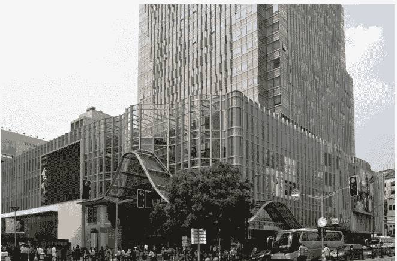

### 2.26

恒基兆和地产，上海。其裙楼设计强调了与塔楼的分离，以改善与行人领域的连接。其起伏的表面、弯曲的雨棚和精细的立面增强了其视觉吸引力。

*来源：作者摄影。*

## KK100，深圳 [2011]

KK100 是中国深圳的一座超高层摩天大楼，高度为 442 米（1,450 英尺），共有 98 层。该塔楼由 TFP Farrells 设计，这是一家专注于高层建筑的英国公司。该建筑于 2011 年竣工，具有弯曲的玻璃幕墙，向顶部逐渐变窄，形成了流畅而优雅轮廓。建筑还拥有一个独特的顶部结构，上层设有观景台、花园和几家餐厅 (Binder, 2015)。

KK100 的裙楼设计是一种大师级的构图，增添了城市最高建筑之一的标志性地位。主入口以其独特特征脱颖而出——一个巨大的圆形开口作为焦点，视觉上鲜明地框住了入口。这种圆形设计增强了建筑从各个角度可见性，并为访客增添了宏伟、优雅和抵达的感觉。

在美学上，入口是一个迷人的元素，在建筑的整体构图中发挥着关键作用。其圆形形式与塔楼的矩形形状形成动态对比，为建筑组合增添了复杂性和视觉趣味。这种刻意的

这种设计选择体现了现代与创新精神，契合深圳作为发展和现代化前沿城市的进步理念。

圆形开口在功能上作为入口点，同时成为一种设计宣言，象征着深圳前瞻性的城市身份。在KK100作为深圳乃至中国最高、最具标志性的建筑之一的背景下，这一元素代表了城市的快速成长及对现代性的拥抱。

本质上，KK100的裙楼设计，以其显著的圆形入口，是美学与功能深思熟虑融合的见证。它不仅提升了建筑的视觉吸引力，还丰富了深圳这座以创新、进步和对现代建筑表达 commitment 著称的城市叙事（图 2.27）。

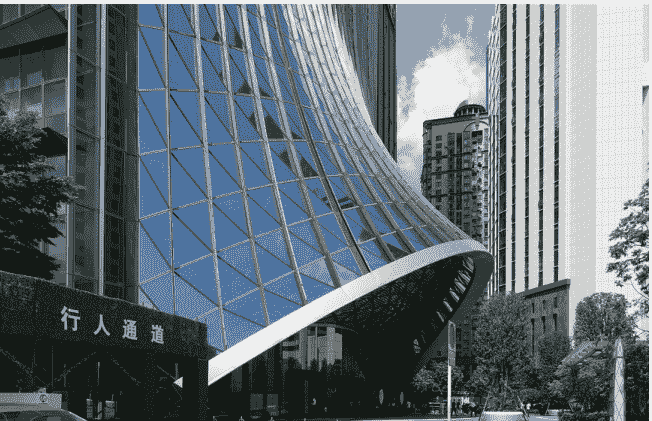

## 东方之门，苏州 [2013]

东方之门，中国苏州的一栋302米高的摩天大楼，象征着这座城市的历史园林与运河。该建筑于2013年完工，为金鸡湖及周围城市景观提供全景视野。该建筑为居民、员工和宾客提供的设施位于裙楼内。

东方之门的裙楼设计是传统方正结构的显著背离，引入了雕塑感和曲线形态，赋予其动态的运动感和视觉趣味。精心校准的尺寸确保裙楼在创造视觉宜人环境的同时，不会压倒或主导行人，营造出和谐的城市环境。

### 裙楼

一个值得注意的方面是裙楼延伸的水平性与背景塔楼垂直性之间刻意的对比。这种有意识的设计选择增加了一层视觉趣味，裙楼的倾斜屋顶不仅具有功能作用，而且在象征上呼应了塔楼的宽大拱形，形成了统一且美观的构图（Al-Kodmany, 2018; Binder, 2015）。

裙楼的地面层建筑超越了单纯的功能性，提供宽敞的人行道、广场和开放空间，邀请行人进入一个欢迎且易用的环境。这种设计鼓励社交、休闲和放松，增强了整体体验，并促进与自然的联系。

为了满足行人的需求，空间布局包括舒适的座位区、遮阳结构、景观绿化和导航标识，确保访客能够轻松导航并拥有愉快的体验。因此，该设计对实用性、人体工程学和比例给予了细致关注，符合人体尺度原则，创造了一个无缝融入城市肌理的裙楼。

总之，苏州东方之门的裙楼设计因其尊重人体尺度、平衡美学与功能、为居民和访客提供丰富体验的环境而脱颖而出（图 2.28）。

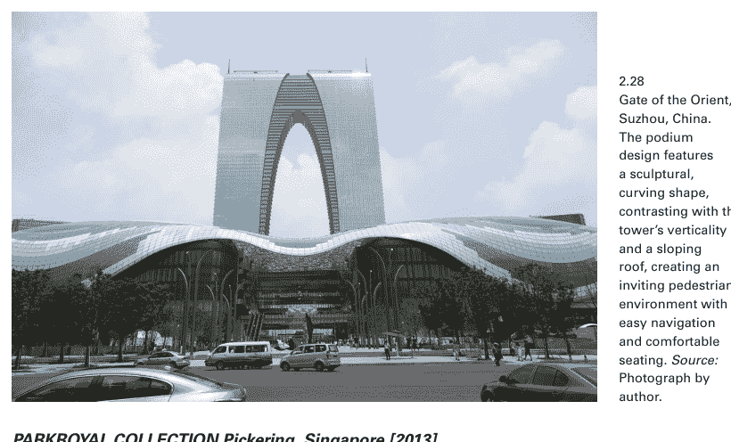

## PARKROYAL COLLECTION 碧山雅途，新加坡 [2013]

新加坡的PARKROYAL COLLECTION 碧山雅途以其强调人体尺度的创新建筑设计而著称，该设计融合了亲生物设计原则并展现了美学吸引力。这栋16层、高75米的建筑融合了可持续设计原则、茂盛的绿植和现代美学（Beatley, 2016）。引人注目的立面覆盖着郁郁葱葱植被的露台和阳台，营造出垂直花园的效果，与城市景观形成清新对比（见第13章）。该项目于2013年完工。

PARKROYAL COLLECTION 碧山雅途的裙楼设计是其视觉吸引力以及当代建筑与有机形式无缝融合的见证。在流畅的线条、曲线形状和可持续材料之间取得平衡，设计流露出优雅与精致。对细节的关注造就了与自然 surroundings 和谐统一的、视觉上引人入胜的裙楼。

多感官体验是一个关键设计特征，瀑布和反射水池等水元素增加了舒缓的听觉和视觉维度。这些水景增强了整体氛围，建立了与自然的联系，为访客营造了宁静的环境。

包括木材和石材在内的天然材料对于为裙楼增加触觉和温暖质感至关重要。这种有机元素的融入增强了感官体验，符合亲生物设计原则，创造了一个让客人在城市环境中与自然连接的空间（Al-Kodmany, 2023; Beatley, 2016）。

至关重要的是，裙楼设计尊重人体尺度，为个人创造了一个欢迎且易于通行的舒适环境。对行人体验的考量至关重要，确保空间具有吸引力和包容性。

总之，PARKROYAL COLLECTION 碧山雅途的裙楼设计因其视觉吸引力、对可持续性的承诺以及对感官体验的重视而脱颖而出。通过将建筑精致感与自然元素无缝融合，裙楼创造了一个让访客享受并与自然连接的引人入胜且美观的空间（图 2.29）。

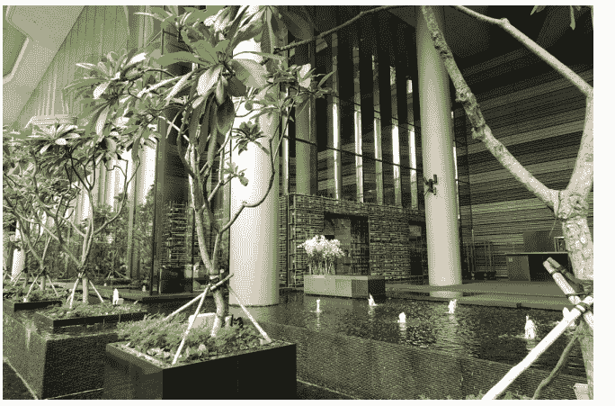

## 裙楼

## 凯德国际，杭州 [2017]

凯德国际，又称杭州来福士，位于杭州，这是中国风景最秀丽的城市之一。它是凯德集团在中国开发的第八个来福士项目。该建筑于2017年完工，凯德国际的建筑设计灵感源自钱塘江的流动和杭州的历史城市景观。两座流线型塔楼扭转并上升至250米，在城市新CBD的绿色轴线旁创造了一个充满动感且优雅的标志（Qian, 2015）。

凯德国际的裙楼设计特征在于一个雕塑感的六层基座，它作为连接塔楼与更大综合体的关键纽带。这个多功能基座经过精心设计，容纳了各种设施，包括停车场、商店、餐厅和娱乐场所。此外，它与附近的地铁站设有直接的地下连接，增强了居民和访客的可达性。

裙楼设计的一个组成部分是其对大尺度的坚持，确保美学吸引力与实际功能。裙楼流动和拱形的玻璃幕墙创造了引人注目的视觉印象，赋予一种抵达感。这一建筑特征有助于营造开放和透明的整体氛围，增强了接近该建筑的访客的视觉体验。

此外，一个景观广场作为额外的裙楼组件，扩展了综合体周围的公共领域。这一户外空间增添了一抹绿意，为居民和客人营造了生动且宜人的环境。广场的设计符合当代城市规划原则，创造了一个鼓励社交互动并促进建筑居住者福祉的公共空间。

总之，杭州凯德国际的裙楼设计整合了功能、美学和人体尺度考量。雕塑感的基座凭借其多样的设施和视觉惊人的特征，增强了综合体的整体吸引力，同时为社区提供了欢迎且引人入胜的环境（图 2.30）。

## River Point 塔楼，芝加哥 [2017]

由位于康涅狄格州纽黑文市的Pickard Chilton Architecture + Master Planning设计，并于2017年完工，52层的River Point是芝加哥市一个充满戏剧性的标志新增建筑。塔楼引人注目的形象由雕塑感流畅的形态和闪闪发光的凸面立面创造，其特征是充满活力的银蓝色弯曲玻璃墙，与其邻近建筑——同样拥有巨大弯曲绿色玻璃幕墙的333 W. Wacker Drive——建立了坚实的空间亲和力。

凸面立面在底部展示了一个高耸、倾斜的抛物线拱，塔顶处则有一个较浅的拱与之呼应。底部的拱是结构性的：由于下方活跃的Amtrak和Metra铁路轨道以及CTA蓝线地铁部分的影响，整个立面和立柱都是倾斜的。然而，顶部的拱是装饰性的（Al-Kodmany, 2020; Kamin, 2016, 2022）。

## 裙楼

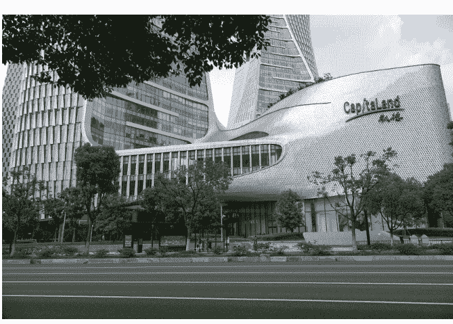

**图 2.30** 中国杭州，凯德大厦。凭借雕塑般的设计、弧形玻璃幕墙以及景观广场，该裙楼营造出一种亲切宜人、适合人体尺度的氛围，增强了公共领域的可达性，并唤起一种欢迎的氛围。来源：作者拍摄。

River Point Tower 的裙楼设计以其底部令人惊叹的三层大堂为特征，采用了超透明低铁玻璃。这个大堂不仅作为入口，还极大地增强了建筑的视觉吸引力。大堂的东立面尤为引人注目，呈现出一种迷人的视觉体验。由独特的抛物线拱门框定的倾斜玻璃墙创造了视觉上令人愉悦的效果，超越了传统的建筑美学。

大堂东立面的独特设计产生了一种意外且引人注目的镜面现象。从某些角度来看，观察者会体验到远处城市景观的反射以及附近河面上的动态活动。正如建筑评论家 Blair Kamin (2022) 所解释的，这种无意间产生的迷人效果捕捉了河流闪烁的水光和船只的快速移动，为设计增添了一丝意外的惊喜元素。

Pickard Chilton 的建筑师 Anthony Markese 和 Jon Pickard 承认，他们并未预料到这种特定的镜面效果，这凸显了建筑设计中令人愉悦且自发的方面。这种与周围环境非计划性的互动为裙楼的设计增加了额外一层魅力，展示了深思熟虑的建筑选择中可能涌现出的意外之美。

总之，River Point Tower 的裙楼既是一个功能性空间，也是一个在视觉上极具冲击力且富有创新性的特征。大堂的设计，凭借其透明玻璃元素和非故意的镜面效果，增强了城市环境，为整个项目的建筑卓越性做出了贡献（图 2.31）。

### 关键要点：规划与设计原则

在为高层建筑设计人体尺度的裙楼时，可以应用多项建筑与规划设计原则，以创造一个更具吸引力和行人友好的环境。设计应优先考虑人们的需求和体验，在城市肌理中促进社会互动、舒适感和场所感。这些原则包括：

- **比例尺度**：裙楼应以适合人际互动的尺度进行设计。通过分解建筑的整体体量并融入水平和垂直元素，裙楼在视觉上和物理上对行人更加可达且更具亲和力。
- **视觉趣味与多样性**：在裙楼设计中引入视觉趣味和多样性，有助于打破建筑的尺度感和单调性。这可以通过使用不同的材料、立面处理、退台和分段来实现，从而创造出一个视觉上引人入胜且充满活力的街道景观。
- **自然元素与亲生物设计**：融入自然景观、绿墙或垂直花园等自然元素，可以增强与自然的连接，并改善裙楼的整体氛围。应用亲生物设计原则可以创造一个更以人为中心且在心理上更具支持性的环境。
- **采光与视野**：最大化自然采光和视野对于人体尺度的裙楼至关重要。通过设置大窗户、玻璃幕墙和透明空间，允许充足的自然光透入，同时战略性地设置开口以提供周围环境的视野，从而增强视觉体验。
- **活跃的街道界面**：设计具有活跃街道界面的裙楼对于营造引人入胜且充满活力的环境至关重要。在地面层整合零售空间、咖啡馆、餐厅和其他设施，可以激活街道层面，吸引人群并促进社会互动。
- **行人连通性**：设计应通过提供清晰直接的通道和循环路线来优先考虑行人连通性。裙楼应与周围城市肌无缝整合，连接人行道、公共空间和交通枢纽，以鼓励人流。
- **安全与无障碍**：确保裙楼的安全性和无障碍性至关重要。应纳入照明良好的步行道、清晰的标识、坡道、电梯和通用无障碍设施等设计元素，以满足包括残障人士在内的所有个体的需求。
- **文化融合**：将文化元素融入裙楼设计，以反映社区的身份和背景。艺术装置、文化母题或历史参考可以创造场所感和连接感。
- **可持续实践**：在裙楼设计中实施可持续实践，包括节能技术、绿色屋顶和水管理系统。确保裙楼对高层建筑开发的环境影响产生积极贡献，并与更广泛的可持续发展目标保持一致。
- **公共空间与广场**：裙楼附近的公共空间和广场为人们提供了聚集、休息和与环境互动的机会。这些空间可以设有座位区、绿植、水景和公共艺术，从而提升行人体验的整体质量。下一章将讨论公共广场在人性化高层建筑城市中的作用。

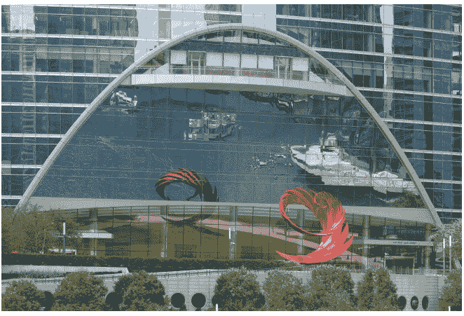

**图 2.31** 美国伊利诺伊州芝加哥，River Point Tower。东立面传递出特别令人愉悦的视觉效果，这是通过其由抛物线拱门框定的倾斜玻璃墙精确实现的，该玻璃墙映照出远处的城市景观和附近的河流活动。来源：作者拍摄。

## 参考文献

- Alba, R. (2003). *Paul Rudolph: The late work*. Princeton Architectural Press.
- Al-Kodmany, K. (2017). *Understanding tall buildings: A theory of placemaking*. Taylor & Francis.
- Al-Kodmany, K. (2018). *The vertical city: A sustainable development model*. WIT Press.
- Al-Kodmany, K. (2020). *Tall buildings and the city: Improving the understanding of place-making, imageability, and tourism*. Springer.
- Al-Kodmany, K. (2023). Greenery-covered tall buildings: A review. *Buildings Journal*, 13(9), 2362.
- Al-Kodmany, K., & Ali, M. M. (2013). *The future of the city: Tall buildings and urban design*. WIT Press.
- Beatley, T. (2016). *Handbook of biophilic city planning and design*. Springer.
- Binder, G. (2015). *Tall buildings of China*. Images Publishing.
- Denson, E., & Ren, G. Y. (2013). *Building Shanghai: The story of China's gateway*. John Wiley & Sons.
- Dupré, J. (2016). *One world trade center: Biography of the building*. Hachette UK.
- Gehl, J. (2010). *Cities for people*. Island Press.
- Goettsch, J. (2012, September 18–22). How tall buildings meet the ground is as important as how they meet the sky. In *Proceedings of the CTBUH 9th World Congress in Shanghai, China* (pp. 360–367). Council on Tall Buildings and Urban Habitat.
- Goldberger, P. (2011). *Building up and tearing down: Reflections on the age of architecture*. Monacelli Press.
- Jahn, H. (2015). Helmut Jahn: Buildings 1975–2015. Schirmer/Mosel.
- Kamin, B. (2000). Tribune tower: American landmark. Tribune Company.
- Kamin, B. (2016). Curvy new skyscraper reflects river and rising design ambition. Chicago Tribune. https://www.chicagotribune.com/2016/12/16/curvy-new-skyscraper-reflects-river-and-rising-design-ambition/ (accessed March 1, 2024).
- Kamin, B. (2022). Who is the city for?: Architecture, equity, and the public realm in Chicago. University of Chicago Press.
- Qian, Z. (2015). Hangzhou. Cities, 48, 42–54.
- Rohan, T. (2014). The architecture of Paul Rudolph. Regent Publishing Services Limited.
- Saliga, P. A., & Clarke, J. H. (1998). Sky’s the limit: A century of skyscrapers in Chicago. Rizzoli.
- Schulze, F., & Harrington, K. (2003). Chicago famous buildings. University of Chicago Press.
- Shulman, A., Robinson, R., & Donnelly, J. (2010). Miami architecture: An AIA guide featuring downtown, the beaches, and coconut grove. University Press of Florida.
- Whyte, W. H. (1980). The social life of small urban spaces. Project for Public Spaces.
- Woodbridge, S. B. (1992). San Francisco architecture. Chronicle Books.

## 3 公共广场

高密度居住区中社会隔离所提出的挑战，凸显了当代城市生活的复杂性，尤其是在以高层建筑和密集人口为主的环境中。在摩天大楼林立和繁忙的城市生活中，居民可能会陷入一种矛盾的境地——尽管周围邻居众多，却缺乏进行随意交流和社区互动的机会。高层建筑的垂直特性往往意味着居民在电梯或走廊中擦肩而过，却失去了进行有意义交流的机会。公共空间的缺乏以及社交区域的缺失，进一步加剧了孤立感，使个人感觉自己与邻居以及更大的社区脱节。现代生活方式的需求加剧了这一挑战，城市生活的快节奏和个人主义性质有时会阻碍社会联系的自发形成（Gehl, 1971, 2010; Marcus & Francis, 1998）。

为了应对高密度居住区中社会隔离的挑战，一种深思熟虑的解决方案是故意提供公共空间和公共广场。这些空间促进了随意的互动，为居民提供了自然建立联系的机会。在这些空间中举办社交活动，从邻里聚会到文化庆典，可以进一步巩固社会纽带（Loukaito-Sideris & Banerjee, 1998）。通过创造超越个人住宅局限的空间，并促进共同身份的认同，高密度居住可以演变为一种在社会上富有回报的体验，让居民感到连接、参与并融入更大的社区网络。作为城市肌理的重要组成部分，公共广场通过提供绿化、座椅和娱乐机会，促进城市居民的幸福，从而缓解高层居住垂直特性带来的潜在挑战（Al-Kodmany, 2017; Whyte, 1980）。

以下案例研究突出了公共广场在使高层建筑城市人性化的角色。

### 理查德·J·戴利广场，芝加哥

理查德·J·戴利广场位于芝加哥环线（芝加哥中央商务区）中心的市民中心和公共空间。该广场占地两英亩，铺设着花岗岩块。广场内坐落着理查德·J·戴利中心，这是一栋31层的摩天大楼，容纳了库克郡巡回法院的办公室和法庭。该建筑由考登钢（Cor-Ten steel）建造，呈现出独特的红褐色。著名事务所C. F. Murphy Associates的成员Jacques Brownson构思了建筑设计，该建筑于1965年顺利竣工（Al-Kodmany, 2017; The Daley Center; See Chapter 2）。

该广场最初被称为芝加哥市民中心，但在1976年为纪念市长J·戴利而更名。为建筑和广场更名突显了一个重要的人文维度，因为它纪念并表彰了理查德·J·戴利的杰出努力，他在1955年至1976年期间担任芝加哥市长。事实上，理查德·J·戴利市长因在其21年的市长任期内将芝加哥转变为一座世界级的城市而广受赞誉（Keegan, 2008）。

该广场位于城市如此中心的位置，每天吸引超过10,000人。聚集大量人群并吸引多样化的人们，鼓励访客互动并进行对话，使广场能够成为主要的社交和文化中心。戴利中心广场是易接近和包容性的。其平坦的表面和设计符合无障碍标准，确保残障人士能够舒适地通行。楼梯和电梯将广场与华盛顿-克拉克CTA站以及芝加哥地下人行通道系统连接起来，这是一个提供建筑物和交通中心之间室内连接的行人隧道和回廊网络（Al-Kodmany & Ali, 2013; Kamin, 2022; Figure 3.1）。

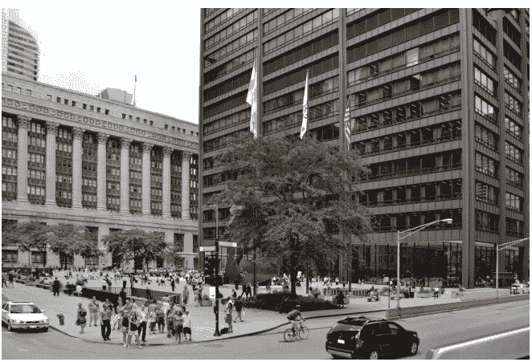

**图 3.1** 戴利广场采用极简主义的现代风格设计，为大量访客提供了一个宽敞、平坦的平台，供他们享受、聚集、庆祝和放松。*来源：作者拍摄。*

戴利广场不仅是一个法律和政府的枢纽，还是一个充满活力的文化中心，向社区开放，提供一系列免费的文化项目。这些引人入胜的活动旨在丰富访客的日常生活，每个工作日上午12:00至1:00举行，提供多样化的表演和活动拼贴画。前往戴利中心的访客可以沉浸在文化表达的万花筒中，从跳舞的节奏到歌唱的旋律。项目不仅仅限于娱乐，还包括升旗和文化仪式等活动，为个人创造了一个与各种传统和庆典联系的空间。这些午餐时分的文化项目不仅仅是既定活动；它们成为个人暂停、享受和参与丰富文化表达多样性的重要时刻。无论是讲述故事的舞蹈，还是引起情感共鸣的歌曲，抑或是象征传统的仪式，戴利中心的文化项目邀请每个人成为共享文化拼贴画的一部分，培养与城市核心更深层的联系（Al-Kodmany, 2017; The Daley Center）。

确实，戴利广场广阔而开放的设计是城市充满活力的社会和文化拼贴画的画布。这种布局不仅仅是功能性的；它是策略性的，允许无缝举办众多为空间带来持续活力的活动。设计中嵌入的灵活性促进了空间易于适应，以容纳一系列活动。无论是季节性活动、临时艺术装置还是现场表演，广场都能毫不费力地转换以适合场合。这种适应性至关重要，确保广场保持为一个动态且不断演变的枢纽，反映其所服务社区的不断变化需求和兴趣。本着这种精神，戴利广场已成为文化庆典的中心聚集地。它主办了代表芝加哥社区丰富多样性的节日，在城市中心培养包容性和共同庆祝的感觉（Figure 3.2）。

**图 3.2** 戴利广场，作为一个文化中心，被描绘在一场充满活力的土耳其节日中，展示了其作为社区参与和多样性中心的角色。*来源：作者拍摄。*

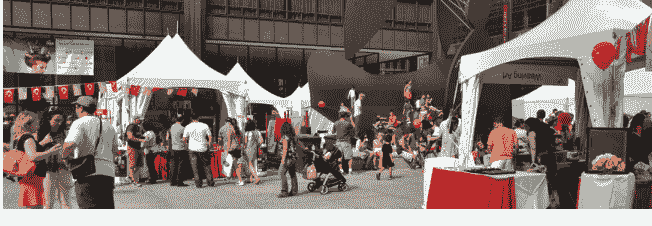

戴利广场作为音乐会和音乐节户外场地的受欢迎程度，如图3.3所示，证明了其在增强城市多样化音乐景观中的作用。爵士乐、古典旋律、摇滚颂歌和流行节奏的共鸣在广场中回荡，为城市景观提供了旋律背景。此外，广场还延伸至视觉艺术，成为创造力的画布。本地和国际艺术家汇聚于此展示他们的作品，将开放空间转变为充满活力的画廊。展览超越了传统边界，展示了雕塑、装置和各种视觉艺术形式，吸引了访客并让他们参与其中。这个多面的文化平台巩固了戴利广场作为聚集空间和城市艺术脉搏动态画布的地位。该广场曾被用于拍摄电影场景；因此，它见证了直升机的着陆、装甲坦克、警察追捕、公共汽车事故、持械强盗以及占用付费电话的老人（Al-Kodmany, 2020; Kamin, 2022）。

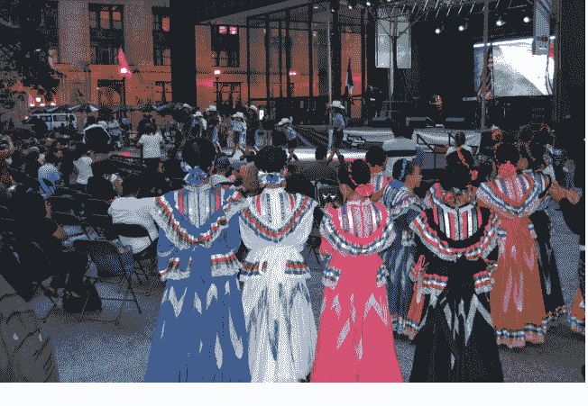

**图 3.3** 戴利广场充满活力的文化拼贴画在像这样的墨西哥节日庆典等晚间活动中生动起来，展示了定义广场动态特征的丰富多样性和社区精神。*来源：作者拍摄。*

凭借其动态的多功能性，戴利广场定期发生迷人的蜕变，变成一个热闹的农贸市场，成为当地农民和商人的充满活力的枢纽。农贸市场为感官提供了一场盛宴，为访客提供接触多样化新鲜季节性农产品、五颜六色的花朵、诱人的熟食以及芝加哥制造的独特产品和稀罕发现的宝库。在戴利广场标志性的环境中，农贸市场创造了一种活跃的氛围，当地人和访客都可以参与探索和选购最新鲜和最佳商品的传统。从多汁的水果和蔬菜到芳香的花朵，市场庆祝每个季节的丰收，反映了该地区的农业丰富性。美食供应超越了生农产品，包括一系列美味的熟食。访客可以享受美食，从手工零食到国际美食，由当地商人精心和富有创意地制作（The Daley Center）。这种美食多样性将市场变成了一个美食爱好者渴望品尝使芝加哥美食场景真正独特的风味的中心（Figure 3.4）。

除了是新鲜农产品和美食的避风港之外，戴利广场还成为当地手工艺人和企业家展示和销售其工艺的平台。陈列在摊位上的芝加哥制造产品处于这种文化和商业融合的核心。每件物品都讲述着当地创造力和工艺的故事，从手工制品到独特的艺术作品。市场访客可以探索和发现体现芝加哥多样且蓬勃发展的艺术社区精神的一流珍品（Figure 3.5）。支持这些

3.4
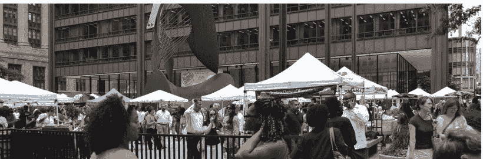
达利广场在充满活力的农夫市场期间，会变成新鲜农产品和社区交流充满活力的中心，在芝加哥的中心地带创造出一幅色彩斑斓的风味和当地魅力画卷。来源：作者摄影。

3.5
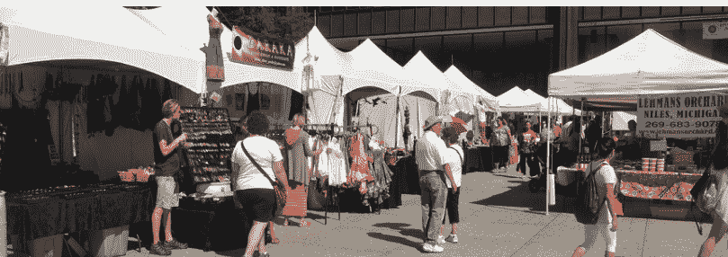
随着摊贩展示和销售各种手工产品、服装和自制商品，达利广场因工艺展示而焕发生机，为城市景观增添了一抹创意色彩。来源：作者摄影。

本地企业成为购物的重要组成部分。通过选择芝加哥制造的产品，游客积极为当地经济的可持续发展和增长做出贡献。这种消费者与本地手工艺人之间的联系培养了社区意识和自豪感，因为个人成为定义芝加哥艺术景观的独特人才的赞助者。

广场上的毕加索雕塑通过突出西班牙艺术家巴勃罗·毕加索的作品，增加了重要的人类维度，他是20世纪最具影响力的艺术家之一。该项目由达利中心的建筑师于1963年委托。雕塑由耐候钢制成，与达利中心外部材料相同，高50英尺，重162吨。它于1967年在印第安纳州加里制造并在芝加哥组装（Kamin, 2003）。雕塑基座常是人们坐下的喜爱地点，也是孩子们玩耍的地方（图3.2）。此外，广场的座位选择满足不同需求，容纳各个年龄段和能力的个人（图3.6）。

3.6
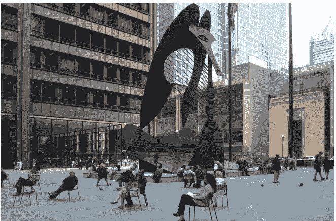
达利广场的毕加索雕塑展示了20世纪艺术家巴勃罗·毕加索的作品，以其互动功能吸引游客和儿童。*来源：作者摄影。*

理查德·J·达利广场在节日期间举办各种以节日为主题的活动和事件。例如，*弗兰肯广场*是十月的万圣节主题节日，填满了各种食品摊贩、帐篷庇护所和杂技表演的舞台。在万圣节精神下，泉水被染成橙色，为广场游客营造出超现实却又令人愉悦幽默的景象。其他节日包括*克里斯汀德*市场，一个以德国为主题的圣诞节庆祝活动，它汇集了来自世界各地的多种民族主题食品、艺术和手工艺品。除了公民和文化活动外，达利中心广场还为私人场合开放，如婚礼、节日和商业聚会。

达利广场也是*关键质量*的会面点，这是芝加哥自行车爱好者每月的展览。每月最后一个星期五大约下午6:00，成千上万的自行车手涌向广场，在建筑物周围形成一个巨大的圆环，阻挡交通，使行人目瞪口呆。由此形成的车队在“胜利绕场”几周后，突然沿着通常不确定的路线继续穿过城市。这种文化多样性、包容性和接受精神使达利广场成为独特的城市热点。

广场在其立即边界内没有永久餐饮设施，但有一些食物和饮料选择。食品卡车经常在午餐时间和特殊活动期间停在广场上（图3.7）。这些流动餐馆提供多种菜系，从精致三明治和塔可到国际风味和甜点。

达利广场是一个充满活力的城市空间，将充满活力的社会和文化活动与宁静的休憩完美融合，为游客提供多方面的体验。在通常以繁忙的活动和庆典为特征的广场中，一个深思熟虑的设计元素满足了宁静和放松的需求。在西边缘，广场巧妙地整合了一个“绿色绿洲”——一个装饰着茂密景观和顽皮喷泉的翠绿避风港。这个绿色绿洲作为周围活动的生动能量的对比（图3.8）。精心策划的景观将自然的触感引入城市景观，为游客提供视觉上的休憩，远离混凝土环境。树木、灌木和其他绿色植物的战略性放置创造了一个宁静的角落，提供遮荫和更大广场内的私密感。

3.7
广场缺乏永久餐饮设施，但通过食品卡车在午餐时间和特殊活动期间提供食物和饮料，提供多种菜系。*来源：作者摄影。*
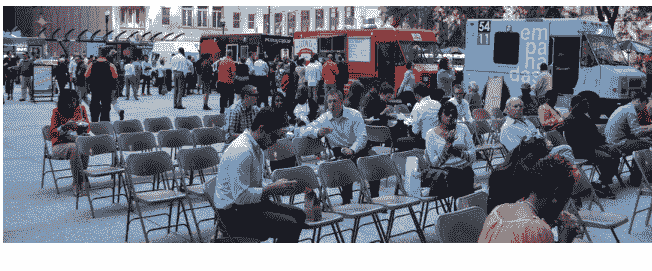

3.8
达利广场在西边缘设有“绿色绿洲”，提供宁静的休憩场所，拥有茂盛的景观，将城市活动与宁静休憩融合。*来源：作者摄影。*
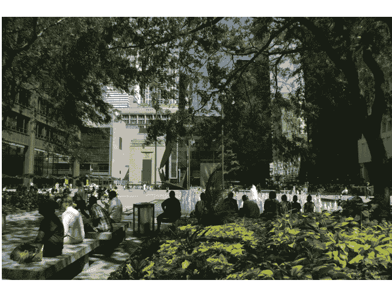

故意在广场内融入喷泉提升了游客的感知体验，有助于整体设计精致。水的动态运动，无论是急促的洪流还是平静的波动，都为环境增添了沉浸式的音频和视觉元素。喷泉的存在使游客能够完全沉浸在宁静的流水声中，营造出安静的声学背景，极大地增强了

# 公共广场

广场整体宁静的氛围。故意融入水成分改善了视觉吸引力和感官体验，在达利广场创造了一个更具欢迎感和多感官的城市环境（图3.9）。

3.9
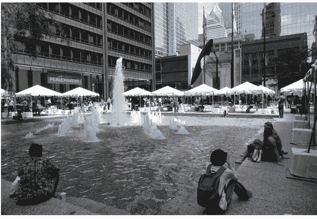
达利广场的喷泉通过提供沉浸式的音频和视觉体验增强游客体验，创造了一个具有欢迎感和多感官的城市环境。
来源：作者摄影。

永恒火焰纪念碑的存在为融入城市景观的人类叙事增添了一层感人色彩。这一庄重的纪念物是对那些为服务国家而献出生命的人所做出的巨大牺牲的深刻提醒和确认。位于达利广场内，永恒火焰纪念碑是对在历史重大篇章中做出最终牺牲的勇敢男女的尊严致敬，涵盖第一次世界大战（1914–1918）、第二次世界大战（1939–1945）、朝鲜战争（1950–1953）和越南战争（1955–1975）（Keegan, 2008）。这座纪念碑象征着英勇和无私，邀请沉思，在繁忙城市环境的核心培养集体的纪念和感激之情（图3.10）。

总体而言，达利中心广场是芝加哥城市结构的重要组成部分，为人们提供聚会、享受公共艺术和体验城市繁忙氛围的场所。其现代设计、著名艺术品和中心位置使其成为芝加哥市中心重要且充满活力的公共空间。

# 亮点

## 积极方面

- **中心公民空间：** 作为一个突出的公民空间，广场是公众聚集、活动、抗议和庆祝的焦点。
- **标志性的毕加索雕塑**：标志性的“无题”毕加索雕塑是该市对公共艺术承诺的地标象征。
- **宽敞的开放空间**：宽敞的布局允许进行各种活动、展览和表演，容纳多样的社区需求。
- **座位和聚集区域**：长椅、 ledge、可移动椅子和开放区域提供舒适的座位和空间供人们聚集、休息和社交。
- **城市绿化**：树木、花盆和绿植的景观增加了视觉吸引力并软化了城市环境。
- **互动水景**：喷泉鼓励互动和玩耍，特别是在炎热天气。
- **行人连接性**：广场促进行人移动，连接金融区与周围街道和景点。
- **公共项目**：广场举办各种活动，包括音乐会、市场、集会和文化节，培养社区参与。
- **公共艺术和纪念碑**：除了毕加索雕塑外，广场还设有艺术装置和纪念碑，丰富其文化意义。
- **历史背景**：广场的位置和历史是芝加哥公民生活和城市发展的组成部分。
- **午餐时间枢纽**：许多附近工人将广场作为午餐目的地，增强其作为社区空间的作用。食品卡车在广场提供午餐。
- **夜间照明**：广场的照明在傍晚时段将其转化为引人入胜的空间，延长其可用性。

3.10
达利广场的永恒火焰纪念碑纪念在战争中牺牲生命的勇敢士兵，突出了广场的人类贡献并致敬他们的牺牲。来源：作者摄影。
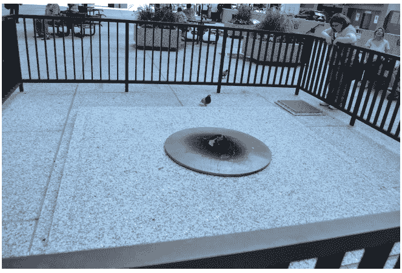

# 改进领域

- **遮荫不足：** 广场缺乏实质性的遮荫元素，导致在炎热天气下舒适度降低，限制了其使用率。
- **天气依赖性：** 缺乏有顶棚的区域或天气防护措施，可能会限制广场在雨天或极端温度下的使用。
- **城市活动密集：** 高人流量和频繁的活动可能营造出拥挤且嘈杂的氛围，削弱了其宁静感。
- **维护挑战：** 由于使用频繁且活动多样，维护开放空间和公共设施可能具有挑战性。
- **零售与服务设施：** 餐饮、饮料及便利设施的选项有限，可能会降低广场访客的便利性和舒适度。

# 芝加哥大通广场（Chase Tower Plaza）

大通广场（大通广场，又称埃克森广场）位于芝加哥市中心，周围环绕着该市最具标志性地标之一。其占地面积约为1.5英亩，设有一个大型喷泉、休息区以及多种树木和植物。广场是办公人员休息或午餐的热门地点，全年还举办各种活动，如音乐会和农贸市场。它是一个充满活力且令人向往的公共空间，为芝加哥市中心增添了特色。广场内矗立着大通大厦，这是一座60层的摩天大楼，于1969年建成，是芝加哥“L”（高架铁路）环路内最高的建筑。大通大厦具有独特的弧形外观，其中容纳了大通银行和埃克森公司的总部以及其他租户（Al-Kodmany and Ali, 2013; Al-Kodmany, 2017; Kamin, 2022; Saliga & Clarke, 1998）。

广场设有一个喷射喷泉、一座钟楼，以及马克·夏加尔创作的色彩斑斓的陶瓷壁画*四季*。广场最引人注目的特征之一是喷泉，它占据着中心位置。喷泉由一个水平的水池组成，分为九个方形区域，每个区域都有一个向不同高度喷射水柱的喷水口。水池高于地面，即使水未运行时也能从街道上看到。当开启水流时，它形成了一场动态且迷人的景观，吸引了过往行人的目光。喷泉边缘围绕水池有一个宽边，上面有一层薄水层，缓缓流过边缘。这层水与较深的水池之间由一个金属唇边隔开，防止水溢出。这种设计虽然阻止了访客坐在边缘或进入喷泉，但允许他们通过轻触或泼水与水互动。喷泉是访客愉悦和放松的来源，也是广场优雅与活力的象征。鉴于该空间与城市的分离方式以及周围摩天大楼融入背景的效果，置身于大通广场内可能是一种真正特殊的体验（图3.11）。下沉层的墙壁移到前景，营造出一个人性化的环境（Pridmore & Larson, 2005）。

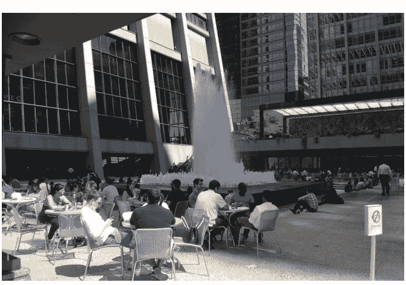

**图 3.11**
引人注目的中心喷泉增强了大通广场午餐时段的活力氛围。来源：作者拍摄。

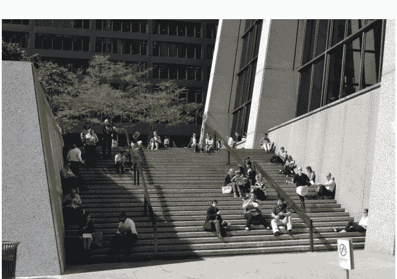

**图 3.12**
大通广场提供多种座位选择，包括台阶、边缘和石凳，为访客提供便利的休息和欣赏周围景色的场所。来源：作者拍摄。

广场提供多种座位选择，包括台阶、边缘和石凳（图3.12和图3.13）。可移动的椅子可以摆放在不同的位置和角度，为一个动态且诱人的空间，供人们休息和社交。在午餐时间，大通大厦会临时在下层边缘摆放桌椅，以容纳员工和访客。广场提供许多餐饮选择，从快餐到精致餐饮，满足不同口味和预算的需求。它最繁忙的时间是午餐时段，使用者主要来自大通大厦及周边建筑的员工。他们享受着餐饮选择的便利性和多样性，以及广场宜人的氛围。广场的植被主要由灌木篱墙覆盖，但这些植物色彩鲜艳，为空间增添了活力。植物经过精心维护，并排列成几何图案，与座椅的形状和图案形成对比（Al-Kodmany, 2017; Kamin, 2022）。

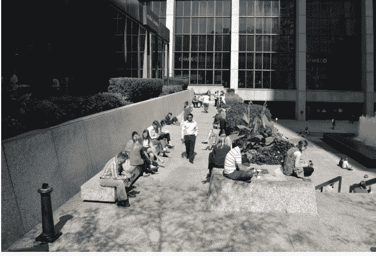

**图 3.13**
除了各种座位区外，大通广场还特色展示了排列成图案的鲜艳多彩的植被，为空间增添了活力。来源：作者拍摄。

在东侧上层，有一幅名为*四季*的大型马赛克，由马克·夏加尔创作。这是一幅马赛克壁画，描绘了来自不同季节和文化的场景，反映了夏加尔对人类与自然愿景。这幅长21米（70英尺）、高4米（14英尺）、宽3米（10英尺）的壁画包含4,000平方英尺（372平方米）的马赛克瓷砖，这些瓷砖从意大利、法国、挪威、比利时和以色列进口。场景包括蓝色的冬季景观，带有雪花和滑冰者；春天的场景，带有花朵和恋人；夏天的场景，带有向日葵和音乐家；以及秋天的场景，带有收获和动物。该壁画由芝加哥第一国民银行于1974年委托创作，并于1978年揭幕。它是夏加尔最著名的公共作品之一，深受访客和当地居民的喜爱。最初，壁画在露天环境中展示，因此遭受了芝加哥严酷冬季的影响，导致壁画在1988年需要翻新，更换了25%的瓷砖。1996年，Skidmore, Owings, and Merrill (SOM) 设计了一个钢和玻璃的庇护所，以保护*四季*免受进一步的天气损坏（Al-Kodmany, 2017; Kamin, 2022; 图3.14）。

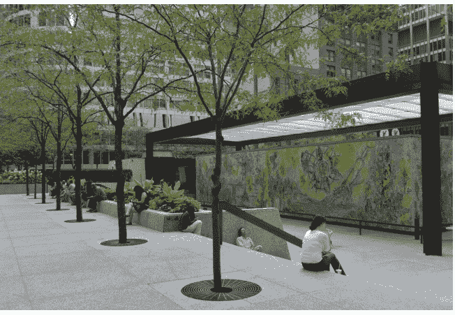

**图 3.14**
位于大通广场东缘的马克·夏加尔*四季*马赛克，展示了来自不同季节和文化的多样场景。来源：作者拍摄。

总体而言，大通广场在芝加哥市中心提供了一个宜人且易到达的户外环境。其设计、公共艺术和充满活力的氛围使其成为居民、工人和访客享受并与周围城市肌理互动的重要公共空间。

# 亮点

- **积极方面**
  - **中心位置：** 广场位于芝加哥市中心的黄金地段，使其易于到达，并成为居民和访客的焦点。
  - **宽敞度：** 广场提供了充足的开放空间，营造出开阔感，并为各种活动留出余地。
  - **休息区：** 长椅、座椅墙和可移动椅子的存在，提供了舒适的场所，供放松、社交和观察路人。
  - **景观绿化：** 维护良好的植被、树木和绿植创造了清爽的环境和审美吸引力。
  - **水景：** 广场的水景增加了动态元素，营造出舒缓的氛围，并作为一个焦点。
  - **户外餐饮：** 户外座位和用餐空间的存在增强了城市体验，让人们能够在户外享受美食。
  - **公共艺术：** 马克·夏加尔的*四季*是一幅马赛克壁画，描绘了来自不同季节和文化的场景，反映了夏加尔对普遍和谐与和平的愿景。
  - **行人连通性：** 广场促进行人移动，并连接大通大厦与周围的城市肌理。
  - **城市休憩地：** 在城市喧嚣之中，大通广场提供了一个让人们寻找慰藉和放松的避风港。

- **改进领域**
  - **天气依赖性：** 缺乏天气防护措施可能限制广场在恶劣天气条件下的使用。

## 公共广场

- **活动规划不足：** 虽然活动和表演可以激活空间，但更多样化的活动规划可以增强其吸引力。
- **绿化空间：** 尽管有植物种植，但广场若能有更广泛的景观设计，将有助于营造更具自然吸引力的环境。
- **过度拥挤：** 在高峰时段，广场可能会变得过于拥挤，从而影响整体用户体验。

## 芝加哥·约翰·汉考克中心广场

约翰·汉考克中心广场是位于芝加哥“壮丽大道”（Magnificent Mile）区域那座100层、高1,128英尺的超高层摩天大楼底部的公共空间。该广场设有下沉式花园、喷泉、长椅和临时雕塑。这里是游客和当地人欣赏这座标志性建筑景色的热门地点。该建筑由 Skidmore, Owings, and Merrill 设计，于1969年完工。这座标志性建筑在2018年正式更名为“875 North Michigan Avenue”，但其原名仍深入人心，以致敬尊贵的美国开国元勋约翰·汉考克（John Hancock）。最初，该建筑以保险巨头约翰·汉考克互助保险公司（John Hancock Mutual Life Insurance Co.）命名，其名称错综复杂地回溯至这家重要保险企业的远见卓识的创始人。大楼内设有办公室、餐厅、酒店、公寓以及一个拥有城市及密歇根湖360度全景的观景台。观景台还设有一个名为 TILT 的移动平台，该平台可将游客倾斜至30度角，让人俯瞰摩天大楼边缘；此外还有一个提供当地特色饮品的全功能酒吧（Al-Kodmany, 2017; Kamin, 2022; Saliga & Clarke, 1998）。

该广场位于塔楼的西侧。最初设计为包含树木和公共溜冰场的矩形下沉广场，但该中心的所有者计划在1988年用山墙玻璃中庭覆盖广场。然而，该提案被理查德·M·戴利市长（Richard M. Daley）和居民们否决。1994年，广场成功改造为半圆形的地下空间，通过多个延伸至街道层的楼梯创造了良好的公共通道（图 3.15）。翻新工程包括用灰色/黑色花岗岩替换之前的白色大理石，使其更贴近建筑本身的材料（Binder, 2006; Zukowsky et al., 2004）。

该广场在地下层提供了充足的休息区，并设有多种娱乐选择。嵌入半圆形花岗岩结构的永久性座位区间杂着种植区和楼梯。广场的中部略微抬高，设有喷泉和瀑布。它可作为移动椅子、桌子和小型策划活动舞台的场所。该广场方便通往购物中心和餐厅，广场南端被用作好利来蛋糕工厂（Cheesecake Factory）的户外用餐区。夏天，人们可以在这里享受微型“城市绿洲”；冬天，则可以体验被称为该社区非正式“圣诞树”的景观。总体而言，下沉广场相对较小的规模和小占地面积使其与该地区丰富的行人环境比例协调，平衡了主导芝加哥市中心这一区域的高耸塔楼以及川流不息的购物者、游客和商务人士。此外，由于街道和上方的约翰·汉考克中心主要不可见，人们不会感到被任何一侧压倒（Saliga & Clarke, 1998）。

图 3.15
约翰·汉考克中心广场。1994年，它被成功改造为半圆形的地下空间，通过多个延伸至街道层的楼梯创造了良好的公共通道。来源：作者摄影。

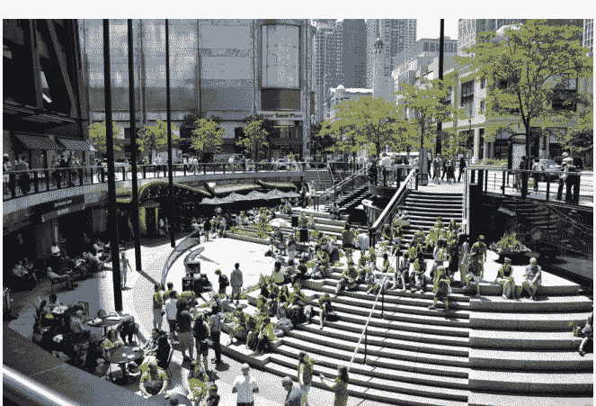

## 亮点

### 积极方面

- **核心位置：** 该广场战略性地坐落在芝加哥熙熙攘攘的斯特雷特维尔（Streeterveille）街区，为居民和访客提供便捷的进出通道。
- **城市避风港：** 在周围的高层建筑和城市环境中，约翰·汉考克中心广场作为一个避风港，让人们可以放松身心。
- **景观设计：** 该广场结合绿植、树木和灌木，在混凝土丛林中营造出自然的氛围。
- **休息区：** 移动椅子让访客可以找到舒适的位置休息、社交并欣赏周围环境。
- **水景特征：** 一个显著的水景特征，通常被称为“水墙”（The Water Wall），为广场增添了宁静感和视觉趣味。
- **视野：** 该广场提供观赏约翰·汉考克中心独特建筑和城市景观的视野。
- **城市体验：** 该广场浓缩了城市体验，让人们可以聚集、享受户外空间并融入城市的活力。

### *改进*空间

- **绿化空间有限：** 考虑到周围的 urban 环境，广场的景观和绿植可能相对有限，这可能影响其提供真正的自然绿洲的能力。
- **比例与尺度：** 鉴于约翰·汉考克中心高耸的高度，广场的尺寸和布局可能显得不协调，可能导致整体空间缺乏连贯性。
- **功能性：** 广场的设计可能未完全满足访客的多样化需求，从而限制了其在不同活动和用户群体中的可用性。
- **天气考量：** 广场可能缺乏足够的天气防护设施，使其在恶劣天气或极端温度下较难享受。
- **活动多样性：** 虽然广场举办活动，但引入更多样化的活动规划可以迎合更广泛的兴趣和需求群体。
- **社区参与：** 可以更积极地在广场的规划、活动策划和管理中鼓励当地社区参与。

## 芝加哥·311 南沃克大道

311 南沃克大道广场是一个位于伊利诺伊州芝加哥市中心核心区域的私有公共空间（POPS）。它被重要的摩天大楼包围，包括108层的威利斯大厦（Willis Tower，原西尔斯大厦/Sears Tower）、60层的富兰克林中心南塔（South Tower of the Franklin Center，又称 AT&T 企业中心）以及 311 南沃克大道大楼。邻近的威利斯大厦是一个著名的旅游景点，每年吸引超过150万游客。因此，该广场处于人流量巨大的理想位置，是繁忙区域中城市绿洲。该区域大量人群的存在提高了吸引访客的几率并增加了广场的利用率。此外，其角落位置使该广场特别容易被识别（Kamin, 2022; Saliga & Clarke, 1998）。

该广场受益于便捷的公共交通接入，附近的 CTA 站点和公交车站提供了通往城市其他地区的便捷连接。它还紧邻威利斯大厦的观光巴士停靠站。该广场是一个无障碍且包容性的公共空间，欢迎所有访客，无论其身体能力如何。其平坦的表面和缺乏障碍使每个人都能轻松导航和享受该空间。其表面高度与周围人行道匹配，使得在上面行走或滚动变得容易。因此，它不需要为残障访客提供坡道或电梯等任何特殊设备，他们可以在没有任何障碍的情况下享受广场（Al-Kodmany & Ali, 2013）。

该广场为周围喧嚣提供了一处休憩之地。占地面积近一英亩（4,047平方米），311 S. Wacker 广场是 loop（芝加哥市中心商业区）最大的草坪。它与之前讨论过的理查德·J·戴利广场（Richard J. Daley Plaza）那种特征为大片铺装表面的“现代主义”广场形成对比。该广场具有花园主题，由几个特征凸显。其中之一是位于中心的花卉喷泉，半径为3.6米（12英尺），种有随季节变化的多彩花卉。喷泉周围环绕着座位，并通过不同的小径与草坪和建筑物相连。广场还有季节性装饰，例如秋天灯柱上的玉米秆。这一区域深受访客欢迎，他们喜欢在此进行各种活动，如聊天、用餐、打电话或放松。花卉喷泉旁是一条砖砌小径（与其他小径的混凝土不同），通向一个约四英尺半高的立式花坛。花坛周围有金属环环绕其花卉盆，并包含一个万花筒，这是一件优秀的互动公共艺术品。花卉喷泉南侧是一条宽小径，通向一个长椅区域，长椅相互交错排列但并非直接面对面（Al-Kodmany, 2017）。

“草坪广场”包含各种休息空间，包括长椅、开放草坪和花坛边缘。最具吸引力的座位选择之一是阿迪亚克椅（Adirondack chairs），访客在午餐时间使用它来闲适、交谈和享受阳光。带有低坡度座面、宽大扶手和直立靠背的阿迪亚克椅加强了这是一个花园式空间的感知。阅读、小憩和休息是最常见的活动。人们将书籍、零食和手机放在椅子宽大的扶手上，几乎将其当作个人桌子。椅子每周一至周五早上8点解锁，下午4点收回。

鉴于内部设有餐厅，露台被设计为一个空间，供人们用餐、放松并欣赏广场及周边建筑的绝佳景色。此外，广场整合了成熟的树木，特别是沿其周边分布，这些树木保护草坪免受阳光、过度噪音、人流及街道一般混乱的影响，赋予该区域一种宁静的感觉。总体而言，该广场提供了多种座位选择，包括室内用餐、露台户外座位以及可欣赏广场及周边建筑景色的露台。因此，该广场是放松身心和欣赏风景的好地方，同时还能免受城市喧嚣的干扰（图 3.16）。

由于严格的规定禁止吸烟、携带狗、轮滑、滑板、饮酒和逗留，该广场保持整洁。这些规定由精密的监控系统和尽职的安全人员执行，他们时刻注视着广场。规则显示在入口处和沿小径的灯柱上的标志上。此外，广场配备了大量的垃圾桶，旨在维护区域清洁，并营造鼓励人们从事坐地休息等活动的环境。然而，这种维护是以持续被观察和控制为代价的。因此，虽然广场保养得当且整洁，但访客必须遵守严格的规则并面对不断的监控和安全检查（Al-Kodmany, 2017; Saliga & Clarke, 1998）。

对于芝加哥的 311 南沃克广场而言，户外广场是一个关键的吸引物，全年提供各种活动和事件。广场设有农夫市场，访客可以在那里从当地商贩处购买新鲜农产品、烘焙食品、鲜花和手工艺品。农夫市场是一

## 公共广场

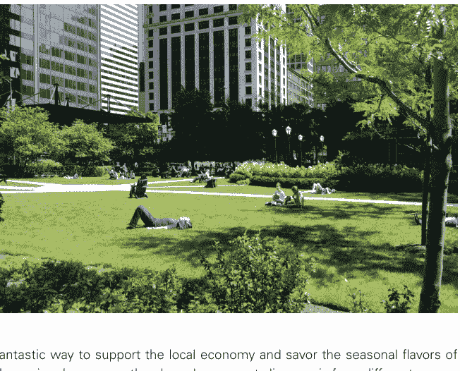

**3.16**  
311 南沃克广场是一片宽阔且维护良好的草坪，位于芝加哥 Loop 区，为身处繁忙喧嚣环境的人们提供了一个宁静的休憩之所。  
*来源：作者拍摄。*

这是支持当地经济并品味该地区季节性风味的美妙方式。在夏季，广场还会呈现来自不同流派和风格的现场音乐表演。这些音乐会免费向公众开放，是享受温暖天气和城市天际线的绝佳机会。音乐会汇集了来自芝加哥及其他地区的才华横溢的音乐家，为所有人营造出浓厚的节日氛围。311 南沃克广场的户外广场是一个充满活力和生机的空间，提升了租户和访客的生活质量。这里是人们可以在城市中心放松、社交和娱乐的地方 (Saliga & Clarke, 1998)。

311 南沃克大道最引人注目的特征之一是其冬季花园和门厅。冬季花园是一个两层楼高的玻璃天花板空间，跨越五个楼层，内部布满了绿植和喷泉。喷泉上装饰着雷蒙德·卡斯凯（Raymond Kaskey）创作的青铜雕塑《湖泊之珠》（Gem of the Lakes），它代表了芝加哥这座以宽阔胸怀和工程壮举闻名的城市。这座雕塑是一位 12 英尺高的英雄形象，身披斗篷，象征着芝加哥河流向的逆转。雕像手持一个贝壳，构成了喷泉的盆地，该造型取自城市印章。雕塑从沃克入口处俯瞰花园，是对芝加哥历史文化的致敬。311 南沃克大道的冬季花园和门厅对于访客和租户来说都是诱人的绿洲。门厅与一英亩的广场无缝连接 (Pridmore & Larson, 2005)。

### 亮点

#### 正面特点

- **中心位置：** 位于芝加哥金融区核心地带，广场占据了绝佳的中心位置，使其成为当地专业人士和访客的聚集地，增强了其活力和人流。
- **建筑融合：** 广场与 311 南沃克大道建筑的设计无缝融合，在室内外空间之间建立了和谐且视觉上引人注目的联系。
- **充足的座位：** 广场上座位选择丰富，从长凳到可移动椅子应有尽有，积极鼓励人们聚集、放松并欣赏周围的环境，从而培养深厚的社区感。
- **绿植与景观：** 尽管地处城市中心，广场拥有维护良好的绿植和景观，为环境增添了一抹自然气息，提升了视觉吸引力，并营造出更宜人的氛围。
- **聚会空间：** 广场的开放式布局可容纳聚会、活动和户外休闲。它既是自发性互动的动态空间，也是策划聚会的场所。
- **社交互动：** 旨在促进社交互动，广场已成为人们会面、社交和拓展人脉的热门目的地，在其访客中营造了强烈的社区归属感。
- **餐饮选择：** 户外座位以及附近的咖啡馆或餐厅的存在，使广场成为人们享用美食的诱人场所，营造出充满活力的氛围。
- **公共活动：** 举办音乐表演、艺术展览和公共讲座，为空间注入了动态和文化元素，吸引多元化的观众参与这些引人入胜的活动。
- **城市景观：** 凭借绝佳的位置，广场提供了令人着迷的芝加哥河及周边城市景观视野， fosters 人们对更大城市环境的连接感，并提升了整体体验。
- **行人友好：** 广场优先考虑行人需求，提供安全舒适的步行环境，营造出行友好的氛围。

#### 改进领域

- **天气依赖：** 缺乏天气防护措施可能限制广场在雨天、极端温度或多风条件下的使用。
- ** intense 城市活动：** 由于位于繁忙区域，广场可能会经历高噪音水平和拥挤状况，影响其宁静程度。
- **活动缺乏：** 虽然可能会举办活动，但更多样化和更频繁的活动策划可以增强其吸引力。
- **夜间安全：** 可能需要充足的照明和安全措施，以确保夜晚环境的安全。
- **过度拥挤：** 在高峰时段，广场可能会变得过于拥挤，从而降低整体的用户体验。

## 纽约市洛克菲勒中心广场

洛克菲勒中心广场是位于纽约市核心区域的公共空间，坐落在第五大道与第六大道、49 街与 50 街之间。它是更大的洛克菲勒中心综合体的一部分，该综合体包括 19 栋建筑和多种景点，如著名的溜冰场、岩石之巅观景台和无线电城音乐厅。广场还收藏了几件艺术品，如青铜阿特拉斯雕像（Statue of Atlas）、带有季节性花卉和喷泉展示的频道花园（Channel Gardens），以及每年通过节日仪式点亮的标志性圣诞树。该建筑最初及五十多年来最为人熟知的名称是 RCA 大楼，其宏伟的建筑设计以装饰艺术（Art Deco）风格为特色，展示了一系列优雅的建筑，包括通用电气大楼（GE Building，现称为康卡斯特大楼），它作为综合体的中心建筑矗立于此。这些建筑以其独特的石灰岩外墙、精细的细节和标志性的屋顶装饰而闻名 (Fitzgerald, 2003; Weisman, 1951)。

洛克菲勒中心的溜冰场是一个受欢迎的冬季溜冰场所，吸引当地居民和游客。频道花园是洛克菲勒中心的一个显著特色。它是一条连接第五大道和洛克菲勒广场的迷人步行道。频道花园由沿洛克菲勒中心中轴线排列的一系列种植池和喷泉组成。它全年经历季节性变换，展示反映季节变化的花卉、植物和装饰的美丽陈列。每年，广场上都会竖立一棵巨大的圣诞树，吸引数百万游客前来欣赏其精美的装饰。这棵树通常装饰着成千上万的彩色灯光和一颗施华洛世奇水晶星。地下网络连接了洛克菲勒中心内的各栋建筑，并容纳了许多商店、精品店、餐馆和咖啡馆 (Laurence, 2006; Fitzgerald, 2003)。

洛克菲勒中心的普罗米修斯雕像（Statue of Prometheus）是洛克菲勒中心下层广场的一座著名雕塑。由美国雕塑家保罗·曼西普（Paul Manship）设计，这座雕像描绘了希腊神话人物普罗米修斯，他因从众神处偷取火种并将其赐予人类而闻名。雕塑位于下层广场的中心，正对着标志性的溜冰场。它于 1934 年安装，已成为洛克菲勒中心最具辨识度和持久性的象征之一。这座雕像由镀金青铜制成，高约 18 英尺。普罗米修斯被描绘为手持火焰举过头顶，象征火的礼物。雕塑细节丰富，展示了曼西普在塑造动态和富有表现力形式方面的技巧。在动态画面中，溜冰场和溜冰者的流动常常与普罗米修斯一起被呈现。考虑到 1930 年代的历史背景，包括大萧条和即将爆发的第二次世界大战，以及 20 世纪现代主义的兴起，这座镀金铸造青铜雕塑获得了重大的意义 (Weisman, 1951; 图 3.17)。

广场全年作为各种文化活动和公共集会的场地。这些活动包括音乐会、艺术装置、展览和季节性节日。广场广阔的空间和标志性的背景使其成为大型公共庆典和表演的理想场所。广场是游客和当地居民的热门目的地，他们在此享受艺术、历史和娱乐设施。洛克菲勒中心广场不仅仅是一个公共空间。它象征着纽约市的文化、创造力和活力。这是一个人们可以彼此连接并与世界相连的地方。这是一个梦想诞生并得到庆祝的地方。

3.17
洛克菲勒中心溜冰场是一处受欢迎的冬季景点，它将广场变成了一个“仙境”，为寻求独特纽约体验的当地人和游客提供了体验（上图）。中图和下图分别展示了频道花园和普罗米修斯雕像。*来源：作者拍摄的照片。*

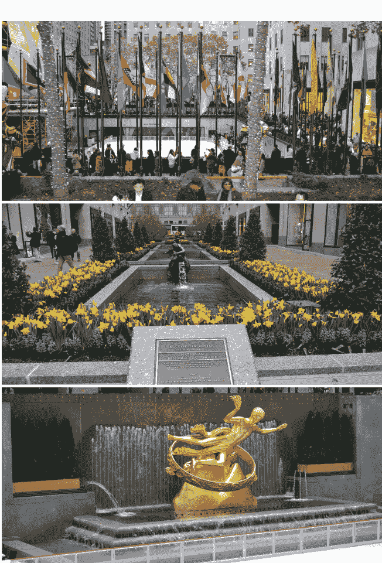

## 亮点

### 积极方面

- **地标性**：洛克菲勒中心广场是一个全球公认的地标性建筑，吸引了当地人和游客。广场及周边建筑的艺术装饰风格增添了其美学吸引力。
- **中心位置**：位于曼哈顿的核心地带，广场得益于其中心位置和便捷的交通。
- **公共艺术和雕塑**：广场装饰着各种雕塑和公共艺术装置，增强了其视觉趣味。
- **溜冰场**：季节性溜冰场在冬季是一个备受珍视的景点，营造出节日般的氛围。
- **活动空间**：广场举办各种活动，从音乐会到节日庆典，使其成为一个充满活力的聚会场所。
- **城市绿洲**：在繁忙的城市中，广场提供了一个宁静且维护良好的绿色空间，供人放松和休憩。
- **文化意义**：洛克菲勒中心广场具有历史意义，是主要文化活动的举办地，包括电视直播。
- **零售和餐饮**：广场提供混合的零售商店、餐厅和咖啡馆，增强了其活力。
- **公共座位**：充足的座位选择鼓励人们聚集、社交并欣赏周围环境。
- **季节性装饰**：广场以其精美的节日装饰和装置而闻名，全年吸引游客。
- **公共聚集空间**：广场的开放布局和宽敞空间可容纳各种活动和聚会。
- **景观美化**：种植树木、植物和花卉的景观区域营造了一个宜人的环境。

### 需要改进的领域

- **拥挤程度**：由于其受欢迎程度，广场在旅游高峰期可能会变得过度拥挤，导致拥堵和座位有限。
- **绿地有限**：虽然有景观美化区域，但与其他公共广场相比，绿地的数量有限。
- **噪音水平**：繁忙的活动和事件可能会导致噪音水平较高，影响空间的宁静。
- **缺乏私密性**：开放式的布局可能缺乏适合私密对话或独处时刻的隐蔽角落。
- **无障碍挑战**：由于路面不平且区域拥挤，布局可能会给行动不便的人士带来挑战。
- **成本**：溜冰或参观某些景点等活动的费用对于部分游客来说可能过高。
- **视觉杂乱**：广告和商业招牌的存在可能造成视觉杂乱，分散对广场美学的注意力。
- **活动影响**：虽然活动增添了活力，但可能会干扰正常的空间使用并导致闭馆。
- **维护挑战**：在大量人流中保持广场清洁和维护良好可能具有挑战性。
- **过度关注游客**：广场对游客的吸引力可能会将他们的需求置于居民的需求之上。

## 纽约市 9/11 纪念广场

纽约市 9/11 纪念广场是一个占地 8 英亩的公共空间，连接着该综合体的标志性建筑，包括西半球最高的摩天大楼——世界贸易中心一号。广场设有纪念 9/11 袭击遇难者的纪念馆、博物馆、表演艺术中心和交通枢纽。它旨在成为一个充满活力且欢迎访客、员工和居民的地方，全年提供绿色空间、艺术装置和文化活动。9/11 纪念馆与博物馆是美国主要的机构，致力于探索、记录和审视 9/11 的影响，重点在于纪念在袭击中遇难的人（9/11 纪念馆）。

9/11 纪念广场位于世界贸易中心综合体内，处于世界贸易中心一号（主塔）与周边建筑之间。它横跨数个街区，西侧以西街为界，南侧以自由街为界，东侧以教堂街为界，北侧以威斯街为界。广场的设计由建筑师丹尼尔·里伯斯金主导，景观建筑师彼得·沃克负责景观美化。整体设计反映了复兴和纪念的精神，向原来的双子塔致敬，同时创造了一个现代且具有韧性的空间（Parakh et al., 2017）。

广场融入了大量的景观美化，包括树木、灌木和草地。设计者旨在为访客创造一个平静且诱人的环境，精心策划的种植物提供遮荫、美感以及与城市景观中自然的联系。广场的中心是纪念倒影池，位于原双子塔的足迹内。这些巨大的、占地一英亩的方形水池侧面有层叠的瀑布，营造出一种宁静和沉思的氛围（9/11 纪念馆）。

这些水池拥有北美最大的人造瀑布，每个瀑布落差 30 英尺，落入方形蓄水池中。随后，每个水池中的水再下降 20 英尺，消失在更小、更紧凑的中央腔体中。根据建筑师迈克尔·阿拉德的说法，这些水池象征着“可见的缺失”概念。虽然水流入空荡荡的空间，但它们无法被完全填满。流水的声音创造了一种宁静和深思的氛围，与繁忙的城市声音景观截然不同。

纪念池周围环绕着青铜护栏，上面刻着 2001 年和 1993 年恐怖袭击中失去生命的 2,983 个人的名字。这些名字根据遇难者在袭击时所处的地点和情况进行分类。北池护栏上刻着在北塔、被劫持的美国航空 11 号航班以及 1993 年爆炸案中失去生命的人的名字。南池护栏上刻着在南塔、被劫持的美国联合航空 175 号航班、五角大楼、被劫持的美国航空 77 号航班以及被劫持的美国联合航空 93 号航班中失去生命的急救人员和遇难者的名字（9/11 纪念馆）；（图 3.18）。

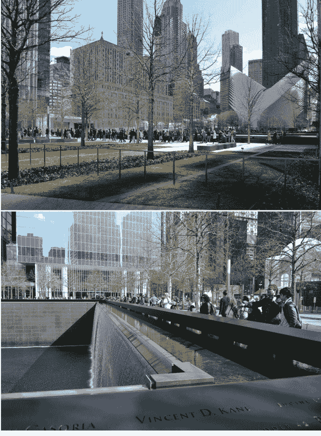

3.18
9/11 纪念广场的中心是纪念倒影池，层叠的瀑布营造出宁静的氛围，上面刻有 9/11 和 1993 年世界贸易中心爆炸案遇难者的名字。该纪念设施于 2011  年 9 月 11 日落成，标志着 9/11 袭击十周年。*来源：作者拍摄的照片。*

9/11 纪念广场为访客提供多种公共空间和设施。这些包括休息区、步行道以及用于放松和社交的开放空间。广场还设有几家零售和餐饮场所，为访客提供便利和选择。文化音乐会、公共艺术展览、纪念仪式以及其他社区活动都在广场举行。这些活动增添了空间的活力和生机，在访客中培养了社区感和参与度。此外，纪念广场装饰着近 400 棵沼泽白栎树。这种具有韧性的树种原产于所有三个 9/11 坠机地点：纽约市、弗吉尼亚州阿灵顿和宾夕法尼亚州萨默塞特县（Parakh et al., 2017）。

9/11 纪念广场与世界贸易中心交通枢纽——“云门”（Oculus）无缝连接。这一建筑奇迹作为多条地铁线路和 PATH 火车的交通枢纽，并提供通往附近目的地的地下通道，确保通勤者和访客的便捷连接。每周有超过 100 万名乘客由十二条地铁线路、世界贸易中心 PATH 车站以及“云门”内的数十家商店服务。除了每月举行的活动，包括农贸市场、艺术展览、音乐表演和零售销售外，主楼层还挤满了通勤者、购物者和游客（图 3.19）。

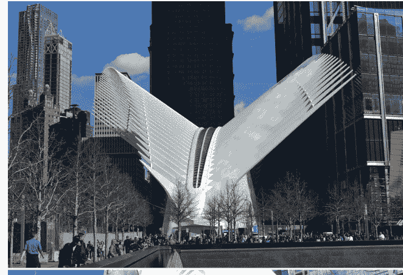

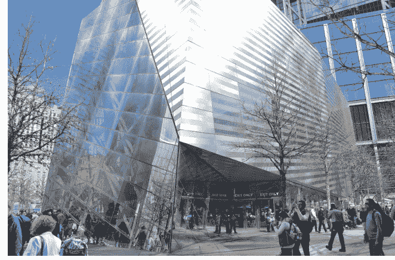

3.19
标志性建筑使 9/11 纪念广场显得与众不同。该纪念遗址与“云门”交通枢纽相连，是一个方便的交通枢纽，为通勤者和访客提供便利，每周接待超过一百万名乘客（上图）。下图展示的是 9/11 博物馆。*来源：作者拍摄的照片。*

## 公共广场

9/11博物馆是对2001年9月11日那场可怕事件的沉痛而感人的致敬。博物馆位于9/11纪念地这一神圣区域内，坐落在地下空间，营造出一种独特而令人深思的氛围。当访客们走下楼梯进入博物馆时，迎接他们的阴郁气氛捕捉到了这一历史事件的严肃性。展台上展示着见证了那可怕一天破坏景象的文物，其中包括双子塔原始立柱的碎片。博物馆收藏中令人动容的文物包括损坏的电话亭、一辆烧毁的救护车，以及消防员和救援人员在应对这场前所未有的灾难后留下的忧郁的头盔残骸。9/11博物馆是一个庄严且不可或缺的纪念场所，用于沉思与追忆，因为每一件文物都是面对难以名状的灾难时，人类代价与社区韧性的具体提醒（Parakh 等人，2017）（图3.19）。

9/11纪念广场是坚韧、缅怀与更新的见证。它提供了一个宁静且供人沉思的空间，人们在此可以向过去致敬，珍视现在，并展望未来。凭借其精心设计、富有意义的象征元素以及与世界贸易中心更大复合体的融合，该广场是纽约市心脏地带一个必不可少且充满活力的公共空间。

### 亮点

#### 积极方面

- **象征意义：** 世界贸易中心广场作为一个纪念场所具有深刻的象征意义，它向2001年9月11日恐怖袭击事件的受害者致敬。
- **纪念池：** 广场在双子塔原址设有两个坚固的纪念池，提供了一个用于反思和缅怀的空间。其设计、层叠的瀑布和空洞激发了失落感，并向在9/11事件中逝去的生命致敬。
- **交通可达性：** 广场与各种交通方式连接良好，使访客能够轻松抵达。
- **与纪念博物馆的整合：** 广场与9/11纪念博物馆无缝连接，为访客提供全面的体验。
- **景观美化：** 景观和绿化创造了宜人的氛围和治愈感。
- **社区聚集：** 广场作为纪念活动的聚集地，培养了团结感和共同的记忆。
- **教育机会：** 广场提供教育项目和资源，帮助访客了解这些事件的影响。
- **公众参与：** 广场在情感和智力层面吸引访客，激发关于历史、悲剧和坚韧的对话。

#### 改进领域

- **敏感性：** 由于其纪念性质，一些访客可能会觉得广场情感上过于沉重或难以造访。
- **旅游景点：** 广场作为旅游目的地的受欢迎程度有时可能导致过度拥挤，影响空间的庄严性。
- **有限的设施：** 广场的设计优先考虑其纪念功能，导致座位、遮阳和娱乐设施有限。
- **天气暴露：** 遮阳或室内空间不足可能会使访客暴露在恶劣天气条件下。
- **缺乏积极使用：** 对反思和纪念的强调可能限制了广场在活跃使用方面的潜力。
- **长队：** 纪念池的受欢迎程度可能导致入场时排长队和等待时间较长。
- **维护：** 层叠的瀑布和倒影池需要持续维护以确保其正常运行。

## 旧金山联合广场

联合广场位于旧金山繁忙的社会商业核心地带。广场周围的区域是主要酒店和百货公司的汇聚点，营造出充满活力和动态的氛围。在这个街区，人们可以探索许多高档精品店、提供美食享受的多样化餐厅、热闹的夜店以及引人入胜的画廊。这些设施与城市景观无缝融合，嵌在较大的建筑之间，为该区域充满活力和多元的特征做出了贡献。联合广场占地2.6英亩的广阔区域，由Geary、Powell、Post和Stockton街道的交汇处环绕。其名称源于重要的历史背景，因为它是美国内战期间亲联邦派集会的地点。这个公民空间已演变为中心枢纽，用于商业、休闲和文化活动（联合广场）。

在联合广场的中心矗立着宏伟的杜威纪念碑，高97英尺（30米）。这座纪念碑是向乔治·杜威海军上将致敬，纪念他在美西战争马尼拉海战中的胜利。杜威纪念碑为广场增添了一丝纪念碑式的和历史色彩，成为捕捉城市历史及其作为充满活力的当代城市中心的角色的焦点。当访客探索广场周围时，他们沉浸在繁忙的商务活动中，并遇到这座高耸的纪念碑，它是旧金山中心历史与现代交汇的见证（Bosselmann，2012）。

广场地面装饰着复杂的铺装，采用互锁的几何形状。图案结合灰色和米色的花岗岩，为空间增添了视觉趣味和质感。设有带长椅和植被的休息区。同时，中心空间为聚会、表演和活动提供焦点，邀请人们坐下、放松并相互互动。广场的设计优先考虑行人，提供宽敞的空间用于步行、坐下和欣赏周围环境。没有车辆通行增强了安全性，鼓励人们步行探索该区域。联合广场全年举办各种活动，如音乐会、艺术展和花卉节（联合广场）。

联合广场结合了公共艺术、座位、表演空间和季节性元素，确保其始终是当地居民和游客喜爱的目的地。虽然联合广场不以广阔的绿化为特征，但它策略性地融入了植被。树木、花坛和灌木丛沿边缘和角落布置，提供了一些增强城市环境的自然元素。景观方案融入了季节性种植，随全年变化。此外，广场在节日期间装饰有节日装饰和巨大的圣诞树。它还有户外咖啡馆和用餐区，访客可以在那里享受美食或饮料，同时体验充满活力的氛围（Bosselmann，2012）。

广场南侧包含类似露天剧场的台阶，既作为座位，也作为表演和活动的平台。这种设计鼓励互动、观察以及与各种活动的参与。广场有几个公共艺术装置和雕塑。这些艺术作品为空间增添了文化和美学价值，使其成为当地居民和访客引人入胜的环境。联合广场由各种类型的照明照亮，包括灯柱、地面照明和装饰元素。这确保广场即使在晚上也保持活力和可用性（图3.20）。

总体而言，联合广场是商业、娱乐和社区的中心，体现了城市生态系统的韧性和适应性。广场在历史上的演变，从最初转化 communal 区域到现在作为一个繁忙的中心，反映了一座永远活跃的城市不断变化的动态。联合广场因其建筑和经济实力而具有重要意义，是社交和文化活动的中心枢纽，吸引各种人来参与其吸引点。奢侈品零售店与艺术展示和社区活动的结合展示了广场融合对比元素的能力，从而在经济上繁荣和社会上互动性的环境中。凭借其广泛的历史背景和当前的意义，联合广场是城市活力的核心，充当旧金山持久城市故事的微型代表。

### 亮点

#### 积极方面

- **中心聚集空间：** 联合广场是当地居民和访客充满活力和中心的聚集空间，培养了社区感和互动性。
- **文化中心：** 广场举办各种文化活动、节日和表演，增加了其充满活力和生动的氛围。

### 3.20

旧金山联合广场是一个受欢迎的城市绿洲，设有公共艺术、座椅、表演和景观设施，通过自然之美和季节性装饰提升了城市环境。它还包含宽敞的活动空间，用于举办活动、吸引人流并使市中心更具人性化。*来源：作者摄影。*

- **可达性：** 联合广场通过公共交通可以轻松到达，方便来自城市不同区域的人们聚集和享受休闲时光。

- **购物与餐饮：** 广场周围环绕着商店、精品店、餐厅和咖啡馆，形成了商业空间与公共空间的无缝融合。

## 公共广场

- **座椅与休憩：** 座椅区域、长椅和台阶为人们提供了充足的放松、社交和欣赏周围环境的机会。
- **景观美化：** 虽然没有大规模的景观绿化，但通过融入绿植、树木和季节性花卉种植，提升了城市环境。
- **丰富的活动：** 游客可以参与各种活动，包括旁观路人、欣赏街头表演以及参加公共活动。
- **市民重要性：** 广场的历史意义、中心位置及其作为聚会点的角色，赋予了其重要的市民价值。
- **旅游景点：** 联合广场的受欢迎程度使其成为一个著名的旅游目的地，有助于刺激当地经济。
- **夜生活：** 广场在晚上依然充满活力，拥有灯光装饰和娱乐机会。
- **行人友好：** 广场的设计优先考虑行人，营造了一个安全且令人愉悦的步行和探索环境。
- **节日氛围：** 在节日和特殊场合，联合广场通过节日装饰和活动焕然一新，传播喜悦与庆祝。
- **对城市身份的贡献：** 联合广场为旧金山独特的城市身份做出了贡献，体现了这座城市文化、商业和社会生活的融合。
- **历史意义：** 广场的历史可追溯至 19 世纪，增加了其文化和历史意义。

### 改进领域

- **人群与拥堵：** 由于对游客的吸引力，联合广场在高峰时段可能会出现过度拥挤，阻碍通行和空间享受。
- **噪音水平：** 热闹的氛围可能导致噪音水平升高，影响该区域的宁静与平和。
- **自然元素缺乏：** 缺乏池塘、喷泉或较大的绿色区域等自然元素，限制了感官体验的多样性。
- **无家可归者与乞讨：** 联合广场面临着与无家可归者和乞讨相关的问题，影响了游客的舒适度。
- **维护：** 大量的人流和频繁的活动可能导致基础设施磨损，需要持续的维护和保养。
- **全面无障碍性：** 虽然该区域的设计旨在容纳行人，但可以增强对残障人士的无障碍关注。
- **缺乏遮荫：** 某些区域可能缺乏足够的遮荫，特别是在炎热天气下，这会阻碍长时间的户外活动。
- **临时活动：** 虽然活动增添了活力，但有时可能会干扰寻求安静体验的游客对空间的常规使用。
- **气候适应性：** 缺乏气候适应性设施可能会影响广场在极端天气条件下的可用性。
- **公共厕所：** 提供清洁且维护良好的公共厕所可以提升游客体验。

## 上海国际金融中心广场，上海

上海国际金融中心广场（上海 IFC Plaza）是位于上海陆家嘴金融区核心地带的一个显著公共空间。该广场是城市肌理的重要组成部分，为周围繁忙的商业活动和高耸的建筑提供了一处休憩之地。广场的设计和景观方案经过精心设计，旨在提供自然、文化与功能的和谐融合。上海 IFC Plaza 可通过多种交通方式轻松到达，包括地铁、公交和出租车。它与城市其他区域连接良好，是市民和游客方便前往的目的地。对行人友好的步道和桥梁在广场及其周边提供了顺畅的连接（Al-Kodmany & Ali, 2013; Binder, 2015）。

广场的设计反映了现代建筑，并与周围的高层建筑相得益彰。上海 IFC 双塔以其流畅而现代的设计成为广场的焦点。建筑展示了玻璃、钢材和其他现代材料的融合，创造出一个视觉上引人注目的环境。广场提供了宽敞的开放空间供公众使用和聚集。它拥有宽敞的铺装区域、宽阔的行人步道和宽敞的座椅区域（Wang et al., 2006）。广场的布局便于导航，鼓励人们探索和享受周围环境。广场的主要吸引力是一个采用超透明玻璃设计的苹果零售店。尽管该商店位于地下，但它为广场带来了显著的人流量。

上海 IFC Plaza 融入了绿植和景观，在城市环境中提供了清新的氛围。绿色空间提供了遮荫、美学吸引力和一种宁静的感觉，维护良好的树木和灌木为广场增添了一抹自然色彩。广场拥有零售店、豪华精品店、餐厅和咖啡馆。游客可以购物、用餐，并欣赏壮丽的城市景色。这些设施的存在增加了便利性，提升了广场的整体体验。上海 IFC Plaza 是一个充满活力的公共空间，结合了现代建筑、绿植、艺术和商业设施。它作为商业、休闲和文化活动的中心，吸引着世界各地的游客，为上海金融区的充满活力的氛围做出了贡献（图 3.21）。

## 亮点

### 积极方面

- **战略位置：** 位于上海金融区陆家嘴的中心，该广场在繁忙的城市环境中提供了一个中心且易于到达的公共空间。

3.21 上海 IFC Plaza 为行人提供了充足的公共空间，其布局通过铺装区域、宽阔的步道、楼梯和座椅区域鼓励探索。广场因采用超透明玻璃设计的苹果零售店而得到增强，该店作为焦点，吸引了更多人进入广场。*来源：作者摄影。*

- **美学吸引力：** 广场结合了绿植、水景、雕塑和景观建筑元素，创造出一个视觉上吸引人且和谐的景观。
- **城市休憩：** 在 cities 的高楼大厦和商业活动之间，广场提供了一个宁静的避难所，人们可以在此逃离城市的喧嚣，享受宁静的环境。
- **与天际线的融合：** 广场提供了周围高层建筑的壮丽视野，让游客得以欣赏上海的现代天际线。
- **活动多样性：** 广场设计精良的步道、座椅区域和聚会空间可容纳各种活动，从悠闲漫步到文化活动和表演。
- **夜间氛围：** 精心设计的灯光增强了广场在夜晚的美感，为夜间访问创造了神奇的氛围。
- **经济与社会枢纽：** 广场的中心位置支持了附近的商业、商店和餐厅，形成了一个经济和社会枢纽。
- **旅游景点：** 广场将现代设计与文化元素相结合，使其成为市民和游客 appealing 的目的地。
- **地标身份：** 广场已成为陆家嘴一个可识别的地标，为居民和游客提供了参考和定向点。

### 改进领域

- **商业化：** 鉴于其位于金融区，可能存在广场过度商业化或主要服务于商业界的担忧。
- **有限的绿色空间：** 一些游客可能觉得广场的绿色空间有限，与其他城市公园相比不足。
- **缺乏遮荫：** 在炎热的夏季，遮荫区域的有限可用性可能会让寻求避暑的游客感到担忧。
- **文化融合：** 虽然广场试图融入中国文化元素，但其融合可以更无缝和真实。
- **活动项目缺乏多样性：** 广场可以通过提供更广泛的项目、活动和活动来惠及不同的人口群体。
- **环境可持续性：** 虽然广场融入了绿植，但在可持续景观实践方面可能还有提升空间。
- **天气条件：** 广场的设计可能未能完全应对极端天气条件，如大雨或强风。

## 上海静安寺广场

静安寺位于上海静安区南京西路繁华的中心地带，是该市最显赫的寺庙之一而享有盛誉。静安寺的历史早于上海建市，目前被公认为这座中国大都市中最突出的宗教场所之一。在其漫长的历史过程中，寺庙经历了多次毁灭、重建和翻新。它因巨大的铜钟、佛像、艺术品和佛像收藏而闻名。

寺庙拥有悠久而显赫的历史，使其成为长江下游地区南部最古老的佛教寺庙之一。它最初被称为胡笃崇元寺，后在唐代（618–907）更名为永泰禅寺。最后，在宋代（960–1279）的 1008 年，它获得了现在的名字：静安寺。该寺庙，此前坐落在

## 公共广场

古老的吴淞江（现称苏州河）边缘，在河浪的持续冲击下，最终于 1216 年的一场洪水中坍塌。随后，寺庙搬迁至 bubbling well creek 河畔，即其当前所在地：南京西路 1686 号（Al-Kodmany & Ali, 2013; Al-Kodmany, 2017; Binder, 2015）。

1972 年，寺庙被焚毁殆尽，化为灰烬废墟。尽管如此，重建工作于 1984 年后启动，天王殿和三大士殿得以相继修复。整个寺庙最终于 1990 年对公众开放。现存的建筑群美观大方，与其周围环绕的高楼林立形成了鲜明的对比。静安寺的建筑设计融合了藏式元素，呈现出古典与现代风格交融的风貌。夜幕降临时，寺庙被璀璨的灯光照亮，散发出金色的光泽。

寺庙主要由主庭院或广场、两侧的两座亭子、主殿以及山门组成。寺庙的主要入口位于南面，山门作为一条通道，将喧嚣的街道与神圣复合建筑群内宁静的庭院连接起来。广场的设计和景观方案经过精心构思，旨在反映该区域丰富的历史，适应各种活动，并在传统与现代之间营造出和谐的平衡。广场的设计与静安寺的建筑风格相得益彰，融合了传统中式屋顶、精致的格栅和与寺庙视觉语言相协调的装饰细节。广场为游客提供了宽敞开放的区域，以便聚集、放松并参与各种文化和精神活动。这一开放空间服务于游客和当地居民，使其成为一个多功能的公共聚集地（Weishan, 2019）。

广场上点缀着精心挑选的植物、花卉和树木，增添了绿意并柔化了城市环境。景观设计增强了感官体验，营造出宜人的氛围。广场设有与寺庙历史和灵性相共鸣的文化装置、雕塑和艺术作品。这些元素强化了广场作为文化目的地的身份。广场内指定的区域可用于举办文化表演、活动和户外展览，促进了社区互动和艺术表达。静安寺广场是一个宁静的城市避风港，访客在此可摆脱城市的喧嚣，寻求慰藉，并与寺庙的灵性氛围建立连接（图 3.22）。

洪武钟是静安寺内保存的一件重要文物。该钟是一尊庞大的青铜器，铸造于明朝（14 至 17 世纪），据信曾是太祖皇帝的拥有物。由于他后来被尊称为洪武帝，这口钟因此得名。主殿内有一尊显赫的释迦牟尼佛银像，重约 15 吨。佛像呈坐姿，安放在基座上，双手结禅定印。

### 图 3.22
静安寺及广场，作为一处文化目的地，设有反映寺庙历史与灵性的装置、雕塑和艺术作品，为访客提供宁静的城市休憩空间。
来源：作者拍摄。

## 亮点

### 积极方面

-   **文化意义**：广场以历史悠久的静安寺为中心，这是一处具有深厚文化和宗教意义的圣地。这种与传统和灵性的联系为空间增添了深度和文化价值。
-   **和谐设计**：广场的设计将现代美学与中国传统建筑元素和谐融合，实现了新旧之间的无缝过渡。
-   **多功能性**：宽敞的开放区域可容纳各种活动，从悠闲漫步、沉思到文化活动、表演和节日庆典。
-   **文化互动**：广场内的文化装置、雕塑和艺术作品使访客能够与该区域的历史、遗产和艺术表达产生互动。
-   **象征意义**：广场的布局和设计理念体现了和谐、平衡与文化遗产的原则，邀请访客在更深层次上建立连接。
-   **本地及游客吸引力**：广场兼具本地聚集地和旅游胜地的双重角色，促进了游客构成多样化且充满活力的局面。
-   **行人友好**：行人通道和安全措施优先考虑了徒步探索该区域者的舒适度和福祉。
-   **沉思之所**：广场宁静的环境为个人提供了反思、冥想和正念的空间。

### 改进领域

-   **缺乏遮蔽**：广场的开放设计且树冠覆盖率有限，导致缺乏遮阴区域，在炎热晴朗的日子里让访客感到不适。
-   **座位有限**：尽管空间宽敞，但座位选择可能不足，尤其是在高峰时段，这可能阻碍更长时间的停留和放松。
-   **拥堵**：有时，该场所的受欢迎程度可能导致拥堵和拥挤，降低访客体验的质量。
-   **维护挑战**：保持广场整洁且无垃圾可能具有挑战性，尤其是在访客流量巨大的情况下。
-   **无障碍设施**：虽然已作出努力确保持续的可及性，但对于行动不便者来说，仍可能存在一些可达性较差的区域。
-   **缺乏解说**：如果没有足够的标识或解说，访客可能无法充分理解该场地的历史和文化意义。
-   **公共厕所**：不足或不完善的厕所设施可能给访客带来不便，并阻碍他们在广场停留更长时间。

## 迪拜哈利法塔广场

哈利法塔广场是位于阿联酋迪拜市中心的一个尊贵商业和住宅综合体。该广场由多栋建筑组成，包括标志性的哈利法塔——世界上最高的摩天大楼，高度为 828 米（2717 英尺），共 163 层。它提供多种设施和服务，如豪华酒店、餐厅、购物中心、办公楼、公寓和娱乐场所。广场内的一些景点包括迪拜购物中心（Dubai Mall），它是世界上面积最大的购物中心；迪拜喷泉（Dubai Fountain），它是世界上最大规模的编舞喷泉系统；以及 AtThe Top 观景台，它是世界上最高的观景台之一，提供令人惊叹的城市全景。哈利法塔广场象征着迪拜的愿景和雄心，是其工程和建筑卓越的见证。哈利法塔广场交通便利，可通过多种交通方式到达。迪拜地铁（Dubai Metro）提供通往广场的直达连接，并为驾车抵达者提供充足的停车设施。人行通道、自动人行道和桥梁促进了广场及周边区域之间的无缝流动。

广场与哈利法塔宏伟的建筑无缝融合，反映了受伊斯兰图案启发的流畅、当代设计。广场拥抱宏伟、优雅和现代的设计美学，拥有广阔的铺装区域、宽阔的人行道和精心策划的景观。其布局便于导航，能够容纳大量人群。

哈利法塔广场展示了多件艺术装置和雕塑，进一步增强了其艺术氛围。这些艺术作品提升了广场的审美价值，并创建了供访客欣赏的焦点。哈利法塔广场是全年举办各种文化活动和娱乐活动的场所。这些活动可能包括音乐表演、艺术展览和节日。广场的开放空间和尖端的基础设施使其成为举办此类活动并吸引多样化受众的理想场所。

迪拜喷泉由负责设计拉斯维加斯著名贝拉吉奥喷泉（Fountains of Bellagio）的团队打造。其长度超过 900 英尺（275 米），位于人工湖哈利法塔湖上。它共有 6,600 盏灯光和 50 台彩色投影仪，创造出令人惊叹的视觉展示。喷泉系统由强劲的水射流组成，可喷至 500 英尺（152 米）的高空，伴随着同步的音乐和灯光。喷泉拥有高压水喷嘴，可创造各种水形和图案。迪拜喷泉的表演根据各种音乐编舞，包括阿拉伯音乐、古典音乐、当代音乐和世界音乐。水流的运动与音乐同步，并经过精心编舞，以营造出令人着迷的奇观（Katrotydis & Mitchell, 2015）。

迪拜喷泉提供每日表演，通常每 30 分钟在晚上进行一次。表演从黄昏开始，持续到深夜。访客可以在迪拜喷泉周围的几个黄金位置欣赏表演。迪拜购物中心的水滨长廊提供了绝佳的观赏点。此外，带有户外座位的餐厅和咖啡馆提供了近距离体验喷泉表演的机会。访客可以在水滨找一个位置，或在附近的餐厅占个位子来享受表演。迪拜喷泉是工程和娱乐的真正奇迹，将水、音乐和灯光结合在一场壮观的表演中。其表演每年吸引数百万访客，成为迪拜现代与宏伟的标志性象征。

## 公共广场

哈利法塔广场在夜晚灯火辉煌，营造出令人着迷的景象。广场和哈利法塔装饰着广泛的照明系统，突显了其建筑特色，为游客带来了迷人的视觉体验。总体而言，哈利法塔广场是一个迷人的公共空间，与哈利法塔的宏伟相得益彰。凭借其引人注目的设计、开阔的布局、郁郁葱葱的景观、零售和餐饮选择以及文化活动，该广场为游客提供了多方面的体验，使其成为一个迷人的目的地（图 3.23）。

**图 3.23** 迪拜哈利法塔广场。其核心是一个横跨哈利法塔湖的舞蹈喷泉，跨度达 900 英尺，配备 6,600 盏灯光、50 台投影仪和同步水柱。它提供每日根据各种音乐流派编排的表演，吸引大量人群。*来源：作者摄影。*

## 亮点

### 积极方面

- **标志性地标：** 广场位于世界最高建筑哈利法塔的底部，使其成为一个标志性的目的地。
- **宏伟感：** 广阔的开放空间和哈利法塔高耸的存在激发了宏伟感和奢华感，为游客提供了独特的体验。
- **壮观的视野：** 广场提供了周围高楼（包括哈利法塔本身）的壮丽景色，让游客能够近距离欣赏其令人印象深刻的高度和建筑精致细节。
- **公共聚集空间：** 宽敞的广场作为活动、庆祝活动和社区活动的聚集点，培养了团结感。
- **夜间照明：** 经过精心设计的灯光在夜晚让广场充满活力，突显其建筑特色并营造出迷人的氛围。
- **水景设施：** 融入主要水元素为广场增添了一丝宁静和优雅。
- **零售和餐饮：** 广场毗邻迪拜购物中心，为游客提供众多零售和餐饮选择，提升了整体体验。
- **公共交通枢纽：** 广场靠近公共交通枢纽，方便居民和游客轻松到达。

### 待改进领域

- **遮荫有限：** 广场的开放式设计缺乏足够的遮荫区域，在炎热晴朗的月份会让游客感到不适。
- **拥堵：** 由于其受欢迎程度，广场在高峰时段可能变得过度拥挤，影响对空间的总体享受。
- **绿意缺乏：** 尽管宏伟，但广场在绿化空间和自然元素方面的景观设计有限。
- **文化敏感性：** 哈利法塔和购物中心的现代国际化设计可能会掩盖当地文化背景，这可能是一个需要改进的领域。
- **历史联系：** 加强广场与周边地区的历史和文化联系可以丰富游客体验。

### 关键要点：规划与设计原则

公共广场在人性化高层建筑城市中至关重要，它们提供开放、无障碍且充满活力的空间，供人们聚集、社交并与周围环境互动。它们平衡了建成环境与对社交联系、自然和社区的需求，有助于创造更宜居、包容且以人为中心的都市环境。

以下是公共广场的指导性设计原则：

1. **无障碍与连通性：**
   - 确保广场可让来自城市各处的行人轻松到达。
   - 将其与现有的步行网络和公共交通系统连接起来。
   - 鼓励步行友好性，并提供对所有人（包括残障人士）都无障碍的清晰路径。
   - 确保广场对具有不同能力和多样化人群都易于进入。
   - 设计坡道、电梯及其他设施，以方便轮椅通行并照顾行动不便的个体。
   - 提供座椅、标识和设施，以满足多样化需求，促进包容性和平等的空间享受。

2. **人体尺度与比例：**
   - 通过按照与人体比例相关的尺度设计广场，营造亲密感和舒适感。
   - 考虑使用座位区、遮阳结构和景观元素，以提供更具人性化的体验。

3. **多样性与灵活性：**
   - 在广场内提供多种活动和空间，以满足不同的需求和兴趣。
   - 融入座位区、绿色空间、聚集点、水景、艺术装置和表演空间。
   - 设计具有适应性和灵活空间的广场，以容纳各种活动和事件。
   - 包括可移动家具、模块化元素和多用途区域，便于重新配置以适应不同的用途和社区需求，培养广场动态规划中的灵活性，并鼓励使用者产生归属感。

4. **社会互动与社区参与：**
   - 促进社会互动和社区参与的机会。
   - 设计广场以鼓励人们聚集、互动和参与社区活动。
   - 包括座椅集群、社区花园、游乐区或公共活动空间，以鼓励社交联系。
   - 将广场设计为充满活力的社交空间，鼓励社会互动、社区参与和归属感。
   - 创建促进自发对话和聚集的座椅布局、聚集区域和设施。
   - 融入互动装置、公共艺术和表演空间等特征，以促进社区参与和文化表达。

5. **与周围环境的融合：**
   - 确保广场的设计与周围的都市肌理和谐共存。
   - 考虑附近建筑使用的建筑风格、材料和颜色，以创造连贯且视觉愉悦的环境。
   - 将广场与相邻的公共空间、公园或地标整合，以增强连通性和连续性。

6. **安全与安保：**
   - 优先考虑广场用户的安全和安保。
   - 设计广场时确保清晰的视线、良好的照明和开放空间，以促进可见性并威慑犯罪。
   - 融入安全措施，如监控摄像头、紧急呼叫箱和定期维护，以营造安全宜人的氛围。

7. **环境可持续性：**
   - 将可持续设计原则融入广场的布局和特征中。
   - 融入绿色空间、树木和植物，以提供遮荫、改善空气质量并减轻城市热岛效应。
   - 使用可持续材料，采用节能照明，并融入雨水收集或透水表面以管理暴雨径流。

8. **文化与历史背景：**
   - 在设计广场时拥抱当地文化和历史。
   - 考虑融入当地艺术、建筑或文化遗产元素，以创造场所感和认同感。
   - 保护广场内部或周围可能已经存在的重大历史特征或地标。

9. **绿植与自然元素：**
   - 在广场设计中融入绿植、树木和植物，以提供遮荫、改善空气质量并创造与自然的联系感。
   - 融入优先使用本地植物物种和节水灌溉系统的可持续景观实践。
   - 绿植的存在增强了美观性，促进身心健康，并提供了逃离周围城市环境的休憩之所。

10. **适应性与面向未来：**
   - 设计广场时要着眼于未来。
   - 预见技术在技术、城市发展和社交需求方面的潜在变化。
   - 确保广场的设计允许随时间进行适应和演变，使其对后代保持相关性和功能性。

遵循这些指导性设计原则，公共广场可以通过提供优先考虑人、社会互动和社区感的空间，显著人性化高层建筑城市。下一章将讨论“街道作为广场”在人性化高层建筑城市中的作用。

## 参考文献

9/11 Memorial. https://www.911memorial.org/ (accessed March 1, 2024).

Al-Kodmany, K. (2017). Understanding tall buildings: A theory of placemaking. Taylor & Francis.

Al-Kodmany, K. (2020). Tall buildings and the city: Improving the understanding of placemaking, imageability, and tourism. Springer.

Al-Kodmany, K., & Ali, M. M. (2013). The future of the city: Tall buildings and urban design. WIT Press.

Binder, G. (2006). 101 of the world's tallest buildings. Images Publishing.

Binder, G. (2015). Tall buildings of China. Images Publishing.

Bosselmann, P. (2012). Urban transformation: Understanding city form and design. Island Press.

The Daley Center. https://thedaleyceneter.com/ (accessed March 1, 2024).

Fitzgerald, R. (2003). New York. Casa Editrice Bonechi.

Gehl, J. (1971). Life between buildings. Island Press.

Gehl, J. (2010). Cities for people. Island Press.

Kamin, B. (2003). Why architecture matters. University of Chicago Press.

Kamin, B. (2022). Who is the city for?: Architecture, equity, and the public realm in Chicago. University of Chicago Press.

Katorydrys, G., & Mitchell, K. (Eds.). (2015). UAE and the Gulf: Architecture and urbanism now. John Wiley & Sons.

Keegan, E. (2008). Chicago architecture: 1885 to today. Rizzoli.

Laurence, P. L. (2006). The death and life of urban design: Jane Jacobs, The Rockefeller Foundation and the new research in urbanism, 1955–1965. Journal of Urban Design, 11(2), 145–172.

Loukaitou-Sideris, A., & Banerjee, T. (1998). Urban design downtown: Poetics and politics of form. University of California Press.

Maguire, K. (2013). Chicago then and now. Thunder Bay Press.

Marcus, M. C., & Francis, C. (1998). People place: Design guidelines for urban open space. Wiley & Sons.

Parakh, J., Gabel, J., & Safarik, D. (2017). The space between: Urban places, public spaces & tall buildings. Council on Tall Buildings and Urban Habitat.

Primore, J., & Larson, G. (2005). Chicago architecture and design. Harry N. Abrams.

Saliga, P.A., & Clarke, J. H. (1998). The sky's the limit: A century of skyscrapers in Chicago. Rizzoli.

Union Square. https://visitunionsquaresf.com/ (accessed March 1, 2024).

Wang, S., Zhang, Y., & Wang, Y. (2006). Opportunities and challenges of shopping center development in China: A case study of Shanghai. *Journal of Shopping Center Research, 13*(1), 19–55.

Weishan, H. (2019). Urban restructuring and temple agency—A case study of the Jing'an temple. In *Buddhism after Mao: Negotiations, continuities, and reinventions* (pp. 251–270). University of Hawai'i Press.

Weisman, W. (1951). Who designed Rockefeller center? *Journal of the Society of Architectural Historians, 10*(1), 11–17.

Whyte, W. H. (1980). *The social life of small urban spaces*. Project for Public Spaces.

Zukowsky, J., Thorne, M., & Tigerman, S. (2004). *Masterpieces of Chicago architecture*. Rizzoli.

## 4 街道即广场

你愿意生活在一个街道不再为汽车服务，而是为人而设的地方吗？这就是“街道即步行广场”理念背后的核心思想，这是一种创新的城市空间设计方式，旨在使空间更加宜人、充满活力且多元化。“街道即广场”，也被称为步行化街道或共享空间，指的是将街道改造为以步行、骑行和社交活动为优先，而非机动车交通的步行友好型公共空间。这种方法旨在创造充满活力的城市环境，促进人际互动、经济活力和社区参与（Al-Kodmany, 2018; Banerjee, 2001; Whyte, 1980）。

“街道即广场”的概念代表了一种变革性的城市哲学，它重新构想了传统主干道，将其视为动态的公共空间，超越了其作为单纯车辆通道的传统角色。在这种创新的城市设计方法中，街道被构想为多功能的广场，是充满活力且包容性的社区区域，优先考虑行人、社区参与和文化活动。这种范式转变挑战了对街道作为功利性通道的传统理解，强调其作为社交互动、休闲娱乐和艺术表达焦点的潜力（Oranratmañee & Sachakul, 2014）。

“街道即广场”概念的核心在于通过创造鼓励社区感和连接感的空间，来提升城市生活的质量。通过优先考虑步行友好型特征，如拓宽的人行道、绿色空间和吸引人的街道家具，这些经过改造的街道旨在培育更可步行且更易接近的城市环境。其益处不仅限于美学层面，还影响着居民的身体健康和心理健康，使他们在周围环境中拥抱更具活力和社交的生活方式（Bertolini, 2020; Simpson, 2000）。

此外，该概念还认识到街道在城市景观中固有的文化和历史意义。通过将其重新构想为广场，城市可以利用这些空间成为举办文化活动、公共艺术装置和社区庆祝活动的动态舞台的潜力。融入文化元素为城市肌理增添了活力，并促进了更深层的场所认同感，培养居民之间的自豪感和联系（Elabb & Hallowell, 2014; Gehl, 1971, 2010; Nordahl, 2014）。

在对“街道即广场”的后续探讨中，我们将深入两个案例研究——时代广场和南京东路，它们展示了这一概念的成功实施，揭示其给社区、经济和整体城市体验带来的具体益处。透过这一视角，我们发现了城市规划师、建筑师和社区如何协作塑造更具包容性和吸引力的城市设计。

### 纽约时代广场

坐落于曼哈顿中心百老汇大道与第七大道交叉口，时代广场是一个步行者的天堂，拥有宽阔的人行道和广场，使其成为当地人和游客喜爱的聚集地。其广阔的布局使其能够优雅地容纳大量人群，营造出一个充满纽约市活力且包容的动态空间。时代广场提供多种吸引力，包括商店、剧院、餐厅和娱乐场所，并在公共座椅区和长椅上促进放松和享受。这里拥有丰富的购物选择，包括百老汇演出、顶级餐厅以及才华横溢艺术家的街头表演。时代广场不仅是一个繁忙的商业枢纽，更是一个文化熔炉，是百老汇精彩演出的舞台，也是纽约不屈精神的象征。凭借其璀璨的灯光、多样的吸引力和永恒的生命活力，时代广场超越了其地理坐标；它成为一个有生命、会呼吸的实体，是城市无尽能量的缩影，也是纽约体验的典范（Gehl et al., 2008; Sagaly n, 2003a, 2023b; Times Square）。

时代广场设计为步行区，其中心区域拥有宽敞的开放空间，是许多活动的多才多艺的画布。细致入微的设计优先考虑座位选择，策略性地邀请人们聚集、放松并沉浸在充满活力的氛围中。广场各处展开多样化的座位选择，从传统的长椅、石阶和台阶，到精心布置和可移动的公共家具。这些座位解决方案超越了单纯的功能性；它们在促进社交互动方面发挥着至关重要的作用，创造了一个动态且诱人的环境。在纽约市中心，时代广场的座位设施迎合了人群的多样化需求，提升了这个标志性城市空间的整体体验，来自不同社区的人们在此汇聚（Al-Kodmany & Ali, 2013; Goldwyn, 2014; 图4.1）。

时代广场的“红色台阶”是一个受欢迎的公共空间，是当地人和游客的聚集地，提供瞭望点以观看周围的广告牌和充满活力的氛围。楼梯高26英尺，由27级台阶组成，视觉上极具吸引力，是游客享受空间繁忙活力的中心点。楼梯的设计整合了无障碍元素，使其对轮椅使用者友好。楼梯还提供了观赏时代广场繁忙活动的绝佳视角，是观察人群的理想场所。游客喜欢坐在台阶上，沉浸在由人群、广告牌和街头艺人组成的彩色马赛克中，这使时代广场独具特色（Times Square）。

**图 4.1**
一座充满活力和标志性的步行广场，纽约时代广场是一个繁忙的活动中心，拥有零售店、剧院、休息场所和动态的氛围，吸引着当地人和游客。
*来源：作者拍摄。*

**图 4.2**
时代广场的“红色台阶”是一个受欢迎的公共空间，拥有27级台阶，高26英尺。它为活动、表演和宣传提供了制高点，吸引着游客和当地人，展示了该区域充满活力的氛围。
*来源：作者拍摄。*

红色台阶已成为无数照片的热门背景，巧妙地捕捉了时代广场的精髓。如今，它已确立为一个标志明显且易于到达的会面点，这些台阶成为家庭、朋友和旅行者的聚集地。总体而言，红色台阶已成为时代广场可辨识的一部分，吸引着来自世界各地的游客，并巩固了作为城市充满活力和欢快情绪代表的地位（Goldwyn, 2014; 图4.2）。

如图4.3所示，时代广场标志性的霓虹灯和璀璨灯光代表了城市活力、文化和商业在全球范围内的交汇点。精彩绝伦的装置将周围环境变成一种迷人的视觉狂欢，日以继夜地吸引著访客。充满活力的广告不断变化，以其脉动般的色彩为特色，为邻里营造了活泼且充满活力的氛围。时代广场已是城市无尽能量的象征，但那里的数字广告牌以其竞争性的信息使其更加令人难忘。当太阳落下时，霓虹灯成为舞台中心，将广场变成灯光图案和图片的迷人奇观，代表了纽约市中心现代文化与娱乐的融合（Al-Kodmany & Ali, 2013; Times Square）。

**图 4.3**
时代广场以其充满活力的霓虹灯和数字广告牌闻名，营造出迷人的视觉奇观，通过不断变化的广告和鲜艳的色彩增强了活泼的氛围。
*来源：作者拍摄。*

时代广场的动感脉搏因街头艺术家、音乐家和娱乐表演者的迷人表演而得到放大，将繁忙的街道提升为一场宏伟的盛会。路人被展示的独特天赋所迷住，创造了一种超越普通城市景观的沉浸式体验。除了即兴表演外，时代广场还是全年众多活动的动态场所。国际节日吸引全球观众，而由知名音乐家献唱的演唱会确保广场全年都充满活动。这些盛大的聚会促进了共同的庆祝，将来自不同背景的人们团结在一起，使时代广场在纽约中心蜕变为了社交愉悦和文化丰富的象征（Architects & Dot, 2013; 图4.4）。

新年前夜的时代广场是全球知名的庆祝活动，捕捉了期待、希望和集体欢乐的精髓，随着世界告别旧年并迎接新年。数十万人聚集在这个曼哈顿的标志性地点，创造了无与伦比的能量和兴奋感。自1907年以来的传统“水晶球降落”是庆祝活动的中心。随着最后一秒的到来，闪闪发光的水晶球

## 街道即广场

### 4.4 时代广场

时代广场是街头表演者、音乐家和艺术家的活跃中心，它将城市的街道转变为一场充满活力的盛宴，举办如跨年庆祝活动和文化节等活动。
*来源：作者拍摄。*

水晶球下降，标志着在灯光、彩带和烟花的壮观展示中迎来了新年。这一事件不仅是更新的象征，也是团结的象征，因为来自不同背景的人们聚集在一起，分享新年带来的乐观与希望。令人兴奋的氛围、现场表演以及庆祝活动的巨大规模，使时代广场的跨年夜成为一段难忘的经历，体现了全球范围内新开始的精神（Goldwyn, 2014）。

时代广场是纽约市最易于到达且交通联系最紧密的中心之一。以其中心地位著称，广场可通过各种交通方式轻松抵达。多条地铁线路和火车线的交汇确保了无缝的地铁接入，将时代广场与不同的行政区和街区连接起来。众多公交线路进一步增强了该地区的可达性。对于偏好地面交通的人来说，广场提供充足的出租车服务，并且是共享出行的热门地点。此外，行人发现广场非常容易步行，宽敞的人行道和行人广场为穿越这一标志性目的地的心脏地带提供了悠闲而愉快的漫步体验。时代广场的可达性使其成为纽约人的焦点，也是世界各地游客的友好空间（Al-Kodmany & Ali, 2013; Times Square）。

## 亮点

### 积极方面

- **行人优先**：时代广场的重设计优先考虑行人而非车辆交通。通过限制汽车并创建宽敞的行人区域，广场鼓励人们徒步探索。这种设计选择促进了与城市环境的联系感，使个人能够以人的尺度参与城市互动。

- **公共聚集空间**：时代广场是一个社交中心，人们可以在此聚集、逗留和互动。大量的公共座椅，包括台阶和椅子，提供了放松和观察路人的空间。这种社区层面的人性化将繁忙的十字路口变成了一个进行共同活动的场所。

- **文化与艺术表达**：标志性广告牌、数字显示屏和公共艺术装置的存在为时代广场注入了创意和文化活力。这些元素增加了视觉吸引力，创造了一个动态的环境，反映了城市居民多样化的兴趣和表达。

- **无障碍与包容性**：时代广场的设计优先考虑无障碍设施，使其成为一个欢迎所有年龄和能力人士的空间。坡道、电梯和其他设施确保每个人都能享受并参与广场中的活动，促进包容性。

- **夜间氛围**：灯光的战略使用，包括耀眼的电子广告牌，将时代广场转变为一场令人着迷的奇观，尤其是在夜间。这种照明增强了视觉吸引力，并有助于营造安全感和活力，使城市环境在入夜后更具吸引力。

- **庆典活动**：时代广场是各种活动和庆典的举办地，最著名的是标志性的跨年夜水晶球降落。这些活动将人们聚集在一起，创造共同体验，在城市中心培养社区感和联系。

### 改进领域

- **商业化超过社区关注**：时代广场对商业广告和消费主义的过度强调可能掩盖了其作为社区中心空间的潜力。广告牌和广告的普遍存在可能会将商业利益置于满足社区多样化需求和互动之上。

- **拥挤和嘈杂的氛围**：时代广场的繁忙特性，特别是在高峰时段，可能会造成拥挤和杂乱的氛围。这可能阻碍创建一个放松和舒适的环境，使人们能够进行有意义的社交互动。持续的运动和噪音可能导致混乱而非社区感。

- **缺乏绿色空间**：时代广场主要是铺装地面，缺乏绿色空间或自然元素。绿地的缺失可能限制了放松和与自然联系的机会，而这对于城市空间的人性化有着显著的贡献。

- **访客的流动性**：许多参观时代广场的人是游客或路过者，而不是稳定的本地社区。这种流动性可能限制了一个强大本地社区的发展，而本地社区对于培养归属感和共享身份至关重要，是城市空间人性化的关键。

- **本地化项目有限**：时代广场的活动和项目通常面向广大受众，可能缺乏本地化和社区特定的活动。增加对本地化项目的强调可能有助于增强社区凝聚力，并促进居民在定义该地区文化景观方面更大的参与度。

总之，时代广场证明了即使在高耸的摩天大楼中，城市空间也可以被设计为优先考虑人类体验。它是创造功能和丰富环境的典范，为居民和游客提供了一个连接、庆祝和拥抱高层建筑景观中人性化一面的场所。然而，尽管时代广场是一个全球知名且充满活力的城市空间，解决商业主导、人群管理、绿色空间、社区参与和本地化项目等方面的问题，有助于实现更加平衡和人性化的城市体验。对这些要素进行深思熟虑的重新评估，可以增强时代广场在高层建筑景观中作为真正包容和以社区为中心的空间的角色（Banerjee, 2001; Berman, 2009; Sagaly, 2023b）。

## 上海南京东路

南京东路（又称南京路东部）是上海最著名和繁忙的商业步行街之一。它位于黄浦区，从东边的外滩延伸至西边人民广场，全长约1英里（1.6公里）（参见第5章）。南京东路以其充满活力的氛围、多样化的购物选择、文化地标和建筑魅力而闻名。它主要是一条服务于步行者需求和偏好的步行街道。车辆交通受到限制或禁止，使行人可以自由探索街道及其众多景点（Al-Kodmany, 2018; Falkus, 2001）。

南京东步行街通过公共交通容易到达，包括地铁线路和公交车。它与城市其他部分联系紧密，使游客能够方便地到达并探索该街道（Istrate & Chen, 2022）。在殖民时代，这条曾经的土路成为主要贸易中心，象征着上海走向现代化和经济繁荣的历程。各种建筑风格，跨越数世纪并受多种文化影响（例如，装饰艺术、哥特式、新古典主义和现代主义），排列在街道两侧。这些建筑奇迹增强了街道的魅力，并提供了一种令人着迷的视觉体验（图4.5）。

南京东路以其广泛的购物选择而闻名，从奢侈品牌到本地精品店和百货商店。它是购物者的天堂，提供各种时尚、电子产品、珠宝、纪念品和传统中国商品。街道两旁排列着繁忙的商店、现代商场和商业综合体，吸引本地居民和游客。街道上点缀着...

## 4.5 南京东路

南京东路是上海一条一英里长的商业步行街，拥有充满活力的氛围、多样化的购物选择、文化地标以及建筑魅力，融合了装饰艺术风格、哥特式、新古典主义和现代风格。

这里拥有提供上海历史和文化洞察的文化景点（Al-Kodmany & Ali, 2013）。

南京东路全天都热闹非凡。这里始终洋溢着活跃的氛围，挤满了熙熙攘攘的人群、街头艺人和售卖各种街头美食和小吃的摊贩。充满活力的氛围为游客带来了一种动态且充满能量的体验。它是节日庆祝活动的热门目的地，尤其是在中国新年和圣诞节等节假日期间。街道装饰着节日装饰品、炫目的灯光和主题展示，为氛围增添了一丝兴奋和欢乐（Yang & Xu, 2009）。南京东路是历史、商业和城市魅力的融合之地，使其成为一个每年吸引数百万游客的迷人目的地（图 4.6）。

**图 4.6** 南京东路是节日庆祝活动的热门目的地，尤其是在中国新年和圣诞节期间。它融合了历史、商业和城市魅力，每年吸引数百万游客。*来源：作者拍摄。*

每天早晨，南京东路上充满活力的一幕幕展开，宛如上海多样且动态文化的缩影。当破晓时分，来自各行各业的个体汇聚在这条标志性街道上，将其转变为一个充满活力的社区活动中心。在宁静的氛围中，一群人参与太极拳和瑜伽等古老的中国练习；他们集体的动作在城市背景下创造了一曲宁静的交响乐。街道成为展示中国传统武术和现代体育锻炼形式的画布。爱好者们展示他们在拳击或武术方面的进步，将古老与现代融合在一起，在力量和技巧的迷人演示中交织（图 4.7）。

**图 4.7** 传统中国武术每天清晨在南京东路上上演丰富多彩的表演，展示力量与才华。*来源：作者拍摄。*

与此同时，空气中回荡着舞者选择的舞蹈的有节奏的节拍和和谐的旋律。在南京东路迷人的清晨，一种迷人的传统展开，老年居民优雅地参与舞蹈。这些人在这种生动且充满社区感的氛围中，通过他们最喜欢的中国传统音乐找到快乐和联系。这些具有丰富文化意义的旋律作为背景，衬托着一种超越世代的古老实践。这些舞蹈活动不仅是一种体育锻炼，更是一种文化表达。多年来传承下来的步伐和手势编织出一幅美丽的动作画卷，体现了融入南京东路肌理中的文化遗产。这一场景证明了传统持久的力量，老一辈与年轻观看者分享他们对传统中国音乐和舞蹈的热爱，培养了一种连续性和社区感（图 4.8）。

**图 4.8** 南京东路是传统中国舞蹈的活力中心，这是一种超越世代的文化表达。街道生动的气氛展示了这种艺术形式复杂的编舞、优雅的动作和象征性的手势。*来源：作者拍摄。*

同时，在这个动态城市的当代生活方式充满活力的画布上，年轻一代的健身爱好者成为主角，开启了一个体育锻炼与中国传统文化无缝融合的新时代。拥抱创新和前瞻性的思维，这些健身迷将现代运动形式与丰富的文化遗产交织在一起。无论是用当代风格重新诠释古老的武术，还是将传统舞蹈融入高强度的锻炼 routine，他们的做法反映了古老与现代的和谐融合。健身与文化的交汇不仅促进了健康积极的生活方式，还证明了面对不断变化的趋势时传统的适应性和韧性。它成为身体健康和文化传承的庆祝，为这个国际大都市繁忙街道上多样化且不断演变的活动景观增添了动态的一层（Al-Kodmany & Ali, 2013）。

这些多样化实践的并置在南京东路上创造了一幅独特的视觉画卷。观众得以欣赏一场迷人的展示，古代武术的优雅与现代健身方案的强度在此相遇。这种和谐共存不仅反映了上海的文化丰富性，也体现了在一个拥抱其历史根源和当下创新的城市中传统的演变性质。这些表演成为城市本身的隐喻——在这个繁忙的城市舞台上展现的充满活力动作和技能中，捕捉到了传统与进步的融合（图 4.9）。

**图 4.9** 年轻的健身爱好者将现代运动形式与中国文化传统相结合，促进健康生活方式，庆祝身体健康和文化传承。*来源：作者拍摄。*

当太阳落山时，南京东路经历了一场神奇的变革，从白天充满活力商业活动和行人生活的中心，演变成灯光与喧嚣夜生活的迷人景观。从白天到夜晚的转变揭示了街道的另一个侧面，其特征在于霓虹灯的辉光、生动的招牌和夜间活动的热闹嗡嗡声。来自传统招牌和现代 LED 显示屏的炫目灯光将街道变成万花筒般的色彩。商店和商场的立面以明亮而动态的广告争抢眼球，为路人带来视觉盛宴。在人工照明的映衬下，街道的建筑魅力呈现出不同的吸引力，突出了历史和现代建筑的混合风格。

标志白天的繁忙活动在夜晚继续，尽管能量不同。售卖街头美食和小吃的摊贩为空气中增添了芳香的味道，诱惑着那些探索南京东路夜间奇观的人们。氛围充满了兴奋和可能性。人们从餐厅和娱乐场所涌出，为热闹的街道场景贡献活力。夜晚成为共享体验的画布，当地人和游客沉浸在上海南京东路提供的活力夜生活中。无论是随意漫步、深夜购物还是享受多样的娱乐选择，这条街道随着上海动态城市生活跳动着心跳，直至深夜（图 4.10）。

在上海夜晚最令人着迷的景象之一，是南京东路上的舞会。这条繁忙的步行街每晚转变为脉搏跳动中心，数百人在此汇聚，沉浸于节奏与动作的融合中。偶尔，充满活力的群体在编舞师或舞蹈教练的指导下参与同步舞蹈动作，为这一景观增添了集体和协调的风采。同时，单独的舞者登上舞台，利用开放空间作为画布，表达他们独特的风格和富有想象力的编舞。氛围散发出友好和节日的气息，拥抱所有年龄和背景的人们共同享受舞蹈的乐趣。南京东路超越了其作为商业街的角色，成为展示上海丰富文化挂毯和多元化人口的动态展示场所（Al-Kodmany, 2018）。这种即席的

## 4.10

夜晚，南京东路从繁忙的商业中心转变为一个令人着迷的霓虹灯与夜间活动景观。街道的建筑魅力和充满活力的氛围吸引了当地人和游客，提供了多样化的体验，展现了历史建筑与现代建筑的生动融合。
来源：作者拍摄。

## 4.11

上海南京东路的夜间舞会是一场引人入胜的景观，融合了节奏与动作，包容了不同的背景和年龄层，将街道变成了一个充满活力的文化中心。
来源：作者拍摄。

这场舞蹈聚会将街道变成了创造力与团结的生动庆典，为当地人和游客提供了无与伦比的欢乐与娱乐（图 4.11）。同样，随着太阳落下，南京东路发生蜕变，变成了一个露天剧场，承载着人们说书艺人迷人的表演。这些技艺精湛的叙述者以其精湛的技艺吸引了大批入迷的观众。他们擅长讲故事，采用多面化的

### 街道作为广场

方法，运用声音的节奏、富有表现力的手势以及精心挑选的道具，赋予涵盖历史、爱情、冒险和神秘故事的生命力。每一次叙述，他们都将观众带入充满活力的戏剧性场景中，超越了时间和空间的界限（Al-Kodmany, 2017）。

这些大师植根于丰富的讲故事传统，将他们的故事和讲故事技巧传授给年轻一代，确保这一艺术形式的延续。他们不仅仅是表演者，更是文化遗产的守护者，在南京东路文化认同的形成中发挥着关键作用。在这个城市的独特角落，故事不再局限于书本；相反，它们变得生动起来，在熙熙攘攘的夜空中回荡。拥有说书艺人的南京东路，不再仅仅是一条商业街——它演变为一幅生动的叙事画卷，过去与现在交织在一起，讲故事的艺术作为当地文化中不可或缺且备受珍视的一部分而蓬勃发展（图 4.12）。

**4.12**
夜晚，南京东路变成了一个露天剧场，大师说书人为不同的观众表演，保存了这一艺术形式并将其传递给后代。*来源：作者拍摄。*

# 重点摘要

- **积极方面**
  - **行人优先：** 南京东路通过优先考虑行人而非车辆交通，鼓励人们徒步探索该地区。这种设计选择培养了对城市环境的联系感，使个人能够以人的尺度与城市互动。它为人们提供了一个从通常与高楼城市相关的高节奏车辆环境中解脱的机会。
  - **社区活动：** 日常活动，如象棋、太极、武术和集体舞蹈，有助于增强社区感和人际互动。这些活动创造了一个共享空间，不同年龄和背景的人可以聚在一起，促进社会纽带和归属感。
  - **建筑多样性：** 南京东路展示了代表不同历史时期的多样化建筑风格。这种建筑多样性打破了通常与高层建筑相关的单调。它提供了一个视觉上令人愉悦的环境，将人们与城市的历史和遗产联系起来。
  - **文化景点：** 这条街不仅是一个商业中心，还设有文化景点，包括博物馆、剧院、美术馆和历史遗址。这些文化元素为城市体验增添了深度，使居民和游客能够接触艺术、历史和当地文化。这有助于创造一个更全面、更具人性化特征的城市环境。
  - **夜生活与节日庆典：** 充满活力的夜生活、舞会和晚间讲故事环节有助于城市的人性化。它将街道变成了快乐、娱乐和共同体验的地方。节日装饰和主题展览增加了兴奋感，使城市环境更加亲切和可共鸣。

- **改进领域**
  - **拥挤的氛围：** 热闹的氛围促成了动态的城市体验。然而，街道的受欢迎程度可能导致过度拥挤，尤其是在高峰时段。这可能会使一些喜欢更安静、更放松环境的游客体验感降低。
  - **文化同质化：** 南京东路展示了建筑风格的融合，反映了不同的时代和影响。然而，对国际奢侈品牌和商业企业的过度强调可能会导致文化同质化的感觉。街道的身份可能变得更加通用，较少的反映当地文化。
  - **有限的绿地：** 南京东路是一个行人友好的环境。然而，街道可能缺乏绿地或休息区域。这些空间的缺失可能会限制人们在城市喧嚣中放松和亲近自然的机会。
  - **缺乏平价选择：** 街道提供了许多购物选择。然而，对奢侈品牌和高端购物的关注可能会限制街道的包容性。缺乏平价选择可能使其对更广泛的社会经济阶层来说更难进入。

总而言之，南京东路通过提供一个人行友好、文化丰富的环境，鼓励社区参与，庆祝多样性，并提供共享体验和文化探索的空间，为上海这座高楼城市的人性化做出了贡献。南京东路步行街是上海一个充满生机和活力的目的地，提供购物、娱乐、餐饮和文化体验的融合。其充满活力的氛围使其

### 街道作为广场

成为寻求体验上海充满活力的城市生活方式的当地人和游客的必访之地。然而，虽然南京东路无疑是一个充满活力的动态城市空间，但解决与过度拥挤、文化保护、包容性和环境考量相关的问题，有助于实现更平衡和可持续的发展。平衡商业利益与文化认同和社区需求的保护，对于此类标志性城市空间的长期成功至关重要。

# 关键要点：来自时代广场和南京东路作为“街道即广场”的教训

将纽约的时代广场和上海的南京东路作为街道改造为广场的例子进行考察，揭示了关于人性化高楼城市的重要见解：

1. **行人优先：** 将街道改造为以行人为中心的区域，促进了人们与其城市环境之间更亲密的联系。通过限制车辆交通，这些空间鼓励徒步探索，为快节奏的高楼城市生活提供了解脱。
2. **文化融合：** 成功人性化高楼城市涉及平衡现代性与文化真实性。时代广场和南京东路东段分别展示了标志性广告牌和多样化建筑风格，展现了这种融合，创造了与当地人和游客产生共鸣的环境。
3. **包容性设计：** 优先考虑无障碍设施，确保城市空间适合所有人。坡道、电梯和增强包容性的功能有助于城市的人性化，使这些空间对所有年龄段和能力的人群都具有欢迎性。
4. **动态氛围：** 战略性地利用照明和营造充满活力的氛围，特别是在夜间，有助于高楼城市的人性化。这些元素将城市空间转变为吸引人且视觉震撼的环境，增强了整体体验。
5. **文化活动与社区参与：** 改造为广场的街道作为文化活动和社区参与的平台。无论是通过节日、庆典，还是舞蹈和讲故事等活动，这些空间都培养了社区感和共同体验，促进了城市景观的人性化。
6. **适应性与灵活性：** 根据各种活动调整空间和重新配置的能力确保了其持续的 relevance。时代广场和南京东路都展示了灵活性的重要性，允许季节性活动、表演和其他动态使用。
7. **商业与文化多样性：** 成功的广场整合了各种商业和文化元素。从剧院和博物馆到商店

以及精品店，这些特征的共存营造了一个丰富且引人入胜的环境，满足了各种兴趣和偏好。

- **8. 公共座椅与聚集空间：** 提供公共座椅和开阔空间鼓励人们聚集、放松和互动。这种公共属性有助于打造更具人性化的城市体验，提供开展共享活动和建立社交联系的机会。

- **9. 绿色元素的整合：** 在广场中融入树木、植物和景观等绿色元素，增强了高层建筑城市的人性化程度。绿色植被为城市空间增添了一抹自然气息，促进身心健康和环境可持续发展。

- **10. 协作式城市规划：** 成功的人性化需要设计师、规划者、政策制定者和社区共同参与协作式城市规划。时代广场和南京东路强调了集体愿景在塑造充满活力的、包容的且以人为中心的都市环境中的重要性。

通过将这些经验纳入城市规划和设计中，城市可以创造充满活力的、包容的且文化底蕴深厚的环境，使高层建筑景观更具人性化，从而对居民和游客更具吸引力和愉悦感。下一章将讨论公共公园在人性化高层建筑城市中的作用。

## 参考文献

- Al-Kodmany, K. (2017). *理解摩天大楼：场所营造理论*. Taylor & Francis.

- Al-Kodmany, K. (2018). *垂直城市：一种可持续发展模式*. WIT Press.

- Al-Kodmany, K., & Ali, M. M. (2013). *城市的未来：摩天大楼与城市设计*. WIT Press.

- Architects, G., & Dot, N. (2013). 世界级街道：重塑纽约市的公共领域。*纽约，一次性* [http://gelharlarchitects.com/cases/new-york-usa](http://gelharlarchitects.com/cases/new-york-usa) （访问日期：2024年3月1日）。

- Banerjee, T. (2001). 公共空间的未来：超越虚构的街道和重塑的场所。*美国规划协会杂志*, 67(1), 9–24.

- Berman, M. (2009). *在城镇：时代广场一百年的 spectacle*. Verso Books.

- Bertolini, L. (2020). 从“为交通服务的街道”到“为行人服务的街道”：街道实验能否改变城市交通？*交通评论*, 40(6), 734–753.

- Elabd, A., & Hallowell, G. (2014). 城市场所的研究方法：探索城市广场的行为层面。*空间与流动：国际城市与城乡研究杂志*, 4, 1–12.

- Falkus, M. (2001). 发明南京路：1900–1945年的上海商业文化。*商业史*, 43(3), 167.

- Gehl, J. (1971). *建筑之间的人生*. Island Press.

- Gehl, J. (2010). *人的城市*. Island Press.

- Gehl, J., Westermark, E., Rison, J., Mortensen, H., Adams, R., & Rorbech, J. (2008). 世界级街道：重塑纽约市的公共领域。*纽约*. https://www.nyc.gov/html/dot/downloads/pdf/World_Class_Streets_Gehl_08.pdf （访问日期：2014年3月1日）。

- Goldwyn, E. (2014). “以人为本”的设计如何让时代广场成为新年前夜必到的地方。*Next City*. https://nextcity.org/urbanist-news/urban-design-times-square-concrete-bowtie-density-gehl-new-years-eve （访问日期：2024年3月1日）。

- Istrate, A. L., & Chen, F. (2022). 上海的宜居街道：定义、特征与设计。*规划进展*, 158, 100544.

- Nordahl, D. (2014). *公共产出：培育我们的公园、广场和街道以建设更健康的城市*. Island Press.

- Oranratmanee, R., & Sachakul, V. (2014). 东南亚的街道作为公共空间：泰国步行街案例研究。*城市设计杂志*, 19(2), 211–229.

- Sagalyn, L. B. (2003a). *时代广场轮盘赌：重塑城市地标*. MIT Press.

- Sagalyn, L. B. (2003b). *重塑的时代广场：城市变迁的动力*. MIT Press.

- Simpson, T. A. (2000). 街道、人行道、商店和故事：城市空间的叙事与使用。*当代民族志杂志*, 29(6), 682–716.

- Times Square. https://www.timessquarenyc.org/ （访问日期：2024年3月1日）。

- Whyte, W. H. (1980). *小城市空间的社会生活*. Project for Public Spaces.

- Yang, Z., & Xu, M. (2009). 中国大型城市中央步行区的演变、公共使用与设计：上海南京路案例研究。*城市设计国际*, 14, 84–98.

## 5 公共公园

高层居住生活虽然在象征着现代性和都市精致感的同时，也引入了居民每日面临的生存空间限制的矛盾。摩天大楼固有的魅力往往意味着牺牲室内和室外宽敞生活空间的奢侈。在这些垂直社区中，居民在紧凑的空间中度过他们的日常生活，由此产生了一种明显的幽闭恐惧感。缺乏对户外环境的即时接触以及自然界的抚慰性触碰加剧了这种感觉，激发人们对更广阔和更具恢复力的生活环境的深层渴望。对绿色空间的渴望不仅仅是一种审美偏好；它代表了人类与自然世界建立联系的基本需求，这种需求超越了高层建筑住所中混凝土和玻璃的限制。在追求丰富生活体验的过程中，公共公园成为了至关重要的庇护所，为居民提供了一个共同的避难所，在那里垂直生活的边界消融，取而代之的是大自然令人精神焕然的拥抱（Kent, 2011; Southworth, 2011）。

在人口稠密的大都市环境中，公共公园是不可或缺的休憩之地，被特意设置以缓解有限居住空间带来的束缚。这些郁郁葱葱的绿洲，点缀在混凝土森林之中，在让居民从生活环境的限制中获得急需的喘息方面发挥着关键作用。在这些绿色避风港的枝叶繁茂的空间里，个人得以从公寓狭小的空间中获得解脱，沉浸于大自然清新和抚慰性的怀抱中。精心设计的景观，配以茂盛的植被、蜿蜒的小径和开阔的视野，提供了一个有形的逃离空间，居民可以在这里放松身心，享受片刻的宁静沉思（Al-Kodmany, 2018; Tate, 2015）。

除了弥补住宅单元中私人绿色空间的稀缺外，公共公园在培养城市肌理中的社区感方面起着关键作用。这些公共绿色区域超越了其功能性的角色，转化为居民寻求慰藉、社交互动和休闲活动的核心聚集点。公园作为民主空间，培育了一种包容感，让多元化的社区汇聚于此，创造共享体验并建立社会联系（Jim & Chen, 2010）。

公共公园对于举办各种文化活动至关重要，如节日和表演，这些活动加强了社会纽带，促进了共同身份认同，并改善了被高大建筑环绕的城区的生活质量。它们转变为充满活力的文化中心，作为众多主要活动和大型集会的焦点，将社区凝聚在一起，并成为文化表达的动态空间，在高层居住的背景下培育出丰富的社会织锦。这种双重功能，既作为社会枢纽又作为文化中心，强调了广阔绿色空间在高层建筑城市肌理中多方面的重要性（Hussain et al., 2010; Parakh et al., 2017）。

绿色空间在引入生物多样性和培育微型生态系统方面起着关键作用，有助于城市景观中的环境可持续性。除了其审美吸引力外，这些翠绿的区域还作为生物多样性的关键储存库，为各种动植物物种提供栖息地。这些绿色区域内相互交织的生命之网有助于生态平衡，保护当地动植物。此外，在城市环境中引入绿化可以缓解气候变化，减少城市热岛效应，并改善空气质量，充当污染物的天然过滤器，从而增强整体环境健康。将生物多样性融入城市肌理不仅丰富了高层居住生活的视觉吸引力，在创造可持续和和谐的城市景观中也起着至关重要的作用（Giffordy, 2006; Peters, 2010）。

以下案例研究突出了公共公园在人性化高层建筑城市中的作用。

### 纽约市布莱恩特公园

布莱恩特公园是纽约市中城曼哈顿一个著名的公共公园，建立于1686年，以著名美国诗人和编辑威廉·卡伦·布莱恩特命名。它占地约6.5英亩，提供多样的设施和活动。它位于第40街和第42街之间，第五大道和第六大道附近，靠近时代广场和纽约公共图书馆等著名地标（第4章）。其中心位置，紧邻地铁站，使其易于到达，是居民和游客的便捷目的地（Tate, 2015; Bryant Park）。

布莱恩特公园众多的友好设施使其成为一个令人放松和娱乐的绝佳场所。由于其位于中城曼哈顿且拥有茂盛的植被，该公园被称为“绿色绿洲”。在城市繁忙的街道和耸立的摩天大楼之中，它提供了一个通往更宁静环境的宜人逃离之地。它吸引了当地居民和游客，是一个充满活力的社区聚集点。公园的主草坪、座位区和户外餐桌为人们聚集、放松和社交提供了充足的空间。开放友好的环境培养了社区感和归属感（Manshel, 2020）。

公园的休闲设施能够满足各种兴趣和年龄段的需求。下棋、法式滚球（Pétanque，法式“boules”游戏）、推杆高尔夫（Putting）和Kubb（北欧草地投箭游戏）、棋盘/骰子游戏、乒乓球、素描以及...

木炭画或蜡笔画杰作、日光浴、在宽敞柔软的草坪上野餐用餐，或者在各自专属空间内的其他活动，都是吸引人们参与的好方式。滑冰场是冬季村在寒冷月份里提供的季节性景点和娱乐机会之一。纽约公共图书馆的阅读室和一个卫星分馆是布莱恩特公园的著名景点。阅读室是公园内一个宁静而温馨的区域，非常适合那些想在宁静中阅读的游人。在温暖的月份里，它为访客提供书籍、报纸和杂志的借阅服务，以及丰富多彩的文学活动日程，如“百老汇书籍”、“作家”、“读书会”、“诗歌”和“故事时间”。这一公园元素促进了读写能力、智力参与和社区归属感（Bryant Park; Song et al., 2020）。

布莱恩特公园全年举办各种文化项目，包括音乐会、电影放映、艺术展览和各种活动。这些活动 engages 社区，创造文化交流与共同体验的机会。这些项目通过提高文化意识、培养联系感，增强了公园的人性化特质。布莱恩特公园设有艺术装置、雕塑和精心设计的景观，提升了其视觉吸引力和文化意义。这些艺术元素激发创造力，引发沉思，并赋予公园独特的身份和美学吸引力。布莱恩特公园是艺术与文化的圣地，提供广泛的活动、季节美景、美味佳肴和众多节目，以激发思维、改善健康，营造温馨的氛围。

公园宛如一幅美食画卷，在众多供应中展开，邀请访客品味各种用餐选择。户外咖啡馆以其魅力 beckon 着顾客，提供悠闲的环境，让人们在公园的自然美景中享用美食。小吃亭以其诱人的香气和快速补给，为美食版图增添了动感风味，为匆匆赶路的人提供便捷的选项。此外，季节性弹出市场注入了一丝惊喜元素，将公园变成一个充满活力的美食市场，当地风味与全球佳肴在此汇聚。无论访客是寻求片刻宁静的独处，还是与朋友进行热烈的交谈，他们都能在公园怀抱中共同享受美食的美好体验中找到共鸣。多样化美食选项的可及性使公园成为社交互动的中心，在绿意中促进联系与社区感。

布莱恩特公园提供多种儿童游乐空间，包括“儿童创意角”、“Le Carrousel 盛会”和“儿童周”。“儿童创意角”是父母和孩子一起阅读、涂色和创作的空间，而“Le Carrousel 盛会”则是科学奇观、歌唱、魔术、木偶剧的混合体。布莱恩特公园的“Le Carrousel”向欧洲和美国的旋转木马传统致敬，展出了14个经典旋转木马生物的动物复制品。公园里的悬铃木融入叶茂的树冠之中。“儿童周”提供免费滑冰课、初级滑冰者表演，以及儿童节目和电影的音乐。圣诞老人角于12月中旬回到美国银行冬季村，让访客有机会告诉圣诞老人他们想要的圣诞礼物，并拍摄完美的节日照片（Bryant Park）。

在缺乏纪念女性纪念碑的城市中，布莱恩特公园以包含两座献给女性的著名公共艺术装置而独树一帜。约瑟芬·肖·洛厄尔纪念喷泉位于公园西端附近，拥有纽约市第一座专门纪念女性的纪念碑这一殊荣。它于1912年安装。喷泉由查尔斯·亚当·普拉特创作，以表彰洛厄尔女士作为社会工作者的贡献以及她创立慈善工作组织。著名作家格特鲁德·斯泰因的半身像由乔·大卫森于1923年制作，现位于上层露台。原作目前收藏于现代艺术博物馆的永久收藏中，而复制品于1992年安装在公园里。

公园魅力所在的核心在于其精心维护的设施，其中郁郁葱葱、修剪得整整齐齐的草坪尤为突出，成为主要的吸引力，beckon 访客放松身心，沉浸在大然的宁静怀抱中。舒适是布莱恩特公园体验的基石，体现为遍布公园、经过深思熟虑布置的座椅。无论是栖息在树荫下，还是巧妙布局以捕捉阳光温暖，这些休息区都邀请人们驻足、交流，或 simply 沉浸于周围环境的宁静之中。公园的清洁度、无障碍设施和对细节的关注，共同营造出积极且愉悦的访客体验，进一步增强了其人性化特质（图5.1）。

## 亮点

### 积极方面

- **中心位置：** 布莱恩特公园位于曼哈顿中城，居民、上班族和游客都能轻松抵达，这有助于其受欢迎程度和活力。
- **精心设计布局：** 公园周到的布局包括中心草坪、林荫步道、休息区和活动空间。
- **绿意盎然：** 公园茂盛的景观、修剪整齐的草坪和维护良好的花园营造出宜人且宁静的环境。
- **项目多样性：** 公园全年举办各种文化活动、表演和节目，丰富了访客体验并鼓励社区参与。
- **公共设施：** 布莱恩特公园提供多种设施，如座椅、小吃亭和卫生间，满足不同的需求和偏好。
- **阅读室：** 布莱恩特公园阅读室为访客提供了独特的阅读、放松和免费借书的机会。
- **户外座位：** 公园的可移动桌椅让访客可以享受户外用餐、野餐和观赏人群。
- **雕像：** 尽管该市缺乏女性纪念碑，公园仍设有两座引人注目的公共艺术装置，即约瑟芬·肖·洛厄尔纪念喷泉和格特鲁德·斯泰因半身像。
- **历史意义：** 公园的历史和建筑增加了其文化意义，吸引了对其遗产感兴趣的访客。
- **社交中心：** 布莱恩特公园的开放空间、咖啡馆和活动促进了社区感，使其成为各年龄段人群的聚集地。

### 需改进领域

- **维护：** 维护工作的间歇性疏忽导致了保持公园清洁度和整体吸引力的挑战。
- **公平准入：** 无障碍功能，如针对残障人士的步道和座椅，可以进一步改进以确保包容性。
- **座椅与遮荫：** 虽然公园提供座椅选项，但关于增加座椅和扩大遮荫区域的需求已有所讨论，特别是在炎热天气下。
- **可持续实践：** 整合可持续设计元素，如节能照明和节水措施，符合纽约市的环境目标。
- **互动元素：** 引入更多互动和教育元素将有助于增强访客参与度，公园可从中受益。
- **安全：** 关于安全和安保的担忧，尤其是在晚间时段，是相关的，突显了保持可见安保力量的重要性。
- **商业化：** 曾有关于公园内商业活动（如小吃亭和活动）与公园作为宁静城市绿洲角色之间平衡的辩论。
- **历史阐释：** 尽管公园具有历史意义，但在将其历史背景无缝融入设计和整体访客体验方面仍有改进空间。

凭借其宜人的绿色空间、社区参与、文化项目、休闲活动和对细节的关注，布莱恩特公园在繁忙城市的中心提供了一次人性化的体验。它提供了一个连接、放松和享受的空间，培养社区感并提升访客的整体生活质量。然而，批评者主张在维护、公平准入、座椅、遮荫、可持续实践、互动元素、安全、商业活动平衡以及历史阐释方面进行改进，同时也强调需要可持续实践和更好的访客参与（Manning & More, 2002）。

## 5.1 中城布莱恩特公园

曼哈顿中城的布莱恩特公园是一个充满活力的绿色绿洲，设有国际象棋、法式地掷球、乒乓球以及拥有滑冰场的冬季村等休闲活动。它还举办文化项目、艺术装置，以及包括户外咖啡馆和弹出市场在内的餐饮选择。*来源：作者照片。*

## 芝加哥湖滨东公园

湖滨东公园是伊利诺伊州芝加哥市中心一个美丽的城市绿洲。该公园是湖滨东区中心的所在地，为居民和访客提供宁静且绿意盎然的区域。显著地坐落芝加哥河与密歇根湖交汇之处，芝加哥环湖区的28英亩湖滨东项目是该市最后可用的地块之一。这个混合用途开发项目包含4,950个住宅单元、1,500间酒店客房、220万平方英尺的总商业空间、77万平方英尺的零售空间以及一所小学（Hill, 2021）。它可通过公共交通和地下行人隧道系统连接到其他市中心景点。湖滨东还步行可达千禧公园、格兰特公园、海军码头、壮丽一英里和芝加哥河滨步道（ArchDaily, 2009; Gang & Wolf, 2019）。

该公园是整个开发项目的核心，并可欣赏周围摩天大楼（如 Aqua 塔和安永中心）的景观。公园内设有一个专为幼儿设计的游乐场、一个指定的狗狗活动区、一个互动式水景设施，以及精心维护的绿植。游客可以沿着风景如画的步行小径漫步穿越公园。此外，公园内拥有广阔的开放空间，适合铺展野餐垫。这里是城市中心享受自然与文化的绝佳场所。Lakeshore East Park 于 2005 年建立，得到了公众的财务支持（Hill, 2021）。从项目初期开始，景观建筑公司 Site Design Group Limited 就参与了该项目，并与总体规划建筑师合作，制定了后续指导公园设计与开发的开放空间规则（Parakh 等, 2017）。

Lakeshore East Park 体现了多项人性化特征，提升了居民和游客的体验。公园被誉为芝加哥环路（Chicago Loop）——该市中央商务区的“绿色绿洲”，在繁忙的城市景观中提供了一片郁郁葱葱且宁静的绿地，让人们得以从城市环境中获得片刻喘息，并与自然建立联系、放松身心并恢复活力。公园的设计以行人为先，提供设计精良的人行道、无障碍通道以及通往周边社区的便捷连接。这种对人友好的设计增强了安全性，鼓励积极的出行方式，并方便居民和游客通行。此外，公园广泛的景观绿化，包括树木、灌木和花卉，营造了一种宜人且令人平静的氛围。同时，公园也是一个社区聚集地，将周围高层住宅楼和更广泛社区的居民凝聚在一起。它提供各种座位区、开阔的草坪和小径，鼓励社交互动，为居民彼此互动创造机会，从而培养社区感和归属感（Hill, 2021）。

当游客从公园的东端和西端进入时，他们会遇到五个池塘，这些池塘由覆盖着碎石土（decomposed granite）的区域隔开，并点缀着精心挑选的遮阴树木。在公园的南入口处，有一座宏伟的石灰岩楼梯，有效地处理了场地内巨大的地势高差，从南侧到北侧约有 25 英尺（约 7.6 米）的高度差。这座楼梯还形成了一个高架露台，提供俯瞰公园全景的视野。北入口则以延伸的长椅墙、坚固的几何铺装设计，以及逐渐过渡到宁静开放区域的景观种植序列为特色（Parakh 等, 2017）。

这座 4.6 英亩的公园拥有两条 sweeping（宏阔的）白色铺石长廊，这是东西向移动的主要途径。四十六种装饰性植物纪念了芝加哥的园艺传统，呈现出随季节变化的动态色彩阵列。一系列花卉庭院沿着西侧水花园延伸，其形状和大小复制了人行道的布局。整体设计融合了不同系列的场地家具和照明、由不同材料和颜色制成的铺装，以及多样化的 Lannon 石、花岗岩、雪松和金属。这些元素共同创造出一种展示独特材料组合的现代设计（Al-Kodmany & Ali, 2013）。

狗狗公园位于东南角的斜坡区域，为主人提供了一个安全且受保护的空间，以便与他们爱犬进行娱乐活动。在指定的狗狗区域内，有一个封闭空间，宠物主人可以让宠物在不牵绳的情况下自由奔跑。狗狗公园设有三个层级不同的土丘，覆盖着草皮，突出了 6 英尺（约 1.8 米）的高度差。一道短石喷泉墙穿过最高的土丘，将水释放到蜿蜒的水道中，水流在小山底部汇集（Hill, 2021）。

儿童花园位于长廊与 North Grant 轴线的交汇处。它由一个圆形广场组成，广场设有可互动的喷水设施和安全的地面。游乐场在橡胶地面上提供了一个舒适的玩耍区域。中央游乐设施形似一艘船，配有鲜艳的楼梯、滑梯和观景平台。此外，还有遮荫区域供父母在免受阳光直射的同时观看孩子玩耍（图 5.2）。

## 亮点

### *积极方面*
- **城市避风港：** 在城市的摩天大楼之间，Lakeshore East Park 提供了一个宁静的避风港，让人们可以逃离城市的喧嚣。
- **绿化：** 它提供了一个郁郁葱葱的绿色环境，拥有维护良好的草坪、树木和植物，营造出宜人的自然氛围。
- **城市融合：** Lakeshore East Park 融合在一个混合用途开发区中，在高层建筑之间提供绿色圣所，有助于城市结构的完善。
- **水景设施：** 公园设有喷泉等水景元素，营造出宁静且视觉吸引力强的氛围。
- **中心位置：** 公园位于密歇根湖畔，毗邻千禧公园，吸引了探索市中心的居民和游客。
- **游乐场和设施：** 包括游乐场、狗狗公园和休息区在内的设施增强了公园的功能性，并满足了不同用户的需求。
- **景观美化：** 公园的景观美化结合了绿植、花卉和树木，在城市环境中营造出宜人的自然氛围。
- **对狗狗友好：** Lakeshore East Park 对狗狗友好，为主人提供了让宠物运动和社交的空间。
- **对行人友好：** 公园的设计和步道鼓励 Lakeshore East 社区内的行人通行和连接。

### *改进领域*
- **阳光：** 公园被高层建筑环绕，阻挡了自然阳光，营造出一种封闭感。这可能降低了喜欢开阔和通透空间的人对公园的享受程度。
- **导视系统：** 清晰的标志和导视元素可以帮助游客更有效地导航公园内的设施和景点。
- **休息区：** 公园提供的座位区和选择有限。
- **活动多样性：** 扩展项目活动和事件的种类可以迎合更广泛的受众，并鼓励社区参与。
- **配套设施：** 公园缺乏餐厅、咖啡馆和洗手间等设施。
- **停车：** 公园没有自己的停车场，游客必须支付路边停车费或使用公共交通工具。

5.2 Lakeshore East Park 是伊利诺伊州芝加哥市中心的一处宁静城市绿洲，提供儿童游乐场、狗狗公园、植物园和喷泉等设施。公园设计优先考虑行人，促进积极出行，并举办各种活动以促进社区参与和文化交流。*来源：作者拍摄。*

## 公共公园

Lakeshore East Park 是人性化城市环境的绿色绿洲。它为社区参与、健康与福祉、艺术与文化体验以及可持续设计原则创造了机会。它提高了该地区居民和工作人员的生活质量，使城市景观更加充满活力和宜居性。然而，尽管有其积极的一面，公园也因高层建筑阻挡自然阳光、有限的座位选择、缺乏活动多样性、缺少餐厅和咖啡馆等设施以及停车问题（迫使游客支付路边停车费）而受到批评。

## 旧金山 耶华布埃纳花园（Yerba Buena Gardens）

耶华布埃纳花园（Yerba Buena Gardens）是加利福尼亚州旧金山市中心的一个公共公园。占地约五英亩，它通过提供多种设施，展示郁郁葱葱的绿地、树木、开放空间、花园以及精心维护的景观，增强了居民和游客的体验，体现了诸多人性化特征。这些元素提供了对城市环境的视觉缓解，并营造出宁静感以及与自然的连接。绿植有助于改善空气质量，提供遮荫，并为游客营造宜人的氛围（Newfield, 2007）。

公园是一个充满活力的社区聚集地，吸引着来自不同背景的人群。它提供开放空间、广场和集会区域，鼓励社交互动、社区参与和归属感。它提供了一个欢迎的环境，游客可以在此相聚、放松并享受休闲活动。公园每年举办活动和节日，如现场音乐表演。这些活动团结了社区，鼓励社交互动，并创造了共享体验和享受的机会。它们为公园营造了活跃且包容的氛围。花园设有适合不同年龄儿童的游乐场和玩耍区域。还有水景设施，游客可以在此放松和消暑。

位于耶华布埃纳花园的马丁·路德·金博士纪念园是对这位著名民权捍卫者的有意义致敬，体现了公园中城市宁静与文化敬仰的和谐融合。这一致敬的焦点是一道引人注目的瀑布，它优雅地从花岗岩墙上倾泻而下，形成视觉上的级联，象征着金博士遗产的持久影响。随着水流涌动，它回响着正义与平等不可阻挡的力量，体现了金博士热烈倡导的理念。纪念园中刻有花岗岩表面的金博士励志语录。这些话语是对金博士在民权倡导中展现的智慧、激情和愿景的持久提醒。游客被邀请在这些强有力的信息中沉思，在充满活力的环境中创造一个冥想空间。丹麦建筑师林·乌茨翁（Lin Utzon）设计了马丁·路德·金博士纪念园和瀑布的墙体（Lee & Yoon, 2008）。

耶华布埃纳花园包含一系列由世界各地著名艺术家创作的精美公共艺术，如下所示（Yerba Buena Gardens）。

### 双重地平线
萨拉·谢（Sarah Sze）的作品*《双重地平线》*是一块重达 5,500 磅的巨石，被像晶洞一样劈开，利用瓷砖创造出像素化的天空图像，突显了时间的脆弱性以及对永恒的追求。

### 深度梯度/可疑地形
约翰·洛洛夫（John Roloff）这座高 18 英尺的雕塑《深度梯度/可疑地形》，创造了一种陆地与约定空间的错觉，象征着海洋及其表面。

### 翻滚
布伦登·门罗（Brendon Monroe）的作品《翻滚》是一幅现代、流畅的壁画，灵感来源于水和空气的运动，类似于帕塞奥大桥下方旧金山海岸山脉上空的一层薄雾。

### 创世纪
克里斯汀·科代（Christine Corday）的“创世纪”是进入摩斯科尼北中心和耶巴布埃纳花园的入口，其特点是巨大的不锈钢弧形段和混凝土结构。

### 点云
里奥·维拉雷尔（Leo Villareal）的“点云”灯光装置拥有 50,000 个全彩 LED 和 800 根镜面不锈钢杆，支持着旧金山海湾大桥上世界上最大的灯光艺术装置“湾区之光”（The Bay Lights）。

### 奥切·瓦特·特·欧
1993 年，朱恩·奎克-图西·史密斯（Jaune Quick-to-See Smith）和詹姆斯·卢内因（James Lunain）创造了“奥切·瓦特·特·欧”，这是一个模仿奥隆人（Ohlone）传统的倒影花园，设有半圆形木墙和奥隆人篮子图案。

### 冲动
奇科·麦克马特里（Chico MacMurtrie）的互动青铜雕塑*《站立的冲动》*，特点是身体的镜像和凝视，象征着人类的团结。

### 三个舞动的身影 | 无题
基思·哈灵（Keith Haring）1989 年的无题铝制雕塑由旧金山艺术委员会发起，是霍华德街和第三街交叉口的一件充满活力的原色艺术作品。

### 颤抖的人
特里·艾伦（Terry Allen）的这座多维商务高管青铜雕像在耶巴布埃纳花园迎接访客，通过相互连接的雕像展示了动作和姿态。

耶巴布埃纳花园是一个宜人且易于到达的城市公园，与环境完美融合。由于拥有多个入口、步道和交通连接，所有行动能力的人都可以轻松进入并探索公园。公园的无障碍性允许每个人体验其人性化特质。耶巴布埃纳花园不仅仅是一座旧金山公园。它是一个社区中心，庆祝城市的多样性、创造力和活力。其绿地、娱乐设施、公共艺术和文化 enrichment 让人们可以放松、玩耍、学习和交流。耶巴布埃纳花园丰富了城市环境，提高了居民和游客的生活质量（图 5.3）。

## 亮点

### 积极方面

- **文化多样性：** 耶巴布埃纳花园因其多样化的文化机构（包括博物馆、画廊和表演空间）而备受赞誉。这种文化整合丰富了公园的身份，并吸引了大量游客。

- **城市绿洲：** 在城市环境中，公园提供了一个宁静且绿色的绿洲，人们可以在这里放松、阅读，逃离城市的喧嚣。

**图 5.3**
耶巴布埃纳花园是旧金山的一个公共公园，拥有茂密的绿地、树木和精心维护的园林绿化。它是社区的动态枢纽，举办各种活动和节日，并配有游乐场、水景和纪念马丁·路德·金（Martin Luther King, Jr.）的纪念碑。来源：作者摄影。

- **地理位置：** 位于市中心，公园易于到达，是居民和游客的聚集地，为周边地区的城市活力做出了贡献。

- **设计多样性：** 公园的设计融合了开放草坪、水景、游乐场和绿化区域，迎合不同的喜好和活动。

- **公共设施：** 耶巴布埃纳花园提供厕所、座椅和食物选择等设施，增强了游客的舒适度和便利性。

- **互动特色：** 马丁·路德·金 Jr. 纪念瀑布和互动游乐场为游客提供了独特且引人入胜的体验。

- **社区活动：** 公园举办各种活动、节日和演出，吸引当地社区参与，提供娱乐和文化 enrichment。

### 改进领域

- **设计连贯性：** 公园的设计缺乏连贯的视觉识别，导致体验有时显得支离破碎。加强公园设计的连贯性可以创造更统一的体验。

- **维护：** 确保公园所有区域得到良好维护，对于为所有游客创造安全且宜人的环境至关重要。

- **座椅与遮荫：** 提供充足的座椅和遮荫区可以提高游客舒适度，尤其是在阳光明媚的日子里，并鼓励人们停留更长时间。

- **环境可持续性：** 通过水资源保护、本土植物绿化和使用环保材料来增强公园的可持续性，符合旧金山对环保责任的承诺。

- **导视系统：** 清晰的标志和导视元素可以帮助游客更有效地导航公园内的各个景点和设施。

- **节目多样性：** 持续多样化公园的项目和活动，可以满足更广泛的兴趣人群和年龄层，确保总有适合每个人的内容。

- **合作：** 与当地艺术家、表演者和文化组织的进一步合作，可以增强公园的文化活力，为游客提供独特体验。

耶巴布埃纳花园是市中心一座文化多样化的公园，为游客提供宁静的绿色绿洲。其设计多样性包括开放草坪、水景、游乐场和绿化区域。公园提供公共厕所、座椅、食物选择等公共设施，以及马丁·路德·金 Jr. 纪念瀑布等互动特色。它还举办各种社区活动，提供娱乐和文化 enrichment。然而，公园的设计缺乏连贯的视觉识别，导致体验支离破碎。加强这一方面、维护安全环境、提供充足的座椅和遮荫、促进环境可持续性、设置清晰标志以及引入项目多样性，可以改善整体体验。与当地艺术家和文化组织的合作可以增强公园的活力。

## 洛杉矶，珀斯宁广场

位于加利福尼亚州洛杉矶市中心中心区域，地址为南橄榄街 532 号，占地 5 英亩的一个街区，珀斯宁广场（Pershing Square）是一个显眼的公共公园。它邻近金融区和历史核心区，是居民和游客热门的聚集地。作为洛杉矶最古老的公共空间之一，该公园具有重要的历史意义。其历史纪念碑和标志增强了其文化价值，并作为教育资源发挥作用。它最初于 1866 年作为*la Plaza Abaja*（下广场）专用，后来更名为以纪念第一次世界大战期间的杰出军事人物约翰·J·珀斯宁将军（General John J. Pershing）。作为 LGBTQ+  activism 和文化的历史遗址，它也是 20 世纪 20 年代至 60 年代被称为“跑道”（The Run）的第五街走廊的一部分。历史上，该公园见证了许多重大事件和抗议活动，使其成为具有历史和社会重要性的场所（Moody, 2016; Parson, 2002）。该广场由休闲和公园部门管理。

珀斯宁广场在洛杉矶市中心的中心位置使其易于被居民、工作人员和游客到达。其靠近公共交通和周边企业，增加了便利性和人流量潜力。公园周围环绕着各种办公楼、餐厅和商店，使其在工作日期间成为一个繁忙的枢纽。它提供了一个宁静的绿洲，置身于繁忙的城市环境中，为当地人和游客提供放松和娱乐。珀斯宁广场经历了多次翻新和重新设计，反映了城市不断变化的需求和品味。1994 年完成目前的特色设计，采用了建筑师里卡多·莱戈雷塔（Ricardo Legorreta）、景观设计师劳里·奥林（Laurie Olin）和艺术家芭芭拉·麦卡伦（Barbara McCarren）的彩色几何风格。如今，珀斯宁广场是一个充满活力和多元化的空间，欢迎所有年龄段和背景的游客（Ling, 2024）。

广场是一个 communal 区域，社区成员和游客可以在市中心聚集、交谈、团聚和放松。广场由硬质景观和草地组成，为音乐会、聚会、政治集会和公共庆典提供空间。珀斯宁广场装饰有喷泉、纪念碑、雕像、宽敞的座椅平台、两个儿童游乐场、一个国际象棋区、一个宠物区以及一个受玛雅风格启发的露天高架 amphitheater。公园的中心广场和表演舞台使其适合举办各种活动，包括音乐会、节日和公共聚会。公园内散布着多座雕塑和公共艺术装置，增强了其吸引力。总之，这些元素使公园有助于城市的文化场景（Moody, 2016）。

珀斯宁广场的一个显著特征是标志性的紫色钟塔，这是该地区的一个易于识别的地标。塔高 125 英尺，是公园的视觉中心。紫色钟塔不仅仅是一座建筑；它是定义公园天际线的象征，也是那些在繁忙城市街道中导航的人的参照点。其大胆的色彩为城市景观增添了生动的色彩，与建筑物和绿化的背景形成动态对比。无论远观还是近赏，其雄伟的存在激发了好奇心和惊奇感，鼓励人们探索周围的公园并发现其多样化的提供（Ling, 2024）；（图 5.4）。

## 5.4

洛杉矶市中心的弗林特广场（Pershing Square）是居民和游客喜爱的聚集地。其显著特色包括标志性的紫色钟楼、雕塑以及公共艺术装置。广场举办各种活动和项目，为居民和游客营造了一种充满活力的氛围，让他们可以欣赏自然、艺术、历史和娱乐。*来源：作者拍摄的照片。*

### 亮点

**积极方面**
- **核心位置**：弗林特广场位于洛杉矶市中心，得益于其核心位置，吸引了寻求城市环境中绿色绿洲的居民和游客。
- **历史意义**：公园的历史意义及其在城市发展中的作用增强了其身份认同和魅力。
- **城市避风港**：在城市环境中，弗林特广场提供了一个绿色绿洲，让人们可以逃离喧嚣并放松身心。
- **可达性**：公园可通过公共交通工具抵达，且邻近各种文化和商业中心，这使其对来自不同背景的人们来说非常方便。
- **音乐会和活动**：弗林特广场举办各种活动，包括音乐会和户外演出，为洛杉矶市中心增添了文化活力。
- **聚集潜力**：开阔的布局和中庭草坪为聚会、野餐和休息提供了空间，使人们能够建立联系并享受户外活动。
- **喷泉和水景**：包括喷泉和倒影池在内的水景元素提升了公园的美学，并营造出宁静的氛围。
- **公共艺术**：弗林特广场设有雕塑和艺术装置，为公共空间增加了视觉趣味和创造力。

**待改进之处**
- **设计问题**：公园的设计缺乏统一的身份和清晰的布局，之前的改造并未完全满足用户的需求和愿望。
- **绿化不足**：弗林特广场的景观植物令人称道，但整体绿色空间不足，需要更多的树木、草坪和植被，以与城市景观形成清新的对比。
- **无家可归者和安全问题**：公园正面临无家可归者问题，这可能影响其安全和清洁度的感知，需要迅速解决以确保积极的用户体验。
- **安全与舒适**：通过充足的照明、可见的安全巡逻和设施良好维护来应对安全隐忧并创造更舒适的环境，对于吸引多元化的游客至关重要。
- **氛围不够吸引人**：弗林特广场的设计和缺乏维护导致了一种不友好的氛围，可能会阻止人们在此停留。
- **座椅和设施**：确保提供充足的座椅、遮阳区以及公共厕所和饮水机等设施，可以提升游客的舒适度和便利性。
- **项目多样性**：扩展项目和活动范围，以满足更广泛的兴趣群体，可以吸引更多样的受众并促进社区参与。
- **利用率低**：尽管具有作为中心聚集地的潜力，但由于设计问题、缺乏项目及其他因素，弗林特广场有时被认为利用率较低。

总之，位于洛杉矶市中心的弗林特广场为寻求休憩的居民和游客提供了一片绿色绿洲。凭借其在历史上的重要性，它提供了一条便捷的城市环境逃避通道。通过公共交通工具可达且靠近主要景点，它作为城市景观中重要的社区空间和文化地标发挥着作用。

通过公共交通工具可达且靠近文化和商业中心，它举办活动，提供聚会空间，并整合水景元素以营造宁静氛围。公园还拥有雕塑和艺术装置。然而，弗林特广场因其缺乏统一身份、绿化有限以及无家可归者问题而受到批评。公园应提供充足的照明、安保和设施良好维护，以改善安全性和舒适度。不友好的氛围和缺乏维护可能会吓退游客。为了吸引广大受众，公园应提供充足的座椅、遮阳处以及多样化的活动和节目。（Ling, 2024; Moody, 2016）。

## 上海陆家嘴中心绿地

这片广阔的绿色空间为陆家嘴繁忙的金融中心提供了一处宁静的休憩之地，四周环绕着高耸的摩天大楼。陆家嘴公园（Lujiazui Park）的布局呈一个大三角形，并设有一座中心雕塑、一个白色帐篷结构以及一个显眼的水景元素，为周围环境增添了一份宁静。游客（包括游客和在该地区工作的专业人士）频繁光顾公园，寻求逃离城市喧嚣的片刻安宁。公园占地约24英亩。其设计融合了传统中式和现代景观元素，创造出自然景观与城市美学的和谐融合（Zhang et al., 2019）。

公园游客在此会感到宁静宜人，可以探索穿过翠绿草地的许多小径。公园里，成群的树木形成迷人的林间空地，优雅地拱起在精致的木制长椅上方，提供阴凉并营造出适合放松和沉思的亲密空间。这些林间空地提供了在城市活力背景下的片刻宁静。公园是一幅田园风光的画布，提供了上海标志性摩天大楼（如金茂大厦、上海环球金融中心和上海中心大厦）的迷人景观。这些宏伟的建筑主导着城市天际线，在公园的郁郁葱葱与现代化建筑奇迹之间形成了引人入胜的对比（Hu et al., 2022）。

陆家嘴中心绿地展示了提升居民和游客福祉与享受的人性化方面。它是城市丛林中的一片“绿色绿洲”。它在上海陆家嘴金融区密集的城市环境中提供了一片急需的绿地。它在自然中提供了一个宁静平和的避风港，让人得以从附近的高楼大厦和繁忙街道中喘口气。这片广阔的绿地提供了一个宽敞且无障碍的环境，促进了社交互动、休闲以及参与各种活动。野餐、户外游戏和其他休闲活动在这片宽敞的场地上很受欢迎。开放式布局促进了社交互动，并创造了社区参与的机会。各种树木、植物、花朵和其他植被点缀着公园的景观。景观设计增强了空间的视觉吸引力，并创造了一个促进宁静和福祉的自然环境（Al-Kodmany & Ali, 2013）。

这片绿色空间整合了水景元素和倒影池，在城市环境中营造出适合沉思和放松的宁静氛围。这片绿色空间还包括维护良好的步行和自行车道，让游客可以探索并进行体育活动。这些道路提倡积极的生活方式，并提供锻炼、悠闲散步和欣赏周围风景的机会。此外，陆家嘴中心绿地为游客提供休息区和遮阳处，以便休息、社交和欣赏周围景色。长椅、躺椅和户外座椅提供了舒适感，鼓励人们在这块绿色空间度过时光，培养社区归属感和放松感。这片绿色空间举办文化活动、展览和表演，为该区域增添了活力和文化丰富性。这些活动吸引游客并创造社交互动的机会，培养联系感和共同体验。陆家嘴中心绿地融入了雕塑和雕像，例如天使和游客雕塑（参见第14章）。

陆家嘴公园是一个完美平衡自然与现代城市环境的城市天堂。它邀请游客暂停脚步、放松身心，并欣赏周围的美景，同时提供上海高耸入云的摩天大楼作为迷人的背景。通过其绿化、开放空间、娱乐设施、文化项目以及精心设计，陆家嘴中心绿地使上海陆家嘴区的城市环境更具人性化。它为休闲、社交互动和与自然连接提供了一处场所，提升了在此生活和工作的生活质量（图5.5）。

### 亮点

**积极方面**
- **核心位置**：陆家嘴公园位于繁忙的金融区，使上班族、居民和游客都能轻松到达，在繁忙的城市环境中提供了一处绿色休憩地。
- **风景优美**：公园提供了令人惊叹的上海天际线景观，包括当代高层建筑和著名纪念碑，增强了公园独特的氛围。
- **宽敞的设计**：陆家嘴公园的大规模设计为户外娱乐、休闲和放松提供了大量机会。
- **水景特色**：包括池塘和喷泉在内的水景增强了公园的视觉吸引力，并营造了宁静的氛围。
- **多样化的空间**：公园设计融合了开放草坪、花园和水景，创造了用于放松、休闲和户外活动的多样化空间。
- **绿色环境**：在城市环境中，陆家嘴公园整合了绿色环境，拥有维护良好的草坪、树木和景观。

5.5

中国上海的陆家嘴中央绿地是一个宽敞的三角形公园，融合了传统中式与现代景观元素，为高楼林立的城市提供了一处宁静的休憩之所。它整合了引人注目的雕塑、白色帐篷结构以及延伸的池塘，促进了社交互动和各类文化活动。*资料来源：作者摄影。*

### 待改进之处

- **功能多样性：** 虽然公园拥有开阔空间，但若能融入更多多样且灵活的空间，将有助于满足不同活动与偏好人群的需求。
- **规划与活动：** 引入各类规划项目与活动，如文化活动、健身课程和社区聚会，能让公园充满活力，并培养社区参与感。
- **遮阴不足：** 公园有限的遮阴区域在炎热天气下可能带来挑战，进而影响游客的舒适度和使用率。提供充足的座位和遮阴区域对于营造舒适宜人的环境至关重要，尤其是在温暖晴朗的日子里。
- **文化保护：** 增强公园的文化元素，例如反映城市历史遗产的历史标记或艺术装置，可以建立与当地背景更深层的联系。
- **互动性：** 结合互动功能或展览，向游客介绍公园的历史、意义及生态重要性，可以提升公园的教育价值。

位于金融区的陆家嘴公园，提供了一处拥有上海天际线壮丽景观的绿色休憩地。其宽敞的设计提供了充足的户外活动与放松空间，并设有池塘和喷泉等水景元素。公园的设计及精心维护的景观营造出宁静的氛围。然而，公园可通过融入更多多样空间、引入规划项目与活动、提供充足座位与遮阴区域、强化文化保护以及增设互动功能（以教育游客了解公园的历史、意义及生态重要性）来提升功能性。这些改变可以促进社区参与，改善游客舒适度，并提升公园的教育价值。

## 上海人民公园

人民公园是中国上海市中心一座著名的公共公园。它位于黄浦区，毗邻上海最著名的购物街之一——南京路（见第4章）。公园东起西藏中路，西至黄浦路，北起西南京路，南至人民广场。公园共有八个入口，主入口位于西南京路。占地面积约100,000平方米（25英亩）；它是 downtown 的重要组成部分，以其优美的绿地、宁静的氛围和多样的娱乐活动而闻名，适合各个年龄段的游客。公园始建于1952年，对上海居民具有重大的历史和文化价值。它是当地人、游客和家庭 popular 的聚会场所，提供许多娱乐活动和放松空间（Wang et al., 2016）。

人民公园涵盖了提升游客体验人性化方面。它作为一个充满活力的社区聚会地点，吸引着各行各业的人们。公园提供充足的开阔空间、广场和休息区，鼓励社交互动、社区参与和归属感。它包括步行道、慢跑跑道，以及专供太极拳、舞蹈和棋类游戏的指定区域。这些设施促进了积极的生活方式、身体健康以及悠闲享受的机会。公园经常举办艺术展览、演出和文化活动，包括音乐演唱会、舞蹈表演和传统表演。它还拥有各种文化机构，提供展览、表演和教育项目，促进艺术和文化表达。这种文化丰富性为公园增添了深度，并提供了智力刺激和参与机会（Chen et al., 2015）。

公园由三个截然不同的部分组成：东区、中心区和西区。东区的主要看点是五卅运动纪念碑。在广阔的中心区，人们可以找到南极石、上海当代艺术博物馆、茶馆、露天剧场和舞厅。位于公园中轴线的上海当代艺术博物馆是一家开创性的画廊机构，展示现代艺术和设计。该博物馆举办过许多大型艺术展览，吸引了大量游客。此外，游客可以在中心区茂密雨林内的石桌石凳上放松、下棋或野餐。西区拥有许多亭台楼阁、长廊、人工小山、池塘和凉棚，与东区和中心区形成鲜明对比（Wang et al., 2016）。

五卅运动纪念碑是纪念1925年5月30日反帝运动的纪念地，位于公园的东北侧。它建于1985年，以纪念该运动60周年。1990年揭幕，占地4000平方米，包括一座不锈钢雕塑、一座青铜雕塑和三块花岗岩石碑。重50吨的中心雕塑上刻有“5月30日”字样，象征着中国人民的乐观和热情。青铜雕塑刻画了两位工人，展示了他们的勇气和决心。中间的花岗岩石碑上刻有陈云和陆定一的题词，而另外两块碑石则描绘了该运动的历史（Wang et al., 2016）。

位于公园西部的荷池由两个水池组成，占地3300平方米（3947平方码）。东池种植荷花，西池养殖金鱼。郁郁葱葱的晨红杉位于池塘东侧，西侧则耸立着一座方形凉亭。池塘南侧是一条蜿蜒的长廊和水边的长方形凉亭。桥的东北侧，横跨池塘中心处，有一座八面竹亭。夏季，荷池会举办令人着迷的荷花展览。欢迎游客前来参观并欣赏精美的荷花（China Tour Star）。

上海人民公园以其中心的相亲市场而闻名，确立了其作为主要景点的地位。周末，这里会聚集大量人群，家长们积极为子女寻找潜在的终身伴侣。张贴的便条提供了全面的个人简介，整合了性别、年龄、职业、教育程度、电话号码以及寻求终身伴侣者照片等关键个人信息。此外，这些便条还详述了当事人对理想配偶的标准。

20世纪80年代，公园转变为一个重要的枢纽，大学生和英语爱好者在此与外国游客进行有意义的对话，以磨练他们的英语口语技巧。这一长期传统得以延续，至今每周末的英语角仍保持着吸引力。每周的聚会吸引了多样化的参与者，包括儿童、学生、国际游客和老年人，使英语角成为一个迷人且备受尊重的聚会场所（Travel China Guide）。

人民公园是上海重要的历史地标。在20世纪初的上海公共租界时期，它最初是一个赛马场。1949年中国共产党掌权后，赛马场被改造为公共公园，并于1952年向公众开放。它是上海的一项资产，结合了面向社区的设计、文化多样性、环境可持续性和历史遗产。它为人们提供了一个享受各种活动的空间，如放松、玩耍、学习和互动，从而改善他们的幸福感和幸福感。人民公园不仅仅是一个公园，它是上海城市景观中一股人性化的力量（Wang et al., 2016）；（图5.6）。

## 亮点

### 积极方面

- **历史意义：** 人民公园作为上海最古老的公园之一，具有重大的历史意义，其文化遗产增添了它的魅力和身份认同。
- **中心位置：** 位于市中心，公园的中心位置使其易于到达，并成为进行各种活动的热门目的地。
- **设施多样：** 公园提供多种设施，包括步道、休息区、花园和池塘，迎合不同的偏好和活动。
- **植物园：** 公园内的植物园收藏了多种多样的植物，提供了学习体验和宁静的环境。
- **文化元素：** 公园设有雕像、雕塑和其他文化元素，反映了城市的历史，为游客提供了关注点。
- **娱乐活动：** 人民公园举办各种娱乐活动，如舞蹈、太极拳和文化表演，营造出其充满活力的氛围。

### 待改进之处

- **导引与标识：** 改进导引元素和标识，可以增强游客在公园广阔区域和设施中导航的能力。
- **公平访问：** 确保公园对残障人士的可及性对于创建欢迎所有人的包容性空间至关重要。
- **项目多样性：** 持续多样化规划和活动，可以迎合更广泛的兴趣和年龄段，确保总有适合每个人的内容。

## 5.6

中国上海的**人民公园**是一座宁静的公共公园，拥有郁郁葱葱的绿植、跑步道和传统茶馆。该公园始建于1952年，内含文化机构，交通便捷，促进了艺术表达和智力激发。*来源：作者拍摄照片。*

- **文化保护：** 虽然公园拥抱文化活动，但仍有潜力通过展览、表演和互动展示进一步突出和保护上海的文化遗产。
- **设施配套：** 增强公共设施，如公共卫生间和饮水喷泉，可以提升游客的舒适度和便利性。

**人民公园**是上海最古老的公园之一，以其历史意义和文化遗产而闻名。其中心地理位置使其交通便捷，成为各类活动的热门目的地。公园提供多种设施、水景、植物园以及反映城市历史的文化元素。它还举办如跳舞和太极等休闲活动。公园的改进可能涵盖多个方面，例如增强导航系统、实现残障人士的平等接入、提供更全面的节目系列、通过展览和表演保护文化遗产，以及升级设施，包括公共卫生间和饮水喷泉。

## PETRONAS TOWERS PARK, KUALA LUMPUR

马来西亚吉隆坡最受欢迎的景点之一是**国油双峰塔公园**（Petronas Towers Park），这是环绕着标志性双塔摩天大楼的一片郁郁葱葱的绿色空间。**国油双塔**（Petronas Towers，常被称为**国油双峰塔**或**KLCC双子塔**）于1998年竣工，是位于吉隆坡的两座88层的超高层建筑双塔。这两座建筑高452米，在2004年之前曾是世界上最高的建筑。它们以其时尚现代的设计而闻名，通过一座天桥相连，在吉隆坡的天际线上形成了独特且易于识别的轮廓。这两座塔楼由马来西亚国家石油公司（Petronas）开发，象征着该国的经济实力和建筑成就。融合了伊斯兰图案和尖端建筑学，国油双塔一直是马来西亚全球重要性的象征，并继续吸引着世界各地的游客和仰慕者（Al-Kodmany & Ali, 2013; Bunnell, 1999）。

环绕国油双塔的公园，通常被称为**KLCC公园**，作为一个多功能的城市绿洲，为吉隆坡的游客提供多样化的活动。该公园占地约17英亩，提供了一个宁静的环境，适合各种休闲活动，包括慢跑、骑行和野餐。游客可以在欣赏茂密绿植之美的同时，享受以国油双塔为背景的壮丽景色，这些塔楼作为世界最高建筑之一傲然挺立。当夜幕降临，公园会变成一个充满魔力的场景，音乐喷泉表演以其迷人的展示吸引观众。有孩子的家庭可以探索专门的游乐场和浅水池，增加了公园作为休闲和家庭友好型目的地的吸引力。此外，公园内还有一座清真寺，丰富了这一城市避风港内的设施多样性。KLCC公园将自然与建筑辉煌和谐融合，见证了吉隆坡在创造充满活力的包容性公共空间方面的承诺（Robison, 1995）。

**国油双峰塔公园**是一个充满活力的社区枢纽，促进本地居民与游客之间的联系。宽敞的开放空间和诱人的小径营造了一种有利于社交互动的氛围，为人们提供了一个聚集、交谈和分享体验的平台。作为一个热门的聚会点，公园促进了联系，并为来自不同背景的人提供了一个共享空间。除了日常角色之外，公园还因庆祝马来西亚艺术、音乐和习俗丰富多样性的节日、表演和文化活动而充满活力。这些文化庆典极大地丰富了公园的人性化本质，促进了文化交流，培养了社区意识，并让游客能够沉浸在充满活力的当地传统中。国油双峰塔公园是一座景观建筑杰作，也是一个动态且包容的空间，反映了吉隆坡及其多元社区的精神。

国油双峰塔公园还为游客提供多种休闲机会。这里设有瑜伽区、跑步道、漫步小径和户外锻炼平台。这些设施通过在城市环境中提供体育锻炼和放松的机会，促进了健康和积极的生活方式。公园提供座位区和遮荫空间，供游客休息、放松并欣赏周围环境。舒适的座位和遮荫点的可用性增强了公园的人性化方面，创造了休闲、交谈和观察的空间。公园结合了水景，包括喷泉和倒影池。这些元素增添了宁静感和视觉趣味，营造出舒缓的氛围，并提供沉思的机会。水的流动和周围建筑的倒影增加了公园的美感。最后，公园的设计旨在使其易于进入，并与周围的市区结构良好地整合（Al-Quadmany & Ali, 2013; Robison, 1995; 图5.7）。

## HIGHLIGHTS

### Positive Aspects（积极方面）

- **标志性地标：** 公园毗邻马来西亚的标志性地标，如国油双峰塔和Suria KLCC购物中心，增强了其重要性并吸引游客。
- **中心位置：** 公园位于吉隆坡市中心，位置便利，吸引游客和当地居民。
- **城市绿洲：** 在繁忙的城市中，国油双峰塔公园提供了一个绿色绿洲，人们可以在此逃离城市的喧嚣，找到宁静的时刻。
- **聚集空间：** 宽敞的布局和座位区使公园成为社交聚会、活动和放松的理想场所。
- **休闲机会：** 开放空间和小径允许个人、家庭和团体进行悠闲的散步、野餐和户外活动。
- **文化元素：** 公园设有雕塑和艺术品装置，庆祝马来西亚的文化和遗产，丰富了游客体验。
- **景色优美：** 公园提供国油双塔的壮丽景色，让游客拍摄难忘的照片并欣赏城市天际线。

## 5.7

吉隆坡的**国油双峰塔公园**是毗邻国油双峰塔的绿洲。它提供休闲活动、文化活动和节日，并针对无障碍设计。它补充了双塔的功能，增强了城市的宜居性，为所有人提供了欢迎的环境。**来源：** 作者拍摄照片。

### Areas for Improvement（改进领域）

- **规模与亲密感：** 公园的大规模和开放设计可能导致缺乏亲密和舒适的放松空间。
- **绿植与遮荫：** 虽然公园拥有绿植，但通过种植更多树木和提供遮荫区域仍有改进空间。这将为躲避热带酷热提供避难所，并创造更舒适的环境。
- **连通性：** 改善公园内的行人小径和连接可以提升无障碍性，并创造更无缝和用户友好的体验。
- **节目多样性：** 扩展公园内节目和活动的范围可以吸引更广泛的受众，并确保总有令游客感兴趣的内容。
- **文化背景：** 增强马来西亚文化和遗产在公园设计和功能中的整合，可以丰富游客体验。
- **夜间照明：** 鉴于双塔迷人的夜间照明，改善公园的照明设计可以营造迷人的夜间氛围，并鼓励夜间访问。

**国油双峰塔公园**位于吉隆坡市中心，是一个具有中心位置的标志性地标。它提供宽敞的聚集空间、国油双峰塔的壮丽景色以及供放松的绿色绿洲。公园拥有文化元素、雕塑和艺术品装置，使其成为受欢迎的旅游景点。其邻近如Suria KLCC购物中心和Aquaria KLCC水族馆等主要地标进一步增强了其吸引力。然而，公园的大规模和开放设计可能缺乏亲密空间，公园还可以从更多的绿植和遮荫中受益。改善行人小径、扩展节目多样性、纳入可持续设计元素以及整合马来西亚文化可以提升游客体验。夜间照明也可以改善公园的氛围并吸引更多游客。

## KEY TAKEAWAYS: PLANNING AND DESIGN PRINCIPLES

公共公园在人性化高层建筑城市中至关重要，通过提供自然、社区和休闲的基本元素来实现。以下是一些有助于实现这一目标的指导设计原则：

1. **无障碍性与包容性：**
   - 确保公园对所有年龄、能力和背景的人都可进入。
   - 纳入坡道、电梯和无障碍通道，以实现平等的享受和参与。
   - 提供包容性的设施，如座位、野餐区和游乐场，以满足多样化的需求。
2. **绿植与自然元素：**
   - 在公园内整合丰富的绿植、树木和植物，以营造宁静感、与自然连接并改善空气质量。
   - 设计茂密的花园、小径和绿色走廊，提供避开周围城市环境的避难所。
3. **多样化的空间和活动：**
   - 设计公园，包含活跃和被动空间，以满足各种休闲活动和偏好。

### 3. 提供运动、健身、游乐场以及放松、冥想和社交聚会的区域。
- 创造一种平衡，既能容纳充满活力也能容纳宁静的体验。

### 4. 社会互动与社区参与：
- 在公园设计中促进社会互动和社区参与的机会。
- 融入聚会空间、座椅集群和野餐区，以鼓励自发的联系和社交。
- 设计可容纳社区活动、节日和文化活动的空间。

### 5. 多功能性与灵活性：
- 设计具有可适应空间的公园，使其能服务于多种功能并容纳各种活动。
- 包含可移动家具、模块化元素和灵活布局，以便根据不同活动和用户需求轻松重新配置，从而促进包容性并适应社区不断变化的需求。

### 6. 安全与安保：
- 确保公园照明充足、视线清晰，并设计以促进可视性。
- 整合有效的引导标识、紧急电话亭和安保措施，以创造安全的环境。
- 与当地执法部门合作，并让社区参与安全倡议。

### 7. 环境可持续性：
- 在公园开发中整合可持续设计实践。
- 使用节水灌溉系统，采用本土植物和耐旱植物，并在可行情况下整合可再生能源。
- 在设计时考虑雨水管理，并优先使用再生材料以最大限度地减少环境影响。

### 8. 文化表达与身份：
- 通过融入反映社区身份的元素来庆祝当地文化和遗产。
- 包括公共艺术、雕塑、壁画和解说展示，以展示当地历史、传统和艺术表达。
- 让社区参与设计过程，以确保文化真实性和归属感。

### 9. 连接性与整合：
- 将公园设计为城市肌理中的互联节点，连接社区、街道和其他公共空间。
- 创建适合行人的路径、自行车道和公共交通连接，以增强可达性。
- 将公园与周围的设施（如图书馆、社区中心和零售区）整合起来，以创造无缝且一体化的城市体验。

### 10. 维护与管理：
- 建立完善的维护和管理计划，以确保公园的持续护理、清洁和安全。
- 让社区参与 stewardship（护理/管理）项目、志愿者机会和教育倡议，以培养公园使用者的归属感和自豪感。

遵循这些指导设计原则，公共公园在人性化高密度高层建筑城市中至关重要。它们创造了包容且充满活力的空间，促进了社会互动、文化表达以及与自然连接。这些公园提高了生活质量，促进了身心健康，并有助于提高城市环境的整体宜居性。需要注意的是，具体的设计原则可能因公园的背景、位置和预期用途而异。设计师和规划者应考虑每个空间的独特特征和需求，以创造引人入胜的公共空间，使其服务于既定功能并增强人类体验。下一章将讨论全市范围的公园在人性化高层建筑城市中的作用。

## 参考文献

- Al-Kodmany, K. (2018). *垂直城市：一个可持续发展模式*. WIT Press.
- Al-Kodmany, K., & Ali, M. M. (2013). *城市的未来：高层建筑与城市设计*. WIT Press.
- ArchDaily. (2009). 湖畔东公园/詹姆斯·伯内特办公室. https://www.archdaily.com/14158/the-park-at-lakeshore-east-oj (访问于 2024 年 3 月 1 日)
- 布莱恩特公园. https://bryantpark.org/ (访问于 2024 年 3 月 1 日).
- Bunnell, T. (1999). 来自上方和下方的视角：国油双峰塔与现代马来西亚的发展愿景之争. *热带地理新加坡杂志, 20*(1), 1–23.
- Chen, L., Wen, Y., Zhang, L., & Xiang, W. N. (2015). 上海冷季和寒冷季节城市公园广场的热舒适与空间使用研究. *建筑与环境, 94*, 644–653.
- 中国旅游之星. https://www.chinatourstar.com/shanghai-attraction/shanghai-peoples-park.html (访问于 2024 年 3 月 1 日).
- Gang, J., & Wolf, J. (2019). 芝加哥的新视角和新门户. *高层建筑与城市研究中心杂志, (4)*, 11–19.
- Gilfoyle, T. J. (2006). *千年公园：打造芝加哥地标*. 芝加哥大学出版社.
- Hill, J. (2021). *芝加哥二十一世纪建筑指南*. 伊利诺伊大学出版社.
- Hu, X., Wang, Y., Wang, H., & Shi, Y. (2022). 基于渗透理论的超大城市中心区层级结构——以上海陆家嘴为例. *可持续性, 14*(16), 9981.
- Hussain, G., Nadeem, M., Yousin, A., Riaz, A., Khan, M. A., & Naveed, S. (2010). 公共公园对人类生活的影响：案例研究. 巴基斯坦农业科学杂志, 47(3), 225–230.
- Jim, C. Y., & Chen, W. Y. (2010). 社区公园和景观元素对高层住宅价值的外部效应. 土地利用政策, 27(2), 662–670.
- Kent, C. (2011). 芝加哥千年公园. 西北大学出版社.
- Lee, Y., & Yoon, H. (2008). 旧金山野百合花园的社会可持续设计特征. KIEAE 杂志, 8(3), 61–68.
- Ling, S. (2024). 珀辛广场：计划、设计师和公众的历史. 批判性规划, 27(1), 49–76.
- Manning, R., & More, T. (2002, 一月). 公共公园的娱乐价值. 收录于《乔治·赖特论坛》 (第 19 卷, 第 2 期, 页 21–30). 乔治·赖特学会.
- Manshel, A. M. (2020). 从布莱恩特公园学习：振兴城市、小镇和公共空间. 罗格斯大学出版社.
- Moody, J. J. S. (2016). 想象珀辛广场：电影城市设计实验 (博士论文, 麻省理工学院).
- Newfield, P. (2007). 在旧金山社交！ASA 观察员, 71(6), 13–16.
- Parakh, J., Gabel, J., & Sfarak, D. (2017). 中间空间：城市场所、公共空间 & 高层建筑. 高层建筑与城市研究中心.
- Parson, D. (2002). 寻找中心. 城市：土地利用、结构与西方城市的变迁, 1(2), 137.
- Peters, K. (2010). 在公园中聚在一起：连接公共空间、休闲和多样性. 休闲科学, 32(5), 418–433.
- Robison, R. (1995). 吉隆坡的双峰塔. IEEE 电子工程专辑, 32(10), 44–47.
- Song, Y., Fernandez, J., & Wang, T. (2020). 理解城市公共空间感知场所质量和体验：纽约市布莱恩特公园社交媒体评论案例研究. 可持续性, 12(19), 8036.
- Southworth, M. (2011). 超越地方性缺失：地方身份与全球城市. 收录于 T. Banerjee & A. Loukaitou-Sideris (编辑), 城市设计伴侣 (页 495–509). 劳特利奇出版社.
- Tate, A. (2015). 伟大的城市公园. 劳特利奇出版社.
- 旅游中国指南. 上海人民公园. https://www.travelchinaguide.com/attraction/shanghai/people’s-park.htm
- Wang, X., Rodiek, S., Wu, C., Chen, Y., & Li, Y. (2016). 观看上海不同城市公园场景的压力恢复和恢复效果. 城市林业与城市绿化, 15, 112–122.
- 野百合花园. https://yerbabuenagardens.com/public-art/
- Zhang, L., Wang, Z., & Da, L. (2019). 城市绿地的空间特征：中国上海案例研究. 应用生态与环境研究, 17(2).

## 延伸阅读

- Bedimo-Rung, A. L., Mowen, A. J., & Cohen, D. A. (2005). 公园对体育活动与公共健康的意义：一个概念模型. 美国预防医学杂志, 28(2), 159–168.
- Garvin, A., & Brands, R. (2011). 公共公园：宜居社区的关键. W.W. 诺顿.
- Orwell, M., & Meikle, J. L. (2009). 美国文化中公共空间与地方意识形态. Rodopi.
- Sakip, S. R. M., Akhir, N. M., & Omar, S. S. (2015). 马来西亚成功公共公园的决定性因素. 程序化-社会和行为科学, 170, 422–432.

## 全城公园

全城公共公园是覆盖城市区域并覆盖广泛的大型绿色空间，为整个城市及其居民提供多种设施。在其广阔的范围内，精心策划了多样化的设施和服务，以满足休闲、教育和保护等多维度的需求。与紧密服务特定社区的邻里公园不同，全城公园经过精心设计，旨在向更广泛、更多样化的人群提供其多元化的休闲、文化和环境效益。这些宏大的景观通常由当地政府机构或非营利组织监管，使其成为综合性的活动枢纽。这些精心打造并勤勉维护的圣地，持久地见证着城市对提升集体福祉和改善所有居民生活质量的坚定承诺（Al-Kodmany, 2018; Forsyth, 2021; Parakh et al., 2017; Talen, 2010）。

全城公园和当地公共公园提供了诸多益处（参见第5章），但在规模和影响方面存在差异。以下是一些区别（Tate, 2015; Scott & Jackson, 1996）：

-   全城公园规模更大，服务更广泛的人群，并提供广泛的休闲机会，如运动场、游乐场和文化设施。它们通过为居民提供参与活动和事件的公共平台，促进了社会互动和社区建设。相比之下，邻里公园规模较小，服务于当地社区，提供可供放松、社交互动和局部休闲活动的可达绿色空间。
-   全城公园提供多种休闲活动，如徒步小径、体育设施、野餐区和供划船或钓鱼的水体。另一方面，邻里公园提供局部锻炼机会，如慢跑小径、篮球场或游乐场。两种类型的公园都通过鼓励积极的生活方式，促进个人的健康与福祉。
-   全城公园成为旅游景点，吸引游客并促进城市经济。它们吸引来自全城市及更远处的人们，促进来自不同街区、背景和文化的居民之间的互动。它们作为社区活动、节日和庆祝聚会的场所，促进社会联系和文化交流。在较小规模上，普通公园在促进直接邻里内部的社区纽带方面发挥着类似的作用。
-   全城公园较大的占地面积使其能够提供卓越的环保优势，通过显著缓解城市热岛效应、改善空气质量以及为生物多样性提供栖息地来实现。这些公园充当城市内的“绿色肺部”，吸收二氧化碳并释放氧气，有助于创造更健康的城市环境。全城公园增强了城市应对气候变化的韧性。绿色空间有助于吸收雨水、减少洪水并调节温度，使城市更具适应环境挑战的能力。普通公园也在较小程度上提供类似的环保益处，为当地植物和动物提供绿色斑点、树荫和栖息地。
-   由于规模巨大，全城公园为高层建筑的垂直性提供了横向对比，从而有助于打造更加平衡且视觉上更具吸引力的城市景观。这种动态互动有助于实现和谐且视觉上引人入胜的城市景观。遍布城市的广阔绿色空间与高楼的支配地位形成了必要的对比，为居民和游客提供了逃离城市垂直感的休憩之所。这种刻意的并置增强了城市景观的整体美感，在建筑和自然元素之间培养了一种平衡感和多样性。

全城公共公园在人性化高层建筑城市中发挥着至关重要的作用。它们为居民提供必要的绿色空间，促进社区参与，促进城市的生态可持续性，并增强由高大建筑主导的城市环境中的整体生活质量。融入广阔的公共公园是创建全面、宜居且具有韧性的高层城市景观的关键要素（Al-Kodmany, 2018; Parakh et al., 2017）。

以下案例研究阐明了全城公园在人性化高层建筑城市中的作用。

### 纽约市中央公园

位于纽约市曼哈顿的中央公园是美国第一个公共景观公园。1853年，州当局购买了从59街到106街、第五大道和第八大道之间的土地，该土地以前用于小块农业用地和社区，因为其土壤崎岖且多沼泽。该公园由景观建筑师弗雷德里克·劳·奥姆斯特德（Frederick Law Olmsted）和卡尔弗特·沃克斯（Calvert Vaux）设计，并于1858年至1873年间建造，占地面积为曼哈顿总土地面积的6%，相当于843英亩（341公顷或1.3平方英里）（Rosenzweig & Blackmar, 1992）。它绵延2.5英里，宽半英里，每年吸引超过1500万游客，远超全国任何公园。

中央公园保育会（The Central Park Conservancy）是一家私人非营利组织，通过与纽约市公园与娱乐署的合同协议，负责公园的管理和维护（Slavecek, 2009; Sutton & Anderson, 2016）。

中央公园是曼哈顿的一片宁静绿色绿洲，为居民和游客提供了一个静谧的空间，让他们与自然连接、放松和充电，提供了逃离密集建成环境的必要喘息空间。公园内有各种景点，包括漫步园（The Ramble）和湖泊等景观，哈雷特自然保护区（Hallett Nature Sanctuary），杰奎琳·肯尼迪·奥纳西斯水库（Jacqueline Kennedy Onassis Reservoir），以及绵羊草地（Sheep Meadow）；游乐设施包括中央公园动物园、中央公园旋转木马和沃尔曼溜冰场（Wollman Rink）；以及正式空间，如中央公园大道（Central Park Mall）和毕士达亭（Bethesda Terrace）。中央公园提供步行小径、自行车道、运动场、游乐场、棒球和足球场地、旋转木马、溜冰场、正式花园、纪念雕像以及音乐会和剧院场所等休闲活动，通过促进更健康的生活方式并减轻久坐城市生活的负面影响，从而促进居民的健康和生活质量（Slavecek, 2009; Sutton & Anderson, 2016）。

以下是该公园的一些关键元素：

1.  **大草坪（Great Lawn）：** 大草坪是一片位于中央公园核心地带的55英亩绿色牧场，被誉为世界最著名的草坪之一，也是休闲和野餐的绝佳地点。
2.  **樱花山（Cherry Hill）：** 该山因春季在此盛开的精美樱花树而得名，但它主要以令人印象深刻的14英尺喷泉而闻名。
3.  **温室花园（Conservatory Garden）：** 位于第五大道和105街交叉口，温室花园是中央公园唯一的正式花园。
4.  **温室水域（Conservatory Water）：** 灵感源自19世纪末巴黎的模型船池塘，它为儿童和成人提供了欣赏驾驶模型船乐趣的机会。
5.  **樱花树（Cherry Blossom Trees）：** 从四月到五月，中央公园里的关西樱（Kwanzan）和吉野樱（Yoshino）樱花树同时绽放。
6.  **毕士达亭廊（Bethesda Terrace Arcade）：** 它是一条位于公园核心地带的拱顶室内通道，连接中央公园大道、毕士达喷泉和中央公园湖。
7.  **毕士达亭（Bethesda Terrace）：** 被视为令人印象深刻的建筑杰作，毕士达亭位于72街和十字大道交叉口，提供中央公园湖和树木的壮丽全景视野。
8.  **毕士达喷泉（Bethesda Fountain）：** 作为纽约最大的喷泉之一，毕士达喷泉提供了观赏行人、与朋友社交或仅仅在令人惊叹的风景中放松身心的理想场所。
9.  **贝尔维德尔城堡（Belvedere Castle）：** 源自意大利语“美丽视图”，贝尔维德尔城堡为公园游客提供了开阔的视野，俯瞰中央公园几个最精致的地标。

10. **美国自然历史博物馆**：这里展出了从恐龙到外太空的自然奇迹，此外还有吉尔杰中心（Gilder Center）。

11. **查尔斯·A·丹纳发现中心**：查尔斯·A·丹纳发现中心全年提供广泛的免费教育课程、社区项目、休闲垂钓（钓获放流）、展览、导览游以及节日庆典活动。

12. **拱桥**：这座横跨中央公园湖、连接樱桃山（Cherry Hill）与漫步区（The Ramble）的60英尺建筑——拱桥（Bow Bridge），是中央公园中极具辨识度且常被拍摄的元素。

13. **奶制品游客中心**：中央公园奶制品中心（The Central Park Dairy）最初建立于19世纪末，旨在为儿童提供新鲜牛奶，如今它在公园内作为信息中心和礼品店运营。

14. **中央公园船屋**：中央公园船屋是中央公园著名的象征，除了提供卓越的用餐体验外，还提供划船租赁和贡多拉游船服务。

15. **旋转木马**：旋转木马是中央公园的著名景点。游客可以坐在57匹华丽木马中的任意一匹上，享受一段激动人心的分半分钟旅程。

16. **古代游乐场**：纽约市深受欢迎的这片游乐场在夏季拥有精致的水景设施，并矗立着一座方尖碑。

17. **爱丽丝梦游仙境**：中央公园里的一座受人喜爱的雕塑以青铜为介质，刻画了爱丽丝及其同伴，即刘易斯·卡罗尔笔下*《爱丽丝梦游仙境》*中的角色。

18. **巴托（Balto）**：自1925年以来，勇敢的雪橇犬巴托一直坚定地栖息在中央公园的一块岩石高地上。

19. **哥伦布圆圈信息亭**：哥伦布圆圈信息亭位于中央公园的西南端，为游客提供信息以及独特的钥匙扣。

20. **国际象棋与跳棋屋**：中央公园的国际象棋与跳棋屋（Chess & Checkers House）是下国际象棋和跳棋的绝佳场所。玩家可以在这里借用国际象棋、跳棋棋子、多米诺骨牌和双陆棋。

公园举办众多活动、音乐会、节日和文化活动，促进社会互动、文化交流和社区参与。它提供了一个共享空间，让居民和访客能够建立联系，创造共同记忆，并营造社区感。此外，公园还设有众多雕塑、雕像和公共艺术装置，丰富了曼哈顿的文化与艺术内涵。这些元素在都市环境中创造了反思、灵感和欣赏艺术表达的机会（Taylor, 1999）。因此，除了其物理美感之外，中央公园成为了城市精神的象征性反映——它证明了即使在繁忙大都市的核心，也存在一个空间，人们可以在那里找到共同点，并搭建起超越文化、社会和经济差异的桥梁。在这里，城市的脉搏与其居民多样的节奏和谐共鸣，在草地和树冠之下，奏响了一曲团结的交响乐。

考虑到人口稠密城市区的生态影响，中央公园显现为一种关键力量。其郁郁葱葱的广阔区域通过吸收污染物并释放维持生命所需的氧气，在改善空气质量方面发挥着至关重要的作用。除了大气效益外，公园还是各种动植物物种的庇护所，促进城市生物多样性并维持生态平衡。这一自然避难所成为了各种植被和动物和谐共存的圣地，增强了城市的整体环境韧性。此外，中央公园缓解了城市热岛效应，通过战略性地投下阴影和为周边区域带来冷却效果。其 sprawling（ sprawling/茂密） 的绿色植被成为对抗城市环境中日益加剧的高温和伴随气候变化的挑战的盾牌，在繁忙都市的核心提供了解决方案。本质上，中央公园不仅是一个休闲天堂，也是城市繁忙混凝土扩张中至关重要的生态基石（Sutton & Anderson, 2016）。

通过提供一个放松身心、欣赏自然、结识新朋友以及了解其他文化的场所，中央公园赋予了曼哈顿人性化色彩。中央公园作为曼哈顿身份的象征以及文化和休闲目的地，与高层建筑取得了平衡，创造了一个宜居的城市环境，每年吸引数百万游客。公园的存在增强了曼哈顿的吸引力，使其成为居住、工作和参观的理想之地，将城市的活力与自然之美相平衡（图 6.1）。

## 亮点

### 积极方面

- **城市绿洲**：中央公园在繁忙城市的中心提供了一个宁静而茂盛的绿洲，为居民和访客提供了远离城市喧嚣的休憩之所和自然逃避空间。
- **广阔的绿色空间**：占地800英亩绿色空间的中央公园，为休闲活动、野餐、运动和放松提供了充足的空间，提供多样化的体验和使用方式。
- **景观设计与园艺**：公园的景观包括草地、林地、水域和正式花园，经过精心设计，营造出迷人的环境并适应季节变化。
- **户外活动**：中央公园提供慢跑、骑行、轮滑、骑马和划船等多种活动，促进积极健康的生活方式。
- **文化设施**：公园内设有中央公园动物园、温室花园和游客中心等文化机构，提供教育和文化体验。

图 6.1 坐落于纽约市中心的中央公园，宛如一片宁静的城市绿洲，提供了一个宁静的 retreat（退隐/休憩地），促进团结并拥抱这座繁忙大都市的多元精神。图片来源：作者拍摄。

- **公共艺术**：公园设有一系列雕塑、纪念碑和艺术装置，增添了文化和美学维度。这些作品吸引游客，并赋予公园独特的个性。
- **游乐场和休闲区**：中央公园提供众多游乐场、球场和休闲空间，满足家庭、儿童和运动爱好者的需求。
- **活动和演出**：公园全年举办各种活动、音乐会、演出和节日，为社区营造出充满活力和吸引力的氛围。
- **景观视野**：中央公园提供了周围城市天际线的壮丽景色，营造出自然与城市并存的景象，既迷人又鼓舞人心。
- **社区参与**：公园通过公共空间、组织活动和共同享受公园设施的经历，培养社区感。
- **历史意义**：作为美国最古老的公共公园之一，中央公园具有历史意义，并在发展城市环境中的公共空间方面发挥了关键作用。
- **生态价值**：公园多样的栖息地和生态系统支持各种野生动物物种，有助于城市生物多样性，并作为重要的生态避难所。
- **经济影响**：中央公园通过吸引旅游、支持当地业务和增加附近房地产的价值，为城市的经济活力做出贡献。
- **社会包容**：公园欢迎来自各行各业的人们，培养包容感，并提供一个人们可以连接和交流的空间。

### 改进领域

- **无障碍设施**：中央公园的庞大面积给行动不便的人士带来了挑战，使得在整个公园内确保通用无障碍设施变得困难。
- **安全问题**：中央公园面临安全和犯罪问题，特别是在人迹罕至的区域，需要加强安全措施和警惕性以解决这些担忧。
- **维护和保养**：公园庞大的规模需要大量资源进行维护，这可能导致设施恶化以及游客体验下降。
- **拥挤的空间**：中央公园的受欢迎程度可能导致过度拥挤，特别是在高峰季节和活动期间，这会对公园的宁静和游客体验产生负面影响。
- **缺乏卫生间**：公园某些区域缺乏清洁且易于使用的卫生间，对游客，尤其是带小孩的家庭来说，这可能造成不便。
- **无家可归者与安置**：公园在处理无家可归者问题上受到批评，因为无家可归者可能会将其作为临时避难所，给平衡公园的休闲目的带来挑战。
- **商业化**：马车和人力三轮车等商业活动略微损害了公园自然、宁静的氛围。将这些活动与公园的特色相平衡具有挑战性。
- **宠物管理**：中央公园指定的宠物友好区域经常因宠物主人不遵守牵引绳使用和清洁规定而遭到违规，导致公园使用者之间潜在的紧张关系。
- **对野生动物的影响**：人类活动可能会破坏野生动物栖息地并导致生态失衡，需要在保护自然生态系统与促进游客享受之间取得平衡。

## 城市公园概览

总而言之，中央公园是一处绿意葱茏、宁静祥和的城市避风港，吸引着居民和游客参与各种娱乐活动。其广阔的景观，包括草地、林地和精心策划的花园，不仅提供了如画般的背景，还鼓励人们过积极健康的生活方式。公园是一个多功能的社区枢纽，设有文化机构、公共艺术装置、诱人的游乐场以及充满活力的活动，促进了不同人群之间的互动与交流。中央公园的历史意义、生态贡献、经济影响以及对社会包容性的承诺，共同促成了其持久的活力和广泛吸引力，深受各类社区的喜爱。然而，该公园也面临着无障碍设施、安全问题、维护需求、过度拥挤、厕所设施有限、无家可归者问题、商业化、狗狗管理以及生态失衡等挑战。在保护其自然美景、确保野生动物栖息地繁衍生息与解决这些复杂问题之间维持微妙的平衡，对于中央公园继续成为纽约市动态格局中备受珍视的栖息地至关重要。

## 深圳中心公园，深圳

深圳中心公园是中国深圳福田区中心地带一处杰出的城市绿洲。该公园占地 66 公顷（163 英亩），是一幅由多种景观编织而成的迷人图景，包括宁静的湖泊、广阔的草坪、茂密的森林、起伏的山丘以及精心策划的花园（深圳中心公园）。作为本地居民和游客的乐园，中心公园提供了自然美景、文化活动和最先进的娱乐设施的和谐融合，满足了广泛多样的兴趣需求。公园的空间布局值得注意，其精心设计的风景区包含开阔的草坪、蜿蜒的林荫小道和郁郁葱葱的绿植。中心公园在自然与其周围高耸的摩天大楼之间取得了平衡，创造出一个视觉 stunning 且无缝融合的城市休憩地。值得注意的是，公园并非完全封闭，从而促进了便捷的通达性。赖等人（2019 年）以及方和谢（2008 年）的研究强调了公园的重要性，突出其对社区福祉的积极影响以及增强其通达性的深思熟虑的设计考量。

中心公园提供多样化的休闲设施，包括维护良好的步行和慢跑路径、专用的自行车道，以及用于足球和篮球等活动的广阔运动场，确保为所有人提供引人入胜且全面的体验。健身爱好者可以在配备锻炼设施的户外健身区找到替代传统健身房的选择。除了积极的运动追求外，公园还是一个宁静的避风港，供人们放松、娱乐和社交互动，并无缝地融入城市肌理之中。这些空间提供了逃离城市喧嚣的机会，为个人提供了与自然重新连接的独特契机，这与陈等人（2016 年）等研究强调的绿地对福祉的积极影响相符。

坐落于城市心脏地带，中心公园的焦点是一片被茂密林地环绕的中心草坪，在城市喧嚣中创造了一片如诗如画的绿洲。这片绿色圣地为人们提供了宁静的避难所，并设有一个国家级健身公园和一个配备垂钓设施的人工湖，为游客提供了多样化的娱乐机会。为了提升整体体验，公园配备了各种设施，包括 strategically 放置的休息区、无障碍厕所以及各种食品饮料出口。它还设有专为儿童设计的设施，如引人入胜的游乐场和娱乐区，以迎合家庭需求。中心公园是一个关键的公共空间，社区在此汇聚，通过各种活动培养团结感。无论是进行激情的锻炼、漫步，还是仅仅沐浴在户外之美中，公园都作为重要的绿色避难所，丰富了那些寻求慰藉、娱乐和连接的人们的生活（Al-Kodmany, 2018）。

深圳的中心公园不仅仅是一片简单的绿地，它巧妙地将文化和艺术元素融入其景色之中。雕塑、艺术装置和专用的表演空间点缀着公园，提升了其审美吸引力，并为文化互动提供了平台。全年中，公园成为各种活动和活动的动态场所，从音乐会、节日到户外展览和社区聚会。这些文化举措增强了公园的活力，营造了吸引居民和游客的生动氛围。融合艺术元素并举办文化活动，将中心公园转变为一个多维度空间，在那里自然与创造力交汇，丰富了那些在其广阔范围内寻求休闲、文化探索和社区连接的人的整体体验。

除了其休闲和文化意义外，深圳中心公园还是一个至关重要的生态走廊，连接城市绿色空间，改善城市的整体空气质量和生物多样性。它是众多动植物的栖息地，在其范围内珍稀和保护物种得以繁衍生息。持续的生态修复努力加强了公园作为沿海地区生物多样性来源的角色，展示了其在城市背景下对人类享受以及自然环境保护和增强的承诺（图 6.2）。

## 亮点

### 积极方面

- **规模与体量：** 深圳中心公园提供了广阔的绿地和开放空间，用于娱乐活动和放松。
- **城市避风港：** 公园在繁忙的城市中提供了一片宁静的绿洲，为居民和游客提供了一个宁静环境，以逃离城市的噪音和喧嚣。
- **景观设计：** 公园的景观设计将自然元素、水景、花园和小径相结合，创造了一个视觉上吸引人且多样的环境，供所有人享受。
- **环保实践：** 深圳中心公园通过雨水收集系统、节能照明和原生植物物种等可持续做法促进环境管理。
- **艺术元素：** 公园设有雕塑和艺术装置，增加了该空间的审美和文化价值，使其成为一个引人入胜且发人深省的目的地。
- **生物多样性：** 公园多样的种植和栖息地支持当地野生动物，有助于城市生物多样性，并为游客提供了解生态系统教育机会。
- **娱乐设施：** 深圳中心公园提供一系列设施，包括慢跑跑道、健身区、运动场和儿童游乐场，迎合不同年龄层和兴趣群体。
- **水景：** 公园融入水体和喷泉，营造出宁静和平的氛围，同时提供划船和放松的机会。
- **社交空间：** 广场、休息区和遮荫处促进社交互动和聚集，培养公园使用者之间的社区氛围。
- **文化活动：** 公园举办庆祝活动、表演和节日，弘扬当地传统并展示艺术才华，丰富了城市的文化结构。
- **无障碍性：** 深圳中心公园以通用无障碍设计为特色，确保各种能力的居民都能享受其设施和服务。
- **社区参与：** 深圳中心公园作为周边社区的聚集地，提供公共活动、锻炼和文化体验的空间。

### 改进领域

- **缺乏遮荫：** 公园的某些区域可能缺乏足够的遮荫，使游客在炎热晴朗的天气下感到不适。
- **维护挑战：** 公园的大面积可能给维护和保养带来挑战，导致垃圾和小径及设施磨损等问题。
- **基础设施与设施：** 一些设施，如厕所和座椅，可能与其规模及游客数量不相称，影响游客舒适度。
- **环境影响：** 大量游客可能会影响公园的生态平衡，导致土壤压实和自然区域损坏。
- **安全隐患：** 大型公园有时会吸引犯罪活动，对游客构成安全隐患，需要适当的安全措施。
- **公平性与无障碍性：** 尽管公园旨在对所有人开放，但某些区域对行动不便者可能仍存在挑战，特别是如果未以通用无障碍标准设计。
- **活动管理：** 举办重大活动和节日可能会干扰公园的常规运营，并导致设施和景观磨损。
- **生物多样性保护：** 虽然公园旨在支持生物多样性，但在确保公园开发不对当地野生动物产生负面影响方面可能存在挑战。

**6.2** 深圳中心公园：一个充满活力的城市绿洲，提供放松、娱乐和文化互动。公园提供一系列健身器材、运动设施（包括网球场、足球场和篮球场），以及一个对公众开放的文化广场。它是一个重要的绿色空间，提升了居民和游客的福祉和生活质量。*来源：作者摄影。*

## 城市公园

总而言之，深圳中心公园是城市中的一处重要休憩之所，为这座高楼林立、繁华喧嚣的都市提供了一方令人惬意的宁静天地。其广阔的绿色空间不仅是放松和娱乐的庇护所，也促进了文化互动。居民和游客在公园的自然美景中找到慰藉，在充满活力的城市环境中享受宁静与休闲。通过将娱乐设施与文化元素无缝融合，中心公园已成为一个多功能的避风港，显著提升了其服务的深圳多元社区的幸福感和整体生活质量。然而，合理的路径规划、标识系统、生物多样性保护以及有效的管理与治理，对于公园的可持续发展和避免对当地野生生物产生负面影响至关重要。

## 新加坡滨海湾花园

新加坡滨海湾花园是一座占地广阔的自然公园，绵延101公顷（250英亩）的精良填海土地上，毗邻风景如画的滨海蓄水池。这一标志性目的地以其由滨水花园组成的三位一体结构而著称，将园艺学、建筑学与可持续发展无缝整合，营造出真正沉浸式的体验。其中，南部花园（Bay South）面积最大，展示了来自地中海和热带地区的令人叹为观止的植物群落，营造出充满活力和郁郁葱葱的景观。与此同时，东部花园（Bay East）提供了一处宁静的休憩地，为游客呈现城市天际线的宁静全景。连接两者的是中央花园（Bay Central），它通过一条风景如画的3公里长廊将各花园互联，使游客在穿越壮丽景观的同时，享受自然与设计迷人融合的景致。

滨海湾花园肩负双重使命：在热带城市的背景下突出卓越的园艺、可持续发展和建筑设计，同时作为教育平台，强调环境保护的重要性（Rowe et al., 2019）。在新加坡国家公园局的支持下，这一富有远见的项目是两家杰出事务所的协作成果：以景观建筑专长闻名的格兰特协会（Grant Associates）和专注于创新建筑设计的威尔金森·艾雷建筑事务所（Wilkinson Eyré Architects）。他们共同的愿景创造了一处植物绿洲，不仅在审美上令人惊叹，还成为环境意识和保护教育的催化剂。滨海湾花园中园艺、可持续发展和建筑的无缝整合，是新加坡在拓展城市绿色空间边界方面坚定承诺的证明（Al-Kodmany, 2018; Flannery & Smith, 2015; Leet, 2013）。

花园拥有众多将自然与创新完美融合的景点。花穹（Flower Dome）是全球最大的玻璃温室之一，呈现出凉爽干燥的生物群落，展示着多样化的植物。与此同时，云雾林（Cloud Forest）拥有凉爽潮湿的生物群落，内部设有一处高达35米的室内瀑布，营造出迷人的氛围。超级树丛（Supertree Grove）由18座垂直花园组成，夜间灯火通明时，变成一场迷人的视觉盛宴，增添了一抹魔法般的色彩。OCBC空中走廊（OCBC Skyway）是一条128米长的空中步道，为游客提供俯瞰花园全景的壮丽视野，从独特视角展现自然与尖端设计的和谐结合。这些景点共同体现了新加坡对可持续发展的承诺，创造了一种教育并吸引全球游客的沉浸式体验。

以下是滨海湾花园主要特色和细节（Flannery & Smith, 2015; Leet, 2013）：

### 超级树

滨海湾花园的超级树高耸入云，高度在25至50米之间，是自然与科技的奇迹，拥有令人叹为观止的垂直花园环境，涵盖了200多种植物。其高耸的结构具有双重用途，既是令人惊叹的艺术装置，也是创新的环境引擎。这些巨型结构充当雨水收集器，高效收集和引导雨水，以维持公园郁郁葱葱的景观。通过将太阳能光伏电池集成到设计中，超级树有助于可持续能源的生产，并在夜间以壮观的灯光展示照亮花园（Gardens by the Bay）。

除了生态功能外，一些超级树还通过OCBC空中走廊相连，这是一条悬挂在地面22米上方、长128米的空中步道。这条空中步道为游客提供沉浸式体验，让他们能在高耸的超级树之间穿行，同时欣赏下方精心美化花园的全景以及地平线外充满活力的城市景观。OCBC空中走廊凭借其壮丽的观景点和结构的优雅，提供了自然与城市和谐共生的独特视角，使其成为滨海湾花园体验中不可或缺且迷人的部分。位于超级树丛最高“树”顶的IndoChine超级树餐厅独树一帜，是唯一下设餐饮和酒吧设施的“超级树”（Al-Kodmany, 2018; Gardens by the Bay）。

### 花穹

滨海湾花园拥有两座非凡的温室，其中花穹堪称植物庄严的典范。作为世界上最大的玻璃温室之一，它占地1.2公顷，高度达到令人印象深刻的38米。花穹展示了来自地中海和半干旱亚热带地区的各类植物。其常设展品提供了针对这些气候适应性植物奇观的持续展示。此外，花穹通过在花田中设置变化的展示，提供引人入胜的体验。这些动态展示经过精心设计，以反映不断变化的季节和各种节日，确保游客全年都能欣赏到这里丰富多样的季节性花卉和植物收藏。这种方法为植物体验增添了一层活力和兴奋感，让参观者在探索花穹时，能见证不同花卉布置和主题展示的美丽（Gardens by the Bay）。

花穹不仅是植物多样性的证明，也是一座自然奇观的活体博物馆。在其迷人的内部，游客会遇到一棵来自阳光普照的西班牙景观（于2011年从西班牙运至新加坡）的千年橄榄树，以及一棵高达20米的猴面包树，这是马达加斯加丰富植物群落的宏伟代表。作为建筑与自然和谐融合的体现，滨海湾花园的花穹提供了一段穿越多样生态系统的沉浸式旅程，为感官带来盛宴，并见证了世界植物织锦的精致之美。

### 云雾林

坐落于滨海湾花园内的云雾林温室，是自然奇迹的证明，为游客提供了一段进入热带山地环境的沉浸式旅程。这座植物奇观的核心是一座令人叹为观止的高35米的山脉，被翠绿的植被环绕，点缀着精美的异国植物。在这片人造山巅，一道宏伟的瀑布（世界上最高的室内瀑布之一）从山坡倾泻而下，营造出令人着迷的感官盛宴。当游客进入温室时，他们会感受到喷雾的滋润，营造出一种如同云雾轻吻山巅的空灵氛围。云雾林是视觉和教育的乐园，展示了在无土环境中茁壮成长的植物，包括兰花、蕨类、苔藓和食肉植物（Gardens by the Bay）。

云雾林中的教育展品强调了淡水资源的重要性以及云雾林生态系统的意义，让游客了解其微妙的平衡和面临的威胁。因此，云雾林成为生物多样性保护和保存脆弱生态系统紧迫需求的一个发人深省的提醒。结合Davey（2011）的见解，这座温室成为提高环境挑战意识以及保护云雾林中蓬勃发展的丰富生命织锦之必要性的平台，激发大家对可持续实践和地球管理的集体承诺（Gardens by the Bay）。

**户外花园**：除了温室之外，滨海湾花园还提供多种展示不同主题和植物收藏的户外花园。

这些包括遗产花园、太阳凉亭（Sun Pavilion）、棕榈树世界（World of Palms）以及

更多。每个花园都有其独特的植物和设计，为游客提供多样化且身临其境的园艺体验。

**活动空间**：滨海湾花园设有多个用于举办音乐会、展览及其他文化活动的场地。草地（The Meadow）是一片开阔的田野区域，可容纳大型活动和音乐会；而银花园（Silver Garden）和红树林湖（Dragonfly Lake）则提供了宁静而风景如画的场所，适合更亲密的聚会。这些活动的例子包括（滨海湾花园）：

**《花园交响曲》**：滨海湾花园呈现了一场独特的灯光与声音盛典，将音乐与从标志性超级树（Supertrees）中发出的迷人灯光展示完美融合。演出全年拥有不同主题，展示了亚洲丰富多元的文化、歌剧浪漫、幻想魔法等。一些主题包括“亚洲之旅”、“春日繁花”、“花园歌剧”、“奇幻世界”以及“《花园交响曲：星球大战特别版》”。演出还邀请了本地艺术家，如 Aisyah Aziz、Joanna Dong、Linying 和 Rani Singam，他们演唱电影歌曲和新加坡经典曲目。

**《阿凡达体验》**：这是 2023 年新加坡滨海湾花园开放的一个新景点。它基于詹姆斯·卡梅隆执导的著名科幻电影*阿凡达*。该景点让游客可以探索潘多拉星球——电影故事发生地——那片郁郁葱葱且异域风情浓厚的世界。游客可以与潘多拉的各种元素互动，例如生物发光植物、会飞的斑溪兽（Banshees）以及纳美人（Na'vi）。该景点还设有一个 4D 沉浸式影院，模拟骑着斑溪兽穿过潘多拉漂浮山峰和瀑布的体验。《阿凡达》是一次独特而刺激的冒险，展示了自然之美与多样性。

滨海湾花园提供多种便利设施以提升游客体验，包括餐厅、咖啡馆、礼品店和洗手间。公园各处还设有轮椅通道及其他残疾人便利设施。滨海湾花园致力于可持续发展，并在其设计和运营中融入了创新的环保策略。例如，超级树（Supertrees）不仅具有装饰性，还作为垂直花园和雨水收集器发挥作用（Rowe 等人，2019）。温室采用了节能技术设计，包括自然通风和日光利用（图 6.3、6.4、6.5）。

## 亮点

### 积极方面

- **标志性地标**：超级树丛以及花穹和云雾林温室是标志性的地标，激发了人们的想象力，并吸引了来自世界各地的游客。

6.3 滨海湾花园。鸟瞰图展示了花穹、云雾林和超级树丛（顶部）、超级树丛（中部）以及 OCBC 空中走廊（底部）。*来源：* 作者摄影。

- **创新设计**：公园尖端的设计将自然与现代建筑无缝融合，营造出令人着迷且充满未来感的氛围，既视觉震撼又注重环保。
- **生物多样性**：滨海湾花园展示了来自世界各地的多种植物物种，有助于保护工作，并提高人们对植物多样性和生态系统的意识。
- **可持续性**：公园对可持续发展的承诺通过其使用节能技术、雨水收集和垂直花园得以体现，为可持续城市发展树立了榜样。

6.4 滨海湾花园的花穹。这是一项植物学奇迹，也是世界上最大的玻璃温室之一，占地 1.2 公顷，在一个对地中海气候的惊人复刻中，展示了来自五大洲的花卉和植物组成的多样画卷。*来源：作者摄影。*

- **超级树丛**：超级树是视觉吸引力强的垂直花园，支持多种植物物种，提供遮荫，并冷却城市环境。
- **花穹和云雾林**：这两个受气候控制的温室让游客有机会体验不同的生态系统，从地中海景观到热带雨林。
- **艺术与文化**：滨海湾花园举办各种艺术装置、文化活动和表演，增强了游客体验，并将自然与人类创造力联系起来。

## 城市公园

6.5 滨海湾花园的云雾林。这是一座迷人的温室，内设一座 35 米高的山脉，覆盖着茂盛的植被和瀑布，提供一段沉浸式的旅程，让人深入热带山地环境，凸显生物多样性的重要性。*来源：作者摄影。*

- **休闲空间**：公园拥有宽敞的开放空间、野餐区和步行道，为放松、锻炼和休闲活动提供宁静的环境。
- **儿童花园**：专门的儿童花园提供了一系列互动游乐区和水上设施，服务年轻一代，培养对自然的热爱。
- **教育机会**：公园提供教育计划和导览游，向游客介绍园艺、保护工作和可持续做法。

- **全景视野**：连接超级树的空中走廊提供了城市天际线和滨海湾地区的 panoramic 视野，为摄影和观光提供了独特的视角。
- **活动空间**：滨海湾花园是举办活动的热门场所，从婚礼和商务聚会到音乐音乐会和灯光秀。
- **社区参与**：公园将当地社区聚集在一起，提供共同活动、文化庆典和公众互动的空间。
- **夜间照明**：超级树丛每晚的灯光和音乐表演，即“花园交响曲”，将公园变成一场令游客着迷的魔幻奇观。

### 待改进领域

- **门票成本**：花穹和云雾林温室的高昂门票可能会限制特定群体的可及性。
- **拥挤程度**：由于人气极高，滨海湾花园可能会变得相当拥挤，特别是在旅游旺季，这可能削弱体验的宁静感。
- **商业化**：公园内商业店铺、餐厅和纪念品店的存在可能会削弱花园旨在提供的自然和宁静氛围。
- **人工环境**：受气候控制的温室可能被视为一种人工环境，偏离了其他花园提供的自然户外体验。
- **能源消耗**：温室所需的冷却和照明系统增加了能源消耗，可能引发对公园整体碳足迹的担忧。
- **环境影响**：大型结构（如超级树）的建造和维护可能会影响周围生态系统及公园的碳足迹。
- **无障碍设施**：虽然公园旨在具备无障碍功能，但在广阔的土地和不平坦的地形上导航可能会给行动不便人士带来挑战。
- **持续维护**：庞大的基础设施和多样化的种植需要持续维护，以确保公园的长期活力。

总体而言，滨海湾花园已成为新加坡的标志性地标，吸引着当地居民和世界各地的游客。它提供了自然、艺术和可持续性的和谐融合，为所有年龄段的游客创造了引人入胜且具有教育意义的体验。这座公园拥有超级树丛、花穹和云雾林等标志性地标，独特地融合了自然与现代建筑，促进生物多样性和可持续性。公园还举办艺术装置、夜间照明秀、文化活动、休闲空间、儿童花园、教育项目，并提供全景视野、活动空间和社区互动。然而，滨海湾花园面临着关于门票成本方面的担忧，

## 城市公园

拥挤、商业化、人工环境、能源消耗、环境影响、可达性、用水量、有限的当地参与以及持续的维护。公园的受欢迎程度可能会损害其宁静感，而其环境影响也可能会被忽视（Flannery & Smith, 2015; Leet, 2013; Rowe et al., 2019）。

## 关键要点：规划与设计原则

在密集的高层城市中规划和设计城市公园需要仔细考虑各种因素，以确保其有效性和对城市环境的适用性。以下是一些规划和设计准则，有助于创建成功的城市公园：

1. **适当的规模和可达性：**
    - 城市公园应足够大，以容纳多样化的活动和游客，易于通过公共交通到达，并具备连接良好的步行和自行车道，与周边社区无缝衔接。

2. **多功能设计：**
    - 设计公园时应包含各种空间和服务设施，以满足不同用户的需求。
    - 包括放松、积极休闲、社交聚会、文化活动和儿童玩耍的区域。
    - 提供运动场地、游乐场、野餐区、露天剧场和绿地，以支持多样化的活动。

3. **与周边环境的融合：**
    - 将公园与周围的都市结构无缝融合。
    - 融入反映当地文化、历史和自然环境元素，以增强场所感和与城市的联系。
    - 考虑附近建筑的建筑风格、材料和设计元素，以创建统一的视觉识别度。

4. **绿色基础设施和可持续性：**
    - 在公园设计中融入绿色基础设施特征，如雨花园、生物滞留槽和透水路面，以管理雨水径流并改善水质。
    - 使用维护成本较低且支持当地生物多样性的本土植物。
    - 整合可持续设计原则，如节能照明、回收站和水效灌溉系统。

5. **通用可达性：**
    - 确保公园对所有年龄、能力和行动方式的人们都是可及的。
    - 引入无障碍通道、坡道和无障碍设施，如卫生间、座椅和游乐设备。
    - 考虑残障人士的需求，并提供包容性的游戏和休闲机会。

6. **主动和被动监控：**
    - 设计公园布局以确保可视性和安全性。
    - 避免可能危及公共安全的隐蔽区域或视线盲区。
    - 结合布置得当的照明、清晰的视线以及战略性放置的座椅和活动区域，以促进安全和舒适感。

7. **公共艺术和文化表达：**
    - 通过融入反映当地文化和艺术表达的公共艺术装置、雕塑、壁画或表演空间，增强公园的美学吸引力、文化丰富性和身份认同。

8. **社区参与：**
    - 让市政官员、社区和利益相关者参与规划和设计过程。
    - 征求他们的意见和反馈，以了解他们的需求、愿望和担忧。
    - 创造机会让社区参与公园的项目规划、维护和激活，以培养归属感和自豪感。

9. **安全与维护：**
    - 融入安全设施，如维护良好的步道、充足的照明和清晰的标志，以确保公园用户的安全环境。
    - 制定全面的维护计划，以确保公园的清洁、功能性和持续护理。
    - 让相关机构或社区组织参与公园的维护和管理。

10. **连通性与整合：**
    - 考虑公园与更广泛的城市和区域环境的连通性。
    - 审视公园与自然环境之间的联系，考虑其对生态系统、水流、地形和生物多样性的影响。

遵循这些规划和设计准则，密集高层建筑城市中的城市公园可以得到精心设计，以满足居民的需求，改善城市环境，并为休闲、社交互动和文化丰富提供宝贵的绿色空间。下一章讨论城市客厅公园在人性化高层建筑城市中的作用。

## 参考文献

Al-Kodmany, K. (2018). *The vertical city: A sustainable development model*. WIT Press. Central Park. https://www.centralparknyc.org/ (accessed March 1, 2024).

Chen, Y., Liu, T., & Liu, W. (2016). Increasing the use of large-scale public open spaces: A case study of the North Central Axis Square in Shenzhen, China. *Habitat International, 53*, 66–77.

Davey, M. (2011). Gardens by the bay: Ecologically reflective design. *Architectural Design, 81*(6), 108–111.

Fang, C., & Xie, Y. (2008). Site planning and guiding principles of hi-tech parks in China: Shenzhen as a case study. *Environment and Planning B: Planning and Design, 35*(1), 100–121.

Flannery, J. A., & Smith, K. M. (2015). Gardens by the bay. *Eco-Landscape Design, 88*–103.

Forsyth, A. (2021). What is a healthy place? Models for cities and neighbourhoods. In *Urban design and human flourishing* (pp. 6–22). Routledge. Gardens by the Bay. https://www.gardensbythebay.com.sg/ (accessed March 1, 2024).

Lai, P.Y, Jim, C. Y., Da Tang, G., Hong, W. J., & Zhang, H. (2019). Spatial differentiation of herit-age trees in the rapidly-urbanizing city of Shenzhen, China. *Landscape and Urban Planning, 181*, 148–156.

Leet, S. K. (2013). Nature as construct: A conservation project in Singapore. *Photography and Culture, 6*(2), 235–243.

Parakh, J., Gabel, J., & SafariK, D. (2017). *The space between: Urban places, public spaces & tall buildings*. Council on Tall Buildings and Urban Habitat.

Rosenzweig, R., & Blackmar, E. (1992). *The park and the people: A history of Central Park*. Cornell University Press.

Rowe, P. G., Hee, L., Rowe, P. G., & Hee, L. (2019). Gardens, parks and green reserves. In *A city in blue and green: The Singapore story* (pp. 82–113). Springer.

Scott, D., & Jackson, E. L. (1996). Factors that limit and strategies that might encourage people’s use of public parks. *Journal of Park and Recreation Administration, 14*(1), 1–17.

Slavicek, L. C. (2009). *New York City’s Central Park*. Infobase Publishing.

Sutton, P. C., & Anderson, S. J. (2016). Holistic valuation of urban ecosystem services in New York City’s Central Park. *Ecosystem Services, 19*, 87–91.

Talen, E. (2010). The spatial logic of parks. *Journal of Urban Design, 15*(4), 473–491.

Tate, A. (2015). *Great city parks*. Routledge.

Taylor, D. E. (1999). Central Park as a model for social control: Urban parks, social class and leisure behavior in nineteenth-century America. *Journal of Leisure Research, 31*(4), 420–477.

## 7 城市客厅公园

“城市客厅”一词源于具有远见的1909年芝加哥规划，封装了由丹尼尔·伯纳姆（Daniel Burnham）和爱德华·H·本内特（Edward H. Bennett）提出的革命性城市设计概念。这一开创性理念根植于人类居住空间的空间组织，并延伸至城市尺度。受典型住宅中用于不同活动的多个专用空间启发，城市客厅重新想象了室外环境，为城市居民提供专用的公共功能。这些露天空间打破了传统城市规划，提供界定明确的区域，以满足各种社会文化需求。城市客厅的概念超越了城市规划的传统界限，创建了独特且目的明确的空间，呼应了家庭房间内发现的亲密感和功能性。伯纳姆和本内特的创新方法继续影响着现代城市设计，强调在繁忙的城市景观中创造充满活力的、以用户为中心的室外空间的重要性。

从根本上说，城市客厅概念围绕着在都市结构中创建精心定义的空间。这些空间旨在唤起视觉围合感、温暖和舒适感——让人联想到家庭各个房间内亲密的氛围。该概念寻求将广阔的城市场地转变为较小、独特的区域，每个区域都具有独特的性格和目的。这种对城市景观的有意分段抵消了高耸建筑带来的压倒性尺度感。结果是一个由亲密空间组成的网络，迎合多样化活动，有助于提高城市居民的地方感和身份认同。当个人在这些精心设计的城市客厅中穿梭时，他们体验到超越空间物质性的丰富体验，从而与城市环境建立更深层的联系（Hill, 2021; Van Hausen, 2013）。

城市客厅概念的一个基本准则是优先保证城市内的步行性，这反映了在房间内体验到的轻松移动感。这种有意的设计选择背离了19世纪末和20世纪初盛行的大型公园，那些公园需要长距离步行且往往缺乏功能多样性。相比之下，城市客厅被精心打造为可步行的空间，促进轻松移动和参与。这些空间整合了专门的公民功能，并拥有独特的感知特征，邀请居民无缝探索和互动。

## 城市房间公园

对步行性的强调提升了城市房间的可达性，鼓励社交互动和多样化的活动。城市房间概念通过创造对行人友好的环境，增强人类体验，并促进动态、相互连接的城市肌理，从而提升城市生活（Al-Kodmany, 2020a）。

从本质上看，城市房间不仅仅是界定清晰和功能专化，它们旨在成为独特且引人入胜的城市公共空间。这种设计理念与这样一种观念相和谐：这些户外环境应像人们欣赏家中不同房间一样，被城市居民所体验和珍视。精心安排的各种活动、对感知细节的关注以及对人尺度的强调，共同定义了城市空间，增强了城市环境的整体质量和以用户为中心的特性。这一概念标志着对传统公园设计的超越，拥抱了一种细致且富有目的的城市规划方法。通过优先考虑创造不仅功能齐全，而且引人入胜且富有意义的空间，城市房间重塑了城市肌理，为人们在日常生活中探索、体验和欣赏，营造出充满活力的、相互连接且生机勃勃的环境（Al-Kodmany, 2020b）。

## 芝加哥千禧公园

千禧公园位于伊利诺伊州芝加哥市中心，占地24.5英亩，是城市转型的有力证明，将曾经的铁路场站和停车场转化为了充满活力的城市绿洲。这一具有远见的项目不仅重新利用了土地，还实现了丹尼尔·伯纳姆（Daniel Burnham）一个世纪前为湖畔宏伟公民空间所作的愿景，如吉福伊尔（Gilfoyle）在2006年所记录的那样。该场地的历史与伊利诺伊中央铁路公司（Illinois Central Railroad）交织在一起，该公司自1852年起使用该土地，以换取在岸边建造防护堤。在20世纪中叶，部分场地演变为停车场，直到1997年公园建设启动。千禧公园于2004年正式开放，成为备受赞誉的景点和芝加哥城市身份的标志性特征，将历史、富有远见的设计和公民参与融合在和谐的城市复兴画卷中（Al-Kodmany, 2020a）。

公园是一座非凡的城市绿洲，提供多样化的景点，包括令人惊叹的艺术作品、优雅的门廊、可爱的花园和季节性展览。这些景点吸引不同的感官，并与密集的中心城区形成对比。该区域最令人印象深刻的方面之一，是从周围林立的高楼大厦到植被茂密、小贩云集、音乐悠扬且最重要的是有人气勃勃的宽敞绿色区域的平滑过渡。公园向所有人免费开放，吸引着不同年龄、种族和语言的人们前来享受这里的公共氛围、艺术和社交活动。在视觉上，城市的天际线（由两排令人印象深刻的摩天大楼交叉形成的L形边缘）为公园构成了框架，并作为宏伟的背景。此外，公园的艺术作品，如皇冠喷泉（Crown Fountain）和云门（Cloud Gate），被放大设计，以连接附近高耸的建筑和它们所在的“平坦”公园（Gifford, 2006）。

千禧公园是一个卓越的城市设计，融合了环境、经济和社会效益。公园占地近50万平方米，拥有世界上最大的绿色屋顶之一。这一绿色屋顶有效地缓解了城市热岛效应，净化空气，并作为雨水储存库以避免洪水。每年吸引数百万人光顾的公园，为城市带来了可观的收入和税收。其建设资金由公共和私人来源共同组成，总额约为4.9亿美元。公园因其无障碍性、可持续性、旅游吸引力和社会影响力赢得了众多奖项。萨思沃思（Southworth）指出：“千禧公园……无疑是一个受欢迎的成功典范。自2004年开放以来，它已接待了数百万游客，并被设计界的许多人誉为我们最成功的城市公园之一”（Southworth, 2011, p. 504）。

千禧公园最显著的特点之一是，它是许多不同方合作努力的结果。理查德·M·戴利（Richard M. Daley）市长领导了公园的愿景、设计和实施。重要参与者包括项目设计总监爱德华·乌利尔（Edward Uhlir）；千禧公园基金会主席约翰·H·布莱恩（John H. Bryan）；景观建筑师凯瑟琳·古斯塔夫松（Kathryn Gustafson）、建筑师阿德里安·史密斯（Adrian Smith）；以及建筑事务所希思金、欧文斯和梅里尔（Skidmore, Owings, and Merrill, SOM）。此外，公园还受益于各种文化组织、私人捐赠者、建筑师、规划师、市政府员工以及参与该项目的志愿者的贡献。因此，公园展示了多样化的利益相关者群体如何创建一个充满活力的公共空间，既服务于当地人，也服务于来自世界各地的游客（Gifford, 2006）。

## 总体规划

SOM为千禧公园设计了总体规划，该规划将古典的、受博纳法特风格（Beaux-Arts）影响的布局与现代艺术装置相结合。公园具有清晰的边界、对称的布局、主要的南北向步行道、大片草坪和石灰石柱廊，同时展示了弗兰克·盖里（Frank Gehry）、豪梅·普伦萨（Jaume Plensa）和阿尼什·卡普尔（Anish Kapoor）等当代建筑师和艺术家作品。地下火车站得到了升级，新建了两层停车场，并增设了公交车站，创造了一个多模式枢纽，从而减少了交通拥堵。SOM于2002年完成了总体规划（Al-Kodmany, 2020a; Kent, 2011）。

芝加哥千禧公园的空间布局遵循“城市房间”结构的概念，该概念源于1909年丹尼尔·伯纳姆（Daniel Burnham）和爱德华·贝内特（Edward Bennett）对格兰特公园（Grant Park）的设计。这一概念在千禧公园中得到了进一步实现，其中公园内每个独立的空间都被设计用来传达独特且令人难忘的设计思想。公园由12个主要的“房间”组成，提供不同的体验和设计元素。这些房间包括AT&T广场和云门雕塑、皇冠喷泉、杰·普里茨克门廊（Jay Pritzker Pavilion）、BP人行天桥、卢里花园（Lurie Gardens）、波音画廊（Boeing Galleria）、大通长廊（Chase Promenade）、伊克西隆门廊（Exelon Pavilions）、哈里斯音乐与舞蹈剧院（Harris Theater for Music and Dance）、麦考密克论坛广场（McCormick Tribune Plaza）和溜冰场、麦当劳自行车中心（McDonald's Cycle Center）以及威利口广场（Wrigley Square）和千禧纪念碑（Millennium Monument）等显著特征（Gilfoyle, 2006; 图7.1）。

千禧公园运用“城市房间”概念为游客创造了一系列独特、令人难忘的空间。每个房间都有其自身的视觉识别、氛围和设计意图，提供丰富且多样化的用户体验。这种做法有助于塑造公园的整体性格和身份，使其成为居民和游客充满活力的引人入胜的目的地。公园独特的“房间”创造了令人难忘的空间，吸引游客并留下持久印象。从云门的反射魅力到杰·普里茨克门廊的文化活力，公园的设计理念和体验鼓励了人与城市环境之间的动态互动。这种有意的设计哲学将千禧公园转变不仅仅是物理上的广阔空间，而是一幅活生生的画布，在这幅画布上，城市肌理通过创造力、功能性和可感知的场所感交织而成（Al-Kodmany, 2020b）。

## 杰·普里茨克门廊

杰·普里茨克门廊（Jay Pritzker Pavilion），作为千禧公园建筑景观的巅峰，是文化活力与创新设计的见证。由享有盛誉的弗兰克·盖里及合伙人事务所（Frank Gehry and Partners）精心打造，该门廊超越了其作为仅仅是活动场所的角色，演变为一件杰作，无缝地将形式与功能融为一体。气势磅礴的带形壳式舞台（bandshell），耸立至37米的高度，

其弯曲的不锈钢板面不仅赏心悦目，更是一件兼具雕塑感与声学奇迹的变革性杰作。这一精心设计的选择将亭子转变为一个多感官体验空间，在视觉和听觉上深深吸引观众。在盖里的远见卓识建筑理念与亭子作为文化中心的核心使命相交汇之处，千禧公园的杰·普利兹克公共舞台（Jay Pritzker Pavilion）成为艺术创新与社区互动的动态象征。

舞台前方是一个广阔的露天剧场，设有 4,000 个座位，而大草坪（Great Lawn）延伸至更远处——这片广阔的草地可容纳额外 7000 人。大草坪令人印象深刻的尺寸，横跨 170 米乘 100 米，为各种活动提供了充满活力的户外环境。占据这片广阔空间主导地位的是一个由钢管制成的巨大格架，增添了建筑优雅感，并在支撑最先进的 LARES 声音系统中发挥着关键作用。这一建筑奇迹确保了无可挑剔的音质，提升了在杰·普利兹克公共舞台举办的各类多样化活动的听觉体验（图 72）。设计与功能的无缝融合将亭子及其周边区域转变为千禧公园内一块多用途且引人入胜的文化画布（Al-Kodmany, 2020a）。

72
大草坪和杰·普利兹克公共舞台（位于后方）：开阔的绿色空间与标志性建筑设计的和谐融合，创建了一个用于文化活动和社区聚会的动态场所。*来源*：作者拍摄。

杰·普利兹克公共舞台是一个多功能场所，超越了单一的流派，举办各种活动。其灵活性使其成为文化中心，从格兰特公园交响乐团的交响音乐会，到户外电影、演出，甚至在大草坪上的瑜伽等活动。每年吸引数百万游客，这座亭子是艺术表达的动态画布，促进社区参与和互动。这种多角度的方法使其不仅仅是一个传统的表演空间，而是体现了千禧公园内包容性和文化活力的精神（Giffoyle, 2006）。

## 城市房间公园

总之，由弗兰克·盖里建筑事务所（Frank Gehry and Partners）设计的 2004 年亭子增强了千禧公园的城市景观，并对芝加哥的文化身份做出了重大贡献。亭子以普利兹克家族的名字命名，他们是自 1979 年以来享有盛誉的普利兹克建筑奖（Pritzker Prize）的创始人，这一命名是对他们全球认可的卓越建筑的一种重大荣誉。

### 云门

云门（Cloud Gate），亲切地被称为“豆子”（The Bean），是芝加哥千禧公园内艺术辉煌的象征。由著名艺术家安尼施·卡普尔（Anish Kapoor）创作，这件迷人的雕塑呈椭圆形，长 20 米，宽 15 米，高 10 米。作为工程奇迹，它由 168 块不锈钢板组成，经过精细抛光并无缝焊接，形成一个重达 110 吨的反射表面。卡普尔的作品超越了传统艺术；它演变为一种互动体验，召唤游客探索其在光亮表面上的倒影和城市景观。“豆子”不再是一座静态雕塑；相反，它成为艺术、建筑与城市环境之间相互作用的一次动态旅程，丰富了千禧公园的文化景观（Gifford, 2006）。

位于千禧公园的核心，“豆子”成为一个磁性的焦点，以其互动的魅力吸引着各个世代的游客。鼓励探索，雕塑召唤人们在其抛光拱形周围和下方漫步，揭示他们在其明亮表面上的迷人倒影以及周围的城市景观。这种动态互动超越了传统的界限，将“豆子”转化为每个观察者的一次活生生的、体验式的旅程。它演变为超越单纯的视觉欣赏，激发感官，并在个人与这件标志性的公共艺术品之间建立独特且个人的联系。“豆子”创造多感官体验的能力有助于其成为千禧公园内一个动态且备受珍视的地标，丰富了城市景观的文化和社会结构。

云门是一面迷人的镜子，超越了其作为静态艺术装置的角色。它反射着与其互动的人，并捕捉芝加哥标志性天际线的广阔景色。雕塑的抛光表面充当一块动态画布，捕捉城市景观不断变化的全景，创造视觉沉浸体验。这种观看者、“豆子”和城市环境之间的相互作用将雕塑转化为一个反射透镜，以独特且个人化的方式浓缩城市的活力和建筑宏伟。“豆子”捕捉芝加哥动态本质的能力有助于其成为千禧公园内一个备受珍视和标志性的特征。此外，“豆子”弯曲且无缝的形状刻意与周围摩天大楼的垂直线条形成对比，产生视觉上的强烈互动，增强了其吸引力（图 7.3）。

73
云门：
它是一件迷人的
艺术装置，
反射个人
并捕捉芝加哥
标志性天际线
的广阔景色。
此外，
“豆子”光滑、
弯曲的形状
刻意与
邻近塔楼
的垂直线条
形成对比，
创造出引人注目的
互动，
增强其
吸引力。注意
“豆子”在
正面看（上）、
侧面看（中）
和从下面看
（下）时
外观的不同。
*来源：
作者拍摄。*

在“豆子”旁边，位于广场东侧的金属野餐桌和长椅发出热情的邀请，让游客驻足、交谈并沉浸在充满活力的氛围中。这个精心设计的社交空间成为一个聚集点，人们在此分享时刻，欣赏周围的美景，并成为云门所激发的生动社会结构中不可或缺的纽带。它将该区域转化为不仅仅是一个艺术装置，而是创建一个动态的社区中心，城市的多样化居民和游客在此汇聚，连接并共同贡献于千禧公园的共享体验。

## 城市房间公园

这些迷人的元素增强了公园作为静态展品以及一个充满生机、促进社区参与和互动的城市空间的作用（Giffoley, 2006）。

总之，由安尼施·卡普尔（Anish Kapoor）创作云门是一件公共艺术作品，体现了艺术的变革力量。其醒目的视觉吸引力和独特的体验将人们聚集在一起，展示了芝加哥致力于创建可接触且引人入胜的公共空间。作为千禧公园中备受尊崇的图标，“豆子”超越了其静态角色，成为共享体验和集体认同的动态象征，凸显了构思良好的公共艺术对城市空间的深远影响。

### 皇冠喷泉

皇冠喷泉（Crown Fountain）是公园内一件非凡的公共艺术装置，是艺术匠心和社区参与的见证。由西班牙艺术家豪梅·普伦萨（Jaume Plensa）和建筑师马克·塞克斯顿（Mark Sexton）构思，这一独特的杰作由两座 15 米高的玻璃砖塔组成，配备 LED 屏幕。它们相隔 50 米，位于一个兼作倒影池的黑色花岗岩广场上，塔楼生动地展示自然景色和居民图像。技术创新与艺术愿景的融合将喷泉转化为一种动态且互动的体验，吸引所有年龄段和背景的游客。皇冠喷泉丰富了千禧公园的文化织锦，旨在庆祝多样性和创造力，提供一个引人入胜的空间供集体享受和反思（Giffoley, 2006）。

对游客而言，皇冠喷泉是一种沉浸式和互动式的体验，水从塔顶倾泻而下，并调皮地从屏幕上显示的脸部口中喷出。这一动态装置由皇冠家族（Crown Family）资助，投入了 1700 万美元的慷慨投资，反映了他们丰富公共空间的承诺。设计融合了艺术愿景、技术创新和工程专业知识，使这座喷泉栩栩如生。技术与艺术的融合创造了一个独特的空间，激发感官，并象征着公共和私人支持在城市环境中促进文化丰富化的和谐融合。

除了其技术奇迹之外，皇冠喷泉还是一个蓬勃发展的社交中心，吸引着不同背景和年龄的人们。它坐落在密歇根大道（Michigan Avenue）附近，其战略位置增添了其魅力。然而，喷泉的设计邀请互动，以其宽敞和宏伟打破障碍。没有台阶或障碍，鼓励无障碍地接近水，培养了一种愉快且包容的氛围。在夏季，皇冠喷泉变身为一个充满活力的游乐场，儿童和成人在清凉的水中奔跑和嬉戏，享受乐趣（图 74）。然而，在冬季，由于寒冷而关闭水源，其利用不足强调了这一迷人公共空间的季节性动态（Giffoley, 2006）。

## 7.4 皇冠喷泉：位于千禧公园的一件互动杰作，拥有由玻璃砖砌成的塔楼，展示着鲜艳的LED影像、层层倾泻的瀑布以及嬉戏的水雾，营造出艺术与公众互动令人着迷的融合体验。
*来源：作者摄影。*

## 惠利广场

惠利广场位于千禧公园的西北侧，这里坐落着千禧纪念碑，它象征着建筑历史与慈善精神。其圆形的柱廊致敬了曾装饰格兰特公园的一座早期建筑，并通过其古典建筑风格唤起一种怀旧感。这些柱子营造出一种仿佛古老建筑般的永恒氛围，与过去建立了联系。值得注意的是，那些在千禧公园建设过程中发挥关键作用的慷慨捐赠者的名字被铭刻在柱廊上，这是对他们贡献的永久纪念。

在纪念碑的中心，一座宁静的喷泉吸引著访客，提供了一个放松和沉思的宁静空间。此外，纪念碑前方的一片大草坪增添了场景的宏伟、优雅与宽敞感（图7.5）。这种平静而优雅的环境与邻近充满活力且著名的皇冠喷泉形成了鲜明对比，在千禧公园充满活力的城市景观中提供了多样化的体验。千禧纪念碑成为了一个焦点，在这里，历史、建筑和慈善精神汇聚在一起，在这个繁忙的城市环境中创造出一个美丽与反思的空间 (Gilfoyle, 2006)。

## 鲁丽花园

鲁丽花园是一片占地五英亩的翠绿空间，坐落于千禧公园的南部，与盖里设计的贝壳状舞台（Bandshell）和大草坪相邻，宛如一片“草原绿洲”。这个生态乐园将景观设计与环保意识无缝融合，创造出一个动态且不断变化的自然美景画卷（图7.6）。作为生物多样性的庆祝之地，该花园拥有超过240种多年生植物，其中主要原产于北美和伊利诺伊州。随着季节的更迭，花园展现出变幻无穷的魅力，为游客提供一幅不断演变的风景画。鲁丽花园是生态原则与景观设计和谐融合的见证，在千禧公园繁忙的城市景观中心提供了一处宁静的避风港 (Gifford, 2006)。

**图 7.5**
惠利广场的千禧纪念碑：芝加哥千禧公园中对建筑历史与慈善精神的永恒致敬，特色为圆形柱廊和一座宁静的喷泉，纪念这座城市宏大的公民愿景。
*来源：作者摄影。*

**图 7.6**
鲁丽花园：芝加哥千禧公园内五英亩的草原绿洲，将生态敏感性与景观建筑和谐统一，展示超过240种多年生植物品种，在城市景观中心提供转变性的自然避难所。
*来源：作者摄影。*

**图 7.7**
线性水池：千禧公园鲁丽花园内的一处宁静水景，邀请游客沿着边缘漫步、戏水、欣赏自然风光，并在芝加哥这座繁忙城市的中心体验一片宁静的绿洲。
*作者摄影。*

除了视觉上的壮丽，鲁丽花园还是野生动物的天堂，吸引著蝴蝶、蜜蜂和鸣禽。刻意使用天然材料以及承诺无化学维护，促成了一个繁荣的生态系统。这种对生态敏感性的重视与城市的格言“Urbs in Horto”（城市花园）相一致，呼应了芝加哥从沼泽地转变为绿色城市绿洲的历史演变。鲁丽花园不仅是一座美学奇迹，也体现了可持续原则，促进城市发展与自然世界之间的和谐共存。其对生物多样性和环保实践的承诺，使其成为在城市结构中整合生态原则的典范 (Al-Kodmany, 2020b)。

鲁丽花园是自然与城市共存的见证，与公园其他地方的正式植物种植以及城市网格的刚性形成对比。其有机的布局和多样的植物生命打破了传统的景观设计，为结构化的周边环境提供了一处休憩之所。凭借其沉浸式的绿植，花园丰富了千禧公园。它致敬了芝加哥长期以来致力于培育城市与自然和谐交融的承诺，将历史、生态和美学无缝融合。鲁丽花园独特的设计和生态意识为公园的多面性格做出了贡献，为游客在千禧公园充满活力的城市景观中提供了一处宁静的避风港。

鲁丽花园整合了线性水池，为游客提供了一个放松并欣赏周围自然风光的宁静空间。花园的设计部分被高大、明亮的花岗岩墙所遮挡，营造出一种亲密感和神秘感，象征着“大肩膀城市”（芝加哥的别称）的韧性。随着白昼过渡到夜晚，明亮的花墙为花园增添了迷人的氛围。通过一座行人天桥与艺术博物馆相连，鲁丽花园建立了艺术与自然的无缝连接。该花园以慈善家安·鲁丽（Ann Lurie）的名字命名，她的慷慨捐赠确保了其维护，花园是西雅图古斯塔夫森·古德林·尼科尔有限公司（Gustafson Guthrie Nichol Ltd）与来自荷兰的艺术家皮特·奥多尔夫（Piet Oudolf）合作愿景的见证。

## 麦考密克论坛广场和溜冰场

位于标志性云门雕塑附近的麦考密克论坛广场和溜冰场，是千禧公园内一个充满活力的焦点，提供随季节变化的多元化娱乐设施。在寒冷季节，通常从11月中旬到3月中旬，广场会经历迷人的转变，成为一座备受喜爱的溜冰场，面积 expansive 达16,000平方英尺（1,487平方米）（图7.8）。以闪耀的云门为背景，溜冰场变成了一个冬日仙境，吸引着众多当地居民和游客。在这里，在充满活力的氛围中，游客享受着在冰面上滑行的永恒乐趣，营造出一种体现季节精神的节日氛围。

**图 7.8**
麦考密克论坛广场和溜冰场：芝加哥千禧公园内一个多功能空间，季节性转变：冬季成为节庆的溜冰场，面积达16,000平方英尺；温暖月份则成为风景宜人的用餐区，可欣赏云门和密歇根大道的迷人景色。
*来源：作者摄影。*

随着天气变暖，麦考密克论坛广场无缝转型为一个迷人的户外用餐区。以壮观的云门和繁忙的密歇根大道为背景，广场变成了一处风景如画的绿洲，游客可以在那里享用美味佳肴，同时饱览令人惊叹的景色。这种转变反映了千禧公园的多功能性和全年吸引力，满足不同偏好，确保为寻求冬季运动刺激或露天用餐悠闲体验的游客提供迷人的体验。麦考密克论坛广场凭借其作为迷人溜冰场和风景如画用餐目的地的双重角色，为云门的体验增添了一层活力，提升了千禧公园作为动态城市圣地的地位 (Gilfoyle, 2006)。

总之，千禧公园是位于伊利诺伊州芝加哥市中心的一片24.5英亩的公共公园，每年吸引数百万游客，是一个受欢迎的景点。该公园于1997年设计，旨在庆祝千禧年并振兴前铁路场站遗址，但在建设过程中面临了成本超支、设计变更、环境问题和法律纠纷等挑战。尽管面临这些挑战，千禧公园因其创新设计、艺术价值和经济影响力而受到赞誉。该公园获得了包括美国建筑师协会荣誉奖、鲁迪·布鲁纳城市卓越奖和城市土地研究所卓越奖在内的多项奖项和荣誉。该公园通过旅游、税收和私人捐赠为城市产生了大量收入，为附近的房产增值并创造了永久就业机会。该公园展示了芝加哥的创造力、多样性和活力，同时为居民和游客提供娱乐和放松。

## 核心要点：规划与设计原则

将城市房间概念应用于使高密度高层城市人性化，需要仔细考虑城市肌理，并创建设计良好的空间以增强人类体验。以下是实施城市房间设计概念的一些建议：

### 1. 分析和利用现有空间
-   对城市的城市肌理进行全面分析，以确定可以转化为城市房间的现有空间。
-   寻找广场、中心、未充分利用的区域，甚至高层建筑之间空间的机遇。
-   重新利用这些空间，创建独特的城市房间，提供独特的体验并培养场所感。

### 2. 以人为尺度进行设计
-   确保每个城市空间的规划都具有适合人类的尺寸和比例，从而为行人提供舒适宜人的氛围。
-   使用合适的材料、景观设计和照明来增强氛围，创造宜人的环境。
-   整合聚集空间和便于行人通行的路径，以促进社会互动和社区感。

### 3. 提供功能多样性
-   在每个城市房间中纳入各种功能和活动，以满足不同用户群体的需求和兴趣。
-   考虑包括休息区、绿地、游乐区或表演区，以创造动态且引人入胜的环境。
-   平衡活跃空间和被动空间，以适应充满活力的社会活动和宁静的时刻。

### 4. 促进连接性
-   在整个城市中创建相互连接的城市房间网络，以鼓励行人流动和连接。
-   设计便于行人通行的路径和人行天桥，将城市房间连接起来，促进便捷移动。
-   考虑纳入导视标志和数字导航工具，以帮助游客在城市房间网络中导航。

### 5. 强调艺术与文化
-   在城市房间中整合公共艺术装置、雕塑或文化元素，以增强其美学吸引力和文化意义。
-   与当地艺术家和文化组织合作，纳入反映城市身份和遗产的特定地点艺术作品。

这些艺术和文化元素通过培养创造力、刺激感官以及提供兴趣和对话焦点，有助于城市的人性化。

### 6. 确保障碍无障碍性和包容性
-   设计城市房间，使其适合所有能力水平的人使用。
-   实施通用设计原则，包括轮椅坡道、电梯和触觉路径。
-   考虑不同用户群体的多样化需求，包括推婴儿车的家庭、老年人和残障人士，以确保包容性和对城市房间的平等接入。

### 7. 参与社区互动
-   让当地社区参与城市房间的设计和激活。
-   征求居民、企业和社区组织的意见，以了解他们的需求和期望。
-   在城市房间内组织社区活动、研讨会或艺术项目，鼓励社区参与、拥有感和归属感。

### 8. 实施可持续实践
-   在城市房间中整合可持续设计原则，以促进环境责任。
-   纳入绿色基础设施元素，如雨水花园或绿色屋顶，以管理地表径流。
-   采用节能照明和可再生能源。
-   保留现有树木，并整合支持生物多样性的景观绿化。

### 9. 促进文化交流
-   设计城市房间作为文化交流和互动的平台。
-   组织文化节庆、表演或节日，庆祝社区的多样性。
-   创造空间，让居民和访客分享和欣赏不同的文化表达。

### 10. 促进积极参与
-   设计带有互动元素的城市房间，以鼓励积极参与。
-   纳入互动艺术装置、快闪市场或临时展览等功能。
-   鼓励社区成员参与塑造和演变城市房间的特色。

通过应用这些建议，城市房间概念可以通过创建宜人、便于行人通行的空间，促进社区参与、艺术表达和场所感，从而帮助使高密度高层城市人性化。这些城市房间成为城市肌理中的变革性元素，增强密集高层城市环境中的整体宜居性和生活质量。下一章讨论了雕塑公园在使高层城市人性化方面的作用。

## 参考文献

- Al-Kodmany, K. (2020a). Tall buildings and the city: Improving the understanding of place-making, imageability, and tourism. Springer.
- Al-Kodmany, K. (2020b). Rethinking urban density through Chicago experience: A socio-ecological practice approach. Socio-Ecological Practice Research, 2, 131–147.
- Gilfoyle, T. J. (2006). Millennium Park: Creating a Chicago landmark. University of Chicago Press.
- Hill, J. (2021). Guide to Chicago's twenty-first-century architecture. University of Illinois Press.
- Kent, C. (2011). Millennium Park Chicago. Northwestern University Press.
- Southworth, M. (2011). Beyond placelessness: Place identity and the global city. In T. Banerjee & A. Loukaitou-Sideris (Eds.), Companion to urban design (pp. 495–509). Routledge.
- Von Haussen, M. A. (2013). Dynamic urban design: A handbook for creating sustainable communities worldwide. IUniverse.

# 8 雕塑公园

高层城市通常面临建筑单调性的挑战，即统一的建筑设计主导天际线，并导致视觉同质性，从而削弱场所的独特性和身份感。建筑风格的重复性会侵蚀城市的独特特征，使其变成由难以区分结构组成的景观。城市环境中的单调性阻碍了令人难忘的地标创建，并可能影响场所感，使居民和访客难以与城市景观产生联系。

雕塑公园通过展示三维艺术品，打破高层城市的建筑规律性，对抗大型结构的视觉单调。雕塑被策略性地放置在绿地中，将城市环境转化为活体画廊。高层城市中的雕塑公园增强了建筑宏伟感和艺术表达，为城市景观增添了视觉趣味和多样性，从高耸的钢结构到精致的形态不等。它们提升了周边的美学吸引力，提供自然艺术体验，作为垂直密度环境中的城市避风港，用于放松、沉思和文化丰富（Eytres & Russell, 2006）。

高层城市从雕塑公园的存在中受益匪浅，原因主要有以下几点（参见第14章）：

### 1. 城市美学与对比
- **视觉吸引力：** 混凝土和钢结构通常主导高层城市景观。雕塑公园引入了视觉上引人注目且形成对比的元素，为城市环境增加了美学多样性。
- **空间人性化：** 大型雕塑和绿植柔化了摩天大楼的硬线条，营造出更宜人、更人性化的氛围。

### 2. 平衡与和谐
- **与建筑的融合：** 雕塑公园平衡了高层建筑的垂直主导，促进人造结构与自然环境中艺术表达之间的和谐共存。
- **创造焦点：** 雕塑作为城市中的焦点，打破天际线的单调性，为居民和访客提供可识别的地标。

### 3. 文化丰富化与身份认同
- **文化庆典：** 雕塑通常是文化表达的载体，为庆祝城市或地区的历史与身份提供了一种途径。
- **公众参与：** 雕塑公园成为文化中心，举办活动、装置和演出，吸引公众参与并促进共同的文化体验。

### 4. 绿地与环境效益
- **环境平衡：** 高层建筑城市以密集的设施为特征。雕塑公园引入了绿地，通过吸收二氧化碳、提供氧气和支持生物多样性，促进环境平衡。
- **微气候与空气质量：** 公园内的树木和植物有助于形成微气候，改善空气质量，为城市污染提供一个休憩空间。

### 5. 提升生活质量
- **休闲空间：** 雕塑公园提供休闲、放松和社交互动的空间，提升了城市居民的整体生活质量。
- **幸福感：** 接触绿地和艺术与改善心理健康有关，为市民提供了逃离城市喧嚣的避风港。

### 6. 旅游与经济影响
- **旅游吸引：** 雕塑公园具备成为著名旅游景点的潜力，吸引多样化的受众，并为城市繁荣的旅游经济做出有价值的贡献。
- **经济刺激：** 充满活力的公共空间可以刺激周边的经济活动，包括当地企业、餐馆和文化活动。

### 7. 社区建设
- **社交空间：** 雕塑公园作为聚集空间，通过提供活动、节日和社交互动的区域，培养社区感。
- **包容性空间：** 雕塑公园中的公共艺术具有包容性，提供了一个空间，让来自不同背景的人们聚在一起欣赏和参与艺术。

本质上，高层建筑城市中的雕塑公园为全面的城市体验做出了贡献，解决了美学、文化、环境和社会方面的问题，最终提升了城市景观的整体宜居性和身份认同（Hunt, 2020; Reynolds, 2011）。

以下示例说明了公共艺术如何帮助赋予高层建筑城市人性化色彩。

## 圣路易斯 CITYGARDEN 雕塑公园

### 密苏里州圣路易斯市

密苏里州圣路易斯市拥有丰富悠久的历史，与充满活力的当代现状无缝交织。这座城市于 1764 年由法国皮毛贸易商建立，在美国向西扩张中发挥了重要作用，因此享有“通往西部的门户”的昵称。圣路易斯是大圣路易斯都会区的一部分，拥有多元化且发达的经济，在医疗保健、金融、制造和运输领域实力雄厚。这座城市拥有世界级的文化机构，如圣路易斯交响乐团、圣路易斯艺术博物馆和密苏里植物园。圣路易斯的体育文化蓬勃发展，热情的球迷支持着圣路易斯红雀队和圣路易斯蓝调队等球队。华盛顿大学和圣路易斯大学等教育机构为城市的知识活力做出了贡献。尽管面临城市发展和经济转型方面的挑战，但目前正在努力振兴社区并提升文化设施（Proctor, 2018）。

### Citygarden

Citygarden 是位于密苏里州圣路易斯市的一处占地 3 英亩的城市公园和雕塑花园，归市政府所有，由私人基金会——门户基金会（Gateway Foundation）维护。该地点位于第八街、第十街、市场街（Market Street）和栗树街（Chestnut Street）围成的区域内，具体位于“门户广场”（Gateway Mall）地区，就在标志性的网关拱门和壮观的密西西比河西侧几个街区处。公园位于市中心黄金地段，居民、工作人员和游客均可轻松到达。艺术与大自然在公园精心布置的花园中融为一体，这里种植了各种各样的植物、树木和花卉。在较温暖的月份，游客可以欣赏公园的互动设施，如喷泉、水池和喷水嘴，同时放松身心、野餐和悠闲漫步。在改建为花园和公园之前，该地点曾是两块闲置的草地。Citygarden 于 2009 年 6 月 30 日正式落成，并于 2009 年 7 月 1 日开始运营（Citygarden; Proctor, 2018）。

随后，该花园在振兴城市中心区域方面发挥了重要作用。2011 年，美国景观建筑师协会（ASLA）授予该项目一项奖项。专业奖项评审团解释说，该项目的影响超越了其物理边界，证明了圣路易斯对提升公共空间的承诺，并为全国范围内关于城市环境的更广泛对话做出了贡献。这一举措的成功激励该市参与拱门竞赛，凸显了精心设计的意义以及景观建筑师将艺术巧妙融入自然环境的能力（ASLA）。

Citygarden 被艺术地划分为三个部分，由弧形墙和蜿蜒墙分隔。北部的带状区域模仿了类似密西西比河和密苏里河沿岸陡峭悬崖的高原。在这里，城市露台、雕塑遮阳平台和座位区提供了俯瞰水盆的风景。该区域还设有一家咖啡馆、维护建筑和一道令人印象深刻、长 550 英尺的弧形墙，让人联想到河流的弯道。汀步巨石和水盆增添了美感。中部的“洪泛区”带状区域展示了大型原生遮荫树和特色树木，成为花园中最大型雕塑的背景画布。铺装广场、水景设施、喷雾水盆和多样的入口路径增强了该区域的功能。南部带状区域位于市场街和洪泛区之间，拥抱了耕作梯田。这里设有蜿蜒的座位墙、银杏小径和园艺花园，完善了公园多样化且独具特色的布局（ASLA; Proctor, 2018）。

Citygarden 的整个区域均符合《美国残疾人法案》（ADA）设定的标准。在第八街与栗树街以及市场街与第九街的交汇处提供无障碍停车位。公园刻意设计以提供包容性，宽敞的人行道适合行动不便者。在市中心将公共艺术和绿地相结合，促进了包容性和参与度。Citygarden 作为社区的聚集地，为所有年龄段的游客提供社交互动和共同体验的机会。夜间照明营造出引人入胜且神奇的氛围，展示了雕塑的精致细节（Proctor, 2018）。

### 组成部分

密苏里州圣路易斯市的 Citygarden 雕塑公园是一个充满活力的城市绿洲，将当代雕塑艺术与美丽规划的绿地无缝结合。公园由多个组成部分构成，共同塑造了其独特且引人入胜的特色。Citygarden 的关键组成部分包括（Citygarden）：

1. **当代雕塑：** Citygarden 因其由国内外艺术家创作的当代雕塑收藏而闻名。这些艺术品在风格、形式和材料上各不相同，为公园增添了多样化的视觉吸引力。
2. **互动艺术设施：** Citygarden 的一个独特之处在于其对艺术的互动方法。鼓励游客触摸、坐在许多雕塑上并与之互动，培养一种亲身体验，从而增强艺术与公众之间的联系。
3. **景观花园：** 公园设有精心设计的园，以衬托雕塑。茂盛的绿植、开花植物和精心维护的景观增强了整体美感，营造出艺术与自然的和谐融合。ASLA 解释说，该花园包含

"共235棵树木，包含20个不同品种。在其余89种植物中，有1,170丛灌木、4,194株多年生草本植物、原生草类及野花、8,000个球茎、12,726株地被植物，以及32,000平方英尺的草坪。"

- **水景设施：** 城市花园拥有迷人的水景设施，如喷泉、水池和瀑布。这些元素为公园增添了感官维度，提供视觉趣味和令人平静的听觉背景。

- **铺装小径和步道：** 公园设计有建造精良的小径，引导游客穿过户外画廊。这些小径营造出流动感，使雕塑易于接近，鼓励探索和发现。

- **休息区：** 公园内设有战略位置摆放的休息区，供游客休憩、放松并欣赏四周景色。这些休息区可能与整体设计融为一体，提供沉思和交谈的场所。

- **开阔草坪：** 城市花园包含开阔的草坪，为游客提供额外的绿色空间。这些区域可用于各种活动，从野餐到特别活动，增加了公园设计的多功能性。

- **艺术照明：** 公园通常配备艺术照明，以增强视觉体验，尤其是在夜间。灯光照亮的雕塑和精心设计的灯具提升了日落后的公园氛围。

- **公共空间：** 城市花园被设计为一个欢迎的公共空间。它鼓励社会互动和社区参与，为居民和游客提供享受艺术和户外的聚集场所。

- **教育和文化活动：** 城市花园作为文化枢纽，举办活动、艺术装置和 educational 项目。这一元素增强了公园作为城市内动态且不断演变的文化空间的作用。

## 雕塑

密苏里州圣路易斯的城市花园雕塑公园拥有由众多艺术家创作的各类当代雕塑。公园致力于展示引人入胜且发人深省的艺术作品，这有助于其作为动态城市空间的声誉。虽然由于临时展览或装置，具体的雕塑可能会变化，但以下是一些雕塑示例（Citygarden; RAC）：

- **伊戈尔·米托拉伊的《被绑缚的厄洛斯》（Eros Bendato）：** 《被绑缚的厄洛斯》凝聚了古文物般的氛围，由艺术家伊戈尔·米托拉伊精心发掘和重现。米托拉伊从古代文化中汲取灵感，特别是希腊和罗马神话中的人物，创作了一尊表现厄洛斯（希腊爱与欲望之神）无头雕像的雕塑，头部呈水平放置。包裹厄洛斯面部的绷带具有象征意义，代表欲望和思想的禁锢，有效地遮住了眼睛和嘴唇。此外，这些绷带还起到象征二元对立的作用，反映了对世界状况的两种对立观点：一种暗示文明已遭受不可修复的损害，另一种则表明尽管受到负面因素影响，文明得以保存。

- **吉姆·戴尔的《大号西装》（Big Suit）：** 沃姆（Wurm）的艺术作品《大号西装》涉及将粉色商务西装放大到显著更大的尺寸（相当于美国144码），故意省略内部身体的存在。沃姆以通常围绕单一图形或身体进行的雕塑闻名，他仅将注意力集中在服装本身。他的艺术探索涉及深入雕塑的表演维度，考察动作演变成雕塑形式的精确时刻。沃姆的雕塑充满 playful 的犬儒主义，虽然旨在令人发笑，但微妙地触及了潜在的严重社会问题。

- **安田健的《归来之门》（Door of Return）：** 冠以《归来之门》顶端的蛋形结构类似最近破裂的种子或张向天空的嘴，让人联想到婴儿最初的声音。安田故意将形式打造得神秘，鼓励观察者思考时间、空间、生命、死亡以及过去与现在之间复杂互动等概念。

- **米莫·帕拉迪诺的《天顶》（Zenit）：** 米莫·帕拉迪诺从各种文化的艺术和文物中汲取灵感，将数学、物理和艺术的图像与古代符号融合，创作出梦幻且神秘的文学作品。一件著名的作品是他的一尊无骑手优雅马匹的青铜雕塑，在英语中名为 Zenit 或 Zenth。马背上放置着一个带星形的十二面体——一个有十二个面的星形几何物体——看起来精致地平衡在其中一个点上。

- **朱利安·奥皮的《布鲁斯和莎拉行走》（Bruce and Sarah Walking）：** 朱利安·奥皮利用计算机软件从捕捉两人行走的影片中提取精细元素。他以固定间隔生成人物的插画，并将它们混合形成流畅、自然的人体表现。这些图形随后被转换为适合 LED 屏幕的格式，产生无缝动画。值得注意的是，人物的头部呈现出简单的圆形，象征性地代表 Kiera、Julian、Bruce 和 Sarah，而非特定个人。

- **吉姆·戴尔的《大白手套，四个大轮子》（Big White Gloves, Big Four Wheels）：** 吉姆·戴尔对木偶匹诺曹故事的迷恋在他的艺术实践中显而易见。戴尔通过他的绘画、雕塑和绘画赋予匹诺曹生命，类似于虚构角色创造者杰佩托。值得注意的是，雕塑《大白手套，四个大轮子》描绘了匹诺曹站在装有四个轮子的青铜小车上。戴尔的艺术探索强调无生命物体复苏的魔力，偏离了传统关注谎言后果的重点。虽然戴尔的作品可能流露出轻松外表，但它们蕴含着多层含义，邀请观众进入一个奇迹和沉思的领域。

- **汤姆·克莱森的《两只兔子》（Two Rabbits）：** 克莱森的雕塑通过轻盈与重量的微妙平衡挑战传统观念。他使用传统的青铜，但包裹白色油漆，实现了一种非传统的轻盈感。与传统纪念碑不同，克莱森的兔子雕塑是着地的，提供了典型的公共雕塑视角之外的出发点。通过使用兔子，克莱森为他的艺术引入了“接地气”的特质，为其独特方法增添了一丝奇思妙想和相关性。

- **阿里斯泰德·迈耶尔的《河流》（La Riviere）：** 迈耶尔后期的作品主要围绕裸体女性的描绘。与《河流》等雕塑中常见的平静、宁静和情感克制主题相反，迈耶尔探索了对这些原则的偏离。通过故意将人物放置在靠近地面的位置，并将头部和手臂延伸出基座，他引入了一种不稳定感和运动感。腿部弯曲暗示运动的人物捕捉了水的本质，偏离了迈耶尔更宁静的描绘，唤起动态和流动的能量。

- **唐纳德·贝克的《稻草人》（Scarecrow）：** 《稻草人》的起源灵感来自艺术家在纽约州北部的农业庄园。贝克设想将一座雕塑悬挂在起伏的山丘和谷仓上方，将其与里约热内卢科尔科瓦多山顶的救世主基督雕像相提并论。描绘稻草人作为广阔田野中的孤独身影，没有生命且不与周围环境互动，贝克捕捉到了一种类似无生命观察者的本质。《稻草人》系列的首座雕塑在 Citygarden 展出。此外，艺术家制作了一个复制品，目前放置在他的东海岸农场。

- **劳拉·福德的《鸟》（Bird）：** 福德通过融合人类和动物特征，创造出古怪且令人不安的混合生物，这一过程受到她对子女敏锐观察和对自己童年经历的反思的影响。在成长过程中接触侧路表演和游乐场，这些早期接触对她的世界观留下了深刻而持久的印记。这种经历赋予了福德独特的能力，在艺术中自如地在有形与无形、诡异与愉悦、幽默与恶意之间穿梭。

城市花园雕塑公园是艺术表达丰富织锦的生动见证，这一点从其多样化的雕塑收藏中可见一斑。每件作品都凝聚了风格、主题和艺术方法的独特融合，在公园景观中促进了引人入胜的视觉对话。雕塑反映了广泛的创意愿景，从伊戈尔·米托拉伊受古代启发创作的《被绑缚的厄洛斯》到吉姆·戴尔古怪放大的《大号西装》。公园对多样性的承诺在于每座雕塑的独特性以及这些艺术元素的和谐互动。游客接触到当代美学、文化影响和多样化概念基础的动态融合，创造出沉浸式且发人深省的体验。城市花园对多样化艺术声音的包容增强了其作为动态文化空间的作用，雕塑不断演变语言在此持续展开，让公众参与对艺术多元主义引人入胜的探索（Pactor, 2018）。

# 雕塑公园

城市花园雕塑公园提供了艺术、自然与城市设计的独特融合，在圣路易斯市中心打造了一个充满活力和动感的户外空间。它提供了一种独特的沉浸式体验，将艺术、自然和公共空间融为一体。其卓越的雕塑收藏、优美的景观、互动元素以及面向社区的策划活动，使其成为圣路易斯居民和游客珍爱的目的地，在城市的心脏地带提供充满活力的文化体验（图8.1，8.2）。

**图 8.1**
密苏里州圣路易斯的城市花园雕塑公园将艺术与自然相结合，将雕塑与绿地无缝融合，营造出一处迷人的城市绿洲。这座精心设计的公园展示了一系列多样化的当代雕塑，并提供了一个城市中的宁静避风港。
*来源：作者拍摄照片。*

**图 8.2**
密苏里州圣路易斯的城市花园雕塑公园将艺术与自然无缝融合，呈现出一处迷人的城市绿洲。
*来源：作者拍摄照片。*

## 亮点

### 积极方面

- **城市绿洲：** 城市花园成功地将城市空间转化为充满活力的绿洲，提供了艺术、自然和公共空间的清新融合。
- **当代雕塑：** 公园拥有丰富多样的当代雕塑藏品，构成了一个动态且视觉上极具吸引力的户外画廊。
- **互动元素：** 在雕塑中融入互动元素增强了参观者的参与度，提供了多感官体验。
- **景观设计：** 公园的景观设计，包括花园、草坪和水景，营造了一个宁静且美观的环境。
- **可达性：** 公园位于城市中心的位置有助于提高可达性，使其成为居民和游客方便且欢迎的空间。

### 改进领域

- **互动信息展示：** 引入互动显示屏或数字信息亭，向游客提供更多关于雕塑、艺术家和公园历史的信息。这可以增强参观的教育意义。
- **游客设施：** 考虑增加更多的休息区、遮荫空间和/或洗手间，以提升游客在公园探索期间的舒适度。
- **作品轮换或扩展：** 定期轮换或扩展雕塑藏品，为回头游客提供新鲜体验，并维持公园动态和不断发展的特性。
- **教育项目：** 通过实施强大的教育项目、导览和研讨会，增强游客体验，旨在积极参与并丰富他们对雕塑和艺术在更广泛背景下的理解与欣赏。
- **社区参与：** 通过让居民参与公园开发、举办社区活动以及征求对潜在增加或变更的意见，加强与当地社区的联系。
- **数字存在：** 通过信息丰富且视觉吸引人的网站和社交媒体平台，加强公园的在线存在，确保潜在游客能充分了解公园的服务内容。
- **安全措施：** 定期评估和增强安全措施，包括照明、标识、紧急联系点以及在水域附近或水域中玩耍的安全，以确保所有游客的安全环境。

通过解决这些潜在的改进领域，城市花园雕塑公园可以继续发展成为一个充满活力的文化空间，造福居民和游客。

# 杭州钱江中央商务区雕塑公园

杭州是中国浙江省的一座城市，其历史可追溯至秦朝，受其靠近大运河和长江的影响。杭州素有“丝绸之府”之称，是中国七大古都之一，其丝绸织物可追溯至4700年前新石器时代的良渚文化，其丝绸、茶叶和瓷器的对外贸易已有数千年的历史。在隋唐时期，杭州成为大运河南端的重要枢纽，将其与丝绸之路连接起来。在南宋时期，杭州达到鼎盛，成为一座繁荣且文化充满活力的城市，以其美丽的西湖而闻名。该市的西湖，作为联合国教科文组织世界遗产，几个世纪以来一直启发着诗人、学者和艺术家。在明清时期，杭州作为东南地区重要的经济和文化中心而繁荣发展。这座城市还吸引了外国旅行者和商人，马可·波罗将其描述为“世界上最辉煌的城市”（Liu et al., 2011）。

如今，杭州是一个繁荣的经济和科技中心，其天际线令人印象深刻，装饰着重要的摩天大楼和标志性建筑，反映了城市的现代雄心。杭州不仅以其风景优美的景观和文化遗产而闻名，还已成为经济繁荣和创新的象征。城市景观点缀着摩天大楼，这些大楼容纳着繁忙的金融区，体现了定义杭州当代身份的经济活力和技术实力。在这片城市广阔空间中，该市成功保护了其丰富的文化遗产，提供了古老传统与尖端现代性的独特对比。历史地标（如标志性的西湖）与最先进的建筑奇迹共存，证明了杭州无缝融合传统与进步的能力。此外，杭州充满活力的社会文化生活和体育生活为其魅力增添了另一层色彩，地方传统、全球影响力和充满活力的社区动态融合，共同贡献了城市的多面魅力（Al-Kodmany, 2018; Liu et al., 2011）。

## 杭州钱江中央商务区雕塑公园

杭州钱江中央商务区雕塑公园是中国杭州的一个动态公共公园，连接着洲际酒店杭州、杭州大剧院和杭州市民中心等标志性建筑，同时以超大规模展示雕塑品质，补充了公园卓越的审美价值。

## 杭州市民中心

中国的杭州市民中心由六座梯形的26层塔楼组成，通过五座85米（279英尺）长的空中连廊连接。它们围绕着一个中央公共花园聚集，花园四周环绕着四个低层裙楼。最初，客户希望建造一座300米（984英尺）高的单一超高层建筑。然而，项目建筑师说服客户用多栋较矮的相互连接塔楼来替代该方案。这种较矮建筑的布局培育了更具人性化的尺度，同时作为行人轴线的视觉终点，使该综合体成为城市中独特的地标。杭州市民中心两侧还有一对姐妹建筑，分别是杭州国际会议中心（太阳）和杭州大剧院（月亮）。该项目由同济大学建筑设计研究院设计，于2012年竣工（Al-Kodmany, 2017; Parker & Wood, 2013）。

## 杭州洲际酒店（太阳）

杭州中央商务区最引人注目的建筑之一是金光闪闪的球形洲际酒店。杭州国际会议中心融合了标志性、功能性和创新性的原则。它遵循受太阳启发的球形设计理念，配色方案以金色色调为主。建筑的幕墙将现代复合面板与金色玻璃相结合。整栋建筑散发着宏伟感，宛如一颗巨大的金色太阳，明亮地反射并增强了杭州的重要性，巩固了该市作为浪漫之都的地位。该酒店是一个连贯综合体的组成部分，包括杭州国际会议中心、购物中心、大剧院和公园。杭州国际会议中心是一家享有盛誉的五星级洲际酒店和会议中心，以其卓越的质量和服务而闻名。会议中心能够容纳国际会议并为客人提供豪华住宿，这得益于其739个房间。会议中心包括一个拥有1,000个座位的礼堂，设有六个不同的语言翻译亭。该建筑由加拿大建筑师Carlos Ott设计，于2009年竣工（Al-Kodmany & Ali, 2013; Binder, 2015）。

## 杭州大剧院（月亮）

杭州大剧院坐落在新建的杭州中央商务区，位于杭州洲际酒店对面，紧邻河流。市政府制定了一项全面战略，最终将纳入一个会议中心、一座新的市政大楼和一个大型购物中心。该市计划建立一个新的商业中心，独立于西湖沿岸的市中心区域，通过一条新建的林荫大道相连，提供土地用于新的建设项目。

设计成类似雕塑形式的杭州大剧院是浙江省省会的主要文化设施。这座月牙形的建筑，以其复杂的双曲面玻璃幕墙和钛金属屋顶为特征，将周围的绿地纳入其设计之中，宛如贝壳中的一颗珍珠。该设施包括一个容量为1,600座的倒锥形歌剧院、一个容量为600座的音乐厅、一个容量为400座的剧院，以及一个全天24小时开放的屋顶中餐厅。餐厅可俯瞰户外圆形剧场和河流。该场地配备了可调节的地板、墙壁、天花板和声学材料，能够上演东西方曲目，并同步活动以产生特殊的光效。该项目于2004年竣工（Al-Kodmany, 2017; Liu et al., 2011）。

## 公园

杭州钱江中央商务区雕塑公园，一个独特的艺术和雕塑目的地，拥有绿色景观、当代艺术作品和互动空间。拥有多个入口并与周围的中央商务区相连，公园是

## 杭州钱江中央商务区雕塑公园

居民和游客可以通过公共交通轻松到达该公园（Wu 等, 2018）。这座占地 25 公顷（62 英亩）的公园是一座露天画廊，展示着由本地和国际艺术家创作的多样化雕塑和艺术装置，将自然与艺术融为一体。杭州钱江中央商务区雕塑公园汇集了风格、尺寸和材料各异的众多艺术作品，在郁郁葱葱的绿植和蜿蜒的小径中营造出迷人的氛围。这一全市性的举措旨在激发创造力并丰富公共空间，展示了城市在改善公共空间方面的承诺。

公园拥有精心设计的美景，包括草坪、花园和林荫小径，将茂盛的绿植、鲜艳的花朵和精心维护的植物融为一体，营造出宁静而如画的氛围。公园让游客能够通过悠闲散步、在草地上享受田园般的野餐以及在精心设计的空间中片刻宁静来亲近自然。在城市环境之中，公园将艺术装置与自然美景相结合，营造出适合艺术欣赏和放松的和谐环境，使其成为杭州内一个独特且多面的目的地（Al-Kodmany & Ali, 2013）。

杭州钱江中央商务区雕塑公园因其艺术装置中强调互动性而脱颖而出。一个显著的特点是融入了旨在鼓励身体接触或与声音和光元素互动的雕塑设计。这种有意为之的设计不仅提升了游客的整体体验，还促进了与艺术品之间更深层次、更个人化的联系。雕塑的互动性为公园带来了一种趣味性和创造力，迎合了多样化的受众，使其成为一个充满活力和吸引力的空间，各年龄段的人都可以积极参与其中（Al-Kodmany, 2017）。

杭州钱江中央商务区雕塑公园的设计整合了宽敞的广场和开放区域，作为举办文化活动、演出和艺术展览的动态场所。这些空间为当地艺术家提供了展示才华的平台，并通过将人们聚集在一起庆祝多种艺术形式来培养社区意识。公园精心设计的景观，包括花园、步道和开放空间，邀请游客探索并欣赏展出的多样化雕塑（Wu 等, 2018）。由于雕塑在风格和材料上各不相同，公园创造了一幅丰富的艺术表达图景，提供抽象与具象作品的和谐融合，代表了广泛的艺术视角（图 8.3，8.4）。

### 亮点

#### 积极方面

- **多样化的艺术收藏**：公园收藏了来自本地和国际艺术家的多样化雕塑，为丰富且多变的艺术体验做出了贡献。
- **互动参与**：在雕塑中融入互动元素增强了游客体验，鼓励身体接触并营造出动态的氛围。

*图 8.3*：中国杭州的杭州钱江中央商务区雕塑公园，当代雕塑与城市景观和谐共存，创造了一个独特的文化和休闲空间。注意雕塑的艺术品质和工艺如何与公园内标志性建筑的“雕塑建筑”形成互补，包括杭州洲际酒店（金球大厦）、杭州市民中心和杭州大剧院。*来源*：作者拍摄。

- **自然融合**：雕塑与郁郁葱葱的绿植、花园和林荫小径等自然元素的成功融合，创造了一个和谐且美观的环境。
- **社区参与**：公园充当社区中心，提供宽敞的区域用于文化活动、演出和展览，培养社区意识并推广当地艺术。
- **多功能空间**：包括各种景观区域在内，为不同活动提供多功能空间，为游客提供休闲、野餐和放松的选择。

*图 8.4*：中国杭州的杭州钱江中央商务区雕塑公园。除了由标志性建筑主导的令人印象深刻的天际线外，公园以其宁静的景观设计吸引人，在繁忙的中央商务区中心提供艺术、绿植和宁静的和谐融合。*来源*：作者拍摄。

#### 改进领域

- **无障碍性**：评估并增强无障碍设施，确保公园对所有游客（包括行动不便者）来说都易于通行。
- **维护**：定期维护雕塑和景观对于保持公园的美学吸引力并确保积极的游客体验至关重要。
- **信息标识**：改善公园内的标识，提供关于艺术品、艺术家以及任何互动功能的清晰信息，增强对游客的教育意义。

### 雕塑公园

- **公共设施**：考虑增加更多的座椅区域、卫生间和其他公共设施，以提升游客的整体舒适度和便利性。
- **活动规划**：持续扩展和多样化活动规划，以吸引更广泛的受众，使公园全年保持活力和吸引力。
- **环境可持续性**：评估并实施可持续实践，以确保公园的持久性并符合当代环境标准。

杭州钱江中央商务区雕塑公园是一个文化地标，它将艺术、自然和城市规划相结合，创造了一个充满活力的空间，丰富了杭州的城市景观，并促进了其文化和社会结构。它刺激感官，激发想象力，促进社区建设，使其成为艺术爱好者和寻求宁静度假者的热门景点。

## 关键要点：规划与设计原则

以下是一些关于雕塑公园如何有助于让人性化高层建筑城市的建议：

1. **在城市规划中整合雕塑公园**：
   - 将雕塑公园的概念纳入城市发展计划。
   - 指定城市内合适的区域建立雕塑公园，确保可达性及其与居住区和商业区的邻近性。
   - 将这些公园融入城市肌理，无缝连接艺术、自然和建成环境。

2. **优先考虑公共准入性和包容性**：
   - 确保雕塑公园对所有公众成员开放且易于到达。
   - 实施包容性设计实践，如轮椅无障碍通道、清晰的标识和多语言信息，以适应多样化的游客。
   - 避免收取入场费，使公园对居民和游客免费开放。

3. **促进社区参与**：
   - 鼓励社区参与雕塑公园的活动。
   - 组织公共艺术装置、展览、研讨会和文化活动，鼓励艺术家、居民和游客之间的互动和对话。
   - 与当地学校、社区组织和艺术家建立合作伙伴关系，培养归属感和包容性。

4. **强调本地艺术家和文化**：
   - 展示本地艺术家的作品，并在雕塑公园中融入文化元素。
   - 通过委托当地艺术家创作反映社区历史、遗产和故事的特定场地艺术作品，来庆祝城市的独特身份。
   - 这种方法增强了居民与公园之间的联系，培养自豪感和归属感。

5. **提供教育机会**：
   - 在雕塑公园内开发教育项目，以促进艺术欣赏、创造力和文化理解。
   - 为所有年龄段提供导览游、艺术家讲座和研讨会。
   - 与学校和大学合作，将雕塑公园纳入其课程，促进艺术教育并鼓励后代参与公共艺术。

6. **拥抱可持续性**：
   - 以可持续原则设计雕塑公园。
   - 纳入绿色空间、本地植物和可持续景观技术，以增加生物多样性并创造环保环境。
   - 利用可再生能源为公园照明供电，并实施环境负责为维护实践。

7. **促进与高层发展的合作**：
   - 与高层建筑开发商建立伙伴关系，在其开发项目内部或相邻位置整合雕塑公园。
   - 通过在高层综合体中整合艺术和绿色空间，居民可以享受城市密度的好处以及雕塑公园的人性化方面。

8. **确保维护和安全**：
   - 定期维护公园内的雕塑、绿植和设施，确保游客拥有安全且宜人的环境。
   - 实施安全措施，如监控摄像头和照明良好的小径，以增强公园内的安全性和安全感。

9. **促进公共交通和主动出行**：
   - 支持通过公共交通、骑行和步行前往雕塑公园。
   - 建立便利的公共交通连接并提供自行车停放设施，以减少对私家车的依赖。
   - 这种方法有助于缓解交通拥堵，并促进更可持续、以人为本的城市环境。

通过实施这些建议，雕塑公园可以在人性化高层建筑城市、促进社区参与、弘扬地方文化以及创建充满活力且具有包容性的公共空间方面发挥关键作用，从而提升城市生活的整体质量。下一章将讨论滨水公园在人性化高层建筑城市中的角色。

## 参考文献

- Al-Kodmany, K. (2017). *Understanding tall buildings: A theory of placemaking*（《理解高层建筑：场所营造理论》）. Taylor & Francis.
- Al-Kodmany, K. (2018). *The vertical city: A sustainable development model*（《垂直城市：可持续发展模式》）. WIT Press.
- Al-Kodmany, K., & Ali, M. M. (2013). *The future of the city: Tall buildings and urban design*（《城市的未来：高层建筑与城市设计》）. WIT Press.
- ASLA, American Society of Landscape Architects（美国风景建筑师协会）. https://www.asla.org/2011awards/522.html （访问日期：2024年3月1日）.
- Binder, G. (2015). *Tall buildings of China*（《中国高层建筑》）. Images Publishing.
- Citygarden（城市花园）. https://citygardenstl.org/visit/ （访问日期：2024年3月1日）.
- Eyres, P., & Russell, F. (Eds.). (2006). *Sculpture and the garden*（《雕塑与园林》）. Ashgate Publishing, Ltd.
- Hunt, J. D. (2020). *Sculpture gardens and sculpture in gardens*（《雕塑花园及花园中的雕塑》）. In *Thinking the sculpture garden: Art, plant, landscape* (pp. 73–91)（《思考雕塑花园：艺术、植物与景观》，第73–91页）. CreateSpace Publishing.
- Liu, Y., Yue, W., & Fan, P. (2011). Spatial determinants of urban land conversion in large Chinese cities: A case of Hangzhou（中国大城市土地利用转化的空间决定因素：以杭州为例）. *Environment and Planning B: Planning and Design, 38*(4), 706–725.
- Parker, D., & Wood, A. (2013). *The tall buildings reference book*（《高层建筑参考手册》）. Routledge, Taylor & Francis Group.
- Proctor, R. A. (2018). *City garden in St. Louis*（《圣路易斯城市花园》）. Rapman.
- RAC, Regional Arts Commission of St. Louis（圣路易斯地区艺术委员会）. https://racstl.org/ （访问日期：2024年3月1日）
- Reynolds, R. L. (2011). Beyond the green cube: Typologies of experience at American sculpture parks（超越绿色立方体：美国雕塑公园体验类型学）. *Public Art Dialogue, 1*(2), 215–240.
- Wu, Y., Fan, P., & You, H. (2018). Spatial evolution of producer service sectors and its influencing factors in cities: A case study of Hangzhou, China（城市生产性服务业部门的空间演变及其影响因素：以中国杭州为例）. *Sustainability, 10*(4), 975.

## 9 滨水公园

高层建筑城市从作为城市规划组成部分的滨水公园中受益匪浅。这些公园平衡了高耸建筑群的垂直密度，为居民和访客提供了必要的休闲娱乐机会、风景美景和文化空间。除了美学贡献外，滨水公园通过促进社区互动、支持生物多样性以及作为具有气候韧性的绿色空间，提升了整体生活质量。滨水公园高度重视授予公众水路通行权，并促进划皮划艇、独木舟、钓鱼、划船和游泳等多种休闲活动，所有这些都处于风景优美且宁静的环境中。包括栈桥、码头和系泊设施是标准配置，这将公园体验延伸到了水上。这些设施不仅增强了可达性，还邀请访客参与各种与水有关的活动，培养了与水环境的联系感。作为动态的积极和被动休闲中心，这些公园有助于个人的心理健康，吸引旅游，并促进可持续城市发展。通过整合滨水公园，高层建筑城市创建了充满活力、无障碍且具有韧性的城市环境，颂扬了自然与建筑之间的协同效应。

城市改造老旧滨水区有以下几个原因（Al-Kodmany, 2023; Miradyanti et al., 2021）：

1. **经济复兴：** 老旧滨水区往往因忽视和利用不足而导致经济衰退。改造这些区域允许城市吸引投资、刺激经济活动并创造就业机会。通过将老旧滨水区转变为充满活力和吸引力的目的地，城市可以增强其经济竞争力，并通过旅游、商业活动和面向滨水区的业务产生收入。
2. **增强的公共空间：** 改造老旧滨水区允许城市创建满足居民和访客需求和愿望的吸引人的公共空间。这些空间可以提供休闲、放松、社交互动和文化活动的机会。通过提供设计精良且无障碍的公共空间，城市可以提高整体生活质量，并促进社区的福祉。
3. **环境改善：** 许多老旧滨水区面临污染、栖息地退化或雨水管理不当等环境挑战。改造提供了解决这些问题并促进环境可持续性的机会。通过整合绿色基础设施、恢复自然栖息地并实施可持续设计实践，城市可以改善水质、保护生态系统并缓解气候变化的影响。
4. **社会生活增强：** 滨水公园改善环境条件并作为充满活力的社区中心，促进社会凝聚力和共同身份认同。这些多功能空间举办各种活动，从文化庆典到社区聚会，为居民创造联系的机会。将人们聚集在庆祝活动中对于周围社区的社会结构有着深远贡献，确立了滨水公园作为城市生活不可或缺组成部分的地位。
5. **历史与文化延续性：** 滨水区通常对城市和居民具有重要的历史和文化意义。改造允许城市庆祝其遗产、保护建筑地标，并创建培养身份认同和社区自豪感的空间。通过融入文化元素、公共艺术和社区聚会空间，改造项目可以促进社会凝聚力、文化表达和归属感。
6. **气候变化的韧性：** 随着气候变化带来海平面上升、风暴强度增加和其他环境挑战，改造老旧滨水区对于建立韧性变得至关重要。通过实施气候响应型设计策略，如海岸线保护、洪水缓解措施和绿色基础设施，城市可以使其滨水区适应气候变化的影响，并确保居民的安全和福祉。
7. **改善的连通性与可达性：** 改造可以改善滨水区域与城市其他部分之间的连通性。通过整合步行友好基础设施、自行车道和公共交通选择，并增强对所有能力人群的无障碍访问，城市可以改善连通性，减少对私家车的依赖，并促进可持续出行。
8. **环境可持续性：** 滨水公园在推动环境可持续性方面发挥着关键作用。通过融入生态友好特征，如雨水花园、绿色基础设施和透水表面，这些公园有助于环境保护。整合可持续设计原则不仅有益于公园内部和周围的自然生态系统，还促进了更广泛的负责任的城市发展承诺。
9. **休闲机会：** 休闲设施，从体育设施到开阔的绿地，为公园增添了充满活力的氛围。包括景观视点、精心设计的景观布局以及文化或艺术元素，增强了这些空间的美学吸引力和文化意义。
10. **旅游与地方品牌：** 滨水区域有潜力成为吸引游客并增强城市形象和品牌的标志性目的地。改造允许城市创建独特且难忘的滨水体验，吸引访客，推动旅游并产生经济效益。设计精良和复兴的滨水区有助于城市的身份认同，并象征着其宜居性和活力。

总之，城市改造老旧滨水区是为了促进经济复兴，创建公共空间，并推动环境可持续性。这些项目增强了社会和文化连通性、气候韧性和可达性。滨水公园被转变为整体性空间，提升了生活质量和社区纽带。它们作为城市绿洲，提供从城市喧嚣中的喘息空间，并融合自然与建成环境。

### 芝加哥河畔步道

在芝加哥高耸入云的摩天大楼和繁忙的街道之间，隐藏着一颗变革性的城市瑰宝——芝加哥河畔步道（Chicago Riverwalk）。沿着芝加哥河风景优美的河岸揭开面纱，这条充满活力的走廊证明了该城市在重新构想其建筑和休闲空间方面的承诺。沿着河流南岸延伸约1.25英里，芝加哥河畔步道已从工业滨水区演变为一个动态且多方面的 promenade（海滨步道），捕捉了城市生活的本质（Al-Kodmany, 2021; Duis & Weese, 2022; Hill, 2019）。

芝加哥河畔步道的旅程始于一项旨在振兴城市滨水区的倡议，将被忽视的空间转变为文化、休闲和社区参与蓬勃发展的中心。它是成功城市规划的证据，无缝整合了自然、艺术和基础设施。分为不同的部分，每部分都有其独特的特征，河畔步道展开了芝加哥丰富历史和当代活力的叙事。

踏上这段河畔之旅，访客会遇到休闲小径（Recreational Trail），这是一段宜人的路段，于21世纪初完工。这是一条拥有茂密景观、游乐区和提供教育和休闲之旅的船只停靠处的步行道。旅程继续穿过海湾（The Cove），这是一个提供城市喧嚣喘息之地的互动空间。进一步下游，河畔步道露台（Riverwalk Esplanade）展开，装饰着迷人的LED灯光、优雅的家具和茂盛的植被——这是在该地区进行改造和增强努力的见证（Al-Kodmany, 2021; Chicago Riverwalk; Kamin, 2022a, 2022b）。

当人们穿过码头广场（Marina Plaza）时，河流成为社交聚会、文化活动和令人叹为观止景色的背景。以建筑创新为锚，如防波堤（The Jetty）和水广场（The Water Plaza）等元素，河畔步道将芝加哥标志性的天际线与水路宁静相结合。这座城市避风港的魅力甚至延伸至餐饮，滨水咖啡馆和餐厅邀请访客在芝加哥河迷人的背景下享受独特的烹饪体验（图9.1）。

## 休闲步道

芝加哥河畔步道（Chicago Riverwalk）的休闲步道（Recreational Trail）段从湖滨大道（Lake Shore Drive）延伸至密歇根大道（Michigan Avenue），是该标志性城市空间的起始部分。该段建于21世纪初，作为东部组成部分，它将芝加哥环路区（Chicago Loop）与湖滨步道（Lakefront Trail）和海军码头（Navy Pier）连接起来，并与沿芝加哥河的城市景观无缝交织。作为提供教育和休闲游船的停靠点，休闲步道或河畔长廊（Riverwalk Esplanade）已成为活动和休闲的中心（Hill, 2019）。

其中最令人兴奋的游船项目之一是芝加哥建筑游船（Chicago River Architecture Cruise）。这是一次引人入胜且富有教育意义的游船体验，游客可沿标志性的芝加哥河航行，从独特的视角领略这座城市非凡的建筑景观。这种沉浸式体验让观众得以近距离观赏芝加哥一些最著名的建筑奇观，展现这座城市丰富的历史和创新的建筑设计。游船通常会经过威利斯大厦（Willis Tower，原名为西尔斯大厦/Sears Tower）、瑞格利大厦（Wrigley Building）、论坛报大厦（Tribune Tower）和特朗普大厦（Trump Tower）等地标建筑。当小船滑过城市中心，这些标志性建筑变得栩栩如生，为乘客提供对芝加哥建筑遗产的全面理解（Al-Kodmany, 2021; Kamin, 2015; Hill, 2019）。

步道经过精心策划的设计融入了郁郁葱葱的园林绿化、翠绿的树木和多样化的植物，增强了其美学吸引力。此外，精心设计游乐区、时尚LED照明装置、舒适家具、艺术栏杆和亲切的休息区也提升了游客的整体体验。公共卫生间提供便利，确保了对游客友好的环境。尽管早期工程已完成，但专注于改造和升级的持续项目表明了持续改进的承诺，使休闲步道保持为一个充满活力的、受人珍视的城市绿洲（图9.2）。

芝加哥河畔步道的西段，从密歇根大道延伸至莱克街（Lake Street），与其东段形成了鲜明的对比。与东部自然公园般的氛围不同，“西段”体现了城市空间（civic space）的精髓。在这里，景观呈现出更具城市特色的风貌，反映了城市动态且繁忙的氛围。当游客穿过这段区域时，他们沉浸在一个将城市设计与休闲元素无缝融合的环境中，在芝加哥充满活力的城市肌理核心体验到多层次的感觉。

西段由长街区段或“湾”（bays）组成，其中包含市政广场。它分三个阶段（第一阶段、第二阶段和第三阶段）建成，具体如下。

### 第一阶段

第一阶段涵盖从密歇根大道到州街（State Street）的区域，于2009年完工，包含一些著名地标，包括麦考密克桥梁机房与芝加哥河博物馆（McCormick Bridgehouse & Chicago River Museum）以及芝加哥越战纪念碑（Vietnam Veterans Memorial）。在河流层面，两个关键的人行通道被战略性地纳入，以增强路径的连续性。在之前的布局中，行人体验受到阻碍且令人却步，因为人们需要走上沃克大道（Wacker Drive）的上层，穿过城市街道，然后再下达到达河面。高架桥下通道的引入有效地解决了这一难题，为行人提供了沿芝加哥河无缝且不间断的路线（Al-Kodmany, 2023; Chicago Riverwalk; Kamin, 2015, 2023）。

### 麦考密克桥梁机房与芝加哥河博物馆

由建筑师和城市规划师爱德华·H·贝内特（Edward H. Bennett）设计，麦考密克桥梁机房与芝加哥河博物馆是位于密歇根大道西缘的一座五层、1,200平方英尺（111平方米）的桥梁机房。在河流层面，这座历史建筑生动地展示了桥梁机械和使其开合的巨大齿轮。它还展示了一系列视觉作品，描绘了点缀在河上的18座活动桥的故事。此外，展览还解释了历史事件，例如发生在克拉克街（Clark）和拉萨勒街（LaSalle）之间附近地区的东滩灾难（Eastland Disaster）。博物馆顶层让游客可以欣赏360度的城市景观。“舒适”的室内空间展示了裸露的砖墙和钢梁。相比之下，外部则展示了亨利·赫林（Henry Hering）1928年的浅浮雕《守卫者》（"The Defenders"），以纪念1812年的迪尔伯恩堡战役（Battle of Fort Dearborn）（Al-Kodmany, 2023; Chicago Riverwalk）。

9.1 芝加哥河畔步道：地图。来源：作者制作的照片拼贴。

9.2 休闲步道是芝加哥河畔步道东部最古老的部分，是一条拥有郁郁葱葱的园林绿化、LED照明和公共卫生间的人行道。尽管在21世纪初进行了初步改造，持续升级仍在进行。*来源：作者摄影。*

### *越战纪念碑*

芝加哥越战纪念碑于2005年完工，位于华盛顿街（Wabash）和州街之间，是对越战阵亡英雄的感人致敬。这座广阔的纪念碑包含多层，装饰有水景，包括一条舒缓的瀑布和装饰有14个喷头的喷泉。纪念碑的一个重要部分是一块位于瀑布旁的长花岗岩板，上面刻有所有为越战做出最终牺牲的伊利诺伊州老兵的名字。值得注意的是，该纪念碑是华盛顿特区以外最大的越战纪念碑之一。

越战纪念碑的设计特意与繁忙的街道隔离开来，在城市景观中创造了一个宁静且供沉思的庇护所。大量的绿色植物和精心设计的园林绿化为空间增添了宁静感。尽管氛围安静，但纪念碑常受到行人、慢跑者和摄影师的青睐，他们被其自然元素和城市景观的独特融合所吸引（Al-Kodmany, 2017; Chicago Riverwalk; Kamin, 2022a）。

芝加哥河附近的草地变成了受欢迎的聚集地，游客可以在那里欣赏风景，从城市的喧嚣中找到的片刻安宁。非正式的混凝土坐凳提供了方便人们观察路人（people-watching）的地方，因为沿河不断流动的行人增加了动态的城市体验。这些休息空间提供了欣赏纪念碑、河流和天际线的有利位置，并在城市中心唤起了一种与自然环境的联系感（图9.3）。

### *第二阶段*

第二阶段从州街延伸至拉萨勒街。于2015年完工，它包含三个“城市房间”（urban rooms），这一概念由丹尼尔·伯纳姆（Daniel Burnham）和爱德华·H·贝内特在1909年芝加哥规划中提出并推广（参见第7章）。在芝加哥河畔步道的背景下，每个城市房间沿河延伸300英尺（91米），并具有独特的以河为灵感的主题。这些房间也由标志性的历史桥梁环绕，促进了强烈的视觉封闭感和场所营造。第二阶段包括创建三个城市房间，包括码头广场（Marina Plaza）、海湾（The Cove）和河剧场（The River Theater）（Al-Kodmany, 2021; Chicago Riverwalk）。

### *码头广场*

码头广场坐落于州街和迪尔伯恩街（Dearborn Street）之间，是芝加哥城市景观中引人注目的新增部分。其名称向标志性的码头城（Marina City）致敬，这是一座混合用途的摩天大楼综合体，位于河的对面。作为一个“城市房间”，这个广场超越了单纯的美学，将功能性与一丝优雅无缝融合。其核心在于，码头广场作为一个动态空间，整合了各种元素，为游客创造了一个和谐的环境。

码头广场的显著特点之一是其对座椅设计的细致关注。定制的靠背柚木长椅装饰着精致的

### 9.3
越战老兵纪念碑：于2005年完工，是一个被绿植和城市景观环绕的宁静沉思空间。它设有瀑布、喷泉，以及一块刻有伊利诺伊州老兵名字的 granite 石板。这座纪念碑吸引了行人、慢跑者和摄影师。
*来源：作者摄影。*

细节之处提供了独特且时尚的座位选择。这些长凳既提供舒适度，又提升了广场的美观度，为户外就座体验增添了一抹精致。

除了设计上的精湛之外，码头广场还以其优雅地延伸至河面的台阶增添了魅力。这一体贴的设计在游客与水面之间建立了亲密的联系，增强了整体的氛围。它邀请人们与河岸互动，营造宁静感，并让他们沉浸在地点的景色之美中 (Al-Kodmany, 2021; Kamin, 2022a)。

餐厅与这一城市空间的融合进一步丰富了游客体验。广场已成为一个美食目的地，在芝加哥河的背景下提供多样化的餐饮选择。户外座位、建筑魅力和亲水性的这一战略结合，使码头广场既是一个通道，也是一个目的地。在这个迷人的空间中，人们可以用餐、放松，并欣赏城市独特的河岸环境 (图 9.4)。

### 9.4
码头广场，位于州街和迪尔伯恩街之间，设有餐厅、定制的高背柚木长凳以及优雅延伸至河面的台阶，营造出亲水的亲密连接。来源：作者摄影。

## 海湾 (The Cove)

位于迪尔伯恩街和克拉克街之间的海湾，是芝加哥充满活力的城市景观中一个迷人的城市避风港。它不仅仅是一系列餐馆的集合，更代表着美食享受、多样化的座位选择以及受海滩宁静魅力启发的精心策划的景观主题的融合，从而营造出城市活力与自然宁静的和谐统一。低矮的长凳让人联想到海滩上的石头，提供独特的就座体验，邀请游客放松并品味氛围。景观进一步丰富了海滩草、湿地植物以及装饰有林地蕨类植物的树木，创造出一种海岸美学，将人们从城市的喧嚣中转移出来。

座位选择的多样性是海湾的特色，确保游客可以选择符合其偏好的环境。无论是摊开在海滩风格的长凳上，还是探索其他座位选择，这个空间都能容纳各种活动，促进包容感 (Al-Kodmany, 2021; Kamin, 2022b)。

海湾的战略位置及其靠近水面的特性增加了额外的魅力。浅滩边缘使游客更接近河流，提供亲密的连接并方便皮划艇的获取。这一独特特征将海湾转变为一个美食目的地和水体娱乐中心。皮划艇可以停靠和租赁，为人们提供了与城市环境互动的新方式。

实用考量也定义了海湾的设计。鉴于其较低的海拔，种植床经过巧妙设计，能够在风暴和强降雨期间被河水淹没时耐受洪水。这种耐洪水设计展示了城市空间的适应性，确保了景观在自然元素面前的持久性和韧性。

总之，海湾超越了传统广场的边界。它是一个多功能的城市乐园，无缝融合了美食体验、多样化的座位选择和海滩风格的景观，邀请游客在芝加哥的心脏地带沉浸于美食、自然和娱乐可能性的交汇点 (图 9.5)。

### 9.5
海湾：芝加哥河滨步道迪尔伯恩街和克拉克街之间的宁静绿洲，以海滩风格的景观、低矮的长凳和互动元素为特色，为游客提供宁静的避风港以及在城市喧嚣中与水体的连接。
*来源：作者摄影。*

## 河流剧场 (The River Theater)

河流剧场，从克拉克街优雅地延伸至拉萨街，见证了城市设计与自然元素在芝加哥心脏地带的无缝融合。其设计的核心是一座雕塑般的阶梯，既是一个视觉上引人注目的特征，又兼作多用途的座位区。这种创新的方法将功能性结构转化为诱人的空间，创造了形式与功能的和谐统一。

河流剧场的一个显著特征是存在一条对角线人行坡道，经过精心设计，坡度小于 5%。这条坡道是一个连接的纽带，无缝地将河滨步道与上瓦克大道相连。其无障碍设计确保所有能力水平的个人都能舒适地穿行于这个空间，促进了这个城市绿洲中的包容性。

自然在河流剧场中占据中心舞台，十七棵具有大树冠的成熟树木策略性地散布在整个区域。这些树木为游客提供宜人的树荫，增强了空间的舒适度，并贡献于美观，为城市环境增添了一抹自然之美 (Al-Kodmany, 2021; Chicago Riverwalk)。

高大树木的引入具有双重目的，因为它们吸引各种鸟类，营造出悦耳的鸟鸣听觉背景。这种听觉体验丰富了河流剧场的感官丰富性，邀请游客不仅沉浸在空间的视觉方面，也沉浸在自然的声音中。

总之，河流剧场超越了城市空间的传统期望。它是景观建筑创新与自然元素的动态融合，创造了一个诱人的环境，鼓励社交互动、放松以及与周围生态系统的连接。当游客登上雕塑阶梯或穿行于对角线坡道时，他们踏上了一段感官之旅，城市景观与成熟树木的安抚存在以及自然的旋律在此无缝交汇 (图 9.6)。

### 9.6
剧场：从克拉克街到拉萨街沿芝加哥河滨步道延伸的雕塑阶梯和座位区，提供一个动态的城市空间，用于放松、社交互动和接近河流，辅以成熟的树木和风景之美。*来源：作者摄影。*

## 滨水公园

## 第三阶段

第三阶段于2016年完工，沿着芝加哥河滨步道从拉萨街延伸至湖街，引入了三个独特的“城市房间”：水广场、防波堤 (The Jetty) 和河岸 (The Riverbank，前身为“木板路”)。每个精心设计的空间都跨越相当大的长度，河岸延伸500英尺，水广场和防波堤各跨越300英尺。与第二阶段引入的“城市房间”类似，这些空间由标志性的历史桥梁策略性地框定，增强了视觉封闭感和场所的独特特征。沿河岸对城市房间进行的刻意划分增强了河滨步道的整体连贯性，并邀请游客探索和接触多样化的环境，每种环境都提供其独特的城市魅力和风景之美的融合 (Al-Kodmany, 2023; Chicago Riverwalk; Kamin, 2023)。

## 水广场

水广场，从拉萨街优雅地延伸至威尔斯街，是芝加哥城市景观心脏地带一个迷人的水边避风港。这个宽敞的广场以一个长方形、零深度的水景喷泉为特征，装饰着光滑的黑色花岗岩地板。这一水景表演的焦点在于其互动水射流，经过精心设计以吸引儿童并激发愉快的玩耍。

作为一个充满活力的戏水乐园，水广场超越了年龄界限，激发了所有年龄段人们的想象力，并欢迎宠物的顽皮行为。互动水景创造了一个包容的环境，随着家人和朋友聚集在一起享受水的清凉怀抱，培养社区感和共同的享受。

水广场在弥补直接参与河水机会有限方面起着至关重要的作用。其设计承认了对与水进行亲水、沉浸式体验的渴望，提供了一种激感官的动态替代方案。

除了作为戏水乐园的角色外，水广场通过包含公共卫生间来满足实际需求，确保游客的舒适和便利。巧妙整合到广场基础设施中的机械设备为迷人的水射流提供动力，这是支撑这一城市水边避风港的深思熟虑的规划的见证 (Al-Kodmany, 2021; Chicago Riverwalk)。

总之，水广场超越了公共空间的传统边界，将河岸转变为一个互动游乐场，回荡着儿童的欢笑、水花飞溅的喜悦以及对独特城市绿洲的共同欣赏。当游客与互动水景互动时，水广场成为一个充满活力的焦点，通过无缝融合娱乐、美观和实用设施，丰富了城市体验 (图 9.7)。

9.7 水广场：位于芝加哥河滨步道，从拉塞尔街延伸至韦尔斯街，是一个充满活力且富有互动性的空间。广场设有一个长方形的零深度喷泉、黑色花岗岩铺装以及可供人们嬉戏互动的涌泉装置，为各年龄段的游客营造了一个清爽宜人的环境。图片来源：作者拍摄。

## 防波堤区

防波堤区（The Jetty）从韦尔斯街延伸至富兰克林街，是芝加哥河畔生态、休闲与教育和谐融合的典范。这是一个多功能空间，旨在满足不同兴趣和体验的需求，由七座大胆伸向河面的栈桥组成。

这一独特区域是垂钓爱好者的天堂，设有专门的垂钓点。不过，在享受这一休闲活动之余，特别提醒游客需持有适当的钓鱼许可证。当人们将鱼线抛向河中时，防波堤区便转化为一片宁静的空间，人们可以在此享受垂钓的静谧，并目睹水底生机勃勃的水生世界（AI-Kodmany, 2020; Kamin, 2022b, 2023）。

融入防波堤区设计的生态意识超越了表面的互动。水下鱼类栖息地经过战略性布置，有助于提升河流的生物多样性。由耐用不锈钢桩固定的浮动花园增强了生态结构，为鱼类种群提供了健康的栖息环境。值得注意的是，这些浮动花园具备适应性，在洪水来袭时可上升8英尺，展现了对待环境韧性的深思熟虑。

浮动湿地和水生花园的植物选择优先考虑耐水物种，进一步强调了可持续景观实践的承诺。防波堤区不仅创造了休闲机会，增强了生态福祉，还作为一个教育平台发挥作用。游客被邀请探索并互动于水生生态系统，从而加深理解城市发展与环境保护之间的微妙平衡（AI-Kodmany, 2020; Kamin, 2022a）。

### 滨水公园

鱼类生态学家在该区域采用了创造性的干预技术来支持地下水域栖息地。例如，他们整合了七种湖泊带“栖息帘幕”，每种均由钢框架和金属网组成，下方悬挂着尼龙绳。这些帘幕旨在促进藻类生长，从而为鱼类提供食物。这些帘幕还为藤壶等固着生物提供了人工丝状附着基质。生态学家将“杆式浮游生物笼”（pole hulas）缠绕并固定在水下靠近步道的结构柱上。杆式浮游生物笼促进藻类生长和半水生昆虫繁殖，这些昆虫是鱼类的主要食物来源。

此外，生态学家安装了沉箱式“鱼礁”（lunkers），这是一种多孔隙钢制圆筒，为鱼类提供躲避强劲河流急流、水生捕食者、大型鱼类及哺乳动物的庇护所。鱼礁安装在远离步道的七个沉箱上。鱼礁与沉箱之间10英寸（25.4厘米）的间隙为鱼类提供了庇护空间。有趣的是，在防波堤区实施的这些生态技术部分受到了“鱼类旅馆”（fish hotel）项目的启发，该项目在河滨步道建成前曾吸引河流物种并提供栖息地（Hill, 2019, p. 236）。

简而言之，防波堤区呈现出一个充满活力的滨水空间，垂钓的宁静、生态栖息地的丰富性以及教育机会在此交汇，创造了一个整体且引人入胜的环境，呼应了多样化的兴趣，并促进了城市与自然领域之间的可持续共存（图9.8）。

**9.8** 防波堤区：从韦尔斯街延伸至富兰克林街，拥有七座栈桥，可满足多样化的活动需求，包括垂钓、生态探索和社会互动。这些栈桥配备了水下鱼类栖息地和浮动花园，不仅促进了繁荣的水生生态系统，还为游客提供了休闲和教育机会。*图片来源：作者拍摄。*

### 河岸区

河岸区（The Riverbank）涵盖了芝加哥河滨步道从富兰克林街到莱克街的最后一段，提供了河畔边缘一处宁静而宽敞的休憩之所。这一空间作为一个多功能区域，促进了城市景观与水道自然美之间的联系。

河岸区设计的核心是一片广阔草坪，邀请人们在此就坐、放松，并沉浸于河流的动态活动中。精心修剪的绿地提升了氛围，在城市的喧嚣中提供了一个宁静的环境。

策略性放置的阿迪朗达克椅（Adirondack chairs）进一步丰富了游客体验，提供舒适的场所供人们放松、交谈并享受充足的阳光。这一贴心的设计创造了一个诱人的环境，鼓励人们驻足、社交并欣赏周围的风景。

河岸区的一个关键特征是连接上瓦克大道（Upper Wacker Drive）与河滨步道的行人友好且无轮椅障碍的坡道。这种包容性设计确保空间对所有人群易于访问，促进了社区感和开放氛围。

作为城市连续扩建的一部分，该城市正在积极研究重建该区域的方案。这一进取的方法强调致力于根据社区不断变化的需求和偏好来提升河岸区的功能和视觉吸引力。

总之，河岸区是芝加哥河滨步道的重要组成部分，提供了绿化、无障碍设施和社交空间的和谐融合。无论游客寻求片刻独处还是与他人共享体验，河岸区在芝加哥河风景优美的背景下提供了一个多功能且诱人的场所（图9.9）。

**9.9** **河岸区：收尾空间** 位于芝加哥河滨步道的最后一段，从富兰克林街延伸至莱克街。该区域拥有宽敞的草坪、供放松的阿迪朗达克椅，以及连接上瓦克大道与河滨步道的无轮椅障碍坡道，为游客提供了一处宁静的场所，用以观察河流活动并享受闲暇时光。*图片来源：作者拍摄。*

## 桥下通道

芝加哥河滨步道项目在确保行人体验无缝且连续方面展现了远见与创新。桥下通道策略性地设置在现有桥梁下方，允许行人从莱克街到湖滨（Lakeshore）不间断通行。这些桥下通道不仅提供实用功能，还展示了深思熟虑的设计元素。这些通道融入了顶棚结构，起到双重作用。首先，它们保护行人免受上方桥面落下的杂物影响，增强了安全性和舒适度。

其次，这些顶棚通过创造与周围环境相协调的建筑元素，提升了河滨步道的审美吸引力。选择不锈钢材料作为这些桥下通道的材质，不仅出于功能考量，还为项目增添了艺术维度。不锈钢的反射特性完美映射出河水的纹理和色彩，在结构与周围水体环境之间创造了动态互动。此外，当行人穿行于这些空间时，他们的动作也成为这一反射景观的一部分，进一步增强了视觉体验（Al-Kodmany, 2018; Kamin, 2022a, 2023）。

除了功能和审美贡献外，桥下通道还服务于关键的城市场规划目的。这些通道通过创造自然断点来划分不同的区域，允许游客在不同环境之间无缝过渡。这种有意识的城市规划增加了河滨步道的整体连贯性和可导航性，确保其既实用又极具视觉吸引力。本质上，桥下通道体现了该项目致力于创造整体且用户友好体验的承诺，其中实际考虑与建筑美学完美契合，促进了芝加哥河滨步道的成功与连续性（图9.10）。

9.10 芝加哥河滨步道项目利用桥下通道实现无缝行人流动，利用顶棚保障安全，并使用不锈钢材料通过映射河水来营造审美吸引力。这些通道划分了不同的区域，从莱克街到湖滨创造了一个整体且用户友好的体验。

## LED 照明

芝加哥河畔步道在白天是一个充满活力的景点，到了夜晚则变得令人着迷，这在很大程度上归功于其巧妙融入的 LED 照明系统。这些照明装置具有双重功能：增强夜间访客的安全性，并提升河岸的美学魅力。LED 照明策略性地照亮了河畔步道的关键元素，勾勒出不同空间的边缘，包括座位区、聚集点和河畔剧场的对角线坡道。这确保了安全且界限清晰的环境，并营造出视觉上引人入胜的夜间氛围。

除了其功能性角色外，照明系统在突出河畔步道的建筑特色和自然特征方面也起着至关重要的作用。光影的交织为景观增添了一层精致感，邀请访客在日落后继续探索并享受这一空间。值得注意的是，集成的照明系统经过设计可抵御偶尔的洪水，考虑到其河岸位置，这是一项务实的考量。这种韧性确保了无论水位如何，芝加哥河畔步道都能保持安全且视觉震撼（Al-Kodmany, 2021; Movahedzadeh et al., 2015）。

除了照明，沿河畔步道的植物种植和铺装系统也经过工程化设计以具备韧性，能够承受预期的水淹。这种整体的设计方法考虑了白天的体验。它预见到河岸环境条件的变化，确保芝加哥河畔步道全天都保持动态和吸引力。河畔步道的 LED 照明系统不仅贡献了实际功能性和安全性，还在标志性的芝加哥河沿线创造了一种沉浸式且视觉上迷人的夜间体验。

## 芝加哥河畔步道：可持续性视角

### 社会

#### 连通性与可达性

河畔步道连接了芝加哥市中心的重要区域、景点和设施。个人利用这条步道作为进入和穿梭于著名地点之间的手段，这些地点包括壮丽大道（Magnificent Mile）、千禧公园（Millennium Park）、麦吉·戴利公园（Maggie Daley Park）、海军码头（Navy Pier）、办公空间和商业设施（参见第 13 章）。该步道全年可通行，并符合美国残疾人法案（ADA）标准。因此，行动受限的人员可以 easily 到达。通过包含坡道和增强电梯，步道促进了街道与河流之间的包容性连接。这一点尤其有价值，因为此前该步道对任何有残疾的人都是无法进入的。重要的是，该路线长 1.25 英里（2 公里），由于其相对较短的长度，人们可以轻松步行穿越。例如，与沿着密歇根湖延伸 18.5 英里（30 公里）的线性公园相比，这段距离是轻松可走的。同样，芝加哥河畔步道也远短于圣安东尼奥一条受欢迎的旅游景点——圣安东尼奥河滨步道（San Antonio River Walk）的 15 英里（24 公里）（Al-Kodmany, 2023; Coton, 2018）。

#### 滨水公园

#### 活动多样性

步道的设计引入了创新的陆水形态，体现在其各个部分，如游艇广场（Marina Plaza）、港湾（Cove）、河畔剧场（River Theater）、水上广场（Water Plaza）、防波堤（Jetty）和河岸（Riverbank）。由于设计和空间布局各异，每个空间都有独特的身份，同时每个空间提供不同的功能和体验。此外，麦考密克桥屋与芝加哥河博物馆（McCormick Bridgehouse & Chicago River Museum）以及越南退伍军人纪念碑（Vietnam Veterans Memorial）服务于教育和文化目的。总体而言，沿着步道，人们参与各种社交活动，如散步、聊天、放松、慢跑、跑步、用餐、进餐、饮酒、拍照、观光和钓鱼。一些访客还会进行瑜伽和健身锻炼。还可以看到其他人骑自行车（或推着自行车走）、使用滑板车、使用悬浮滑板或赛格威。访客可以享受划船、皮划艇、独木舟、邮轮，以及加入河流上的建筑游览和休闲游览。人们还可以观察到各种休闲船只，如游艇、快艇和个人船只，包括划艇、独木舟、皮划艇和桨板（Cotton, 2018）。

#### 社会文化效益

值得注意的是，参与河流的社会、文化和教育活动以及聚集场所是免费的。因此，河畔步道吸引了许多人，包括居民、本地和全球访客、企业主、专业人士和政府官员。可达性的公共空间促进包容性，而河畔步道吸引的多元化人群反映了芝加哥的平等与多元化文化价值观。访客体验到的最美妙的感受之一是与来自各行各业的人分享空间和经验。他们共同的存在创造了充满活力的市中心，并产生了牢固的社会纽带和持久的归属感（Al-Kodmany, 2021; Elliott, 2010）。

#### 步行效益

河畔步道鼓励人们养成一种健康习惯：步行！适合步行的城市正变得越来越受欢迎（参见第 13 章）。总体而言，强调步行有很多原因，例如健康益处、社交互动、环境福祉和能源节约等。步行性专家 Dan Burden 提出了一个很好的观点：

> 步行性（Walkability）这个词在 20 年前根本不存在。我们让步行变得如此不自然，以至于不得不发明一个词来描述我们所缺失的东西。……本质上，步行性就是允许人们做人体最初被设计来做的事情：进入某个地方而无需乘坐某种机械装置。
> （Burden, 2014）

步行是最简单的运动形式；人们天生就是行人。在他的书《*步行城市：市中心如何一步步拯救美国*》（*Walkable City: How Downtown Can Save America One Step at a Time*）中，城市学者 Jeff Speck (2013, p. 38) 富有诗意地阐明了步行的重要性，他说道：“就像鱼需要游泳，鸟需要飞翔，鹿需要奔跑一样，我们需要步行，不是为了生存，而是为了幸福。”每天 20 分钟的步行习惯可以预防心脏病、糖尿病、抑郁症和一些癌症（Elliott, 2010）。

### 经济

河畔步道项目将该地区转化为一个充满活力的娱乐中心，吸引了商贩、企业和游客。自开业以来，商贩数量翻了一番，他们的业务也显著改善。访客数量的增加增加了停车收入，从船只停靠和商贩那里收取的费用也有所增加。这支持了现有就业并创造了新的就业机会，该项目在 2016 年至 2019 年间促成了 66 个永久岗位、170 个季节性岗位和 125 个兼职岗位。此外，该项目增加了物业价值和该市的物业税基，增强了瓦克大道（Wacker Drive）的市场吸引力，并吸引了顶尖员工和公司（Al-Kodmany, 2023; Cotton, 2018）。

该项目催化了大幅度的经济发展流入，导致酒店预订、零售销售额、对当地企业的贡献以及所得税收入显著增加。该项目在短短六年内收集了超过 1600 万美元，用于偿还第二和第三阶段获得的 9900 万美元联邦贷款（Cotton, 2018）。与周围的摩天大楼，如特朗普大厦（Trump Tower）、河畔点（River Point）和 150 North Riverside 相比，该项目的成本相对合理，估计为数亿美元。

### 环境

河畔步道项目旨在通过促进陆上和水中栖息地的恢复和修复，改善芝加哥河的环境福祉。通过重新引入本地树木、植物和草类，水质得到了改善，吸引了当地的鱼类、鸟类、龟类和水豚。这一过程鼓励水生陆生动物通过其自然习性帮助清除河流中的毒素。已邀请多种鸟类，包括绿头鸭、环嘴鸭、家麻雀、银鸥、岩鸽、美洲知更鸟、欧洲椋鸟和游隼（Movahedzadeh et al., 2015）。

河畔步道项目还包括漂浮生态花园，或漂浮湿地岛，它们重新引入了伊利诺伊州湿地和草原的原生植物物种。这些植物与河水有着亲密的共生关系，增强了其净化水源和滋养植物的功能。漂浮生态花园还降低了河流中的氮和磷水平，吸引了鱼类以及龟类等陆水动物（Al-Kodmany, 2020; Movahedzadeh et al., 2015）。

河畔步道项目为河流的合理生态改善做出了贡献，在 19,529 平方英尺（1,814 平方米）的区域内，植物质量指数（FQI）从 0 增加到 38.2。漂浮花园还作为户外课堂，用于学习关于鱼类、动物和昆虫的知识，鼓励人们思考其自然和生态功能的重要性。沿河畔步道的公共项目促进了环境意识

## 社会

- 芝加哥河滨步道的人气激增导致高峰时段出现拥堵，这可能会降低游客和居民的体验感。
- 无障碍设施方面的挑战，特别是对于行动不便人士而言，可能限制了空间的包容性和对所有人的平等享受。
- 芝加哥严酷的冬季会在寒冷月份限制河滨步道的可用性，从而大幅降低其一年中相当长一段时间内的社会效益。

## 经济

- 维护河滨步道的基础设施、景观设计和配套设施需要持续投入。在经济下行期间，平衡维护成本与经济收益可能颇具挑战。
- 河滨步道带来的经济效益分布并不均衡。某些企业，尤其是那些占据黄金地段的企业可能会蓬勃发展，而其他人则可能面临困难。这可能导致商业排他性，使得只有特定的企业在该区域具备经济可行性。
- 河滨步道的成功可能会将人流吸引到河滨步道，从而减少对附近那些未能直接受益于旅游业增长的其他企业的客流，进而可能影响它们的收入。

## 环境

- 河滨步道基础设施的建设与维护可能会产生生态后果，例如改变自然的河岸栖息地，并可能干扰当地野生动物。
- 沿河人类活动的增加可能会导致水污染，垃圾和径流可能会影响芝加哥河的水质。在发展与环境保护之间取得平衡，对于河流生态系统的长期健康至关重要。
- 河滨步道的设施、照明和其他功能可能会导致能源消耗增加。确保这些元素的可持续性并纳入环保做法，对于减轻开发对环境的影响至关重要。

## 关键要点：规划与设计原则

芝加哥河滨步道是成功改造老化且未充分利用的水滨地带的杰出典范。该项目将芝加哥河 previously 被忽视和工业化的河岸改造成充满活力的公共空间，已成为居民和游客的热门目的地。以下是促成芝加哥河滨步道成功的几个关键因素：

1. **合作伙伴关系与社区参与**：改造老化的城市基础设施需要地方政府、州政府和联邦政府以及社区组织、个人、企业和机构之间的密切合作和真诚投入。

2. **坚持**：河流基础设施项目需要很长时间来研究、重新设计和实施。从愿景到完成，芝加哥河滨步道项目耗时超过 25 年。在这四分之一世纪里，曾有过挫折和想要放弃的时刻。然而，坚持和毅力帮助保持了这个项目的动力 (Kamin, 2022a)。即使完工后，升级的规划与设计工作仍在继续。

3. **城市房间**：城市房间概念（见第 7 章）有助于将广阔的空间分割成符合人体尺度和感官的小空间。它还有助于在沿河创建多个目的地，为访客提供更多选择，并通过多层次、多样化的活动丰富他们的体验。因此，“城市房间”概念虽然是一个世纪前提出的，但至今仍保留着宝贵的城市应用价值。

4. **连续性与连通性**：虽然城市房间概念被证明是有效的，但需要一些因素来支持它，包括连续性和连通性。一条贯穿这些城市房间的“行人脊柱”将使访客能够迅速到达他们的目的地。芝加哥河滨步道充当“连接组织”，通过人行道、阶梯和电梯（供残障人士使用）无缝连接行人，并连接周边的活动、社区及整个城市。连续的公共通道和 uninterrupted 的路径吸引更多人们沿河行走并访问城市房间 (Movahhadedeh et al., 2015)。

5. **位置得当**：芝加哥河滨步道连接性良好的另一个贡献因素是其位于芝加哥市中心的中心位置。因此，除了提供便利设施和娱乐场所外，它还作为交通通道，连接许多不同的部分、活动和市中心交通节点。它支持了多模式交通模式，这是芝加哥在过去二十年中一直在努力工作的方向。

6. **与水亲密接触**：如果访客能与河水互动，将会更加有趣。芝加哥河滨步道允许访客进行许多活动，包括钓鱼、划独木舟、停泊、登船、坐着、休息、用餐、饮酒、野餐和喂鸭子。它还有一个戏水广场，让孩子们可以玩水。然而，希望水质能够改善，使访客可以用手触碰水面，把脚浸在水中，甚至在河里游泳。

7. **延长运营时间**：芝加哥河滨步道运营时间为早上 6 点至晚上 11 点。由于它在城市中享有中心位置，并连接市中心的许多活动，延长其运营时间可能会带来益处。值得注意的是，在夏季，游客可能希望在河边用餐时停留更长时间。这种改变可能会增强芝加哥的夜生活。

8. **公共项目**：芝加哥河滨步道参与公共项目，包括教育、文化和娱乐项目。它还举办一些季节性活动，例如在圣帕特里克节期间将河水染成绿色。然而，建议设计额外的公共项目来振兴河滨步道，例如健身和舞蹈计划以及节日活动。此外，由于河滨步道在冬季显得单调，一些未来的项目可以针对冬季季节量身定制。最后，芝加哥市政府积极通过多种手段，如公共网站和社交媒体，宣传这些项目并附上活动日历，让大众了解它们，这将非常有益。

9. **可持续实践**：城市复兴需要将可持续实践整合到基础设施中，以促进环境责任。绿色基础设施，如雨花园和绿色屋顶，可以管理雨水径流并减少环境影响。节能照明和可再生能源减少了城市发展的生态足迹。保留树木并融入支持生物多样性的景观有助于城市环境的整体福祉。这些可持续实践促进与自然的和谐，并创造具有韧性、具备环境意识的城市空间，优先考虑社区的健康和活力。

10. **适应性再利用与历史保护**：沿河城市空间的复兴涉及对现有建筑进行适应性再利用的战略方法，保留有助于城市叙事的历史元素。这包括接纳河岸的历史背景，并融入庆祝城市丰富遗产的元素。与历史保护组织的协作参与确保了历史建筑与现代设计的无缝融合。现代便利设施与历史魅力之间的平衡为复兴的城市空间增添了深度和特色，创造了文化充满活力的动态滨水环境。

芝加哥河滨步道成功改造展示了改造老化和闲置滨水区域，以创建充满活力的公共空间、改善城市环境和提高生活质量的潜力。它为其他寻求振兴其滨水区域的城市提供了灵感。它展示了此类项目对城市经济、社会和环境方面产生的积极影响。下一章讨论高架公园在人性化高层城市中的作用。

## 参考文献

- Al-Kodmany, K. (2017). *Understanding tall buildings: A theory of placemaking*. Routledge.
- Al-Kodmany, K. (2018). *The vertical city: A sustainable development model*. WIT Press.

Al-Kodmany, K. (2020). 通过芝加哥经验重新思考城市密度：一种社会-生态实践方法。*Socio-Ecological Practice Research*，2，131–147。

Al-Kodmany, K. (2021). 芝加哥河滨步道：城市可持续发展经验。*Archnet-IJAR: International Journal of Architectural Research*，15(3)，449–466。

Al-Kodmany, K. (2023). 重新“活”化老龄化城市的基础设施：河滨案例研究。收录于*Progress in sustainable development*（第55–72页）。Elsevier出版社。

Burden, D. (2014). 可步行性的力量。*Blue Zones*，第11期。https://www.bluezones.com/2014/11/power-walkability/ （访问日期：2024年3月1日）。

Chicago Riverwalk. https://walk.chicago.gov/city/en/sites/chicagoriverwalk/home.html. html （访问日期：2024年3月1日）。

Cotton, J. (2018). *Chicago*（芝加哥）。Weigl出版社。

Duis, P. R., & Weese, C. (2022). *AIA guide to Chicago*（美国建筑师协会芝加哥指南）。伊利诺伊大学出版社。

Elliott, D. (2010, December). 一个有待完善实用工具。*Planning, the Magazine of the American Planning Association*（规划：美国规划协会杂志），第38–43页。

Hill, L. (2019). *The Chicago River: A natural and unnatural history*（芝加哥河：自然与非自然的历史）。南伊利诺伊大学出版社。

Kamin, B. (2015). Blair Kamin谈芝加哥河滨步道。*rb arc*. https://www.rb-arc.com/news/blair-kamin-on-the-chicago-riverwalk （访问日期：2024年3月1日）。

Kamin, B. (2022a). *Who is the city for?: Architecture, equity, and the public realm in Chicago*（城市为谁而建？：芝加哥的架构、公平与公共领域）。芝加哥大学出版社。

Kamin, B. (2022b). 城市建设：最复杂的游戏。*CTBUH Journal*，(4)，54–57。

Kamin, B. (2023). 芝加哥市中心将再次崛起。*Chicago Loop Alliance*。https://loopchicago.com/in-the-loop/downtown-chicago-shall-rise-again-by-blair-kamin/ （访问日期：2024年3月1日）。

Miradyanti, L., Srinaga, F., & Dewi, J. (2021). 通过场所营造方法将河空间开发为社交互动空间。*Built Environment Studies*，2(2)，1–8。

Movahedzadeh, F., Aveja, J., Linzemann, A., Thompson, W., Quintero, E., & Martyr, M. (2015). 芝加哥河内外：通过基于项目的学习实现公民参与。*Science Education and Civic Engagement*，7(1)，34–41。

Speck, J. (2013). *Walkable City: How downtown can save America one step at a time*（可步行的城市：市中心如何一步步拯救美国）。North Point Press出版社。

## 10 高架公园

“高架公园”代表了一种富有远见卓识的城市开发方式，将闲置或废弃的基础设施，特别是旧铁路或高架结构，转化为充满活力的公共绿色空间和休闲胜地。将陈旧的铁路转化为高架公园，对于人性化高层城市至关重要。通过这种方式，我们夺回了公共空间，连接了社区，促进了绿色出行，增强了绿色基础设施，保护了历史认同，鼓励了社会互动，并支持了城市韧性。这些公园为人们提供了接触自然、参与体育活动以及在高楼大厦和城市密度中培养社区归属感的机会。通过改造旧的铁路基础设施，这些公园为城市景观注入了新的生机，将遗忘的空间转变为充满活力的、包容的且可持续的公共领域。

高架公园提供多种益处，包括（Lindner & Rosa, 2017; Sinha, 2014）：

1.  **夺回公共空间：** 通过将从高架铁路轨道或高架桥改造为绿色走廊，这些公园为身处混凝土丛林般的高层城市中的居民提供了急需的喘息之地。它们为居民和访客提供了放松、散步、锻炼和享受自然的地方，培养了归属感和社区感。
2.  **连接社区：** 旧铁路轨道通常穿过不同的社区，形成物理屏障。高架公园将这些屏障转化为桥梁，重新连接曾经被分隔开的社区。它们提供了便捷的步行和骑行路径，连接城市的不同部分，促进连通性。这改善了城市交通，并鼓励人们探索和参与周边环境。
3.  **促进绿色出行：** 高架公园为行人和骑行者提供了安全且专用的路径，减少了汽车依赖并促进了可持续的交通方式。这增强了身体健康，缓解了交通拥堵，并改善了空气质量。
4.  **增强绿色基础设施：** 这些公园扩大了城市肌理内的绿色基础设施。它们引入了植被、树木和景观，创建了改善空气质量、提供遮阴并支持生物多样性的城市绿洲。它们还作为绿色走廊，连接现有的公园、花园和开放空间，在城市范围内形成绿色网络。
5.  **保护历史和文化认同：** 将旧的铁路基础设施改造为高架公园，保护了城市的身份和历史认同。这些结构通常具有重要的遗产价值，将其改造为公共空间有助于其保护并将其融入城市肌理。高架公园可以展示城市的工业遗产，作为其历史的生动提醒，同时适应现代需求。
6.  **鼓励社会互动：** 高架公园成为高层城市中的社交中心，促进社会互动和社区参与。它们提供了聚集空间、休息区和活动场所，人们可以在此进行休闲活动、文化事件或社交。这些公园促进了社会凝聚力和共同所有权意识，创造了充满活力的包容性城市环境。
7.  **支持城市韧性：** 通过使城市更具适应性并降低气候变化易感性，高架公园有助于增强城市韧性。通过整合绿色屋顶、太阳能板和雨水收集等可持续元素，它们展示了其对环境友好的承诺。作为绿色缓冲带，这些公园减轻了城市热岛效应，减缓雨水径流，并增强社区抵御气候变化影响的能力。
8.  **行人安全：** 高架公园为行人提供了安全且专用的路径，将其与车辆交通隔离开来。这些路径增强了行人安全，特别是在车辆流量繁忙的城市地区。它们鼓励步行和绿色出行，促进更健康的生活方式并减少汽车依赖。
9.  **绿化和生物多样性：** 通过在否则由混凝土主导的城市景观中引入更多植物和野生动物，高架公园有助于绿化城市。它们通过为动植物提供自然栖息地，改善城市生态系统，促进生态和谐。
10. **改善空气质量：** 高架公园充当天然空气净化器，吸收二氧化碳并释放氧气。它们有助于缓解热岛效应，减少空气污染，并改善人口密集地区的空气质量。植物和屋顶树木还通过遮阴和蒸腾作用帮助降低环境温度。
11. **降噪：** 位于地势较高处的公园可以减少甚至消除附近城市及其他城市区域的噪音污染。附近的居民和游客可以享受更宁静的氛围，这得益于绿色植被的隔音特性。
12. **雨水管理：** 屋顶公园有助于管理雨水径流。植被吸收雨水，减轻排水系统的压力，并降低强降雨期间的洪水风险。它们通过滞留和过滤雨水来改善雨水管理。
13. **美学提升：** 高架公园增强了城市景观的视觉吸引力，柔化了建筑和混凝土结构的坚硬边缘。它们引入了自然元素、色彩和纹理，在自然与城市发展之间创造了和谐的平衡。它们还可以提供城市天际线的全景视野，为居民和游客提供独特的观景点。
14. **经济效益：** 这些公园的建设和维护有助于刺激经济，并为居民创造就业机会。此外，周边区域也能从高架公园中受益。由于其吸引游客、旅游者和企业的 ability，周边地区的客流量和经济活动得以增加。

### 纽约市高架线公园（High Line）

High Line 是一个由“Friends of the High Line”（高架线之友）组织和维护支持的纽约市公园。它建立在曼哈顿西侧街道上的一条历史货运铁路线上。它跨越约1.5英里（2.4公里），穿过切尔西和肉库区社区，提供全景城市景观、艺术装置、花园和聚集空间。High Line 是城市更新和可持续发展的典范，因为它保护了该地区的工业遗产，并拥有本土植物和野生动物栖息地。它为访客提供了城市建筑、各种艺术装置以及全年活动和项目的独特视角。在2010年运营的第一个完整年度，该公园接待了约200万访客。人数持续上升，到2019年，据报道 High Line 已吸引超过800万访客。近年来，这一数字得以维持甚至有所增加。通过整合绿色空间、人性化的行人设计、文化元素、社区参与和独特视角，High Line 使纽约的高层城市更具人性化。它在自然与城市之间创造了和谐的平衡，为居民和访客提供了宜人且富有成效的体验（Avni, 2019; Littke et al., 2016; Park & Lee, 2019）。

### 背景与历史

High Line 的历史可追溯到20世纪初，当时它最初被建造为一条名为“西侧高架线”（West Side Elevated Line）的货运铁路线。该铁路服务于该地区的工业和制造业区，在工厂、仓库和水边之间运输货物。High Line 的建设始于1929年，高架铁路的第一段于1934年开通。铁路的设计旨在将火车抬升至街道上方，以缓解交通拥堵并改善行人和火车的安全。它运营了几十年，但由于州际卡车运输的兴起和铁路流量的下降，High Line 上的最后一列火车于1980年运行（Al-Kodmany, 2018; Sim et al., 2019）。

铁路停运后，高架结构面临不确定的未来。曾有人讨论拆除该结构。然而，居民和社区活动家认识到其作为独特公共空间的潜力，并呼吁对其进行保护和再利用。1999年，“高线之友”（Friends of the High Line）倡导将这条废弃铁路改造为公共公园。他们设想将高架结构转化为绿色空间，提供休闲娱乐机会，促进城市复兴，并保留该社区的历史特色（Park, 2019）。

经过多年的倡导、筹款以及与市政府官员的合作，高线公园的第一段于2009年向公众开放。高线公园的设计是一项联合努力，由James Corner Field Operations作为项目牵头方，与Diller Scofidio + Renfro和Piet Oudolf合作完成。他们设计的公园保留了铁路的工业美学，同时融入了自然元素、景观绿化、休息区和独特设计特色。初始部分的成功推动了后续阶段的发展，高线公园的最后一段于2023年完工。总体而言，该项目涉及一个跨学科团队，结合了建筑师、景观建筑师、城市设计师和园艺师的专业知识。设计团队与纽约市当局和社区利益相关者密切合作，创造了一种独特且变革性的高架公园体验（Littke et al., 2016）。

## 关键日期

高线公园，这座纽约市具有创新性的城市公园的发展，通过一系列关键日期展开，标志着它从一条废弃铁路轨道转变为备受赞誉的绿色空间，重塑了城市景观（The High Line; Lindner & Rosa, 2017）：

- **1934年。** 最初建成铁路用于运输大量肉类、乳制品和农产品，总量达数百万吨。
- **1980年。** 列车运营停止导致铁路轨道被废弃。
- **1999年。** 直到那时，该结构面临被拆除的风险。然而，Joshua David和Robert Hammond开始倡导保护并将其改造为公共开放区域。
- **2003年。** 高线公园组织了一场“创意竞赛”，收到了来自36个不同国家的720份投稿。这些投稿提出了利用公园的各种方式。一些想法，如过山车或一英里长的浅水池，既不可行也不实际。
- **2009年。** 继十年前成立“高线之友”后，高线公园的第一部分，从甘斯沃特街（Gansevoort St.）到20街的部分，向公众开放。
- **2011年。** 第二段启用，包括20街和30街之间的区域。
- **2014年。** 从30街到34街的车场段（Rail Yards segment）启用。
- **2019年。** 支线（The Spur），这座古老建筑的最后一段开始运营。
- **2023年。** 新的高线—莫伊兰连接线（High Line—Moyhiran Connector）于六月开放。这条由两座交叉桥梁组成的新通道，允许游客从高线公园的任何地方通过仅穿越一条街道到达莫伊兰火车大厅（Moyhiran Train Hall）。

## 公园特色

高线公园的主要特色包括（The Highline; Lindner & Rosa, 2017; Little et al., 2016）：

1. **Tiffany & Co. 基金会观景台**（位于甘斯沃特街）：这个引人注目的阳台标志着高线公园南部在1980年代被截断的位置，以便在前曼哈顿冷藏仓库（Manhattan Refrigerating Warehouse）建设住宅单元。该位置位于惠特尼美国艺术博物馆（Whitney Museum of American Art）和高线之友总部的东侧。
2. **唐纳德·佩尔斯和温迪·基斯甘斯沃特林地**（在甘斯沃特街和13街之间）：夏季时，藤蔓优雅地垂挂在栏杆上，形成一道鲜艳的帘幕，任何路过的人都能欣赏到。下方是一座红砖建筑，它是肉类包装区（Meatpacking District）最后一处仍在运作的肉类包装设施。正北方是一座引人注目的玻璃酒店，The Standard High Line。
3. **14街通道**（在14街和15街之间）：每天傍晚，自黄昏开始，在这个部分被遮蔽的通道内，人们可以发现一个名为“高线频道”（High Line Channel）的露天电视节目。该节目展示艺术视频、历史作品、最新创作和精选系列节目。
4. **德勒-冯·福尔斯滕伯格阳光露台及水景**（在14街和15街之间）：当高线公园没有任何活动，作为一条空旷的铁路轨道时，水自然聚集在此处。这正是设计师有意在该区域引入低调水景元素的原因。在较温暖的月份，这个地点深受家庭和所有年龄段人士的喜爱，提供戏水的机会。
5. **切尔西市场通道**（在15街和16街之间）：高线公园的这一部分位于前国家饼干公司（National Biscuit Company，又称Nabisco）的旧址，现在切尔西市场（Chelsea Market）占据该处。奥利奥饼干（Oreo cookie）在此处研发，使用沿着这条路线通过火车运输的面粉。从四月到十月，美食广场是露天的。
6. **北支线保护区**（位于16街）：这条支线横跨10大道，与旧的商户冷藏仓库（Merchants Refrigerating Warehouse）建立连接。它代表了高线公园的历史植物方面，包括海棠、紫菀、莎草、一枝黄花和鹿药，唤起公众开放公园之前荒芜时期的景象。

## 高架公园

高线公园的这些特色共同创造了一种动态且多样的城市公园体验。每个区域提供独特的氛围，让游客有机会沉浸在自然、艺术、历史以及曼哈顿充满活力的城市景观中（图10.1–10.4）。

## 花园区域

高线公园广受赞誉的植被受该区域在公园向公众开放之前在此处生长的本土植被的影响。游客可以探索独特的环境，这些环境经过专门调整以适应由周围城市景观形成的微气候，包括阳光照射、阴影、水源可用性和风向。表10.1总结了这些花园区域及其植被特征。请注意，区域与前面描述的公园特色有重叠。

**表 10.1** 高线公园沿线的花园区域，突显了植被和植物的广泛多样性

| 区域 | 名称 | 位置 | 花园特色：摘要 |
| :--- | :--- | :--- | :--- |
| 1 | 唐纳德·佩尔斯和温迪·基斯甘斯沃特林地 | 位于甘斯沃特街 | 特色包括灰桦树和樱桃李树，高架钢制花盆，以及茂盛的紫藤和绣球花藤蔓帘幕。 |
| 2 | 华盛顿草原及林地边缘 | 位于13街 | 华盛顿草原展示草原和喜多年生植物，而林地边缘特色为耐阴多年生植物、草本植物和木本植物。 |
| 3 | 德勒-冯·福尔斯滕伯格阳光露台及水景 | 在14街和15街之间 | 孩子和赤脚游客都喜爱这个水景。沿途升高的钢制花盆里种植着湿地植物，如沼泽马利筋、玫瑰锦葵和香蒲。 |
| 4 | 哈德逊河观景台 | 在14街和15街之间 | 特色包括驳船、拖船、帆船、远洋客轮和日落。14街和切尔西市场通道之间的种植床包含本土植物，在天际线背景下形成引人注目的轮廓。 |
| 5 | 北支线保护区 | 位于16街 | 包括莎草、紫菀和海棠，重新想象高线公园以前的景观，横跨10大道到达商户冷藏公司仓库，提供绝佳的视野。 |
| 6 | 10大道广场 | 位于17街 | 10大道广场南侧的种植床展示多种春季球根和荒原草。 |
| 7 | 切尔西草原 | 在18街和19街之间 | 这是一条蜿蜒的小径，种植草原草和多年生植物，展示了Piet Oudolf对其视觉特性的欣赏。它融合了鼠尾草、松果菊、黑眼苏珊、柳枝稷、蓝茎草、库尔草根和野生香蜂草。 |
| 8 | 切尔西灌木丛 | 在21街和22街之间 | 这个密集种植的区域唤起林地氛围，配有灌木、树木和木质长椅。它提供一个明显的、亲密的、有遮阴的空间供游客探索。 |
| 9 | 23街草坪和阶梯座椅 | 位于23街 | 它提供宽敞的开放空间用于休闲活动、野餐和日光浴。紧邻草坪的阶梯座椅由阶梯式、类似剧场的座位区组成，邀请游客坐下、放松，并欣赏城市全景。 |
| 10 | 草地步道 | 在23街和25街之间 | 一条视觉小径，特色包括美术馆、仓库和建筑，以及喜阳的多年生植物，如金光菊、蕨叶蓍、猫薄荷和厚实的韩国羽毛芦苇种植。 |
| 11 | 立交桥 | 在25街和27街之间 | 立交桥从高处略微升高，穿过樱桃李、山玉兰和木兰树林。两侧的历史仓库提供遮阴，促进脆弱蕨类植物和其他林地地被植物的生长。位于立交桥东侧26街处，有一个观景支线，让人想起高线上的广告牌。 |
| 12 | 野花田 | 在28街和30街之间 | 这是一条穿过暖季草、野花和多年生植物景观的两街区小径，沿着小径向西弯曲至高线公园的30街切口和一个小森林。 |

## 高架公园

### 表 10.1（续）

| 区域 | 名称 | 位置 | 园林特色：摘要 |
|---|---|---|---|
| 13 | 支线 | 30th St. & 10th Ave. 交叉口 | 该区域在马车通道（Coach Passage）中种植了禾草、多年生植物、铁线莲和紫藤藤本植物，花床中种植了矮生金缕梅属植物，倾斜的花盆中则种植了落羽杉、糖枫、朴树、兜兰、野草莓灌木及肾蕨。 |
| 14 | 东部铁路场、十字路口 & 佩尔广场梁架 | 30th St. | 种植床包含充满活力的质感和色彩、原始钢梁以及具有感官刺激效果的多年生植物，提升了该地区的美感。 |
| 15 | 临时步道 | 30th St. 和 33rd St. 之间 | 这是一条蜿蜒穿过原始未驯服地形的碎石小径，沿途可见田间稗草、三毛草、黑樱桃、假毛茛以及其他自生植物。 |
| 16 | 34th Street 入口广场 & CSX 运输大门 | 34th St. | 高架线（High Line）的园林与城市街道相连，设有类似自生植物的植物。植物种植在 34th Street 入口广场，并种植了一棵“金胡桃色”苹果树，以纪念那棵无需照料便能结果的名树。 |

来源：高架线；thehighline.org。

### 通道

高架线横跨约 20 个街区，从甘斯沃特街（Gansevoort St.）到西 34th St. 提供了多个入口位置（图 10.1）。

### 临时艺术

高架线之友（Friends of the High Line）征集并资助针对特定场地的艺术作品，允许新晋和知名艺术家展示其视觉、表演和声音艺术。这些委托每年确保超过 30 个艺术项目，包括针对特定场地的委托作品、展览、表演和视频节目。最近的艺术作品示例包括（引自高架线）：

- **幕墙（Curtain Wall）：** 卡龙·戴维斯（Karon Davis）的系列作品*《美必须受苦》*（Beauty Must Suffer）在 23 街的高架线上展示了一座超大尺寸的芭蕾舞女雕塑*《谢幕》*（Curtain Call），突出了黑人芭蕾舞者在芭蕾艺术中的劳动贡献。
- **谢谢你亲爱的（Thank You Darling）：** 莉莉·范德斯托克（Lily van der Stokker）在 22 街高架线上创作的壁画，在向路人表达感激之情的同时，重新夺回了女性化且非正式的亲昵语言。

10.1 纽约市高架线：地图。来源：作者。

10-2 高架线：它将一条被忽视的高架铁路线变成了一个绿色绿洲，连接了纽约市中心的多个社区。22nd Street 座椅台阶（上图）；唐纳德·佩尔丝和温迪·基斯·甘斯沃特林地（下图附近）。来源：作者摄影。

- **论生长（On Growth）：** 卡普瓦尼·基旺加（Kapwani Kiwanga）的雕塑*《论生长》*（On Growth）展示了一株被玻璃包裹的蕨类植物，引用了历史上对现代植物科学和园艺产生重大影响的植物园苗圃。
- **关于建筑的舞蹈（Dancing About Architecture）：** *《关于建筑的舞蹈》*（Dancing About Architecture）每日放映由杰拉德 & 凯利（Gerard & Kelly）、杨俊·塔克（Young-jun Tak）和克拉丽莎·托辛（Clarissa Tossin）制作的电影，他们通过人体来解读建筑。
- **查科拉山谷的诺亚方舟与爆炸（Noah’s Ark in the Coachella Valley and Blowout）：** 杰西·霍默·弗伦奇（Jessie Homer French）的画作在高架线 – 莫伊尼汉连接处广告牌上揭幕，呼吁气候正义，并强调人类疏忽对野生动物和环境造成的有害影响。

10.3 高架线为路人提供了 numerous 选择以坐下、放松并欣赏景色。每个区域都提供独特的氛围，让访客沉浸于自然、艺术和历史之中。22nd Street 座椅台阶（上图）10th Avenue 广场 & 观景台（中图）。*来源：作者摄影。*

1. **如果他们叫唤怎么办？（What If They Bark?）** 科西玛·冯·博宁（Cosima von Bonin）的*《如果他们叫唤怎么办？》*（What If They Bark?）项目在高架线标志性的 10th Avenue 广场上方展示了拟人化的鱼类雕塑。
2. **老树（Old Tree）：** 帕梅拉·罗森克兰茨（Pamela Rosenkranz）的第三件高架线基座委托作品*《老树》*（Old Tree）是一座充满活力的雕塑，使历史原型生动起来，象征着连接天地的生命之树。
3. **痛苦之弧 II（肩高）（Painful Arc II (Shoulder-High)）：** 基地拉·汗（Baseera Khan）的纪念碑*《痛苦之弧 II》*（Painful Arc II），上面刻有高架线工作人员的包装标签和随手记录的笔记，这些笔记来自为创作艺术品而接受采访的员工。

## 高架公园

10.4 除了座椅选择外，高架线还提供了眺望曼哈顿充满活力的城市景观各个部分的美景，创造了完美的拍照地点。26th Street 观景台（下图）。*来源：作者摄影。*

- **风随它愿（The Wind Blows Where It Wishes）：** 加布里埃尔·查伊勒（Gabriel Chaile）的土坯雕塑“风吹向它想去的地方”，为高架线汲取了圣经段落、自然现象和前哥伦布时期考古陶瓷的灵感。
- **柱-无题 No. 3（Column-Untitled No. 3）：** 余琦（Yu Qi）的*《柱-无题 No. 3》*（Column-Untitled No. 3）在高架线上展示了两根扭转的柱子，形似木贼科蕨类植物，由公园中的混凝土和肥皂制成。
- **自由的立足点（Freedom’s Stand）：** 法希姆·马吉德（Faheem Majeed）位于 30th Street 的雕塑*《自由的立足点》*（Freedom’s Stand），展示了黑人报纸 200 多年来对美国的贡献，功能头条、文章、照片和广告。
- **观察者，被观察者（Observer, Observed）：** 朱莉亚·菲利普斯（Julia Philips）在 26th Street 公园创作了一个定制的青铜双筒望远镜雕塑，允许访客与雕塑互动，改变了观看与被观看的权力动态。

### *营业时间*

高架线每天开放，其营业时间根据季节而变化。

- 冬季营业时间：上午 7:00 – 下午 7:00
- 春季营业时间：上午 7:00 – 晚上 10:00
- 夏季营业时间：上午 7:00 – 晚上 11:00
- 秋季营业时间：上午 7:00 – 晚上 10:00

### *公园规则*

主要限制包括：禁止吸烟。禁止自行车。禁止宠物。禁止饮酒。禁止滑板、溜冰鞋或休闲滑板车。但是，完整列表显示在图 10.5 中。

### *会员资格*

会员贡献了高架线年度运营支持资金的近 90%。高架线之友依靠其成员雇佣负责保持公园清洁、照料植物以及开发吸引访客的活动和艺术作品的人员。会员可获得双月刊*《高架线杂志》*、独家活动邀请函、当地商家折扣以及其他特权。

## 亮点

### *积极方面*

- **城市环境中的绿色空间**：高架线在纽约市拥挤的高楼大厦中间提供了一片急需的绿色区域。它是一条建在前高架铁路轨道上的线性公园，将自然和绿意带到了原本由混凝土主导的环境中。公园设有各种植物、树木和花卉，为访客营造出宁静和清新的氛围。
- **对行人友好的空间**：高架线通过重新利用高架铁路轨道，提供了一条高于街道水平的对行人友好的步道。它让人们能够从不同的视角探索城市，远离街道的噪音和交通。高架线的设计融入了座位区、聚会空间和观景台，提供了放松和社交的机会。
- **文化与艺术元素**：高架线包括壁画、雕塑和公共艺术装置。这些创意元素增强了城市的文化结构并增加了视觉吸引力。公园经常举办临时艺术展览、表演和教育项目，丰富了访客的文化体验。
- **社区连接**：高架线连接了曼哈顿的几个社区，包括肉类包装区（Meatpacking District）、切尔西（Chelsea）和哈德逊广场（Hudson Yards）。它充当一条行人步道，允许居民和访客无缝穿越这些区域。公园使该社区复兴，吸引了新的商业、餐厅和住宅开发项目。
- **城市野生动物栖息地**：高架线的植被和设计元素创造了一个支持城市野生动物的环境。公园提供栖息地

10.5 高架线：公园规则。*来源：作者摄影。*

### 社交聚会与社区空间

高线公园提供多样的社交聚会和社区活动空间。这里设有公共座椅、野餐区和开阔的广场，人们可以在此放松、用餐或进行交谈。公园举办社区项目、表演和集市，培养社区归属感并促进社会交往。

### 视野与景观

由于处于高架位置，高线公园提供了独特的城市景观视角，让人得以一窥标志性地标、建筑以及城市全景。这些景色为城市提供了新的视角，让游客得以从不同的角度欣赏城市肌理。

### 城市更新与复兴

高线公园将一条废弃的高架铁路改造成了一个充满活力的公共空间，为这片被忽视的城市区域注入了新的活力。它极大地复兴了曼哈顿西区，吸引了居民、游客和企业入驻周边社区。

### 连通性与可达性

该公园是一条线性连接器，串联起多个社区。它提供了通往各种景点的便捷通道，包括切尔西市场、画廊、商店、餐厅以及附近的交通枢纽。这种连通性使高线公园成为城市肌理的有机组成部分，并鼓励周边地区的探索与经济活动。

## 待改进之处

### 过度拥挤

高线公园建在相对狭窄的高架结构上，这限制了公园设施、座椅和休闲活动的可用空间。狭小的区域可能使游客难以找到放松或参与积极活动的场所。同时，自开园以来，高线公园变得极受欢迎，吸引了本地居民和游客。因此，在高峰时段和旅游季期间，这里会变得非常拥挤。密集的人流可能会降低那些偏好宁静放松环境的游客的体验。

### 真实性丧失

高线公园从工业铁路线转变为公共公园，意味着失去了对该地区工业历史的物理纪念。一些批评者认为，公园的设计和景观美化损害了结构物的真实性和历史完整性，导致其工业遗产价值的丧失。

### 士绅化与房价上涨

高线公园的开发加剧了周边社区的士绅化现象。随着房产价值上升，长期居民可能面临被迫搬迁和经济负担过重的问题。该地区高端房地产开发和商业化的增加引发人们对经济适用房流失和低收入社区被排挤的担忧。

### 有限的绿色空间

虽然高线公园提供独特的高架公园体验，但与传统的地面公园相比，其宽度相对较窄。

## 高架公园

随着曼哈顿人口持续增长，需要更广阔的绿色空间来满足居民和游客的需求。高线公园有限的规模可能限制了其作为功能完整的城市公园的承载能力。

### 生态多样性缺乏

同样，虽然高线公园融入了绿化和景观，但它可能无法为野生动物提供完全自然的栖息地。有限的空间和城市环境使得创造广泛的生态多样性或支持特定物种的自然栖息地变得具有挑战性。

### 维护与运营成本

由于处于高架状态，高线公园需要定期维护和保养，这增加了其运营成本。这些费用需要资金支持，可能会给公园管理方和周边社区带来负担。

### 无障碍设施挑战

尽管已努力改善无障碍通行，但高线公园的某些区域对行动不便或有残障的人士可能仍构成挑战。高架设计和有限的出入口使得并非所有人都能充分享受公园的乐趣。

纽约市的高线公园项目是城市更新和适应性再利用的杰出范例。该项目将一条废弃的高架铁路改造为一座横跨曼哈顿西区1.5英里的公共公园。公园内设有花园、艺术装置、文化活动以及城市和哈德逊河的全景视野。高线公园项目因其创新设计、环境效益和社会影响而广受赞誉。它还刺激了周边社区的经济发展和复兴。然而，高线公园面临过度拥挤、真实性丧失、士绅化、绿色空间有限、生态多样性缺乏、维护及运营成本以及无障碍设施挑战等问题。公园狭窄的结构限制了设施和活动空间，其设计和景观可能损害其历史完整性。公园有限的绿色空间也可能限制其作为功能完整城市公园的能力。

## 关键要点：规划与设计原则

将老化和闲置的铁路改造为高架公园，为重新利用现有基础设施和创建充满活力的公共空间提供了激动人心的机遇。此类项目的规划与设计过程需要仔细考虑以下几个关键因素：

1. **可行性评估**
   - 首先进行可行性评估，以评估铁路基础设施的结构完整性及其改造成高架公园的适宜性。
   - 评估应考虑轨道、桥梁、高架桥及其他元素的状况，以确定其支持公共使用的承载能力。

2. **利益相关者参与**
   - 与相关利益相关者进行接触，包括当地社区、市政府官员、城市规划师、建筑师和景观设计师。
   - 让社区参与规划，征求其意见，并考虑其需求和愿景。
   - 与相关当局合作，获取必要的许可证和资金。

3. **概念开发**
   - 结合铁路基础设施的独特特征，为高架公园制定清晰的愿景和概念。
   - 考虑公园的目的、设计主题、期望的设施以及目标受众。
   - 探索整合绿色空间、休闲区、座椅、步行和自行车道以及其他设施的可能性。

4. **结构改造**
   - 与结构工程师合作，评估铁路基础设施的改造需求。这可能涉及加固或更换现有结构、确保安全标准，并提供无障碍设施，如电梯或坡道。
   - 考虑高架公园的承载能力、抗风性能以及抗震能力。

5. **景观与植被**
   - 整合景观元素，以增强高架公园的美观性和生态功能。
   - 考虑种植树木、灌木和其他植被，以创造绿色绿洲。
   - 选择适合当地气候且维护需求较低的植物品种。
   - 纳入可持续灌溉系统和雨水收集技术。

6. **可达性与连通性**
   - 确保高架公园对所有能力水平的民众都易于到达。
   - 纳入符合适当设计标准的坡道、电梯和楼梯。
   - 通过设计精良的行人和自行车道将公园与周边城市肌理连接起来，增强连通性，并促进与现有交通网络的整合。

7. **安全与安保**
   - 优先考虑公园访客的安全与安保。安装充足的照明、监控系统和标识牌。

## 8. 可持续性考量

-   实施可持续的设计和管理工作。为了管理雨水径流，纳入绿色基础设施元素，例如雨水花园、生物过滤系统或绿色屋顶。
-   整合可再生能源，例如用于照明或其他公园设施的光伏板。
-   使用环保材料，并推广公园的废物管理和回收实践。

## 9. 社区规划

-   为高架公园内的社区规划和活动做准备。
-   考虑为文化活动、表演、展览或教育项目预留空间。
-   鼓励与当地组织或企业建立合作伙伴关系，以激活公园并确保持续的参与和使用。

## 10. 维护与管理

-   制定长期的维护和管理计划，以确保高架公园的可持续性和活力。
-   考虑与当地社区团体、非营利组织或公园管理当局建立合作伙伴关系，进行定期维护、清洁和规划活动。

将老旧、废弃的铁路改造为高架公园需要综合且协作的方法。通过整合设计创新、可持续性、社区参与和细致规划，这些项目可以让现有基础设施焕发新生，同时为社区提供有价值的公共空间。下一章将探讨空中公园、花园和绿墙在人性化高楼城市中的作用。

# 参考文献

-   Al-Kodmany, K. (2018). The vertical city: A sustainable development model. WIT Press.
-   Anvi, N. (2019). Bridging equity? Washington, DC's new elevated park as a test case for just planning. Urban Geography, 40(4), 488–505.
-   The High Line. https://www.thehighline.org (accessed March 1, 2014).
-   Lindner, C., & Rosa, R. (Eds.). (2017). Deconstructing the high line: Postindustrial urbanism and the rise of the elevated park. Rutgers University Press.
-   Littke, H., Locke, R., & Haas, T. (2016). Taking the high line: Elevated parks, transforming neighbourhoods, and the ever-changing relationship between the urban and nature. Journal of Urbanism: International Research on Placemaking and Urban Sustainability, 9(4), 353–371.
-   Park, C. I., & Lee, J. (2019). Case study of green space planning in elevated linear parks. Journal of Environmental Science International, 28(2), 267–276.
-   Sim, J., Bohannon, C. L., & Miller, P. (2019). What park visitors survey tells us: Comparing three elevated parks—The high line, 606, and high bridge. Sustainability, 12(1), 121.
-   Sinha, A. (2014). Slow landscapes of elevated linear parks: Bloomingdale trail in Chicago. Studies in the History of Gardens & Designed Landscapes, 34(2), 113–122.

# 11 空中公园、花园与绿墙

在宏伟的建筑和城市环境中，居民可能面临缺乏绿地和开放空间的问题。缺乏广阔的公园或茂密的绿色景观可能会对个人福祉产生深远影响，导致压力水平升高、生活质量下降，以及对自然世界整体疏离感。这一挑战不仅涉及美学层面，还触及了人类接触自然、阳光和户外环境的本质需求。

为了解决这一挑战，一种整体性解决方案是有意识地将绿色元素融入高层建筑的垂直结构中。绿色屋顶以建筑物顶部的植被为特征，为居民提供了城市景观中独特的休憩空间。这些抬高的自然空间不仅增强了建筑的视觉吸引力，还提供了放松、休闲和与户外连接的机会。悬挂在不同高度的空中公园在天空中创造了郁郁葱葱的绿洲，为居民提供拥有全景视野的高架绿色空间。

垂直花园和绿墙进一步有助于解决方案，将建筑立面转化为装饰着叶片的活画布。通过有策略地将这些绿色特征纳入高层建筑的设计中，城市规划者可以缓解接触自然机会有限的问题，为居民营造更平衡、与自然融合的生活体验。这种方法解决了绿色空间的不足，并将高层生活重新定义为城市建筑与自然世界和谐共存的契机。

本章深入探讨了将绿色空间整合到高层建筑中的这一当代趋势，探索这些高空圣所如何促进城市环境的福祉和生态活力。随着建筑师和城市规划者日益认识到在垂直城市景观中连接人与自然的重要性，空中公园、花园和绿墙已成为创造高耸建筑和以人为本的繁荣社区的关键因素（Lubin, 2019; Pomeroy, 2013）。

## 空中公园与花园

高层建筑中的空中公园和花园可以通过提供一系列好处来提升居民和访客的整体生活质量，从而在人性化高楼城市中发挥关键作用，具体如下（Beatley, 2012; Hadi et al., 2018; Tian & Jim, 2012）：

1.  **与自然连接：** 空中公园和花园在土地有限的城市地区提供了额外的绿色空间。这些绿色空间提供了从具体丛林中解脱的机会，让人们可以重新与自然连接，在绿植中放松和解压。它们营造出一种宁静感，并与自然世界建立视觉和感官联系，从而积极影响人类福祉。

2.  **创建社交空间：** 空中公园和花园是鼓励社交互动和社区参与的公共区域。它们提供空间让人们聚集、会面并参与各种活动，培养归属感和社区精神。这些共享空间促进社会凝聚力、合作以及居民和访客之间社交联系的形成，从而人性化高楼城市。

3.  **增强健康与福祉：** 接触绿色空间已被证明与身体健康和精神健康的改善有关。空中公园和花园提供体育活动、锻炼和放松的机会，这有助于减少压力、改善情绪并增强整体福祉。空中公园和花园中的植被对于通过吸收二氧化碳和释放氧气来改善空气质量至关重要。它们充当天然过滤器，有助于减少空气污染，为居民和工人创造更健康的居住环境。

4.  **改善美学与城市设计：** 空中公园和花园在视觉上吸引高楼城市景观。它们打破了高楼和混凝土结构的单调，引入美感和自然美学的元素。将绿色空间融入城市肌理增强了整体的视觉体验，并增加了建筑趣味性，有助于创造更宜人、更具人文尺度的环境。

5.  **缓解城市热岛效应：** 高层建筑可能加剧城市热岛效应，即城市变得比周围农村地区显著更热。空中公园和花园充当绿色肺，通过降低地表温度、吸收和散发热量以及提供遮阴来帮助缓解这一效应。这有助于为居民和行人创造更舒适、宜居的城市气候。

6.  **促进可持续性与环境责任：** 高层建筑中的空中公园和花园展示了环境可持续性的承诺。这些绿色空间有助于生物多样性保护，促进城市绿化，并帮助减少高层建筑结构的碳足迹。它们展示了可持续设计实践，例如雨水收集、节能技术和可再生材料，从而激发环境责任感并提高对城市绿色空间重要性的认识。

空中公园和花园的实施因建筑的设计用途而异。一些结构在上层设有开放空间，类似于传统的公园或花园，拥有树木、灌木、草地、座椅和小径。其他结构则整合了垂直花园，其利用...

## 空中公园、花园与绿墙

利用格架、悬挂植物或模块化种植系统覆盖垂直表面，打造郁郁葱葱且视觉上引人注目的立面（参见第 12 章）。采用先进的工程和建筑技术，以确保摩天大楼中的空中公园和花园能够成功实施。在设计阶段和建设阶段，必须仔细考量结构稳定性、重量分布、灌溉系统以及维护要求。

### 新加坡滨海湾金沙

滨海湾金沙是新加坡举世闻名的综合度假区，由建筑师摩西·萨夫迪（Moshe Safdie）设计，由拉斯维加斯金沙集团（Las Vegas Sands Corporation）拥有。凭借超过 2,500 间客房和套房，酒店房间可俯瞰迷人的海湾景色。宾客可使用各种设施，包括健身中心、水疗中心、游泳池以及多种娱乐选择，包括金沙剧院（Sands Theatre）、大剧场（Grand Theatre）、艺术科学博物馆（ArtScience Museum）和滨海湾金沙购物中心（The Shoppes at Marina Bay Sands）。赌场是世界上最豪华、规模最大的赌场之一，提供种类繁多的桌面游戏、老虎机和电子游戏机。该度假区提供丰富的餐饮选择（Safdie, 2011; Rowe et al., 2019）。

空中公园（SkyPark）是滨海湾金沙最显著的特色之一。它是一个长 340 米、宽 40 米的建筑结构，将度假区的三座塔楼在 200 米的高度连接起来。它形似一块搁置在塔楼上的巨型冲浪板，与新加坡的天际线形成鲜明对比。空中公园不仅是一场视觉盛宴，更是一个拥有景观花园、慢跑小径以及拥有令人惊叹城市景观的无边泳池的绿色圣境。空中公园还设有高档餐饮和饮酒场所，满足不同的口味和偏好。它是一个多功能场地，可以举办各种活动，如音乐会、展览和私人派对。夜晚，游客可以欣赏滨海花园（Gardens by the Bay）令人眼花缭乱的光影和声效表演，营造出一种迷人的氛围（Bourg-Meyer et al., 2018）。该度假区独特的建筑，以及弯曲和悬挑的空中公园，与新加坡的天际线一起，产生了极具戏剧性的视觉冲击（图 11.1）。

以下是空中公园主要特色的详细信息：

- **观景台：** 滨海湾金沙空中公园的观景台是一个突出的设施，为宾客和游客提供了一个无与伦比的位置，以便欣赏新加坡天际线的全景。游客可以放眼四周，欣赏多元化且充满活力的城市景观，包括现代建筑奇观和标志性的自然特征。新加坡河是城市的中心元素，从空中公园的观景台可以毫无遮挡地看到这条历史悠久的水道。河流在新加坡的发展中发挥了重要作用，两岸混合着历史和现代建筑。同样，滨海花园是一个未来感十足且屡获殊荣的花园，拥有标志性的超级树丛（Supertree Grove），也是天际线中的一个显著元素（参见第 6 章）。前往观景台的游客可以尽情欣赏这片绿色绿洲的绝美景色，它将自然与尖端设计完美融合。因此，空中公园的观景台是摄影爱好者的热门地点（Bourg-Meyer et al., 2018）。

**11.1** 新加坡滨海湾金沙。该建筑由三座塔楼组成，通过一个长 340 米、宽 40 米的屋顶露台连接。空中公园是世界上最大的高架公共空间之一，展示了新加坡的建筑进步。*图片来源：作者拍摄。*

- **餐厅和酒吧：** 空中公园拥有多家高档餐厅和酒吧，提供各种餐饮选择。宾客可以在这个高处位置享受多种美食，同时欣赏壮观的景色。空中公园最著名的场所之一 CE LA VI 提供精致的用餐体验，其菜单融合了当代亚洲美食和国际风味。同样，Sky on 57 是一家高级餐厅，将经典的法式和亚洲风味结合在一起。Flight Bar & Lounge 以其广泛的鸡尾酒和饮品选择而闻名。Lavo 提供独特的用餐体验，将意大利美食与充满活力的氛围相结合。屋顶酒吧增添了额外的刺激感，成为那些寻找充满活力的社交场所且拥有绝佳视野之人的热门选择。池畔酒吧提供清爽的饮品和轻食，专为享受无边泳池专属权的人士设计。宾客可以在池边放松身心，欣赏眼前展开的城市景观（Marina Bay Sands）。

- **活动空间：** 在空中的公园举办的活动享有专属感。高处的位置确保了参与者能够体验独一无二的感受，城市灯光和地标构成了迷人的背景，增添了一抹魅力和精致。空中公园的活动空间设计灵活多变，适合举办各种场合，如企业活动、产品发布、婚礼、私人派对等。空间的灵活性允许创造性的活动策划和定制。空中公园配备了先进的设施和技术，以支持各种活动（Marina Bay Sands）。无论是企业演示、现场表演还是盛大的庆典，基础设施都能确保活动顺利运行并给参与者留下难忘的印象（图 11.2）。

**11.2** 滨海湾金沙的空中公园提供了令人窒息的城市天际线全景，无缝融合了郁郁葱葱的绿植、休闲设施和建筑奇观，在繁忙的大都市上方创造了一个城市绿洲。*图片来源：作者拍摄。*

- **无边泳池：** 滨海湾金沙的空中公园拥有世界上最大的屋顶无边泳池，这一显著特色长达惊人的 150 米。坐落在三座酒店塔楼的边缘，这个无边泳池提供了令人惊叹且无边无际的城市景观视野。泳池的边缘似乎消失了，创造出一种视觉错觉，将水面延伸至地平线。这种设计不仅增添了屋顶绿洲的整体美感，还增强了开阔感以及与广阔视野的联系（Bourg-Meyer et al., 2018）。在泳池边缘游泳的体验了一种独特的悬浮于天际线上方的感觉，创造了一种难忘且沉浸式的体验（图 11.3）。

**11.3** 滨海湾金沙空中公园无边泳池：一个壮观的 150 米屋顶绿洲，拥有无与伦比的城市景观视野。*图片来源：作者拍摄。*

滨海湾金沙的屋顶无边泳池已成为奢华、休闲和建筑创新的标志性象征。它吸引了世界各地的游客，不仅因为其破纪录的尺寸，更因为在如此高的高处游泳、以新加坡令人惊叹的天际线为背景所带来的无与伦比的体验。无边泳池的设计在视觉上引人注目且功能实用，与空中公园的建筑美学无缝融合。泳池融入空中公园反映了人造元素与自然元素之间的和谐平衡，促进了滨海湾金沙作为世界级目的地的整体成功（Pomeroy, 2011）。

- **景观花园：** 泳池和观景台配有精致设计的花园和休息空间。这些绿色空间在城市环境中提供宁静的环境，为游客营造出放松的氛围。花园种植了多种植物，增添了审美吸引力，创造了多样化且视觉上引人入胜的景观。植物选择包括本地和异域物种，增强了户外空间的整体美感。在景观花园中设有专门的休憩区，游客可以在那里放松身心。这些区域配备了舒适的座椅，让宾客可以欣赏自然 surroundings，进行社交，或者仅仅欣赏景色。

## 空中公园、花园与垂直绿化

然而，空中公园面临一些挑战。公园的过度拥挤和漫长的排队可能会降低一些游客所寻求的宁静与平和的体验。观景台和泳池区域的过度拥挤会导致环境拥堵，且放松的空间有限。进入空中公园及其设施（如观景台和屋顶餐厅）的费用相当高昂，这使得对预算敏感的旅行者或当地居民较难负担。

该公园受新加坡炎热潮湿的气候条件影响，在恶劣天气期间，部分区域出于安全原因会关闭。此外，进入某些区域（如无边泳池）通常仅限入住滨海湾金沙酒店的客人，这可能会让希望体验空中公园所有方面的非住客感到失望。另外，该公园主要是露天的，自然遮荫有限，在炎热或阳光强烈的日子，游客需要依赖雨伞或在室内寻找庇护。

尽管存在潜在的缺点，空中公园仍是一个受欢迎的旅游目的地，并多次出现在电影、纪录片和静态图片中。这一建筑奇迹的独特设计和令人叹为观止的景色使其成为全球游客的热门目的地。其结合了壮观的景色、茂盛的植被、世界级的设施以及生态友好的建筑，使其成为新加坡的主要旅游景点。

## 旧金山 Salesforce 交通枢纽

Salesforce 交通枢纽（前身为跨湾终端）位于加利福尼亚州旧金山市中心，是一个中央交通枢纽。由 Pelli Clarke Pelli 建筑师事务所设计，这座现代且建筑引人注目的大楼于 2018 年完工。它是各种公共交通方式的中心枢纽，包括公共汽车、区域及城际巴士、火车以及未来的高速铁路服务。

位于市场区南部街区，该中心主要设计用于容纳本地、区域和城际公交线路，并作为多个公交机构的中央总站。该中心提供一系列设施和便利条件，包括宽敞的巴士总站、零售空间、餐厅、公共艺术装置、名为 Salesforce 公园的屋顶公园，以及连接周边区域的行人天桥。Salesforce 交通枢纽长约 440 米，宽 165 米 (Al-Kodmany, 2022; Salesforce Transit Center, Schorung, 2019)。

基于交通枢纽的屋顶，Salesforce 公园是一个占地 5.4 英亩的公共公园，拥有景观花园、步行小径、广场以及分布在四个街区内的各种休息区。Salesforce 公园的一个显著特征是其茂盛的绿植和广阔的景观绿化。公园位于大厅上方 70 英尺处，拥有 16,000 株植物，分布在 13 个不同的植物特色区域（生态系统），还有 600 棵树和一个线性喷泉，营造出宁静且令人愉悦的氛围。树冠提供遮荫并有助于缓解城市热岛效应，使公园成为从周围城市景观中透气的避风港。PVVP 景观建筑师设计了该公园 (Al-Kodmany, 2018a; Salesforce Transit Center)。

Salesforce 公园是一个多功能公园，包括相互连接的花园和公共区域，为游客提供多种体验。主要部分包括主广场、露天剧场、巴士喷泉、儿童游乐区、步行道和缆车（The Gondola），缆车可俯瞰公园及邻近城市的全景，具体如下 (Al-Kodmany, 2018a, 2018b; Salesforce Transit Center; Schorung, 2019)。

- **主广场。** Salesforce 公园的中心广场有一个圆形天窗（oculus），周围环绕着一丛竹子。这一宽敞区域是人们聚集和参与娱乐活动的理想场所。此外，游客还有机会漫步在美国最大的玻璃地板上。日落之后，主广场会举办独家活动，包括音乐系列和迷人的童话故事。全天都有由杰出文学艺术家主持的引人入胜的讲故事环节、令人振奋的健身课程，以及专为儿童设计的有趣活动。

- **露天剧场。** 位于公园最西端附近，这座露天剧场可容纳多达 1,000 人在其翠绿的草坪上。此外，它也是举办各种活动的绝佳场所，如免费瑜伽课程、现场表演以及在夜空下的露天电影放映。

- **巴士喷泉。** 公园的一个互动特色是其永久性公共艺术装置——一个喷泉，其设计巧妙地与下方终站的巴士到达和离开同步。这件当代作品使用了近 1,200 英尺的白灰色花岗岩建造，使其成为世界上最长的水景艺术品之一。

- **儿童游乐区。** 位于中心草坪和主广场之间的指定儿童游乐区，展示了一个攀爬绳结构，置于柔软安全的表面上。在游乐设施上精力充沛地玩耍后，孩子们可以从儿童阅览室借一本书进行即兴讲故事，或从游戏推车中挑选一款棋盘游戏。

- **步行道。** 公园外围是一条长 0.5 英里的步行路线。小径特色是 13 个紧凑的植物花园，展示来自全球各地的多样化植物和野生动物。

- **缆车。** 虽然这种通往屋顶公园的上升方式并非通常的电梯或自动扶梯体验，但无疑提供了更风景优美且如画般的旅程。

Salesforce 公园举办文化和社区活动，包括现场音乐表演、艺术装置和健身活动，吸引居民和游客。无障碍性是一个重要特征，设有多个入口和电梯，方便出入，包括为行动不便者提供便利。公园与周围的交通基础设施融为一体，与 Salesforce 交通枢纽和附近的公共交通选项相连接，使得来自城市各处的个人都能轻松到达。

Salesforce 公园融入了可持续设计元素，如节能照明、环保技术和雨水收集系统，符合该市的环境目标。Salesforce 公园每年管理 67% 的径流雨水，为 47 种鸟类提供栖息地，并每年减少 36,100 千瓦时的能源成本。它平均吸引 1,067 名工作日访客和 917 名周末访客，并每年举办 30 多场课程和活动 (Salesforce Transit Center; Dvorak & Drennan, 2021)。公园改善了情绪，支持健康与福祉，并增强了教育机会。

访客报告称，在参观时感到快乐并学到了东西，其中 68% 的人会停留 33 秒阅读解说标志。与街道水平相比，公园还将噪音降低了 0.06 至 7.65 分贝，减少了城市的声音。此外，与同样规模但面向街道的公寓相比，拥有 Salesforce 公园视野的公寓评估的物业价值平均高出 51,000 美元，或每平方英尺高出 40 美元 (Al-Kodmany, 2022; Dvorak & Drennan, 2021)。总体而言，Salesforce 公园是该社区和旧金山城市的重要环境和社会资产（图 11.4）。

然而，Salesforce 公园面临一些挑战。公园的创新建筑、茂盛的植被和生态友好特性带来了高昂的成本，这可能会给公众增加税收或费用负担。公园的绿植和景观也需要持续的维护和护理，以确保树木、植物和草地的活力与美观。公园较小的主动休闲区、缺乏大型开放空间以及中心位置可能导致使用率较低，使其吸引力减弱。此外，公园提供的遮蔽区域很少；因此，恶劣天气（如雨或强风）会限制公园的享受并限制活动 (Dvorak & Drennan, 2021)。

## 伦敦 20 Fenchurch 街

20 Fenchurch 街是一座位于英国伦敦金融区的摩天大楼。它于 2014 年完工，高 160 米（525 英尺），共 37 层。该建筑由乌拉圭建筑师 Rafael Viñoly 设计，由 Land Securities 和 Canary Wharf 集团开发。它主要是一栋办公楼，容纳各种企业和组织。由于其凹形结构和反光玻璃外观，该建筑被昵称为“双筒望远镜”（Walkie-Talkie），这使其在伦敦天际线上具有独特的外观。该建筑的顶层提供全景城市景观，并已成为一个受欢迎的旅游景点 (Viñoly et al., 2015)。

### 空中花园

该建筑的一个独特特征是其空中花园，这是伦敦最高的公共花园。它是在高层建筑内融入空中花园的创新典范，为游客提供城市天际线的全景视图

以及丰富而充满活力的植物景观体验。空中花园位于该建筑的顶部三层，即 35 层至 37 层。它结合了室内和室外空间，在繁忙的城市中心创建了一片绿洲（Reike, 2015）。

空中花园可以被描述为一个类似“山丘”的多层室内结构。访客可以通过位于结构东侧和西侧的楼梯进入花园。由于楼梯台阶之间的垂直距离较小，因此很容易攀登。此外，还设有电梯，供无法使用楼梯的人群使用。朝南的坡面上设有许多设计精巧的露台，并配有长椅，供访客休息并近距离观赏植物。

花园展示了来自地中海和南非的耐旱性极强的植物。著名的植物物种包括 *Strelitzia reginae*（天堂鸟）、*Agapanthus*（非洲百合）、*Kniphofia*（火把莲）和 *Agave attenuata*（龙舌兰）。由伦敦景观建筑公司 Gillespies 设计了空中花园（Viñoly et al., 2015）。

以下是空中花园的主要亮点：

- **宁静环境**：空中花园拥有风景优美的园林，种植了各种植物和叶子。室内空间被各种茂盛的植物、树木和花卉精心装点，营造出一种宁静的环境，让人联想到热带花园。其设计旨在为访客提供一个宁静的休憩场所，让他们可以放松、社交并欣赏自然之美（Reike, 2015; Viñoly et al., 2015）。在天空花园内，几个指定区域服务于不同的目的。主要中央区域提供充足的座位，让访客在坐着欣赏周围环境的同时享受全景视野。一些步道和小径引导访客穿过花园，提供探索不同区域和欣赏不同城市景观视角的机会。总体而言，花园是一个绿意盎然的室内空间，是一个在保持室内环境的同时获取植物灵感的完美场所。对于以多雨天气而闻名的伦敦这样的地方，这一点很有帮助。

- **落地窗和屋顶**：空中花园的室内区域拥有一个令人惊叹的玻璃圆顶状结构。屋顶采用独特的形状设计，类似于一个广阔的温室，让自然光线充满整个空间。天空花园还配有落地玻璃窗，提供无遮挡的伦敦视野。访客可以欣赏标志性地标的壮丽景色，如碎片大厦、小黄瓜、圣保罗大教堂、塔桥、泰晤士河等等。

- **观景台**：除了室内空间外，天空花园还提供一个露天露台，让访客走到户外，在享受壮观视野的同时呼吸新鲜空气。访客可以惊叹于城市的建筑奇观，并拍摄伦敦天际线的精美照片。当访客穿过平台时，他们可以沉浸在伦敦的动态能量中，发现著名地标，提供一种难忘的体验，独特地邀请访客与城市建立联系。

- **餐厅和酒吧**：天空花园不仅是自然美景之地，还提供各种餐饮选择。它是各种餐厅和酒吧的所在地，让访客可以在花园迷人的氛围中享受美食。为了确保访客拥有愉快和舒适的体验，天空花园提供了便利设施，如洗手间、衣帽间设施以及专门的员工，可以协助并回答任何查询。

*图 11.5：英国伦敦芬彻利街 20 号的天空花园。一幅令人叹为观止的画面，捕捉了天空花园标志性的玻璃圆顶和茂盛的绿色植物。天空花园茂盛的景观设计和现代设计创造了一个宁静的环境，访客可以在此逃离下方繁忙的城市，沉浸在宁静而高处的休憩空间中。来源：© 用户：Colin/Wikimedia Commons/CC BY-SA 4.0。*

- **活动空间**：天空花园还可以用作活动空间。它曾举办过各种活动，从公司职能到私人庆典，利用其独一无二的场景。

- **公众准入**：与通常收取入场费的传统观景台不同，天空花园的独特之处在于提供免费的公众准入。访客可以享受美食、饮品和派对选项，在精心设计的园林和观景台（图 11.5）上漫步和闲逛。

主要的批评之一是对天空花园的有限可达性。入场是免费的，但访客必须提前预订门票，且可用性可能有限。一些人认为这造成了排他性，并阻止了当地人和游客的自发参观。此外，天空花园在高峰时段和旅游季节经常变得拥挤（Reike, 2015）。

有限的空间和高客流量可能会降低体验，使人难以完全欣赏花园的景色和宁静。此外，由于全玻璃外壳，隔热性能较差。花园在夏天可能太热，在冬天可能太冷。缺乏适当的气候控制系统一直是访客常见的抱怨。

总体而言，位于芬彻利街 20 号的天空花园为当地人和游客提供了独特而迷人的体验。它将令人惊叹的建筑、壮丽的景色和茂盛的植物环境相结合，创造了一个展示自然与高层建筑和谐融合的城市绿洲。

## 上海，上海中心大厦

上海中心大厦是中国上海一座 632 米（2,073 英尺）高的摩天大楼，是一座具有独特设计和令人印象深刻高度的标志性建筑，也是世界第三高的大楼。由 Gensler 设计，该塔于 2008 年至 2015 年间建造。它服务于多种功能，如办公空间、零售区、酒店和观景台。其独特的扭转螺旋形式提供了结构稳定性并减少了风载荷。该塔有 128 层地上楼层和 5 层地下楼层。

该塔 118 层的观景台提供了一个 360 度全景观景大厅。双层立面、雨水收集系统、风力发电机和现代空气过滤系统是这座摩天大楼的一些可持续元素。上海中心象征着上海的现代化和经济发展，使其成为一个受欢迎的旅游吸引物和城市天际线中的重要地标（Binder, 2015）。

上海中心大厦的天空花园是位于建筑物内不同高度的一系列茂密绿色空间。这些花园作为休息、娱乐和社交的公共区域，提供壮观的全景城市景观。它们被战略性地布置在公共区域附近，如餐厅、咖啡馆和活动空间（Al-Kodmany, 2018a）。

天空花园的设计灵感源自中国传统园林，融入了水景、岩石、树木、植物和灌木等元素。这些绿色元素不仅增强了空间的美观吸引力，还改善了空气质量并减少了建筑物的碳足迹。其目标是创造一个和谐、宁静的环境，与塔楼的现代建筑相融合。

天空花园的设计旨在最大限度地利用自然光。包括大型玻璃面板确保了充足的日光穿透空间，减少了白天对人工照明的需求。这种设计方法促进了能源效率并创造了宜人的室内环境（图 11.6）。

上海中心大厦的天空花园因其受限的公众准入、稀疏的植被和不完善的休闲设施而受到批评。该塔是城市景观的显著特征，但天空花园主要供大楼租户和宾客使用，限制了公众的欣赏。稀疏的植被可能会降低花园式环境的质量和预期优势。虽然天空花园提供了壮丽的城市景色，但它们除了提供视觉享受外缺乏实用功能。这一限制阻碍了它们在工作、休闲或社交互动等活动中的有效性（Binder, 2015）。

## 垂直绿化墙

垂直绿化墙，也称为活体墙或垂直花园，是一种由垂直生长在结构（如墙壁或立面）上的植被组成的建筑特征。这些墙被专门设计以融合植物和绿色植物，在室内或室外空间内创造出自然且充满活力的展示。

## 11.6 空中花园

位于上海中心大厦。这些花园以中国传统园林为灵感，融入水景、岩石、植物和树木等元素，营造出和谐、宁静的环境，与现代塔楼的建筑风格相得益彰。图片来源：作者拍摄。

绿色墙面的尺寸、复杂程度和设计各不相同，从小型的安装装置到覆盖整栋建筑外墙的大型垂直花园不等。

绿色墙面通常由以下组件构成（Sheweka & Magdy, 2011; Wong & Baldwin, 2016）：

- **支撑结构**：支撑结构是种植植物的基础。它包括牢固固定在墙体或外墙上的框架、格栅或模块化系统。
- **栽培介质**：栽培介质是一种类似土壤的基质，为植物根系提供附着和吸收养分的媒介。它被设计得轻质且多孔，以利于根系生长和保水。
- **植物**：绿色墙面可选择多种植物物种，包括观赏植物和功能植物。植物的选择取决于光照条件、气候以及期望的审美效果等因素。
- **灌溉系统**：绿色墙面需要一个可靠的灌溉系统，以向植物输送水分和养分。灌溉可通过滴灌系统、无土栽培方法或自动喷雾实现。
- **排水**：适当的排水对于防止水分积聚和确保植物健康至关重要。排水系统旨在排出多余水分，防止根部腐烂。

绿色墙面具有多种美学和功能上的益处（Cuce, 2017）：

- **美学增强**：绿色墙面为空间增添自然之美和视觉吸引力，软化生硬的建筑线条，营造出舒缓宜人的氛围。
- **空气净化**：绿色墙面上的植物通过吸收污染物和释放氧气，有助于改善空气质量，从而营造更健康的室内环境。
- **隔音效果**：绿色墙面的枝叶可充当声屏障，吸收和扩散噪音，改善声学环境。
- **亲生物连接**：绿植促进与自然的连接，这与福祉的提升和压力的减轻密切相关。
- **温度调节**：绿色墙面通过提供保温和减少热量吸收，有助于调节室内温度。
- **空间优化**：绿色墙面非常适合水平空间有限的区域，允许在城市环境中整合绿植。
- **品牌与身份**：引入绿色墙面可以体现对可持续性和环境意识的承诺。
- **生物多样性**：根据植物选择的不同，绿色墙面可通过为昆虫和微小生物提供栖息地来支持生物多样性。

绿色墙面可见于多种场所，包括商业建筑、办公室、酒店、购物中心和公共空间，有助于实现自然与建筑的和谐融合。参见上海中心大厦室内空间的示例（图 11.7）。

11.7 上海中心大厦的绿色墙面。它们将室内空间转化为“垂直绿洲”，在这座标志性摩天大楼内创造了自然与建筑的和谐融合。*图片来源：作者拍摄。*

## 核心要点：规划与设计原则

在高层建筑中整合空中公园和花园需要周密的规划与设计，以最大化其功能性、美学效果和可持续性。以下是规划和设计过程中的一些关键考量：

1. **结构与工程评估**：
    - 无论是旧建筑还是新建筑，结构工程师都应评估在不同高度融入绿色空间的可行性，以确保建筑能够承受额外的负载。

2. **概念开发**：
    - 为空中公园或花园制定明确的概念和愿景，考虑其用途、主题、期望的用户体验以及整体设计目标。
    - 识别独特的卖点和期望的功能，例如座位区、步道、休闲空间、水景或全景观景点。

3. **场地分析与微气候考量**：
    - 对于户外公园，进行彻底的场地分析，以了解建筑所在地的微气候和环境条件。
    - 阳光照射、风向、温度变化和噪音水平等因素应纳入设计考量。
    - 利用这些信息选择合适的植物物种，设计遮阳结构，并考虑采取防风措施。

4. **景观设计与植物选择**：
    - 与景观建筑师和园艺师合作，设计建筑内的绿色空间。考虑所选植物物种的美学、功能性和维护需求。
    - 选择能在特定微气候中茁壮成长且易于在高空环境中维护的植被。
    - 整合绿色墙面、垂直花园、悬挂植物或屋顶植被，以最大化绿化并营造宜人的氛围（Tian & Jin, 2011）。

5. **可达性与流通**：
    - 确保空中公园或花园对建筑使用者和访客可达。
    - 设计安全便捷的入口，包括电梯、楼梯或专用入口。
    - 考虑通用设计原则，以确保各类人群的可访问性。
    - 创造连贯的流通设计，有效地引导人们穿过空中公园或花园的不同区域。

6. **设施与功能性**：
    - 在公园或花园内融入设施和功能空间，以提升用户体验。
    - 包括座位区、聚会空间、休闲设施，以及可能的餐饮场所。

7. **可持续性考量**：
    - 将可持续设计实践融入公园或花园。
    - 利用雨水花园、活性墙面或绿色屋顶等绿色基础设施元素，以管理雨水径流并改善保温性能。
    - 引入节能照明和灌溉系统。
    - 探索在该空间内进行垂直农业、堆肥或回收的机会。

8. **维护与管理**：
    - 制定维护和管理计划，以确保空中公园或花园的长期可持续性和吸引力。
    - 考虑所需的维护任务，包括修剪、灌溉和定期检查。
    - 与建筑管理方或外部合作伙伴合作，建立持续的维护责任、时间表和资源。

9. **安全与安保**：
    - 在公园或花园设计中优先考虑安全和安保。实施适当的照明、标识和导引元素。
    - 在必要时考虑安装安全护栏或栏杆。
    - 与建筑管理和安保团队合作，建立规程并确保用户安全。

10. **社区参与与活动规划**：
    - 与建筑使用者及周边社区互动，培养归属感并鼓励使用空中公园或花园。
    - 开展健身课程、工作坊或文化活动等活动项目，以激活空间并促进社交互动。

通过考虑这些因素并与相关专家和利益相关者互动，高层建筑中空中公园和花园的规划与设计可以创造出色且功能齐全的绿色空间，提升使用者的福祉，促进可持续性，并有助于提高城市环境的整体宜居性。下一章将讨论覆盖绿植的高层建筑在人性化高层建筑城市中所起的作用。

# 参考文献

- Al-Kodmany, K. (2018a). *The vertical city: A sustainable development model*. WIT Press.
- Al-Kodmany, K. (2018b). Skyscrapers in the twenty-first century city: A global snapshot. *Buildings*, 8(12), 175.
- Al-Kodmany, K. (2022). Sustainable high-rise buildings: Toward resilient built environment. *Frontiers in Sustainable Cities*, 4, 782007.
- Beattie, T. (2012). Singapore: How to grow a high-rise city in a garden. *SiteLINES: A Journal of Place*, 8(1), 14–17.
- Binder, G. (2015). *Tall buildings of China*. Images Publishing.
- Bourg-Meyer, V., Kun, D., Elias, J., & Uetake, K. (2018). *Marina bay sands: Sustainability challenges and opportunities in the events industry*. Yale School of Management.
- Cuce, E. (2017). Thermal regulation impact of green walls: An experimental and numerical investigation. *Applied Energy*, 194, 247–254.

## 12 覆盖绿植的高层建筑

人们出于多种原因渴望与自然重新连接，包括大规模城市化、健康问题、能源危机、人工数字技术的泛滥以及屏幕使用时间的增加、气候变化与韧性、环境和空气质量恶化、19 年新冠大流行的传播，以及缺乏美感和城市设计不善。人口密集的城市通常以高压力水平和来自交通、施工及其他城市活动的噪音污染为特征。长期暴露在持续的噪音中可能导致易怒以及放松和集中注意力的困难。城市地区经常存在的大量人群和拥堵可能会产生幽闭恐惧感和焦虑感。繁忙的街道、拥挤的公共交通和挤满人的公共场所可能会让人感到不堪重负（Al-Kodmany, 2023）。

长时间使用电子设备进一步增加了对重新连接自然的需求。随着现代生活逐渐围绕智能手机、计算机和平板电脑等电子设备展开，寻找脱离数字世界并与自然世界重新连接的方法变得至关重要。自然提供了摆脱电子设备持续刺激的喘息空间，并提供了一个放松身心、缓解疲劳的机会。在公园散步或在绿色区域放松等户外活动有助于降低压力水平、提升情绪并促进整体幸福感。大自然的平静效果可以抵消长时间屏幕时间和电子设备使用可能带来的负面影响（Boeri & Insuza, 2010）。

城市地区常受空气质量差的问题困扰，从而增加了对将自然融入城市居住需求。人类活动、工业、交通和建筑在城市环境中的集中导致污染物的排放，这些污染物会对空气质量产生负面影响。城市地区的制造工厂和工业设施向大气中排放各种污染物，包括二氧化硫（SO$_{2}$）、二氧化碳（CO$_{2}$）和其他危险物质。空气质量差会损害公众健康，导致呼吸系统、心血管疾病及其他健康并发症。建筑物是城市环境中二氧化碳排放的重要来源。住宅、商业和机构建筑中用于照明、冷却、加热和运行电器所消耗的能量往往严重依赖化石燃料。这些化石燃料（如煤、天然气和石油）的燃烧通过向大气中排放二氧化碳加剧了温室效应和气候变化（Al-Kodmany, 2023; Yang & Chen, 2020）。

覆盖绿植的高层建筑是新一代的高层建筑，其特征在于大量整合植被。它们旨在通过减少空气污染、增强生物多样性、创造小气候以及提供审美和心理益处来提升城市生活质量。覆盖植被的塔楼对于使摩天大楼人性化至关重要，因为它为居住或在这些建筑中工作的人提供了接近自然及其相关优势的机会。

以下是一些覆盖绿植的高层建筑使高层建筑人性化的方式（Al-Kodmany, 2023; Boeri & Insuza, 2010; Guo et al., 2022; Yang & Chen, 2020）：

- **与自然的联系：** 默认情况下，高层建筑传达出一种与自然脱节的感觉。因此，覆盖绿植的高层建筑通过引入活的植物和植被，有助于弥合这一差距，创造与自然的视觉和感官联系。植被提供平静和清新的氛围，增强幸福感并减少与自然世界脱节的感觉。
- **改善美学：** 增加绿色软化高层建筑的Appearance，使其更具视觉吸引力，并与周围环境更加和谐。植物和叶片的鲜艳色彩、纹理和形状创造了一个视觉上富有刺激性的环境，可以提高建筑使用者和路人的生活质量。
- **健康和福祉益处：** 覆盖绿植的高层建筑中的植被带来众多健康益处。研究表明，接触绿色空间可以减轻压力、改善情绪并增强整体幸福感。绿色视野以及增加自然光和更优空气质量的潜力有助于创造更健康、更宜人的室内环境。
- **降噪：** 覆盖绿植的高层建筑中的植被有助于缓解来自周围城市环境的噪音污染。植物充当天然吸音体，降低噪音水平，在建筑内部创造更安静、更平和的氛围。这可以提高居住者的生活质量，并贡献于更舒适的居住或工作环境。
- **热舒适度：** 覆盖绿植的高层建筑可以通过提供自然绝缘来帮助调节室内温度。建筑物外部的植物和叶片有助于减少夏季的热量吸收和冬季的热量散失，从而提高能源效率并创造更舒适的室内气候。这可以改善热舒适度并减少对加热和冷却系统的依赖。
- **亲生物设计元素：** 将绿色融入高层建筑与亲生物设计原则相一致，该原则旨在创造与自然界建立深层联系的环境。亲生物设计元素，

### 参考文献

Dvorak, B., & Drennan, P. (2021). Green roofs in California coastal ecoregions. In *Ecoregional green roofs: Theory and application in the Western USA and Canada* (pp. 315–389). Springer.

Hadi, Y., Heath, T., & Oldfield, P. (2018). Gardens in the sky: Emotional experiences in the communal spaces at height in the Pinnacle@ Duxton, Singapore. *Emotion, Space and Society, 28*, 104–113.

Lubin, J. (2019). The evolution of the SkyPark since the Marina Bay sands. *International Journal of High-Rise Buildings, 8*(1), 19–27.

Marina Bay Sands. https://www.marinabaysands.com/ (accessed March 1, 2024).

Pomeroy, J. (2011). Marina Bay Sands, Singapore. *CTBUH Journal, (2)*, 57.

Pomeroy, J. (2013). *The Skycourt and Skygarden: Greening the urban habitat*. Routledge.

Reike, S. (2015). The promise of public realm: Urban space in the skyscraper City. In *Global interchanges: Resurgence of the Skyscraper City* (pp. 246–251). Council on Tall Buildings and Urban Habitat.

Rowe, P. G., Hee, L., Rowe, P. G., & Hee, L. (2019). Gardens, parks and green reserves. In *A city in blue and green: The Singapore story* (pp. 82–113). Springer.

Safdīē, M. (2011). Case study, Marina Bay Sands, Singapore. *Council on Tall Buildings and Urban Habitat Journal, 2011*(12/17), 28.

Salesforce Transit Center. https://www.sfdc.org/ (accessed March 1, 2024).

Schorung, M. (2019). New stations and transit-oriented development in three United States rail corridors. In *Transit oriented development and sustainable cities*. https://ideas.repec.org/h/elg/eechap/18467_2.html (accessed March 1, 2024).

Shewka, S., & Magdy, A. N. (2011). The living walls as an approach for a healthy urban environment. *Energy Procedia, 6*, 592–599.

Tian, Y., & Jin, C. Y. (2011). Factors influencing the spatial pattern of sky gardens in the compact city of Hong Kong. *Landscape and Urban Planning, 101*(4), 299–309.

Tian, Y., & Jin, C. Y. (2012). Development potential of sky gardens in the compact city of Hong Kong. *Urban Forestry & Urban Greening, 11*(3), 223–233.

Viñoly, R., Bloomberg, C., & Blanes, M. (2015). Challenges and benefits of integrating public space into tall buildings. In *CTBUH Research Paper* (pp. 282–287). Council on Tall Buildings and Urban Habitat.

Wong, I., & Baldwin, A. N. (2016). Investigating the potential of applying vertical green walls to high-rise residential buildings for energy-saving in sub-tropical region. *Building and Environment, 97*, 34–39.

## 绿植覆盖的高层建筑

例如垂直绿化墙、屋顶花园和立体花园，能够促进居住者的身心健康，改善认知功能，并提高办公人员的生产效率。

- **7. 支持生物多样性：** 绿色摩天大楼可以成为各种植物、鸟类、昆虫及其他动物的栖息地。它们为城市野生动植物的繁衍生息创造了机会，从而促进人口密集区域生物多样性的发展。
- **8. 心理健康益处：** 研究表明，在绿意盎然的环境中生活和工作会对心理健康和幸福感产生积极影响。绿色建筑将人们与自然相连，营造出更加宁静和祥和的环境。
- **9. 雨水管理：** 建筑外墙上的植物有助于吸收和留存雨水，减少雨水径流，缓解城市排水系统的压力。这有助于减轻洪水风险，并有助于改进水资源管理措施。
- **10. 缓解城市热岛效应：** 绿色植被有助于对抗城市热岛效应，即城市地区比农村地区经历显著更高的温度。植物提供遮阴，降低表面温度，并在建筑周围创造更凉爽的微气候。

## 米兰的垂直森林 (BOSCO VERTICALE)

垂直森林（Bosco Verticale）是绿植覆盖高层建筑模式的先驱范例和极致体现。其大膽的设计、显著的高度以及广阔的绿化面积，使该项目在众多项目中脱颖而出。位于意大利米兰的垂直森林由两座住宅塔楼组成，以其将大量植物和树木无缝融入设计而闻名。这一具有远见的建筑设计归功于著名的建筑事务所 Stefano Boeri Architetti。设计灵感源自意大利传统上覆盖着常春藤的建筑，但将其放大创造出一面活体立面，能够吸收二氧化碳，减少能源消耗，并起到隔音和防辐射的作用。垂直森林是绿色设计的里程碑，证明了和谐融合自然与城市化的可能性（Belcher 等, 2018; Flannery 等, 2015; Boeri & Insulza, 2010; Ishween, 2021; Varro, 2017）。

### 建筑设计

垂直森林由两座塔楼组成，高度分别为 80 米和 112 米。塔楼形状独特，轮廓优雅。它们采用当代设计美学，结合了简洁的线条以及玻璃、宽敞阳台和混凝土元素的组合。垂直森林的标志性特征是从每座塔楼立面伸出的众多阳台。这些阳台旨在营造“垂直森林”的氛围，呈现出多样化的尺寸和配置，为整体建筑构图增添了视觉趣味和维度。塔楼的设计以可持续性为核心。它们包括雨水收集系统、用于太阳能发电的光伏板以及高性能建筑围护结构，以提高能源效率。绿植的融入也有助于改善空气质量和隔热性能（Flannery 等, 2015; Ishween, 2021; Varrato, 2017）。

### 植物与树木的整合

垂直森林的植物种类选择经过仔细考量，以确保垂直森林的生机与可持续性。选定的植物包括适应当地气候的各种树木、灌木及其他植被。选择优先考虑具有独特根系、适应城市环境以及耐风和抗污染的物种。垂直森林的阳台容纳了不同的植物选择，形成了多样化且视觉动态的立面。这两座摩天大楼除了常绿树种外，还装饰着各种落叶植物，如山毛榉、金合欢、橡树、枫树、 ash 树、蕨类和常春藤。树木被战略性地分布在不同高度，较高的树种种植在下层，以提供居民隐私并最大化视觉冲击力。光照强度、风模式以及艺术构图是植物在阳台上有意分布时考虑的一些因素。树木由复杂的结构元素和专门设计的种植器支撑（Belcher 等, 2018; Boeri & Insulza, 2010）。最终配置营造出一种茂密和层次感的效果，类似于自然森林生态系统或垂直森林（图 12.1）。

垂直森林中植物和树木的持续维护和护理对其长寿和生机至关重要。一支由园艺师和专家组成的专门团队负责植被的定期修剪、浇水和施肥。仔细监测和管理确保了绿植保持健康和良好的维护状态。

### 奖项与认可

自竣工以来，垂直森林因其创新和可持续的设计获得了多项认可、认证和奖项，包括：

- 2014 年国际高层建筑奖
- 2015 年世界高层建筑与都市人居学会（CTBUH）颁发的全球最佳高层建筑奖
- 2018 年 Emporis 摩天大楼奖

总体而言，垂直森林的建筑设计及植物整合旨在创造一个和谐且可持续的居住环境。塔楼独特的形态，结合大量植被的存在，不仅提升了美观度，还增加了生态价值，并促进了居民及周围城市环境的整体幸福感。

12.1 位于意大利米兰的垂直森林是一个将现代生活与自然相结合的住宅塔楼项目，将天际线转化为垂直森林。由建筑师 Stefano Boeri 设计，这两座塔楼容纳了 900 多棵树木、灌木和植物，改善了空气质量和生物多样性。*来源：作者渲染图。*

## 福冈县国际会馆 (ACROS FUKUOKA PREFECTURAL INTERNATIONAL HALL)，福冈

位于日本福冈市中心的福冈县国际会馆（ACROS）是国际、文化和信息交流的中心。它旨在为一个普遍的城市问题提供创新解决方案：将开发商对高收益土地使用的渴望与公众对开放绿地的需求相结合。通过开发一种创新的都市农业模型，福冈的战略满足了这两个目标。

由开创性的绿色建筑师 Emilio Ambasz 设计，“亚洲海上十字路口”（ACROS）是一座 17 层的市政中心建筑，于 1995 年完工。该建筑将近 100,000 平方米的公园空间整合到十五个阶梯式的植被露台上，这些露台拥有阶梯状的屋顶，贯穿整个建筑高度。每一层露台都设有多种花园，供人们沉思、放松，并逃离城市的喧嚣（Belogolovsky, 2020; Rinaldi, 2010; Majerska-Palubicka & Latussek, 2021）。

### 建筑设计

ACROS 福冈采用了阶梯式建筑设计，由一系列逐渐向顶部升起的露台层级组成。建筑形似巨大的楼梯或金字塔，创造出引人注目的视觉轮廓，并提供了多层绿色空间。ACROS 福冈的每一层露台都作为一个花园，营造出郁郁葱葱绿植的瀑布般效果。这些花园对公众开放，提供了放松、娱乐和与自然互动的机会。该建筑展现出当代建筑风格，具有简洁的线条、几何形状以及玻璃、钢材和混凝土材料的组合。设计与其周围的城市环境无缝融合，同时与其中融入的自然元素形成鲜明对比（Rinaldi, 2010; Majerska-Palubicka & Latussek, 2021）。

### 植物与树木的整合

ACROS 福冈的阶梯式层级装饰着各种植物和树木。每一层露台都是一个迷你花园，拥有不同的植物种类和景观设计。这些花园创造了一个宁静且视觉上令人愉悦的环境，邀请人们在城市环境中与自然建立联系。ACROS 福冈整合了覆盖建筑各层的广阔绿色屋顶。这些绿色屋顶提供了额外的绿色空间，起到隔热作用，吸收雨水，减少热岛效应，并有助于提高能源效率。

ACROS 福冈展示了多种植物，包括树木、灌木、花卉和地被植物。选择涵盖了本地和非本地物种，依据其美学品质、对当地气候的适应性以及提供遮阴和视觉趣味的能力。ACROS 福冈的植物整合遵循可持续原则。该建筑采用高效的灌溉系统、雨水收集技术以及精心的植物选择，以减少水消耗并确保植被的长期健康（图 12.2）。

在 ACROS 福冈的中心是一个大型中庭，称为“交响大厅中庭”。它是一个宏伟的玻璃结构，拥有高耸的天花板。阳光透过玻璃过滤，营造出虚幻的光影图案，照亮了鲜艳的树叶，为访客在建筑中心提供了一个宁静的绿洲（Belogolovsky, 2020）。

### 奖项与认可

福冈县国际会馆因其创新和可持续的建筑获得了多项认可和奖项，包括：

- 1996 年日本建筑协会（AIJ）年度建筑设计表彰

12.2
位于日本福冈的福冈县ACROS国际会馆，展示了其创新的阶梯式建筑设计与丰富的植物融合。这些阶梯式层峦叠嶂，宛如巨型楼梯，承载着一片片错落有致的花园，呈现出引人注目的视觉轮廓。*来源：作者渲染图。*

-   1997年福冈市建筑奖
-   2012年亚洲城镇景观奖

总体而言，ACROS福冈的建筑设计与植物融合，营造了自然与城市建筑的和谐统一。该建筑的阶梯式设计融合了多样的植物生命，将绿色带入城市中心，为访客和使用者提供了一个宁静且可持续的环境。

## 新加坡 OASIA DOWNTOWN（绿洲广场）

Oasia Hotel Downtown（绿洲广场酒店）是新加坡拥挤的中心商务区（CBD）中一座郁郁葱葱的绿色建筑塔楼。它是热带城市土地利用集约化的典范。这座“活体塔楼”提供了一种替代方案，区别于那些源自西方、外观光鲜且封闭的摩天大楼。Oasia Downtown是一座27层（高190米）的办公楼，于2016年竣工。其设计由WOHA建筑师事务所完成（Boby et al., 2019; Generalova et al., 2017）。

### 建筑设计

Oasia Downtown拥有一个引人注目的红色铝制网格立面，覆盖建筑的全高。这种“植被外骨骼”具有多重功能：视觉标识、空气过滤器以及遮阳系统。建筑设计采用流动且有机的形态，其曲线和轮廓打破了传统矩形结构的束缚。这种设计方法营造出一种动感和流动感，增强了整体的美感。Oasia Downtown在建筑的各个楼层融入了多个空中花园。这些郁郁葱葱的开放空间被设计为使用者的休憩之所，提供放松、社交以及亲近自然的机会。在建筑顶部，是一个宽敞的屋顶露台，可俯瞰城市天际线的全景。这个抬高的户外空间作为一个聚集区，让使用者能够欣赏周围的绿植和城市景色（Boby et al., 2019; Generalova et al., 2017）。

### 植物与树木融合

Oasia Downtown以其广泛的垂直绿化而闻名，覆盖了建筑立面的很大一部分。红色铝制网格是攀缘植物的框架，使植被得以生长和繁茂。建筑立面特别设计了种植凹槽，以容纳多种植物物种。这些凹槽为植物茁壮成长提供了有利环境，并有助于增加建筑绿意。Oasia Downtown内的空中花园拥有多种植物，包括树木、灌木、开花植物和草类。植被经过精心布置，创造出层次分明且视觉上令人愉悦的景观，同时提供遮阴、改善空气质量并减少建筑的碳足迹。此外，在Oasia Downtown中融合植物和树木促进了自然通风，允许空气流经建筑，从而减少对机械冷却系统的依赖。绿植有助于冷却周边区域，并提升使用者的热舒适度（图12.3）。

Oasia Downtown的植物融合得到了一套综合维护计划的支持。包括浇水、修剪和监测植物健康状况在内的常规护理和维护工作，确保了绿植的长久生命力。该建筑还采用了雨水收集系统和高效率灌溉系统等可持续做法，以最大限度地减少用水量（Boby et al., 2019; Generalova et al., 2017）。

### 奖项与荣誉

Oasia Downtown建筑因其创新且绿色的设计获得了多项杰出奖项。其中包括：

-   2016年Skirise绿化奖
-   2016年CTBUH城市栖息地奖
-   2018年FIABCI新加坡地产奖

总的来说，Oasia Downtown的建筑设计及植物融合造就了一座独特且具备环境意识的建筑，在新加坡的城市环境中独树一帜。有机形态、垂直绿化和空中花园的融合，不仅增强了建筑的美学吸引力，还为使用者和周边社区促进了一个可持续且清新的环境。

## 新加坡 PARKROYAL COLLECTION PICKERING（福朋喜来登酒店）

新加坡的PARKROYAL COLLECTION Pickering是城市环境中建筑设计与植物树木融合的杰出范例。这家由WOHA建筑师事务所设计的酒店，在客房楼块之间每隔四层设有一系列悬臂式空中花园。这些花园里种满了热带植物和树木，创造出一片郁郁葱葱的绿色景观，与建筑的混凝土和玻璃立面形成鲜明对比。酒店还融入了绿墙、水景和太阳能电池板，以提升其环境性能和美学特色。酒店的设计旨在创建一个“花园中的酒店”，使其场地的绿化潜力翻倍，并与邻近的红狮公园和历史悠久的店屋区相连。PARKROYAL COLLECTION Pickering是位于城市中心的一座可持续和绿色建筑的卓越成就（Al-Kodmany, 2023; Hudson, 2020）。

### 建筑设计

PARKROYAL COLLECTION Pickering最显著的特征是其梯田式花园建筑。该建筑由一系列阶梯式露台组成，在不同高度形成郁郁葱葱的绿色空间。这种设计产生了令人印象深刻的视觉冲击，并提供了自然与建成环境之间无缝连接。酒店的建筑风格现代而简洁，以干净的线条、几何形状以及玻璃、钢材和混凝土元素的结合为特征。设计将现代美感与周围自然环境和谐地结合在一起。建筑设有蜿蜒穿过梯田花园的走廊，让宾客可以在绿意中漫步，享受风景。这些通道创造了一种沉浸式体验，使宾客在酒店各处都能与大自然互动（Hudson, 2020）。

### 植物与树木融合

PARKROYAL COLLECTION Pickering在设计中展示了植物与树木的卓越融合。超过15,000平方米的绿植包裹着酒店，为宾客创造了独特且身临其境的体验。酒店拥有超过50种植物，包括蕨类、攀缘植物和开花藤本。这些植物经过精心挑选，因为它们能在热带气候中茁壮成长，并创造一个视觉上引人入胜且可持续的环境。

酒店在各层设有空中花园，为宾客提供补充的绿色休憩空间，以便放松和恢复精力。花园包括精心设计的景观，融合了多种植物物种、座椅和水景元素，共同营造出整体氛围。建筑的梯田式形状便于引入贯穿绿色区域的水流瀑布。瀑布提供了宁静自然的元素，增强了冷却效果，并促进平静的心境。在PARKROYAL COLLECTION Pickering中融合植物和树木促进了酒店整体的自然通风。绿植有助于过滤空气，降低温度，改善室内空气质量，为宾客提供一个清新舒适的环境。酒店在维护其绿色空间时遵循可持续做法。收集雨水并用于灌溉，以最大限度减少用水量（Al-Kodmany, 2023; Hudson, 2020）。植物物种的选择包括本土和低维护品种，减少了过度浇水和维护的需求（图12.4和12.5）。

12.3
新加坡的Oasia Downtown以其鲜艳的红色立面和装饰其中的绿植而脱颖而出，创造出一个引人注目且可持续的城市绿洲。*来源：* 作者拍摄。

12.4
新加坡的柏瑞嘉·金普顿酒店（PARKROYAL COLLECTION Pickering）展示了创新建筑，融合了茂盛的绿植、节能功能和现代设计，为可持续城市发展树立了新标准。*来源：作者摄影。*

## *奖项与认可*

新加坡的柏瑞嘉·金普顿酒店因其创新和环保建筑获得了多项认可与赞誉，包括：

- 2019年，高层建筑与城市环境委员会（CTBUH）将该项目认定为过去50年里全球最具影响力的50座高层建筑之一。
- 2019–2020年度绿色酒店奖。
- 新加坡建筑与环境局绿色建筑委员会可持续领导力奖（SGBC-BCA Sustainability Leadership Award），2019年。

总体而言，柏瑞嘉·金普顿酒店的建筑设计与植物融合为客人创造了独特且沉浸式的体验。梯田花园、空中花园和层叠瀑布与当代建筑风格相结合，营造出一个和谐且可持续的环境，促进放松、健康以及与自然的紧密联系。

## *要点：规划与设计原则*

在规划和设计覆盖绿植的高层建筑时，应考虑若干原则以确保其成功。以下是一些关键的规划与设计原则：

1. **可行性与结构考量**：
   - 进行可行性研究，以评估建筑物支持绿植的结构能力。
   - 与结构工程师合作，确定承载能力、抗风性能及其他结构要求。
   - 确保建筑物的设计和施工与拟定的绿植安装方案相兼容。

2. **植物选择与园艺专业知识**：
   - 与园艺师和景观建筑师合作，选择适合垂直生长并能在建筑物微气候中茁壮成长的植物品种。
   - 考虑阳光照射、风模式、温度波动和土壤条件等因素。
   - 选择低维护、耐旱且适合垂直园艺技术的植物。

3. **垂直绿化系统**：
   - 选择与建筑物结构能力和审美目标相符的适当垂直绿化系统。这些系统可能包括垂直绿化墙、绿色立面或棚架系统。
   - 考虑灌溉方法、排水系统和植物固定机制等因素。
   - 实施可持续的浇水和施肥系统以支持植物生长。

4. **建筑围护结构与保温**：
   - 将绿植融入建筑围护结构，以改善保温性能，减少能源消耗并提供热调节。绿色立面和垂直绿化墙可以作为抵御热量得失的天然屏障，有助于提高能源效率和室内舒适度。

5. **开放空间的整合**：
   - 设计和整合开放空间，如阳台、露台或空中花园，以便融入绿植。这些空间为使用者提供了与自然联系、促进福祉的机会，并增强了建筑物的整体美观。
   - 在这些绿色空间中融入座位区、步行道和休闲区。

6. **灌溉与水管理**：
   - 实施高效的灌溉系统，以最大限度减少用水量并促进可持续性。
   - 考虑使用滴灌、雨水收集或灰水回收技术。
   - 监控用水量，并根据植物需求及季节变化调整灌溉计划。

7. **维护与可达性**：
   - 制定全面的维护计划，以确保绿植的长期健康和活力。
   - 建立定期修剪、施肥、害虫防治和必要时替换植物的规程。
   - 考虑绿色空间在维护方面的可达性，确保设备和人员可以安全地进入所有区域。

8. **协作与利益相关方参与**：
   - 在规划和设计过程中，与利益相关方（包括建筑物所有者、建筑师、租户和景观专业人士）进行接触。
   - 与维护团队和园艺专家合作，以确保对维护覆盖绿植的建筑物所需的理解和责任达成共识。

9. **环境考量**：
   - 评估覆盖绿植的建筑物对环境的影响，考虑生物多样性、空气质量改善和碳封存等因素。
   - 融入鸟巢、对昆虫友好的植物和传粉者栖息地等元素，以支持当地生态系统。
   - 在施工期间考虑使用可持续材料，并推广回收和废物管理实践。

10. **教育与社会参与**：
    - 将覆盖绿植的建筑物作为教育和社交工具加以利用。
    - 实施解说标志、导览或互动展示，以告知并吸引使用者和访客。
    - 通过研讨会、活动或园艺倡议促进社区参与，以培养归属感和与绿植的连接。

遵循这些规划和设计指南，被植被覆盖的摩天大楼可以帮助人性化空间，并创造更可持续和更具美感的城市景观。将自然融入城市规划可以提高可持续性，为居民带来众多优势，并产生新颖且令人振奋的环境。下一章将讨论步道、行人网络和街道景观在人性化高层城市中的作用。

12.5
新加坡的柏瑞嘉·金普顿酒店是一个专注于城市农业的植物园，其内部空间采用亲生物元素进行设计。*来源：作者摄影。*

## 参考文献

Al-Kodmany, K. (2023). Greenery-covered tall buildings: A review. *Buildings*, *13*(9), 2362.

Belcher, R. N., Fornasari, L., Menz, S., & Schroepfer, T. (2018). Birds use of vegetated and non-vegetated high-density buildings—A case study of Milan. *Journal of Urban Ecology*, *4*, july001.

Belogolosky, V. (2020). Acros Fukuoka prefectural international Hall by Emilio Ambasz turns 25. *Stir World*, *21*, 2022.

Boby, N. M., Dash, S. P., & Shetty, D. (2019). Exploring feasibility of incorporating vertical gardens in Indian context. *The International Journal of Recent Technology and Engineering*, *8*, 9336–9341.

Boeri, S., & Insuza, F. (2010). The vertical forest and new urban comfort. *Harvard Design Magazine*, *31*, 60–65.

Flannery, J. A., Smith, K. M., Flannery, J. A., & Smith, K. M. (2015). Bosco Verticale. In *Eco-landscape design* (pp. 52–61). Springer.

Generalova, E., Generafov, V., & Kuznetsova, A. (2017). Innovative solutions for building envelopes of bioclimatic high-rise buildings. In *Environment. Technologies. Resources. Proceedings of the International Scientific and Practical Conference. Rezekne, Latvia 15–17 June* (Vol. 1, pp. 103–108). Rezekne Academy of Technologies.

Guo, S., Yang, F., & Jiang, Z. (2022). Thermal environmental effects of vertical greening and building layout in open residential neighbourhood design: A case study in Shanghai. *Architectural Science Review*, 65(1), 72–88.

Hudson, C. (2020). Green is the new green: Eco-aesthetics in Singapore. In *Green consumption* (pp. 86–99). Routledge.

Ishwee, A. (2021). Grays to greens: A place where humans and nature coexist A case study of Bosco Verticale, Milan, India. *Descriptio*, 3, 1–9.

Majerska-Palubicka, B., & Latusuk, E. (2021). Intelligence-based design illustrated with examples of ACROS Fukuoka, KKL Luzern and MICA Changsha buildings—A multi-criteriar case study. *Buildings*, 11, 135.

Rinaldi, B. M. (2010). New urban spaces in Far East Asia. In *XXVIII International Horticultural Congress on Science and Horticulture for People (IHC2010): International Symposium on 937* (pp. 1293–1301). ISHS.

Varroto, Z. (2017). A firm for the future. *Penn Sustainability Review*, 1, 5.

Yang, F., & Chen, L. (2020). *High-rise urban form and microclimate*. Springer Singapore.

# 13 林荫大道、人行网络与街景

高层城市的摩天大楼往往带来超越其令人印象深刻的天际线的挑战。一个主要的挑战在于交通拥堵可能加剧、噪音水平升高以及污染增加。这些城市景观的垂直增长伴随着更高的人口密度和对交通需求的提升，尤其是在高峰时段。这种车辆活动的激增导致了令人沮丧的交通堵塞，并放大了噪音污染，对居民的整体生活质量产生负面影响。此外，私家车使用强度的增加导致了空气污染的加剧，带来了健康风险和环境问题。

为了解决高层城市交通拥堵、噪音和污染增加的问题，一个关键的解决方案是通过设计良好的林荫大道和街道网络来促进主动出行。这一战略方法旨在创建吸引人的街景，以促进行人移动并鼓励人们选择步行作为首选的出行方式。通过优先考虑主动出行，城市可以投资建设设计良好的林荫大道和对行人友好的街道网络。这包括设计更宽的人行道、融入林荫路径以及设立专用的步行道。这些措施增强了行人的安全性，并改善了城市环境的美观度。优先考虑主动出行的深思熟虑的城市规划促进了更健康、更可持续的生活方式，减少了对私家车的依赖，并缓解了车辆交通增加的负面影响（Parak 等人，2017 年）。

创建吸引人的街景是这一解决方案的重要组成部分。城市设计师可以整合绿地、公共艺术装置和舒适的休息区，使街道更具吸引力。将公共空间转化为美观且宜人的环境，促进了行人活动，培养社区归属感，并增强整体的城市体验。通过强调主动出行并设计诱人步行的街景，高层城市可以缓解与交通拥堵、噪音和污染相关的挑战，并创造更充满活力、宜居且以人为中心的都市空间。

接下来的讨论将揭示城市设计的各个层面，其中线性空间和路径交汇，在人类精神与承载它的城市景观之间产生动态的互动。

## 林荫大道

林荫大道，定义为公共路径或步行道，是城市景观、公园和水滨地区的基本要素，促进悠闲漫步、步行和休闲活动，对创造充满活力的对行人友好的环境起着重要作用。这些路径与车辆交通安全隔离，为个人享受户外体验和感受周围环境提供了宜人且安全的环境。林荫大道的精心设计优先考虑了人的体验，为不慌不忙的散步和多样化的休闲活动提供了充足的空间。

林荫大道是社交互动和放松的渠道，对于使城市人性化以及培养社区感和包容性至关重要。无论是漫步于城市公园，还是沿着水滨轮廓行走，这些精心打造的路径提升了城市生活质量，创造了欢迎的空间，使居民和游客能够与城市的动态脉搏和谐共存。作为人们聚会的场所，林荫大道变成了充满活力的社区中心，改善了人们的健康和幸福。当这些区域成为社区活动、音乐会和事件的充满活力的中心时，城市肌理得到增强，超出了其以行人为中心的目的（Parakh 等人，2017 年）。

绿植增强了林荫大道的体验，提供审美吸引力和实际效益。树木和景观绿化改善了空气质量，创造了清新且可持续的环境。纳入公共艺术装置、雕塑、壁画和其他艺术元素进一步提升了林荫大道的意义，塑造了城市的文化身份，并为艺术表达提供了画布。本质上，林荫大道成为多功能的城市资产，无缝整合实用性、美观性和文化丰富性，创造超越单纯通道的空间，成为城市社会和艺术肌理的组成部分。

经过策略性设计的林荫大道提升了城市居住质量，并作为经济繁荣的有力驱动力。通过优先考虑行人安全性和无障碍性，这些路径创造了具有清晰人行横道、坡道和残疾人触觉铺装的环境。它们的潜力超越了单纯的步道；它们可以演变成为标志性地标，浓缩城市的身份、历史、价值观和抱负，从而吸引投资并促进当地商业。Macdonald（2017 年）阐述道，规划良好的林荫大道对城市人性化贡献显著，提供了一种受欢迎且包容的氛围，刺激经济增长，并丰富了行人和游客的整体城市体验。

### 上海外滩

上海，常被称为“东方明珠”，是中国现代化和经济实力的耀眼象征。以其标志性的天际线和对未来感的摩天大楼而闻名，这座城市融合了新旧元素，提供了其丰富历史和快速发展的迷人叙事。上海最具标志性地标之一——外滩，位于黄浦江西岸，展示了一组历史水滨建筑，叙述着城市的过去。这个建筑集合以其欧洲风格的结构为特征，是上海从 19 世纪贸易港口演变至今全球金融中心的活见证。外滩提供了未来感浦东新区天际线的全景视野，并邀请游客回到过去，欣赏上海殖民时代建筑的魅力。

以下是外滩的一些人性化元素（Fei, 2022; Henriot, 2010; You 等人, 2022; Yu, 2016）：

- **对行人友好的环境：** 外滩的设计优先考虑行人，拥有广阔的林荫大道和对行人友好的街道。游客可以沿水滨悠闲漫步，沐浴在黄浦江和城市标志性天际线的令人叹为观止的美景中。大多数区域没有车辆交通，使体验更加宁静和愉快。
- **历史魅力与文化传承：** 外滩的建筑展示了历史和文化影响的融合。殖民时代的建筑和新古典主义立面散发着魅力和怀旧感，反映了上海作为国际贸易枢纽的过去。这种历史背景增加了该地区的深度和文化意义，提供了与城市遗产的联系。
- **公共空间和休息区：** 外滩设有维护良好的公共空间和休息区，允许游客休息、放松并沉浸于氛围中。这些空间通常包括长椅、景观花园和开放区域，人们可以在此坐着、野餐或欣赏周围的风景。
- **夜间照明：** 外滩的建筑和地标在夜间被美丽地照亮，创造出迷人的视觉奇观。水滨闪烁的灯光增强了氛围，为游客提供魔法般的体验。这种照明增加了审美吸引力，并营造出温暖宜人的氛围。
- **文化活动和节日：** 外滩每年举办各种文化活动和节日，展示当地传统、艺术和表演。这些活动为游客提供了接触当地文化、见证传统习俗并体验上海艺术社区活力的机会。
- **连通性和可达性：** 外滩与城市的其他部分紧密相连，公共交通接入便利。游客可以

## 漫步道、步行网络与街景

轻松探索附近的景点，如豫园和南京路，为所有背景的人创造无缝且便捷体验。

通过这些人文化特征，上海外滩提供了历史、文化和娱乐机会的融合。宜人的步行环境、历史魅力、公共空间、文化活动以及连通性共同营造了一个热情洋溢且丰富充实的体验，让游客能够感受上海标志性滨水区的活力精神（图 13.1）。

**图 13.1**
上海陆家嘴和外滩令人惊叹的天际线，展示了黄浦江标志性滨水区历史与现代建筑并置的景象。来源：作者摄影。

### 新加坡滨海湾

新加坡是一个位于东南亚交叉路口的独立城市国家和岛屿国家，是一个融合了现代性、文化多样性和郁郁葱葱绿植的迷人之地。新加坡以其高效的城市规划而闻名，拥有装点着尖端建筑天际线，并致力于可持续发展。

在这座大都市的中心是滨海湾，一个滨水区，它是新加坡经济繁荣和创新城市设计的绝佳象征。滨海湾拥有标志性建筑，如滨海湾金沙综合度假村、未来感十足的螺旋桥以及迷人的滨海湾花园。这个充满活力的区域无缝地融合了商业、休闲和可持续性，创造了一个动态的城市景观，反映了新加坡的未来愿景（Parakh 等人, 2017）。

作为商业、娱乐和建筑奇迹的中心，滨海湾是新加坡和谐融合传统与进步的见证，使其成为本地居民和全球游客的焦点。虽然它展示了令人印象深刻的建筑奇观和现代化基础设施，但它也融入了若干人性化的特征，提升了游客的整体体验，如下所示（Koh & Lim, 2009; Kristiana 等人, 2011）。

- 1. **公共空间和休息区：** 滨海步道设有设计精良的公共空间和休息区，游客可以在此休息、放松并欣赏周围的景色。这些区域为人们提供了聚集、社交或在繁忙的城市景观中享受片刻宁静的机会。
- 2. **休闲设施：** 滨海步道提供鼓励积极参与和享受的休闲设施。这包括健身站、户外健身器材，以及专门用于瑜伽、太极和团体锻炼等活动的区域。这些设施促进身体健康，并为人们通过共同的休闲活动建立联系提供机会。
- 3. **活动和社区规划：** 滨海湾步道每年举办各种活动和社区规划。这些包括文化表演、艺术展览、美食节和现场音乐秀。通过提供社区参与和文化交流的平台，这些活动有助于营造归属感并促进充满活力的社区氛围。
- 4. **艺术和雕塑：** 滨海步道设有一系列精选的艺术装置和雕塑，为环境增添了艺术性和人性化色彩。这些作品成为兴趣点和谈话的引子，为游客提供独特的创造力和文化表达融合，供其欣赏。
- 5. **无障碍和包容性：** 滨海湾步道在设计时考虑了无障碍性，确保所有年龄和能力的人都能舒适地享受这一空间。提供无障碍通道、坡道和电梯，以满足残障人士的需求。此外，标志和信息板提供多种语言版本，以迎合国际游客。
- 6. **可持续特征：** 滨海步道融入了可持续设计元素，如雨水收集系统、环保材料和节能照明。这些举措提高了环保意识，并体现了创造更可持续、宜居城市环境的承诺。

通过融入这些人性化特征，滨海湾步道超越了其建筑宏伟，创造了一个欢迎和包容的空间，让人们可以连接、放松并融入该区域充满活力的氛围（图 13.2）。

### 迪拜码头，迪拜

迪拜是阿拉伯联合酋长国一颗闪闪发光的宝石，以其奢华的生活方式、开创性的建筑和以阿拉伯沙漠为背景的未来主义城市景观而闻名。迪拜码头是迪拜雄心和现代性的见证，这是一座由高耸入云的摩天大楼、豪华住宅以及这座充满活力的城市中心 picturesque 漫步道环绕的人造运河城市（Parakh 等人, 2017）。

这个滨水区象征着迪拜致力于创造无缝融合创新与奢华的城市空间。码头点缀着标志性建筑，如螺旋状的 Cayan 塔和繁忙的朱美拉海滩公寓（JBR）。凭借其繁忙的氛围、高端购物和充满活力的夜生活场景，迪拜码头已成为一个多元文化中心，吸引着寻求结合休闲、精致以及迪拜当代魅力不可抵挡吸引力的居民和游客。

以下是迪拜码头的一些人性化特征（Sharifi & Lehmunn, 2012; Shojaei & Parsa, 2015）：

- 1. **宜人的步行设计：** 迪拜码头在设计时考虑了行人的需求，拥有宽阔的漫步道、维护良好的 sidewalks 和充足的休息区。游客可以悠闲地沿着滨水区散步，周围是迷人的建筑和码头的景色。
- 2. **公共空间与公园：** 该区域设有公共空间和公园，人们可以在此聚集、放松和社交。例如，码头漫步道（Marina Walk）是一条著名的步道，为居民和游客提供咖啡馆、餐厅和开放空间。如码头海滩公园等公园提供了用于休闲、野餐和家庭活动的绿色区域。
- 3. **社区活动和节日：** 迪拜码头全年举办各种社区活动和节日，培养社区感和文化庆祝氛围。这些活动从艺术展览和美食节到现场音乐表演，为居民和游客提供了彼此联系和互动的机会。

**图 13.2**
宁静的新加坡滨海湾步道，提供风景如画的滨水体验，可全景欣赏城市天际线和标志性建筑，包括滨海湾金沙。注意该国的国家象征——神兽 Merlion，它拥有鱼的身体和狮子的头（上图）。来源：作者摄影。

- 4. **餐饮与社交：** 迪拜码头拥有许多餐饮选择，从休闲小吃店到高端餐厅。这些场所提供多样化的美食，并创造社交和建立联系的空间。滨水餐饮体验让人们可以在欣赏美丽码头景色的同时享用美食。
- 5. **滨水漫步道与活动**：迪拜码头的滨水漫步道提供各种休闲活动，如慢跑、骑自行车和轮滑。该区域还提供水上活动机会，包括游艇巡航、乘船游览和水上运动。这些活动通过促进积极和愉快的生活方式，提升了人类体验。
- 6. **文化多样性**：迪拜码头反映了迪拜的多文化结构，吸引着来自不同背景的居民和游客。该区域通过其美食选择、文化活动/welcome 的氛围来庆祝这种多样性，创造了一个包容且和谐的环境。

通过这些人文化特征，迪拜码头创造了一个促进社会互动、休闲活动和社区感的环境。该区域对宜人的步行设计、公共空间、活动和文化多样性的重视，为个人和家庭带来引人入胜且充满活力的体验（图 13.3）。

## 步行网络

步行网络是相互连接的路径、人行道和步行路线，用于导航城市区域。它们优先考虑行人的移动和安全，为步行和积极交通提供便捷且无障碍的路径。这些网络对于创建以人为本、满足步行者需求并提升城市空间生活质量、多样性和活力的城市至关重要。它们支持步行和积极出行，对身心健康产生积极影响。步行网络促进社会互动和社区参与，营造连接和社区感。

在这些网络中对行人安全的强调至关重要。通过提供与车行交通分离的指定空间，事故风险大幅降低。这种隔离保护了行人，并为所有年龄和能力的人促进了更具包容性的环境。这种安全措施对于创造欢迎和包容的城市景观至关重要，居民和游客都能自信且轻松地穿越城市区域，从而有助于营造社区感和福祉。

组织良好的步行网络通过创造活跃且易于接近的城市环境，显著促进当地经济，激发人们探索当地企业，从而增加行人活动。宜人的步行环境通常转化为经济繁荣的提升，因为包括商店和餐厅在内的各种场所受益于可见度的提高和易于接近性。这种增强的曝光度不仅有助于当地企业的成功，还增添了城市景观的活力。总体而言，步行网络的深思熟虑的规划证明了其在

## 13.3 当代

迪拜码头是一处充满未来感的城市景观，拥有迷人的滨水步道，点缀着标志性的建筑和高档游艇，捕捉了这座城市奢华与现代化的精髓。值得注意的是，由于白天炎热的气候，迪拜码头集成了一个带气候控制的“室内长廊”（图下方）。来源：作者拍摄。

创造经济繁荣的社区，让企业在动态且迷人的步行环境中蓬勃发展。

在环境方面，步行网络培养步行和主动出行的文化，降低碳排放并改善空气质量。通过减少交通和污染，它们支持可持续和环保的城市生活方式。步行网络通常与公共空间相连，提供休闲、放松和社区互动，提高城市生活质量。最终，设计良好的步行网络是可持续城市发展的支柱，促进城市内的经济增长、安全感和社区感 (Mitchell & Smith, 2001; Sun et al., 2021)。

### 芝加哥河滨步道，芝加哥

坐落在密歇根湖畔，芝加哥是一座充满活力的大都市，以其建筑奇观、丰富的文化和充满活力的城市生活而闻名。在城市美景的中心是芝加哥河滨步道，这是一条沿芝加哥河蜿蜒穿过市中心的标志性滨水长廊（参见第9章）。这条对步行者友好的小径是一个迷人的城市绿洲，为居民和游客提供了城市著名建筑的壮观景色，包括标志性的特朗普大厦和论坛报大厦。

河滨步道两旁排列着咖啡馆、公园和休闲空间，营造出适合散步、户外用餐和文化活动的生动氛围。作为芝加哥致力于城市复兴的象征，河滨步道将河岸变成了一个社交和休闲中心，增强了城市的魅力，并为当地人和游客提供了与定义芝加哥的建筑和自然之美互动的动态空间。

芝加哥河滨步道是步行和自行车网络中的重要一环，将芝加哥市中心、芝加哥环线（Chicago Loop）和密歇根湖步道无缝连接到标志性的海军码头 (Al-Kodmany, 2020)。

1.  **市中心与芝加哥环线连接：** 河滨步道与城市的 sidewalks 网格和行人小径融为一体，为探索繁华的市中心地区和环线的人士提供顺畅的过渡。访客可以轻松穿越河滨步道，在河滨步道和市中心街道之间无缝移动的同时，欣赏其风景如画的景色和休闲空间。

2.  **密歇根湖步道：** 对于使用密歇根湖步道的人士，河滨步道是一条风景优美的路线，将连通性从湖畔延伸到城市中心。它提供了一条沿芝加哥河的迷人小径，增强了前往或来自密歇根湖的步行者和骑行者的整体体验。

3.  **海军码头连接：** 河滨步道是通往海军码头的大门，后者是芝加哥最重要的景点之一。步行者和骑行者可以沿着指定路线，享受沿河岸的风景之旅，直到到达海军码头。这一连接增强了探索河滨步道和标志性地标的可达性。

河滨步道的设计和融入芝加哥城市环境的做法，为步行者和骑行者提供了愉快的体验。周密的规划和连通性确保人们可以轻松地将河滨步道纳入他们的行程，无论是沿河漫步还是访问充满活力的景点（图13.4和13.5）。

*图13.4 芝加哥河滨步道优雅地连接了繁忙的市中心区域和风景优美的湖畔小径，创造了一条无缝且如画的城市通道。来源：作者拍摄。*

*图13.5 无缝的行人网络将标志性的海军码头与风景优美的湖畔小径交织在一起，完美地融合了芝加哥中心的休闲和娱乐。来源：作者拍摄。*

### 芝加哥行人道，芝加哥

芝加哥行人道（The Chicago Pedway）是一个由地下和高架隧道、桥梁和门廊组成的广泛网络，提供了多个人性化方面，增强了芝加哥市中心行人的体验，如下所示 (Al-Kodmany, 2020; Zhang, 2012)：

1.  **遮蔽与保护：** 行人道提供了抵御芝加哥恶劣天气条件（如极端寒冷、雪或雨）的遮蔽。它让行人在避免接触恶劣天气的同时舒适地穿行城市。这一人性化方面确保人们可以在没有不利天气条件阻碍的情况下在城市中移动。

2.  **艺术装置和文化展览：** 行人道的各个部分展示着艺术装置、雕塑和文化展览。这些创意元素为地下通道增添了美学吸引力和文化丰富性，为行人提供视觉刺激和艺术表达，置身于城市环境中。

3.  **寻路标志和标牌：** 行人道融入了清晰的寻路标志和地图，引导行人穿过其广泛的网络。这些导航辅助工具帮助行人轻松导航复杂的系统，确保无缝且用户友好的体验。放置得当的标牌和方向标记为探索行人道的行人带来舒适感和安全感。

4.  **零售和餐饮选择：** 行人道设有各种零售店、精品店、餐厅、咖啡馆和美食广场。这些设施允许行人在穿越行人道时休息、用餐或购物。这些设施的可用性增加了便利性，并增强了行人的整体体验。

5.  **公共休息区：** 在行人道内有指定的休息区，行人可以在此休息并暂停行程。这些休息空间为个人放松、社交或观察周围环境提供了舒适和温馨的环境。它们有助于培养社区感，并在长时间步行中提供休憩。

6.  **与主要地标和交通枢纽的连接：** 行人道连接芝加哥市中心的重要地标、景点和交通枢纽，如千禧公园、市政厅和联合车站。这种连通性使行人更容易到达关键目的地，而无需穿行繁忙的街道交通。它增强了城市便利设施和服务的便利性和可达性。

通过这些人情化方面，芝加哥行人道为行人提供了便捷舒适的体验，将功能性与艺术、文化和连通性元素相结合。它提供了一个独特的地下和高架城市景观，促进可达性、抵御天气元素，并为行人在探索城市时提供多样化的设施享受。

### 上海陆家嘴空中连廊和高架步道

位于上海浦东新区的陆家嘴，是城市迅速转变为全球金融和贸易中心的醒目象征。这个标志性的金融区，常被称为“新外滩”，拥有令人惊叹的天际线，装饰着世界上最高和最具未来感的摩天大楼之一。在陆家嘴建筑组合的前沿是上海中心大厦，这是一项杰出的工程壮举，此外还有金茂大厦和上海环球金融中心 (Al-Kodmany & Ali, 2013)。

这些建筑定义了城市景观，在黄浦江畔创造出现代而动态的轮廓。陆家嘴不仅是一个商业 powerhouse，也是一个文化和休闲目的地，拥有陆家嘴中央绿地和东方明珠塔（参见第5章）。随着上海经济进步和城市精致的见证，陆家嘴继续以其高耸的地标和充满活力的城市生活吸引游客。

空中连廊和高架步道连接了陆家嘴的关键组成部分，同时提供了多个人性化方面，增强了行人体验并有助于整体城市环境，如下所示 (Al-Kodmany, 2018; Yang et al., 2016; Yang et al., 2020)：

## 1. 安全性与无障碍设施
陆家嘴的空中连廊和人行天桥通过提供远离车行交通的独立通道，优先考虑行人的安全。这通过提供用于步行、慢跑或骑行的安全专属空间，提升了步行体验。此外，人行天桥的设计注重无障碍通行，配备了坡道、电梯和自动扶梯，以方便行动不便的人士使用。

## 2. 景观视野与地标
陆家嘴的空中连廊和人行天桥提供了令人叹为观止的天际线视野，其中包括东方明珠塔、上海中心和金茂大厦等标志性建筑。这些美景提升了人类体验，为行人提供了欣赏城市建筑奇观和饱览该地区全景美景的机会。

## 3. 绿化与景观
陆家嘴的人行天桥部分融入了绿化和景观设计，将自然的点缀带入城市环境。树木、植物和花园沿天桥巧妙布置，营造出视觉上美观且令人清新的氛围。绿化有助于行人产生幸福感、宁静感以及与自然的联系感。

## 4. 公共座椅与休息区
陆家嘴的人行天桥设有公共休息区和休憩点，允许行人稍作休息、社交或欣赏周边景色。这些区域有助于营造社区感，并在欣赏风景或与同行者互动时提供舒适、放松的空间。

通过这些人性化的方面，陆家嘴的空中连廊和人行天桥提升了步行体验，提供遮蔽、安全、景观视野、绿化和文化丰富性。它们创造了一个更舒适、更具吸引力的城市环境，优先考虑行人在穿越陆家嘴充满活力的区域时的福祉与乐趣（图 13.6 和 13.7）。

## 深圳人行系统，深圳

深圳是中国南方广东省的一座充满活力的城市，已迅速崛起为全球经济强权和技术枢纽。作为一个曾经的微型渔村，深圳在 20 世纪末转型为经济特区，推动了中国经济改革。深圳以其拥有平安金融中心等标志性摩天大楼的壮丽天际线而闻名，是创新的灯塔，容纳了众多高科技公司和初创企业。

深圳充满活力的经济，以尖端技术和制造业为特征，赢得了“中国硅谷”的绰号。除了经济实力，深圳还提供丰富的文化场景，拥有博物馆、公园和蓬勃发展的艺术社区。城市的快速发展与其对可持续发展和绿色空间的承诺形成对比，反映了中国的现代化以及深圳在全球城市转型前沿的独特地位。

### 图 13.6
上海陆家嘴的空中连廊是一个建筑与结构奇迹，提供圆形观景点以饱览城市全景，将现代性与创新设计融为一体。*来源：* 作者摄影。

深圳的街道具备独特的建筑元素，包括在炎热夏季为行人提供遮阳和保护的人行天桥。这些高架空间连接建筑物并跨越街道，为舒适步行创造遮阳通道。它们在深圳市的城市景观中发挥双重作用：提供遮阳并增强步行体验，同时促进高效的城市流动性和连通性。

美观的建筑设计与深圳街景的视觉吸引力相辅相成，将功能与创新设计理念相结合。在深圳街景中整合桥梁，反映了该市致力于创造对行人友好且宜居的城市环境，展示了其对可持续和以人为本的城市规划的重视。总体而言，深圳街景中的桥梁提供了免受夏日炎热侵袭的遮蔽与保护，并展示了该市创新的城市设计理念（图 13.8）。

### 步道、人行系统与街景

### 图 13.7
上海陆家嘴世纪大道上方壮观的人行天桥，将现代城市基础设施与迷人的城市景观及行人连通性无缝融合。*来源：作者摄影。*

### 图 13.8
深圳城市景观中的建筑匠心：桥梁增强了行人的舒适度和连通性。这些遮阳通道创造了美观的街景，体现了深圳对可持续发展和以人为本城市规划的承诺。*来源：作者摄影。*

## 街景

街景是指街道或道路的视觉和物理组成部分，例如设计、建筑、景观和美学外观。它们包括塑造街道特征和氛围的建筑、人行道、街道家具、植被、照明、标志以及其他元素。街景是城市设计的关键元素，影响着街道的整体外观、功能和质量，以及使用该片区的行人、骑行者和驾驶者的体验。

街景在将高层、密集的城市转化为更具人性化和活力的场所方面发挥着至关重要的作用，因为它们促进了以人为中心的动态环境，优先考虑行人并丰富城市体验。通过在街景中融入绿地、树木和城市植被，可以减轻城市化带来的负面影响，如空气污染、热岛效应和视觉杂乱。这些自然元素还可以提高城市的审美质量、心理健康水平和宜居性，在高密度环境中营造开阔和宁静的感觉（Al-Kodmany, 2020）。

城市街景中的公共艺术装置、雕塑和壁画反映了其文化认同。它们创造了一个多样化的城市环境，鼓励自豪感和社区参与。设计良好的街景还能增强安全性、无障碍性和商业活动。它们支持经济活力、就业机会和宜居性。独特的建筑特征和街道家具为居民和访客提供了难忘的体验。

街道街景通过优先考虑行人、融入绿地、促进社会互动和推广文化表达，使高层、密集的城市更具人性化。它们创造了包容、引人入胜且宜居的环境，提高了生活质量，并为城市社区的总体福祉做出贡献。

## 上海陆家嘴

如前所述，上海陆家嘴作为杰出的金融中心，拥有令人惊叹的天际线和现代建筑奇观。该区域通过完善的道路、桥梁、隧道和公共交通网络实现良好连通，为行人和车辆提供顺畅、便捷的交通和准入。陆家嘴还融入了绿地，如花园、公园和林荫大道，提供放松、娱乐和城市喧嚣中的休憩之所（Al-Kodmany & Ali, 2013）。

陆家嘴提供高质量的人行系统，配备舒适的座椅、卫生的公共卫生间和充足的垃圾处置设施等便利设施。其街景典型地体现了上海城市景观的现代性、创新性和辉煌，将令人印象深刻的建筑成就与精心设计的公共空间相结合，为居民、工薪阶层和访客创造了视觉上愉悦且功能完善的环境（图 13.9）。

## 杭州中央商务区

杭州中央商务区拥有现代、美丽的街景，设有宽敞的人行道、茂盛的绿植和参天大树。这些特征为行人和访客创造了宜人且有吸引力的环境，增强了视觉吸引力，并优先考虑行人的舒适与安全。丰富的植被增添了自然之美，而高大的树木提供遮荫和冷却效果，使该地区在炎热天气下更加舒适。杭州致力于在街景中整合绿地和自然元素，显示出其对城市设计和可持续发展的体贴考量（Al-Kodmany, 2017）。以人为本的街景使杭州中央商务区更具人性化（图 13.10）。

## 苏州中央商务区

苏州中央商务区拥有卓越的街景，设有宽阔的人行道、郁郁葱葱的景观和参天大树。这些元素创造了一个有吸引力且欢迎的城市环境，鼓励步行并带来...

## 13.9 上海陆家嘴
该区的天际线和当代城市景观设计创造出了令人叹为观止的视觉奇观。其完善的基础设施、绿色空间以及对行人友好的环境使其成为现代城市生活的典范。*来源：作者摄影。*

## 13.10 杭州中央商务区：城市设计的绿色绿洲
宽敞的人行道、茂密的植被和高耸的树木创造了一个对行人友好的环境，将自然之美与城市功能融为一体，呈现出和谐的人行景观。遗憾的是，照片未能捕捉到“鸟语”带来的感官丰富性。*来源：作者摄影。*

以行人导向的氛围。各类植物、花卉和灌木的丰富多样增强了城市的意象性，并凸显了其文化遗产。密集植被带的应用增加了苏州街景的吸引力，而高大的树木提供了树荫与壮丽，与该城市丰富的历史和建筑遗产相协调。苏州对可持续城市规划的投入展示了将其当代街景与自然相融合愿景（Al-Kodmany & Ali, 2013）。总体而言，苏州中央商务区华丽的街景为城市增添了魅力，并巩固了其作为杰出美学目的地的地位（图 13.11）。

## 13.11 苏州中央商务区：绿色绿洲
宽阔的人行道、茂密的植被和高耸的树木创造了一个对行人友好的城市避风港，将当代设计与城市丰富的文化遗产相协调。*来源：作者摄影。*

## 微型公园（Parklets）
微型公园是由路边停车位或路中岛改造而成的微小公共空间，它们成为充满活力的城市绿洲。这些拥有座椅、景观绿化和多样设施的绿色避风港，邀请行人驻足、社交并享受户外时光。作为繁忙城市肌理中令人愉悦的休憩地，微型公园有助于社区建设和可持续交通倡导。图 13.12 捕捉了这些空间的精髓，展示了它们与芝加哥市中心城市景观的融合。除了功能性之外，微型公园还拥有提升街道美学的精心设计，增强了周边环境的整体吸引力。作为城市智慧的见证，微型公园体现了城市规划者致力于创造包容、绿色且社交互动的环境的承诺，促进了城市居民与其周围环境的和谐共存（Litke, 2016; Koue, 2013）。

### 核心要点：规划与设计原则
在高层建筑城市中整合行人网络、漫步道和街景时，应考虑若干规划与设计原则，以创造充满活力、易于到达且以人为本的城市环境。以下是需要牢记的基本原则：

- **1. 步行友好性与可达性：**
  - 优先设计步行友好性，通过建设鼓励主动交通的行人友好型基础设施。
  - 确保为所有年龄段和能力水平的行人提供安全、舒适且可达的通道。
  - 尽量减少交通拥堵、道路穿越和物理障碍等障碍，以创造无缝且愉快的步行体验。

## 13.12 芝加哥市中心的微型公园
芝加哥市中心的微型公园将路边停车位改造成充满活力的城市绿洲，提供座位、绿化以及社区感。*来源：作者摄影。*

- **2. 全模式街道（Complete Streets）：**
  - 采用全模式街道的理念，适应多种交通方式，包括行人、骑行者和公共交通。
  - 为所有使用者设计安全、便利且包容的街道。
  - 提供专用的自行车道、设计良好的公交车站和充足的行人过街设施，以促进多模式连接。

- **3. 人性化尺度与比例：**
  - 以人性化尺度为考量来设计街景和漫步道。
  - 考虑建筑、街道家具、照明和景观元素的比例，以营造宜人和舒适的环境。
  - 通过整合与周围环境相辅相成的建筑元素，增强该区域的视觉吸引力和特色。

- **4. 活跃与非活跃空间：**
  - 结合活跃和非活跃空间，以满足不同的活动和用户偏好。
  - 包括聚会区、广场、座椅和绿色空间，以供放松和社交互动。
  - 整合水景、公共艺术和文化装置等便利设施，以增强体验并创造焦点。

- **5. 景观与绿化：**
  - 整合景观和绿化，创造视觉上美观且环保的街景。
  - 包括行道树、种植床和绿色基础设施元素，以改善空气质量、减少城市热岛效应并促进生物多样性。
  - 选择适合当地气候且维护要求较低的植被。

- **6. 安全与安保：**
  - 将安全作为首要任务来设计街景和行人网络。
  - 确保适当的照明、清晰的视野和充足的标志，以增强安全和安保。
  - 考虑交通 calming 措施，如抬高的人行横道、减速带或交通岛，以降低车辆速度并创造对行人友好的环境。

- **7. 场所营造与身份认同：**
  - 通过整合反映当地文化、历史和身份的元素来创造场所感。
  - 整合公共艺术、导视标志或庆祝该区域独特特色的街道家具。
  - 鼓励社区参与设计过程，以培养对街景的归属感和自豪感。

- **8. 灵活性与适应性：**
  - 设计具有灵活性的行人网络和街景，以适应变化的需求和未来的增长。
  - 考虑临时性或季节性使用、活动街道封闭或弹出式活动的引入潜力。
  - 确保设计允许随着社区的发展而轻松修改或扩展。

- **9. 可持续性考量：**
  - 将可持续设计原则纳入规划和设计过程。
  - 考虑用于雨水管理的绿色基础设施、节能照明系统或回收材料。
  - 推广可持续交通方式，鼓励公共交通、步行和骑行，以减少环境影响。

- **10. 社区参与与合作：**
  - 在整个规划与设计过程中，让当地社区、利益相关者和相关当局参与进来。
  - 寻求意见、开展工作坊，并让社区成员参与决策。
  - 与利益相关者（包括城市规划师、景观建筑师、交通当局和当地企业）合作，以确保全面和协作的方法。

通过遵循这些规划与设计原则，在密集的高层城市环境中整合行人网络、漫步道和街景，可以将城市区域转变为充满活力、安全且宜人的空间，优先考虑行人的需求和福祉，并促进可持续和包容性社区的发展。下一章将讨论公共艺术在人性化高层城市中的作用。

## 参考文献

- Al-Kodmany, K. (2017). *Understanding tall buildings: A theory of placemaking*. Taylor & Francis.
- Al-Kodmany, K. (2018). *The vertical city: A sustainable development model*. WIT Press.
- Al-Kodmany, K. (2020). The Chicago Loop. In *Tall buildings and the city: Improving the understanding of placemaking, imageability, and tourism* (pp. 293–368). Springer.
- Al-Kodmany, K., & Ali, M. M. (2013). *The future of the city: Tall buildings and urban design*. WIT Press.
- Fei, S. (2022). *Public space in the West Bund, Shanghai* (p. 37). Vernor Press.
- Henriot, C. (2010). The Shanghai Bund in myth and history: An essay through textual and visual sources. *Journal of Modern Chinese History*, *4*(1), 1–27.
- Koh, H. S., & Lim, Y. B. (2009). The floating platform at the Marina Bay, Singapore. *Structural Engineering International*, *19*(1), 33–37.
- Koue, C. (2013). *Sustainable implementation of emerging infrastructure in cities: A case study of parklets*. Georgetown University.
- Kristiana, R., Antenucci, J. P., & Imbregno, J. (2011). Sustainability assessment of the impact of the Marina Bay development on Singapore: Application of the index of sustainable functionality. *International Journal of Environment and Sustainable Development*, *10*(1), 1–35.
- Litthe, H. (2016). Revisiting the San Francisco parklets problematizing publicness, parks, and transferability. *Urban Forestry & Urban Greening*, *15*, 165–173.
- Macdonald, E. (2017). *Urban waterfront promenades*. Taylor & Francis.
- Mitchell, D. H., & Smith, J. M. (2001). Topological network design of pedestrian networks. *Transportation Research Part B: Methodological*, *35*(2), 107–135.
- Parakh, J., Gabel, J., & Sfarik, D. (2017). *The space between: Urban places, public spaces & tall buildings*. Council on Tall Buildings and Urban Habitat.
- Sharifi, E., & Lehmann, S. (2012). Urban heat island effect mitigation in rapidly developing cities: Case study of Dubai Marina (Doctoral dissertation, ICBEDC).
- Shojaei, L., & Parsa, A. (2015). *Sustainability, tall buildings, high density and compact city development: Dubai Marina, Dubai, United Arab Emirates* (No. eres2015_279). European Real Estate Society (ERES).
- Sun, G., Webster, C., & Zhang, X. (2021). Connecting the city: A three-dimensional pedestrian network of Hong Kong. *Environment and Planning B: Urban Analytics and City Science*, *48*(1), 60–75.
- Yang, F., Chen, L., Yang, F., & Chen, L. (2020). Microclimate in high-rise central business districts. In *High-rise urban form and microclimate: Climate-responsive design for Asian mega-cities* (pp. 185–211). Springer.
- Yang, F., Qian, F., & Zhao, W. (2016). Towards a climate-responsive vertical pedestrian system: An empirical study on an elevated walkway in Shanghai China. *Sustainability*, *8*(8), 744.
- You, F., He, H., & Cui, W. (2022). A review of sustainable urban regeneration approaches based on augmented reality technology: A case of the bund in Shanghai. *Sustainability*, *14*(19), 12869.
- Yu, C. (2016). Regenerating urban waterfronts in China: The rebirth of the shanghai bund. In *Waterfronts revisited* (pp. 163–176). Routledge.
- Zhang, H. (2012). *Developing underground space to decrease urban sprawl: A case study of Chicago* (Master's thesis of urban and regional planning, Ball State University).

## 14 公共艺术

正如第 8 章所述，许多高层建筑城市面临着建筑单调的问题，即相似的建筑设计填充了天际线，营造出一种视觉上的统一性，从而削弱了地方的独特性和认同感。建筑风格的缺乏多样性会削弱城市独特的个性，使其变成由通用结构组成的景观。这种单调性影响审美多样性，虽然为充满活力的城市环境增添色彩，但同时也导致了导航和地标识别方面的困难。建筑多样性的丧失可能会影响场所感，使居民和游客难以与城市景观建立有意义的联系。

面对高层建筑城市建筑结构单调且具有压倒性存在的挑战，一个引人注目的解决方案在于接纳公共艺术装置，以向城市景观注入个性。公共艺术具有转变和丰富公共领域的功能，是抵消统一建筑设计压迫感的有力工具。从雕塑、壁画到互动装置，这些艺术装置引入了创造性和文化表达的层次，打破了视觉上的单调，并在整个城市景观中创造了兴趣点。这些装置作为审美焦点，有助于塑造高层建筑城市中不同社区的独特身份。

公共艺术对于使城市人性化至关重要，它将艺术表达和创造力带入城市环境。在此背景下，公共艺术的一些关键作用如下（Clammer, 2014; Finkelpearl, 2000; Girard, 2013; Sommer, 2013）：

- **增强美感。** 公共艺术通过向城市注入色彩、形态和艺术元素，增加了美感、视觉趣味和创造力，使环境更具视觉吸引力和参与度。它打破了建成环境的单调，为居民和访客带来惊喜和愉悦感。
- **创造地标和身份：** 城市的公共艺术作品有可能成为著名的象征。这些特征有助于定义一个社区或区域，赋予其个性。人们使用它们作为地标在城市中寻路。公共艺术地标代表着一座城市的历史和文化，增强了市民的自豪感和当地人的归属感。
- **促进社交互动：** 公共艺术提供了社交互动和社区参与的空间。雕塑、互动艺术品或表演空间等装置为人们聚集、连接和分享体验创造了机会。它们催化对话，将不同背景的人们聚集在一起，培养社区感。
- **激发文化表达：** 通过公共艺术展示和庆祝多种形式的文化表达。城市的历史、传统和故事可以反映在其中，从而促进文化多样性和包容性。社区中的艺术家可以通过壁画、表演或装置等公共艺术项目找到声音和受众，从而丰富城市的文化景观。
- **激活公共空间：** 公共艺术通过营造场所感、改造空旷的广场、闲置的墙壁或被忽视的空间，并邀请人们与周围环境互动，从而激活公共空间并复兴未充分利用的区域。它鼓励人们在户外度过时光，促进步行便利性，并激活那些可能被忽视的区域。
- **引发思考和对话：** 通过激发思维和对话，公共艺术拥有破除假设的力量。触及政治、社会或环境问题的艺术作品激发了公共讨论和理解。其刺激批判性思维、增强同理心并消除迷思的能力，可以造就一个更具参与度和教育水平的公众。
- **提升福祉和生活质量：** 在密集的城市环境中，公共艺术可以提升精神、激发创造力并改善个人的福祉。在城市的喧嚣中，它提供了休憩、沉思和灵感的空间。公共艺术也有助于培养社区自豪感，促进积极的都市体验。

以下示例说明了公共艺术如何帮助使高层建筑城市更加人性化。

### 芝加哥的桥梁屋雕塑

1928 年，四幅描绘芝加哥历史场景的浮雕被添加在沿密歇根大道的桥梁屋朝外墙上。这些雕塑是城市过去重要时刻引人入胜的视觉呈现。北侧的桥梁屋陈列着由小威廉·莱利（William Wrigley, Jr.）委托、詹姆斯·厄尔·弗雷泽（James Earle Fraser）创作的雕塑。《发现者》描绘了探险家路易斯·焦若（Louis Joliet）、雅克·马凯特（Jacques Marquette）、勒内-罗伯特·卡维耶（René-Robert Cavelier）、德拉萨尔骑士（Sieur de La Salle）和亨利·东蒂（Henri de Tonti），纪念他们对这一地区的探索。《先驱者》展示了约翰·金齐（John Kinzie）带领一群人穿越荒野的场景，象征着城市的早期定居和开拓精神（图 14.1）。在南侧的桥梁屋上，由 B. F. 弗格森纪念碑基金委托、亨利·赫林（Henry Hering）创作的雕塑描绘了芝加哥历史上的关键时刻。《防御》描绘了 1812 年迪尔伯恩堡战役中的中尉乔治·罗南（George Ronan）的场景，代表了城市在该冲突中的参与。《重生》捕捉了芝加哥人在 1871 年毁灭性的大芝加哥火灾后重建城市的韧性，象征着城市克服逆境并繁荣的能力。这些由当时才华横溢的艺术家创作的雕塑，通过视觉叙事让芝加哥的历史焕发生机。它们作为城市过去的永久纪念，向塑造芝加哥成为今日这座充满活力的大都市的探险家、先驱者、防御者和重建者致敬。将这些雕塑放置在沿密歇根大道的桥梁屋上，确保了居民和访客都能望见，为这座城市的标志性大道增添了文化和历史意义。它们邀请观众参与城市历史，激发他们对所代表故事的好奇心和欣赏之情。它们丰富了城市景观，作为对城市过去的持久致敬，激发人们对历史的联系（Al-Kodmany, 2021; Chicago Monuments Project）。

**14.1** 詹姆斯·E·弗雷泽（James E. Fraser）创作的西北塔“先驱者”于 1928 年揭幕，捕捉了芝加哥早期定居的精神。雕塑展示了约翰·金齐带领一群人穿越荒野的场景，体现了奠定城市丰富历史基础的不可征服的开拓精神。*来源：作者摄影。*

### 芝加哥的海尔德广场纪念碑

洛拉多·塔夫特（Lorado Taft）的海尔德广场纪念碑是一件杰出的艺术品，向三位独立战争英雄致敬。纪念碑的中心人物是乔治·华盛顿（George Washington，1732–1799），他是美国历史上备受尊敬的人物。他高大威严，象征着他在美国独立战争中的领导力和关键作用。站在华盛顿左侧的是海姆·所罗门（Haym Salomon），一位犹太商人，他在为战争努力提供资金方面发挥了关键作用。同时，著名商人和政治家罗伯特·莫里斯（Robert Morris）站在他的右侧。这座雕塑捕捉了这三位英雄人物精髓，代表了他们对美国独立战争和美国建国的贡献。这座 11 英尺高的青铜雕塑矗立在一个 6 英尺高的大理石底座上，在下瓦克大道（Lower Wacker Drive），位于瓦巴什街和州街之间，芝加哥河南岸，形成了显着的存在感（图 14.2）。雕塑使用的青铜材质增加了永久性和耐用感，强调了这些英雄的持久遗产及其对美国历史的影响。海尔德广场纪念碑位于下瓦克大道，使得过往行人在繁忙区域都能观赏和欣赏。雕塑作为对独立战争英雄们的勇气、牺牲和领导力的视觉提醒，

**14.2** 洛拉多·塔夫特（Lorado Taft）的海尔德广场纪念碑向独立战争英雄乔治·华盛顿、海姆·所罗门和罗伯特·莫里斯致敬。雕塑位于下瓦克大道，象征着他们的领导力、牺牲和对美国历史的深远影响。雕塑背后的双塔是著名的玛丽娜城（Marina City）。来源：作者摄影。

邀请观众反思其历史意义。这座纪念碑见证了这座城市对纪念国家遗产及其建国先驱贡献的承诺。该雕塑于1941年建成，并于1971年被指定为芝加哥地标（芝加哥纪念碑项目；Young, 2016）。

## 芝加哥：艾尔夫·库普辛内特雕像

位于伊利诺伊州芝加哥的户外青铜雕像《艾尔夫·库普辛内特》，由普雷斯顿·杰克逊（Preston Jackson）于2006年创作，旨在纪念这位在芝加哥具有影响力的记者和作家。雕像显著地坐落在沃克大道（Wacker Drive）靠近与瓦巴什大道（Wabash Avenue）交界处的 sidewalk 上，距离风景如画的芝加哥河滨步道（Chicago Riverwalk）仅一步之遥，构成了一个引人注目的存在（图 14.3）。雕塑捕捉了艾尔夫·库普辛内特（1912–2003）的形象，他以著名的“Kup的专栏”闻名，这使他成为一名资深作家而获得认可。库普辛内特于1935年作为体育记者开始其职业生涯，服务于《芝加哥每日新闻》（Chicago Daily Times），该报后来更名为《芝加哥太阳时报》（Chicago Sun-Times）。八年后，该报推出了“Kup的专栏”，并保持了惊人的60年连载记录。《论坛报》（Tribune）记者里克·科根（Rick Kogan）强调，在芝加哥证明自己身份的方式之一，就是在库普的专栏中出现粗体名字。雕像描绘了他右臂下夹着《太阳时报》的最终版，同时用手势指向该报纸的前址，即现在的特朗普大厦。雕像安装在芝加哥河滨步道附近的沃克大道上，提醒人们这座城市丰富的历史以及在塑造其文化肌体中发挥重要作用的个人。市长理查德·M·戴利（Richard M. Daley）担心，艾尔夫·库普辛内特的离世将在芝加哥留下一个空白，因为他与这座城市有着强烈的联系，就像毕加索雕塑、汉考克大厦和西尔斯大厦一样。雕塑所使用的青铜材料赋予其一种永恒的特质，反映了艾尔夫·库普辛内特新闻职业生涯的持久遗产（Kupcinet, 2012）。

**14.3** 普雷斯顿·杰克逊（Preston Jackson）于2006年创作的青铜雕像纪念了伊利诺伊州芝加哥具有影响力的记者和作家艾尔夫·库普辛内特。雕像位于河滨步道，面向特朗普大厦，即《芝加哥太阳时报》的前址，他在那里工作了60年。*来源：* 作者拍摄的照片。

## 芝加哥：火烈鸟雕塑

芝加哥的火烈鸟雕塑是一件引人入胜且迷人的艺术作品，捕捉着观众的注意力和想象力。这件由著名美国艺术家亚历山大·卡德尔（Alexander Calder，1898–1976）创作的雕塑，作为联邦广场（Federal Plaza）的显著特征，以其醒目的设计和充满活力的存在感吸引着路人。火烈鸟雕塑的迷人特质体现在其独特的形态和构图中。卡德尔的艺术愿景通过雕塑的动态线条、曲线和鲜艳的红色得以体现（图 14.4）。火烈鸟的抽象表现唤起了一种动感和活力，邀请观众从不同角度解读和参与这件艺术作品。雕塑位于克鲁钦斯基联邦大楼（Kluczynski Federal Building）前的显著位置，作为芝加哥城市景观中的视觉锚点。其高耸的高度（53英尺 [16米]）和宏大的存在感营造出一种敬畏感和好奇心，吸引人们前来探索其精妙之处并欣赏其艺术工艺。当访客与火烈鸟雕塑互动时，他们被鼓励去沉思其形式，与其鲜艳的色彩互动，并考虑艺术与周围建筑之间的相互作用。雕塑为米斯·凡·德罗（Mies van der Rohe）的建筑设计与设计引入了一种迷人的对比，后者以其严谨的正交线条和深色立面而闻名。米斯·凡·德罗是建筑师现代主义运动的先驱，以其极简主义方法而闻名，强调干净的线条和克制的色彩调色板。相比之下，雕塑为周围环境注入了动态和鲜艳的调色板。这件由美国总务署（United States General Services Administration）委托创作的标志性艺术作品，自1974年揭幕以来一直是显眼的存在（Marter, 1979）。

**14.4** 芝加哥的火烈鸟雕塑由美国艺术家亚历山大·卡德尔（Alexander Calder）制作，以其动态的线条、曲线和鲜艳的红色装点着联邦广场。这件引人注目的艺术作品唤起了一种动感和活力，鼓励观众与其迷人的艺术表达进行互动。*来源：* 作者拍摄的照片。

## 芝加哥：带站立野兽的纪念碑

让·杜布菲（Jean Dubuffet）在芝加哥创作的“带站立野兽的纪念碑”雕塑是一件宏伟的公共艺术作品，是对艺术家富有想象力愿景的显著呈现。这座令人印象深刻的雕塑由玻璃纤维制成，涂有白色色调并带有黑色轮廓，高耸在29英尺以上，引人注目。它显著地位于詹姆斯·R·汤普森中心（James R. Thompson Center）前，以其强大的存在感吸引着路人（图 14.5）。作为杜布菲*Hourope*系列的一部分，站立野兽雕塑展示了艺术家从涂鸦和乱线中创造形式的探索。该系列反映了杜布菲对艺术的非常规方法，挑战了传统的美学观念，并邀请观众运用想象力和好奇心进行参与。雕塑大胆的存在感和非常规的形式鼓励观众质疑既定规范并接受新的视角。放置在显眼的公共空间中，它促进了易得性并鼓励积极的作品互动。雕塑的高耸 stature、独特设计和挑战性特性颠覆了传统的美学和艺术观念，鼓励观众拥抱好奇心，并与雕塑及其周围环境进行动态对话。自1984年以来，这座重10吨的让·杜布菲雕塑一直矗立在詹姆斯·R·汤普森中心前，如今随着谷歌收购该大楼，它正在被搬迁（Herder, 2011）。

**14.5** 让·杜布菲（Jean Dubuffet）在芝加哥创作的站立野兽雕塑，是其*Hourope*系列中一座高耸29英尺的玻璃纤维作品，挑战了传统的美学规范，鼓励观众释放想象力。值得注意的是，随着谷歌收购该大楼，雕塑正在搬迁中，象征着其艺术叙事的动态转变。*来源：* 作者拍摄的照片。

## 芝加哥：让-巴蒂斯特·波因特·杜萨布雕像

让-巴蒂斯特·波因特·杜萨布（Jean Baptiste Pointe DuSable），出生于海地，是一位非洲-加勒比裔毛皮贸易商，他是芝加哥的创始人。在1770年代，他在芝加哥河畔建立了最初的贸易站，建立了最终演变成芝加哥的社区。这座由埃里克·布洛梅（Erik Blome）于2009年创作的雕像纪念了他，并由莱斯利·贝诺丁（Lesley Benodin）慷慨捐赠给芝加哥公共艺术收藏。雕像代表了将芝加哥与其多元化根源联系起来的歷史和文化纽带，是公共艺术景观中不可或缺的一部分（图 14.6）。它成为公共艺术景观中不可或缺的一部分，对所有来访和探索芝加哥的人都开放。通过纪念杜萨布及其作为城市创始人的关键作用，雕像提醒人们，来自不同背景的个人在塑造社会肌体方面所做的贡献。它庆祝了芝加哥身份认同中根本性的多元文化主义和包容性（Thompson, 2012）。

## 芝加哥：鹿雕塑

芝加哥河滨步道上最引人注目的艺术作品之一是托尼·塔塞特（Tony Tasset）的雕塑“鹿”，它占据了位于富兰克林街（Franklin Street）和湖街（Lake Street）之间的“河岸”（Riverbank）路段。这件作品描绘了一只巨大的、由涂漆玻璃纤维制成的逼真鹿，它平静地俯瞰着河流。鹿高12英尺，长20英尺，与城市周围环境形成鲜明对比。它吸引了乘船者和行人的注意，他们经常停下来拍照（图 14.7）。河滨步道上的大型鹿雕塑捕捉了自然的本质，在城市繁忙的都市环境中提供了一个沉思的时刻。它突出了野生动物与人类活动沿河共存，创造了一种独特的视觉对比，鼓励观众欣赏自然与城市生活的和谐融合。鹿雕塑于2017年6月安装，于2017年11月拆除，随后被放置在内华达州贝托尼尔（Bentonville, Arkansas）水晶桥美国艺术博物馆（Crystal Bridges Museum of American Art）院内的雕塑森林中（Tolles, 2013）。

14.6  
芝加哥创建者让·巴普蒂斯特·普恩特·杜萨布（Jean Baptiste Pointe DuSable）的青铜半身像，配有刻有铭文的花岗岩基座，位于芝加哥的“壮丽一英里”——密歇根大道北区。*来源：作者摄影。*

14.7  
托尼·塔塞特（Tony Tasset）创作的雕塑“鹿”，高12英尺，长20英尺，矗立在芝加哥河畔步行区，与周围的都市环境形成引人注目的对比。这件作品巧妙地捕捉了自然的神韵，邀请观者思考野生动物与人类活动之间和谐共存的意义。*来源：作者摄影。*

## 芝加哥的“真假”雕塑

2017年，芝加哥市政府在特朗普国际酒店和塔楼附近安装了一座名为“Real Fake”（真假）的六英尺高雕塑（图14.8），雕塑仅由两个词组成，采用厚实的金属漆面，金色字母拼写出：“REAL FAKE”（真假）。这座350磅重的玻璃纤维雕塑是芝加哥河畔步行区公共艺术装置的一部分，对特朗普总统反复将媒体批评斥为“假新闻”的行为——即使在其涉嫌欺诈活动面前——进行了尖锐的批评。由艺术家斯科特·里德（Scott Reeder）创作的这座雕塑，挑战观者去质疑塑造我们世界观的信息和叙事构建的真实性。该雕塑最初于2013年在迈阿密海滩巴塞尔艺术展展出，后被借给芝加哥展出。它作为对当代社会现实、感知与真理之间复杂互动的评论。雕塑被显著地放置在特朗普大厦前——作为权力和影响力的象征——引发了人们对媒体、政治和公众认知在塑造我们集体现实中所扮演角色的反思。决定将雕塑安装在这一显著位置，反映了该市致力于在居民和游客中促进对话和批判性思维的承诺。公共艺术可以挑战和激励个人质疑主流叙事，并参与关于真理本质和表征的有意义对话（Al-Kodmany, 2018; Voon, 2017）。

14.8
临时雕塑“真假”（Real Fake）由芝加哥市政府于2017年战略性地放置在特朗普国际酒店和塔楼附近，鼓励观者审视信息和叙事的真实性。作为一个象征性的批判性思维催化剂，这一装置反映了该市致力于促进智力参与并促使人们思考我们现代世界中真理与感知微妙性质的决心。*来源：作者摄影。*

## 纽约市的“爱”雕塑

纽约市的“爱”雕塑是单词“LOVE”（爱）的大写粗体字的三维表现形式，以一种堆叠且倾斜的方式排列（图14.9）。该雕塑由美国艺术家罗伯托·印第安纳（Robert Indiana，1928–2018）于1970年创作，已深入人心和激发游客的想象力。其简单却有力的信息引发了来自不同背景、文化和语言的人们共鸣，超越了界限，激发了连接与和谐感。位于曼哈顿中心的这座雕塑已成为一个标志性地标，吸引了无数游客前来参观并与这个永恒的爱之象征互动。对许多人而言，“爱”雕塑

14.9
纽约市的“爱”雕塑由艺术家罗伯托·印第安纳于1970年创作，是单词“LOVE”的三维表现形式，它引发了来自不同背景、文化和语言人们的共鸣，激发了团结与同情。
*来源：作者摄影。*

拥有更深层的含义，代表着爱的通用语言，并提醒我们在这个像纽约这样繁忙的大都市中，同情、共情和团结的重要性。它象征着希望、韧性和这座城市及其人民持久的精神。多年来，“爱”雕塑已成为各种庆典、活动和求婚的焦点，巩固了其作为爱与快乐标志性符号的地位。它在世界各地激发了众多复制品和改编作品，将其爱与团结的信息传播到不同的城市和文化。纽约市的“爱”雕塑 encapsulates 了城市的 spirit，庆祝爱与创造力，并将人们凝聚在一起（Javorski, 2015）。

## 上海南京东路母子像与婴儿车雕像

上海的标志性地标之一是位于南京东路的“母亲与婴儿及婴儿车”雕像（图14.10），南京东路是一条繁忙的行人商业街道。南京路分为南京东路和南京西路。南京东路是一条人行街道，拥有众多商店、餐馆和娱乐场所（参见第4章）。南京西路是一个更高档的区域，展示着现代建筑和奢侈品牌。沿街，游客还可以找到像静安寺这样的历史地标（参见第3章）。南京东路是上海最受欢迎和充满活力的购物大道之一。它全长约1.5公里，从外滩延伸至人民广场。沿途，游客可以发现各种商店、餐馆、咖啡馆和娱乐选择，以满足他们的兴趣和经济能力。作为上海原始的商业街道和多个历史事件的发生地，

## 14.10

这条街道在文化和历史方面也丰富多彩。由于南京东路是步行专用区，游客和购物者在那里可以感到安全和舒适。此外，它有电车、观光巴士以及巴士和地铁线路的良好服务。雕像描绘了一位年轻母亲右臂抱着婴儿，另一只手推着婴儿车，面带温和的微笑，目光望向远方。它由著名的中国画家和雕塑家陈逸飞于1996年创作。它象征着母亲的爱与关怀，以及新一代的希望与活力。雕像由青铜制成。它是游客和本地人的热门地点，人们常在此拍摄雕像照片或欣赏其艺术美感（Al-Kodmany, 2018; Wue, 2014）。

## 上海南京东路母子同行雕像

上海南京东路母子青铜雕像是中国雕塑家陈逸飞的艺术作品。它于2002年揭幕，以纪念南京路（自19世纪末以来上海最著名和历史悠久的街道之一）建成100周年。雕像描绘了一位母亲牵着儿子的手在繁忙的街道上行走，象征着家庭生活的爱与温暖（图14.11）。雕像位于南京东路东端的亨德森都会购物中心和商场附近。它是装饰南京路的众多公共艺术品之一。南京路上的母子青铜雕像是游客和本地人的热门景点，人们常与之合影或欣赏其艺术细节。它反映了上海的历史和文化，以及家庭纽带这一普遍主题（Wue, 2014）。

14.11
陈逸飞1996年的作品，上海母子雕像，优美地捕捉了一个温馨的瞬间——一位母亲牵着孩子手的亲密描绘。这件感人的雕塑是母爱的有力象征，体现了母性的无私与滋养本质。
来源：作者摄影。

## 上海外滩牛

上海牛，又称外滩金融牛或外滩牛，指的是阿图罗·迪·莫迪卡（Arturo Di Modica）在纽约创作的“奔腾的公牛”雕塑的修改版本。这件衍生艺术作品于2010年4月底安装，并于2010年5月15日在上海外滩正式亮相。这件重量为13,227磅（6,000公斤）的艺术作品，据称在高度、长度和重量方面与纽约“奔腾的公牛”完全相同。然而，它长17.1英尺（5.2米），高10.5英尺（3.2米）。同样，这座青铜牛的尾巴呈现出一种更具威胁性的存在感（Wue, 2014）。外滩牛获得了巨大的 popularity，激发了居民和游客的热情参与（图14.12）。

## 上海陆家嘴公园“自然之土”天使雕塑

吴京珠（Wu Ching-ju）创作的无脸仙子雕塑高耸15米，尽管重达34吨，仍优雅地悬浮在地面上方。“自然之土”（Terra Natura）是一座大型铜雕塑，旨在向地球母亲致敬，并强调自然的纯净与精致。该作品从超过1,000份提交中选出，在陆家嘴公园（陆家嘴中央绿地）展出，这一由吴的代理人——静谧画廊（Halcyon Gallery）促成的认可备受瞩目，以至于这件施工成本约为人民币2000万元的艺术品最终被捐赠。最初构思时，仙子周围堆满了垃圾，标题为“寻找绿洲”，但艺术家的愿景遭到了市官员的拒绝，他们坚决反对将上海描绘成一个巨大的垃圾场。吴并未气馁，重新构思了这件艺术作品，

## 14.12

该作品于 2010 年落成，上海之牛是阿图罗·迪·莫迪卡（Arturo Di Modica）在纽约市创作的标志性雕塑《 Charging Bull（ Charging Bull）》的改良迭代版本。这座宏伟的艺术作品重达令人印象深刻的 13,227 磅（约 6,000 公斤），迅速成为上海备受喜爱的象征，激发了居民和游客的想象力。

*来源：作者拍摄。*

这是一项更为环保的宣言，没有任何浪费。“Terra Natura（自然大地）”项目于 2011 年 8 月 12 日揭幕，从构思到安装历时 32 个月。然而，其 pristine 状态并未持续太久。不到 24 小时内，夜间的一场暴雨侵蚀了覆盖在迷人生物上的白色油漆。持续降雨导致精灵的翅膀和背部呈现出带有锈斑的黄色调。与雕像接触会在人们的掌心留下白色粉末颗粒（Roche Càrcel, 2021）。哈斯利安画廊（Halcyon Gallery）承认他们疏忽了上海的天气状况，自认错误计算了当地雨水的腐蚀性。作为迅速回应，他们再次涂抹了一层新漆，这次使用了更具韧性的类型，使精灵恢复了其原始设计（图 14.13）。

### 游客雕塑，陆家嘴公园，上海

游客雕塑（Tourists Sculpture）是一件青铜艺术品，描绘了一群人在上海陆家嘴金融区的陆家嘴公园拍摄照片并欣赏摩天大楼景观的场景（图 14.14）。该雕塑由著名中国画家兼雕塑家陈亦飞创作，并于 2001 年安装在陆家嘴公园。该雕塑旨在反映上海传统与现代、本土与全球、动态与静态之间的对比。它描绘了一幅迷人的画面，一群人们充满活力地拍摄高楼大厦，有效地展示了这座城市经典与现代元素的生动融合。该雕塑设计精妙，捕捉了特定时刻，并引发人们思考上海文化历史与其快速现代化之间的对比（Zheng, 2019）。

## 公共艺术

14.13 吴锦绣（Wu Ching-ju）的“自然大地”（Terra Natura）是上海一件 15 米高的铜雕，特征是 34 吨无面精灵优雅地悬浮在大地上方，象征着自然的纯净与精致。*来源：* 作者拍摄。

14.14 陈亦飞的青铜杰作“游客雕塑”（The Tourists Sculpture）捕捉了上海陆家嘴迷人的一幕。在这件发人深省的艺术作品中，一群人热情地拍摄高耸的建筑，雄辩地反映了城市传统与现代元素之间的动态互动。该雕塑制作精细，凝固了时间中的一刻，作为对上海丰富遗产与快速当代演变并置的尖锐评论。*来源：* 作者拍摄。

### 骑海豚的人，北京

位于中国北京芳草地公园（Parkview Green FangCaoDi）东入口的雕塑被称为“骑海豚的人”（Figure 14.15）。它是该综合建筑展出的众多艺术藏品之一，并于 2012 年展出。该雕塑尺寸为 800 × 875 × 275 厘米，由西班牙艺术家萨尔瓦多·达利（Salvador Dalí）于 1974 年创作，象征着激动人心的故事。潜意识的探索是

**14.15 萨尔瓦多·达利的宏大杰作《骑海豚的人》高 12 米，自 2012 年揭幕以来，矗立在北京芳草地公园的风景之中。这座青铜雕塑超越了其物理维度，象征着希望、乐观和进步的深刻主题。**
*来源：作者拍摄。*

萨尔瓦多·达利作品中的一个突出主题，他通过梦境领域和神话深入挖掘人类心灵中隐藏的渴望。艺术作品《骑海豚的人》源于希腊神话中关于海神波塞冬追求海神安菲特rite（Amphitrite）青睐的叙述。波塞冬在观察安菲特rite 与姐妹们一起进行娱乐活动时，完全被她迷住了，并立即将她掳走。安菲特rite 表达了不愿意与波塞冬结婚的意愿，随后向她的父亲寻求帮助，恳求他将她藏起来。由于波塞冬聪明的海豚具有说服力，它设法找到了她，并成功以富有说服力和雄辩的沟通吸引了她。随后，海豚护送波塞冬到它的避难所。芳草地公园是一个独特的建筑综合体，结合办公空间、奢侈零售店、艺术画廊和精品酒店。该综合体以其可持续和环保的设计而闻名，融入垂直花园和节能技术。总体而言，芳草地公园前的“崛起”雕塑为综合体增添了艺术美感和文化意义，成为北京城市景观中一个独特的地标（Ai-Kodmany, 2018; Wue, 2014）。

### 关键要点：规划与设计原则

在密集的高层城市中整合公共艺术时，应考虑若干规划与设计原则，以确保其成功融合与影响。以下是需要牢记的基本原则：

- 1. **情境整合：**
  - 考虑城市的独特特征、历史和文化，以及公共艺术所在的具体社区或场地。
  - 确保艺术品反映并回应周围环境、建筑和社区情境。
- 2. **利益相关者参与：**
  - 在规划和设计过程中与当地社区、居民、企业和相关利益相关者进行接触。
  - 征求他们的意见，让他们参与决策，并考虑他们的观点和期望。
  - 这种参与有助于培养归属感，建立联系，并确保公共艺术反映社区的需求和兴趣。
- 3. **艺术多样性与创新：**
  - 拥抱各种艺术风格、媒介和方法，以促进公共艺术的多样性和创新。
  - 探索各种表达形式，如雕塑、壁画、装置、数字艺术或表演艺术，以丰富城市肌理并为居民和游客创造引人入胜的体验。
- 4. **比例与尺度：**
  - 考虑公共艺术与其周围环境（包括高层建筑）的比例和尺度。
  - 确保艺术品从不同的观点和距离可见且易读，考虑到城市环境的垂直性和密度。
  - 平衡艺术品的尺寸与可用空间以及行人体验的人体尺度。
- 5. **安全与结构考量：**
  - 与结构工程师和专家合作，确保公共艺术装置的安全和结构完整性。
  - 考虑风、振动和环境因素对艺术品耐久性和稳定性的影响。
  - 遵守建筑规范、法规和安全标准，以保护公众和艺术品。
- 6. **互动性与参与度：**
  - 融入互动性或观众参与元素，以创造动态和参与式的体验。
  - 考虑融入技术、声音、光线或互动功能，允许观众与艺术品互动，从而在公众与艺术之间建立更深层的联系，使其成为更难忘和更有意义的体验。
- 7. **文化与社会相关性：**
  - 确保公共艺术反映并庆祝城市及其社区的多样性、历史和文化认同。
  - 考虑与当地人口产生共鸣的主题和叙事，并解决社会问题或促进包容性。公共艺术可以催化对话、反思和社区参与。
- 8. **维护与可持续性：**
  - 为公共艺术装置制定长期维护计划，以确保其保存和 longevity。
  - 考虑所用材料、其耐久性以及所需的维护活动。
  - 如果适用，融入可持续实践，如使用环保材料、节能照明或雨水收集用于灌溉。
- 9. **标识与阐释：**
  - 安装清晰的标识和阐释元素，提供关于艺术品、艺术家和潜在概念的综合信息，增强公众对艺术的理解、欣赏和参与。
- 10. **合作与伙伴关系：**
  - 促进艺术家、城市规划师、建筑师、当地政府、开发商和社区组织之间的合作。
  - 拥抱公私合作伙伴关系，为公共艺术项目提供资金、实施和维护。
  - 这种合作确保了多样的专业知识、资源以及将公共艺术融入城市的共同承诺。

通过遵循这些规划与设计原则，在密集的高层城市中整合公共艺术可以增强城市环境，丰富文化肌理，并在居民和游客中培养身份认同、归属感和公民自豪感。下一章提供结语。

## 参考文献

Al-Kodmany, K. (2018). *The vertical city: A sustainable development model*. WIT Press.

Al-Kodmany, K. (2021). The Chicago Riverwalk: Urban sustainability lessons. *Archnet-IJAR: International Journal of Architectural Research*, 15(3), 449–466.

Chicago Monuments Project. https://chicagomonuments.org/monuments/ (accessed March 1, 2024).

Clammer, J. (2014). *Art, culture and international development: Humanizing social transformation*. Routledge.

Finkelpearl, T. (2000). *Dialogues in public art*. MIT Press.

Girard, L. F. (2013). Creative cities: The challenge of “humanization” in the city development. *BDC. Bollettino Del Centro Calza Bini*, 13(1), 9–33.

## 公共艺术

- Herder, J. G. (2011). 雕塑：从皮格马利翁的创造之梦看形状与形式的一些观察。芝加哥大学出版社。
- Jaworski, A. (2015). 单词城市与语言对象。“爱”的雕塑和标志作为移位词。*语言景观*, 1(1).
- Kupcinet, I. (2012). 库普的芝加哥：一幅多面且充满感情的芝加哥肖像。加雷特县出版社。
- Marter, J. M. (1979). 亚历山大·卡尔德的马厩：美国的纪念碑式公共雕塑。*美国艺术期刊*, 75–85.
- Roche Cárcel, J. A. (2021). 21世纪上海摩天大楼中时间与历史的空间化。*城市、领土与建筑*, 8(1), 7.
- Sommer, D. (2013). 世界中的艺术作品：公民能动性与公共人文学。杜克大学出版社。
- Thompson, L. D. (2012). 芝加哥的非裔美国人。阿卡迪亚出版社。
- Tolles, T. (2013). 青铜中的保存：西部消失的野生动物。收录于《青铜中的美国西部：1850–1925》。耶鲁大学出版社。
- Voon, C. (2017). 芝加哥在特朗普大厦前安装“真·假”雕塑。*Hyperallergic*. https://hyperallergic.com/388100/chicago-installs-real-fake-sculpture-in-front-of-trump-tower/ (访问日期：2024年3月1日).
- Wue, R. (2014). 艺术世界：19世纪末上海的艺术、图像与观众。香港大学出版社。
- Young, C. J. (2016). 共识记忆：在芝加哥纪念美国独立战争。*美国研究期刊*, 50(4), 971–997.
- Zheng, J. (2019). 城市企业家主义中的“审美体制”：上海的公共艺术场馆。*亚洲教育与发展研究*, 8(2), 109–125.

## 15 结论

在探索人性化高层城市的旅程中，我们揭示了精心设计的裙房、广场、公园、步行网络以及公共艺术对我们城市环境产生的深远影响。随着我们的城市垂直生长，这些元素逐渐成为塑造城市居民生活质量、社区互动以及整体福祉的关键工具。从大都会熙熙攘攘的街道到空中花园宁静的角落，我们的探索照亮了这些元素重新定义城市生活的潜力。

在这一最后一章中，我们反思了研究中浮现的核心原则。我们认识到，人类需求、设计创新和可持续实践之间的相互作用，为创造充满活力和包容性的高层城市奠定了基础。

### 垂直领域的自然：公园与绿地

在定义当代城市景观的混凝土丛林中，一股坚韧的力量正在兴起——自然。在人性化高层城市的追求中，整合公园和绿地超越了单纯的审美，将这些空间转化为至关重要的避难所，使我们重新与自然世界连接。随着城市垂直攀升，自然的垂直延伸变得同等重要，将城市活力与自然领域的宁静交织在一起。

在高楼林立的环境中引入绿地，为密度带来的挑战提供了一种解药，促进与自然的联系，并在混凝土丛林中提供片刻的喘息。公园和花园变成了城市居民可以恢复精力、重新连接并体验自然治愈力量的避难所。这些绿色绿洲不仅提供生态效益，还增强了身心健康。

在繁忙大都市的中心，公园作为至关重要的休憩绿洲蓬勃发展。这些郁郁葱葱的飞地超越了都市生活的喧嚣，为沉思、娱乐和连接提供了避难所。尽管摩天大楼努力触及天空，公园却脚踏实地，滋养着一种平衡，以自然的宁静来调和城市景观的活力。

除了美学魅力，绿地对人类的福祉有着深远的影响。研究证实了自然的修复力量，树木、花朵和开阔空间为城市压力源提供了解药。这些空间成为垂直领域中至关重要的避难所，将新鲜空气、自然美景和树叶沙沙声的舒缓注入大气中——这是从城市快节奏中获得的感官休憩。

公园和绿地不仅容纳人类体验，还孕育着生态系统。这些微型生态系统对抗城市热岛效应，促进生物多样性，并减轻污染——这是一种滋养自然与城市的共生关系。随着高层建筑数量的增加，这些避难所的重要性日益凸显，有助于城市的生态平衡和长期可持续性。

随着高层城市环境的发展，亲生物设计（biophilic design）的概念开始生根发芽。建筑师和城市规划师拥抱自然启发设计原则，将绿化融入建筑的织体中。屋顶花园、悬挂花盆和垂直绿墙成为建筑的特征，模糊了室内和室外空间的界限。这种整合人性化了高层建筑，并促进了与自然的更深层联系——一种诉诸我们本能户外渴望的协同效应。

随着混凝土树冠向天空延伸，公园和绿地的垂直提升成为我们致力于协调城市生活与自然世界的见证。这些避难所的攀升预示着一个时代的到来，垂直领域与自然水平延伸和谐共存。高层建筑城市，曾经象征着疏离，如今与大地的生命力交织在一起，回响着一个普世真理：在垂直攀升中，自然的根基深深嵌入城市生活的灵魂（Al-Kodmany, 2023; Li & Sezer, 2022; Hadi et al., 2018; Onorati, 2009）。

### 重新构想城市连通性：步行网络与公共空间

在不断演变的城市设计织锦中，一条关键线索编织着城市连通性、步行网络和公共空间的概念。这些元素之间的深刻相互作用位于以人为中心的城市变革的核心。随着城市景观演变为拥抱垂直增长，培育充满活力、引人入胜且以社区为导向的空间变得至关重要。

以人为中心的城市设计核心在于连通性的概念。步行网络展示了其促进互动的能力，鼓励居民重新发现行走的乐趣，与周围环境互动，并与同胞公民建立联系。无论是通过广场还是公园，公共空间的复兴将城市空间重新用于集体活动、休闲和文化表达。这些空间成为多样性和包容性的平台，培养归属感和共享认同感。

城市连通性不仅仅关乎物理移动；它涵盖了人类互动和探索的本质。步行网络超越了单纯的路径；它们是搏动着城市生命能量的动脉。行走，曾被一些人仅仅视为一种交通方式，如今赋予了新的意义——一种重新发现城市节奏、与其角落互动并与城市居民建立联系的方式。当我们踏上这些路径，我们重新点燃了对环境的亲密感，培养了对城市脉搏的真实理解。

然而，故事并未止步于城市移动。变革的魔力在于步行网络与公共空间之间的协同作用。广场、广场和公园的复兴夺回了一次被遗弃的城市角落，并将它们重新激活为充满生机的生活中心。它们组织各种文化活动，提供悠闲漫步的机会，促进社区参与，从而丰富社会生活。

当步行网络与公共空间相交时，更深层的维度浮现出来——这一维度超越了物理性，触及人类连接的本质。在这里，来自不同背景的人们汇聚，将他们的叙事交织成集体的织锦。建筑师的愿景与艺术家的灵感相遇，上班族的步伐与漫游者的漫步融合。在这些共享空间中，连接被建立，故事被交流，友谊绽放。随着城市居民共同编织他们共享的城市生活叙事，统一的脉搏共鸣。

通过通过步行网络和公共空间的棱镜重新构想城市连通性，我们为高层建筑景观注入生命。错综复杂的路径和充满活力的广场成为缝合社区的线。在我们前行时，请记住，城市的灵魂不仅在矗立的结构中茁壮成长，更在于将居民联系在一起的无形连接中。通过培育充满活力的步行网络和激发的公共空间，我们塑造了真正属于其居民的城市（Dimmer, 2012; Peimanī & Kamalipour, 2020; Prytherch, 2022; Raipat, 2016）。

### 审美认同与文化共鸣：公共艺术

在繁忙的城市景观中，一种无声的语言在诉说——公共艺术。远非单纯的装饰，公共艺术是一座城市的活力灵魂，一种传达故事、激发对话并调动文化活力的媒介。在人性化高层城市的追求中，公共艺术的注入至关重要，创造了一个审美与文化共鸣交织的画布。

将公共艺术纳入雕塑公园和花园，不仅增强了视觉吸引力，还提升了城市作为具有文化意义和创意刺激环境的功能。它们在创作者和观察者之间启动了开放对话，用故事、反思和解读赋予城市织体内涵。它们促进创造力，挑战规范，并邀请内省，鼓励一种随社区演进而动态发展的城市叙事。

公共艺术作品刻入城市织体的故事超越了视觉奇观。艺术家讲述着触动人们心灵和头脑的故事，使用一种

## 结论

艺术形式多种多样，包括雕塑、壁画、装置艺术等。这些艺术品反映了城市的过去、现在和未来。来自各行各业的人们可以通过公共艺术建立联系，从而促进文化交流和团结。

公共艺术最引人注目的特点之一，在于它能够说一种通用语言，交织起语言、文化和社会的维度。艺术的视觉特性使其能够与不同背景的人产生共鸣，从而无需言语即可实现文化交流。公共艺术将高楼林立的城市转化为开放式画廊，街道由此成为文化探索和连接的场所。

因此，通过存在于公共空间，艺术品鼓励了一种多种观点交汇和重叠的氛围。当人们在交流并分享他们对所遇艺术作品的印象时，陌生人便成为了朋友。艺术家旨在与观众的情感互动，由此催生出一个编织着空间与时间的不断变化的故事。这些创造性互动产生的倍增效应为大都市区域注入了新的活力。

随着城市的演变和高层建筑重塑天际线，公共艺术依然是一项持久的遗产——它是城市价值观、历史和创造精神的见证。这些艺术介入连接了过去、现在和未来，为后代保存了文化叙事。公共艺术鼓励居民和访客暂停脚步、反思并与周围环境互动，从而在他们所处的城市环境中培养归属感和自豪感（Cartiere & Zbracki, 2015; Kreutzfeldt & Sochting, 2019; Zheng, 2019）。

## 协作城市愿景的力量

为人文化高层建筑城市并非单枪匹马的努力，而是设计师、规划师、政策制定者和社区共同分享的协作愿景。随着我们奋勇向前，这些利益相关方之间的对话将在塑造优先考虑人类需求和愿望的城市景观方面发挥关键作用。

在城市进化的马赛克中，城市建设的概念已经超越了传统的界限。它不再局限于建筑师的蓝图和规划师的草图，明日高层建筑城市的愿景作为一种协作努力浮现出来——这是由不同的声音、想法和愿望组成的交响乐。随着城市景观垂直上升，协作变得不可或缺，塑造着充满活力、包容且可持续的城市，与所有愿望产生共鸣。

明日的高层建筑城市并非单一的愿景；它是多种观点的综合体。建筑师、城市规划师、社区领袖、环保主义者和公民——所有这些人都将丝线编织进城市转型的织物中。这种多样性丰富了愿景，注入了跨越学科的见解，并丰富了城市的 DNA。协作的城市愿景是一个声音的合唱，将个人的愿望协调为一首集体的交响乐。

在城市愿景的协作叙事中，社区不仅仅是旁观者；它们是城市命运的共创者。咨询、参与式设计过程和社区参与平台成为高层建筑城市发展的基石。当公民为塑造其周围环境发出声音时，城市不仅满足了他们的需求，还与他们的价值观、梦想和共同经历产生共鸣。

高层建筑城市是一个复杂的生态系统，需要一种跨学科的全面方法。城市设计师与环境科学家合作，工程师与社会学家合作，艺术家与政策制定者合作。这些交叉点促成了兼顾美学、可持续性、福祉、韧性和包容性的解决方案。学科的汇聚培养了一种多维度的愿景，从各个层面滋养城市的活力。

在高层建筑城市的协作愿景中，可持续性并非事后的考量——它被编织进发展的织物中。工程师与生态学家合作设计节能摩天大楼；景观设计师与城市规划师合作创建绿色走廊。协作的可持续性成为指导原则，确保垂直领域与环境和谐共存，滋养城市和地球。

协作的城市愿景推动创新超越极限。当思想融合时，创新的解决方案就会出现——净化空气的垂直花园、促进社区意识的混合用途空间，以及产生能源的环保摩天大楼。随着合作者突破界限，高层建筑城市从具体的景观转变为不断演变的创造力和可能性画布。

在城市愿景的协作交响乐中，明日的高层建筑城市不仅仅是一种预测；它是一次参与的创造。随着城市景观的演变，协作不是一个选项——它是一块基石，赋予个人、社区和学科力量，使其融合各自的光芒，塑造他们设想中的未来。高层建筑城市成为集体抱负的见证，是协作力量创造激励人心、连接彼此并蓬勃发展的空间的生动体现。

## 和谐愿景：高层建筑设计的整合

在总结我们的旅程时，我们强调在高层建筑城市中整合整体设计的需求。为这些景观注入人性化需要建筑、绿植、艺术和连通性的和谐融合。每个元素都经过精心策划，相互补充，最终形成促进身体、心理和情感健康的城市环境。

高层建筑设计的整合向自然发出了邀请——这一邀请通过绿色屋顶、垂直花园、公园和郁郁葱葱的露台得以接受。这些空间不仅仅是装饰元素，而是充满生机的生态系统，提供栖息地、减少空气污染并调节温度。当摩天大楼成为绿植的画布时，它们重新将城市居民与自然的宁静联系起来，在城市的喧嚣中培养幸福感和和谐感。

亲生物设计重新定义了室内和室外空间之间的关系。通过宽敞的窗户、中庭和室内花园，界限变得模糊，允许自然光线和空气渗透进建筑物深处。这种设计理念不仅促进美学，而且在混凝土的局限内滋养人类与自然的联系。它营造出高产、激励人心和恢复性的环境，倡导人类与环境的和谐。

除了艺术表达和美学之外，高层建筑设计的整合还是社会催化剂——一座促进社区联系的桥梁。垂直花园成为公共空间；绿色屋顶邀请对话，空中公园鼓励聚会。自然与设计的和谐综合创造了邻里成为朋友、宁静与活力共存、垂直领域延伸 communal living 的环境。

在高层建筑设计整合的交响乐中，和谐的愿景产生共鸣——在这个愿景中，摩天大楼不仅仅是人类成就的纪念碑，而是可持续增长、人类福祉和文化汇聚的平台。向垂直领域的攀升不必使我们要与地球的怀抱脱节；相反，它成为一场舞蹈，一场自然活力与城市创新之间的人工编排。当城市向天空延伸时，让我们让它们承载和谐的本质——垂直与水平可以汇聚而非仅仅共存的承诺，创造与人类抱负和自然永恒节奏相协调的城市景观（Ali & Armstrong, 2008; Al-Kodmany, 2013; Sev & Tuğurı, 2014; Wu & Ge, 2020）。

最后，*《人性化高层建筑城市：基座、广场、公园、行人网络和公共艺术》* 邀请我们要设想超越功能性并拥抱人类体验本质的城市空间。通过创新设计、文化活力和可持续实践的融合，我们有潜力打造能够激励人心、提升幸福感并与人类多样性和谐共鸣的高层城市。愿这次探索激励我们所有人参与塑造庆祝生活、互动和连接的城市的变革之旅（Healey, 1998; McCann, 2001）。

## 人性化高层建筑城市的规划与设计原则

随着城市景观演变成高耸的摩天大楼和密集的城市风貌，人性化这些空间的挑战变得至关重要。为了创建优先考虑人类福祉、连通性和社区感的高层环境，必须有一套规划和设计原则来指引方向。以下是将高层建筑城市转变为宜居、充满活力且和谐之地的基本原则和指南：

1. **优先考虑人类尺度：**
    - 设计高层建筑基座时，应尊重人类尺度，营造具有邀请感和欢迎性的环境。
    - 设计高度各异的建筑物，以防止形成压抑的城市峡谷，并允许阳光穿透。
    - 使用人类尺度的设计元素（如街道家具和照明）来增强行人体验。

## 2. 推广绿地和公园。
- 在城市的不同层级整合绿地、公园和口袋花园，以提供视觉上的舒缓和休憩空间。
- 将屋顶和露台设计为绿色绿洲，将自然融入垂直领域。
- 优先使用原生植物、可持续景观和水景设施，以增强生物多样性。

## 3. 融入公共广场和聚集空间。
- 设计能够促进社交互动、社区活动和文化聚会的公共广场和开放空间。
- 提供座椅、遮荫和便利设施，使这些空间舒适宜人。

## 4. 打造混合用途空间。
- 在同一街区或建筑群内整合居住、商业、休闲和文化功能。
- 通过提供满足不同年龄和需求的活动和功能，营造充满活力的全天候环境。

## 5. 优先发展主动出行方式：
- 设计鼓励骑行和步行的街道景观，设置专用自行车道和安全过街设施。
- 实施对行人友好和自行车共享计划的基础设施。

## 6. 优先考虑步行友好性和连通性：
- 设计对行人友好的街道景观和步道，鼓励步行和互动。
- 创建由连接良好的 sidewalks、人行天桥和步道组成的网络，以增强通行能力。
- 确保方便到达公共交通枢纽和自行车道，以实现可持续通勤。

## 7. 拥抱垂直绿化：
- 在建筑立面上整合垂直花园、生态墙和悬挂花盆，以软化混凝土结构的视觉冲击。
- 利用绿植改善空气质量，提供保温效果，并营造与自然的联系感。

## 8. 促进包容性和多样性：
- 创建适合所有年龄、能力和背景人群的空间。
- 通过公共艺术、设计元素和庆祝不同传统的活动来拥抱文化多样性。

## 结论

### 9. 颂扬本地身份和历史：
- 融入反映城市文化遗产和历史的设计元素、公共艺术和地标。
- 设计能够讲述故事并将人们与城市过去联系起来的空間。

### 10. 鼓励混合收入住房：
- 规划不同住房类型和可负担水平的组合，以促进社会凝聚力并防止城市隔离。
- 鼓励在高层开发项目中整合经济适用房单元。

### 11. 实施可持续设计：
- 整合节能技术、可再生能源和绿色建筑材料，以减少环境影响。
- 设计以优化自然通风、阳光照射和雨水收集。

### 12. 让社区参与设计过程：
- 促进社区参与规划与设计，以确保考虑当地的需求和偏好。
- 利用参与式设计工作坊和咨询来收集居民的意见。

通过采纳这些规划和设计原则，城市设计师、建筑师和规划师可以将高层建筑城市转化为充满活力、包容性和以人为本的环境。结果是在城市的垂直雄心与人类对福祉、连通性和强烈社区归属感的需求之间取得和谐平衡。

## 未来研究

人性化城市的话题广阔且多方面，本书仅提供了对该主题的初步了解。人性化城市涉及许多考虑因素，包括城市设计、建筑、交通、公共空间、社区参与、社会公平和环境可持续性。每个方面都需要深入的探索和理解，以完全把握创建更具以人为本的城市环境的复杂性和细微差别。

虽然本书提供了宝贵的见解，并突出了深思熟虑的裙楼、公共广场、公共公园、公共艺术和增强的步行领域等关键要素，但必须承认，人性化城市还涉及众多其他因素和策略。这些可能包括经济适用房倡议、混合用途开发、绿色基础设施、创新城市技术以及对设施和服务的公平获取。此外，随着城市挑战和优先事项随时间推移而变化，人性化城市的概念也在不断演变。新的研究、创新理念和新兴趋势不断重塑我们对创建宜居、包容和可持续城市环境的理解。

因此，必须认识到本书是进一步探索和深入主题分析的起点。它作为一份邀请，鼓励研究人员、从业者、政策制定者和社区成员深入探讨人性化城市的复杂性，进行持续对话、合作、实证研究和知识共享，以创建优先考虑居民福祉、幸福和满足感的城市。未来的研究可以扩展各章中检查的案例研究，以丰富内容并提供对主题的更广泛理解。额外的案例研究可以深入具体示例，展示不同的设计方法、挑战和结果。这将允许进行更全面的分析和最佳实践的识别。检查更新的项目和开发将使能够探索新兴理念、创新设计和城市发展的新方法。因此，尽管本书奠定了坚实的基础，但未来研究仍有许多机会。

## 参考文献

- Ali, M. M., & Armstrong, P. J. (2008, March). Overview of sustainable design factors in high-rise buildings. In *Proceedings of the CIBWUH 8th World Congress* (pp. 3–5). CIBWUH.
- Al-Kodmany, K. (2013). The visual integration of tall buildings: New technologies and the city skyline. *Journal of Urban Technology*, *20*(2), 25–44.
- Al-Kodmany, K. (2023). Greenery-covered tall buildings: A review. *Buildings*, *13*(9), 2362.
- Cartiere, C., & Zabracki, M. (Eds.). (2015). *The everyday practice of public art: Art, space, and social inclusion*. Routledge.
- Dimmer, C. (2012). Re-imagining public space: The vicissitudes of Japan's privately owned public spaces. In *Urban spaces in Japan* (pp. 74–105). Routledge.
- Hadi, Y., Heath, T., & Oldfield, P. (2018). Gardens in the sky: Emotional experiences in the communal spaces on height in the Pinnacle@Duxton, Singapore. *Emotion, Space and Society*, *28*, 104–113.
- Healey, P. (1998). Building institutional capacity through collaborative approaches to urban planning. *Environment and Planning A*, *30*(9), 1531–1546.
- Kreutzfeldt, J., & Soching, R. (2019). The aesthetics of the Soundmark. *Public Art Dialogue*, *9*(1), 65–81.
- Li, Y., Du, H., & Sezer, C. (2022). Sky gardens, public spaces and urban sustainability in dense cities: Shenzhen, Hong Kong and Singapore. *Sustainability*, *14*(16), 9824.
- McCann, E. J. (2001). Collaborative visioning or urban planning as therapy? The politics of public-private policy making. *The Professional Geographer*, *53*(2), 207–218.
- McCarthy, E. J. (2016). *Partnership: collaborative planning and urban regeneration*. Routledge.
- Onorati, J. (2009). *A greener vertical habitat: Creating a naturally cohesive sense of community in a vertical multi-family housing structure* (USF Tampa Graduate Theses and Dissertations).
- Peimanı, N., & Kamilpour, H. (2020). Access and forms of urbanity in public space: Transit urban design beyond the global north. *Sustainability*, *12*(8), 3495.
- Pythcher, D. L. (2022). Reimagining the physical-social infrastructure of the American street: Policy and design for mobility justice and conviviality. *Urban Geography*, *43*(5), 688–712.
- Rajpat, V. (2016). Re-imagining public spaces for sustainability: Ranchi, India. *Cities People Places: An International Journal on Urban Environments*, 1(2).
- Sev, A., & Tuğrul, F. (2014). Integration of architectural design with structural form in non-orthogonal high-rise buildings. *Journal of Sustainable Architecture and Civil Engineering*, 7(2), 31–42.
- Wu, W., & Ge, X. J. (2020). Communal space design of high-rise apartments: A literature review. *Journal of Design and Built Environment*, 20(1), 35–49.
- Zheng, J. (2019). “Aesthetic regime” in urban entrepreneurialism: Public art venues in Shanghai. *Asian Education and Development Studies*, 8(2), 109–125.

# 索引

## 地址
- 伦敦芬奇奇街20号 250, 253
- 旧金山加利福尼亚街101号 20–22
- 芝加哥南沃克大道111号 32, 33, 38, 39
- 芝加哥北沃克大道155号 38, 39
- 芝加哥南沃克大道311号 68, 70, 71
- 芝加哥西沃克大道333号 48
- 芝加哥西麦迪逊500号 24
- 芝加哥西门罗500号 26

## A–B
- Abaja, La Plaza 140
- ACROS Fukuoka Prefectural International Hall, Fukuoka 福冈县国际大厅，福冈 264–266
- active transportation 积极出行 119, 222, 223, 275, 282, 294, 323
- Adirondack chairs 阿迪朗达克椅 69, 213
- aesthetic: allure 魅力 263, 318; American Institute of Architects 美国建筑师学会 177; appeal 吸引力 13, 15, 23, 27, 28, 34, 40, 42, 46, 48, 65, 73, 83, 84, 88, 114, 115, 137, 151, 178, 181, 195, 200, 203, 206, 209, 214, 230, 239, 247, 254, 263, 267, 272, 276, 277, 286; appearance 外观 290; attractiveness 迷人之处 195; brilliance 光彩 154, 267; charm 魅力 14, 200, 214, 215; contribution 贡献 199; delight 愉悦 38, 169, 181, 203; dimension 维度 242; diversity 多样性 181, 298; elements 元素 16; enhancement 增强 223, 255; goals 目标 272; identity 身份  xii, 268, 319; marvel 奇观 176, 254; preference 偏好 113; purpose 目的 19, 26, 36; quality 质量 11, 37, 206, 214, 247, 286, 292; significance 意义 35; success 成功 13; value 价值 80, 89, 276
- American Revolution 美国独立战争 300, 301
- Amphitheater 露天剧场 80, 107, 108, 126, 169, 192, 227, 229, 249
- Amtrak, Chicago 芝加哥联合铁路 48
- aquatic 水景 8, 199, 208, 210, 211, 212, 214
- Arad, Michael 迈克尔·阿拉德 75
- Arquitectonica 33
- Art Basel Miami Beach, Miami 迈阿密海滩巴塞尔艺术展，迈阿密 307
- Art Deco 装饰艺术 72, 73, 102, 103
- art exhibitions 艺术展览 71, 76, 89, 132, 147, 193, 235, 279, 280
- art exhibits 艺术品展览 77, 115
- Baechler, Donald 唐纳德·贝克勒 187
- Basketball courts 篮球场 143, 152
- Battle of Fort Dearborn 迪尔伯恩堡战役 204, 300
- Battle of Manila Bay 马尼拉湾海战 79
- Beijing 北京 vi, 3, 40, 42, 55, 312, 313
- Bennett, Edward H. 爱德华·H·贝内特 165, 167, 217, 219
- Bentley Bay South Tower, Miami 迈阿密本特利湾南塔 33, 34
- bike lane 自行车道 141, 145, 323
- biking 骑行 216, 284
- biophilic design 亲生物设计 10, 46, 47, 50, 261, 318, 321
- birds 鸟类 209, 231, 251, 262, 293
- Biscayne Bay 比斯坎湾 33
- Blome, Erik 埃里克·布洛姆 306
- boating 划船 143, 147, 153, 199, 216
- Boeri, Stefano 斯特凡诺·博埃里 262, 264
- Bonini, Cosima von 科西玛·冯·博尼尼 233
- Bosco Verticale, Milan 米兰垂直森林 262–264
- Botanical Garden 植物园 121, 134, 136, 183, 271
- Bridgehouse, Chicago 芝加哥桥屋 203, 216
- Bridgehouses’ Sculptures, Chicago 芝加哥桥屋雕塑 299
- Bronze 青铜 70, 72, 75, 85, 86, 123, 133, 146, 186, 187, 235, 301, 302, 303, 306, 309, 310, 311, 312, 313
- Browning Day Poppik Associates 15
- Bryant Park, New York City 纽约市布莱恩特公园 114–118
- The Bund, Shanghai 上海外滩 36, 102, 277, 278, 308, 310
- Burgee, John 约翰·伯吉 16
- Burj Khalifa Plaza, Dubai 迪拜哈利法塔广场 88–90
- Burnham, Daniel 丹尼尔·伯纳姆 165, 167, 205

## C
- cable-supported enclosure 索支撑围护结构 31–33
- Calder, Alexander 亚历山大·考尔德 303, 304
- canoeing 独木舟 199, 216, 219
- canopies 雨篷 29, 43, 44, 209, 214
- CapitaLand Building (Raffles City Hangzhou), Hangzhou 杭州凯德大厦（凯德广场杭州） 48, 49
- Central Business District (CBD) 中央商务区 40, 53, 119, 192, 195, 266, 292, 293
- Central Park: New York City 中央公园：纽约市 144–150; Shenzhen 中央公园：深圳 150–154
- C. F. Murphy Associates 19, 54
- Chagall, Marc 马克·夏加尔 62, 64, 65
- Challe, Gabriel 加布里埃尔·沙莱 234
- Chase Tower, Chicago: Chase Tower Plaza, Chicago 芝加哥大通广场：芝加哥大通广场 62–64; Four Seasons, Chase Tower Plaza, Chicago 芝加哥大通广场四季酒店 62, 64, 65
- chatting 聊天 69, 216
- Chicago 1909 Plan 1909年芝加哥规划 165, 205
- Chicago Loop, Chicago 芝加哥环湖区 53, 70, 118, 119, 202, 284
- Chicago Pedway, Chicago 芝加哥人行天桥系统 285, 287
- Chicago Riverwalk, Chicago: The Cove 芝加哥河滨步道：河湾 201, 205, 207, 208, 216; The Jetty 突堤 201, 210, 211, 212, 216; Marina Plaza 游艇码头广场 201, 205, 206, 207, 216; The Riverbank 河岸 210, 212, 213; The River Theater 河畔剧场 205, 208, 209, 215; UnderBridge Crossings 桥下通道 203, 213, 214; The Water Plaza 水广场 201, 210
- Chicago Tribune 芝加哥论坛报 1
- Child, David 大卫·查尔德 16, 310
- China World Summit Wing Hotel 北京中国大饭店 40
- China World Trade Tower, Beijing 北京中国世界贸易中心塔 40–42
- Chinese Communist Party 中国共产党 134
- Ching-ju, Wu 吴青竹 310, 312
- Christmas tree 圣诞树 66, 72, 80
- cities: Greater China (Beijing 城市：大中华区（北京 3, 40, 41, 42, 312, 313; Hangzhou 杭州 3, 48, 49, 190–196, 292; Hong Kong 香港 i, 3, 25, 26, 37, 41, 42, 43; Shanghai 上海 i, 3, 28–30, 35–38, 43, 44, 83–85, 103, 105–110; Shenzhen 深圳 3, 44, 45, 150–154, 288; Suzhou 苏州 3, 45, 46, 86, 292); Italy (Milan 意大利（米兰 3, 262, 264); Japan (Fukuoka 日本（福冈 3, 264–266); Malaysia (Kuala Lumpur 马来西亚（吉隆坡 3, 136, 138); Singapore 新加坡 i, 27, 28, 37, 46, 47, 154, 156, 157, 161, 244, 245, 248, 266–271; UAE (Dubai 阿联酋（迪拜 3, 88, 89, 90, 91, 280–283); UK (London 英国（伦敦 3, 43, 115, 250, 252, 253); USA (Chicago 美国（芝加哥 3, 7, 17, 18, 19, 22, 23, 24, 26, 27, 31, 32, 33, 38, 39, 40, 41, 48, 50, 53, 54, 56, 57, 60, 62, 64–71, 118, 119, 121, 165–170, 174–177, 201–220, 284–287, 294, 295, 299, 307; Detroit 底特律 3, 14, 15, 16, 34; Indianapolis 印第安纳波利斯 3, 15; Los Angeles 洛杉矶 3, 14, 125–128; Miami 迈阿密 3, 33, 34, 307; New York City 纽约市 3, 9, 16, 17, 71, 73, 75, 76, 78, 97–100, 110, 114, 116, 144, 145, 148, 150, 224, 225, 231, 232, 238, 307, 308, 310, 311; Saint Louis 圣路易斯 3, 183, 188, 189; San Francisco 旧金山 186)
- Citygarden Sculpture Park, Saint Louis 圣路易斯城市花园雕塑公园 183–190; Big Suit 大西装 186, 187; Big White Gloves (Big Four Wheels) 大白手套（大白轮） 186; Bird (by Laura Ford) 鸟（劳拉·福设计） 187; Bruce and Sarah Walking 布鲁斯和莎拉漫步 186; Door of Return 回归之门 186; Eros Bendato 被绑的爱神 185, 187; La Riviere 河流 187; Scarecrow 稻草人 187; Two Rabbits 两只兔子 186; Zenit 天顶 186
- Citigroup Center, Chicago 芝加哥花旗集团中心 24
- City in a Garden 花园中的城市 176
- City of Big Shoulders 宽肩之城 176
- Claessen, Tom 汤姆·克莱森 186, 187
- climate change 气候变化 114, 144, 147, 200, 218, 223, 260, 261
- climate control 气候控制 253
- collaboration 协作 5, 125, 197, 219, 225, 243, 273, 296, 315, 320, 321, 325
- colonial 殖民风格 102, 277
- colonnade 柱廊 167, 173, 174
- commercial hub 商业枢纽 109, 192
- community engagement 社区参与 6, 7, 53, 55, 61, 68, 86, 92, 93, 96, 102, 109, 110, 116, 118, 121, 122, 128, 129, 131, 132, 140, 144, 146, 149, 153, 161, 163, 169, 172, 180, 185, 190, 194, 196, 198, 201, 219, 223, 224, 240, 243, 258, 279, 283, 292, 296, 299, 315, 320, 324
- concourse building, Singapore 新加坡连廊建筑 27, 28
- concrete jungle 混凝土丛林 67, 113, 222, 243, 317
- Crystal Bridges Museum of American Art, Bentonville, Arkansas 阿肯色州本顿维尔水晶桥美国艺术博物馆 305
- cultural: cultural diversity 文化：文化多样性 5, 58, 110, 123, 134, 279, 282, 323; cultural enrichment 文化丰富性 123, 125, 130, 133, 163, 172, 181, 182, 276, 286, 288; cultural exchange 文化交流 115, 121, 137, 144, 146, 179, 279, 320; cultural experience 文化体验 182, 188, 235; cultural hub 文化枢纽 54, 55, 80, 107, 114, 185; cultural landmark 文化地标 196; cultural organization 文化组织 125, 167, 178; cultural preservation 文化保护 110, 132, 135, 196, 198; cultural programming 文化项目 22, 54, 55, 115, 117, 118, 185

## D–K
- Daley Plaza, Chicago 芝加哥代利广场 53
- Dalí, Salvador 萨尔瓦多·达利 312, 313
- Davis, Karon 卡伦·戴维斯 321
- Deer Sculpture, Chicago 芝加哥鹿雕塑 305
- Dewey Monument, San Francisco 旧金山杜威纪念碑 79
- Digital Billboards 数字广告牌 99
- Diller Scofidio + Renfro 225
- Dine, Jim 吉姆·丁 186
- Dog Park 狗狗公园 120, 121
- Dubai Marina, Dubai 迪拜码头，迪拜 280–283
- Dubuffet, Jean 让·杜布菲 23, 304, 305
- East Nanjing Road, Shanghai 上海南京东路 43, 97, 102–111, 308, 309
- eco-gardens 生态花园 217
- ecological habitats 生态栖息地 212
- economic revitalization 经济振兴 199, 201
- ecosystem 生态系统 9, 161, 176, 209, 211, 212, 218, 223, 263, 321
- educational programs 教育项目 78, 132, 160, 185, 190, 197, 235, 240
- elevated walkways 高架人行天桥 287, 288
- environmental sustainability 环境可持续性 10, 34, 85, 93, 111, 114, 125, 134, 140, 196, 200, 201, 243, 324
- Eternal Flame Memorial, Daley Plaza, Chicago 芝加哥代利广场永恒火焰纪念 60, 61
- Exelon Plaza, Chicago 芝加哥伊克西隆广场 62
- Federal Plaza, Chicago 芝加哥联邦广场 303, 304
- fish habitats 鱼类栖息地 211, 212
- Flamingo, Chicago 芝加哥火烈鸟 303, 304
- floating gardens 漂浮花园 211, 212, 217
- flower fountain 花喷泉 68, 69
- food kiosks 食品亭 115, 116, 118
- Ford, Laura 劳拉·福 187
- Fraser, James 詹姆斯·弗雷泽 299, 300
- French, Jessie Homer 杰西·霍默·弗伦奇 232
- Friends of the High Line 高线公园之友 224–227, 230, 235
- Gardens By the Bay, Singapore 新加坡滨海湾花园 154–165; 1,000-year-old olive tree 千年橄榄树 156; Bay Central 湾中部 154; Bay East 湾东部 154; Bay West 湾西部 154; Cloud Forest 云雾林 155, 156–161; Flower Dome 花穹 154–161; Marina Reservoir 蓄水池 154; OCBC Skyway 华侨银行天桥 155, 158; Supertrees 超级树 155, 157, 159, 161
- Gate of the Orient, Suzhou 苏州东方之门 45, 46
- glass-brick 玻璃砖 172
- Great Chicago Fire 芝加哥大火 300
- Great Wall of China 中国长城 18
- Gustafson Guthrie Nichol Ltd 176
- Hangzhou Civic Center, Hangzhou 杭州杭州市民中心 191, 194
- Hangzhou Grand Theater, Hangzhou 杭州大剧院 191, 192, 194
- Hangzhou Qianjiang CBD Sculpture Park, Hangzhou 杭州钱塘江CBD雕塑公园 190–196
- Heald Square Monument, Chicago 芝加哥海尔德广场纪念碑 300, 301
- Heller International Building, Chicago 芝加哥赫勒国际大厦 26, 27
- Henderson Metropolitan, Shanghai 上海恒基兆业广场 43, 44, 309
- The High Line, New York City: Chelsea and Meatpacking District 纽约市高线公园：切尔西和肉类包装区 224; Column-Untitled No.3 柱子-无题第3号 234; Dancing About Architecture 关于建筑的舞蹈 232; Freedom’s Stand 自由之站 234; On Growth 论成长 232; James Corner Field Operations 詹姆斯·科恩田野运营 225; Noah’s Ark in the Coachella Valley and Blowout 科切拉山谷的诺亚方舟与爆炸 232; Observer, Observed 观察者与被观察者 235; Old Tree 老树 233; Painful Arc II 痛苦弧线II 233; Thank You Darling 谢谢你亲爱的 231; West Side Elevated Line 西区高架线 224; What If They Bark? 如果它们吠叫怎么办？ 233; The Wind Blows Where It Wishes 风往它想去的方向吹 234
- hoverboarding 悬浮滑板 216
- Huaguopu District, Shanghai 上海黄浦区 35, 43, 102, 132
- human: human aspects 人类：人类特质 5; human-centric 以人为中心 2, 5, 92, 111, 197, 318; human creativity 人类创造力 5, 159; humane 人道的 22; human experience 人类体验 1, 6, 7, 8, 11, 20, 22, 102, 141, 166, 178, 237, 276, 282, 288, 318, 322; human-friendly 亲人类的 3, 6; humanize 人性化 3, 9, 11, 94, 101, 102, 109, 111, 112, 130, 147, 178, 180, 181, 183, 196, 224, 273, 292, 299, 317, 318; humanizing i, iii, xii, 3, 4, 5, 8–11, 53, 81, 91, 102, 109, 110, 114, 115, 116, 118, 119, 122, 123, 129, 132, 134, 137, 139, 141, 144, 181, 197, 198, 222, 242, 243, 261, 276, 277, 278, 279, 280, 282, 285, 286, 287, 288, 298, 315, 317, 319, 320, 321, 322, 324, 325; human need 人类需求 2, 9, 11, 113, 242, 317, 320, 324; human progress 人类进步 1; human scale 人体尺度 1, 2, 3, 5, 13, 14, 17, 18, 20, 22, 23, 24, 25, 28, 30, 37, 46, 47, 48, 49, 62, 92, 101, 108, 166, 178, 191, 219, 243, 295, 314, 322; human spirit 人类精神 276
- human ingenuity 人类智慧 13
- ice-skating 滑冰 66, 72, 74, 115, 117, 176, 177
- Indiana, Robert 罗伯特·印第安纳 307
- Indoor Promenade 室内走廊 283
- Ingenhoven Overkadek and Partners 35
- InterContinental Hangzhou, Hangzhou 杭州洲际酒店 191, 192
- International Commerce Center, Hong Kong 香港环球贸易广场 41–43
- Jackson, Preston 普雷斯顿·杰克逊 302
- Jahn, Helmut 赫尔穆特·扬 22, 23, 24, 38
- Jakob Rope System 雅各布绳索系统 34
- Jean Baptiste Pointe DuSable 让·巴蒂斯特·杜·沙布勒 304, 306
- Jing An Temple Plaza, Shanghai 上海静安寺广场 85, 86
- Jin Mao Tower, Shanghai 上海金茂大厦 28, 29, 129, 287, 288
- John Hancock Center Plaza, Chicago 芝加哥约翰·汉考克中心广场 66, 67
- Johnson, Philip 菲利普·约翰逊 16, 20, 21
- Kapoor, Anish 阿尼什·卡普罗 167, 170, 172
- Key Takeaways: Planning and Design Principles: Chapter 2 关键要点：规划与设计原则：第2章 49; Chapter 3 第3章 91; Chapter 4 第4章 109; Chapter 5 第5章 139; Chapter 6 第6章 162; Chapter 7 第7章 178; Chapter 8 第8章 196; Chapter 9 第9章 218; Chapter 10 第10章 238; Chapter 11 第11章 256; Chapter 12 第12章 270; Chapter 13 第13章 294; Chapter 14 第14章 313
- Khan, Baseera 巴瑟拉·汗 23, 136
- Kiwanga, Karpwani 卡普瓦尼·基旺加 232
- KK100, Shenzhen 深圳KK100 44, 45
- KLCC Park, Kuala Lumpur 吉隆坡中央公园 136
- Klucinski Federal Building, Chicago 芝加哥克鲁钦斯基联邦大楼 303
- Kohn Pedersen Fox (KPF) Associates 科恩佩德森福克斯（KPF）事务所 37, 41, 303

329

# 索引

- 湖畔小径，芝加哥 202, 285, 286
- 东湖畔公园，芝加哥 118–122
- LARES 音响系统 169
- 草坪广场 69
- LED 图像 173
- LED 屏幕 43, 172, 186
- Legorrotta, Riccardo 126
-  LGBTQ+ 126
- 丽新发展（Lippo Center），香港 25, 26, 37
- 责任 4, 6, 8, 10, 138, 141, 180, 182, 201, 258, 292
- Love Sculpture（爱情雕塑），纽约市 307–309
- 低铁玻璃 31, 32, 33, 49
- 陆家嘴中央绿地（陆家嘴公园），上海 129, 130, 131, 132, 287, 310, 311
- Lurie, Ann 168, 173–176
- 玛格丽特·戴利公园，芝加哥 215
- 壮丽大道，芝加哥 66, 118, 215, 306
- Mailol, Aritside 187
- Majed, Faheem 234
- 骑海豚的男子，北京 312, 313
- Man ship, Paul 72
- 滨海湾金沙，新加坡 244–248, 279, 281
- 滨水城，芝加哥 205, 301
- Markese, Anthony 49
- 马丁·路德·金， Jr. 纪念堂，旧金山 122, 124, 125
- McCarron, Barbara 126
- 麦考密克桥馆和芝加哥河博物馆，芝加哥 203, 216
- 纪念反思池，纽约市 75, 76
- 米特拉通勤铁路（Metra），芝加哥 48
- 密歇根大道，芝加哥 66, 172, 177, 202, 203, 299, 300, 306
- 千禧公园，芝加哥：乐队房 168, 169, 173；豆子 170–172；云门 167, 170, 171, 172, 177；皇冠喷泉 167, 172, 173；格兰特公园 118, 167, 169, 173；格兰特公园交响乐 169；大草坪 169, 173；杰伊·普利兹克音乐台 168, 169；露里花园 168, 173–176；总体规划 167；麦考密克论坛广场和溜冰场 168, 176, 177；千禧纪念碑 168, 173, 174；瑞格利广场 168, 173, 174
- Mitoraj, Igor 185
- Modica, Arturo Di 310, 311
- Morris, Robert 301
- 母子雕像，上海 308
- 母亲与儿子雕像，上海 309
- 可开启桥 204
- 音乐喷泉 136
- 海军码头，芝加哥 118, 202, 215, 284, 286
- 新古典主义 102, 103, 277
- 新哥特式 17, 18, 20, 21
- 霓虹灯 99, 105, 107
- 跨年夜 99, 100, 101
- 纽约公共图书馆，纽约市 114, 115
- 日建设计（Nikken Sekkei） 35
- 都市绿洲，新加坡 266, 267, 268
- 绿洲：植物园绿洲 154；绿色绿洲 59, 114, 117, 119, 122, 123, 125, 127, 128, 129, 137, 138, 139, 145, 232, 239, 244, 251, 293, 294；田园绿洲 151；葱郁绿洲 147；自然绿洲 68；草原绿洲 173；宁静绿洲 126, 175, 208
- Olin, Laurie 126
- Olmsted, Frederick Law 144
- 底特律中心一号，底特律 16, 34
- 陆家嘴中心，上海 35–38
- 南沃克一号（UBSTower），芝加哥 31, 32, 33, 38, 39
- 世贸中心一号，纽约市 16, 17, 75
- Oudolf, Piet 176, 225, 229
- 过度拥挤 66, 71, 79, 109, 110, 149, 150, 237, 238, 248
- 所有权 92, 140, 141, 163, 179, 196, 223, 258, 273, 296, 299, 314, 320
- Paladino, Mimmo 186
- Parkslets 294, 295
- PARKROYAL COLLECTION Pickering（富丽敦酒店），新加坡 46, 47, 267, 269, 270, 271
- 方草低，北京 312, 313
- 万神殿 18
- PATH 列车，纽约市 77
- 上海人民公园 132–135
- 看人（观察行人） 58, 65, 101, 116, 145, 205
- 佩尔辛广场，洛杉矶 125–129
- 双子塔公园，吉隆坡 136–139
- Philips, Julie 235
- 毕加索雕塑 57, 58, 61
- Pickard Chilton 建筑与总体规划 48
- Plensa, Jaume 167
- PNC 中心，印第安纳波利斯 15
- 泳池：无边泳池 244–248；线性泳池 175, 176；倒影池 75, 76, 79, 128, 172
- Portman, John 14, 29
- 普利兹克奖 170, 186
- 编程与活动 131, 132, 186, 240
- P/W 景观建筑师 248
- Real Fake Sculpture（真伪雕塑），芝加哥 306
- 红台阶，时代广场 97, 98
- Reeder, Scott 307
- 文艺复兴中心，底特律 14, 15
- Richard J. Daley 中心，芝加哥 19
- Richard J. Daley 广场，芝加哥 53, 58, 68
- 丽思卡尔顿香港酒店 41
- 河滨塔楼，芝加哥 48, 49, 50
- 洛克菲勒中心广场，纽约市 71–74
- Rosenkranz, Pamela 233
- Rudolph, Paul 25, 27, 37
- Safdie, Moshe 244
- Salesforce 交通中心，旧金山 248, 249
- Salomon, Haym 300, 301
- 溜冰（scooting） 216
- 雕塑楼梯 209
- 西尔斯大厦 40, 68, 202, 303
- 骑气垫车（Segwaying） 216
- Sexton, Mark 172
- 上海牛雕塑，上海 310, 311
- 上海国际金融中心广场，上海 83
- 上海博物馆，上海 133
- 上海中心大厦，上海 254, 255, 256, 287, 288
- 上海城市规划展示馆
- 上海环球金融中心，上海 36, 37, 38, 129, 287
- 深圳中央公园，深圳 150–154
- 深圳步行网络，深圳 288
- 世茂国际广场，上海 35, 36
- Skidmore, Owings, and Merrill (SOM) 16, 40, 64, 66, 167
- SkyPark，新加坡 244, 245, 246, 247, 248
- 上海天环广场，上海 287–289
- 空中走廊 24, 155
- 社交中心 85, 101, 117, 155, 172, 223
- 社交生活 82, 96, 200, 319
- 社会挂毯 114
- 不锈钢支柱 211
- 立兽雕塑，芝加哥 23, 304, 305
- Irw Kupcinet 雕像，芝加哥 302
- 圣约翰福音天主教教堂 15
- Stocker, Lily van der 302
- 故事讲述者 3, 107, 108
- Sullivan, Louis 25
- 施华洛世奇水晶星 72
- Taft, Lorado 300
- 太极 103, 108, 132, 134, 136, 279
- Tak, Young-jun 232
- Tasset, Tony 305, 306
- Terra Natura 天使雕塑，上海 310
- TFP Farrells 44
- Thompson 中心 [James R. Thompson 中心 (JRTC)]，芝加哥 22, 23, 24, 304
- 时代广场，纽约市 97–102
- Tossin, Clarissa 232
- 游客雕塑，陆家嘴公园，上海 311
- 特朗普国际酒店及塔楼（特朗普大厦），芝加哥 40, 41
- 双子塔，纽约市 75
- 联合广场，旧金山 79, 80, 81, 82, Dewey 纪念碑 79
- 城市丛林 129
- 城市绿洲 66, 68, 74, 81, 118, 121, 123, 136, 137, 147, 148, 150, 152, 166, 176, 184, 188, 189, 203, 209, 210, 246, 253, 268, 284；葱郁绿洲 113, 242；垂直绿洲 256；欢迎绿洲 70
- Urbs in Horto 176
- Utzon, Lin 122
- Vaux, Calvert 144
- 越南战争老兵纪念碑，芝加哥 203, 205, 206, 216
- Walker, Peter 75
- Washington, George 300
- 威斯汀博纳文图尔酒店，洛杉矶 14
- 上海外滩威斯汀酒店中心，上海 29
- 西环区，芝加哥 26
- 威斯敏斯特教堂 18
- Whyte, William 3
- W OHA 266, 267
- 第一次世界大战 60, 72, 126
- Wright, Frank Lloyd 25
- 瑞格利大厦，芝加哥 202
- Yamanashi, Tomohiko 35, 38
- Yasuda, Kan 186
- 耶尔巴布埃纳花园，旧金山 122–125
- Yifei, Chen 308, 309, 311, 312
- 零深度喷泉 211

