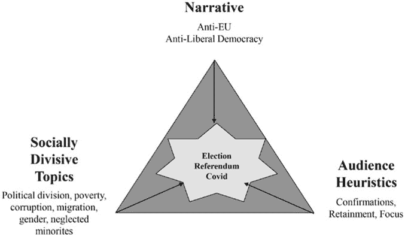
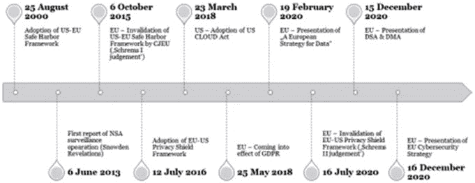

# 混合性、冲突与网络安全全球政治

虽然法律、社会学和计算机科学等学科已经与信息时代密切接触，但国际关系学者尚未充分发挥其学科的分析能力，来深化我们对新的数字技术对于战争、和平、安全、合作、人权、公平和权力等概念意味着什么。本系列汇集了国际关系学者（特别是跨学科研究的学者）的最新研究成果，旨在挑战并扩展我们对信息时代世界政治的理解。

11. 关于编辑与贡献者

8. 关于编辑与贡献者

# 致谢

本合集源自 2020 年海牙网络规范计划（The Hague Program for Cyber Norms）会议，主题为“前进：：碎片、极化与混合性”。由于新冠-19 疫情的影响，该会议于 2020 年 11 月 10 日至 12 日在线举行。我们非常感谢参与者和主旨演讲员——Madeline Carr、Milton Mueller、Bruce Schneier 和 Mariarosaria Taddeo，他们在会议期间进行了富有参与性且具有启发性的对话。我们还想感谢莱顿大学安全与全球事务的同事们，他们在初始阶段对会议提交方案提供了无足价值的反馈：Dennis Broeders、Monica Kaminska、Els de Busser、James Shires 和 Tatiana Tropina。此外，我们还要感谢 Maaike Stroeks 在她在海牙网络计划实习期间为本书提供的编辑支持。特别要向心感谢我们的同事 Corianne Oosterbaan，尽管在困难时期，她仍为会议的组织工作付出了卓越努力，并在整个编辑过程中提供了至关重要的工作。最后，我们对荷兰外交部向海牙网络计划提供的慷慨且持续的资金支持表示感谢。

Fabio Cristiano 和 Bibi van den Berg

海牙，2022 年 7 月

1

# 网络空间中的混合性与冲突：重新思考国际网络安全的涌现特征

Fabio Cristiano 和 Bibi van den Berg

网络安全已成为国家安全和国际外交的关键问题。虽然网络安全被定义为具有一种涌现且内在的技术特征，但它也代表了“权力政治中一个重要的增量变量”（Bellanova, Jacobsen and Monsees 2020）。各国和国际社区在网络安全的战略思考和性政策制定方面取得了巨大进步，例如通过在国际上推动负责任（国家）行为的规范框架（Broeders and van den Berg 2020）。联合国国际网络安全开放式工作组（OEWG）最近更新的授权代表了这方面的一个重要进展。OEWG 由联合国大会于 2018 年建立，对所有联合国成员国开放，并在有限范围内允许非政府组织、工业界和学术界参与。然而，联合在规范方面的进展似乎落后于网络空间中飞速发展的技术进步以及网络空间中不断变化的威胁格局（Broeders et al. 2022）。这些进展也无法避免引发地缘政治竞争的影响，不断扩散的技术民族主义正将联合国规范进程推向进一步的极化和碎片化（Calderaro 2022）。特别是规范辩论持续呈现两极分化：一方是所谓的“志同道合国家”，另一方是对互联网及其安全持有更多威权主义观点的国家。由于这种极化，联合国关于网络规范的进程在监管新兴威胁和技术（如虚假信息、AI 驱动的网络行动等）方面进展进展甚微（Cristiano et al. 2023a）。考虑到国家支持的网络行动日益增加的事实，可以认为，尽管所有治理层面都有规范发展，但网络空间作为开放、自由和安全的未来正面临前所未有的风险。

本合集通过观察网络安全的全球政治如何通过社会技术混合性和冲突产生，从而引导了网络规范的形成过程。它通过质疑技术在塑造网络安全成为一个解决解决政策领域方面的作用来实现这一点（Dunn Cavelty and Wenger 2020）。一方面，解决网络安全的方法源于计算与政策之间某种不可调和的时间性，这使得网络安全治理基于一种涌现的安全逻辑运行，总是试图“追赶”或预测新的和未来的威胁（Stevens 2016; Smeets 2018）。这可以在国家层面出现的高度安全化网络安全方法中观察到（Dunn Cavelty 2007），也可以在国际层面新兴技术的规范僵局中看到（Cristiano et al. 2023b）。另一方面，不断将政策类别适应技术类别（反之亦然）的努力往往会剧政策辩论的极化，例如各国对网络空间本质（或用俄罗斯术语称为“信息圈”）及其在其中战略立场的高度政治化和多元化的观点（Rosenberger 2020）。虽然网络安全已稳固地进入政治议程，但国际规范努力难以弥合网络安全的技术与涌现逻辑与其全球政治之间的鸿沟。也就是说，网络安全治理似乎经常复制告知技术网络安全的相同涌现逻辑，侧重于解决问题，因此未能捕捉网络安全作为一个由社会政治、技术和文化规范的持续相互作用所构成的现象（Hayles 2016）。

通过汇集海牙网络准则计划（The Hague Program for Cyber Norms）2020 年年度会议的精选贡献，本合辑建议不仅通过将技术逻辑转化为“规范性工作”来研究网络安全的兴起特征，还关注其作为一个真正的混合型社会技术冲突领域的兴起。本书的贡献分为三个大部分部分：（1）新兴的规范实践，（2）新兴的威胁与技术，以及（3）新兴的参与者。第一部分揭示了国家和国际的规范实践，包括关于互联网治理中基础设施驱动的规范演变的章节；应对网络行动的国际法和国家实践；以及法院作为规范形成与争论之新颖空间的角色。第二部分关注新兴的威胁与技术——以及监管它们的方法——包括关于应急通信背景下虚假信息运动的章节；信息行动的社会方面；以及网络空间中人工智能/军事战略的关系。第三部分也是结论，关注了新兴参与者的规范性角色，包括作为网络空间规范性大国的欧盟；来自“全球南方”的新兴经济大国对国家和国际网络安全的角色和观点；以及联合国开放式工作组（OEWG）中的公民社会和多利益利益者主义。本引言概述了每一部分的理由和主要贡献，并指出，国际社区为了推进有意义的合作与治理，必须接受冲突和混合性是网络空间及其内在全球政治的“特征”而非“缺陷”。

## 新兴的规范实践

网络安全通常被构想为一个安全领域，通过减少和修补漏洞来应对网络空间中不断变化的风险和威胁（Liebetrau and Christensen 2021）。这种新兴的技术逻辑往往与规范过程的速度和逻辑相冲突，特别是在国际层面，共识的建立和激烈的地缘政治竞争阻碍了该问题的实质性进展（Grigsby 2017; Broeders and Cristiano 2020）。国家层面技术安排的性质变化会对国际层面产生直接影响（Jasanoff and Kim 2015）。在`../Text/Chapter02.xhtml`中，Roxana Radu 和 Giovanni De Gregorio 探讨了互联网基础设施的技术碎片化如何塑造并影响互联网治理的混合化过程（Mueller 2010）。通过对中国在 във提出的互联网协议升级的分析，本章探讨了建立易于控制的互联网基础设施与促进全球和地方治理层面、以及公共与私营部门之间混合性之间的相互作用（Hurel and Lobato 2020）。这一案例明确显示了新的技术和基础设施配置与治理配置之间存在深层且循环的社会技术纠缠（DeNardis 2014）。此外，本章进一步提醒我们全球互联网技术层与治理层之间的互通性，从而引发了对技术碎片化成为全球网络安全政治极化诱因的担忧。

与规范如何从国家流向国际再回到国家相关的另一个方面，涉及到在国际层面达成一致的规范如何转化为国家的实践（Finnemore and Hollis 2016）。网络攻击集体归因这一日益突出的习俗，是各国试图通过实践来应对规范真空的领域之一。在`../Text/Chapter03.xhtml`中，François Delerue 通过观察“国际法适用于网络空间和网络行动”这一规范假设在网络攻击公开归因的国家实践中如何运作，理清了国际法与网络安全之间的关系。正如本章所示，归因网络攻击的新兴规范实践——在被定义为“点名羞辱”（Finnemore and Hollis 2020）的框架下——忽视了国际法作为此类公开行为的一个要素。到为止，公开归因声明要么没有提到国际法，要么对其进行了不具体的指引。这里出现了一个断层：虽然某些国家在国际层面极力将国际法纳入网络空间负责任行为的辩论中，但在付诸行动这一问题上却较为沉默。通过探索这种“沉默”的动机，本章最终凸显了规范框架与规范实践之间的脱节，并展示了志同道合国家内部不同的规范解释。

国际规范框架与国家实践之间的脱节，表明需要重新考虑（网络安全）规范锻造和执行的场所（Finnemore and Sikkink 1998）。当国际社区努力促进网络空间负责任（国家）行为的可操作规范时，规范形成的过程正在其他地方发生。尽管国家间关于网络安全的争端从未在国际法庭得到解决，但国家和地区法院（主要是欧盟 [EU] 层面）已经处理了直接影响国际规范过程的冲突和案件。在`../Text/Chapter04.xhtml`中，Jan Lemnitzer 显示了数据隐私活动人士向爱尔兰数据保护专员提交的一份简单投诉如何导致欧洲法院跨西洋数据共享整个法律基础的终结。通过展示规范形成过程的互通性和混合性，本章认为，国家和地区法院比多边过程构成了解决和调解网络空间冲突的重要空间。正如章节所言，转向法院也引发了对 OEWG 规范过程中多利益相关者特征的质疑，特别是关于私营参与者的介入：他们在贡献独特技术知识的同时，也将他们在其他地方引发的冲突带到了国际谈判桌。

## 新兴的威胁与技术

近年来，技术创新进一步丰富了网络空间威胁的手段库，并质疑了我们用于理解和监管它们的范畴。因此，网络行动与信息行动之间的界限变得日益模糊（Shires 2020; Broeders, Cristiano and Weggemans 2021）。一方面，网络空间不断变化的威胁格局可以被视为新技术的可用的结果——例如人工智能 (`AI`）和处理海量数据的能力。另一方面，国家利用技术创新来进一步推进其战略立场，以及他们理解网络空间信息、基础设施及其安全的不同方式（Buchanan 2016）。然而，将信息作为国际网络安全的要素进行监管构成了一项困难的尝试，因为它涉及言论自由问题，并需要国家与科技公司之间的合作，但后者的利益往往是冲突的（Cristiano, Broeders and Weggemans 2020; Broeders, Cristiano and Weggemans 2021）。

在`第 5 章`中，泰勒·格罗斯曼（Taylor Grossman）探讨了虚假信息作为国家安全威胁的出现如何影响不同治理层面的规范形成。本章关注了模仿和征用应急通信渠道的行为，将其视为一种难以监管的威胁。在这里，这种“突发性”既涉及威胁的本质，也涉及治理领域的特征（Backman 2021）。通过对不同冒充内容案例的分析，本章反思了影响网络安全规范辩论的两种社会技术逻辑：一种侧重于结果和影响，另一种则侧重于投入和手段。本章认为，冒充内容作为威胁的严重性并不取决于其产生的技术和危害影响，而是取决于此类威胁出现的背景。正如近期 COVID-19 疫情期间虚假信息行动兴起所示，应急管理状况是一个冒充内容可能严重损害公众信任的背景，因此需要特定的临时规范响应。

COVID-19 疫情凸显了我们社会对互联网的依赖，以及系统性危机的突发性如何为新威胁的出现创造机会（Gronvall 2020）。危机通过允许恶意行为者利用社会脆弱性来扩大技术脆弱性（Groendaal and Helsloot 2021）。在`第 6 章`中，彼得·派耶珀斯（Peter Pijpers）和保罗·杜谢（Paul Ducheine）探讨了危机背景下影响行动的心理维度。他们特别关注通过利用如 COVID-19 等具有分裂和极化倾向的话题，让国家受众更容易受到网络空间虚假信息的影响。他们这样做超越了将虚假信息视为技术威胁的理解，转而关注话语框架、脚本和意义。虽然虚假信息作为一种威胁存在于互联网“发明”之前，但作者认为，网络空间提供了一个前所未有的机会，通过启发式方法获取受众数据，从而实现微观定位。对于国际网络安全而言，这具有相关意义，因为它指出了脆弱性在社会技术交汇中产生的混合特征。

AI 技术的出现正导致网络空间出现日益复杂的威胁（Cristiano et al. 2023a）。同时，自动化和自主性也提供了处理大量数据的机会，从而对威胁产生准备充分且高度针对性的响应（Stevens 2020）。在关于网络空间定义的不同观点的地缘政治背景下，AI 驱动的技术也引发了对其潜在恶意使用的担忧，从而指出了网络空间中进攻与防御的混合性质（Taddeo 2018; Kaminska, Broeders and Cristiano 2021）。在此背景下，私营部门的角色在思考商业需求和市场趋势如何影响国家网络安全战略以及国际层规范进程时，变得更加重要。在`第 7 章`中，艾米·埃尔坦（Amy Ertan）反思了“AI 军备竞赛”作为英国国防部门军事创新供需驱动力的兴起框架。通过研究关键创新挑战的纠缠、新兴技术公私采购模式的局限性以及技术测试与评估所产生的安全困境，本章应对了围绕冲突环境中 AI 自主性的复杂辩论。通过这一分析，它还倡导政府间行为者（如北大条约组织）发挥新作用，调解公共与私营之间的冲突与混合性，并促进规范的发展。

## 新兴参与者

新规范实践、技术和威胁的出现，对于超越国际网络安全的极化和碎片化既是机遇也是挑战。西方国家与俄罗斯之间的紧张关系，以及中美两国之间的激烈竞争延伸到了数字领域并在那里得到加强。这些可能促成或破坏网络空间负责任行为规范的外交协议。由于目前国际网络安全被配置为大国政治的极化领域，新兴参与者的角色有助于克服社会技术僵局。在`第 8 章`中，塞德里克·阿蒙（Cedric Amon）调查了欧盟关于数字主权的兴起话语，这种话语不仅是对俄罗斯和中国“准国家级互联网”（在`第 2 章`中讨论过）的战略应对，也是对欧洲一体化的贡献。本章通过考察德国和法国的主权政策话语，研究区域层面复杂且混合的规范形成过程，从而反思了国家利益与区域利益之间的协调。欧盟的数字主权话语经常被批评存在战略不一致、可能以类似于威权国家的方式触及数字权利，并与欧盟传统的战略和规范权力形象相悖（Broeders, Cristiano and Kaminska 2023; Calderaro and Blumfelde 2022; Floridi 2020）。本章认为，欧盟的数字主权尝试必须被理解为对非欧洲技术提供者依赖加剧的政治回应，即对市场动态的公共响应，而非地缘政治考量。

如果说欧盟的战略努力可以被视为在大国政治和极化之外，为网络空间提出一种“第三条路”，那么全球范围内其他参与者日益增长的重要性，预示着我们可以以更加混合的方式来想象网络空间及其治理（Chenou 2014）。这似乎是不可避免的，随着亚洲和非洲社会对互联网的依赖日益增加，网络空间的重心可能会发生转移，这就像本卷第一部分中讨论的规范实践的“去中心化”一样（Deibert and Pauly 2019）。在第 9 章中，Irene Poetranto、Josh Gold 和 Justin Lau 探讨了三个所谓“中层”国家——印度、印度尼西亚和南非的立场与参与。本章通过探索新兴经济体作为可能动摇当前极化局势的新声音的角色，为国际网络安全规范化过程中关于多边主义和多元主义的辩论做了贡献。通过回顾新兴经济体参与网络规范进程的历史、这三个国家在信息通信技术（ICTs）的发展和使用方面关注的主要问题，以及这些立场之间的重叠与差异，本章凸显了一条脱离或至少挑战大国政治极化现状的路径。在第 10 章中，Arindrajit Basu 和 Karthik Nachiappan 进一步解析了印度作为国际网络安全新兴参与者的角色。通过对该国在多边进程中立场的历史探索，本章表明，印度参与多边谈判的能力和意愿取决于国内利益的博弈。本章试图通过比较该国在其他多边进程中的过去立场，与其目前在数字贸易讨论中关于跨境数据流问题的立场，来阐明印度可能如何对联合国网络安全规范进程做出贡献。通过这一分析，本章最终揭示了考虑国内背景与国际立场之间网络安全混合性质的重要性。

中层力量的兴起作用表明，国际层面多边主义的“形成”很大程度上取决于国家层面的技术和经济发展。联合国开放专家工作组（OEWG）通过对多利益相关者主义形式的多元主义的高度关注，欢迎了这种多元化的声音。有趣的是，多利益相关者主义本身已成为联合国层面的一个极化问题，威权国家反对公民社会深度参与规范过程。在第 11 章中，André Barrinha 和 Louise Marie Hurel 对公民社会在 OEWG 中占据的“混合位置”提出了问题化思考。通过观察参与机制、参与类型以及不同国家对 OEWG 中公民社会的认知和代表，本章对联合国进程如何将公民社会构建为具有规范相关性的行动者和议题进行了批判。通过关注代表性的复杂动态，本章认为，OEWG 促进了一个既多样又统一的公民社会观念的具化；这种观念质疑并合法化了国家在该领域的决策。它还主张，通过将公民社会固有的混合性视为网络空间负责任行为过程的资产而非负担，从而对公民社会进行更多元的理解。

### 结论

总而言之，这些贡献最终揭示了在碎片化和极化的背景下，混合性与冲突如何构成国际网络安全及其治理的宝贵资源。它们指向了……的必要性。

Cristiano, Fabio, Dennis Broeders, François Delerue, Frédérick Douzet 和 Aude Géry (编).). 2023a. *网络空间中的人工智能与国际冲突*。伦敦：Routledge。

Cristiano, Fabio, Dennis Broeders, François Delerue, Frédérick Douzet, 和 Aude Géry. 2023b. “网络空间中的人工智能与国际冲突：探索三类问题。”收于 *网络空间中的人工智能与国际冲突*，由 Fabio Cristiano, Dennis Broeders, François Delerue, Frédérick Douzet 和 Aude Géry 编。伦敦：Routledge。

Cristiano, Fabio, Dennis Broeders 和 Daan Weggemans (编).). 2020. *“语言战争”时代的反网络恐怖主义：保护数字权利的氪能石吗？* 海牙：海牙网络规范计划。。

Deibert, Ronald J., 和 Louis W. Pauly. 2019. “网络空间中的相互纠缠与复杂主权。”收于 *数据政治：世界、主体、权利*，由 Didier Bigo, Engin Isin 和 Evelyn Ruppert 编，第 81–99 页。伦敦：Routledge。

DeNardis, Laura. 2014. *全球治理的全球大战*。康涅狄格州亥纳文：耶鲁大学出版社。

Dunn Cavelty, Myriam. 2007. *网络安全与威胁政治：美国保障信息时代的努力*。伦敦：Routledge。

Dunn Cavelty, Myriam, 和 Andreas Wenger. 2020. “网络安全遇到安全政治：复杂技术、碎片化政治与网络化科学”。 *当代安全政策* (Contemporary Security Policy), 41 (1): 5–32。

Finnemore, Martha, 和 Duncan B. Hollis. 2016. “构建全球网络安全规范”。 *美国国际法杂志* (American Journal of International Law), 110 (3): 425–479。

Finnemore, Martha, 和 Duncan B. Hollis. 2020. “超越命名与羞辱：网络安全中的指控与国际法”。 *欧洲国际法杂志* (European Journal of International Law), 31 (3): 969–1003。

Finnemore, Martha, 和 Kathryn Sikkink. 1998. “国际规范动态与政治变革”。 *国际组织* (International Organization), 52 (4): 887–917。

Floridi, Luciano. 2020. “数字主权之争：它是什么，为什么重要（尤其是对欧盟而言）”。 *哲学与技术* (Philosophy & Technology), 33: 369–378。

Grigsby, Alex. 2017. “网络规范的终结”。 *生存* (Survival), 59 (6): 109–122。

Groenendaal, Jelle, 和 Ira Helsloot. 2021. “COVID-19 疫情危机期间的网络韧性：案例研究”。 *突发事件与危机管理杂志* (Journal of Contingencies and Crisis Management), 29 (4): 439–444。

Gronvall, Gigi Kwik. 2020. “对 COVID-19 的科学应对及对安全的启示”。 *生存* (Survival), 62 (3): 77–92。

Hayles, N. Katherine. 2016. “认知组装：技术代理性与人类交互”。 *批判性查询* (Critical Inquiry), 43 (1): 32–55。

Hurel, Louise Marie, 和 Luisa Cruz Lobato. 2020. “网络规范创业？理解微软对网络安全的倡导”。收于 *治理网络空间：行为、权力与外交*，由 Dennis Broeders 和 Bibi van den Berg 编，第 285–312 页。伦敦：Rowman & Littlefield。

Jasanoff, Sheila, 和 Sang-Hyun Kim. 2015. *现代性的梦幻：社会技术想象与权力的制造*。芝加哥：芝加哥大学出版社。

Kaminska, Monica, Dennis Broeders 和 Fabio Cristiano.2021. “限制病毒传播：灰色地带的自动化网络行动以及区分与歧视原则”。收于 *2021 年第 13 届国际网络冲突会议 (CyCon)：病毒式传播*，由 T. Jančárková, L. Lindström, G. Visky 和 P. Zotz 编，第 59–72 页。塔林：北约 CCDCOE 出版物。

Liebetrau, Tobias, 和 Kristoffer Kjærgaard Christensen.2021. “网络安全的本体论政治：新兴的代理、行动者、地点与空间”。 *欧洲国际安全杂志* (European Journal of International Security), 6 (1): 25–43。

Mueller, Milton. 2010. *网络与国家：互联网治理的全球政治*。马萨诸塞州剑桥：麻理工出版社。

Rosenberger, Laura. 2020. “为民主维护网络空间安全：信息竞争的新格局”。 *外交事务* (Foreign Affairs) 99: 146。

Shires, James. 2020. “丑闻的模拟：黑客泄露行动、海湾国家与美国政治”。 *德克萨斯国家安全评论* (Texas National Security Review), 3 (4): 10–29。

Smeets, Max. 2018. “时间问题：论网络武器的瞬时性”。 *战略研究杂志* (Journal of Strategic Studies), 41 (1–2): 6–32。

Stevens, Tim. 2016. *网络安全与时间政治*。剑桥：剑桥大学出版社。

Stevens, Tim. 2020. “灰色地带的知识”。 *数字战争* (Digital War) 1: 164–170。

Taddeo, Mariarosaria. 2018. “威慑理论的局限性”。 *哲学与技术* (Philosophy & Technology), 31 (3): 339–355。

对于数字生态系统而言，权力和安全是硬币的两面。全球互联网的碎片化影响着这两者。当这种碎片化现在底层基础设施以及基础标准与协议层面时，互操作性、互连和数据包交换等重要功能就会受到威胁。因此，高层正担心作为刻意碎片化的一部分，互联网将发生结构性重组（Drake, Cerf and Kleinwachter 2016）。全球互联网的技术分裂可能包括网络地址转换、路由、`IPv4`与`IPv6`不兼容，以及备用域名系统（`DNS`）根。在基础设施层面，`5G`争论已经表明，在下一代无线网络的部署过程中，安全和战略利益显然关关。因此，中国 5G 设备制造商在许多国家被封锁或访问受限（Radu and Amon 2021）。

在保护措施和监管层面进行的碎片化正在不断加深，并向基础设施层面移动。导致互联网治理极化的新的规范斗场，是建立在威权国家和民主国家共同采用的数字主权论述之上（Claessen 2020）。虽然技术网络功能对终端用户来说是不可见的，但它们已经揭示了多边和多利益相关者机构中西方与中国立场之间日益显出的裂痕。这种紧张关系引发了关于全球互联网安全以及产生技术和法律保护水平不平等的碎片风险的问题。根据两套标准碎片化网络架构也将影响互联网的社会层，导致“自下而上”与“自上而下”治理方法之间的明确分离。此外，到目前为止在互联网协议层面盛行的去中心化决策过程，正面临如中国在`ITU`提出的这类中心化方法的强力挑战（Hoff-mann, Lazanski and Taylor 2020）。

互联网逐渐碎片化的一个重要后果是不同治理层面之间界限的模糊，特别是国际与国家、公共与私有之间。互联网治理受全球和局部趋势趋势的影响，这些趋势*在事实上*代表了一种跨国技术架构的混合治理体系。例如，中国和俄罗斯倾向于利用互联网的全球维度来建立一个与国家现实和愿景隔绝的治理模型，而美国和欧盟则公开表示他们如何致力于实现全球和开放的互联网治理。然而，在公共和私有部门界限已经很薄的情况下，范围内范围内出现了混合进程，这些进程在很大程度上被保护用户和公民的安全及价值驱动伦理所合理化。

我们在下面分析了这些趋势，审视了相关文献，并基于法律和政策研究增加了新的视角。我们的研究展示了互联网治理的新框架如何在技术标准和协议层面运作，这不仅影响了互联网架构本身，还影响了国家行为体如何定义其网络空间战略。这一新视角使我们能够观察到互联网治理和国际网络安全边界日益模糊的程度。

### 互联网的碎片化：关注技术关注点

基于在基础设施上对互联网技术功能或流量引入限制的国家分割（National segmentation）并不是什么新现象。中国、伊朗和俄罗斯等国已经建立了严厉的国家界限和控制，以与全球通信网络隔离开（Sherman 2019）。扩大这一趋势并创造更多国家控制领域对线下世界也产生了严重后果。互联网长期以来被视为建立在西方理想之上的“民主化”平台，它并不是一个中立的环境。标准和协议在促进开放互联网方面发挥了关键作用。在停机和中断情况下绕过损坏进行重新路由的技术（Aben 2015 2018）以及规避审查和网络限制（例如在域名系统层面）的技术在早期就被构建起来了。它们的出现早于国际法、人权法以及区域和国家立法开始广泛应用于互联网之前（Radu 2019）。

关于互联网潜在碎片化的讨论并不新奇（Drake, Cerf and Kleinwachter 2016; Mueller 2017）。学术界对国内政策和司法管辖权的关注，补充了对研究技术标准和资源作为国家控制工具日益增长的兴趣。诸如`网际协议`（DeNardis 2009）或`边界网关协议`（Mathew 2016）等标准自互联网早期起就已深根于其架构之中。尽管对该主题有了数十年的关注，但技术脱钩（technology decoupling）是一个较晚的现象，其基于隔离和保护网络免受新兴威胁的能力。虽然它可以增强韧性，但这种脱钩也会引入新的风险。

在自 1983 年首次发布以来经历了多次变化，`传输控制协议/网协议`（`TCP/IP`）仍然是支持当前互联网的主导协议。它最初作为`ARPANet`计划的一部分开发，由美国军方资助，后来由美国公司在其服务中实施而实现全球化。互联网协议最显著的变化包括从`IP 版本 4`（`IPv4`）到`IPv6`的过渡，以及增加到 128 位寻址以响应连接到互联网的设备数量增长。早期关于互联网治理“转向基础设施”的学术工作解释了政府如何刻意地针对技术控制，作为在网络空间中利用权力的手段，从而危及用户的安全（Musiani et al. 2016）。

中国最近的一项建议——用于“网络 2030”的新型`IP`网络——旨在为当前互联网的`IP`提供升级，以支持远程手术等未来技术（Jiang 2019）。它被呈现为对`IPv6`在下一代网络扩展性方面不足的回答，以及量子计算世界中新用途的充分解决方案。中国协议的定义特征包括内置安全、健壮性、确定转发、全球可达性、尽力而为以及异构网络（Jiang 2019）。该方案于 2019 年 9 月由华为代表提出，华为是全球最大的手机制造商，也是参与`5G`部署最大的基础设施供应商之一。新的`IP`将连接物理实体（从可穿戴设备到车辆）以及工业控制设备，同时提供“基于用户身份的特定服务质量和安全策略，而不是映射到其他东西”（Hogewoning 2020）。

尽管该提议在技术细节方面仍然模糊，但其讨论的功能模型ن遭了许多西方参与者的批评。新的 IP 协议建立在现有进展的基础上，但在寻址和转发方面，与当前架构的关键组件分道扬镳（RIPE NCC 2020, Hoffmann, Lazanski and Taylor 2020）。尽管被呈现为一个去中心化的系统，但中国这种架构实际上会将转发和访问权限从终端用户转移到中心化机构，这些机构在需要时有拦截特定数据流的能力。在这种情况下，网络核心对端点将拥有增强控制控制。此外，所提的计划挑战了“作为几十年演变结果的开放灵活的系统”（Hogewoning 2020）。

网络安全已成为互联网分裂的一个关键关注问题，引发了人们对政府加强互联网交换点控制的担忧，以及为了更改路由协议以服务地缘政治利益并削弱技术保护的担忧（Hoffmann, Lazanski and Taylor 2020）。除了技术脱钩之外，嵌入架构设计中的社会和法律价值观所引发的碎片化，也可能对互联网产生深远影响，正如下一节所述。

### （新）标准的政治学

全球标准化进程在这一转型中特别具有探索价值，因为它们发生在国界之外，但并非免受国家影响的影响。技术协议的整合导致了国家层面对全球互联网控制的加强，这一点特别受到关注。在实行广泛形式信息监控和控制的国家（如阿拉伯国家或中国），互联网反复受到公共限制，导致某些在线服务被封锁和/或对数据进行严格监控（Zittrain et al. 2017; Warf 2011; Deibert et al. 2008）。互联网关网案例是一个极端例子，显示了国家（主要是威权政权）依赖网络架构来表达其对数字环境的主权（De Gregorio and Stremlau 2020）。

允许互联网演变为全球重要网络的私有基础设施，依赖于以自愿方式进行协议和标准的创建与升级（尽管不一定是以无私的方式）。在互联网工程任务组（`IETF`）或互联网数字分配机构（`ICANN`）等场所，网络工程师和专家以个人身份或特定利益集团代表的身份工作，将其想法作为自愿贡献提出。他们引入的协作方法意味着，支撑全球互联网运行的基本标准和协议可以在一个政府存在始终极微的社区中公开讨论并达成共识。这种自下而上的标准创建模式变得极具影响力，相关的“征求意见（RfC）”实践仍然占据主导地位（Radu 2019）。然而，驱动参与标准制定过程和机构的动机开始受到质疑，因为大多数草案提案均来自具有强大企业背景的专家。每年多次面对面会议的成本高昂，且多元化声音的参与度较低。在 `IETF` 中，标准的制定过程目前由美国和中国工程师领导（Winzen and Weyrauch 2019）。

华为代表在国际场合提出的新 IP 模型附带了一项提议，主张在国际电信联盟（`ITU`）内部建立一个以工作组形式存在的新治理结构。作为联合国负责信息和通信技术的专门机构，`ITU` 长期以来由于其多边化的职能，在定义其互联网治理工作范围方面一直处于挣扎。同时，它致力于遏制与 `IETF` 和 `ICANN` 等有机成长的机构之间的“领土争夺”（Chenou and Radu 2015）。在领导若干全球标准化进程的同时，`ITU` 避免了与 `IETF` 开发基本标准和协议的授权重叠。

自愿贡献的传统与这一事实密切相关：即最初几十年（1970 年代到 1990 年代）的互联网基础设施是在缺乏国家约束的情况下发展的。但在过去的二十年里出现了新模式，中国政府在各种场合强烈支持新技术标准的发展（Seaman 2020; Hoffmann, Lazanski and Taylor 2020），这不仅是为了为其公司确保先发优势，还作为一种“国际权力竞争的工具”（Kim, Lee and Kwak 2020）。例如，在 5G 标准的制定过程中，华为和中国移动在对第三代伙伴计划（`3GPP`）框架的贡献方面明显领先，并拥有大部分实施专利（IPLytics 2019）。2018 年的《标准化法》特别鼓励国际参与全球标准化进程（Hoffmann, Lazanski and Taylor 2020），而中国标准监督管理局等机构帮助协调国内和国际的标准工作。近年来，有越来越多的证据表明，伙伴国被采用源自中国的标准（Hillman 2018; Schneider-Petsinger et al. 2019）。

本世纪最大的基础设施开发项目——“一带一路”倡议，是跨越四大洲 150 多个伙伴国家部署光纤连接和扩展中国技术的重要载体。技术工作由华为和中领先，并辅以中国的技术援助。这种新形式的“网络权力”（Broeders, Adamson and Creemers 2019）基于一种数字极极的新愿景，该极心围绕标准化以及对基础设施建设项目的影响力展开。关于网络主权的辩论已结晶为在本土科技行业的帮助下，在数字主权空间内控制数据流的国家特权。

在国际上，内部控制范式可以追溯到 2011 年俄罗斯、中国、塔吉克斯斯坦和乌兹别克斯代表向联合国秘书长提出的《信息安全国际准则》（66/359）提案（Radu 2013）。该文件评估认为准则签署国：

> 努力 . . . 防止其他国家利用其资源、关键基础设施、核心技术和其他优势，损害接受本准则的国家对信息和通信技术的独立控制权，或威胁其他国家的政治、经济和社会安全。

《行为准则》为理解数字主权概念提供了早期见解，它表明信息控制已成为一个新的规范性斗场，导致了互联网治理的极极化。在讨论中划分出的两个阵营——一方是《行为准则》的签署国，另一方是美国和欧洲国家——在过去十年中加强了各自的立场。随着基础设施成为政治斗争的中心，试图碎片互联网架构的尝试揭示了治理网络“自下而上”与“自上而下”方法之间日益扩大的差距。迄今通过 `IETF` 或 `ICANN` 等西方组织实行的互联网标准和协议去中心化决策，正面临着市场领先公司通过晦流程实施的、利润驱动且纯私有的规则制定的挑战（Radu and Hausding 2020）。这种模式也面临着中国（在沙特阿拉伯、伊朗和俄罗斯的支持下）在 `ITU` 等多边、国家主导场所提出的新中心化模式的挑战。

### 背景下的数字主权：私有网络的作用

多年来，关于数字主权及其在信息社会中重要性的已演出了更为细致的论述（Pohle and Thiel 2020）。20 世纪 90 年代后期，联合国关于信息安全的辩论将网络主权揭示为特定于非自由政权的方法（Radu 2013），但现在情况已不再如此。虽然上海合作组织提出的 2011 年版《行为准则》强调了将主权作为国家控制手段的原则，但在过去五年中，出现了更细粒的定义和理解。欧盟本身在冯·德莱恩委员会（2019 年）的工作中采取了强有的技术主权和战略自主立场，推动了一种关注欧洲人需求和欧洲社会模式的数字主权愿景。对于中国当局而言，正如《国家网络安全战略》所述，网络安全已成为“主权的新领土”。北京的法律法规定，任何在中国境内提供互联网服务的提供商都有义务根据要求向中国政府共享其在大陆持有的数据，这显示了主权控制在实践中适用于任何在该国经营业务的实体。

互联网代表了通信技术的飞跃，提供了开放的标准和协议，允许不同的实体在统一架构下分别设计网络并向其用户提供服务。上世纪末，相关辩论反映了自由意志主义（Barlow 1996; Johnson and Post 1996）和现实实主义（Goldsmith 1998; Lessig 1997; Reidenberg 2017）的立场。国家主权和领土边界的衰落表现为“一个司法边界崩溃、商品、服务、人员和信息‘跨越无缝国界流动’的世界”（Hirschl and Shachar 2019, 1–2）。技术发展使绝大多数宪法国家在监管方面采取了自由主义方法（De Gregorio 2019）。在很大程度上，民主国家选择依靠在线中间机构来确保公共政策的在线执行，而不是采取直接的干预形式。十五多年前，Birnhack 和 Elkin-Koren (2003) 以及 Reidenberg (2004) 等学者就指出了这一点，他们明确可以通过监管网络中间机构、网络工程和技术工具来确保公共政策的在线执行。

但私人平台的崛起改变了格局。国家控制数字空间的能力日益受到拥有底层基础设施的实体的调节。这种转变代表了从国家直接干预向复杂的公私谈判网络和监管挑战的转变。

在这种混合框架下，全球与局部动态日益交织，使得民主体制与威权体制之间的区别变得不再那么重要。学者们注意到“全球法”的兴起（Ziccardi-Capaldo 2008; Prins et al. 2017），这定义了一个元法律体系，不同的组织和实体在该系统中产生并塑造具有域外影响的规范。不同系统的演变导致了根据其内在理性运行的多元逻辑的出现。因此，单一国家（及其法律）正逐渐被碎片化的新机构取代，这些机构在传统领土边界之外实施其原则和价值观。

中国或俄罗斯影响互联网治理的尝试经历了全球和国家战略。同样，即使欧盟和美国已经发展了围绕保护开放互联网的强有力叙事，但建立全球价值观仍然是一个争议点。跨大西洋全球与局部维度之间的互动导致了区域治理体系的巩，这反过来又成了美国和欧洲自由治理的特征。中国自 2015 年以来一直追求全面战略，通过联合国多边体系行使影响力，在`ICANN`和`IETF` 等技术多利益相关机构中更加发声，并在地方层面实施了更多监管。一致的是，中国遵循一种基于本土价值观的清晰数字主权模型。

从公私分界来看，混合化的趋势是显而易见的。在威权国家，公部门和私营部门之间的区别往往较弱，政府与企业之间的关系产生了一种新型基础设施（公共）治理模式。中国提供了互联网治理混合化的长期案例。它一直监控在线活动（Zittrain and Edelman 2003），同时建立了一个“数字围墙”，让民族企业在所谓的“华为模型”（Wen 2020）下拥有了在任何形式竞争之外增长的时间和空间。这一体系导致了中国“数字政治经济”的产生（Hong 2017）。

值得强调的是，中国公司采用的一些策略反映了西方将互联网向`TikTok`等新服务开放的理念（Keane and Yu 2019）。同时，当局对企业保持着强有控制，并最近开始制裁其国内市场内的垄断地位（CNN 2021）。百度、阿里巴巴和腾讯已成为`Google`、`Apple`、`Facebook`、`Amazon`和`Microsoft`的有力竞争对手。换句话之，中国仅部分对数字全球化开放，同时保持对其边界内网络架构和业务行为的控制。通过新标准将这一模型向国外输出导致了混合的全球政体，在这种政体中，私营中间机构的工作与政治主权追求之间的边界变得日益模糊。

从这个来看，国家行为者试图通过碎片化影响互联网架构以获得全球控制权，代表了监管数字环境的强有力方式。虽然威权国家可能从扩大其在线权力以及阻断私营部门对法律多元主义的任何表达中获益，但民主政府面临着一个重大的困境：一方面是加速迈向大规模监控和技术控制，另一方面是托付私营部门利用监管激励措施来维护个人权利和自由。这一框架使得科技巨头在决定保护标准方面拥有广泛的裁量权。因此，除了国家表达数字主权外，科技巨头按照其自身规则治理基础设施和数字空间的能力构成了另一种迫切需要制衡的权力形式。

尽管在民主宪法国家，由于公共和私有秩序权威的重叠，权利和自由的保护正经历着日益增长化，但中国侧重于在技术层面和技术社区内部增加其权威。中国模式依赖于通过与国家关联的企业加强对用户的监控，这些企业可以收集、使用和共享数据，同时在全球范围内与其他参与者竞争。国家级社会信用体系让我们窥见了中国未来几年在国内层面想要追求的控制愿景。

### 结论

本章探讨了互联网治理新阶段的特征，这一阶段由试图改变网络架构的尝试所主导。我们在民主与威权价值观的十字路口治理数字空间时，新的技术控制形式与国家实践和政治雄心相遇。技术标准长期以来被视为后续规范竞争（normfare）的中立基础（Radu et al. 2021），现在不再处于范围之外。中国的案例构成了公私部门利益结的典范范，以及本土价值观在技术标准中体现的多种方式。华为提出的对`TCP/IP`栈的技术重新设计，旨在克服当前`IP`标准在预期未来用途中的局限性，这允许对认证进行集中控制并包含了关机协议。由于其在个人使用和工业设备中都有广泛应用，这一技术框架是以中国在国内层面实施的一系列控制措施为蓝的。

但通过整合易受控制的标准来碎片化互联网的尝试并未停留在技术层面。除了为了避免因技术不兼容导致互联网完全极化而所需的互操作性协议外，我们今天所知的互联网治理也受到了影响。第一个结果体现在讨论场所的选择上，偏好于`ITU`等多边组织。因此，诸如`Internet Engineering Task Force`等标准制定机构的去化化决策面临着挑战。

`IP`碎片化的建议也遵循极化趋势，即单方面技术规则的实施也将对依赖全球互联网的许多部门的安全和治理产生真实影响。基于本土规则和动态开发并出口到国际的替代标准引发了担忧，即利用新技术进行控制和监控将重塑数字空间，并最终使通过宪法工具保护基本权利和法治失效。这种新的互联网治理框架反映了全球与国家、公共与私人层面不同程度的混合化。因此，多级协作对于理解在线权力的行使至关重要。

### References

Aben, Emile. 2015. ‘互联网绕过损坏吗？’ *RIPE Labs* 博客，11 月 17 日。[`labs.ripe.net/Members/emileaben/does-the-internet-route-around-damage`](https://labs.ripe.net/Members/emileaben/does-the-internet-route-around-damage).

Aben, Emile. 2018. ‘2018 年的互联网绕过损坏吗？’ *RIPE Labs*（博客），4 月 11 日。[`labs.ripe.net/Members/emileaben/does-the-internet-route-around-damage-in-2018`](https://labs.ripe.net/Members/emileaben/does-the-internet-route-around-damage-in-2018).

Barlow, John P. 1996. *网络空间独立宣言》。电子边界基金会，2 月 8 日。[`www.eff.org/cyberspace-independence`](https://www.eff.org/cyberspace-independence).

## 参考文献

Birnhack, M. D. and N. Elkin-Koren. 2003. 《隐形的握手：数字环境中国家的重新出现》。》发表于*弗吉尼亚法律与技术杂志*，第 8 (1)。

BroadbandNow. 2018. 《谷歌拥有全球 63,605 英里和 8.5% 的海电缆》。》9 月 12 日. [`broadbandnow.com/report/google-contentproviders-submarine-cable-ownership/`](https://broadbandnow.com/report/google-contentproviders-submarine-cable-ownership/)。

Broeders, D., L. Adamson and R. Creemers. 2019. *不情愿者的联盟？中国和俄罗斯对网络空间的视角*。海牙：海牙网络空间规范计划。

Chenou, J. M., and R. Radu. 2015. 《超越互联网治理中的领土争夺：互联网组织与政府间组织（IGO）的关系》。》收于*面临结构性变化的全球治理：数字与跨国资本主义的新制度轨迹*，M. Rioux 和 K. Fontaine-Skronski 编。纽约：帕尔格雷出版社。[`doi.org/10.1057/9781137515209_3`](https://doi.org/10.1057/9781137515209_3)。

Claessen, E. 2020. 《重塑互联网——互联网基础设施安全化对互联网治理方法的影响：俄罗斯与欧盟的案例》。》发表于*网络政策杂志*，第 5 卷: 140–57。

CNN. 2021. 《中国因行为类似垄断而对阿里巴巴处以创纪录的 28 亿美元罚款》。》4 月 10 日. [`edition.cnn.com/2021/04/10/tech/alibaba-china-record-fine/index.html`](https://edition.cnn.com/2021/04/10/tech/alibaba-china-record-fine/index.html)。

Deibert, R., H. Palfrey, R. Rohozinsky, J. Zittrain and J. Gross Stein. 2008. 《拒绝访问：全球互联网过滤的实践与政策》。》剑马诸塞州：麻省理工学院出版社。

DeNardis, L. 2009. 《协议政治：互联网治理的全球化》。》剑马诸塞州：麻省理工学院出版社。

De Gregorio, G. 2019. 《从宪法自由到权力：算法社会中的基本权利保护》。》发表于*欧洲法律杂志*，第 11 (2): 65–103。

De Gregorio, G., and N. Stremlau. 2020. 《互联网断网与法律的局限》。》发表于*国际传播杂志*，第 14 卷: 1–19。

Drake, W. J., V. G. Cerf and W. Kleinwachter. 2016. 《互联网碎片化：概述》。》达沃斯：世界经济论坛。

Goldsmith, J. L. 1998. 《反对网络无政府主义》。》发表于*芝加哥大学法学评论*，第 65 卷: 1199。

Hill, R. 2014. 《互联网治理：殖民主义的最后呼吸，还是另一种手段的帝国主义？》。》收于*全球互联网治理的演变：制定中的原则与政策*，R. Radu、J.-M. Chenou 和 R. H. Weber 编，第 79–93 页。柏林和纽约：施林格出版社。

Hillman, J. 2018. 《中国的一带一路倡议：年后》。》战略与国际研究中心，1 月 25 日. [`www.uscc.gov/sites/default/files/Hillman_USCC%20Testimony_25Jan2018_FINAL.pdf`](https://www.uscc.gov/sites/default/files/Hillman_USCC%20Testimony_25Jan2018_FINAL.pdf)。

Hirschl R., and A. Shachar. 2019. 《空间国家主义》。》发表于*国际宪法法杂志*，第 17 (2): 387–438。

Hoffmann, S., D. Lazanski and E. Taylor. 2020. 《标准化碎片化互联网（splinternet）：中国的技术标准如何碎片互联网》。》发表于*网络政策杂志*，第 5 (2): 239–264。doi:10.1080/23738871.2020.1805482。

Hogewoning, M. 2020. 《我们需要新的 IP 吗？》。》*RIPE NCC* 博客文章，4 月 22 日. [`labs.ripe.net/Members/marco_hogewoning/do-we-need-a-new-ip`](https://labs.ripe.net/Members/marco_hogewoning/do-we-need-a-new-ip)。

Hong, Y. 2017. 《网络化中国：中国经济的数字化转型》。》伊姆曼槟：伊利诺伊大学出版社。

华为. 2020. 《面向未来应用的新 IP 框架和协议》。》伦敦大学学院。[`prod-upp-image-read.ft.com/e8dd8c46-70e6-11ea-95fe-fcd274e92ca`](http://prod-upp-image-read.ft.com/e8dd8c46-70e6-11ea-95fe-fcd274e92ca)。

Huston, G. 2016. 《中继之死？》。》*APNIC* 博客，10 月 28 日. [`blog.apnic.net/2016/10/28/death-of-transit/`](https://blog.apnic.net/2016/10/28/death-of-transit/)。

Ip, E. 2010. 《全球化与主权国家的未来》。》发表于*国际法律*，第 8 (1): 635。

IPLytics. 2019. 《谁在领跑 5G 竞赛？标准实施专利（SEPs）格局分析》。》[`www.iplytics.com/wp-content/uploads/2019/01/Who-Leads-the-5G-Race-2019.pdf`](https://www.iplytics.com/wp-content/uploads/2019/01/Who-Leads-the-5G-Race-2019.pdf)。

DeNardis, L. 2009. 《拒绝访问：全球互联网过滤的实践与政策》（此处重复））剑马诸塞州：麻省理工学院出版社。

DeNardis, L. 2009. 《协议政治：互联网治理的全球化》。》剑马诸塞州：麻省理工学院出版社。

De Gregorio, G. 2019. 《从宪法自由到权力：算法社会中基本权利的保护》。》发表于*欧洲法律杂志*，第 11 (2): 65–103。

De Gregorio, G., and N. Stremlau. 2020. 《互联网断网与法律的局限》。》发表于*国际传播杂志*，第 14 卷: 1–19。

Drake, W. J., V. G. Cerf and W. Kleinwachter. 2016. 《互联网碎片化：概述》。》达沃斯：世界经济论坛。

Goldsmith, J. L. 1998. 《反对网络无政府主义》。》发表于*芝加哥大学法学评论*，第 65 卷: 1199。

Hill, R. 2014. 《互联网治理：殖民主义的最后呼吸，还是另一种手段的帝国主义？》。》收于*全球互联网治理的演变：制定中的原则与政策*，R. Radu、J.-M. Chenou 和 R. H. Weber 编，第 79–93 页。柏林和纽约：施林格出版社。

Hillman, J. 2018. 《中国的一带一路倡议：年后》。》战略与国际研究中心，1 月 25 日. [`www.uscc.gov/sites/default/files/Hillman_USCC%20Testimony_25Jan2018_FINAL.pdf`](https://www.uscc.gov/sites/default/files/Hillman_USCC%20Testimony_25Jan2018_FINAL.pdf)。

Hirschl R., and A. Shachar. 2019. 《空间国家主义》。》发表于*国际宪法法杂志*，第 17 (2): 387–438。

Hoffmann, S., D. Lazanski and E. Taylor. 2020. 《标准化碎片化互联网（splinternet）：中国的技术标准如何碎片互联网》。》发表于*网络政策杂志*，第 5 (2): 239–264。doi:10.1080/23738871.2020.1805482。

Hogewoning, M. 2020. 《我们需要新的 IP 吗？》。》*RIPE NCC* 博客文章，4 月 22 日. [`labs.ripe.net/Members/marco_hogewoning/do-we-need-a-new-ip`](https://labs.ripe.net/Members/marco_hogewoning/do-we-need-a-new-ip)。

Hong, Y. 2017. 《网络化中国：中国经济的数字化转型》。》伊姆曼槟：伊利诺伊大学出版社。

华为. 2020. 《面向未来应用的新 IP 框架和协议》。》伦敦大学学院。[`prod-upp-image-read.ft.com/e8dd8c46-70e6-11ea-95fe-fcd274e92ca`](http://prod-upp-image-read.ft.com/e8dd8c46-70e6-11ea-95fe-fcd274e92ca)。

Huston, G. 2016. 《中继之死？》。》*APNIC* 博客，10 月 28 日. [`blog.apnic.net/2016/10/28/death-of-transit/`](https://blog.apnic.net/2016/10/28/death-of-transit/)。

Ip, E. 2010. 《全球化与主权国家的未来》。》发表于*国际法律*，第 8 (1): 635。

IPLytics. 2019. 《谁在领跑 5G 竞赛？标准实施专利（SEPs）格局分析》。》[`www.iplytics.com/wp-content/uploads/2019/01/Who-Leads-the-5G-Race-2019.pdf`](https://www.iplytics.com/wp-content/uploads/2019/01/Who-Leads-the-5G-Race-2019.pdf)。

DeNardis, L. 2009. 《协议政治：互联网治理的全球化》（此处重复））剑马诸塞州：麻省理工学院出版社。

DeNardis, L. 2009. 《协议政治：互联网治理的全球化》。》剑马诸塞州：麻省理工学院出版社。

De Gregorio, G. 2019. 《从宪法自由到权力：算法社会中的基本权利保护》。》发表于*欧洲法律杂志*，第 11 (2): 65–103。

De Gregorio, G., and N. Stremlau. 2020. 《互联网断网与法律的局限》。》发表于*国际传播杂志*，第 14 卷: 1–19。

Drake, W. J., V. G. Cerf and W. Kleinwachter. 2016. 《互联网碎片化：概述》。》达沃斯：世界经济论坛。

Goldsmith, J. L. 1998. 《反对网络无政府主义》。》发表于*芝加哥大学法学评论*，第 65 卷: 1199。

Hill, R. 2014. 《互联网治理：殖民主义的最后呼吸，还是另一种手段的帝国主义？》。》收于*全球互联网治理的演变：制定中的原则与政策*，R. Radu、J.-M. Chenou 和 R. H. Weber 编，第 79–93 页。柏林和纽约：施林格出版社。

Hillman, J. 2018. 《中国的一带一路倡议：年后》。》战略与国际研究中心，1 月 25 日. [`www.uscc.gov/sites/default/files/Hillman_USCC%20Testimony_25Jan2018_FINAL.pdf`](https://www.uscc.gov/sites/default/files/Hillman_USCC%20Testimony_25Jan2018_FINAL.pdf)。

Hirschl R., and A. Shachar. 2019. 《空间国家主义》。》发表于*国际宪法法杂志*，第 17 (2): 387–438。

Hoffmann, S., D. Lazanski and E. Taylor. 2020. 《标准化碎片化互联网（splinternet）：中国的技术标准如何碎片互联网》。》发表于*网络政策杂志*，第 5 (2): 239–264。doi:10.1080/23738871.2020.1805482。

Hogewoning, M. 2020. 《我们需要新的 IP 吗？》。》*RIPE NCC* 博客文章，4 月 22 日. [`labs.ripe.net/Members/marco_hogewoning/do-we-need-a-new-ip`](https://labs.ripe.net/Members/marco_hogewoning/do-we-need-a-new-ip)。

Hong, Y. 2017. 《网络化中国：中国经济的数字化转型》。》伊姆曼槟：伊利诺伊大学出版社。

华为. 2020. 《面向未来应用的新 IP 框架和协议》。》伦敦大学学院。[`prod-upp-image-read.ft.com/e8dd8c46-70e6-11ea-95fe-fcd274e92ca`](http://prod-upp-image-read.ft.com/e8dd8c46-70e6-11ea-95fe-fcd274e92ca)。

Huston, G. 2016. 《中继之死？》。》*APNIC* 博客，10 月 28 日. [`blog.apnic.net/2016/10/28/death-of-transit/`](https://blog.apnic.net/2016/10/28/death-of-transit/)。

Ip, E. 2010. 《全球化与主权国家的未来》。》发表于*国际法律*，第 8 (1): 635。

IPLytics. 2019. 《谁在领跑 5G 竞赛？标准实施专利（SEPs）格局分析》。》[`www.iplytics.com/wp-content/uploads/2019/01/Who-Leads-the-5G-Race-2019.pdf`](https://www.iplytics.com/wp-content/uploads/2019/01/Who-Leads-the-5G-Race-2019.pdf)。

DeNardis, L. 2009. 《协议政治：互联网治理的全球化》（此处重复））剑马诸塞州：麻省理工学院出版社。

DeNardis, L. 2009. 《协议政治：互联网治理的全球化》。》剑马诸塞州：麻省理工学院出版社。

（注：由于原文文本中存在多处重复段落，译文已按要求进行对应翻译处理。）

Radu, R., M. Kettemann, T. Meyer and J. Shahin. 2021. ‘Normfare: 互联网治理中的规范创业’.*Telecommunications Policy*, 45 (6). [`doi.org/10.1016/j.telpol.2021.102148`](https://doi.org/10.1016/j.telpol.2021.102148)。

Reidenberg, J. R. 2004. ‘国家与互联网执法’.*University of Ottawa Law & Technology Journal*, 1: 213–230.

Reidenberg, J. R. 2017. ‘数字民主制’.*Communications of the ACM*, 60 (9): 26–28.

RIPE NCC. 2020. 对“新 IP，塑造未来网络”提案的回复。ITU 贡献，日内瓦，2020 年 2 月 10–14 日。[`www.ripe.net/participate/internet-governance/multi-stakeholder-engagement/ripe-ncc\_tsag\_new-ip.pdf`](https://www.ripe.net/participate/internet-governance/multi-stakeholder-engagement/ripe-ncc_tsag_new-ip.pdf)。

Schneider-Petsinger, M., J. Wang, J. Yu and J. Crabtree. 2019. ‘中美战略竞争：对全球技术领导权的追逐’.*Chatham House*, 11 月 7 日。[`www.chathamhouse.org/publication/us-china-strategic-competition-quest-global-technological-leadership`](https://www.chathamhouse.org/publication/us-china-strategic-competition-quest-global-technological-leadership)。

Seaman, J. 2020. *中国与技术标准的新地缘政治学》。巴黎：Ifri。

Sherman, J. 2019. ‘俄罗斯和伊朗计划从根本上隔离互联网’.*WIRED*, 6 月 6 日。[`www.wired.com/story/russia-and-iran-plan-to-fundamentally-isolate-the-internet/`](https://www.wired.com/story/russia-and-iran-plan-to-fundamentally-isolate-the-internet/)。

Von der Leyen, U. 2019. *下一届欧盟委员会（2019–2024）的政治方针》。[`www.europarl.europa.eu/resources/library/media/20190716RES57231/20190716RES57231.pdf`](https://www.europarl.europa.eu/resources/library/media/20190716RES57231/20190716RES57231.pdf)。

Warf, B. 2011. ‘全球互联网审查的地理学’.*GeoJournal*, 76 (1): 1–23。

Wen, Y. 2020. *华为模式：中国科技巨头的崛起》。香槟槟：伊利诺伊大学出版社。

Wenzen, T. and D. Weyrauch. 2019. ‘参与互联网治理’.发表于全球治理年度会议。

Zicardi-Capaldo, G. 2008. *国际法》。Ashgate。

Zittrain, J. and B. Edelman. 2003. *互联网过滤的实证分析》。哈佛法学院。

Zittrain, J., R. Faris, H. Noman, R. Westphal. 2017. *互联网审查格局的演变》。伯克曼 Klein 研究中心。

## 国际法在国家实践中正在消亡吗？

国际法，特别是《联合国宪章》，适用于网络空间。尽管其在国际辩论中处于核心地位，但国际法缺乏具体的应用，充其量仅以抽象术的形式提及。在过去的十年中，许多国家发展了归因实践；然而，在过去所有的案例中，没有任何声明明确指出涉及的是哪条国际法规则或原则。为了理解这一现象，本章探讨了国家为何不使用国际法。本章测试了可能解释这种缺失的四个假设：
1.是因为法律框架尚未定型？
2. 对国际法的引用是含蓄的吗？
3. 是因为国际法没有被违反吗？
4. 国家是否不愿使用国际法以避免其进一步发展？

### 国家实践中的国际法

2020 年 4 月 17 日，美国国务院发布了一份声明，谴责利用新冠肺炎肺炎危机的恶意网络活动，并重申美国“促进网络空间负责任国家行为框架，包括非约束性规范”，但该声明中完全没有提及任何国际法（Pompeo 2020a）。同样，2020 年 9 月 1 日，美国驻格鲁吉亚大使馆发布了一份声明，谴责“试图非法访问格鲁吉亚卫生部及其部门数据库中疫情管理信息的不负责的攻击”（美国格鲁吉亚大使馆 2020），再次重申了网络空间负责任国家行为框架的重要性，且未提及任何国际法。这些例子说明了国际关系中的一个普遍趋势，特别是国家在网络空间的实践：国际法的规则和原则倾向于消失，转而让位于非约束性规范。

### 国际法在国家讨论和话语中的核心地位

国际法，特别是《联合国宪章》，是当代国际关系的支柱，对于维护国际和平与安全仍然至关重要。国际法在网络空间的适用性如今在国家和其他利益相关者之间已达成共识。这在 2013 年和 2015 年联合国关于国际安全背景下信息技术领域发展的政府小组（GGE）的共识报告中得到了显著确认，报告指出：

> 国际法，特别是《联合国宪章》，适用于网络空间，并对于维护和平稳定以及促进开放、安全、和平可获取的信息通信环境至关重要（联合国大会 2013, 8, 第 19 段； 2019, 12, 第 24 段）。

然而，国际法仍然是持续国际谈判和学术辩论的焦点。国际法适用性问题已经得到解决，辩论重点已转向如何将国际法规则和原则应用于网络空间的问题。在多边层面，自 2012 年以来，连续的`GGE`（第三届`GGE`）以及关于国际安全背景下信息和电信领域发展问题的开放式工作组（`OEWG`）（Adamson 2020, 25）已开始努力阐明国际法规则和原则的内涵。此外，越来越多的国家公布了他们对适用于网络空间的国际法规则和原则的观点。^(2)尽管如此，必须注意两个重要的限制条件。一方面，只有少数十几个国家公开了其解释；另一方面，目前公布的大多数详细方法都是由西方国家发布的。因此，我们所看到的图景在地理上是局限且不完全的。然而，由于两个原因，这种第二局限性在未来可能会消失。首先，伊朗近期发布的其方法实际上可能会激励其他非西方国家效仿（Iran 2020）。这确实是非西方国家首次公开披露有关此问题的详细方法。其次，`UNGA Resolution 73/266`要求参与`GGE`的国家提交关于国际法应如何应用于网络空间的见解。因此，越来越多的压力促使未参与`GGE`的国家也披露其见解，特别是在`OEWG`的框架内。

这些在阐明网络空间国际法规则和原则解释方面的不同努力，为本研究提供了两个重要的观察结果。首先，对于适用于网络行动的国际法律框架并不存在争议。事实上，如今各国和学者都没有质疑国际法各分支在网络空间中的适用性。^(3)此外，各国表达的不同立场（无论是作为联合国领导的讨论的一部分还是单方面提出的）倾向于表明各国在这一特定背景下对国际法不同分支的解释达成了一定程度的共识。其次，国际法仍然是各国辞令以及关于网络空间和平稳定的国际讨论中的关键要素。

### 识别国家实践中国际法的缺失

尽管国际法在国际讨论中处于核心地位，但在涉及国家实践时，国际法实际上似乎相当缺位。例如，在过去几年里，一些国家发展出了将网络行动公开归因于其他国家的实践。但必须指出，这些公开归因仅由少数国家进行，通常是西方国家，特别是`Five Eyes`联盟的成员（澳大利亚、加拿大、新西兰、英国和美国）以及爱沙尼亚和荷兰。因此，关于这一实践的图景在地理上是局限的，导致弗洛里安·J·埃格夫（Florian J. Egloff）认为我们对公开归因有着“偏颇的”（Egloff 2020, 61）。

在所有过去的案例中，大多数归因国家没有提到国际法，只有少数国家模糊地提到了“国际法”或“基于规则的国际秩序”。迄为止，尚未有一份归因声明明确界定究竟违反了哪种规则或原则。

2020 年 2 月的协调归因提供了一个很好的说明。2020 年 2 月，21 个国家和欧盟^(4)发表了声明，谴责这些网络行动并将其归因于俄罗斯（Nakashidze 2020）。除了格鲁吉亚外，13 个国家将其归因于俄罗斯或`GRU`，即澳大利亚、加拿大、丹麦、爱沙尼亚、立陶宛、黑山、荷兰、波兰、乌克兰、英国和美国^(5)。

奥地利^(6),捷克^(7),新西兰^(8)、冰岛^(9)、、挪威¹⁰⁰](#03..##ch03.ftn.01))))和瑞典^(11)发表的声明谴责了这些行动，但未作进一步说明。

该样本包含了 22 份不同形式的声明，从外交部发布的声明到外交部长账号的推文。在 22 份声明中，只有 11 份声明或或少明确地提到了国际法（即奥地利、加拿大、爱沙尼亚、欧盟、拉脱维亚、黑山、荷兰、乌克兰和英国）。七份声明中提到了负责任行为规范，其中五份也提到了国际法。有趣的是，六份声明提到了“负责任行为框架”，但未进一步说明。正如澳大利亚声明（2020）所强调的，这种引用出现在几个国家于 2019 年 9 月通过的《推进网络空间负责任行为联合声明》，其中指出：

> 联合国成员国日益围绕一个不断演变的网络空间负责任行为框架（框架）凝聚，该框架支持基于规则的国际秩序，确认国际法对国家间行为的适用性，遵守和平时的负责任行为准则，并开发实施实用的建设措施以减少网络事件引发冲突的风险。

`OEWG`于 2021 年 3 月 10 日发布的《最终实质性报告》也确认，网络空间负责任行为框架包含了国际法和负责任行为规范（OEWG 2021, 3 para. 17）。然而需要注意的是，在近期美国国务院谴责利用 COVID-19 危机进行恶意网络活动的声明中，写道美国“促进一个网络空间负责任行为框架，包括非约束性规范”（Pompeo 2020b）。

关于行为的合法性，格鲁吉亚表示这些网络行动“侵犯了格鲁吉亚的主权，阻碍该国的欧洲和欧亚整合及民主发展”。但必须注意的是，这里的提到似乎是将主权视为一个政治概念，而非国际法的规则或原则。捷克共和国提到了“对国家主权的明显侵犯”，这似乎是指对国际法的违反。此外，其他七个国家（立陶宛、、黑山、荷兰、波兰、罗马尼亚、乌克兰和英国）也对“侵犯”或“破坏”主权和领土完整提出了类似的表述，但未进一步说明他们是将主权视为一个政治概念还是国际法规则。同样，新西兰表示这些网络行动“旨在干扰格鲁吉亚的政治和经济自由”，这可能参考了禁止干预原则。然而，新西兰并未明确提到这一禁令，也没有明确将该行为定性为非法干预。爱沙尼亚表示，“由于实施了非法网络行动，应当根据现有的国际规范和条约追究俄罗斯责任”，但并未解释这是一个通性评论，还是对针对格鲁吉亚网络行动合法性的特定确认。爱沙尼亚并未阐明在此中违反了哪条国际法规则或原则。

关于潜在的后果和反应，没有任何声明提到俄罗斯的法律责任，也没有提到针对这些网络行动所采取或考虑的单边措施（自卫、反措施或报复性措施）。这与其说是是合乎逻辑的，因为他们没有对这些行为的错误性采取立场。总而言之，2020 年 2 月 20 日的协调归因案例表明，尽管存在一些通用和抽象的引用，但国际法的规则和原则在实践中通常没有被提及或应用。换句话之，国际法似乎是缺位的，或者被视为一个抽象概念，在涉及网络行动的国家实践中缺乏具体应用。本章的下一节将质疑国家在网络行动归因实践中缺乏使用国际法背后的逻辑。2020 年 2 月协调归因的案例说明了国际法在国家实践中往往缺位。本节还将讨论网络空间中国家实践的不同形式，并确定本项研究的相关维度。

### 引导国家实践

国家关于网络行动实践的发展围绕着两个不同的类别：(1) 国家实施或资助网络行动；(2) 国家对其他国家实施或资助的网络行动做出反应，是因为它们是这些行为的受害者，或者是因为它们为了支持受害者做出反应。如今实施和资助网络行动已是许多国家的既有实践，具有非常不同的*运作方式*（modus operandi）和动机。然而，可以观察到，关于他们在实施实际网络行动时对国际法的方法，公开数据很少，甚至没有。这可以用两个主要原因来解释。

一方面，国际法的适用性不再是一个存在争议的问题，越来越多的国家已经公开了他们对适用于网络行动的国际法规则和原则的方法。某些军队甚至更进了一步，将这些包含在它们的军事手册中。(12) 因此，从理论上说，国家实施或代表国家的网络行动应当以符合现有国际法律框架的方式进行。然而在实践中，现在无法评估国家的行为是否符合国际法。国家不会公开交流其实施或资助网络行动的实际做法，包括关于这些行动的合法性。另一方面，一些被声称归因于一个或多个国家的网络行动显然违反了国际法的特定规则或原则。例如，学者通常认为 Stuxnet（震网病毒）构成了网络空间使用武力的案例（Schmitt and Vihul 2017, 342; Delerue 2020, 310, 500–501）。在这些情况下，没有任何资助国承认过源于国际违法行为的责任，也没有通过援引免除或排除其错误性的情形来为其辩护。(13)

在评估过去几年公开讨论的不同网络行动案例的合法性时，似乎大多数行为可以被视为国际违法行为。事实上，从理论角度来看，大多数行为符合构成侵犯目标国家领土主权的标准，而某些被视为非法干预，或者在 Stuxnet 案例中是非法诉武力。基于这一观察，人们可能会认为，至少对于某些国家来说，实施或资助网络行动的国家实践似乎涉及对现有法律框架的某种争议。然而，违反和挑战国际法规则与原则必须区分开，正如我在其他地方所论的，从国际法院（ICJ）的判例中得出的（Delerue 2019a, 309–310）。事实上，在*尼加拉瓜案*中，国际法院表示：

> 如果一个国家以表面上与公认规则不符的方式行动，但通过援引规则本身包含的例外或理由来为其行为辩护，那么无论该国家的行为在该基础上实际上是否合理，这种态度的意义都是确认而非削弱该规则。（‘Military and Paramilitary Activities’ 1986, para 186）

尽管公开归因越来越多，但没有任何国家承认过其归属关系，也没有为此行为进行辩护。由于这个原因，无法得出这种辩护是基于国际法，还是挑战了国际法的结论。然而，我认为国家很可能会利用国际法提供的例外和理由来对这类行为进行辩护，而不是挑战其适用性。总结第一类，由于缺乏公开数据，无法评估国家实施或资助网络行动在多大程度上考虑了国际法。关于第二类，关于国家如何对网络行动做出反应的数据更多，这就是为什么它是本章的关注重点。

第二类实践涉及国家对其他国家实施或资助的网络行动做出的反应，这可能是因为它们是这些行为的受害者，也是因为它们为了支持受害者而做出反应。从国际法的角度来看，国家在对违权者采取单方面措施之前，必须遵循特定的法律推理（Delerue 2019b）。当发生由国家实施或国家资助的网络行动时，必须首先对其进行归因，以确定该国家是否承担责任，从而确定国际法是否相关的法律框架。第二步是评估其违法性。第三，违权国家承担有停止和不重复违法行为的义务，以及对所造成损害进行赔偿的义务。受害国可能有权援引资助国的责任，并对造成的损害寻求赔偿。第四，非法网络行动的受害国可以采取司法外措施来迫使违权国家履行义务，即报复措施、反措施和自卫措施。

然而，在公开记录的实践方面，只有两种行动被公开承认了。首先（也是主要的）是将网络行动公开归因于另一个国家。其次，是对参与实施国家资助网络行动的个人和实体进行归因、起诉并采取制裁。本章的下一节将关注这些国家实践。

## 公开归因与国际法的国家实践

在过去的几年中，一些国家已经发展出对其网络行动责任人进行“点名羞辱”（naming and shaming）的实践。然而，这仅构成国家公开或间接地将网络行动归因于其他国家和实体的发展实践的一种形式。(14) 因此，在分析归因的国家实践时，有必要区分旨在援引其责任而对国家进行*实际*归因的情况，仅具有*偶然*归因的情况，以及完全缺乏归因的情况。

为了引导和说明这些国家实践的不同维度，我将基于 Kirsten E. Eichensehr 在其最近的文章中描述的各种归因机制：`attribution-by-indictment`（起诉归因）、`attribution-by-sanctions`（制裁归因）、`attribution-by-alert`（预警归因）和`attribution-by-press-release`（新闻稿归因）（Eichensehr 2020, 533–536）。对这几种不同的机制有两点说明：第一，这些机制并不是相互排斥的，因为它们有不同的目的，因此有时会结合使用（Eichensehr 2020, 536）。第二，只有第四种机制 `attribution-by-press-release` 实际上旨在将网络行动归因于一个国家，并可能援引该国家的责任。因此，只有第四种机制在研究国家如何在其实践中使用国际法方面是相关的。

在其他三种归因机制中，一个责任国家可能会被点名，尽管这并不总是如此，因为这些机制的首要目标不是指向该国家，也不是为了在两个相关国家之间产生国际法后果。由于由于原因，它们通常不依赖于对国际法规则或原则的援引和实施。这就是为什么这三种机制与本研究的关联性较小。然而，它们仍然可能在国际法框架内产生偶然的后果。在`attribution-by-indictment`中，目标是评估个人和实体在执行网络行动时是否违反了国内法。在`attribution-by-sanctions`案例中，目标是针对参与网络行动的个人或实体采取限制性措施。在这两种情况下，相关的个人或实体因为参与了国家资助的网络行动而成为刑事诉讼或制裁的目标，通常是因为它们是该国家的代理人或机构。然而，在这两种情况下，即使相关国家被明确提到，从法律角度来看，起诉书或制裁并非直接针对该国家，因此其目标不是对责任国家产生法律后果，而是对责任个人或实体产生。在`attribution-by-alert`案例中，发布预警是为了警告网络威胁的受害者或潜在目标。一个国家可能被提到为特定类型网络威胁的资助者，(15)，但此处该行为的目的也不是对责任国家产生法律后果。正如所论的，将网络行动归因于一个国家可以采取多种形式，但只有`attribution-by-press-release`对于分析适用于网络行动的国际法的国家实践是相关的。本节剩余部分将关注这种特定的归因机制。

对于发布各种形式声明以公开将网络行动归因于其他国家的实践的发展和演变，必须得出四点观察。首先，这种发布公开声明将网络行动归因于另一个国家的实践首先由美国开发，随后其他国家效仿（Eichensehr 2020, 529–530）。事实上，在一些早期案例中，例如 2007 年针对爱沙尼亚的分布式拒绝服务（DDoS）攻击，某些政府官员的声明指向其他国家，但受害国从未正式且公开地对网络行动进行归因（Tikk, Kaska and Vihul 2010, 23–24; Delerue 2020, 84, 146–147）。2014 年索尼影视公司遭黑客是美国公开归因的首批案例之一（Sanger and Perlroth 2014），美国国土安全部长杰·约翰逊（Jeh Johnson）于 2014 年 12 月 19 日发布了声明（United States 2014）。

其次，这些公开归因主要是由“五眼”联盟成员和其他一些西方国家完成的（Egloff 2020）。

第三，国家实践发生了重要的演变。在协调和联合公开归因发展之前，公开归因最初是孤立的行为。WannaCry 和 NotPetya 是首次协调归因的案例（Delerue 2020, 165–177）。一个可能的解释是，这两个案例不仅影响了一个国家，而且大多数归因的国家实际上是这种恶意软件的受害者。(16)必须强调的是，这种实践一直在持续并进一步发展，并非相关网络行动受害者的国家进行归因的数量越来越多。2018 年 10 月 4 日，英国和荷兰通过首相特蕾莎·梅（Theresa May）和马克·吕特特（Mark Rutte）的联合声明，首次对网络行动联合归因，将多项行为（不仅是网络行动）归因于俄罗斯军事情报部门（The Netherlands 2018; United Kingdom 2018a）。

第四，也是对本研究最重要的，必须观察到在这些声明中通常缺失国际法，或者仅以抽象的方式提到（Broeders, De Busser and Pawlak 2020, 8）。这一观察引出了下一节要讨论的问题。

### 为什么网络行动的国家实践中缺失国际法？

本章的这一节将对网络行动归因的国家实践中缺乏援引和应用国际法的理由提出一些假设。

第一个假设是指，国家可能仍将网络空间视为一个“灰色地带”，在这一区域内，国际法规则和原则的应用仍存在争议。这可能至少部分解释了为什么某些国家仅引用负责任行为准则，因为这些准则看起来更具体且是为网络量身定制的。然而，由于三个原因，这一假设必须被摒弃。第一，国际法的适用性并不受国家或学者的质疑。第二，尽管对网络空间中国际法规则和原则的具体阐释仍是一个讨论的话题，但越来越多的国家已经公开概述了他们对适用于网络空间的国际法的阐释。此外，学术界和专家已就此问题产了重要文献^(17)，并且在加强网络空间相关法律事务能力方面正付出的重要努力（Hollis, Rakhlina-Powsner and Villa 2020）。第三，在归因网络行动的主要国家，也是那些公开发布了其对网络空间国际法方法详细声明的国家。事实上，像澳大利亚、荷兰、英国和美国^(18)等国家已经明确了它们对网络空间国际法规则和原则的方法，但在其各种归因行为中从未应用过这些规则。

这在广泛讨论的国际法分支中也是如此，例如适用于利用 COVID-19 疫情期间进行网络活动的国际法律框架。这个问题在联合国安理会的两次安里亚机制（Arria-formula）会议上曾被重点讨论。第一次会议于 2020 年 5 月 22 日举行，重点是“网络稳定、冲突预防和能力建设”，由爱沙尼亚与比利时、多米尼加共和国、印度尼西亚和肯尼亚合作组织（“安里亚机制会议” 2020a）。第二次会议于 2020 年 8 月 26 日举行，重点是“针对关键基础设施的网络攻击”，由印度尼西亚与比利时、爱沙尼亚、越南以及国际红十字委员会（ICRC）合作组织（“安里亚机制会议” 2020b）。在这些会议的准备阶段，许多国际律师签署了两个份声明，重申了适用于此类情况的国际法规则和原则（《牛津宣言》2020；《第二牛津宣言》2020）。

转向该问题上的国家实践，美国分别于 2020 年 4 月^(19)和 2020 年 9 月^(20)发布了两份谴责此类行为的声明，两者都重申了网络空间负责任国家行为框架的重要性，但没有提及任何国际法，也没有将其规则或原则应用于被谴责的网络行动中。这似乎更令人惊讶，因为美国在第二次安里亚机制会议上的代表再次发表了与第一次安里亚机制会议上内容相似的谴责此类行为的声明（美国驻联合国使团 2020a），但补充道：

> 美国一直是并将继续是这些努力的领导者，并继续倡各国实施并遵守 GGE 框架，该框架包括将相关国际法适用于网络空间中的国家活动、适用于和平时代的自愿非约束性国家行为准则，以及务实建立信任措施的实施。美国加入了大会决议 70/237 的一致承诺，由该框架指导各国对信息通信技术的使用。（美国驻联合国使团 2020b）

在这里我们看到了某些国家这种“精神分裂”实践的例子，他们一方面在公开声明中推崇国际法，另一方面在实践中既不使用也不将其操作化。

第二个假设可能是，国际法的适用和应用被认为是理所当然的，因此这些引用是内含的。正如前所述，国家有时提到的负责任国家行为框架既包括国际法也包括负责任行为准则。然而，这只能涵盖对国际法泛泛引用的缺失，而不能涵盖对相关行为违法性的评估缺失。

第三个假设可能是，相关行为并未违反国际法，至少从归因国家的观点来看是这样。与前两个假设相反，第三个似乎更为合理。从国际法的角度来看，大多数被国家归因或谴责的网络行动，根据所采用的方法，可能构成对领土主权的侵犯。其中，索尼影视公司的黑客攻击、美国民主党党的黑客攻击、NotPetya 和 WannaCry 均如此.^(21) 网络空间主权规则的存在和内容在国家间并未达成共识。我主张，这些分歧观点的存在以及大多数网络行动可能构成对主权的违反这一观察，可能至少部分解释了国家实践中缺乏国际法的原因。

各国对网络空间主权持有不同的观点，即使在所谓的“志同道合国家”之间也是如此。存在三个未解决的问题。

### 第一，“主权”的性质尚未定论。主权是国际法的一原则，由此推导出某些规则，包括禁止违反领土主权。简而言之，规则和原则都是国际法的渊.^(22) 规则指的是国际法的实际规范，主要源于条约或国际习惯法。原则指的是流向规则的更抽象的概念。虽然各国对主权一般原则的存在表示认同，但对从该原则衍生的规则持有不同意见。英国等国家和学者认为主权是网络领域的国际法原则，而法国、伊朗和荷兰等国则认为它是一项规则.^(23)

### 第二，对于什么是网络空间的国家主权没有共识。例如，对于国家是否有权对位于其他实体计算机上的数据（这些实体可能或可能在该国领土内）行使主权，存在争议。作为政治概念的主权与国际法视角下的主权的混淆放了这种困惑。

第三，关于网络操作中什么行为构成对领土主权的侵犯存在多种定义。主要有三种方法。

根据第一种方法，任何渗透外国系统或在其产生效果的网络操作均构成对主权的侵犯。例如，这就是法国的方法（France 2019）。第二种方法认为，只有当渗透外国系统的网络操作达到损害阈值时，才构成对主权的侵犯。这是荷兰、美国以及《塔林手册 2.0》（`Tallinn Manual 2.0`）所采用的方法.^(24)

根据第三种方法，除非网络操作构成了对不干涉原则的违反，否则网络操作就不能侵犯领土主权。这包括英国的方法等（United Kingdom 2018b）。除了这三种方法外，《塔林手册 2.0》以及包括荷兰（The Netherlands 2019）在某些国家还列出了另一种可能构成对主权规则违反的依据：即“发生了对本质上属于政府职能的干扰或剥夺”。^(25) 这一论点有两个标准：第一，它必须涉及“本质上属于政府的职能”；第二，相关的网络操作应当构成这些职能的干扰或剥夺。

从对主权的讨论中可以推出两个结论。首先，主权的不确定性可能会对归责国在归责中应用该概念的能力产生“寒蝉效应”。通常参与这些归责的国家（如澳大利亚、荷兰、英国和美国）对主权有不同的处理方法，因此他们可能决定避免在协调的归责行动中暴露露人的分歧。其次，这些被谴责的网络操作对归责国而言可能并不构成对主权的侵犯，因为其低强度意味着它们可能没有达到某些国家所要求的损害阈值。

这第三种假设最有可能，而且解释了为什么国家实践中似乎青睐负责任行为准则。事实上，即使被归责或被谴责的行为在某些情况下是合法的，国家仍可能违反此类规范。在这种情况下，无法诉于资助国的国际法律责任，但该国仍可能被追究政治责任。此外应该注意的是，即使被谴责的行为是合法的，国际法也允许反应国对合法但不友好的行为采取单方面的报复措施（Delerue 2020, 424–433），例如某些制裁或驱逐外交官。

第四种假设可能是国家希望避免国际法的进一步发展，无论是通过在网络背景下确立对某些规则或原则的特定解释，还是通过通过新条约或制定国际习惯法的发展来实现。

在解释方面，必须记住，越来越多的国家正在公开表达他们对国际法规则和原则如何在网络空间应用的观点。然而，这些表述——尽管澄清了一些非常重要的解释问题——但仍然相对模糊和抽象。相反，在将法律推理应用于特定案件时，国家必须就该特定案件中的这些规则和原则进入更多细节和细微差别。归责国方面可能会担心，此类声明可能被其他国家用于谴责它们未来可能也会资助的类似行为，从而导致其法律责任被追究。例如，各国正在谴责利用新冠肺炎（COVID-19）疫情的网络活动，例如针对寻找疫苗的研究进行的间谍活动。可以预计，几个国家正在进行这些间谍活动，它们在谴责中缺乏对国际法的引用，可能是因为担心自己被同样谴责，并为自己的活动承担法律责任（Delerue 2021）。同样，在条约讨论上，关于国际法如何在网络空间应用的具体案例研究可以被工具化，用以识别差距，从而为开启条约制定进程提供合理性。国家在应用上保持抽象和模糊，限制了这一选择。

国际习惯法的产生基于两个累积要素：法律认为（`opinio juris`）和国家实践。今天可以在某种程度上识别国家在这些问题上的法律认为，例如通过政府专家小组（GGE）和开放工作小组（OEWG）的工作、不同的声明和公开文件。另一方面，缺乏法的具体应用使得研究国家实践变得困难，但并非不可能。在这方面，例如英国外交部 2019 年发布的《关于实施负责任国家行为规范的立场文件》（Non-Paper on Efforts to Implement Norms of Responsible State Behavior）有趣地强调，“尽管我们继续支持并加强国际法的应用，但本文件中的活动并非习惯法形成的证据”（United Kingdom 2019, 1）。

在本节测试的两个假设似乎是：一方面，大多数被谴责的行为实际上是合法的，因此国际法是无关的（第三种假设）；另一方面，国家希望避免适用于网络操作的国际法的进一步发展（第四种假设）。

### 结论

本章强调了国际法在国家实践中似乎缺失，并研究了这背后的原因。在测试的四个假设中，两个可能是。首先，国家在公开归责实践中不引用也不应用国际法，因为大多数被谴责的行为实际上不是国际违法行为。因此，国际法是无关的，无法诉诸资助国的法律责任。出于这些原因，负责任行为规范似乎是一个更准确的框架，为此类合法行为提供了政治工具。

### 注释

1 泛见 Delerue (2019a)。

2 参见 Roguski (2020a) 的分析。

3 例如参见 Delerue (2019a, 301–4)。

4 欧盟外交事务与安全政策高级代表的声明澄清，“候选国土耳其*、北马其顿共和国*、黑山*和阿尔巴尼亚*，以及稳定与联系关系进程国及潜在候选国波斯尼亚和黑塞哥*，以及欧洲自由贸易联盟国家冰岛（欧洲经济区成员），以及乌克兰、摩尔多瓦和格鲁吉亚与本宣言保持一致”（European Union 2020）。

## 参考文献

- `[5]` 澳大利亚（2020）； 加拿大（2020）；丹麦，Twitter 上：[`twitter.com/DanishMFA/status/1230483524123320322`](https://twitter.com/DanishMFA/status/1230483524123320322); 爱沙尼亚（2020）； 拉脱维亚（2020）； 立陶宛，Twitter 上：[`twitter.com/LT_MFA_Stratcom/status/1230485445798219777`](https://twitter.com/LT_MFA_Stratcom/status/1230485445798219777); 黑山哥，Twitter 上：[`twitter.com/MFA_MNE/status/1230534482081525762`](https://twitter.com/MFA_MNE/status/1230534482081525762); 荷兰（2020）； 新西兰（2020）； 波兰（2020）； 克兰（2020）； 英国（2020）； 美国（2020）。
- `[6]` Twitter 上：[`twitter.com/MFA_Austria/status/1230880949610721280`](https://twitter.com/MFA_Austria/status/1230880949610721280).
- `[7]` Twitter 上：[`twitter.com/CzechMFA/status/1230491060150964230`](https://twitter.com/CzechMFA/status/1230491060150964230).
- `[8]` Twitter 上：[`twitter.com/GUAMSecretariat/status/1230542765345398784`](https://twitter.com/GUAMSecretariat/status/1230542765345398784).
- `[9]` 外交长的推文：[`twitter.com/GudlaugurThor/status/1230527048906682369`](https://twitter.com/GudlaugurThor/status/1230527048906682369).
- `[10]` Twitter 上：[`twitter.com/NorwayMFA/status/1230487577502855169`](https://twitter.com/NorwayMFA/status/1230487577502855169).
- `[11]` 外交部推文：[`twitter.com/AnnLinde/status/123049640187388233`](https://twitter.com/AnnLinde/status/123049640187388233).
- `[12]` 例如，参见丹麦（2020, 96–97）。
- `[13]` 如果行为的违法性在其他情况下会构成责任国对国际义务的违反，如果在某些特定情况下实施则可以排除违法性。此类情形不会终止或撤销国际义务，而是为特定行为提供正当或理由。国际法委员会于 2001 年通过的《国家对国际不行为责任条款》规定了六种排除违法性的情形，如下：`同意`（第 20 条）、`自卫`（第 21 条）、`反击措施`（第 22 条）、`不可抗力`（第 23 条）、`窘迫`（第 24 条）和`紧急状态`（第 25 条）。关于排除违法性的情形和网络行动，请参见 `Delerue` (2020, 343–351)，`Schmitt` 和 `Vihul` (2017, 规则 19, 20–25, 26, 71–75) 以及 `Woltag` (2014, 155)。
- `[14]` 关于网络行动的归责，泛见 `Broeders`, `De Busser` 和 `Pawlak` (2020);`Tsagouri` 和 `Farrell` (2020);`Finnemore` 和 `Hollis` (2020);`Shany` 和 `Schmitt` (2020);`Lahmann` (2020, 65–109);`Eichensehr` (2020);`Delerue` (2020, 55–190);`Banks` (2017) 和 `Landau` (2010); 以及 `Brenner` (2007)。另见 `Davis et al.` (2017)。
- `[15]` 例如，美国，`CISA` (2018)。
- `[16]` 例如：新西兰（2018）。
- `[17]` 特别是 `Harrison Dinnis` (2012);`Kerschchnig` (2012);`Schmitt` (2013);`Ziolkowski` (2013);`Roscini` (2014);`Shackelford` (2014);`Woltag` (2014);`Radziwill` (2015);`Schmitt` 和 `Vihul` (2017);`Lahmann` (2020) 以及 `Delerue` (2020)。
- `[18]` 参见澳大利亚（2019）、荷兰（2019）、英国（2018）和美国（2016）。
- `[19]` `Pompe` 的声明（2020）。
- `[20]` 美国驻格鲁吉大使馆的声明（2020）。
- `[21]` 例如，参见 `Delerue` (2020, 232) 的分析。
- `[22]` 《国际法院规程》第 38 条（附于《联合国宪章》，1945 年 6 月 26 日通过，1945 年 10 月 24 日生效，Bevans 179, Stat. 993, AJIL Supp. 215）。
- `[23]` 参见英国（2018）、法国（2019）、伊朗（2020）和荷兰（2019）的声明和文件。
- `[24]` 参见法国（2019）、美国（2016）以及 `Schmitt` 和 `Vihul` (2017, 17–27）。
- `[25]` `Schmitt` 和 `Vihul` (2017, 20–23, 第 10, 18 节）。另见 `Buchan` (2018, 61) 对网络间谍背景的分析。

### 详细参考文献

**Adamson, Liisi.** 2020. “国际法与网络规范”。收录《治理网络空间：行为、外交》，Dennis Broeders 和 Bibi den Berg 编。

**Arria-formula meeting.** 2020a. [`www.whatsinblue.org/2020/05/arria-formula-meeting-on-cyber-attacks`](https://www.whatsinblue.org/2020/05/arria-formula-meeting-on-cyber-attacks).

**Australia.** 2020. “俄罗斯军事情报在格鲁吉亚的恶意网络活动归责”。外交部，2 月 21 日。[`www.foreignminister.gov.au/minister/marise-payne/media-release/attribution-malicious-cyber-activity-georgia-russian-military-intelligence`](https://www.foreignminister.gov.au/minister/marise-payne/media-release/attribution-malicious-cyber-activity-georgia-russian-military-intelligence)。

**Australia.** 2019. “2019 年国际法——附件 A：关于国际法适用于网络空间的立场补充”。澳大利亚国际参与战略。[`www.dfat.gov.au/publications/international-relations/international-cyber-engagement-strategy/aices/2019_international_law_supplement`](https://www.dfat.gov.au/publications/international-relations/international-cyber-engagement-strategy/aices/2019_international_law_supplement).

**Banks, William C.** 2017. “《塔林手册 2.0》后的国家责任与网络入侵归责。《德克萨斯法律评论》95: 1487–1513。

**Brenner, Susan W.** 2007. “以光速”：对网络犯罪/恐怖主义/战争的归责与应对。《刑法与犯罪学杂志》97: 379–475。

**Buchan, Russell.** 2018. 《网络间谍活动与国际法》。伦敦：Bloomsbury Publishing。

**Canada.** 2020. “加拿大谴责针对格鲁吉亚的俄罗斯恶意网络活动”。加拿大全球事务，2 月 20 日。[`www.canada.ca/en/global-affairs/news/2020/02/canada-condemns-russias-malicious-cyber-activity-targeting-geia.html`](https://www.canada.ca/en/global-affairs/news/2020/02/canada-condemns-russias-malicious-cyber-activity-targeting-geia.html)。

**Delerue, François.** 2020. 《网络行动法》。剑桥：剑桥大学出版社。

**Delerue, François.** 2020a. “网络行动的归责”。收录《网络行动法》，François Delerue 和 Michael Schmitt 编。

**Delerue, François.** 2020b. “网络行动的国家责任”。收录《网络行动法》，François Delerue 和 Michael Schmitt 编。

**Delerue, François.** 2020c. “网络行动的使用”。收录《网络行动法》，François Delerue 和 Michael Schmitt 编。

**Delerue, François.** 2020d. “反击措施”。收录《网络行动法》，François Delerue 和 Michael Schmitt 编。

**Eichensehr, Matthias.** 2020. “网络行动的法律框架。《国际法杂志》。

**Finnemore, Sarah and Joshua J. Hollis.** 2020. 《网络战争的国际法》。牛津出版社。

**Davis, Michael N., et al.** 2017. “国际法下的网络行动归责。《国际法杂志》。

**Schmitt, Michael N. and Vihul, Tallinn.** 2017. 《适用于网络行动的国际法塔林手册 2.0》。剑桥：剑桥大学出版社。

**Tsagouri, Nicholas and Ralf Farrell.** 2020. 《网络行动的国际法》。牛津出版社。

-   Clark, David D., and Susan Landau. 2010. ‘问题不在于归因：在于多阶段攻击’.收于 *重构互联网会议集*。ACM, 11 月. [`doi.org/10.1145/1921233.1921247`](https://doi.org/10.1145/1921233.1921247)。

-   Davis, John S., Benjamin Boudreaux, Jonathan W. Welburn, Jair Aguirre, Cordaye Ogletree, Geoffrey McGovern and Michael S. Chase. 2017. *无状态归因：迈网络空间国际问责制*。洛杉矶：RAND。

-   Delerue, François. 2019a. ‘网络空间国际法的重新诠释还是质疑？’ *以色列法律评论* 52 (3): 295–326。

-   Delerue, François. 2019b. *网络空间中的国际法至关重要：其方式以及原因*。欧盟网络直接：政策焦点，4 月 13 日. [`eucyberdirect.eu/content_research/international-law-in-cyberspace-matters-this-is-how-and-why/`](https://eucyberdirect.eu/content_research/international-law-in-cyberspace-matters-this-is-how-and-why/)。

-   Delerue, François. 2020. *网络行动与国际法*。剑桥：剑桥大学出版社。

-   Delerue, François. 2021. ‘新冠肺炎与网络大流行：对网络空间国际法和主权规则的诉求’.于 *2021 年第 13 届网络冲突国际会议：病毒式传播*，T. Jančárková, L. Lindström, G. Visky 和 P. Zotz 编。塔林：北约 CCD COE。

-   丹麦. 2020. *与丹麦武装部队在国际行动中相关的国际法军事手册*。丹麦国防部，丹麦国防司令部，10 月。

-   Egloff, Florian J. 2020. ‘网络事件的争议性公开归因与学术界的角色’. *当代安全政策* 41 (1): 55–81。

-   Eichensehr, Kristen E. 2020. ‘网络攻击归因的法律与政治’, *加州大学法学评论* 67: 520–598。

-   爱沙尼亚. 2020. ‘爱沙尼亚共和国外交部长乌尔马斯·雷因萨卢的声明’。 爱沙尼亚外交部，2 月 20 日. [`vm.ee/en/news/statement-foreign-minister-republic-estonia-urmas-reinsalu`](https://vm.ee/en/news/statement-foreign-minister-republic-estonia-urmas-reinsalu)。

-   欧盟，欧盟外交事务与安全政策高级代表. 2020. ‘高级代表代表欧盟发表的声明——关于促进和在网络空间中开展负责任行为的呼吁’。欧盟理事会，2 月 21 日. [`www.consilium.europa.eu/en/press/press-releases/2020/02/21/declaration-by-the-high-representative-on-behalf-of-the-european-union-call-to-promote-and-conduct-responsible-behaviour-in-cyberspace/`](https://www.consilium.europa.eu/en/press/press-releases/2020/02/21/declaration-by-the-high-representative-on-behalf-of-the-european-union-call-to-promote-and-conduct-responsible-behaviour-in-cyberspace/)。

-   Finnemore, Martha, and Duncan B. Hollis. 2020. ‘超越命名与羞辱：网络安全领域中的指控与国际法’. *欧洲国际法杂志* 31 (3): 969–1003。

-   法国. 2019. ‘适用于网络空间行动的国际法’。 法军部，9 月 9 日. [`www.defense.gouv.fr/content/download/567648/9770527/file/international+law+applied+to+operations+in+cyberspace.pdf`](https://www.defense.gouv.fr/content/download/567648/9770527/file/international+law+applied+to+operations+in+cyberspace.pdf)。

-   Harrison Dinnis, Heather. 2012. *网络战与战争法*。剑桥：剑桥大学出版社。

-   Hollis, Duncan B., Daniela Rakhlina-Powsner and Ben Villa. 2020. ‘完善网络空间的国际法’. *Directions: 网络数字欧洲* (博客)，7 月 29 日. [`directionsblog.eu/elaborating-international-law-for-cyberspace/`](https://directionsblog.eu/elaborating-international-law-for-cyberspace/)。

-   伊朗. 2020. ‘伊朗武装力量总参谋警告对任何网络威胁将做出强硬反应’. NOURNEWS 分析与新闻社。8 月 18 日. [`nournews.ir/En/News/53144/General-Staff-of-Iranian-Armed-Forces-Warns-of-Tough-Reaction-to-Any-Cyber-Threat`](https://nournews.ir/En/News/53144/General-Staff-of-Iranian-Armed-Forces-Warns-of-Tough-Reaction-to-Any-Cyber-Threat)。

-   关于推进负责任行为的联合声明. 2019，由荷兰和美国发布，[`www.state.gov/advancing-responsible-behavior/`](https://www.state.gov/advancing-responsible-behavior/)。

-   Kersch, Georg. 2012. *网络攻击与国际法*。牛津大学。

-   Lahmann, Henning. 2020. *针对网络行动的单方面救救措施*。剑桥大学出版社。

-   拉脱维亚. 2020. ‘拉脱维亚谴责针对格鲁亚洲的网络攻击’. 外交部，2 月 20 日. [`www.mfa.gov.en/news/latvia-cyber--attack-georgia`](https://www.mfa.gov.en/news/latvia-cyber-attack-georgia)。

-   Nakashidze, Giorgi. 2020. ‘针对格鲁吉亚的网络攻击：负责任行为的新兴范式’, *EJIL: Talk!*，2 月 28 日。

-   荷兰. 2018. ‘梅特首相与鲁特首相关于俄罗斯总参局（GRU）网络活动的联合声明’. [Government.nl](http://Government.nl)，10 月。

-   荷兰. 2019. ‘致议会关于网络空间法律秩序的信（国际法附件）’.荷兰政府，7 月 5 日。

-   荷兰. 2020. ‘荷兰认为俄罗斯总参局对格鲁吉亚的网络攻击负责’. 外交部，2 月 20 日. [`www.government.nl/ministries/ministry-of-foreign-affairs/documents/diplomatic-statements/2020/02/20/the-netherlands-considers-russia’s-gru-responsible-for-cyber-attacks-against-georgia`](https://www.government.nl/ministries/ministry-of-foreign-affairs/documents/diplomatic-statements/2020/02/20/the-netherlands-considers-russia’s-gru-responsible-for-cyber-attacks-against-georgia)。

-   新西兰. 2018. ‘恶意网络活动归因于俄罗斯’. 新西兰政府通信安全局（GCSB），10 月. [`www.gcsb.govt.nz/news/malicious-cyber-activity-attributed-to-rusia/`](https://www.gcsb.govt.nz/news/malicious-cyber-activity-attributed-to-rusia/).

-   新西兰. 2020. “新西兰谴责针对格鲁吉亚的网络恶意活动”。政府通信安全局，国家网络安全中心，2 月 21 日。[`www.gcsb.govt.nz/news/gcsb-media-statement/`](https://www.gcsb.govt.nz/news/gcsb-media-statement/)。
-   开放式工作组. 2021. “最终实质性报告”。国际安全背景下信息和电信领域发展开放式工作组，联合国大会，联合国文件 `A/AC.290/2021/CRP.2`，3 月 10 日。
-   波兰. 2020. “波兰外交部关于针对格鲁吉亚网络攻击的声明”。外交部，2 月 20 日。[`www.gov.pl/web/diplomacy/statement-of-the-polish-mfa-on-cyberattacks-against-georgia`](https://www.gov.pl/web/diplomacy/statement-of-the-polish-mfa-on-cyberattacks-against-georgia)。
-   Pompeo, Michael R. 2020a. “美国谴责俄罗斯对格鲁吉亚国家实施的网络攻击”。美国国务院，2 月 20 日。[`www.state.gov/the-united-states-condemns-russian-cyber-attack-against-the-country-of-georgia/`](https://www.state.gov/the-united-states-condemns-russian-cyber-attack-against-the-country-of-georgia/)。
-   Pompeo, Michael R. 2020b. “美国对针对捷克共和国医疗卫生部门的网络攻击威胁表示关注”。美国国务院，4 月 17 日。[`www.state.gov/the-united-states-concerned-by-threat-of-cyber-attack-against-the-czech-republics-healthcare-sector/`](https://www.state.gov/the-united-states-concerned-by-threat-of-cyber-attack-against-the-czech-republics-healthcare-sector/)。
-   Radziwill, Yaroslav. 2015. *网络攻击与国际法的可利用性缺陷*。莱顿：Brill & Martinus Nijhoff 出版社。
-   Roguski, Przemysław. 2020a. *国际法在网络行动中的应用：各国观点的比较分析*。海牙网络规范政策简报，3 月。
-   Roguski, Przemysław. 2020b. “俄罗斯针对格鲁吉亚的网络攻击、公开归因与网络空间主权”。*Just Security*（博客），3 月 6 日。[`www.justsecurity.org/69019/russian-cyber-attacks-against-georgia-public-attributions-and-sovereignty-in-cyberspace/`](https://www.justsecurity.org/69019/russian-cyber-attacks-against-georgia-public-attributions-and-sovereignty-in-cyberspace/)。
-   罗马尼亚. 2020. “新闻稿”。外交部，2 月 20 日。[`mae.ro/node/51739`](http://mae.ro/node/51739)。
-   Roscini, Marco. 2014. *国际法中的网络行动与武力使用*。牛津：牛津大学出版社。
-   Sanger, David E., and Nicole Perlroth. 2014. “美国称朝鲜受命发动对索尼公司的网络攻击”。*纽约时报*，12 月 17 日。[`www.nytimes.com/2014/12/18/world/asia/us-links-north-korea-to-sony-hacking.html`](http://www.nytimes.com/2014/12/18/world/asia/us-links-north-korea-to-sony-hacking.html)。
-   Schmitt, Michael N. (编). 2013. *适用于网络战的国际法《塔林手册》*。剑桥：剑桥大学出版社。
-   Schmitt, Michael N., and Liis Vihul (编). 2017. *适用于网络行动的国际法《塔林手册 2.0》*，第二版。剑桥：剑桥大学出版社。
-   Shackelford, Scott J. 2014. *国际法、商业与关系中的网络攻击管理：寻求网络和平*。剑桥：剑桥大学出版社。
-   Shany, Yuval, and Michael N. Schmitt. 2020. “一种针对敌意网络行动的国际归因机制？”。*国际法研究* 96: 196–222。
-   “关于针对医疗卫生部门的网络行动的国际法保护的牛津声明”。2020。牛津大学，伦理、法律与武装冲突学院，5 月 21 日。[`elac.web.ox.ac.uk/the-oxford-statement-on-the-international-law-protections-against-cyber-operations-targeting-the-hea`](https://elac.web.ox.ac.uk/the-oxford-statement-on-the-international-law-protections-against-cyber-operations-targeting-the-hea)。
-   “关于新冠肺炎期间医疗卫生部门国际法保护的第二份牛津声明：维护疫苗研究”。2020。牛津大学，伦理、法律与武装冲突学院，5 月 21 日。
-   Tikk, Kadri, and Liis Vihul. 2010. *国际法与网络行动*。塔林林：北约合作防御中心。
-   Tsagouri, Nicholas, and Michael Farrell. 2020. “网络归因：法律考量”。*欧洲国际法杂志* 31。
-   乌克兰. 2020. “乌克兰外交部关于网络攻击的评论”。外交部，2 月 20 日。
-   英国. 2020. “英国谴责因格鲁吉亚网络攻击的俄罗斯总参局（GRU）”。外长多米尼克·拉布，外交与联邦事务部，2 月 20 日。[`www.gov.uk/government/news/uk-condemns-russias-gru-over-georgia-attacks`](https://www.gov.uk/government/news/uk-condemns-russias-gru-over-georgia-attacks)。
-   英国. 2019. “关于实施网络空间国家行为规范的非正式文件”。政府专家小组，2015 年。
-   英国. 2018. “网络与国际法——21 世纪”。总检察长杰里米·赖特，5 月 23 日。
-   联合国大会 (UNGA). 2013. “关于国际安全背景下信息和电信领域发展的政府专家小组报告”。联合国文件 `A/68/98`。
-   美国. 2014. “约翰逊部长关于索尼影视公司网络攻击的声明”。美国国土安全部，12 月 19 日。
-   美国. 2016. “关于网络空间国际法与稳定的发言”。布莱恩·J·伊根，美国国务院，11 月 10 日。
-   美国驻格鲁吉亚大使馆. 2020. “大使馆关于 2020 年 9 月 1 日针对格鲁吉亚卫生部的网络攻击的声明”。9 月 1 日。

-   美国驻联合国大使团。2020a。“在联合国安理会关于网络稳定和网络空间负责任国家行为的 Arria 式会议（通过视频会议）上的发言”。莉丝·诺曼·查莱特（Cherith Norman Chalet）大使，美国驻联合国大使团，5 月 22 日。[`usun.usmission.gov/remarks-at-a-un-security-council-arria-formula-meeting-on-cyber-stability-and-responsible-state-behavior-in-cyberspace-via-vtc/`](https://usun.usmission.gov/remarks-at-a-un-security-council-arria-formula-meeting-on-cyber-stability-and-responsible-state-behavior-in-cyberspace-via-vtc/)。

-   美国驻联合国大使团。2020b。“在联合国安理会关于针对关键基础设施的网络攻击的 Arria 式会议（通过视频会议）上的发言”。罗德尼·亨特（Rodney Hunter），美国驻联合国大使团，8 月 26 日。[`usun.usmission.gov/remarks-at-a-un-security-council-arria-formula-meeting-on-cyber-attacks-against-critical-infrastructure-via-vtc/`](https://usun.usmission.gov/remarks-at-a-un-security-council-arria-formula-meeting-on-cyber-attacks-against-critical-infrastructure-via-vtc/)。

-   Woltag, Johann-Christoph. 2014. *网络战争：国际法下的军事跨国计算机网络行动*。剑桥：Intersentia。

-   Ziolkowski, Katharina (编).). 2013. *网络空间国家活动的和平时期规制：国际法、国际关系与外交*。塔林：北约合作网络防御卓越中心。

-   4

## 大型科技公司的混合角色与法院对网络规范形成的影响

 简·马丁·莱姆尼策（Jan Martin Lemnitzer）

长期以来，研究网络规范的学者一直存在一种隐含预期，认为网络空间的未来秩序将通过多边条约解决，理想情况下是在联合国层面，但日益明确的是，这种条约极不太可能实现，至少在可见的未来是如此。2017 年联合国政府专家小组（GGE）未能就最终报告达成共识，这表明大国在关键问题（如对网络空间自卫或主权的解释）上存在根本性分歧。开放工作组（OEWG）最初由中国和俄罗斯设立，旨在制衡他们认为由西方专家主导的 GGE，该小组成功实现了其扩大网络规范辩论的目标，并纳入了更多声音，特别是来自较不发达国家的声音。然而，在经历了十多年的网络规范辩论后，我们必须得出结论：虽然联合国提供了一个扩大对话和就争议争议建立全球共识的绝佳平台，但它并不适用于在那些强大国家认为具有争议的许多规范上取得进展。然而，这并不意味着网络规范的发展可能会陷入停滞。相反，我们观察到的是通过法律争端对网络空间进行初步排序。正如本章将所示，这种发展将提升法院在网络规范形成中的作用，并揭示出大型科技公司在此过程中的混合角色。

法律纠纷在网络空间规范制定过程中的凸显作用，从根本上说是一个自然过程，因为没有任何一个国际法领域是通过一致共识形成的——正如克里斯蒂安·塔姆斯（Christian Tams）指出的，每一个领域都是由一个或多个国际法院的重大裁决所塑造的（Tams 2014）。在国际法的某些领域，法院的裁决对法律思维产生了深远影响（例如关于国家责任），而在另一些领域影响则较小，因为它们与主要的多边条约重合（例如《海洋法公约》）。无论如何，法院首次介入某一新法律领域的时刻，一直是该领域“主流化”的一个重要里程碑，正如我们在环境法或人权法中观察到的那样。然而，这并不意味着这首份裁决将是重大的理论创新。相反，它可能会确认并提升在该子领域其他文件或法院裁决中已经发展的一些原则。因此，尽管关于国际甚至国家法院在国际规范形成中的作用已有学术研究，但本章将尝试总结这一过程在网络空间规范方面的独特之处（见 Roberts 2011）。

我们仍处于这一发展的非常早期阶段，因为迄为止还没有任何关于网络规范的国家间争端达到国际法庭。然而，各国和欧盟法院开始处理直接影响网络规范辩论中某些重大问题的案件。我曾在其他地方写过，为什么保险公司及其客户目前在美国法院上就网络战争的定义进行争论（Lemnitzer 2021），但有一个极其重要的案件已经有了判决。第一部分将探讨由单一数据隐私活动人士向爱尔兰数据保护专员发起的诉讼，如何在欧盟法院（CJEU）两次推翻了跨西洋数据共享的法律基础。现在，欧盟和美国必须在国家情报机构在线大规模监控的限制上达成一致，以确保私人和公共实体之间的数据共享能够恢复。

第二部分将证明，当今网络空间最主要的法律斗争是主导地位大科技公司与国家试图通过特定法律法规对其进行约束之间的冲突。这种冲突最终将由法院通过法院决定，并涉及了由在线平台权力以及它们如何跨越国界产生影响所提出的真正的新法律问题。其次，这种冲突使领先科技公司在网络规范领域处于一个独特的混合位置：一方面，它们应该受到限制和监管，以遏制其被指滥用巨大权力的行为；另一方面，它们无与伦比的技术和组织能力意味着它们是管理网络空间和提高网络安全的关键伙伴。

第三部分将概述，如果国家由威权政体而非自由民主国家领导，科技公司与国家之间这些冲突动态将如何变化。法院仍然是一个重要的平台，但发挥的功能非常不同，侧重于执行而非规范设立的角色——尽管也有重要的例外。科技公司的混合角色还以不同的方式体现：由于巨大的范围、财富和影响，它们仍被视为对政治体系的威胁，但它们的另一个身份并非稳定盟友。相反，美国科技公司日益成为言论自由和隐私权的坚定且资金充足的斗士。

在结论中，本章将认为，我们需要迫切讨论这种混合角色以及转向法院的做法对国家和私营公司在网络空间规范和规则领域的未来角色意味着什么。鉴于互联网治理的一个独特特征是采用多方利益相关者模式（这种模式依赖于让私人参与者因其独特能力而在网络空间治理中拥有真正的利益），目前的格局能否承受其新兴混合角色内在的张力？

### 谁来制定跨西洋数据共享的规则？

本节旨在阐明通过竞争产生网络规范的过程是怎样的，并以一个产生具有约束力的法院判决的主要案例作为示例。如所示，这一过程是复杂的，结果往往是混乱的，为企业带来了巨大的不确定性，并让各国希望早日找到解决国家间谍活动某些棘手问题的方法。九年前，奥地利数字隐私活动人士马克斯·施雷姆斯（Max Schrems）与 Facebook、欧盟委员会、美国政府以及美国国家安全局（NSA）发起了法律斗争并获得了全面胜利，这表明了活动人士即使在面对诸如跨西洋数据共享框架如此重大的话题时，也能利用法院来颠覆现有的政治秩序。

2013 年 6 月，施雷姆斯向爱尔兰数据保护专员提交了投诉，要求其行使法定权力禁止 Facebook 将欧盟客户的用户数据传输到美国进行存储和处理。施雷姆斯认为，这种做法使他的用户数据暴露在像 NSA 这样的美国情报机构的监视活动之中。专员以显然没有根据为由拒绝了诉求，但施雷姆斯坚持了下来，并向高等法院对该裁决提出上诉。高等法院对斯诺登的揭留下了深刻印象，结论认为施雷姆斯投诉中真正涉及的是美国和欧盟委员会在 2000 年同意的用于跨西洋数据共享的“避风港”（Safe Harbor）机制的合法性。特别是，一旦数据进入美国，就缺乏任何挑战其数据使用的有效方法，这引发了该协议是否遵守了欧盟法律的要求，即数据只能与提供与欧盟公民所保障的类似的充分数据保护的司法管辖区共享。考虑到涉及欧盟法律的重要问题，高等法院将案件移交给欧洲法院（ECJ）。在欧盟委员会在口头听证会上承认其无法保证数据在传输到美国后任何数据保护保护措施都能得到落实后，法院裁定“避风港”协议非法，因为它允许政府干预所约定的保护措施，并没有为想要挑战其数据使用方式的欧盟公民提供任何实质性的法律救济（`Maximilian Schrems v Data Protection Commissioner` 2015）。

虽然该判决在技术上仅限于“个人数据”，但对其影响微乎其微，因为在位于美国的云服务器上存储客户和员工的个人数据一直是全球许多公司的标准做法。判决的逻辑意味着，企业用于合法化个人数据传输的关键工具——所谓的“标准合同条款”（SSC），仅适用于传输到隐私保护水平与欧盟同等的司法管辖区。两个月后，施雷姆斯再次向爱尔兰数据保护专员提交了他的原始投诉，辩称 Facebook 所依赖的 SSC 包含了允许美国政府进行非法大规模监视的例外。因此，根据欧盟法院（CJEU）判决的法律逻辑，它（以及数千个具有类似例外的 SSC）也应该是非法的。专员认为该诉求是有充分理由的，通过现在已熟悉的高等法院途径，案件再次提交给欧盟法院以寻求澄清。

与此同时，欧盟委员会和美国政府已用一个名为“隐私盾牌”（Privacy Shield）的新数据保护安排取代了“避风港”协议，希望这次它能够在法院上站得住脚，并为欧美数据共享提供一个可靠的框架。然而，当欧盟法院在 2020 年 7 月对此事做出最终判决（即所谓的 `Schrems II` 裁决）时，它明确引用了 NSA 的大规模监视计划 `PRISM` 和 `UPSTREAM`，并裁定“隐私盾牌”未能根据《通用数据保护条例》（GDPR）和《欧盟基本权利宪章》为欧盟公民的权利提供充分保护（`Data Protection Commissioner v Facebook Ireland Limited and Maximilian Schrems` 2020）。因此，新协议无效，其旨在加强的 SSC 仍然是非法的，所有受这些安排涵盖的数据传输必须立即停止。不久后，爱尔兰数据保护专员正式通知 Facebook 停止向美国传输数据，否则将面临可能年度营业额 4% 的罚款。

美国政府抱怨道，自 2013 年斯诺登揭露以来，美国已对其情报和监视监管进行了改革，现在比大多数国家具有更高的标准和更完善的监管机制（美国商务部 2020）。在实践中，欧盟公司和机构继续使用美国的大型云服务提供商，但现在坚持其数据应仅在物理位置位于欧盟的服务器上存储和处理。所有领先的云提供商都提供了这种溢价的服务，但问题在于这是否足以满足 `Schrems II` 裁决的法律要求。毕竟，美国云提供商受美国《云法案》（US Cloud Act）的约束，如果被要求，必须向美国情报机构移交其拥有的数据。欧盟的企业客户可以通过加密它们存储在云端的所有内容来保护自己，但没有人知道有多少人对所有形式的个人数据都这样做（Propp and Swire 2020）。

自从特朗普政府结束以来，美国政府和欧盟委员会一直在就如何解决僵局并建立新的欧美数据共享协议进行认真谈判（欧盟委员会 2021）。因此，这两项欧盟法院的判决迫使美国和欧盟辩论大规模监视和网络间谍活动允许的界限，尽管所有相关国家都更希望避免网络规范辩论的这一方面（Meltzer 2020）。2021 年 2 月，欧盟司法委员迪迪尔·雷延德斯（Didier Reynders）建议，最简单的方法是让美国会通过全面的联邦数据保护立法，欧盟委员会随后可以正式宣布为“充分的”（Stupp 2021）。如果这被证明是选定的解决方案，这将是所谓的“布鲁塞尔效应”最显著的例子，即欧盟利用其市场和消费者的准入权来塑造远超其边界的规则和立法（Bradford 2020）。然而，谈判仍面临重大障碍，而且关于哪些美国监视活动在欧盟判决范围之内的问题被证明是十分棘手的（Christakis 2021a）。

此外，`Schrems II` 裁决带来的法律影响并不仅限于美国；其他根据欧盟委员会“充分性认定”而建立数据共享协议的国家（如加拿大、日本或瑞士）现在也意识到自己面临着法律诉讼的风险。英国在脱欧后目前正寻求与欧盟建立数据共享协议，却刚刚忍受了其目睁睁看着欧洲人权法院宣布其大规模在线监控行为违法的这等羞辱（Siddique 2021）。因此，由于第三份跨西洋数据共享协议仍然缺失，且可能发生进一步争议，目前尚不清楚 `Schrems II` 裁决是否会被视为提高全球消费者数据保护标准的里程碑，还是最终会通过创建受限且排他的数据共享区而导致互联网的碎片化（Hamilton 2020）。正如法院制定政策时一常的状况，卢森堡的法官们与其裁决的执行过于疏远，无法保证他们造成的动荡最终会促成新协议的产生，为情报机构对全球互联网流量的大规模监控设定明确的法律限制。尽管现在现在评估该判决的最终影响为时过早，但我们可以说，作为一个法院充当政策制定者的案例，它是非常广为人知的：一个由活动人士发起、并建立在现有数据保护法律原则之上的法院诉讼，迫使强权国家采取行动，而让官僚机构们去处理混乱的后果。

# 互联网究竟归谁所有？科技巨头与各国政府之间的法律斗争

本第二部分将概述双方在国家与科技巨头公司之间新兴的权力斗争中，是如何利用法院的。与第一部分相比，其中的动态变化要复杂得多、关联更紧密，且在许多方面是真正新颖的。

### 为新平台制定新法律

虽然法院可能喜欢在现有的法律基础上进行构建，但领先科技公司所开发的平台模式的现实将迫使他们不得不应对真正新的法律问题（de Reuver, Sørensen and Basole 2018）。`Facebook`、`Google` 或 `Apple` 提供的数字平台不仅是思想的市场，更是完整的生态系统，人们在其中花费了大量的工作和社会生活。在 COVID-19 疫情的影响下下，数字平台已经取代或即将取代电视新闻、办公室、超市、咖啡馆、商业街和主广场。所有这些宝贵的数据都掌握在少数精通数据处理和个性化广告的公司手中。它们还对其平台上的发生的情况保留完全控制权。结果是它们变得极其富有且强大。作为私有公司，它们注册在一个国家（通常是美国或中国），但它们的产品设计是为了超越地理边界的。无论在政治还是法律上，各国尚未适应平台模式所代表的根本哲学飞跃，以及它所带来的权力集中。当国家试图对这些私有平台上的发生的情况获得更多控制时，科技公司会进行抵制，许多此类争议将不可避免地进入法院。提出的法律问题往往是真正新的，而法院回答问题的方式将对网络规范的未来产生直接影响。它们的判决将决定民主选举和言论自由将如何受到保护（或不受保护），以及由谁最终控制统治现代生活许多方面的算法。

到目前为止，各国开发的最新创新方法是对平台时代竞争法的重构。欧盟委员会于 2020 年 12 月以草案形式提交的《数字市场法案》（Digital Markets Act）引入了“守门人平台”的新概念：一旦某个平台被认定为足够大且稳定，以对其用户具有“系统性”重要性，它将被赋予特殊的职责和限制。平台将被要求与其他服务具有“互操作性”，并且不再允许在其平台上赋予自己的产品比竞争对手产品更显眼的位置。特别是两项拟议规则直击平台业务模式的核心：第一，必须允许业务用户在守门人平台之外与其客户达成交易；其次，必须允许广告客户对其由守门人托管的广告进行独立的自主验证。本质上，欧盟正在通过创建一种专门为它们编写的完全新类型的竞争法，来应对数字平台的挑战。

欧盟显然预见到了抵抗：最高罚款为公司全球总营业额的 10%，是 `GDPR` 中的两倍，而且在持续不合规的情况下，它公开威胁要采取“行为性和结构性补救措施，例如剥离（部分）业务”。由于欧洲这类公司非常少，这也是对美国（以及在较小程度上是对中国）科技巨头的一种公开挑战。拜登政府必须决定，是希望针对布鲁塞尔的最新想法维护美国公司的商业利益，还是采用“守门人”概念为科技巨头制定自己的监管规定。无论何种情况，鉴于目前该概念是基于欧盟委员会的市场影响评估而非任何既定的法律原则，极有可能一个或多个平台公司将挑战新的规则和限制，甚至挑战整个“守门人平台”概念本身。届时，将由 `CJEU` 来决定这项新法律的命运，并以此决定互联网平台未来将如何运作。

### 科技公司与法院：斗争、回避、先发制人还是自建？

一旦科技公司进入法律领域，它们就是一股可怕的力量，能够轻松负担得起配备顶尖顾问的大型法律团队，并在必要时在多个司法管辖区同时维持多年。国家从经验中知道，输掉针对科技巨头的案件是非常现实的可能性。然而，即使是最大的公司，如果可以，也倾向于避免与强大的国家进行法庭斗争。正如我们在上面看到的，那些现有法律和原则可以在逻辑上延伸以限制新的数字活动的问题最容易受到法院的干预。科技巨公司渴望展示其自我监管努力和伦理委员会的领域恰恰属于这一类类，特别是商业产品中人工智能与人脸识别技术的结合。此外，欧盟关于人工智能（AI）和人脸识别技术的新草案条例具有有效游说的痕迹，因为它使用了强硬且有原则的语言，但仔细观察会发现为科技行业创造了极少的新义务，并在很大程度上将执行工作外包给了私营部门。这并不意味着它们在该领域的活动可能规避法院的审查；相反，与现有数据保护法律的联系使得像 `Max Schrems` 这样的民权活动家很可能在未来几年中针对这项技术的实施。

在科技公司与国家之间为了在线平台内容控制权的斗争中，一个特别有趣的方面是，社交媒体巨头们正日益公开地试图建立自己的私人法庭系统。这引发了根本性的法律和政治问题，因为在这些“法庭”中辩论的案件并非关于如何解释平台提供者所设规则的细微争端。相反，它们通常与网络规范进程中的关键辩论直接相关，例如如何保护选举完整性，以及反对网络虚假信息或仇恨言论。当 `Facebook` 和 `Twitter` 在 2021 年 1 月 6 日美国国会大厦遭骚袭后禁止美国总统使用其平台时，这一问题变得尤为突出：这些领先的数字平台是否仍然仅仅是可以在发现某个账户违反了其为客户编写的规则时就可以永久封禁的私人企业？还是说我们已经达到了一个点，即这些平台对于公共辩论的重要性已意味着它们不再能仅仅将自己视为自己的私人帝国来对待？

在对其禁令的合法性和政治合理性提出质疑后，`Facebook` 由其新的 `Oversight Board`（监督委员会）审查了该决定，该委员会的设立显然是为了看起来和运作都像一个真实的法庭。委员会决定，`Facebook` 正确应用了其自身的规则，禁令应当维持，而没有涉及国家元首是否有权出现在像 `Face-book` 这样具有全球规模的平台上这一根本性问题。意料之中，`Trump` 宣布他将在法庭上起 `Facebook`（“特朗普起诉 Twitter、谷歌和 Facebook”2021）。除了 `Trump` 法律手段背后显而易见的政治动机外，这些领先社交平台在公共生活中所扮演的角色也存在严重问题，这些问题迟早将需要解决。

一个被忽视但同样重要的方面是，`Oversight Board` 接受了 `Facebook` 的观点，即其已经构成了暴力威胁。事实上，`Facebook` 和 `Twitter` 在为其封禁 `Trump` 以及随后许多其他与 `QAnon` 阴谋论或右翼极端主义相关的账户的决定辩护时，理由是他们继续发布内容的能力将构成煽动暴力的威胁。从本质上，社交媒体平台声称拥有尖的威胁分析团队，当特定个人或群体跨越某个界限时（即他们可能煽动致命的政治暴力时），这些团队能够做出知情的评估。这种能力通常与国内情报机构或警察力量联系在一起。然而，导致平台吹嘘此类能力的并非源于自大；相反，多年来，国家一直将此类复杂的政治判断责任转嫁给社交媒体平台。通过要求他们实践并执行“内容审核”，国家实际上在无意中将他们推入了一个从未过的奇怪混合角色：既要试图从病毒式传播的猫咪视频中赚钱，又要维护有关仇恨言论的政治辩论标准。

### 内容监控

与最初的方法相比发生了显著变化，例如美国著名的 `Section 230`（第 230 条条款）等法律免了网站对其用户在线发布的内容承担任何责任，但大多数国家在近年来增加了越来越多的例外。然而，`Facebook` 和其他平台在这些法律面前挣扎，因为国家正要求他们完成一项不可能的任务：定义恐怖主义、虚假信息或仇恨言论，并将其清晰地与其他形式的强力政治活动区分开来。这是一项困扰了政治学数十年的任务，但社交媒体平台每天必须做出数千个这样的决策，而且几乎是实时的。目前，一个明显的趋势是，要求越来越精确，以便更快速地删除内容、防止上传不必要的材料，并与检察官紧密合作。公民社会组织和科技公司目前正在法庭上挑战几项法律（“谷歌采取法律行动”2021；电子前沿基金会 2020）。

在实践中，这些法律要求雇于平台的人员在几秒钟做出决定，判断在另一个国家（可能可能是外国语言）发布的内容是否越越了仇恨言论或煽动暴力的界限，并考虑其创作的背景和目标受众。此外，社交媒体平台必须同时应用多种仇恨言论或类似概念的法律定义，这些定义即使在志同相投的自由民主国家之间也存在巨大差异。这些过去在法庭上做出的复杂决策，现在由薪水低的“内容审核员”常规做出。他们依赖于 `Facebook` 内部区域团队产生的指南，而这些团队反过来必须制定连贯的政治原则，并就如何在多种语言和国家法规中应用这些原则提供指导和示例。

意料的是，`Facebook` 在尝试这项艰巨任务时，主要目标是避免在重要的司法管辖区被起诉。正如泄露的内部文件所示，`Facebook` 并不适应当地规则的僵硬程度，而是寻求识别哪些违规行为会触发法院或法律执法，并指示其审核员专注于删除此类内容（Wong 2021）。这有两个影响：第一，它将执法努力集中在某些国家，而牺牲了其他（推测是治理较差的国家）。第二，在关注区域内，它导致了对更严格审查的偏见：由于未能执行控制仇恨言的的法律而被起诉的风险，远高于因个人账户持有者对封禁或内容删除上诉而成功起诉的风险（参见 Keller 2021）。

“内容监控”与国家建立网络规范的努力之间的关系在考虑选举保护时尤为清晰：不干预民主选举的义务是近期 `OEWG`（开放式工作组）报告中引入的少数真正的新规则之一，显示了国家如何严肃地对待数字虚假信息活动带来的威胁。然而，除了少数具有先进网络能力的国家外，这一规范的实施几乎完全留给了科技公司。为了防止 2016 年美国大选活动的重演（那导致了关于他们在面对俄罗斯干预时表现消极的不安听证会），`Facebook`、`Twitter` 和其他平台提供者现在正投入真正的努力保护选举（参见“Facebook、谷歌加强措施”2020）。他们为这项任务配备了专门团队，与各个即将投票国家的选举官员紧密合作，并培训政党和政治家保护其账户和数据安全。`Microsoft` 和加拿大政府作为《网络空间信任倡议》（Paris Call for Trust in Cyberspace）一部分的联合报告强调了在数字时代保护选举所需的跨利益相关者努力具有极大的规模和复杂性（加拿大政府 2021）。然而，`Facebook` 将阻止非法活动操纵国家政治的努力集中在那些它担心产生法律麻烦的管辖区（Wong 2021）。结果是，全球南方选举活动受到的干扰保护要少得多且延迟得多。

这只是由于某种模式产生的问题之一，在这种模式下，国家将内容监控的脏活分配给平台提供商，同时利用其司法体系来建立这些执行努力的“有效性”。平台提供商已经学会了面对不断的指控——要么是因为其消极态度危害民主，要么是因为其对国家法律的过度解读而扼杀言论自由。要在一方面通过成功的“内容审核”来打击仇恨言论和政治虚假信息，与另一方面方面避免过度宽泛且无无不入的审查之间找到正确的平衡点，将是一场持久的斗争，且其本身就足够困难。然而，让技术监管挑战对国家而言如此令人生畏的原因在于，不仅平台上展示的*由谁*创建的*什么*内容很重要，展示给*谁*以及*如何*展示同样重要。

## 算法的法律战

平台背后算法的细微变化可能会产生剧性的后果，因为它们被赋予了推广或抑制内容的近乎魔术的力量（Riemer and Peter 2021）。当出现指控 `Facebook` 算法因为“高参与度”而刻意推广政治极端内容或阴谋论的指控时，这一纯粹的技术过程获得了政治意义。换句话说，一个最广泛使用的政治信息来源之一被指控蓄意扭曲一般的政治辩论，以偏袒边缘立场（甚至是那些煽动暴力的立场）来增加其广告收入。`Facebook` 新的监督委员会对这些指控感到十分担忧，宣布将开始要求 `Facebook` 的技术人员向其成员（例如前《卫报》编辑 Alan Rusbridger 或前丹麦首相 Helle Thorning-Schmidt）解释算法的工作原理以及它在实际中发挥了什么作用（Hern 2021）。

在委员会完成技术教育期间，`Facebook` 的公关团队已经在为即将到来的法律纠纷准备论点了。`Facebook` 全球事务副总裁、英国前首相尼克·克莱格（Nick Clegg）最近发表了一篇文章，声称政治极化是现代社会的特征，而非由 `Facebook` 算法创造或增强的（Clegg 2021）。克莱格认为，任何持不同意见的人都必须证明该算法对社会产生了重大的负面影响。这指向了未来几国家、科技公司与公民社会之间关键战线之一：克莱格无疑是对的，在任何法庭上，举证责任都在控诉方，但在科技公司引擎室之外的人如何能证明算法的某些功能是非法的并具有破坏性后果呢？

因此，`EU` 拟定的《数字市场法案》要求“门门平台”公司向监管机构披露其算法的内部运作，这并非偶然。拥有这些信息后，监管者与被监管者之间的权力将发生决定性的转变。如果——极有可能——一个或多个科技巨头对政府直接干预其业务核心的前景感到不满，并对要求其遵守的法律法规提起诉，这对任何法庭来说都将是完全的新领域。关于算法控制的争议不仅可能以前所未有的将竞争法和内容审核方面结合起来，任何此类争议都将要求法庭在结合技术、政治、经济和法律论证方面达到新的高度——而这一切都是为了解决一场商业自由、基本人权与社会在塑造自身公共话语权方面的利益之间的冲突。最终，这个问题将提交给 `US` 最高法院和 `EU` 欧洲司法法院，它们的答案将对我们未来的数字经济和社会产生深远影响。

## 威权国家中的科技公司与法院

展望大科技公司与国家之间的未来关系，法院成为一个关键论坛，而科技公司则处于一种混合角色，既是民主的威胁，也是保护言论自由和公平选举规则的主要执行者。然而，到目前我们只观察了西方的自由国家。在分析科技公司与更具威权的政权的关系时，出现相当不同的画面。在这里，社交媒体平台被视为助长不受欢迎的政治和社会辩论，在某些情况下被视为对政权稳定的真正威胁。为了试图抑制他们认为的公司的恶意影响，这些国家通常依赖其司法体系。

这种策略最清晰的例子是俄罗斯，在那里互联网传统上是一个相对自由的空间，尽管媒体和其他公共生活形式受到政府的严格控制。然而，克里姆林最近开始利用其检察官对社交媒体平台发起协调行动。俄罗斯当局正起诉 `Twitter` 未删除与亚历克斯·纳瓦尼有关的内容，并对五个社交媒体平台（`Twitter`、`Google`、`Facebook`、`TikTok` 和 `Telegram`）提起诉讼，指控它们未能删除煽动儿童参加非法抗议的帖子（Harding 2021）。然而，克里姆林很快发现，并非所有俄罗斯人交流观点的社交媒体平台在俄罗斯都有实体办公室，这使得起诉它们变得困难得多。因此，`Duma` 准备制定法律，要求所有向俄罗斯提供服务的外国信息技术公司在俄罗斯拥有实体办公场所（Clark 2021）。这种方法迫使社交媒体平台之间做出选择：是冒着当地员工个人自由受的风险实施当地审查要求，还是完全放弃市场。通过这种方式，法院的使用与自由民主国家不同：它不是漫长法律斗争的第一阶段，在威权国家启动法律程序会迫使外国公司立即决定是希望离开市场还是顺从改变后的规则。同样的动态目前正在香港上演，那里 `Google`、`Twitter` 和 `Facebook` 威胁说如果引入新的政府限制将离开（Davidson 2021）。鉴于中国正准备实施其长期在大陆执行的那种内容控制，大科技公司将不得不做出选择。

一种在法律使用上的特定中国创新，是应用西方的“内容审核”逻辑来遏制边界之外的不良内容：当中国当局起诉了一位德国学者时，该学者对新疆事件的发表引起了北京的愤怒，并被指控参与了虚假信息活动。*环球时报*公开解释说，选择这种方法是因为它基于事实和法律符合国际实践，且更容易接受并获得支持（Zhang and Fan 2021）。使用“保护性管辖”的概念，生活在中国境外的社交媒体平台如果被发现违反了中国，可以根据中国法律被起诉。同样的逻辑可以在新的数据安全法中找到，该法监管组织和个人进行的活动，如果损害了中国的国家利益或公民利益，这一规定似乎允许中国政府在中国法院起诉外国公司。11

尽管中国和俄罗斯政权长期预期法院听命于政府，但最有趣的进展正发生在印度，政府试图通过诉讼关闭社交媒体平台上的某些政治辩论，而印度的法院系统传统被认为是高度专业且独立的。因此，与中国或俄罗斯不同，科技公司决定利用这一法院系统进行反击。在印度的数字媒体法要求存储电子通讯并向政府披露时，由于向超过 4 亿的印度用户提供加密通信，`WhatsApp` 决定起诉政府。引用印度最高法院近期关于隐私权的裁决，`WhatsApp` 在其声明中明确表示，它将此案视为更广泛斗争的一部分，这提到了某些国家使在线通信可追溯的努力，并宣布 `WhatsApp` 致力于尽一切保护人们的个人信息（Ellis-Petersen 2021a）。对于印度的法院系统来说，风险很高：他们要么可以导致主要的通信提供商离开该国，要么在任何情况下都审慎地保持其独立性。无可疑问，`WhatsApp` 的母公司 `Facebook` 也参与了监控和保护印度的选举。

起诉的决定标志着 `WhatsApp` 与印度国家冲突的升级：当 `WhatsApp` 的印度记者、学者和活动人士起诉时，由于他们此前曾指责莫迪政府使用间谍软件入侵他们的 `WhatsApp` 通讯，决定在美国起诉以色列间谍软件公司 `NSO Group`。该公司声称，这属于美国反黑客法的明显违背，因为其客户是最终部署间谍软件的外国政府。既然政府在这些诉讼中享有免权，`NSO Group` 也应该如此，因为它仅仅是在协助国家。随后发生的情况进一步说明了这些法律斗争与更广泛的网络规范辩论之间的联系：`NSO Group` 声称应不受此类诉讼，这促使 `Microsoft`、`Google` 等公司向上诉法院提交了一份罕见的意见书，警告其授予私人公司免权构成了严重风险（Kirchgaessner 2020）。毕竟，这些公司不仅生产监控软件，还为黑客团队和客户提供各种入侵工具。因此，国家必须控制此类公司的活动，否则将面临巨大风险。12 惊讶的是，世界上一些最大的公司通过介入诉讼案件像活动人士一样争取关注，他们的议程恰好是在网络空间引入全面的军控机制，以防止威权政权对其滥用。近期有关国家行动目标的泄露使这一问题广为人知，并进一步强调了国家间争议如何驱动规范的发展：法国总统马克龙因被列在该名单上而愤怒。

总之，在比较民主政权和威权政权时，法院和主要科技公司的角色发生了变化。在这里，涉及法院往往标志着法律斗争的结束而非开始。有趣的是，虽然科技公司也被赋予了既是伙伴又是威胁的混合角色，西方国家担心科技巨头可能会破坏或腐败自由的政治言论，但威权国家担心他们可能促进这种言论的发展。

### 结论

本章提出的示例表明，法院和法律纠纷将在私人科技公司与世界各国即将发生的对抗中发挥至关重要的作用。总之，它们的决定将设定国家和私人公司在网络空间中可以和不能做什么。因此，在联合国的停滞并不意味着网络空间规范的发展已经冻结或中断。法院在满足两个条件时开发新规则最具勇气：第一，他们需要在现有的法律保护的基础上建立，并以有意义的方式将其与新背景联系起来。从法律角度来看，`Schrems` 判决是 20 世纪 80 年代以来发展的数据保护法学的自然延伸，辅之关于获得公平法律救济的问题。针对为了实现人脸识别系统而存储生物识别数据的诉讼，以及针对支持公共管理的 AI 系统所做出的潜在偏见决定的诉讼，也将能够依靠成熟的法律原则，因此非常可能成功。第二，法院只有在政治上明显未能解决甚至未能承认原告提交给法院的问题时，通常才会采取果断行动。我们目前正从气候活动人士所获得的一系列法律胜利中看到类似的动态，他们成功地论证了基本人权迫使政府采取比他们目前考虑的更强有力的行动。

然而，有两个重要的注意事项：首先，数据保护与气候行动主义的共同点在于，法院对某项权利存在的认可，与其判决的执行和实际后果是完全脱节的。其次，我们不应依赖法院来履行这一角色：正如最近对法院在美国权利保护中作用作用的分析所示，对法院的过度依赖会导致一种选择性且不平衡的权利保护形式。某些权利会变得非常强大（以至于扼杀了合理的妥协），因为它们是由强有力的先例确立的；而另一些同样有价值的诉求则被忽视了，因为没有人成功以它们的名义提起诉讼（Greene 2021）。简而言之，法院可以部分但不能完全替代通过公共辩、立法和多边条约进行的规范创建政治过程。

一旦首批案件迫使法院决定控制科技巨头而产生的法律创新是否与更广泛的宪法框架兼容，这两个局限性将变得更加明显。我们可以预计在政府控制公司算法、`AI`的使用（特别是结合人脸识别技术）以及对社交媒体平台内容的监控或删除方面将出现重要且具有争议的裁决。这些案件将探索政府对科技公司及其平台允许与非法干预的界限，以及如何在在线讨论（特别是在选举前）中确保言论自由。因此，这些裁决将对有关网络规范和互联网未来的一些重要辩论产生直接影响。正如其他领域发生的情况一样，某些法院裁决甚至可能被直接引用未来的网络规范法化努力。通过这种方式，如果国家共同认为某个重要点已得到全面解决，即使是国家法院也能定定国际法的持久原则。网络规范领域的挑战在于，如何提供简洁的说明，说明许多不同的法律争议如何汇聚成一场重新谈判网络空间规则以及 21 世纪国家权力与私人权力关系的广泛战斗。

本章提出的第二个关键见解是科技巨头的混合角色：当国家与领先科技公司对峙的监管法院斗争形成新的网络空间规范并试图从他们手中夺回产品控制权时，这些公司被认为是治理和监管互联网的信赖伙伴。它们不仅需要执行适用于在线内容监控的任何国家标准，还是反击政治虚假信息战斗的支柱。当政客通过承诺限制和征收科技巨头来争取选票时，他们接收的是由这些公司在全球范围内调配的选举保护团队提供的网络安全简报。事实上，没有这些公司的贡献，当代网络安全是不可想象的：我们依赖它们在产品开发中创建或实施新的安全标准、对漏洞进行快速可靠的修复，或者在新恶意软件出现时为其他公司和组织的事件响应人员提供指导。除了在保护选举和关闭虚假信息活动方面的紧密合作外，这甚至意味着与执法机构共同开展针对恶意黑客的行动。在战略层面上，科技公司也是情报工作、军事`AI`创建以及在某些情况下甚至是进攻性网络行动的信赖伙伴。

在威权国家，我们我们也看到了向法院体系和科技巨头混合角色的转变，但动态情况完全不同。在这里，启动法律程序不是一个冗长过程的开始，而是政权改变规则的明确信号。如果科技公司不愿配合，替代方案就是离开该国（如果公司是外外的）或被更接近政权的利益集团拆分并接管（如果公司是本土的）。然而，私人科技公司在与威权政权的斗争中也利用了法院，要么直接起诉政府（在仍存在独立司法机构的国家），要么将协助这些政权进行更邪恶在线活动的外国公司拖到西方国家的法院起诉。通过这种方式，这些经常被指责破坏西方公共话语的科技公司，已成为这些国家维护言论自由、反对政府审查和监视的最有效的倡导者。其中一些公司甚至开始主动披上权利活动主义者的斗篷：当`Facebook`抱怨新的数据保护规则阻止其追踪客户时，其子公司`WhatsApp` 正在自豪地声明，作为更广泛的在线隐私斗争的一部分，正与印度政府对抗。

在不同的语境下，既是问题的根源又是解决方案的组成部分，或既是言论自由的主要威胁又是其保护者，这意味着领导这些公司的董事会面临的认知失调是巨大的。这对于需要讨论的“多利益相关者治理”具有影响：这个尴尬的术语所描述的是，与专注于影响政府的纯咨询安排不同，私人利益在网络空间治理中被赋予了积极角色，并被允许像拥有政府权威一样对技术标准做出决策并制定政策（Carr 2015; DeNardis 2014; 见 Hofmann 2016）。例如，名称与数字分配机构（`ICANN`）监督全球数字通信基础设施的关键部分，但在 2015 年与美国政府的合同结束后，它成为了一家纯私人公司，其作为多利益相关者组织的合法性是脆弱的（Jongen and Scholte 2021）。

这种治理模式在原则上适用于网络空间，因为许多相关资产以及与互联网和 IT 网络运行相关的许多技能和知识都掌握在私人手中，忽视它们是愚蠢的。然而，本章识别出的科技公司“双重角色”引发了显而易见的问题，因为我们目前的互联网治理模式极度信任跨国私人公司能够忠实地区分其作为国家“对手”与“政府仆人”的双重身份。我们期望这些公司履行对国家安全、维护健康的政治辩论以及互联网未来至关重要的功能，同时政府在通过监管进行“束缚它们”的强硬表态，并威胁要因系统性违反竞争法而对其进行拆分。在私下，大型科技公司的员工承认，关于这种日益紧张的局势的内部对话已经开始。我们也应该在公开场合进行讨论，特别是最近 `Facebook` 与 `澳大利亚`之间的僵峙让我们一窥了国家间科技巨头之间冲突的破坏性潜力（见“Facebook 反转禁令”2021 年）。在金融行业，同一家公司不同部门之间的利益冲突通过所谓的“防火墙”来解决，这种墙禁止了部门之间共享信息，并限制了员工之间的直接接触。虽然这种做法并不完美且难以实施，但它可能是一个讨论如何解决科技公司双重角色引发的紧张以及即将到来的监管法律斗争的有用起点。

### 注释

- 1。请注意，运营社交媒体平台 `Facebook` 的公司已将其名称从 `Facebook` 改为 `Meta`，这一决策于 2021 年 10 月 28 日首次宣布。
- 2。由于 `Facebook` 的欧洲总部位于`爱尔兰`，根据《通用数据保护条例》（`GDPR`），当地监管机构负责相关事务。
- 3。法案草案可在此处获取：[`ec.europa.eu/info/strategy/priorities-2019-2024/europe-fit-digital-age/digital-markets-act-ensuring-fair-and-open-digital-markets\_en`](https://ec.europa.eu/info/strategy/priorities-2019-2024/europe-fit-digital-age/digital-markets-act-ensuring-fair-and-open-digital-markets_en)。
- 4。关于立法草案的全面讨论请参阅 `Christakis (2021b)` 和 `Heikila (2021)`。
- 5。参阅 [`oversightboard.com/`](https://oversightboard.com/)。
- 6。但委员会宣布 `Facebook` 实施无限期封禁的决定不在 `Facebook` 规则涵盖范围内；见 2021 年 5 月 5 日的裁决，可见于 [`oversightboard.com/decision/FB-691QAMHJ/`](https://oversightboard.com/decision/FB-691QAMHJ/)。
- 7。最新的一份来自`加拿大`；关于草案条款的批判请见 `McSherry and Rodriguez (2021)`。
- 8。`Microsoft` 启动了一项名为“捍卫民主”的保护计划；参阅 [`news.microsoft.com/on-the-issues/topic/defending-democracy-program/`](https://news.microsoft.com/on-the-issues/topic/defending-democracy-program/)。
- 9。关于 `Facebook` 对内容审查监管如何发展的愿景，参阅 `Facebook (2020)`。
- 10。通过`阿里巴巴` 案例对这些动态的近期探索请见 `Shen (2021)`。
- 11。该法律的翻译参阅 [`digichina.stanford.edu/news/translation-data-security-law-peoples-china`](https://digichina.stanford.edu/news/translation-data-security-law-peoples-china)。
- 12。2020 年 12 月 21 日的信可见于 [`blogs.microsoft.com/wp-content/uploads/prod/5/2020/12/NSO-v.-WhatsApp-Amicus-Brief-Microsoft-et-al.pdf`](https://blogs.microsoft.com/wp-content/uploads/prod/5/2020/12/NSO-v.-WhatsApp-Amicus-Brief-Microsoft-et-al.pdf)。
- 13。关于“多利益相关者治理”概念的讨论，请见 `Raymond and DeNardis (2015)`。

## 参考文献

- `Bradford, Anu. 2020. *布鲁塞尔效应：欧盟如何统治世界*. Oxford: Oxford University Press.`
- `Carr, Madeleine. 2015. “全球治理中的权力游戏”. *Millenium* 43 (2): 640–659.`
- `Christakis, Theodore. 2021a. “圆圈？国际监控、海底电缆与美欧充分性谈判 (第 1 部分)”. *European Law Blog*, 4 月 12 日。[`europeanlawblog.eu/2021/04/12/squaring-the-circle-international-surveillance-underwater-cables-and-us-adequacy-negotiations-part1/`](https://europeanlawblog.eu/2021/04/12/squaring-the-circle-international-surveillance-underwater-cables-and-us-adequacy-negotiations-part1/)`
- `Christakis, Theodore. 2021b. “欧盟 AI 法草案中的面部识别：2021 年 4 月 26 日高级研讨会报告”. [`ai-regulation.com/facial-recognition-in-the-draft-european-ai-regulation-final-report-on-the-high-level-workshop-held-on-april-26-2021/`](https://ai-regulation.com/facial-recognition-in-the-draft-european-ai-regulation-final-report-on-the-high-level-workshop-held-on-april-26-2021/)`
- `Clark, Mitchell. 2021. “大型科技公司想在俄罗斯广告就必须开设办公室”. *The Verge*, 7 月 1 日。[`www.theverge.com/2021/7/1/22559383/russia-social-media-tech-company-office-law-signed`](https://www.theverge.com/2021/7/1/22559383/russia-social-media-tech-company-office-law-signed).`
- `Clegg, Nick. 2021. “你与算法：双人共舞”. *Medium* (博客), 3 月 3 日。[`nickclegg.medium.com/you-and-the-algorithm-two-tango`](https://nickclegg.medium.com/you-and-the-algorithm-two-tango).`
- `数据保护专员诉 Facebook Ireland 和 Maximillian Schrems*.2020. 案件 C-311/18，欧洲法院大庭 7 月 16 日判决。[`curia.europa.eu/juris/listef?num=C-311/18`](https://curia.europa.eu/juris/listef?num=C-311/18).`
- `Davidson, Helen. 2021. “Google、Facebook 等科技公司因隐私法威胁退出香港”. *卫卫报*, 7 月 6 日。[`www.theguardian.com/world/2021/7/06/google-facebook-and-other-tech-companies-threaten-to-quit-hong-kong-over-privacy-law`](https://www.theguardian.com/world/2021/7/06/google-facebook-and-other-tech-companies-threaten-to-quit-hong-kong-over-privacy-law).`
- `DeNardis, Laura. 2014. *全球互联网治理战*, New Haven, CT: Yale University Press.`
- `de Reuver, Mark, Carsten Sørensen and Rahul C. Basole. 2018. “数字平台：研究议程”. *Journal of Information Technology*, 33 (2): 124–135.`
- `电子边界基金会.2020. “胜利！法国高等法院裁定仇恨言论法案的大部分将损害言论自由”. 新闻稿，6 月 18 日。[`www.eff.org/press/releases/victory-french-high-court-rules-most-hate-speech-bill-would-undermine-free-expression`](https://www.eff.org/press/releases/victory-french-high-court-rules-most-hate-speech-bill-would-undermine-free-expression).`
- `Ellis-Petersen, Hannah. 2021a. “‘看门狗之狼’：印度新的数字媒体法引发了对自由的担忧”. *卫报*, 3 月 11 日。[`www.theguardian.com/world/2021/mar/11/wolf-in-watchdogs-clothing-indias-new-digital-media-laws-spark-censorship-fears`](https://www.theguardian.com/world/2021/mar/11/wolf-in-watchdogs-clothing-indias-new-digital-media-laws-spark-censorship-fears).`

- Ellis-Petersen, Hannah. 2021b. ‘WhatsApp 因涉及“大规模监控”的互联网法起诉印度政府’。*卫卫报*，5 月 26 日。[`www.theguardian.com/world/2021/may/26/whatsapp-sues-indian-government-over-mass-surveillance-internet-laws`](https://www.theguardian.com/world/2021/may/26/whatsapp-sues-indian-government-over-mass-surveillance-internet-laws)。

- 欧洲委员会. 2021. ‘欧洲司法专员迪迪尔·雷恩德斯与美国商务部长吉娜·雷蒙多的联合新闻声明’。3 月 25 日。[`ec.europa.eu/commission/presscorner/detail/en/statement_21_1443`](https://ec.europa.eu/commission/presscorner/detail/en/statement_21_1443)。

- Facebook. 2020. ‘规划前行之路：在线内容监管’。2 月。[`about.fb.com/wp-content/uploads/2020/02/Charting-A-Way-Forward_Online-Content-Regulation-White-Paper-1.pdf`](https://about.fb.com/wp-content/uploads/2020/02/Charting-A-Way-Forward_Online-Content-Regulation-White-Paper-1.pdf)。

- ‘Facebook 和 Google 加强选举保护努力’。2020。Techxplore，8 月 14 日。[`techxplore.com/news/2020-08-facebook-google-election-efforts.html`](https://techxplore.com/news/2020-08-facebook-google-election-efforts.html)。

- ‘Facebook 取消对澳大利亚新闻页的禁令’。2021。*BBC 新闻*，2 月 23 日。[`www.bbc.com/news/world-australia-56165015`](https://www.bbc.com/news/world-australia-56165015)。

- Gallagher, Ryan. 2018. ‘在全球抗议期间，数百名 Google 员工要求老板取消受审查的搜索’。*拦截者*，11 月 27 日。[`theintercept.com/2018/11/27/hundreds-of-google-employees-tell-bosses-to-cancel-censored-search-amid-worldwide-protests/`](https://theintercept.com/2018/11/27/hundreds-of-google-employees-tell-bosses-to-cancel-censored-search-amid-worldwide-protests/)。

- ‘Google 针对德国扩大的仇恨言论法采取法律行动’。2021。*路透社*，7 月 27 日。[`www.reuters.com/technology/google-takes-legal-action-over-germanys-expanded-hate-speech-law-2021-07-27/`](https://www.reuters.com/technology/google-takes-legal-action-over-germanys-expanded-hate-speech-law-2021-07-27/)。

- 加拿大政府。2021. ‘多利益相关者见解：反选举干预汇编’。4 月 21 日。[`www.canada.ca/en/democratic-institutions/services/paris-call-trust-security-cyberspace/multistakeholder-insights-compendium-countering-election-interference.html`](https://www.canada.ca/en/democratic-institutions/services/paris-call-trust-security-cyberspace/multistakeholder-insights-compendium-countering-election-interference.html)。

- Greene, Jamal. 2021. *权利是如何出错的：我们对权利的痴迷如何分裂美国*。波士顿：Houghton Mifflin。

- Hamilton, Daniel S. 2020. ‘欧洲的新裁决将有助于全球经济’。*华盛顿邮报*，7 月 22 日。[`www.washingtonpost.com/politics/2020/07/22/europes-new-privacy-ruling-will-help-global-economy/`](https://www.washingtonpost.com/politics/2020/07/22/europes-new-privacy-ruling-will-help-global-economy/)。

- Harding, Luke. 2021. ‘俄罗斯意外关闭 Twitter 网站’。*卫卫报*，3 月 10 日。[`www.theguardian.com/world/2021/mar/10/russia-accidentally-shuts-down-state-in-twitter`](https://www.theguardian.com/world/2021/mar/10/russia-accidentally-shuts-down-state-in-twitter)。

- Heikila, Melissa. 2021. ‘人士警告，欧洲的 AI 规则为大规模使用脸部识别开启了大门’。*Politico*，6 月 7 日。[`www.politico.eu/article/eu-ai-artificial-intelligence/`](https://www.politico.eu/article/eu-ai-artificial-intelligence/)。

- Hern, Alex. 2021. ‘Alan Rusbridger 表示监管委员会将要求查看 Facebook 的算法’。*卫卫报*，3 月 3 日。[`www.theguardian.com/technology/2021/mar/02/alan-rusbridger-says-oversight-board-will-ask-to-see-facebooks`](https://www.theguardian.com/technology/2021/mar/02/alan-rusbridger-says-oversight-board-will-ask-to-see-facebooks)。

- Hofmann, Jeanette. 2016. ‘互联网治理：将虚构变为现实’。*网络政策期刊*1 (1):26–49。[`www.tandfonline.com/doi/full/10.1080/23738871.2016.115803`](https://www.tandfonline.com/doi/full/10.1080/23738871.2016.115803)。

- Hoskins, Peter. 2021. ‘中国表示对企业的打击将持续进行’。*BBC 新闻*，8 月 12 日。[`www.bbc.com/news/business-5818268`](https://www.bbc.com/news/business-5818268)。

- Jongen, Hortense, 和 Jan Aart Scholte. 2021. ‘ICANN 多利益相关者全球治理的合法性’。*全球治理*。[`brill.com/view/journals/gg/27/2/article-p298_7.xml?language=en`](https://brill.com/view/journals/gg/27/2/article-p298_7.xml?language=en)。

- Keller, Daphne. 2021. ‘中间责任法下互联网公司过度删除的经验证据：更新列表’。2 月 8 日。[`cyberlaw.stanford.edu/blog/2021/02/empirical-evidence-over-removal-internet-companies-under-intermediary-liability-laws`](http://cyberlaw.stanford.edu/blog/2021/02/empirical-evidence-over-removal-internet-companies-under-intermediary-liability-laws)。

- Kirchganer, Stephanie. 2020. ‘NSO 集团指向国家’。*卫卫报*，4 月 7 日。[`www.theguardian.com/world/2020/04/nso-group-points-at`](https://www.theguardian.com/world/2020/04/nso-group-points-at)。

- Lemitzer, Jan Martin. 2021. ‘为什么网络安全应该是强制性的’。*网络政策期刊*6 (2):118–136。[`doi.org/10.1080/23738871.2021.188069`](https://doi.org/10.1080/23738871.2021.188069)。

- *Maximillian Schrems v Data Commissioner*。2015. 案件 `C362/14`，欧洲法院（大法庭）10 月 6 日判决。[`curia.europa.eu/juris/at/liste.js?num=C-362/14`](https://curia.europa.eu/juris/at/liste.js?num=C-362/14)。

- McKernan, Bethan. 2021a. “埃马纽埃尔·马克龙‘推动对 NSO 间谍软件进行以色列调查’”。*卫卫报*，7 月 25 日。[`www.theguardian.com/world/2021/jul/25-emmanuel-macron-pushes-for-israeli-inquiry-into-nso-spyware`](https://www.theguardian.com/world/2021/jul/25-emmanuel-macron-pushes-for-israeli-inquiry-into-nso-spyware)。

- McKernan, Bethan. 2021b. ‘佩加门事件后，以色列当局检查 NSO 集团办公室’。*卫卫报*，7 月 29 日。[`www.theguardian.com/news/2021/jul/29/israeli-authorities-inspect-nso-group-offices-after-pegasus-revelations`](https://www.theguardian.com/news/2021/jul/29/israeli-authorities-inspect-nso-group-offices-after-pegasus-revelations)。

## 参考文献

Propp, Kenneth, and Peter Swire. 2020. “欧洲法院 Schrems II 判决的地缘政治影响”。*Lawfare* (博客), 7 月 17 日. [`www.lawfareblog.com/geopolitical-implications-european-courts-schrems-ii-decision`](https://www.lawfareblog.com/geopolitical-implications-european-courts-schrems-ii-decision).

Raymond, Mark, and Laura DeNardis. 2015. “多利益相关者主义：一个不成熟全球机构的解剖”。*International Theory*, 7 (3): 572–616. [`doi.org/10.1017/S1752971915000081`](https://doi.org/10.1017/S1752971915000081).

Riemer, Kai, and Sandra Peter. 2021. “算法听众：为什么我们需要重新思考社交媒体上的言论自由”。*Journal of Information Technology*, 36 (4). [`doi.org/10.1177/02683962211013358`](https://doi.org/10.1177/02683962211013358).

Roberts, Anthea. 2011. “比较国际法？国家法院在制定和执行国际法中的作用”。*International & Comparative Law Quarterly*, 60 (1): 57–92.

Shen, Hong.2021. *阿里巴巴——全球化中国的中国的建设*. Abingdon: Routledge.

Siddique, Haroon. 2021. “法院裁定：英国通信总部(GCHQ)的大规模数据拦截违反了隐私权”。*The Guardian*, 5 月 25 日. [`www.theguardian.com/uk-news/2021/may/25/gchqs-mass-data-sharing-violated-right-to-privacy-court-rules`](https://www.theguardian.com/uk-news/2021/may/25/gchqs-mass-data-sharing-violated-right-to-privacy-court-rules).

Stupp, Catherine. 2021. “监控担忧可能导致欧美数据协议推迟数年”。*华尔街日报*, 3 月 9 日. [`www.wsj.com/articles/surveillance-concerns-could-hold-up-european-u-s-data-agreement-for-years-11615285800`](https://www.wsj.com/articles/surveillance-concerns-could-hold-up-european-u-s-data-agreement-for-years-11615285800).

Tams, Christian. 2014. “世界法院在国际法制定过程中的作用”。在*Aus Kiel in die Welt: 基尔对国际法的贡献：纪念瓦尔特·舒基金国际法研究所成立百周年的论文集*，Jost Delbrück 等编，第 139–163 页。柏林: Duncker und Humblot.

“特朗普起诉推特、谷歌和脸书指控‘审查’”。2021. *BBC 新闻*, 7 月 7 日. [`www.bbc.com/news/world-us-canada-57754435`](https://www.bbc.com/news/world-us-canada-57754435).

美国商务部. 2020. “助理助理部长长詹姆斯·苏利文关于 Schrems II 判决的信函”。9 月. [`www.commerce.gov/about/letter-deputy-assistant-secretary-james-sullivan-schrems-ii-decision`](https://www.commerce.gov/about/letter-deputy-assistant-secretary-james-sullivan-schrems-ii-decision).

Wong, Julia Carrie. 2021. “揭秘：让世界领导人欺骗和骚扰公民的 Facebook 漏洞”。*英国卫报*, 4 月 12 日. [`www.theguardian.com/technology/2021/apr/12/facebook-loophole-state-backed-manipulation`](https://www.theguardian.com/technology/2021/apr/12/facebook-loophole-state-backed-manipulation).

Zhang, Han, and Lingzhi Fan. 2021. “新疆公司及个人起诉造谣者亚德·陈策，赔名誉和经济损失”。*全球时报*, 3 月 9 日. [`www.globaltimes.cn/page/202103/1217877.shtml`](https://www.globaltimes.cn/page/202103/1217877.shtml).

## 新兴威胁与技术

### 网络空间中的虚假信息运动与应急通信规范

Taylor Grossman

规范是如何运作的？特别是当和平与战争之间的界限变得愈模糊时，本文调查了两种不同的逻辑：关注结果的结果逻辑，以及关注手段的手段逻辑，后者关注于……

2014 年 9 月 11 日早晨，路斯安那州圣玛丽教区（St Mary Parish）的居民开始收到令人震惊的消息。这些信息源自一个区号为`646`的电话，内容如下：“该地区有毒气体危害，直到下午 1:30。请避难。查看当地媒体和 chemical.com”（Fitzgerald 2014）。

袭击的消息迅速出现在推特上，数百个用户账户发布了爆炸的照片和视频。一段 YouTube 视频也流出，显示伊斯兰国（ISIS）认领了此次袭击（Chen 2015; Delwiche and Herring 2018）。圣玛丽教区人口不足 55 万，位于路斯安那州墨西哥湾沿岸，坐落着多种化学品和天然气工厂（美国人口普查局 2020）。在教区附近的非建制社区中心维尔（Centerville），有一家名为 Columbian Chemicals 的真实工厂生产塑料和橡胶中的石油物质——炭黑。

然而，整个事件是虚构的。当应急部门的官员开始调查时，他们很快发现并没有发生此类爆炸。Columbian Chemicals 运行正常。在短信警告中提到的名为`Columbia Chemical`的工厂在该地区根本不存在。此外，用于传播最初警告信息的`646`区号并未与任何路斯安那州的地点关联。事实上，`646`覆盖了纽约市曼哈顿和布朗克斯地区。圣玛丽教区应急准备与国土安全办公室主任杜瓦尔·瑟对该事件迅速发布了声明，将其定为骗局。瑟告诉记者说：“如果我们能找到是谁干的，我们一定会对他们提起恐吓罪的指控”（Fitzgerald 2014）。他和其他路斯安那州的官员公开场合推测，该事件是一个具有极度悲哀、病态幽默感的人的所为。

然而，后来被称为“Columbian Chemicals 骗局”的事件并非简单的恶玩笑，而是俄罗斯互联网研究局（Internet Research Agency）中心策划的虚假信息运动产。尽管其历史难以追踪，但该机构的出现源于普京政府削弱互联网作为俄罗斯反对派组织空间的信度和实用性的广泛努力。最终，互联网研究局转向了制造美国机构的极化和不信任——从圣玛丽教区事件开始（Sanger 2018, 184）。

此事件在许多方面都是一次执行良好的虚假信息攻势的经典案例。俄罗斯网络喷子通过引入一系列针对当地工厂恐怖袭击的多元化“证据”，成功地煽起了混乱和恐慌。随后的分析证明了这些社交媒体信息流缺乏真实性特征，特别注意到缺少了通常在吸引公众关注事件方面起作用的“发声少数群体”（`Kodama` 2015）。只有极少数当地当局在社交媒体上收到了警报，且帖子似乎并未针对 `St Mary Parish`（圣玛丽区）地区进行 `geo-tagged`（地理标记）。然而，在攻势行动发生的初期，此类信号可能很难解析；至少在几个小时内，这场骗局成功挑起了兴趣，且没有受到官方渠道的遏制。

这一事件之所以同样令人不安，是因为它对传统应急通信渠道的使用——或者更准确地说，是操纵。短信警报已用于多种环境中向公民通报危险情况，特别是在美国有着很悠久的历史。例如，夏威夷应急管理管理局使用下拉菜单向附近的手机手机发布各种警告，包括海啸、滑坡和琥珀警报（`Barbash` 2018）。许多美国司法管辖区还依赖无线应急警报（`WEA`），这可以由联邦、州、地方、部落或领地当局授权，并发送到预设地理内的任何移动设备（`Wireless Emergency Alerts` n.d.; `FEMA Fact Sheet` n.d.）。这些系统的有效性取决于公众信任；它们的误用或模仿可能会在短期引起不必要的恐慌甚至暴力（想象恐慌的公民逃离该地区，或针对 Centerville 工厂疑似恐怖袭击分子拿起武器），从长远来看会损害对当地应急响应系统的信任。

我们如何评估此类事件？化工部门是美国政府认定的对国家安全至关重要的类关键基础设施之一（`Critical infrastructure sectors` n.d.）。对 `Columbian Chemicals` 工厂发动真实的物理攻击很容易被视为侵略行为，引发对军事反应的呼声。当然，俄罗斯并没有攻击 `Columbian Chemicals`——既不是物理攻击，也不是直接攻击。然而，“Internet Research Agency`（互联网研究局）确实操纵了制度化的警告系统，利用短信警报系统固有的权威性来制造不确定性、恐惧并最终产生怀疑。其他俄罗斯虚假信息攻势也利用了公共信息的信任网络。2014 年晚些时候，据 `Internet Research Agency` 负责传播有关亚特兰大埃博拉病毒爆发的谣言。`Twitter` 上的假新闻甚至包含一段 `YouTube` 视频，显示穿戴防护装备的医疗人员将一名感染者带往机场（`Chen` 2015）。这一次，骗局并未直接导致损害或破坏，但该事件利用了美国人对医疗社区和传统健康信息传播途径的信任。持续的新冠病毒肺炎已被证明是此类攻势的绝佳温床。

欺骗一直是人类冲突的功能。然而，网络空间重新开启了该领域中许多经典的难题，即可接受的欺骗与对敌方不可接受的“恶意”违背义务之间的冲突。尽管虚假信息攻势在冲突时期通常被认为是合法的，但某些类型的背信弃义一直是不被允许的。欺骗性手段不能用于将敌人直接引入伏击或攻击；同样，医疗求救信号不能被模仿（`Greer` 2015）。即使是未导致暴力或物理损坏的攻击，也可能侵入对何种可接受诡计的规范性理解。

### 理论框架：规范性禁止的逻辑

新武器几乎总是面临法律和道德审查，然而这些绝大多数创新最终都会被接受并整合到冲突时期的适当行为中。罕见禁止的出现是国际关系文献中争议的来源。本节将探索理解规范性禁止产生的两种不同逻辑。第一种逻辑认为规范性禁止从根本上是基于结果的（effects-based）。第二种逻辑则认为规范性禁止可以基于手段本身（means-based）。

#### 基于结果逻辑的规范性禁止

在第一种逻辑中，规范性禁止基于基于结果的逻辑，并反映了对特定技术或战术效用的传统解释。其核心在于，基于结果的逻辑“其主张是国家主要关心的是造成损害的‘程度，而不是造成这种损害的‘手段’”（`Farrell` and `Glaser` 2017）。尽管基于结果的逻辑通常与现实主义及其对利益和权力的关注相关，但这些逻辑也可以构建理性选择制度主义及其规范产生模型（`Price` 1998）。

虽然网络空间可能引发新的政治问题，但规范动能攻击的规则为解释在该领域采用的武器和战术提供了重要的基准（`Lindsay` 2015）。然而，网络空间中基于结果的逻辑并不总是与动能先例产生简单的类比。基于结果的逻辑可以用于产生新的、独特的规范建议和禁止。然而，从根本上将这些理论方法联系在一起的是它们对结果的承诺：网络行动因其通常相关的的结果，被认为等同于或优于动能等物。使用这种逻辑，网络行动预期根据其产生的效果被解释。换句话说，产生相同结果的网络攻击和动能攻击应该被视为本质上是相同的。任何解释上的差异都根植于基于结果的理解：例如，网络攻击可能有更多的二级和三级影响；或者网络攻击可能更容易逆转。对于攻击的独特方法或手段，其理论权重极小。

#### 基于手段逻辑的规范性禁止

第二种逻辑并没有否定基于结果逻辑在规范发展中的重要性。治理战争的规范几乎不受政治和基于利益的过程的影响，这些过程倾向于在道德分析中提高结果的。正如 `Ward Thomas` 指出的，“规范是政治过程的产物，因此无法与权力和利益的考虑分离，后者往往扭曲但不会消除道德原则”（`Thomas` 2001, 3）。然而，通过这种逻辑，规范性禁止具有自身的因果力量：规范、利益和权力是相互构建的，构建了国家身份并相应调整了优先级（`Thomas` 2001, 20）。规范的采用并不总是基于自身利益；相反，某些规范产生于适当逻辑，或广泛认可的标准（`March` and `Olsen` 1998; `Finnemore` and `Sikkink` 1998; `Risse` 2000）。人类活动“涉及唤起身份或角色，并将该身份或角色的义务与特定情况相”（`March` and `Olsen` 1998, 951）。行动是基于规则的，个人根据他们认为某些选择如何与他们向往或归属的特定身份一致来做出决策。

包括 Tannenwald (1999)、Price (1997) 和 Watts (2014) 在内的几位学者认为，基于手段的禁止不仅仅是基于结果的禁止的延伸：虽然结果可以为这些禁止提供起点，但无论产生何种效果，手段都可能被判定为不可接受的（Percy 2007）。结果通常为武器禁提供最初的理由，但它们很少能捕捉到全貌。相反，某些手段无论效果如何都可能被判定为不可接受的。然而，这种逻辑在网络安全文献中并不常见。基于手段的逻辑可以根据网络攻击的方法产生不同的规范性禁止和处方。如果存在基于手段的逻辑，那么网络攻击的解释将*因为*所用方法的类型而有所不同，无论其产生的结果是否与动力攻击或其他替代方案相似。

## 规范性禁止与虚假信息

围绕虚假信息运动的规范仍然处于初级阶段且彼此分散。虽然开发了一些框架，但在获得广泛采用方面面临困难（“制定规范和标准”n.d.）。也许最成功且广为人知的编纂尝试是《欧盟关于虚假信息的行为准则》，它产生于就该问题召开的高级专家小组（European Commission 2018b）。该准则于 2018 年夏天通过，并在 2022 年进行了更新。多个在线平台已被敦促提交实施报告，以展示它们在遵守行为准则方面取得的进展。然而，该准则主要关注社交媒体公司的责任，并明确目标是“赋能消费者”。涉及到虚假账户，准则在具体的规范标准方面提供极少，除了承认“加强和证明关闭虚假账户努力的有效性”，以及建立“清晰的机器人标记系统和规则以确保其活动不会与人类互动混淆”的重要性之外（European Commission 2018a）。文中未特别提到冒充内容或仿造政府当局的虚假账户。同样，也没有提到围绕紧急通信的虚假信息。

事实上，虚假信息领域大多数创建规范和编纂的努力集中在“假新闻”以及改进新闻伦理和事实核查上，而不是试图模仿政府权威内部消息源的冒充内容。正如 Alicia Wanless 和其他虚假信息研究人员指出的，该领域仍在努力理解如何衡量影响行动的效果，更不用说如何阻止其泛滥了（Wanless 2021; Shapiro, Thompson and Wanless 2020）。

在研究和衡量影响行动和其他形式的虚假信息的效果时，几乎没有共识。如果我们无法产生可靠的结果，那么基于结果的规范形成逻辑显然很难应用。在在线互动的世界中，事件与结果之间的因果关系往往是模糊或复杂的。由于美国似乎热于以某种频率重新学习（取教训），书面或口头交流与暴力事件之间的关系可能难以解析；煽动暴力不是受保护的言论，但“对非法行为的抽象诉求甚至是极具冒犯性的表达”通常是保护的（Wagstaff 2021; Goodman, Dugas and Tonckens 2021; Braddock 2021）。

## 背信与网络驱动的虚假信息

当结果衡量存在不足时，关注基于手段逻辑的规范性禁止可能为理解围绕虚假信息的规范提供一个有帮助的视角。其中一个例子就是背信禁止。背信是传统战争荣誉观念的核心组成部分，通常被描述为一种“不诚实”的背叛行为。这种禁止并不像许多人所假设的那样，仅仅是对“武装冲突期间冒充平民”的禁止（Rowe 2013）。背信行为可能涉及其他形式的欺骗或背叛，包括暗杀或使用毒。背信的经典例子包括假装投降意图、装病或受伤，或使用假旗或受保护地位的标志（如中立方或医疗服务的标志）。重要的是，背信试图编纂可接受与不可接受的欺骗形式之间的区分——这种区分是网络攻击和虚假信息的核心。

虽然普遍禁止现在已成为国际法的一个编纂元素，但规范性禁止的细节在实践中很难确定（Watts 2014, 108）。这种定义上的模糊性部分源是因为背信是建立在*方法*而非结果之上的。尽管到目前为止，背信禁止仅涉及产生暴力结果的行为，但结果本身并不是导致该行为令人反感的全部原因。

根据“正义战争理论”的传统理解，使背信成为违法的行为有三个不同要素：

1. 背信机制：背信行为涉及一种背叛性的背叛，建立在破坏敌人的信任的基础上。
2. 结果/预期结果：背信行为的设计是为了杀死或摧毁。
3. 因果/时间关系：背信行为涉及立即或半即时的回报。

这三个要素必须同时存在才能被视为合法的背信。一个假装疾病以逃避战斗的士兵不被认为违反了合法的背信禁止；尽管他们破坏了敌人的信任（对应要素 1），但他们这样做并不是为了伤害对手。因此，缺少了要素 (2) 和 (3)。同样，用于伪装武器工厂的迷彩彩技术通常不被认为是背信的，因为 (3) 因果和时间关系是非常复杂且延迟的：尽管这些工具最终将被用于致残或杀死，但它们在工厂内部并没有被用于该目的。即使是覆盖着医疗或宗教符号的弹药工厂案例也尚未达到合法背信的程度（Watts 2014）。

使用这个定义，非暴力网络攻击可以被评估为背信行为连续体的一部分。非暴力网络攻击永远无法达到所有三个标准；根据定义，这些攻击不涉及 (2) 死亡或摧毁。然而，非暴力网络攻击可以包括 (1) 背叛性的背叛和 (3) 立即或半即时的（非暴力）回报。这种三管下的定义允许将机制本身孤离开来，而不与暴力联系。

同样，在虚假信息运动的案例中，背信机制为评估滥用或模仿信任的应急管理形式提供了一个有用的视角。虽然此类运动不太导致 (2) 立即或半即时的死亡和摧毁，但它是建立在对可识别信任信号的滥用之上的。模仿紧急短信通信以传播虚假公共健康信息，确实存在一种“不诚实”的背叛元素。重要的是，这种理解也可以隔离特定运动的手段，而将焦点转移到其效果上。影响行动的直接结果很难衡量；然而，滥用紧急通信系统等受保护符号本身可能就有问题。

## 冒充内容与紧急管理

随着在线社区的激增，困扰它们的信息紊乱也随之增加。在这里，我将“虚假信息”（disinformation）定义为具有两个特征：(1) 信息是虚假的，且(2) 信息是有意分享的旨在造成伤害。这一定义有助于将虚假信息与其他信息紊乱区分开来，包括无意中分享或无伤害之图分享的错误信息（通常被称为“误信息”mis-information，这种情况通常发生在人们在重大事件后在社交媒体上转发虚假信息或传言时），以及为了造成伤害而分享的真实信息（通常被称为“恶意信息”mal-information，这可能包括泄露的私人通信或个人照片）。我重点关注的是旨在造成身体或情感伤害而非金钱收益的虚假信息。许多虚假信息活动主要是为了骗取毫无防备用户的现金；另一些则旨在同时产生伤害和利润（Waseem and Chang 2021; Sjouwerman 2020）。然而，出于本章的目的，我将重点关注伤害动机。

### 冒充内容（Imposter Content）

冒充内容是虚假信息的一种特定形式：即伪装成官方来源的信息。冒充内容表面上可以在任何时间出现并提供任何信息；伪造的账户可能会传播与名人八卦或动物事实相关的虚假信息。网络上的虚假新闻账户层出不穷，包括修改的标题或讽刺网站。然而，在本文中，我将专门关注伪装成政府机构并声称提供有关正在发生或即将发生的紧急情况信息的内容。重要的是，背景和内容在这里都是相关的：涉及的冒充内容源于伪造的内部权威，并声称分享与真实或虚拟紧急情况的重要更新。换句话说，冒充内容可以编造一个全新的事件，或者在正在发生的灾害过程中出现。

### 应急管理与通信

应急管理与通信是一个棘手的领域，关于如何让早期预警系统有效，已有许多文献。衡量预警的影响仍然困难，因为个人会对各种刺激做出反应，包括媒体报道和来自朋友、家庭等信赖的个人来源的信息。人们的反应也可能受其教育水平、社会经济地位和其他特征的影响（Tierney, Lindell and Perry 2001, 29–30; 36–39）。然而，在自然灾害预警领域，许多学者认为，最有效的系统通过多渠道运行，提供安慰并强化可操作的信息（Tierney, Lindell and Perry 2001; Smith 2013, 125; Herring 2003）。

一个理想的应急管理通信系统依赖于持续且多样化的参与机制。首先，社会或社区努力在机构与民众的日常互动中建立`制度承诺与机制`（institutional commitment and mechanisms）。常见的系统包括紧急情况报告热，例如美国的`911`和英国的`999`。许多地区还设有热线，供个人在非紧急情况下获取信息。这些机制允许机构应对个人事件；它们也有助于建立公众对响应程序和信息传播的信任。

这些制度机制随后有助于构建和促进公众的`教育与防备`（education and preparedness），包括应急程序方面的。通常，这些教育活动是针对当地情况量身定制的。例如，在加州北部的，圣安德亚斯断裂线附近的地震是常有的；在该地区的县，学校会进行地震演习，公众意识活动通常围绕重大地震可能导致的长期停电或道路封锁时的最佳实践展开。

### 警报、警告与通知

在发生实际紧急情况时，当地或国家机构会动员`警报、警告与通知`（alerts, warnings and notifications）。在美国，`WEAs` 可能是最常用的应急通信形式。这些紧急警报可以广播到指定区域任何移动设备，并包含可识别的触感标记和通知声，以便设备用户将`WEA`与其他震动和叮叮声区分开来（“无线紧急警报”Wireless Emergency Alerts n.d%；“FEMA 事实” FEMA Fact Sheet n.d.）。一些县使用`CodeRED`，这是一种可选的短信警报系统，可以向本地设备发送短更新消息。这些系统使用指定的号码：紧急通知通常从主叫 ID `866-419-5000` 发送，以便于识别。`CodeRED` 警报通常用于警告人群即将发生的事件，然后将这些个人引向官方网站和社交媒体账户获取更多信息（CodeRED n.d.）。

如果公众接受过良好的紧急情况教育，并且也经历过制度机制以及与机构的互动，那么这些公众将理解如何恰当解释警报或警告。因此，运行良好的应急管理通信系统构建并强化了具有韧性的`公众响应`（public response）。加州北部的人民将知道地震发生时在室内应如何避险，并在灾后去哪里集合。居民可能已经储备了物资以防停电，并知道除非有严重问题，否则不会用电话淹没紧急热线。

这反过来有助于使公众响应与`制度响应`（institutional response）保持一致。第一响应人员可以保护资源，专注于受特定事件影响影响的区域和人群。通过减少人群中的恐慌和不确定性，应急响应机构能够更有效地工作。因此，制度和公众响应在反馈循环中相互建立，第一响应人员和政府机构的行动与社区的需求和关注保持一致。一个理想的系统随后会加强公众对日常制度机制的信任，并强化日常生活中的教育和防备原则。

然而，冒充内容威胁要破坏和削弱紧急警报与公众响应之间的关系。讽刺信息直接干预人群，通过一种通常留给官方通知的机制引入新的或夸大的威胁。在短期内，冒充内容可能会引发恐慌或不确定性，因为个人忙于应对虚假的紧急情况。然而，长期影响对应急管理系统和公众信任来说可能糟糕得多。

“过度预警”或“狼来了狼”综合的问题在政治科学和风险传播背景下被广泛讨论。“狼来了狼”通常与 Cynthia Grabo (2002) 和 Roberta Wohlstetter (1965) 等情报理论者相关，“狼来了狼”是指政府过度预警，以至于公众不再听从未来的警报的现象。许多自然灾害学者认为这个问题被夸大了，甚至根本不存在：事实上，过度预警并不会降低政府警报系统的信誉，反而可以提高公众意识并在未来获得更好的结果。恐怖主义研究者的意见分歧得多，许多人认为预警系统只会提醒对手并使其转移目标或战术（Betts 1980–1981; Pinker 2007）。

然而，虚假官方警报系统的影响尚不那么明确。一个动动触发的政府警报系统与一个俄罗斯设计的仿造短信警报是不同的。冒充内容最终是否会在危机时期侵蚀公众对官方机构的信任，仍有待观察；但显而易见的是，政府正在应对此类虚假信息活动可能扰乱民众并损害官方来源信誉的潜在风险。例如，美国国土安全部组成了“应急服务与灾害管理社交媒体工作小组”，该小组在 2018 年编写了一份报告，并在很大程度上关注了冒充内容问题，包括与技术实施和应急管理权限相关的最佳实践（《反击虚假信息》，2018 年）。

在这里，通过“背信行为禁止”（perfidy prohibition）的视角，对于区分最具困扰的冒充内容机制非常有帮助。这些冒充内容的情况采用了某种“假旗””手段：它们依赖于模仿受信任的政府当局，旨在产生损害。在这里，损害可能不是即时的，并且不包括死亡或破坏；因此，冒充内容可能永远不会上升到武装冲突法律所概述的法律背信水平。然而，冒充内容或许同样应该受到规范上的考量。基于手段的逻辑（means-based logics）有助于分离并提炼这种特定虚假信息活动背后的机制：对受信任通信标记的劫用和歪曲。应急通信系统——特别是针对平民而非军人的系统——似乎显然属于这一受保护的类别。即使没有直接暴力的意图，基于手段的逻辑也为裁定许可与不可许可的欺骗提供了一个框架。无论最终效果如何，机制本身可能很重要。

## 结论：理解与测试规范形成的逻辑

本文并非主张结果是不重要的。相反，学者应该投入更多的时间和精力来理解冒充内容对公众信任和安全的长期影响。过度警报的问题尚未解决；而模拟警报的问题更是悬而未决。例如，假设你在美国的一个沿海地区，该地区以偶尔发生的热带风暴或飓风而闻名。此时，一名对手渗透了美国的 `WEA` 系统或对其进行了有效的仿造，并开始发送每周甚至每天一次的重大飓风侵袭该地区的警报。该地区的居民多快会开始对 `WEA` 系统失去信任？人们如何区分真实警报和虚假警报？如果在此期间真的发生了飓风袭击，会发生什么？当局会转向何种备用或替代警报系统，这些系统是否有效？此类冒充内容活动可能导致人员伤亡和财产损失，并可能在危险的程度上侵蚀对系统的长期信任。

特别是当虚假信息继续侵扰网络空间时，背信禁止及其相关机制可以成为识别和评估作为特定案例的冒充内容的有用工具。假新闻及其各种变体无疑是危险的；然而，应急管理通信中的冒充内容是一种窄的、潜在的背信表现，值得专门考虑。某些符号在物理空间中长期以来一直受到保护——它们是否应该在网络空间中获得类似的保护？

在之前的研究中，我评估了非暴力网络攻击如何被普通大众和专家政策制定受众所解读（`Grossman 2020`）。使用前述概述的两种规范形成逻辑，我开发了四种不同的基于手段的禁止性形成方法。基于效果的逻辑（effects-based logics）构成了前两种方法的基础：（1）效用最大化和（2）制度保护。第一种，效用最大化，将基于手段的禁止视为唯物效果的产物；即使一项规范似乎在监管或禁止某种特定方法，该规范实际上反映了该方法产生的结果（`Goldsmith and Posner 2005; Jervis 1976; Waltz 1979; Gilpin 1983`）。这种方法预测了跨领域的连续性：通过动能还是网络手段实施攻击无关，因为重点在于攻击的最终效果。虚假信息活动——即使是冒充内容——也不可能直接（且快速）导致人员伤亡或财产损失。因此，效用最大化可能对冒充内容持有许可性的解释。

第二种方法，制度保护，在规范禁止的逻辑上也是基于效果的。然而，该方法关注的不仅是唯物主义的结果。规范的产生是为了加强现有的合作协议和安排。规范禁止不需要在不同领域间产生相似的结果；相反，创建和执行规范禁止是为了保护现有的制度。在这里，制度是深度理性的产物，是国家为了利益最大化而形成的（`Stein 2008; Keohane 1984; Doyle 1997; Ruggie 1998`）。这种方法预测了跨领域的连续性，但基于共同的制度而非共同的结果。背信行为之所以不可接受，不是因为它导致了唯物性损失，而是因为它削弱了对中性符号的现有保护。在这种方法中，冒充内容可能被限制性地看待，因为它对应急响应和管理渠道的信任存在潜在的长期侵蚀。

基于手段的逻辑为理解后两种方法提供了框架，3）身份共鸣和（4）本质化。第三种，身份共鸣，采用了建构主义视角来解释规范，其中规范与产生它们的行动者的身份和利益是相互建构的（`Finnemore 1996; Katzenstein 1996; Checkel 1998`）。规范禁止反映了对适当行为的社会文化理解，并由恰当性逻辑主导。背信禁止根于国家对战场上文明行为的自我理解。这种方法预测了跨领域存在潜在的分歧。尽管一些学者主张对网络空间和网络攻击采取更严格的态度，但大多数人认为网络行动将比其在动能战争中的对应物更具许可性。复杂的因果链可能会掩盖责任；同样，归因问题会使确定真正的执行者变得更加困难。在这种方法中，冒充内容可能会规避规范谴责，因为这些仿造账号背后的背信机制并不明确。

第四种方法，本质化，认为规范禁止源于所用手段的固有特征。某些武器被认为是残忍或不寻常的并被禁止，是因为它们违背了恰当行为。在这种方法中，网络攻击通常被强调为难以捉摸和不可预测的；这些由计算机代码和匿名攻击者组成的复杂操作可以在任何时间地打击任何人。本质化对网络攻击概述了更严格的观点，专门是因为手段，而非效果。虚假信息活动也可能因为其表面的无形性而被认为更不可接受。冒充内容也可能被更严厉地评估，因为它建立在一种特别令人不安的隐形欺骗之上。

哪种方法最终主导了对冒充内容的解读？显然需要进一步研究来揭明圣玛丽区（St Mary Parish）及其他地区的个人如何理解他们经历的仿冒紧急信息。这些事件中存在的背信机制是否会引起普通受众的共鸣？换句话说，个人是否`理解`这些事件在某种程度上是背信的？还是说他们仅仅根据直接结果来评估这些事件，即没有伤害就意味着没有错误？问调查实验和访谈对于理清公众反应有所帮助。

通过探索人群用于识别和评估这些事件所使用的规范性框架，我们也可以向衡量冒充内容的全面影响迈出一步。如果人们将冒充内容仅仅视为烦人的甚至是高明的做法，那么虚假信息攻势从长远来看有效性会降低吗？个人对冒充内容的解读与对既有应急通信系统的长期信任之间存在什么关系？本文列出了几个尚待解决的问题；正如往常的那样，还需要更专门的研究来理解冒充内容攻势的影响和解读。

### 注释

- 1. Duval Arthur，引自 Chen (2015) 的采访。
- 2. 例如，兰德组织（RAND）建立了一个打击虚假信息的工具搜索数据库，包括代码和标准；然而，被列入的工具通常关注出版者和记者，而不是政府和其他内部权威机构（“打击虚假信息”n.d.）。
- 3. 有更多关于背信的历史及其与骑士精神关系的**，请参阅 Keen (1984)。
- 4. 欧盟委员会的通讯将虚假信息的定义同样为：“为了经济利益或故意欺骗公众而创建、呈现和传播的经证虚假的或具有误导性的信息，并可能对公众造成伤害”。见委员会 (2018a, 3–4)。
- 5. 有更多关于这三种信息紊乱类型的信息，请参阅 Wardle and Derakhshan (2017)。
- 6. 该模型改编自 Basher (2006)。在第 2175 页，他提供了一个集成系统模型，反映了 Sorenson、Tierney 等该领域专家所倡的灾害预警的许多特征。
- 7. 关于此问题的更多信息，请参阅 Grossman (2015)。
- 8. 关于网络攻击的更严格的描述，请参阅 Watts (2014)、Greer (2015) 和 Rowe (2013)。关于更宽松的理解，请参阅 Kreps and Das (2017) 以及 Kreps and Schneider (2019)。
- 9. 关于关于复杂因果关系如何导致宽松规范的更多信息，请参阅 Keck and Sikkink (1998)。关于解释的归因问题，请参阅 Lin (2016)。

## 参考文献

Barbash, Fred. 2018. “夏威夷导弹混乱：那不是什么‘按错按钮’。来看看”。*华盛顿邮报*，1 月 16 日。[`www.washingtonpost.com/news/morning-mix/wp/2018/01/16/that-was-no-wrong-button-in-hawaii-take-a-look/`](https://www.washingtonpost.com/news/morning-mix/wp/2018/01/16/that-was-no-wrong-button-in-hawaii-take-a-look/)。

Basher, Reid. 2006. “自然灾害的全球早期预警系统：系统性和以人为中心的”。*英国学会会报* 364: 2167–2182。

Betts, Richard K. 1980–1981. “尽管有预警却意外：为什么突然袭击会成功”。*政治科学季度* 95 (4): 551–557。

Braddock, Kurt. 2021. “弹劾审判：跨越数十年的研究显示语言可以煽动暴力”。*对话*，2 月 5 日。[`theconversation.com/impeachment-trial-research-spanning-decades-shows-language-can-incite-violence-154615`](https://theconversation.com/impeachment-trial-research-spanning-decades-shows-language-can-incite-violence-154615)。

Checkel, Jeffrey T. 1998. “国际规范与国内政治：弥合理性主义与建构主义的鸿沟”。*欧洲国际关系期刊* 3 (4): 473–495。

Chen, Adrian. 2015. “机构”。*纽约时报杂志*，6 月 2 日。[`www.nytimes.com/2015/06/07/magazine/the-agency.html`](https://www.nytimes.com/2015/06/07/magazine/the-agency.html)。

CodeRED. n.d. “CodeRED 紧急通知系统反向 911：关于 CodeRED 紧急通知系统的常见问题”。访问于 2021 年 10 月 30 日。[`www.nsmithfieldri.org/sites/g/files/vyhlif3596/f/uploads/codered\_faqs.pdf`](https://www.nsmithfieldri.org/sites/g/files/vyhlif3596/f/uploads/codered_faqs.pdf)。

“在灾害和紧急情况下应对社交媒体上的虚假信息”。2018 年. 美国国土安全部，3 月。

“关键基础设施部门”。n.d. 美国网络安全和基础设施安全局。访问于 2021 年 9 月 30 日。[`www.cisa.gov/critical-infrastructure-sectors`](https://www.cisa.gov/critical-infrastructure-sectors)。

Delwiche, Aaron, and Mary Margaret Herring. 2018. “哥伦比亚化学品厂”。*宣传评论家*，8 月 8 日。[`propagandacritic.com/index.php/case-studies/columbia-chemicals-plant/`](https://propagandacritic.com/index.php/case-studies/columbia-chemicals-plant/)。

“发展规范与标准”。n.d. 打击虚假信息。访问于 2021 年 10 月 30 日。[`counteringdis.org/norms`](https://counteringdis.org/norms)。

Doyle, Michael W. 1997. *国际社会中的国家利益：现实主义》。纽约：康奈尔大学出版社。

欧洲委员会. 2018a. “致欧洲议会、理事会、欧洲经济和社会委员会和地区委员会关于在线信息的函”。4 月。[`eur-lex.europa.eu/legal-content/?uri=CELEX:5218DC36`](https://eur-lex.europa.eu/legal-content/?uri=CELEX:5218DC36)。

欧洲委员会. 2018b. 《在线信息准则》。9 月。

Farrell, Henry, and Charles L. Glaser. 2017. “影响、焦点和规范的作用”。*网络安全期刊* 3: 7–17。

FEMA 事实表：无线紧急警报 (WEA)。n.d. 美国国土安全部，联邦应急管理局。最后更新于 2020 年 6 月 26 日。[`www.ready.gov/sites/default/2020-08/wea-fact-sheet.pdf`](https://www.ready.gov/sites/default/2020-08/wea-fact-sheet.pdf)。

打击在线虚假信息：工具数据库。n.d. 兰德。访问于 2021 年 10 月 30 日。[`www.rand.org/research/projects/truth-decay/fighting-disinformation.html`](https://www.rand.org/research/projects/truth-decay/fighting-disinformation.html)。

Goodman, Ryan, Mari Dugas and Nicholas Tonckens. 2021. “煽动时间线：特朗普行为导致国会大厦袭击的一年”。*Just Security*，1 月 11 日。[`www.justsecurity.org/74138/incitement-timeline-year-of-trumps-actions-leading-to-the-attack-on-the-capitol/`](https://www.justsecurity.org/74138/incitement-timeline-year-of-trumps-actions-leading-to-the-attack-on-the-capitol/)。

Grabo, Cynthia. 2002. *预判意外：战略预警分析*。华盛顿特特区：战略情报研究中心。

Greer, Matthew J. 2015. “重新定义背信”。*乔治敦国际法杂志*47 (2): 241–278。

Grossman, Taylor. 2015. “预警的问题：国土安全与恐怖主义建议系统的演变”。本科荣誉毕业论文，斯坦福大学。

Grossman, Taylor. 2020. “不断变化的网络格局下的战时正义：背信禁令对非暴力网络攻击的适用性”。硕士论文，牛津大学。

Herring, Lee. 2003. “社会学家会如何设计国土安全警报系统？”*ASA Footnotes*，4 月。

Jervis, Robert. 1976. *国际政治中的认知与误判*。普新西普普新州：普林斯顿大学出版社。

Katzenstein, Peter（编）.1996. *国家安全的文化：世界政治中的规范与身份*。纽约：哥伦比亚大学出版社。

Keck, Margaret E., and Kathryn Sikkink. 1998. *跨国界的活动者：国际政治中的倡议网络*。伊塔卡，纽约州：康康奈尔大学出版社。

Keen, Maurice. 1984. *骑士精神*。新哈文，康涅狄格州：耶鲁大学出版社。

Keohane, Robert O. 1984. *霸权之后：世界政治经济中的合作与分歧*。普新西普普新州：普林斯顿大学出版社。

Kodama, Matt. 2015. “#哥伦比亚化学品 骗局：针对墨西哥湾海岸欺骗性模式的钓鱼”。Recorded Future，6 月 12 日。[`www.recordedfuture.com/columbianchemicals-hoax-analysis/`](https://www.recordedfuture.com/columbianchemicals-hoax-analysis/)。

Kreps, Sarah, and Debak Das. 2017. “从虚拟到现实的战争：评估公众对网络安全战争的门槛”。*研究与政治*（1 月）：1–8。[`dx.doi.org/10.2139/ssrn.2899423`](http://dx.doi.org/10.2139/ssrn.2899423)。

Kreps, Sarah, and Jacquelyn Schneider. 2019. “网络、常规和核领域的冲突升级断火墙：超越基于效应的逻辑”。*网络安全杂志*5 (1): 1–11。

Lin, Herbert. 2016. “恶意事件的归因”。在胡佛国家安全与法律小组发表的论文。

Lindsay, Jon R. 2015. “倾斜天平：归因问题与针对网络攻击的威慑”。*网络安全杂志*1 (1): 53–67。

March, James G., and Johan P. Olsen. 1998. “政治秩序的制度动态”。*国际组织*52 (4): 943–969。

Percy, Sarah. 2007. *雇佣兵：国际关系中一种规范的历史*。牛津：牛津大学出版社。。

Pinker, Edie J. 2007. “对恐怖主义的短期反应”。*管理科学*53 (6): 865–880。

Price, Richard. 1997. *化学武器*。伊塔卡，纽约州：康奈尔大学出版社。

Price, Richard. 1998. “反转枪支：跨国社会”。*国际组织*52 (3): 613–644。

Risse, Thomas. 2000. “让我们争论吧！”*国际组织*54 (1): 1–39。

Rowe, Neil C. 2013. “背信”。在*罗特奇战争与伦理手册*（Fritz Allhoff, Nicholas G., Adam Henschke 编），394–405 页。

Ruggie, John Gerard. 1998. *构建世界：制度化*。伦敦。

Sanger, David. 2018. *完美的武器*。Scribe Publications。

Shapiro, Jacob N., Natalie Thompson and Alicia Wanless. 2020. “行业与学术界关于影响行动的研究”。*国际和平基金会*。

Sjouerman, Stu. 2020. “虚假信息如何引发新一波钓鱼诈骗”。*福布斯*，11 月 13 日。[`www.forbes.com/sites/forechcouncil/2020/11/13/how-disinformation-is-fueling-a-fresh-wave-of-phishing-scams/?sh=10f795ffad`](https://www.forbes.com/sites/forechcouncil/2020/11/13/how-disinformation-is-fueling-a-fresh-wave-of-phishing-scams/?sh=10f795ffad)。

Smith, Keith. 2013. *环境危害：评估风险与减少灾害*，第 6 版。纽约。

Stein, Arthur A. 2008. “新自由主义主义”。在*国际关系手册*（Christian Reus-Smit and Duncan Snidal 编），201–221 页。牛津：牛津大学出版社。

Tannenwald, Nina. 1999. “核禁忌：不使用的规范基础”。*国际组织*53 (3): 433–468。

Thomas, Ward. 2001. *毁灭的伦理：国际关系中的规范与力量*。伊塔卡，纽约州：康奈尔大学出版社。

Tierney, Kathleen J., Michael K. Lindell and Ronald W. Perry. 2001. *面对意外：美国的灾害准备与应对*。华盛顿特特区：Joseph Henry Press。

美国人口调查局. 2020. “路易斯安州圣玛丽教区”。https://data.census.gov/cedsci/profile?g=050000US22101](https://data.census.gov/cedsci/profile?g=050000US22101)。

Wagstaff, James. 2021. “煽动暴力不是言论”。*Just Security*，1 月 15 日。[`www.justsecurity.org/74217/incitement-to-violence-aint-free-speech/`](https://www.justsecurity.org/74217/incitement-to-violence-aint-free-speech/)。

Waltz, Kenneth. 1979. *国际政治理论*。阅读：Addison-Wesley。

Wanless, Alicia. 2021. “影响行动研究中哪些有效，哪些无效”。*Lawfare*，9 月 22 日。[`www.lawfareblog.com/whats-working-and-what-isnt-researching-influence-operations`](https://www.lawfareblog.com/whats-working-and-what-isnt-researching-influence-operations)。

Wardle, Claire, and Hossein Derakhshan. 2017. “信息紊乱：研究与政策制定的跨学科框架”。欧洲委员会。[`rm.coe.int/information-disorder-toward-an-interdisciplinary-framework-for-researc/168076277c`](https://rm.coe.int/information-disorder-toward-an-interdisciplinary-framework-for-researc/168076277c)。

Waseem, Zarmeena, and Mitchel Chang. 2021. “诈骗与虚假信息挑战”。趋势科技，4 月 29 日。[`www.trendmicro.com/internet-safety/scams-and-misinformation-challenges`](https://www.trendmicro.com/internet-safety/scams-and-misinformation-challenges)。

Watts, Sean. 2014. “战争法背信”。*军事法律评论*219: 106–175。

“无线紧急警报”。n.d. 美国国土安全部，联邦管理局。最后更新于 2020 年 8 月 6 日。[`www.fema.gov/emergency-managers/practitioners/integrated-public-alert-warning-system/public/wireless-emergency-alerts`](https://www.fema.gov/emergency-managers/practitioners/integrated-public-alert-warning-system/public/wireless-emergency-alerts)。

Wohlstetter, Roberta. 1965. “古巴与珍珠港：事后之明与远见”。*外交事务*43 (4): 691–707。

# 网络空间中的影响力行动是如何运作的？

在这种背景下，网络空间的增值价值是什么？COVID-19 是最新（但绝不会是最后）传播虚假信息的借口。像全球大流行这样具有极化色彩的话题，构成了蓄意影响外国受众的理想良机。虽然虚假新闻的传播并非新现象，但网络空间使其变得更快速、更有效。本章确定了受众之所以易受网络空间影响力影响的两个核心要素：利用社交媒体来放大和增强成功信息，以及通过虚假信息运动来构建并执行框架（frames）或脚本的能力。

本章探讨了这些框架是如何设计的，即通过将特定事件（如 COVID-19）与战略叙事挂钩；引用一个具有争议的社会话题；并利用受众的偏好和启发式思维来运作这些框架。结论认为，网络空间在传播虚假信息方面的增值价值在于：其收集受众数据、生成受众启发式思维并反向通过定制化信息对受众进行微定位的能力。

> “3 万名美国士兵进入欧洲，未戴口罩”

> “新冠病毒？并没有，欧盟对美国行动敞开门”

这些来自意大利日报 `Il Manifesto` 新闻网站的标题表达了惊讶：尽管意大利大部分地区处于封锁状态，但北大西洋约组织（NATO）却被允许进行军事演习。此外，文章还批评了北约显然免受 COVID-19 规定的限制，而这一切都得到了欧盟的批准。COVID-19 是最新的（但可能不是最后的）借口，以有利于传播者的方式对新闻进行框架化（Entman 1993, 52），在本例中，这是一个对北约持批判立场的左翼媒体。

总的来说，COVID-19 证明是事实事实、民粹主义抗议或伪造假新闻的热门话题（Roberts 2020）。通常，这些民粹主义抗议不会引起广泛受众的关注；它们仅被信徒所消费，极可能不会改变大多数人的认知，更不用说他们的行为了。但框架化或伪造信息的传播也可以以一种更有条理的方式作为蓄意虚假信息运动的一部分出现。虚假信息运动作为国家主导的影响力行动的一部分，使用类似的平台和事件——包括像 COVID-19 这样的流行病，以及早前的马来西亚航空 MH-17 航班坠毁或后来的乌克兰战争——但蓄意虚假信息运动的效果和意图与随机假新闻有本质区别。

## 虚假信息运动

虚假信息运动并非新事物。通过虚假信息运动影响受众已经持续了很久（Allan, Haiden and Reynolds 2018, 14–17），特别是在冷战时期，美国、苏联及其盟友都在不断传播框架化或具有误导性的信息、伪造品或宣传（Kragh and Åsberg 2017）。虚假信息、欺骗和掩盖真相是美国“政治战”（Robinson et al. 2018, 11 ff）和苏俄“积极措施”学说的组成要素（Ajir and Vailliant 2018; Rid 2020）。

通常，这些民粹主义抗议不会引起广泛受众的关注；它们仅被信徒所消费，极可能不会改变大多数人的认知，更不用说他们的行为了。但框架化或伪造信息的传播也可以以一种更有条理的方式作为蓄意虚假信息运动的一部分出现。虚假信息运动作为国家主导的影响力行动的一部分，使用类似的平台和事件——包括像 COVID-19 这样的流行病，以及早前的马来西亚航空 MH-17 航班坠毁或后来的乌克兰战争——但蓄意虚假信息运动的效果和意图与随机假新闻有本质区别。

### 网络空间中的影响力行动

网络空间作为“网络化信息基础设施”（Koh 2012, 6），是我们生活的信息环境的一部分。信息环境在概念上可以分为三个维度（Ducheine, van Haaster and van Harskamp 2017; 联合参谋长部 2014）。物理维度涵盖全球，此外还有每一个有实体（包括人的身体）。认知维度涉及我们个人和集体的知识、感知、理解、价值观和智慧。虚拟维度涉及信息在数字领域何以及如何收集、处理、存储、传播和保护。它是另外两个维度的数字或虚拟反映。

网络空间的特征可用于影响不同于陆地或海洋领域的其他行动体。原则上，网络空间是无边界且无处不在的，其准入门槛低，赋予了非国家实体力量。此外，在网络空间，人员、行为或事实的真实与虚拟之间的区别消失了（Cohen and Bar’el 2017, 8–10）。最后，社交媒体平台允许“全对全”的通信，增强了基于“点赞”相似或崇拜之人的帖文的倾向行为，而非基于事实（例如 Bail et al. 2020）。如下文详述，网络空间虚拟维度的属性非常适合刻意操纵感官，以改变对局势的理解并影响随后的自主决策过程。

与政治领域相关的影响可以被描述为“说服他人做自己想做的事，或不做自己不想做的事的能力”（例如 Reich 2018, 179）。更广泛地说，它是一项旨在说服另一个行动体相信自己的观点或意见优于他人的活动，同时也防止另一个行动体的观点占据主导。尽管影响行动已被多种方式描述（Jeangène Vilmer 2018, 18; Cohen and Bar’el 2017, 7; Robinson et al. 2018, 1; Hollis 2018, 35–36, 41; Macdonald 2007, 32），但其共同的基本元素包括不使用武力甚至不战争、关注认知维度，以及通过改变偏好和态度直接或间接地改变其他行动体行为的目标。从这个意义上说，行为是行动体在其环境中活动的的物理表现（Hutchinson 2010, 13–14），而态度具有与行动者、社会或政治系统心理的价值观、文化和信仰相关的心理和认知元素，且在本质上是被动的（Fointiat and Barbier 2015, 2）。影响行动可以被描述为“为了认知目的而部署资源，直接或通过改变态度来培养或改变目标受众的行为”（Hollis 2018, 36）。在本章中，由于影响的定义中排除了武力的使用，影响的核心形式是说服、^(6)强制（或威迫）（Susser, Roessler and Nissenbaum 2019, 13–17）以及如图 6.2)，从而暗示独政政府形式的成功和强大（Polyakova et al. 2016, 4）。俄罗斯联邦还寻求破坏民主，散布对西方机构的不信任并动摇社会，目标是控制或确保欧洲亲西方政府和领导层的失败，并削弱北约和欧盟（Radin, Demus and Marcinek 2020, 4–5）。

如果进取国家决定根据其核心利益采取行动或做出反应，其态度就会转化为行为。外交、信息、军事、经济、文化和知识等权力工具是国家行为的体现，并将被部署用于改变目标国家的态度和行为，旨在进一步促进和保护进取国家的国家利益和价值观。

网络空间中的影响行动是信息类权力工具的表现。影响行动（在武力使用门槛以下的操作）旨在改变或削弱目标受众的刻意理解和自主决策（Ducheine and Pijpers 2020, 24–25），使用清晰的战略叙事和精准的叙事作为权力的主要形式（Jeangène Vilmer 2018, 75）。虽然战略叙事并非网络空间所有，但它是一种刻意的、认知层建构，旨在团结群体，并产生对集体历史和未来预期目标的共同认同（Dimitriu and De Graaf 2016, 6），其例子包括“美国例外论”概念（Lewis 2012, 108）、`Russkiy Mir`（俄罗斯世界，Bouwmeester 2020, 333–335）或以色列关于“应许之地”的观念。当以肯定方式使用时，叙事旨在通过启动改变或抵消对手感知与信念的过程（从而改变其决策选项的语境和权重）来说服或操纵对手。与俄罗斯意图在西方民主国家制造战略混乱有关，其所使用的通用叙事与“反欧盟/反大西洋”情绪有关（Antelava and Iacoboni 2020; Kragh and Åsberg 2017, 805），这些情绪是`Russkiy Mir`概念的推论。与其他欧洲国家相比，意大利与俄罗斯联邦的关系较为密切（Foy and Peel 2020）。理所，俄罗斯在意大利的虚假信息活动旨在加强民众对莫斯科的长期好感，并防止其向主导性的欧西洋立场转变（Cristiani 2020）。

### 战略叙事与框架化

战略叙事不会自动影响目标受众。为了使叙事可操作，需要将其拆解为称为“框架”或“脚本”的更简单结构（Lakoff 2009, 22 *ff*）。框架化意味着从感知到的现实中选择并突出某些元素，而忽略其他元素（Entman 1993, 52–55）。框架的构建取决于国家意图追求的影响方式，从说服性影响活动到操纵或强制性影响。因此，框架化使战略叙事具有操作性，并旨在创建一个脚本，引导受众倾向于做出有利于执行影响行动的国家的选择。因此，构建框架化的叙事不仅需要对关键影响者和相关社会话题有深入了解，还需要了解目标受众根深蒂固的偏好。因此，框架通过三个维度三角化：a）战略叙事，b）社会中的分裂性话题，c）受众的偏好和启发式。利用框架的触发点可以是一个事件（如选举或全民公投），也可以是一个现象（如新冠肺炎疫情）。

图 6.3 叙事的框架化。

### 社会分裂话题

社会分裂性话题因国家而异，取决于该国家的态度、认知和历史；社会内部基于群体之间对比的观点、价值观和意见，以及政治领导层或大众的先验认知，存在着内在的对抗动态。此外，共同的实践、思想和价值观并非固定的，而是处于持续变化之中（Moscovici 1998），例如新冠肺炎时代健康、经济与对自由侵犯之间矛盾的权衡（Georgieva and Ghebreyesus 2020）。社会分裂话题的本质（特别是对民主国家而言）在于这些话题迫使社会群体进行交流（Nugent 2020, 11; Marková 2008, 42），以实现或影响共同观点和共享表（Tansino 2019, 53），无论是在选举期间、集会还是深夜谈话节目。

框架化（以操纵方式）利用由沟通动态产生的自然缝隙（Tansino 2019, 55）来应对或注入引发社会冲突的话题。受众的认知和社会启发式或“经验法则”（Kahneman 2003, 711）是人类的心理反射。通常情况下，目标受众能够遵循理性决策过程做出刻意选择。然而，在时间限制（Benson 2016）、数据过载（Lerman 2016, 8），或者受众无法赋予这些数据意义、无法将输入信息与现有思维模式匹配时（Petty and Cacioppo 1986, 165–166），理性的数据处理方式会被边缘化，转而采用认知和社会启发式。

### 启发式与反射控制

这些“心理捷径”通常产生可以的结果，但也会导致次优判断或偏见。向这些捷径注入虚假内容会增加偏差并模糊对形势的共同理解。认知启发式的例子包括与关注相关的偏见（Korteling, Duistermaat and Toet 2018, 24–28）、确认、锚定、刻板印象或过度简化，而社会启发式则依赖于权威、稀缺性、互惠和社会证明（Cialdini 2007）。

俄罗斯的“积极措施”依赖于他们所谓的“反射控制”（Thomas 2004, 238–243），即“向伙伴或对手传递特意准备的信息，以诱导其自愿做出行动发起者所预定的决策”（Thomas 2004, 237；另见 Ajir and Vailliant 2018, 72–73; Giles 2016, 19; Bouwmeester 2020, 38–56）。通过这种机制，俄罗斯联邦寻求以潜意识方式影响目标受众，利用由于可用数据限制和人类信息处理能力限制等因素产生的认知偏见（Korteling, Brouwer and Toet 2018, 2）。

处理社会分裂的话题仍然是一种公开且自觉的方式，通过论点、逻辑和理据来说服（当伴有消除可接受替代方案的威胁时则为强制）观众（Wood 2014, 21–23）。然而，要对影响行动活动产生反射性反应，并让受众接受改变其行为，则需要处理群体和受众的潜意识认知过程（Susser, Roessler and Nissenbaum 2019, 16–17）。影响行动越依赖于启发式和隐藏的潜意识技术，该活动就越具有操纵性。正如 Lin 所言的，通过影响行动进行的操纵是“一方对敌对目标受众蓄意地使用信息，用以困惑、误导并最终影响目标受众所采取的行动”（Lin and Kerr 2021）。由于认知和社会启发式无法被直接解决，操纵性的影响行动需要调整信息的形式、语境和内容（Korteling, Duistermaat and Toet 2018, 40–41），以触发反射性反应并边缘化理性决策过程。信息的内容、形式和语境可以通过呈现的内容（内容）、其分发方式（内容的形式或渠道）以及对信息环境中的语境进行篡改来操纵。篡改语境可能包括向公共领域过载过多数据、保留数据或限制评估（单方面）数据的时间。为了以牺牲审慎的理性过程为代价来操纵性地引发反射性反应，可以使用虚假信息和网络攻击活动、敏感数据泄露以及政治渗透来执行网络相关活动。

### 虚假信息行动

虚假信息行动旨在通过蓄意传播误导性的、精心构建的（Jeangène Vilmer 2018, 88）、可证实的为虚假的（Allcott and Gentzkow 2017, 213）或伪造的信息，在目标受众之间制造不和（Lanoszka 2019, 229; Digital Culture Media and Sport Committee 2018, 7–8; Mahairas and Dvilyanski 2018, 21）。通过欺骗性的内容，或使用传播内容的欺骗性渠道或来源可以实现误导受众。在 2016 年美国总统选举期间，俄罗斯特工在社交媒体上参与讨论时模仿美国公民（美国参议院情报委员会 2019, 30）。因此，真正的美国公民（和选民）无法评判他们收到的内容的真实性。

网络攻击（或称恶意信息行动）是在互联网论坛上蓄意发表歧视性、侮辱性或其他争议性言论，旨在伤害个人、组织或国家（Wardle and Derakhshan 2017, 5; Sander 2019a, 377; 美国参议院情报委员会 2019, 18）。网络攻击行动的意图是煽动极端意识形态、极端的党派主义或阴谋论的政治思想，旨在使受众极极化（Martin and Shapiro 2019, 8）。

### 泄露与政治渗透

敏感数据泄露是将非公开信息披露到公共领域，其目的是损害个人、组织或国家（另见 Kilovaty 2018, 149; Sander 2019b, 8–9）。泄露的信息并不一定是虚假的或经过操纵的。泄露会在目标受众中制造怀疑和困惑，因为这些信息并非供公众消费，而且因为信息将从预想之外的其他渠道分发。

政治渗透（EU vs Disinformation 2019, 4）指的是一种旨在破坏或青睐某些权威人物（Jeangène Vilmer 2018, 77）的影响活动，无论是现任者还是渴望当选者。政治渗透围绕着通过培养政治盟友来渗透政治（Polyakova et al. 2016, 3）的概念，并包含了从诽谤到海外游说（Ajir and Vailliant 2018, 80）的网络相关技术，以及海外政治广告、政党融资和对少数族裔的支持。

通过利用移民传播 COVID-19 的话题，虚假信息演变成了网络攻击（trolling）或恶意信息（mal-information）行动，旨在使社会内部的群体极极化。所使用的内容目的是诽毁，而非为了误导或扭曲现实。网络攻击活动也被用于针对比尔·盖斯，^(21)，甚至针对北约的虚假信息运动也包含了恶意信息的元素（北约 2021）。如果说虚假信息运动是所用框架的微妙表达，那么网络攻击则是一种更粗暴或零和的工具。因此，网络攻击期间的夸张言论可以被认为是荒谬且显然是虚假的。然而，对于信者来说，无论内容多么夸张，都是对其现有信念的确认。2020 年 5 月 14 日，民粹主义党“五星运动”（Movimento 5 Stelle）成员萨拉·库尼尔（Sara Cunial）在意大利议会发表演讲，放大有关 COVID-19 的虚假信息和阴谋论言论（数字取证研究实验室 2020a），^(22)，并引起社交媒体平台的关注，如“我们与普京的俄罗斯在一起”^(23)、“意大利退出”（Italexit）、“欧洲退出”（Euroexit）和“米兰无 5G”。虚假信息和网络攻击活动的内容涉及了意大利社会分分裂的话题。它们凸显了人们认为欧盟在应对危机方面能力下降的认知，同时也强调了欧洲团结的缺乏，特别是与重新分配来自北非的移民有关的问题（Johnson, Fleming and Chazan 2020）。

俄罗斯利用国家控制的媒体（例如 *Sputnik* 和 *RT*）来传播虚假信息和网络攻击行动的线索。这些媒体的欺骗性元素在于，它们假装成、或将自己呈现为真实的独立新闻机构。^(24) 同时使用事实数据和伪造数据增加了混乱，并加剧了信息的误导效果；受众在赋予所提供信息意义方面受到了损害。此外，他们的出版物有多种语言，为目标受众定制（Kragh and Åsberg 2017, 781–782），*在特定情况下*使用意大利语，而不仅仅是俄语或英语。可以通过利用信息过载和泄露敏感数据来对背景进行篡改。通过社交媒体大量投放政治广告也会助损害所提供信息（消息、推文或新闻文章）的价值。与 COVID-19 相关，意大利目睹了通过社交媒体传播和分享的消息激增，这是一场与 COVID-19 大流行并行的信息疫情（Massaro et al. 2021; Calamusa 2020）。没有证据表明俄罗斯特工在社交媒体上冒充意大利公民，这在 2018 年意大利大选期间发生过（Martin and Shapiro 2019, 35）。然而，俄罗斯联邦确实支持意大利的极右和极左翼政党（Polyakova et al. 2016, 4; Galeotti 2017, 2），试图扰乱政治格局并制造混乱。出于同样的原因，俄罗斯联邦还通过（资金上）支持（或培养）欧洲特定的左、右反体制或反欧盟政党，来培养其他欧洲国家的政治极端主义（美国参院外交关系委员会 2018, 50 *ff*; Polyakova and Boyer 2018, 8; EU vs Disinformation 2019）。

在意大利案例中，虚假信息和网络攻击活动是用于阐述框架叙事的最网络活动，试图通过操纵信息的内容、形式和背景来引发反射性反应。虚假信息运动的线索针对的是社会分分裂的话题，包括欧盟政策的有效性（Johnson, Fleming and Chazan 2020）。这些线索还经过调整，以应对意大利社会某些群体中反北约和反体制倾向的情绪（EU vs Disinformation 2020b）。移民问题与 COVID-19 大流行以及欧盟团结的失败联系在一起，尽管这些现象之间存在相关性，但它们之间并没有因果关系。^(25) 可以推断出，设计的框架不需要是真实的，但必须被构筑为真实，并且必须“至少部分回应现实，或至少是接受的观点”（Ladislav Bittman，引自 Rid [2020, 4–5]）。

#### 利用社交媒体

在准备好影响力行动并执行了虚假信息运动等网络相关活动后，成功的活动需要被利用。类似于普通的活动（无论是军事还是营销行动），在彻底的准备和执行之后，必须对输出和结果进行评估和评价，之后可以选择新的目标并进行利用。后者对于网络空间中的影响力活动更为相关，因为这些活动通常依赖于模糊的、社会分裂的话题以及目标受众的启发式思维，因此基于因果关系产生可预测的结果^(26)（Rid 2020, 318–321）。^(27) 但那些流传开的需要被利用。

可以通过放大和扩大信息来利用社交媒体，使受众对虚假信息运动等网络相关活动（更）接受，从而创造出真实的幻觉。在网络空间中，信息可以几乎无限地重复，利用“机器人”（bots）、大量平台，也可以通过无意识的社交媒体用户来实现。关于后者，网络空间中的通信不依赖于特定的媒体、政府公告或高昂的广播准入费用。每个拥有账户并接入互联网的人都可以发声并分享观点、看法和情绪。在这种背景下，Rid 提到了外包通信（2020, 434），因为不仅是政府机构，每个拥有社交媒体账号（和连接）的人都是传播者。

除了创建和重复信息的人类活动外，正如意大利案例所示，由于俄罗斯社交媒体平台 VKontakte 汲取了与意大利 COVID-19 危机相关的反北约叙事（Digital Forensics Research Lab 2020b），虚假信息可以通过软件程序进行重复和强化，即所谓的“机器人”（Jeangène Vilmer 2018, 85; Macdonald 2007, 83 *ff*; Howard, Woolley and Calo 2018, 82–84）。机器人用于通过在 Twitter、Facebook 或 Instagram 等平台上的放大和传播媒体信息来为政治家提供支持，也可以通过在许多平台上重复信息来利用社交媒体。信息的放大创造了证明和权威的幻觉。如果许多人同意、支持或“点赞”某人或某信息，人类作为社会性，倾向于将其感知为熟悉的、真实的、真正的或权威的，从而利用了受众的启发式思维。^(28)

本章重点关注影响行动如何通过网络空间产生影响，以及网络空间在此背景下的附加价值何在。受众的认知维度可以通过三种方式受到影响或干扰：说服、胁迫或操纵。说服和胁迫依赖公开和理性的技术，而操纵性影响则试图使用隐藏和潜意识的方式。操纵性影响行动的目的是启发式（边缘）信息处理方式，从而边缘化审慎的理解和自主决策，并诱导目标受众做出偏颇的判断。当目标受众获取过多数据、处理时间不足、或者无法赋予数据以意义，亦当新产生的数据与现有的嵌入数据之间出现内部冲突时，他们可能会被引向启发式和偏颇的判断。为了创造这些情况，影响行动将通过干预提供给目标受众的数据量，来操纵信息的内容、渠道（或形式）和背景背景。与意大利案例相关的、利用这些情况的网络相关活动主要是虚假信息和网络钓鱼行动。

### 虚假信息与网络钓鱼行动

虚假信息或网络钓鱼行动作为影响工具或“政治战争”手段并非新事物（见 Holden 1988, 665 关于有关艾病虚假信息的报道；Cull et al. 2017, 1–6）。新颖的是网络空间的背景和可能性。首先，网络空间的属性特别是社交媒体平台，由于社交媒体上存在关于这些群体行为和态度的数据，使得对社会中非常特定的群体进行微定位成为可能。(29)此外，社交媒体提供了从（外国）社会中提取社会分裂性话题以及该社会内特定群体根深偏好的机会。这些数据与触发社会开始交流的因素以及可能随后的反射性反应有关，是操作化（构建）影响国战略叙事所需要的。框架凸显了感知现实中的特定元素，从而将战略叙事与社会内部的分裂性话题，以及受众对 COVID-19 等特定事件的偏好和启发式判断相结合。结果是，这些受众可以以他们理解的语言，通过他们使用的媒介，接收到定制化的内容（Information Commissioner’s Office 2018a, 22 *ff*）。这些微定位技术在动员群体参与政治或社会讨论方面可以产生积极影响，但也可用于产生疏离感和极化。所构建的框架不需要是真的，但必须被感知为真实。

### 网络活动的放大

除了构建定制的框架和随后的虚假信息行动外，网络空间的属性提供了重复和放大网络相关活动（包括虚假信息和网络钓鱼行动）的能力。影响行动可以利用社交媒体来放大和增强受众最初接受的网络相关活动。在网络空间中，可以使用机器人和算法重复内容，通过使用多个而非单一社交媒体平台或新闻媒体，目标受会被（往往是）单面的信息所淹没。此外，由于互联网的速度和范围，对成功的网络相关活动的利用与活动本身并行运行，从而强化了其效果。

定制框架构建和对社交媒体的利用是利用网络空间进行影响行动的说明。由于网络空间的属性，传统行动与网络相关影响行动有显著区别。通常情况下，影响行动遵循准备、执行和利用的序列。

正如 Kuehl (2009, 28) 所描述的那样，网络空间是“信息环境中的一个全球领域，其独特且唯一的特征在于：利用电子设备和电磁谱，通过使用信息通信技术的相互依赖且互联的网络，来创建、存储、修改、交换和利用信息”。

Fogg (2003, 8) 将说服定义为“一种改变态度、行为或两者的尝试（不使用强迫或欺骗手段）”。另请参见 Petty 和 Briñol (2008, 137) 以及 Fointiat 和 Barbier (2015, 2)。

说服最常见的目标是人的态度，由于其对选择和行动具有预期影响，它是影响的首要对象；参见 Petty and Briñol (2008, 137)。

说服性影响力行动与 Hollis (2018) 的影响力行动一致，后者排除了强制手段。

或者正如 Appelbaum (2015, 112) 所述的那样，强制“被公认为会损害个人的决定，从而使意愿无效”。

从可以通过强制和诱导实现顺从，它是行为的短期改变（Cragin and Gerwehr 2005, 15–20）。

也被称为合理推卸法，或维持一种合理性的氛围；参见 Kragh 和 Åsberg (2017, 778, 789)；另请参见 Broad (2020) 和 Jeangène Vilmer (2018, 75)。

并非具有排他性。权力工具通常被典型地缩写为 `DIME`，但也可以包括基础设施、法律或金融工具。

不稳定的欧盟和削弱的欧欧关系会 `ipso facto` 地产生对俄罗斯联邦强大且稳定的感知。

包括目标受众的人口统计数据，如年龄、性别、教育、储蓄、位置。参见信息专员办公室 (2018a, 22)。

可以认为，2017 年法国大选期间的影响力行动（据指由俄罗斯和美国另右翼活动分子发起）并不成功，部分原因是由于对法语和文化缺乏了解。另请参见 Jeangène Vilmer (2019) 和 Ribeiro 等人 (2019, 140–149)。

或者用 Moscovici 的话来说，“如果互动方之间没有紧张关系、不对称或冲突，那么几乎没有理由进行交流”（见 Tansino [2019, 54]）。

在他们的“精细可能性模型”中，Petty 和 Cacioppo (1986) 提到了中心路径与外围路径。中心路径需要大量的详述（考虑到与问题相关的论点），而外围路径则依赖于启发式过程。对 Petty 和 Cacioppo 来说，这不是二元对立，而是一个连续体。

例如在 2016 年美国和 2017 年法国总统竞选期间（参见 Mueller 2019; Jeangène Vilmer 2019）。

泄露或洗白行动之前通常会有计算机入侵——即黑客攻击。另请参见 Mueller (2019, 36 *ff*)。

尽管并非所有行动都是针对意大利受众。许多文章针对亚美尼亚等地的国内或区域受众强调了欧盟的缺陷（参见 `Sputnik Armenia` 2020）。

认为 COVID-19 是由比尔·盖斯资助的美国病毒，植入微芯片控制人们以创建一个全球监控网络或减少世界人口（参见 Digital Forensics Research Lab 2020a）。

值得注意的是，议员 Sara Cunial 被选为代表五星运动（M5S），但因其极端立场被开除。

意为“我们与普京的俄罗斯站在一起”（另见 [`www.facebook.com/1761482714098169/posts/2641809226065509`](https://www.facebook.com/1761482714098169/posts/2641809226065509/)）。

尽管在 2017 年，法国总统已指责 `Sputnik` 和 `RT` 是俄罗斯的“影响力代理人”（参见 Louis 2017）。

2016 年英国脱欧公投也出现了一些框架，将对欧盟的长期积恨与经济衰退和移民问题联系起来。另一个例子是所谓的德国“莉莎案”（参见 Ball 2017, 60; Mahairas and Dvilyanski 2018, 21–23）。

1986 年切尔诺贝核电站爆炸后，苏联情报部门并未察觉。

态度改变导致行为改变的概念是没有争议的。Ajzen 和 Fishbein (1980) 认为存在从信念到的因果序列。其他人如 Fointiat 和 Barbier (2015, 1) 则不认为。

Cialdini (2007, 114) 所说的 `社会证明`。

许多文章针对亚美尼亚等地的国内或区域受众强调了欧盟的缺陷（参见 `Sputnik Armenia` 2020）。

总部位于罗马的国际战略研究所主任表示，“莫斯科正在利用 Covid-19 爆发来加强反欧情绪，并强化欧盟正在崩溃的印象，以便在北约核心地带收集情报”（见 Antelava 和 Iaconi 2020）。

- Ball, James. 2017. *后真相时代：胡言乱语是如何征服世界的*。伦敦：Biteback Publishing。

- Bayer, Judit, Natalija Bitiukova, Petra Bard, Judit Szakács, Alberto Alemanno and Erik Uszkiewicz. 2019. 〈虚假信息与宣传——对欧盟及其成员国法治运作的影响〉. 欧洲议会。

- Benson, Buster. 2016. 〈认知偏见备忘表》。Better Humans（更好的人类）。[`betterhumans.pub/cognitive-bias-cheat-sheet-55a472476b18`](https://betterhumans.pub/cognitive-bias-cheat-sheet-55a472476b18)

- Borghard, Erica D., and Shawn W. Lonergan. 2017. 〈网络空间中的强制逻辑〉在《安全研究》（Security Studies）26 (3): 452–81。

- Bouwmeester, Han A. J. H. 2020. *克里姆·纳什：现代俄罗斯欺骗战术分析*。博士论文，乌特勒支大学。

- Broad, William J. 2020. 〈普京对美国科学的长期战争〉在《纽约时报》（New York Times），4 月 13 日。[`www.nytimes.com/2020/04/13/science/putin-russia-disinformation-health-coronavirus.html`](https://www.nytimes.com/2020/04/13/science/putin-russia-disinformation-health-coronavirus.html)

- Broeders, Dennis. 2021. 〈在联合国政府专家小组（GGE）和开放式工作组（OEWG）中应对选举干预和互联网核心问题的（不）可能性：中期评估〉在《网络政策期刊》（Journal of Cyber Policy），6 (3): 277–297。

- Calamusa, Annalaura. 2020. 〈推特监控意大利新冠肺炎信息大流行疫情的证据〉在《欧洲公共卫生杂志》（European Journal of Public Health），30 (5)。doi: 10.1093/eurpub/ckaa165.066。

- Cialdini, Robert B. 2007. *影响力：说服心理学*（修订版）。纽约：Harper。

- 联合参谋长部主席。2014. *信息行动——联合出版物 3-13*。CJCS（联合参谋部）。[`www.c4i.org/jp3_13.pdf`](https://www.c4i.org/jp3_13.pdf)

- Cohen, Daniel, and Ofir Bar’el. 2017. 〈影响战中网络战的使用〉。Blavatnik 跨学科网络研究中心。[`en-cyber.tau.ac.il/cyberwarfare-influence-paper`](https://en-cyber.tau.ac.il/cyberwarfare-influence-paper)

- Cragin, Kim, and Scott Gerwehr. 2005. *震慑恐怖：战略影响与反恐斗争*。加利福尼亚州圣莫塔尼卡：RAND（兰德研究所）。

- Cristiani, Dario. 2020. 〈俄罗斯在意大利虚假信息活动的悖论〉在《欧亚每日观察报》（Eurasia Daily Monitor），17 (85)。

- Cull, Nicholas J., Vasily Gatov, Peter Pomerantsev, Anne Applebaum, and Alistair Shawcross. 2017. *苏联颠覆、虚假信息与宣传：西方如何反击：一份分析性历史及对当下的启示*。LSE 咨询公司。10 月。

- DeMarzo, Peter M., Dimirti Vayanos, and Jeffrey Zwiebel. 2003. 〈说服偏偏、社会影响与单一维度意见〉在《经济季杂志》（Quarterly Journal of Economics），118 (3): 909–968。

- 数字取证研究实验室（Digital Forensics Research Lab）. 2020a. 〈意大利议员在议会现场放大了被辟谣的新冠肺炎阴谋论》。Medium，5 月 19 日。[`medium.com/dfrlab/italian-mp-amplifies-debunked-covid-19-conspiracy-theories-on-the-floor-of-parliament-fa0a88999142`](https://medium.com/dfrlab/italian-mp-amplifies-debunked-covid-19-conspiracy-theories-on-the-floor-of-parliament-fa0a88999142)

- 数字取证研究实验室（Digital Forensics Research Lab）. 2020b. 〈意大利反北约的新冠病毒叙事在俄罗斯被循环》。Medium，3 月 23 日。[`medium.com/dfrlab/italian-anti-nato-coronavirus-narrative-recycled-in-russia-46f14537c25a`](https://medium.com/dfrlab/italian-anti-nato-coronavirus-narrative-recycled-in-russia-46f14537c25a)

- 下议院数字文化、媒体与体育委员会。2018. 〈虚假信息与“虚假新闻”：中期报告〉。7 月 24 日。

- Dimitriu, George, and Beatrice De Graaf. 2016. 〈在本土作战战争：战略叙事、精英响应与荷兰在阿富汗的任务，2006–2010 年〉在《外交政策分析》（Foreign Policy Analysis），12 (1): 2–23。

- Dinucci, Manlio. 2020a. 〈3 万士兵〉在《Manifesto》。

- Dinucci, Manlio. 2020b. 〈新冠肺炎？〉在《Manifesto》，3 月日。

- Dragomir, Susana. 2019. 〈后真相时代的欧洲信息鸿沟〉在 Jelle van Haaster 和 Mihnea Stoica 编著的《土地掠夺》（Land Grabbing）中。

- Ducheine, Paul A., and Jan Harskamp. 2017. 〈网络环境产生的影响〉在 ACIL 研究报告，25。

- Ducheine, Paul A., and Peter B. 2020. 〈单一维度影响〉在《互动期刊》，4。

- Entman, Robert M. 1993. 〈框架：一种新范式〉在《传播期刊》（Journal of Communication），43 (4): 51–58。

- 虚假信息（Disinformation）. 2019. 〈选举操纵与虚假信息：你需要了解的》。[`eudis.eu/election-meddling`](https://eudis.eu/election-meddling)

- 虚假信息（Disinformation）. 2020a. 〈意大利虚假信息案例〉[`eudis.eu/disinformation-cases/italy-2020-005`](https://eudis.eu/disinformation-cases/italy-2020-005)

- 虚假信息（Disinformation）. 2020b. 〈新冠肺炎是生物武器吗〉在《Manifesto》，3 月日。

- 虚假信息（Disinformation）. 2020. 〈虚假信息报告：新冠生物武器〉[`eudis.eu/report/the-coronavirus-is-bioweapon-state-broke-out`](https://eudis.eu/report/the-coronavirus-is-bioweapon-state-broke-out)

- Fogg, B. 2003. *说服性技术：利用计算机改变我们的想法*。Morgan 出版。

- Fointiat, Valérie, and Laura Barbier. 2015. 〈说服与影响：改变态度与行为〉在《互动期刊》，4。

- Foy, Henry, and Michael Peel. 2020. 〈俄罗斯的影响：加强历史联系〉在《金融时报》（Financial Times），3 月日。

- Galeotti, Mark. 2017. 〈信息战争手册〉在《北约学院》，9（11）。

- Georgieva, Kristalina, and Tedros A. 2020. 〈有人类生命还是保护工作：这是一个虚假的两难选择〉。国际货币基金（IMF）博客，4 月日。

- 全球网络稳定性委员会（Global Commission on the Stability of Cyberspace）. 2019. 〈推进网络稳定性〉[`hcss.nl/news/a-call-to-action-on-advancing-cyberstability-global-commission-lunches-final-report`](https://hcss.nl/news/a-call-to-action-on-advancing-cyberstability-global-commission-lunches-final-report/)

- Holden, Constance. 1988. 〈抑制苏联虚假信息〉在《科学》（Science），242 (4879): 665。

- Hollis, Duncan B. 2018. 〈战争的影响〉在《国际与比较法律期刊》，32 (1): 31–46。

- Hollis, Duncan B., and Jan Neutze. 2021. 〈通过网络规范防御民主〉在 Duncan B. Hollis 和 Jens D. Ohlin 编著的《防御民主：数字时代的外国选举干预》中，315–348。Oxford：牛津大学出版社。

- Howard, Philip N., Samuel Woolley, and Ryan Calo. 2018. 〈2016 年美国选举中的算法、机器人与政治传播：自动化政治传播对选举法和管理的挑战〉在《信息技术与政治》（Journal of Information Technology and Politics），15 (2): 81–89。

- Hutchinson, William. 2010. 〈影响行动：行动与态度〉。第 11 届澳大利亚信息战争与安全会议，12 月。DOI:10.4225/57a82e15aa0e1。

- 信息专员办公室（Information Commissioner’s Office）. 2018a. 〈民主被破坏了吗？个人信息与政治影响〉7 月 11 日。[`ico.org.uk/media/2259369/democracy-disrupted-110718.pdf`](https://ico.org.uk/media/2259369/democracy-disrupted-110718.pdf)

## 参考文献

- 信息专员办公室（Information Commissioner’s Office）。2018b. “政治活动中数据分析使用的调查”。11 月 6 日。[`ico.org.uk/media/action-weve-taken/2260271/investigation-into-the-use-of-data-analytics-in-political-campaigns-final-20181105.pdf`](https://ico.org.uk/media/action-weve-taken/2260271/investigation-into-the-use-of-data-analytics-in-political-campaigns-final-20181105.pdf)。
- 互联网治理论坛（Internet Governance Forum）。2018. “关于网络空间信任与安全的巴黎呼吁”。11 月 12–14 日。[`www.intgovforum.org/en/archived/igf-2018`](https://www.intgovforum.org/en/archived/igf-2018)。
- Jeangène Vilmer, Jean Baptiste。2018. “信息操纵：我们民主国家的挑战”。欧洲和外交事务部战略规划中心（CAPS）与国防部国际战略战略研究所（IRSEM）。[`archives.defense.gouv.fr/content/download/542615/9293386/file/Information%20Manipulation.pdf`](https://archives.defense.gouv.fr/content/download/542615/9293386/file/Information%20Manipulation.pdf)。
- Jeangène Vilmer, Jean Baptiste。2019. “‘马克龙泄密’行动：事后分析”。大西洋理事（Atlantic Council）。[`www.atlanticcouncil.org/in-depth-research-reports/report/the-macron-leaks-operation-a-post-mortem/`](https://www.atlanticcouncil.org/in-depth-research-reports/report/the-macron-leaks-operation-a-post-mortem/).
- Johnson, Miles, Sam Fleming, and Guy Chazan。2020. “新冠病毒：欧洲正在失去意大利吗？”*金融时报 (Financial Times)*，4 月 5 日。[`www.ft.com/content/f21cf708-759e-11ea-ad98-044200cb277f`](https://www.ft.com/content/f21cf708-759e-11ea-ad98-044200cb277f)。
- Kahneman, Daniel。2003. “判断与选择的视角：有限理性的映射”。*美国心理学家 (American Psychologist)*，58 (9): 697–720。
- Kilovaty, Ido。2018. “网络泄密战（Doxfare）：政治动机的泄密与信息武器化时代不干涉准则的未来”。*哈佛国家国家安全期刊 (Harvard National Security Journal)*，9: 146–79。
- Koh, Harold Hongju。2012. “网络空间中的国际法”。*学者学术系列 (Faculty Scholarship Series)* 4854: 1–9。
- Korteling, Johan E., Anne-Marie Brouwer, and Alexander Toet。2018. “认知偏的神经网络框架”。*心理学前沿 (Frontiers in Psychology)*，9。[`doi.org/10.3389/fpsyg.2018.01561`](https://doi.org/10.3389/fpsyg.2018.01561)。
- Korteling, Johan E., Maaijke Duistermaat, and Alexander Toet。2018. *心理战争中的无意识操纵*。TNO 报告，TNO 2018 R11543。
- Kragh, Martin, and Sebastian Åsberg。2017. “俄罗斯通过公共外交和主动措施实施影响的战略：瑞典案例”。*战略研究期刊 (Journal of Strategic Studies)*，40 (6): 773–816。
- Kuehl, Daniel T。2009. “从网络空间到网络权力”。收于《网络权力与国家安全 (Cyberpower and National Security)》，由 Franklin D Kramer, Stuart H Starr, 和 Larry K Wentz 编，第 24–42 页。林肯：内布拉斯斯加大学出版社。
- Lakoff, George。2009. *政治大脑：认知科学家的大脑及其政治的指南*。纽约：企鹅出版社。
- Lanoszka, Alexander。2019. “国际政治中的虚假信息”。*欧洲国际安全期刊 (European Journal of International Security)*，4: 227–248。
- Lerman, Kristina。2016. “信息不是病毒，人类认知局限的其他后果”。*未来互联网 (Future Internet)*，8 (2): 1–11。
- Lewis, David Levering。2012. “例外主义的例外：不断变化的美国叙事”。*达达达洛斯 (Daedalus)*，141 (1): 101–17。
- Lin, Herbert, and Jackie Kerr。2021. “论网络赋能的信息/影响战争与操纵”。收于《牛津网络安全手册 (Oxford handbook of cybersecurity)》，由 Paul Cornish 编，第 251–211 页。Oxford：牛津大学出版社。
- Louis, Jean-Philippe。2017. “面对弗拉基米尔·普京，埃马纽埃·马克龙抨击俄罗斯媒体 RT 和 Sputnik”。*回声报 (Les Echos)*。[`www.lesechos.fr/2017/05/face-a-vladimir-poutine-emmanuel-macron-tacle-les-medias-rt-sputnik-16911`](https://www.lesechos.fr/2017/05/face-a-vladimir-poutine-emmanuel-macron-tacle-les-medias-rt-sputnik-16911)。
- Macdonald, Scot。2007. *21 世纪的宣传与信息战：改变的形象与欺骗*。伦敦：Routledge。
- Maharaj, Aristedes, and Mikhail Dvanski。2018. “虚假信息”。*网络防御评论 (Cyber Defense Review)*，3 (3): 21–27。
- Massaro, Maurizio, Paola Tamburro, Matteo Torre, Francesca Dal, Lorenzo Thomas。2021. “非药物干预与推特上的信息大流行：在新冠肺炎疫情期间意大利的教训”。*医学系统期刊 (Journal of Medical Systems)*，45 (4): 50。
- Marková, Ivana。2008. “渗透”。*俄耳根斯 (Diogenes)*，55 (1)。
- Martin, Diego A., and Jacob N。2019. “影响趋势”。收于《社会》，由 Serge Moscici 编。
- Mueller, Robert。2019. “对 2016 年选举的调查”。美国司法部。[`www.justice.gov/file/1370634/download`](https://justice.gov/investigation-into-the-use-of-data-analytics-in-political-campaigns-final-20181105.pdf)（注：此处链接原文逻辑可能异常，已按要求保留格式）。
- 北西洋条约组织（North Atlantic Treaty）。2021. “欧洲应对虚假信息的策略：关注新冠肺炎”。[`www.nato.int/cps/natohq/1723`](https://www.nato.int/cps/natohq/1723)。
- Nugent, Elizabeth。2020. “压迫与极化”。*世界政治 (World Politics)*，72:291。
- 一个世界（One World）。2020. “欧洲正在醒来并发现衰退与侵权”。
- 牛津道德与冲突学院（Oxford Institute for Ethics and Conflict）。2020a. “针对医疗行业攻击的国际法牛津声明”。[`www.elac.ac.uk/the-oxford-process/the-statements-overview/the-oxford-statement-on-cyber-operations-targeting-health-care-sector/`](https://www.elac.ac.uk/the-oxford-process/the-statements-overview/health-sector/).
- 牛津道德与冲突学院（Oxford Institute for Ethics and Conflict）。2020b. “针对数字手段外国干预的国际法牛津声明”。[`www.elac.ac.uk/the-oxford-process/the-statements-overview/the-oxford-statement-on-international-law-protections-foreign-electoral-interference/`](https://www.elac.ac.uk/the-oxford-process/health-sector/).
- Petty, Richard E., and Pablo Briñol。2008. “说服：从单一到多个到元认知过程”。*心理科学协会 (Association for Psychological Science)*，3 (2): 137–147。
- Petty, Richard E., and John T. Cacioppo。1986. “说服详概率模型”。*实验社会学进展 (Advances in Experimental Social Psychology)*，19: 123–205。
- Polyakov, Alina, and Spencer P Boyer。2018. “政治战争的未来：俄罗斯、西方与全球数字竞争的新地缘政治”。布鲁金顿学会：罗伯特·博世基金会。3 月。[`www.brookings.edu/research/the-future-of-political-warfare-russia-the-west-and-the-coming-age-of-digital-competition/`](https://www.brookings.edu/research/the-future-of-political-warfare-russia-the-west-and-the-coming-age-of-digital-competition/)
- Polyakov, Alina, Marlene Laruelle, Stefan Meister, Neil Barnett 前言和 Radosław Sikorski。2016. “克里姆林的特洛伊马”。大西洋理事，11 月 15 日。[`www.atlanticcouncil.org/in-depth-research-reports/report/kremlin-trojan-horses/`](https://www.atlanticcouncil.org/in-depth-research-reports/report/kremlin-trojan-horses/).
- Pomerantsev, Peter。2019. *这不是宣传：反对现实战的冒险*。伦敦：Faber & Faber。

- Radin, Andrew, Alyssa Demus and Krystyna Marcinek. 2020. 《理解俄罗斯颠覆：模式、威胁与应对》。圣塔莫尼卡：RAND 机构。[`www.rand.org/content/dam/rand/pubs/perspectives/PE300/PE331/RAND_PE331.pdf`](https://www.rand.org/content/dam/rand/pubs/perspectives/PE300/PE331/RAND_PE331.pdf)。

- Reich, Simon. 2018. 《国际关系的未来：共生现实主义》。收于*告别霸权*（Good-Bye Hegemony*），第 171–181 页。新泽西州普林斯顿：普林斯顿大学。

- Ribeiro, Filipe N., Lucas Henrique, Oana Goga, Koustuv Saha, Johnnatan Messias, Krishna P. Gummadi, Mahmoudreza Babaei, Fabricio Benevenuto and Elissa M. Redmiles. 2019. 《论社会分裂性广告的微定位：Facebook 上与俄罗斯相关的广告活动案例研究》。*FAT* 2019—2019 年公平、问责与透明度会议论文集》，第 140–149 页。

- Rid, Thomas. 2020. 《主动措施：虚假信息与政治战争的秘密历史》。伦敦：Profile Books。

- Roberts, Hannah. 2020. 《意大利极右翼利用移民推高冠状病毒的恐惧》。《政治政治》（*Politico*），8 月 1 日。[`www.politico.eu/article/coronavirus-adds-fuel-to-migration-fire/`](https://www.politico.eu/article/coronavirus-adds-fuel-to-migration-fire/)。

- Robinson, Linda, Todd C. Helmus, Raphael S. Cohen, Alireza Nader, Andrew Radin, Madeline Magnuson and Katya Migacheva. 2018. 《现代政治战争：现状与可能的应对》。美国加州圣塔莫尼卡：RAND 机构。

- Sander, Barrie. 2019a. 《沉默的声音：国际法与和平时期网络行动的治理》。收于*沉默之战》（*Silent Battle*），由 T. Minárik 等编辑，第 11 届国际网络冲突会议。

- Sander, Barrie. 2019b. 《受影响的民主：国家对选举网络影响行动行动责任的范式》。《中国国际法杂志》（*Chinese Journal of International Law*），18 (1):1–56。[`doi.org/10.1093/chinesejil/jmz003`](https://doi.org/10.1093/chinesejil/jmz003)。

- Schelling, Thomas C. 1966. 《武器与影响：哈佛大学国际事务中心》。康涅狄格格州新亥尔：耶尔大学出版社。

- Schmitt, Michael N. 2017. 《关于适用于网络行动的国际法（塔林手册 2.0）*，第 2 版。剑桥：剑桥大学出版社。

- Schmitt, Michael N. 2020. 《治理法外之真空：追踪国际法的演变》。《德克萨斯国家安全评论》（*Texas National Security Review*），32-47。[`dx.doi.org/10.26153/tsw/10224`](http://dx.doi.org/10.26153/tsw/10224)。

- Sciubba Caniglia, Costanza. 2020. 《新世界秩序的信号：意大利作为 COVID-19 虚假信息战场》。《哈佛肯迪学校虚假信息评论》（*Harvard Kennedy School Misinformation Review*），5 月。[`misinforeview.hks.harvard.edu/article/signs-of-a-new-world-order-italy-as-the-covid-19-disinformation-battlefield/`](https://misinforeview.hks.harvard.edu/article/signs-of-a-new-world-order-italy-as-the-covid-19-disinformation-battlefield/)。

- Singer, P., and Emerson T. 2018. 《类战争：社交媒体武器化》（*LikeWar*）。纽约：Houghton Mifflin。

- van der, J. 2020. 《俄罗斯和中国“利用”COVID-19 危机来损害欧盟》。*RFI*，5 月。

- Wardle, Claire and Hossein Derakhshan. 2017. 《信息无序：迈向跨学科的研究框架》。欧洲理事会。[`rm.coe.int/information-disorder-toward-an-interdisciplinary-framework-for-researc/168072c`](https://rm.coe.int/information-disorder-toward-an-interdisciplinary-framework-for-researc/168072c)。

- Wheatley, Steven. 2019. 《监管混合战争的前沿：外国网络行动国际法》。收于《新技术：民主与国际法新挑战》（*New Technologies: New Challenges for Democracy and International Law*），第 1–27 页。剑桥：剑桥大学出版社。

- Wood, Allen W. 2014. 《胁迫、操纵、利用》。收于《操纵：理论与实践》（*Manipulation: Theory and practice*），由 Christian Coons 和 Michael Weber 编辑，第 17–50 页。牛津大学出版社。

# 7 AI 军事创新相关的挑战 *考察英国从业者的视角*

**什**对于军事应用中由人工智能（AI）赋能的技术存在哪些紧迫的担忧？在国防背景下的新兴技术开发和部署中，这些担忧在多大程度上得到了解决？本章旨在通过分析 2020 年对主要位于英国的行业专访谈来回答这些问题。基于这些分析，本章探讨了当前的“人工智能军备竞赛”这一问题性框架是如何驱动英国国防领域军事创新的供需求的。它考察了关键的创新挑战，包括新兴技术公私采购模式的感知局限性、高级算法测试与评估的开放问题，以及关于冲突环境中 AI 自主性的复杂辩论。

军应对人工智能赋能技术的关注已广为人知（Scharre and Horowitz 2018; Hoadley and Lucas 2018; 北约科学与技术组织 2020）。人工智能等新兴技术带来的机遇为战争提供了竞争优势。拥有更多信息或更准确的能力可以提供一种在冲突中彰显技术优越性的领先优势。许多国家正在对军事 AI 能力投入巨资，其中最突出的是美国，它是首个发布以防御为中心的 AI 战略的国家（美国国防部 2019），以及俄罗斯（Hoadley and Lucas 2018）和中国（Kania 2017）。北约已宣布于 2021 年夏天推出 AI 战略，以帮助协调北约内部的军事创新和人工智能的负责任使用（Sprenger 2021）。本章探讨了英国境内的军事 AI 创新格局，在提交稿时，该国尚未以非机密形式规范军事 AI 创新的方法。在缺乏正式条令或政策大纲的情况下，本研究项目通过领域内专家从业人员的视角，探讨了当前创新实践的动态以及相应的安全挑战。通过访谈决策者（包括在商业国防领域运行 AI 研究计划的高级同事），本章受益于对英国 AI 创新动态最了解的人士的信息与反思。

## 英国背景

英国国家 AI 战略名为“AI 行业交易”（英国政府 2019），主要侧重于开发 AI 人才和以 AI 为核心的行业领域的工业战略。英国确实设有 AI 委员会，该委员会于 2021 年 1 月发布了《AI 路线图》，旨在引导英国在 AI 方面的战略方向。在提交稿时，英国尚未发布专门针对的 AI 战略，尽管其已于 2021 年 3 月宣布了此意图（国防部 2021, 42）。在英国国防部（MoD）内部，AI 研究的焦点是位于国防科学与技术实验室（Dstl）的 AI 实验室。AI 实验室创建于 2018 年，位于萨尔斯伯郊，旨在“增强并加速英国在将 AI 相关技术应用于国防和安全挑战方面的世界级能力”（国防部 2018），并于 2021 年 4 月宣布在纽卡斯尔的国家数据创新中心（NICD）内建立一个 15 人的 Dstl 单位，专门专注于数据分析以及与私营部门的合作（国防科学与技术实验室 [Dstl] 2021a）。Dstl 还发布并维护《饼干书》（The Biscuit Book），这是一份旨在为国防部客户概述 AI 和数据科学核心概念的公共文档（国防科学与技术实验室 2021b）。在国防部的另一个部门，安全加速器（DASA）承诺投入 400 万英镑用于 AI 防御项目（国防部、国防与安全加速器及 Heappey 2020），在两年内分配给几家初创企业。与美国同行宣布的巨额投资金额相比，这种投资似乎是微不足道的；2021 财年美国国防部（DoD）的预算请求包括用于 AI 的 8 亿美元，此外还有专门用于 AI 的 9 亿 2700 万美元。

2020 年 11 月，英国政府宣布在国防部建立一个`国防人工智能中心`（Defence Centre for Artificial Intelligence），作为 4 亿 万英镑支出增长的一部分。《综合回顾》（*Integrated Review*）指出，该中心将作为“加速这些关键技术从战场到后勤部门开发和利用的核心”，通过从开发通用 AI 平台、工具包和最佳实践、测试和验证能力来协调国防创新。

## 研究目标与方法

英国的《国防技术框架》将 AI 广泛定义为“机器执行通常需要人类智能任务的能力”，这种能力“预计将使国防活动的每个领域发生根本性转变”（国防部 2019, 18）。虽然该框架列举了一系列潜在国防应用，从 AI 赋能的网络防御、情报分析到简化物流和后勤运营，并表示发展需要“安全、符合伦理并与其他国家具有互操作性”（国防部 2019, 19），但目前关于英国相关决策者如何在运作或战略层面处理军事 AI 创新的细节仍然寥寥无。

同样，虽然关注 AI 在国家安全或国防领域广泛影响的文献日益增加，但专门针对英国军事 AI 创新方法的学术研究仍然有限。主要是战略政策分析高度集中于中美竞争等主题（Kania 2017; Imbrie and Kania 2019; Scharre and Horowitz 2018），以及将创新视为领先地位竞赛的广泛战略视角。创新的速度以及对对手可能如何使用 AI 技术的感知经常引发“AI 军备竞赛”的动态（Hoadley and Lucas 2018），尽管该短词被批评过度简化了复杂的竞争格局（Roff 2019; Imbrie et al. 2021）。特别是随着拥有能力的国家在开发军事 AI 能力方面领先时，战略忧虑包括能够或无法利用 AI 能力的国家之间能力差距不断扩大，这影响了北约等联盟的互操作性，并削弱了集体防御的机会（Fiott 2017; Gilli et al. 2020）。

大多数详述各国军事 AI 开发方法的文献，相似地侧重于对美国创新的分析（Konaev et al. 2020；Hoadley and Lucas 2018），考虑到美国政府发布的信息较多（包括国防部的 AI 战略），这也是符合预期的。美国之外，法国是唯一发布以国防为中心的战略性 AI 文件的国家，该文件在强调其战略视角的同时，还明确提到了对安全、信任、测试和标准化等关键创新概念的研究计划（Ministère des Armées 2019）。虽然英国没有特定的对应详细 AI 战略大纲，但 Taylor（2019）对英国国防采购流程进行了反思，强调了考虑到需求、市场竞争、测试验证以及对决策速度的要求，AI 采购可能会与国防部（MoD）现有的采购方面有所不同。反思广阔的国际创新格局，Burton 和 Soare（2019）认为，有效的军事创新将依赖于更大的军民融合，并强调中国等国家由于工业资产（包括数据）拥有更大的控制力，与美国和欧洲相比具有相对优势。

鉴于专门针对英国军事 AI 能力建设演变方法的现有分析相对匮乏，本章重点关注研究问题：*英国军事“AI”技术发展的底层驱动因素是什么？*该研究旨在探索围绕军事 AI 赋能系统开发的动态过程，以及据称正在人工智能领域发生的所谓“军备竞赛”。研究对大型国防机构的高级国防专家进行了 17 次访谈，所有人都在确定组织内 AI 创新方向方面拥有丰富经验，且除两人外，都是英国国防部和英国军队的既有供应商。国防科学技术实验室（Dstl）大部分活动处于安全审查之后，这反映了观察国防创新部门等隐蔽环境的挑战（González 2012）。这些访谈并没有将可能不合适的现有理论应用于动态且秘密的领域，而是依赖于扎根理论方法，即研究人员从收集的数据中提取出概念和社会模式（Glaser 2002）。本章将重点关注通过访谈数据分析得出的主要主题：市场动态（AI 技术的供需）、安全挑战、风险管理以及风险缓解的观点^(4)

## 市场动态（AI 技术供需）

> *这是一段非常复杂的关系。因为他们我们需要他们提供某些东西，因为他们没有——他们没有内部制造能力。但同时，他们只是我们客户群中的一小部分*。（P9，关于英国国防部门与国防部之间的关系）。

受访者详细讨论了军事技术（尤其是尖端技术）市场模型发生的变化。一方面，与冷战时期相比，军事预算实际上有所下降，削弱了政府在国防领域作为定价者的权力，失去了此前的单一买方地位。另一方面，国防领域非传统技术提供者的出现改变了市场格局。`Google`、`IBM`、`Microsoft` 和 `Amazon` 等科技巨头（受访者提到最多的四家公司，随后是 `Facebook` 等公司）现在拥有投资 AI 应用的`budget` 和`data`。这些公司并未将政府或国防部门作为业务模型的核心；它们的产品面向商业受众的营销可能更有利。相反，这些商业实体参与军事项目可能会有多种`不利因素`。几位受访者提到了 `Project Maven` 以及由此导致的 `Google` 拒绝续签与美国国防`DoD` 合作图像识别项目的合同的公众争议。

> *如果你满足了功能性需求，就能获得报*。（P14）

受访者认为采购和供应商市场很大程度上是基于需求的；产品是根据预定义的需求构建的。受访者认为，英国 `MoD` 在招标之间授予合同时，认为价格是一个主要因素，这鼓励了供应商提供竞争性的报价。反之，供应商被激励关注功能性需求（即所提供技术的关键用途和方面），而不是非功能性需求（如安全），后者会增加产品交付报价的时间和成本。

> *国防部给予了巨大的压力，关于国防供应链何能体现性价比，以及他们是否在合同中被占便宜，这导致了这种心态：供应国防部的人不应该真正盈利。你知道的，他们获取利润的能力应该有真实的限制，他们应该承担所有风险，而国防部不承担任何风险，而且——我们仍然希望他们创新*。（P2）

人们认为国防公司缺乏足够的资金支持来投入产品交付中的非功能性需求。这种动态被解释为基于需求的开发实践的结果，一旦项目需求敲定，就不允许引入新兴技术（尽管多位受访者提到了内部尝试使用诸如 `Agile` 和 `DevOps` 等更灵活的方法）。受访者认为，具有价格竞争力意味着只关注功能性需求，但事实也进一步是：当付款完全取决于功能性需求的交付时，没有动力提供额外的安全相关服务。私营部门与英国 `MoD` 之间的紧张关系也经常提到与政府合作时带来的限制。与 `MoD` 的采购合同通常意味着国防供应商不控制开发产品的知识产权，这限制了工具的商业转售。这种限制是为了防止对手在技术可能商业可用时获取它；然而，对于可能将国防供应视为总销售限制的创新者来说，这构成了一个挑战。一位受访者（P16）表示：“*如果我只能向国防部卖十个产品，但我可以在私下卖出一百次——我为什么要限制自己的市场呢？*”

鉴于该项目的大多数受访者受雇于“国防巨头”（defence primes）——即代表英国国防部（`UK MoD`）及海外长期供应商的大型国防企业，他们认为国防巨头的作用将一直存在这在意料之中。特别是考虑到受访者达成共识，认为 `MoD` 在采购过程中往往难以将中小企业（可能包括专门的 AI 初创公司）纳入体系，国防巨头认为自己作为一个主体可以提供保障，因为他们可以通过收购或与初创公司合作开发技术，并使这一过程与 `MoD` 的创新流程实现互操作。在被问及大型科技巨头拒绝参与军事创新的影响时，受访者还认为国防巨头的作用是防止 `AI` 标准出现“逐底竞争”。这一观点的压倒性理由是，国防巨头已经接受了战争的本质，以及他们在以国家安全名义增强`英国`战斗能力方面的角色。

## 风险管理

> *他们（国防部）派去的是政策人员，非常关注公关领域的定位，他们不派工程师 . . . 但我们真的需要工程师与工程师进行对话*。 (P14)

> *我认为公司在这一方面没有履行其责任*。 (P16)

风险意识是受访者强调的一个大主题。受访者被问了一系列问题，旨在识别剩余风险（定义为总风险减去安全控制的影响）的各个方面。基于风险是由威胁（具有对系统造成损害潜力的行动者或能力）和漏洞（资产中可能被利用的弱点）组成的，专家们显然将 `AI` 视为一种可能代表威胁的技术（可以想象，它可能被用于促进进攻活动）或漏洞（`AI` 系统可能被攻破和颠覆）。受访者达成共识，认为需求方——`MoD`——并没有要求更高的 `AI` 验证保证，因为决策者并不足够熟悉 `AI` 技术，不足以用这些术语设定他们的需求。特别是数据科学家以及能够挑战产品设计技术方面的人员短缺，被强调为技能短缺的领域。

> *我认为 MoD 内部对于他们正在要求什么，以及这些（AI 技术）的某些后果，普遍缺乏理解。他们看到了优点，但并不一定关注局限性或 . . . 他们要求的与目前可能实现的内容之间的差距，以及他们为了弥补这一差距必须做的其他事情*。 (P16)

受访者频繁使用“技能鸿沟”一词来解释他们感知到的整个采购过程中缺乏知情决策。一位受访者将其需求端客户描述为“中性意义上的外行家”：虽然该受访者职业生涯中花费了数十年时间发展对数据科学和机器学习技术的知识，但他们的 `MoD` 对应人员并没有这一背景。尽管问题措辞中从未专门提到风险，但在每次访谈中都提到或暗示了通过设计过程进行风险管理。目前的创新流程被强调为在准确监控与 `AI` 技术特别相关的风险方面，管理极其困难。一位就职于国防巨头的受访者描述了“可解释 AI”面临的挑战，该技术目前正处于早期的概念测试阶段。

## 在产品开发过程中进行安全设计

> *问责制、透明度 . . . 所有这类事情 . . . 会增加一些时间. . . . 但同样，如果你不担心这类事情，或者如果你不那么担心出错后的副作用，你可以很快地处理掉这类事情*。 (P2)

> *以真实的人类风格来说，我认为我们是在挑选符合我们叙述逻辑的内容。如果有人非常热于做 AI，他们会找到所有证明 AI 卓越的理由。. . . 我每天都会与一个特别聪明的 AI 开发者进行这些争论。他列出他在做什么、怎么做，而我指出“你是在要求发生一次友伤事故”*。 (P14)*

几位访访者表示，在`英国`领域内正在开展活跃项目，以解决可解释 AI 的挑战，或在复杂 AI 部署之前对复杂软件系统进行有效的验证和确认。与此同时，没有受访者能够指出任何分析软件产品 AI 方面的特定测试和评估能力（标准软件测试生命周期流程之外）。例如，没有受访者报告过针对 AI 赋能产品的标准监督机制或重新测试计划，以检查它们在部署后是否继续按意图运行。这与市场供应有关；当人们普遍认为 `MoD` 将价格竞争力作为首要考虑因素来授予合同时，企业并没有动力去“力所能及”提供更昂贵的服务。一位受访者对私营创新（包括国防部门内部和外部）缺乏问责制表示担忧，他指出：

> *我认为非国家行为者和公司拥有如此权力的最大威胁在于，他们并不处于一个让他们像国家通常那样对自己的行为负责的组织空间内 . . . 对他们来说没有国际刑事法庭。 (P13)。*

各方达成共识，由于存在许多未解决的问题和安全担忧，AI 目前尚不成熟，无法部署在军事领域最平庸的应用之外。尽管如此，文中列举了几个活跃 AI 项目的重大例子，包括尼尔森计划（Programme Nelson，一个促进英国皇家海军全范围内增强数据分析和 AI 的重大活跃项目）（“数字市场” 2018）。一位受访者认为，在他们的组织中，责任和信任等主题通常被“归类为人为因素”，与直接按规格构建产品的同事相比，非技术任务被视为“他者”（othered）且研究不足。也许一个意料之外的点是，参与者经常提到个人决策者的重要性（考虑到问题通常是以国家行为者为参考对象的）。超过一半受访者提到了孤岛效应，或跨专业投入带来的预期收益。这种对不同观点有助于预测并主动缓解相关 AI 部署挑战的认识，是几位受访者报告的近期日益增长的意识：

> *在领导层和技术方面拥有多样性是绝对必要的，也是更紧迫的*。 (P7)

> *如果说我们需要一种能力，那就是拥有不同技能组合的多元化团队。我们能够对项目进行评审并说“好的，我们看到了这个项目的优势和风险”*。 (P17)*

## 安全挑战

> *坦率地说，我们正准备与之未来战斗的人，并不具备我们设定或发展出的相同的文化、伦理或道德约束。我们需要找到处理这一问题的方法*。 (P8)

> *我们不会只有一种 AI。AI 将变得多样化、异质化，它的学习方式将不同。因为它是由不同的文化创造的。”* (P13)*

在访谈中提到了确保 AI 系统安全的各种挑战：基础网络卫生对于保护 AI 系统完整性的重要性，包括跨越部署生命周期的算法及相应的训练数据；旨在颠覆 AI 系统的对抗性 AI 技术（例如欺骗图像识别模型将一个真实的无害物体误认为为武器，这在实践中已经得到证明（Athalye et al. 2018）；以及数据中的偏差或不准确。然而，更棘手的挑战集中在复杂因素上，包括创新压力增大（受 AI 军备竞赛动态驱动）、碎片化的创新实践以及 AI 在极不可预测且作战规则频繁变化的环境中运行的感知挑战。几个地缘政治因素是所讨论的安全挑战的共同主题。几乎每位受访者都认为存在“AI 军备竞赛”，而那些回答不太固定的则强调了军事能力之间国际竞争的流动性（“*军备竞赛？也许现在，但五分钟后呢？谁知道？* [P4]）。对于什么是“AI 军备竞赛”，存在许多观点：是没有传统武器的常规军备竞赛，是否有足够的证据证明或反驳这种动态的存在，或者它是否在许多不同领域同时发生（即医疗保健、军事或投资领域）。尽管受访者的角色和职责范围大致相似，但这一短语对受访者来说代表了截然不同的现象。

> *在各国之间操作限制不同的情况下，推行技术会如何运作？我知道美国和英国有不同的作战规则，当然当你考虑到非盟友国家时，我不确定哪个短语更准确，即那些门槛非常不同的国家。（P12）*

> *目前还没有明确的指南。（P13）*

缺乏最佳实践方法论被认为是 AI 的一个根深蒂固的特征。人工智能被描述为特定文化的产物；在中国开发的 AI 技术与俄罗斯、英国及世界其他地区开发的相关 AI 应用相比，将具有不同的假设、特征和目标。这给受访者带来了一个安全问题，因为它使得很难预测并实现系统之间的对齐。技术之间的区别代表了国家间教义层面的区别。英国的作战方式与其对手不同。作战规则（`RoE`）在联盟、国家和个体冲突场景之间存在差异，并被认为是“*极具语境性……每项行动都有不同的法律框架……RoE 是一个雷区*”（P9）。北约发布了一套作战规则 `MC 362-1`，它定义了“使用武力或可能被解释为挑衅性的行为的情况、条件、程度和方式”（NATO 2003）。然而，有人认为，某些概念缺乏清晰度会导致“模糊性［可能］可能对相关人员和任务完成产生不利影响”（Cooper 2019）。受访者并不知道在如此流动的操作格局中，AI 系统如何通过国际准则或明确指令受到普遍性约束。正如一位受访者（P1）对国家实践的转变和对 AI 的接受评论道：“*这是一个社会政策问题，而不是技术政策问题*”。

## 风险缓解的观点与讨论

在识别了审查军事 AI 创新格局时出现的各种风险层次后，对受访者提出的缓解措施进行了归纳，分为四个主题：国际准则、行业标准、出口管制和监管。

### 1. 国际准则

国际协议（可能由 `NATO`、`经济合作与发展组织 (OECD)`、`联合国` 或 `联合国`附属机构等政府间组织促进）被认为是情报共享信任网络的关键，如“五眼”（`Five Eyes`）、G7 小组和 G20 小组。

### 2. 行业标准

为国防公司提供资源，帮助他们评估风险并强调与 AI 不同应用（包括人为因素）相关的潜在缓解措施。

### 3. 出口管制

针对加密工具和系统的出口管制展示了如何尝试进行管制。具体的执行机制尚未概述。一位受访者（P1）通过将支持 AI 技术与液氦进行比较，阐述了对出口管制的感知挑战，表示：“*它很难被抑制，不像航空母舰你可以说‘我有一个，你没有’*”。

### 4. 监管

`2018 欧盟通用数据保护条例`通常被用作例子，说明有效的监管需要长时间才能渗透到国家；考虑到 AI 整体创新的快速速度，这是一个不理想的特征。从经济和贸易角度来看，对 AI 行业的监管也被认为是不利的；假设组织将转向监管较少的地区，这将扼灭在英国建立 AI 活动中心的希望。值得注意的是，有三位受访者对降低上述安全挑战出现的概率未持乐观态度。使用潘多拉盒的相同类比，多人认为他们看不到任何可行的方法来缓军备竞赛动态的扩散。对于网络 AI 能力，人们所能做的只是增加网络卫生，并希望进攻性 AI 系统不会渗透传统防御。在其他领域，答案则不那么明确。

AI 军备竞赛的长期影响可能导致盟友之间或 `NATO` 等联盟内部出现能力不对称，随着技术能力差距的扩大，这将引发负担分担的问题。Valášek (2019, 10) 认为，“自动化战争对联盟政治的影响虽然不为人知，但并不一定具有破坏稳定性的”。Valášek 强调了 `NATO` 可能发挥的作用，即促进联盟内部的团结，并将创新应对提升到“国家层面”之上。在多次访谈中，`NATO` 被视为一个可以帮助缓解从业者所感知挑战的机构，但很少有受访者就 `NATO` 如何实现缓解目标提出建议。没有受访者对目前的国家层面应对措施提供批判性反思，而这对于侧重于捕捉英国创新格局的方法论来说是预之中的。尽管如此，缺乏对国际合作的建议——以及 Valášek (2019) 所提到的负担分担——表明各国在创新方面采取了内向型方法。这一点得到了事实的进一步支持，即没有受访者表示他们在决定自己的 AI 战略时曾专门考虑过其他国家的创新策略（相反，受访者专门关注了 AI 领域的活跃研究“主题”，例如决策辅助或图像处理）。相反，对 AI 潜在敌对用途的感知——即另一个国家可能利用“机器速度战争”来获得竞争优势——促成了关于自主 AI AI 系统应在多大程度上整合到军事行动中的讨论。只有一名受访者声称熟悉 `US DoD` 的 AI 战略。

访谈强调了英国军事创新格局中存在的若干残余风险主题，特别是围绕 AI 的风险。由于部署挑战中面临的一系列技术和战略安全挑战，加上缺乏公认的行业或 `MoD` 自上而下的军事 AI 系统最佳实践验证工具，研究访谈中呈现出的叙述是：对安全 AI 开发缺乏高层监管。复杂 AI 系统（如受访者所描述）的不成熟性，进一步凸显了在更大、更频繁的部署及时实施监管和监控系统的机会。然而，目前的市场结构无法激励这种对安全的投资；`MoD` 往往不具备技术技能来要求更高门槛的安全为核心的 AI 技术。

国防创新格局在过去一个世纪中也发生了巨大变化，受访者在整个访谈过程中频繁反映这一点。来自商业部门的“颠覆性创新”的崛起标志着自 19 世纪初以来的变化（Bellais and Fiott 2017）。对近期学术文献的回顾显示，大量出版物将 AI 创新描述为迈向技术优势的“军备竞赛”，而将 AI 视为竞争的文章比例正在下降（Imbrie, Kania, and Laskai 2020）。这种下降似乎并未在（规模较小但专家级的）受访者群体中复制，他们都回答说，他们认为整个军事 AI 格局中存在军备竞赛动态。这种竞赛究竟是国家间更广泛经济竞争的一部分，还是受访者感知到了特定的“向底竞逐”动态元素（即军队认为有必要在冲突中保持对竞争对手的竞争力），外部因素促成了开发 AI 赋能技术的需求。这种创新主要由私营部门开发（且通常使用私营部门数据）的转变，对问责和责任构成了重大挑战。受访者对 AI 军备竞赛的观点，以及他们对信息不足的决策者的关注，与某项研究一致，该研究建议避免讨论“AI 军备竞赛”动态，转而关注使用更清晰的语言来解决 AI 能力和竞争动态的微妙差别（Roff 2019）。

将对整体格局的回答简化为最基本的部分：政府的优势可能不如以前那么大。预算的削减和国防的政治化意味着政府无法从中挑选他们所需的技术。这加上 21 世纪对 AI 的炒作，以及维持比较技术优势的地缘政治压力，最终导致领导层推动更大程度地开发 AI 能力，而这可能对现有安全的多个方面产生不确定的成本。这种对技术优势的追求并非新事（尽管我们可以通过 `US Third Offset Strategy` [Fiott 2017] 明确地看到这一点），但技术演进的速度确实看起来如此。Bellais and Fiott (2017) 评论道，在第一次世界大战之前，士兵可以在几十年并在整个职业生涯中使用同一套装备；很难想象今天的入兵在三十年后仍将使用相同的技术。

军队相对市场制造者权力的减少，以及私营部门供应商影响力的快速上升，代表了与一个世纪前的军事创新动态相比，权力动态发生了重大转变。监管如果没有在全球范围内实施，可能只会鼓励私营实体将运营转移到其他地方。考虑到许多大型科技公司的相对经济实力，国家避免对公司进行过度监管并保持行业对当地经济的兴趣是符合利益的。从受访者的不确定性判断，并在围绕军事创新的更广泛的学术和公众讨论中，虽然对军事 AI 安全挑战的承认经常被讨论，但在缓解方案方面很少能达成共识。

### 结论与未来研究方向

该项目对英国格局的关注强调了专家受访者提出的许多担忧。它还强调了受访者认为自己没有获得充分的信息来就军事 AI 安全管理的最佳缓解方法或近/中短期策略提供建议的领域。当被问及对潜在解决方案的看法时，记录了一系列回答，从显性的悲观主义（例如诸如“准则已经死了，准则的建立在 2020 年将不起作用” (P11)）到带保留的推测：“我真的不知道，这就像网络安全问题一样”(P17)）。与参与者所强调的差距类似，对建议或反思潜在解决方案的回避，不仅凸显了该领域安全管理是多么棘手和复杂，也反映了在该研究时期国防话语空间的发展尚不成熟。在缺乏任何最佳实践——甚至没有原型最佳实践方法的情况下，检查该领域其他参与者的活动和潜在贡献也许是明智的。国际参与者的活动可能为英国军事 AI 格局提供一种自上而下的方法。因此，未来的研究项目应该关注 `NATO` 的作用，提出诸如“冲突中 AI 的战略安全影响是什么？”以及“NATO 在缓解由武器化 AI 技术造成的潜在不安全因素方面具有哪些能力和可能的作用？”

通过这些专家访谈透露的情绪揭示了与军事人工智能创新相关的若干个安全漏洞和机遇。通过汇总专家从业者所感到的各种残余风险，我们已经从一系列“未知的未知”转变——在这些状态中，安全与人工智能在软件、经济市场和战略层面尚未被认为是相互关联的。当我们强调当前创新实践的安全影响时，我们也获知了缓解现有风险的可能方法。监管并未被完全排除在选项之外：相反，出口控制的作用或国际规范的发展被视为可能推动该领域国家行为的潜在因素。该领域的专家坦诚地表示，在管理军事人工智能赋能技术的安全影响方面，目前的创新格局提出的问题多于提供的答案，这凸显了对已识别挑战的潜在风险缓解措施进行更深探索的必要性。

### 注释

1。本章内容不代表作者当前或曾任雇主的官方观点。所有观点仅代表作者个人观点。

2。本研究的访谈发生在 2020 年 2 月至 3 月之间，本文于 2021 年 5 月提交。自那时起，英国在国防人工智能方面的立场发生了重大演变，最显著的是 2022 年 6 月发布了《英国国防人工智能战略》。因此，本文提供了在军事创新中人工智能出现正式正式战略方向之前，英国专家视角的快照。

3。在政策层面，新美国安全中心（CNAS）和安全与新兴挑战中心（CSET）经常发布关于军事背景下人工智能的研究报告，主要关注美国的优先事项。更多信息，请参阅 [`www.cnas.org/artificial-intelligence-and-global-security`](https://www.cnas.org/artificial-intelligence-and-global-security) 和 [`cset.georgetown.edu/publications/`](https://cset.georgetown.edu/publications/)。

4。这些主题是通过`NVivo` 对访谈转录进行定性编码得出的，并使用了归纳式编码方法。更多信息，请参阅 Saldaña (2013) 对描述性编码的总结。

## 参考文献

Athalye, Anish, Logan Engstrom, Andrew Ilyas and Kevin Kwok. 2018. ‘合成鲁棒对抗性示例’.*第 35 届国际机器学习会议，ICML 2018*, 1: 449–468.

Bellais, Renaud, and Daniel Fiott. 2017. ‘欧洲国防市场：颠覆性创新与市场动荡’.*和平与安全经济期刊*, 12 (1): 37–45. [`doi.org/10.15355/epsj.12.1.37`](https://doi.org/10.15355/epsj.12.1.37)。

Burton, Joe, and Simona R. Soare. 2019. ‘理解人工智能武器化的战略影响’收于 *2019 年第 11 届国际网络冲突会议* (CyCon)，T. Minárik 等编辑，1–17。IEEE. [`doi.org/10.23919/cycon.2019.8756866`](https://doi.org/10.23919/cycon.2019.8756866)。

Cooper, Camilla Guldahl. 2019. *NATO 交战规则：关于 ROE、自卫以及武装冲突期间的武力使用*。Leiden: Brill。

‘数字市场平台 > 供应商机会 > 皇家海军：NELSON 数据平台产品开发’。2018。[Digitalmarketplace.service.gov.uk](http://Digitalmarketplace.service.gov.uk)。 [`www.digitalmarketplace.service.gov.uk/digital-outcomes-and-specialists/opportunities/6275`](https://www.digitalmarketplace.service.gov.uk/digital-outcomes-and-specialists/opportunities/6275)。

国防科学技术实验室. 2021a. *人工智能与自主性的基石：Dst 饼干书*。国防部。[`assets.publishing.service.gov.uk/government/uploads/system/uploads/attachment_data/file/928875/20201013-Building_Blocks_for_Artificial_Intelligence_and_Autonomy_v1.0.pdf`](https://assets.publishing.service.gov.uk/government/uploads/system/uploads/attachment_data/file/928875/20201013-Building_Blocks_for_Artificial_Intelligence_and_Autonomy_v1.0.pdf)。

国防科学技术实验室. 2021b. ‘北部 Dstl 的人工智能与数据科学扩张’，新闻稿，4 月 7 日。[`www.gov.uk/government/news/ai-and-data-science-expansion-for-dstl-in-the-north`](https://www.gov.uk/government/news/ai-and-data-science-expansion-for-dstl-in-the-north)。

Fiott, Daniel. 2017. ‘战场奇点’.*战略研究期刊*, 40 (3): 417–437。

Hoadley, Daniel S., and Nathan J. Lucas. 2018. *人工智能与国家安全*。华盛顿：国会研究服务局。

Kania, Elsa B. 2017. ‘战场奇点：人工智能、军事革命与中国的未来军事’。[`s3.amazonaws.com/files.cnas.org/documents/Battlefield-Singularity-November-2017.pdf?mtime=20171129235804`](https://s3.amazonaws.com/files.cnas.org/documents/Battlefield-Singularity-November-2017.pdf?mtime=20171129235804)。

法国国防部. 2019. *支持国防的人工智能：人工智能任务小组报告*。9 月：1–32。

- 国防部. 2018. ‘国防部长宣布旗舰级人工智能实验室，并在英美国防创新者举行首次会议’。[`www.gov.uk/government/news/flagship-ai-lab-announced-as-defence-secretary-hosts-first-meet-between-british-and-american-defence-innovators`](https://www.gov.uk/government/news/flagship-ai-lab-announced-as-defence-secretary-hosts-first-meet-between-british-and-american-defence-innovators).

- 国防部. 2019. ‘国防技术框架’。[`assets.publishing.service.gov.uk/government/uploads/system/uploads/attachment_data/file/830139/20190829-DTF_FINAL.pdf`](https://assets.publishing.service.gov.uk/government/uploads/system/uploads/attachment_data/file/830139/20190829-DTF_FINAL.pdf).

- 国防部. 2021. `竞争时代下的国防`。国防部。

- 国防部、国防与安全加速器以及议员詹姆斯·希普 . 2020. ‘宣布革命性人工智能军舰合同’。[`www.gov.uk/government/news/revolutionary-artificial-intelligence-warship-contracts-announced`](https://www.gov.uk/government/news/revolutionary-artificial-intelligence-warship-contracts-announced).

- 北约. 2003. ‘MC 362/1’。交战规则。

- 北约科学与技术组织. 2020. ‘科学与技术趋势 2020–2040：探索科技技术优势’。北约，3 月。[`www.nato.int/nato_static_fl2014/assets/pdf/2020/4/pdf/190422-ST_Tech_Trends_Report_2020-2040.pdf`](https://www.nato.int/nato_static_fl2014/assets/pdf/2020/4/pdf/190422-ST_Tech_Trends_Report_2020-2040.pdf).

- 美国国防部副部长助理（审计长）. 2020. ‘国防预算概览：美国国防部 2021 财年预算请求’。华盛顿特区：国防部，2 月：1–8 日。[`comptroller.defense.gov/Portals/45/Documents/defbudget/fy2021/fy2021_Budget_Request_Overview_Book.pdf`](https://comptroller.defense.gov/Portals/45/Documents/defbudget/fy2021/fy2021_Budget_Request_Overview_Book.pdf).

- Roff, Heather M. 2019. ‘框架问题：人工智能“军备竞赛”并非一场竞赛’。`Bulletin of the Atomic Scientists`, 75 (3): 95–98。[`doi.org/10.1080/00963402.2019.1604836`](https://doi.org/10.1080/00963402.2019.1604836).

- Saldaña, Johnny. 2013. `质性研究者编码手册`，第 2 版。SAGE 出版。[`doi.org/10.1017/CBO9781107415324.004`](https://doi.org/10.1017/CBO9781107415324.004).

- Scharre, Paul, and Michael C. Horowitz. 2018. ‘人工智能时代的战略竞争’。`CNAS`, 7 月：1–27 页。[`www.indexinvestor.com/resources/Research-Materials/NatSec/Strategic_Competition_in_Era_of_AI.pdf`](https://www.indexinvestor.com/resources/Research-Materials/NatSec/Strategic_Competition_in_Era_of_AI.pdf).

- Sprenger, Sebastian. 2021. `主权直达人工智能`。C4ISR, 21。[`www.c4isr.com/artificial-intelligence/2021/04/27/nato-up-to-artificial-intelligence`](https://www.c4isr.com/artificial-intelligence/2021/04/27/nato-up-to-artificial-intelligence).

- Taylor, Trevor. 2019. ‘国防中的人工智能：当 AI 遇上国防’。`RUSI Journal`, 164 (5): 72–81 页。

- 美国国防部. 2019. `人工智能战略：驾驭人工智能`。

- Valášek, Tomáš. 2019. ‘处于边缘的北约’。北约政策简报，10。

- Voo, Julia, Simon Jones, Daniel and Anina Schwarzenbach. 2020. `国家权力`。贝尔费中心，9 月。

## 欧洲在网络空间追求“技术主权”的尝试

近年来，许多国家采取了技术民族主义实践并主张数字主权。主权互联网通常被视为对全球开放互联网的威胁。这种恐惧基于中国和俄罗斯等国家对互联网的尝试。

网络空间主权概念从互联网发展初期一直存在。在国家层面，数字主权问题被多次提出。例子包括俄罗斯的 RuNet 或中国的防火墙（一个受国家高度监控的网关）。这些技术民族主义尝试通常由民族自决权和国家保护其安全的责任来合理化。尽管并非显式在数字主权的旗帜下进行，但美国也受到技术民族主义趋势的影响。例如引入海外数据使用法案（`H.R. 4943`）或对中国网络技术的禁令。

最近，数字主权欧洲的概念日益流行。欧盟委员会及其成员国通过了一系列数字相关规范，以保护自然人的基本权利和自由，特别是个人数据处理中的隐私权，以及保护欧盟境内关键基础设施的需求（德国联邦外交部 2021）。诸如 2018 年《通用数据保护条例》（`GDPR`）（`EUR-Lex 2016`）、2019 年网络外交工具箱（欧盟安全事务研究所 2019）以及 2019 年《网络安全法案》（`EUR-Lex 2019`）等倡议和法规的实施，反映了欧洲支持其“技术主权”的规范趋势（欧盟委员会 2020a）。委员会的数字议程——“塑造欧洲的数字未来”以及 2019–2024 年欧洲优先事项——“适应数字时代的欧洲”，为网络空间愿景的激烈竞争提供了额外的见解。

本章将阐明这一问题，从以国家为中心的视角讨论数字主权的概念。此后，将概述推动欧洲规范驱动战略的关键赋能特征。通过对德国和法国在该问题上的观点进行研究，将突出欧洲“技术主权”的特殊性。最后，本章将介绍欧盟委员会如何利用其“规范权力”（Manners 2002），根据其基础性原则来塑造当前的治理模式。本研究基于对 2013 年至 2020 年间来自法国和德国相关部委及其官员，以及欧盟委员会发布的政策文件、政治声明和新闻稿的定性内容分析。选择这两个国家是基于它们对欧洲政治的强大影响力，以及作者对其各自语言文献进行解读的能力。案例研究并非旨在对这两个国家的数字主权论证提供详尽概述，而是为了识别每个国家中与欧洲政策辩论相关的强有力主题。

## 难以捉摸的数字主权定义

关于网络空间主权的诉张可以追溯到 20 世纪 90 年代，且通常被限定为数据主权、技术主权、网络主权或数字主权。这些术语经常互换使用，尽管它们并不一定指向相同的问题领域。一方面，约翰·佩里·巴洛夫（John Perry Barlow）和约翰·吉尔默（John Gilmore）等互联网自由主义者在 1996 年宣布网络空间的独立（Barlow 1996），并试图抵御政府对互联网的控制（Couture and Toupin 2019）。另一方面，俄罗斯联邦等国在其 2000 年的《信息安全学说》中推动在“信息领域”内承认主权和领土完整（Russian Federation 2000）。选择“信息领域”这一术语很重要，因为它超越了网络空间的定义。根据帕特里克·艾伦（Patrick Allen）和丹尼斯·吉尔伯特（Dennis Gilbert）（2009, 137）的说法，后者实际上是“更大信息领域的子集”。主权和管辖权正由不同网络相关领域的各种参与者研究。通常，数字背景下的主权是指对“数字内容和/或基础设施的某种形式的集体控制”（Couture and Toupin 2019）。然而，主权的性质以及可以或应该如何执行的方式往往未明确规定。正如邓肯·霍利斯（Duncan Hollis）指出的，人们对于网络空间必须被治理这一点似乎存在共识，但关于谁应该治理以及以何种方式，还有许多未解决的问题（Hollis 2012, 12）。

从网络安全的角度来看，管辖权问题对于对网络攻击做出适当反应至关重要。在这方面，第一版《塔林手册》（Tallinn Manual）的注释承认，“国家对其主土范围内的网络基础设施和活动行使控制”；尽管如此，注释也“承认国家无法整体上控制或围隔网络空间（Mueller 2020, 4）”。穆勒（Mueller 2017a）将这种明显的矛盾归于网络空间日益增长的安全担忧，并伴随着各国试图使网络领域符合国家管辖权。从互联网治理的角度来看，主权问题是确定建立和执行数字规范之责任的关键。因此，不同学者一致认为，“全球网络空间与领土国家之间的紧张关系是驱动互联网治理和网络安全辩论的主要因素”（Mueller 2017b）。然而，互联网独特的架构——其在发生阻塞时通过重路由数据来获得韧性——挑战了网络空间中领土（及其主权）的经典观念。因此，主权争议超越了对虚拟领土的解释，因为它们还涉及建立一种主导性的监管机制。正如法比奥·克里斯蒂亚（Fabio Cristiano）（2019, 33）所示，只有当政府拥有（某些）基础设施控制权时，才能确保对“在线领域”的主权。

识别竞争且冲突的网络空间治理模式进一步增加了问题的复杂性（Jamart 2013, 56）。根据这一评估，自由开放的互联网代表了由民主价值治理的网络空间（Hohmann and Brenner 2018），而“主权网络空间……与自由化的信息通信秩序是敌的”（Mueller 2020, 20）。俄罗斯和中国等国在数字主权名义下的行动有助于理解这两种模型之间明显的不兼容性。俄罗斯担心互联网自由和美国的“信息自由流动”学说仅仅是霸权美国用来颠覆其他国家并用其世界观渗透它们的工具（Nocetti 2015）。因此，它致力于将互联网治理事务移交给政府间组织，这些组织的运作是基于威斯特伐利亚主权观念的（Nocetti 2015）。在国内，俄罗斯引入了若干旨在实现政府对`Internet`更大控制的元素（Claessen 2020），例如名为`RuNet`的国家路由互联网。中国政府根据国家在在国内法律范围内治理各自信息空间的权利，执行其数字主权愿景。尽管与全球域名系统（`DNS`）相连，但防火墙创建了一个受国家管辖的实权空间。此外，中国对`DNS`的拟议改革显示了其让互联网架构更好地遵守主权和边界的持续努力（Murgia 2020; Gross 2020）。

## 欧洲主权的因素

2020 年 2 月 19 日，欧盟委员会将“技术主权”宣布为 2019-2024 任期的战略目标（European Commission 2020b）。委员会的策略遭到了担忧，并被贴为技术民族主义，特别是来自美国的观察者（Satariano and Pronczuk 2020; Propp 2019; Bradford and Csernatoni 2021）。虽然一些批评将欧盟的方法界定为背离全球开放的互联网（Manancourt 2020），但另一些人指责欧洲模式缺乏“对开放和合作的承诺”（Bradford and Csernatoni 2021）。然而，这些批评未能承认导致这些政治措施的外部性。此外，它们没有考虑到欧洲近年来对权利保护的坚持以及政治和经济的自主性。欧洲主权的动态受到多种因素的影响，例如防御网络攻击或对选举干预的恐惧。然而，有两个事件说明了对失去欧盟战略自主权的恐惧：2013 年国家安全局（`NSA`）间谍事件和 2018 年美国《云法案》的推出。

关于为了监视目的而渗透欧洲网络的消息，意味着决策者加强了保护其基础设施和公民数据的努力。政治上的应对措施不一，从创建国家级路由电子邮件系统的计划，到铺设不经美国领土的新跨海电缆（Maurer et al. 2014）。该间谍案也引起了数据安全对欧洲人的重视，并为第一波严格（的）数据本地化要求铺平了道路。(2) 这些泄露发生在 1995 年《数据保护指令》的改革谈判期间。因此，可以推断，这些泄露事件为 2016 年通过的《通用数据保护条例》（GDPR）中包含的高隐私保护标准奠定了基调。

2018 年 3 月美国《CLOUD 法案》的通过（在 GDPR 生效前两个月）使美国当局有权要求访问美国公司存储的数据，即使这些数据存储在非美国领土的服务器上（美国司法部 2019）。因此，鉴于大多数科技公司总部位于美国并在欧洲市场占据主导地位，该法律赋予了美国执法部门前所未有的域外权力。然而，这种域外延伸与 GDPR 建立的隐私保护措施相冲突（InterCloud 2018; Delacruz and Artzt 2019; Seipp 2020）。此外，近期“欧盟欧隐私盾牌框架”的失效（欧洲法院 2020）以及欧盟法院此前对其前身——“美欧安全港框架”（欧洲法院 2015）的撤销，凸显了数据保护水平的差异。由于美国的数据隐私标准不足，法官们取消了美国政府与欧盟之间关于双方传输个人传输的协议。尽管如此，数据保护问题对于欧洲决策者来说是至关重要的。正如我们在接下来的案例研究中看到的，它被认为对隐私安全、商业秘密和国家安全都至关重要（BMWi 2016; Gauvain et al. 2019; 欧盟委员会 2020b）。

图 8.1 所示的时间线列出了对塑造今天欧盟技术主权立场的关键政策。本章末尾的表 8.1 提供了更全面的概述，包含了来自法国和德国的报告、战略论文和法律。它显示了在 NSA 监视丑闻和美国《CLOUD 法案》之后，出台政策和策略的加速。

**图 8.1**

**时间线：欧盟技术主权的关键政策。**

### 德国的数字主权方法

德国以其自身为特征，演变为隐私保护和个人主权的坚定捍卫者（dotmagazine 2017; Cowan 2019; Devins 2017）。观察者认为，对隐私保护问题的敏感性深植于集体记忆中，这是由于第三帝国和德意志民主共和国时期高效的监视国家（Cowan 2019; Hintz 2013; 《德国历史中的监视》 2016）。对这些经历的历史重新评估为强有力的隐私法律保护铺平了道路，包括处理个人数据时的同意要求（德国政府 1977）以及对“机密和身份基本权利”的承认。

与德国的策略类似，法国 2015 年的国家数字战略指出，主权必须能够确保创新的自由以及欧洲在数字领域的竞争优势（Gouvernement 2015a）。然而，法国政府专家指出，`GAFAM`的市场主导地位是市场准入的障碍，也是法国经济的风险来源（Ministère de l’Europe et des Affaires Étrangères 2018）。根据这些专家的观点，这些公司在海外纳税的事实进一步加剧了法国企业的劣势。因此，税收被视为实现更公平财富分配和平等参与数字生态系统的主要工具。结果是，尽管该问题仍在经济合作与发展组织（`OECD`）进行谈判中，法国仍成为首个引入数字税的欧洲政府（Gouvernement 2019; Leigh 2020）。

此外，法国当局认为技术依赖是对其国家安全的主要威胁。他们特别关注由于公共管理数字化而导致的经济安全与国家安全之间的紧密联系（Tech.Gouv 2019; Assises de la Souveraineté Numérique 2017）。因此，主权战略旨在重新获得对（公共）信息技术系统、软件产品和关键基础设施的控制，以维护国家的战略自主（Gouvernement 2015b）。这些措施之一是将法国开发的搜索引擎“Qwant”纳入法国国防部的默认软件清单（Vie publique 2019）。此外，由 Raphaël Gauvain 及其同事发表的报告发现，对外国技术的依赖可能导致地缘政治自主权的严重丧失（Gauvain et al. 2019）。根据报告，对他人的（过度）依赖可能导致这样的情况：技术提供国将其产品和服务的可用性取决于对其政治行动的对齐程度。这一论点在 5G 大战中尤为突出，当时美国试图迫其北约盟友以所谓的“嵌入网络监控机制”为由禁止中国网络技术。反华技术限制对全球价值链的影响进一步暴露了技术依赖的风险。同样，在通过《华为法案》（République Française 2019）之前的议会调查也强调了该国战略自主权的重要性，以避免卷入更广泛的地缘政治冲突（Procaccia 2019）。

### 欧盟对技术主权的主张

法国和德国都认为，其数字主权野心的成功必须植于欧洲框架之内。他们意识到，必须克服在全球技术竞争中的落后，以维护欧盟的繁荣和战略自主（von der Leyen 2019; Merkel 2020）。鉴于互联网及其衍生技术无疑将是未来几年财富的主要驱动力，欧洲必须整合资源，以应对在该领域主要竞争对手的政治和经济影响力。根据 Manners 对欧洲规范扩散的观察，欧盟委员会依靠其规范权力，根据欧洲基本价值观来塑造数字竞争场。`GDPR`的全球影响就是这种权力的典型例子。在“布鲁塞尔效应”（Bradford 2012, 68）的放大下，该法规迅速设定了超出物理边界的隐私保护标准。与中俄不同，后者的主权战略针对更大的基础设施和内容控制，而欧洲数字战略试图利用受监管市场来打破科技巨头的准垄断（Chee 2020; Toko 2019）。因此，委员会旨在通过“标准设定、工具开发……以及构建下一代数据处理基础设施”，通过保障在线权利保护并支持欧洲数字单一市场的增长来赋能其公民（European Commission 2020b, 16）。

对技术主权的坚持是基于承认互联网并未完全逃离国家管辖范围（Deibert et al. 2012; Mueller 2017）。事实上，国家对总部设在本国的公司拥有（法律）管辖权。此外，根据《塔林手册》等法律意见，他们对基础设施拥有控制权。因此，大多数科技公司都受美国——以及日益增加中国——管辖（Sargsyan 2016），因为这些公司在欧盟数字单一市场中占据了大部分份额，并迅速颠覆了`DNS`服务市场（Radu and Hausding 2020）。

为了解决数字经济中竞争力和公平准入的担忧，欧盟委员会提议了《数字服务法案》（DSA）和《数字市场法案》（DMA）（European Commission 2020c, 2020d）。前者将通过平台责任机制为数字领域引入法律确定性，并为在线用户权利提供更好的保障；而后者旨在打破拥有大部分数据的“守门人”公司的市场集中。`DMA`的拟议措施包括防止来自其他服务的个人信息合并、反制预装应用中的供应商锁定，以及为使用守门人平台的客户提供性能基准工具。除了通过监管拆解数据垄断外，委员会还支持法国和德国的联合倡议建立一个受欧洲价值观和法规管理的欧洲可信云架构（Bundesministerium für Wirtschaft und Energie 2020）。`Gaia-X`的设计理念围绕“被遗忘权”和“数据可携带性”等原则（这些原则最初由`GDPR`引入），旨在为专利（非欧盟）云基础设施提供替代方案。

在缺乏全球技术服务收费方案的情况下，欧盟委员会宣布其可能效某些成员国引入欧洲数字服务税（`DST`）（Chrysoloras and Horobin 2021）。尽管在`OECD`就对总部不在某一国家管辖范围内的数字服务征税问题自 2015 年以来一直在进行，但尚未达成协议（OECD 2021; Khanna 2021）。主要障碍之一是美国拒绝在税基侵蚀和利润转移（`BEPS`）争议中接受基准税。委员会对此事项的立场包括改革企业税规则，在“企业通过数字渠道与用户产生大量互动”的地方注册并征税；委员会还支持对回避现有税收计划的数字活动征收临时税（European Commission 2018）。

[content]
欧洲主权战略的另一个关键补充与其对新欧盟网络安全战略的提案，该战略旨在“加强基于规则的全球秩序，促进网络空间国际安全与稳定”（欧盟委员会 2020e）。该战略简化了现有的措施，以增强欧洲公民、企业和基础设施应对网络威胁的韧性。相应地，它包含了对欧盟《网络和信息系统安全指令（NIS）》的改革提议，加强与多边及多方利益相关者伙伴的对话，以及建立一个具有威慑能力的联合网络部队。此外，该战略将加强现有的欧盟网络外交工具箱，该工具箱使欧盟具备了发出其应对威胁的意愿和能力的手段（德国外交部 2020）。制裁作为欧盟外交的常用工具，其使用被特别视为在数字领域“影响潜在侵略者的行为”（Moret and Pawlak 2017, 1）的一种极具前景的方法。对网络制裁的青睐源于一种观察，即欧盟制裁往往会引起其他非欧盟国家的效仿，例如欧洲自由贸易组织（EFTA）成员国或邻国（Moret and Pawlak 2017; Manners 2002）。

最后，欧洲减少技术依赖的战略已超越了在隐私、竞争力以及网络和国家安全方面的担忧与风险。新技术的快速发展和政治反应的滞后造成了重要的政策空白，而这些空白正日益被私人参与者填充（De Gregorio and Radu 2020）。因此，欧盟不仅试图摆脱对可能被用作对付自己的外国技术的依赖；还必须在一组施使*事实上* 政治权力的私人参与者面前维护其独立性。

### 结论

本章介绍了欧洲技术主权战略的特异性，并强调了其与其他数字主权模式的区别。欧洲主权模型并非寻求孤立并修改当前的互联网架构，而是依靠其规范性权力来塑造当今的网络治理，为其企业和公民创造平等机会，并解决成员国的国家安全关切。德国和法国的案例研究有助于定位委员会的一些战略决策，并解释了对欧洲主权战略的整体需求。这些决策在很大程度上建立在过去的经验之上，例如对监控国家的集体记忆，这种记忆在 NSA 间谍事件后被重新点燃。其他决策则基于对诸如美国《CLOUD 法案》等长外性条款日益增长的怀疑，以及对大型科技提供者依赖性的国家调查结果。因此，欧洲的“技术主权”被视为确保按照自身优先事项行动且不受他人支配其行为的保障（Krempl 2020）。

现任欧盟委员会已将技术主权宣布为其目标，因此创建欧洲数据基础设施的项目已经在进行中。尽管欧洲政策制定者正试图通过法规来确保欧盟在网络空间的战略自主，这些法规可以为欧洲（科技）公司的增长创造有利条件，但他们必须注意不要创建一个可能阻碍创新的过度监管框架。尽管有这些宏大的目标，但这些努力是否足以对抗互联网法则（例如构成大型科技公司成功基础的强大网络效应和可扩展性），有待观察。

### 注释

1. “[D]网络空间的定义通常是指基于电子网络进行数据存储和交换的集合。从这个意义上说，网络空间由物理硬件、代码和数据[以及社会空间]组成”（见 Lambach 2019, 3）。

2. 截至 2017 年各国数据本地化要求的详细描述，见 Cory (2017)。

3. Google, Amazon, Facebook, Apple, Microsoft.

4. 传染、信息扩散、程序性扩散、迁移、显性扩散和文化过滤（Manners 2002, 244–245.）。

5. 见 EUR-Lex (2016) 关于处理个人数据对自然人的保护以及此类数据的自由流动，并废除第 95/46/EC 号指令（通用数据保护条例）。

## 参考文献

Al Jazeera. 2013. ‘数千人在德国抗议 NSA 间谍活动’.8 月 8 日。[`www.aljazeera.com/news/2013/9/8/thousands-protest-nsa-spying-in-germany`](https://www.aljazeera.com/news/2013/9/8/thousands-protest-nsa-spying-in-germany)。

Allen, Patrick D., and Dennis P. Gilbert. 2009. ‘信息领域：增加理解与合作’.收于 *The Virtual Battlefield: Perspectives on Cyber Warfare* (Cryptology and Information Security Series 3), 132–142. 阿姆丹: IOS Press.

Assises de la Souveraineté Numérique (ed.). 2017. ‘Souveraineté numérique et cybersecurité’.收于 *4èmes Assises de La Souveraineté Numérique*.[`aromates.fr/public/Synthese%20ASN%202017.pdf`](http://aromates.fr/public/Synthese%20ASN%202017.pdf)。

Auswärtiges Amt. 2020. `Non-Paper on EU diplomacy by Estonia, France, Portugal and Slovenia`.11 月 19 日。[`www.auswaiges-amt.de/blob/241898/206b3df9a45ef28873923840.pdf`](https://www.auswaiges-amt.de/blob/241898/206b3df9a45ef28873923840.pdf)。

Barlow, John Perry. 1996. `A declaration of cyberspace`. Electronic Frontier Foundation,8 月 2 日。[`www.eff.org/cyberspace`](https://www.eff.org/cyberspace)

Chee, Foo Yun. 2020. ‘欧盟正寻求证据以限制美国科技巨头’.*路透社*,5 月 8 日. [`in.reuters.com/article/us-eu-tech-antitrust-idINKBN22K2IT`](https://in.reuters.com/article/us-eu-tech-antitrust-idINKBN22K2IT).

Chrysoloras, Nikos, and William Horobin. 2021. ‘如果未与拜登达成协议，欧盟准备在科技税上单打独斗’.*彭博社*,9 月 3 日. [`www.bloomberg.com/news/articles/2021-03-09/eu-set-to-go-it-alone-on-tech-tax-if-there-s-no-deal-with-biden`](https://www.bloomberg.com/news/articles/2021-03-09/eu-set-to-go-it-alone-on-tech-tax-if-there-s-no-deal-with-biden).

Claessen, Eva. 2020. ‘俄罗斯：网络恐怖主义作为信息安全问题’.在*在“语言战争”时代打击网络恐怖主义：保护数字权利的克里尼石？*中，Fabio Cristiano, Dennis Broeders, Daan Weggemans 编，第 21–27 页。海牙：海牙网络准则计划。

Cory, Nigel. 2017. ‘跨跨境数据流：障碍在哪里，成本又是？’信息技术与创新基金会，5 月 1 日. [`itif.org/publications/2017/05/01/cross-border-data-flows-where-are-barriers-and-what-do-they-cost`](https://itif.org/publications/2017/05/01/cross-border-data-flows-where-are-barriers-and-what-do-they-cost).

Couture, Stephane, and Sophie Toupin. 2019. ‘当提到数字领域时，“主权”概念意味着什么？’*新媒体与社会*,21 (10): 2305–2322. doi:10.1177/1461444819865984.

Cowan, Alec. 2019. ‘德国人在隐私方面一直很吝啬。他们的历史可能是数据保护的未来吗？’*Medium*,1 月 22 日. [`aleccowan12.medium.com/germans-have-long-been-stingy-on-privacy-could-their-history-be-the-future-of-data-protection-b368048b98d6`](https://aleccowan12.medium.com/germans-have-long-been-stingy-on-privacy-could-their-history-be-the-future-of-data-protection-b368048b98d6).

Cristiano, Fabio. 2019. ‘巴勒斯坦网络安全与战争的去领土化：黑客、主权与作为规范的国家网络空间。’*CyberOrient*,13 (1): 28–42. doi:10.1002/j.cyo2.20191301.0002.

De Gregorio, Giovanni, and Roxana Radu. 2020. ‘碎片化的互联网治理：数字主权与全球宪法主义’.’*比较视角下的媒体法律——媒体法律与政策*，7 月 14 日. [`www.medialaws.eu/fragmenting-internet-governance-digital-sovereignty-and-global-constitutionalism/`](http://www.medialaws.eu/fragmenting-internet-governance-digital-sovereignty-and-global-constitutionalism/).

Deibert, Ronald, John Palfrey, Rafal Rohozinski and Jonathan Zittrain. 2012. ‘争议中的访问：迈向网络控制的第四阶段’.在*争议中的访问：亚洲网络空间的安全、身份与抵抗*中，第 3–20 页。马萨诸塞州剑桥：MIT 出版社。

Delacruz, Walter, and Matthias Artzt. 2019. ‘如何同时遵守 GDPR 和 CLOUD 法案’.’*隐私顾问*,1 月 29 日. [`iapp.org/news/a/questions-to-ask-for-compliance-with-the-eu-gdpr-and-the-u-s-cloud-act/`](https://iapp.org/news/a/questions-to-ask-for-compliance-with-the-eu-gdpr-and-the-u-s-cloud-act/).

Deutsche Welle. 2013. ‘柏林任命网络专员之际，德国人反对 NSA 间谍活动’.DW，7 月 27 日. [`www.dw.com/en/germans-demonstrate-against-nsa-spying-as-berlin-appoints-cyber-commissioner/a-16979997`](https://www.dw.com/en/germans-demonstrate-against-nsa-spying-as-berlin-appoints-cyber-commissioner/a-16979997).

Devins, Sabine. 2017. ‘《股份报》解释：为什么德国人对数据如此私密’.’*Handelsblatt Today*,10 月 2 日. [`www.handelsblatt.com/english/handelsblatt-explains-why-germans-are-so-private-about-their-data/235746.html`](https://www.handelsblatt.com/english/handelsblatt-explains-why-germans-are-so-private-about-their-data/235746.html).

dotmagazine. 2017. ‘德国：数据保护与安全——但为什么？’https://www.dotmagazine.online/issues/security/germany-land-of-data-protection-but-why](https://www.dotmagazine.online/issues/security/germany-land-of-data-protection-but-why).

EU Institute for Studies. 2019. *欧盟网络外交*.[`op.europa.eu/publication/manifestation/QN031984`](https://op.europa.eu/publication/manifestation/QN031984).

EUR-Lex. 2016. 欧洲议会和理事会 2016 年 4 月 27 日关于个人数据处理及此类数据自由流动的保护并废止第 95/46/EC 指令（通用数据保护条例）的条例(EU) 2016/679, 公报 L. 2016/679，欧盟公报 (2018). [`eur-lex.europa.eu/eli/reg/2016/679/oj`](https://eur-lex.europa.eu/eli/reg/2016/679/oj).

EUR-Lex. 2019. 欧洲议会和理事会 2019 年 4 月 17 日关于 ENISA（欧盟网络安全局）以及信息通信技术认证并废止第(EU) No 526/2013 条例（网络安全法）的条例(EU) 2019/881, 公报 L 151/15，欧盟公报 (2019). [`eur-lex.europa.eu/eli/reg/2019/881/oj`](https://eur-lex.europa.eu/eli/reg/2019/881/oj).

European Commission. 2018. ‘数字经济的公平税收’.信息。税收与海关联盟——欧盟委员会，3 月 21 日. [`ec.europa.eu/taxation_customs/business/company-tax/fair-taxation-digital-economy`](https://ec.europa.eu/taxation_customs/business/company-tax/fair-taxation-digital-economy).

European Commission. 2020a. *塑造欧洲的数字未来*.通信网络、内容和技术总局。卢森堡：出版局。[`data.europa.eu/doi/10.2759/091014`](https://data.europa.eu/doi/10.2759/091014).

European Commission. 2020b. *欧洲数据战略*.委员会致欧洲议会、理事会、欧洲经济和社会委员会和地区委员会的公告。布鲁塞尔：欧盟委员会，2 月 19 日。

European Commission. 2020c. 欧洲议会和理事会关于数字服务单一市场（数字服务法）并修订第 2000/31/EC 指令的条例草案, No L. COM/2020/825 final. [`eur-lex.europa.eu/legal-content/en/TXT/?qid=1608117147218&uri=COM%3A2020%3A825%AFIN`](https://eur-lex.europa.eu/legal-content/en/TXT/?qid=1608117147218&uri=COM%3A2020%3A825%AFIN).

European Commission. 2020d. 欧洲议会和理事会关于数字领域竞争性与公平市场（数字市场法）的条例草案, No L. COM(2020) 842 final. [`ec.europa.eu/info/sites/default/files/proposal-regulation-single-market-digital-services-digital-services-act_en.pdf`](https://ec.europa.eu/info/sites/default/files/proposal-regulation-single-market-digital-services-digital-services-act_en.pdf).

European Commission. 2020e. ‘新欧盟网络安全策略’.欧盟委员会新闻中心，文本，12 月 16 日. [`ec.europa.eu/commission/presscorner/detail/en/IP_20_2391`](https://ec.europa.eu/commission/presscorner/detail/en/IP_20_2391).

European Court of Justice. 2015. 2015 年 10 月 6 日法院（大法庭）判决。*Maximillian Schrems 诉数据保护专员*, 编号 ECLI:EU:C:2015:650 (6 月 10 日).

European Court of Justice. 2020. 2020 年 7 月 16 日法院（大法庭）判决。*数据保护专员诉 Facebook Ireland Limited 和 Maximillian Schrems*, 编号 ECLI:EU:C:2020:559 (7 月 16 日).

- 德国联邦外交部。2021. 欧盟网络外交——共同构建自由、安全的网络空间。。

- 德国政府。1977. 《数据处理过程中防止滥用个人数据法》（联邦数据保护法—BDSG），Z 1997 A §。[`www.bgbl.de/xaver/bgbl/start.xav?startbk=Bundesanzeiger_BGBl&jumpTo=bgbl177s0201`](http://www.bgbl.de/xaver/bgbl/start.xav?startbk=Bundesanzeiger_BGBl&jumpTo=bgbl177s0201)。

- 法国政府（Gouvernement）。2015a. 《政府战略》（Stratégie numérique）。战略文件，6 月 18 日。[`www.gouvernement.fr/sites/default/files/document/2015/06/18.06.2015_dossier_de_presse_strategie_du_governement`](https://www.gouvernement.fr/sites/default/files/document/2015/06/18.06.2015_dossier_de_presse_strategie_du_governement)。

- 法国政府（Gouvernement）。2015b. 《数字安全国家战略》（Stratégie nationale pour la sécurité du numérique）。10 月 16 日。

- 法国政府（Gouvernement）。2019. 《数字税：法国在前》。8 月 27 日。[`www.gouvernement.fr/en/digital-tax-at-forefront`](https://www.gouvernement.fr/en/digital-tax-at-forefront)。

- Anna Gross 和 Madhumita Murgia。2020. 《中国与华为提议互联网重塑》。金融时报》，3 月 27 日。[`www.ft.com/content/c78be2cf-a1a1-40b1-8ab7-904d795f2`](https://www.ft.com/content/c78be2cf-a1a1-40b1-8ab7-904d795f2)。

- Taylor Hintz。2013. 《德国仍在对抗监视历史》。每日宇宙》，9 月 16 日。[`universe.byu.edu/2013/09/16/germany-still-fighting-a-history-of-surveillance/`](https://universe.byu.edu/2013/09/16/)

- Mirko Hohmann 和 Thorsten Brenner。2018. 《获得“自由和开放”的权利：欧洲互联网政策如何在碎片化世界中竞争》。GPPi，6 月 28 日。

- Duncan B. Hollis。2012. 《管理权还是主权？国际法与网络空间的分配》。2012 网络对话会议，多伦多大学。

- H.R. 4943。2018. 《云法案》（CLOUD Act），第 115 届国会第 4943 号。[`www.congress.gov/bill/115th-congress/house-bill/4943/text`](https://www.congress.gov/bill/115th-congress/house-bill/4943/text)。

- InterCloud。2018. 《GDPR 对 CLOUD 法案？》。7 月 7 日。[`blog.intercloud.com/en/gdpr-vs-cloud-act`](https://blog.intercloud.com/en/gdpr-vs-cloud-act)。

- Anne-Claire Jamart。2013. 《互联网自由与互联网治理的宪法化》。收于《全球互联网治理的演变：制定中的原则与政策》，苏黎世大学信息与通信法中心出版物第 56，Schulthess 出版社。

- Ulrich Kelber。2019. 《数字主权》。联邦数据保护与信息自由专员在 VITAKO 秋季招待会上的演讲，柏林，10 月 16 日。

- Anshu Khanna。2021. 《拜登持续推进数字服务税解决的希望》。彭博，3 月 24 日。[`news.bloombergtax.com/daily-tax-report/hope-for-resolution-of-digital-services-tax-with-biden-administration-and-oecd-persistence`](https://news.bloombergtax.com/daily-tax-report/hope-for-resolution-of-digital-services-tax-with-biden-administration-and-oecd-persistence)。

- Stefan Krempl。2020. 《欧盟轮主席：德国要求更多主权》。heise online，6 月 26 日。[`www.heise.de/news/EU-Ratspraesidentschaft-Deutschland-will-mehr-digitale-Souveritaet-479633`](https://www.heise.de/news/EU-Ratspraesidentschaft-Deutschland-will-mehr-digitale-Souveritaet-479633)。

- Daniel Lambach。2019. 《网络空间的领土化》。国际研究评论》，doi:10.1093/isr/viz022。

- Thomas Leigh。2020. 《法国无论征收新税，今年将征收数字税》。路透社，5 月 14 日。[`www.reuters.com/article/us-france-digital-tax-idUSK2B`](https://www.reuters.com/article/us-france-digital-tax-idUSK2B)。

- Gérard Longuet。2019. 《主权的义务》。主权调查委员会报告，第一卷，1 月 10 日。

- Vincent Manancourt。2020. 《欧洲的数据争夺》。Politico，2 月 19 日。[`www.politico.eu/article/europe-data-grab/`](https://www.politico.eu/article/europe-data-grab/)。

- Ian Manners。2002. 《规范性欧洲：一个矛盾术？》。《共同市场研究杂志》，40 (2):235–58。doi:10.1111/1468-5965.0035。

- Tim Maurer, Isabel Skierka, Robert Morgus 和 Mirko Hohmann。2014. 《技术主权：错失重点？》。新美国》与 GPPi。[`www.gppi.net/media/Maurer-et-al_2014-Sovereignty`](https://www.gppi.net/media/Maurer-et-al_2014-Sovereignty)。

- Angela Merkel。2020. 《默克尔 8 月 28 日记者会》。新闻稿，8 月 28 日。[`www.bundesregierung.de/breg-de/suche/pressekonferenz-von-bundeskanlerin-merkel-am-28-august-2020-17808`](https://www.bundesregierung.de/breg-de/suche/pressekonferenz-von-bundeskanlerin-merkel-am-28-august-2020-17808)。

- 法国欧洲与外交部（Ministère de l’Europe des Affaires Étrangères）。2018. 《法国数字国际战略》。3 月 16 日。[`www.diplomatie.gouv.fr/IMG/pdf/strategie_numerique_a4_02_interactif_cle45a`](https://www.diplomatie.gouv.fr/IMG/pdf/strategie_numerique_a4_02_interactif_cle45a)。

- Erica Moret 和 Patryk Pawlak。2017. 《欧盟网络工具箱：迈向网络制裁机制？》。欧盟出版局。[`data.europa.eu/doi/10.2815/39944`](https://data.europa.eu/doi/10.2815/39944)。

- Catherine Morin-Desailly。2013. 《数字世界的殖民地》。法国参议院报告。巴黎，3 月 22 日。

- Milton Mueller。2017a. 《互联网会碎片化吗？——主权、全球化与网络空间》。英国剑桥：Polity 出版社。

- Milton Mueller。2017b. 《互联网碎片化确实存在，但并非你想象的那样》。外交关系委员会，12 月 6 日。[`www.cfr.org/blog/internet-fragmentation-exists-not-way-you-think`](https://www.cfr.org/blog/internet-fragmentation-exists-not-way-you-think)。

- Milton L. Mueller。2020. 《反对网络空间主权》。国际研究评论》，22 (4):779–801。doi:10.1093/isr/viz044。

- Madhumita Murgia 和 Anna Gross。2020. 《深入中国重塑互联网的争议任务》。金融时报》，3 月 27 日。[`www.ft.com/content/ba942bc-6e27-11ea-9bca-bf503995cd6f`](https://www.ft.com/content/ba942bc-6e27-11ea-9bca-bf503995cd6f)。

- Julien Nocetti。2015. 《竞争与征服：俄罗斯与全球互联网治理》。国际事务》，91 (1):111–130。doi:10.1111/1468-2346.12189。

- 经济合作发展组织（OECD）。2021. 《终止避税的国际合作》。基地侵蚀与利润转移—OECD BEPS。[`www.oecd.org/tax/beps/`](https://www.oecd.org/tax/beps/)。

- René Pfister, Laura Poitras, Marcel Rosenbach, Jörg Schindler 和 Holger Stark。2013. 《德国情报机构与 NSA 在数据监视方面密切合作》。镜报国际版，7 月 22 日。[`www.spiegel.de/international/world/german-intelligence-worked-closely-with-nsa-on-data-surveillance-a-912355.html`](https://www.spiegel.de/international/world/german-intelligence-worked-closely-with-nsa-on-data-surveillance-a-912355.html)。

Pohle, Julia. 2020. 《数字主权》。收于《国家与行政部门的数字化手册》，由 Tanja Klenk, Frank Nullmeier 和 Göttrik Wewer 编辑，第 1–13 页。威斯巴登：Springer Fachmedien。doi:10.1007/978-3-658-23669-4_21-1。

Procaccia, Catherine. 2019. “经济事务委员会提交的第 579 号报告（2018-2019）：关于国民议会在启动快速程序后通过的法案，旨在旨在移动无线电网络利用范围内保护法国的国防与国家安全利益”。参议院，2019 年 6 月 19 日。

Propp, Kenneth. 2019. 《挥扬数字主权的旗帜》。大西洋理事，12 月 11 日。[`www.atlanticcouncil.org/blogs/new-atlanticist/waving-the-flag-of-digital-sovereignty/`](https://www.atlanticcouncil.org/blogs/new-atlanticist/waving-the-flag-of-digital-sovereignty/)。

PwC Strategy&. 2019. 《减少对软件供应商依赖的战略市场分析》。柏林：PwC，2019 年 8 月 23 日。

Radu, Roxana, and Michael Hausding. 2020. “DNS 解析器市场的整合——多大、多快、危险？”《网络政策杂志》，5 (1): 46–64。doi:10.1080/23738871.2020.1722191。

法兰西共和国。2019. 2019 年 8 月 1 日第 2019-810 号法律，旨在移动无线电网络利用范围内保护法国的国防与国家安全利益 (1)：Légifrance，法律公告号：LOI n° 2019-810。[`www.legifrance.gouv.fr/jorf/id/JORFTEXT000038864094/`](https://www.legifrance.gouv.fr/jorf/id/JORFTEXT000038864094/)。

俄罗斯联邦。2000. 《俄罗斯联邦信息安全学说》。9 月 9 日。[`www.itu.int/en/ITU-D/Cybersecurity/Documents/National_Strategies_Repository/Russia_2000.pdf`](https://www.itu.int/en/ITU-D/Cybersecurity/Documents/National_Strategies_Repository/Russia_2000.pdf)。

Sargsyan, Tatevik. 2016. “隐私治理向基础设施的转向”。收于《互联网治理转向基础设施》，第 189–2012 页。信息技术与全球治理，Palgrave Macmillan。[`link.springer.com/openurl?genre=book&isbn=978-1-349-57846-7`](http://link.springer.com/openurl?genre=book&isbn=978-1-349-57846-7)。

Satariano, Adam, and Monika Pronczuk. 2020. “被外国科技巨头占领的欧洲想要发展自己的技术”。《纽约时报》，2 月 19 日。[`www.nytimes.com/2020/02/19/business/europe-digital-economy.html`](https://www.nytimes.com/2020/02/19/business/europe-digital-economy.html)。

Seipp, Theresa. 2020. 《美国 CLOUD 法案对阵 GDPR》。《ActiveMind.Legal》，2 月 29 日。[`www.activemind.legal/guides/us-cloud-act/`](https://www.activemind.legal/guides/us-cloud-act/)。

“德国历史中的监控”。2016. 《德国史》，34 (2): 293–314。doi:10.1093/gerhis/ghw008。

Tech.Gouv. 2019. “TECH.GOUV： 2019–2022 战略与路线图：2020 年中更新版”。官方网站。[`www.numerique.gouv.fr/publications/tech-gouv-strategie-et-feuille-de-route-2019-2021/`](https://www.numerique.gouv.fr/publications/tech-gouv-strategie-et-feuille-de-route-2019-2021/)。

Thieulin, Benoît. 2019. “迈向欧洲数字主权政策”。观点。法国巴黎：经济、社会与环境委员会，3 月 13 日。[`www.lecese.fr/en/publications/towards-european-digital-sovereignty-policy`](https://www.lecese.fr/en/publications/towards-european-digital-sovereignty-policy)。

Toko, Salwa. 2019. “必须对数字巨头设定限制，以使国家承担的活动神圣化”。CN Numerique，9 月 30 日。[`cnnumerique.fr/Tribune_souverainete`](https://cnnumerique.fr/Tribune_souverainete)。

美国司法部。2019. “促进全球公共安全、隐私和法治：CLOUD 法案的目的与影响”。https://www.justice.gov/opa/press-release/11536/download](https://www.justice.gov/opa/press-release/11536/download)。

Vie publique. 2019. “2016 年 10 月 7 日数字共和国法：有哪些变化？”6 月 19 日。[`www.vie-publique.fr/eclairage/20301-lopublique-numerique-7-octobre-lemaire-changements`](https://www.vie-publique.fr/eclairage/20301-lopublique-numerique-7-octobre-lemaire-changements)。

von der Leyen, Ursula. 2019. “下一届欧盟委员会（2019–24）政治指南”。https://ec.europa.eu/commission/sites/beta-political/files/political-guidelines-next-commission_en](https://ec.europa.eu/commission/sites/beta-political/files/political-guidelines-next-commission_en)。

### 表 8.1：政策与倡议概述

| 日期 | 事件 |
| :--- | :--- |
| **2000 年 8 月 25 日** | **美-欧盟安全港框架的通过** |
| 2000 年 11 月 20 日 | 法国法院阻止 `Yahoo!` 访问其网站 |
| 2013 年 3 月 20 日 | 法国：关于数字化背景下的欧洲事务报告（Morin-Desailly 2013） |
| **2013 年 6 月 6 日** | **关于 NSA 行的首份报告（斯密登事件）** |
| 2013 年 11 月 27 日 | 德国：针对泄密事件制定夺回数字主权的战略 |
| **2015 年 10 月 6 日** | **欧盟法院宣布美-欧盟安全港失效（Schrems I 判决）** |
| 2015 年 11 月 17 日 | 德国：在国家 IT 峰会上发布数字主权指南（BMWi 2015） |
| 2015 年 7 月 24 日 | 德国：实施 IT 安全法 |
| 2015 年 6 月 18 日 | 法国：发布国家数字战略（Gouvernment 2015） |
| 2015 年 10 月 16 日 | 法国：发布数字事务安全战略 |
| 2016 年 3 月 1 日 | 德国经济部发布数字战略 |
| 2016 年 10 月 7 日 | 法国：实施数字共和国法（Loi Lemaire） |
| 2016 年 7 月 12 日 | 欧盟-美国隐私盾框架的通过 |
| 2017 年 9 月 1 日 | 德国：通过德国网络执行法 (`Netzdurchsetungsgesetz`, `NetzDG`） |
| 2018 年 3 月 16 日 | 法国：发布数字事务国际战略（欧洲与外交部 2018） |
| **2018 年 3 月 23 日** | **美国：实施美国 CLOUD 法案** |
| **2018 年 5 月 25 日** | **欧盟：实施 GDPR** |
| 2019 年 4 月 17 日 | 欧盟：实施欧盟版权指令 |
| 2019 年 6 月 19 日 | 法国：发布电信网络基础设施法案报告（Procaccia 2019） |
| 2019 年 6 月 26 日 | 法国：关于夺回主权及保护欧洲企业受长外措施影响的报告（Thieulin 2019） |
| 2019 年 7 月 24 日 | 法国：实施电信基础设施保护法 (`Loi Huawei`) |
| 2019 年 7 月 24 日 | 法国：实施数字服务税 |
| 2019 年 8 月 23 日 | 法国：发布德国内政部要求的关于外国软件供应商的报告 |
| 2019 年 9 月 12 日 | 法国：Google 与法国就税务欺诈达成和 |
| 2019 年 10 月 1 日 | 法国：发布数字主权报告（Longuet 2019） |
| **2020 年 2 月 19 日** | **欧盟：发布欧盟委员会数据战略（《欧洲数据战略》）** |
| 2020 年 3 月 16 日 | 法国：Apple 因反竞争性销售被法国法院罚款 |
| **2020 年 7 月 16 日** | **欧盟：宣布欧盟-美国隐私盾框架失效（Schrems II 判决）** |
| **2020 年 12 月 15 日** | **《数字服务法》和《数字市场法》提案** |
| **2020 年 12 月 16 日** | **新的欧盟网络安全战略** |

# 中间视角：分析印度、印度尼西亚和南非在联合国开放工作组（OEWG）网络安全方面的立场

*Irene Poetranto, Josh Gold, and Justin Lau*

随着全球下一十亿互联网用户主要来自亚洲和非洲上线，互联网的重心正在从西方向东方转移。鉴于这一转变，在关于信息和通信技术（ICTs）的对话中，理解并整合非西方国家的观点已变得至关重要。本章探讨了印度、印度尼西亚和南非的立场，它们积极参与了联合国关于制定网络空间负责任国家行为规则的过程。通过这种方式，本章为关于该主题的日益丰富的文献做出了贡献，这些文献关注新兴经济体，特别是处于中间立场的国家。本章按以下格式分析这三个国家的立场：首先，我们简要概述了新兴经济体参与网络规范进程的情况；其次，我们探讨了这三个国家对信息通信技术发展和使用的某些主要关注；第三，我们分析了它们在 2019–2021 年联合国开放工作组（OEWG）选定关键问题上的立场共点与差异；第四，我们给出了简短的结论。

> *我不认为这个房间完全分裂为认为需要国际条约的代表团和认为不需要的代表团。有些国家，比如南非，确实占据了中间立场*。

> —Moliehi Makumane，2020 年 2 月在 OEWG 上代表南非共和国发言。

互联网的重心正在向东方转移（Deibert 2012）。在 2019 年至 2020 年间，印度有 1.28 亿人首次上线，而非洲也经历了显著增长，其中刚果民主共和国（DRC）的互联网用户增加了 900 万，增幅达 122%（Ang 2020）。尽管互联网使用快速增加，但亚洲和非洲国家仍然缺乏防御自身所需的网络安全能力，更容易受到攻击（Portulans Institute 2020a）。最近的包括 2021 年 5 月对印度航空的网攻击，导致 450 万名乘客的数据泄露；以及 2020 年 6 月对一家运营 66 家医院的南非集团的攻击。同时，印度尼西亚是 2020 年东南亚面临最大的勒索软件攻击目标之一（Bottomley 2020）。

对网络攻击可能造成大规模伤害的恐惧导致联合国成员国建立了网络空间负责任国家行为的规则。联合国政府专家小组（GGE）于 2004 年成立，旨在研究国际安全背景下使用 ICTs 带来的威胁。GGE 成员是根据地理代表性公平选择的国家。到为止，已召开了六次 GGE 会议，其工作为网络空间的“交通规则”奠定了基础。2013 年的 GGE 报告得出结论，国际法适用于网络空间的国家行为，2015 年的 GGE 报告概述了十一项适用于网络空间国家行为的自愿、非约束性规范（或简称为“网络规范”）。然而，2017 年的 GGE 未能就国际法究竟如何适用于网络空间达成共识。

联合国成员国之间的分歧可以归纳为两个“阵营”之间的紧张关系（Deibert 2015）。中国、俄罗斯及其伙伴旨在建立一个治理国家行为的具有约束力的框架，而美国、加拿大和西欧国家则认为，国家应该侧重于在现有国际法和网络规范的基础上进行建设，并建立能力建设和信任建立措施。2018 年 12 月，联合国出现了两个平行的进程来继续审议网络空间的“交通规则”：2019–2021 年 GGE 和首届 2019–2021 年 OEWG。OEWG 于 2021 年 3 月通过了一份共识报告，批准了此前 GGE 报告所设定的框架（Gold 2021）。尽管如此，在基础问题上的分歧仍然存在，导致共识报告在很大程度上未能解决全球全球网络不稳定的根本原因（Basu, Poetranto and Lau 2021）。

尽管关于这两个“阵营”国家立场的已有许多记载，但新兴经济体在网络规范辩论中的观点受到的关注少得多。然而，随着全球下一十亿互联网用户主要来自亚洲和非洲，这两个大陆的几个政府已成为辩论的关键利益相关者。印度曾五担任 GGE 成员，印尼和南非也分别担任过三次（Tikk and Kerttunen 2017）。印度、印尼和南非在 2019–2021 年 OEWG 召集的每次会议上都发表了声明。此外，印尼还代表不结盟运动（NAM）发言，印度和南非都是该运动的成员。

理解非西方利益相关者的观点对于推进“网络空间交通规则”的实施至关重要。在本章中，我们研究了印度、印度尼西亚和南非在 2019–2021 年联合国 OEWG 上的声明，以阐明他们的担忧，并置于各自国家 ICT 发展和使用挑战的背景下。与 GGE 的会议不同，OEWG 的程序是公开的。因此，我们能够审阅联合国成员国的口头发言和书面提交。我们分析了各国代表在 OEWG 会议上发表或上传到 OEWG 网站的书面和口头声明，并利用 OEWG 会议录音审查了各国声明。

我们认为，国内因素与地缘政治因素的相互作用导致印度、印尼和南非在联合国 OEWG 保持中间立场。地缘政治因素包括与大国的紧张关系及其长期的“不结盟”地位，而国内挑战包括数字鸿沟和应对网络不安全的能力缺乏（United Nations 2019a）。这些情况并非三个国家所独特，但导致了新兴经济体在高度数字化国家主导的 ICT 讨论中，持有不同的优先级、价值观和态度。

### 新兴经济体、中间力量与网络空间的“交通规则”

两个“阵营”之间的分歧可以追溯到 2090 年代末，当时俄罗斯首次在联合国提出了一项管理国际信息和电信安全的新全球法律工具（Tikk and Kerttunen 2018）。俄罗斯、中国及其伙伴（例如上海合作组织`SCO`成员国）继续呼吁通过正式条约来治理网络空间的国家行为，而美国及其盟友（被称为“志同道合”的国家）则认为条约难以谈判和实施，并抵制可能使互联网威权控制合法化的全球协议（McKune 2015; Dolman 1979; Nye 2013; Gady and Austin 2010）。

中国和俄罗斯相继批评那些“志同道合”的国家违背了他们投入巨大努力和资源所推崇的规范，即进行大规模监控和国家支持的黑客攻击（Kim and Perlin 2019）。在这两个“阵营”之外，还有第三个国家集群，由尚未坚定决定支持哪一个“阵营”的新兴经济体组成，即所谓的“摇摆国家”（Maurer and Morgus 2014）。30 个国家被确定为可能走向任何一方的国家，包括巴西、印度、印度尼西亚、肯尼亚和南非。在这 30 个摇摆国家中，有 25 个是非不结运动（NAM）的成员国或观察国。此外，印度、印度尼西亚和南非等摇摆国家也是美国提议的`2019–2021``GGE`成员，该小组还投票支持了俄罗斯提出的`OEWG`。

`‘数字决策者’`一词同样被用来描述那些影响全球互联网治理辩论但尚未承诺加入任何一方的国家。在 50 个数字决策者中，有 46 个是非不结运动（NAM）的成员国或观察国（Morgus, Woolbright and Sherman 2018）。鉴于互联网重心的转移，国家在网络空间的行为未来可能取决于今天摇摆国家/数字决策者的决择（Morgus and Maurer 2014）。印度和印度尼西亚是`NAM`的创始成员，而南非于 1994 年加入。该运动由冷战期间不想效忠任何一个大国的国家于 1961 年建立，此后已发展为拥有 120 个成员国和 17 个观察国，代表了世界上超过一半的人口（Nuclear Threat Initiative 2018）。其核心原则包括相互尊重主权、不干涉国家内政，以及所有国家（无论大小）之间的主权平等（印度政府 2012）。`NAM`的创始人战略性地将其宣称为一场“运动”而非“组织”，以避免后者的官僚化影响。`NAM`旨在加强其成员相对于较发达国家较弱的政治和经济地位，并优先考虑“第三世界”的观点，例如在核裁军问题上（Mital 2016）。`NAM`不仅为发展中国家（其中许多国家在运动成立时刚刚去殖民）创造了归属感和一致的自我叙述，还提供了一个讨论如何为国际和平与安全做出意义贡献的平台（Vieira 2016）。尽管冷战结束，`NAM`作为“史上最大的‘自由’且‘非正式’国家联盟”继续存在，并推动多边主义、裁军和主权平等的原则（Kabi 2002, 1161）。

关于网络空间“道路规则”的辩论在联合国第一委员会举行，`NAM`成员积极参与其中，例如呼吁彻底消除核武器并鼓励多边化裁军努力（Kumar and Brown 2019；另见联合国 2019b）。尽管`NAM`被贬低为过去时代的产物，但它在塑造当前辩论（包括网络安全方面的辩论）方面仍发挥着动态作用（Strydom 2007）。在 2012 年的第 16 届`NAM`峰会上，该组织对技术被用于“与维护国际稳定与安全的目标不相符的目的”并违反了《联合国宪章》表示担忧（参见联合国裁军问题研究所[`UNIDIR]` 2012, 60）。随后，在 2016 年的`NAM`峰会上，该运动呼吁保护网络空间不成为“冲突竞技场”，并认为任何法律框架的开发都应在联合国内部“在所有国家积极平等的参与下”产生（UNIDIR 2016, 70）。该运动还呼吁保护网络空间免于变成“冲突竞技场”，并对网络攻击采取联合行动（联合国 2017）。类似的观点在`NAM`的`OEWG`中也有发现（`NAM` 2020, 2）。

印度、印度尼西亚和南非等国家一直被提及为中等国家。然而，“中等国家”一词有多种定义方式，且没有公认的定义中等国家的属性方法（Ping 2017）。鉴于互联网重心的转移，国家在网络空间的行为未来可能取决于今天摇摆国家/数字决策者的决定（Morgus and Maurer 2014）。印度和印度尼西亚是`NAM`的创始成员，而南非于 1994 年加入。该运动由冷战期间不想效忠任何一个大国的国家于 1961 年建立，此后已发展为拥有 120 个成员国和 17 个观察国，代表了世界上超过一半的人口（Nuclear Threat Initiative 2018）。其核心原则包括相互尊重主权、不干涉国家内政，以及所有国家（无论大小）之间的主权平等（印度政府 2012）。`NAM`的创始人战略性地将其宣称为一场运动而非“组织”，以避免后者的官僚化影响。`NAM`旨在加强其成员相对于较发达国家较弱的政治和经济地位，并优先考虑“第三世界”的观点，例如在核裁军问题上（Mital 2016）。`NAM`不仅为发展中国家（其中许多国家在运动成立时刚刚去殖民）创造了归属感和一致的自我叙述，还提供了一个讨论如何为国际和平与安全做出意义贡献的平台（Vieira 2016）。尽管冷战结束，`NAM`作为“史上最大的‘自由’且‘非正式’国家联盟”继续存在，并推动多边主义、裁军和主权平等的原则（Kabi 2002, 1161）。

关于网络空间“道路规则”的辩论在联合国第一委员会举行，`NAM`成员积极参与其中，例如呼吁彻底消除核武器并鼓励多边化裁军努力（Kumar and Brown 2019；另见联合国 2019b）。尽管`NAM`被贬低为过去时代的产物，但它在塑造当前辩论（包括网络安全方面的辩论）方面仍发挥着动态作用（Strydom 2007）。在 2012 年的第 16 届`NAM`峰会上，该组织对技术被用于“与维护国际稳定与安全的目标不相符的目的”并违反了《联合国宪章》表示担忧（参见联合国裁军问题研究所[`UNIDIR]` 2012, 60）。随后，在 2016 年的`NAM`峰会上，该运动呼吁保护网络空间不成为“冲突竞技场”，并认为任何法律框架的开发都应在联合国内部“在所有国家积极平等的参与下”产生（UNIDIR 2016, 70）。该运动还呼吁保护网络空间免于变成“冲突竞技场”，并对网络攻击采取联合行动（联合国 2017）。类似的观点在`NAM`的`OEWG`中也有发现（`NAM` 2020, 2）。

印度、印度尼西亚和南非等一直被提及为中等国家。然而，“中等国家”一词有多种定义方式，且没有公认的定义中等国家的属性方法（Ping 2017）。鉴于互联网重心的转移，国家在网络空间的行为未来可能取决于今天摇摆国家/数字决策者的决定（Morgus and Maurer 2014）。印度和印度尼西亚是`NAM`的创始成员，而南非于 1994 年加入。该运动由冷战期间不想效忠任何一个大国的国家于 1961 年建立，此后已发展为拥有 120 个成员国和 17 个观察国，代表了世界上超过一半的人口（Nuclear Threat Initiative 2018）。其核心原则包括相互尊重主权、不干涉国家内政，以及所有国家（无论大小）之间的主权平等（印度政府 2012）。`NAM`的创始人战略性地将其宣称为一场运动而非“组织”，以避免后者的官僚化影响。`NAM`旨在加强其成员相对于较发达国家较弱的政治和经济地位，并优先考虑“第三世界”的观点，例如在核裁军问题上（Mital 2016）。`NAM`不仅为发展中国家（其中许多国家在运动成立时刚刚去殖民）创造了归属感和一致的自我叙述，还提供了一个讨论如何为国际和平与安全做出意义贡献的平台（Vieira 2016）。尽管冷战结束，`NAM`作为“史上最大的‘自由’且‘非正式’国家联盟”继续存在，并推动多边主义、裁军和主权平等的原则（Kabi 2002, 1161）。

中等国家不能仅通过其行为来识别，因为行为标准必须考虑到所有被认为是中等国家的国家（过去和现在），而不仅仅是符合澳大利亚和加拿大等西方中等国家模式的国家（Ping 2017, 192）。因此，什么是中等国家随语境、时间和空间而异。澳大利亚、加拿大、挪威和瑞典传统上被视为中等国家（Jordaan 2003）。例如，澳大利亚和加拿大在二战后时期自称为中等国家，以区别于当时的“大国”和“小国”（Robertson 2017）。但对中等国家组成部分的过去共识正被文献中将印度、印度尼西亚、马来西亚、尼日利亚、南非和土耳其等国家作为“新兴”中等国家的引入所破坏（Jordaan 2003, 165）。

不同的学者使用了不同的方法将印度、印度尼西亚和南非归类为中等国家。Ping 使用人口规模和军事支出等统计指标制定了中等国家的全面定义，并考虑了规范和行为因素，导致印度尼西亚被归类为中等国家（Ping 2017, 106）。同时，Efathopoulos (2011) 认为，履行领导领导的能力是中等国家在国际舞台上产生影响的关键“观念资源”之一。印度被认为是中等国家，考虑到其在发展中国家之间建立联盟的努力。同样，南非被 Yanacopulos (2014) 视为“新兴中等国家”，由于其在国际争议中倾向于采取妥协立场。无论在什么条件下被归类为中等国家，这三个国家在本章的背景下有一个共同点，即它们是积极参与`2019–2021``OEWG` 系列会议的少数新兴经济体之一。

印度、印度尼西亚和南非在联合国方面有着长期贡献记录。如前所述，这三个国家都是政府专家小组（GGE）的成员，其代表在 2019–2021 年开放式工作组（OEWG）召集的每一次会议发表了声明。印度曾八次担任联合国安理会（UNSC）非常任成员，是发展中国家最有力的倡者之一，专注于去殖民化、种族歧视和联合国改革等问题（Roy 2021）。印度日益增长的经济和军事实力也使其获得美国的支持的支持的支持常任。印度对联合国维和行动做出了巨大贡献，在 49 次任务中派遣了近 20 万名士兵，并在 2020 年拥有全球第五大活跃联合国维和部队（Ganguly 2021）。

与此同时，印度尼西亚经常代表不不结运动（NAM）在联合国发声，这一角色可以追溯到自印度尼西亚首任总统苏加诺在印度尼西亚万隆主持了 1955 年亚非会议，这次会议为 1961 年不不结运动的建立铺平了道路（Coca 2019）。最近，印度尼西亚利用其安理会主席国身份应对维和行动中的障碍和系统性不平等问题（Nuri, Gayatri and True 2020），并主持了关于关键基础设施应对网络攻击脆弱性的 Arria 机制会议（Security Council Report 2020）。南非作为“新议程联盟”的一部分，在 2000 年弥裁讨论以及核武器国家与非核武器国家关于《不扩散核武器条约》更新之间的分歧方面发挥了领导作用。南非积极推动联合国改革，维护非洲利益，并改善发达国家、联合国与非洲联盟之间的国际合作（de Carvalho, Mutangadura and Leijenaar 2020）。这种丰富的积极参与历史使印度、印度尼西亚和南非在联合国成员国中赢得了负责任且可靠参与者的声誉。

新兴经济体——无论被归类为不不结运动成员、中间力量、摇摆国家还是数字决策者——都占世界人口和经济的重要份额。因此，尽管我们经常关注大国在联合国网络规范进程中的影响力，但我们无法再忽视事实：新兴国家所做出的决策也将对互联网的未来产生重大影响（例如他们选择采用的互联网治理模式）。同时，我们需要意识到这些国家具有冲突的国家议程、价值观和优先事项，因此在网络安全问题上缺乏统一一致的立场。

## 印度、印度尼西亚和南非 ICT 发展与使用的挑战

本节简要描述了印度、印度尼西亚和南非在其管辖范围内信息通信技术（ICT）发展和使用方面面临的挑战（Maurer 2020）。在全球范围内互联网政策领域的偏好无法与国内政治斗争分离，因为大多数与 ICT 相关的社会文化和政治问题在全球化和多边主义力量使其成为国际问题之前，可能已经在在国内发展（Drezner 2004）。政府也更倾向于选择全球监管来“镜像自身的国家标准”，以减少对新标准的调整成本（Drezner 2004, 482）。因此，国内的制度安排、法律框架和技术能力（以及其他因素）影响着各国在全球谈判中的立场（Berglund and Calandro 2020）。

### 印度

印度拥有 13.亿人口，人口仅次于中国，且截至 2021 年互联网普及率仅为 45%，互联网的增长潜力仍然巨大（Mandavia 2019; Kemp 2021）。纳伦德拉·莫迪总理于 2015 年发起了“数字印度”运动以转型印度经济（见印度政府网站）。如今印度人日益越来越多地使用外卖应用等数字服务，下载的应用数量除中国外多于任何其他国家（Kaka et al. 2019）。然而，尽管 66%的人口住在农村，但互联网访问仍集中在城市地区。印度在 2020 年网络就绪指数中位列第八十八，必须加强其 ICT 发展以缩小数字差距（Cornelissen 2021; Portulans Institute 2020b）。

随着连接性的增强，技术介导的威胁也在增加。例如，印度面临频繁的勒索软件攻击（K7 Labs 2019, 14; Pahwa 2019）。网络安全公司 Sophos 在 2021 年的研究发现，“在调查的国家中，印度实体最有可能支付赎金”（Business Standard 2021）。同时，在线仇恨言论（特别是针对穆斯林人的）正在上升，影响了印度与美国等其他民主国家以及与伊斯兰合作组织（OIC）成员等战略伙伴的外交（Chowdhury 2021; Times Now 2020）。2021 年 2 月，印度宣布了互联网公司的新要求，要求迅速删除违规帖子并分享这些信息作者的细节。这一指令被视为印度更广泛民族主义议程的一部分，旨在对西方科技公司的控制，特别是在许多公司忽视了政府关于审查 2020–2021 年印度农民抗议相关内容的命令之后（Phartiyal and Kalra 2021）。

印度与美国和中国有着复杂的地缘政治关系。与美国的关系在冷战后有所改善，但中国在国际体系中的快速崛起导致了美印双边关系的紧密（Ladwig and Mukherjee 2019）。2018 年，美国放宽了高科技产品向印度的出口限制，允许印度进口各种美国高科技产品，包括敏感国防技术（Economic Times 2018）。然而，印度也试图减少对美国服务和平台的依赖，包括强制某些类型的数据存储在位于印度境内的服务器上（Basu, Hickok and Chawla 2019, 3）。印度的数据本地化政策是发展中国家反对“数据殖民主义”浪潮的一部分，数据殖民主义是指在发达国家与发展中国家不对权力关系背景下发生的数据收集和使用过程，因此类似于过去的殖民实践（Thatcher, O’Sullivan and Mahmoudi 2016）。印度还通过了一项规定，要求从 2020 年 4 月 1 日起，对在该国提供的数字服务的所有外国账单进行征税（Phartiyal 2020）。作为回应，美国对计划对其公司征收数字税的国家发起了调查，包括印度和印度尼西亚（Amaro 2020）。

反复的边界争议导致了中印关系的破裂（《印度时报》，2018）。在 2017 年中印边界发生卓地班对峙后，两国局势趋于稳定（Wuthnow, Limaye and Samaranayake 2018），印度也加入了`SCO`，该组织将中国和俄罗斯列为成员（联合国政治和建设事务部 n.d.）。然而，2020 年 6 月发生于拉达东部加尔万地区的冲突再次加剧了紧张局势。作为回应，印度于 2020 年 9 月从国内市场禁用了超过 100 个中国手机应用（Yasir and Kumar 2020），并在 2021 年 1 月继续维持了对短视频分享应用`TikTok`及其他 58 个中国应用的禁令（Phartiyal 2021）。2021 年 5 月，印度排除了中国公司`Huawei`和`ZTE`在该国开展 5G 测试的资格，尽管其并未明确禁止它们未来供应 5G 设备（Pant 2021）。印度与美国和中国之间不安的关系可能会影响其在联合国网络规范审议中的中间立场。

## 印度尼西亚

根据印尼互联网服务提供商协会（APJII）的数据，2021 年印尼超过 2.5 亿人口中已有 73.3%连接了互联网（BeritaSatu 2020）。然而，印度尼西亚约 1.7 万岛屿带来的地理挑战导致了数字鸿沟，互联网接入集中在城市地区（Das et al. 2016, 8）。印度尼西亚在 2020 年网络就绪指数中位列全球第七十七，这表明在提高连接性和公平获取方面还需要投入更多努力（Portulans Institute 2020c）。佐科·维维多多多（或称“Jokowi”）总统于 2020 年 8 月宣布，其政府在 2021 年国家预算中分配了 20.6 亿美元用于 ICT 发展（Sugianto 2020）。这一努力建立在 2018 年“印印尼 4.0”路线图的基础上，其旨在利用新型和新兴技术转型印尼经济（Putri and Ginanjar 2018）。

印度尼西亚脆弱的网络安全立法和个人数据保护的缺失使其成为网络分子的青睐目标（Chairil 2019）。由于缺乏全面的网络安全监管，责任被分散在不同的部委和执法部门中，导致其在缓解威胁时收效甚微。2019 年，新成立的国家网络和密码局（BSSN）报告了 2.9 亿起网络攻击，较上一年增加了 25%，造成了 342 亿美元的损失（Anjani 2021）。在 2019 年的第一次 OEWG 实质性会议上，印尼代表不不结运动（NAM）表示，他们担心“新型 ICT 的恶意使用”，并支持通过`OEWG`包容性和基于共识的性质来解决这一问题（Geneva Internet Platform 2019）。安提瓜和巴布达、伊朗、南非和泰国的代表也支持这一表态。

印度尼西亚日益关注在线仇恨言论和虚假信息的泛滥，以及在这个高度多元化的国家中利用社交媒体将宗教不容忍“武器化”的现象（Paterson 2019）。这些情况导致印尼政府官员（包括`BSSN`的负责人，IDN Financials 2019）认为，印度尼西亚“必须拥有网络主权”以控制信息流（Pinardi 2016）。然而，印尼并未在`OEWG`中坚定地站在某一“阵营”，因为其外交政策受“独立活跃”（`Bebas Aktif`）方针指导，强调不不结盟以及国家和地区的韧性（Anwar 2018）。这种方法支持了首任总统苏加诺主持万隆会议的决定，该会议促成了不结盟运动的诞生（Choiruzzad 2020）。坚持独立活跃方针并推进印尼在联合国作为中间力量的角色，一直是佐科外交政策的基石（Parameswaran 2014, 157）。印尼还是东南亚国家联盟（ASEAN）的创始国之一，该组织在 2018 年原则上认可了 GGE 规范（Noor 2018）。

印度尼西亚已与`SCO`及志同道合的国家建立了网络安全合作（Anwar 2018）。尽管此前与中国关系曾一度紧张，但印尼正在其基础设施建设中寻求中国的支持；2021 年 1 月，中印签署了一份关于网络能力建设的谅解备录（MoU），这是“中国与外国签署的首份网络安全协议”（Palma 2019; The Star 2021）。2021 年 6 月，`BSSN`与总部位于俄罗斯的网络安全供应商`Kaspersky`签署了另一份`MoU`以增强网络安全能力（Spencer 2021）。与志同道合国家的双边合作包括：印尼国家警察与美国检察长办公室关于打击跨国网络和金融犯罪的协议（Chan 2018）；与荷兰的对话（第一次于 2021 年 1 月举行）；以及与澳大利亚的政策对话（Netherlands and You 2021; Australian Government 2020）。印尼对这两个“阵营”的网络安全合作、坚持独立活跃的外交政策以及对`NAM`的倡导，意味着它可能继续在联合国保持中间立场。

## 南非

南非是非洲人口最多的国家，截至 2021 年 1 月，其互联网普及率为 64%（Worldometer 2020; Kemp 2020）。然而，互联网接入集中在城市地区以及缺乏负担得起的设备成为南非上网的障碍。高昂的数据费用也限制了互联网的使用强度（Gillwald and Mothobi 2019; van der Merwe 2020）。2018 年皮尤研究中心对撒哈拉以南非洲互联网使用的调查显示，收入较高且小于三十岁的人更有可能上网（Silver and Johnson 2018）。

南非政府已意识到`ICTs`在加速经济和社会发展方面重要性。2012 年，它通过了《2030 年国家发展计划（NDP）》，旨在到 2030 年建立一个“具有竞争价格且广泛提供的宽带互联网”（National Planning Commission of South Africa n.d., 55）。`SA Connect`项目的设立是为了支持`NDP`，目标是在 2020 年为该国 90%的人口提供宽带接入（Mzekandaba 2019），但该项目经历了目标未达成和延迟的情况（Gillwald, Mothobi and Rademan 2018, 3）。南非在 2020 年网络就绪指数中位列全球第七十六，南非必须克服重大挑战，以实现`NDP`中所愿景的数字经济（Portulans Institute 2020d）。

网络犯罪事件的高频发生和数据隐私泄露促使了新法律框架的建立（Business Insider 2020）。《个人信息保护法》（POPI Act）于 2020 年 7 月生效（Moyo 2020），而《网络犯罪法》则于 2021 年 6 月成为法律（Bhagattjee, Govuza and Sebanz 2020）。后者以及于 2021 年 6 月 30 日全面生效的 2020 年 POPI 法，是南非反网络犯罪工具箱中的关键（Allen 2021）。仇恨犯罪的增加和种族隔离的历史遗留导致南非于 2018 年 4 月引入了《预防和打击仇恨犯罪及仇恨言论法案》。该法案的支持者认为，在社交媒体时代，仇恨言论变得更加普遍，但反对者认为，现有的法律救济措施足以解决这一问题（Mahr 2019）。该立法方案在 2019 年 10 月再次重启，但尚未通过。与印度和印度尼西亚不同，南非是《网络犯罪公约》的观察国（Tamarkin 2015, 5），尽管主权担忧推迟了批准（印度和印度尼西亚也有类似的担忧）（Fidler 2016）。南非是金砖国家（BRICS）成员，这是一个由巴西、俄罗斯、印度和中国组成的非正式国家。最近，所有金砖国家都加强了其网络安全政策和法规，包括建立数据本地化要求（Belli 2019）。

南非一直是联合国军控和裁军讨论的关键参与者，因为它是唯一一个制造过核武器并在 20 世纪 90 年代将其拆除的国家。作为一个“无核化”国家，南非在促进不扩散扩散和裁军方面具有重要的道德影响力（Schoeman 2000）。此外，在尼尔森·曼德拉总统期间，南非调解（或试图调解）了许多高关注国际冲突，例如 Palest 斯坦冲突、洛克比航空谈判和北爱尔兰冲突等。与此同时，姆贝基总统时期针对刚金民主共和国（DRC）和 palest 斯坦等冲突进行了多次调解谈判（Jordaan 2003, 175）。结果，南非赢得了全球北方与南方之间和平“桥梁建设者”的声誉（Schoeman 2000）。

与印度和印度尼西亚一样，南非正在平衡与中国和美国之间重要的贸易和国防关系。皮尤研究中心 2019 年的一项调查显示，将中国视为最可靠盟友的南非人与将美国视为盟友的人数相近（Silver 2019）。截至 2020 年，南非是中国在非洲最大的贸易伙伴，中国对非直接投资在过去五年中大幅增加（China Africa Research Initiative n.d.; Mlambo 2019）。中国科技公司也在该国迅速扩张，包括制造监控技术的公司（Sherman 2019），从而引发了对“数字威权主义”的担忧^(8)。然而，南非也是美国在非洲最大的贸易伙伴，有超过 600 家美国公司在该国运营（美国国务院 2020）。与美国和中国保持稳定关系的必要性，可能会影响南非在联合国涉及大国的审议中采取的中立立场。

### 印度、印度尼西亚和南非在联合国 OEWG 的立场

在本节中，我们考察了印度、印度尼西亚和南非在联合国开放式工作组（OEWG）第一年内的口头发言和书面提交。此外，我们还采访了三位国内专家（每个国家一位），以更细致地理解其政府在联合国网络规范辩论中的立场。我们的分析重点在于仍存在争议的议题，包括具有约束力与非具约束力的承诺、国家主权以及不平衡的网络安全能力。我们还强调了与网络犯罪和网络空间军事相关的担忧。

#### 支持具有法律约束力的国际协议

尽管印度、印度尼西亚和南非在支持政府专家小组（GGE）成果方面表现得直言且坚定（UN Web TV 2020b, 2:22:21），但他们也对监管网络空间行为的具有法律约束力的工具表示支持。印度表示，倾向于具有法律约束力的承诺，因为国家更有可能认真对待它们，现在是开始讨论此类问题的时机，因为“迟到总比没有好”（UN Web TV 2020e, 19:20）。印度呼吁成员国考虑关于篡改供应链和保护“关键信息基础设施”的额外规范的可能性，并对此提交了书面意见（“印度对初稿草案的意见” 2020, 2）^(9)。印度还指出各国对于国际法如何具体适用于网络空间理解不足，并认为可能需要进一步的研究以及新法律，特别是为了应对新形式的冲突（UN Web TV 2020e, 19:20）。

印度尼西亚认为非具约束力的工具是一个“有价值的框架”，但同时也坚持认为建立一个“基于规则的国际政体”是必要的（UN Web TV 2020e, 19:20）。其代表团认为，具有约束力的承诺“将为增加网络空间的稳定安全做出重大贡献”（UN Web TV 2019, 25:40）。印度尼西亚还反对在不审查网络空间活动“背景和独特性”的情况下，“自动适用”现有的国际法体系（“印度尼西亚对草案的回复” 2020, 2）。印度尼西亚认为，数字时代带来的“新现实”带来了挑战（例如归因问题)^(10)，现有的国际法体系无法充分解决这些问题。由于国际法的发展处于不同的历史背景，“需要实践性的调整和可能的新的解释，同时还需要解决网络空间中未治理问题的空白”（“印度尼西亚对草案的回复” 2020, 2）。尽管存在这些担忧，印度尼西亚仍表示，包括联合国宪章在内的国际法完全适用于网络空间（UN Web TV 2020c, 1:54:17）。印度尼西亚认为，现有 GGE 规范的普及化和实施应该是首要任务，但它也担心这些规范没有被普遍理解且存在解释空间（UN Web TV 2020a, 2:17:12）。同时，印度尼西亚承认了增加额外规范的可能性，并建议 OEWG 最终报告可以提出这些规范，或对现有规范进行扩展以供未来辩论（UN Web TV 2020a, 2:17:12）。然而，印度尼西亚并未解释增加新规范如何有助于对网络规范有更好的理解或更一致的解释。

与印度尼西亚类似，南非表示，现有的国际法体系“可能无法充分应对”数字时代的挑战（UN Web TV 2019, 1:56:56）。因此，南非呼吁对国际法进行“进一步研究”，并表示“可能需要新的[国际]法律，特别是针对信息通信技术（ICT）驱动的新型冲突”（UN Web TV 2020e, 19:20）。南非还鼓励成员国对网络安全架构具有“长期眼光，这将包括一个具有法律约束力的框架”，以追究成员国的责任。然而，其在随后的开放式工作组（OEWG）会议或报告中并未重复强调这一点。南非直到后来才承认国际法中存在“某些差距”，并需要对现有的规范和国际法进行澄清（UN Web TV 2020c, 1:10:15）。与印度和印度尼西亚不同，南非认为没有必要额外的网络规范，尽管认为“将这些规范进行汇总”以备未来审查是很有用的（UN Web TV 2020c, 1:10:15）。更重要的是，其代表向联合国成员国发出了一个“挑战”：在对恶意网络行动进行归因时，应提及所违反的特定国际法条文或规范，因为直接引用将体现出真正的承诺。

### 主权担忧

各国之间对于国际法适用于网络空间已存在显著的共识。然而，仍然存在若干担忧。例如，目前尚不清楚网络空间侵犯主权行为是否存在阈值，如果有，该阈值又由什么组成（Moynihan 2019）。印度强调，需要对哪些类型的网络攻击可以被视为对国家主权的侵害达成全球共识（UN Web TV 2020b）。提到的其他挑战还包括：行使自卫权的阈值不明确、难以区分针对军事目标与民用目标所使用的工具，以及归因问题等（（UN Web TV 2020b）。印度尼西亚代表不不结运动（NAM）表示，国家在网络空间中的行为必须遵循国家间主权平等原则，无论规模大小，南非也对这一表态表示赞同（UN Web TV 2019, 25:40; 2020a, 11:19）。但它也表示担忧，各国对国际法中的重要法律概念仍持有分歧观点，例如在面对网络攻击时何构成防御主权（UN Web TV 2020c, 1:54:17）。此外，南非指出，网络攻击造成的损害可能严重到足以损害政府履行职能的主权能力，因此，此类攻击必须得到缓解（UN Web TV 2019, 1:56:56）。

主权担忧还延伸到数据治理。例如，印度建议建立基于数据所有权的“新形式主权”（或“以数据为导向的主权”），这意味着一个国家的领土管辖权应适用于其公民拥有的数据，“无论这些数据在物理上位于何处”（《印度对初稿草案的意见》 2020, 4）。随着互联网的重要性日益增加，全球各国政府（特别是人口众多的发展中经济体政府）可能会依赖数据治理措施作为行使权力的手段（Komaitis 2017）。

## 能力不均与理解差异

印度、印度尼西亚和南非对常用术语缺乏共识也同样表示担忧，例如“网络武器”、“网络攻击”和“网络威慑”（UN Web TV 2020b, 22:25）。我们访谈的国内专家进一步强调了建立国内能力和理解的必要性，这将为规范以及能力与信任措施的实际实施铺平道路。南非强调需要确保现有规范在政府部门内部及之间得到执行，并呼吁发达国家资助能力建设（UN Web TV 2020e, 1:04:30），包括为了有效应对网络安全事件而进行的技能和知识转移及培训。然而，我们在印度访谈的一位专家坚持认为，网络规范尚不是该国的重点，因为政府在很大程度上仍关注于利用信息通信技术来发展经济。同样，印度尼西亚的一位专家认为，尽管东盟原则上认可了政府小组（GGE）规范（Noor 2018），但印度尼西亚的能力和资源有限，仍需大量援助。鉴于能力和共同理解的缺乏，加上冠病毒肺炎（COVID-19）疫情的毁灭性影响，这三个国家目前实现网络规范实际实施的希望已经破灭。

## 网络犯罪与网络空间军事化

网络犯罪和网络空间军事化在此处被重点提及，因为它们在联合国 OEWG 上被频繁提到。网络犯罪是联合国社会、人道主义和文化事务委员会（第三委员会）管辖的问题，但在新兴经济体在裁军和国际安全委员会（第一委员会）的 OEWG 上反复提出。这可能表明，对于这些国家而言，比起占据高度数字化国家议程的网络空间“规则”，网络犯罪是一个更迫切的关注。它也标志着对网络安全问题的讨论必须是全面的，而不能相互孤立。事实上，南非代表认为，对于该国而言，网络犯罪与网络安全的界限正在缩小（UN Web TV 2019, 1:56:56），因为其薄弱的防御和安全文化的缺乏使其成为两者的吸引目标（UN Web TV 2020d, 1:40:05）。相比之下，印度将网络犯罪与网络恐怖主义一起提出（UN Web TV 2020d），而印度尼西亚在其实声明中完全没有提到网络犯罪。

一些国家在 OEWG 上提出了网络空间军事化问题，但遭到了他人的怀疑（即：提出该话题是为了阻碍进展），因为各国最关注的网络行动是那些可能被称为“恶意利用信息通信技术”的行动（联合国裁军事务厅 n.d.），而其中大多数行动仍处于“灰色地带”（或低于构成武装攻击的阈值）（Corn 2020; Boeke and Broeders 2018）。发声最活跃的国家是中国、伊朗和俄罗斯（Meyer 2019），它们被广泛认为拥有自己的进攻性网络能力。但它们对这一问题的立场——特别是针对志同相合的国家（其中许多国家已公开承认其进攻性军事网络能力，例如澳大利亚、荷兰和英国）——导致了谈判的困难（Meyer 2019）。印度尼西亚和印度也是反对军事化的国家之一，而南非则不是。

### 中间网络策略的语境化

在联合国网络规范过程中，成员国之间的分歧可以总结为两个“阵营”之间的紧张。中国、俄罗斯和上海合作组织（SCO）成员国建议制定具有法律约束力的文件来规范国家行为。相比之下，美国、加拿大和欧盟成员国等相似国家支持现有国际法框架、网络规范以及能力与信任措施的实际实施。然而，在两个“阵营”国家之外，还有第三类国家一直占据着中间地带（摇摆国家或数字决策者），其中包括印度、印度尼西亚和南非。尽管如此，这第三类集群并非铁一块，且在网络安全问题上缺乏单一统一的立场。

印度、印度尼西亚和南非也被标记为新兴的中等权力国家。对国家进行分类可能是理解其在全球治理中地位的有用第一步。然而，由于对中等权力国家的定义、界定方法，以及他们究竟应该做什么缺乏共识，这限制了该术语的实用性。尽管对“中等权力国家行为”的观点尚存混乱（Clarkson 1966），但要建立对网络空间“道路规则”的共同理解，需要超越简单的分类法。

本章通过考察各国在 `UN OEWG` 期间的声明，并将其置于信息通信技术（ICTs）开发和使用中面临的国家级及地缘政治挑战，利用印度、印度尼西亚和南非的实证案例，对它们在联合国的中间立场进行情境化分析。考虑到这一多元国家“阵营”的影响力日益增长，这一分析是非常具有及时性的。这三个国家的代表在 `2019–2021` 年联合国 OEWG 召开的每一次会议上发表了声明，印度尼西亚还代表 `NAM` 发表了讲话。此外，埃及和哥伦比亚等 `NAM` 成员国也是提议《行动计划（PoA）》的国家，旨在建立一个永久性的联合国网络规范讨论论坛，而新加坡将担任 `2021–2025` 年联合国 OEWG 的主席。

非西方国家占世界人口的很大比例。更好地了解它们在网络规范审议中的观点，将有助于志同道合的国家识别并与表现出“中间路线”立场且具有某些意愿做出妥协的国家合作，同时继续与那些阻碍进展的国家进行谈判。我们的分析表明，印度、印度尼西亚和南非构成了前者。

印度仍然主要关注于利用 ICT 来促进其经济发展，并近期与中国和美国陷入了纠纷。印度尼西亚拥有长期的“独立自主”和不结盟的外交政策，致力于 `NAM`，同时从 `SCO` 及其他志同道合的国家争取数字经济的投资。南非既是美国也是中国在非洲最大的贸易伙伴，在培训、能力建设和投资支持方面仍需大量援助，以增强其网络安全能力。鉴于这些趋势，这三个国家可能在联合国网络规范进程中继续保持“中间路线”立场。

我们认为，印度、印度尼西亚和南非在全球谈判中维持着一种有目的的中间立场。预计它们在网络安全问题上与大国的谨慎接触将持续下去，因为这些国家受自身战略利益的驱动，并且一直是发展中国家原则和事业的热心倡导者（例如不结盟和裁军）（Karim 2018）。此外，这些国家继续面临着与 ICT 开发和使用相关的挑战，并与美国和中国有着复杂的的地缘政治关系。需要进一步的研究以确定处境国家的观点，并评估它们对全球网络治理审议的影响。文献中对于持有中间立场的国家及其影响的研究仍然较少，但解决因建立网络空间负责任国家行为规则努力碎片化而带来的挑战至关重要。

### 注释

本书章节的研究由 Ronald J. Deibert 教授指导，他是 Citizen Lab 的首席研究员兼主任。我们还感谢 Stephanie Tran 的研究协助，以及与我们分享经验的各国当地专家。

- 1。正式名称为“国际安全背景下信息和电信领域问题政府专家小组”。
- 2。正式名称为“国际安全背景下信息和电信领域问题开放工作组”。
- 3。`NAM` 是在 1955 年在印度尼西亚举行的亚非万隆会议后，由亚洲和非洲的新独立国家建立的联盟。这些国家在冷战期间没有站在任何大国一边，而是在国际事务中保持“不结盟状态”。参见 Waters (2001, 153)。
- 4。所有书面声明列表请参阅 [`https://un.org/disarmament/open-ended-working-group/](https://un.org/disarmament/open-ended-working-group/)。OEWG 会议的录像请参阅 [`https://webtv.un.org/](https://webtv.un.org/)。
- 5。上海合作组织 (`SCO`) 是一于 2001 年 6 月 15 日在上海成立的政府间组织，由中国、印度、哈萨克斯坦、吉尔吉斯斯坦、俄罗斯、巴基斯坦、塔吉克斯斯坦和乌兹别克斯坦组成。`SCO` 主要关注地区安全问题、打击地区恐怖主义、民族分裂和宗教极端主义。
- 6。新议程联盟由巴西、埃及、爱尔兰、墨西哥、新西兰和南非组成。参见核威胁倡议 (2020)。
- 7。“4.0”是指制造业和工业中的“第四次工业革命”。参见 Indonesia Investments (2018)。
- 8。数字威权主义是指政府利用数字技术进行监视、审查和镇压；参见 Shahbaz (2018)。
- 9。作者提供的文件。注意印度曾向联合国网站提交了该声明，但该声明很快被删除，不再公开。目前还不清楚这些观点在多大程度上反映政府政策。
- 10。归属问题是指在身份可以被伪装的网络空间中将攻击归于特定犯罪者的困难。参见 Kostadin (2013)。
- 11。Justin Lau 与 Irene Poetranto 的私人通信，2020 年 8 月 25 日。
- 12。Irene Poetranto 的私人通信，2020 年 8 月 17 日。
- 13。Lau 与 Poetranto 的私人通信，2020 年 8 月 25 日。

## 参考文献

- Allen, Karen. 2021. ‘南非准备为网络犯罪立法’. *Daily Maverick*, 6 月 9 日。
- Amaro, Silvia. 2020. ‘新的贸易战？美国对计划征数字税的国家发起新调查’. *CNBC*, 6 月 3 日。
- Ang, Carmen. 2020. ‘下一个十亿互联网用户将来自哪里？’. Visual Capitalist, 8 月 11 日。
- Anjani, Noor Halimah. 2021. ‘印度尼西亚的网络安全’. 印度尼西亚政策研究中心，3 月。

Anwar, Dewi Fortuna. 2018. ‘中美竞争背景下印尼对东亚地区秩序的愿景：延续与变’.《亚洲政策》，13 (2): 57–63. [`doi.org/10.1353/asp.2018.0024`](https://doi.org/10.1353/asp.2018.0024).

澳大利亚政府. 2020. ‘第三届澳-印尼网络安全政策对话’.9 月 2 日. [`www.dfat.gov.au/news/news/third-australia-indonesia-cyber-policy-dialogue`](https://www.dfat.gov.au/news/news/third-australia-indonesia-cyber-policy-dialogue).

Basu, Arindrajit, Elonnai Hickok 和 Aditya Singh Chawla. 2019. ‘本地化策略：解析印度实现数据主权控制的政策措施’.印度互联网协会中心，3 月 19 日。 [`cis-india.org/internet-governance/resources/the-localisation-gambit.pdf`](https://cis-india.org/internet-governance/resources/the-localisation-gambit.pdf).

Basu, Arindrajit, Irene Poetranto 和 Justin Lau. 2021. ‘联合国在保障网络安全方面进展维艰’.国际和平基金会，5 月 19 日。 [`carnegieendowment.org/2021/05/19/un-struggles-to-make-progress-on-securing-cyberspace-pub-84491`](https://carnegieendowment.org/2021/05/19/un-struggles-to-make-progress-on-securing-cyberspace-pub-84491).

Belli, Luca. 2019. ‘金砖国家将建立数字主权’.开放民主（openDemocracy），11 月 18 日. [`www.opendemocracy.net/en/hri-2/brics-countries-build-digital-sovereignty/`](https://www.opendemocracy.net/en/hri-2/brics-countries-build-digital-sovereignty/).

BeritaSatu. 2020. ‘APJII：印尼互联网用户达到 1.967 亿’.11 月 9 日. [`www.beritasatu.com/digital/696577/apjii-pengguna-internet-di-indonesia-capai-1967-juta`](https://www.beritasatu.com/digital/696577/apjii-pengguna-internet-di-indonesia-capai-1967-juta).

Berglund, Nils, 和 Enrico Calandro. 2020. ‘网络规范争夺时代的非洲立场’.欧盟网络直接对话机制，7 月. [`eucyberdirect.eu/content_events/closing-the-gap-conference/`](https://eucyberdirect.eu/content_events/closing-the-gap-conference/).

Bhagattjee, Preeta, Aphindile Govuza 和 Liam Sebanz. 2020. ‘南非计划引入新的“网络罪行”——包括可能导致你入狱或罚款的信息’.《商业科技》（Business Tech），7 月 12 日. [`businesstech.co.za/news/technology/414309/south-africa-plans-to-introduce-new-cyberimes-including-messages-could-land-you-jail-or-a-fine`](https://businesstech.co.za/news/technology/414309/south-africa-plans-to-introduce-new-cyberimes-including-messages-could-land-you-jail-or-a-fine).

Boeke, Sergei, 和 Dennis Broeders. 2018. ‘网络冲突的去军事化’.《生存：全球政治战略》，60 (6): 73–90. [`www.iiss.org/publications/2018/survival-global-politics-and-strategy-december2018january19/606-09-boeke`](https://www.iiss.org/publications/2018/survival-global-politics-and-strategy-december2018january19/606-09-boeke).

Bottomley, Edward-John. 2020. ‘疫情期间南非医院遭受攻击——生命面临威胁’.《商业内幕》（Business Insider South Africa），6 月 10 日. [`www.businessinsider.co.za/life-hospitals-hit-by-cyberattack-2020`](https://www.businessinsider.co.za/life-hospitals-hit-by-cyberattack-2020).

Business Insider. 2020. ‘暗网黑客——我们每小时遭受 57 次攻击’.6 月 3 日. [`www.businessinsider.co.za/sa-third-number-of-cybercrime-2020`](https://www.businessinsider.co.za/sa-third-number-of-cybercrime-2020).

《商业标准》（Business Standard）.2021. ‘印度勒索软件攻击居全球首，影响 68%的实体’.6 月 1 日. [`www.business-standard.com/article/technology/india-tops-ransomware-attacks-globally-with-68-entities-impacted-sophos-121060982`](https://www.business-standard.com/article/technology/india-tops-ransomware-attacks-globally-with-68-entities-impacted-sophos-121060982).

Chairil, Tangguh. 2019. ‘印尼的网络安全：需要做什么？’.《对话》（The Conversation），5 月 9 日. [`theconversation.com/cybersecurity-for-indonesia-what-needs-to-done-11409`](http://theconversation.com/cybersecurity-for-indonesia-what-needs-to-done-11409).

Chan, Francis. 2018. ‘美国与印尼在安全上达成一致’.《海峡时报》（Straits Times），11 月 21 日. [`www.straitstimes.com/asia/se-asia/us-and-indonesia-agree-on-security-pact`](https://www.straitstimes.com/asia/se-asia/us-and-indonesia-agree-on-security-pact).

中国非洲研究计划. n.d. ‘数据：中非贸易’. 访问于 2020 年 9 月 15 日. [`www.sais-cari.org/data-china-africa`](http://www.sais-cari.org/data-china-africa).

Choiruzzad, Shofwan Al Banna. 2020. ‘重建世界：印尼的去殖民化与冷战’.《亚洲视角》（Asian Perspective），44 (2): 209–231. [`doi.org/10.1353/apr.2020.0013`](https://doi.org/10.1353/apr.2020.0013).

Chowdhury, Debasish Roy. 2021. ‘乔·拜登还要假装纳伦德拉·莫迪的印度是民主盟友多久？’.《时代》（Time），2 月 15 日. [`time.com/5939510/joe-biden-india-democracy/`](https://time.com/5939510/joe-biden-india-democracy/).

Clarkson, Stephen. 1966. ‘对中间力量主义的模糊观点’.《国际期刊》（International Journal），21 (3): 366–370. [`doi.org/10.2307/40199580`](https://doi.org/10.2307/40199580).

Coca, Nithin. 2019. ‘印尼关注国内的政策’.《释者》（The Interpreter），2 月 19 日. [`lowyinstitute.org/indonesia-domestically-focused`](https://lowyinstitute.org/indonesia-domestically-focused).

Corn, Gary. 2020. ‘在灰色地带边缘冲击：伊朗的网络威胁与国家’.《公正安全》（Just Security），2 月 11 日. [`www.justsecurity.org/68222/punching-on-the-edges-of-the-grey-zone-iranian-cyber-threats-and-state`](https://www.justsecurity.org/68222/punching-on-the-edges-of-the-grey-zone-iranian-cyber-threats-and-state).

Cornelissen, Natasha. 2021. ‘数字鸿沟如何影响疫情期间的贫困’.《BORGEN 杂志》，3 月 3 日. [`www.borgenmagazine.com/digital-divide/`](https://www.borgenmagazine.com/digital-divide/).

Drezner, Daniel W. 2004. 《互联网的全球治理：让国家回归》。**政治科学季报*，119 (3): 477–498. [`doi.org/10.2307/20202392`](https://doi.org/10.2307/20202392)。

Efstathopoulos, Charalampos. 2011. 《通过中等国家棱镜重新诠释印度的崛起》。*亚洲政治科学杂志*，19 (1): 74–95. [`doi.org/10.1080/02185377.2011.568246`](https://doi.org/10.1080/02185377.2011.568246)。

Fidler, Mailyn. 2016. 《与非洲的网络外交：来自非洲网络安全公约的启示》。美国外交关系委员会，7 月 7 日。[`www.cfr.org/blog/cyber-diplomacy-africa-lessons-african-cybersecurity-convention`](https://www.cfr.org/blog/cyber-diplomacy-africa-lessons-african-cybersecurity-convention)。

Gady, Franz-Stefan, and Greg Austin. 2010. 《俄罗斯、美国与网络外交：开启大门》。东西研究所，9 月 14 日。[`eastwest.ngo/idea/russia-united-states-and-cyber-diplomacy-opening-doors`](https://eastwest.ngo/idea/russia-united-states-and-cyber-diplomacy-opening-doors)。

Ganguly, Sumit. 2021. 《印度在谈判桌上的席位》。*外交政策*，2 月 1 日。[`foreignpolicy.com/2021/02/01/indias-seat-at-the-table/`](https://foreignpolicy.com/2021/02/01/indias-seat-at-the-table/)。

日内瓦互联网平台. 2019. 《开放式工作组（OEWG）第一次实质性会议的第一次会议》。9 月 9 日。[`dig.watch/resources/1st-meeting-first-substantive-session-open-ended-working-group-oewg`](https://dig.watch/resources/1st-meeting-first-substantive-session-open-ended-working-group-oewg)。

Gillwald, Alison, and Onkokame Mothobi. 2019. 《接入后 2018：从 10 个非洲国家看移动互联网的需求侧视角》。Research ICT Africa，4 月。[`media.africaportal.org/documents/2019_After-Access_Africa-Comparative-report.pdf`](https://media.africaportal.org/documents/2019_After-Access_Africa-Comparative-report.pdf)。

Gillwald, Alison, Onkokame Mothobi and Broc Rademan. 2018. 《南非信息与通信技术现状》。Research ICT Africa，7 月。[`media.africaportal.org/documents/after-access-south-africa-state-of-ict-2017-south-africa-report_04.pdf`](https://media.africaportal.org/documents/after-access-south-africa-state-of-ict-2017-south-africa-report_04.pdf)。

Gold, Josh. 2021. 《意乎的是，所有联合国国家都同意了一份网络安全报告。那又如何？》。美国外交关系委员会，3 月 18 日。[`www.cfr.org/blog/unexpectedly-all-un-countries-agreed-cybersecurity-report-so-what`](https://www.cfr.org/blog/unexpectedly-all-un-countries-agreed-cybersecurity-report-so-what)。

印度政府. 无日期。《数字印度》。2020 年 9 月 14 日访问。[`digitalindia.gov.in/`](https://digitalindia.gov.in/)。

印度政府. 2012. 《不结盟运动的历史与演变》。8 月 22 日。[`mea.gov.in/in-focus-article.htm?20349/History+Evolution+NonAlignedMovement`](https://mea.gov.in/in-focus-article.htm?20349/History+Evolution+NonAlignedMovement)。

IDN Financials. 2019. 《BSSN：网络安全法应当通过》。8 月 12 日。[`www.idnfinancials.com/archive/27636/BSSN-Law-cybersecurity-should-be`](https://www.idnfinancials.com/archive/27636/BSSN-Law-cybersecurity-should-be)。

印度对国际安全领域 `OEWG` 初稿报告的意见。2020 年 4 月。

印尼西亚对国际安全领域 `OEWG` 初稿报告的回复。2020 年 4 月。[`front-arm.org/wp-content/uploads/2020/04/indonesia-response-to-oewg-ict-pre-draft`](https://front-arm.org/wp-content/uploads/2020/04/indonesia-response-to-oewg-ict-pre-draft)。

Indonesia Investments. 2018. 《工业 4.0 的实施路线图：“打造印尼 4.0”》。4 月 6 日。[`www.indonesia-investments.com/business/columns/widodo-roadmap-for-industry-4-0-making-indonesia-4-0-8711`](https://www.indonesia-investments.com/business/columns/widodo-roadmap-for-industry-4-0-making-indonesia-4-0-8711)。

Jordaan, Eduard. 2003. 《国际关系中的中等国家概念：区分新兴国家与传统国家》。*Politikon：南非研究*，30 (1): 165–181. [`doi.org/10.1080/025893403200142`](https://doi.org/10.1080/025893403200142)。

K7 Labs. 2019. 《网络威胁监测（2019 年第二季度）》。[`k7computing.com/in/pdf/Cyber-Threat-Monitor-Report-Online`](https://k7computing.com/in/pdf/Cyber-Threat-Monitor-Report-Online)。

Kabi, Deba Bandya. 2002. 《不结盟运动与新世界秩序》。*印度会议*，63: 1161–1169。

Kaka, Noshir, Anu Madgavkar, Alok Kshirsagar, Rajat Gupta, James Manyika, Kushe Bahl and Shishir Gupta. 2019. 《数字印度：转型国家的转型》。麦肯锡全球研究院，3 月 27 日。[`www.mckinsey.com/business-functions/mckinsey-digital/our-insights/digital-india-to-transform-a-connected-nation`](https://www.mckinsey.com/business-functions/mckinsey-digital/our-insights/digital-india-to-transform-a-connected-nation)。

Karim, Moch Faisal. 2018. 《中等国家、地位寻求与角色构想：印尼西亚与韩国的案例》。*澳大利亚国际事务杂志*，72, (4): 343–363. [`doi.org/10.1080/10357718.2018.144328`](https://doi.org/10.1080/10357718.2018.144328)。

Kemp, Simon. 2020. 《数字 2020：南非》。DataReportal，2 月 18 日。[`datareportal.com/reports/digital-2020-south-africa`](https://datareportal.com/reports/digital-2020-south-africa)。

Kemp, Simon. 2021. 《数字 2021：印度》。DataReportal，2 月 11 日。[`datareportal.com/reports/digital-2021-india`](https://datareportal.com/reports/digital-2021-india)。

Kim, Scarlet, and Perlin Paulina. 2019. 《新披露的 NSA 文件进一步揭示了“五眼”联盟》。**Lawfare*，3 月 25 日。[`www.lawfareblog.com/newly-disclosed-nsa-documents-shed-further-light-five-eyes-alliance`](https://www.lawfareblog.com/newly-disclosed-nsa-documents-shed-further-light-five-eyes-alliance)。

Komaitis, Konstantinos. 2017. 《数据本地化的“棘手问题”。**网络政策*，2 (3): 355–365. [`doi.org/10.1080/2373887.2017.1402`](https://doi.org/10.1080/2373887.2017.1402)。

Kostadinov, Dimitar. 2013. 《网络攻击中的归因问题》。Infosec，2 月 1 日。[`resources.infosestitute.com/attribution-problem-in-cyber-attacks/#gref`](https://resources.infosestitute.com/attribution-problem-in-cyber-attacks/#gref)。

Kumar, Sheetal, and Deborah Brown. 2019. 《联合国委员会关于网络空间负责任国家行为的进程》。Global Partners Digital，5 月 1 日。[`gp-digital.org/un-first-committee-processes-on-responsible-state-behaviour-in-cyberspace-a-briefing`](https://gp-digital.org/un-first-committee-processes-on-responsible-state-behaviour-in-cyberspace-a-briefing)。

Ladwig, Walter C., III and Anit Mukherjee. 2019. 《印度与美国：亚洲伙伴关系的轮廓》。**亚洲政策*，14 (1): 3–18. [`doi.org/10.1353/asp.2019.0012`](https://doi.org/10.1353/asp.2019.0012)。

Mahr, Krista. 2019. 《南非的一项法律将仇恨言论判以监禁刑》。**洛杉矶时报*，3 月 28 日。[`www.latimes.com/world/la-fg-south-africa-hate-speech-20190328-story.html`](https://www.latimes.com/world/la-fg-south-africa-hate-speech-20190328-story.html)。

Mandavia, Megha. 2019. “印度互联网用户数量仅次于中国：报告”。《经济时报*Economic Times*），9 月 26 日。[`economictimes.indiatimes.com/tech/internet/india-has-second-highest-number-of-internet-users-after-china-report/articleshow/71311705.cms`](https://economictimes.indiatimes.com/tech/internet/india-has-second-highest-number-of-internet-users-after-china-report/articleshow/71311705.cms).

Maurer, Tim. 2020. “现实主义的一剂：网络规范的争论与政治”。《海牙法治杂志*The Hague Journal on the Rule of Law*），12 (2): 283–305. [`doi.org/10.1007/s40803-019-00129-8`](https://doi.org/10.1007/s40803-019-00129-8).

Maurer, Tim, and Robert Morgus. 2014. “倾斜天平：互联网治理辩论中全球摇摆国家的分析”。CIGI Online，5 月 5 日。[`www.cigionline.org/publications/tipping-scale-analysis-global-swing-states-internet-governance-debate`](https://www.cigionline.org/publications/tipping-scale-analysis-global-swing-states-internet-governance-debate).

McKune, Sarah. 2015. “信息安全国际行为准则分析”。Citizen Lab，9 月 28 日。[`citizenlab.ca/2015/09/international-code-of-conduct/`](https://citizenlab.ca/2015/09/international-code-of-conduct/).

Meyer, Paul. 2019. “解决旧问题的新流程：治理网络空间国家行为”。OpenCanada，11 月 18 日。[`www.opencanada.org/features/a-new-process-for-an-old-problem-governing-state-behaviour-in-cyberspace/`](https://www.opencanada.org/features/a-new-process-for-an-old-problem-governing-state-behaviour-in-cyberspace/).

Mital, Aruna R. 2016. “不结结运动及其现实意义”。《国际人文与社会科学研究期刊*International Journal of Humanities and Social Science Research*），2 (7): 22–27。[`ris.org.in/others/NAM-RIS-Web/NAM-Articles/Mittal-2016-Non-Aligned%20Movement-min.pdf`](http://ris.org.in/others/NAM-RIS-Web/NAM-Articles/Mittal-2016-Non-Aligned%20Movement-min.pdf).

Mlambo, Victor. 2019. “西着西装、擦着皮鞋、提着满箱美元的剥削：中国在非洲想要什么？”《公共事务杂志*Journal of Public Affairs*），19 (1): e1892。[`doi.org/10.1002/pa/1892`](https://doi.org/10.1002/pa/1892).

Morgus, Robert, and Tim Maurer. 2014. “未来的互联网秩序”。《时代*Time*），7 月 13 日。[`time.com/297626/internet-governance/`](https://time.com/297626/internet-governance/).

Morgus, Robert, Jocelyn Woolbright and Justin Sherman. 2018. “数字裁决者”。New America，10 月 23 日。[`www.newamerica.org/cybersecurity-initiative/reports/digital-deciders/`](https://www.newamerica.org/cybersecurity-initiative/reports/digital-deciders/).

Moynihan, Harriet. 2019. “国际法在网络空间的应用：主权与不干预”。《司法安全*Just Security*），12 月 13 日。[`www.justsecurity.org/67723/the-application-of-international-law-to-cyberspace-sovereignty-and-non-intervention/`](https://www.justsecurity.org/67723/the-application-of-international-law-to-cyberspace-sovereignty-and-non-intervention/).

Moyo, Admire. 2020. “随着 POPI 法启动，无处遁形”。*ITWeb*，6 月 23 日。[`www.itweb.co.za/content/JN1gP7OYGomj6m`](https://www.itweb.co.za/content/JN1gP7OYGomj6m).

Mzekandaba, Simnikiwe. 2019. “SA Connect：又一年，又一个目标”。*ITWeb*，2 月 22 日。[`www.itweb.co.za/content/lwrxv3JRQmg1o`](https://www.itweb.co.za/content/lwrxv3JRQmg1o).

不结盟运动 (NAM). 2020. “关于信息领域开放式工作组第二次实质性会议的 NAM 工作论文”。

南非国家规划委员会. n.d. “我们的 2030 年规划：执行摘要”。

荷兰。2021. “关于网络空间的联合议书”。

## 参考文献

- Phartiyal, Sankalp, and Aditya Kalra. 2021. ‘印度通过新规加强对 Facebook 和 WhatsApp 的监管’.*路透社*，2 月 25 日。[`www.reuters.com/article/india-tech-regulation-idUSKBN2AP175`](https://www.reuters.com/article/india-tech-regulation-idUSKBN2AP175)。
- Pinardi, Sigit. 2016. ‘印尼西亚必须拥有网络主权：议员表示’.*ANTARA News*，6 月 25 日。[`en.antaranews.com/news/105398/indonesia-must-have-cyber-sovereignty-mp`](https://en.antaranews.com/news/105398/indonesia-must-have-cyber-sovereignty-mp)。
- Ping, Jonathan H. 2017. *中等国家治术：印度尼西亚、马来西亚与亚太地区*。伦敦：Routledge。[`doi.org/10.4324/9781351153041`](https://doi.org/10.4324/9781351153041)。
- Portulans Institute. 2020a. ‘网络就绪指数’. 2020 年 9 月 15 日访问。[`networkreadinessindex.org/`](https://networkreadinessindex.org/)。
- Portulans Institute. 2020b. ‘印度—网络就绪指数’. 2020 年 9 月 15 日访问。[`networkreadinessindex.org/countries/india/`](https://networkreadinessindex.org/countries/india/)。
- Portulans Institute. 2020c. ‘印尼西亚—网络就绪指数’. 2020 年 9 月 15 日访问。[`networkreadinessindex.org/countries/indonesia/`](https://networkreadinessindex.org/countries/indonesia/)。
- Portulans Institute. 2020d. ‘南非—网络就绪指数’. 2020 年 9 月 15 日访问줄https://networkreadinessindex.org/countries/south-africa/](https://networkreadinessindex.org/countries/south-africa/)。
- Putri, Sylvia Octa, and Galih Ginanjar. 2018. ‘电子和汽车领域的工业 4.0 及其对印尼西亚经济外交的前景’. 收录于*商业经济、社会科学与人文国际会议论文集*，Lia Warlina, Eng Asep Bayu Dani Nandiyanto 和 Poni Sukaesih Kurniati 编辑，第 324–327 页。社会科学、教育与人文研究进展，Atlantis Press。[`doi.org/10.2991/icobest-18.2018.71`](https://doi.org/10.2991/icobest-18.2018.71)。
- Robertson, Jeffrey. 2017. ‘中等国家定义：混沌占据统治地位’.*澳大利亚国际事务杂志*，71 (4): 355–370。[`doi.org/10.1080/10357718.2017.1293608`](https://doi.org/10.1080/10357718.2017.1293608)。
- Roy, Shubhajit. 2021. ‘深度解析：印度在联合国高层舞台’.*印度快报*，1 月 14 日。[`indianexpress.com/article/explained/india-at-un-high-table-7142523/`](https://indianexpress.com/article/explained/india-at-un-high-table-7142523/)。
- Schoeman, Maxi. 2000. ‘作为新兴中等国家的南非’.*非洲安全评论*，9 (3): 47–58。[`doi.org/10.1080/10246029.2000.9628050`](https://doi.org/10.1080/10246029.2000.9628050)。
- Security Council Report. 2020. ‘关于针对关键基础设施网络攻击的 Arria 公式会议’.8 月 25 日。[`www.securitycouncilreport.org/whatsinblue/2020/08/arria-formula-meeting-on-cyber-attacks-against-critical-infrastructure.php`](https://www.securitycouncilreport.org/whatsinblue/2020/08/arria-formula-meeting-on-cyber-attacks-against-critical-infrastructure.php)。
- Shahbaz, Adrian. 2018. ‘数字威权主义的兴起’.自由之家，10 月。[`freedomhouse.org/report/freedom-net/2018/rise-digital-authoritarianism`](https://freedomhouse.org/report/freedom-net/2018/rise-digital-authoritarianism)。
- Sherman, Justin. 2019. ‘数字威权主义的长远视角’.New America，6 月 20 日。[`newamerica.org/weekly/long-view-digital-authoritarian/`](http://newamerica.org/weekly/long-view-digital-authoritarian/)
- Silver, Laura. 2019. ‘美国在许多国家被视为盟友，但在另一些国家被视为威胁’. Pew 研究中心，12 月 5 日줄https://www.pewresearch.org/fact-tank/2019/12/u-s-seen-a-top-ally-in-countries-but-others-view-it-threat/](https://www.pewresearch.org/fact-tank/2019/12/u-s-seen-a-top-ally-in-countries-but-others-view-it-threat/)
- Silver, Laura and Courtney Johnson. 2018. ‘互联网连接对撒哈拉以南非洲的积极影响’. Pew 研究中心，10 月 9 日줄https://www.pewresearch.org/global/2018/10/09/internet-connectivity-as-positive-impact-in-saharan-africa/](https://www.pewresearch.org/global/2018/10/09/internet-connectivity-as-positive-impact-in-saharan-africa/)
- Spencer, Leon. 2021. ‘印尼西亚与卡巴斯基合作提升网络安全’.*Channel Asia*，6 月 21 日줄https://www.channelasia.tech/article/689206/indonesia-teams-up-kaspersky-boost-security/](https://www.channelasia.tech/article/689206/indonesia-teams-up-kaspersky-boost-security/)
- Strydom, Hennie. 2007. ‘不结盟运动与国际关系的变革’.*马克斯·普朗克联合国年鉴*，11 (1): 1–46줄https://doi.org/10.1163/18757413-90002](https://doi.org/10.1163/18757413-90002)
- Sugianto, Danang. 2020. ‘Jokowi 为数字化准备 30.5 万’.*Detik*，8 月 14 日줄https://inet.detik.com/law-and-policy/d-513321/jokowi-siapkan-rp-305-t-untuk-transformasi](https://inet.detik.com/law-and-policy/d-513321/jokowi-siapkan-rp-305-t-untuk-transformasi)
- Tamarkin, Eric. 2015. ‘非对网络犯罪的应对：良好的开始，但面临巨大挑战’.安全研究所，1 月줄https://www.files.ethz.ch/isn/187564/PolBrief73_cybercrime.pdf](https://www.files.ethz.ch/isn/187564/PolBrief73_cybercrime.pdf)
- Thatcher, Jim, David O’Sullivan and Dillon Mahmoudi. 2016. ‘通过剥夺实现的数据殖民主义’.*环境与规划 D：社会与空间*，3 月 3 日줄https://doi.org/10.1080/026377581663315](https://doi.org/10.1080/026377581663315)
- *Economic Times*. 2018. ‘印美协议：美国将印度列为最重要盟友，印度获得高科技助力’.7 月 31 日줄https://economictimes.indiatimes.com/news/politics-and-nation/india-gets-a-high-tech-boost-as-us-elevates-india-to-most-important-ally-list/articleshow/65209391.cms](https://economictimes.indiatimes.com/news/politics-and-nation/india-gets-a-high-tech-boost-as-us-elevates-india-to-most-important-ally-list/articleshow/65209391.cms)
- *The Star*. 2021. ‘中国印尼西亚加强合作发展网络安全能力和技术’.1 月 24 日줄https://www.thestar.com.my/aseanplus/aseanplus-news/2021/01/24/china-indonesia-strengthen-ties-to-develop-cyber-security-capacity-and-technology](https://www.thestar.com.my/aseanplus/aseanplus-news/2021/01/24/china-indonesia-strengthen-ties-to-develop-cyber-security-capacity-and-technology)
- Tikk, Eneken, and Mika Kerttunen. 2017. ‘联合国 GGE 的所谓终结：尸检与悼词’.网络政策研究所，12 月 17 日줄https://cpi.ee/wp-content/uploads/2017/12/2017-Tikk-Kerttunen-Demise-of-the-UN-GGE-2017-12-17-ET.pdf](https://cpi.ee/wp-content/uploads/2017/12/2017-Tikk-Kerttunen-Demise-of-the-UN-GGE-2017-12-17-ET.pdf)
- Tikk, Eneken and Mika Kerttunen. 2018. ‘Parabasis：僵局的网络外交’.挪威国际事务研究所，10 月 23 日줄https://www.nupi.no/en/Publications/CRIStin-Pub/Parabasis-Cyber-diplomacy-in-Stalemate](https://www.nupi.no/en/Publications/CRIStin-Pub/Parabasis-Cyber-diplomacy-in-Stalemate)
- *Times Now*. 2020. ‘政府要求推特删除印度党议员 Tejasvi Surya 将恐怖分子与伊斯兰教联系的推文’.5 月 8 日줄https://www.timesnownews.com/india/article/govt-asks-twitter-to-remove-tweet-by-bjp-mp-tejasvi-surya-linking-terrorists-and-islam/589051](https://www.timesnownews.com/india/article/govt-asks-twitter-to-remove-tweet-by-bjp-mp-tejasvi-surya-linking-terrorists-and-islam/589051).

- *《印度时代报》*.2018. “印度和中国如何在南亚争夺影响力”. 3 月 21 日。[`timesofindia.indiatimes.com/india/how-india-and-china-are-vying-for-influence-in-south-asia/articleshow/63395543.cms`](https://timesofindia.indiatimes.com/india/how-india-and-china-are-vying-for-influence-in-south-asia/articleshow/63395543.cms)
- 联合国。2017. “随着‘创新的阴暗面’迫在眉睫，第一委员会代表呼吁采取行动打击网络攻击”。 新稿，10 月 23 日。[`un.org/press/en/2017/gadis3586.doc.htm`](https://un.org/press/en/2017/gadis3586.doc.htm)
- 联合国。2019a. “若没有更好的全球合作，数字鸿沟’将加剧不平等”. 新稿，9 月 4 日。[`news.un.org/en/story/2019/09/1045572`](https://news.un.org/en/story/2019/09/1045572)
- 联合国。2019b. “第一委员会辩论核武器‘拥有国’与‘无拥有国’之间的全球分裂，部分代表呼吁针对恶化的安全局势采取行动”. 新稿，10 月 22 日。[`un.org/press/en/2019/gadis3632.doc.htm`](https://un.org/press/en/2019/gadis3632.doc.htm)
- 联合国政治和平建设事务厅。未标记. “上海合作组织”. 2020 年 9 月 15 日访问。[`dppa.un.org/en/shanghai-cooperation-organization`](https://dppa.un.org/en/shanghai-cooperation-organization)
- 联合国裁军研究院 (UNIDIR)。2016. “第 17 次不不齐运动峰会最终文件”. 9 月 18 日。[`unidir.org/node/6071`](https://unidir.org/node/6071)
- 联合国裁军研究院。2012. “第 16 次不不齐运动峰会最终文件”. 8 月 31 日。[`unidir.org/node/6070`](https://unidir.org/node/6070)
- 联合国裁军厅 (UNODA)。未标记. “国际安全背景下信息和电信领域的发展”. 2020 年 9 月 16 日访问。[`www.un.org/disarmament/ict-security/`](https://www.un.org/disarmament/ict-security/)
- 联合国网络电视。2019. “(第 1 次会议)国际安全背景下信息和电信领域发展的开放式工作组”. 9 月 9 日。[`webtv.un.org/search/1st-meeting-open-ended-working-group-on-developments-in-the-field-of-information-and-telecommunications-in-the-context-of-international-security/6084740970001/`](http://webtv.un.org/search/1st-meeting-open-ended-working-group-on-developments-in-the-field-of-information-and-telecommunications-in-the-context-of-international-security/6084740970001/)
- 联合国网络电视。2020a. “(第 2 次会议)国际安全背景下信息和电信领域发展的开放式工作组——第二次实质性会议（2020 年 2 月 10 日至 14 日）”. 2 月 10 日。[`webtv.un.org/search/2nd-meeting-open-ended-working-group-on-developments-in-the-field-of-information-and-telecommunications-in-the-context-of-international-security-second-substantive-session-10–14-february-2020/6131411597001/`](http://webtv.un.org/search/2nd-meeting-open-ended-working-group-on-developments-in-the-field-of-information-and-telecommunications-in-the-context-of-international-security-second-substantive-session-10–14-february-2020/6131411597001/)
- 联合国网络电视。2020b. “(第 3 次会议)国际安全背景下信息和电信领域发展的开放式工作组——第二次实质性会议（2020 年 2 月 10 日至 14 日）”. 2 月 11 日。[`webtv.un.org/search/3rd-meeting-open-ended-working-group-on-developments-in-the-field-of-information-and-telecommunications-in-the-context-of-international-security-second-substantive-session-10–14-february-2020/6131411597001/`](http://webtv.un.org/search/3rd-meeting-open-ended-working-group-on-developments-in-the-field-of-information-and-telecommunications-in-the-context-of-international-security-second-substantive-session-10–14-february-2020/6131411597001/)
- 联合国网络电视。2020c. “(第 4 次会议)国际安全背景下信息和电信领域发展的开放式工作组——第二次实质性会议（2020 年 2 月 10 日至 14 日）”. 2 月 11 日。[`webtv.un.org/search/4th-meeting-open-ended-working-group-on-developments-in-the-field-of-information-and-telecommunications-in-the-context-of-international-security-second-substantive-session-10–14-february-2020/6131411597001/`](http://webtv.un.org/search/4th-meeting-open-ended-working-group-on-developments-in-the-field-of-information-and-telecommunications-in-the-context-of-international-security-second-substantive-session-10–14-february-2020/6131411597001/)
- 联合国网络电视。2020d. “(第 5 次会议)国际安全背景下信息和电信领域发展的开放式工作组——第二次实质性会议（2020 年 2 月 10 日至 14 日）”. 2 月 12 日。[`webtv.un.org/search/5th-meeting-open-ended-working-group-on-developments-in-the-field-of-information-and-telecommunications-in-the-context-of-international-security-second-substantive-session-10–14-february-2020/6131411597001/`](http://webtv.un.org/search/5th-meeting-open-ended-working-group-on-developments-in-the-field-of-information-and-telecommunications-in-the-context-of-international-security-second-substantive-session-10–14-february-2020/6131411597001/)
- 联合国网络电视。2020e. “(第 7 次会议)国际安全背景下信息和电信领域发展的开放式工作组——第二次实质性会议（2020 年 2 月 10 日至 14 日）”. 2 月 13 日。[`webtv.un.org/search/7th-meeting-open-ended-working-group-on-developments-in-the-field-of-information-and-telecommunications-in-the-context-of-international-security-second-substantive-session-10–14-february-2020/6132318723001/`](http://webtv.un.org/search/7th-meeting-open-ended-working-group-on-developments-in-the-field-of-information-and-telecommunications-in-the-context-of-international-security-second-substantive-session-10–14-february-2020/6132318723001/)
- 美国国务院。2020. “美国与南非的关系”. 1 月 14 日。[`www.state.gov/u-s-relations-with-south-africa/`](https://www.state.gov/u-s-relations-with-south-africa/)
- van der Merwe, Emily。2020. “现在的连接：为什么非洲互联网访问比任何时候都重要”. 曼德拉·罗德基金会，7 月 16 日。[`www.mandelarhodes.org/ideas/connectivity-now-why-internet-access-in-africa-more-vital-than-ever/`](https://www.mandelarhodes.org/ideas/connectivity-now-why-internet-access-in-africa-more-vital-than-ever/)
- Vieira, Marco A.2016. “理解国际关系中的韧性：不不齐运动与本体安全”. 《国际研究评论》，18 (2): 290–311。[`doi.org/10.1093/isr/viw002`](https://doi.org/10.1093/isr/viw002)
- Waters, Christopher。2001. “去殖民化之后：澳大利亚与亚洲不不齐运动的兴起，1954–55”. 《外交与国家战略》，12 (2): 153–174。[`doi.org/10.1080/09592290108406206`](https://doi.org/10.1080/09592290108406206)
- Worldometer。2020. “非洲国家人口（2020 年）”.[`www.worldometer.info/population/countries-in-africa-by-population/`](https://www.worldometer.info/population/countries-in-africa-by-population/)
- Wuthnow, Joel, Satu Limaye 和 Nilanthi Samaranayake。2018. “达拉姆一年后：中国在喜马拉雅山的长期博弈”. 战争之岩，6 月 7 日。[`warontherocks.com/2018/06/doklam-one-year-later-chinas-long-game-in-the-himalayas/`](https://warontherocks.com/2018/06/doklam-one-year-later-chinas-long-game-in-the-himalayas/)

Yasir, Sameer, and Hari Kumar. 2020. ‘印度士兵在争议边境遇害，印度禁用了 118 款中国应用’.*纽约时报*，9 月 2 日。`https://www.nytimes.com/2020/09/02/world/asia/india-bans-china-apps.html`。

[10]

## 印度会谈判吗？促进网络空间负责任国家行为的多边参与政治学

*Arindrajit Basu and Karthik Nachiappan*

试图促进网络空间负责任国家行为的**多边及多方利益相关者倡议**仍然处于碎片化状态。随着大量且多样化的用户上线，印度对这些全球网络讨论至关重要。尽管到目前为止参与了六个联合国政府专家小组（GGE）进程中的五个个，但印度尚未就这些进程的结果或运作公开阐明其立场，也未公开其在开放式工作组（OEWG）进程中的提交意见。这种沉默与印度在数字贸易讨论中跨境数据流问题上的立场形成了鲜明对比，在这些问题上，印度对各种问题发表了意见，并是“数据主权”的旗手。研究表明，从历史上看，印度对多边谈判的方法是混合的，取决于正在谈判的规则是否以及如何促进经济或安全利益、其参与多边谈判的现有能力，以及涉及的国内利益（Nachiappan 2019）。当利益明确且制度能力雄厚时，印度官员会积极地进行谈判并签署国际规则，但这两个条件取决于系统性发展如何影响印度的经济轨迹和安全前景。这些趋势存在于关于烟草控制、贸易、核武器和气候变化的多边谈判中（Nachiappan 2019）。本章通过评估这些因素在网络空间中的作用，并将其与印度在先前研究的跨领域谈判进程中的参与情况进行比较，对现有文献做了新贡献。通过这种方式，它试图理解印度未来可能如何与碎片化的网络规范进程进行互动。

本章限于研究印度对“网络规范论坛”的参与——即寻求为国家制定网络空间负责任行为准则的多边论坛——其中最著名的是联合国第一委员会，但也通过其他私营部门和多方利益相关者倡议进行（Ruhl et al. 2020）。虽然我们引用了网络空间的其他数字制度，但我们并未详细研究旨在定义互联网架构治理的全球治理论坛，或管理贸易、电子商务和跨境数据流的数字经济全球辩论。尽管这三个制度往往融合并相互关联，但为了分析的清晰起见，我们在整个章节中保留了这一区别。

本章分为三个部分。首先，我们解析了驱动印度多边行为的因素。其次，我们解析了印度在网络规范论坛的参与情况，并参考第一部分描述的分析框架对其解释。最后，我们识别了可能塑造印度在近期（直到目前的联合国 GGE 和 OEWG 进程结束）与网络规范进程参与程度和性质的因素。我们不提供谈判策略建议，也不对印度应该采纳的立场提供建议，而是将本章局限于概述迄为止驱动印度立场的因素，以及可能继续驱动其立场的因素。

### 驱动印度多边行为的因素

印度往往被视为多边论坛中的“阻碍者”，阻碍多边规则或在多边谈判中未能产生具体影响（Malone 2011; Mohan 2010）。学者们记录了印度在应对重大全球治理挑战时在何以及何方面存在不足。用于描述印度多边立场和贡献的形容词包括“防御性的”、“刺刺的”和“阻碍性的”。解释这种表面防御性倾向的原因层不齐，从特定的文化特征（Narlikar 2006, 2013, 2014, 2017）、印度外交部（MEA）倾向于沉默和防御的制度性关注（Malone 2011; Cohen 2001; Schaffer and Schaffer 2016）、意识形态姿态（Sullivan 2014; Miller and Sullivan de Estrada 2017），以及印度谈判代表采用的各种限制印度做出实质性让步的政治策略（Narlikar 2006; Hurrell and Narlikar 2006）。不可避免的是，全球南方的政治影响了印度在特定多边问题上的方法，相关学术研究（特别是关于贸易、军控和气候变化等问题）已充分阐述了这一观点（Prashad 2013; Hurrell and Narlikar 2006; Dubash 2013）。这些解释描绘了一个无情违抗国际指令的印度；具体而言，特定的身份观念、受害者心态、物质限制以及作为发展中国家的地位，似乎在谈判多边问题时引发了具有敌对情绪的印度。

然而，这些解释揭示的与其掩盖的同样多；令人担忧的是，这些解释的普遍存在让我们免于清醒地衡量受印度日益增长的经济和安全影响的政治经济因素是否影响了印度的多边立场。日益增长的相互依赖使印度别无选择，必须参与影响其增长和安全的多边问题（如网络安全）。不断发展的相互依赖改变了国家和非国家行为者的政治考量，这些行为者表面上寻求加速或阻碍印度与国际秩序的接触。随着印度进一步嵌入国际秩序并参与互联网治理和网络安全等问题，强有力地追踪并展示这种整合如何以及是否塑造了印度谈判国际规则的方式至关重要。

虽然关于维护发展中国家集体利益的说法依然存在，但最近的研究表明，印度参与的性质和范围归于三个因素：国家利益、谈判该问题的制度能力，以及国内利益集团在谈判前和期间如何影响制度观点。在《印度会谈判吗？》中，Nachiappan（2019）通过对印度参与四场多边谈判的实证评估证明了这一假设：烟草控制框架公约（FCTC，2003）、全面禁止核试验条约（CTBT，1996）、建立世界贸易组织（WTO）的乌拉圭回合（1993）以及《联合国气候变化框架公约》（UNFCCC，1992）。书中的发现也适用于印度的反恐谈判，我们将其作为支持证据。

### 国家利益（经济与安全）

利益决定了印度的多边立场（Nachiappan 2019, 191）。在烟草控制方面，印度卫生官员与世界卫生组织（WHO）达成一致，旨在建立一项强有力的公约，制定监管全球烟草生产和分发的明确规则。印度国内对烟草使用对社会和健康的影响有着强烈的认知，这促使印度颁布国内立法以限制此类行为，并因此对《烟草控制框架公约》（FCTC）中的若干条款采取了坚定立场，这些条款“与印度的控草法案有许多相似之处”（WHO n.d.）。尽管在美国游说集团的推动下反对美国所拟定的立场，FCTC 还是生效了。

印度在 1993 年倾向于强有力的《全面禁止试验条约》（CTBT），这是多年外交努力的结果，旨在缩小核武器国家与印度之间的差距（Nachiappan 2019, 192）。印度代表团坚持其立场，认为需要一项禁止所有类型核试验（无论和平还是其他）的条约（“裁军会议” 1996）。印度首席谈判官阿鲁达蒂·格洛斯（Arundhati Ghose）表示，“政治意图需要反映在 CTBT 中，明确定义终止所有核武器开发的目标”（“印度敦促联系” 1996）。Ghose (1996) 通过点“继续以复杂或秘密方式进行核武器计划”的国家强调了这些担忧。

虽然战略利益通常塑造了任何国家的多边参与，但这一声明对印度具有重要意义。需要注意的是，`MEA`（外交部）的预算和人员少于其他国家（Marlow 2018）。这意味着，尽管印度外交官能力出色，但印度能够强有力参与的问题数量是有限制的，而战略利益和优先事项会清楚地增加或限制对某一特定问题的参与程度（Madan 2013, 97）。

## 机构观点与能力（政府）

国内机构也同样重要，即印度政策制定者如何面对某一问题，以及政府各实体机构在充分参与该问题方面的机构能力。尽管如此，谈判和批准多边规则的能力并不不仅限于 `MEA`，而是延伸到各个部委。相反，在评估这一维度时，必须考虑印度官僚机构对问题的处理方法，以及负责引导谈判的特定机构的观点和能力。印度在 2003 年 FCTC 谈判中的立场是由对烟草控制的有力机构观点塑造的。同样，在乌拉圭回合谈判之前，印度官员了解了印度企业在出口纺织品、农产品和服务时所面临的限制。凭借对国内市场轮廓的了解，印度谈判官在试图为印度商品和服务争取更大市场准入的同时，能够为印度市场获取最优水平的保护。`Ministry of Commerce`（商务部）是这些谈判的关键机构，其指导来自印度对外贸易学院（`IIFT`）专家的建议。^(2) `Ministry of Commerce` 委托 `IIFT` 撰写了一份报告，敦使谈判官在服务贸易谈判中保持谨慎，同时在谈判中强调劳动力服务（McDowell 1997, 126）。

在 CTBT 谈判中，`MEA` 官员能够利用数十年的经验，为核禁条约做出姿态，并与 `Indian Atomic Energy Association`（印度原子能协会）等机构进行协调（Malik 2016, 197）。印度外交官利用了新德里的智库，如 `Centre for Policy Research`（政策研究中心），并在 1995 年组织了一场研讨会以评估印度在 CTBT 的方法（Nachiappan 2019, 121）。印度在 UNFCCC 的方法是由 `MEA` 而非 `Ministry of Environment and Forests`（`MOEF` 环境与森林部）驱动的。这导致印度的方法更多是政治而非环保，并受到对停止印度发展的限制的抵制（Dasgupta 2011, 217）。

## 国内利益相关者（非政府）与政治利益

最后，与其他任何国家一样，印度的谈判立场和热情受到几个非政府利益相关者的偏好和国内政治现实的指导。当然，并非所有的利益集团在塑造印度方法方面都拥有平等的机会或影响力。专家、公民社会团体和商业游说都塑造了印度的方法。在 UNFCCC (1992) 谈判中，能源与资源研究所（`TERI`）是关键资源来源。^(3) 尽管其最初目标（1974 年成立时）是倡导关于限制污染及导致的环境损害的公共讨论，但到 1986 年，它已成长为“填补政府在能源事务和服务知识方面的空白”（Jakobsen 1998, 16）。另一个参与谈判的机构是科学与环境中心（`CSE`），它强调公平性。在一份名为*不平等世界中的全球变暖*（Agarwal and Narain 1991）的报告中，`CSE` 的领导人批评了 1991 年 UNFCCC 谈判之前发布的一份世界资源研究所报告，该报告认为“发展中国家[巴西、印度、中国]对气候变化的责任与发达国家一样”（World Resources Institute 1990）。`CSE` 的报告认为，世界资源研究所的报告“基于科学的较少，更多是出于政治动机的手段（Agarwal and Narain 1991）”，并在气候变化的政治话语中起到了转折点的作用。尽管存在机构盲点——从事气候学和气象学的科学机构很少与 `TERI` 这样的政策机构互动——但 `TERI` 和 `CSE` 提供的见解对于建议印度官员考虑减少排放预算的政治和政策风险，以及形成强调公平、回避发展中国家共同行动与责任的立场至关重要。^(4)

### 印度与全球网络规范辩论

#### 印度进行过谈判吗？

印度已被认为是未来互联网及其治理其的价值观的关键“数字决策者”（Arampatzis 2018）。然而，特别是在网络准则的制定方面，印度在很大程度上一直持不不定的态度。印度对网络空间国际法立场最清晰的表述来自于时任国家安全副顾问阿尔温德·古塔（Arvind Gupta）在国防研究与分析研究所的一次演讲，他当时表示：“从印度的观点来看，《塔林手册》（Tallinn Manual）虽然是一项实用的练习，但由于缺乏对习惯国际法发展至关重要的国家实践，它并没有反映有关该主题的现有法律”（Gupta 2016）。然而，在自那次演讲后的四年里，印度尚未就国际法如何适用于网络空间发表任何声明，或者没有过任何类似于古塔博士对《塔林手册》那样清晰的谴责。包括英国、法国、德国、爱沙尼亚、古巴、中国、伊朗、荷兰和美国在内的其他国家^(5) 都为了塑造正在进行的辩论而明确了自己的立场。印度代表团在联合国大会第 70 次和第 71 次会议^(6)上发表了一些宽泛的声明，但尚未对现有的辩论提出任何性的补充。印度在开放政府工作组（OEWG）的干预很大程度上是重申了其他国家已经提出^(7)并讨论过^(8)的观点，或者限于对 OEWG 报告草案的语言编辑（“印度的发言/评论”2021）。印度在公开的 OEWG 对话中一直主张的两个立场围绕可信供应链和关键信息基础设施的保护^(9)。印度在 OEWG 第一次实质性会议上还提出了需要一项谴责攻击性网络行动的准则，并与印尼、伊朗、巴基斯坦、古巴和尼日利亚共同支持了这一准则（Gavrilovic 2019）。然而，这一准则的需求或其在最终报告中的缺失，在印度代表团于 2021 年流程结束时提交的零草案“立场说明”或评论中均未被提及。

印度的投票模式和对联盟的参与只增了不确定性和缺乏透明度。2018 年 11 月，它既投票支持由美国支持的设立第六联合国政府专家小组（GGE）的决议，也投票支持由俄罗斯支持的设立联合国 OEWG 的决议。同样，印度在联合国第三委员会还投票支持了一项争议性的旨在建立反对网络犯罪国际公约的俄罗斯支持的决议，这引起了关注。该决议及随后的条约被批评为政府审查提供了发射平台。第三委员会的投票模式与第一委员会在网络准则上酝酿的裂痕相似，印度在第三委员会的投票被一些人解读为可能与中俄版的互联网保持一致（Sherman 2019）。

然而，在今年早些时候，印度加入了两个有限的民主联盟——“5G D10”和全球人工智能伙伴关系，这些联盟主要由七国集团（G7）国家组成，并显著排除了中国和俄罗斯（Basu and Sherman 2020）。5G 技术 D10 联盟由 G7 成员国以及澳大利亚、印度和韩国组成，其明确目标是为中国的 5G 技术供应制定替代方案。全球人工智能伙伴关系的建立重点是制定人工智能技术治理的全球道路规则，包括 G7 国家以及印度、大韩民、新加坡、斯洛文尼亚和欧盟。这两个小组都显著地排除了中国和俄罗斯，其显然是为了在联合国辩论中与美国及西方阵营的立场保持一致。在这种背景下，印度拒绝签署由微软和法国政府倡导的《网络空间信任与安全巴黎呼吁》，这需要进一步研究（“达沃斯领导人敦促印度”2019）。一些来源声称，这可能是因为巴黎呼吁的文中提到了《布达佩斯公约》，而印度并非该公约的缔约国，但新德里方面尚未提供任何公开解释^(10)。

这种困惑、模糊且消极的立场可以通过我们在上一节中概述的公式来解释。尽管在网络空间拥有明确的`经济和安全利益，但印度并不认为塑造准则制定辩论是推进这些利益的手段。随着现任国家民主联盟政府在印度外交政策上宣布的现实主义转向（Jaishankar 2020），印度保持模糊态度，使其能够利用正在进行的谈判来进一步短期利益，而不接受长期承诺。致力于网络外交的机构随处可见，但各部门之间缺乏明显的协调，这进一步导致了缺乏一个涵盖所有这些机构专业和视角的立场^(11)。此外，尽管拥有活跃的公民社会、高度依赖“数字印度”的行业以及围绕保护这些领域组织的政治经济，但这些利益相关者都没有选择在网络准则辩论上游说政府，而是选择关注数字经济的其他问题。因此，代表特定的国内选民进行谈判或进一步推进国内政治利益的动力也缺失了。下面，我们将解释在其他论坛形成活跃参与的每个因素为何在网络准则辩论中未能做到这一点。

### 国家利益（经济与安全）

印度在网络空间的战略利益是明确的，因为其在网络空间的威胁很大程度上源于与邻国持续的（动能）冲突。中国和与中国相关的行为体增加了对印度关键基础设施网络行动的使用，特别是在 2020 年中印边界紧张局势之后（Sanger and Schmall 2021）。目前还没有公开证据显示印度对中国部署了网络行动，尽管安全专家曾呼吁这样做（Singh 2020）。^(12)。

近年来，印度和巴基斯坦都加强了其网络战争能力，并参与了低强度的网络攻击，根据《联合国宪章》第`2(4)`条，这些攻击不构成使用武力（Qadeer 2020）。与中印情况不同（大多数攻击由中国实施），印巴关系的特点是“以牙还牙”的攻击，双方都通过协调非国家行为者，针对对方的网络或物理侵略发动小规模作为作为^(13)。印度政府网站曾被巴基斯坦非国家组织通过篡改手段成为目标。印度和巴基斯坦的高级持续威胁（APT）继续相互进行国家安全间谍活动（Baezner 2018, 8）。

鉴于这些利益，很显然，印度如果能够塑造道路规则，将从中受益；这种规则可以限制敌对手的攻击，同时让印度能够在网络空间中制定自己的进攻和防御策略。然而，印度选择了产生短期收益的临时性战略行动。与印度已参与了较长时间的《全面禁止核武器条约》（CTBT）谈判不同，全球网络谈判尚处于起步阶段，这意味着印度尚未制定出一种方法，将这些短期利益纳入长期多边战略的框架之中。例如，在与中中边境发生冲突后，印度封禁了许多中国应用程序。根据政府发布的新闻稿，“这些应用程序正在从事对印度的主权和领土完整、印度国防、国家安全和公共秩序具有危害的活动”（印度电子和信息技术部，2020 年）。尽管此举促进了印度限制中国势力进入其数字经济的战略利益，但并未解释这些应用程序如何威胁到印度的主权或安全。此外，也没有尝试通过引用国际或国内法律或负责任行为准则来向国际社会证明这些限制的有效性。

## 机构观点与能力（政府）

缺乏明确的参与并非源于对战略利益的缺乏理解。印度的网络外交努力在历史上一直受到缺乏协调和未定义的机构设置的困扰，这些机构对自身的范围和职责不明确，因此未能与其他机构协调，以明确勾勒国内或全球的立场（Ebert, Saslow and Wezling 2020）。缺乏协调导致了在互联网治理论坛上采取的立场缺乏连贯性（Abraham et al. 2018）。但这种情况在过去一年中发生了变化，相关机构的建立承认了有需要采取更具协调性的网络安全方法以及清晰表述的网络准则（Chawla 2020b）。

有三个部委塑造了印度在负责任国家行为准则方面的机构观点和参与：国防部（`MoD`）、外交部（`MEA`）和总理办公室（`PMO`）（Ebert, Saslow and Wezling 2020, 10）。`MoD` 通过其行政管理下的三个机构管理印度的网络防御。首先，国防情报局（`DIA`）负责分析和协调从武装部队其他三个分支收集的军事情报。其管辖的第二个实体是国防网络局（`DCyA`），它是印度武装部队的三军联合指挥部，从武装部队的所有三个分支抽调了约 1000 名人员。现有的国防信息保障与研究机构（`DIARA`）已升级为 `DCyA`。正如总理在 2018 年联合指挥官会议上宣布的那样，`DIARA` 及其前身国防信息战局均已归入 `DIA` 辖，连同类似的空间和特种行动机构也列其中（“纳伦德拉·莫迪总理出席”， 2018 年）。`DCyA` 由综合国防参谋部管理（Ebert, Saslow and Wezling 2020, 10）。第三个也是最后一个机构是国防研究发展组织（DRDO），它是负责开发各种防御技术的领先研发与评估机构。尽管国防部未曾（也将不会）在全球谈判中代表印度，但其所属机构负责阐述进攻和防御网络立场，这些立场应塑造印度在 `UN GGE` 和 `OEWG` 处采取的立场，并决定印度选择加入的多边或多利益相关者联盟。

`PMO` 拥有多个负责网络事务的机构和个人（Ebert, Saslow and Wezling 2020, 11）。国家安全委员会由国家安全顾问主持，包括总理和几位内阁部长，负责国家安全、情报和其他具有战略关注的问题，包括网络安全。国家安全委员会的联合情报委员会分析由印度情报机构汇总的信息，但其职权范围不包括网络行动。`PMO` 还于 2015 年 3 月设立了国家网络安全协调员（`NCSC`）职位，它是国家安全委员会秘书处的一部分，就网络安全事务向 `NSA` 和 `PMO` 提供建议（Ebert, Saslow and Wezling 2020, 11）。国家技术研究组织（NTRO）是向 `PMO` 国家安全顾问汇报的技术情报机构，成立于 2004 年。2012 年的报告称，`DIA` 和国家技术研究组织被赋予执行进攻网络行动的任务（Sridhar 2012）。`PMO` 在全球论坛上并不主导代表印度，但其作为协调部门以及协调各机构的功能，对于塑造印度的全球立场至关重要。

电子和信息技术部自 2016 年起已成为正式部，在此之前它是通信和信息部的一个部门。印度的计算机应急响应小组（CERT）属于该部。它作为一个协调部门，处理网络安全威胁，并与其他国家的应急响应小组进行协调。

`MEA` 协调印度的网络外交，并在全球网络规则形成论坛上代表印度（Ebert, Saslow and Wezling 2020, 11）。它包括一个网络外交处，负责在多边技术论坛（包括联合国第一委员会）上代表印度。新兴战略技术（`NEST`）部门的设立是为了“参与技术外交，并处理新和新兴技术的外交政策和国际法方面的问题”（Sabha 2020）。该部门将在部门主管的监督下运作，以使印度在技术治理领域的全球论坛中参与更活跃，并在此背景下促进国家的国家利益（Sabha 2020），重点关注 `5G` 和 `AI` 技术（Chaudhury 2020）。未来几年，观察 `NEST` 的运作至关重要，看它是否能借鉴其他网络安全机构的能力和观点，引导出一套连贯的网络准则形成方法。机构间的协调方法是印度在以往谈判中采取强硬立场的要素——例如 `MEA` 和 `MOEF` 的协同工作——这种方法塑造了印度在 `UNFCCC` 上的立场。

## 国内利益相关者（非政府）与政治利益

在规范制定过程中缺乏稳健的多利益相关方参与，这进一步加剧了印度的谨慎态度。多个社会组织一直活跃于就国内技术政策的制定提出问题，涉及隐私、互联网言论自由、网络中立以及政府监控等。这些问题已经在议会、法院和学术界进行了广泛的辩论（Sinha and Basu 2019）。目前，多个国内阵营在核心安全问题上存在分歧，例如端到端加密、数据本地化、国家监控，以及由于长期断网导致的互联网访问被拒绝问题（Sinha and Basu 2019）。然而，只有极少数学者和组织在涵盖网络问题的全球讨论中发表了关于印度方法的的研究或发表了公开声明.^(19) 媒体对这些谈判的报道也有限，只有少数新闻文章甚至提到了正在进行的第一委员会（First Committee）进程——自 2017 年以来，在线或纸质媒体上发表的涵盖网络规范谈判的文章不足十篇.^(20) 此外，涵盖网络规范进程的文章是为报道印度与另一个国家之间的双边协议，而不是涵盖谈判本身（“恐怖主义构成了严重威胁”2017；印澳两国共同承诺”2019）。此外，政府在网络规范特定问题上与社会组织的互动仍然有限，尽管在其他战略问题（包括印度国家网络安全战略的制定）上的参与正日益增加.^(21) `NEST` 可能会在此方面促进多利益相关方的协作与行动，并寻求专家的意见和投入，以进一步推进印度未来的战略。

同样，行业游说集团也认为确保稳健的网络安全态符合其利益，但他们对网络规范辩论中的任何分歧都没有明确的立场。许多印度商业公会（如印度商会联合会和印度互联网与移动协会）签署了《网络空间信任与安全巴黎呼吁》，表明他们愿意与全球网络倡议合作。虽然目前政府在其他辩论中（如印度国家网络安全战略的制定）对行业游说集团有所回应，但这种方式是否会塑造印度在多边论坛上的行为尚有待观察。

## 印度会进行谈判吗？路线图与建议

认为印度在网络规范领域的被动是因为缺乏对技术作为外交政策优先事项重要性的理解或领会是不正确的。现任外交部长杰申尚尔（Jaishankar）多次强调了技术的重要性.^(22) 人们只需观察印度在跨境数据流多边论坛上的参与，就能看到战略利益、机构能力和多利益相关方参与的混合交汇如何产生了稳健且持续的参与。印度在多边论坛上一直提出有理且表述清晰的立场，不断维护发展中国家的需求以及“数据主权”在数字政策政策框架中的重要性（Basu 2019）。在这一问题上，他们明确地勾勒了短期利益（Basu and Nachiappan 2020）。数据作为资源的经济价值以及保持对数据流的控制已获得政府作为其“数字印度”推动计划的认可，这导致了若干强制各部门数据本地化的政策工具，同时也为确保印度公民数据用于印度的发展构建了支点（Basu and Nachiappan 2020）。

短期利益的重要性促成了一种高效的机构方法，即代表印度参加 `WTO` 的商务部，与外交部（`MEA`）在各个多边论坛上通力合作。几位高级政治领袖对“数据殖民主义”（即外国技术公司榨取经济利益）表达了明确观点，并认为需要反击这种做法（“不应允许公司这样做” 2019）。塑造政策格局的国内利益也变得更加清晰，这既来自社会组织参与者，也来自商业游说，支撑了印度在全球贸易论坛上关于跨境数据流的立场。

预计一旦外交政策制定层认为第一委员会的谈判具有足够大的战略优先性，审慎评估可能推动这种转变的国内利益，并开发出执行这一转变的机构能力，网络规范多边论坛的政策转变为将会出现变化。印度在 `CTBT` 谈判上的转变就是一个案例，当时外部环境导致政策制定者在签署 `CTBT` 方面采取了仔细校准的 U 型转弯。

在网络规范辩论中，有三个因素可能塑造未来更强硬的立场。首先，对中国技术的战略限制表明印度政府将利用技术地缘政治维度带来的机遇与约束。虽然印度对该问题的方法限于引用印度法律规定和宪法原则在印度限制中国技术，但很清楚，这些限制只能作为应对来自中国长期威胁的短期方案。考虑到最近的报道，这一点尤为重要，报道指出与中国相关的参与者可能已对印度的电网和其他关键基础设施进行了攻击性网络行动（Sanger and Schmall 2021）。

中国积极参与了多边论坛，包括规范制定、标准设定机构和其他经济机构，以确保治理全球数字空间的规则反映其原则和利益。中国在全球技术论坛参与度的增加（Mueller 2020; Seaman 2020; Austin 2016, 171）可能会引起印度外交政策层的关注并采取行动。新里可能会选择不再接受由地缘政治对手锻造的规则，而是选择赋予多边论坛更多的战略意义，寻求制定网络空间负责任国家行为的规范。印度通过签署全球人工智能伙伴关系，以及在通过四边安全对话（Quad）塑造关键和新兴技术的道路规则时强调“民主韧性”的精神，表达了某些意图（“四边机制的精神”2021）。加入这些精英俱乐部很重要，但不能取代在更广泛、更具包容性的多边论坛上的参与。印度必须在这些联盟的运作中为自己辟出一片空间，同时在这些过程中塑造实质性成果。

其次，这种认识可能成为机构生态系统采取强有力且协调一致方法的动力。去年出现了一些负责制定印度战略性数字态势的新机构，这在某种程度上表明，机构间的一致性是可能的。此外，任何网络准则都希望与网络空间中的国际法和全球准则相结合，从而进一步激励规则和准则本身的塑造。`DCyA` 将阐述一项网络准则，`NCSC` 已经准备好一份更新的网络安全战略并可能很快发布，而 `MEA` 的 `NEST` 可能会推动一种与生态系统中其他机构合作的外交姿态（Ray and Dei 2020）。

最后，公民社会和学术界日益将网络安全及其地缘政治关切视为一个重要的公共问题。报纸和电视节目都涵盖了中印冲突的技术维度，这意味着技术的安全维度在民意话语中发挥着更重要的作用。更广泛的公民话语可能会促使外交政策部门公开阐述其在推动这些问题全球话语方面发挥的角色。关键问题在于，印度政府和利益相关者是否会将`第一委员会`程序视为维护这些利益的途径，还是继续其迄为止所采用的其他方法。重要的是，如果公民社会组织认为这些谈判不重要，或者无法影响印度在谈判中的作用，那么政府内部的机构能力就需要加强，并在推动其利益向前发展方面发挥更大的作用。

### 结论

印度在参与网络准则制定过程中的混合性，对于校准对其他新兴大国的预期，以及理解他们对这些过程的参与具有重要意义。首先，超越投票立场或在多边过程中所发表的声明，去探索国家利益、机构能力、国内利益与其他技术体制参与之间的交汇点是有价值的。至关重要的是，鉴于国际规则制定对发展中国家国内影响的不确定性，放弃对互联网的国内控制可能会导致对涵盖网络问题的多边谈判产生畏缩或敌对态度。然而，参与不仅取决于能力因素，还取决于本文之外的几个其他机构和政治因素，正如本章所概述的那样。其次，“数字决断者”或“摇摆国家”的标签很少有助于评估或预测像印度、或者巴西或印度尼西亚等地位相似的国家如何参与或影响网络准则辩论。考虑到国内政治和国际利益的复杂性，它们的参与应该植根于对每个国家独特政治和架构的理解，而不是分析和断言它们的外部行为是否符合美国或俄罗斯对互联网的愿景。这意味着当印度等国家在网络准则辩论的争议性问题（如国际法的适用性）上采取立场时，它们可能会与《塔林手册》或甚至迄今其他国家所提出的先前解释脱钩。

在多极世界中，印度不太可能制定网络规则。更理想的目标是让印度作为一个规则塑造者，与发达国家和发展中国家合作，影响全球网络规则和准则。这种假设将依赖印度的经济实力和外交手腕，这些因素多年来塑造了一系列国际规则。然而，尽管我们坚信作为规则塑造者符合印度的战略利益，但有三个关键因素将决定印度谈判策略的程度和范围：利益（经济和安全）、机构能力以及关键利益相关者的国内偏好。这些因素塑造了印度的谈判策略。

尽管如此，有三个新兴因素可能会改变印度在网络准则方面的被动性。首先，与中国之间直接的地缘政治紧张可能会增加塑造全球规则和准则的需求，以应对中国对全球技术问题的影响。其次，各部之间正在建立若干机构，这既表明能力的提高，也表明建立网络准则的意愿。最后，由于公共话语的增加，政府可能开始更多地响应各种利益相关者的专业知识和利益，否则，塑造印度立场的负担将落在国家机构身上。

在这一领域发挥更积极的作用，在全球范围内提升其声誉并避免采纳其他国家设计的规则，符合印度的战略利益。考虑到持续的地缘政治裂痕以及网络空间基于规则秩序未来的不确定性，几个外部利益相关者正在等待印度采取反映其丰富的宪法精神和民主价值观的立场。然而，我们必须意识到驱动并可能继续驱动印度战略的混合性约束和利益。

### 注释

1. 我们感谢 Fabio Cristiano 对草稿提出的深刻知见，以及感谢 Anand Badola 为最终稿的准备提供的编辑和建设性建议。我们还感谢 2020 年海牙网络准则会议的与会者的建议。

2. 参见世贸研究中心，`http://wtocentre.iift.ac.in/`。

3. 能源与资源研究所，`https://www.teriin.org/`。

4. Darryl D’monte 采访，见 Nachiappan (2019, 70)。

5. 另见关于英国的 Wright (2018)，法国的 Delerue and Géry (2018)，德国的 Achten (2018)，爱沙尼亚的 Schmitt (2019)，古巴的“Miguel Rodriguez 声明” (2017)，中国的“全文：国际战略” (2017)，伊朗的“伊朗武装部队总参谋部” (2020)，荷兰的“致议会的信” (2019)，以及美国的“国际法与稳定” (2016)。

6. 参见例如此段落，其仅作为对现有问题的承认，而非提供任何实质性论点或提出议程：“对网络空间产生普遍影响的互联网治理问题不应被允许陷入关于语义的具有歧性讨论中。此外，应当认真对待处理网络犯罪的协作努力，并建立政府机构之间的实时合作以应对这一威胁。此外，网络战争、网络准则及其对国际安全的影响应在所有国际论坛上讨论（‘主题：联合国大会决议第 70-237 号’ 2016）。”

7. 这是 2020 年 4 月 OEWG 报告预草稿的一份具有突破意义的回应，该报告讨论了基于所有权的网络空间新形式主权，但该内容随后被无故地从联合国军裁事务厅网站删除，且此后未再公开。印度代表团在 OEWG 上未再公开提及这一概念。该声明的原始文件由德里国立法律大学通信治理中心于 2020 年 9 月上传。

8. 例如，参见这一声明，它像所有其他国家一样承认了问题的存在，但在 2019 年 6 月 3 日的联合国政府开放专家工作组（OEWG）第一次会议上未对辩论或议程做出重大贡献：“有必要进一步理解国际法在网络空间中的适用性。各国根据《联合国宪章》和其他国际法所承诺适用于其在网络空间的行为。然而，网络空间的新颖性和网络基础设施的脆弱性使得人们质疑现有的国际法能否为网络空间新兴的担忧提供足够的答案”（印度驻联合国团，2019）。此外，考虑印度代表在 OEWG 第一次实质性会议上发表的声明，其承认在国际人道法适用性、自卫以及网络攻击定义方面缺乏共识，并指出了达成共识的重要性，但未对这些问题采取特定观点（Gavrilovic, 2019）。

9. 这些点从印度代表团从 2019 年 9 月的第一次实质性会议开始，到 2021 年 3 月最终报告中的“立场说明”，一直得到了强调，此外，在印度对 2021 年 2 月传发的零草案的意见中也提到了（“印度的言论/意见”，2021）。

10. 信息来源于匿名来源。

11. 例如，参见在美国为改革政府网络安全机构运作而设立的 Cyber Solarium 委员会：[`www.solarium.gov/`](https://www.solarium.gov/)。

12. 另见 Chawla (2020a)，关于有关作战能力的可能证据。

13. “尽管很少公开讨论，但印度和巴基斯坦多年年来一直相互进行持续的进攻性网络和信息行动，”Facebook 前首席安全官 Alex Stamos 推特道，“这可能是那种低水平隐形战争变成一种不稳定因素的情况”（引自 Fazzini 2019）。

14. 由一组调查 1999 年卡格尔侵入事件的部长于 2002 年成立（Tribune News Service, 2020）。

15. 国防研究开发组织：[`www.drdo.gov.in/home`](https://www.drdo.gov.in/home)。

16. 国家技术研究组织：[`ntro.gov.in/ntroWeb/welcome.do`](https://ntro.gov.in/ntroWeb/welcome.do)。

17. 国家网络安全协调员曾随之前的印度代表团参加联合国专家小组（GGE）。

18. 电子和信息技术部：[`www.meity.gov.in/`](https://www.meity.gov.in/)。

19. 来自观察者基金会、曼诺哈尔·帕里卡尔国防研究分析研究所（MPDSA）、通信治理中心、Gateway House 以及互联网与社会中心（CIS）的研究人员已就此明确阐述了立场。

20. 感谢 Rajat Mishra 在该问题上的研究协助。

21. 政府确实与观察者基金会合作举办了信信对话（Raisina Dialogue）和 CyFy 会议，并与卡内基印度合作举办全球科技峰会，但外交部（MEA）尚未开展将其他组织纳入范围的开放和公开咨询。

22. 外交部长 Jaishankar 在 2020 年信信对话上表示：“今天，我认为将技术视作经济问题来处理已不再是不切实际的，那是 20-30 年前的老办法。今天技术具有很强的战略性，我认为从某种意义上说，我们正在对此回应”（外交部，2020）。以及：“今天有了新的参数，技术无疑是其中之一，因为它们所做的是创造关系，在某些情况下是依赖性和交汇性。技术在政治上从未是中性的，取决于你如何对待它。归根结底，层面上存在如此多的渗透，但又有如此多的分歧，你是如何平衡这些的”（Jaishankar 引自 Sibal 2020）。

## 参考文献

Abraham, Sunil, Mukta Batra, Geetha Hariharan, Swaraj Barooah and Akriti Bopanna. 2018. “印度对互联网治理辩论的贡献”。*NLUD Student Law Journal* 5 (1).

Achten, Nele. 2018. “德国在网络空间国际法方面的立场”。*Lawfare*, 10 月 2 日。[`www.lawfareblog.com/germanys-position-international-law-cyberspace`](https://www.lawfareblog.com/germanys-position-international-law-cyberspace).

Agarwal, Anil, and Sunita Narain. 1991. *不平等世界中的全球变暖：环境殖民主义案例*。新德里：环境科学中心。

Arampatzis, Anstios. 2018. “数字决策者与互联网的未来”。*Trip-Wire*, 12 月 2 日。[`www.tripwire.com/state-of-security/security-awareness/digital-deciders-future-of-internet/`](https://www.tripwire.com/state-of-security/security-awareness/digital-deciders-future-of-internet/).

Austen, Greg. 2016. “网络空间中的国际法规范：中国国家安全动机的演变”。载于《法律政策行业视角》，Anna Baezner, Marie 编。

Baezner, Marie. 2018. *印巴基斯坦之间的地区竞争*。*CCS 风险与韧性*, 第 10 号，11 月。[`css.ethz.ch/content/dam/ethz/special-interest/gess/center-for-securities-studies/pdfs/Cyber-Reports-2018-04.pdf`](https://css.ethz.ch/content/dam/ethz/special-interest/gess/center-for-securities-studies/pdfs/Cyber-Reports-2018-04.pdf).

Basu, Arindrajit. 2019. “印度在全球网络政策中的角色”。*Lawfare*, 11 月 7 日。[`www.lawfare.com/indias-role-global-policy`](https://www.lawfare.com/indias-role-global-policy).

Basu, Arindrajit, and Karthik Nachiaan. 2020. “印度与全球数据治理的争夺”。*Seminar* 731，7 月。[`www.india-seminar.com/2020/731_arindrajit_and_karthik`](https://www.india-seminar.com/2020/731_arindrajit_and_karthik).

Basu, Arindrajit, and Justin Sherman. 2020. “5G 和人工智能技术的两个民主联盟”。*Lawfare*, 8 月 6 日。[`www.lawfare.com/two-new-democratic-coalitions-5g-and-ai-technologies`](https://www.lawfare.com/two-new-democratic-coalitions-5g-and-ai-technologies).

Chaudhury, Dipanjan Roy. 2020. “外交部设立新兴技术部门”。*经济时代*，1 月 2 日。[`telecom.economictimes.indiatimes.com/news/mea-sets-up-emerging-technologies-division/73064250`](https://telecom.economictimes.indiatimes.com/news/mea-sets-up-emerging-technologies-division/73064250).

Cohen, Stephen P. 2001. *印度：新兴大国*。华盛顿特：布鲁金斯学院。

-   ‘公司不应被允许殖民数据：拉维·尚卡尔·普萨德’。2019. *经济时报》(Economic Times))，2 月 23 日。[`economictimes.indiatimes.com/tech/internet/companies-shouldnt-be-allowed-to-colonise-data-ravi-shankar-prasad/articleshow/68131066.cms?from=mdr`](https://economictimes.indiatimes.com/tech/internet/companies-shouldnt-be-allowed-to-colonise-data-ravi-shankar-prasad/articleshow/68131066.cms?from=mdr)。

-   ‘裁军会议，印度草案语言的审议’。1996. 工作论文，CD 文件 CD/NTB/WP 296。日内瓦：裁军会议。

-   Dasgupta, Chandrasekhar. 2011. ‘气候变化谈判：维护“优先事项”’。《印度外交事务杂志》(Indian Foreign Affairs Journal) 6 (2)。

-   ‘达沃斯领导敦促印度、美国加入反网络威胁联盟’。2019. *经济时报》(Economic Times)，1 月 25 日。[`cio.economictimes.indiatimes.com/news/digital-security/davos-leaders-urge-india-us-to-join-coalition-against-cyber-threats/67682775`](https://cio.economictimes.indiatimes.com/news/digital-security/davos-leaders-urge-india-us-to-join-coalition-against-cyber-threats/67682775)。

-   ‘古巴代表米格尔·罗德里格斯在国际安全背景下信息和电信领域发展进展政府专家小组最后一次会议上发表的声明’。2017. *安全之》(Just Security)，6 月 23 日。[`www.justsecurity.org/wp-content/uploads/2017/06/Cuban-Expert-Declaration.pdf`](https://www.justsecurity.org/wp-content/uploads/2017/06/Cuban-Expert-Declaration.pdf)。

-   Delerue, François, and Aude Géry. 2018. ‘法国的网络防御战略审查与国际法’。《战争法学》(Lawfare)，3 月 23 日。[`www.lawfareblog.com/frances-cyberdefense-strategic-review-and-international-law`](https://www.lawfareblog.com/frances-cyberdefense-strategic-review-and-international-law)。

-   Dubash, Navroz K. 2013. ‘印度气候变化的政治：公平与协同效益的叙事’。《Wiley 跨学科评论：气候变化》(Wiley Interdisciplinary Reviews: Climate Change) 4 (3): 191–201。

-   Ebert, Hannes, Kate Saslow and Thorsten Wezling. 2020. *印度的网络韧性与外交*。Digital Dialogue, EU Cyber Direct,7 月。

-   Fazzini, Kate. 2019. ‘在印巴冲突中，存在着一场长期持续的在线战争，双方都有非常出色的黑客’。《CNBC》，2 月 27 日。[`www.cnbc.com/2019/02/27/india-pakistan-online-war-includes-hacks-social-media.html`](https://www.cnbc.com/2019/02/27/india-pakistan-online-war-includes-hacks-social-media.html)。

-   ‘全文：网络空间合作国际战略’。2017. 新华网翻译，3 月 1 日。[`www.xinhuanet.com/english/china/2017-03/01/c\_136094371.htm`](http://www.xinhuanet.com/english/china/2017-03/01/c_136094371.htm)。

-   Gavrilovic, Andrijana. 2019. ‘开放式工作组 (OEWG)——第一次实质性会议’。9 月。[`dig.watch/resources/1st-meeting-first-substantive-session-open-ended-working-group-oewg`](https://dig.watch/resources/1st-meeting-first-substantive-session-open-ended-working-group-oewg)。

-   ‘伊朗武装军总参谋警告对任何网络威胁将做出强硬反应’。2020. NOURNEWS 分析与新闻机构，8 月 18 日。[`nournews.ir/En/News/53144/General-Staff-of-Iranian-Armed-Forces-Warns-of-Tough-Reaction-to-Any-Cyber-Threat`](https://nournews.ir/En/News/53144/General-Staff-of-Iranian-Armed-Forces-Warns-of-Tough-Reaction-to-Any-Cyber-Threat)。

-   Ghose, Arundhati. 1996. ‘裁军会议，Arundhati-Ghose 的声明，裁军会议全体会议’。日内瓦：裁军会议。

-   Gupta, Arvind. 2016. ‘维护网络空间安全：亚洲和国际视角’。第 18 届亚洲安全会议，2 月 10 日。[`idsa.in/keyspeeches/18asc-securing-cyberspace-asian-and-international-perspectives`](https://idsa.in/keyspeeches/18asc-securing-cyberspace-asian-and-international-perspectives)。

-   Hurrell, Andrew, and Amrita Narlikar. 2006. ‘对抗的新政治？巴西与印度’。《全球社会》(Global Society) 20 (4): 415–433。

-   ‘印度-澳大利亚对网络安全的承诺’。2019. *五角报》(The Quint)，9 月 5 日。[`www.thequint.com/news/hot-news/india-australia-affirm-to-security-in-cybers`](https://www.thequint.com/news/hot-news/india-australia-affirm-to-security-in-cybers)。

-   ‘印度对 OEWG 草案的言论’。2021.2 月 18–22 日。[`front.un-arm.org/wp-content/uploads/2021/02/India-comments-OEWG-Feb-2021`](https://front.un-arm.org/wp-content/uploads/2021/02/India-comments-OEWG-Feb-2021)。

-   ‘印度敦促结束核武器禁止测试条约 (CTBT)’。1996. *印度时代报》(Times of India)。

-   ‘网络空间的国际法与稳定’。2016. Brian J. Egan 的声明，11 月 10 日。[`www.justsecurity.org/wp-content/uploads/2016/11/Brian-J.-Egan-International-Law-and-Stability-in-Cyberspace-Berkeley-Nov-2016`](https://www.justsecurity.org/wp-content/uploads/2016/11/Brian-J.-Egan-International-Law-and-Stability-in-Cyberspace-Berkeley-Nov-2016)。

-   Jaishankar, Subrahmany. 2020. *印度之道：应对不确定世界的策略*。新德里：Harper Collins。

-   Jakobsen, Susanne Feitelberg. 1998. *印度对京都气候变化的立场*。波恩：发展中心。

-   ‘致议会关于网络空间国际秩序的信’。2019. 荷兰，7 月 5 日。[`www.government.nl/ministries/ministry-of-affairs/documents/parliamentary-documents/2019/09/26/letter-to-parliament-on-international-legal-order-in-cyberspace`](https://www.government.nl/ministries/ministry-of-affairs/documents/parliamentary-documents/2019/09/26/letter-to-parliament-on-international-legal-order-in-cyberspace)。

-   Madan, Tanvi. 2013. ‘印度能做什么？印度的多边主义能力’。《塑造世界》(Shaping the emerging world)，Waheguru Pal Sidhu, Pratap Bhanu Mehta, Bruce Jones 编。华盛顿：布鲁顿机构。

-   Malik, Priyanjali. 2016. *印度的核讨论：例外主义与原子弹*。新德里：Rout India。

-   Malone, David. 2011. *大象跳舞了吗？当代印度外交政策*。新德里：牛津出版社。

-   Marlow, Iain. 2018. ‘印度有 13 亿人口但外交官不足 1000 人’。《印度斯坦时报》(Hindustan Times)，8 月 31 日。[`www.hindustantimes.com/india-news/india-has-1-3-billion-people-but-fewer-than-1000-diplomats/story-VgXo9jpgNLQOUVMM8FL.html`](https://www.hindustantimes.com/india-news/india-has-1-3-billion-people-but-fewer-than-1000-diplomats/story-VgXo9jpgNLQOUVMM8FL.html)。

-   McDowell, Stephen. 1997. *全球化、自由化与政策变化：印度的通信部门政治经济*。伦敦：MacMillan。

-   Miller, Manjari Chatterjee, and Kate Sullivan de Estrada. 2017. ‘印度外交政策中的实用主义：思想如何限制莫迪’。《国际事务》(International Affairs) 93 (1): 27–49。

-   电子和信息技术部。2020. ‘政府封禁了 118 个损害印度主权与完整、国家安全及公共秩序的移动应用程序’。新闻稿，9 月 2 日。[`pib.gov.in/PressReleasePage.aspx?PRID=1650669`](https://pib.gov.in/PressReleasePage.aspx?PRID=1650669)。

-   外交部。2020. ‘外交部长在 2020 年雷辛纳对话上的对话：印度之道’。1 月 16 日。[`mea.gov.in/interviews.htm?dtl/32305/External_Affairs_Minister_in_Conversation_at_Raisina_Dialogue_2020__The_India_Way`](https://mea.gov.in/interviews.htm?dtl/32305/External_Affairs_Minister_in_Conversation_at_Raisina_Dialogue_2020__The_India_Way)。

-   Mohan, C. Raja. 2010. ‘崛起的印度：塑造全球公地的伙伴吗？’《华盛顿季》(Washington Quarterly) 33 (3): 133–148。

Mueller, Milton. 2020. 《中国的数据安全倡议，仍困于主权之框》。*网络治理》(Internet Governance)，9 月 16 日。[`www.internetgovernance.org/2020/09/16/chinas-data-security-initiative-still-stuck-in-the-sovereignty-box/`](https://www.internetgovernance.org/2020/09/16/chinas-data-security-initiative-still-stuck-in-the-sovereignty-box/)。

Nachiappan, Karthik. 2019. 《印度进行谈判吗？》新德里：牛津大学出版社。

Narlikar, Amrita. 2006. “奇特的沙文主义还是战略性计算？解释崛起的印度的谈判策略”。*国际事务》(International Affairs) 82 (1): 59–76。

Narlikar, Amrita. 2013. “印度的崛起：对谁负责？”*国际事务》(International Affairs) 89 (3): 595–614。

Narlikar, Amrita. 2014. 《与崛起的印度谈判：来自〈摩诃婆罗多〉的教训》。牛津：牛津大学出版社。

Narlikar, Amrita. 2017. “印度在全球治理中的角色：一种修正吗？”*国际事务》(International Affairs) 93 (1): 93–111。

印度驻日内瓦瓦军备会议代表团。2019. “印度在 2019 年 6 月 3 日在新纽约举行的关于国际安全背景下信息和电信领域发展议题会议——联合国总会开放式工作组（OEWG）组织性会议上发表的声明”。6 月 3 日。[`meaindia.nic.in/cdgeneva/?8251?000`](http://meaindia.nic.in/cdgeneva/?8251?000)。

“总理 纳伦德拉·莫迪出席在焦杜普尔的联合指挥官会议”。2018。*经济时报》(Economic Times)，9 月 26 日。[`economictimes.indiatimes.com/news/defence/pm-narendra-modi-attends-combined-commanders-conference-in-jodhpur/articleshow/65996826.cms`](https://economictimes.indiatimes.com/news/defence/pm-narendra-modi-attends-combined-commanders-conference-in-jodhpur/articleshow/65996826.cms)。

Prashad, Vijay. 2013. 《贫穷国家：全球南方的可能历史》。Verso Books。

Qadeer, Muhammad Abdul. 2020. “来自巴基斯坦的网络威胁”。*外交官报》(The Diplomat)，6 月 6 日。[`thediplomat.com/2020/06/the-cyber-threat-facing-pakistan/`](https://thediplomat.com/2020/06/the-cyber-threat-facing-pakistan/)。

Ray, Trisha, and Akhil Dei. 2020. “印度技术外交政策的优先事项”。*ORF 期刊》(ORF Issue)，简报第 403 号，9 月。[`www.orfonline.org/wp-content/uploads/2020/09/ORF\_IssueBrief\_403\_TechForeignPolicy.pdf`](https://www.orfonline.org/wp-content/uploads/2020/09/ORF_IssueBrief_403_TechForeignPolicy.pdf)。

Ruhl, Christian, Duncan Hollis, Wyatt Hoffman and Tim Maurer. 2020. “网络空间与地缘政治：评估处于十字路口的全球网络安全规范进程”。卡内基国际和平基金（Carnegie Endowment for International Peace），2 月 26 日。[`carnegieendowment.org/2020/02/26/cyberspace-and-geopolitics-assessing-global-cybersecurity-norm-processes-at-crossroads-pub-8110`](https://carnegieendowment.org/2020/02/26/cyberspace-and-geopolitics-assessing-global-cybersecurity-norm-processes-at-crossroads-pub-8110)。

Sabha, Lok. 2020. “第 552 题：新兴技术”。外交部，2 月 2 日。[`mea.gov.in/lok-sabha.htm?32359/question_no552_and_emerging_technologies`](https://mea.gov.in/lok-sabha.htm?32359/question_no552_and_emerging_technologies)。

Sanger, David E., and Emily Schmall. 2021. “中国似乎在警告印度：用力过猛灯就会熄灭”。*纽约时报》(New York Times)，2 月 28 日。[`www.nytimes.com/2021/02/28/us/politics/china-india-hacking.html`](https://www.nytimes.com/2021/02/28/us/politics/china-india-hacking.html)。

Schaffer, Teresita C., and Howard B. 2016. 《在全球范围内：区域主权的追求》。华盛顿：布鲁金斯学会（Brookings Institution）。

Schmitt, Michael. 2019. “爱沙尼亚就网络关键规则发表意见”。*Just Security》，6 月 6 日。[`www.justsecurity.org/64490/estonia-speaks-out-key-rules-for-cyberspace/`](https://www.justsecurity.org/64490/estonia-speaks-out-key-rules-for-cyberspace/)。

Seaman, John. 2020. “中国与标准化的新地缘政治”。IFRI。[`www.ifri.org/en/publications/notes-de-lifri/china-and-new-geopolitics-standardization`](https://www.ifri.org/en/publications/notes-de-lifri/china-and-new-geopolitics-standardization)。

Sherman, Justin. 2019. “印度的数字路径：威权主义”。*Just Security》，2 月 2 日。[`www.justsecurity.org/62464/indias-digital-path-leaning-authoritarian/`](https://www.justsecurity.org/62464/indias-digital-path-leaning-authoritarian/)。

Sibal, Sidhant. 2020. “外长甘信：技术从未中立”。*DNA India》，8 月 8 日。[`www.dnaindia.com/india/technology-is-never-neutral-says-minister-of-affairs-jaishankar-28365`](https://www.dnaindia.com/india/technology-is-never-neutral-says-minister-of-affairs-jaishankar-28365)。

Singh, Pukhraj. 2020. “关于中国，是时候考虑行动了”。*印度时代报》(Hindustan Times)，6 月 23 日。[`www.hindustantimes.com/analysis/on-china-it-s-time-to-consider-operations-story-crMraUy64taDRMcP`](https://www.hindustantimes.com/analysis/on-china-it-s-time-to-consider-operations-story-crMraUy64taDRMcP)。

Sinha, Amber, and Arindraj Basu. 2019. “印度的数据保护政治”。*EPW Engage》，12 月 14 日。[`www.epw.in/engage/article/indias-data-ecosystem`](https://www.epw.in/engage/article/indias-data-ecosystem)。

Sridhar. 2012. `DIA`和`NTRO`领导印度的进攻性网络战争。*国防论坛》(Defence Forum India)，7 月 4 日。[`defenceforum.com/threads/dia-and-ntro-to-head-offensive-cyber-warfare-wing-of-india.3858/`](https://defenceforum.com/threads/dia-and-ntro-to-head-offensive-cyber-warfare-wing-of-india.3858/)。

“联合国大会决议：国际安全背景下信息和电信领域的发展”。2017。[`unoda-web.s3-accelerate.amazonaws.com/wp-content/uploads/2016/10/India.pdf`](https://unoda-web.s3-accelerate.amazonaws.com/wp-content/uploads/2016/10/India.pdf)。

Sullivan, Kate. 2014. “印度外交中的例外主义：印度追求道德领导力的起源”。*南亚：南亚研究杂志》(South Asia: Journal of South Asian Studies) 37 (4): 640–655。

“恐怖主义对后代构成严重威胁：莫迪总理”。2017。*印度时报》(Times of India)，5 月 30 日。[`timesofindia.indiatimes.com/india/terrorism-poses-grave-threat-to-future-generations-pm-modi/articleshow/58914107.cms`](https://timesofindia.indiatimes.com/india/terrorism-poses-grave-threat-to-future-generations-pm-modi/articleshow/58914107.cms)。

“Quad 精神”。2021。领导人联合声明，3 月 12 日。[`www.mea.gov.in/bilateral-documents.htm?dtl/33620/Quad_Leaders_Joint_Statement_The_Spirit_of_the_Quad`](https://www.mea.gov.in/bilateral-documents.htm?dtl/33620/Quad_Leaders_Joint_Statement_The_Spirit_of_the_Quad)。

Tribune News Service. 2020. “KJS Dhillon 中将担任国防情报局局长”。*论坛印度报》(Tribune India)，3 月 9 日。[`www.tribuneindia.com/news/j-k/lt-gen-kjs-dhillon-is-dg-of-defence-intelligence-agency-53560`](https://www.tribuneindia.com/news/j-k/lt-gen-kjs-dhillon-is-dg-of-defence-intelligence-agency-53560)。

Wright, Jeremy. 2018. 《21 世纪的网络法律与国际法》，[Gov.uk](http://Gov.uk), 5 月 23 日。[`www.gov.uk/government/speeches/cyber-and-international-law-in-the-21st-century`](https://www.gov.uk/government/speeches/cyber-and-international-law-in-the-21st-century)。

11

## 开放工作组中的混合公民社会](../Text/nav.xhtml#chp11)

André Barrinha 和 Louise Marie Hurel

从起源开始，网络空间的发展很大程度上归于非国家利益者的积极作用：学术界、企业，以及公民社会。尽管许多国家已公开承认非国家利益者在提高网络韧性方面的重要性，但有关网络安全的国际讨论主要集中在国家间论坛，特别是在联合国政府专家小组（GGE）和最近建立的网络安全开放工作组（OEWG）框架内。无论其创建的理由和动机如何，在实践中，OEWG 扩大了联合国内部国家间讨论的空间，同时也为包括公民社会在内的其他利益相关者参与过程提供了。与其他情况一样，OEWG 重新引入了关于公民社会团体在塑造和制定全球网络安全中的参与性、代表性和行动合法性的关键问题。然而，本章并非将参与讨论限制在“获得一席之地”，而是探讨了公民社会在国际网络安全中是如何构建的？为了回答这个问题，本文研究了公民社会在 OEWG 中的参与机制、接触、认知和代表性。本章探讨了在第一届 OEWG（2019-2021 年）背景下，公民社会的作用和概念，揭示了其复杂性和多重主体性。它将“公民社会”概念视为一种混合建构——在其多样化的表现中得以实施并巩固。通过这种方式，它既涉及了国际网络安全参与政治的话题讨论，也对公民社会在国际事务中的作用有了更深层次的理解。关注代表性的复杂动态，本章认为 OEWG 有助于一种既多样化又统一的公民社会理念的具象化，并质疑且合法化了国家在该领域的决策。

### 互联网与网络安全治理

互联网与网络安全治理很大程度上归于非国家利益者的积极作用。公民社会组织（CSOs）、公司、技术专家和学术界都帮助塑造了规范、政策、标准、架构、服务和商业模式，这些因素构成了当前信息通信技术（ICTs）不断变化的权力格局和政治格局。然而，关于这些参与者在网络安全中作用的学术文献存在明显的不平衡——大量的关注集中在国家在面对网络空间新兴威胁时不断变化的角色（Nye 2010; Kramer, Starr and Wentz 2009; Clark and Knake 2019; Buchanan 2020），以及私营公司和科技巨头提供专业知识、技术和服务方面为塑造网络安全开辟新途径的影响（Hurel and Lobato 2018, 2020; Smith and Browne 2019）。与此相比，技术专家（Levinson and Marzouki 2015; Hinojosa, Aiken and Hurel 2019）、学术界（智库和学者）以及公民社会团体（Deibert 2013; Kumar 2021）在制定和塑造网络安全方面的作用研究得少得多。在涉及国际网络规范讨论时，更是如此。

### 联合国背景：GGE 与 OEWG

尽管许多国家已公开承认非国家利益者在提高网络韧性方面的重要性，但有关网络安全的国际讨论正日益集中在国家间论坛，特别是在联合国框架内。GGE（全称：联合国国际安全背景下信息和电信领域发展政府专家小组）于 2004 年举行首次会议，并有来自 15 个国家的专家的参与，其创建标志着联合国范围内围绕信息技术在和平中作用讨论的制度化，尽管仅限于少数国家。2018 年，联合国大会批准了关于信息技术在国际安全中作用的两个同步进程。作为 GGE 的提议者，俄罗斯在外交转折后决定改为发起一个关于信息和电信领域发展的开放工作组（OEWG）（General Assembly 2018），而美国则领导了创建新 GGE 的进程（General Assembly 2018），这对应于第六届。无论每个提案的优点和动机如何，在实践中，OEWG 通过纳入所有成员国扩大了联合国国家间讨论的空间，并为包括公民社会在内的其他利益相关者参与过程提供了可能。

### 参与与合法性

这些发展引发了公民社会团体在塑造和制定全球网络安全中的参与、代表性和行动合法性的基本问题，例如：公民社会组织如何参与？什么样的公民社会团体能够有效参与这些过程？这些组织总部在哪里？它们是否有共识？

虽然这些是重要问题，且并非网络安全讨论所特有，但它们指向了更深层次的讨论，即“公民社会”的运作不仅作为对“参与”理解的符号，还作为特定辩论中内在的一部分。该术语可以作为行为者、群体、利益相关者类别，甚至成为规范的对象。在联合国等多边组织中，这些公民社会团体通常被纳入更广泛的“多利益相关者”^(1)治理概念，并被赋予特定的机制以验证其在该生态系统中的“地位”。然而，这些机制强化了参与的“利益相关者化”，掩盖了公民社会团体的多重主体性以及构成冲突关系的“公民社会”认知。

### 利益相关者化与多利益相关者化

学术文献和从业人员将“利益相关者化”（stakeholderisation）和“多利益相关者化”（multistakeholderisation）——有时互用——视为与政策环境企业化相关的概念（Utting 2000; Prato 2017），以及国际组织日益使用的标签，旨在通过多利益相关者倡议将政策领域转化为利益相关者环境（Richter 2017）。在互联网治理领域，Brown 和 Marsden (2013, 1) 等学者认为，这种多利益相关者化与以下过程相关：即“公民社会的非政府组织（NGOs）和其他生产性消费者团体通过该过程，在封闭的商业-政府对话中争取代表权，寻求引入基于权利和基于技术的专家视角”。在网络规范方面，这种利益相关者化也通过建立多个多利益相关者倡议而发生，例如《网络空间信任与安全巴黎呼吁》，或在互联网治理论坛的网络安全最佳实践论坛等网络安全讨论中。

公民社会组织在建立技术标准方面发挥了关键作用（Cath and Floridi 2017），倡导以更加公平、负责任且透明的方式使用自动化决策技术（Milan and van der Velden 2016）。他们还开发了评估这些技术影响的新技术和方法，例如在人权行使方面（即人权影响评估），并积极参与互联网治理的塑造（Malcom 2014）。然而，当我们谈及“利益相关者化”（stakeholderisation）时，我们特指复杂的众多群体是如何与特定领域相关的。虽然这使得公民社会组织（CSOs）能够通过“利益相关者群体”实现代表和发声，但它忽视了构成多个“公民社会”的差异拓扑，并且在参与的过程和手段方面保持了沉默：谁有权参与以及如何参与，这些属于二阶问题，其答案与多方利益相关者标签的本质无关。

基于此，本章提出了以下问题：国际网络安全领域中的公民社会是如何构建的？为了回答这个问题，本文考察了公民社会在 `OEWG` 初始阶段（包括 2019 年 12 月的中期会议）的参与和代表，当时他们的参与条款已被明确。。本文通过对“公民社会是一个混合构体”这一观点进行问题化处理来实现此：对某些人来说，它是民主治理和价值观的象征；对另一些人来说，它是多边论坛中参与机制的指征。关于`谁`是公民社会、它代表`什么`以及它应该`如何`参与网络安全讨论的这些理解，共同成了公民社会作为混合构体的概念。正如本章所示，这种方法允许我们在对全球网络安全领域政治动态进行更细致理解的基础上，进一步可视化并定位公民社会（及国家）的争议类别以及它们各自的参与愿景。在 `OEWG` 的背景下，公民社会的混合性体现在主体性（agency）方面。然而，这种混合性受到了（某些）国家和其他参与者的质疑，通过 (1) 制度机制、(2) 成员官方声明，甚至是 (3) 2019 年 12 月 `OEWG` 及其中期会议举办场所的表演性来进行挑战。因此，我们不仅希望对公民社会有更深层次、更复杂的理解，也希望理解它在国家之间偶然的斗争中所扮演的角色及其面临的局限。

从结构上，我们首先解读了公民社会的概念，以及它如何在网络安全领域中成型。然后，我们提供了公民社会作为“利益相关者”被纳入与网络安全相关的国际和平安全讨论的背景——特别是在 `OEWG` 中。第三，考虑到 `OEWG` 这种国家驱动的环境，我们探索了国家在该论坛内如何指代公民社会组织。在此之后，本节介绍了某些制度和政治斗争，这些斗争逐渐勾勒出`混合性如何通过围绕参与 OEWG 的政治争端而被表达出来`的轮廓，以及国家之间对此产生的分歧性意见。第四，我们分析了公民社会在 `OEWG` 中的参与。在本节中，我们介绍了了参与该过程的公民社会组织所强调的一些关键挑战和贡献，并利用了混合性的关系性，探索了国家相对于公民社会的角色。最后，我们总结了“混合性”这一概念如何帮助我们理解国际网络安全治理核心的合法性之争；让这些关系不受争议，就意味着让合法性的产生不受争议——即：谁可以`制定规范`和/或`参与规范的制定`（Hurel and Lobato 2018, 2020）。

## 解读公民社会

公民社会是一个历史上具有争议的术语（Kaldor 2003），它在社会科学中被“重新去灰尘并投入实际使用……为了描述冷战结束以后东欧盛行的经济和民主发展状况”（Bartelson 2006, 379）。这是一个全球民主化的时期，与全球市场经济的确认以及全球范围内更频繁的通信流通并肩。。在国内，公民社会组织在民主治理中变得活跃；在国际上，它们开始在大量问题中承担起更为中心职的角色——从女性权利到原住民权利（Selian 2004）。全球治理成为一个通用术语，特别是在全球治理委员会报告发布之后，该报告标志着国际关系从纯粹的以国家为中心的决策过程转向更具包容性的方案，由“人们和机构同意或认为符合其利益”的正式和非正式安排组成（Commission on Global Governance 1995, 2）。

这为新的类别、机构和参与者（包括公民社会）参与国际进程以及跨国治理安排打开了空间。公民社会的参与被认为通过倡导、问责和一种整体的“新方式”增强了民主治理。这一时期也见证了公民社会作为一种非营利、自愿的“第三部门”的巩固，它不仅限制了国家权力，而且实际上为许多国家功能提供了替代（Kaldor 2003, 9），特别是在发展援助领域，非政府组织被要求取代发展中国家直接捐助者的存在。然而，与此同时，公民社会被认为是跨国治理中的一个关键类别，为这些私人公民群体提供“一席之地”也引发了关于代表和参与的重要问题：“一个极其多样化、异质丰富、派系且资源匮乏的公民社会如何组织自己，以有效地参与这些过程，并利用这一开启、这一机会？”（Cogburn 2017, 4）。

总而言之，公民社会的理念可以是“政治上有利的”，因为它有助于“当今更全球化的社会中，各种边缘群体获得认可、话语权、资源影响力”（Scholte 2011b, 36）。它们通过多种方法实现这一点，包括倡导、直接行动和知识生产。它们倾向于在非正式环境中蓬发展（Selian 2004），因为“正式”领域作为国家的主导领域并不罕见。它们在这些环境中的参与有时被限于局外人身份，往往在字面意义处于`外面`，例如当公民社会组织被不允许在代表的桌子上放置材料时，它们的材料只能放在室外（Kumar and Pytlak 2020, 4）。

公民社会并不是一个整体，而是多个，它们在各自的社会语境和日常实践（倡导、政策建议、社区支持、对话平台）中得以体现。国际讨论和多边环境是这些多样性汇聚的场所/空间之一。这些公民社会群体处于社会关系之中，它们在一个统一的词汇体系下被动员起来，最重要的是，在国际对话中将“公民社会”作为一种集体代理能力和/或一个自解释性范畴的概念被动员起来。一方面，这使得在非国家行为者或非政府利益相关者的更广泛背景下的`agency`（代理性）实现了一种集体表征；另一方面，它可能会掩盖这一伞形概念下被动员的、不均衡、充满争议且多样化的代理性，往往掩盖了地理、经济、性别和组织上的特殊性。

总而言之，我们可以谈论“相对于治理机制的公民社会”（Scholte 2011b, 33），这种机制可以包括国家，也可以超越国家；它是“一个公民协会寻求从政党之外来塑造社会规则的政治空间”（Scholte 2011b, 34）。汇聚了一本多样化的行动者——从地方协会到跨国非政府组织——是一种目的的统一，一个边界空间（Amoore and Langley 2004, 95）；它意图成为“脱离当前国家体系的有力变革工具”（Bartelson 2006, 372）。它作为一个实体存在并运作，既是统一的碎片化的，既是集体又是个人化的，虽然多样但作为`公民社会`的代表而维持。对于 Amoore 和 Langley 来说，其答案在于将（全球）公民社会理解为“无边界、流动且移动的政治场所”（2004, 103）。我们认为，这种二元性让我们窥见了`作为概念的公民社会`以及`相对于其他偶然性范畴（如“国家”）而存在的（且仅能以此被理解）的类别公民社会`的多维度混合性，因为要“打开”对公民社会多种理解的黑盒，需要对“国家”作为一个凝聚的、单一行动者的概念进行同等的去稳定化；承认同时也存在国家`内部`和`之间`的紧张关系和偶然性。虽然制度机制和参与式治理过程不断试图划定谁/什么是公民社会的清晰界限，但我们认为，其混合性在于解析`它做了什么——`——即实践、策略和话语——而不是仅仅质疑`它是什么——`，因为这也会使我们回到对代理性、主体、也许以及政治的静态理解。

出于本章的目的，我们关注的是源于公民社会实践和关系的混合性；源于它们在国际网络安全空间和议程中所做的事，以及与谁互动。就此而言，公民社会及其`多重且复杂`的代理性，不仅体现在其多样性中，也体现在与其他行动者的关系中，而且本章最感兴趣的是它与国家的关系。公民社会`多重且复杂`的代理性不能在真空中理解。正如后续章节所示，`CSOs`（公民社会组织）可以且经常陷入地缘政治冲突。

## 公民社会与国际网络安全

如前所述，非国家行为者在治理网络空间方面发挥着核心作用。来自不同学科的学者探索了这些行为者如何通过开发技术解决方案和服务、提供专业知识、倡导，以及最近为全球网络安全规范的发展做出贡献（Hurel and Lobato 2018, 2020; Eggenschwiler and Kulesza 2020）。尽管公民社会在`ICTs`（信息通信技术）领域一直发挥核心作用，但它们与网络安全特定领域的关系仍然较少探索。虽然“共同责任”或“多方利益相关者”等概念试图部分捕捉跨利益相关者群体对网络空间和平与稳定的共同关注，但它们在代表公民社会群体在网络安全中的作用和代理性方面仍有不足。

公民社会群体在与当地社区建立网络能力、为国际和区域进程提供投入、发出人权与网络安全之间收敛关系的方面发挥了关键作用（Kumar and Pytlak 2020）。但总的来说，公民社会与安全这一政策领域的关系一直很困难。正如 Deibert 指出的，“安全上被视为公民社会的对立面：对某些人来说，语言本身[就]唤起了那些需要被抵制的成员群体”（2013, 40）。部分解释也可能与这是一个国家主张极强的领域有关。将安全视为国家的客体，一直是国际体系中国家作为一个凝聚且合法单位存在的正当性核心。虽然国家与安全之间关系的稳定已被国际关系、社会学和其他学科的文献广泛报道——这包括但不限于暴力垄断（Weber 1994）或纪律、治理术和控制机构的发展（Foucault 1979, 2009）以及主权本身的出现等概念——但这种关系在网络安全中通过安全化、国家指令和战略的发展所实现的同等稳定，也加剧了对参与塑造和制定网络安全的多个行动者作用的掩盖，尤其是`CSOs`。特别是当涉及到安全的国际维度时，国家间的关系，其规则、权力配置和优先事项并不一定与国家之外的世界一致，这显著地制约了这些`CSOs`的活动。

公民社会群体参与了不同的跨国网络安全进程。例如，成立于 2011 年的`在线自由联盟`（`FoC.`）由政府发起并组成，并迅速成为多方利益相关者讨论维护自由和安全互联网的关键空间。此外，其安全工作组与`CSOs`和私营部门一起产了关于网络安全法律、实践和政策对人权影响的建议。其他倡议如全球网络空间稳定委员会（`GCSC`）在制定规范建议的过程中，纳入了公民社会代表作为委员，旨在影响和增强“国际安全与稳定，并引导国家和非国家在网络空间的负责任行为”。(2) 例如，《网络空间信任与安全巴黎呼吁》提供了一份供`CSOs`签署和认可的规范列表。尽管这些发展很重要，但它们提供了`参与`在网络安全讨论中如何被框架化的快照。在上述案例中，参与被框架化为(1) 属于并参与一个`CSOs`与政府共同产生最终产出的群体；(2) 向委员会任命单个 CSO 代表以确保在应对国际网络安全挑战时利益相关者的平衡；(3) 邀请`CSOs`认可一份规范列表。

在联合国等多边环境中，公民社会的`代表性凝聚力`通过不同的方式得以体现。根据联合国的说法，公民社会是由公民社会组织（CSOs）和非政府组织（NGOs）组成的社会“第三部门”。尽管非政府组织有可能通过联合国公共信息部获得认证，但参与联合国工作的主要方式是向经济及社会委员会（ECOSOC）申请咨询地位。这一地位使得这些机构不仅能够参与经社的的讨论，还能参与其“许多下属机构的程序……联合国的各类人权机制、关于小武器的特别进程，以及由联合国大会主席组织的组织的特别活动”中。尽管联合国在 20 世纪 90 年代进行了创新，将非政府组织的认证制度化到特定的程序中，但它仍被批评未能实现“从泛泛化且往往是偶发性的参与，到将这些参与者有意义地纳入全球政治过程之中”（McKeon 2009, 2）。

公民社会被持续描绘为广泛的多利益相关者治理过程中的“利益相关者”——这在信息通信技术（ICTs）背景下尤为明显。2002 年，联合国大会关于“建立全球网络安全文化”的决议强调，“政府、企业、其他组织以及信息技术的个人所有者和用户应根据其各自的角色，意识到网络安全风险，采取预防措施并承担责任以增强信息通信技术的安全性。”虽然该决议没有明确提到公民社会，但它确实了跨部门的共同责任，并强化了它们在维护信息通信技术安全方面的各自角色。然而，互联网治理工作组（WGIG）在 2005 年对互联网治理概念的定义是重要的一步，它在公开层面上承认了公民社会是塑造“互联网演变和使用”的规则、原则、准则和决策过程的开发与应用中不可或缺的一部分（WGIG 2005, 4）。与此同时，这种认可也伴随着对包容性和自下而上政策制定的预期，这些预期是在全球代表性、跨国领域民主化以及结果改善之可能性等构想下运行的（Hofmann 2016）。例如，互联网治理论坛（IGF）的建立就是让公民社会和私人参与联合国工作的一个成功案例（Cogburn 2017）——甚至促成了诸如网络安全最佳实践论坛等空间的巩固，该论坛是绘制该领域最佳实践的多利益相关者努力。然而，尽管对 IGF 等空间持乐观态度，但它也有其局限性，因为多边机构内网络安全的巩固并未为公民社会参与其中的规范制定过程提供极少或完全没有空间。2004 年的专家组（GGE）设定了后来（对于专家组而言是非寻常的）在国际安全背景下关于信息通信技术的长期讨论过程。作为传统上互联网治理讨论的相关参与者，公民社会组织并未被邀请参加。

从这个意义上说，2018 年决定建立一个并行的开放式工作组（OEWG），与信息技术安全专家组（GGE）相比，是一个受欢迎的改变。在一个存在于国际安全阴影下的论坛中，公民社会组织有机会参与到这一“联合国在这一特定背景下讨论信息通信技术的第一个开放且易于获取的论坛”（Kumar and Pytlak 2020, 1）。

### 开放式工作组

2018 年决定建立一个并行的开放式工作组（OEWG），从这个意义上说，与信息技术安全专家组（GGE）相比，是一个受欢迎的改变。在一个存在于国际安全阴影下的论坛中，公民社会组织有机会参与到这一“联合国在这一特定背景下讨论信息通信技术的第一个开放且易于获取的论坛”（Kumar and Pytlak 2020, 1）。 

2018 年决定建立一个并行的开放式工作组（OEWG），从这个意义上说，与信息技术安全专家组（GGE）相比，是一个受欢迎的改变。在一个存在于国际安全阴影下的论坛中，公民社会组织有机会参与到这一“联合国在这一特定背景下讨论信息通信技术的第一个开放且易于获取的论坛”（Kumar and Pytlak 2020, 1）。 

2018 年决定建立一个并行的开放式工作组（OEWG），从这个意义上说，与信息技术安全专家组（GGE）相比，是一个受欢迎的改变。在一个存在于国际安全阴影下的论坛中，公民社会组织有机会参与到这一“联合国在这一特定背景下讨论信息通信技术的第一个开放且易于获取的论坛”（Kumar and Pytlak 2020, 1）。 

2018 年决定建立一个并行的开放式工作组（OEWG），从这个意义上说，与信息技术安全专家组（GGE）相比，是一个受欢迎的改变。在一个存在于国际安全阴影下的论坛中，公民社会组织有机会参与到这一“联合国在这一特定背景下讨论信息通信技术的第一个开放且易于获取的论坛”（Kumar and Pytlak 2020, 1）。

2018 年决定建立一个并行的开放式工作组（OEWG），从这个意义上说，与信息技术安全专家组（GGE）相比，是一个受欢迎的改变。在一个存在于国际安全阴影下的论坛中，公民社会组织有机会参与到这一“联合国在这一特定背景下讨论信息通信技术的第一个开放且易于获取的论坛”（Kumar and Pytlak 2020, 1）。

2018 年决定建立一个并行的开放式工作组（OEWG），从这个意义上说，与信息技术安全专家组（GGE）相比，是一个受欢迎的改变。在一个存在于国际安全阴影下的论坛中，公民社会组织有机会参与到这一“联合国在这一特定背景下讨论信息通信技术的第一个开放且易于获取的论坛”（Kumar and Pytlak 2020, 1）。

2018 年决定建立一个并行的开放式工作组（OEWG），从这个意义上说，与信息技术安全专家组（GGE）相比，是一个受欢迎的改变。在一个存在于国际安全阴影下的论坛中，公民社会组织有机会参与到这一“联合国在这一特定背景下讨论信息通信技术的第一个开放且易于获取的论坛”（Kumar and Pytlak 2020, 1）。

2018 年决定建立一个并行的开放式工作组（OEWG），从这个意义上说，与信息技术安全专家组（GGE）相比，是一个受欢迎的改变。在一个存在于国际安全阴影下的论坛中，公民社会组织有机会参与到这一“联合国在这一特定背景下讨论信息通信技术的第一个开放且易于获取的论坛”（Kumar and Pytlak 2020, 1）。

2018 年决定建立一个并行的开放式工作组（OEWG），从这个意义上说，与信息技术安全专家组（GGE）相比，是一个受欢迎的改变。在一个存在于国际安全阴影下的论坛中，公民社会组织有机会参与到这一“联合国在这一特定背景下讨论信息通信技术的第一个开放且易于获取的论坛”（Kumar and Pytlak 2020, 1）。

2018 年决定建立一个并行的开放式工作组（OEWG），从这个意义上说，与信息技术安全专家组（GGE）相比，是一个受欢迎的改变。在一个存在于国际安全阴影下的论坛中，公民社会组织有机会参与到这一“联合国在这一特定背景下讨论信息通信技术的第一个开放且易于获取的论坛”（Kumar and Pytlak 2020, 1）。

2018 年决定建立一个并行的开放式工作组（OEWG），从这个意义上说，与信息技术安全专家组（GGE）相比，是一个受欢迎的改变。在一个存在于国际安全阴影下的论坛中，公民社会组织有机会参与到这一“联合国在这一特定背景下讨论信息通信技术的第一个开放且易于获取的论坛”（Kumar and Pytlak 2020, 1）。

2018 年决定建立一个并行的开放式工作组（OEWG），从这个意义上说，与信息技术安全专家组（GGE）相比，是一个受欢迎的改变。在一个存在于国际安全阴影下的论坛中，公民社会组织有机会参与到这一“联合国在这一特定背景下讨论信息通信技术的第一个开放且易于获取的论坛”（Kumar and Pytlak 2020, 1）。

2018 年决定建立一个并行的开放式工作组（OEWG），从这个意义上说，与信息技术安全专家组（GGE）相比，是一个受欢迎的改变。在一个存在于国际安全阴影下的论坛中，公民社会组织有机会参与到这一“联合国在这一特定背景下讨论信息通信技术的第一个开放且易于获取的论坛”（Kumar and Pytlak 2020, 1）。

2018 年决定建立一个并行的开放式工作组（OEWG），从这个意义上说，与信息技术安全专家组（GGE）相比，是一个受欢迎的改变。在一个存在于国际安全阴影下的论坛中，公民社会组织有机会参与到这一“联合国在这一特定背景下讨论信息通信技术的第一个开放且易于获取的论坛”（Kumar and Pytlak 2020, 1）。

2018 年决定建立一个并行的开放式工作组（OEWG），从这个意义上说，与信息技术安全专家组（GGE）相比，是一个受欢迎的改变。在一个存在于国际安全阴影下的论坛中，公民社会组织有机会参与到这一“联合国在这一特定背景下讨论信息通信技术的第一个开放且易于获取的论坛”（Kumar and Pytlak 2020, 1）。

许多人惊讶的是，2018 年秋季并没有带来另一个意义上的、与信息技术安全专家组（GGE）相比的受欢迎的改变。在一个存在于国际安全阴影下的论坛中，公民社会组织有机会参与到这一“联合国在这一特定背景下讨论信息通信技术的第一个开放且易于获取的论坛”（Kumar and Pytlak 2020, 1）。 

2018 年决定建立一个并行的开放式工作组（OEWG），从这个意义上说，与信息技术安全专家组（GGE）相比，是一个受欢迎的改变。在一个存在于国际安全阴影下的论坛中，公民社会组织有机会参与到这一“联合国在这一特定背景下讨论信息通信技术的第一个开放且易于获取的论坛”（Kumar and Pytlak 2020, 1）。 

2018 年决定建立一个并行的开放式工作组（OEWG），从这个意义上说，与信息技术安全专家组（GGE）相比，是一个受欢迎的改变。在一个存在于国际安全阴影下的论坛中，公民社会组织有机会参与到这一“联合国在这一特定背景下讨论信息通信技术的第一个开放且易于获取的论坛”（Kumar and Pytlak 2020, 1）。 

2018 年决定建立一个并行的开放式工作组（OEWG），从这个意义上说，与信息技术安全专家组（GGE）相比，是一个受欢迎的改变。在一个存在于国际安全阴影下的论坛中，公民社会组织有机会参与到这一“联合国在这一特定背景下讨论信息通信技术的第一个开放且易于获取的论坛”（Kumar and Pytlak 2020, 1）。 

2018 年决定建立一个并行的开放式工作组（OEWG），从这个意义上说，与信息技术安全专家组（GGE）相比，是一个受欢迎的改变。在一个存在于国际安全阴影下的论坛中，公民社会组织有机会参与到这一“联合国在这一特定背景下讨论信息通信技术的第一个开放且易于获取的论坛”（Kumar and Pytlak 2020, 1）。 

2018 年决定建立一个并行的开放式工作组（OEWG），从这个意义上说，与信息技术安全专家组（GGE）相比，是一个受欢迎的改变。在一个存在于国际安全阴影下的论坛中，公民社会组织有机会参与到这一“联合国在这一特定背景下讨论信息通信技术的第一个开放且易于获取的论坛”（Kumar and Pytlak 2020, 1）。 

许多人惊讶的是，2018 年秋季并没有带来另一个意义上的、与信息技术安全专家组（GGE）相比的受欢迎的改变。在一个存在于国际安全阴影下的论坛中，公民社会组织有机会参与到这一“联合国在这一特定背景下讨论信息通信技术的第一个开放且易于获取的论坛”（Kumar and Pytlak 2020, 1）。 

#### 让“利益相关者”加入

当 OEWG 在 2019 年 9 月于纽约首次会会时，OEWG 主席瑞士大使于格·劳伯（Jürg Lauber）已向成员提议，决议中提到的“广泛参与”应包括建立多利益相关者的间歇会议，允许公民社会组织和其他参与者通过公开声明做出贡献。正如劳伯大使公开的，他希望看到公民社会发挥更大的作用，但这些意图被某些国家的反对所削减了。OEWG 将保持为政府间进程。在 OEWG 第一次实质性会议之前，GGE 主席吉尔梅·帕里奥塔（Guilherme Patriota）大使组织了成员国的区域咨询会议；这些会议也包含了 OEWG 主席劳伯大使（尽管他只是观察）。在美洲组织（OAS）GGE 区域咨询会议上，欧盟 Cyber Direct 库于 2019 年 8 月 14 日在华盛顿特区组织了一场预活动，讨论了公民社会在国际网络规范辩论中的作用，并关注了 OEWG。该侧边活动有 GGE 代表、美洲组织成员国外交官、私营部门和其他公民社会组织的参与。

类似的的活动在 2019 年 6 月于布鲁塞尔举行过，在欧盟 GGE 区域咨询会议之前。然而，尽管这些活动是国家和非国家参与者之间互动和讨论的重要空间，但要确定这些非正式讨论中有多少可以作为最佳实践纳入正式的 OEWG 进程以加强利益相关者对话，仍然具有挑战性。

在 2019 年 9 月举行的第一次开放式专家工作组（OEWG）实质性会议的初步声明中，各国陆续提到了自己的目标和优先事项，并对主席表示欢迎，这清楚地表明开放辩论的决定并没有损害他的地位。然而，并没有多少国家承认或欢迎公民社会的角色。在发表初步声明的二十五个国家中，有十一个提到了公民社会。其中大多数提及的国家是传统上支持将多利益相关者参与作为空间治理形式的国家。而许多未提及的国家则热于强调信息通信技术（ICT）问题中主权的重要性。伊朗、中国和俄罗斯就在列其中。主权的提到既涉及不干涉内政的原则，也涉及国家间的主权平等。这是印度尼西亚代表团声明中特别强调的这一观点。这些差异既不意外也不算新奇。广义而言，一些国家对公民社会组织（CSOs）和其他参与者参与联合国活动非常谨慎。例如，古巴和中国坐在非政府组织委员会，以确保那些有提出与其利益和政策相反问题的记录的公民社会组织不会获得经济和社会理事委员会（ECOSOC）的（Martens 2011, 48）。在某些情况下，这种反对直接触及国家竞争的核心，公民社会组织被卷入与其活动并不一定相关的纠纷中，例如中国对 2003 年在东京举行的亚太信息社会世界峰会会议允许台湾组织参与表示反对（Selian 2004, 207）。

在程序开始之前，其中一些障碍就已非常显而易见，因为只有获得 ECOSOC 认证的组织才允许参加 OEWG 会。尽管这被认为是非政府组织（NGOs）和公民社会组织参与联合国进程的主要格式，但正如我们之前强调的，它并不是唯一的格式。在 OEWG 的情况下，将参与范围限制在具有特定身份的组织，是由一些国家强加的——而其他国家则对将参与范围扩大到 ECOSOC 认证以外的组织持开放态度。ECOSOC 认证机制等设定的标准（如该机制所列出的标准）既促进了公民社会组织的参与，也限制了这种参与。虽然它提供了一个使公民社会组织代表成为可能的制度化机制，但 OEWG 的经验表明，它也可以成为政府限制参与的工具。通过这样做，将这些机制表述为塑造代表性和参与的政治工具，引发了一个问题：什么样的公民社会组织有资源且在制度上准备好参与这些过程——以及它们来自哪些地区。它也揭示了制度机制如何加剧公民社会组织之间的不平等和不对称性，从而揭示了谁能够进入现场。

公民社会组织对 OEWG 的贡献至少采取三种形式：(1) 参加会议；(2) 提供书面意见；(3) 在咨询过程的边缘与政府代表会晤。OEWG 带着包容性和某种形式的多利益相关者参与的预期开始的，承担着双重任务：既要制定与现有专家小组（GGE）工作保持一致的自身议程，又要要提供一种让其他部门能够贡献的格式。一个主要挑战是参与问题。在 OEWG 开始时，获得 ECOSOC 认证和非 ECOSOC 认证的非政府组织都被允许注册会议；然而，在某些国家的反对下，注册过程后来被限制为 ECOSOC 认证的非政府组织，因此默认限制了有资格进入实质性会议“会场”的公民社会组织的类型。这部分解释了实质性会议与间歇会议之间参与水平的差异。此外，会议的正式参与被限制在实质性会议议程中的“多利益相关者”环节。然而，其中一些公民社会小组的现场使得“通过其他手段参与”成为可能；换句话说，就是在维也纳咖啡馆（联合国总部内部）的茶歇时间、侧边会议以及会议之间的非正式聊天。

组织良好、资金充足的机构（大多位于西方）相比于在全球南方北方之外构成的其他小组具有明显优势（Baillie Smith and Jenkins 2011, 168）。参与全球治理实践的组织需要精通英语的员工，并熟悉参与特定问题领域（无论是环境、人权还是技术）的组织的官僚细节。这些组织还必须拥有在这些空间持续参与和倡导的资金。对资金的不断寻找使得公民社会“易受到外部政治和企业影响的影响”（Selian 2004, 207），这在透明度和问责方面引发了重要问题（Scholte 2011a），在有效性方面也存在这些问题，因为他们的一些倡议更多是为了提升一种（对资助者）有吸引力的形象，而不是为了交付成果（Selian 2004, 210）。这在 OEWG 的背景下也不同。参加实质性会议的非政府组织大多具有国际性质，或位于全球北方。一个公民社会组织强调，“有意义的参与”不仅包括非 ECOSOC 认证的非政府组织，而且财务资源对于“全球南方的公民社会组织和利益相关者”来说是重要的（Global Partners Digital 2020）。

正如前面提到的，混合性也指的是公民社会作为一个集体机构的凝聚力，以及国际对话中一个明显的类别。前者通常可以通过不同公民社会组织之间的倡议策略识别，以围绕特定主题制定并确定共同立场。这种集体机构得到了公民社会内部活动的支持，例如在 OEWG 实质性会议和间歇会议之前的协调电话和面对面会议。将公民社会作为一种自言其明的类别进行表述，指的是由于通过 ECOSOC 认证等制度机制进行参与的狭隘理解而导致的同化效应。这些机制凸显了至少两个动态：一个是将公民社会、商业和学术界的理解置于更广泛的非政府组织概念之下；另一个是忽略了公民社会组织自身的背景差异，使参与标准忽略了公民社会内部固有的地理和经济挑战。

#### 让“利益相关者”发声

除了在全体会议期间的书面声明和侧边会议外，公民社会（与其他利益相关者一起）获得了一个机会，在一次性的间歇性咨询会议上坐在桌旁并表达他们的观点。OEWG 与工业界、非政府组织和学术界的非正式间歇性咨询会议于 2019 年 12 月 2 日至 4 日在纽约举行，为期三天。该会议被宣布为“非正式”和“咨询性”的，这清楚地表明在那里讨论的内容并不一定会进入 OEWG 的最终报告。

间歇会议（intersessional）是在联合国信息通信技术（ICT）国际和平与安全讨论背景下，首次关于网络安全的多利益相关者会议。会议共包含了 100 个国家和 114 个来自公民社会、私营部门和学术界的组织。每天分为上午和下午两场，每场持续三小时。第一场会议致力于绘制网络威胁图谱，第二、第三场讨论规则、法律和规范，第四、第五场讨论建立信任措施（第一场关于国家间及国家与私营部门之间的信任建立，第二场关于能力建设），最后一场会议则探讨“多利益相关者方法的未来道路”。

在提交给间歇会议的文件方面，只有两个国家提交了——`日本`和`伊朗`——以及 26 个非国家组织，其中 17 个组织直接强调了公民社会在这些讨论中的重要性。在这两个国家中，只有`伊朗` 直接提到了公民社会。伊朗代表的发言表露了他对在定义会议讨论问题时缺乏与国家协商的失望。出乎意料的是，他强调了“国家在所有领域提供安全方面具有排他责任”，这进一步指出了其他利益相关者在确保“负责任的行为”方面的责任。然而，声明中最引起兴趣的部分是对“部分参与者”的批评，指责他们试图“将现状呈现为理想状况”，这是会议缺乏区域多样性的结果：“我们可以想象，如果来自发展中国家的非组织和企业利益相关者能够轻松参加这次会议，就能看到关于讨论问题不同方面分歧观点所形成的真实图景。”另一方面，`日本`的发言对讨论没有太大贡献。他首先祝贺会议主持人、新加坡网络安全局首席执行官`David Koh`举办了一场极具“包容性和全球性的多利益相关者会议”，并欢迎“多利益相关者提议并致力于遵守规则、规范和原则的努力，例如`巴黎呼倡`、`GCSC`报告`[推进网络稳定]`或其他倡议”^(6)，这体现了一种不以国家为中心的网络空间观点。

会议本身在兴奋与谨慎交织中开始，这从房间的布局中可见：房间的一侧是成员国，另一侧是其他人——或几乎如此。正如其他此类会议发生的那样，国家赞助非国家行为体从自己的席位参加.^(7)`尼日利亚网络安全专家协会`就是这种情况，他们在第一场会议中是从尼日利亚席位而非房间的利益相关者侧参加——这是一个混合性的良好例子。联合国裁军事务副秘书长（`Izumi Nakamitsu`）、`OEWG`主席（`Jürg Lauber`大使）和间歇会议主席（`David Koh`）的最初发言，使这种乐观情绪与保持某种距离的需求形成了对比。`Nakamitsu`承认，尽管“我们拥有实现更稳定、更安全的网络空间的共同最终目标”，但事实是“我们的方法略有不同”。`Lauber`大使的话语更为坚定——这也是由于他作为主席的身份性质——他清楚地将会议与`OEWG`的日常业务分开来：“我说`OEWG`的日常业务是：……”

房间被划分为“国家”与“其他部分”，象征着两者之间分离的双重过程，即后者被排除在任何参与决策过程的愿望之外。对于信息通信技术（ICT）来说，这尤为奇，因为公民社会参与者在互联网治理中往往着领导作用。从纯实用角度来看，很难想象国家所做的决策如何在没有这些其他组织积极参与的情况下运作。这就是核心信息。第二个信息是，多利益相关者机制的有趣之处在于其混合性。国家代表可以讨论多样性以及在桌旁拥有许多不同声音的兴奋感，但他们作为一个整体坐在其中的一侧。对于一个被构建为国家主导的世界，保持俄罗斯和瓦努阿图站在同一侧，比将像 `Microsoft` 这样的跨国巨头与小型公民社会组织（CSO）分开更为重要。这种社会构建最终是为了强化国家与非国家的叙事，而公民社会往往是公司、学术界和国家所不具备的。这是一个填补空白并增强过程合法性的概念（Amoore and Langley 2004, 97），因为公民社会关乎代表性和多元性，即便事实并非如此。它关乎一个代表未定义群体的集体，这个群体对于互动和赋予该过程合法性非常重要；但其合法性不足以坐在主桌旁或房间的同一侧，或做出任何决策。

正如本章试图强调的那样，公民社会组织行动、倡导、代理和影响的可能性，是由它们与国家的互动所塑造和意义的，特别是在联合国第一委员会流程的背景下（正如 `OEWG` 的案例一样）。此外，`OEWG` 显示了公民社会如何也被卷入地缘政治紧张的交火战中——其本身就是国家间争议的对象。

然而，正如从尼日利亚席位发言的公民社会代表所示，存在一种源于国家内部的混合性，它动摇了分裂房间和更换椅子想要描绘的固定安排。在这方面，混合性不仅帮助我们动摇了公民社会的意义，也动摇了国家的意义，使国家与其他部分之间、更具合法与较不合法之间的人为屏障构建受到了质疑。简而言之，它为重新评估谁、以何种以及什么应该决定国际网络安全的未来打开了大门。

### 注释

- 1。 我们遵循 Raymond 和 DeNardis (2015, 573) 的定义，将多利益相关者机制定义为“两类或更多类参与者参与一项共同治理事业，涉及他们认为具有公共性质的问题，其特征是由程序性规则构成的多元化权威关系”。
- 2。 全球网络空间稳定委员会：[`https://cyberstability.org/`]。
- 3。 值得提到，在对这些初始声明的分析中，只有瑞典和波兰多次提到公民社会，且只有瑞典对公民社会有独立的引用（强调了政府承认公民社会专业知识的必要性）。在所有其他情况下，公民社会总是与其他非国家参与者一起被，而对学术界和私营部门的引用是所有声明中的共同常态。
- 4。 在第一次实质性会议上，只有七个获得 `ECOSOC` 认证的非政府组织（NGO）注册了会议。2020 年 2 月举行的第二次实质性会议包含了十四个获得 `ECOSOC` 认证的非政府组织（与第一次会议相比，私营部门和智库的出现率更高）。
- 5。 总共有 111 个获得认证和未获得认证的 `ECOSOC` 非政府组织注册了会议，具有广泛的地区代表性。
- 6。 除非另有说明，所有收集的信息均来自联合国网络电视：[`http://webtv.un.org/`]。
- 7。 如 Audrey N. Selian (2004, 209) 所述，在 2003 年世界社会峰会上，德国、瑞士和丹麦被认为在其各自代表团中至少派遣了一名公民社会代表。
- 8。 这些是加拿大、全球数字伙伴关系（Global Partnership Digital）、`Microsoft`、国际和平和平妇女联盟。
- 9。 见：[`https://www.un.org/disarmament/open-ended-working-group/`]。
- 10。 联合国大会关于确保开放、安全和和平环境的广泛参与报告。

## 参考文献

Amoore, L., and P. Langley. 2004. Ambiguities of global. *Review of International Studies* 30: 89–110. [`https://doi.org/10.1177%2F1354066102734`].

Baelson, J. 2006. Making sense of civil society. *European Journal of International Relations* 12 (3): 371–395. [`https://doi.org/10.1111/1471-0374.2006.0738`].

Brown, I., and C. Marsden. 2013. Regulating code: Towards prosumer law? SSRN: [`https://ssrn.com/abstract=222463`], or [`http://dx.doi.org/10.2139/ssrn.222463`.

Buchanan, B. 2020. *The Hacker and the state: Cyber attacks and the new normal of geopolitics*. Cambridge, MA: Harvard University Press.

Cogburn, D. 2017. *Transnational advocacy networks in the information society: Partners or pawns?* New York: Palgrave Macmillan.

Commission on Global Governance. 1995. *Our global neighbourhood: The report of the Commission on Global Governance*. Oxford: Oxford University Press.

Deibert, R. 2013. Divide and rule: Republican security theory as civil society cyber strategy. *Georgetown Journal of International Affairs, International Engagement on Cyber III*: 39–50. [`http://www.jstor.org/stable/4313421`].

Eggenschwiler, J., and J. Kulesza. 2020. Non-state actors as shapers of customary standards of responsible behavior in cyberspace. In *Governing Cyberspace: Behaviour, Power and Diplomacy*, edited by D. Broeders and Bibi van den Berg, pp. 245–262. London: Rowman & Littlefield.

Foucault, M. 1979. *Discipline and punish: The birth of the prison*. Harmondsworth: Penguin Books.

Clarke, R. A., and R. Knake. 2019. *The Fifth Domain: Defending our country, our companies, and ourselves in the age of cyber threats*. New York: Penguin Press.

Cath, C., and L. Floridi. 2017. The design of the internet’s architecture by the Internet Engineering Task Force (IETF) and human rights. *Science and Engineering Ethics* 23: 449-468. [`https://doi.org/10.1007/s11948-016-9793-y`].

## 参考文献

Foucault, M. 2009. *安全、领土、人口：法国 Coll 兰学院讲义，1977–78*，由 M. Senellart, F. Ewald 和 A. Fontana 编辑。Basingstoke: Palgrave Macmillan。

Gavrilović, A. 2019. “结论：多利益相关者方法的前进之路”。*Digital Watch*。[`dig.watch/sessions/conclusion-ways-forward-multistakeholder-approach`](https://dig.watch/sessions/conclusion-ways-forward-multistakeholder-approach)。

Global Partners Digital. 2020. “ICT 的 OEWG 报告草案：Global Partners Digital 回应”。Global Partners Digital。

Hinojosa, P., K. Aiken, and L. M. Hurel. 2019. “将技术社区重新带回网络（政策）”。收于《罗特奇国际网络安全手册》，由 E. Tikk 和 M. Kerttunen 编辑，第 326–340 页。伦敦: Routledge。

Hofmann, J. 2016. “互联网治理中的多利益相关者主义：将虚构付诸实践”。*Journal of Cyber Policy* 1 (1): 29–49。DOI:10.1080/23738871.2016.1158303。

Hurel, L. M., and L. C. Lobato. 2018. “解读网络规范：作为规范企业的私营公司”。*Journal of Cyber Policy* 3 (1): 61–66。DOI: 10.1080/23738871.2018.1467942。

Hurel, L. M., and L. C. Lobato. 2020. “网络规范创业？理解微软对网络安全的倡导”。收于《治理网络空间：行为、权力与外交》，由 D. Broeders 和 B. van den Berg 编辑，第 285–314 页。伦敦: Rowman & Littlefield。

Kaldor, M. 2003. *全球公民社会：战争的回答*。剑桥: Polity。

Kramer, F. D., S. T. Starr, and L. K. Wentz. 2009. *网络权力与国家安全*。华盛顿 DC: Potomac Books。

Koh, D. 2019. “主席总结：关于国际安全背景下信息电信领域发展的开放式工作组非正式间歇性咨询会议，12 月 2 日至 4 日”。[`unoda-web.s3.amazonaws.com/wp-content/uploads/2020/01/200128-OEWG-Chairs-letter-on-the-summary-report-of-the-informal-intersessional-consultative-meeting-from-2-4-December-2019.pdf`](https://unoda-web.s3.amazonaws.com/wp-content/uploads/2020/01/200128-OEWG-Chairs-letter-on-the-summary-report-of-the-informal-intersessional-consultative-meeting-from-2-4-December-2019.pdf)。

Kumar, S. 2021. “以人为本的方法方法中缺失的部分：公民社会的角色”。*Journal of Cyber Policy*, 6 (3): 375–393。DOI:10.1080/23738871.2021.190990。

Kumar, S., and A. Pytlak. 2020. “NGO 在多边和多利益相关者论坛中的参与：良好实践”。*Global Partners Digital*，6 月。[`www.gp-digital.org/publication/ngo-participation-in-multilateral-and-multistakeholder-forums-good-practice/`](https://www.gp-digital.org/publication/ngo-participation-in-multilateral-and-multistakeholder-forums-good-practice/)。

Levinson, N and M. Marzou. 2015. “互联网治理复合体中的技术传播：策略与视角”。*ECPR 2015 年度会议，8 月，蒙特利尔*。[`hal.archives-ouvert.fr/hal-0121486/document`](https://hal.archives-ouvert.fr/hal-0121486/document)。

Malcom, J. 2014. “来自公民社会的视角”。收于《超越：全球互联网生态系统改进的路线图》，由 W. Drake 和 M. Prince 编辑。宾夕法尼亚大学，互联网观察站。

Martens, K. 2011. “公民社会与联合国的可问责制”。收于《构建全球民主：公民社会与问责治理》，由 J. A. Scholte 编辑，第 42-58 页，剑桥: 剑桥大学出版社。

McKeon, N. 2009. *联合国与公民社会：全球治理的合法化——谁的声音？*。伦敦: Zed Books。

Milan, S., and L. van der Velden. 2016. “数据行动主义的替代认识论”。*Digital Culture & Society* 2 (2): 57–74。

Nye, J. S. 2010. *网络权力*。哈佛肯尼迪学院，贝尔弗科学与国际事务中心。[`www.belfercenter.org/publication/cyber-power`](https://www.belfercenter.org/publication/cyber-power)。

Prato, S. 2017. “SDG：实施手段还是征用手段？”收于《为公众夺回政策：私有化、企业捕捉及其对可持续性的影响——评估与替代方案》，第 151–157 页。公民社会反映小组。[`www.annd.org/uploads/publications/spotlight_170626_final_web.pdf#page=154`](https://www.annd.org/uploads/publications/spotlight_170626_final_web.pdf#page=154)。

Raymond, M., and L. DeNardis. 2015. “多利益相关者主义：一个初期全球机构的解剖”。*International Theory* 7 (3), 572–616。[`doi.org/10.1017/S17529772`](https://doi.org/10.1017/S17529772)。

Richter, J. 2017. “WHO 的草案概念文件”。[`www.twn.org/title2/health.info/271101/99db`](https://www.twn.org/title2/health.info/271101/99db)。

Scholte, J. A. 2011a. “引言”。收于《全球民主：问责治理》，由其编辑，第 1–7 页。剑桥: 剑桥大学出版社。

Scholte, J. 2011b. “全球治理与公民社会”。收于《全球民主：问责治理》，由其编辑，第 8–41 页。剑桥: 剑桥大学出版社。

Selian, A. N. 2004. “信息峰会与公民社会参与”。*The Information Society* 20 (3): 201–215。[`doi.org/10.1080/0268747X.2004.966431`](https://doi.org/10.1080/0268747X.2004.966431)。

Smith, B., and C. Browne. 2019. *工具与武器：数字时代的承诺与危险*。纽约: Penguin Press。

Weber, M. 1994. *政治著作*，由 P. Lassman 和 R. Speirs 编辑。剑桥: 剑桥大学出版社。

Working Group on Internet Governance. 2005. “互联网治理工作组报告”。[`www.wgig.org/docs/WGIGREPORT.pdf`](https://www.wgig.org/docs/WGIGREPORT.pdf)。

**Cedric Amon** 是康拉德·阿登纳威尔基金会日内瓦办事处贸易与数字事务的副研究员。他拥有日内瓦国际关系与发展高等学院（IHEID）的国际事务硕士学位，以及蒙特利尔魁北克大学立大学（UQAM）的国际关系与国际法学士学位。他的主要研究兴趣包括数字主权对去中心化互联网治理模式的影响、互联网碎片以及数字标准的地缘政治。

**André Barrinha** 是巴斯斯大学国际关系高级讲师。他的作品发表在*International Affairs*、*Mediterranean Politics*、*Third World Quarterly*、*Journal of Common Market Studies*、*European Security*和*Journal of European Integration*等期刊上。他还是《International Relations Now and Then》（Routledge，第 2 版）的作者之一。Barrinha 博士目前正致力于网络外交作为国际关系中一个新兴领域的研究。2019 年，他与 Thomas Renard 合写的一篇关于网络外交和英国学派的文章荣获全球事务最佳文章奖。他任国际研究协会（ISA）国际关系中的科学、技术与艺术（STAIR）分会主席。

**Arindrajit Basu** 是莱顿大学治理与全球事务学院的博士候选生，同时是印度互联网与社会中心的非驻留研究员。

**Bibi van den Berg** 是莱顿大学网络安全治理全教授，该校安全与全球事务研究所网络安全治理研究小组负责人。她在鹿特丹伊拉斯姆斯大学获得哲学硕士和博士学位。她的研究和教学重点关注以下几个主题：网络安全治理、安全与安全治理，以及通过技术调节人类行为（技术监管与助推）。

**Fabio Cristiano** 是乌得勒支大学冲突研究助理教授，并在那里负责冲突研究辅修课程的工作。他是海牙国际网络安全计划的副研究员，并拥有隆德大学的政治学博士学位。他最近合编了书籍《Artificial Intelligence and International Conflict in Cyberspace》（2023, Routledge）。

**Giovanni De Gregorio** 是里斯本卡特里雅大学全球法学院的法律与技术 PLMJ 席位教授，也是波科尼大学的学术研究员。在加入卡特里雅大学之前，Giovanni 曾在牛津大学社会法律研究中心的比较媒体法律与政策计划（PCMLP）担任博士后研究员。他的研究兴趣涉及宪法、人权、言论自由、隐私和数据保护法。Giovanni 是专著《Digital Constitutionalism in Europe. Reframing Rights and Powers in the Algorithmic Society》（Cambridge University Press 2022）的作者。

**François Delerue** 是 IE 大学的法律助理教授，也是让·莫内特法律与自动化卓越中心（Lawtomation）的成员。他还是海牙国际网络安全计划和 GEODE 中心（巴黎八区大学）的副研究员。他的著作《Cyber Operations and International Law》于 2020 年出版，并荣获 2021 年欧洲国际法协会图书奖。

**Paul Ducheine** 是荷兰防务学院的网络行动与网络安全教授，兼法律顾问（荷兰陆军法律服务部门）。在阿姆斯特丹大学，他被任命为网络行动与网络安全教授。

**Amy Ertan** 是北约总部的网络政策官员。她的研究重点是网络战略和新兴挑战。Amy 拥有皇家罗汉霍华大学的信息安全博士学位。此前，Amy 曾是北约合作防御中心的网络战略研究员。

**Josh Gold** 是加拿大政府的安全与情报分析师。在加入加拿大政府之前，他曾作为多伦多大学 Citizen Lab 的研究助理为本章节做出了贡献。

**Taylor Grossman** 是苏黎世联邦理工学院安全研究中心（CSS）风险与韧性团队的高级研究员。她的研究兴趣包括网络规范的发展以及国家安全决策中的官僚政治。她拥有牛津大学的国际关系硕士学位和斯坦福大学的政治学学士学位。她还是某的非驻留学者。

**Louise Marie Hurel** 是伦敦政治经济学院媒体与传播系的博士研究员。她的工作重点是安全专业知识、社会想象、应急响应、网络规范以及非国家参与者参与网络安全。Louise Marie 还是英国联合服务学院（RUSI）的网络研究员。她的论文发表在*Journal of Cyber Policy*和*International Journal of Communication*等期刊上。她最新的出版物包括“Cyber-Norms entrepreneurship? Understanding Microsoft’s advocacy on cybersecurity”和“Interrogating the cybersecurity development agenda: A critical reflection of cyber capacities and its consequences”。

**Justin Lau** 是多伦多大学蒙克全球事务与公共政策学院 Citizen Lab 的研究员，也是该学院蒙克全球事务硕士项目的毕业生。

**Jan Martin Lemnitzer** 是哥本哈根商学院数字化部门的助理教授。他在伦敦政治经济学院获得博士学位，此前担任牛津大学“战争性质演变”计划的研究主任。他拥有国际政治和历史的背景，他的研究探索了国际政治中的网络规范和网络安全。最近，他一直关注业务网络安全、网络保险和网络安全监管。

**Karthik Nachiappan** 是新加坡国立大学的研究员，《Does India Negotiate?》的作者。

**Peter Pijpers** 是一名陆军上校（GS）。他是荷兰防务学院的网络行动副教授，以及阿姆斯特丹国际法中心（ACIL）的研究员。他的研究主要关注网络空间中、低于武力使用门槛的影响力行动的法律和认知维度。

**Irene Poetranto** 是多伦多大学蒙克全球事务与公共政策学院 Citizen Lab 的高级研究员，同时是多伦多大学政治系博士生，她研究东南亚互联网监管的政治学。

`Roxana Radu` 是牛津大学布拉瓦特尼克政府学院数字技术与公共政策的副教授。她的研究重点是技术治理和与互联网相关的政策制定。她是专著《谈判互联网治理》（*Negotiating Internet Governance*, Oxford University Press, 2019）的作者，该书的灵感源于她在瑞士日内瓦与外交社区的工作。她经常为政府和国际组织就数字治理问题提供建议，并担任欧盟网络安全局咨询小组成员。自 2023 年 1 月以来，她当选为全球互联网治理学术网络（GigaNet）主席。
