# IBM PowerAI：在 IBM 服务器上释放深度学习能力

Dino Quintero

Bing He

Bruno C. Faria

Alfonso Jara

Chris Parsons

Shota Tsukamoto

Richard Wale


国际技术支持组织

- 本版适用于：
- 适用于 IBM Power Systems 的 Ubuntu 16.04
- 适用于 IBM Power Systems 的 Red Hat Enterprise Linux 7.4
- NVIDIA CUDA Toolkit V8.0 和 V9.0
- NVIDIA cuDNN V8.4.66
- NVIDIA 384.60 和 V7
- IBM PowerAI V1.4 和 V1.5
- 伯克利视觉与学习中心 (BVLC) Caffe V1.0.0
- IBM Caffe V1.0.0
- NVIDIA fork Caffe V0.15.14
- Theano V0.9
- Torch V7
- TensorFlow V1.0 和 V1.4 RC
- 深度学习 GPU 系统 (DIGITS) V5
- Chainer V23.0
- IBM Spectrum MPI V10.1.0
- Anaconda V5.0
- Python V2
- 前言
- 作者
- 现在也可以成为作者！
- 3.1.10 其他软件和功能
- 附录 A 情感分析代码
- 使用 TensorFlow 进行情感分析
- 代码是如何组织的
- 情感分析代码
- 模型与训练
- 使用模型
- 附录 B 问题确定工具
- 日志和配置收集工具
- sosreport 工具
- Scale-out LC 事件日志收集工具
- Power 上 Linux 故障排除指南

本信息是为在美国提供的产品和服务而开发的。IBM 可能会以其他语言提供此类材料。但是，您可能需要获取该语言版本的产品或产品版本才能访问它。

IBM 可能在其他国家不提供本文档中讨论的产品、服务或功能。请咨询您当地的 IBM 代表以获取有关您所在地区当前提供的产品和服务的信息。对 IBM 产品、程序或服务的任何引用，均不提供或暗示可以使用该 IBM 产品、程序或服务。可以使用不侵犯 IBM 知识产权的任何功能等产品、程序或服务。然而，验证和评估任何非 IBM 产品、程序或服务的信息是用户的责任。

IBM 可能拥有涵盖本文档所述主题的待决专利申请。本文档的提供并不授予您对这些专利的任何许可。您可以致信以下地址发送许可查询：

Director of Licensing, IBM Corporation, North Castle Drive, MD-NC119, Armonk, NY 10504-1785

国际商业机器公司按“原样”提供本出版物，没有任何任何形式的保证，无论是明确还是暗示的，包括但不限于非侵权、适销性或针对特定用途的适用性的暗示保证。某些管辖区不允许排除明确或暗示的保证。

本信息可能包含技术或排版错误。此处的信息会定期进行更改；这些更改将纳入出版物的新版本中。IBM 可随时在不通知的情况下对本信息中描述的产品或程序进行改进或更改。

对非 IBM 网站的任何引用仅供参考，不以任何方式作为对这些网站的背书。这些网站上的材料不是此 IBM 产品材料的一部分，使用这些网站的风险由自担。

IBM 可以以其认为适当的方式使用或发产品的任何信息，而不承担任何义务。

引用的性能数据和客户案例仅供说明之用。实际性能结果可能根据特定的配置和运行条件而异。

有关非 IBM 产品的信息是从这些供应商、其发布的公告或公开来源获取的。IBM 未测试过这些产品，并且无法确认与非 IBM 产品相关的性能、兼容性或任何其他陈述的准确性。关于非 IBM 产品能力的问题应咨询这些产品的供应商。

有关 IBM 未来方向或意图的声明可能会在不通知的情况下更改或撤回，且仅代表目标和目的。

本信息包含业务运营中使用的数据和报告示例。为了尽可能完整地说明这些示例，示例包含了个人、公司、品牌和产品的名称。所有这些名称均为虚构，与实际个人或业务的任何相似之处均为偶然。

本信息包含源语言的示例程序，展示了在各种操作系统上的编程技术。您可以无需向 IBM 付费以任何形式复制、修改和分发这些示例程序，用于开发、使用或分发符合示例程序编写的操作系统平台应用程序接口的程序。这些示例尚未在所有条件下进行过测试。因此，IBM 无法保证这些程序的可靠性、维护性或功能。示例程序按“原样”提供，无任何形式的保证。IBM 对您使用示例程序而产生的任何损害不承担责任。

IBM、IBM 标志和 ibm 是国际商业机器公司的商标或注册商标，已在全球许多司法辖区注册。其他产品和服务名称可能是 IBM 或其他公司的商标。网站 `com/legal/copytrade.shtml` 提供 IBM 商标的当前列表。

以下术语是国际商业机器公司的商标或注册商标，也可能是其他国家的商标或注册商标：

- AIX® IBM Watson® PowerLinux™
- Bluemix® LSP® PowerPCO®
- EnergyScale™ OpenCAPTI™ PowerVM™
- Global Technology Services® POWER® Redbooks®
- IBM® Power Systems™ Redbooks (logo), ®
- IBM Spectrum™ POWER6® RS/6000
- IBM Spectrum Conductor™ POWER9™ Watson™
- IBM Spectrum Scale™ PowerHA™

以下术语是其他公司的商标：

Linux 是 Linus Torvalds 在美国、其他国家或两者的商标。

Microsoft、Windows 和 Windows 标志是 Microsoft 公司在美国、其他国家或两者的商标。

Java 以及所有基于 Java 的商标和标志是 Oracle 和/或其关联公司的商标或注册商标。

其他公司、产品或服务名称可能是他人的商标或服务标记。

# 前言

IBM® Redbooks® 出版物是一份关于 IBM PowerAI 深度学习解决方案的指南。本书介绍了人工智能 (AI) 和深度学习 (DL)、IBM PowerAI 以及 IBM PowerAI 的组件、部署 IBM PowerAI、处理数据和创建模型的指南、IBM Spectrum™ 的 Conductor 深度学习影响 (DL) 介绍以及案例场景。

IBM PowerAI 起于许多用于模型训练的深度学习软件框架的软件包分发，例如 TensorFlow、Caffe、Theano 以及相关的库、CUDA 深度神经网络 (cuDNN)。IBM PowerAI 软件通过使用集成 NVLink 的 IBM Power Systems™ 服务器进行了性能优化。AI 栈的基础始于带有加速器的服务器。图形处理器 (GPU) 加速器非常适合深度学习训练的密集性质，而具有最高 CPU 到 GPU 带宽的服务器（如 IBM Power Systems 服务器）能够实现更大更复杂的深度学习模型所需的高性能数据传输。

本出版物针对技术读者、开发人员、IT 专家、系统架构师、品牌专家、销售团队以及任何寻求指南了解 IBM PowerAI 深度学习架构、框架配置、应用和负载配置以及用户基础设施的人士。

# 作者

本书由来自国际技术支持组织纽约中心（Poughkeepsie Center）的全球专家团队制作。

Dino Quintero 是纽约州普普基西西 IBM Redbooks 的解决方案增强项目负责人，也是 IBM 第 3 级认证 IT 专家。Dino 通过领导团队开发企业、持续可用性、管理、高性能计算 (HPC)、云计算和分析解决方案领域的内容，分享了他对计算技术的热情和专业知识。他还是 Open Group 卓越技术专家。Dino 拥有 Maurice 学院的计算信息系统硕士学位和计算机科学学士学位。

何 He 是 IBM 中国咨询 IT 专家。他于 2007 年加入 IBM。他拥有北京交通大学计算机科学学位。他的专业领域包括 IBM AI®、性能调优、IBM PowerVM®、IBM PowerHA®、IBM Power Systems 地容灾能力、Power 上高可用以及 Power 上的 Linux。

Bruno C. Faria 是 IBM 巴西的数据工程师。他在数据和机器学习 (ML) 领域拥有 9 年经验。他在 IBM 工作了 9 年，过去 3 年致力于大数据以及如何扩展和管理海量数据和实时数据，以及如何在这些系统中应用机器学习技术。他的专业领域包括多个 SQL 和 NoSQL 数据库、ETL、DL 等。

Alfonso Jara 于 2001 年加入 IBM 西班牙。他在设计和部署针对 AIX 和 P 系列的高可用高虚拟化解决方案方面拥有 15 年以上的经验。他拥有马德里康大学（Universidad Complutense de Madrid）的物理学学位。目前，IBM 全球服务的认证 IT 架构师，主要帮助将工作负载迁移到 IBM Cloud 以及基础架构服务（IaaS）解决方案。

Chris Parsons 是英国 IBM Lab Services 的机器学习工程师。他在 AI 领域有 3 年经验。Chris 在斯文西大学获得计算机科学一等荣誉学位。他在多个领域拥有专长，包括移动应用开发、Web 开发和 DevOps。他目前的重点是运行在 IBM Power Systems 上的 DL 和 TensorFlow 应用。

Shota Taketsumoto 是 IBM 日本的高性能数据分析（HPDA）技术销售。自 2015 年加入 IBM 以来，他一直负责 Power Systems 的 HPDA，是 IBM 日本 DL 团队的创始成员之一。他拥有华盛顿中央大学学士学位。他的专业领域包括 IBM Power Systems、Linux（Ubuntu 和 Red Hat Linux）、框架，以及运行在集成 GPU 技术的 IBM POWER® 处理器服务器上的基因组应用。

Richard Wale 是工作在英国 IBM Bursley 的高级 IT 专家。他拥有英国波斯茅大学的计算机科学学士荣誉学位。自 1998 年以来，他一直在支持生产 IBM AIX 系统。他的专业领域包括 IBM Power Systems、PowerVM 和 IBM i。

感谢以下人员对本项目的贡献：

Wade Wallace

# 国际技术支持组织，奥斯汀中心

Minsk Cho, Jason M Furmanek, Cesar Maciel, Scott Soutter

IBM 美国

De Gao Chu, Lin Bin Dong, Wen Fe Wu, Qi AG Li, Yu Y Song, Kai Kwan KY, We Ming Z Zhao

IBM 中国

Junfeng JF Liu, Kelvin Lui, Helena H Krolak, Raymond Zhao

IBM 加

# 现在你也可以成为书籍作者

这是一个展示你的技能、发展职业并成为书籍作者的机会——这一切同时进行。加入 ITSO 驻留计划，帮助在你的专业领域编写一本书，同时利用领先技术磨练你的经验。你的努力将有助于增加产品接受度和客户满意度，同时扩大你的技术联系人网络和关系。驻留期时长为两到六周不等，你可以现场参加，也可以作为远程人员在你的基地工作。

了解更多关于驻留计划的信息、浏览驻留索引并在在线申请：`ibm.com/redbooks/residencies.html`

# 欢迎意见

您的意见对我们非常重要！

我们希望我们的书籍能尽可能有用。请通过以下方式向我们反馈关于此书或其他 IBM Redbooks 出版的意见：

- 使用位于 `ibm.com/redbooks` 的在线“联系我们” Redbooks 反馈单
- 通过电子邮件将意见发送至：`redbooks@us.ibm.com`
- 将意见邮寄至：IBM Corporation, International Technical Support Organization Dept. HYTD Mail Station P099 2455 South Road Poughkeepsie, NY 12601-5400

# 与 IBM Redbooks 保持联系

- 在 Facebook 上找到我们：`http://www.facebook.com/IBMRedbooks`
- 在 Twitter 上关注我们：`http://twitter.com/ibmredbooks`
- 在 Linkedin 上寻找我们：`http://www.linkedin.com/groups?home=gid=2130806`
- 通过 IBM Redbooks 每周通讯报探索新的 Redbooks 出版物、驻留和研讨会：`https://www.redbooks.ibm.com/Redbooks.nsf/subscribe?7openForm`
- 通过 RSS 订阅获取最新的 Redbooks 版：`http://www.redbooks.ibm.com/rss.html`


# 人工智能与深度学习简介

本章介绍了关于深度学习（DL）和神经网络的核心概念。本章还描述了最常用且著名的神经网络架构、其用途以及起源。

本章包含以下主题：

- 深度学习
- 神经网络概述
- 深度学习框架

## 1.1 深度学习

尽管这些路径似乎彼此遥远，但自从数学发展以来，很少有人梦想过能找到一种合并所有这些路径的方法，主要是通过可以开发出某种智能的人造设备来实现。

20 世纪带来了新机器的黎明。计算机可以计算大量的数字，使人类能够以无法想象的规模解决复杂的数学系统。

解决这些问题最有前景的方法是人工智能（AI）。AI 是一个在文学和电影中被渲染和推广的科学概念。然而，在过去的几十年里，科幻稳步走向现实，并出现在现代世界的每个角落。尽管 AI 仍然是一个科学领域，但以前被标记为科幻的某些特征已被随后的科学研究领域和领域所定义。

AI 中最大的领域可能是机器学习（ML），它可以被描述为决策的科学表示，即将人类决策过程以物质格式表示的能力，使其可以实现为计算机针对给定的数据集运行的程序（或算法）。为了证明并建立该算法，计算机可以在给定的数据集上运行。

本书涵盖了关于 DL 的几个主题，特别是 PowerAI 的部署、使用和优化，它让数据科学家能够在更短的时间内获得结果。

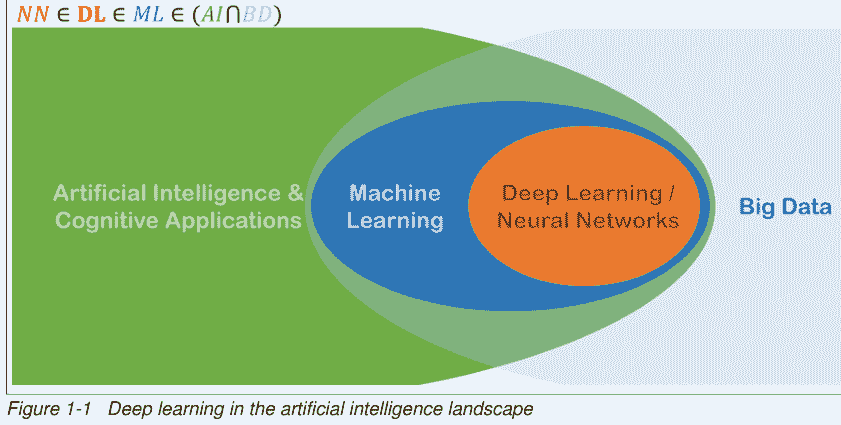

### 1.1.1 人工智能里程碑与深度学习的发展

深度学习表明，DL 的历史上有三个时代：

- 1940 年代-1960 年代：控制论
- 1980 年代-1990 年代：连接主义
- 2006 年至今：深度学习

这三个时代表明 DL 是一门根源于计算机科学初期的成熟学科，在其历史过程中受到趋势的影响。历史表明，每一波浪潮都是由那个时代的某些发展推动的。

| 日期 (公元) | 人工智能 | 机器学习 | 深度学习 |
|---|---|---|---|
| 1943 | McCulloch 和 Pitts 对图灵完备神经元的正式设计是第一篇涵盖 AI 主题的论文。b 这篇文章标志着生物学习理论理论发展的开始。 | | |
| 1956 | AI 研究领域在达特茅学院的一次研讨会上诞生了。 | | |
| 1958 | Frank Rosenblatt 发明了感知器算法，c，使得单个神经元的训练成为可能。 | | |


| 日期（公元） | 人工智能 | 机器学习 | 深度学习 |
|---|---|---|---|
| 1965 | | | Ivakhnenko 和 Lapa 发表了第一种用于监督、深度前馈和多层感知器（MLP）的通用工作学习算法。d |
| 1980 | 专家系统的商业化应用增加。 | | |
| 1986 | | | Rina Dechter 引入了“深度学习”这一术语。e |
| 1986 | | | Rumelhart 等人提出了反向传播算法f，通过一个或两个隐藏层来训练神经网络。 |
| 1990 | | 一种简单的 ML 算法可以判断是否建议进行剖宫产。g | |
| 1990s | | 随着数字化信息可用性的增加，机器学习学科得到了蓬勃发展。 | |
| 1997 | IBM 深蓝号击败了现任国际象棋冠军加里·卡斯帕罗夫。 | | |
| 2000 | | | Igor Aizemberg 等人创造了“人工神经网络”这一术语。h |
| 2005 | | | Gomez 和 Schmidhuber 发表了一篇建立强化学习概念的论文。i |
| 2006 | | | Hinton 等人在深度神经网络的背景下引入了监督反向传播的概念。 |
| 2010 | | IBM Watson 在《危险一答》节目中击败了人类选手。l | |
| 2015 | | | AlphaGo 击败了现任世界冠军。k |

- a. https://www.cs.virginia.edu/robins/Turing_Paper_1936.pdf
- b. https://www.cs.cmu.edu/epxing/Class/1075/reading/McCulloch.&Pitts.pdf
- c. https://citeseer.ist.psu.edu/vedoc/download?doi=10.1.1.335&3398=rep&type=pdf
- d. Ivankhenko, A. G., "Cybernetic Predicting Devices," IBM Information Corporation, 1973
- e. https://www.aaai.org/AAAI/1986/AAAI86-029.pdf
- f. https://www.ifr.unmontreal.edu/~ub3386/lectures/backup_old.pdf
- g. https://nci.nlm.nih.gov/pubmed/2342742
- h. Aizemberg, et al., "Multi-Valued and Universal Binary Networks: Learning, Theory, and Applications." Springer Science & Business Media, 2000
- i. http://people.idsia.ch/~tino/papers/goomez.gecco05.pdf
- j. http://citeseer.ist.psu.edu/download?doi=10.1.1.99.2714&rep&type=pdf
- k. https://www.nature.com/articles/nature16961

## 1.2 神经网络概述

### 1.2.1 神经网络历史

本节介绍了神经网络。

人工神经网络已经存在一段时间了，并随着时间的演变。今天，神经网络在 AI 领域发挥着重要作用，正如第 6 页 1.2.2 节“为什么神经网络是一个重要的课题”所述。

根据 Yadav 的说法，神经网络的历史被分为四个大时代，从 1940 年代开始，1943 年发表了第一篇关于该主题的文章。它发现神经网络可以创建出类似于大脑的学习方法，这是创建学习算法的一种非常有前景的方法。

1950 年代和 1960 年代的标志是第一台神经计算机机，它被称为 Snack，由 Marvin Minsky 于 1951 年创造。这些年之所以被称为神经网络的黄金时代，是因为第一台成功的神经计算机出现，改变了我们今天所知的方向。这台神经计算机是由 Frank Rosenblatt、Charles Wightman 等人于 1957-58 年创建的。

遗憾的是，到 1960 年代末，神经网络遭受了困难，因为大多数研究人员所使用的实验数据在现实场景中并不适用。

在 1970 年代，研究人员继续在适应处理、生物建模和模式识别领域进行实验。许多开始这些工作的科学家在约十年后成为了负责复兴神经网络领域的人。

> Yadav, et al, "History of Neural Networks. In: An Introduction to Neural Network Methods for Differential Equations", Springer Briefs in Applied Sciences and Technology, Springer, Dordrecht, 2015

第 1 章 人工智能与深度学习引论 5

在 1980 年代，在多年的研究之后，开始提交专注于神经计算机和神经网络的新提案。1983 年和 1986 年，一位名为 Hopfield 的物理学家参与了其中并发表了论文。

### 1.2.2 为什么神经网络是一个重要的课题

大多数神经网络是一个重要的课题，因为它们可以处理复杂的数据。图 1-2 显示了从 1950 年代到现在的的发展过程。图 1-2 显示了从 1950 年代到现在的的发展过程。

### 1.2.3 神经网络的类型及其用途

神经网络有不同的类型或架构。本节介绍了基础知识并简要回顾了主要架构。

神经网络的灵感来源于突触结构及其传递和处理信号的方式。通过使用这种结构作为基础，科学家可以实现一种新的数据处理方法，其中不同的简单元素（神经元）构成更大、更复杂结构（神经网络）的一部分，能够执行更复杂的任务。

在这种情况下，神经网络是一种人工结构，由人工神经元组成，这些神经元排列成具有特定专业化分层。某一层中的神经元接收来自上一层的输入，对其进行处理（即对输入信号进行加权以生成输出信号），并将结果传递给下一层的相邻神经元。

图 1-5 显示了人工神经元如何接收多个输入，并根据函数 `f(S)` 对其进行处理，产生传播到下一层的输出。

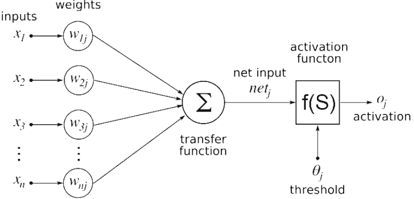

图 1-5 神经元中的信号处理

网络期望某些值作为输入，因此必须有输入神经元。所有的神经网络都有输出，因此也必须有输出神经元。

输入神经元的集合称为输入层，输出神经元的集合称为输出层。在脑中，有多个神经元相互通信并通过它们传递信息；在人工神经网络中，输入层和输出层之间存在神经元，统称为隐藏层。接下来的章节将描述隐藏层。

图 1-6 展示了一个具有一个隐藏层和八个神经元的简单神经网络。

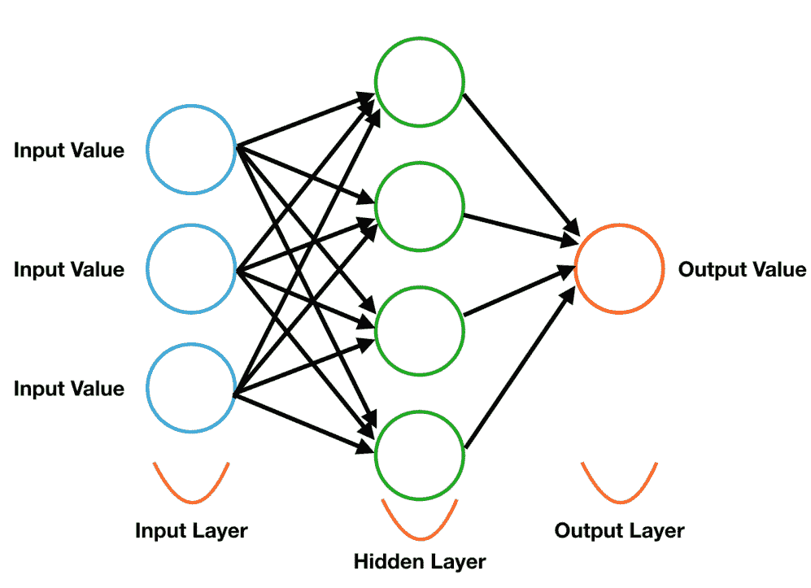

图 1-6 简单的前馈神经网络

在定义好神经网络结构后，你会在每个训练步骤后调整每个神经元的权重，以符合提供的标签。对于每种类型的神经网络，都有特定的行为和训练及处理其神经元权重与偏置的方法。下节概述了最常见的神经网络架构。

### 1.2.4 神经网络架构

本节描述了一些最常见的神经网络架构。

#### 前馈神经网络

前馈神经网络（FFN）是最常见的神经网络架构之一。数据进入输入层，并通过隐藏层向前传播，直到到达输出层，并根据其训练得出的值输出值。

FNN 使用反向传播算法进行训练。基本上，对于每个输入，都会向神经网络提供一个期望值，并将输出与该值进行比较。期望值与神经网络交付的值之间的差异（可以是均方误差或其他代价函数）随后会反向传播到所有神经元，并使用优化算法调整每个神经元的权重，旨在减少发现的误差。

这一过程会按照训练阶段定义的轮次（epochs）次数进行，直到错误率收敛，而收敛点由数据科学家决定。

关于 FFNN 的更多信息，请参阅 Rosenblatt⁵ 写的《感知机：一种用于脑部信息存储和组织的概率模型》。

#### 循环神经网络

循环神经网络（RNNs）使用序列信息。在 FFNN 中，输入和输出之间是相互独立的。RNN 的不同之处在于，它们需要知道之前的输入来理解序列，并对该序列提出建议。RNN 之所以是循环的，是因为它们对特定序列中的每个元素通过相同的处理（层）。在某种意义上，RNN 存储了到目前为止计算的数据。

RNN 有两种输入：新输入（也称为当前值）以及通过反馈循环将之前的决策返回到隐藏层神经元的“近期过去状态”。这些输出结合在一起产生一个新值。

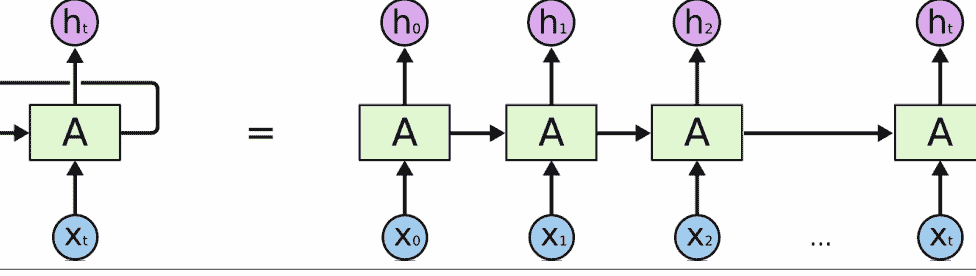

图 1-7 循环神经网络的工作原理

RNN 用于许多领域，例如自然语言处理（NLP）领域，因为你需要知道句子中单词的顺序才能执行诸如预测下一个单词或理解句子语义内容等操作。RNN 还允许创建语言模型，用于生成文本或辅助词汇建议以及语言转换算法。

这种网络模型的局限性之一是它只能记住短序列，无法输出基于长序列开头输入的输出值。这种局限性通过 RNN 的一种变体——长短期记忆网络（LSTM）得到了解决，该变体在第 12 页的《长短期记忆》中有所描述。

欲更多信息，请参阅 Elman 写的《发现时间中的结构》。

> http://citeseer.ist.psu.edu/viewdoc/download?7doi=10.1.1.335.3398&rep=repl&type=pdf

第 1 章 人工智能与深度学习引论 11

#### 长短期记忆

LSTM 网络是 RNN 的特定类型。LSTM 更加健壮，旨在解决经典 RNN 的局限性。LSTM 存储长期记忆，并可以就序列中很久之前的信息提供相关输出。

通过 LSTM，可以在循环的多个步骤中保留误差生成，使得 RNN 能够利用远处的输入持续学习。这种行为使神经网络能够建立关系并指出遥远区域的连接。

通过使用所谓的“门”（gates），流经网络的信息可以存储在每个单元中。这些“门”负责使用 sigmoid 函数决定是保留、修改还是删除信息。

使用这种类型的网络，可以进行理解和推理，并应用于手写识别和音乐等领域。

欲更多 LSTM 信息，请参阅 Hochreiter 和 Schmiduber⁶ 写的《短期记忆》。

#### 卷积神经网络

卷积神经网络（CNNs）因其在图像识别和分类方面的卓越表现而变得流行。CNN 可以识别图像中的不同物体并知道它们所在的位置。

在 CNN 中，有一些对其工作至关重要的基本操作：

- 卷积阶段通过创建一个滤波器（或内核）从输入对象（通常是图像）中提取特征，滤波器逐个通过该对象，执行元素乘法，并将结果求和放入一个新的较小的矩阵中，该矩阵称为特征图。在简单的灰度图像（数值矩阵）中，想象滤波器是一个应用于原始矩阵左上角的较矩阵，向右移动一个像素开始计算，直到滤波器覆盖整个矩阵。

> ⁶ https://crl.ucsd.edu/~elman/Papers/fsit.pdf

图 1-8 和图 1-9 展示了这一过程。

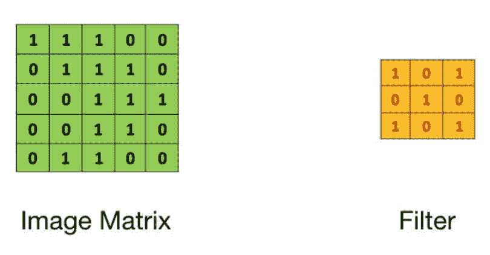

图 1-8 图像像素矩阵（简化）与滤波器

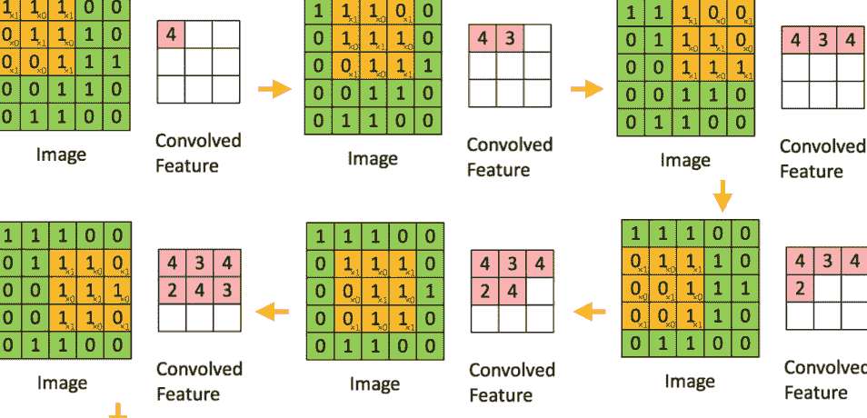

图 1-9 卷积过程示例

第 1 章 人工智能与深度学习引论 13

滤波器在 CNN 训练之前是随机初始化的，在训练过程中，它会被调整，其大小由设计 CNN 的人员根据需求定义。

在卷积之后，有必要对结果添加非线性，因为大多数数据和应用是非线性的，而卷积过程产生的是线性结果。在图 1-10 中，通过使用称为修正的线性单元（ReLU）的操作，所有的负像素都被转为 0。

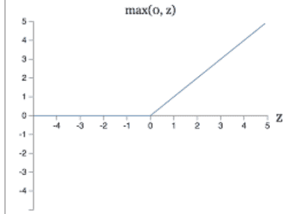

图 1-10 修正线性单元图

- 下一个阶段是池化（pooling），它减少卷积阶段生成的特征图的维度，并对上一个阶段进行修正。这一过程被称为下采样。尽管维度降低了，最重要的信息被保留了下来。

有不同的池化方法，例如提取特定组的平均值或获取最大数值。这个过程类似于卷积过程，在卷积过程中定义一个特定区域，然后在其上移动（不重叠），并保留最大数值（在最大池化场景下），如图 1-11 所示。

| 1 | 0 | 3 | 6 |
|---|---|---|---|
| 2 | 4 | 5 | 2 |
| 2 | 6 | 2 | 0 |
| 3 | 4 | 1 | 7 |

图 1-11 最大池化过程示例

- 最后是最后一个阶段：全连接层。这是一个经典的前馈神经网络（FFNN），在输出层具有特定的激活函数（通常是 softmax）。其核心思想是学习并分类在之前阶段提取的特征。它是全连接的，是因为就像 FFNN 中一样，某一层的所有神经元都连接到下一层的所有神经元。

值得注意的是，在到达全连接阶段之前，可以重复卷积、线性整流和池化阶段，以从物体中提取更多特征。

在训练阶段，使用反向传播算法在所有全连接神经元上应用梯度下降，并进入卷积滤波器以调整它们的权重和取值。

## 1.2.5 经典神经网络与深度神经网络的区别

对于“经典神经网络和深度神经网络之间有什么区别？”这个问题的答案非常直观。深度神经网络在架构中包含多个隐藏层，通常甚至多于两个或三个层。

在许多不同的神经网络模型中都可以拥有深度神经网络，例如深层 FFNN 或深度卷积神经网络，如图 1-12 所示。

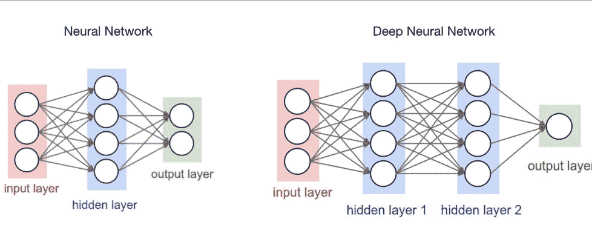

图 1-12 经典网络与深度神经网络的区别

那么，为什么要使用多个隐藏层呢？这样做有什么优势呢？

仅使用一个隐藏层已经证明，根据其生成的误差，它可以近似任何函数。7 然而，关键点在于，在更复杂情况的大多数近似中，单隐藏层网络的准确率并不高于 99%。然而，这种情况可能有许多原因，而且该领域有许多研究和探索，其中一种被尝试并显示出成功结果的方法是使用额外的隐藏层。

在神经网络中添加更多隐藏层可以使其更好地泛化未知数据（不在训练集中的数据）。这一特性至关重要，并对图像和物体识别领域有很大帮助；通过更多的隐藏层，能够以更好的方式识别一组特征。

然而，深度神经网络需要多得的处理能力以及能够达到这些处理水平的强大硬件。

> 7 https://en.wikipedia.org/wiki/Universal_approximation_theorem

## 1.2.6 神经网络与经典机器学习算法

神经网络（除深度学习外）和经典机器学习（ML）都提供了训练模型和分类数据的方法。

如果你拍摄了汽车和摩托车的照片并给任何人类看，你预计他们能够回答哪一个是汽车，哪一个是摩托车。原因是他们在一生中见过很多汽车和摩托车，因此他们知道每种车的特定特征和形状。机器试图通过研究每个对象的特征和行为来学习，并变得像人类一样。然而，机器和人类有时也会识别物体，因为他们不熟悉它们或不知道某些特定细节。

为了让机器对图像进行经典的 ML 分类，你必须手动选择相关特征来训练该特定模型（逻辑回归或其他任何其他）。这些特征可以被模型用于识别和分类图像以训练此类模型，并对进行进行预测。数据（在此例中为图像）必须从之前提取的所有特征中准备好以馈模型。

通过使用神经网络，不需要预先用代码从图像中提取这些特征，你可以直接将图像提供给神经网络（例如，红绿蓝图像层在进入模型之前）。

即使神经网络看起来更有前景，它们需要大量的计算资源和数据集来使模型有效。

当经典机器学习算法，可以在多个分类器中训练模型并检查哪一个产生了

## 1.3 深度学习框架

实现神经网络并不是一项容易的任务，因为它需要许多行代码来创建。这就是深度学习框架发挥作用的地方。它们处理了运行神经网络涉及的复杂性，提供了更高层的 API。

### 1.3.1 最流行的学习框架

有几种深度学习框架，每个都有自己的特点、优缺点。本节介绍并描述了最流行的框架。

#### Caffe

Caffe 是最早的深度学习框架之一，尽管它已经很老了。Caffe 是杨庆在伯克利大学攻读博士期间创建的。Caffe 使用 C++ 开发，并支持 Python。

如今，Caffe 非常稳定，适用于生产环境，但也用于研究。

Caffe 在计算机视觉领域（如图像识别）表现良好，但在其他深度学习领域存在不足。

该框架还通过 CUDA 深度神经网络 (cuDNN) 库支持 GPU。代码可以在 GitHub 上找到。

#### Chainer

Chainer 是一个灵活的框架，能够以简单的方式实现复杂的神经网络架构。

Chainer 实现了“定义即运行”（Define-by-Run）方法，这意味着 Chainer 创建的网络是在运行时定义的。这种方法类似于在任何语言中编写 FOR 循环，它在网络中的运行方式与在普通代码中相同。

该框架使用 Python 开发，没有其他接口。

#### TensorFlow

TensorFlow 始于 2011 年，最初是 Google Brain 开发的一个名为 DistBelief 的专有系统。由于其在公司各个应用中的成功，Google 专注于改进 DistBelief，随后演变为了 TensorFlow。第一个开源版本于 2017 年发布。

TensorFlow 是著名的框架之一，其使用量随时间推不断增加。它由 Google 赞助，并带有几个实用的功能：

- TensorFlow 采用“定义并运行”（Define-and-Run）方案，编译器会遍历所有代码以创建一个静态图，然后运行它。这种方法的优势在于，在图的构建和执行过程中，TensorFlow 可以优化定义的定义以及运行每项操作的最佳方式。

- TensorFlow 使用 C++ 开发，并提供了 Python 接口。TensorFlow 拥有一个名为 TensorBoard 的趣味功能，这是一个图形用户界面（GUI），你可以用它来可视化你创建的图以及流经其中的数据。

- 该框架支持 GPU 并以分布式模式运行。在“定义并运行”模式下运行会导致灵活性不足，因为图是静态的，但它也能以更好的方式将代码分发到不同的节点，确保图可以被传输，并在所有 GPU 上等同运行。

#### Theano

Theano 是一个类似于 TensorFlow 的数值计算库。它的开发始于 2007 年的蒙特利尔大学，因此它是较老的框架之一。它用 Python 开发，这是唯一支持的接口。


与 TensorFlow 类似，Theano 也采用“定义并运行”方案，在编译期间先构建图，然后在运行时让过程流经图。Theano 支持 GPU 工作并可以以分布式模式运行。

尽管该框架已经稳定并准备好投入生产，但在 2017 年 9 月，开发团队宣布 Theano 在发布版本 1.0¹² 后将停止开发。在编写本文时，Theano 的未来尚不为人知。Theano 是开源的，因此它的开发可能会在新的管理下继续进行。

# Torch 和 PyTorch

尽管这两个框架看起来相似且具有相同的 C/C++ 引擎，但它们并不是同一个东西。

Torch 先问世，其核心引擎用 C/C++ 开发，并提供 Lua 和 LuaIT 作为其脚本语言的接口。Torch 由 Facebook、Twitter 和 Google 的研究团队开发。

PyTorch 由 Facebook 开发并于 2017 年发布。PyTorch 的主要目的是让 Torch 支持 Python 接口，因为 Lua 是一种在研究人员和开发者中并不常用的语言。尽管这是主要目的，但 PyTorch 的设计方式使得 PyTorch 紧密集成到用 C 开发的 Torch 核心引擎，改进了内存管理和优化。

PyTorch 采用类似于 Chainer 的“运行即定义”（Defined-by-Run）方案，可以在其他速度上运行，且使用 GPU 运行并不困难，并具有多个预训练模型。

> ¹² https://groups.google.com/forum/#theano-users/PouqGBZubbt/rNCfeAEAWJ

## 1.3.2 关于深度学习框架的最后结语

并不存在一种所谓的“大能百全”（bcm）框架。框架的选择取决于你的需求和应用场景。从高层次来看，PyTorch 和 TensorFlow 一直在成长并成为全能（fit-all）框架。Caffe 已经存在了一段时间，它非常稳定且适用于生产，但它专门用于计算机视觉。Theano 是稳定的，是最古老的框架之一，可能会消失，除非你已经有了 Theano 的实现，否则在在使用该框架启动项目之前，你应该仔细分析它。Chainer 拥有大量的文档，是 PyTorch 的灵感来源，并且看起来很有前景，但增长速度没有 TensorFlow 快。

本章提到的框架都由 IBM PowerAI 支持，并针对在 IBM Power Systems 机器上的运行进行了优化。

# IBM PowerAI 介绍与概述

本章提供了关于 IBM PowerAI 的介绍性信息。

本章包含以下主题：

- 什么是 IBM PowerAI
- 为什么 IBM PowerAI 简化了深度学习的采用
- IBM PowerAI 的独特特性

## 什么是 IBM PowerAI

IBM PowerAI 是一个用于深度学习（DL）的软件包，它包含了多种深度学习框架，以及用于人工智能（AI）系统训练和运行的企业级软件。IBM PowerAI 能够利用 NVIDIA GPU 进行加速，并且在 POWER8 和 POWER9 架构上运行。

IBM PowerAI 包含了以下深度学习框架：

- TensorFlow
- Caffe
- Chainer
- Theano
- 以及相关的库，如 cuDNN

## 2.1 IBM PowerAI 的内容

IBM PowerAI 软件包包含了多个版本，并在 2.1 发布了 4.0 版本。

### 2.1.1 IBM PowerAI 的内容

IBM PowerAI 软件包包含了多个版本，并在 2.1 发布了 4.0 版本。

表 2-1 IBM PowerAI 软件栈

| IBM PowerAI 软件栈（基础） | |
| :--- | :--- |
| 深度学习框架 | |
| 核心 | TensorFlow |
| 其他框架 | Caffe |
| Chainer | Torch |
| Theano | |
| 库 | DIGITS |
| 分布式 DL | OpenBLAS | Bazel |

### 2.1.2 IBM PowerAI 的最小硬件要求

IBM PowerAI 可以运行在 POWER8 上。然而，为了运行，IBM 建议的配置：

- POWER8 CPU
- 128 GB 内存
- 带有 NVLink 的 NVIDIA Tesla P100 或 V100

> “注意：IBM PowerAI 的指南可以在 readme 文件中找到。”

此外，如果你想下载以前版本的特定版本，可以从存档中下载。该网站提供了以下版本的下载链接：

- 版本 3.0
- 版本 3.1
- 版本 3.2
- 版本 3.3
- 版本 3.4
- 版本 4.0

> **提示：** 你可以在第 58 页查看 3.2 的“IBM PowerAI 兼容性矩阵”。

## 2.2 为什么 PowerAI 简化了深度学习

今天，组织正使用 DL 开发多种模式的能力，从计算机视觉和目标检测，到通过自然语言处理（NLP）改进人交互，再到复杂的异常检测能力。任何 DL 用例的核心都是复杂的模式识别和分类能力。然而，当组织尝试扩展其 DL 领域或开始开发 DL 时，面临着巨大的困难，特别是由硬件限制引起的性能问题，以及每个框架设置、调优等耗时过程。

2016 年第四季度，IBM 宣布了 IBM PowerAI 的重大更新，旨在解决开发者和科学家面临的一些挑战。目标是缩短人工智能（AI）系统训练所需的时间，使用企业级 DL 和 AI 软件进行运行。IBM PowerAI 的理念是拥抱并扩展开源社区，扩展那里发生的能力和创造力，并添加 IBM 独特的能力。这种情况体现在 IBM Power Systems 为 AI 带来的许多差异化优势。

IBM PowerAI 提供以下利益：

- 快速部署 DL 环境，以便客户能够立即工作：
  - 安装简单，通常少于 1 小时
  - 预编译的 DL 库，包括所有必要的
- 优化性能使用用户可以更快地获得价值：
  - 为具有 NVLink CPU 和 NVIDIA GPU 的 IBM Power Systems 构建，提供了在其他地方无法实现的性能
  - 分布式 DL，利用并行处理
- 针对企业部署设计：
  - 支持多用户和多业务线（LOB）
  - 通过与其他软件集成实现集中式管理和监控
  - IBM 对整个解决方案的服务和支持，包括开源 DL 框架

## 2.3 IBM 独特能力

本节重点介绍了 IBM 产品和解决方案的独特能力，您可以通过 IBM PowerAI 利用这些能力，包括以下项：

- NVLink 和 NVLink 2.0
- 分布式深度学习 (DDL)
- 大模型深度支持 (LMS)

### 2.3.1 NVLink 和 NVLink 2.0

NVLink 于 2014 年发布，是 NVIDIA 专有的高速、低延迟物理互连技术。NVLink 改进了多个 GPU 之间的传统通信，实现了 GPU 与系统内存之间高效且高性能的通信。此外，NVLink 为系统 CPU 和 GPU 之间提供了更高性能、更高效的通信。

第一代 NVLink 是基于 Pascal 微架构的 NVIDIA GPU 实现的。它提供了比行业标准的外围组件互连 (PCIe) 接口更高的带宽。NVLink 于 2016 年 9 月随着用于高性能计算的 IBM Power System S822LC 服务器推出首次商用。该型号提供配备 2 个或 4 个 NVIDIA Tesla P100 GPU 的配置。

在此 IBM POWER8 系统中实现的 NVLink 在 GPU 之间提供了高达 180 Gbps 的双向路径，在 GPU 与 CPU 之间提供了高达 80 Gbps 的双向路径。

在配置了多个 GPU 的系统中，NVLink 提供的优势会不断增加并扩展。每增加一个 GPU，都会在它与相邻 GPU 之间以及它与最近的 CPU 之间增加一条独立的互连。

2017 年，NVLink 引入 Volta 微架构，宣布了第二代 NVLink。它提供了高达 300 Gbps 的改进数据速率。基于 POWER9 处理器的用于高性能计算的 IBM Power System AC922 服务器于 2017 年 12 月推出了第二代 NVLink，支持最多六个 NVIDIA GPU 的配置。

> 注意：有关 NVLink 部署和架构的更多信息（包括性能指标），请访问 NVIDIA NVLink 网站。

### 2.3.2 Power AI 分布式深度学习

IBM PowerAI DDL 是一种软硬件协同优化的分布式深度学习系统，可以实现高达 256 个 GPU 的近线性扩展。该算法被封装为名为 DDL 的通信库，为跨多个深度学习框架实现深度学习模式提供通信 API。

分布式深度学习系统的固有挑战是，随着学习者数量的增加，计算量减少的同时，通信量却保持不变。这直观地导致了不理想的通信比例。

为了缓解这种扩展性问题，IBM DDL 使用了一种创新的多环通信算法，平衡了 PowerAI 的通信延迟和通信影响。该算法适应任何系统中通信带宽的分层结构（节点内、节点间和交互）。这种实现允许自适应，从而使得最优的 IBM PowerAI DDL 能够为特定环境提供支持。

IBM PowerAI DDL 的当前实现基于 IBM Spectrum MPI，这是因为 IBM Spectrum MPI 提供了许多所需功能，例如在可移植、高效且成熟的软件基础设施中调度进程和通信。IBM Spectrum MPI 专门为 IBM Power Systems 和 InfiniBand 网络技术提供了函数和优化。

IBM PowerAI DDL 的`objects()`对象是 IBM PowerAI DDL 的基础。每个对象实例都包含数据和相关的元数据。数据结构组件本身可以包含各种负载，例如梯度张量。元数据提供了主机、设备类型（GPU 或其他）、设备标识符以及数据结构所处内存类型的定义。IBM PowerAI DDL 内的所有函数都于这些对象的操作，这些对象等同于变量。

在 256 个 GPU 环境中，执行一个简单的归约操作必须传输约 90 GB 数据，并且必须传输相同的数据将结果复制到所有 GPU 中。即使是传输速率为 10 Gbps 的快速网络连接将这些数据带到单个参数服务器 (PS)，也需要 9 秒钟。IBM PowerAI DDL 使用针对特定网络拓扑优化的通信方案，在不到 100 毫秒内完成了 350 MB 的整个归约和分。

IBM PowerAI DDL 的一个关键区别在于它能够根据每个可用链路的带宽、拓扑和每个段的延迟来优化通信方案。在具有多种链路速度的异构环境中，IBM PowerAI DDL 会调整维度以使用最快的链路，从而防止最慢的链路主运行时间。

通过在 64 台 IBM S822LC 高性能计算服务器集群上使用 IBM PowerAI DDL，我们证明了 Resnet-101 在 Imagenet 22k 上在约 7 小时内达到了 33.8% 的验证准确率（图 2-1）。相比之下，Microsoft ADAM¹ 和 Google DistBelief² 无法在该数据集上达到 30% 的验证准确率。

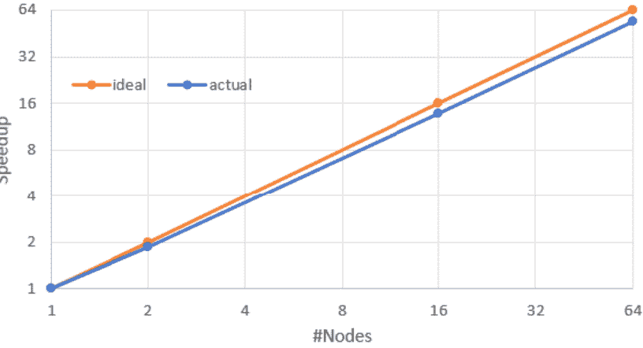

图 2-1 使用最多 256 个 GPU 用于 22 类的 Resnet-101

### 2.3.3 大模型支持

在训练深度学习领域常见的大神经网络时（例如高清图像识别、大批量任务、深层神经网络），可用的 GPU 内存可能是一个重大限制。为了在 IBM PowerAI V1.4 中克服这一挑战，IBM 提供了 LMS，它利用主内存结合 GPU 内存来训练这些大规模神经网络。

LMS 允许您处理和训练无法放入可用 GPU 内存空间的模型。LMS 使用 GPU 内存和快速互连 (NVLink) 来容纳此类大模型，并在每个实例中仅获取工作集，以确保在 GPU 内存空间外以大批量大小运行时实现尽可能快的计算。

为了适应同时占用系统内存和 GPU 内存的模型，LMS 执行了许多 CPU 到 GPU 的拷贝操作。在训练阶段，数据会定期从系统传输到 GPU 内存。为了执行此操作而不产生影响计算时间的延迟，系统需要 CPU 和 GPU 之间的高带宽互连。在 IBM Power Systems 上，LMS 可以利用 NVLink 提供的更高带宽，见第 24 页 2.3.1 节“NVLink 和 NVLink 2.0”。

> ¹Trishul Chilambi, et al. "Project Adam: building an efficient and scalable Deep Learning system", OSDI'14 Proceedings of the 11th USENIX conference on Operating Systems Design and Implementation.\² Dean, et al. "Large-Scale Distributed Deep Networks. Advances in Neural Information Processing Systems (NIPS)", Neural Information Processing Systems Foundation, Inc., 2012.

IBM PowerAI: Deep Learning Unleashed on IBM Power Servers

图 2-2 显示了深度神经网络层之间的连接，并展示了在此规模下训练系统时面临的挑战和固有复杂性，LMS 正试图缓解这些问题。

# 深度神经网络

| 输入层 | 隐藏层 1 | 隐藏层 2 | 隐藏层 3 | 输出层 |
| --- | --- | --- | --- | --- |
| | | | | |
| | | | | |
| | | | | |
| | | | | |
| | | | | |
| | | | | |
| | | | | |

图 2-2 神经网络图

要在 IBM Caffe 中使用 LMS，请在运行时添加以下标志：

```
-lms <单位为 KB>
```

此标志设置了决定哪些内存分配在 CPU 内存中，哪些在 GPU 内存中的阈值大小。例如：

```
-lms 1028
```

使用此参数时，任何大于 1028 KB 的内存块都由 CPU 在主内存地址空间中处理，仅在计算需要时才获取到 GPU 内存。因此，较小的值意味着更积极地使用 LMS 并使用更多的系统内存。然而，较大的值（例如 100,000,000）实际上禁用了 LMS 功能并确保所有块都分配到 GPU 内存。

此参数用于控制性能权衡，因为运行时从 CPU 引入更多数据会导致运行时影响。

在您的环境中使用 LMS 的另一种方法是使用`lms_frac`标志：

```
-lms_frac <0 < x < 1.0>
```

在这种情况下，在 GPU 内存分配达到特定阈值之前，LMS 不使用系统内存来分配数据块。例如：

```
-lms_frac 0.75
```

在可用 GPU 内存分配超过 75% 之前，系统可以为 GPU 分配任何大小的数据块。这种方法的优势在于，您基本上可以禁用 LMS 功能，以更快地训练较小的网络，或者为较大的网络更高效地利用 GPU 内存。

## 为 IBM PowerAI 提供的 2 种额外集成

本节重点介绍了与其他 IBM 产品进行额外集成的可用性，这为您使用 IBM PowerAI 带来了更多收益。本节包含以下产品：

- IBM Data Science Experience (IBM DSX)
- IBM PowerAI Vision（技术预览）
- Spectrum Conductor Deep Learning Impact (DLI)

## 2.1 IBM DSX Data Science Experience

IBM DSX 是一项基于开源框架、库和工具的基础设施，科学家们可以在此开发算法并进行验证、部署，以及与科学家和开发者社区进行协作。IBM DSX 允许数据科学家在他们最喜爱的语言、集成开发环境 (IDE) 和库中开发算法。

2017 年 9 月，IBM 宣布 IBM DSX 可以在 IBM Power Systems 服务器上使用，使数据科学家能够利用 IBM PowerAI 为深度学习负载提供性能优势，如第 29 页的图 2-3 所示。IBM PowerAI 还与 Jupyter notebook 集成，支持 R、Python 和 Scala Spark API，且使用 IBM PowerAI 中的库时不需要单独安装或配置。

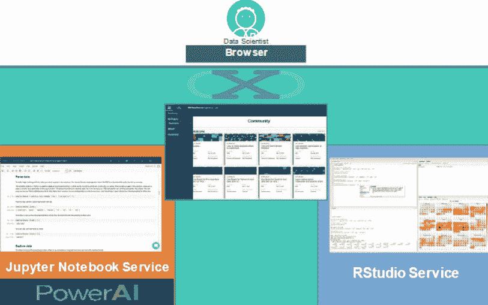

## Power 服务器集群 – GPU / 非 GPU

图 2-3 Power Systems 上的 IBM Data Science Experience 层

尽管 IBM DSX 是一个可以与 IBM PowerAI 集成的软件产品，但其安装方法与本节介绍的另外两个软件产品不同。事实上，IBM DSX 是一个包含 IBM PowerAI 的软件包。在环境中安装 IBM DSX 之后，IBM PowerAI 也已经存在于系统中并准备就绪。

## 系统要求

IBM DSX 本地客户可以选择两种默认安装选项：三服务器集群或九服务器集群。无论服务器数量多少，这两个共同要求如下：

- IBM DSX 本地需要专用服务器（虚拟机 (VM) 或裸机）。
- IBM DSX 本地运行在 RHEL7.3 上

## 三节点集群硬件建议

每台服务器运行控制、存储和计算操作。至少需要三台服务器，每台服务器至少配备 32 个核心、64 GB 内存和 500 GB 附加存储，外额外的 2 TB 辅助存储。

> 截至 2017 年 12 月

第 2 章 IBM PowerAI 简介与概览 29

## 九节点集群硬件建议

以下是九节点集群的硬件建议：

- 至少需要三台服务器运行控制操作。
- 每台必须至少有 8 个核心、16 GB 内存和 500 GB 附加存储。
- 至少需要三台服务器运行存储操作。
- 每台必须至少有 16 个核心、32 GB 内存和 500 GB 附加存储。
- 至少需要三台服务器运行计算操作。
- 每台必须至少有 32 个核心、64 GB 内存和 500 GB 附加存储。

三节点和九节点集群安装是起点。在安装后，可以根据需要添加更多节点。


安装详情请见“安装本地 Data Science Experience”文档。

## 2.4.2 IBM PowerAI Vision（技术预览）

IBM PowerAI Vision 为图像分析提供完整的平台，用于创建数据集、标记、训练模型、验证并部署模型。该工具加快了从原始数据到部署模型的进程，且不会阻碍数据科学家的需求。IBM PowerAI 实现了从图像中快速标记、从视频创建标记数据集，以及对视频流进行自动标记以增强训练数据集，如图 2-4 所示。

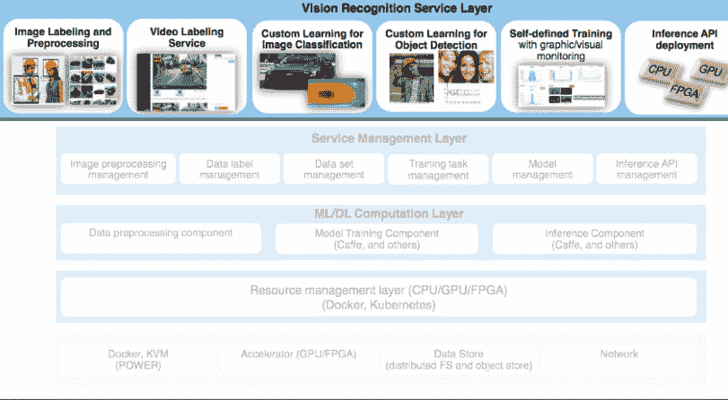

## 硬件前提

以下是 IBM PowerAI Vision 的硬件前提：

- CPU：POWER8 或 OpenPOWER 基础架构，至少有八个硬件核心
- 内存：128 GB 或更大
- GPU：
  - 至少一个 NVIDIA Tesla GPU
  - 单个 GPU 核心的内存大于 4 GB
- 磁盘：大于 20 GB 的可用磁盘空间
- 网络：至少一个以太网接口

## 软件前提

以下是 IBM PowerAI Vision 的软件前提：

- 操作系统：
  - IBM PowerAI V1.4 使用 Ubuntu 16.04 LTS
  - V1.5 使用 Red Hat Enterprise Linux 7.4（架构 `ppc64le`）
- Docker：1.12.0 或更高版本
- 需要 NVIDIA 驱动程序版本 384.59 或更高
- 需要 NVIDIA CUDA 版本 8.0.44 或更高
- 需要 NVIDIA cuDNN 版本 6.0 或更高

有关 IBM PowerAI 的更多信息，请参阅“深度学习”。

## 2.4.3 IBM Conductor Deep Learning Impact

IBM Conductor Deep Learning Impact 是一种端到端解决方案，提供了数据、建模和推理。IBM Conductor Deep Learning 利用 IBM PowerAI 为深度学习负载提供性能优势，如图 2-5 所示。

| 数据 | 建模 | 推理 |
|---|---|---|
| IBM Conductor | IBM PowerAI | IBM PowerAI |
| DLI | IBM PowerAI | DLI |
| IBM Conductor | IBM PowerAI | DLI |
| IBM PowerAI | IBM PowerAI | IBM PowerAI |
| IBM Conductor | IBM PowerAI | DLI |
| DLI | IBM PowerAI | DLI |

图 2-5 Power Systems 上的 Data Science Experience 层

对于属于 IBM PowerAI 的组件，在编写本文时，我们记录了这些组件与特定 IBM PowerAI 版本之间的依赖关系表。

## 3.1.1 IBM PowerAI 支持及 IBM 提供的额外服务

IBM 为 IBM PowerAI 提供可选的 3 级企业级支持，并为客户提供 IBM PowerAI 的部署和优化服务。下节将详细地介绍这些服务。

## IBM 全球技术服务

您可以从各自的 IBM 全球技术服务® 区域产品执行官获取所在地区提供的可用服务，这些服务作为标准或定制方案用于该程序的高效安装、实施和集成。

## 销售支持

技术支持在全球范围内提供，包括 IBM 系统组和 IBM 销售与交付部门的专业人员。资源包括现场技术支持专家（FTSS），他们通过试点、原型和演示为销售机会提供现场支持。额外资源还包括：

- 高级技术技能（ATS）：复杂解决方案设计、解决方案保证、概念验证、早期产品引入以及性能和基准支持
- Techline：售前服务包括系统设计与配置、设计评估、中间件和 SV 规模、服务支持、知识产权、竞争评估以及合作伙伴赋能

有关 IBM 售前支持，请参阅全球技术销售。

## IBM 系统实验室服务

IBM 系统实验室服务为您的企业提供广泛的服务。该团队在来自 IBM 开发社区的当前技术方面拥有专业知识，并帮助您解决最困难的技术挑战。

IBM 系统实验室服务的设立是为了帮助您成功实施新兴技术，从而加速您的投资回报，并提高您对 IBM 系统和解决方案的满意度。服务包括初始实施、集成、迁移以及关于 IBM 系统能力和最佳实践的技能转移。

有关可用服务的更多信息，请联系您的 IBM 代表人或查看 IBM 系统实验室服务。

## IBM Power Systems PowerAI 基础启动服务

IBM 系统实验室服务提供 IBM Systems PowerAI 基础启动服务，这包括实施前的前期设计工作坊，并为客户的 IBM PowerAI 解决方案提供软件硬件基础设施的安装、配置和实施现场协助。

> 注意：请联系您的 IBM 代表人了解所在国家的可用性。

## 3.1.2 用于深度学习的 IBM Power Systems

作为解决方案的主要部分，IBM PowerAI 同时依赖 Power Systems 服务器和 NVIDIA GPU，为 DL 负载提供最大的性能和可靠的解决方案。这是一种软件产品，IBM PowerAI 不包含硬件，但解决方案的运行需要硬件。

## 用于高性能计算的 IBM Power System S822LC（8335-GTB）服务器

用于高性能计算的 IBM Power System S822LC 是运行 DL 负载的选择平台。该服务器受益于 POWER8 CPU 加上 NVIDIA 专用 P100 GPU，以支持高需求负载，例如训练阶段典型的 DL 负载。

用于高性能计算的 IBM Power System S822LC 是与 OpenPOWER 合作伙伴 NVIDIA、Mellanox 和 Wistron 合作设计的，用于跟踪高性能和技术计算负载。这是第一个将 NVIDIA NVLink 技术整合到处理器技术的服务器。更多信息请参阅 NVIDIA NVLink 网站。

该系统旨在为使用 GPU 加速的负载提供最高性能和最高效率，包括 CFD 和分子建模应用。GPU 加速广泛用于机器学习（ML）和认知负载。

该系统支持最多四个 NVIDIA Tesla P100 GPU，这些 GPU 通过 NVIDIA NVLink 连接。每个节点可以处理多达 1 TB 的 DDR4 内存，支持 Mellanox 100 Gbps（增强数据速率（EDR））InfiniBand 适配器进行互连。大型集群可实现节点之间的高速互连。

该系统还包括以下项目：

- 选择气冷或水冷型号以获得更高的热效率
- 选择基于 NVMe 的存储设备以获得更高的性能
- 使用 Mellanox ConnectX-4 技术的 100 Gbps InfiniBand 适配器

对于不受 GPU 加速的计算密集型高性能或技术计算负载，参考 IBM Power System S822LC 技术概述与简介，REDP-5283。

## IBM POWER9 服务器：IBM Power System AC922 服务器

IBM Power AC922 服务器是下一代基于 IBM 处理器的系统，专为 DL、AI 以及高性能计算（HPC）设计。

IBM Power System AC922（8335-GTW 和 8335-GTG）是一种 OpenPOWER Linux 扩展服务器。在两种外形中，这两台服务器提供了 POWER9 单芯片模块处理器，具有最多 40 个处理器核心，并共享 16 个直接附加的 DDR4 内联内存模块 DIMM。支持的内存 DIMM 为 8 - 12 GB。

这些服务器支持带有 NVLink2 接口的 NVIDIA SXM2 外形处理器单元（GPU）。系统还包含四个直接附加的、支持相干加速器处理器接口（CAPI）的 Gen4 外围组件互连 Express（PCIe）插槽。

系统背板上可以安装四到六个 GV100 GPU。

表 3-1 显示了 NVIDIA GV100 GPU 特性。

## 表 3-1 NVIDIA GV100 GPU 特性

| GPU | 双精度浮点峰性能 | 内存带宽 | GPU 内存大小 |
|---|---|---|---|
| Tesla V100 | 7.8 teraflops baseᵃ | 1.2 TBps | 16 GB 或 32 GB |
| a. 这是 NVIDIA 截至 2017 年 11 月的预测。 | | | |

6-GPU 配置为水冷。4-GPU 配置为气冷。

该系统包含以下功能：

- POWER9 处理器：
  - 16 核 2.6 GHz 处理器模块
  - 20 核 2.0 GHz 处理器模块
- 高达 1024 GB 的 2666 MHz DDR4 内存
- NVIDIA Tesla V100 GPU：
  - 基于 NVIDIA SXM2 外形连接器，气冷
- 集成功能：
  - IBM EnergyScale™ 技术
  - 热插拔和冗余冷却
  - 一个用于用途的前置 USB 3.0 端口
  - 一个用于用途的后端 USB 3.0 端口
  - 一个带有 RJ45 连接器的系统端口
  - 两个电源（两者均需要）

# IBM Power System AC922 服务器机型 8335-GTW

本摘要描述了 Power AC922 8335-GTW 型号标准功能：

- 19 英寸机架式（2U）机箱
- 两个 POWER9 处理器：
  - 16 核 2.6 GHz 处理器模块
  - 20 核 2.0 GHz 处理器模块
- 高达 1024 GB 的 2666 MHz DDR4 ECC 内存
- 两个用于 HDD 或 SSD 的 SFF 槽位，支持：
  - 两个 1 TB 7200 RPM NL SATA 硬盘（#ELD0）
  - 两个 2 TB 7200 RPM NL SATA 硬盘（#ES6A）
  - 两个 960 GB SATA SSD（#ELS6）
  - 两个 1.92 TB SATA SSD（#ELSZ）
  - 两个 3.84 TB SATA SSD（#ELU0）
- 集成 SATA 控制器
- 两个 PCIe x16 Gen4 低配置插槽（Low Profile），支持 CAPI
- 一个 PCIe x8 Gen4 低配置插槽，支持 CAPI
- 一个 PCIe x4 Gen4 低配置插槽
- 四块 NVIDIA Tesla V100 GPU（#EC4J），基于 NVIDIA SXM2 形式因子连接器，水冷
- 集成功能：
  - IBM EnergyScale 技术
  - 热插拔和冗余冷却
  - 一个用于用途的后端 USB 3.0 端口
  - 一个带有 RJ45 连接器的系统端口
  - 两个电源（两者均需要）

表 3-3 显示了支持 NVIDIA GPU 以及 NVLink 或 NVLink2 总线的 IBM 服务器列表。配备 NVLink CPU 和 NVIDIA GPU 的 IBM Power Systems 服务器支持 IBM PowerAI。

## 表 3-3 支持 NVIDIA GPU 的 IBM Power Systems 服务器

| 名称 | 类型-机型 | CPU | NVLink | NVIDIA GPUs |
| --- | --- | --- | --- | --- |
| 用于高性能计算的 IBM Power System S822LC | 8335-GTB | POWER8 | | 标准配置：2 或 4 个 Tesla P100 GPU |
| IBM Power System AC922 | 8335-GTW | POWER9 | NVLink2 | 标准配置：6 个 Tesla V100 GPU（水冷）。可选配置：4 个 Tesla V100 GPU（水冷） |
| | 8335-GTG | | | 标准配置：4 个 Tesla V100 GPU（风冷）。可选配置：2 个 Tesla V100 GPU（风冷） |

## 3.1.3 用于深度学习的 PowerAI 上 Linux

IBM PowerAI 构建在 Power 之上。IBM PowerAI 受益于 Power 平台的性能和可靠性以及 Linux 开源模型。在撰写本文时，IBM PowerAI 的不同发布版本支持两个 Linux 发行版，如表 3-4 所示（尽管操作系统并不是 IBM PowerAI 的一部分）。

## 表 3-4 IBM PowerAI 支持的操作系统

| PowerAI | Linux | 额外要求 |
| --- | --- | --- |
| V1.3 | Power 版 Ubuntu 16.04 | Linux 内核：4.4 额外包：>= libc6 2:23-ubuntu5 额外仓库：Updates |
| V1.3.1 | | |
| V1.3.2 | | |
| V1.3.3 | | |
| V1.3.4 | | |
| V1.4.0 | | |
| V1.5.0 | 用于 POWER8 的 RHEL 7.4 / 用于 POWER9 的 RHEL 7.4 | 额外仓库：可选 EFEL |

a. 在安装 Ubuntu 16.04 后，将 `libc6` 包更新到 2.23-ubuntu5 或更高版本。该版本解决了 Torch 和 TensorFlow 的问题。你可能需要启用更新仓库以安装此更新。

# 用于 IBM POWER8 的 Ubuntu 16.04 LTS（ppc64le）²

Ubuntu for POWER8 为 IBM POWER8 引入了 Ubuntu 服务器和 Ubuntu 基础设施。Ubuntu 16.04 继续为 POWER8 提供快速创新支持，包括对新的 POWER8 型号、内存和热插拔（Hot Plug）、Docker 以及性能的支持。更多信息请参见 [Ubuntu Server Guide]。

# 用于 IBM POWER 的 Red Hat Enterprise Linux

从 Red Hat Enterprise Linux 7.1 开始，Red Hat 为 Power Systems 的大端和小端版本提供了单独的许可。用于 Power LE（POWER9）的 Red Hat Enterprise Linux 7.4 引入了更新的内核。Red Hat Enterprise Linux 7.4 取决于 CPU 架构，因此更适合 POWER8 和 POWER9 处理。有关用于 POWER 的 Red Hat Enterprise Linux 的更多信息，请参阅 [Red Hat Enterprise Linux 7.4 for Power LE - Release Notes] 和 [用于高性能计算的 Power System S822LC]。

## 3.1.4 NVIDIA GPUs

在涉及深度学习（DL）的计算方面，GPU 是高效的。与 CPU 不同，GPU 的设计和优化是为了执行矩阵和向量运算，这是深度学习的核心，特别是在训练任务（最密集的任务）中。IBM PowerAI 依赖于 IBM 架构（以其韧性和 SMT 能力著称），以及 NVIDIA GPU 和 NVLink 技术，如表 3-6 所示。

表 3-5 显示了 CPU 和 GPU 的主要区别。

| GPUs | CPUs |
| --- | --- |
| 数百或数千个简单的核心 | 少数复杂的内核 |
| 数千个并发线程 | 单个或少量线程 |
| 最大化浮点吞吐量 | 不适用 |
| 用于集成浮点单元的芯片表面 | 用于 ILP 的晶体空间 |

表 3-6 NVIDIA GPUs

| 组件 | Tesla V100 | Tesla P100 |
| --- | --- | --- |
| GPU | GV100 | GP100 |
| 架构 | Volta | Pascal |
| CUDA 核心 | 5376 | 3840 |

² `ppc64le` 是随 POWER8 引入的纯小端，旨在为 OpenPower Foundation 提供的 x86 Linux 软件提供最小工作。

| 组件 | Tesla V100 | Tesla P100 |
| --- | --- | --- |
| Tensor 核心 | 640 | N/A |
| 核心频率 | 未公布 | 1328 MHz |
| 睿频频率 | 1455 MHz | 1480 MHz |
| SM | 84 | 60 |
| 内存 | HBM2 | |
| 内存位宽 | 4096-bit | |
| 内存带宽 | 900 Gbps | 600 Gbps |
| 共享内存 | 128 KB，可配置 | 24 KB L1，64 KB |
| L2 缓存 | 5 MB | 4 MB |
| 半精度 | 30 teraflops | 21.2 teraflops |
| 单精度 | 15.7 teraflops | 10.6 teraflops |
| 双精度 | 7.8 teraflops（1/2 速率） | 5.3 teraflops（1/2 速率） |
| 用于 DL | 125 teraflops | N/A |
| 芯片尺寸 | 815 mm² | 610 mm² |
| 晶体管数量 | 21.1 x 10⁹ | 15.3 x 10⁹ |
| TDP | 300 W | |
| 制造工艺 | TSMC 12 nm FFN | TSMC 16 nm FinFET |

## 3.1.5 NVIDIA 组件

为了正常运行，IBM PowerAI 需要访问 NVIDIA GPU 和 NVLink 技术提供的所有功能。为了实现这种访问，需要 NVIDIA 驱动程序、CUDA 和 CUDA 深度神经网络（cuDNN）软件，由于与 NVIDIA 的许可限制，IBM PowerAI 未提供这些软件。这些组件可以从供应商网页下载（见第 42 页的“NVIDIA 组件”和第 44 页的“NVIDIA 驱动”）。

#### CUDA


CUDA 是一种并行计算平台和编程模型，允许 GPU 加速计算性能。CUDA 广泛释放数据并行计算模型。通常，每个线程在数据的不同元素上执行相同的操作。

数据被分为 1D、2D 或 3D 网格。每个块的形状可以是 1D、2D 或 3D，在当前硬件上可以包含超过 512 个线程。线程块内的线程可以通过共享内存协作。线程块以较小的线程组形式运行，称为 *warps*。

# NVIDIA CUDA Toolkit

NVIDIA CUDA Toolkit 提供用于高性能、GPU 加速应用程序的开发环境。GPU 加速的 CUDA 库实现了多个领域的无缝加速，例如线性代数、图像和视频处理、深度学习和图分析。开发自定义算法时，可以使用常用语言、数值包以及已发布的 API 的集成。表 3-7 显示了支持的 NVIDIA CUDA Toolkit 版本。

**表 3-7 支持的 NVIDIA CUDA Toolkit 版本**

| IBM PowerAI | 最小 | 推荐 |
|---|---|---|
| V1.3.0 | 8.0 | >= 8.0.44 |
| V1.3.1 | | 8.0.44 |
| V1.3.2 | | |
| V1.3.3 | | 8.0.61 |
| V1.3.4 | | |
| V1.4.0 | | |
| V1.5.0 用于 POWER8 | 9.0 | 9.0.176 |
| V1.5.0 用于 POWER9 | | 9.1.85 |

对于更多信息，请参见 CUDA Toolkit。

## NVIDIA cuDNN

NVIDIA cuDNN 库是用于深度神经网络的原始语 GPU 加速库。cuDNN 为标准程序提供了高度调过的实现，例如正向和反向卷积、池化、归一化和激活层。表 3-8 显示了支持的 NVIDIA cuDNN。

**表 3-8 支持的 NVIDIA cuDNN**

| IBM PowerAI | 最小 | 推荐 | NVIDIA cuDNN | 运行时库 |
|---|---|---|---|---|
| V1.3.0 | 版本 | N/A | | 用于 Ubuntu 16.04 POWER8 (Deb) 的 cuDNN v5.1 运行时库 |
| V1.3.1 | 5.1 | | | 用于 Ubuntu 16.04 POWER8 (Deb) 的 cuDNN v5.1 开发者库 |
| V1.3.2 | | | | Power (Deb) 的 cuDNN v5.1 代码示例和用户指南 |
| V1.3.3 | | | | |
| V1.4.0 | 版本 | 6.0.20 | | 用于 Ubuntu 16.04 POWER8 (Deb) 的 cuDNN v6.0 运行时库 |
| IBM PowerAI | NVIDIA cuDNN | | | |
|---|---|---|---|
| 最小 | 推荐 | 运行时库 | |
| V1.5.0 for POWER8 | 版本 7.0 | 7.0.4 | |
| V1.5.0 for POWER9 | | 7.0.5 | |

cuDNN 加速了广泛使用的 DL 框架，包括 Caffe2、TensorFlow 和 Theano。

以下是 cuDNN 的一些关键特性：

- 许多常用类型的正向和反向路径，例如池化、LRN、LCN、批归一化、dropout、CTC、修正线性单元 (ReLU)、sigmoid、softmax 和 Tanh
- 正向和反向卷积例程，包括为卷积神经网络设计的交叉相关
- 长短期记忆 (LSTM) 和 GRU 循环神经网络 (RNN) 以及持久性 RNN
- 4D 张量的任意维度顺序、步长（stride）和子区域意味着可以轻松地集成到任何神经网络实现中
- 张量变换
- 基于上下文的 API，易于多线程

有关更多信息，请参阅 NVIDIA cuDNN。

## 3.1.6 NVIDIA 驱动程序

NVIDIA 驱动程序是帮助操作系统访问 NVIDIA GPU 所有能力的软件。这些驱动程序由 NVIDIA 提供，由于 NVIDIA 的专有策略，它们并不是 IBM PowerAI 发行版的一部分。

### NVIDIA 驱动程序下载

要下载合适的驱动程序（见第 45 页表 3-9），请完成以下步骤：

1. 转到 NVIDIA。
2. 选择 DRIVERS（驱动程序）。
3. 从下拉菜单中选择 ALL NVIDIA DRIVERS（所有 NVIDIA 驱动程序）。
4. 选择手动查找我的 NVIDIA 查找驱动程序：
   a. 产品类型：Tesla
   b. 产品系列：pSeries
   c. 产品：Tesla P100
   d. 操作系统：选择所有操作系统，然后根据您的操作系统选择 Linux POWER8 Ubuntu 16.04 或 Linux POWER8 RHEL。
5. 选择适用于您的 IBM PowerAI 版本的 CUDA 版本，并将语言设置为英语，点击 Search（搜索）。然后，您将进入一个网页，可以在那里下载驱动程序并阅读一些建议和发布说明。

**表 3-9 支持的 NVIDIA 驱动程序**

| IBM PowerAI | NVIDIA 驱动程序 最小 | 推荐 |
|---|---|---|
| V1.3.0 | | >=361.93.03 |
| V1.3.1 | | |
| V1.3.2 | | |
| V1.3.3 | >=361.93.03 | 361.119 |
| V1.3.4 | | 361.121 |
| V1.4.0 | 384.66 | |
| V1.5.0 for POWER8 | 384.81 | |
| V1.5.0 for POWER9 | 387.86 | |

## 3.1.7 IBM PowerAI 深度学习包

IBM 提供了一系列库、框架和若干种定制内容，通过一个方便的元包（meta-package）从 IBM Power 系统中获得最佳性能。这是 IBM PowerAI 的核心，有助于产品的快速且方便的部署。

表 3-10 显示了 IBM PowerAI DL 程序包。

**表 3-10 IBM PowerAI DL 程序包**

| PowerAI | IBM PowerAI DL 包 |
|---|---|
| V1.3.0 | `mdl1-repo-local-1-31bm2_ppc64e.deb` |
| V1.3.1 | `mdl1-repo-local-1-31bm5_ppc64e.deb` |
| V1.3.2 | `mdl1-repo-local-1-31bm7_ppc64e.deb` |
| V1.3.3 | `mdl1-repo-local-3_3_0_ppc64e.deb` |
| V1.3.4 | `mdl1-repo-local-3_4_1_ppc64e.deb`<br>`mdl1-repo-local-3_4_2_ppc64e.deb` |
| V1.4.0 | `mdl1-repo-local-4_0_0_ppc64e.deb` |
| V1.5.0 | `mdl1-repo-local-cuda9.0-5.0-.ppc64e.rpm` |

IBM PowerAI DL 程序包的主仓库位于 Ubuntu 归档中。

## 3.1.8 库

IBM PowerAI 元包中包含了一些库，它们是表 3-11 所示解决方案的一部分。尽管这些许多库并非所有场景下都会使用，但它们是 IBM PowerAI 正常运行的前提。每个 IBM PowerAI 发行版都包含该版本框架所需的库和版本。

**表 3-11 包含的额外库**

| IBM PowerAI | OpenBLAS | NVIDIA 通信库 | Bazel | OpenMPI |
| --- | --- | --- | --- | --- |
| V1.3.0 | N/A | N/A | N/A | N/A |
| V1.3.1 | IBM PowerAI 分布式包的一部分 | 版本 1 | | |
| V1.3.2 | | | IBM PowerAI 分布式包的一部分 | |
| V1.3.3 | | | | |
| V1.3.4 | | | | |
| V1.4.0 | | | | IBM PowerAI 的 |
| V1.5.0 | | | IBM PowerAI 的 | |

a. IBM PowerAI 发布版包含了该框架所需的库和版本。
b. IBM PowerAI 发布版包含了该框架所需的库和版本。

### OpenBLAS

IBM PowerAI 元包中包含了一些库，它们是表 3-11 所示解决方案的一部分。尽管这些许多库并非所有场景下都会使用，但它们是 IBM PowerAI 正常运行的前提。每个 IBM PowerAI 发行版都包含该版本框架所需的库和版本。

### NVIDIA Communications Library

NVIDIA 通信库（NCCL）实现了多 GPU 和多节点通信原语，如 all-gather、all-reduce、broadcast 和 reduce-scatter，这些原语在 PCIe 和 NVLink 上进行了优化。

注意：此库通常读作 "nickel"。

### Bazel

Bazel 是一种能够快速可靠地构建代码的工具。支持构建的任务包括运行编译器和链接器以及组合部署包。

Bazel 是 Google 用于构建软件的工具。

### OpenMPI

OpenMPI 是消息传递接口 (MPI) 项目，结合了来自以下领域的技术和资源：

- 田纳西大学的 FT-MPI
- 洛斯阿拉莫斯实验室的 LA-MPI
- 印第安纳大学的 LAM/MPI
- 斯图加特大学的 PACX-MPI 团队

这些是 OpenMPI 开发团队的创始成员。

OpenMPI 代码三个主要模块：

- OMPI：MPI API 及支持逻辑
- ORTE：开放运行时（后端支持）
- OPAL：开放访问层（OMPI 和 ORTE 使用的工具和胶水代码）

在安装 IBM Caffe 或 TensorFlow 的分布式深度学习 (DDL) 算子之前，卸载任何 `openmpi` 或 `libopenmpi` 包。运行以下命令清除任何配置文件以避免干扰：

```
$ dpkg -l | grep openmpi
$ sudo apt-get purge
```

## 3.1.9 框架

IBM Power 提供了一个易于部署和设置的单一框架，包含了常用的 DL 框架及其依赖项，使用了第 46 页 3.1 部分“库”中描述所需的库。以下章节对包含在任何 IBM Power R3.0 版本中的每个框架进行了简要描述。

### Vision and Learning Center upstream Caffe

Caffe 是一个具有表现力、速度和模块化的框架。它由伯克利人工智能研究院 (BAIR)、伯克利视觉与学习中心 (BLVC) 和社区贡献者开发。

Yangqing Jia⁷ 在于加州大学伯克利分校攻读博士期间创建了该项目。Caffe 根据 BSD 2-Clause许可证发布。表 3-12 显示了适用于 IBM PowerAI 的 Caffe BVLC 版本。

**表 3-12 Caffe 视觉与学习中心版本**

| IBM PowerAI | Berkeley Vision and Learning Center 上游 Caffe |
|---|---|
| V1.3.0 | V1.0.0 rc3 |
| V1.3.1 | |
| V1.3.2 | |
| V1.3.3 | |
| V1.3.4 | V1.0.0 rc5 |
| V1.4.0 | V1.0.0 |
| V1.5.0 for POWER8 | |
| V1.5.0 for POWER9 | 不包含在 IBM PowerAI V1.5 for P9 ESP 中 |

以下是主要优势：

- 拥有大型社区，涵盖视觉、语音和多媒体领域的学术研究项目和工业应用
- 可扩展的代码促进了活跃开发
- 灵活的架构鼓励了应用和创新
- 模型和优化通过配置定义，无需硬编码
- 预训练网络的模型库 Model Zoo⁸

更多信息，请参见 Caffe Berkeley Vision。

### IBM 优化的 Berkeley Vision and Learning Center Caffe

IBM Caffe 是 BVLC/Caffe 的变体，并针对支持 NVLink 的 IBM Power Systems进行了优化。表 3-13 显示了与 IBM PowerAI 使用的 Caffe 版本。

**表 3-13 IBM Caffe 版本**

| IBM PowerAI 版本 | IBM 优化的 Berkeley Vision and Learning Center Rc3 |
|---|---|
| V1.3.0 | V1.0.0 rc3 |
| V1.3.1 | |
| V1.3.2 | |
| V1.3.3 | |
| V1.3.4 | |
| V1.4.0 | V1.0.0 |
| V1.5.0 for POWER8 | |
| V1.5.0 for POWER9 | 不包含在 IBM PowerAI V1.5 for P9 ESP 中 |

> ⁸ http://dapperfs.com/

用于封装 Caffe 模型信息的标准包，外带有向 GitHub Gists 上传/下载模型信息的工具，以及下载 `.caffemodel` 二进制文件的工具。

48 IBM PowerAI：在 IBM Power 系统服务器上释放深度学习潜力

除了 BVLC Caffe 提供的所有功能和能力外，IBM 优化的 BVLC Caffe 还提供了额外优势：

- 此编译版本由 IBM Power 系统工程师优化，专为在 Power Systems上运行，因此对 POWER 处理器进行了高度优化。
- 作为与 NVIDIA 合作的一部分，此编译版本针对 NVIDIA GPU 也进行了优化（包括 NVCAaffe 包含的许多优化）。
- 包含对大模型支持 (LMS)。

更多信息，请参阅 GitHub - open-power-ref-design/deep-learning。

### NVIDIA 的 Caffe 分支

NVIDIA Caffe 是由 NVIDIA 维护的 BVLC Caffe 分支，针对 NVIDIA GPU 调整，特别是在多 GPU 配置下。表 3-14 显示了适用于 IBM PowerAI 的 NVIDIA Caffe 版本。

**表 3-14 NVIDIA Caffe 版本**

| IBM PowerAI 版本 | Caffe 的 NVIDIA 分支 | | |
|---|---|---|---|
| V1.3.0 | 备用 | 默认 | |
| | V0.14.15 | | |
| V1.3.1 | | | |
| | V0.15.13 | | |
| V1.3.2 | | | |
| V1.3.3 | | | |
| V1.3.4 | | V0.15.14 | |
| V1.4.0 | | V0.15.14 | |
| V1.5.0 | 已弃，不再是 IBM PowerAI 的 | | |

以下是主要特性：

- 支持 16 位（半精度）浮点训练和推理。
- 混合精度支持，可以 64 位、32 位或 16 位格式存储和计算数据。可以为每一层定义精度（前向和反向传播可能不同），也可以为整个网络设置精度。
- 与 cuDNN v6 集成。
- 自动选择最佳的 cuDNN 卷积算法。
- 与 NCCL 库版本 1.3.4 集成，以提高多 GPU 扩展。
- 针对数据和参数存储、I/O 缓冲区以及卷积层工作空间优化的 GPU 内存管理。
- 并行数据解析器和转换器，提高 I/O 性能。
- 多 GPU 系统上的并行反向传播和梯度归约。
- 使用融合 CUDA 内核（fused CUDA kernels）进行权重和历史更新的快速求解器。
- 多 GPU 测试阶段，在多个 GPU 之间实现内存负载均衡。
- 兼容早期版本的 BVLC Caffe 和 Caffe 0.15。
- 扩展的优化模型集（包括 16 位浮点示例）。

更多信息，请参阅 GitHub - NVIDIA/Caffe: 一个快速的深度学习开放框架。

### Theano

Theano 是一个 Python 库，你可以它高效地定义、优化和评估涉及多维数组的数学表达式。计算使用类似于 NumPy 的语法表示，并被编译为在 CPU 或 GPU 架构上高效运行。

**表 3-15 IBM PowerAI 支持的 Theano 版本**

| IBM PowerAI 版本 | Theano |
|---|---|
| V1.3.0 | V0.8.2 |
| V1.3.1 | |
| V1.3.2 | |
| V1.3.3 | |
| V1.3.4 | V0.9.0 |
| V1.4.0 | |
| V1.5.0 | 已弃，不再是 IBM PowerAI 的 |

更多信息，请参阅 GitHub - Theano 和 Torch。

### Torch

Torch 是一个开源机器学习库、科学计算框架以及基于 Lua 语言的编程语言。通过 LuaJIT 提供了深度学习算法。

**表 3-16 IBM PowerAI 支持的 Torch 版本**

| IBM PowerAI 版本 | Torch |
|---|---|
| V1.3.0 | V7 |
| V1.3.1 | |
| V1.3.2 | |
| V1.3.3 | |
| V1.3.4 | |
| V1.4.0 | |
| V1.5.0 | |

> 7 https://www.lua.org/

Torch 是深度学习系统的支持。

### Deep Learning System

深度学习系统 (DIGITS) 提供了一个用于训练神经网络的工具，可以通过 Web 浏览器进行访问。表 3-17 显示了适用于 PowerAI 的 DIGITS。

**表 3-17 深度学习系统版本**

| IBM PowerAI 版本 | DIGITS |
|---|---|
| V1.3.0 | N/A |
| V1.3.1 | Version 5.0.0-rc.1ᵃ |
| V1.3.2 | |


# DIGITS 与深度学习框架

DIGITS 能够轻松可视化网络并快速比较准确率。在训练完成期间，DIGITS 显示训练状态和准确率。

Caffe 和 Torch 都用于 DIGITS 的图像分类。表 3-18 显示了 Torch + DIGITS 的前提条件。

## 表 3-18 Torch + DIGITS 的前提条件

| IBM PowerAI 版本 | 前提条件 |
|---|---|
| V1.3.0 | N/A |
| V1.3.1 | `libhdf5-serial-dev libmdb-dev` |
| V1.3.2 | (+ extra luarocks)ᵃ |
| V1.3.3 | |
| V1.3.4 | N/A |
| V1.4.0 | |
| V1.5.0 | |

ᵃ. 使用 Torch DIGITS 需要 IBM PowerAI 3.1 发行版未包含的额外包。参见第 52 页的步骤 1-3。

要让 Torch 工作，请完成以下步骤：

1. 安装 IBM PowerAI Torch 和 DIGITS 软件包：

   ```
   $ sudo apt-get install digits torch
   ```

2. 安装 Ubuntu 的前提包：

   ```
   $ sudo apt-get install libhdf5-serial-dev liblmdb-dev
   ```

3. 安装 DIGITS 支持所需的额外库：

   ```
   $ source /opt/DL/torch/bin/activate
   $ luarocks install --local --dep-mode=order tds
   $ luarocks install --local --dep-mode=order totem
   $ luarocks install --local --dep-mode=order="https://raw.github.com/deepmind/torch-hdf5/hdf5-0-0.roc kspec"
   $ luarocks install --local --dep-mode=order="https://raw.github.com/Neopallium/lua-pb-master/lua-pb-scm-0-r kspec"
   $ luarocks install --local --dep-mode=order lightningdb 0.98.1-1 LMDB_INDIR=/usr/include/LMDB_LIDIR=/usr/lib/powerpc64le-linux-gnu
   $ luarocks install --local --dep-mode=order
   "https://raw.githubusercontent.com/ngimmel/ncl.torch/master/ncl-scm-1.rockspec
   ```

## 表 3-19 TensorFlow 版本

| IBM PowerAI 版本 | TensorFlow 替代方案 | ddl-tensorflow 推荐 |
|---|---|---|
| V1.3.0 | N/A | |
| V1.3.1 | 版本 0.9.0 | |
| V1.3.2 | 版本 0.12.0 | N/A |
| V1.3.3 | 版本 0.12.0 | 版本 1.0.0 |
| V1.3.4 | | 版本 1.0.1 |
| V1.4.0 | 版本 1.1.0 | 技术预览ᵃ |
| V1.5.0 | 版本 1.4.0 | 0.4.0 |

ᵃ. 用于 TensorFlow 的 DDL 自定义算子。

此版本的 IBM PowerAI 包含了 TensorFlow DDL 自定义算子的技术预览。DDL 自定义算子使用 CUDA 感知的 OpenMPI 和 NCCL 为分布式 TensorFlow 提供高速通信。

在`ddl-tensorflow`包中可以找到 DDL 自定义算子。有关 DDL 和 TensorFlow 算子的更多信息，请参考以下文件：

- `/opt/DDL/ddl/doc/README.md`
- `/opt/DDL/ddl-tensorflow/doc/README.md`
- `/opt/DDL/ddl-tensorflow/doc/README-API.md`

TensorFlow 算子可以轻松启用 Slim 风格的模型用于分布式。该包包含了使用 DDL 启用的 Slim 模型示例，您可以通过运行以下命令访问它们：

```
$ /opt/DDL/ddl-tensorflow/bin/ddl-tensorflow-activate
$ ddl-tensorflow-install-samples <someid>
```

这些示例基于 TensorFlow 模型仓库的特定提交，并进行了细微调整。如果您倾向于从上游克隆而非软件包版本工作，请运行以下命令：

```
$ git clone https://github.com/TensorFlow/models.git
$ cd models
$ git checkout 11833ec646a1fe961def44224860359f0a9alb
$ git revert fc7342b0f47ec5c7a7020202ada48661bd373d
$ cp /opt/ddl-tensorflow/examples/slim/train_image_classifier.py slim/
```

与其他任何框架不同，TensorFlow 可以进行部分子图计算，这涉及对总神经网络的子集进行采样并将其与网络的其余部分分开训练。这也被称为模型并行，允许进行分布式训练。

更多信息，请参阅 TensorFlow and GitHub - TensorFlow。

## 分布式深度学习 TensorFlow

DDL TensorFlow 是一个允许 TensorFlow 将工作负载分发到多个节点上的库。当训练的模型规模增长时，它们可能会达到一个数据集无法放入服务器中单个或多个 GPU 的临界点。在这种情况下，分布式 TensorFlow 架构提供了极大的优势，允许多台服务器支持此工作负载，从而大幅缩短处理时间。

更多信息，请参阅 分布式深度学习 TensorFlow。

## Chainer

Chainer 是一个深度学习（DL）框架，主要由 Preferred Networks 赞助，专注于简单直观地编写复杂架构的灵活性。

Chainer 采用“运行即定义”（Define-by-Run）方案，例如，网络通过实际的前向计算进行动态定义。更准确地说，Chainer 存储的是计算历史而非编程逻辑。这一策略使其能够充分利用 Python 编程的强大。“运行即定义”方案是 Chainer 的核心概念。

表 3-20 显示了 IBM PowerAI 的 Chainer 版本。

## 表 3-20 Chainer 版本

| IBM PowerAI 版本 | Chainer |
|---|---|
| V1.3.0 | N/A |
| V1.3.1 | |
| V1.3.2 | 版本 1.18.0 |
| V1.3.3 | |
| V1.3.4 | 版本 1.20.0.1 |
| V1.4.0 | 版本 1.23.0 |
| V1.5.0 | 已弃用，不再属于 IBM PowerAI 部分 |

更多信息，请参阅 Chainer 和 Chainer 文档。

## 3.1.10 其他软件和功能

本节介绍了其他软件及其功能。

### Python

Python 是扩展性最好的编程语言之一，也是深度学习领域使用最广泛的语言。IBM PowerAI 中包含的大多数框架都支持 Python（以及一些额外的编程语言，如 C 和 Java）。

在编写时，IBM PowerAI 支持的唯一 Python 版本为 V2。IBM 打算在后续版本中包含对 Python 的支持。

更多信息，请参阅 Python。

### Anaconda

从 IBM PowerAI V1.5 开始，以 Red Hat Enterprise Linux 作为操作系统，需要 Anaconda 来分发、更新和安装软件。Anaconda 是 Fedora、Red Hat Enterprise Linux 以及其他其他发行版使用的程序。在安装期间，会识别并配置目标计算机的硬件，并为系统架构创建适当的文件系统。Anaconda 允许用户在目标计算机上安装操作系统。安装完成后，您可以重启系统并继续使用初始设置。

Anaconda 是一个复杂的安装程序，支持从本地和远程源（如 CD、DVD、存储在 HDD、NFS 和 FTP 镜像）进行安装。可以使用 kickstart 脚本安装，以提供完全无人干预的安装，可以在无界面的机器上运行。分区功能支持各种高级存储设备、LVM、RAID 和多路径。Anaconda 提供了远程日志记录、访问 Python 解释器和保存转储（dumps）的高级功能。

从 IBM PowerAI V1.5 开始，使用 TensorFlow 和 Caffe 框架时需要 Anaconda。

## 表 3-21 用于 IBM PowerAI 的 Anaconda 版本

| PowerAI 版本 | Anaconda |
|---|---|
| V1.3.0 | N/A |
| V1.3.1 | |
| V1.3.2 | |
| V1.3.3 | |
| V1.3.4 | |
| V1.4.0 | |
| V1.5.0 | 5.0.0ᵃ |

ᵃ. 如果使用 TensorFlow 或 Caffe 框架，则需要 Anaconda。

更多信息，请参阅 Fedora Project 上的 Anaconda。

### IBM PowerAI 分布式深度学习

许多时候，需要处理的数据量超过了单台服务器的容量。在其他情况下，通过在服务器集群之间分配任务，可能会缩短训练时间。

为了缩短模型训练所需的时间，IBM PowerAI 栈使用了新技术，通过将单个作业分发到服务器集群中来提供卓越的训练性能。

IBM PowerAI 提供了有关底层集群结构和布局（拓扑）的信息，包括每个节点上的 GPU 和 CPU。

IBM PowerAI 的独特之处在于，它作为集成二进制包含在深度学习框架中，降低了复杂性。由于此，带有 DDL 的 IBM PowerAI 可以在对集群资源影响的情况下扩展。

关于 IBM PowerAI DDL 扩展性的深度讨论，请阅读 IBM PowerAI DDL（由 IBM 科学家编写，证明了使用 IBM PowerAI 的性能随节点数线性扩展）。

> 注意：在编写时，DDL 以技术预览的形式适用于 IBM PowerAI V1.4 和 V1.5，并与绑定的 TensorFlow 和 Caffe 框架兼容。

更多信息，请参阅 Deep Learning Development。

### 大模型支持

由于模型变得越来越复杂且数据集增大，深度学习负载变得更大。在许多情况下，数据集的大小超过了 GPU 内存，导致这些工作负载无法在这些系统中进行分析。

图 3-1 显示了在没有 LMS 的情况下，传统方法将问题划分为 16 GB 块的数据碎片化。


图 3-1 禁用大模型支持

LMS 使用系统内存来克服深度训练中的 GPU 内存限制。

图 3-2 显示了在启用 LMS 的系统中使用系统内存。


图 3-2 启用大模型支持

从 V14.0 开始的 IBM PowerAI 包含了 IBM Caffe 中的 LMS 技术支持。

### IBM Spectrum MPI

IBM Spectrum MPI 是一种高性能、生产级的 MPI 实现，可加速分布式计算环境中的应用程序性能。IBM Spectrum MPI 基于 OpenMPI，提供了易于迁移的接口。IBM Spectrum MPI 集成了先进的 CPU 亲和性特性、接口库选择、卓越的工作调度器集成和性能提升，以及支持 NVIDIA GPU 的改进 RDMA 网络。IBM Spectrum MPI 支持广泛的行业平台、互连和操作系统，确保并行应用程序可以在多个平台上运行。

IBM Spectrum MPI 提供了许多功能：

- 改进的 RDMA 网络，支持基于 IBM PAMI 后端的 NVIDIA GPU。
- 缩短以下时间：
  - 通过使用专有的 PAMI 后端改进点对点性能（针对特定 MOFOED）
  - 增强的集合库（阻塞和非阻塞算法）
- 易于安装、启动和调试
- 集群测试选项，改进了启动服务
- 调试和插桩库
- 用于分析性能的 IBM 高性能计算工具包
- IBM 支持 POWER8 和 x86 的单 MPI

更多信息，请参阅 IBM Spectrum MPI。

表 3-22 汇总了本节中描述的所有额外软件和功能。

## 表 3-22 额外软件

| IBM PowerAI 版本 | Python | IBM PowerAI DDL | LMS | IBM Spectrum MPI |
|---|---|---|---|---|
| V1.3.0 | 版本 2 | N/A | N/A | N/A |
| V1.3.1 | | | | |
| V1.3.2 | | | | |
| V1.3.3 | | | | |
| V1.3.4 | | | | |
| V1.4.0 | | 技术预览 | 技术预览 | |
| 用于 POWER8 的 V1.5.0 | | | | 10.1 |
| 用于 POWER9 的 V1.5.0 | | | | 10.2 |

## 3.2 IBM PowerAI 兼容性矩阵

图 3-3 显示了截至 2017 年 12 月每个版本的 IBM PowerAI 包含的配置。

| | PowerAI 发布 | R 3.0 | R 3.1 | R 3.2 | R 3.3 | R 3.4 | R 4.0 | R 5.0 | |
|---|---|---|---|---|---|---|---|---|---|
| 硬件 | | | | | | | | | AC9322 |
| | Ubuntu | | | | Power 上的 Ubuntu 16.04 | | 4.4 | 不支持 |
| Linux | Linux 内核（无内核） | | N/A | N/A | >= 2.6-ubuntu5 | | | |
| | 额外包 | | | | 不支持 | 不支持 | | 用于 PBS 的 RHEL 7.4 | 用于 PBS 的 RHEL 7.4 |
| | NVIDIA CUDA 工具链 | 最小推荐 | | | | >= 8.0.4 | | | |
| NVIDIA 组件 | NVIDIA cuDNN | | >= 8.0.4 | | v5.1 | 8.0.1 | v6.0 | 9.017 | 9.185 |
| | NVIDIA 驱动 | 最小推荐 | | >= 361.93 | | >= 361.11 | 361.121 | 384.66 | 384.81 | 387.36 |
| 库 | | | | | | | | | |
| | OpenSSL | | | | | | PowerAI 的一部分 | PowerAI 的一部分 |
| | IBM PowerAI 深度学习包 | 1-dbmn2 | 1-dbmn5 | 1-dbmn7 | 3.3 | 3.4.1 | 4.0 | | 5.0 |
| IBM 优化版 TensorFlow | | | | | | v1.0.0 | | 不包含 | |
| 伯克利视觉与学习中心 (BVLC) | | | | | v1.0.3 | v1.0.4 | v1.0.5 | v1.0.6 | | |
| PowerAI 分支的 Caffe | | | | v1.5.13 (默认) | v1.5.14 (默认) | v1.5.14 | | | |
| 框架 | theano | | | | v6.0 | v8.0 | | | |
| | Google TensorFlow | | | v0.9.0 | v1.2.0 | v1.0.0 | v1.5.0 | v1.1.0 | 技术预览 | |
| | (DGL) | | | v5.0.0-min | | v1.20.1 | v1.20.3 | N/A | 0.4 | |
| | Chainer | | | | libvmf-dev | | | N/A | |
| | Torch + Digits 的前提条件 | | | | additional | | | | |
| | Python | | | | v2 | 技术预览 | | | |
| | IBM PowerAI 分布式深度学习大模型 (anaconda) | | | | | | 技术预览 | | |
| | | | | | | | 10.2 | | |
| | | | | | | | 5.0 | | |

图 3-3 兼容性矩阵

58 IBM PowerAI: IBM Power Systems 深度学习

# 部署 IBM PowerAI

本章包含了在 IBM PowerAI 内部设置和测试不同框架的指南。本章主要面向部署和支持 IBM PowerAI 的系统管理员。

本章包含以下主题：

- IBM PowerAI V1.4 安装指南
- 关于本章
- 测试 IBM PowerAI V1.4
- 在 POWER822SC 服务器上设置 IBM PowerAI V1.5.0


## 4.1 IBM PowerAI V1.4 安装指南

本章包含关于设置 IBM PowerAI V1.4 的信息。

### 4.1.1 关于本章

本章展示了在裸机 IBM Power System S822LC 高性能计算 (M/T 8335-GTB) 服务器上安装 Ubuntu 16.04 的过程。该 POWER8 服务器配备了 NVIDIA Tesla P100 图形处理器 (GPU)。在安装 Ubuntu 之后，本章将描述安装 IBM PowerAI V1.4 的过程。

本章是关于常见安装场景进行 IBM PowerAI 安装和设置的综合指南。有关 IBM PowerAI 版本的更多信息，请参阅 Release Notes。注意：为了避免与某些系统库冲突，请禁用自动更新。

### 4.1.2 准备安装 IBM PowerAI V1.4

由于 S822LC 型没有 DVD 驱动器，必须通过以下方式之一安装操作系统：

1. 使用基板管理控制器 (BMC) 的远程控制台挂载媒体
2. USB 设备
3. 网络启动

在使用任何方法时，必须通过智能平台接口 (IPMI) 连接系统。有关在 IBM Power Systems 上安装 Linux 的更多信息，请访问 IBM Knowledge Center。

在开始配置之前，准备目标服务器到互联网的连接。安装包时将从互联网下载依赖关系。

#### 下载

本节介绍了要下载的安装包。

##### Ubuntu 安装媒体

Ubuntu 安装媒体如下：

- Ubuntu 16.04.x ISO 文件 (`ubuntu-16.04.3-server-ppc64.iso`)
- Ubuntu 16.04.3 LTS (Xenial Xerus)

下载文件，请参见 Ubuntu 16.04.3 LTS (Xenial Xerus)。

##### IBM Power System S822LC 高性能服务器更新

作为推荐做法，请在 IBM Fix 检查 S822LC 高性能服务器的固件更新。

##### NVIDIA 设备驱动程序

NVIDIA Tesla P100 设备驱动程序可以从 NVIDIA 下载。下载驱动程序时，选择第 94 页“安装 NVIDIA 驱动程序和组件”所述的适当版本，如图 4-1 所示。


图 4-2 显示了 POWER8 上的 Tesla 下载窗口。


##### IBM PowerAI

IBM PowerAI 深度学习 (DL) 包可以从 `/software/server/POWER/Linux/ubuntu` 索引下载。

##### NVIDIA 组件

本节显示了要下载的额外组件：

- NVIDIA CUDA 8.0 toolkit¹
- NVIDIA CUDA 深度神经网络 (cuDNN)

为 POWER8 下载文件，检查第 61 页图 4-2 所示的适当版本：

- 用于 Ubuntu16.04 的 cuDNN vX.0 运行时库
- 用于 Ubuntu16.04 的 cuDNN vX.0 开发者库
- cuDNN vX.0 代码示例和用户指南 (Deb)¹ 可能需要免费注册 NVIDIA 加速开发者计划。

### 4.1.3 IBM Power System S822LC 高性能服务器初始设置

本节介绍了 S822LC 高性能服务器的初始设置。

#### 配置管理处理器 IP

本节描述了配置处理器 IP 的步骤：

1. 将 S822LC 高性能服务器背部的 VGA 端口连接到显示器和 USB 键盘，如图 4-3 所示。


提示：处理器的 IP 地址默认设置为 DHCP。因此，如果通过 DHCP 分配了 IP 地址，必须进入 Petitboot shell 进行更改。

4. 使用 `itmitool` 命令检查或更改分配给处理器的网络设置：

```
itmitool
```

5. 将 IP 地址更改为静态：

```
# ipmitool lan set 1 ipsrc static
```

6. 设置 IP、网关和子网掩码地址：

```
# ipmitool lan set 1 ipaddr IP_ADDRESS
# ipmitool lan set 1 defgw GATEWAY_ADDRESS
# ipmitool lan set 1 netmask NETMASK_ADDRESS
```

7. 确认设置：

```
# ipmitool lan print 1
```

8. 停止系统以重启管理处理器：

```
# ipmitool power off
```

9. 系统断开后，拔掉两个电源线，并在 30 秒后重新连接电源线。
10. 将电源设置为开启。
11. 使用设置的 IP 地址，通过浏览器连接到 `https://IP_ADDRESS` 来确认可以访问 BMC。

图 4-6 显示了用于高性能计算的 IBM Power System S822LC 的 BMC/IPMI 以太网端口。

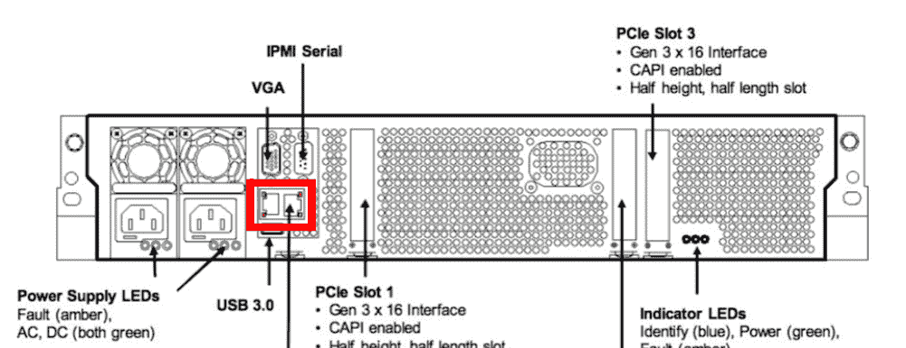

#### 如何访问基本管理控制器

要访问 BMC，请完成以下步骤：

1. 使用您的浏览器连接到 `https://IP_ADDRESS`。

第 65 页的图 4-7 显示了 BMC 登录窗口。

² 要使用浏览器访问 BMC，必须将此端口和工作终端连接到网络。

64 IBM PowerAI: 在 IBM Power 服务器上释放深度学习

#### BMC 高级系统管理


2. 使用以下值登录系统（这些是默认值）：

- 用户名：`ADMIN`
- 密码：`admin`

3. 访问远程 Java 控制台：

a. 选择远程控制（Remote Control），然后选择控制台重定向（Console Redirection），如图 4-8 所示。

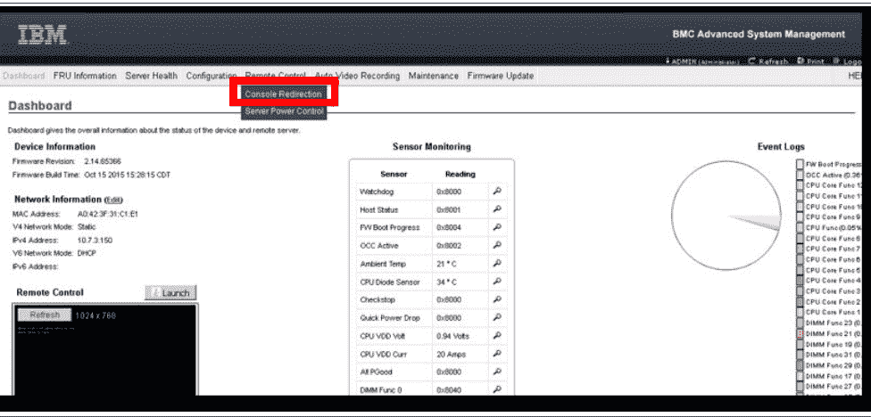

b. 选择 Java 控制台（Java Console），如图 4-9 所示。

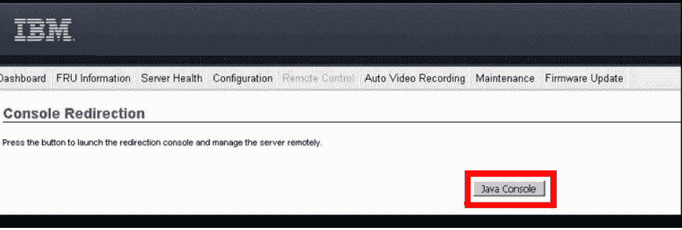

c. 接受 Java 查看器对话框。

Java 应用程序启动并打开控制台窗口，如图 4-10 所示。

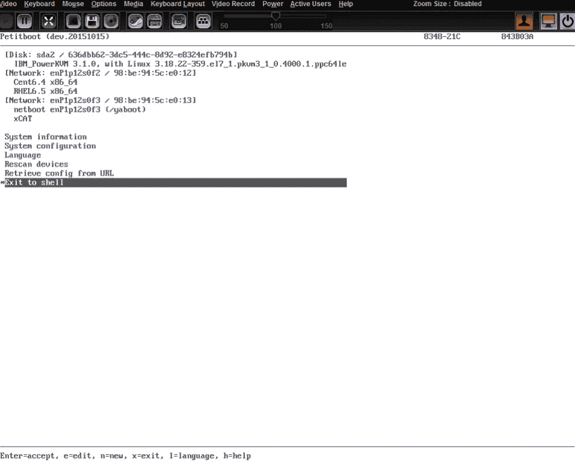

### 4.1.4 安装 Ubuntu 16.04.x

本节详细介绍了 Ubuntu 16.04.x 的安装详细信息。

#### 挂载虚拟介质（作为 CD/DVD 的 .iso 文件）

本节描述了如何挂载虚拟介质。请完成以下步骤：

1. 在 Java 控制台应用程序菜单中，选择媒体（Media）→ 虚拟介质向导（Virtual Media Wizard），如图 4-11 所示。

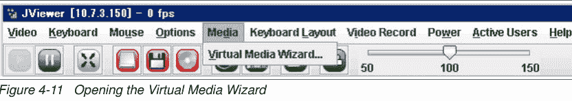

2. 在访问计算机上，选择之前下载的 `.iso` 文件（第 60 页的“Downloads”）并分配为 CD/DVD：

a. 点击浏览 CD/DVD 介质：1，如图 4-12 所示。

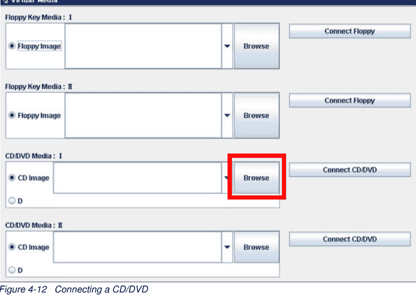

b. 点击打开（Open）并选择一个文件。

3. 选择 CD/DVD，如图 4-13 所示。

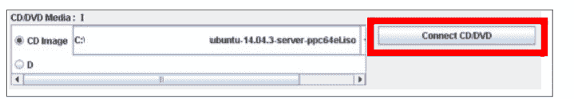

4. 点击关闭（Close）结束挂载。

#### 安装 Ubuntu 16.04

本节描述了安装 Ubuntu 16.04 的步骤：

1. 使用控制台右上角的红色图标或电源选项（Power On Server）启动服务器。
2. 系统启动并出现预启动（Preboot）菜单。选择 Ubuntu 安装媒体，如图 4-14 所示。

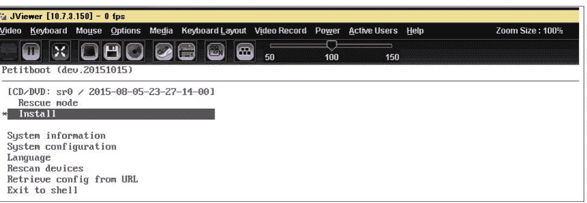

3. 点击安装 Ubuntu Server，如图 4-15 所示。

```
[CD/DVD]: /dev/s0
修复损坏的系统
检查缺陷
安装 RAID 控制器
安装 RAID 控制器
安装 Ubuntu Server
修复损坏的系统
检查缺陷
安装 RAID 控制器
安装 RAID 控制器
安装 Ubuntu Server
系统信息
系统配置
```

图 4-15 安装 Ubuntu Server

4. 此过程适用于 Ubuntu 16.04 和 16.04。点击并选择内核（kernel），如图 4-16 所示。

| 设备 | (*) sr0 |
| :--- | :--- |
| 手动指定路径 | |
| 内核 | `/install/linux` |
| Initrd | `/initrd.gz` |
| 设备树 | |
| 启动参数 | `file=/cdrom/preseed/ubuntu-server.seed quiet` |
| | [ 完成 ] [ 帮助 ] [ 取消 ] |

图 4-16 选择内核

提示：当安装程序启动时，远程控制可能会断开。在这种情况下，使用以下命令切换到串口 LAN：`# ipmitool -H BMC_ADDRESS -U USER -P`

注意：除了普通内核，Ubuntu 安装媒体还可以使用硬件启用（HWE）。

5. 在语言选择中点击 English（英语），如图 4-17 所示。

| --- 选择语言 --- |
| :--- |
| 用于安装过程的语言。所选语言将作为安装系统的默认语言。 |
| 语言： | English |
| < 返回> | |

图 4-17 选择语言

6. 选择您偏好的位置。选择普通内核，而不是 `hwe-vmlin`。
7. 配置系统区域语言，如图 4-18 所示。

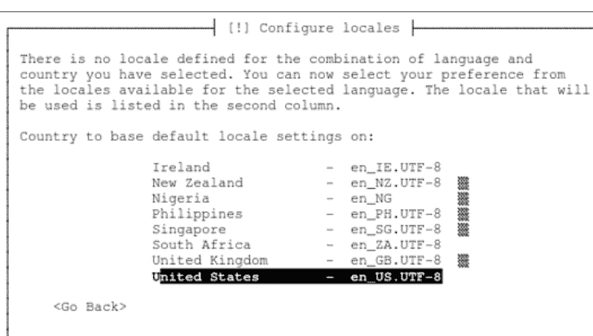

注意：为了避免与 IBM PowerAI 部署的某些区域语言设置冲突，请选择 United States - `en_US_UTF-8` 或其他 UTF-8 作为默认区域语言。

8. 设置键盘：

a. 当询问 **Detect Keyboard layout** 时，点击 No（否），如图 4-19 所示。

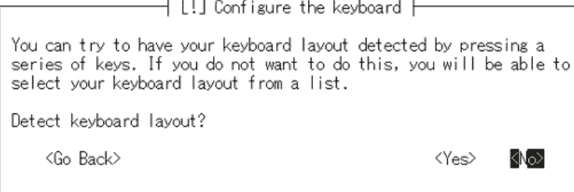

b. 在键盘布局中，选择您偏好的键盘，如第 71 页的图 4-20 所示。

70 IBM PowerAI: 在 IBM Power 服务器上释放深度学习

#### 配置键盘

布局随国家而异，某些国家有多种常用布局。请选择此计算机键盘的来源。

键盘来源：

- 希腊语
- 希伯来语
- 匈牙利语
- 冰岛语
- 伊拉克语
- 爱尔兰语
- 意大利语
- 日语

< 返回>

**图 4-20** 选择键盘布局

图 4-21 显示键盘选择。

#### 配置键盘

请选择与机器匹配的布局。

键盘布局：

- 日语 - Japanese (Dvorak)
- 日语 - Japanese (Kana 86)
- 日语 - Japanese (Kana)
- 日语 - Japanese (Macintosh)
- 日语 - Japanese (OADG 109A)

< 返回>

**图 4-21** 选择键盘布局

第 4 章 部署 IBM PowerAI 71

#### 网络设置

本节描述了配置网络设置的步骤：

1. 选择设置为主网络的网络接口，如图 4-22 所示。

```
### !!! 配置网络
您的系统有多个网络接口。选择安装期间作为主网络接口的一个。如果可能，已选择第一个连接的网络接口。

主网络接口：
np3s00f0: Broadcom NetXtreme B5719 Gigabit Ethernet
en3s00f1: Broadcom NetXtreme B5719 Gigabit Ethernet
en3s00f2: Broadcom NetXtreme B5719 Gigabit Ethernet
en3s00f3: Broadcom NetXtreme B5719 Gigabit Ethernet
en4s00f0: Broadcom NetXtreme 57800 1/10 Gigab
en4s00f1: Broadcom NetXtreme 57800 1/10 Gigab
en4s00f2: Broadcom NetXtreme 57800 1/10 Gigab
en4s00f3: Broadcom NetXtreme 57800 1/10 Gigab

< 返回>
```

图 4-22 选择主网络接口

2. 如果网络中没有 DHCP 服务器，则配置接口。显示如第 73 页图 4-24 所示的消息。手动继续配置网络。

```
### !!! 配置网络
网络自动配置失败
您的网络可能没有使用 DHCP 协议。或者，
DHCP 服务器可能慢或某些网络硬件未正常工作

[ 继续->]
```

图 4-23 不存在 DHCP 服务器

3. 开始手动网络设置，如第 73 页的图 4-24 所示。

如果存在 DHCP 服务器，在选择网络接口后，主网络设置将自动完成。

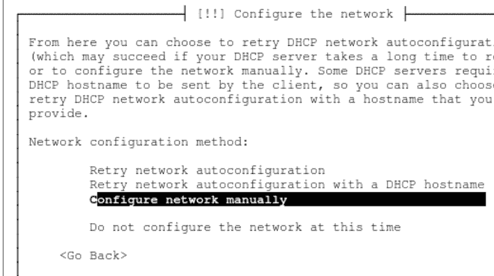

4. 配置 IP 地址，如图 4-25 所示。

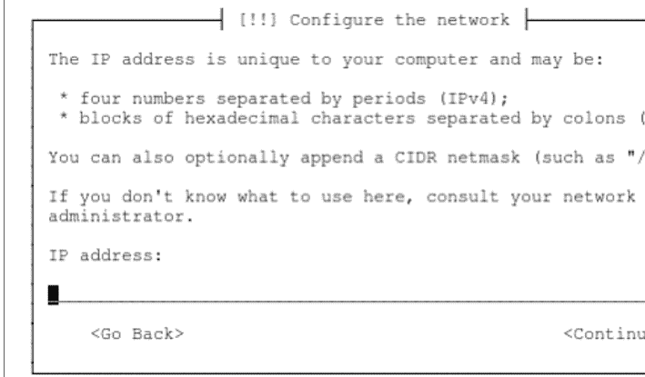

5. 配置子网掩码，如图 4-26 所示。

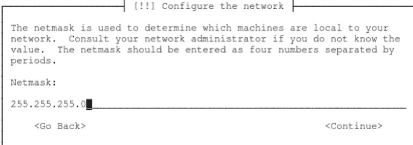

6. 配置默认网关，如图 4-27 所示。

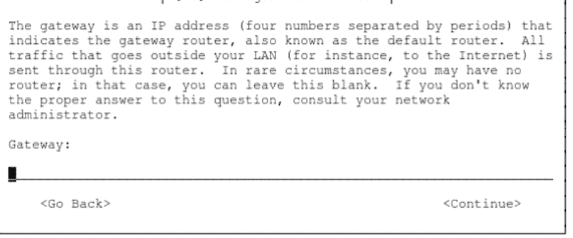

7. 配置名称服务器 (DNS)，如图 4-28 所示。

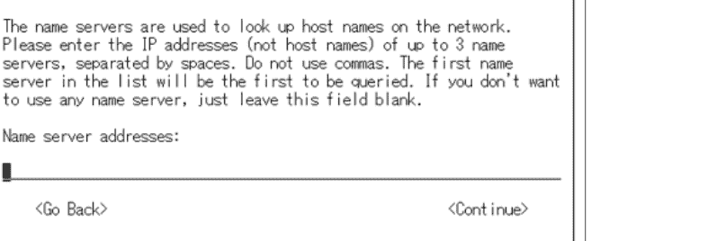

8. 选择一个名称，如图第 75 页的图 4-29 所示。

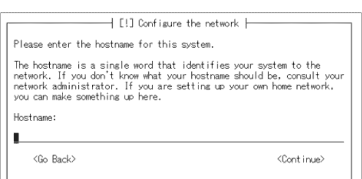

9. 配置域名，如图 4-30 所示。

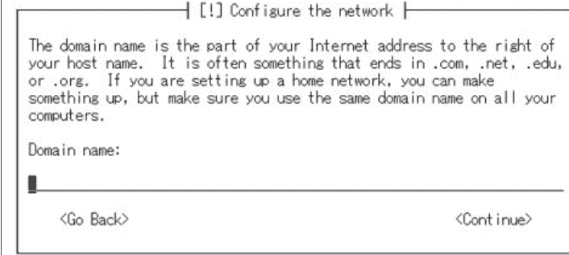

#### 创建默认用户

本节解释了如何创建默认用户：

1. 设置新用户的全名和用户名，如图 4-31 所示。

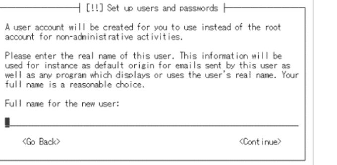

第 4 章 部署 IBM PowerAI 75

图 4-32 显示了为该账户设置默认用户名。

| [!!!] 设置用户和密码 |
| :--- |
| 为新账户选择用户名。使用您的名字是一个合理的选择。用户名应该以小写字母开头，后面可以是任意数字和小写字母的组合。 |
| 您的账户的用户名： |
| `user0` |
| <上一步> <继续> |

图 4-32 为默认用户选择用户名

2. 为默认用户选择密码，如图 4-43 所示。

| [!!!] 设置用户和密码 |
| :--- |
| 一个良好的密码应包含字母、数字和标点符号的混合，并应定期更改。 |
| 为新用户选择密码： |
| `*****` |
| <上一步> <继续> |

图 4-43 重新输入密码

图 4-34 显示了为默认用户重新输入密码。

| [!!!] 设置用户和密码 |
| :--- |
| 请再次输入相同的用户密码以验证您的输入是否正确。 |
| 重新输入密码以验证： |
| |
| [ ] 明文密码 |
| <上一步> <继续> |

图 4-34 确认密码

3. 您可以选择为此用户加密 `$HOME`，但在本示例中我们选择不加密它，如图第 77 页的图 4-35 所示。

76 IBM PowerAI: 在 IBM Power 服务器上释放深度学习

#### [!] 设置用户和密码

您可以对您的主目录进行加密配置，这样即使电脑被盗，存储在其中的任何文件也能保持私密。

系统在每次您登录时都会无缝地挂载您的加密主目录，并在您退出所有活动会话时自动卸载。

加密您的主目录：

```
<上一步>                <是> []
```

图 4-35 `$HOME` 目录加密

#### 为 RAID 阵列准备磁盘


由于板载 SATA 适配器不提供任何硬件 RAID 功能，可以采取以下步骤配置软件 RAID。虽然软件 RAID 不是 IBM PowerAI 的要求，但它是缓解本地磁盘故障的首选方法。创建 RAID 设备对于安装 IBM PowerAI 不是强制的，但由于如果 RAID 阵列部分的 SSD 或硬盘发生故障，它可以提供高可用性 (HA)。

更多信息，请参阅 Ubuntu wiki。

如果您选择不定义 RAID 设备，请继续查看第 86 页的图 4-55。

完成以下步骤：

1. 选择“手动”作为分区方法，如图 4-36 所示。

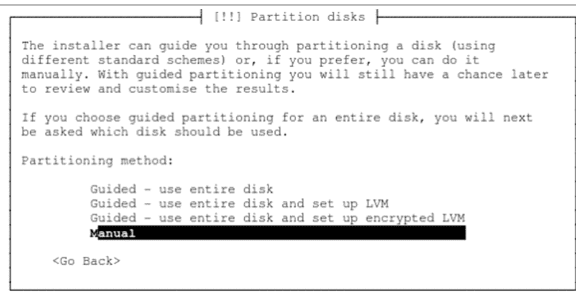

安装程序可以引导您对磁盘进行分区（使用不同的方案），或者，如果您愿意，也可以手动进行。使用引导式分区，您仍然有机会查看结果。

如果您对整个磁盘选择引导式分区，接下来将询问您应该使用哪个磁盘。

分区方法：

- 引导式 - 使用整个磁盘
- 引导式 - 使用整个磁盘并设置 LVM
- 引导式 - 使用整个磁盘并设置 LVM
- 引导式 - 使用整个磁盘并设置 LVM

```
Manual
<上一步>
```

图 4-36 选择分区方法

2. 初始化设备的分区表。

3. 为显示的每个磁盘创建一个空分区表：

- SCSI (0,0) sda
- SCSI (0,0) sdb

图 4-37 显示了设备的初始化分区表。

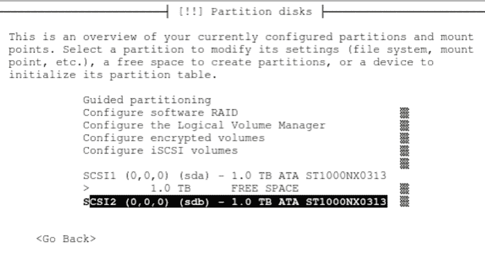

图 4-37 设备的初始化分区表。

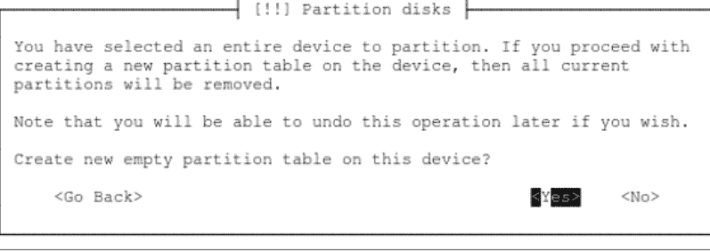

图 4-38 设备的分区表确认。

4. 检查每个磁盘的容量均为可用空间，如图第 79 页的图 4-39 所示。

这是配置分区和挂载点的概述。选择一个分区来配置设置。

- 引导式
- 引导式：
- 配置软件 RAID
- 配置逻辑管理器
- 配置加密卷
- 配置磁盘卷

| SCSI (0,0) (sda) | 1.0 TB |
| :--- | :--- |
| 1.0 TB | 可用空间 |
| SCSI (0,0) (sdb) | 1.0 TB |
| 1.0 TB | 可用空间 |

<上一步>

图 4-39 检查磁盘是否可用

## 创建 PRP 分区

本节解释了如何创建 PRP 分区。

> 注意：PRP 是一个原始且较小的（8 MB 分区），仅携带阶段 1 二进制文件。

执行以下步骤：

1. 选择 sda 的可用空间分区，如图 4-40 所示。

这是配置分区和挂载点的概述。选择一个分区来配置设置。

- 引导式
- 引导式：
- 配置软件 RAID
- 配置逻辑管理器
- 配置加密卷
- 配置磁盘卷

| SCSI (0,0) (sda) | 1.0 TB |
| :--- | :--- |
| 1.0 TB | 可用空间 |
| SCSI (0,0) (sdb) | 1.0 TB |
| 1.0 TB | 可用空间 |

<上一步>

图 4-40 选择 sda 可用空间

第 4 章 部署 IBM PowerAI 75

2. 创建新分区，如图 4-41 所示。

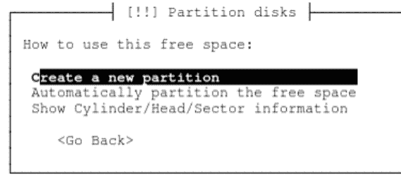

图 4-41 创建新分区

3. 指定新分区的大小为 8M，如图 4-42 所示。

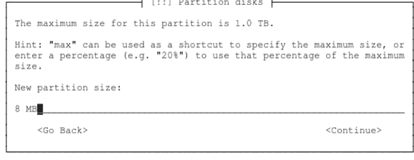

图 4-42 指定 PRP 分区大小

4. 如果请求新分区的位置，请选择“起始”，如图 4-43 所示。

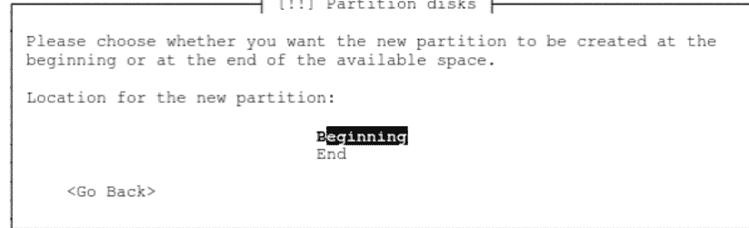

图 4-43 新分区的位置

5. 定义分区文件系统，如图第 81 页的图 4-44 所示。然后，将新分区用途设置为 IBM PowerPC® PRReP 启动分区，⁷⁷如如图第 81 页的图 4-45 所示。

> 7 PRReP 是一个原始且较小的（8 MB 分区），仅携带阶段 1 二进制文件。

80 IBM PowerAI: 在 IBM Power 服务器上释放深度学习

### !!! 分区

您正在编辑 SCSI (0,0,0) (sda) 的 #1 分区。在此分区未检测到现有文件系统。

分区设置：

| 名称：Ext4 日志文件系统 |
| :--- |
| 用途： |
| 挂载点：默认 |
| 挂载选项：无 |
| 标签：5% |
| 保留块：标准 |
| 典型用法：关闭 |
| 可启动标记： |

<上一步>

图 4-44 定义分区用途

### !!! 使用此分区

如何使用此分区：

- 将分区作为 PowerPC PReP 启动分区
- Ext4 日志文件系统
- Ext3 日志文件系统
- Ext2 文件系统
- extfs 日志文件系统
- JFS 日志文件系统
- XFS 日志文件系统
- FAT16 文件系统
- FAT32 文件系统
- 交换区域
- 预留 BIOS 启动区域
- 物理加密卷
- 物理 RAID 卷

6. 点击设置分区，如图 4-46 所示。

| [!] 分区磁盘 |
| :--- |
| 你正在编辑 SCSI1 (0,0,0) (sda) 的第 #1 分区。在此分区中未检测到现有文件系统。 |
| 分区设置： |
| 标识：用作：PowerPC 预备引导分区 |
| 可引导标记：关闭 (off) |
| 删除分区  完成分区设置 |
| <上一步> |

图 4-46 结束创建引导分区

在 sda 上的分区进行格式化后，必须对 sdb 分区应用相同的过程，以便使两块磁盘都为创建软件 RAID1 做好就绪。要完成此任务，请执行第 79 页的步骤 1 - 6，在需要时将 sda 替换为 sdb。

## 创建 RAID1 阵列

本节将介绍如何创建 RAID1 阵列配置：

1. 选择配置软件 RAID，如图 4-47 所示。

| [!] 分区磁盘 |
| :--- |
| 这是你当前配置的分区和挂载点的概述。选择一个分区来修改其设置（文件系统、挂载点等），选择一个空空间创建分区，或选择一个设备来初始化其分区表。 |
| 引导式分区 |
| 配置软件 RAID |
| 配置逻辑卷管理器 |
| 配置加密卷 |
| SCSI 卷 |
| SCSI1 (0,0,0) (sda) - 1.0 TB ATA ST1000NX0313 |
| > 1.0 MB 空闲空间 |
| > 7.3 MB K |
| > 1.0 TB 空闲空间 |
| <上一步> |

图 4-47 配置软件 RAID

2. 确认你正在使用 sda 和 sdb 并点击“是”，如第 83 页的图 4-48 所示。

### !!! 分区磁盘

在配置 RAID 之前，必须将这些更改写入存储设备。这些更改是无法撤销的。

当配置 RAID 时，不允许对包含物理卷的磁盘中的分区进行任何额外更改。请确保你对这些磁盘中的当前分区方案感到满意。

以下设备的分区表将发生更改：

SCSI1 (0,0,0) (sda)
SCSI2 (0,0,0) (sdb)

将更改写入存储设备并配置 RAID 吗？否>

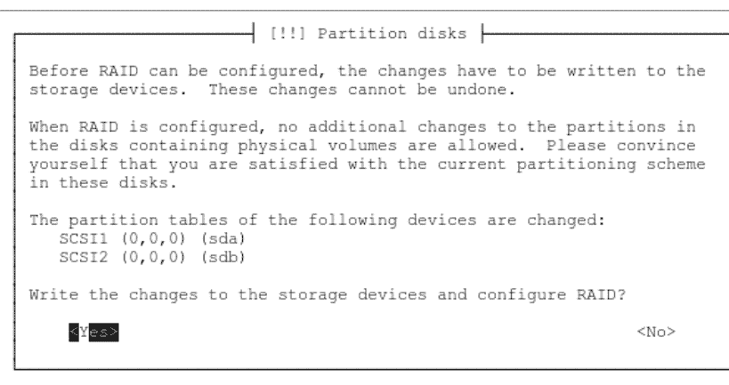

图 4-48 确认设备选择

3. 选择创建 MD,8，如图 4-49 所示。

### !!! 分区磁盘

这是软件 RAID（或 MD，“多设备”）配置菜单。

请选择一个建议的动作之一来配置 RAID。

软件 RAID 配置动作：

```
创建 MD 设备
删除 MD 设备
完成
```

<上一步>

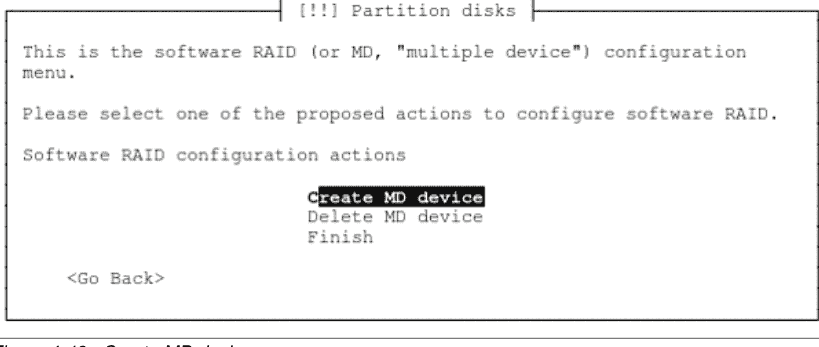

图 4-49 创建 MD 设备

该名称源于构成 RAID 的多设备 (MD) 设备节点。

4. 选择 RAID1 作为要使用的 RAID 阵列级别，如图 4-50 所示。

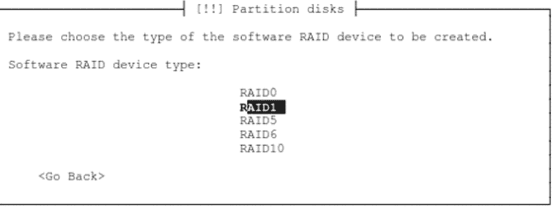

图 4-50 选择（输入）2 作为要使用的镜像数量，如图 4-51 所示。

5. 指定（输入）2 作为要使用的镜像数量，如图 4-51 所示。

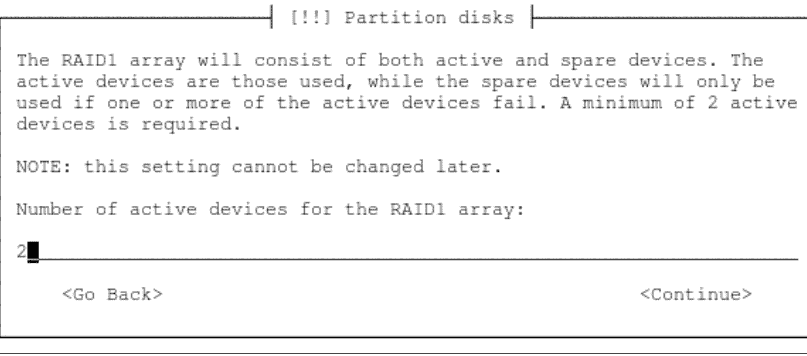

图 4-51 定义镜像数量

6. 指定（输入）0，因为没有热备驱动，如图 4-52 所示。

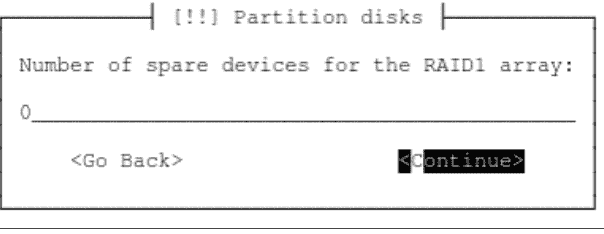

图 4-52 将备用设备数量设置为无

7. 选择 /dev/sda 和 /dev/sdb 中的所有空闲空间并点击“继续”，如 85 页的图 4-53 所示。

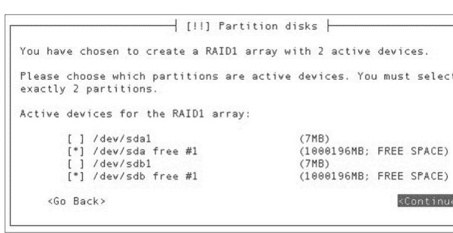

8. 应用更改，如图 4-54 所示。


9. 点击“完成”完成 RAID 配置，如图 4-55 所示。


图 4-55 完成多设备

## 为操作系统分区 RAID 阵列

本节介绍了如何为操作系统分区 RAID 阵列：

1. 选择引导式分区，如图 4-56 所示。
2. 选择使用整个磁盘并设置 LVM，如 87 页的图 4-57 所示。
3. 选择 RAID1 #0 作为要使用的设备，如图 4-58 所示。
4. 点击“是”以配置卷组，如图 4-59 所示。
5. 指定卷组的大小，如图 4-60 所示。
6. 点击“完成”分区并将更改写入磁盘，如图 4-61 所示。
7. 检查要创建的 LV 或分区并点击“是”，如第 89 页的图 4-62 所示。

## 安装操作系统软件包

在分区创建后，开始安装所有操作系统软件包。对于本指南，我们假设系统可以通过 HTTP 代理访问互联网或包含所有操作系统软件包的存储。

完成以下步骤：

1. 设置 HTTP 代理，如图 4-63 所示。

2. 配置自动更新，如图 4-64 所示。

| 配置任务 |
| :--- |
| 经常应用更新是维护系统安全的重要部分。 |
| 默认情况下，需要使用包管理工具手动应用更新。或者，您可以选择让系统自动下载并安装安全更新，或者您可以选择通过 Canonical 的 Landscape 服务将此系统作为系统组的一员通过网络进行管理。 |
| 您希望如何管理此系统上的升级？ |
| 不自动更新 | 自动安装安全更新 | 使用 Landscape 管理系统 |

图 4-64 设置自动更新

注意：为了避免与某些系统库的争议版本或不支持的版本发生冲突，请禁用自动更新。

并非强制选择自动安装安全更新。作为管理员，您可以决定您的系统是否暴露在威胁之下，以及是否需要自动部署 Linux 更新。

## 配置系统时区

本节描述了如何配置系统时区。选择一个适合您需求的的配置，如图 4-65 所示。

| 完成安装 |
| :--- |
| 系统时钟通常设置为协调世界时 (UTC)。操作系统使用您的时区来将系统时间转换为本地时间。除非您使用其他期望时钟设置为本地时间的操作系统，否则建议使用 UTC。 |
| 系统时钟是否设置为 UTC？ | 是 <否> |

图 4-65 设置系统时钟

## 完成操作系统安装

本节展示了如何完成操作系统的安装。选择“继续 (Continue)” 完成安装，如第 91 页的图 4-66 所示。

## 完成安装

安装完成

安装已完成，现在可以启动进入新系统了。确保移除安装介质（CD-ROM、软盘），以便进入新系统而不是重新启动安装。

<返回 Go Back> 继续>

图 4-66 安装完成

### 操作系统设置

重启后，系统控制台即可用于登录，如图 4-67 所示。

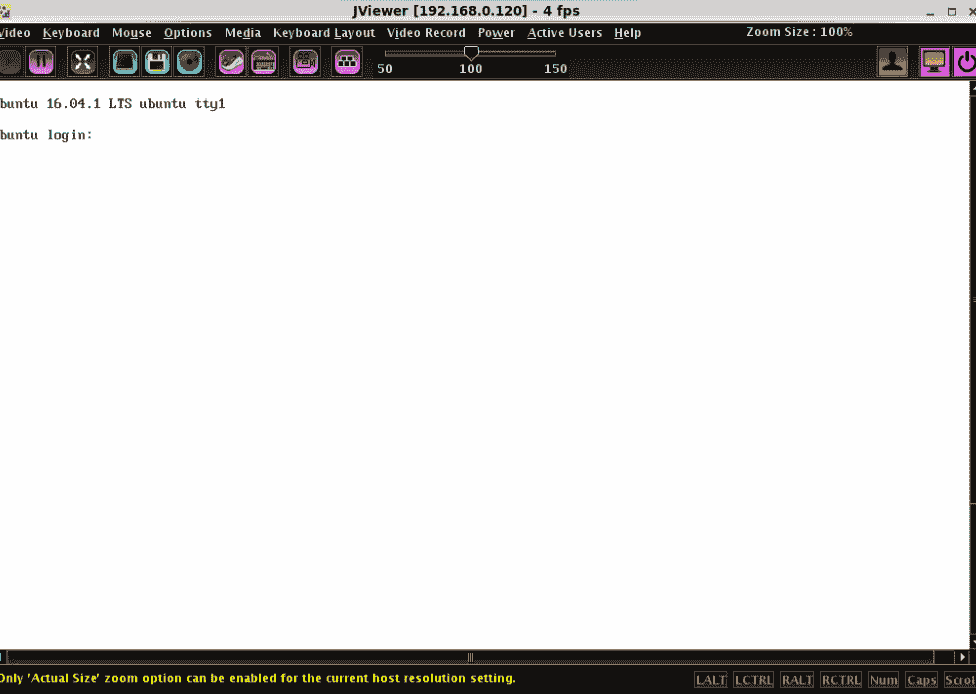

图 4-67 登录窗口

完成以下步骤：

1. 以安装时创建的用户身份登录。

2. 如必要，设置其他网络适配器。提供如下示例配置：

```
$ sudo vi /etc/network/interfaces

auto enP3p3s0f1
iface enP3p3s0f1 static
```

第 4 章 部署 IBM PowerAI 91

```
address 192.168.1.xxx
netmask 255.255.255.0
network 192.168.1.0
gateway 192.168.1.1
dnsnameserver 192.168.1.xxx
```

```
auto enP3p3sf2
iface enP3p3sf1 inet dhcp
```

3. 更新包列表：

- 如果有可用互联网连接，运行以下命令从默认操作系统存储库更新：

```
sudo apt-get update
```

- 如果没有互联网连接，使用 DVD 镜像创建本地存储库并更新列表：

i. 使用远程控制虚拟媒体挂载 DVD ISO 镜像。

ii. 在 /etc/fstab 中添加以下条并挂载它：

```
/dev/sr0 /media/cdrom iso 9660 0 0
```

iii. 运行命令并将 DVD 添加到存储库：

```
sudo apt-cdrom -d /media/cdrom add 0
```

iv. 更新包列表：

```
sudo apt-get update
```

安装软件包。例如，安装 OpenSSH：

```
sudo apt-get install openssh-server
```

## 设置启动设备

本节描述了如何如下所示设置 /dev/sdb 中的启动设备：

1. 在 /dev/sdb 中指定 PowerPC PReP 启动类型

```
sudo fdisk /dev/sdb
```

欢迎使用 fdisk (util-linux 2.27.1)。

更改将保留在内存中，直到您决定写入它们。

在使用 write 命令前请小心。

命令 (m 可获取帮助): p

```
Disk /dev/sdb: 931.5 GiB, 1000204886016 bytes, 195325168 sectors
Units of 1 * 512 = 512 bytes
Sector size (logical / physical): 512 bytes / 512 bytes
I / O (minimum / optimal): 512 bytes / 512 bytes
Label type: gpt
Disk Identifier: F551-1006-4D21-8B82-2D0EF-16D8-933
Device Start End Sectors Size Type
/dev/sdb 1 2048 163836 7 M Linux filesystem
/dev/sdb 2 16384 195 23 71 195 30 7 32 8 931.5 G Linux RAID
```

命令 (m 可获取帮助): t

分区编号 (1, 2, 默认): 1

十六进制代码 (输入 L 列出所有代码): 7

已将分区 'Linux filesystem' 类型更改为 'PowerPC PReP boot'.

命令 (m 可获取帮助): p

```
/dev/sdb: 931.5 GiB, 100024886016 bytes, 1953525168 sectors
Units: sector 1 * 512 = 512 bytes
Size (logical / physical): 512 bytes / 512 bytes
I / O size (minimum / optimal): 512 bytes / 512 bytes
Disklabel type: gpt
Disk identifier: FADB8551-1006-4D21-8BB2-2D0EF-1689-3
Device Start End Sectors Size Type
/dev/sdb 1 1028 163336 7 M PowerPC PReP boot
/dev/sdb 2 16384 195 23 71 195 30 7 32 8 931.5 G Linux RAID
```

命令 (m 可获取帮助): w

```
redbooks@pts153:~/downloads sudo apt dpkg -i cuda-repo-ubuntu1604-8.0-local-gav2_8.0.61-1_ppc64el.deb
```

正在选择尚未发布的包 cuda-repo-ubuntu1604-8.0-local-gav2。

(读取数据库 ... 当前安装了 57530 个文件和目录。)

准备安装 cuda-repo-ubuntu1604-8.0-local-gav2_8.0.61-1.ppc64el.deb

写入 cuda-repo-ubuntu1604-8.0-local-gav2 (8.0.61-1)

正在设置 cuda-repo-ubuntu1604-8.0-local-gav2 (8.0.61-1)

OK

图 4-89 *安装 CUDA*

c. 重新同步软件包索引文件，如图 4-70 所示：

```
$ sudo apt-get update
```

```
redbooks@pts153:~/downloads sudo apt-get update
```

获取:1: file:/var/cuda-repo-ubuntu-8.0-local-gav2 InRelease


忽略: 1: `file:/var/cuda-repo-ubuntu-8.0-local-gav2 InRelease`

获取: 2: `file:/var/cuda-repo-ubuntu-8.0-local-gav2 Release` [54 B]

获取: 2: `file:/var/cuda-repo-ubuntu-8.0-local-gav2 Release` [54 B]

获取: 3: `file:/var/cuda-repo-ubuntu-8.0-local-gav2 Release` [219 B]

获取: 3: `file:/var/cuda-repo-ubuntu-8.0-local-gav2 Release` [219 B]

获取: 4: `http://ports.ubuntu.com/ubuntu-ports xenial-security InRelease` [102 kB]

获取: 5: `file:/var/cuda-repo-ubuntu-8.0-local-gav2 Packages` [10.8 KB]

命中: 6: `http://ports.ubuntu.com/ubuntu-ports xenial InRelease` [102 kB]

命中: 7: `http://ports.ubuntu.com/ubuntu-ports xenial-security/universe ppc64el Packages` [146 kB]

命中: 8: `http://ports.ubuntu.com/ubuntu-ports xenial-updates InRelease` [102 kB]

获取: 9: `http://ports.ubuntu.com/ubuntu-ports xenial-backports InRelease` [102 kB]

在 1 秒内获取了 9 个文件 (86 kB kBed)

读取软件包列表... 完成。

图 4-70 `apt-get update` 输出示例

+   d. 安装 CUDA 工具：

```
$ sudo apt-get install cuda
```

e. 导出路径到 CUDA 库：

```
$ export PATH=/usr/local/cuda-8.0/bin:$PATH:$PATH
$ export LD_LIBRARY_PATH=/usr/local/cuda-8.0/lib64:$LD_LIBRARY_PATH:$LD_LIBRARY_PATH
```

f. 在系统启动时设置 `PATH` 变量定义。向 `/etc/bash.bashrc` 中添加以下两行：

```
PATH=/usr/local/cuda-8.0/bin:$PATH:$PATH
LD_LIBRARY_PATH=/usr/local/cuda-8.0/lib64:$LD_LIBRARY_PATH
```

> 提示：此步骤是可选的，但更好，因为 IBM PowerAI 不会为每次登录导出这些变量。

第 4 章 部署 IBM PowerAI 95

g. 使用 `dpkg` 工具安装 cuDNN 库，如图 4-71 所示：

```
$ sudo dpkg -i libcudnn*
```

```
redbook@pts153:~/downloads sudo dpkg -i libcudnn*
正在选择未选择的包 libcudnn6
(读取数据库 ... 当前安装了 73296 个文件和目录)。
准备解压 libcudnn6-dev_6.0.21-1+cuda8.0_ppc64.deb
正在写入 libcudnn6-dev (6.0.21-1+cuda8.0)...
正在选择未选择的包 libcudnn6
准备解压 libcudnn6-dev_6.0.21-1+cuda8.0_ppc64.deb
正在写入 libcudnn6-dev (6.0.21-1+cuda8.0)...
正在设置 libcudnn6 (6.0.21-1+cuda8.0)...
正在设置 libcudnn6 (6.0.21-1+cuda8.0)...
更新触发器：以自动模式使用 /usr/share/powerpc64-linux-gnu/cudnn/libcudnn 到 /usr/include/cuda/libcudnn
处理 lib-bin (2.23-0) 的触发器
```

图 4-71 安装 CUDA 深度神经网络

> 注意：CUDA 和 cuDNN 库包含过时的 NVIDIA 驱动程序。出于性能和支持考虑，请安装当前版本。第 43 页的 3-7 显示了每个 IBM PowerAI 的 NVIDIA 驱动程序的最低和推荐级别。

## 3. 安装 NVIDIA 驱动程序

+   a. 解压驱动安装文件，如图 4-72 所示：

```
$ sudo dpkg -l nvidia-driver-local-repo-ubuntu1604-384.81.1.0-1_ppc64el.deb
```

```
redbook@pts153:~/downloads sudo dpkg -l nvidia-driver-local-repo-ubuntu1604-384.81.1.0-1_ppc64el.deb
(读取数据库 ... 当前安装了 73308 个文件和目录)。
准备解压 nvidia-driver-local-repo-ubuntu1604-384.81.1.0-1...
正在写入 nvidia-driver-local-repo-ubuntu1604-384.81.1.0-1 (1.0)...
正在设置 nvidia-driver-local-repo-ubuntu1604-384.81.1.0-1 (1.0)...
```

图 4-72 解压 NVIDIA 驱动程序

+   b. 从源重新同步软件包索引文件：

c. 安装驱动：

```
$ sudo apt-get install cuda-drivers
```

d. 重启：

```
$ sudo reboot
```

i. 检查 `PATH` 变量是否已设置且组件已安装：

i. 运行 NVIDIA 编译器：

```
$ nvcc -V
```

```
nvcc: NVIDIA (R) CUDA compiler (2005) Built Jan 10 13:28, release 8.0
```

ii. 系统重启后，运行 `nvidia-smi` 查看 GPU 状态，如图 4-73 所示：

```
$ nvidia-smi
```

| GPU | Name | Volatility | ECC | Temp | Memory Usage | Util |
|---|---|---|---|---|---|---|
| 0 | | | | | | |

图 4-73 `nvidia-smi` 输出示例

> 提示：关于 `nvidia-smi` 命令的完整选项，请查看第 97 页的 PowerAI 手册。

| GPU | Name | Volatility | ECC | | |
|---|---|---|---|---|---|

第 4 章 安装 IBM PowerAI

本节描述了安装 IBM PowerAI：

+   1. 解压 IBM PowerAI，如图 4-74 所示：

```
$ sudo dpkg -i cuda-repo-local
```

```
redbooks@pts153:~/downloads sudo dpkg -i cuda-repo-ubuntu1604-8.0-local-gav2_8.0.61-1_ppc64el.deb
正在选择尚未发布的包 cuda-repo-ubuntu1604-8.0-local-gav2。
(读取数据库 ... 当前安装了 57530 个文件和目录。)
准备安装 cuda-repo-ubuntu1604-8.0-local-gav2_8.0.61-1.ppc64el.deb
写入 cuda-repo-ubuntu1604-8.0-local-gav2 (8.0.61-1)
正在设置 cuda-repo-ubuntu1604-8.0-local-gav2 (8.0.61-1)
OK
```

图 4-74 解压 IBM PowerAI

+   2. 从源重新同步软件包索引文件，如图 4-75 所示：

```
$ sudo apt-get update
```

```
redbooks@pts153:~/downloads sudo apt-get update
获取:1: file:/var/cuda-repo-ubuntu-8.0-local-gav2 InRelease
忽略: 1: file:/var/cuda-repo-ubuntu-8.0-local-gav2 InRelease
获取: 2: file:/var/cuda-repo-ubuntu-8.0-local-gav2 Release [54 B]
获取: 2: file:/var/cuda-repo-ubuntu-8.0-local-gav2 Release [54 B]
获取: 3: file:/var/cuda-repo-ubuntu-8.0-local-gav2 Release [219 B]
获取: 3: file:/var/cuda-repo-ubuntu-8.0-local-gav2 Release [219 B]
获取: 4: http://ports.ubuntu.com/ubuntu-ports xenial-security InRelease [102 kB]
获取: 5: file:/var/cuda-repo-ubuntu-8.0-local-gav2 Packages [10.8 KB]
命中: 6: http://ports.ubuntu.com/ubuntu-ports xenial InRelease [102 kB]
命中: 7: http://ports.ubuntu.com/ubuntu-ports xenial-security/universe ppc64el Packages [146 kB]
命中: 8: http://ports.ubuntu.com/ubuntu-ports xenial-updates InRelease [102 kB]
获取: 9: http://ports.ubuntu.com/ubuntu-ports xenial-backports InRelease [102 kB]
在 1 秒内获取了 9 个文件 (86 kB kBed)
读取软件包列表... 完成。
```

图 4-75 更新软件包信息

+   3. 如果你使用某些框架，还有额外的步骤需要执行：

a. 安装 Caffe 和深度学习 (DDL) TensorFlow 自定义优化器

`caffe-bin` 和 `ddl-tensorflow` 包需要 IBM PowerAI OpenMPI 包，该包带有 NVIDIA CUDA 支持构建。该 OpenMPI 包与 Ubuntu-non-OpenMPI 包冲突。

在安装 IBM Caffe 或 DDL 自定义优化器之前，请卸载任何 `openmpi` 或 `libopenmpi` 包。

```
$ dpkg -l | grep openmpi
$ sudo apt-get purge ...
```

98 IBM PowerAI: Deep Learning Unleashed on IBM Power Systems

b. DIGITS 的安装说明

`digits` 和 `python-socketio-server` 软件包与 Ubuntu 旧版本的 `python-socketio` 包存在冲突。在安装 DIGITS 之前，请卸载 `python-socketio` 软件包。

4. 安装 IBM PowerAI 库和框架：

```
$ sudo apt-get install power-mld
```

> 提示：也可以通过运行以下命令安装单个框架而不是整个包：

```
$ sudo apt-get install <framework name>
```

- `caffe-bvlc`: 伯克利视觉中心 (BVLC) 上游 Caffe V1.0.0
- `caffe-ibm`: BVLC Caffe V1.0.0 的优化版本
- `caffe-nv`: Caffe V0.15.14 的 NVIDIA 分支
- `chainer`: Chainer V1.23.0
- `digits`: DIGITS V5.0.0
- `tensorflow`: 谷歌 de TensorFlow V1.1.0
- `ddl-tensorflow`: 用于 TensorFlow 的 DDL 自定义算子
- `theano`: Theano V0.9.0
- `torch`: Torch V7

IBM PowerAI V4.0 包含的框架包如下：

有关包含在所有 IBM PowerAI 版本中的组件列表，请参阅第 58 页的 3.2，“IBM PowerAI 兼容性矩阵”。

5. 根据 IBM PowerAI 的版本以及在第 98 页第 3 中安装的软件包，此目录的内容可能会不同。运行以下命令检查组件是否已安装：

```
$ ls /opt/DL/
bazel
caffe
caffe-bvlc
caffe-ibm
caffe-nv
chainer
ddl
ndl-tensorflow
digits
nccl
openml
...
```

## 关于 Python 设置工具和 easy_install 的说明

Python `easy_install` 软件包可能会干扰某些 IBM PowerAI 框架包（包括 TensorFlow 和 Chainer）的正常运行。

IBM PowerAI 软件包包含了 Python 模块的本地副本，例如 `protobuf` (用于 TensorFlow) 和 `pillow` (用于 Chainer)，因为它们需要的版本比 Canonical 和 Ubuntu 提供的版本更高。`<framework>-activate` 脚本设置了运行所需的路径（设置 `PYTHONPATH` 使本地副本的优先级高于系统默认版本）。

`easy_install` 工具会添加一个脚本，可以使系统路径在 `PYTHONPATH` 条目之前进行搜索，这可能导致 TensorFlow 和 Chainer 中的 `protobuf` 或 `pillow` 失败。

如果 `easy_install` 以 root 身份运行，问题脚本可能位于以下目录：`/usr/local/lib/python2.7/dist-packages/easy-install.pth`

## 优化环境

为了充分发挥系统性能，还需要进行调优工作，在某些情况下，调优取决于所使用的框架：

- 启用调度器 (Governor)：

```
sudo apt-get install linux-tools-common linux-tools-generic cpufreqputils lsb-release
sudo cpower -c all frequency-set -g performance
```

- TensorFlow 的 SMT 值：

这是为 TensorFlow 工作负载设置的特定参数。它通过将 SMT 值从默认的 (8) 更改为推荐的 (2) 来降低 CPU 的并行性。

```
sudo apt-get install powerpc-ibm-utils
sudo ppc64_cpu --smt=2
```

如果你打算在系统中运行其他工作负载，可能会对这些负载产生负面影响。

- 适用于所有框架的 HW 参数：

- 启用 NVIDIA 驱动持久性模式 (persistence mode)：

这可以防止驱动在运行时挂起，从而消除等待驱动初始化事件时的延迟：

```
$ nvidia-smi -pm ENABLED
Enabled persistence mode for GPU 00000002:01:00.00
Enabled persistence mode for GPU 00000003:01:00.00
Enabled persistence mode for GPU 0000000A:01:00.00
Enabled persistence mode for GPU 00000008:01:00.00
All done.
```

- 将 GPU 时钟设置为最优值：

```
$ sudo nvidia-smi -ac 715,1480
Applications clocks set to "MEM 715, SM 1480" for GPU 00000002:01:00.00
Applications clocks set to "MEM 715, SM 1480" for GPU 00000002:03:00.00
Applications clocks set to "MEM 715, SM 1480" for GPU 00000002:04:00.00
Applications clocks set to "MEM 715, SM 1480" for GPU 00000002:08:00.00
```

IBM PowerAI: 在 IBM Power 系统服务器上释放深度学习能力

注意：有关 NVIDIA 驱动持久性模式的更多信息，请参阅 GPU 部署与管理文档。

## 4.2 测试 IBM PowerAI V1.4

在使用机器学习 (ML) 框架之前，必须先 source 框架，以确保它是可用的。如图 76 所示，这种测试可以在 shell 中完成，或者在 `~/.bashrc` 中执行。

```
$ source /opt/DL/framework/activate
```

对于所有 IBM PowerAI 框架的测试，首先需要 source 框架。通过在 `/etc/bash` 中执行 `source /opt/DL/framework/activate` 可以确保测试工作正常。然后运行以下命令：

```
$ <framework>-test
```

### 4.2.1 TensorFlow 测试

要测试 TensorFlow（任何其他框架），请完成以下步骤：

- 1. source 框架：

```
$ source /opt/DL/tensorflow/activate
```

- 2. 运行测试：

```
$ tensorflow-test
```


`tensorflow/stream_executor/dso_loader.cc:135] successfully opened CUDA`

`libtensorflow.so.0.919`

====================================DONE

```
这证明安装是正确的。现在你可以运行一些负载了。
```

### 4.2.2 在数据集上使用多层感知机

这种测试需要 `source` 框架。如图 75 所示，选择了 MNIST 手写数字数据库。

## MNIST 数据

该数据集训练集包含 60,000 个样本，测试集包含 10,000 个样本。它是来自更大数据集的子集。数字被归一化以适应 20x20 的框。由于消除技术，图像包含灰度级。

## 多层感知机

神经网络中最基础且常用的前传播网络是 MLP。MLP 至少由三层节点组成，每个节点是一个非线性激活函数的神经元。MLP 使用监督学习技术进行训练。其多层和非线性可以区分非线性分离的数据。

MLP 有时被俗称为原生神经网络，特别是当它们只有一个隐藏层时。

第 103 页的图 77 显示了用于 MNIST 数据集字符识别的可能网络架构。

### 4.2.3 使用 Caffe 处理 MNIST

本节介绍了如何使用 Caffe 处理 MNIST。

1. 激活 Caffe：
2. 使用 IBM PowerAI 包含的示例脚本拷贝 Caffe 示例以测试任何数据集（在本例中为 `./caffe`）：
3. 下载 MNIST 数据：
4. 使用 Caffe 将 MNIST 数据转换为 LMDB 格式：
5. 运行训练和测试：

### 4.2.4 使用 TensorFlow 的 Caffe

本节描述了如何结合 TensorFlow 使用 Caffe：

1. 激活 TensorFlow：
   `$ /opt/DL/tensorflow/bin/tensorflow-activate`
2. 从 GitHub 下载 TensorFlow 并将教程脚本解压到任意目录：
   ```
   mkdir ~/tensorflow
   git clone https://github.com/tensorflow/tensorflow.git
   cd clone/tensorflow/examples/tutorials/mnist/
   ```
3. 运行训练和测试：
   ```
   cd clone/tensorflow/examples/
   $ python mnist_softmax.py
   [tensorflow/stream_executor/dso_loader.cc:135] successfully opened CUDA library libcubas.8.0 locally
   [tensorflow/stream_executor/dso_loader.cc:135] successfully opened CUDA library libcudnn.so.8.0 locally
   [tensorflow/stream_executor/dso_loader.cc:135] Successfully opened CUDA library libcuband.so.1 locally
   [tensorflow/stream_executor/dso_loader.cc:135] successfully opened CUDA library libcuband.so.8.0 locally
   Extracting /tensorflow/mnist/input/data-train-indices-idx3-ubyte.gz
   Extracting /tensorflow/mnist/input/data-train-labels-idx1-ubyte.gz
   Extracting /tensorflow/mnist/input/data/10k-images-idx3-ubyte.gz
   [tensorflow/compiler/xla/service/service.cc:187] StreamExecutor device (2): Tesla P100-SXM2-16GB, Compute Capability 6.0
   [tensorflow/compiler/xla/service/service.cc:187] StreamExecutor device (3): Tesla P100-SXM2-16GB, Compute Capability 6.0
   ```

## 4.3 在用于高性能计算的 POWER L822SC 上设置 IBM PowerAI V1.5

本安装指南基于 IBM PowerAI 官方发布说明。

### 4.3.1 深度学习软件软件包

IBM PowerAI V1.5 为多个深度学习（DL）框架、支持库和工具提供了软件包：

- DL 框架
  - Caffe：BVLC 和 IBM 变体
  - TensorFlow
- 支持库：
  - NVIDIA Collective Communications (NCCL)
  - OpenBLAS
- 工具：
  - Bazel
  - TensorBoard

后续 TensorFlow MNIST 教程的测试可以在 `https://www.tensorflow.org/tutorials/` 找到。

注意：更多信息请参阅 IBM PowerAI。开发者资源可以在 IBM PowerAI Developer 处找到。

它还包含了 IBM PowerAI DDL 技术。DDL 支持分布式（多主机）模型训练。TensorFlow 的支持由包含在 IBM PowerAI 分发版中的一个独立软件包提供。

所有软件包均用于配备 NVIDIA Tesla P100 GPU 的 IBM PowerAI Systems S822LC 高性能计算系统、带有 NVIDIA CUDA 9.0 的 RHEL 7.4 LE 以及 cuDNN V7.0 软件包。

> 注意：为了避免与未经测试或不支持的某些系统库版本冲突，请禁用自动更新。

并非强制自动安装系统更新。作为管理员，由你决定系统是否暴露于威胁，以及是否需要自动部署 Linux 更新。

### 4.3.2 系统设置

本节描述了如何执行系统设置。

## 操作系统存储库设置

本节描述如何设置操作系统存储库：

1. 启用可选（optional）和额外（extra）存储库通道：
   ```
   $ sudo subscription-manager repos --enable=rhel-7-for-power-le-optional-rpms
   $ sudo subscription-manager repos --enable=rhel-7-for-power-le-extras-rpms
   ```
2. 启用 EPEL 存储库：
   ```
   $ wget http://dl.fedaproject.org/pub/epel/epel-release-latest-7.noarch
   $ sudo rpm -ivh epel-release-latest-7.rpm
   ```

## NVIDIA 组件

DL 软件包需要 CUDA、cuDNN 和 GPU 驱动程序。

这些组件所需的和推荐版本见表 4-1。

表 4-1 IBM PowerAI V1.5 的 NVIDIA 组件

| 组件 | 需要 | 推荐 |
|---|---|---|
| CUDA Toolkit | 9.0 | 7.6 |
| cuDNN | 7.0 | 7.4 |
| GPU Driver | 384.0 | 384.81 |

安装这些组件请完成以下步骤：

1. 下载并安装 CUDA 9.0：
   a. 选择操作系统：Linux
   b. 选择架构：ppc64
   c. 选择发行版：RHEL
   d. 选择适合你的版本
2. 遵循 IBM PowerAI 快速指南，通过更新 `PATH` 和 `LD_LIBRARY_PATH` 设置 CUDA 开发环境。
3. 下载适用于 CUDA 9.0 的 cuDNN 7.4（Linux 库）。
   > 注意：需要注册 NVIDIA 加速计算计划。
4. 安装 cuDNN V7.0 软件包：
   `sudo tar -C /usr/local --no-owner -xzf cudnn-9.0-linux-ppc64-v7tgz`

## Anaconda

许多 DL 框架利用 Anaconda。Anaconda 是一种包含 1000 多个补充软件包的平台无关数据科学分发版。

你需要下载并安装 Anaconda。安装需要输入许可协议、安装位置（默认为 `$HOME/anaconda2`），以及通过编辑 `.bashrc` 修改 `PATH` 变量，操作如下：

```bash
$ wget https://repo.continuum.io/archive/Anaconda2-5.0.0-Linux-ppc64.sh
$ sudo yum install bzip2
$ bash Anaconda2-5.0.0-Linux-ppc64.sh
source .bashrc
```

注意：`Anaconda2-5.0.0-Linux-ppc64.sh` 是一个大文件（283 MB），其 md5 为 `157890d591c1a9b51f84527`。如果多个用户使用同一系统，每个用户必须单独安装 Anaconda。

以下适用于 POWER 的 IBM PowerAI V1.5 的特定框架 Anaconda 设置：

- TensorFlow (`tensorflow`)
- TensorBoard (`tensorboard`)

这些软件包中的每一个都包含一个 `install_dependencies` 脚本，用于在用户的 Anaconda 环境中安装必要的软件包：

```
$ /opt/DL/<framework>/bin/install_dependencies
```

然后可以如下使用框架：

```
$ source /opt/DL/<framework>/bin/<framework>-activate
$ <framework>-test
```

### 4.3.3 安装深度学习框架

本节描述如何安装 DL 框架。

#### 安装 IBM MPI

PowerAI 深度学习软件包依赖 IBM Spectrum MPI。要安装它，请完成以下步骤：

1. 通过以下步骤下载 IBM Spectrum MPI：
   a. 使用你的 IBM ID 登录。
   b. 选择 IBM Spectrum MPI v10.1 并继续。
   c. 查看并同意许可。
   d. 选择 `ibm_smpi_lic-s-10.1-rh7.ppc64.rpm`。
   e. 选择 `ibm-smpi-10.1.1-rh7.ppc64.rpm`。
   f. 点击立即下载。
2. 运行以下命令在系统上安装 RPM：
   ```
   $ rpm -ihv ibm_smpi_lic-s-10.1-rh7.ppc64.rpm ibm-smpi-10.1.1-rh7.ppc64.rpm
   ```

#### 软件存储库设置

PowerAI 深度学习软件包以包含 RPM 和 readme 文件的 tar.gz 文件形式分发。必须在本地机器上解压 tar.gz 文件。安装 RPM 会在本地机器上创建一个安装库：

运行以下命令安装存储库包：

```
$ sudo rpm -ihv mldl-repo-*
```

#### 同时安装所有框架

可以使用 `power-mldl` 元数据包同时安装 DL 框架：

```
$ sudo yum install power-mldl-cuda-9.0
```

#### 单独安装框架

如果你愿意，可以单独安装 DL 框架。以下是框架软件包：

- `caffe-bvlc`：BVLC 上游版本 V1.0.0
- `caffe-ibmm`：IBM 优化的 BVLC V1.0.0
- `tensorflow`：用于检查 TensorFlow V1.4.0 的 Google TensorFlow
- `tensorboard`：用于检查 TensorFlow 运行和图表的 Web 应用 V0.4.0rc3
- `ddl-tensorflow`：用于 TensorFlow 的 DDL 自定义运算符

可以通过运行以下命令安装每一个：

```
$ sudo yum install <framework>-cuda9.0
```

#### 接受许可协议

在使用 IBM MPI 或任何框架之前，运行以下命令读取许可协议并接受条款和条件：

```bash
$ sudo IBM_SPECTR_MPI_LICENSE_ACCEPT=no
/opt/ibm/spectrum_mpi/lap_se/bin/accept_spectrum_mpi.sh
source /opt/DL/license/bin/accept-powerai.sh
```

读取许可协议后，可以通过运行以下命令自动自动接受许可协议：

```bash
$ sudo IBM_SPECTR_MPI_LICENSE_ACCEPT=yes
/opt/ibm/spectrum_mpi/lap_se/bin/accept_spectrum_mpi.sh
sudo IBM_POWERAI_LICENSE_ACCEPT=yes
/opt/DL/license/bin/accept-powerai.sh
```

### 4.3.4 调优建议

以下是在用于高性能计算的 Power S822LC 上获得最佳 DL 性能的推荐设置：

- Performance Governor：
  ```
  $ sudo yum install kernel-tools
  $ sudo cpower -c all frequency-set -g performance
  ```
- GPU 持久模式：
  ```
  $ sudo systemctl enable nvidia-persisted
  $ sudo systemctl start nvidia-persisted
  ```
- 设置 GPU 显存和图形频率（仅限 P100 GPU）：
  `$ sudo nvidia-smi -ac 715,1480`
- 对于 TensorFlow，设置 SMT 模式：
  `$ sudo ppc64_cpu --smt=2`

### 4.3.5 开始使用机器学习和深度学习框架

本节将介绍如何开始使用机器学习和深度学习（MLDL）框架。

#### 通用设置

大多数 IBM PowerAI 软件包安装在常规系统路径之外（位于 `/opt/DL...`），因此，每个框架包都提供了一个 shell 脚本来简化环境设置（例如 `Path`、`LD_LIBRARY_PATH`、`PYTHONPATH`）。

更新您的 shell 配置文件（`.bashrc`）以加载必要的设置脚本。例如：

```
source /opt/DL/<framework>/bin/<framework>-activate
```

在运行激活脚本时发生的任何错误，都必须在使用框架框架之前予以解决。

每个框架还提供了一个测试脚本来验证基本功能：

```
$ <framework>-test
```

#### 依赖项

许多 IBM PowerAI 框架（例如 TensorFlow、TensorBoard 和 Caffe）的依赖项通过 Anaconda 包满足。这些依赖项通过 `<framework>-activate` 脚本进行验证，以确保它们已安装。如果未安装，脚本将失败。

对于这些框架，在激活之前必须运行 `/opt/<framework>/bin/install_dependencies` 脚本以安装所需的包。

例如：

```
$ source /opt/DL/tensorflow/bin/tensorflow-activate
缺少依赖项 ['backports.weareaf', 'mock', 'protobuf']
运行 `/opt/DL/tensorflow/bin/install_dependencies` 来解决此问题。

$ /opt/DL/tensorflow/bin/install_dependencies
正在获取包元数据
解决包规范：

在环境 /home/rhel/anaconda2 中的安装计划：

以下新包将将被安装：

backports.weareaf: 1.0rcl1-py27_0
protobuf: 3.4.0-hd26fab5_0
mock: 2.0.0-py27_0
pbr: 1.10.0-py27_0
protobuf: 3.4.0-py27h748ec6_0

继续 ([j]/n?) y

| libprotobuf-3.0 | 100% ############################ Time: 0:00:02 2.04 MB/s |
| backports.weak | 100% ####################### Time: 0:00:00 12.88 MB/s |
| protobuf-3.4.0 | 100% ####################### Time: 0:00:00 2.20 MB/s |
| pbr-1.10.0-py22 | 100% ####################### Time: 0:00:00 3.35 MB/s |
| mock-2.0.0-py22 | 100% ####################### Time: 0:00:00 3.26 MB/s |

$ source /opt/DL/tensorflow/bin/tensorflow-activate
$
```

#### 开始使用 Caffe

本节描述了如何启动 Caffe。

#### Caffe 替代方案

提供了上游 Caffe (`/opt/DL/caffe-bvlc`)、IBM 优化 Caffe (`/opt/DL/caffe-ibm`) 和系统默认 Caffe (`/opt/DL/caffe`) 的软件包。可以使用系统的替代方案进行选择：

```
$ update-alternatives --config caffe
有 2 个提供 'caffe' 的程序。
```

| 选择 | 命令 |
|---|---|


| 1 | `/opt/DL/caffe-bvlc` |

| * 2 | `/opt/DL/caffe-ibm` |

按回键保持当前选择，或输入数字：

用户可以激活系统默认 Caffe：

```
source /opt/DL/caffe/bin/caffe-activate
```

用户可以激活特定的变体。例如：

```
source /opt/DL/caffe-bvlc/bin/caffe-activate
```

尝试激活多个 Caffe 包会导致不可预测的行为。

> 注意：在 `DeconvolutionLayer` 中运行 `caffe-test` 可能会失败，参见 Caffe Issue 4083。解决方法是在运行之前将 `OMP_NUM_THREADS` 设置为 1：

```
$ source /opt/DL/caffe/bin/caffe-activate
$ export OMP_NUM_THREADS=1
$ caffe-test
```

## Caffe 示例

每个 Caffe 包都包含示例脚本和模型。提供了一个脚本将示例复制到指定的目录：

```
$ caffe-install-samples <directory>
```

## 参考文献

对于可以开始使用的教程和示例，请参 Caffe。以下是示例链接：

- LeNet 教程训练神经网络识别数字。

- CIFAR-10 教程训练 CNN 进行图像分类。

## IBM Caffe 中的优化

IBM PowerAI 中的 IBM Caffe 包（`caffe-ibm`）基于 BVLC Caffe，并包含了 IBM 的优化：

- CPU 和 GPU 层归约

- 大模型支持（LMS）

- DDL

## 命令行选项

IBM Caffe 支持 BVLC Caffe 选项并添加了新选项来控制增强：

- `-bvlc`：启用 CPU 和 GPU 层归约。

- `-threshold`：调整 CPU 和 GPU 层归约。如果一个层的参数数量大于阈值，则在 CPU 上并行进行累加。否则，由一个线程进行累加。默认设置为 2,000,000。

- `-ddl [-option1 param -option2 param]`：使用空格分隔的参数字符串启用 DDL。支持的参数如下：

```
mode <mode>
dummy_iter <N>
dev_sync <0, 2>
rebind_iter <N>
dbg_level <0, 2>
```

- `-ddl_update`：此选项指示 Caffe 使用针对 DDL 优化的自定义 `ApplyUpdate` 版本。速度更快，但不支持裁剪（clipping），因此默认关闭的。它可以用于不支持裁剪的网络。

- `-ddl_align`：此选项确保梯度缓冲区长度是 256 的倍数，且起始地址是 256 的倍数，从而确保在多个平台上的缓存对齐以及与缓存的对齐。此选项默认关闭的。

- `-ddl_database_restart`：此选项确保每个 epoch 都查看同一个数据集，这使得系统仅缓存包含其中的学习器所触的页面。此选项默认关闭的。

- `-lms <size>`：此选项启用阈值为 `<size>` 的 LMS。

- `-lms_frac <fraction>`：此选项调整 CPU 和 GPU 之间的 LMS 内存使用。

表 4-2 IBM Caffe 命令行选项

| 特性 | bvlc | -ddl | -lms | -gpu |
|---|---|---|---|---|
| CPU/GPU 层归约 | 不指定。 | 不关心。 | 不关心。 | 多个 GPU |
| DDL | 不关心。 | 指定。 | 不关心。 | 不指定。 |
| LMS | 不关心。 | 不关心。 | 指定。 | 不关心。 |

如果指定了 `-lms`，无论使用其他哪些选项，LMS 都是有效的。例如，你可以同时使用 DDL 和层归约。只有当指定 `-lms` 且 `layerwise_reduce` 为 false 时，在使用多 GPU 的 DDL 时，层归约才是有效的。

## 关于 CPU 和 GPU 层归约

此优化通过使用 CPU 来减少多 GPU 训练运行时间。

> 注意：如果你使用单个 GPU，IBM Caffe 和 BVLC 性能相似。

IBM Caffe 中的优化不会改变神经网络的收敛。IBM Caffe 和 BVLC 产生相同的收敛结果。除非使用了 `-bvlc` 命令行标记，否则将启用层归约。

## 关于深度学习

更多关于使用 PowerAI DDL 的信息，请参阅 `/opt/dl/ddl-doc/README.md`。

## 关于大模型支持

带有 LMS 的 IBM Caffe 将模型和数据集加载到系统内存并将活动缓存到 GPU，使得方法和训练批大小能够显著扩展。LMS 以技术预览的形式提供。

可以通过添加 `-lms <单位为 KB>` 来启用 LMS，例如 `-lms 1000`。然后，任何大于 100 KB 的内存块都会获取到 GPU 内存中，并且仅在计算需要时从 GPU 内存。如果你使用如 `-lms 1000000000` 的大值，则实际上禁用了它，较小的值意味着更激进的 LMS。该值用于控制性能权衡。

作为次要选项，有一个 `-lms_frac <1.0>`。例如，`-lms_frac 0.4`，MS 不产生影响。这对于小网络禁用 LMS 很有用。

## 结合大模型支持和深度学习

可以通过运行以下命令结合 LMS 和 DDL：

```
$ mpirun -x PATH -LD_LIBRARY_PATH -rf 4x4x2.rf -n 8 cafe train -solver alexnet_solver.prototxt -d
```

# 用于 TensorFlow 的分布式深度学习自定义算子

此版本的 IBM PowerAI 包含了 TensorFlow 的 IBM DDL 自定义算子的技术预览。DDL 自定义算子使用 Spectrum MPI 和 NCCL 为分布式 TensorFlow 提供高速通信。

在 `ddl-tensorflow` 包中可以找到 DDL 自定义算子。关于 DDL 和 TensorFlow 算子的更多信息，请参阅以下 readme 文件：

- `/opt/DDL/ddl-doc/doc/README.md`

- `/opt/DDL/ddl-tensorflow/doc/README.md`

- `/opt/DDL/ddl-tensorflow/doc/README-API.md`

DDL TensorFlow 算子可以轻松启用 Slim 风格模型的分布式。以下软件包包含了已 DDL 启用的 Slim 模型示例：

```
$ /opt/DDL/ddl-tensorflow/bin/ddl-tensorflow-activate
$ ddl-tensorflow-install-samples <somdir>
```

这些示例基于 TensorFlow 模型仓库的特定提交，并经过了微调。如果您倾向于从上游版本而非软件包工作，请运行以下命令：

```
$ git clone https://github.com/tensorflow/models.git
$ cd models
$ git checkout fc7342b0f47ec5c7a707202adaf08661bd373d
$ cp /opt/DDL/ddl-tensorflow/examples/slim/train_image_classifier.py slim/
```

# 额外的 TensorFlow 特性

IBM PowerAI TensorFlow 包包含 TensorBoard。

TensorFlow V1.4.0 包包含了对额外功能的支持：

- HDFS

- NCCL

- 实验性 XLA JIT 编译

## 4.3.6 卸载机器学习和深度学习框架

MDLL 框架包可以按照安装时的进行卸载。要卸载所有 MDLL 包和用于安装它们的仓库，请运行以下命令：

```
$ sudo yum remove powerai-license
$ sudo yum remove mdl-repo-local-cuda9.0
```

## 4.4 POWER AC922 IBM PowerAI V1.5.0 安装指南

本节基于官方 IBM PowerAI 发布说明。

### 4.4.1 深度学习软件软件包

适用于 Power AC922 的 IBM TensorFlow ESP 为多个 DL 框架提供了软件软件包、支持库和工具：

- Bazel

- NCCL

- OpenBLAS

- TensorFlow

- TensorBoard

它还包含了 IBM PowerAI DDL 的技术预览。DDL 支持分布式（多主机）模型训练。TensorFlow 由包含在 IBM PowerAI 分行中的独立软件包提供。

> 注意：适用于 Power AC922 的 TensorFlow ESP 包、IBM Spectrum MPI 包和 readme 文件可在 Box 上获取。请联系您的 ESP 代表以获取访问权限。

所有软件包均用于带有 NVIDIA Tesla V100 GPU 的 Power AC922、带有 CUDA 9.1 的 RHEL 7.4 以及 cuDNN V7.0 包。

有关 IBM PowerAI 的更多信息，请参阅 IBM PowerAI。

开发者资源可以在 Deep Learning and PowerAI Development 找到。

### 4.4.2 系统设置

本节描述了 IBM PowerAI 系统的设置。

#### 操作系统

DL 包需要适用于 IBM POWER9 的 RHEL 7.4。必须从 Red Hat 获取 RHEL 安装镜像和许可证。

#### 操作系统和仓库设置

要设置操作系统和仓库，请完成以下步骤：

1. 启用 'optional' 和 'extra' 仓库：

   $ sudo subscription-manager repos --enable=rhel-7-for-power-9-optional-repos

   $ sudo subscription-manager repos --enable=rhel-7-for-power-9-extras-repos

2. 安装安装所需的包：

   $ sudo yum -y install wget nano bzip2

3. 启用 EPEL 仓库：

   $ wget http://dl.fedoraject.org/pub/epel/epel-release-latest-7.noarch.rpm

   $ sudo rpm -ivh epel-release-latest-7.noarch.rpm

4. 加载当前内核：

```
$ sudo yum update kernel kernel-tools kernel-libs kernel-bootwrapper
$ reboot # 此重启可能会推迟到下方的 NVIDIA 步骤之后
```

或执行全量更新：

```
$ sudo yum update
$ reboot # 此重启可能会推迟到下方的 NVIDIA 步骤之后
```

# NVIDIA 组件

在安装 NVIDIA 组件之前，必须禁用 udev 内存自动外廓（Memory Auto-Outlining），以便 CUDA 驱动正常工作。要禁用它，请完成以下步骤：

1. 编辑 `/lib/udev/rules/40-redhat.rules` 文件：

   $ sudo nano /lib/udev/rules/40-redhat.rules

2. 注释该行并保存更改：

```
SUBSYSTEM="memory", ACTION="add", PROGRAM="/bin/uname -p", RESULT="$s39*", ATTR(state)="offline", ATTR(state)="online"
```

3. 重启系统使更改生效：

   $ reboot

DL 包需要 NVIDIA 的 CUDA、cuDNN 和 GPU 驱动包。

这些组件所需的和推荐的版本见表 4-3：

| 组件 | 需 | 推荐 |
|---|---|---|
| CUDA Toolkit | 9.1 | 9.1.85 |
| cuDNN | | 7.0.5 |
| GPU 驱动 | | 387.36 |

要安装这些组件，请完成以下步骤：

1. 从 CUDA 下载并安装 NVIDIA CUDA 9.1：

   a. 选择操作系统：Linux。

   b. 选择架构：ppc64le。

   c. 选择发行版：RHEL。

   d. 选择版本 7。

   e. 选择适合您需求的程序类型。

   f. 遵循 CUDA 快速入门中的 Linux POWER9 安装说明，包括如何通过更新 `PATH` 和 `LD_LIBRARY_PATH` 设置 CUDA 开发环境的步骤。

2. 从 NVIDIA cuDNN 下载 CUDA 9.1 的 cuDNN V7.0.5（需要注册 NVIDIA 加速计算开发计划）。确保您下载了适用于 Linux (Power8/Power9) 的 cuDNN V7.0.5 库。

3. 安装 CUDA V7.0 包：

   $ sudo tar -C /usr/local --no-same-owner -xzf cudnn-9.1-linux-ppc64.tgz

# 依赖

许多 IBM PowerAI 框架（例如 TensorFlow 和 TensorBoard）的依赖项通过 Anaconda 包满足。这些依赖项通过 `<framework>-activate` 脚本进行验证以确保它们已安装；如果未安装，脚本将执行失败。

对于这些框架，在激活之前必须运行 `/opt/DL/<framework>/bin/install_dependencies` 脚本来安装所需的包。例如：

```
$ /opt/DL/tensorflow/bin/tensorflow-activate
Missing dependencies ['backports.wecref', 'mock', 'protobuf']
Run "/opt/DL/tensorflow/bin/install_dependencies" to resolve this problem.
```

```
$ /opt/DL/tensorflow/bin/install_dependencies
Fetching package metadata
Solving package specifications:
..............
```

在环境 `/home/rhel/anaconda2` 中的安装包计划：

以下新包将被**安装**：

+ - backports.wecref: 1.0rc1-py27_0

- protobuf: 3.4.0-hd26fab5_0

- mock: 2.0.0-py27_0

- pbr: 1.10.0-py27_0

- protobuf-py7448ec_6

Proceed ([y/n])?

| libprotobuf-3.3 | 100% | Time: 00:00:02 | 2.04 MB/s |

| backports-weak | 100% | Time: 00:00:00 | 12.83 MB/s |

| protobuf-3.4.0 | 100% | Time: 00:00:00 | 2.20 MB/s |

| pbr-1.10.0-py22 | 100% | Time: 00:00:00 | 3.35 MB/s |

| mock-2.0.0-py22 | 100% | Time: 00:00:00 | 3.26 MB/s |

```
$ /opt/DL/tensorflow/bin/tensorflow-activate
```

# 开始使用 TensorFlow

TensorFlow 页包含各种丰富信息，包括教程、操作指南和入门指南。

如需更多教程和示例，请参考以下资源：

- TensorFlow 教程

- 针对最新 API 的初学者 TensorFlow 教程和示例

# TensorFlow 分布式深度学习自定义算子

适用于 Power AC922 的 IBM TensorFlow ESP 包含了 IBM PowerAI DDL TensorFlow 自定义算子的技术预览。DDL 自定义算子使用 IBM Spectrum MPI 和 NCCL 为分布式 TensorFlow 提供高速通信。

可以在 `ddl-tensorflow` 包中找到 DDL 自定义算子。有关 DDL 和 TensorFlow 算子的更多信息，请参以下文档：

`/opt/DL/ddl-doc/doc/README.md`

`/opt/DL/ddl-tensorflow/doc/README.md`

`/opt/DL/ddl-tensorflow/doc/README-API.md`

DDL TensorFlow 算子可以轻松启用分布式 Slim 式模型。该包包含了通过 D 启用的 Slim 模型示例：

```
$ source /opt/DL/ddl-tensorflow-install-samples/bin/ddl-tensorflow-activate
$ ddl-tensorflow-install-samples <somedir>
```

这些示例是基于 TensorFlow 模型仓库的特定提交并经过微调的。如果您倾向于从上游克隆而非软件包运行中进行工作，可以使用以下命令：

```
$ git clone https://github.com/tensorflow/models.git
$ cd models
$ git checkout 11883ec64a6f91def442248603a59f90alb
$ git revert fc7342b0f047ec5fc7ca707202adaf01866bd373d
$ cp /opt/DL/ddl-tensorflow/examples/slim/train_image_classifier.py/
```

# 额外的 TensorFlow 特性

IBM Power TensorFlow 包包含 TensorBoard。


TensorFlow V1.4.0 包包含对额外功能的支持：

- HDFS
- NCCL
- 实验性 XLA JIT 编译

## 4.4.6 卸载机器学习和

IBM Power TensorFlow 包包含 TensorBoard。要卸载机器学习和框架，您可能需要运行以下命令：

```
$ sudo uninstall-machine-learning
```

第二阶段是使转换后的数据准备好以供神经网络导入。这个过程通常需要大量的处理，出现一些数据扩展是正常的，因为你必须以不同的格式表示你的数据。描述具体的细节超出了本节的范围，因此此阶段所需的方法取决于数据的格式（图像、声音、文本或数字）以及所选神经网络的架构。

神经网络在用数字作为输入时更有效，因为它是一个数学模型。在这种背景下，有必要将你的数据转换为数字，同时保持其组织良好、结构化，并符合神经网络架构预期的格式（通常是向量数组）。

例如，如果你的数据是一张图像，你可能会将其转换为灰度，提取其矩阵并将其转换为数组。此过程必须在所有图像上进行，以便你的数据每一行代表一张图像。此外，有必要创建标签，以便神经网络可以从中学习。这些标签必须转换为数字并存储为热向量（hot vector），以便输入到神经网络中。

这种方法是处理数据并将其就绪的多种方案中的一种高级路径。接下来的章节展示了准备数据以及使用这些数据创建神经网络模型的几个场景。

## 5.3 在 IBM PowerAI 上使用 TensorFlow 进行情感分析

这句话说明了前馈神经网络（FFNN）模型，该模型可以识别一个句子是正面还是负面的。此示例使用 IBM PowerAI 上的 TensorFlow 来创建和训练模型。

模型是使用 TensorFlow 创建的。

### 5.3.1 示例数据集

使用的数据集来自斯坦福项目 Sentiment140。也可以从该处下载数据集，它包含了 160 万行正面和负面的句子。

> 注意：在编写期间，项目网站提到可能存在负面、正面和中性的句子。在我们分析了数据集后，我们只发现了正面的句子和负向的句子，因此我们只使用了两个选项来创建和训练我们的模型。

所有信息与数据集格式以及在编写时创建的代码均是有效的。如果你尝试运行相同的示例，如果数据布局稍后发生更新，你必须对其进行更改。

数据集包含两个 CSV 文件，共有六个字段，一个用于训练数据，另一个较小用于测试。两个文件都按照以下格式结构（取自项目网站）：

- 推文的极性（0 = 负面，2 = 中性，4 = 正面）。
- 推文的 ID（2087）。
- 推文日期（2009 年 5 月 16 日 23:58:44 协调世界时）。
- 3 (lyx)。如果没有查询，则此值为 NO_QUERY。
- 4 推特的用户（robotickilldozr）。
- 5 推文内容（Lyx is cool）。

数据集中的句子是从 Twitter 提取的，它们的情感尚未由对文件进行正确标签层标注的人工识别。使用了一段代码来识别带有正面表情符号的句子，并假设它们是正面表情符号，以及带有负面情绪的负面表情符号。你可以使用自己的句子数据集并根据需要对其标记。有关该数据集和项目的更多信息，请参阅 Sentiment140 项目。

### 5.3.2 代码结构

代码分为三个文件：第一个是准备数据，第二个是关于创建 FFNN 模型，最后一个文件是使用已创建和训练好的模型。更多信息，请参见图 5-1。

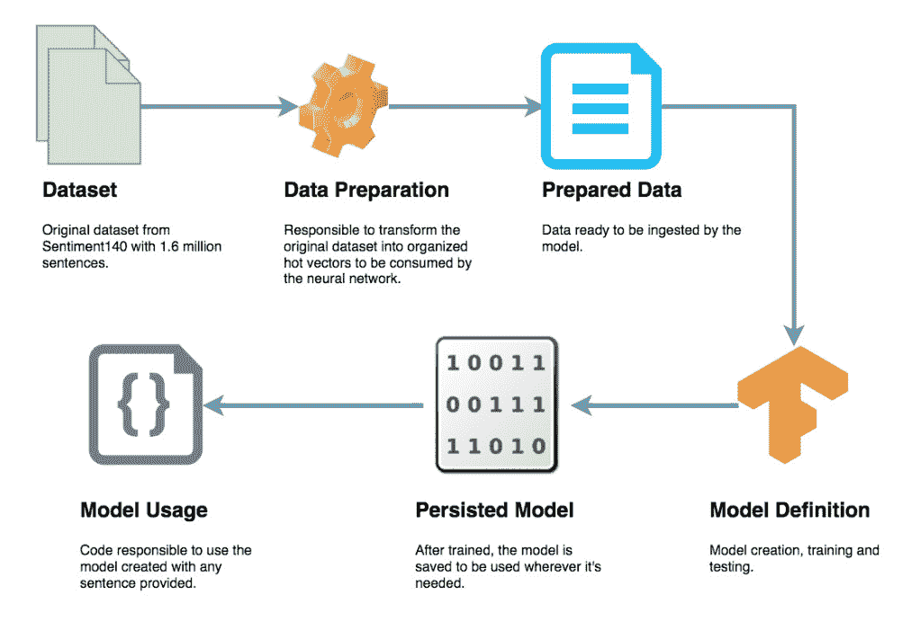

图 5-1 代码结构

考虑到你正在处理 160 万行数据，使用持久化（persistence）来确保所有数据都保存在内存中是非常重要的，这样在发生失败的情况下不需要从头开始过程。

接下来的章节描述了每一个步骤并展示了一些代码片段。

### 5.3.3 数据准备

此阶段确保数据经过转换，并在流程结束时处于 FFNN 预期的正确格式。

图 5-2 显示了数据准备阶段的视图，用于描述代码细节。

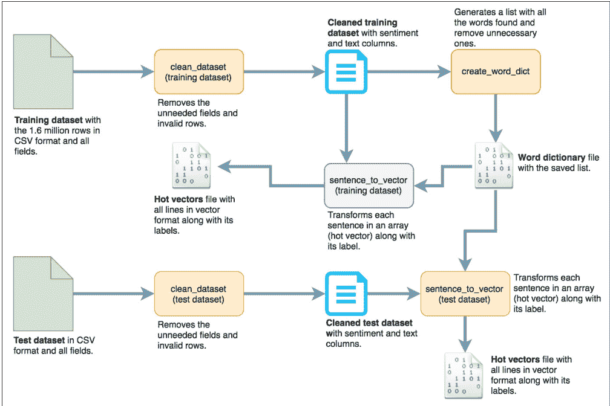

图 5-2 数据准备流程

#### 清洗数据集

你必须要做的是移除不需要的列，例如 Twitter ID、日期等，只保留情感和 Twitter 文本。要完成这项任务，请使用 `clean_dataset` 函数，如示例 5-1 所示。

> 示例 5-1 负责清洗原始数据集的函数

```python
def shuffer(input_ds, output_ds):
    df_source = pd.read_csv(input_ds, '<sep>', error_bad_lines=False)
    df_shuffled = df_source.iloc[np.random.permutation(len(df_source))]
    df_shuffled.to_csv(output_ds, 'μ', index=False)

def clean_dataset(ds, ods):
    with open(ds, 'r', 30000, 'latin-1') as row_ds:
        with open('tempds.csv', 'w', 20000) as cleaned_ds:
            for line in row_ds:
                result = re.search(r"^(\d*),(.*)$", line)
                new_line = result.group(1) + '<sep>' + result.group(2) + '\n'
                cleaned_ds.write(new_line)
```

```python
shuffer('tempds.csv', ods)
os.remove('tempds.csv')
print('data set cleanup')
```

`shuffer` 函数接收输入并生成一个以 `<sep>` 分隔的 CSV 文件以避免字符冲突。尽管数据集是 CSV 文件，但 Twitter 文字中存在逗号，仅使用 `split` 函数不起作用，因此使用正则表达式来获取所需内容。

`clean_dataset` 函数遍历数据集的每一行并应用正则表达式将新行写入临时文件。最后一步是洗牌生成的数据集以确保神经网络得到训练。对于此示例，使用 Pandas 库并写入为参数提供的输出。对于洗牌过程，Pandas 库被设计用于处理大文件。

#### 生成词汇字典

生成清洗后的数据集后，下一步是使用清洗后的数据创建词汇字典。在示例 5-2 中显示了如下：

```python
def word_dict(ds):
    word_dict = []
    with open(ds, 'r', 30000, 'latin-1') as ds:
        for line in ds:
            text = line.lower()
            words = tokenize(text)
            word_ = = [matize(w) for w in words]
    word_count = Counter(word_dict)
    cleaned_dict = [word for word in word_count if word_count[word] > 6]
    dict_size = len(cleaned_dict)
```

```python
print('Word dictionary generated'.format(dict_size))
with open('word_dict.pickle', 'wb') as wd:
    pickle.dump(cleaned_dict, wd)
```

然后，逐词遍历句子并检查该词是否存在于词汇字典中。如果是，则在句子向量中与其在词汇列表相同的位置上加 1。

该字母存在于字典中且索引为 0，因此在句子向量的第 0 处加 1：

[1, 0, 0, 0, 0, 0, 0, 0, 0, 0, 0]

继续重复此过程，直到到达句子末尾，然后处理第二个句子。处理结束，你将得到两个向量：

- 句子 1: [1, 1, 1, 1, 1, 1, 0, 0, 0, 0, 0]
- 句子 2: [0, 0, 1, 1, 0, 1, 0, 1, 1, 1, 1]

该代码读取句子训练数据集和词汇字典作为输入，将句子通过词分词函数，对单词进行词形还原并开始向量化。代码还获取了情感标签并将其转换为两个元素的列表，因为存在正面和负面句子。句子和情感向量被放入列表中并保存到二进制文件中，供后续步骤的模型读取：

示例 5-3 `sentence_to_vector` 函数。

示例 5-3 用于将句子转换为向量的代码

```python
def sentence_to_vector(word_dict, cleaned_ds, output_file):
    with open(cleaned_ds, 'r', 30000, 'latin-1') as ds:
        with open(word_dict, 'rb') as wd:
            word_dict = pickle.load(wd)
            num_lines = 0
            with open(output_file, 'wb') as hv:
                for line in ds:
                    hot_vector = np.zeros(len(word_dict))
                    if line.count('\'') == 1:
                        sentiment, text = line.split('matize[text.lower()])
                        lemm_words = [lemmatize(w) for w in words]
                        for word in lemm_words:
                            hot_vector[word_dict.index(word)] += 1
                        hot_vector = list(hot_vector)
                        clean_sentiment = re.search('.*(\d).*.', sentiment)
                    if clean_sentiment.group(1) == 0:
                        sentiment = [1, 0]
                    else:
                        sentiment = [0, 1]
                    num_lines += 1
                    pickle.dump([hot_vector, sentiment], hv)
            print('Hot vectors file generated with {} lines'.format(num_lines))
    return num_lines
```

## 注意事项

在完成训练数据集处理后，测试数据集将通过相同的过程，以确保其具有相同的格式并可用于检查模型的准确性。如第 128 页的示例 5-3 所示，测试数据集也必须使用训练数据集生成的相同词汇字典。

关于数据规模，此场景使用了 Python 和一些库来完成数据处理工作以及一些策略，例如使用框架来更高效地管理大型数据集。如果你需要扩展并处理大型数据集，可以在分布式框架中对所有数据进行处理，为神经网络做好准备绪。你可以通过使用 IBM Spectrum Scale 实现分布式解决方案，以提供可靠且可扩展的环境。本场景未涉及这些细节，因为它们超出了本书的范围。然而，这描述了 TensorFlow 如何通过使用多个图形处理器（GPU）来利用分布式处理。

## 5.4. 模型创建

现在，我们必须构建基于 TensorFlow 的模型。在数据准备阶段，我们保存了一些关于词汇表列表大小以及生成的向量文件中行数的信息。示例 5-4 显示了负责创建神经网络架构的函数。

> 5-4 创建神经网络架构

```python
def neural_net(input_data):
    neurons_h1 = 1500
    neurons_h2 = 1500
    neurons_h3 = 1500

    output_neurons = 2

    1_weight = tf.Variable(tf.random_normal([line_size['dict'], neurons_h1]), name='w1')
    1_bias = tf.Variable(tf.random_normal([neurons_h1]), name='b1')

    2_weight = tf.Variable(tf.random_normal([neurons_h1, neurons_h2]), name='w2')
    2_bias = tf.Variable(tf.random_normal([neurons_h2]), name='b2')

    3_weight = tf.Variable(tf.random_normal([neurons_h2, neurons_h3]), name='w3')
    3_bias = tf.Variable(tf.random_normal([neurons_h3]), name='b3')

    output_weight = tf.Variable(tf.random_normal([neurons_h3, output_neurons]), name='wo')
    output_bias = tf.Variable(tf.random_normal([output_neurons]), name='bo')

    11 = tf.add(tf.matmul(input_data, 1_weight), 11_bias)
    12 = tf.add(tf.matmul(11, 2_weight), 2_bias)
    13 = tf.add(tf.matmul(12, 3_weight), 3_bias)
    output = tf.add(tf.matmul(13, output_weight), output_bias)

    return output
```

本节未提供相关细节，因为它们超出了本书的范围。

计算模型输出与正确标签之间产生的成本或误差。在计算成本（误差）的过程中，应用了一个名为 Adam 的优化器，这是一种随机梯度下降（SGD）方法，它通过使用反向传播算法更新神经网络中的所有权重和偏置来降低成本。

到目前为止，这只是创建了 TensorFlow 对象并将它们相互连接。该过程创建了一个 TensorFlow 会话（session），其中运行图并导入数据。在调用 `session.run` 函数之前，该过程会从向量化的句子中读取数据，每当定义的临时缓冲区达到我们定义的批次大小（batch size）时，代码就会调用 TensorFlow 并运行优化器，从而运行整个模型。

我们 true true标签的缓冲区列表，因为我们必须提供句子及其对应的标签，以确保网络被正确训练。我们还会运行成本函数，以知道每个轮次（epoch）产生的总成本。

训练阶段会发生多次，次数由 `epochs` 变量定义。代码使用了 10 次，尽管你可以更改它并检查是否能获得更好的结果。基本上，训练数据分批次提交给 TensorFlow 模型，误差由 Adam 优化器进行计算和调整。

训练循环完成后，向图中添加正确的张量，它使用 `tf.argmax` 函数，该函数是网络输出和正确标签之间最大值的索引位置。如果两者相同，`tf.equal` 为 1，如果不匹配则为 0。使用正确张量，准确率通过正确张量的平均值来计算。

现在，我们通过相同的批处理过程读取向量化的数据集文件，但不包含轮次循环。我们使用 `eval` 函数并将数据集及其标签传递给占位符（placeholders），提交测试数据对我们的模型进行评估。完成后，通过 `saver.save` 函数保存模型。

## 5.3.5 使用模型

在训练好的模型保存并准备就绪后，创建了一个名为 `get_sentiment` 的函数，它接收句子作为输入并打印其是正性还是负性（示例 5-6）。

示例 5-6 使用此模型的函数

```python
def get_sentiment(input_data):
    tf.reset_default_graph()
    pl = tf.placeholder('float')
    nn_output = ff_neural_net(pl)
    saver = tf.train.Saver()
    with open('word_dict.pickle', 'rb') as f:
        word_dict = pickle.load(f)

    with tf.Session() as sess:
        saver.restore(sess, "model.ckpt")
        words = word_tokenize(input_data.lower())
        lemm_words = [lemm.lemmatize(w) for w in words]
        hot_vector = np.zeros(len(word_dict))
```

for word in lemm_words:


```python
if word.lower() in word_dict:
    index_value = word_dict.index(word.lower())
    hot_vector[index_value] += 1

hot_vector = np.array(list(hot_vector))
result = (sess.run(tf.argmax(nn_output.eval,
feed_dict[pl: hot_vector]), 1))

if result[0] == 0:
    print('Negative:', input_data)
elif result[0] == 1:
    print('Positive:', input_data)
```

开始定义占位符的函数，它接收我们的句子，并创建一个 `saver` 对象来加载我们训练的模型。我们还使用了单词字典文件。

我们创建一个 TensorFlow 会话并恢复保存的模型。恢复基本上是从存储在 `model.ckpt` 中的变量中读取值，并将它们赋值给在运行 `ff_neural_function` 模型时创建的变量。

使用 `sess.run`，我们通过传递 `hot_vector` 并使用 `tf.argmax` 函数运行模型，得到神经网络的答案。我们知道 `[1, 0]` 是正性的，`[0, 1]` 是负性的，如果 `argmax` 返回 0，则索引位置0是最大的，这是一个正性句子；如果是1，则这是一个负性句子。我们使用 IF 语句使结果对人类可读。

## 5.3.6 运行代码

要使用 IBM PowerAI 运行代码，请导入（source）你想要使用的框架，加载带有库的框架环境。为此，前往 `/opt/DL`（框架安装所在），并打开你想要使用的那个。在我们的情况下，我们想要使用 `tensorflow/bin`。在目录 (`/opt/DL/tensorflow/bin`) 下运行 `source tensorflow-activate`。

要训练模型，你必须运行训练函数并向其传递 TensorFlow 占位符。要使用你的模型，你必须运行 `get_sentiment` 函数并提供你想要检查的句子。

在训练时，你可以在终端上运行 `nvidia-smi` 命令查看 GPU 的使用情况。

如果你想进行测试或想对模型进行更改，可以使用较小数据集进行实验。例如，我们创建了一个名为 `smaller_dataset_gen` 的函数，用于从大型数据集中随机提取行并创建一个较小集。你只需要运行该函数并提供原始数据集、它包含多少行（如果你使用的是 Sentiment140，则为 1600000 行）、目标数据集的名称以及它想要拥有的行数。

完整代码可以在 GitHub 上找到。更多信息请参阅第 241 页的附录“情感分析”。

## 5.4 在 TensorFlow 中使用长短记忆记忆进行单词建议

本节描述了一种使用长短期记忆（LSTM）循环神经网络（RNN）的单词实现，以便你理解。我们的示例完全关于将我们的模型训练到短语数据集中；当我们使用它时，可以开始预测下一个单词可能是什么，这样我们就不需要输入它。

为此，我们使用 RNN，因为单词的顺序或序列提供了很好的建议。我们实现了一种特定的 RNN，称为 LSTM，因为简单的 RNN 无法保留旧迭代的数据；LSTM 会记住重要的，并遗忘不重要的。更多信息请参阅第 8 页的 1.2.3，“神经网络的类型及其用法”。

### 5.4.1 我们的数据集

我们使用了一个简单且小的数据集，包含 100 个创建的问题，模拟了用户询问如何在系统内执行某些操作、如何重置密码、如何访问互联网以及在哪里找到某些信息。

数据已经是正确的格式，但在生产环境中，你必须从数据库获取数据并应用转换将其转换为所需的格式。

### 5.4.2 代码的整体结构

代码的整体结构与 5.3 节第 123 页“基于 PowerAI 的 TensorFlow 情感分析”中使用的相同，因此使用了相同的图（第 8 页图 5-1）。该图表示了我们代码的结构。

有一个准备阶段，用于创建字典并将短语放入正确的 Python 对象中，以便神经网络使用。然后，在第二阶段我们定义 LSTM 神经网络模型并对其进行训练，以便进入可以使用该模型的第三阶段。

### 5.4.3 数据准备

在这一阶段，我们创建单词字典，以便了解数据集中出现的每个不同单词。我们不排除任何单词，因为每个单词对系统都是重要的。

在此阶段，我们将集合中的每个短语转换为单词列表并将其保存到 pickle 文件中，以便我们可以处理更大的数据集，而无需将它们全部保存在内存中。

示例 5-7 为你提供了代码示例。

**示例 5-7 `create_word_list` 函数**

```python
def create_word_list(source_ds):
    words_list = []
    num_lines = 0
    with open(source_ds, 'r', 20000, 'latin-1') as ds:
        with open('ds_to_list.pickle', 'wb', 10000) as ds_list:
            for line in ds:
                words = word_tokenize(line.lower())
                words_list += list(words)
                pickle.dump(words, ds_list)
                num_lines += 1

    word_count = set(words_list)
    word_list_final = {}
    count = 0
    for i in word_count:
        word_list_final[i] = count
        count += 1
    rev_word_dict = dict(zip(word_list_final.values(),
        word_list_final.keys()))
```

```python
list_size = len(word_list_final)
```

```python
print("Word dictionary: {}".format(list_size))
with open('word_dict.pickle', 'wb') as wd:
    pickle.dump(word_list_final, wd)
```

```python
with open('rev_word_dict.pickle', 'wb') as wd:
    pickle.dump(rev_word_dict, wd)
```

```python
print("Word dictionary generated and saved")
return list_size, num_lines
```

`create_word_list` 函数接收数据集并逐行处理它。对于每一行，该函数使用 NLTK 库中的 `word_tokenize` 函数将其转换为单词列表，使用 `pickle` 将其保存到文件中，并添加到名为 `words_list` 的列表中，然后使用 `set` 进行唯一化存储。

我们创建一个字典并为每个单词分配一个从 0 到 `word_count` 的数字。这些数字被用于输入神经网络。我们必须创建一个反向单词字典，以便当我们拥有单词数字并需要回溯单词时更容易进行映射。基本上，该字典是通过使用第一个字典的值作为键、其键作为值创建的。

处理此过程后，我们将两个字典都写入文件，以便在不同的模块中使用。该函数返回单词字典的大小和原始数据的大小，以便它们可以在不同的模块中用于循环控制。

## 5.4.4 模型创建

在创建了每个单词对应数字的字典后，数据集的格式为每个短语一个列表，列表中的每个项是短语的一个单词，我们使用 LSTM 神经网络创建模型。`lst_rnn` 函数就是定义发生的地方，如示例 5-8 所示。

**示例 5-8 `lstm_rnn` 函数**

```python
output_weight = tf.Variable(tf.random_normal([num_neurons,
                                                files_details['list']]))
output_biases = tf.Variable(tf.random_normal([[files_details['list']]]))

tf_placeholder = tf.reshape(tf_placeholder, [-1, interval_size])

tf_placeholder = tf.split(tf_placeholder, interval_size, 1)
nn_layers = rnn.MultiRNNCell([rnn.BasicLSTMCell(num_neurons),
                               rnn.BasicLSTMCell(num_neurons)])

out, states = rnn.static_rnn(nn_layers, tf_placeholder, dtype=tf.float32)

return tf.matmul(outputs[-1], output_weight) + output_biases
```

完成以下步骤：

1. 为神经网络输出层定义权重和偏置。权重是一个所有权重随机初始化的矩阵，偏置也是随机初始化的。它们是 TensorFlow 变量，因此框架知道它们在训练阶段必须进行更新和调整。

2. 创建 TensorFlow-placeholder 来接收数据集（newmer 格式），并将其重塑为符合 `rnn.static_rnn` 函数预期的格式。

3. TensorFlow 通过准备好使用的函数来设置 LSTM 神经网络。

4. 使用 `rnn.MultiRNNCell` 创建一个具有多个隐藏层的 RNN。此函数接收每层的神经元，在这种情况下是 LSTM 神经元。必须使用指定神经元数量的 `BasicLSTMCell` 函数。`static_rnn` 函数将整个模型与标识符绑定以创建神经网络。TensorFlow 帮助定义神经网络的完整结构。

5. 执行输出层操作，即将第二个隐藏层的输出乘以输出权重和偏置之和。使用输出的最后一个位置是因为我们对 RNN 的最后一个输出感兴趣。RNN 在每次迭代后生成一个输出，因此它生成一个数组作为输出。

## 5.4.5 训练

训练阶段与 5.3 中应用于情感分析的阶段相似。参考第 123 页的“在 IBM PowerAI 上使用 TensorFlow 进行情感分析”。区别在于向神经网络提供了什么以及如何。示例 5-9 解析了代码并展示了其细节。

**示例 5-9 训练函数**

```python
def training(in_placeholder):
    rnn_output = lstm_rnn(in_placeholder)
    saver = tf.Saver()

    cost = tf.reduce_mean(tf.nn.softmax_cross_entropy_with_logits(labels=y, logits=rnn_output))
    optimizer = tf.train.AdamOptimizer(learning_rate=0.001).minimize(cost)

    correct = tf.equal(tf.argmax(rnn_output, 1), y)
    accuracy = tf.reduce_mean(tf.cast(correct, tf.float32))

    init = tf.global_variables_initializer()

    with tf.Session() as session:
        session.run(init)
        step = 0
        start = 0
        end = interval_size
        acc_total = 0
        loss_total = 0
        counter = 0

        with open('word_dict.pickle', 'rb') as wd:
            word_dict = pickle.load(wd)
        while step < end:
            with open('ds_to_list.pickle', 'rb') as ds:
                line_list = pickle.load(ds)
                for i in range(len(line_list)):
                    sequence = np.zeros([len(word_dict)])
                    for word in line_list[i]:
                        sequence[word_dict[word]] = 1
                    sequence = np.reshape(sequence, [1, -1])
                    hot_vector = np.zeros([len(word_dict)])
                    hot_vector[line_list[i][3]] = 1
                    
                    acc, loss = session.run([accuracy, cost],
                        feed_dict={in_placeholder: sequence, y: hot_vector})
                    counter += 1
                    acc_total += acc
                    loss_total += loss
            step += 1
            print('{}. Loss: {:.4f} and Accuracy: {:.2f}%'.format(step+1, loss_total/counter, (100*acc_total)/counter))

        saver.save(session, 'model.ckpt')
```

## 5.4.6 使用模型

要使用训练过的网络模型，请如示例 5-10 所示创建 `get_word` 函数。该函数负责提供一个 CLI（命令行界面）体验，提示用户至少输入三个单词，根据输入调用神经网络模型，获取其返回并呈现三个最佳单词选项，以便用户自动补全正在输入的句子。

**示例 5-10 `get_word` 函数**


```python
def get_word():
    with open('word_dict.pickle', 'rb') as wd:
        word_dict = pickle.load(wd)
    with open('rev_dict.pickle', 'rb') as rd:
        rev_dict = pickle.load(rd)
    in_placeholder = tf.placeholder('float', [None, interval_size, 1])
    rnn_output = lstm_rnn(in_placeholder)
    saver = tf.train.Saver()
    with tf.Session() as sess:
        sess.run(tf.global_variables_initializer())
        saver.restore(sess, 'model.ckpt')
        phrase_check = 'invalid'
        while phrase_check == 'invalid':
            prompt = 'Type at least ({}) words '.format(interval_size)
            phrase = input(prompt)
            phrase = phrase.strip()
            words = word_tokenize(phrase.lower())
            if len(words) < interval_size:
                print('We need at least ({}) words!'.format(interval_size))
            else:
                words = words[-interval_size:]
                phrase_check = 'valid'
        next_word = ''
        word_dict_size = len(word_dict)
        phrase_to_num = []
        for i in words:
            if i in word_dict.keys():
                phrase_to_num.append(word_dict[i])
            else:
                phrase_to_num.append(word_dict_size)
                word_dict_size += 1

        while next_word != '4':
            phrase_reshape = np.reshape(np.array(phrase_to_num), [-1, interval_size, 1])
            rnn_predictions = sess.run(rnn_output,
                                       feed_dict={in_placeholder:
                                                  phrase_reshape})
            answers = get_top(3, list(rnn_predictions[0]))
            print('Suggestions: {}'.format(answers))
            num = 1
            for j in answers:
                print('{}: {}'.format(num, rev_word_dict[j]))
                num += 1
            print('{}: Finish'.format(num))
            prompt = 'Select the number or a word type: '

next_word = input(prompt)

if next_word in ['1', '2', '3']:
    phrase = phrase + ' ' + rev_word_dict[answers[int(next_word)-1]]
    print('Your phrase so far: {}'.format(phrase))
    phrase_to_num = phrase_to_num[1:]
    phrase_to_num.append(answers[int(next_word)-1])
elif next_word == '4':
    print('Final phrase: {}'.format(phrase))
else:
    phrase = phrase + ' ' + next_word
    print('Your phrase so far: {}'.format(phrase))
    phrase_to_num = phrase_to_num[1:]
    if next_word in word_dict.keys():
        phrase_to_num.append(word_dict[next_word])
    else:
        phrase_to_num.append(word_dict_size)
        word_dict_size += 1
```

该函数首先将单词字典加载到模型中，启动 TensorFlow 会话并恢复训练过的模型（权重和偏置）。

考虑到此处的大部分代码与用户体验以及验证输入信息的规则有关，本节将不涉及细节，尽管指出网络如何接收输入是重要的。

我们使用三个单词对网络进行检查，因此即使网络中超过三个单词，只有最后三个会被输入网络。我们获取一个热向量作为返回，使用`get_top`函数对其进行排序，然后选出三个最高值及其索引。

## 5.4.7 运行代码

考虑到此处的大部分代码与用户体验以及验证输入信息的规则有关，本节将不涉及细节，尽管指出网络如何接收输入是重要的。

我们使用三个单词对网络进行检查，因此即使网络中超过三个单词，只有最后三个会被输入网络。我们获取一个热向量作为返回，使用`get_top`函数对其进行排序，然后选出三个最高值及其索引。

代码是用 TensorFlow 构建的。要运行模型，请遵循以下步骤：

```python
x = tf.placeholder('float', [None, interval_size, 1])
```

## 5.4.8 最终考虑

考虑到此处的大部分代码与用户体验以及验证输入信息的规则有关，本节将不涉及细节，尽管指出网络如何接收输入是重要的。

代码是用 TensorFlow 构建的。要运行模型，请遵循以下步骤：

```python
x = tf.placeholder('float', [None, interval_size, 1])
```

## IBM Spectrum Conductor Deep Impact 简介

IBM Conductor Deep Impact (DLI) 基于 Spark 的 IBM Conductor 构建，是一个高可用且韧性的多租户框架，提供了深度学习（DL）应用的生命周期管理。

本章包含以下主题：

- IBM Conductor Deep Impact 的优势
- Deep Impact 的关键特性
- DLI 部署
- DLI 用户界面介绍
- 支持的深度学习网络和训练引擎
- 用例：使用 Caffe Cifar-10

## 6.1 定义、缩写、流行语和简写

表 6-1 显示了本章中使用的术语。

| 定义 | 描述 |
|---|---|
| IBM PowerAI | 深度学习 (Deep Learning)。 |
| Inference | Wikipedia：推断。 |
| IBM Conductor with Spark | IBM Conductor with Spark 企业级平台。 |
| Deep learning | 基于 IBM Conductor with Spark 的 DL 平台。 |
| LMDB | Lightning Memory-Mapped Database，供 Caffe 使用。 |
| TFRecords | 一种常用的 TensorFlow 格式。 |
| Parameter Server (PS) | GitHub Parameter Server。 |
| Graphical processing unit (GPU) | Wikipedia：图形处理单元。 |
| NCCL | NVIDIA Collective Communications Library。 |
| Hyperparameters tuning | 在训练神经网络时，模型不同的超参数设置会影响训练结果，例如成本或模型性能。超参数优化或调优是为性能最佳的 DL 模型搜索一组最优超参数。 |
| Tree-structured Parzen Estimator Approach (TPE) | 超参数优化算法 |
| Random search | 通过从所有候选中随机采样设置来搜索最佳超参数设置。 |
| Bayesian optimization | 贝叶斯优化是一种用于噪声黑盒函数全局优化的方法。更多信息请参《机器学习算法实用贝叶斯优化》。 |
| Underfitting | 欠拟合是指无法模拟训练数据或生成新数据的模型。 |
| Overfitting | 过拟合是指模型很好地模拟了训练数据。 |

## 6.2 IBM Spectrum Conductor 深度学习的影响

在 IBM Power 平台上，IBM PowerAI 为客户提供了许多深度学习（DL）框架和有用技术供其利用和实施。在许多情况下，客户希望使用 DL 技术并将其与现有应用程序集成，为他们的业务带来新价值。为了确保一个（而非多个）DL 项目成功投入生产，有一些重要的要素，例如数据管理、算术和神经网络管理以及计算资源管理。

图 6-1 展示了 DL 项目的通用生命周期。

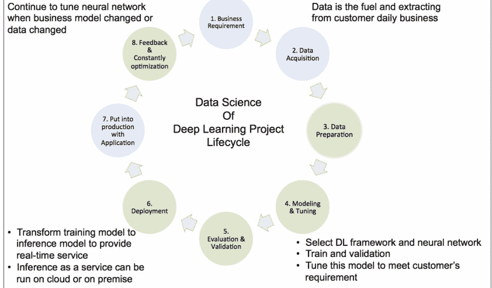

图 6-1 深度学习项目生命周期

DL 始终于业务需求（步骤 1）。大多数情况下，数据由客户提供。如果你使用监督训练网络，则也需要数据标注（步骤 2）。

在理解业务需求和可用数据后，你可以通过完成以下高层步骤来实现一个或多个神经网络：

1. 对数据进行重新格式化或重构，以符合模型使用的可用/所需格式（步骤 3）。
2. 导入 DL 网络创建训练模型（步骤 4）。
3. 启动模型训练任务（步骤 4）。
4. 调整模型以提高准确性（步骤 5）。
5. 根据训练好的模型生成推理模型（步骤 6）。
6. 将推理模型与客户应用程序集成（步骤 6 和 7）。
7. 将模型投入生产（步骤 7）。
8. 生成更新的推理模型以适应变化的数据（步骤 8）。

这些步骤解释了 DL 项目的闭环生命周期。

DLI 从步骤 3 到 8 起效，步骤 7 例除外。DLI 还可以提供其他益处：

- 多租户支持
- 动态管理 GPU 资源
- 训练可视化
- 训练期间的早停警告
- 用于模型调优的超参数搜索
- 支持通过 fabric 技术进行多节点训练，提供更简单的集成和更好的速度比
- 为客户应用程序提供 RESTful API 以便调用推理服务

## 6.3 深度学习影响的关键特性

本节介绍了 DLI 的一些关键特性。

作为一个 DLI 开发和管理平台，DLI 的主要目标是以下：

- 提高神经网络模型的准确性
- 在处理大规模数据集时提高训练效率
- 在模型部署后，为用户推理请求提供实时响应

为了实现这些目标，DLI 提供了并行数据处理、超参数调优、带有优化梯度和权重削减算法的并行训练、训练建议、推理即服务功能等。

### 6.3.1 并行数据集处理

DLI 数据集用于模型调优、训练、测试和验证。数据集管理功能可以帮助用户管理数据。DLI 能够提供并行数据处理、超参数调优、带有优化梯度和权重削减算法的并行训练、训练建议、推理即服务功能等。

- 深度学习（LMDB）
- 图像处理
- 目标分类
- 卷积
- 原始数据
- 记录（Records）

在创建数据集时，DLI 能够：

- 随机洗分
- 结构化帕森估计器方法（TPE）
- 贝叶斯搜索
- 能够监控 DLI 的训练状态

### 6.3.2 DLI 监控与优化

DLI 数据集用于模型调优、训练、测试和验证。数据集管理功能可以帮助用户管理数据。DLI 能够提供并行数据处理、超参数调优、带有优化梯度和权重削减算法的并行训练、训练建议、推理即服务功能等。

- 梯度爆炸
- 溢出
- 饱和度
- 过拟合
- 欠拟合

### 6.3.3 超参数搜索

在训练过程中，超参数的设置非常重要。超参数优化支持：

- 学习率
- 卷积神经网络（CNNs）
- 循环神经网络（RNNs）

### 6.3.4 IBM Fabric 分布式训练

DLI 使用 IBM Fabric 技术作为其通用框架的一部分。

- 随机搜索
- 贝叶斯搜索

## 6.3.6 DLI 推理模型

该模型将训练好的 DL 模型投入生产环境，这是数据科学家最令人兴奋的时刻。DLI 推理模型通过在门户中点击几个按钮，即可让这一步变得简单且高效。推理模型也是用户真正从 DL 模型中获益的主要方式。IBM Conductor 通过在 IBM Spectrum Conductor with Spark 集群中将推理模型作为服务进行管理，为数据科学家和用户提供服务，并提供高级推理引擎供用户访问。基于 IBM Spectrum Conductor with Spark 强大的调度、弹性伸缩和高效的资源管理功能，用户的推理请求可以在 IBM Spectrum Conductor with Spark DLI 中顺畅高效地得到服务。

DLI 推理模型支持以下功能：

- 将训练好的模型转换为推理模型。
- 使用预训练权重文件创建推理模型。
- 通过 IBM Spectrum Conductor with Spark DLI Web 门户和 REST API 进行推理。
- 通过门户和 REST API 管理推理模型和结果。
- 支持推理模型预安装，以缩短响应时间并提高资源利用率。
- 提供高吞吐量。
- 支持在大型动态集群中运行。

## 6.3.7 支持共享多租户基础设施

DLI 构建在 IBM Spectrum Conductor with Spark 之上，它使用 IBM Enterprise Grid Orchestrator (IBM EGO) 为 IBM Spectrum Conductor with Spark 集群内的 Spark 应用提供资源管理和调度能力。IBM EGO 还提供了底层系统基础设施，允许多个应用程序在共享的多租户基础设施中运行。

> 注意：更多信息请参阅 IBM EGO。

图 6-2 显示了创建多租户环境的工作流。

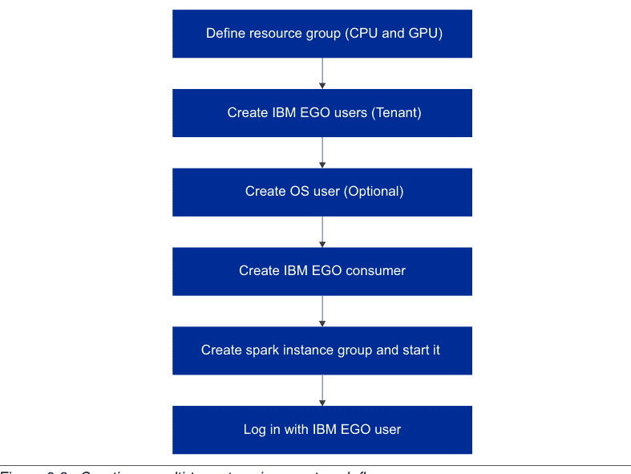

在创建 IBM EGO 用户期间，一个用户拥有不同的权限。图 6-3 描述了 IBM Spectrum Conductor with Spark 中的角色和权限。

| 角色 | 权限 |  |
|---|---|---|
| 集群管理员 | SPARK_DEEPLEARNING CONFIG<br>SPARK_DEEPLEARNING VIEW<br>SPARK_DEEPLEARNING_VIEW_ALL | 创建/更新/删除<br>参见 GUI 中的深度学习<br>可以访问其 DL 资产以及相同 SIG 中的其他资源 |
| 消费者管理员 | SPARK_DEEPLEARNING CONFIG<br>SPARK_DEEPLEARNING VIEW<br>SPARK_DEEPLEARNING_VIEW_ALL | 创建/更新/删除<br>参见 GUI 中的深度学习<br>可以访问其 DL 资产以及相同 SIG 中的其他资源 |
| 消费者管理员（只读） | SPARK_DEEPLEARNING VIEW<br>SPARK_DEEPLEARNING_VIEW_ALL | 参见 GUI 中的深度学习<br>可以访问其 DL 资产以及相同 SIG 中的其他资源 |
| 消费者用户 | SPARK_DEEPLEARNING CONFIG<br>SPARK_DEEPLEARNING VIEW | 创建/更新/删除<br>参见 GUI 中的深度学习 |

图 6-3 同一个 IBM EGO 用户的不同角色和权限

在一个 IBM Spectrum Conductor with Spark 集群中，有一个会话调度器角色用于分发不同任务的。有三种策略：优先级 (Priority)、先进先出 (FIFO) 和公平份额 (Fairshare)。

第 151 页的图 6-4 显示了多租户环境以及针对租户和应用程序的资源管理。

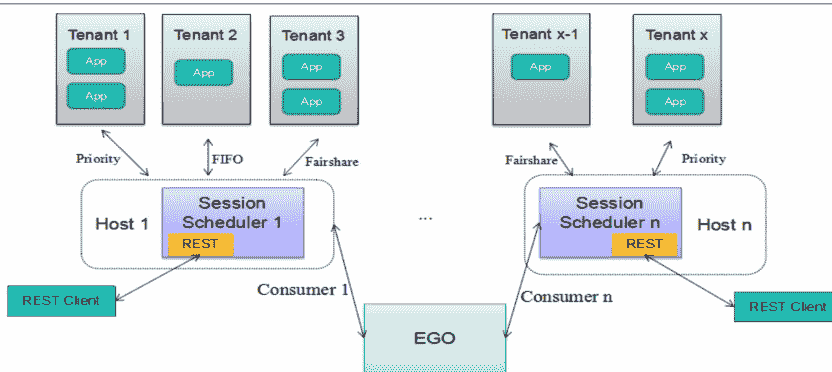

图 6-4 多租户资源管理示例

> 注意：为了支持 IBM Fabric 和自动伸缩功能，请将调度策略设置为 Fairshare。

## 多租户示例 1

图 6-5 是一个直观的场景。在此场景中，有两台服务器及其对应的 CPU 和 GPU 资源。

| CPU_RG1 | CPU_RG2 |
|---|---|
| GPU_RG1 | GPU_RG2 |
| host01 | host02 |
| CPU | CPU |
| GPU | GPU |
| 租户_1, 租户_2... | 租户_a, 租户_b... |
|---|---|


## 多租户示例 1

| Spark 实例组_1 | Spark 实例组_2 |
| --- | --- |
| 消费者_1 | 消费者_2 |
| CPU_RG1 | CPU_RG2 |
| GPU_RG1 | GPU_RG2 |
| 数据集 | 数据集 |
| DL 训练模型 | DL 训练模型 |
| DL 推理模型 | DL 推理模型 |
| ... | ... |

图 6-5 多租户示例 1

该场景具有以下特征：

- 用户为每个主机创建一个资源组。`host1` 拥有 `CPU_RG1` 和 `GPU_RG1` 资源组，`host2` 拥有 `CPU_RG2` 和 `GPU_RG2` 资源组。
- `消费者_1` 包含 `CPU_RG1` 和 `GPU_RG1` 资源组以及租户组 1（`租户_1`、`租户_2` 等）。
- `消费者_2` 包含 `CPU_RG2` 和 `GPU_RG2` 资源组以及租户组 2（`租户_a`、`租户_b` 等）。
- Spark 实例组 (SIG) 包含 `消费者_1` 及其资源组。Spark 2 包含 `消费者_2` 及其资源组。

通过这种配置，两个租户组使用两个租户组。

## 多租户示例 2

图 6-6 显示了另一个场景。在此场景中，有两台服务器拥有自己的资源。

| host01 | host02 |
| --- | --- |
| CPU | CPU |
| GPU | GPU |
| 租户_1, 租户_2... | 租户_a, 租户_b... |
| --- | --- |
| Spark 实例组_1 | Spark 实例组_2 |
| 消费者_1 | 消费者_2 |
| CPU_RG1 | CPU_RG2 |
| GPU_RG1 | GPU_RG2 |
| 数据集 | 数据集 |
| DL 训练模型 | DL 训练模型 |
| DL 推理模型 | DL 推理模型 |
| ... | ... |

图 6-6 多租户示例 2

该场景具有以下特征：

- `host1` 的所有资源被配置到一个组中：`CPU_RG1`。
- `host2` 的所有资源被配置到一个组中：`GPU_RG1`。
- `消费者_1` 包含 `CPU_RG1` 和 `GPU_RG1` 资源组以及租户组 1（`租户_1`、`租户_2` 等）。
- `消费者_2` 包含 `CPU_RG2` 和 `GPU_RG2` 资源组以及租户组 2（`租户_a`、`租户_b` 等）。*（注：此处原文可能有误，应为 `CPU_RG2`）*
- SIG 1 包含 `消费者_1` 及其资源组。
- SIG 2 包含 `消费者_2` 及其资源组。

通过这种配置，两个租户组使用独立的硬件。

## 多租户示例 3

图 6-7 是一个简单的示例。在此场景中，有三台服务器拥有自己的资源。

| host01 | host02 | host03 |
| --- | --- | --- |
| CPU | CPU | CPU |
| GPU | GPU | GPU |
| 租户_1, 租户_2... | 租户_a, 租户_b... |
| --- | --- |
| Spark 实例组_1 | Spark 实例组_2 |
| 消费者_1 | 消费者_2 |
| CPU_RG1 | CPU_RG2 |
| GPU_RG1 | GPU_RG2 |
| 数据集 | 数据集 |
| DL 训练模型 | DL 训练模型 |
| DL 推理模型 | DL 推理模型 |
| ... | ... |

图 6-7 多租户示例 3

该场景具有以下特征：

- `host1` 的所有资源被配置到一个组中：`CPU_RG1`。
- `host2` 的所有资源被配置到一个组中：`GPU_RG1`。
- `消费者_1` 包含 `CPU_RG1` 和 `GPU_RG1` 资源组以及租户组 1（`租户_1`、`租户_2` 等）。
- `消费者_2` 包含 `CPU_RG2` 和 `GPU_RG2` 资源组以及租户组 2（`租户_a`、`租户_b` 等）。
- SIG 1 包含 `消费者_1` 及其资源组。
- SIG 2 包含 `消费者_2` 及其资源组。

通过这种配置，两个租户组共享硬件。

## 6.4 DLI 部署

本节介绍了如何在 PowerAI 上部署 DLI。

### 6.4.1 部署考虑因素

本节介绍了三种部署模式：单节点、无高可用性 (HA) 功能的多节点以及具有高可用性功能的多节点。在实际案例中，还有其他方法，但取决于客户的需求。

关于这种部署模型，本场景关注通用架构。在我们的环境中，软件栈版本如下：

- DLI V1.1
- IBM Spectrum Conductor with Spark V2.2.1
- IBM PowerAI V1.5
- RHEL for Power Systems (ppc64le) V7.4
- CUDA V9.0.176
- GPU 驱动 V384.81
- CUDA 深度神经网络 (cuDNN) V7.0.4
- IBM Spectrum MPI V10.1

### 6.4.2 DLI 单节点模式

在这种模式下，只有一个节点。这种模式通常用于开发和测试。该节点既是主节点也是计算节点。第 155 页的图 6-8 显示了安装步骤的顺序。

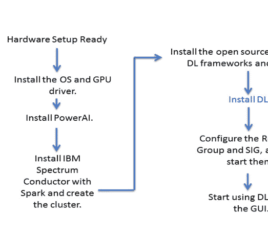

图 6-8 单节点 DLI 环境的安装步骤

关于前三个步骤的说明，请参阅第 59 页的第 4 章“部署 IBM PowerAI”。

在安装 IBM PowerAI 之后，您可以开始安装带有 Spark 的 IBM Spectrum Conductor 并创建集群。您还必须安装所需的开源软件。要获取安装脚本，请访问 GitHub。

接下来可以安装 DLI 应用本身，并配置 GPU 资源和 SIG。随后，环境即为深度学习（DL）活动准备绪。

### 6.4.3 不带高可用功能的 DLI 集群

在此模式下，DLI 集群中包含多个节点，并且始终有一个节点作为管理节点。在这种情况下，该节点也作为主节点，如图 6-9 所示。

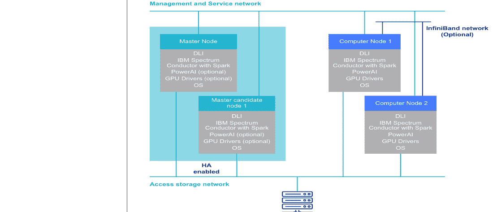

图 6-9 不带高可用功能的 DLI 集群拓扑

图 6-10 展示了此类 DLI 集群配置的典型安装步骤。

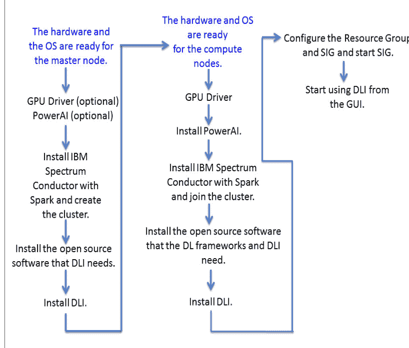

第 6 章 IBM Spectrum Conductor 简介 深度学习 157

### 6.4.4 带有高可用功能的 DLI 集群

图 6-11 显示了启用 HA 功能的一种拓扑。该拓扑有两个管理节点和两个计算节点。


图 6-11 启用高可用功能的 DLI 集群拓扑

> 注意：如果您想启用 DLI 的 HA 功能，请勿在主节点上配置 GPU 设备，因为如果负载在主节点上运行且该节点故障（尽管所有带有 Spark 的 IBM Spectrum Conductor 和 DLI 服务都可以在备主节点上重启），由于负载异常终止，必须手动重启。

第 159 页的图 6-12 显示了此类集群的安装步骤。


### 6.4.5 高可用集群的二进制文件安装

在安装启用 HA 的 DLI 集群之前，您必须考虑放置带有 Spark 的 IBM Spectrum Conductor 和 DLI 文件的位置。两个典型选项是本地或共享文件系统。

> 注意：本节未描述共享文件系统的实现。我们假设您已经使用 IBM Spectrum Scale™ 或任何您喜欢的文件系统实现了共享文件系统。

#### 本地磁盘中的二进制文件

在安装过程中，所有二进制文件都安装在本地文件系统中，如图 6-13 所示。然而，所有的配置文件和日志文件都安装在共享文件系统中。


图 6-13 本地安装的文件系统布局示例

> 注意：`/opt/ibm/spectrumcomputing` 目录是放置带有 Spark 的 IBM Spectrum Conductor 和 DLI 二进制文件的默认目录。您可以在安装期间更改它。

#### 共享文件系统中的二进制文件

图 6-13 展示了启用 HA 的 DLI 集群的安装示例。在安装序列期间，您设置一个选项来指定目标安装目录，该目录位于共享文件系统中。然后，所有二进制文件和其他文件都安装在此共享文件系统中，如第 161 页的图 6-14 所示。


图 6-14 共享文件系统安装

> 注意：`/sharefs/spectrumcomputing` 直接是安装带有 Spark 的 IBM Spectrum Conductor 的示例共享文件系统。
> `/sharefs/dli_userdata` 目录是 DLI 安装期间设置共享文件系统的示例。
> `/sharefs/sig_share` 目录是创建 SIG 期间设置共享文件系统的示例，因为它被用于 SIG HA 功能。

### 6.4.6 带有高可用功能的 DLI 集群安装指南

本节提供了如何设置 DLI 集群并启用 HA 功能的概述。

#### 拓扑

在这种情况下，拓扑由三个节点组成：两个节点被配置为管理节点，一个节点配置为计算节点。两个管理节点启用 HA 功能。计算节点运行 DL 负载，如图 6-15 所示。


图 6-15 DLI 集群拓扑。关于二进制文件的位置，此示例使用了默认值为 `/opt/ibm/spectrumcomputing` 的本地文件系统。

第 163 页的图 6-16 显示了此配置的安装步骤。

- 安装 GPU 驱动（可选）
- 在两个管理节点上安装 PowerAI（可选）
- 在计算节点上安装 GPU 驱动
- 安装 PowerAI
- 安装带有 Spark 的 IBM Spectrum Conductor 并加入集群
- 安装 DL 框架和 DLI 需要的源软件
- 安装 DLI
- 配置资源组和 SIG
- 从 GUI DLI
- 使用 DL 负载进行故障转移测试
- 在两个节点上部署带有 Spark 的 IBM Spectrum Conductor
- 创建集群并启用 Conductor Spark HA 及故障转移测试
- 在两个节点上部署 DLI
- 启用 DLI HA 并故障转移测试


预期所需的操作系统已根据安装指南安装并配置，并且所有节点上都安装了 PowerAI。由于 DLI 依赖于带有 Spark 的 IBM Spectrum Conductor HA 框架，在启动 DLI 之前需要对带有 Spark 的 Conductor 进行任何必要的 HA 测试。HA 测试必须在随后的 DLI 安装以及再次运行负载后重复。

#### 安装两个节点的步骤

如示例 6-1 所示，在开始安装之前需要在所有节点上进行某些配置。

所有节点的环境设置

```bash
root@dli01# cat /etc/hosts
...
172.16.51.96    dli01.dli.com dli01
172.16.51.97    dli02.dli.com dli02
172.16.51.98    dli03.dli.com dli03
```

```bash
root@dli01# cat /etc/sysctl.conf
...
vm.max_map_count = 262144
```

```bash
root@dli01# useradd egoadmin -m
root@dli01# cat /etc/security/limits.conf
egoadmin soft nproc 65535
egoadmin hard nproc 65535
egoadmin soft nofile 65535
egoadmin hard nofile 65535
root - nproc 65536
root - nofile 65536
* - memlock unlimited
```

```bash
root@dli01# cat /etc/security/limits.d/20-nproc.conf
* soft nproc 4096
root soft unlimited
egoadmin nproc -65536
```

> 注意：配置网络时间协议（NTP）是多节点环境的要求。

在示例中，我们使用简单的 NFS 挂载作为共享文件系统。在生产环境中，使用 IBM Spectrum Scale（或等等物）提供共享文件系统。

用于安装和配置两个节点的详细步骤记录在表 6-2 中。

| 表 6-2 管理节点安装步骤 | dli01 节点操作 | dli02 节点操作 |
| :--- | :--- | :--- |
| **用户** | **操作** | **用户** | **操作** |
| root | 安装带有 Spark 的 IBM Spectrum Conductor: `export CLUSTERNAME=egoadmin export CLUSTERNAME=dicluster export LANG=C bash -x cws-2.2.1.0_ppc6le.bin --quiet` | | |
| egoadmin | 创建带有 Spark 的 IBM Spectrum Conductor 集群: `source /opt/ibm/spectrumcomputing/profile.platform econfig $(hostname) -f` | | |
| egoadmin | 设置权限: `econfig set entitlement_file_cws.dat` | | |
| root | 启动带有 Spark 的 IBM Spectrum Conductor 服务并检查其状态: `source /opt/ibm/spectrumcomputing/profile.platform egosh start sleep 5 egosh user logon -u Admin -x Admin egosh service list` | | |
| root | 加入集群: `/opt/ibm/spectrumcomputing/profile.platform econfig join dli01` | | |
| root | 启动带有 Spark 的 IBM Spectrum Conductor 服务并检查其状态: `source /opt/ibm/spectrumcomputing/profile.platform egosh start user logon -u Admin -x Admin egosh service list` | | |
| root | 停止两个节点的带有 Spark 的 IBM Spectrum Conductor 服务: `source /opt/ibm/spectrumcomputing/profile.platform egosh stop all egosh shutdown all` | | |
| egoadmin | 为带有 Spark 的 IBM Spectrum Conductor 启用 HA 功能: `source /opt/ibm/spectrumcomputing/profile.platform econfig myhost /shares/cws_share` | | |
| egoadmin | 为带有 Spark 的 IBM Spectrum Conductor 启用 HA 功能: `source /opt/ibm/spectrumcomputing/profile.platform econfig myhost /shares/cws_share` | | |
| root | 启动带有 Spark 的 IBM Spectrum Conductor 集群服务: `source /opt/ibm/spectrumcomputing/profile.platform egosh start all egosh user logon -u Admin -x Admin egosh service list` | | |

# 对 dli01 节点的操作

# 对 dli02 节点的操作

| root | 描述 |
| :--- | :--- |
| root | 如预期，所有主节点的服务都会在 3 分钟内被 `dli02` 节点接管:<br>`egosh service list`<br>`egosh resource list`<br>`egosh resource -m` |
| root | 启动 `dli01` 虚拟机 (VM) 并启动带有 Spark 的 IBM Spectrum Conductor:<br>`source /opt/ibm/spectrumcomputing/profile.platform`<br>`egosh start all`<br>`egosh user logon -u Admin -x Admin`<br>`egosh service list`<br>检查集群状态。 |
| root | 安装神经网络框架所需的开源软件。 |
| root | 安装 DLI:<br>`cd /bin`<br>`rm sh`<br>`ln -s bash`<br>`source /opt/ibm/spectrumcomputing/profile.platform`<br>`export CLUSTERADMIN=egoadmin`<br>`export CLUSTERNAME=dichlor`<br>`export DLI_CONDA_HOME=/opt/anaconda2`<br>`export DLI_SHARED_FS=/shares/dli_userdata`<br>`LANG=C bash dli-1.1.0_ppc64.bin --quiet` |


# 对 `dli01` 节点的操作

| root | 停止两个节点带有 Spark 的 IBM Spectrum Conductor： |
| :--- | :--- |
| | `source /opt/ibm/spectrumcomputing/profile.platform` |
| | `egosh service stop all` |
| | `egosh shutdown all` |

| egoadmin | 添加 DLI 权限： |
| :--- | :--- |
| | `eoconfig setitlement entitlement_file_dli.dat` |

| egoadmin | 启用 HA 功能： |
| :--- | :--- |
| | `source /opt/ibm/spectrumcomputing/profile.platform` |
| | `eoconfig mhost /shares/cws_share \|\|` |

# 对 `dli02` 节点的操作

| egoadmin | 启用 HA 功能： |
| :--- | :--- |
| | `source /opt/ibm/spectrumcomputing/profile.platform` |
| | `eoconfig mhost /shares/cws_share \|` |

| root | 刷新环境变量并启动两个节点带有 Spark 的 IBM Spectrum Conductor： |
| :--- | :--- |
| | `source /opt/ibm/spectrumcomputing/profile.platform` |
| | `egosh ego start all` |

| root | 运行 `init 0` 以模拟 `dli02` 崩溃。 |
| :--- | :--- |

| root | 检查集群状态和 DLI 服务。 |
| :--- | :--- |

| root | 启动 `dli02` 并启动服务。 |
| :--- | :--- |

# 安装计算节点的步骤

完成两个管理节点的安装和测试后，在计算节点上安装 DLI，如表 6-3 所示。

**表 6-3 计算节点安装步骤**

| 用户 | 操作 |
| :--- | :--- |
| root | 安装操作系统、GPU 驱动程序和 IBM PowerAI。 |
| root | 安装 IBM Spectrum Conductor Spark。 |
| egoadmin | 加入现有集群。 |
| root | 启动带有 Spark 的 IBM Spectrum Conductor 服务。 |
| root | 安装 DL 框架和 DLI 需要的开源软件。 |
| root | 安装 DLI。 |
| root | 检查集群状态： |

```
root@dli03# epoch resource list
NAME status swp ut it pg rim r15s rim15m
dli02.*d ok 56K 167M 366 1% 0.0 0.3 0.1 0.2 1
dli03.*d ok 516 167M 40G 9% 5 0.0 2.0 4.0 1
dli04.*d ok 56K 167M 366 1% 5 0.0 0.6 0.8 1

root@dli03# epoch resource list -m
IBM EGO current host : dli01.com
Candidate(master) : dli01.com,dli02.com
```

# 启用带有 Spark 的 IBM Spectrum Conductor 以监控 GPU 资源

在编写时，必须运行一个脚本来启用带有 Spark 的 IBM Spectrum Conductor 监控 GPU 资源。示例 6-2 显示了一个使用的命令。

```
#source /opt/ibm/spectrumcomputing/profile.platform
#/opt/ibm/spectrumcomputing/conductors/2.2/etc/gpuconfig.sh enable --quiet
-u Admin
```

登录 IBM Spectrum Computing 管理控制台，请参阅第 77 页的“如何登录 IBM Spectrum Computing 管理控制台”。

# 创建资源组

要创建资源组，请完成以下步骤：

1. 点击**资源 (Resources)** -> **资源规划 (Resource Planning)** -> **资源组 (Resource Groups)**。图 6-17 显示默认资源组配置。


或者，可以通过运行命令获取相同的信息，如示例 6-3 所示。

**示例 6-3：从命令行查看资源组**

```
root@dli01:"# egosh resourcegroup view ComputeHosts

Name        : ComputeHosts
Description : 
Type        : Dynamic
ResReq      : select(img)
SlotExpr    :
HOSTS       : 1

SLOTS       FREE       ALLOCATED
4           0

Resource List : dli03.com

root@dli01:"# egosh resourcegroup view ManagementHosts

Name        : ManagementHosts
Description : 
```

```
Type : Dynamic
ResReq : select(mg)
SlotExpr :
HOSTS : 2

SLOTS FREE ALLOCATED
64 43 21
```

Resource List : `dli02.com` `dli01.com`

2. 从下拉列表中选择“创建资源组”(Create a Resource Group)，并为此新资源组设置参数，如第 170 页的图 6-18 所示。

# 资源组

`icluster` > 创建资源组

识别您的资源组 (*)

资源组名称：


描述：

每个主机的槽数

- 每个主机的槽数：
- 每个主机的 CPU 数
- 高级公式：

资源选择方法：动态 (requirements)

成员主机显示


成员主机（在当前集群中找到）

成员主机摘要：Hosts: 1 CPUs: 4 此组总槽数：0 检查重叠

过滤标准：`select(img)`。找到：1/3

| 主机名称 | 类型 | 模型 | CPU | CPU 因子 | 最大内存 | 最大交换 | 温度 | 此组总槽数 |
| :--- | :--- | :--- | :--- | :--- | :--- | :--- | :--- | :--- |
| `dli03` | `LINUXP64LE` | `PPC64LE` | 4 | 12.0% | 61352 | 167 | 40896.00 | 0 |

* 必填字段


**图 6-18 为 GPU 组设置参数**

注意：`ngpus` 值将槽数设置为物理 GPU 适配器。如果有多个任务共享 GPU 适配器的需求，可以使用适当的倍数定义字段，例如 `ngpus2`。也可以从命令行创建相同的资源组，如示例 6-4 所示。

**示例 6-4：从命令行查看 GPU 组**

```
root@dli01:~# egosh resourcegroup list
NAME                HOSTS  SLOTS  FREE  ALLOCATED
gpu_rg              1      1     0
ComputeHosts       1      4     0
InternalResourceGroup 3      30    21
ManagementHosts    2      64     43
```

# 创建 Spark 实例组

创建 GPU 资源组后，通过以下步骤创建 SIG：

1. 选择**负载 (Workload)** → **Spark** → **实例组 (Instance Groups)**，如图 6-19 所示。


2. 点击**新建 (New)** → **模板 (Template)**，如图 6-20 所示。


3. 在模板窗口中，有一个名为 `dli-template` 的现有模板，如图 6-21 所示。


4. 完成此新 SIG 的所需参数，如表 6-4 所示。

**表 6-4 SIG 参数**

| 参数 | 值 |
| :--- | :--- |
| 实例组名称 | `SIG` |
| Spark 部署目录 | `/opt/SIG` |
| JAVA_HOME | `/usr/lib/jvm/java-1.8` |
| HA 恢复目录 | `/shares/sig` |
| Spark 执行器 (槽数) | `gpu_rg` |

图 6-22、第 174 页和第 175 页显示了这些 SIG 的配置窗口。


**图 6-23 设置 `JAVA_HOME` 变量**

注意：如果用户想要启用笔记本工具，请选择图 6-22 所示的三个选项之一。


**图 6-24 创建 SIG**

注意：`JAVA_HOME` 的所需值取决于安装的实际环境。

174 IBM PowerAI：在 Power 服务器上深度学习

# 资源组和计划

选择为实例组提供资源的资源组或计划。

| | |
| :--- | :--- |
| Spark 驱动程序 | `ComputeHosts` |
| Spark 执行器 (CPU 槽数) | `ComputeHosts` |
| Spark 执行器 (GPU 槽数) | `gpu_rg` |
| Spark 调度服务 | |
| 批量主服务 | `ComputeHosts` |
| | 使用云主机工厂启用云扩展，以便实例组可以从云提供计算主机 |

显示成员主机


**图 6-24 为 SIG 分配 GPU 资源**

5. 点击**创建并部署实例组**(Create and Deploy Instance Group) 并继续启动此 SIG 服务。当此 SIG 成功创建时，状态显示为“已启动”，如图 6-25 所示。


提供的 OCR 文本似乎是日志类的状态信息与来自名为《IBM PowerAI: Deep Learning own（在 IBM Power 服务器上释放深度学习）一书的技术文档的混合体。根据提供的内容，我对文本进行了清理，合并了页面，并按照您的要求进行了格式化。

```
- elk-ela* STARTED 258 /Managed d101.d 1 RUN 624
- plc* STARTED 243 d102.d 1 RUN 654
- elk-shi* STARTED 283 /Managed d101.d 1 RUN 644
- /Cluster*Intern*d101.d 1 RUN 657
- d102.d 1 RUN 655
- elk-ind* STARTED 281 /Managed d101.d 1 RUN 656
- d103.d 1 RUN 640
- derbybd /Managed d101.d 1 RUN 652
- elk-ela* STARTED 259 d102.d 1 RUN 623
- /Managed*
- IT50-SI* STARTED 307 /ITS50-SI* d103.d 1 RUN 700
- IT50-SI* STARTED 308 /ITS50-SI*Computed103.d 3 RUN 701
- 3 RUN 702
- mongood* STARTED 244 /Managed d101.d 1 RUN 630
- d1mao-o* STARTED 245 /Managed d101.d 1 RUN 631
- redis* STARTED 246 /Managed d101.d 1 RUN 632
- ldpd* STARTED 247 /Managed d101.d 1 RUN 633
- d1mao-m* STARTED 251 /Managed d101.d 1 RUN 634
- REST* STARTED 248 /Managed d101.d 1 RUN 635
- HostFac* /Managed*
- RS* STARTED 249 /Managed d101.d 1 RUN 629
- ascd* STARTED 250 /Cluster*d101.d 1 RUN 636
- ExecPro* STARTED 251 d102.d 1 RUN 651
- d103.d 3 RUN 562
- Service* STARTED 252 /Managed d101.d 1 RUN 645
- WebServ* STARTED 255 /Managed d101.d 1 RUN 646
- d102.d 1 RUN 639
- SparkCl* STARTED 280 /Cluster*Intern*d101.d 2 RUN 650
- d103.d 1 RUN 638
```

与 SIG `ITS50-SIG-sparkss` 和 `ITS50-SIG-sparkss` 相关的两个服务。

## 6.5 工作负载正在运行时主节点崩溃

在 SIG 启动后，通过 LI 图形界面启动一个深度学习（DL）工作负载，例如导入数据集或训练模型。

关于如何使用 LI 进行深度学习项目的更多信息，请参见第 212 页的 6.8，“用例：使用带有深度学习 Caffe Cisco-10 网络”。

在这种情况下，计算节点正在运行一个工作负载，此时主节点崩溃，但工作负载继续运行。带有 Spark 和 DLI 服务的 IBM Spectrum Conductor 由 `dl02` 接管，可以在那里继续监控和管理工作负载。访问网站更改为 `https://dl02.dli.com:8443`。

> 注意：运行时，DLI HA 不提供浮动服务 IP。

176 IBM PowerAI: 在 IBM Power 服务器上释放深度学习

图 6-26 展示了 DLI HA 接管过程。


`dli01`（主节点），`dli02`（备用主节点），`dli03` 计算节点，服务正在接管……接管期间工作负载继续运行，`/Shares/cws_share` `/Shares/dli_userdata` `/Shares/sig_share`

## 如何登录 IBM Spectrum Computing 管理控制台

本节介绍了如何登录 IBM Spectrum Computing 管理控制台。

### 在笔记本电脑上编辑 `/etc/hosts`

您使用 FQDN（完全限定域名）访问 DLI，因此您必须在 `hosts` 文件中添加 IP 和主机名解析。如果您使用 Windows 笔记本电脑，文件位于 `C:\Windows\System32\drivers\etc` 目录下。如果你使用 Mac 笔记本电脑，文件位于 `/etc` 目录。无论哪种情况，向 `/etc/hosts` 文件添加一行，如示例 6-6 所示。

**示例 6-6 客户端中的 `/etc/hosts` 文件配置**

```
172.16.51.96 dli01.dli.com
172.16.51.97 dli02.dli.com
172.16.51.98 dli03.dli.com
```

## 获取访问 DLI 的证书

有两种方法获取访问 DLI 的证书：

### 手动添加异常

您必须为以下六个端口添加异常：`5000`、`5001`、`8443`、`8543`、`8643` 和 `9243`。例如，如果使用 Firefox 浏览器，输入 `https://dli01.dli.com:8443` 并回车，浏览器会显示安全无效。点击“添加异常”，如图 6-27 所示。然后弹出一个窗口提示您确认，如第 179 页的图 6-28 所示。


### 获取证书导入浏览器

从管理主机的 `/opt/ibm/spectrumcomputing/security/cacert.pem` 下载证书。然后打开 Firefox 并完成以下步骤：

1. 点击**工具（Tools）** -> **高级（Advanced）**。
2. 点击**机构（Authorities）**选项卡并**导入（Import）**。
3. 浏览到保存证书的位置并选择它。

第 6 章 IBM Spectrum Conductor 深度学习 179

4. 当提示信任 CA 时，确保选择此 CA 以识别网站并点击**确定**。您可以查看证书，如图 6-29 所示。


5. 重启浏览器。

## 登录 IBM Spectrum Computing 管理控制台

图 6-30 显示 IBM Spectrum Computing 管理控制台的登录窗口。默认用户名密码为 `Admin`。


点击登录（Login）即可看到集群主窗口。

## 配置主节点和故障转移列表

登录 IBM Spectrum Computing 管理控制台后，完成以下步骤：

1. 点击系统与服务（System & Services）-> 集群（Cluster）-> 主节点与故障转移（Master and Failover），如图 6-31 所示。


图 6-31 带有 Spark 的 IBM Spectrum Conductor 主节点配置：1

2. 您可以看到 `dl02` 节点在可用列表中。选择它并添加到主候选列表中，如图 6-32 所示。


图 6-32 带有 Spark 的 IBM Spectrum Conductor 主节点配置：2

3. 点击应用（Apply）。点击确定重启集群，如图 6-33 所示。


图 6-33 带有 Spark 的 IBM Spectrum Conductor 主节点配置：3

## 6.6 DLI 图形界面简介

本节介绍了如何使用 DLI 功能。环境是一台带有四个 POWER8 CPU 和一个 NVIDIA P100 GPU 的 IBM Power 服务器虚拟机。`/etc/hosts` 文件如示例 6-7 所示。

```
示例 6-7 /etc/hosts 内容
172.16.51.100 cswdli01.dli.com cswdli01
```

客户端是一个 Mac 笔记本电脑。

带有 Spark 的 IBM Spectrum Conductor 安装在默认目录 `/opt/ibm/spectrumcomputing`，DLI 用户数据安装在 `/scratch/dli_userdata` 目录。

### 6.6.1 数据集管理

开始管理您的数据集，完成以下步骤：

1. 登录带有 Spark 的 IBM Spectrum Conductor，选择工作负载（Workload）→ Spark 深度学习（Spark Deep Learning）。打开 DLI 主窗口，如图 6-34 所示。

有三个菜单：数据集（Data sets）、模型（Models）和 Spark 应用程序（Spark Applications）。


182 IBM PowerAI: 在 IBM Power 服务器上释放深度学习 *

数据集准备是在 DLI 中训练或调整模型的第一步。数据集管理功能帮助您创建、导入和删除数据集。

当您启动数据集任务时，会在 IBM Spectrum 上创建并运行一个 Spark 任务。SIG 会持续监控该任务直到其完成。数据集管理工具调用深度学习框架（Caffe、TensorFlow 等）的 API 创建数据集。

2. 点击新建（New）→ 新数据集（New data set），打开窗口，如图 6-35 所示。此窗口显示了当前 DLI 支持的数据类型。


图 6-35 选择导入数据集的数据类型

3. 数据集管理功能支持 LMDB、TFRec、CSV、分类图像、目标检测图像、矢量输出、CSV 格式和其他。其他意味着 DLI 直接导入数据而不进行任何洗牌或缩放操作，这需要您在导入之前准备好数据集。

例如，点击 LMDB。打开新数据集窗口，并在输入参数。关于每个项目的详细要求，会弹出一个窗口介绍信息，如图 6-36 所示。

# 新数据集

从 LMDB 创建数据集。

* 数据集名称：

* 在 Spark 实例组创建：

* 训练文件夹：

* 验证文件夹：

* 测试文件夹：

* 均值文件：

* 标签文件：


图 6-36 导入 LMDB 数据集的窗口

4. 输入所有参数后，点击创建（Create），DLI 将数据导入其工作目录，位于 `${DLI_SHARED_FS}/datasets`。操作完成后，您可以查看结果。点击数据集名称将打开一个窗口显示详细信息（图 6-37）。


图 6-37 查看数据集导入结果

5. 重启浏览器。

注意：不同数据集类型的窗口中的信息可能有所不同。

## 6.6.2 模型管理

本节介绍了 DL 模型管理。首先，在选择模型（Select Models）菜单中，你可以看到五个子菜单：新建（New）、编辑（Edit）、训练（Train）、推理（Inference）和删除（Delete）。

## 模型模板和模型创建

要学习模型模板和模型创建，请完成以下步骤：

- 1. 点击**新建** 创建模型模板或模型，如图 6-38 所示。


第 6 章 IBM Spectrum Conductor Deep Learning 影响 185

图 6-39 显示了现有的模型模板。你可以添加、查看或删除模型模板。如果你想创建一个 DL 模型，请先创建一个模型模板，或使用现有的模板。


图 6-39 添加模型模板

- 2. 点击“添加位置”（Add Location）。完成路径和描述，并点击“添加”（Add）进行创建。对于框架参数，在本文编写时，你可以选择 Caffe 或 TensorFlow。路径指向你想创建的模型模板文件文件夹，如第 187 页的图 6-40 所示。


图 6-40 为模型文件添加新位置

> **注意：** 你也可以编辑或删除模型模板。

- 3. 选择一个模板并点击“下一步”（Next）创建模型。图 6-41 显示了创建 Caffe 模型的示例。


图 6-41 创建 Caffe 模型

如果你想创建一个训练模式，必须取消勾选“创建推理模型”（Create an inference model）。对于 Caffe 模型，有一个属性名为“训练引擎”（Training engine），它有四个选项：

- 单节点训练

- 使用 Caffe 的分布式训练

- 使用 IBM Fabric 的分布式训练

- 使用 IBM Fabric 和自动扩缩容的分布式训练

对于 TensorFlow 模型，也有四个选项：

- 单节点训练

- 使用 Caffe 的分布式训练

- 使用 IBM Fabric 的分布式训练

- 使用 IBM Fabric 和自动扩缩容的分布式训练

关于这些选项的更多信息，请参见第 203 页 6.7，“DLI 中支持的深度学习网络和训练引擎”。

> **注意：** 要使用现有的模型权重文件创建推理模式，请勾选**推理模式**（an inference mode）框并完成权重文件路径。

完成所有必需参数后，点击**添加**（Add）进行创建。你也可以对其进行编辑。有两个部分可以编辑：参数配置和网络文件，如图 6-42 所示。

## Cifar10


图 6-42 在 DLI GUI 中编辑模型的网络文件

## 模型训练管理

要训练你的模型，请完成以下步骤：

- 工作节点数（Number of workers）意味着启动多少个工作节点。

- 每个工作节点的 GPU 数（GPUs per worker）意味着每个工作节点使用多少 GPU。

- 远程服务器上的权重文件（Weight files on remote server）是远程服务器上权重文件的路径，用于持续训练。

- 上传本地权重文件（Upload local weight files）是用于持续训练的本地权重文件路径。

- 2. 点击“训练”（Training）启动此作业，如图 6-43 所示。

| 模型名称 | Cifar10-2017120618038 |

| :--- | :--- |

| 数据集 | cifar10-dataset |

| 工作节点数 | 1 |

| 每个工作节点的 GPU 数 | 1 |

| 远程服务器上的权重文件 | 指定包含权重文件的文件夹。 |

| 上传本地权重文件 | 选择文件。 |

图 6-43 训练窗口

> 注意： 当你为训练模型选择使用 IBM Fabric 和自动扩缩容的分布式训练时，有一个最大工作节点数。关于此参数的更多信息，请参见第 206 页的“使用 IBM Fabric 和自动扩缩容的分布式训练”。

- 3. 点击模型名称打开窗口（图 6-64）。有四个菜单：概览（Overview）、超参数调优（Hyperparameter Tuning）、训练（Training）和验证（Validation）。

| 深度学习 | |

| :--- | :--- |

| Cifar10 训练模型 | 概览 超参数调优 训练 验证结果 |

| 框架: Caffe | 实例组: test1 |

| 模型文件: `/scratch/08/datasets/models/Cifar10` | Batch大小: 96 |

| 数据集: Cifar10-datasets | |

| 超参数 | 基础学习率: 0.1 动量: 0.9 |

| 权重衰减: 0.0004 最大迭代次数: 5000 |

| 求解器类型: SGD 学习率策略: 固定 |

图 6-44 训练或训练模型的菜单

- 4. 点击“训练”（Training）打开训练和训练模型列表，如第 191 页的图 6-45 所示。

190 IBM PowerAI: Deep Learning Unleashed on IBM Power Systems


图 6-45 列出训练或训练模型的作业

- 5. 选择一个训练或训练模型并点击“洞察”（Insights）。打开 MAO 窗口，如图 6-46 所示。


图 6-46 一个或训练模型的作业监控与优化窗口

窗口包含以下信息：

- 已用时间和迭代

- 训练进度估计

- 训练和测试网络中损失的学习曲线

- 训练和测试网络中准确率的学习曲线

- 优化建议

- 早期停止警告

- 每个感兴趣层的权重直方图

- 每个感兴趣层的梯度直方图

- 每个感兴趣层的激活直方图

第 6 章 IBM Spectrum Conductor Deep Learning 影响 191

对于早期停止警告，训练过程中检测并建议了以下问题：

- 梯度爆炸

- 溢出

- 饱和

- 散散

- 过拟合

- 欠拟合

## 模型验证

要验证模型，请完成以下步骤：

- 1. 当训练负载完成时，选择它并点击**验证训练模型**（Validate Trained Model）查看验证数据的准确率，如图 6-47 所示。


图 6-47 验证指标，Top K 用于图像分类

- 2. 验证完成后，选择模型并点击**验证**（Validation），如图 6-49 所示。


图 6-48 选择验证方法


图 6-49 查看验证结果

## 模型超参数调优

超参数调优是 DLI 的一项关键功能。它有三种定义：

- 参数调优：对于要训练的网络，输入的不同参数会影响训练结果，例如时间成本或准确率。参数调优有助于找到较好的参数。

- 调优任务：你启动的任务之一。

- 调优作业：带一组运行的调优作业。

- 选择一个训练模型，点击其名称并选择**超参数调优**（Hyperparameter Tuning）→**新建调优**（New Tuning）开始配置，如图 6-50 所示。


图 6-50 开始一个超参数调优任务

在方法中，你可以为此调优任务选择策略。搜索类型方面，DLI 支持随机搜索（Random Search）、TPE 和贝叶斯（Bayesian）。下节解释了其中每一个：

- **随机搜索**（Random Search）：随机搜索算法通过使用 UI 中输入的超参数生成随机对组合，并根据这些随机组合找到调优作业结果的最优。

- **TPE**：通过评估某些调优（训练）作业，自动为机器学习中的目标函数优化选择一组更好的参数。原理上，它使用 Parzen 窗口在参数的每个维度上通过指定的随机生成器区分所选样本，然后使用高斯混合模型高损失值导出新的随机生成器。

- **贝叶斯**（Bayesian）：批量运行随机选择参数的调优和训练作业。在每个批次中，它计算对应于损失值的良好参数的可能性，并将这种可能性作为来自理论推导的分布，用来估计良好参数的高斯密度。最终，它通过改变分布找到良好的参数组合。

关于这些策略的更多信息，请参见第 147 页 6.6.3，“超参数优化和搜索”。

对于学习率、权重衰减和动量参数，你可以使用范围，例如 0.1 - 0.2。如果你选择随机搜索作为搜索类型，它也支持离散点值，例如 0.1、0.2、0.3。更多信息请参见第 195 页的图 6-51。

194 IBM PowerAI: Deep Learning Unleashed on IBM Power Systems

## 为模型 Cifar10 调优超参数

调优任务将启动多个作业来搜索超参数。将创建一个包含调优后超参数的模型。

| 调优尝试名称 | Cifar10-tuning-201710210918348 |

|--- |---|---|

| | 新模型将命名为 Cifar10-tuning-201710210918348 |

| 超参数搜索类型 | 随机搜索 (RandomSearch) |

| 框架 | CafeOnSpark |

### 调优参数设置

编辑将调优的参数：

| 优化器（至少选择 1 个） | |

|--- |---|

| SGD | |

| AdaDelta | |

| AdaGrad | |

| Adam | |

| RMSProp | |

| 学习率 | |

| 权重衰减范围 | |

| 动量范围 | |

| 最大批大小 | |

### 调优工作流设置

查看控制调优作业和进程的参数

| 工作节点数量 | 1 |

| 每个工作节点的 GPU | 1 |

| 最大迭代次数 | |

| 总作业数 | 10 |

| 最大并行作业数 | 2 |

| 最大运行时间（分钟） | 80 |


2. 点击“调优”（Tuning）后，调优作业将在后台运行。完成后，点击“调优任务”（Tuning Task）检查结果，如图 6-52 所示。


图 6-52 查看调优任务的结果

DLI 还根据你选择的原始模型创建一个带有调优超参数的训练模型，如图 6-53 所示。新模型命名为 **(原始模型名称)-tuning-(时间戳)**。你可以使用此模型重新训练以获得新的训练模型，然后进行验证以检查准确率。


**图 6-53** 查看由调优任务创建的新模型的参数

## 模型推理管理

当一个训练好的模型满足准确率要求时，你可以通过以下步骤将其转换为推理模型：

- 1. 选择一个训练好的模型并点击**创建推理模型**（Create Inference Model），如图 6-54 所示。


**图 6-54** 从现有的训练模型生成推理模型

然后，DLI 会创建一个命名为 **(原始训练模型名称)-(时间戳)-Inference** 的新推理模型。你可以在模型列表中找到它。

- 2. 使用此模型可以进行预测操作。选择一个推理模型并点击**推理**（Inference），如第 197 页的图 6-55 所示。

## 深度学习

数据集 模型 Spark 应用

| 名称 | 查看 | 编辑 | 推理 | 数据集 | 框架 | 实例组 | 创建时间 | 创建者 |

|---|---|---|---|---|---|---|---|---|

| Cycle-base-model | | | | Power12dataset | TensorFlow | testing | 2017-10-24 03:55:01 | Admin |

| Fashion-mnist | | | | FashionMNIST-dataset | TensorFlow | testing | 2017-10-25 11:41:42 | Admin |

| Cifar0-training-201702115468 | | | | Cifar0-datasets | Cafe | testing | 2017-10-21 09:46:45 | |


| `cifar-model-1-2017021145005-2017021145303-Inference` | | | | | | 2017-10-21 09:46:23 | Admin |

| `Cifar10` | | | | `Cifar10-datasets` | `Cafe` | testing | 2017-10-21 09:58:08 | Admin |

图 6-55 查看推理模型的推理列表

3. 完成阈值并选择要预测的文件。然后点击“推理”（`Inference`），如图 6-56 所示。


图 6-56 为推理作业设置参数

4. 点击模型名称并选择“推理”（`Inference`），显示所有推理任务，如图 6-57 所示。


5. 选择一个推理任务并点击名称显示结果。结果以 JSON 格式保存在目标目录中，如图 6-58 所示。该窗口也会显示目标目录。

```
Inference: cifar-model-1-2017021145005-2017021145303-Inference/outputs/result.json
```

| 样本 | 缩略图 | 概率 |
|---|---|---|
| `car.png` | 1 | 38.2% |
| | 3 | 13.4% |
| | 8 | 12.8% |
| | 0 | 12.4% |

图 6-58 查看推理结果

### 深度学习监控与管理

有很多工作负载，例如数据集导入、模型训练、模型验证、模型调优和模型预测。`DLI` 为调试或其他目的保存所有日志。对于数据集导入，当用户选择数据集并点击名称时，概述窗口中有一个链接，如图 6-59 所示。

## 深度学习数据集 - Spark 应用

所有数据集

| 名称 | 格式 | 状态 | 大小 |
|---|---|---|---|
| `citron1` | `TFRecords` | Created | 8.59GB |
| `citron1` | `Parquet` | 创建 | 256GB |
| `citron2` | `Parquet` | Created | 256GB |
| `Power-dataset` | Other | Created | 45GB |
| `UCS-dataset` | `TFRecords` | Created | 256GB |
| `citron10-datasets` | `AVRO` | Created | 256GB |

图 6-59 查看数据集导入作业的日志

对于模型训练作业，链接位于 Spark 仪表板中，如图 6-60 所示。

## `Cifar10-datasets` 数据集 - 图像分类

ID: `F4B62D3`

创建：2017-11-01 2:55:42

所有者：`LA60B`

格式：`JSON`

位置：`s3://cifar10-datasets/cifar10-datasets/cifar10-datasets/train_data/` `s3://cifar10-datasets/cifar10-datasets/cifar10-datasets/test_data/`

## Spark 应用

应用：模型导入

`app-20171101025542-0000-2016-7940-76d8-0`

状态：已完成

耗时：0:32 分


图 6-60 查看训练模型作业的日志

对于模型验证作业，链接位于验证作业名称下，如图 6-61 所示。

| 名称 | 状态 | 数据集 |
|---|---|---|
| `Cifar10-ITSO-demo1-2017110102554214730` 查看作业 | 已完成 | `Cifar10-testdata-1` |
| `Cifar10-ITSO-demo1-2017110102554210242` 查看作业 | 已完成 | `Cifar10-testdata-1` |

图 6-61 查看验证作业的日志

对于超参数调优任务，链接位于结果窗口，如图 6-62 所示。


对于模型推理作业，链接位于显示结果的窗口，如图 6-63 所示。


## 深度学习

以下 Spark 应用用于创建深度学习模型。

| 名称 | 状态 | CPU | GPU | 实例组 | 提交时间 | 耗时 |
|---|---|---|---|---|---|---|
| | 运行 | 1 | 1 | Default | 2017-10-21 22:51:38 | 0.4 秒 |
| | 失败 | 0 | 0 | 训练 | 2017-10-21 22:53:24 | 157 秒 |
| | 失败 | 0 | 0 | Default | 2017-10-21 22:53:13 | 1.2 分 |
| | 失败 | 0 | 0 | 训练 | 2017-10-21 22:53:12 | 259.8 秒 |
| | 失败 | 0 | 0 | 训练 | 2017-10-21 22:53:11 | 6.8 分 |

图 6-64 从深度学习仪表板获取日志

## 深度学习

| 执行器 | 状态 | 内存 |
|---|---|---|
| `0-35b7c5d9-8e63-4d58-a3e7-7f48fca7d0` | 运行 | 49152 |

图 6-65 关于如何获取深度学习活动不同日志的一个示例

`Performance` 窗口提供了运行中和已完成的任务信息，如图 6-66 所示。


图 6-66 任务性能数据显示窗口

`Resource Usage` 窗口提供了任务运行期间的 CPU、GPU 和物理内存使用情况，如图 6-67 所示。


图 6-67 任务资源使用窗口

IBM PowerAI: 在 IBM Power Systems 服务器上释放深度学习能力

## 6.7 DLI 中支持的深度学习网络和训练引擎

本节描述了 `DLI` 中支持的 DL 网络和训练引擎。

### 6.7.1 深度学习网络示例

当你想要在 `DLI` 平台上使用 DL 网络进行训练或推理工作负载处理时，可以使用 IBM 提供的网络示例。

在本文撰写时，`DLI` 支持表 6-5 所示的网络。

表 6-5 DLI V1.1 中支持的深度学习网络

| 框架 | 网络 | 支持的训练引擎 |
| --- | --- | --- |
| `Caffe` | `Cifar10`, `Resnet` 和 `VGG19` | 单节点训练<br>使用 `Caffe` 进行分布式训练<br>使用 IBM Fabric 进行分布式训练<br>使用 IBM Fabric 和自动扩缩进行分布式训练 |
| `TensorFlow` | `Cifar10`, `Inception` 和 `VGG19` | 使用 `TensorFlow` 原生分布式模式进行训练<br>使用 IBM Fabric 进行分布式训练<br>使用 IBM Fabric 和自动扩缩进行分布式训练 |

`DLI` 提供了包括 `Caffenet`、`Darkflow`、`Facenet`、`LSTM`、`Triplet-loss`、`Faster-RCNN` 等具有以下特征的网络。

> 注意：上一个链接中列出的网络来自开源网站，并由 IBM DL 开发者团队进行了优化。请检查更新。

- 单节点训练 (`Caffe`)：使用本地 `Cafe` 模式进行训练任务。

- 使用 `Caffe` 进行分布式训练：`CaffeOnSpark` 支持训练任务的分布式模式。

- 使用 `TensorFlow` 进行分布式训练：使用 `TensorFlow` 原生分布式模式进行训练任务。

## 使用 IBM Fabric 进行分布式训练

本节描述了使用 IBM Fabric 进行分布式训练。

## IBM Fabric 单节点和多 GPU 训练

如果你将 `worker` 数量设置为 1，则 `fabric` 训练引擎将不使用 PS（参数服务器）。IBM Fabric 单节点和多 GPU 的训练过程如下，如图 6-68 所示。


图 6-68 IBM Fabric 单节点和多 GPU 训练过程

1. 更新模型的权重值并在多 GPU 上启动模型原生训练。

2. 从 GPU 卡收集梯度数据。

3. 归约梯度数据（`Reduce`）。

4. 将归约后的梯度数据应用于权重值，返回步骤 1。

## IBM Fabric 多节点和多 GPU 训练

如果你将 `worker` 数量设置为大于 1，则 `fabric` 训练引擎将使用 PS。IBM Fabric 多节点和多 GPU 的训练过程如下，并在图 6-69 中描述。


图 6-69 IBM Fabric 多节点和 GPU 训练过程

204 IBM PowerAI: 在 IBM Power Systems 服务器上释放深度学习能力

1. 从 PS 拉取权重，更新 `worker` 中 GPU 的权重值，并启动模型训练。

2. 在 `worker` 中收集并归约梯度数据，将其推送到 PS。

3. 同步和异步更新 PS 中的梯度数据。

4. 将梯度数据应用于 PS 中的权重值，返回步骤 1。

如果你将 `worker` 数量设置为 1，则 `fabric` 训练引擎不使用 PS。

## NVIDIA Collective Library 支持的 IBM Fabric 核心引擎

IBM Fabric 核心引擎支持 GPU 卡之间数据交换的 `NCCL` 功能。使用它时无需进行其他配置。完成以下步骤：

1. `NCCL` 广播权重数据，如图 6-70 所示。


当权重数据分配给 `GPU:0` 时，`NCCL` 可以将其广播到 `worker` 中的其他 GPU 上。

2. `NCCL` 归约梯度数据，如图 6-71 所示。`GPU:0` 与其他 GPU 归约梯度数据。


图 6-71 NVIDIA Collective Library 归约梯度数据

## 使用 IBM Fabric 和自动扩缩进行分布式训练

要使用此功能需要设置两个参数：

- 使用 IBM Fabric 和自动扩缩进行分布式训练，如图 6-72 所示。


图 6-72 使用 IBM Fabric 和自动扩缩进行分布式训练

要使用此功能需要设置两个参数：

- 使用 IBM Fabric 和自动扩缩进行分布式训练，如图 6-73 所示。


图 6-73 使用 IBM Fabric 和自动扩缩进行分布式训练

要使用此功能需要设置两个参数：

- 使用 IBM Fabric 和自动扩缩进行分布式训练，如图 6-74 所示。


图 6-74 使用 IBM Fabric 和自动扩缩进行分布式训练

以下是 `tf_parameter_mgr` 的函数：

- `getBaseLearningRate()`

- `getLearningRateDecay()`

- `getLearningDecaySteps()`

- `getTrainBatchSize()`

- `getTestBatchSize()`

- `getHNDenseState()`

- `getTrainData(getfile=True)`

- `getTestData(getfile=True)`

- `getValData(getfile=True)`

- `getMaxSteps()`

- `getTestInterval()`

- `getOptimizer(learning_rate)`

- `getLearningRate(global_step=None)`

你必须修改代码以调用之前编写的 API 函数。IBM Bluemix 的 `DLI` 共享了一些示例 `TensorFlow` 模型。有关这些 API 函数的详细用法的更多信息，请参阅模型的 `readme` 文件。

## 将 Caffe 模型适配到 IBM Fabric

本节介绍了将 `Caffe` 模型适配到 IBM Fabric 的过程。当你拥有一个 `Caffe` 模型并想要使用 IBM Fabric 加速训练过程时，你可能修改一些 `Caffe` 配置：

1. 你必须将 `Caffe` 解决方案文件重命名为 `solver.prototxt`。在 `solver.prototxt` 文件中，添加示例 6-9 所示的配置。

示例 6-9 `solver.prototxt` 示例

```
test_compute_loss:true
```

2. 你必须将 `Caffe` 训练和测试网络文件重命名为 `train_test.prototxt`。在 `train_test.prototxt` 文件中，`input_param data` 必须是形状类型，如示例 6-10 所示。

示例 6-10 用于 `input_param` 的 `train_test.prototxt` 示例

```
input_param ( shape: { dim:200 dim: 3 dim: 32 dim: 32 } )
```

3. 在 `train_test.prototxt` 文件中，准确率层配置如示例 6-11 所示。

示例 6-11 用于准确率层的 `train_test.prototxt` 示例

```
layer {
  name: "accuracy"
  type: "Accuracy"
  bottom: "ip2"
  bottom: "label"
  top: "accuracy"
}
```

## 将 TensorFlow 模型适配到 IBM Fabric

本节介绍了将 `TensorFlow` 模型适配到 IBM Fabric 的过程。当你有一个单节点单卡的 `TensorFlow` 模型并想要使用 IBM Fabric 进行分布式训练以加速训练过程时，你必须调用 IBM Fabric API 并修改模型的某些代码。

在将模型适配到 IBM Fabric 之前，你必须理解 `fabric` `TensorFlow` 模型的两个局限性：

1. IBM Fabric 不支持 `tf.placeholder()` 作为数据输入。你必须使用 `TensorFlow` 队列方案作为数据输入。关于 `TensorFlow` 队列方案的更多信息，请参阅《TensorFlow 程序员指南》。

2. 在 `TensorFlow` 模型中，你不需要定义 `tf.device()` 操作。IBM Fabric 会自动将模型部署到单节点/多节点以及多 GPU 设备上。

> 注意：由于第一个限制，IBM Fabric `TensorFlow` 训练引擎用于分类和目标检测等深度学习场景。

当你将 `TensorFlow` 模型适配到 `DLI` IBM Fabric 时，请完成以下步骤：

1. 你必须定义 `fabricmodel.py`。

2. 在 `fabricmodel.py` 文件中，你必须如示例 6-12 所示导入 IBM API。开发时，你可以从 `DLI` Fabric 工具获取 IBM API 文件 `meta_writer` 和 `tf_meta_pb2.py`。

示例 6-12：导入 IBM Fabric 模块

```
from meta_writer import *
```

3. 对于 `DLI` Fabric 平台集成，你如示例 6-13 所示定义 API。

```
DEFAULT_CKPT_DIR = './train'
DEFAULT_WEIGHT_FILE = ''
DEFAULT_MODEL_FILE = 'ymodel.model'
DEFAULT_META_FILE = 'ymodel.meta'
DEFAULT_GRAPH_FILE = 'ymodel.graph'

FLAGS = tf.app.FLAGS
tf.app.DEFINE_string('weights', DEFAULT_WEIGHT_FILE,
    'Weight file to be loaded in order to validate,
    inference or continue')
tf.app.DEFINE_string('train_dir', DEFAULT_CKPT_DIR,
    'checkpoint directory to resume previous train and /
    snapshot directory to %s%%s (DEFAULT_CKPT_DIR)')
tf.app.DEFINE_string('model_file', DEFAULT_MODEL_FILE,
    'model file name to export, to %s%%s')
(DEFAULT_MODEL_FILE)
tf.app.DEFINE_string('meta_file', DEFAULT_META_FILE,
    'meta file name to export, to %s%%s')
tf.app.DEFINE_string('graph_file', DEFAULT_GRAPH_FILE,
    'graph file name to export, to %s%%s')
(DEFAULT_GRAPH_FILE))
```

## 注意：


- `#DEFAULT_CKPT_DIR` 用于 TensorFlow point 文件。
- `#DEFAULT_WEIGHT_FILE` 用于使用 BlueMind API 继续训练。
- `#DEFAULT_MODEL_FILE` 用于 fabric 使用的 TensorFlow 图 Protobuf 文件。
- `#DEFAULT_META_FILE` 用于 fabric 元数据文件。
- `#DEFAULT_GRAPH_FILE` 用于 TensorFlow 图文本文件。
- `#DEFAULT_MODEL_FILE`、`DEFAULT_META_FILE`、`DEFAULT_GRAPH_FILE` 将由 fabric API 生成并在 DLI 引擎中使用。

在 `fabricmodel.py` 文件中，你必须如示例 6-14 所示定义 `main` 方法。该方法由 DLI 平台调用。

**示例 6-14** `fabricmodel.py` 中的 `main` 方法

```python
def main(argv=None):
  //深度学习模型代码
  //深度学习模型代码
```

```python
// 最后调用 write_meta API
# 保存模型的路径
checkpoint_file = os.path.join(FLAGS.train_dir, "model.ckpt")
```

```python
# 加载权重文件的路径
restore_file = FLAGS.weights
```

```python
# 保存快照的间隔
sn_interval = 100
```

```python
(
  tf,
  None, # 输入位符
  train_accuracy, # 准确率操作
  train_loss, # 损失操作
  test_accuracy, # 准确率操作
  test_loss, # 损失操作
  optApply, # 应用梯度
  grad_and_vars, # 梯度
  global_step, # 全局步骤
  FLAGS_model_file, # 保存 TensorFlow 图文件的路径
  FLAGS_meta_file, # 保存元数据的路径
  FLAGS_graph_file, # 保存图文件的路径
  restore_file, # 继续训练的权重文件路径
  checkpoint_file, # 保存快照的路径
  snapshot_interval # 保存快照的间隔
)
```

```python
if __name__ == '__main__':
  tf.app.run()
```

根据 IBM Fabric `write_meta` API，DL 模型提供了：

- 准确率操作
- 损失操作
- 准确率操作
- 损失操作
- `grads_and_vars`，可以通过 `optimizer.gradients(train_loss)` 获取
- 应用梯度操作，可以通过 `optimizer.apply_gradients(grads, global_step)` 获取

> **注意**：训练和测试准确率、损失操作必须 TensorFlow 标量。如果你无法在特定模型中提供训练准确率、测试准确率和损失操作，可以将它们设置为 `tf.constant(0.5, dtype=tf.float32)`。

## 6.8 用例：使用 Caffe Cifar-10

Caffe Cifar-10 是 DLI 提供的神经网络之一。本节使用该网络和 Cifar-10 数据集演示如何通过 DLI 执行 DL 项目。第 213 页的图 6-7 显示了层级步骤。

### 6.8.1 数据准备

Cifar-10 数据集包含 60000 张 32x32 的彩色图像，每类 6000 张。有 50000 个训练图像和 10000 个测试图像。原始数据分为五个训练批和一个测试批次，每个批次 10000 个图像。测试批从每个类中随机选择 1000 图像。示例 6-15 显示了准备数据的脚本。

**示例 6-15** Cifar-10 数据集

```bash
wget http://www.cs.toronto.edu/~riz/cifar-10-binary.tar.gz
tar -xvf cifar-10-binary.tar.gz
export target_dir=cifar-10_data
export source_dir=cifar-10-batches
mkdir -p $target_dir
rm -rf $target_dir/cifar-10_train_lmdb $target_dir/cifar-10_test_lmdb
```

```bash
echo "Generate LMDB files..."
source /opt/DL/caffe/bin/caffe-activate
/opt/DL/caffe/bin/convert_cifar_data.bin $source_dir $target_dir
```


```bash
echo "Compute mean..."
/opt/caffe/bin/compute_image_mean -backend=lmdb $target_dir/cifar-10_train_lmdb $target_dir/mean.binary
chown -R odmin:odmin $source_dir
chown -R odmin:odmin $target_dir
echo "Done."
```

示例 6-16 显示了第 213 页示例 6-15 中脚本的输出。

**示例 6-16** 此数据处理的输出

```text
Generate LMDB files...
1130 09:25:35.053671 647 lmdb.cpp:64] Opened lmdb /demodata/userdata/cifar10/binary/testdata/cifar-10_train_lmdb
1130 09:25:35.054055 647 convert_cifar_data.cpp:52] Writing Training data
1130 09:25:35.105069 647 convert_cifar_data.cpp:55] Writing Batch 1
1130 09:25:35.105211 647 convert_cifar_data.cpp:55] Writing Batch 2
1130 09:25:21.46811 647 convert_cifar_data.cpp:55] Writing Batch 3
1130 09:25:26.22233 647 convert_cifar_data.cpp:55] Writing Batch 4
1130 09:25:35.360141 647 convert_cifar_data.cpp:55] Writing Batch 5
1130 09:25:38.670422 647 convert_cifar_data.cpp:73] Writing test data
1130 09:25:38.830090 647 lmdb.cpp:35] Opened lmdb /demodata/userdata/cifar10/binary/testdata/cifar-10_test_lmdb
Compute mean...
1130 09:25:41.052309 641 lmdb.cpp:35] Opened lmdb /demodata/userdata/cifar10/binary/testdata/cifar-10_train_lmdb
1130 09:25:41.060369 641 compute_image_mean.cpp:70] Starting Iter
1130 09:25:41.120590 641 compute_image_mean.cpp:95] Processed 10000 files.
1130 09:25:41.166031 641 compute_image_mean.cpp:95] Processed 20000 files.
1130 09:25:41.209094 641 compute_image_mean.cpp:95] Processed 30000 files.
1130 09:25:41.267137 641 compute_image_mean.cpp:95] Processed 40000 files.
1130 09:25:41.323477 641 compute_image_mean.cpp:95] Processed 50000 files.
1130 09:25:41.323568 641 compute_image_mean.cpp:108] Write to /demodata/userdata/cifar10/binary/testdata/mean.binary
1130 09:25:41.348294 641 compute_image_mean.cpp:114] Number of channels: 3
1130 09:25:41.348325 641 compute_image_mean.cpp:119] mean value channel [0]:n125.307
1130 09:25:41.348400 641 compute_image_mean.cpp:119] mean value channel [1]:n122.995
1130 09:25:41.348415 641 compute_image_mean.cpp:119] mean value channel [2]:n113.865
```

```text
-rw-r--r-- 1 egoadmin egoadmin 182255616 Oct 30 09:25 data.mdb
-rw-r--r-- 1 egoadmin egoadmin 8192 Oct 30 09:25 lock.mdb
```

```bash
#pwd
/demodata/userdata/cifar10_binary
```

### 6.8.2 数据集导入

要导入数据集，请完成以下步骤：

1. 登录 DLI GUI，具体方法见第 177 页的“如何登录 IBM Spectrum Computing Management 控制台”。
2. 点击“data sets”（数据集），选择您的 SIG，并点击“New → Select LMDBs”。系统将打开一个新的新数据集窗口，在其中输入参数。在这种情况下，参数如表 6-6 所示。

**表 6-6** 数据集导入参数设置

| 参数 | 值 |
|---|---|
| 数据集名称 | Cifar10-testdata-1 |
| 在 SIG 中创建 | testsig |
| 训练文件夹 | `/demodata/userdata/cifar10_binary/cifar10_testdata/cifar10_tra_in_lmdb` |
| 验证文件夹（可选） | `/demodata/userdata/cifar10_binary/cifar10_testdata/cifar10_test_lmdb` |
| 测试文件夹 | `/demodata/userdata/cifar10_binary/cifar10_testdata/cifar10_test_lmdb` |
| 均值文件 | `/demodata/userdata/cifar10_binary/cifar10_testdata/meta.bin.ryproto` |
| 标签文件（可选） | `/demodata/userdata/cifar10_binary/cifar10-batches-bin/batches.meta.txt` |

> **注意**：此数据集不包含验证数据集。通常情况下，不需要配置验证文件夹。但为了展示验证功能，我们使用测试数据集作为验证数据集。

该数据集为二进制格式。如果没有配置标签文件，在进行推理时，结果将仅显示类别编号。如果有标签文件，它将转换为特定的类别名称。Cifar-10 数据集提供了一个标签文件，文件名为 `batches.meta.txt`。

3. 点击“Create”（创建）。DLI 会转换其工作目录中的数据。当任务完成后，选择该任务并点击名称。你可以看到如图 6-76 所示的结果。


**图 6-76** 显示数据集导入结果

### 6.8.3 模型创建

导入数据集后，通过完成以下步骤导入模型模板并创建训练模型：

1. **Models（模型）→ New（新建）→ Add Location（添加位置）。** DLI 提示你为模型文件添加位置，这也称为添加模型模板。您可以使用表 6-7 所示的参数。

**表 6-7** Cifar-10 模型导入参数

| 参数 | 值 |
|---|---|
| 框架 | Caffe |
| 路径 | `/opt/ibm/spectrumcomputing/dli/dlpd/examples/caffe/cifar10` |
| 描述（可选） | 用于 ITSO （Caffe Cifar-10 网络） |

> **注意**：Caffe Cifar-10 模型文件在 DLI 安装期间会自动安装。

系统创建了一个名为 `Caffe-mt20171029214611` 的模型模板，如图 6-77 所示。

**New Model（新建模型）**

选择一个位置拷贝模型文件。或者，从列表中选择一个模型模板。

| 名称 | 描述 | 框架 |
|---|---|---|
| `Caffe-20170112/2204` | model template/caffe10 | Caffe |
| `Caffe-20170112/14478` |  | Caffe |
| `Caffe-20170112/164611` | For ITSO-demoCaffe-10 network | Caffe |
| `TensorFlow-20170112/196204` | Faster-rnn model template | TensorFlow |
| `TensorFlow-20170112/207028` |  | TensorFlow |
| `TensorFlow-20170112/235114` | Triple-loss model template | TensorFlow |

显示 1 到 6 条目

**图 6-77** 创建 Caffe-10 模型

2. 选择此模型模板并点击“Next”（下一步）。打开 Caffe 模型窗口。表 6-8 显示了在此窗口中输入的参数。

**表 6-8** Caffe 模型参数

| 参数 | 值 |
|---|---|
| 创建推理模型 | 取消标记 |
| 模型名称 | Caffe10-ITSO-Demo-1 |
| 模型描述 | 用于 ITSO 演示（Caffe-10 网络） |
| 训练引擎 | Native |
| 训练数据集 | Caffe10-testdata |
| 基础学习率 | 0.01（默认） |
| 动量 | 0.9（默认） |
| 权重衰减 | 0.0004（默认） |
| 最大迭代次数 | 40000（默认） |
| 优化器类型 | 随机梯度下降 (SGD）（默认） |
| 学习率策略 | 固定（默认） |
| 批量大小 | 96 |

> 对于第一个参数，因为您正在创建一个训练模型，请取消标记。如果您想创建一个推理模型，请选择它。

训练引擎类型可选有 Native、Fabric 和 Elastic。

对于超参数，您可以根据自己的经验进行更改。

3. 点击“Add”（添加）完成模型创建。新项将添加到 Models 列表中。选择它并点击“Edit”（编辑），然后您可以修改配置和 `prototxt` 文件，如图 6-78 所示。


### 6.8.4 模型训练

模型创建后可以通过以下步骤启动训练会话：

1. 选择模型并点击“Train”（训练）。打开 Cifar10-ITSO-demo 窗口。表 6-9 显示训练所需的参数。

**表 6-9** 训练任务参数

| 参数 | 值 |
|---|---|
| 训练模型名称 | Cifar10-ITSO-demo-1-20171030112822（默认，可以更改） |
| 数据集 | cifar10-testdata-1 |
| 工作节点数 | 1 |
| 每个节点的 GPU 数量 | 1 |
| 框架 | Caffe on Spark |
| 远程服务器上的权重文件 | 见下文 |

> **注意**：在此环境中，我们只有一个带 GPU 的节点，因此工作节点数和每个节点的 GPU 数量应为 1。

对于最后一个参数，我们有一个想要使用的权重文件。

2. 点击 Start Tuning（开始调优），等待几分钟直到调优任务完成。选择调优任务并点击名称。窗口将显示调优结果，如图 6-86 所示。


**图 6-86** 查看调优任务，DLI 识别出最佳权重衰减值为 0.001932954。DLI 使用调优后的超参数创建了训练模型。图 6-87 显示了训练模型中的新项目。


3. 使用此模型启动一个新的训练作业，如图 6-88 所示 MAO 仪表板所示。


**图 6-88** 此训练模型的监控与优化窗口


4. 选择此已训练的作业（图 6-88）并点击 **Validation Trained Model**（验证已训练模型）以触发验证作业。结果如图 6-69 所示。


图 6-89 查看调优模型的验证结果

输出显示准确率为 75.21%，这意味着在 DLI 超参数调优的帮助下，准确率从 73.1% 提高到了 75.21%。第 225 页的表 6-11 显示了不同场景的摘要。

224 IBM PowerAI：在 IBM Power Systems服务器上释放深度学习

| 场景 | 操作 | 准确率 |
| --- | --- | --- |
| 基准 | 不适用 | 69.28% |
| 训练期间 DLI 建议 | 学习率：0.01 - 0.005 | 73.1% |
| 超参数搜索期间 DLI 建议 | 权重衰减：0.0004 - 0.0019329544 | 75.21% |

> 注意：这是一个演示如何使用 DLI 调优神经网络模型的简单直接的示例。在生产案例中，DLI 可以帮助您保持正确的调优方向并获得更高的准确率。

## 6.8.7 模型预测

当您对某个已训练模型的准确率满意时，可以通过完成以下步骤创建一个推理模型进行预测：

1. 选择一个已训练的模型并点击 **Create Inference Model**（创建推理模型），如图 6-90 所示。


图 6-90 生成推理模型

2. DLI 创建了一个新的推理模型，你可以在模型列表中找到它，如图 6-91 所示。选择此模型并点击 **Inference**（推理）。


3. 完成阈值设置并选择你想要预测的文件。点击 **Start Inference**（开始推理），如图 6-92 所示。

> 注意：如果你将阈值设置为 0.1，则意味着 DLI 将显示所有可能性 >= 10% 的类别。


4. 当此推理作业完成后，DLI 在引用列表中创建一个推理结果。点击名称即可查看结果，如第 227 页的图 6-93 所示。

# IBM Spectrum Conductor

深度学习

推理结果

- 新实例 | 导出 | 详情

| 名称 | 状态 | 提交 |
| --- | --- | --- |
| Cfar10-ITSO-demo-tuning-2017013024047-201701340026-20170143328-Inference | FINISHED | 2017-01-31, 05:26 |
| | FINISHED | 2017-01-31, 05:44 |

图 6-93 选择推理作业

图 6-94 显示推理作业的 own。

| 样本 | 缩略图 | 标签 | 概率 |
| --- | --- | --- | --- |
| car_s.png | | automobile | 75.7% |

## 通过 RESTful API 进行预测

你也可以使用 RESTful API 调用推理服务。示例 6-17 显示了如何使用 Python 脚本实现并集成 API。

使用 RESTful API 调用 DLI 推理服务

```python
import requests
from requests.packages.urllib3.exceptions import InsecureWarning
requests.packages.urllib3.disable_warnings(InsecureWarning)

import base64
import json
import time
import os

### 设置实际所需的变量 ###
host='http://host-0501.dl.com'
inference_model='Cfar10-ITSO-demo-tuning-2017013024047-201701340026-20170143328-Inference'
threshold=0.0
user='Admin'
password='password'

### 登录 ###
logon='https://host-0501:8443/platform/rest/conductor/v1/auth/logon'
base64_auth=base64.b64encode((user + ':' + password).encode())
headers={'Authorization': 'Basic ' + base64_auth}
req=requests.Session()
r=req.get(logon, headers=headers, verify=False)
print(r.status_code)
```

第 6 章 IBM Spectrum Conduit Deep Learning Impact 227 页

```python
print('login failed')
print('login to rest server success')

### 从目录获取文件列表 ###
files = []
for idpath, dirnames, filenames in os.walk(img_dir, followlinks=True):
    count = 0
    for file in filenames:
        count += 1
        tmp_file = os.path.join(idpath, file)
        files[str(file)] = open(tmp_file,'rb')
print('Files uploaded')

### 启动新的推理任务 ###
startinference=get_inference(url='http://lv-host:9243/platform/deeplearning/inferences/startpredict',
data={'image':img_dir, 'model':inference_model, 'threshold':threshold})
r=req.post(startinference, data=files, verify=False)
print('Waiting for Inference task launched...')

### 检查推理任务状态 ###
InferenceStatus=get_inference_status(url='http://lv-host:9243/platform/deeplearning/inferences/' + inf_name)
InferenceResult=get_inference_result(url=InferenceStatus + '/' + inf_name + '/predicts',
commonheaders={'Accept':'application/json'})
r=r.get(InferenceStatus, headers=headers, verify=False)
while json.json().get('status') != 'FINISHED':
    print('Inference task status is: ' + json.json().get('status'))
    r=r.get(InferenceStatus, headers=headers, verify=False)
### 此任务完成并打印输出 ###
print('Inference task is FINISHED')
r=r.get(InferenceResult, headers=headers, verify=False)
print('Here is the output:')
print(json.dumps(r.json(), sort_keys=True, indent=4))
else:
    print('Failed to get inference status, exit()')
```

示例 6-18 运行此脚本后的输出。该输出可以直接被你的应用程序使用。

# 示例 6-18 脚本的输出

```python
#python cif10_inference.py
{
    "classificationResults": [
        {
            "image": "true",
            "inputPath": '/scratch/data/models/Caffe/Cifar10-IT50-model-tuning-201710302014',
            "results": [
                {
                    "label": "automobile",
                    "prob": 0.757
                }
            ],
            "sampleId": "car_s.png"
        }
    ],
    "type": "classification"
}
```

228 IBM PowerAI：在 IBM Power Systems服务器上释放深度学习

## 6.8.8 训练模型权重文件管理

训练作业完成后，下载其权重文件。此权重文件用于在任何其他服务器上部署推理模型或进行持续训练。然后，完成以下步骤：

1. 选择一个已训练的模型并点击 **Weight Files**（权重文件），如图 6-95 所示。


**图 6-95** 下载权重文件

2. 打开一个窗口并显示所有权重文件。点击其中任何一个进行下载，如图 6-96 所示。


**图 6-96** 下载权重文件

3. 将此文件传输到另一个服务器，例如将其上传到`/demodata/userdata/cifar10_weightfile`，如图 6-97 所示。

| 创建推理模型 |
| --- |
| 模型名称： | Cifar10-ITSO-Inference-Test |
| 模型描述： | 用于 ITSO 导入推理模型 |
| 加速器： | Native |
| 在 Spark 实例组创建： | testis |
| 权重文件： | /demodata/userdata/cifar10_weightfile |

图 6-97 使用现有权重文件生成推理模型

4. 点击“添加”（Add）以添加一个新的推理模型，如图 6-98 所示。


图 6-98 查看推理模型列表并启动推理作业

此推理模型可以使用 GUI 或 RESTful API 进行预测。

230 IBM PowerAI：在 IBM Power 服务器上释放深度学习

## 案例场景：使用 IBM PowerAI

为了识别使用深度学习 (DL) 和 IBM PowerAI 的机会，本章根据我们的现场经验描述了三个不同的用例。对于每个场景，我们都介绍了需求、解决方案和优势。

注意：本章中的场景对服务器数量、网络、操作系统、开源软件和其他项目做出了许多假设，以帮助您理解可以使用 IBM PowerAI DL 做什么。解决挑战有许多方法，这些场景说明了其中许多方法之一。

本章描述的场景展示了如何使用 IBM PowerAI，但并不代表客户其生产系统的配置。尽管与本章代表的解决方案可能存在某些松散或相似之处，但这纯属巧合。

本章包含以下主题：

- 用用例一：裸机环境
- 用用例二：多租户环境
- 用用例三：高性能计算环境
- 结论

## 7.1 用用例一：裸机环境

在许多现代行业中，公司需要并依赖应用程序和系统的实时响应来维持业务的成功。此类客户对新技术（如 DL）持开放性态度，并对任何能够快速有助于满足其业务目标和需求的新技术抱有期望。

### 7.1.1 客户需求

当用户和数据科学家最初进行实验实施时，他们不会考虑托管其 DL 框架的基础设施，因为他们对环境的关注在于模型产生的准确结果。然而，随着他们熟悉程度增加并使用更大的数据集实现更复杂的模型，训练阶段花费更长时间是不可避免的。因此，他们的重点转向框架下的基础设施。他们开始评估根据服务器配置不同的性能差异。作为供应商选择的标准，客户倾向于评估某个特定框架的性能，并测试特定的数据集（如 imagen）。

以下是客户请求的示例：

- 能够托管本地 DL 基础设施的能力，以便对大量内部数据进行实时分析
- 能够在 DL 平台上运行 TensorFlow 和 Torch 等框架的能力
- 经证明的与其他提供商（包括本地和云提供商）相比，训练时间缩短的预期
- 与其它解决方案相比降低的总拥有成本 (TCO)

### 7.1.2 IBM 解决方案

第 232 页 7.1.1 “客户需求”中描述的客户需求可以通过实现以下环境来满足：

- 硬件：用于高性能计算的 IBM Power System S822LC 服务器
- 操作系统：Ubuntu 16.04
- 软件：IBM PowerAI Release 4，包括 TensorFlow 和 Torch
  - CUDA：版本 8
  - CUDA 深度神经网络 (cuDNN)：版本 6
  - NVIDIA 驱动程序：版本 384.66
- 网络：10 Gb 以太网（见图 7-1）


### 7.1.3 优势

根据第 232 页 7.1.2 “IBM 解决方案”中提出的解决方案，有几个优势：

- 在带有 NVLink 的高性能计算 Power S822LC 上为 TensorFlow 和 Torch 提供更好的训练性能（通过概念验证）
- 评估项目：使用单个图形处理器 (GPU) 的训练时间，其性能比其他产品更快
- 在 3 年内比公有云更低的运行成本
- 企业级软件包以及 DL 框架和相关库的快速安装

图 7-2 展示了在裸机服务器上安装 IBM PowerAI Release 4 和 IBM PowerAI Vision 的镜像。


图 7-2 裸机上的 IBM PowerAI V1 集成人工智能 Vision

图 7-3 展示了在裸机服务器上安装 IBM PowerAI Enterprise 的镜像，由于 Red Hat Enterprise Linux Release 5 的新选项，它包含了 Release 5 的所有优势。

## 7.2 场景：多租户环境

云计算是传统 HPC 环境的可行替代方案，过去预计需要具有最多资源的最大服务器模型，而现在支持 GPU 的模型在小得多的空间内提供了相同的处理能力。以前需要房间的地方，我们现在可以在机架数量上讨论。

### 7.2.1 客户需求

目前，许多科学家在这些集群中进行 DL 框架工作。编写时最大的环境是用于美国能源部橡树岭 (Oak Ridge)、阿根纳 (Argonne) 和利物莫尔 (Livermore) CORAL 项目。该环境将使用最近发布的基于 POWER9 的 Power AC922 机器构建。特别是对于 HPC 中的 DL 框架，用户使用 IBM Spectrum LSF 等作业调度软件管理环境，最近使用 Spark 技术实现分布式处理。

以下是客户请求的示例：

- 支持 GPU 的 IBM Power Systems 用于 HPC 环境的使用增加
- 部门对 NVIDIA-Docker的使用


### 7.2.2 IBM 解决方案

在这种情况下，平台的灵活性被高度要求。第 232 页 7.1.1 “客户需求”描述的客户需求可以通过实现以下环境来满足：

- 硬件：用于高性能计算的 IBM Power System S822LC
- 操作系统：Red Hat Enterprise Linux 7.3
- 软件：
  - IBM PowerAI Release 4
  - CUDA：版本 8
  - cuDNN：版本 6
  - NVIDIA 驱动：版本 384.66
- 网络：InfiniBand 增强速率 (EDR)


### 7.2.3 优势

根据第 232 页 7.2.2 “IBM 解决方案”提出的解决方案，可以实现以下优势：

- 为部门建立多租户环境
- 通过 PowerAI 工具包更简单、快速实现
- 每个容器专用 GPU
- CPU-GPU NVLink 支持
- InfiniBand 连接减少存储 I/O 瓶颈

## 7.3 场景：高性能计算环境

自原始 RS/6000 SP 集群时代，IBM Power Systems 就用于高性能计算 (HPC) 环境。硬件平台的可扩展性和灵活性使其成为 HPC 社区极具吸引力的选择。这种关系随着 DL 的出现和流行而继续。


图 7-5 IBM PowerAI 的 NVIDIA-Docker 解决方案

236 IBM PowerAI：在 IBM Power 服务器上释放深度学习

### 7.3.1 客户需求

以下是客户请求的示例：

- 采用最新的技术。
- 支持以下组件：
  - NVIDIA GPU
  - Infiniband 网络


- 开源深度学习框架，如`Caffe`、`Torch`或`TensorFlow`
- 使用其他厂商的技术。
- 适配带有`Spark`的`HPC`集群。
- 缓解设备间网络相关的瓶颈。

### 7.3.2 IBM 解决方案

为了满足 238 页 7.3.1“客户需求”所示的要求，IBM 提供了可以与其他软件集成的经验和解决方案。作为基础建议（图 7-6），IBM 可以提供包含以下组件的解决方案：

- 硬件：用于高性能计算服务器的`Power 8S22LC`
- 主机操作系统：`Ubuntu 16.04`
- 软件：带有分布式深度学习 (DDL) 和大模型支持 (LMS) 功能的 IBM PowerAI Release 4：
  - `CUDA`：版本 8
  - `cuDNN`：版本 6
  - `NVIDIA`驱动版本：384.66
  - 带有`Spark`的`IBM Spectrum Conductor`
  - `LSF`
- 网络：用于`EDR`的`Infiniband`机和电缆

### 7.3.3 收益

通过考虑到 238 页 7.3.2“IBM 解决方案”所示的所有组件的 IBM PowerAI 端到端解决方案，客户可以获得以下收益：

- 通过最新技术使训练时间缩减。
- `LMS`和`DDL`提供了更好的`GPU`可扩展性。
- 通过本地`Power System`解决方案轻松更改数据和人工智能 (AI) 模型。
- 使用带有优化`DL`库的 IBM PowerAI 工具包实现更简单、更快速。
- 通过作业调度器轻松管理和控制资源。

## 7.4 结论

在接下来的章节中，我们描述了 IBM PowerAI 深度学习框架的组件，总结了`GPU`加速`Power Systems`硬件的优势，并提供了 IBM PowerAI 版本 4 和 5 的示例安装和实现。

IBM PowerAI 让深度学习领域对所有人（包括普通用户、小型企业和传统 HPC 组织）变得触及且易用。`GPU`带来的加速意义体现在处理时间和物理占用的节省上。使用云提供商容量的小型案例（如 IBM 和 NVIDIA 合作推出的全球最快深度学习企业解决方案）提供了一种低成本的评估和实施路径；而在较大的案例中，物理服务器的数量与过去几十年的传统计算需求相比有所减少。

如果您不熟悉深度学习领域，这些示例案例提供了背景和视角。了解您拥有什么数据是使用深度学习的关键。连接、趋势或观察结果可能隐藏了您的视野？使用深度学习进行数据处理为学术、科学、工业、零售和商业领域提供了许多以前未有的机会和兴趣。深度学习的普及已经持续段时间，但目前易于采用的特性使其在我们日常生活的许多领域变得普遍。


## 情感分析代码

本附录提供了第 121 页第5 章“在 IBM PowerAI 中处理数据和创建模型”中介绍的情感分析场景代码，并描述了文件的结构。

本附录包含以下主题：

- 使用`TensorFlow`进行情感分析

## 使用 TensorFlow 进行情感分析

本节介绍了使用`TensorFlow`代码进行情感分析。

## 代码结构组织

情感分析代码组织在三个 Python (.py) 文件中：

- `data_prep.py`：此文件用于准备数据。您可以独立运行它，并生成后续步骤使用的输出数据集和字典。
- `sentiment_neural_net.py`：此文件包含负责模型创建和训练的函数。由于代码的准备方式，您可以从`use_neural_net.py`文件运行训练。
- `use_neural_net.py`：从此文件，您可以运行训练并使用神经网络向`get_sentiment`函数提供句子。如果您不想运行训练函数，请注释掉调用训练函数的行。

该代码也可以在 GitHub 上找到。

## 情感分析代码

示例 A-1 显示了`data_prep.py`准备文件。

示例 A-1 `data_prep.py`文件

```python
from nltk import word_tokenize
from nltk.stem import WordNetLemmatizer
import numpy as np
import re
import random
import pandas as pd
import pickle
import os
from collections import Counter
```

```python
lemm = WordNetLemmatizer()

def rand_list(lines, max_value):
    randlist = []
    for i in range(lines):
        num = random.randint(0, max_value)
        while num in randlist:
            num = random.randint(0, max_value - 1)
        randlist.append(num)

    return randlist
```

```python
def shuffle(input_ds,
```

```python
def create_dataset():
```

```python
df_source = pd.read_csv(input_ds, ' ', error_bad_lines=False)
df_shuffled = df_source.iloc[np.random.permutation(len(df_source))]
df_shuffled.to_csv(output_ds, ' ', index=False)
```

```python
def smaller_dataset_gen(ds, newsds, drows, num_lines=1000):
    count = 0
    with open(ds, 'r', 5000, 'latin-1') as raw_ds:
        with open(newsds, 'w', 5000) as target_ds:
            selected_lines = rand_list(num_lines, drows)
            for line in raw_ds:
                if len(selected_lines) == 0:
                    break
                if count in selected_lines:
                    target_ds.write(line)
                    selected_lines.remove(count)
                count += 1

print("New dataset created with {} lines".format(num_lines))
```

```python
def clean_dataset(ds, os):
    with open(ds, 'r', 30000, 'latin-1') as raw_ds:
        with open('tempds.csv', 'w', 20000) as cleaned_ds:
            for line in raw_ds:
                result = re.search("^(\d*) (.*)\$", line)
                new_line = result.group(1) + ' ' + result.group(2) + '\n'
                cleaned_ds.write(new_line)

shuffler('tempds.csv', os)

os.remove('tempds.csv')
```

```python
def create_word_dict(source_ds):
    word_dict = []
    with open(source_ds, 'r', 30000, 'latin-1') as ds:
        for line in ds:
            text = line.split(' ', 1)
            words = word_tokenize(text.lower())
            lemm_words = [lemm.lemmatize(w) for w in words]
            word_dict += list(lemm_words)
```

```python
word_count = Counter(word_dict)
cleaned_word = [word for word in word_count]
```

# 模型与训练

示例 A-2 显示了`sentiment_neural_net.py`模型和训练文件。

示例 A-2 `sentiment_neural_net.py`文件

```python
import tensorflow as tf
import pickle

x = tf.placeholder('float')
y = tf.placeholder('float')

batch_size = 1000
num_epochs = 1

def load_details():
    with open('data_details.pkl', 'rb') as details:
        det = pickle.load(details)
        return det
```

`line_sizes = load_details()`

```python
# 创建神经网络模型
def ff_neural_net(input_data):
    neurons_h1 = 1500
    neurons_h2 = 1500
    neurons_h3 = 1500

    output_neurons = 2

    l1_weight = tf.Variable(tf.random_normal([[line_sizes['dict'], neurons_h1]), name='w1')
    l1_bias = tf.Variable(tf.random_normal([neurons_h1]), name='b1')

    l2_weight = tf.Variable(tf.random_normal([[neurons_h1, neurons_h2]), name='w2')
    l2_bias = tf.Variable(tf.random_normal([neurons_h2]), name='b2')

    l3_weight = tf.Variable(tf.random_normal([[neurons_h2, neurons_h3]), name='w3')
    l3_bias = tf.Variable(tf.random_normal([neurons_h3]), name='b3')

    output_weight = tf.Variable(tf.random_normal([[neurons_h3, output_neurons]), name='wo')
    output_bias = tf.Variable(tf.random_normal([output_neurons]), name='bo')

    l1 = tf.add(tf.matmul(input_data, l1_weight), l1_bias)
    l1 = tf.nn.relu(l1)

    l2 = tf.add(tf.matmul(l1, l2_weight), l2_bias)
    l2 = tf.nn.relu(l2)
```

```python
    l3 = tf.add(tf.matmul(l2, l3_weight), l3_bias)
    l3 = tf.nn.relu(l3)
```

```python
    output = tf.matmul(l3, output_weight) + output_bias

    return output
```

```python
def training(in_placeholder):

    nn_output = ff_neural_net(in_placeholder)

    saver = tf.train.Saver()

    cost = tf.reduce_mean(tf.nn.softmax_cross_entropy_with_logits(

        logits=nn_output, labels=y))

    optimizer = tf.train.AdamOptimizer(learning_rate=0.001).minimize(cost)

    with tf.Session() as sess:

        sess.run(tf.global_variables_initializer())

        for epoch in range(num_epochs):

            epoch_loss = 0

            buffer = []

            buffer_label = []

            with open('train_hot_vectors.pickle', 'rb') as train_vec:

                for i in range(line_sizes['train']):

                    hot_vector_line = pickle.load(train_vec)

                    buffer.append(hot_vector_line[0])

                    buffer_label.append(hot_vector_line[1])

                if len(buffer) >= batch_size:

                    cost_iter = sess.run(optimizer, cost,

                        feed_dict={in_placeholder: buffer, y: buffer_label})

                    epoch_loss += cost_iter

                    buffer = []

                    buffer_label = []

            print('Epoch {}. Total loss: {}'.format(epoch+1, epoch_loss))

    correct = tf.equal(tf.argmax(nn_output, 1), tf.argmax(y, 1))

    accuracy = tf.reduce_mean(tf.cast(correct, 'float'))

    with open('test_hot_vectors.pickle', 'rb') as train_vec:

        buffer = []

        buffer_label = []

        for i in range(line_sizes['test']):

            test_vector_line = pickle.load(train_vec)

            buffer.append(test_vector_line[0])

            buffer_label.append(test_vector_line[1])

    print('Accuracy using test dataset: {}'.format(accuracy.eval({in_placeholder: buffer})))
```

# 使用模型

示例 A-3 显示了`use_neural_net.py`模型。

示例 A-3 `use_neural_net.py`文件

```python
import tensorflow as tf
import pickle
import numpy as np
from nltk.tokenize import word_tokenizer
from nltk.stem import WordNetLemmatizer
from sentiment_neural_net import ff_neural_net
from sentiment_neural_net import training

lem = WordNetLemmatizer()
x = tf.placeholder('float')
```

```python
def get_sentiment(input_data):
    tf.reset_default_graph()
    pl = tf.placeholder('float')
    nn_output = ff_neural_net(pl)
    saver = tf.train.Saver()
    with open('word_dict.pickle', 'rb') as f:
        word_dict = pickle.load(f)
```

注意：此脚本生成的文件保存在运行脚本时的相同目录中。

# 使用

本节显示了命令语法、其标志、示例运行及其结果：

```
$ plc.pl [-b bmc_address | -i ] [-a admin_pw] [-s sysadmin_pw] [-h host -u user -p password] [-f]
```


以下是各个标志：

| | |
|---|---|
| `-b` | BMC 主机名或 IP 地址 |
| `-a` | 如果更改了默认值 (`admin`)，则是 BMC ADMIN 密码 |
| `-s` | 如果更改了默认值 (`superuser`)，则是 BMC sysadmin 密码 |
| `-i` | 交互模式 |
| `-f` | 收集 BMC 固件镜像 |
| `-h` | Linux 主机地址 |
| `-u` | Linux 主机用户 ID |
| `-p` | Linux 主机密码 |

要使用此工具，请运行以下命令（在此示例中，BMC IP 为 `10.10.10.10`）：

```
$ ./plc.pl -b 10.10.10.10 -a admin -f
```

获取 BMC 数据

```
警告：已永久将 '10.10.10.10' (RSA) 添加到已知主机列表。
................
获取 IPMI 数据
................
```

要列出生成的文件，请运行以下命令：

```
$ ls -l
10.7.22.1-2017-06-30145.powerlc.tar.gz
```

## 错误信息

- 本节重点介绍几个错误消息及其退出代码：
- 如果系统中未找到 `sshpass`，`plc.pl` 脚本将打印 "sshpass is required and not found on this system" 并以返回代码 1 退出。
- 如果无法通过 ping 访问 BMC，`plc.pl` 脚本将打印 "Unable to ping bmhostname/IPAddress" 并以返回代码 2 退出。
- 如果运行 `plc.pl` 命令时返回“command not found”错误，请尝试在命令前加上 `./` 前缀，使命令变为 `./plc.pl`。

## Power 平台上 Linux 的故障排除指南

IBM 在 IBM Knowledge Center 为 Power Systems 上的 Linux 提供了故障排除和问题分析列表及技术。

IBM Knowledge Center 是错误分析代码、工具、过程和其他资源的良好来源，可以帮助您解决 Power 平台上的 Linux 问题，特别是针对运行在这些系统中的 NVIDIA 图形处理器 (GPU)。

## 解决 RAID 故障

虽然软件 RAID 不是 IBM PowerAI 的要求，但它是缓解磁盘故障的一种首选做法。在 IBM PowerAI 的某一个磁盘故障时，创建 RAID 设备并非强制性，但如果 RAID 阵列中的某个磁盘（固态硬盘 (SSD) 或硬盘设备 (HDD)）发生故障，它可以提供高可用性 (HA)。创建双盘 RAID 阵列所需的步骤见“创建 RAID1 阵列”第 82 页。

## RAID 故障

本节涵盖了 RAID 阵列中某一个磁盘发生故障后的恢复程序。

此测试假设 `/dev/sda` 发生故障，那里是创建 PreBoot 区域的地方。

在此示例中，我们完成了以下步骤来模拟磁盘故障场景及随后的恢复。如果发生实际故障，我们将从第 3 步开始。

1. 确认当前的软件 RAID 配置。
2. 模拟一个磁盘的故障（对 `/dev/sda` 进行伪故障）。
3. 移除 `/dev/sda` 中的磁盘。
4. 添加磁盘并创建分区。

### 确认当前的软件 RAID 配置

要确认当前的软件 RAID 配置，请运行以下命令检查软件定义 RAID 的状态：

```
$ sudo mdadm --detail /dev/md0

/dev/md 0:

Version: 1.2

Creation Time: Mon 6 10:38:20 2017

RAID Level: raid 1

Array Size: 97626592 (931.08 GiB 1000.06 GB)

Used Dev Size: 97626592 (931.08 GiB 1000.06 GB)

RAID Devices: 2

Total Devices: 2

Persistence: Superblock persistent

Intent Bitmap: Internal

Update Time: Wed 8 16:10:02 2017

State: clean

Active Devices: 2

Working Devices: 2

Failed Devices: 0

Spares Devices: 0

Name: ubuntu-disk0:0 (local to host ubuntu-disk0)

UUID: 8d57fc2cd:c43f9176:8cf093de:4a0abdb3

Events: 1696

Number Minor RAID Device State

0 8 2 0 active sync /dev/sda2

1 8 18 1 active sync /dev/sdb2
```

```
$ cat /proc/mdstat

Personalities: [raid 1] [linear] [multipath] [raid 0] [raid 6] [raid 5] [raid 4] [raid 10]

md 0: active raid 1 sda2 [0] sdb2 [1]

97622592 blocks super 1.2 [2/2] [UU]

bitmap: 0/1 pages [0], 6536 KB chunk

unused devices: <none>
```

### 模拟一个磁盘的故障

要模拟一个磁盘的故障，请完成以下步骤。注意：此练习在系统中完成。某些命令具有破坏性，请在执行这些更改之前验证您的配置。

1. 通过以下命令模拟 RAID 阵列中的一个磁盘故障：

```
$ sudo mdadm --fail /dev/md0 /dev/sda2

mdadm: device /dev/sda2 failed in /md0
```

2. 运行以下命令检查故障后 RAID 阵列的状态：

```
$ sudo mdadm --detail /dev/md0

/dev/md 0:

Version: 1.2

Creation Time: Mon 6 10:38:20 2017

RAID Level: raid 1

Array Size: 97622592 (931.08 GiB 1000.06 GB)

Used Device Size: 97622592 (931.08 GiB 1000.06 GB)

RAID Devices: 2

Total Devices: 2

Persistence: Superblock persistent

Intent Bitmap: Internal

Update Time: Wed 8 16:10:02 2017

State: degraded

Active Devices: 1

Working Devices: 1

Failed Devices: 1

Spares Devices: 0

Name: ubuntu-disk0:0 (local to host ubuntu-disk0)

UUID: 8d57fc2cd:c43f9176:8cf093de:4a0abdb3

Events: 1700

Number Minor RAID Device State

0 0 0 faulty /dev/sda2

1 8 18 active sync /dev/sdb2
```

### 移除 `/dev/sda` 中的磁盘

要移除磁盘 `/dev/sda`，请完成以下步骤：

1. 从软件定义 RAID 中移除磁盘：

```
$ sudo mdadm --remove /dev/md0 /dev/sda2

mdadm: removed /dev/sda2 from /md0
```

2. 从系统中排除 `/dev/sda`：

```
$ sudo echo - /sys/block/sda/delete
```

3. 确认 `/dev/sda` 已从系统中排除：

```
$ fdisk -l
```

### 添加磁盘并创建分区

要添加磁盘并创建分区，请完成以下步骤：

1. 将磁盘安装到系统中。识别系统中的磁盘：

```
$ sudo echo - /sys/class/scsi_host0/scan

$ fdisk -l
```

2. 在磁盘上创建分区：

```
$ fdisk /dev/sda

Welcome to fdisk (util-linux 2.27).

Changes将留在内存中，直到你决定写入。

在使用 write 命令前要小心。

Command (m for help): n

Partition type

p primary (1, 0 extended, 4 free)

e extended (container for logical partitions)

Select (default p):

Using default response.

Partition number (1-4, default 1):

First sector (2048-195325167, default 2048):

Last sector, + sectors or size (K,M,G,T,P) (2048-195325167)

Created a new partition 1 of type 'Linux' and size 7 MiB.

Command (m for help): n

Partition type

p primary (1, 0 extended, 4 free)

e extended (container for logical partitions)

Select (default p):

Using default response.

Partition number (2-4, default 2):

First sector (16384-195325167, default 16384):

Last sector, + sectors or size (K,M,G,T,P) (16384-195325167):

Created a new partition 2 of type 'Linux' and of size 931.5 GiB.

Command (m for help): t

Partition number (1, 2, default 2): 1

Partition type (L to list all types): 64

Changed type of partition 'Linux' to 'PPC PreP Boot'.

Command (for help): p

Dev/sda: 931.5 GiB, 1000204886016 bytes, 1953525168 sectors

Units of sector: 1 * 512 = 512 bytes

Sector size (logical / physical): 512 bytes / 512 bytes

I / size (minimum / optimal): 512 bytes / 512 bytes

Disklabel type: dos

Disk identifier: 0x19cc23d

Device     Boot End Sectors Size Id Type

/dev/sda   2048 16383 14336 7 M 41 PreP Boot

/dev/sda2 16383 195325 167 195 3 50 8 83 Linux

Command (for help): w

分区表已更改。

调用 ioctl () 重新读取分区表。

正在同步磁盘。
```

```
$ sudo dd if=/dev/sdb1 of=/dev/sda
14336 + 0 records in
14336 + 0 records out
7340032 bytes (7.3 MB) copied, 0.11915 s, 61.6 MB / s
```

3. 将磁盘添加到 RAID 定义：

```
$ mdadm -add /dev/sda2
mdadm: added: /dev/sda
```

4. 在完成之前检查 RAID 阵列是否已重建：

- 示例输出显示阵列仍在重建：

```
$ sudo mdadm --detail /dev/md0

/dev/md 0:

Version: 1.2

Creation Time: Mon 6 10:38:20 2017

RAID Level: raid 1

Array Size: 976622592 (931.38 GiB 1000.06 GB)

Used Device Size: 976622592 (931.38 GiB 1000.06 GB)

RAID Devices: 2

Total Devices: 2

Persistence: Superblock is persistent

Intent Bitmap: Internal

Update Time: Wed Mar 18 17:20:31 2017

State: degraded, recovering

Active Devices: 1

Working Devices: 2

Failed Devices: 1

Spares Devices: 0

Name: ubuntu-disk0:0 (local to host ubuntu-disk0)

UUID: 8d57fc2cd:c43f9176:8cf093de:4a0abdb3

Events: 1700

Number Minor RAID Device State

0 0 0 faulty /dev/sda2

1 8 18 active sync /dev/sdb2
```

```
失败设备：0
备用设备：1
重建状态：完成 0%
名称：ubuntu-disktest: 0 (本地于主机 ubuntu-disktest)
UUID：85d7fc2cd:c43f9176:8cf093de:44a0db03
事件：1883

| 编号 | 主设备号 | Raid | 设备 | 状态 |
| :--- | :--- | :--- | :--- | :--- |
| 2 | 8 | 2 | 0 | 正在重建 /dev/sda2 |
| 1 | 18 | 1 | | 激活同步 /dev/sdb2 |
```

阵列重建完成示例输出：

```
$ sudo mdadm --dev /md0

/dev/md0

Version: 1.2

Creation Time: Mon Mar 6 10:38: 20 2017

Raid Level: 1

Array Size: 976622592 (93.18 GiB 1000.06 GB)

Used Size: 976622592 (93.18 GiB 1000.06 GB)

Raid Devices: 2

Total Devices: 2

Persistence: Superblock is persistent

Intent Bitmap: Internal

Update Time: Thu Mar 9 09:58: 42 2017

State: clean

Active Devices: 2

Working Devices: 2

Failed Devices: 0

Spare Devices: 0

Name: ubuntu-disktest: 0 (本地于主机 ubuntu-disktest)

UUID: 85d7fc2cd:c43f9176:8cf093de:44a0db03

Events: 3277

| 编号 | 主设备号 | 次设备号 | Raid | 设备 | 状态 |
| :--- | :--- | :--- | :--- | :--- | :--- |
| 2 | 8 | 2 | 0 | 激活同步 /dev/sda2 |
| 1 | 18 | 1 | | 激活同步 /dev/sdb2 |
```


# 重建

重建完成

# 相关出版物

本节列出的出版物被认为适用于对书中涵盖的主题进行更详细的描述。

# IBM Redbooks

以下 IBM Redbooks 出版物提供了有关本文主题的更多信息。列表中引用的某些出版物可能仅提供电子版。

- IBM Power System AC922 Introduction and Technical Overview, REDP-5405
- IBM Power System S822LC for High Performance Computing Introduction and Technical Overview, REDP-5405
- IBM Power System S822LC Technical Overview and Introduction, REDP-5283
- IBM Power Systems L and LC Server Positioning Guide, RED-5414

您可以在以下网站搜索、查看、下载或订购这些以及 Redbooks、Redpapers、网页文档、草稿和额外材料：

`ibm.com/redbooks`

# 在线资源

这些网站作为进一步的信息源也是相关的：

- IBM 技术咨询服务：`https://www.ibm.com/services/technology-consulting-and-services/`
- IBM 实验室服务：`https://www.ibm.com/it-infrastructure/services/lab-services`
- IBM PowerAI：`https://public.dhe.ibm.com/server/server/POWER/Linux/mld/ubuntu/`
- IBM Power Vision：`https://ibm.co/2AXPZKJ`
- IBM Spectrum Conductor Deep Learning V1.1.0：`https://ibm.co/2h0FHJO`
- NVIDIA CUDA Toolkit：`https://developer.nvidia.com/cuda-toolkit`
- NVIDIA 驱动下载网站：`http://www.nvidia.com`
- OpenBLAS：`http://www.openblas.net/`
- Ubuntu 服务器安装指南：`https://help.ubuntu.com/lts/serverguide/index.html`

# IBM 帮助

IBM 支持与下载：`ibm.com/support`

IBM 全球服务：`ibm.com/services`

# IBM PowerAI: Deep Learning Unleashed on IBM Power Systems

SG24-8409-00

ISBN 0738442941

(0.5" 书脊)

0.475"-0.83"

250 ~ 459 页


Redbooks


SG24-8409-00

ISBN 0738442941

美国打印
