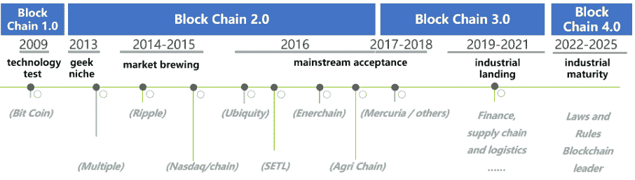
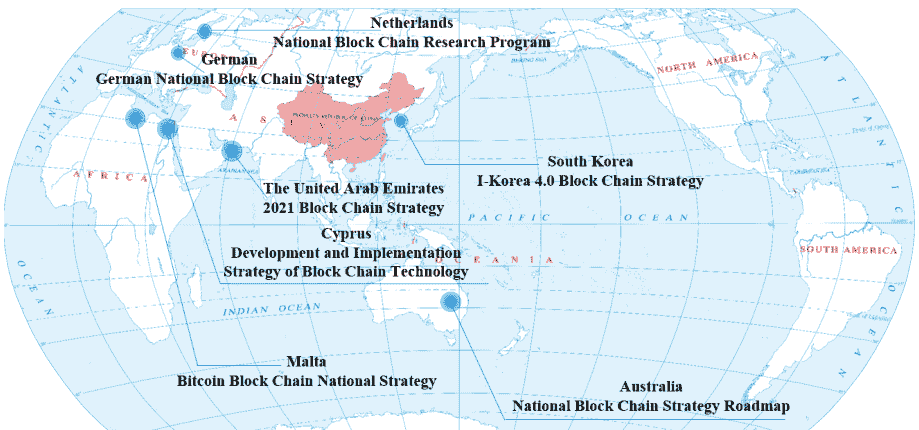
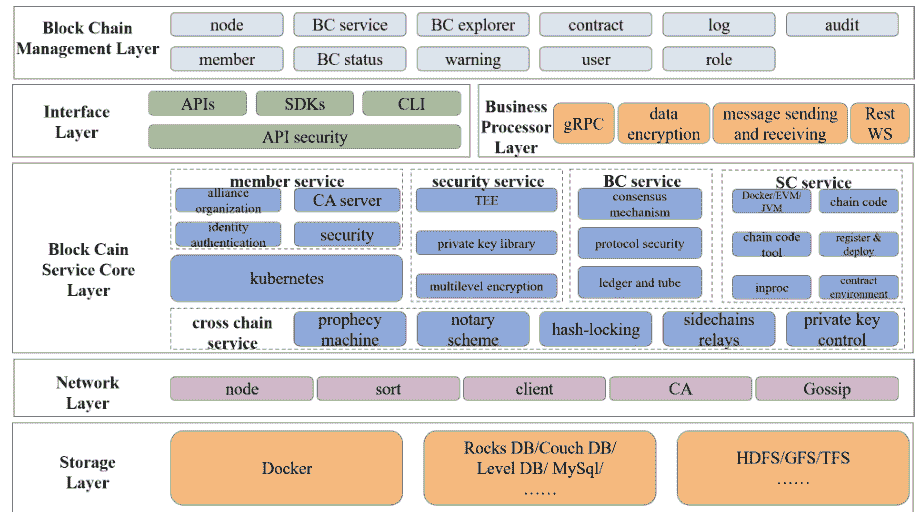
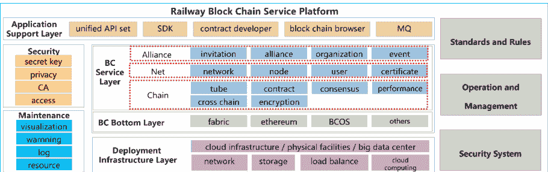

# 2020第3届区块链技术与应用国际会议（中国西安）

## 摘要

区块链具有许多独特的特性，如去中心化、稳定性、开放性和透明性。我们可以在铁路的许多领域应用区块链，以提高综合效率和效益，例如铁路客货运输服务、工程建设、大数据共享等。随着中国铁路数据服务平台、大数据湖和云计算的逐步完善，这些基础可以支持铁路区块链应用。本文分析了国内外区块链的发展现状和存在问题。通过对主流区块链平台架构的多维度分析，本文得出了铁路区块链平台的架构选型。基于 Hyperledger Fabric，本文分别提出了铁路区块链服务平台的技术架构和总体方案。本文还设计了平台应用构建的实施路径。该研究对推动区块链技术在铁路领域的应用和发展具有重要作用和意义。

## CCS 概念

- 信息系统；信息系统应用；
- 企业信息系统；

## 关键词

区块链平台，铁路信息规划，技术架构，Hyperledger Fabric，互连

## ACM 参考格式：

ZHANG XIAODONG, LI PING, 和 MA XIAONING. 2020. 铁路区块链服务平台的技术架构与总体方案研究. In _2020年第3届区块链技术与应用国际会议（ICBTA 2020），2020年12月14-16日，中国西安._ ACM，美国纽约，6 页。https://doi.org/10.1145/3446983.3446990

# 1 引言

当前，新一轮科学革命和工业变革席卷全球，大数据、云计算、物联网、人工智能、区块链等新技术层出不穷并迅速渗透。数字经济已深刻改变了人类的生活方式和工业生产方式。作为一种颠覆性技术，区块链正在推动全球从信息互联网向价值互联网转型。区块链应用能够为实体经济降低成本、提高效率，还可以推动传统行业良好发展，加速转型升级。

通常，我们将2009年至2025年的区块链发展过程划分为6个阶段：技术测试、极客小众、市场酝酿、主流接受、产业赋能和产业成熟。区块链从区块链1.0发展到区块链4.0，如图1所示。相关技术和单一应用的快速发展推动了区块链在工业界的广泛应用。

作为国民经济的动脉和流行的运输方式，铁路运输在30多年的信息化建设中取得了显著成就。中国铁路已构建集成信息平台和多个业务信息系统，涵盖客货运输服务、业务管理、调度指挥、安全监管等领域。近年来，中国铁路还基于海量数据资产开展了一些利用大数据和人工智能的创新应用。这些努力为区块链应用提供了足够的支持。同时，中国铁路也面临着新形势下的挑战，如降本增效。铁路系统具有复杂的特征，如规模大、业务链长、涉及领域多。在铁路的特定情境下，区块链技术可以降低监督和管理成本[1]。区块链的综合应用有助于降低铁路客货运输甚至整个社会的总体成本，这将促进新时期铁路的高质量发展。

本文全面分析了国内外区块链技术的应用和发展现状。我们总结了区块链产业应用阶段存在的问题。在研究主流区块链平台的架构和应用后，本文为铁路区块链服务平台选择了技术架构。基于 Hyperledger Fabric，我们设计了铁路区块链服务

图1：区块链发展路线图。

图2：世界各国区块链的总体发展战略。

平台，涵盖基础设施、架构方案和集成发展。本文提出了铁路区块链服务平台的功能架构，包含区块链核心技术、安全性、运维等内容。参考战略规划思路，我们还提出了铁路区块链服务平台的建设和应用实施路径。

# 2 区块链应用现状与铁路领域探索

## 2.1 全球区块链应用现状分析

大多数国家对区块链技术持积极态度，但产业发展阶段各不相同。澳大利亚、韩国、德国、荷兰、塞浦路斯、阿拉伯联合酋长国和马耳他积极发展区块链产业，并在国家层面制定了总体发展战略。美国、中国、韩国、英国、澳大利亚和欧盟高度重视区块链的研究与应用。同时，中国、澳大利亚、法国、瑞士和芬兰相继制定了区块链监管的行业法律和规则[2]，如图2所示[3]。

在应用方面，源于加密数字货币的区块链正在延伸到许多领域。发达国家已在区块链领域开展了许多实践[4]。美国、爱沙尼亚和迪拜积极推动政府的数字化转型。日本、澳大利亚和德国利用区块链探索金融降本增效。瑞士和美国尝试利用区块链推动房地产登记和交易分发。新加坡和瑞士在贸易物流领域使用区块链，为客户提供更便捷的交付范式。英国和美国将区块链应用于社会和民生事业，以扩大公共资金的惠益。

截至2019年3月，中国区块链企业数量仅次于美国，分别为499家和553家。这些企业主要集中在北京、上海，

广东、浙江等东部发达地区。现在，区块链的工业应用场景不断扩大。中国企业在金融服务、供应链协同、知识产权、社会民生等领域积极探索，以帮助集中业务流、信息流和资金流。

联盟链的节点通常对应实体组织，只有经过授权后才能加入或退出网络。在联盟链中，各组织形成利益相关者联盟，共同维护区块链的健康运行。联盟链的共识过程由预选节点控制。联盟链适用于分布式跨机构应用场景，例如跨机构交易、结算和清算。私有链中各节点的写权限由内部控制，而读权限则根据需求有选择地向公众开放。私有链具有区块链多节点运行的通用结构，适用于对隐私要求较高的场景，例如特定机构的内部数据管理和审计。

## 2.2 铁路领域区块链应用探索

在铁路领域，一些国家也积极探索区块链应用。德国铁路公司（DB）与区块链集成平台Unibright合作，开发基于区块链的标签生态系统。该生态系统连接了乘客整个旅程的不同环节。旅程的每个部分都会被标记，例如里程、服务、餐饮、酒店预订、当地交通等。该生态系统旨在通过区块链应用降低运营成本，并已实现与其他旅游公司协同互动。俄罗斯铁路运输公司（RZD）推出了基于区块链的加密货币票务和基于区块链的铁路货运数字交易平台。2017年8月，包括BNSF铁路公司、UPS、FedEx和施耐德货运在内的200多家知名货运和物流企业加入了BITA联盟。BITA成为世界上最大的区块链商业联盟。此外，瑞士、荷兰、加拿大等国家的铁路公司也开始将区块链和加密货币引入铁路运输行业。

## 2.3 区块链应用中的问题

随着区块链日益成熟，仍然存在一些问题。
- 区块链可能导致金融机构或企业面临复杂的法律和合规问题。
- 当前的分布式账本技术仍不够成熟，需要更多行业应用来证明 [5]。
- 区块链的技术路线众多。不同类型的区块链容易形成信息孤岛。
- 去中心化对现有运营模式有重大影响。相关领域缺乏主动变革的内部驱动力。
- 开源区块链基础技术维护的可持续性较差。
- 滥用和广泛使用的问题显而易见。

# 3 主流区块链平台比较分析与技术选型

区块链技术发展迅速。区块链平台日益多样化。市场上的主流区块链平台包括Ethereum、Fabric、Corda、BCOS和DNA。

区块链包括公有链、联盟链和私有链。公有链中每个节点都可以自由加入和退出网络。所有节点都可以参与链上数据的读写操作。在读写过程中，网络采用扁平拓扑进行互连。网络中没有中心化服务器节点，适用于去中心化开放场景。每个

Ethereum代表公有链技术，而Fabric、Corda、BCOS和DNA代表联盟链。本文从架构能力、核心组件、应用功能、技术水平、安全机制、平台适用性、开发与工具、维护与支持等方面分析平台架构。

在业务运营中，尤其是铁路大数据共享和国际多式联运业务，国家铁路集团涉及国内外物流企业、买卖双方、金融机构、外贸商、海关、政府监管等机构。在实际业务运营中，存在“弱信任关系”下的利益互斥关系。通过使用区块链技术，众多参与者将建立协作的“强信任关系”来共同存储证书，并构建从“自证”到“他证、多证、安全可信”的参与者业务数据流通网络。在构建区块链平台的过程中，中国铁路集团需要考虑节点授权、链上数据访问权限、智能合约安全性、链上数据安全性、共识机制升级的便捷性、稳定的交易成本、可靠性及政府监管等因素。公有链上的节点和数据没有授权控制，且大多与挂钩的加密货币关联。在货币影响下交易费用波动较大，使得企业和政府难以使用和扩展。联盟链的节点是预选的，可以有效排除不良和不可信节点，保护区块链免受51%节点等攻击。此外，联盟链的共识模式由联盟控制，交易成本稳定，这为未来共识机制的升级和扩展提供了便利，也有助于主导机构和监管机构改进区块链平台。控制。总而言之，联盟链更适合国家铁路集团的区块链应用需求。

本文选取架构能力、核心组件、应用功能、技术水平、安全机制、平台适用性、开发与工具、维护与支持作为因素，对5个主流区块链平台架构进行比较分析。论文发现Hyperledger Fabric在应用方面具有明显优势，如表1所示。建议中国铁路采用Hyperledger Fabric的思路构建铁路区块链平台。

## 表1：主流区块链平台比较分析

| 维度 | Ethereum | Hyperledger Fabric | R3 Corda | BCOS | DNA |
|---|---|---|---|---|---|
| 数字资产 | 智能合约 | 智能合约 | 底层支持 | 底层支持 | 底层支持 |
| 身份认证 | 无 | 数字证书 | 数字证书 | 数字证书 | 数字证书 |
| 共识机制 | POW/DPOS | PBFT/POS/DPOS | 无 | 无 | DPOS/ Fast BFT |
| 出块速度 | ≈12S | <1S | 无 | 无 | <1S |
| 性能 | 10+TPS | 1000+TPS | 10000+TPS | 10000+TPS | 10000+TPS |
| 智能合约 | 不支持回滚 | 回滚/取消 | 回滚/取消 | 回滚/取消 | 回滚/取消 |
| 运行环境 | EVM | Docker | JVM | JVM | AVM |
| 空间回收 | 状态快照 | 状态快照 | 无 | 无 | 状态快照 |
| 权限控制 | 无 | Fabric CA/第三方 | 第三方 | 第三方 | 第三方 |
| 维护 | 困难 | 容易 | 中等 | 中等 | 中等 |
| 链类型 | 公有链 | 联盟链 | 联盟/私有 | 联盟/私有 | 联盟链 |
| 适用领域 | 金融 | 多个领域 | 金融 | 金融 | 小型业务 |
| 铁路区块链 | 不适用 | 适用 | 不适用 | 不适用 | 不适用 |

图3：铁路区块链服务平台技术架构。

# 4 铁路区块链服务平台技术架构

铁路区块链服务平台的技术架构包含存储层、网络层、区块链服务核心层、业务处理器、接口层和区块链管理层，如图3所示

## 4.1 存储层

存储层采用虚拟化技术在云上构建具有高可扩展性和可靠性的Docker集群，适用于不同类型的区块链平台层节点。分布式账本状态数据采用Rocks DB、CouchDB、Level DB和MySQL。分布式账本交易数据采用HDFS、GFS和TFS。

## 4.2 网络层

网络层实现P2P网络。这提供了在底层构建区块链网络的基本能力，包括节点、排序节点、客户端、CA和 gossip。

## 4.3 区块链服务核心层

Kubernetes 和 Fabric 构成了铁路区块链的核心层。采用Kubernetes框架来实现成员动态加入、弹性收缩和灵活部署。区块链的核心层提供底层基础设施，包括成员服务、安全和隐私保护、区块链服务、智能合约服务和跨链服务。

## 4.4 业务处理器

服务处理器包括gRPC、数据加密、消息发送和接口适配。gRPC是指与区块链建立链接以完成用户身份验证、数据安全验证和数据完整性验证。这支持区块链的数据交易和查询。数据加密是指调用加密服务（可选）或软件以实现加密和解密功能。消息发送和接收使用消息接口协议通过HTTP封装写入的消息。此功能确保消息在发送方和接收方之间可见。接口适配提供Rest WebService接口适配服务。

## 4.5 接口层

铁路区块链服务平台为用户提供各种接口，如SDK、API和 CLI。

## 4.6 区块链管理层

管理层采用微服务框架Spring Cloud / Spring Boot进行开发。管理层主要包括节点管理、成员管理、区块链服务管理、区块链状态监控管理、账簿浏览、告警管理、合约管理、用户管理、日志管理、角色管理和审计管理。

# 5 铁路区块链服务平台总体方案

铁路区块链服务平台依托中国铁路的主数据中心。该平台为用户提供一站式、高安全性、简单易用的区块链服务。铁路区块链服务平台集成开发、管理、运维，支持用户在云上快速部署联盟区块链网络环境。基于铁路区块链服务平台，用户可以降低底层技术的获取成本。这使他们能够更专注于区块链商业模式创新和业务应用的开发与运营。

在设计上，铁路区块链服务平台满足金融级的安全性和合规性要求。平台可以动态调整业务资源。用户可以在弹性和开放的云平台上快速构建区块链服务。铁路区块链服务平台可以快速兼容多种底层区块链技术，包括Hyperledger Fabric、Ethereum、BCOS等。该平台将为用户提供许多可选的底层技术框架。

铁路区块链服务平台由应用支撑层、服务层、底层技术层、运营基础设施层、安全服务管理层、运维监控管理层、标准规范系统、运营管理系统和安全保障系统组成，如图4所示。

# 6 铁路区块链服务平台应用与实施路径

铁路区块链服务平台的应用与实施应分三个阶段进行。统一路径将促进铁路区块链服务平台有序实施。

## 6.1 实验阶段（2020~2022）

根据中国铁路信息化规划，应统一规划铁路区块链服务平台，包括总体架构、应用架构和技术标准。区块链的应用试点将从基于区块链的可信数据交换与共享以及中欧班列物流追踪和金融服务开展。

## 6.2 推广阶段（2023~2024）

在区块链的应用与推广阶段，多个领域和业务将深度融合区块链。区块链的融合应用将促进应用落地，例如多式联运、铁路征信和货运物流。中国铁路将与上下游企业打通协作链，构建铁路行业生态链。

## 6.3 深化阶段（2025~2030）

考虑到区块链未来的持续发展，铁路区块链将突破兼容性、性能、安全性和法律监管等关键问题。铁路区块链服务平台旨在繁荣铁路生态系统。区块链应用将从单一应用发展为产业链上游应用，从对等应用发展为不同行业联盟应用，以进一步繁荣行业生态系统。

# 7 结论

结合区块链和铁路业务可以有效解决铁路大数据共享以及一带一路铁路货运运输业务的共同问题。铁路区块链服务平台可以提升铁路综合信息集成平台的内涵。同时，该平台可以为铁路区块链应用提供底层技术支持和快速服务响应。RBaaS将有利于不同领域、不同行业和不同主体之间的多链集成，并提升中国铁路的技术水平。

# 致谢

本研究得到中国铁道科学研究院的资助，研究课题为《铁路区块链服务平台总体方案与关键技术研究（RBaas）》。项目编号为2019YJ110。

# 参考文献

- [1] WANG CHENG, SHI TIANYUN. 区块链技术综述及其在铁路应用的前景 [J]. 中国铁路. 2017(09):91-98. DOI=10.19549/j.issn.1001-683X.2017.09.091
- [2] 中国信息通信研究院. 2019年区块链白皮书 [R]. 2019.
- [3] LI PING, ZHANG XIAODONG, GUO YUE, XIE PENG. 区块链技术及其在铁路行业的典型应用 [J]. 铁路计算机应用, 2020,29(01):9-15.
- [4] WANG WENJING, LIANG ZHANGHUA. 区块链发展及应用现状 [J]. 通信管理与技术, 2018(06)12-15.
- [5] SHEN XIN, PEI QINGQI, LIU XUEFENG. 区块链综述 [J]. 中国网络和信息安全学报, 2016,2(11):11-20. DOI=10.11959/j.issn.2096-109x.2016.00107

