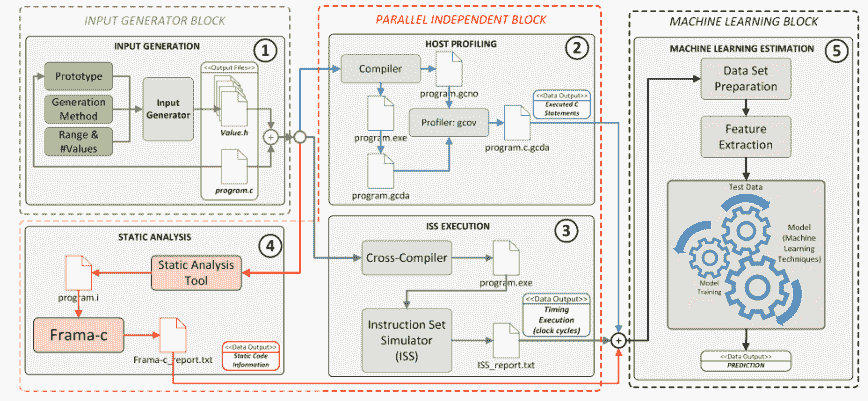
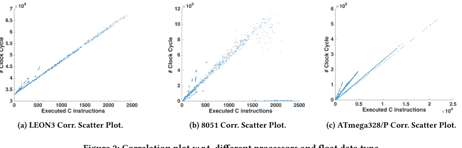
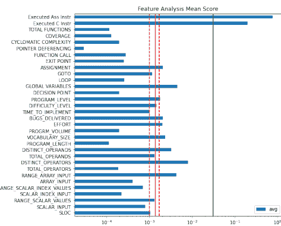
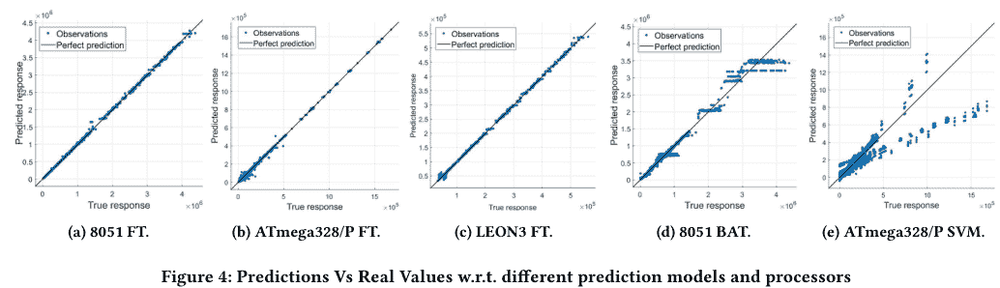
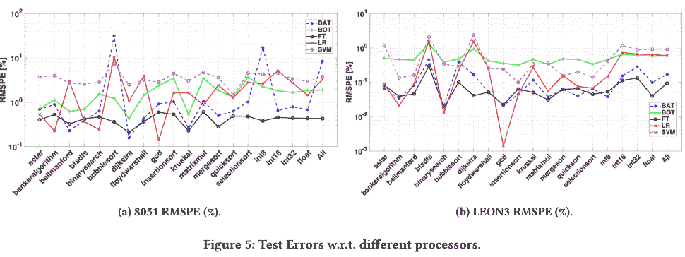
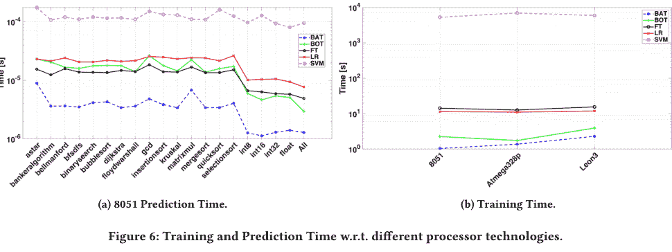
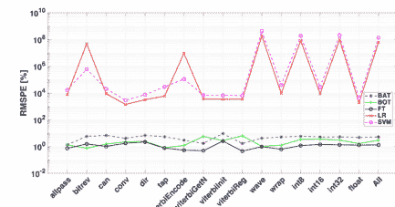
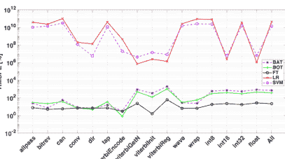
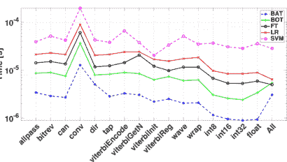
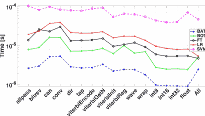

# [ICPE '21：ACM／SPEC 性能工程国际会议(法国虚拟活动 ..-..)] ACM／SPEC 性能工程国际会议论文集 ｜｜ 语句级

## 摘要

在嵌入式系统的初始设计阶段，通过初步分析获得的指标来支持设计师的能力至关重要。了解嵌入式系统（HW或SW）的哪些初始参数会影响这些指标更为重要。

设计师通常需要测量的嵌入式系统的主要特征是嵌入式软件（即函数）的执行时间，用于描述最终系统的性能（即时序性能指标）。

对该指标的评估通常是一项关键任务，依赖于不同抽象级别的多种不同技术。

此外，在大数据时代，使用机器学习方法可以作为评估或估计时序性能指标的经典方法的有效替代方案。

在此背景下，本文描述了一个基于机器学习方法的框架，用于计算面向语句级的嵌入式软件时序性能指标。

结果与采用不同方法获得的结果进行了比较。它们表明，所提出的方法在提高特定处理器类别的估计精度的同时，还缩短了估计时间。

## CCS概念

- 计算机系统组织 → 嵌入式系统；嵌入式硬件。

## 关键词

时序性能预测，机器学习，嵌入式系统，特征分析

# 1 引言

在过去三十年中，信息技术的传播和发展呈指数级增长。在这方面，毫无疑问地强调了嵌入式系统[1]的激增。

确定嵌入式系统特征的问题是一项不应低估的任务，尤其是在早期设计阶段。

事实上，在更高的抽象级别（即电子系统级，ESL）上工作是早期估计HW/SW性能所必需的[2]。

此外，在大数据时代，在此背景下使用机器学习（ML）方法[3, 4]可以作为估计嵌入式系统性能指标的经典方法的有效替代方案[5–7]。

因此，根据这一场景，本工作试图回答以下研究问题：

- RQ1: 如何在没有指令集模拟器（ISS）或目标设备的情况下，为嵌入式平台外推一个有意义的时序性能指标，而这耗时较长？

- RQ2: 如何使用机器学习技术减少嵌入式时序软件性能预测的估计时间并提高准确性？

RQ1依赖于所考虑的时序性能指标提取[8]，使用ISS代替最终HW/SW嵌入式平台可以减少估计步骤所需的时间，这取决于模拟器的准确性。

RQ2考虑用ML算法替换ISS或选定的HW/SW平台，以减少设计时间并相对于传统方法提高准确性。

因此，本工作提出了一种时序性能估计方法。其目的是提取系统级设计流中使用的主要实践的信息，以减少初始活动所需的时间，并通过对最终硬件/软件平台的广泛和深入分析来减少估计错误。

将利用与高级C编程语言语句相关的时序性能指标，如[9]中所述。

此外，将提出一个有助于为给定函数计算该指标的框架。

此外，该框架可以自动生成大量受限随机输入，并对指标本身进行统计评估。

该框架利用ISS从源代码中评估多个特征，同时使用静态代码分析来丰富数据集。

执行程序所需的时钟周期数、在主机架构上进行分析的已执行C语句数、圈复杂度和Halstead数是为后续ML活动选定的特征子集。

这些大数据已通过多种统计方法进行分析，有用的结果鼓励在ESL设计流中利用这种统计方法。

# 2 预备知识

在嵌入式系统设计[1]的背景下，一些主要挑战与不同抽象级别的估计方法相关的准确性和模拟/估计时间有关[10]。抽象级别越高，准确性和估计时间越低，这取决于采用的估计模型和模拟器[11]。

可以考虑不同的抽象级别来进行时序估计，文献中已提出多种方法。

Malik等人[12]探讨了嵌入式软件性能分析中需要考虑的不同性能指标，并研究了广泛的技术（例如，路径分析技术、系统利用率分析技术）。

[13]中的工作提出了两种解决性能估计问题的方法：（1）一种基于源代码的方法，使用编译到虚拟指令集；（2）一种基于目标代码的方法，将目标编译器生成的汇编代码翻译为“汇编级”。

Brandolese等人[5]引入了一种软件执行时间估计方法。该过程由C语句的数学模型和统计分析支持。

Alterbernd等人[6]引入了一种通过早期源代码级时序分析来预测软件执行时间的方法。估计直接从源代码进行，无需编译和运行，使用一组虚拟指令，并定义一个能够执行源代码的抽象机。

最后，[14]引入了一种通过基本操作进行源代码级时序估计的方法。

这些大多数工作旨在使用耗时但相当准确的模拟器、系统级的数学预测模型或虚拟平台仿真器来预测时序性能行为。

相比之下，基于ML技术的时序预测方法是最新的方法，利用大量训练数据集在不了解所考虑HW平台的情况下进行预测。

Oyamada等人[15]提出了一种系统设计和性能分析方法。他们使用基于神经网络的分析方法来进行高级软件性能估计。分析估计的误差仅高达29.75%，估计时间约为17秒。

[16]中的工作提取了一小组计算机的性能。它使用这些信息来开发线性回归和神经网络模型，以预测任何不同考虑的计算机的性能。它们可以在3.4%的平均误差率内预测所考虑平台的性能。

Huang等人[17]提出了SPORE（稀疏多项式回归）方法，利用在示例输入上程序执行中收集的特征数据来构建程序性能预测模型，相对误差小于7%。

最后，[18]中的论文通过对历史数据进行数据挖掘提出了一种方法。作者建议使用三种ML技术（即朴素贝叶斯、逻辑回归和随机森林）进行时序预测。

这些工作证实了ML和数据挖掘的一般有效性，以及这些技术在软件估计方面的特定应用。

表1比较了不同方法，就ML技术和结果而言。

此外，据我们所知，很少有研究工作利用这些技术进行嵌入式系统时序性能估计，主要是因为这些技术的准确性较低。

我们的工作试图解决这个开放的研究问题。

# 3 提出的方法

本工作提出的方法使用统计分析和近似预测进行语句级执行时间估计，如图1所示。

这种方法的理念是使用（微）基准测试训练ML模型，以便它可以为给定目标处理器的任何给定输入C代码函数预测性能。

利用编译器和程序分析工具在不同的真实嵌入式设备上提取为此目的的数据。

ML模块使用这些数据来解决时序性能预测问题。

整个框架分为三个宏块：

- 输入生成器块，其中选定的函数在模块①内部获取随机生成的多个输入。

- 并行独立块，其中三个子模块可以相互独立执行。模块②使用gcov程序提取关于已执行C语句的动态信息；模块③执行指令集模拟器（ISS）执行，收集执行基准函数集所需的时钟周期；模块④实现静态分析，其中使用Frama-C [19]通过静态函数参数来扩展数据集，这些参数对ML算法有用。

- 机器学习块，估计方法的核心。

在①中创建了一个（半）自动为基准函数生成输入的模块。

特别是，为每个函数随机生成1000个输入数据集。

此外，为每个函数考虑了不同的数据类型（即int8、int16、int32和float），以分析结果与所考虑处理器的内部架构的关系。

每个输入数据集都存储在头文件中，以便在编译时包含在函数中。

在输入生成阶段之后，在②中评估了统计已执行C语句数量的过程。

该值通过为每个生成的输入使用gcov分析器对基准函数进行分析来获得。

为了获得每个函数的已执行C语句总数，对单个分析数字求和。

在③中提取了目标处理器技术执行基准中每个函数（针对每个生成的输入）所需的时钟周期数（以及已执行的汇编指令数，对功率/能耗分析有用）。

根据目标处理器技术，需要指令集模拟器（ISS）或专用处理器（SPP）的高级综合（HLS）模拟器。

后者不属于本工作的一部分。

最后的数据在④中使用Frama-C工具和其他有用的脚本进行评估，集成在整个框架实例中。

最后，所有生成的数据输出工件都被发送到⑤，在那里对信息进行组织、选择和利用，用于模型训练、测试和验证，如下所述。

## 3.1 数据准备与特征提取

在本文中，选择了多个特征以对收集的数据（即分布参数）进行统计分析。

创建了多个Python脚本来自动化所有CSV文件的统计分析，集成到最后的框架模块⑤中。

为了保证数据无偏差和正确的ML训练活动，特征分析应用于输出框架数据集（即33个特征），该数据集可以按代码行数（SLOC）、输入数据类型、Halstead复杂度、圈复杂度、函数可达性和程序分析进行聚类，如[20]中所述。

一旦数据集创建完成，考虑四个回归模型来进行特征分析，参考[21]。

特别是，我们考虑了随机森林回归器、极端随机树回归器、梯度提升回归器和AdaBoost回归器，利用Python scikit-learn包。

以前的结果[21]的平均值，减去99%的置信区间值，已被用作选择最重要特征的下限。

在特征分析过程之后，将考虑最重要的特征。ML算法将

Table 1: ML时序性能估算比较（N.A.表示不可用）。

| Work | Domain | Prediction Models | Data Preparation | Benchmark | Platform | Accuracy | Training Time | Estimation Time |
|---|---|---|---|---|---|---|---|---|
| [15] | 嵌入式 | 神经网络 | N.A. | 自定义基准 | ARM946 | 高达 29.75% | 慢 | 高达 17s |
| [16] | 通用计算机 | 线性回归（LR）神经网络（NN） | Clementine 软件 | SPEC2000 | AMD Opteron Intel Pentium D 和 4 Intel Xeon | LR: 1.5% ... 3.5% NN: 1.16% ... 5.94%（最佳情况） | N.A. | N.A. |
| [17] | 通用计算机 | 稀疏多项式回归 | SPARSE LASSO 方法 | Lucene Find Maxima Segmentation | 通用 CPU | 高达 7% | N.A. | N.A. |
| [18] | 通用计算机 | 朴素贝叶斯（NB）逻辑回归（LR）随机森林（RF） | 包装器特征选择 | NASA 软件基准 | 通用 CPU | NB: 17% LR: 19% RF: 14% | N.A. | N.A. |
| 本工作 | 嵌入式 | BAT, BOT, FT, LR, SVM | 平均分数值 | 自定义基准 | 8051 LEON3 ATmega328/P | 高达 2.58%（最佳情况） | < 10s | < 1ms |

trained to predict the timing performance metric, or better the Effective Clock Cycles feature.

## 3.2 机器学习技术

所考虑的机器学习技术（文献[22, 23]中最常用的）从回归树到SVM，再到线性回归器，旨在识别哪种技术能更好地预测时序性能指标。在本工作阶段，已使用了 Matlab App Regression Learner [24]。特别是，我们考虑了五种可用的机器学习方法：线性回归（LR）、精细树（FT）、提升树（BOT）、袋装树（BAT）和支持向量机（SVM）。我们排除了神经网络算法的使用，因为我们计划在未来专门撰写一篇工作论文，以避免加重本文的讨论负担 [25]。此外，此分析涉及使用不同的 Matlab 包。

线性回归模型 [26] 在模型参数方面具有线性预测器，易于解释且预测速度快。然而，这些模型受限形式较高，意味着与其他模型相比，它们通常具有较低的预测准确性。Regression Learner 应用使用 fitlm 函数来训练线性模型选项。

回归树 [26] 易于解释，拟合和预测速度快，且内存占用低。Matlab App Regression Learner 提供了选择不同类型回归树的可能性。在本工作中，选择了精细树选项，这意味着高灵活性，带有许多小叶子的高度灵活响应函数（最小叶子大小为 4）。Regression Learner 应用使用 fitrtree 函数来训练回归树，参数最小叶子大小等于 4，且没有代理节点的分割标准。集成提升树模型将许多弱学习者的结果组合成一个高质量的集成模型。该方法涉及使用回归树学习者的最小二乘提升方法 [26]。Regression Learner 应用使用 fitrensemble 函数来训练集成模型，并提供设置三个不同参数的可能性：最小叶子大小、学习者数量和学习率，分别为 8、30 和 0.1。另一种带有回归树学习者的集成模型是袋装树 [26]。Regression Learner 应用使用 fitrensemble 函数来训练集成模型。在这里需要设置两个参数：最小叶子大小和学习者数量，分别为 8 和 30。支持向量机是监督学习方法，既用于分类也用于回归 [26]。支持向量机方法的优势在于，它在高维空间以及维度数量大于样本数量的情况下效果显著。Regression Learner 应用使用 fitrsvm 函数来训练 SVM 回归模型，在此情况下，参数内核函数设置为 Linear。

Table 2: 函数集。

| Category | Functions |
| :--- | :--- |
| 排序和搜索 | binarysearch, bubblesort, insertionsort, mergesort, quicksort, selectionsort |
| 数值 | matrixmul, gcd, banker algorithm |
| 网络 | astar, bellmanford, bfsdfs, dijkstra, floydwarshall, kruskal |
| 数据处理 | allpass, bitrev, can, conv, dir, Viterbi algorithm, tap, wave, wrap |

# 4 实验结果

所提方法首先在软件领域进行了评估，考虑了通用处理器（GPP）技术。在本工作中，分析了三种 GPP 及其相关 ISS：LEON3，一种具有哈佛架构的 32 位可综合 RISC 软微处理器，模拟系统时钟为 75 MHz。Cobham Gaisler 提供 TSIM 系统模拟器作为 LEON3 处理器的精确 ISS，配合 gcc 编译器（在本工作中，使用了默认优化标志 -O0）；Intel 8051 微控制器，一种具有 MCS-51 CISC 指令集和哈佛架构的 8 位微控制器；The Dalton Instruction Set Simulator (ISS) [27] 已用于模拟为 8051 编写的程序并收集统计数据，配合 SDCC (Small Device C Compiler) 编译器；picoPower CMOS 8 位 AVR ATmega328/P，具有基于 8 位 RISC 的处理器内核和哈佛架构。SimulAVR [28] 程序已用作 Atmel AVR 系列微控制器的模拟器，配合 gcc 编译器（在本工作中，使用了默认优化标志 -O0）。基准执行是使用每个处理器的 ISS 进行微处理器软件仿真完成的，如上文所示。

图 2 显示了与不同处理器的皮尔逊相关性相关的散点图。这三个图显示 C 语句与时钟周期之间存在严格相关性。关于其他点（主线性回归线下方的点），偏差取决于函数实现，这些实现引入了与显著分布相比的不同行为。这些点在时序估算活动中引入错误，并与处理器内部微架构（即 8/16/32 位架构、流水线、寄存器数量等）相关。表 3 显示了时钟周期与执行的 C 语句之间的皮尔逊相关性和斜率值。表 3 中时钟周期与 C 语句数量之间的高相关性值促使我们进一步探索处理器特性，并利用 ML 算法进行时序性能估算。

## 4.1 数据集准备和特征提取结果

Table 3: 相关性和斜率分析结果（每个处理器的 p-value << 0.001，因此我们可以拒绝零假设，统计分析具有高度显著性）。

| Function | int8 | int16 | int32 | float | Tot. |
| :--- | :--- | :--- | :--- | :--- | :--- |
| LEON3 相关性 | 0.9939 | 0.9872 | 0.9277 | 0.7465 | 0.9631 |
| MPU8051 相关性 | 0.9939 | 0.9871 | 0.9276 | 0.7465 | 0.9631 |
| ATmega328/P 相关性 | 0.7465 | 0.9939 | 0.9871 | 0.9277 | 0.9631 |
| LEON3 斜率 | 10.8838 | 9.4241 | 10.9702 | 15.1550 | 88.9492 |
| MPU8051 斜率 | 88.2752 | 110.5197 | 183.8507 | 389.2319 | 88.9492 |
| ATmega328/P 斜率 | 24.7353 | 11.197 | 18.1595 | 14.0614 | 88.9492 |

一个由控制主导和数据主导的应用程序组成的基准被用于训练和测试估计器 [15]，并最终验证该方法。基准由 [29] 中的 15 个不同算法组成，用于训练和测试，总样本量为 6 * 10^4，以及 [30] 中的 12 个不同算法，用于验证，总样本量为 48 * 10^3。表 2 描述了实验中使用的函数。对于每个函数，考虑了不同的数据类型（int8、int16、int32 和 float）。确实，时序性能指标随数据维度的变化而变化 [11]。

图 3 报告了特征分析的结果。该图（绿线）显示了四个算法结果 [21] 之间的算术平均行为。某些特征显示出显著行为

与其他方法相比。为了选出最重要的特征，引入了一个选择准则，如第 3.1 节所述。从图 3 值得注意的是，两个特征主导了其他特征。这两个特征与代码的动态执行相关。为了引入与静态代码分析相关的特征，我们决定移除 "已执行的汇编指令" 和 "已执行的 C 指令" 特征，并再次将选择准则应用于其余特征。实心红线表示未计算这两个主导特征的平均值。由于图 3 中一些特征接近实心红线，我们纳入了平均分数值在 99% 置信区间（即虚线）内的特征，排除所有低于低置信区间值的特征。

测试在数据集的 20% 上进行。图 5 显示了部分处理器的均方根百分比误差（RMSPE）结果。在每个图中，可以区分各种数据聚合类型下每个 ML 预测模型的行为：按功能、按数据类型、总数据集测试（All）。如预测值与实际值图中所述，Fine Tree 是表现最佳的 ML 模型，因为其 RMSPE 值在全球范围内低于所有其他 ML 模型。值得注意的是，在 LEON3 和 8051 场景中，预测器的 RMSPE 始终低于 10%，而相同设备的 FT 和 BAT 通常低于 1%。仅有一个例外，即 8051，其中 int8 场景受 bubblesort 函数严重影响（可能与某些数据集噪声相关）。ATmega328/P 的结果是最差的场景，因为对于 BAT 和 FT，误差始终在 $\ge 10^0$ 和 $\le 10^1$ 之间，而对于 BOT、LR 和 SVM，误差在 $\ge 10^1$。关于 RMSE，误差方差范围从 $10^2$ 到 $10^4$。对于 ATmega328/P，误差范围转移到 $10^3$ 到 $10^5$。

图 3：特征分析（X 轴表示 0 到 1 的百分比得分）。

相对于每个回归算法，随机森林回归器的方差为 0.0210，极端树回归器的方差为 0.0169，梯度提升回归器的方差为 0.0202，AdaBoost 回归器的方差为 0.0188。最突出的值属于随机森林回归器，而考虑所有回归器时，特征 GLOBAL VARIABLES 的方差大于其他特征。

总体而言，从以下分析可以得出：SVM 不太适合该问题，且具有最差的总体 RMSPE，可能是因为与特征相关的数据较多。Boosted Trees 和 Bagged Trees 可以被认为是可接受的。不过，它们需要对模型的输入参数进行优化，尤其是 BAT，如果我们查看图 4 的话。线性模型适合预测，但在 RMSE 上有波动，这正如预期。最佳 ML 模型是 Fine Tree，它在预测和 RMSPE 方面表现最佳。此外，后者还可以通过进一步修改模型的输入参数来改进。

作为最终分析，图 6 报告了考虑 8051 处理器的平均预测时间（图 a）以及五个 ML 模型对每个处理器的平均训练时间（图 b）。每个选定处理器的平均预测时间行为相同。最佳性能属于 Bagged Trees，而 SVM 仍然表现出更差的执行时序行为。了解每个模型的执行时间对于理解模型在训练和预测阶段的速度至关重要，考虑到 ESL 场景中需要多次执行模型预测。关于训练时间，BAT 和 BOT 是最快的，低于 5 s，LR 和 FT 约为 10 s，而 SVM 执行时间最慢，超过 2 h。

## 4.2 机器学习训练与测试结果

一旦为每个处理器的数据集消除了不太重要的特征，前一段中列出的 ML 算法就被训练，以定义一个能够预测输出性能变量（即时钟周期）的模型。训练和测试基准中的 15 个函数生成的数据集，对于每个处理器被分为 80% 用于训练和 20% 用于测试。训练过程后，图 4 报告了部分设备和训练好的 ML 模型的预测值与实际值。FT 在每个设备上的预测与实际值之间的良好一致性显而易见。此外，LR 和 SVM 表现良好，至少对于 8051 和 LEON3 而言。另一方面，BAT 对每个设备都提供了糟糕的结果。ATmega328/P 设备对于除 FT 外的每个预测器都表现不佳。

## 4.3 验证

本段介绍了五个 ML 模型的验证。图 7 报告了 8051 和 ATmega328/P 的 RMSPE。尽管如此，仍可以看到决策树（FT）和集成模型（BAT 和 BOT）表现良好，而线性模型和 SVM 的百分比值却极高。关于 FT、BOT 和 BAT，可以注意到，考虑不同处理器时，FT 是最佳的。对于 8051，这三个最佳模型的 RMSPE 均低于 10%。FT 低于 3%（数值低于 1%），BOT 低于 7%（误差范围大于 FT 场景），而 BAT 在 1% 到 10% 之间。对于 LEON3，FT、BOT 和 BAT 相似，在 9% 到 70% 之间变化。最后，唯一始终低于 60% 的模型是 ATmega328/P 的 FT，范围从 1% 到 60%，平均误差约为 20%。

平均时间预测分析显示与原始训练数据集相同的行为，将 BAT 置为最佳，而

SVM 从时序性能角度来看是最差的。验证数据集的预测时间与前面段落中考虑的时间相似，而方差以 ms - μs 为单位，如图 8 所示。

## 4.4 讨论

回答 RQ1：所考虑的"有意义"的时序性能指标是嵌入式软件执行时间（即时钟周期）[11]。可以使用本文提出的方法来预测该指标。其思路是使用 ML 技术代替

仿真器/模拟器。这一想法是合理的，因为我们观察到时钟周期、C 语句和已执行的汇编指令之间存在相当高的相关性，如图 2 和表 3 所示。尽管表中显示的相关性较高，但 LEON3 和 ATmega328/P 分别对 float 和 int8 表现出较低的相关值，这可能导致预测错误。对于 8051，float 数据类型的最低相关值取决于微控制器的内部架构（即由于缺少浮点单元）。采用所提 ML 方法会导致特征选择问题（即找出最重要的特征

仅考虑软件代码）。从图 3 可知，对预测模型起主要贡献的最重要特征是 "已执行的汇编指令（Assembly Instructions）" 和 "已执行的 C 指令（C Instructions）"。仅考虑的环路复杂度参数是 ASSIGNMENT 和 GLOBAL VARIABLES，它们取决于输入数据类型。停止复杂度参数、输入数据类型和 SLOC 几乎全部包含在内，而功能可达性参数（COVERAGE 和 TOTAL FUNCTIONS）未达到所考虑的阈值。最低得分特征是 POINTER DEREFERENCING，因为所考虑的基准中没有太多取指针引用运算符。

图 7：不同处理器的验证误差。

图 8：不同处理器技术和验证数据集的预测时间。

回答 RQ2：有必要利用多种 ML 算法并对其进行分析，以使用 ML 减少估计时间并提高准确性。关于图 4，我们可以注意到基于回归树方法的模型表现优于其他模型。同样的行为也出现在图 5（训练和测试）和图 7（验证）中报告的图表中。8051 在 RMSPE 方面表现出最佳的预测行为。对于训练和测试，FT、BOT 和 BAT 均低于 1%，而对于 8051 时序性能预测的验证误差范围在 1% 到 10% 之间。这些较低的误差取决于 8051 微控制器架构（即 8 位）、指令集（即 MCS-51 CISC）和有限的寄存器大小（即 8 位）。对于 ATmega328/P，尽管架构和寄存器大小与 8051 相同，但不同的指令集（即 RISC）导致我们出现较高的误差，原因是编译步骤后处理大量汇编行的微代码指令数量减少。LEON3 在训练和测试方面表现良好（即所有预测模型的误差均低于 1%），但在验证方面表现较差（即高于 60%），与 ATmega328/P 相比（即 FT 场景下的误差低于 1%）。这种误差取决于 LEON3 更复杂的处理器架构（即具有 7 级流水线的 32 位）。图 6 和图 8 展示了训练、测试和验证的预测时间，所有结果在时间粒度方面都保持一致。最快的预测模型是 BOT，其次是 BAT 和 FT，这表明这三个模型在估计和训练时间方面是最好的，并且未来工作可以对其进行改进。这种方法似乎足以回答 RQ2，如 [15] 中所述。关于 [15] 的结果，表 4 展示了两种不同方法（[15] 使用神经网络，我们的工作使用 FT）之间的比较。FT 的估计误差低于其他测试场景方法，而 LEON3 和 ATmega328/P 在验证场景中表现较差。另外，如图 6 所示，估计时间也比 [15] 慢。未来工作将继续通过优化 ML 参数和算法来改进此策略。

# 5 结论

本文提出了一种基于 ML 的方法，用于预测嵌入式处理器的时序性能。模块化框架帮助设计师提取静态和动态代码信息，随后由下一个 ML 模块用于推测所选嵌入式处理器的时序性能。结果表明，所提方法

## 表 4：估算误差比较。

| 处理器 | 最大误差 | 平均误差 | 标准差 |
|---|---|---|---|
| ARM946 测试 [15] | 29.75% | 9.05% | 8.90% |
| 8051 测试 | 0.61% | 0.42% | 0.12% |
| ATmega328/P 测试 | 6.03% | 2.24% | 1.48% |
| LEON3 测试 | 0.29% | 0.07% | 0.06% |
| ARM946 验证 [15] | N.A. | N.A. | N.A. |
| 8051 验证 | 2.58% | 1.19% | 0.69% |
| ATmega328/P 验证 | 65.39% | 12.58% | 17.79% |
| LEON3 验证 | 73.74% | 52.02% | 21.36% |

足以预测 CISC 微控制器的时序行为。同时，将此方法用于更复杂的处理器会引入可通过更先进的 ML 技术降低的估算误差。未来工作将研究 (1) 通过引入能够不仅表征输入数据类型，还能表征输入特定值的指标和特征来增加特征总数的可能性 (2) 模型预测参数优化（即，树集群和回归树的最小叶子大小和学习者数量，SVM 的核函数等）；(3) 过拟合问题（例如，LEON3 场景）及使用交叉验证来解决这些问题，(4) 分析多种不同于本工作所考虑的回归模型的可能性，同时也考虑将神经网络作为一种具体且有用的 ML 算法替代方案，(5) 使用所提方法表征给定处理器上 SW 监控系统的影响 [31]，(6) 将此方法应用于其他领域（即，网络物理系统、SW Computer 性能等）的可能性 [32]。

## 致谢

本工作部分得到 ECSEL RIA 2017-783162 FitOptivis 和 ECSEL-JU 2018-826610 COMP4DRONES 项目的支持。

## 参考文献

- [1] Yuriy Zcachia Lun, Alessandro D’Innocenzo, Francesco Smarra, Ivano Malavolta, and Maria Domenica Di Benedetto. 网络物理系统安全现状：一种自动控制视角。系统与软件期刊, 149:174 – 216, 2019.
- [2] P. Derler, E. A. Lee, and A. Sangiovanni-Vincentelli. 网络物理系统建模。IEEE 学报, 100(1):13–28, 2012.
- [3] Francesco Smarra, Giovanni Domenico Di Giralomo, Vittorio De Juliis, Achin Jain, Rahul Mangharam, and Alessandro D’Innocenzo. 基于回归树和随机森林的 MPC 数据驱动切换建模。非线性分析：混合系统, 36:100882, 2020.
- [4] A. Loja, L. Rubo, J. M. Ruano, T. Di Mascio, L. Pomante, E. Ferrari, I. G. Vega, F. K. Gürkaynak, M. L. Esnaola, V. Orani, and J. Abella. ECSEL 分形项目：基于唯一的开放-安全-可靠-低功耗硬件平台的认知分形和安全边缘。在第 23 届欧微数字系统设计会议 (DSD) 上, 页 393–400, 2020.
- [5] C. Brandolese, W. Fornaciari, F. Salice, and D. Sciuto. C 程序源级执行时间估算。在第九届硬件/软件协同设计国际研讨会 (CODES ’01) 论文集中, 页 98–103, 纽约, NY, 美国, 2001. ACM.
- [6] Peter Altenbernd, Jan Gustafsson, Björn Lisper, and Friedhelm Stappert. 通过自动生成的时序模型进行早期执行时间估算。实时系统, 52(6):731–760, 2016 年 11 月.
- [7] Philipp Axer, Rolf Ernst, Heiko Falk, Alain Girault, Daniel Grund, Nan Guan, Bengt Jonsson, Peter Marwedel, Jan Reineke, Cristina Rochange, Maurice Sebastian, Reinhard Von Hanxleden, Reinhard Wilhelm, and Wang Yi. 构建可预测时序的嵌入式系统。ACM 嵌入式计算系统期刊, 13(4), 2014 年 3 月.
- [8] D. J. Lilja. 计算机性能测量：从业者指南。剑桥大学出版社, 美国, 2000.
- [9] V. Muttillo, G. Valente, L. Pomante, F. Stoico, F. D’Antonio, and F. Salice. Ce4cs: 一种用于 HW/SW 技术的现成统一语句级性能指标。在 2018 年 ACM/SPEC 国际会议附录中, 纽约, NY, 美国, 2018. ACM.
- [10] G. Valente, T. Di Mascio, G. D’Andrea, and L. Pomante. 实时系统中动态部分重构的盈利性。IEEE 嵌入式系统通信, 页 1–1, 2020.
- [11] David J. Lilja. 计算机性能测量：从业者指南。SIAM 评论, 43:383–384, 2001 年 1 月.
- [12] S. Malik, M. Martonosi, and Y. S. Li. 嵌入式软件静态时序分析。第 34 届设计自动化会议论文集, 页 147–152, 1997.
- [13] Jwahar R. Banni, Wido Kruijtzer, Luciano Lavagno, Edwin Harcourt, and Mihai T. Lazarescu. 系统级设计工具中的软件性能估算策略。在第八届硬件/软件协同设计国际研讨会 (CODES 2000, CODES ’00) 论文集中, 页 82–86, 纽约, NY, 美国, 2000. 计算机协会.
- [14] Nikolica Frid, Danko Ivosevic, and Vlado Sruk. 基本运算：一种用于源级时序估算的新概念。自动学, 60(1):91–104, 2019.
- [15] Marico Oyama, Flavio Wagner, Marius Bonacini, Wander Cesarí, and Ahmed Jerraya. MPSoC 设计中的软件性能估算。在亚洲和南太平洋设计自动化会议上, 卷 0, 页 38–43, 2007 年 1 月.
- [16] B. Ozisikyilmaz, G. Memik, and A. Choudhary. 用于预测计算机系统设计方案性能的机器学习模型。在第 37 届并行处理国际会议上, 页 495–502, 2008.
- [17] Ling Huang, Jinzh Jia, Bin Yu, Byung-Gon Chun, Petros Maniatis, and Mayur Naik. 使用稀疏多项式回归预测计算机程序执行时间。在第 23 届神经信息处理系统国际会议 - 第 1 卷论文集中, 页 883–891. Curran Associates Inc., 2010.
- [18] Monika and O. P. Sangwan. 使用机器学习技术预测软件工作量估算。在第 7 届云计算、数据科学工程国际会议 - Confluence 上, 页 92–98, 2017.
- [19] Frama-C 软件分析器, 2020 (访问日期: 15.03.2020). https://frama-c.com/.
- [20] CC4CS/ML 开源 Git 仓库, 2020 (访问日期: 15.03.2020). https://github.com/vnzstc/cc4cs.
- [21] I. Lettere, G. Della Penna, and P. Caiariello. HTTP 僵尸网络流量检测的特征选择策略。在 2019 年 IEEE 欧洲安全与隐私研讨会 (EuroS PW) 上, 页 202–210, 2019.
- [22] L. Breiman, J. H. Friedman, R. A. Olshen, and C. J. Stone. 分类与回归树。Wadsworth and Brooks, Monterey, CA, 1984.
- [23] Trevor Hastie, Robert Tibshirani, and Jerome Friedman. 统计学习方法。斯普링거统计学系列. Springer New York Inc., New York, NY, USA, 2001.
- [24] 回归学习者 App, 2020 (访问日期: 15.03.2020). https://it.mathworks.com/help/stats/regression-learner-app.html.
- [25] P. Giammatteo, F. V. Firdigigli, L. Pomante, T. Di Mascio, and F. Caruso. 边缘计算的年龄性别分类器。在第 8 届地中海嵌入式计算会议 (MECO) 上, 页 1–4, 2019.
- [26] Trevor Hastie, Robert Tibshirani, and Jerome Friedman. 统计学习方法。斯普링거统计学系列. Springer New York Inc., New York, NY, USA, 2001.
- [27] Dalton 项目: 8051 微控制器, 加州大学, 2020 (访问日期: 15.03.2020). http://www.ann.ece.utk.edu/8051/.
- [28] Martin Becker, Ravindra Metta, Rentala Venkatesh, and Samarjit Chakraborty. 面向分析友好型处理器的最坏情况执行时间可扩展且精确的估算与调试。软件技术转移国际期刊, 2018 年 2 月.
- [29] Vittorio Muttillo, Paolo Giammatteo, Vincenzo Stoico, and Luigi Pomante. 嵌入式处理器能量表征的早期语句级指标。微处理器与微系统, 77:103200, 2020.
- [30] Donatella Sciuto, Fabio Salice, Luigi Pomante, and William Fornaciari. 异构多处理器嵌入式系统设计空间探索的指标。在第十届硬件/软件协同设计国际研讨会 (CODES ’02) 论文集中, 页 56–60, 纽约, NY, 美国, 2002. ACM.
- [31] G. Valente, T. Di Mascio, L. Pomante, and V. Stoico. 可监控嵌入式系统 HW/SW 协同设计的 ESL 方法：“面向可监控性设计”项目 - 进行中的工作。在 2020 年硬件/软件协同设计与系统综合国际会议 (CODES+ISSS) 上, 页 40–42, 2020.
- [32] S. J. Pan and Q. Yang. 迁移学习综述。IEEE 知识与数据工程事务, 22(10):1345–1359, 2010.

