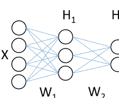
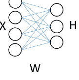
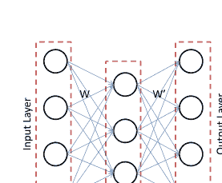

# 2019 第41届 IEEE 医学与生物工程学会国际年会会议 (EMBC) - 德国柏林 (2019.7.23-2019.7.27)

**S. TARYAL (IEEE 高级会员), ANHAL MAJUMDAR (IEEE 高级会员), SINGH (IEEE 高级会员), 以及 MAYANK VATSA (IEEE 高级会员)**

新德里 IIIT

通讯作者：M. Vatsa (mayank@iiit.in)。

摘要——两种表示范式是字典学习和深度学习。字典学习侧重于通过矩阵分解学习“基”或“特征”，而深度学习则侧重于使用权重提取特征。本文侧重于通过如何使用字典学习构建深度架构，从而结合这两种范式的概念。将所提技术与堆叠自动编码器、深层信仰网络和卷积神经网络等学习方法进行了比较。在电力分类真实基准数据上的实验表明，字典学习在其他方法不佳的情况下表现优异。我们假设所提出的公式可以为一类新型深度学习工具提供路径。

索引术——深度学习，字典学习，特征表示。

## I. 引言

在表示学习范式中，字典学习在90年代引起了广泛关注。研究人员将字典学习的概念应用于信息检索 [1], [2]。在早期，字典学习尚未出现；研究人员使用的是矩阵分解。其目标是从数据中学习经验基；因此需要将数据分解为特征矩阵。字典学习如今的盛行归功于 `K-SVD` [3]。`K-SVD` 是一种将矩阵（训练数据）分解为稠密基和稀疏系数的算法。然而，这种稀疏-稠密分解的概念是 `K-SVD` [5]。自2006年`K-SVD`出现以来，关于该主题已产生了大量工作。字典学习可用于图像分割等无监督问题，也可用于稀疏特征提取中出现的问题。此外，字典学习已用于图像处理中的所有反演问题，从简单的图像去噪 [6]、补全 [7] 到复杂的层析扫描问题 [10]。这类问题也可以通过压缩感知 `CS` [12], [13] 解决。然而发现，与压缩感知获得的固定基相比，字典学习可产生更好的（定制表示）。离散余弦变换 `DCT`、小波和 Gabor 等数学变换已用于图像分类 [14]–[16]。现有技术在使用特征进入分类器之前，首先通过主成分分析 `PCA` 或线性判别分析 `LDA` 等统计特征提取方法使用这些变换。字典学习已取代图像处理中的这些变换；它也被用于特征提取场景。字典学习为研究人员提供了设计字典的机会，这种字典不仅能产生稀疏表示（例如小波和 `DCT`），而且包含丰富的信息。

字典学习的早期技术提出了学习特定字典类别的原生方法 [17]–[19]。后来，字典学习中引入了字典惩罚以提高分类性能。其中一种技术是包含 softmax 字典函数 [20]–[22]；之后在字典惩罚中加入了 Fisher 准则、线性分类误差 [24] 和 [25]。在 [27], [28] 中，通过将学习到的特征映射到表示类引入了区分性。之前对字典学习“浅”模型的研究学习了受限玻尔兹曼机 `RBM` [30] 和自动编码器 `AE` [31]，这是两种流行的深度学习架构。在深度学习 `DL` 中，代价是数据与学习基给出的表示之间的欧几里得距离；对于 `RBM`，它是重构误差；而对于 `AE`，代价是数据与解码表示/特征之间的重构误差。

对于稀疏表示问题，目标是学习一个以稀疏方式表示样本的基，即 `$Z$` 需要是稀疏的。`K-SVD` [3], [4] 是稀疏表示最著名的技术。从根本上说，它解决了问题：

$$\min ||X - DZ||^2_F \text{ 使得 } ||Z||_0 \le \ell$$

几乎同时，当字典学习获得关注时，机器学习研究人员发现通过深层网络架构可以实现线性紧凑的表示。深层信仰网络 `DBN` 通过连续堆叠多个 `RBM` 形成 [32]。同样，堆叠自动编码器 `SAE` 通过一个接一个的 `AE` 创建 [34], [35]。

受第一种学习范式的启发，在希望学习多级字典的道路上，深度学习社区的许多研究人员已经通过设计更深架构实现了这一点；我们断言，所提出的字典学习算法将产生多个字典，这些字典随后可以合并为单级。然而，这种合并后的字典将不同于所提出的深度学习。本文剩余部分在第二节介绍字典学习的文献综述，第三节介绍方法论，第四节介绍评估。

## II. 文献综述

我们将回顾之前关于字典学习、堆叠自动编码器和玻尔兹曼机的研究。

### A. 字典学习

字典学习的早期研究侧重于学习用于表示的基。对字典或学习系数没有限制。使用的方法是学习基：

$$\min ||X - DZ||^2_F (1)$$

这里 `X` 是数据，`D` 是字典，`Z` 符合学习系数的约束。合成字典公式 `K-SVD` 更好；如果另外一个（`Z` 和 `D`）是常数，则它在数据和 `D` 的每一个项上都是线性的。

对于多级字典（公式 (2) 为 `X = D_1D_2`）。求解三级字典学习产生的特征与合并字典（`D=D_1D_2`）字典学习问题的特征并不相同：

给出如下：

$$\min_{Z^{(i)}} ||X_i - DZ^{(i)}||^2_F + \lambda ||Z^{(i)}||_1 + \eta \sum_{(j)} ||D_j^T||_F (3)$$

遗憾的是，这个公式并没有提高整体性能。它学习的是相互学习的字典，但没有产生具有区分性的特征；即，为测试样本生成的字典特征类别的出现情况大体相同。这在 [50] 中得到了修正。

带标签的 `KSVD` 是学习判别性稀疏表示的技术之一。它易于理解和实现；在人脸识别中效果良好 [28]。第一种技术被称为 Discriminative-SVD [28] 或 `LC-KSVD` [29]；它提出了以下优化问题：

```
$$\min_{D} \|X - DZ_{D,A}\|_F^2 + \lambda_1 \|D_{D,A}\|_F^2 + \lambda_2 \|Z_A\|_1 + \lambda_3 \|Q - AZ_A\|_F^2$$
```

这里，`$Q$` 是训练样本；它是正确类别和零的基。`$A$` 是线性分类器的参数。

在 [29] 中，提出了第二种表述来惩罚分类错误。`LC-SVD2` 表述如下：

```
$$\min_{D,Z} \|X - DZ_{D,A}\|_F^2 + \lambda_1 \|D_{D,A}\|_F^2 + \lambda_2 \|Z_A\|_1 + \lambda_3 \|H - Z\|_F^2$$
```

`$H$` 是对应输入信号的“稀疏”代码，在训练样本 `$X_i$` 和字典项 `$D_j$` 具有相同标签的索引处，`$H_i$` 没有值。这种表述不仅在特定系数 `$Z_j$` 上识别标签，而且在字典原子上识别标签。

```
$p(H) = \prod p(h|x)$
```

```
$p(H|X) = \prod p(h|x)$
```

假设输入是二进的，节点激活的概率为：

```
$p(x|h) = sig(W^T h)\np p(h|x) = sig(W x)$
```

计算该函数的精确值几乎是不可行的。然而，存在一种通过对比散度（contrastive divergence）训练的梯度的随机近似。吉尔斯采样重构的收敛产生了一种能量分布的近似值，通过该分布可以计算梯度。

通常，`RBM` 是无监督的，但也有研究使用类别标签来训练判别性 `RBM` [55]。还有本质上是稀疏的 `RBM` [52]。稀疏性通过仅当隐藏单元超过某些阈值时才触发来控制。通过将稀疏 `RBM` 扩展为具有组内/类内相似模式，也可以实现监督 [53]。



图 2. 深度玻尔兹曼机。

深度玻尔兹曼机 `DBM` [54] 是 `RBM` 通过堆叠创建多个隐藏层实现的扩展 (2)。`DBM` 是一种无向学习模型，它与其他堆叠架构不同，每层都接收来自顶部和底层信号的反馈。这种反馈机制有助于管理学习模型中的不确定性。传统的 `RBM` 高斯-贝尔努利 `RBM` [55] 可用于实值（0 到 1 之间）可见单元。

### B. 受限玻尔兹曼机

受限玻尔兹曼机是无向模型，使用隐藏单元对随机单元的分布建模。隐藏层与可见单元对称连接，由于同层单元之间没有连接，因此该架构是“受限”的。传统的，`RBM` 用于对输入 `$p(x)$` 的分布。



图 1. 受限玻尔兹曼机。

`RBM` 的原理图如图 1 所示。目标是学习网络权重 (`W`) 和表示 (`H`)。这通过优化给定的玻尔兹曼代价函数来实现：

```
$p(W,H) = e^{-E(W,H)}$
```

其中，`$E(W,H) = -H^T W$`，包含了偏置项。假设独立性，条件分布给给出。

### C. 堆叠自动编码器

自动编码器由两部分组成——编码器将输入映射到潜在表示，解码器将潜在表示映射回数据。对于给定的输入（包括偏置项）`$x$`，潜在空间表示为：

```
$h = Wx$
```

这里，连接权重的行 `$w$` 是从输入到隐藏节点的权重。通常在隐藏单元的输出处使用非线性激活函数，导致：

```
$h = \phi(Wx)$
```

# S. Tariol 等人：深度字典学习

### IEEE Access



# S. Tarsyal 等人：深度字典学习

### IEEE Access

双线性。例如，如果样本的维度为 `$m$`，第一层字典的大小为 `$m \times n1$`，第二层字典的大小为 `$n1 \times n2$`，则无法学习一个大小为 `$m \times n2$` 的单一字典，并期望获得与两阶段字典相同的结果。

通常情况下，对于非线性激活函数，无法将多层字典合并为单层进行测试。对于线性激活函数，可以通过对不同字典进行矩阵乘法，并对融合后的单一字典的稀疏代码特征进行标准的 `$L1$` 最小化，将多层字典合并为单一阶段。

### 算法 3 测试算法（适用于非激活函数）

为第一层生成特征

```
$Z_{l1} = \min ||X - D_{l1}Z_{l1}||^2$
```

从第 2 层到倒数第2层

```
$Z_{l2} = \min ||\varphi^{-1}(Z_{l2-1}) - D_{l2}Z_{l2}||^2$
```

对于最后一层

```
$Z_{cm} = \min ||Z_{cm-1} - D_{cm}Z_{cm}||^2 + \lambda ||Z_{cm}||^2$
```

### 算法 1 训练算法（适用于任意函数 $arphi$）

- 初始化：`$D_l, i = 1 \dots n$`

- 对于第一层：重复直到收敛：

```
$Z_l = \min ||X - D_lZ_l||^2$
```

```
$D_l = \min ||\varphi^{-1}(Z_{l-1}) - D_lZ_l||^2$
```

- 从第 2 层到倒数第2层：重复直到收敛：

```
$Z_l = \min ||\varphi^{-1}(Z_{l-1}) - D_lZ_l||^2$
```

```
$D_l = \min ||\varphi^{-1}(Z_{l-1}) - D_lZ_l||^2$
```

- 对于最后一层：重复直到收敛：

```
$Z_l = \min ||\varphi^{-1}(Z_{l-1}) - D_lZ_l||^2 + \lambda ||Z_l||^2$
```

```
$D_l = \min ||\varphi^{-1}(Z_{l-1}) - D_lZ_l||^2$
```

### 算法 2 测试算法（适用于线性激活函数）

- 将多层字典合并为单一字典

```
$D = D_1D_2 \dots D_n$
```

为测试样本 `$x_{test}$` 计算特征。

```
$z_{test} = \min ||x_{test} - Dz_{test}||^2 + \lambda ||z_{test}||^2$
```

对于字典学习，我们不是在最大化稀疏性，而是最小化数据 (`X`) 与合成结果 (`D,Z`) 之间的欧几得距离。此外，`RBM` 具有随机性，而字典学习通常使用二值或实值。另一方面，深度字典学习可以处理线性和复杂的输入。

与 `RBM` 类似，可以将提出的字典学习与自动编码器相结合。合成学习模型表示为：`$X = DZ$`，其中 `$D$` 是稀疏字典，`$Z$` 是稀疏系数。通常我们会在特征中促进稀疏性，并且学习过程需要最小化。

```
$||X - DZ||^2 + \lambda ||Z||^2$
```

这是著名的稀疏先验，其任务是找到可以从稀疏特征中合成/生成信号。还存在共稀疏字典学习范式 [65]，其目标是在字典应用于数据 `$D\hat{X} = Z$` 时学习字典。相应的学习通过最小化以下项来构建：

```
$|\hat{X} - D\hat{X}||^2 + \lambda ||D\hat{X}||^2$
```

如果我们将分析和稀疏性结合，使用 `$\hat{X} = $`

```
$||\hat{X} - D\hat{X}||^2 + \lambda ||D\hat{X}||^2$
```

如果我们丢弃稀疏项，它就变为：

```
$||\hat{X} - D\hat{X}||^2$
```

这与隐藏层使用线性激活的稀疏或稠密字典相似。此外，我们可以用字典学习的术语来表示自动编码器——自动编码器是一个学习分析字典和合成字典的模型。就我们的...

### A. 与现有算法的联系

在本节中，我们将提出的深度字典方法与一些流行的字典学习算法进行对比，即 `RBM`、自动编码器以及分层字典学习。从图 1 和图 5 可以看出，在 `RBM` 和字典学习中，任务都是给定数据学习网络权重/原子和表示。它们之间的区别在于所使用的代价函数。对于 `RBM`，它是玻尔兹曼函数，而

第 4 卷，2016

10101

知识，我们简要讨论了最近提出的字典学习算法的挑战。首先，我们强调该方法与结构化或字典学习技术 [66], [67] 无关。这些研究中的预期目标是学习相互相关的字典原子。通常，这些研究遵循学习技术（单层）以及字典学习原子之间的关系。

我们接着讨论了关于“双稀疏性” [68] 的工作，作者将字典分解为固定基（例如小波和 `DCT`）和一组系数；他们学习的是一个可以表示为固定基线性组合的字典，而不是学习整个字典（如标准字典学习中那样）。该机制公式化如下：在这种表述中，`$\Phi = D$`；作者不是学习整个字典，而是学习从固定基 `$\Phi$` 合成字典 `$D$`。这种方法的优点是所学字典具有快速和伴随算子（因为它是从高效算子合成的），并且对于大规模问题非常有用。显然，提出的算法与公式 (28) [68] 不同。我们在每一层中学习整个字典，并继续进行多层，旨在学习抽象表示。

- 4. bg-img（带有随机图像的较子集）

- 5. bg-rot（带有随机旋转的较子集）

这些数据集对于经验深度学习算法 [69] 具有挑战性。每个数据集的样本如图 8 所示

图 8. 从上到下，basic-rot, bg-band, bg-img。

第二个数据库与将文档分类到相应主题的问题有关。我们使用了常用的 20-new 字典 [70] 用于在不同时间收集的训练和测试集，这种设置更符合实际应用。训练集包含 1,269 个样本，测试集包含 7,505 个。我们使用了许多相关数据。

# IV. 实验评估

所提字典学习的有效性在图像、文本和信号等基准上进行了评估。结果与最先进的算法相比。

### A. 数据集

我们在多个数据集上评估了性能。第一个数据集是包含 `$28 \times 28$` 像素的 `MNIST`。训练集具有 60,000 个样本，测试集具有 10,000 个。注意的是，对于字典学习，我们在该数据集上进行了预处理。对于 [51]，我们的方法不需要调优。以下是这些数据集的列表：

- 1. bg-img（带有背景图像的子集）

- 2. bg-rot（带有随机旋转的较子集）

- 3. bg-band（带有背景的子集）

# S. Tarsyal 等人：字典学习

表 1. 字典学习与稀疏字典。

| 数据集 | 稀疏字典 (50) | 1 层 (300) | 2 层 (300) |
|---|---|---|---|
| MNIST | 97.35 | 97.05 | 97.30 |
| basic | 95.80 | 95.27 | 95.33 |
| basic-root | 87.00 | 84.39 | 84.83 |
| bg-round | 89.35 | 87.19 | 87.35 |
| bg-img | 81.00 | 78.56 | 79.20 |
| bg-img-rot | 57.77 | 54.40 | 55.93 |
| 20-newgroup | 70.48 | 67.98 | 68.96 |
| GTZAN | 83.31 | 80.99 | 82.29 |


### B. 字典学习的影响

我们分析了增加层数对深度字典学习的影响。结果显示，对于所有数据库，深度学习都优于浅层字典学习。准确率的提高可能归于更抽象的表示。表 2 显示了 `MNIST`。

表 2. DDL 与 DBN 以及 SAE 与 KNN (K=1) 的准确率对比。

| 数据集 | DDL | DBN | SAE |
|---|---|---|---|
| MNIST | 97.75 | 97.05 | 97.33 |
| basic | 95.80 | 95.37 | 95.25 |
| basic-root | 87.00 | 81.44 | 84.83 |
| bg-round | 89.35 | 78.59 | 85.34 |
| bg-img | 81.00 | 75.22 | 74.99 |
| bg-img-rot | 57.77 | 48.53 | 49.14 |
| 20-newgroup | 70.48 | 70.09 | 67.98 |
| GTZAN | 83.31 | 80.99 | 82.29 |

### C. 与深度学习方法的对比

由于所提出的深度架构受到现有深度学习方法的启发，我们得到了与堆叠自动编码器 `SAE` 和深度信念网络 `DBN` 的结果。

### IEEE Access

表 4：DDL+SVM 与各种架构及方法的分类准确对比。


| 数据集 | DDL-SVM | 监督深度学习 | LC-KSVD | D-KSVD | DBN | SDAE-Softmax | CNN |
|---|---|---|---|---|---|---|---|
| MNIST | 98.64 | 98.95 | 93.30 | 93.6 | 97.1 | 96.69 | 99.06 |
| basic | 97.28 | 95.14 | 92.70 | 92.20 | 96.69 | 98.56 |  |
| basic-rot | 90.34 | 88.27 | 48.60 | 50.01 |  | 90.47 | 89.45 |
| bg-rand | 92.38 | 88.23 | 87.70 | 87.70 | 93.27 |  | 93.23 |
| bg-img | 86.17 | 80.92 | 80.65 | 81.20 | 83.32 | 88.89 |  |
| bg-img-rot | 63.85 | 74.31 | 75.40 | 75.40 | 52.61 |  | 57.97 |
| 20-newgroup | 71.97 | 69.22 | 68.90 | 69.45 | 72.40 |  |  |
| GTZAN | 84.92 | 79.86 | 76.85 | 71.68 | 83.98 |  |  |

这些方法的实现分别从 [72] 和 [73] 获取。与深度学习类似，SAE 和 DBN 也具有三层架构。节点数在每个随的层中减少一半，并与 K-最近邻 (`KNN`) 和支持向量机 (`SVM`) 进行比较。为了确保技术的公平比较，我们保留了这些实验的分类器。结果如表 2 和表 3 所示。

所有算法均在频率为 3 GHz 的 Intel(Core™ i5)、8 GB 内存、Windows 10 (64位) 运行 Matlab 2014a 的机器上运行。对于 MNIST 数据集，准确率与其他数据集相似。我们仅报告了较大数据集（KNNK 和 basic）的结果。我们在此未包含分类的训练和测试时间；因为特征维度保持不变，所有技术的时间都是相同的。

我们观察到表 2 和表 3 中的一种情况，所提算法的结果优于 DBN 和 SAE。对于 KNN，深度字典的结果更好；然而，使用 SVM 分类器时，深度字典的效果显著更好。

### 表 5. 训练特征生成（秒）。

| 数据集 | DDL | DBN | SAE |
|---|---|---|---|
| MNIST | 107 | 307 | 1240 |
| basic | 26 | 597 | 2420 |

我们将所提算法的性能与字典学习技术 D-KSVD [28] 以及监督学习 [21] 进行了比较。这些方法经过精细调整以产生尽可能理想的结果。所提算法处于领先地位，并实现了比 DDL、SDAE 和 CNN 等高度调模型更高的准确率。20-newgroup 数据集没有局部相关性，无法表示为线性不变系统——这一方面。

### 表 6. 测试特征生成（秒）。

| 数据集 | DDL | DBN | SAE |
|---|---|---|---|
| MNIST | 79 | 50 | 61 |
| basic | 257 | 151 | 185 |

### D. 电气分类

后续章节展示了在基准数据集上的结果。在本节中，我们评估了深度字典学习解决现实世界问题的有效性：即根据电磁干扰（EMI）特征对电气仪器进行分类的问题。接下来我们将在计算速度（训练特征生成 + 测试特征生成）方面将所提算法与其他深度学习进行比较。

### 表 7. 家电数据库的正确分类。

|  | ElectSense | CLM+SVM | LC-KSVD | 所提算法 |
|---|---|---|---|---|
|  | [72] | [77] |  |  |
| Fold 1 | 25.0 | 62.5 | 55.0 | 85.0 |
| Fold 2 | 30.0 | 60.0 | 55.0 | 87.5 |
| Fold 3 | 32.5 | 67.5 | 62.5 | 90.0 |
| Fold 4 | 32.5 | 67.5 | 62.5 | 87.5 |
| Fold 5 | 30.0 | 60.0 | 60.0 | 87.5 |
| **汇总** | **30.0** | **63.5** | **68.0** | **87.5** |

表 7 显示所提算法优于所有其他方法。分类准确率固定为 1/家电数量。对于所提方法，识别出两个级别的分类：第一层原子数为 500，第二层为 100。第二层生成稀疏特征。这表明所提算法可以扩展到深度学习技术可能无法提供可接受性能的其他领域。基于此类特征的功率信号及其谐波分析并非 [76]。在一份技术报告 [77] 中表明，使用基础启发式方法可以获得来自不同 EMI 的结果；但 EMI 谐波具有固有的重叠。关于 CM EMI 传感器开发、采集和数据的细节见于 [77]：

图 10. EMI 传感器的框图。数据为了采集而收集。图 10 显示了五个设备的设置——CPU、笔记本电脑、充电器和背景噪声（当无任何设备时）。每种家电有五个实例。每个家电每个实例都收集了 1500 条轨迹。每条轨迹持续时间为 1 毫秒，构成一个长度为 16,384 的向量。训练集由每个家电 1 个实例的样本组成，而每个家电的 4 个实例组成测试集。对于每个问题，每类的训练数据有 100 条轨迹，测试数据为 4 × 1500 = 6000。该协议已在 [77] 中描述。对于测试，所有 1500 条轨迹应被视为单个任务；任务是从轨迹中识别家电。因此，1500 个样本的分类标签通过多数投票法确定为单一家电。使用倒谱特征 [78] 作为分类的特征集；倒谱特征的一些示例如图 11 所示。可以看到，同一家电的倒谱特征相似，而不同家电的特征则不同。


另一方面，堆叠自动编码器和深度信念网络在预处理和归一化之前是用于分类问题的深度学习方法。最近的研究 [80] GraphEncoder 使用 K-means 聚类的堆叠特征学习。在这项研究中，我们在数据集上（我们仅使用带有标签的数据集）将所提算法的结果与 GraphEncoder 进行比较，遵循相同的实验协议。我们使用深度学习提取特征，并在学习到的特征上使用 K-means 聚类。实验数据集如下：

### E. 聚类

#### WINE [81]

该数据集源自 UCI 机器学习库，包含 178 个实例和 13 个属性。每个实例对应一种葡萄酒，其化学分析作为属性。所有实例都标记为三类。我们使用这些实例的余弦相似图，并将标签作为真值。

#### NO-NEWGROUP [69]

该数据集之前讨论过。我们的发现是 tf-idf（词频-逆文档频率）频率的向量；余弦相似图是基于 tf-idf 分构建的。为了检测算法在不同聚类数量下的稳健性，我们分别构建了来自 3、6 和 9 个组的图。新组分别如下，图中使用的缩写 NG 指 Newgroup。

- 3-NG: corp.graph.ics, rec.sport.basketball, talk.politics, guns.
- 6-NG: atheism, rec.sport.basketball, talk.politics, guns, corp.graph.ics, mediate.
- 9-NG: rec.sport.basketball, talk.politics, guns, corp.graph.ics, atheism, motorcycles.


图 11. 倒谱特征 – 频率在 Vol.

在基准数据集上表现更优。对一种实际应用分类的方法的实验表明，在其他深度学习技术结果显著降低的情况下，我们的方法提供了更高的准确率。类似于“深度学习”领域取得的进展，我们断言字典学习的公式化为开发更高效的字典算法提供了基础，并有助于推动先进技术的发展。

在未来，我们计划测试字典学习在噪声存在下的鲁棒性，以及训练样本的局限性。我们还计划将该技术应用于生物识别、视觉和语音处理等其他问题。此外，已有许多关于监督字典学习的工作；我们预计将通过通过引入监督学习的技术来进一步改进结果。

## 致谢

作者感谢 Shoba Kumar 博士和 Manoj Gulati 先生提供的 EMI 传感数据。我们感谢编辑和审稿人的建设性反馈。

## 参考文献

- [1] B. A. Bashir and D. J. Field, "Dictionary coding over baseline sets: A strategy for coding by VI," IEEE Trans. Res., Vol. 27, no. 3, pp. 3311–3325, 2001.
- [2] J. D. H. Shen, "Learning the parts of objects using matrix factorization," Vol. 401, pp. 778–791, Oct. 1999.
- [3] R. Rubinstein, A. M. Rustamov, and M. Elad, "Dictionary representation for pattern recognition," IEEE Proc. Match., Vol. 98, no. 6, pp. 1045–1057, Jun. 2006.
- [4] M. Moran, A. Elad, and M. K-VD, "An algorithm for dictionary learning in face recognition," IEEE Trans. Signal Process., Vol. 54, no. 4, pp. 4311–4332, 2006.
- [5] J. Eggert and K. Ross, "Sparse coding and NIF, in Proc. IEEE Int. Conf. Comput. Vis.,, pp. 435–440, 2005.
- [6] M. Elad and A. Moran, "Learning dense and sparse representations over dictionaries," IEEE Trans. Image Process., Vol. 17, no. 8, pp. 2198–2212, 2009.
- [7] M. Elad and Moran, "Learning dense sequencing and sparse representation, in Proc. IEEE Comput. Conf. Vis. Pattern Rec., Vol. 10, no. 2, pp. 715–722, 2007.
- [8] M. Pryor and M. Elad, "Dictionary learning with redundant representations," IEEE Trans. Image Process., Vol. 18, no. 2, pp. 1777–1788, 2009.
- [9] K-Min Sun and E. Rodriguez-Marquez, "Turing inbuilt: Iterating K-VD with a new dictionary, in Proc. IEEE Int. Workshop on Machine Learning, pp. 333–340, 2009.
- [10] C.-Sun and H.-J. Lee, "Local patches based dictionary learning for orientation invariance," IEEE Trans. Image Process., Vol. 23, no. 7, pp. 3089–3099, 2014.
- [11] J. Caballero, A. N. Pierre, D. Ruckert, and J. V. Hanhaj, "Dictionary learning and sparsity for machine date recognition," IEEE Trans. Pattern Recogn. Mach. Intell., Vol. 33, no. 1, pp. 55, 2011.
- [12] L. D. Donoho, "Compressed sensing," IEEE Trans. Inf., Vol. 52, no. 12, pp. 2228–2333, 2006.
- [13] E. Candès and T. Tao, "Non-adaptive signal recovery from random projections: Universal encoding," IEEE Trans. Inf, Vol. 55, no. 12, pp. 4635–4652, 2009.
- [14] A. Majumdar and R. Winter, "Multiresolution methods in face recognition, in Recent Advances in Face Recognition, M. S. Bartlet, K. Melton, Vienna, Austria: It-Tech Ed, 2009, pp. 79–99.
- [15] D. Yang, "Robust face recognition using Radons and wavelet transforms with application to face recognition," Neurocomputing, Vol. 72, no. 7, pp. 1951–1959, Mar 1999.
- [16] S. Dubbagian, P. M. Ghamhami, and A. Aghadeh, "Feature extraction using discrete cosine transform and discrimination by face recognition," IEEE Post. Recolt., Vol. 43, no. 4, 2010.
- [17] J. Marisal, F. Bach, J. Ponce, G. Sartiro, and A. Zaserman, "Discriminative-learned dictionaries for local image recognition, in IEEE Int. Conf. Comput. Vis., pp. 605–610, 2007.
- [18] L. Wang, R. Zhang, Y. Zhang, and F. Jue, "Unifying visual code for classifier training with recognition," IEEE Int. Conf. Comput. Vis. Pattern Recolt., 2010.
- [19] W. Jin, W. Wang, Z. Zeng, and R. Fu, "Classification of clusters in sparse unsupervised learning over dictionary-based sparse representation," Vol 48, no. 1, pp. 48–58, 2009.
- [20] Y.-Louau, F. Bach, Y. LeCun, and J. Ponce, "Learning-based features for sparse representation," in IEEE Int. Conf. Comput. Vis. Pattern Recolt., 2008.
- [21] J. Marisal, F. Bach, J. Ponce, and A. Zaserman, "Sparse-learned dictionary learning," in IEEE Adv. Neural Inf. Syst., 2007, pp. 321–327.
- [22] K. Khan and F. M. Tappen, "Sparse dictionary learning and discriminative," in Proc. Int. Conf. Pattern. Recolt., 2012.
- [23] K. Huang and A. Sivantye, "Sparse representation for signal classification," in IEEE Adv. Neural Inf. Syst., 2007, pp. 609–614.
- [24] A. Elad, M. Miles, and P. Froward, "Dictionary learning for fast classification based on soft-thresholding," [Online]. Available in Proc IEEE Comput. Conf. Vis. Recolt.
- [25] J. Marisal, A. Leiford, F. Hebert, and J. Ponce, "Discriminative dictionary learning for multi-scale image classification and detection," in IEEE Int. Conf. Comput. Vis. Opt. Conf., 2008, pp. 2353–2358.
- [26] Q. Zhang and B. Li, "K-VD-dictionary learning for face recognition," IEEE Trans. Pattern Recogn. Mach. Intell., Vol. 31, no. 6, pp. 2601–2614, 2009.


# 参考文献

- [27] Z. Yang, J. Jin, and L. S. Berry, "Local K-VD dictionary learning for recognition," IEEE Trans. Pattern. Mach. Intell., Vol. 35, no. 1, pp. 2651–2664, 2009.
- [28] G. E. Hinton and R. Salakhdin, "The reduction of dimensionality by sparsity," Science, Vol. 315, no. 58, pp. 504–507, 2006.
- [29] H. Bottou and Y. Yang, "Stochastic gradient descent with regularization at large scale," Biol., Vol. 53, no. 9, pp. 291–294.
- [30] Y. Bengio, P. Paliwal, P. Pooyeg, and H. Lauricella, "Greedy linear learning for sparse representation," in IEEE Adv. Neural Inf. Syst., 2007, pp. 1552–1564.
- [40] R. Rakomainen, "Applying alternating direction of multiple methods for dictionary classification," Neurocomputing, vol. 106, pp. 126–130, 1998.
- [41] W. Wright, Y. Yang, S. Sry, and M. Wang, "Robust sparse using learned dictionaries," IEEE Trans. Pattern Anal.Int., vol. 31, no. 2, pp. 210–227, 2009.
- [42] A. Majumdar and R. Wang, "Dictionary with learned coherence and inference," IEEE Trans. Pattern Anal.Int., Vol. 23, no. 7, pp. 3089–3099, 2014.
- [43] C.-Sun and H.J. Lee, "Local patches based dictionary learning for orientation invariance," IEEE Trans. Image Process., Vol. 23, no. 7, pp. 3089–3099, 2014.
- [44] J. Caballero, A. N. Pierre, D. Ruckert, and J. V. Hanhaj, "Dictionary learning and sparsity for machine date recognition," IEEE Trans. Pattern Recogn. Mach. Intell., Vol. 33, no. 1, pp. 55, 2011.
- [45] J. Eggert and K. Ross, "Sparse coding and NIF, in Proc. IEEE Int. Conf. Comput. Vis.,, pp. 435–440, 2005.
- [46] M. Elad and A. Moran, "Learning dense and sparse representations over dictionaries," IEEE Trans. Image Process., Vol. 17, no. 8, pp. 2198–2212, 2009.
- [47] M. Elad and Moran, "Learning dense sequencing and sparse representation, in Proc. IEEE Comput. Conf. Vis. Pattern Rec., Vol. 10, no. 2, pp. 715–722, 2007.
- [48] M. Pryor and M. Elad, "Dictionary learning with redundant representations," IEEE Trans. Image Process., Vol. 18, no. 2, pp. 1777–1788, 2009.
- [49] K-Min Sun and E. Rodriguez-Marquez, "Turing inbuilt: Iterating K-VD with a new dictionary, in Proc. IEEE Int. Workshop on Machine Learning, pp. 333–340, 2009.
- [50] Y.-Louau, F. Bach, Y. LeCun, and J. Ponce, "Learning-based features for sparse representation," in IEEE Int. Conf. Comput. Vis. Pattern Recolt., 2008.
- [51] J. Marisal, F. Bach, J. Ponce, and A. Zaserman, "Sparse-learned dictionary learning," in IEEE Adv. Neural Inf. Syst., 2007, pp. 321–327.
- [52] K. Khan and F. M. Tappen, "Sparse dictionary dictionary learning and discriminative," in Proc. Int. Conf. Pattern. Recolt., 2012.
- [53] K. Huang and A. Sivantye, "Sparse representation for signal classification," in IEEE Adv. Neural Inf. Syst., 2007, pp. 609–614.
- [54] A. Elad, M. Miles, and P. Froward, "Dictionary learning for fast classification based on soft-thresholding," [Online]. Available in Proc IEEE Comput. Conf. Vis. Recolt.
- [55] J. Marisal, A. Leiford, F. Hebert, and J. Ponce, "Discriminative dictionary learning for multi-scale image classification and detection," in IEEE Int. Conf. Comput. Vis. Opt. Conf., 2008, pp. 2353–2358.
- [56] Q. Zhang and B. Li, "K-VD-dictionary learning for face recognition," IEEE Trans. Pattern Recogn. Mach. Intell., Vol. 31, no. 6, pp. 2601–2614, 2009.
- [57] Z. Yang, J. Jin, and L. S. Berry, "Local K-VD dictionary learning for recognition," IEEE Trans. Pattern. Mach. Intell., Vol. 35, no. 1, pp. 2651–2664, 2009.
- [58] G. E. Hinton and R. Salakhdin, "The reduction of dimensionality by sparsity," Science, Vol. 315, no. 58, pp. 504–507, 2006.
- [59] H. Bottou and Y. Yang, "Stochastic gradient descent with regularization at large scale," Biol., Vol. 53, no. 9, pp. 291–294.
- [60] Y. Bengio, P. Paliwal, P. Pooyeg, and H. Lauricella, "Greedy linear learning for sparse representation," in IEEE Adv. Neural Inf. Syst., 2007, pp. 1552–1564.
- [61] R. Rakomainen, "Applying alternating direction of multiple methods for dictionary classification," Neurocomputing, vol. 106, pp. 126–130, 1998.
- [62] W. Wright, Y. Yang, S. Sry, and M. Wang, "Robust sparse using learned dictionaries," IEEE Trans. Pattern Anal.Int., vol. 31, no. 2, pp. 210–227, 2009.
- [63] K. Ramasith, T. Peel and M. El, "ADKD-VD: A dictionary learning algorithm for sparse,"

## S. Tiyal et al.: Deep Learning

### 作者简介

RICHA SINGH (S'04–M'09–SM'14) 于2008年在美国西弗吉尼亚州摩根敦堡的西弗吉尼亚大学获得计算机科学博士学位。她目前是印度新德里理工学院（IIT Delhi）的研究教授，同时也是美国西弗吉尼亚大学的访问教授。她的研究曾获得印度身份识别认证计划（UDAI）和印度政府的资助。她在同行评审期刊、书籍章节和会议上发表了超过175篇论文。其兴趣领域包括生物识别、模式识别和机器学习。

MAYANK VATSA (S'04–M'09–SM'14) 于2005年在美国西弗吉尼亚州摩根敦堡的西弗吉尼亚大学获得计算机科学硕士和博士学位，目前是印度新德里理工学院（IIT Delhi）的副教授以及美国西弗吉尼亚大学的访问教授。他的研究曾获得印度身份识别认证计划（UDAI）和印度政府的资助。他在同行评审期刊、书籍章节和会议上发表了超过175篇论文。

她是因德拉普拉斯塔理工学院的 Kusum and Mohan Pai 学金获得者、印度科学与技术部（DST）FAST 奖获得者，并多次获得国际会议的最佳论文和最佳海报奖。她是 *Information Fusion*（Elsevier）、*IEEE Access* 以及 *EURAS Journal on Image and Video Processing*（Springer）的编辑。她担任了 ISBA 2017 的联合大会主席和 BTAS 2016 的程序委员会联合主席。

他的兴趣领域包括图像处理、计算机视觉和研究员工作。他是印度科学与技术部（DST）FAST 奖获得者，并多次获得国际会议的最佳论文和最佳海报奖。他还是 *IEEE ACCESS* 和 *Information Fusion*（Elsevier）的副编辑。他曾担任 ICB 2013、IJCB 2014 和 ISBA 2017 的程序委员会联合主席。


