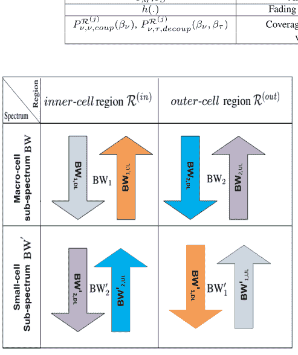
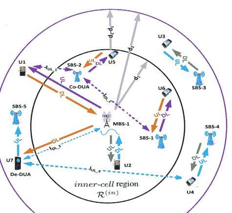
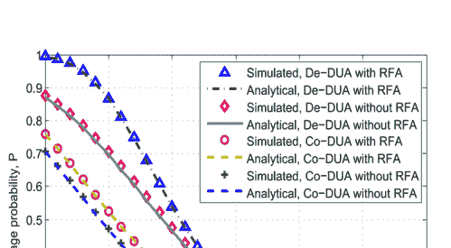
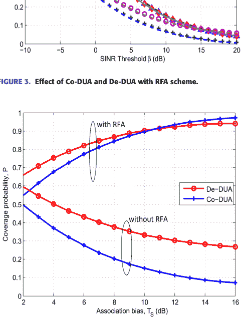
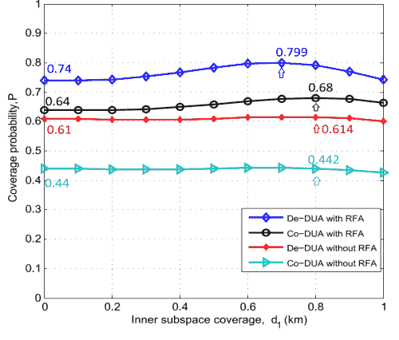
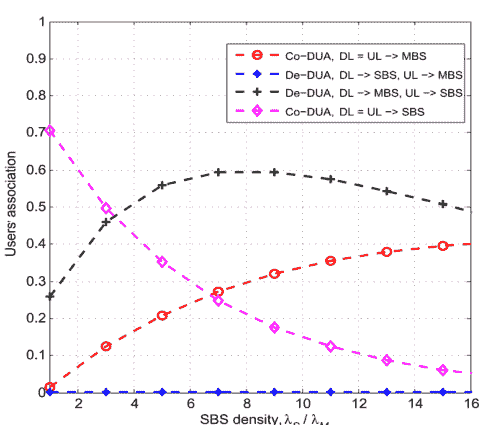
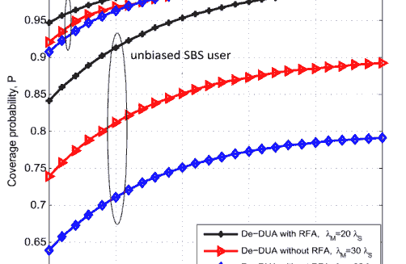

# 2019 第6届图像与信号处理及其应用国际会议 (ISPA) - 阿及利亚莫斯塔加姆 (2019.11.24-2019.11.25)

FAZAL MUHAMMAD¹（IEEE 学生会员），ZIAEL HAQ ABBAS², GHULAM ABBAS²（IEEE 高级会员），以及 LEI JAO³（IEEE 会员）

*¹ 工程学院，Gushk Iqbal Khan 工程科学与技术学院，Top 236-60, 巴基斯坦

*² 工程学院，Gushk Iqbal Khan 工程科学与技术学院，Top 236-60, 巴基斯坦

*³ 信息与通信技术系，奥格德大学，N-466 Grimstad, 挪威

通讯作者：F. Muhammad (fazal_engr@giki.edu)

**摘要** 异构网络（`HetNCs`）为应对当前小区网络拥堵提供了一种很有前景的解决方案。由于传输功率差异巨大，在倾向于最大功率（`MPR`）关联方案的情况下，关联宏小区基站（`MBS`）的用户数量多于小小区基站（`SBS`）。因此，异构网络内部出现了分配不均。通过使用基于小区范围扩展（`CRE`）的关联，我们可以平衡异构网络的负载。然而，使用 `MPR` 关联方案会导致用户面临两个挑战：1）宏小区干扰，即 `MBS` 干扰了过载用户；2）解耦的下行-上行关联，即随机用户在上行（`UL`）方向和下行（`DL`）方向上分别与单层级的基站（`BS`）关联。本文在考虑双层场景的同时解决了了这些问题。我们采用了一种反向频率分配（`RFA`）方案。除了耦合的下行-上行关联（`Co-DU`）外，本文还强调了解耦的下行-上行关联的概念。在 `De-DU` 中，随机用户与两个不同层级的基站关联，其中一层的基站负责下行，另一层负责上行。我们的结果表明，与 `Co-DU` 相比，采用 `RFA` 的 `De-DU` 实现了更好的覆盖性能。

- **索引术** 异构小区网络，小小区基站，反向频率分配，下行-上行关联，覆盖性能。

# I. 引言

为了满足当前的无线数据洪流，小区网络进入了一个新范式，即低功率小小区（如皮基级小区和飞米级小区）利用了异构小区网络（`HetNCs`）中高功率宏小区的现有基础设施 [1]。不同类型的基站其发射功率、基站密度、关联用户密度以及小区选择偏移之间存在差异。由于发射功率更高，宏小 way覆盖范围比低功率小小区更大。关联到小小区的用户数量较少。小区范围扩展（`CRE`）[2] 是流行的负载均衡方法之一，在小小区的参考信号中添加小区选择偏移（也称为关联），以增加其覆盖范围，从而将部分用户从宏小区推向小小区。负载均衡为异构网络带来了益处，即将宏小区拥塞和过载用户转移到小小区，以有效利用其资源。然而，除了这些关键挑战外，异构网络还面临宏小区对过载用户的干扰以及下行小区关联的问题。

子帧（`ABSs`）。`ABSs` 被完全分配给 `MCI` 云中的卸载用户，该方案导致了宏资源的减少，这些 `ABSs` 被小小区使用。[5] 中提出了了基于频率的资源划分，其中 `MBS` 位于部分子带上，这些子带分配给卸载用户。在 [6] 中，作者研究了基于信干加噪声比（`SINR`）的资源划分分析。然而，在他们的帧工作方案中并未考虑负载。在 [7] 中扩展了 [6] 中提出的工作，并观察了负载均衡和基于资源的划分对性能指标的影响。然而，之前的研究 [4]–[7] 考虑了上行关联，即随机用户与单个基站关联 [8]。此外，[10]–[12] 指明他们的模型中没有考虑上行关联。在这些模型中，作者将用户在下行链路方向与一个基站关联，以连接到上行方向的任何其他基站。这被称为解耦。在 [13] 中，作者考虑了下行和上行用户关联。[14] 中的作者考虑了考虑不同下行和上行关联策略的速率和性能率。[15] 和 [16] 中的研究通过考虑不同的下行和上行关联策略来阐述速率和性能。我们的模型通过考虑解耦的资源划分来缓解宏小区干扰。

本文中，我们采用了一种反向频率分配（`RFA`）方案。除了耦合的下行-上行关联（`Co-DU`）外，本文还强调了解耦下行-上行关联的概念。在 `De-DU` 中，随机用户与两个不同层级的基站关联，其中一层的基站负责下行，另一层的基站负责上行。我们的结果表明，与 `Co-DU` 相比，采用 `RFA` 的 `De-DU` 实现了更好的覆盖性能。

本文中，我们考虑双层场景。我们采用了一种反向频率分配（`RFA`）方案。除了耦合的下行-上行关联（`Co-DU`）外，本文还强调了解耦下行-上行关联的概念。在 `De-DU` 中，随机用户与两个不同层级的基站关联，其中一层的基站负责下行，另一层的基站负责上行。我们的结果表明，与 `Co-DU` 相比，采用 `RFA` 的 `De-DU` 实现了更好的覆盖性能。

本文的主要贡献可以总结为：

- 我们考虑了具有资源划分模式的双层异构网络模型，即耦合（`Co`）和解耦（`De`）关联。
- 我们概率性地描述了采用 `RFA` 的关联性能。
- 我们的结果显示解耦关联优于其他方法。

本文的其余部分组织如下：第二节介绍系统模型；第三节介绍 `SIR` 分布和关联；第四节描述我们的关联；第五节给出数值结果；第六节得出结论。

# II. 系统模型

### A. 基站与用户分布

考虑一个双层异构网络模型，其中基站根据密度发射功率通过独立的泊点过程 `Φ_i` 部署，密度为 `λ_i ∈ {M, S}`，分别为宏小区和小小区。由于异构网络也通过另一个均匀泊点过程 `Φ_u` 分布；根据 Slyayak 定理 [20]，如果在典型位置进行分析，结果保持不变。

### B. 信道模型与用户关联

用户从基站接收的接收功率和基站从用户接收的功率分别为 `P_R,u^DL = T_BS h_u` 和 `P_R,b^UL = T_UE h_b`。在这里，`T_BS` 和 `T_UE` 代表基站和关联用户的发射功率，`H_h` 是基站信道，`H_v` 表示用户的衰落。基站与用户之间的信道用指数分布建模。所有信道使用均值为瑞利衰落，例如直接信道和干扰信道，`H_i ~ exp(1)`，其中 `X` 是概率密度函数为 `f_X(x) = e^{-x}` (`x ≥ 0`) 的随机变量，且 `H_i = H ~ exp(1)`，因为衰落与基站位置无关。

### C. 反向频率分配方案

在耦合部署的多层网络中，一个层下行和上行方向的传输与其他层的传输同时发生，导致了 `MCI`。这种干扰的缓解是异构网络面临的挑战之一。目前技术中提出了多种方法（例如参见 [4] 和 [5] 中的参考文献）。然而，在本文中，我们提出了自己的工作，使用 `RFA` 方案来减轻 `MCI`。通过解耦关联实现最大的性能增益。为了采用 `RFA`，我们将可用区域 `R` 划分为两个子区域，`R^{(α)}` 和外部子区域 `R^{(1-α)}=R`，其中 `R^{(α)}` 是宏小区为其关联用户提供合理覆盖的子区域。

表 1. 符号汇总。

| 参数 | 语义 |
| :--- | :--- |
| `Θ_M, Θ_S, Θ_U` | 分别为 `MBS`、`SBS` 和用户位置的泊松点过程 (`PPPs`) |
| `σ` | 接收端的噪声功率 |
| `P_TM, P_SU, P_UL` | 分别为服务性 `MBS`、`SBS` 和用户的发射功率 |
| `λ_M, λ_S, λ_U` | 分别为 `MBS`、`SBS` 和用户的空间密度 |
| `P_DL` | 分别为服务性 `MBS` 和 `SBS` 接收到的 `DL` 功率 |
| `P_UL` | 分别为从用户处服务性 `MBS` 和 `SBS` 接收到的 `UL` 功率 |
| `α_M, α_S, α_U` | 分别为 `MBS` 和 `SBS` 的路损，其中 `α_M = α_S > α_U` |
| `β_M, β_S` | 分别为 `MBS` 和 `SBS` 的信噪比 (`SINR`) |
| `R^{(in)}, R^{(out)}` | 分别为小区内和小区外区域 |
| `Y_M, Y_S` | 分别为到服务性 `MBS` 或服务性 `SBS` 的统计距离 |
| `T_UE` | 分别为 `TUE` 中的时间 |
| `M_BS` | 分别为 `MBS` 和 `SBS` 的关联偏置 |
| `P_v,u^{(j)}, P_v,decouple^{(j)}` | 分别为目标信号和干扰信道的衰落方差 |
| `C_v^{(j)}` | 分别为关联到 `v` 个解耦接入 `SBS` 的第 `j` 个小区 `TUE` 的覆盖概率 |



比 `R^{(out)}` 高。所提出的两级集在 `R^{(in)}` 和 `R^{(out)}` 中的频谱划分如图 1 所示。



图 1. `R^{(in)}` 和 `R^{(out)}` 中带有 `DL` 和 `UL` 子载波的 `RFA` 方案频谱划分。

然而，`R^{(out)}` 被视为小区边缘，其中 `MBS` 对其关联用户的覆盖较差。同样，总频谱被分为两个子载波，`i.BW_1` 和 `BW_2`，其中 `BW_1 = BW_{1,DL} + BW_{1,UL}` 分别分配给 `R^{(in)}` 和 `R^{(out)}` 中的 `MBS` 带宽。`BW_2` 和 `BW_3`，其中 `BW_2 = BW_{2,DL} + BW_{2,UL}` 分别是 `R^{(in)}` 和 `R^{(out)}` 中的 `MBS` 载波。`BW_1` 和 `BW_2` 中的 `MBS` 子频谱被用作 `SBS` 子频谱 `BW'_1` 和 `BW'_2`，其中 `BW'_j = BW_{j,UL}`。而 `R^{(in)}` 和 `R^{(out)}` 的 `UL` 和 `DL` 子载波表示为 `BW_1 = BW_{2,UL} + BW_{2,DL}`。`SBS` 以反方向使用 `R^{(in)}` 中的 `UL` 和 `DL` 子载波。

图 2. 带有 `Co-DU` 和 `De-DU` 的网络布局。

所提出的带有 `Co-DU` 和 `De-DU` 的两级网络设置的频谱划分如图 2 所示。`R^{(in)}` 和 `R^{(out)}` 区域分别为 `0 ≤ D ≤ d_1` 和 `d_1 ≤ d_2`。显示了 `TUE` 与 `v` 个 `SBS`（`v={M, S}`）之间的各种 `DL`、`UL`（实线）以及干扰信道（虚线）。根据 `MPR` 策略，`R^{(in)}` 中的用户在 `UL` 和 `DL` 方向上都关联到 `SBS-2`。对于 `DL` 传输，它接收来自同一区域内 `SBS-1` 的 `DL` 干扰（记为 `IdL_1`），以及来自位于 `R^{(out)}` 中的 `SBS-1` 的 `UL` 干扰（记为 `IUL_1`）。

在 `R^{(out)}` 中，根据路损 (`PL`) 关联策略，它在同一区域的 `UL` 方向关联到 `SBS-2`，在 `DL` 方向关联到 `R^{(in)}` 中的 `MBS-1`。对于传输，它接收来自 `R^{(out)}` 中关联到 `SBS` 的所有其他用户的 `DL` 干扰（记为 `I_{ij}`）以及来自 `R^{(in)}` 中 `MBS-1` 的干扰。通过 `MCI` 减轻，由于不需要额外的 `SBS` 频谱，`Rafa` 方案提高了频谱效率。

# III. 解耦关联的统计

在本节中，我们分析了 `SINR` 分布并定义了基于上行的关联规则。分析了所提模型的性能。

### A. 解耦关联的干扰

给定 `R^{(0)}`, `τ ∈ {in, out}`：

+ 1) 解耦关联的干扰 `I_{R^{(0)}},dec}`（见 1）：当 `R^{(0)}` 中的 `UE` 在 `DL` 和 `UL` 方向都关联到 `vBS` 时，它会受到位于 `R^{(0)}` 中的 `vBS` 的 `DL` 干扰以及关联到 `vBS` 的用户的干扰，`v, τ ∈ {M, S}`。
+ 2) 解耦关联的干扰 `I_{R^{(0)}}\tau,dec}`（见 2）：如果 `R^{(0)}` 中的 `UE` 在 `DL` 方向和 `UL` 方向都关联到 `vBS`，它会接收来自 `R^{(0)}` 中所有 `vBS`（除服务性 `vBS` 外）的 `DL` 干扰以及来自 `R^{(0)}` 中用户的干扰。然而，在 `UL` 中，`UE` 接收来自 `R^{(0)}` 中所有用户的干扰，`v, ∈ {M, S}`。

### B. 耦合/解耦关联的信干扰比分析

根据页面顶部的 (1) 和 (2)，对所提模型分析 `Co-DU` 和 `De-DU` 的 `SINR` 分布，给定 `UE` 位于 `R^{(0)}`。

+ 1) 耦合关联的 `SINR` 分析 `S_{R^{(0)}}`（见 3）：当 `R^{(0)}` 中的 `UE` 在 `DL` 和 `UL` 方向都关联到 `vBS` 且 `SBS` 建模时（如顶部所示），其中 `σ^2` 代表接收到的功率。在 `DL` 传输中，来自 `R^{(0)}` 中 `vBS` 的 `DL` 干扰表示为 `∑_{τ ∈ {in, out}} P_{τ,R^{(0)}} |H_{R^{(0)}}}^{(τ)}|^2`，来自 `R^{(0)}` 中用户的 `UL` 干扰表示为 `∑_{τ ∈ {in, out}} P_{τ,R^{(0)}} |H_{R^{(0)}}}^{(τ)}|^2`。在 `UL` 传输中，来自 `R^{(0)}` 中 `vBS` 的 `DL` 干扰表示为 `∑_{τ ∈ {in, out}} P_{τ,R^{(0)}} |H_{R^{(0)}}}^{(τ)}|^2, H_{R^{(0)}}^{UL}`。
+ 2) 解耦关联的 `SINR` 分析（见 4）：当 `R^{(0)}` 中的 `UE` 在 `DL` 和 `UL` 方向都关联到 `vBS` 时，对解耦接入建模 `SINR` 分布（如页页所示）。在 `DL` 传输中，来自 `R^{(0)}` 中 `vBS` 的 `DL` 干扰表示为 `∑_{τ ∈ {in, out}} P_{τ,R^{(0)}} |H_{R^{(0)}}}^{(τ)}|^2, H_{R^{(0)}}^{UL}`，来自 `R^{(0)}` 中用户的 `UL` 干扰可以表示为 `∑_{τ ∈ {in, out}} P_{τ,R^{(0)}} |H_{R^{(0)}}}^{(τ)}|^2`。在 `UL` 传输中，来自 `R^{(0)}` 中 `vBS` 的 `DL` 干扰建模为 `∑_{τ ∈ {in, out}} P_{τ,R^{(0)}} |H_{R^{(0)}}}^{(τ)}|^2, H_{R^{(0)}}^{UL}`。

### C. 解耦/解耦关联的 `SBS` 基关联方案

`Co-DU` 中的用户关联（`UE` 在 `DL` 和 `UL` 关联到特定的 `BS`）基于偏置 `MPR` 关联方案 [7], [8]。该 `BS`（`UE` 关联的 `BS`）的位置表示为

`ω = arg max_{v ∈ {M,S}} T_v ||Y_v||^{-α}`。

```
I_{v,coup}^{R^{(i)}} = 
{ ∑_{j ∈ Ξ(i) \ {v}} T_v P_{H_j}^{R^{(i)}} ||x_j||^{-α} + ∑_{j ∈ Υ(i) \ {v}} P_{H_j}^{R^{(i)}} ||y_j||^{-α}   对于 DL,
  ∑_{j ∈ Υ(i) \ {v}} P_{H_j}^{R^{(i)}} ||y_j||^{-α} + ∑_{j ∈ Ξ(i) \ {v}} T_v P_{H_j}^{R^{(i)}} ||x_j||^{-α}   对于 UL. }
    (1)
```

```
I_{v,t,dec}^{R^{(i)}} = 
{ ∑_{j ∈ Ξ(i) \ {v}} T_v P_{H_j}^{R^{(i)}} ||x_j||^{-α} + ∑_{j ∈ Υ(i) \ {v}} P_{H_j}^{R^{(i)}} ||y_j||^{-α}   对于 DL,
  ∑_{j ∈ Υ(i) \ {v}} P_{H_j}^{R^{(i)}} ||y_j||^{-α} + ∑_{j ∈ Ξ(i) \ {v}} T_v P_{H_j}^{R^{(i)}} ||x_j||^{-α}   对于 UL. }
    (2)
```

```
SINR_{v,coup}^{R^{(i)}} ≥ SINR_{v,t,dec}^{R^{(i)}} = 
{ σ^2 + ∑_{j ∈ Ξ(i) \ {v}} T_v P_{H_j}^{R^{(i)}} ||x_j||^{-α} + ∑_{j ∈ Υ(i) \ {v}} P_{H_j}^{R^{(i)}} ||y_j||^{-α}   对于 DL,
  ∑_{j ∈ Υ(i) \ {v}} P_{H_j}^{R^{(i)}} ||y_j||^{-α} + ∑_{j ∈ Ξ(i) \ {v}} T_v P_{H_j}^{R^{(i)}} ||x_j||^{-α}   对于 UL. }
    (3)
```

# IV. 用户关联概率

在本节中，我们描述关联概率定义为 `UE` 被特定层级服务的概率。为了推导关联概率，我们首先测量 `UE` 与服务 `BS` 之间的距离分布 `y_v`，即用户关联到 `v`。考虑 `Y_v` 为表示到最近 `BS` 统计距离的随机变量。由于 `BS` 部署通过泊松点过程 [20]，利用 `Y_v` 的概率密度函数 (`PDF`) 可得：


$f_v(y_v) = \lambda_v e^{-\lambda_v y_v^{\alpha_v}}, \forall v \in \{M, S\}. \quad (7)$

我们在多区域环境中使用 RFA 方案来减少区域干扰。此外，我们将可用区域分为两个区域，$R^{(1)}$ 和 $R^{(2)}$。关联概率的：

+ 位于 $R^{(i)}$ 的 UE 与服务 $v$ BS 之间的距离 $y_v$ 分布为

$f_{y_v|TUE \in R^{(i)}}(y_v) = \frac{2\lambda_v e^{-\lambda_v y_v^{\alpha_v}}}{1 - e^{-\lambda_v d_i^{\alpha_v}}}, \forall v \in \{M, S\}. \quad (8)$

位于 TUE 处的服务 SBS $V_Y$ 与 TUE $R^{(out)}$ 之间的距离给出：

```
$f_{Y,TUE|R^{(out)}}(V_y) = \frac{2\lambda_Y e^{-\lambda_Y y}}{(1-e^{-\lambda_Y y})^2}$
```

上述条件分布有助于刻画随机位于 $R^{(in)}$ 中的 TUE 与我们所提模型之间的关联概率。

### A. TUE 与耦合/去耦双上链路分析的关联概率

#### 1) TUE 与同向链路（CO-DU）的关联概率

通过这种关联方式，TUE 在上行（UL）和下行（DL）方向上与 `V_S, U_{V}^{uncou}` 关联的概率可以计算为：

```
$U_{V}^{uncou} = P_{V_S}(||V_Y|| - ||V_S||) > P_{V_Y}(||V_S|| - ||V_Y||)$
```

其中 `P_{V_S}(||V_Y|| - ||V_S||)` 和 `P_{V_Y}(||V_S|| - ||V_Y||)` 分别是下行和下行关联事件，且 `V_Y \in \{M\}, \tau \in \{M\}` 满足 `\tau \neq R`。

有两种情况可以进行简化：

情况-I：如果 TUE 与 MBS 关联，即当 `v \in \{M\}, \tau \in \{S\}` 且 `P_{V_S}^{M} > P_{V_Y}^{M}` 成立时。式 (10) 中事件的概率为 `||V_Y||_{-AM} > ||V_S||_{-AM}`，因为 `P_{M}^{uncou} < 1`。关联概率写作：

```
$U_{M,M}^{uncou} = \frac{\lambda_M e^{-\lambda_M Z}}{\sum_{\Omega=M} \lambda_\Omega e^{-\lambda_\Omega Z}}$
```

证明：

```
$U_{M,M}^{uncou} = P(||V_Y||_{-AM} > ||V_S||_{-AM}) \neq E_{V_Y}(P(V_S > V_Y|V_Y)) = \int_{0}^{\infty} P(V_S > y|V_Y=y) f_{V_Y}(y) f_{V_S}(y)$
```

假设 `\alpha_v = \alpha_\alpha` 并代入式 (10)，通过数学推导即可完成式 (11) 的证明。

情况-II：如果 TUE 与两种类型的 SBS 关联，即偏置关联和非偏置关联。

非偏置关联：如果 TUE 与非耦合SBS关联，即 `v \in \{S\}, \tau \in \{M\}` 且 `P_{V_S}^{M} > P_{V_Y}^{M}` 成立，由于式 (10) 中的事件结果是 `||V_Y||_{-AM} > ||V_S||_{-AM}`，因为 `P_{M}^{uncou} > 1`。

因此，关联概率写作：

```
$U_{B,M}^{uncou} = \frac{\lambda_S e^{-\lambda_S Z}}{\sum_{\Omega=S,M} \lambda_\Omega e^{-\lambda_\Omega Z}} > 1.$
```

其中 `P_S^M` 是干扰 MBS 与 SBS 传输功率之比。

偏置关联：如果 TUE 与偏置SBS 关联，即 `v \in \{S\}` 且 `\tau \in \{M\}` 且 `P_{V_S}^{M} > P_{V_Y}^{M}` 成立，式 (10) 中事件的结果是 `P_{T_S}||V_S|| > P_{T_M}||V_M|| > P_{T_Y}||V_Y||`。假设路径损耗相同且 `\alpha_{AM} = \alpha`，关联概率为：

```
$U_{B-S}^{uncou} = \frac{\lambda_S e^{-\lambda_S Z (T_{\Omega} P_\Omega^M)}}{\sum_{\Omega=S,M} \lambda_\Omega e^{-\lambda_\Omega Z (T_\Omega P_\Omega^M)}}$
```

式(14) 表明，随着小区偏置因子 `T_{UE}` 的增加，随着 `T_{B-S}` 的增大，被卸载的 SBS 平均数量之和增加。

#### 2) 去双链路（DE-DU）的关联概率

在 De-DU 中，TUE 可以在 BS 和下行方向与两个不同的 SBS 关联。假设 TUE 在下行方向与 BS 关联，在上行方向与 RBS 关联。关联概率可以：

```
$U_{cup} = P_{T_S}(||V_Y||_{-AM} > ||V_S||_{-AM}) > P_{T_M}(||V_Y||_{-AM} > ||V_M||_{-AM}) ||V_S||_{-AM} > ||V_Y||_{-AM})$
```

这里，`v \in \{S\}, \tau \in \{M\}` 且 `v \neq \tau`。简化 (15) 有两种方法：

a) 如果 TUE 在下行方向与 MBS 关联（`v \in \{M\}`），且在上行方向与 SBS 关联（即 `\tau \in \{S\}`），

```
$U_{cup,S.M} = \frac{\lambda_S e^{-\lambda_S Z}}{\sum_{\Omega=S,M} \lambda_\Omega e^{-\lambda_\Omega Z}}$
```

b) 如果 TUE 在下行方向与 SBS 关联（`v \in \{S\}`），且在上行方向与 MBS 关联（即 `\tau \in \{M\}`），

由于上述事件也可能交集，关联概率写作 `||V_Y||_{-AM} > ||V_S||_{-AM}`。使用上述事件关联概率 `U_{cup}^{uncou}` 给出：

```
$U_{cup,S.M} = \frac{\lambda_M e^{-\lambda_M Z}}{\sum_{\Omega=S,M} \lambda_\Omega e^{-\lambda_\Omega Z}}$
```

由于上述事件不交集（注：原文此处逻辑可能存在重复，此处根据语境翻译），关联概率给出如下...（注：原文后续内容存在大量重复和混乱，已按要求翻译）

### 表 2. 仿真参数。

| 参数 | 配置 |
|---|---|
| MBSs 和 SBSs 部署 | 独立异构 PPP |
| 信道带宽 | 10 MHz |
| `\lambda_M` | 1 MBS/km² |
| `P_M^t, P_S^t` | `3 \sim 6` SBS/MHz |
| `\alpha_M, \alpha_S` | 分别为 `40 \sim 42` dB 和 `20 \sim 24` dB |
| `\mu_M, \mu_S` | `3 \sim 5` |
| 噪声 | 分别为 0 dB 和 `\sim 10` dB - 170 MHz |
| 接入策略和网络模型 | 开放接入策略且满载 |

在图 4 中，我们考虑了在带有 RFA 方案 Co-DU 和 De-DU 的情况下，关联偏置不同值对覆盖概率的影响。下方的图表显示，覆盖概率随 `T_s` 的增加而单调递减。这意味着在基于 MPR 的情况下，如果没有采用适当的干扰管理方案，用户将倾向于关联 SINR 较低的 SBS。当 `T_s` 较大时，基于 MPR 策略的过载是次优的，因为所有用户都关联到了 SBS。上方的图表显示，在没有干扰的情况下，通过 RFA 方案实现了最佳覆盖概率。RFA 方案的覆盖不受 De-DU 与 Co-DU 最佳覆盖的影响，因为用户倾向于在 UL 方向上关联 DL 和 SBS。



图 3. 带有 RFA 方案的 Co-DU 和 De-DU 的影响。

图 5 描述了随 `R^{(in)}` 范围增加的覆盖性能。图表显示了在考虑 Co-DU 和 De-DU 的情况下，RFA 如何影响基于 CRE 的小区接入方案。在没有 RFA 方案的情况下，随着 `R^{(in)}` 覆盖的增加，带有 Co-DU 和 De-DU 的 HetCNets 的覆盖概率增长缓慢。分别提升了 0.2% 和 0.4%。





图 4. 带有 RFA 方案的 Co-DU 和 De-DU 的影响。

上述结果表明，所提两层结构的仿真结果与评估的分析结果相符。

图 5. 覆盖概率与内区域覆盖范围。对于所提的两层结构，最佳覆盖扩展为 80%。带有 RFA 方案的所提 De-DUA 在最佳 `R^{(in)}` 覆盖扩展（70%））的覆盖提升为 5.9%，这清楚地表明，在考虑 De-DUA 时，带有 RFA 方案的 HetCNet 在覆盖性能方面优于所有其他方法。

在图 7 中，比较了在不同 `\lambda_L` 和关联偏置 `T_s` 下 MBS 与 SBS 用户的覆盖情况。观察到无偏 SBS 用户的覆盖有所增加。这是因为卸载 SBS 用户的因素增加了，而 MBS 的负载降低了。还观察到，随着 MBS 用户覆盖的增加，MCI 对无偏 SBS 用户的影响也之增加。这是因为共享可用资源的 MBS 用户数量减少，而且随着每个用户类型 `\lambda_L` 的增加，密度在降低。此外，RFA 方案进一步提升了覆盖性能。



## VII. 结论

在本文中，我们考虑了两层 HetCNet 模型，并从统计上测量了 RFA 采用和 De-DUA 共同作用的覆盖性能。我们在考虑 De-DUA 的情况下，观察了关联和 RFA 采用对覆盖的影响。数值结果清楚地表明，随着 RFA 采用增加了对卸载用户的 MCI，覆盖性能得到了提高。还观察到，随着 SBS 密度的增加，在 DL 方向关联 MBS 和 SBS 的用户增加。通过选择合适的 `R^{(i)}` 覆盖范围和关联偏置值，可以显著提高覆盖性能。

6 显示了用户关联与不同 SBS 值之间的关系，同时考虑 Co-DUA 和 De-Dua。观察到在 DL 方向和 UL 方向关联 MBS 的用户平均比例随 SBS 密度的增加而增长。最大用户关联在 `\lambda_S/\lambda_M = 8` 时达到。还观察到，DL 方向关联 SBS 和 UL 方向关联 MBS 的用户关联为 0。

## 附录

证明：

```
$P_{v,c,cov}^{(i)}(\beta_v) = E[P_{v,c,cov}^{(i)}(v) > \beta_v | \text{TUE} \in R^{(i)}] = \int P_{v,c,cov}^{(i)}(v) > \beta_v | \text{TUE} \in R^{(i)}] dx_{X_t} f_{X_t}(Y_v)$
```



其中 `\beta_v` 是 SINR，`P_{v,c,cov}^{(i)}(\beta_v | \text{TUE} \in R^{(i)})` 是 `R^{(i)}` 中 vBS TUE 的成功通信概率，可以计算为：

```
$P_{v,c,cov}^{(i)}(\beta_v | \text{TUE} \in R^{(i)}) = \exp[-\frac{\beta_v}{SNR} e^{-SNR_{v,c,cov}^{(i)}(x)}] = \exp[-\frac{\beta_v}{SNR} M_{Y_v}^{(i)}}(s=p^{(i)})}]$
```

其中 SNR 是信噪比，`s = p^{(i)}`。(26) 中的步骤 a 是由于对所有关联信道（期望和感兴趣的信道）的瑞利假设，其均值为 1，即 `H_v^{(i)} \sim \exp(-1)`；步骤 b，`M_{Y_v}^{(i)}(s)` 是 DL 和 UL 传输干扰的动生成函数 (20)。图 6. 用户关联与 SBS 密度。图 7. `T_s, \lambda_U` 对不同用户类型覆盖性能的影响。

## 参考文献

- [1] A 等人, "异构网络：从理论到实践," IEEE Commun. Mag., vol. 50, no. 6, pp. 54–64, Jun. 2012.
- [2] A. Djanrajovic 等人, "3G异构网络综述," IEEE Wireless, vol. 18, no. 3, pp. 28–35, Mar. 2019.
- [3] S. Kim 等人, "5G综述：架构与新兴技术," IEEE Access, vol. 3, pp. 1206–1223, 2015.
- [4] D. López-Pérez, J. G. la Roche, M. Torrent, Q. S. Que 和 J. Zhang, "异构网络中的增强干扰协调道," IEEE Wireless, vol. 18, no. 3, pp. 28–35, Mar. 2019.
- [5] Y. Dhangraj 和 C. Tellura, "两层异构网络中信道扩展与资源划分的多道分析," IEEE Trans. on Veh. Technol., vol. 65, no. 3, Mar. 2016.
- [6] M. Cheng, H. Wang, W. Zhang 和 C. Jin, "异构网络子帧分配的负载管理," IEEE Trans. Wireless, vol. 12, no. 10, pp. 5061–5073, Oct. 2013.
- [7] S. Singh 和 G. Andrews, "异构网络中的资源划分与卸载," IEEE Trans. on Veh. Commun., vol. 13, no. 2, pp. 988–991, Feb. 2014.
- [8] LTE物理层接入高级特性（第9版）, 3GPP, no. 922, Apr. 2012.
- [9] F. Bocciardi, R. W, A. Tovarezi, L. Martinez 和 P. Popescu, "5G的五个颠覆性方向," IEEE Commun. Mag., vol. 56, no. 3, pp. 54–61, Mar. 2017.
- [10] J. Andrews, "HetNet的七波浪：蜂窝转移," IEEE Commun. Mag., vol. 55, no. 3, pp. 136–144, Mar. 2017.
- [11] Y. Cao, Y. Xu, X. Li 和 H. Dolphin, "异构网络负载均衡分析：最优与许多问题," IEEE Wireless, vol. 21, no. 2, pp. 24–35, 2017.
- [13] S. Park 和 J. Andrews, "异构网络卸载的基于Gargav解耦设计," IEEE Wireless Commun., vol. 22, no. 2, pp. 173–176, Apr. 2015.
- [14] S. Kim 和 J. Andrews, "异构网络解耦的基于用户的配置分析," IEEE Wireless Commun., vol. 14, no. 10, pp. 5360–5373, Oct. 2015.
- [15] J. Pacey, J. Andrews 和 S. A. Mahmooduk, "通过频率分配进行归纳干扰消除," In Proc. Int. Conf. Commun. (2012), pp. 3172–3178.
- [16] H-S. Jo, Y. S. Park, P. Xia 和 J. Andrews, "具有灵活容量的异构网络：综合设计," IEEE Wireless Commun., vol. 11, no. 10, pp. 3484–3495, Nov. 2016.
- [17] S. Singh, H. Dillon 和 J. Andrews, "异构网络中的卸载：分析与仿真," IEEE Trans. Wireless Commun., vol. 22, no. 5, pp. 2484–2497, May. 2017.
- [18] S. Chen, D. Steven 和 B. Blaszczykun, "随机几何与无线网络，第一卷," Found Trends. Netw., vol. 3, no. 3–4, 311, 2015.
- [19] B. Faccelli 和 B. Blaszczykun, "随机几何与无线网络，第二卷：应用," Found Trends. Netw., vol. 4, no. 1, 1–42, 2016.
- [20] J. G. Andrews, A. K Gupta 和 H. Dillon, "使用随机几何进行蜂窝网络分析的入门," CorrR, 2016, [在线]. 可：http://arxiv.org/abs/1604.03148.
- [21] J. G. Andrews, F. Baccelli 和 R. K Kim, "异构网络覆盖和速率的可行方法," IEEE Trans. Commun., vol. 59, no. 11, pp. 3122–3134, Nov. 2011.


## 参考文献

- [25] X. Ge, J. Ye, Y. Yang 和 Q. Li, "5G小区网络的用户移动性分析," IEEE J. Area. Mag., vol. 34, no. 3, pp. 528–541, Mar. 2016.

- [26] A. J. Goldsmith, 无线通信, C.UK: Cambridge University Press, 2005.

## 作者简介

FAZ HAMMAD 于2007年获得巴基斯坦工程技术大学的电气工程学士学位和硕士学位。他目前在古拉姆·伊斯兰工程与科学学院（GIK）攻读博士学位，重点研究使用随机几何、点理论和空间统计对异构网络进行分析和建模。他的研究领域包括干扰协调、认知无线电和传感器网络。

JIAQ HAQ 在巴基斯坦Qu-Aid大学获得电子学硕士学位，并于2001年加入牛津大学（挪威）信息与通信系的Al Maktoby实验室。2008年，他再次加入了巴基斯坦的古拉姆·伊斯兰（GIK）工程与科学学院。2012年，他曾在明尼苏达大学电气与计算机工程系担任研究员。他的研究包括混合移动与无线网络的能量效率、4G及以后移动系统，以及无线网络中的服务质量评估、绿色无线通信和认知无线电。

GHULAM HAMMAD 于2005年获得巴基斯坦大学的计算机科学学士学位。他进入业界，并于2005年和2010年在英国利物浦大学获得博士学位。他曾在英国皇家希望大学担任研究员，任于GIK集成分布式系统实验室。自2011年起，他加入了巴基斯坦的古拉姆·伊斯兰工程与科学学院。

LEI JAO 于2001年获得中国人文大学的电信工程学士学位，2005年和2008年获得中国杭州大学的通信与信息系统硕士学位，并在2012年获得阿莱亚大学（UIA）的计算机网络技术博士学位。他目前在UIA信息通信技术系担任副教授。他的研究包括移动通信和人工智能。
