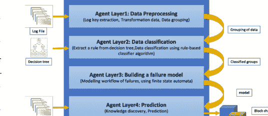

# [iiWAS '20： 第22届信息集成与基于Web的应用程序和服务国际会议（清迈 泰国 ..-..）] 第22届信息集成与基于Web的应用程序和服务国际会议论文集

## ABSTRACT

应用程序生成的执行跟踪包含开发人员认为在调试或监控应用程序时有用的信息，它包含应用程序状态和在各种关键点的重要事件，有助于他们深入了解故障并在发生前识别和预测潜在问题。尽管这些跟踪在几乎所有计算机系统中普遍存在，但由于它们不易被机器解析，因此很少被利用。在本文中，我们提出了一种使用区块链技术进行预测过程的多智能体方法，该方法允许自动分析执行跟踪并在执行期间检测系统故障预测的早期预警信号。所提出的预测方法采用四层多智能体系统架构构建。所提出的预测方法的性能基于数据预处理和用于预测的监督学习算法。区块链用于协调智能体之间的协作，并同步智能体与管理员之间的预测。我们通过将其应用于现实世界的分布式系统来验证我们的方法，在这些系统中，我们以高精度预测了问题在发生之前。在本文中，我们将重点关注我们预测方法的架构。

## CCS CONCEPTS

• 计算方法学 → 多智能体系统；机器学习；• 计算机系统组织 → 点对点架构。

## KEYWORDS

区块链技术，多智能体系统，预测，执行跟踪，智能体，机器学习

## ACM Reference Format:

Arwa Binlashram, Hajer Bouricha, Lobna HSAIRI, and Haneen AL Ahmadi. 2020. 基于区块链的用于从系统日志预测异常的新型多智能体系统。载于第22届信息集成与基于Web的应用程序服务国际会议（iiWAS ’20），2020年11月30日至12月2日，泰国清迈。ACM，纽约，NY，美国，5页。https://doi.org/10.1145/3428757.3429149

## 1 INTRODUCTION

随着计算技术的最新发展，我们见证了对各种日常使用软件的计算技术依赖程度的快速增长，因为它已依赖于一系列异构计算系统。例如，银行系统、健康系统、交通系统等。因此，我们必须努力保持这些系统运行并减少停机时间，因为这非常重要，并对社会功能产生许多影响。有许多例子表明了计算故障的影响。例如，2012年，英国和爱尔兰苏格兰皇家银行集团的600万客户发现自己数周无法访问其账户[5]。此外，2008年3月，希思罗机场行李系统的计算故障影响了14万人，故障成本估计为3200万美元[5]。因此，这凸显了确保系统连续性的必要性。每个系统都有自己的数据库，包含在每个时刻执行的不同操作的记录。这些数据称为日志。日志是丰富且有用的信息来源，有助于开发人员调试或监控应用错误以确保系统可靠性。通常，日志是由系统源代码中的日志语句生成的非结构化文本。观察日志分析的相关研究，我们发现其关注三个不同的管理问题；(i)取证分析，旨在在发生后识别系统故障的根本原因[13, 30]。(ii)故障检测，旨在在发生时快速检测系统故障的迹象[29]。(iii)系统故障预测，旨在在故障发生前提供早期预警[28, 31]。基于日志的故障预测的挑战之一是进行预测所需的功能数量或所需的时间段长度[28, 31]。例如，我们发现当前研究[28]使用了从系统日志中提取的近400个特征。而[31]使用一定的时间段来进行预测。另一个挑战是它可以识别故障，但不能在发生前确定其确切类型。为克服这些挑战，我们正在开发一种使用区块链技术（BCT）的多智能体（MAS）预测方法。所提出的方法涉及将MAS和BCT集成以在执行期间检测系统故障预测的早期预警信号。我们的方法首先通过将相同的日志消息分组来从执行跟踪中提取日志键，并用日志键替换原始日志消息的所有自由文本，从而大幅减少数据量。其次，我们将第一步的输出发送到基于规则的分类算法以对数据进行分类。第三，我们使用有限状态自动机（FSA）来模拟每个问题的执行行为。最后，我们使用决策树算法进行预测。我们工作的主要贡献可概括如下：(1)我们开发了一种通用的日志分析全自动方法，涉及MAS和BCT的集成，以在故障发生前检测系统故障预测的早期预警信号。它按行分析日志，不需要一系列行（特征）来进行预测，而这通常与基于日志的分析相关联。(2)我们设计并实现了自动化日志分析，能够大规模、准确、快速、高效地分析日志数据。(3)我们设计了基于监督学习算法（基于规则的分类、决策树算法）的预测系统，能够优于大多数现有系统。(4)我们使用真实数据集（Hadoop分布式文件系统）评估了我们的方法，并通过标准性能指标、精确率、召回率和F分数验证了其有效性。我们还证明了我们的系统可以在故障发生前识别故障的确切类型，并在此之前向管理员提供有关故障的详细报告。本文其余部分组织如下。第2节展示相关工作。第3节讨论方法论的主要思想。第4节讨论实验结果。结论在第5节给出。

决策模块用于静态或动态预测，协调模块用于智能体之间的通信。该工作预测能源需求以了解需求预测，并也在结构化数据集上工作。在以往研究的基础上，我们的研究感兴趣于在执行阶段使用MAS来过滤执行跟踪。BCT是一种新型的点对点分发技术。它提供了系统中发生的所有过程的共享、防篡改和透明记录[21, 26]。我们需要BCT来增强MAS中的安全性和完整性，并且已经有一些尝试将这两种技术集成在一起[3]。例如，[11]描述了一种组织通信协议的方法，该方法允许MAS的智能体对其行动做出决策。该方法使用基于BCT和智能合约的MAS来组织通信系统。该协议应用于无人驾驶飞行器（UAV）。[4]使用Jade和Fabric Hyperledger v1.0设计、开发并评估了基于BCT的MAS。这项工作侧重于创建能够跟踪、监控和存储随时间发生的交易以提高安全性和完整性的系统。在以往研究的基础上，我们的研究感兴趣于使用MAS方法和BCT来改进预测。

## 2 RELATED WORKS

## 3 METHODOLOGY

MAS和预测过程已有大量研究。大多数研究集中于在设计阶段使用MAS方法。例如，[10]提出了一种名为“EMAS”的新型集成式MAS，用于数据挖掘中的问题预测。它使用MAS来提高预测准确性并降低预测复杂性。EMAS架构具有四层MAS架构。第一层是数据清洗和规范化。第二层是数据预处理。第三层是构建预测模型。第四层是知识发现、预测和数据展示。他们提出的系统基于先前数据预测数据挖掘中的问题，因为它检查数据并预测其中的问题，这意味着它不会在发生前预测任何故障。他们还在一组结构化数据集（表）上工作。我们提出的系统与该系统的区别在于它能在故障发生前检测早期故障警报，并且它在非结构化数据（日志文件）上运行。另一个基于MAS的框架示例是[23]提出的提高能源需求预测精度的框架。在该框架中引入了智能混合智能体和能源供需预测的MAS分层基础设施。智能混合智能体由用于实现静态预测的审慎智能体、用于动态预测的反射智能体组成，决策模块用于静态

分布式智能系统的最新趋势在很大程度上依赖于基于智能体的方法或所谓的MAS，因为它们已证明能够代表生产者和用户管理敏感数据，因为它们具有相互交互和决策的能力。因此，我们发现智能体之间的透明度是必须实现的关键特性，因此我们比以往任何时候都需要更可靠的交互，为此我们在MAS中使用了BCT。在本节中，我们首先解释MAS及其使用优势。然后是BCT及其使用的效用。最后，我们遵循的方法论。

图1：所提出预测方法的概述

### 3.1 Multi-Agents System

智能智能体是像计算机程序或机器人一样的计算机化实体[27]。智能体可以被描述为自主的，因为它在环境变化时具有适应能力。它是用于解决大规模复杂问题的重要人工智能概念之一[24]。MAS被定义为自主智能体的社会，它们相互竞争或

协同解决复杂问题，但由于其固有的学习能力和自主决策能力，它们提供了更大的灵活性。由于 MAS 的突出特性，包括其分布式特性、效率、灵活性、可靠性和低成本，使其成为解决复杂任务的有效解决方案。MAS 被应用于不同的敏感领域，如电子健康 [12]、物流 [9]、制造 [16]、电子商务 [17] 等。它被用于降低这些领域的运营成本并执行自动功能，因为代理的特殊特性如智能、独立性、学习能力，以及 MAS 的特性如独立性、其分布式特性和灵活性，使其成为解决复杂问题最常见的系统之一。但该系统的主要问题是代理之间的协调 [1]。尽管为开发确保 MAS 中安全通信和协调的模型和机制付出了许多显著努力，但尚未找到满足所有要求的可行解决方案。

### 3.2 Blockchain technology

BCT 是记录网络中用户之间发生的交易的网络账本。其优势在于作为分布式数据库，BCT 上的每个用户都可以从任何地方访问整个数据库及其完整历史。它也是一种新型的点对点分发技术，意味着通信直接在用户之间进行，无需第三方传递消息。该技术允许构建可信、负责且透明的应用程序，这些应用程序使用密码学基础（如哈希功能、数字签名和加密）进行保护。该网络上的每个用户都有自己的数字签名。BCT 正受到各行各业的关注：从医疗保健 [7]、金融 [6]、其他行业 [8]。这种兴趣增加的原因是：BCT 使它们能够以去中心化的方式运行，无需验证系统，并以相同的可靠性实现相同的功能。BCT 是一种用于创建具有数据保护机制的点对点去中心化网络的新技术，该技术具有在节点之间共享和跟踪数据的能力 [2]。根据上述内容，我们发现 BCT 是规范代理之间协调的关键。在本文中，我们提出了使用 BCT 的预测过程的 MAS 方法。本文提出了一种改进预测的新方法。所提出的方法涉及 MAS 与 BCT 的集成，以检测系统故障预测的早期预警信号，并在其发生之前进行检测，这种集成使所提出的系统能够在任何复杂环境中运行。

### 3.3 Architecture of our prediction approach

预测方法是通过使用四层 MAS 架构构建的，每层都有自己的职责和流程。所有这些类相互合作，以实现在系统发生故障之前预测故障的总体目标。图 1 显示了所提出的架构。接下来，我们将详细讨论每一层。第一层称为数据预处理层（DPL）。该层中代理的目标是日志键提取，并分析、转换和重新组织数据，以便应用机器学习对数据进行分类。因为我们系统的主要输入是日志文件，这是一个非结构化文件。由于该文件体积庞大，管理员很难了解和理解其主要结构，因此我们通过提取日志键（消息的主要结构）来减小其大小，帮助这些管理员发现和理解该文件的主要结构。这样他们在未来就可以找到出现的故障的解决方案。由于该文件的性质，它包含大量对我们系统可能不重要的信息，因此我们使用第一步中提取的日志键来分析和重新组织文件。该层的最终输出是组，每个组包含一系列日志键，这些日志键已被替换为数值数据，以供第二层使用。第二层称为数据分类层（DCL）在该层中，代理使用基于规则的分类器，这使其成为专家代理 [22]。基于规则的分类器比其他分类算法更好，其表达能力强如决策树，易于解释，易于生成，并且新状态可以快速分类。主要优点是规则可以通过两种方式创建，第一：直接方法：直接从数据中提取规则，例如 RIPPER [25]、CN2、Holte's IR [20]，第二：间接方法：从其他分类模型（如决策树、神经网络等）中提取规则。该层的最终输出是按故障类型分类的组。第三层称为构建异常模型（BAM）。该层的代理使用有限状态自动机来模拟每个异常的执行行为。我们采用 FSA [14]，尽管还有一些其他替代模型，例如 Petri-Net [15]，因为它既有效又简单。该层的最终输出是所有类型故障的模型，用于第四层的预测。第四层称为预测层（PL）。该层的代理是智能代理，它们从模型中学习并收集信息。然后它们使用决策树算法在故障发生之前预测任何故障。如果这些代理中的任何一个检测到故障的任何迹象，该代理将把有关该故障的所有详细信息写入 BCT。

我们使用分层架构的主要目标是简化预测过程并提高工作速度，因为每一层都有其特殊角色和自己的代理。该层中的所有代理共同合作，以快速高效地实现总体目标。

#### 3.3.1 Analysis and design of methodology.

设计程序的第一步是确定目标。这种方法可以导致一个目标列表，这些目标作为目标和子目标的树相互关联。为了实现程序的主要目标，必须执行该方法。在我们的研究中，MAS 与 BCT 集成的<|message|>...主要目标是检测执行期间系统故障预测的早期预警信号。而各层的子目标是第一层是数据准备，第二层是对这些数据进行分类，第三层是从这些数据构建模型，第四层是基于上一步的模式进行预测。一旦我们确定了系统的目标和子目标，我们就进入第二步，即角色。角色是基于预定义目标创建的，以便阐明系统的详细功能 [19]。定义角色对于修改系统非常有帮助，因为每个系统都包含一组与主要系统功能直接相关的角色。在明确定义系统角色后，我们进入第三步，即通过对角色进行分组来定义系统的代理。角色根据其相似性进行分组并合并到一个代理中。此外，系统中存在数据流，决定数据如何在角色之间流动。

#### 3.3.2 Agents description.

在我们提出的方法中，多个代理协同工作以实现系统的总体目标，每个代理都有特定的职责。本节旨在描述每个代理工作的步骤，解释这些步骤背后的逻辑，并定义每个代理的输入和输出。

**Agent layer1: Data preprocessing.** 大数据集通常是大量组织良好的行和列。相反，日志文件是非结构化的，因为它们以文本和非结构化数据集的形式出现，这就是为什么尽管它们包含有价值的信息，但开发人员仍未使用它们来分析事件的原因。因此，我们开发了一个自主智能代理来执行此过程，它将非结构化文件转换为易于使用和理解的结构化文件。此外，这一步是机器学习过程中最重要的一步之一，因为机器学习过程无法处理非结构化数据。输入：我们使用研究输入的是与 Hadoop 分布式文件系统（HDFS）执行跟踪链接的原始事件日志的一部分。我们假设执行跟踪（日志文件）中的每一行显示一个事件（或特征），我们还假设一系列事件与特定故障相关联。输出：预处理数据的目标是创建有序数据集以供第二层机器学习算法使用。该数据集是原始事件日志的副本，已以特定方式格式化，适合用于机器学习算法。该层中的代理通过以下五个步骤生成结构化记录：
- 日志键提取
- 解析
- 转换
- 分组
- 归一化

**Agent layer 2: Data classification,** 通常，数据存储在目标文件中。在文件系统中，文件被分成一个或多个部分并存储在单独的数据节点中。这些文件段称为块。换句话说，HDFS 可以读取或写入的数据称为块。每个块在存储过程中会经历某些阶段或步骤，所有这些步骤都记录在 HDFS 执行跟踪中。查看每个块的事件序列时，我们可以知道该块是否正常存储。通过对先前研究 [29] 的研究，我们能够确定块中发生的故障类型，他们在决策树中进行了说明。在本层中，我们开发了一个专家代理，可以从决策树中推导出规则并用于分类。输入：该代理的输入是第一层代理的输出，即组。每个组包含特定块的事件。输出：它们是根据故障类型分类的组。该层中的代理根据特定规则将组分类为组，通过两个步骤：
- 从决策树中提取规则
- 基于规则的分类

**Agent layer 3: Building a failure model,** 构建故障模型。本层的输入是上一步分类的组。根据前述内容，我们发现每个组都被分配给特定故障，每个组包含块组。每个块组包含一组按记录顺序排列的事件。如果我们发现每个故障都有许多案例，换句话说，我们发现每个故障都没有单一的事件序列。因此，我们使用 FSA 来模拟每个故障的所有案例并显示导致该故障的内部组件之间的所有交互。从中我们将拥有一个显示所有故障序列的单一模型。我们可以利用它在故障发生之前预测该故障。还开发了一个自主智能代理来自动化这些步骤。输入：该代理的输入是第二层代理的输出，即根据故障类型分类的组。代理使用它来构建故障模型。输出：它们是将在第 4 层中用于在故障发生前预测故障的故障模型。在本层中，代理使用 FSA 从分类组中构建故障模型。FSA 由有限数量的状态和状态之间的转换组成。组中的每个事件都是一个转换。代理使用 [18] 提出的算法通过块中的事件序列学习系统每个故障的 FSA。

**Agents layer 4: Prediction,** 在本层使用一组代理的目标是使每个代理搜索与其他代理不同的特定问题。这将减少时间和精力。当代理检测到故障的早期预警信号时，它会写入 BCT，以便其他代理和管理员在故障发生前同时获知，这就是本层使用 BCT 的原因，因为它提供了代理之间的透明度、信任和通信，以及代理与管理员之间的同步。本层使用的所有代理都是智能代理，因为它们能够从模型中学习、发现信息并做出针对故障的决策。输入：这些代理的输入来自执行跟踪的单行。输出：当任何代理检测到故障的早期预警信号时，它会写入 BCT，因此这里的输出是携带预测信息的新的块。这些代理在检测早期预警信号时相互合作，通过四个步骤：
- 数据预处理
- 知识发现
- 预测
- 写入 BCT

## 4 RESULTS AND INTERPRETATION

我们进行了实验以验证所提出方法的有效性。在此实验中，我们展示了可以自动发现 HDFS 中异常行为的许多早期预警信号。通过在 203 个 EC2 节点上设置 Hadoop 集群并运行 Hadoop map-reduce 函数样本 48 小时，生成并处理了超过 200 TB 的随机数据。从 HDFS 收集了超过 2400 万行记录 [29]。对 HDFS 记录应用数据预处理后，共处理了 11,197,954 条消息（约占所有消息的 50%）。我们发现有 88 个日志键对应 31 种事件类型。此外，还有 575,139 个块 ID。有关此数据集的更多信息可在 [29] 中找到。所有工作均由 VS Code 版本 1.44 软件完成，使用配备 2.5 GHz Intel Core i5 CPU 和 8 GB 内存的 MacBook Pro。我们选择报告标准性能指标：精确率、召回率和 F 分数来评估我们的结果。精确率、F 分数和召回率也在 [6] 中的基准性能评估中使用。在我们的研究中，对超过两个类别进行分类，因此精确率计算为所有类别中真正例的总和除以所有类别中真正例和假正例的总和，召回率计算为所有类别中真正例的总和除以所有类别中真正例和假负例的总和

### 表 1：精确率、召回率和 F 测量的结果

| 数据集 | 精确率 | 召回率 | F 测度 |
|---|---|---|---|
| HDFS | 0.998 | 0.990 | 0.9939 |

对所有类别而言。此外，我们手动将故障消息定义为正例，非故障消息定义为负例，我们有：

Precision = sum(TruePositives) / sum(TruePositives + FalsePositives) (1)

Recall = sum(TruePositives) / sum(TruePositives + FalseNegatives) (2)

F-Measure = (2 * Precision * Recall) / (Precision + Recall) (3)

表 1 展示了将我们的方法应用于 HDFS 数据集时精确率、召回率和 F 测量的结果，从表中可以清楚地看出，我们的方法能够在故障发生前以高精度检测到故障的早期预警。此外，它还具有速度快的特点，我们对来自 HDFS 数据集的 11,197,954 条消息进行了检验，并在 10 分钟内显示出 [29] 中记录的所有错误。我们没有找到在同一数据集上预测故障在发生前的研究。

## 5 结论

本文提出了一种预测方法，即一种用于自动分析执行轨迹并在执行期间使用基于 MAS 和 BCT 的方法检测系统故障预测的早期预警信号的方法。所提出的预测方法使用事件序列来预测故障发生前的情况。所提出的预测方法采用四层 MAS 架构构建。第一层是数据预处理层，第二层是数据分类层，第三层是构建故障模型，最后是预测层。我们的方法在真实数据上得到验证，它解决了这些大型系统管理员的重大需求，即在发生前以 100% 的准确率预测异常。对于未来的工作，我们计划监控执行轨迹以确定异常的原因并解决它。

## 参考文献

[1] Mourad Abed, Adel M Alimi, Khaled Ghedira, Lobna Hsairi, and Abdellatif Benabdellah. 2011. MAIS-E2 model and R2-IBN framework: port application case. 波兰管理研究杂志 3 (2011), 110–126. [2] Muneeb Ali, Jude Nelson, Ryan Shea, and Michael J Freedman. 2016. Blockstack: A global naming and storage system secured by blockchains. 在 2016 {USENIX} 年度技术会议 ({USENIX} {ATC} 16) 中。181–194. [3] Davide Calvaresi, Alevtina Dubovitskaya, Jean Paul Calbimonte, Kuldar Taveter, and Michael Schumacher. 2018. Multi-agent systems and blockchain: Results from a systematic literature review. 在国际多智能体系统实践应用会议上。Springer, 110–126. [4] Davide Calvaresi, Alevtina Dubovitskaya, Diego Retaggi, Aldo F Dragoni, and Michael Schumacher. 2018. Trusted registration, negotiation, and service evaluation in multi-agent systems throughout the blockchain technology. 在 2018 IEEE/WIC/ACM Web Intelligence 国际会议 (WI) 上。IEEE, 56–63. [5] Robert Charette and Joshua Romero. 2015. The staggering impact of it systems gone wrong. IEEE Spectrum (2015). [6] Yan Chen and Cristiano Bellavitis. 2020. Blockchain disruption and decentralized finance: The rise of decentralized business models. 商务创业洞察杂志 13 (2020), e00151.

[7] Emeka Chukwu and Lalit Garg. 2020. A systematic review of blockchain in healthcare: Frameworks, prototypes, and implementations. IEEE Access 8 (2020), 21196–21214. [8] Maria Luisa Di Silvestre, Pierluigi Gallo, Josep M Guerrero, Rossano Musca, Eleonora Riva Sanseverino, Giuseppe Scuimè, Juan C Vázquez, and Gaetano Zizzo. 2020. Blockchain for power systems: Current trends and future applications. 可再生与可持续能源评论 119 (2020), 109585. [9] Juliane Fischer, Christian Lieberoth-Leden, Johannes Fottner, and Birgit Vogel-Heuser. 2020. Design, Application, and Evaluation of a Multiagent System in the Logistics Domain. IEEE 自动化科学与工程汇刊 (2020). [10] Mehdi Golzadeh, Esmaeil Hadavandi, and S Chehreh Chelgani. 2018. A new Ensemble based multi-agent system for prediction problems: Case study of modeling coal free swelling index. 应用软计算 64 (2018), 109–125. [11] Aleksandr Kapitonov, Sergey Lonshakov, Aleksandr Krupenkin, and Ivan Berman. 2017. Blockchain-based protocol of autonomous business activity for multi-agent systems consisting of UAVs. 在 2017 无人飞行器系统研究、教育与发展研讨会 (RED-UAS) 上。IEEE, 84–89. [12] Faizal Khan and Omar Reyad. 2020. Application of Intelligent Multi Agent Based Systems For E-Healthcare Security. arXiv 预印本 arXiv:2004.01256 (2020). [13] Chung Hwan Kim, Junghwan Rhee, Hui Zhang, Nipun Arora, Guofei Jiang, Xiangyu Zhang, and Dongyan Xu. 2014. Introperf: Transparent context-sensitive multi-layer performance inference using system stack traces. ACM SIGMETRICS 性能评估评论 42, 1 (2014), 235–247. [14] Namhun Kim, D Shin, RA Wysk, and Ling Rothrock. 2010. Using finite state automata (FSA) for formal modelling of affordances in human-machine cooperative manufacturing systems. 国际生产研究杂志 48, 5 (2010), 1303–1320. [15] Cong Liu, Qingting Zeng, Hua Duan, Lei Wang, Jie Tan, Chongguang Ren, and Wangyang Yu. 2020. Petri net based data-flow error detection and correction strategy for business processes. IEEE Access 8 (2020), 43265–43276. [16] RenZhi Lu, Yi-Chang Li, Yuting Li, Junhui Jiang, and Yuemin Ding. 2020. Multi-agent deep reinforcement learning based demand response for discrete manufacturing systems energy management. 应用能源 276 (2020), 115473. [17] Elham Majd and Mark Hobson. 2020. An incorporated RUU model for multi-agent systems in e-commerce. 企业信息管理杂志 (2020). [18] Leonardo Mariani and Mauro Pezze. 2007. Dynamic detection of cots component incompatibility. IEEE 软件 24, 5 (2007), 76–85. [19] Alireza Meshkin, Nasser Ghasem Aghaee, and Mehdi Sadeghi. 2011. Modeling and implementing an agent-based system for prediction of protein relative solvent accessibility. 专家系统与应用 38, 5 (2011), 6324–6332. [20] Graziano Mita, Paolo Papotti, Maurizio Filippone, and Pietro Michiardi. 2020. LIBRE: Learning Interpretable Boolean Rule Ensembles. 在国际人工智能与统计会议上。PMLR, 245–255. [21] Peifang Ni, Hongda Li, Xianning Meng, and Dongxue Pan. 2019. UniqueChain: A Fast, Provably Secure Proof-of-Stake Based Blockchain Protocol in the Open Setting. IACR 密码学电子印刷档案 2019 (2019), 456. [22] Serkan Örücü and Murat Selek. 2020. Design and validation of rule-based expert system by using Kinest V2 for real-time athlete support. 应用科学 10, 2 (2020), 611. [23] Yigong Peng, ZhongCheng Lu, and JinShou Yu. 2009. Multi-agent Framework for Energy Supply/Demand Prediction. 在 2009 WRI 计算机科学与信息工程世界大会上。卷 4。IEEE, 586–590. [24] Roxana Rădulescu, Patrick Mannion, Diederik M Roijers, and Ann Nowé. 2020. Multi-objective multi-agent decision making: a utility-based analysis and survey. 自主智能体与多智能体系统 34, 1 (2020), 10. [25] Donald Rumblelow. 2016. Complete Jack The Ripper. Random House. [26] AA Sakhipov and DS Baygozhanova. 2020. BLOCKCHAIN TECHNOLOGY IN EDUCATION. 科学进化 1 (2020), 36–39. [27] Yamsileydi Salgueiro, Marco Rivera, and Gonzalo Nápoles. 2020. Multi-agent-Based Decision Support Systems in Smart Microgrids. 在智能决策技术中。Springer, 123–132. [28] Ruben Sipos, Dmitriy Franko, Fabian Moerchen, and Zhuang Wang. 2014. Log-based predictive maintenance. 在第 20 届 ACM SIGKDD 知识发现与数据挖掘国际会议论文集。1867–1876. [29] Wei Xu, Ling Huang, Armando Fox, David Patterson, and Michael I Jordan. 2009. Detecting large-scale system problems by mining console logs. 在 ACM SIGOPS 第 22 届操作系统原理研讨会论文集。117–132. [30] Ding Yuan, Haohui Mai, Weiwei Xiong, Lin Tan, Yuanyuan Zhou, and Shankar Pasupathy. 2010. SherLog: error diagnosis by connecting clues from run-time logs. 在第 15 届编程语言与操作系统体系结构支持国际会议论文集。143–154. [31] Ke Zhang, Jianwu Xu, Martin Renqiang Min, Guofei Jiang, Konstantinos Pelechrinis, and Hui Zhang. 2016. Automated IT system failure prediction: A deep learning approach. 在 2016 IEEE 大数据国际会议 (Big Data) 上。IEEE, 1291–1300.
