# 图像加密：通信视角

## 前言

在本书中，我们尝试从通信研究者的视角来看待图像加密。传统的加密研究侧重于加密算法的强度，而没有考虑加密之后的问题。加密之后是什么？这是我们选择合适加密算法时必须回答的问题。在现实应用中，加密之后就是加密图像的通信。随着移动和电视应用的发展，我们必须以无线方式传输加密图像。因此，“我们的加密算法能否容忍无线通信损伤？”正是本书试图回答的问题。

本书的主要贡献可概括如下：

- 本书专门探讨面向无线通信的图像加密问题。
- 本书研究了扩散密码和置换密码，并使用不同评估指标对二者进行了比较。
- 本书对现有分组密码进行了修改，以加快其速度或提升其性能。
- 本书还研究了传输加密图像所需的无线通信环境。

本书给出了仿真实验，以验证所讨论算法及其修改，并研究算法在无线信道上的性能。本书中大多数仿真实验的MATLAB®代码收录在书末的两个附录中。最后，我们希望本书能对图像处理和无线通信领域的研究人员有所帮助。

MATLAB® 和 Simulink® 是 The MathWorks, Inc. 的注册商标。如需产品信息，请联系：

The MathWorks, Inc.  
3 Apple Hill Drive  
Natick, MA 01760-2098 USA  
电话：508 647 7000  
传真：508-647-7001  
电子邮箱：info@mathworks.com  
网址：http://www.mathworks.com/

## 作者简介

### Fathi E. Abd El-Samie

Fathi E. Abd El-Samie 分别于1998年、2001年和2005年在埃及梅努夫市的梅努菲亚大学获得理学学士（荣誉）、理学硕士和博士学位。自2005年起，他一直在梅努菲亚大学电子工程学院电子与电气通信系任教。目前他是KACST-TIC电子社会射频与光子学（RFTONICS）中心的研究员。他是约200篇国际会议论文和期刊论文以及4部教科书的合著者。他当前的研究兴趣包括图像增强、图像恢复、图像插值、图像超分辨率重建、数据隐藏、多媒体通信、医学图像处理、光信号处理和数字通信。

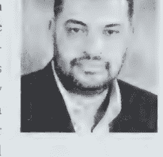

Abd El-Samie博士于2008年荣获《数字信号处理》期刊的“高被引论文奖”。

### Hossam Eldin H. Ahmed

Hossam Eldin H. Ahmed 于1969年6月获得埃及亚历山大大学工程学院的核工程学士学位（荣誉）；于1977年4月获得亚历山大大学工程学院核工程系的微电子电子衍射硕士学位；并于1983年6月获得法国图卢兹保罗·萨巴捷大学电子与光学高等学院的博士学位。1970年至1977年，他在埃及海军部队服役。1977年，他在梅努菲亚大学工程技术学院电子与电气通信系担任演示教师，为教职员工授课。1993年，他成为微电子学、超大规模集成电路（VLSI）设计技术、通信系统和计算机网络的教授。1993年至1999年，他担任电子工程学院负责教育和学生事务的副院长。2001年，他成为电子与电气通信系系主任。他是梅努菲亚电子工程学院定期电子期刊的成员，并且自1995年以来一直担任梅努菲亚大学广域网（WAN）（21个局域网）的主任、设计者和建造者。他是梅努菲亚大学图书馆和FRCU大学图书馆的开发者。他当前的研究兴趣包括：电子显微术；电子束和离子束在非晶或多晶靶材中的透射和背散射；光纤；VLSI设计；纳米技术；光刻；数字、光和多媒体通信；数字图像；多媒体与数据库通信；安全应用；卫星遥测微计算机应用；以及OBC和卫星通信。

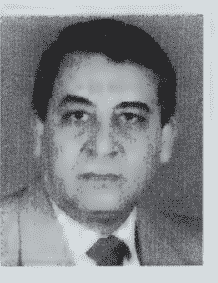

### Ibrahim F. Elashry

Ibrahim F. Elashry 于2007年毕业于埃及卡夫尔谢赫大学工程学院。他目前是澳大利亚伍伦贡大学（UOW）的助教和博士生。他的研究兴趣包括有线和无线网络安全以及图像处理。


### Mai H. Shahieen

Mai H. Shahieen 于2005年5月毕业于梅努菲亚大学电子工程学院。她于2011年获得硕士学位，研究方向为无线信道上的加密图像传输。她目前是电子工程学院的博士生。她的研究兴趣包括宽带无线分发系统、图像和视频压缩、多媒体系统以及无线网络。

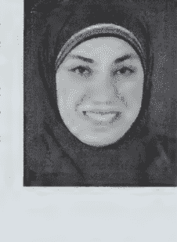

### Osama S. Faragallah

Osama S. Faragallah 分别于1997年、2002年和2007年在埃及梅努夫市的梅努菲亚大学获得计算机科学与工程学士、硕士和博士学位。他目前是梅努菲亚大学电子工程学院计算机科学与工程系的副教授；1997年至2002年任演示教师，2002年至2007年任助理讲师。自2007年起，他一直在该系任教。他的研究兴趣包括网络安全、密码学、互联网安全、多媒体安全、图像加密、水印、隐写术、数据隐藏、医学图像处理和混沌理论。

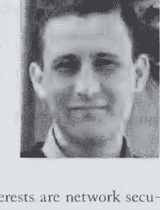

### El-Sayed M. El-Rabaie

El-Sayed M. El-Rabaie（IEEE 1992年高级会员，MIEE特许电气工程师）于1953年出生于埃及锡尔斯利安（梅努菲亚）。他于1986年获得贝尔法斯特女王大学微波器件工程博士学位，之后在女王大学（电子工程系）从事博士后研究，直至1989年2月。在博士研究中，他构建了一个基于谐波平衡技术的非线性电路仿真CAD（计算机辅助设计）软件包。此后，他涉足多个研究领域，包括非线性微波电路CAD、纳米技术、数字通信系统和数字图像处理。他于1992年受邀担任北亚利桑那大学（工程技术学院）研究员，并于1994年受邀担任加拿大魁北克蒙特利尔综合理工学院的访问教授。El-Rabaie教授已撰写或合著130余篇论文和技术报告、15部专著。1993年，他荣获埃及学术科学研究奖（萨拉赫·阿梅尔电子学奖）；1995年，他获得梅努菲亚大学CAD领域最佳研究者奖。他担任多个科学期刊的审稿人和编辑委员会成员。他参与了阿拉伯百科全书第一部分的翻译工作。El-Rabaie教授曾任梅努菲亚大学电子工程学院电子与电气通信工程系系主任，随后担任该学院研究生教育与科研副院长。他目前是埃及教授和副教授晋升科学委员会的副主任委员。

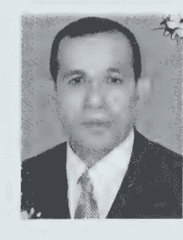

### Saleh A. Alshebeili

Saleh A. Alshebeili 是沙特阿拉伯利雅得沙特国王大学电气工程系的教授兼系主任（2001–2005年）。他在通信和信号处理领域拥有超过20年的教学与研究经验。Alshebeili博士是苏尔坦亲王先进技术研究所（PSATRI）董事会成员，曾任PSATRI副总裁（2008–2011年）、沙特电信研究讲席主任（2008–2012年），以及由阿卜杜勒阿齐兹国王科技城（KACST）资助的“电子社会射频与光子学”技术创新中心（RFTONICS）主任（2011年至今）。Alshebeili博士曾任沙特国王大学*《工程科学杂志》*编辑委员会成员（2009–2012年）。他还积极参与多个研究期刊的审稿工作、KACST总理事会资助项目以及国内和国际研讨会与会议。

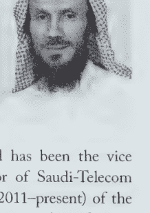


# 1 引言

通信网络的存在引发了新的安全和隐私问题。
拥有安全可靠的图像和视频通信手段正变得势在必行，其相关问题必须仔细考虑。
因此，网络安全和数据加密变得重要。
图像现在可以被视为最常用的信息形式之一。
图像和视频加密在多个领域有应用，包括无线通信、多媒体系统、医学成像、远程医疗和军事通信 [1–5]。

在本書中，研究图像加密算法的目的是以安全形式实现图像的无线通信。
主要目标是得出结论，判断某种图像加密算法是否适用于无线通信应用。
在这方面，本书探讨了一些基于数论的加密算法，如数据加密标准（DES）、高级加密标准（AES）和 RC6 算法 [6–12]。
这些算法在文献中被称为强加密算法。
我们主要关注的不仅是加密算法的强度，还包括其在无线通信系统限制下工作的能力。
不幸的是，目前使用的一些密码并非为图像加密而设计。
例如，由于图像中存在重复的数据模式，采用电子密码本（ECB）模式实现的 AES 不推荐用于加密图像。
因此，我们要么修改这些密码以适用于图像加密，要么寻找适合此任务的其他方法。
本书尝试研究这两个方向。

为此，我们还探索了依赖于混沌理论的密码学另一个分支。
混沌密码学在图像加密中的应用前景广阔。
利用混沌进行加密的想法可以追溯到香农的经典文章 [13]。
混沌映射已以多种不同的方式应用于密码学。
混沌序列具有若干良好特性，包括易于生成、对初始条件敏感依赖以及噪声行为。
由于混沌序列的适当特性，将混沌应用于密码学是对数据安全性的重大改进贡献 [14,15]。

为了使本书的研究更全面，我们在第 7 章和第 8 章转向通信概念，重点关注正交频分复用（OFDM）系统。
在这些章节中，我们提出了 OFDM 通信系统的简化模型及其不同实现，重点关注该系统的局限性，以及这些局限性如何影响解密后接收图像的质量。
第 9 章提出了广泛的比较研究，考虑不同的可能场景和不同的加密算法，以确定哪种加密算法适用于哪种场景。
最后，我们收录了本书实验中使用的所有 MATLAB® 代码，以便希望使用不同思路完成此研究的科研人员。

# 2 图像加密基础

## 2.1 引言

我们生活在信息时代；我们需要保留有关我们生活方方面面的信息。
换句话说，信息是一种资产，其价值如同任何其他资产一样。
作为一种资产，信息需要免受攻击的保护。
自 1990 年以来，通信网络在信息使用方面创造了革命。
授权人员可以使用通信网络远程发送和接收信息。
为了安全，信息需要免于未经授权的访问（保密性）、免于未经授权的更改（完整性），并在需要时可供授权实体使用（可用性）。
尽管这三个要求没有改变，但它们现在有了一些新的维度。
信息不仅在计算机中存储时应保密，而且在通过通信网络传输时也应有一种方式保持其保密性 [16]。

目前通过计算机网络传输的信息不仅是文本，还包括音频、图像和其他多媒体类型。
多媒体安全领域在过去十年中已成熟，提供了一类工具集和设计见解，用于在多种不同的攻击场景下保护和增强数字媒体。
多媒体安全研究最初部分动机是数字手段用于通信、存储和表示娱乐信息（如音乐和视频）使用的增加。
数字形式允许信息的完美复制以及对数据的几乎无缝操作和篡改。
这产生了娱乐行业过去未曾解决的新类型的安全攻击。
从模拟到数字多媒体的范式转变对艺术家、出版商、版权持有者和消费者产生了巨大影响 [17,18]。

本章介绍了密码算法设计背后的原理。
介绍了在选择、设计和评估密码算法时出现的不同问题的综述。
扩散型密码算法及其工作模式也被涵盖。
还讨论了使用贝克映射的混沌加密。

## 2.2 密码学基本概念

*Image security* is based on cryptography.
事实上，密码学中的一些基本概念被用作图像安全应用中的构建块（原语）。
为了更好地理解与图像安全相关的问题，首先介绍了密码学的概述。

### 2.2.1 密码学的目标

*Cryptography* is a study of techniques (called *cryptosystems*) that are used to accomplish the following four goals [1,16–18]:
- 保密性
- 数据完整性
- 鉴别
- 不可否认性

The study of the techniques used to break existing cryptosystems is called *cryptanalysis*.
由于密码学和密码分析高度相互依赖，人们将 *cryptology* 称为密码学和密码分析的联合研究。
让我们尝试理解密码学的全部四个目标。

*Confidentiality* refers to the protection of information from unauthorized access.
一个不希望的通信方，称为对手，不得访问通信材料。
密码学的这一目标是一个基本目标，在密码学实践的历史中一直得到关注和执行。

*Data integrity* ensures that information has not been manipulated in an unauthorized way.
如果信息被更改，所有通信方都可以检测到此更改。

*Authentication methods* are classified into two categories: entity authentication and message authentication.
*Entity authentication* is the process by which one party is assured of the identity of a second party involved in a protocol, and that the second has actually participated immediately prior to the time the evidence is acquired.
*Message authentication* is a term used analogously with data origin authentication.
它提供了关于原始消息来源的数据来源认证和数据完整性，但没有唯一性和及时性保证。

*Nonrepudiation* means that the receiver can prove to everyone that the sender did indeed send the message.
也就是说，发送者不能声称他或她没有加密或签署某些数字信息。

幸运的是，现代密码学已开发出处理密码学全部四个目标的技术。

### 2.2.2 加密原理

The basic idea of *encryption* is to modify the message in such a way that only a legal recipient can reconstruct its content [16–18].
离散值密码系统可以由以下特征描述
- a set of possible plaintexts \(P\)
- a set of possible ciphertexts \(C\)
- a set of possible cipher keys \(K\)
- a set of possible encryption and decryption transformations \(E\) and \(D\)

An *encryption system* is also called a cipher, or a cryptosystem.
The message for encryption is called *plaintext*, and the encrypted message is called *ciphertext*.
Denote the plaintext and the ciphertext by \(P\) and \(C\), respectively [16–19].
The encryption procedure of a cipher can be described as

$$C = E_{K_e}(P) \tag{2.1}$$

where \(K_e\) is the encryption key, and \(E\) is the encryption function.
Similarly, the decryption procedure is defined as

$$P = D_{K_d}(C) \tag{2.2}$$


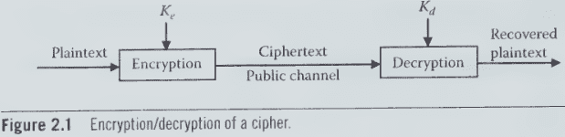

图 2.1 密码的加密/解密。

其中 K_d 是解密密钥，D 是解密函数。密码的安全性应仅依赖于解密密钥 K_d，因为一旦攻击者获得 K_d，就能从观察到的密文中恢复出明文。图 2.1 显示了密码加密/解密的框图。

## 2.3 加密算法的分类

加密算法可以按不同方式分类：根据算法的结构、根据密钥，或根据加密的数据百分比 [19,20]。

### 2.3.1 按加密结构分类

加密算法可根据加密结构分为分组密码和流密码。

*分组密码* 是一种对称密钥加密算法，它将固定长度的明文数据块变换为相同长度的密文数据块。该固定长度称为 *块大小*。对于若干分组密码，块大小为 64 或 128 位。块大小越大，密码越安全，但加密和解密算法及设备也越复杂。现代分组密码具有以下特征 [21]：

- 1. 可变密钥大小
- 2. 混合算术运算，可提供非线性
- 3. 数据相关旋转和密钥相关旋转
- 4. 冗长的密钥调度算法
- 5. 可变的明文/密文块大小和可变的轮数

分组密码可通过以下方式表征

- 1. 块大小：块越大，安全性越高。
- 2. 密钥大小：密钥越大，安全性越高。
- 3. 轮数：多轮增加安全性。
- 4. 加密模式：它们定义了如何加密大于块大小的消息。

与对大数据块操作的分组密码不同，*流密码* 通常对较小的明文单元进行操作，通常是位。因此，流密码可以设计得非常快，比典型的分组密码快得多。一般来说，流密码使用伪随机数生成器（PRNG）生成一串位作为密钥（称为密钥流），该生成器将短的秘密密钥（例如 128 位）扩展为长字符串（密钥流）（例如 10^6 位），加密是通过将密钥流与明文组合来完成的。通常，选择按位 XOR 操作来进行加密，主要是因为其简单性 [6–9]。流密码具有以下特性 [22, 23]：

- 1. 它们没有完美的安全性。
- 2. 安全性取决于 PRNG 的特性。
- 3. PRNG 必须是不可预测的；给定连续的输出位序列，下一个位必须难以预测。
- 4. 典型的流密码速度非常快。

### 2.3.2 按密钥分类

根据密钥，有两种类型的密码取决于 K_e 和 K_d 的关系。当 K_e = K_d 时，密码称为私钥密码或对称密码。对于私钥密码，加密/解密密钥必须通过单独的秘密通道从发送方传输到接收方。当 K_e ≠ K_d 时，密码称为公钥密码或非对称密码。对于公钥密码，加密密钥 K_e 是公开的，而解密密钥 K_d 保持私有，因此密钥传输不需要额外的秘密通道。如图 2.2 所示的传统加密中，发送方使用加密密钥加密数据（明文），接收方使用解密密钥将加密数据（密文）解密为原始数据（明文）。在对称加密中，加密密钥和解密密钥是相同的。图 2.3 显示了公钥加密（非对称加密），其中加密密钥和解密密钥不同。公钥密码学通过分发密钥解决了传统密码系统的难题 [24–27]。表 2.1 显示了对称加密与非对称加密之间的比较。

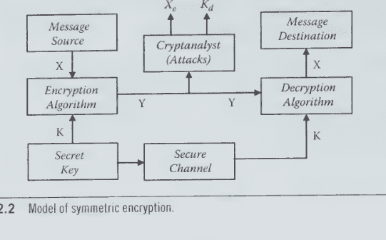

图 2.2 对称加密模型。

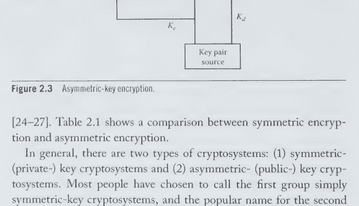

图 2.3 非对称密钥加密。

一般来说，有两种类型的密码系统：(1) 对称（私有）密钥密码系统和 (2) 非对称（公钥）密钥密码系统。大多数人选择将第一组简单称为对称密钥密码系统，第二组的流行名称只是公钥密码系统。

### 2.3.3 按加密数据百分比分类

就加密数据的数量而言，根据加密的数据百分比，加密可分为全加密和部分加密（也称为选择性加密）。

**表 2.2** 加密图像的攻击类型

| 攻击类型 | 密码分析员的前提条件 |
|---|---|
| 仅密文 | 1. 加密算法<br>2. 待解码的密文 |
| 已知明文 | 1. 加密算法<br>2. 待解码的密文<br>3. 使用秘密密钥生成的明文消息及其对应的密文 |
| 选择密文 | 1. 加密算法<br>2. 待解码的密文<br>3. 密码分析员选择的报告密文及其对应的使用解密算法和解密密钥生成的明文 |
| 选择明文 | 1. 加密算法<br>2. 待解码的密文<br>3. 密码分析员选择报告的明文及其对应的使用加密算法和加密密钥生成的密文 |

通过明文-密文对的累积知识来获得秘密密钥或至少其一部分。

*选择密文攻击。* 在这里，攻击者可以将选择的密文输入到包含解密算法和解密密钥的黑盒中。黑盒产生相应的明文，攻击者通过分析累积的密文-明文对来尝试获得秘密密钥或密钥的一部分。

## 2.5 图像加密方案的特征

与文本消息不同，图像数据具有其特殊特征，例如像素之间高度冗余和高度相关性。此外，它们通常体积巨大。两者结合使得传统加密方法难以应用且处理缓慢。有时，图像应用有其自身的要求，如实时处理、保真度保持、图像格式一致性、传输数据压缩等等。同时满足这些要求以及高安全性和高质量需求，给实时成像实践带来了巨大挑战。为了研究图像加密，我们必须首先分析图像数据和文本数据加密实现之间的差异。基本上，图像和文本数据加密之间存在一些差异 [31–34]：

- 1. 当产生密文时，必须以完全无损的方式解密为原始明文。然而，密文图像可以以某种有损的方式解密为原始明文图像。
- 2. 文本数据是单词序列。它们可以直接使用分组或流密码进行加密。然而，数字图像通常表示为二维（2D）数组。为了用文本处理算法保护存储的二维数据数组，在使用各种传统加密技术之前，必须将它们转换为一维数组。
- 3. 因为图片的存储空间非常大，有时直接加密或解密图像效率低下。最好的方法之一是仅加密/解密用于图像压缩的信息，以减少其存储空间和传输时间。

## 2.6 传统对称分组密码

本节简要概述了一些流行传统加密算法的构造。以下每个加密算法都是对称分组密码算法。对称意味着用于加密和解密的密钥相同；分组意味着要加密的数据（信息）被划分为等长块 [35–45]。

### 2.6.1 数据加密标准

数据加密标准（DES）是最著名的对称密钥分组密码。它于 1976 年被国家标准局选为美国的官方联邦信息处理标准（FIPS），随后在国际上得到广泛使用 [46]。

DES 是一种分组密码，以 64 位块加密数据。64 位明文块进入算法的一端，64 位密文块从另一端输出。相同

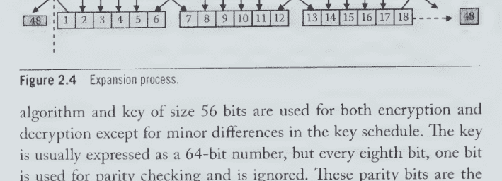

## 2.4 扩展过程

该算法使用长度为 56 位的密钥进行加密和解密，只是在密钥调度的细节上略有不同。密钥通常表示为一个 64 位数，但每 8 位中有一位用于奇偶校验并被忽略。这些奇偶校验位是密钥字节的最低有效位。密钥可以是任意 56 位数，并且可以随时更改，尽管某些选择可被视为弱密钥。

DES 基于四种基本操作：扩展、置换、异或和替换。待加密的数据首先被分成 64 位块，并送入初始置换（IP）阶段，在此阶段每个块被分成两个 32 位的子块。右子块被送入费斯泰尔函数（f 函数），如图 2.4 所示。它每次对半个块（32 位）进行操作，并包含如图 2.5 所示的四个阶段。

- 1. 扩展。使用扩展置换（图中记为 E）将 32 位半块扩展为 48 位，方法是对一半的位进行复制。输出由八个 6 位片段（8 × 6 = 48 位）组成，每个片段包含对应的 4 个输入位的副本，以及来自左右相邻输入片段的紧邻位的副本。
- 2. 密钥混合。通过异或运算将结果与子密钥结合。使用密钥调度机制从主密钥中派生出 16 个 48 位子密钥，每轮一个。
- 3. 替换。与子密钥混合后，块在被替换盒（S 盒）处理之前被分成八个 6 位片段。八个 S 盒中的每一个都根据一个以查找表形式提供的非线性变换，将其六个输入位替换为四个输出位。S 盒提供了 DES 安全性的核心。

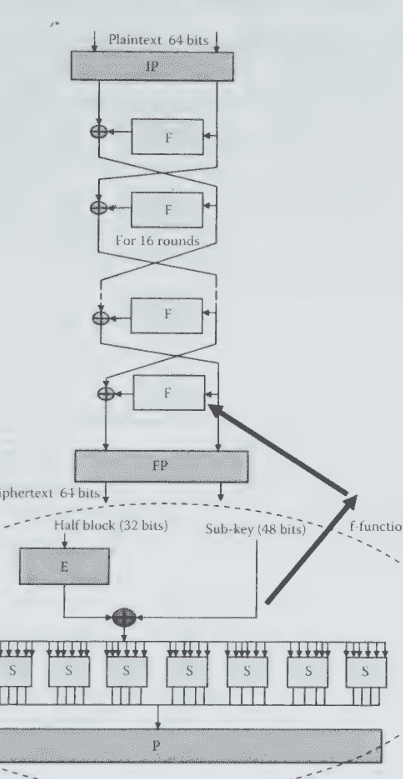

图 2.5  DES 算法和 f 函数。

没有它们，该密码将是线性的，并且可以轻易被破解。

- 4. 置换。最后，S 盒的 32 个输出根据一个固定置换 P 盒重新排列，其设计使得在扩展之后，每组 S 盒输出位在下一轮中散布到六个不同的 S 盒。

在最简单的层面上，DES 算法不过是加密的两种基本技术（混淆和扩散）的组合。DES 的基本构建块是这些技术的一种组合：基于密钥对数据进行替换，然后进行置换。在初始置换之后，每个块被分成右半部分和左半部分，各 32 位。然后，进行 16 轮相同的运算，称为 f 函数，在这些轮中数据与密钥结合。这些轮之后，右半部分和左半部分合并，最后的置换（初始置换的逆置换）完成该算法。

### 2.6.2 双重 DES

提高分组密码算法安全性的一种朴素方法是用两个不同的密钥对每个块加密两次。首先，用第一个密钥加密一个块，然后用第二个密钥加密得到的密文。解密则是相反的过程。在双重 DES 加密算法中，每个 64 位数据块使用 DES 算法加密两次，先用密钥 $K_1$，再用另一个密钥 $K_2$。该方案涉及 112 位密钥。

由此产生的双重加密密文块，使用穷举搜索解密应该困难得多。它需要 $2^{128}$ 次尝试才能找到密钥，需要 $2^{112}$ 次尝试才能破解加密，而不是 $2^{56}$ 次。1981 年，Merkle 和 Hellman 提出了他们的“中途相遇”攻击，证明了双重 DES 算法的弱点 [47]。“中途相遇”攻击是一种已知明文攻击，要求攻击者同时拥有一条已知明文和对应的密文。该攻击在试图破解经过双重 DES 加密的消息时，需要存储 $2^{56}$ 个中间结果。Merkle 和 Hellman 开发了一种时间-内存权衡方法，可以在 $2^{56+1}$ 次试验中破解这种双重 DES 加密方案，而不是 $2^{112}$ 次。

### 2.6.3 三重 DES

通过执行三次分组加密操作，可以规避 Merkle-Hellman“中途相遇”攻击的危险。

这种方法称为三重 DES。三重 DES 通过执行三次 DES 来完成，产生 168 位的有效密钥长度。在三重 DES 中，每个 64 位数据块使用 DES 算法加密三次。在实践中，执行三重 DES 最常见的方式是：

- 1. 使用密钥 1 加密。
- 2. 使用密钥 2 解密。
- 3. 使用密钥 3 加密。

要解密，则反向执行这些步骤：

- 1. 使用密钥 3 解密。
- 2. 使用密钥 2 加密。
- 3. 使用密钥 1 解密。

对于某些应用，可以为密钥 1 和密钥 3 使用相同的密钥，而不会造成明显的安全漏洞。在单重、双重和三重 DES 之间的选择是性能与安全需求之间的权衡 [45]。

### 2.6.4 国际数据加密算法

国际数据加密算法（IDEA）密码由 Lai 和 Massey 于 1990 年首次提出，当时称为提议加密标准（PES）。在 Biham 和 Shamir 提出差分密码分析之后，作者增强了其密码以抵御该攻击，并将其命名为改进提议加密标准（IPES）。IPES 的名称于 1992 年改为国际数据加密算法（IDEA）。该算法旨在替代 DES。IDEA 是一种分组密码，对 64 位明文块进行操作。密钥长度为 128 位。共有八轮相同的运算，加密和解密使用相同的算法。它同时使用混淆和扩散。该算法背后的设计理念基于混合来自不同代数群的运算。该算法混合了三个代数群（异或、模加法和模乘法）[16,18]，并且它们都可以很容易地在硬件和软件中实现。所有这些操作都作用于 16 位子块。

### 2.6.5 Blowfish

Blowfish 是一种具有可变长度密钥的 64 位分组密码。它由 Schneier 于 1993 年设计 [16]。该算法由两部分组成：密钥扩展和数据加密。密钥扩展将最长 448 位的密钥转换为若干子密钥数组，总计 4168 字节。数据加密由一个简单函数迭代 16 次组成。每轮包含一个依赖于密钥的置换和一个依赖于密钥和数据的替换。所有操作都是对 32 位字进行加法和异或。唯一额外的操作是每轮四次索引数组数据查找。密钥必须在任何数据加密或解密之前预先计算，解密与加密完全相同，只是子密钥以相反的顺序使用。

### 2.6.6 RC5 算法

迭代分组密码 RC5 由 Rivest、Shamir 和 Adleman 于 1994 年提出 [48]。RC5 的主要特点是大量使用依赖于数据的循环移位。RC5 具有可变的字长 w、可变轮数 r 和具有 b 字节的可变密钥。它表示为 RC5 w/r/b。w 的标称值为 32 位，RC5 对由两个字组成的块进行加密。RC5 由加密、解密和密钥扩展组成。扩展密钥包含 t = 2 × (r + 1) 个字。RC5 的基本操作如表 2.3 所示。一般来说，RC5 是一种快速的对称分组密码，适合在内存需求较低的硬件和软件中实现。当选择良好的参数时，它提供高安全性。

表 2.3 RC5 的基本操作

| 操作 | 描述 |
|---|---|
| a + b | 模 2^w 整数加法 |
| a − b | 模 2^w 整数减法 |
| a ⊕ b | w 位字的按位异或 |
| a * b | 模 2^w 整数乘法 |
| a <<< b | 将 w 位字 a 按 b 的最低有效 lg w 位所指定的量循环左移 |
| a >>> b | 将 w 位字 a 按 b 的最低有效 lg w 位所指定的量循环右移 |


### 2.6.7 RC6 算法

RC6 分组密码是 RC5 的修改版本，它使用四个工作寄存器而不是两个，并将整数乘法作为额外的基本运算。整数乘法过程极大地增强了每轮实现的扩散效果，从而带来更高的安全性、更少的轮数和更高的吞吐量。RC6-w/r/b 的密钥调度与 RC5-w/r/b 的密钥调度相似。唯一的区别是，对于 RC6-w/r/b，从用户提供的密钥中派生出更多的字，用于加密和解密。用户提供一个长度为 b 字节的密钥，其中 0 ≤ b ≤ 255。从该密钥中派生出 2r + 4 个字（每个 w 位），并存储在数组 S[0, ..., 2r + 3] 中。该数组在加密和解密中均使用 [12]。通常，RC6 由两个 Feistel 网络组成，其数据通过数据相关旋转进行混合。RC6 的单轮操作包含两次平方函数 f(x) = x(2x + 1) mod 2^32 的应用、两次固定的 32 位旋转、两次数据相关的 32 位旋转、两次 XOR 以及两次模 2^32 的加法。RC6 加密和解密的步骤将在下文进行总结，RC6 加密和解密的框图分别如图 2.7 和 2.8 所示。

#### 2.6.7.1 RC6 加密算法

```
Input: Four w-bit plaintext values stored in registers
A, B, C, and D
    Number r of rounds
    w-bit round keys S[0, ..., 2r+3]
Output: Four w-bit ciphertext values stored in
registers A, B, C, and D.
Procedure: B = B + S [0];
    D = D + S [1];
    For i = 1 to r do
    {t = (B × (2B + 1)) <<< lg w;
    u = (D × (2D + 1)) <<< lg w;
    A = ((A ⊕ t) <<< u) + S [2i];
    C = ((C ⊕ u) <<< t) + S [2i + 1];
    (A, B, C, D) = (B, C, D, A); }
    End
    A = A + S [2r + 2];
    C = C + S [2r + 3];
```

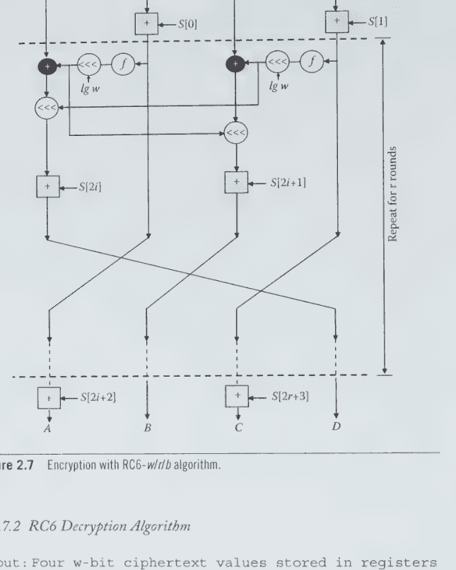

Figure 2.7 使用 RC6-w/r/b 算法的加密。

#### 2.6.7.2 RC6 解密算法

```
Input: Four w-bit ciphertext values stored in registers A, B, C, and D
Number of rounds r
w-bit round keys S[0], ..., 2r+3
Output: Four w-bit plaintext values stored in registers A, B, C, and D.
Procedure: C = C - S [2r + 3];
A = A - S [2r + 2];
for i = r downto 1 do
{(A, B, C, D) = (D, A, B, C);
u = (D x (2D + 1)) <<< log(w);
t = (B x (2B + 1)) <<< log(w);
C = ((C - S[2i + 1]) >>> t) ⊕ u;
A = ((A − S[2i]) >>> u) ⊕ t;
End
D = D − S[1];
B = B − S[0];
```

### 2.6.8 高级加密标准

高级加密标准（AES）基于 Rijndael 算法，该算法是一种具有可变块大小和可变密钥大小的迭代分组密码算法。块大小和密钥大小可以独立为 128、192 或 256 位。中间生成的密文称为状态，其形式为四行矩形数组，列数等于块大小除以 32。密码密钥同样是一个矩形数组，具有四行，列数等于密钥大小除以 32。对中间状态执行的轮数与密钥大小相关。对于 128、192 和 256 位的密钥大小，轮数分别为 10、12 和 14。每一轮都由一系列固定的变换组成，除第一轮和最后一轮外 [16–18]。

AES 由多轮组成。除了最后一轮外，任何一轮都包括 SubBytes、ShiftRows、MixColumns 和 AddRoundKey 操作。在最后一轮中，不执行 MixColumns 操作。在 SubBytes 步骤中，根据图 2.9 对每个字节执行线性替换。数组中的每个字节都使用 8 位 S-box 进行更新，该 S-box 为密码系统提供了非线性 [16–18]。

S-box 由有限伽罗瓦域 GF(2^8) 上的乘法逆元导出，以其良好的非线性特性而闻名。为了避免基于简单代数性质的攻击，S-box 被选为避免任何不动点和任何相反不动点 [16–18]。

ShiftRows 步骤对状态的行进行操作。它循环地移动每一行中的字节。对于 AES，第一行保持不变。第二行的每个字节向左移动一个字节。同样，第三行和第四行分别按 2 和 3 个字节的偏移量移动。对于 128 位和 192 位的块，移位模式相同 [16–18]。

这样，ShiftRows 步骤输出状态的每一列都由输入状态的每一列的字节组成。对于 256 位块，第一行保持不变，第二、第三和第四行的移位分别为 1 字节、3 字节和 4 字节，如图 2.10 所示。

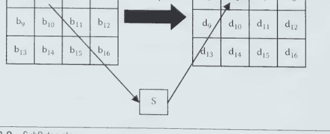

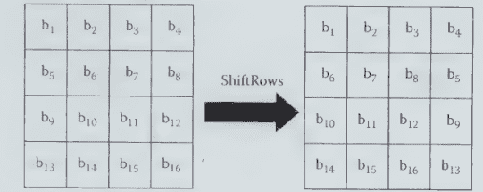

Figure 2.10 ShiftRows 步骤。

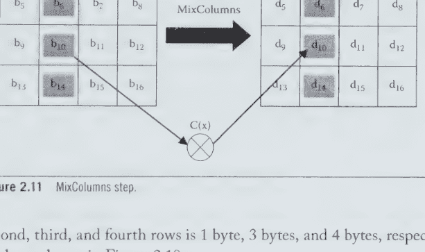

Figure 2.11 MixColumns 步骤。

在 MixColumns 步骤中，状态每一列的 4 个字节使用可逆线性变换进行组合。MixColumns 函数以 4 个字节作为输入并输出 4 个字节，其中每个输入字节影响全部 4 个输出字节。与 ShiftRows 结合，MixColumns 为密码系统提供了扩散。每一列被视为 GF(2^8) 上的多项式，然后与固定多项式 C(x) = 3x^3 + x^2 + x + 2 相乘。MixColumns 步骤也可以视为如图 2.11 所示的特定矩阵的乘法 [16–18]。

在 AddRoundKey 步骤中，子密钥与状态进行组合。对于每一轮，子密钥使用算法密钥调度从主密钥派生。每个子密钥的大小与状态相同。

### 2.7.1 ECB 模式

ECB 是加密算法最简单的操作模式；数据序列被划分为等大小的块，每个块分别使用相同的加密密钥进行加密。如图 2.13 所示，明文被划分为大小为 n 位的块 (P1, P2, P3, ...) ，并加密为密文块 (C1, C2, C3, ...)。加密算法是

C_j = E_K(P_j) (2.5)

解密算法是

P_j = D_K(C_j) (2.6)

其中 j = 1, 2, 3, ... ；E_K 是密钥 K 的加密映射；D_K 是使用相同密钥 K 的解密映射。

ECB 模式有几个优点。无需按顺序加密文件；中间块可以先加密，然后是末尾的块，最后是开头的块。这对于像数据库一样随机访问的加密文件很重要。如果数据库以 ECB 模式加密，则任何记录都可以独立添加、删除、加密或解密，前提是记录由独立的加密块组成。

该模式的缺点是相同的明文块被加密为相同的密文块；它不会隐藏数据模式。优点是错误传播仅限于单个块。ECB 模式的缺点在图像加密中显现，如果图像中有大面积相同颜色或重复模式，从而存在许多相同的明文块。

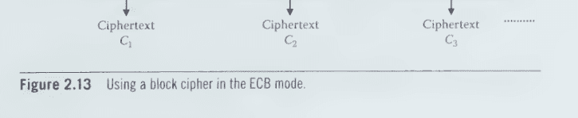

### 2.7.3 CFB 模式

与 CBC 模式相比，CFB 模式首先加密 IV，然后在加密后的 IV 的位与图像第一块的对应位之间执行 XOR 操作。结果是第一块的加密版本。对于下一个明文块的加密，前一个密文块被加密，输出与当前明文块进行 XOR 以创建当前密文块。XOR 操作隐藏了明文模式。

与 CBC 模式相同，改变 IV 会导致对相同明文块产生不同的输出。尽管 IV 不必保密，但某些应用会认为这是理想的 [16–18,49,50]。图 2.15 显示了 CFB 模式。加密算法是

C_j = P_j ⊕ I_j  (2.10)

解密算法是

P_j = C_j ⊕ I_j  (2.11)

I_j = E_K(C_{j-1}), j = 1, 2, 3, ...  (2.12)

C_0 = IV  (2.13)

### 2.7.4 OFB 模式

OFB 模式与 CFB 模式相似。它首先加密 IV。加密后 IV 的位与第一个明文块的对应位进行 XOR，以获得相应的密文块。此外，加密算法的输出被用作下一步加密的输入，而不是 IV。该过程

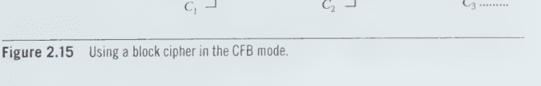

Figure 2.15 在 CFB 模式下使用分组密码。


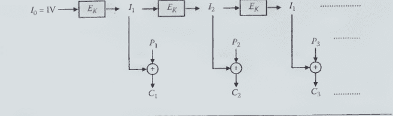

图 2.16　在 OFB 模式下使用分组密码。

一直持续到最后一个分组。对于相同的明文分组，改变 IV 会产生不同的密文分组。图 2.16 展示了 OFB 模式 [16–18,49,50]。加密算法为

$$C_j = P_j \oplus I_j$$ \tag{2.14}

解密算法为

$$P_j = C_j \oplus I_j$$ \tag{2.15}

$$I_j = E_K(I_{j-1}),\ j = 1,2,3,\ldots$$ \tag{2.16}

$$I_0 = IV$$ \tag{2.17}

## 2.8 混沌与密码学

自 20 世纪 70 年代以来，混沌理论已在物理学、数学、工程学、生物学等许多不同研究领域中得到确立。混沌最著名的特征是所谓的蝴蝶效应（对初始条件的敏感性）以及由确定性方程生成的伪随机性。混沌系统的许多基本特性都能在传统密码系统中找到对应物。混沌系统具有若干有利于安全通信的重要特性，例如遍历性、对初始条件与控制参数的敏感性，以及类随机行为 [38–40]。凭借这些优势，科学家们期望引入强大而新颖的混沌密码学工具。因此，混沌已成为新密码算法的一个丰富来源 [31–35]。

混沌动力系统是具有复杂且不可预测行为能力的非线性动力系统。混沌描述了一个对初始条件敏感的系统，它能够产生表面上随机但同时又完全确定的行为。由于难以对混沌系统进行长期预测，这些混沌特性在密码学中具有很大的应用潜力。首先，完全确定性意味着只要我们使用完全相同的映射函数和初始条件，就总能获得相同的一组值。由于混沌函数对初始条件敏感，初始值中的任何微小差异都意味着使用混沌产生的密文将完全不同。这意味着该系统的可能密钥数量很大，因而能够强力抵抗暴力破解攻击。

混沌系统的基本特性包括确定性、对初始条件和参数的敏感性、拓扑传递性以及遍历性 [51–55]。

确定性意味着混沌系统有某些确定的数学方程支配其行为。

对初始条件的敏感性意味着当对两个初始接近的点迭代应用某个混沌映射时，迭代会迅速发散并在长期内变得不相关。对参数的敏感性则导致当映射所依赖的参数发生轻微扰动时，映射的性质会迅速改变。因此，混沌系统可用作伪随机数生成器。

拓扑传递性是系统倾向于将状态空间的微小部分迅速搅乱成错综复杂的细丝网络。局部的、相关的信息会散布到整个状态空间。

混沌映射的遍历性意味着如果状态空间被划分为有限数量的区域，无论有多少个区域，该映射的任何轨道都会经过所有这些区域。混沌映射的遍历性由拓扑传递性保证。

混沌系统的许多特性，如混合性和对初始条件的敏感性，都能在传统密码系统中找到对应物。表 2.4 列出了这些特性的部分对应关系。

表 2.4　混沌系统与密码算法的异同

| 混沌系统 | 密码算法 |
|---|---|
| 实数集 | 有限整数集 |
| 迭代 | 轮 |
| 参数 | 密钥 |
| 对初始条件变化的敏感性 | 扩散 |
| — | 安全性 |

混沌理论与密码学之间的主要区别在于，密码系统在有限域上工作，而混沌在连续统上工作。

近年来，人们开发了多种基于混沌的图像加密方案。1992 年，Bourbakis 和 Alexopoulos 提出了一种图像加密方案，利用 SCAN 语言同时对图像进行加密和压缩 [56]。Fridrich 展示了基于二维标准 Baker 映射构造对称分组密码算法的过程 [52]。Fridrich 的方法包含三个基本步骤 [52]：选择一个混沌映射并通过引入若干参数对其进行泛化；将混沌映射离散化到表示像素的有限方形点阵上；将离散化映射扩展到三维，并进一步与简单的扩散机制复合。

Scharinger 设计了一种基于混沌 Kolmogorov 流的图像加密技术，其中整个图像被当作一个单一分组，通过一个密钥控制的混沌系统进行置换 [57]。此外，还采用移位寄存器伪随机生成器在数据中引入混淆。Yen 和 Guo 提出了一种称为比特循环图像加密（BRIE）的加密方法，基于混沌逻辑映射 [58]。该 BRIE 方法的基本原理是像素比特的循环移位，该循环由混沌伪随机二进制序列控制。BRIE 方法的秘密密钥由两个整数和一个逻辑映射初始条件组成。Yen 和 Guo [59] 还提出了一种称为 CKBA（基于混沌密钥的算法）的加密方法，其中密钥二进制序列使用混沌系统生成。图像像素根据生成的二进制序列重新排列，然后与选定的密钥进行 XOR 和 XNOR 运算。2002 年，Li 和 Zheng [29] 指出了参考文献 [58] 中提出的加密方案的一些缺陷，并讨论了可能的改进方法。Chen 等人 [60] 提出了一种对称算法，将二维混沌映射推广到三维，用于设计实时安全的图像加密方案。该方法采用三维猫映射来打乱图像像素的位置，并使用另一个混沌映射来混淆加密图像与其原始图像之间的关系。

在一维混沌加密中，加密密钥由基于选定初始条件的混沌映射生成。每个映射从其不同轨道中产生各种随机密钥，从而保证了安全性。根据该密钥生成一个二进制序列来控制加密算法。将二维输入图像转换为一维数组，然后划分为各种子块。接着，对表示每个子块的各个二进制矩阵进行位置置换和数值置换。最后，接收方使用相同的子密钥来解密加密图像。另一方面，使用像 Baker 映射这样的二维映射进行混沌加密则有所不同，如下一节所示。

## 2.9 二维混沌 Baker 映射

Baker 映射先将图像水平拉伸，然后垂直折叠。重复这一过程，明文图像中所有像素的位置都会被改变 [51,52,61]。设 B(n₁, ..., nₖ) 表示离散化映射，其中向量 [n₁, ..., nₖ] 代表秘密密钥 S_key。定义 N 为一行中数据项的数量，秘密密钥的选择应使得每个整数 nᵢ 都能整除 N，并且 n₁ + ... + nₖ = N。

设 Nᵢ = n₁ + ... + nᵢ。索引为 (q, z) 的数据项被移动到如下索引位置：

B₍ₙ₁,...,ₙₖ₎(q,z) = ( N/nᵢ (q - Nᵢ) + z mod (N/nᵢ),  nᵢ/N (z - z mod (N/nᵢ)) + Nᵢ )  (2.18)

其中 Nᵢ ≤ q < Nᵢ + nᵢ，且 0 ≤ z < N。

具体步骤中，混沌置换按如下方式执行：

- 1. 将一个 N × N 的正方形图像划分为 k 个矩形，每个矩形的宽度为 nᵢ，元素个数为 N。
- 2. 每个矩形中的元素被重新排列为置换后矩形中的一行。矩形按从左到右、先上后下的顺序选取。
- 3. 在每个矩形内部，扫描从左下角开始，向上方元素进行。


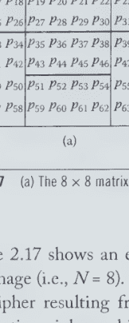

(a)

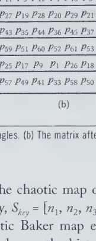

(b)

图 2.17 (a) 分成矩形的 8 × 8 矩阵。(b) 应用二维贝克映射后的矩阵。

图 2.17 给出了 (8 × 8) 正方形图像（即 N = 8）的混沌映射示例。密钥 S_key = [n1, n2, n3] = [2, 4, 2]。由混沌贝克映射加密得到的密文是一种置换密码，不会改变原始图像的直方图。尽管该密码系统简单且快速，可用于视频加密，但其安全性不足，且计算时间随图像尺寸增大而增长 [51,52,61]。

# 3 加密评估指标

## 3.1 引言

在对图像应用加密算法后，其像素值与原始图像相比会发生变化。一个好的加密算法必须以不规则的方式进行这些变化，并最大化原始图像与加密图像之间像素值的差异。此外，要获得良好的加密图像，它必须由完全随机的模式组成，这些模式不会泄露原始图像的任何特征。加密图像必须独立于原始图像。它应与原始图像具有较低的相关性 [62–66]。

评估加密图像时的重要指标之一是视觉检查：图像特征隐藏得越好，加密算法越好。不幸的是，仅凭视觉检查不足以判断图像内容的完全隐藏，因此需要考虑其他指标来定量评估加密程度 [67,68]。

扩散是一个重要的参数，必须测量以判断加密算法的随机化程度。如果算法具有良好的扩散特性，则加密图像与原始图像之间的关系过于复杂，无法轻易预测。为了衡量任何算法的扩散性，会在明文图像中改变一位，并获得由原始明文图像得到的加密图像与由修改后图像得到的加密图像之间的差异 [69]。

其他测试可用于确定加密算法的某些特定特性，例如抗噪性和处理时间。

## 3.2 加密评估指标

本节详细讨论了两类加密指标；第一类评估加密算法用不相关的加密图像替换原始图像的能力。在该类中，研究了五个指标：直方图偏差 D_H、相关系数 r_xy、不规则偏差 D_I、直方图均匀性和理想偏差。第二类评估加密算法的扩散特性。在该类中，研究了三个指标：雪崩效应、像素变化率 NPCR 和统一平均变化强度 UACI。

### 3.2.1 直方图偏差

直方图偏差衡量加密质量，即它如何最大化原始图像与加密图像之间的偏差 [70]。计算该指标的步骤如下：

- 1. 估计原始图像和加密图像的直方图。
- 2. 估计两个直方图之间的绝对差。
- 3. 按如下方式估计绝对差曲线下的面积除以图像的总面积：

```
$$D_H = \frac{\left(\frac{d_0 + d_{255}}{2} + \sum_{i=1}^{254} d_i\right)}{M \times N}\tag{3.1}$$
```

其中 d_i 是灰度级 i 处的绝对差的振幅。M 和 N 是待加密图像的尺寸。D_H 值越高，加密图像的质量越好 [70]。

尽管该指标对加密图像与原始图像的偏差程度给出了良好的结果，但由于存在一些限制，单独使用它不足以衡量加密质量，这些限制将在本章后面进一步说明。

### 3.2.2 相关系数

评估任何图像密码系统加密质量的有用指标是明文图像和密文图像中相同索引像素之间的相关系数 [70]。该指标可按如下方式计算：

$r_{xy} = \frac{\text{cov}(x, y)}{\sqrt{D(x)}\sqrt{D(y)}}$ (3.2)

其中 x 和 y 为明文和密文图像。在数值计算中，可使用以下离散公式：

$E(x) = \frac{1}{L} \sum_{i=1}^{L} x_i$ (3.3)

$D(x) = \frac{1}{L} \sum_{i=1}^{L} (x_i - E(x))^2$ (3.4)

$\text{cov}(x, y) = \frac{1}{L} \sum_{i=1}^{L} (x_i - E(x))(y_i - E(y))$ (3.5)

其中 L 是计算中涉及的像素数。r_xy 值越接近零，加密算法的质量越好。

### 3.2.3 不相关性

不规则偏差衡量加密质量，即加密引起的偏差（在加密图像上）有多不规则 [71]。计算该指标的步骤如下：

- 1. 计算加密图像与原始图像之间的绝对差。
- 2. 估计该绝对差矩阵的直方图 H。
- 3. 估计该直方图的均值 M_H。
- 4. 按如下方式估计直方图与该均值的偏差的绝对值：

$$H_D(i) = |H(i) - M_H| \tag{3.6}$$

不规则偏差 $D_I$ 按如下方式计算：

$$D_I = \frac{\sum_{i=0}^{255} H_D(i)}{M \times N} \tag{3.7}$$

$D_I$ 值越低，加密质量越好。

### 3.2.4 直方图均匀性

直方图使用条形图来描述图像中每个灰度级的出现情况。横轴表示灰度值，从零开始到灰度级数。每个垂直条表示图像中相应灰度级的出现次数 [72]。

对于图像加密算法，加密图像的直方图应具有两个属性：

- 1. 它必须与原始图像的直方图完全不同。
- 2. 它必须具有均匀分布，这意味着任何灰度值的出现概率相同。

### 3.2.5 理想偏差

理想偏差衡量加密质量，即加密算法如何最小化加密图像与假设理想加密情况的偏差。理想加密图像 $C_I$ 必须具有完全均匀的直方图分布，这意味着任何灰度级存在的概率是恒定的。根据理想加密图像直方图的定义，可将其表述为

$$H(C_i) = \begin{cases} \frac{M \times N}{256} & 0 \le C_i \le 255 \\ 0 & \text{elsewhere} \end{cases} \tag{3.8}$$

理想偏差可表示如下：

$$ D = \frac{\sum_{C_i=0}^{255} |H(C_i)-H(C)|}{M \times N} \tag{3.9} $$

其中 $H(C)$ 为加密图像的直方图。当然，D 值越低，加密质量越好。

### 3.2.6 雪崩效应

我们可以使用雪崩效应指标 [73,74] 来测试扩散机制的效率。可以在图像 $P$ 中进行单比特更改以得到修改后的图像 $P'$。$P$ 和 $P'$ 都被加密得到 $C$ 和 $C'$。雪崩效应指标是 $C$ 和 $C'$ 之间不同比特的百分比。如果 $C$ 和 $C'$ 在其一半比特上不同，我们可以说加密算法具有良好的扩散特性。

### 3.2.7 NPCR 和 UACI

为了测试单像素变化对任何加密算法加密的整个图像的影响，可使用两种常见指标：NPCR 和 UACI [75]。设对应明文图像仅有一个像素差异的两个密文图像分别记为 $C_1$ 和 $C_2$。分别用 $C_1(i,j)$ 和 $C_2(i,j)$ 表示 $C_1$ 和 $C_2$ 中网格 $(i,j)$ 处的像素灰度值。定义一个与图像 $C_1$ 和 $C_2$ 尺寸相同的二值矩阵 $D$。然后，$D(i,j)$ 由 $C_1(i,j)$ 和 $C_2(i,j)$ 确定。如果 $C_1(i,j)=C_2(i,j)$，则 $D(i,j)=0$；否则，$D(i,j)=1$。

NPCR 定义为

$$ \text{NPCR}=\frac{\sum_{i,j} D(i,j)}{M \times N}\times100\% \tag{3.10} $$

$NPCR$ 衡量两个图像中不同像素的百分比。


UACI 定义为

$$UACI = \frac{1}{M \times N} \left[ \sum_{i,j} \frac{C_1(i,j)-C_2(i,j)}{255} \right] \times 100\% \quad (3.11)$$

它衡量两幅图像之间差异的平均强度。NPCR 和 UACI 值越高，加密效果越好。

## 3.3 其他测试

### 3.3.1 噪声免疫性

噪声免疫性反映了图像密码系统容忍噪声的能力。为测试噪声免疫性，向加密图像添加不同信噪比（SNRs）的噪声，然后执行解密算法。如果解密后的图像接近原始图像，我们可以说该密码系统具有噪声免疫性。这种接近程度可以通过目视或数值方式验证，使用表示原始图像与解密图像之间相关系数的 $r_{xy,d}$ 值，以及解密图像的峰值信噪比（PSNR），其定义如下 [60,66]：

$$PSNR = 10 \times \log_{10} \left( \frac{M \times N \times 255^2}{\sum_{m=1}^{M} \sum_{n=1}^{N} \left[ f(m,n) - f_d(m,n) \right]^2 } \right) \quad (3.12)$$

其中 $f(m,n)$ 为原始图像，$f_d(m,n)$ 为解密图像。

### 3.3.2 处理时间

处理时间是加密和解密图像所需的时间。处理时间越小，加密效率越好。

## 3.4 测试评估指标

我们通过评估三幅具有已知加密质量的加密图像来测试这些指标。第一幅是通过使用凯撒密码翻转 Cameraman 图像得到的，这是一种直接的加密技术。图像大小为 256 × 256 像素。如果我们将此密码应用于图像 I 以得到图像 J，则会对像素值添加一个恒定偏移，使得超过 255 的值从 0 级重新开始回绕。这由方程表示

$$J(m, n) = \{I(m, n)+K(m, n)\}\text{mod }256,\ K(m, n) = 254 \times I(m, n) + 255 \quad (3.13)$$

其中 K 为密码偏移量，也被视为密钥。我们选择凯撒密码的偏移量 K，使得原始图像直方图中包含峰值的位置在加密图像中包含一个很低的值，而原始图像中包含低值的位置在加密图像中包含峰值，如图 3.1 所示。

请注意，凯撒密码在图像加密中毫无用处，因为仅发生了图像灰度的变化，保持整个图像特征对攻击者可见，而攻击者并不知道解密密钥。可以注意到图像实际上并未被加密。此外，此密码完全不具备扩散性。

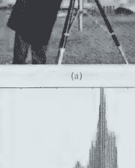

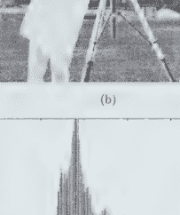

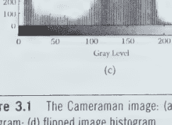

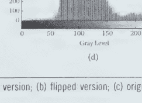

图 3.1 摄像师图像：（a）原始版本；（b）翻转版本；（c）原始图像直方图；（d）翻转图像直方图。

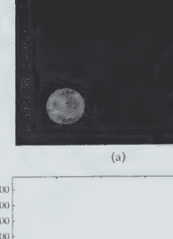

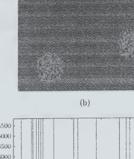

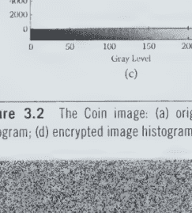

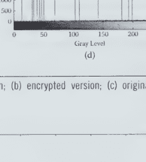

图 3.2 硬币图像：（a）原始版本；（b）加密版本；（c）原始图像直方图；（d）加密图像直方图。

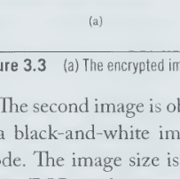

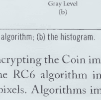

图 3.3 （a）使用 RC6 算法加密的图像；（b）直方图。

表 3.1 加密质量结果：替换

| Case | D_H | C.C | D_i | D |
|------|-----|-----|-----|---|
| Case 1 | 1.29 | -1 | 1.26 | 0.98 |
| Case 2 | 1.45 | 0.0554 | 1.7 | 1.7 |
| Case 3 | 0.98 | -0.0076 | 0.6 | 0.05 |

表 3.2 加密质量结果：扩散

| Case | AVALANCHE | NPCR | UACI |
|------|-----------|------|------|
| Case 1 | ≃0% | ≃0% | ≃0% |
| Case 2 | 0.0059% | 0.0118% | 0.0013% |
| Case 3 | 50.07% | 99.62% | 16.7% |

第二幅图像是通过使用 ECB 模式下的 RC6 算法加密黑白 Coin 图像得到的。图像大小为 340 × 400 像素。ECB 模式实现的算法由于其直方图局部化，无法加密黑白图像。这在图 3.2 中显示。第三幅图像是通过使用 CBC 模式下的 RC6 算法加密 Cameraman 图像得到的，如图 3.3 所示。

很明显，前两幅图像加密很差，没有任何扩散特性，而最后一幅图像加密良好，具有良好的扩散特性。每个案例的每个评估指标的结果列于表 3.1 中，扩散测试结果列于表 3.2 中。

从这些结果来看，第一种情况如下：

- 1. 直方图偏差给出 1.29 的高结果，表明凯撒密码性能良好，这完全是错误的判断，因为整个图像特征仍然可见。直方图偏差取决于明文图像和密文图像直方图之间的差异，这并不一定意味着良好的加密。
- 2. 相关系数为 -1 意味着密文图像是明文图像的反转，这完全正确。
- 3. 其余结果，包括直方图均匀性，已正确判断出凯撒密码的糟糕性能。
- 4. 对于扩散测试，结果几乎为零，因为凯撒密码不具备任何扩散特性。

对于第二种情况，

- 1. 直方图偏差再次无法正确判断加密性能，因为明文图像具有局部化直方图。
- 2. 对于相关系数，结果表明明文图像与密文图像不相关，这是正确的，但这并不意味着明文图像被正确加密。
- 3. 其余测试已正确判断加密质量。
- 4. 对于 ECB 模式，扩散特性很差，这在扩散测试中得到了正确指示。

对于第三种情况，所有测试结果均正确判断了 CBC 模式良好的加密和扩散特性。

## 3.5 总结

经过所有这些测试，我们可以看到

- 1. 目视检查是首先使用的测试。如果明文图像的特征未被完全隐藏，我们可以说该加密算法不可靠，无论其他所有测试如何，都不能用于加密图像。
- 2. 不规则偏差、理想偏差和直方图均匀性在判断加密质量方面表现良好。
- 3. 三个扩散测试可有效判断加密算法的扩散特性。

## 4 同态图像加密

## 4.1 概述

本章介绍了一种新的图像密码系统。该系统基于同态图像处理，其主要作为在不良光照条件下拍摄图像的图像增强工具而发展起来。同态图像处理的主要思想是基于将图像建模为恒定照明和变化反射率的乘积。乘积通过对数运算被视为求和。反射分量可使用高通滤波器分离，而照明分量可使用低通滤波器分离。图像的大部分细节位于反射分量中，而照明分量近似恒定 [76,77]。

我们可以在同态域中对反射分量进行加密过程，反射分量是图像中最重要的分量。与加密会造成图像信息冗余的照明分量不同，它作为最小有效位（LSB）水印附加到加密的反射分量中。用于反射分量加密的两种算法为 RC6 分组密码算法和混沌 Baker 映射置乱算法。对两者进行了比较。

## 4.2 同态密码系统

同态密码系统的思想基于同态图像处理。已知图像强度可以表示如下 [78–80]：

$$I(m,n) = i(m,n)r(m,n) \quad (4.1)$$


其中 \( i(m,n) \) 是光照强度，\( r(m,n) \) 是待成像物体的反射率。对两边取自然对数可得

\[
\ln[I(m,n)] = \ln[i(m,n)] + \ln[r(m,n)] \quad (4.2)
\]

光照近似恒定，而反射率因物体而异。因此，\(\ln[i(m,n)]\) 项近似恒定。我们可以对 \(\ln[r(m,n)]\) 项进行加密处理。为避免同态域中图像两个分量并存所造成的冗余，我们可以将光照分量作为 LSB 水印嵌入到加密后的反射率分量中。同态加密系统如图 4.1 所示。图 4.2 所示的 3 × 3 均值滤波器用作低通滤波器，反射率分量通过对数图像强度减去对数光照分量获得。

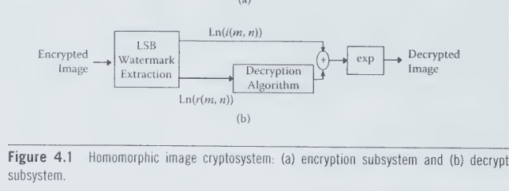

图 4.1 同态图像加密系统：(a) 加密子系统；(b) 解密子系统。

1/9 × [ 1 1 1 ; 1 1 1 ; 1 1 1 ]

图 4.2 3 × 3 均值滤波器。

我们选择 RC6 分组密码算法和混沌 Baker 映射置乱算法，因为它们代表了不同的加密家族。前者属于扩散算法家族，后者属于排列算法家族。目的是确定哪个家族更适合同态加密系统。

## 4.3 安全分析与测试结果

一个好的加密方案应当能够抵御各种已知攻击，如已知明文攻击、仅密文攻击、统计攻击、差分攻击以及各种暴力破解攻击。我们对同态图像加密系统在暴力破解攻击、统计攻击和差分攻击下的数字图像安全性进行了研究 [81–85]。

一些安全分析结果，包括密钥空间分析、统计分析和差分分析，已在文献 [60,86,87] 中给出。测试使用图 4.3 所示的 Lena 图像进行。

### 4.3.1 统计分析

在文献 [13] 中，Shannon 提到：“通过统计分析可以解决许多类型的密码。”我们对同态图像加密系统进行了统计分析，证明了其优越的混淆和扩散特性，能够有效抵御统计攻击。

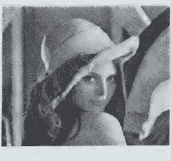

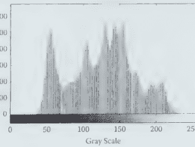


#### 4.3.1.1 加密图像的直方图

直方图测试的一个典型示例如图 4.4 至图 4.7 所示。从这些图中可以看出，使用 RC6 算法的同态加密系统所得到的加密图像（密文图像）的直方图相当均匀，并且与图 4.4 所示的原始图像（明文图像）的直方图显著不同。这一结果对应于图 4.5 所示的 RC6 分组密码。对于使用混沌 Baker 映射置乱的同态加密系统，结果如图 4.6 所示。显然，其直方图不同于图 4.7 所示单独混沌 Baker 映射加密的直方图。众所周知，混沌 Baker 映射加密不会改变加密图像相对于原始图像的直方图。另一方面，使用混沌 Baker 映射置乱的同态加密系统则显著改变了加密图像的直方图。

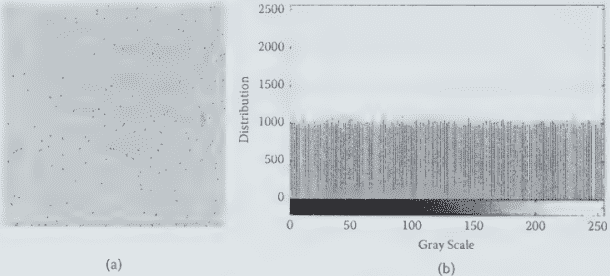

图 4.4 使用 RC6 算法的同态加密系统加密后的图像：(a) 加密图像；(b) 直方图。

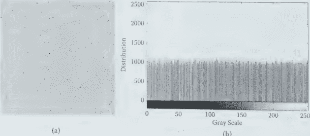

图 4.5 使用 RC6 算法加密后的图像：(a) 加密图像；(b) 直方图。

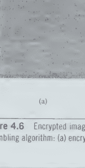

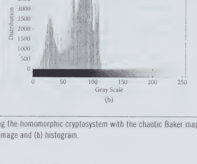

图 4.6 使用混沌 Baker 映射置乱算法的同态加密系统加密后的图像：(a) 加密图像；(b) 直方图。

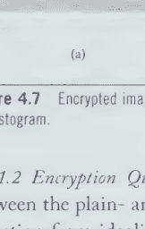

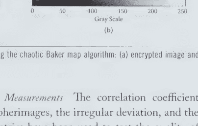

图 4.7 使用混沌 Baker 映射算法加密后的图像：(a) 加密图像；(b) 直方图。

#### 4.3.1.2 加密质量度量

我们使用明文图像与密文图像之间的相关系数、不规则偏差和理想偏差等指标来测试每种密码算法的质量。这些测试的结果如表 4.1 所示。从相关性测试可以看出，在所有情况下，明文图像与密文图像均不相关，但正如第 3 章所讨论的，我们不能完全依赖该测试来正确判断加密质量，因为可以看到混沌 Baker 映射置乱算法虽然只是置换密码，却也取得了 0.0032 的良好结果。对于不规则偏差和理想偏差，我们可以看到同态加密的质量主要取决于所使用的核心算法。如果核心加密算法强大（如 RC6），则同态版本也会强大，反之亦然。

表 4.1 每种密码算法的加密质量测试结果

| 加密算法 | $R_{nye}$ | $D_i$ | $D$ |
|---|---|---|---|
| 使用 RC6 算法的同态加密系统 | 0.0033 | 0.707 | 0.0254 |
| RC6 算法 | 0.0013 | 0.705 | 0.0233 |
| 使用混沌 Baker 映射置乱算法的同态加密系统 | 0.0043 | 0.846 | 1.2618 |
| 混沌 Baker 映射置乱算法 | 0.0032 | 0.979 | 0.7155 |

### 4.3.2 密钥空间分析

一个好的图像加密系统算法应当对密钥敏感。对于同态图像加密系统，密钥空间的分析与测试总结如下。

#### 4.3.2.1 穷举密钥搜索

对于安全的图像加密系统，密钥空间应当足够大，使得暴力破解攻击不可行 [88]。RC6 算法是一种 128 位加密方案。穷举密钥搜索需要 \(2^k\) 次操作才能成功，其中 \(k\) 是密钥的位数（比特）。攻击者只需逐一尝试所有密钥，并检查给定的明文图像是否加密为给定的密文图像。

对于同态加密系统的实际应用，假设密钥长度为 128 位。因此，攻击者可能会试图绕过密钥猜测，直接尝试所有可能的组合。攻击者需要大约 \(2^{128}\) 次操作才能成功确定密钥。如果攻击者使用 1000-MIPS（每秒百万条指令）的计算机通过暴力破解来猜测密钥，则计算负载为

\[
\frac{2^{128}}{1000\times10^6 \times 60 \times 60 \times 24 \times 365} > 10.7902831\times10^{21}\ \text{年} \quad (4.3)
\]

这在实际上是不可行的。

对于混沌 Baker 映射加密，密钥依赖于图像的宽度（或高度）。这是由于混沌 Baker 映射的置乱现象所致。对于 512 × 512 的 Lena 图像，可能的密钥数量为 \(10^{126}\) [52]。因此，在这种情况下，计算负载为

\[
\frac{10^{126}}{1000 \times 10^6 \times 60 \times 60 \times 24 \times 365} > 3.1710 \times 10^{109} \text{ 年} \quad (4.4)
\]

#### 4.3.2.2 密钥敏感性测试

安全的图像加密系统需要较高的密钥敏感性。这意味着，如果加密或解密密钥之间仅有细微差别，密文图像将无法被正确解密 [89]。这保证了所提出的加密系统能够抵御暴力破解攻击。假设使用 16 字符的加密密钥，即密钥由 128 位组成。

为了测试使用 RC6 算法的同态加密系统的密钥敏感性，我们执行了以下步骤：

- (a) 使用 32 个零（十六进制）作为密钥对图像进行加密，得到的图像称为加密图像 A，如图 4.8a 所示。
- (b) 对同一图像使用稍作修改的密钥（即 8 和 31 个零 [十六进制]）进行加密。修改发生在密钥的最高位数字。得到的图像称为加密图像 B，如图 4.8b 所示。
- (c) 再次对同一图像使用另一稍作修改的密钥（即 31 个零和 1 [十六进制]）进行加密。修改发生在密钥的最低位数字。

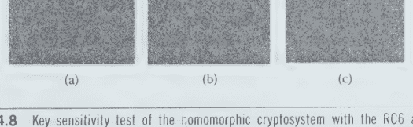

**图 4.8** 使用 RC6 算法的同态加密系统的密钥敏感性测试：(a) 使用 32 个零（十六进制）密钥的加密图像 A；(b) 使用 8 和 31 个零（十六进制）密钥的加密图像 B；(c) 使用 31 个零和 1（十六进制）密钥的加密图像 C。


密钥。所得图像被称为加密图像 C，如图 4.8c 所示。

- (d) 最后，将三个加密图像 A、B 和 C 进行比较。

仅通过观察加密图像很难进行比较。因此，为了比较，我们计算三个加密图像中每两个之间的相关系数。表 4.2 给出了相关系数结果。表 clearly shows 从表中可以清楚地看出，尽管它们是使用略有不同的密钥生成的，但加密图像之间不存在相关性。使用 RC6 算法也获得了相同的结果，如图 4.9a–4.9c 所示。相关系数的结果列于表 4.3 中。

对于使用混沌 Baker 映射置乱算法的同态密码系统：

- (a) 原始图像使用密钥进行加密：

```text
n = [10,5,12,5,10,8,14,10,5,12,5,10,8,14,10,5,12,5,10,8,14,10,5,12,5,10,8,14,10,5,12,5,10,8,14,10,5,12,5,10,8,14]
```

所得图像被称为加密图像 A，如图 4.10a 所示。

**表 4.2** 使用 RC6 算法的同态密码系统的密钥敏感性测试结果

| 图像 1 | 图像 2 | $R_{xy}$ |
|---|---|---:|
| 加密图像 A | 加密图像 B | 0.0034 |
| 加密图像 B | 加密图像 C | 0.0007 |
| 加密图像 C | 加密图像 A | 0.0008 |

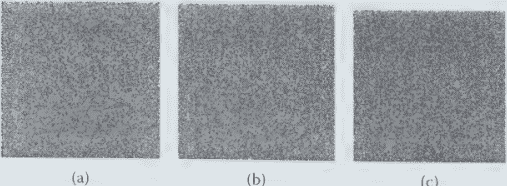

**图 4.9** RC6 算法的密钥敏感性测试：（a）密钥为 32 个十六进制零的加密图像 A；（b）密钥为 8 和 31 个零十六进制的加密图像 B；和（c）密钥为 31 个零和 1 十六进制的加密图像 C。

**表 4.3** RC6 算法的密钥敏感性测试结果

| 图像 1 | 图像 2 | $R_{xy}$ |
|---|---|---:|
| 加密图像 A | 加密图像 B | 0.0013 |
| 加密图像 B | 加密图像 C | 0.0028 |
| 加密图像 C | 加密图像 A | 0.0004 |

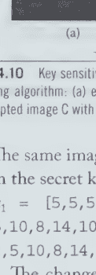

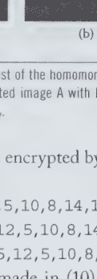

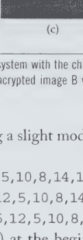

**图 4.10** 使用混沌 Baker 映射置乱算法的同态密码系统的密钥敏感性测试：（a）密钥为 n 的加密图像 A；（b）密钥为 n1 的加密图像 B；和（c）密钥为 n2 的加密图像 C。

- (b) 通过对密钥进行轻微修改对同一图像进行加密：

```text
n1 = [5,5,5,12,5,10,8,14,10,5,12,5,10,8,14,10,5,12,5,10,8,14,10,5,12,5,10,8,14,10,5,12,5,10,8,14,10,5,12,5,10,8,14,10,5,12,5,10,8,14,10,5,12,5,10,8,14,10,5,12]
```

修改是在密钥开头将 (10) 改为 (5, 5)。所得图像被称为加密图像 B，如图 4.10b 所示。

- (c) 再次，通过对密钥进行另一次轻微修改对同一图像进行加密：

```text
n2 = [10,5,12,5,10,8,14,10,5,12,5,10,8,14,10,5,12,5,10,8,14,10,5,12,5,10,8,14,10,5,12,5,10,8,14,10,5,12,5,10,8,14,10,5,12,5,10,8,7,7]
```

修改是在密钥末尾将 (14) 改为 (7, 7)。所得图像被称为加密图像 C，如图 4.10c 所示。

- (d) 最后，将三个加密图像 A、B 和 C 进行比较。

三个加密图像 A、B 和 C 中每两个之间的相关系数列于表 4.4 中，由此可以说相关系数比使用 RC6 算法的同态密码系统获得的结果更差。仅使用混沌 Baker 映射置乱加密算法也获得了类似的结果，如图 4.11a–4.11c 和表 4.5 所示。

**表 4.4** 使用混沌 Baker 映射加密算法的同态密码系统的密钥敏感性测试结果

| 图像 1 | 图像 2 | $R_{xy}$ |
|---|---|---:|
| 加密图像 A | 加密图像 B | 0.9533 |
| 加密图像 B | 加密图像 C | 0.8761 |
| 加密图像 C | 加密图像 A | 0.9212 |

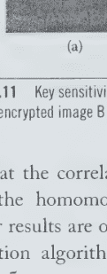

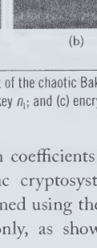

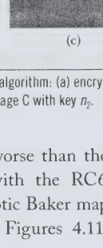

**图 4.11** 混沌 Baker 映射算法的密钥敏感性测试：（a）密钥为 n 的加密图像 A；（b）密钥为 n1 的加密图像 B；和（c）密钥为 n2 的加密图像 C。

对使用 RC6 加密算法的同态图像密码系统的密钥敏感性进行另一项测试，通过以下步骤执行：

- 1. 使用 32 个零的密钥测试密钥对 512 × 512 图像进行加密。
- 2. 通过将其 LSB 改为 31 个零和 1 来更改加密密钥。
- 3. 比较两个密文图像。

结果是，使用 31 个零和 1 的密钥加密的图像与使用全零密钥加密的图像完全不同，尽管两个密钥之间只有一个比特差异。图 4.12a 显示了两个密文图像之间的差值图像。类似的测试也应用于 RC6 加密算法，结果如图 4.12b 所示。

**表 4.5** 混沌 Baker 映射加密算法的密钥敏感性测试结果

| 图像 1 | 图像 2 | $R_{xy}$ |
|---|---|---:|
| 加密图像 A | 加密图像 B | 0.3247 |
| 加密图像 B | 加密图像 C | 0.8762 |
| 加密图像 C | 加密图像 A | 0.2877 |

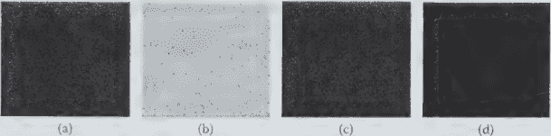

**图 4.12** 使用（a）使用 RC6 算法的同态密码系统、（b）RC6 算法、（c）使用混沌 Baker 映射算法的同态密码系统和（d）混沌 Baker 映射置乱算法的两个密文图像之间的差值图像。

对于使用混沌 Baker 映射置乱算法的同态图像密码系统，测试使用以下步骤进行：

- 1. 使用密钥测试密钥 *n* 对 512 × 512 图像进行加密。
- 2. 将加密密钥更改为 *n₁*。
- 3. 比较两个密文图像。

该测试的结果如图 4.12c 所示。该测试也应用于仅混沌 Baker 映射置乱，结果如图 4.12d 所示。

### 4.3.3 差分分析

同态密码系统的一个理想特性是对明图像中小变化的高敏感性（明图像中的单比特变化）（即扩散）。

对 256 灰度级 Lena 图像大小为 512 × 512 的 1 像素变化影响进行了测试，结果如图表 4.6 所示。

关于表 4.6 中的 NPCR 和 UACI 估计结果，RC6 和混沌 Baker 映射置乱加密方案对明图像中小变化不敏感，但使用两种方案的同态密码系统对明图像中小变化高度敏感。一般来说，这些获得的结果表明同态密码系统具有非常强大的扩散机制。

**表 4.6** NPCR 和 UACI 结果

| 算法 | NPCR | UACI |
|---|---:|---:|
| 使用 RC6 的同态加密 | 99.605% | 16.775% |
| RC6 | 0.0061% | 0.0005% |
| 使用混沌 Baker 映射置乱的同态加密 | 100% | 7.2314% |
| 混沌 Baker 映射置乱 | ≈0% | ≈0% |

## 4.4 噪声影响

噪声影响的测试已通过在解密之前向加密图像添加加性高斯白噪声（AWGN）来执行。测试结果表明，RC6 和使用 RC6 的同态算法在解密过程中受噪声影响很大。换句话说，这些算法只能在无差错场景中使用。实验结果如图 4.13a 和 4.13b 所示。

对于混沌 Baker 映射加密和使用混沌 Baker 映射的同态加密，结果表明这些算法对噪声更鲁棒，可以在嘈杂环境中工作。实验结果如图 4.13c 和 4.13d 所示。很明显，混沌 Baker 映射解密过程比 RC6 解密过程对噪声更鲁棒，这体现在图 4.14 中，该图显示了所有算法的解密图像的峰值信噪比（PSNR）随加密图像的信噪比（SNR）的变化。这归因于 RC6 算法在其方程 \(f(x)=x(2x+1)(\bmod 2^w)\) 中具有扩散机制，这导致抗噪声能力较差。

## 4.5 总结

从这些结果中，我们可以看到

- 1. 一般来说，同态域中的加密可以被认为是一种非常强大的扩散机制，但这

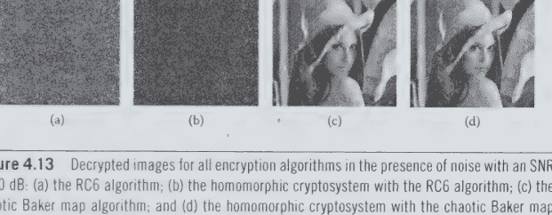

图 4.13 在信噪比为 50 dB 的噪声存在下所有加密算法的解密图像：（a）RC6 算法；（b）带 RC6 算法的同态密码系统；（c）混沌贝克映射算法；以及（d）带混沌贝克映射置乱算法的同态密码系统。

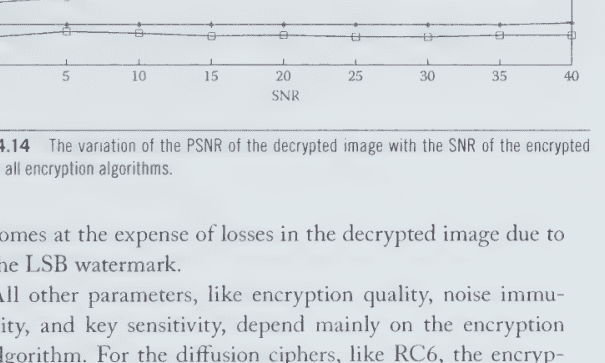

图 4.14 所有加密算法中解密图像的 PSNR 随加密图像 SNR 的变化。

这是以解密图像因 LSB 水印而损失为代价的。

2. 其他所有参数，如加密质量、抗噪性、密钥敏感性，主要取决于加密算法。对于像 RC6 这样的扩散密码，其加密质量和密钥敏感性优于像混沌贝克映射这样的置换密码。但是，如果传输介质存在噪声，则更倾向于使用置换密码。

## 5 不同操作模式下的混沌图像加密

## 5.1 概述

混沌理论在现代密码学中始终发挥着积极作用。使用混沌作为开发密码系统的基础的吸引力主要在于其随机行为以及对初始条件和参数设置的敏感性，满足了经典的香农混淆和扩散要求 [89]。基于混沌的算法在安全性、复杂性、速度、计算开销等方面表现出一些非常好的特性。一些基于遍历性的混沌密码系统已被提出 [90,91]。基于离散混沌的混沌图像 [91,92] 和随机数生成算法 [67,93–95] 已被提出，但安全性普遍不够高 [96,97]。

本章讨论使用三种不同的操作模式实现图像像素的混沌贝克映射置乱：CBC、CFB 和 OFB。该实现取决于块大小 S，其中 S = N × N 像素，以及用作主密钥的 IV。IV 的位必须尽可能随机且不相关，以产生强大的加密机制。在本章实验中，被加密的图像是 Lena，这是一幅 512 × 512 的灰度图像，并且 Cameraman 图像的加密版本的某些部分被用于 IV（图 5.1）。

## 5.2 具有操作模式的混沌加密

具有不同操作模式的混沌加密的主要目标是在适度的计算时间内提高混沌加密的安全性，并使其能够加密具有任意维度的图像。我们研究了三种操作模式的混沌加密：CBC、CFB 和 OFB [16–18]。这三种模式被测试以决定哪一种能够提高密码系统的隐写能力。具有操作模式的混沌加密可以简单地概括为以下三个步骤：

- 1. 按行扫描图像。
- 2. 将扫描的行转换为 w 个块，每个块有 N × N 像素。
- 3. 使用 2D 混沌贝克映射以 CBC、CFB 或 OFB 模式加密这些块，如以下各节所述。

具有操作模式的混沌加密的框图如图 5.2 所示。


图 5.1 Cameraman 图像的加密版本。


图 5.2 混沌加密在（a）CBC 模式、（b）CFB 模式、（c）OFB 模式下的实现。

## 5.3 实现问题

如前一节所述，混沌加密可以在三种不同的操作模式下实现。它基于 2D 混沌贝克映射作为主要加密算法。已知贝克映射诱导的置换表现得像典型的随机置换。IV 用作主密钥。该 IV 必须随机以抵抗暴力攻击。IV 位与数据块位之间的 XOR 操作改变了像素的值，这使得加密算法表现得像 3D 贝克映射。该算法还使用一个次要密钥，即贝克映射用于置乱像素的密钥。

具有操作模式的混沌加密基于将被加密的图像分割成块。块大小是影响密码系统性能的重要因素。块大小对加密质量的影响在仿真示例部分进行了详细研究。由于 IV 的大小与明文块相似，块大小的增加会提高安全性。此外，具有操作模式的混沌加密算法在分割成小块后将能够加密具有任意维度的图像。

## 5.4 仿真示例和讨论

仿真实验已对 Lena 图像进行混沌加密系统使用不同操作模式的加密，并将获得的结果与 2D 混沌贝克映射加密算法和 RC6 算法的结果进行比较。IV 取自图 5.1 所示的加密 Cameraman 图像的一部分，其大小等于所选块大小。测试了多个块大小：

- 1. S₁ = 128 × 128 像素。IV 是加密 Cameraman 图像的一个 128 × 128 像素部分。
- 2. S₂ = 64 × 64 像素。
- 3. S₃ = 32 × 32 像素。
- 4. S₄ = 16 × 16 像素。
- 5. S₅ = 8 × 8 像素。

使用混沌贝克映射密码系统和 RC6 密码系统对 Lena 图像的加密版本如图 5.3 所示，以及使用不同操作模式和不同块大小的混沌加密（图 5.4）。从图 5.4 可以看出，具有不同操作模式的混沌加密的性能良好，除了在 OFB 模式下使用大块大小的实现之外。

为了检查本章提到的每个密码系统的抗噪性，向加密图像添加了


图 5.3 使用传统密码系统的加密图像：（a）使用混沌贝克映射密码系统的加密图像；（b）使用 RC6 密码系统的加密图像。

信噪比为 5 dB 的加性高斯白噪声（AWGN），然后进行解密。混沌贝克映射密码系统和 RC6 密码系统的解密结果（图 5.5）以及具有不同操作模式的混沌加密（图 5.6）显示。从视觉检查来看，混沌贝克映射密码系统具有最高的抗噪性。还很明显，具有不同操作模式的混沌加密比 RC6 密码系统更抗噪。


图 5.4 使用不同操作模式和不同块大小的混沌加密的加密图像。

表 5.1 显示了本章提到的所有密码系统的评估指标值；$r_{cc}$ 表示相关性


图 5.5 在 SNR = 5 dB 时使用传统密码系统的解密图像。（a）使用混沌贝克映射密码系统的解密图像；（b）使用 RC6 密码系统的解密图像。


图 5.6 在 SNR = 5 dB 时使用不同操作模式和不同块大小的混沌算法的解密图像。

| 表 5.1 所有密码系统的数值评估指标 | | | | | | | | | | | | | | | | | | | | | | | | | |
|---|---|---|---|---|---|---|---|---|---|---|---|---|---|---|---|---|---|---|---|---|---|---|---|---|
| 具有操作模式的混沌加密 | | | | | | | | | | | | | | | | | | | | | | | | | |
| | CBC | | | | | | | | | | CFB | | | | | | | | | | OFB | | | | 加密 | | RC6 |
| | $S_1$ | $S_2$ | $S_3$ | $S_4$ | $S_5$ | $S_6$ | $S_7$ | $S_8$ | $S_9$ | $S_{10}$ | $S_1$ | $S_2$ | $S_3$ | $S_4$ | $S_5$ | $S_6$ | $S_7$ | $S_8$ | $S_9$ | $S_{10}$ | $S_1$ | $S_2$ | $S_3$ | $S_4$ | $S_5$ | | | | | | | |
| 测试 | | | | | | | | | | | | | | | | | | | | | | | | | | | | | | |
| $D$ | 0.71 | 0.72 | 0.71 | 0.71 | 0.72 | 0.71 | 0.71 | 0.71 | 0.71 | 0.71 | 0.7 | 0.67 | 0.66 | | | | | | | | | | | | | | | | |
| $I_{eye}$ | $1.4 \times 10^{-3}$ | $4.7 \times 10^{-6}$ | $1.3 \times 10^{-3}$ | $1.7 \times 10^{-3}$ | $-2 \times 10^{-3}$ | $15 \times 10^{-3}$ | $3.7 \times 10^{-3}$ | $-7.1 \times 10^{-3}$ | $2.5 \times 10^{-4}$ | $-65 \times 10^{-3}$ | $2 \times 10^{-3}$ | $2.3 \times 10^{-3}$ | $41.8 \times 10^{-3}$ | $0$ | $10^{-4}$ | | | | | | | | | | | | | | |
| $D_t$ | 0.71 | 0.7 | 0.71 | 0.71 | 0.7 | 0.71 | 0.71 | 0.71 | 0.7 | 0.7 | 0.73 | 0.74 | 0.95 | 0.98 | 0.87 | | | | | | | | | | | | | | |
| $I_{eye}^t$ | 0.57 | 0.57 | 0.57 | 0.57 | 0.57 | 0.57 | 0.57 | 0.57 | 0.7 | 0.57 | 0.7 | 0.7 | 0.69 | 0.71 | $2.5 \times 10^{-3}$ | | | | | | | | | | | | | | |
| *注：解密是在存在 AWGN 且 $SNR=5 \, dB$ 的情况下进行的。 | | | | | | | | | | | | | | | | | | | | | | | | | | | | | | | |


系数 between the original and encrypted image, and r_{xyd} 表示受 5-dB AWGN 影响的原始图像与解密图像之间的相关系数。根据本表中获得并显示的结果，很明显混沌 Baker 映射密码系统对噪声的免疫性最强，但其安全性低于 RC6 密码系统和具有工作模式的混沌加密。也很明显 RC6 密码系统对噪声的存在非常敏感。我们可以得出结论，具有不同工作模式的混沌加密在安全性和抗噪性之间实现了权衡。

噪声对具有不同工作模式和块大小的混沌加密的影响也被研究，结果见图 5.7。该图显示了解密图像的峰值信噪比（PSNR）随加密图像的 SNR 变化情况。从该图可以明显看出，在存在噪声的情况下，所有工作模式的性能大致相同，且在高 SNR 值下性能得到改善。也可以明显看出，块大小对所有实现模式下算法的抗噪性没有影响。


**图 5.7** 在具有不同工作模式的混沌加密中，解密图像的 PSNR 随加密图像的 SNR 变化情况，（a）CBC 模式，（b）CFB 模式，（c）OFB 模式。

原始 Lena 图像的直方图以及本章提及的所有密码系统的加密图像的直方图分别如图 5.8 和 5.9 所示。很明显，使用混沌 Baker 映射密码系统时未实现直方图均匀性，这是该密码系统的弱点。RC6 密码系统实现了直方图均匀性。具有不同工作模式的混沌加密也实现了直方图均匀性，所有实现均如此，除了 OFB 模式下块大小较大时的实现。


**图 5.8** 原始图像的直方图以及使用传统密码系统加密的图像的直方图。

已知与混沌 Baker 映射密码系统相比，RC6 密码系统的处理时间较长。因此，我们对处理时间的研究仅限于比较具有不同工作模式的混沌加密的处理时间与混沌 Baker 映射密码系统的处理时间。图 5.10 显示了在不同工作模式下实现的混沌加密算法的归一化处理时间随块长度的变化。归一化是通过将具有不同工作模式的混沌加密算法的处理时间除以混沌 Baker 映射密码系统的处理时间来执行的。处理时间包括加密和解密时间。从图 5.10 可以明显看出，对于每个块长度，所有实现的处理时间大致相同。也可以明显看出，大块大小导致更短的处理时间，因为加密和解密是对更少的块执行的。


**图 5.10** 具有不同模式和块大小的混沌图像加密的归一化处理时间：（a）CBC 模式；（b）CFB 模式；（c）OFB 模式。

## 5.5 总结

- 1. 具有不同工作模式的混沌图像加密可用于调整二维 Baker 映射以加密具有任意维度的图像。
- 2. CBC 模式的混沌加密是本章测试的所有实现中最好的。
- 3. 通常，所有模式的加密质量随着块大小的减小而提高，除了 OFB 模式，尤其是在 S = S₃、S₄ 和 S₅ 时。
- 4. 混沌 Baker 映射在除抗噪性外的所有测试中结果最差，而 RC6 算法的结果居中。
- 5. 处理时间随着块大小的减小而增加。

## 6 ECB 模式下数据加密的扩散机制

## 6.1 引言

任何分组密码算法的实现都取决于工作模式，该模式决定了加密过程中块之间的关系。ECB 模式是可能的工作模式之一。在此模式下，每个块独立加密。与不同的工作模式不同，此模式允许并行处理，这是一个很大的优势。不幸的是，由于每个块的加密不依赖于其他块，攻击者可以在不被检测的情况下用之前截获的块替换任何块；因此，消息在无需知道密钥的情况下被破解。这个重大的安全问题被称为块独立性问题。此外，相同的明文块被加密为相同的密文块，因此像图像中那样的对称大块数据模式无法使用在 ECB 模式下实现的任何加密算法隐藏 [98–102]。

本章讨论了两种解决 ECB 模式中块独立性问题的方法 [103]。第一个动作是使数据字节的值成为其在数据流中位置的函数。第二个动作是在这些字节之间执行扩散过程。这两个动作是预处理动作，在应用在 ECB 模式下实现的任何分组密码算法之前执行。首先，执行一个加法步骤，用于消除任何相同的明文块。然后，使用替代置换网络（SPN）来实现字节之间的扩散。该机制的示意图如图 6.1 所示。


**图 6.1** ECB 模式下加密和解密的建议机制：（a）加密；（b）解密。

## 6.2 预处理网络

尽管 ECB 模式具有并行处理的优势，但其缺点限制了其在现代密码学中的适用性 [104]。如果我们可以在加密前预处理数据以使字节一起扩散，这些缺点将被避免。预处理网络由两部分组成：加法部分和 SPN。

### 6.2.1 加法部分

加法过程的目标是使字节值成为其在数据流中位置的函数。该过程有助于消除相同的明文块。字节位置的函数按如下方式加到字节值上：

$B(i) = (B(i) + f(i)) \bmod 256 \qquad (6.1)$

函数 f(i) 被使用，因为它满足以下条件：

- **随机性。** 该函数对每个 i 的输出值是随机且等概率的。
- **不规则性。** 在将该函数加到字节值之后，每个字节与其在数据流中的邻居之间的差异是不可预测且不可重复的。
- **非周期性。** 该函数是非周期的，因为它满足以下条件：

    f(i) ≠ f(i + n) ≠ f(i + 2n) ≠ f(i + 3n) ≠ ... (6.2)

这里，我们测试三个函数以找到满足给定条件的函数：

$f_1\left( i \right) = 7\times\left( i + 13 \right) \mathrm{mod}\ 256 \qquad (6.3)$

$f_2\left( i \right) = \left( 7\times\left( i + 3 \right) \right)^5 \mathrm{mod}\ 256 \qquad (6.4)$

$f_3\left( i \right) = \mathrm{fix}\left( \sqrt{7\times\left( i + 13 \right)^5} \right) \mathrm{mod}\ 256 \qquad (6.5)$

其中 fix 函数用于将参数的值向下舍入到最近的整数。

这些函数已对 1 到 1024 的值进行了测试，结果见图 6.2。这些函数的输出的概率密度函数（PDF）如图 6.3 所示。

从这些图可以看出，$f_3(i)$ 给出随机、不规则且非周期性的输出，具有均匀的 PDF。

### 6.2.2 SPN

SPN 用于在加法步骤之后使数据的字节一起扩散。首先，数据被划分为 $n$ 位的块。该网络块大小 $n$ 与加密算法块大小 $w$ 不同。之后，如图 6.4 所示执行一系列 XOR 操作。子密钥 $K_1$ 作为第一个 XOR 的初始密钥，然后结果与下一个块进行 XOR 直到明文结束。该 XOR 链产生的每个块按位置换，如图 6.5 所示。之后执行基于块的置换。最后，从子密钥 $K_2$ 开始实现另一条 XOR 链。

## 6.3 实现问题

预处理网络性能主要取决于 SPN 块大小 $n$ 的正确确定及其与加密算法块大小 $w$ 的关系。研究了归一化块大小 $(n/w)$ 对扩散和块依赖性的影响。


图6.2 (a) f1(i)、(b) f2(i)、(c) f5(i) 随 i 变化的情况。

### 6.3.1 归一化块大小对扩散的影响

扩散就是隐藏明文与密文之间的关系。如果明文中的一个小变化（一个比特）导致密文发生大变化（其一半比特），则雪崩效应明显，算法具有强大的扩散机制 [105–110]。如果我们能确保明文中的一位变化会影响加密算法输入每个块中的至少一个比特，并且加密算法中的扩散机制会将该变化传播到每个块中，那么这一点就得到了保证。


图6.3 (a) f₁(i)、(b) f₂(i)、(c) f₃(i) 的概率密度函数。


图6.4 SPN 的操作。


图6.5 SPN 中的比特置换。

从图6.6可以看出，如果在一个 SPN 块 (S_j) 中发生变化，则从 Q'_{L-i+1} 到 Q'_L 的所有网络块都将受到影响，其中 L 是网络块的数量。输出的奇数编号块


图6.6 SPN 对加密前数据块的扩散效应。

从 Q'_1 到 Q'_i 的块也会受到影响。由于在相同模式之间执行 XOR 运算，直到 Q'_i 的偶数编号块不会受到影响。

为了确保加密算法每个块中变化的传播，SPN 块大小 n 的适当选择是加密算法块大小 w 的一半（n/w = 0.5）。由于在高级加密标准（AES）和 RC6 算法的情况下，w 为 128 比特，因此使用的网络块大小应为 64 比特。

该网络能够传播在加法部分所做的更改，并将数据字节一起扩散。

### 6.3.2 归一化块大小对块依赖性的影响

块独立性问题使黑客有机会在未被发现的情况下交换任意密文块。预处理网络通过使这种交换在解密过程中影响除被替换块之外的其他块来解决此问题。

另一方面，使用 SPN 时，如果某个块接收出错，则该错误将在解密过程中通过其他块传播，并且即使这些块被正确接收，它们也会被错误解密。因此，需要在块依赖性和错误传播之间进行权衡。


图6.7 解密过程中 SPN 效应反转导致的错误传播。

如果某个加密块接收出错，对该块应用解密算法会以不同方式将错误传播到两个相邻的网络块中。这归因于解密算法中扩散机制的随机化。如果错误发生在中间的加密块，错误会扩散到三个解密块。如果错误发生在第一个或最后一个加密块，错误只扩散到两个解密块。如图6.7所示，其中阴影块表示具有不同错误的网络块，白色块表示没有错误。每个大小为 w 的解密块由两个网络块表示。从该图可以看出，块依赖性得到了保证，但与 CBC 模式相比，错误传播略有增加。

## 6.4 仿真示例

为测试所提机制对 ECB 模式下图像加密的影响，进行了多项实验。AES 和 RC6 算法均被用作加密算法。这些实验使用了如图6.8所示的 Cameraman 图像。


图6.8 (a) Cameraman 图像；(b) 直方图。

### 6.4.1 加密质量

检查加密图像的重要因素之一是目视检查。为了比较起见，使用 AES 和 RC6 算法在 ECB、CBC、CFB 和 OFB 模式下，以及在使用所提网络进行预处理的 ECB 模式下对 Cameraman 图像进行了加密。这些实验的结果分别如图6.9和图6.10所示。从获得的结果可以清楚地看出，ECB 模式下的加密未能隐藏 Cameraman 图像上部切片中的细节，因为该切片的强度是平坦的。而使用所提网络的 ECB 模式加密解决了这个问题。

图6.9 和图6.10 中所有图像的直方图分别如图6.11和图6.12所示。所有图中直方图的均匀性确保了所有加密算法成功实现所需的随机性。图6.9和图6.10中加密图像的加密质量指标 D_I 和 D 的值列于表6.1中。这些结果表明，所有模式都实现了数据的随机性。

### 6.4.2 扩散

针对三种情况评估了扩散指标 NPCR、UACI 和雪崩效应指标：改变第一个像素中的单个比特、改变中间像素中的单个比特，以及改变最后一个像素中的单个比特。扩散测试的结果示于表6.2。从该表可以看出，数据块之间的扩散主要取决于操作模式，而不是加密算法。ECB 和 OFB 模式不具有任何扩散特性。与 CBC 和 CFB 模式不同，使用预处理网络的 ECB 模式给出了最佳结果，而 CBC 和 CFB 模式在雪崩效应指标上值较低，且变化发生在靠近数据末尾的位置。


图6.9 使用 AES 在 (a) 带预处理的 ECB 模式、(b) ECB 模式、(c) CBC 模式、(d) CFB 模式、(e) OFB 模式下加密的 Cameraman 图像。


图6.10 使用 RC6 算法在 (a) 带预处理的 ECB 模式、(b) ECB 模式、(c) CBC 模式、(d) CFB 模式、(e) OFB 模式下加密的 Cameraman 图像。


图6.11 图6.9中加密图像的直方图。


图6.12 图6.10中加密图像的直方图。

### 6.4.3 加密细节较少的图像

细节较少的图像存在大量数值相近的相邻像素。此类图像的示例有图6.13中的医学图像和图6.14中的标志图像。

在带预处理网络和不带预处理网络的 ECB 模式下，分别使用 AES 和 RC6 算法加密的医学图像和标志图像的版本如图6.15所示。

表6.1 加密质量结果

| 指标 | RC6 | AES |  |  |  |  |  |  |  |
| --- | --- | --- | --- | --- | --- | --- | --- | --- | --- |
|  | CBC | CFB | OFB | ECB | 带预处理的ECB | CBC | CFB | OFB | ECB | 带预处理的ECB |
| $D_{c}$ | 0.602 | 0.596 | 0.597 | 0.597 | 0.598 | 0.601 | 0.603 | 0.603 | 0.606 | 0.604 |
| $D$ | 0.0513 | 0.0486 | 0.0503 | 0.0452 | 0.046 | 0.0485 | 0.0458 | 0.0472 | 0.052 | 0.048 |


图6.13 医学图像。


图6.14 标志图像。


图6.15 使用(a) ECB模式的RC6算法、(b) ECB模式的AES、(c) 带预处理的ECB模式RC6算法、(d) 带预处理的ECB模式AES加密的医学图像。

以及图6.16，分别对应。这些图像的直方图分别如图6.17和图6.18所示。从所得结果中，我们注意到ECB模式的加密对这些图像无效。我们还注意到，预处理网络显著提升了这些图像在ECB模式下的加密质量。


**图6.16** 使用(a) ECB模式的RC6算法、(b) ECB模式的AES、(c) 带预处理的ECB模式RC6算法、(d) 带预处理的ECB模式AES加密的标志图像。


图6.17 医学图像的直方图：(a) 原始图像，(b) 使用RC6算法加密，(c) 使用AES加密，(d) 使用带预处理的ECB模式RC6算法加密，(e) 使用带预处理的ECB模式AES加密。


图6.18 标志图像的直方图：(a) 原始图像，(b) 使用RC6算法加密，(c) 使用AES加密，(d) 使用带预处理的ECB模式RC6算法加密，(e) 使用带预处理的ECB模式AES加密。

## 6.5 小结

本章提出了一种有效的方法来解决ECB模式加密的相关问题。预处理网络在加密之前对数据进行处理，以便在应用ECB模式加密算法之前将数据字节扩散到一起。测试结果表明，任何采用ECB模式并带有预处理网络的加密算法都能获得良好的扩散特性和较高的加密质量，同时不会失去并行处理的优势。

## 7 正交频分复用

## 7.1 引言

本书的主要目标是从通信的角度研究图像加密。因此，我们需要确定加密算法是否符合通信要求。现在该转向无线通信，以理解通信过程及其局限性，进而研究通信过程后解密算法的性能。我们在研究中考虑多载波调制（MCM），特别是正交频分复用（OFDM），因为它是无线通信系统的新趋势。MCM不仅用于多种无线网络标准的物理层，例如电气和电子工程师协会（IEEE）802.11a、IEEE 802.16a和HIPERLAN2（高性能无线电局域网类型2），还用于包括图像通信的高清电视（HDTV）应用中[111,112]。OFDM通过将信号分解为多个窄带宽载波来克服多径衰落的影响。这导致较低的符号率，从而减少ISI（符号间干扰）的数量。与单载波传输相比，对多径衰落的高容忍度使得OFDM更适合地面环境中高数据率的传输。

传输频率、接收机速度和所需的多径容忍度共同决定了最适合使用的传输模式。多普勒扩展是由接收机在多径环境中移动导致信道响应快速变化引起的。它导致OFDM子载波的随机频率调制，从而造成信号退化。多普勒扩展的量与传输频率和移动速度成正比。


图7.1 七音OFDM信号中子载波的频率响应。

子载波间隔越近，OFDM信号越容易受到多普勒扩展的影响，因此数字音频广播（DAB）和HDTV中的不同传输模式允许在多径保护量（保护间隔长度）与多普勒扩展容忍度之间进行权衡[113]。

OFDM信号的频谱如图7.1所示。在频域中，每个OFDM子载波具有多个sinc形状的频率响应。sinc形状具有窄的主瓣和许多旁瓣，旁瓣随着远离中心的频移幅度而缓慢衰减。每个载波在中心频率处有一个峰值，并且零点以等于载波间隔的频率间隔均匀分布[114,115]。

## 7.2 OFDM的基本原理

所有无线通信系统都使用调制方案将信息信号映射为能够通过通信信道有效传输的形式。人们已经开发出各种各样的调制方案，最合适的方案取决于信息信号是模拟波形还是数字信号。

常见的模拟调制方案包括频率调制（FM）、幅度调制（AM）和相位调制（PM）。数字通信中常见的单载波调制方案包括幅度键控（ASK）、频移键控（FSK）、相移键控（PSK）和正交幅度调制（QAM）[115]。

OFDM与频分复用（FDM）在几个方面有所不同。在传统广播中，每个无线电台在不同频率上发射，有效地使用FDM来保持电台之间的分离。然而，这些电台之间没有协调或同步。在诸如DAB或数字视频广播（DVB）的OFDM传输系统中，来自多个电台的信息信号被组合成单个复用的数据流。然后使用由多个子载波密集封装而成的OFDM集合来传输这些数据。OFDM信号内的所有子载波在时间和频率上彼此同步，从而可以仔细控制子载波之间的干扰。这些多个子载波在频域中重叠，但由于调制的正交性，产生的载波间干扰（ICI）效应很小。通常，对于FDM，传输信号需要在信道之间有一个较大的频率保护带以防止干扰。这降低了整体频谱效率。然而，对于OFDM，子载波的正交封装大大减小了这一保护带，从而提高了频谱效率[116–122]。

FDM传输系统中的每个载波可以使用模拟或数字调制方案。传输之间没有同步，因此一个电台可以使用FM发射，而另一个电台可以使用FSK以数字形式发射。在单个OFDM传输系统中，所有子载波彼此同步，从而将传输限制为数字调制方案。OFDM基于符号，可以被认为是大量并行传输的低比特率载波。所有这些载波使用同步的时间和频率进行传输，形成一个单一的频谱块，以确保结构的正交性得以保持。由于这些多个载波形成单个OFDM传输，它们通常被称为子载波，而术语“载波”保留用于描述射频（RF）载波，该载波将

基带信号。关于OFDM信号中的子载波如何保持正交性以及为何这种正交性能防止它们之间相互干扰，有几种不同的观察视角 [116–119]。

### 7.2.1 正交性

如果信号彼此相互独立，则它们是正交的。正交性是一种特性，允许多个信息信号通过公共信道完美传输并被检测而不受干扰。正交性的丧失会导致这些信息信号之间出现模糊，并降低通信质量。

许多常见的复用方案天生具有正交性。时分复用（TDM）通过为每个独立的信息信号分配唯一的时间槽，从而允许通过单个信道传输多个信息信号。在每个时间槽内，只传输来自单一源信号的数据，从而防止多个信息源之间产生任何干扰。因此，TDM在本质上是正交的 [116–119]。在频域中，大多数频分复用（FDM）系统也是正交的，因为各个独立的传输信号在频率上间隔较大，从而防止了干扰。OFDM这一术语已被保留用于FDM的一种特殊形式。OFDM信号中的子载波间隔在理论上被设置得尽可能紧密，同时保持它们之间的正交性。

OFDM在频域中通过将每个独立的信息信号分配到不同的子载波上来实现正交性。OFDM信号由正弦波的总和组成，其中每一个对应一个子载波。每个子载波的基带频率被选为符号时间的倒数的整数倍，这使得所有子载波在每个符号周期内具有整数个周期。结果是，这些子载波彼此正交 [123–130]。

如果一组函数满足公式 (7.1) 中的条件，则这些函数彼此正交。如果该集合中任意两个不同的函数在一个符号周期内相乘并积分，对于正交函数，结果为零。如果我们观察针对其中一个正交函数的匹配接收器，接收器将只看到该函数的结果。集合中所有其他函数的积分结果为零，因此没有影响 [115]。

$$\int_{0}^{T} s_{i}(t) s_{j}(t) dt = \begin{cases} 1 & i=j \\ 0 & i\neq j \end{cases} \tag{7.1}$$

公式 (7.2) 展示了一组正交正弦波，它们代表未经调制的实OFDM信号中的子载波 [115,116]。

$$s_{k}(t)=\begin{cases} \sin(2\pi k f_{0} t) & 0<t<T \\ 0 & \text{otherwise} \end{cases} \quad k=1,2,\dots,N \tag{7.2}$$

其中 $f_{0}$ 是子载波间隔，$N$ 是子载波数量，$T$ 是符号周期。由于最高频率分量为 $N f_{0}$，传输带宽也为 $N f_{0}$。

### 7.2.2 频域正交性

在频域中，每个OFDM子载波具有 sinc $\sin(x)/x$ 频率响应。这是由符号时间对应于载波间隔的倒数所致。就接收器而言，每个OFDM符号以固定时间 $T_{FFT}$ 传输，符号两端没有衰减。该符号时间对应于 $1/T_{FFT}$ Hz 的子载波间隔的倒数。时域中的矩形、方波波形导致频域中产生 sinc 频率响应。sinc 形状具有一个窄的主瓣和许多旁瓣，随着与中心频率差异幅度增加，旁瓣衰减缓慢。每个载波在中心频率处有一个峰值，且零点均匀分布，频率间隔等于载波间隔 [113]。

传输的正交特性源于每个子载波的峰值对应所有其他子载波的零点。当使用FFT（快速傅里叶变换）检测此信号时，频谱不是连续的，而是具有离散样本。如果FFT是时间同步的，则FFT的频率样本仅对应子载波的峰值；因此，子载波之间重叠的频率区域不影响接收器。测得的峰值对应所有其他子载波的零点，从而实现了子载波之间的正交性 [113–115]。

## 7.3 OFDM系统模型

本节简要回顾了OFDM通信系统中的关键步骤，该系统可用于加密图像的传输。第一步是图像加密；典型加密系统的一般模型可以用以下方程描述 [131]：

$E(P, K) = C$ (7.3)

其中 $P$ 是明文图像，$E$ 是加密算法，$K$ 是加密密钥，$C$ 是密文图像。密文图像通过通信信道传输。在接收端，解密过程可以表示为 [131]

$D(C, K') = P'$ (7.4)

其中 $D$ 是解密算法，$K'$ 是解密密钥（它可能与加密密钥 $K$ 相同，也可能不同），$P'$ 是恢复的明文图像。

在发送端，加密数据被转换为 $N$ 个并行子信道数据。然后，每个并行子信道的数据使用诸如PSK或QPSK（四相相移键控）等调制方案进行调制。对于 $N$ 个子信道的QPSK $(d_0, d_1, d_2, \dots, d_{N-1})$，每个 $d_n$ 是一个复数 $d_n = d_{I_n} + j d_{Q_n}$，其中 $d_{I_n}$ 和 $d_{Q_n}$ 取值为 $\{1, -1\}$ [131–135]。

### 7.3.1 FFT-OFDM

在FFT-OFDM中，调制数据被送入逆FFT（IFFT）电路，从而生成OFDM信号。OFDM将高数据率序列分割为多个低速率序列，并通过等于 $N$ 数量的子载波进行传输。所选的 $N$ 个子载波被设计为正交的；即 $f_n = n \Delta f$，其中 $\Delta f = 1/T_s$，$T_s$ 是OFDM符号持续时间。产生的信号可以表示为如下 [136]：

$x(n) = \frac{1}{\sqrt{N}} \sum_{k=0}^{N-1} X(k) e^{j \frac{2 \pi k n}{N}}, \ 0 \leq t \leq T_s$ (7.5)

其中 $X(k)$ 表示离散时间样本。

在每个OFDM符号的开始处添加保护间隔以消除多径信道中发生的ISI（符号间干扰）。OFDM符号以循环方式扩展以避免ICI（载波间干扰）。结果，具有高度频率选择性的信道被转化为大量独立的平坦衰落、非频率选择性、窄带信道。在接收端，保护间隔被移除，并对时间区间 [0, Tᵢ] 进行评估。

### 7.3.2 DCT-OFDM

离散余弦变换（DCT）-OFDM系统的结构与FFT-OFDM相似，但IFFT和FFT模块分别被逆离散余弦变换（IDCT）和DCT模块取代。DCT的主要优势在于其出色的频谱能量紧凑性，这使得大多数传输的样本接近于零，从而减少ISI。此外，它仅使用实数运算，而不是FFT中使用的复数运算。这降低了信号处理复杂度以及同相/正交不平衡 [136,137]。在DCT-OFDM系统中，传输信号由以下公式给出 [138–140]

$$x(n)=\sqrt{\frac{2}{N}}\sum_{k=0}^{N-1}X(k)\beta(k)\cos\left(\frac{\pi k(2n+1)}{2N}\right),\quad n=0,\ldots,N-1 \tag{7.6}$$

其中 X(k) 是输入信号的第 k 个符号。β(k) 可以写成如下形式：

$$\beta(k)=\begin{cases}\frac{1}{\sqrt{2}}, & k=0\\1, & k=1,2,\ldots,N-1\end{cases} \tag{7.7}$$

### 7.3.3 离散小波变换–OFDM

OFDM需要循环前缀来消除ISI。这造成了开销，有时该开销对于系统的有效性来说可能过大。使用小波变换可以减少ISI和ICI [138, 141,142]。离散小波变换（DWT）-OFDM系统的结构与FFT-OFDM相似，但IFFT和FFT模块分别被间接离散小波变换（IDWT）和DWT模块取代。使用DWT-OFDM的传输信号由以下公式给出 [138]

x(n)=∑_{k=0}^{N} X(k)φ(t−kT')
(7.8)

其中 φ(t) 是小波基函数。

DWT-OFDM的进一步优势如下：

- 1. 它不需要循环前缀（CP），因此开销更小。
- 2. 它不需要导频音调，导频音调通常占用约8%的子带。
- 3. DWT-OFDM对ISI和ICI具有固有的鲁棒性。

DWT将在下一节中解释。

### 7.3.4 离散小波变换

小波已成为大多数信号处理和通信应用中的流行工具。传统的DWT可以被视为使用一组带通滤波器对输入信号进行滤波，这些滤波器的冲激响应大致由母小波的缩放版本给出。相邻滤波器之间的缩放因子通常为2:1，导致八度带宽以及相隔一个八度的中心频率 [138,139]。滤波器的输出通常进行最大降采样，使得DWT输出样本数量等于输入样本数量，并且变换是可逆的，如图 7.2 所示。

#### 7.3.4.1 DWT的实现

DWT通常通过数字滤波器实现，如图 7.2 中所示的一维（1D）情况。设计良好小波的艺术在于设计滤波器组 H₀, H₁, G₀, 和 G₁，以在满足完美重构（PR）条件 [142] 的同时，实现空间和频域特性之间的各种权衡。在图 7.2 中，


图7.2 双频带分解-重构小波滤波器组。

在H0和H1输出端以2:1进行的抽取和内插实际上将这些信号的所有奇数样本置零。

对于低通支路，这等价于将x0(n)乘以1/2(1+(-1)^n)。因此，X0(z)变为1/2{X0(z)+X0(-z)}。类似地，X1(z)变为1/2{X1(z)+X1(-z)}。

因此，Y(z)的表达式由[142]给出：

Y(z)=1/2{X0(z)+X0(-z)}G0(z)+1/2{X1(z)+X1(-z)}G1(z)
=1/2 X(z){H0(z)G0(z)+H1(z)G1(z)}
+1/2 X(-z){H0(-z)G0(z)+H1(-z)G1(z)} (7.9)

第一个完全重构（PR）条件要求消除混叠，并迫使X(-z)项为零。因此，{H0(-z)G0(z)+H1(-z)G1(z)}=0，这可以通过以下条件实现[142]：

H1(z)=z^{-a}G0(-z)，且 G1(z)=z^{a}H0(-z) (7.10)
其中a必须为奇数（通常a=±1）。

第二个完全重构（PR）条件是：从X(z)到Y(z)的传递函数应为1[142]：

{H0(z)G0(z)+H1(z)G1(z)}=2 (7.11)

如果我们定义乘积滤波器$P(z) = H_0(z)G_0(z)$，并将式(7.10)代入式(7.11)，则PR条件变为[142]

$H_0(z)G_0(z) + H_1(z)G_1(z) = P(z) + P(-z) = 2 \quad (7.12)$

这对所有$z$都必须成立；由于$P(z)$中的奇次幂与$P(-z)$中的奇次幂相互抵消，因此要求$p_0 = 1$，并且对所有非零偶数$k$都有$p_k = 0$。为了将失真降至最低，多项式$P(z)$应为零相位多项式。一般来说，$P(z)$具有如下形式[142]：

$P(z) = \dots + p_5 z^5 + p_3 z^3 + p_1 z + 1 + p_1 z^{-1} + p_3 z^{-3} + p_5 z^{-5} + \dots (7.13)$

完全重构（PR）滤波器的设计方法可归纳为以下步骤[142]：

1. 选择$p_1, p_3, p_5, \dots$，得到一个特性良好的零相位多项式$P(z)$。
2. 将$P(z)$分解为具有相似低通频率响应的$H_0(z)$和$G_0(z)$。
3. 由$H_0(z)$和$G_0(z)$计算$H_1(z)$和$G_1(z)$。

为简化这一过程，我们可以使用如下关系式：

$P(z) = P_r(Z) = 1 + P_{r,1} Z + P_{r,3} Z^3 + P_{r,5} Z^5 + \dots \quad (7.14)$

其中

$Z = \frac{1}{2} \left(z + z^{-1}\right) \quad (7.15)$

#### 7.3.4.2 Haar小波变换

Haar小波是最简单的一类小波。在离散形式下，Haar小波与一种称为Haar变换的数学运算相关。Haar变换是所有其他小波变换的原型。与所有小波变换一样，Haar变换将离散信号分解为两个长度为原信号一半的子信号。一个子信号是滑动平均或趋势；另一个子信号是滑动差分或波动。

Haar小波使用尽可能简单的$P_i(Z)$，它在$Z = -1$处只有一个零点。其表示如下[142]：

$P_i(Z) = 1 + Z$，且 $Z = \frac{1}{2}(z + z^{-1})$ (7.16)

因此，

$P(z) = \frac{1}{2}(z + 2 + z^{-1}) = \frac{1}{2}(z + 1)(1 + z^{-1})$ $= G_0(z) H_0(z)$ (7.17)

我们可以按如下方式求出$H_0(z)$和$G_0(z)$：

$H_0(z) = \frac{1}{2}(1 + z^{-1})$ (7.18)

$G_0(z) = (z + 1)$ (7.19)

利用式(7.10)并取$a = 1$，可得

$G_1(z) = z H_0(-z) = \frac{1}{2} z (1 - z^{-1}) = \frac{1}{2} (z - 1)$ (7.20)

$H_1(z) = z^{-1} G_0(-z) = z^{-1} (-z + 1) = (z^{-1} - 1)$ (7.21)

## 7.4 保护间隔插入

保护间隔插入是所有OFDM系统中的重要步骤。该步骤的目的是避免ISI（码间干扰）。图7.3示出了保护间隔插入的过程[143–146]。此外，保护间隔可以由两部分组成：零幅度传输数据和发送符号的循环扩展。我们将考虑所有这些类型的保护间隔及其对传输的加密图像的影响。


图7.3 OFDM中的保护间隔插入。

## 7.5 通信信道

### 7.5.1 加性高斯白噪声信道

对于加性高斯白噪声（AWGN）信道，接收信号$r(t)$表示为[141]

$r(t) = s(t) + n(t)$

(7.22)

其中，$s(t)$是发送信号，$r(t)$是接收信号，$n(t)$是AWGN，其功率谱密度由[141]给出：

$\Phi(f) = N_0/2$ [W/Hz]

(7.23)

其中$N_0$是一个常数，通常称为噪声功率密度。

### 7.5.2 衰落信道

发射机与接收机之间的路径存在各种障碍物和反射，这会在接收端产生衰落效应，如图7.4所示。在瑞利衰落场景下，我们可以采用以下表达式来模拟接收端的入射信号[141]：

$f(t) = x(t) + j \cdot y(t)$

(7.24)

$= \left[ \sqrt{\frac{2}{N_1+1}} \sum_{n=1}^{N_1} \sin\left(\frac{\pi n}{N_1}\right) \cos\left\{2\pi f_d \cos\left(\frac{2\pi n}{N_1}\right) t\right\} + \frac{1}{\sqrt{N_1+1}} \cos(2\pi f_d t) \right]$


图7.4 具有多径传播的无线信道。

$+j\sqrt{\frac{2}{N_1}}\sum_{n=1}^{N_1}\sin\left(\frac{\pi n}{N_1}\right)\cos\left\{2\pi f_d\cos\left(\frac{2\pi n}{N_1}\right)t\right\} \quad (7.25)$

其中入射波的波数为$N_0$，$N_1$由下式给出：

$N_1 = 1/2((N_0/2) - 1)$ \quad (7.26)

## 7.6 信道估计与均衡

信道估计与均衡是当前和未来通信系统面临的主要挑战。用于补偿ISI的均衡器可分为线性均衡器和非线性均衡器[147]。线性均衡器是简单的线性滤波器结构，它试图对信道进行逆运算，即令信道与均衡器的传递函数之积满足某一准则。该准则既可以是使信道滤波器级联的传递函数完全平坦，也可以是最小化滤波器输出端的均方误差[148]。最流行的线性均衡器之一是迫零（ZF）均衡器。ZF解可写为[148]

$\mathbf{W}_{ZF} = (\mathbf{H}^H\mathbf{H})^{-1}\mathbf{H}^H$ \quad (7.27)

其中$\mathbf{H}$是信道传递函数矩阵。

ZF均衡器的优点是不需要加性噪声和源数据的统计信息。

信道估计可以通过导频符号估计（PSE）来实现。在OFDM系统中，宽带信道被划分为多个窄带信道。因此，可以通过将具有已知调制方式的导频符号插入发送信号来进行信道估计。基于这些导频符号，接收机可以利用插值技术测量每个子载波的信道传递函数[113]。

PSE和均衡的数学模型可表示如下[144]：

$\begin{pmatrix} i_1 \\ q_1 \end{pmatrix} = A \begin{pmatrix} i_0 \\ q_0 \end{pmatrix}$ \quad (7.28)

其中，$i_1$是接收到的同相符号，$q_1$是接收到的正交符号，$i_0$是发送的同相符号，$q_0$是发送的正交符号，$\mathbf{A}$是衰落环境的转移矩阵，由[130]给出：

$\mathbf{A} = \begin{pmatrix} a_{11} & a_{12} \\ a_{21} & a_{22} \end{pmatrix}$ \tag{7.29}

信道矩阵是托普利茨矩阵，满足$a_{11}=a_{22}$和$a_{12}=-a_{21}$。为了进行信道均衡，我们需要估计矩阵$\mathbf{A}^{-1}$，如下所示[130]：

$\mathbf{A}^{-1}= \frac{1}{\sqrt{a_{11}^2 + a_{12}^2}} \begin{pmatrix} a_{11} & a_{12} \\ -a_{12} & a_{11} \end{pmatrix}$ \tag{7.30}

由于发送符号和接收符号已知，我们可以利用式(7.28)和式(7.30)估计信道系数，如下所示[130]：

$a_{11}=a_{22}=\frac{1}{\sqrt{i_1+q_1}}\left(i_0 i_1 + q_0 q_1\right)$ \tag{7.31}

$a_{21}=-a_{12}=\frac{1}{\sqrt{i_1+q_1}}\left(q_0 i_1 + i_0 q_1\right)$ \tag{7.32}

一旦完成信道估计，它便可用于在发送符号未知时进行均衡[113]。均衡并不是OFDM无线图像传输中遇到的唯一问题。还存在其他一些可能影响传输图像质量的因素，尤其是当图像经过加密时。其中一些问题将在下一章中讨论。


## 8 OFDM 的局限性

## 8.1 引言

OFDM 已被欧洲数字音频和视频广播无线电系统所采用，并且正在被研究用于宽带室内无线通信。诸如高性能无线局域网（HIPERLAN2）、电气与电子工程师协会（IEEE）802.11a 和 IEEE 802.11g 等标准已经出现，以支持基于互联网协议（IP）的服务。这些系统基于 OFDM，设计用于在 5 GHz 频段运行 [147]。

不幸的是，OFDM 通信系统存在两个主要问题：对载波频率偏移（CFO）的高度敏感性和高峰均功率比（PAPR）。对 CFO 的敏感性会破坏子载波的正交性，而高 PAPR 要求系统组件具有较宽的线性范围以适应信号变化。否则，会出现非线性失真，导致子载波正交性丧失，从而使系统性能下降 [148–152]。

研究人员已经提出了各种方法来对抗 OFDM 系统中的载波间干扰（ICI）。现有的用于减少 ICI 的方法可以分为频域均衡、时域加窗和自消除（SC）方案。此外，还探索了统计方法来估计和消除 ICI。本章研究了 CFO 和 PAPR 问题的影响，并提出了解决这些问题以及减少它们对传输加密图像影响的方案。

## 8.2 载波间干扰分析

OFDM 的主要问题在于它对发射机和接收机之间微小频率差异的敏感性，这种差异通常称为频率偏移。这种频率偏移可能由发射机和接收机之间的相对运动引起的多普勒频移造成，也可能由发射机和接收机本地振荡器频率之间的差异造成。频率偏移被建模为信道中引入的一个乘性因子，如图 8.1 所示 [153–155]。

接收信号由下式给出：

$$y(n)=x(n)\exp\left(\frac{j2\pi n\epsilon}{N}\right)+w(n) \tag{8.1}$$

其中 ε 是归一化频率偏移，由 $\Delta fNT_s$ 给出。$\Delta f$ 是发射和接收载波频率之间的频率差，$T_s$ 是子载波符号周期。$w(n)$ 是信道中引入的加性高斯白噪声（AWGN）。

这种频率偏移对接收符号流的影响可以通过考虑第 k 个子载波上的接收符号 $Y(k)$ 来理解 [151–153]。

$$Y(k)=X(k)S(0)+\sum_{\substack{l=0\\l\ne k}}^{N-1}X(l)S(l-k)+W(k) \tag{8.2}$$

其中 $k=0,1,\ldots,N-1$；$N$ 是子载波总数；$X(k)$ 是第 k 个子载波的发射符号；$W(k)$ 是 $w(n)$ 的快速傅里叶变换（FFT）；$S(l-k)$ 是接收信号中 ICI 分量的复系数。ICI 分量是


图 8.1  频率偏移模型。

是在除第 *k* 个子载波以外的子载波上传输的干扰信号。复系数由下式给出 [151–153]

$$S(l-k)=\frac{\sin(\pi(l+\varepsilon-k))}{N\sin(\pi(l+\varepsilon-k)/N)}\exp\left(j\pi\left(1-\frac{1}{N}\right)(l+\varepsilon-k)\right) \tag{8.3}$$

## 8.3 FFT-OFDM 系统模型中的 CFO

在 FFT-OFDM 中，调制符号被分组为块，每个块包含 *N* 个符号，并执行逆 FFT（IFFT）。IFFT 后的信号可以表示如下 [138,151–153]：

$$x(n)=\frac{1}{\sqrt{N}}\sum_{k=0}^{N-1}X(k)e^{j\frac{2\pi nk}{N}},\quad 0\le n\le N-1 \tag{8.4}$$

其中 *N* 是子载波数量。*X(k)* 表示第 *k* 个调制符号。

在发射机末端，使用混合保护间隔或零填充在符号之间插入保护间隔，以消除符号间干扰（ISI）。然后，所得信号通过无线信道传输。

在接收端，从接收信号中去除填充的零或混合保护间隔。存在 CFO 时的接收信号由下式给出：

$$r(n)=x(n)e^{j\frac{2\pi\varepsilon n}{N}}+w(n) \tag{8.5}$$

其中 $\varepsilon=\Delta fT_s$ 是归一化 CFO，$\Delta f$ 是 CFO，$T_s$ 是 OFDM 符号持续时间，$w(n)$ 是 AWGN。之后，接收信号通过 FFT 变换到频域，如下所示：

$$R(k)=\sum_{n=0}^{N-1}r(n)e^{-j\frac{2\pi nk}{N}} \tag{8.6}$$

将式 (8.3) 代入式 (8.4)，我们得到 [151–153]

R(k)=∑_{n=0}^{N-1} x(n) e^{(2πi n ε)/N} e^{(-2πi n k)/N}+W(k)
= (1/N) ∑_{l=0}^{N-1} X(l) ∑_{n=0}^{N-1} e^{(2πi n (l+ε -k))/N}+W(k)  (8.7)

其中 W(k) 是噪声的第 k 个频域样本。我们可以使用几何级数展开 (1/N) ∑_{n=0}^{N-1} e^{(j2πn(l+ε -k))/N}，如下所示 [151–153]：

(1/N) ∑_{n=0}^{N-1} e^{(j2πn(l+ε -k))/N}= (1/N) [1 - e^{j2π(l+ε -k)}]/[1 - e^{(j2π(l+ε -k))/N}]
= (1/N) e^{jπ(l+ε -k)(1-1/N)} sin(π(l -k + ε))/sin(π(l -k + ε)/N)  (8.8)

我们得到 [151–153]

R(k)=∑_{l=0}^{N-1} X(l) S(l -k + ε)+W(k)  (8.9)

其中 S(l - k + ε) 表示接收信号中干扰分量的复系数。S(l - k + ε) 由下式给出 [151–153]

S(l -k + ε)= e^{jπ(l+ε -k)(1-1/N)} sin(π(l -k + ε))/[N sin(π(l -k + ε)/N)]  (8.10)

## 8.4 DCT-OFDM 系统模型中的 CFO

离散余弦变换（DCT）的主要优势在于其出色的谱能量压缩特性，这使得大多数传输的样本接近零，从而减少了 ISI。此外，它仅使用实数运算，而不是 FFT 中使用的复数运算。这降低了信号处理的复杂度，并减少了同相/正交不平衡 [150,151]。在 DCT-OFDM 系统中，发射信号由下式给出 [136,137,139–143]：

$x(n)=\sqrt{\frac{2}{N}}\sum_{k=0}^{N-1}X(k)\beta(k)\cos\left(\frac{\pi k(2n+1)}{2N}\right),\quad n=0,...,N-1\;(8.11)$

其中 $X(k)$ 是输入信号的第 $k$ 个符号。$\beta(k)$ 可以写成如下形式：

$\beta(k)=\begin{cases}\frac{1}{\sqrt{2}} & k=0\\ 1 & k=1,2,...,N-1\end{cases}\;(8.12)$

在 DCT-OFDM 系统中，接收信号中干扰分量的复系数可以表示如下 [151–153]：

$S(l,k,\zeta)=\frac{1}{2N}\beta_k\beta_l\big[\phi(l+k-\zeta)+\phi(l-k-\zeta)+\phi(l+k+\zeta)+\phi(l-k+\zeta)\big]$ $+j\big[\Gamma(l+k-\zeta)+\Gamma(l-k-\zeta)-\Gamma(l+k+\zeta)-\Gamma(l-k+\zeta)\big]\;(8.13)$

其中 $\zeta=2T\Delta f$ 是 DCT-OFDM 系统的归一化 CFO [151–153]。

Γ(x) = sin(πx/2)² / sin(πx/(2N))  (8.14)

φ(x) = sin(πx/2) cos(πx/2) / sin(πx/(2N))  (8.15)

## 8.5 DWT-OFDM 系统模型中的 CFO

采用离散小波变换（DWT）-OFDM 的发射信号由下式给出 [138]：

x(n) = Σ_{k=0}^{N} X(k) φ(t - kT)  (8.16)

其中 φ(t) 是小波基函数。已经有一些尝试来预测 CFO 对 DWT-OFDM 的影响，但到目前为止，还没有针对这一任务提出闭式表达式。

## 8.6 CFO 补偿

在多载波通信系统中，已经开发了许多技术来补偿 CFO。在本章中，补偿过程在时域中进行。在数学上，对于 OFDM 系统，接收序列在 FFT/DCT/DWT 处理之前乘以时域序列 e^{-j2πnε/N}。对于 AWGN，补偿后的信号可以表示如下 [151–153]：

r_c(n) = e^{j2πnε/N} r(n) = x(n) + e^{j2πnε/N} w(n)  (8.17)

在衰落信道中，我们知道需要对信道传递函数进行估计。可以使用任何能够提供可靠估计的算法来计算信道传递函数估计值。在我们的设计中，应用了迫零（ZF）信道估计器，以在接收到超帧的第一个 OFDM 符号时获得初始信道估计。该符号代表接收机已知的导频符号。接收到第一个 OFDM 符号后，估计器切换到跟踪模式。根据梯度算法对信道估计进行细化和跟踪。

## 8.7 仿真参数

在我们的仿真中，我们使用前面讨论的加密算法对 Cameraman 图像进行了加密。然后，将加密后的图像转换为二进制格式，并用于 OFDM 调制。仿真中考虑了 AWGN 和瑞利衰落信道。在一些仿真实验中使用了归一化 CFO。在其他一些实验中使用了 PAPR 降低技术。在所有实验中，使用了 128 个子载波和正交相移键控（QPSK）。仿真参数总结在表 8.1 中。

为了评估接收端解密图像的质量，我们使用了原始图像与解密图像之间的峰值信噪比（PSNR），其定义如下：

$$PSNR = 10\log_{10}\left(\frac{255^2}{MSE}\right) \tag{8.18}$$

其中均方误差（MSE）定义为

$$MSE = \frac{1}{U^2}\sum_{i=1}^{U}\sum_{j=1}^{U}[f(i,j)-\hat{f}(i,j)]^2 \tag{8.19}$$

**表 8.1** 仿真参数

| 类别 | 参数 | 描述 |
|---|---|---|
| 发射机 | 系统带宽 | 64 MHz |
|  | 调制类型 | QPSK |
|  | 循环前缀长度 | 16 个采样 |
|  | $N$ | 128 个子载波 |
|  | 子载波间隔 | 500 kHz |
|  | 变换类型 | FFT、DCT 或 DWT |
| 信道 | 信道模型 | 瑞利衰落 |
| 接收机 | PSF 和均衡器 | ZF 均衡 |
| 加密算法 | 加密类型 | 混沌加密、混沌-OFB 加密 |


其中 f(i, j) 是尺寸为 U × U 的原始图像，而 f̂(i, j) 是解密后的图像。

图 8.2 和 8.3 分别展示了在频率选择性信道中，采用混沌和混沌输出反馈（OFB）加密算法的 FFT-OFDM、DCT-OFDM 和 DWT-OFDM 系统的 PSNR 性能随 E_b/N_0 的变化情况。

在没有 CFO 补偿且采用导频符号估计（PSE）的情况下，研究表明 CFO 扰乱了所有 OFDM 系统的 PSNR 性能；采用 CFO 补偿后，所有系统的 PSNR 性能均优于未补偿的情况。

这些图还显示，与 DCT-OFDM 和 DWT-OFDM 系统相比，采用 FFT-OFDM 系统的所有加密算法的 PSNR 性能最佳。

图 8.4 给出了在 N = 128 且 G = 32 时，FFT-OFDM 系统在 AWGN 信道上传输原始 Cameraman 图像的输出。

图 8.5 给出了在 N = 128 且 G = 32 时，FFT-OFDM 系统在衰落信道上传输原始 Cameraman 图像的输出。


图 8.2 混沌加密图像在瑞利信道上通过 OFDM 系统传输时的 PSNR 与 E_b/N_0 关系。


图 8.3 混沌-OFB 加密图像在瑞利衰落信道上通过 OFDM 系统传输时的 PSNR 与 E_b/N_0 关系。


(a) E_b/N_0 = 0 dB
PSNR = 14.6993

(b) E_b/N_0 = 5 dB
PSNR = 23.7838

(c) E_b/N_0 = 10 dB
PSNR = 48.0593

(d) E_b/N_0 = 15 dB
PSNR > 60

图 8.4 AWGN 信道上 FFT-OFDM 的原始图像。


图 8.5 衰落信道上 FFT-OFDM 的原始图像。

图 8.6 给出了在 *N* = 128 且 *G* = 32 时，FFT-OFDM 系统在 AWGN 信道上传输混沌加密图像的输出。

图 8.7 给出了在 *N* = 128 且 *G* = 32 时，FFT-OFDM 系统在衰落信道上传输混沌加密图像的输出。

图 8.8 给出了在 *N* = 128 且 *G* = 32 时，DCT-OFDM 系统在 AWGN 信道上传输原始 Cameraman 图像的输出。

图 8.9 给出了在 *N* = 128 且 *G* = 32 时，DCT-OFDM 系统在衰落信道上传输原始 Cameraman 图像的输出。


图 8.6 AWGN 信道上 FFT-OFDM 的混沌加密图像。

图 8.10 给出了在 $N = 128$ 且 $G = 32$ 时，DCT-OFDM 系统在 AWGN 信道上传输混沌加密图像的输出。

图 8.11 给出了在 $N = 128$ 且 $G = 32$ 时，DCT-OFDM 系统在衰落信道上传输混沌加密图像的输出。

图 8.12 给出了在 $N = 128$ 且 $G = 32$ 时，DWT-OFDM 系统在 AWGN 信道上传输原始 Cameraman 图像的输出。

图 8.13 给出了在 $N = 128$ 且 $G = 32$ 时，DWT-OFDM 系统在衰落信道上传输原始 Cameraman 图像的输出。


图 8.7 衰落信道上 FFT-OFDM 的混沌加密图像。

图 8.14 给出了在 *N* = 128 且 *G* = 32 时，DWT-OFDM 系统在 AWGN 信道上传输混沌加密图像的输出。

图 8.15 给出了在 *N* = 128 且 *G* = 32 时，DWT-OFDM 系统在衰落信道上传输混沌加密图像的输出。

表 8.2 总结了这些结果。

## 8.8 PAPR 的影响

OFDM 的主要限制之一是较高的 PAPR。通过子载波的建设性叠加可以得到具有大峰值的信号。PAPR 与子载波数量呈线性关系，并以 PAPR 来评估。


图 8.9 衰落信道上 DCT-OFDM 的原始图像。

发送的 OFDM 信号的 PAPR 定义为

$$\mathrm{PAPR}=\frac{P_{peak}}{P_{avg}}=\frac{\max\left(|\bar{x}_m|^2\right)}{\frac{1}{N}\sum_{m=0}^{N-1}|\bar{x}_m|^2},\quad m=0,1,\ldots,N-1 \tag{8.20}$$

在式 (8.20) 中，分子表示最大包络功率，分母表示平均功率。

PAPR 的累积分布函数（CDF）是在应用 PAPR 降低技术前后最常用的 PAPR 性能指标之一。在文献中，通常使用互补累积分布函数（CCDF）代替


(a) E_b/N_0 = 0 dB
PSNR = 15.0481


(b) E_b/N_0 = 5 dB
PSNR = 24.4613


(c) E_b/N_0 = 10 dB
PSNR = 53.4971


(d) E_b/N_0 = 15 dB
PSNR >60

图 8.10 AWGN 信道上 DCT-OFDM 的混沌加密图像。

CDF 本身。PAPR 的 CCDF 表示数据块的 PAPR 超过给定阈值的概率。在 [152] 中，推导出了多载波信号 PAPR 的 CCDF 的一个简单近似表达式；x(t) 的实部和虚部服从高斯分布。OFDM 信号样本幅度 z 的 CDF 由下式给出

F(z) = 1 - e^{-z}   (8.21)

我们需要推导 OFDM 数据块 PAPR 的 CDF。假设信号样本互不相关且不相关，OFDM 数据块的 PAPR 的 CDF 可以表示为

P(PAPR ≤ z) = F(z)^N = (1 - e^{-z})^N   (8.22)


(a) E_b/N_0 = 0 dB
PSNR = 16.3858


(b) E_b/N_0 = 5 dB
PSNR = 23.0375


(c) E_b/N_0 = 10 dB
PSNR = 30.3995


(d) E_b/N_0 = 15 dB
PSNR = 33.2591

图 8.11 衰落信道上 DCT-OFDM 的混沌加密图像。

当采用过采样时，信号样本互不相关且不相关的假设是不成立的。此外，对于少量子载波而言，该表达式也不准确，因为在这种情况下高斯假设不成立 [156–159]。研究表明，N 个子载波的过采样信号的 PAPR 可由无过采样的 αN 个子载波的分布近似，其中 α 大于 1 [160]。换句话说，过采样的效果可通过增加一定数量的额外信号样本来近似。

因此，过采样信号的 PAPR 的 CDF 由下式给出

$P(PAPR \le z) \approx (1 - e^{-z})^{\alpha N}$ (8.23)


图 8.12 AWGN 信道上 DWT-OFDM 的原始图像。

研究发现，对于四倍过采样的 OFDM 信号，α = 2.3 是一个很好的近似值 [161]。根据式 (8.23)，PAPR 超过 PAPR₀ 的概率由下式给出

CCDF = Pr[PAPR > PAPR₀] = 1 - (1 - e^{-PAPR₀})^{αN} (8.24)

## 8.9 PAPR 降低方法

文献中已提出了多种 OFDM 信号 PAPR 降低方法。在本书中，我们重点关注其中三种方法：削波、压缩和混合削波与压缩。这些都是三种简单的 PAPR 降低方法。我们的目标是展示 PAPR 降低方法对加密图像传输的影响。


(a) E_b/N_0 = 0 dB
PSNR = 17.5731


(b) E_b/N_0 = 5 dB
PSNR = 24.9482


(c) E_b/N_0 = 10 dB
PSNR = 32.6435


(d) E_b/N_0 = 15 dB
PSNR = 37.7109

图 8.13 衰落信道上 DWT-OFDM 的原始图像。

### 8.9.1 削波方法

削波是最简单的方法，可将信号幅度限制在期望的阈值。它是非线性过程，可能导致带内失真和带外辐射。这会导致 BER 性能下降 [162,163]。在削波方法中，当幅度超过某一阈值时，会进行硬削波，而相位被保留。也就是说，当我们假设基带 OFDM 信号 \bar{x}_m 的相位为 \phi_m 且阈值为 A 时，削波后的输出信号如下所示：

```
\bar{x}_m = \begin{cases} A e^{j\phi_m} & |\bar{x}_m| > A \\ \bar{x}_m & |\bar{x}_m| \le A \end{cases} \tag{8.25}
```


(a) E_b/N_0 = 0 dB
PSNR = 14.7090


(b) E_b/N_0 = 5 dB
PSNR = 23.5544


(c) E_b/N_0 = 10 dB
PSNR = 44.6552


(d) E_b/N_0 = 15 dB
PSNR >60

图 8.14 在 AWGN 信道上使用 DWT-OFDM 的混沌加密图像。

限幅比 (CR) 是表示限幅电平的有用手段。它是限幅信号的最大功率与未限幅信号的平均功率之比。如果 IFFT/逆离散余弦变换 (IDCT)/逆离散小波变换 (IDWT) 输出信号被归一化，则未限幅信号功率为 1。如果我们在电平 A 处对 IFFT/IDCT/IDWT 输出进行限幅，则 CR 为 (A)^2/1 = (A)^2。

### 8.9.2 压缩扩展方法

压缩扩展变换使用压缩扩展器来降低信号幅度。这种方法可以在计算复杂度较低的情况下有效降低 PAPR [164]。相应的发射机和接收机分别需要压缩扩展器和扩展器，这当然会略微增加硬件成本。在仿真实验中，压缩是根据众所周知的 μ 律进行的。压缩过程可表示如下 [164,165]：

```
x_c = V_max [ln[1 + μ|x̄_m| / V_max] / ln[1 + μ]] sgn[x̄_m]   (8.26)
```

其中

```
V_max = max(|x̄_m|)   m = 0,1,...,N - 1
```

其中 μ 为压缩扩展系数，x_c 为压缩扩展后的采样，x_m 为原始采样。扩展过程只是式 (8.26) 的逆过程：

```
x̂_m = V_max / μ [exp(|x_c| ln(1 + μ) / V_max - 1)] sgn(x_c)
```


图 8.15 在衰落信道上使用 DWT-OFDM 的混沌加密图像。

## 表 8.2 汇总结果

| E_b/N0 | E_b/N0 = 0 dB | E_b/N0 = 5 dB | E_b/N0 = 10 dB |
|---|---|---|---|
| 原始 + AWGN 信道 | | | |
| FFT 的 PSNR | 14.6993 | 23.7838 | 48.0593 |
| DCT 的 PSNR | 15.7172 | 26.3188 | 53.5993 |
| DWT 的 PSNR | 14.6839 | 23.7368 | 45.9748 |
| 原始 + 衰落信道 | | | |
| FFT 的 PSNR | 17.8214 | 29.4547 | 53.8719 |
| DCT 的 PSNR | 16.7843 | 23.2367 | 27.9452 |
| DWT 的 PSNR | 17.5731 | 24.9482 | 32.6435 |
| 混沌 + AWGN 信道 | | | |
| FFT 的 PSNR | 15.1527 | 25.1709 | 50.5529 |
| DCT 的 PSNR | 15.0481 | 24.4613 | 53.4971 |
| DWT 的 PSNR | 14.7090 | 23.5544 | 44.6552 |
| 混沌 + 衰落信道 | | | |
| FFT 的 PSNR | 18.3597 | 30.0828 | 53.8881 |
| DCT 的 PSNR | 16.3858 | 23.0375 | 30.3995 |
| DWT 的 PSNR | 16.3689 | 23.8108 | 32.7138 |
| DES + AWGN 信道 | | | |
| FFT 的 PSNR | 8.3766 | 11.1743 | 36.4777 |
| DCT 的 PSNR | 8.3762 | 11.1133 | 34.4818 |
| DWT 的 PSNR | 8.3954 | 11.2270 | 32.2373 |
| DES + 衰落信道 | | | |
| FFT 的 PSNR | 9.6637 | 16.7520 | 41.4821 |
| DCT 的 PSNR | 9.0390 | 11.7067 | 16.5200 |
| DWT 的 PSNR | 8.4729 | 10.7940 | 17.4856 |
| AES + AWGN 信道 | | | |
| FFT 的 PSNR | 8.4026 | 9.4551 | 31.5464 |
| DCT 的 PSNR | 8.4211 | 9.4006 | 30.5205 |
| DWT 的 PSNR | 8.4049 | 9.3407 | 28.8218 |
| AES + 衰落信道 | | | |
| FFT 的 PSNR | 8.6932 | 14.1673 | 36.8018 |
| DCT 的 PSNR | 8.5829 | 10.2435 | 14.1012 |
| DWT 的 PSNR | 8.3737 | 9.2508 | 13.7209 |
| RC6 + AWGN 信道 | | | |
| FFT 的 PSNR | 8.3916 | 9.4165 | 30.9051 |
| DCT 的 PSNR | 8.3961 | 9.3528 | 33.1261 |
| DWT 的 PSNR | 8.4344 | 9.3419 | 29.1988 |
| RC6 + 衰落信道 | | | |
| FFT 的 PSNR | 8.7540 | 13.8893 | 40.0734 |
| DCT 的 PSNR | 8.5691 | 10.2276 | 14.1490 |
| DWT 的 PSNR | 8.3983 | 9.2497 | 13.9828 |

AES，高级加密标准；DES，数据加密标准。

其中 \(\hat{x}_m\) 为扩展后估计的采样。

### 8.9.3 混合限幅与压缩扩展方法

混合限幅与压缩扩展方法包括限幅后接 μ 律压缩扩展。通过利用第一步中的限幅，混合方案可以在轻微的误码率退化下降低 OFDM 信号的 PAPR。此外，第二步中的压缩扩展进一步降低了 OFDM 信号的 PAPR。因此，我们期望混合方案能够在轻微的误码率退化下有效降低 PAPR，而系统的复杂度略有增加。

完整的 OFDM 图像传输系统包括 PAPR 降低级和纠错编码级，以降低接收端 PAPR 降低的影响。仿真实验采用码率为 1/2、约束长度为 7、八进制生成多项式为 (133,171) 的卷积码。

## 8.10 PAPR 降低方法的仿真实验

进行了若干实验以测试 PAPR 降低方法对 OFDM 加密图像传输过程的影响。所比较的 PAPR 降低方法为限幅、压缩扩展和混合限幅与压缩扩展方法。

具有 N = 128 和 G = 32 的加密 (FFT/DCT/DWT)-OFDM 系统在 AWGN 上进行混沌图像传输过程的性能如图 8.16 至 8.18 所示。从这些图可以明显看出，在 \(E_b/N_0 \geq 10\) dB 时，使用 FFT/DCT/DWT-OFDM 进行混沌加密图像传输的 PSNR 性能在 μ = 0.1 时优于 μ = 4 时。在高 SNR 值下，如果使用纠错码，则可以以非常大的 PSNR 接收混沌加密图像。

使用混沌-OFB 算法在 AWGN 上进行 (FFT/DCT/DWT)-OFDM 系统加密图像传输过程的性能如图 8.19 至 8.21 所示。从这些图可以明显看出，在 \(E_b/N_0 \geq 10\) dB 时，使用 FFT/DCT/DWT-OFDM 进行混沌-OFB 加密图像传输的 PSNR 性能在 μ = 0.1 时优于 μ = 4 时。在高 SNR


**图 8.16** 在 AWGN 信道上使用 FFT-OFDM 系统进行混沌加密图像传输的 PSNR 与 *E_b/N_0* 的关系。除了第一种情况外，所有情况均应用了卷积编码。


**图 8.17** 在 AWGN 信道上使用 DCT-OFDM 系统进行混沌加密图像传输的 PSNR 与 *E_b/N_0* 的关系。除了第一种情况外，所有情况均应用了卷积编码。


图 8.18 在 AWGN 信道上使用 DWT-OFDM 系统进行混沌加密图像传输的 PSNR 与 E_b/N_0 的关系。除了第一种情况外，所有情况均应用了卷积编码。


图 8.19 在 AWGN 信道上使用 FFT-OFDM 系统进行混沌-OFB 加密图像传输的 PSNR 与 E_b/N_0 的关系。除了第一种情况外，所有情况均应用了卷积编码。


**图 8.20** 在 AWGN 信道上使用 DCT-OFDM 系统进行混沌-OFB 加密图像传输的 PSNR 与 $E_b/N_0$ 的关系。除了第一种情况外，所有情况均应用了卷积编码。


**图 8.21** 在 AWGN 信道上使用 DWT-OFDM 系统进行混沌-OFB 加密图像传输的 PSNR 与 $E_b/N_0$ 的关系。除了第一种情况外，所有情况均应用了卷积编码。

值下，如果使用纠错码，则可以以非常大的 PSNR 接收混沌-OFB 加密图像。从所有获得的结果可以看出，PAPR 降低技术的影响可以利用卷积码等纠错码在很大程度上得到缓解。另一个结论是，即使在存在 PAPR 降低的情况下，混沌-OFB 加密仍保持其在抗噪性方面的最佳加密算法的地位。在加密图像传输的情况下，简单的限幅、压缩扩展或混合限幅与压缩扩展方法可能适用于 PAPR 降低。

## 8.11 采样时钟偏移

如果没有可靠的时钟同步，就无法正确检测 OFDM 符号。一个同步步骤包括估计 OFDM 符号定时，即发射和接收 OFDM 符号之间的延迟。在符号较短的某些应用中，估计该延迟就足够了。然而，一旦每个 OFDM 符号的采样数（或等价地，子载波数）变得很大，就必须考虑发射机采样时钟与其自由振荡模式下接收机采样时钟之间的频率偏移。事实上，该偏移导致采样延迟在 OFDM 符号上随时间线性漂移。如果不进行补偿，一旦相对时钟频率偏移与子载波数之积与 1 相比变得不可忽略，该漂移就会妨碍接收机性能 [180]。例如，在超高速数字用户线 (VDSL) 传输中，这两个量分别可达到 10⁻⁴ 和 4096 [167]，使得时钟频率偏移补偿成为强制性要求。另一个例子是，频段为 (1 MHz, 20 MHz) 的电力线传输 (PLTs) [168] 表现出与该现象相似的行为。

如众所周知，进入接收机 FFT 装置的 OFDM 符号部分是在循环前缀之后。由于前缀的长度与信道脉冲响应长度相当，正是在信道较长时，必须为 OFDM 符号的有用部分选择较长的持续时间以减少循环前缀对频谱效率的影响。因此值得

考虑到时钟频率偏移和信道冲激响应的联合估计问题，尤其是当观察窗口需要相当大时 [166–168]。

### 8.11.1 系统模型

让我们考虑通过一个非平坦衰落信道传输的一个标准 OFDM 块信号。在去除保护间隔后，观察窗口大小为 $T_o = NT$，其中 $N$ 是子载波数量，$T$ 是发射端的采样周期，而 $1/T_o$ 是两个相邻子载波之间的间隔。因此，连续时间接收信号 $y_N^{(a)}(t)$ 表示如下：

$y_N^{(a)}(t) = \sum_{k \in Z} d_{N,k} g^{(a)}(t - kT) + v^{(a)}(t) \quad (8.27)$

其中 $(d_{N,k})_{k=0,1,...,N-1}$ 代表发射端 $N$ 点 IFFT 设备的输出。该 OFDM 符号用于训练，因此假设接收端已知。通常，$N$ 是 2 的幂次。未知的冲激响应 $g^{(a)}(t)$ 代表完整的信道，包括发送滤波器、传播信道以及接收端的低通滤波器。最后，$v^{(a)}(t)$ 是独立于数据的加性噪声。由于振荡器的不完美，发射端和接收端的时钟并未同步。

因此，$y_N^{(a)}(t)$ 是在 $(1 + \delta)T$ 而不是 $T$ 处进行采样的，其中 $\delta$ 是一个未知偏移量，位于已知的区间 $[-\delta_{\max}, \delta_{\max}]$ 内。参数 $\delta_{\max}$ 与传输链中使用的振荡器精度有关。例如，不对称数字用户线（ADSL）/VDSL 规范 [167] 建议 $\delta_{\max}$ 等于 $10^{-4}$。离散时间接收信号 $y_N(n) = y_N^{(a)}(n(1 + \delta)T)$ 表示为：

$y_N(n) = \sum_{m \in Z} d_{N,n-m} g^{(a)}(mT + n\delta T) + v(n) \quad (8.28)$

其中 $v(n) = v^{(a)}(n(1 + \delta)T)$ 假设是零均值、已知方差 $\sigma^2 = E[|v(n)|^2]$ 的白色高斯循环噪声。通常，$g^{(a)}(lT)$ 假设是时限的，其时间支持集包含在 $[0, LT]$ 中，其中 $L$ 是已知的整数。因此，对于 $l = 0, ..., L-1$，我们将其写为 $g_l = g^{(a)}(lT)$。

在瑞利衰落信道中，使用混沌和混沌-OFB 算法进行原始图像传输过程的性能如图 8.22 和 8.23 所示，涉及 (FFT/DCT/DWT)-OFDM 系统。从这些图中可以看出，应用零填充（ZP）保护和 PSE 方法时，FFT/DCT/DWT-OFDM 下混沌和混沌-OFB 加密图像传输的 PSNR 性能更好。在较高的 $E_b/N_0$ 值下，如果利用纠错码，则可以用非常大的 PSNR 接收混沌-OFB 加密的图像。从所有获得的结果来看，我们可以看到采样时钟偏移减少技术的影响在很大程度上可以得到缓解。另一个结论是，即使在存在采样时钟偏移的情况下，混沌-OFB 加密在抗噪性方面仍保持着最佳加密算法的地位。

## 9 仿真实例

## 9.1 仿真参数

在我们的仿真中，我们使用之前讨论的加密算法对“宇航员”（Cameraman）图像进行了加密。然后，将加密后的图像转换为二进制格式，并用于正交频分复用（OFDM）调制。在仿真中考虑了加性白色高斯噪声（AWGN）和瑞利衰落信道。在某些仿真实验中，使用了归一化载波频率偏移（CFO）为 0.1。在其他一些实验中使用了峰均功率比（PAPR）降低技术。在所有实验中，均使用了 128 个子载波和四相相移键控（QPSK）。仿真参数总结在表 9.1 中。

为了评估接收端解密图像的质量，我们使用了原始图像与解密图像之间的峰值信噪比（PSNR）。图 9.1 至 9.3 展示了在 AWGN 信道中，不同加密算法下 FFT-OFDM 系统的不同子载波数量情况下，解密图像的 PSNR 随信道信噪比（SNR）（$E_b/N_0$）的变化。这些图显示，随着子载波数量的增加，解密图像的质量得到改善。

在本节中，几项实验比较了不同的加密算法，并为加密图像传输选择了最合适的系统。为了更好地展示结果，我们研究了不同子信道数量下的每种加密算法，如图 9.4 至 9.6 所示（无均衡）以及图 9.7 至 9.9 所示（有迫零（ZF）均衡）。从这些图中可以清楚地看出，均衡显著增强了系统性能。加密算法中获得的最好结果是混沌加密算法，因为它是一种基于置换的密码算法。

### 表 9.1 仿真参数

| 类别 | 参数 | 描述 |
|---|---|---|
| 发射机 | 系统带宽 | 64 MHz |
| 发射机 | 调制类型 | QPSK |
| 发射机 | CP 长度 | 16 个样本 |
| 发射机 | N | 128 个子载波 |
| 发射机 | 子载波间隔 | 500 kHz |
| 发射机 | 变换类型 | FFT、DCT 或 DWT |
| 信道 | 信道模型 | AWGN 或瑞利衰落 |
| 接收机 | PSE 和均衡器 | ZF 均衡 |
| 加密算法 | 加密类型 | 混沌加密、DES、AES 或 RC6 |
| 加密算法 | DES 密钥 | (00010203040506)16 |
| 加密算法 | RC6 密钥 | (000102030405060708090a0b0c0d0e0f)16 |
| 加密算法 | AES 密钥 | (000102030405060708090a0b0c0d0e0f)16 |


### 图 9.1 N = 64 时，AWGN 信道中 FFT-OFDM 系统下 PSNR 与 $E_b/N_0$ 的关系。

数据加密标准（DES）、高级加密标准（AES）和 RC6 加密算法与混沌算法相比，为 FFT-OFDM 系统提供了较低的 PSNR 性能，因为这些算法具有扩散机制，从而降低了抗噪性。另一方面，混沌算法对噪声更具鲁棒性。根据这些


图 9.2 N = 512 时，AWGN 信道中 FFT-OFDM 系统下 PSNR 与 $E_b/N_0$ 的关系。


图 9.3 N = 1024 时，AWGN 信道中 FFT-OFDM 系统下 PSNR 与 $E_b/N_0$ 的关系。


**图 9.4** 瑞利信道中，PSE 和均衡之前，N = 64 时 FFT-OFDM 系统下 PSNR 与 *$E_b/N_0$* 的关系。


**图 9.5** 瑞利信道中，PSE 和均衡之前，N = 512 时 FFT-OFDM 系统下 PSNR 与 *$E_b/N_0$* 的关系。


**图 9.6** 瑞利信道中，PSE 和均衡之前，N = 1024 时 FFT-OFDM 系统下 PSNR 与 $E_b/N_0$ 的关系。


**图 9.7** 瑞利信道中，PSE 和均衡之后，N = 64 时 FFT-OFDM 系统下 PSNR 与 $E_b/N_0$ 的关系。


**图 9.8** 瑞利信道中，PSE 和均衡之后，N = 512 时 FFT-OFDM 系统下 PSNR 与 $E_b/N_0$ 的关系。


**图 9.9** 瑞利信道中，PSE 和均衡之后，N = 1024 时 FFT-OFDM 系统下 PSNR 与 $E_b/N_0$ 的关系。


**图 9.12** AWGN 信道中，$G = 32$ 时 FFT-OFDM 系统下 PSNR 与 $E_b/N_0$ 的关系。

不同加密算法在 AWGN 信道中的 FFT-OFDM 系统。使用的保护间隔范围从 0 到 32 个样本。从这些图中可以清楚地看出，与 $G = 16$ 和 32 的情况相比，FFT-OFDM 系统在所有加密算法中 $G = 0$ 时的 PSNR 性能最佳。混沌加密提供了最佳的 PSNR 值。

图 9.13 至 9.15 展示了在频率选择性信道中，不同加密算法下 FFT-OFDM 系统 $G = 10, 16, 32$ 时 PSNR 随 $E_b/N_0$ 的变化。在未使用导频符号估计（PSE）的情况下，表明衰落破坏了 FFT-OFDM 系统的 PSNR 性能，无论使用哪种加密算法。然而，图 9.16 至 9.18 显示，在使用 PSE 的情况下，所有系统的 PSNR 性能都优于未使用 PSE 的情况。

DES、AES 和 RC6 为 FFT-OFDM 系统提供的 PSNR 性能低于混沌算法，因为这些算法具有扩散机制，极大地降低了抗噪性。另一方面，混沌算法对噪声更具鲁棒性。


**图 9.13** FFT-OFDM 系统中瑞利信道 G = 0 且无 PSE 和均衡时 PSNR 随 $E_b/N_0$ 的变化。


**图 9.14** FFT-OFDM 系统中瑞利信道 G = 16 且无 PSE 和均衡时 PSNR 随 $E_b/N_0$ 的变化。


**图 9.15** FFT-OFDM 系统中瑞利信道 G = 32 且无 PSE 和均衡时 PSNR 随 $E_b/N_0$ 的变化。


**图 9.16** FFT-OFDM 系统中瑞利信道 G = 0 且有 PSE 和均衡时 PSNR 随 $E_b/N_0$ 的变化。


**图 9.17** FFT-OFDM 系统中瑞利信道 G = 16 且有 PSE 和均衡时 PSNR 随 $E_b/N_0$ 的变化。


**图 9.18** FFT-OFDM 系统中瑞利信道 G = 32 且有 PSE 和均衡时 PSNR 随 $E_b/N_0$ 的变化。

研究了不同的保护间隔。对由循环前缀（CP）和零样本组成的混合保护间隔（HGI）与零填充（ZP）保护间隔在频率选择性信道中配合不同加密算法的比较研究如图 9.19 和 9.20 所示。进行了 CFO 补偿。结果表明，ZP-OFDM 系统的 PSNR 性能略优于 HGI-OFDM 系统。

图 9.21 给出了在 N = 128 且 G = 32 时 FFT-OFDM 系统在 AWGN 信道上传输原始 Cameraman 图像的输出。

图 9.22 给出了在 N = 128 且 G = 32 时 FFT-OFDM 系统在衰落信道上传输原始 Cameraman 图像的输出。

图 9.23 给出了在 N = 128 且 G = 32 时 FFT-OFDM 系统在 AWGN 信道上传输混沌加密图像的输出。

图 9.24 给出了在 N = 128 且 G = 32 时 FFT-OFDM 系统在衰落信道上传输混沌加密图像的输出。


**图 9.19** 在瑞利信道 N = 128 且 G = 32、无 PSE 和均衡的 FFT-OFDM 系统中采用 ZP 和混合 GI 时 PSNR 随 $E_b/N_0$ 的变化。


**图 9.20** 在瑞利信道 N = 128 且 G = 32、有 PSE 和均衡的 FFT-OFDM 系统中采用 ZP 和 HGI 时 PSNR 随 $E_b/N_0$ 的变化。


(a) $E_b/N_0 = 0$ dB  
PSNR = 14.6993


(b) $E_b/N_0 = 5$ dB  
PSNR = 23.7838


(c) $E_b/N_0 = 10$ dB  
PSNR = 48.0593


(d) $E_b/N_0 = 15$ dB  
PSNR > 60

**图 9.21** AWGN 信道中 FFT-OFDM 的原始图像。


**图 9.22** 衰落信道中 FFT-OFDM 的原始图像。

图 9.25 给出了在 $N = 128$ 且 $G = 32$ 时 FFT-OFDM 系统在 AWGN 信道上传输 DES 加密图像的输出。

图 9.26 给出了在 $N = 128$ 且 $G = 32$ 时 FFT-OFDM 系统在衰落信道上传输 DES 加密图像的输出。

图 9.27 给出了在 $N = 128$ 且 $G = 32$ 时 FFT-OFDM 系统在 AWGN 信道上传输 AES 加密图像的输出。

图 9.28 给出了在 $N = 128$ 且 $G = 32$ 时 FFT-OFDM 系统在衰落信道上传输 AES 加密图像的输出。


**图 9.23** AWGN 信道中 FFT-OFDM 的混沌加密图像。

图 9.29 给出了在 $N = 128$ 且 $G = 32$ 时 FFT-OFDM 系统在 AWGN 信道上传输 RC6 加密图像的输出。

图 9.30 给出了在 $N = 128$ 且 $G = 32$ 时 FFT-OFDM 系统在衰落信道上传输 RC6 加密图像的输出。

图 9.31 至 9.33 说明了在 AWGN 信道中，对于不同子载波数、采用不同加密算法的 DCT-OFDM 系统，解密图像的 PSNR 随信道中 SNR（$E_b/N_0$）的变化。这些图表明，随着子载波数量的增加，解密图像的质量得到改善。


(a) $E_b/N_0 = 0$ dB  
PSNR = 18.3597


(b) $E_b/N_0 = 5$ dB  
PSNR = 30.0828


(c) $E_b/N_0 = 10$ dB  
PSNR = 53.8881


(d) $E_b/N_0 = 15$ dB  
PSNR > 60

**图 9.24** 衰落信道中 FFT-OFDM 的混沌加密图像。

为了更好地说明结果，每个加密算法都在不同数量的子信道下进行了研究，如图 9.34 至 9.36 所示（无均衡）和图 9.37 至 9.39 所示（采用 ZF 均衡）。从这些图中可以明显看出，均衡显著增强了系统性能。加密算法中获得的最佳结果来自混沌加密算法，因为它是一种基于置换的加密算法。

图 9.40 至 9.42 研究了保护间隔长度对系统的影响，说明了在 AWGN 信道中采用不同加密算法的 DCT-OFDM 系统的 PSNR 性能随 $E_b/N_0$ 的变化。所使用的保护间隔范围为 0 至 32 个采样。从这些图中可以明显看出，与 $G = 16$ 和 $32$ 相比，所有加密算法在 $G = 0$ 时与 DCT-OFDM 系统的 PSNR 性能最佳。混沌加密图像给出了最佳的 PSNR 值。


**图 9.25** AWGN 信道中 FFT-OFDM 的 DES 加密图像。

图 9.43 至 9.45 说明了在频率选择性信道中，采用不同加密算法、$G = [0, 16, 32]$ 的 DCT-OFDM 系统的 PSNR 随 $E_b/N_0$ 的变化。无 PSE 时，结果表明衰落会破坏 DCT-OFDM 系统的 PSNR 性能，无论加密算法如何。然而，图 9.46 至 9.48 显示，有 PSE 时，所有系统的 PSNR 性能均优于无 PSE 时。

研究了不同类型的保护间隔。由循环前缀（CP）和零样本组成的 HGI 与 ZP 保护间隔在频率选择性信道中配合不同加密算法的比较研究如图 9.49 和 9.50 所示。


(a) $E_b/N_0 = 0$ dB  
PSNR = 9.6637


(b) $E_b/N_0 = 5$ dB  
PSNR = 16.7520


(c) $E_b/N_0 = 10$ dB  
PSNR = 41.4821


(d) $E_b/N_0 = 15$ dB  
PSNR > 60

**图 9.26** 衰落信道中 FFT-OFDM 的 DES 加密图像。

进行了 CFO 补偿。结果表明，ZP-OFDM 系统的 PSNR 性能略优于 HGI-OFDM 系统。

图 9.51 给出了在 N = 128 且 G = 32 时 DCT-OFDM 系统在 AWGN 信道上传输原始 Cameraman 图像的输出。

图 9.52 给出了在 N = 128 且 G = 32 时 DCT-OFDM 系统在衰落信道上传输原始 Cameraman 图像的输出。

图 9.53 给出了在 N = 128 且 G = 32 时 DCT-OFDM 系统在 AWGN 信道上传输混沌加密图像的输出。


**图 9.27** AWGN 信道中 FFT-OFDM 的 AES 加密图像。

图 9.54 给出了在 $N = 128$ 且 $G = 32$ 时 DCT-OFDM 系统在衰落信道上传输混沌加密图像的输出。

图 9.55 给出了在 $N = 128$ 且 $G = 32$ 时 DCT-OFDM 系统在 AWGN 信道上传输 DES 加密图像的输出。

图 9.56 给出了在 $N = 128$ 且 $G = 32$ 时 DCT-OFDM 系统在衰落信道上传输 DES 加密图像的输出。

图 9.57 给出了在 $N = 128$ 且 $G = 32$ 时 DCT-OFDM 系统在 AWGN 信道上传输 AES 加密图像的输出。


(a) E_b/N_0 = 0 dB
PSNR = 8.6932


(b) E_b/N_0 = 5 dB
PSNR = 14.1673


(c) E_b/N_0 = 10 dB
PSNR = 36.8018


(d) E_b/N_0 = 15 dB
PSNR >60

图 9.28 在衰落信道上使用 FFT-OFDM 的 AES 加密图像。

图 9.58 给出了在 N = 128 且 G = 32 时，DCT-OFDM 系统在衰落信道上传输 AES 加密图像的输出。

图 9.59 给出了在 N = 128 且 G = 32 时，DCT-OFDM 系统在 AWGN 信道上传输 RC6 加密图像的输出。

图 9.60 给出了在 N = 128 且 G = 32 时，DCT-OFDM 系统在衰落信道上传输 RC6 加密图像的输出。

图 9.61 至 9.63 说明了在 AWGN 信道中，对于不同数量的子载波、采用不同加密算法的 DWT-OFDM 系统，解密图像的 PSNR 随信道中 SNR（E_b/N_0）变化的情况。这些图表明，随着子载波数量的增加，解密图像的质量得到改善。


(a) E_b/N_0 = 0 dB
PSNR = 8.3916


(b) E_b/N_0 = 5 dB
PSNR = 9.4165


(c) E_b/N_0 = 10 dB
PSNR = 30.9051


(d) E_b/N_0 = 15 dB
PSNR >60

图 9.29 在 AWGN 信道上使用 FFT-OFDM 的 RC6 加密图像。

每种加密算法都在不同数量的子信道下进行了研究，如图 9.64 至 9.66 所示（无均衡）和图 9.67 至 9.69 所示（采用 ZF 均衡）。从这些图中可以明显看出，与之前的结果一致，均衡增强了系统性能。从加密算法中获得的最佳结果是混沌加密算法，因为它是一种基于置换的加密算法。DES、AES 和 RC6 加密算法在 DWT-OFDM 系统中的 PSNR 性能比混沌算法差，因为这些算法具有扩散机制，从而降低了抗噪性。另一方面，混沌算法对噪声更鲁棒。


研究了保护间隔长度对系统的影响；图 9.70 至 9.72 说明了在 AWGN 信道中，采用不同加密算法的 DWT-OFDM 系统的 PSNR 性能随 $E_b/N_0$ 的变化。所使用的保护间隔范围为 0 到 32 个采样。从这些图中可以明显看出，在 DWT-OFDM 系统中，所有加密算法在 $G=0$ 时的 PSNR 性能均优于 $G=16$ 和 32 时的性能。混沌加密给出了最佳的 PSNR 值。

图 9.73 至 9.75 说明了在频率选择性信道中，采用不同加密算法、$G=[0,16,32]$ 的 DWT-OFDM 系统的 PSNR 随 $E_b/N_0$ 的变化情况。

图 9.30 在衰落信道上使用 FFT-OFDM 的 RC6 加密图像。


**图 9.31** 在 $N = 64$ 的 AWGN 信道中，DCT-OFDM 系统的 PSNR 随 $E_b/N_0$ 的变化。


**图 9.32** 在 $N = 512$ 的 AWGN 信道中，DCT-OFDM 系统的 PSNR 随 $E_b/N_0$ 的变化。


图 9.33 在 N = 1024 的 AWGN 信道中，DCT-OFDM 系统的 PSNR 随 E_b/N_0 的变化。


图 9.34 在 N = 64 且无 PSE 和均衡的瑞利信道中，DCT-OFDM 系统的 PSNR 随 E_b/N_0 的变化。


**图 9.35** 在 $N = 512$ 且无 PSE 和均衡的瑞利信道中，DCT-OFDM 系统的 PSNR 随 $E_b/N_0$ 的变化。


**图 9.36** 在 $N = 1024$ 且无 PSE 和均衡的瑞利信道中，DCT-OFDM 系统的 PSNR 随 $E_b/N_0$ 的变化。


**图 9.37** 在 N = 64 且具有 PSE 和均衡的瑞利信道中，DCT-OFDM 系统的 PSNR 随 E_b/N_0 的变化。


**图 9.38** 在 N = 512 且具有 PSE 和均衡的瑞利信道中，DCT-OFDM 系统的 PSNR 随 E_b/N_0 的变化。


**图 9.39** 在 *N* = 1024 且具有 PSE 和均衡的瑞利信道中，DCT-OFDM 系统的 PSNR 随 *E_b/N_0* 的变化。


**图 9.40** 在 *G* = 0 的 AWGN 信道中，DCT-OFDM 系统的 PSNR 随 *E_b/N_0* 的变化。


**图 9.41** 在 G = 16 的 AWGN 信道中，DCT-OFDM 系统的 PSNR 随 E_b/N_0 的变化。


**图 9.42** 在 G = 32 的 AWGN 信道中，DCT-OFDM 系统的 PSNR 随 E_b/N_0 的变化。


**图 9.43** 在 G = 0 且无 PSE 和均衡的瑞利信道中，DCT-OFDM 系统的 PSNR 随 E_b/N_0 的变化。


**图 9.44** 在 G = 16 且无 PSE 和均衡的瑞利信道中，DCT-OFDM 系统的 PSNR 随 E_b/N_0 的变化。


**图 9.45** 在 *G* = 32 且无 PSE 和均衡的瑞利信道中，DCT-OFDM 系统的 PSNR 随 *E_b/N_0* 的变化。


**图 9.46** 在 *G* = 0 且具有 PSE 和均衡的瑞利信道中，DCT-OFDM 系统的 PSNR 随 *E_b/N_0* 的变化。


**图 9.49** 在 N = 128 且 G = 32、无 PSE 和均衡的瑞利信道中，采用 ZP 和 HGI 的 DCT-OFDM 系统的 PSNR 随 E_b/N_0 的变化。


**图 9.50** 在 N = 128 且 G = 32、具有 PSE 和均衡的瑞利信道中，采用 ZP 和 HGI 的 DCT-OFDM 系统的 PSNR 随 E_b/N_0 的变化。


**图 9.51** 在 AWGN 信道上使用 DCT-OFDM 的原始图像。

无 PSE 和均衡时，衰落会破坏 DWT-OFDM 系统的 PSNR 性能，而与加密算法无关。然而，图 9.76 至 9.78 显示，在采用 PSE 和均衡的情况下，所有系统的 PSNR 性能均优于无 PSE 和均衡的情况。

DES、AES 和 RC6 在 DWT-OFDM 系统中的 PSNR 性能低于混沌算法，因为这些算法具有扩散机制，从而大幅降低了抗噪性。另一方面，混沌算法对噪声更鲁棒。

研究了不同类型的保护间隔。在频率选择性信道中，采用不同加密算法的 HGI 与 ZP 保护间隔之间的比较研究如图 9.79 和 9.80 所示。进行了 CFO 补偿。ZP-OFDM 系统的 PSNR 性能略优于 HGI-OFDM 系统。


(a) E_b/N_0 = 0 dB
PSNR = 16.7843


(b) E_b/N_0 = 5 dB
PSNR = 23.2367


(c) E_b/N_0 = 10 dB
PSNR = 27.9452


(d) E_b/N_0 = 15 dB
PSNR = 29.3708

图 9.52 在衰落信道上使用 DCT-OFDM 的原始图像。

图 9.81 给出了在 N = 128 且 G = 32 时，DWT-OFDM 系统在 AWGN 信道上传输原始 Cameraman 图像的输出。

图 9.82 给出了在 N = 128 且 G = 32 时，DWT-OFDM 系统在衰落信道上传输原始 Cameraman 图像的输出。

图 9.83 给出了在 N = 128 且 G = 32 时，DWT-OFDM 系统在 AWGN 信道上传输混沌加密图像的输出。


图 9.53 在 AWGN 信道中采用 DCT-OFDM 的混沌加密图像。

图 9.84 给出了在 $N=128$ 且 $G=32$ 时，混沌加密图像在衰落信道中传输的 DWT-OFDM 系统输出。

图 9.85 给出了在 $N=128$ 且 $G=32$ 时，DES 加密图像在 AWGN 信道中传输的 DWT-OFDM 系统输出。

图 9.86 给出了在 $N=128$ 且 $G=32$ 时，DES 加密图像在衰落信道中传输的 DWT-OFDM 系统输出。

图 9.87 给出了在 $N=128$ 且 $G=32$ 时，AES 加密图像在 AWGN 信道中传输的 DWT-OFDM 系统输出。


图 9.54 在衰落信道中采用 DCT-OFDM 的混沌加密图像。

图 9.88 给出了在 N = 128 且 G = 32 时，AES 加密图像在衰落信道中传输的 DWT-OFDM 系统输出。

图 9.89 给出了在 N = 128 且 G = 32 时，RC6 加密图像在 AWGN 信道中传输的 DWT-OFDM 系统输出。

图 9.90 给出了在 N = 128 且 G = 32 时，RC6 加密图像在衰落信道中传输的 DWT-OFDM 系统输出。

表 9.2 总结了这些结果。


(a) E_b/N_0 = 0 dB
PSNR = 8.3762


(b) E_b/N_0 = 5 dB
PSNR = 11.1133


(c) E_b/N_0 = 10 dB
PSNR = 34.4818


(d) E_b/N_0 = 15 dB
PSNR >60

图 9.55 在 AWGN 信道中采用 DCT-OFDM 的 DES 加密图像。

## 9.2 存在 CFO 时的仿真实验

图 9.91 展示了 FFT-OFDM、DCT-OFDM 和 DWT-OFDM 系统在不同加密算法下 PSNR 随 E_b/N_0 的变化。假设符号速率为 250,000 symbols per second，ε = 0.1，N = 128，且信道为 AWGN。该图显示，由于 CFO 的存在，所有系统在不同加密算法下的 PSNR 性能均下降，因为 CFO 破坏了子载波之间的正交性并产生载波间干扰 (ICI)，从而导致性能下降。该图还显示，CFO 补偿过程可以避免 CFO 的影响并产生高质量的解密图像。另一方面，在没有 CFO 补偿的情况下，CFO 明显会降低所有 OFDM 系统中 DES、AES 和 RC6 的 PSNR 性能。


**图 9.56** 在衰落信道中采用 DCT-OFDM 的 DES 加密图像。

图 9.92 至 9.97 展示了在频率选择性信道中，FFT-OFDM、DCT-OFDM 和 DWT-OFDM 系统在不同加密算法下 PSNR 随 E_b/N_0 的变化。在没有 CFO 补偿的情况下，CFO 会破坏所有 OFDM 系统的 PSNR 性能，而与加密算法无关。然而，有 CFO 补偿时，所有系统的 PSNR 性能均优于无 CFO 补偿的情况。这些图还显示，与 DCT-OFDM 和 DWT-OFDM 系统相比，FFT-OFDM 系统下所有加密算法的 PSNR 性能最佳。

与混沌算法相比，DES、AES 和 RC6 在所有 OFDM 系统中提供了较低的 PSNR 性能，因为这些算法具有扩散机制，从而降低了抗噪性。另一方面，混沌算法对噪声更鲁棒。

## 9.3 增强算法的仿真实验

对 (FFT/DCT/DWT)-OFDM 系统中混沌算法及其模式 (ECB、CFB、CBC 和 OFB) 的性能进行了比较。在 AWGN 信道下，N = 128 且 G = 32 时，所有 OFDM 系统中混沌-ECB、混沌-CFB、混沌-CBC 和混沌-OFB 算法的 PSNR 性能在中等至高的 E_b/N_0 值时开始上升。在图 9.98 中，与 FFT-OFDM 下所有其他加密算法模式相比，混沌-ECB 算法的 PSNR 也是最佳的。从图 9.99 可知，与 DCT-OFDM 下所有其他加密算法模式相比，混沌-(OFB 和 ECB) 算法的 PSNR 也是最佳的。从图 9.100 可知，与 DWT-OFDM 下所有其他加密算法模式相比，混沌-OFB 算法的 PSNR 是最佳的。


(a) E_b/N_0 = 0 dB
PSNR = 8.5829


(b) E_b/N_0 = 5 dB
PSNR = 10.2435


(c) E_b/N_0 = 10 dB
PSNR = 14.1012


(d) E_b/N_0 = 15 dB
PSNR = 16.2472

图 9.58 在衰落信道中采用 DCT-OFDM 的 AES 加密图像。

对 (FFT/DCT/DWT)-OFDM 系统中混沌算法及其模式 (ECB、CFB、CBC 和 OFB) 的性能进行了比较。在衰落信道下，N = 128 且 G = 32 时，所有 OFDM 系统中混沌-ECB、混沌-CFB、混沌-CBC 和混沌-OFB 算法的 PSNR 性能在中等至高的 E_b/N_0 值时开始上升。在图 9.101 至 9.103 中，在无 CFO 的情况下，与 FFT/DCT/DWT-OFDM 下所有其他加密模式相比，混沌-CBC 算法的 PSNR 是最佳的。从图 9.104 至 9.106 可知，在存在 CFO 的 FFT-OFDM 系统中，与所有其他加密算法模式相比，混沌-CBC 算法的 PSNR 也是最佳的。

在无 PSE 的频率选择性信道中，CP-OFDM 系统与 ZP-OFDM 系统在不同混沌加密模式下的比较研究如图


**图 9.59** 在 AWGN 信道中采用 DCT-OFDM 的 RC6 加密图像。


(a) E_b/N_0 = 0 dB
PSNR = 8.5691


(b) E_b/N_0 = 5 dB
PSNR = 10.2276


(c) E_b/N_0 = 10 dB
PSNR = 14.1490


(d) E_b/N_0 = 15 dB
PSNR = 16.1107

图 9.60 在衰落信道中采用 DCT-OFDM 的 RC6 加密图像。


图 9.61 在 N = 64 的 AWGN 信道中，DWT-OFDM 系统的 PSNR 随 E_b/N_0 的变化。


图 9.62 在 N = 512 的 AWGN 信道中，DWT-OFDM 系统的 PSNR 随 E_b/N_0 的变化。


图 9.63 在 N = 1024 的 AWGN 信道中，DWT-OFDM 系统的 PSNR 随 E_b/N_0 的变化。


图 9.66 在无 PSE 且无均衡的 N = 1024 瑞利信道中，DWT-OFDM 系统的 PSNR 随 E_b/N_0 的变化。


图 9.67 在具有 PSE 和均衡的 N = 64 瑞利信道中，DWT-OFDM 系统的 PSNR 随 E_b/N_0 的变化。


**图 9.68** 在具有 PSE 和均衡的 N = 512 瑞利信道中，DWT-OFDM 系统的 PSNR 随 E_b/N_0 的变化。


**图 9.69** 在具有 PSE 和均衡的 N = 1024 瑞利信道中，DWT-OFDM 系统的 PSNR 随 E_b/N_0 的变化。


图9.70 在G=0的AWGN信道下，DWT-OFDM系统中PSNR与E_b/N_0的关系。


图9.71 在G=16的AWGN信道下，DWT-OFDM系统中PSNR与E_b/N_0的关系。


图9.72 在G=32的AWGN信道下，DWT-OFDM系统中PSNR与E_b/N_0的关系。


图9.73 在G=0的瑞利信道下、无PSE和均衡时，DWT-OFDM系统中PSNR与E_b/N_0的关系。


**图9.74** 在*G*=16的瑞利信道下、无PSE和均衡时，DWT-OFDM系统中PSNR与*E_b/N_0*的关系。


**图9.75** 在*G*=32的瑞利信道下、无PSE和均衡时，DWT-OFDM系统中PSNR与*E_b/N_0*的关系。


**图9.76** 在G=0的瑞利信道下、有PSE和均衡时，DWT-OFDM系统中PSNR与E_b/N_0的关系。


**图9.77** 在G=16的瑞利信道下、有PSE和均衡时，DWT-OFDM系统中PSNR与E_b/N_0的关系。


图9.78 在G=32的瑞利信道下、有PSE和均衡时，DWT-OFDM系统中PSNR与E_b/N_0的关系。


图9.79 在N=128、G=32的瑞利信道下，采用ZP和HGI的DWT-OFDM系统在无PSE和均衡时PSNR与E_b/N_0的关系。


图9.80 在N=128、G=32的瑞利信道下，采用ZP和HGI的DWT-OFDM系统在有PSE和均衡时PSNR与E_b/N_0的关系。


(a) E_b/N_0 = 0 dB
PSNR = 14.6839


(b) E_b/N_0 = 5 dB
PSNR = 23.7368


(c) E_b/N_0 = 10 dB
PSNR = 45.9748


(d) E_b/N_0 = 15 dB
PSNR >60

图9.81 在AWGN信道上采用DWT-OFDM的原始图像。


(a) E_b/N_0 = 0 dB
PSNR = 17.5731


(b) E_b/N_0 = 5 dB
PSNR = 24.9482


(c) E_b/N_0 = 10 dB
PSNR = 32.6435


(d) E_b/N_0 = 15 dB
PSNR = 37.7109

图9.82 在衰落信道上采用DWT-OFDM的原始图像。

图9.107至9.109显示了PSNR的最佳值通过混沌ECB获得。图9.110至图9.112考虑了几种情况。结果表明，ZP-OFDM系统的PSNR性能优于CP-OFDM系统。图9.113至9.115表明，在AWGN信道上，带CFO的OFDM系统的PSNR性能优于不带CFO的OFDM系统。

图9.116比较了AES加密算法与经过预处理的AES在AWGN信道下（N=128，G=32）的情况，发现FFT-OFDM最佳，其次是DCT-OFDM，最后是DWT-OFDM。图9.117展示了无PSE和均衡的衰落信道情况；图9.118也展示了衰落信道，但带有PSE和均衡。图9.119考虑了无补偿的CFO；


(a) E_b/N_0 = 0 dB
PSNR = 14.7090


(b) E_b/N_0 = 5 dB
PSNR = 23.5544


(c) E_b/N_0 = 10 dB
PSNR = 44.6552


(d) E_b/N_0 = 15 dB
PSNR >60

图9.83 混沌加密图像在AWGN信道上采用DWT-OFDM。

图9.120展示了CFO补偿。图9.121和图9.122分别考虑了AWGN信道下的CP-OFDM和ZP-OFDM。

图9.123比较了RC6加密算法与经过预处理的RC6在AWGN信道下（N=128，G=32）的情况；FFT-OFDM最佳，其次是DCT-OFDM，最后是DWT-OFDM。图9.124展示了无PSE和均衡的衰落信道情况；图9.125也展示了衰落信道情况，但带有PSE和均衡。图9.126考虑了无补偿的CFO；图9.127展示了CFO补偿。图9.128和图9.129分别考虑了AWGN信道下的CP-OFDM和ZP-OFDM。


(a) E_b/N_0 = 0 dB
PSNR = 16.3689


(b) E_b/N_0 = 5 dB
PSNR = 23.8108


(c) E_b/N_0 = 10 dB
PSNR = 32.7138


(d) E_b/N_0 = 15 dB
PSNR = 37.5838

图9.84 混沌加密图像在衰落信道上采用DWT-OFDM。

## 9.4 PAPR降低方法的仿真实验

进行了若干实验，以测试PAPR降低方法对OFDM加密图像传输过程的影响。采用码率1/2、约束长度7、八进制生成多项式(133,171)的卷积码，以降低PAPR降低对接收图像质量的影响。所比较的PAPR降低方法包括削波、压扩以及削波与压扩混合方法。

在AWGN信道下，N=128、G=32的(FFT/DCT/DWT)-OFDM系统采用混沌算法和三种不同扩散算法进行原始图像传输的性能如图9.130至9.132所示。从这些图可以看出


(a) E_b/N_0 = 0 dB
PSNR = 8.3954


(b) E_b/N_0 = 5 dB
PSNR = 11.2270


(c) E_b/N_0 = 10 dB
PSNR = 32.2373


(d) E_b/N_0 = 15 dB
PSNR >60

图9.85 DES加密图像在AWGN信道上采用DWT-OFDM。

可以清楚地看到，采用FFT-OFDM的原始图像传输过程在μ=4时的PSNR性能优于μ=0.1；对于DCT-OFDM和DWT-OFDM，在μ=0.1时的性能优于μ=4。

重复了若干实验，以研究PAPR降低技术对加密图像传输的影响。从图9.133至9.135可以看出，采用FFT/DCT/DWT-OFDM的混沌加密图像传输在μ=0.1时的PSNR性能优于μ=4。在高信噪比值下，如果使用纠错码，则有可能以非常大的PSNR接收到混沌加密图像。


(a) E_b/N_0 = 0 dB
PSNR = 8.4729


(b) E_b/N_0 = 5 dB
PSNR = 10.7940


(c) E_b/N_0 = 10 dB
PSNR = 17.4856


(d) E_b/N_0 = 15 dB
PSNR = 25.9770

图9.86 DES加密图像在衰落信道上采用DWT-OFDM。

对AES加密图像重复了类似实验，结果如图9.136至9.138所示。我们可以得出结论：纠错码是可行的，但由于加密算法的扩散机制，其性能远低于混沌加密的情况。

对DES加密图像重复了类似实验，结果如图9.139至9.141所示。对RC6加密图像重复了类似实验，结果如图9.142至9.144所示。


(a) E_b/N_0 = 0 dB
PSNR = 8.4049


(b) E_b/N_0 = 5 dB
PSNR = 9.3407


(c) E_b/N_0 = 10 dB
PSNR = 28.8218


(d) E_b/N_0 = 15 dB
PSNR >60

图9.87 AES加密图像在AWGN信道上采用DWT-OFDM。


(a) E_b/N_0 = 0 dB
PSNR = 8.4344


(b) E_b/N_0 = 5 dB
PSNR = 9.3419


(c) E_b/N_0 = 10 dB
PSNR = 29.1988


(d) E_b/N_0 = 15 dB
PSNR >60

图 9.89 在 AWGN 信道上使用 DWT-OFDM 的 RC6 加密图像。


(a) E_b/N_0 = 0 dB
PSNR = 8.3983


(b) E_b/N_0 = 5 dB
PSNR = 9.2497


(c) E_b/N_0 = 10 dB
PSNR = 13.9828


(d) E_b/N_0 = 15 dB
PSNR = 18.7859

图 9.90 在衰落信道上使用 DWT-OFDM 的 RC6 加密图像

## 表 9.2 汇总结果

| E_b/N0 | E_b/N0 = 0 dB | E_b/N0 = 5 dB | E_b/N0 = 10 dB |
|---|---|---|---|
| 原始 + AWGN 信道 |  |  |  |
| FFT | 14.6993 | 23.7838 | 48.0593 |
| DCT | 15.7172 | 26.3188 | 53.5993 |
| DWT | 14.6839 | 23.7368 | 45.9748 |
| 原始 + 衰落信道 |  |  |  |
| FFT | 17.8214 | 29.4547 | 53.8719 |
| DCT | 16.7843 | 23.2367 | 27.9452 |
| DWT | 17.5731 | 24.9482 | 32.6435 |
| 混沌 + AWGN 信道 |  |  |  |
| FFT | 15.1527 | 25.1709 | 50.5529 |
| DCT | 15.0481 | 24.4613 | 53.4971 |
| DWT | 14.7090 | 23.5544 | 44.6552 |
| 混沌 + 衰落信道 |  |  |  |
| FFT | 18.3597 | 30.0828 | 53.8881 |
| DCT | 16.3858 | 23.0375 | 30.3995 |
| DWT | 16.3689 | 23.8108 | 32.7138 |
| DES + AWGN 信道 |  |  |  |
| FFT | 8.3766 | 11.1743 | 36.4777 |
| DCT | 8.3762 | 11.1133 | 34.4818 |
| DWT | 8.3954 | 11.2270 | 32.2373 |
| DES + 衰落信道 |  |  |  |
| FFT | 9.6637 | 16.7520 | 41.4821 |
| DCT | 9.0390 | 11.7067 | 16.5200 |
| DWT | 8.4729 | 10.7940 | 17.4856 |
| AES + AWGN 信道 |  |  |  |
| FFT | 8.4026 | 9.4551 | 31.5464 |
| DCT | 8.4211 | 9.4006 | 30.5205 |
| DWT | 8.4049 | 9.3407 | 28.8218 |
| AES + 衰落信道 |  |  |  |
| FFT | 8.6932 | 14.1673 | 36.8018 |
| DCT | 8.5829 | 10.2435 | 14.1012 |
| DWT | 8.3737 | 9.2508 | 13.7209 |
| RC6 + AWGN 信道 |  |  |  |
| FFT | 8.3916 | 9.4165 | 30.9051 |
| DCT | 8.3961 | 9.3528 | 33.1261 |
| DWT | 8.4344 | 9.3419 | 29.1988 |
| RC6 + 衰落信道 |  |  |  |
| FFT | 8.7540 | 13.8893 | 40.0734 |
| DCT | 8.5691 | 10.2276 | 14.1490 |
| DWT | 8.3983 | 9.2497 | 13.9828 |


图 9.91（续）在 AWGN 信道中解密图像的 PSNR 随 E_b/N_0 的变化：DWT-OFDM 系统。


图 9.92 在未进行 CFO 补偿的 f_d=300 Hz 瑞利信道中 FFT-OFDM 系统的 PSNR 与 E_b/N_0 关系。


图 9.95 在进行 CFO 补偿的 f_d = 300 Hz 瑞利信道中 DCT-OFDM 系统的 PSNR 与 E_b/N_0 关系。


图 9.96 在未进行 CFO 补偿的 f_d = 300 Hz 瑞利信道中 DWT-OFDM 系统的 PSNR 与 E_b/N_0 关系。


**图 9.97** PSNR 与 $E_b/N_0$ 在进行 CFO 补偿的 $f_d = 300\,\text{Hz}$ 瑞利信道中 DWT-OFDM 系统的关系。


**图 9.98** PSNR 与 $E_b/N_0$ 在 $N = 128$ 且 $G = 32$ 的 AWGN 信道中 FFT-OFDM 系统的关系。


图 9.99 在 AWGN 信道中 N = 128 且 G = 32 的 DCT-OFDM 系统的 PSNR 与 E_b/N_0 关系。


图 9.100 在 AWGN 信道中 N = 128 且 G = 32 的 DWT-OFDM 系统的 PSNR 与 E_b/N_0 关系。


图 9.101 在未进行 CFO 补偿的 $f_d = 300$ Hz 瑞利信道中 FFT-OFDM 系统的 PSNR 与 $E_b/N_0$ 关系。


图 9.102 在未进行 CFO 补偿的 $f_d = 300$ Hz 瑞利信道中 DCT-OFDM 系统的 PSNR 与 $E_b/N_0$ 关系。


图 9.103 在未进行 CFO 补偿的 f_d = 300 Hz 瑞利信道中 DWT-OFDM 系统的 PSNR 与 E_b/N_0 关系。


图 9.104 在进行 CFO 补偿的 f_d = 300 Hz 瑞利信道中 FFT-OFDM 系统的 PSNR 与 E_b/N_0 关系。


**图 9.105**  PSNR 与 E_b/N_0 在进行 CFO 补偿的 f_d = 300 Hz 瑞利信道中 DCT-OFDM 系统的关系。


**图 9.106**  PSNR 与 E_b/N_0 在进行 CFO 补偿的 f_d = 300 Hz 瑞利信道中 DWT-OFDM 系统的关系。


图 9.107 在 N = 128 且 G = 32、瑞利信道、无 PSE 和均衡的 FFT-OFDM 系统中使用 ZP 和 HGI 时的 PSNR 与 E_b/N_0 关系。


图 9.108 在 N = 128 且 G = 32、瑞利信道、无 PSE 和均衡的 DCT-OFDM 系统中使用 ZP 和 HGI 时的 PSNR 与 E_b/N_0 关系。


图 9.109 在 N=128 且 G=32、瑞利信道、无 PSE 和均衡的 DWT-OFDM 系统中使用 ZP 和 HGI 时的 PSNR 与 E_b/N_0 关系。


图 9.110 在 N=128 且 G=32、瑞利信道、有 PSE 和均衡的 FFT-OFDM 系统中使用 ZP 和 HGI 时的 PSNR 与 E_b/N_0 关系。


**图 9.111** PSNR 与 *E_b/N_0* 在使用 ZP 和 HGI、瑞利信道、有 PSE 和均衡、*N* = 128 且 *G* = 32 的 DCT-OFDM 系统中的关系。


**图 9.112** PSNR 与 *E_b/N_0* 在使用 ZP 和 HGI、瑞利信道、有 PSE 和均衡、*N* = 128 且 *G* = 32 的 DWT-OFDM 系统中的关系。


图 9.113 在 AWGN 信道中 FFT-OFDM 系统的 PSNR 与 E_b/N_0 关系。


图 9.114 在 AWGN 信道中 DCT-OFDM 系统的 PSNR 与 E_b/N_0 关系。


**图 9.115**  PSNR 与 E_b/N_0 在 AWGN 信道中 DWT-OFDM 系统的关系。


**图 9.116**  PSNR 与 E_b/N_0 在 AWGN 信道中 G = 32 且 N = 128 的 OFDM 系统的关系。


图 9.117 在 N=128 且 G=32、瑞利信道、无 PSE 和均衡的 OFDM 系统中 PSNR 与 E_b/N_0 关系。


图 9.118 在 N=128 且 G=32、瑞利信道、有 PSE 和均衡的 OFDM 系统中 PSNR 与 E_b/N_0 关系。


图 9.119 在未进行 CFO 补偿的 AWGN 信道中 OFDM 系统的 PSNR 与 E_b/N_0 关系。


图 9.120 在进行 CFO 补偿的 AWGN 信道中 OFDM 系统的 PSNR 与 E_b/N_0 关系。


图 9.121 在 N = 128 且 G = 32、瑞利信道、有 PSE 和均衡的 OFDM 系统中使用 HGI 时的 PSNR 与 E_b/N_0 关系。


图 9.122 在 N = 128 且 G = 32、瑞利信道、有 PSE 和均衡的 DWT-OFDM 系统中使用 ZP 时的 PSNR 与 E_b/N_0 关系。


图 9.123 在 AWGN 信道中 N = 128 且 G = 32 的 OFDM 系统的 PSNR 与 E_b/N_0 关系。


图 9.124 在 f_d = 300 Hz、瑞利信道、无 PSE 和均衡的 OFDM 系统中 PSNR 与 E_b/N_0 关系。


图 9.125 在具有 f_d = 300 Hz 的瑞利信道、采用 PSE 和均衡的 OFDM 系统中 PSNR 随 E_b/N_0 的变化。


图 9.126 在未进行 CFO 补偿的 AWGN 信道 OFDM 系统中 PSNR 随 E_b/N_0 的变化。


图 9.127 在进行 CFO 补偿的 AWGN 信道 OFDM 系统中 PSNR 随 E_b/N_0 的变化。


图 9.128 在未进行 CFO 补偿的瑞利信道 OFDM 系统中 PSNR 随 E_b/N_0 的变化。


图 9.129 在进行 CFO 补偿的瑞利信道 OFDM 系统中 PSNR 随 E_b/N_0 的变化。


图 9.130 在 AWGN 信道上使用 FFT-OFDM 系统进行原始图像传输时 PSNR 随 E_b/N_0 的变化。除第一种情况外，所有情况均采用卷积编码。


图 9.133 在 AWGN 信道上使用 FFT-OFDM 系统进行混沌加密图像传输时 PSNR 随 E_b/N_0 的变化。除第一种情况外，所有情况均采用卷积编码。


图 9.134 在 AWGN 信道上使用 DCT-OFDM 系统进行混沌加密图像传输时 PSNR 随 E_b/N_0 的变化。除第一种情况外，所有情况均采用卷积编码。


图 9.135 在 AWGN 信道上使用 DWT-OFDM 系统进行混沌加密图像传输时 PSNR 随 E_b/N_0 的变化。除第一种情况外，所有情况均采用卷积编码。


图 9.136 在 AWGN 信道上使用 FFT-OFDM 系统进行 AES 加密图像传输时 PSNR 随 E_b/N_0 的变化。除第一种情况外，所有情况均采用卷积编码。


图 9.139 在 AWGN 信道上使用 FFT-OFDM 系统进行 DES 加密图像传输时 PSNR 随 E_b/N_0 的变化。除第一种情况外，所有情况均采用卷积编码。


图 9.140 在 AWGN 信道上使用 DCT-OFDM 系统进行 DES 加密图像传输时 PSNR 随 E_b/N_0 的变化。除第一种情况外，所有情况均采用卷积编码。


图 9.141 在 AWGN 信道上使用 DWT-OFDM 系统进行 DES 加密图像传输时 PSNR 随 E_b/N_0 的变化。除第一种情况外，所有情况均采用卷积编码。


图 9.142 在 AWGN 信道上使用 FFT-OFDM 系统进行 RC6 加密图像传输时 PSNR 随 E_b/N_0 的变化。除第一种情况外，所有情况均采用卷积编码。

## 9.5 摘要

从所有获得的结果来看，PAPR 降低技术的影响在很大程度上可以通过诸如卷积码之类的纠错码来缓解。另一个结论是，从抗噪性角度来看，即使在存在 PAPR 降低的情况下，混沌加密仍保持其作为最佳加密算法的地位。简单的削波、压缩扩展或混合削波与压缩扩展方法在加密图像传输的 PAPR 降低情况下可能是可行的。

- 12. H. E. H. Ahmed, H. M. Kalash, and O. S. Faragallah, RC6 分组密码用于数字图像的加密效率分析与安全性评估, *电气工程国际会议 (ICEE ’07)*, pp. 1–7, 11–12, 2007 年 4 月。
- 13. C. E. Shannon, 通信的数学理论, *贝尔系统技术期刊*, Vol. 27, pp. 379–423, 1948 年 7 月。
- 14. M. Asim and V. Jeoti, 关于图像加密：AES 与一种新型混沌加密方案的比较, *信号处理、通信与网络国际会议 (ICSCN ’07)*, pp. 65–69, 22–24, 2007 年 2 月。
- 15. R. Matthews, 关于混沌加密算法的推导, *Cryptologia*, Vol. 8, No. 1, pp. 29–41, 1989。
- 16. B. Schneier, *应用密码学*, 第 2 版, Wiley, 纽约, 1996。
- 17. L. Kocarev, 基于混沌的密码学：简要概述, *IEEE 电路与系统杂志*, Vol. 1, No. 3, pp. 6–21, 2001。
- 18. D. Stinson, *密码学：理论与实践*, 第 2 版, Chapman & Hall/CRC Press, Boca Raton, FL, 2002。
- 19. Y. Mao, G. Chen, and S. Lian, 基于三维混沌贝克映射的一种新型快速图像加密方案, *分岔与混沌国际期刊*, Vol. 14, No. 10, pp. 3613–3624, 2004。
- 20. S. Li, 数字混沌密码的分析与新设计, 博士论文, 电子与信息工程学院, 西安交通大学, 西安, 中国, 2003 年 6 月。
- 21. National Bureau of Standards, *数据加密标准操作模式*, 联邦信息处理标准出版物 81, U.S. Government Printing Office, 华盛顿特区, 1980。
- 22. S. Li, X. Mou, and Y. Cai, 基于耦合混沌系统的伪随机比特发生器及其在流密码密码学中的应用, *计算机科学讲义*, Vol. 2247, pp. 316–329, 2001。
- 23. B. A. Forouzan, *密码学与网络安全*, McGraw-Hill, 新德里, 印度, 2007。
- 24. R. Küsters and M. Tuengerthal, 通用可组合对称加密, *第 22 届 IEEE 计算机安全基础研讨会 (CSF ’09)*, pp. 293–307, 2009 年 7 月。
- 25. H. Jin, Z. Liao, D. Zou, and C. Li, 基于非对称加密的自动化信任协商模型, *第 2 届 IEEE 数字生态系统与技术国际会议 (DEST 2008)*, pp. 363–368, 2008 年 2 月。
- 26. S. G. Lian, J. Sun, and Z. Wang, 基于 JPEG 编码的一种新型图像加密方案, *第 8 届信息可视化国际会议论文集*, pp. 217–220, 2004 年 7 月 14–16 日。
- 27. M. V. Droogenbroeck and R. Benedett, 未压缩和压缩图像的选择性加密技术, *智能视觉系统高级概念研讨会 (ACIVS) 论文集*, 根特, 比利时, pp. 90–97, 2002 年 9 月 9–11 日。
- 28. F. Dachselt, K. Kelber, and W. Schwarz, 混沌编码与密码分析, *IEEE 电路与系统国际研讨会论文集*, 香港, pp. 1061–1064, 1997 年 6 月 9–12 日。
- 29. S. Li and X. Zheng, 一种混沌图像加密方法的密码分析, *IEEE 电路与系统国际研讨会 (ISCAS) 论文集*, Vol. 2, pp. 708–711, 2002。
- 30. J. Wei, X. Liao, K. W. Wong, and T. Zhou, 使用多一维混沌映射的密码系统的密码分析, *非线性科学与数值模拟通信*, Vol. 12, pp. 814–822, 2007。
- 31. H. Gao, Y. Zhang, S. Liang, and D. Li, 一种图像加密的新混沌算法, *混沌、分形与孤子*, Vol. 29, No. 2, pp. 393–399, 2006 年 7 月。
- 32. X. Li, J. Knipe, and H. Cheng, 使用树结构进行图像压缩与加密, *模式识别快报*, Vol. 18, No. 8, pp. 1253–1259, 1997。
- 33. J. I. Guo, J. C. Yen, and J. C. Yeh, 一种新的分层混沌图像加密算法的设计与实现, *通信国际研讨会 (ISCOM’99) 论文集*, pp. 210–214, 1999。
- 34. L. Zhang, X. Liao, and X. Wang, 基于混沌映射的图像加密方法, *混沌、分形与孤子*, Vol. 24, No. 3, pp. 759–765, 2005 年 5 月。
- 35. L. Kocarev and G. Jakimoski, 对数映射作为分组加密算法, *物理学快报 A*, Vol. 289, No. 4–5, pp. 199–206, 2001 年 10 月 22 日。
- 36. T. Xiang, X. Liao, G. Tang, Y. Chen, and K. W. Wong, 基于迭代混沌映射的一种新型分组密码系统, *物理学快报 A*, Vol. 349, No. 1–4, pp. 109–115, 2006 年 1 月 9 日。
- 37. S. Contini, R. L. Rivest, M. J. B. Robshaw, and Y. L. Yin, *RC6™ 分组密码的安全性*, 版本 1.0, RSA Laboratories, MIT Laboratory for Computer Science, 剑桥, MA, 1998 年 8 月 20 日。
- 38. M. Salleh, S. Ibrahim, and I. F. Isnin, 基于贝克映射的增强型混沌图像加密算法, *2003 年电路与系统国际研讨会 (ISCAS’03) 论文集*, Vol. 2, pp. 508–511, 2003 年 5 月。
- 39. D. Chen, 一种可行的图像混沌加密方案, *混沌-分形理论与应用国际研讨会 (IWCFTA’09)*, pp. 172–176, 2009 年 11 月 6–8 日。
- 40. A. Palacios and H. Juarez, 循环混沌密码学, *物理学快报 A*, Vol. 303, No. 5–6, pp. 345–351, 2002 年 10 月 28 日。
- 41. H. Cheng and X. Li, 压缩图像和视频的部分加密, *IEEE 信号处理汇刊*, Vol. 48, No. 8, pp. 2439–2451, 2000 年 8 月。
- 42. A. Servetti and J. C. De Martin, 基于感知的压缩语音部分加密, *IEEE 语音与音频处理汇刊*, Vol. 10, No. 8, pp. 637–643, 2002 年 11 月。


- 43. X. Wu, H. Hu, and B. Zhang, 分析和改进一种混沌加密方法，*Chaos, Solitons & Fractals*，第22卷，第2期，第367–373页，2004年10月。
- 44. R. C. Merkle and M. Hellman, 关于多重加密的安全性，*Communications of the ACM*，第24卷，第7期，第465–467页，1981年7月。
- 45. P. Kitsos, S. Goudevenos, and O. Koufopavlou, 三重DES分组密码的VLSI实现，*Proceedings of the 10th IEEE International Conference on Electronics, Circuits and Systems (ICECS)*，第1卷，第76–79页，2003年12月14日–17日。
- 46. 国家标准局，*Data Encryption Standard*（数据加密标准），联邦信息处理标准出版物46，美国国务院印刷局，华盛顿特区，1977年。
- 47. W. Jian, L. Xu, and J. Xiaoyong, 一种基于多种加密算法的安全通信系统，*Proceedings of the International Conference on E-Business and E-Government*，第3574–3577页，2010年5月7日–9日。
- 48. R. L. Rivest, RC5加密算法，*Proceedings of the 2nd Workshop on Fast Software Encryption*，第86–96页，1995年。
- 49. R. Baldwin and R. Rivest, RFC 2040：RC5、RC5-CBC、RC5-CBC-Pad和RC5-CTS算法，1996年10月30日。
- 50. R. Ratchkov，*Advanced Encryption Standard (AES) Algorithm and Modes of Operation*（高级加密标准算法及运行模式），LSI Logic，加利福尼亚州圣何塞，2002年8月。
- 51. J. C. Yen and J. I. Guo, 一种新的分层混沌图像加密算法及其硬件架构，*Proceedings 9th VLSI Design/CAD Symposium*，台湾，第358–362页，1998年。
- 52. J. Fridrich, 基于二维混沌映射的对称密码，*International Journal of Bifurcation and Chaos*，第8卷，第6期，第1259–1284页，1998年。
- 53. W. Xiao, J. Zhang, and W. Wu, 基于混沌加密的水印算法，*Proceedings of IEEE TENCON*，第545–548页，2002年。
- 54. S. Li and X. Zheng, 关于一种图像加密方法的安全性，*Proceedings IEEE International Conference on Image Processing (ICIP)*，第2卷，第925–928页，2002年。
- 55. M. Ashtiyani, P. M. Birgani, and H. M. Hosseini, 基于对称加密的混沌医学图像加密，*3rd International Conference on Information and Communication Technologies: From Theory to Applications (ICTTA)*，第1–5页，2008年4月7日–11日。
- 56. N. Bourbakis and C. Alexopoulos, 使用扫描模式进行图像数据加密，*Pattern Recognition*，第25卷，第6期，第567–581页，1992年。
- 57. J. Scharinger, 使用混沌Kolmogorov流快速加密图像数据，*Journal of Electronic Engineering*，第7卷，第2期，第318–325页，1998年。
- 58. J. C. Yen and J. I. Guo, 一种新的图像加密算法及其VLSI架构，*Proceedings of the IEEE Workshop Signal Processing Systems*，第430–437页，1999年。
- 59. J. C. Yen and J. I. Guo, 一种基于混沌密钥的新图像加解密设计，*Proceedings of the IEEE International Symposium Circuits and Systems*，第4卷，第49–52页，2000年。
- 60. G. Chen, Y. Mao, and C. K. Chui, 基于3D混沌猫映射的对称图像加密方案，Chaos, Solitons and Fractals，第21卷，第3期，第749–761页，2004年。
- 61. K. Kelber and W. Schwarz, 混沌加密系统的一般设计规则，International Symposium on Nonlinear Theory and Its Applications (NOLTA2005)，第465–468页，比利时布鲁日，2005年10月18日–21日。
- 62. M. Yang, N. Bourbakis, and S. Li, 数据-图像-视频加密，Potentials IEEE，第23卷，第3期，第28–34页，2004年。
- 63. Y. Feng and X. Yu, 基于可逆二维映射的新型对称图像加密方法，35th Annual Conference of IEEE Industrial Electronics (IECON '09)，第1973–1978页，2009年11月3日–5日。
- 64. C. J. Kuo, 新型图像加密技术及其在渐进传输中的应用，Journal of Electronic Imaging，第2卷，第4期，第345–351页，1993年。
- 65. H. K. Chang and J. L. Liou, 一种基于四叉树压缩方案的图像加密方案，Proceedings of the International Computer Symposium，台湾，第230–237页，1994年。
- 66. J. Scharinger, 使用混沌Kolmogorov流进行安全快速加密，Proceedings of the IEEE Industrial Electronics and Applications Conference，第3662–3666页，1998年。
- 67. H. M. Elkamchouchi and M. A. Makar, 测量使用Rijndael和KAMKAR分组密码加密的位图图像的加密质量，Proceedings of the National Radio Science Conference of Egypt，第277–284页，2005年。
- 68. S. A. Yeung, S. Zhu, and B. Zeng, 感知视频加密系统的质量评估，Proceedings of the IEEE Wireless Communications, Networking and Information Security (WCNIS) Conference，第102–106页，2010年。
- 69. A. Sinha and K. Singh, 一种使用数字签名的图像加密技术，Optics Communications，第218卷，第4–6期，第229–234页，2003年。
- 70. D. E. Newton，*Encyclopedia of Cryptology*（密码学百科全书），ABC-CLIO，加利福尼亚州圣巴巴拉，1997年。
- 71. Z. Yun-Peng, L. Wei, C. Shui-Ping, Z. Zheng-Jun, N. Xuan, and D. Wei-Di, 基于混沌和改进DES的数字图像加密算法，IEEE International Conference on Systems, Man and Cybernetics，第474–479页，2009年。
- 72. J. Cheng, F. Zhang, K. Yu, and J. Ma，基于二维图像的动态和双重加密系统，International Conference on Computational Intelligence and Security (CIS '09)，第458–462页，2009年。
- 73. A. H. M. Ragab, N. A. Ismail, and O. S. FaragAllah, 增强RC6分组密码以实现数据安全，Proceedings of International Conference on Electrical and Electronic Technology，第1卷，第133–137页，2001年。
- 74. H. Feistel，密码学与计算机隐私，Scientific American，第228卷，第5期，第15–23页，1973年5月。
- 75. H. H. Nien, S. K. Changchien, S. Y. Wu, and C. K. Huang, 一种用于图像加密的新像素-混沌-洗牌方法，*10th International Conference on Control, Automation, Robotics and Vision (ICARCV)*，第883–887页，2008年12月17日–20日。
- 76. H. M. Heys, 分析分组密码的统计密码反馈模式，*IEEE Transactions on Computers*，第52卷，第1期，第77–92页，2003年1月。
- 77. C. Lu and S. Tseng, AES（高级加密标准）加密器和解密器的集成设计，*Proceedings of the IEEE International Conference on Application-Specific Systems, Architectures and Processors*，第277–285页，2002年7月。
- 78. M. Borsc and H. Shinde，无线安全与隐私，*IEEE International Conference on Personal Wireless Communications (ICPWC)*，第424–428页，2005年1月。
- 79. A. G. Chefranov and T. A. Mazurova, 伪随机数生成器（RC4）周期改进，*International Conference on Automation, Quality and Testing, Robotics*，第2卷，第38–41页，2006年5月。
- 80. I. F. Elashry, O. S. Farag Allah, A. M. Abbas, S. El-Rabaie, and F. E. Abd El-Samie, 同态图像加密，*Electronic Imaging*，第18卷，第3期，033002，2009年。
- 81. W. K. Wong, L. P. Lee, and K. W. Wong, 一种修改的混沌加密方法，*Computer Physics Communications*，第13卷，第8期，第234–236页，2001年。
- 82. M. Ahmad, C. Gupta, and A. Varshney, 基于混沌映射用于安全传输的数字图像加密，*International Multimedia, Signal Processing and Communication Technologies (IMPACT ’09)*，第292–295页，2009年3月。
- 83. D. Garg and S. Verma, 公钥加密算法的改进，*IEEE International Advance Computing Conference (IACC)*，第734–739页，2009年3月。
- 84. A. Ramzi, A. N. El-Kassar, and B. M. Shebaro, 基于Elgamal的数字签名算法比较研究，*World Automation Congress (WAC ’06)*，第1–6页，2006年7月。
- 85. G. Kim, J. Kim, and G. Cho, 一种具有相同加解密结构的改进RC6算法，*11th International Conference on Advanced Communication Technology (ICACT)*，第2卷，第1211–1215页，2009年2月。
- 86. Q. Zhu, L. Li, J. Liu, and N. Xu, 基于AES算法的会计信息系统分析与设计，*International Conference on Machine Learning and Cybernetics*，第5卷，第2713–2718页，2009年7月。
- 87. S. C. Koduru and V. Chandrasekaran, 用于混沌图像加密的混淆-扩散机制集成，*IEEE 8th International Conference on Computer and Information Technology Workshops*，第260–263页，2008年7月。


## 参考文献

-   88. S. A. N. Gilani 和 M. A. Bangash，基于增强分块的颜色图像加密技术及其混淆特性，IEEE 国际多主题会议 (INMIC)，第 200–206 页，2008 年 12 月。
-   89. D. Coppersmith，数据加密标准 (DES) 及其抗攻击强度，IBM 研究与发展期刊，第 38 卷，第 3 期，第 243–250 页，1994 年。
-   90. J. Daemen 和 V. Rijmen，高级加密标准 (AES)，FIPS 197，技术报告，天主教大学，ESAT 系，比利时鲁汶，2001 年 11 月。
-   91. W. Meier 和 L. R. Knudsen，RC6 在减少轮数情况下的相关性，第 7 届快速软件加密国际研讨会论文集，第 94–108 页，2000 年。
-   92. K. L. Chung 和 L. C. Chang，具有更高安全性的大规模加密二进制图像，模式识别信件，第 19 卷，第 5–6 期，第 461–468 页，1998 年 4 月。
-   93. A. M. Fiskiran 和 R. B. Lee，寻址模式对加密算法性能的影响，国际计算机设计会议 (ICCD) 论文集，第 542–545 页，2001 年 9 月。
-   94. M. Fouad, D. H. Salem, 和 I. Ziedan，数据加密标准在位图和视频图像中的应用，第二十届国家无线电科学会议 (NRSC) 论文集，第 1–8 页，2003 年 3 月。
-   95. W. Ying, Z. W. Zhao, 和 Z. Lelin，二维数字图像的容错加密算法，第 2 届 IEEE 工业电子与应用会议 (ICIEA)，第 2737–2741 页，2007 年 5 月 23–25 日。
-   96. S. J. Shyu，基于随机网格的图像加密，模式识别，第 40 卷，第 3 期，第 1014–1031 页，2007 年。
-   97. H. El-Din, H. Ahmed, H. M. Kalash, 和 O. S. Faragallah，用于图像加解密的高效混沌反馈流密码 (ECBFSC)，Informatica，第 31 卷，第 1 期，第 121–129 页，2007 年。
-   98. S. Li, X. Zheng, X. Mou, 和 Y. Cai，实时数字视频的混沌加密方案，SPIE 会议论文集，第 4666 卷，第 149–160 页，2002 年。
-   99. S. Li, X. Mou, 和 Y. Cai，改进混沌加密方法的安全性，物理通讯 A 卷，第 290 卷，第 3–4 期，第 127–133 页，2001 年 11 月 12 日。
-   100. F. Han, X. Yu 和 S. Han，用于图像加密的改进 Baker 映射，第 1 届航空航天系统与控制国际研讨会 (ISSCAA)，第 1273–1276 页，2006 年 1 月 19–21 日。
-   101. S. Lian, J. Sun, 和 Z. Wang，基于混沌的图像加密算法安全性分析，Physica A: 统计与理论物理，第 351 卷，第 2–4 期，第 645–661 页，2005 年 6 月 15 日。
-   102. N. K. Pareek, V. Patidar, 和 K. K. Sud，使用多个一维混沌映射进行密码学，非线性科学与工程数值模拟通讯，第 10 卷，第 7 期，第 715–723 页，2005 年 10 月。
-   103. I. F. Elashry, O. S. Faragallah, A. M. Abbas, S. El-Rabaie, 和 F. E. Abd El-Samie，使用 Rijndael 和 RC6 分组密码在电子码本模式下加密细节较少的图像的新方法，信息安全杂志：全球视野，第 21 卷，第 4 期，第 193–205 页，2012 年。
-   104. C. A. Henk 和 V. Tilborg，密码学与安全性百科全书，Springer Science and Business Media，纽约，2005 年。
-   105. N. El-Fishawy 和 O. M. Abu Zaid，使用 RC6、MRC6 和 Rijndael 分组密码算法测量位图图像加密质量，国际网络安全期刊，第 5 卷，第 3 期，第 241–251 页，2007 年。
-   106. X. Wang 和 D. Zhao，基于投影分数傅里叶变换和三步移相干涉计的图像加密，光通信，第 268 卷，第 2 期，第 240–244 页，2006 年 12 月 15 日。
-   107. S. Behnia, A. Akhshani, H. Mahmodi, 和 A. Akhavan，基于混沌映射混合的新型图像加密算法，Chaos, Solitons & Fractals，第 35 卷，第 2 期，第 408–419 页，2008 年 1 月。
-   108. Y. B. Mao 和 G. Chen，基于混沌的图像加密，载于《计算几何在模式识别、计算机视觉、神经计算与机器人技术手册》中，Springer-Verlag，柏林，第 231–265 页，2005 年。
-   109. C. C. Chang, M. S. Hwang, 和 T. S. Chen，图像密码系统的一种新加密算法，系统与软件杂志，第 58 卷，第 2 期，第 83–91 页，2001 年。
-   110. D. C. Key 和 J. R. Levine，图形文件格式，Winderest Books/McGraw-Hill，纽约，1992 年。
-   111. D. Kim 和 G. L. Stüber，OFDM 剩余码间干扰消除及其在 HDTV 广播中的应用，IEEE 选集通信杂志，第 16 卷，第 8 期，第 1590–1599 页，1998 年 10 月。
-   112. G. H. Yang, D. Shen, 和 V. O. K. Li，空时编码 OFDM 系统中视频传输的不等错误保护 (UEP)，IEEE 信息通信会议，2004 年。
-   113. M. I. Rahman, S. S. Das, 和 Frank H.P. Fitzek，基于 OFDM 的 WLAN 系统，技术报告 R-04-1002，电信基础设施中心 (CTiF)，丹麦哥本哈根，第 1.2 卷，2005 年 2 月 18 日。
-   114. E. P. Lawrey，多用户 OFDM 的自适应技术，博士学位论文，澳大利亚詹姆斯·库克大学，汤斯维尔昆士兰州，2001 年 12 月。
-   115. E. Lawrey，OFDM 作为无线电信调制技术的适用性及与 CDMA 的对比，学士学位论文，澳大利亚詹姆斯·库克大学，汤斯维尔昆士兰州，1997 年 10 月。
-   116. K. Abdullah 和 Z. M. Hussain，基于傅里叶和基于小波的 OFDM 在 DVB-T 系统中的性能，2007 年澳大拉西亚电信网络与应用会议论文集，新西兰基督城，2007 年 12 月 2–5 日。
-   117. J. J. van de Beek, O. Edfors, M. Sandell, S. K. Wilson, 和 P. O. Borjesson，OFDM 系统中的信道估计，IEEE 第 45 届车辆技术会议，1995 年。
-   118. P. Tan 和 N. C. Béaulieu，基于 DCT 的 OFDM 与基于 DFT 的 OFDM 在频率偏移和衰落信道中的比较，IEEE 通信汇刊，第 54 卷，第 11 期，第 2113–2125 页，2006 年 11 月。
-   119. J. G. Andrews, A. Ghosh, 和 R. Muhamed，WiMAX 基础：理解宽带无线组网，Prentice Hall 通信工程与新兴技术系列，Prentice-Hall，新泽西州恩格尔伍德克里夫斯，第 113–145 页，2007 年 2 月。
-   120. A. K. Lee, Ooi, M. Drieberg, 和 V. Jeoti，实际 OFDM 系统中的基于小波变换 (DWT) 的快速傅里叶变换 (FFT)，IEEE 2006。
-   121. P. Liu, B. B. Li, Z. Y. Lu, 和 F. K. Gong，用于频谱监测的 OFDM 带宽估算方案，IEEE 2005。
-   122. X. F. Wang, Y. R. Shayan, 和 M. Zeng，宽带 OFDM 系统的码与交织器设计，IEEE 通信快报，第 8 卷，第 11 期，第 653–655 页，2004 年 11 月。
-   123. F. Gao, T. Cui, A. Nallanathan, 和 C. Tellambura，非循环传输下基于最大似然估计算法的 DCT OFDM 系统频率和相位偏移估计：算法、分析与比较，IEEE 通信汇刊，第 56 卷，第 9 期，第 1425–1429 页，2008 年 9 月。
-   124. R. Merched，基于三角变换的 OFDM 与信号-载波频域系统，IEEE 信号处理快报，第 13 卷，第 8 期，第 473–476 页，2006 年 8 月。
-   125. E. Lawrey 和 C. J. Kikkert，使用峰值降低载波降低 OFDM 信号的峰均功率比，第五届信号处理及其应用国际研讨会 (ISSPA ’99)，澳大利亚布里斯班，1999 年 8 月 22–25 日。
-   126. M. Shen, G. Li, 和 H. Liu，业务信道配置对正交频分多址下行性能的影响，IEEE 无线通信汇刊，第 4 卷，第 4 期，第 1901–1913 页，2005 年 7 月。
-   127. H. Schulze 和 C. Luders，OFDM 和 CDMA 宽带无线通信的理论与应用，Wiley 纽约，第 145–264 页，2005 年。
-   128. N. Al-Dhahir 和 H. Minn，基于离散余弦变换的新型多载波收发器，IEEE 无线通信与网络会议论文集，第 1 卷，第 45–50 页，2005 年 3 月 13–17 日。
-   129. P. Tan 和 N. C. Beaulieu，改进的基于 DCT 的 OFDM 数据传输方案，IEEE 第 16 届个人、室内与移动无线电通信会议 (PIMRC’05) 论文集，2005 年。
-   130. H. Harada 和 R. Prasad，移动通信的仿真与软件无线电，House Universal 个人通信文库，2002 年。
-   131. M. S. El-Tanany, Y. Wu, 和 L. Házy，交互式宽带无线的 OFDM 上行链路：存在载波、时钟和定时误差时的分析与仿真，IEEE，2001 年。
-   132. A. Langowski，4G OFDM 系统中的时频同步，EURASIP 无线通信与网络期刊，doi:10.1155/2009/641292，2009 年。


-   133. Mary Ann Ingram, 使用 Matlab 进行 OFDM 仿真, 智能天线研究实验室, Guillermo Acosta, 佐治亚理工学院, 亚特兰大, 2000年8月.
-   134. J. Zhang and B. Li, 多径瑞利衰落信道中 OFDM 的新型调制识别方案, 国际计算机科学与计算技术研讨会, 2008.
-   135. H. S. Chu, B. S. Park, C. K. An, J. S. Kang, and H. G. Son, 基于自适应 OFDM 系统的无线图像传输, IEEE, 2007.
-   136. C. S. Avila and R. S. Reillot, Rijndael 分组密码（AES 提案）：与 DES 的比较, IEEE, 2001.
-   137. M. S. Liu, Y. Zhang, and J. Huali, 混沌映射提高 DES 安全性的研究, 第八届国际机器学习与认知科学会议论文集, 保定, 7月12-15日.
-   138. V. B. Vats, K. K. Garg, and A. Abad, AWGN 中 DFT-OFDM、DCT-OFDM 和 DWT-OFDM 系统的性能分析, IEEE 第四届无线与移动通信国际会议论文集, 2008.
-   139. P. Tan and N. C. Beaulieu, AWGN 信道中存在载波频偏时 DCT OFDM 的精确误码率分析, IEEE Globecom 2005 会议论文集, 第 1429-1434 页, 2005.
-   140. Giridhar D. Mandyam, 关于离散余弦变换与 OFDM 系统, 诺基亚研究中心, 爱尔文, 德克萨斯州, 2003.
-   141. M. Misiti, Y. Misiti, and G. Oppenheim, 小波及其应用, Jean-Michel Poggi, ISTE, 2007.
-   142. A. Prochazka, J. Uhlir, P. J. W. Rayner, and N. J. Kingsbury, 信号分析与预测, Birkhauser, 纽约, 1998.
-   143. B. Muquet, Z. Wang, G. B. Giannakis, M. de Courville, and P. Duhamel, 无线多载波传输中的循环前缀或零填充, IEEE 通信汇刊, 第 50 卷, 第 12 期, 2002 年 12 月.
-   144. B. Li, S. Zhou, M. Stojanovic, L. Freitag, and P. Willett, 快速变化水声信道中零填充 OFDM 的非均匀多普勒补偿, OCEANS2007-Europe, IEEE, 2007.
-   145. C. R. N. Athaudage and R. R. V. Angiras, FFT均衡零填充 OFDM 系统对时频同步误差的敏感性, IEE 通信学报, 第 152 卷, 第 6 期, 2005 年 12 月.
-   146. B. Muquet, M. de Courville, P. Duhamel, G. B. Giannakis, and P. Magniez, 零填充 OFDM 传输的 Turbo 解调, IEEE 通信汇刊, 第 50 卷, 第 11 期, 2002 年 11 月.
-   147. D. Huang and K. B. Letaief, OFDMA 系统中载波频偏校正的干扰消除方案, IEEE 通信汇刊, 第 53 卷, 第 7 期, 第 1155-1165 页, 2005 年 7 月.
-   148. J. Paul and M. G. Linnartz, 具有时延和多普勒扩展的移动瑞利信道中同步 MC-CDMA 的性能分析, IEEE 车辆技术汇刊, 第 50 卷, 第 6 期, 2001 年 11 月.
-   149. T. Cui, F. Gao, A. Nällanathan, and C. Tellambura, 非循环传输下 DCT OFDM 系统中的 ML、CFO 和 PO 估计, *IEEE 通信学会*, 2007.
-   150. P. Bansal and A. Brzezinski, MIMO/OFDM 系统中的自适应加载, 2001 年 12 月 13 日.
-   151. H. Hwang and H. Park, *OFDM 系统中的多普勒频偏估计*, 移动电信研究部, ETRI, IEEE, 2009.
-   152. J. Lee, D. Toumpakaris, H. L. Lou, and J. M. Ciolfi, 载波频偏对 OFDM 系统时域差分解调的影响, *IEEE*, 2004.
-   153. M. Anandpara, E. Erwa, J. Golab, R. Samanta, and H. Wang, OFDM 系统的载间干扰消除, *EE 381K-11: 无线通信*, 2003 年 5 月 6 日.
-   154. A. S. Baitha, M. Singh, A. J. Goldsmith, and B. R. Saltzberg, 评估多载波系统削波失真的新方法, *IEEE 通信选定领域汇刊*, 第 20 卷, 第 5 期, 第 1037–1046 页, 2002 年 6 月.
-   155. R. V. Nee and R. Prasad, *无线多媒体通信中的 OFDM*, Artech House, 波士顿, 2000.
-   156. R. V. Nee and A. D. Wild, 降低 OFDM 的峰均功率比, *IEEE 车辆技术会议论文集 (VTC'98)*, 第 2072–2076 页, 1998 年 5 月.
-   157. S. Wei, D. L. Goeckel, and P. E. Kelly, 计算 OFDM 系统中 PAPR 分布的现代极值理论方案, *IEEE ICC 2002 会议论文集*, 纽约, 第 1686–90 页, 2002 年 5 月.
-   158. M. Sharif, M. Gharavi-Alkhansari, and B. H. Khalaj, 基于过采样的 OFDM 信号峰均功率研究, *IEEE 通信汇刊*, 第 51 卷, 第 72–78 页, 2003 年 1 月.
-   159. G. Wunder and H. Boche, OFDM 传输中峰值因子的统计分布上界, *IEEE 信息论汇刊*, 第 49 卷, 第 488–494 页, 2003 年 2 月.
-   160. R. Prasad, *无线通信系统中的 OFDM*, Artech House, 波士顿, 2004.
-   161. S. H. Han and J. H. Lee, 编码 OFDM 信号 PAPR 降低的改进选定映射方案, *IEEE 广播汇刊*, 第 50 卷, 第 335–341 页, 2004 年 9 月.
-   162. H. Dai and H. V. Poor, 电力线通信的先进信号处理, *IEEE 通信杂志*, 第 41 卷, 第 5 期, 第 100–107 页, 2003 年 5 月.
-   163. S. B. Weinstein, 正交频分复用的历史, *IEEE 通信杂志*, 第 26–35 页, 2009 年 11 月.
-   164. S. Celebi, OFDM 的最小化块间干扰（IBI）时域均衡器（TEQ）, *IEEE 信号处理快报*, 第 10 卷, 第 8 期, 第 232–234 页, 2003 年 8 月.
-   165. Y. Wu and W. Y. Zou, 正交频分复用：一种多载波调制方案, *IEEE 消费电子汇刊*, 第 41 卷, 第 3 期, 第 392–399 页, 1995 年 8 月.
-   166. T. Pollet, P. Spruyt, and M. Moeneclaey, 使用非同步采样的 OFDM 系统的误码率性能, *GLOBECOM 会议论文集*, 1994, 第 253–257 页.
-   167. ETSI, *传输和复用（TM）；金属接入电缆上的接入传输系统；甚高速数字用户线（VDSL）；第 2 部分：收发器规范*, 2002, TS 101 270-2.
-   168. F. J. Cañete, J. A. Cortés, L. Diez, and J. T. Entrambasaguas, 室内电力线传输介质的建模与评估, *IEEE 通信杂志*, 第 41 卷, 第 4 期, 第 41–47 页, 2003 年 4 月.

function plaintextRC5 = RC5CFBDec(RC5enctext1,m,n,CO,r,keyi)
% Decrypt data using RC5 in CFB mode.
plaintextRC5 = zeros(m*n/8,8);
for i = 1:m*n/8
    RC5enctextss = RC5enctext1(i,:);
    if i==1
        cr1 = RC5enc(CO,r,keyi);
        re_plaintext = bitxor(RC5enctextss,cr1);
    else
        cr1 = RC5enc(RC5enctext1(i-1,:),r,keyi);
        re_plaintext = bitxor(RC5enctextss,cr1);
    end;
    plaintextRC5(i,:) = re_plaintext;
end;

function [xa1, Fs, nbits] = RC5DecCBCAudio(x1, Fs, nbits,key,r,CO)
% Decrypt Audio using RC5 in CBC mode.
keyi = RC5keygen(key,r);
%CBC
L = length(x1);
y1 = double(x1);
plaintextRC5 = zeros(L/8,8);
RC5enctext1 = reshape(y1,L/8,8);
for i = 1:L/8
    RC5enctextss = RC5enctext1(i,:);
    re_plaintext = RC5decry(RC5enctextss,r,keyi);
    if i==1
        plaintext = bitxor(re_plaintext,CO);
    else
        plaintext = bitxor(re_plaintext,RC5enctext1((i-1),:));
    end;
    plaintextRC5(i,:) = plaintext;
end;
xa1 = uint8(plaintextRC5(:));

function xa1 = RC5DecCBCImage(x1,key,r,CO)
% Decrypt Image using RC5 in CBC mode.
keyi = RC5keygen(key,r);
%CBC
[m,n] = size(x1);
y1 = double(x1);
plaintextRC5 = zeros(m*n/8,8);
RC5enctext1 = reshape(y1',8,m*n/8)';
for i = 1:m*n/8
    RC5enctextss = RC5enctext1(i,:);
    re_plaintext = RC5decry(RC5enctextss,r,keyi);
    if i ==1
        plaintext = bitxor(re_plaintext,CO);
    else
        plaintext = bitxor(re_plaintext,RC5enctext1((i-1),:));
    end;
    plaintextRC5(i,:) = plaintext;
end;
ya1 = reshape(plaintextRC5',n,m)';
xa1 = uint8(ya1);

function xa1 = RC5DecCBCimageC(x,key,r,CO)
% Decrypt Colored Image using RC5 in CBC mode.
keyi = RC5keygen(key,r);
%CBC
x1 = x(:,:,1);
x2 = x(:,:,2);
x3 = x(:,:,3);
y1 = double(x1);
y2 = double(x2);
y3 = double(x3);
[m,n] = size(x1);
plaintext(:,:,1) = reshape(y1',8,m*n/8)';
plaintext(:,:,2) = reshape(y2',8,m*n/8)';
plaintext(:,:,3) = reshape(y3',8,m*n/8)';
ciphertext = x;
for i = 1:3
    plaintextRC5 = plaintext(:,:,i);
    RC5enctext = RC5CBCDec(plaintextRC5,m,n,CO,r,keyi);
    RC5enctext = reshape(RC5enctext',n,m)';
    ciphertext(:,:,i) = RC5enctext;
end
xa1 = uint8(ciphertext);


function [xa1, Fs, nbits] = RC5DecCFBAudio(x1, Fs,
nbits,key,r,CO)
%使用RC5在CFB模式下解密音频。
key1 = RC5keygen(key,r);
L = length(x1); y1 = double(x1);
plaintextRC5 = zeros(L/8,8);
RC5entext1 = reshape(y1,L/8,8);
for i = 1:L/8
    RC5entextss = RC5entext1(i,:);
    if i == 1
        c1 = RC5enc(CO,r,key1);

        re_plaintext = bitxor(RC5entextss,c1);
    else
        c1 = RC5enc(RC5entext1(i-1,:),r,key1);

        re_plaintext = bitxor(RC5entextss,c1);
    end;

    plaintextRC5(i,:) = re_plaintext;
end;
xa1 = uint8(plaintextRC5(:));

function xa1 = RC5DecCFBImage(x1,key,r,CO)
%使用RC5在CFB模式下解密图像。
key1 = RC5keygen(key,r);
[m,n] = size(x1); y1 = double(x1);
plaintextRC5 = zeros(m*n/8,8);
RC5entext1 = reshape(y1',8,m*n/8)';
for i = 1:m*n/8
    RC5entextss = RC5entext1(i,:);
    if i == 1
        c1 = RC5enc(CO,r,key1);

        re_plaintext = bitxor(RC5entextss,c1);
    else
        c1 = RC5enc(RC5entext1(i-1,:),r,key1);
        re_plaintext = bitxor(RC5entextss,c1);
    end;

    plaintextRC5(i,:) = re_plaintext;
end;
ya1 = reshape(plaintextRC5',n,m)';
xa1 = uint8(ya1);

function xa1 = RC5DecCFBImageC(x,key,r,CO)
%使用RC5在CFB模式下解密彩色图像。
keyi = RC5keygen(key,r);
%CFB

x1 = x(:,:,1);
x2 = x(:,:,2);
x3 = x(:,:,3);
y1 = double(x1);
y2 = double(x2);
y3 = double(x3);
[m,n] = size(x1);
plaintext(:,:,1) = reshape(y1',8,m*n/8)';
plaintext(:,:,2) = reshape(y2',8,m*n/8)';
plaintext(:,:,3) = reshape(y3',8,m*n/8)';
ciphertext = x;
for i = 1:3 plaintextRC5 = plaintext(:,:,i);
    RC5enctext = RC5CFBDec(plaintextRC5,m,n,CO,r,
    keyi);
    RC5enctext = reshape(RC5enctext',n,m)';
    ciphertext(:,:,i) = RC5enctext;
end

xa1 = uint8(ciphertext);

function [xa1, Fs, nbits] = RC5DecECBAudio(x1, Fs,
nbits,key,r)
%使用RC5在ECB模式下解密音频。
keyi = RC5keygen(key,r);
%ECB L = length(x1);
y1 = double(x1);
plaintextRC5 = zeros(L/8,8);
RC5enctext1 = reshape(y1,L/8,8);
for i = 1:L/8
    RC5enctextss = RC5enctext1(i,:);
    re_plaintext = RC5decry(RC5enctextss,r,keyi);
    plaintextRC5(i,:) = re_plaintext;
end;
xa1 = uint8(plaintextRC5(:));

function xa1 = RC5DecECBImage(x1,key,r)
%使用RC5在ECB模式下解密图像。
keyi = RC5keygen(key,r);
[m,n] = size(x1); y1 = double(x1);
plaintextRC5 = zeros(m*n/8,8);
RC5enctext1 = reshape(y1',8,m*n/8)';
for i = 1:m*n/8
        RC5enctexts = RC5enctext1(i,:);
        re_plaintext = RC5decrypt(RC5enctexts,r,keyi);
        plaintextRC5(i,:) = re_plaintext;
end;
ya1 = reshape(plaintextRC5',n,m)';

xa1 = uint8(ya1);

function xa1 = RC5DecECBImageC(x,key,r)
%使用RC5在ECB模式下解密彩色图像。
key1 = RC5keygen(key,r);
%ECB
x1 = x(:,:,1);
x2 = x(:,:,2);
x3 = x(:,:,3);
y1 = double(x1);
y2 = double(x2);
y3 = double(x3);
[m,n] = size(x1);
plaintext(:,:,1) = reshape(y1',8,m*n/8)';
plaintext(:,:,2) = reshape(y2',8,m*n/8)';
plaintext(:,:,3) = reshape(y3',8,m*n/8)';
ciphertext = x;
for i = 1:3 plaintextRC5 = plaintext(:,:,i);
        RC5enctext = RC5ECBDec(plaintextRC5,m,n,r,key1);
        RC5enctext = reshape(RC5enctext',n,m)';
        ciphertext(:,:,i) = RC5enctext;
end
xa1 = uint8(ciphertext);

function [xa1, Fs, nbits] = RC5DecOFBAudio(x1, Fs,
nbits,key,r,CO)
%使用RC5在OFB模式下解密音频。
keyi = RC5keygen(key,r);
%OFB

L = length(x1);
y1 = double(x1);
plaintextRC5 = zeros(L/8,8);
RC5enctext1 = reshape(y1,L/8,8);
for i = 1:L/8
    RC5entextss = RC5entext1(i,:);
    if i == 1
        cr = RC5enc (CO,r,keyi);
        re_plaintext = bitxor(RC5entextss,cr);
    else
        cr = RC5enc(cr,r,keyi);
        re_plaintext = bitxor(RC5entextss,cr);
    end;

    plaintextRC5(i,:) = re_plaintext;

end;
xa1 = uint8(plaintextRC5(:));

function xa1 = RC5DecOFBImage(x1,key,r,CO)
%使用RC5在OFB模式下解密图像。
keyi = RC5keygen(key,r);

[m,n] = size(x1); y1 = double(x1);
plaintextRC5 = zeros(m*n/8,8);
RC5entext1 = reshape(y1',8,m*n/8)';
for i = 1:m*n/8
    RC5entextss = RC5entext1(i,:);
    if i == 1
        cr = RC5enc (CO,r,keyi);
        re_plaintext = bitxor(RC5entextss,cr);
    else
        cr = RC5enc(cr,r,keyi);
        re_plaintext = bitxor(RC5entextss,cr);
    end;

    plaintextRC5(i,:) = re_plaintext;

end;
ya1 = reshape(plaintextRC5',n,m)';

xa1 = uint8(ya1);

function xa1 = RC5DecOFBImage (x,key,r,CO)
%使用RC5在OFB模式下解密彩色图像。
keyi = RC5keygen(key,r);
%OFB

x1 = x(:,:,1);
x2 = x(:,:,2);
x3 = x(:,:,3);
y1 = double(x1);
y2 = double(x2);
y3 = double(x3);
[m,n] = size(x1);
plaintext(:, :,1) = reshape(y1',8,m*n/8)';
plaintext(:, :,2) = reshape(y2',8,m*n/8)';
plaintext(:, :,3) = reshape(y3',8,m*n/8)';
ciphertext = x;
for i = 1:3 plaintextRC5 = plaintext(:, :,i);
    RC5enctext = RC5OFBDec(plaintextRC5,m,n,CO,r,keyi);
    RC5enctext = reshape(RC5enctext',n,m)';
    ciphertext(:, :,i) = RC5enctext;
end

xa1 = uint8(ciphertext);

function y = RC5decry(plaintext,round,s)
%RC5解密
a = plaintext(1:4); b = plaintext(5:8); for
i = round:-1:1
    b = RC5sub(b,s(2*i+2,:)); b = shifting
    (b,-LSB5(a)); b = bitxor(b',a);
    a = RC5sub(a,s(2*i+1,:)); a = shifting
    (a,-LSB5(b)); a = bitxor(a',b);
end b = RC5sub(b,s(2,:));
a = RC5sub(a,s(1,:)); y(1:4) = a;
y(5:8) = b;

function RC5enctextRC5 = RC5ECB(plaintext1,m,n,r,keyi)
%使用RC5在ECB模式下加密数据
RC5enctextRC5 = zeros(m*n/8,8);
for i = 1:m*n/8 plaintext = plaintext1(i,:);
    RC5enctext = RC5enc(plaintext,r,keyi);
    RC5enctextRC5(i,:) = RC5enctext;
end;

function plaintextRC5 = RC5ECBDec(RC5enctext1,m,n,r,
keyi)
%使用RC5在ECB模式下解密数据
plaintextRC5 = zeros(m*n/8,8);
for i = 1:m*n/8
    RC5enctextss = RC5enctext1(i,:);
    re_plaintext = RC5decry(RC5enctextss,r,keyi);
plaintextRC5(i,:) = re_plaintext;
end;

function y = RC5enc(plaintext,round,s)
%RC5加密
a = plaintext(1:4); b = plaintext(5:8);
a = add(a,s(1,:)); b = add(b,s(2,:)); for
i = 1:round
    a = bitxor(a,b); a = shifting(a,LSB5(b));
    a = add(a,s(2*i+1,:)); b = bitxor(b,a);
    b = shifting(b,LSB5(a)); b = add(b,s(2*i+2,:));
end y(1:4) = a; y(5:8) = b;

function [xa, Fs, nbits] = RC5EncCBC Audio(x, Fs, nbits,key,r,CO)
%使用RC5在CBC模式下加密音频
L = length(x);
y = double(x); keyi = RC5keygen(key,r);
plaintext1 = reshape(y,L/8,8);
RC5enctextRC5 = zeros(L/8,8);
%CBC
for i = 1:L/8 plaintext = plaintext1(i,:); if i ==1
    plaintexts = bitxor(plaintext,CO);
else plaintexts = bitxor(plaintext,RC5enctext);
end;
RC5enctext = RC5enc(plaintexts,r,keyi);
RC5enctextRC5(i,:) = RC5enctext;
end;
xa = uint8(RC5enctextRC5(:));

function xa = RC5EncCBCImage(x,key,r,CO)
%使用RC5在CBC模式下加密图像
[m,n] = size(x);
y = double(x); keyi = RC5keygen(key,r);
plaintext1 = reshape(y',8,m*n/8)';
RC5enctextRC5 = zeros(m*n/8,8);
%CBC
for i = 1:m*n/8 plaintext = plaintext1(i,:); if i ==1
    plaintexts = bitxor(plaintext,CO);
else plaintexts = bitxor(plaintext,RC5enctext);
end;
RC5enctext = RC5enc(plaintexts,r,keyi);
RC5enctextRC5(i,:) = RC5enctext;
end; ya = reshape(RC5enctextRC5',n,m)';
xa = uint8(ya);

function xa = RC5EncCBCImageC(x,key,r,CO)
%使用RC5在CBC模式下加密彩色图像

x1 = x(:, :,1); x2 = x(:, :,2); x3 = x(:, :,3);
y1 = double(x1); y2 = double(x2);
y3 = double(x3); [m,n] = size(x1);

keyi = RC5keygen(key,r);
plaintext(:, :,1) = reshape(y1',8,m*n/8)';
plaintext(:, :,2) = reshape(y2',8,m*n/8)';
plaintext(:, :,3) = reshape(y3',8,m*n/8)';

RC5enctext = x;
%CBC

for i = 1:3 plaintext1 = plaintext(:, :,i);
    RC5enctextRC5 = RC5CBC(plaintext1,m,n,CO,r,keyi);
    RC5enctextRC5 = reshape(RC5enctextRC5',n,m)';
    RC5enctext(:, :,i) = RC5enctextRC5;
end;
xa = uint8(RC5enctext);

function [xa, Fs, nbits] = RC5EncCFBAudio(x, Fs, nbits,key,r,CO)
%使用RC5在CBC模式下加密音频
L = length(x);
y = double(x); keyi = RC5keygen(key,r);
plaintext1 = reshape(y,L/8,8);
RC5enctextRC5 = zeros(L/8,8);
% CFB
for i = 1:L/8 plaintext = plaintext1(i,:); if i ==1
    cr1 = RC5enc(CO,r,keyi);
    RC5enctext = bitxor(plaintext,cr1);
else cr1 = RC5enc(RC5enctext,r,keyi);
    RC5enctext = bitxor(plaintext,cr1);
end;


RC5enctextRC5(i,:) = RC5enctext;

end;
xa = uint8(RC5enctextRC5(:));

function xa = RC5EncCFBImage(x,key,r,CO)
%Encrypt Image using RC5 in CFB mode
[m,n] = size(x);
y = double(x); keyi = RC5keygen(key,r);
plaintext1 = reshape(y',8,m*n/8)';

RC5enctextRC5 = zeros(m*n/8,8);
for i = 1:m*n/8 plaintext = plaintext1(i,:); if i ==1
cr1 = RC5enc(CO,r,keyi);

RC5enctext = bitxor(plaintext,cr1);
else cr1 = RC5enc(RC5enctext,r,keyi);

RC5enctext = bitxor(plaintext,cr1);
end;

RC5enctextRC5(i,:) = RC5enctext;

end; ya = reshape(RC5enctextRC5',n,m)';
xa = uint8(ya);

function xa = RC5EncCFBImageC(x,key,r,CO)
%Encrypt Colored Image using RC5 in CFB mode
x1 = x(:,:,1); x2 = x(:,:,2); x3 = x(:,:,3);
y1 = double(x1); y2 = double(x2);
y3 = double(x3); [m,n] = size(x1);

keyi = RC5keygen(key,r);
plaintext(:,:,1) = reshape(y1',8,m*n/8)';
plaintext(:,:,2) = reshape(y2',8,m*n/8)';
plaintext(:,:,3) = reshape(y3',8,m*n/8)';

RC5enctext = x;
% CFB
for i = 1:3 plaintext1 = plaintext(:,:,i);
RC5enctextRC5 = RC5CFB(plaintext1,m,n,CO,r,keyi);
RC5enctextRC5 = reshape(RC5enctextRC5',n,m)';
RC5enctext(:,:,i) = RC5enctextRC5;
end; xa = uint8(RC5enctext);

imwrite(xa,'onion1RC5encCFB.tif','tif')
imshow('onion1RC5encCFB.tif')

function [xa, Fs, nbits] = RC5EncECBAudio(x, Fs, nbits,key,r)
%Encrypt Audio using RC5 in ECB mode
L = length(x);
y = double(x); keyi = RC5keygen(key,r);
plaintext1 = reshape(y,L/8,8);
RC5enctextRC5 = zeros(L/8,8);
% ECB
for i = 1:L/8 plaintext = plaintext1(i,:);
    RC5enctext = RC5enc(plaintext,r,keyi);
    RC5enctextRC5(i,:) = RC5enctext;
end;
xa = uint8(RC5enctextRC5(:));

function xa = RC5EncECBImage(x,key,r)
%Encrypt Image using RC5 in ECB mode
[m,n] = size(x);
y = double(x); keyi = RC5keygen(key,r);
plaintext1 = reshape(y',8,m*n/8)';

RC5enctextRC5 = zeros(m*n/8,8);
% ECB
for i = 1:m*n/8
plaintext = plaintext1(i,:);
    RC5enctext = RC5enc(plaintext,r,keyi);
    RC5enctextRC5(i,:) = RC5enctext;
end; ya = reshape(RC5enctextRC5',n,m)';
xa = uint8(ya);

function xa = RC5EncECBImageC(x,key,r)
%Encrypt Colored Image using RC5 in ECB mode
x1 = x(:,:,1); x2 = x(:,:,2); x3 = x(:,:,3);
y1 = double(x1); y2 = double(x2);
y3 = double(x3); [m,n] = size(x1);

keyi = RC5keygen(key,r);

plaintext(:,:,1) = reshape(y1',8,m*n/8)';
plaintext(:,:,2) = reshape(y2',8,m*n/8)';
plaintext(:,:,3) = reshape(y3',8,m*n/8)';
end; ya = reshape(RC5enctextRC5',n,m)';
xa = uint8(ya);

function xa = RC5EncOFBImageC(x,key,r,CO)
%Encrypt Colored Image using RC5 in OFB mode

x1 = x(:,:,1); x2 = x(:,:,2); x3 = x(:,:,3);
y1 = double(x1); y2 = double(x2);
y3 = double(x3); [m,n] = size(x1);
keyi = RC5keygen(key,r);
plaintext(:,:,1) = reshape(y1',8,m*n/8)';
plaintext(:,:,2) = reshape(y2',8,m*n/8)';
plaintext(:,:,3) = reshape(y3',8,m*n/8)';
RC5enctext = x;
% OFB
for i = 1:3 plaintext1 = plaintext(:,:,i);
        RC5enctextRC5 = RC5OFB(plaintext1,m,n,CO,r,keyi);
        RC5enctextRC5 = reshape(RC5enctextRC5',n,m)';
        RC5enctext(:,:,i) = RC5enctextRC5;
end;
xa = uint8(RC5enctext);

function s = keygen(key,r)
% RC5/RC6 Key Generation
p = [99 81 225 183];
q = [185 121 55 158];
s(1,:) = p;
for i = 2:2*r+4 s(i,:) = add(s(i-1,:),q);
end; i = 1; a = zeros(1,4);
b = zeros(1,4); v = 3*(2*r+4); for
h = 1:v
        s(i,:) = add(s(i,:),a); s(i,:) = add(s(i,:),b);
        s(i,:) = shifting(s(i,:),3); a = s(i,:); key =
        add(key,a); key = add(key,b);
        key = shifting(key,LSB5(add(a,b)));
        b = key;
        if i == 2*r+4 i = 1;
        end end

function RC5enctextRC5 = RC5OFB(plaintext1,m,n,CO,r,keyi)
%Encrypt Data using RC5 in OFB mode
RC5enctextRC5 = zeros(m*n/8,8);
for i = 1:m*n/8 plaintext = plaintext1(i,:);
if i ==1 cr = RC5enc(CO,r,keyi);
else cr = RC5enc(cr,r,keyi);
end; RC5enctext = bitxor(plaintext,cr);
RC5enctextRC5(i,:) = RC5enctext;
end;

function plaintextRC5 = RC5OFBDec(RC5enctext1,m,n,CO,r,keyi)
%Decrypt data using RC5 in OFB mode
plaintextRC5 = zeros(m*n/8,8);
for i = 1:m*n/8
    RC5enctextss = RC5enctext1(i,:);
    if i ==1
        cr = RC5enc(CO,r,keyi);
        re_plaintext = bitxor(RC5enctextss,cr);
    else cr = RC5enc(cr,r,keyi);
        re_plaintext = bitxor(RC5enctextss,cr);
    end;
    plaintextRC5(i,:) = re_plaintext;
end;

function y = RC5sub(x,w)
%z = a-a1 mod 2^32
a = frombase256(x); a1 = frombase256(w);
z = mod(a-a1,2^32); y = tobase256(z);

function RC6enctextRC6 = CBC(plaintext1,m,n,CO,r,keyi)
%Encrypt Data using RC6 in CBC mode
RC6enctextRC6 = zeros(m*n/16,16);
for i = 1:m*n/16 plaintext = plaintext1(i,:); if i ==1
    plaintexts = bitxor(plaintext,CO);
else plaintexts = bitxor(plaintext,RC6enctext);
end;
RC6enctext = RC6enc(plaintexts,r,keyi);
RC6enctextRC6(i,:) = RC6enctext;
end;

function plaintextRC6 = CBCDec(RC6enctext1,m,n,CO,r,keyi)
%Decrypt data using RC6 in CBC mode

plaintextRC6 = zeros(m*n/16,16);
for i = 1:m*n/16
    RC6enctextss = RC6enctext1(i,:);
    re_plaintext = RC6dec(RC6enctextss,r,keyi);
    if i ==1 plaintext = bitxor(re_plaintext,CO);
    else
        plaintext = bitxor(re_plaintext,RC6enctext1((i-1),:));
    end;
    plaintextRC6(i,:) = plaintext;
end;

function RC6enctextRC6 = CFB(plaintext1,m,n,CO,r,keyi)
%Encrypt data using RC6 in CFB mode

RC6enctextRC6 = zeros(m*n/16,16);
for i = 1:m*n/16 plaintext = plaintext1(i,:); if i ==1
    cr1 = RC6enc(CO,r,keyi);
    RC6enctext = bitxor(plaintext,cr1);
else cr1 = RC6enc(RC6enctext,r,keyi);
    RC6enctext = bitxor(plaintext,cr1); end;
RC6enctextRC6(i,:) = RC6enctext;
end;

function plaintextRC6 = CFBDec(RC6enctext1,m,n,CO,r,keyi)
%Decrypt data using RC6 in CFB mode
plaintextRC6 = zeros(m*n/16,16);
for i = 1:m*n/16
    RC6enctextss = RC6enctext1(i,:);
    if i ==1 cr1 = RC6enc(CO,r,keyi);
        re_plaintext = bitxor(RC6enctextss,cr1);
    else
        cr1 = RC6enc(RC6enctext1(i-1,:),r,keyi);
        re_plaintext = bitxor(RC6enctextss,cr1);
    end;
plaintextRC6(i,:) = re_plaintext;

end;

function y = RC6dec(plaintext,round,s)
% RC6 Decryption
a = plaintext(1:4); b = plaintext(5:8);
c = plaintext(9:12); d = plaintext(13:16);
c = RC6sub(c,s(2*round+4,:));
a = RC6sub(a,s(2*round+3,:)); for i = round:-1:1
    temp = d; d = c; c = b; b = a;
    a = temp;
    u = multi(d,(2*d+1)); u = shifting(u,5);
    t = multi(b,(2*b+1)); t = shifting(t,5);
    c = RC6sub(c,s(2*i+2,:)); c = shifting(c,-LSB5(t)); c = bitxor(c,u);
    a = RC6sub(a,s(2*i+1,:)); a = shifting(a,-LSB5(u)); a = bitxor(a,t);
end d = RC6sub(d,s(2,:));
b = RC6sub(b,s(1,:)); y(1:4) = a;
y(5:8) = b; y(9:12) = c; y(13:16) = d;

function [xa1,Fs,nbits] = RC6DecCBCAudio(x1, Fs,nbits,key,r,CO)
%Decrypt Audio using rc6 in CBC mode
%CBC keyi = RC6keygen(key,r); L = length(x1);
y1 = double(x1); y1 = reshape(y1,L/16,16);
plaintextRC6 = zeros(L/16,16);
for i = 1:L/16
    RC6enctextss = y1(i,:);
    re_plaintext = RC6dec(RC6enctextss,r,keyi);
    if i ==1
        plaintext = bitxor(re_plaintext,CO);
    else
        plaintext = bitxor(re_plaintext,y1((i-1),:));
    end;
    plaintextRC6(i,:) = plaintext; end;
xa1 = uint8(plaintextRC6(:));

function xa1 = RC6DecCBCImage(x1,key,r,CO)
%Decrypt Image using RC6 in CBC mode

keyi = RC6keygen(key,r);
%CBC [m,n] = size(x1);
y1 = double(x1);
plaintextRC6 = zeros(m*n/16,16);
RC6enctext1 = reshape(y1',16,m*n/16)'; for i = 1:m*n/16

    RC6enctextss = RC6enctext1(i,:);
    re_plaintext = RC6dec(RC6enctextss,r,keyi);
    if i ==1

        plaintext = bitxor(re_plaintext,CO);
    else
        plaintext = bitxor(re_plaintext,RC6enctext1((i-1),:));
    end;
    plaintextRC6(i,:) = plaintext;

end;
ya1 = reshape(plaintextRC6',n,m)';
xa1 = uint8(ya1);

function xa1 = RC6DecCBCImageC(x,key,r,CO)
%Decrypt Colored Image using RC6 in CBC mode

x1 = x(:,:,1); x2 = x(:,:,2); x3 = x(:,:,3);
y1 = double(x1); y2 = double(x2);
y3 = double(x3); [m,n] = size(x1);
plaintext(:,:,1) = reshape(y1',16,m*n/16)';
plaintext(:,:,2) = reshape(y2',16,m*n/16)';
plaintext(:,:,3) = reshape(y3',16,m*n/16)';
ciphertext = x;
keyi = RC6keygen(key,r);
%CBC
for i = 1:3 plaintextRC6 = plaintext(:,:,i);
    RC6enctext = RC6CBCDec(plaintextRC6,m,n,CO,r,keyi);
    RC6enctext = reshape(RC6enctext',n,m)';
    ciphertext(:,:,i) = RC6enctext;
end

xa1 = uint8(ciphertext);

function [xa1, Fs, nbits] = RC6DecCFBAudio(x1, Fs,nbits,key,r,CO)
%Decrypt Audio using RC6 in CFB mode


%CFB keyi = RC6keygen(key,r); L = length(x1);
y1 = double(x1); y1 = reshape(y1,L/16,16);
plaintextRC6 = zeros(L/16,16);
for i = 1:L/16
    RC6enctextss = y1(i,:);
    if i ==1 cr1 = RC6enc(CO,r,keyi);
        re_plaintext = bitxor(RC6enctextss,cr1);
    else
        cr1 = RC6enc(y1(i-1,:),r,keyi);
        re_plaintext = bitxor(RC6enctextss,cr1);
    end;
    plaintextRC6(i,:) = re_plaintext;
end;
xa1 = uint8(plaintextRC6(:));

function xa1 = RC6DecCFBImage(x1,key,r,CO)
%使用RC6在CFB模式下解密图像

keyi = RC6keygen(key,r);
%CFB [m,n] = size(x1);
y1 = double(x1);
plaintextRC6 = zeros(m*n/16,16);
RC6enctext1 = reshape(y1',16,m*n/16)'; for i = 1:m*n/16
    RC6enctextss = RC6enctext1(i,:);
    if i ==1 cr1 = RC6enc(CO,r,keyi);
        re_plaintext =
            bitxor(RC6enctextss,cr1);
    else
        cr1 = RC6enc(RC6enctext1(i-1,:),r,keyi);
        re_plaintext =
            bitxor(RC6enctextss,cr1);
    end;
    plaintextRC6(i,:) = re_plaintext;
end;
ya1 = reshape(plaintextRC6',n,m)';
xa1 = uint8(ya1);

function xa1 = RC6DecCFBImageC(x,key,r,CO)
%使用RC6在CFB模式下解密彩色图像

x1 = x(:, :,1); x2 = x(:, :,2); x3 = x(:, :,3);
y1 = double(x1); y2 = double(x2);
y3 = double(x3); [m,n] = size(x1);
plaintext(:, :,1) = reshape(y1',16,m*n/16)';
plaintext(:, :,2) = reshape(y2',16,m*n/16)';
plaintext(:, :,3) = reshape(y3',16,m*n/16)';
ciphertext = x;
keyi = RC6keygen(key,r);
%CFB
for i = 1:3 plaintextRC6 = plaintext(:, :,i);
    RC6enctext = RC6CFBDec(plaintextRC6,m,n,CO,r,keyi);
    RC6enctext = reshape(RC6enctext',n,m)';
    ciphertext(:, :,i) = RC6enctext;
end

xa1 = uint8(ciphertext);

function [xa1, Fs, nbits] = RC6DecECBAudio(x1, Fs, nbits,key,r)
%使用RC6在ECB模式下解密音频

%ECB keyi = RC6keygen(key,r); L = length(x1);
y1 = double(x1); y1 = reshape(y1,L/16,16);
plaintextRC6 = zeros(L/16,16);
for i = 1:L/16
    RC6enctextss = y1(i,:);
    re_plaintext = RC6dec(RC6enctextss,r,keyi);
    plaintextRC6(i,:) = re_plaintext;
end;

xa1 = uint8(plaintextRC6(:));

function xa1 = RC6DecECBImage(x1,key,r)
%使用RC6在ECB模式下解密图像
keyi = RC6keygen(key,r);
%ECB [m,n] = size(x1);
y1 = double(x1);
plaintextRC6 = zeros(m*n/16,16);
RC6enctext1 = reshape(y1',16,m*n/16)'; for i = 1:m*n/16
    RC6enctextss = RC6enctext1(i,:);
    re_plaintext = RC6dec(RC6enctextss,r,keyi);
    plaintextRC6(i,:) = re_plaintext;
end;

ya1 = reshape(plaintextRC6',n,m)';

xa1 = uint8(ya1);

function xa1 = RC6DecECBImageC(x,key,r)
%使用RC6在ECB模式下解密彩色图像

x1 = x(:,:,1); x2 = x(:,:,2); x3 = x(:,:,3);
y1 = double(x1); y2 = double(x2);
y3 = double(x3); [m,n] = size(x1);
plaintext(:,:,1) = reshape(y1',16,m*n/16)';
plaintext(:,:,2) = reshape(y2',16,m*n/16)';
plaintext(:,:,3) = reshape(y3',16,m*n/16)';
ciphertext = x;
keyi = RC6keygen(key,r);
%ECB
for i = 1:3 plaintextRC6 = plaintext(:,:,i);
RC6enctext = RC6ECB(plaintextRC6,m,n,r,keyi);
RC6enctext = reshape(RC6enctext',n,m)';
ciphertext(:,:,i) = RC6enctext;
end
xa1 = uint8(ciphertext);

function [xa1, Fs, nbits] = RC6DecOFBAudio(x1, Fs, nbits,key,r,CO)
%使用RC6在OFB模式下解密音频

%OFB keyi = RC6keygen(key,r); L = length(x1);
y1 = double(x1); y1 = reshape(y1,L/16,16);
plaintextRC6 = zeros(L/16,16);
for i = 1:L/16
RC6enctextss = y1(i,:);
if i ==1
cr = RC6enc(CO,r,keyi);
re_plaintext = bitxor(RC6enctextss,cr);
else cr = RC6enc(cr,r,keyi);
re_plaintext = bitxor(RC6enctextss,cr);
end;
plaintextRC6(i,:) = re_plaintext;
end;
xa1 = uint8(plaintextRC6(:));

function xa1 = RC6DecOFBImage(x1,key,r,CO)
%使用RC6在OFB模式下解密图像

keyi = RC6keygen(key,r);
%OFB [m,n] = size(x1);
y1 = double(x1);
plaintextRC6 = zeros(m*n/16,16);
RC6enctext1 = reshape(y1',16,m*n/16)'; for i = 1:m*n/16
    RC6enctextss = RC6enctext1(i,:);
    if i ==1
        cr = RC6enc(CO,r,keyi);
        re_plaintext = bitxor(RC6enctextss,cr);
    else cr = RC6enc(cr,r,keyi);
        re_plaintext = bitxor(RC6enctextss,cr);
    end;

    plaintextRC6(i,:) = re_plaintext;

end;
ya1 = reshape(plaintextRC6',n,m)';
xa1 = uint8(ya1);

function xa1 = RC6DecOFBImageC(x,key,r,CO)
%使用RC6在OFB模式下解密彩色图像

x1 = x(:,:,1); x2 = x(:,:,2); x3 = x(:,:,3);
y1 = double(x1); y2 = double(x2);
y3 = double(x3); [m,n] = size(x1);
plaintext(:,:,1) = reshape(y1',16,m*n/16)';
plaintext(:,:,2) = reshape(y2',16,m*n/16)';
plaintext(:,:,3) = reshape(y3',16,m*n/16)';
ciphertext = x;
keyi = RC6keygen(key,r);
%OFB
for i = 1:3 plaintextRC6 = plaintext(:,:,i);
    RC6enctext = RC6OFBDec(plaintextRC6,m,n,CO,r,keyi);
    RC6enctext = reshape(RC6enctext',n,m)';
    ciphertext(:,:,i) = RC6enctext;
end

xa1 = uint8(ciphertext);

function RC6enctextRC6 = RC6ECB(plaintext1,m,n,r,keyi)
%使用RC6在ECB模式下加密数据

RC6enctextRC6 = zeros(m*n/16,16);
for i = 1:m*n/16 plaintext = plaintext1(i,:);
    RC6enctext = RC6enc(plaintext,r,keyi);
RC6enctextRC6(i,:) = RC6enctext;

end;

function plaintextRC6 = RC6CBCDec(RC6enctext1,m,n,r,keyi)
%使用RC6在ECB模式下解密数据

plaintextRC6 = zeros(m*n/16,16);
for i = 1:m*n/16
    RC6enctextss = RC6enctext1(i,:);
    re_plaintext = RC6dec(RC6enctextss,r,keyi);
    plaintextRC6(i,:) = re_plaintext;
end;

function y = RC6enc(plaintext,round,s)
%RC6加密
a = plaintext(1:4); b = plaintext(5:8);
c = plaintext(9:12); d = plaintext(13:16);
b = add(b,s(1,:)); d = add(d,s(2,:));
for i = 1:round
    t = multi(b,(2*b+1)); t = shifting(t,5);
    u = multi(d,(2*d+1)); u = shifting(u,5);
    a = bitxor(a,t'); a = shifting(a,LSB5(u));
    a = add(a,s(2*i+1,:)); c = bitxor(c,u');
    c = shifting(c,LSB5(t)); c = add(c,s(2*i+2,:));
    temp = a;
    a = b; b = c; c = d; d = temp;
end
a = add(a,s(2*round+3,:)); c = add(c,s(2*round+4,:)); y(1:4) = a;
y(5:8) = b; y(9:12) = c; y(13:16) = d;

function [xa, Fs, nbits] = RC6EncCBCAudio(x, Fs, nbits,key,r,CO)
%使用RC6在CBC模式下加密音频
L = length(x);
y = double(x); keyi = RC6keygen(key,r);
plaintext1 = reshape(y,L/16,16);
RC6enctextRC6 = zeros(L/16,16);
                %CBC
for i = 1:L/16
plaintext = plaintext1(i,:);
if i == 1
plaintexts = bitxor(plaintext,CO);
else plaintexts = bitxor(plaintext,RC6enctext);
end;
RC6enctext = RC6enc(plaintexts,r,keyi);
RC6enctextRC6(i,:) = RC6enctext;
end;
xa = uint8(RC6enctextRC6(:));

function xa = RC6EncCBCImage(x,key,r,CO)
%使用RC6在CBC模式下加密图像
[m,n] = size(x);
y = double(x);
keyi = RC6keygen(key,r);
plaintext1 = reshape(y',16,m*n/16)';
RC6enctextRC6 = zeros(m*n/16,16);
%CBC
for i = 1:m*n/16
    plaintext = plaintext1(i,:);
    if i == 1
        plaintexts = bitxor(plaintext,CO);
    else
        plaintexts = bitxor(plaintext,RC6enctext);
    end;
    RC6enctext = RC6enc(plaintexts,r,keyi);
    RC6enctextRC6(i,:) = RC6enctext;
end;
ya = reshape(RC6enctextRC6',n,m)';
xa = uint8(ya);

function xa = RC6EncCBCImageC(x,key,r,CO)
%使用RC6在CBC模式下加密彩色图像
x1 = x(:,:,1);
x2 = x(:,:,2);
x3 = x(:,:,3);
[m,n] = size(x1);
y1 = double(x1);
y2 = double(x2);
y3 = double(x3);
keyi = RC6keygen(key,r);
plaintext(:,:,1) = reshape(y1',16,m*n/16)';
plaintext(:,:,2) = reshape(y2',16,m*n/16)';
plaintext(:,:,3) = reshape(y3',16,m*n/16)';
RC6enctext = x;
%CBC
for i = 1:3 plaintext1 = plaintext(:,:,i);
    RC6enctextRC6 = RC6CBC(plaintext1,m,n,CO,r,keyi);
    RC6enctextRC6 = reshape(RC6enctextRC6',n,m)';
    RC6enctext(:, :, i) = RC6enctextRC6;
end;
xa = uint8(RC6enctext);

function [xa, Fs, nbits] = RC6EncCFBAudio(x, Fs, nbits,key,r,CO)
%使用RC6在CFB模式下加密音频

L = length(x);
y = double(x);
keyi = RC6keygen(key,r);
plaintext1 = reshape(y,L/16,16);
RC6enctextRC6 = zeros(L/16,16);
% CFB
for i = 1:L/16
    plaintext = plaintext1(i,:);
    if i ==1

cr1 = RC6enc(CO,r,keyi);
RC6enctext = bitxor(plaintext,cr1);
else
    cr1 = RC6enc(RC6enctext,r,keyi);
    RC6enctext = bitxor(plaintext,cr1);
end;
RC6enctextRC6(i,:) = RC6enctext;
end;
ya = reshape(RC6enctextRC6',n,m)';
xa = uint8(ya);

function xa = RC6EncCFBImageC(x,key,r,CO)
%使用RC6在CFB模式下加密彩色图像
x1 = x(:,:,1);
x2 = x(:,:,2);
x3 = x(:,:,3);
[m,n] = size(x1);
y1 = double(x1);
y2 = double(x2);
y3 = double(x3);
keyi = RC6keygen(key,r);
plaintext(:, :,1) = reshape(y1',16,m*n/16)';
plaintext(:, :,2) = reshape(y2',16,m*n/16)';
plaintext(:, :,3) = reshape(y3',16,m*n/16)';
RC6enctext = x;
% CFB
for i = 1:3
    plaintext1 = plaintext(:, :,i);
    RC6enctextRC6 = RC6CFB(plaintext1,m,n,CO,r,keyi);
    RC6enctextRC6 = reshape(RC6enctextRC6',n,m)';
    RC6enctext(:, :,i) = RC6enctextRC6;
end;
xa = uint8(RC6enctext);

function [xa, Fs, nbits] = RC6EncECBAudio(x, Fs,
nbits,key,r)
%使用RC6在ECB模式下加密音频
L = length(x);
y = double(x);
keyi = RC6keygen(key,r);
plaintext1 = reshape(y,L/16,16);
RC6enctextRC6 = zeros(L/16,16);
% ECB
for i = 1:L/16
    plaintext = plaintext1(i,:);
    RC6enctext = RC6enc(plaintext,r,keyi);
    RC6enctextRC6(i,:) = RC6enctext;
end;

xa = uint8(RC6enctextRC6(:));

function xa = RC6EncECBImage(x,key,r)
%使用RC6在ECB模式下加密图像
[m,n] = size(x);
y = double(x);
keyi = RC6keygen(key,r);
plaintext1 = reshape(y',16,m*n/16)';
RC6enctextRC6 = zeros(m*n/16,16);
% ECB
for i = 1:m*n/16
    plaintext = plaintext1(i,:);
    RC6enctext = RC6enc(plaintext,r,keyi);
    RC6enctextRC6(i,:) = RC6enctext;
end;
ya = reshape(RC6enctextRC6',n,m)';
xa = uint8(ya);

function xa = RC6EncECBImageC(x,key,r)
%使用RC6在ECB模式下加密彩色图像
x1 = x(:,:,1);
x2 = x(:,:,2);
x3 = x(:,:,3);
[m,n] = size(x1);
y1 = double(x1);
y2 = double(x2);
y3 = double(x3);
keyi = RC6keygen(key,r);
plaintext(:,:,1) = reshape(y1',16,m*n/16)';
plaintext(:,:,2) = reshape(y2',16,m*n/16)';
plaintext(:,:,3) = reshape(y3',16,m*n/16)';
RC6enctext = x;
% ECB
for i = 1:3
    plaintext1 = plaintext(:,:,i);
    RC6enctextRC6 = RC6ECB(plaintext1,m,n,r,keyi);
    RC6enctextRC6 = reshape(RC6enctextRC6',n,m)';
    RC6enctext(:,:,i) = RC6enctextRC6;
end;
xa = uint8(RC6enctext);

function [xa, Fs, nbits] = RC6EncOFBaudio(x, Fs, nbits, key, r, CO)
%使用RC6在OFB模式下加密音频
L = length(x);
y = double(x);
keyi = RC6keygen(key,r);
plaintext1 = reshape(y,L/16,16);
RC6enctextRC6 = zeros(L/16,16);
% OFB
for i = 1:L/16

    plaintext = plaintext1(i,:);
    if i == 1
        cr = RC6enc(CO,r,keyi);
    else
        cr = RC6enc(cr,r,keyi);
    end;
    RC6enctext = bitxor(plaintext,cr);
    RC6enctextRC6(i,:) = RC6enctext;
end;
xa = uint8(RC6enctextRC6(:));

function xa = RC6EncOFBImage(x,key,r,CO)
%使用RC6在OFB模式下加密图像
[m,n] = size(x);
y = double(x);
keyi = RC6keygen(key,r);
plaintext1 = reshape(y',16,m*n/16)';
RC6enctextRC6 = zeros(m*n/16,16);
% OFB
for i = 1:m*n/16
    plaintext = plaintext1(i,:);

    if i == 1
        cr = RC6enc(CO,r,keyi);
    else
        cr = RC6enc(cr,r,keyi);
    end;
    RC6enctext = bitxor(plaintext,cr);
    RC6enctextRC6(i,:) = RC6enctext;

end;
ya = reshape(RC6enctextRC6',n,m)';
xa = uint8(ya);

function xa = RC6EncOFBImageC(x,key,r,CO)
%使用RC6在OFB模式下加密彩色图像
x1 = x(:,:,1);
x2 = x(:,:,2);
x3 = x(:,:,3);
[m,n] = size(x1);
y1 = double(x1);
y2 = double(x2);
y3 = double(x3);
keyi = RC6keygen(key,r);
plaintext(:, :,1) = reshape(y1',16,m*n/16)';
plaintext(:, :,2) = reshape(y2',16,m*n/16)';
plaintext(:, :,3) = reshape(y3',16,m*n/16)';
RC6enctext = x;
% OFB
for i = 1:3
    plaintext1 = plaintext(:, :,i);
    RC6enctextRC6 = RC6OFB(plaintext1,m,n,CO,r,keyi);
    RC6enctextRC6 = reshape(RC6enctextRC6',n,m)';
    RC6enctext(:, :,i) = RC6enctextRC6;
end;
xa = uint8(RC6enctext);

function s = keygen(key,r)
%RC6密钥生成
p = [99 81 225 91];
q = [185 121 55 158];
s(1,:) = p;
for i = 2:2*r+4
    s(i,:) = add(s(i-1,:),q);
end;
i = 1;
a = zeros(1,4);
b = zeros(1,4);
v = 3*(2*r+4);
for h = 1:v
    s(i,:) = add(s(i,:),a);
    s(i,:) = add(s(i,:),b);
    s(i,:) = shifting(s(i,:),3);
    a = s(i,:);
    key = add(key,a);
    key = add(key,b);
    key = shifting(key,LSB5(add(a,b)));
    b = key;
    if i == 2*r+4
        i = 1;
    end
end

function RC6enctextRC6 = OFB(plaintext1,m,n,CO,r,keyi)
%使用RC6在OFB模式下加密数据
RC6enctextRC6 = zeros(m*n/16,16);
for i = 1:m*n/16
    plaintext = plaintext1(i,:);

    if i == 1
        cr = RC6enc(CO,r,keyi);
    else
        cr = RC6enc(cr,r,keyi);
    end;

    RC6enctext = bitxor(plaintext,cr);
    RC6enctextRC6(i,:) = RC6enctext;

end;

function plaintextRC6 = RC6OFBDec(RC6enctext1,m,n,CO,r,
keyi)
%使用RC6在OFB模式下解密数据
plaintextRC6 = zeros(m*n/16,16);
for i = 1:m*n/16
    RC6enctextss = RC6enctext1(i,:);
    if i ==1
        cr = RC6enc(CO,r,keyi);
        re_plaintext = bitxor(RC6enctextss,cr);
    else
        cr = RC6enc(cr,r,keyi);
        re_plaintext = bitxor(RC6enctextss,cr);
    end;

    plaintextRC6(i,:) = re_plaintext;

end;

function y = RC6sub(x,w)
%z = a-almod 2^32
a = frombase256(x);
a1 = frombase256(w);
z = mod(a-a1,2^32);
y = tobase256(z);

function out = shifting (w,n)
% 将w移位n位
y = dec2bin(w,8);
y = rot90 (y); y = y(:);
y = circshift(y,n);
y = reshape(y,8,4)';
out = bin2dec(y(:,end:-1:1));

function y = shiftleft(key,round)
% RC6移位
if (round ==1||round ==2||round ==9||round ==16)
    y = circshift(key,1); else
    y = circshift(key,2); end

function y = tobase256(x)
%将十六进制转换为256位基数
for i = 4:-1:1
    y(i) = fix(x/256^(i-1)); x = x-(y(i)
        *256^(i-1));
end

function c = add(a,b)

% c = a+b mode 2^8
c = zeros(1,4);
for i = 1:4
    c(i) = mod(a(i)+
    b(i),2^8); if
    (i+1) ~= 5
        a(i+1) = a(i+1)+fix((a(i)+b(i))/256);
    end;
end;

function y = binvec2decA(x)
%将二进制转换为十进制
y = 0;
for i = 1:length(x)
    y = y+x(i)*2^(i-1);
end;

function cipherdes1 = cipher(plaindes1,r,keyi)
%%%%%%%%%%%%%%%%%%%%%%%%%%%%%%%%%%%%%%%%%%%%%%%%%%%%%%%%%%%%%
%%%%%%%%%%%%%%%%%%%%%%%%%%%%%%%%
%此文件用于将明文加密为
ciphertext using des
% clc
% clear all bin = zeros(8);
for i = 1:8
    bin(i,:) = dec2binvecA(plaindes1(i),8);
end;
plaindes = rot90(bin);
plaindes = plaindes(:);
ip = InitialPermutation(plaindes);
left = ip(1:32);
right = ip(33:64);
for round = 1:r
    expansion = exp1(right);
    xor_one = bitxor(expansion',keyi(round,:));
    substitution = DESsub(xor_one);
    permutation = p(substitution);
    xor_two = bitxor(left,permutation);
    if round ~= r
        left = right;
        right = xor_two;
    else
        left = xor_two;
    end;
end;
y(1:32) = left; y(33:64) = right;

cipherdesBIN1 = finalpermutation(y);

cipherdesBIN1 = reshape(cipherdesBIN1,8,8)';
cipherdes1 = zeros(1,8);
for i = 1:8
    cipherdes1(i) = binvec2decA(cipherdesBIN1(i,end:-1:1));
end;

function y = Convert256toHex(x)
%将256位基数转换为十六进制
a = length(x);
j = 1;
y = zeros(1,2*a);
for i = 1:a
    y(j) = fix(x(i)/16); y(j+1) = x(i)-y(j)*16; j = j+2;
end

function y = dec2binvecA(x,size)
%将十进制转换为二进制
y = zeros(1,size);
z = zeros(1,size+1);
z(1) = x;
for i = 1:size
    y(i) = mod(z(i),2^i)/2^(i-1);
    z(i+1) = z(i)-y(i)*2^(i-1);
end;
% y = y(end:-1:1);

function plain_des1 = decry(cipherdes1,r,keyi)
%DES解密
bin = zeros(8);
for i = 1:8
    bin(i,:) = dec2binvecA(cipherdes1(i),8);
end;
cipherdes = rot90(bin);
cipherdes = cipherdes(:);

ip = InitialPermutation(cipherdes);

left = ip(1:32);
right = ip(33:64);

for round = r:-1:1
    expansion = exp1(right);
    xor_one = bitxor(expansion',keyi(round,:));
    substitution = DESsub(xor_one);
    permutation = p(substitution);
    xor_two = bitxor(left,permutation);
    if round ~= 1
        left = right;
        right = xor_two;
    else
        left = xor_two;
    end;
end;
y(1:32) = left;
y(33:64) = right;

plain_desBIN1 = finalpermutation(y);


```matlab
plaindesBIN1 = reshape(plaindesBIN1,8,8)';
plaindes1 = zeros(1,8);
for i = 1:8
    plaindes1(i,:) = binvec2decA(plaindesBIN1(i,end:-1:1));
end;

function DESenctextDES = DESCBC(plaintext1,m,n,C0,r,keyi)
%Encrypt data using DES in CBC mode
DESenctextDES = zeros(m*n/8,8);
for i = 1:m*n/8
    plaintext = plaintext1(i,:);
    if i == 1
        plaintexts = bitxor(plaintext,C0);
    else
        plaintexts = bitxor(plaintext,DESenctext);
    end;
    DESenctext = cipher(plaintexts,r,keyi);
    DESenctextDES(i,:) = DESenctext;
end;

function plaintextDES = DESCBCDec(DESenctext1,m,n,C0,r,keyi)
%Decrypt data using DES in CBC mode

plaintextDES = zeros(m*n/8,8);
for i = 1:m*n/8
    DESenctextss = DESenctext1(i,:);
    re_plaintext = decry(DESenctextss,r,keyi);
    if i == 1
        plaintext = bitxor(re_plaintext,C0);
    else
        plaintext = bitxor(re_plaintext,DESenctext1((i-1),:));
    end;
    plaintextDES(i,:) = plaintext;
end;

function ciphertextDES = DESCFB(plaintext1,m,n,C0,r,keyi)
%Encrypt data using DES in CFB mode

ciphertextDES = zeros(m*n/8,8);
for i = 1:m*n/8
    plaintext = plaintext1(i,:);
    if i == 1
        cr1 = cipher(C0,r,keyi);
        ciphertext = bitxor(plaintext,cr1);
    else
        cr1 = cipher(ciphertext,r,keyi);
        ciphertext = bitxor(plaintext,cr1);
    end;
    ciphertextDES(i,:) = ciphertext;
end;

function plaintextDES = DESCFBDec(ciphertext1,m,n,C0,r,keyi)
%decrypt data using DES in CFB mode

plaintextDES = zeros(m*n/8,8);
for i = 1:m*n/8
    ciphertextss = ciphertext1(i,:);
    if i == 1
        cr1 = cipher(C0,r,keyi);
        re_plaintext = bitxor(ciphertextss,cr1);
    else
        cr1 = cipher(ciphertext1(i-1,:),r,keyi);
        re_plaintext = bitxor(ciphertextss,cr1);
    end;
    plaintextDES(i,:) = re_plaintext;
end;

function [xa1,Fs,nbits] = DesDecCBCAudio(x1,Fs,nbits,key,r,C0)
%Decryption Audio using DES in CBC mode

keyi = DESkeygen(key,r);
%CBC
L = length(x1);
y1 = double(x1);
plaintextDES = zeros(L/8,8);
ciphertext1 = reshape(y1,L/8,8);
for i = 1:L/8
    ciphertextss = ciphertext1(i,:);
    re_plaintext = decry(ciphertextss,r,keyi);
    if i == 1
        plaintext = bitxor(re_plaintext,C0);
    else
        plaintext = bitxor(re_plaintext,ciphertext1((i-1),:));
    end;
    plaintextDES(i,:) = plaintext;
end;
xa1 = uint8(plaintextDES(:));

function xa1 = DesDecCBCImage(x1,key,r,C0)
%Decrypt Image using DES in CBC mode

keyi = DESkeygen(key,r);
%CBC
[m,n] = size(x1);
y1 = double(x1);
plaintextDES = zeros(m*n/8,8);
ciphertext1 = reshape(y1',8,m*n/8)';

for i = 1:m*n/8
    ciphertextss = ciphertext1(i,:);
    re_plaintext = decry(ciphertextss,r,keyi);
    if i == 1
        plaintext = bitxor(re_plaintext,C0);
    else
        plaintext = bitxor(re_plaintext,ciphertext1((i-1),:));
    end;
    plaintextDES(i,:) = plaintext;
end;
ya1 = reshape(plaintextDES',n,m)';

xa1 = uint8(ya1);

function xa1 = DesDecCBCImageC(x,key,r,C0)
%Decrypt Colored Image using DES in CBC mode

keyi = DESkeygen(key,r);
%CBC
x1 = x(:,:,1);
x2 = x(:,:,2);
x3 = x(:,:,3);
y1 = double(x1);
y2 = double(x2);
y3 = double(x3);
[m,n] = size(x1);
plaintext(:,:,1) = reshape(y1',8,m*n/8)';
plaintext(:,:,2) = reshape(y2',8,m*n/8)';
plaintext(:,:,3) = reshape(y3',8,m*n/8)';
ciphertext = x;
for i = 1:3
    plaintextDES = plaintext(:,:,i);
    DESenctext = DESCBCDec(plaintextDES,m,n,C0,r,keyi);
    DESenctext = reshape(DESenctext',n,m)';
    ciphertext(:,:,i) = DESenctext;
end;
xa1 = uint8(ciphertext);

function [xa1,Fs,nbits] = DesDecCFBAudio(x1,Fs,nbits,key,r,C0)
%Decrypt Audio using DES in CFB mode

keyi = DESkeygen(key,r);
%CFB
L = length(x1);
y1 = double(x1);
plaintextDES = zeros(L/8,8);
ciphertext1 = reshape(y1,L/8,8);
for i = 1:L/8
    ciphertextss = ciphertext1(i,:);
    if i == 1
        cr1 = cipher(C0,r,keyi);
        re_plaintext = bitxor(ciphertextss,cr1);
    else
        cr1 = cipher(ciphertext1(i-1,:),r,keyi);
        re_plaintext = bitxor(ciphertextss,cr1);
    end;
    plaintextDES(i,:) = re_plaintext;
end;
xa1 = uint8(plaintextDES(:));

function xa1 = DesDecCFBImage(x1,key,r,C0)
%Decrypt Image using DES in CFB mode

keyi = DESkeygen(key,r);
%CFB
[m,n] = size(x1);
y1 = double(x1);
plaintextDES = zeros(m*n/8,8);
ciphertext1 = reshape(y1',8,m*n/8)';
for i = 1:m*n/8
    ciphertextss = ciphertext1(i,:);
    if i == 1
        cr1 = cipher(C0,r,keyi);
        re_plaintext = bitxor(ciphertextss,cr1);
    else
        cr1 = cipher(ciphertext1(i-1,:),r,keyi);
        re_plaintext = bitxor(ciphertextss,cr1);
    end;
    plaintextDES(i,:) = re_plaintext;
end;
ya1 = reshape(plaintextDES',n,m)';
xa1 = uint8(ya1);

function xa1 = DesDecCFBImageC(x,key,r,C0)
%Decrypt Colored Image using DES in CFB mode

keyi = DESkeygen(key,r);
%CFB
x1 = x(:,:,1);
x2 = x(:,:,2);
x3 = x(:,:,3);
y1 = double(x1);
y2 = double(x2);
y3 = double(x3);
[m,n] = size(x1);
plaintext(:,:,1) = reshape(y1',8,m*n/8)';
plaintext(:,:,2) = reshape(y2',8,m*n/8)';
plaintext(:,:,3) = reshape(y3',8,m*n/8)';
ciphertext = x;
for i = 1:3
    plaintextDES = plaintext(:,:,i);
    DESenctext = DESCFBDec(plaintextDES,m,n,C0,r,keyi);
    DESenctext = reshape(DESenctext',n,m)';
    ciphertext(:,:,i) = DESenctext;
end;

xa1 = uint8(ciphertext);

function [xa1,Fs,nbits] = DesDecECBAudio(x1,Fs,nbits,key,r)
%Decrypt Audio using DES in ECB mode

keyi = DESkeygen(key,r);
%ECB
L = length(x1);
y1 = double(x1);
plaintextDES = zeros(L/8,8);
ciphertext1 = reshape(y1,L/8,8);
for i = 1:L/8
    ciphertextss = ciphertext1(i,:);
    re_plaintext = decry(ciphertextss,r,keyi);
    plaintextDES(i,:) = re_plaintext;
end;
xa1 = uint8(plaintextDES(:));

function xa1 = DesDecECBImage(x1,key,r)
%Decrypt Image using DES in ECB mode

keyi = DESkeygen(key,r);
%ECB
[m,n] = size(x1);
y1 = double(x1);
plaintextDES = zeros(m*n/8,8);
ciphertext1 = reshape(y1',8,m*n/8)';
for i = 1:m*n/8
    ciphertextss = ciphertext1(i,:);
    re_plaintext = decry(ciphertextss,r,keyi);
    plaintextDES(i,:) = re_plaintext;
end;
ya1 = reshape(plaintextDES',n,m)';
xa1 = uint8(ya1);

function xa1 = DesDecECBImageC(x,key,r)
%Decrypt Colored Image using DES in ECB mode

keyi = DESkeygen(key,r);
%ECB
x1 = x(:,:,1);
x2 = x(:,:,2);
x3 = x(:,:,3);
y1 = double(x1);
y2 = double(x2);
y3 = double(x3);
[m,n] = size(x1);
plaintext(:,:,1) = reshape(y1',8,m*n/8)';
plaintext(:,:,2) = reshape(y2',8,m*n/8)';
plaintext(:,:,3) = reshape(y3',8,m*n/8)';
ciphertext = x;
for i = 1:3
    plaintextDES = plaintext(:,:,i);
    DESenctext = DESECBDec(plaintextDES,m,n,r,keyi);
    DESenctext = reshape(DESenctext',n,m)';
    ciphertext(:,:,i) = DESenctext;
end;
xa1 = uint8(ciphertext);

function [xa1,Fs,nbits] = DesDecOFBAudio(x1,Fs,nbits,key,r,C0)
%Decrypt Audio using DES in OFB mode

keyi = DESkeygen(key,r);
%OFB
L = length(x1);
y1 = double(x1);
plaintextDES = zeros(L/8,8);
ciphertext1 = reshape(y1,L/8,8);
for i = 1:L/8
    ciphertextss = ciphertext1(i,:);
    if i == 1
        cr = cipher(C0,r,keyi);
        re_plaintext = bitxor(ciphertextss,cr);
    else
        cr = cipher(cr,r,keyi);
        re_plaintext = bitxor(ciphertextss,cr);
    end;
    plaintextDES(i,:) = re_plaintext;
end;
xa1 = uint8(plaintextDES(:));

function xa1 = DesDecOFBImage(x1,key,r,C0)
%Decrypt Image using DES in OFB mode

keyi = DESkeygen(key,r);
%OFB
[m,n] = size(x1);
y1 = double(x1);
plaintextDES = zeros(m*n/8,8);
ciphertext1 = reshape(y1',8,m*n/8)';
for i = 1:m*n/8
    ciphertextss = ciphertext1(i,:);
    if i == 1
        cr = cipher(C0,r,keyi);
        re_plaintext = bitxor(ciphertextss,cr);
    else
        cr = cipher(cr,r,keyi);
        re_plaintext = bitxor(ciphertextss,cr);
    end;
    plaintextDES(i,:) = re_plaintext;
end;
ya1 = reshape(plaintextDES',n,m)';
xa1 = uint8(ya1);

function xa1 = DesDecOFBImageC(x,key,r,C0)
%Decrypt Colored Image using DES in OFB mode

keyi = DESkeygen(key,r);
%OFB
x1 = x(:,:,1);
x2 = x(:,:,2);
x3 = x(:,:,3);
y1 = double(x1);
y2 = double(x2);
y3 = double(x3);
[m,n] = size(x1);
plaintext(:,:,1) = reshape(y1',8,m*n/8)';
plaintext(:,:,2) = reshape(y2',8,m*n/8)';
plaintext(:,:,3) = reshape(y3',8,m*n/8)';
ciphertext = x;
for i = 1:3
    plaintextDES = plaintext(:,:,i);
    DESenctext = DESOFBDec(plaintextDES,m,n,C0,r,keyi);
    DESenctext = reshape(DESenctext',n,m)';
    ciphertext(:,:,i) = DESenctext;
end;

xa1 = uint8(ciphertext);

function DESenctextDES = DESECB(plaintext1,m,n,r,keyi)
%Encrypt Data using DES in ECB mode

DESenctextDES = zeros(m*n/8,8);
for i = 1:m*n/8
    plaintext = plaintext1(i,:);
    DESenctext = cipher(plaintext,r,keyi);
```

DESenctextDES(i,:) = DESenctext;

end;

function plaintextDES = DESECBDec(DESenctext1,m,n,r,
    keyi)
%使用 DES 在 ECB 模式下解密数据

plaintextDES = zeros(m*n/8,8);
for i = 1:m*n/8
    DESenctextss = DESenctext1(i,:);
    re_plaintext = decry(DESenctextss,r,keyi);
    plaintextDES(i,:) = re_plaintext;
end;

function [xa,Fs,nbits] = DesEncCBC Audio(x,Fs,nbits,
    key,r,CO)
%使用 DES 在 CBC 模式下加密音频

L = length(x);
y = double(x);
keyi = DESkeygen(key,r);
plaintext1 = reshape(y,L/8,8);
ciphertextDES = zeros(L/8,8);
    %CBC
for i = 1:L/8
    plaintext = plaintext1(i,:);
    if i == 1
        plaintexts = bitxor(plaintext,CO);
    else
        plaintexts = bitxor(plaintext,ciphertext);
    end;
    ciphertext = cipher(plaintexts,r,keyi);
    ciphertextDES(i,:) = ciphertext;
end;
xa = uint8(ciphertextDES(:));

function xa = DesEncCBCImage(x,key,r,CO)
%使用 DES 在 CBC 模式下加密图像
[m,n] = size(x);
y = double(x);
keyi = DESkeygen(key,r);
plaintext1 = reshape(y',8,m*n/8)';
ciphertextDES = zeros(m*n/8,8);
%CBC
for i = 1:m*n/8
    plaintext = plaintext1(i,:);
    if i == 1
        plaintexts = bitxor(plaintext,CO);
    else
        plaintexts = bitxor(plaintext,ciphertext);
    end;
    ciphertext = cipher(plaintexts,r,keyi);
    ciphertextDES(i,:) = ciphertext;
end;
ya = reshape(ciphertextDES',n,m)';
xa = uint8(ya);

function xa = DesEncCBCImageC(x,key,r,CO)
%使用 DES 在 CBC 模式下加密彩色图像
x1 = x(:,:,1);
x2 = x(:,:,2);
x3 = x(:,:,3);
[m,n] = size(x1);
y1 = double(x1);
y2 = double(x2);
y3 = double(x3);
keyi = DESKeygen(key,r);
plaintext(:,:,1) = reshape(y1',8,m*n/8)';
plaintext(:,:,2) = reshape(y2',8,m*n/8)';
plaintext(:,:,3) = reshape(y3',8,m*n/8)';
DESentext = x;
%CBC
for i = 1:3
    plaintext1 = plaintext(:,:,i);
    DESentextDES = DESCBC(plaintext1,m,n,CO,r,keyi);
    DESentextDES = reshape(DESentextDES',n,m)';
    DESentext(:,:,i) = DESentextDES;
end;
xa = uint8(DESentext);

function [xa,Fs,nbits] = DesEncCFBAudio(x,Fs,nbits,key,
    r,CO)
%使用 DES 在 CFB 模式下加密音频
L = length(x);
y = double(x);
keyi = DESKeygen(key,r);
plaintext1 = reshape(y,L/8,8);
ciphertextDES = zeros(L/8,8);
% CFB
for i = 1:L/8
    plaintext = plaintext1(i,:);
    if i ==1
        cr1 = cipher(CO,r,keyi);
        ciphertext = bitxor(plaintext,cr1);
    else
        cr1 = cipher(ciphertext,r,keyi);
        ciphertext = bitxor(plaintext,cr1);
    end;
    ciphertextDES(i,:) = ciphertext;
end;
xa = uint8(ciphertextDES(:));

function xa = DesEncCFBImage(x,key,r,CO)
%使用 DES 在 CFB 模式下加密图像
[m,n] = size(x);
y = double(x);
keyi = DESkeygen(key,r);
plaintext1 = reshape(y',8,m*n/8)';
ciphertextDES = zeros(m*n/8,8);
% CFB
for i = 1:m*n/8
    plaintext = plaintext1(i,:);
    if i ==1
        cr1 = cipher(CO,r,keyi);
        ciphertext = bitxor(plaintext,cr1);
    else
        cr1 = cipher(ciphertext,r,keyi);
        ciphertext = bitxor(plaintext,cr1);
    end;
    ciphertextDES(i,:) = ciphertext;
end;
ya = reshape(ciphertextDES',n,m)';
xa = uint8(ya);

function xa = DesEncCFBImageC(x,key,r,CO)
%使用 DES 在 CFB 模式下加密彩色图像

x1 = x(:,:,1); x2 = x(:,:,2); x3 = x(:,:,3);
[m,n] = size(x1); y1 = double(x1);
y2 = double(x2); y3 = double(x3);
keyi = DESkeygen(key,r);
plaintext(:,:,1) = reshape(y1',8,m*n/8)';
plaintext(:,:,2) = reshape(y2',8,m*n/8)';
plaintext(:,:,3) = reshape(y3',8,m*n/8)';
DESencrypt = x;
% CFB
for i = 1:3
    plaintext1 = plaintext(:,:,i);
    DESencryptDES = DESCFB(plaintext1,m,n,CO,r,keyi);
    DESencryptDES = reshape(DESencryptDES',n,m)';
    DESencrypt(:,:,i) = DESencryptDES;
end;
xa = uint8(DESencrypt);

function [xa,Fs,nbits] = DesEncECBAudio(x,Fs,nbits,key,r)
%使用 DES 在 ECB 模式下加密音频
L = length(x);
y = double(x); keyi = DESkeygen(key,r);
plaintext1 = reshape(y,L/8,8);
ciphertextDES = zeros(L/8,8);
% ECB
for i = 1:L/8
    plaintext = plaintext1(i,:);
    ciphertext = cipher(plaintext,r,keyi);
    ciphertextDES(i,:) = ciphertext;
end;
xa = uint8(ciphertextDES(:));

function xa = DesEncECBImage(x,key,r)
%使用 DES 在 ECB 模式下加密图像
[m,n] = size(x);
y = double(x); keyi = DESkeygen(key,r);
plaintext1 = reshape(y',8,m*n/8)';
ciphertextDES = zeros(m*n/8,8);
% ECB
for i = 1:m*n/8
    plaintext = plaintext1(i,:);
    ciphertext = cipher(plaintext,r,keyi);
    ciphertextDES(i,:) = ciphertext;
end;
ya = reshape(ciphertextDES',n,m)'; xa = uint8(ya);

function xa = DesEncECBImageC(x,key,r)
%使用 DES 在 ECB 模式下加密彩色图像
x1 = x(:,:,1); x2 = x(:,:,2); x3 = x(:,:,3);
[m,n] = size(x1); y1 = double(x1);
y2 = double(x2);
y3 = double(x3); keyi = DESkeygen(key,r);
plaintext(:,:,1) = reshape(y1',8,m*n/8)';
plaintext(:,:,2) = reshape(y2',8,m*n/8)';
plaintext(:,:,3) = reshape(y3',8,m*n/8)';
DESencText = x;

for i = 1:3
    plaintext1 = plaintext(:,:,i);
    DESencTextDES = DESECB(plaintext1,m,n,r,keyi);
    DESencTextDES = reshape(DESencTextDES',n,m)';
    DESencText(:,:,i) = DESencTextDES;
end;
xa = uint8(DESencText);

function [xa,Fs,nbits] = DesEncOFBAudio(x,Fs,nbits,...
        key,r,CO)
%使用 DES 在 OFB 模式下加密音频
L = length(x);
y = double(x); keyi = DESkeygen(key,r);
plaintext1 = reshape(y,L/8,8);
ciphertextDES = zeros(L/8,8);
% OFB
for i = 1:L/8
    plaintext = plaintext1(i,:);
    if i == 1
        cr = cipher(CO,r,keyi);
    else
        cr = cipher(cr,r,keyi);
    end;
    ciphertext = bitxor(plaintext,cr);
    ciphertextDES(i,:) = ciphertext;
end;
xa = uint8(ciphertextDES(:));

function xa = DesEncOFBImage(x,key,r,CO)
%使用 DES 在 OFB 模式下加密图像

[m,n] = size(x);
y = double(x); keyi = DESkeygen(key,r);
plaintext1 = reshape(y',8,m*n/8)';
ciphertextDES = zeros(m*n/8,8);
% OFB
for i = 1:m*n/8
    plaintext = plaintext1(i,:);
    if i == 1
        cr = cipher(CO,r,keyi);
    else
        cr = cipher(cr,r,keyi);
    end;
    ciphertext = bitxor(plaintext,cr);
    ciphertextDES(i,:) = ciphertext;
end;
ya = reshape(ciphertextDES',n,m)'; xa = uint8(ya);

function xa = DesEncOFBImageC(x,key,r,CO)
%使用 DES 在 OFB 模式下加密彩色图像

x1 = x(:,:,1);
x2 = x(:,:,2);
x3 = x(:,:,3);
[m,n] = size(x1);
y1 = double(x1);
y2 = double(x2);
y3 = double(x3);
keyi = DESkeygen(key,r);
plaintext(:,:,1) = reshape(y1',8,m*n/8)';
plaintext(:,:,2) = reshape(y2',8,m*n/8)';
plaintext(:,:,3) = reshape(y3',8,m*n/8)';
DESenctext = x;
% OFB
for i = 1:3
    plaintext1 = plaintext(:,:,i);
    DESenctextDES = DESOFB(plaintext1,m,n,CO,r,keyi);
    DESenctextDES = reshape(DESenctextDES',n,m)';
    DESenctext(:,:,i) = DESenctextDES;
end;
xa = uint8(DESenctext);

function key1 = DESkeygen(Mainkey,r)
%DES 密钥生成
%插入主密钥
% clc
% clear all

% Mainkey = ['A';'A';'B';'B';'0';'9';'1';'8';'2';'7';'
            '3';'6';'C';'C';'D';'D'];
key2 = Convert256toHex(Mainkey);
key = zeros(r,4); for i = 1:r
key(i,:) = dec2binvecA(key2(i),4); end
key = rot90(key);
key = key(:);

a = [57 49 41 33 25 17 9 1 58 50 42 34 26 18 10 2 59
    51 43 35 27 19 11 3 60 52 44 36 63 55 47 39 31
    23 15 7 62 54 46 38 30 22 14 6 61 53 45 37 29 21
    13 5 28 20 12 4];
b = [14 17 11 24 1 5 3 28 15 6 21 10 23 19 12 4 26 8
    16 7 27 20 13 2 41 52 31 37 47 55 30 40 51 45 33
    48 44 49 39 56 34 53 46 42 50 36 29 32];
%%%%%%%%%%%%%%%%%%%%%%%%%%%%%%%%%%%%%%%%%%%%%%%%%%%%
output1 = key(a);
key1 = zeros(r,48);
left = output1(28:-1:1);
right = output1(56:-1:29);
for i = 1:r
left = shiftleft(left,i);
right = shiftleft(right,i);
output(28:-1:1) = left;
output(56:-1:29) = right;
key1(i,:) = output(b);
end

function ciphertextDES = DESOFB(plaintext1,m,n,CO,r,keyi)
%使用 DES 在 OFB 模式下加密数据

ciphertextDES = zeros(m*n/8,8);
for i = 1:m*n/8
plaintext = plaintext1(i,:);

if i == 1
cr = cipher(CO,r,keyi);

else
cr = cipher(cr,r,keyi);

end;
ciphertext = bitxor(plaintext,cr);
ciphertextDES(i,:) = ciphertext;

end;

function plaintextDES = DESOFBDec(ciphertext1,m,n,CO,r,keyi)
%使用 DES 在 OFB 模式下解密数据

plaintextDES = zeros(m*n/8,8);
for i = 1:m*n/8
ciphertextss = ciphertext1(i,:);
if i ==1
cr = cipher(CO,r,keyi);
re_plaintext = bitxor(ciphertextss,cr);
else
cr = cipher(cr,r,keyi);
re_plaintext = bitxor(ciphertextss,cr);
end;

plaintextDES(i,:) = re_plaintext;

end;


function y = sub(in)
%DES substitution
in1 = reshape(in',6,8)';
x = zeros(1,8);
for i = 1:8
    x(i) = binvec2decA(in1(i,end:-1:1));
end;
s = [14 0 4 15 13 7 1 4 2 14 15 2 11 13 8 1 3 10 10 6 6
12 12 11 5 9 9 5 0 3 7 8 4 15 1 12 14 8 8 2 13 4 6
9 2 1 11 7 15 5 12 11 9 3 7 14 3 10 10 0 5 6 0 13;
15 3 1 13 8 4 14 7 6 15 11 2 3 8 4 14 9 12 7 0 2 1
13 10 12 6 0 9 5 11 10 5 0 13 14 8 7 10 11 1 10 3 4
15 13 4 1 2 5 11 8 6 12 7 6 12 9 0 3 5 2 14 15 9;
10 13 0 7 9 0 14 9 6 3 3 4 15 6 5 10 1 2 13 8 12 5
7 14 11 12 4 11 2 15 8 1 13 1 6 10 4 13 9 0 8 6 15
9 3 8 0 7 11 4 1 5 2 14 12 3 5 11 10 5 14 2 7 12;
7 13 13 8 14 11 3 5 0 6 6 15 9 0 10 3 1 4 2 7 8 2 5
12 11 1 12 10 4 14 15 9 10 3 6 15 9 0 0 6 12 10 11
1 7 13 13 8 15 9 1 4 3 5 14 11 5 12 2 7 8 2 4 14;
2 14 12 11 4 2 1 12 7 4 10 7 11 13 6 1 8 5 5 0 3
15 15 10 13 3 0 9 14 8 9 6 4 11 2 8 1 12 11 7
10 1 13 14 7 2 8 13 15 6 9 15 12 0 5 9 6 10 3 4
0 5 14 3;
12 10 1 15 10 4 15 2 9 7 2 12 6 9 8 5 0 6 13 1 3 13
4 14 14 0 7 11 5 3 11 8 9 4 14 3 15 2 5 12 2 9 8 5
12 15 3 10 7 11 0 14 4 1 10 7 1 6 13 0 11 8 6 13;
4 13 11 0 2 11 14 7 15 4 0 9 8 1 13 10 3 14 12 3 9
5 7 12 5 2 10 15 6 8 1 6 1 6 4 11 11 13 13 8 12 1 3
4 7 10 14 7 10 9 15 5 6 0 8 15 0 14 5 2 9 3 2 12;
13 1 2 15 8 13 4 8 6 10 15 3 11 7 1 4 10 12 9 5 6
14 11 5 0 0 14 12 9 7 2 7 2 11 1 4 14 1 7 9 4 12 10
14 8 2 13 0 15 6 12 10 9 13 0 15 3 3 5 5 6 8 11];
out1 = zeros(1,8);
for i = 1:8
    out1(i) = s(i,x(i)+1);
end
out = zeros(8,4);
for i = 1:8
    out(i,:) = dec2binvecA(out1(i),4);
end
out = rot90(out);
y = out(:);

function expansion = expl(right)
%DES expansion
a = [32,1,2,3,4,5,4,5,6,7,8,9,8,9,10,11,12,13,12,13,14,
15,16,17,16,17,18,19,20,21,20,21,22,23,24,25,24,25,
26,27,28,29,28,29,30,31,32,1];
expansion = right(a);

function y = finalpermutation(x)
%DES final permutation

a = [40 8 48 16 56 24 64 32 39 7 47 15 55 23 63 31 38
6 46 14 54 22 62 30 37 5 45 13 53 21 61 29 36 4 44
12 52 20 60 28 35 3 43 11 51 19 59 27 34 2 42 10
50 18 58 26 33 1 41 9 49 17 57 25];
y = x(a);

function y = frombase256(x)
%Convert 256 base number to decimal
y = 0;
for i = 1:4
    y = y+(x(i)*256^(i-1));
end

function ip = InitialPermutation(plaindes)
%DES Initial Permutation
a = [58 50 42 34 26 18 10 2 60 52 44 36 28 20 12 4 62
54 46 38 30 22 14 6 64 56 48 40 32 24 16 8 57 49
41 33 25 17 9 1 59 51 43 35 27 19 11 3 61 53 45 37
29 21 13 5 63 55 47 39 31 23 15 7];
ip = plaindes(a);

function y = LSB5(x)
%return the 5 least significant bits of x
y = dec2bin(x(1),8);
u = y(8:-1:3); u = u(end:-1:1);
y = bin2dec(u);

function y = CHaoticCipher(im)
% This function encrypts square image using baker map
im = double(im);
n = [10,5,12,5,10,8,14,10,5,12,5,10,8,14,10,5,12,5,10,8,
14,10,5,12,5,10,8,14,10,5,12,5,10,8,14,10,5,12,5,10,
8,14,10,5,12,5,10,8,14,10,5,12,5,10,8,14,10,5,12,5,10,
8,14,];
[pr,pc] = chaomat(n);
pim = chaoperm(im,pr,pc,3,'forward');
y = uint8(pim);
imshow(y);

## 附录 A

function [pr,pc] = chaomat (n)
%
I = sum(n);
k = size(n,2);
for i = 1:k
N(i+1) = 1;
for j = 1:i
N(i+1) = N(i+1)+N(j);
end
end

N(1) = 1;

for cb = 1:k
for rb = 1:n(cb)
rstartcol (rb) = mod((rb-1)*I,n(cb));
rbendcol (rb) = mod((rb*I-1),n(cb));
rbstartrow(rb) = fix(((rb-1)*I/n(cb)));
rbendrow (rb) = fix( (rb*I-1)/n(cb));
mincol (rb) = min([rbendcol (rb)+1,rstartcol (rb)]);
maxcol (rb) = max([rbendcol (rb), rstartcol (rb)-1]);
end
for i = 1:I
for j = N (cb):N(cb+1)-1

newindex(i,j-N(cb)+1) = (i-1)*n(cb)+(n(cb)-
j+N(cb)-1);
newindexmod(i,j-N(cb)+1) = mod(newindex(i,j-
N(cb)+1),n(cb));
newindexquotient (i,j-N(cb)+1) = fix(newindex(i,j-
N(cb)+1)/n(cb));
rowblockindex(i,j-N(cb)+1) = fix(newindex(i,j-
N(cb)+1)/I)+1;
end
end
for i = 1:I
for j = 1:n(cb)
for rb = 1:n(cb)
if rowblockindex(i,j) == rb;
if newindexmod(i,j)>maxcol(rb)
col = rbendrow(rb)-
newindexquotient (i,j)+(n(cb)-1-
newindexmod(i,j))*(rbendrow(rb)-
rbstartrow(rb));
elseif newindexmod(i,j) >= mincol (rb) &
newindexmod(i,j)<= maxcol(rb)
if rbstartcol(rb)>rbendcol(rb)
    c = 0;
    d = -1;
else
    c = 1;
    d = 1;
end
col = (rbendrow(rb) -
    rbstartrow(rb))*(n(cb)-1-
    maxcol(rb))+(rbendrow(rb)-newindexquotient(i,j)+c)+(maxcol(rb)-
    newindexmod(i,j))*(rbendrow(rb)-
    rbstartrow(rb)+d);
else%if newindexmod(i,j)<= mincol(rb)
    col = I-mincol(rb)*(rbendrow(rb)-
    rbstartrow(rb))+(rbendrow(rb)-newindexquotient(i,j)+1)+(mincol(rb)-1-
    newindexmod(i,j))*(rbendrow(rb)-
    rbstartrow(rb));
end
    row = 1+I-N(cb+1)+rowblockindex(i,j);
end
end
    pr(i,j+N(cb)-1) = row;
    pc(i,j+N(cb)-1) = col;
end
end
end

function out = chaoperm(im,pr,pc,num,forward)

%
[rows,cols] = size(im);
mat = zeros([rows,cols,num+1]);
mat(:,:,1) = im(:,:);
for loc = 2:num+1
if(strcmp(forward,'forward'))
    for i = 1:rows
        for j = 1:cols
            mat(pr(i,j),pc(i,j),loc) =
            mat(i,j,loc-1);
        end
    end
elseif(strcmp(forward,'backward'))
    for i = 1:rows
for j = 1:cols
    mat(i,j,loc) = mat(pr(i,j),pc(i,j),loc-1);
end
end
end
out = mat(:,:,num+1);

function ID = IDMF(x,y)
%this function(irregular Deviation Measuring Factor) is based on how much the deviation caused by encryption is
%irregular.
%x:-Original Image
%y:-Encrypted Image
%D:-Maximum Deviation Measuring Factor
x = double(x);
y = double(y);
%first,calculate the difference between each pixel value before and after
%encryption
D = uint8(abs(x-y));
%calculate the H histogram of the difference
H = imhist(D)
%calculate the average of H
DC = 0;
for i = 1:256
    DC = DC+H(i);
end
DC = DC/256;
%subtract the DC from H at every point
for i = 1:256
    AC(i) = abs(H(i)-DC);
end
%calculate the sum of AC
ID = 0;
for i = 1:256
    ID = ID+AC(i);
end;
%the lower the value, the better the encryption

function D = MDMF(x,y)
%this function calculates the Maximum Deviation
    Measuring Factor which
%calculates the deviation between the original and
    encrypted image.
%x:-Original Image
%y:-Encrypted Image
%D:-Maximum Deviation Measuring Factor
%first,calculate the histogram between the original
    and encrypted image
x1 = imhist(x);
y1 = imhist(y);
%then calculate the difference between the two
diff = abs(y1-x1);
%then calculate D as follows
D1 = 0;
for i = 2:255
D1 = D1+diff(i);
end;
D2 = (diff(1)+diff(255))/2;
D = D1+D2;
function y = psnr(im1,im2)
%Peak Signal to Noise Ratio
MSEa = 0;
[m,n] = size(im1);
im1 = double(im1);
im2 = double(im2);
for i = 1:m
for j = 1:n
x = double(im1(i,j)-im2(i,j));
x1 = x^2/(m*n);
MSEa = MSEa+x1;
end;
end;
MSEa = double(MSEa);
y = 10*log10((255^2)/MSEa);

## 附录 B

%Image with no Encryption over OFDM system + AWGN ....

%Transmitter.................................................

%Data Generation .........................................

f = imread ('Cameraman.tif');
[M,N] = size(f) ;
g1 = im2col(f, [M,N], [M,N], 'distinct');
h1 = dec2bin(double(g1));
[M1,N1] = size(h1) ;
z1 = zeros (M1,N1) ;
for i = 1:M1
for j = 1: N1
z1(i,j) = str2num(h1(i,j));
end;
end;
[R1,T1] = size(z1) ;
zz1 = reshape(z1,R1*T1, 1);
% The transmitted data ..........................................
zz = [zz1];
    trel = poly2trellis(7,[171 133]);% Trellis
    data1 = zz;
    zz = convenc(data1,trel);
s1 = length(zz);
para = 128;

nd = 6; %number of information OFDM symbol for one
    loop
ml = 2; %Modulation level: QPSK
sr = 250000; %symbol rate
br = sr.*ml;        %Bit rate per carrier
Ipoint = 8;%Number of over samples
gilen = 32;
flat = 1;
fd = 600;

    fftlen = para;
    noc = para;
    ofdm_length = para*nd*ml; %Total no for one loop

%Dividing the image into blocks ............................
nloops = ceil((length(zz))/ofdm_length);
new_data = nloops*ofdm_length ;
nzeros = new_data - length(zz);
input_data = [zz;zeros(nzeros,1)];
input_data2 = reshape(input_data,ofdm_length,nloops);

%Transmission ON FFT_OFDM ...............................
    for ebno = [0,2,4,6,8,10];

demodata1 = zeros(ofdm_length,nloops);
for jj = 1: nloops % loop for columns
serdata1 = input_data2(:,jj)';
demodata = fft_channel(serdata1,para,nd,ml,gilen,fftlen,sr,ebno, br);
    demodata1(:,jj) = demodata(:); % the
    output of ofdm columns
end

%Received image ............................................
[Mr,Nr] = size(demodata1);
% demodata2 = demodatal(:, );
yy = reshape(demodata1, Mr*Nr,1);%
part1 = yy(1: s1);
yy11 = part1;
%%%%%%%%%%%%%%%%%%%%%%%%%%%%%%%%%%%%%%%%%%%%%%%%%%%%DECODING ................
yy11 = vitdec(yy11',trel,1,'term','hard');% Decode.

yy1 = reshape(yy11,[R1,T1]);
for i = 1: M1


for j = 1: N1
    zn1(i,j) = num2str(yy1(i,j));
end;
end;
hn1 = bin2dec(zn1);
gn1 = col2im(hn1, [M,N], [M,N], 'distinct');
%传输之间的误差 ...............................
output_image = gn1/255;

output_image1 = medfilt2(output_image);

%传输之间的误差 ...............................
MSE1 = sum(sum((double(f)/255-output_image).^2))/prod(size(f));
PSNR = 10*log(1/MSE1)/log(10)

MSE11 = sum(sum((double(f)/255-output_image1).^2))/prod(size(f));
PSNR1 = 10*log(1/MSE11)/log(10);

end

%在 DCT_OFDM 上传输 ...............................
for ebno = [0,2,4,6,8,10];

    demodata1 = zeros(ofdm_length,nloops);
    for jj = 1: nloops % 列循环
        serdata1 = input_data2(:,jj)';
        demodata = dct_channel(serdata1,para,nd,ml,gilen,fftlen,sr,ebno,br);
        demodata1(:,jj) = demodata(:); % ofdm 列的输出
    end

    %接收图像 .......................................
    [Mr,Nr] = size(demodata1);
    % demodata2 = demodata1(:);
    yy = reshape(demodata1,Mr*Nr,1);%
    part1 = yy(1: s1);
    yy11 = part1;
    %%%%%%%%%%%%%%%%%%%%%%%%%%%%%%%%%%%%%%解码 ............
    yy11 = vitdec(yy11',trel,1,'term','hard');% 解码.

    yy1 = reshape(yy11,[R1,T1]);

    for i = 1: M1
        for j = 1: N1
            zn1(i,j) = num2str(yy1(i,j));
        end;
    end;
    hn1 = bin2dec(zn1);
    gn1 = col2im(hn1, [M,N], [M,N], 'distinct');
    %传输之间的误差 .........................
    output_image = gn1/255;

    output_image1 = medfilt2(output_image);

    %传输之间的误差 ..............................
    MSE1 = sum(sum((double(f)/255-output_image).^2))/prod(size(f));
    PSNR = 10*log(1/MSE1)/log(10)
    MSE11 = sum(sum((double(f)/255-output_image1).^2))/prod(size(f));
    PSNR1 = 10*log(1/MSE11)/log(10);

end

%在 DWT_OFDM 上传输 ............................
for ebno = [0,2,4,6,8,10];

    demodata1 = zeros(ofdm_length,nloops);
    for jj = 1: nloops % 列循环
        serdata1 = input_data2(:,jj)';
        demodata = dwt_channel(serdata1,para,nd,ml,gilen,fftlen,sr,ebno,br);
        demodata1(:,jj) = demodata(:); % ofdm 列的输出
    end

    %接收图像 ............................
    [Mr,Nr] = size(demodata1);
    % demodata2 = demodata1(:);
    YY = reshape(demodata1,Mr*Nr,1);%
    part1 = YY(1: s1);
    yy11 = part1;
    %%%%%%%%%%%%%%%%%%%%%%%%%%%%%%%%%%%%解码 ...........
    yy11 = vitdec(yy11',trel,1,'term','hard');% 解码.

    yy1 = reshape(yy11,[R1,T1]);

    for i = 1: M1
        for j = 1: N1
            zn1(i,j) = num2str(yy1(i,j));
        end;
    end;
    hn1 = bin2dec(zn1);
    gn1 = col2im(hn1, [M,N], [M,N], 'distinct');
    %传输之间的误差 ...................................
    output_image = gn1/255;

    output_image1 = medfilt2(output_image);

    %传输之间的误差 ...................................
    MSE1 = sum(sum((double(f)/255-output_image).^2))/prod(size(f));
    PSNR = 10*log(1/MSE1)/log(10)
    MSE11 = sum(sum((double(f)/255-output_image1).^2))/prod(size(f));
    PSNR1 = 10*log(1/MSE11)/log(10);

end

%原始裁剪 + 压缩扩展 + AWGN ....................
%发射机 .................................................
%数据生成 ...............................................
f = imread('Cameraman.tif');
[M,N] = size(f);
g1 = im2col(f, [M,N], [M,N], 'distinct');
h1 = dec2bin(double(g1));
[M1,N1] = size(h1);
z1 = zeros(M1,N1);
for i = 1: M1
    for j = 1: N1
        z1(i,j) = str2num(h1(i,j));
    end;
end;
[R1,T1] = size(z1);
zz1 = reshape(z1,R1*T1, 1);
% 传输的数据 .......................................
zz = [zz1];

%编码 .......................................................
trel = poly2trellis(7,[171 133]);% 格
data1 = zz;
zz = convenc(data1,trel);
s1 = length(zz);
para = 128;
nd = 6; % 一个循环的信息 OFDM 符号数
ml = 2; % 调制等级：QPSK
sr = 250000; % 符号速率
br = sr.*ml; % 每载波比特率
Ipoint = 8;%过采样数
gilen = 32;
flat = 1;
fd = 600;

dctlen = para;
noc = para;
ofdm_length = para*nd*ml; % 一个循环的总数量

%将图像划分为块 ............................
nloops = ceil((length(zz))/ofdm_length);
new_data = nloops*ofdm_length;
nzeros = new_data - length(zz);
input_data = [zz;zeros(nzeros,1)];
input_data2 = reshape(input_data,ofdm_length,nloops);

%在 FFT_OFDM 上传输 ...............................
for ebno = [0,2,4,6,8,10];

    demodata1 = zeros(ofdm_length,nloops);
    for jj = 1: nloops % 列循环
        serdata1 = input_data2(:,jj)';
        demodata = fft_channel_clipping_companding(serdata1,para,nd,ml,gilen,dctlen,sr,ebno,br);
        demodata1(:,jj) = demodata(:); % ofdm 列的输出
    end

    %接收图像 .......................................
    [Mr,Nr] = size(demodata1);
    % demodata2 = demodata1(:);
    yy = reshape(demodata1,Mr*Nr,1);%
    part1 = yy(1: s1);
    yy11 = part1;

    %解码 ...................................
    yy11 = vitdec(yy11',trel,1,'term','hard');% 解码.

    yy1 = reshape(yy11,[R1,T1]);

    for i = 1: M1
        for j = 1: N1
            zn1(i,j) = num2str(yy1(i,j));
        end;
    end;
    hn1 = bin2dec(zn1);
    gn1 = col2im(hn1, [M,N], [M,N], 'distinct');
    %传输之间的误差 ...................................
    output_image = gn1/255;

    output_image1 = medfilt2(output_image);

    %传输之间的误差 ...................................
    MSE1 = sum(sum((double(f)/255-output_image).^2))/prod(size(f));
    PSNR = 10*log(1/MSE1)/log(10)

    MSE11 = sum(sum((double(f)/255-output_image1).^2))/prod(size(f));
    PSNR1 = 10*log(1/MSE11)/log(10);

end

%在 DCT_OFDM 上传输 ...................................
for ebno = [0,2,4,6,8,10];

    demodata1 = zeros(ofdm_length,nloops);
    for jj = 1: nloops % 列循环
        serdata1 = input_data2(:,jj)';
        demodata = dct_channel_clipping_companding(serdata1,para,nd,ml,gilen,dctlen,sr,ebno,br);
        demodata1(:,jj) = demodata(:); % ofdm 列的输出
    end

    %接收图像 ...................................
    [Mr,Nr] = size(demodata1);
    % demodata2 = demodata1(:);
    yy = reshape(demodata1,Mr*Nr,1);%
    part1 = yy(1: s1);
    yy11 = part1;
    %解码 ...............................................
    yy11 = vitdec(yy11',trel,1,'term','hard');% 解码.

    yy1 = reshape(yy11,[R1,T1]);
    for i = 1: M1
        for j = 1: N1
            zn1(i,j) = num2str(yy1(i,j));
        end;
    end;
    hn1 = bin2dec(zn1);
    gn1 = col2im(hn1, [M,N], [M,N], 'distinct');
    %传输之间的误差 ...............................
    output_image = gn1/255;
    output_image1 = medfilt2(output_image);

    %传输之间的误差 ...............................
    MSE1 = sum(sum((double(f)/255-output_image).^2))/prod(size(f));
    PSNR = 10*log(1/MSE1)/log(10)

    MSE11 = sum(sum((double(f)/255-output_image1).^2))/prod(size(f));
    PSNR1 = 10*log(1/MSE11)/log(10);

end

%在 DWT_OFDM 上传输 ...............................
for ebno = [0,2,4,6,8,10];

    demodata1 = zeros(ofdm_length,nloops);
    for jj = 1: nloops % 列循环
        serdata1 = input_data2(:,jj)';
        demodata = dwt_channel_clipping_companding(serdata1,para,nd,ml,gilen,dctlen,sr,ebno,br);
        demodata1(:,jj) = demodata(:); % ofdm 列的输出
    end

    %接收图像 .....
    [Mr,Nr] = size(demodata1);
    % demodata2 = demodata1(:);
    yy = reshape(demodata1,Mr*Nr,1);%
    part1 = yy(1: s1);
    yy11 = part1;
    %解码 ..................................................
    yy11 = vitdec(yy11',trel,1,'term','hard');% 解码.

    yy1 = reshape(yy11,[R1,T1]);
    for i = 1: M1
        for j = 1: N1
            zn1(i,j) = num2str(yy1(i,j));
        end;
    end;
    hn1 = bin2dec(zn1);
    gn1 = col2im(hn1, [M,N], [M,N], 'distinct');
    %传输之间的误差 .................................
    output_image = gn1/255;

    output_image1 = medfilt2(output_image);

    %传输之间的误差 .................................
    MSE1 = sum(sum((double(f)/255-output_image).^2))/prod(size(f));
    PSNR = 10*log(1/MSE1)/log(10)

    MSE11 = sum(sum((double(f)/255-output_image1).^2))/prod(size(f));
    PSNR1 = 10*log(1/MSE11)/log(10);

end

%无加密图像 + 在估计信道上裁剪 ...................................
%发射机 .......................................
%数据生成 .......................................
f = imread('Cameraman.tif');
[M,N] = size(f);
g1 = im2col(f, [M,N], [M,N], 'distinct');
h1 = dec2bin(double(g1));
[M1,N1] = size(h1);
z1 = zeros(M1,N1);
for i = 1: M1
    for j = 1: N1

z1(i,j) = str2num(h1(i,j));
end;
end;
[R1,T1] = size(z1);
zz1 = reshape(z1,R1*T1, 1);
% 传输数据 .................... ....................
zz = [zz1];
%编码 .........................................................
    trel = poly2trellis(7,[171 133]);% 网格
    data1 = zz;
    zz = convenc(data1,trel);
s1 = length(zz);
para = 128;
nd = 6; %一个循环的信息OFDM符号数
m1 = 2; %调制方式：QPSK
sr = 250000; %符号速率
br = sr.*m1; %每载波比特率
Ipoint = 8;%过采样数
gilen = 32;
flat = 1;
fd = 600;
    fftlen = para;
    noc = para;
    ofdm_length = para*nd*m1; %一个循环的总数
%将图像分成块 .........................
nloops = ceil((length(zz))/ofdm_length);
new_data = nloops*ofdm_length ;
nzeros = new_data - length(zz);
input_data = [zz;zeros(nzeros,1)];
input_data2 = reshape(input_data,ofdm_length,nloops);
%基于FFT_OFDM的传输 .......................................
    for ebno = [0,2,4,6,8,10];

demodata1 = zeros(ofdm_length,nloops);
for jj = 1: nloops % 列循环
    serdata = input_data2(:,jj)';
    demodata = fft_channel_estimation_no_mapping_clipping(serdata,para,nd,m1,gilen,fftlen
    ,sr,ebno, br,fd,flat);

demodata1(:,jj) = demodata(:); % ofdm列的输出
end
%接收图像 ...................................................
[Mr,Nr] = size(demodata1);
% demodata2 = demodata1(:);
yy = reshape (demodata1,Mr*Nr,1);%
part1 = yy(1:s1);
yy11 = part1;
%解码 .......................................................
yy11 = vitdec(yy11',trel,1,'term','hard');% 解码.
yy1 = reshape(yy11,[R1,T1]);
for i = 1: M1
for j = 1: N1
zn1(i,j) = num2str(yy1(i,j));
end;
end;
hn1 = bin2dec(zn1);
gn1 = col2im(hn1, [M,N], [M,N], 'distinct');
%传输误差 .......................
output_image = gn1/255;
output_image1 = medfilt2(output_image);
%传输误差 .......................
MSE1 = sum(sum((double(f)/255-output_image).^2))/ 
prod(size(f));
PSNR = 10*log(1/MSE1)/log(10)
MSE11 = sum(sum((double(f)/255-output_image1).^2))/ 
prod(size(f));
PSNR1 = 10*log(1/MSE11)/log(10);
end
%基于DCT_OFDM的传输 ...............................
for ebno = [0,2,4,6,8,10];
demodata1 = zeros(ofdm_length,nloops);
for jj = 1: nloops        % 列循环

serdata = input_data2(:,jj)';
demodata = dct_channel_estimation_no_mapping_clipping(serdata,para,nd,m1,gilen,fftlen ,sr,ebno, br,fd,flat);
demodata1(:,jj) = demodata(:); % ofdm列的输出

end

%接收图像 ...............................
[Mr,Nr] = size(demodata1);
% demodata2 = demodata1(:);
yy = reshape (demodata1,Mr*Nr,1);%
part1 = yy(1: s1);
yy11 = part1;
%解码 .......................................
yy11 = vitdec(yy11',trel,1,'term','hard');% 解码.

yy1 = reshape(yy11,[R1,T1]);
for i = 1: M1
for j = 1: N1
zn1(i,j) = num2str(yy1(i,j));
end;
end;
hn1 = bin2dec(zn1);
gn1 = col2im(hn1, [M,N], [M,N], 'distinct');
%传输误差 .......................
output_image = gn1/255;

output_image1 = medfilt2(output_image);

%传输误差 .......................
MSE1 = sum(sum((double(f)/255-output_image).^2))/ 
    prod(size(f));
PSNR = 10*log(1/MSE1)/log(10)

MSE11 = sum(sum((double(f)/255-output_image1).^2))/ 
    prod(size(f));
PSNR1 = 10*log(1/MSE11)/log(10);

end

%基于DWT_OFDM的传输 .......................

%无加密图像在OFDM系统上传输 +
offset + cyclic prefix + AWGN .......................
%发射机 .......................................................
%数据生成 .......................................................
%发射机 .......................................................

%数据生成 .......................................................
f = imread ('Cameraman.tif');
[M,N] = size(f) ;
g1 = im2col(f, [M,N], [M,N], 'distinct');
h1 = dec2bin(double(g1));
[M1,N1] = size(h1) ;
z1 = zeros (M1,N1) ;
for i = 1: M1
for j = 1: N1
z1(i,j) = str2num(h1(i,j));
end;
end;
[R1,T1] = size(z1) ;
zz1 = reshape(z1,R1*T1, 1);
% 传输数据 .......................................
zz = [zz1];
    trel = poly2trellis(7,[171 133]);% 网格
    data1 = zz;
    zz = convenc(data1,trel);
s1 = length(zz);
    para = 128;
nd = 6; %一个循环的信息OFDM符号数
m1 = 2; %调制方式：QPSK
sr = 250000; %符号速率
br = sr *m1; %每载波比特率
Ipoint = 8;%过采样数
gilen = 32;
flat = 1;
fd = 600;
epsilon = 0.1;

    fftlen = para;
    noc = para;
    ofdm_length = para*nd*m1; %一个循环的总数

%将图像分成块 .................................

nloops = ceil((length(zz))/ofdm_length);
new_data = nloops*ofdm_length ;

nzeros = new_data - length(zz);
input_data = [zz;zeros(nzeros,1)];
input_data2 = reshape(input_data,ofdm_length,nloops);

%基于FFT_OFDM的传输 .........................

for ebno = [0,2,4,6,8,10];

demodata1 = zeros(ofdm_length,nloops);
for jj = 1: nloops % 列循环
    serdata = input_data2(:,jj)';
    demodata = fft_channel_offset_g(serdata,para,nd,
        m1,gilen,fftlen,sr,ebno, br,epsilon);
    demodata1(:,jj) = demodata(:); % ofdm列的输出

end

%接收图像 ...............................................
[Mr,Nr] = size(demodata1);
% demodata2 = demodata1(:);
yy = reshape (demodata1,Mr*Nr,1);%
part1 = yy(1: s1);
yy11 = part1;
%%%%%%%%%%%%%%%%%%%%%%%%%%%%%%%%%%%%%%%解码 ............
yy11 = vitdec(yy11',trel,1,'term','hard');% 解码.

yy1 = reshape(yy11,[R1,T1]);
for i = 1: M1
for j = 1: N1
zn1(i,j) = num2str(yy1(i,j));
end;
end;
hn1 = bin2dec(zn1);
gn1 = col2im(hn1, [M,N], [M,N], 'distinct');
%传输误差 ............................
    output_image = gn1/255;

output_image1 = medfilt2(output_image);

%传输误差 ...................................
MSE1 = sum(sum((double(f)/255-output_image).^2))/ 
    prod(size(f));
PSNR = 10*log(1/MSE1)/log(10)

MSE11 = sum(sum((double(f)/255-output_image1).^2))/
prod(size(f));
PSNR1 = 10*log(1/MSE11)/log(10);

    end

%基于DCT_OFDM的传输 .......................

    for ebno = [0,2,4,6,8,10];

demodata1 = zeros(ofdm_length,nloops);
for jj = 1: nloops % 列循环
        serdata1 = input_data2(:,jj)';
        demodata = dct_channel_offset_g(serdata1,para,
                nd,m1,gilen,fftlen,sr,ebno,
                br,epsilon);
        demodata1(:,jj) = demodata(:); % ofdm列的输出

    end

%接收图像 ........................................
    [Mr,Nr] = size(demodata1);
% demodata2 = demodata1(:);
    yy = reshape (demodata1,Mr*Nr,1);%
    part1 = yy(1: s1);
 yy11 = part1;
%%%%%%%%%%%%%%%%%%%%%%%%%%%%%%%%%%%%%%%%解码 ..........
    yy11 = vitdec(yy11',trel,1,'term','hard');% 解码.

    yy1 = reshape(yy11,[R1,T1]);
    for i = 1: M1
    for j = 1: N1
    zn1(i,j) = num2str(yy1(i,j));
    end;
    end;
    hn1 = bin2dec(zn1);
    gn1 = col2im(hn1, [M,N], [M,N], 'distinct');
    %传输误差 ..............................
        output_image = gn1/255;

    output_image1 = medfilt2(output_image);

    %传输误差 ..............................

output_image1 = medfilt2(output_image);

%传输误差 ...........................
MSE1 = sum(sum((double(f)/255-output_image).^2))/
    prod(size(f));
PSNR = 10*log(1/MSE1)/log(10)

MSE11 = sum(sum((double(f)/255-output_image1).^2))/
    prod(size(f));
PSNR1 = 10*log(1/MSE11)/log(10);

end

%无加密图像在OFDM系统上传输 +
zero padding + AWGN ....................
%发射机 ...............................................
%数据生成 .......................................

f = imread('Cameraman.tif');
[M,N] = size(f);
g1 = im2col(f, [M,N], [M,N], 'distinct');
h1 = dec2bin(double(g1));
[M1,N1] = size(h1);
z1 = zeros(M1,N1);
for i = 1: M1
for j = 1: N1
z1(i,j) = str2num(h1(i,j));
end;
end;
[R1,T1] = size(z1);
zz1 = reshape(z1,R1*T1, 1);
% 传输数据 ................... ...................
.......................................
zz = [zz1];
    trel = poly2trellis(7,[171 133]);% 网格
    data1 = zz;
    zz = convenc(data1,trel);
s1 = length(zz);
    para = 128;
nd = 6; %一个循环的信息OFDM符号数
m1 = 2; %调制方式：QPSK
sr = 250000; %符号速率
br = sr.*m1; %每载波比特率
Ipoint = 8;%过采样数
gilen = 32;


```matlab
flat = 1;
fd = 600;
epsilon = 0.1;
        fftlen = para;
        noc = para;
        ofdm_length = para*nd*m1; %Total no for one loop

%Dividing the image into blocks .......................
nloops = ceil((length(zz))/ofdm_length);
new_data = nloops*ofdm_length;
nzeros = new_data - length(zz);
input_data = [zz;zeros(nzeros,1)];
input_data2 = reshape(input_data,ofdm_length,nloops);

%Transmission ON FFT OFDM ............................

        for ebno = [0,2,4,6,8,10];

demodata1 = zeros(ofdm_length,nloops);
for jj = 1:nloops % loop for columns
    serdata = input_data2(:,jj)';
    demodata = fft_channel_offset_zg(serdata,para,
                nd,m1,gilen,fftlen,sr,ebno,
                br,epsilon);
    demodata1(:,jj) = demodata(:); % the output of ofdm columns
end

%Received image ............................
[Mr,Nr] = size(demodata1);
% demodata2 = demodata1(:);
yy = reshape (demodata1,Mr*Nr,1);%
part1 = yy(1: s1);
yy11 = part1;
%%%%%%%%%%%%%%%%%%%%%%%%%%%%%%%%%%%%%%%%%%%%%%DECODING ...........
yy11 = vitdec(yy11',trel,1,'term','hard');% Decode.

yy1 = reshape(yy11,[R1,T1]);
for i = 1: M1
for j = 1: N1
zn1(i,j) = num2str(yy1(i,j));
end;
end;
hn1 = bin2dec(zn1);
gn1 = col2im(hn1, [M,N], [M,N], 'distinct');
%The Error between Trans ...............................
    output_image = gn1/255;

output_image1 = medfilt2(output_image);

%The Error between Trans ...............................
MSE1 = sum(sum((double(f)/255-output_image).^2))/ 
    prod(size(f));
PSNR = 10*log(1/MSE1)/log(10)

MSE11 = sum(sum((double(f)/255-output_image1).^2))/ 
    prod(size(f));
PSNR1 = 10*log(1/MSE11)/log(10);

end

%Transmission ON DCT_OFDM ...............................
    for ebno = [0,2,4,6,8,10];

demodata1 = zeros(ofdm_length,nloops);
for jj = 1: nloops % loop for columns
    serdata1 = input_data2(:,jj)';
    demodata = dct_channel_offset_zg(serdata1,para,nd,m1,gilen,fftlen,sr,ebno,
    br,epsilon);
    demodata1(:,jj) = demodata(:); % the output of ofdm columns
end

%Received image .......................................
    [Mr,Nr] = size(demodata1);
% demodata2 = demodata1(:);
    yy = reshape (demodata1,Mr*Nr,1);%
    part1 = yy(1: s1);
    yy11 = part1;
%%%%%%%%%%%%%%%%%%%%%%%%%%%%%%%%%%%%%%%%%%%%%%%%DECODING ...............
yy11 = vitdec(yy11',trel,1,'term','hard');% Decode.

yy1 = reshape(yy11,[R1,T1]);
for i = 1: M1
for j = 1: N1
zn1(i,j) = num2str(yy1(i,j));
end;
end;
hn1 = bin2dec(zn1);
gn1 = col2im(hn1, [M,N], [M,N], 'distinct');
%The Error between Trans .......................................
    output_image = gn1/255;

output_image1 = medfilt2(output_image);

%The Error between Trans .......................................
    MSE1 = sum(sum((double(f)/255-output_image).^2))/ prod(size(f));
PSNR = 10*log(1/MSE1)/log(10)

MSE11 = sum(sum((double(f)/255-output_image1).^2))/ prod(size(f));
PSNR1 = 10*log(1/MSE11)/log(10);

    end

%Transmission ON DWT_OFDM .......................................
    for ebno = [0,2,4,6,8,10];

demodata1 = zeros(ofdm_length,nloops);
for jj = 1: nloops % loop for columns
    serdata1 = input_data2(:,jj)';
    demodata = dwt_channel_offset_zg(serdata1,para,nd,m1,gilen,fftlen,sr,ebno,
    br,epsilon);
    demodata1(:,jj) = demodata(:); % the output of ofdm columns
end

%Received image ...............................................
[Mr,Nr] = size(demodata1);
% demodata2 = demodata1(:);
yy = reshape (demodata1,Mr*Nr,1);%
part1 = yy(1: s1);
yy11 = part1;
%%%%%%%%%%%%%DECODING ..........
 yy11 = vitdec(yy11',trel,1,'term','hard');% Decode.

yy1 = reshape(yy11,[R1,T1]);
for i = 1: M1
for j = 1: N1
zn1(i,j) = num2str(yy1(i,j));
end;
end;
hn1 = bin2dec(zn1);
gn1 = col2im(hn1, [M,N], [M,N], 'distinct');
%The Error between Trans ...............................
    output_image = gn1/255;

output_image1 = medfilt2(output_image);

%The Error between Trans ...............................
    MSE1 = sum(sum((double(f)/255-output_image).^2))/
        prod(size(f));
PSNR = 10*log(1/MSE1)/log(10)

MSE11 = sum(sum((double(f)/255-output_image1).^2))/
        prod(size(f));
PSNR1 = 10*log(1/MSE11)/log(10);

end

%Image with no Encryption + OFDM + offset + cyclic
prefix + over estimated channel...
%Transmitter ...............................................
%Data Generation .............................................

%Transmitter ...............................................

%Data Generation ...............................................
f = imread('Cameraman.tif');
[M,N] = size(f) ;
g1 = im2col(f, [M,N], [M,N], 'distinct');
h1 = dec2bin(double(g1));
[M1,N1] = size(h1) ;
z1 = zeros (M1,N1) ;
for i = 1: M1
for j = 1: N1
z1(i,j) = str2num(h1(i,j));
end;
end;
[R1,T1] = size(z1) ;
zz1 = reshape(z1,R1*T1, 1);
% The transmitted data .................................
zz = [zz1];

%ENCODING ..................................................
        trel = poly2trellis(7,[171 133]);% Trellis
        data1 = zz;
        zz = convenc(data1,trel);
s1 = length(zz);
 para = 128;
nd = 6; % number of information OFDM symbol for one
        loop
m1 = 2; %Modulation level: QPSK
sr = 250000; %symbol rate
 br = sr.*m1; %Bit rate per carrier
Ipoint = 8;%Number of over samples
gilen = 32;
flat = 1;
fd = 600;

        fftlen = para;
        noc = para;
        ofdm_length = para*nd*m1; %Total no for one loop

%Dividing the image into blocks ....................
nloops = ceil((length(zz))/ofdm_length);
new_data = nloops*ofdm_length ;
nzeros = new_data - length(zz);
input_data = [zz;zeros(nzeros,1)];
input_data2 = reshape(input_data,ofdm_length,nloops);

%Transmission ON FFT_OFDM ..........................

        for ebno = [0,2,4,6,8,10];

demodata1 = zeros(ofdm_length,nloops);
for jj = 1: nloops % loop for columns
    serdata = input_data2(:,jj)';
        demodata = fft_channel_estimation_no_mapping_g(serdata,para,nd,m1,gilen,fftlen,sr,ebno,br,fd,flat);
demodata1(:,jj) = demodata(:); % the output of demod columns
end

%Received image ..........................................
 [Mr,Nr] = size(demodata1);
 % demodata2 = demodata1(:,:);
 yy = reshape (demodata1,Mr*Nr,1);%
 part1 = yy(1: s1);
 yy11 = part1;
%DECODING ................................................
 yy11 = vitdec(yy11',trel,1,'term','hard');% Decode.

yy1 = reshape(yy11,[R1,T1]);
for i = 1: M1
for j = 1: N1
zn1(i,j) = num2str(yy1(i,j));
end;
end;
hn1 = bin2dec(zn1);
gn1 = col2im(hn1, [M,N], [M,N], 'distinct');
  %The Error between Trans ...........................
  output_image = gn1/255;

  output_image1 = medfilt2(output_image);

  %The Error between Trans ...........................
  MSE1 = sum(sum((double(f)/255-output_image).^2))/
         prod(size(f));
  PSNR = 10*log(1/MSE1)/log(10)

  MSE11 = sum(sum((double(f)/255-output_image1).^2))/
          prod(size(f));
  PSNR1 = 10*log(1/MSE11)/log(10);

end

%Transmission ON DCT_OFDM ...........................

for ebno = [0,2,4,6,8,10];

demodata1 = zeros(ofdm_length,nloops);
for jj = 1:nloops % loop for columns
serdata = input_data2(:,jj)';
demodata = dct_channel_estimation_no_mapping_a(serdata,para,nd,m1,gilen,fftlen,sr,ebno,br,fd,flat);
demodata1(:,jj) = demodata(:); % the output of ofdm columns
end

%Received image ........................................
 [Mr,Nr] = size(demodata1);
% demodata2 = demodata1(:);
yy = reshape (demodata1,Mr*Nr,1);%
part1 = yy(1: s1);
yy11 = part1;
%DECODING ..............................................
 yy11 = vitdec(yy11',trel,1,'term','hard');% Decode

yy1 = reshape(yy11,[R1,T1]);
for i = 1: M1
for j = 1: N1
zn1(i,j) = num2str(yy1(i,j));
end;
end;
hn1 = bin2dec(zn1);
gn1 = col2im(hn1, [M,N], [M,N], 'distinct');
 %The Error between Trans ............................
    output_image = gn1/255;

output_image1 = medfilt2(output_image);

%The Error between Trans ..............................
 MSE1 = sum(sum((double(f)/255-output_image).^2))/
        prod(size(f));
PSNR = 10*log(1/MSE1)/log(10)

 MSE11 = sum(sum((double(f)/255-output_image1).^2))/
        prod(size(f));
PSNR1 = 10*log(1/MSE11)/log(10);

        end

        %Transmission ON DWT_OFDM ......................
```


```matlab
%Image with no Encryption + OFDM + offset + zero padding + over estimated channel........
%Transmitter ...........................................................
%Data Generation ...........................................................
%Transmitter ...........................................................
%Data Generation ...........................................................
f = imread('Cameraman.tif');
[M,N] = size(f);
g1 = im2col(f, [M,N], [M,N], 'distinct');
h1 = dec2bin(double(g1));
[M1,N1] = size(h1);
z1 = zeros (M1,N1);
for i = 1: M1
for j = 1: N1
z1(i,j) = str2num(h1(i,j));
end;
end;
[R1,T1] = size(z1);
zz1 = reshape(z1,R1*T1, 1);
% The transmitted data ...............................................
zz = [zz1];

%ENCODING ...............................................................
    trel = poly2trellis(7,[171 133]);% Trellis
    data1 = zz;
    zz = convenc(data1,trel);
s1 = length(zz);
para = 128;
nd = 6; %number of information OFDM symbol for one loop
m1 = 2; %Modulation level: QPSK
sr = 250000; %symbol rate
br = sr.*m1; %Bit rate per carrier
Ipoint = 8;%Number of over samples
gilen = 32;
flat = 1;
fd = 600;

    fftlen = para;
    noc = para;
    ofdm_length = para*nd*m1; %Total no for one loop

%Dividing the image into blocks .........................................

nloops = ceil((length(zz))/ofdm_length);

new_data = nloops*ofdm_length ;
nzeros = new_data - length(zz);
input_data = [zz;zeros(nzeros,1)];
input_data2 = reshape(input_data,ofdm_length,nloops);

%Transmission ON FFT_OFDM ............................................
    for ebno = [0,2,4,6,8,10];

demodata1 = zeros(ofdm_length,nloops);
for jj = 1: nloops % loop for columns
    serdata = input_data2(:,jj)';
    demodata = fft_channel_estimation_no_mapping_zg(serdata,para,nd,m1,gilen,fftlen,sr,ebno,br,fd,flat);
    demodata1(:,jj) = demodata(:); % the output of ofdm columns

end

%Received image ............................................
[Mr,Nr] = size(demodata1);
% demodata2 = demodata1(:);
yy = reshape (demodata1,Mr*Nr,1);% 
part1 = yy(1: s1);
yy11 = part1;
%DECODING ............................................
    yy11 = vitdec(yy11',trel,1,'term','hard');% Decode.

yy1 = reshape(yy11, [R1,T1]);
for i = 1: M1
for j = 1: N1
zn1(i,j) = num2str(yy1(i,j));
end;
end;
hnl = bin2dec(zn1);
gn1 = col2im(hnl, [M,N], [M,N], 'distinct');
%The Error between Trans ...................................
output_image = gn1/255;

output_image1 = medfilt2(output_image);

%The Error between Trans ....................................
MSE1 = sum(sum((double(f)/255-output_image).^2))/prod(size(f));
PSNR = 10*log(1/MSE1)/log(10)

MSE11 = sum(sum((double(f)/255-output_image1).^2))/prod(size(f));
PSNR1= 10*log(1/MSE11)/log(10);

end

%Transmission ON DCT_OFDM ........................

for ebno = [0,2,4,6,8,10];

demodata1 = zeros(ofdm_length,nloops);
for jj = 1: nloops % loop for columns
    serdata = input_data2(:,jj)';
    demodata = dct_channel_estimation_no_mapping_zg(serdata,para,nd,m1,gilen,fftlen,sr,ebno,br,fd,flat);
    demodata1(:,jj) = demodata(:,1); % the output of ofdm columns

end

%Received image ..................................
 [Mr,Nr] = size(demodata1);
% demodata2 = demodata1(:);
YY = reshape (demodata1,Mr*Nr,1);%
part1 = YY(1: s1);
yy1 = part1;
%DECODING .........................................
YY11 = vitdec(yy1',trel,1,'term','hard');% Decode.

yy1 = reshape(YY11,[M1,N1]);
for i = 1: M1
for j = 1: N1
zn1(i,j) = num2str(yy1(i,j));
end;
end;
hn1 = bin2dec(zn1);
qn1 = col2im(hn1, [M,N], [M,N], 'distinct');
%The Error between Trans ..........................
output_image = gn1/255;

output_image1 = medfilt2(output_image);

%The Error between Trans ...............................
    MSE1 = sum(sum((double(f)/255-output_image).^2))/prod(size(f));
    PSNR = 10*log(1/MSE1)/log(10)

    MSE11 = sum(sum((double(f)/255-output_image1).^2))/prod(size(f));
    PSNR1 = 10*log(1/MSE11)/log(10);

    end

    %Transmission ON DWT_OFDM ...........................

    for ebno = [0,2,4,6,8,10];

    demodata1 = zeros(ofdm_length,nloops);
    for jj = 1: nloops % loop for columns
        serdata = input_data2(:,jj);
        demodata = dwt_channel_estimation_no_mapping_zg(serdata,para,nd,m1,gilen,fftlen,sr,ebno,br,fd,flat);
        demodata1(:,jj) = demodata(:); % the output of ofdm columns

    end

    %Received image ......................................
    [Mr,Nr] = size(demodata1);
    % demodata2 = demodata1(:);
    yy = reshape (demodata1,Mr*Nr,1);%
    part1 = yy(1: s1);
    yy11 = part1;
    %DECODING ...........................................
    yy11 = vitdec(yy11,trel,1,'term','hard');% Decode.

    yy1 = reshape(yy11 ,[R1,T1]);
    for i = 1: M1
    for j = 1: N1
    zn1(i,j) = num2str(yy1(i,j));
    end;
    end
    end;
    hnl = bin2dec(zn1);
    gnl = col2im(hnl, [M,N], [M,N], 'distinct');
    %The Error between Trans ...........................
        output_image = gn1/255;

    output_image1 = medfilt2(output_image);

    %The Error between Trans ...........................
       MSE1 = sum(sum((double(f)/255-output_image).^2))/prod(size(f));
    PSNR = 10*log(1/MSE1)/log(10)

       MSE11 = sum(sum((double(f)/255-output_image1).^2))/prod(size(f));
    PSNR1= 10*log(1/MSE11)/log(10);

    end

%%%%%%%%%%%%%%%%%%%%%%%%%%%%%%%%%%%%%%%%%%%%%%%%%%%%%%%%%%%%%%
function Outdemodata = fft_channel(serdata,para,nd,m1,gilen,fftlen,sr,ebno,br)

%serial to parallel conversion ...........................
paradata = reshape(serdata,para,nd*m1);
%QPSK modulation ..........................................
[ich,qch] = qpskmod(paradata,para,nd,m1);
% [ich0,qch0] = compoversamp(ich01,qch01,length(ich01),Ipoint);
kmod = 1/sqrt(2);
ich1 = ich.*kmod;
qch1 = qch.*kmod;
%IFFT .....................................................
x = ich1 + qch1.*j;
y = ifft(x);
ich2 = real (y);
qch2 = imag (y);

%Guard Interval insertion ...............................

[ich3,qch3] = gins(ich2,qch2,fftlen,gilen,nd);
fftlen2 = fftlen + gilen;

%Attenuation Calculation ................................
spow = sum(ich3 .^2+qch3 .^2)/nd./para;
attn = 0.5*spow*sr/br*10.^(-ebno/10);
attn = sqrt (attn);

%Receiver ................................................
%AWGN addition ...........................................

    [ich4,qch4] = comb(ich3,qch3,attn);

%Guard interval removal ..................................
    [ich5,qch5] = girem (ich4,qch4,fftlen2,gilen,nd);
%FFT ......................................................
rx = ich5 - qch5.*j;
ry = fft(rx);
ich6 = real (ry);
qch6 = imag (ry);

%Demodulation ............................................
    ich7 = ich6./kmod;
    qch7 = qch6./kmod;
outdemodata = qpskdemod (ich7,qch7,para,nd,m1);

function outdemodata = dct_channel(serdata,para,nd,m1,gilen,dctlen,sr,ebno,br)

%serial to parallel conversion ..........................

paradata = reshape(serdata,para,nd*m1);
%QPSK modulation .........................................
[ich,qch] = qpskmod(paradata,para,nd,m1);
% [ich0,qch0] = compoversamp(ich01,qch01,length(ich01),Ipoint);
kmod = 1/sqrt (2);
ich1 = ich.*kmod;
qch1 = qch.*kmod;
%DCT .....................................................
x = ich1 + qch1.*j;
y = idct(x);
ich2 = real (y);
qch2 = imag (y);

%Guard interval insertion ................................

[ich3,qch3] = giins(ich2,qch2,dctlen,gilen,nd);
dctlen2 = dctlen + gilen;

%Attenuation Calculation ...............................................

spow = sum(ich3.^2+qch3.^2)/nd./para;
attn = 0.5*spow*sr/br*10.^ (-ebno/10);
attn = sqrt (attn);

%Receiver .............................................................

%AWGN addition .......................................................

[ich4,qch4] = comb(ich3,qch3,attn);

%Guard interval removal ...............................................
[ich5,qch5] = girem (ich4,qch4,dctlen2,gilen,nd);
%DWT ...............................................................
rx = ich5 + qch5.*j;
ry = wavelet('D6',1,rx,'zpd'); % 2D wavelet transform
% R = wavelet('2D CDF 9/7',-2,Y); % Recover X from Y;
ich6 = real (ry);
qch6 = imag (ry);

%Demodulation .........................................................
ich7 = ich6./kmod;
qch7 = qch6./kmod;
outdemodata = qpskdemod (ich7,qch7,para,nd,m1);

function outdemodata = fft_channel_clipping_companding(serdata,para,nd,m1,gilen,fftlen,sr,ebno,br)

paradata = reshape(serdata,para,nd*m1);
%QPSK modulation .......................................................
[ich,qch] = qpskmod(paradata,para,nd,m1);
% [ich0,qch0] = compoversamp(ich01,qch01,length(ich01),Ipoint);

kmod = 1/sqrt(2);
ich1 = ich.*kmod;
qch1 = qch.*kmod;
```


qch1 = qch1.*kmod;

%IFFT ....................................................
x = ich1 + qch1.*i;
y = ifft(x);
CR = 4;
    clipping_threshold = (10^(CR/10))*sqrt(mean(abs(y).^2));
    tx_signal_Ang = angle(y);

    for ii = 1: length(y)
        if y(ii) == y(ii);
            y(ii) = y(ii);

        elseif abs(y(ii)).^2> clipping_threshold
            y(ii) = clipping_threshold.*exp(sqrt(-1)*tx_signal_Ang(ii));

        end
    end
%压缩扩展 ....................................
u = 4;

    tx_lfdma_max = max(abs(y(1: nd*para)));
    tx_lfdma_Abs = abs(y(1: nd*para)); % 传输数据
                    幅度

TxSamples_lfdma1 = tx_lfdma_max*((log10(1+u*(tx_lfdma_Abs./tx_lfdma_max)))/log10(u+1)).*sign(y(1: nd*para));

    tx_ifdma_max = max(abs(y(1: nd*para)));
    tx_ifdma_Abs = abs(y(1: nd*para)); % 传输数据
                    幅度
    yy = tx_ifdma_max*((log10(1+u*(tx_ifdma_Abs./tx_ifdma_max))/log10(u+1)).*sign(y(1: nd*para));

ich3 = real (yy);
qch3 = imag (yy);

%保护间隔插入 ....................................
[ich4,qch4] = giins(ich3,qch3,fftlen,gilen,nd);

%串并转换 ...............................
paradata = reshape(serdata,para,nd*m1);
%QPSK 调制 ...................................................
[ich,qch] = qpskmod(paradata,para,nd,m1);
% [ich0,qch0] = compoversamp(ich01,qch01,length
(ich01),Ipoint);
kmod = 1/sqrt(2);
ich1 = ich.*kmod;
qch1 = qch.*kmod;
%IDCT ............................................................
x = ich1 + qch1.*j;
y = idct(x);

CR = 4;
clipping_threshold = (10^(CR/10))*sqrt(mean(abs(y).^2));
tx_signal_Ang = angle(y);

for ii = 1: length(y)
if y(ii) == y(ii);
y(ii) = y(ii);

elseif abs(y(ii)).^2> clipping_threshold
y(ii) = clipping_threshold.*exp(sqrt(-1)*tx_signal_Ang(ii));

end
end
%压缩扩展 .......................................................
u = 4;

tx_lfdma_max = max(abs(y(1: nd*para)));
tx_lfdma_Abs = abs(y(1: nd*para)); % 传输数据
幅度

TxSamples_lfdma1 = tx_lfdma_max*((log10(1+u*(tx_lfdma_Abs./tx_lfdma_max)))/log10(u+1)).*sign(y(1: nd*para));

tx_ifdma_max = max(abs(y(1: nd*para)));
tx_ifdma_Abs = abs(y(1: nd*para)); % 传输数据
幅度

yy = tx_ifdma_max*((log10(1+u*(tx_ifdma_Abs./tx_ifdma_max)))/log10(u+1)).*sign(y(1: nd*para));

ich2 = real (yy);
qch2 = imag (yy);

%保护间隔插入 ...............................................

[ich3,qch3] = giins(ich2,qch2,dctlen,gilen,nd);
dctlen2 = dctlen + gilen;

%衰减计算 ...............................................

spow = sum(ich3.^2+qch3.^2)/nd./para;
attn = 0.5*spow*sr/br*10.^(-ebno/10);
attn = sqrt (attn);

%接收机 ...............................................................

%AWGN 加性高斯白噪声 ..........................................................

[ich4,qch4] = comb(ich3,qch3,attn);

%保护间隔移除 .................................................
[ich5,qch5] = girem (ich4,qch4,dctlen2,gilen,nd);
%DCT ...............................................................
rx = ich5 + qch5.*j;

%%%%%%%%%%%% 扩展
rx_lfdma_Abs = abs(rx);
r_lfdma_max = tx_lfdma_max;

RxSamples_lfdma = (r_lfdma_max/u)*(exp(log10(1+u)*2.302585093*rx_lfdma_Abs./r_lfdma_max)-1).*sign(rx);

rx_ifdma_Abs = abs(rx);
r_ifdma_max = tx_ifdma_max;

rxx = (r_ifdma_max/u)*(exp(log10(1+u)*2.302585093*rx_ifdma_Abs./r_ifdma_max)-1).*sign(rx);

ry = dct(rxx);
ich6 = real (ry);

qch6 = imag (ry);

%解调 ...........................................

ich7 = ich6./kmod;
qch7 = qch6./kmod;
outdemodata = qpskdemod (ich7,qch7,para,nd,m1);

function outdemodata = dwt_channel_clipping_companding(serdata,para,nd,m1,gilen,dctlen,sr,ebno, br)

%串并转换 ...............................

paradata = reshape(serdata,para,nd*m1);
%QPSK 调制 .............................................
[ich,qch] = qpskmod(paradata,para,nd,m1);
% [ich0,qch0] = compoversamp(ich01,qch01,length
    (ich01),Ipoint);
kmod = 1/sqrt(2);
ich1 = ich.*kmod;
qch1 = qch.*kmod;
%IDWT .........................................................
x = ich1 + qch1.*j;
y = wavelet('D6',-1,x,'zpd'); % 反转 5 阶段
%; % 2D 小波变换
% R = wavelet('2D CDF 9/7',-2,Y); % 从 Y 恢复 X%
前向变换 5 阶段
CR = 4;
    clipping_threshold = (10^(CR/10))*sqrt(mean(abs(y).^2));
    tx_signal_Ang = angle(y);
    for ii = 1: length(y)
    if y(ii) == y(ii);
        y(ii) = y(ii);
    elseif abs(y(ii)).^2> clipping_threshold
        y(ii) = clipping_threshold.*exp(sqrt(-1)*tx_signal_Ang(ii));
    end
end
%压缩扩展 ...............................................
u = 4;

```matlab
tx_lfdma_max = max(abs(y(1: nd*para)));
tx_lfdma_Abs = abs(y(1: nd*para)); % tx data
                         amplitude
TxSamples_lfdma1 = tx_lfdma_max*((log10(1+u*(tx_lfdma_Abs./tx_lfdma_max))/log10(u+1)).*sign(y(1: nd*para)));
tx_ifdma_max = max(abs(y(1: nd*para)));
tx_ifdma_Abs = abs(y(1: nd*para)); % tx data
                         amplitude
yy = tx_ifdma_max*((log10(1+u*(tx_ifdma_Abs./tx_ifdma_max))/log10(u+1)).*sign(y(1: nd*para)));

ich2 = real (yy);
qch2 = imag (yy);

%Guard interval insertion ............................

[ich3,qch3] = giins(ich2,qch2,dctlen,gilen,nd);
dctlen2 = dctlen + gilen;

%Attenuation Calculation .............................

spow = sum(ich3.^2+qch3.^2)/nd./para;
attn = 0.5*spow*sr/br*10.^(-ebno/10);
attn = sqrt (attn);

%Receiver ............................................
%AWGN addition .......................................
    [ich4,qch4] = comb(ich3,qch3,attn);

%Guard interval removal .............................

    [ich5,qch5] = girem (ich4,qch4,dctlen2,gilen,nd);
%DWT .................................................
rx = ich5 + qch5.*j;

       %%%%%%%%%% Expanding
        rx_lfdma_Abs = abs(rx);
        r_lfdma_max = tx_lfdma_max;

RxSamples_lfdma = (r_lfdma_max/u)*(exp(log10(1+u)*2.302585093*rx_lfdma_Abs./r_lfdma_max)-1).*sign(rx);
```

rx_ifdma_Abs = abs(rx);
r_ifdma_max = tx_ifdma_max;

rxx = (r_ifdma_max/u)*(exp(log10(1+u)*2.302585093*rx_ifdma_Abs./r_ifdma_max)-1).*sign(rx);

ry = wavelet('D6',1,rxx,'zpd'); % 2D 小波变换
% R = wavelet('2D CDF 9/7',-2,Y); % 从 Y 恢复 X;
ich6 = real (ry);
qch6 = imag (ry);

%解调 ...............................................
ich7 = ich6./kmod;
qch7 = qch6./kmod;
outdemodata = qpskdemod (ich7,qch7,para,nd,m1);

function outdemodata = fft_channel_estimation_no_mapping_clipping(serdata,para,nd,m1,gilen,fftlen,sr,ebno, br,fd,flat)

paradata = reshape(serdata,para,nd*m1);
%QPSK 调制 ...............................................
[ich,qch] = qpskmod(paradata,para,nd,m1);
% [ich0,qch0] = compoversamp(ich01,qch01,length
(ich01),Ipoint);
kmod = 1/sqrt(2);
ich1 = ich.*kmod;
qch1 = qch.*kmod;
%信道估计数据生成 .......................
kndata = zeros(1,fftlen);
kndata0 = 2.*(rand(1,para)<0.5)-1;
kndata(1: para/2) = kndata0(1: para/2);
kndata((para/2)+1: para) = kndata0((para/2)+1: para);
ceich = kndata;
ceqch = zeros(1,para);
%数据映射 ...............................................
ich2 = [ceich.' ich1];
qch2 = [ceqch.' qch1];
%IFFT .......................................................
x = ich2 + qch2.*i;

y = ifft(x);
CR = 4;
    clipping_threshold = (10^(CR/10))*sqrt(mean(abs(y).^2));

```matlab
tx_signal_Ang = angle(y);
for ii = 1:length(y);
    if y(ii) == y(ii);
        y(ii) = y(ii);

    elseif abs(y(ii)).^2> clipping_threshold
        y(ii) = clipping_threshold.*exp(sqrt(-1)*tx_signal_Ang(ii));
    end
end

ich3 = real (y);
qch3 = imag (y);

%Guard interval insertion ........................
[ich4,qch4] = giins(ich3,qch3,fftlen,gilen,nd+1);
fftlen2 = fftlen + gilen;

%Attenuation Calculation ........................
spow = sum(ich4.^2+qch4.^2)/nd./para;
attn = 0.5*spow*sr/10.^(-ebno/10);
attn = sqrt (attn);
%fading ..........................................
%******* Create Rayleigh fading channel object.*******
tstp = 1/sr/(fftlen+gilen);
itau = [0,2,3,4];
dlvl1 = [0,10,20,25];
n0 = [6,7,6,7];
thl = [0,0,0,0];
itnd1 = [1000,2000,3000,4000];
now1 = 4;
itndo = nd*(fftlen+gilen)*20;
[ifade,qfade,ramp,rcos,rsin] = sefade(ich4,qch4,itau,dlvl1,thl,n0,itnd1,now1,length(ich4),tstp,fd,flat);
itnd1 = itnd1+itndo;
ich4 = ifade;
qch4 = qfade;

%****************** AWGN addition ******************
%Receiver .........................................

%AWGN addition ...................................
[ich5,qch5] = comb(ich4,qch4,attn);
```


```matlab
%perfect fading compensation ...........................
ifade2 = 1./ramp.*(rcos(1,:) .*ich5+rsin(1,:) .*qch5);
qfade2 = 1./ramp.*(-rsin(1,:) .*ich5+rcos(1,:) .*qch5);
ich5 = ifade2;
qch5 = qfade2;

%Guard interval removal ...........................
[ich6,qch6] = girem(ich5,qch5,fftlen2,gilen,nd+1);
%FFT ...............................................
rx = ich6 + qch6.*j;
ry = fft(rx);
ich7 = real(ry);
qch7 = imag(ry);
%fading compensation by channel estimation symbol ....
ce = 1;
ice0 = ich2(:,ce);
qce0 = qch2(:,ce);
ice1 = ich7(:,ce);
qce1 = qch7(:,ce);
%calculate reverse rotation ...........................
iv = real((1./(ice1.^2+qce1.^2)).*(ice0+i.*qce0).*(ice1-i.*qce1));
qv = imag((1./(ice1.^2+qce1.^2)).*(ice0+i.*qce0).*(ice1-i.*qce1));
%matrix for reverse rotation ...........................
ieqv1 = [iv iv iv iv iv iv iv];
qeqv1 = [qv qv qv qv qv qv qv];
%reverse rotation ...............................
icompen = real((ich7+i.*qch7).*(ieqv1+i.*qeqv1));
qcompen = imag((ich7+i.*qch7).*(ieqv1+i.*qeqv1));
ich7 = icompen;
qch7 = qcompen;
%channel estimation symbol removal ....................
knd = 1;    %number of known channel estimation ofdm symbol
ich9 = ich7(:,knd+1: nd+1);
qch9 = qch7(:,knd+1: nd+1);

%Demodulation .......................................
ich10 = ich9./kmod;
qch10 = qch9./kmod;
outdemodata = qpskdemod(ich10,qch10,para,nd,m1);

function outdemodata = dct_channel_estimation_no_mapping_clipping(serdata,para,nd,m1,gilen,fftlen,sr,ebno,br,fd,flat)

paradata = reshape(serdata,para,nd*m1);

%QPSK modulation ...............................................
[ich,qch] = qpskmod(paradata,para,nd,m1);
% [ich0,qch0] = compoversamp(ich01,qch01,length(ich01),Ipoint);

kmod = 1/sqrt(2);
ich1 = ich.*kmod;
qch1 = qch.*kmod;
%channel estimation data generation ....................
kndata = zeros(1,fftlen);
kndata0 = 2.*(rand(1,para)<0.5)-1;
kndata(1: para/2) = kndata0(1: para/2);
kndata((para/2)+1: para) = kndata0((para/2)+1: para);
ceich = kndata;
ceqch = zeros(1,para);
%data mapping ..................................................
ich2 = [ceich.' ich1];
qch2 = [ceqch.' qch1];
%IDCT ...........................................................
x = ich2 + qch2.*i;

y = idct(x);

CR = 4;

clipping_threshold = (10^(CR/10))*sqrt(mean(abs(y).^2));
tx_signal_Ang = angle(y);
for ii = 1: length(y)
    if y(ii) == y(ii);
        y(ii) = y(ii);
    elseif abs(y(ii)).^2 > clipping_threshold
        y(ii) = clipping_threshold.*exp(sqrt(-1)*tx_signal_Ang(ii));
    end
end

ich3 = real(y);
qch3 = imag(y);

%Guard interval insertion ...............................

[ich4,qch4] = giins(ich3,qch3,fftlen,gilen,nd+1);
fftlen2 = fftlen + gilen;

%Attenuation Calculation ...............................

spow = sum(ich4.^2+qch4.^2)/nd./para;
attn = 0.5*spow*sr/br*10.^(-ebno/10);
attn = sqrt(attn);
%fading ...............................
%****** Create Rayleigh fading channel object.******
tstp = 1/sr/(fftlen+gilen);
itau = [0,2,3,4];
dlvl1 = [0,10,20,25];
n0 = [6,7,6,7];
th1 = [0,0,0,0];
itnd1 = [1000,2000,3000,4000];
now1 = 4;
itnd0 = nd*(fftlen+gilen)*20;
[ifade,qfade,ramp,rcos,rsin] = sefade(ich4,qch4,itau,dlvl1,th1,n0,itnd1,now1,length(ich4),tstp,fd,flat);
itnd1 = itnd1+itnd0;
ich4 = ifade;
qch4 = qfade;

%********************* AWGN addition *********************
%Receiver ...............................

%AWGN addition ...............................

[ich5,qch5] = comb(ich4,qch4,attn);
%perfect fading compensation ...............
...........................................
ifade2 = 1./ramp.*(rcos(1,:) .*ich5+rsin(1,:) .*qch5);
qfade2 = 1./ramp.*(-rsin(1,:) .*ich5+rcos(1,:) .*qch5);
ich5 = ifade2;
qch5 = qfade2;

%Guard interval removal ...............................
[ich6,qch6] = girem(ich5,qch5,fftlen2,gilen,nd+1);
%DCT ...............................
rx = ich6 + qch6.*j;
ry = dct(rx);
ich7 = real(ry);
qch7 = imag(ry);
%fading compensation by channel estimation symbol ....
ce = 1;
ice0 = ich2(:,ce);
qce0 = qch2(:,ce);
ice1 = ich7(:,ce);
qce1 = qch7(:,ce);
%calculate reverse rotation .......................................
iv = real((1./(ice1.^2+qce1.^2)).*(ice0+i.*qce0).*(ice1-i.*qce1));
qv = imag((1./(ice1.^2+qce1.^2)).*(ice0+i.*qce0).*(ice1-i.*qce1));
%matrix for reverse rotation .......................................
ieqv1 = [iv iv iv iv iv iv iv];
qeqv1 = [qv qv qv qv qv qv qv];
%reverse rotation ...................................
icompen = real((ich7+i.*qch7).*(ieqv1+i.*qeqv1));
qcompen = imag((ich7+i.*qch7).*(ieqv1+i.*qeqv1));
ich7 = icompen;
qch7 = qcompen;
%channel estimation symbol removal ...............................
knd = 1;            %number of known channel
                    estimation ofdm symbol
ich9 = ich7(:,knd+1: nd+1);
qch9 = qch7(:,knd+1: nd+1);

%Demodulation ...................................................
ich10 = ich9./kmod;
qch10 = qch9./kmod;
outdemodata = qpskdemod(ich10,qch10,para,nd,m1);

function outdemodata = dwt_channel_estimation_no_mapping_clipping(serdata,para,nd,m1,gilen,fftlen,sr,ebno,br,fd,flat)

paradata = reshape(serdata,para,nd*m1);
%QPSK modulation .....................................................
[ich,qch] = qpskmod(paradata,para,nd,m1);
% [ich0,qch0] = compoversamp (ich01,qch01,length(ich01),Ipoint);
kmod = 1/sqrt(2);
ich1 = ich.*kmod;
qch1 = qch.*kmod;
%channel estimation data generation ...................
kndata = zeros(1,fftlen)
kndata0 = 2.*(rand(1,para)<0.5)-1;
kndata(1: para/2) = kndata0(1: para/2);
kndata((para/2)+1: para) = kndata0((para/2)+1: para);
ceich = kndata;
qcech = zeros(1,para);
%data mapping ...........................................
ich2 = [ceich.' ich1];
qch2 = [qcech.' qch1];

%IDWT ...................................................
x = ich2 + qch2.*j;
y = wavelet('D6',-1,x,'zpd'); % Invert 5 stages
%; % 2D wavelet transform
% R = wavelet('2D CDF 9/7',-2,Y); % Recover X from Y%
Forward transform with 5 stages
CR = 4;
        clipping_threshold = (10^(CR/10)*sqrt(mean(abs(y).^2));
        tx_signal_Ang = angle(y);
        for ii = 1:length(y)
                if y(ii) == y(ii);
                        y(ii) = y(ii);
                elseif abs(y(ii)).^2 > clipping_threshold
                        y(ii) = clipping_threshold.*exp(sqrt(-1)*tx_signal_Ang(ii))
        end
end

ich3 = real(y);
qch3 = imag(y);
%Guard interval insertion ..............................

[ich4,qch4] = giins(ich3,qch3,fftlen,gilen,nd+1);
fftlen2 = fftlen + gilen;

%Attenuation Calculation ...............................

spow = sum(ich4.^2+qch4.^2)/nd./para;
attn = 0.5*spow*sr/br*10.^(-ebno/10);
attn = sqrt(attn);
%fading .................................................
%****** Create Rayleigh fading channel object.******
tstp = 1/sr/(fftlen+gilen);
itau = [0,2,3,4];
dlvl1 = [0,10,20,25];
n0 = [6,7,6,7];
th1 = [0,0,0,0];
itnd1 = [1000,2000,3000,4000];
now1 = 4;
itnd0 = nd*(fftlen+gilen)*20;
[ifade,qfade,ramp,rcos,rsin] = sefade(ich4,qch4,itau,dlvl1,th1,n0,itnd1,now1,length(ich4),tstp,fd,flat);
itnd1 = itnd1+itnd0;
ich4 = ifade;
qch4 = qfade;

%*********************AWGN addition *************************
%Receiver .......................................................

%AWGN addition ...................................................
[ich5,qch5] = comb(ich4,qch4,attn);
%perfect fading compensation .......................................
ifade2 = 1./ramp.*(rcos(1,:) .*ich5+rsin(1,:) .*qch5);
qfade2 = 1./ramp.*(-rsin(1,:) .*ich5+rcos(1,:) .*qch5);
ich5 = ifade2;
qch5 = qfade2;

%Guard interval removal ...........................................
[ich6,qch6] = girem(ich5,qch5,fftlen2,gilen,nd+1);
%DWT ...............................................................
rx = ich6 + qch6.*j;
ry = wavelet('D6',1,rx,'zpd'); % 2D wavelet transform
% R = wavelet('2D CDF 9/7',-2,Y); % Recover X from Y;
ich7 = real(ry);
qch7 = imag(ry);
%fading compensation by channel estimation symbol ....
ce = 1;
ice0 = ich2(:,ce);
qce0 = qch2(:,ce);
ice1 = ich7(:,ce);
qce1 = qch7(:,ce);
%calculate reverse rotation .......................................
iv = real((1./(ice1.^2+qce1.^2)).*(ice0+i.*qce0).*(ice1-i.*qce1));


qv = imag((1./(ice1.^2+qce1.^2)).*(ice0+i.*qce0).* (ice1-i.*qce1));
%反向旋转矩阵 ...............................
ieqv1 = [iv iv iv iv iv iv iv];
qeqv1 = [qv qv qv qv qv qv qv];
%反向旋转 ...............................
icomen = real((ich7+i.*qch7).*(ieqv1+i.*qeqv1));
qcompen = imag((ich7+i.*qch7).*(ieqv1+i.*qeqv1));
ich7 = icomen;
qch7 = qcompen;
%信道估计符号去除 .......................
knd = 1;    %已知信道估计OFDM符号数量
ich9 = ich7(:,knd+1: nd+1);
qch9 = qch7(:,knd+1: nd+1);

%解调 .......................................
ich10 = ich9./kmod;
qch10 = qch9./kmod;
outdemodata = qpskdemod (ich10,qch10,para,nd,m1);

function outdemodata = fft_channel_offset_g(serdata,para,nd,m1,gilen,fftlen,sr,ebno, br,epsilon)

%串并转换 ...............................
paradata = reshape(serdata,para,nd*m1);

%QPSK调制 .......................................
[ich,qch] = qpskmod(paradata,para,nd,m1);

% [ich0,qch0] = compoversamp(ich01,qch01,length
(ich01),Ipoint);
kmod = 1/sqrt(2);
ich1 = ich.*kmod;
qch1 = qch.*kmod;

%IFFT .......................................
x = ich1 + qch1.*j;
y = ifft(x);
ich2 = real(y);
qch2 = imag(y);

%保护间隔插入 ...............................
[ich3,qch3] = giins1(ich2,qch2,fftlen,gilen,nd);
fftlen2 = fftlen + gilen;

%IDCT ...................................................
x = ich1 + qch1.*j;
y = idct(x);
ich2 = real (y);
qch2 = imag (y);

%保护间隔插入 ...................................
[ich3,qch3] = giins1(ich2,qch2,fftlen,gilen,nd);
fftlen2 = fftlen + gilen;

%衰减计算 ...................................
spow = sum(ich3.^2+qch3.^2)/nd./para;
attn = 0.5*spow*sr/br*10.^(-ebno/10);
attn = sqrt (attn);

%偏移 ...................................................
n = para/2;
offset = exp(j*2*pi*n*epsilon/para);
i_rx_signal = ich3.*offset;
q_rx_signal = qch3.*offset;
ich3a = i_rx_signal ;
qch3a = q_rx_signal ;

%接收机 ...................................................
%AWGN噪声添加 ...............................................
[ich4,qch4] = comb(ich3a,qch3a,attn);

%保护间隔去除 .....................................
[ich5,qch5] = girem1 (ich4,qch4,fftlen2,gilen,nd);

%DCT ........................................................
rx = ich5 + qch5.*j;
ry = dct(rx);
ich6 = real (ry);
qch6 = imag (ry);

%解调 ...............................................
ich7 = ich6./kmod;
qch7 = qch6./kmod;
outdemodata = qpskdemod (ich7,qch7,para,nd,m1);
function outdemodata = dwt_channel_offset_g(serdata,para,nd,m1,gilen,dctlen,sr,ebno,br,epsilon)

%串并转换 .................................

paradata = reshape(serdata,para,nd*m1);
%QPSK调制 ............................
[ich,qch] = qpskmod(paradata,para,nd,m1);
% [icho,qcho] = compoversamp(icho1,qcho1,length
(icho1),Ipoint);
kmod = 1/sqrt(2);
ich1 = ich.*kmod;
qch1 = qch.*kmod;
%IDWT ........................................
x = ich1 + qch1.*j;
y = wavelet('D6',-1,x,'zpd'); %5级逆变换

% 2D小波变换
% R = wavelet('2D CDF 9/7',-2,Y); % 从Y恢复X%
     5级前向变换
ich2 = real (y);
qch2 = imag (y);

%保护间隔插入 ...................
[ich3,qch3] = giins1(ich2,qch2,dctlen,gilen,nd);
dctlen2 = dctlen + gilen;

%衰减计算 ....................
spow = sum(ich3.^2+qch3.^2)/nd./para;
attn = 0.5*spow*sr/br*10.^(-ebno/10);
attn = sqrt (attn);

%偏移 ......................................
n = para/2;
offset = exp(j*2*pi*n*epsilon/para);
i_rx_signal = ich3.*offset;
q_rx_signal = qch3.*offset;
ich3a = i_rx_signal ;
qch3a = q_rx_signal ;

%接收机 ....................................
%AWGN噪声添加 ................................
    [ich4,qch4] = comb(ich3a,qch3a,attn);
%保护间隔去除 ......................
    [ich5,qch5] = girem1 (ich4,qch4,dctlen2,gilen,nd);
%DWT
rx = ich5 + qch5.*j;
ry = wavelet('D6',1,rx,'zpd'); %2D小波变换
% R = wavelet('2D CDF 9/7',-2,Y); % 从Y恢复X;
ich6 = real (ry);
qch6 = imag (ry);

%解调 .......................................................
ich7 = ich6./kmod;
qch7 = qch6./kmod;
outdemodata = qpskdemod (ich7,qch7,para,nd,m1);

function outdemodata = fft_channel_offset_zg(serdata,para,nd,m1,gilen,fftlen,sr,ebno,br,epsilon)

%串并转换 ...........................................
paradata = reshape(serdata,para,nd*m1);

%QPSK调制 .........................................................
[ich,qch] = qpskmod(paradata,para,nd,m1);

% [ich0,qch0] = compoversamp(ich01,qch01,length
(ich01),Ipoint);
kmod = 1/sqrt(2);
ich1 = ich.*kmod;
qch1 = qch.*kmod;

% IFFT ...............................................................
x = ich1 + qch1.*j;
y = ifft(x);
ich2 = real (y);
qch2 = imag (y);

%保护间隔插入 ...............................................
[ich3,qch3] = giins2(ich2,qch2,fftlen,gilen,nd);
fftlen2 = fftlen + gilen;

%衰减计算 ...............................................
spow = sum(ich3.^2+qch3.^2)/nd./para;
attn = 0.5*spow*sr/br*10.^(-ebno/10);
attn = sqrt (attn);

%偏移 ...............................................................
n = para/2;
offset = exp(j*2*pi*n*epsilon/para);
i_rx_signal = ich3.*offset;
q_rx_signal = qch3.*offset;
ich3a = i_rx_signal ;
qch3a = q_rx_signal ;

%接收机 ................................................
%AWGN噪声添加 ..........................................
[ich4,qch4] = comb(ich3a,qch3a,attn);

%保护间隔去除 .................................
[ich5,qch5] = girem1 (ich4,qch4,fftlen2,gilen,nd);

%FFT .....................................................
rx = ich5 + qch5.*j;
ry = fft(rx);
ich6 = real (ry);
qch6 = imag (ry);

%解调 ............................................
  ich7 = ich6./kmod;
  qch7 = qch6./kmod;
  outdemodata = qpskdemod (ich7,qch7,para,nd,m1);

function outdemodata = dct_channel_offset_zg(serdata,para,nd,m1,gilen,fftlen,sr,ebno,br,epsilon)

%串并转换 ..........................
paradata = reshape(serdata,para,nd*m1);

%QPSK调制 .........................................
[ich,qch] = qpskmod(paradata,para,nd,m1);

% [ich0,qch0] = compoversamp(ich01,qch01,length
                         (ich01),Ipoint);
kmod = 1/sqrt(2);
ich1 = ich.*kmod;
qch1 = qch.*kmod;

%IDCT ....................................................
x = ich1 + qch1.*j;
y = idct(x);
ich2 = real (y);
qch2 = imag (y);

%保护间隔插入 ...............................
[ich3,qch3] = giins2(ich2,qch2,fftlen,gilen,nd);
fftlen2 = fftlen + gilen;

%衰减计算 ................................
spow = sum(ich3.^2+qch3.^2)/nd./para;
attn = 0.5*spow*sr/br*10.^(-ebno/10);
attn = sqrt (attn);

%偏移 ............................................................
n = para/2;
offset = exp(j*2*pi*n*epsilon/para);
i_rx_signal = ich3.*offset;
q_rx_signal = qch3.*offset;
ich3a = i_rx_signal ;
qch3a = q_rx_signal ;

%接收机 ............................................................
%AWGN噪声添加 .......................................................
[ich4,qch4] = comb(ich3a,qch3a,attn);

%保护间隔去除 ...............................................
[ich5,qch5] = girem1 (ich4,qch4,fftlen2,gilen,nd);

%DCT ...............................................................
rx = ich5 + qch5.*j;
ry = dct(rx);
ich6 = real (ry);
qch6 = imag (ry);

%解调 .....................................................
ich7 = ich6./kmod;
qch7 = qch6./kmod;
outdemodata = qpskdemod (ich7,qch7,para,nd,m1);

function outdemodata = dwt_channel_offset_zg(serdata,para,nd,m1,gilen,dctlen,sr,ebno,br,epsilon)

%串并转换 ....................................
paradata = reshape(serdata,para,nd*m1);
%QPSK调制 ...................................................
[ich,qch] = qpskmod(paradata,para,nd,m1);
% [ich0,qch0] = compoversamp (ich01,qch01,length
(ich01),Ipoint);
kmod = 1/sqrt(2);
ich1 = ich.*kmod;
qch1 = qch.*kmod;
%IDWT .............................................................
x = ich1 + qch1.*j;


y = wavelet('D6',-1,x,'zpd'); % 反转5级

% 2D小波变换
% R = wavelet('2D CDF 9/7',-2,Y); % 从Y恢复X%
使用5级前向变换
ich2 = real (y);
qch2 = imag (y);

%保护间隔插入 ...........................
[ich3,qch3] = giins2(ich2,qch2,dctlen,gilen,nd);
dctlen2 = dctlen + gilen;

%衰减计算 ...............................
spow = sum(ich3.^2+qch3.^2)/nd./para;
attn = 0.5*spow*sr/br*10.^ (-ebno/10);
attn = sqrt (attn);

%偏移 ...................................................
n = para/2;
offset = exp(j*2*pi*n*epsilon/para);
i_rx_signal = ich3.*offset;
q_rx_signal = qch3.*offset;
ich3a = i_rx_signal ;
qch3a = q_rx_signal ;

%接收机 ...................................................
%加性高斯白噪声（AWGN）添加 ...............................................
[ich4,qch4] = comb(ich3a,qch3a,attn);
%保护间隔移除 .....................................
[ich5,qch5] = girem1 (ich4,qch4,dctlen2,gilen,nd);
%离散小波变换（DWT） .........................................................
rx = ich5 + qch5.*j;
ry = wavelet('D6',1,rx,'zpd'); ; % 2D小波变换
% R = wavelet('2D CDF 9/7',-2,Y); % 从Y恢复X;
ich6 = real (ry);
qch6 = imag (ry);

%解调 ...............................................
ich7 = ich6./kmod;
qch7 = qch6./kmod;
outdemodata = qpskdemod (ich7,qch7,para,nd,m1);
function outdemodata = fft_channel_estimation_no_mapping_g(serdata,para,nd,m1,gilen,fftlen,sr,ebno, br,fd,flat)

paradata = reshape(serdata,para,nd*m1);
%QPSK调制 ........................................
[ich,qch] = qpskmod(paradata,para,nd,m1);
% [ich0,qch0] = compoversamp(ich01,qch01,length(ich01),Ipoint);
kmod = 1/sqrt(2);
ich1 = ich.*kmod;
qch1 = qch.*kmod;
%信道估计数据生成 ....................
kndata = zeros(1,fftlen);
kndata0 = 2.*(rand(1,para)<0.5)-1;
kndata(1: para/2) = kndata0(1: para/2);
kndata((para/2)+1: para) = kndata0((para/2)+1: para);
ceich = kndata;
ceqch = zeros(1,para);
%数据映射 ............................................
ich2 = [ceich.' ich1];
qch2 = [ceqch.' qch1];

%快速傅里叶逆变换（IFFT） ....................................................
x = ich2 + qch2.*i;
y = ifft(x);
ich3 = real(y);
qch3 = imag(y);

%保护间隔插入 ................................
[ich4,qch4] = giins1(ich3,qch3,fftlen,gilen,nd+1);
fftlen2 = fftlen + gilen;

%衰减计算 ................................
spow = sum(ich4.^2+qch4.^2)/nd./para;
attn = 0.5*spow*sr/br*10.^ (-ebno/10);
attn = sqrt (attn);

%衰落 ................................................
%******* 创建瑞利衰落信道对象。*******
tstp = 1/sr/(fftlen+gilen);
itau = [0,2,3,4];
dlvl1 = [0,10,20,25];
n0 = [6,7,6,7];
th1 = [0,0,0,0];
itnd1 = [1000,2000,3000,4000];
now1 = 4;
itnd0 = nd*(fftlen+gilen)*20;
[ifade,qfade,ramp,rcos,rsin] = sefade(ich4,qch4,itau,dlvl1,th1,n0,itnd1,now1,length(ich4),tstp,fd,flat);
itnd1 = itnd1+itnd0;
ich4 = ifade;
qch4 = qfade;

%********************* 加性高斯白噪声（AWGN）添加 *********************
%接收机 ...................................................
%加性高斯白噪声（AWGN）添加 ...............................................
[ich5,qch5] = comb(ich4,qch4,attn);
%理想衰落补偿 ............
ifade2 = 1./ramp.*(rcos(1,:) .*ich5+rsin(1,:) .*qch5);
qfade2 = 1./ramp.*(-rsin(1,:) .*ich5+rcos(1,:) .*qch5);
ich5 = ifade2;
qch5 = qfade2;

%保护间隔移除 .....................................
[ich6,qch6] = girem1 (ich5,qch5,fftlen2,gilen,nd+1);
%快速傅里叶变换（FFT） .......................................................
rx = ich6 + qch6.*j;
ry = fft(rx);
ich7 = real (ry);
qch7 = imag (ry);
%通过信道估计符号进行衰落补偿 ....
ce = 1;
ice0 = ich2(:,ce);
qce0 = qch2(:,ce);
ice1 = ich7(:,ce);
qce1 = qch7(:,ce);
%计算反向旋转 ...............................
iv = real((1./(ice1.^2+qce1.^2)).*(ice0+i.*qce0).*(ice1-i.*qce1));
qv = imag((1./(ice1.^2+qce1.^2)).*(ice0+i.*qce0).*(ice1-i.*qce1));
%用于反向旋转的矩阵 ...............................
ieqv1 = [iv iv iv iv iv iv iv];
qeqv1 = [qv qv qv qv qv qv qv];
%反向旋转 .......................................
icompen = real((ich7+i.*qch7).*(ieqv1+i.*qeqv1));
qcompen = imag((ich7+i.*qch7).*(ieqv1+i.*qeqv1));
ich7 = icompen;
qch7 = qcompen;
%信道估计符号移除 .......................
knd = 1; %已知信道估计OFDM符号数
ich9 = ich7(:,knd+1: nd+1);
qch9 = qch7(:,knd+1: nd+1);

%解调 ...............................................................
ich10 = ich9./kmod;
qch10 = qch9./kmod;
outdemodata = qpskdemod (ich10,qch10,para,nd,m1);

function outdemodata = dct_channel_estimation_no_mapping_g(serdata,para,nd,m1,gilen,fftlen,sr,ebno, br,fd,flat)

paradata = reshape(serdata,para,nd*m1);
%QPSK调制 ...............................................................
[ich,qch] = qpskmod(paradata,para,nd,m1);
% [ich0,qch0] = compoversamp(ich01,qch01,length(ich01),Ipoint);
kmod = 1/sqrt(2);
ich1 = ich.*kmod;
qch1 = qch.*kmod;
%信道估计数据生成 .........................
kndata = zeros(1,fftlen);
kndata0 = 2.*(rand(1,para)<0.5)-1;
kndata(1: para/2) = kndata0(1: para/2);
kndata((para/2)+1: para) = kndata0((para/2)+1: para);
ceich = kndata;
ceqch = zeros(1,para);
%数据映射 ...............................................................
ich2 = [ceich.' ich1];
qch2 = [ceqch.' qch1];

%离散余弦逆变换（IDCT） ...............................................................
x = ich2 + qch2.*i;
y = idct(x);
ich3 = real (y);
qch3 = imag (y);

%保护间隔插入 .............................................
[ich4,qch4] = giins1(ich3,qch3,fftlen,gilen,nd+1);
fftlen2 = fftlen + gilen;

%衰减计算 ...............................................
spow = sum(ich4.^2+qch4.^2)/nd./para;
attn = 0.5*spow*sr/br*10.^(-ebno/10);
attn = sqrt(attn);
%衰落 ...................................................
%******* 创建瑞利衰落信道对象。*******
tstp = 1/sr/(fftlen+gilen);
itau = [0,2,3,4];
dlvl1 = [0,10,20,25];
n0 = [6,7,6,7];
th1 = [0,0,0,0];
itnd1 = [1000,2000,3000,4000];
now1 = 4;
itnd0 = nd*(fftlen+gilen)*20;
[ifade,qfade,ramp,rcos,rsin] = sefade(ich4,qch4,itau,dlvl1,th1,n0,itnd1,now1,length(ich4),tstp,fd,flat);
itnd1 = itnd1+itnd0;
ich4 = ifade;
qch4 = qfade;

%***************** 加性高斯白噪声（AWGN）添加 ********************
%接收机 ................................................

%加性高斯白噪声（AWGN）添加 .........................................
[ich5,qch5] = comb(ich4,qch4,attn);
%理想衰落补偿 ...........................
ifade2 = 1./ramp.*(rcos(1,:).*ich5+rsin(1,:).*qch5);
qfade2 = 1./ramp.*(-rsin(1,:).*ich5+rcos(1,:).*qch5);
ich5 = ifade2;
qch5 = qfade2;

%保护间隔移除 ...............................
[ich6,qch6] = girem1 (ich5,qch5,fftlen2,gilen,nd+1);
%离散余弦变换（DCT） ...................................................
rx = ich6 + qch6.*j;
ry = dct(rx);
ich7 = real (ry);
qch7 = imag (ry);
%通过信道估计符号进行衰落补偿 ....
ce = 1;
ice0 = ich2(:,ce);
qce0 = qch2(:,ce);
ice1 = ich7(:,ce);
qce1 = qch7(:,ce);
%计算反向旋转 ............................................
iv = real((1./(ice1.^2+qce1.^2)).*(ice0+i.*qce0).*(ice1-i.*qce1));
qv = imag((1./(ice1.^2+qce1.^2)).*(ice0+i.*qce0).*(ice1-i.*qce1));
%用于反向旋转的矩阵 ............................................
ieqv1 = [iv iv iv iv iv iv iv];
qeqv1 = [qv qv qv qv qv qv qv];
%反向旋转 ............................................
icompen = real((ich7+i.*qch7).*(ieqv1+i.*qeqv1));
qcompen = imag((ich7+i.*qch7).*(ieqv1+i.*qeqv1));
ich7 = icompen;
qch7 = qcompen;
%信道估计符号移除 ...................................
knd = 1;      %已知信道估计OFDM符号数
ich9 = ich7(:,knd+1: nd+1);
qch9 = qch7(:,knd+1: nd+1);

%解调 .........................................................
ich10 = ich9./kmod;
qch10 = qch9./kmod;
outdemodata = qpskdemod (ich10,qch10,para,nd,m1);

function outdemodata = dwt_channel_estimation_no_mapping_g(serdata,para,nd,m1,gilen,fftlen,sr,ebno, br,fd,flat)

paradata = reshape(serdata,para,nd*m1);
%QPSK调制 .......................................................
[ich,qch] = qpskmod(paradata,para,nd,m1);
% [ich0,qch0] = compoversamp(ich01,qch01,length(ich01),Ipoint);
kmod = 1/sqrt(2);
ich1 = ich.*kmod;
qch1 = qch.*kmod;
%信道估计数据生成 ...............................
kndata = zeros(1,fftlen);
kndata0 = 2.*(rand(1,para)<0.5)-1;
kndata(1: para/2) = kndata0(1: para/2);
kndata((para/2)+1: para) = kndata0((para/2)+1: para);
ceich = kndata;
ceqch = zeros(1,para);
%数据映射 .......................................................
ich2 = [ceich.' ich1];
qch2 = [ceqch.' qch1];


qch2 = [ceqch.' qch1];

%逆离散小波变换 ....................................................
x = ich2 + qch2.*j;
y = wavelet('1D6',-1,x,'zpd'); % 逆向 5 阶段
%; % 二维小波变换
% R = wavelet('2D CDF 9/7',-2,Y); % 从 Y 恢复 X%
前向变换 5 阶段

ich3 = real (y);
qch3 = imag (y);

%保护间隔插入 ............................
[ich4,qch4] = qins1(ich3,qch3,fftlen,gilen,nd+1);
fftlen2 = fftlen + gilen;

%衰减计算 ............................

spow = sum(ich4.^2+qch4.^2)/nd./para;
attn = 0.5*spow*sr/br*10.^(-ebno/10);
attn = sqrt (attn);
%衰落 ...............................................
%******** 创建瑞利衰落信道对象.*******
tstp = 1/sr/(fftlen+gilen);
itau = [0,2,3,4];
dlvl1 = [0,10,20,25];
n0 = [6,7,6,7];
th1 = [0,0,0,0];
itnd1 = [1000,2000,3000,4000];
now1 = 4;
itnd0 = nd*(fftlen+gilen)*20;
[ifade,qfade,ramp,rcos,rsin] = sefade(ich4,qch4,itau,dlvl1,th1,n0,itnd1,now1,length(ich4),tstp,fd,flat);
itnd1 = itnd1+itnd0;
ich4 = ifade;
qch4 = qfade;

%**************** AWGN 加性 ********************
%接收机 ...........................................
%AWGN 加性 .......................................
    [ich5,qch5] = comb(ich4,qch4,attn);
%完美衰落补偿 ........................
ifade2 = 1./ramp.*(rcos(1,:) .*ich5+rsin
       (1,:) .*qch5);
qfade2 = 1./ramp.*(-rsin(1,: ).*ich5+rcos
(1,: ).*qch5);
ich5 = ifade2;
qch5 = qfade2;

%保护间隔移除 .........................
[ich6,qch6] = giirem1(ich5,qch5,fftlen2, gilen,nd+1);
%离散小波变换 .........................................
rx = ich6 + qch6.*j;
ry = wavelet('D6',1,rx,'zpd'); % 二维小波
变换
% R = wavelet('2D CDF 9/7',-2,Y); % 从 Y 恢复 X;
ich7 = real(ry);
qch7 = imag(ry);

%通过信道估计符号进行衰落补偿 ... 
ce = 1;
ice0 = ich2(:,ce);
qce0 = qch2(:,ce);
ice1 = ich7(:,ce);
qce1 = qch7(:,ce);

计算逆向旋转 ................
iv = real((1./(ice1.^2+qce1.^2)).*(ice0+i.*qce0).
*(ice1-i.*qce1));
gv = imag((1./(ice1.^2+qce1.^2)).*(ice0+i.*qce0).
*(ice1-i.*qce1));
%逆向旋转矩阵 ........
ieqv1 = [iv iv iv iv iv iv iv];
qeqv1 = [gv gv gv gv gv gv];
%逆向旋转 .............................
icompen = real((ich7+i.*qch7).*(ieqv1+i.*qeqv1));
qcompen = imag((ich7+i.*qch7).*(ieqv1+i.*qeqv1));
ich7 = icompen;
qch7 = qcompen;
%信道估计符号移除 ........
knd = 1; %已知信道估计 OFDM
符号
ich9 = ich7(:,knd+1: nd+1);
qch9 = qch7(:,knd+1: nd+1);

%解调 ........................
ich10 = ich9./kmod;
qch10 = qch9./kmod;
outdemodata = qpskdemod(ich10,qch10,para,nd,m1);

function outdemodata = fft_channel_estimation_no_mapping_zg(serdata,para,nd,m1,gilen,fftlen,sr,ebno,br,fd,flat)

paradata = reshape(serdata,para,nd*m1);
%QPSK 调制 ....................................................
[ich,qch] = qpskmod(paradata,para,nd,m1);
% [ich0,qch0] = compoversamp(ich01,qch01,length(ich01),Ipoint);
kmod = 1/sqrt(2);
ich1 = ich.*kmod;
qch1 = qch.*kmod;
%信道估计数据生成 ...............................
kndata = zeros(1,fftlen);
kndata0 = 2.*(rand(1,para)<0.5)-1;
kndata(1: para/2) = kndata0(1: para/2);
kndata((para/2)+1: para) = kndata0((para/2)+1: para);
ceich = kndata;
ceqch = zeros(1,para);
%数据映射 .........................................................
ich2 = [ceich.' ich1];
qch2 = [ceqch.' qch1];

%逆快速傅里叶变换 ...............................................................
x = ich2 + qch2.*i;
y = ifft(x);
ich3 = real(y);
qch3 = imag(y);

%保护间隔插入 .............................................
[ich4,qch4] = giins2(ich3,qch3,fftlen,gilen,nd+1);
fftlen2 = fftlen + gilen;

%衰减计算 .............................................
spow = sum(ich4.^2+qch4.^2)/nd./para;
attn = 0.5*spow*sr/br*10.^ (-ebno/10);
attn = sqrt(attn);
%衰落 ...............................................................
%********创建瑞利衰落信道对象.********
tstp = 1/sr/(fftlen+gilen);
itau = [0,2,3,4];
dlvll = [0,10,20,25];
n0 = [6,7,6,7];
th1 = [0,0,0,0];
itnd1 = [1000,2000,3000,4000];
now1 = 4;
itnd0 = nd*(fftlen+gilen)*20;
[ifade,qfade,ramp,rcos,rsin] = sefade(ich4,qch4,itau,dlvl1,th1,n0,itnd1,now1,length(ich4),tstp,fd,flat);
itnd1 = itnd1+itnd0;
ich4 = ifade;
qch4 = qfade;

%******************* AWGN 加性 *******************
%接收机 ...............................................
%AWGN 加性 .............................................

[ich5,qch5] = comb(ich4,qch4,attn);
%完美衰落补偿 ...............................
ifade2 = 1./ramp.*(rcos(1,:).*
    *ich5+rsin(1,:).*qch5);
qfade2 = 1./ramp.*(-rsin(1,:).*ich5+rcos
    (1,:).*qch5);
ich5 = ifade2;
qch5 = qfade2;

%保护间隔移除 .......................................
[ich6,qch6] = girem1 (ich5,qch5,fftlen2,gilen,nd+1);
%快速傅里叶变换 ........................................................
rx = ich6 + qch6.*j;
ry = fft(rx);
ich7 = real (ry);
qch7 = imag (ry);
%通过信道估计符号进行衰落补偿 ....
ce = 1;
ice0 = ich2(:,ce);
qce0 = qch2(:,ce);
ice1 = ich7(:,ce);
qce1 = qch7(:,ce);
%计算逆向旋转 ...................................
iv = real((1./(ice1.^2+qce1.^2)).*(ice0+i.*qce0).
    *(ice1-i.*qce1));
qv = imag((1./(ice1.^2+qce1.^2)).*(ice0+i.*qce0).
    *(ice1-i.*qce1));
%逆向旋转矩阵 ...................................
ieqv1 = [iv iv iv iv iv iv iv];
qeqv1 = [qv qv qv qv qv qv qv];
%逆向旋转 .......................................
icompen = real((ich7+i.*qch7).*(ieqv1+i.*qeqv1));
qcompen = imag((ich7+i.*qch7).*(ieqv1+i.*qeqv1));
ich7 = icompen;
qch7 = qcompen;
%信道估计符号移除 ...........................
knd = 1;      %已知信道估计 OFDM 符号的数量
ich9 = ich7(:,knd+1: nd+1);
qch9 = qch7(:,knd+1: nd+1);

%解调 .........................................................
ich10 = ich9./kmod;
qch10 = qch9./kmod;
outdemodata = qpskdemod (ich10,qch10,para,nd,m1);

function outdemodata = dct_channel_estimation_no_mapping_zg(serdata,para,nd,m1,gilen,fftlen,sr,ebno, br,fd,flat)

paradata = reshape(serdata,para,nd*m1);
%QPSK 调制 .......................................................
[ich,qch] = qpskmod(paradata,para,nd,m1);
% [ich0,qch0] = compoversamp(ich01,qch01,length(ich01),Ipoint);
kmod = 1/sqrt(2);
ich1 = ich.*kmod;
qch1 = qch.*kmod;
%信道估计数据生成 ...........................
kndata = zeros(1,fftlen);
kndata0 = 2.*(rand(1,para)<0.5)-1;
kndata(1: para/2) = kndata0(1: para/2);
kndata((para/2)+1: para) = kndata0((para/2)+1: para);
ceich = kndata;
ceqch = zeros(1,para);
%数据映射 .........................................................
ich2 = [ceich.' ich1];
qch2 = [ceqch.' qch1];

%逆离散余弦变换 ...............................................................
x = ich2 + qch2.*i;
y = idct(x);
ich3 = real (y);
qch3 = imag (y);
%保护间隔插入 .............................................
[ich4,qch4] = giins2(ich3,qch3,fftlen,gilen,nd+1);
fftlen2 = fftlen + gilen;

%衰减计算 ........................................
spow = sum(ich4.^2+qch4.^2)/nd./para;
attn = 0.5*spow*sr/br*10.^(-ebno/10);
attn = sqrt(attn);
%衰落 ........................................................
%****** 创建瑞利衰落信道对象.******
tstp = 1/sr/(fftlen+gilen);
itau = [0,2,3,4];
dlvl1 = [0,10,20,25];
n0 = [6,7,6,7];
th1 = [0,0,0,0];
itnd1 = [1000,2000,3000,4000];
now1 = 4;
itnd0 = nd*(fftlen+gilen)*20;
[ifade,qfade,ramp,rcos,rsin] = sefade(ich4,qch4,itau,dlvl1,th1,n0,itnd1,now1,length(ich4),tstp,fd,flat);
itnd1 = itnd1+itnd0;
ich4 = ifade;
qch4 = qfade;

%**************** AWGN 加性 ********************
%接收机 ...........................................

%AWGN 加性 ......................................

 [ich5,qch5] = comb(ich4,qch4,attn);
%完美衰落补偿 ........................
ifade2 = 1./ramp.*(rcos(1,:).*ich5+rsin
                                  (1,:).*qch5);
qfade2 = 1./ramp.*(-rsin(1,:).*ich5+rcos
                                  (1,:).*qch5);

ich5 = ifade2;
qch5 = qfade2;

%保护间隔移除 ............................
 [ich6,qch6] = girem1 (ich5,qch5,fftlen2,gilen,nd+1);
%离散余弦变换 ................................................
rx = ich6 + qch6.*j;
ry = dct(rx);
ich7 = real (ry);
qch7 = imag (ry);
%通过信道估计符号进行衰落补偿 ....
ce = 1;
ice0 = ich2(:,ce);
qce0 = qch2(:,ce);


ice1 = ich7(:,ce);
qce1 = qch7(:,ce);
%计算反向旋转 ............................................
iv = real((1./(ice1.^2+qce1.^2)).*(ice0+i.*qce0).*(ice1-i.*qce1));
qv = imag((1./(ice1.^2+qce1.^2)).*(ice0+i.*qce0).*(ice1-i.*qce1));
%反向旋转矩阵 ............................................
ieqv1 = [iv iv iv iv iv iv iv];
qeqv1 = [qv qv qv qv qv qv qv];
%反向旋转 ............................................
icompen = real((ich7+i.*qch7).*(ieqv1+i.*qeqv1));
qcompen = imag((ich7+i.*qch7).*(ieqv1+i.*qeqv1));
ich7 = icompen;
qch7 = qcompen;
%信道估计符号去除 ....................................
knd = 1;  %已知信道估计 OFDM 符号数
ich9 = ich7(:,knd+1: nd+1);
qch9 = qch7(:,knd+1: nd+1);

%解调 ...........................................................
ich10 = ich9./kmod;
qch10 = qch9./kmod;
outdemodata = qpskdemod (ich10,qch10,para,nd,m1);

function outdemodata = dwt_channel_estimation_no_mapping_zg(serdata,para,nd,m1,gilen,fftlen,sr,ebno, br,fd,flat)

paradata = reshape(serdata,para,nd*m1);
%QPSK 调制 .......................................................
[ich,qch] = qpskmod(paradata,para,nd,m1);
% [ich0,qch0] = compoversamp(ich01,qch01,length(ich01),Ipoint);
kmod = 1/sqrt(2);
ich1 = ich.*kmod;
qch1 = qch.*kmod;
%信道估计数据生成 ............................
kndata = zeros(1,fftlen);
kndata0 = 2.*(rand(1,para)<0.5)-1;
kndata(1: para/2) = kndata0(1: para/2);
kndata((para/2)+1: para) = kndata0((para/2)+1: para);
ceich = kndata;
ceqch = zeros(1,para);

%数据映射 ........................

ich2 = [ceich.' ich1];
qch2 = [ceqch.' qch1];

%IDWT ..........................................

x = ich2 + qch2.*j;
y = wavelet('D6',-1,x,'zpd'); % 反转 5 层
%; % 二维小波变换
% R = wavelet('2D CDF 9/7',-2,Y); % 从 Y 恢复 X%
使用 5 层进行正向变换

ich3 = real (y);
qch3 = imag (y);

%保护间隔插入 ..........................

[ich4,qch4] = giins2(ich3,qch3,fftlen,gilen,nd+1);
fftlen2 = fftlen + gilen;

%衰减计算 ........................

spow = sum(ich4.^2+qch4.^2)/nd./para;
attn = 0.5*spow*sr/br*10.^(-ebno/10);
attn = sqrt (attn);
%衰落 ............................

%****** 创建瑞利衰落信道对象。******
tstp = 1/sr/(fftlen+gilen);
tau = [0,2,3,4];
dlvl1 = [0,10,20,25];
n0 = [6,7,6,7];
th1 = [0,0,0,0];
itnd1 = [1000,2000,3000,4000];
now1 = 4;
itnd0 = nd*(fftlen+gilen)*20;
[ifade,qfade,ramp,rcos,rsin] = sefade(ich4,qch4,tau,dlvl1,th1,n0,itnd1,now1,length(ich4),tstp,fd,flat);
itnd1 = itnd1+itnd0;
ich4 = ifade;
qch4 = qfade;

%********************** AWGN（加性高斯白噪声）添加 **********************
%接收端 ..............................

%AWGN 添加 .....................................

[ich5,qch5] = comb(ich4,qch4,attn);
%完美衰落补偿 ......

```matlab
function [iout,qout] = qpskmod(paradata,para,nd,m1)

%**************** variables ****************
% paradata : input data (para-by-nd matrix)
% iout : output Ich data
% qout : output Qch data
% para : Number of parallel channels
% nd : Number of data
% m1 : Number of modulation levels
%       (QPSK = 2 16QAM = 4)
%*******************************************

m2 = m1./2;

paradata2 = paradata.*2-1;
count2 = 0;
for jj = 1: nd
    isi = zeros (para,1);
    isq = zeros (para,1);
    for ii = 1 : m2
        isi = isi + 2.^(m2 - ii).*paradata2((1: para),ii+count2) ;
        isq = isq + 2.^(m2 - ii).*paradata2((1: para),m2+ii+count2) ;
    end
    iout((1: para),jj) = isi;
    qout((1: para),jj) = isq;
    count2 = count2 + m1;
end

%**************** End of file ****************
```

```matlab
function [demodata] = qpskdemod(idata,
    qdata,para,nd,m1)

%**************** variables ****************
% idata : input Ich data
% qdata : input Qch data
% demodata : demodulated data
% para : Number of parallel channels
% nd : Number of data
% m1 : Number of modulation levels
%       (QPSK = 2 16QAM = 4)
%*******************************************
```

demodata = zeros(para,m1*nd);
demodata ((1: para), (1: m1 : m1*nd-1)) = 
idata((1: para), (1: nd)) >= 0;
demodata ((1: para), (2: m1 : m1*nd)) = 
qdata((1: para), (1: nd)) >= 0;

%********************* End of file *********************

function varargout = wavelet(WaveletName,Level,X,Ext,Dim)
%WAVELET Discrete wavelet transform.
% Y = WAVELET(W,L,X) computes the L-stage discrete wavelet transform
% (DWT) of signal X using wavelet W. The length of X must be
% divisible by 2^L. For the inverse transform, WAVELET(W,-L,X)
% inverts L stages. Choices for W are
% 'Haar' Haar
% 'D1','D2','D3','D4','D5','D6' Daubechies'
% 'Sym1','Sym2','Sym3','Sym4','Sym5','Sym6' Symlets
% 'Coif1','Coif2' Coiflets
% 'BCoif1' Coiflet-like [2]
% 'Spline Nr.Nd' (or 'bior Nr.Nd') for Splines
% Nr = 0, Nd = 0,1,2,3,4,5,6,7, or 8
% Nr = 1, Nd = 0,1,3,5, or 7
% Nr = 2, Nd = 0,1,2,4,6, or 8
% Nr = 3, Nd = 0,1,3,5, or 7
% Nr = 4, Nd = 0,1,2,4,6, or 8
% Nr = 5, Nd = 0,1,3, or 5
% 'RSpline Nr.Nd' for the same Nr.Nd pairs Reverse splines
% 'S+P (2,2)','S+P (4,2)','S+P (6,2)', S+P wavelets [3]
% 'S+P (4,4)','S+P (2+2,2)'
% 'TT' "Two-Ten" [5]
% 'LC 5/3','LC 2/6','LC 9/7-M','LC 2/10', Low Complexity [1]
% 'LC 5/11-C','LC 5/11-A','LC 6/14',
% 'LC 13/7-T','LC 13/7-C'
% 'Le Gall 5/3','CDF 9/7' JPEG2000 [7]
% 'V9/3' Visual [8]
% 'Lazy' Lazy wavelet
% Case and spaces are ignored in wavelet names, for example, 'Sym4'

% may also be written as 'sym 4'. Some wavelets have
  multiple names,
% 'D1', 'Sym1', and 'Spline 1.1' are aliases of the
  Haar wavelet.
%
% WAVELET(W) displays information about wavelet W and
  plots the
% primal and dual scaling and wavelet functions.
%
% For 2D transforms, prefix W with '2D'. For example,
  '2D S+P (2,2)
% specifies a 2D (tensor) transform with the S+P
  (2,2) wavelet.
% 2D transforms require that X is either MxN or MxNxP
  where M and N
  are divisible by 2^L.
%
% WAVELET(W,L,X,EXT) specifies boundary handling EXT.
  Choices are
% 'sym' Symmetric extension (same as 'wsws')
% 'asym' Antisymmetric extension, whole-point
  antisymmetry
% 'zpd' Zero-padding
% 'per' Periodic extension
% 'sp0' Constant extrapolation
%
% Various symmetric extensions are supported:
% 'wsws' Whole-point symmetry (WS) on both boundaries
% 'hshs' Half-point symmetry (HS) on both boundaries
% 'wshs' WS left boundary, HS right boundary
% 'hsws' HS left boundary, WS right boundary
%
% Antisymmetric boundary handling is used by default,
  EXT = 'asym'.
%
% WAVELET(...,DIM) operates along dimension DIM.
%
% [H1,G1,H2,G2] = WAVELET(W,'filters') returns the
  filters
% associated with wavelet transform W. Each filter is
  represented
% by a cell array where the first cell contains an
  array of
% coefficients and the second cell contains a scalar
  of the leading

% Z-power.

% [X,PHI1] = WAVELET(W,'phi1') returns an
% approximation of the
% scaling function associated with wavelet transform W.
% [X,PHI1] = WAVELET(W,'phi1',N) approximates the
% scaling function
% with resolution 2^-N. Similarly,
% [X,PSI1] = WAVELET(W,'psi1',...),
% [X,PHI2] = WAVELET(W,'phi2',...),
% and [X,PSI2] = WAVELET(W,'psi2',...) return
% approximations of the
% wavelet function, dual scaling function, and dual
% wavelet function.

% Wavelet transforms are implemented using the lifting
% scheme [4].
% For general background on wavelets, see for example
% [6] .

% Examples:

% % Display information about the S+P (4,4) wavelet
% wavelet('S+P (4,4)') ;

% % Plot a wavelet decomposition
% t = linspace(0,1,256);
% X = exp(-t) + sqrt(t - 0.3).*(t > 0.3) - 0.2*
% (t > 0.6);
% wavelet('RSpline 3.1',3,X); % Plot the decomposition
% of X

% % Sym4 with periodic boundaries
% Y = wavelet('Sym4',5,X,'per'); % Forward transform
% with 5 stages
% R = wavelet('Sym4',-5,Y,'per'); % Invert 5 stages

% % 2D transform on an image
% t = linspace(-1,1,128); [x,y] = meshgrid(t,t);
% X = ((x+1).*(x-1) - (y+1).*(y-1)) + real(sqrt(0.4 -
% x.^2 - y.^2));
% Y = wavelet('2D CDF 9/7',2,X); % 2D wavelet transform
% R = wavelet('2D CDF 9/7',-2,Y); % Recover X from Y
% imagesc(abs(Y).^0.2); colormap(gray); axis image;
%


% 绘制 Daubechies 2 尺度函数
% [x,phi] = wavelet('D2','phi');
% plot(x,phi);
%
% 参考文献：
% [1] M. Adams 和 F. Kossentini. “可逆整数-
% 到-整数小波变换用于图像压缩。”
% IEEE 图像处理汇刊, 第 9 卷, 第 6 期, 2000 年 6 月.
%
% [2] M. Antonini, M. Barlaud, P. Mathieu, 和
% I. Daubechies. “使用小波变换的图像编码
% 变换。” IEEE 图像处理汇刊, 第 1 卷,
% 第 205-220 页, 1992 年.
%
% [3] R. Calderbank, I. Daubechies, W. Sweldens, 和
% Boon-Lock Yeo. “使用整数到整数小波变换的无损图像压缩
% 整数到整数小波变换。” ICIP IEEE
% 出版社, 第 1 卷, 第 596-599 页, 1997 年.
%
% [4] I. Daubechies 和 W. Sweldens. “将小波
% 变换分解为提升步骤。” 1996 年.
%
% [5] D. Le Gall 和 A. Tabatabai. “子带编码
% 数字图像使用对称短核滤波器
% 和算术编码技术。” ICASSP'88,
% 第 761-765 页, 1988 年.
%
% [6] S. Mallat. “信号处理的 小波之旅。”
% Academic Press, 1999 年.
%
% [7] M. Unser 和 T. Blu. “JPEG2000 小波滤波器的数学特性
% 的” IEEE 图像处理汇刊
% 第 12 卷, 第 9 期, 2003 年 9 月.
%
% [8] Qinghai Wang 和 Yulong Mo. “JPEG2000 中小波基的选择
% ” 计算机工程, 第 30 卷,
% 第 23 期, 2004 年 12 月.
% Pascal Getreuer 2005-2006

if nargin < 1, error('Not enough input arguments.'); end
if ~ischar(WaveletName), error('Invalid wavelet name.'); end

% 获取指定小波的提升方案序列
% 小波

Flag1D = isempty(findstr(lower(WaveletName),'2d'));
[Seq,ScalesS,ScaleD,Family] = getwavelet(WaveletName);

if isempty(Seq)
    error(['Unknown wavelet, ''',WaveletName,''' .']);
end
if nargin < 2, Level = ''; end
if ischar(Level)
    [h1,g1] = seq2hg(Seq,ScalesS,ScaleD,0);
    [h2,g2] = seq2hg(Seq,ScalesS,ScaleD,1);

    if strcmpi(Level,'filters')
        varargout = {h1,g1,h2,g2};
    else
    if nargin < 3, X = 6; end

    switch lower(Level)
    case {'phi1','phi'}
    [x1,phi] = cascade(h1,g1,pow2(-X));
    varargout = {x1,phi};
    case {'psi1','psi'}
    [x1,phi,x2,psi] = cascade(h1,g1,pow2(-X));
    varargout = {x2,psi};
    case 'phi2'
    [x1,phi] = cascade(h2,g2,pow2(-X));
    varargout = {x1,phi};
    case 'psi2'
    [x1,phi,x2,psi] = cascade(h2,g2,pow2(-X));
    varargout = {x2,psi};
    case ''
    fprintf('\n%s wavelet ''%s''\n',Family,WaveletName);
    if all(abs([norm(h1{1}),norm(h2{1})] - 1) < 1e-11)
    fprintf('(orthogonal)\n');
    else
    fprintf('(biorthogonal)\n');
    end

    fprintf('Vanishing moments: %d analysis,%d reconstruction\n',...
    numvanish(g1{1}),numvanish(g2{1}));
    fprintf('Filter lengths: %d/%d-tap\n',...
    length(h1{1}),length(g1{1}));
    fprintf('Implementation lifting steps: %d\n\n',...
    size(Seq,1)-all([Seq{1,:}] == 0));

fprintf('h1(z) = %s\n', filterstr(h1,ScaleS));
fprintf('g1(z) = %s\n', filterstr(g1,ScaleS));
fprintf('h2(z) = %s\n', filterstr(h2,1/ScaleS));
fprintf('g2(z) = %s\n\n', filterstr(g2,1/ScaleD));

[x1,phi,x2,psi] = cascade(h1,g1,pow2(-X));
subplot(2,2,1);
plot(x1,phi,'b-');
if diff(x1([1,end])) > 0, xlim(x1([1,end])); end
title('\\phi_1');
subplot(2,2,3);
plot(x2,psi,'b-');
if diff(x2([1,end])) > 0, xlim(x2([1,end])); end
title('\\psi_1');
[x1,phi,x2,psi] = cascade(h2,g2,pow2(-X));
subplot(2,2,2);
plot(x1,phi,'b-');
if diff(x1([1,end])) > 0, xlim(x1([1,end])); end
title('\\phi_2');
subplot(2,2,4);
plot(x2,psi,'b-');
if diff(x2([1,end])) > 0, xlim(x2([1,end])); end
title('\\psi_2');
set(gcf,'NextPlot','replacechildren');
otherwise
error(['Invalid parameter, ''',Level,''' ]);
end
end

return;
elseif nargin < 5
    % 默认使用反对称扩展
    if nargin < 4
        if nargin < 3, error('Not enough input arguments.'); end
            Ext = 'asym';
        end

        Dim = min(find(size(X) ~= 1));
        if isempty(Dim), Dim = 1; end
    end

    if any(size(Level) ~= 1), error('Invalid decomposition level.'); end

NumStages = size(Seq,1);
EvenStages = ~rem(NumStages,2);

if Flag1D % 1D 变换
%%% 将 N 维数组转换为 2 维数组，维度
沿列的维度%%%
XSize = size(X); % 保存原始维度
N = XSize(Dim);
M = prod(XSize)/N;
Perm = [Dim: max(length(XSize),Dim),1: Dim-1];
X = double(reshape(permute(X,Perm),N,M));
if M == 1 & nargout == 0 & Level > 0
% 创建小波分解图
set(gcf,'NextPlot','replace');
subplot(Level+2,1,1);
plot(X);
title('Wavelet Decomposition');
axis tight; axis off;

X = feval(mfilename,WaveletName,Level,X,Ext,1);

for i = 1: Level
N2 = N;
N = 0.5*N;
subplot(Level+2,1,i+1);
a = max(abs(X(N+1: N2)))*1.1;
plot(N+1: N2,X(N+1: N2),'b-');
ylabel(['d',sprintf('_ %c',num2str(i))]);
axis([N+1,N2,-a,a]);
end

subplot(Level+2,1,Level+2);
plot(X(1: N),'-');
xlabel('Coefficient Index');
ylabel('s_1');
axis tight;
set(gcf,'NextPlot','replacechildren');
varargout = {X};
return;
end

if rem(N,pow2(abs(Level))) , error('Signal length must be divisible by 2^L.'); end

if N < pow2(abs(Level)), error('Signal length too small for transform level.'); end

if Level >= 0    % 正向变换
for i = 1: Level
    Xo = X(2: 2: N, : );
    Xe = X(1: 2: N, : ) +
    xfir(Seq{1,1},Seq{1,2},Xo,Ext);

    for k = 3: 2: NumStages
    Xo = Xo + xfir(Seq{k-1,1},Seq{k-1,2},Xe,Ext);
    Xe = Xe + xfir(Seq{k,1},Seq{k,2},Xo,Ext);
    end

if EvenStages
Xo = Xo + xfir(Seq{NumStages,1},Seq{NumStages,2},Xe,Ext);
end

X(1: N, : ) = [Xe*ScaleS; Xo*ScaleD];
N = 0.5*N;
end
else  % 逆变换
N = N * pow2(Level);

for i = 1: -Level
    N2 = 2*N;
    Xe = X(1: N, : )/ScaleS;
    Xo = X(N+1: N2, : )/ScaleD;
    if EvenStages

    Xo = Xo - xfir(Seq{NumStages,1},Seq{NumStages,2},Xe,Ext);
    end

    for k = NumStages - EvenStages: -2: 3
    Xe = Xe - xfir(Seq{k,1},Seq{k,2},Xo,Ext);
    Xo = Xo - xfir(Seq{k-1,1},Seq{k-1,2},Xe,Ext);
    end
    X([1: 2: N2,2: 2: N2],: ) = [Xe - xfir(Seq{1,1},Seq{1,2},Xo,Ext); Xo];
    N = N2;
end

end

X = ipermute(reshape(X,XSize(Perm)),Perm);
% 恢复原始数组维度

else % 2D 变换
N = size(X);
if length(N) > 3 | any(rem(N([1,2]),pow2(abs(Level))))
error('Input size must be either MxN or MxNxP where M and N are divisible by 2^L.');
end

if Level >= 0 % 2D 正向变换
    for i = 1: Level
        Xo = X(2: 2: N(1),1: N(2),: );
        Xe = X(1: 2: N(1),1: N(2),: ) +
        xfir(Seq{1,1},Seq{1,2},Xo,Ext);

for k = 3: 2: NumStages
    Xo = Xo + xfir(Seq{k-1,1},Seq{k-1,2},Xe,Ext);
    Xe = Xe + xfir(Seq{k,1},Seq{k,2},Xo,Ext);
end

if EvenStages
    Xo = Xo + xfir(Seq{NumStages,1},Seq{NumStages,2},Xe,Ext);
end

X(1: N(1),1: N(2),: ) = [Xe*ScaleS; Xo*ScaleD];

Xo = permute(X(1: N(1),2: 2: N(2),: ),[2,1,3]);
Xe = permute(X(1: N(1),1: 2: N(2),: ),[2,1,3])...
+ xfir(Seq{1,1},Seq{1,2},Xo,Ext);
    for k = 3: 2: NumStages
    Xo = Xo + xfir(Seq{k-1,1},Seq{k-1,2},Xe,Ext);
    Xe = Xe + xfir(Seq{k,1},Seq{k,2},Xo,Ext);
end
if EvenStages
    Xo = Xo + xfir(Seq{NumStages,1},Seq{NumStages,2},Xe,Ext);
end

    X(1: N(1),1: N(2),: ) =
    [permute(Xe,[2,1,3])*ScaleS,...
    permute(Xo,[2,1,3])*ScaleD];
N = 0.5*N;
end

else % 2D 逆变换
N = N*pow2(Level);

for i = 1: -Level
    N2 = 2*N;
    Xe = permute(X(1: N2(1),1: N(2),: ),[2,1,3])/ScaleS;
    Xo = permute(X(1: N2(1),N(2)+1: N2(2),: ),[2,1,3])/ScaleD;

if EvenStages
Xo = Xo - xfir(Seq{NumStages,1},Seq{NumStages,2},Xe,Ext);
end

for k = NumStages - EvenStages: -2: 3
Xe = Xe - xfir(Seq{k,1},Seq{k,2},Xo,Ext);
Xo = Xo - xfir(Seq{k-1,1},Seq{k-1,2},Xe,Ext);
end
X(1: N2(1),[1: 2: N2(2),2: 2: N2(2)],: ) = ...
[permute(Xe - xfir(Seq{1,1},Seq{1,2},Xo,Ext),[2,1,3]),...
permute(Xo,[2,1,3])];
Xe = X(1: N(1),1: N2(2),: )/ScaleS;
Xo = X(N(1)+1: N2(1),1: N2(2),: )/ScaleD;

if EvenStages
Xo = Xo - xfir(Seq{NumStages,1},Seq{NumStages,2},Xe,Ext);
end

for k = NumStages - EvenStages: -2: 3
Xe = Xe - xfir(Seq{k,1},Seq{k,2},Xo,Ext);
Xo = Xo - xfir(Seq{k-1,1},Seq{k-1,2},Xe,Ext);
end
X([1: 2: N2(1),2: 2: N2(1)],1: N2(2),: ) = ...
[Xe - xfir(Seq{1,1},Seq{1,2},Xo,Ext); Xo];
N = N2;
end

end

varargout{1} = X;
return;


function [Seq,ScaleS,ScaleD,Family] =
getwavelet(WaveletName)
%GETWAVELET 获取小波提升方案序列。
% Pascal Getreuer 2005-2006

WaveletName = strrep(WaveletName,'bior','spline');
ScaleS = 1/sqrt(2);
ScaleD = 1/sqrt(2);
Family = 'Spline';

switch strrep(strrep(lower(WaveletName),'2d',''),' ','')
case {'haar','d1','db1','sym1','spline1.1','rspline1.1'}
    Seq = {1,0; -0.5,0};
    ScaleD = -sqrt(2);
    Family = 'Haar';
case {'d2','db2','sym2'}
    Seq = {sqrt(3) ,0; [-sqrt(3),2-sqrt(3)]/4,0;
    -1,1};
    ScaleS = (sqrt(3)-1)/sqrt(2);
    ScaleD = (sqrt(3)+1)/sqrt(2);
    Family = 'Daubechies';
case {'d3','db3','sym3'}
    Seq = {2.4254972439123361,0; [-0.3523876576801823,0.0793394561587384] ,0;
    [0.5614149091879961,-2.8953474543648969],2;
    -0.0197505292372931,-2};
    ScaleS = 0.4318799914853075;
    ScaleD = 2.3154580432421348;
    Family = 'Daubechies';
case {'d4','db4'}
    Seq = {0.322758879971411,-1;[0.3001422587485443
    ,1.1171236051939],1;
    [-0.1176480867984784,0.0188083527262439],-1;
    [-0.6364282711906594,-2.131816727552199],1;
    [0.0247912381571950,-
    0.1400392377326117,0.4690834789110281],2};
    ScaleS = 1.3621667200737697;
    ScaleD = 0.7341245276832514;
    Family = 'Daubechies';
case {'d5','db5'}
    Seq = {0.2651451428113514,-1;
    [-0.2477292913288009,-0.9940591341382633],1;
    [-0.2132742982207803,0.5341246460905558],1;
    [0.7168557197126235,-0.2247352231444452],-1;
[-0.0121321866213973,
0.0775533344610336],3;0.035764924629411,-3};
ScaleS = 1.3101844387211246;
ScaleD = 0.7632513182465389;
Family = 'Daubechies';
case {'d6','db6'}
Seq = {4.434468300391223,0;[-0.214593449940913,
0.0633131925095066],0;
[4.4931131753641633,-9.970015617571832],2;
[-0.0574139367993266,0.0236634936395882],-2;
[0.6787843541162683,-2.3564970162896977],4;
[-0.0071835631074942,0.0009911655293238],-4;
-0.0941066741175849,5};
ScaleS = 0.320362422388369;
ScaleD = 3.121464722821661;
Family = 'Daubechies';
case 'sym4'
Seq = {-0.3911469419700402,0; [0.3392439918649451,0.124390282933865],0;
[-0.1620314520393038,1.4195148522334731],1;
-[0.1459830772565225,
0.4312834159749964],1;1.049255198049293,-1};
ScaleS = 0.6366587855802818;
ScaleD = 1.5707000714496564;
Family = 'Symlet';
case 'sym5'
Seq = {0.9259329171294208,0; -[0.1319230270282341,0.49852318422881166],1;
[1.452118924420613,0.4293261204657586],0;
[-0.2804023843755281,0.0948300395515551],0;
-[0.7680659387165244,1.9589167118877153],1;
0.1726400850543451,0};
ScaleS = 0.4914339446751972;
ScaleD = 2.0348614718930915;
Family = 'Symlet';
case 'sym6'
Seq = {-0.2266091476053614,0;
[0.2155407618197651,-1.2670686037583443],0;
[-4.2551584226048398,0.5047757263881194],2;
[0.2331599353469357,0.0447459687134724],-2;
[6.6244572505007815,-18.389000853969371],4;
[-0.0567684937266291,0.1443950619899142],-4;
-5.5119344180654508,5};
ScaleS = -0.5985483742581210;
ScaleD = -1.6707087396895259;
ScaleD = 1;
case {'spline0.6','rspline0.6'}
  Seq = {[3,-25,150,150,-25,3]/256,2};
  ScaleD = 1;
case {'spline0.7','rspline0.7'}
  Seq = {[-5,42,-175,700,525,-70,7]/1024,3};
  ScaleD = 1;
case {'spline0.8','rspline0.8'}
  Seq = {[-5,49,-245,1225,1225,-245,49,-5]/2048,3};
  ScaleD = 1;
case {'spline1.0','rspline1.0'}
  Seq = {0,0; -1,0};
  ScaleS = sqrt(2);
  ScaleD = -1/sqrt(2);
case {'spline1.3','rspline1.3'}
  Seq = {0,0; -1,0; [-1,8,1]/16,1};
  ScaleS = sqrt(2);
  ScaleD = -1/sqrt(2);
case {'spline1.5','rspline1.5'}
  Seq = {0,0; -1,0; [3,-22,128,22,-3]/256,2};
  ScaleS = sqrt(2);
  ScaleD = -1/sqrt(2);
case {'spline1.7','rspline1.7'}
  Seq = {0,0; -1,0;
  [-5,44,-201,1024,201,-44,5]/2048,3};
  ScaleS = sqrt(2);
  ScaleD = -1/sqrt(2);
case {'spline2.0','rspline2.0'}
  Seq = {0,0; -[1,1]/2,1};
  ScaleS = sqrt(2);
  ScaleD = 1;
case {'spline2.1','rspline2.1'}
  Seq = {0,0; -[1,1]/2,1;0.5,0};
  ScaleS = sqrt(2);
case {'spline2.2','rspline2.2','cdf5/3','legal15/3','s+p(2,2)','lc5/3'}
  Seq = {0,0; -[1,1]/2,1; [1,1]/4,0};
  ScaleS = sqrt(2);
case {'spline2.4','rspline2.4'}
  Seq = {0,0; -[1,1]/2,1;[-3,19,19,-3]/64,1};
  ScaleS = sqrt(2);
case {'spline2.6','rspline2.6'}
  Seq = {0,0; -[1,1]/2,1; [5,-39,162,162,-39,5]/512,2};
  ScaleS = sqrt(2);
ScaleS = sqrt(2);
case {'spline2.8','rspline2.8'}
        Seq = {0,0; -[1,1]/2,1; [-35,335,-1563,
                   5359,5359,-1563,335,-35]/16384,3};

        ScaleS = sqrt(2);
case {'spline3.0','rspline3.0'}
        Seq = {-1/3,-1;-[3,9]/8,1};
        ScaleS = 3/sqrt(2);
        ScaleD = 2/3;
case {'spline3.1','rspline3.1'}
        Seq = {-1/3,-1;-[3,9]/8,1;4/9,0};
        ScaleS = 3/sqrt(2);
        ScaleD = 2/3;
case {'spline3.3','rspline3.3'}
        Seq = {-1/3,-1;-[3,9]/8,1;[-3,16,3]/36,1};
        ScaleS = 3/sqrt(2);
        ScaleD = 2/3;
case {'spline3.5','rspline3.5'}
        Seq = {-1/3,-1;-[3,9]/8,1;[5,-34,128,34,-5]
                   /288,2};
        ScaleS = 3/sqrt(2);
        ScaleD = 2/3;
case {'spline3.7','rspline3.7'}
        Seq = {-1/3,-1;-[3,9]/8,1;[-35,300,-1263,
                   4096,1263,-300,35]/9216,3};
        ScaleS = 3/sqrt(2);
        ScaleD = 2/3;
case {'spline4.0','rspline4.0'}
        Seq = {-[1,1]/4,0; -[1,1],1};
        ScaleS = 4/sqrt(2);
        ScaleD = 1/sqrt(2);
        ScaleS = 1; ScaleD = 1;
case {'spline4.1','rspline4.1'}
        Seq = {-[1,1]/4,0; -[1,1],1;6/16,0};
        ScaleS = 4/sqrt(2);
        ScaleD = 1/2;
case {'spline4.2','rspline4.2'}
        Seq = {-[1,1]/4,0; -[1,1],1;[3,3]/16,0};
        ScaleS = 4/sqrt(2);
        ScaleD = 1/2;
case {'spline4.4','rspline4.4'}
        Seq = {-[1,1]/4,0; -[1,1],1;[-5,29,29,-5]
                   /128,1};
        ScaleS = 4/sqrt(2);
        ScaleD = 1/2;
Family = 'S+P';
case 's+p(6,2)'
    Seq = {0,0; [-3,25,-150,-150,25,-3]
        /256,3;[1,1]/4,0};
    ScaleS = sqrt(2);
    Family = 'S+P';
case {'s+p(4,4)','lc13/7-t'}
    Seq = {0,0; [1,-9,-9,1]/16,2;[-1,9,9,-1]/32,1};
    ScaleS = sqrt(2);
    Family = 'S+P';
case {'s+p(2+2,2)','lc5/11-c'}
    Seq = {0,0; [-1,-1]/2,1;[1,1]/4,0; -[-1,1,1,-1]
        /16,2};
    ScaleS = sqrt(2);
    Family = 'S+P';
case 'tt'
    Seq = {1,0; [3,-22,-128,22,-3]/256,2};
    ScaleD = sqrt(2);
    Family = 'Le Gall-Tabatabai polynomial';
case 'lc2/6'
    Seq = {0,0; -1,0; 1/2,0; [-1,0,1]/4,1};
    ScaleS = sqrt(2);
    ScaleD = -1/sqrt(2);
    Family = 'Reverse spline';
case 'lc2/10'
    Seq = {0,0; -1,0; 1/2,0; [3,-22,0,22,-3]/64,2};
    ScaleS = sqrt(2);
    ScaleD = -1/sqrt(2);
    Family = 'Reverse spline';
case 'lc5/11-a'
    Seq = {0,0; -[1,1]/2,1;[1,1]/4,0; [1,-1,-1,1]
        /32,2};
    ScaleS = sqrt(2);
    ScaleD = -1/sqrt(2);
    Family = 'Low complexity';
case 'lc6/14'
    Seq = {0,0; -1,0; [-1,8,1]/16,1;[1,-6,0,6,-1]
        /16,2};
    ScaleS = sqrt(2);
    ScaleD = -1/sqrt(2);
    Family = 'Low complexity';
case 'lc13/7-c'
    Seq = {0,0; [1,-9,-9,1]/16,2;[-1,5,5,-1]/16,1};
    ScaleS = sqrt(2);
    ScaleD = -1/sqrt(2);
Family = 'Low complexity';
otherwise
  Seq = {};
return;
end

if ~isempty(findstr(lower(WaveletName),'rspline'))
[Seq,ScaleS,ScaleD] = seqdual(Seq,ScaleS,ScaleD);
Family = 'Reverse spline';
end

return;

function [Seq,ScaleS,ScaleD] = seqdual(Seq,ScaleS,ScaleD)
% 提升序列的对偶

L = size(Seq,1);

for k = 1: L
  % f'(z) = -f(z^-1)
  Seq{k,2} = -(Seq{k,2} - length(Seq{k,1}) + 1);
  Seq{k,1} = -fliplr(Seq{k,1});
end

if all(Seq{1,1} == 0)
  Seq = reshape({Seq{2: end,:}},L-1,2);
else
  [Seq{1: L+1,:}] = deal(0,Seq{1: L,1},0,Seq{1: L,2});
end

ScaleS = 1/ScaleS;
ScaleD = 1/ScaleD;
return;

function [h,g] = seq2hg(Seq,ScaleS,ScaleD,Dual)
% 从提升序列查找小波滤波器
if Dual, [Seq,ScaleS,ScaleD] = seqdual(Seq,ScaleS,ScaleD); end
if rem(size(Seq,1),2), [Seq{size(Seq,1)+1,:}] = deal(0,0); end

h = {1,0};
g = {1,1};

for k = 1: 2: size(Seq,1)
    h = lp_lift(h,g,{Seq{k, : }});
    g = lp_lift(g,h,{Seq{k+1, : }});
end

h = {ScaleS*h{1},h{2}};
g = {ScaleD*g{1},g{2}};

if Dual
    h{2} = -(h{2} - length(h{1}) + 1);
    h{1} = fliplr(h{1});

    g{2} = -(g{2} - length(g{1}) + 1);
    g{1} = fliplr(g{1});
end

return;

function a = lp_lift(a,b,c)
% a(z) = a(z) + b(z) c(z^2)

d = zeros(1,length(c{1})*2-1);
d(1: 2: end) = c{1};
d = conv(b{1},d);
z = b{2}+c{2}*2;
zmax = max(a{2},z);
f = [zeros(1,zmax-
a{2}),a{1},zeros(1,a{2} - length(a{1}) - z +
length(d))];
i = zmax-z + (1: length(d));
f(i) = f(i) + d;

if all(abs(f) < 1e-12)
    a = {0,0};
else
    i = find(abs(f)/max(abs(f)) > 1e-10);
    i1 = min(i);
    a = {f(i1: max(i)),zmax-i1+1};
end
return;

function X = xfir(B,Z,X,Ext)
%XFIR 非因果 FIR 滤波，带边界处理。
% Y = XFIR(B,Z,X,EXT) 使用 FIR 滤波器 B 对 X 进行滤波，带前导


i = i([rem(pl*(Ns-1): pl*Ns-1,Ns)+1,1:
    N(1),rem(N(1): N(1)+pr-1,Ns)+1]);
end
case 'wshs' % Symmetric extension, WSHS
if all([pl,pr] < N(1))
    i = [pl+1: -1: 2,1: N(1),N(1): -1:
        N(1)-pr+1];
else
    i = [1: N(1),N(1): -1: 2];
    Ns = 2*N(1) - 1;
    i = i([rem(pl*(Ns-1): pl*Ns-1,Ns)+1,1:
        N(1),rem(N(1): N(1)+pr-1,Ns)+1]);
end
case 'hsws' % Symmetric extension, HSWS
    if all([pl,pr] < N(1))
        i = [pl: -1: 1,1: N(1),N(1)-1: -1:
        N(1)-pr];
    else
        i = [1: N(1),N(1)-1: -1: 1];
        Ns = 2*N(1) - 1;
        i = i([rem(pl*(Ns-1): pl*Ns-1,Ns)+1,1:
            N(1),rem(N(1): N(1)+pr-1,Ns)+1]);
    end
case 'zpd'
    M1 = N; M1(1) = pl;
    Mr = N; Mr(1) = pr;
    X = filter(B,1,[zeros(M1);X;zeros(Mr)],[],1);
    X = X(Z+pl+1: Z+pl+N(1),:,:);
    return;
case 'per'  % Periodic
    i = [rem(pl*(N(1)-1): pl*N(1)-1,N(1))+1,1:
        N(1),rem(0: pr-1,N(1))+1];
case 'sp0' % Constant extrapolation
    i = [ones(1,pl),1: N(1),N(1)+zeros(1,pr)];
case 'asym' % Asymmetric extension
    i1 = [ones(1,pl),1: N(1),N(1)+zeros(1,pr)];

    if all([pl,pr] < N(1))
        i2 = [pl+1: -1: 2,1: N(1),N(1)-1: -1:
            N(1)-pr];
    else
        i2 = [1: N(1),N(1)-1: -1: 2];
        Ns = 2*N(1) - 2 + (N(1) == 1);
        i2 = i2([rem(pl*(Ns-1): pl*Ns-1,Ns)+1,1:
            N(1),rem(N(1): N(1)+pr-1,Ns)+1]);

```matlab
else
        phi = phi/(norm(phi)*sqrt(dx)); % Rescale result
end

if nargin > 2
        phi2 = phi(1: 2: end); % phi2 is approximately
                phi(2x)
        if length(c) == 2
                L = length(phi2);
        else
                L = ceil(0.5/dx);
        end

        % Construct psi from translates of phi2
        c = g{1};
        psi = zeros(length(phi2)+L*(length(c)-1),1);
        x2 = (0: length(psi)-1)*dx - g{2} - 0*h{2}/2;

        for k = 1: length(c)
                i = (1: length(phi2)) + L*(k-1);
                psi(i) = psi(i) + c(k)*phi2;
        end
end
return;

function s = filterstr(a,K)
% Convert a filter to a string
[n,d] = rat(K/sqrt(2));
if d < 50
        a{1} = a{1}/sqrt(2); % Scale filter by sqrt(2)
        s = '{';
else
        s = '';
end

Scale = [pow2(1: 15),10,20,160,280,inf];

for i = 1: length(Scale)
        if norm(round(a{1}*Scale(i))/Scale(i) -
                a{1},inf) < 1e-9
                a{1} = a{1}*Scale(i); % Scale filter by a
                        power of 2 or 160
                s = '[';
                break;
        end
end
```

z = a{2};
LineOff = 0;

for k = 1: length(a{1})
    v = a{1}(k);
    if v ~= 0 % Only display nonzero coefficients
        if k > 1
            s2 = [' ',char(44-sign(v)),' '];
            v = abs(v);
        else
            s2 = '';
        end
        s2 = sprintf('%s%g',s2,v);
        if z == 1
            s2 = sprintf('%s z',s2);
        elseif z ~= 0
            s2 = sprintf('%s z^%d',s2,z);
        end
        if length(s) + length(s2) > 72 + LineOff % Wrap long lines
            s2 = [char(10),'  ',s2];
            LineOff = length(s);
        end
        s = [s,s2];
    end
z = z - 1;
end

if s(1) == '('
    s = [s,')'];
    if d < 50, s = [s,' sqrt(2)']; end

    if i < length(Scale)
        s = sprintf('%s/%d',s,Scale(i));
    end
end

return;

function N = numvanish(g)
% Determine the number of vanishing moments from
highpass filter g(z)

for N = 0: length(g)-1 % Count the number of roots at
z = 1

[g,r] = deconv(g,[1,-1]);
if norm(r,inf) > 1e-7, break; end
end
return;

function [iout,qout] = delay(idata,qdata,nsamp,idel)
iout = zeros(1,nsamp);
qout = zeros(1,nsamp);
if idel ~= 0
    iout(1: idel) = zeros(1,idel);
    qout(1: idel) = zeros(1,idel);
end
iout(idel+1: nsamp) = idata(1: nsamp-idel);
qout(idel+1: nsamp) = qdata(1: nsamp-idel);

function [iout,qout] = comb(idata,qdata,attn)
iout = randn(1,length(idata)).*attn;
qout = randn(1,length(qdata)).*attn;
iout = iout+idata(1: length(idata));
qout = qout+qdata(1: length(qdata));

function [iout,qout] = giins(idata,qdata,fftlen,gilen,nd);
idata1 = reshape(idata,fftlen,nd);
qdata1 = reshape(qdata,fftlen,nd);
idata2 = [idata1(fftlen-gilen+1: fftlen,: );idata1];
qdata2 = [qdata1(fftlen-gilen+1: fftlen,: );qdata1];
iout = reshape(idata2,1,(fftlen+gilen)*nd);
qout = reshape(qdata2,1,(fftlen+gilen)*nd);

function [iout,qout] = girem(idata,qdata,fftlen2,gilen,nd);
idata2 = reshape(idata,fftlen2,nd);
qdata2 = reshape(qdata,fftlen2,nd);
iout = idata2(gilen+1: fftlen2,: );
qout = qdata2(gilen+1: fftlen2,: );

function [iout,qout] = giins1(idata,qdata,fftlen,gilen,nd);
idata1 = reshape(idata,fftlen,nd);
qdata1 = reshape(qdata,fftlen,nd);
gg = gilen/2;
idata2 = [zeros(gg,nd);idata1(fftlen-gg+1: fftlen,: );idata1];

## 索引
### A
- ACI，见相邻信道干扰
- A/D转换器，见模数转换器
- 加性高斯白噪声（AWGN），54, 60, 104
  - 仿真参数，133
  - 正交频分复用，100
- 相邻信道干扰（ACI），115
- 高级加密标准（AES），1，21–24, 77, 134
  - AddRoundKey步骤，23
  - 密钥，22
  - 伽罗瓦域，22
  - MixColumns步骤，23
  - Rijndael算法，21
  - 轮数，22
  - S盒，22
  - ShiftRows步骤，22
  - 状态，21
  - 子密钥，23, 24
- 敌手，4, 6
- AES，见高级加密标准
- 混叠消除，97
- AM，见幅度调制
- 幅度调制（AM），91
- 幅移键控（ASK），91
- 模数（A/D）转换器，115
- ASDL，见非对称数字用户线
- ASK，见幅移键控
- 非对称数字用户线（ASDL），129
- 非对称加密，7
- 攻击
  - 暴力破解，9, 29, 49
  - 选择密文，10
  - 选择明文，9–10
  - 仅密文，9, 43
  - 已知明文，9
  - 中间相遇，14
  - 场景，3
- 认证方法，5
- 雪崩效应，37, 74, 81
- AWGN，见加性高斯白噪声

### B
- Baker映射，31–32
  - 混沌置换，31
  - 缺点，32
  - 示例，32
  - 像素图像，31
- 带通滤波器，96
- 比特循环图像加密（BRIE），30
- 黑盒，9
- 分组密码的特点，6
- 分组独立性问题，71
- Blowfish，16
- BRIE，见比特循环图像加密
- 暴力攻击，9, 29, 49
- 蝴蝶效应，28
- 基于混沌密钥的算法，30
- 混沌特性，28
- 确定性，29
- 混沌映射的遍历性，29
- 基于Kolmogorov流的图像加密技术，30
- 混沌系统的特性，29
- 伪随机性，28
- 研究领域，28
- SCAN语言，30
- 子密钥，31
- 对称分组密码算法，30
- 拓扑传递性，29
- 混沌密码学，1
- 不同工作模式下的混沌图像加密，57–69
  - 工作模式下的混沌加密，57–58
    - 框图，59
    - 主要目标，57
    - 工作模式，58
    - 实现问题，58–60
      - Baker映射，58
      - 分组大小，58–59
      - 辅助密钥，58
    - 安全性，59
    - 异或运算，58
  - 概述，57
    - 灰度图像，57
    - 安全性，57
    - 香农要求，57
  - 仿真示例与讨论，60–68
    - 加性高斯白噪声，60
    - Baker映射密码系统，64
    - 测试的分组大小，60
    - 解密图像，62
    - 直方图以及原始图像和加密图像，66
    - 抗噪性，60, 64

### C
- 凯撒密码，38, 39
- 载波频偏（CFOs），103
  - 补偿，108–109, 170
  - DCT-OFDM系统
    - 模型，107–108
  - DWT-OFDM系统
    - 模型，108
  - FFT-OFDM系统
    - 模型，105–106
  - 仿真参数，133
- CBC，见密码分组链接
- CCDF，见互补累积分布函数
- CDF，见累积分布函数
- CFB，见密码反馈
- CFOs，见载波频偏
- 混沌与密码学，28–31
  - 比特循环图像加密，30
  - 暴力攻击，29
  - 蝴蝶效应，28


- 数值评估指标，63
- 峰值信噪比，64
- RC6密码系统，61
- 信噪比，61
- 目视检查，61
- 小结，68–69
- 基于混沌密钥的算法（CKBA），30
- 选择密文攻击，10
- 选择明文攻击，9–10
- 密码分组链接（CBC），24
- 密码反馈（CFB），24, 27
- 密文，5
- 仅密文攻击，9, 43
- CKBA，参见基于混沌密钥的算法
- 削波比（CR），121
- 互补累积分布函数（CCDF），116
- 机密性，4
- CR，参见削波比
- 密码分析，4, 9–10
  - 黑盒，9
  - 暴力攻击，9
  - 选择密文攻击，10
  - 选择明文攻击，9–10
  - 仅密文攻击，9
  - 已知明文攻击，9
- 密码学的基本概念，4–6
  - 敌手，4, 6
  - 认证方法，5
  - 加密的基本思想，5
  - 密文，5
  - 机密性，4
  - 密码分析，4
  - 数据完整性，4
  - 解密过程，5
  - 密码学的定义，4
  - 离散值密码系统，5
  - 实体认证，5
  - 密码学的目标，4–5
  - 图像安全，4
  - 消息认证，5
  - 不可否认性，5
  - 明文，5
  - 加密原理，5–6
- 累积分布函数（CDF），116

### D
- DAB，参见数字音频广播
- D/A转换器，参见数模转换器
- 数据加密标准（DES），1, 11–14, 134
  - 算法，13–14
  - 双重，14
  - 扩展，12
  - 联邦信息处理标准，11
  - 基本构建块，14
  - 密钥混合，12
  - 操作，12
  - 置换，13
  - S盒，12
  - 代换，12
  - 三重，14–15
- 数据完整性，4
- DCT，参见离散余弦变换
- DCT-OFDM系统模型，107–108
  - 复系数，107
  - 离散余弦变换，107
  - 信号处理复杂度，107
- 解密
  - 算法，10, 78, 94
  - Blowfish，16
  - CBC，26
  - CFB，27
  - ECB，25
  - IDEA密码，15
  - 密钥，7, 39
  - 过程定义，5
  - RC6过程，54
- DES，参见数据加密标准

### E
- 扩散特性，42
- ECB模式下数据加密的扩散机制，71–88
  - 分组独立性问题，71
  - 实现问题，73–78
    - 高级加密标准，77
    - 雪崩效应，74
    - 密文的大变化，74
    - 归一化分组大小对分组依赖性的影响，77–78
    - 归一化分组大小对扩散的影响，74–77
    - 误差，78
    - SPN分组大小，73
    - 并行处理，71
    - 预处理网络，72–73, 88
      - 加法部分，72–73
      - 不规则性，72
      - 非周期性，72
      - 概率密度函数，73
      - 随机性，72
      - 代换-置换网络，73
      - 异或运算，73
    - 仿真示例，78–88
      - 雪崩效应，81
      - 摄影师图像，78, 80
      - 扩散，79–81
      - 细节较少的图像加密，82–88
      - 加密质量，79, 83
      - 直方图，79
      - 标志图像，82, 85
      - 目视检查，79
  - 代换-置换网络，71
  - 建议的机制，72
  - 小结，88
- 数模（D/A）转换器，115
- 数字音频广播（DAB），90
- 数字滤波器，96
- 离散余弦变换（DCT），95
- 离散值密码系统，5
- 多普勒扩展，89, 90
- DWT-OFDM系统模型，108
- ECB，参见电子密码本
- ECB模式，参见ECB模式下数据加密的扩散机制
- 电子密码本（ECB），1, 24
- 加密算法的分类，6–9
  - 非对称加密，7
  - 分组密码的特征，6
  - 分组大小，6
  - 加密结构，6–7
  - 密钥，7–8
  - 密钥流，7
  - 加密数据百分比，8
  - 私钥密码，7
  - 伪随机数生成器，7
  - 公钥密码学，7
  - 选择性加密，8
  - 流密码，7
  - 对称密码，7
  - 密码系统类型，8
- 加密评估指标，33–42
  - 扩散，33
  - 加密评估指标，34–38
    - 雪崩效应，37
    - 相关系数，35
    - 与理想状态的偏差，36–37
    - 直方图偏差，34
    - 直方图均匀性，36
    - 不规则偏差，35–36
    - 像素变化率，34, 37–38
    - 统一平均变化强度，34, 37–38
    - 其他测试，38
      - 抗噪性，38
      - 峰值信噪比，38
      - 处理时间，38
      - 信噪比，38
  - 像素值，33
  - 小结，42
    - 评估指标的测试，38–42
      - 黑白图像，40
      - 凯撒密码，38, 39
      - 密码偏移，39
      - 硬币图像，40
      - 相关系数，41
      - 解密密钥，39
      - 扩散特性，42
      - 直方图偏差，41
      - 代换，41
  - 目视检查，33
- 增强算法的仿真实验，171–187
  - AES加密算法，185
  - 对比研究，173
  - 衰落信道，172–173
  - 混沌算法的性能，171
  - RC6加密算法，186
- 实体认证，5

### F
- 衰落信道，100–101
- 快速傅里叶变换（FFT），93, 104, 133
- FDM，参见频分复用
- 联邦信息处理标准（FIPS），11
- FFT，参见快速傅里叶变换
- FFT-OFDM系统模型，105–106
  - 符号间干扰，105
  - 逆FFT，105
  - 接收信号，105
- 滤波器
  - 平均，44
  - 带通，96
  - 数字，96
  - 高通，43
  - 线性，101
  - 低通，43
  - 输出，96
  - 乘积，98
  - 发送，129
- FIPS，参见联邦信息处理标准
- FM，参见频率调制
- 频分复用（FDM），91
- 频率调制（FM），91
- 频率偏移，104
- 频移键控（FSK），91
- FSK，参见频移键控
- 图像加密基础，3–32
  - 高级加密标准，21–24
    - 轮密钥加步骤，23
    - 加密密钥，22
    - 伽罗瓦域，22
    - 列混合步骤，23
    - Rijndael算法，21
    - 轮数，22
    - S盒，22
    - 行移位步骤，22
    - 状态，21
    - 子密钥，23, 24
  - 攻击场景，3
  - Baker映射，31–32
    - 混沌置换，31
    - 缺点，32
    - 示例，32
    - 像素图像，31
  - 密码学基本概念，4–6
    - 敌手，4, 6
    - 认证方法，5
    - 加密的基本思想，5
    - 密文，5
    - 机密性，4
    - 密码分析，4
    - 数据完整性，4
    - 解密过程，5
    - 密码学的定义，4
    - 离散值密码系统，5
    - 实体认证，5
    - 密码学的目标，4–5
    - 图像安全，4
    - 消息认证，5
    - 不可否认性，5
    - 明文，5
    - 加密原理，5–6
  - 混沌与密码学，28–31
    - 比特循环图像加密，30
    - 暴力攻击，29
    - 蝴蝶效应，28
    - 基于混沌密钥的算法，30
    - 混沌的特性，28
    - 确定性，29
    - 混沌映射的遍历性，29
    - 基于Kolmogorov流的图像加密技术，30
    - 混沌系统的特性，29
    - 伪随机性，28
    - 研究领域，28
    - SCAN语言，30
    - 子密钥，31
    - 对称分组密码算法，30
    - 拓扑传递性，29
  - 加密算法的分类，6–9
    - 非对称加密，7
    - 分组密码的特征，6
    - 分组大小，6
    - 加密结构，6–7
    - 密钥，7–8
    - 密钥流，7
    - 加密数据百分比，8
    - 私钥密码，7
    - 伪随机数生成器，7
    - 公钥密码学，7
    - 选择性加密，8
    - 流密码，7
    - 对称密码，7
    - 密码系统类型，8
  - 传统对称分组密码，11–24
    - 高级加密标准，21–24
    - 代数群，15
    - Blowfish，16
    - 数据加密标准，11–14
    - 双重DES，14
    - 国际数据加密算法，15
    - 密钥扩展，16
    - 中途相遇攻击，14
    - RC5算法，16–18
    - RC6算法，19–21
    - 三重DES，14
  - 密码分析，9–10
    - 黑盒，9
    - 暴力攻击，9
    - 选择密文攻击，10
    - 选择明文攻击，9–10
    - 仅密文攻击，9
    - 已知明文攻击，9

## 索引

### I
- ICI，参见 载波间干扰
- IDEA，参见 国际数据加密算法
- IEEE，参见 电气电子工程师学会
- IFFT，参见 逆快速傅里叶变换
- 图像加密，导言，1–2
  - 高级加密标准，1
  - 算法，1
  - 混沌密码学，1
  - 密码体制，1
  - 数据加密标准，1
  - 电子密码本模式，1
  - 无线通信系统的局限性，1
  - Matlab® 代码，2
  - 正交频分复用 (OFDM) 系统，2
- 图像安全，4
- 改进型提议加密标准 (IPES)，15
- 初始化向量 (IV)，26
- 电气电子工程师学会 (IEEE)，89，103
- 载波间干扰 (ICI)，91，103，169
  - 加性高斯白噪声，104
  - 多普勒频移，104
  - 快速傅里叶变换，104
  - 频率偏移，104
  - 接收信号，104
  - 子载波，105
- 国际数据加密算法 (IDEA)，15
- 互联网协议 (IP)，103
- 符号间干扰 (ISI)，89，105
- 逆离散余弦变换，95，121
- 逆快速傅里叶变换 (IFFT)，94，105
- IP，参见 互联网协议
- IPES，参见 改进型提议加密标准
- ISI，参见 符号间干扰
- IV，参见 初始化向量

### K
- 密钥
  - 扩展，16
  - 混合，12
  - 次级密钥，58
  - 流密码，7
- 已知明文攻击，9
- 基于柯尔莫哥洛夫流的图像加密技术，30

### L
- 最低有效位 (LSB) 水印，43，44
- 线性均衡器，101
- LSB 水印，参见 最低有效位水印

### M
- Matlab® 代码，2
- MCM，参见 多载波调制
- 中间相遇攻击，14
- 消息认证，5
- 多载波调制 (MCM)，89

### N
- 噪声
  - 影响，54
  - 加性高斯白噪声，54
  - 混沌面包师映射
    - 解密，54
    - 峰值信噪比，54
    - RC6 算法，54
    - 信噪比，54
  - 免疫力，39，60
  - 功率密度，100
- 不可否认性，5
- NPCR，参见 像素值变化率
- 像素值变化率 (NPCR)，34

### O
- OFB，参见 输出反馈
- OFDM，参见 正交频分复用
- 正交频分复用 (OFDM)，2，89–102，133
  - 基本原理，90–93
    - 幅度调制，91
    - 幅度键控，91
    - 基带频率，92
    - 常见模拟调制方案，91
    - 快速傅里叶变换，93
    - 频分复用，91
    - 频域正交性，93
    - 频率调制，91
    - 频移键控，91
    - 载波间干扰，91
    - 正交性，92–93
    - 相位调制，91
    - 相移键控，91
    - 正交幅度调制，91
    - 射频载波，91
    - 子载波，91
    - 时分复用，92
  - 信道估计与均衡，101–102
    - 同相符号，102
    - 线性均衡器，101
    - 数学模型，101
    - 导频符号估计，101
    - Toeplitz 信道矩阵，102
    - 迫零均衡器，101
  - 通信信道，100–101
    - 加性高斯白噪声信道，100
    - 衰落信道，100–101
    - 噪声功率密度，100
    - 瑞利衰落场景，100
  - 数字音频广播，90
  - 多普勒扩展，89，90
  - 保护间隔插入，99
  - 高清晰度电视，90
  - 符号间干扰，89
  - 调制，133
  - 多载波调制，89
  - 多径衰落，89
  - OFDM 系统模型，94–99
    - 混叠消除，97
    - 带通滤波器，96
    - 循环前缀，95
    - 离散余弦变换，95
    - 离散小波变换，96–99
    - 小波变换-OFDM，95–96
    - 加密算法，94
    - 快速傅里叶变换-OFDM，94–95
    - Haar 小波变换，98–99
    - 离散小波变换的实现，96–98
    - 同相/正交失衡，95
    - 逆离散余弦变换，95
    - 逆快速傅里叶变换，94
    - 完美重构条件，96

### P
- 峰均功率比降低方法，187–222
  - AES 加密图像，189
  - 卷积码，187
  - DES 加密图像，189
  - 扩散算法，187
  - 加密图像传输，188
  - 高信噪比值，188

### R
- RC6 加密算法，186

### S
- 仿真参数，133–168
  - 加性高斯白噪声，133
  - 高级加密标准，134
  - AES 加密图像，146，151，152
  - 摄影师图像，144
  - 载波频率偏移，133
  - 混沌算法，165
  - 混沌加密图像，147，167，168
  - 循环前缀，144
  - 数据加密标准，134
  - DES 加密图像，149，150，169
  - 快速傅里叶变换，133
  - 保护间隔，144，148
  - 正交频分复用调制，133
  - 峰值信噪比，133，148
  - 基于置换的密码算法，133
  - RC6 加密图像，153，154
  - 子载波，152
  - 迫零均衡，133
  - 零填充保护间隔，144，149
- 信噪比，参见 信噪比
- SPN，参见 替换置换网络
- 流密码，7
- 替换置换网络 (SPN)，71，73
- 摘要，223
- 对称密码，7

### T
- TDM，参见 时分复用
- 时分复用 (TDM)，92
- Toeplitz 信道矩阵，102
- 拓扑传递性，29
- 三重 DES，14–15

### U
- UACI，参见 统一平均变化强度
- 统一平均变化强度 (UACI)，34

### V
- VDSL 传输，参见 甚高比特率数字用户线传输
- 甚高比特率数字用户线 (VDSL) 传输，128
- 目视检查，61
  - 不同模式的混沌图像加密，61
  - ECB 模式下数据加密的扩散机制，79
  - 加密评估指标，33

### X
- XOR 运算
  - CBC 模式，26
  - 混沌图像加密，58
  - 预处理网络，73
  - RC6 算法，19
  - 替换置换网络，73

### Z
- 迫零 (ZF) 均衡，101，133
- 零填充 (ZP) 保护，131，144，149
- ZF 均衡，*参见* 迫零均衡
- ZP 保护，*参见* 零填充保护

## 截止日期

|   | 截止日期 |   |   |
|---|---|---|---|
|   |   |   |   |
|   |   |   |   |
|   |   |   |   |
|   |   |   |   |
|   |   |   |   |
|   |   |   |   |
|   |   |   |   |
|   |   |   |   |
|   |   |   |   |

TA Abd el-Samie, Fathi  
1637 E.  
.A255 图像加密  
2014

《图像加密：通信视角》展示了具有不同特性的加密算法，旨在通过图像加密算法实现安全的无线通信。书中探讨了图像加密的两个方向：基于置换的方法和基于替换的方法。

涵盖图像加密原理和技术的全频谱范围，本书比较了基于置换和扩散的图像加密方法。它探讨了基于数论的加密算法，如数据加密标准、高级加密标准和 RC6 算法。本书不仅详细阐述了各种加密算法的强度，还描述了它们在无线通信系统局限内工作的能力。

由于某些密码并非专为图像加密而设计，本书解释了如何修改这些密码以适应图像加密。它还提供了如何搜索适合此任务的其他方法的指导。为了使这项工作全面，作者们探讨了通信概念，重点集中在正交频分复用 (OFDM) 系统，并提出了一个简化的 OFDM 通信系统模型及其不同的实现方式。

本书配有模拟实验和大多数模拟实验的 MATLAB® 代码，将帮助读者获得选择最能满足应用需求的加密方法所需的理解。


