# 图像处理和机器学习 第2卷：图像分析和机器学习高级专题 2


图像处理与机器学习常被联合使用，以分析和理解图像。图像处理用于利用过滤、分割和特征提取等技术对图像进行预处理，而机器学习算法则用于通过分类、聚类和目标检测来解释处理后的数据。本书可作为图像处理学生和教师的教科书，涵盖了一些最普遍的图像处理方法和技术的理论基础与实际应用。

本书分为两卷，本卷作为第二卷，探讨了图像处理中更高级的概念和技术，包括形态滤波器、彩色图像处理、图像匹配、利用均值漂移算法的基于特征的分割，以及奇异值分解在图像压缩中的应用。本卷还包含了应用于图像处理的若干重要机器学习技术，以第一卷介绍的基础知识为基础。

本书在编写时充分考虑了图像处理教师和学生的需求，其直观的组织结构也对应用开发人员和工程师具有吸引力。


泰勒与弗朗西斯
泰勒与弗朗西斯集团
http://taylorandfrancis.com
## 图像处理与机器学习，第2卷
### 图像分析与机器学习高级主题
Erik Cuevas and Alma Nayeli Rodríguez


博卡拉顿 伦敦 纽约
查普曼与霍尔图书
MATLAB® 是 The MathWorks, Inc. 的商标，并经许可使用。The MathWorks 不保证本书文本或习题的准确性。本书对 MATLAB® 软件或相关产品的使用或讨论，并不构成 The MathWorks 对特定教学方法或特定 MATLAB® 软件用途的认可或赞助。
2385 NW Executive Center Drive, Suite 320, Boca Raton FL 33431
4 Park Square, Milton Park, Abingdon, Oxon, OX14 4RN
CRC出版社是Taylor & Francis Group, LLC的一个出版品牌
© 2024 Erik Cuevas 和 Alma Rodríguez
已尽合理努力出版可靠的数据和信息，但作者和出版商不对所有材料的有效性或其使用后果承担责任。作者和出版商已尝试追踪本出版物中所有复制材料的版权持有人，如果未获得以此形式出版的许可，向版权持有人致歉。如果任何受版权保护的材料未得到致谢，请来信告知，以便我们在未来的再版中予以更正。
除美国版权法允许的情况外，未经出版商书面许可，本书任何部分不得以任何电子、机械或其他现在已知或日后发明的形式重印、复制、传输或使用，包括复印、缩微和录音，或在任何信息存储或检索系统中。
如需复印或电子方式使用本作品中的材料，请访问 www.copyright.com 或联系版权清算中心公司 (CCC)，地址：222 Rosewood Drive, Danvers, MA 01923，电话：978-750-8400。对于CCC上无法获得的作品，请联系 mpkbookspermissions@tandf.co.uk
商标通知：产品或公司名称可能是商标或注册商标，仅用于识别和说明，不构成侵权意图。
ISBN: 978-1-032-66246-6 (电子书)
DOI: 10.1201/9781032662466
由 codeMantra 制作
# 目录
# 第 II 卷前言

图像处理至关重要，因为它能够在各个领域对图像进行增强和处理。图像处理发挥关键作用的一个重要领域是医学影像。在这里，它对医学影像（包括 X 光、CT 扫描和 MRI 图像）的分析与诊断做出了重要贡献。通过采用图像处理技术，医疗专业人员可以提取有价值的信息，从而帮助进行准确的诊断和治疗规划。监控系统也高度依赖图像处理算法。这些算法有助于实现目标检测、跟踪和图像质量的提升，从而增强监控操作的效果。此外，图像处理算法还能实现人脸识别，加强各种应用中的安全措施。遥感应用也从图像处理技术中获益良多。通过运用这些技术，可以分析卫星和航空图像，以监测环境、管理资源，并为科学研究和决策提供有价值的洞察。多媒体应用（包括照片编辑软件和视频游戏）利用图像处理来增强和处理图像，以获得最佳的显示质量。这些应用使用算法调整亮度、对比度、颜色和其他视觉属性，为用户提供增强的视觉体验。

机器学习（ML）是人工智能（AI）的一个分支，它使系统能够从数据中学习并做出明智的预测或决策，而无需进行显式编程。ML 在各个领域都有广泛的应用。例如，在自动化方面，ML 算法可以自动化那些原本依赖人工干预的任务，从而减少错误并提高整体效率。预测分析是 ML 发挥关键作用的另一个领域。通过分析海量数据集，ML 模型可以检测模式并进行预测，从而促进股票市场分析、欺诈检测和客户行为分析等应用。ML 还有助于决策过程，因为其算法可以基于数据提供有价值的洞察和建议，帮助组织做出更明智、更最优的决策。总体而言，ML 是 AI 中一个强大的领域，在跨领域自动化任务、生成预测和支持决策过程中具有巨大的潜力。

图像处理与机器学习的集成涉及利用两个领域的技术来分析和理解图像。图像处理技术（包括滤波、分割和特征提取）用于预处理图像。随后，机器学习算法开始发挥作用，通过分类、聚类和目标检测等任务来分析和解释处理后的数据。最终目标


是为了发挥各领域的优势，构建能够自主理解和分析图像而无需人工干预的计算机视觉系统。这种融合使图像处理技术能够提升图像质量，从而提高机器学习算法的性能。同时，机器学习算法实现了图像分析和解释的自动化，从而减少对人工干预的依赖。通过结合这两个领域，实现了强大的协同效应，能够开发出用于图像分析和理解的强健且高效的系统。

我们的主要目标是创建一本全面的教材，作为图像处理课程的宝贵资源。本着这一目标，我们精心编写了一本书，涵盖了最流行的图像处理方法的理论基础和实际应用。从像素操作到几何变换，从空间滤波到图像分割，再到边缘检测和彩色图像处理，我们细致涵盖了理解和处理图像所必需的广泛主题。此外，认识到机器学习在图像处理中日益重要的地位，我们还融入了基本的机器学习概念及其在该领域的应用。通过向读者介绍这些概念，我们旨在为他们提供必要的知识，以便利用机器学习技术完成各种图像处理任务。我们的最终愿望是，本书能成为学生和从业者宝贵的伴侣，让他们对图像处理基础有扎实的理解，并能够将这些技术应用于实际场景。

为了涵盖所有关键信息，有必要包含大量章节和编程示例。因此，得到的书变得非常庞大，包含大量内容和编程代码。然而，承认单卷书如果包含众多章节和程序可能会让读者感到不知所措，因此决定将本书分为两卷。这一划分的主要目标是确保读者能够适当地处理和理解材料。通过将内容分为两卷，本书变得更加易于访问和管理，使读者免于被海量信息压倒。这种刻意的划分促进了更顺畅的学习体验，使读者能够更有效地浏览内容，深入探索材料，并按自己的节奏吸收概念和技术。最终，将本书分为两卷的决定是出于优化读者对其页面中所呈现的综合材料和程序的理解与参与度的意图。

为了确保本书能够被读者有效地浏览和理解，我们决定将其分为两卷。第 I 卷：“图像处理基础”和第 II 卷：“图像分析与机器学习高级主题”。第 I 卷探讨图像处理的基本概念和技术，涵盖像素操作、空间滤波、边缘检测、图像分割、角点检测和几何变换。它为寻求理解图像处理核心原理和实际应用的读者提供了坚实的基础。通过专注于最初的六章，第 I 卷奠定了该领域进一步探索所需的基础。在第 I 卷所获知识的基础上，第 II 卷探讨图像分析中更高级的主题。它深入研究形态学滤波、彩色图像处理、图像匹配、利用均值漂移（MS）算法的基于特征的分割，以及奇异值分解（SVD）在图像压缩中的应用。除了涵盖这些高级概念和技术外，第 II 卷还融入了图像处理中应用的几种重要机器学习技术。认识到机器学习在图像分析中日益重要的地位及其增强图像处理任务的潜力，相关的机器学习方法贯穿于第 II 卷。这个全面的卷扩展了第 I 卷的基础知识，使读者能够深入研究图像处理中更复杂的方面，同时也融入了机器学习技术的力量。

将本书分为两卷的目的是确保每卷都能作为独立且自包含的资源发挥作用。这使读者能够独立复习和学习每一卷，而不需要另一卷作为背景或理解依据。自包含的结构使读者能够采用模块化方法，专注于特定主题或根据需要重访特定章节。这种划分赋予读者灵活性，使其能够根据个人需求和偏好参与材料，增强学习体验并促进对内容的更有针对性的探索。

欢迎阅读我们关于图像处理和机器学习的书籍第 II 卷。本卷探讨图像分析中更高级的主题，在基于从第 I 卷获得的基础知识之上展开。它还探讨了这些高级主题与机器学习强大技术之间的相互关系。除了这些高级图像处理概念和技术外，第 II 卷还探讨了机器学习技术在图像分析中的集成。认识到机器学习在该领域日益重要的地位，我们在整个卷中融入了相关的机器学习方法。通过理解和应用这些机器学习技术，您将解锁图像分析的新维度，并增强图像处理工作流的能力。

在审阅了大量涉及图像处理技术和机器学习概念的书籍后，作者们发现一个普遍趋势，即针对具有坚实数学背景的读者。认识到需要一种更具包容性且侧重技术较少的方法，作者着手创作一本面向更广泛读者和学生群体的书籍。本书涵盖了其他可比文献中所有必备的主题，但具有清晰解释、实际实现和方法实际应用的独特侧重点。其意图是尽量减少对复杂数学细节的强调，同时优先考虑对概念的全面理解和实际应用。通过采用这种方法，本书旨在使图像处理技术和机器学习概念对更广泛的读者群体更加易于理解和引人入胜，确保一次充实而启发性的学习体验。

本书不仅涵盖图像处理和机器学习中的高级概念和技术，还强调包含大量代码和实现。作者认识到，这一方面对于促进对材料的全面理解具有重要意义。即使是具有较强数学技能的读者，在观察某个方法在代码中实现之前，也可能难以完全掌握该方法。通过提供算法和方法的代码实现，任何困惑或不确定性都得以消除，从而带来更好的理解和知识转移。这种方法使读者能够逐步阅读本书，从更简单的方法开始，逐步过渡到更复杂的方法。通过关注通过实现代码的计算方面，读者可以直观地观察各种模型，加强数学理解，并促进对主题的更深入理解。

虽然其他可比书籍通常优先考虑学科的理论方面或提供算法开发的通用方法，但我们的书基于教学经验采取了不同的方法。我们观察到，当学生能够接触到可以操作和实验的代码时，他们能更有效地掌握材料。与这一理念一致，我们的书利用 MATLAB® 作为实现系统的编程语言。MATLAB 在工程师中广受欢迎，并为各个学科提供了广泛的库集合。虽然 Java、R、C++ 和 Python 等其他编程语言也在工程中使用，但 MATLAB 因其独特的功能和在该领域从业者中的熟悉度而脱颖而出。通过采用 MATLAB，我们旨在为读者提供实用且动手的体验，使他们能够修改和探索代码，进一步增强对概念的理解，并培养他们在实际场景中应用这些技术的能力。

图像处理和机器学习中采用的大量计算方法可能会让初学者感到不知所措，主要原因是涉及大量数学概念和技术。虽然一些实用书籍试图通过提供现成的配方来应对这一挑战，但它们可能不足以处理问题假设未满足、需要修改或调整算法的情况。为解决这一局限性，一本书提供欣赏和理解基础数学所需的概念理解变得至关重要。本书的目标是寻求一种平衡


通过对常用计算算法和流行图像处理及 ML 方法的全面而易懂的探讨，并注重保持严谨性。通过实现这种平衡，本书旨在为读者提供必要的概念基础，使他们能够在复杂的图像处理和 ML 领域中导航，同时培养其修改和调整算法以满足特定要求的能力。

虽然图像处理方法通常涉及复杂的数学概念，但即使不深入理解其数学基础，也可以使用这些模型。对于许多读者来说，学习图像处理和 ML 更可行的方法是通过编程，而不是复杂的数学方程。认识到这一点，我们的书旨在满足这一目标，提供实用且易于访问的学习体验。通过强调编程实现和应用，我们致力于让读者以更易懂的方式掌握图像处理和 ML 的概念和技术。我们的目标是弥合理论与实践之间的差距，使读者能够在实际场景中有效应用这些方法，即使其数学理解可能有限。

为了有效地教授图像处理和 ML，将理论知识与实践计算机练习相结合是有益的，这些练习使学生能够编写自己的代码来处理图像数据。这种实践方法使学生能够更深入地理解所涉及的原理和技术。鉴于图像处理原理在 ML 和数据分析等多个领域都有应用，因此对精通这些概念的工程师的需求日益增长。因此，许多大学通过提供涵盖最常用图像处理技术的综合课程来回应这一需求。图像处理被广泛视为一门非常实用的学科，它通过展示图像变换如何转化为代码从而产生视觉上吸引人的效果来激励学生。通过将理论与实践练习相结合，学生具备了必要的技能和知识，能够在实际场景中有效应用图像处理技术，为该领域的挑战和机遇做好准备。

本书的内容经过深思熟虑，重点在于其在教学环境中的适用性。因此，它作为一本针对科学、电气工程和计算数学领域本科生和研究生的综合教材。它特别适用于图像处理、计算机视觉、人工视觉、高级方法和图像理解等课程。本书旨在涵盖一个完整的学期，提供支持整个课程所需的材料，确保修读这些学科的学生获得全面的学习体验。

本书的组织方式使读者能够轻松了解每章的目标，并通过使用 MATLAB 程序的实践练习加强理解。第二卷包含六个章节；每章的详细内容如下所述。

第 1 章 分析、应用和操作形态滤波器，这些滤波器使用结构元素改变图像结构。这些滤波器用于二值图像和灰度图像。

在第 2 章中，讨论了彩色图像的处理。本章的重点是处理用于图像彩色表示和转换的现有编程技术。

在第 3 章中，描述了图像像素之间的几何操作。使用几何操作，可以扭曲图像。换句话说，像素值可以改变其位置。此类操作的示例包括位移、旋转、缩放或扭曲。几何操作在实践中广泛应用，尤其是在当前和现代的图形用户界面以及视频游戏中。

本书的第二部分探讨了图像处理与 ML 的集成。本部分探讨了如何使用 ML 算法求解图像处理公式。本书的这一部分包含三个章节；每章的详细内容如下所述。

第 4 章 讨论了图像匹配或定位图像已知部分的问题，该部分通常描述为模式。为了检测模式，选择了相关方法。此类问题在立体视觉中搜索参考点、定位场景中某个物体或跟踪图像序列中的目标等应用中很常见。

在第 5 章中，介绍了从特征角度进行的图像分割。MS 方案对应于一种广泛用于分割的聚类方法。本章讨论了使用 MS 算法进行分割的方法。

最后，在第 6 章中，考虑了用于图像压缩的 SVD。SVD 是计算中使用的最重要的矩阵分解范式之一。SVD 提供了数值稳定的矩阵分解，可用于多种用途，并且保证存在。这些 ML 概念可以应用于图像处理，例如压缩和模式识别。

五年多来，我们测试了多种向不同受众展示此材料的方法。此外，我们得到了学生们宝贵的宽容，主要来自墨西哥瓜达拉哈拉大学的 CUCEI。与同事的所有合作、协助和讨论都值得另起一章。对此，我们表达感谢之情。

Erik Cuevas  
Alma Nayeli Rodriguez  
瓜达拉哈拉，哈利斯科州，墨西哥

# 1 形态学运算

中值滤波器能够修改图像中存在的二维结构。在这些变化中，我们可以提到消除结构的角并使其圆角，或消除点或细结构（如直线或小型伪物）（参见图 1.1）。因此，中值滤波器会对局部图像结构的形状做出选择性反应。但是，该滤波器的操作无法以受控的方式使用；也就是说，它不能用于考虑特定方法来修改结构。

形态滤波器最初是为在二值图像上使用而设计的，即像素仅具有两种可能值（1 和 0，白和黑）的图像 [1]。二值图像在大量应用中都能找到，尤其是在文档处理方面。

在以下内容中，我们将结构的像素定义为对应于 1 的像素，将背景的像素定义为对应于 0 的像素。

## 1.1 结构的缩小与增长

基于上述事实，可以将 3 × 3 中值滤波器应用于二值图像，以减小大型结构并消除小型结构。因此，中值滤波器可用于消除尺寸小于中值滤波器尺寸（例如 3 × 3）的结构。

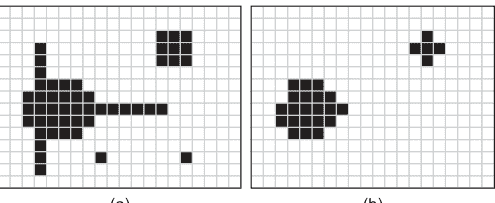

图 1.1 用于二值图像的 3 × 3 中值滤波器。(a) 原始图像和 (b) 滤波操作后的结果。

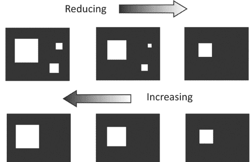

图 1.2 通过依次减小随后放大图像中的结构，可以去除小元素。

基于这些结果，产生了这样一个问题：是否存在一种操作，可以通过使用定义结构的大小和形状来修改图像中的元素？

中值滤波器的效果可以被认为是有趣的。但是，它对图像的影响，虽然可以消除小型结构，但也可能影响大型结构。另一种可以被认为更好且能够控制图像结构的方法基于以下原则（参见图 1.2）：

- 首先，图像中的所有结构都被减小，结果是小型结构被简单地消除。
- 通过缩小，消除了小型结构，而大型结构保留下来。
- 后来，减小的结构被放大，直到大型结构恢复其原始尺寸。

从图 1.2 可以清楚地看出，为了消除小型结构，只需定义两种不同的操作：减小和增量。减小允许消除与背景接触的对象的最后一层像素（图 1.3）。在增量操作中，将一层像素（属于背景）添加到结构中，使其尺寸增长（图 1.4）。


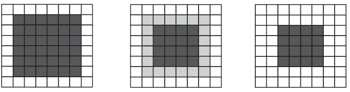

**图 1.3**
通过移除像素边界结构来缩减区域。(a) 原始图像，(b) 高亮边界像素，(c) 移除帧边界像素。

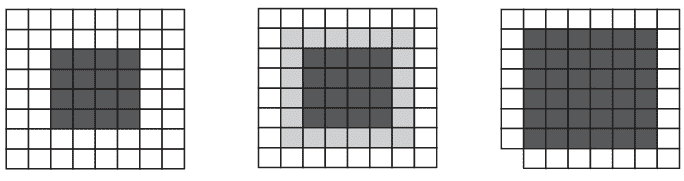

**图 1.4**
通过增长属于背景的结构的像素边框来增加图像的区域。(a) 原始图像，(b) 高亮属于背景的结构的边框，(c) 最终结构。

### 1.1.1 像素之间的邻域类型

在这两类操作中，都需要确定两个像素之间建立邻域关系的方式。通常可以区分两种邻域类型。

- **邻域 4**。在此方法中，如果一个像素与位于其上方、下方、左侧或右侧的相邻像素存在直接关系，则认为存在邻域关系（图 1.5a）。
- **邻域 8**。在此方法中，除了邻域 4 指定的关系外，如果一个像素还与其对角线方向的像素存在直接关系，则认为存在邻域关系（图 1.5b）。

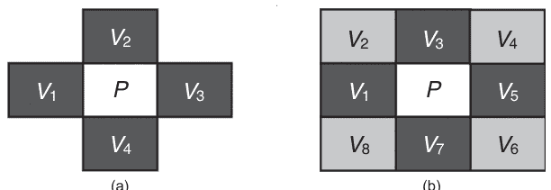

**图 1.5** 像素 _P_ 的邻域定义。(a) 基于 _P_ 的邻域-4，(b) 基于 _P_ 的邻域-8。

## 1.2 基本形态学运算

缩减和增量是滤波器执行的两种基本形态学运算，与侵蚀和膨胀的物理过程密切相关 [2]。这两种过程与上一节中质itatively描述的过程之间存在着有趣的关系。由于膨胀被视为增长，而侵蚀被视为面积或体积的损失，它们将是这些运算的完美类比。在这种情况下，可以说向图像中的结构添加一层像素将膨胀该结构，而从结构中移除一层像素将侵蚀它。

### 1.2.1 参考结构

类似于线性滤波器的操作，形态学滤波器的操作也需要定义一个系数矩阵。因此，有必要描述一个称为参考结构的矩阵。参考结构仅包含元素 0 和 1。该结构的内容可定义如下：

```
H(i, j) \in {0, 1} (1.1)
```

该结构，如同滤波器系数矩阵一样，拥有自己的坐标系，其原点处为参考点（见图 1.6）。1

### 1.2.2 点集

为了对形态学运算进行形式化描述，将图像描述为可通过二维坐标引用其元素的集合更为实用。例如，二值图像 _I_(_x_, _y_) 由一组点组成

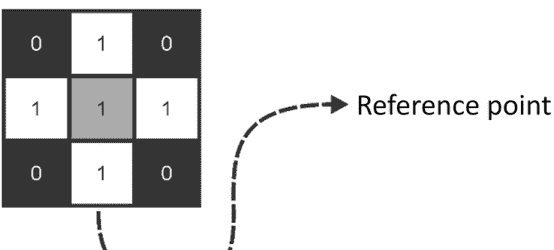

图 1.6 二值形态学运算的参考结构示例。

$P_I$ 由坐标对组成，对应于像素值为 1 的点。该集合可定义如下：

$P_I = \{ (x, y) | I(x, y) = 1 \}$

如图 1.7 所示，不仅图像，参考结构也可以用上述集合表示法来描述。

使用这种描述，对二值图像执行的操作可以以简单的方式定义。例如，将像素值从 1 变为 0 并反之亦然的二值图像反转，可以定义为补集，即

$P_{-I} = \bar{P_I}$

其中 $-I$ 定义 $I$ 的逆。同样，如果两个二值图像 $I_1$ 和 $I_2$ 通过逻辑函数 OR 按元素连接，则该操作在集合格式中的定义可以表示为：

$P_{I_1 \cup I_2} = P_{I_1} \bigcup P_{I_2}$

由于集合表示法是二值运算的另一种表示，因此该表示法被交替使用，根据情况考虑描述和理解操作的简洁性。例如，运算 $I_1 \bigcup I_2$ 将与 $P_{I_1} \bigcup P_{I_2}$ 或 $\bar{P_1}$ 和 $\bar{P_2}$ 具有相同的含义。

### 1.2.3 膨胀

膨胀是一种形态学运算，对应于向图像结构增长或添加一层像素的直观概念 [3]。

| | 0 | 1 | 2 | 3 | 4 | 5 |
|---|---|---|---|---|---|---|
| 0 | 0 | 0 | 0 | 0 | 0 | 0 |
| 1 | 0 | 1 | 0 | 0 | 0 | 0 |
| 2 | 0 | 0 | 0 | 0 | 1 | 0 |
| 3 | 0 | 0 | 0 | 0 | 0 | 0 |
| 4 | 0 | 0 | 0 | 0 | 0 | 1 |
| 5 | 0 | 0 | 0 | 0 | 0 | 0 |

| | 0 | 1 | 2 |
|---|---|---|---|
| 0 | 0 | 0 | 0 |
| 1 | 0 | 1 | 0 |
| 2 | 0 | 1 | 0 |

\( P_I = \{(1,1), (2,4), (4,5)\} \)
\( P_H = \{(1,1), (2,1)\} \)

图 1.7 将二值图像 \( I \) 和参考结构 \( H \) 描述为坐标集合 \( P_I \) 和 \( P_H \)。

特定的增长机制由参考结构控制。该运算在集合表示法中定义如下：

```
\( I \oplus H = \{(x', y') = (x+i, y+j) \mid (x', y') \in P_I, (i, j) \in P_H \} \quad (1.5) \)
```

如表达式 1.5 所示，涉及图像 \( I \) 及其参考结构 \( H \) 的膨胀的点集由点集 \( P_I \) 和 \( P_H \) 的坐标对的所有可能组合定义。膨胀操作也可以解释为向图像（\( P_I \)）添加一组值为 1 的像素的结果。新图层元素对应的形状取决于参考结构。这可以在图 1.8 中得到说明。

| | 0 | 1 | 2 | 3 |
|---|---|---|---|---|
| 0 | 0 | 0 | 0 | 0 |
| 1 | 0 | 1 | 1 | 0 |
| 2 | 0 | 1 | 0 | 0 |
| 3 | 0 | 0 | 0 | 0 |

\( I \)

| | -1 | 0 | 1 |
|---|---|---|---|
| -1 | 0 | 0 | 0 |
| 0 | 0 | 1 | 1 |
| 1 | 0 | 0 | 0 |

\( H \)

| | 0 | 1 | 2 | 3 |
|---|---|---|---|---|
| 0 | 0 | 0 | 0 | 0 |
| 1 | 0 | 1 | 1 | 1 |
| 2 | 0 | 1 | 1 | 0 |
| 3 | 0 | 0 | 0 | 0 |

\( I \oplus H \)

图 1.8 膨胀示例。膨胀运算应用于二值图像 \( I \)，使用 \( H \) 作为参考结构。结构元素 \( H \) 被添加到图像 \( I \) 的每个像素 1 上。

### 1.2.4 腐蚀

膨胀的近似逆运算是腐蚀 [4]，在集合表示法中表示如下：

$I \ominus H = \{(x', y') = (x' + i, y' + j) \in P_I(i, j), \forall (i, j) \in P_H\} \quad (1.6)$

该表述指的是，对于图像中的每个点 $(x', y')$，结果涉及所有可能值 $(x' + i, y' + j)$ 均在 $I$ 中的点。图 1.9 显示了图像 $I$ 与参考结构 $H$ 之间腐蚀的一个示例。

```
$I \oplus H = \{(1,1) + (0,0), (1,1) + (0,1),$
$(1,2),(0,0) + (1,2) + (0,1),$
$(2,1) + (0,0),(2,1) + (0,1)\}$
```

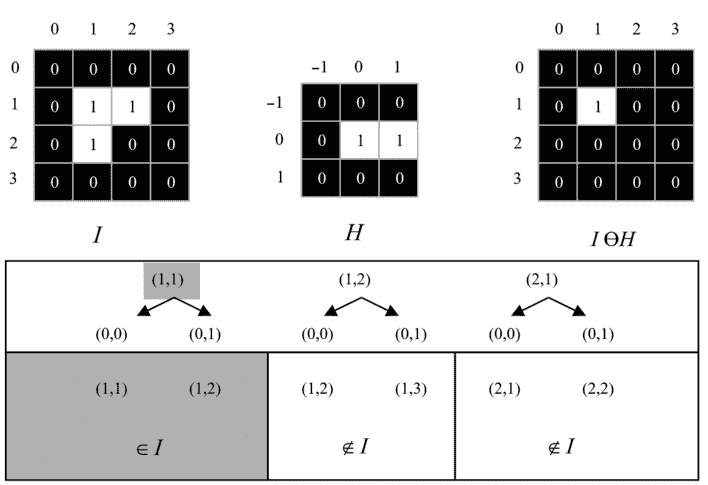

**图 1.9** 腐蚀示例。图像 $I$ 通过参考结构 $H$ 进行腐蚀。从该过程中可以看出，图像 $I$ 中坐标为 $(1,1)$ 的像素，当其与参考结构的元素 $(0,0)$ 和 $(0,1)$ 相加时，得到。结果，点 $(1,1)$ 和 $(1, 2)$ 属于图像 $I$。因此，腐蚀的结果在位置 $(1,1)$ 处为 1。对于图像中的其他像素，该条件不满足。

此过程可以这样理解：由腐蚀得到的像素 (x', y') 是指其以该像素为中心的参考结构在形状上与图像内容重合的像素。图 1.9 显示了以图像像素 (1,1) 为中心的参考结构在形状上与图像内容重合，因此该像素的腐蚀结果为 1。

### 1.2.5 膨胀和腐蚀的性质

膨胀和腐蚀运算不能严格意义上视为逆运算，因为无法通过连续应用膨胀完全重建一个被腐蚀的图像。相反的情况也成立。然而，它们具有密切的对偶关系。由于图像中值为 1 的像素的膨胀可以通过腐蚀背景并添加值为 0 的像素来实现，这可以表示如下：

```
\overline{I} \ominus H = \overline{I \oplus H}
(1.7)
```

膨胀还具有交换性，因此可以制定：

```
I \oplus H = H \oplus I
(1.8)
```

因此，如同卷积一样，可以互换图像和参考结构。从这个性质可以得出，膨胀也是一种结合运算。因此，可以表达如下：

```
(I_1 \oplus I_2) \oplus I_3 = I_1 \oplus (I_2 \oplus I_3)
(1.9)
```

执行操作的顺序无关紧要。这一性质很有用，因为这样可以将参考结构划分为更小的结构，从而使完整操作的速度更快，因为操作数量更少。在这种情况下，膨胀运算可以表示为：

```
I \oplus H = ((I \oplus H_1) \oplus H_2)
(1.10)
```

其中 H_1 和 H_2 对应于 H 被划分为的参考结构。然而，腐蚀不具备交换性，因此：

```
I \ominus H \neq H \ominus I
(1.11)
```

### 1.2.6 形态学滤波器的设计

形态学滤波器通过定义两个元素来指定：它们执行的操作（腐蚀或膨胀）及其相应的参考结构。


参考结构的大小和形状取决于应用。在实际中，图 1.10 所示的参考结构是使用最频繁的。当一个半径为 r 的圆盘状参考结构通过膨胀操作使用时，它会在图像中的对象上添加一层 r 个像素。当同一结构用于腐蚀操作时，会产生相反的效果，因此在这种情况下，一层 r 个像素会从图像中的对象中被提取。将图 1.11a 视为原始图像，将图 1.11b 视为参考结构，可以得到图像的膨胀和腐蚀结果。它们在图 1.12 中显示，考虑 r 的不同值。

不同形状参考结构的形态学腐蚀和膨胀操作的其他结果在图 1.13 中显示。

与空间滤波器（第 2 章）不同，通常不可能从一维参考结构 Hx 和 Hy 创建二维各向同性² 滤波器 H。这是因为在两个参考结构之间建立的形态学操作总是产生一个新的正方形参考结构，因此不是各向同性的。

实现大尺寸形态学滤波器最常用的方法是在小尺寸上迭代应用相同的参考结构。在这种情况下，一次操作的结果会再次用于应用相同参考结构的操作。这将大致与使用大参考结构得到相同的结果（见图 1.14）。

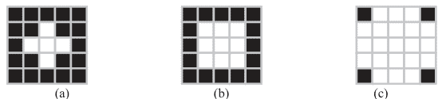

**FIGURE 1.10**
不同尺寸的典型参考结构。(a) 4 邻域结构，(b) 8 邻域结构，和 (c) 小圆盘结构。

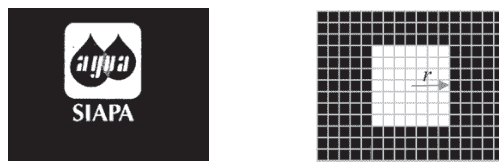

**FIGURE 1.11**
(a) 原始图像和 (b) 用于示例的参考结构，以说明不同 r 值下膨胀和腐蚀的效果，其中 r 定义了圆盘的大小。

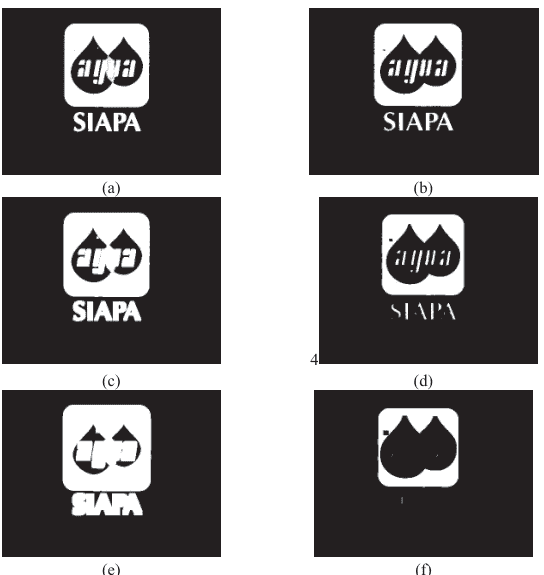

FIGURE 1.12
(a) r = 2 时的膨胀，(b) r = 2 时的腐蚀，(c) r = 5 时的膨胀，(d) r = 5 时的腐蚀，(e) r = 10 时的膨胀，和 (f) r = 10 时的腐蚀。

## 1.3 二值图像中的边缘检测

形态学操作的一个典型应用是提取二值图像中包含的对象的边缘 [5]。如算法 1.1 所述的检测过程，首先对图像应用形态学腐蚀操作 (1)，使用图 1.10 中定义的任意参考结构。应用腐蚀的目的是从原始图像中去除图像内对象的外层（边缘）。

然后，如果对腐蚀后的图像求其反向 (2)，就可以找到图像中对象的边缘。因此，我们将得到一张图像，其中对象的值为零，而图像的背景和对象的边缘为一。因此，如果在原始图像和腐蚀版本的反向 (3) 之间应用 AND 操作

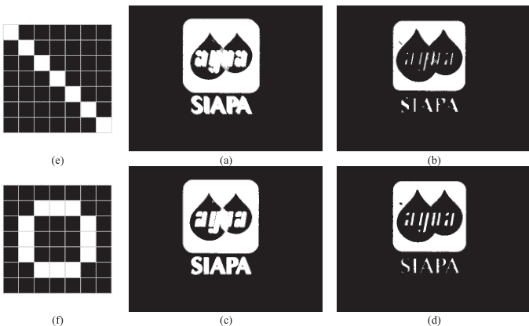

FIGURE 1.13
考虑参考结构 (e) 和 (f) 的二值膨胀和腐蚀。(a) 使用 (e)（主对角线上值为 1）作为参考结构的膨胀和 (b) 腐蚀，以及 (c) 使用 (f)（圆形图案）作为参考结构的膨胀和 (d) 腐蚀。

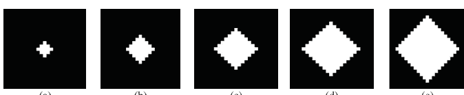

FIGURE 1.14
通过在图像上迭代应用算子实现大滤波器的操作。(a) H，(b) H ⊕ H，(c) H ⊕ H ⊕ H，(d) H ⊕ H ⊕ H ⊕ H，和 (e) H ⊕ H ⊕ H ⊕ H ⊕ H。

图像，即可得到对象的边缘。之所以会出现这种结果，是因为只考虑了两幅图像之间的共同像素。图 1.15 展示了使用算法 1.1 的边缘检测。

## 1.4 形态学操作的组合

在实际图像处理应用中，大多数情况下膨胀和腐蚀是以不同组合方式使用的。在本节中，我们考虑腐蚀和膨胀的三种最常见组合，例如开运算，


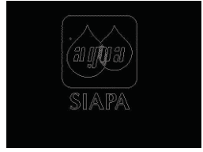

FIGURE 1.15
使用腐蚀形态学操作的边缘检测。(a) 从算法 1.1 得到的图像 \(I_{inv} (x, y)\)，将图 1.11a 视为原始图像；(b) 图像 \(I_{border} (x, y)，即执行算法 1.1 后得到的边缘。

## 算法 1.1. 使用形态学操作的边缘检测算法

基于腐蚀的边缘检测 (\(I_b (x, y)\))
其中 \(I_b (x, y)\) 是二值图像

- 1. 使用以下任一参考结构对 \(I_b (x, y)\) 进行腐蚀，得到 \(I'\)。

\(I'(x, y) = I \ominus H\)

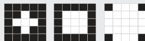

- 2. 对腐蚀后的图像求反：

\(I_{inv} (x, y) = \overline{I'(x, y)}\)

- 3. 在 \(I_{inv} (x, y)\) 和 \(I_b (x, y)\) 之间应用 AND 操作：

\(I_{border} (x, y) = I_{inv} (x, y) \wedge I_b (x, y)\)

### 1.4.1 开运算

开运算定义为先腐蚀后膨胀，两种操作使用相同的参考结构 [6]。开运算定义如下：

$I \circ H = (I \ominus H) \oplus H$ (1.12)

在开运算中，第一个操作（腐蚀）会导致图像中所有值为一（且小于参考结构）的像素被移除。图像中保留的结构将通过膨胀被平滑并扩大，大约等于其原始大小（应用腐蚀之前）。图 1.16 显示了使用圆盘状参考结构的开运算效果，考虑不同的圆盘尺寸 $r$（见图 1.16b）。

### 1.4.2 闭运算

先膨胀后腐蚀的序列，使用相同的参考结构，称为闭运算 [6]。该操作正式定义如下：

$I \bullet H = (I \oplus H) \ominus H$ (1.13)

通过闭运算，图像中对象内部检测到的（且小于参考结构）空洞会被填充。图 1.16 显示了使用圆盘状参考结构的闭运算效果，考虑不同的圆盘尺寸 $r$（见图 1.16b）。

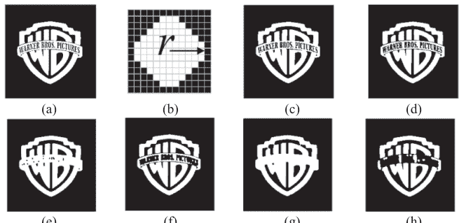

FIGURE 1.16 不同尺寸参考结构的开运算和闭运算效果。(a) 原始图像，(b) 参考结构及修改其尺寸的参数 $r$，(c) 考虑 $r = 5$ 的开运算，(d) $r = 5$ 时的闭运算，(e) $r = 10$ 时的开运算，(f) $r = 10$ 时的闭运算，(g) $r = 15$ 时的开运算，(h) $r = 15$ 时的闭运算。

### 1.4.3 开运算和闭运算的性质

开运算和闭运算都是幂等的。这意味着你可以多次执行该操作，仍然得到与只执行一次相同的结果，即：

$(I \circ H) \circ H = I \circ H$

$(I \bullet H) \bullet H = I \bullet H$

两种操作都具有的另一个重要性质是对偶性。这一性质意味着，对值为一（1）的图像进行开运算，等同于对值为零（0）的图像进行闭运算。定义如下：

$I \circ H = \overline{(\overline{I} \bullet H)}$

$I \bullet H = \overline{(\overline{I} \circ H)}$

### 1.4.4 击中-未击中变换

该变换有助于识别某些像素配置。$I$ 和 $H$ 的击中-未击中变换表示为 $I \otimes H$。在表达式中，$H$ 是一个涉及一对参考结构 $H = (H_1, H_2)$ 的参考结构。击中-未击中变换用两个参考结构定义如下：

$I \otimes H = (I \ominus H_1) \cap (I' \ominus H_2)$

图 1.17 和 1.18 展示了如何使用击中-未击中变换来检测图像中的像素模式。在此示例中，要检测的配置是像素的十字形。

在最后的操作中，交集 ($\cap$) 表示逻辑 AND 操作。该变换的名称“击中-未击中”源于执行的操作。即，在第一次腐蚀 ($H_1$) 中，检测所有与参考结构重合的位置（成功），而在第二次腐蚀 ($H_2$) 中，检测没有重合的位置（失败）。

## 1.5 灰度图像的形态学滤波器

形态学操作不仅限于与二值图像一起使用，也可以定义为灰度图像。迄今所考虑的所有形态学操作，除了击中-未击中变换之外，


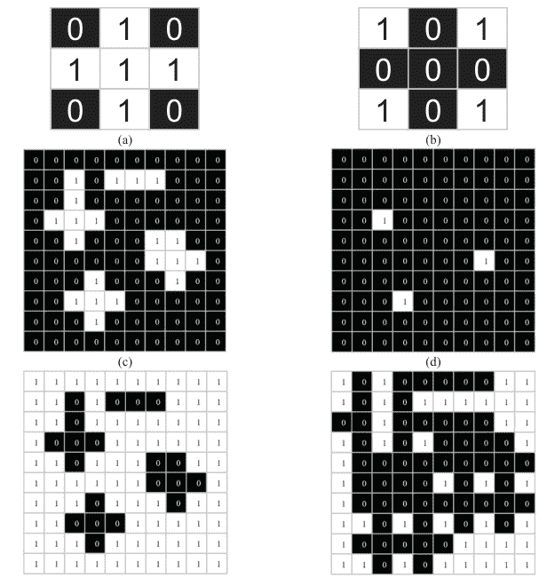

**图 1.17** 击中-击未变换过程的说明。(a) 参考结构 $H_1$，(b) 参考结构 $H_2$，(c) 原始图像，(d) $I \ominus H_1$ 的结果，(e) 倒置的原始图像 $I'$，以及 (f) $I' \ominus H_2$ 的结果。

变换，也可自然扩展到灰度图像。同样，形态学运算可以通过将每个平面视为独立强度的图像来处理彩色图像。虽然形态学运算名称相同且使用相同的符号，但其对强度图像的定义与二值图像相比差异很大。

### 1.5.1 参考结构

不同图像类型之间形态学运算的第一个区别是参考结构。参考结构不仅表示一个由“1”和“0”组成的矩阵，用于描述将作用于二值图像的结构的形状和尺寸，而且现在它也是一个矩阵

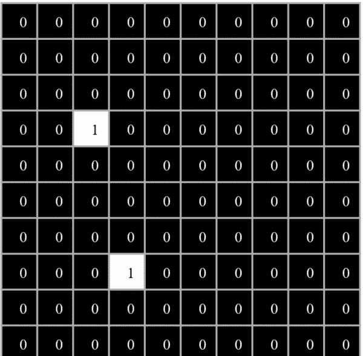

**图 1.18** 图 1.17 的击中-击未变换结果 \(I \oplus H = (I \ominus H_1) \cap (I^c \ominus H_2)\)。

由线性滤波器定义的“相似”系数组成。因此，参考结构被描述为定义如下的实数值二维函数：

```
\(H(i, j) \in \mathbb{R}\) (1.17)
```

参考结构值 \(H(i, j)\) 可以是正数、负数或零。然而，与空间滤波器的系数矩阵不同，零值也会影响计算的最终结果。

### 1.5.2 强度图像的膨胀与腐蚀

灰度图像的膨胀（\(\oplus\)）定义为参考结构值与其对应的图像区域之和的最大值。定义如下：

```
\((I \oplus H)(x, y) = \max_{(i, j) \in H} \{ I(x+i, y+j) + H(i, j) \}\) (1.18)
```

另一方面，腐蚀定义为参考结构值与其对应图像区域之间减法运算的最小值。该运算可表述为：

$(I \ominus H)(x,y) = \min_{(i,j)\in H} \{ I(x+i, y+j) - H(i,j) \}$

图 1.19 显示了膨胀对灰度图像影响的示例。图 1.20 说明了应用腐蚀运算的结果。在这两种运算中，可能会出现超出用于表示图像数据的正常范围（0–255）的值。如果发生这种情况，则只需取其限制值。因此，如果数值为负，则将零视为结果；如果运算值高于 255，则将 255 视为结果（这种考虑限制的操作通常称为“钳位”）。

膨胀和腐蚀可以结合以产生各种效果。例如，用图像的膨胀运算减去其腐蚀运算版本称为“形态学梯度”。定义如下：

\(\partial M = (I \oplus H) - (I \ominus H)\)

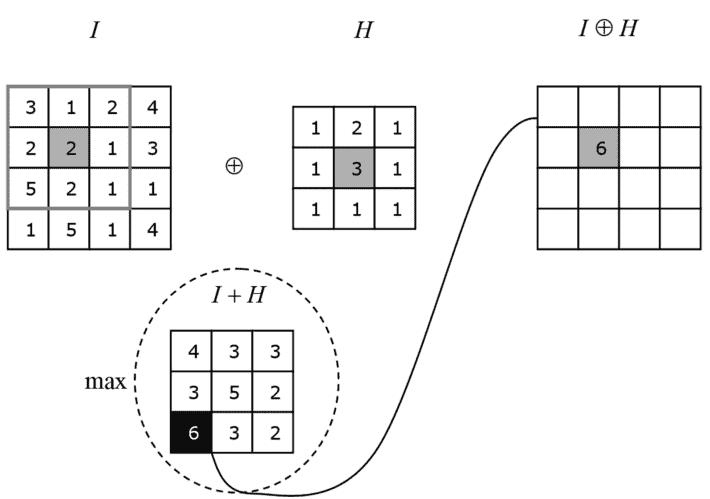

**图 1.19**
灰度图像上的膨胀 \(I \oplus H\)。参考结构 \(3 \times 3\) 居中于图像 \(I\)。图像值与 \(H\) 的对应值逐元素相加，从和 \(I+H\) 中选择最大值，该最大值被视为此过程的结果。

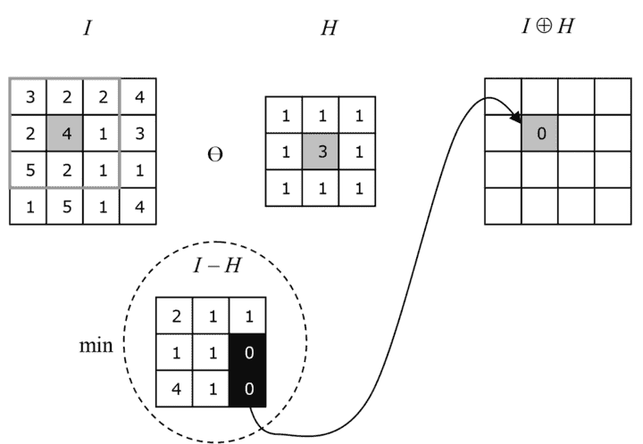

**图 1.20** 灰度图像上的腐蚀 \(I \ominus H\)。参考结构 \(3 \times 3\) 居中于图像 \(I\)。图像 \(I\) 的值与 \(H\) 的对应值逐元素相减，从差 \(I - H\) 中选择最小值，该最小值被视为此过程的结果。

图 1.21 显示了灰度图像上的形态学膨胀和腐蚀运算结果，同时也考虑了形态学梯度运算。

### 1.5.3 灰度图像的开运算与闭运算

灰度图像开运算和闭运算的表达式与其二值对应物形式相同。这两种运算都有简单的几何解释。图 1.22 说明了这种解释，考虑的是图像轮廓（一条线的灰度值）。对于开运算的情况，仿佛是将一个水平结构（图 1.22b）添加到图 1.22a 曲线中与痕迹内部相连的部分。可以看出，结构的尺寸不允许其适应所呈现的峰值，以至于该最大值作为运算结果被消除（图 1.22c）。

通常，开运算用于去除图像中亮元素的小峰，而其他灰度水平基本保持不变。

图 1.22d 说明了闭运算。请注意，与开运算不同，结构被放置在轮廓顶部，以便


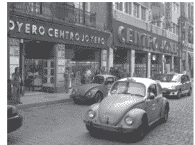

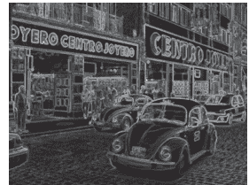

(a)
(b)
(c)
(d)

**图 1.21** 在灰度图像上执行的形态学运算。(a) 原始图像，(b) 腐蚀图像，(c) 膨胀图像，以及 (d) 形态学梯度。

山谷，如果它们比结构小，将被填充。图 1.22e 显示了闭运算的结果。

与开运算相反，闭运算允许消除图像中存在的小型、被遮蔽的值，这些值小于所使用参考结构的大小，而其他强度值基本不受显著变化。

由于开运算抑制小于参考结构的亮细节，而闭运算去除暗色伪影，因此这两种运算常被结合使用以平滑和去噪图像。

开运算和闭运算组合的滤波产物称为开闭滤波器；此类滤波器能够同时去除图像中的亮色和暗色伪影，类似于椒盐噪声。在滤波运算中，先对灰度图像进行开运算（去除亮色伪影），然后再对该过程结果进行闭运算（去除暗色伪影）。图 1.23 显示了开运算和闭运算对添加了椒盐类型噪声的灰度图像的影响。同样，也展示了使用开闭滤波器的结果。

使用开闭滤波器的另一种方法是反复应用它们，并在每次迭代中改变参考结构的尺寸。

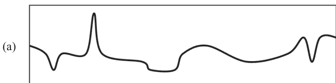
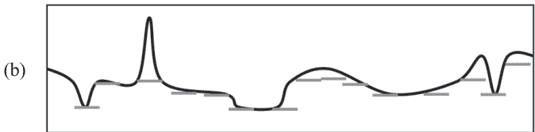
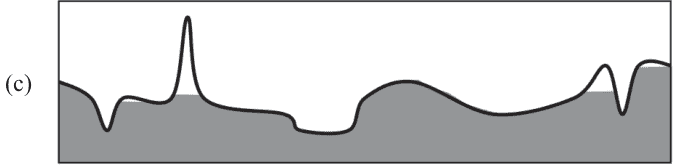
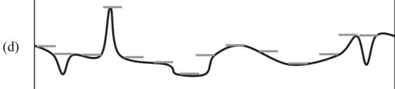
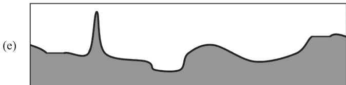

**图 1.22** 灰度图像上开运算和闭运算的解释。(a) 灰度图像轮廓，(b) 根据开运算将结构应用于轮廓，(c) 开运算结果，(d) 根据闭运算将结构应用于轮廓，以及 (e) 闭运算结果。

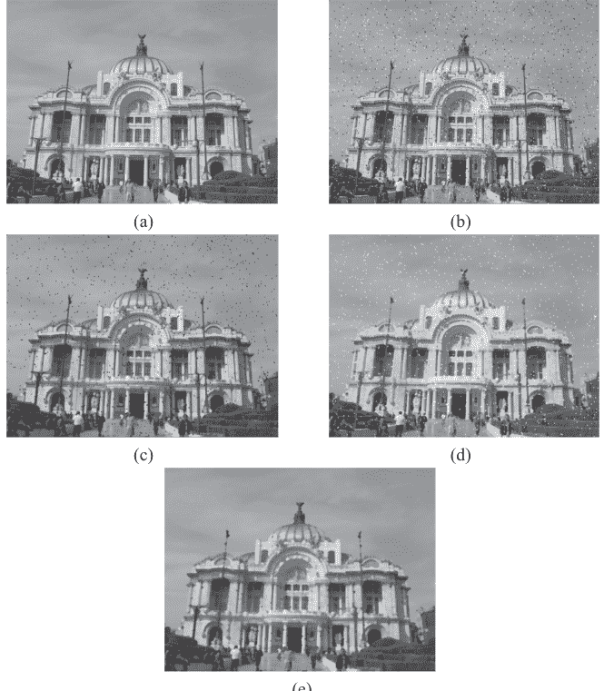

**图 1.23** 灰度图像上开运算和闭运算的结果。(a) 原始图像，(b) 含椒盐噪声的图像，(c) 对 (b) 的开运算结果，(d) 对 (b) 的闭运算结果，以及 (e) 对 (b) 的开闭滤波器结果。

此过程称为“序列滤波器”。该滤波器对灰度图像的效果比单纯开关滤波器（图 1.24）获得的结果更平滑。算法 1.2 显示了实现序列滤波器的过程。


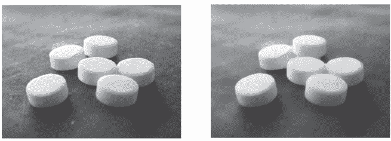

**图 1.24** 序列滤波的效果。(a) 原始图像和 (b) 滤波结果，通过重复三个阶段获得，r 从 1 变化到 3。

```
ALGORITHM 1.2 SEQUENTIAL FILTER

Sequential filter (I(x,y))
Where I(x,y) is an intensity image
1. for r=1:t
2. Opening operation I_1 = I \circ H
3. Closing operation I_2 = I_1 \bullet H
4. I = I_2
5. end for
6. The final result of the complete process is I
```

### 1.5.4 顶帽和底帽变换

该操作定义为原始灰度图像减去该图像的开运算 [7]。该操作可定义如下：

$I_{TopH} = I - (I \circ H)$ (1.21)

该操作的名称来源于该操作中参考结构的形状，如图 1.25 所示，其形状类似于一顶帽子。

该操作在存在阴影的情况下有助于增强细节。图 1.26 显示了该操作在图像中的结果。底帽操作定义为图像的闭运算与原始图像之间的差，即：

$$ I_{BottomHat} = (I \bullet H) - I $$ (1.22)

| 1 | 1 | 1 | 1 | 1 | 1 | 1 |
|---|---|---|---|---|---|---|
| 1 | 1 | 1 | 1 | 1 | 1 | 1 |
| 0 | 0 | 1 | 1 | 1 | 0 | 0 |
| 0 | 0 | 1 | 1 | 1 | 0 | 0 |
| 0 | 0 | 1 | 1 | 1 | 0 | 0 |
| 0 | 0 | 1 | 1 | 1 | 0 | 0 |
| 0 | 0 | 1 | 1 | 1 | 0 | 0 |
| 0 | 0 | 1 | 1 | 1 | 0 | 0 |
| 0 | 0 | 1 | 1 | 1 | 0 | 0 |

**图 1.25** 顶帽变换中使用的参考结构。

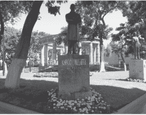

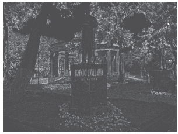

**图 1.26** 顶帽变换的结果。(a) 原始图像和 (b) 顶帽变换的结果。

## 1.6 形态学操作的 MATLAB 函数

MATLAB® 拥有大量函数，可用于实现本章讨论的大多数形态学操作 [8]。本节逐一介绍允许执行形态学操作的函数以及一些辅助函数。

### 1.6.1 strel 函数

所有形态学操作都使用一种称为参考结构的结构元素在图像上执行其功能。MATLAB 拥有 strel 函数，允许构建不同尺寸和形状的参考结构。其基本语法为：

```
esref = strel(shape, parameters);
```

其中 shape 是一个字符串，指定要实现的形状，有多个预定义选项，而 parameters 是指定形状属性的数据列表。例如，strel('disk', 3) 返回一个直径为 ±3 像素的圆盘形参考结构。表 1.1 总结了 strel 函数可以实现的形状和参数。

在本章中，考虑了将参考结构分成几个部分的属性，以便在涉及大尺寸参考结构时实现形态学膨胀操作。为了在使用形态学函数时加快操作执行速度，strel 生成一组组合参考结构，允许对大参考结构进行关联表示。

如果我们将先前讨论的案例作为示例，则有：

```
>> esref = strel('disk', 3)

esref =

Flat STREL object containing 25 neighbors.
Decomposition: 6 STREL objects containing a total of 14 neighbors

Neighborhood:

1   1   1   1   1
1   1   1   1   1
1   1   1   1   1
1   1   1   1   1
1   1   1   1   1
```

从上述内容可以看出，esref 不被视为普通数组，而是一种称为 strel 对象的特殊结构。该对象包含不同的元素。Neighborhood 元素是一个由 1 和 0 组成的数组，用于定义参考结构。另一个元素报告结构中包含的元素数量，在本例中为 25。对象的一个重要部分是参考结构可以被分割的元素数量（在本例中为 6）。因此，如果将这些元素关联起来，可以构建一个更大的参考结构。在 strel 对象中，有一组 1（14 个元素），出现在参考结构已分解的结构中。表 1.1 描述了可以使用 MATLAB strel 函数实现的形状和结构。

## 表 1.1 可以使用 MATLAB® strel 函数实现的形状和结构

| 语法 | 描述 |
| --- | --- |
| `esref=strel('diamond', r)` | 创建菱形结构，其中 `r` 的值指定形状末端到中心的距离 |
| `esref=strel('disk', r)` | 创建圆盘形结构，其中 `r` 指定圆盘的半径 |
| `esref=strel('line', long, grad)` | 构建线形结构，其中参数 `long` 表示线的长度，而 `grad` 定义线的方向 |
| `esref=strel('octagon', r)` | 创建八边形框架，其中 `r` 指定中心到某一边的距离 |
| `esref=strel('square', w)` | 创建宽度由 `w` 定义的正方形结构 |
| `esref=strel('arbitrary', Matriz)` | 构建由元素为“零”和“一”的数组定义的任意形状结构 |

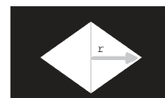

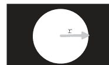


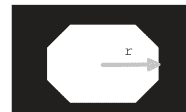

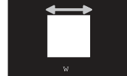

whos 命令返回 MATLAB 环境中存在的变量数量。在询问 esref 的组件后应用此命令时，会显示六个元素。它们表示用于分解最终结构的元素。这些命令如下：

```
>> components=getsequence(esref);
>> whos
Name Size Bytes Class Attributes
components 6x1 1870 strel
esref 1x1 2599 strel
```

```
>> components(1)
ans =
Flat STREL object containing 3 neighbors.
Neighborhood:
1
1
1
```

### 1.6.2 膨胀和腐蚀的 MATLAB 函数

imdilate 函数实现膨胀操作，其基本语法如下：

```
IR = imdilate(I, H)
```

其中 I 是应用膨胀的图像，H 作为参考结构。IR 是膨胀后的图像。如果 I 是二值图像，则 IR 也将是二值图像；如果 I 是灰度图像，则 IR 也是。因此，使用同一函数，我们可以对二值图像和灰度图像执行此操作。参考结构 H 可通过 strel 函数获得。

imerode 函数实现腐蚀操作，其基本语法如下：

```
IR = imerode(I, H)
```

其中 I 是应用腐蚀的图像，H 作为参考结构。IR 是腐蚀后的图像。如果 I 是二值图像，则 IR 也将是二值图像；如果 I 是灰度图像，则 IR 也是。

为了展示如何使用膨胀和腐蚀函数，已进行一个示例。在此示例中，实现了灰度图像的形态学梯度（第 1.5.2 节）。假设 I 是要从中提取形态学梯度的图像，则使用以下命令：

```
>> H = strel('square', 3);
>> I1 = imdilate(I, H);
>> I2 = imerode(I, H);
>> IG = I1 - I2;
```

其中 H 是考虑边长为 3 的正方形形状生成的参考结构。当使用相同的图像和相同的参考结构获得膨胀和腐蚀时，会在图像的膨胀版本和腐蚀版本之间产生减法，从而找到 I 的形态学梯度。

### 1.6.3 涉及开运算和闭运算的 MATLAB 函数

imopen 和 imclose 函数实现开运算和闭运算。这些函数的基本语法如下：

```
IR = imopen(I, H)
IR = imclose(I, H)
```

其中 I 是应用开运算或闭运算的图像，H 作为参考结构。IR 是结果图像，如果 I 是二值图像，则结果 IR 也是二值图像；如果 I 是灰度图像，则结果 IR 也是灰度图像。参考结构 H 可通过 strel 函数获得。


### 1.6.4 成功或失败的变换（*击中或不击中*）

在“击中或不击中”变换（第 1.4.4 节）中，使用由两个元素（$H_1$ 和 $H_2$）组成的参考结构。在这种情况下，“击中或不击中”变换定义如下：

```
$I \circledcirc H = (I \circledcirc H_1) \cap (I^c \circledcirc H_2)$ (1.23)
```

图像处理工具箱使用 bwhitmiss 函数实现“击中或不击中”变换，其语法如下：

```
IR=bwhitmiss(I, H1, H2);
```

其中 IR 是此变换得到的图像，而 H1 和 H2 是方程 1.19 中描述的参考结构。

### 1.6.5 bwmorph 函数

bwmorph 函数基于膨胀和腐蚀的组合实现多种有用操作。此函数的基本语法为：

```
IR= bwmorph(I, operation, n );
```

其中 IR 是二值图像。operation 是一个字符串元素，用于指定要执行的操作。n 是一个正整数，指示操作重复的次数。参数 n 是可选的，当省略时，表示操作仅执行一次。表 1.2 描述了可以在 bwmorph 函数下执行的操作集。其中几种操作已在本章中讨论过。bwmorph 函数也可被视为一种快速实现多种形态学操作的函数，无需单独构建参考结构。相反，在腐蚀和膨胀的情况下，操作是通过明确定义参考结构来执行的。

### 1.6.6 凸组件的标记

凸组件是所有具有二值为 1 的像素，并根据某些邻域准则相互连接的像素。检测到的每个对象形成一个区域，并分配一个唯一的标签来标识它们。

标记算法主要基于连通性准则。连通性类型有三种：4-连通、8-连通和对角连通。在 4-连通中，如果像素 (P0) 在上方 (P2)、下方 (P7)、右侧 (P5) 或左侧 (P4) 有一个值为 1 的邻居，则该像素是 4-连通的（图 1.27a）。另一方面，如果像素 (P0) 有一个位于对角线上的邻居（除了在

表 1.2 使用 MATLAB® 函数 bwmorph 可实现的不同操作

| 操作 | 描述 |
|---|---|
| bothat | 使用大小为 3 × 3 的参考结构执行底帽操作。此函数使用 imbothat 执行该操作 |
| bridge | 连接被一个像素间隔分隔的像素 |
| clean | 删除图像中包含的孤立像素 |
| diag | 填充对角连接白色像素周围的像素，以移除背景像素的连通性 |
| fill | 填充图像中存在的对象结构中存在的空隙 |
| hbreak | 从图像中移除对象的 H 结构，以便以这种方式存在更多数量的对象 |
| majority | 如果 3 × 3 邻域内超过 4 个像素为“1”，则将像素设置为“1” |
| remove | 如果 4-连通像素为“1”，则将像素设置为零 |
| shrink | 如果 n=inf，对象缩减为点。没有空洞的对象缩减为点，而有空洞的对象形成环。此操作保持欧拉数 |
| skel | 如果 n=inf，移除所有像素，将其缩减为最低表达形式，即线条。此过程称为骨架化 |
| thicken | 向对象添加像素，仅放置连接的像素 |
| thin | 将没有空洞的对象缩减为线条，将有空洞的对象缩减为环 |
| tophat | 使用大小为 3 × 3 的参考结构执行底帽操作。此函数使用 imbothat 执行该操作 |

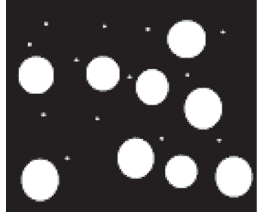
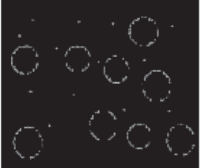
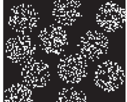
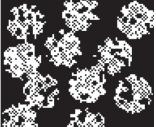


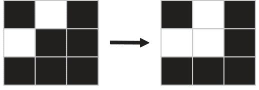
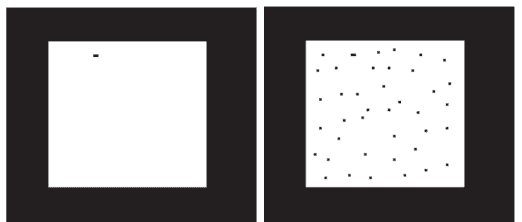
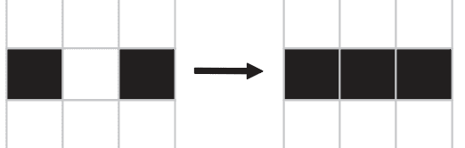
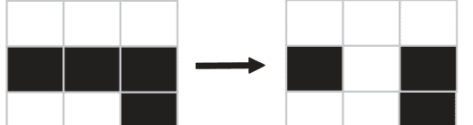
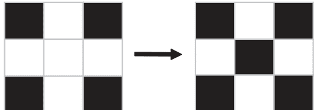
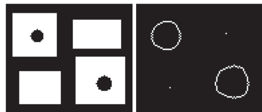

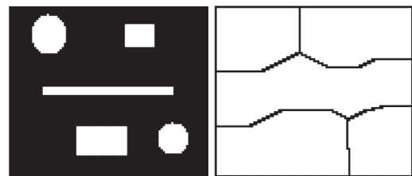
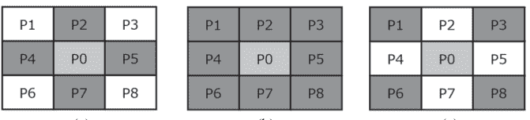

**图 1.27**
像素之间的邻域准则。(a) 4-连通邻域，(b) 8-连通邻域，和 (c) 对角连通。

4-连通邻域)，这些对角元素包括 (P1)、(P3)、(P6) 和 (P8)。图 1.27c 显示了对角连通。

邻域准则对图像中检测对象的结果有重大影响。图 1.28 说明了根据不同邻域准则的对象标记差异。图 1.28a 显示了

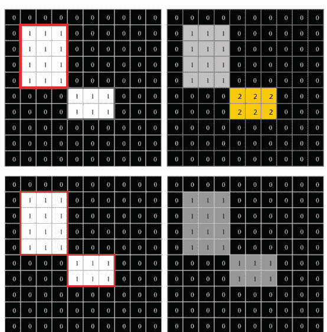

**图 1.28**
考虑不同邻域准则时的对象标记结果。(a) 考虑 4-连通邻域时的结果，和 (b) 考虑 8-连通邻域时的结果。

使用 4-连通邻域时找到的对象，而图 1.28b 显示了使用 8-连通准则时的结果。从两幅图中可以清楚地看出，当使用 4-连通准则时，对象数量会更多，因为对象之间的连接准则更为严格。另一方面，在 8-连通的情况下，邻域准则更具灵活性，能够吸收像素并将两个对象视为一个对象。

MATLAB 的图像处理工具箱具有 bwlabel 函数，该函数对图像中具有特定连通性的检测元素进行标记。此函数的语法为：

```
[L, num]=bwlabel(I, con);
```

其中 I 是包含待标记识别对象的二值图像。con 指定所考虑的邻域准则类型（4 或 8）。L 是包含已标记元素的数组，而 num（该参数为可选）指定图像中包含的对象数量。如果省略 `con` 的值，则默认考虑 8-连通连通性。`L` 中包含的对象从 1 标记到找到的对象数量 $n$。

如果将图 1.29a 视为要标记的二值图像，则应用 `bwlabel` 函数的结果是三个不同的对象或标签。要选择包含的每个标签，可以使用一个逻辑函数，允许获取所需的标签。例如，要选择标签 2，我们考虑以下命令：

```
L=bwlabel(I, 4);
L2=L==2;
```

执行这些命令后，可以观察到图 1.29c 所示的图像。

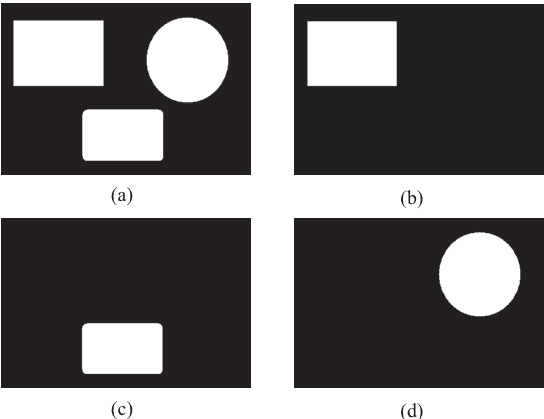

**图 1.29** `bwlabel` 函数用于对象标记的应用结果。(a) 我们希望从中检测对象的原始二值图像，(b) 使用 $L=1$ 的结果，(c) 使用 $L=2$ 的结果，和 (d) 使用 $L=3$ 的结果。

# 注释

- 1. 它被称为参考点，因为它不一定是中心，这与滤波器的系数矩阵不同。
- 2. 旋转不变。


# 参考文献

- [1] Jain, A. K. (1989). 数字图像处理基础. Prentice Hall.
- [2] Dougherty, E. R., & Lotufo, R. A. (2003). 形态学图像处理实用指南 (第 59 卷). SPIE 出版社.
- [3] Soille, P. (1999). 形态学图像分析：原理与应用 (第 2 卷，第 3 期，第 170–171 页). Berlin: Springer.
- [4] Serra, J., & Soille, P. (编). (2012). 数学形态学及其在图像处理中的应用 (第 2 卷). Springer Science & Business Media.
- [5] Gonzalez, R. C., & Woods, R. E. (2008). 数字图像处理 (第 3 版). Prentice Hall.
- [6] Soille, P. (2004). 开运算与闭运算. 在《形态学图像分析：原理与应用》中 (第 105–137 页). Springer, Berlin, Heidelberg. https://doi.org/10.1007/978-3-662-05088-0_4. Print ISBN 978-3-642-07696-1
- [7] Kushol, R., Kabir, M. H., Salekin, M. S., & Rahman, A. A. (2017). 基于最优结构元素的顶帽和底帽变换对比度增强：应用于视网膜血管分割. 在《图像分析与识别：第 14 届国际会议，ICIAR 2017，蒙特利尔，魁北克省，加拿大，2017 年 7 月 5–7 日，论文集 14》中 (第 533–540 页). Springer International Publishing.
- [8] Gonzalez, R. C., Woods, R. E., & Eddins, S. L. (2004). 使用 MATLAB 进行数字图像处理. Prentice Hall.

# 2 彩色图像

## 2.1 RGB 图像

RGB 颜色模型基于原色红 (R)、绿 (G) 和蓝 (B) 的组合 [1]。该模型起源于电视技术，可被视为计算机、数码相机、扫描仪以及图像存储中颜色的基本表示 [2]。大多数图像处理和渲染程序使用此模型进行内部颜色表示。

RGB 模型是一种加色格式，这意味着颜色的组合基于各个分量的相加，以黑色为基础。这一过程可以理解为将红、绿、蓝三种颜色的光束指向一张白纸并连续控制其强度的重叠 [3]。不同颜色分量的强度决定了产生的颜色色调和照度。白色、灰色或灰度级同样通过三种对应的 RGB 原色组合产生。

RGB 模型形成一个立方体，其坐标轴对应三种原色 R、G 和 B。RGB 值为正，且其值限制在区间 [0, Vmax] 内，通常 [0, Vmax] = 255。每种可能的 Ci 颜色对应 RGB 立方体内的一个点，其分量为：

```
Ci = (Ri, Gi, Bi) (2.1)
```

其中 0 ≤ R, G, B ≤ Vmax。通常，颜色分量的值范围归一化到区间 [0,1]，以便颜色空间由图 2.1 所示的单位立方体表示。点 N = (0, 0, 0) 对应黑色，W = (1, 1, 1) 对应白色，S 与 W 之间直线上的所有点都是灰度色调，其中 R、G 和 B 分量具有相同的值。

图 2.2 显示了一幅彩色图像，该图像将在本章中多次用作测试图像。同样，该图像的各 RGB 分量也在图 2.2 中显示。

| 标签 | 颜色 | R | G | B |
|---|---|---|---|---|
| N | 黑色 | 0 | 0 | 0 |
| R | 红色 | 1 | 0 | 0 |
| Y | 黄色 | 1 | 1 | 0 |
| G | 绿色 | 0 | 1 | 0 |
| C | 青色 | 0 | 1 | 1 |
| B | 蓝色 | 0 | 0 | 1 |
| M | 洋红色 | 1 | 0 | 1 |
| W | 白色 | 1 | 1 | 1 |
| K | 灰色 | 0.5 | 0.5 | 0.5 |

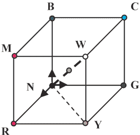

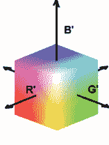

**图 2.1**
RGB 颜色空间作为单位立方体的表示。原色红 (R)、绿 (G) 和蓝 (B) 构成坐标轴。单独的颜色红 (R)、绿 (G)、蓝 (B)、青色 (C)、洋红 (M) 和黄色 (Y) 位于颜色立方体的角上。所有灰度强度值（如 (K)）都位于从 (N) 到 (W) 绘制的对角线上。


**图 2.2**
RGB 模型中的彩色图像及其各自的 R、G 和 B 平面。(a) RGB 图像，(b) R 平面，(c) G 平面，(d) B 平面。从不同平面的分析中应注意，红色含量高的辣椒在 R 平面中获得较大（亮）值。

RGB 是一种非常简单的颜色模型。它足以用于颜色处理或在需要转换为不同颜色模型时，如稍后所示。目前，不会考虑 RGB 像素与其真实颜色之间的对应关系，或原色红、绿、蓝的物理表示的含义等问题。与颜色和 CIE 颜色空间相关的有趣细节将在后面介绍。

从程序员的角度来看，RGB 彩色图像是一个大小为 \(M \times N \times 3\) 的数组，其中 \(M \times N\) 定义平面的尺寸，而对应于 3 的维度分别定义 R、G 和 B。基于以上内容，RGB 图像可以被视为三个灰度图像的数组 [4]。

### 2.1.1 彩色图像的组成

与灰度图像一样，彩色图像的特征是像素数组，可以使用不同类型的模型来组合共同构成总颜色的不同颜色分量。可以区分两种彩色图像：所谓的全彩色图像和所谓的索引或引用颜色调色板。

全彩色图像完全使用颜色空间。也就是说，在构建时，为颜色模型定义的整个空间都用于图像表示。另一方面，索引彩色图像在图像表示中使用减少的颜色数量。

### 2.1.2 全彩色图像

全彩色图像中的像素可以在引用的颜色模型中定义的空间内采用任何值。全彩色图像通常用于图像包含当前颜色模型定义的大量颜色的情况，例如照片 [5]。在彩色图像的组成中，可以区分两种关联：平面的组成和打包的组成。

通过平面的组成，我们是指构成图像的不同同尺寸排列的分离。一个彩色图像

\(I = (I_R, I_G, I_B)\) (2.2)

可以被视为强度为 \(I_R(x, y)\)、\(I_G(x, y)\) 和 \(I_B(x, y)\) 的相关图像集合（参见图 2.3），其中彩色图像像素的 RGB 值通过以如下形式访问构成组合的每个数组来获取：


**图 2.3**
RGB 彩色图像的组成。颜色或平面分量位于同一维度的单独数组中。

```
\(\begin{pmatrix} R \\ G \\ B \end{pmatrix} = \begin{pmatrix} I_R(x,y) \\ I_G(x,y) \\ I_B(x,y) \end{pmatrix}\)
```

打包的组成是指颜色分量表示单个像素的方式以及其在结构中存储的方式（参见图 2.4）。即：

```
\(I(x,y) = (R,G,B)\)
```

可以通过访问颜色像素的各个组件，从位置 \((x,y)\) 的打包图像中获取 RGB 颜色分量的值，如

```
\(\begin{pmatrix} R \\ G \\ B \end{pmatrix} \rightarrow \begin{pmatrix} R(I(x,y)) \\ G(I(x,y)) \\ B(I(x,y)) \end{pmatrix}\)
```


**图 2.4**
RGB 彩色图像和打包组成。三种颜色分量 R、G 和 B 嵌入在单个数组中。

其中 \(R(I(x,y))\)、\(G(I(x,y))\) 和 \(B(I(x,y))\) 表示颜色平面访问函数。

### 2.1.3 索引图像

索引图像可以包含受限数量的颜色，这使得此类图像在表示图形或 GIF 或 PNG 类型图像时很有吸引力，这些图像从存储角度来看特点是轻量的 [5]。索引图像有两个组件：数据数组和颜色映射。颜色映射是尺寸为 \(n\times3\) 的矩阵。调色板的长度 \(n\) 等于其定义的颜色数量。它们指的是用于定义图像的颜色。同时，每一列指定该行中定义的 RGB 颜色分量的值。考虑到上述内容，索引图像使用数据矩阵中包含的强度像素到颜色调色板所包含值的直接映射。每个像素的颜色由数据数组的整数值决定，该值实际上是指向颜色映射的索引。

索引图像使用数据数组和定义其包含颜色的调色板进行存储。这一点很重要，因为在没有颜色调色板的情况下，数据数组中包含的值没有意义。图 2.5 显示了数据矩阵与颜色调色板之间的关系。


| | | | |
|---|---|---|---|
| 3 | 7 | 8 | 4 |
| 2 | 5 | 6 | 8 |
| 2 | 1 | 2 | 2 |
| 2 | 2 | 1 | 2 |

| 索引 | R | G | B |
|---|---|---|---|
| 1 | 100 | 80 | 56 |
| 2 | 12 | 34 | 201 |
| 3 | 255 | 23 | 8 |
| n | 12 | 34 | 10 |

**图 2.5**
索引彩色图像形成中数据矩阵与颜色映射之间的关系。

## 2.2 RGB 图像的直方图

直方图是描述图像中值出现频率的分布[6]。直方图的每个值定义为

```
h(i) = the number of pixels in the image with the defined value i
```

对于所有 \(0 \le i < K\) 的值，其中 \(K\) 是描述图像中存在数据的最大允许值。这正式表示如下¹：

```
h(i) = card\{(u, v) | I(u, v) = i\}
```

然后，h(0) 是值为 0 的像素数量，h(1) 是值为 1 的像素数量，依此类推，而最后，h(255) 表示图像中白色像素（具有最大强度值）的数量。虽然灰度图像的直方图考虑了所有颜色分量，但可能不考虑图像中存在的错误。例如，即使某些颜色平面存在不一致，亮度直方图可能看起来也很好。在 RGB 图像中，蓝色平面通常对从彩色图像计算出的灰度图像的总亮度贡献很小。

每个平面的直方图还提供了关于图像中颜色分布的附加信息。在这种方法中，每个颜色平面被视为独立的灰度图像并以相同方式显示。图 2.6 显示了典型 RGB 图像的 h_lum 亮度直方图以及不同 h_R、h_G 和 h_B 颜色平面的直方图，串联显示。


**图 2.6** RGB 图像的直方图。(a) 原始图像，(b) 亮度直方图（RGB 图像灰度版本的直方图），以及 (c) 不同 R、G 和 B 平面的串联直方图。

### 2.2.1 MATLAB 中 RGB 图像的直方图

分析 RGB 图像时，能够显示颜色内容（表征为每个不同 R、G 和 B 平面中所含数据的分布）尤为重要。执行此任务的传统方法是查找每个平面的直方图，就像它是一幅强度图像一样。但是，尽管此过程允许我们了解颜色分布的重要特征，但无法充分观察此分布，以便比较不同平面的内容。因此，建议执行一个函数，允许以串联方式绘制不同平面的直方图。程序 2.1 显示了该函数的配置。

```
PROGRAM 2.1 THE PROGRAM IN MATLAB
TO PLOT THE HISTOGRAM OF THE R, G, AND
B PLANES IN AN INTERCALATED WAY

%%%%%%%%%%%%%%%%%%%%%%%%%%%%%%%%%%%%%%%%%%%%%%%%
%Function that allows graphing the histograms of
%the different planes R, G and B in a concatenated way
%%%%%%%%%%%%%%%%%%%%%%%%%%%%%%%%%%%%%%%%%%%%%%%%
function varargout = rgbhist(I)

%It is verified that image I is
%RGB, that is, that it has 3 planes
if (size(I, 3) ~= 3)
error('The image must be RGB')
end

%256 values are set representing
%the allowable data type depth
nBins = 256;
%Find the histograms for each plane R G B
rHist = imhist(I(:, :, 1), nBins);
gHist = imhist(I(:, :, 2), nBins);
bHist = imhist(I(:, :, 3), nBins);
%the graphic object is created
figure
hold on
%Histogram information is displayed.
h(1) = stem(1:256, rHist);
h(2) = stem(1:256 + 1/3, gHist);
h(3) = stem(1:256 + 2/3, bHist);
%A color is established for each of them
%that correspond to the value they represent.
set(h(1), 'color', [1 0 0])
set(h(2), 'color', [0 1 0])
set(h(3), 'color', [0 0 1])
```

## 2.3 颜色模型和颜色空间转换

从程序员的角度来看，RGB 颜色模型是一种表示数据的简单方法，完全面向计算机上显示颜色的方式。尽管 RGB 模型非常简单，但它几乎不考虑颜色是如何被捕获的，并且对照明变化非常敏感 [7]。

由于色相、光照等重要颜色特性在 RGB 模型中是隐式定义的，因此在指定为该颜色模型的图像中难以考虑这些因素。HSV 等替代模型有助于表征这些属性，因为在 HSV 中，饱和度、亮度和色相等特征显式地作为模型的一部分出现。

图 2.7 以示例展示了图像在 RGB 和 HSV 颜色模型中的颜色分布。它们的关系、共同特征和差异的描述将在后面讨论。

### 2.3.1 将 RGB 图像转换为灰度图像

从 RGB 图像到灰度图像的转换是通过考虑其构成各颜色平面所含值的等效组合得出的计算完成的。


**图 2.7**
不同颜色模型中图像的颜色分布。(a) 原始图像，(b) RGB 模型中的分布，(c) HSV 模型中的分布。

包含在构成它的每个颜色平面中。在最简单的形式下，该等效值可以建立为三个颜色分量值的平均值，例如：

```
\( E_p \left( x,y \right) = \frac{R \left( x,y \right) + G \left( x,y \right) + B \left( x,y \right)}{3} \tag{2.6} \)
```

RGB 模型典型的主观照明使得红色和/或绿色分量值大的图像在灰度版本中呈现深色外观（通过公式 2.6 转换）。在蓝色平面内容大的像素中会出现相反效果，在其灰度版本中呈现较浅外观。为了解决这个问题，计算所有平面的线性组合被认为是公式 2.6 的更好近似，定义如下：

```
\( E_{lin} \left( x,y \right) = w_R R \left( x,y \right) + w_G G \left( x,y \right) + w_B B \left( x,y \right) \tag{2.7} \)
```

其中 \( w_R, w_G, \text{和} \ w_B \) 是定义变换的系数，根据 TV 中用于彩色信号的准则，其值如下：

```
\( w_R = 0.299 \quad w_G = 0.587 \quad w_B = 0.114 \tag{2.8} \)
```

ITU-BT.709 用于数字彩色编码的另一个建议替代方案考虑：

```
\( w_R = 0.2125 \quad w_G = 0.7154 \quad w_B = 0.072 \tag{2.9} \)
```

从严格意义上讲，公式 2.6 可以被视为公式 2.7 的特例。

一个重要的考虑因素是 TV 信号中产生的伽马失真，它以非线性方式影响，使得公式 2.8 和 2.9 中显示的值不正确。在许多著作中，通过以如下方式定义线性变换的权重来解决这个问题：

```
\( w_R = 0.309 \quad w_G = 0.609 \quad w_B = 0.082 \tag{2.10} \)
```

### 2.3.2 无颜色的 RGB 图像

有时将灰度图像表示为 RGB 格式很重要，主要是当您希望用对比鲜明且可识别的颜色突出某些强度区域时。要生成此类图像，将获得的灰度值（使用公式 2.6–2.10 中列出的模型之一）分配给每个平面，方式如下：

```
R(x, y) = E(x, y)
G(x, y) = E(x, y)
B(x, y) = E(x, y)
(2.11)
```

### 2.3.3 降低彩色图像的饱和度

要降低 RGB 图像的饱和度，需要提取灰度图像，并对颜色平面与强度版本之间的差异进行线性插值。此过程可以表示如下：

```
\left( \begin{array}{c} R_D(x, y) \\ G_D(x, y) \\ B_D(x, y) \end{array} \right) = \left( \begin{array}{c} E(x, y) \\ E(x, y) \\ E(x, y) \end{array} \right) + Fac \cdot \left( \begin{array}{c} R(x, y) - E(x, y) \\ G(x, y) - E(x, y) \\ B(x, y) - E(x, y) \end{array} \right)
(2.12)
```

其中 \( Fac \in [0, 1] \) 是控制所得结果的因子。\( Fac \) 的逐渐增加表征彩色图像的去饱和度。当 \( Fac = 0 \) 时，会去除每种色调并生成强度图像；当 \( Fac = 1 \) 时，平面值保持不变。图 2.8 显示了使用不同 \( Fac \) 值降低饱和度的彩色图像示例。

### 2.3.4 HSV 和 HSL 颜色模型

在 HSV 颜色模型中，颜色信息通过三个分量表示：色调（Hue）、饱和度（Saturation）和明度（Value）。该颜色模型也称为 HSV，主要由 Adobe 产品使用 [8]。HSV 模型传统上通过一个倒置的金字塔表示（图 2.9），其中垂直轴表示明度（V），以 V 轴为参考的水平距离对应饱和度，由 V 轴建立的旋转点角度定义色调。HSV 模型中对应黑色的点位于倒置金字塔的顶点，而对应白色的点位于金字塔底部的中央部分。三种基本颜色——红色、绿色和蓝色，以及它们各自的组合——黄色、青色和品红色，分布在金字塔的底部。

HSL 颜色模型（色调、亮度和饱和度，“色调”、“亮度”、“饱和度”）与 HSV 模型非常相似，甚至在色调值上相同。亮度和饱和度参数分别对应垂直轴以及亮度轴与所讨论颜色值之间建立的半径。尽管两种模型相似，但计算参数值的方式非常不同


### 图 2.8 彩色图像的饱和度降低。(a) 原始图像，(b) Fac = 0 的图像，(c) Fac = 0.2 的图像，(d) Fac = 0.5 的图像。


### 图 2.9 HSV 颜色模型。(a) 颜色模型和 (b) 金字塔底座。

(除 S 之外)。此 HSL 模型中常见的表示形式为双金字塔（图 2.10），其中该模型的黑点和白点分别位于两个金字塔的底部和顶部。基本颜色红、绿、蓝及其组合位于两个金字塔交汇处的底座上。


### 2.3.5 从 RGB 到 HSV 的转换

对于 RGB 到 HSV 颜色模型的转换，确定 RGB 颜色平面的值，通常在 0 到 255 之间。转换计算考虑以下过程。

假设：

```
C_{max} = max(R, G, B)
C_{min} = min(R, G, B)
C_{dif} = C_{max} - C_{min}
```

如果 R、G 和 B 颜色分量具有相同的值，则它是灰度元素。考虑到此 C_{dif}，因此 S = 0，在这种情况下，色调值不确定。

如果颜色平面的值归一化，使得：

```
R' = (C_{max} - R) / C_{dif}   G' = (C_{max} - G) / C_{dif}   B' = (C_{max} - B) / C_{dif}
```

取决于哪个颜色平面的值较高，可以计算辅助变量 \(H'\)，使得：

\(H' = \begin{cases} B' - G', \ & \text{if } R = C_{max} \\ R' - B' + 2, \ & \text{if } G = C_{max} \\ G' - R' + 4, \ & \text{if } B = C_{max} \end{cases} \quad (2.15)\)

所得 \(H'\) 值在 [-1 到 5] 区间内，因此有必要对该辅助变量（代表色调）进行归一化，使其区间为 0 到 1。在这种情况下，应用以下过程：

\(H = \frac{1}{6} \cdot \begin{cases} (H' + 6), \ & \text{if } H' < 0 \\ H', \ & \text{otherwise} \end{cases} \quad (2.16)\)

经过这些计算后，从 RGB 模型的颜色平面中获得 HSV 分量的值。计算出的 HSV 平面值落在 [0,1] 区间内。显然，将 \(H\) 的值视为指定完整旋转 [0,360°] 的区间而不是 [0,1] 会更自然。

通过前面的过程，定义 RGB 颜色模型的立方体被转换为长度为 1、半径为 1 的圆柱（图 2.11）。与图 2.9 中展示的传统 HSV 模型表示不同，在圆柱表示中，所有点都位于几何模型内部。用于 RGB 到 HSV 转换的生成变换具有非线性特征，有趣的是，模型的黑色值对应圆柱底座的整个表面。在图 2.11 中，展示了基本颜色和一些红色色调，带有一些


**图 2.11** 从 RGB 模型转换的 HSV 模型。黑色对应圆柱底座的整个表面，而基本颜色 R、G 和 B 分布在圆柱上部周长的不同部分。白点位于圆柱顶部。在圆柱侧面，表示了红色和沿 V 轴分布的不同色调。


### 图 2.12 HSV 平面以灰度表示。(a) RGB 图像，(b) H 平面，(c) S 平面，(d) V 平面。

标记，在此模型中更容易指定。图 2.12 显示了图像的 HSV 分量，以灰度表示。

### 2.3.6 从 HSV 到 RGB 的转换

要进行转换，首先假设 HSV 平面的值呈现 [0,1] 区间内的数据。为了计算以 HSV 颜色模型定义的图像信息为起点的 RGB 颜色平面值，计算一个辅助变量，定义如下：

```
A' = (6 \cdot H) \mod 6 \qquad (2.17)
```

该表达式返回 0 到 6 范围内的值。使用此值，确定其他变量如下：

```
c_1 = A' \quad x = (1 - S) \cdot V
c_2 = (6 \cdot H) - c_1 \quad y = (1 - (S \cdot c_2)) \cdot V \qquad (2.18)
z = (1 - (S \cdot (1 - c_2))) \cdot V
```

可以从前面的值计算出 R'、G' 和 B' 平面的归一化值，其值在 [0,1] 区间内。这些平面的值取决于 c1、V、x、y 和 z 的值，假设其各自的值定义如下：

```
$$ (R', G', B') = \begin{cases} (V, z, x), \text{if } c_2 = 0 \\ (y, V, x), \text{if } c_2 = 1 \\ (x, V, z), \text{if } c_2 = 2 \\ (x, y, V), \text{if } c_2 = 3 \\ (z, x, V), \text{if } c_2 = 4 \\ (V, x, y), \text{if } c_2 = 5 \end{cases} $$
```

缩放是必要的，以将归一化平面值转换为通常使用的数据类型 N（通常为 255）允许的最大值。进行缩放的操作如下：

```
$$ R = \text{round}(255 \cdot R') \\ G = \text{round}(255 \cdot G') \\ B = \text{round}(255 \cdot B') $$
```

### 2.3.7 从 RGB 到 HLS 的转换

要将 RGB 模型转换为 HLS，H 分量的计算与 HSV 情况相同，因此必须使用公式 2.13–2.16 规定的相同过程。

剩余参数 S 和 L 的计算如下：

首先计算 L，

```
$$ L = \frac{C_{max} + C_{min}}{2} $$
```

然后计算 S，

```
$$ S = \begin{cases} 0, \text{ if } L = 0 \\ 0.5 \cdot \frac{C_{dif}}{L}, \text{ if } 0 < L \le 0.5 \\ 0.5 \cdot \frac{C_{dif}}{1 - L}, \text{ if } 0.5 < L < 1 \\ 0, \text{ if } L = 1 \end{cases} $$
```

图 2.13 以灰度表示图像的 HSL 分量。


### 图 2.13 HSL 平面以灰度表示。(a) RGB 图像，(b) H 平面，(c) S 平面，(d) L 平面。在 (b) 中，暗区对应红色和黄色，其值接近于零。

### 2.3.8 从 HLS 到 RGB 的转换

对于 HLS 颜色模型到 RGB 的转换，假定定义每个平面 H、L 或 S 的值在 [0,1] 区间内。如果 L = 0 或 L = 1，则定义不同颜色平面 R'、G' 和 B' 的辅助变量的计算将简化，如下所示：

\( (R', G', B') = \begin{cases} (0, 0, 0), & \text{if } L = 0 \\ (1, 1, 1), & \text{if } L = 1 \end{cases} \) (2.23)

如果 L 不取这两个值中的任何一个，则根据以下过程计算确定相应 RGB 颜色平面。如果考虑：

\( A' = (6 \cdot H) \mod 6 \) (2.24)

它将生成一个落在区间 (0 ≤ A' < 6) 内的值。然后计算一些参数，如下所示：

```
$c_1 = A' \ d = \left\{ \begin{array}{ll} S \cdot L & \text{if } L \le 0.5 \\ S \cdot (L - 1) & \text{if } L > 0.5 \end{array} \right.$

$c_2 = (6 \cdot H) - c_1 \qquad y = w(w - x) \cdot c_2$ \\
$w = L + d \qquad z = x + (w - x) \cdot c_2$ \\
$x = L - d$ \\
(2.25)
```

使用前面的值，计算平面的归一化值 $R'$、$G'$ 和 $B'$，应用以下模型：

```
$(R', G', B') = \left\{ \begin{array}{ll} (w, z, x), & \text{if } c_2 = 0 \\ (y, w, x), & \text{if } c_2 = 1 \\ (x, w, z), & \text{if } c_2 = 2 \\ (x, y, w), & \text{if } c_2 = 3 \\ (z, x, w), & \text{if } c_2 = 4 \\ (w, x, y), & \text{if } c_2 = 5 \end{array} \right.$
(2.26)
```

这些值将在 [0,1] 区间内，因此唯一需要计算的是将值缩放到图像类型允许的最大值，通常为 255，因此应用：

```
$R = \text{round}(255 \cdot R')$ \\
$G = \text{round}(255 \cdot G')$ \\
$B = \text{round}(255 \cdot B')$ \\
(2.27)
```

将找到定义 RGB 模型中图像的值。

### 2.3.9 HSV 和 HSL 模型比较

尽管两种颜色空间之间存在相似之处，但 V/L 和 S 平面之间也存在显著差异（在两种空间中，H 平面相同）。这些差异在图 2.14 中显示。HSV 和 HLS 颜色模型之间的主要区别是颜色的组织方式。也就是说，基本颜色红、绿、蓝的组合方式。为了说明这一差异，图 2.15–2.17 显示了一些点在 RGB、HSV 和 HLS 颜色模型之间的分布情况。比较基于 RGB 模型中初始均匀分布的 1,331 个点（图 2.15），其中每个点在每个维度上的距离分辨率为 0.1（11 x 11 x 11）。从图 2.16 可以注意到，均匀


图 2.14 HSV 和 HLS 颜色模型的组件比较。在 HLS 颜色模型中，饱和度平面代表图像中值较大的亮区域，因此图像的负值对应这些点。两种模型的 H 色调平面相同，因此没有区别。


图 2.15 用于与 HSV 和 HLS 模型比较的均匀 RGB 分布。


图 2.16 HSV 分布是通过转换图 2.15 的均匀 RGB 分布生成的。该模型中的分布在圆形中呈不对称分布，随着平面 V 值的增加，点密度呈现更高。


图 2.17 HLS 分布是通过转换图 2.15 的均匀 RGB 分布生成的。该模型中的分布在圆柱形空间内呈对称分布。

RGB 分布在 HSV 中生成一个形成圆形路径的分布，随着接近立方体的上表面，点密度增加。与 HLS 模型（图 2.17）相反，点围绕中心呈对称分布，而点密度非常小，尤其是在白色区域。考虑到以上情况，在白色区域进行的某些移动将产生几乎不可察觉的颜色变化。

在实践中，HSV 和 HLS 颜色空间广泛应用于数字图像处理和图形编程。在数字图像处理中，彩色图像背景的分割（颜色键控）尤为有趣，分离 H 平面后对剩余平面的处理也是如此。

需要考虑的重要一点是，随着饱和度平面 S 的减小，很难确定角度 H。最关键的情况是 S=0 时，此时 H 的值未定义。

## 2.4 YUV、YIQ 和 YCbCr 颜色模型

YUV、YIQ 和 YCbCr 颜色模型用于电视领域的图像标准化。YUV 和 YIQ 模型是 NTSC 和 PAL 系统中使用的颜色编码的基础，而 YCbCr 模型是数字电视标准的一部分。在这些颜色模型中，定义它们的组件由三个平面组成：亮度平面和另外两个所谓的色度分量，它们在其中编码颜色差异。通过这种颜色定义，既可以与早期的黑白电视系统兼容，同时又能允许使用处理彩色图像的信号。因为人眼无法以如此精确的程度区分颜色的清晰度，反之，对亮度更敏感，因此定义颜色分量所需的带宽可以显著降低。颜色压缩算法（如 JPEG 格式）利用了这一情况，JPEG 格式将 RGB 到 YCbCr 转换器作为算法的一部分。但是，尽管 YCbCr 模型在图像处理中广泛使用，主要用于压缩应用，但 YUV 和 YIQ 模型的使用程度并不相同。

### 2.4.1 YUV 模型

YUV 模型代表了美洲 NTSC 和欧洲 PAL 视频系统中颜色编码的基础。亮度分量由以下方程从 RGB 分量定义：

Y(x, y) = 0.299R(x, y) + 0.587G(x, y) + 0.114B(x, y) (2.28)

此处假设 RGB 值已根据电视再现所需的伽马因子（$\gamma_{PAL} = 2.2$ 和 $\gamma_{NTSC} = 2.8$）进行了校正。UV 分量是亮度值与 RGB 模型中红色和蓝色颜色平面之差的线性因子。这些值定义如下：

U(x, y) = 0.492(B(x, y) - Y(x, y))
V(x, y) = 0.877(R(x, y) - Y(x, y)) (2.29)

考虑到为亮度（Y(x, y)）和色度分量（U(x, y)、V(x, y)）定义的方程，可以将其定义为变换矩阵：

\(\begin{bmatrix} Y(x, y) \\ U(x, y) \\ V(x, y) \end{bmatrix} = \begin{bmatrix} 0.299 & 0.587 & 0.114 \\ -0.147 & -0.289 & 0.436 \\ 0.615 & -0.515 & -0.100 \end{bmatrix} \begin{bmatrix} R(x, y) \\ G(x, y) \\ B(x, y) \end{bmatrix}\) (2.30)

通过逆转方程 2.30 中定义的矩阵，可以得到从 YUV 到 RGB 的变换，从而产生以下模型：

\(\begin{bmatrix} R(x, y) \\ G(x, y) \\ B(x, y) \end{bmatrix} = \begin{bmatrix} 1.000 & 0.000 & 1.140 \\ 1.000 & -0.395 & -0.581 \\ 1.000 & 2.032 & 0.000 \end{bmatrix} \begin{bmatrix} Y(x, y) \\ U(x, y) \\ V(x, y) \end{bmatrix}\) (2.31)

### 2.4.2 YIQ 模型

YUV 系统的一个变体是 YIQ 系统，其中 \(I\) 表示相位，\(Q\) 表示正交。\(I\) 和 \(Q\) 的值是从 \(U\) 和 \(V\) 的值导出的，应用一种几何变换，其中 \(U\) 和 \(V\) 平面旋转 33° 并进行镜像反转。定义如下：

\(\begin{bmatrix} I(x, y) \\ Q(x, y) \end{bmatrix} = \begin{bmatrix} 0 & 1 \\ 1 & 0 \end{bmatrix} \begin{bmatrix} \cos \beta & \sin \beta \\ -\sin \beta & \cos \beta \end{bmatrix} \begin{bmatrix} U(x, y) \\ V(x, y) \end{bmatrix}\) (2.32)

其中 \(\beta = 0.576\)（33°）。该分量代表与 YUV 模型中定义的相同的值。与 YUV 颜色渲染所需的带宽相比，这种 YIQ 模型更好。但是，其使用实际上已被 YUV 模型取代。

### 2.4.3 YCbCr 模型

YCbCr 颜色空间是 YUV 模型的一个变体，用作数字电视颜色编码的标准。色度分量与它们的 \(U\) 和 \(V\) 对应物类似。也就是说，它们被构想为亮度值与 \(R\) 和 \(B\) 颜色平面之间的差异。但是，与 \(U\) 和 \(V\) 平面不同，使用了不同的因子来影响现有的差异。用于计算这种颜色模型的方程如下：

\(Y(x, y) = w_R R(x,y) + (1 - w_B - w_R) G(x,y) + w_B B(x,y)\)

\(C_b = \frac{0.5}{1 - w_B}(B(x,y) - Y(x,y))\) (2.33)

\(C_r = \frac{0.5}{1 - w_R}(R(x,y) - Y(x,y))\)

同样，从 YCbCr 到 RGB 的变换定义如下：

\(R(x, y) = Y(x, y) + \frac{1 - w_R}{0.5} C_r\)

\(G = Y - \frac{w_B(1 - w_B)}{0.5(1 - w_B - w_R)} C_b - \frac{w_G(1 - w_G)}{0.5(1 - w_B - w_R)} C_r\) (2.34)

\(B(x, y) = Y(x, y) + \frac{1 - w_B}{0.5} C_b\)

国际电信联盟（ITU）规定了进行变换的 \(W_R = 0.299\)、\(W_B = 0.114\) 和 \(W_G = 0.587\) 的值。使用上述值，可以定义以下变换矩阵：

\(\begin{bmatrix} Y(x, y) \\ C_b(x, y) \\ C_r(x, y) \end{bmatrix} = \begin{bmatrix} 0.299 & 0.587 & 0.114 \\ -0.169 & -0.331 & -0.500 \\ 0.500 & -0.419 & -0.081 \end{bmatrix} \begin{bmatrix} R(x, y) \\ G(x, y) \\ B(x, y) \end{bmatrix} \quad (2.35)\)

\(\begin{bmatrix} R(x, y) \\ G(x, y) \\ B(x, y) \end{bmatrix} = \begin{bmatrix} 1.000 & 0.000 & 1.403 \\ 1.000 & -0.344 & -0.714 \\ 1.000 & 1.773 & 0.000 \end{bmatrix} \begin{bmatrix} Y(x, y) \\ C_b(x, y) \\ C_r(x, y) \end{bmatrix} \quad (2.36)\)

根据所进行的变换，UV、IQ 和 CbCr 平面可以包含正值和负值。出于此原因，在颜色模型在 CbCr 平面中进行的数字颜色编码中，如果作为数据类型用于表示 8 位图像，则会添加 128 的偏移量。

图 2.18 显示了三种颜色模型 YUV、YIQ 和 CbCr 的比较。图 2.18 中显示的平面值包含一个必要的值 128，这允许它们得到适当的显示。考虑到以上情况，灰色值将对应接近零的实际值，而黑色对应负值。

## 2.5 用于打印图像的实用颜色模型

CMY 和 CMYK 颜色模型广泛用于彩色印刷行业。与 RGB 等加法平面模型不同，打印在纸上使用减法颜色方案，在该方案中，重叠会降低


**FIGURE 2.18** 颜色空间 YUV、YIQ 和 YCbCr 的平面与色度分量比较。

反射光的强度。为了进行此过程，至少需要三种基本颜色，通常为青色 (C)、品红色 (M) 和黄色 (Y)。

通过前面基本颜色（C、M 和 Y）的减法混合，当 C = M = Y = 0 时，得到白色，而如果 C = M = Y = 1，则得到黑色。青色涵盖红色 (R)，品红色涵盖绿色 (G)，黄色涵盖蓝色 (B)。CMY 模型的最简单形式可定义如下：

```
C(x,y) = 1 - R(x,y)

M(x,y) = 1 - G(x,y)                   (2.37)

Y(x,y) = 1 - B(x,y)
```

为了更好地覆盖 CMY 模型的颜色空间，在实践中，通常通过将黑色 (K) 作为方案的一部分来补充，其中 K 的值定义如下：

```
K(x, y) = min(C(x, y), M(x, y), Y(x, y))
```

将黑色作为颜色模型的一部分，可以通过增加由黑色值定义的平面量来降低 CMY 平面的值。考虑到这种加入，由于黑色平面对处理的贡献方式不同，该模型存在一些变体。

### 2.5.1 从 CMY 到 CMYK 的转换 (版本 1)

```
\begin{bmatrix} C'(x, y) \\ M'(x, y) \\ Y'(x, y) \\ K'(x, y) \end{bmatrix} = \begin{bmatrix} C(x, y) - K(x, y) \\ M(x, y) - K(x, y) \\ Y(x, y) - K(x, y) \\ K(x, y) \end{bmatrix}
```

### 2.5.2 从 CMY 到 CMYK 的转换 (版本 2)

```
\begin{bmatrix} C'(x, y) \\ M'(x, y) \\ Y'(x, y) \end{bmatrix} = \begin{bmatrix} C(x, y) - K(x, y) \\ M(x, y) - K(x, y) \\ Y(x, y) - K(x, y) \end{bmatrix} \cdot \begin{cases} \frac{1}{1-K} & \text{if } K < 1 \\ 1 & \text{if not} \end{cases}
```

由于定义此颜色模型 (CMYK) 的所有平面的值在很大程度上取决于印刷工艺和所用纸张的类型，因此在实践中，每个平面都单独进行校准。

### 2.5.3 从 CMY 到 CMYK 的转换 (版本 3)

```
\begin{bmatrix} C'(x, y) \\ M'(x, y) \\ Y'(x, y) \\ K'(x, y) \end{bmatrix} = \begin{bmatrix} C(x, y) - f_1(K(x, y)) \\ M(x, y) - f_1(K(x, y)) \\ Y(x, y) - f_1(K(x, y)) \\ f_2(K(x, y)) \end{bmatrix}
```

其中 \( K \) 的值在公式 2.38 中定义。函数 \( f_1 \) 和 \( f_2 \) 通常是非线性的，同样，使用公式 2.41 得到的 \( C', M', Y', K' \) 值会超出区间 [0,1]，因此需要限制或钳位操作。\( f_1 \) 和 \( f_2 \) 的值可以有不同的配置。然而，一些最常用的配置（即商业图像处理程序 Adobe Photoshop 所使用的配置）如下所示：

```
\( f_1\big(K(x, y)\big) = const \cdot K(x, y) \hfill (2.42) \\
\( f_2\big(K(x, y)\big) = \left\{ \begin{array}{ll} 0 & \text{if } K < K_0 \\ K \frac{K - K_0}{1 - K_0} & \text{if } K \ge K_0 \end{array} \right. \)
```

其中 \( const = 0.1 \)，\( K_0 = 0.3 \)，\( K_{max} = 0.9 \)。如本变体所示，\( f_1 \) 的值将 CMY 平面的值降低 \( K \) 值的 10%。

## 2.6 色度模型

校准颜色模型用于准确再现颜色，而不论显示设备如何。这种需求几乎存在于图像处理的每个阶段，从渲染到打印。这个问题不能被视为微不足道。要在彩色打印机上打印图像并获得与要打印的图案完全相同的效果是困难的。所有这些问题主要归因于图像再现和处理中发生的强设备依赖性。

上面讨论的所有颜色模型都与用于显示图像的输出设备的物理测量相关，例如电视图像管的磷粉或激光打印机的可配置参数。为了生成不同输出模式的颜色，这些模式生成的图像无论使用何种显示设备都完全相同，需要一个考虑表示独立性的颜色模型。这些模型称为色度或校准模型。

### 2.6.1 CIEXYZ 颜色空间

1920 年，由“国际照明委员会”（Commission Internationale d’Éclairage）开发了 XYZ 标准化模型，它是当今大多数校准模型的基础。

该颜色模型是在严格条件下进行的大量测量基础上开发的。该模型包含三个虚拟原色 X、Y 和 Z，其选择方式使得所有颜色和组合都可以用正分量来描述。该方案定义的颜色位于一个三维区域内，如图 2.19a 所示，形状类似糖晶体。

大多数颜色模型可以通过坐标变换转换为 XYZ 模型，或者反过来。考虑到上述情况，RGB 模型可以被视为 XYZ 模型内的一个不规则立方体（近似平行六面体），由于线性变换，RGB 模型的线条在 XYZ 模型中也形成线条。从人类观察者的角度来看，CIEXYZ 空间是非线性的。也就是说，模型中距离的变化不等于颜色的线性变化。


FIGURE 2.19
CIEXY 颜色模型和 CIE 颜色图。(a) CIEXY 颜色模型通过三个虚拟颜色 X、Y 和 Z 定义。Y 坐标定义亮度，而 X 和 Z 坐标定义颜色。所有可见颜色都位于图中显示的不规则立方体内。(b) 二维 CIE 颜色图对应于三维 CIEXYZ 模型的一个水平平面。CIE 图表示所有可见颜色的色调，不论亮度如何。

### 2.6.2 CIE 颜色图

在 XYZ 颜色模型中，考虑到黑色的值为 Y = Z = 0，颜色的亮度随 Y 轴值的增加而增加。为了在二维中清晰地表示颜色，CIE 颜色模型定义了因子 x、y 和 z，如下所示：

```
x = \frac{X}{X + Y + Z}

y = \frac{Y}{X + Y + Z}

z = \frac{Z}{X + Y + Z}

(2.43)
```

显然 x + y + z = 1，因此 z 的值是多余的。x 和 y 值构成了 CIE 图的空间，如图 2.19b 所示，形状像舌头。CIE 系统的所有可见颜色都可以用 Y xy 元组表示，其中 Y 代表 XYZ 系统的亮度分量。


FIGURE 2.20
CIE 二维颜色图，显示 xy 对所代表的各自颜色。

图 2.20 显示了带有表面颜色映射的 CIE 图。尽管公式 2.43 中定义的数学关系看似微不足道，但它并不容易理解，绝非直观。考虑恒定 Y 值，可以从 CIE 空间绘制一个水平平面，它表示变量 x、y 之间的非线性关系。在 Y = 1 的情况下，该平面定义如下：

```
x = \frac{X}{X + 1 + Z}
y = \frac{1}{X + 1 + Z}
(2.44)
```

考虑 Y = 1 时寻找 XYZ 空间值的逆变换由以下公式给出：

```
X = \frac{x}{y}
Y = 1
Z = \frac{z}{y} = \frac{1 - x - y}{y}
(2.45)
```

CIE 图说明了人眼对颜色的敏感度。然而，它同时代表了一个具有某些有趣特征的数学构造。CIE 表面边界沿线的点 (x, y) 是具有最大饱和度值的光谱颜色，以及从 400 nm（紫色）到 780 nm（红色）的不同波长。借助此，可以相对于任何原色计算每种颜色的位置。例外是所谓的连接线（或紫色线），位于 380 至 780 nm 之间，不在任何原色之外。这种颜色的紫色值只能通过与其相对的颜色的补色来获得。朝向 CIE 图的中间（图 2.20），颜色的饱和度增加，直到达到模型的白点，当 \(x = y = 1 / 3\) 或 \(X = Y = Z = 1\) 时达到。

### 2.6.3 照明标准

色度学的核心目标是测量现实中颜色的特征，其中一个重要特征是照明。因此，CIE 定义了一组照明标准，其中两个标准在数字颜色模型领域特别重要。
这两个标准如下：

- D50。对应 5,000 K 的温度，模拟聚光灯产生的照明。D50 作为图像产生的反射的参考，主要用于印刷应用。

- D65。对应 6,500 K 的温度，模拟清晨白天的照明。D65 用作图像再现的参考设备。显示器就是如此。

这些标准具有双重目的；一方面，它们作为颜色观察环境照明的规范，另一方面，它们用于确定 CIE 图发出的不同颜色模型所采用的参考白点（表 2.1）。

### 2.6.4 色度自适应

定义颜色空间的颜色捕获与作为其他颜色形成参考的白点直接相关。假设有两个不同的白点，分别形成两个不同颜色空间的参考。这些点定义如下：

```
\(\boldsymbol{w}_1 = (X_{W1}, Y_{W1}, Z_{W1})\)

\(\boldsymbol{w}_2 = (X_{W2}, Y_{W2}, Z_{W2})\) (2.46)
```

因此，为了在两个系统之间找到等效性，有必要进行一些称为色度自适应的变换。


表 2.1
CIE 照明类型的 D50 和 D65 标准

| 标准 | 温度 (K) | X | Y | Z | x | y |
|---|---|---|---|---|---|---|
| D50 | 5,000 | 0.96429 | 1.00000 | 0.82510 | 0.3457 | 0.3585 |
| D65 | 6,500 | 0.95045 | 1.00000 | 1.08905 | 0.3127 | 0.3290 |
| N | - | 1.00000 | 1.00000 | 1.00000 | 1/3 | 1/3 |

N 表示 CIEXYZ 色彩模型中的绝对中性点。

此变换执行的计算将被视为参考的白点转换为在另一颜色空间中对应的值，该空间定义了另一个参考白点。在实践中，此线性变换由矩阵 $M_{CAT}$ 定义，其定义了以下变换：

```
\(\begin{bmatrix} X_2 \\ Y_2 \\ Z_2 \end{bmatrix} = M_{CAT}^{-1} \begin{bmatrix} \frac{r_2}{r_1} & 0 & 0 \\ 0 & \frac{g_2}{g_1} & 0 \\ 0 & 0 & \frac{b_2}{b_1} \end{bmatrix} M_{CAT} \begin{bmatrix} X_1 \\ Y_1 \\ Z_1 \end{bmatrix} \tag{2.47}\)
```

其中，$(r_1, g_1, b_1)$ 和 $(r_2, g_2, b_2)$ 表示由线性变换 $M_{CAT}$ 从白参考点 $W_1$ 和 $W_2$ 转换而来的值。此过程可定义如下：

```
\(\begin{bmatrix} r_1 \\ g_1 \\ b_1 \end{bmatrix} = M_{CAT} \begin{bmatrix} X_{W1} \\ Y_{W1} \\ Z_{W1} \end{bmatrix} \quad \text{and} \quad \begin{bmatrix} r_2 \\ g_2 \\ b_2 \end{bmatrix} = M_{CAT} \begin{bmatrix} X_{W2} \\ Y_{W2} \\ Z_{W2} \end{bmatrix} \tag{2.48}\)
```

在实践中，最常用的变换矩阵是所谓的“Bradford”模型，其定义如下：

```
\(M_{CAT} = \begin{bmatrix} 0.8951 & 0.2664 & -0.1614 \\ -0.7502 & 1.7135 & 0.0367 \\ 0.0389 & -0.0685 & 1.0296 \end{bmatrix} \tag{2.49}\)
```

### 2.6.5 色域

色彩模型可用于录制、播放和显示的所有颜色的集合称为色域。此集合与三维空间区域 CIEXYZ 相关，通过仅考虑


FIGURE 2.21
Gamut representation of different color spaces and display devices.

图 2.21
不同颜色空间和显示设备的色域表示。

色调而不考虑照明，从而定义一个二维区域，就像之前小节多次处理过的、名为 CIE 图表的区域一样。

CIE 图表中表示的色域示例见图 2.21。显示设备的色域基本取决于其用于表示数据的物理原理。这样一来，计算机显示器（举个例子）无法显示其用于表示颜色的模型中的所有颜色。相反的情况也是可能的。也就是说，显示器可以显示设备用于表示的颜色模型中未考虑的不同颜色。

颜色空间之间存在很大差异。这种差异在 RGB 空间的色域与 CMYK 模型的色域的情况下特别有意义。同样的情况可以推广到显示设备，其中存在激光打印机具有非常宽色域的情况（图 2.21）。

## 2.7 CIE 颜色空间的变体

当用作颜色模型时，CIEXYZ 颜色模型及其派生的 x y 系统存在明显的缺点。这种缺点代表了这样一个事实：在颜色空间内考虑的微小几何距离会导致颜色感知的突变。这样一来，品红色区域仅需微小改变位置就会产生大的颜色变化，而在绿色区域，位置的大幅变化几乎只会经历小的色调变化。因此，为不同类型的应用开发了 CIE 系统的变体，其核心目标是更好地代表人类对颜色的感知方式，或更好地适应位置变化以满足应用需求。这些变体允许在不放弃 CIE 图表质量的情况下改进呈现格式和颜色感知。这些变体的示例包括 CIE YUV、YU'V、L*u*v* 和 L*a*b*。

## 2.8 CIE L*a*b* 模型

L*a*b* 模型是在线性化位置变化与色调变化关系的思想下开发的，从而改善了人类感知这些变化的方式，使模型更直观。在此颜色模型中，空间由三个变量定义：L* 表示亮度，以及色调分量 a* 和 b*。a* 的值定义了沿红绿轴的距离，而 b* 的值表示沿蓝黄轴的距离，这些轴在 CIEXYZ 空间中指定。定义空间的三个分量相对于定义为 C_ref = (X_ref, Y_ref, Z_ref) 的白点，同时也使用非线性校正（类似于 Gamma 校正）。

### 2.8.1 从 CIEXYZ 到 L*a*b* 的转换

CIEXYZ 模型到 L*a*b* 空间的转换规范根据 ISO 13655 定义：

```
L* = (118 · Y') – 16
a* = 500 · (X' – Y')
b* = 200 · (Y' – Z')
```

其中，

```
X' = f₁( X / X_ref )
Y' = f₁( Y / Y_ref )
Z' = f₁( Z / Z_ref )
```


**FIGURE 2.22**
(a) L*, (b) a*, and (c) b* components of the L*a*b* color space.

**图 2.22**
L*a*b* 颜色空间的 (a) L*、(b) a* 和 (c) b* 分量。

并且 $f_1$ 定义如下：

```
\( f_1(p) = \begin{cases} p^{1/3} & \text{if } p > 0.008856 \\ 7.787 \cdot p + \frac{16}{116} & \text{if } p \le 0.008856 \end{cases} \quad (2.52) \)
```

由于使用了定义为 D65（表 2.1）的白参考点 $C_{ref} = (X_{ref}, Y_{ref}, Z_{ref})$，因此指定 $X_{ref} = 0.95047$、$Y_{ref} = 1.0$ 和 $Z_{ref} = 1.08883$。$L^*$ 的值始终为正且位于区间 [0,100] 内（可以轻松缩放到 [0,255]）。$a^*$ 和 $b^*$ 的值位于区间 [-127,127] 内。图 2.22 显示了将图像分解为其不同 L*a*b* 分量的示例。

### 2.8.2 从 L*a*b* 到 CIEXYZ 的转换

从 L*a*b* 模型到 CIEXYZ 的逆变换由以下方程的计算定义：

```
\( X = X_{ref} \cdot f_2 \left( \frac{a^*}{500} + Y' \right) \\
Y = Y_{ref} \cdot f_2(Y') \\
Z = Z_{ref} \cdot f_2 \left( Y' - \frac{b^*}{200} \right) \quad (2.53) \)
```

其中，

```
\( Y' = \frac{L^* + 16}{116} \)
```

```
\( f_2(p) = \begin{cases} p^3 & \text{if } p^3 \le 0.008856 \\ \frac{p - (16/116)}{7.787} & \text{if } p^3 \le 0.008856 \end{cases} \quad (2.54) \)
```

### 2.8.3 颜色差异的确定

L*a*b* 颜色模型的设计目的是使每次位置变化产生一致的颜色变化。这种高度的线性允许通过向量差找到一个标准，以评估颜色平面上的差异。两种不同颜色 Col1 和 Col2 之间的差异，具体来说，定义为它们之间的欧氏距离。两种颜色之间的欧氏距离定义如下：

```
Dist (Col_1, Col_2) = Col_1 - Col_2
= \sqrt{(L^*_1 - L^*_2)^2 + (a^*_1 - a^*_2)^2 + (b^*_1 - b^*_2)^2}
```

## 2.9 sRGB 模型

基于 CIE 模型的颜色空间（例如 L*a*b*）与显示设备无关，通常具有非常宽的色域，从而允许表示 CIEXYZ 空间中定义的几乎所有色调。sRGB（标准 RGB）模型正是基于 CIEXYZ 模型开发的，其初衷是拥有这些优势。sRGB 模型不仅由定义 RGB 原色的颜色向量组成，还隐式地包括被用作参考的白点的定义。尽管具有上述特点，与 L*a*b* 模型相比，sRGB 模型的色域小得多。使用此颜色模型定义了几种用于存储图像的格式。其中包括 EXIF 或 PNG。

此模型的分量是通过由矩阵 M_RGB 确定的线性变换从 CIEXYZ 模型获得的，定义如下：

```
\begin{bmatrix} R \\ G \\ B \end{bmatrix} = M_{RGB} \cdot \begin{bmatrix} X \\ Y \\ Z \end{bmatrix}
```

其中，

```
M_{RGB} = \begin{bmatrix} 3.2406 & -1.5372 & -0.4986 \\ -0.9689 & 1.8758 & 0.0415 \\ 0.0557 & -0.2040 & 1.0570 \end{bmatrix}
```

同样，也可以找到相反的转换：

```
\begin{bmatrix} X \\ Y \\ Z \end{bmatrix} = M_{RGB}^{-1} \cdot \begin{bmatrix} R \\ G \\ B \end{bmatrix}
```


其中

$$M_{RGB}^{-1} = \begin{bmatrix} 0.4124 & 0.3576 & 0.1805 \\ 0.2126 & 0.7152 & 0.0722 \\ 0.0193 & 0.1192 & 0.9505 \end{bmatrix}$$ (2.59)

## 2.10 用于彩色图像处理的 MATLAB 函数

本节介绍 MATLAB® 具有的彩色图像处理函数。这里描述的函数允许您操作、转换颜色空间，并以交互方式处理彩色图像。

### 2.10.1 用于处理 RGB 和索引图像的函数

索引图像（如所见）由两个组件生成：一个索引数据数组和一个定义颜色映射的数组。颜色映射 map 是维度为 \(m \times 3\) 的矩阵。该矩阵在 MATLAB 中具有 double 数据类型。map 的长度 m 指定它可以表示的颜色数量，而维度 3 指定构成索引颜色组合的每个 RGB 颜色平面对应的值。要显示索引图像，有必要以这种方式提供索引数据矩阵和颜色映射的信息，即使用 imshow 函数，将得到：

```
imshow(index, map)
```

MATLAB 拥有多个预定义的颜色映射。表 2.2 MATLAB® 预定义的颜色映射

| 颜色映射 | 描述 | 示例图像和颜色光谱 |
|---|---|---|
| autumn | 执行从橙色到黄色的平滑变化 | [下方带颜色光谱条的黄色/橙色风景图像] |
| bone | 它是一种灰度颜色映射，考虑蓝色平面的高值 | 带光谱条的骨骼灰度图像 |
| colorcube | 包含从 RGB 模型采样的颜色定义，同时保留更多灰度、红色、绿色和蓝色级别 | 带光谱条的彩色骨骼图像 |
| cool | 定义一组从青色平滑变化到品红色的颜色 | 带光谱条的紫色/品红色骨骼图像 |
| copper | 颜色从黑色略微变化到铜色 | 带光谱条的橙色/铜色骨骼图像 |
| flag | 定义颜色为红色、白色、蓝色和黑色。您的颜色定义将完全改变（过渡不是从一个索引到另一个索引的平滑过渡） | 图像 |
| gray | 定义灰度模式 | 图像 |
| hot | 颜色从黑色平滑变化到红色、橙色和黄色再到白色 | 图像 |
| hsv | 将色调分量从最大饱和度变化到最小级别。其过渡从红色、黄色、绿色、青色、蓝色和品红色再回到红色 | [带彩虹颜色和光谱条的 3D 表面图] |
| jet | 其颜色过渡定义从蓝色到红色，经过青色、黄色和橙色 | [带深红色/棕色颜色和光谱条的 3D 表面图] |
| pink | 定义一种粉色阴影。此映射创建棕褐色图像 | [带棕褐色/粉色色调和光谱条的 3D 表面图] |
| prism | 定义从红色、橙色、黄色、绿色、蓝色到紫色的颜色重复 | 显示带颜色光谱条的彩色地形图的示例图像 |
| spring | 定义带有品红和黄色色调的颜色 | 显示带颜色光谱条的黄色地形图的示例图像 |
| summer | 定义带有绿色和黄色阴影的颜色 | 显示带颜色光谱条的绿黄色地形图的示例图像 |
| winter | 定义带有蓝色和青色色调的颜色 | [带光谱条的绿色/蓝绿色地图] |

为便于说明，本节采用以下约定：处理 RGB 图像时，图像将标识为 `rgb`。当图像为灰度时，将标识为 `gray`。如果图像是索引图像，将标识为 `ind`；如果图像是二值图像，将标识为 `bw`。

图像处理中的一项常见操作是将 RGB 图像转换为灰度图像。`rgb2gray` 函数通过应用方程 2.7 中定义的方法之一来实现此操作。该函数的语法描述如下：

```
`gray=rgb2gray(rgb) ;`
```

抖动是印刷和广告行业使用的一种过程，通过使用不同大小且分布密度不同的标记点来产生灰度视觉印象。在灰度图像的情况下，应用抖动将形成白色背景上的黑点或反之亦然的二值图像。该过程应用的像素大小从浅色区域的小点到深色区域增大的尺寸不等。浅色区域可以通过描绘被黑点分布污染的白色区域来获得，而深色区域是通过定义黑色区域并污染一些白点来获得。显然，点的密度对抖动过程有决定性影响。实现抖动算法的主要问题是视觉感知精度与点数和大小复杂性之间的平衡。MATLAB 实现了 `dither` 函数来实现抖动过程。该算法基于 Floyd 和 Steinberg 开发的方案。该函数应用于灰度图像的一般语法为：

```
`bw = dither(gray) ;`
```


**图 2.23**
在灰度图像上使用 MATLAB® 实现的 dither 函数应用抖动过程的结果。(a) 原始图像和 (b) 对图像 (a) 应用 dither 函数后得到的图像。

图 2.23 显示了原始图像和应用 dither 函数后获得的图像。

MATLAB 使用 `rgb2ind` 函数将 RGB 图像转换为索引图像。该函数的一般语法为：

```
[index, map]=rgb2ind(rgb, n, ' option_for_dithering ')
```

其中 `n` 决定用于图像表示的映射的颜色数量，`option_for_dithering` 定义是否将抖动过程应用于图像。该选项接受两个可能的标志：`dither` 用于应用抖动过程的情况，或 `nodither` 用于不希望将此过程应用于图像转换的情况。这两个标志的默认选项为 `dither`。`index` 接收定义索引图像的数据矩阵，而 `map` 是定义它的颜色映射。图 2.24 显示，作为示例，通过转换 RGB 图像并使用 `n` = 7 作为参数生成的索引图像，图 2.24a 中 `option_for_dithering`= '`dither`'，图 2.24b 中 `option_for_dithering`= '`nodither`'。

`ind2rgb` 函数将索引图像转换为 RGB 图像。其语法定义如下：

```
rgb = ind2rgb(index, map)
```

其中 `index` 是索引图像的数据数组，`map` 是定义它的颜色映射。表 2.3 列出了用于 RGB、索引和灰度图像转换的图像处理工具箱函数。

### 2.10.2 颜色空间转换函数

本节介绍 MATLAB 图像处理工具箱中包含的用于在不同颜色模型之间转换的函数。大部分 

| MATLAB® 函数 | 目标 |
|---|---|
| Dither | 使用抖动过程从 RGB 图像创建索引图像 |
| Grayslice | 使用多阈值技术从灰度图像创建索引图像 |
| gray2ind | 从灰度图像创建索引图像 |
| ind2gray | 从索引图像创建灰度图像 |
| rgb2ind | 从 RGB 图像创建索引图像 |
| ind2rgb | 从索引图像创建 RGB 图像 |
| rgb2gray | 从 RGB 图像创建灰度版本 |

函数的名称允许您直观地识别所执行的转换类型（存在一些例外）。

rgb2ntsc 函数允许将从 RGB 模型定义的图像转换到 YIQ 空间（参见第 2.4 节）。函数名称代表了该模型用于美国 NTSC 电视系统的概念。该函数的一般语法为：

```
yiq = rgb2ntsc(rgb)
```

其中 `rgb` 是在 RGB 模型中定义的图像。`yiq` 结果是转换到 YIQ 颜色空间的图像，对应于 `rgb` 图像。图像 `yiq` 的数据类型为 double。如第 2.4 节所示，图像 `yiq` 的分量用于亮度 (Y) `yiq(:,:,1)`、色调 (I) `yiq(:,:,2)` 和饱和度 (Q) `yiq(:,:,3)`。

另一方面，ntsc2rgb 函数允许执行相反的转换，即从 YIQ 模型定义的图像转换为 RGB 图像。该函数的语法为：


`rgb = ntsc2rgb(yiq)` 其中 yiq 和 rgb 图像均为 double 类型；这在使用 imshow 函数生成图像显示时尤其重要。

rgb2ycbcr 函数允许将定义在 RGB 模型中的图像转换到 YCbCr 空间（参见第 2.4 节）。该函数的一般语法为：

`ycbcr = rgb2ycbcr(rgb)`

其中 rgb 是定义在 RGB 模型中的图像，结果 ycbcr 是转换到 YCbCr 色彩空间的图像，对应于 rgb 图像。图像 ycbcr 的数据类型为 double。

相反，ycbcr2rgb 函数允许进行相反的转换，即从定义在 YCbCr 模型中的图像转换到 RGB 图像。该函数的语法为：

`rgb = ycbcr2rgb(ycbcr)`

其中图像 ycbcr 和 rgb 均为 double 类型，上述内容在使用 imshow 函数生成图像显示时尤其重要。

HSV 模型（如第 2.3.4 节所述）最广泛地用于从预定义调色板中选择颜色。与 RGB 相比，该颜色系统可被认为更直观，因为它更好地描述了人类捕捉颜色的方式。rgb2hsv 函数将定义在 RGB 模型中的图像转换为 HSV 空间。该函数的语法为：

`hsv = rgb2hsv(rgb)`

其中 hsv 图像为 double 类型，取值范围为 [0,1]。hsv2rgb 函数允许执行逆转换，从而在 HSV 模型描述的图像基础上获得定义在 RGB 空间中的图像。该函数的语法定义如下：

`rgb = hsv2rgb(hsv)`

其中 hsv 和 rgb 均为 double 类型。

青色、品红色和黄色在颜料方面被视为光的二次颜色。大多数用于纸张颜料处理的设备（如打印机和复印机）要求输入数据为定义在 CMY 格式中的图像（参见第 2.5 节），并通常在内部执行 RGB 到 CMY 的转换。该转换可通过简单的确定性减法实现，如下所示：

```
C(x,y) = 1 - R(x,y)
M(x,y) = 1 - G(x,y)   (2.60)
Y(x,y) = 1 - B(x,y)
```

在这一转换中，假设所有值均已归一化到区间 [0,1]。从方程 2.60 描述的模型中可以得出若干有趣的观察结果，例如仅包含青色的颜色不包含红色；同样，品红-绿色和黄色-蓝色关系中也是如此。因为，如方程 2.60 所示，CMY 值对应 RGB 内容的补色，因此这些模型之间的转换可以通过应用图像处理工具箱中包含的 imcomplement 函数来完成。具体而言，要将描述在 RGB 模型中的图像转换为 CMY，我们有：

```
cmy = imcomplement(rgb)
```

同样，可以使用相同的函数将 CMY 转换为定义在 RGB 中的图像，应用：

```
rgb = imcomplement(cmy)
```

## 2.11 彩色图像处理

本节研究适用于彩色图像的主要图像处理操作。为了充分讨论彩色图像处理中使用的技术，操作将分为三组：线性颜色变换、空间处理和向量操作。

线性变换类别指的是专门对定义图像颜色的每个不同平面上的图像像素进行的操作。这种处理类似于第 1 章讨论的处理，区别在于，在此情况下，操作仅应用于一幅灰度图像。在当前上下文中，这些操作应用于每个颜色平面，因此在理论上，第 1 章中看到的每个操作都可用于彩色图像，只是它们针对彩色图像分别执行。

空间处理操作涉及不仅考虑问题像素，还考虑其周围某个邻域内像素的操作。这种处理与第 2 章中看到的处理密切相关，区别在于，对于彩色图像，处理是在每个颜色平面上进行的。综上所述，第 2 章中解释的大多数操作（如滤波）都可以应用于此类图像。

虽然像素级处理和空间处理都指定在每个平面上执行的操作，但在向量处理中，每个操作涉及每个颜色分量的同时参与。要进行向量处理，图像中的每个像素都表示为一个向量，在 RGB 模型图像的情况下将如下所示：

```
c(x,y) = \begin{bmatrix} c_R(x,y) \\ c_G(x,y) \\ c_B(x,y) \end{bmatrix}
```

综上所述，一个 \( M \times N \) 维的图像将拥有 \( M \cdot N \) 个向量 \( c(x,y) \)。

## 2.12 线性颜色变换

本节讨论的技术基于单个像素处理，在定义图像的每个平面上执行此操作。这种处理类似于第 1 章中关于灰度图像讨论的处理。这些操作的处理类型具有以下模型：

$c_i = f_i(p_i) \quad i = 1, 2, 3.$

其中 \( p \) 是将由函数 \( f_i \) 处理的像素平面 \( i \) 的值，结果为同一平面 \( i \) 上像素 \( c \) 的值。

此类可应用于彩色图像的操作集包括第 1 章中描述的大部分操作。对于灰度图像，仅在这种情况下，灰度图像将对应图像的每个平面。因此，本节仅考虑因其重要性而被选定的那些操作。

图像中的线性变换可定义为图像颜色平面中存在的不同强度值之间的关系。另一方面，颜色强度的变化与强度值在每个平面上的分布方式相关，即如果它们更多地集中于较小的强度值，图像将显示较少的颜色内容。相反，如果强度值集中于高强度值，图像将具有更高的颜色内容。用于在图像中线性变换颜色的通用算子 \( f(\cdot) \) 可定义如下：

$c_i = f_i(x,y) = a \cdot p_i + b$

其中 \( a \) 修改平面 \( i \) 的强度值对比度，而 \( b \) 修改亮度或照度值。图 2.25 图形化地展示了通过操纵 \( a \) 和 \( b \) 所做的不同修改。


图 2.25 修改方程 2.63 中的值（分别为 (a) a 和 (b) b）时，各平面生成的结果像素映射图形表示。

### 2.12.1 使用 MATLAB 进行线性颜色变换

对彩色图像中每个平面执行的线性变换操作可以使用图像处理工具箱中包含的 imadjust 函数来完成。该函数的一般语法定义如下：

```
newrgb = imadjust(rgb,[low_in; high_in],[low_out; high_out])
```

imadjust 函数将 rgb 每个平面的强度值映射到新图像 newrgb 中每个颜色平面的新强度值。该操作的执行方式是将 low_in 和 high_in 的值线性变换为 low_out 和 high_out 指定的值。低于 low_in 或高于 high_in 的值将简单地重新定义为这些值。当要使用整个范围来指定变换时，将空数组 [] 用作参数，这意味着指定 [0,1]。定义变换的所有限值均应视为在 [0,1] 区间内归一化。图 2.26 显示了输出图像变换中的映射参数及其关系。

在彩色图像的上下文中，参数 low_in、high_in、low_out 和 high_out 表示三维向量，其中每一列的值定义每个颜色平面的限制。

作为该函数应用的示例，考虑了不同的线性变换，如图 2.27 所示。所有获得的变换均被视为原始图像，即图 2.27a 所示的图像。在图 2.27b 中，low_in=[0.2 0.3 0]、high_in=[0.6 0.7 1]、low_out=[0 0 0] 和 high_out=[1 1 1] 被视为变换参数。在图 2.27c 中，low_in=[0.2 0.2 0.2]、high_in=[0.5 0.5 0.5]、low_out=[0 0 0] 和 high_out=[0.7 0.7 0.7] 被视为


图 2.26 对彩色图像每个平面进行变换时所考虑的参数之间的关系。


图 2.27 使用 imadjust 函数及不同变换参数获得的线性变换图像示例。(a) 原始图像；(b) 参数 low_in=[0.2 0.3 0]、high_in=[0.6 0.7 1]、low_out=[0 0 0] 和 high_out=[1 1 1]；(c) 参数 low_in=[0.2 0.2 0.2]、high_in=[0.5 0.5 0.5]、low_out=[0 0 0] 和 high_out=[0.7 0.7 0.7]；(d) 参数 low_in=[0.2 0.2 0.2]、high_in=[0.5 0.5 0.5]、low_out=[0.3 0.3 0.3] 和 high_out=[0.7 0.7 0.7]。

变换参数。最后，在图 2.27d 中，所考虑的变换参数为 low_in=[0.2 0.2 0.2]、high_in=[0.5 0.5 0.5]、low_out=[0.3 0.3 0.3] 和 high_out=[0.7 0.7 0.7]。

## 2.13 彩色图像的空间处理

前一节讨论的线性变换操作的基本特征在于，最终计算出的新像素值仅取决于每个平面的原始像素值，并且位于新图像各平面的相同位置。虽然可以使用像素操作在图像上实现许多效果，但在某些条件下无法使用它们来生成某些效果，例如图像平滑或边缘检测的情况。彩色图像的空间处理可被视为一种操作，其中新计算的像素不仅取决于原始像素，还取决于其相对位置的给定邻域中的其他像素。显然，这种处理认为操作在定义图像的每个颜色平面上独立进行。图 2.28 显示了对彩色图像执行的特殊操作过程。

这种处理与第 2 章的操作密切相关，只是在彩色图像的情况下，处理是在每个颜色平面上进行的。综上所述，第 2 章中解释的大多数操作（例如滤波）都可以应用于此类图像。因此，将仅讨论那些因其重要性而被认为最常见的操作。

### 2.13.1 彩色图像平滑

如第 2 章所讨论，在灰度图像或彩色图像中，区域或像素可能会在某一平面的值上局部发生突变


图 2.28 彩色图像的空间处理。处理是使用定义作用于每个颜色平面的处理区域的系数矩阵进行的。

的一个平面。相反，在每个平面中也存在图像强度保持不变的区域或像素。平滑彩色图像的一种方法是，将每个平面中的每个像素简单地替换为其周围区域内邻居像素的平均值。

因此，要计算平滑平面 \(I(x, y)\) 的像素值，需使用原始平面 \(I'(x, y)\) 的像素及其八个邻域像素 \(p_1, p_2 \dots, p_8\)，并计算这九个值的算术平均值：

\(I'(x, y) \leftarrow \frac{p_0 + p_1 + p_2 + p_3 + p_4 + p_5 + p_6 + p_7 + p_8}{9}\) (2.64)

在相对于平面的坐标中，上述公式可表示如下：

\(I'(x, y) \leftarrow \frac{1}{9} \cdot \left[ \begin{matrix} { I(x-1, y-1) } & { + } & { I(x, y-1) } & { + } & { I(x+1, y-1) } & { + } \\ { I(x-1, y) } & { + } & { I(x, y) } & { + } & { I(x+1, y) } & { + } \\ { I(x-1, y+1) } & { + } & { I(x, y+1) } & { + } & { I(x+1, y+1) } \\ \end{matrix} \right]\) (2.65)

也可用紧凑形式描述如下：

\(I'(x, y) \leftarrow \frac{1}{9} \cdot \sum_{j=-1}^{1} \sum_{i=-1}^{1} I(x+i, y+j)\) (2.66)

计算出的这个局部平均值指的是滤波器中存在的所有典型元素。实际上，此滤波器是最常用滤波器类型之一的示例，即所谓的线性滤波器。对于彩色图像，此过程必须在定义图像的每个平面上执行。

### 2.13.2 使用 MATLAB 平滑彩色图像

使用空间滤波器平滑彩色图像时，执行以下过程：

- 1. 提取彩色图像的每个平面。
- 2. 使用相同的滤波器结构分别对每个颜色平面进行滤波。
- 3. 再次合并每个平面的结果，以生成新的平滑彩色图像。

MATLAB 中用于执行空间滤波的函数是 `imfilter`；其语法、参数和详细信息在第 1 卷第 2 章第 2.9.3 节中讨论。在这种情况下，将仅在本节中使用它。

接下来，作为示例，介绍了在 MATLAB 中用于平滑 RGB 彩色图像的一系列命令。示例中使用了维度为 7x7 的 Box 滤波器（第 1 卷第 2 章）。还假设要平滑的图像存储在变量 RGB 中。因此，应执行以下命令来平滑图像：

```
1 >>R=RGB(:,:,1);
2 >>G=RGB(:,:,2);
3 >>B=RGB(:,:,3);
4 >>w=(ones(7,7)/49);
5 >>Rf=imfilter(R,w);
6 >>Gf=imfilter(G,w);
7 >>Bf=imfilter(B,w);
8 >>RGBf(:,:,1)=Rf;
9 >>RGBf(:,:,2)=Gf;
10 >>RGBf(:,:,3)=Bf;
```

命令 1 到 3 分离每个平面并将其分配给变量 R、G 和 B。命令 4 生成空间滤波器系数矩阵，如所示，这是一个影响区域维度为 7x7 的平均值（有关更多详细信息，请参见第 1 卷第 2 章）。命令 5–7 使用命令 4 中定义的滤波器对每个平面进行空间滤波。最后，在命令 8 到 10 中，将滤波后的平面合并以形成新的平滑图像。图 2.29 显示了这些命令在彩色图像上的示例结果。


**图 2.29**
执行上述命令所获得的平滑彩色图像。(a) 原始图像，(b) 平滑图像。

### 2.13.3 彩色图像的锐度增强

如果对彩色图像的每个平面应用拉普拉斯算子，将获得该平面环境中的边缘。但是，如果目标是提高图像的锐度，则有必要保留原始平面的低频信息，并通过拉普拉斯滤波器强调平面中存在的细节。为了实现此效果，需要从原始平面中减去由拉普拉斯滤波器滤波后的平面的缩放版本。在此条件下，可通过以下方程生成锐度改进后的平面：

```
I(x,y)_B = I(x,y) - w \cdot \nabla^2 I(x,y) \quad (2.67)
```

图 2.30 说明了通过使图像边缘的存在更加明显来对图像进行锐化的概念。为了便于解释，考虑一维情况。

改善平面锐度的效果可以在单个过程中完成。考虑 $w = 1$，该过程可建模如下：

```
I(x,y)_B = I(x,y) - (1) \cdot \nabla^2 I(x,y) \quad (2.68)
```


**图 2.30** 通过应用二阶导数进行锐化。通过从函数的二阶导数中减去一个因子，可以最大化图像中轮廓的存在感。

并且考虑到拉普拉斯算子（参见第 1.5 节）具有如下定义的结构：

\(\nabla^2 I(x,y) = I(x+1, y) + I(x-1, y) + I(x, y+1) + I(x, y-1) - 4I(x, y)\) \tag{2.69}

最终公式可定义如下：

\(I(x, y)_B = 5I(x, y) - [I(x+1, y) + I(x-1, y) + I(x, y+1) + I(x, y-1)]\) \tag{2.70}

或者，用滤波器表示，系数矩阵由以下滤波器定义：

\(I(x, y)_{Bettered} = \begin{bmatrix} 0 & -1 & 0 \\ -1 & 5 & -1 \\ 0 & -1 & 0 \end{bmatrix}\) \tag{2.71}

### 2.13.4 使用 MATLAB 锐化彩色图像

使用空间滤波器提高彩色图像锐度时，执行与之前描述的平滑彩色图像相同的过程，即：

- 1. 提取彩色图像的每个平面。
- 2. 使用方程 2.63 定义的滤波器分别对每个分量进行滤波。
- 3. 再次合并每个平面的结果，以生成新的、更清晰的彩色图像。

MATLAB 中用于执行空间滤波的函数是 `imfilter`；其语法、参数和详细信息在第 1 卷第 2 章第 2.9.3 节中讨论过，因此仅在本节中使用。

接下来，作为示例，介绍了在 MATLAB 中用于提高 RGB 彩色图像锐度的一组命令。在此过程中，使用了方程 2.69 定义的滤波器。为执行此示例，假设输入图像存储在 `RGB` 变量中。因此，需要执行以下命令来提高锐度：

```
1   >>R=RGB(:, :, 1);
2   >>G=RGB(:, :, 2);
3   >>B=RGB(:, :, 3);
```


```matlab
4 >>w=[0 -1 0;-1 5 -1;0 -1 0];
5 >>Rf=imfilter(R,w);
6 >>Gf=imfilter(G,w);
7 >>Bf=imfilter(B,w);
8 >>RGBf(:,:,1)=Rf;
9 >>RGBf(:,:,2)=Gf;
10 >>RGBf(:,:,3)=Bf;
```

命令 1–3 分别分离各个平面，并将它们分配给变量 R、G 和 B。命令 4 生成方程 2.70 中定义的空间滤波器的系数矩阵（有关详细信息，请参见第 1.5 节）。命令 5–7 使用命令 4 中定义的滤波器对每个平面执行空间滤波。最后，8–10 将滤波后的平面集成，以生成清晰度更好的新彩色图像。图 2.31 显示了执行上述命令后获得的锐化彩色图像。

## 2.14 彩色图像的向量处理

截至目前，在前面的章节中，操作是分别考虑各平面独立进行的。然而，存在需要同时处理所有平面中强度值的整个向量的情况。有一组重要的操作需要直接处理数据向量。在本节中，仅将描述彩色图像中的边缘检测情况，因为该应用被认为是最常见的应用之一。


图 2.31 使用拉普拉斯滤波器增强了清晰度的彩色图像。（a）原始图像和（b）执行上述 MATLAB® 命令集后获得的清晰度增强图像。

### 2.14.1 彩色图像中的边缘检测

梯度可以被视为多维函数沿坐标轴的导数（相对于某个函数变量），例如，

\( G_x = \frac{\partial I}{\partial x}(x, y), G_y = \frac{\partial I}{\partial y}(x, y) \quad (2.72) \)

方程 2.72 的表达式表示图像函数相对于变量 \( x \) 或 \( y \) 的偏导数。向量

\( \nabla I(x, y) = \begin{bmatrix} \frac{\partial I}{\partial x}(x, y) \\ \frac{\partial I}{\partial y}(x, y) \end{bmatrix} \quad (2.73) \)

\( \nabla I(x, y) \) 表示函数 \( I \) 在点 \( (x, y) \) 处的梯度向量。梯度的大小定义如下：

\( |\nabla I| = \sqrt{ \left( \frac{\partial I}{\partial x} \right)^2 + \left( \frac{\partial I}{\partial y} \right)^2 } \quad (2.74) \)

\( |\nabla I| \) 对图像旋转不变，因此也独立于其中包含的结构的方向。这一属性对于定位图像的边缘点很重要。在这种情况下，\( |\nabla I| \) 的值是大多数边缘检测算法中使用的实用值。\( |\nabla I| \) 通常通过以下模型近似：

\( |\nabla I| = \left| \frac{\partial I}{\partial x} \right| + \left| \frac{\partial I}{\partial y} \right| \quad (2.75) \)

这种近似避免了幂和平方根运算的计算，使其在计算上更加经济。

梯度向量（方程 2.73）的一个重要特征是其方向，它表示梯度最大值出现的角度。该方向可按如下方式计算：

\( \theta(x, y) = \tan^{-1} \begin{bmatrix} \frac{\partial I}{\partial y} \\ \frac{\partial I}{\partial x} \end{bmatrix} = \tan^{-1} \left( \frac{G_y}{G_x} \right) \quad (2.76) \)

在实践中，小邻域内像素之间的差分近似梯度的值。方程 2.77 显示了 Sobel 滤波器的系数矩阵，它是计算梯度大小最常用的滤波器之一。第 3 章更详细地解释了如何建立这些差分，以及用于计算梯度大小的最常用滤波器。

\( G_x = \begin{bmatrix} -1 & -2 & -1 \\ 0 & 0 & 0 \\ 1 & 2 & 1 \end{bmatrix} \quad \text{and} \quad G_y = \begin{bmatrix} -1 & 0 & 1 \\ -2 & 0 & 2 \\ -1 & 0 & 1 \end{bmatrix} \quad (2.77) \)

根据方程 2.77 计算的梯度值是确定灰度图像中边缘的最常用方法，如第 3 章所讨论的。但是，此方法仅应用于强度图像。在这种情况下，需要将该过程扩展到 RGB 等彩色图像。将该过程扩展到彩色图像的一种方法是为每个颜色平面查找梯度并组合它们的结果。这种方法不是一个好的解决方案，因为会有无法通过此方法检测到的颜色区域，因此无法计算它们的边界。

问题是如何根据方程 2.61 中定义的颜色向量来定义梯度的大小和方向。以下是将梯度概念扩展到向量函数的最常见方法之一。

考虑单位向量 \(\boldsymbol{r}\)、\(\boldsymbol{g}\) 和 \(\boldsymbol{b}\) 作为描述 RGB 颜色空间的单位向量（参见图 2.1），从中定义了以下向量关系：

\(\boldsymbol{u} = \frac{\partial R}{\partial x}\boldsymbol{r} + \frac{\partial G}{\partial x}\boldsymbol{g} + \frac{\partial B}{\partial x}\boldsymbol{b} \\
\boldsymbol{v} = \frac{\partial R}{\partial y}\boldsymbol{r} + \frac{\partial G}{\partial y}\boldsymbol{g} + \frac{\partial B}{\partial y}\boldsymbol{b} \quad (2.78)\)

根据这些关系，定义了以下向量积：

\(g_{xx} = \boldsymbol{u} \cdot \boldsymbol{u} = \boldsymbol{u}^T \cdot \boldsymbol{u} = \left(\frac{\partial R}{\partial x}\right)^2 + \left(\frac{\partial G}{\partial x}\right)^2 + \left(\frac{\partial B}{\partial x}\right)^2 \\
g_{yy} = \boldsymbol{v} \cdot \boldsymbol{v} = \boldsymbol{v}^T \cdot \boldsymbol{v} = \left(\frac{\partial R}{\partial y}\right)^2 + \left(\frac{\partial G}{\partial y}\right)^2 + \left(\frac{\partial B}{\partial y}\right)^2 \quad (2.79) \\
g_{xy} = \boldsymbol{u} \cdot \boldsymbol{v} = \boldsymbol{u}^T \cdot \boldsymbol{v} = \left(\frac{\partial R}{\partial x}\right)\left(\frac{\partial R}{\partial y}\right) + \left(\frac{\partial G}{\partial x}\right)\left(\frac{\partial G}{\partial y}\right) + \left(\frac{\partial B}{\partial x}\right)\left(\frac{\partial B}{\partial y}\right)\)

一个重要的观察结果来自这样一个事实：$R$、$G$ 和 $B$ 以及 $g_{xx}$、$g_{yy}$ 和 $g_{xy}$ 的值都是依赖于 $x$ 和 $y$ 的函数。根据前面的表示法，Di Zenso 表明，作为 $(x, y)$ 函数的颜色向量 $c(x, y)$ 变化最大值的方向定义如下：

$\theta(x, y) = \frac{1}{2} \tan^{-1} \left[ \frac{2g_{xy}}{(g_{xx} - g_{yy})} \right]$ (2.80)

梯度的最大值 $M(x, y)$ 出现在 $\theta(x, y)$ 方向。$M(x, y)$ 计算如下：

$M(x, y) = \left\{ \frac{1}{2} \left[ (g_{xx} + g_{yy}) + (g_{xx} - g_{yy}) \cos(2\theta) + 2g_{xy} \sin(2\theta) \right] \right\}$ (2.81)

重要的是要注意，$\theta(x, y)$ 和 $M(x, y)$ 都生成与需要查找边缘的彩色图像具有相同维度的矩阵。

由于 $\tan(\alpha) = \tan(\alpha \pm \pi)$，如果 $\theta$ 是方程 2.80 的解，则 $\theta + \pi / 2$ 也是解。考虑到这一点，确实有 $M_{\theta}(x, y) = M_{\theta+\pi/2}(x, y)$。假设此属性，$M(x, y)$ 只应在区间 $[0, \pi]$ 的中间计算。因此，可以通过重新计算 $M(x, y)$ 的值来找到其他值，但这次考虑 $\theta + \pi / 2$。如果按照前面描述的程序进行计算，将会有两个包含梯度值 $M_{\theta}(x, y)$ 和 $M_{\theta+\pi/2}(x, y)$ 的矩阵。对于最终计算，将考虑两者中的最大值。图 2.32 显示了根据上述算法计算的向量梯度大小和方向。


图 2.32 (a) 向量梯度大小和 (b) 梯度方向。


## 2.14.2 使用 MATLAB 在彩色图像中进行边缘检测

对于彩色图像梯度的向量计算，图像处理工具箱中没有直接实现的函数。因此，必须实现前一节描述的算法。

本小节描述了两个函数的实现。第一个是彩色图像梯度向量计算的算法，第二个则是对彩色图像梯度进行计算，分别在每个平面上单独计算。最后这个程序的目的是对两种方法进行比较，并表明向量处理更稳健。

程序 2.2 展示了 gradcol 函数的完整实现，该函数从 RGB 图像中计算向量颜色梯度 M(x, y) 及其方向 θ(x, y)。

```matlab
%%%%%%%%%%%%%%%%%%%%%%%%%%%%%%%%%%%%%%%%%%%%%%%%%%
%Function that allows the vector gradient of a color
%image from an RGB (rgb) image, the function returns
%the vector gradient value Gv and its address D
%%%%%%%%%%%%%%%%%%%%%%%%%%%%%%%%%%%%%%%%%%%%%%%%%%
function [Gv, Di]=gradcol(rgb)
%Coefficient matrices for the calculation of the
%horizontal and vertical gradient (Equation 2.76)
hx=[1 2 1;0 0 0; -1 -2 -1];
hy=hx';
%RGB is decomposed into its different planes
R=rgb(:,:,1);
G=rgb(:,:,2);
B=rgb(:,:,3);
%The gradients of each of the planes are obtained,
%in the horizontal and vertical x y directions.
Rx=double(imfilter(R,hx));
Ry=double(imfilter(R,hy));
Gx=double(imfilter(G,hx));
Gy=double(imfilter(G,hy));
Bx=double(imfilter(B,hx));
By=double(imfilter(B,hy));
%The cross product defined in 2.79 are performed
gxx=Rx.^2+Gx.^2+Bx.^2;
gyy=Ry.^2+Gy.^2+By.^2;
gxy=Rx.*Ry+Gx.*Gy+Bx.*By;
%Get the address from 0 to pi/2 eps is used to avoid
%division by zero when gxx and gyy are equal
Di=0.5*(atan(2*gxy./(gxx-gyy+eps)));
%The magnitude of the gradient M(x,y) is obtained for
%the directions from 0 to pi/2
G1=0.5*((gxx+gyy)+(gxx-gyy).*cos(2*Di)+2*gxy.*sin(2*Di));
%Address solutions are extended up to pi
Di=Di+pi/2;
%The value of M(x,y) is calculated again for
these directions.
G2=0.5*((gxx+gyy)+(gxx-gyy).*cos(2*Di)+2*gxy.*sin(2*Di));
%The square root is extracted from the gradients
G1=G1.^0.5;
G2=G2.^0.5;
%The maximum of the two gradients is obtained and by
%means of the mat2gray function it is scaled to the
%interval [0,1]
Gv=mat2gray(max(G1,G2));
%The address is also scaled from [0,1]
Di=mat2gray(Di);
```

程序 2.3 展示了 gradplan 函数的完整实现，该函数计算彩色图像梯度的幅度。在此实现中，每个平面的梯度是独立计算的。

## 程序 2.3 计算彩色图像中每个平面上梯度幅度的 GRADPLAN 函数

```matlab
%%%%%%%%%%%%%%%%%%%%%%%%%%%%%%%%%%%%%%%%%%%%%%%%%%%%%%%%%%%%%%
%Function that allows the gradient computation of each
plane
% of an RGB (rgb) image. The function returns the
gradient value Gp
%%%%%%%%%%%%%%%%%%%%%%%%%%%%%%%%%%%%%%%%%%%%%%%%%%%%%%%%%%%%%%
function [Gp]=gradplan(rgb)
% Coefficient matrices for calculating the horizontal
% and vertical gradient (Equation 2.69)
hx=[1 2 1;0 0 0; -1 -2 -1];
hy=hx';
%The image RGB is divided into different planes
R=rgb(:,:,1);
G=rgb(:,:,2);
B=rgb(:,:,3);
% The gradients of each plane are obtained.
Rx=double(imfilter(R,hx));
Ry=double(imfilter(R,hy));
Gx=double(imfilter(G,hx));
Gy=double(imfilter(G,hy));
Bx=double(imfilter(B,hx));
By=double(imfilter(B,hy));
% The magnitude of the gradient of each plane is obtained
RG=sqrt(Rx.^2+Ry.^2);
GG=sqrt(Gx.^2+Gy.^2);
BG=sqrt(Bx.^2+By.^2);
% All gradient results are merged
Gt=RG+GG+BG;
% The magnitude is also scaled from [0,1]
Gp=mat2gray(Gt);
```

在程序 2.3 中可以看出，在获得每个平面的梯度值后，总梯度计算为各梯度之和 Gt=RG+GG+BG。

为了比较直接向量梯度方法与各平面上独立计算的梯度，图 2.33 显示了边缘定位获得的图像。从两幅图中，假设阈值为 0.3。此次比较所用的梯度分别来自于在程序 2.2 和 2.3 中实现的 gradcol 和 gradplan 函数。


**图 2.33**
(a) 使用向量梯度方法进行边缘定位，(b) 使用平面逐平面梯度计算方法进行边缘定位。

# 注意

- 1. card{...} 表示基数，即元素的数量。

# 参考文献

- [1] Woods, R. E. (2015). 数字图像处理（第 4 版）. Pearson.
- [2] Jain, A. K. (1989). 数字图像处理基础. Prentice Hall.
- [3] Tirkel, A. Z., Osborne, C. F., & Van Schyndel, R. G. (1996). 图像水印——扩频谱应用。载于 ISSSTA'95 扩频技术与应用国际研讨会论文集（第 2 卷，第 785–789 页）. IEEE.
- [4] Burger, W., & Burge, M. J. (2016). 数字图像处理：基于 Java 的算法介绍. Springer.
- [5] Gonzalez, R. C., & Woods, R. E. (2008). 数字图像处理（第 3 版）. Prentice Hall.
- [6] Milanfar, P. (2013). 现代图像处理导论：从基础到应用. CRC Press.
- [7] Szeliski, R. (2010). 计算机视觉：算法与应用. Springer.
- [8] Gonzalez, R. C., Woods, R. E., & Eddins, S. L. (2004). 基于 MATLAB 的数字图像处理. Prentice Hall.

# 3 图像中的几何操作

几何操作在实践中广泛应用，尤其是在当前和现代的图形用户界面及视频游戏中 [1]。事实上，没有哪个图形应用不具备缩放功能来突出图像中的细节。图 3.1 显示了位移、旋转、缩放和畸变等几何操作的一些示例。

在计算机图形学领域，几何操作的主题也很重要，无论是用于纹理表示、3-D 环境，还是仅用于实时环境表示 [2]。但是，尽管这种操作看似平凡，要获得良好的结果，即使在现代计算机上，也需要消耗大量的机器时间。

从根本上说，对原始图像应用几何操作会在目标图像中产生以下变换：

```
I(x,y) → I′(x′, y′)
```

其中不仅像素的值发生了变化，其在新图像中的位置也发生了变化。为此，首先需要以几何变换的形式进行坐标变换，使得：

```
T : ℝ² → ℝ²
```

即，对于原始图像 I(x, y) 中的每个坐标 x = (x, y)，指明其在图像 I′(x′, y′) 中应匹配的新位置 x′ = (x′, y′)。即：

```
x → x′ = T(x)
```

如前面的表达式所示，原始图像中参与的坐标以及通过变换 T(x) 计算出的坐标，都被视为实数面 ℝ × ℝ 上的点，且为连续类型。但是，几何变换的主要问题在于，图像中的坐标实际上对应于 ℤ × ℤ 类型的离散数组，因此从 x 计算出的变换 x′ 并不完全


**图 3.1**
本章将讨论的几何变换示例。

对应于此数组，也就是说，其坐标值最多将介于两个像素坐标之间，因此其值是不确定的。

解决此问题的方法是通过插值计算变换后的中间坐标值，这对应于每个几何操作的重要部分。


## 3.1 坐标变换

公式 3.3 所进行的变换本质上是一个函数，可以分为两个独立的函数，使得：

```
x' = T_x(x, y) \text{ and } y' = T_y(x, y) (3.4)
```

### 3.1.1 简单变换

简单变换包括位移、缩放、剪切和旋转 [3]。

#### 3.1.1.1 位移

也称为平移，它通过定义位移向量 (dx, dy) 来移动图像，使得：

```
Tx: x' = x + dx
Ty: y' = y + dy (3.5)

[ x' ]   [ x ]   [ dx ]
[    ] = [   ] + [    ]
[ y' ]   [ y ]   [ dy ]
```

#### 3.1.1.2 缩放

沿 x 方向 (sx) 或 y 方向 (sy)，它允许增加或收缩图像矩形阵列所占的空间，使得：

```
Tx: x' = x * sx
Ty: y' = y * sy (3.6)

[ x' ]   [ sx 0 ] [ x ]
[    ] = [      ] [   ]
[ y' ]   [ 0 sy ] [ y ]
```

#### 3.1.1.3 倾斜

沿 x (bx) 或 y (by) 方向，它允许倾斜图像矩形阵列所占的空间（在倾斜中，只应考虑一个方向，而另一个方向保持为零），使得：

$$T_x : x' = x + b_x \cdot y$$
$$T_y : y' = y + b_y \cdot x$$
(3.7)
$$
\begin{bmatrix} x' \\ y' \end{bmatrix} = \begin{bmatrix} 1 & b_x \\ b_y & 1 \end{bmatrix} \begin{bmatrix} x \\ y \end{bmatrix}
$$

#### 3.1.1.4 旋转

允许将图像矩形按一定角度 \(\alpha\) 旋转，并将图像中心作为旋转中心。即：

$$T_x : x' = x \cdot \cos(\alpha) + y \cdot \sin(\alpha)$$
$$T_y : y' = -x \cdot \sin(\alpha) + y \cdot \cos(\alpha)$$
(3.8)
$$
\begin{bmatrix} x' \\ y' \end{bmatrix} = \begin{bmatrix} \cos(\alpha) & \sin(\alpha) \\ -\sin(\alpha) & \cos(\alpha) \end{bmatrix} \begin{bmatrix} x \\ y \end{bmatrix}
$$

图 3.2 显示了上述简单变换的表示。


**图 3.2** 简单的几何变换。(a) 位移，(b) 缩放，(c) 倾斜，(d) 旋转。

### 3.1.2 齐次坐标

公式 3.5–3.8 中定义的运算代表一类重要的变换，称为仿射变换（affine）[4]。对于这些运算的级联应用，有必要将它们以通用矩阵形式描述。解决这一问题的一个优雅方法是使用齐次坐标。

在齐次坐标中，每个向量都增加了一个额外分量 (h)，即：

```
\(\mathbf{x} = \begin{bmatrix} x \\ y \end{bmatrix} \rightarrow \hat{\mathbf{x}} = \begin{bmatrix} \hat{x} \\ \hat{y} \\ h \end{bmatrix} = \begin{bmatrix} hx \\ hy \\ h \end{bmatrix} \quad (3.9)\)
```

根据此定义，每个笛卡尔坐标 x = (x, y) 都由一个称为齐次坐标向量 \(\hat{\mathbf{x}} = (\hat{x}, \hat{y}, h)\) 的三维向量表示。如果该向量的分量 h 不为零，则可以通过以下方式获得真实坐标：

```
\(x = \frac{\hat{x}}{h} \text{ and } y = \frac{\hat{y}}{h} \quad (3.10)\)
```

综上所述，通过不同的 h 值，表示二维点的齐次坐标格式有无限多种可能。例如，向量 \(\hat{\mathbf{x}}_1 = (2, 1, 1)\)、\(\hat{\mathbf{x}}_2 = (4, 2, 2)\) 和 \(\hat{\mathbf{x}}_3 = (20, 10, 10)\) 的齐次坐标表示同一笛卡尔点 (2,1)。

### 3.1.3 仿射变换（三角形变换）

通过使用齐次坐标，位移、缩放和旋转变换的组合可以表示为以下形式：

```
\(\begin{bmatrix} \hat{x}' \\ \hat{y}' \\ \hat{h}' \end{bmatrix} = \begin{bmatrix} x' \\ y' \\ 1 \end{bmatrix} = \begin{bmatrix} a_{11} & a_{12} & a_{13} \\ a_{21} & a_{22} & a_{23} \\ 0 & 0 & 1 \end{bmatrix} \begin{bmatrix} x \\ y \\ 1 \end{bmatrix} \quad (3.11)\)
```

这种变换定义称为具有 6 个自由度 a₁₁, ..., a₂₃ 的仿射变换，其中 a₁₃ 和 a₂₃ 定义位移，而 a₁₁、a₁₂、a₂₁ 定义缩放、倾斜和旋转。使用仿射变换，直线变换为直线，三角形变换为三角形，矩形变换为平行四边形（见图 3.3）。这种变换的一个特征是，转换后图像中直线上所含点之间的距离关系得以保持。


**图 3.3** 仿射变换。通过定义三个点，仿射变换被完全表征。通过此变换，位于直线上的点在距离方面保持其关系。

#### 3.1.3.1 变换参数的确定

公式 3.11 中定义的变换参数由三个点的坐标 \(\begin{pmatrix} x_1, x'_1 \end{pmatrix}\)、\(\begin{pmatrix} x_2, x'_2 \end{pmatrix}\) 和 \(\begin{pmatrix} x_3, x'_3 \end{pmatrix}\) 的定义完全确定，其中 \(x_i = (x_i, y_i)\) 对应于原始图像的点，而 \(x'_i = (x'_i, y'_i)\) 对应于变换后的图像。变换参数由以下方程组的解得出：

```
x'_1 = a_{11} \cdot x_1 + a_{12} \cdot y_1 + a_{13} \qquad y'_1 = a_{21} \cdot x_1 + a_{22} \cdot y_1 + a_{23}
x'_2 = a_{11} \cdot x_2 + a_{12} \cdot y_2 + a_{13} \qquad y'_2 = a_{21} \cdot x_2 + a_{22} \cdot y_2 + a_{23} \quad (3.12)
x'_3 = a_{11} \cdot x_3 + a_{12} \cdot y_3 + a_{13} \qquad y'_3 = a_{21} \cdot x_3 + a_{22} \cdot y_3 + a_{23}
```

当且仅当三个点 \(\begin{pmatrix} x_1, x'_1 \end{pmatrix}\)、\(\begin{pmatrix} x_2, x'_2 \end{pmatrix}\) 和 \(\begin{pmatrix} x_3, x'_3 \end{pmatrix}\) 线性无关（即它们不位于同一条直线上）时，该方程组才有解。求解该方程组，我们得到：

a_{11} = \frac{1}{F} \cdot \left[ y_1 \left( x'_2 - x'_3 \right) + y_2 \left( x'_3 - x'_1 \right) + y_3 \left( x'_1 - x'_2 \right) \right] \\
a_{12} = \frac{1}{F} \cdot \left[ x_1 \left( x'_3 - x'_2 \right) + x_2 \left( x'_1 - x'_3 \right) + x_3 \left( x'_2 - x'_1 \right) \right] \\
a_{21} = \frac{1}{F} \cdot \left[ y_1 \left( y'_2 - y'_3 \right) + y_2 \left( y'_3 - y'_1 \right) + y_3 \left( y'_1 - y'_2 \right) \right] \\
a_{22} = \frac{1}{F} \cdot \left[ x_1 \left( y'_3 - y'_2 \right) + x_2 \left( y'_1 - y'_3 \right) + x_3 \left( y'_2 - y'_1 \right) \right] \\
a_{13} = \frac{1}{F} \cdot \left[ x_1 \left( y_3 x'_2 - y_2 x'_3 \right) + x_2 \left( y_1 x'_3 - y_3 x'_1 \right) + x_3 \left( y_2 x'_1 - y_1 x'_2 \right) \right] \\
a_{23} = \frac{1}{F} \cdot \left[ x_1 \left( y_3 y'_2 - y_2 y'_3 \right) + x_2 \left( y_1 y'_3 - y_3 y'_1 \right) + x_3 \left( y_2 y'_1 - y_1 y'_2 \right) \right] \\
F = x_1 \left( y_3 - y_2 \right) + x_2 \left( y_1 - y_3 \right) + x_3 \left( y_2 - y_1 \right)

#### 3.1.3.2 仿射变换的逆变换

仿射变换的逆变换 T^-1 广泛用于查找图像所做几何变化之间的对应关系，它是由公式 3.11 的逆变换得到的。因此，这将是：

\begin{bmatrix} x \\ y \\ 1 \end{bmatrix} = \begin{bmatrix} a_{11} & a_{12} & a_{13} \\ a_{21} & a_{22} & a_{23} \\ 0 & 0 & 1 \end{bmatrix}^{-1} \begin{bmatrix} x' \\ y' \\ 1 \end{bmatrix} \\
= \frac{1}{a_{11}a_{22} - a_{12}a_{21}} \begin{bmatrix} a_{22} & -a_{12} & a_{12}a_{23} - a_{13}a_{22} \\ -a_{21} & a_{11} & a_{12}a_{21} - a_{11}a_{23} \\ 0 & 0 & a_{11}a_{22} - a_{12}a_{21} \end{bmatrix} \begin{bmatrix} x' \\ y' \\ 1 \end{bmatrix}

同样，参数 a_{11},...,a_{23} 是通过定义原始图像和变换图像之间的三个点，并从公式 3.13 中计算得出的。图 3.4 显示了由仿射变换产生的几何变换图像。在转换中，考虑了以下点的定义：x_1 = (400,300)，x'_1 = (200,280)，x_2 = (250,20)，x'_2 = (255,18)，x_3 = (100,100) 和 x'_3 = (120,112)。

#### 3.1.3.3 MATLAB 中的仿射变换

为了展示如何实现本章中讨论的几何变换，开发测试程序的代码和方法，该程序 in


**图 3.4**
仿射变换。(a) 原始图像和 (b) 考虑以下变换点时仿射变换对图像的影响 x1 = (400, 300), x1' = (200, 280), x2 = (250, 20), x2' = (255, 18), x3 = (100, 100) 和 x3' = (120, 112)。

本节介绍了实现仿射变换的情况。该程序基于方程 3.13 的推导以确定参数 a11,...,a23，并基于方程 3.3 的实现来确定原始图像 x 中与变换图像 x' 的点对应的值。这是因为实现方法论始于寻找变换值与原始值之间的对应关系。沿此方向进行变换时，变换图像的每个元素都会有一个与原始图像对应的值，如果对应关系沿另一方向进行则不会发生这种情况。但是，尽管有这种方法论，由于变换所用点的定义，可能会出现变换图像中有些值对应原始图像中未定义点的情况。“未定义”是指它们不在图像空间内，这意味着索引为负数或大于图像维度的值。如果变换图像中的点没有与原始图像对应的坐标，则假设变换图像中的像素等于零。图 3.4 清晰地说明了变换图像与原始图像之间不一致的问题。程序 3.1 显示了用于实现图像仿射变换的代码，考虑的变换点为 x1 = (400, 300), x1' = (200, 280), x2 = (250, 20), x2' = (255, 18), x3 = (100, 100) 和 x3' = (120, 112)。

### 3.1.4 投影变换

虽然仿射变换特别适合三角形变换，但有时需要将图像一般性地畸变为矩形。要执行四个点的这种矩形几何变换，建立了8个自由度，比……多两个。

### 程序 3.1 MATLAB 中仿射变换的实现

```
%%%%%%%%%%%%%%%%%%%%%%%%%%%%%%%%%%%%%%%%%%%%%%%%%%%
%Program that implements the affine transform from
%a set of transformation points
%%%%%%%%%%%%%%%%%%%%%%%%%%%%%%%%%%%%%%%%%%%%%%%%%%%
%Transformation points cnl are defined
%where c indicates the x or y coordinate
%n where the point number 1,2 or 3.
%l if it corresponds to the original or
%l if corresponds to the transform d
x1o=400 ;
y1o=300 ;
x1d=200 ;
y1d=280 ;
x2o=250 ;
y2o=18 ;
x2d=255 ;
y2d=20 ;
x3o=100 ;
y3o=100 ;
x3d=120 ;
y3d=112 ;

%Determination of the parameters of Equation 3.13
F=x1o* (y3o-y2o)+x2o* (y1o-y3o)+x3o* (y2o-y1o) ;

a11=(1/F) * (y1o* (x2d-x3d)+y2o* (x3d-x1d)+y3o* ...
(x1d-x2d)) ;
a12=-(1/F) * (x1o* (x3d-x2d)+x2o* (x1d-x3d)+x3o* ...
(x2d-x1d)) ;
a21=(1/F) * (y1o* (y2d-y3d)+y2o* (y3d-y1d)+y3o* ...
(y1d-y2d)) ;
a22=-(1/F) * (x1o* (y3d-y2d)+x2o* (y1d-y3d)+x3o* ...
(y2d-y1d)) ;

a13=(1/F) * (x1o* (y3o*x2d-y2o*x3d)+x2o* ...
(y1o*x3d-y3o*x1d)+x3o* (y2o*x1d-y1o*x2d)) ;
a23=(1/F) * (x1o* (y3o*y2d-y2o*y3d)+x2o* ...
(y1o*y3d-y3o*y1d)+x3o* (y2o*y1d-y1o*y2d)) ;

Den=1/ (a11*a22-a12*a21) ;
Im = imread("fotos/paisaje.jpg") ;
Im = rgb2gray(Im) ;
imshow(Im)
figure
%The indices of the image are obtained
```

```
[m n]=size(Im) ;
%The transformed image of the same size is created
%as the original
I1=zeros(size(Im)) ;
%The values of the transformed image are calculated
%by their correspondences with the original image
for re=1:m
    for co=1:n
        %Calculation of correspondences according to the
        %Eq. 3.14
        xf=round( (a22*co-a12*re+...
            (a12*a23-a13*a22))*Den );
        yf=round( ( -a21*co+a11*re+...
            (a13*a21-a11*a23) )*Den );
        %If there is no correspondence the pixel=0
        if ( (xf>n) || (xf<1) || (yf>m) || (yf<1) )
            I1(re,co)=0;
        else
            I1(re,co)=Im(yf,xf) ;
        end
    end
end
end
imshow(uint8(I1))
```

仿射变换。这种变换称为投影变换。其定义如下：

\(\begin{bmatrix} \hat{x}' \\ \hat{y}' \\ \hat{h}' \end{bmatrix} = \begin{bmatrix} h'x' \\ h'y' \\ h' \end{bmatrix} = \begin{bmatrix} a_{11} & a_{12} & a_{13} \\ a_{21} & a_{22} & a_{23} \\ a_{31} & a_{32} & 1 \end{bmatrix} \begin{bmatrix} x \\ y \\ 1 \end{bmatrix}\) (3.15)

此运算对应于所得图像坐标的以下非线性变换：

\(x' = \frac{1}{h'} \cdot (a_{11}x + a_{12}y + a_{13}) = \frac{a_{11}x + a_{12}y + a_{13}}{a_{31}x + a_{32}y + 1}\)
\(y' = \frac{1}{h'} \cdot (a_{21}x + a_{22}y + a_{23}) = \frac{a_{21}x + a_{22}y + a_{23}}{a_{31}x + a_{32}y + 1}\) (3.16)

尽管变换具有非线性，直线仍保持为直线，并具有投影或透视效果。可以说，这种变换，


**图 3.5**
投影变换。在此变换中，直线转换为直线，正方形转换为多边形，平行线转换为非平行线，且直线上点之间的距离关系丢失。

一般来说，将平行线转换为非平行线，正方形转换为多边形，次数为 pi 的代数曲线转换为次数为 pi 的代数曲线。例如，圆或椭圆通过此变换转换为二阶曲线。与仿射变换相反，生成的图像中平行线不转换为平行线；同样，直线上点之间的距离关系也不保持。图 3.5 显示了投影变换的示意图。

#### 3.1.4.1 变换参数的确定

投影变换的参数完全由4个坐标点的定义来确定 \(\big(\)**x**$_1, \mathbf{x}'_1\big)$, \(\big(\)**x**$_2, \mathbf{x}'_2\big)$, \(\big(\)**x**$_3, \mathbf{x}'_3\big)$ 和 \(\big(\)**x**$_4, \mathbf{x}'_4\big)$，其中 **x**$_i = (x_i, y_i)$ 对应原始图像的点，而 \(\mathbf{x}'_i = (x'_i, y'_i)$ 对应变换图像。变换的8个参数通过求解以下方程组获得：

```
\(x'_i = a_{11}x_i + a_{12}y_i + a_{13} - a_{31}x_i x'_i - a_{32}y_i x'_i\)
\(y'_i = a_{21}x_i + a_{22}y_i + a_{23} - a_{31}x_i y'_i - a_{32}y_i y'_i\)
(3.17)
```

其中 \(i = 1, ..., 4\)。将方程 3.17 定义的系统按变换的每个参数发展为矩阵形式，我们得到：

\(\begin{bmatrix} x'_1 \\ y'_1 \\ x'_2 \\ y'_2 \\ x'_3 \\ y'_3 \\ x'_4 \\ y'_4 \end{bmatrix} = \begin{bmatrix} x_1 & y_1 & 1 & 0 & 0 & 0 & -x_1x'_1 & -y_1x'_1 \\ 0 & 0 & 0 & x_1 & y_1 & 1 & -x_1y'_1 & -y_1y'_1 \\ x_2 & y_2 & 1 & 0 & 0 & 0 & -x_2x'_2 & -y_2x'_2 \\ 0 & 0 & 0 & x_2 & y_2 & 1 & -x_2y'_2 & -y_2y'_2 \\ x_3 & y_3 & 1 & 0 & 0 & 0 & -x_3x'_3 & -y_3x'_3 \\ 0 & 0 & 0 & x_3 & y_3 & 1 & -x_3y'_3 & -y_3y'_3 \\ x_4 & y_4 & 1 & 0 & 0 & 0 & -x_4x'_4 & -y_4x'_4 \\ 0 & 0 & 0 & x_4 & y_4 & 1 & -x_4y'_4 & -y_4y'_4 \end{bmatrix} \begin{bmatrix} a_{11} \\ a_{12} \\ a_{13} \\ a_{21} \\ a_{22} \\ a_{23} \\ a_{31} \\ a_{32} \end{bmatrix} \quad (3.18)\)

其紧凑形式表达为：

\(\boldsymbol{x}' = \boldsymbol{M} * \boldsymbol{a} \quad (3.19)\)

参数 \(\boldsymbol{a} = (a_{11}, a_{12}, \dots, a_{32})\) 的值可以通过使用标准数值方法（如高斯算法）求解方程 3.18 定义的系统来确定。

#### 3.1.4.2 投影变换的逆变换

形式为 \(\boldsymbol{x}' = \boldsymbol{A} \cdot \boldsymbol{x}\) 的线性变换通常可以通过反转矩阵 \(\boldsymbol{A}\) 间接重新表述，即 \(\boldsymbol{x} = \boldsymbol{A}^{-1} \cdot \boldsymbol{x}'\)。这种重新表述的基本要求是矩阵 \(\boldsymbol{A}\) 非奇异（\(\text{Det}(\boldsymbol{A}) \neq 0\)）。\(3 \times 3\) 矩阵的逆可以通过以下关系以相对简单的方式计算：

\(\boldsymbol{A} = \frac{1}{\text{Det}(\boldsymbol{A})} \boldsymbol{A}_{adj} \quad (3.20)\)

其中：

\(\boldsymbol{A} = \begin{bmatrix} a_{11} & a_{12} & a_{13} \\ a_{21} & a_{22} & a_{23} \\ a_{31} & a_{32} & a_{33} \end{bmatrix}\)

\(\text{Det}(\boldsymbol{A}) = a_{11}a_{22}a_{33} + a_{12}a_{23}a_{31} + a_{13}a_{21}a_{32} - a_{11}a_{23}a_{32} - a_{12}a_{21}a_{33} - a_{13}a_{22}a_{31} \quad (3.21)\)

\(\boldsymbol{A}_{adj} = \begin{bmatrix} a_{22}a_{33} - a_{23}a_{32} & a_{13}a_{32} - a_{12}a_{33} & a_{12}a_{23} - a_{13}a_{22} \\ a_{23}a_{31} - a_{21}a_{33} & a_{11}a_{33} - a_{13}a_{31} & a_{13}a_{21} - a_{11}a_{23} \\ a_{21}a_{32} - a_{22}a_{31} & a_{12}a_{31} - a_{11}a_{32} & a_{11}a_{22} - a_{12}a_{21} \end{bmatrix}\)


**图 3.6**
投影变换。(a) 原始图像和 (b) 投影变换对图像的影响。

在投影变换中，参数 $a_{33}=1$，这简化了前面方程的计算。由于在齐次坐标中，乘以标量构成相同的等效点（参见第 3.12.2 节），因此 $A$ 的行列式不是必需的，因此只需通过伴随矩阵 $A_{adj}$ 的计算，即可计算投影变换的逆变换和点的齐次坐标。图 3.6 显示了来自投影变换的几何变换图像。

#### 3.1.4.3 单位正方形上的投影变换

定义在方程 3.18 中的八个未知参数方程组的数值解法的替代方案是单位正方形 $C_1$ 的变换。在此变换中，如图 3.7 所示，建立了将单位尺寸的正方形 $C_1$ 转换为四个点且具有扭曲特征的多边形 $P_1$。此类转换考虑了以下点的变换：

```
(0,0) → x₁′   (1,1) → x₃′
(1,0) → x₂′   (0,1) → x₄′
(3.22)
```

由于变换点之间的关系，方程 3.18 定义的方程组简化为：

```
x₁′ = a₁₃
y₁′ = a₂₃
x₂′ = a₁₁ + a₁₃ - a₃₁ · x′₂
y₂′ = a₂₁ + a₂₃ - a₃₁ · y′₂
x₃′ = a₁₁ + a₁₂ + a₁₃ - a₃₁ · x′₃ - a₃₂ · x′₃
y₃′ = a₂₁ + a₂₂ + a₂₃ - a₃₁ · y′₃ - a₃₂ · y′₃
x′₄ = a₁₂ + a₁₃ - a₃₂ · x′₄
y′₄ = a₂₂ + a₂₃ - a₃₂ · y′₄
(3.23)
```

其参数 a11,...,a32 的解通过以下关系获得：

```
a₃₁ = \frac{(x₁′ - x₂′ + x₃′ - x₄′) · (y₄′ - y₃′) - (y₁′ - y₂′ + y₃′ - y₄′) · (x₄′ - x₃′)}{(x₂′ - x₃′) · (y₄′ - y₃′) - (x₄′ - x₃′) · (y₂′ - y₃′)}
a₃₂ = \frac{(y₁′ - y₂′ + y₃′ - y₄′) · (x₂′ - x₃′) - (x₁′ - x₂′ + x₃′ - x₄′) · (y₂′ - y₃′)}{(x₂′ - x₃′) · (y₄′ - y₃′) - (x₄′ - x₃′) · (y₂′ - y₃′)}
a₁₁ = x′₂ - x′₁ + a₃₁ · x′₂
a₂₁ = y′₂ - y′₁ + a₃₁ · y′₂
a₁₂ = x′₄ - x′₁ + a₃₂ · x′₄
a₂₂ = y′₄ - y′₁ + a₃₂ · y′₄
a₁₃ = x′₁
a₂₃ = y′₁
(3.24)
```


**图 3.8** 任意两个四边多边形之间的投影变换。此类变换采用两步法执行；第一步涉及从多边形 \(P_1\) 到单位正方形 \(C_1\) 的逆变换 \(A_1^{-1}\)，第二步涉及从单位正方形 \(C_1\) 到多边形 \(P_2\) 的直接变换 \(A_2\)，这样完整的变换由 \(A = A_2 \cdot A_1^{-1}\) 表征。

如前所述，通过矩阵 \(A\) 的逆运算，可以计算出逆变换 \(T^{-1}\)，在此情况下这意味着从任意四边多边形中获取单位正方形。

如图 3.8 所示，从任意四边多边形 \(P_1\) 到任意其他四边多边形 \(P_2\) 的变换可以使用在单位框架上执行的两步变换来完成。这可以表示为：

```
\(P_1 \xrightarrow{T_1^{-1}} C_1 \xrightarrow{T_2} P_2\) (3.25)
```

从单位正方形到每个四边多边形的变换运算 \(T_1\) 和 \(T_2\) 是根据定义它们的点 \(x_i\) 和 \(x'_i\) 使用方程 3.24 中定义的表达式获得的，而逆变换 \(T_1^{-1}\) 是通过计算矩阵 \(A_1\) 得到的。完整的变换 \(T\) 最终通过耦合变换 \(T_1^{-1}\) 和 \(T_2\) 产生，使得：

```
\(x' = T(x) = T_2 \left( T_1^{-1}(x) \right)\) (3.26)
```

或者以矩阵形式：

```
\(x' = A \cdot x = A_1 \cdot A_2 \cdot x\) (3.27)
```

变换矩阵 \(\boldsymbol{A} = \boldsymbol{A}_2 \cdot \boldsymbol{A}_1^{-1}\) 仅需为某个变换使用定义多边形 \(P_1\) 和 \(P_2\) 的点计算一次。计算示例。两个多边形的投影变换 希望将多边形 \(P_1\) 几何变换为多边形 \(P_2\)，其中定义两个多边形的坐标对应于：

\(P_1\quad x_1 = (2,5)\quad x_2 = (4,6)\quad x_3 = (7,9)\quad x_4 = (5,9)\)

\(P_2\quad x'_1 = (4,3)\quad x'_2 = (5,2)\quad x'_3 = (9,3)\quad x'_4 = (7,5)\) (3.28)

然后，相对于单位正方形 \(C_1\) 生成投影变换矩阵，其中 \(\boldsymbol{A}_1 : C_1 \rightarrow P_1\) 和 \(\boldsymbol{A}_2 : C_1 \rightarrow P_2\)，使得：

\(\boldsymbol{A}_1\)：

| 3.33 | 0.50 | 2 |
| 3.00 | -0.50 | 5 |
| 0.33 | -0.5 | 1 |

\(\boldsymbol{A}_2\)：

| 1 | -0.50 | 4 |
| -1 | -0.50 | 3 |
| 0 | -0.5 | 1 |

(3.29)

通过耦合变换矩阵 \(\boldsymbol{A}_2\) 和 \(\boldsymbol{A}_1^{-1}\)，获得一般变换矩阵，定义为 \(\boldsymbol{A} = \boldsymbol{A}_2 \cdot \boldsymbol{A}_1^{-1}\)，其中：

\(\boldsymbol{A}_1^{-1}\)：

| 0.6 | -0.45 | 1.05 |
| -0.40 | 0.8 | -3.2 |
| -0.4 | 0.55 | -0.95 |

\(\boldsymbol{A}\)：

| -0.8 | 1.35 | -1.12 |
| 1.6 | 1.7 | -2.3 |
| -0.2 | 0.15 | 0.65 |

(3.30)

### 3.1.5 双线性变换

双线性变换定义为：

\(T_x : x' = a_1x + a_2y + a_3xy + a_4\)

\(T_y : y' = b_1x + b_2y + b_3xy + b_4\) (3.31)

根据此定义，有八个参数 \((a_1, ..., a_4, b_1, ..., b_4)\) 完全表征该变换，因此要计算它们，至少需要四对点。从方程 3.31 中存在的术语来看，有涉及两个变量 \(xy\) 的组合；因此，这种变换在结果图像的几何中执行非线性修改 [5]。在这种变换中，与投影变换不同，直线被转换为二次曲线。

双线性变换通过定义四对坐标 \(\left( x_1, x_1' \right), ..., \left( x_4, x_4' \right)\) 来完全指定。一般来说，可以通过定义构成以下方程组的四对点来制定变换：

\[
\begin{bmatrix} x_1' \\ x_2' \\ x_3' \\ x_4' \end{bmatrix} = \begin{bmatrix} x_1 & y_1 & x_1 y_1 & 1 \\ x_2 & y_2 & x_2 y_2 & 1 \\ x_3 & y_3 & x_3 y_3 & 1 \\ x_4 & y_4 & x_4 y_4 & 1 \end{bmatrix} \begin{bmatrix} a_1 \\ a_2 \\ a_3 \\ a_4 \end{bmatrix} \quad (3.32)
\]

\[
\begin{bmatrix} y_1' \\ y_2' \\ y_3' \\ y_4' \end{bmatrix} = \begin{bmatrix} x_1 & y_1 & x_1 y_1 & 1 \\ x_2 & y_2 & x_2 y_2 & 1 \\ x_3 & y_3 & x_3 y_3 & 1 \\ x_4 & y_4 & x_4 y_4 & 1 \end{bmatrix} \begin{bmatrix} b_1 \\ b_2 \\ b_3 \\ b_4 \end{bmatrix}
\]

对于从单位正方形 C1 到任意多边形 P1 执行双线性变换的特殊情况，参数 (a1,...,a4,b1,...,b4) 的计算被简化，得到：

\(a_1 = x_2' - x_1'\)

\(a_2 = x_4' - x_1'\)

\(a_3 = x_1' - x_2' + x_3' - x_4'\)

\(a_4 = x_1'\)

\(b_1 = y_2' - y_1'\)

\(b_2 = y_4' - y_1'\)

\(b_3 = y_1' - y_2' + y_3' - y_4'\)

\(b_4 = y_1'\)

(3.33)

图 3.9 显示了一系列图像，表示对同一图像执行不同几何变换的不同效果。

#### 3.1.5.1 MATLAB 中的双线性变换

本节介绍如何在 MATLAB® 中实现双线性变换。与为仿射变换制作的程序 3.1 不同，在双线性变换的情况下，找到逆表达式并不平凡，因此该方法将基于变换图像的像素


**图 3.9**
几何变换的比较。(a) 原始图像，(b) 仿射变换，(c) 投影变换，和 (d) 双线性变换。

值的。尽管这种计算图像值的方法效果良好，但有时它不允许找到那些非线性变换在原始图像中没有对应像素的像素的值。这种效应很明显，因为这些点通常会出现空洞（黑点），如图 3.9d 所示。程序 3.2 显示了实现双线性变换的 MATLAB 代码。在此程序中，考虑了从单位正方形到四边多边形的变换：为了计算方便，变换点定义如下：

$$(0,0) \to \mathbf{x}'_1 \quad (1,1) \to \mathbf{x}'_3$$
$$(1,0) \to \mathbf{x}'_2 \quad (0,1) \to \mathbf{x}'_4$$ (3.34)

### 3.1.6 其他非线性几何变换

双线性变换只是无法通过简单矩阵乘法表示的非线性变换的一个例子。但是，有相当数量的非线性变换允许你


## 程序 3.2 MATLAB 中双线性变换的实现

```matlab
%%%%%%%%%%%%%%%%%%%%%%%%%%%%%%%%%%%%%%%%%%%%%%%%%%%%%%%%%%%%%%%%%%%
%Program that implements the bilinear transformation
%from a set of transformation points
%considering the unit square
%%%%%%%%%%%%%%%%%%%%%%%%%%%%%%%%%%%%%%%%%%%%%%%%%%%%%%%%%%%%%%%%%%%
%Definition of transformation points
%The unit square method is considered to be used.
x1=100;
y1=80;
x2=500;
y2=70;
x3=100;
y3=350;
x4=10;
y4=10;
%Determination of parameters a and b.
a1=x2-x1;
a2=x4-x1;
a3=x1-x2+x3-x4;
a4=x1;
b1=y2-y1;
b2=y4-y1;
b3=y1-y2+y3-y4;
b4=y1;
%Get the size of the image
Im = imread("fotos/paisaje.jpg") ;
Im = rgb2gray(Im) ;
[m n]=size(Im) ;
%Each of the points of the result image is set to black,
%this is because there will be values of the result image
% that do not have a corresponding value in the original
% image.
I1=zeros(size(Im)) ;
%All pixels of the transformed image are traversed
for re=1:m
   for co=1:n
   %The coordinates of the original image
   %correspond to points on the unit square so
   %they are divided between m and n
      rel=re/m;
      col=co/n;
   %Get the values of the transformed image
      x=round(a1*col+a2*rel+a3*rel*col+a4) ;
      y=round(b1*col+b2*rel+b3*rel*col+b4) ;
   %It is protected for pixel values that due to
%the transformation do not have a corresponding
    if ((x>=1) || (x<=n) || (y>=1) || (y<=m))
    I1(y,x)=Im(re,co) ;
    end
end
end
%Convert the image to a data type
I1=uint8(I1) ;
%The image is displayed
imshow(I1)
```

为图像添加有趣的效果和畸变。以下三个示例广泛使用了变换的逆公式：

取决于所涉及的变换类型，逆公式并不总是容易，尽管出于实际目的，在许多情况下（使用源-原点变换技术），不需要求逆。

#### 3.1.6.1 漩涡变换

漩涡变换围绕旋转点 \(\boldsymbol{x}_c = (x_c, y_c)\) 对图像产生 \(\alpha\) 旋转，随着图像像素距离旋转点的距离增加，该旋转会减小。该图像产生的几何变换仅在一定畸变半径 \(r_{max}\) 范围内有效，因此在其外部，图像保持不变 [6]。该变换的逆公式定义如下：

where:

dx = x' - x_c

dy = y' - y_c


图 3.10
不同非线性变换。(a) 和 (b) 漩涡变换，(c) 和 (d) 波纹变换，(e) 和 (f) 球面畸变。

\[
r = \sqrt{d_x^2 + d_y^2}
\]
\[
\beta = atan2(d_y, d_x) + \alpha \cdot \left( \frac{r_{max}-r}{r_{max}} \right) \tag{3.38}
\]

图 3.10a 和 d 展示了两个漩涡变换示例，将图像中心视为旋转点 \(\mathbf{x}_c\)，将 \(r_{max}\) 视为图像主对角线的一半，并将旋转角 \(\alpha = 28^\circ\)。

#### 3.1.6.2 MATLAB 中的漩涡变换

本节介绍如何在 MATLAB 中实现漩涡变换。实现方法采用变换的逆公式；即，首先找到变换后的值与原始值之间的对应关系。这很方便，因为根据方程 3.36 和 3.37，变换本身是用逆公式表示的。该实现的代码如程序 3.3 所示，将旋转点 \(\mathbf{x}_c\) 视为图像中心，将 \(r_{max}\) 视为图像主对角线的一半，并将旋转角 \(\alpha = 28^\circ\)。

## 程序 3.3 漩涡变换在 MATLAB 中的实现

```matlab
%%%%%%%%%%%%%%%%%%%%%%%%%%%%%%%%%%%%%%%%%%%%%%%%%%%%%%%%%%%%%%%
%Program that implements the Twirl transformation
%%%%%%%%%%%%%%%%%%%%%%%%%%%%%%%%%%%%%%%%%%%%%%%%%%%%%%%%%%%%%%%
Im=imread("fotos/paisaje.jpg")
Im = rgb2gray(Im) ;
imshow(Im)
figure
%Get the size of the image
[m n]=size(Im) ;
%The center of rotation is defined
as the center of the image
xc=n/2;
yc=m/2;
%The angle of rotation is defined approx. 28 degrees
%1 rad
alfa=1;
%rmax is defined
rmax=sqrt (xc*xc+yc*yc) ;
%Convert the image to double to avoid numerical problems
Imd=double (Im) ;
%The resulting image is filled with zeros in such a way
% where there are no geometric correspondences,
% the value of the pixels will be zero.
II=zeros (size (Im) ) ;
%All pixels of the transformed image are traversed
for re=1:m
for co=1:n
%The values defined in 3.34 are obtained
dx=co-xc;
dy=re-yc;
r=sqrt (dx*dx+dy*dy) ;
%The transformations of
%Equations 3.33-3.34 are calculated
if (r<=rmax)
Beta=atan2 (dy,dx)+alfa*...
((rmax-r)/rmax) ;
xf=round (xc+r*cos (Beta) ) ;
yf=round (yc+r*sin (Beta) ) ;
else
xf=co;
yf=re;
end
%It is protected for pixel values that due to
%the transformation do not have a corresponding
   if ( (xf>1) && (xf<n) && (yf>1) && (yf<m) )
      II(re,co)=Imd(yf,xf) ;
   end
end
end
II=uint8(II) ;
imshow(II)
```

#### 3.1.6.3 波纹变换

波纹变换在 \(x\) 或 \(y\) 方向产生局部波形畸变。该变换的参数是各方向定义的波长周期 \(\tau_x\) 和 \(\tau_y\)，以及各方向的位移振幅，由参数 \(a_x\) 和 \(a_y\) 定义 [6]。该变换的逆公式定义如下：

\(T_x^{-1} : x = x' + a_x \cdot \text{sin} \left( \frac{2\pi y'}{\tau_x} \right)\)
\(T_y^{-1} : y = y' + a_y \cdot \text{sin} \left( \frac{2\pi x'}{\tau_y} \right)\)
(3.39)

图 3.10b 和 e 展示了两个波纹变换示例，考虑 \(\tau_x = 120\) 和 \(\tau_y = 250\)，以及 \(a_x = 10\) 和 \(a_y = 12\)。

#### 3.1.6.4 MATLAB 中的波纹变换

本节介绍如何在 MATLAB 中实现波纹变换。实现方法采用变换的逆公式；即，首先找到变换后的值与原始值之间的对应关系。这很方便，因为根据方程 3.39，变换本身是用逆公式表示的。该实现的代码如程序 3.4 所示，考虑 \(\tau_x = 120\) 和 \(\tau_y = 250\)，同时 \(a_x = 10\) 和 \(a_y = 10\)。

#### 3.1.6.5 球面畸变

球面畸变产生类似球面透镜的效果。执行此变换的参数是透镜中心 \(\mathbf{x}_c = (x_c, y_c)\)、最大畸变半径 \(r_{\text{max}}\) 和透镜指数 \(\lambda\rho\) [6]。该变换的逆公式定义如下：

## 程序 3.4 波纹变换在 MATLAB 中的实现

```matlab
%%%%%%%%%%%%%%%%%%%%%%%%%%%%%%%%%%%%%%%%%%%%%%%%%%%%%%%%%%%%%%%%%%%
%Program that implements the Ripple transformation
%%%%%%%%%%%%%%%%%%%%%%%%%%%%%%%%%%%%%%%%%%%%%%%%%%%%%%%%%%%%%%%%%%%
Im=imread("fotos\paisaje.jpg")
Im = rgb2gray(Im);
imshow(Im)
figure
%Get the size of the image
[m n]=size(Im) ;
%The periods of the wavelength are defined
tx=120;
ty=250;
%Displacements of each of the directions
ax=10;
ay=12;
%Convert the image to double to avoid
%numerical problems
Imd=double(Im) ;
%The resulting image is filled with zeros in such a way
% that where there are no geometric correspondences,
% the value of the pixels will be zero.
I1=zeros(size(Im)) ;
%All pixels of the transformed image are traversed
for re=1:m
    for co=1:n
    %The transformations of Eq. 3.36 are calculated
    Angulo1=sin(( 2*pi*re)/tx);
    Angulo2=sin(( 2*pi*co)/ty);
    xf=round(co+ax*Angulo1) ;
    yf=round(re+ay*Angulo2) ;
    %It is protected for pixel values that due to the
    %transformation do not have a corresponding
    if ( (xf>=1)&&(xf<=n)&&(yf>=1)&&(yf<=m) )
    I1(re,co)=Imd(yf,xf) ;
    end
    end
end
I1=uint8( I1) ;
imshow(I1) ;
```


\( T_x^{-1} : x = x' - \begin{cases} z \cdot \tan(\beta_x) & \text{if } r \le r_{max} \\ 0 & \text{if } r > r_{max} \end{cases} \)
\( T_y^{-1} : y = y' - \begin{cases} z \cdot \tan(\beta_y) & \text{if } r \le r_{max} \\ 0 & \text{if } r > r_{max} \end{cases} \)
(3.40)

其中：

\( dx = x' - x_c \)
\( dy = y' - y_c \)
\( r = \sqrt{d_x^2 + d_y^2} \)
\( z = \sqrt{r_{max}^2} \)
\( \beta_x = \left( 1 - \frac{1}{\rho} \right) \cdot \sin^{-1} \left( \frac{d_x}{\sqrt{d_x^2 + z^2}} \right) \)
\( \beta_y = \left( 1 - \frac{1}{\rho} \right) \cdot \sin^{-1} \left( \frac{d_y}{\sqrt{d_y^2 + z^2}} \right) \)
(3.41)

图 3.10c 和 f 展示了球面畸变的两个示例，将旋转点 \(\mathbf{x}_c\) 视为图像中心，\(r_{max}\) 为图像主对角线的一半，以及镜头指数 \(\rho = 1.8\)。

#### 3.1.6.6 MATLAB 中的球面畸变

本节介绍如何在 MATLAB 中实现球面畸变。实现方法使用变换的逆公式；也就是说，首先找到变换后的值与原始值之间的对应关系。这样做很方便，因为根据公式 3.40，变换本身是用逆公式表示的。此实现的代码如程序 3.5 所示，将旋转点 \(\mathbf{x}_c\) 视为图像中心，\(r_{max}\) 视为图像主对角线的一半，以及镜头指数 \(\rho = 1.8\)。

## 程序 3.5 MATLAB 中球面畸变的实现

```
%%%%%%%%%%%%%%%%%%%%%%%%%%%%%%%%%%%%%%%%%%%%%%%%%%%%%%%%%%%
%Program that implements spherical distortion
%%%%%%%%%%%%%%%%%%%%%%%%%%%%%%%%%%%%%%%%%%%%%%%%%%%%%%%%%%%
Im=imread("fotos/paisaje.jpg")
Im = rgb2gray(Im);
imshow(Im)
figure
%Get the size of the image
[m, n]=size(Im);
%The center of the spherical lens is defined as
%the center of the image
xc=n/2;
yc=m/2;
%Define the lens index
ro=1.8;
%rmax is defined
rmax=sqrt(xc*xc+yc*yc);
%Convert the image to double to avoid numerical problems
Imd=double(Im);
%The resulting image is filled with zeros
%In such a way that where there are
%no geometric correspondences,
% the value of the pixels will be zero.
I1=zeros(size(Im));
%All pixels of the transformed image are traversed
for re=1:m
 for co=1:n
%The values defined in 3.37 are obtained
 dx=co-xc;
 dy=re-yc;
 r=sqrt(dx*dx+dy*dy);
 if (r<rmax)
%The transformations of Eq. 3.37 are calculated
 z=sqrt(rmax*rmax-r*r);
 R1=dx/(sqrt(dx*dx+z*z));
 R2=dy/(sqrt(dy*dy+z*z));
 Bx=(1-(1/ro))*asin(R1);
 By=(1-(1/ro))*asin(R2);
 xf=round(co-z*tan(Bx));
 yf=round(re-z*tan(By));
 else
 xf=co;
 yf=re;
 end
%It is protected for pixel values that due
%to the transformation do not have a corresponding
if ( (xf>=1) && (xf<=n) && (yf>=1) && (yf<=m) )
I1(re,co)=Imd(yf, xf);
end
end
end

I1=uint8(I1);
imshow(I1)
```

### 3.2 坐标重新分配

截至目前，在几何操作的处理中，一直认为图像的坐标是连续的，即实数值。然而，图像元素的值是离散索引的，仅使用整数值。考虑到上述情况，几何变换的一个非平凡问题是找到原始图像与变换后图像之间的坐标对应关系（不因坐标的分配或舍入而产生信息丢失）。

基于对源图像 I(x,y) 进行操作以生成结果图像 I'(x',y') 的几何变换 T(x,y)，且所有坐标均为离散值，x,y ∈ Z 和 x',y' ∈ Z，可以使用两种不同的方法，它们在执行变换的方向上有所不同。这些方法分别称为源-目标映射和目标-源映射。

#### 3.2.1 源-目标映射

在这种首选方法中，对源图像 I(x,y) 的每个像素，计算其在变换后（目标）图像 I'(x',y') 中的对应位置。计算得到的坐标 x',y' 通常不对应整数或离散值（见图 3.11），因此需要确定原始图像 I 的哪个强度值将对应变换后图像 I' 的强度值。此问题的解决并不平凡，因此可能需要一种允许从中间强度值中找到正确值（插值）的方法。

此方法的主要问题是，取决于几何变换 T(x,y)，变换后的图像 I'(x',y') 中将有元素与原始图像 I(x,y) 中的元素没有对应关系。例如，在原始图像放大的情况下，变换后图像的强度函数中将出现


必须被填充的空隙。另一方面，在原始图像尺寸缩小的情况下，也必须考虑到原始图像中将有像素不再存在于变换后的图像中，因此信息丢失是显而易见的。

**图 3.11**
源-目标映射。对于源图像 $I(x,y)$ 的每个离散位置，使用变换算子 $T(x,y)$ 计算其在变换后图像 $I'(x',y')$ 中的对应像素。

#### 3.2.2 目标-源映射

此方法可被视为源-目标映射的相反，即从变换后图像中的一个点 $(x', y')$ 计算其在源图像中的对应点 $(x, y)$。为执行上述操作，有必要通过其逆公式来表示变换，使得：

$$
(x, y) = T^{-1}(x', y') \tag{3.42}
$$

在此方法中，与源-目标映射一样，取决于逆几何变换 $T^{-1}(x, y)$，原始图像 $I(x, y)$ 中将有元素与变换后图像 $I'(x', y')$ 中的元素没有对应关系。此问题的解决需要从中间强度值中找到正确值（插值）。图 3.12 说明了使用目标-源映射方法的变换过程。


**图 3.12**
目标-源映射。对于目标图像 \( I'(x', y') \) 的每个离散位置，从逆变换算子 \( T^{-1}(x, y) \) 计算其在源图像 \( I(x, y) \) 中的对应像素。

目标-源映射方法的优点是，保证了对新图像中所有像素及其在原始图像中对应点的计算。通过上述操作，消除了由于点之间缺乏对应关系而可能在新图像中出现空隙的可能性。也许此方法的一个缺点是需要变换的逆公式，在许多情况下不容易获得。尽管如此，其特性和计算优势使得该方法成为执行几何变换最广泛使用的方法。算法 3.1 显示了使用此方法计算通用几何变换的过程。

```
ALGORITHM 3.1 GEOMETRIC TRANSFORMATION
DESTINATION-SOURCE MAPPING. AS INPUT, WE HAVE
THE ORIGINAL IMAGE AND THE GEOMETRIC TRANSFORM
DEFINED ACCORDING TO ITS INVERSE FORMULATION

1: Geometric Transformation Destination-Source Mapping (I, (x,y),T)
2: I(x,y) -> Source Image
3: T -> Geometric coordinate transformation
4: The destination image is created with zeros
5: for all image coordinates (x'y') do

   (x,y) <- T^-1(x',y')

   I(x,y) <- Interpolated value (I, x, y)
   return I'(x', y')
```

### 3.3 插值

插值是指在函数值与代表该点的点之间没有精确关系的点上计算函数值的方法 [7]。在对图像进行的几何变换中，有必要在变换 $T(x,y)$ 中使用插值过程。通过变换 $T(x,y)$（或 $T^{-1}(x,y)$）将计算变换后图像的值，这些值与原始图像没有精确对应关系，因此使用插值方法是必要的。

#### 3.3.1 简单插值方法

为说明插值方法，首先为简化起见分析一维情况，即假设存在一个离散信号 $g(u)$，如图 3.13a 所示。为对离散函数在任何中间 $x \in \mathbb{R}$ 位置进行插值，可以使用不同的方法。最简单的近似是，如果定义了最接近 $x$ 位置的邻居 $u_0$，则以离散方式将 $x$ 的值赋为 $u_0$ 的值，即：

$\hat{g}(x) = g(u_0)$


**图 3.13**
离散信号的插值。(a) 离散信号，(b) 最近邻插值，和 (c) 线性插值。


其中 u_0 = Round(x) = (x + 0.5) (3.43)

这种所谓的最近邻插值方法在图 3.13b 中得到说明，其结果是对图 3.13a 所述离散信号的值进行插值。该插值方法已用于前面各节讨论的所有几何变换算法中。

另一种简单的插值方法是线性插值，其中变量定义域内的中间值计算为点之间的实线。图 3.13c 显示了对图 3.13a 中定义的函数进行线性插值的结果。

#### 3.3.2 理想插值

显然，前面看到的插值替代方案无法对函数产生良好的近似，因此有必要建立其他方案，以便以更好的方式表示离散信号的中间值。

本节的目标是分析前面简单插值方法的对应方案，即，提出以尽可能最佳的方式对离散函数进行插值的可能性。

如第 13 章所见，离散函数具有有限带宽，其最大值由其获得时采样频率的一半 ω_s / 2 来表征。同样，第 13 章还研究了这些信号在空间域和频域中均呈现周期性。鉴于上述情况，如果只需获取频谱 F̅(ω) 的一个版本，只需将（周期性的）频谱与宽度为 ±ω_s / 2 或 ±π 的矩形函数 H(ω) 相乘即可。图 3.14 说明了获取频谱的过程。

上述所有内容均从频域的角度考虑；如第 13 章所见，频域中的乘法对应于空间域中的卷积。因此，在频域中用矩形函数相乘，意味着用矩形函数的变换进行卷积，在此情况下，即用函数 Sinc(x) 进行卷积，其定义如下：

```
Sinc(x) = ( sin(πx) / πx ) (3.44)
```

理论上，函数 Sinc(x) 是连续函数重建的理想插值函数。要在任意位置 x_0 处插值函数 g(u) 的一个值，Sinc(x) 函数会以其原点为点 x_0 的方式移动，然后 g(u) 与


**图 3.14**
通过乘以矩形函数来分离频谱。

Sinc(x) 函数之间进行点对点卷积。考虑到这些操作，插值函数将具有以下表达式：

```
\(\hat{g}(x_0) = \sum_{u=-\infty}^{\infty} Sinc(x_0 - u) \cdot g(u)\) (3.45)
```

#### 3.3.3 三次插值

由于在卷积过程中 Sinc(x) 函数所需的插值核尺寸无限大，因此该方法在实践中不可行。出于这个原因，我们试图通过使用 _Sinc_(_x_) 函数来再现理想插值的效果，但使用能近似其结果的紧支持核。实现这些核的一种广泛使用方法是所谓的三次插值，它使用三次多项式来进行近似 [8]，即：

```
w_{cubic}(x, a) = \begin{cases} (a + 2) \cdot |x|^3 - (a + 3) \cdot |x|^2 + 1 & \text{if } 0 \le |x| < 1 \\ a \cdot |x|^3 - 5a \cdot |x|^2 + 8a \cdot |x| - 4a & \text{if } 1 \le |x| < 2 \\ 0 & \text{if } |x| \ge 2 \end{cases} \quad (3.46)
```

其中 _a_ 是控制参数，定义三次近似下降的陡峭程度。图 3.15 显示了使用参数 _a_ 的不同值的三次插值不同核。对于标准值 _a_ = -1，方程 3.46 会发生简化，使得：

```
w_{cubic}(x) = \begin{cases} |x|^3 - 2 \cdot |x|^2 + 1 & \text{if } 0 \le |x| < 1 \\ -|x|^3 + 5 \cdot |x|^2 - 8 \cdot |x| + 4 & \text{if } 1 \le |x| < 2 \\ 0 & \text{if } |x| \ge 2 \end{cases} \quad (3.47)
```

从图 3.16 中函数 Sinc(x) 与三次核 _w_<sub>cubic</sub>(_x_) 的比较可以看出，当 |_x_| ≤ 1 时，两个函数之间的差异可忽略不计，而当 |_x_| > 1 时，差异变得更加明显。最关键的情况发生在 |_x_| > 2 时，即三次核仅返回零值时。


**图 3.15**
用于插值的不同三次核。图表考虑了控制参数 _a_ 的三个不同值，即 _a_ = -0.25、_a_ = -1 和 _a_ = -1.75。


**图 3.16**
函数 Sinc(x) 与 w_{cubic}(x) 的比较。

综上所述，在某一点 x0 处对函数 g(u) 进行三次插值归纳为计算以下方程：

```
\hat{g}(x_0) = \sum_{u=x_0-1}^{x_0+2} w_{cubic}(x_0 - u) \cdot g(u) \quad (3.48)
```

图 3.17 显示了二维函数 Sinc(x, y)。


**图 3.17**
二维函数 Sinc(x, y) 的表示。

然而，与一维情况一样，这种理想插值所需的核意味着在实践中无法执行，因此必须考虑其他替代方案。这些替代方案包括一维情况中讨论的一些插值方法，并包括以下方法：最近邻、双线性和双三次插值 [8]。

##### 3.3.3.1 最近邻插值方法

对于某点 $(x_0, y_0)$ 的插值，将分配最接近它的像素 $(u_0, v_0)$ 的坐标；在许多情况下，要执行此方法，只需对几何变换获得的坐标进行四舍五入即可。

即：

```
$I(x_0, y_0) = I(u_0, v_0)$
```

其中

```
$u_0 = round(x_0)$
$v_0 = round(y_0)$
(3.49)
```

##### 3.3.3.2 双线性插值

线性插值在一维情况下所代表的含义，双线性插值在二维或图像情况下亦代表此含义。为说明此类插值的操作，将使用图 3.18 所示的插图。其中，$(x_0, y_0)$ 的每个相邻像素定义如下：


**图 3.18** 双线性插值。在位置 $(x_0, y_0)$ 处对点 G 的插值分为两步进行，考虑点 A、B、C 和 D 处定义的相邻像素。首先通过线性插值，根据待插值点与相邻像素之间的距离 $a = (x_0 - u_0)$ 得到点 E 和 F，然后执行垂直插值，通过距离 $b = (y_0 - v_0)$ 得到 E 和 F 之间的中间点。

\( A = I(u_0, v_0) \qquad B = I(u_0 + 1, v_0) \)
\( C = I(u_0, v_0 + 1) \qquad D = I(u_0 + 1, v_0 + 1) \)

为获取值 $(x_0, y_0)$，将基于点 $E$ 和 $F$ 进行两次不同的线性插值，其依据是点与最近邻之间建立的距离 $a = (x_0 - u_0)$。这些值通过线性插值计算得出，定义如下：

\( E = A + (x_0 - u_0) \cdot (B - A) = A + a \cdot (B - A) \)
\( F = C + (x_0 - u_0) \cdot (D - C) = C + a \cdot (D - C) \)

根据上述值，在考虑垂直距离 $b = (y_0 - v_0)$ 的情况下得到点 $G$ 的插值，使得：

\(\hat{I}(x_0, y_0) = G = E + (y_0 - v_0) \cdot (F - E) = E + b \cdot (F - E) \)
\( = (a - 1)(b - 1)A + a(b - 1)B + (1 - a)bC + abD \)

正如线性卷积核所制定的那样，二维双线性插值核 \(W_{bilinear}(x, y)\) 也可以定义。它将是两个一维核 \(w_{bilinear}(x)\) 和 \(w_{bilinear}(y)\) 的乘积。执行此乘法得到如下结果：

\( W_{bilinear}(x, y) = w_{bilinear}(x) \cdot w_{bilinear}(y) \)
\( W_{bilinear}(x, y) = \begin{cases} 1 - x - y - xy & \text{if } 0 \le |x|, |y| < 1 \\ 0 & \text{if not} \end{cases} \)

##### 3.3.3.3 双三次插值

与前一节类似，双三次插值核 \(W_{bicubic}(x, y)\) 可以由一维核 \(W_{bicubic}(x)\) 和 \(w_{bicubic}(y)\) 的乘积得到，即：

\( W_{bicubic}(x, y) = w_{bicubic}(x) \cdot w_{bicubic}(y) \)

乘法 (3.51) 中使用的一维三次核在方程 3.47 中定义。方程 3.54 的双三次核在图 3.19a 中显示，而图 3.19b 显示双三次核与 \(Sinc(x, y)\) 函数之间的算术差异。


**图 3.19** (a) 三次插值核和 (b) 三次核与 $Sinc(x, y)$ 的差值，形式为 $Sinc(x, y) - W_{cubic}(x, y)$。

### 3.4 别名

如前面各节所讨论的，几何变换本质上分三步执行：

- 1. 对于变换图像 $(x', y')$ 的每一个坐标，通过变换的逆 $T^{-1}(x, y)$ 获得其在原始图像 $(x, y)$ 中的对应坐标。
- 2. 从变换图像中，使用先前见过的某个核对值进行插值，旨在重建图像。
- 3. 当几何变换要求创建或消除像素时，需要有一个标准，以建立这些像素将如何处理的方式，从而避免出现伪影。

当图像尺寸缩小时，显然一些原始像素会因几何变换而丢失。此问题可能导致别名。混叠效应可被视为由图像缩小引起的问题，其后果是向变换图像中添加原始图像中不存在的伪影。

有一些方法可以减轻这种效应；根据其速度与效果的比率，最好的方法之一是在图像处理链中添加一个低通滤波器。滤波器的效果将减轻伪影问题，而不会造成过度的计算开销；这在涉及执行实时处理的人工视觉系统时尤其重要。

### 3.5 MATLAB 中的几何变换函数

本节描述了 MATLAB 图像处理工具箱中包含的用于实现几何变换的函数。几何变换（如前面各节所见）通过将输入图像中的像素坐标映射到结果图像中新坐标的算子，修改图像中像素之间的空间关系。

在 MATLAB 中更改图像大小，使用 imresize 函数。该函数的一般语法为：

```
B = imresize(A,[mre ncol],method)
```

该函数从原始图像 A 计算出新图像 B，其大小由向量 [mre ncol] 指定。要使用的插值方法在 method 变量中配置，可以是表 3.1 中指定的方法之一。

**表 3.1**  
大多数实现几何变换的 MATLAB® 函数所使用的插值方法  

| 语法 | 方法 |
| :--- | :--- |
| 'nearest' | 最近邻插值（这是默认选项）。参见第 3.3.4 节 |
| 'bilinear' | 双线性插值。参见第 3.3.4 节 |
| 'bicubic' | 双三次插值。参见第 3.3.4 节 |

要旋转图像，使用 imrotate 函数。该函数的一般语法为：

```
B = imrotate(A,angle,method)
```

该函数对图像 A 执行旋转，以其中心为旋转轴。图像旋转的角度在 Angle 变量中定义，所使用的插值方法由 method 变量描述，并对应表 3.1 中定义的方法之一。MATLAB 允许实现空间变换，例如仿射变换或投影变换，其效果无论如何都比 imresize 或 imrotate 更有趣、更精巧。综上所述，在 MATLAB 中执行此类变换的方式稍微复杂一些，为此开发了以下过程：

- 1. 定义几何变换的参数，这些参数可能由一系列定义算子 T(x,y) 所执行映射的参数组成。
- 2. 创建一个名为 TFORM 的变换结构，可将其视为步骤 2 中定义的参数的矩阵形式耦合。
- 3. 使用 imtransform 函数执行空间操作。

作为第一步，必须定义要执行的变换。在许多类型的几何变换中，参数可以由大小为 3 × 3 的变换矩阵 MT 来表征。表 3.2 显示了一些简单变换与对其建模的变换矩阵之间的关系。

为创建吸收变换重要特征的 TFORM 结构，使用 maketform 函数。该函数的一般语法为：

```
TForm = maketform(type, MT)
```

该函数根据 MT 变换矩阵的定义以及要执行的几何操作类型创建 TFORM 结构。几何操作类型可以是 ‘affine’ 或 ‘projective’。‘affine’ 变换包括旋转、平移、缩放和畸变。在此类几何操作中，如前面本章所见，直线保持为直线，并具有平行线保持平行的特殊属性。考虑到此属性，矩形变成平行四边形。

在 ‘projective’ 变换中，直线也保持为直线，区别在于如果它们是平行的，则在结果图像中不再保持平行。此变换之所以得名，正因直线被变换，产生了一种透视效果，直线被投影到无穷远点。

**表 3.2**  
几何变换及其建模的变换矩阵

| 变换 | 示例 | MT 变换矩阵 |
| :--- | :--- | :--- |
| 平移 | [移位正方形图示]<br>\(t_x\) 指定沿 x 轴的偏移量<br>\(t_y\) 指定沿 y 轴的偏移量 | \(\begin{bmatrix} 1 & 0 & 0 \\ 0 & 1 & 0 \\ t_x & t_y & 1 \end{bmatrix}\) |
| 缩放 | [缩放矩形图示]<br>\(s_x\) 指定沿 x 轴的缩放<br>\(s_y\) 指定沿 y 轴的缩放 | \(\begin{bmatrix} s_x & 0 & 0 \\ 0 & s_y & 0 \\ 0 & 0 & 1 \end{bmatrix}\) |
| 倾斜 | [剪切矩形图示]<br>\(s_x\) 指定绕 x 轴的斜率<br>\(s_y\) 指定绕 y 轴的斜率 | \(\begin{bmatrix} 1 & i_y & 0 \\ i_x & 1 & 0 \\ 0 & 0 & 1 \end{bmatrix}\) |
| 旋转 | [旋转正方形图示]<br>\(\alpha\) 指定将图像中心视为旋转轴的旋转角度 | \(\begin{bmatrix} \cos(\alpha) & \sin(\alpha) & 0 \\ -\sin(\alpha) & \cos(\alpha) & 0 \\ 0 & 0 & 1 \end{bmatrix}\) |

最后，使用 `imtransform` 函数执行几何操作。该函数的一般语法为：

```
B = imtransform(A, TFORM, method)
```

该函数返回基于图像 A 上通过 `TFORM` 结构建模的几何变换 B。要使用的插值方法在 `method` 变量中配置，可以是表 3.1 中指定的方法之一。

#### 3.5.1 应用示例

作为示例，将执行图像的几何变换，沿 `x` 轴应用双重倾斜。综上所述，首先建立变换矩阵，根据表 3.2，该矩阵如下：

MT = \begin{bmatrix} 1 & 0 & 0 \\ 2 & 1 & 0 \\ 0 & 0 & 1 \end{bmatrix} (3.55)

随后，生成 TFORM 结构，在命令行中建立如下：

```
MT = [1 0 0; 2 1 0; 0 0 1];
TFORM = maketform('affine', MT);
```

假设图 3.20a 所示的图像存储在变量 A 中，使用 imtransform 函数执行几何操作，并在命令行中编写：

```
B = imtransform(A, TFORM, 'bilinear');
imshow(B)
```

如图 3.20 所示，原始图像的尺寸较小 (600 × 800)，而结果图像的尺寸较大 (600 × 1600)。为使结果图像与原始图像大小相同，使用 imresize 函数，为此我们编写：

```
C=imresize(B, [600 800]);
imshow(C)
```


(a)


(b)

**图 3.20**  
倾斜几何操作的结果。(a) 原始图像和 (b) 所得结果。


# References

- [1] González-Campos, J. S., Arnedo-Moreno, J., & Sánchez-Navarro, J. (2021). GTCards：一种用于学习几何变换的视频游戏：一种用于高等教育学习几何变换的基于卡片的视频游戏。载于第九届多元文化增强技术生态系统国际会议（TEEM'21）（第 205–209 页）。
- [2] Freeman, W. T., Anderson, D. B., Beardsley, P., Dodge, C. N., Roth, M., Weissman, C. D., ... & Tanaka, K. I. (1998). 面向交互式计算机图形的计算机视觉。IEEE 计算机图形与应用, 18(3), 42–53.
- [3] Solomon, C., & Breckon, T. (2010). 数字图像处理基础：一种带有 MATLAB 示例的实用方法。Wiley.
- [4] Bebis, G., Georgiopoulos, M., da Vitoria Lobo, N., & Shah, M. (1999). 学习仿射变换。模式识别, 32(10), 1783–1799.
- [5] Jain, A. K. (1989). 数字图像处理基础。Prentice-Hall, Inc.
- [6] Petrou, M. M., & Petrou, C. (2010). 图像处理：基础。John Wiley & Sons.
- [7] Annadurai, S. (2007). 数字图像处理基础。Pearson Education India.
- [8] Han, D. (2013). 常用图像插值方法比较。载于第 2 届计算机科学与电子工程国际会议（ICCSEE 2013）（第 1556–1559 页）。Atlantis Press.

# 4 图像比较与识别

当需要将一张图像与另一张图像进行比较，或识别图像中是否包含某个特定模式时，问题是：如何评估两幅特定图像之间的相似性？显然，可以用简单的方式定义：如果两幅图像 I1 和 I2 的差值 I1 – I2 为零，则两幅图像相等。

两幅图像之间的差值可用于检测连续图像（具有恒定照明）中的变化。然而，这种定义比较的非常简单的方法在确定图像之间的相似性索引方面远不可靠 [1]。这是因为图像全局照明的简单变化、包含对象的位移或小幅旋转都可能导致差值 I1 – I2 呈现相当大的值 [2]。尽管差值很大，但在人类观察者看来，两幅图像是相同的。因此，图像之间的比较不能被视为一个简单问题，并构成了图像处理和计算机视觉领域最有趣的研究课题之一 [3]。

本章描述了用于图像比较的不同相似度量。

## 4.1 灰度图像中的比较

首先，将讨论在灰度图像 I(x, y) 中查找参考图像 R(i, j)（模式）的问题。任务是找到图像 I(x, y) 的像素 (u, v)，使得 I(x, y) 的某段内容与参考图像 R(i, j) 之间存在最佳匹配。如果 Rr,s(i, j) = R(i – r, j – s) 被定义为水平和垂直方向上的位移 (r, s)，则灰度图像比较问题可表述如下：

将 I(x, y) 定义为可能包含给定模式 R(i, j) 的图像。我们必须找到位移 (r, s)，使得模式 R(i, j) 与覆盖 R(i, j) 的图像段之间的相似性评估最大（见图 4.1）。

为了设计一个解决上述问题的算法，需要考虑三种重要情况：首先，需要对两幅图像之间的相似度量给出适当的定义。其次，


**图 4.1** 图像识别问题。参考图像 $R(i,j)$ 在图像 $I(x,y)$ 中移动，其中图像原点 (0,0) 作为参考点。图像和模式的大小决定了执行比较的搜索字段。

一种能尽可能快速找到最优位移 $(r,s)$ 的搜索策略。最后，必须决定确保两幅图像之间可靠匹配的最小相似度值。以下各节将分别讨论这些要点。

### 4.1.1 模式之间的距离

为了确定 $I(x,y)$ 与 $R(i,j)$ 之间最大重合的点，有必要对每个位置 $(r,s)$ 识别位移后的参考 $R_{r,s}$ 与图像对应部分之间的距离（见图 4.2）。衡量两个二维元素之间距离有多种指标。以下将仅描述最重要的几个。

差值之和：

$$d_A(r,s) = \sum_{(i,j)\in R} |I(r+i, s+j) - R(i,j)| \quad \text{(4.1)}$$


**图 4.2**
评估二维特征之间的距离。参考图像定位于像素 $I(r, s)$。

$$d_M(r, s) = \max_{(i,j) \in R} |I(r+i, s+j) - R(i, j)| \quad \text{(4.2)}$$

$$d_E(r, s) = \sqrt{\sum_{(i,j) \in R} ((I(r+i, s+j) - R(i, j))^2)} \quad \text{(4.3)}$$

为了说明每个指标对图像的影响，我们在用于确定最佳匹配点时测试了每个指标。在此实验中，图像 $I(x, y)$ 和模式 $R(i, j)$ 如图 4.3 所示。


**图 4.3** 用于显示不同距离测量方法对图像 $I(x, y)$ 和参考图像 $R(i, j)$ 比较效果的图像。（a）图像 $I(x, y)$ 和（b）参考图像 $R(i, j)$。

#### 4.1.1.1 差值之和

针对每个指标，都实现了一个 MATLAB® 程序。这些指标的实现方法论示范了如何使用将距离度量作为相似性标准的技术来开发识别模式的更复杂算法。程序 4.1 展示了如何计算图像与参考模式之间的差值之和。

```
PROGRAM 4.1 COMPUTATION OF THE DISTANCE
OF THE SUM OF DIFFERENCES BETWEEN AN
IMAGE I(x,y) AND A PATTERN R(i,j)
%%%%%%%%%%%%%%%%%%%%%%%%%%%%%%%%%%%%%%%%%%%%%%%%%%%
% Program that allows calculating the distance of
% the sum of differences between I(x,y) and R(i,j)
%%%%%%%%%%%%%%%%%%%%%%%%%%%%%%%%%%%%%%%%%%%%%%%%%%%
% Erik Cuevas, Alma Rodríguez
%%%%%%%%%%%%%%%%%%%%%%%%%%%%%%%%%%%%%%%%%%%%%%%%%%%
% Get the dimension of the image
[m n]=size(Im);
% Convert to double to avoid numerical problems
Imd=double(Im);
Td=double(T);
% Get the size of the reference image
[mt nt]=size(T);
% Variable sum is initialized to zero
suma=0;
% The distances between I(x,y) and R(i,j)
%are obtained according to 4.1
for re=1:m-mt
for co=1:n-nt
indice=0;
for rel=0:mt-1
for col=0:nt-1
suma=abs( Imd(re+rel,co+col)-Td(rel+1,col+1) )+suma;
end
end
da (re, co)=suma ;
suma=0 ;
end
end
```


**图 4.4**
差值之和距离的计算结果，将图 4.3a 视为图像 $I(x,y)$，将图 4.3b 视为参考图像 $R(i,j)$。

图 4.4 显示了差值之和距离的确定结果，将图 4.3a 视为图像 $I(x,y)$，将图 4.3b 视为参考图像 $R(i,j)$。

在图 4.4 中，深色位置显示了图像中距离较小的像素，这意味着这些图像区域与参考图像之间存在高度相似性。

#### 4.1.1.2 差值最大值

程序 4.2 展示了如何计算图像与参考模式之间差值最大值的距离。

```
PROGRAM 4.2 CALCULATION OF THE DISTANCE OF THE MAXIMUM OF THE DIFFERENCES BETWEEN AN IMAGE AND A REFERENCE PATTERN

##############################################################
% Program for calculating the distance of the
% maximum differences between I(x,y) and R(i,j)
##############################################################
% Erik Cuevas, Alma Rodríguez
##############################################################
```


% Get the dimension of the image
[m n] = size(Im);
% Convert to double to avoid numerical problems
Imd = double(Im);
Td = double(T);
% Get the size of the reference image
[mt nt] = size(T);
% A matrix is defined that collects the results of the
% differences
Itemp = zeros(size(T));
% The distances between I(x,y) and R(i,j)
% are obtained according to 4.2
for re = 1:m-mt
    for co = 1:n-nt
        indice = 0;
        for rel = 0:mt-1
            for col = 0:nt-1
                Itemp(rel+1, col+1) = abs(Imd(re+rel, co+col) - Td(rel+1, col+1));
            end
        end
        dm(re, co) = max(max(Itemp));
    end
end

图 4.5a 显示了确定图像与参考图案之间差异最大值的距离的结果（分别为图 4.3a 和 b）。可以看出，此图像不表明这种测量可以用作相似性指数。


**图 4.5**
图像与参考图案之间距离计算的结果。（a）差异最大值的距离和（b）平方距离之和的距离。

#### 4.1.1.3 平方距离之和

程序 4.3 显示了如何计算图像与参考图案之间平方距离之和。

在图 4.5b 中，深色点显示了图像与参考图案之间获得较小距离的像素（分别为图 4.3a 和 b），这意味着图像的那些区域与参考图案之间存在高度相似性。

### 4.1.2 距离与相关性

方程 4.3 中定义的欧氏距离因其统计特性而特别重要。要找到参考图像 R(i,j) 与图像 I(x,y) 之间的最大重合度，只需最小化 \(d^2_E\) 的平方即可，其定义为正值。\(d^2_E\) 可描述如下：

```
PROGRAM 4.3 CALCULATION OF THE DISTANCE
OF THE SUM OF THE QUADRATIC DISTANCES
BETWEEN AN IMAGE AND A REFERENCE PATTERN
%%%%%%%%%%%%%%%%%%%%%%%%%%%%%%%%%%%%%%%%%%%%%
% Program to calculate the distance of the sum
% of squared distances between I(x,y) and R(i,j)
%%%%%%%%%%%%%%%%%%%%%%%%%%%%%%%%%%%%%%%%%%%%%
% Erik Cuevas, Alma Rodríguez
%%%%%%%%%%%%%%%%%%%%%%%%%%%%%%%%%%%%%%%%%%%%%
% Get the dimension of the image
[m n] = size(Im);
% Convert to double to avoid numerical problems
Imd = double(Im);
Td = double(T);
% Get the size of the reference image
[mt nt] = size(T);
% Variable sum is initialized to zero
suma = 0;
% The distances between I(x,y) and R(i,j)
% are obtained according to 4.3
for re = 1:m-mt
    for co = 1:n-nt
        indice = 0;
        for re1 = 0:mt-1
            for col = 0:nt-1
                suma = (Imd(re+re1, co+col) - Td(re1+1, col+1))^2 + suma;
            end
        end
        de(re, co) = sqrt(suma);
        suma = 0;
    end
end
```

\( d_E^2(r,s) = \sum_{(i,j)\in R} \left( I(r+i, s+j) - R(i,j) \right)^2 \)

\( = \underbrace{\sum_{(i,j)\in R} (I(r+i, s+j))^2}_{A(r,s)} + \underbrace{\sum_{(i,j)\in R} (R(i,j))^2}_{B} - \underbrace{2 \sum_{(i,j)\in R} I(r+i, s+j) \cdot R(i,j)}_{C(r,s)} \) (4.4)

方程 4.4 中的部分 B 表示参考图像 \( R(i, j) \) 所有值的平方和。由于这些值不依赖于偏移 \( (r, s) \)，因此该因子在方程 4.4 的处理过程中保持不变。因此，在评估时可以忽略 \( B \)。表达式 \( A(r, s) \) 表示与平方 \( R(i, j) \) 对应的图像像素值之和。值 \( A(r, s) \) 明显取决于偏移 \( (r, s) \)。\( C(r, s) \) 对应于 \( I(x, y) \) 与 \( R(i, j) \) 之间的所谓互相关（\( I \otimes R \)）。该互相关定义如下：

\( (I \otimes R)(r, s) = \sum_{i=-\infty}^{\infty} \sum_{j=-\infty}^{\infty} I(r+i, s+j) \cdot R(i, j) \) (4.5)

由于图像 \( I(x, y) \) 和 \( R(i, j) \) 尺寸之外的元素被视为零，方程 4.5 可重写如下：

\( \sum_{i=0}^{a_R-1} \sum_{j=0}^{d_K-1} I(r+i, s+j) \cdot R(i, j) = \sum_{(i,j)\in R} I(r+i, s+j) \cdot R(i, j) \) (4.6)

相关性本质上与卷积是相同的操作，只不过在卷积中，操作的核会对其自身进行反转。

如果方程 4.4 中的因子 \( A(r, s) \) 在整个图像 \( I(x, y) \) 中保持近似不变，则意味着图像中的能量分布均匀。因此，相关性 \( C(r, s) \) 的最大值对应于图像 \( I(x, y) \) 中参考图像 \( R(i, j) \) 具有最大重合度的点。在这种情况下，\( d_E^2(r, s) \) 的最小值只能通过 \( I \otimes R \) 相关性的最大值来计算。这一事实非常重要，因为使用傅里叶变换，在频域中计算相关性效率很高。

#### 4.1.2.1 一般相关性的实现

本节展示了如何实现图像与参考图案之间方程 4.6 中定义的一般相关性。代码如程序 4.4 所示。

```
PROGRAM 4.4 CALCULATION OF THE GENERAL CORRELATION DEFINED IN EQUATION 4.6 BETWEEN AN IMAGE AND A REFERENCE PATTERN
********************************************************************************
% Program that allows calculating the general correlation
% between I(x,y) and R(i,j)
********************************************************************************
% Erik Cuevas, Alma Rodriguez
********************************************************************************
% Get the dimension of the image
[m n] = size(Im);
% Convert to double to avoid numerical problems
Imd = double(Im);
Td = double(T);
% Get the size of the reference image
[mt nt] = size(T);
% Variable sum is initialized to zero
suma = 0;
% The distances between I(x,y) and R(i,j)
% are obtained according to 4.6
for re = 1:m-mt
    for co = 1:n-nt
        indice = 0;
        for rel = 0:mt-1
            for col = 0:nt-1
                suma = Imd(re+rel, co+col) * Td(rel+1, col+1) + suma;
            end
        end
        de(re, co) = suma;
        suma = 0;
    end
end
% The elements of de are transformed within the interval [0,1]
C = mat2gray(de);
imshow(C)
```


**图 4.6**
全局相关性计算结果，将图 4.3a 所示图像作为图像，将图 4.3b 所示图像作为参考图像。

图 4.6 显示了图像 4.3a 与参考图案 4.3b 之间的相关性结果。在图 4.6 中，深色点显示了获得较小值的图像像素，这意味着，根据方程 4.6，图像的那些位置与参考图案之间存在很大的相似性。

### 4.1.3 归一化互相关性

在实践中，_A_ (_r_, _s_) 在图像中保持近似不变的假设并不成立。因此，相关性的结果高度依赖于图像 _I_ (_x_, _y_) 的强度变化 [4]。归一化互相关性 _C<sub>N</sub>_ (_r_, _s_) 通过考虑图像的总能量来补偿这种依赖性。归一化互相关性定义如下：

```
\( C_N(r,s) = \frac{C(r,s)}{\sqrt{A(r,s) \cdot B}} = \frac{\sum_{(i,j)\in R} I(r+i,s+j) \cdot R(i,j)}{\left[\sum_{(i,j)\in R} \left(I(r+i,s+j)\right)^2\right]^{1/2} \cdot \left[\sum_{(i,j)\in R} \left(R(i,j)\right)^2\right]^{1/2}} \) (4.7)
```

由于图像 _I_ (_x_, _y_) 和参考 _R_ (_i_, _j_) 的值均为正，因此 _C<sub>N</sub>_ (_r_, _s_) 的结果值在区间 [0,1] 内。_C<sub>N</sub>_ (_r_, _s_) = 1 的值表示 _R_ (_i_, _j_) 与其对应的图像 _I_ (_x_, _y_) 的部分之间具有最大相似性指数。归一化互相关性产生的值具有可以用作标准相似性指数的优势。


与公式 4.5 相比，公式 4.7 的表述展示了参考图像 R(i,j) 与其对应的图像区块 I(x,y) 之间绝对距离的局部距离度量的表征。但是，需要指出的是，图像整体照度的增加会导致 C_N(r,s) 的值产生非常大的变化。

#### 4.1.3.1 归一化互相关的实现

本节展示了如何在图像与参考图像之间实现公式 4.7 中定义的归一化互相关。程序 4.5 展示了如何计算通用归一化互相关。

```
PROGRAM 4.5 DETERMINATION OF THE NORMALIZED
CROSS-CORRELATION DEFINED IN EQUATION 4.7
BETWEEN AN IMAGE AND A REFERENCE PATTERN
%%%%%%%%%%%%%%%%%%%%%%%%%%%%%%%%%%%%%%%%%%%%%%%%%%%%%%
% Program that allows calculating the normalized
% cross-correlation between I(x,y) and R(i,j)
%%%%%%%%%%%%%%%%%%%%%%%%%%%%%%%%%%%%%%%%%%%%%%%%%%%%%%
% Erik Cuevas, Alma Rodríguez
%%%%%%%%%%%%%%%%%%%%%%%%%%%%%%%%%%%%%%%%%%%%%%%%%%%%%%
% Get the dimension of the image
[m n]=size(Im);
% Convert to double to avoid numerical problems
Imd=double(Im) ;
Td=double(T) ;
% Get the size of the reference image
[mt nt]=size(T) ;
%Variable sum is initialized to zero
suma=0;
suma1=0;
%The matrixes C(r,s) y A(r,s) of Eq. 4.4 are obtained
for re=1:m-mt
for co=1:n-nt
indice=0;
for rel=0:mt-1
for col=0:nt-1
suma=Imd(re+rel,co+col)*Td(rel,col)+suma;
suma1=Imd(re+rel,co+col)*Imd(re+rel,co+col)+suma1;
end
end
C(re,co)=2*suma;
A(re,co)=suma1;
suma=0;
suma1=0;
end
end
sum=0;
% The matrix B of Eq. 4.4 is obtained
for rel=0:mt-1
    for col=0:nt-1
sum=Td(rel+1,col+1)*Td(rel+1,col+1)+sum;
    end
end
% The normalized cross-correlation is obtained
%according to the Eq. 4.7
for re=1:m-mt
    for co=1:n-nt

Cn(re,co)=C(re,co)/((sqrt(A(re,co)))*sqrt(sum));
    end
end
imshow(Cn)
```

图 4.7 展示了图像 4.3a 与参考图样 4.3b 之间的归一化互相关结果。在图 4.7 中，亮点显示了图像中获得最大相关性（值为 1）的像素，这意味着图像的这些位置与参考图样之间存在很大的相似性，而其他像素（小于 1）则几乎没有或没有相关性（相似性）。


FIGURE 4.7
归一化互相关计算结果，将图 4.3a 中显示的作为图像，将图 4.3b 中显示的作为参考图像。

### 4.1.4 相关系数

由于照明条件，具有很少或没有相关性或相似性。避免此问题的一种可能性是考虑这些像素值与其平均值的局部差异，而不仅仅是像素的强度值 [5]。因此，公式 4.7 改写如下：

$$ C_L(r, s) = \frac{ \sum_{(i,j) \in R} \left( I(r+i, s+j) - \bar{I}(r, s) \right) \cdot \left( R(i, j) - \bar{R} \right) }{ \left[ \sum_{(i,j) \in R} \left( I(r+i, s+j) - \bar{I}(r, s) \right)^2 \right]^{1/2} \cdot \left[ \sum_{(i,j) \in R} \left( R(i, j) - \bar{R} \right)^2 \right]^{1/2} } $$

其中 \(\bar{I}(r, s)\) 和 \(\bar{R}\) 定义如下：

$$ \bar{I}(r, s) = \frac{1}{N} \sum_{(i,j) \in R} I(r+i, s+j) \qquad \bar{R} = \frac{1}{N} \sum_{(i,j) \in R} R(i, j) $$

其中 N 对应于参考图像 R(i, j) 中的元素数量。在统计学领域，公式 4.8 称为相关系数。相关系数不能被视为评估一般数据集的全局相关指数，而应视为仅考虑由参考图像大小明确确定的区域的局部因子。相关系数波动的值范围是 [-1,1]，其中值 1 表示最高相似度指数，而 -1 表示 I(x, y) 和 R(i, j) 完全不同。

公式 4.8 的分母包含以下表达式：

$$ \sigma_R^2 = \sum_{(i,j) \in R} (R(i, j) - \bar{R})^2 = \sum_{(i,j) \in R} (R(i, j))^2 - N \cdot \bar{R}^2 $$

公式 4.10 对应于图样 R(i, j) 的方差。该值在 C_L(r, s) 值的处理中是恒定的，因此只需计算一次。通过在公式 4.8 中替换此因子，该表达式将改写如下：

$$ C_L(r, s) = \frac{ \sum_{(i,j) \in R} \left( I(r+i, s+j) \cdot R(i, j) \right) - N \cdot \bar{I}(r, s) \cdot \bar{R} }{ \left[ \sum_{(i,j) \in R} \left( I(r+i, s+j) \right)^2 - N \cdot \left( \bar{I}(r, s) \right)^2 \right]^{1/2} \cdot \sigma_R } $$

前一个表达式是计算局部相关系数最有效的方法。其效率源于 \(\bar{R}\) 和 \(\sigma_R\) 只需计算一次，而 \(\bar{I}(r,s)\) 的值不再参与图像区块每个像素的处理，而是现在仅考虑一次。

基于公式 4.11 计算的相关系数对应于图像的局部测量指标，与公式 4.5 中显示的线性相关相反。由于它是一个局部指标，因此无法在频域中建立计算相同指标的方法，因为频谱技术制定的是全局特征的计算。

#### 4.1.4.1 相关系数的实现

本节展示了如何在图像与参考图样之间实现公式 4.11 中定义的相关系数。程序 4.6 展示了如何计算相关系数。

```
PROGRAM 4.6 CALCULATION OF THE CORRELATION COEFFICIENT DEFINED IN EQUATION 4.8 BETWEEN AN IMAGE AND A REFERENCE PATTERN
%%%%%%%%%%%%%%
% Program that allows calculating the coefficient of
%correlation between I(x,y) and R(i,j)
%%%%%%%%%%%%%%
% Erik Cuevas, Alma Rodríguez
%%%%%%%%%%%%%%
% Get the dimension of the image
[m n]=size(Im);
% Convert to double to avoid numerical problems
Imd=double(Im);
Td=double(T);
%Get the size of the reference image
[mt nt]=size(T);
%Variables sum are initialized to zero
suma1=0;
suma2=0;
suma3=0;
% The mean of the reference image is calculated
MT=mean(mean(Td));
for re=1:m-mt
for co=1:n-nt
for rel=0:mt-1
for col=0:nt-1
    Itemp(rel+1,col+1)=Imd(re+rel,co+col);
    end
end
% The average of the corresponding image is
% calculated
MI=mean(mean(Itemp));
for rel=0:mt-1
    for col=0:nt-1
suma1=(Itemp(rel+1,col+1)-MI)*(Td(rel+1,col+1)-MT)+suma1;
suma2=((Itemp(rel+1,col+1)-MI)^2)+suma2;
suma3=((Td(rel+1,col+1)-MT)^2)+suma3;
    end
end
% The correlation coefficient is calculated
% according to 4.8
CL(re,co)=suma1/((sqrt(suma2)*sqrt(suma3))+eps);
% Accumulation variables are reset
suma1=0;
suma2=0;
suma3=0;
end
end
%The elements of CL are transformed within the interval
[0,1]
CLN=mat2gray(CL);
imshow(CLN)
```

图 4.8 展示了图像 4.3a 与参考图样 4.3b 之间的归一化互相关结果。在图 4.8 中，亮点显示了图像中获得最大相关性（值为 1）的像素，这意味着图像的这些区域与参考图样之间存在很大的相似性，而暗像素（值接近 -1）则几乎没有或没有相关性或相似性。

图 4.9 展示了先前讨论的每个模型的曲面，这些模型用于衡量图像与其包含的参考图样之间的相似性。在曲面上，峰值表示图像与图样非常相似的点或区域。

从图 4.9 所示的曲面中可以得出一些重要结论。在图 4.9a 中，它展示了作为全局相关产物得到的曲面，显示了尽管图像与图样具有最大相似性的点清晰可辨，但它有一个


**图 4.8**
相关系数计算结果，将图 4.3a 所示图像作为图像，将图 4.3b 所示图像作为参考图像。


**图 4.9**
由各方法获得的曲面。(a) 全局相关，(b) 归一化互相关，(c) 用作图像 4.3a 与参考图案 4.3b 之间相似度度量的相关系数。

大范围扩展。在这种情况下，该方法需要额外的方法来对区域进行分析，以确定最大相似点的确切位置。图 4.9b 显示了由归一化互相关乘积得到的区域。在该图中，可以明显看出最大相似点的定义更加清晰。然而，这些点的振幅仅略大于其余部分。该方法的一个特征是在最大峰值周围出现的小谷。图 4.9c 说明了由相关系数计算乘积得到的曲面。该图显示图像与参考图案之间的最大相似点已被清晰定义（最大峰值）。它还保持了它们振幅与相关性不显著的点之间的良好关系。另一个有趣的情况是，相关系数方法建立了更多数量的峰值，这意味着它能够找到更多数量的图案，并比图 4.9a 和 b 中表示的其他方法更加稳健。

## 4.2 使用相关系数的模式识别

本节介绍如何使用相关系数 \(C_L(x, y)\) 实现模式识别系统。如前一节所示，计算相关系数的方法以及与待识别对象相关的结果使该方法足够稳健，可以作为模式识别的准则 [6]。

识别算法实际上基于使用方程 4.8 和 4.11 计算相关系数。从这些方程中，将获得一幅图像，其像素值介于 \(-1\) 和 \(1\) 之间，其中值 \(1\) 意味着最高相似度指标，而 \(-1\) 表示未找到图案 [7]。考虑到前一节中使用的示例，图 4.10 是计算相关系数 \(C_L(x, y)\) 的结果。

在图像 4.10 中，可以清晰地看到呈现相当相关系数的区域与其相关的图案之间存在位移。这是因为计算方法涉及图案 \(R(i, j)\) 左上角与图像区域 \(I(x, y)\) 之间的移位。因此，最大值对应于窗口的位置，其尺寸与参考图案 \(R(i, j)\) 的尺寸相同。图 4.11 说明了计算出的相关系数与图像涉及区域之间的关系。

在通过计算相关系数得到的区域中，必须找到一个点，该点标识出与待检测图案呈现最佳相似性的图像区域。如果满足方程 4.12 的条件，则图像的一个点 \(C_L(x, y)\) 被视为潜在的最大相关点。

\(C_L(x, y) > t_h\) (4.12)


图 4.10 相关系数最大值的轮廓线，将图 4.3a 视为图像，将图 4.3b 视为图案。图像中使用的颜色标尺显示在右侧。


图 4.11 计算出的相关系数与涉及的图像区域之间的关系，该区域的尺寸与 R(i, j) 相同。

其中 \(t_h\) 是一个阈值，其典型值在 0.3–0.7 范围内，具体取决于图像的内容。因此，通过应用方程 4.12，将获得一个二进制矩阵，在满足条件的位置包含 1（真），在无效位置包含 0（假）。


**图 4.12**
获得最大相关点的过程。从 \( C_L(x,y) \) 开始，通过应用阈值 \( t_h \)，选择在定义的邻域 \( V(x,y) \) 中值 \( C_L(x,y) \) 最大的点。在此示例中，像素 E5 的值与邻域区域 \( V(x,y) \) 内的其他值 E4、E6、E7、E8、E9 和 E10 相比，具有 \( C_L(x,y) \) 的最大值。

为了定位保持最大相关性的点，仅选择在给定邻域内 \( C_L(x,y) \) 值最高的那些像素。图 4.12 展示了该过程的示例。在算法 4.1 中，使用相关系数 \( C_L(x,y) \) 以通用方式描述了图案检测。该技术完全基于方程 4.8 或 4.11 的计算以及最大相关点的确定。

```
## ALGORITHM 4.1 ALGORITHM FOR PATTERN DETECTION USING THE CORRELATION COEFFICIENT

Pattern recognition using the correlation coefficient
(I (x,y), R(i,j))

1: It is processed all the points of I(x,y)
for x <- 1, 2, ..., a_l - a_{lR} do
for y <- 1, 2, ..., a_n - a_{nR} do
The value of x is calculated \(\bar{I}(x,y) = \frac{1}{N} \sum_{(i,j) \in R} I(x+i, y+j)\)
end
end

2: \(\bar{R} = \frac{1}{N} \sum_{(i,j) \in R} R(i,j)\). Is calculated

3: It is processed all the points of \( I(x, y) \)
for \( x \leftarrow 1, 2, ..., a_l - a_{lR} \) do
for \( y \leftarrow 1, 2, ..., a_n - a_{nR} \) do
The value of \( C_L(x, y) \) is calculated
for \( i \leftarrow 1, 2, ..., a_{lR} \) do
for \( j \leftarrow 1, 2, ..., a_{nR} \) do
\( C_L(x, y) = \frac{\sum_{(i,j) \in R} \left( I(x+i, y+j) - \bar{I}(x, y) \right) \cdot \left( R(i, j) - \overline{R} \right)}{\left[ \sum_{(i,j) \in R} \left( I(x+i, y+j) - \bar{I}(x, y) \right)^2 \right]^{1/2} \cdot \left[ \sum_{(i,j) \in R} \left( R(i, j) - \overline{R} \right)^2 \right]^{1/2}} \)
end
end
end
end

4: A binary matrix is obtained by applying the threshold \( t_h \).
\( U(x, y) = C_L(x, y) > t_h \)

5: The points with the maximum value are located. For this process, a binary matrix \( S(x, y) \) is constructed, which contain values of one in those pixels whose correlation values are significant and zeros where the similarity is unlikely.

6: A neighborhood region \( V(x, y) \) is defined.

7: \( S(x, y) \) is initialized with all its elements in zero.

8: for all coordinates of the image \( I(x, y) \) do

9: if \( \big( U(x, y) == 1 \big) \) then

10: if \( (V(x, y) \ge \text{each of the values of } R(x, y)) \) then

11: \( S(x, y) = 1 \)

12: end for
```

算法 4.1 的第 1–3 行制定了计算相关系数矩阵 \(C_L(x, y)\) 的过程。该过程已在第 4.1.4 节中详细说明。考虑到 \(t_h\) 的适当值，根据第 4 行获得二进制矩阵 \(U(x, y)\)。此时，我们拥有矩阵 \(U(x, y)\) 的元素。它包含关于保持显著相关 \(C_L(x, y)\) 值的点的信息。要查找从 \(C_L(x, y)\) 得到的区域中的最大相关点，将实现第 5–12 行中描述的过程。在这一部分，使用矩阵 \(U(x, y)\) 包含的信息，他们寻找“真相关点”，即与以测试点为中心的邻域区域 \(V(x,y)\) 中包含的其他点相比，\(C_L(x, y)\) 取得最大值的点。

### 4.2.1 通过相关系数实现模式识别系统

本节展示了如何在考虑算法 4.1 的情况下实现相关系数以识别对象。程序 4.7 说明了如何使用算法 4.1 在图像中定位参考图案。图 4.13 显示了执行程序 4.7 中描述的算法时获得的结果。图 4.13 展示了该方法的有效性，能够识别待检测图案的旋转和缩放版本。图案上的白色+符号定义了已识别的元素。+符号坐标的计算对应于最大相关点的值加上参考图案尺寸的一半。此偏移允许将最大相关点与图像中对应的图案居中对齐。


```matlab
%% The value of the neighborhood is set
pixel=10;
%% Obtain the largest value of CLN from a neighborhood
%% defined by the pixel variable
for r=1:m-nt
    for c=1:n-nt
        if(U(r,c))
            %% Define the left boundary of the neighborhood
            I1=[r-pixel 1];
            %% The right limit of the neighborhood is defined
            I2=[r+pixel m-nt];
            %% Define the upper limit of the neighborhood
            I3=[c-pixel 1];
            %% Define the lower bound of one of the neighborhood
            I4=[c+pixel n-nt];
            %% Positions are defined taking into account that
            %% its value is relative to r and c.
            datxi=max(I1);
            datxs=min(I2);
            datyi=max(I3);
            datys=min(I4);
            %% The block is extracted from the CLN matrix
            Bloc=CLN(datxi:1:datxs,datyi:1:datys);
            %% Get the maximum value of the neighborhood
            MaxB=max(max(Bloc));
            %% If the current pixel value is the maximum
            %% then in that position, a one is placed in
            %% the matrix S
            if(CLN(r,c)==MaxB)
                S(r,c)=1;
            end
            end
        end
    end
end
%%The original image is shown
imshow(Im)
%% The graphic object is kept so that the others
%% graphic commands have an effect on the image Im
hold on
%% Half of the defined window is determined
%% by the reference pattern.
y=round(mt/2);
x=round(nt/2);
%% Half of the window defined by the reference
%% pattern is added to each value of the maximum
%% correlation
%% in S, in order to exactly identify the object.
for r=1:m-mt
    for c=1:n-nt
        if(S(r,c))
            Resultado(r+y,c+x)=1;
        end
    end
end
% The points of maximum correlation are defined in
% Resultado are plotted on the image Im.
for r=1:m-mt
    for c=1:n-nt
        if(Resultado(r,c))
            plot(c,r,'+g');
        end
    end
end
```


**图 4.13** 使用程序 4.7 中描述的识别算法所获取的图像，其中图 4.3a 作为图像，图 4.3b 作为图案。

## 4.3 二值图像比较

如前几节所分析，灰度图像之间的比较可以通过相关性来解决。虽然这种方法不能提供最优解，但只要有高效的计算设备，就可以在某些情况下使用它来获得可靠的结果。然而，如果直接比较两个二值图像，则无论图像与待检测图案是否完全相似或完全不同，所发现的差异都是不规则的 [8]。

直接比较二值图像的问题是，即使由于平移、旋转或畸变导致两幅图像之间只有微小差异，也会产生强烈的差异 [8]。因此，问题是如何以一种对微小偏差具有容忍度的方式来比较二值图像。其目标是不考虑图像中与参考图像不重合的目标所包含的像素数量，而是使用一种几何度量，以了解两种图案的相似程度有多远或多近。

### 4.3.1 距离变换

解决此问题的一种可能方法是确定每个像素与最近的值为 1 的像素在几何上的距离。在此条件下，可以找到最小位移的度量。这个值对于确定何时一个像素可以与另一个像素重叠是必要的 [9]。考虑二值图像 $I_b(x,y)$，描述如下数据集：

$$
FG(I) = \{ p | I(p) = 1 \} \tag{4.13}
$$

$$
BG(I) = \{ p | I(p) = 0 \} \tag{4.14}
$$

其中 $FG(I)$ 考虑图像中所有值为 1 的像素，而 $BG(I)$ 考虑值为 0 的像素。$I_b(x,y)$ 的距离变换 $D(\boldsymbol{p})$ 定义如下：

$$
D(\boldsymbol{p}) = \min_{p' \in FG(I)} dist(\boldsymbol{p}, p') \tag{4.15}
$$

对于所有点 $\boldsymbol{p} = (x,y)$，其中 $x = 0, ..., N-1$ 且 $y = 0, ..., M-1$（如果将其视为图像 $M \times N$ 的尺寸）。如果像素 $\boldsymbol{p}$ 的值为 1，则 $D(\boldsymbol{p}) = 0$。这是因为该像素与值为 1 的附近像素重叠不需要任何位移。

Equation 4.14 中定义的函数 $dist(\boldsymbol{p}, p')$ 计算两个坐标 $\boldsymbol{p} = (x,y)$ 和 $p' = (x',y')$ 之间的几何距离。合适的距离函数示例是欧氏距离：

$$
d_E(\boldsymbol{p}, p') = \boldsymbol{p} - p' = \sqrt{(x-x')^2 + (y-y')^2} \tag{4.16}
$$

或曼哈顿距离：

$$
d_M(\boldsymbol{p}, p') = |x-x'| + |y-y'| \tag{4.17}
$$

| 1 | 0 | 0 | 0 | 0 | 0 | 0 | 0 |
|---|---|---|---|---|---|---|---|
| 0 | 0 | 0 | 0 | 0 | 0 | 0 | 0 |
| 0 | 0 | 0 | 0 | 0 | 0 | 0 | 0 |
| 0 | 0 | 0 | 1 | 0 | 0 | 0 | 0 |
| 0 | 0 | 0 | 0 | 0 | 0 | 0 | 0 |
| 0 | 0 | 0 | 0 | 0 | 0 | 0 | 0 |
| 0 | 0 | 0 | 0 | 0 | 0 | 0 | 0 |
| 0 | 0 | 0 | 0 | 0 | 0 | 0 | 0 |


| 0 | 1 | 2 | 3 | 4 | 5 | 6 |
|---|---|---|---|---|---|---|
| 1 | 2 | 3 | 2 | 3 | 4 | 5 |
| 2 | 3 | 2 | 1 | 2 | 3 | 4 |
| 3 | 2 | 1 | 0 | 1 | 2 | 3 |
| 4 | 3 | 2 | 1 | 2 | 3 | 4 |
| 5 | 4 | 3 | 2 | 3 | 4 | 5 |
| 6 | 5 | 4 | 3 | 4 | 5 | 6 |


**图 4.14** 以曼哈顿距离作为函数的二值图像距离变换示例。(a) 二值图像和 (b) 得到的距离变换。

图 4.14 显示了使用曼哈顿距离 d<sub>M</sub> 的距离变换简单示例。

根据定义 (4.15) 直接计算距离变换需要很高的计算成本，因为对于每个像素 **p** = (x, y)，都必须找到最近的像素 **p'** = (x', y')。该过程需要为图像中的每个像素生成一个距离矩阵，从中始终检测出最小值。

### 4.3.2 莫斐尔算法

莫斐尔算法是计算距离变换的一种高效方法 [10]，它使用两个按顺序运行的处理循环，其中距离计算在图像中以不同方向传播。在第一个循环中，距离计算从左上角向下进行，而在第二个循环中，距离计算从右下角向上传播（与第一个循环方向相反）。在计算每个循环的距离时，使用两个不同的掩模，其中每个掩模分别对应每个循环：

$$
M^I = \begin{bmatrix} m_2^I & m_3^I & m_4^I \\ m_1^I & \times & . \\ . & . & . \end{bmatrix} \quad M^D = \begin{bmatrix} . & . & . \\ . & \times & m_1^D \\ m_4^D & m_3^D & m_2^D \end{bmatrix} \tag{4.18}
$$

掩模 M<sup>I</sup> 和 M<sup>D</sup> 的值对应于当前点 × 与其相关邻居之间的几何距离。M<sup>I</sup> 和 M<sup>D</sup> 的值取决于所选的距离函数 dist(**p**, **p'**)。算法 4.2 描述了使用莫斐尔方法从二值图像 I<sub>b</sub>(x, y) 计算距离变换 D(x, y) 的过程。

## 算法 4.2 计算距离变换的莫斐尔算法

距离变换 ($I_b(x, y)$)
尺寸为 $M \times N$ 的二值图像 $I_b(x, y)$

- 1：步骤 1。初始化。
- 对图像 $I_b(x, y)$ 的所有坐标执行
- 如果 ($I_b(x, y) = 1$) 则
- D(x, y) = 0
- 否则
- D(x, y) = 一个大值

- 2：步骤 2。使用掩模 $M^l$ 从左到右以及从上到下处理图像。
- 对 y <- 1, 2, ..., M 执行
- 对 x <- 1, 2, ..., N 执行
- 如果 ($I_b(x, y) > 0$) 则
- d1 = $m_1^l + D(x-1, y)$
- d2 = $m_2^l + D(x-1, y-1)$
- d3 = $m_3^l + D(x, y-1)$
- d4 = $m_4^l + D(x+1, y-1)$
- D(x, y) = min(d1, d2, d3, d4)
- end
- End

- 3：步骤 3。使用掩模 $M^D$ 从右到左以及从下到上处理图像。
- 对 y <- M - 1, ..., 1 执行
- 对 x <- N - 1, ..., 1 执行
- 如果 ($I_b(x, y) > 0$) 则
- d1 = $m_1^R + D(x+1, y)$
- d2 = $m_2^R + D(x+1, y+1)


d_3 = m_3^R + D(x, y+1)
d_4 = m_4^R + D(x-1, y+1)
D(x,y) = min(d_1, d_2, d_3, d_4, D(x,y))
end
end
4: 返回 D 的值。

使用曼哈顿距离的 Chamfer 算法使用定义如下的掩模：


同样，如果使用欧氏距离，则掩模定义如下：


使用这些掩模，可以明显地通过点到点欧氏距离获得真实距离的近似值。然而，与对应于欧氏距离的掩模相比，比为曼哈顿距离定义的掩模获得了更准确的估计。图 4.15 显示了使用每个掩模的结果。

#### 4.3.2.1 距离变换的实现

本节展示了如何使用算法 4.2 中定义的 Chamfer 方法实现距离变换。程序 4.8 显示了该算法在 MATLAB 中的实现。


FIGURE 4.15
使用 Chamfer 算法的距离变换。(a) 原始图像，(b) 使用曼哈顿距离掩模的距离变换，(c) 使用欧氏距离掩模的距离变换。

```matlab
PROGRAM 4.8 MATLAB PROGRAM TO CALCULATE THE DISTANCE TRANSFORMATION USING THE CHAMFER ALGORITHM. IN THE ALGORITHM, THE MANHATTAN APPROACH IS CONSIDERED A FUNCTION OF DISTANCE
%%%%%%%%%%%%%%%%%%%%%%%%%%%%%%%%%%%%%%%%%%%%%%%%%%%%%
% Program to calculate the distance transformation
% of a binary image using the algorithm
% Chamfer
%%%%%%%%%%%%%%%%%%%%%%%%%%%%%%%%%%%%%%%%%%%%%%%%%%%%%
% Erik Cuevas, Alma Rodríguez
%%%%%%%%%%%%%%%%%%%%%%%%%%%%%%%%%%%%%%%%%%%%%%%%%%%%%
% Gets the size of the binary image
[m n]=size(Ib);
% The distance matrix D is defined
D=zeros(size(Ib));
%Step 1: Initialization
for re=1:m
for co=1:n
if (Ib(re,co))
D(re,co)=0;
else
D(re,co)=300;
end
end
end
%The mask MI is defined, considering the
%Manhattan distance
mI1=1;
mI2=2;
mI3=1;
mI4=2;
%Step 2. The image with the mask is processed
% from left to right and from top to bottom.
for re=2:m
    for co=2:n-1
        if(D(re,co)>0)
            d1=mI1+D(re,co-1) ;
            d2=mI2+D(re-1,co-1) ;
            d3=mI3+D(re-1,co) ;
            d4=mI4+D(re-1,co+1) ;
            Dis= [d1 d2 d3 d4] ;
            D(re,co)=min(Dis) ;
        end
    end
end
%The MD mask is defined, considering the
%Manhattan distance
mD1=1;
mD2=2;
mD3=1;
mD4=2;
%Step 3. The image with the mask is processed
% right to left and bottom to top.
for re=m-1:-1:1
    for co=n-1:-1:2
        if(D(re,co)>0)
            d1=mD1+D(re,co+1) ;
            d2=mD2+D(re+1,co+1) ;
            d3=mD3+D(re+1,co) ;
            d4=mD4+D(re+1,co-1) ;
            Dis=[d1 d2 d3 d4 D(re,co)] ;
            D(re,co)=min(Dis) ;
        end
    end
end
% The results are displayed
F=mat2gray(D) ;
imshow(F)
```

## 4.4 Chamfer 索引关系

一旦通过 Chamfer 解释了距离变换，就可以将其用作二进制图像之间的比较索引。Chamfer 比率索引 Q(r,s) 使用距离变换来定位二进制图像和二进制参考模式具有最大相似性的点。

在 Chamfer 关系索引方法中，相似性标准基于与参考模式相比较的图像段中每个像素的距离值之和。由此，计算移动图像段所需的总距离，以找到最大相似性。

在该方法中，二进制参考模式 Rb(i,j) 在图像 Ib(r,s) 上位移。然后，在 Rb(i,j) 邻域内的每个像素处，计算图像 Ib(r,s) 中像素的距离之和。该公式可定义如下：

$$Q(x,y) = \frac{1}{K} \sum_{(i,j) \in FG(R)} D(r+i, s+j)$$ (4.21)

其中 K = |FG(R)| 对应于模式 Rb(i,j) 中值为 1 的像素数量。

计算 Chamfer 比率索引 Q(r,s) 的完整过程在算法 4.3 中总结。如果在 Ib(r,s) 的某个位置，模式 Rb(i,j) 中所有值为 1 的像素都与图像 Ib(r,s) 被覆盖部分的像素重合，则距离之和为零，这表示两个元素之间的完美相似性。模式 Rb(i,j) 中值为 1 的像素与图像 Ib(r,s) 中像素不相符越多，距离之和的值就越大，这意味着 Ib(r,s) 和 Rb(i,j) 之间的信息内容差异更大。当 Q(r,s) 取最小值时，达到最佳相似性索引。这可以表述为如下：

$$p_{opt} = (r_{opt}, s_{opt}) = \min(Q(r,s))$$ (4.22)

如果将图 4.16a 所示的二进制图像作为示例，并将图 4.16b 作为参考模式，则 Chamfer 比率索引 Q(r,s) 的计算将由图 4.16c 表示，而图 4.16d 表示 Q(r,s) 的曲面。

在图 4.16c 和 d 中，可以观察到 Chamfer 关系索引值的计算给出了一个平滑变化的相似性指标。红点显示了

## ALGORITHM 4.3 计算 Chamfer 比率索引的算法

Chamfer 比率索引 ($I_b(r,s), R_b(i,j)$)

$I_b(r,s)$ 维度为 $an_l \times al_l$ 的二进制图像

$R_b(i,j)$ 维度为 $an_R \times al_R$ 的二进制参考模式

- 1: **步骤 1**。从图像 $I_b(r,s)$ 获得距离变换 $D(r,s)$（参见算法 4.2）

- 2: 获得模式 $R_b(i,j)$ 中值等于 1 的像素数量 $K$。

- 3: **步骤 2**。计算 Chamfer 比率索引 $Q(r,s)$ 的值。

- 4: for $r \leftarrow 1,2,\dots,al_l - al_R$ do
    for $s \leftarrow 1,2,\dots,an_l - an_R$ do
    计算 $Q(r,s)$ 的值。
    sumadis=0
    for $i \leftarrow 1,2,\dots,al_R$ do
        for $j \leftarrow 1,2,\dots,an_R$ do
        if($R_b(i,j) = 1$) do
        sumadis=sumadis+$D(r+i,s+j)$
        end
        end
    end
    $Q(r,s) = $ sumadis/K
    end
end

- 5: 返回 $Q$ 的值。

图像 $I_b(r,s)$ 和参考模式 $R_b(i,j)$。这个索引的一个明显问题是它变化非常平滑，这至少在可见地阻碍了全局极小值的识别。然而，如果只考虑那些级别最小的点，如图 4.17 所示，这些点将对应于与参考模式显示更好相似性的图形。


FIGURE 4.16
Chamfer 比率索引的计算。(a) 二进制图像，(b) 参考模式，(c) Chamfer 比率索引 Q(r, s) 的值，(d) Q(r, s) 的曲面。


FIGURE 4.17
Chamfer 比率索引作为最小值等值线的表示。

在图 4.17 中可以看到，与本章其他算法一样，最大相似性点表示与参考模式具有相同维度的窗口的左上角。

二进制图像比较的 Chamfer 关系索引方法不能被视为一种能够识别几乎任何二进制模式的神奇方法，但在特定应用的某些限制条件下工作良好。当要识别的模式被缩放、旋转或具有某种失真时，该方法会出现问题。

由于 Chamfer 比率索引方法基于值为 1 的像素的距离，其结果对图像中包含的噪声和随机伪影非常敏感。减少此问题的一个可能解决方案是，使用生成的距离值的均方根，而不是距离的线性和（方程 4.21）。该模型可由以下方程定义：

$$
Q_{rms}(r,s) = \sqrt{\frac{1}{K} \sum_{(i,j)\in FG(R)} (D(r+i, s+j))^2} \tag{4.23}
$$

### 4.4.1 Chamfer 关系索引的实现

本节展示了如何实现算法 4.3 中定义的 Chamfer 关系索引。程序 4.9 显示了如何在 MATLAB 中实现算法 4.3。

```
PROGRAM 4.9 MATLAB PROGRAM FOR
CALCULATING THE CHAMFER RATIO INDEX
%%%%%%%%%%%%%%%%%%%%%%%%%%%%%%%%%%%%%%%%%%%%%%%%%%%%%%%%%%%%
% Program to calculate the Chamfer ratio index
% Q(r,s) from a binary image and a pattern.
%%%%%%%%%%%%%%%%%%%%%%%%%%%%%%%%%%%%%%%%%%%%%%%%%%%%%%%%%%%%
% Erik Cuevas, Alma Rodríguez
%%%%%%%%%%%%%%%%%%%%%%%%%%%%%%%%%%%%%%%%%%%%%%%%%%%%%%%%%%%%
%Get the size of the binary image
[m n]=size(BW) ;
%The size of the reference pattern is obtained
[mt nt]=size(T) ;
%It is obtained the number of ones within
%the reference pattern
[dx dy]=find(T) ;
[K l]=size(dx) ;
%Se inicializan variables
suma=0;
Q=zeros (m-mt,n-nt) ;
```


```
% The entire binary image is processed to calculate
% the Chamfer ratio index Q(r,s)
for re = 1:m-mt
    for co = 1:n-nt
        for rel = 0:mt-1
            for col = 0:nt-1
                if (T(l+rel,l+col))
% D is the distance transformation of BW
                    suma = D(re+rel,co+col) + suma;
                end
            end
        end
        Q(re,co) = suma/K;
% The accumulator value is reset
        suma = 0;
    end
end
end
% The results are displayed
QR = mat2gray(Q);
imshow(QR)
```

# References

- [1] Gose, E., Johnsonbaugh, R., & Jost, S. (2017). 模式识别与图像分析. CRC Press.
- [2] Jahne, B. (2005). 数字图像处理：概念、算法与科学应用（第 4 版）. Springer.
- [3] Burger, W., & Burge, M. J. (2010). 数字图像处理原理：高级方法. Springer.
- [4] Shih, F. Y. (2010). 图像处理与模式识别：基础与技术. John Wiley & Sons.
- [5] Fu, K. S. (1976). 模式识别与图像处理. IEEE Transactions on Computers, 100(12), 1336–1346.
- [6] Ślezak, D., Pal, S. K., Kang, B.-H., Gu, J., Kuroda, H., & Kim, T.-H. (Eds.). (2009). 信号处理、图像处理与模式识别：SIP 2009 国际会议，作为未来一代信息技术会议 FGIT 2009 的一部分举行，2009 年 12 月 10-12 日，韩国济州岛。论文集. Springer Berlin Heidelberg.
- [7] Gose, E., Johnsonbaugh, R., & Jost, S. (1996). 模式识别与图像分析. Prentice-Hall, Inc.
- [8] Chen, C. H. (Ed.). (2015). 模式识别与计算机视觉手册. World Scientific.
- [9] Jahne, B. (2013). 数字图像处理：概念、算法与科学应用. Springer.
- [10] Burger, W., & Burge, M. J. (2016). 数字图像处理. Springer.

# 5 用于分割的均值漂移算法

## 5.1 引言

分割是计算机视觉中的主要步骤之一，用于根据一定的相似性标准将图像划分为不同、不重叠的区域。基于内容的检索、目标识别和语义分类等多种图像处理方法的效率，取决于所使用分割方法的质量。

然而，从复杂图像中对区域或目标进行适当分割被认为是一项复杂的任务。近期，文献中提出了许多有趣的分割方案。这些方法可以分为基于图 [1–3]、基于直方图 [4,5]、基于轮廓检测 [6]、基于马尔可夫随机场 [7]、基于模糊 [8,9]、基于阈值 [10,11]、基于纹理 [12]、基于聚类 [13,14] 和基于主成分分析（PCA）[15] 等方法。在这些方案中，基于直方图和基于阈值的分割方法是计算机视觉中应用最广泛的技术。基于阈值的方法包括双阈值和多阈值分割等方法。此类算法的操作取决于要分割的区域数量。当图像包含超过两个待鉴别区域时，通常需要多阈值技术。根据其操作机制，多阈值技术可分为六类 [9]，例如基于聚类的方法、基于对象属性的方法、基于直方图的方法、基于对象属性的方法、局部方法和空间方法，以及基于熵的方法。

在基于直方图的方案中，像素通过对一维直方图的多个方面（如峰值、曲率、谷值等）进行分析来进行分割。然而，由于只有一维的直方图不涉及像素间的局部信息，这些方案通常表现不佳。为了增强一维直方图产生的效果，已整合多个像素特征以提供更多信息。一个例子是 Abutaleb [16] 提出的用于图像阈值分割的基于二维直方图的技术。在这种方法中，每个强度像素值与其位置相关联，以生成二维直方图。

从其结果可以明显看出，这种方案相比于基于一维直方图的方法能取得更好的效果。一旦引入整合多个像素特征的概念，许多方法都将该概念应用于产生新的分割方法 [17–21]。

基于二维直方图等多特征方法操作的是将强度像素值与局部像素位置相结合的信息 [16,22]。因此，每个数据片段整合了两个元素：像素强度及其位置。在这些方案中，二维直方图对角线上的信息保留了关于同质区域的重要信息，以便从背景中区分目标。不同地，对角线外的元素代表图像中的异质区域，对应于边缘、纹理区域或噪声。针对分割目的的像素特征整合还考虑了像素强度与其梯度信息的结合，如参考文献 [23] 所提。尽管取得了良好结果，但已证明 [24] 在不同环境下，该方案产生的结果不如灰度-位置方案理想。另一个有趣的多特征方法在参考文献 [25] 中报告，其中考虑了一个二维映射。在该方案中，整合了灰度值以及应用非局部均值滤波器所得的结果。尽管所有这些技术都呈现出具有竞争力的结果，但它们也表现出与其高计算成本（CC）[25] 相关的不利特征。这一问题是寻找阈值所在的搜索空间复杂性的结果。

元启发式计算方案已被广泛用于应对经典优化问题 [19,21]。它们是基于自然或社会原理的计算工具，用于优化问题 [26]，正如其高复杂度所表明的那样。元启发式方法已被用于分割目的，考虑了多种机制 [17,19–21,27]。同样，这些方法也被提出用于多特征分割，考虑基于二维直方图的方法。一些例子包括差分进化（DE）[28]、遗传算法（GA）[29]、粒子群优化（PSO）[30,31]、人工蜂群（ABC）[32]、模拟退火（SA）[33]、燕群优化（SSO）[34]、蚁群优化（ACO）[35]、类电磁（EM）优化 [36]、随机分形搜索（SFS）[37] 和布谷鸟搜索（CS）[38] 等方法。所有这些方法都保持一个关键困难：在运行前必须确定区域数量 [25,39]。当图像类型和主要元素未知时，这一缺陷严重限制了它们的应用。考虑元启发式算法的分割方案在将分割任务与成本函数相关联的优化函数值方面产生了优异结果。然而，这些结果并不总是体现在视觉质量上 [25]。这些方法的另一个矛盾方面是其高计算开销。

直方图是二维分割方案中生成特征图最直接的方法。当标准参数模型不足时，它们尤其有用。在构建过程中，可用数据元素在空间上被划分为不相交的分区或箱，其浓度通过计算落入每个区域的数据对象数量来确定。尽管直方图易于操作，但它们存在精度低和密度不连续等关键缺点 [40]。

非参数核密度估计（KDE）是构建未知特征图的一个有趣方法。KDE 具有许多吸引人的特性，例如可微性、渐近规律性、连续性以及众所周知的数学基础 [41,42]。与直方图不同，KDE 方法生成具有更好精度和更平滑特性等能力的特征图。在 KDE 操作下，每个特征的空间浓度是通过使用对称函数（核函数）计算的，这些函数估计局部元素的加权累积。已引入许多核函数用于 KDE 方法的操作。一般来说，高斯函数是 KDE 方法中最广泛使用的模型。另一方面，Epanechnikov 函数 [43] 代表 KDE 的另一个有趣替代方案。当可用元素数量非常有限时，该核在密度图计算中能产生最佳精度 [43]。

均值漂移（MS）是一种通常用于聚类应用的迭代方法 [44]。在其操作中，MS 使用两个阶段 [45]。第一步，生成特征分布的密度图。该过程通过应用 KDE 方法完成。然后，通过搜索策略，MS 检测浓度最高的位置。这些点代表密度图的局部最大值元素。

MS 可靠且强健的性能促进了其在不同场景中的应用，例如图像分割 [46] 和图像滤波 [47]。为了分割目的，MS 识别相关联到密度图相似局部最大值的像素，从而找出相似区域。文献中提出了许多基于 MS 方案的分割方法。一些例子包括引入的方法 [48]，其中它将基于树的方法与 MS 方案相结合，以有效分割红外图像中的船只。Park 等人 [49] 提出了另一个有趣的方案。在这种方法中，通过 MS 与高斯混合公式的结合产生一种分割技术。

尽管取得了良好结果，MS 存在一个关键缺陷：其计算开销 [43,50]。在其操作中，MS 通过使用所有可用元素的贡献来估计每个点处的特征图。此外，聚类分配过程通过对特征图中每个点迭代基于梯度方法的方案来实现。这些限制使得在……中使用 MS 被禁止


分割应用中，特征图由多种特征集成，例如由二维直方图描述的特征。因此，MS 分割算法仅考虑使用灰度值（一维数据）与其他计算技术 [43]。

基于一维和二维方案的技术无法正确分割图像中的重要细节。在这种情况下，使用更多像素特征允许对细微图像细节进行分类，因为关联像素特征的可能性增加。然而，在密度图中使用更多特征（维度）会显著扩大 MS 方法的计算开销。因此，MS 技术中计算时间的减少使其能够通过处理多维特征图来扩展其分割能力。

一种广泛使用的降低计算方法投资成本的技术是仅考虑来自所有可用数据的随机元素子群。其背后的想法是：使用一小部分具有代表性的数据而不是全部信息来检查过程的运行情况。之后，将部分产生的结果外推，以涉及未使用该方法的信息。在这种情况下，计算成本（CC）的减少量由该方法运行中使用的元素部分与总可用数据的比例决定。因此，为了获得更低的 CC，需要减少使用的元素数量，直到该方法的性能表现不佳（与使用完整数据集时相比）。此方法论已在多个方案中考虑，例如随机样本一致（RANSAC）[51] 或随机霍夫变换（RHT）[52] 等。

本章介绍了一种基于 MS（MS）方法 [44] 的强度图像分割方法。本章考虑了一个三维密度图，该图包含强度值、非局部均值 [53] 以及图像中每个像素的局部方差信息。在 MS 过程中，首先生成密度图。该图是通过使用 Epanechnikov 核函数 [43] 产生的，即使数据量较少，也能准确建模密度图。然后，以每个特征位置的位置为起点，采用梯度上升技术检测局部极大值，其对应于簇中心。为了减少使用三维地图引起的 CC，采用已成功用于避免昂贵计算的方案 [51,52]，MS 方案在运行时仅考虑从完整图像数据中随机抽取的具有代表性的元素组 [50]。为此目的，生成两组数据：操作元素（MS 操作中使用的减少数据）和非活动元素（可用数据的其余部分）。因此，使用操作元素集获得的结果被推广以包含未使用的数据 [54]。借助这一机制，MS 方法能够在不同光照条件下分割复杂区域，例如纹理元素和对象。

## 5.2 核密度估计（KDE）与均值漂移方法

KDE 与聚类之间存在完整的关联。KDE 的目标是通过分析数据点的集中度来构建数据分布的概率函数，该方法也可用于分类目的。KDE 代表一组非参数方案，这些方案不考虑任何特定的概率方法来建模概率密度函数。相反，KDE 直接计算数据集中每个元素的概率密度。

MS [44] 是一种通常被认为用于聚类的计算方法。在其操作中，特征空间中包含的每个元素 x 被分配为一个簇 Ci，其中心点 xi* 代表密度图的局部极大值。因此，从位置 x 开始，沿着特征图增量最高的方向确定一个新位置，直到到达最近的局部最大浓度 xi*。MS 的计算过程分为两个阶段。第一步是构建密度图。该过程通过使用 KDE 方案来完成。然后，应用一种以梯度上升为基础的搜索过程，以检测密度图上的高局部浓度点（局部极大值）[55]。

### 5.2.1 浓度图生成

非参数 KDE 是生成未知密度特征图最有用的方法。在 KDE 方案的操作中，每个位置的浓度是通过考虑加权近邻元素集合的核函数来估计的。核模型 K 表征为非对称、非负的核元素 K，如方程 5.1 所示。

考虑一组 n 个特征 {x1, x2, ..., xn}，密度函数 \hat{f}(\mathbf{x}) 可以用 K 表示，如方程 5.2 所示。

$$ \hat{f}(\mathbf{x}) = \frac{1}{nh} \sum_{i=1}^n K\left(\frac{\mathbf{x}-\mathbf{x}_i}{h}\right) $$

其中 h 对应于 K 的支撑区域。

最简单的核模型是离散核函数 $K_D$，它通过计算大小为 $h$ 的窗口内的数据元素数量来计算特定位置的相应浓度。$K_D$ 定义在方程 5.3 中。

$$ K_D \left( \frac{\mathbf{x}-\mathbf{x}_i}{h} \right) = \begin{cases} 1 & \text{if } \left( \frac{\mathbf{x}-\mathbf{x}_i}{h} \right) \le h \\ 0 & \text{Otherwise} \end{cases} $$ (5.3)

图 5.1 展示了在一维数据集上，对多个 h 值考虑离散核 $K_D$ 的 KDE。在图中，柱高表示数据集中的频率。如图 5.1a 所示，如果 $h$ 呈现较小的值，则生成的概率密度显示多个局部极大点。尽管如此，随着 $h$ 的值从 0.25 增加到 2，模式数量会减少，直到 $h$ 足够高以产生只有一个模式的分布（单模态）。

尽管不同的核模型已在 KDE 方法中使用，但高斯函数 $K_G(x)$ 是 KDE 方法中最流行的核方案。高斯函数或正态函数由方程 5.4 表征，其表示如图 5.2 所示。

$$ K_G ( x ) = \left( \frac{1}{\sqrt{2\pi}} \right) e^{\left( \frac{-x^2}{2h} \right)} $$ (5.4)


**图 5.1** 使用不同 $h$ 值的离散核 $K_D$ 进行概率密度估计。(a) $h = 0.5$，(b) $h = 1.0$，(c) $h = 2.0$。


**图 5.2**
不同的核函数：正态核 \( K_G(x) \) 和 Epanechnikov 核 \( K_E(x) \)。

另一方面，由于其有趣的特性，Epanechnikov 核 \( K_E(x) \)（见图 5.2）[43] 是 KDE 的一种替代方案。\( K_E(x) \) 定义在方程 5.5 中。

$$ K_E(x) = \begin{cases} \left( \frac{3}{4} \right)(1 - x^2) & \text{if } |x| \le 1 \\ 0 & \text{otherwise} \end{cases} \quad (5.5) $$

评估核方案建模精度的通用形式是计算待建模的密度特征图 \( f(\mathbf{x}) \) 与针对特定核公式获得的估计密度 \( \hat{f}(\mathbf{x}) \) 之间生成的均方误差（MSE）。该建模精度可以使用方程 5.6 计算。

$$ MSE\left( \hat{f}(\mathbf{x}) \right) = \frac{1}{n} \sum_{i=1}^n \left( \hat{f}(\mathbf{x}_i) - f(\mathbf{x}_i) \right)^2 \quad (5.6) $$

在这种情况下，Epanechnikov 核 \( K_E(x) \) 关于 \( MSE \) 索引表现出最佳的表示精度，因为根据文献中报告的不同分析 [40,42]，其模型 \( K_E(x) \) 提供了产生对应于方程 5.6 的最小 \( MSE \) 值的功能解。即使在计算特征图密度的可用数据量非常有限的情况下，这种行为仍然持续 [40]。


从一般意义上说，这一事实是由Epanechnikov核函数$K_E(x)$的建模特性所决定的，即在计算特定点的密度值时，仅考虑影响距离$h$内的数据元素。与$K_E(x)$不同，其他核（如高斯函数$K_G(x)$）丧失了局部精度，因为其估计的密度值受到远离$h$的数据点的影响。

Epanechnikov函数$K_E(x)$能产生最佳的估计精度，但计算特征图浓度所需的元素数量相当有限。为了说明Epanechnikov函数$K_E(x)$的特性，给出了一个数据建模示例。考虑由二维高斯混合$M(x_1, x_2)$生成的初始概率密度函数（PDF）。混合$M(x_1, x_2)$整合了三个高斯核（$j = 1, 2, 3$），采用模型$N_j(\mu_j, \Sigma_j)$，其中$\mu$表示其平均点，而$\Sigma$对应其各自的协方差。图 5.3a 展示了模型为$(x_1, x_2) = \left(\frac{2}{3}\right) N_1 + \left(\frac{1}{6}\right) N_2 + \left(\frac{1}{6}\right) N_3$的高斯混合。从该PDF中，抽取了一个包含120个元素的小子集（参见图 5.3b）。假设仅存在这120个数据，则核$K_G(x)$和$K_E(x)$已被用于确定密度图\(\hat{f}(x_1, x_2)\)，分别产生图 5.2c 和 d。图 5.2c 和 d 表明，Epanechnikov核\(K_E(x)\)获得的估计结果优于高斯函数\(K_G(x)\)。从图中可以清楚地看出，高斯函数在\(\hat{f}(x_1, x_2)\)中产生许多虚假局部极大值和噪声表面，这是因为当数据集大幅减小时，其难以充分表示密度图。


图 5.3 在可用元素数量减少的情况下，正态$K_G(x)$和Epanechnikov $K_E(x)$函数的建模特性。（a）二维PDF，（b）从PDF中提取的120个特征，（c）考虑正态函数$K_G(x)$计算的密度图\(\hat{f}(x_1, x_2)\)，（d）Epanechnikov函数$K_E(x)$。

## 5.3 密度吸引点

确定与某个数据集对应的特征图\(\hat{f}(\mathbf{x})$的目标是检测点\(\mathbf{x}_i^*$，这些点对应于更好地表示\(\hat{f}(\mathbf{x})$建模数据的概率分布的中心聚类点。元素\(\mathbf{x}_i^*$对计算的特征图\(\hat{f}(\mathbf{x})$中存在的局部极大值点进行建模。这些点可以通过基于梯度技术的优化方法来识别。假设一组\(d$个点的\(\mathbf{X}$（\(\mathbf{X} = \{ \mathbf{x}_1, ..., \mathbf{x}_d \}\)），随机采样一个元素\(\mathbf{x}_j$（\(j \in 1, ..., d$）。随后，在密度方面沿梯度\(\nabla\hat{f}(\mathbf{x}_j)$的方向估计一个新位置\(\mathbf{x}_j^{t+1}$。此过程持续执行，直至获得最大局部位置\(\mathbf{x}_i^*$。该过程可按公式 5.7所示进行建模。

\[\mathbf{x}_j^{t+1} = \mathbf{x}^t + \delta \cdot \nabla\hat{f}(\mathbf{x}_j^t), \quad (5.7)\]

其中，\(t$表示当前运行的迭代次数，\(\delta$为步长。在MS操作中，任何数据\(\mathbf{x}$相对于其密度的梯度是通过计算PDF的导数来估计的，如公式 5.8所示。

\[\nabla\hat{f}(\mathbf{x}) = \frac{\partial}{\partial x} \hat{f}(\mathbf{x}) = \frac{1}{nh} \sum_{i=1}^n \frac{\partial}{\partial x} K\left(\frac{x-x_i}{h}\right) \quad (5.8)\]

在公式 5.8中，\(n$对应\(\mathbf{x} = (x_1, ..., x_n)$的数据维度。将梯度技术应用于数据集\(\mathbf{X}$中的所有\(d$个点后，许多元素将集中于同一局部极大值\(\mathbf{x}_i^*$。随后，此类数据将被分配到聚类\(C_i$。经过此过程，最终将得到一组\(c$个吸引点\(\{\mathbf{x}_1^*, ..., \mathbf{x}_c^*\}$，其中每个点\(\mathbf{x}_i^*$代表一组由\(\mathbf{x}_i^*$吸引的元素\(\mathbf{X}_i = (\mathbf{x}_a, ..., \mathbf{x}_g)$（\(\mathbf{x}_a, \mathbf{x}_g \in C_i$）。图 5.4 展示了用梯度方法检测局部最优值的示意图。在此图中，显示了\(\hat{f}(x_1, x_2)$的等高线图。因此，从位置\(\mathbf{x}_p$、\(\mathbf{x}_q$和 \(\mathbf{x}_r$开始，根据密度图\(\hat{f}(x_1, x_2)$最大增量的方向估计新点。此过程重复执行，直至获得\(\mathbf{x}_1^*\)、\(\mathbf{x}_2^*\)和 \(\mathbf{x}_3^*$的局部最优值。


图 5.4 检测局部最优值的梯度过程示意图。

因此，在MS过程中，首先生成一个密度图。该图通过使用KDE方案生成，根据数据分布出现多个局部峰值。然后，以每个数据位置的位置为起点，采用梯度上升技术检测局部极大值，该极大值对应其聚类中心（原型）[56]。由于核函数的特性，密度图表现出显著的平滑性，且模式清晰分离 [56]。在此条件下，梯度上升收敛到局部极大值的正确性得到保证 [56,57]。

## 5.4 基于Camshift的分割

在名为MULTI-SEGM的MS方法中，分割是通过分析在三维中定义的特征图来进行的。它涉及图像中每个像素的强度值、非局部均值和局部方差信息。基于三维特征图的内在特征，对每个像素元素的分类过程通过MS方法来实现。

为了减少计算量，MS方法使用像素特征的子集来执行，该子集仅包含所有可用信息中相当少量的元素。因此，定义了两组数据：操作元素（MS执行中考虑的数据量）和非操作元素（其余数据）。在本章中，不使用高斯函数，而是使用Epanechnikov核元素来计算特征图的密度值。根据MS方法的结果，将获得的信息推广以包含非操作数据。在此过程中，每个非操作像素被分配到与最近的操作像素相同的组中。最后，包含最少元素的聚类会与其他相邻聚类合并。

### 5.4.1 特征定义

假设$\mathbf{I}(x,y)$表示一个\(M \times N$图像，其每个空间坐标\((x,y)$的灰度范围为0到255。MS方法在特征空间中运行。因此，图像的每个像素都保持三个不同的特征\(\mathbf{F}(x,y)$，例如强度值\(\mathbf{I}(x,y)$、非局部均值\(\mathbf{NL}(x,y)$和局部方差\(\mathbf{V}(x,y)$。

对于某个像素\((x,y)$，非局部均值[53]特征估计图像中所有像素相对于其局部均值的加权平均值。考虑\(\mathbf{I}(x,y)$和 \(\mathbf{I}(p,q)$分别为像素位置\((x,y)$和 \((p,q)$的相应灰度值。因此，位置\((x,y)$处的非局部均值\(\mathbf{NL}(x,y)$可按公式 5.9所定义进行计算。

\[
\mathbf{NL}(x,y) = \frac{\sum_{p=1}^M \sum_{q=1}^N \mathbf{I}(p,q) \cdot w((p,q),(x,y))}{\sum_{p=1}^M \sum_{q=1}^N w((p,q),(x,y))}
\]

其中，\(w((p,q),(x,y))$是一个权重值，对应于由公式 5.8定义的高斯函数的结果。

\[
w((p,q),(x,y)) = e^{-\frac{|\mu(p,q) - \mu(x,y)|^2}{\sigma}}
\]

其中，\(\sigma$对应标准差。\(\mu(p,q)$和 \(\mu(x,y)$分别表示像素位置\((p,q)$和 \((x,y)$的局部均值，考虑一个\(m \times m$的邻域NE。这些值根据公式 5.11进行估计。

\[
\mu(p,q) = \frac{1}{m \times m} \sum_{(i,j) \in \text{NE}} \mathbf{I}(i,j) \qquad \mu(x,y) = \frac{1}{m \times m} \sum_{(i,j) \in \text{NE}} \mathbf{I}(i,j)
\]


另一方面，V(x, y) 是位置 (x, y) 处的方差幅值，由考虑大小为 h×h 的窗口得到。因此，位置 (x, y) 处的特征向量 F(x, y) 由公式 5.12 定义的三维结构表示。

$$ \mathbf{F}(x,y)=[\mathbf{I}(x,y) \quad \mathbf{V}(x,y) \quad \mathbf{NL}(x,y)] $$ (5.12)

在 F(x, y) 中，灰度 I(x, y)、方差 V(x, y) 和非局部均值 NL(x, y) 的所有值均归一化到 [0,1] 范围内。

相邻像素的方差 V(x, y) 是评估数据离散程度的最简单方法之一。低值对应于同质区域，而高幅值可能表示纹理化对象。非局部均值 NL(x, y) 特征考虑了按灰度值划分的相似像素的均值。在这种特性下，像素之间的相似性在存在噪声时表现出更好的鲁棒性，因为它假设与区域进行比较，而不仅仅是与单个像素比较。使用 NL(x, y)，可以识别像素是否属于具有特定强度的同质区域。由于该特性减少了区域内可能的噪声含量，其使用具有高鲁棒性。因此，通过整合这三个特性 I(x, y)、NL(x, y) 和 V(x, y)，可以找到像素关联，从而分割复杂元素，如纹理化区域或照明不足的组件等。

### 5.4.2 操作数据集

通过 MS 处理图像中的 M×N 特征的成本在每个像素具有多个特征的情况下是极高的。为了降低过程的计算开销，MS 仅通过考虑一组随机元素的子集来执行，该子集代表了从 F(x, y) 的所有可用元素中提取的极少量数据。其目标是获得与使用完整数据集运行 MS 时相似的少量数据结果。为此，整个特征集 F 被分为两组：操作元素 O 和非操作元素 Ō。操作数据集 O 包括用于执行 MS 的元素，而非操作数据集 Ō 对应可用数据信息的其余部分。按定义，显然 Ō 是 F 中 O 的补集。

O 的大小 s（随机元素的数量）对分割过程的最终性能具有决定性的重要性。因此，使用的元素数量 s 需要减少，直到该方法的性能与使用完整数据集运行时相比出现性能下降。为了分析该参数对 MS 分割方案性能的影响，已考虑进行灵敏度测试。在实验中，尝试了不同的 s 值，而其余 MULTI-SEGM 参数保持固定在其常用值。在测试中，作为整体数据百分比的 s 从 1% 扫描到 100%，同时研究 MS 方法的分割结果。O 中使用的数据从整个数据集 F 中随机选择。因此，为了减少随机影响，每个不同的 s 值独立执行 30 次。结果表明，对于高于 5% 的百分比，CC 指数呈指数级扩展，同时感知到该方法性能的微小提升。作为该研究的结论，可以指出 O 的最佳大小 s 在元素数量约为可用数据总数 5% 时获得。

因此，仅使用 M×N 数据的 5% 来生成组 O。这些元素从 F 中随机采样。集合 O 包含三维元素 {o₁, ..., oₛ}，其中 s = int(0.05 · M · N)，假设 int(·) 产生与其参数对应的整数值。另一方面，元素集合 Ō = {ōₐ, ō_b, ..., ō_c} 由根据 Ō = {a, b, c ∈ F | a, b, c ∉ O} 的数据组成。

### 5.4.3 MS 算法的操作

#### 5.4.3.1 MS 设置

生成数据集 O 后，将 MS 应用于该数据集。在 MS 的操作中，必须配置两个重要参数：内核支持范围 h 和步长 δ。由于 MS 方法处理三维解空间 [I(x,y) V(x,y) NL(x,y)] 的信息，h 和 δ 均对应于具有每个维度大小的三维向量 h = [h₁, h₂, h₃]；δ = [δ₁, δ₂, δ₃]，其中维度 1、2 和 3 分别对应强度值 I(x,y)、局部方差 V(x,y) 和非局部均值 NL(x,y) 特征。这些因素通过对集合 O 的分析自动配置。为确定正确配置而考虑的研究基于文献 [43] 中引入的 Scott 法则。在此方案中，h 和 δ 的范围与 O = {o₁, ..., oₛ} 中数据的标准差 σ 强相关。o_i ∈ O 的每个元素表征为 o_i = {o_{i,1}, o_{i,2}, o_{i,3}}，其中 o_{ij} 表示第 i 个候选解的第 j 个变量（j ∈ 1, ..., 3）。因此，每个维度的标准差 σ_j 由公式 5.13 计算。

$$ \sigma_j = \sqrt{\frac{1}{s} \sum_{i=1}^s \left( o_{i,j} - \bar{o}^j \right)^2} $$ (5.13)

其中 $\bar{o}^j$ 对应平均值，即 $\bar{o}^j = \left( \frac{1}{s} \right) \sum_{i=1}^s o_{i,j}$。

使用这些值，因子 h 和 δ 按公式 5.14 所示进行配置。

$$ h_j = 3.5 \cdot \sigma_j \cdot s^{-(\frac{1}{3})}, \quad \delta_j = \sqrt{0.5} \cdot \sigma_j, \quad (5.14) $$
其中 $j \in [1,...,3]$。

#### 5.4.3.2 结果分析

MS 通过两个子过程实现其操作。首先，仅考虑数据集 O 中包含的信息生成特征图。随后，使用密度图识别其局部最优解。因此，确定了一组 c 个吸引元素 $\{x^*_1,...,x^*_c\}$ 以及每个吸引点 x^*_i 的数据列表 X_i = (o_p,...,o_q)。该列表包括吸引到每个吸引点的所有数据点（o_p, o_q \in C_i）。

假设图 5.5a 为待处理图像。该图像的尺寸为 214×320。考虑到这幅图像，估计特征集 F 包含每个像素元素的灰度 I(x,y)、方差 V(x,y) 和非局部均值 NL(x,y) 幅值。然后，从 F 中随机采样 3,424 个像素（s = int(0.05·214·320)）以生成操作数据集 O。考虑元素 O = {o_1,...,o_s}，应用 MS 方法。MS 为每个特征 F(x,y) 生成一个密度值 \(\hat{f}(F(x,y))\)。因此，我们拥有四维数据：三个元素用于描述特征空间，一个用于引用其密度值。为了可视化这些结果，我们使用了一种极坐标技术 [58,59] 将高维数据 (d_1,...,d_4) 表示为二维空间 (u, v)。在此技术中，数据首先被归一化，使其变化


图 5.5
MS 结果的可视化表示。(a) 待处理图像和 (b) MS 结果的可视化。

在 -0.5 到 0.5 的范围内。

然后，为每个变量 $d_i$ 分配两个不同的角度 $\theta_i$ 和 $\bar{\theta}_i$。角度 $\theta_i$ 用于 $d_i$ 的正值，而 $\bar{\theta}_i = \theta_i + \pi$ 用于其负值。$\theta_i$ 的值取决于要可视化的变量数量（维度）。对于四个变量，第一个变量 $d_1$ 的角度 $\theta_1$ 计算为 $\theta_1 = 2 \cdot \pi/8$，$\bar{\theta}_1 = 2 \cdot \pi/8 + \pi$。同样，对于第二个变量 $\theta_2 = 2 \cdot \theta_1$，对于第三个变量 $\theta_3 = 3 \cdot \theta_1$，依此类推。使用这些角度，最终坐标值 $(u, v)$ 由公式 5.15 计算。

$$
u = \sum_{j=1}^{4} |a_j| \cos(\theta_j) + \sum_{j=1}^{4} |b_j| \cos(\bar{\theta_j}) \quad \nu = \sum_{j=1}^{4} |a_j| \sin(\theta_j) + \sum_{j=1}^{4} |b_j| \sin(\bar{\theta_j})
$$

$$
a_j = \begin{cases} d_j & \text{if } d_j \ge 0 \\ 0 & \text{otherwise} \end{cases} \quad b_j = \begin{cases} d_j & \text{if } d_j < 0 \\ 0 & \text{otherwise} \end{cases} \quad (5.15)
$$

使用这种可视化技术，MS 方案产生的结果如图 5.5b 所示。它表示特征分布及其密度值 $\hat{f}(\mathbf{F}(x, y))$。根据此分布，点被分为几组。每组对应在特征空间中共享不同相似性以及某个密度值的元素。在此条件下，组 **A** 的元素表示图像的黑色像素。由于这些点相当均匀，该集合是紧凑且分散程度小的。组 **B** 对应灰色像素，而组 **C** 指白色像素。最后，组 **D** 包含纹理化像素或高方差像素。显然，在每个组内也发现密度值的一些差异。图 5.5 显示了组与图像区域之间的关系。因此，可以检测到几个局部极大值。使用这种三维空间可以获得更好的分割结果，因为可以识别不同的细结构，然后将其包含在最终分割结果中。

### 5.4.4 非操作元素的纳入

基于 MS 对操作集 $\mathbf{O}$ 的结果，应处理这些结果以添加非操作元素 $\tilde{\mathbf{O}}$。在 MS 方法中，对于每个非操作数据 $\tilde{\mathbf{o}}_k \in \tilde{\mathbf{O}}$，将其分配给最近操作元素 $\mathbf{o}_{ne} \in \mathbf{X}_i$ 的簇 $C_i$，其中 $\mathbf{o}_{ne}$ 代表公式 5.16 的表述。

$$
\mathbf{o}_{ne} = \arg \min_{1 \le i \le s} d(\tilde{\mathbf{o}}_k, \mathbf{o}_i), \quad \tilde{\mathbf{o}}_k \in \tilde{\mathbf{O}}, \quad \mathbf{o}_{ne} \in \mathbf{X}_i \wedge \mathbf{o}_{ne} \in \mathbf{O}, \quad (5.16)
$$

其中 $d(\tilde{\mathbf{o}}_k, \mathbf{o}_t)$ 表示 $\tilde{\mathbf{o}}_k$ 和 $\mathbf{o}_t$ 之间保持的欧几里得距离。一旦将来自 $\tilde{\mathbf{O}}$ 的所有非操作数据包含到每个组 $C_i$ ($i \in 1, ..., c$)，所有簇列表 $\mathbf{X}_i$ 的元素数量会因此增加，结果是


incorporating inactive data from the dataset \(\tilde{\mathbf{O}}\). Under such conditions, the new cluster lists \(\mathbf{X}_i^{New}\) are updated according to the following formulation \(\mathbf{X}_i^{New} = \mathbf{X}_i \bigcup \left\{ \tilde{\mathbf{o}}_k \in \tilde{\mathbf{O}} \land \tilde{\mathbf{o}}_k \in C_i \right\}\).

### 5.4.5 非代表性群组的合并

After the execution of MS, several groups are generated. Nevertheless, some of them are not visually representative. Such clusters are insignificant with regard to the number of included elements. Therefore, it is important to eliminate such clusters through their combination. The idea is to merge clusters with low concentrations with other groups that share similar characteristics in order to maintain the visual information. The objective is to keep the cluster with “enough density” while the remainder is merged.

To determine the number of data points that define a representative group is comparable to identifying the knee point in system engineering. The knee position describes the “right decision point” at which the relative magnitude of an element is no longer meaningful in terms of its contribution. There are not several methods for identifying knee points listed in the literature [60,61]. Among them, in this chapter, we employ the scheme presented in Ref. [60] due to its simplicity. In this method, a group **E** of c components are generated (**E** = (**e**<sub>1</sub>,..., **e**<sub>c</sub>). Every element **e**<sub>w</sub> = \(\left( e_w^x, e_w^y \right)\) relates the cluster information as indicated by Equation 5.17.

\(e_w^x = \frac{w}{c}; \quad e_w^y = \frac{|\mathbf{X}_k^{New}|}{\sum_{i=1}^c |\mathbf{X}_i^{New}|}, \quad w = f\left( \left| \mathbf{X}_k^{New} \right| \right); \quad k \in 1,...,c;\) (5.17)

where \(|\mathbf{X}_k^{New}|\) symbolizes the number of data within the cluster C<sub>k</sub>. \(f\left( \left| \mathbf{X}_k^{New} \right| \right)\) represents a function, which calculates the rank of \(\mathbf{X}_k^{New}|\) according to the number of elements. Under this formulation, the value of one (\(f\left( \left| \mathbf{X}_{high}^{New} \right| \right) = 1\)) is delivered when the group C<sub>high</sub> presents the highest number of data. Likewise, the maximal index (\(f\left( \left| \mathbf{X}_{low}^{New} \right| \right) = c\)) is designed to the cluster C<sub>low</sub>, which contains a minimal number of elements (where high, low \(\in 1,...,c\)). The information represented by **e**<sub>w</sub> corresponds to the element distribution of the group density. Under such conditions, the element **e**<sub>1</sub> represents the group with the highest density level, while the element **e**<sub>c</sub> corresponds to the group with the lowest concentration of features (see Figure 5.6a).

Assuming **e**<sub>w</sub> (\(w \in 1,...,c\)), an objective function **d**<sub>w</sub> = \(\left( d_w^x, d_w^y \right)\) is defined. This function links the increment \(e_w^y\) in terms of the significance of the contribution \(e_w^x\). **d**<sub>w</sub> is estimated as indicated in Equation 5.18.

\(d_w^x = e_w^x; \quad d_w^y = e_w^y + e_w^x;\) (5.18)


FIGURE 5.6 Estimation of the knee location. (a) Concentration of elements of each group ($e_1,...,e_c$) and (b) the clusters divided into representative (A) and irrelevant (B).

One important property of $d_w^y$ is that it maintains only one global optimum $p_{min}$. This minimal value represents the knee location that is expressed in Equation 5.17 (see Figure 5.5):

$$ p_{min} = \arg\min_{0 \le \alpha \le c} d_w^y $$ (5.19)

It is important to observe that there is a correlation between the rank and the number of elements formulated in $e_w^x$ and $e_w^y$. This correlation can also be seen in the objective function of the elements $d_w^x$ and $d_w^y$. This fact is because in such formulations, the idea is to associate how an increment in rank is related in terms of the number of elements. With this association, it can be detected that the point $p_{min}$ represents the location where an increment in the cluster rank is greater than the variation in the number of elements. $p_{min}$ separates all groups produced by MS into two sets: (A) relevant and (B) irrelevant groups (see Figure 5.6b). Significant groups involve the clusters that contain the greatest number of pixel characteristics. For this reason, they maintain the representative visual information of the segmented image. Irrelevant groups must be merged with other nearby clusters since their elements are too few so that they cannot be considered as meaningful. Under such conditions, the groups $C_a,...,C_d$ are representative, only if they are part of Group A. ($C_a,...,C_d \in$ Group A). Likewise, the clusters $C_q,...,C_t$ are irrelevant, if they are identified as part of Group B ($C_q,...,C_t \in$ Group B). Representative clusters are kept while irrelevant clusters are merged.

The idea of the merging process is to integrate a cluster $C_v$ that is visually irrelevant (it contains so few elements) with a cluster $C_z$ that is representative according to their number of elements. This integration is only possible when both clusters $C_v$ and $C_z$ maintain similar characteristics. The similarity of two clusters depends on the distance between their respective cluster centers $\mathbf{x}_w^* - \mathbf{z}_*$. Under this merging process, the elements of every irrelevant cluster $C_v$ ($v \in$ Group B) are combined with the elements of the representative cluster $C_z$ ($z \in$ Group A), so that the length of their respective centers $\mathbf{x}_w^* - \mathbf{z}_*$ is the smallest possible considering all the representative clusters. As a consequence, the cluster \(C_z\) absorbs the elements of \(C_v\) (\(C_z = C_z \cup C_v\)). Therefore, the merged versions of the clusters from group A represent the final clustering information. To represent the final segmentation results, since each cluster center \(\mathbf{x}^*_q\) includes three dimensions for the intensity feature \(^{1*}x_q\) and two for the variance feature \(^{2*}x_q\) or non-local mean \(^{3*}x_q\), all elements of \(C_q\) are designed to have the same grayscale value indicated by \(^{1*}x_q\).

### 5.4.6 Computational Process

The MS segmentation scheme is conceived as an iterative process in which several procedures are executed. In Algorithm 5.1, these procedures are defined as pseudo-code. The MS method adopts as input an image of dimensions \(M \times N\) (line 1). In the first stage (line 2), the local variance \(\mathbf{V}(x,y)\) for every pixel \((x,y)\) by using a \(3 \times 3\) window is computed. Afterward, the non-local mean characteristic \(\mathbf{N}(x,y)\) of each pixel position \((x,y)\) is computed (line 3). Then, the feature space of three dimensions is produced by combining all features (line 4) intensity, local variance and non-local means \(\mathbf{F}(x,y) = [\mathbf{I}(x,y)\;\mathbf{V}(x,y)\;\mathbf{N}(x,y)]\). Under the next step, the reduced group \(\mathbf{O}\) is generated (line 6) by sampling different feature points of \(\mathbf{F}\). After this process, two groups are produced \(\mathbf{O}\) and \(\tilde{\mathbf{O}}\). With the set \(\mathbf{O}\), the three-dimensional standard deviations \(\sigma_1\), \(\sigma_2\), and \(\sigma_3\) of data \(\mathbf{O}\) are estimated (line 7). Considering all standard deviations \(\sigma_1\), \(\sigma_2\), and \(\sigma_3\), the configuration elements \(h_1, h_2, h_3, \delta_1, \delta_2\), and \(\delta_3\) for the MS method are estimated (line 8). Afterward, MS is applied (line 9). Once the MS scheme is executed over the dataset \(\mathbf{O}\), it obtains a group of \(c\) cluster centers \(\{\mathbf{x}^*_1, ..., \mathbf{x}^*_c\}\) and a list of data \(\mathbf{X}_i = (\mathbf{o}_a, ..., \mathbf{o}_g)\) for every cluster center \(\mathbf{x}^*_i\) where all pixel features are defined for each cluster \((\mathbf{o}_a, \mathbf{o}_g \in C_i)\).

With the clustering results of MS, its partial results should be processed to involve the inactive data from \(\tilde{\mathbf{O}}\) (lines 10–14). Under this process, to each inactive data \(\hat{\mathbf{o}}_k \in \tilde{\mathbf{O}}\), it is designated to the cluster \(C_i\) of the nearest operative element \(\mathbf{o}_a\). Afterward, an objective function \(\mathbf{f}\) is defined, which considers the rise of the number of data in terms of its significance (line 15). From the information contained in \(\mathbf{f}\), the knee location \(v_{min}\) is identified (line 16). Knowing the value of \(v_{min}\), the total number of groups is divided (line 17) into two cluster elements: representative elements (Group A) and irrelevant elements (Group B). Then, in the merging procedure (lines 18–21), the pixel feature of every cluster \(C_j\) (\(j \in\) Group B) is combined with the pixel characteristics of the group \(C_a\) (\(a \in\) Group A), where \(C_a\) represents an element of Group A so that the length of the cluster centers \(\mathbf{x}^*_j - \mathbf{x}^*_a\) is the smallest possible. Likewise, the pixel characteristics of \(C_a\) will also involve the pixel features of \(C_j\) (\(C_a = C_a \cup C_j\)). Finally, the output of the scheme is the final stored cluster elements of Group A. Figure 5.7 shows the flow chart that summarizes the computational process of the MS method. The flow chart also relates each computational step to its correspondence lines from Algorithm 5.1.


图 5.7 总结了均值漂移方法计算过程的流程图。

## 算法 5.1 均值漂移多分割的计算过程

- 1. 输入：尺寸为 M×N 的 I(x, y)
- 2. V(x, y) ← Variance(I(x, y));
- 3. NL(x, y) ← Nonlocalmeans(I(x, y));
- 4. F(x, y) ← FeatureSpace;
    (I(x, y), V(x, y), NL(x, y))
- 5. o ← int(0.05 · M × N)
- 6. [O, Ō] ← OperativeDataSet(o);
- 7. [σ₁, σ₂, σ₃] ← StandardDeviation(U);
- 8. [h₁, h₂, h₃, δ₁, δ₂, δ₃] ← MSParameters(σ₁, σ₂, σ₃);
- 9. [(x₁*, ..., xc'), {X₁, ..., Xc}] ← ExecuteMS(U, h₁, h₂, h₃, δ₁, δ₂, δ₃);
- 10. 对每个 Ōₖ ∈ Ō，
- 11. oₐ = arg min d(Ōₖ, oⱼ), oₐ ∈ Xᵢ ^ oₐ ∈ O 1≤j≤o
- 12. 如果 oₐ ∈ Xᵢ，则 Ōₖ ∈ Cᵢ
- 13. Xᵢᴺᵉʷ ← Xᵢ ∪ {Ōₖ}
- 14. 结束循环
- 15. f ← CostFunction(X₁ᴺᵉʷ, ..., Xcᴺᵉʷ);
- 16. vₘᵢₙ ← KneePoint(f);
- 17. [组 A, 组 B] ← ClassifyClusters(vₘᵢₙ, X₁ᴺᵉʷ ... Xcᴺᵉʷ);
- 18. 对每个 Cⱼ ∈ 组 B，
- 19. Cₐ = arg min d(xⱼ*, xʷ*), Cₐ ∈ 组 A, Cʷ ∈ 组 A
- 20. Cₐ ← Cₐ ∪ Cⱼ;
- 21. 结束循环
- 22. 输出：{Cq, Cr, ..., Ct} ∈ 组 A

## 5.5 分割过程结果

### 5.5.1 实验设置

为了确定 MS 分割方法的有效性，采用了名为 Berkeley 分割数据集与基准（BSDS300）[62] 的数据集。每张图像都有其自身的地面真值，由人类专家提供。数据集中的所有图像尺寸均为 481 × 321 像素。

对实验测试，Multi-Segm 算法在 Berkeley 分割数据集的 300 张图像上执行，其结果与 PSO [30]、CS [38]、SFS [37] 以及快速稳健模糊 C-Means 聚类算法（FCM）[8] 生成的结果相关。前三种方案代表了基于元启发式原理的最流行分割方法。另一方面，FCM 算法是一种用于分割目的的最先进的聚类方法。根据文献，当面对复杂分割问题时，它呈现出最准确的结果之一 [8,37]。在比较中，每种方法的配置均根据其报告的指南进行。在比较研究中，每种技术的配置均根据其报告值设置，这些值已在实验证明能在假设其报告参考的情况下获得最佳性能。实验在 MATLAB® 平台上进行，使用配备 6 GHz 和 8 GB 内存的 PC i7。比较中使用的每种分割方案的代码已从作者处收集并公开可用。在测试中，每种算法均独立执行，同时记录相应的结果。

### 5.5.2 性能准则

为衡量研究所用技术的性能，考虑了九种不同的指标：平均差异（AD）、特征相似性指数（FSIM）、最大差异（MD）、归一化互相关（NK）、均方误差（MSE）、归一化绝对误差（NAE）、结构含量（SC）、结构相似性指数测量（SSIM）、峰值信噪比（PSNR）和计算成本（CC）。前九项性能指标评估分割结果的质量，而 CC 考虑计算开销的评估。这些性能指标使用每张图像 I 的地面真值 R（参考）来评估伯克利数据集中每张图像的分割质量。

为确定 AD，计算分割图像 I 与其参考图像之间的 AD，从而评估两幅图像之间的相似度。AD 可按 Equation 5.20 所示计算。

```
AD = \frac{1}{MN} \sum_{i=1}^M \sum_{j=1}^N \mathbf{I}(i,j) - \mathbf{R}(i,j) \quad (5.20)
```

FSIM 描述了一种基于感知的度量，用于通过获取位相一致性（PC）和梯度元素（GM）来比较分割图像 I 及其参考图像，使用局部结构。两幅图像之间的局部相似度 $S_{PC} (\mathbf{I}, \mathbf{R})$ 按 Equation 5.21 计算。

```
S_{PC} (\mathbf{I}, \mathbf{R}) = \frac{2 \cdot \mathbf{I} \cdot \mathbf{R} + T_1}{\mathbf{I}^2 \cdot \mathbf{R}^2 + T_1} \quad (5.21)
```

其中 \( T_1 \) 是一个小的正常数（通常为 0.01）。梯度幅度通过对结果图像 \( \mathbf{I} \) 及其各自的参考 \( \mathbf{R} \) 使用卷积掩码来估计，分别确定 \( \mathbf{GI} \) 和 \( \mathbf{GR} \)。因此，局部梯度图由 Equation 5.22 确定。

\(S_{GM} (\mathbf{GI},\mathbf{GR}) = \frac{2 \cdot \mathbf{GI} \cdot \mathbf{GR} + T_1}{\mathbf{GI}^2 + \mathbf{GR}^2 + T_1} (5.22)\)

一旦计算出 \( S_{PC} \) 和 \( S_{GM} \)，FSIM 即按 Equation 5.23 确定。

\(FSIM = \frac{\sum_{j=1}^2 S_{PC} \cdot S_{GM} \cdot I_j}{\mathbf{GI}^2 \cdot \mathbf{GR}^2 + T_1} (5.23)\)

为确定 \( MD \)，使用 Equation 5.24 计算结果图像 \( \mathbf{I} \) 与其参考 \( \mathbf{R} \) 之间的最大差异。

\(MD = \max_{\forall i, j \in M \times N} |\mathbf{I}(i,j) - \mathbf{R}(i,j)| (5.24)\)

\( MSE \) 用于通过图像 \( \mathbf{I} \) 的像素强度与其图像 \( \mathbf{R} \) 元素的差减，然后确定误差的平均值来确定分割图像 \( \mathbf{I} \) 相对于其参考 \( \mathbf{R} \) 的亲和力。RMS 按 Equation 5.25 的模型计算。

\(MSE = \frac{1}{MN} \sum_{i=1}^M \sum_{j=1}^N \left( \mathbf{I}(i,j) - \mathbf{R}(i,j) \right)^2 (5.25)\)

\( NAE \) 通过计算 Equation 5.24 生成的归一化绝对差异来确定分割图像 \( \mathbf{I} \) 相对于其参考 \( \mathbf{R} \) 的亲和力。

\(NAE = \frac{\sum_{i=1}^M \sum_{j=1}^N |\mathbf{I}(i,j) - \mathbf{R}(i,j)|}{\sum_{i=1}^M \sum_{j=1}^N \mathbf{R}(i,j)} (5.26)\)

\( NK \) 计算结果图像 \( \mathbf{I} \) 与其参考 \( \mathbf{R} \) 之间的相似度，考虑它们的相关性。因此，\( NK \) 按 Equation 5.27 估计。

\(NK = \frac{\sum_{i=1}^M \sum_{j=1}^N \mathbf{I}(i,j) \cdot \mathbf{R}(i,j)}{\sum_{i=1}^M \sum_{j=1}^N \mathbf{R}(i,j)} (5.27)\)

SC 使用计算自相关来评估相似性。
它按 Equation 5.28 计算。

```
\[\begin{equation*}\begin{aligned}SC &= \frac{\sum_{i=1}^M\sum_{j=1}^N\mathbf{I}(i,j)^2}{\sum_{i=1}^M\sum_{j=1}^N\mathbf{R}(i,j)^2} \tag{5.28}\\\end{aligned}\end{equation*}\]
```

SSIM 使用分割图像 **I** 及其参考 **R** 来确定两幅图像之间的相似度。考虑到图像 \(\mathbf{I}=\{p_1,\dots,p_{M\times N}\}\) 表示结果像素，\(\mathbf{R}=\{r_1,\dots,r_{M\times N}\}\) 表示参考信息，SSIM 可按 Equation 5.29 确定。

```
\[\begin{equation*}\begin{aligned}SSIM &= \frac{(2\mu_I\mu_R+Q_1)(2\sigma_{IR}+Q_2)}{(\mu_I^2+\mu_R^2+Q_1)(\sigma_I^2+\sigma_R^2+Q_2)} \tag{5.29}\\\end{aligned}\end{equation*}\]
```

其中 \(Q_1\) 和 \(Q_2\) 是两个小正值（通常为 0.01）。\(\mu_I\) 和 \(\mu_R\) 分别是图像 **I** 和 **R** 数据的均值。\(\sigma_I\) 和 \(\sigma_R\) 分别象征两幅图像的方差。因子 \(\sigma_{IR}\) 表示分割数据和参考数据的协方差。

PSNR 描述了图像 \(MAXI\) 的最高可行像素值及其相对于 PSNR 幅度的相应相似度。PSNR 可按 Equation 5.30 确定。

```
\[\begin{equation*}\begin{aligned}PSNR &= 20\cdot\log_{10}\left(\frac{MAXI}{RMSE}\right) \tag{5.30}\\\end{aligned}\end{equation*}\]
```

本研究中比较的分割方案对应于具有多个随机过程的复杂方法。因此，从确定性角度进行复杂性测试很困难。在该条件下，在我们的测试中，CC 被考虑用于评估计算开销。它表示每种算法在运行期间投入的秒数。

### 5.5.3 比较结果

在本小节中，介绍了性能比较，考虑了在从伯克利数据集提取的 300 张图像上使用的不同分割技术。主要目标是确定每种方法在分割过程中的效率、效果和准确性。在表 5.1 中，介绍了 BSDS300 中 300 张图像组中每个检查指标的平均值。考虑到 PSO、CS 和 SFS 使用分割的类别数作为输入参数，这些参数固定为四个级别。考虑到该类别数，以保持与这些方法在各自参考中所呈现结果的兼容性。


### 表 5.1 考虑伯克利数据集时，均值漂移 MULTI-SEGM 和其他考虑方法产生的数值结果 [62]

| 指标 | PSO [30] | CS [38] | SFS [37] | FCM [8] | MULTI-SEGM |
|---|---|---|---|---|---|
| AD | 53.9787 | 37.7108 | 35.3580 | 28.7443 | 19.81472 |
| FSIM | 0.6018 | 0.7384 | 0.7428 | 0.7768 | 0.897327 |
| MD | 164.1800 | 120.2167 | 121.4111 | 99.4666 | 85.41111 |
| MSE | 4676.7929 | 2349.1717 | 1618.4826 | 1674.9082 | 879.4047 |
| NAE | 0.5064 | 0.3696 | 0.3229 | 0.2903 | 0.19051 |
| NK | 0.5101 | 0.6695 | 0.7376 | 0.7763 | 0.835441 |
| SC | 8.8565 | 3.0865 | 2.1251 | 2.5788 | 1.445604 |
| SSIM | 0.5013 | 0.5796 | 0.5767 | 0.663251 | 0.801375 |
| PSNR | 12.3124 | 15.5141 | 15.9359 | 17.8561 | 20.25181 |
| CC | 40.241 | 80.914 | 97.142 | 85.241 | 50.7841 |

表 5.1 中记录了伯克利 BSDS300 数据集中所有 300 张图像关于 AD、FSIM、MD、NK、MSE、NAE、SC、SSIM、PSNR 和 CC 等指标的平均结果。除 FSIM、NK、SSIM 和 PSNR 之外，所有指标的较低值均表示性能更好，上述四个指标则正好相反。根据表 5.1，用于评估分割图像边缘信息等结构数量的 FSIM 和 SSIM 指标表明，MS MULTI-SEGM 方法在保留基准真值中的相关信息和显著结构方面表现出最佳性能，因此适用于与特征相关的处理任务。可以从表 5.1 中看出，我们的 MS 方法获得了最低的 MSE 值。较低的 MSE 值也决定了分割图像中最小的失真或误差。表 5.1 的结果表明，MS 方案的 PSNR 值相对较高，该指标根据分割图像的噪声内容评估其质量。从结果中还值得注意的一点是，与其他分割技术相比，MS 方法保持了较低的 CC 值之一。事实上，表现最差的 PSO 方法是唯一超越 MULTI-SEGM 算法的方案。对表 5.1 的分析表明，在考虑的算法中，MS MULTI-SEGM 方案的平均数值最好。FCM 方法在大多数性能指标方面位居第二，而 PSO、CS 和 SFS 产生了最差的结果。

为了详细研究可视分割结果，从伯克利数据集中选取了十组具有代表性的图像 $I_1 - I_{10}$ 以展示其感知和数值结果。根据文献 [8,37] 中的多项研究，所有选定的图像由于其复杂性都代表特殊情况。五种对比分割方案的可视结果如图 5.7 所示。它们以伪彩色表示，旨在方便地对比分割结果。

对图 5.8 的仔细检查表明，与其他方法相比，MULTI-SEGM 方法保持了更好的视觉感知。在所有图像中，即使是纹理化元素也被清晰地分割，而其他算法无法整合此类结构。这种显著性能是其分割机制的结果，该机制涉及使用不同的像素特征。这种扩展意味着，纹理化元素或光照条件不佳的组件可以被分割为同质区域。尽管 MS 方法取得了良好结果，但在某些情况下，小簇中的元素会被分配到其他大簇中，从而产生人工结果。这是因为它们的中心之间的距离较高（即使该距离是代表性簇中找到的最小距离）。该问题可以通过考虑一个允许阈值来解决，从该阈值开始，合并无关簇比将其与代表性簇合并更为合适。

表 5.2 展示了图 5.8 中图像 \(I_1 - I_{10}\) 的所有方法的性能结果。该表报告了 \(AD\)、\(FSIM\)、\(MD\)、\(NK\)、\(MSE\)、\(NAE\)、\(SC\)、\(SSIM\)、\(PSNR\) 和 CC 等性能指标。考虑表 5.2 显而易见，与其他分割方案相比，MS 方法呈现出更好的性能指标值。总体而言，CS、PSO 和 SFS 方法呈现出较差的分割结果。这一事实表明，这些方案需要在不同时间执行多次才能呈现一致的信息。如果只执行一次，得到次优解的概率很高。因此，这些方法经常生成不一致的性能值。就 FCM 方法而言，它在大多数指标上表现出竞争性能。然而，与 MS MULTI-SEGM 方法相比，它的分割结果较差。根据表 5.2，除 PSO 外，MS 方法相比其他分割技术产生了最低的 CC。因此，可以说 MS MULTI-SEGM 在准确性和速度之间取得了最佳平衡。

对表 5.1 和表 5.2 的分析表明，在考虑的算法中，MS MULTI-SEGM 方案的平均数值最好。其结果表明，在 \(AD\)、\(FSIM\)、\(MD\)、\(NK\)、\(MSE\)、\(NAE\)、\(SC\)、\(SSIM\) 和 \(PSNR\) 指标方面，它达到了最佳值。在大多数性能指标方面，CS 和 SFS 方法位居第二，而 PSO 和 FCM 方法产生了最差的结果。根据 CC，显而易见，PSO 方案是获得分割图像最快的方法，而 MULTI-SEGM 则是表现其次最好的方法。另一方面，SFS、CS 和 FCM 技术获得了最高的 CC 值。SFS 和 CS 过度消耗计算时间的主要原因是获得竞争性结果所需的迭代次数较多。在这些方法中，在收敛之前需要进行大量函数求值。同样，FCM 方法由于其分割过程涉及的操作数量，也会消耗相当长的时间。


### 表 5.2 基于伯克利数据集的均值漂移 MULTI-SEGM 与其他研究方案的性能比较 [60]

| | 指标 | PSO [30] | CS [38] | SFS [37] | FCM [8] | MULTI-SEGM |
|---|---|---|---|---|---|---|
| $I_1$ | AD | 109.2140 | 57.9052 | 44.9050 | 151.6406 | 8.4597 |
| | FSIM | 0.5804 | 0.7772 | 0.7148 | 0.4741 | 0.9103 |
| | MD | 200.5032 | 110.4832 | 97.1245 | 254.0065 | 66.0021 |
| | MSE | 17165.6436 | 5025.9486 | 2764.7810 | 28421.9763 | 545.7747 |
| | NAE | 0.7028 | 0.3726 | 0.2890 | 0.9934 | 0.0544 |
| | NK | 0.2664 | 0.6504 | 0.7354 | 0.0053 | 0.9808 |
| | SC | 53.8108 | 2.4775 | 1.7713 | 28726.4436 | 1.0201 |
| | SSIM | 0.4000 | 0.7138 | 0.7586 | 0.0272 | 0.8828 |
| | PSNR | 6.1438 | 11.8081 | 13.7183 | 3.5942 | 20.7606 |
| | 时间 (s) | 5.0068 | 10.0403 | 12.1809 | 12.4187 | 8.2478 |
| $I_2$ | AD | 88.3786 | 42.5721 | 59.6924 | 137.9333 | 12.4083 |
| | FSIM | 0.5307 | 0.7389 | 0.6161 | 0.2633 | 0.9620 |
| | MD | 165.5432 | 97.2402 | 128.7423 | 252.0043 | 41.8432 |
| | MSE | 11693.4893 | 2961.4524 | 5640.3795 | 23172.4208 | 273.7272 |
| | NAE | 0.6350 | 0.3058 | 0.4289 | 0.9928 | 0.0891 |
| | NK | 0.3772 | 0.7233 | 0.5377 | 0.0059 | 0.9455 |
| | SC | 71.0494 | 1.8593 | 3.3783 | 23449.2875 | 1.1076 |
| | SSIM | 0.3837 | 0.7067 | 0.6410 | 0.0428 | 0.9295 |
| | PSNR | 8.4566 | 14.0445 | 10.7165 | 4.4810 | 23.7576 |
| | 时间 (s) | 3.0068 | 8.0403 | 12.1758 | 10.4060 | 6.8745 |
| $I_3$ | AD | 114.1978 | 59.7571 | 65.4828 | 95.2079 | 15.7640 |
| | FSIM | 0.3152 | 0.5734 | 0.4422 | 0.3679 | 0.9189 |
| | MD | 192.1421 | 116.8287 | 130.4874 | 199.0003 | 73.453 |
| | MSE | 15707.2057 | 5350.9629 | 5785.1013 | 10001.5943 | 428.9536 |
| | NAE | 0.7197 | 0.3766 | 0.4126 | 0.9896 | 0.0993 |
| | NK | 0.2612 | 0.6266 | 0.5930 | 0.0094 | 0.9185 |
| | SC | 73.0320 | 3.2150 | 2.5343 | 10193.0099 | 1.1727 |
| | SSIM | 0.2748 | 0.6001 | 0.4898 | 0.0403 | 0.9369 |
| | PSNR | 6.3843 | 11.8328 | 10.5828 | 8.1301 | 21.8067 |
| | 时间 (s) | 8.1067 | 10.0408 | 12.2141 | 14.4352 | 8.2140 |
| $I_4$ | AD | 62.9813 | 38.7173 | 59.7860 | 90.4985 | 13.3854 |
| | FSIM | 0.4645 | 0.6791 | 0.4424 | 0.1551 | 0.9503 |
| | MD | 142.1232 | 97.7131 | 128.0273 | 251.0075 | 45.3411 |
| | MSE | 5586.9083 | 2353.0781 | 4984.1839 | 10976.4842 | 271.5822 |
| | NAE | 0.6873 | 0.4225 | 0.6525 | 0.9890 | 0.1460 |
| | NK | 0.3858 | 0.6214 | 0.4010 | 0.0082 | 0.8666 |
| | SC | 18.8802 | 2.3820 | 19.3240 | 11158.4812 | 1.3175 |
| | SSIM | 0.2713 | 0.5837 | 0.3382 | 0.0403 | 0.9421 |
| | PSNR | 11.0376 | 15.0881 | 11.5842 | 7.7261 | 23.7917 |
| | 时间 (s) | 50.0117 | 80.0432 | 92.2719 | 90.4092 | 60.1214 |


表 5.2（续）
使用 Berkeley 数据集 [60] 对平均偏移 MULTI-SEGM 与其他研究方案的性能比较

| | 指标 | PSO [30] | CS [38] | SFS [37] | FCM [8] | MULTI-SEGM |
|---|---|---|---|---|---|---|
| $I_5$ | AD | 92.6520 | 54.323 | 90.2585 | 131.8132 | **14.8896** |
| | FSIM | 0.3862 | 0.5980 | 0.3158 | 0.2439 | **0.9196** |
| | MD | 161.532 | 105.4603 | 160.3254 | 252.0042 | **45.4361** |
| | MSE | 11057.8288 | 4658.77043 | 9845.4869 | 19390.4201 | **391.0404** |
| | NAE | 0.6866 | 0.4025 | 0.6688 | 0.9924 | **0.1103** |
| | NK | 0.3093 | 0.6036 | 0.3028 | 0.0067 | **0.9171** |
| | SC | 52.4815 | 9.6221 | 9.9771 | 19655.0466 | **1.1711** |
| | SSIM | 0.2901 | 0.5527 | 0.3065 | 0.0211 | **0.9007** |
| | PSNR | 8.4812 | 12.9948 | 8.1986 | 5.2549 | **22.2085** |
| | 时间 (s) | **40.0072** | 60.0406 | 72.2329 | 70.4065 | 43.8803 |
| $I_6$ | AD | 65.9056 | 37.6423 | 56.9144 | 84.4490 | **13.3444** |
| | FSIM | 0.4671 | 0.6843 | 0.3547 | 0.3329 | **0.9255** |
| | MD | 139.1443 | 87.7211 | 141.3624 | 242.0056 | **43.4502** |
| | MSE | 6020.7029 | 2263.8257 | 4830.7467 | 8521.8858 | **401.4386** |
| | NAE | 0.6620 | 0.3781 | 0.5716 | 0.9882 | **0.1340** |
| | NK | 0.3440 | 0.6344 | 0.3690 | 0.0098 | **0.9232** |
| | SC | 18.1249 | 13.8198 | 6.3304 | 8691.7839 | **1.1346** |
| | SSIM | 0.3680 | 0.6746 | 0.4827 | 0.0601 | **0.8592** |
| | PSNR | 10.7244 | 15.6053 | 11.2911 | 8.8254 | **22.0946** |
| | 时间 (s) | **30.0069** | 50.0423 | 52.1711 | 60.4281 | 40.9397 |
| $I_7$ | AD | 96.9601 | 48.7846 | 73.1438 | 139.3231 | **12.7739** |
| | FSIM | 0.2842 | 0.6137 | 0.3589 | 0.2047 | **0.9300** |
| | MD | 184.7211 | 103.3843 | 139.8854 | 254.0004 | **57.9854** |
| | MSE | 11826.5581 | 3701.8548 | 6961.6917 | 21955.6771 | **322.1725** |
| | NAE | 0.7025 | 0.3534 | 0.5299 | 0.9928 | **0.0925** |
| | NK | 0.2837 | 0.6605 | 0.4601 | 0.0063 | **0.9221** |
| | SC | 30.8859 | 2.5287 | 4.0044 | 22235.3235 | **1.1633** |
| | SSIM | 0.2203 | 0.5978 | 0.3351 | 0.0132 | **0.9292** |
| | PSNR | 7.7228 | 13.5053 | 9.7059 | 4.7153 | **23.0499** |
| | 时间 (s) | **60.0067** | 90.0411 | 92.2263 | 94.4126 | 71.0114 |
| $I_8$ | AD | 86.1559 | 48.4538 | 72.5667 | 144.6709 | **12.1357** |
| | FSIM | 0.5345 | 0.6979 | 0.5461 | 0.3053 | **0.8953** |
| | MD | 155.8320 | 96.2760 | 132.8652 | 252.0022 | **52.5643** |
| | MSE | 11447.1057 | 3791.5835 | 7630.5619 | 25058.1594 | **316.6351** |
| | NAE | 0.5802 | 0.3263 | 0.4887 | 0.9931 | **0.1126** |
| | NK | 0.4271 | 0.6935 | 0.5795 | 0.0057 | **0.9200** |
| | SC | 44.9829 | 2.3527 | 2.2022 | 25348.5012 | **1.1567** |
| | SSIM | 0.4163 | 0.6854 | 0.4703 | 0.0329 | **0.8829** |
| | PSNR | 8.9165 | 13.2983 | 9.3058 | 4.1413 | **23.1252** |
| | 时间 (s) | **8.0068** | 12.0411 | 14.1637 | 13.4163 | 10.9410 |
| $I_9$ | AD | 68.3427 | 40.4627 | 60.2085 | 89.2966 | 9.6449 |
| | FSIM | 0.4029 | 0.6488 | 0.2856 | 0.2517 | 0.9284 |
| | MD | 149.2432 | 94.8812 | 160.3654 | 249.4975 | 35.6534 |
| | MSE | 6098.1390 | 2528.9509 | 4949.8706 | 9348.8253 | 196.0710 |
| | NAE | 0.7205 | 0.4266 | 0.6347 | 0.9889 | 0.1016 |
| | NK | 0.3004 | 0.5990 | 0.3183 | 0.0094 | 0.9213 |
| | SC | 28.8975 | 54.1237 | 8.6147 | 9528.4186 | 1.1605 |
| | SSIM | 0.2647 | 0.5886 | 0.3723 | 0.0405 | 0.93211 |
| | PSNR | 10.5873 | 15.1627 | 60.2085 | 8.4232 | 25.2066 |
| | 时间 (s) | 7.0067 | 15.0412 | 17.1686 | 16.4132 | 10.8274 |
| $I_{10}$ | AD | 36.1076 | 26.4838 | 42.8133 | 55.7475 | 11.6531 |
| | FSIM | 0.6268 | 0.7557 | 0.7952 | 0.2464 | 0.9508 |
| | MD | 105.82 | 81.04 | 166.38 | 251.00 | 34 |
| | MSE | 2573.3881 | 1411.6807 | 4503.5444 | 6144.8574 | 210.6904 |
| | NAE | 0.6633 | 0.4865 | 0.7865 | 0.9823 | 0.2140 |
| | NK | 0.4615 | 0.6018 | 0.1123 | 0.0090 | 0.9033 |
| | SC | 5.6639 | 115.6884 | 22.8523 | 6257.5956 | 1.1846 |
| | SSIM | 0.4405 | 0.6285 | 0.4103 | 0.2443 | 0.8145 |
| | PSNR | 14.4542 | 17.2941 | 11.5977 | 10.2456 | 24.8943 |
| | 时间 (s) | 20.0068 | 40.0404 | 42.1896 | 50.4229 | 30.8358 |

根据两个表格，虽然 PSO 保持了较小的计算开销，但在 AD、FSIM、MD、NK、MSE、NAE、SC、SSIM 和 PSNR 指标方面的性能最差。在这种情况下，可以说 MS 方法在质量和速度之间提供了最佳平衡。除了定量评估之外，定性分析在评估分割方案性能时产生一致结论也是重要组成部分。定性分析的目的是评估结果的视觉质量以及因所用算法运行不足而导致的烦人失真或其他伪象的存在。分析图 5.8 显示，总体而言，MS 方案即使在存在噪声或纹理化物体的情况下也能有效分割图像。

MS 方法的显著结果归因于三个重要因素。其中之一是使用小数据集进行其操作，而不是使用完整数据集。这种机制允许在不降低结果质量的前提下减少分割过程。因此，通过投入少量时间（计算完整数据集所需的时间），可以获得出色的分割质量。第二个因素是使用 MS 算法和 Epanechnikov 核函数。通过这些引入，可以从复杂数据分布中获得一致的聚类信息。在这种情况下，可以将困难的像素数据（如纹理区域或噪声区域）分组。第三个因素是将元素数量最少的聚类进行混合的操作。在这种情况下，噪声像素可以加入到它们实际所属的对象中。因此，分割结果具有更好的能力来包含受常见噪声污染的像素对应的不精确信息。

尽管具有有趣的结果，MULTI-SEGM 方案仍存在局限性。这一缺点代表了其过程的复杂性。与考虑简单直方图计算的其他方案相比，MULTI-SEGM 涉及的操作难以理解。这一事实可能限制其在从业者和应用工程师中的使用。然而，其分割结果证明了使用这些机制是合理的，尤其是在该方法用于需要复杂聚类场景的分割图像时。

# References

- [1] Shi, J., & Malik, J. (2002). 归一化切割与图像分割. *IEEE 模式分析与机器智能汇刊*, 22, 888–905.
- [2] Tian, Y., Li, J., Yu, S., & Huang, T. (2015). 复杂场景中前景对象分割的互补显著性先验学习. *国际计算机视觉杂志*, 111, 153–170.
- [3] Felzenszwalb, P. F., & Huttenlocher, D. P. (2004). 基于图的高效图像分割. *国际计算机视觉杂志*, 59, 167–181.
- [4] Tan, K. S., & Isa, N. A. M. (2011). 基于直方图阈值-模糊 C 均值混合方法的彩色图像分割. *模式识别*, 44, 1–15.
- [5] Cheng, H.-D., Jiang, X., & Wang, J. (2002). 基于直方图阈值和区域合并的彩色图像分割. *模式识别*, 35, 373–393.
- [6] Arbelaez, P., Maire, M., Fowlkes, C., & Malik, J. (2011). 轮廓检测与分层图像分割. *IEEE 模式分析与机器智能汇刊*, 33, 898–916.
- [7] Mignotte, M. (2010). 用于图像分割的标签字段融合贝叶斯模型及其惩罚最大兰德估计器. *IEEE 图像处理汇刊*, 19, 1610–1624.
- [8] Lei, T., Jia, X., Zhang, Y., He, L., Meng, H., & Nandi, A.K. (2018). 基于形态学重建和成员过滤的显著快速且强健的模糊 C 均值聚类算法. *IEEE 模糊系统汇刊*, 26(5), 3027–3041.
- [9] Sezgin, M., & Sankur, B. (2004). 图像阈值技术和定量性能评价综述. *电子成像杂志*, 13, 146–168.
- [10] Zhang, X., Xu, C., Li, M., & Sun, X. (2015). 通过非凸正则化的稀疏低耦合图像分割模型. *国际模式识别与人工智能杂志*, 29, 1–22.


- [11] Dirami, A., Hammouche, K., Diaf, M., & Siarry, P. (2013). 基于多相水平集法的图像分割快速多级阈值法. *信号处理*, 93, 139–153.
- [12] Krinidis, M., & Pitas, I. (2009). 基于可变曲面模态能的彩色纹理分割. *IEEE 图像处理学报*, 18, 1613–1622.
- [13] Yu, Z., Au, O. C., Zou, R., Yu, W., & Tian, J. (2010). 像素聚类与彩色图像分割的自适应无监督方法. *模式识别*, 43, 1889–1906.
- [14] Lei, T., Jia, X., Zhang, Y., He, L., Meng, H., & Nandi, A. K. (2018). 基于形态重构与隶属度过滤的显著快速且鲁棒模糊 C-Means 聚类算法. *IEEE 模糊系统学报*, 26(5), 3027–3041.
- [15] Han, Y., Feng, X.-C., & Baciú, G. (2013). 基于变分法和 PCA 的自然图像分割. *模式识别*, 46, 1971–1984.
- [16] Abutaleb, A. S. (1989). 基于二维熵的灰度图像自动阈值处理. *计算机视觉、图形与图像处理*, 47, 22–32.
- [17] Ishak, A. B. (2017). 二维多级图像分割框架内 Rényi 和 Tsallis 熵的参数选择. *物理学 A*, 466, 521–536.
- [18] Brink, A. (1992). 基于二维熵的数字图像阈值处理. *模式识别*, 25, 803–808.
- [19] Sarkar, S., & Das, S. (2013). 基于 2D 直方图和最大 Tsallis 熵的差分进化多级图像阈值法. *IEEE 图像处理学报*, 22, 4788–4797.
- [20] Nakib, A., Roman, S., Oulhadj, H., & Siarry, P. (2007). 基于二维生存指数熵和粒子群优化的快速脑 MRI 分割. In: *工程医学与生物学国际会议论文集*.
- [21] Zhao, X., Turk, M., Li, W., Lien, K.-C., & Wang, G. (2016). 基于二维 K-L 散度和修正粒子群优化的多级图像阈值分割算法. *应用软计算*, 48, 151–159.
- [22] Brink, A. (1992). 基于二维熵的数字图像阈值处理. *模式识别*, 25, 803–808.
- [23] Xue-guang, W., & Shu-hong, C. (2012). 基于二维 Otsu 方法的改进图像分割算法. *信息科学快报*, 1, 77–83.
- [24] Sha, C., Hou, J., & Cui, H. (2016). 图像分割中鲁棒的 2D Otsu 阈值法. *可视通信与图像表征期刊*, 41, 339–351.
- [25] Lei, X., & Fu, A. (2008). 基于量子行为粒子群优化算法的二维最大熵图像分割方法. In: *自然计算国际会议论文集*.
- [26] Yang, X.-S. (2014). *自然启发式优化算法*. Elsevier.
- [27] Nakib, A., Oulhadj, H., & Siarry, P. (2010). 基于 Pareto 多目标优化的图像阈值处理. *人工智能工程应用*, 23, 313–320.
- [28] Sarkar, S., & Das, S. (2013). 基于 2D 直方图和最大 Tsallis 熵的差分进化多级图像阈值法. *IEEE 图像处理学报*, 22, 4788–4797.
- [29] Cheng, H., Chen, Y., & Jiang, X. (2000). 基于二维直方图和模糊熵原理的阈值处理. *IEEE 图像处理学报*, 9, 732–735.
- [30] Tang, Y.-g., Liu, D., & Guan, X.-p. (2007). 基于粒子群优化和二维 Otsu 方法的快速图像分割. *控制与决策*, 22, 202–205.
- [31] Qi, C. (2014). 基于自适应粒子群优化的图像分割最大熵法. *应用数学与信息科学*, 8, 3129–3135.
- [32] Kumar, S., Sharma, T. K., Pant, M., & Ray, A. (2012). CT 肺图像分割的自适应人工蜂群算法. In: *信息技术最新进展国际会议论文集*, 2012.
- [33] Fengjie, S., He, W., & Jieqing, F. (2009). 基于模拟退火遗传算法的覆冰电缆图像 2D Otsu 分割算法. In: *信息技术与应用国际论坛论文集*.
- [34] Panda, R., Agrawal, S., Samantaray, L., & Abraham, A. (2017). 基于软计算技术的脑 MR 图像多级阈值进化灰度梯度算法. *应用软计算*, 50, 94–108.
- [35] Shen, X., Zhang, Y., & Li, F. (2009). 基于蚁群遗传算法的改进二维熵阈值法. In: *WRI 智能系统全球大会论文集*.
- [36] Oliva, D., Cuevas, E., Pajares, G., Zaldívar, D., & Osuna, V. (2014). 基于电磁优化的多级阈值算法. *神经计算*, 139, 357–381.
- [37] Hinojosa, S., Dhal, K. G., Elaziz, M. A., Oliva, D., & Cuevas, E. (2018). 基于随机分形搜索的乳腺组织学熵基图像分割. *神经计算*, 321, 201–215.
- [38] Yang, X. S., & Deb, S. (2009). 基于 Lévy 飞行的布谷鸟搜索. In: *2009 自然与生物启发式计算世界会议论文集，NABIC 2009* (第 210–214 页).
- [39] Buades, A., Coll, B., & Morel, J.-M. (2005). 图像去噪的非局部算法. In: *IEEE 计算机学会计算机视觉与模式识别会议论文集*.
- [40] Wand, M. P., & Jones, M. C. (1995). *核平滑*. Springer.
- [41] Chacón, J. E. (2009). 核密度估计平滑参数化的数据驱动选择. *加拿大统计学杂志*, 37, 249–265.
- [42] Duong, K. S. (2007). R 中多元数据的核密度估计与核判别分析. *统计软件期刊*, 21, 1–16.
- [43] Gramacki, A. (2018). *非参数核密度估计及其计算方面*. Springer.
- [44] Cheng, Y. Z. (1995). 均值漂移、模式搜索与聚类. *IEEE 模式分析与机器智能学报*, 17(8), 790–799.
- [45] Guo, Y., Şengür, A., Akbulut, Y., & Shipley, A. (2018). 基于中性逻辑自适应均值漂移聚类的有效彩色图像分割方法. *测量*, 119, 28–40.
- [46] Comaniciu, D., & Meer, P. (2002). 均值漂移：特征空间分析的稳健方法. *IEEE 模式分析与机器智能学报*, 24(5), 603–619.
- [47] Domingues, G., Bischof, H., & Beichel, R. (2003). CT 图像快速 3D 均值漂移滤波. In: *斯堪的纳维亚图像分析会议论文集，瑞典* (第 438–445 页).
- [48] Tao, W. B., & Liu, J. (2007). 红外船舶目标分割的统一均值漂移分割与图区域合并算法. *光学工程*, 46, 12.
- [49] Park, J. H., Lee, G. S., & Park, S. Y. (2009). 基于自适应均值漂移和统计模型方法的彩色图像分割. *计算机与数学及其应用*, 57, 970–980.
- [50] Fisher, M. A., & Bolles, R. C. (1981). 随机样本一致：用于模型拟合的范式及其在图像分析和自动制图中的应用. *ACM 通讯*, 24(6), 381–395.
- [51] Xu, L., Oja, E., & Kultanen, P. (1990). 一种新的曲线检测方法：随机霍夫变换 (RHT). *模式识别快报*, 11(5), 331–338.
- [52] Horová, I., Koláček, J., & Zelinka, J. (2012). *MATLAB 中的核平滑*. World Scientific.
- [53] Cheng, Y. (1995). 均值漂移、模式搜索与聚类. *IEEE 模式分析与机器智能学报*, 17(8), 790–799.
- [54] Fashing, M., & Tomasi, C. (2005). 均值漂移是一种界优化. *IEEE 模式分析与机器智能学报*, 27(3), 471–474.
- [55] Buades, A., Coll, B., & Morel, J.-M. (2005). 图像去噪的非局部算法. In: *IEEE 计算机学会计算机视觉与模式识别会议论文集* (第 3–10 页).
- [56] Pacienicia, T., Bihl, T., & Bauer, K. (2019). 基于超径向值的改进 N 维数据可视化. *算法与计算技术期刊*, 3, 1–20.
- [57] Guisande, C., Vaamonde, A., & Barreiro, A. (2011). *使用 R、STATISTICA 和 SPSS 进行数据处理*. Diaz de Santos.
- [58] Satova, V., Albrecht, J., Irwin, D., & Raghavan, B. (2011). 在大海捞针中寻找“拐点”：系统行为中拐点检测. In: *第 31 届分布式计算系统研讨会* (第 166–171 页).
- [59] Zhao, Q., Xu, M., & Fränti, P. (2008). 基于贝叶斯信息准则的拐点检测. In: *第 20 届 IEEE 人工智能工具国际会议* (第 431–438 页).
- https://www2.eecs.berkeley.edu/Research/Projects/CS/vision/bsds/
- [61] Luo, Y., Zhang, K., Chai, Y., & Xiong, Y. (2018). 基于数据原始分布的 DENCLUE 优化多参数设置. *IEEE Access*, 6, 16704–16711.
- [62] Cuevas, E., Becerra, H., & Luque, A. (2021). 基于多目标优化的各向异性扩散滤波. *数学与计算机仿真*, 181, 410–429.


# 6 图像处理中的奇异值分解

## 6.1 简介

总体来说，奇异值分解（SVD）分解代表了快速傅里叶变换（FFT）[1] 数学概念的推广。FFT 是许多经典分析和数值结果的基础。然而，其运算假设的是理想化配置或数据。另一方面，SVD 分解是一种完全基于数据的更通用技术 [2]。

在不同的知识领域中，复杂系统产生的信息可以组织成高维数组。例如，一个实验可以组织成一组时间序列数据，该数据代表一个矩阵，其列包含所有结果指标。另一方面，如果每个时刻的数据是多维的，如空气动力学模拟器的情况，则可以将数据重新组织成高维矩阵，形成模拟测量的列。同样，灰度图像中的像素值可以存储在矩阵中，或者这些图像可以重新排列为矩阵中的大列向量，以表示整个图像。虽然这可能不明显，但这些系统生成的数据可以通过提取解释所包含信息的主导模式来简化，这可能使高维变得无关紧要。SVD 分解是从这些数据中提取这些模式的一种数值稳健且高效的方法。在本章中，我们将介绍 SVD 分解，并通过多个示例说明如何在图像中应用 SVD。

以图像为例，图像包含大量测量值（像素），因此是高维向量。然而，大多数图像具有高度可压缩性，这意味着相关信息可以在一个远小的低维子空间中表示。物理系统也提供了总结高维空间的低维结构的有力示例。尽管高保真系统模拟需要成千上万个自由度，但通常存在覆盖性结构，允许将其减少到仅几个。

SVD 提供了一种系统的方法，以主导模式的术语确定高维数据的低维近似。这种技术是数据驱动的，因为模式仅从数据中发现，而不添加专家知识或直觉。SVD 在数值上是稳定的，并提供了数据的分层表示，用由数据内部主导相关性定义的新坐标系统来表示。此外，SVD 被保证对于任何矩阵都存在，这与特征分解不同。

SVD 分解在数据降维之外还有许多应用。它还用于计算非方阵的伪逆。这样一来，就能提供类型 Ax = b 的不定或超定矩阵方程的解。SVD 分解还可用于对数据集进行去噪。

假设存在一个大型数据集，例如 X ∈ R^{m×n}：

$$\mathbf{X} = [\mathbf{x}_1, ..., \mathbf{x}_m]$$ (6.1)

每个元素 x_i ∈ R^n 的列可以表示模拟或实验的值。列值可以包含已重新排序为向量的图像的灰度像素。这些向量的值也可以包含随时间演变的物理系统的状态，例如一组离散点处系统的速度。

索引 i 表示 X 中包含的第 i 组测量值。需要注意的是，存储在 X 中的每个向量的维度 n 非常大，达到成千上万个自由度的数量级。每个向量 x_i 称为一个样本，m 是 X 中的样本数量。一般来说，对于许多系统，n >> m，这导致了又高又窄的矩阵。

SVD 分解是一种唯一的矩阵分解，可以针对每个矩阵 X ∈ R^{m×n} 提取：

$$\mathbf{X} = \mathbf{U}\Sigma\mathbf{V}$$ (6.2)

其中 U ∈ R^{n×n} 和 V ∈ R^{m×m} 被定义为具有标准正交列的单位矩阵。Σ ∈ R^{m×n} 是一个由对角线上的正值和对角线外的零组成的矩阵。

如果满足条件 n ≥ m，则该矩阵在其对角线上最多有 m 个非零元素，可以写成：

$$\Sigma = \left[ \begin{array}{c} \bar{\Sigma} \\ 0 \end{array} \right]$$ (6.3)

使用此公式，可以使用 SVD 分解的更简单版本来表示矩阵 X。这个版本也称为经济版，在以下模型下制定：

$$\mathbf{X} = \mathbf{U}\Sigma\mathbf{V} = [\bar{\mathbf{U}} \quad \mathbf{U}^{\perp}] \left[ \begin{array}{c} \bar{\Sigma} \\ 0 \end{array} \right] = \bar{\mathbf{U}} \bar{\Sigma} \mathbf{V}$$ (6.4)


图 6.1
(a) 通用 SVD 分解和 (b) 简单分解的过程。

图 6.1 直观地展示了通用 SVD 分解和简单分解的过程。属于矩阵 $\mathbf{U}^\perp$ 的列对应于与矩阵 $\bar{\mathbf{U}}$ 对应的向量互补且正交的空间中的向量。矩阵 $\mathbf{U}$ 的列称为原始矩阵 X 左侧的奇异向量。另一方面，矩阵 $\mathbf{V}$ 的列称为右侧奇异向量，对应于原始矩阵 $\mathbf{X}$。最后，矩阵 $\bar{\mathbf{\Sigma}} \in \mathbb{R}^{m \times m}$ 主对角线上的元素称为奇异值。通常将特征值按从大到小排序。值较高的特征值意味着它比值较低的特征值更好地解释了存储在 $\mathbf{X}$ 中的原始数据的可变性。$\mathbf{X}$ 具有的秩必须等于 $\bar{\mathbf{\Sigma}}$ 中不等于零的奇异值的数量。

## 6.2 计算 SVD 元素

SVD 是科学和工程不同领域中最重要的概念之一。SVD 的计算非常重要，以至于大多数编程语言或计算机软件包都实现了用于其提取的函数 [3]。

在 MATLAB® 中，svd 函数是用于计算矩阵 X 的完整或通用 SVD 分解的实现函数。

```
[S, V, D] = svd(X);
```

还可以使用以下命令计算 SVD 分解的简单版本：

```
[S, V, D] = svd(X, 'econ');
```

## 6.3 数据集的近似

SVD 分解最重要的特性是，它允许从高维数据集 X 获得较低维度中的最优近似 X̃。利用 SVD 分解获得的结果，可以得到数据集的秩 r 近似，这表示只考虑前 r 个不同的向量并丢弃其余 n – r 个向量的结果。

SVD 分解的使用已推广到函数之间的空间。因此，Eckart-Young 建立了一个定理，该定理通过截断维度来制定分解的近似。数据矩阵 X 截断 r 的最优近似 X̃，在最小二乘意义下，通过以下公式建立：

```
min ||X - X̃|| = ŨΣṼ   (6.5)
```

其中矩阵 Ũ 和 Ṽ 代表矩阵 U 和 V 的前 r 个列向量和行向量。而矩阵 Σ̃ 包含原始矩阵 Σ 的前 r × r 元素块。这样一来，近似数据向量 X̃ 将仅考虑每个矩阵 U、V 和 Σ 的前 r 个元素的集成来定义。可以按如下公式制定：

```
X̃ = Σ σi ui vi = σ1 u1 v1 + ... + σr ur vr   (6.6)
```

其中 ui 表示矩阵 U 的第 i 列，vi 构成矩阵 V 的第 i 行。而 σi 对应于矩阵 Σ 主对角线上的第 i 个值。SVD 分解的截断近似过程可以在图 6.2 中可视化。


**图 6.2**
通过 SVD 分解截断进行过程近似。

## 6.4 用于图像压缩的 SVD

具有 SVD 分解的数据集的近似特性可用于压缩图像 [4]。这一特性表明，大型数据集保持一致的模式，仅凭这些模式的存在即可近似整个数据集。图像是具有固有模式和冗余信息的大型数据集。灰度图像可以被视为一个实值矩阵 \(\mathbf{X} \in \mathbb{R}^{m \times n}\)，其中 \(n\) 和 \(m\) 分别表示行数和列数。

假设图 6.3 所示的图像。该图像的分辨率为 960x1208 像素。为观察压缩效果，图像将被分解为其 SVD 分量。为此，假设图像存储在 MATLAB 变量 I1 中，将执行以下 MATLAB 命令：

```
X=I1;
[U, S, V]=svd(X);
```

一旦图像被分解为 U、S 和 V 分量，图像就通过对这些矩阵在不同级别进行截断来近似。为观察压缩级别，将选择 r = 15、50、100。为查看近似结果，应执行程序 6.1 的 MATLAB 代码。

程序 6.1 中有两个重要元素必须予以说明。第一个也是非常重要的一点是，将表示图像像素的值转换为浮点数。图像通常

### 程序 6.1 使用 SVD 分解进行图像压缩

```
%%%%%%%%%%%%%%%%%%%%%%%%%%%%%%%%%%%%%%%%%%%%%%%%%%%%%%%%%%%%%%%%
%%
%% Program to calculate the SVD decomposition
%% for image compression proposes.
%%%%%%%%%%%%%%%%%%%%%%%%%%%%%%%%%%%%%%%%%%%%%%%%%%%%%%%%%%%%%%%%%
%%
%%
%% Erik Cuevas, Alma Rodríguez
%%%%%%%%%%%%%%%%%%%%%%%%%%%%%%%%%%%%%%%%%%%%%%%%%%%%%%%%%%%%%%%%%
%%
%%Acquire the image
Im=imread('I1.jpeg');
%%Convert the image to grayscale
I1=rgb2gray(Im);
%%Convert image to floating point
X=double(I1);
%%Get SVD components
[U,S,V]=svd(X);
%%The truncation point is defined
r=15;
%%The approximate data matrix is obtained with only r=15
elements
Xapprox15 = U(:,1:r)*S(1:r,1:r)*V(:,1:r)';
%%Converts the data array to integer
IR15=mat2gray(Xapprox15);
%%The image is shown
imshow(IR15)
r=50;
%%The approximate data matrix is obtained with only r=50
elements
Xapprox50 = U(:,1:r)*S(1:r,1:r)*V(:,1:r)';
%%Converts the data array to integer
IR50=mat2gray(Xapprox50);
figure;
%%The image is shown
imshow(IR50)
r=100;
%%The approximate data matrix is obtained with only r=100
elements
Xapprox100 = U(:,1:r)*S(1:r,1:r)*V(:,1:r)';
%%Converts the data array to integer
IR100=mat2gray(Xapprox100);
figure;
%%The image is shown
imshow(IR100)
```


原图


r = 15


r = 50


r = 100

图 6.3 返回不同截断值 r 的近似矩阵。

以数值格式表示，允许每个像素赋予 0 到 255 之间的值。该数值范围对应于整数。正因为如此，图像值被定义为整数。然而，为了将数据数组分解为其 SVD 分量，有必要将数组中的信息作为浮点元素进行操作。为执行此过程，使用 MATLAB 函数 double。另一方面，一旦构建了矩阵，给出了考虑截断级别 r 的近似数据 X̂，就有必要将数据转换为允许图像表示的整数数值类型。此过程由 MATLAB 函数 mat2gray 执行。

图 6.3 显示了不同截断值 r 的近似矩阵。在 r = 15 的情况下，很明显重建中使用的信息非常少。结果，图像中的对象几乎难以感知。在 r = 50 的情况下，虽然只考虑了 50 个元素，但似乎足以区分图像中存在的对象和字符。最后，在 r = 100 的情况下，图像实际上已经是原图。

## 6.5 主成分分析

降维问题代表了多元分析中最重要的方法之一 [5]。概括地说，可以将其表述如下：是否可以用少于观测变量数量的变量来描述某些数据中包含的信息？

主成分分析（PCA）从一个 n 行 p 列的（中心化）数据矩阵开始，该矩阵可被视为维度为 p 的随机向量的大小为 n 的样本，

```
\(\mathbf{X} = \left( X_1, ..., X_p \right)' .\) (6.7)
```

将其视为 X 的线性（一元）组合，

```
\(\mathbf{y} = \mathbf{X}'\mathbf{t},\) (6.8)
```

其中 t 是维度为 p 的权重向量。第一个主成分作为在归一化条件 t't = 1 下最大化 Y 方差的向量 t 的问题的解出现。换句话说，作为权重 t 函数的表达式 var(Y) 构成一个变分问题，其解是第一个主成分。这个问题等价于寻找 X 协方差矩阵的特征值和特征向量。因此，连续的主成分是通过 X 协方差矩阵的对角化得到的，

```
\(\mathbf{S} = \mathbf{T}\mathbf{\Lambda}\mathbf{T}',\) (6.9)
```

其中 T 是一个 p×p 正交矩阵，其列为主成分的系数。

## 6.6 通过协方差求主成分

为举例说明这些概念，假设以下协方差矩阵：

```
\(\mathbf{\Sigma} = \left( \begin{array}{ c c c } 3 & 1 & 1 \\ 1 & 3 & 1 \\ 1 & 1 & 5 \end{array} \right)\) (6.10)
```

该矩阵对应于均值为零的随机向量 X = (X1, X2, X3)'。

要在 MATLAB 中计算 \(\Sigma\) 的特征值和特征向量，可以使用 `eig` 函数来计算矩阵的特征值。

```
A = [3 1 1; 1 3 1; 1 1 5];
eig_values = eig(A) ;
```

\(\Sigma\) 的特征值，按从高到低排序，为 \(\lambda_1 = 6\)、\(\lambda_2 = 3\) 和 \(\lambda_3 = 2\)。相应的归一化特征向量为 \(\mathbf{e}_1 = (1,1,2)'/\sqrt{6}\)、\(\mathbf{e}_2 = (1,1,-1)'/\sqrt{3}\)、\(\mathbf{e}_3 = (1,-1,0)'/\sqrt{2}\)。

说明各成分解释的总方差比例的向量为 \(\mathbf{Y} = (Y_1, Y_2, Y_3)'\)。其主成分如下：

- \(Y_1 = \mathbf{e_1}'\mathbf{X} = \frac{1}{\sqrt{6}}(X_1 + X_2 + 2X_3)\)
- \(Y_2 = \mathbf{e_2}'\mathbf{X} = \frac{1}{\sqrt{3}}(X_1 + X_2 - X_3)\) (6.11)
- \(Y_3 = \mathbf{e_3}'\mathbf{X} = \frac{1}{\sqrt{2}}(X_1 - X_2)\)

总方差由以下确定：

\(VT(\Sigma) = \text{tr}(\Sigma) = 11\) (6.12)

第一个主成分解释的 \(VT(\Sigma)\) 比例定义为：

\(\frac{\text{var}(Y_1)}{VT(\Sigma)} = \frac{\lambda_1}{11} \simeq 54.5\%.\) (6.13)

同样，\(Y_2\) 和 \(Y_3\) 解释的比例分别为 \(27.3\%\) 和 \(18.2\%\)。

将原始向量 \(\mathbf{X}\) 的数据在前两个主成分平面上的表示，特别是在观测值 \(\mathbf{x} = (2,2,1)'\) 中。要在 \(Y_1\) 和 \(Y_2\) 的平面上表示 \(\mathbf{X}\)，必须沿 \(\mathbf{e}_1\) 和 \(\mathbf{e}_2\) 给定的方向对 \(\mathbf{X}\) 进行标量积运算。对于 \(\mathbf{x}\)，结果是点 \((y_1, y_2) = (\sqrt{6}, \sqrt{3})\)

根据表 6.1 中的数据，考虑变量 \(X_1 =\) 抵押贷款期限和 \(X_2 =\) 价格，并用 \(\mathbf{X}\) 表示向量 \((X_1, X_2)'\)。

在 MATLAB 中，可以使用 `cov()` 函数来计算一组数据的协方差矩阵。该函数有两个输入：数据，应为 \(n \times p\) 矩阵形式，其中 \(n\) 是观测数，\(p\) 是变量数；以及一个可选参数，用于指定数据的缩放方式（默认为 ‘unbiased’）。


## 表 6.1 用于计算主成分分析的数据

| 数据 | X1 | X2 |
| :--- | :--- | :--- |
| 1 | 8.7 | 0.3 |
| 2 | 14.3 | 0.9 |
| 3 | 18.9 | 1.8 |
| 4 | 19.0 | 0.8 |
| 5 | 20.5 | 0.9 |
| 6 | 14.7 | 1.1 |
| 7 | 18.8 | 2.5 |
| 8 | 37.3 | 2.7 |
| 9 | 12.6 | 1.3 |
| 10 | 25.7 | 3.4 |

考虑到表 6.1 中的数据以矩阵 X 表示，可以按如下方式计算协方差矩阵：

```
S = cov(X) ;
```

这将返回协方差矩阵 S，它是一个 p × p 矩阵，其中 i, j 元素是数据中第 i 个和第 j 个变量之间的协方差。根据表 6.1 的数据，协方差矩阵定义如下：

$$\mathbf{S} = \begin{bmatrix} 56.97 & 5.17 \\ 5.17 & 0.89 \end{bmatrix} \quad (6.14)$$

另一方面，数据中的相关性是指两个或多个变量相互关联的程度。它是一个范围从 -1 到 1 的统计量，其中 -1 表示完全负相关，0 表示无相关，1 表示完全正相关。正相关意味着当一个变量增加时，另一个变量也增加，而负相关意味着当一个变量增加时，另一个变量减少。相关性可用于识别数据中的模式和关系。

在 MATLAB 中，可以使用 corr 函数计算两个变量之间的相关性。该函数以两个向量或矩阵作为输入，并返回相关系数。例如，如果有两个向量 x 和 y 需要计算相关性，可以使用以下代码：

```
r = corr(x, y) ;
```

这将返回两个向量 x 和 y 之间的相关系数 r。也可以计算矩阵中一组变量的相关系矩阵。

例如，如果有包含多列的矩阵 A，每列代表不同的变量，可以使用以下代码：

```
R = corr(A);
```

这将返回矩阵 R，其中 i,j 位置的元素给出了 A 中第 i 列和第 j 列之间的相关性。请注意，corr 函数默认使用 Pearson 相关系数，它假设数据服从正态分布且变量之间存在线性关系。如果数据不满足这些假设，可以考虑使用其他类型的相关性。

协方差和相关性是两个密切相关的概念。协方差是衡量两个变量共同变化程度的指标。正协方差表示变量倾向于一起增加或减少，而负协方差表示变量倾向于向相反方向移动。协方差的计量单位是两个变量单位的乘积。

另一方面，相关性是衡量两个变量相关程度的标准化指标。它是两个变量的协方差与它们标准差乘积的比率。相关性取值在 -1 到 1 之间，其中 -1 表示完全负线性关系，0 表示无关系，1 表示完全正线性关系。

协方差和相关性都有助于理解两个变量之间的关系，但相关性通常更适用于比较不同变量对之间关系的强度，因为它是标准化的且与计量单位无关。可以使用公式从给定的相关系矩阵计算协方差矩阵：

```
S = D R D (6.15)
```

其中 R 是相关系矩阵，D 是标准差的对角矩阵，C 是协方差矩阵。

考虑到表 6.1 中元素的均值 X 为 (19.05, 1.57)'，S 的特征值定义为 lambda1 = 57.44 和 lambda2 = 0.42。对应的归一化特征向量为 e1 ≈ (0.99, 0.09)' 和 e2 ≈ (0.09, -0.99)'。因此，S 的主成分具有以下分量：

```
Y1 = e1'(X - Xbar) = 0.99(X1 - 19.05) + 0.09(X2 - 0.42)
Y2 = e2'(X - Xbar) = 0.09(X1 - 19.05) - 0.99(X2 - 0.42). (6.16)
```

主成分的方差由 S 的特征值定义。

```
var(Y1) = lambda1 = 57.44 and var(Y2) = lambda2 = 0.42. (6.17)
```

\(Y_1\) 解释的方差比例为 \(\text{var}(Y_1) / VT(\mathbf{S}) \simeq 99\%\)。

\(Y_1\) 与 \(X_k\)（\(k=1,2\)）之间的相关系数 \(\text{corr}(Y_1, X_k)\) 计算如下：

```
\(\text{corr}(Y_1, X_1) = \frac{e_{11}\sqrt{\lambda_1}}{\sqrt{s_{11}}} = \frac{0.99\sqrt{57.44}}{\sqrt{56.97}} \simeq 0.99\)
```

和

```
\(\text{corr}(Y_1, X_2) = \frac{e_{12}\sqrt{\lambda_1}}{\sqrt{s_{22}}} = 0.72.\)
```

第一主成分（本质上是 \(X_1\)）解释了系统变异性的很大一部分，这是因为 \(X_1\) 的样本方差远大于 \(X_2\) 的样本方差，这使得沿向量 \(\mathbf{e}_1\) 给定的方向上的方差显著增大。在这种情况下，标准化数据并在得到的矩阵上执行新的 PCA 是方便的。这相当于从相关系矩阵中获取主成分。

## 6.7 通过相关性计算主成分

也可以通过相关系矩阵 \(\mathbf{R}\) 计算主成分。为了举例说明这一概念，请考虑表 6.1 中的数据。然后，使用函数 \(\text{corr}\)，得到以下矩阵：

```
\(\mathbf{R} = \begin{pmatrix} 1 & 0.72 \\ 0.72 & 1 \end{pmatrix}\)
```

\(\mathbf{R}\) 的特征值为 \(\lambda_1 = 1.72\)、\(\lambda_2 = 0.28\)，特征向量为

```
\(\mathbf{e}_1 = (0.71, 0.71)' \quad \text{and} \quad \mathbf{e}_2 = (-0.71, 0.71)'.\)
```

因此，从 \(\mathbf{R}\) 计算的主成分如下：

```
\(Y_1 = \mathbf{e}_1'\mathbf{Z} = 0.71Z_1 + 0.71Z_2\)
\(Y_2 = \mathbf{e}_2'\mathbf{Z} = -0.71Z_1 + 0.71Z_2,\)
```

其中 \(Z_1 = (X_1 - 19.05) / 7.55\)，\(Z_2 = (X_2 - 1.57) / 0.94\)，以及 \(\mathbf{Z} = (Z_1, Z_2)'\) 是标准化向量 \(\mathbf{X}\)。

总变异性由 \(VT(\mathbf{R}) = \text{tr}(\mathbf{R}) = 2\) 衡量，其中 \(Y_1\) 解释的比例为 \(\lambda_1 / VT(\mathbf{R}) = 1.72/2 = 86\%\)。\(Y_1\) 与变量 \(Z_i\) 之间的相关系数为：

\(\text{corr}(Y_1, Z_1) = \frac{e_{11}\sqrt{\lambda_1}}{\sqrt{r_{11}}} = 0.93, \text{corr}(Y_1, Z_2) = 0.93.\) (6.23)

\(\mathbf{R}\) 的第一主成分现在对变量 \(X_1\) 和 \(X_2\) 赋予了相同且更大的权重。正如在问题 4.2 中讨论的，从 \(\mathbf{R}\) 计算主成分会更合适。主成分的确定也可以通过 MATLAB 函数进行。为了计算主成分，应用以下过程（算法 6.1）。

## 算法 6.1 主成分的确定

- 1. 将数据加载到 MATLAB 中。
- 2. 从相应的列中减去每列数据的均值。这样做是为了确保数据围绕原点中心化，这是 PCA 的要求。
- 3. 计算数据的协方差矩阵。可以使用 MATLAB 中的 cov 函数完成。
- 4. 计算协方差矩阵的特征向量和特征值。可以使用 MATLAB 中的 eig 函数完成。特征向量是主成分，特征值是数据沿每个主成分的方差。
- 5. 按特征值降序对特征向量和特征值进行排序。这将按重要性顺序给出主成分，第一个主成分具有最高方差。
- 6. 通过将数据矩阵与特征向量矩阵相乘，将数据投影到主成分上。
- 7. 也可以使用 MATLAB 中的 scatter 函数和投影后的数据在 PCA 空间中可视化数据。

注意：PCA 是一个强大的工具，但应谨慎使用。它对数据的规模敏感，因此建议在运行 PCA 之前标准化数据。此外，它只能用于线性关系，因此可能不适用于某些类型的数据或问题。

程序 6.2 中呈现的代码说明了从矩阵 \(\mathbf{A}\) 的数据确定主成分所需的步骤。


## 程序 6.2 主成分的确定

```matlab
% Load the data into a matrix
data = A;
% Subtract the mean of each column from the data
data = bsxfun(@minus, data, mean(data));
% Compute the covariance matrix
cov_matrix = cov(data);
% Compute the eigenvectors and eigenvalues of the covariance matrix
[eigenvectors, eigenvalues] = eig(cov_matrix);
% Sort the eigenvectors and eigenvalues in descending order
[eigenvalues, index] = sort(diag(eigenvalues), 'ascend');
eigenvectors = eigenvectors(:, index);
% Project the data onto the principal components
projected_data = data * eigenvectors;
% Visualize the data in the PCA space
scatter(projected_data(:, 1), projected_data(:, 2));
xlabel('First Principal Component');
ylabel('Second Principal Component');
```

# 参考文献

- [1] Brigham, E. O. (1988). *快速傅里叶变换及其应用*. Prentice-Hall, Inc.
- [2] Henry, E. R., & Hofrichter, J. (1992). [8] 奇异值分解：应用于实验数据分析. In *酶学方法* (Vol. 210, pp. 129–192). Academic Press.
- [3] Van Loan, C. F. (1976). 奇异值分解的推广. *SIAM 计算数学分析杂志*, 13(1), 76–83.
- [4] Tian, M., Luo, S. W., & Liao, L. Z. (2005). 关于将奇异值分解用作图像压缩方法的研究. In *2005 年机器学习与控制论国际会议* (Vol. 8, pp. 5200–5204). IEEE.
- [5] Abdi, H., & Williams, L. J. (2010). 主成分分析. *Wiley Interdisciplinary Reviews: Computational Statistics*, 2(4), 433–459.

# 索引

注：斜体页码指代图形。

- 仿射变换 100–101, 101
- 反演 102, 103
- 在 MATLAB 中 102–105, 103
- 参数确定 101–102
- 别名 132–133
- 平均差值 (AD) 192
- Berkeley 分割数据集与基准 (BSDS300) 191
- 双三次插值 131–132, 132
- 双线性插值 130, 130–131
- 双线性变换 111–112, 113
- 定义 111
- 在 MATLAB 中 112–115
- 二值图像
- Chamfer 算法 162–166
- 比较 160–161
- 距离变换 161–162, 162
- 边缘检测 10–11, 12
- 底帽变换 22–23
- bwmorph 函数 28–34
- Camshift 分割 181–182
- 计算过程 189–191, 190
- 特征定义 182–183
- 非活动元素，包含 186–187
- 不具代表性的组合并 187–189, 188
- MS 算法，操作 184–189, 185
- 操作数据集 183–184
- 用于距离变换的 Chamfer 算法 162–166
- Chamfer 索引关系 167–171
- 计算 169
- 实现 170–171
- MATLAB 170–171
- 表示 169
- 色适应 64–65
- 色度分量 56
- CIE
- 色度图 62–64
- 色彩空间变体 66–67
- L*a*b* 模型 67–69
- CIE L*a*b* 模型
- CIEXYZ 模型转换至 67–68
- 色差确定 69
- 转换至 CIEXYZ 模型 68
- CIEXYZ
- CIE L*a*b* 模型转换至 CIEXYZ 模型 68
- 色彩空间 61–62, 62
- 转换至 CIE L*a*b* 模型 67–68
- 闭运算 13
- 作用 13
- 属性 14
- CMY 到 CMYK，转换自 色彩图像处理，MATLAB 函数用于 预定义色彩映射 70–75
- 色彩空间转换 76–79
- RGB 图像和索引图像 70–76, 76, 77
- 彩色图像
- CIE 色彩空间变体 66–67
- CIE L*a*b* 模型 67–69
- 色度模型（参见色度模型）
- 色彩模型和色彩空间转换 44, 44–56
- 线性颜色变换 80–82
- 用于处理的 MATLAB 函数 70–79
- 打印图像，色彩模型用于 58–61
- 处理 79–80
- RGB 图像（参见 RGB 图像）
- 空间处理 83–88
- 彩色图像（续）
- sRGB 模型 69–70
- 矢量处理 88–94
- YCbCr 模型 57–58
- YIQ 模型 57
- YUV 模型 56–57
- 色度模型 61
- 色适应 64–65
- CIE 色度图 62, 62–64, 63
- CIEXYZ 色彩空间 61–62, 62
- 色域 65–66, 66
- 照明标准 64, 65
- 色彩空间转换，用于的 MATLAB 函数 76–79
- 形态学运算组合 11–12
- 闭运算 13
- 击中或击中不中变换 14, 15, 16
- 开运算 13
- 开运算和闭运算的属性 14
- 计算成本 (CC) 192, 194
- 坐标变换
- 仿射变换（三角变换）（参见仿射变换）
- 双线性变换（参见双线性变换）
- 齐次坐标 100
- 其他非线性变换 113–122
- 投影变换（参见投影变换）
- 简单变换（参见简单几何变换）
- 三次插值 127–130, 128–129
- 双三次插值 131–132, 132
- 双线性插值 130, 130–131
- 最近邻插值方法 130
- 目标-源映射 123–124, 124
- 膨胀 5–6, 6
- 用于强度图像 16–18, 17–18
- 属性 8
- 使用 Chamfer 方法的距离变换 165
- 算法 163–164
- 实现 164–165
- MATLAB 程序 165–166
- 边缘检测
- 算法 12
- 在二值图像中 10–11, 12
- 在彩色图像中 89–94, 91
- 彩色图像中的边缘检测 91
- 描述 89–92
- 使用 MATLAB 92–94
- 腐蚀 7, 7–8
- 用于强度图像 16–18, 17–18
- 属性 8
- 快速且鲁棒的模糊 C-均值聚类算法 (FCM) 192
- 快速傅里叶变换 (FFT) 205
- 特征相似性指数 (FSIM) 192, 193
- MATLAB 中用于几何变换的函数
- 仿射变换 134
- 应用示例 135–136
- imresize 函数 133
- imrotate 函数 134
- imtransform 函数 135
- 插值方法 133
- 投影变换 134–135
- 倾斜几何操作的结果 136
- TFORM 结构 134–135
- 变换矩阵 135
- 基本形态学运算
- 形态学滤波器设计 8–9, 9–11
- 膨胀 5–6, 6
- 腐蚀 7, 7–8
- 点集 4–5, 6
- 膨胀和腐蚀的属性 8
- 参考结构 4, 5
- 色域 65–66, 66
- 图像中的几何操作 96–97
- 别名 132–133
- 坐标变换（参见坐标变换）
- 几何变换示例 97
- 插值 125–132
- MATLAB 函数 133–136
- 坐标重新分配 122–124
- 灰度图像比较 138–154
- 相关系数 149–154, 153
- 距离和相关 144–147, 147
- 图像识别问题 139
- 归一化互相关 147–149, 149
- 模式，之间的距离 139–144, 140–143
- 灰度图像，用于的形态学滤波器 14–15
- 强度图像的膨胀和腐蚀 16–18, 17–18
- 在其上执行的形态学运算 19
- 开运算和闭运算 18–22, 20, 21
- 参考结构 15–16
- 串行滤波器 21–22, 22
- 顶帽和底帽变换 22–23, 23
- 直方图
- 用于分割的均值漂移算法 172–173
- RGB 图像 41–43, 42
- 击中或击中不中变换 14
- 过程示例 15
- 结果 16
- HSL 颜色模型
- HSV 和 46–47, 48
- HSV 对比 53–56, 54–55
- RGB，从 HLS 转换至 52–53
- 从 RGB 到 HSL，转换自 51, 52
- HSV 颜色模型
- HSL 和 46–47, 47
- HSL 对比 53–56, 54–55
- RGB，从 HSV 转换至 50–51
- 到 RGB 的转换 48–50, 49, 50
- 理想插值 126–127, 127
- 图像比较
- 二值图像 160–166
- Chamfer 索引关系 167–171
- 灰度图像 138–154
- 使用相关系数的模式识别 154–160
- imresize 函数 133
- imrotate 函数 134
- 索引图像
- 数据矩阵和色彩映射，之间的关系 41
- 描述 40
- 用于的 MATLAB 函数 70–76, 77
- 插值
- 三次（参见三次插值）
- 理想 126–127, 127
- 简单插值方法 125, 125–126
- 核密度估计 (KDE) 和均值漂移方法
- 浓度图生成 176–180
- 不同的核函数 178
- 建模属性 179
- 概率密度估计 177
- 照明标准 64, 65
- 线性颜色变换 81
- 定义 80
- 使用 MATLAB 81–82, 82
- 曼哈顿方法 165–166
- MATLAB
- 仿射变换 102–105, 103
- Chamfer 索引关系 170–171
- 彩色图像处理，用于的函数 70–79
- 图像中的几何变换，其中的函数 133–136
- RGB 图像的直方图 43
- 使用的线性颜色变换 81–82, 82
- 形态学运算，用于的函数 23–34
- 波纹变换 118, 119
- 使用的锐化彩色图像 87–88, 88
- 使用的平滑彩色图像 84–85
- 球面畸变 120–122
- 旋涡变换 116–118


形态学运算的 MATLAB 函数 23–34

bwmorph 函数 28–34

凸组件标记 28–34, 32–33

膨胀与腐蚀 26–27

击中或击中变换 28

开运算与闭运算 27

strel 函数 24–26

最大差值 (MD) 192, 193

带 Cam shift 的分割均值漂移算法 181–191

密度吸引子点 180–181

基于直方图的方案 172–173

KDE 174, 176–180

均值漂移 (MS) 描述 174–175

元启发式计算方案 173

多特征方法 173

结果 191–201

均方误差 (MSE) 192, 193

中值滤波器 1, 2

形态学滤波器 1

设计 8–9, 9–11

针对灰度图像 14–23

形态学运算

组合 11–14

二值图像中的边缘检测 10–11, 12

滤波器（参见形态学滤波器）

基本（参见基本形态学运算）

MATLAB 函数 23–34

像素，之间的邻域类型 3, 4

结构收缩与生长 1–4

最近邻插值方法 126, 130

归一化绝对误差 (NAE) 192, 193

归一化互相关 (NK) 147–149, 149, 192, 193

开运算 13

影响 13

属性 14

使用相关系数的模式识别 154–160, 156

识别算法获得的图像 160

实现 158–160

峰值信噪比 (PSNR) 192, 194

点集 4–5, 6

主成分分析 (PCA) 212

主成分

确定 217–218

PCA 212

通过相关性 216–218

通过协方差 212–216

用于打印图像的颜色模型 58–61

投影变换 103–106, 106

反演 107–108, 108

参数确定 106–107

在单位方形上 108, 108–112, 110

随机霍夫变换 (RHT) 175

随机样本一致 (RANSAC) 175

坐标重新分配 122

目标-源映射 123–124, 124

源-目标映射 122–123, 123

参考结构 4, 5

分割过程的结果

比较结果 194–201

实验设置 191–192

均值漂移 MULTI-SEGM 产生的数值结果 195

性能准则 192–194, 198–200

可视分割 197

RGB 图像 36–38

彩色图像的构成 38

全彩色图像 38–40, 39, 40

灰度，转换为 44–45

直方图 41–43, 42

HLS，从 RGB 转换为 51, 52

从 HLS 到 RGB，转换为 52–53

从 HSV 到 RGB，转换为 50–51

索引图像 40, 41

用于...的 MATLAB 函数 70–76, 76

表示 37

- 彩色图像饱和度降低 46, 47
- 无色 45–46
- MATLAB 中的涟漪变换逆公式 118, 119

分割，分割均值漂移算法 参见 均值漂移算法用于分割

序列滤波器 21–22, 22

彩色图像增强的锐度 85–87, 86

使用 MATLAB 87–88, 88

简单几何变换 位移 98 倾斜 98–99 旋转 99 缩放 98

简单插值方法 125, 125–126

图像处理中的奇异值分解 (SVD) 205–207, 207

图像压缩 209–211, 211

数据集近似 208–209, 209

元素计算 207–208

PCA 212

主成分（参见主成分）

平滑彩色图像描述 83–84

使用 MATLAB 84–85

- 源-目标映射 122–123, 123

彩色图像中的空间处理 83

使用 MATLAB 进行平滑 84–85

使用 MATLAB 锐化彩色图像 87–88, 88

彩色图像中的锐度增强 85–87, 86

平滑 83–84

球面畸变逆公式 118, 120

在 MATLAB 中 120–122

sRGB 模型 69–70

strel 函数 24–26

strel 对象 24–26

结构内容 (SC) 192, 194

结构相似性指数测量 (SSIM) 192, 194

顶帽变换 22–23, 23

三角变换 参见 仿射变换

旋涡变换逆公式 115–116

在 MATLAB 中 116–118

彩色图像的向量处理 88

边缘检测 89–92, 91

使用 MATLAB 进行边缘检测 92, 92–94

YCbCr 模型 57–58, 59

YIQ 模型 57

YUV 模型 56–57

## Taylor & Francis 电子书

www.taylorfrancis.com

Taylor & Francis 电子书的单一目的地，具有增强的功能和改进的用户体验，以满足客户需求。

由全球编辑和作者网络撰写的 90,000+ 本获奖学术内容的电子书，涵盖人文、社会科学、科学、技术、工程和医学。

## Taylor & Francis 电子书提供：

- 为我们的图书馆客户提供精简的体验
- 所有电子书内容的单一发现点
- 书籍和章节级别的内容搜索和发现改进

## 申请免费试用

support@taylorfrancis.com
