# 图像处理与模式识别：基于平行移位技术


FAI (x) = ..

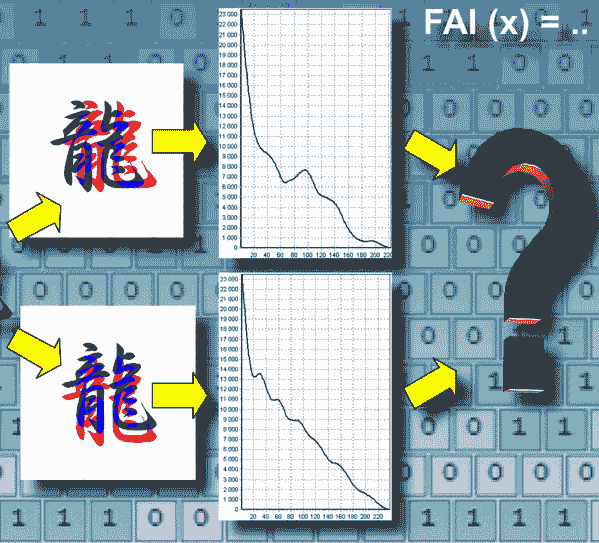


# 前言

计算机图像处理和识别系统的发展是人工智能的主要方面之一。目前，除了数字图像处理之外，没有处理视频信息的有效方法。本书提出了一些基于平行剪切技术的图像处理替代方法和算法。将这些方法与数字图像处理结合使用，将能够构建混合图像处理系统。这些方法和算法也可用于模拟计算机。  

本书不以点阵形式描述图像，而是描述为一组函数。通过分析这些函数，已开发出图像处理的方法和算法，利用这些方法可以解决图像处理的主要任务。将图像描述为一组函数，可以操作栅格和非位图图像。只分析一种定量特征——图像面积。使用平行平移技术还可以处理由不规则排列元素组成的图像。科学工作是根据这一分类构建的。  

本书致力于开发和研究将多种变换应用于计算机图像处理和识别的方法。与已知方法不同，所提方法使用较少的特征来描述图像，并减少了系统中的计算操作次数。基于平行平移技术，开发了物体形状与交叠区域函数之间关系的数学模型。本书描述了图像识别方法、物体空间方向确定、其运动参数以及图形轮廓确定方法。还描述了使用各种输入图像参数的模式识别效率研究。  

本书旨在帮助人工智能、机器人技术、软件和硬件应用领域的研究人员。  

泰勒·弗朗西斯集团  

http://taylorandfrancis.com  

# 引言

当今，我们广泛使用先进的信息技术。科学界和工业界面临的主要问题之一是创造新的、更先进的工具，以协助调查。计算机技术的发展使得信息处理领域能够迈出重大一步。向此方向的下一步进步是机器人的发展。处理大量信息的需求得到了基于计算机技术现代成就的强大智能系统创造的推动。智能系统（IS）有必要替代在涉及重大体力、脑力和情绪压力的过程中的人。提高 IS 性能的一个标准是有效感受器的可用性（Tou 和 Gonzalez，1977）。

智能系统根据以下方案构建：感受器—分析单元—执行器。最发达的智力存在于生物体中，它们具有这些组件的最佳参数。

如今我们知道，通过分析视频数据可以获取关于世界的大量信息。例如，人通过使用光感受器感知 90% 的信息。基于这些事实，我们可以得出结论：在构建智能系统时，需要创建信息感知手段。

为了执行视频处理任务，现代人拥有有效的感受器——眼睛。在大多数生物中，眼睛具有相似的结构，因此视频数据处理遵循相同的原理。机器视觉系统的开发者正在努力实现，并最终超越图像处理的质量和效率水平。

对象的聚类和进一步分类机会直接取决于特征（CF）的数量（Shalkoff，1989）以及在解决各种图像处理任务中使用它们的适当性。从图像中选取的特征越多，总数就可以划分为更多的类别。在这个阶段，智能系统的发展受到缺乏选择特征指标的明确方法的限制（Chen et al.，1995）。所有 CF 均由系统设计者根据该工作中的经验定义。

为了可视化图像，特征是通过分析其几何属性（边缘检测、连通区域搜索、角度数量计算等）获得的。对于硬件实现，这些过程需要执行基于大量数学运算的各种算法，这些运算可能非常复杂。这增加了数据处理所花费的时间。

提高图像预处理性能的一种可能性是使用少量由简单算法形成的对象同质特征，而不会损失信息处理的质量。我们提议使用简单的物理量——图像面积。该值的各种倍数值可以表示和描述具有不同形状并属于不同类别的各种图像。为了将面积转换为一组特征，有必要使用图像的平行移位进行动态变化。

该提议的原因是，人眼由 1.2 亿至 1.5 亿个光感受器组成，视神经管的厚度估计约为 100 万个轴突。在视频信号处理中使用特定的信息分组。本书展示了使用平行移位技术的图像处理方法。使用此技术将允许用同质特征（面积）替代由不同算法（有时涉及相当复杂的数学运算）形成的大量图像特征集（Winston，1992）。该特征通过使用简单的电路解决方案进行测量和计算。

在机器视觉系统发展的这个阶段，研究人员仅将平行移位过程视为为了进一步识别而对图像进行归一化的目的。也就是说，它们在其算法和仿射变换中仅用于将输入图像替换为更适合进一步处理的另一张图像。

本作品的主要假设是使用平行移位来获得一组图像属性，从而允许对其进行进一步处理和分析各种识别方法。通过添加变化的动态，将图像面积作为静态参数将允许将其用于分类和定义图像参数。图像被转换为一组函数，这允许使用任何功能分析手段进行处理。这些函数的组件将形成一组用于进一步分析的 CF 图像。

目前，没有作为数字图像处理替代方案的方法。已开发出许多数字图像处理方法和手段。其性能质量随计算手段能力的增强而提高。然而，这种质量基于设备分辨能力的广泛增加。进一步进步需要质的变化。

如下所示，使用平行移位技术（PST）可以执行所有基本处理任务。借助 PST，其中一些任务比使用数字图像处理更容易实现。为了提高机器视觉的性能，建议构建将数字处理和平行移位技术相结合的混合系统。此类机器视觉系统对于构建自主机器人尤其必要。基于 PST 的视觉系统可用于快速决策。数字图像处理对于图像的详细分析是必要的。

基于平行移位技术的图像处理系统允许处理图像。为了实现此类处理，有必要创建一种用于确定图形及其平行移动的副本之间交叉区域面积的手段。基于 PST 的图像处理系统可用于模拟计算机。

本书的内容分为八章。考虑了基于平行移位技术的图像处理和模式识别理论问题。描述了图像预处理方法，例如边缘检测、噪声消除、动态图像处理等。本书还展示了基于开发的软件模型的实验结果，这些结果证实了所开发模型和方法的有效性。


泰勒与弗朗西斯
泰勒与弗朗西斯集团
http://taylorandfrancis.com

# 基于平行图像移位技术的特征提取

## 1.1 理解和构建图像的基础

我们通过感官感知信息。人类视觉通道是我们大脑的主要信息来源之一。我们所有人都拥有结构相同的视觉通道。通道特征存在差异，这些差异由年龄、疾病引起的各种病理变化或外部影响等决定。然而，人类视觉通道的目的是将可见光谱的光学信号转换为一组电信号或化学信号，这些信号由人脑负责处理视觉图像的区域的视神经接收。

周围世界的视觉图像不断改变我们的光感受器（锥体、杆体）。视觉图像是落在我们主要感受器视野上的一组光学信号。这组光学信号呈现视觉图像。

当光学图像落在可以记录它的介质上时，我们使用“图像”这一术语。显示记录的光学图像的物理介质称为图像介质（纸张、存储介质、光学/电子介质等）。

图像可以以两种方式叠加在载体上：

- 通过物理存储材料或光电存储元素，对光学图像进行设计与记忆的固定。
- 使用特殊图形手段进行图像的构建与重建。


在第一种方法中，对载体上的光学图案进行完整复制。复制的精度取决于图像投影所在介质的结构。第二种方法使用基于对图像信息完全了解并在载体上重建该信息的方法。两种方法都需要构建和使用专用硬件。第一种方法不需要任何关于图像结构的特定知识。光学图案可以通过不同的扫描方式并行（图片、光电矩阵等）或依次在介质上再现。图像通过图像中颜色和亮度元素的精确重复形成。此类元素可以是点，也可以是指定形状图像的特定区域和大小。点具有最小面积，而形状元素可以具有较大面积。此类元素可以是三角形、矩形以及复杂图像的各种预定义几何组件。第二种方法始终考虑所采用的图像结构，并以一套在开发的硬件/软件工具上实现的方法为特征。

此图像模型是为能够实现该模型并在选定介质上重现图像的硬件而创建的。模型描述图像。硬件的复杂度和重建的精度取决于所选模型。选择模型是为现代处理和图像识别构建图像时的主要任务之一。

在现代数据处理系统中，存在几项基本任务，可分为图像再现任务和图像理解任务。图像理解任务包括对图像的初步描述。图像描述基于图像的函数表示，以及一组最有助于后续处理的基本（离散）组件（例如，像素、单元等）。

图像理解任务是对图像几何形式的分析，以及成功提取图像所需的基本组件及其之间的链接，或通过这些链接可以获得图像定义意义的函数。

这两项任务是对立的，并在智能系统的构建中占据重要地位。

## 1.2 图像描述

图像可分为位图和非位图图像（Nixon 和 Aguado, 2002; Solomon 和 Breckon, 2011）。

位图是一种包含一组像素（通常为矩形）的图像，这些像素位于光电显示设备或纸张及其他介质上。每个像素可以显示不同的颜色。位图图像现在最常用于大多数输入输出设备。非位图图像不是以像素描述的图像，而是由基本几何对象构成，称为原元。在大多数情况下，原元是数学模型。

通常将非位图图像称为矢量图像。矢量图像使用与位图相同的计算工具进行处理。它们可以在图像显示设备上以栅格或矢量形式再现。但是，栅格图像只能在栅格再现设备上显示。

矢量构建图像方法在构建复杂图像时面临问题，因为它需要存储大量原元及其数学描述。矢量图像缩放效果好且不丢失信息，而位图图像缩放效果差。位图图像缩放后，大量像素会丢失（用于尺寸缩小）或出现尺寸放大。

在光学系统中，图像被用作统一的光学对象。此类系统中的图像通过光学机械手段进行转换，并可分为单个组件。通过使用特殊的光学机械手段，整个图像可以显示在选定介质上。但是，此类系统存在图像存储和高效软件操作的问题。同时，光学系统具有图像处理的高速度和高精度。目前，光学图像处理和识别系统越来越多地应用于人类活动的各个领域。此外，它们不使用计算机处理和识别方法。此类系统使用模拟图像并采用专用成像方法（Pratt, 2016）。

在现代图像显示和图像识别计算机系统中，所有方法都基于硬件和软件实现。最有效的图像描述方法是使用结构描述（Solomon 和 Breckon, 2011; Pratt, 2016）。在某些情况下，通过拓扑描述来表示图像比较方便（Solomon 和 Breckon, 2011; Pratt, 2016）。

描述由特定电子载体输入的图像的最简单方法是使用一组离散元素和三维或二维空间中的亮度函数来描述它们（Nixon 和 Aguado, 2002）。该函数描述了图像中每个离散元素（单元或像素）邻域内的平均亮度值。亮度函数被离散化，并确定其值范围被划分的亮度级数。对于二值图像和灰度图像，亮度级数等于或大于二。基于此方法实现了成本效益高的描述方法，这些方法构成了其他方法的基础。一个重要的要求和限制是描述元素集合的大小和结构。

在许多问题中，使用简化描述就足够了，该描述包括选择和分析图像轮廓（Nixon 和 Aguado, 2002; Belan, 2011; Kozhemyako 等人, 2001; Bilan, 2014）。至今，已提出了一系列边缘检测方法和形态学处理方法（Solomon 和 Breckon, 2011; Parker, 2010）。该方法的主要缺点是任何计算错误都取决于参数情况，这会影响特征元素的准确性。

简单图像在描述和识别对象以及划分由原始图像近似确定的基本形状方面更具成本效益（Solomon 和 Breckon, 2011; Pratt, 2016; Gonzalez 和 Woods, 2008）。

描述复杂图像的方法之一是结构描述。该方法基于将图像表示为由基本组件（终端符）组成的结构（Narasimhan, 1966; Stallings, 1972; Shaw, 1969; Hancock 等人, 2010; Gimel'farb 等人, 2012）。这些包括句法描述方法，该方法由构成名义特征的一组终端符的选择组成。正在引入一组非终端符号，其中第一个被确定。带有终端符和非终端符号的字符串传递规则由一组替换规则定义。终端符和非终端符号以及替换规则构成形式语法。句法方法的选项定义为特定类型的终端元素以及替换规则的复杂性。描述的通常句法方法相同，但松散导向的图像不会给出相同的语法，也就是说，它们对其描述进行了更改。

成像算法基于势函数方法（Aizerman, 1970），其中引入了两个向量之间的“基本接近函数”，这称为势函数。确定向量的邻近性并使用其最大化，这是对集合中所有向量的串行穷举搜索。还尝试使用描述图像元素的其他坐标系统。

拓扑中经常描述表征图像一般属性的图像（例如孔或区域的存在）。这些属性在各种常见畸变下保持不变。最常见的拓扑特征是欧拉数 G（Sossa-Azuela, 2013; Acharya, 2006; Bishnu, 2005），其由以下公式定义

G = C - H,

其中 C – 关联图像组件的数量；H – 孔的数量

在再现和图像识别任务中，描述图像最常用的方法是使用基于形成几何、亮度和颜色特征向量的技术。这些


特征包括面积、周长元素以及来自亮度函数的矩泛函，例如图像的重心（Maier, 2012; van Assen, 2002）。

图像的信息表示是其频谱表示。使用轮廓特征的定义（极角φ的函数、轮廓长度、重心与轮廓点之间的距离）。轮廓的曲率展开为傅里叶级数，并定义了因子，以便能够描述图像（Nixon and Aguardo, 2002; Tremeau and Borel, 1997）。

对图像进行成功的描述和展示，极大地影响其识别和显示的效率。

## 1.3 图像的特征特性

特征特性通过使用最小元素集并尽量减少图像还原损失来描述图像。特征特性可以预先设定，也可以从图像中提取以用于其识别。

当输入图像未知时，使用识别任务。在这种情况下，特征特性由图像识别系统本身提取。识别的特征是一个过程，根据特定目的，按照特定规则集将对象分配到先前指定的固定列表（类）之一。识别可以由任何生成一组特征的识别系统执行，系统根据这些特征确定图像所属的类。

由识别系统在输入时提取的图像特征特性为图像提供了有意义的描述。

然而，目前尚无适用于所有图像的完整特征特性集选择的通用方法。对于每类图像，识别系统的开发人员会选择一组特征。这些特征特性并不总能给出100%的结果，且不能应用于其他类别的图像。例如，人脸的特征特性（眼睛间距、鼻子长度、嘴唇形状等）不适用于人类指纹（控制点、线条形状等），反之亦然。此外，所有这些特征都由开发人员根据其直觉经验和对所选图像类别的深入研究预先设定。

今天我们可以自信地断言，不存在允许识别系统本身提取图像大部分特征特性的方法和硬件。例如，现代生物识别系统能足够准确地识别面部，但无法识别面部的漫画。同时，人类视觉通道既能识别有失真的面部，也能识别其漫画。

开发人员通常针对具有特定形状和亮度特征的图像识别解决特殊问题。研究表明，从图像中提取的特征特性越多，识别结果越准确。

今天，已开发出许多用于提取图像特征特性的方法（Nixon and Aguardo, 2002; Pratt, 2016）。所有这些方法都基于预备图像变换。此类变换包括傅里叶变换（Nixon and Aguardo, 2002; Bracewell, 1986; Solomon and Breckon, 2011）、小波变换（Nixon and Aguardo, 2002; Daubechies, 1990）、霍夫变换（Gonzalez and Woods, 2008; Ballard, 1981）、仿射变换（Belan, 2011; Bilan, 2014）、离散余弦变换（Ahmed et al., 1974）、哈特利变换（Bracewell, 1984a, Bracewell, 1984b）以及其他方法。

不同类型的滤波用于提取特征特性，这些在各种文献中有完整描述（Nixon and Aguardo, 2002; Gonzalez and Woods, 2008）。所有这些方法都专注于提取预先定义的特征特性，或识别可使用这些方法提取的特征。得益于这些方法，特征特性的数量可能过多，且可能无法提供图像的完整描述。

广泛的图像识别方法不提取特定的特征特性。这些方法包括基于使用人工神经网络（ANN）的方法（Xingui and Shaohua, 2010; ICANN, 2014）、聚类分析（Anil K. and Jain, 2010; Chang et al., 2012; Berklim, 2002; Islam and Ahmed, 2013）等等，都需要对图像进行预备处理以进行识别。

ANN使用大量模式数据库进行识别，并需要更大的神经网络学习成本。最通用的ANN包括认知元和新认知元（Fukushima, 1983）。

聚类分析是通过指定属性查找和合并图像元素。这些属性可以是形状、颜色等。聚类分析在图像分割中非常有效；遗传算法和模糊集（Tahmasobi and Harakhani, 2012），以及分形理论（Barnsley, 1988, Saupe, 1996）也被使用。

所有这些方法都有显著差异，但各有优缺点。最常见的方法是使用已知或开发的方法提取图像的特征特性，并形成特征特性向量。提取的特征特性可能在向量中固定位置，也可能与位置无关。创建的向量在模式存储器中记录，并分配所属类的标识符。

然而，创建的特征特性向量并不总能给出所需结果。此外，特征特性越多，系统必须执行的计算操作和变换就越多。这降低了识别系统的精度和速度。

在现代文献中，几乎没有关注减少特征特性的数量。作者并不了解图像处理和模式识别系统，这些系统可以基于一个或多个特征特性完整呈现图像。这些特征不一定是图像的一部分，也可能是输入图像变换的定量指标的结果。

根据作者的观点，最简单的图像变换是其平移，而快速且易于计算的图像设置是面积。平移操作与计算图像面积的定量值相结合，在图像识别系统中取得了良好效果。此外，图像的平移及其面积的定义在处理模拟图像的光学系统中易于实现，但结果可能不是数字形式。

## 1.4 平行移位技术的理论描述

平行移位技术（PST）是对象（其元素由特征特性的n维向量描述）与其自身副本之间相互作用过程的组织，其中元素仅在一个或多个特征特性方面与原件不同（Belan and Yuzhakov, 2013）。此过程类似于可变特征特性空间中的平行移位。为了实现平行移位过程，有必要选择具有数值的特征特性，例如坐标、时间或相位。

初始集合的每个元素是通过带有特征特性的向量对的叠加获得的，由此第二个元素将是平行移位集合的元素。向量相互作用的结果不同于对象的初始向量特征特性，并可用于进一步分析。可用于分析原始对象及其副本相互作用的选项可以是任何数学运算和集合分析工具。如果通过对特定一组定量值的不同移位值进行平行移位而获得结果，则该集合可以被视为位移函数。例如，存在一个表示正弦信号的输入对象。在相位空间中移位正弦信号副本时，其与初始信号的和将不同于正弦波，当相位移位为π时，结果为零。

在解决图像识别任务和处理动态对象时，使用平行移位技术是有利的。


为了以集合论的术语描述平行移位技术，我们应该考虑聚类和分类过程（Duran and Odell, 1974, Islam and Ahmed, 2013）。这些过程对于将集合元素组合起来以选择其子集是必要的，这些子集在某些特征特性上相似。区分一个对象与另一个对象的能力为进一步分析提供了机会。

聚类由多个因素表征，其中包括构成原始集合的簇的数量。在簇数量恒定时，该过程称为“清晰聚类”；在簇数量不确定时，它被称为“模糊聚类”。在清晰聚类的情况下，原始集合的每个元素仅属于一个元素子类。元素子类不相交。在模糊聚类中，原始集合元素的子类可以相交。元素属于某个子类是由某个因素决定的。这个比率称为对象属于簇的隶属度。对于具有清晰聚类的元素，它取值0或1，而对于模糊聚类，它在0到1的范围内。

聚类的另一个参数是距离度量。该参数是从若干设计的度量中随机选择的，以执行某些任务；例如，确定距离度量最常用的方法是使用欧氏距离或欧氏平方距离。使用其他距离度量取决于需要识别集合元素的某些特征。

第三个参数是聚类准则。选择这些准则基于待解决的具体问题的需求和开发者的经验。最常见的有确定集合元素特征特性中指定的最大值和最小值。

聚类过程实施的基础是形成特征向量。该向量用于描述对象。特征特性可以是定性的也可以是定量的。集合的组成取决于待解决的具体问题。对向量元素多样性的描述会导致聚类算法的复杂化。使用平行移位技术允许形成用于描述对象的同质特征特性。

\[
\overline{x} = (CF_1, ..., CF_N) \quad (1.1)
\]

平行移位技术涉及为每个对象x选择一个或多个相同类型的定量特征，以形成变换对象xt。

\[
(CF_i, ..., CF_j) \in (CF_1, ..., CF_N) \quad (1.2)
\]

CF列表由描述原始对象以解决特定任务的能力决定；其他特征被丢弃，因为在其决策中不重要。

\[
\overline{xt} = (CF_1, ..., CF_N) \quad (1.3)
\]

通过减少描述其元素的向量中的特征特性数量来转换x集合的过程的示意图如图1.1所示。

因此，每个原始对象x都转换为某个变换对象xt。x集合和xt集合是双射的。进一步操作是执行xt集合对象所必需的。

我们在离散初始集合的情况下描述使用平行移位技术的过程。例如，对于2D对象，这样的集合可以被视为数字化图像。

在这种情况下，xt对象是m个元素xti的集合，每个元素由n个特征特性的向量描述。

\[
\overline{xt_i} = (cf_{1i}, ..., cf_{Ni}) \quad (1.4)
\]

这些特征构成了CFs，它们被选中用于描述变换后的xt对象，且其数量相同。

\[
CF_j = \frac{\sum_{i=1}^m cf_{i,j}}{m} \quad (1.5)
\]

作为xt对象和xt'对象相互作用的结果，其中所有特征特性的值（$CF_j, ..., CF_j$）在所选特征特性空间的某个偏移方向上以SHIFT的值发生变化，从而得到xpost集。xt'对象是得到的，它是xt对象的移动副本。

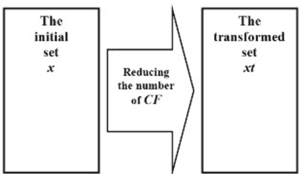

图1.1：通过减少描述元素的向量中的特征特性数量的集合转换过程示意图

\[
CF'_j = CF_j + SHIFT_j = \frac{\sum_{i=1}^m (cf_{i,j} + shift_{i,j})}{m} \quad (1.6)
\]

SHIFT位移的值将取决于shift_j和每个特征特性的位移。如果偏移是平行的，则SHIFT_j = shift_j；否则，它是对象变形。

\[
SHIFT = \sqrt{\sum_{j=1}^n (SHIFT_j)^2} = \sqrt{\sum_{j=1}^n \left(\frac{\sum_{i=1}^m shift_{i,j}}{m}\right)^2} \quad (1.7)
\]

集合相互作用的组织方式可以各异。在本书中，考虑了最简单的选项——确定两个集合的交集。

\[
xt \cap xt' = x_{pst} \quad (1.8)
\]

某个偏移距离SHIFT的x_pst集合形成方案如图1.2所示。

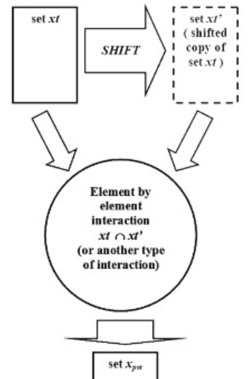

图1.2：获得某个位移距离的x_pst集合的方案

\(x_{pst}\)集仅是\(xt\)集的一部分，因此关于其元素的信息不足以将初始x元素分配到某个簇。\(x_{pst}\)集可以确定其基数（\(crd\)）。对于2D对象，这是图像的交叠面积；对于3D对象，这是交叠体积，等等。这些参数是数值，因此不足以描述\(x\)元素。有必要对这些静态参数的变化进行动态分析。对于所选特征特性空间（\(CF_i\), ..., \(CF_j\)）中每个可能的偏移方向，每个可能的SHIFT偏移距离都可以由\(crd\)参数确定。使用所有可能\(crd\)参数的集合，可以描述每个\(x\)元素。对于每个平行偏移方向，一系列\(crd\)参数将是\(x_{pst}\)集合基数的函数，该基数取决于偏移。每个元素\(x\)的所有此类函数的集合用于基于平行移位技术的各种方法的进一步处理和分析。

假设属于同一簇的\(x_{pst}\)集合元素的基数平均值，对于每个偏移距离\(SHIFT=j\)等于\(CRD_{SHIFT_j}\)。指定i-簇中的元素数量将为\(cnt\_clast_i\)。它们通过以下关系相关：

\[
CRD_{SHIFT_j} = \frac{\sum_{i=0}^{cnt\_clast_i} crd_{SHIFT_{i,j}}}{cnt\_clast_i} \quad (1.9)
\]

在聚类过程中，为了对比较函数，我们引入一个阈值\(thr\)。对象聚类的准则将被假设，函数的偏差值为\(crd_{SHIFT_{i,j}}\)，它取决于i-th簇的\(CRD_{SHIFT_j}\)，因为每个偏移距离\(SHIFT = j\)都不超过阈值。

\[
\left| CRD_{SHIFT_j} - crd_{SHIFT_{i,j}} \right| \le thr \quad (1.10)
\]

图1.3中以灰色选定了属于同一簇的\(x_{pst}\)集合基数平均值的CRD函数以及可能的\(crd\)值特征范围的示意图表示。

在图1.3中，显示了\(xt'\)集合在所选CF空间中一个位移方向的CRD图。对于描述\(xt\)对象，必须使用所有偏移方向的函数集。应当注意，这个例子对所有可能的位移范围给出了固定的\(thr\)阈值。阈值的偏差值可以根据偏移距离而变化。由于\(thr\)参数可能发生变化，对象属于某个簇或另一个簇的关系也会改变。这一事实证实了集合的“模糊聚类”原则。

为了使用函数集描述研究对象，可以使用任何功能分析方法。这里体现了类似的二元性。


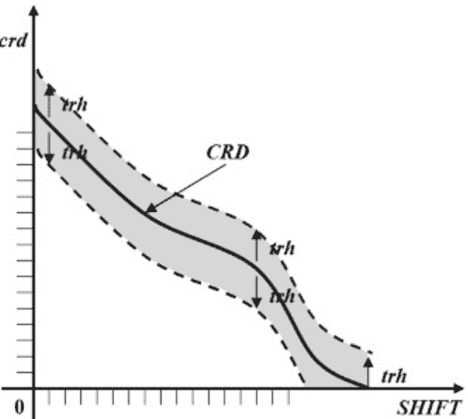

图 1.3: 平均值基数的 CRD 函数及属于某一簇的可能 crd 值特征范围的示意图，该簇以灰色选中并与波粒二象性理论相关联。函数中的集合经过变换。函数参数可以组合 cfc 因子，这些因子本身可用于描述初始集合。

\[
\bar{x} = (cfc_{1...cfc_{angle}}) \tag{1.11}
\]

其中 $angle$ 是可能的平移方向数量。

对于由不规则排列元素呈现或没有明确结构的对象，无法通过一组元素来表示初始集合。在这种情况下，有必要利用现有手段来固定原始对象及其副本在交点处的相互作用结果。在其他方面，对所得函数进行进一步分析的原则是相同的。这是使用平移技术的主要优势之一。

本科学著作致力于使用平移技术进行图像处理。接下来，上述内容将针对转换为一组函数的平面图像处理进行描述。

为了获得图像交叠区域的函数，使用对象坐标的变化。原始图像及其平移副本的叠加结果是这些对象的交叠区域场。坐标变化每一瞬间的交叠区域值集合构成交叠区域函数。

本书中概述的对象和信息处理的变换原则（Ulam, 1952）可应用于与图像处理不同的其他行业。

# 基于平移技术的交叠区域形成函数

## 2.1 描述交叠区域函数的图像数学模型

平移技术的一个应用是成像过程。目前，除了数字图像处理之外，没有更有效的方法来处理视频数据。数字图像的质量随设备分辨率能力的提高而提高。同时，描述图像的数组的数据量也增加。此外，处理数组所需的操作数量也增加。

有必要减少描述图像的元素数量。在图像属性中，具有定量表达的是面积。面积本身仅包含关于图像大小的信息。使用平移技术进行图像处理可以形成一组函数来描述它。在此情况下，平移是指空间坐标的变化。对所得函数集进行分析可以作为执行基本图像处理任务的基础。

交叠区域函数（FAI）取决于原始图像及其在选定方向上平移的副本的交叠区域，以及平移距离（Belan and Yuzhakov, 2013）。

$A \cap B = C$

平移是从图形 A 和 B 副本完全匹配的位置开始，直至零交叉时刻进行。图像副本移动至零交叉时刻的总距离称为最大平移（Xmax）。在此过程中，图像的静态特征（面积）转化为一个函数，该函数可用于分析以识别图形及其参数（图 2.1b）。

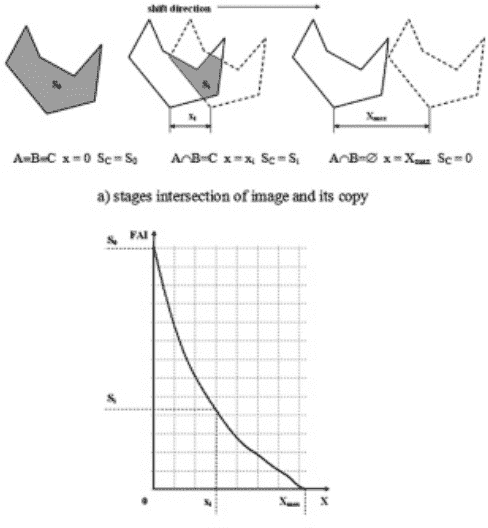

图 2.1: 获取 FAI(x) 的模型

由此模型获得的交叠区域函数对于图形类（X）将相同，这些图形仅相互之间在排列于位移方向上的组件的相互位置上有所不同（图 2.2）。

为了区分属于具有相同 FAI 的类的图像，必须为方向 φ1 ≠ φ 定义至少另一个 FAI。这样就得到了具有相同 FAI 的 Y 类图形。X 类和 Y 类图形对应于包含可识别图像的 F₁ 类图形。

X ∩ Y = F₁.

交叠区域函数可以针对更多方向进行确定。增加用于描述图像的 FAI 数量将减少

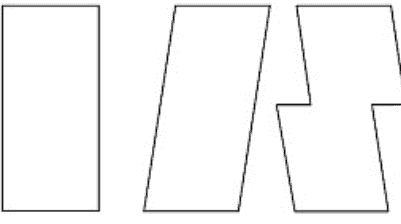

FAI(x)_A = FAI(x)_B = FAI(x)_C

图 2.2: 具有相等 FAI(x) 的图形

包含原始图像的 F₂ 类图形中的元素数量。

$X_1 \cap X_2 \cap ... \cap X_i \cap ... \cap X_n = F_2$

其中 $X_i$ - 方向 $i$ 上具有相同 FAI 的图形类。

$F_1 \ge F_2 \ge 1$

使用上述属性有助于开发图像表示的数学模型，该模型有助于交叠区域函数。为了识别图像，使用不止一个 FAI，因此平移将在两个正交方向上进行。选择正交方向是为了简化软件实现。

输入图 2.3a 上方由函数 $f_2(x)$ 界定，下方由函数 $f_1(x)$ 界定。图像与图 2.3a 的下边缘对齐。其下方由轴 Ox 界定，上方由函数 $f_3(x)$ 界定，其中

$f_3(x) = f_2(x) - f_1(x) \quad (2.1)$

由于图像数据仅在组件的相互位置上有所不同，它们沿平移方向（在此情况下为垂直方向）排列；这就是为什么 $FAI(y)_a = FAI(y)_b$。用参数描述对象的可能性在公式 (2.1) 中得到体现。这些参数源自平移技术。显然，作为函数 $f_2(x)$ 和 $f_1(x)$ 的叠加而获得的函数 $f_3(x)$ 由对象的轮廓组成。这一特性允许其用于研究形状。

$FAI(y) = \int_{x_1}^{x_2} f_3(x) dx - y \cdot (x_2 - x_1) \quad (2.2)$

$x_1$ 和 $x_2$ 的值由方程组 (2.3) 确定。

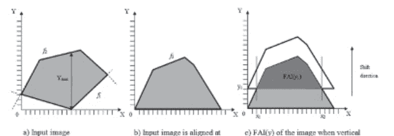

图 2.3: 获取 FAI(y) 构建数学模型过程的图形描述

\[
\begin{cases} y = f_3(x_1), \\ y = f_3(x_2) \\ \end{cases}
\]

其中 y 为此阶段的偏移值。

类似方法（如图 2.4 所示）用于确定 FAI(x)，不同之处在于位移在另一个方向上进行。

$f_6(x) = f_5(x) - f_4(x)$

$FAI(x) = \int_{y_1}^{y_2} f_6(y) dy - x \cdot (y_2 - y_1)$

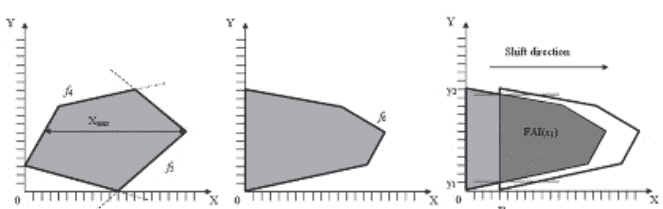

图 2.4: 获取 FAI(x) 构建数学模型过程的图形描述

$y_1$ 和 $y_2$ 的值由方程组 (2.6) 确定。

\[
\begin{cases} x = f_6(y_1) \\ x = f_6(y_2) \\ \end{cases}
\]

其中 x 为此阶段的偏移值。

如图 2.3 和 2.4 所示，FAI 定义所依据的函数 $f_2(x)$ 和 $f_1(x)$ 的部分包含与函数 $f_5(y)$ 和 $f_4(y)$ 相同的图像点。这一属性提供了可用于识别的冗余。

如果交叠区域函数定义用于非凸图形或图像内包含任何异物的图形，则必须考虑此类形状变化。如上所述，FAI 是基于反映图形形状的函数构建的。随着图像形状复杂度的增加，这些函数本身也变得更加复杂，因此其元素可以在图像描述过程中用作特征特征。

用两个 FAI 描述图像的交叠区域函数的基本参数是初始图像面积（$S_0$）、$\phi$ 方向上的最大平移（$X_{max}$）和 $\phi_1$ 方向上的最大平移（$Y_{max}$）。当图像由更多数量的 FAI 描述时，将确定每个方向 $\phi_i$（$l_{max}$）的最大平移。

最大平移是在所选方向上图像副本的最小平移距离，此时与原始图像没有交叉。仅基于这些参数，才会执行进一步计算。这些参数的确定易于在硬件中实现。使用元胞自动机（CA）（Belan and Belan, 2012; Belan and Belan, 2013; Bilan, 2014）来构建同质环境矩阵尤为有效，这些环境实现数据集的平移和区域的确定。

## 2.2 基于基本参数对简单形状交叠区域函数的解析确定

具有可解析确定的交叠区域函数的图形可以称为简单图形（SF）（Yuen et al., 1989）。三角形、正方形、矩形和圆形属于简单形状组。此外，我们可以解析确定任何正 2n 边形的 FAI。但是，如果 n 增加，这些函数的值将迅速接近圆的 FAI。此外，交叠区域函数需要根据 n 划分位移范围进行处理。

图 2.5 显示了不同倾斜角度相对于水平方向的六边形图像在 FAI 形成过程中的转换示例。

对于不同的平移区域，交叠区域函数使用不同的副本。六边形使用两个定义交叠区域函数的段。在图 2.5 中，它们分别对应于等于 $l_1$ 和 $l_2 - l_1$ 的图像副本距离平移。通常，


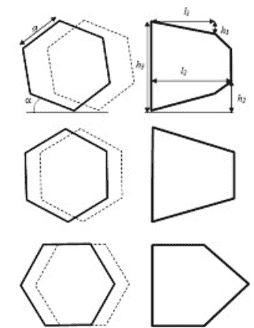

a) 初始图像及其在三个角度 $\alpha$（任意、30°、0°）下的移动副本

b) 初始图像，与左边缘对齐

图 2.5: FAI 形成过程中的六边形示例图像

左边缘六边形对齐参数将如下所示：

- 1. $h_1 = a \sin \alpha$ (2.7)
- 2. $h_2 = \frac{a}{2}(\sqrt{3}\cos \alpha - \sin \alpha)$ (2.8)
- 3. $h_3 = 2a\sin(\frac{\pi}{3} + \alpha) = a(\sqrt{3}\cos \alpha + \sin \alpha)$ (2.9)
- 4. $l_1 = \frac{\sqrt{3}a}{\sqrt{3}\cos \alpha - \sin \alpha}$ (2.10)
- 5. $l_2 = \frac{2\sqrt{3}a}{\sqrt{3}\sin \alpha + \cos \alpha} = X_{\max}$ (2.11)

将输入图像识别为六边形时，可以使用面积交叉函数的基本参数来确定其边长。

$$
\begin{cases}
a = \sqrt{\frac{2S_0}{3\sqrt{3}}} \\
a = \frac{X_{\max}}{\sqrt{3}}, \text{for } \alpha = \frac{\pi}{6} \\
a = \frac{X_{\max}}{2}, \text{for } \alpha = 0
\end{cases} \tag{2.12}
$$

面积交叉函数存在多个不同分段，使得处理此类函数的过程变得复杂。因此，本书未考虑正 2n 边形尺规的面积交叉函数计算。

我们定义简单图形的面积交叉函数。圆的 FAI(x) 获取过程的图形描述如图 2.6 所示。圆的 FAI(y) 确定方式类似。圆在正交偏移方向上的面积交叉函数体现在公式 (2.15) 和 (2.16) 中。

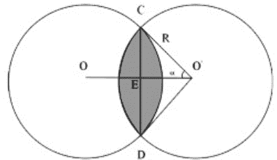

图 2.6: 圆 FAI(x) 获取过程的图形描述

偏移距离 \(x = OO' = q_x R\)，其中 \(q_x \in [0, 2]\)。\(q_x\) 是反映偏移距离与圆半径关系的辅助因子。

如果从公式中排除不属于 FAI 基本元素的半径 \(R = \sqrt{\frac{S_0}{\pi}}\)，则 \(q_x = x \cdot \sqrt{\frac{\pi}{S_0}}\)

$$
\alpha = \arccos\left(\frac{q_x \cdot R}{2 \cdot R}\right) = \arccos\left(\frac{q_x}{2}\right) = \arccos\left(\frac{x \cdot \sqrt{\pi}}{2 \sqrt{S_0}}\right) \tag{2.13}
$$

$$
\alpha = \arctg\left(\frac{2 \cdot CE}{q_x \cdot R}\right) = \arctg\left(\frac{\sqrt{4 - q_x^2}}{q_x}\right) = \arctg\left(\sqrt{\frac{4 S_0}{\pi \cdot x^2} - 1}\right) \tag{2.14}
$$

\( FAI(x) = 2 \cdot \frac{S_0}{\pi} \left( arctg \left( \sqrt{\frac{4S_0}{\pi \cdot x^2} - 1} \right) \right) - x \cdot \sqrt{\frac{S_0}{\pi} - \frac{x^2}{4}} \) (2.15)

\( FAI(y) = 2 \cdot \frac{S_0}{\pi} \left( arctg \left( \sqrt{\frac{4S_0}{\pi \cdot y^2} - 1} \right) \right) - y \cdot \sqrt{\frac{S_0}{\pi} - \frac{y^2}{4}} \) (2.16)

如果 \( x = 0 \) (\( y = 0 \))，则 \( FAI(x) = S_0 \) (\( FAI(y) = S_0 \))。将输入图像识别为圆时，使用面积交叉函数的基本参数确定其半径。

\( R = \sqrt{\frac{S_0}{\pi}} = \frac{X_{\max}}{2} \) (2.17)

我们定义侧长为 \( a \) 和 \( b \)、倾角为 \( \alpha \) 的矩形在偏移方向 \( \varphi \) 下的 FAI（图 2.7）：

\( A = a \cdot \cos \alpha + b \cdot \sin \alpha \)
\( B = a \cdot \sin \alpha + b \cdot \cos \alpha \)

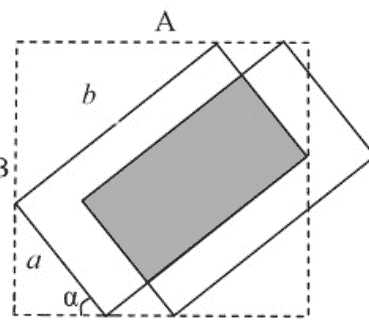

图 2.7: 矩形 FAI(x) 获取过程的图形描述

\( FAI(x) = (b - x \cdot \sin \alpha)(a - x \cdot \cos \alpha) = S_0 - Bx + \frac{x^2}{2} \sin(2\alpha) \) (2.18)

\( FAI(y) = (b - y \cdot \cos \alpha)(a - y \cdot \sin \alpha) = S_0 - Ay + \frac{y^2}{2} \sin(2\alpha) \) (2.19)

其中

\( A = \frac{S_0}{Y_{\max}} + \frac{Y_{\max}}{2} \cdot \sin(2\alpha) \)

$$
B = \frac{S_0}{X_{\max}} + \frac{X_{\max}}{2} \cdot \sin(2\alpha)
$$

边界矩形的参数（A 和 B）仅用于方便地推导面积交叉函数公式，随后将由主要参数（$S_0$、$X_{\max}$、$Y_{\max}$）的函数替换。

$$
FAI(x) = (X_{\max} - x) \left( \frac{S_0}{X_{\max}} - \frac{x}{2} \sin(2\alpha) \right) \quad (2.20)
$$

$$
FAI(y) = (Y_{\max} - y) \left( \frac{S_0}{Y_{\max}} - \frac{y}{2} \sin(2\alpha) \right) \quad (2.21)
$$

公式 (2.17)–(2.20) 使用偏移方向 $\varphi$ 中的倾角 $\alpha$ 值。计算该角度的公式变体将在下文中描述。

将输入图像识别为矩形时，可以使用面积交叉函数的基本参数来确定图形的定量特征。

$$
a = \sqrt{\frac{S_0 \cdot Y_{\max}}{X_{\max}}} \ ; \ b = \sqrt{\frac{S_0 \cdot X_{\max}}{Y_{\max}}} \quad (2.22)
$$

正方形（其中 $X_{\max} = Y_{\max}$）的面积交叉函数：

$$
FAI(x) = (X_{\max} - x) \cdot \frac{X_{\max} \cdot S_0 - x \cdot \sqrt{S_0 \cdot (X_{\max}^2 - S_0)}}{X_{\max}^2} \quad (2.23)
$$

$$
FAI(y) = (X_{\max} - y) \cdot \frac{X_{\max} \cdot S_0 - y \cdot \sqrt{S_0 \cdot (X_{\max}^2 - S_0)}}{X_{\max}^2} \quad (2.24)
$$

我们利用平行移位下的三角形相似性原理来确定三角形的面积交叉函数：

$$
FAI(x) = \frac{S_0 \cdot (X_{\max} - x)^2}{X_{\max}^2} \quad (2.25)
$$

$$
FAI(y) = \frac{S_0 \cdot (Y_{\max} - y)^2}{Y_{\max}^2} \quad (2.26)
$$

当将输入图像识别为三角形时，无法立即使用一对正交偏移的面积交叉函数基本参数来确定图形的定量特征。这是因为存在四个未知数（三角形的三条边及其一条边与水平方向的倾角）。三角形的参数可以通过其旋转来确定。需要达到一种情况，即三角形某一边与水平方向的倾角为零。在此情况下，三角形的一条长边将等于最大水平位移。

位移将尽可能最大。然后，使用两组面积交叉函数的基本参数，我们可以确定三角形的定量特征。

图 2.8 显示了定义三角形参数集之一的过程的图形表示。

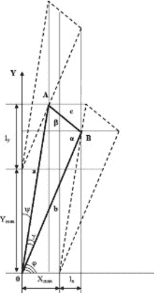

图 2.8: 确定三角形参数过程的图形表示

三角形基本参数与其定量参数之间的关系，请参见以下公式集。

$$
S_0 = \frac{a \cdot X_{max} \cdot \cos \psi}{2} = \frac{b \cdot Y_{max} \cdot \cos \varphi}{2} = \frac{ab \sin \gamma}{2} \quad (2.27)
$$

$$
\frac{4S_0^2}{X_{max} Y_{max}} = X_{max} Y_{max} + 2S_0 = ab \cos \varphi \cos \psi \quad (2.28)
$$

\(\frac{a}{b} = \frac{Y_{\max} \cos \varphi}{X_{\max} \cos \psi} ; \frac{X_{\max}}{\sin \gamma} = \frac{b}{\cos \varphi} ; \frac{Y_{\max}}{a} = \frac{a}{\cos \varphi}\) (2.29)

\(b \cdot \sin \varphi = l_x ctg \psi\) (2.30)

\(Y_{\max} + l_y = a \cdot cos \psi\) (2.31)

\(X_{\max} + l_x = b \cdot cos \varphi\) (2.32)

\(a \cdot sin \psi = l_y ctg \varphi\) (2.33)

\(Y_{max}l_x = X_{max}l_y\) (2.34)

\(\frac{l_x}{X_{\max}} = \frac{l_y}{Y_{\max}} = \frac{X_{\max}}{b \cos \varphi} = \frac{Y_{\max}}{a \cos \psi} = \frac{2S_0 - X_{\max} Y_{\max}}{X_{\max} Y_{\max}}\)
\(= \frac{b \cos \varphi - X_{\max}}{X_{\max}} = \frac{a \cos \psi - Y_{\max}}{Y_{\max}}\) (2.35)

\(\frac{X_{\max} Y_{\max}}{2S_0} = 1 - tg \varphi tg \psi\) (2.36)

为了确定三角形的定量参数，需要对其进行旋转。例如，将边 \(a\) 置于垂直位置。此时 \(a = Y_{max}\)，\(\psi = 0\)，上述所有公式均大大简化。旋转过程中三角形边长不变。将备用两组公式。这样就可以确定三角形各边长度及其相对于水平方向的原始倾角 \(\varphi\)。

矩形的面积交叉函数取决于相对于偏移方向 \(\varphi$ 的倾角 \(\alpha$。根据矩形尺寸（\(a$ 和 \(b$）的比例，倾角 \(\alpha$ 有三种可能性：

\(\sin \alpha \cdot cos \alpha = \frac{S_0}{X_{\max} \cdot Y_{\max}}\) (2.37)

\(tg \alpha = \frac{X_{max}}{Y_{max}}\) (2.38)

\(\sin^2 \alpha = \frac{S_0}{X_{max} \cdot Y_{\max}}\) or \(cos^2 \alpha = \frac{S_0}{X_{max} \cdot Y_{\max}}\) (2.39)

在进一步计算 \(\sin 2\alpha$ 时，选项 \(\sin^2 \alpha$ 和 \(cos^2 \alpha$ 是相同的。


## 2.3 加速平面图像识别过程的其他参数

基于这些公式，我们定义了 sin 2α 的值（矩形的 FAI 分量）。

sin 2α = \frac{2S_0}{X_{max} \cdot Y_{max}} (2.40)

sin 2α = \frac{2X_{max} \cdot Y_{max}}{X_{max}^2 + Y_{max}^2} (2.41)

sin 2α = \frac{2\sqrt{S_0 \cdot (X_{max} \cdot Y_{max} - S_0)}}{X_{max} \cdot Y_{max}} (2.42)

由于简单图形交叉面积的公式互不相同，交叉面积函数可用于检测特征特征。简单图形的 FAI 模板基于基本参数（初始面积和最大位移）构建。

简单图形的基本识别算法未考虑噪声对分类过程的影响（Aho 等人，1983 年）。

如下所示：

- 获取两个方向上交叉面积的实际函数
- 识别 FAI 的主要参数（$S_0$、$X_{max}$、$Y_{max}$）
- 将解析计算的基本参数的交叉面积函数代入模板
- 通过将交叉面积函数的实际结果与解析计算进行比较，得到交叉面积函数

简单图形类仅占平面图像整体类的一小部分。对于大多数形状各异的图像，无法解析计算交叉面积公式。在此情况下，有必要将 FAI 的实际结果与每个基准及每个位移方向的存储函数进行比较。这些函数必须在识别训练阶段获得。

使用交叉面积函数进行图像识别需要将实际 FAI 与一组基准 FAI 进行比较，当基准数量较多时，这将花费大量时间。因此，有必要加快过程，引入某些指标以限制需要比较的基准 FAI 数量。交叉面积函数在 0 到最大位移的区间内是连续且可微的。

我们在基准集中引入一种积分系数 \( k_\phi \)，当缩放交叉面积函数的基本参数（$S_0$、$X_{max}$、$Y_{max}$）时，该系数倾向于保持不变。

\( k_\phi = \frac{\int_{0}^{I_{max}} FAI(i)di}{S_0 \cdot I_{max}} = const \) (2.43)

其中，\(\phi\) 为确定 FAI 的方向；\(i\) 和 \(I_{max}\) 分别为方向 \(\phi\) 上的最大位移和位移（图 2.9）。

FAI(x) 和 FAI(y) 的积分系数确定方式类似，只需将 \( i \) 替换为 \( x \) 或 \( y \)，并将 \( I_{max} \) 分别替换为 \( X_{max} \) 或 \( Y_{max} \)。图形的积分系数（IC）及其交叉面积函数可通过解析方法确定，也可以解析计算。

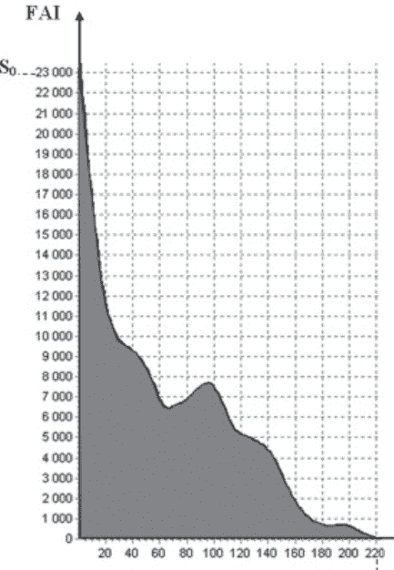

\( k_x \) - 阴影图形面积与 \( S_0 X_{max} \) 的比值

图 2.9: 使用图像的 FAI(x) 的积分定义系数示例

我们计算圆的积分系数：

```
\int FAI(x) dx = \frac{2 \cdot S_0}{\pi} \cdot \left[ \frac{x}{\pi} \cdot \arccos \left( \frac{x}{2} \cdot \sqrt{\frac{\pi}{S_0}} \right) - 2 \cdot \sqrt{\frac{S_0}{\pi}} \cdot \sqrt{1 - \frac{\pi \cdot x^2}{4 \cdot S_0}} \right]
+ 2 \cdot \frac{S_0}{3 \cdot \pi^2} \cdot \sqrt{4 \cdot S_0 - \pi \cdot x^2} - \frac{x^2}{6 \cdot \sqrt{\pi}} \cdot \sqrt{4 \cdot S_0 - \pi \cdot x^2} (2.44)
```

```
k_x = \frac{\int_0^{X_{max}} FAI(x) dx}{S_0 \cdot X_{max}} = \frac{4}{3 \cdot \pi} = const (2.45)
```

我们计算矩形的积分系数。
矩形的一般 IC 公式如下：

```
k_x = \frac{1}{2} \cdot \frac{1}{12} \cdot \frac{X_{max}^2}{S_0} \cdot \sin 2\alpha (2.46)
```

考虑角度 2\alpha 的三种可能取值，我们得到矩形积分系数公式的三种选项。

```
k_{x_1} = \frac{1}{2} \cdot \frac{1}{6} \cdot \frac{X_{max}}{Y_{max}} (2.47)
```

```
k_{x_2} = \frac{1}{2} \cdot \frac{1}{6} \cdot \frac{X_{max}^3 \cdot Y_{max}}{S_0 \cdot (X_{max}^2 + Y_{max}^2)} (2.48)
```

```
k_{x_3} = \frac{1}{2} \cdot \frac{1}{6} \cdot \frac{X_{max}}{Y_{max}} \sqrt{\frac{X_{max} \cdot Y_{max}}{S_0} - 1} (2.49)
```

我们计算正方形的积分系数，其中 \(X_{max} = Y_{max}\)。

```
k_x = \frac{1}{2} \cdot \frac{1}{6} \sqrt{\frac{X_{max}^2}{S_0} - 1} (2.50)
```

三角形的积分系数如下：

```
k_x = \frac{1}{3} = const (2.51)
```

简单图形的积分系数公式列于表 2.1 中。

### 表 2.1: 简单图形积分系数公式

| 简单图形名称 | 积分系数 |
|---|---|
| 圆 | \(\frac{4}{3 \cdot \pi}\) |
| 三角形 | \(\frac{1}{3}\) |
| 正方形 | \(\frac{1}{2} \cdot \frac{1}{6} \sqrt{\frac{X_{\max}^2}{S_0} - 1}\) |
| 矩形 | \(\frac{1}{2} \cdot \frac{1}{12} \frac{X_{\max}^2}{S_0} \cdot \sin 2\alpha\) |

对于非简单图形的图像，也可以得到积分系数的值（Belan 和 Yuzhakov，2013 年；Koh 等人，1994 年；Vetter 和 Poggio，1997 年）。为此，必须计算实际 FAI 的面积，并将该值除以初始面积与最大位移的乘积。这些系数在仿射变换下不变。

积分系数适合应用于图像识别算法的比较步骤。在 FAI 比较阶段之前，有必要进行 IC 比较。应用积分系数将大大减少执行函数比较的样本数量。

图像中 IC 的一致性是分类的必要条件，但不是充分条件。无论使用哪些附加参数来加速识别过程，只有交叉面积函数的数值才包含关于对象形状的信息。

此外，图像处理中的积分系数还应与其他可能加速图像分类及其参数确定过程的因素一起使用。

\(k\rho_\phi\) 是图像相对于方向 \(\phi\) 的元素密度系数。

```
\(k\rho_\phi = \frac{S_0}{X_{\max} \cdot Y_{\max}}\) (2.52)
```

该系数反映了轮廓图像的程度。一般而言，其范围可从 0 到 1，例如，对于正方形（\(X_{\max} = Y_{\max}\)），根据空间取向，\(k\rho_\phi \in [\frac{1}{2}; 1]\)。仅当矩形的两边为 $a$ 和 $b$（其中 $2a < b$）且其中一边与位移方向的倾角 \(\alpha = 45^\circ\) 时，该系数才可取值 $k_{P_\varphi} = \frac{b}{2a} > 1$。这种排列密度系数可用于对具有指定参数的矩形进行分类。

$kE_\varphi$ 是对象相对于方向 \(\varphi\) 的偏心系数。

$$kE_\varphi = \frac{Y_{max}}{X_{max}}$$ (2.53)

该系数可用于缩放确定图像差异及其在感受野平面上的投影的过程，该过程在确定对象空间取向的算法中需要。对于形状相同的图形，所选方向上的该参数相同。

参数系数 $kP$ 可用于加速识别过程。它是由以参数函数形式呈现的积分系数创建的图像面积。

$$kP = S(k_\varphi)$$ (2.54)

$kP$ 系数在基准数量非常大且仅当基准积分系数与实际值的比较占用大量时间时才有用。然而，该因素需要非常高精度的计算。由于积分系数的值属于 0 到 0.5 的范围，其值不超过 0.25$\pi$。

使用各种附加系数的识别阶段称为快速识别阶段。比较实际交叉面积函数与模式函数的识别阶段称为详细识别阶段。该阶段比较函数。但是，其持续时间高于快速阶段。总体图像识别算法如下所示。

系数 $kP, k_\varphi, k_{P\varphi}, kE_\varphi$ 相对于图像大小及其在感受野中的位置不变。它们基于交叉面积函数的基本参数计算得出，因此，它们的使用不违背图像分类的平行位移技术概念。

## 2.4 基于 PST 的图像识别算法

预处理步骤中获得的交叉面积函数应进行专门分析，以识别图像。之前讨论的交叉面积函数和不同系数可在识别过程中用作与神经网络的基准进行比较的方法。


在使用神经网络的情况下，交叉区域函数及其系数可作为输入人工神经元特征的向量。这种检测方法不需要在信息存储上花费大量资金。

本书通过图像识别方法与样板进行匹配。它可以分为两个模块——第一个是识别其FAI可解析确定的简单图像；第二个是识别所有其他图形。

在执行之前，图像识别过程需经过预处理。该过程的结果是一幅二值图像。对于这种方法，感受场中的图像将被视为整体，即使它由几个独立部分组成。采用平移技术的图像预处理将在后续章节中讨论。

简单图形识别的基本算法已有描述。实际上，有许多因素可能导致信息丢失。这些因素包括，例如，计算舍入过程中的信息丢失、图像数字化过程中的信息丢失或噪声影响。因此，在比较过程中有必要使用某些允许偏差的值。

第一个识别单元的结果可能是将图像识别为简单图形并获取其定性和定量参数的决定。将其从通用识别算法中单独选出的优势在于，如果在此阶段识别出对象，则无需在样板数组中搜索。这将显著缩短识别过程。此外，该模块的信息存储成本最低。简单图形的样板存储为解析公式模板，这些模板将填充交叉区域函数的基本参数。

如果在前一阶段未对图像作为简单图形的识别做出决定，则需要切换到通过将图形与样板数组进行比较来进行识别。每个识别单元又分为两个步骤——第一阶段是快速识别，比较积分系数；第二阶段是详细识别，比较交叉区域函数。识别过程方案如图2.10所示。

基于FAI分析的整体图像识别算法由以下步骤组成：

- 1. 获取两个方向（φ 和 φ₁ ≠ φ）下实图像的交叉区域函数。
- 2. 识别这些图像的主要参数（S₀, Xₘₐₓ, Yₘₐₓ）及实-IC（kₓ 和 kᵧ）。
- 3. 在将IC代入简单图形公式时，从交叉区域函数中推导出关键参数的值。

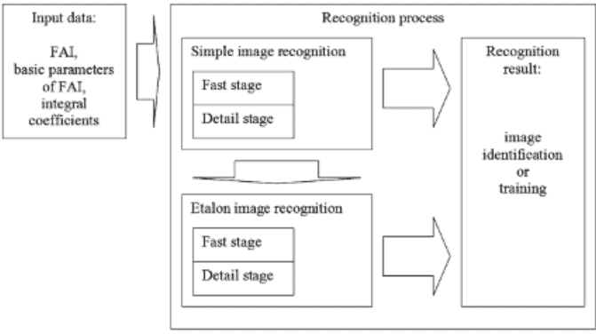

图 2.10：识别过程方案

按指定精度 $dk_1$ 比较两个实-IC（$k_x$）之一与简单图形解析计算的IC。得到具有匹配的XS类图形。

- 4. 按指定精度 $dk_1$ 比较另一个实-IC（$k_y$）以计算XS类图形的IC。得到具有匹配的YS类图形（$YS \in XS$）。
- 5. 按指定精度 $dS_1$ 比较实FAI（$y$）与YS类简单图形解析计算的FAI。得到具有匹配的YS1类图形（$YS1 \in YS$）。
- 6. 按指定精度 $dS_1$ 比较实FAI（$x$）与YS1类简单图形解析计算的FAI。得到具有匹配的XS1类图形（$XS1 \in YS1$）。
- 7. 当选取恰当的偏差值 $dk_1$ 和 $dS_1$ 时，图像可以被识别为特定图形。
- 8. 如果算法在任一阶段产生空图形类（$XS = \varnothing, YS = \varnothing, YS1 = \varnothing, XS1 = \varnothing$），则该图像不被归类为简单图形。必须转移到参考图像识别单元。
- 9. 如果XS1类图形数量 > 1，则需要调整 $dk_1$ 和 $dS_1$ 的值，并重复算法的步骤 3 ÷ 6。
- 10. 按给定精度 $dk_2$ 比较两个实-IC（$k_x$）之一与所有样板数据库对象的IC。得到具有匹配的X类图形。记录具有匹配的X类图形的 $\varphi$ 方向。
- 11. 按指定精度 $dk_2$ 比较另一个实-IC（$k_y$）与X类图形样板数据库在 $\varphi_1$ 方向的IC。得到具有匹配的Y类图形（$Y \in X$）。
- 12. 按指定精度 $dS_2$ 比较实FAI（$y$）与Y类图形样板数据库在 $\varphi_1$ 方向的FAI。得到匹配的Y1类图形（$Y1 \in Y$）。在比较过程中，需要对样板FAI进行缩放，以使其参数与实FAI（$y$）的参数一致。
- 13. 按指定精度 $dS_2$ 比较实FAI（$x$）与Y1类图形样板数据库在 $\varphi$ 方向的FAI。得到具有匹配的X1类图形（$X1 \in Y1$）。在比较过程中，需要对样板FAI进行缩放，以使其参数与实FAI（$x$）的参数一致。
- 14. 当选取恰当的公差值 $dk_2$ 和 $dS_2$ 时，则在输入图像数组中存在明确识别的标准图像对应图像（X1类图形数量 = 1）。
- 15. 如果算法在任一阶段接收到空图形类（$X = \varnothing, Y = \varnothing, Y1 = \varnothing, X1 = \varnothing$），则给定图像没有样板，或公差 $dk_2$ 和 $dS_2$ 未正确设置。需要调整 $dk_2$ 和 $dS_2$ 的值，重复算法的步骤 10 ÷ 13，或进行学习系统以创建新样板。
- 16. 如果X1类图形数量 > 1，则需要调整 $dk_2$ 和 $dS_2$ 的值，并重复算法的步骤 10 ÷ 13。

两个检测单元相关偏差（$dk_1$ 和 $dk_2，$dS_1$ 和 $dS_2$）的值可以相同，也可以不同。识别系统可以使用固定值公差，并为每个样板单独选择它们。

该算法的软件实现是一个选项，当循环中的步骤 10 ÷ 13 对每个样板依次执行时。这简化了算法软件实现的访问，该算法是一个选项，当循环中的步骤 10 ÷ 13 对每个样板数据库依次执行时。

在输入图像像素尺寸 D × D 下，两阶段的性能分区检测方法相比于直接比较数组的时间提高了约 2D²。

所提图像识别方法基于与仿射变换（即平移）无关的不变量准则。当图形重新调整大小时，其交叉区域函数不改变形式，易于按大小缩放，且积分系数不变。无需保存输入图像所有方向的交叉区域函数定义，因为样板表面存储了交叉区域函数相对于样板的值。因此，图像识别可以不受其与相应样板旋转角度的影响。

## 2.5 通过PST处理3D对象

使用多于二维的对象处理平移技术的原理与平面图像处理相似。对于3D对象的形式，图形描述了一组交叉体积函数。

交叉体积函数（FVI）取决于原始对象与沿选定方向平移位移距离的对象之间的交叉体积。出于技术实现的便利，平移优先在三个正交方向进行。交叉体积函数的基本参数将是对象的初始体积（$V_0$）以及正交方向中的最大平移值（$X_{max}$、$Y_{max}$、$Z_{max}$）。

此外，存在一些简单对象，其FVI可以使用基本参数解析确定。

因此，球体的交叉体积函数如下所示。

```
FVI(x) = V_0 - \frac{\pi \cdot X_{max}^2 x}{4} + \frac{\pi \cdot x^3}{12} \tag{2.55}

FVI(y) = V_0 - \frac{\pi \cdot Y_{max}^2 y}{4} + \frac{\pi \cdot y^3}{12} \tag{2.56}

FVI(z) = V_0 - \frac{\pi \cdot Z_{max}^2 z}{4} + \frac{\pi \cdot z^3}{12} \tag{2.57}
```

球体的积分系数：

```
k_{\phi} = \frac{\int_{0}^{I_{max}} FVI(i)di}{V_0 \cdot I_{max}} = \frac{3}{8} = const, \tag{2.58}
```

其中 $\phi$ 是交叉体积函数的方向；$i$ 和 $I_{max}$ 分别是最大位移和沿方向 $\phi$ 的剪切位移。

在将对象识别为球体时，可以计算半径：

```
R = \sqrt[3]{\frac{3V_0}{4\pi}} = \frac{X_{max}}{2} \tag{2.59}
```

为了确定三棱锥的交叉体积函数，我们使用图形的相似性属性。那么交叉体积函数将如下所示。

```
FVI(x) = \frac{V_0(X_{max} - x)^3}{X_{max}^3} \tag{2.60}
```


FVI(y) = \frac{V_0(Y_{max}-y)^3}{Y_{max}^3}
(2.61)

FVI(z) = \frac{V_0(Z_{max}-z)^3}{Z_{max}^3}
(2.62)

三棱锥的积分系数是：

k_\phi = \frac{\int_0^{I_{max}} FVI(i)di}{V_0 \cdot I_{max}} = \frac{1}{4} = const,
(2.63)

对于立方体，甚至对于任意平行六面体，计算其基本参数的交叉体积函数FVI都相当困难。此外，任意平行六面体未知的边长将是相对于正交平面的倾斜角。对象数据处理可以像任意图形形状一样进行。

识别算法将与平面图形相同。只需添加一段来比较在z方向上获得的积分系数和交叉体积函数。

每个模板的交叉体积函数集将形成某个超曲面。该超曲面将具有中心对称性；因此，必须为各个方向存储并形成一个半球。

基于平行移位技术对3D对象进行操作的可能性被纯理论地考虑。目前，没有有效的探测器来检测对象体积和两个对象的交叉体积。

# 基于PST的图像预处理方法

视频信息分析离不开预处理。目前，该过程有大量的工具和方法。在不同的来源中，它们有不同的名称，这些操作的顺序也不是唯一确定的。

总的来说，图像预处理可以分为两个组成部分——修改和转换。

修改涉及对对象执行某些操作，旨在将输入图像更改为另一个更适合进一步处理的图像。修改过程包括，例如，预处理、图像增强、二值化和噪声去除。该过程的结果是产生一张校正后的图像，它与输入图像在形态上略有不同。

转换是一系列操作，其结果是获得一组图像属性，从而允许使用某种方法进一步分析。转换过程包括裁剪、分层、边缘检测和骨架选择、分割。该过程的结果是以某种方式校正后的图像，与原始图像有显著差异，或者是一组原始图像的特定属性。

视频信息的预处理过程分为两个组成部分，并与Rafael C. Gonzalez和Richard E. Woods（Gonzalez et al., 2004）论文中描述的光栅图像处理方法分类相关联。他们将这些方法分为三类——低级、中级和高级。低级方法应用于输入和输出图像；中级方法应用于带有一组属性和特征的图像输入和输出；高级方法则提供对输入数字图像的分析，以产生对象的某些定性和定量特征。

因此，图像的修改可以归因于低级预处理方法。转换过程无法明确地持有类似定义。对象选择和边缘检测方法等转换步骤显然是低级方法。其他转换方法根据进一步分析的方法而使用，并在输出时具有一组图像属性。因此，它们属于中级图像处理方法。

现有的视频信息预处理方法包括使用相当复杂的数学计算，尤其是关于各种滤波方法（频率滤波、噪声滤波器）。其使用的有效性基于计算机技术能力的提高。

现代信号预处理手段包括其转换为数字形式，因此被称为数字信号处理（DSP）。在一般情况下，DSP复合体由计算机、专用硬件和软件组成。个人计算机可用于解决对信息处理速度要求较低的问题，作为分析单元。

基于平行移位技术的图像预处理需要创建专门的手段。在此阶段，作者使用的过程采用软件模型。

使用平行移位技术进行图像处理，通过汉字示例来演示很方便。汉字形状复杂多样，且形状很重要，因此适合创建二值图像。在这本书中，各种图像处理方法用于汉字“龙”（Fig. 3.1）。

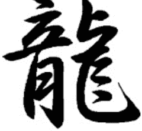

**Fig. 3.1: 汉字“龙”的图像**

要创建应用基于平行移位技术的图像处理方法的可能性，必须完成以下操作。

- 分层是根据亮度将图像分离为多个等级的过程。亮度范围的数量根据解决那些或其他问题的需要来选择。

- 二值化是将图像转换为二值矩阵的过程。该过程基于将每个像素的亮度与亮度阈值进行比较。在二值图像中，亮度高于阈值的像素对应值设为0，否则设为1。

- 去噪是减少图像中现有的非输入图像部分且由于外部因素的某些作用而出现的多余信息。执行该过程的典型方法是移除信号频谱的高频分量。

- 初步图像处理的下一个阶段是获取一组交叉区域函数的过程。

分层和图像二值化的过程比较简单。其实现与描述平行移位技术没有直接关系。因此，本书中不会详细讨论这些过程。这些步骤将是光栅图像处理分析中最重要的阶段。本章将更多关注去噪过程。

## 3.1 平面图形的边缘检测方法

基于平行移位技术的图像预处理描述将从描述二值图像边缘检测过程开始。此过程以前未被声明为预处理的一部分。但是，下面所示的是，边缘检测是使用平行移位技术在二值图像噪声去除过程中的一个阶段。

图像边缘检测本身就是视频信息处理系统的主要任务之一（Petrou and Kittler, 1991; Walsh and Raftery, 2002; Belan, 2011; Spacek, 1986）。尽管PST主要涉及不带边缘对象的操作，但其使用将允许在预处理阶段检测图像边缘。

在此，我们想停留在作为边缘呈现的对象概念上。这个术语在不同来源的图像中被不同地对待。轮廓打印图像在主体和背景之间做出了明确区分。也可以将轮廓图像解释为条形码或由细线组成的图像。本书将采用第二种解释，例如，乳头状线图具有高边缘值的图像。

目前，有许多图像边缘检测方法，几乎用于所有现有的图像处理和识别系统。这是因为边缘承载了对象的大部分图像信息。在数字数据处理中，边缘检测是通过使用各种掩模方法进行的。应用它们的主要缺点之一是，当边缘宽度改变时需要更换掩模。此外，随着初始边缘宽度的增加，掩模的大小也会增长。因此，边缘检测所需的操作数量和时间会增加。

基于平行移位技术的边缘检测的优势之一是可以检测任何预定宽度的二值图像的边缘。拟议的边缘检测方法可用于数字和非数字图像处理。要实现此过程，需要执行少量的操作。


边缘将呈现的形状是给定宽度 h 的一层，该层属于图形并位于与背景的边界上。在数字图像处理中，此值可表示为像素。在非数字图像处理中，h 值可以具有较远的值。

让我们考虑数字信息的边缘检测过程。在此情况下，边缘宽度 h 可以表示为像素。所有所需宽度 h 的图像边缘元素属于集合 C_rez。如果图像副本在 i 个单位上移位，则所有图像边缘元素属于集合 C_i。

```
C_{rez} = \sum_{i=1}^{h} C_i. \qquad (3.1)
```

应当注意的是 C_{rez} \neq C_h。

C_i 集合的定义可通过两种方式实现。为了获得 FAI，副本的移位可以循环执行，这将在后面的章节中讨论。第二种方法是在选定方向上移位图像副本，移位数为预定的像素数（或在非数字图像处理中为预定的距离）。该方法在硬件中实现要简单得多。

机器视觉系统在数字化过程中使用欧几里得坐标系作为感受野，移位容易在正交方向和对角线上组织。因此，在边缘检测过程的软件模拟中，使用了八个方向的移位。

对于 h = 3 像素的图像边缘检测过程的一部分如图 3.2 所示。在此情况下，对于边缘点，显示了副本图形在四个正交方向上的移位。

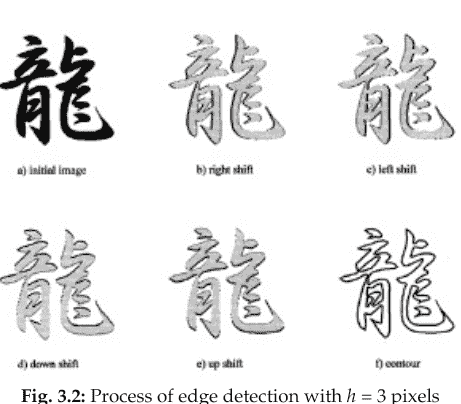

所有图中的黑色标记属于原始图像的点，而其余部分为图像副本和交叉区域的点。图中显示了副本在正交方向上移位 3 像素的情况。其中黑色元素的数量给出了边缘元素集合 C3。未显示 C1 和 C2 局部元素的移位图像，因为这些图像与给出的图像无区别。因此，它们不具信息性，对理解边缘检测过程帮助不大。出于相同原因，未显示对角方向的移位。

然而，在带宽 h 的边缘检测中，正交和对角方向的所有 C_i 始终存在。

基于平移技术的边缘检测过程的技术实现可能导致某些错误。假设生成图像中指定宽度的边缘如图 3.3 所示。应当注意的是，尽管图片包含两个对象，但它被视为一个。

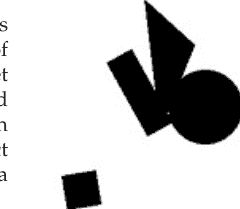

图 3.3：确定轮廓的图像

当通过将副本移位到八个方向来执行宽度为 20 像素的边缘检测时，将获得以下结果（图 3.4）。

在这种情况下，该过程的错误将是边缘确定不完整（错误侧）以及单个空像素（雪花）周围的边缘检测不完整。当存在内角（错误侧）和小空隙（雪花）的图像时，会发生这些错误。

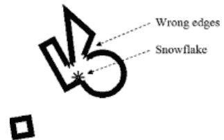

图 3.4：h = 20 时的轮廓定义错误

边缘检测过程中的问题解决方法如下：

- 1. 图像预处理：在预处理过程中，消除了二值图像中小空隙的存在。
- 2. 增加移位方向的数量：这将提供更详细的轮廓，并增加雪花分支的数量，使其更接近所需宽度的实际轮廓。
- 3. 减少所需边缘的宽度：当所需边缘宽度小于四时，上述错误在视觉上不可察觉。
- 4. 主要研究凸对象：这消除了内角的原因。所提方法的主要优点是能够检测任何给定宽度的图像边缘。

## 3.2 利用平移技术进行图像噪声去除

在现实世界中，任何智能系统对信息的感知都伴随着有用数据中存在一定量的噪声。误信息是由某些内部和外部因素的影响引起的。

智能系统在不改变环境的情况下无法影响外部因素。减少噪声量可以构建新的信号检测手段。

内部负面影响因素在系统内部信息传输过程中丢失，以及所选噪声控制方法中的误差。在信号处理中，噪声控制的方法之一是频率滤波。数字图像处理广泛使用各种掩模。它允许平滑物体像素亮度的突变。此外，掩模允许选择图像中的某些元素，以便将其从视觉场中移除。

使用平移技术允许将噪声去除过程分为三个阶段。由于平移技术分析了图像的形状，研究对象将被视为二值图像。半调图像在捆绑阶段被分为二值图像。假设噪声信息均匀分布在图像的所有亮度级别上。然后，如果将图像分为亮度级别范围并转换为 n 个二值对象，则每个范围中只包含所有非零噪声元素的 1/n 部分。零值的噪声元素将在每个图层中重复。落入每个二值对象中的噪声信息的预期数量小于原始图像的噪声量。因此，分离过程可以被视为噪声去除的第一步。

该过程的第二阶段应使用平移技术去除噪声。由于我们研究的是二值图像，在此情况下噪声可以被视为扭曲对象的独立单个元素和零元素的组。在软件模拟过程中，使用了以下类型的噪声：

- 1. “胡椒”类型噪声：二值图像视觉场中被填充为值“1”的单元。
- 2. “盐”类型噪声：二值图像视觉场中被零填充。
- 3. “盐”和“胡椒”类型噪声：这是前两种类型的组合。

在噪声去除过程中，有必要将上述边缘检测方法应用平移技术。在此情况下，必须移除定义为轮廓图像的所有图像部分。所需轮廓宽度 h 越大，被视为噪声并从视觉场中移除的对象尺寸就越大。但在此情况下，关于图像的大量有用信息将丢失。属于对象宽边界的大量项目将消失。由第二种类型噪声形成的内部区域中噪声显著增加。为了最大限度地减少噪声去除过程对图像轮廓的影响，我们定义最小宽度 h = 1。带有噪声的字符“龙”图像示例以及在 34 dB 噪声级别去除边缘点的结果如图 3.5 所示。

有必要评估去除边缘点时的信息损失以及在此情况下识别对象的能力。图 3.6 给出了无噪声包含的字符“龙”的 FAI (x)，图 3.5 显示了诸如“胡椒”之类的噪声的存在。在存在诸如“盐”和“胡椒”之类的噪声时，PSNR = 34 dB。

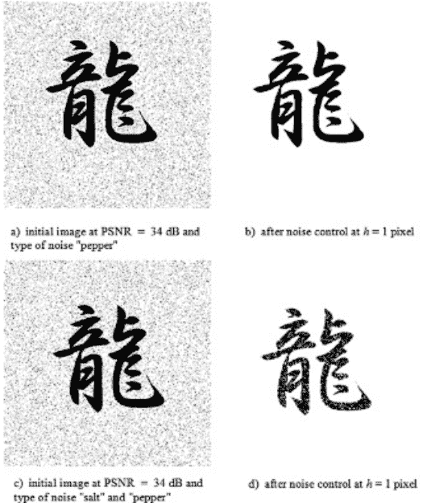

图 3.5：利用轮廓识别过程进行噪声控制

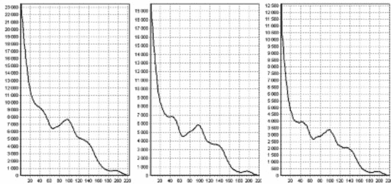

a) 无噪声图像的 FAI(x)

b) 具有“胡椒”类型噪声的图像的 FAI(x)

c) 具有“盐”和“胡椒”类型噪声的图像的 FAI(x)

图 3.6：不同类型噪声的图像 FAI(x)

在去除图像边缘点的结果中，包含各种类型噪声的图像的交叉区域函数值各不相同。然而，应当注意的是，一般而言，FAI 形式保持不变。因此，在将噪声去除后的图像交叉功能区域与模式图像的相同功能进行比较时，有必要考虑缩放因子 k_sc。

```
k_sc = S_0real / S_0etalon (3.2)
```

其中 S_0real 为去除轮廓点后的实际图像面积，S_0etalon 为模式图像面积。此外，在比较图像 FAI 时，还应记住图像尺寸可能不同。图 3.5 中显示的图片尺寸相同。因此，一般而言，需要按此函数的 x 轴进行缩放。模式图像的概念将在后面描述。对于不同于上述示例的其他方向，即 x 方向，计算方式类似。

基于缩放系数 k_sc 描述实际图像的某些系数计算示例如下。要调整实际系数，应将其乘以 k_sc。假设存在三个字符“龙”的图像，分别去除了不同的噪声级别（图 3.7）。噪声级别分别对应 30 dB、26 dB、20 dB。噪声控制过程是通过删除边缘点完成的。

表 3.1 显示了某些实际系数和调整系数的值。调整后的比率值与参考系数的差异不超过 10%。因此，在 PSNR 的噪声范围内，


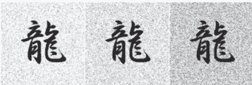

a) 初始图像

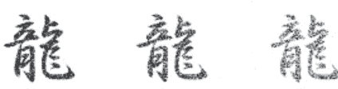

b) 降噪后

图 3.7：降噪前后的字符“龙”图像

表 3.1：一些真实和调整系数的值

| 系数或参数 | 无噪声 | 30 | 26 | 20 |
| :--- | :--- | :--- | :--- | :--- |
| 初始面积，\( S_0 \) | 23554 | 14374 | 11642 | 7830 |
| x方向积分系数，\( k_x \) | 0.23665 | 0.14999 | 0.12042 | 0.08319 |
| y方向积分系数，\( k_y \) | 0.28344 | 0.18105 | 0.14766 | 0.10033 |
| 密度系数，\( k_{p\rho} \) | 0.44393 | 0.27685 | 0.22023 | 0.15279 |
| 缩放系数，\( k_{sc} \) | 1 | 1.63865 | 2.02319 | 3.00817 |
| 调整后的 \( k_x \) | 0.23665 | 0.24578 | 0.24363 | 0.25024 |
| 调整后的 \( k_y \) | 0.28344 | 0.29667 | 0.29874 | 0.30180 |
| 调整后的 \( k_{p\rho} \) | 0.44393 | 0.45366 | 0.44556 | 0.45963 |

范围为 40 至 20 dB，在抗噪过程中可使用边缘点去除。

去噪过程的第三阶段是在创建时调整交叉区域的函数。以下是一个示例。假设去除边缘点后，图像仍如图 3.8a 所示，其 FAI(x) 如图 3.8b 所示。

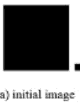

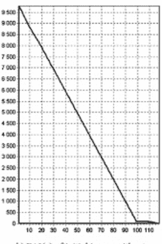

图 3.8：FAI 图中引起校正的示例

在此示例中，100 × 100 正方形图像包含主图像，而 10 × 10 正方形为噪声，在去噪过程中未被去除。如果噪声沿原始图像的移位副本方向，则交叉区域函数的形成可能会导致错误。在图 3.8b 的 FAI(x) 图中存在一个水平成分，这不允许正确确定最大移位。在此情况下，有必要对图进行校正。

我们引入噪声影响阈值（dN）的概念。dN 值指定输入图像面积（S0）中将被视为噪声的元素的某个百分比。因此，交叉区域函数的基本参数（如最大移位）的正确公式采用以下形式：

```
Xmax = x - 1, if FAI(x - 1) = FAI(x) and FAI(x) ≤ dN · S0 (3.3)
```

```
Ymax = y - 1, if FAI(y - 1) = FAI(y) and FAI(y) ≤ dN · S0 (3.4)
```

这些公式得到的值与使用零交叉属性获取最大移位值的选项完全一致。

请注意，穿越区域的小水平截面函数可能仅仅是输入对象形式的结果。在这种情况下，原始图像的那些元素将被视为噪声。使用噪声组件阈值，我们在构建过程中剪切 FAI 图中的多余信息。

除了使用交叉区域函数外，还有其他确定图形形状的方法（Belan 和 Motornyuk，2013）；例如，可以简单地扫描图像以确定排列在垂直于扫描方向的直线上的元素数量。例如，当正交排列扫描 100 x 100 正方形时，在 0 到 100 的范围内可以得到等于 100 的函数（图 3.9）。

让我们执行比较程序，将在确定对象形状过程中使用的平行移位技术（PST）的抗噪性与扫描图形尺寸的方法进行比较。

假设通过某种降噪方法去除干扰后，100 x 100 图像中包含 10 x 10 的噪声分量（图 3.8a）。然后，在垂直扫描时，我们得到函数 x = f(y)，在 y 值介于 0 和 10 之间时等于 110。这比扫描无噪声包含的 100 x 100 正方形所得的 100 值多出 10%。此外，不清楚如何解释任意图像中单元格之间可能存在的空单元格组。当分析的形状内部存在空腔时，可能会出现这种情况。

执行带噪声的相同正方形的 FAI(y) 定义（图 3.8a）。初始图像面积（S0）将等于 10100，比无噪声包含的 100 x 100 正方形面积多出 100 个单位。在 x 从 0 到 10 的部分中，由于噪声分量的影响，FAI 偏差从 100 降至零。在确定 FAI(x) 时，通过应用噪声元素阈值来抵消噪声的影响。示例中交叉区域函数的最大偏差接近 1%。因此，使用平行移位技术确定对象形状过程的抗噪性远高于扫描尺寸数据。这是因为由偏差 PST 确定的对象是图片元素的应用数量。当扫描由偏差定义的对象的形状尺寸时，

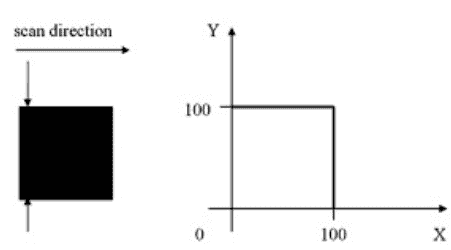

图 3.9：通过水平方向扫描生成对象形状函数 y = f(x) 的示例

它是扫描线上位于其两个边界之间的图像元素数量。

可以得出结论，通过增大对象的尺寸，可以增加构成它的元素数量。因此，这是由存在噪声拒绝所决定的基数增加。因此，利用平行移位技术的图像处理技术的抗噪性得以提高。

在比较图像处理算法函数时，可以使用允许误差 dS 的值。由此产生的问题是，该参数是否能够补偿由于噪声的存在以及由去噪过程引起的图形变形。图 3.10 显示了标准 FAI 图以及在噪声包含百分比（pN）为 10% 时去噪后交叉区域函数的图像。参数 pN 的解释及其与 PSNR 参数的关系在第 6 章中给出。图 3.10 中的实际交叉区域函数使用缩放因子 k_sc（公式 3.2）进行缩放。我们使用去除轮廓点的方法进行噪声控制。

实际图像和模板图像属于同一类。为了良好比较它们的交叉区域函数，有必要

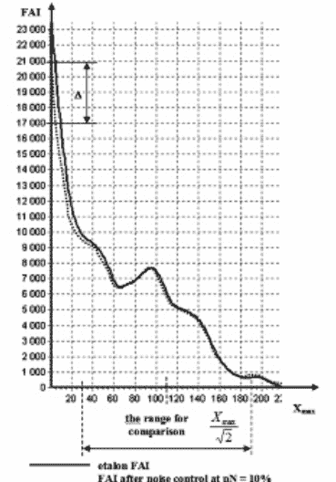

图 3.10：使用交叉区域函数的一部分来比较函数

使 dS 参数的值大于 Δ 偏差。然而，这会导致允许误差值增加。因此，在函数的详细阶段，可以分配对同一类不同图像的比较。如图 3.8 所示，如果存在变形因素，交叉区域函数的最大失真发生在开始处或接近最大移位值处。这取决于移位方向。无论如何，初始面积会因噪声的存在而改变。如果在图像副本的移位方向上存在噪声包含，则函数末端可能会出现显著的 FAI 失真。这类似于导致使用允许误差 dN 的因素。

有必要限制参数 dS 值的增加。为了在详细比较阶段解决此问题，并不使用所有交叉区域函数值；只考虑预期偏差最小的一个值范围。图 3.10 显示，该范围的长度等于所选方向最大移位的 70%。

由于对函数比较进行范围值限制有助于中和图像失真的影响，因此可以将其视为第四级噪声控制。

## 3.3 FAI 准备的技术方法

使用平行移位技术时，平面图像预处理的主要目标是将二维图像转换为一组交叉区域函数。

如前所述，交叉区域函数与对象形状的关系并不精确。因此，它们可用于图像识别过程。获取图像交叉区域函数及其副本的过程易于在硬件中实现。

处理数字图像时，获取交叉区域函数的过程如下：

- 1. 对于大小为 $k \times m$ 的输入图像数组，由元素 $a_{ij}, (a_{ij} \in [0;1])$ 组成，创建其副本（元素数组 $b_{ij}$）。
- 2. $S_0 = \sum_{i=1}^k \sum_{j=1}^m a_{i,j}$
- 3. 开始在选定的 $\varphi$ 方向上平行移动图像副本。
- 4. 在每个移位 $t$ 步骤中，创建由元素 $c_{ij}$ 组成的交叉数组（如果 $a_{ij} = 1$ 且 $b_{ij} = 1$，则 $c_{ij} = 1$；否则 $c_{ij} = 0$）。
- 5. $FAI(t) = \sum_{i=1}^k \sum_{j=1}^m c_{i,j}$


硬件过程可按如下方式实现。我们使用两个矩阵（A 和 B），其中之一（B）是一组移位寄存器。根据交叉区域中获得的函数类型，移位可以是循环的或非循环的。获得交叉区域函数的各种类型的原因将在后续章节中描述。矩阵 A 填充输入图像元素 aij。该 A 矩阵被复制到矩阵 B 中，在其中移位由控制设备的信号发生。适当的单元阵列组合逻辑乘积的元素。U 门的输出馈送到求和器，块级输出信号的值对应于当前时间移位的 FAI 值。求和器的构建可以使用标准逻辑元件（编码器、计数器、多路复用器、模数转换器）实现。交叉区域函数的旋转应持续进行，直到达到停止信号系统。非循环移位在交叉形状及其副本消失前执行，或者在受噪声效应阈值（dN）影响下达到 FAI 阈值时执行。接收 FAI 的设备方框图如图 3.11 所示。

在交叉区域函数中，平面二值图像被视为输入图像。矩阵元素设置为 0 或 1。为了研究半调图像，将适当点处亮度变化的梯度视为输入矩阵的元素。这为图像元素及其副本之间不同交互方法的应用开辟了广阔前景。尽管此方向尚未进行研究。

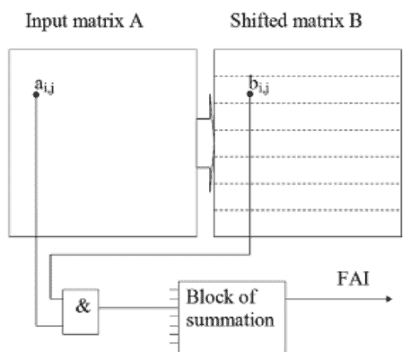

图 3.11：接收 FAI 设备方框图的图形表示

使用平行移位技术的预处理成像过程的主要目标是获得交叉区域函数。这可以归类为从一种形式向另一种形式转换信息。

## 3.4 获取非位图 FAI 的模型

大部分已知的预处理方法都将图像视为位图。将对象转换为交叉区域函数集合的方法允许处理位图图像以及非位图。在处理非位图时，不需要预处理和二值化过程。分离过程可以通过光学滤波器实现。在这种情况下，FAI 实现过程的可能模型如图 3.12 所示。

标记时间 t₁ 对应图像光通量区域 S₀ 路径出现的时刻。时间 t₂ 是并行移位后的形状及其副本的零交叉时刻。

在这种情况下，Lm1 = Lm – 2S₀ + FAI(t)，并且从 t₁ 到 t₂ 处的交叉区域函数值分别相等。

FAI(t) = Lm1 – Lm + 2S₀。

此获取非光栅图像 FAI 的模型仅在其实现可能性方面是示例性的。本文主要考虑光栅图像处理的变体。处理非位图或元素排列不规则图像的能力是基于平行移位技术方法应用的关键优势之一。

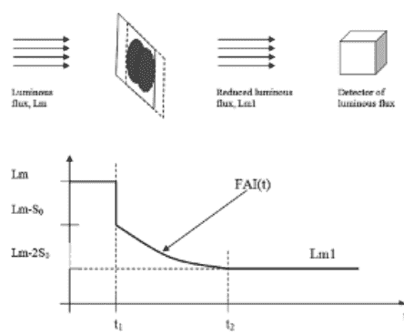

# 基于 PST 的动态图像处理方法

现代机器视觉系统涉及实时视频数据处理。特别是，此类系统的示例包括自主机器人、制造业装配线和监控系统（Belan 和 Yuzhakov，2013）。机器视觉系统的发展也可以作为人眼义眼的基础。

机器视觉系统帮助解决的主要任务如下：识别观测对象、确定其空间位置、物理参数及其在空间中的运动参数。

识别涉及确定对象所属类别，这是智能系统与对象进一步交互的行为分析基础（Chen 等人，1995）。此外，在自动化装配线中，此任务包括确定指定属性存在或缺失（或存在）的过程，这会导致产品被分类。

对象空间位置的建模针对两个坐标系统（内部和外部）进行。在外部坐标系中定位对象允许创建世界模型。该模型客观存在，不依赖于 IS 的实际位置。外部世界模型适用于许多智能系统，无论其个体特征如何。地理图可以是外部世界模型的简单示例。构建这些模型最简单的方法是借助外部定位设备。因此，该领域的一项重要成就是使用 GPS 系统。然而，外部世界模型的建立与平行移位技术无关。因此，本书不考虑视频处理的这一方面。

平行移位技术允许处理系统可将其视为平面图像的对象。这些对象应位于 IS 的直接周围。相对于内部坐标系定义位置对于智能系统执行与周围对象进行必要交互的行为是必要的。该模型对每个 IS 都是主观且个性化的。

确定物理参数（线性尺寸、面积、体积、轮廓形状）与识别和空间定位过程密不可分。该过程允许补充真实对象的环境模型。

对象运动参数的主要特征是方向、距离和位移速度。某些系统将加速度用作参数，但它只是速度的导数。因此，它与运动的基本参数无关。了解运动参数使智能系统能够构建及时行动的算法。这成为智能的一项主要任务——预测未来，以便及时响应外部因素的影响。

视频监控过程的硬件实现基于系统“传感器-分析单元”的使用。系统使用各种类型的传感器。基本上是普通（或专用）视频摄像机，但也可以使用超声波定位设备和其他设备来指示对象的空间位置。传感器的数量和类型根据实现该智能系统目标的需要及其几何参数进行选择。

普通摄像机和专用摄像机的区别在于，第一类摄像机固定图像以便进一步传输到分析单元。第二类摄像机内置处理器系统，以某种方式转换图像，从而加速进一步分析。

视频监控系统可以是固定和移动智能系统的一部分。固定系统的优势在于能够使用各种不同类型的传感器，并可将其布置在空闲空间中。生物体、自主机器人和交通中的视频监控系统属于移动对象。在这些情况下，传感器的使用受限于生物体或技术手段的尺寸。为了确定外部对象的空间位置和物理参数，建议使用双眼视频系统、激光传感器以及类似超声波定位的设备。

图像处理中一个重要因素是视频监控系统内部的信息交换速度。显然，在感知和数据初步准备的阶段，基于 PST 构建的系统比直接将数据传输到分析单元的系统运行得更慢。形成交叉区域函数集合的过程会导致一定的时间开销。


然而，在本例中，对对象分类的最终决定的采纳更容易实施。并行移位技术的使用允许信息的规整化。熵的任何减少都会导致智能系统生产力的提高。

## 4.1 确定平面的空间方向

基于并行移位技术的常见图像识别算法已在书中之前描述过。除模式识别外，该算法经过微小修改后可用于确定对象的空间方向。在此情况下，对象被视为平面图像。在三维对象中，其表面由许多区域组成，每个区域属于一个独立平面并作为平面图像。如果有机会从公共图像中选择这些区域，则可以确定它们的空间方向（Belhumeur et al., 1997）。

假设我们有一个图像，其参数存储在识别设备的内存中作为A模式。在图像在空间中的任意位置，该图形将显示为A模式到感受野平面的B投影（图4.1）。

在确定带有图形的平面的空间方向时，使用投影面积的属性。

$$
S_B = S_A \cos \gamma \tag{4.1}
$$

其中，\(\gamma\) 是包含A图形和B图形的平面之间的角度。为方便起见，这些平面将类似地称为A平面和B平面。

B平面垂直于从智能系统到图像的位置。平面\(\gamma\)角的顶点是一条直线，它在感受野平面（B平面）上形成，并与水平方向成\(\phi\)角。沿着这条线移动A和B图形的副本时，该区域的相应FAI值通过投影面积属性相关联。

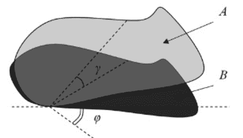

图4.1：对任意平面的等模A的B投影

无法立即确定\(\phi\)方向。因此，有必要对从0到\(\pi\)方向的所有B图形副本的移位进行搜索。由于交叉区域函数和积分系数集合中存在中心对称性，因此不需要对从\(\pi\)到0的方向进行搜索。此过程类似于快速识别过程（前文描述的常见识别算法）。它比较真实B图像在方向\(x = \phi\)和\(y = \phi + \frac{\pi}{2}\)下的积分因子。在此阶段，使用积分系数的恒定属性，当改变交叉区域函数的基本参数时，即在缩放时

因此，为了确定\(\phi\)方向，有必要执行以下操作。对于0到\(\pi\)范围内的每个可能位移方向，我们得到真实图像的交叉区域函数及其积分系数。确定满足以下公式的Y类等模：

$$
k_{x_A} = k_{x_B}
$$

$$
k_{y_A} = k_{y_B}
$$

对于Y类图形，有必要确定哪个方向（\(x = \phi\)或\(y = \phi + \frac{\pi}{2}\)）是直线的方向——平面\(\gamma\)角的顶点或投影的方向。

要找到正确的投影方向，有必要比较真实图像的交叉区域函数与Y类等模在方向\(x = \phi\)和\(y = \phi + \frac{\pi}{2}\)下的交叉区域函数。

这与识别算法的详细阶段类似。比较区域（4.1）。由于模式图形和真实图像的尺寸可能不同，会应用相应FAI的缩放。比较前，会执行保持函数比例的缩放。

在此阶段，存在以下四种可能情形：选项1。

$$
\frac{FAI(x)_B}{FAI(x)_A} = \text{const} = \cos \gamma \tag{4.4}
$$

and

$$
\frac{FAI(y)_B}{FAI(y)_A} = \text{const} > 1 \tag{4.5}
$$

如果公式（4.4）和（4.5）成立，则该模式被正确选择。投影相对于透视方向\(x = \phi\)进行；否则，我们转到Y类的下一个等模，其正确公式为（4.2）和（4.3）。选项2。

$$
\frac{FAI(x)_B}{FAI(x)_A} = \text{const} > 1 \tag{4.6}
$$

and

$$
\frac{FAI(y)_B}{FAI(y)_A} = \text{const} = \cos \gamma \tag{4.7}
$$

如果公式（4.6）和（4.7）成立，则该模型被正确选择。投影相对于透视方向\(y = \phi + \frac{\pi}{2}\)进行；否则，我们转到Y类的下一个等模，其正确公式为（4.2）和（4.3）。选项3。

$$
\frac{FAI(x)_B}{FAI(x)_A} = \text{const} = 1 \tag{4.8}
$$

and

$$
\frac{FAI(y)_B}{FAI(y)_A} = \text{const} = 1 \tag{4.9}
$$

如果公式（4.8）和（4.9）成立，则该模型被正确选择。该选项与识别算法的详细步骤完全一致。真实图像\(B\)形式对应标准\(A\)形式；否则，我们转到Y类的下一个等模，其正确公式为（4.2）和（4.3）。选项4。

$$
\frac{FAI(x)_B}{FAI(x)_A} \neq \text{const} \tag{4.10}
$$

and

$$
\frac{FAI(y)_B}{FAI(y)_A} \neq \text{const} \tag{4.11}
$$

在这种情况下，模式未被正确选择；我们转到Y类的下一个模式，其正确公式为（4.2）和（4.3）。在所有阶段，比较都针对有效的比较系数\(dk\)和\(dS\)进行。

如果没有找到可以作为真实B图形投影的模式，则建议执行系统学习过程以纳入模式阵列。

对于简单形状，应考虑到每个三角形都是等边三角形的投影，每个椭圆都是圆的投影，每个平行四边形都是正方形的投影。这些属性可用于椭圆和平行四边形的分类。

使用该方法计算了角度\(\phi\)和\(\gamma\)，我们可以准确确定2D形状相对于感受野平面的空间方向，如果其参数在模式阵列中可用。确定对象的空间方向对于自主机器人和装配线的自动系统“眼-手”的运行是必要的。尚未开发出用于选择3D对象表面特定部分的有效方法。在这种情况下，装配线上不规则分配的某些组件部件可以被标记，从而允许装配线设备基于并行移位技术的平面空间方向确定方法捕获组件。

## 4.2 基于PST的视频处理设备中图像副本不同移位类型的应用

在描述基于并行移位技术确定对象运动参数的方法之前，应强调一个重要点。此前已提到，可以使用图像副本的循环移位和非循环移位来形成交叉区域函数。例如，在向右循环移位时，会发生以下操作。如果图形副本落在感受野右边界之外，它将出现在感受野左部分的同一水平，并继续向右移动（图4.2）。

如果不使用图形副本的向右循环移位，它会超出感受野右边缘。移位类型由图像矩阵的副本决定，该矩阵建立在选定的移位寄存器上。在预处理阶段关于形成交叉区域函数的部分中，它被命名为B矩阵。如果它建立在循环移位寄存器上，则得到循环移位过程。当使用非循环移位寄存器时，不会发生循环移位。

不同类型的图像副本移位可应用于各种设备。通过并行移位技术确定对象运动参数的方法也会不同。循环移位的组织主要应用于生物体视觉器官的假体。生物信息系统以其感受器感知的不间断信息流为运行对象。


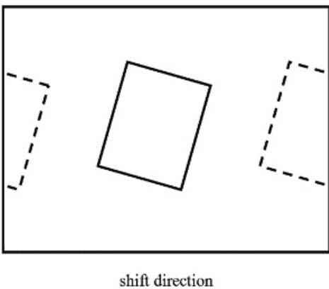

图 4.2: 图形的循环移位过程

使用复制图像循环移位的缺点如下：

- 1. 无法实现零交叠情况，如果图形在位移方向上的双倍最大尺寸在同一方向上超过感受野宽度的一半。
- 2. 时间依赖性：执行某些图像处理任务时，需要分析交叠面积连续循环函数的不同部分。FAI 的形成过程，其长度足以进行分析，需要一定的时间，即，需要花费几个图像副本移位周期来解决问题。当物体移动时，其图像相对于初始位置可能在感受野区域内显著移动。这使得确定其与移动副本的交叠变得更加困难甚至不可能，但解决办法可能是提高图像副本的剪切速率。
- 3. 移动图像副本形成过程受阻：基于非循环移位图像的方法的主要缺点导致需要在不同时间对视频帧流进行分区。在非数字 IS 中使用此方法来形成交叠面积函数非常困难。然而，在机器视觉系统的组织中使用图形副本的非循环移位简化了结构。

解决这些问题的方法将在介绍适当的视频处理方法时进一步展示。

## 4.3 使用循环移位确定运动参数的方法

使用平行移位技术可以确定物体的运动参数。运动的主要参数包括物体在感受野中的位移方向和距离。下面描述在形成交叠面积函数时，通过使用图像副本的循环移位来确定物体运动参数的方法。

如果原始图像保持静止，交叠面积函数相对于输入图像、受实际状态影响的其副本（正在移动）的完全重合点中的每一个点都是周期性和对称的（图 4.3）。

这里交叠面积函数的参数等于以下值：FAI 周期 (T)——水平方向剪切的感受野宽度和垂直方向剪切的高度；每个 FAI 波峰（对应非零交叉的函数部分）的宽度——沿移位方向分别为 2X_max 或 2Y_max；以及最大 FAI 振幅——输入图像的面积 (S_0)。为便于硬件实现，选择正交位移方向。周期 (T) 以距离测量单位计算。这对于栅格图像处理很有用。对于非栅格图像，用副本剪切速度 (V) 和时间 (t) 来表示此选项很方便，其中有一个定义的过程。

例如，\( T = Vt_T \) 或 \( X_{max} = Vt_{X_{max}} \)

其中，\( t_T \) 是图像副本在感受野宽度上移位的执行时间；\( t_{Xmax} \) 是位移到最大位移值的时间。

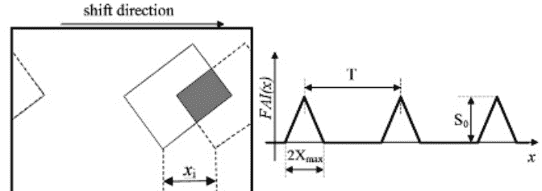

**图 4.3:** 循环移位过程图像及循环 FAI (x) 图的示意图表示

如果确定运动参数的图像在感受野中沿正交方向移动，那么副本在同一方向上的循环移位将是函数的周期 (T)，该周期将根据图形的运动方向而变化。在沿副本位移方向移动时，由于多普勒效应，函数峰值之间的周期（称其为 T1）将大于 T，而在反向方向则会小于 T。

假设图像不沿正交方向移动，且副本的移位速度非常快，以至于在计算交叠面积期间，图形来不及沿垂直于移位方向移动。那么每个循环 FAI 波峰都将是对称的，但其振幅小于固定输入图像。在这种情况下，函数的周期 (T1) 定义为两个相邻最大振幅波峰中心之间的距离。

让我们假设，在确定 FAI (x) 时图形副本向右移动，在确定 FAI (y) 时向上移动，且图形的质心位于坐标原点。假设正交方向没有移动，那么运动图像方向的角切线 ($\alpha$) 将等于：

tg$\alpha$ = $\frac{\Delta T_y}{\Delta T_x}$ = $\frac{T_{y1} - T_y}{T_{x1} - T_x}$, (4.12)

其中，$T_{y1}$ 是移动图像的 FAI (y) 周期，$T_y$ 是静止图像的 FAI (y) 周期，$T_{x1}$ 和 $T_x$ 是相应的 FAI (x) 周期。
当物体发生正交移动时，

$\Delta T_y = T_{y1} - T_y = 0,$ (4.13)

如果物体水平移动，

$\Delta T_x = T_{x1} - T_x = 0,$ (4.14)

如果物体垂直移动，在垂直移动过程中方向角 $\alpha$ 等于 $\frac{\pi}{2}$
一个位移周期内物体的位移距离如下：

$\Delta T = \sqrt{\Delta T_x^2 + \Delta T_y^2}.$ (4.15)

应指出，确定参数 $\Delta T_x$ 和 $\Delta T_y$ 的时间必须同步。为此，在硬件实现中，感受野的宽度和高度参数 ($T_x$ 和 $T_y$) 应相同。

给定参数 \(\Delta T_x\) 和 \(\Delta T_y\) 以及 tg\(\alpha\) 的符号唯一确定图像相对于其原始位置的运动方向（图 4.4）。运动基本参数的确定方法仅受限于副本循环移位的技术能力速度。基于正交移动特性的局限性可用于公路、水路和铁路运输的视频监控系统。这有助于这些类型运输在水平面上的机动。此类局限性可大大简化用于确定外来物体运动参数的自动化视频监控系统的构建。

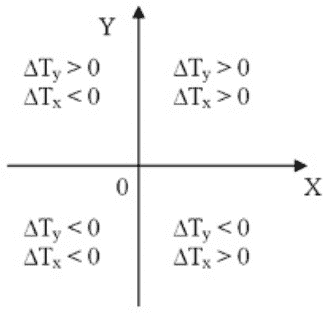

图 4.4: 物体的运动方向取决于 \(\Delta T_x\) 和 \(\Delta T_y\) 的符号

## 4.4 使用非循环移位确定运动参数的方法

在 FAI 形成过程中使用图像副本非循环移位来确定物体运动参数的方法，基于对物体质心的确定。连续视频流被分为对应于不同时间点的帧。对于每个时间点，确定物体在感受野中的位置。此外，将图形在当前时刻的坐标与对应于前一帧时间的类似坐标进行比较。

在数字信息处理中，图像质心的坐标 (\(x_{cm}\) 和 \(y_{cm}\)) 定义为其所有 \(n\) 个元素坐标的平均值。

\(x_{cm} = \frac{\sum_{i=1}^n x_i}{n}\) (4.16)

\( y_{cm} = \frac{\sum_{i=1}^n y_i}{n} \) (4.17)

显然，确定图像质心坐标时的操作数随其元素数量的增加而增加。此外，在研究非位图图像或元素位置不规则的对象时，不清楚如何确定坐标。

使用平行移位技术，可以按如下方式确定图像的质心坐标。当沿正交方向移动图形副本时，需要固定位于感受野内的图形副本部分的面积等于初始图像面积一半 \(\left( \frac{S_0}{2} \right)\) 的时刻。此时的移位值将是质心的一个坐标（图 4.5）。质心在另一个正交方向上的坐标值以类似方式定义。

应当指出，在这种情况下，坐标是指图形质心到感受野边界的距离。不存在对原点的绑定。当在某个位置固定原点时，需要对质心图形的坐标进行适当修正。例如，当在感受野左上角固定起始坐标时，图像质心的修正坐标 (\( x'_{cm} \) 和 \( y'_{cm} \)) 如下。

\( x'_{cm} = T_x - x_{cm} \), (4.18)

\( y'_{cm} = T_y - y_{cm} \). (4.19)

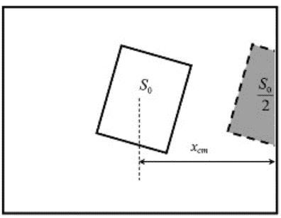

图 4.5: 确定图像质心 \( x_{cm} \) 坐标过程的图形显示


感受野中物体位移的距离和方向是通过分析每对相邻帧图像质心的调整坐标来确定的。

## 4.5 确定移动物体距离的方法

前面各节中描述了允许定义视方向垂直平面内物体运动参数的方法。这些方法无法确定所研究图像的距离。以下是一种通过分析交叉区域面积函数来确定物体距离的方法。

为了对物体进行空间定位，需要确定到其的距离。物体距离的定义有多种方法，例如，利用超声波定位、激光以及双眼视觉系统构建。为了不采用其他特性技术，PST被用于确定此参数。2D物体距离的测定可以利用图4.6的相似性特性来实现。

根据这些特性

```
\frac{l + \Delta l}{l} = \frac{Y_{max 0}}{Y_{max 1}} = \sqrt{\frac{S_0}{S_1}}, \quad (4.20)
```

由此得出

```
l = \frac{\Delta l \sqrt{S_1}}{\sqrt{S_0} - \sqrt{S_1}}. \quad (4.21)
```

其中 \(l\) – 初始物体距离；\(Y_{max0}\) 和 \(S_0\) – 时刻 \(t_0\) 时的 FAI(y) 参数；\(l_1\) – 到物体的距离；\(Y_{max1}\) 和 \(S_1\) – 时刻 \(t_1\) 时的 FAI(y) 参数。

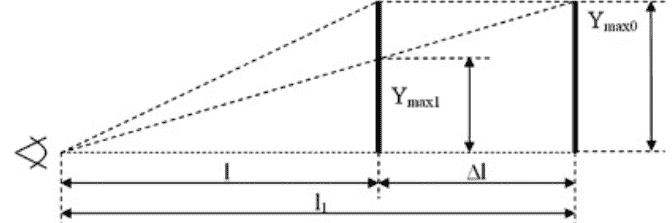

图 4.6：确定物体距离过程的图形模型

要确定初始物体距离 \(l\)，可以通过移动光学系统本身或改变感知摄像机的焦距来改变到物体的距离（类似于眼睛的调节过程）。由此，指定 \(\Delta l = l_1 - l\)。为了获得 \(\sqrt{S_0}\) 和 \(\sqrt{S_1}\) 的值，需要通过改变焦距或光学系统的位移距离，在变化前（$t_0$）和变化后（$t_1$）时刻确定物体面积。

在所提方法中，$t_0$ 和 $t_1$ 时刻对应于建立两个相邻帧，此时不发生副本图像的循环移位。

在由于物体距离变化而对图像副本进行循环移位时，交叉区域面积连续函数的形状会发生变化。当物体远离观察者时，另一种 FAI 峰的形状尺寸会变小（$S_1 < S_0$），其宽度变化不大（$X_{max 0} \approx X_{max 1}$），并且在顶部会出现水平分量。当物体靠近观察者时，常规 FAI 峰的形状变化如下。最大 FAI 值不变（$S_1 = S_0$），但其宽度会显著变化（$X_{max 0} < X_{max 1}$），并且在顶部会出现水平分量。交叉区域面积循环函数形状的变化示例见图 4.7。

在这种情况下，物体距离应通过两个面积参数（$S_1$ 和 $S_0$）以及最大位移值（$X_{max 0}$ 和 $X_{max 1}$）进行分析，使用变化的那些。在计算中移除图形时，使用交叉区域面积函数的值。

```
$l = \frac{\Delta l \sqrt{S_1}}{\sqrt{S_0} - \sqrt{S_1}}$
```

在计算中接近图形时，使用最大位移值。

```
$l = \frac{\Delta l \cdot X_{max 1}}{X_{max 0} - X_{max 1}}$
```

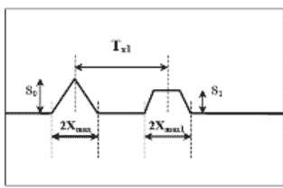

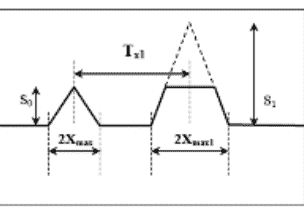

a) 删除物体  
b) 物体靠近  

图 4.7：循环 FAI 形状变化示例

使用所给方法确定物体距离受限于组织确定图像区域的过程以及副本快速平行移位的可能性。在使用图像副本的循环移位时，移位速度非常重要。它越大，我们就能越准确地确定物体位置。

## 4.6 使用图像副本不同类型移位的运动参数确定方法比较

为了比较使用图像副本不同类型移位确定运动参数的方法，创建了软件模型。跟踪了移动物体的三种轨迹类型。第一种类型——确定边界框对角线交点的位置；第二种类型——确定图形的质心位置；第三种类型——使用分析循环 FAI 计算轨迹。

测试使用了带有白色背景、AVI 格式、分辨率 640×480 的移动黑色物体视频文件。视频文件中各帧序列如图 4.8 所示。

三种类型物体运动轨迹图像的结果如图 4.9 所示。

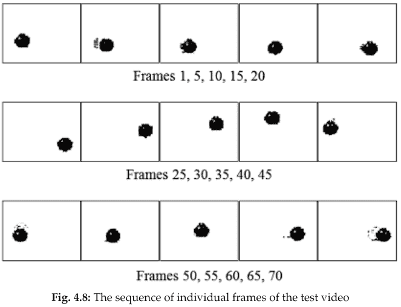

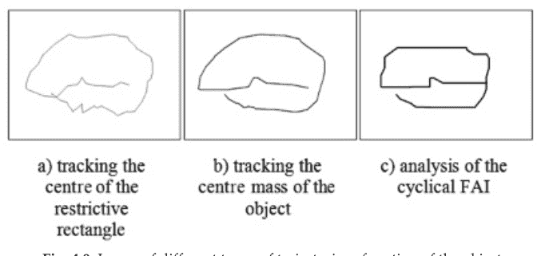

在确定位置时，由于测试物体形状的变化，边界框对角线交点存在失真。如果对每次移位执行图像预处理，轨迹会更平滑。该方法的结果仅用于控制展示，与 PST 无关。

通过分析循环 FAI 模拟运动路径的确定最为困难。为了确定周期（Tx1 和 Ty1），我们需要在交叉区域面积连续函数的特定区域寻找峰值。此外，由于感受野宽度和高度的不同，确定交叉区域面积函数的同步过程也很困难。选择 640×480 分辨率是为了能够通过标准手段创建测试视频文件。

软件实现中跟踪图形质心的方法效果最好。该方法适用于机器视觉系统的实现。

尽管总体存在不足，但不同方法获得的数据之间存在明显的相关性。基于平行移位技术的确定物体运动参数的方法的主要优势是能够在不进行数字图像处理的情况下处理视频数据。

# 基于 PST 的图像处理系统

基于所提方法（这些方法利用平行移位技术实现各种图像处理任务），可以构建计算机视觉系统。采用该技术构建的设备可以作为独立系统，也可以作为与数字图像处理设备结合的混合系统数据处理的一部分使用。

通常，智能系统按照“感受器—分析单元—执行器”的方案运行。在以“感受器”和“执行器”形式进行的信息处理过程中，使用简单的传感器和操纵器，它们不执行任何分析操作。在此情况下，分析单元是处理器。为了提高 IS 的性能，开发了专门的感知设备，对物体的影响本身开始执行某些分析功能。智能系统元素在执行感知、分析和合作任务时使用简单和专用外部设备的交互电路如图 5.1 所示。

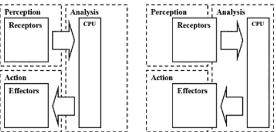

图 5.1：智能系统元素交互方案

## 5.1 视频信息感知系统

平行移位技术允许转换信息以改善其正在处理的单元的性能。使用平行移位技术的结果是广义化信息，这将简化数据处理。本书描述了使用该技术构建专用视频处理设备的可能性。在上述信息处理方法中，考虑了对二值图像的操作。此外，目前非数字设备的创建可能性尚未得到充分研究。只进行了模拟计算设备的研究。基于这些事实，视频感知系统应包括数字化和二值化步骤。还需要具有噪声控制工具。基于平行移位技术的图像处理设备的主要模块是交叉区域面积函数形成模块和这些函数的分析模块。一种图像处理设备选项的结构电路如图 5.2 所示。

考虑了处理噪声和形成交叉区域面积函数的方法。在此阶段，特别关注图像束的过程。存在几种在特定区域进行图像分离的方法。形态分离包括选择连接区域。然而，通过硬件方法组织这样的分区是困难的。因此，在此阶段，可以根据其元素的亮度确定将对象划分为各部分的定量特征。按形态特征分割图像可以在分析阶段进行。

对于每个生物物种，环境参数都有一定范围，在此范围内可能发生某种感觉器官的感知。例如，人感知声波频率范围为 4 Hz 至 16,000 Hz，并视觉感知 384 至 790 THz 的频率波段。感觉器官对变化定量特征的敏感性也是有限的。频率值接近的波被感知为相等。为了在图像部分上实现分离过程的硬件实现，需要对这些区域进行精确量化。图像元素的接近亮度值归为一组。该过程模拟了生物智能系统对环境的感知。

图像可以以不同的方式划分为范围。图 5.3 显示了三种可能的输入对象分割变体，具体取决于亮度特定阈值的比率。为了进一步处理，可以同时使用所有分组选项。

假设输入图像按亮度级数分为 (m) 个部分。然后每个部分将是一个独立的图像。对于每个这样的层，有必要定义一组


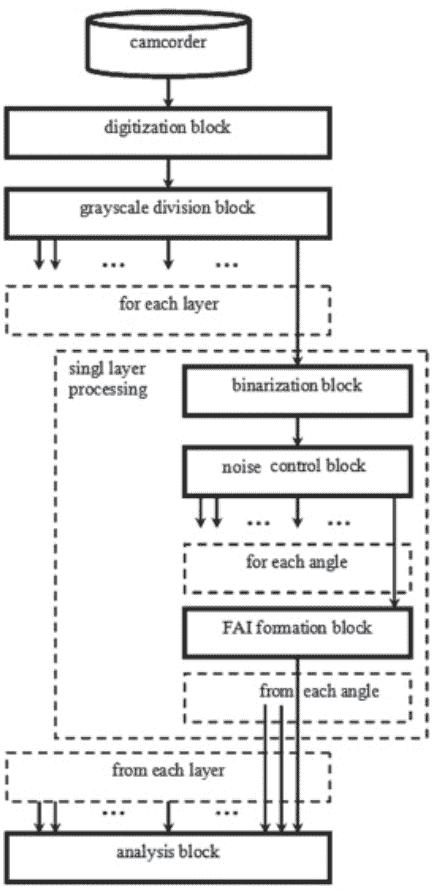

图 5.2：图像处理设备的一个实施例的结构图

function of the area of intersection. The process for each layer necessarily includes binarisation and noise control means. The process of removing noise components was previously described. Further, each of the m images is sent to the n device of construction of the functions of the area of intersection. This number of devices is determined by the number n of directions, which are determined by FAI. During software modelling the image n = 36 was used. Thus, the range from 0° to 180° with a step 5° was covered.

交叉区域的函数。每一层的处理过程必然包括二值化和噪声控制手段。去除噪声分量的过程之前已有描述。此外，每个 m 幅图像都会发送到构建交叉区域函数的 n 个设备中。设备数量由 FAI 确定的 n 个方向的数量决定。在软件建模中使用了 n = 36 的图像。因此，以 5° 为步长覆盖了 0° 到 180° 的范围。

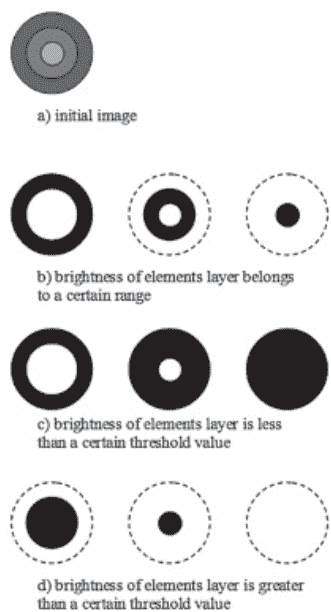

图 5.3：将输入图像分割成段的示例

As a result of device work on the unit of analysis is supplied a set of m×n functions of the area of intersection for further processing. In the analysis unit image processing methods that are described earlier are implemented.

作为设备工作的结果，分析单元会得到一组 m×n 个交叉区域函数，用于进一步处理。分析单元中实现了前面描述的图像处理方法。

The presented version of an image processing device is more suitable for biological intelligent systems. In this case, the FAI generating unit may include a set of registers of cyclic shift of the copy image. Information flows from the camcorder to the digitisation unit and from the formation of FAI block on analysis unit are continuous. They are not divided into individual frames.

所提出的图像处理设备版本更适合于生物智能系统。在此情况下，FAI 生成单元可以包含一组图像副本的循环移位寄存器。信息从摄像机流向数字化单元，以及从 FAI 形成模块流向分析单元的过程是连续的。它们不分为单独的帧。

The scheme in image processing device for use in computer systems somewhat changes (Fig. 5.4). After the digitisation process is added the framing unit. We assume that the frame is a slice of video stream at a certain time. The frames may be stored in memory for subsequent processing by the same device or for transmission of manipulations in another data processing system; for example, for digital image processing.

用于计算机系统的图像处理设备方案有所变化（图 5.4）。在数字化过程后增加了帧处理单元。我们假设帧是某一时刻视频流的一段切片。帧可以存储在内存中，以便由同一设备进行后续处理，或用于向另一个数据处理系统传输操作；例如，用于数字图像处理。

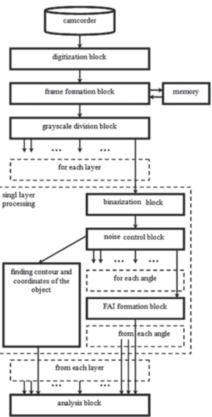

图 5.4：具有视频流帧预选功能的图像处理设备结构图

In the FAI case, the set of cyclic shift registers is not necessarily used. Simultaneously with the formation of functions of the area of intersection edge of the object can be selected to determine its coordinates. Then the analysis unit will need to transfer not only the m×n values of the functions of the area of intersection, but also the images of m areas edge of the object and 2m values of their coordinates.

在 FAI 情况下，循环移位寄存器组未必会被使用。在构建交叉区域函数的同时，可以选取物体边缘以确定其坐标。此时，分析单元不仅需要传输交叉区域函数的 m×n 个数值，还需要传输物体边缘的 m 个区域图像及其 2m 个坐标值。

For the processing of objects with dimensions of more than two in such devices, the camera must be replaced by a corresponding detector. The forming units of intersection object functions and its copy must also be modified.

对于处理此类设备中维度大于二的物体，必须将摄像机替换为相应的探测器。形成物体交叉函数及其副本的单元也必须进行修改。

In the analysis of continuous functions, it is necessary to know what areas of FAI graphics is responsible for performing certain operations. In Fig. 5.5 certain functions of the area of intersection with the specified areas are and the analysis of which allows performing certain image-processing tasks (Dai and Nakano, 1998).

在分析连续函数时，需要知道 FAI 图形的哪些区域负责执行某些操作。在图 5.5 中，某些交叉区域函数与指定区域相关，对其分析允许执行特定的图像处理任务（Dai 和 Nakano，1998）。

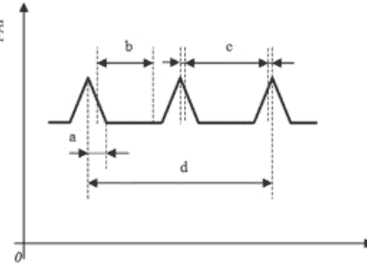

图 5.5：FAI 图各部分用于执行特定操作的分布

The a graph segment is used to implement the pattern recognition process for determining the spatial orientation of objects—segment b—in determination of the coordinates of the initial location, area c—in determining the outline of the image and in the fight against noise, area d—in determination of the parameters of the object. The FAI graph on Fig. 5.5 is schematically shown and only in one displacement direction of the image copy. The right boundary of b segment is chosen arbitrarily. It depends on the actual distance from the centre of mass of the object to the edge of the field receptor. The FAI area specialisation for other areas is similar. Here the function of the area of intersection depends on the time (t). In order to determine the function values dependent on the distance, it is sufficient to multiply the corresponding time periods on a shear rate of object copy.

a 段图形用于实现确定物体空间取向的模式识别过程；b 段用于确定初始位置的坐标；c 区域用于确定图像轮廓以及抗噪声；d 区域用于确定物体参数。图 5.5 中的 FAI 图以示意图形式展示，且仅显示图像副本的一个位移方向。b 段的右边界是任意选择的。它取决于物体质心到视场接收器边缘的实际距离。其他区域的 FAI 区域专业化情况类似。此处，交叉区域函数取决于时间（t）。要确定随距离变化的函数值，只需将相应的时间段乘以物体副本的剪切速率即可。

The need to take into account the Euclidean coordinate system, some of the image-processing tasks are enough to only perform orthogonal directions shear copy. These tasks include determination of initial coordinates of an object and its movement parameters.

考虑到需要使用欧几里得坐标系，某些图像处理任务只需执行正交方向的副本剪切即可。这些任务包括确定物体的初始坐标及其运动参数。

To perform each of these tasks, a separate device is constructed by using non-cyclical FAI. These devices are included in the image-processing system in parallel with the process of formation of the function of the area of intersection. Determination of movement parameters is performed by calculating the centre of mass of the object.

为执行上述每项任务，均采用非循环 FAI 构建单独的设备。这些设备与交叉区域函数形成过程并行包含在图像处理系统中。运动参数的确定通过计算物体的质心来完成。

Based on the proposed image-processing methods, use of parallel shift technology can construct an image-processing system. The block diagram of this system is shown in Fig. 5.6.

基于所提图像处理方法，利用平行位移技术可以构建一个图像处理系统。该系统的框图如图 5.6 所示。

The proposed image-processing mechanisms in some cases can be more productive than in the use of digital processing. The presence of such devices in the machine vision systems allows organisation of rapid

所提图像处理机制在某些情况下可比使用数字处理更高效。此类设备在机器视觉系统中的存在，使得能够组织快速

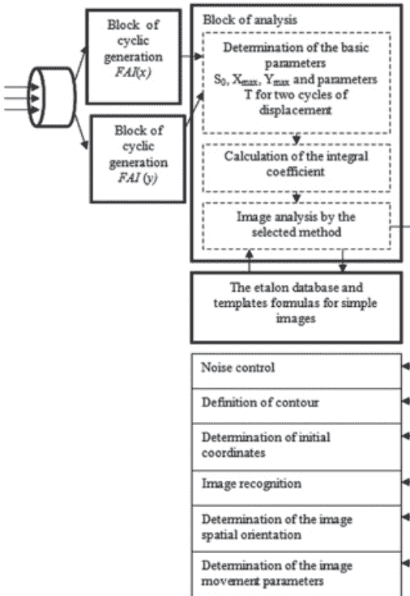

图 5.6：机器视觉系统方案

## 5.2 Saving Template Functions of the Area of Intersection

The analysis blocks for all variants of imaging devices should include memory units. For each image it is necessary to save a certain pattern surface which consists of the given FAI figure for 0,π directions of shift. It will allow the implementation of tasks of recognition of images and determination of their spatial orientation. Save the pattern functions for all directions 0,2π is not required, as the reference surface has a central symmetry.

## 5.2 保存交叉区域模板函数

所有成像设备变体的分析块都应包含存储单元。对于每幅图像，有必要保存一个由 0、π 位移方向给定的 FAI 图组成的特定模板曲面。这将允许执行图像识别和确定其空间取向的任务。不需要保存 0、2π 所有方向的模板函数，因为参考曲面具有中心对称性。

Only a set of FAI reflects in itself information about the form of a specific object. Whatever additional factors are not used in the image-processing system to speed up the action of processing algorithms, at the final stage it is always the process of comparing the actual and pattern FAI.

仅 FAI 集合本身就反映了特定物体形状的信息。无论图像处理系统中不使用哪些额外因素来加快处理算法的运行速度，在最终阶段始终是将实际 FAI 与模板 FAI 进行比较的过程。

Arrays of template surfaces can be stored in digital or in analog forms. Saving of standard surfaces in digital format entails numerous hardware costs and the availability of additional processing means in the comparison of functions. Before comparing, it is necessary to scale the real and etalon FAI.

模板曲面数组可以以数字或模拟形式存储。以数字格式保存标准曲面会带来许多硬件成本，并且在函数比较中需要额外的处理手段。在比较之前，有必要对实际 FAI 和标准 FAI 进行缩放。

There are several options to reduce the amount of necessary information for storage of pattern surfaces; for example, to store in the database of reduced copies of the template images. In this case, the value of standard FAI is generated from a template in the process of recognition, but in increased recognition time, because for each stored template, it is needed to generate the pattern surface at each recognition. Stored etalons must be small enough to reduce the hardware cost of storing this information. Scaling of standard functions towards increase will lead to appearance of false information. Comparison of functions will be quite rough, leading to errors in recognition.

有几种选项可以减少存储模板曲面所需的信息量；例如，在数据库中存储模板图像的缩小副本。在这种情况下，标准 FAI 的值在识别过程中从模板生成，但会增加识别时间，因为对于每个存储的模板，每次识别都需要生成模板曲面。存储的标准必须足够小，以降低存储这些信息的硬件成本。将标准函数向增加方向缩放会导致虚假信息的出现。函数比较会比较粗糙，从而导致识别错误。

Saving of pattern surfaces in analog form can, with high precision, display the functions of the area of intersection. A variant of this saving may be the use of holography. The holographic data storage methods are at research stage.

以模拟形式保存模板曲面可以高精度地显示交叉区域函数。这种保存的一种变体可能是使用全息术。全息数据存储方法目前处于研究阶段。

Another method of saving the templates is to replace of the pattern FAI by a certain auxiliary function that depends on the input function of the area of intersection. The rapid transformation of the function in a Fourier series was used in software simulation of image processing on the basis of parallel shift technology. The displacement range from zero to the maximum value of the shift in the chosen direction was used. This option is simple in the process of implementation and significantly reduces the hardware costs and does not require additional function-processing methods.

保存模板的另一种方法是用某个辅助函数替换模板 FAI，该辅助函数取决于交叉区域的输入函数。在基于平行位移技术的图像处理软件模拟中，使用了函数的快速傅里叶级数变换。使用了从零到所选方向位移最大值的位移范围。此选项实现过程简单，可显著降低硬件成本，且不需要额外的函数处理方法。

The amount of information needed to store template surface as elements of auxiliary function depends on the number of templates in the database.

存储作为辅助函数元素的模板曲面所需的信息量取决于数据库中模板的数量。

Based on PST, image processing encourages the development of new methods of information storage. The set of actions for the preparation of comparison of templates and of real FAI at various variants of saving of standard surfaces is shown in Fig. 5.7.

基于 PST，图像处理推动了新信息存储方法的发展。在各种标准曲面保存变体下，为准备模板与实际 FAI 的比较而采取的一系列操作如图 5.7 所示。

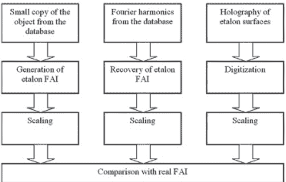

图 5.7：不同标准曲面保存变体下标准和实际 FAI 比较准备流程

A possible solution to the problem of saving standard FAI is the use of their transformation into a Fourier series. As is known, such a transformation brings full information about the function. However, the use in processes of storage and restoration of data of Fourier series, which describes the function of the area of intersection, no given advantage is seen in reducing the amount of stored information. For this, storage may be used only in part of the harmonics of series that is similar to the low-pass filtering process.

解决标准 FAI 保存问题的一个可能方案是将其转换为傅里叶级数。众所周知，这种变换提供了关于函数的完整信息。然而，在数据的存储和恢复过程中，使用描述交叉区域函数的傅里叶级数并未看到在减少存储信息量方面的优势。为此，存储可以仅使用级数的一部分谐波，这类似于低通滤波过程。

In addition, the value of the harmonics of Fourier series depends on the area of the pattern figure. For unification the size of the harmonic values needs to be normalised. To do this, the value of each element of a number should be divided by the value of the input image area. In this case, the values of all harmonics will be close to unity, which simplifies the storage of information in databases.

此外，傅里叶级数谐波的值取决于模板图形的面积。为了统一，谐波值的大小需要归一化。为此，应将数中每个元素的值除以输入图像的面积。在这种情况下，所有谐波的值都将接近于 1，这简化了数据库中信息的存储。


在构建反映标准 FAI 的傅里叶级数时，采用了以下归一化谐波公式（Mills, 2006）：

$FFTN_0 = \frac{1}{S_0} \frac{1}{\sqrt{X_{max}}} \sum_{j=0}^{X_{max}-1} FAI(j) \quad (5.1)$

$FFTN_i = \frac{1}{S_0} \frac{\sqrt{2}}{\sqrt{X_{max}}} \sum_{j=0}^{X_{max}-1} FAI(j) \cdot \cos \left( \frac{\pi \cdot i \cdot (2 \cdot j + 1)}{2 \cdot X_{max}} \right) \quad (5.2)$

初始图像面积（$S_0$）和最大位移（$X_{max}$）的值是交集面积函数的基本参数。逆恢复 FAI 根据公式（5.3）实现：

$FAI(j) = S_0 \cdot \left( \frac{FFTN_0}{\sqrt{X_{max}}} + \frac{\sqrt{2}}{\sqrt{X_{max}}} \sum_{i=1}^{X_{max}-1} FFTN_i \cdot \cos \left( \frac{\pi \cdot i \cdot (2 \cdot j + 1)}{2 \cdot X_{max}} \right) \right) \quad (5.3)$

数据集（$S_0, X_{max}, FFTN_{0+} + FFTN_i$）取自模式数据库。图 5.8 显示了以傅里叶级数最初二十个谐波形式保存汉字“龙”的模式表面的示例。

在保存标准表面的模拟中（Belan 和 Yuzhakov, 2014），用于 36 个方向（ANGLE），步长为 5 度，采用了傅里叶级数的归一化谐波（$FFTN_0 + FFTN_{19}$）。由于需要保存模式表面，范围从 0 到 $\pi$ 的方向被涵盖。真实图像的初始面积（$S_0$）的值也被存储，所选方向的最大位移（$X_{max}$）在识别系统的学习过程中获得。这两个参数的值对应于学习样本真实图像的数据。它们在交集面积函数的恢复过程中用于某些额外系数和缩放。由于建模中使用数字图像，最大位移以像素计算，初始面积等于属于图像的像素数量。WHAT 字段包含由人赋予的对象名称；INTEGR 字段是相应方向的积分系数值。它用于加快各种过程中的图像处理。

创建该过程的软件模型旨在基于平行移位技术演示图像处理。因此，所选的模式数据库结构并不完美。在实际应用中，它可以进行归一化。此外，还可以实现模式的自动命名（在 WHAT 字段中）。命名可以是任意的，也可以通过分析现有数据库生成。但这属于另一个与机器学习过程相关的话题，在其他科学来源中有所描述。因此，我们不会详细描述这些问题。

| 编号 | 对象名称 | 角度 | 积分系数 | 最大位移 | 初始面积 | FFTN0 | FFTN1 | FFTN2 | FFTN3 | FFTN4 | FFTN5 | FFTN6 |
|---|---|---|---|---|---|---|---|---|---|---|---|---|
| 1 | 龙 | 0 | 0.2464 | 223 | 25077 | 3.7454 | 2.7350 | 0.3868 | 0.7211 | 0.7505 | 0.4466 | 0.5314 |
| 2 | 龙 | 5 | 0.2403 | 211 | 25077 | 3.5243 | 2.5984 | 0.5322 | 0.7026 | 0.5743 | 0.4148 | 0.3246 |
| 3 | 龙 | 10 | 0.2303 | 220 | 25077 | 3.4502 | 2.7528 | 0.5828 | 0.6247 | 0.6333 | 0.4252 | 0.3029 |
| 4 | 龙 | 15 | 0.2296 | 228 | 25077 | 3.5062 | 2.7850 | 0.5540 | 0.6241 | 0.6984 | 0.4244 | 0.2970 |
| 5 | 龙 | 20 | 0.2287 | 220 | 25077 | 3.5607 | 2.8625 | 0.5219 | 0.6247 | 0.7664 | 0.4252 | 0.3003 |
| 6 | 龙 | 25 | 0.2281 | 217 | 25077 | 3.3440 | 2.4083 | 0.6216 | 0.5011 | 0.6135 | 0.3724 | 0.3415 |
| 7 | 龙 | 30 | 0.2307 | 207 | 25077 | 3.4936 | 2.5298 | 0.5683 | 1.0049 | 0.5800 | 0.3950 | 0.3128 |
| 8 | 龙 | 35 | 0.2254 | 223 | 25077 | 3.3630 | 2.4404 | 0.6555 | 0.8890 | 0.5517 | 0.4029 | 0.3848 |
| 9 | 龙 | 40 | 0.2153 | 238 | 25077 | 3.3322 | 2.5032 | 0.7118 | 0.8625 | 0.5131 | 0.3756 | 0.4308 |
| 10 | 龙 | 45 | 0.2113 | 244 | 25077 | 3.3328 | 2.5084 | 0.7555 | 0.7820 | 0.4350 | 0.3417 | 0.4160 |
| 11 | 龙 | 50 | 0.2095 | 251 | 25077 | 3.3502 | 2.5929 | 0.7748 | 0.6144 | 0.4287 | 0.3149 | 0.4816 |
| 12 | 龙 | 55 | 0.2130 | 254 | 25077 | 3.4256 | 2.5845 | 0.7840 | 0.6178 | 0.3733 | 0.4440 | 0.4655 |
| 13 | 龙 | 60 | 0.2196 | 259 | 25077 | 3.5011 | 2.5718 | 0.8431 | 0.6098 | 0.3957 | 0.4896 | 0.4887 |
| 14 | 龙 | 65 | 0.2062 | 258 | 25077 | 3.3451 | 2.7061 | 0.8533 | 0.6833 | 0.4391 | 0.4684 | 0.2780 |
| 15 | 龙 | 70 | 0.2219 | 246 | 25077 | 3.5127 | 2.7554 | 0.8722 | 0.8025 | 0.4823 | 0.3098 | 0.2732 |
| 16 | 龙 | 75 | 0.2257 | 254 | 25077 | 3.5070 | 2.5239 | 0.5678 | 0.7234 | 0.3631 | 0.3011 | 0.2774 |
| 17 | 龙 | 80 | 0.2273 | 261 | 25077 | 3.7027 | 3.2094 | 0.8581 | 0.5554 | 0.4160 | 0.2653 | 0.2679 |
| 18 | 龙 | 85 | 0.2744 | 240 | 25077 | 4.2835 | 3.0588 | 0.4227 | 0.0585 | 0.3417 | 0.2573 | 0.2463 |
| 19 | 龙 | 90 | 0.2853 | 239 | 25077 | 4.4426 | 3.0347 | 0.3670 | 0.5370 | 0.3300 | 0.3187 | 0.2340 |
| 20 | 龙 | 95 | 0.2563 | 258 | 25077 | 4.1540 | 3.0818 | 0.6081 | 0.5243 | 0.3016 | 0.3530 | 0.2248 |
| 21 | 龙 | 100 | 0.2491 | 241 | 25077 | 3.5276 | 2.6106 | 0.6380 | 0.5087 | 0.2860 | 0.4040 | 0.2484 |
| 22 | 龙 | 105 | 0.2378 | 256 | 25077 | 3.8365 | 2.6782 | 0.6912 | 0.7846 | 0.4460 | 0.3329 | 0.3004 |
| 23 | 龙 | 110 | 0.2293 | 261 | 25077 | 3.7360 | 2.7901 | 0.6963 | 0.6821 | 0.4509 | 0.4025 | 0.3055 |
| 24 | 龙 | 115 | 0.2162 | 272 | 25077 | 3.5957 | 2.7480 | 0.7896 | 0.6586 | 0.4609 | 0.4363 | 0.4015 |
| 25 | 龙 | 120 | 0.2051 | 285 | 25077 | 3.4545 | 2.7111 | 0.8298 | 0.6580 | 0.4275 | 0.3729 | 0.4411 |
| 26 | 龙 | 125 | 0.1346 | 299 | 25077 | 3.3933 | 2.7538 | 0.8748 | 0.6633 | 0.4361 | 0.3881 | 0.3185 |
| 27 | 龙 | 130 | 0.1861 | 311 | 25077 | 3.3095 | 2.7131 | 0.9151 | 0.6854 | 0.4781 | 0.4531 | 0.2957 |
| 28 | 龙 | 135 | 0.1903 | 296 | 25077 | 3.3990 | 2.5868 | 0.7820 | 0.6579 | 0.4877 | 0.4473 | 0.2232 |
| 29 | 龙 | 140 | 0.1999 | 293 | 25077 | 3.5539 | 2.5628 | 0.8318 | 0.6339 | 0.5091 | 0.5412 | 0.2885 |
| 30 | 龙 | 145 | 0.1990 | 274 | 25077 | 3.3336 | 2.5920 | 0.6360 | 0.5335 | 0.5134 | 0.5886 | 0.2608 |
| 31 | 龙 | 150 | 0.2004 | 260 | 25077 | 3.3179 | 2.5799 | 0.6767 | 0.5031 | 0.5510 | 0.5067 | 0.2927 |
| 32 | 龙 | 155 | 0.1851 | 289 | 25077 | 3.1756 | 2.7385 | 0.7241 | 0.4595 | 0.6536 | 0.5796 | 0.2902 |
| 33 | 龙 | 160 | 0.1843 | 272 | 25077 | 3.2344 | 2.7315 | 0.6210 | 0.5011 | 0.7024 | 0.5885 | 0.3832 |
| 34 | 龙 | 165 | 0.2203 | 240 | 25077 | 3.4456 | 2.5531 | 0.4565 | 0.6753 | 0.6771 | 0.5305 | 0.2728 |
| 35 | 龙 | 170 | 0.2276 | 230 | 25077 | 3.8482 | 2.5236 | 0.4477 | 0.6562 | 0.6972 | 0.4897 | 0.3528 |
| 36 | 龙 | 175 | 0.2347 | 228 | 25077 | 3.5702 | 2.5677 | 0.3909 | 0.6495 | 0.7297 | 0.5390 | 0.5550 |

| FFTN7 | FFTN8 | FFTN9 | FFTN10 | FFTN11 | FFTN12 | FFTN13 | FFTN14 | FFTN15 | FFTN16 | FFTN17 | FFTN18 | FFTN19 | FFTN20 | FFTN21 |
|---|---|---|---|---|---|---|---|---|---|---|---|---|---|---|
| 0.2356 | 0.1348 | 0.3551 | 0.1178 | 0.1172 | 0.1235 | 0.0847 | 0.0512 | 0.0816 | 0.0812 | 0.0517 | 0.0637 | 0.4223 | 0.4223 |
| 0.2099 | 0.3579 | 0.3011 | 0.2171 | 0.1517 | 0.1228 | 0.1243 | 0.0549 | 0.0691 | 0.0893 | 0.0780 | 0.0590 | 0.0508 | 0.0508 |
| 0.3653 | 0.3310 | 0.4116 | 0.2415 | 0.1954 | 0.1568 | 0.1173 | 0.0923 | 0.0472 | 0.0862 | 0.0986 | 0.0590 | 0.0411 | 0.0411 |
| 0.2543 | 0.1629 | 0.2424 | 0.2640 | 0.1296 | 0.1349 | 0.1118 | 0.0773 | 0.0629 | 0.0892 | 0.0785 | 0.0620 | 0.0411 | 0.0411 |
| 0.2947 | 0.4037 | 0.2998 | 0.1337 | 0.1367 | 0.1148 | 0.0966 | 0.0962 | 0.0924 | 0.0659 | 0.0515 | 0.0429 | 0.0507 | 0.0507 |
| 0.3375 | 0.4066 | 0.3218 | 0.1707 | 0.1489 | 0.1172 | 0.1115 | 0.0942 | 0.0892 | 0.0890 | 0.0584 | 0.0392 | 0.0226 | 0.0226 |
| 0.4539 | 0.3814 | 0.2389 | 0.1809 | 0.1330 | 0.1195 | 0.0930 | 0.0958 | 0.0751 | 0.0939 | 0.0495 | 0.0289 | 0.0299 | 0.0299 |
| 0.6042 | 0.4234 | 0.2717 | 0.2065 | 0.1776 | 0.1519 | 0.1028 | 0.0990 | 0.0824 | 0.0618 | 0.0588 | 0.0306 | 0.0427 | 0.0427 |
| 0.5422 | 0.4317 | 0.2534 | 0.2297 | 0.2238 | 0.1572 | 0.1317 | 0.0905 | 0.0888 | 0.0716 | 0.0565 | 0.0517 | 0.0664 | 0.0664 |
| 0.5626 | 0.4319 | 0.3110 | 0.2326 | 0.2210 | 0.2009 | 0.1535 | 0.1123 | 0.0849 | 0.0543 | 0.0586 | 0.0685 | 0.0453 | 0.0453 |
| 0.5107 | 0.3247 | 0.3110 | 0.2654 | 0.2558 | 0.2189 | 0.1745 | 0.1290 | 0.1034 | 0.0790 | 0.0521 | 0.0686 | 0.0561 | 0.0561 |
| 0.2368 | 0.2989 | 0.2063 | 0.3043 | 0.2197 | 0.2032 | 0.1600 | 0.1027 | 0.0932 | 0.0802 | 0.0749 | 0.0505 | 0.0448 | 0.0448 |
| 0.3003 | 0.2655 | 0.2726 | 0.2304 | 0.2055 | 0.2643 | 0.2197 | 0.1489 | 0.1098 | 0.0868 | 0.0637 | 0.0586 | 0.0544 | 0.0544 |
| 0.2379 | 0.2623 | 0.2396 | 0.2215 | 0.2158 | 0.2436 | 0.2774 | 0.2161 | 0.1559 | 0.1083 | 0.0727 | 0.0469 | 0.0552 | 0.0552 |
| 0.3439 | 0.2005 | 0.2544 | 0.2004 | 0.2314 | 0.2184 | 0.2240 | 0.2155 | 0.1686 | 0.0916 | 0.0557 | 0.0525 | 0.0487 | 0.0487 |
| 0.2122 | 0.1761 | 0.2351 | 0.2225 | 0.2223 | 0.1933 | 0.1771 | 0.2012 | 0.2408 | 0.1703 | 0.0882 | 0.0463 | 0.0418 | 0.0418 |
| 0.1934 | 0.1615 | 0.2139 | 0.2453 | 0.2074 | 0.1754 | 0.1647 | 0.1610 | 0.2058 | 0.2354 | 0.1628 | 0.0739 | 0.0452 | 0.0452 |
| 0.1717 | 0.2008 | 0.2907 | 0.2085 | 0.1652 | 0.1759 | 0.1525 | 0.2017 | 0.2409 | 0.1651 | 0.0885 | 0.0432 | 0.0581 | 0.0581 |
| 0.2681 | 0.1852 | 0.3021 | 0.1614 | 0.1878 | 0.1764 | 0.1371 | 0.1327 | 0.2132 | 0.1717 | 0.1105 | 0.0728 | 0.0542 | 0.0542 |
| 0.3344 | 0.2164 | 0.2316 | 0.2172 | 0.2205 | 0.1849 | 0.1444 | 0.1562 | 0.1958 | 0.1318 | 0.1223 | 0.0964 | 0.0757 | 0.0757 |
| 0.3074 | 0.2055 | 0.2648 | 0.2153 | 0.1266 | 0.1746 | 0.2166 | 0.1276 | 0.1341 | 0.1732 | 0.1860 | 0.1672 | 0.1015 | 0.1015 |
| 0.3581 | 0.2173 | 0.2312 | 0.2016 | 0.1555 | 0.2154 | 0.1882 | 0.1269 | 0.1440 | 0.1470 | 0.1892 | 0.1612 | 0.0916 | 0.0916 |
| 0.3209 | 0.2070 | 0.2239 | 0.1805 | 0.1785 | 0.2339 | 0.1371 | 0.1217 | 0.1363 | 0.1416 | 0.1832 | 0.1765 | 0.1086 | 0.1086 |
| 0.3233 | 0.2544 | 0.2486 | 0.1615 | 0.1858 | 0.2206 | 0.2336 | 0.1417 | 0.1228 | 0.1158 | 0.1705 | 0.1767 | 0.1407 | 0.1407 |
| 0.3438 | 0.2989 | 0.3005 | 0.1875 | 0.1676 | 0.2071 | 0.2737 | 0.1516 | 0.1321 | 0.1258 | 0.1500 | 0.1597 | 0.1583 | 0.1583 |
| 0.3540 | 0.3368 | 0.3048 | 0.2610 | 0.1500 | 0.1918 | 0.2360 | 0.1526 | 0.1474 | 0.1232 | 0.1337 | 0.1587 | 0.1747 | 0.1747 |
| 0.2657 | 0.3812 | 0.4510 | 0.3468 | 0.1884 | 0.2286 | 0.2829 | 0.1629 | 0.1417 | 0.1073 | 0.1409 | 0.1678 | 0.1733 | 0.1733 |
| 0.3083 | 0.3628 | 0.3018 | 0.2829 | 0.1566 | 0.1944 | 0.1702 | 0.1562 | 0.1083 | 0.0894 | 0.1653 | 0.1770 | 0.1353 | 0.1353 |
| 0.2833 | 0.3533 | 0.4365 | 0.4298 | 0.3160 | 0.2316 | 0.1463 | 0.1447 | 0.1609 | 0.1884 | 0.1616 | 0.1163 | 0.1082 | 0.1082 |
| 0.3087 | 0.3688 | 0.4735 | 0.4165 | 0.2382 | 0.1763 | 0.1373 | 0.1392 | 0.1701 | 0.1201 | 0.1135 | 0.0847 | 0.0797 | 0.0797 |
| 0.3738 | 0.2335 | 0.4583 | 0.3589 | 0.2823 | 0.2337 | 0.2265 | 0.1542 | 0.1284 | 0.1155 | 0.0805 | 0.0726 | 0.0520 | 0.0520 |
| 0.3071 | 0.2846 | 0.3419 | 0.2892 | 0.3976 | 0.3806 | 0.2365 | 0.1509 | 0.1411 | 0.1279 | 0.0854 | 0.0708 | 0.0852 | 0.0852 |
| 0.2671 | 0.2905 | 0.3221 | 0.4063 | 0.4463 | 0.2593 | 0.1688 | 0.1290 | 0.1095 | 0.0850 | 0.0906 | 0.0980 | 0.0816 | 0.0816 |
| 0.3090 | 0.3574 | 0.3726 | 0.3840 | 0.2677 | 0.1489 | 0.1041 | 0.1070 | 0.1137 | 0.0957 | 0.0634 | 0.0711 | 0.0878 | 0.0878 |
| 0.3323 | 0.2160 | 0.3844 | 0.3557 | 0.2056 | 0.1623 | 0.1148 | 0.1318 | 0.0931 | 0.0637 | 0.0775 | 0.0875 | 0.0721 | 0.0721 |
| 0.2742 | 0.1933 | 0.3896 | 0.3710 | 0.1740 | 0.1483 | 0.1465 | 0.1079 | 0.0782 | 0.0738 | 0.0864 | 0.0857 | 0.0637 | 0.0637 |

图 5.8：汉字“龙”以傅里叶级数谐波归一化值形式的示例描述见标准数据库。


用于仿真示例的所有图像均为二值图像。它们可以是凸形、不规则形状，或由多个对象组成。

傅里叶级数谐波数取决于图案的数量和形式。在软件建模过程中发现，创建凸图形的图案FAI时，最好使用前五个傅里叶谐波。创建非凸图形的图案FAI时，只需使用前十个傅里叶谐波。创建由多个对象组成的图形的图案FAI时，只需使用前二十个傅里叶谐波。在所有这些情况下，重建的FAI与真实FAI的偏差在每个位移步长上不超过真实函数值的10%。此外，在选择与特定FAI对应的等模时，可以使用FAI函数特定部分的真实值与图案值的平均偏差。图5.9展示了使用不同数量的傅里叶级数谐波来恢复FAI的函数图表模板示例。

| FAI方向 | 用于恢复等模FAI的傅里叶级数谐波数量 | | |
|---|---|---|---|
| | 4 | 12 | 20 |
| X | | | |
| Y | | | |
| 真实物体FAI<br>恢复的等模FAI | | | |

图 5.9：真实物体FAI与恢复等模FAI的图表

以傅里叶级数形式保存图案函数，可以模拟人类遗忘信息的过程。假设在初始阶段（学习过程结束后立即），图案函数由傅里叶级数的完整谐波集描述。级数元素的数量与数字化FAI的长度相同。在预定的时间间隔内，可从图案级数中移除编号最高的谐波。部分图案信息将会丢失，但需要存储的必要信息将减少。当基于现有谐波数量构建的函数与原始函数的差异超过指定值时，就需要对对象数据进行重复恢复。当选定的傅里叶级数谐波数量（NH）用于恢复交叉区域的函数时，公式（5.3）转换为如下：

```
FAI(j) = S_0 \cdot \left( \frac{FFTN_0}{\sqrt{X_{max}}} + \frac{\sqrt{2}}{\sqrt{X_{max}}} \sum_{i=1}^{NH-1} FFTN_i \cdot \cos \left( \frac{\pi \cdot i \cdot (2 \cdot j + 1)}{2 \cdot X_{max}} \right) \right) (5.4)
```

将参考数据作为函数信息保存，将显著减少所需的存储数据量。将图像信息作为标准曲面保存，将确保实现2D对象的识别和确定空间方向的任务。

## 5.3 基于PST的图像处理方法在假体视觉器官中的应用

使用平行位移技术可确保视频处理的主要任务，并模拟与人类视觉相关的过程。因此，基于PST获得的信息处理可用于医学中创建人造视觉器官。该技术的基础是获取FAI，例如可将其转换为音频信号。利用人脑学习和适应的能力，可以教导盲人“听”图像，并且从循环生成交叉区域函数信号的设备中获取适合人耳的信息格式并不困难。但是，为了确定输出信号的参数，需要眼科专家和耳鼻喉科专家进行额外研究。场景元素的亮度和数量可转换为音频信号的频率和幅度。未来，随着神经外科的发展，可能可以将感受器场的信号直接传送到大脑的视觉区域。在这种情况下，“传感器-分析单元”系统将执行接收FAI的传感器设备的角色，而分析单元将充当人脑。

图5.10展示了在人体内连接形成交叉区域连续函数的设备的三种可能方案。在前两种实施例中，成像设备内置于眼镜中，第三种实施例中内置于眼部假体中。在第一种实施例中，信息传输至耳机，而在第二种和第三种实施例中，则直接传输到大脑的视觉区域。三种方案在手术干预的程度上有所不同。

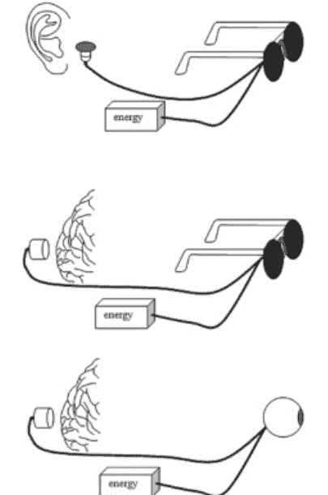

图 5.10：信息处理设备与人体的连接实施方式

该方向的研究早已开展，但此类系统在大脑中的开发者只能获得一组构成图像的像素。传递构成对象的所有元素的信息相当困难。在传输选定信息时，感知精度会有所损失。基于平行位移技术的图像处理系统可以利用几乎所有关于视觉场景的信息。关于图像区域的数据被汇总。其数量有限，但它们包含大量关于对象的信息。

该机器视觉系统能够相当准确地模拟人类视觉。平行位移技术的图像拷贝可以解释在图像识别和图形边缘检测中眼球瞳孔运动的原因。计算对象基本参数的方法允许实验中出现的过程来确定所观察生物器官的特性并响应运动。能够确定图形所在平面的位置角度，简化了“眼-手”系统的操作。将图案存储为图案曲面可以解释人类遗忘视觉图像的过程。例如，如果为了减少内存占用而缩放未使用的数字化图案曲面，那么在需要时，将其向放大方向缩放。这样数据损失就会显现出来。因此有必要更新此图案。此外，长期未见过的图像如果被仔细研究，也需要在内存中更新。

FAI图表的差异可以解释一个人如何定义属于同一个词的一组字母（图5.11）。

如果对象长度等于最大位移，则字母属于同一个词；否则，每个字母被单独感知。然后为一组字母形成单词。在图案数据库中，每个单词、每个字符组和每个字母都可以与单独的图案曲面相对应。

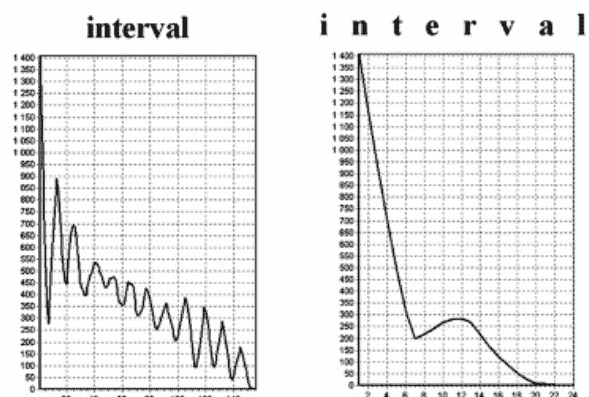

图 5.11：字母间距不同的单词‘interval’的FAI(x)

通常，人们在分析视觉场景时只关注其中的一些主要物体；环境的其他信息会作为某种模型进行处理。基于平行位移技术构建的系统允许模拟人类视觉。然而，为了进行准确的建模，有必要构建混合技术视觉系统。它们应包括数字图像处理的功能。混合人类视觉可以如下解释。在确定运动参数时，考虑到多普勒效应，对象移动的速度远快于位移拷贝。这种运动不会被记录，仿佛视觉场景中没有对象。这类似于25帧效应，但这种效应证实了其他信息处理系统的存在，其中整个视频流被分成帧、存储并在潜意识中处理。

## 5.4 基于PST的图像处理研究的前景方向

图像感知系统在平行位移技术构建中被应用，在执行某些图像处理任务方面具有优势。在算法实现过程中，信息被聚合和排序，在某些情况下这会带来生产率的提升，但有时，这些特性会使执行某些任务变得不可能。

让我们考虑一下使用平行位移技术处理的图像恢复问题。如果图像描述仅是一组交叉区域函数，那么恢复可以通过以下方式实现。

假设我们知道初始图像区域（参数 \(S_0\)）。将此值分成尽可能多的相同元素（\(n\)）。每个元素的面积等于 \(\frac{S_0}{n}\)。视觉场被划分为相同面积的区域。完整枚举法确定对象中 \(n\) 个元素在视觉场中所有可能的位置选项。因此，可以选择图像元素的位置，使得在形成集合FAI时，这些特征的值与描述对象的图案曲面元素接近。执行完整枚举的过程非常简单，但需要花费非常大的时间。

第二种方法可以存储在图像副本内存中。如果需要从内存恢复数据，存储的图像将缩放到所需的大小。恢复过程中不涉及FAI集合。在这种情况下，需要额外的存储参考图像的成本。此外，如果某一类图像存储在一个图案中，那么在恢复时它无法与所需图像完全相同。

为了减少存储信息，图案可以由简单形状的一组语法表达式表示。然后图像重建


将是一个相当繁琐的过程。修复的准确性也可能相当粗糙。

因此，基于 PST 的视觉系统的图像修复过程并不高效。相比之下，数字图像的修复是一个基础过程。

对于场景分析，可以选择两个子任务（Duda and Hart, 1973）。第一是在视觉场景中搜索作为单一对象一部分的指定图像。第二是在场景的许多单独元素中搜索指定图像。这些任务的示例如图 5.12 所示。

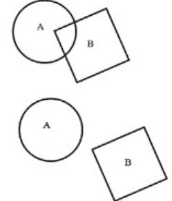

图 5.12: 图像识别和定位的各种任务

在第一种情况下，确定视觉场景中是否存在 A 和 B 元素。场景由单个对象 AB 组成。

```
S_{AB} = S_A + S_B - S_{A \cap B} \neq S_A + S_B. (5.5)
```

在第二种情况下，需要确定 A 和 B 元素的存在和定位。但在这种情况下，场景由元素组成，这些元素可以被视为独立实体，也可以被视为一个整体单元。

```
S_{AB} = S_A + S_B . (5.6)
```

在确定复合图形的 FAI 时，应使用以下公式

```
FAI_{(x)AB} = FAI(x)_A + FAI(x)_B + FAI(x)_{A,B} - FAI(x)_{A \cap B}. (5.7)
```

其中 FAI(x)_{A,B} 是 A 图形副本与 B 图形的交叠区域。在第一种情况下，FAI(x)_{A \cap B} 项发生在最初 A 图形与 B 图形相交时。在第二种情况下，该项等于零。

这些示例使用视觉场景中存在的两个图形进行展示。对于三个图形，公式 (5.7) 采用以下形式：

\(FAI_{(x)ABC} = FAI(x)_A + FAI(x)_B + FAI(x)_C + FAI(x)_{A,B} + FAI(x)_{A,C} + FAI(x)_{B,C} - FAI(x)_{A\cap B} - FAI(x)_{A\cap C} - FAI(x)_{B\cap C}\). (5.8)

公式针对位移副本方向 x 给出；对于 FAI 形成的其他方向，公式类似。

每个交叠面积函数都可以表示为一组傅里叶级数谐波。然后可以分别分析整个图像的 FAI 频谱以及每个图形的交叠面积函数。

交叠面积函数取决于某一时刻图像元素的相互作用。因此，其分析可以类似于电气网络中暂态过程的分析进行。例如，可以将图像与电路相关联，并将交叠面积函数视为杜哈美积分。因此，使用平行平移技术可以在函数中组织对象转换过程，反之亦然。该任务包括图像重建子任务和场景分析。在给定方向上的研究尚未进行，但根据作者的观点，前景是广阔的。

显著影响图像处理过程中图像操作的因素之一是需要进行 FAI 缩放。缩放的需求出现在函数比较期间。这是因为模式 FAI 按参数可能与真实图像的交叠面积函数不同。解决这个问题的方法可能是：对象不仅表示为基于 FAI 集构建的表面，而且表示为相应方向的综合系数集。在这种情况下，比较期间不需要缩放。要应用这种对象表示形式，有必要将其副本平行平移到 0 到 \(\pi\) 的所有方向。

因此，可以使用对象的积分系数值向量来描述对象。该向量的维度可以通过形成近似模式表面来限制。在图像识别过程的计算机仿真中，方向偏移量等于 36。将交叠面积函数表示为傅里叶级数谐波也可以限制在一定数量。在图像识别过程的计算机仿真中，用于描述交叠面积函数的傅里叶级数谐波数量为 20。

在两种情况下，我们都有少量同质元素来描述对象。这些向量中的每一个都可以使用神经网络进行处理（Milanova et al., 1999; Ranganath and Arun, 1997; Lawrence et al., 1997; Yoon et al., 1998; Aizenberg et al., 1999; Minsky and Papert, 1969; Kozhemyako et al., 2001）。少量输入数据允许使用少量神经元来构建它。积分比值不超过 0.5。归一化的傅里叶级数谐波值接近于 1。这些值使得向神经网络组织输入信息向量变得容易。

基于交叠面积函数指标分析的计算机图像识别处理系统旨在处理任何平面图像，并可用于任何视频监控系统。由于交叠面积函数过程涉及处理大量视频数据，为了加快该过程，建立高性能专用设备是合适的。

# 基于 FAI 分析的图像处理和识别系统生产力评估

图像处理系统的生产力可根据各种参数进行评估。这些指标包括单位时间处理的信息量，或多个图像中正确识别的图像百分比。

基于交叠面积函数分析的图像识别系统信息处理速度的确定是不可能的。在撰写时，构成此类系统的硬件尚未构建。软件建模是使用 Delphi 7 编程语言进行的。在图像识别系统的编程模型中，工作字段的大小为 500×500 像素。其方形形状对于在学习阶段实现对象旋转过程是必要的。在这种情况下，平均花费一秒钟来形成一个 FAI。真实图像的交叠面积函数确定用于两个正交方向；此外，还包括直接比较真实图像与图像模式的 FAI 和积分系数所花费的时间。显然，对于硬件实现，由于并行过程，处理对象所需的时间将少两个数量级。

未来，基于 FAI 分析的图像处理系统的生产力评估将按识别质量标准进行。这些过程模拟图像处理和分析的初步阶段，并接近真实图像。因此，在这种情况下，如果不使用可接受的误差参数，就无法进行识别。基于交叠面积函数分析的图像识别系统使用三种可接受误差类型。

在快速识别阶段比较交叠面积函数的积分比值时使用误差 $dk$；误差 $dS$ 用于在详细识别阶段比较交叠面积函数；误差 $dN$ 用于最大偏移值确定公式中。在图像处理系统中使用这些误差是必要的，特别是与数学计算中的某些舍入、数据数组转换过程中的信息丢失以及接收器字段中可能存在的噪声有关。

## 6.1 评估所选去噪方法的效率

每种数据处理方法的一个重要因素是选择去噪算法。图形区域基于平行平移技术的预处理和图像识别方法进行分析。在这种情况下，噪声干扰被视为局部组和轮廓图像及线条的单独元素。此外，噪声将被视为零，因为相同性质的元素可能出现在构成二值图像的二值元素所在位置。

为对抗噪声，可以采用先前描述过的轮廓点移除方法。在 PSNR 为 20 dB 到 40 dB 的值范围内，该方法相当有效。在此噪声水平范围内，FAI 的刻度值及各种其他因素的偏差不超过真实指标值的 10%。

然而，在创建临时处理和图像识别过程的软件模型期间，轮廓点移除方法一直处于设计阶段。因此，为了模拟噪声控制阶段，使用带有阈值 5 的 3×3 方形滤波器。当 3×3 矩阵的二值元素之和大于或等于 5 时，中心元素被赋值为 1；否则将其设置为 0。如下所示，使用此滤波器进行噪声控制的过程在 PSNR 为 20 dB 到 40 dB 的值范围内是有效的。

也可以使用带有阈值 12 的 5×5 方形滤波器进行噪声控制。对于处理噪声的所有三种方式，都进行了工作效果研究，研究结果将在后面展示。

可以使用噪声包含百分比（$pN$）的值来确定图像中所有元素中噪声元素的数量。该指标的值范围为 0 到 100%。广泛使用的 PSNR 参数是对数依赖的结果。这种依赖用于广泛的输入数据范围。当输入


若数据之间相差不超过两个数量级，则优先使用噪声百分比这一简单参数。我们将展示PSNR和pN参数之间的关系。

PSNR = 20lg\left(\frac{MAXi}{\sqrt{MSE}}\right), \quad (6.1)

其中MAXi为像素图像接收到的最大值。对于二值图像，MAXi = 1。

噪声百分比表示的MSE均方误差如下：

MSE = \left(\frac{pN}{100}\right)^2 \quad (6.2)

这些公式使我们能够确定PSNR和pN参数之间的关系。

PSNR = 20lg\left(\frac{100}{pN}\right). \quad (6.3)

这些参数的一些对应值见表6.1。

| pN, 百分比 | PSNR, dB |
|---|---|
| 1 | 40,00 |
| 5 | 26,02 |
| 10 | 20,00 |
| 20 | 13,98 |
| 30 | 10,46 |
| 40 | 7,96 |
| 50 | 6,02 |
| 60 | 4,44 |
| 70 | 3,10 |
| 80 | 1,94 |
| 90 | 0,92 |
| 100 | 0,00 |

我们定义了一种用噪声元素填充感受野的算法。

设存在一个大小为i × j的矩阵A，由元素a_{ij}组成，其中a_{ij} ∈ [0; 1]。那么，若a_{ij} = 0且随机函数(100)的值为1，则a_{ij} = 1。若a_{ij} = 1，随机函数(100)的值为1，则a_{ij} = 0。在此情况下，噪声分量的值为输入二值图像的反相值。输入图像矩阵约以百分之一的噪声分量填充。每个元素可能的噪声百分比(pN)即为其为噪声的概率。该过程必须重复pN次才能达到预期结果。因此，pN = 100%时，由由零元素组成的二值矩阵的一半像素单元格被单元填充。这是由于在反相过程中，先前被赋予1值的元素可能被置零。然而，这一属性并不影响噪声消除方法有效的那些噪声值下的图像识别过程。

因此，根据噪声百分比，将得到噪声图像元素数量kN。

kN = S_A · \frac{pN}{100}. \quad (6.4)

S_A为感受野的总面积。由于在编程模型中其尺寸取为500 × 500像素，故S_A = 250000。

噪声消除方法效率的一个指标将是噪声消除过程中残留在感受野中的一定数量的噪声分量(kNc)。该数量应使其在FAI分析中的影响可通过允许误差dN来抵消。应指出，本研究中噪声消除过程的效率是指能够将1元素删除到最初为空的矩阵中的能力。

为分析给定方法的效率，对所有可能的噪声百分比pN（pN ∈ [1..100]）确定了噪声元素数量kN和未删除的噪声元素数量kNc。研究针对三种指定的抗噪方法分别进行。本研究的程序如下：

- 1. 每个生成的噪声百分比值均用噪声干扰填充空白图像。
- 2. 噪声元素数量按kN = \sum_{n=1}^{i} \sum_{m=1}^{j} a_{n,m}计算。
- 3. 执行噪声消除过程。
- 4. 剩余噪声元素数量按kNc = \sum_{n=1}^{i} \sum_{m=1}^{j} a_{n,m}计算。

对100个pN值分别确定了100个kN和kNc。

对于每个i-th pN_i值，确定平均值kN_i和kNc_i。为了概括数据，有必要通过将得到的噪声分量数量平均值（kN和kNc）除以感受野总面积的值来进行归一化。这样，将获得与特定预定义面积无关的指标S_A。

kN_i = \frac{\sum_{j=1}^{100} kN_j}{100} \quad (6.5)

kNc_i = \frac{\sum_{j=1}^{100} kNc_j}{100} \quad (6.6)

效率系数按以下公式计算：

eN = \frac{kN - kNc}{kN} \quad (6.7)

噪声消除过程有效性研究的概括数据见图6.1。

如图6.1所示，每种噪声消除方法的效率系数(eN)随噪声干扰百分比pN的变化而变化。

使用3×3矩阵抗噪时，将获得以下结果。如图所示，可选择四个噪声值范围。第一个是kNc值等于零的情况（pN ∈ [0..6]）。噪声消除方法最有效（eN = 1）。噪声项目在噪声控制过程中被完全移除。第二个是kNc值接近零的情况（pN ∈ [7..18]）。噪声消除方法最有效（eN ≈ 1）。在此情况下，噪声对识别几乎没有影响，但识别过程需要通过使用误差dN进行额外调整。第三个是kNc值较小的情况（pN ∈ [19..30]）。噪声消除方法有效（eN > 0,85），但识别过程变得复杂。识别中存在大量错误。第四个是kNc值急剧增加的情况（pN ∈ [31..100]）。噪声消除方法无效且无法进行识别。

在用于5×5大小矩阵图的噪声控制时，将获得以下结果。如图所示，可选择四个噪声值范围。第一个是kNc值等于零的情况（pN ∈ [0..9]）。噪声消除方法最有效（eN = 1）。噪声项目在噪声控制过程中被完全移除。第二个是kNc值较小的情况（pN ∈ [10..26]）。噪声消除方法有效（eN > 0.90），但识别过程困难。识别过程中存在大量错误。第三个是kNc值急剧增加的情况（pN ∈ [27..53]）。噪声消除方法无效且无法进行识别。第四个是效率比小于零的情况（pN ∈ [54..100]）。噪声消除方法向感受野中添加噪声元素。噪声消除方法无效且识别也不可能。

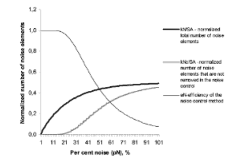
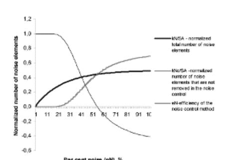


图6.1：不同方法噪声消除过程有效性的概括数据

对于移除轮廓点的方法，按公式(6.7)计算的效率系数在整个pN取值范围内将接近于一。但与带有阈值的矩阵应用方法不同，该方法还会移除图像的轮廓点。噪声控制中包含的大百分比噪声必须被移除，因为过多的有用信息会扭曲原始对象，导致识别不可能。该方法对pN ∈ [0..10]的值有效。

采用哪种抗噪方法均不影响使用并行位移技术进行图像处理的原理。有必要研究这些方法以计算允许误差参数的值，这些参数在FAI分析中被使用。今后，将使用3×3矩阵的噪声控制来计算这些参数的值和对象识别的效率。

## 6.2 用于限制最大位移值的允许误差值范围的确定

在识别真实图像过程中，感受野中可能存在噪声杂质，这促使在计算过程中引入某些调整。最大位移参数值的限制是通过应用允许误差dN来实现的。我们根据噪声控制过程中未被移除的图像元素kNc的数量来计算dN参数。在每个时间点可能进入副本位移区域的真实图像中噪声元素的平均值表示为kNc0。在噪声均匀分布时，该参数具有以下值：

kNc_0 = kNc · \frac{S_0}{S_A} \quad (6.8)

图像识别仅当该值小于用于计算最大剪切参数的限制值dN·S_v时才可能。利用这一特性是噪声控制的第三级。因此，dN值将如下：

dN ≥ \frac{kNc}{S_A} \quad (6.9)

因此，每个噪声水平的dN下限对应于在抗噪过程中未被删除的归一化噪声元素数量，如图6.1a所示。因此，当7% < pN < 18%时，dN < 0.0048。于是，对于pN < 18%的噪声水平，允许误差dN范围的上限


值被确定。在噪声较小的情况下，可以使用 dN < 0.005 的值。

由于在 19% < pN < 30% 时 dN 值小于 0.0634，但在较高 pN 值下噪声移除算法不有效。允许误差 dN 取值范围的上限应接近 0.07。这些图形在用于 5x5 矩阵噪声控制时验证了这些值。在基于 PST 的图像预处理和图像识别过程的软件建模中，使用 dN 从 0 到 0.2 的范围。

## 6.3 用于积分系数比较中可接受误差取值范围的确定

在基于交叉区域函数分析法的图像识别阶段比较积分比率的过程中，使用允许误差 dk 值。使用该参数的需求由以下事实决定：在计算交叉区域函数的基本参数或为简单形状构建其基本函数时，会对某些数据进行舍入处理。这会导致预期数据与实际值不同。对于所有类型的已识别图像，都会使用噪声移除过程。这一事实也会影响后续计算，因为部分有用信息可能会被删除。此外，在处理输入信息数组的过程中还会发生数据丢失。

确定允许误差 dk 大小的基础在于积分系数值的范围。积分系数（k_φ）取值范围为 0 到 0.5。此外，高效使用这些参数是由于可以将一般类模式（A）分为若干子类（A_i），以限制用于进一步详细比较交叉区域函数的模式数量。子类的数量（nA_i）由以下公式确定：

```
nA_i = \frac{0.5}{2 \cdot dk} = \frac{1}{4 \cdot dk} \quad (6.10)
```

将模式分为子类是十分有条件的，并取决于系数 k_φ 的积分值。k_φ 值范围的选择在图 6.2 中以图形方式反映。

为了在图像识别过程中使积分因子达到最高效率，子类数量 nA_i 应尽可能大。相应地，dk 值应接近零。在这种情况下，为了进行函数的详细比较，传输的模式数量最少。根据 (6.10)，允许误差 dk 的值不能超过 0.25。该声明仅在存在单一类模板时有效。


图 6.2：基于允许精度 dk 的积分系数子类范围形成

模板（nA_i = 1）。随着子类数量 nA_i 的增加，该参数所需的值只会降低。

在基于 PST 的模式识别系统的技术实现中，可能会出现计算舍入、数据丢失和其他信息失真。这些因素限制了该误差的值。由于上述情况，真实积分因子的公式将略有改变。

```
k_{xN} = \frac{kNc \cdot \frac{S_0}{S_A} \cdot X_{max} + \int_{0}^{X_{max}} FAI(x)dx}{(S_0 + kNc)X_{max}}
```

其中，k_{xN} 是图像存在噪声时 x 方向的真实积分系数，kNc 是未被删除的噪声元素数量，S_A 是感受器场的总面积。

然后该值为

```
dk \ge |k_{xN} - k_x|
```

变换后，该公式采用以下形式：

```
dk \ge \left| \frac{kNc}{S_A} \right| \left| \frac{S_A - S_0}{2S_0 + \frac{kNc}{S_A}S_A} \right| .
```

使用 3x3 矩阵进行噪声控制过程中未被移除元素数量的归一化值数据可从图 6.1a 获取。感受器场面积与图像面积的比值称为 rS。

```
rS = \frac{S_A}{S_0} .
```

当 pN = 17% 时，允许误差 dk 的值随 rS 参数值变化的图形形式如图 6.3 所示。


图 6.3：可能的 dk 值随 rS 参数的变化

在软件模拟测试过程中，使用 dk 值范围从 0 到 0.04，这与 pN < 30 和 rS ≤ 4 的计算值相对应。在 rS 计算中选择的值用于组织两个正交方向的循环移位，且各方向中的物体尺寸不得超过感受器场尺寸的一半。

## 6.4 图像识别分析详细阶段中 FAI 比较可接受误差范围值的确定

在基于交叉区域函数分析法的模式识别详细阶段，使用可接受误差 dS。在此阶段，以给定精度 dS 比较实际结果和标准函数交叉区域。使用该参数的必要性是由类似情况引起的，这些情况要求应用允许误差 dk。

对于可能取值范围的下限，该参数取决于噪声移除过程影响下图像中出现的变化。

```
dS > \frac{|FAI(x)_N - FAI(x)|}{S_0}, \quad (6.15)
```

其中，FAI(x)_N 是经过噪声移除元素过程校正的图像交叉区域函数值。

表 6.2 显示了 pN = 30% 时简单形状的允许误差 dS 的计算数据。数据基于软件模拟中使用的 rS 参数最大值。

| 简单图形名称 | rS | dS |
| :--- | :--- | :--- |
| 三角形 | ≈ 10 | ≈ 0.16 |
| 圆形 | ≈ 5 | ≈ 0.1 |
| 正方形/矩形 | ≈ 4 | ≈ 0.08 |

从数据表可以看出，在 pN = 30% 时用于简单形状交叉区域函数比较的可接受误差值必须大于 0.16。然而，在较低噪声水平下，给定值可能更小。在软件模拟测试过程中，使用 dS 值范围从 0 到 0.8，以便能够根据该参数的值研究识别效率。

为了在基于平行移位技术的图像识别过程软件模型构建中对这些参数进行初步近似评估，计算了允许误差值。已使用软件模拟对这些方法的效率进行了各种研究。

## 6.5 使用计算的允许误差值评估各种输入信息参数下的图像识别过程效果

为了评估不同输入信息参数下图像识别过程的效果，有必要界定在此过程中可能发生的错误类型。

作为第一类错误，我们将考虑以下情况：图形存在于模板数据库中，但在识别过程中，它被分配到包含多个元素的图像类中，并且该类中包含正在识别的图形。此类错误的典型例子是，当允许误差参数选择不正确时，这种情况可能发生。

第二类错误是指：图形存在于模板数据库中，但在识别的详细步骤中，它被分配到不包含给定图像的图像类中。此类错误出现的主要原因是高噪声水平。所选噪声移除方法无法消除该噪声的负面影响。

第三类错误发生在存在基于图形的模板，但在数据库中未找到时。

基于计算的允许误差参数，进行了简单形状识别，以确定效果


该过程依据输入图像中噪声元素的现有百分比（pN）进行。使用了以下参数来确定效率系数：

- kC – 用于识别的圆形图像数量。
- kCn – 系统未识别的圆形图像数量。
- eC – 圆形识别效率系数。

圆形识别效率系数的值由以下公式确定：

\( eC = \frac{kC - kCn}{kC} \). (6.16)

我们用类似的参数表示正方形（kS, kSn, eS）、矩形（kR, kRn, eR）和三角形（kT, kTn, eT）。

在图形识别过程中，使用了以下误差值：dk = 0.04，dS = 0.1，dN = 0.01。这些值对应于解析计算的范围。

图形识别过程旨在找出从 0% 到 20% 的噪声包含百分比，对应于所选方法有效噪声去除的范围。对于每个 pN，每个类别的简单图形提交了总共 500 张测试图像（kC = kS = kR = kT = 500）。使用获得的系数值，计算了 pN 参数等于 0%、5%、10%、15% 和 20% 时简单图形识别效率系数的平均值（eAs）。效率系数按以下公式计算：

\( eAs = \frac{eC + eS + eR + eT}{4} \). (6.17)

简单图形识别效率系数的平均值随噪声百分比的变化关系如图 6.4 所示。


图 6.4：简单图形识别效率系数的平均值随噪声百分比图形变化

这些研究结果表明，应用平移技术识别简单图形的效率与所选噪声控制方法的效率之间存在相关性。此外，应指出受输入图像面积影响的数据值是任意的。小对象生成对识别效果有负面影响。输入图像面积与识别性能之间的关系将在今后研究中考虑。

对于标准图像识别过程，无法解析确定误差值。在图形识别过程中，使用了以下误差值：dk = 0.04，dS = 0.1，dN = 0.01。这些可容许误差参数与用于简单图形研究的相似。

为确定模式阵列中模式图形识别效率，采用了一套用 Arial 72 pt 字体打印的拉丁字母和西里尔字母数字。应指出，该系统并非专门用于识别印刷体字体。选择此类标准是为了便于创建模板图像，并由于其形状多样（Krzyzak et al., 1990）。

为了研究基于识别系统中噪声干扰百分比的模板图像识别有效性，提交了 700 张数字和 Arial 72 pt 字体大写拉丁字母图像。对于每个干扰噪声百分比（pN），从 0% 到 20% 以 5% 为步长提交了测试图像。因此，每个噪声百分比下每张图像均处理了 20 次。唯一的例外是字母“I”，因为在 Arial 字体中它是一个矩形，被系统识别为对应简单图形。这一事实使得无法使用该图像来评估标准图形识别的有效性。模式图形识别效率比（eE）随噪声百分比的图形显示如图 6.5 所示。

\( eE = \frac{nE}{700} \) (6.18)

其中 nE 为每个噪声百分比下正确识别的模式数量。

简单图形识别与模板识别有效性之间存在明显相关性。除了噪声包含对图像识别效率的影响外，TPS 的使用还受其他因素影响。

第一类误差的存在表明图像的快速识别步骤已成功通过。测试对象被归入标准形状类别的非唯一性和定义是由于以下原因：


- 使用快速傅里叶变换时，模式值交叉区域面积函数恢复的精度与识别 dS 值不匹配。
- 系统无法区分镜像图形（例如，字母 R 和 Я，P 和 b）。
- 某些 Arial 符号在正交方向上的图像提供相同的 FAI（例如，字母 H 和 П）。
- 对于选定的可容许误差值（dk 和 dS），某些图像给出相似结果；即，系统基于对旋转角度的不变性可以将某些图像识别为同一图像（例如，图 6 和 9）。

消除模糊识别的原因如下。可以通过以更多数量的快速傅里叶变换谐波形式存储模式，或直接将模式保存为一组函数来提高 FAI 恢复的精度。这两种方式都预计会增加模式数据库，并特别关注细节阶段比较的缩放函数过程。为了识别镜像图像，或者为了解决第一类误差第三个出现原因的问题，有必要以与第一次不同的方向（不是 90°，而是其他角度）对图像进行第二次扫描。FAI 生成也可以针对三个（或更多）平移方向执行，使用三个（或更多）元素的元组来识别图像。借助这些方法，可以中和模板表面中心对称性的影响。这种对象表示需要对非正交平移过程的过程组织进行高精度计算。

应指出，字母的形状比简单图形更不规则。因此，使用平移技术的这种模式识别方法的效率取决于可识别对象的凸度程度。这一事实是由于在缩放和变换函数阶段丢失信息，导致交叉区域比较详细过程的结果发生变化的结果。

基于平移技术使用的图像识别的主要参数之一是输入图形面积（S₀）。有必要研究图像识别效率随该参数的变化。

数字化输入图像是由 1×1 大小的正方形创建的元素矩阵。因此，对于较小的输入图像面积值，在感知步骤中会发生显著变化，导致信息失真。例如，直径为 2 像素的圆被表示为 2×2 的正方形。此外，在存在噪声元素或删除噪声期间，初始面积可能会发生显著变化。这将影响识别过程。因此，确定允许进一步识别的输入图像边框的最小尺寸非常重要。

为了确定图像识别效率随输入图形面积值的变化，进行了统计数据收集。选择了多组 2000 个简单图形，其可容许误差参数（dk = 0.04，dS = 0.1，dN = 0.01）以及噪声包含百分比（pN）为 0% 和 10%。该过程获得的数据反映在图 6.6 中。


图 6.6：简单图形识别有效系数值随测试图像面积的图形表示

可以得出结论，如果图像面积的初始值在 2000 像素或以上，并且噪声包含百分比值为

0到10，识别效率比率大于70%。应牢记，在去噪过程开始时，任何百分比的图像噪声干扰都会被执行。这在一定程度上影响了识别效率。函数的局部极值是由软件模拟生成测试图像的缺陷引起的。然而，这一事实并未改变根据初始区域进行的图像识别研究效率的总体情况。

有必要验证，识别方法中不变性的主张是相对于模板图形大小的。为此，调查了各种大小模板图像的识别效率系数。

测试图像选用了Arial字体的大小为72、80、90和98磅的数字和拉丁字母大写字母。这些字体符号的大小所覆盖的面积接近简单形状的有效识别面积。此外，元素排列密度的系数(kρл)对应的字体大小几乎相同。因此，这些字体的相同符号具有相同的形状。之所以施加这一限制，是因为位图字体的相同符号可能具有不同的形状，因为其线性尺寸的值是整数。它们呈跳跃形式。图6.7显示了识别模板形状的效率系数值随其初始区域变化的图形表示。


图6.7：随测试图像面积变化的基准图形效率系数值图形表示

基于该研究结果，可以得出结论：基于平移技术的图像识别对输入对象的大小具有不变性。此外，不同大小形状的识别效率取决于噪声干扰的量，其值在先前研究获得的范围内。

将模板作为不同扫描方向的图像值数据库存储，使识别过程不仅独立于图像比例，还独立于其方向。让我们考虑一项研究，以验证所提方法对旋转等仿射变换的不变性。为此，我们选择一组测试对象，即Arial字体72磅大小的数字和拉丁字母大写字母。每个模式图像使用模板面进行描述。每个面由36个方向从0°到175°、步长为5度的交叉区域函数组成。本研究针对0%、5%、10%和15%的噪声干扰百分比进行了开展。所选允许误差的值与前一研究相同。测试图像识别效率的研究数据如图6.8所示（Foltyniewicz, 1995）。


图6.8：随旋转角度变化的基准图形识别系数有效性值图形表示

应当指出，图像识别的有效性会受到软件实现旋转阶段训练系统及研究过程中物体弯曲形状的负面影响（Jacobsen等人，1999）。

本书中给出的图像识别过程研究数据显示的效率值低于以往出版物。这是因为本研究使用了更为复杂的噪声类型。两种噪声类型的视觉估计见图3.5。

利用软件模型进行的调查证实，所提识别方法对原始图像的大小和旋转角度具有不变性。

# 基于平移技术的图像识别系统的硬件实现

## 7.1 基于平移技术的图像识别系统的通用模型

基于平移技术的图像识别理论中的一个重要因素是所提方法的硬件实现，与现有方法相比具有良好的特性。实现所提方法的硬件成本应最小且简单，具备高性能和最低功耗。

基于平移技术的识别系统实现的可行方案如图7.1所示。


图7.1：基于平移技术的图像识别设备框图。

图像识别系统包括光学系统（OS）、交叉区域函数检测块（UFD）、基准图形交叉区域函数存储块（UMFP）和比较单元（CU）。

输入图像通过OS转换为所需格式以进入UFD。UFD计算用户设置的移位方向的交叉区域函数。交叉区域函数的定量值输入到CU的第一个输入端，与UMFP中所有模板交叉区域函数进行比较。如果CU第一个输入端的交叉区域函数与UMFP第二个输入端的某个模板交叉区域函数匹配，则CU输出端生成模板FAI的标识符。该标识符指示输入图像的隶属类别。

如果UMFP在CU第一个输入端没有与输入FAI相等的交叉区域函数，则输入FAI将记录在UMFP中，并分配一个所属类别的标识符。

图7.1展示了识别系统的一个著名方案（Bilan, 2014）。它没有具体方法的详细描述，也不说明UFD如何在多个方向上确定FAI以及输入图像的副本如何移位。此外，既没有表示FAI值，也没有给出交叉区域函数表示及其在UMFP中的存储描述。

如果将交叉区域函数作为一个整体使用，则可以用一组数值对{Xi, S_i^j(x)}来表示，（其中i是j方向副本图像移位的步数）。要存储单幅图像的所有交叉区域函数，需要i×j个存储单元。此外，还使用额外内存来指定类别和子类别标识符。如果使用具有串行结构的CU，则一个FAI的输入可以是k位，用于表示X或S的单个值。因此，比较一个交叉区域函数使用i个时间步。该值由一个方向上的移位步数决定。

整个FAI代码的并行比较使用从UMFP并行读取模板交叉区域函数。两种实现方式均可用于系统的某些特性。

## 7.2 选择用于在识别系统中表示图像的覆盖

在这种设备结构下，每个选定方向的移位是依次实现的。最初执行向右移位，然后是向上，以此类推。移位方向越多，系统输入端图像的描述就越准确。然而，计算交叉区域面积的准确性取决于系统中显示原始真实图像的场的离散化。在示例（图7.2）中使用了正交覆盖。这种覆盖使得可以在四个方向（向右、向左、向上、向下）下无损确定交叉区域函数，因为移位过程中图像没有畸变。


图7.2：正交覆盖上图像形成示例

正交覆盖为大多数图像提供了独特的描述，使其区别于其他图像。然而，存在复杂对称图像的情况，其四个方向上的交叉区域函数可能重合。使用正交覆盖增加方向数量不能准确表示交叉区域。为消除这一缺点，使用其他形式的覆盖。最有效且最常用的覆盖形式如图7.3所示（Belan和Motorniyuk, 2013；Nicoladie, 2014；Bilan等人, 2014；Konstantinos, 2011）。


图7.3：最常见的覆盖形式和图像离散化

所有这些覆盖形式都能准确表示真实模拟图像。然而，要在大量方向上实现图像移位，the


六边形涂层形式最为有效，因为它能在不失真的情况下提供六个图像偏移方向。即使是六边形马赛克也能提供十二个偏移方向，这些方向额外在顶点上确定且不会丢失信息。在此情况下，额外的六个偏移方向沿顶点形成，并使偏移的离散化步长增大一个单元边长的值。这些方向在图 7.4 中给出。其他形式的涂层亦然。然而，对于六边形覆盖，方向数量的增加会减少对原始图像的失真。


图 7.4：三角形、正交和六边形涂层形式的无失真图像偏移方向。

如果使用偏移实现的软件模型，则会重新计算每个偏移步长的图像点坐标。然而，离散场无法始终给出小角度方向偏移的精确结果。

硬件实现可以在不首先计算图像像素偏移坐标的情况下实现图像偏移。对所研究涂层的分析表明，只有三种基于正多边形构建的晶格类型，这使得可以形成稠密的马赛克场。这样的正多边形包括三角形、四边形和六边形。使用其他正多边形网格无法形成稠密的离散平面。具有不同单元形式的其他覆盖形式不允许在不丢失信息的情况下进行图像偏移。

## 7.3 并行偏移的硬件实现与图像交叠区域面积计算

考虑一个具有详细 FAI 检测单元结构及其他基于其的设备的图像识别系统。让我们来看看系统中每个模块的详细实现。

首先开始工作的单元是 OS。借助该系统，实现了计算交叠区域面积函数所需的图像变换和准备。在本工作中我们不会考虑该系统，因为它不是所提方法实现的一部分，并且可以从此类系统的已知实现中选择。

该方法实现中的主要价值是 UFD。正是该单元计算交叠区域面积函数，并以适当形式呈现。

该模块应实现的第一项操作是生成投影图像的副本。为此，使用两层矩阵介质。每一层由一个矩阵表示。第一个和第二个矩阵存储初始图像。在第一个矩阵中，图像固定，第二个矩阵沿选定方向移动图像。交叠区域由附加层确定。该层的每个单元如果属于交叠区域则输出信号。

计算交叠区域并隔离属于该区域单元的设备结构如图 7.5 所示。电路包含三个矩阵（A1、A2、A3）。第一个和第二个矩阵存储输入图像，第三个矩阵形成前两个矩阵图像的交叠区域图像。两幅图像交叠区域形成示例如图 7.6 所示。第三个矩阵单元在每个时间步的状态如图 7.6 所示。同样，向上偏移每个时间步的单元状态也如图所示。


图 7.5：计算图像交叠区域的设备结构

图 7.6 明确表明，对于给定图像，时间偏移的数量少于向右偏移的时间步数。

第一个 A1 矩阵的结构由具有输入和输出的同质单元组成（图 7.7）。

每个单元是一个存储元件。图像点信号输入到单元，并将单元置于相应的状态。单信号将单元置于单状态，零信号将单元置于零状态。实际上，第一个 A1 矩阵的单元是 D 触发器。


图 7.6：偏移每个时间步 A1、A2、A3 矩阵单元状态示例


图 7.7：第一个 A1 矩阵的片段

以同样的方式，原始图像在第二个 A2 矩阵中被记录。第二个 A2 矩阵中每个单元的触发器状态由附加组合逻辑电路控制。实际上，第二个 A2 矩阵是一个二维可逆移位寄存器，可沿四个方向（右、左、上、下）移动图像。

第二个 A2 矩阵的结构方案如图 7.8 所示。


图 7.8：第二个 A2 矩阵的结构

第二个矩阵由正交晶格表示。每个单元与四个邻居单元相关联（两个水平方向，两个垂直方向）。这种结构可以基于一维可逆移位寄存器构建。两个相反方向中的每一个由一层一维可逆移位寄存器表示（图 7.9）。此类寄存器中的信息针对每个类别并行记录。


图 7.9：使用一维可逆移位寄存器实现第二个矩阵

图 7.9 展示了 A2 最方便、最有效的实现。一个单元及其四个最近邻居的功能图如下


图 7.10：第二个 A2 矩阵片段的功能图

一个具有组合逻辑电路详细表示的单元功能图如图 7.11 所示。


图 7.11：第二个 A2 矩阵单元的功能图

所有触发器的初始设置在 S 输入上进行。设置信号来自第一个 A1 矩阵单元的输出。

偏移方向由控制总线（CB）上的信号执行。控制总线为四位。控制总线的仅一位上必须存在逻辑“1”信号。四位中的每一位指示信息偏移的四个方向之一。电路不复杂，可在 FPGAs 上轻松实现。

第三个矩阵选择前两个矩阵 A1、A2 中具有逻辑“1”状态且在平面上具有相同坐标的单元。第三个矩阵的单元是与门，其输入为第一个和第二个矩阵对应单元的输出。然而，存在高效读取第三个矩阵中处于逻辑“1”状态的单元数量的问题。

计算第三个矩阵单元状态数量的选项有以下几种：

- 1. 对第三个矩阵的每个单元进行连续逐单元扫描。时间步数对应于 NxM（NxM – 矩阵尺寸）。
- 2. 对每一列（行）的状态进行顺序分析。时间步数对应于 N 或 M。
- 3. 同时计算第三个矩阵的所有单元状态。它在一个时间步内实现。

前两个选项需要大量时间，第三个选项可以通过非标准电路解决方案实现。此类实现示例如图 7.12 所示。


图 7.12：第三个 A3 矩阵第三种变体的实现示例

第三种实施例的第三个 A3 矩阵包含 NxM 个单元。当两个输入均具有逻辑“1”状态时，每个单元消耗固定值的电流 I_f。受控功率元件（CEE）消耗固定值


若其控制输入来自与门（AND gate）输出的逻辑“1”信号，则为电流中的电流。第三矩阵中所有启用（活动）单元的电流均通过电流-码转换器（CCC）流向公共总线。在 CCC 电路中，矩阵的消耗电流流过，在输出端是电流-码转换器，形成一个等效于总电流的码。电流-码转换器输出端的码形成过程为一个时钟步骤。然而，此类电路在 FPGA 上实现时会遇到困难。

考虑一种不使用模拟-数字转换来实现第三种方案的电路。此类方案由大量逻辑门实现。假设一列（行）由八个单元组成，即第三矩阵 \(A_3\) 为 8×8 维度。将八位寄存器分为两组四位，并实现一个确定四位单元中“1”个数的方案。为此，我们构建一个真值表（Table 7.1）。

### Table 7.1: 用于统计代码中“1”个数的四位计数方案真值表

| X1 | X2 | X3 | X4 | Y1 | Y2 | Y3 | Y4 |
|---|---|---|---|---|---|---|---|
| 0 | 0 | 0 | 0 | 0 | 0 | 0 | 0 |
| 0 | 0 | 0 | 1 | 1 | 0 | 0 | 0 |
| 0 | 0 | 1 | 0 | 1 | 0 | 0 | 0 |
| 0 | 0 | 1 | 1 | 0 | 1 | 0 | 0 |
| 0 | 1 | 0 | 0 | 0 | 1 | 0 | 0 |
| 0 | 1 | 0 | 1 | 0 | 0 | 1 | 0 |
| 0 | 1 | 1 | 0 | 0 | 0 | 1 | 0 |
| 0 | 1 | 1 | 1 | 0 | 0 | 0 | 1 |
| 1 | 0 | 0 | 0 | 1 | 0 | 0 | 0 |
| 1 | 0 | 0 | 1 | 0 | 1 | 0 | 0 |
| 1 | 0 | 1 | 0 | 0 | 0 | 1 | 0 |
| 1 | 0 | 1 | 1 | 0 | 0 | 0 | 1 |
| 1 | 1 | 0 | 0 | 0 | 0 | 1 | 0 |
| 1 | 1 | 0 | 1 | 0 | 0 | 0 | 1 |
| 1 | 1 | 1 | 0 | 0 | 0 | 0 | 1 |
| 1 | 1 | 1 | 1 | 0 | 0 | 0 | 1 |

该元素的图形表示如 Fig. 7.13 所示。

该电路的输出由以下逻辑表达式描述：

```
Y_1 = \overline{X_1} \wedge \overline{X_2} \wedge X_3 \wedge X_4 \vee \overline{X_1} \wedge \overline{X_2} \wedge X_3 \wedge X_4 \vee \overline{X_1} \wedge X_2 \wedge \overline{X_3} \wedge \overline{X_4}
\vee X_1 \wedge \overline{X_2} \wedge \overline{X_3} \wedge \overline{X_4}
```


Fig. 7.13: 四位代码中统计“1”个数电路（CNOC）元素的图形接口

```
$Y_2 = \overline{X_1} \wedge \overline{X_2} \wedge X_3 \wedge X_4 \vee \overline{X_1} \wedge X_2 \wedge \overline{X_3} \wedge X_4 \vee \overline{X_1} \wedge X_2 \wedge X_3 \wedge \overline{X_4}$
\(\vee X_1 \wedge \overline{X_2} \wedge \overline{X_3} \wedge X_4 \vee X_1 \wedge \overline{X_2} \wedge X_3 \wedge \overline{X_4} \vee X_1 \wedge X_2 \wedge \overline{X_3} \wedge \overline{X_4}\)
$Y_3 = \overline{X_1} \wedge X_2 \wedge X_3 \wedge X_4 \vee X_1 \wedge \overline{X_2} \wedge X_3 \wedge X_4 \vee X_1 \wedge X_2 \wedge \overline{X_3} \wedge X_4$
\(\vee X_1 \wedge X_2 \wedge X_3 \wedge \overline{X_4}\)
$Y_4 = X_1 \wedge X_2 \wedge X_3 \wedge X_4$
```

此类组织需要 15 个与门和 4 个或门。代码中“1”的个数由电路相应输出上的逻辑“1”信号确定。例如，若第二输出（$Y_2 = 1$）上存在逻辑“1”信号，则输入代码中有两个逻辑“1”。代码中“1”的个数由 CNOC4 在一个时钟步骤内确定。

现在我们实现 CNOC8，它在一个时钟步骤内确定八位代码中逻辑“1”的个数。为此，使用一个附加组合逻辑电路（Fig. 7.14）。


Fig. 7.14: 计算八位代码中“1”个数的方案。

八位组合方案（CC8）由以下逻辑函数描述：

```
V = ȳ₁ ∧ ȳ₂ ∧ ȳ₃ ∧ ȳ₄
W = ȳ₁ ∧ ȳ₂ ∧ ȳ₃ ∧ ȳ₄
q₁ = y₁ ∧ ȳ₁ ∧ ȳ₂ ∧ ȳ₃ ∧ ȳ₄
q₂ = y₂ ∧ ȳ₁ ∨ y₂ ∧ V ∨ ȳ₂ ∧ W
q₃ = y₁ ∧ ȳ₂ ∨ y₂ ∧ ȳ₁ ∨ y₃ ∧ V ∨ y₃ ∧ W
q₄ = y₁ ∧ ȳ₃ ∨ y₃ ∧ ȳ₁ ∨ y₂ ∧ ȳ₂ ∨ y₄ ∧ V ∨ ȳ₄ ∧ W
q₅ = y₄ ∧ ȳ₁ ∨ ȳ₄ ∧ y₁ ∨ y₂ ∧ ȳ₃ ∨ ȳ₂ ∧ y₃
q₆ = y₄ ∧ ȳ₂ ∨ ȳ₄ ∧ y₂ ∨ y₃ ∧ ȳ₃
q₇ = y₄ ∧ ȳ₃ ∨ ȳ₄ ∧ y₃
q₈ = y₄ ∧ ȳ₁
```

八位方案将包含 54 个逻辑与门和 16 个或门。在单个 FPGA 晶片中，这是微小的成本。构建第三矩阵时，使用 Fig. 7.15 所示的方案。

由于第三矩阵为 8×8 维度，图像最大面积可由 64 个单元计算得出。使用附加组合逻辑电路（CC64），其具有 64 个输入和 64 个输出。每个输出指示处于逻辑“1”状态的单元数量。每个 Qi 输出由以下描述：


Fig. 7.15: 计算 64 位矩阵中“1”个数的方案

某个逻辑表达式。由于这些表达式过于冗长，文中未予列出。然而，此 CC64 已综合并具有高性能。

如有必要增加第三矩阵 \(A_3\) 的维度，则可以已实现的方案构建。对于大尺寸，这种方法会使方案复杂化。因此，折中方案是并行计算小阵列（例如，16×16 阵列），并进一步相加所得代码。

因此，UFD 输出端会生成一个代码序列，指示每个时步中交叉区域函数的值。每个时步的幅度由计算第三矩阵中“1”个数所需的时间以及组织移位所需的时间决定。

CU 可选为标准单元。代码比较在文献中有广泛描述。

## 7.4 现代 CAD 系统中确定 FAI 的主要硬件模块建模

基于并行移位技术的图像识别系统需要硬件实现。此类系统的硬件实现可显著提升其性能。所提方法已通过软件进行仿真，并在后续章节中讨论。软件实现耗时，从而限制了应用范围。

前文给出了基于并行移位技术的图像识别系统主要组件的详细数字图。所有提出的电路方案均采用数字元件基础呈现。因此，建议将这些电路实现为 FPGA 上的嵌入式系统。为对 FPGA 进行编程，使用各种软件 CAD（http://www.xilinx.com, http://www.altera.com, http://www.aldec.com）。这些 CAD 系统的界面因生产 FPGA 的公司而异。

最流行的是 Xilinx、Altera 等公司的产品。所述方法的作者使用 Xilinx 芯片并采用该公司开发的软件。Xilinx 软件 CAD 包含以下内容（http://www.xilinx.com）：

- Alliance Series 软件包，包括用于追踪和接入原理图及文本编辑器的模块，并引入其他公司的项目。
- Foundation Series 软件包，包括使用电路技术、VHDL / Verilog 综合、功能建模、晶片追踪及追踪后仿真。

- WebFitter 是 XC9500 系列 CPLD 的 FPGA 追踪器。该产品仅通过 Internet 提供，并物理位于 Xilinx 服务器上。用户仅可使用界面。
- WebPack 可通过 Internet 免费分发，用于 HS9500 系列 FPGA 和 CoolRunner 以及 FPGA 和 Spartan-II 芯片 Virtex-E XCV300E 家族的软件开发。通过 Internet 免费下载并在 PC 上安装。
- Vivado CAD 专注于大量使用 IP 核（无论是 Xilinx 或其他制造商提供的，还是由项目开发者创建的）。

所有这些软件产品均可从 Xilinx 网站下载（http://www.xilinx.com）。

同时，任何数字电路均可使用专用编程语言（VHDL, Verilog, Abel 等）进行描述。使用这些语言描述的模型可用于几乎所有软件 CAD 系统。为实现识别系统，采用了 VHDL（Ashenden, 1990; Zimmermann, 1998; Rushton, 1998; Pong, 2006; Ashenden, 2001; Mealy and Tappero, 2012）。

使用 VHDL 语言，项目可按不同层次结构表示：

- 行为级
- 寄存器传输级
- 使用延迟模块的功能-逻辑级
- 考虑开关时间的逻辑元件级
- 基于项目单个组件的级别，这些组件存储在专用库中

生成的 VHDL 代码加载至所选 CAD，该 CAD 生成位图文件。此文件用于对所选 FPGA 进行编程。

为准备项目，使用了多个 CAD 系统——Active-HDL, WebPack 和 Vivado。借助它们，系统主要组件以 VHDL 代码形式得到。这种方法允许确定 FPGA 主要元件的使用百分比。这使得可以确定项目成本和主要操作的时间，以及评估能耗水平。

考虑系统基本元件的实现。仿真未考虑系统各逻辑元件的延迟。

仿真的第一个元件是第一个 A1 矩阵（Fig. 7.5），用于原始图像的静态存储。第一个 A1 矩阵由同质存储元件组成。根据所执行的功能，第一矩阵的元件表示为 RS 触发器，可轻松通过 VHDL 描述。此类 RS 触发器的模型如 Fig. 7.16 所示。


图 7.16: RS-触发器的图形界面及描述其运行的时序图

第一个矩阵由 N×M 个 RS 触发器元素组成（其中 N×M 是第一个矩阵 A1 的维度）。因此，第一个矩阵包含 N×M 个输入和相同数量的输出。

第二个 A2 矩阵与第一个 A1 矩阵具有相同的维度。第一个矩阵的每个输出都连接到第二个 A2 矩阵的相应输入。在前面的章节中，第二个矩阵 A2 被表示为二维移位寄存器。因此，为了对其建模，最初实现了一维逆向移位寄存器。首先，描述了该寄存器的一位。其主要元件是受控 D 触发器（图 7.17）。

这个受控 D 触发器是第二个 A2 矩阵一位的主要元件（图 7.18）。

使用创建 VHDL 项目的分层原则，实现了一维逆向移位寄存器（图 7.19），进而实现了二维逆向移位寄存器（图 7.20）。得到的二维逆向移位寄存器即为第二个 A2 矩阵。

得到的时序图显示了第二个 A2 矩阵在移位一个方向上的操作。该模型的维度为 8×8，输出数为 64，与第一个 A1 矩阵相同。


图 7.17: 受控 D 触发器的图形界面


图 7.18: 第二个 A2 矩阵一位的图形界面及其运行时序图


系统的第三个元素是第三个矩阵 A3，通过它在每个时间步确定交叉区域的功能。每个基本区域由第二个 A2 矩阵相应输出上的逻辑 '1' 信号确定。每个逻辑 '1' 信号都来自第二个 A2 矩阵。第三个矩阵 A3 统计其输入上所有逻辑 '1' 信号。

第三个 A3 矩阵在分层基础上实现。第一个方案实现用于统计四位二进制代码中 1 的个数。从两个四位电路中，实现了一个用于统计八位二进制代码中 1 的个数的电路。这些方案是根据前一段描述的逻辑表达式实现的。

根据这种方法，实现了一个用于统计 64 位二进制代码中 1 的个数的方案（图 7.21）。其时序图如图 7.22 所示。


图 7.21: 64 位二进制代码中 1 的个数统计的图形界面

图 7.22: 64 位二进制代码中 1 的个数统计方案的时序图

实现此类方案需要在输入的 32 位代码中大量搜索输出。这种方法允许构建用于计算任意维度代码中 1 的个数的方案。

得到的方案在 CAD 系统（如 WebPack 和 Vivado）中实现，显示了系统实现中 FPGA 元件的开销。

## 7.5 UMFP 中模式的选择与存储

最重要的是，形成一组描述并行移位后图像的基本定量特征的向量。有必要生成一种易于访问和理解、并能有效存储在模板内存中的形式。此外，生成的值集在比较时不应引起问题。比较单元应简单且耗时最少。

在电子数字方案中，接收到的 FAI 表示为划分为字段的代码（图 7.23），这些字段确定相应时间下交叉区域功能的值。


图 7.23: 移位一个方向下交叉区域功能的形式

交叉区域功能的数量取决于图像的大小和图像场的离散化步骤数。通常，选择与图像场宽度（高度）相对应的长度。

当 FAI 向量形成后，需要搜索由它确定的模板向量。为此，存在高效定位和存储模板代码的任务。有几种展示模板代码的选项。表示代码的最简单方式如图 7.23 所示。

每个字段是移位的时间步编号。第一个坐标是移位步骤编号，第二个坐标是该字段中的代码。与输入代码匹配的模板代码搜索由内存中的顺序搜索组成。该方法的实现耗时较多，大大降低了识别系统的性能。

第二个选项实现创建与第一个版本具有不同含义的另一个代码。代码结构划分为若干字段（图 7.24）。但是，每个字段包含具有不同值的值。


图 7.24: 基于移位一个方向下接收到的交叉区域功能的代码结构

代码也划分为代码字段。每个字段包含一个 $S_i^j$ 值（其中 i 是移位方向轴的分区数，j 是分区字段编号），用于确定所选增量处交叉区域功能的曲率。例如，FAI(x) 获得了以下值（表 7.2）：

表 7.2: FAI(x) 值示例

| FAI(x) | 20 | 15 | 12 | 10 | 8 | 6 | 4 | 3 | 2 | 1 | 0 |
|---|---|---|---|---|---|---|---|---|---|---|---|
| X | 0 | 1 | 2 | 3 | 4 | 5 | 6 | 7 | 8 | 9 | 10 |

对于此示例，我们得到以下值，这些值构成了模板代码：

S_1^1 = \frac{20}{10} = 2

S_1^2 = \frac{10-6}{5} = 0.8 ; S_2^2 = \frac{6-0}{5} = 1.2

S_1^3 = \frac{20-10}{3} = 3.3 ; S_2^3 = \frac{10-4}{3} = 2 ; S_3^3 = \frac{4-1}{3} = 1

S_1^4 = \frac{20-12}{2} = 4 ; S_2^4 = \frac{12-8}{2} = 2 ; S_3^4 = \frac{8-4}{2} = 2 ; S_4^4 = \frac{4-2}{2} = 1

S_1^5 = \frac{20-12}{2} = 4 ; S_2^5 = \frac{12-8}{2} = 2 ; S_3^5 = \frac{8-4}{2} = 2 ; S_4^5 = \frac{4-2}{2} = 1 ;

S_5^5 = \frac{2-0}{2} = 1

在这样的组织下，代码长度可能小于第一种方法。此外，该代码允许确定物体形状的尺度变化，并简化模板代码的过程。

除了耗时少之外，该代码还需要额外的非复杂计算资源。也可以使用各种组织形式的存储设备。

模板图像向量和系统输入图像的字段是根据图 7.25 所示的原理形成的。

| $V_{x=}$ | $S_1(1)$ | $S_2(1)$ | $S_3(1)$ | $S_4(1)$ | $S_5(1)$ | $S_6(1)$ | ... | $S_1(4)$ | $S_2(4)$ | ... | $S_4(1)$ |
| :--- | :--- | :--- | :--- | :--- | :--- | :--- | :--- | :--- | :--- | :--- | :--- |
| $V_{x=w}$ | $S_1(2)$ | $S_2(2)$ | $S_3(2)$ | $S_4(2)$ | $S_5(2)$ | $S_6(2)$ | ... | $S_1(4)$ | $S_2(4)$ | ... | $S_4(2)$ |
| . | . | . | . | . | . | . | ... | . | . | ... | . |
| . | . | . | . | . | . | . | ... | . | . | ... | . |
| . | . | . | . | . | . | . | ... | . | . | ... | . |
| $V_{x=w}$ | $S_1(w)$ | $S_2(w)$ | $S_3(w)$ | $S_4(w)$ | $S_5(w)$ | $S_6(w)$ | ... | $S_1(w)$ | $S_2(w)$ | ... | $S_4(w)$ |

图 7.25: 基于并行移位技术的图像识别系统中字段比较的结构

第一个比较 $S_1^1$ 参数，并选择在误差范围内出现巧合的向量。随后，在选定的向量字段中，按 $S_1^2$ 和 $S_2^2$ 值比较字段，并筛选出具有匹配掩码值的组。因此，对每个字段组进行顺序排序。字段组由每个字段中的上标确定。上标的值表示组中字段的数量。例如，如果上标为 3，则该组包含三个值 $S_1^3, S_2^3, S_3^3$。

在所有向量中并行地对每个字段组进行顺序排序，并选择一个向量，该向量定义了识别系统输入的图像。


在经过若干步骤的字段比较后，如果某个向量的字段组仍然与输入端的字段保持一致，则认为该向量最接近系统输入端的向量。如果模板向量的所有字段都与输入端的向量一致，则实现了对系统输入端图像的完整准确识别。如果向量的所有字段均不匹配，则会对输入向量与相应模板向量的接近程度作出判断。例如，输入端的符号‘E’与符号‘F’的向量相近。

如果未找到模板向量，则由教师为输入向量分配一个标识符，并在该标识符下写入模板存储单元。

识别的准确性取决于向量的长度，而速度则取决于在系统中执行所有操作时所使用的并行方法和算法。

## 7.6 基于并行平移技术的光学图像识别系统

利用光来构建信息处理系统和图像识别的现代进步，可以显著提高其生产力。使用光进行图像传输和处理有许多优势。这些包括：

- 并行图像处理的可能性
- 低功耗
- 影响少且寄生电容少
- 光束之间无相互作用
- 外部环境中无辐射（对外部干预的安全性高）

利用这些优势以及现有的光学和光电器件，使作者能够实现一种基于并行平移技术的光学图像识别系统。基于并行平移技术的 FAI 图像光学系统如图 7.26 所示。

该系统包含图像源（IS）、光学图像分离器（OS）、初始图像镜（MII）、k 个副本图像镜（MCI1，...，MCIk）、k 个光学透明片（OT1，...，OTk）、光电探测器（FD）和面积计算器（CA）。

来自 IS 的图像进入光学分路器 OS 并分为两束。第一束光到达 MII，反射后投射到 FD 上。该图像为初始图像，在光电探测器的整个视场内保持静止。第二束光


图 7.26：基于并行平移技术的图像交集面积函数计算光学系统

流半透明镜 MCI1 通过，每个镜子将一部分光通量反射到光电探测器 FD 上。在此情况下，第一个 MCI1 的位置使得图像从其上反射并落在光电探测器上，偏移量为一个离散图像（所选方向上的单位距离）。来自 MCI1 的光流第二部分送入 MCI2。来自 MCI2 的光通量投射到光电探测器上。在此情况下，来自 MCI2 的光学图像相比原始图像偏移了两个单独的离散图像落在 FD 上。MCI3 在光接收器的视场中实现三个离散间隔的图像偏移，而 MCIk 在光电探测器视场中实现 k 个离散间隔的图像偏移。

每次只有一个透明片开始传输光学信号。在每个 MCI1 和光电探测器之间放置一个 OT1。最初，第一个光学透明片 OT1 打开，来自第一个 MCI1 和 MII 的光通量照射到 FD 上。

在两束光交汇处，光学信号的强度大于来自 MII 的光学信号强度。光电探测器作为阈值元件工作，并固定由强度大于来自 MII 的光学信号强度的光流覆盖的区域。面积计算器形成结果。该结果可以是模拟形式或数字形式。

FAI 的值可以以模拟形式或数字形式书写。由于我们先前已考虑数字电子形式，今后将考虑交集面积函数的模拟存储和表示形式。

借助图 7.26，基于光学系统的图像在交集面积函数中的转换过程变得清晰。然而，这种系统仅在一个方向上实现 FAI 的获取过程。在所有方向上形成交集面积函数的光学系统结构如图 7.27 所示。

第二个系统与第一个系统的区别在于，第二个系统中添加了光纤图像分配器（FOID）和四个光学可控透明片（OCT0、OCT90、OCT180、OCT270）。第二个系统的工作方式与第一个系统相同。但是，在第二个系统中，还可以将原始图像按四个角度（0°、90°、180°、270°）旋转。图像旋转通过使用 FOID 实现。输入原始图像送入 FOID 的输入光圈，并分配到四根光纤上，这些光纤为 FOID 的输出。每根光纤的输出光圈相对于 FOID 的输入光圈分别旋转 0°、90°、180° 和 270°。光学信号仅从一根光纤的输出送入 FOID，这是因为只有一个光学透明片允许光学信号通过。


图 7.27：剪切方向 FAI 图像形成光学系统

如果 OCT90 为透明状态，则输入图像投射到旋转了 90° 的光电探测器上。为了进行偏移，依次切换位于每个 MCI 之后的光学透明片 OT。OCT 和 OT 的这种状态使系统能够计算 FAI(90°)。因此，OCT 状态为系统提供偏移方向，而 OT 状态则在所选方向上实现图像偏移。如果输出 FOID 处的光纤数量增加，偏移次数和接收到的 FAI 数量也会增加。光学透明片可以通过光学或电信号控制，但需要对系统中所有光学模块进行严格对准。

存储计算出的交集面积函数的任务仍然存在。已知各种光学存储器构建方案，并以光学形式存储。这种存储器可以成功应用于存储交集面积函数的值。然而，作者建议考虑一种将每个 FAI 表示为一组光学信号强度值的存储器。

每个交集面积函数由一排发光元件表示（图 7.28）。

光学信号强度值 FAI_i 在发光元件中的记录通过控制输入（CI）上的信号进行。发光存储元件（LEME）的结构如图 7.29 所示。


图 7.28：单方向计算出的交集面积函数存储线结构


图 7.29：存储器发光元件的功能图

发光存储元件包括可控功率元件（CEE）和发光元件（VD）。可控功率元件与 VD 包含在同一电路中。CEE 的电阻值 R_CEE 通过控制输入

(CI)。电阻 R_CEE 限制流过 VD 的电流大小。因此，VD 发出的光强度与电流大小成正比。

有许多方案实现了可控功率元件的原理。CEE 电阻可以通过电信号或光信号进行控制。在这种情况下，可控功率元件即使在切断供电电压后也必须保持其电阻。通电后，发光元件应发射固定强度的光学信号。

因此，通过设置必要的 CEE 电阻来实现交集面积函数的记录。即使在断开供电电压时，该电阻仍会保持。要读取交集面积函数的值，需要连接供电电压，然后发光元件会发射相应强度的光学信号。

交集面积函数存储器可以由多层存储器组成。FAI 存储器的一层如图 7.30 所示。

增加存储层数可以增加 FAI 存储容量。这种存储器不需要显著的功耗且速度高。


图 7.30: 基于光发射器标尺的内存 FAI 矩阵

# 基于平行位移技术的识别过程实验研究方法论

## 8.1 基于平行位移技术的图像特征选取与分析

第一章讨论了已知图像处理和识别方法中特征的形成和提取。所有这些方法可以分为两类——第一类是通过测量图像的选定几何元素来形成特征的方法。此类元素可以是面积、周长、顶点、多边形顶点处的角、几何中心、各种局部图像对象之间的距离等。

事实上，第一类系统测量所选定几何元素的定量值。从测量值中，形成一个特征向量。每个特征都是系统的一个测量值。第一类系统严格实现给定的功能，例如，几乎所有已知的人脸识别系统都会执行由特征组成的向量的形成，这些特征由所选控制点之间的距离等量组成。相同的方法也用于使用指纹的生物识别系统。

第一类系统由测量预选值的软件和硬件组成。然而，仅由测量值组成的特征向量无法对图像给出完整的描述，特别是缩放或方向发生变化的图像。

第二类方法基于原始图像的变换和隐式特征的提取，其定量值仅用于标识图像。由于这种方法能给出提高图像识别精度的严格定量值，因此这种方法具有合理性。此类特征包括：小波变换系数（Daubechies, 1990）、势函数（Aizerman et al., 1970）、面积交集函数（Belan and Yuzhakov, 2013; Belan and Yuzhakov, 2013a; Belan et al., 2014a）、脉冲序列特征（Belan, 2011; Belan and Belan, 2013）、无线传感器网络特征（Lu et al., 2008; Simek et al., 2011; Heinzleman et al., 2002）及其他量。

所有这些值都是通过附加变换获得的，这些变换用一组量来表示图像。事实上，几何特征可以由一组依赖于转换器结构的量来表示。该方法可由以下模型表示：

I \xrightarrow{T} F

其中 I 是具有特定亮度、颜色和几何形状的图像点数组；T 是输入 I 数组的变换函数；F 是由将 T 叠加变换到 I 数组上而获得的特征向量。

考虑图像变换和描述的简单示例。为此，我们选择 Radon 变换，它不同于本书中考虑的方法（Belan and Motornyuk, 2013; Bilan et al., 2014）。使用 Radon 变换，图像由在选定方向上接收的投影表示。投影越多，图像描述越准确。

每个投影由数字组成。每个数字由相应线上 1 的数量确定。每个逻辑 '1' 编码单个图像点的状态。例如，如果投影中的数字为 5，则在垂直于投影的直线上有五个单元。一组投影代码描述输入图像。简单和复杂图像的 Radon 投影图形表示示例见图 8.1。


图 8.1: 亮度级别为 37% 的 Radon 投影图形表示示例

对于所举示例，实际图像按 50% 的亮度级别进行二值化。二值化后，得到了 Radon 投影。

Radon 变换是提取和形成特征向量的多种方法之一。该方法易于理解，并广泛应用于各种应用（Belan and Motornyuk, 2013; Bilan et al., 2014）。

基于平行位移技术的图像变换和描述可以通过两种方法进行：

- 1. 使用面积交集函数对图像进行描述。
- 2. 通过接收到的 FAI 的基本属性的定量特征对图像进行描述。

第一种方法基于构建表示面积交集函数的数字数组。这些数字通过在每个时间步测量和计算面积交集函数来获得。这是一种面积的直接测量方法，面积是一种几何特征。第一种描述方法中的识别包括顺序搜索并同时将所有 FAI 数值与存储在模板存储单元中的面积交集模板函数的数值进行比较。如果所有 FAI 数值都存在一致情况，则判定输入图像是其 FAI 模板与输入面积交集函数相吻合的图像。

作为模板 FAI 存储的面积交集函数代码具有特定的标识符。此外，所有被识别和确认的图像都具有属于该类的标识符。

然而，对于实际图像，输入中生成的 FAI 不一定所有数值都与模板 FAI 的所有数值一致。尽管如此，图像仍可以被正确识别。为此，建立了量的可允许偏差量以及构成 FAI 代码的匹配数值的百分比。此外，确定 FAI 代码中匹配和不匹配数值的位置。这些值是通过实验确定的。实验研究结果将在以下部分中介绍。

第二种方法基于对接收到的 FAI 的形状进行分析。如前面所述，面积交集函数是二维坐标系中的一条曲线。FAI 曲线在初始坐标处等于 FAI_max 的最大值，在最后一个坐标处 FAI=0。最后一个坐标对应于 FAI=0 的值。对于不同的图像和不同的位移方向，最后坐标有不同的值。面积交集函数的曲线连接初始坐标和最终坐标。

因此，至少存在一个方向，使得图像的 FAI 曲线形状与另一图像不同。使用第二种方法分析 FAI 曲线的形状。为了分析形状，在 FAI 曲线的选定部分使用曲率值。曲率由以下公式定义：

```
R = \frac{\Delta y}{\Delta x}
```

有多种方法可以分析 FAI 线的曲率。为了更准确地分析曲率，使用二分法（图 8.2）。

如示例所示（图 8.2），该曲线可由以下值集描述：

```
R_0 = \frac{\Delta y_0}{\Delta x_0} 
< R_1^1 = \frac{\Delta y_1^1}{\Delta x_1^1}, R_1^2 = \frac{\Delta y_1^2}{\Delta x_1^2} > 
< R_2^1 = \frac{\Delta y_2^1}{\Delta x_2^1}, R_2^2 = \frac{\Delta y_2^2}{\Delta x_2^2}, R_2^3 = \frac{\Delta y_2^3}{\Delta x_2^3}, R_2^4 = \frac{\Delta y_2^4}{\Delta x_2^4} >;
..........
```


图 8.2: 使用逐次二分法对 FAI 曲线形状分析的示例


< R_n^1 = \frac{\Delta y_2^1}{\Delta x_1^2}, R_n^2 = \frac{\Delta y_2^2}{\Delta x_2^2}, ........., R_n^{2^n} = \frac{\Delta y_n^{2^n}}{\Delta x_n^{2^n}} >

FAI曲线分析的准确性取决于所使用曲率值的数量。但是，确定X轴数值的划分数量很重要。简而言之，有必要确定X轴段划分的最大步数。还需要确定X轴段划分的最大步数。确定满足准确FAI分析要求并进而影响图像识别的X轴段长度也是一项任务。

第二个方法是图8.3中描述的方法。这种方法（图8.3）允许将X轴分为两个段。但是，两个段无法提供较高的FAI分析精度。因此，在X轴分割的每个实施例中都使用所有获得的值。该方法分析整个交叉区域函数。有必要确定单位间隔长度变化的距离（ \(x_i^l - x_{i-1}^l = \Delta x\) ）。

也可以分为两段、四段、五段等。还存在其他有效的分析变体。据我们认为，有效的分析可以是搜索中线最大偏差的方法，或者在FAI图中搜索极值的方法。


图8.3：通过依次分为两段来分析FAI曲线形状的示例

实验研究的任务是确定对识别结果影响不大的曲线段。这类区域的存在及其有效搜索可以提高基于平行位移技术的图像识别系统的性能。

## 8.2 基于获得的FAI的图像识别精度分析

基于平行位移技术的开发图像处理和识别方法在软件或硬件实现中简单且不复杂。所考虑的预处理图像和噪声控制方法证实了平行位移技术的高效性。但是，有必要直接研究平行位移技术在图像识别中的应用。

为开展图像识别研究，进行了FAI形成方法的计算机仿真。基于开发的程序，对以下方向形成了交叉区域函数——0°、45°、90°、135°、180°、225°、270°和315°。为进行研究，选取了尺寸为500×500离散元素（像素）的BMP格式图像。

实验研究的首个领域是确定输入平面图形相对于标准理想图形的偏差。为解决该问题，最初设定了理想参考图像，并生成了大量图像，其中人为地引入了各种畸变。此类畸变是将黑色像素替换为白色像素，反之亦然。使用了各种替换变体，这些变体是随机选择的。生成了大量畸变一个像素、畸变两个像素等的图像。

创建此类集合是为了确定偏离交叉区域函数标准模型的行为。此类分析使我们能够建立偏差的性质，从而将来能够实现用于平面图形图像精确识别的系统功能。为执行实验研究，选取了图8.4所示的图像。

这些图像（图8.4）被转换为强度阈值等于50%的二值图像。这些图形的交叉区域函数的获得值记录在标准模型的存储单元中。图8.4所示图形的标准模型交叉区域函数见表8.1。

在获得标准图形的交叉区域函数后，为引入了变化的图形形成了交叉区域函数集合，并确定了FAI值相对于标准模型的偏差。基于标准图像形成并具有畸变的图像示例见图8.5。


**图8.4：** 选取作为开展实验研究标准模型的图像

**表8.1：** 图8.4所示图形标准模型的交叉区域函数

| 图形 | 时间步编号 | 0° | 45° | 90° | 135° | 180° | 225° | 270° | 315° |
|---|---|---|---|---|---|---|---|---|---|
| 三角形 | 1. | 45 | 36 | 45 | 45 | 45 | 36 | 45 | 45 |
| | 2. | 36 | 21 | 36 | 36 | 36 | 21 | 36 | 36 |
| | 3. | 28 | 10 | 28 | 28 | 28 | 10 | 28 | 28 |
| | 4. | 21 | 3 | 21 | 21 | 21 | 3 | 21 | 21 |
| | 5. | 15 | 0 | 15 | 15 | 15 | 0 | 15 | 15 |
| | 6. | 10 | 0 | 10 | 10 | 10 | 0 | 10 | 10 |
| | 7. | 6 | 0 | 6 | 6 | 6 | 0 | 6 | 6 |
| | 8. | 3 | 0 | 3 | 3 | 3 | 0 | 3 | 3 |
| | 9. | 1 | 0 | 1 | 1 | 1 | 0 | 1 | 1 |
| | 10. | 0 | 0 | 0 | 0 | 0 | 0 | 0 | 0 |
| 正方形 | 1. | 90 | 81 | 90 | 81 | 90 | 81 | 90 | 81 |
| | 2. | 80 | 64 | 80 | 64 | 80 | 64 | 80 | 64 |
| | 3. | 70 | 49 | 70 | 49 | 70 | 49 | 70 | 49 |
| | 4. | 60 | 36 | 60 | 36 | 60 | 36 | 60 | 36 |
| | 5. | 50 | 25 | 50 | 25 | 50 | 25 | 50 | 25 |
| | 6. | 40 | 16 | 40 | 16 | 40 | 16 | 40 | 16 |
| | 7. | 30 | 9 | 30 | 9 | 30 | 9 | 30 | 9 |
| | 8. | 20 | 4 | 20 | 4 | 20 | 4 | 20 | 4 |
| | 9. | 10 | 1 | 10 | 1 | 10 | 1 | 10 | 1 |
| | 10 | 0 | 0 | 0 | 0 | 0 | 0 | 0 | 0 |

| | 1 | 2 | 3 | 4 | 5 | 6 | 7 | 8 |
|---|---|---|---|---|---|---|---|---|
| 1. | 102 | 95 | 100 | 95 | 102 | 95 | 100 | 95 |
| 2. | 91 | 78 | 88 | 78 | 91 | 78 | 88 | 78 |
| 3. | 80 | 62 | 76 | 62 | 80 | 62 | 76 | 62 |
| 4. | 69 | 47 | 65 | 47 | 69 | 47 | 65 | 47 |
| 5. | 58 | 33 | 54 | 33 | 58 | 33 | 54 | 33 |
| 6. | 47 | 20 | 44 | 20 | 47 | 20 | 44 | 20 |
| 7. | 36 | 10 | 34 | 10 | 36 | 10 | 34 | 10 |
| 8. | 25 | 3 | 25 | 3 | 25 | 3 | 25 | 3 |
| 9. | 16 | 0 | 16 | 0 | 16 | 0 | 16 | 0 |
| 10. | 9 | 0 | 8 | 0 | 9 | 0 | 8 | 0 |
| 11. | 4 | 0 | 0 | 0 | 4 | 0 | 0 | 0 |
| 12. | 1 | 0 | 0 | 0 | 1 | 0 | 0 | 0 |
| 13. | 0 | 0 | 0 | 0 | 0 | 0 | 0 | 0 |


对于畸变图像，得到了相同位移方向下的交叉区域函数。此外，计算了这些畸变FAI图像相对于模板图像的偏差以及畸变图像之间交叉区域函数的偏差。此类计算结果列于表8.2–8.4中。表8.2列出了三种畸变图像的结果。展示了畸变一个像素和七个像素的图像。结果也以图8.6的图形形式显示。

对于第二组图形，存在畸变了两个和十个像素的图形变体。结果也以图8.7的图形形式显示。

**表8.2：** 第一个模板图像的偏差计算结果

| 畸变数量 | 一个像素畸变 | 位移方向 0° | 位移方向 45° | 位移方向 90° | 位移方向 135° | 位移方向 180° | 位移方向 225° | 位移方向 270° | 位移方向 315° |
|---|---|---|---|---|---|---|---|---|---|
| 1. | 2 2 1 | 偏差变体：第1、2、3个 | 偏差变体：第1、2、3个 | 偏差变体：第1、2、3个 | 偏差变体：第1、2、3个 | 偏差变体：第1、2、3个 | 偏差变体：第1、2、3个 | 偏差变体：第1、2、3个 | 偏差变体：第1、2、3个 |
| 2. | 2 1 1 2 2 0 | ... | ... | ... | ... | ... | ... | ... | ... |
| 3. | 2 1 1 2 2 0 | ... | ... | ... | ... | ... | ... | ... | ... |
| 4. | 2 1 1 2 2 0 | ... | ... | ... | ... | ... | ... | ... | ... |
| 5. | 1 1 1 1 1 1 | ... | ... | ... | ... | ... | ... | ... | ... |
| 6. | 0 0 1 1 1 1 | ... | ... | ... | ... | ... | ... | ... | ... |
| 7. | 0 0 1 1 1 1 | ... | ... | ... | ... | ... | ... | ... | ... |
| 8. | 0 0 1 1 1 0 | ... | ... | ... | ... | ... | ... | ... | ... |
| 9. | 0 0 1 0 0 0 | ... | ... | ... | ... | ... | ... | ... | ... |
| 10. | 0 0 0 0 0 0 | ... | ... | ... | ... | ... | ... | ... | ... |

*注：该表包含每个位移方向角度的时间步数（第1、第2、第3个）和偏差变体的子列。*


## 表 8.2: (续)

| | 1 | 2 | 3 | 4 | 5 | 6 | 7 | 8 | 9 | 10 | 11 | 12 | 13 | 14 |
|---|---|---|---|---|---|---|---|---|---|---|---|---|---|---|
| 七像素畸变 | | | | | | | | | | | | | | |
| 1 | 10 | 8 | 13 | 11 | 5 | 14 | 10 | 10 | 9 | 14 | 12 | 5 | 5 | 10 |
| 2 | 13 | 7 | 13 | 5 | 5 | 12 | 14 | 9 | 7 | 14 | 5 | 5 | 10 | 14 |
| 3 | 14 | 8 | 8 | 14 | 14 | 9 | 7 | 14 | 5 | 14 | 8 | 8 | 14 | 5 |
| 4 | 13 | 7 | 6 | 11 | 5 | 11 | 7 | 10 | 5 | 13 | 7 | 6 | 11 | 5 |
| 5 | 7 | 6 | 6 | 4 | 3 | 3 | 7 | 5 | 3 | 4 | 7 | 6 | 6 | 4 |
| 6 | 1 | 6 | 5 | 1 | 2 | 3 | 7 | 0 | 2 | 3 | 1 | 6 | 5 | 1 |
| 7 | 0 | 6 | 3 | 0 | 2 | 1 | 0 | 5 | 0 | 2 | 2 | 0 | 3 | 2 |
| 8 | 0 | 6 | 4 | 0 | 2 | 2 | 0 | 5 | 7 | 2 | 2 | 0 | 6 | 4 |
| 9 | 0 | 4 | 0 | 0 | 1 | 0 | 0 | 3 | 0 | 0 | 1 | 0 | 4 | 0 |
| 10 | 0 | 0 | 0 | 0 | 0 | 0 | 0 | 0 | 0 | 0 | 0 | 0 | 0 | 0 |
| 十像素畸变 | | | | | | | | | | | | | | |
| 1 | 13 | 18 | 16 | 8 | 20 | 14 | 13 | 20 | 15 | 8 | 8 | 20 | 13 | 15 |
| 2 | 16 | 12 | 10 | 19 | 8 | 8 | 17 | 12 | 10 | 18 | 8 | 8 | 16 | 12 |
| 3 | 19 | 11 | 12 | 20 | 7 | 6 | 20 | 11 | 10 | 20 | 7 | 6 | 19 | 11 |
| 4 | 16 | 10 | 8 | 13 | 6 | 6 | 16 | 10 | 10 | 13 | 6 | 6 | 16 | 10 |
| 5 | 10 | 8 | 8 | 5 | 4 | 4 | 10 | 8 | 10 | 5 | 5 | 8 | 10 | 8 |
| 6 | 4 | 8 | 6 | 1 | 3 | 4 | 4 | 8 | 10 | 1 | 3 | 4 | 6 | 1 |
| 7 | 0 | 7 | 4 | 0 | 3 | 1 | 0 | 7 | 8 | 0 | 3 | 4 | 0 | 7 |
| 8 | 0 | 7 | 4 | 0 | 2 | 2 | 0 | 7 | 10 | 0 | 2 | 4 | 0 | 7 |
| 9 | 0 | 5 | 0 | 0 | 1 | 0 | 0 | 4 | 0 | 0 | 1 | 0 | 5 | 0 |
| 10 | 0 | 0 | 0 | 0 | 0 | 0 | 0 | 0 | 0 | 0 | 0 | 0 | 0 | 0 |

## 表 8.3: 第二个模板图像的偏差计算结果

| 偏移方向 | 0° 偏差变体 | 0° 时间步数 (第1, 第2, 第3次) | 45° 偏差变体 | 45° 时间步数 (第1, 第2, 第3次) | 90° 偏差变体 | 90° 时间步数 (第1, 第2, 第3次) | 135° 偏差变体 | 135° 时间步数 (第1, 第2, 第3次) | 180° 偏差变体 | 180° 时间步数 (第1, 第2, 第3次) | 225° 偏差变体 | 225° 时间步数 (第1, 第2, 第3次) | 270° 偏差变体 | 270° 时间步数 (第1, 第2, 第3次) | 315° 偏差变体 | 315° 时间步数 (第1, 第2, 第3次) |
|---|---|---|---|---|---|---|---|---|---|---|---|---|---|---|---|---|---|
| 1. | 4 | 1, 1, 1 | 3 | 2, 2, 2 | 4 | 4, 4, 4 | 3 | 3, 3, 3 | 4 | 4, 4, 4 | 1 | 1, 1, 1 | 4 | 4, 4, 4 | 2 | 2, 2, 2 |
| 2. | 2 | 1, 1, 1 | 3 | 2, 2, 2 | 3 | 3, 3, 3 | 4 | 4, 4, 4 | 2 | 2, 2, 2 | 3 | 3, 3, 3 | 3 | 3, 3, 3 | 2 | 2, 2, 2 |
| 3. | 1 | 0, 2, 2 | 2 | 1, 2, 2 | 2 | 2, 3, 3 | 2 | 2, 4, 4 | 1 | 1, 2, 2 | 4 | 2, 4, 4 | 2 | 2, 2, 2 | 3 | 3, 3, 3 |
| 4. | 1 | 0, 2, 2 | 1 | 0, 2, 2 | 2 | 2, 3, 3 | 3 | 3, 3, 3 | 0 | 0, 2, 2 | 2 | 2, 2, 2 | 2 | 2, 2, 2 | 2 | 2, 2, 2 |
| 5. | 0 | 0, 1, 0 | 0 | 0, 0, 0 | 1 | 1, 2, 2 | 0 | 0, 1, 2 | 0 | 0, 0, 1 | 2 | 2, 2, 2 | 1 | 1, 2, 2 | 1 | 1, 2, 2 |
| 6. | 0 | 0, 0, 0 | 0 | 0, 0, 0 | 1 | 1, 2, 2 | 1 | 1, 2, 2 | 0 | 0, 0, 0 | 0 | 0, 0, 0 | 1 | 1, 2, 2 | 1 | 1, 2, 2 |
| 7. | 0 | 0, 0, 0 | 0 | 0, 0, 0 | 0 | 0, 2, 2 | 0 | 0, 0, 0 | 0 | 0, 0, 0 | 0 | 0, 0, 0 | 0 | 0, 0, 0 | 0 | 0, 0, 0 |
| 8. | 0 | 0, 0, 0 | 0 | 0, 0, 0 | 0 | 0, 1, 0 | 1 | 0, 0, 0 | 0 | 0, 0, 0 | 0 | 0, 0, 0 | 1 | 1, 0, 0 | 0 | 0, 1, 0 |
| 9. | 0 | 0, 0, 0 | 0 | 0, 0, 0 | 0 | 0, 1, 1 | 0 | 0, 1, 0 | 0 | 0, 0, 0 | 0 | 0, 0, 0 | 1 | 1, 0, 0 | 1 | 1, 1, 0 |
| 10. | 0 | 0, 0, 0 | 0 | 0, 0, 0 | 0 | 0, 0, 0 | 0 | 0, 0, 0 | 0 | 0, 0, 0 | 0 | 0, 0, 0 | 0 | 0, 0, 0 | 0 | 0, 0, 0 |

| 十像素畸变 | 1 | 2 | 3 | 4 | 5 | 6 | 7 | 8 | 9 | 10 | 11 | 12 | 13 | 14 | 15 | 16 | 17 | 18 | 19 |
|---|---|---|---|---|---|---|---|---|---|---|---|---|---|---|---|---|---|---|---|
| 1 | 18 | 12 | 18 | 15 | 14 | 15 | 16 | 18 | 16 | 19 | 15 | 19 | 18 | 12 | 18 | 15 | 14 | 15 | 16 | 19 |
| 2 | 14 | 10 | 12 | 8 | 6 | 8 | 14 | 14 | 13 | 12 | 10 | 14 | 12 | 9 | 10 | 10 | 14 | 14 | 14 | 12 |
| 3 | 9 | 7 | 4 | 6 | 1 | 0 | 1 | 7 | 6 | 8 | 7 | 3 | 4 | 8 | 1 | 0 | 3 | 8 | 10 | 10 |
| 4 | 4 | 3 | 4 | 6 | 0 | 0 | 5 | 8 | 3 | 4 | 6 | 7 | 3 | 7 | 4 | 8 | 6 | 0 | 8 | 7 |
| 5 | 3 | 1 | 4 | 6 | 0 | 0 | 0 | 8 | 3 | 6 | 3 | 3 | 1 | 4 | 6 | 1 | 0 | 0 | 3 | 3 |
| 6 | 5 | 1 | 2 | 4 | 0 | 0 | 2 | 5 | 2 | 2 | 3 | 2 | 2 | 1 | 2 | 4 | 0 | 0 | 2 | 2 |
| 7 | 1 | 1 | 1 | 1 | 0 | 0 | 0 | 3 | 2 | 1 | 2 | 0 | 1 | 1 | 1 | 0 | 0 | 0 | 2 | 0 |
| 8 | 8 | 0 | 0 | 1 | 0 | 0 | 0 | 0 | 1 | 1 | 0 | 0 | 0 | 0 | 1 | 0 | 1 | 0 | 0 | 0 |
| 9 | 9 | 0 | 0 | 0 | 0 | 0 | 0 | 0 | 1 | 0 | 1 | 0 | 0 | 0 | 0 | 0 | 0 | 0 | 1 | 0 |
| 10 | 0 | 0 | 0 | 0 | 0 | 0 | 0 | 0 | 0 | 0 | 0 | 0 | 0 | 0 | 0 | 0 | 0 | 0 | 0 | 0 |

## 表 8.4: 第三个模板图像的偏差计算结果

| 两像素畸变 | 畸变数量 | 时间步数 | 0° 变体 | 0° 偏差 | 45° 变体 | 45° 偏差 | 90° 变体 | 90° 偏差 | 135° 变体 | 135° 偏差 | 180° 变体 | 180° 偏差 | 225° 变体 | 225° 偏差 | 270° 变体 | 270° 偏差 | 315° 变体 | 315° 偏差 |
|---|---|---|---|---|---|---|---|---|---|---|---|---|---|---|---|---|---|---|---|
| 1. | 4 | 第1 | 第3 | 4 | 第3 | 4 | 第1 | 4 | 第1 | 4 | 第1 | 4 | 第1 | 4 | 第1 | 4 | 第1 | 4 |
| 2. | 4 | 第2 | 第3 | 4 | 第3 | 4 | 第2 | 4 | 第2 | 4 | 第2 | 4 | 第2 | 4 | 第2 | 4 | 第2 | 4 |
| 3. | 3 | 第2 | 第3 | 4 | 第3 | 4 | 第2 | 4 | 第2 | 4 | 第3 | 3 | 第2 | 4 | 第4 | 4 | 第4 | 4 |
| 4. | 3 | 第2 | 第4 | 3 | 第4 | 3 | 第2 | 4 | 第2 | 4 | 第2 | 4 | 第2 | 2 | 第2 | 4 | 第2 | 4 |
| 5. | 2 | 第2 | 第2 | 2 | 第2 | 2 | 第2 | 2 | 第1 | 2 | 第2 | 2 | 第2 | 0 | 第1 | 3 | 第1 | 2 |
| 6. | 1 | 第1 | 第1 | 2 | 第1 | 1 | 第1 | 2 | 第1 | 0 | 第1 | 2 | 第1 | 0 | 第1 | 1 | 第1 | 0 |
| 7. | 0 | 第2 | 第2 | 0 | 第2 | 0 | 第2 | 0 | 0 | 0 | 第2 | 0 | 0 | 0 | 第2 | 0 | 第1 | 0 |
| 8. | 0 | 第2 | 第2 | 0 | 第2 | 0 | 第2 | 0 | 0 | 0 | 第2 | 0 | 0 | 0 | 第2 | 0 | 0 | 0 |
| 9. | 0 | 1 | 1 | 0 | 1 | 0 | 1 | 0 | 0 | 0 | 1 | 0 | 0 | 0 | 1 | 0 | 0 | 0 |
| 10. | 0 | 0 | 0 | 0 | 0 | 0 | 0 | 0 | 0 | 0 | 0 | 0 | 0 | 0 | 0 | 0 | 0 | 0 |
| 11. | 0 | 0 | 0 | 0 | 0 | 0 | 0 | 0 | 0 | 0 | 0 | 0 | 0 | 0 | 0 | 0 | 0 | 0 |
| 12. | 0 | 0 | 0 | 0 | 0 | 0 | 0 | 0 | 0 | 0 | 0 | 0 | 0 | 0 | 0 | 0 | 0 | 0 |
| 13. | 0 | 0 | 0 | 0 | 0 | 0 | 0 | 0 | 0 | 0 | 0 | 0 | 0 | 0 | 0 | 0 | 0 | 0 |

## 表 8.4: (续)

| 索引 | 列 1 | 列 2 | 列 3 | 列 4 | 列 5 | 列 6 | 列 7 | 列 8 | 列 9 | 列 10 | 列 11 | 列 12 | 列 13 | 列 14 | 列 15 | 列 16 | 列 17 | 列 18 | 列 19 | 列 20 | 列 21 | 列 22 | 列 23 | 列 24 | 列 25 |
|---|---|---|---|---|---|---|---|---|---|---|---|---|---|---|---|---|---|---|---|---|---|---|---|---|---|
| 1 | 20 | 13 | 12 | 20 | 16 | 13 | 20 | 20 | 14 | 13 | 20 | 15 | 10 | 20 | 13 | 12 | 20 | 16 | 13 | 20 | 20 | 14 | 13 | 20 | 15 | 10 |
| 2 | 18 | 16 | 12 | 14 | 19 | 10 | 17 | 20 | 14 | 18 | 16 | 12 | 14 | 19 | 10 | 17 | 20 | 14 | 18 | 16 | 12 | 14 | 19 | 10 | | |
| 3 | 14 | 19 | 11 | 10 | 20 | 12 | 20 | 11 | 19 | 9 | 14 | 19 | 11 | 10 | 20 | 13 | 9 | 12 | 12 | 20 | 11 | 8 | 13 | 10 | 8 | | |
| 4 | 10 | 17 | 8 | 7 | 13 | 12 | 20 | 10 | 13 | 8 | 10 | 10 | 17 | 8 | 7 | 13 | 7 | 12 | 12 | 20 | 10 | 8 | 13 | 10 | 8 | | |
| 5 | 10 | 14 | 8 | 6 | 3 | 6 | 9 | 9 | 9 | 6 | 4 | 6 | 10 | 14 | 8 | 6 | 6 | 3 | 6 | 9 | 7 | 13 | 9 | 6 | 6 | | |
| 6 | 9 | 10 | 8 | 4 | 0 | 4 | 9 | 7 | 9 | 3 | 1 | 4 | 9 | 6 | 7 | 10 | 8 | 4 | 0 | 4 | 9 | 7 | 9 | 3 | 4 | | |
| 7 | 6 | 7 | 0 | 0 | 2 | 5 | 0 | 5 | 2 | 0 | 0 | 1 | 3 | 4 | 5 | 0 | 0 | 4 | 1 | 4 | 0 | 5 | 5 | 0 | 0 | 1 |
| 8 | 3 | 4 | 5 | 0 | 0 | 1 | 4 | 0 | 5 | 5 | 0 | 0 | 0 | 2 | 1 | 5 | 0 | 0 | 3 | 0 | 0 | 5 | 5 | 0 | 0 | 0 |
| 9 | 2 | 1 | 5 | 0 | 0 | 0 | 3 | 0 | 5 | 5 | 0 | 0 | 0 | 2 | 0 | 0 | 3 | 0 | 0 | 0 | 0 | 0 | 0 | 0 | 0 | 0 |
| 10 | 2 | 0 | 0 | 3 | 0 | 0 | 0 | 0 | 5 | 0 | 0 | 0 | 2 | 0 | 0 | 0 | 1 | 0 | 0 | 0 | 0 | 0 | 0 | 0 | 0 | 0 |
| 11 | 0 | 0 | 1 | 0 | 0 | 0 | 0 | 0 | 0 | 0 | 0 | 0 | 0 | 0 | 0 | 0 | 1 | 0 | 0 | 0 | 0 | 0 | 0 | 0 | 0 | 0 |
| 12 | 0 | 0 | 0 | 0 | 0 | 0 | 0 | 0 | 0 | 0 | 0 | 0 | 0 | 0 | 0 | 0 | 0 | 0 | 0 | 0 | 0 | 0 | 0 | 0 | 0 | 0 |
| 13 | 0 | 0 | 0 | 0 | 0 | 0 | 0 | 0 | 0 | 0 | 0 | 0 | 0 | 0 | 0 | 0 | 0 | 0 | 0 | 0 | 0 | 0 | 0 | 0 | 0 | 0 |


### 单个像素中的畸变
### 七个像素中的畸变
### 第0个偏移方向
### 第45个偏移方向
### 第90个偏移方向
### 第135个偏移方向
### 第180个偏移方向
### 第225个偏移方向
### 第270个偏移方向
### 第315个偏移方向


Fig. 8.6: Histograms of deviation of FAI figures with distortions from the FAI of template figures for the first image

For the third figures, variants of figures are presented in which two and ten pixels were distorted. The results are also shown graphically in Fig. 8.8.

### 两个像素中的畸变
### 十个像素中的畸变

- 第0个偏移方向
- 第45个偏移方向
- 第90个偏移方向
- 第135个偏移方向
- 第180个偏移方向
- 第225个偏移方向
- 第270个偏移方向
- 第315个偏移方向


Fig. 8.7: Histograms of the deviation of FAI figures with distortions from the function of the area of intersection of template figures for the second image

Deviations between the functions of the area of intersection of standard figures of different forms were not calculated, since they have different areas and correspondingly different values for the function of the area of intersection.

### 两个像素中的畸变
### 十个像素中的畸变


Fig. 8.8: Histograms of deviation of FAI figures with distortions from the function of the area of intersection of template figures for the third image

Based on the results obtained, we see the same behavior of the function of the area of intersection in time. At the first steps of the FAI, the maximum values of deviations are observed. After a certain number of temporary shift steps, these values are reduced to zero value.

The first analysis of the obtained results of the FAI formation in Fig. 8.5, was to determine the amount of deviation of distorted figures from the basic standard figure. As a basic standard model of figure, any figure can be selected. For our experiment, we chose the solid (filled) polygons (square, triangle and pentagon). The convex figures have been selected.

For each template figure, a set of distorted figures has been formed. The distortions were replacement of black pixels by white. The functions of the area of intersection for all formed sets of images were also formed. The analysis showed that deviation in any of the possible directions of the shift does not exceed 2n (where n is the number of distorted black pixels).

However, this value may not be present in all directions. In the obtained FAI, differences are observed in the first value of the shift. The decrease in differences is determined by the number of pixels P that are located between the edge of the hole and the edge of the figure in the corresponding shift direction (Fig. 8.9).


Fig. 8.9: Example of a figure with a hole

After both the holes go beyond the main figure and a copy, the differences is practically not observed. The analysis of the obtained FAI allows determination of the location of the hole or distortion in the figure image. Analysis of all the directions allows determination of the shape of the hole and its dimensions.

Also, analysis can be performed by determining the sequence of quantities that determine the difference between adjacent time shift steps. By the nature of the change in these quantities, we can determine the presence of distortions in the template image. Also, the nature of the change in such quantities allows us to determine the shape of the figure.

An example of changing such quantities for the image of a square is shown in Table 8.5. Table 8.5 shows the squares in which three and five pixels are distorted.

**Table 8.5: Results of calculation of deviations for the image of squares at all time steps of shift**

| No. | Distortions (1-10) | 0° (T, 1st, 2nd) | 45° (T, 1st, 2nd) | 90° (T, 1st, 2nd) | 135° (T, 1st, 2nd) | 180° (T, 1st, 2nd) | 225° (T, 1st, 2nd) | 270° (T, 1st, 2nd) | 315° (T, 1st, 2nd) |
|---|---|---|---|---|---|---|---|---|---|
| 1 | 10 10 10 10 10 10 10 10 10 10 | 10, 12, 10 | 10, 23, 18 | 10, 12, 10 | 19, 21, 17 | 10, 12, 10 | 19, 22, 17 | 10, 12, 10 | 19, 22, 17 |
| 2 | 10 11 10 10 10 10 10 10 10 10 | 10, 11, 10 | 10, 17, 17 | 10, 10, 10 | 17, 17, 18 | 10, 11, 10 | 19, 17, 17 | 10, 11, 10 | 19, 19, 20 |
| 3 | 10 10 10 10 10 10 10 10 10 10 | 10, 10, 10 | 10, 15, 15 | 10, 10, 10 | 15, 15, 15 | 10, 10, 10 | 15, 15, 15 | 10, 10, 10 | 15, 15, 15 |
| 4 | 10 10 10 13 10 10 10 10 10 10 | 10, 7, 12 | 10, 7, 11 | 10, 8, 10 | 13, 12, 13 | 10, 7, 10 | 13, 13, 11 | 10, 9, 8 | 13, 8, 10 |
| 5 | 10 10 10 10 11 10 10 10 10 10 | 10, 7, 10 | 10, 11, 8 | 10, 10, 10 | 11, 11, 8 | 10, 7, 10 | 11, 11, 7 | 10, 10, 10 | 11, 10, 10 |
| 6 | 10 10 10 10 10 9 10 10 10 10 | 10, 7, 10 | 10, 9, 7 | 10, 8, 10 | 9, 9, 9 | 10, 7, 10 | 9, 9, 8 | 10, 8, 8 | 9, 8, 9 |
| 7 | 10 10 10 10 10 10 7 10 10 10 | 10, 10, 10 | 10, 7, 5 | 10, 9, 10 | 7, 7, 7 | 10, 7, 10 | 7, 7, 5 | 10, 7, 5 | 7, 7, 7 |
| 8 | 10 10 10 10 10 10 10 5 10 10 | 10, 9, 5 | 10, 5, 2 | 10, 10, 10 | 5, 5, 5 | 10, 5, 10 | 5, 5, 5 | 10, 5, 10 | 5, 5, 5 |
| 9 | 10 10 10 10 10 10 10 10 9 10 | 10, 10, 10 | 10, 3, 0 | 10, 9, 10 | 3, 3, 1 | 10, 3, 10 | 3, 3, 3 | 10, 10, 10 | 3, 3, 3 |
| 10 | 10 10 10 10 10 10 10 10 10 8 | 10, 8, 1 | 10, 1, 0 | 10, 10, 10 | 1, 1, 0 | 10, 1, 10 | 1, 1, 0 | 10, 10, 10 | 1, 1, 0 |

### Table 8.5: (Contd.)

| | 1 | 2 | 3 | 4 | 5 | 6 | 7 | 8 | 9 | 10 | 11 | 12 | 13 | 14 | 15 | 16 | 17 | 18 | 19 | 20 | 21 | 22 | 23 | 24 |
|---|---|---|---|---|---|---|---|---|---|---|---|---|---|---|---|---|---|---|---|---|---|---|---|
| 1 | 10 | 13 | 11 | 19 | 22 | 17 | 10 | 12 | 10 | 19 | 23 | 17 | 10 | 13 | 11 | 19 | 22 | 17 | 10 | 12 | 10 | 19 | 23 | 17 |
| 2 | 10 | 12 | 10 | 17 | 19 | 17 | 10 | 12 | 10 | 18 | 17 | 10 | 12 | 10 | 17 | 19 | 17 | 10 | 12 | 10 | 18 | 17 | 18 | 17 |
| 3 | 10 | 10 | 15 | 15 | 15 | 15 | 10 | 15 | 10 | 15 | 15 | 15 | 10 | 15 | 10 | 15 | 15 | 15 | 10 | 15 | 10 | 15 | 15 | 15 |
| 4 | 10 | 10 | 9 | 13 | 11 | 13 | 10 | 13 | 10 | 13 | 13 | 13 | 10 | 13 | 10 | 13 | 13 | 13 | 10 | 13 | 10 | 13 | 13 | 13 |
| 5 | 10 | 5 | 5 | 9 | 6 | 11 | 7 | 10 | 11 | 5 | 10 | 10 | 5 | 9 | 10 | 10 | 5 | 9 | 10 | 10 | 5 | 9 | 10 | 10 |
| 6 | 10 | 5 | 10 | 9 | 6 | 10 | 8 | 10 | 7 | 9 | 10 | 9 | 5 | 10 | 5 | 9 | 6 | 8 | 10 | 10 | 7 | 10 | 9 | 9 |
| 7 | 10 | 10 | 10 | 7 | 7 | 10 | 8 | 10 | 7 | 7 | 10 | 10 | 7 | 10 | 7 | 7 | 7 | 8 | 10 | 10 | 7 | 10 | 7 | 7 |
| 8 | 10 | 10 | 10 | 5 | 5 | 5 | 8 | 10 | 5 | 5 | 10 | 5 | 5 | 10 | 5 | 5 | 5 | 5 | 10 | 10 | 5 | 5 | 5 | 5 |
| 9 | 10 | 10 | 8 | 3 | 3 | 2 | 10 | 8 | 3 | 3 | 2 | 8 | 3 | 10 | 3 | 3 | 2 | 3 | 10 | 10 | 2 | 3 | 3 | 2 |
| 10 | 10 | 10 | 8 | 8 | 1 | 1 | 0 | 10 | 10 | 7 | 1 | 0 | 10 | 10 | 8 | 8 | 1 | 0 | 10 | 10 | 7 | 1 | 0 |

### 五个像素的畸变

Table 8.5 clearly shows the changes in the magnitude of the difference between adjacent shift steps for each FAI. These changes indicate the shape of the figure and its distortions. For greater clarity, the results of such changes for a square with five distorted pixels are shown in Fig. 8.10.

If the image is not solid, but consists of pieces, the differences between the values of the function of the area of intersection at the adjacent steps of the shift may have negative values. An example of such FAI and increments is shown in Fig. 8.11. A complex image is presented which, when intersected with a copy, can give small area values at certain shift steps.

Thus, the analysis of the obtained FAI makes it possible to determine the shape of the figure and the distortions in it. For successful recognition, it is first necessary to form an FAI for reference images and break them down into classes. Based on the available standards, we can determine the shape with pattern, which is filled with a geometric area.

With the help of the first method, it is possible to determine the orientation of the figure, since the FAI figures with different orientations give equal values in most directions. However, in some directions of shear, they differ. An example of such figures and their FAI is shown in Fig. 8.12.


Fig. 8.10: Graphic display of the results of FAI studies according to Table 8.5


| 步骤 | FAI |
|---|---|
| 0 | 54 |
| 1 | 53 |
| 2 | 12 |
| 3 | 35 |
| 4 | 18 |
| 5 | 9 |
| 6 | 36 |
| 7 | 29 |
| 8 | 6 |
| 9 | 5 |
| 10 | 20 |
| 11 | 3 |
| 12 | 2 |
| 13 | 9 |
| 14 | 0 |


| 步骤 | FAI |
|---|---|
| 0 | 54 |
| 1 | 54 |
| 2 | 19 |
| 3 | 7 |
| 4 | 3 |
| 5 | 5 |
| 6 | 5 |
| 7 | 2 |
| 8 | 6 |
| 9 | 0 |
| 10 | 0 |
| 11 | 0 |
| 12 | 0 |
| 13 | 0 |
| 14 | 0 |
| 15 | 0 |
| 16 | 0 |


| 步骤 | FAI |
|---|---|
| 0 | 54 |
| 1 | 49 |
| 2 | 33 |
| 3 | 30 |
| 4 | 25 |
| 5 | 20 |
| 6 | 15 |
| 7 | 10 |
| 8 | 2 |
| 9 | 0 |
| 10 | 0 |
| 11 | 0 |
| 12 | 0 |
| 13 | 0 |
| 14 | 0 |
| 15 | 0 |
| 16 | 0 |


| 步骤 | FAI |
|---|---|
| 0 | 54 |
| 1 | 4 |
| 2 | 14 |
| 3 | 19 |
| 4 | 7 |
| 5 | 3 |
| 6 | 5 |
| 7 | 4 |
| 8 | 7 |
| 9 | 0 |
| 10 | 0 |
| 11 | 0 |
| 12 | 0 |
| 13 | 0 |
| 14 | 0 |


图 8.11: 一个图像在移位步骤之间具有负增量值的 FAI 示例


图 8.12: 具有相同 FAI 的对称图形示例

在所示示例中，剪切方向 45° 和 135° 的交叉区域面积函数不同。它们指示了平面中三角形的方向。它们还表明这些是大小相等的三角形。图形的比例变化可以通过交叉区域面积函数的变化动态来确定。同时，确定比例因子。对于不同比例的相同图像，交叉区域面积函数的变化应存在一个恒定的比例系数。

## 8.3 借助 FAI 基本属性的定量特征描述图像

该方法与第 8.2 节中描述的方法不同，在于分析 FAI 曲线。如果在第一种方法中存储和处理交叉区域面积函数的数值，那么在第二种方法中，则是 FAI 曲线。

图形分析方法通过使用图 8.2 和 8.3 详细且清晰地描述。

为实现图像的第二种描述方法，开发了一个模拟 FAI 曲线分析技术的程序。与前一种方法一样，为 0°、45°、90°、135°、180°、225°、270° 和 315° 的剪切方向形成了交叉区域面积函数。另外，为研究选择了 BMP 格式、大小为 500×500 个离散元素（像素）的图像。划分步骤数最多选择七个分区，即可以整体、通过两段、三段等分析 FAI 曲线。曲线划分的最大段数为七段。对于更大的图像尺寸，有必要增加 FAI 曲线的段数。但是，如果图像尺寸较小，则 FAI 曲线的可能分区数量会减少。

在上一节中，估计了图像标准模型的各种偏差及其方向。但是，使用第一种方法确定比例变化比较困难；第二种方法最为合适。

因此，使用第二种方法进行实验研究的第一个方向是确定形状相同、尺寸不同的图像。为解决此问题，最初指定了一张参考图像，并确定了其 FAI 以及 FAI 曲线划分所有段处的 FAI 曲率值。即使是相同图形的图像也被放大或缩小了比例。

因此，创建了形状相同的图形集。图形的形式由多边形的顶点数及相邻边在该顶点处的角度决定。为进行实验研究，选择了图 8.13 所示的图像。

对于按比例修改的三角形，每个分区部分获得了以下曲率值。结果显示于图 8.14–8.16。

分析表明，基于 135° 方向的分析，这是一个三角形。其余值相符，这也表明这是一个直角三角形，其直角边平行于坐标轴。同样重要的是要注意三角形曲率值变化的动态。例如，对于移位方向为 90° 且为三个


| | 51 | 52 | 53 | 54 | 55 | 56 | 57 |
|---|---|---|---|---|---|---|---|
| 0 | 0.5 | 9 | 8.5 | 10 | 10 | 10 | 10 |
| - | 4.5 | 6 | 7.5 | 9 | 9 | 9 | 9 |
| - | - | 3 | 6.5 | 6 | 9 | 8 | 8 |
| - | - | - | 7.5 | 7 | 7 | 7 | 7 |
| - | - | - | - | 6 | 6 | 6 | 6 |
| - | - | - | - | - | 5 | 5 | 5 |
| - | - | - | - | - | - | 4 | 4 |

| | 51 | 52 | 53 | 54 | 55 | 56 | 57 |
|---|---|---|---|---|---|---|---|
| 0 | 6.5 | 9 | 7.5 | 10 | 10 | 10 | 10 |
| - | 4.5 | 6 | 7.5 | 9 | 9 | 9 | 9 |
| - | - | 3 | 5.5 | 8 | 8 | 8 | 8 |
| - | - | - | 3.5 | 7 | 7 | 7 | 7 |
| - | - | - | - | 6 | 6 | 6 | 6 |
| - | - | - | - | - | 5 | 5 | 5 |
| - | - | - | - | - | - | 4 | 4 |

| | 51 | 52 | 53 | 54 | 55 | 56 | 57 |
|---|---|---|---|---|---|---|---|
| 0 | 9.5 | 9 | 8.5 | 10 | 10 | 10 | 10 |
| - | 4.5 | 6 | 7.5 | 9 | 9 | 9 | 9 |
| - | - | 3 | 5.5 | 8 | 8 | 8 | 8 |
| - | - | - | 3.5 | 7 | 7 | 7 | 7 |
| - | - | - | - | 6 | 6 | 6 | 6 |
| - | - | - | - | - | 5 | 5 | 5 |
| - | - | - | - | - | - | 4 | 4 |

| | 51 | 52 | 53 | 54 | 55 | 56 | 57 |
|---|---|---|---|---|---|---|---|
| 0 | 17 | 19 | 19 | 7 | 7 | 7 | 7 |
| - | 9 | 15 | 15 | - | - | - | - |
| - | - | 11 | 11 | - | - | - | - |
| - | - | - | 7 | - | - | - | - |
| - | - | - | - | - | - | - | - |
| - | - | - | - | - | - | - | - |
| - | - | - | - | - | - | - | - |

图 8.13: 作为第二种方法进行实验研究的标准模型所选图像

图 8.14: 第一个三角形的 FAI 曲率分析结果

个分区，相邻数值相差 3，而对于四个方向，增量值相差 2。对于所有其他分区（移位方向为 90°），差值为 1。对于其他剪切方向，相邻曲率值的差值不同。这些值决定了三角形的形状、尺寸和方向。

基于第二个三角形交叉区域面积函数曲率分析结果，可以看到交叉区域面积函数曲率值变化的相同动态。然而，它们的值不同。对于第二个三角形，增量大于第一个；例如，对于三个分区（移位方向为 90°），幅度差为 4，而对于第一个三角形，则为 3。这表明第二个三角形比第一个大。


| 80 | 81 | 82 | 83 | 84 | 85 | 86 | 87 |
|---|---|---|---|---|---|---|---|
| 8.5 | 12 | 10.5 | 14 | 10.5 | 10.5 | 14.5 | 18 |
| - | 5 | 12.5 | 11 | 22.5 | 12.5 | 12.5 | 14 |
| - | - | 12.5 | 9 | 30.5 | 10.5 | 19.5 | 13 |
| - | - | - | - | 8.5 | 8.5 | 8.5 | 12 |
| - | - | - | - | 8.5 | 8.5 | 6.5 | 11 |
| - | - | - | - | - | 6.5 | 6.5 | 10 |
| - | - | - | - | - | - | 2.5 | 9 |

| 80 | 81 | 82 | 83 | 84 | 85 | 86 | 87 |
|---|---|---|---|---|---|---|---|
| 8.5 | 12 | 10.5 | 14 | 10.5 | 10.5 | 10.5 | 18 |
| - | 9 | 8.5 | 11 | 12.5 | 12.5 | 12.5 | 14 |
| - | - | 8.5 | 9 | 30.5 | 12.5 | 12.5 | 13 |
| - | - | - | 5 | 8.5 | 8.5 | 8.5 | 12 |
| - | - | - | - | 6.5 | 8.5 | 8.5 | 11 |
| - | - | - | - | 6.5 | 6.5 | 6.5 | 10 |
| - | - | - | - | - | 4.5 | 4.5 | 9 |

| 80 | 81 | 82 | 83 | 84 | 85 | 86 | 87 |
|---|---|---|---|---|---|---|---|
| 8.5 | 12 | 10.5 | 14 | 10.5 | 10.5 | 14.5 | 18 |
| - | 9 | 9.5 | 11 | 32.5 | 12.5 | 13.5 | 14 |
| - | - | 8.5 | 9 | 30.5 | 12.5 | 12.5 | 13 |
| - | - | - | - | 8.5 | 8.5 | 6.5 | 12 |
| - | - | - | - | 6.5 | 6.5 | 6.5 | 11 |
| - | - | - | - | - | 4.5 | 4.5 | 10 |
| - | - | - | - | - | - | 2.5 | 9 |

| 80 | 81 | 82 | 83 | 84 | 85 | 86 | 87 |
|---|---|---|---|---|---|---|---|
| 17 | 15 | 17 | 20 | 24 | 28 | 26 | 7 |
| - | 13 | 13 | 25 | 25 | 25 | 25 | - |
| - | - | 11 | 21 | 21 | 21 | 21 | - |
| - | - | - | 17 | 17 | 17 | 17 | - |
| - | - | - | - | 15 | 15 | 15 | - |
| - | - | - | - | - | 9 | 9 | - |
| - | - | - | - | - | - | 9 | - |


| 80 | 81 | 82 | 83 | 84 | 85 | 86 | 87 |
|---|---|---|---|---|---|---|---|
| 12 | 17.5 | 10.5 | 28 | 18 | 18 | 29.5 | 29.5 |
| - | 7 | 11.5 | 14.5 | 28 | 28 | 12.5 | 12.5 |
| - | - | 8.5 | 12.5 | 12 | 13 | 12.5 | 11.5 |
| - | - | - | 6.5 | 28 | 19 | 15.5 | 10.5 |
| - | - | - | - | 7 | 7 | 14.5 | 11.5 |
| - | - | - | - | - | 4 | 9.5 | 9.5 |
| - | - | - | - | - | - | 7.5 | 7.5 |

| 80 | 81 | 82 | 83 | 84 | 85 | 86 | 87 |
|---|---|---|---|---|---|---|---|
| 11 | 14 | 12.5 | 10.5 | 24 | 19 | 19.5 | 19.5 |
| - | 7 | 11.5 | 14.5 | 25 | 16 | 17.5 | 15.5 |
| - | - | 5.5 | 13.5 | 15 | 13 | 15.5 | 15.5 |
| - | - | - | 6.5 | 18 | 10 | 12.5 | 12.5 |
| - | - | - | - | 7 | 7 | 11.5 | 11.5 |
| - | - | - | - | - | 4 | 9.5 | 9.5 |
| - | - | - | - | - | - | 7.5 | 7.5 |

| 80 | 81 | 82 | 83 | 84 | 85 | 86 | 87 |
|---|---|---|---|---|---|---|---|
| 11 | 18 | 12.5 | 10.5 | 24 | 19 | 19.5 | 19.5 |
| - | 7 | 11.5 | 14.5 | 25 | 16 | 17.5 | 15.5 |
| - | - | 5.5 | 13.5 | 15 | 13 | 15.5 | 15.5 |
| - | - | - | 6.5 | 18 | 10 | 12.5 | 12.5 |
| - | - | - | - | 7 | 7 | 11.5 | 11.5 |
| - | - | - | - | - | 4 | 9.5 | 9.5 |
| - | - | - | - | - | - | 7.5 | 7.5 |

| 80 | 81 | 82 | 83 | 84 | 85 | 86 | 87 |
|---|---|---|---|---|---|---|---|
| 12 | 13 | 21 | 37 | 36 | 36 | 38 | 39 |
| - | 17 | 23 | 26 | 26 | 26 | 26 | 26 |
| - | - | 11 | 21 | 21 | 21 | 21 | 21 |
| - | - | - | 13 | 13 | 27 | 27 | 27 |
| - | - | - | - | 20 | 28 | 28 | 28 |
| - | - | - | - | - | 19 | 19 | 19 |
| - | - | - | - | - | - | 13 | 13 |

图 8.15: 第二个三角形的 FAI 曲率分析结果

图 8.16: 第三个三角形的 FAI 曲率分析结果

第三个三角形交叉区域面积函数的分析表明，第三个三角形的图像比前两个三角形的图像大。在 135° 方向上，存在差异且所有分区都已填充。该移位方向表明所有三角形图像具有相同的方向。

正方形 FAI 曲线的分析结果显示于图 8.17–8.19。

正方形交叉区域面积函数的分析表明，在垂直剪切方向上，所有曲率值都一致。这表明该图形是一个 10x10 的正方形。更大的正方形显示于图 8.18 和 8.19。

根据获得的值，可以确定正方形的尺寸为 15x15，大于前一个。


图 8.17: 第一个正方形（图 8.13）的 FAI 曲率分析结果

图 8.18: 第二个正方形（图 8.13）的 FAI 曲率分析结果

该正方形尺寸为 20×20，大于前两个。

接下来的图形具有图 8.13 所示的矩形。这些图形交集面积函数曲率研究结果见图 8.20。

不同分区数量下获得的曲率值使我们可以判断图形的大小。例如，我们描述尺寸为 10×5、15×10 和 20×15 的四边形。从获得的值中，我们可以确定四边形的确切尺寸。

通过研究五边形也得到了结果。这些结果描述了图形并确定了与其他相似图形的差异。五边形描述的结果见图 8.21。

对所得结果的分析表明，差异存在于每一列的最后数字中。在水平剪切方向的分区最后步骤中，动态发生了变化，因为图形左侧面积小于右侧。

| S0 | S1 | S2 | S3 | S4 | S5 | S6 | S7 |
|---|---|---|---|---|---|---|---|
| 30 | 29 | 28 | 30 | 30 | 30 | 30 | 30 |
| - | 29 | 28 | 29 | 29 | 29 | 29 | 29 |
| - | - | 28 | 28 | 28 | 28 | 28 | 28 |
| - | - | - | 27 | 27 | 27 | 27 | 27 |
| - | - | - | - | 26 | 26 | 26 | 26 |
| - | - | - | - | - | 25 | 25 | 25 |
| - | - | - | - | - | - | 24 | 24 |
| - | - | - | - | - | - | - | 23 |

| S0 | S1 | S2 | S3 | S4 | S5 | S6 | S7 |
|---|---|---|---|---|---|---|---|
| 31 | 34 | 34 | 36 | 39 | 37 | 36 | 37 |
| - | 15 | 22 | 26 | 31 | 31 | 34 | 34 |
| - | - | 10 | 26 | 26 | 26 | 26 | 26 |
| - | - | - | 26 | 26 | 26 | 26 | 26 |
| - | - | - | - | 18 | 26 | 26 | 26 |
| - | - | - | - | - | 7 | 18 | 18 |
| - | - | - | - | - | - | 14 | 14 |
| - | - | - | - | - | - | - | 14 |

| S0 | S1 | S2 | S3 | S4 | S5 | S6 | S7 |
|---|---|---|---|---|---|---|---|
| 30 | 29 | 28 | 30 | 30 | 30 | 30 | 30 |
| - | 29 | 28 | 29 | 29 | 29 | 29 | 29 |
| - | - | 28 | 28 | 28 | 28 | 28 | 28 |
| - | - | - | 27 | 27 | 27 | 27 | 27 |
| - | - | - | - | 26 | 26 | 26 | 26 |
| - | - | - | - | - | 25 | 25 | 25 |
| - | - | - | - | - | - | 24 | 24 |
| - | - | - | - | - | - | - | 23 |

| S0 | S1 | S2 | S3 | S4 | S5 | S6 | S7 |
|---|---|---|---|---|---|---|---|
| 31 | 34 | 34 | 36 | 39 | 37 | 36 | 37 |
| - | 15 | 22 | 26 | 31 | 31 | 34 | 34 |
| - | - | 10 | 26 | 26 | 26 | 26 | 26 |
| - | - | - | 26 | 26 | 26 | 26 | 26 |
| - | - | - | - | 18 | 26 | 26 | 26 |
| - | - | - | - | - | 7 | 18 | 18 |
| - | - | - | - | - | - | 14 | 14 |
| - | - | - | - | - | - | - | 14 |

图 8.19: 第三个正方形（图 8.13）的 FAI 曲率分析结果


图 8.20: 三个四边形（图 8.13）的 FAI 曲率分析结果

这使得可以确定图形的形状及其与四边形的差异。

所考虑的几何图形是凸的。在后续图像中，选择了更复杂的图形。十字形图像的描述和分析示例见图 8.22。


图 8.21: 三个五边形（图 8.13）的 FAI 曲率分析结果。


图 8.22: 三个十字形（图 8.13）的 FAI 曲率分析结果。

对于这些图形，在某些剪切方向（45° 和 135° 剪切方向）下，分区数量急剧减少。从获得的值中很容易确定图形，尤其是当存在此类形状的标准时。

让我们定义凹陷对第二种方法图像结果的影响。为此，选择了以下图形的图像（图 8.23）。选择正方形图像是为了清楚地了解与实心图形图像相比的差异。这种方法可以确定凹陷对交集面积函数和图形图像曲率的影响。

此类图形交集面积函数分析结果见图 8.24–8.26。

在此示例中，所有值均取模。因此，曲率值为正，但伴有信息丢失和图像精度降低。因此，与此同时，有必要分析 FAI


图 8.23: 作为第二种方法实验研究的标准模型选择的带有凹陷的图形图像


图 8.24: 第一个和第二个图形（图 8.23）的图像 FAI 曲率分析结果


| S0 | S1 | S2 | S3 | S4 | S5 | S6 | S7 |
|---|---|---|---|---|---|---|---|
| 10.58 | 30.25 | ... | ... | ... | ... | ... | ... |
| ... | ... | ... | ... | ... | ... | ... | ... |

| S0 | S1 | S2 | S3 | S4 | S5 | S6 | S7 |
|---|---|---|---|---|---|---|---|
| ... | ... | ... | ... | ... | ... | ... | ... |

| S0 | S1 | S2 | S3 | S4 | S5 | S6 | S7 |
|---|---|---|---|---|---|---|---|
| ... | ... | ... | ... | ... | ... | ... | ... |

| S0 | S1 | S2 | S3 | S4 | S5 | S6 | S7 |
|---|---|---|---|---|---|---|---|
| ... | ... | ... | ... | ... | ... | ... | ... |


图 8.25: 第三个和第四个图形（图 8.23）的图像 FAI 曲率分析结果


| S0 | S1 | S2 | S3 | S4 | S5 | S6 | S7 |
|---|---|---|---|---|---|---|---|
| 8.07 | 12.5 | 13.5 | 20 | 14.5 | 14.5 | 57 | 57 |
| - | 6.5 | 9.5 | 5 | 12.5 | 12.5 | 28 | 28 |
| - | - | 5.5 | 2 | 10.5 | 10.5 | 31 | 31 |
| - | - | - | 11 | 8.5 | 8.5 | 6 | 6 |
| - | - | - | - | 6.5 | 6.5 | 11 | 11 |
| - | - | - | - | - | 4.5 | 10 | 10 |
| - | - | - | - | - | - | 3 | 3 |
| - | - | - | - | - | - | - | 10 |


| S0 | S1 | S2 | S3 | S4 | S5 | S6 | S7 |
|---|---|---|---|---|---|---|---|
| 9.07 | 15.5 | 18 | 34.33 | 20.5 | 20.5 | 71 | 71 |
| - | 3.83 | 8 | 5.33 | 15.5 | 15.5 | 71 | 71 |
| - | - | 5 | 5.66 | 10.5 | 10.5 | 62 | 62 |
| - | - | - | 2 | 5.5 | 5.5 | 31 | 31 |
| - | - | - | - | 3.5 | 3.5 | 28 | 28 |
| - | - | - | - | - | 2.5 | 7 | 7 |
| - | - | - | - | - | - | 10 | 10 |


| S0 | S1 | S2 | S3 | S4 | S5 | S6 | S7 |
|---|---|---|---|---|---|---|---|
| 7.5 | 12 | 12.25 | 22 | 13.5 | 13.5 | 63 | 63 |
| - | 3 | 6.5 | 0.33 | 11 | 11 | 36 | 36 |
| - | - | 4.5 | 11 | 8 | 8 | 8 | 39 |
| - | - | - | 1.66 | 5 | 5 | 5 | 17 |
| - | - | - | - | 4 | 4 | 4 | 28 |
| - | - | - | - | - | 5 | 5 | 8 |
| - | - | - | - | - | - | 6 | 19 |


| S0 | S1 | S2 | S3 | S4 | S5 | S6 | S7 |
|---|---|---|---|---|---|---|---|
| 9 | 15.33 | 18.25 | 34 | 20.5 | 20.5 | 112 | 112 |
| - | 3.66 | 8.5 | 2.33 | 16 | 16 | 71 | 71 |
| - | - | 2.5 | 4 | 11 | 11 | 61 | 61 |
| - | - | - | 3.33 | 6 | 6 | 29 | 29 |
| - | - | - | - | 3 | 3 | 25 | 25 |
| - | - | - | - | - | 2 | 3 | 3 |
| - | - | - | - | - | - | 5 | 5 |


图 8.26: 第五个图形（图 8.23）的图像 FAI 曲率分析结果


用于检测相邻函数值之间差值的负值（即交叠区域面积函数）。这意味着正在执行负值搜索。负增量值表明图像中存在间隙或空隙，其面积大于在每个移位步骤中属于图像的元素。对于第五幅图，增量值如表 8.6 所示。

表 8.6: 第五幅图像（图 8.23）在所有移位时间步上的偏差计算结果

| 时间步编号 | 0° | 45° | 90° | 135° | 180° | 225° | 270° | 315° |
|---|---|---|---|---|---|---|---|---|
| 1. | 57 | 112 | 63 | 112 | 57 | 112 | 63 | 112 |
| 2. | -28 | -71 | -36 | -71 | -28 | -71 | -36 | -71 |
| 3. | 31 | 62 | 39 | 61 | 31 | 62 | 39 | 61 |
| 4. | -6 | -31 | -17 | -29 | -6 | -31 | -17 | -29 |
| 5. | 11 | 28 | 24 | 25 | 11 | 28 | 24 | 25 |
| 6. | 10 | -7 | -8 | -3 | 10 | -7 | -8 | -3 |
| 7. | -3 | 10 | 19 | 5 | -3 | 10 | 19 | 5 |
| 8. | 20 | 1 | -9 | 7 | 20 | 1 | -9 | 7 |
| 9. | -11 | 6 | 23 | 0 | -11 | 6 | 23 | 0 |
| 10. | 24 | 1 | -15 | 6 | 24 | 1 | -15 | 6 |
| 11. | -13 | 4 | 26 | 0 | -13 | 4 | 26 | 0 |
| 12. | 22 | 1 | -16 | 4 | 22 | 1 | -16 | 4 |
| 13. | -9 | 2 | 23 | 0 | -9 | 2 | 23 | 0 |
| 14. | 14 | 1 | -11 | 2 | 14 | 1 | -11 | 2 |
| 15. | 0 | 0 | 14 | 0 | 0 | 0 | 14 | 0 |

更直观地，坐标变化的动态可以用图形表示（图 8.27）。

使用第二种方法可以识别具有相同几何内容且以不同比例表示的图像。此外，第二种方法还可以确定图形的形状和各种畸变。在此过程中，处理的数据量少于第一种方法，且具有更好的可见性和更好的结构性。

## 8.4 图案图像 FAI 的实验分析

平行移位技术可以有效地用于具有复杂结构并用于形成各种图案的图像，尤其是用于描述和分析填充不同图案的图像的方法。此类图像具有交叠区域面积函数，其形状由一组局部极值组成。图案是一个


由线条、颜色和阴影组成的图像。图案还构成了基于重复和组成元素交替的模板。此类图案构成装饰图案。

图 8.27: 所选剪切方向 FAI 值变化值分布直方图

这种形式取决于图像中间隙的存在。图像中间隙的大小决定了 FAI 曲线上局部极大值的大小。图 8.26 中给出了螺旋图像此类 FAI 的示例。显然，用第二种方法估计交叠区域面积函数需要大量的划分和额外计算。因此，估计此类 FAI 最合适的方法是使用基于估计相邻移位时间步面积值变化动态的方法。

图像中不连续性的第一个指标是数量代码中存在负数，该负数反映了 FAI 曲线变化的动态，如表 8.6 所示。不连续性的性质也通过分析各个方向获得的 FAI 来确定。具有水平和垂直不连续性的图像示例，以及它们的 FAI 和不同划分数量的曲率计算结果，分别在图 8.28 和 8.29 中给出。

对所得值的分析表明，第一种和第二种方法都适用于确定图像中的不连续性。图 8.28 显示了剪切方向 90° 的垂直不连续性，因为该方向交叠区域面积函数的曲线几乎是一条直线。然而，仅凭一个方向无法判断不连续性的存在。还需要分析其余方向。在我们的示例中，这些方向的交叠区域面积函数具有局部极大值，表明图像中存在间隙。基于移位方向 0°、45°、90° 和 135° 的交叠区域面积函数，可以清楚地看出图像中存在垂直间隙。


图 8.28: 具有垂直不连续性的图像示例及其在剪切方向 0°、45°、90° 和 135° 下的 FAI

对于第二个示例（图 8.29），直线将 FAI 映射到 0° 移位方向。其余的交叠区域面积函数具有曲线形状。曲率的大小决定了断裂宽度以及断裂两侧图像部分的宽度。这也可以从相应划分段上的曲率值中确定。

两个示例均用于使用平行移位技术初步理解不同图案的描述。为了描述识别不同图案的技术，使用了图 8.30 所示的图像。


图 8.29: 具有垂直不连续性的图像示例及其在剪切方向 0°、45°、90° 和 135° 下的 FAI


图 8.30: 具有规则图案并用作图案的图像示例

所提交图案图像的交叠区域面积函数分别在图 8.31–8.37 中给出。


图 8.31: 图 8.30 中前两幅图像在移位方向 0°、45°、90° 和 135° 下的交叠区域面积函数


图 8.32: 图 8.30 中第三和第四幅图像在剪切方向 0°、45°、90° 和 135° 下的交叠区域面积函数


图 8.33: 图 8.30 中第五和第六幅图像在剪切方向 0°、45°、90° 和 135° 下的交叠区域面积函数


图 8.34: 图 8.30 中第七幅图像在移位方向 0°、45°、90° 和 135° 下的交叠区域面积函数

显然，所有交叠区域面积函数均由具有局部极值形状的曲线表示。此外，这些极值在达到零值之前具有一定的周期性。对于每个图案，交叠区域面积函数的形状都不同。同时，FAI 形状在垂直方向（0°、90° 和 45°、135°）中相同。然而，第四和第五幅图像的交叠区域面积函数在某些区域有所不同。因此，对于第四幅图像，我们可以确定图像不连续性的水平坐标。在这些坐标处，没有属于图像的点。沿第四幅图像方向的 FAI 分析表明，存在两条水平断裂（0° 方向 FAI 曲线上的极值数量为 2），垂直不连续性为七个（90° 方向 FAI 曲线上的极值数量为 7）。在这里我们可以谈论不连续性，因为极值相当大。如前所述，局部极值的存在表明图形图像中存在孔洞或凹陷。只有当局部极值之间存在零 FAI 值时，才能谈论不连续性（图 8.32）。为了描述和识别此类图像，有必要计算获得的 FAI 中的局部极值、其出现周期以及尺度变化。

## 8.5 使用平行移位技术描述和识别图像的步骤序列

基于平行移位技术的拟议图像识别系统通过定量特征实现了对交叠区域面积函数的准确分析。此类系统的重要特征是能够对输入图像进行分类。

与图像的分类特征一样，使用了拓扑和几何特征。为了确定它们，对具有各种拓扑和几何特征的图形图像进行了分析。本章部分展示了此类分析。拓扑特征定义为：图形的顶点数、填充图形中的孔洞数以及轮廓畸变数。

顶点数定义为凸顶点（图 8.35a）和凹顶点（图 8.35b）。在这种情况下，凹顶点不能在没有凸顶点的情况下存在。这意味着凹性仅在凸图形中实现。

图 8.35(a) 表示原始图像，图 8.35(b) 是带有两个凹顶点的同一图像。因此，顶点数从 6 增加到 10。因此，第一个分类特征是顶点数，所有几何图形图像组织成一个


多边形类。该类分为两个子类——凸图形图像子类和带有凹顶点的多边形子类。

在第8.2节和第8.3节中，考虑了描述凸图形图像和具有凹陷图形的示例。对此类图像FAI形式的分析表明，面积值如何随顶点数量及其位置而变化。这一点由FAI曲线的变化动态所表明。例如，对于五边形（图8.21），我们看到FAI曲线最后部分的变化，这反映了位移最后几步中面积的微小变化，这影响了沿位移方向90°的分区最后阶段的曲率。

类似地，可以看到当图像中存在凹陷时，区域交叉函数是如何变化的。在图8.24中，位移方向为90°，FAI曲线在最后几个位移步骤发生变化。相应地，分区最后一步中区域交叉函数的曲率值发生变化。在其他方向上，凹陷在右侧和上方确定。

与图8.24和图8.25中呈现的结果相比，可以通过平行剪切技术确定这些凹陷。它们表示具有不同凹陷的相同图形，同时整体形状得以保留，FAI曲线在某些区域也有明显变化。比较分析表明，整体形式得以保留，并且在观察位移的时间步骤时，可以看出区域交叉函数值与曲率之间的差异。对所有方向中这些差异的更详细分析可以确定凹陷的基本定量特征。

所考虑的每个类别都可以划分为子类，这些子类在图形内部是否存在洞方面有所不同。例如，内部包含四个洞的椭圆可以归类为人脸类。这里两个洞代表眼睛，一个洞是鼻子，另一个洞是嘴巴。

洞的存在之前已有考虑（图8.5）。如何确定洞的存在及其位置也在上文中有描述。还给出了对所有方向区域交叉函数的详细分析，以确定洞位置的确切坐标及其几何形状。几何形状也可以通过反转图像来确定。然后，属于图像的元素变成背景元素，而洞的元素变成图像。生成图像的形状通过分析其FAI来确定。

轮廓多边形图像还可以创建一个单独的图像类，这些图像填充有选定的图案。图案是可以带有间隙的正则表达式。这些图像及其区域交叉函数的实验分析在上一节中已部分考虑。

因此，图像可以根据轮廓形状和轮廓内部的内容划分为类。所有这些几何形状图像都可以有自己的名称，如平面、房屋、窗户、人脸、人等。这适用于几何形状的单个对象。如果图像具有复杂形状，则使用平行位移技术需要额外的初步变换，旨在选择视觉领域中的单个对象。未来，将对图像中每个选定对象的区域交叉函数进行分析并确定其位置。

根据所进行的研究，可以制定以下关于图像描述和识别实现的建议。基于平行位移技术的图像描述和识别过程可以用以下步骤表示：

- 1. 图像识别系统输入端图像的区域交叉函数被形成。
- 2. 形成FAI曲线增量值集合。
- 3. 确定形成的FAI曲线上是否存在局部极值。
- 4. 根据获得的FAI，确定图形图像的几何形状，并将其归入相应的多边形类别。
- 5. 从获得的值中，根据识别三角形的比例确定FAI曲线的曲率。
- 6. 如果存在急剧下降或局部极值，则确定图像中的间隙。
- 7. 根据对区域交叉函数及其曲率的分析，确定洞的存在及其拓扑结构。
- 8. FAI曲线的形状由图案和规则图像的存在决定。
- 9. 如果在标准库中未找到模板图像，则为获得的FAI分配标识符，并将其及曲率值写入标准库。

第四步包括记录图像中畸变和轮廓畸变的附加操作，这可能导致图像误识别。

另外，对于识别，会分配FAI值和区域交叉函数曲率值的偏差限制。如果FAI值落在允许范围内，则该图像由参考图像识别，其中FAI值落在这些限制内。类似地，会分配FAI曲线曲率的可接受边界。

如果使用将图像分成较小面积的等部分的方法，则可以提高识别精度。每个部分表示为单独的FAI，它要小得多，并准确描述较小部分的几何形状。进一步，较大的FAI由一系列局部区域交叉函数组成。因此，图像可以由几种区域交叉函数表示——整个图像的通用FAI以及由单个图像区域的区域交叉函数集合组成的放大FAI。从局部FAI获得的FAI允许对图像进行准确描述和恢复。

平行位移技术对处理大图像、规则图像和不连续图像有效。

## 8.6 基于平行位移技术的文本识别优势

平行位移技术可用于几乎所有类型的图像。然而，在图像处理和识别领域，有一些任务最有效地使用平行位移技术来解决。此类预处理任务在前几章中已详细讨论。这些任务包括边缘检测、噪声去除、视觉场景中物体轨迹分析等。

在识别图像时，考虑了使用平行位移技术来识别具有不同方向和各种大小变化的图像的有效解决方案。还介绍了解决上述问题的实验以及简单图像的示例。此外，使用平行位移技术可以更好地识别图案和模板图像。还使用简单易懂的图案考察了此类图像的识别示例。

然而，在所有现有的图像识别问题中，有些任务最适合使用平行位移技术来解决。此类任务的特征是被识别的图像复杂。在识别过程中，复杂图像被分成单独的基本元素，每个选定的图像元素使用特征向量进行描述。

其中一项任务是识别印刷体和手写体文本。到目前为止，文本主要按照以下给定的顺序进行识别。

该过程分为两个阶段。第一阶段旨在对系统进行学习。在图像识别系统的学习过程中，会形成符号图像的标准模型及其特征向量。这些带有标识符的代码存储在模板代码内存中。


第二阶段是识别阶段。它由以下时间步骤组成：

- 首先，文本文档中的每个符号都会被选中。
- 借助特征向量对符号进行描述，并生成其代码。
- 将生成的代码与存储在模式内存中的代码进行比较。
- 如果在标准内存中存在与图像识别系统输入端代码匹配的代码，则识别输入图像。如果在标准内存中未找到模式代码，则不识别符号的输入图像。

该操作序列用于几乎所有方法，这些方法主要在序列的第 1 和第 2 段有所不同。还有其他用于选择文本中字符的方法（Gonzalez 和 Woods, 2008; Epshtein 等人, 2012; Chen 和 Yuille, 2004; Lienhart 和 Wernicke, 2002）。这些方法不需要实现复杂的算法。此外，大量方法实现了描述所选符号并形成特征向量的操作（Gonzalez 和 Woods, 2008; Chen 和 Yuille, 2004; Yan 和 Gao, 2012; González 和 Bergasa, 2013）。基本上，这些方法包括寻找区分每个符号与其他符号的特征点。

此外，还实现了符号图像中所选特征元素之间的关系。例如，对于图 8.36 所示的符号图像，特征元素由圆圈指示。

对于符号的每个特征元素，都会使用各种算法在图像中搜索它们。如图 8.36 所示，这些特征特性包括线段交点元素、指代线段边缘的元素等。在此情况下，方法应考虑符号的粗细，这导致对图像符号使用骨架化方法。这会增加形成每个符号特征向量所花费的时间。

同时，所有这些方法都基于对每个字符图像拓扑的初步视觉分析。基于此分析，选择每个符号的特征特性。为此，


图 8.36：为每个符号选定特征元素的字符图像

开发者分析所有符号的图像并形成用于识别的标准符号库。此外，开发者实现用于选择符号和提取其特征特性的方法。

然而，这种方法严重限制了图像识别系统。这由多个因素表明。首先，如果系统是通过一组特定符号学习的，那么会出现另一个符号的图像（例如，该符号属于另一种字母表），而系统无法识别它。因此，有必要进一步研究该系统。

如果系统实现了用于选择特征元素的通用算法，则可能存在不带有此类特征元素的符号图像。例如，符号 ‘O’ 的图像不具备图 8.36 中符号图像所显示的此类特征元素。在这种情况下，我们需要开发额外算法。

文本符号识别耗时较长，尤其是当文本文档数量庞大时。

使用按单词识别文本文档的方法需要对所有现有方法进行彻底修改并开发新方法。实现按单词识别文本文档的方法之一基于平移技术。

使用平移技术识别文本文档的步骤如下：

对于进入图像识别系统输入端的每个符号或单词图像，都会以代码形式形成标准 FAI，并将其写入标准内存。在此情况下，图像识别系统无需预先训练。模板 FAI 在未知符号或单词图像在识别系统输入端形成期间生成。

此外，形成模板 FAI 无需对每个符号或单词的图像进行初步视觉分析。即，无需预先搜索和选择特征特性，这使得该方法具有通用性。事实上，使用平移技术可以在无需初步分析的情况下识别任何形状的符号及其组合的图像。在此情况下，构成单词或数字的字符数量可以是任意的。

模式代码库可以以多种方式实现。第一种方法形成大容量的模式代码库。在此中，每个符号和每个符号组合均由其自身的模式代码定义。

第二种方法由为单符号图像生成模式 FAI 代码组成，而它们的组合由标识符代码表示。如果符号及其组合由 FAI 代码定义，则这些符号指示标准库中的相应标识符。

考虑基于几个标准符号及其组合的图像示例的实验研究分析结果。

为开展基于平移技术的文本文档识别问题的实验研究，选择了以下条件和初始设置。考虑的情况是在实施平移时不同形状图像的交叉存在。还考虑了带有块体字母的文本文档，其中相邻符号之间存在间隙（空白）。文本中的每个字符由其自身的符号位置定义。这意味着在形成符号组期间，FAI 曲线上将出现局部极值。此类极值（局部最小值或局部最大值）的数量指示构成符号组的字符数量。

识别 FAI 曲线形状的基本特性得到了高度重视。任务是确定每个符号对整个符号组 FAI 形成的影响。

为解决此问题，选择了带有组内各种位移和排列变体的单个符号及其组合的图像。符号及其组合的图像如图 8.37 所示。

选择了带有大间距的符号组合（图 8.37b），以确定交叉区域函数，该函数决定不等形状的交叉。为此，选择了两个相邻符号图像之间、宽度大于符号宽度的间距。此类图像可以确定两个不同形状图形图像的两种变体下的交叉。第一个变体定义符号 ‘5’ 和 ‘7’ 的交叉，即当符号 ‘5’ 向右移动并覆盖符号 ‘7’ 时。第二个选项定义两个字符图像的交叉，即当符号 ‘7’ 的图像向右移动并覆盖符号 ‘5’ 的图像时。


图 8.37：实验中选定的符号及其组合的图像

符号 ‘5’ 和 ‘7’ 图像的 FAI (0°) 图表如图 8.38 所示。

每个符号的 FAI (0°) 曲线在定量特性和 FAI 曲线形状上均有所不同。这些 FAI (0°) 曲线是针对每个符号的单独图像获得的，即，FAI (0°) 通过将符号图像与其副本相交获得。借助此类单独的 FAI 符号，可以识别一个字符。


图 8.38：图 8.37a 中所示符号 ‘5’ 和 ‘7’ 图像的 FAI (0°) 图形表示

如果识别系统输入端存在一组字符（文本中的大量单词），则会出现确定两个不同符号图像 FAI 的情况。第一个移位变体的交叉区域函数（符号 ‘5’ 的图像从左向右移向符号 ‘7’ 的图像）和第二个变体的第二个 FAI（符号 ‘7’ 的图像从左向右移向符号 ‘5’ 的图像）均被确定。符号 ‘5’ 和 ‘7’ 图像的两个变体的 FAI 曲线如图 8.39 所示。

从得到的 FAI (0°) 图表（图 8.39）可以清楚地看出，它们具有镜像相反的形状。对于此类形式，可以确定哪个字符在前，哪个字符在后（57 或 75）。图 8.39 所示的 FAI (0°) 曲线允许定义由两个数字或两个字符组成的数字或单词。

构成数字 57 和数字 75 图像的两个符号的 FAI (0°) 与图 8.38 和 8.39 中显示的 FAI (0°) 曲线不同。然而，数字 57 图像的 FAI (0°) 曲线的端点在形状和定量特征上与图 8.39 中所示第一个变体的 FAI (0°) 曲线形状一致。数字 75 图像的 FAI (0°) 曲线的末端在形式和形状上与


图 8.39 所示的第二种变体的 FAI (0°) 曲线。数字 ‘57’ 和 ‘75’ 图像的 FAI (0°) 曲线如图 8.40 所示。

FAI (0°) 曲线的选定末段清晰地显示了识别系统输入处存在的数字图像。表 8.7 给出了符号 ‘5’ 和 ‘7’（5 → 7）以及 ‘7’ 和 ‘5’（7 → 5）图像中获得的 FAI 的 FAI (0°) 定量特性，同时也给出了数字 ‘57’ 和 ‘75’ 图像的 FAI (0°) 定量特性。

通过分析 FAI (0°) 曲线可以识别识别系统输入处的数字图像。然而，分析 FAI (90°) 曲线可以大幅缩短数字图像的识别时间。表 8.8 给出了符号 ‘5’ 和 ‘7’ 图像以及数字 ‘57’ 和 ‘75’ 图像的 FAI (90°)。

分析表 8.8 清晰地表明，数字 ‘57’ 和 ‘75’ 图像的 FAI (90°) 相等。数字 ‘57’ 和 ‘75’ 图像的 FAI (90°) 等于符号 ‘5’ 和


图 8.39：符号 ‘5’ 和 ‘7’ 两种交叉情况的 FAI (0°) 图形表示


图 8.40：数字 ‘57’ 和 ‘75’ 图像及其末段的 FAI (0°) 曲线图形表示

### 表 8.7：符号 ‘5’ 和 ‘7’、‘7’ 和 ‘5’ 交叉图像以及数字 ‘57’ 和 ‘75’ 图像的 FAI (0°) 定量值

| 图像移位步骤数 | 字符 ‘5’ 和 ‘7’ 的图像交叉 (5->7) | 字符 ‘7’ 和 ‘5’ 的图像交叉 (7->5) | 数字 ‘57’ 图像 | 数字 ‘75’ 图像 |
|---|---|---|---|---|
| 0 | 0 | 0 | 398 | 398 |
| 1 | 2 | 4 | 322 | 322 |
| 2 | 6 | 14 | 248 | 248 |
| 3 | 10 | 26 | 184 | 184 |
| 4 | 14 | 30 | 156 | 156 |
| 5 | 18 | 29 | 134 | 134 |
| 6 | 22 | 31 | 115 | 115 |
| 7 | 26 | 39 | 100 | 100 |
| 8 | 30 | 47 | 86 | 86 |
| 9 | 34 | 53 | 73 | 73 |
| 10 | 45 | 57 | 63 | 61 |
| 11 | 59 | 60 | 56 | 50 |
| 12 | 79 | 62 | 49 | 43 |
| 13 | 89 | 66 | 44 | 44 |
| 14 | 85 | 71 | 42 | 50 |
| 15 | 78 | 73 | 41 | 49 |
| 16 | 74 | 72 | 44 | 47 |
| 17 | 73 | 73 | 46 | 47 |
| 18 | 72 | 74 | 45 | 50 |
| 19 | 73 | 78 | 49 | 51 |
| 20 | 71 | 85 | 59 | 53 |
| 21 | 66 | 89 | 79 | 57 |
| 22 | 62 | 79 | 89 | 60 |
| 23 | 60 | 59 | 85 | 62 |
| 24 | 57 | 45 | 78 | 66 |
| 25 | 53 | 34 | 74 | 71 |
| 26 | 47 | 30 | 73 | 73 |
| 27 | 39 | 26 | 72 | 72 |
| 28 | 31 | 22 | 73 | 73 |
| 29 | 29 | 18 | 71 | 74 |
| 30 | 30 | 14 | 66 | 78 |
| 31 | 26 | 10 | 62 | 85 |
| 32 | 14 | 6 | 60 | 89 |
| 33 | 4 | 2 | 57 | 79 |
| 34 | 0 | 0 | 53 | 59 |
| 35 | 0 | 0 | 47 | 45 |
| 36 | 0 | 0 | 39 | 34 |
| 37 | 0 | 0 | 31 | 30 |
| 38 | 0 | 0 | 29 | 26 |
| 39 | 0 | 0 | 30 | 22 |
| 40 | 0 | 0 | 26 | 18 |
| 41 | 0 | 0 | 14 | 14 |
| 42 | 0 | 0 | 4 | 10 |
| 43 | 0 | 0 | 0 | 6 |
| 44 | 0 | 0 | 0 | 2 |
| 45 | 0 | 0 | 0 | 0 |

相同颜色的阴影区域表明不同图像的 FAI (0°) 区域重合。这些部分清晰地显示了符号图像在数字图像中的存在和位置。

’7’。此外，表 8.8 数据及其他实验结果的分析表明，对于 FAI (90°) 符号组，成立以下关系：

```
FAI_k(90^{\circ}) = \sum_{i=1}^{k} FAI_k^i(90^{\circ}), (i = \overline{1, k}),
```

其中 FAI_k(90^{\circ}) 是第 k 个符号组（单词、数字等）区域在 90° 位移方向上的交叉面积函数；FAI_k^i(90^{\circ}) 是构成第 k 个符号组的第 i 个符号的交叉面积函数。例如，对于图像数字 1273421，使用以下公式：

```
FAI_k(90^{\circ}) = 2 \cdot FAI_7^1(90^{\circ}) + 2 \cdot FAI_7^2(90^{\circ}) + FAI_7^3(90^{\circ}) + FAI_7^4(90^{\circ}) + FAI_7^5(90^{\circ})
```

上标表示序列中字符的编号，例如，序列的第一个字符是数字 '1' 的图像。由于序列中有两个这样的符号，因此乘以二。序列中的第二个字符（符号 '2' 的图像）也做同样的处理。序列中的第三个字符（符号 '7'

### 表 8.8：符号 ‘5’ 和 ‘7’ 图像以及数字 ‘57’ 和 ‘75’ 图像的 FAI (90°) 数值

| 图像移位步骤数 | 字符 ‘5’ 图像 | 字符 ‘7’ 图像 | 数字 ‘57’ 图像 | 数字 ‘75’ 图像 |
|---|---|---|---|---|
| 0 | 223 | 175 | 398 | 398 |
| 1 | 173 | 143 | 316 | 316 |
| 2 | 126 | 112 | 238 | 238 |
| 3 | 83 | 83 | 166 | 166 |
| 4 | 51 | 56 | 107 | 107 |
| 5 | 38 | 43 | 81 | 81 |
| 6 | 31 | 34 | 65 | 65 |
| 7 | 31 | 25 | 56 | 56 |
| 8 | 33 | 16 | 49 | 49 |
| 9 | 36 | 12 | 48 | 48 |
| 10 | 41 | 12 | 53 | 53 |
| 11 | 43 | 12 | 55 | 55 |
| 12 | 41 | 12 | 53 | 53 |
| 13 | 40 | 12 | 52 | 52 |
| 14 | 36 | 12 | 48 | 48 |
| 15 | 33 | 12 | 45 | 45 |
| 16 | 31 | 12 | 43 | 43 |
| 17 | 28 | 12 | 40 | 40 |
| 18 | 28 | 12 | 40 | 40 |
| 19 | 32 | 12 | 44 | 44 |
| 20 | 37 | 12 | 49 | 49 |
| 21 | 40 | 12 | 52 | 52 |
| 22 | 40 | 12 | 52 | 52 |
| 23 | 34 | 11 | 45 | 45 |
| 24 | 27 | 11 | 38 | 38 |
| 25 | 22 | 11 | 33 | 33 |
| 26 | 18 | 10 | 28 | 28 |
| 27 | 18 | 11 | 29 | 29 |
| 28 | 19 | 11 | 30 | 30 |
| 29 | 22 | 10 | 32 | 32 |
| 30 | 23 | 11 | 34 | 34 |
| 31 | 20 | 11 | 31 | 31 |
| 32 | 15 | 8 | 23 | 23 |
| 33 | 7 | 6 | 13 | 13 |
| 34 | 2 | 3 | 5 | 5 |
| 35 | 0 | 0 | 0 | 0 |

符号）在序列中只出现一次，序列的第四和第五个字符（符号 ‘3’ 和 ‘4’ 的图像）也是如此。

表 8.9 给出了图像 ‘and’ 以及符号 ‘a’、‘n’ 和 ‘d’ 图像的 FAI (90°)，而表 8.10 则显示了符号组 ‘the’ 的单个符号 ‘t’、‘h’ 和 ‘e’ 图像的 FAI (90°)。此类 FAI (90°) 的图形表示如图 8.41 所示。

### 表 8.9：符号 ‘a’、‘n’、‘d’ 图像及 ‘and’ 符号组的 FAI (90°) 数值

| 图像移位步骤数 | 字符 ‘a’ 图像 | 字符 ‘n’ 图像 | 字符 ‘d’ 图像 | ‘and’ 符号组图像 |
|---|---|---|---|---|
| 0 | 96 | 117 | 135 | 348 |
| 1 | 73 | 98 | 113 | 284 |
| 2 | 62 | 85 | 100 | 247 |
| 3 | 55 | 77 | 90 | 222 |
| 4 | 50 | 69 | 81 | 200 |
| 5 | 45 | 61 | 73 | 179 |
| 6 | 40 | 53 | 66 | 159 |
| 7 | 35 | 45 | 62 | 142 |
| 8 | 30 | 37 | 56 | 123 |
| 9 | 22 | 29 | 49 | 100 |
| 10 | 15 | 23 | 43 | 81 |
| 11 | 10 | 18 | 37 | 65 |
| 12 | 2 | 10 | 31 | 43 |
| 13 | 0 | 0 | 23 | 23 |
| 14 | 0 | 0 | 19 | 19 |
| 15 | 0 | 0 | 15 | 15 |
| 16 | 0 | 0 | 12 | 12 |
| 17 | 0 | 0 | 8 | 8 |
| 18 | 0 | 0 | 3 | 3 |
| 19 | 0 | 0 | 0 | 0 |

### 表 8.10：符号 ‘t’、‘h’、‘e’ 图像及 ‘the’ 符号组的 FAI (90°) 数值

| 图像移位步骤数 | 字符 't' 图像 | 字符 'h' 图像 | 字符 'e' 图像 | ‘the’ 符号组图像 |
|---|---|---|---|---|
| 0 | 70 | 140 | 75 | 285 |
| 1 | 59 | 121 | 53 | 233 |
| 2 | 52 | 109 | 39 | 200 |
| 3 | 47 | 101 | 30 | 178 |
| 4 | 43 | 93 | 27 | 163 |
| 5 | 39 | 85 | 25 | 149 |
| 6 | 35 | 77 | 22 | 134 |
| 7 | 31 | 69 | 18 | 118 |
| 8 | 27 | 61 | 12 | 100 |
| 9 | 23 | 53 | 10 | 86 |
| 10 | 21 | 45 | 9 | 75 |
| 11 | 18 | 40 | 7 | 65 |
| 12 | 13 | 32 | 4 | 49 |
| 13 | 8 | 24 | 0 | 32 |
| 14 | 5 | 20 | 0 | 25 |
| 15 | 3 | 16 | 0 | 19 |
| 16 | 1 | 13 | 0 | 14 |
| 17 | 0 | 10 | 0 | 10 |
| 18 | 0 | 6 | 0 | 6 |
| 19 | 0 | 0 | 0 | 0 |

结果表明，可以确定哪些字符属于该组。但是，它们无法确定位置的顺序。组内符号的排列顺序使得可以确定 0°、45° 和 135° 方向的交叉面积函数。


图 8.41：表 8.9 和 8.10 中所述符号图像的 FAI (90°) 曲线的图形显示

让我们考虑针对符号 '5'、'7' 以及数字 '57' 和 '75' 获得的 FAI (45°) 和 FAI (135°)。

符号 '5' 和 '7' 图像以及数字 '57' 和 '75' 图像的 FAI (45°) 值如表 8.11 所示。

在表 8.11 的第六列中，引入了一种符号，用于描述以下公式，并对应于符号 '5' 和 '7' 图像的两个 FAI (45°) 之和。

\(\Sigma_{5,7} = FAI^{\overline{5}}(45^\circ) + FAI^{\overline{7}}(45^\circ)\)

表 8.11 中的阴影区域表示匹配。它还显示，在 FAI (45°) 的前八个步骤中，数字 '57' 的图像等于符号 '5' 和 '7' 图像的 FAI (45°) 之和。这些和持续到符号 '7' 的 FAI (45°) 变为零为止。这表明，在数字 '57' 的图像中，第二个符号是 '7'。数字 '57' 图像的 FAI (45°) 在 35 个移位时间步内的值大于零。

数字 '75' 图像的 FAI (45°) 在超过 35 个移位时间步内也具有非零值。在移位的 17 个时间步内，数字 '75' 图像的 FAI (45°) 值等于符号 '5' 和 '7' 图像的 FAI (45°) 之和。这表明，从移位的第八个时间步开始，符号 '7' 的图像进入符号 '7' 和 '5' 之间的间隙。从第八个到第十七个时间移位步骤，符号 '7' 的图像位于符号 '5' 和 '7' 之间的空间内。从移位的第十八个时间步开始，符号 '7' 的图像开始与符号 '5' 的图像相交（从左到右）。这表明符号 '7' 的图像位于符号 '5' 的左侧。数字 '5'、'7'、'57' 和 '75' 图像的 FAI (45°) 曲线如图 8.42 所示。

表 8.11 中展示的 FAI (45°) 分析表明，识别受符号之间空格宽度的影响。数字 '57' 和 '75' 的 FAI (45°) 曲线在某个步骤之前合并为一条曲线，然后分叉为独立的曲线。在此之前，数字的 FAI (45°) 的

## 表 8.11：（续）

| 图像移位步数 | '5' 字符图像 | '7' 字符图像 | 数字 57 图像 | 数字 75 图像 | 5,7 之和 | 第 7 列 | 第 8 列 |
|---|---|---|---|---|---|---|---|
| 0 | 223 | 175 | 398 | 398 | 398 | 0 | 0 |
| 1 | 162 | 133 | 295 | 295 | 295 | 0 | 0 |
| 2 | 103 | 93 | 196 | 196 | 196 | 0 | 0 |
| 3 | 46 | 54 | 100 | 100 | 100 | 0 | 0 |
| 4 | 19 | 16 | 35 | 35 | 35 | 0 | 0 |
| 5 | 17 | 4 | 21 | 21 | 21 | 0 | 0 |
| 6 | 19 | 2 | 21 | 21 | 21 | 0 | 0 |
| 7 | 26 | 1 | 27 | 27 | 27 | 0 | 0 |
| 8 | 31 | 0 | 31 | 31 | 31 | 0 | 0 |
| 9 | 37 | 0 | 38 | 37 | 37 | -1 | 0 |
| 10 | 35 | 0 | 37 | 35 | 35 | -2 | 0 |
| 11 | 28 | 0 | 33 | 28 | 28 | -5 | 0 |
| 12 | 23 | 0 | 31 | 23 | 23 | -8 | 0 |
| 13 | 19 | 0 | 31 | 19 | 19 | -12 | 0 |
| 14 | 19 | 0 | 35 | 19 | 19 | -16 | 0 |
| 15 | 14 | 0 | 33 | 14 | 14 | -19 | 0 |
| 16 | 7 | 0 | 27 | 7 | 7 | -20 | 0 |
| 17 | 0 | 0 | 20 | 1 | -19 | 0 | |
| 18 | 0 | 0 | 17 | 2 | -17 | -2 | |
| 19 | 0 | 0 | 16 | 8 | -16 | -8 | |
| 20 | 0 | 0 | 15 | 16 | -15 | -16 | |
| 21 | 0 | 0 | 14 | 24 | -14 | -24 | |
| 22 | 0 | 0 | 13 | 29 | -13 | -29 | |
| 23 | 0 | 0 | 12 | 26 | -12 | -26 | |
| 24 | 0 | 0 | 13 | 21 | -13 | -21 | |
| 25 | 0 | 0 | 15 | 15 | -15 | -15 | |
| 26 | 0 | 0 | 18 | 10 | -18 | -10 | |
| 27 | 0 | 0 | 21 | 11 | -21 | -11 | |
| 28 | 0 | 0 | 24 | 11 | -24 | -11 | |
| 29 | 0 | 0 | 33 | 10 | -33 | -10 | |
| 30 | 0 | 0 | 40 | 11 | -40 | -11 | |
| 31 | 0 | 0 | 42 | 11 | -42 | -11 | |
| 32 | 0 | 0 | 33 | 8 | -33 | -8 | |
| 33 | 0 | 0 | 19 | 6 | -19 | -6 | |
| 34 | 0 | 0 | 7 | 3 | -7 | -3 | |
| 35 | 0 | 0 | 0 | 0 | 0 | 0 | |


图 8.42：符号‘5’、‘7’图像以及数字‘57’和‘75’图像的 FAI (45°) 曲线的图形表示

数字‘57’和‘75’等于符号‘5’和‘7’图像的 FAI (135°) 之和。符号‘5’图像的 FAI (135°) 曲线持续时间大于符号‘7’图像的持续时间。

符号‘5’、‘7’图像以及数字‘57’和‘75’图像的 FAI (135°) 数值如表 8.12 所示。

表 8.12 中的阴影区域指示在哪些时间步中，符号‘5’和‘7’图像的 FAI (135°) 之和等于数字‘57’和‘75’图像的 FAI (135°)。我们还可以确定哪个符号位于第一位，哪个位于第二位。该表还允许我们确定字符之间空格的宽度。数字‘5’、‘7’、‘57’和‘75’图像的 FAI (135°) 曲线如图 8.43 所示。

当超过两个字符组合时会出现另一种情况。但是，它们也可以使用所有移位方向来求解。例如，表 8.13 中显示了符号‘a’、‘n’、‘d’、‘t’、‘h’、‘e’图像以及符号组‘and’和‘the’图像的 FAI (45°)。另外，表 8.13 还给出了单个符号的 FAI (45°) 和之和，以及这些和之间的 FAI (45°) 符号图像差值。

在表 8.13 中，符号 $\Sigma_{and}$ 和 $\Sigma_{the}$ 分别表示符号‘a’、‘n’、‘d’和‘t’、‘h’、‘e’图像的 FAI (45°) 之和。表 8.13 中的阴影区域指示在 45° 方向移位期间 FAI (45°) 和的重合。

为相同图像的 FAI (135°) 提供了类似的表 8.14。

## 表 8.12：符号‘5’、‘7’图像以及数字‘57’和‘75’图像的 FAI (135°) 数值

| 图像移位步数 | ‘5’ 字符图像 | ‘7’ 字符图像 | 数字‘57’图像 | 数字‘75’图像 | Σ 5.7 | Σ 5.7 - FAI57 (135°) | Σ 5.7 - FAI75 (135°) |
|---|---|---|---|---|---|---|---|
| 0 | 223 | 175 | 398 | 398 | 398 | 0 | 0 |
| 1 | 157 | 107 | 264 | 264 | 264 | 0 | 0 |
| 2 | 107 | 46 | 153 | 153 | 153 | 0 | 0 |
| 3 | 76 | 24 | 100 | 100 | 100 | 0 | 0 |
| 4 | 54 | 12 | 66 | 66 | 66 | 0 | 0 |
| 5 | 45 | 12 | 57 | 57 | 57 | 0 | 0 |
| 6 | 40 | 12 | 52 | 52 | 52 | 0 | 0 |
| 7 | 35 | 12 | 47 | 47 | 47 | 0 | 0 |
| 8 | 31 | 12 | 43 | 43 | 43 | 0 | 0 |
| 9 | 29 | 12 | 41 | 44 | 41 | 0 | -3 |
| 10 | 27 | 12 | 39 | 46 | 39 | 0 | -7 |
| 11 | 25 | 14 | 39 | 46 | 39 | 0 | -7 |
| 12 | 24 | 17 | 41 | 46 | 41 | 0 | -5 |
| 13 | 21 | 15 | 36 | 41 | 36 | 0 | -5 |
| 14 | 16 | 7 | 23 | 32 | 23 | 0 | -9 |
| 15 | 10 | 0 | 10 | 22 | 10 | 0 | -12 |
| 16 | 2 | 0 | 4 | 13 | 2 | -2 | -11 |
| 17 | 0 | 0 | 3 | 10 | 0 | -3 | -10 |
| 18 | 0 | 0 | 3 | 9 | 0 | -3 | -9 |
| 19 | 0 | 0 | 4 | 9 | 0 | -4 | -9 |
| 20 | 0 | 0 | 8 | 8 | 0 | -8 | -8 |
| 21 | 0 | 0 | 13 | 8 | 0 | -13 | -8 |
| 22 | 0 | 0 | 15 | 8 | 0 | -15 | -8 |
| 23 | 0 | 0 | 13 | 15 | 0 | -13 | -15 |
| 24 | 0 | 0 | 12 | 19 | 0 | -12 | -19 |
| 25 | 0 | 0 | 11 | 16 | 0 | -11 | -16 |
| 26 | 0 | 0 | 10 | 15 | 0 | -10 | -15 |
| 27 | 0 | 0 | 11 | 21 | 0 | -11 | -21 |
| 28 | 0 | 0 | 12 | 23 | 0 | -12 | -23 |
| 29 | 0 | 0 | 13 | 29 | 0 | -13 | -29 |
| 30 | 0 | 0 | 6 | 29 | 0 | -6 | -29 |
| 31 | 0 | 0 | 0 | 23 | 0 | 0 | -23 |
| 32 | 0 | 0 | 0 | 15 | 0 | 0 | -15 |
| 33 | 0 | 0 | 0 | 5 | 0 | 0 | -5 |
| 34 | 0 | 0 | 0 | 0 | 0 | 0 | 0 |

## 表 8.13：符号'a'、'n'、'd'、't'、'h'、'e'图像以及符号组'and'和'the'图像的 FAI (45°) 数值

| 图像移位步数 | 'a' 字符图像 | 'n' 字符图像 | 'd' 字符图像 | 'and' 符号组图像 | 't' 字符图像 | 'h' 字符图像 | 'e' 字符图像 | 'the' 符号组图像 | $\Sigma_{and}$ | $\Sigma_{and\_add(FAI(45^\circ))}$ | $\Sigma_{the}$ | $\Sigma_{the\_add(FAI(45^\circ))}$ |
|---|---|---|---|---|---|---|---|---|---|---|---|---|
| 0 | 96 | 117 | 135 | 348 | 70 | 140 | 75 | 285 | 348 | 0 | 285 | 0 |
| 1 | 65 | 80 | 93 | 238 | 49 | 96 | 45 | 190 | 238 | 0 | 190 | 0 |
| 2 | 40 | 51 | 60 | 151 | 31 | 61 | 25 | 117 | 151 | 0 | 117 | 0 |
| 3 | 29 | 30 | 34 | 93 | 16 | 35 | 15 | 66 | 93 | 0 | 66 | 0 |
| 4 | 22 | 21 | 17 | 66 | 4 | 20 | 12 | 42 | 60 | -6 | 36 | -6 |
| 5 | 22 | 23 | 20 | 78 | 2 | 23 | 14 | 54 | 65 | -13 | 39 | -15 |
| 6 | 23 | 23 | 30 | 96 | 1 | 23 | 16 | 63 | 76 | -20 | 40 | -23 |
| 7 | 17 | 21 | 34 | 100 | 0 | 21 | 12 | 60 | 72 | -28 | 33 | -27 |
| 8 | 10 | 14 | 35 | 90 | 0 | 14 | 3 | 52 | 59 | -31 | 17 | -35 |
| 9 | 4 | 8 | 32 | 72 | 0 | 8 | 0 | 47 | 44 | -28 | 8 | -39 |
| 10 | 0 | 4 | 20 | 48 | 0 | 4 | 0 | 46 | 24 | -24 | 4 | -42 |


## 表 8.13: (续)

| 11 | 0 | 1 | 10 | 31 | 1 | 0 | 43 | 11 | -20 | 1 | -42 |
|---|---|---|---|---|---|---|---|---|---|---|---|
| 11 | 0 | 1 | 10 | 31 | 1 | 0 | 43 | 11 | -20 | 1 | -42 |
| 12 | 0 | 0 | 3 | 14 | 0 | 0 | 24 | 3 | -11 | 0 | -24 |
| 13 | 0 | 0 | 0 | 9 | 0 | 0 | 9 | 0 | -9 | 0 | -9 |
| 14 | 0 | 0 | 0 | 13 | 0 | 0 | 3 | 0 | -13 | 0 | -3 |
| 15 | 0 | 0 | 0 | 14 | 0 | 0 | 0 | 0 | -14 | 0 | 0 |
| 16 | 0 | 0 | 0 | 12 | 0 | 0 | 0 | 0 | -12 | 0 | 0 |
| 17 | 0 | 0 | 0 | 7 | 0 | 0 | 0 | 0 | -7 | 0 | 0 |
| 18 | 0 | 0 | 0 | 6 | 0 | 0 | 0 | 0 | -6 | 0 | 0 |
| 19 | 0 | 0 | 0 | 0 | 0 | 0 | 0 | 0 | 0 | 0 | 0 |

## 表 8.14: 符号 'a', 'n', 'd', 't', 'h', 'e' 图像及符号组 'and' 和 'the' 图像的 FAI (135°) 数值

| 图像平移步数 | 'a' 字符图像 | 'n' 字符图像 | 'd' 字符图像 | 'and' 符号组图像 | 't' 字符图像 | 'h' 字符图像 | 'e' 字符图像 | 'the' 符号组图像 | Sigma_and | Sigma_the | Sigma_and / Sigma_the | Sigma_and / Sigma_the |
|---|---|---|---|---|---|---|---|---|---|---|---|---|
| 0 | 96 | 117 | 135 | 348 | 70 | 140 | 75 | 285 | 348 | 0 | 285 | 0 |
| 1 | 61 | 82 | 94 | 237 | 48 | 99 | 46 | 193 | 237 | 0 | 193 | 0 |
| 2 | 42 | 55 | 64 | 161 | 33 | 69 | 32 | 134 | 161 | 0 | 134 | 0 |
| 3 | 30 | 33 | 36 | 99 | 21 | 43 | 22 | 86 | 99 | 0 | 86 | 0 |
| 4 | 18 | 22 | 18 | 61 | 8 | 30 | 18 | 59 | 58 | -3 | 56 | -3 |
| 5 | 17 | 23 | 14 | 62 | 4 | 36 | 11 | 59 | 59 | -8 | 51 | -8 |
| 6 | 16 | 24 | 16 | 70 | 2 | 44 | 7 | 67 | 56 | -14 | 53 | -14 |
| 7 | 11 | 24 | 17 | 74 | 0 | 49 | 6 | 75 | 52 | -22 | 55 | -20 |
| 8 | 9 | 18 | 15 | 68 | 0 | 36 | 3 | 69 | 42 | -26 | 39 | -30 |
| 9 | 4 | 12 | 9 | 51 | 0 | 24 | 0 | 58 | 25 | -26 | 24 | -34 |

## 表 8.14: (续)

| 10 | 1 | 7 | 4 | 34 | 0 | 13 | 0 | 46 | 12 | -22 | 13 | -33 |
| --- | --- | --- | --- | --- | --- | --- | --- | --- | --- | --- | --- | --- |
| 11 | 0 | 4 | 1 | 21 | 0 | 4 | 0 | 35 | 5 | -16 | 4 | -31 |
| 12 | 0 | 2 | 0 | 11 | 0 | 1 | 0 | 27 | 2 | -9 | 1 | -26 |
| 13 | 0 | 0 | 0 | 0 | 0 | 0 | 0 | 16 | 0 | 0 | 0 | -16 |
| 14 | 0 | 0 | 0 | 0 | 0 | 0 | 0 | 16 | 0 | 0 | 0 | -16 |
| 15 | 0 | 0 | 0 | 0 | 0 | 0 | 0 | 16 | 0 | 0 | 0 | -16 |
| 16 | 0 | 0 | 0 | 0 | 0 | 0 | 0 | 13 | 0 | 0 | 0 | -13 |
| 17 | 0 | 0 | 0 | 0 | 0 | 0 | 0 | 9 | 0 | 0 | 0 | -9 |
| 18 | 0 | 0 | 0 | 0 | 0 | 0 | 0 | 5 | 0 | 0 | 0 | -5 |
| 19 | 0 | 0 | 0 | 0 | 0 | 0 | 0 | 0 | 0 | 0 | 0 | 0 |


图 8.43: 符号‘5’、‘7’图像及数字‘57’和‘75’图像的 FAI (135°) 曲线图示

这些实验研究示例针对小型符号组，以便更好地理解该问题。可以看出，符号组可以扩大，从而允许识别和读取大尺寸数字。

识别大尺寸文本文档是并行平移技术效率最高的应用任务之一。存在大量可以使用并行平移技术的识别任务。

此外，与其他图像处理和识别方法不同，并行平移技术声称具有通用性，可用于处理和理解各种图像。

# 参考文献

Acharya, T., B.B. Bhattacharya, A. Bishnu, M.K. Kundu 和 Ch.A. Murthy. 2006. 二值图像的欧拉数计算. 美国专利 7027649 B1. 4月11日.

Ahmed, N., T. Natarajan 和 K.R. Rao. 1974. 离散余弦变换. IEEE Trans on Computers, 90-93.

Aho, A.V., J.E. Hopcroft 和 J.D. Ullman. 1983. 数据结构与算法. Addison-Wesley, Reading, Massachusetts.

Aizenberg, I.N., N.N. Aizenberg 和 G.A. Krivosheev. 1999. 多值和通用二元神经元：学习算法、在图像处理和识别中的应用. 人工智能讲义——模式识别中的机器学习和数据挖掘, 21-35.

Aizerman, M.A., E.M. Braverman 和 L.I. Rozonoer. 1970. 机器学习理论中的势函数方法. 'Nauka'.

Anil, K. 和 K. Jain. 2010. 数据聚类：超越 k-Means 的 50 年. 模式识别快报, 第 31 卷: 651-666.

Ashenden, P.J. 1990. VHDL 手册. 南澳大利亚大学计算机科学系.

Ashenden, P.J. 2001. VHDL 设计师指南, 第 2 版. Morgan Kaufmann.

Ballard, D.H. 1981. 将 Hough 变换推广以检测任意形状. 模式识别, 第 13 卷, 第 2 期.

Barnsley, M.F. 1988. 无处不在的分形. 伦敦: Academic Press Inc.

Belan, S. 2011. 用于图像轮廓分析的专用细胞结构. 控制论与系统分析, 47(5): 695-704.

Belan, S. 和 N. Belan. 2013. 基于元胞自动机的复杂图像时序-脉冲描述. LNCS, 第 7979 卷, 291-295. Springer-Verlag Berlin, Heidelberg.

Belan, S. 和 S. Yuzhakov. 2013. 基于面积的图像识别同质参数集. 计算机与信息科学, 第 6 卷, 第 2 期: 93-102, 加拿大科学与教育中心出版.

Belan, S. 和 N. Belan. 2012. 使用元胞自动机创建人工图像分类和识别系统. ACRI2012, LNCS, 7495: 483-493. Springer-Verlag Berlin Heidelberg.

Belan, S. 和 S. Yuzhakov. 2013. 基于并行平移技术和多图像分析的机器视觉系统. 计算机与信息科学, 第 6 卷, 第 4 期: 115-124, 加拿大科学与教育中心出版.

Belan, S.N. 和 R.L. Motorynuk. 2013. 基于 Radon 变换的图像特征提取及其在元胞自动机中的硬件实现. 控制论与系统分析, 第 49 卷, 第 1 期: 7-14.

Belhumeur, P.N., J.P. Hespanha 和 D.J. Kriegman. 1997. 特征脸与 Fisherfaces：使用类别特定线性投影的识别. IEEE 模式分析与机器智能汇刊, 第 19 卷: 711-720.

Berklim, P. 2002. 聚类数据挖掘技术综述. Accure Software.

Belan, S. 2014. 基于元胞自动机的图像预处理方法模型及硬件实现. 图像与视频处理进展, 第 2 卷, 第 5 期: 76-90.

Bilan, S., R. Motorynuk 和 S. Bilan. 2014. 基于 Radon 变换且对输入图像旋转、平移和缩放不敏感的特征硬件选择方法. 图像与视频处理进展, 第 2 卷, 第 4 期: 12-23, 英国.

Bilan, S., S. Yuzhakov 和 S. Bilan. 2014. 基于并行平移技术的图像处理系统中基样的保存. 图像与视频处理进展 – 第 2 卷, 第 6 期: 36-41.

Bishnu, B., B. Bhattacharya, M.K. Kundu, C.A. Murthy 和 T. Acharya. 2005. 二值图像欧拉数计算的流水线架构. 系统结构杂志, 51(8): 47-487.

Bracewell, R.N. 1984a. 快速 Hartley 变换. IEEE 会议录, 第 72 卷, 第 8 期: 1010-1018.

Bracewell, R.N. 1984b. 离散 Hartley 变换. J. Opt. Am., 第 73 卷, 第 12 期: 1832-1835.

Bracewell, R.N. 1986. 傅里叶变换及其应用. 修订第 2 版. McGraw Hill Book Co, 新加坡.

Chang, Ray-J, Shu-Yu Lin, Jan-Ming Ho, Chi-Wen Fann 和 Yu-Chun Wang. 2012. 一种基于 K-means/KNN 并带特征提取的新型内容图像检索系统. ComSIS, 第 9 卷, 第 4 期: 1645-1661. 特刊, 12月.

Chen, C-H., L.F. Rau 和 P.S.P. Wang. 1995. 模式识别与计算机视觉手册. 新加坡-新泽西-伦敦-香港: World Scientific Publishing Co. Pte. Ltd.

Chen, X. 和 A. Yuille. 2004. 自然场景中的文本检测与识别. 计算机视觉与模式识别 (CVPR): 366-373.

Dai, Y. 和 Y. Nakano. 1998. 使用 Hopfield 记忆模型识别低分辨率人脸图像. 模式识别, 第 31 卷: 159-167.

Daubechies, I. 1990. 小波变换、时频定域与信号分析. IEEE 信息论汇刊, 第 36 卷, 第 5 期: 961-1004.

Duda, R.O. 和 P.E. Hart. 1973. 模式分类与场景分析. 纽约: J. Wiley & Sons.

Duran, B.S. 和 P.L. Odell. 1974. 聚类分析: 一项综述. Springer-Verlag, 柏林.

Epshtein, B., E. Ofek 和 Y. Wexler. 2012. 基于笔画宽度变换的自然场景文本检测 – 微软公司, 2009. http://research.microsoft.com/pubs/149305/1509.pdf. — 2010


- Foltynewicz, R. 1995. 用于灰度图像旋转、平移和距离不变识别的高效高阶神经网络。计算机科学讲义 – 图像分析与模式识别，424-431。

- Fukushima, K. 1983. 视觉模式识别神经网络。计算机，第21卷，第3期：65-115。

- Gimel'farb, G.L., E.R. Hancock, A. Imiya, A. Kuijper, M. Kudo, S. Omachi, T. Windeatt and K. Yamada. 2012. 共同IAPR国际研讨会论文集“结构、句法和统计模式识别”，SSPR&SPR 2012，日本广岛，11月7-9日。

- González, Á. and L.M. Bergasa. 2013. 自然图像文本阅读算法。图像与视觉计算，第31卷，第3期：255-274。

- Gonzalez, R.C. and R.E. Woods. 2008. 数字图像处理。第3版，Prentice Hall，新泽西。

- Gonzalez, R.C., R.E. Woods and S.L. Eddins. 2004. 使用MATLAB进行数字图像处理。

- Hancock, E.R., R.C. Wilson, T. Windeatt, I. Ulusoy and F. Escolano. 2010. 共同IAPR国际研讨会论文集“结构、句法和统计模式识别”，SSPR&SPR 2010，土耳其伊兹密尔切斯梅，8月18-20日。

- Heinzelman, W.B., A.P. Chandrakasan and H. Balakrishnan. 2002. 无线微传感器网络的应用特定协议架构。IEEE无线通信学报，第1卷，第4期：660-670。

- ICANN. 2014. 第24届国际人工神经网络会议，2014年9月15-19日。德国汉堡。

- Islam, S. and Dr. M. Ahmed. 2013. 使用聚类方法实现自然图像分割。新兴技术与先进工程国际期刊。第3卷，第3期：175-180。

- Jacobsen, X., U. Zscherpel and P. Perner. 1999. 神经网络与决策树的比较。人工智能讲义 – 模式识别中的机器学习与数据挖掘，144-158。

- Koh, E., D. Metaxas and N. Baldev. 1994. 使用自适应有限元进行分层形状表示。计算机科学讲义，第300号：441-446。

- Konstantinos, B.B. 2011. 六边形即圆形小区形状：两种流行建模方法的比较分析与评估。蜂窝网络、定位、性能分析与可靠性，103-122。

- Kozhemyako, V., S. Bilan and I. Savaliuk. 2001. 用于视觉信息处理的光电自调节神经系统。SPIE论文集，120-126。3055，美国华盛顿。

- Krzyzak, A., W. Dai and C.Y. Suen. 1990. 使用修改后的反向传播模型进行无约束手写字符分类。第1届国际手写识别前沿研讨会论文集，155-166。加拿大蒙特利尔。

- Lawrence, S., C.L. Giles, A.C. Tsoi and A.D. Back. 1997. 面部识别：卷积神经网络方法。IEEE神经网络学报，1-24。神经网络与模式识别专题。

- Lienhart, R. and A. Wernicke. 2002. 图像和视频中的文本定位与分割。IEEE视频技术电路与系统学报，第12卷，第4期：256-268。

- Lu, Q., W. Luo, J. Wang and B. Chen. 2008. 无线传感器网络的低复杂度高能效图像压缩方案。计算机网络，第52卷，第13期：2594-2603。

- Maier, A. 2012. 大量图像块重心计算的加速方法。视觉计算进展，第7431卷：566-574。计算机科学讲义系列。

- Mealy, Bryan and Tappero Fabrizio (2012). 自由范围VHDL。出版商：freerangefactory.org。

- Milanavo, M., P.E.M. Almeida, J. Okamoto and M.G. Simoes. 1999. 用于阴影从形状问题的细胞神经网络应用。人工智能讲义 – 模式识别中的机器学习与数据挖掘，51-63。

- Mills, R.L. 2006. 使用傅里叶空间中作为傅里叶级数编码的数据进行模式识别和处理的新方法和系统。人工智能工程应用，第19卷，第2期：219-234。

- Minsky, M. and S. Papert. 1969. 感知机：计算几何导论。剑桥，马萨诸塞州。MIT出版社。

- Narasimhan, R.N. 1966. 面向语法的图像类解释。ACM通讯，第9期：166-173。

- Nicoladie, D.T. 2014. 用于视觉场景运动检测预处理的高效空间计算六边形像素阵列。图像与视频处理进展，第2卷第2期：26-36。

- Nixon, M.S. and Alberto S. Aguado. 2002. 特征提取与图像处理。Newnes。

- Parker, J.R. 2010. 图像处理与计算机视觉算法。第二版。Wiley Publishing, Inc.

- Petrou, M. and J. Kittler. 1991. 阶梯边缘的最优边缘检测器。IEEE模式分析与机器智能学报，第13卷第5期：483-491。

- Pong, P. Chu. 2006. 使用VHDL进行RTL硬件设计：面向效率、可移植性和可扩展性的编码。John Wiley & Sons, Inc.

- Pratt, W.K. 2016. 数字图像处理。第三版。Wiley。

- Ranganath, S. and K. Arun. 1997. 使用变换特征和神经网络进行面部识别。模式识别，第30卷：1615-1622。

- Rushkin, A. 1998. 用于逻辑综合的VHDL，第2版。John Wiley & Sons。

- Saupe, D., R. Hamzaoui and H. Hartenstein. 1996. 分形图像压缩 – 入门概述。载于：图像合成、压缩与分析的分形模型，SIGGRAPH'96课程笔记，ACM，美国路易斯安那州新奥尔良。8月。

- Shalkoff, R.J. 1989. 数字图像处理与计算机视觉。纽约-奇切斯特-布里斯班-多伦多-新加坡：John Wiley & Sons, Inc.

- Shaw, A.C. 1969. 作为图像处理系统基础的正式图像描述方案。信息与控制，第14期：9-52。

- Simek, M., P. Moravek and J. Silva. 2011. Matlab工具中Zigbee设备能耗建模。Elektroview文章，第2卷，第3期：41-46。

- Solomon, C. and T. Breckon. 2011. 数字图像处理基础：附有MATLAB示例的实用方法。Wiley, Blackwell。

- Sossa-Azuela, J.H., R. Santiago-Montero, M. Pérez-Cisneros and E. Rubio-Espino. 2013. 基于顶点编码的二值图像欧拉数计算。应用研究与技术杂志，第11卷：360-370。

- Spacek, L.A. 1986. 轮廓边缘检测与运动检测：图像与视觉计算，第4卷：43-56。

- Stallings, W.W. 1972. 通过自动模式分析识别印刷汉字。计算机图形与图像处理，第1期：47-65。

- Tahmasebi, P. and A. Harakhani. 2012. 用于等级估计的神经网络、模糊逻辑、遗传算法混合方法。计算机与地球科学，第42卷：18-27。

- Tou, J.T. and R.C. Gonzalez. 1977. 模式识别原理。Addison-Wesley，美国纽约。

- Tremeau, A. and N. Borel. 1997. 用于颜色分割的区域生长与合并算法。模式识别，1191-1203。

- Ulam, S. 1952. 随机过程与变换。国际数学家大会论文集，第2期：264-275。

- Van Assen, H., M. Egmont-Petersen and J. Reiber. 2002. 使用重心法进行灰度图像中物体的精确定位：精确度与准确度。IEEE图像处理学报，11：1379-1384。

- Vetter, T. and T. Poggio. 1997. 线性对象类及从单张示例图像进行图像合成。IEEE模式分析与机器智能学报，第19卷：733-742。

- Walsh, D. and A.E. Raftery. 2002. 图像中精确高效的曲线检测：重要性采样霍夫变换。IEEE模式分析与机器智能学报，第10卷：121-125。

- Winston, P.H. 1992. 人工智能（第3版）。Addison-Wesley Longman Publishing Co., Inc. 波士顿，马萨诸塞州，美国。

- Xingui, H. and X. Shaohua. 2010. 过程神经网络：理论与应用。中国科学与技术前沿专题。

- Yan, J. and X. Gao. 2012. 基于分层方法的图像中叠加文本的检测与识别。Neurocomputing，第134卷：3-14。

- Yoon, K.S., Y.K. Ham and R.H. Park. 1998. 使用隐马尔可夫模型和神经网络进行正面视图面部识别的混合方法。模式识别，第31卷：283-293。

- Yuen, H., J. Illingworth and J. Kittler. 1989. 使用霍夫变换检测部分遮挡的椭圆。图像与视觉计算，第8卷，第1期：71-77。

- Zimmermann, R. 1998. 算术单元VHDL库。首届设计语言国际论坛（FDL'98）。


# Index

## A

- 附加系数, 29, 74
- 附加参数, 25, 28
- 交叉区域检测块, 101

## B

- 基本参数, 18, 19, 21, 22, 23, 25, 26, 29, 30, 33, 34, 44, 51, 53, 59, 74, 79, 91
- 二值化, 36, 36, 37, 49, 66, 67, 128
- 位图图像, 2, 3

## C

- 解析计算, 27
- 单元, 2, 18, 40, 45, 48, 87, 102, 104, 105, 106, 107, 108, 109, 110, 112, 127
- 特征, 5, 6, 7, 8, 9, 11, 18, 25, 30, 126, 127, 128, 166, 167, 168
- 簇, 6, 8, 11, 12
- 组合逻辑电路, 106, 108, 111, 112
- 比较单元, 102
- 比较, 11, 25, 28, 29, 30, 31, 32, 36, 46, 47, 53, 54, 63, 72, 73, 82, 84, 85, 91, 93, 94, 97, 98, 101, 102, 113, 117, 118, 119, 128, 164
- 复杂图像, 2, 3, 4, 127, 166
- 轮廓, 3, 16, 28, 37, 39, 41, 42, 46, 51, 85, 90, 163, 164, 165
- 受控功率元件, 109
- 1的个数计数电路, 111
- 电流-代码转换器, 110
- 曲率, 5, 118, 129, 130, 149, 150, 151, 152, 153, 154, 155, 156, 159, 160, 164, 165
- 循环移位, 57

## D

- 密度系数, 43
- 详细阶段, 47, 53, 85, 93
- D触发器, 106, 108, 115
- 距离, 5, 8, 10, 11, 14, 15, 18, 20, 33, 38, 51, 57, 58, 60, 61, 62, 63, 70, 121, 126, 130
- 动态对象, 7

## E

- 边缘检测, 4, 35, 36, 37, 38, 39, 40, 79, 166

## F

- 提取的特征, 6
- 交叉区域函数, 13, 14, 15, 16, 18, 19, 20, 21, 22, 23, 24, 25, 26, 29, 30, 32, 42, 43, 44, 46, 47, 48, 49, 53, 55, 56, 57, 61, 62, 64, 66, 67, 70, 71, 72, 73, 74, 77, 82, 83, 84, 85, 91, 93, 97, 101, 103, 105, 113, 116, 117, 118, 122, 123, 124, 128, 130, 131, 132, 133, 141, 142, 146, 148, 149, 150, 151, 152, 155, 157, 158, 159, 161, 162, 163, 164, 165, 169, 170, 173, 176
- 交叉体积函数, 33, 34

## H

- 手写文本, 166

## I

- 图像区域, 7, 18, 42, 44, 47, 73, 74, 80, 96, 98
- 图像副本, 18, 38, 39, 47, 56, 57, 59, 63, 70, 80
- 图像噪声, 37, 99
- 图像处理, 3, 7, 12, 14, 35, 36, 37, 38, 40, 46, 49, 51, 56, 57, 64, 65, 66, 68, 69, 70, 71, 72, 73, 74, 77, 78, 80, 84, 85, 90, 120, 126, 131, 166, 186
- 图像识别, 2, 3, 4, 5, 6, 26, 28, 29, 30, 31, 32, 47, 52, 82, 83, 84, 58, 87, 90, 91, 93, 94, 96, 98, 99, 100, 101, 104, 113, 120, 127, 130, 131, 163, 165, 166, 167, 168
- 图像变换, 6, 7, 122, 127
- 符号图像, 168, 170, 171, 177, 178
- 积分系数, 26, 27, 28, 29, 30, 32, 33, 34, 43, 53, 74, 82, 84, 91, 92
- 智能系统, 2, 50, 51, 65, 66, 68

## M

- 机器视觉系统, 79
- 机器视觉系统, 38, 50, 56, 64, 71
- 质心, 60, 61, 63
- 匹配, 31, 32, 167, 177
- 矩阵, 48, 90, 105, 160, 109
- 最大移位, 15, 18, 25, 26, 28, 33, 44, 47, 57, 62, 74, 79, 85, 90
- 初始图像的镜像, 120
- 副本图像的镜像, 120
- 运动参数, 51, 55, 57, 58, 59, 63

## N

- 邻域, 3
- 非位图图像, 2, 3
- 非循环移位, 55, 59
- 失真数量, 134, 136, 138, 144

## O

- 光学系统, 3, 7, 62, 101, 120, 122
- 光学透明片, 120, 123
- 正交方向, 16, 20, 33, 38, 39, 57, 70, 84, 93, 97

## P

- 并行移位技术, 7, 8, 9, 11, 12, 14, 16, 29, 30, 33, 34, 36, 37, 40, 46, 47, 49, 50, 51, 52, 55, 57, 60, 64, 65, 66, 71, 72, 74, 77, 78, 79, 80, 82, 85, 90, 94, 96, 98, 99, 101, 113, 120, 126, 128, 131, 157, 160, 163, 165, 166, 168, 186
- 并行移位, 7, 8, 9, 11, 12, 13, 14, 16, 18, 22, 29, 30, 32, 33, 34, 36, 37, 39, 40, 45, 46, 47, 49, 50, 51, 52, 55, 57, 60, 63, 64, 65, 66, 71, 72, 74, 77, 78, 79, 80, 82, 85, 90, 94, 96, 97, 98, 99, 101, 104, 113, 117, 120, 126, 128, 131, 157, 160, 163, 165, 166, 168, 169, 186
- 图案表面, 72, 74, 79, 80, 82
- 模式, 2, 6, 7, 29, 42, 52, 53, 54, 55, 70, 72, 73, 74, 76, 77, 79, 80, 82, 84, 91, 92, 93, 96, 97, 100, 117, 146, 157, 158, 160, 161, 162, 164, 165, 166, 167, 168
- 允许误差, 46, 47, 48, 84, 87, 90, 91, 93, 94, 96
- 光电探测器, 120, 121, 123

## R

- 矩形, 2, 18, 21, 22, 24, 25, 27, 28, 29, 94, 95, 96, 152
- 反向移位寄存器, 107
- 旋转, 23, 24, 32, 48, 84, 97, 100, 122

## S

- 缩放系数, 42, 43
- 移位方向, 11, 12, 39, 97, 102, 104, 132, 133, 159
- 空间方位, 28, 29, 52, 55, 70, 72, 77
- 正方形, 8, 18, 22, 27, 28, 44, 45, 55, 84, 85, 86, 94, 95, 98, 132, 134, 149, 151, 152, 155

## T

- 模板函数, 72, 102, 128
- 模板图像, 46, 72, 96, 99, 119
- 交叉基准面积函数存储块, 102
- 轨迹, 36, 64, 166
- 三角形, 2, 18, 22, 23, 24, 27, 28, 55, 94, 95, 104, 132, 143, 148, 149, 150, 151, 165

## V

- 特征向量, 6, 7
- VHDL代码, 114

