# 逆向工程实现：X86 内部结构、代码调用约定、勒索软件解密、应用程序破解、汇编...开源工具的真实实践 (英文版)

## 致
*我的父母*
*我总能在他们身上看到上帝*

## 关于作者
**Jitender Narula** 是一位经验丰富的网络安全专家，目前与国际网络安全学院（**[www.iicybersecurity.com](http://www.iicybersecurity.com)**）相关联，拥有超过 18 年的行业经验。他在政府和企业界拥有多年的网络安全经验。在印度，他曾与德里警察、ICAI（印度特许会计师协会）、德里大学和其他私营组织等政府机构合作。
他曾参与 AT&T、Citrix、Google、Conexant、IPolicy Networks（现为 Tech Mahindra）、Narus（波音公司全资子公司）和 HFCL 的项目。除此之外，他还在印度和墨西哥为各大企业和政府官员举办过培训项目。
他在网络安全领域为信息安全报（**[www.securitynewspaper.com](http://www.securitynewspaper.com)**）、Noticias de seguridad informática（**noticiasseguridad.com**）、Cibertip - Noticias de Hacking（**[www.cibertip.com](http://www.cibertip.com)**）、Exploit One（**[www.exploitone.com](http://www.exploitone.com)**）、iicybersecurity 博客（**[`www.iicybersecurity.com/blog-eng.html`](https://www.iicybersecurity.com/blog-eng.html)**）发表过文章、研究信息和访谈，并为 Dainik Jagran（印度语言日报）旗下 Vishvas News 做出贡献。

## 关于审阅者
**Sanil Nadkarni** 在一家跨国公司担任 CISO/CRO/DPO。他曾为 Microsoft、Symantec、MphasiS、Capita、SLK 等组织和客户工作，并为国际银行和金融机构提供支持。
他是一名国际演讲者、作者和培训师。Sanil 在网上以及各种杂志上发表了超过 100 篇文章。
他的认证包括 CFE、CISSP、CISA、CISM、Security+、ISO 27001 LA、ISO 22301 LA、A+、N+、MCP、MCSA、CCNA、SCSA、ISO 10012（GDPR）、RHCE、CEH、CBCP、ISO 31000 Risk 和 Microsoft Azure Architect。
Sanil 已获得 CISO TOP 100 奖、Dynamic CISO 奖、Top 100 CIO 奖等荣誉和奖项。
他出版了一本关于信息安全基础的书籍，可在 Amazon 上获取。

## 致谢
首先，最深的赞美和感谢献给我的爸爸、妈妈和上帝，在我完成本书的整个过程中赐予祝福。
我谨向国际网络安全学院墨西哥分校的同事 Atul Narula 表示深切诚挚的感谢，他帮助了我本书的审阅过程。我对他为我提供的帮助深表感激。我还要感谢他的友谊、同理心和极佳的幽默感。
我对我的父母（Ramesh Narula 和 Mohini Narula）深表感激，感谢他们的爱、祈祷、关怀以及为教育和培养我未来所做的牺牲。我非常感谢我的妻子和儿子给予的爱、理解、祈祷以及完成本书的持续支持。此外，我还要感谢 Dr. Shilpi Sahi 和 Om Narula 在整个写作过程中给予的支持和激励。再次感谢我的家人在我花了很多夜晚写作时对我的包容——如果没有他们的支持，我绝不可能完成这本书。
最后，我要感谢 BPB Publications 给予我为他们撰写第一本书的机会。

## 前言
逆向工程（RE）是在没有源代码可用的情况下理解任何程序代码的艺术。本书提供了逐步解释的核心概念和实践示例，以理解和实施逆向工程。它将使读者能够理解应用程序代码流程，以识别应用程序中的漏洞和错误。
本书面向希望以循序渐进的方式从基础开始学习逆向工程的读者。本书分为三个部分：
1. 探索逆向工程
2. 逆向工程应用
3. 实际案例与解决方案
第一个部分《探索逆向工程》从计算系统基本概念和计算系统的数据构建模块开始。本部分还列出了 RE 应用所需的开源工具以及 RE 的编程指令。第二部分《逆向工程应用》带领我们通过不同的应用程序/程序来理解 RE 的实现。本部分涵盖了各种实践，给予用户动手经验。本部分提及的所有应用程序/程序均以系统的方式排列；从基础 C/C++ 程序的逆向工程到复杂 C/C++ 程序。在本书的第三部分《实际案例与解决方案》中，知名 Windows 应用程序的逆向工程以及不同的练习以逐步的方式演示。在本书的 18 章中，您将学习以下内容：

# 下载代码
包和彩色图像：
请按照链接下载本书的
***代码包*** 和 ***彩色图像***：
[`rebrand.ly/b2fe9c`](https://rebrand.ly/b2fe9c)

# 勘误
我们在 BPB Publications 的工作中引以为豪，并遵循最佳实践以确保内容的准确性，为订阅者提供愉快的阅读体验。我们的读者是我们的一面镜子，我们利用他们的反馈来反映和改进出版过程中可能出现的人为错误。如需帮助我们保持质量并联系可能因任何意外错误而遇到困难的读者，请写信至：
errata@bpbonline.com
您的支持、建议和反馈都深受 BPB Publications 家族的高度赞赏。
您知道 BPB 为每本出版的书籍提供电子书版本，文件格式包括 PDF 和 ePub 吗？您可以在 [www.bpbonline.com](http://www.bpbonline.com) 升级到电子书版本，并且作为印刷书籍客户，您有权享受电子书的折扣。有关更多详情，请联系我们 business@bpbonline.com。
在 [www.bpbonline.com](http://www.bpbonline.com) 上，您还可以阅读免费技术文章的合集，订阅一系列免费通讯，并获得 BPB 书籍和电子书的独家折扣和优惠。

# BPB 正在寻找像您这样的作者
如果您有兴趣成为 BPB 的作者，请访问 [www.bpbonline.com](http://www.bpbonline.com/) 并立即申请。我们已与数千名开发人员和技术专业人士合作，就像您一样，帮助他们与全球技术社区分享他们的见解。您可以提交通用申请、申请我们正在招聘作者的特定热门主题，或提交您自己的想法。
本书的代码包也在 GitHub 上托管，地址为 [`github.com/bpbpublications/Implementing-Reverse-Engineering`](https://github.com/bpbpublications/Implementing-Reverse-Engineering)。如果代码有更新，将在现有 GitHub 仓库中更新。
我们还有来自我们丰富的书籍和视频目录的其他代码包，可在 [`github.com/bpbpublications`](https://github.com/bpbpublications) 获取。快来看看吧！

# 盗版
如果您在互联网上发现我们作品的任何形式的非法复制，我们将不胜感激，如果您能提供位置地址或网站名称。请通过链接联系我们 business@bpbonline.com 与材料。

# 如果您有兴趣成为作者
如果您在某个主题上有专业知识，并且有兴趣撰写或为一本书做出贡献，请访问 [www.bpbonline.com.](http://www.bpbonline.com/)

# 评价
请留下评价。一旦您阅读并使用过本书，为什么不在您购买的网站上留下评价呢？潜在读者可以查看并使用您的公正意见来做出购买决定，我们 BPB 可以了解您对我们产品的看法，而我们的作者可以看到您对他们书籍的反馈。谢谢！
有关 BPB 的更多信息，请访问 [www.bpbonline.com.](http://www.bpbonline.com/)

# 第 1 章

## 逆向工程的影响
在开始逆向工程的实现之前，了解逆向工程到底是什么、它是如何产生的，以及它在现代时代如何有益将很有趣。逆向工程顾名思义，是由两个词组合而成：Reverse 和 Engineering。工程是为人类设计和建造有益事物的科学。工程为我们提供了优势和劣势。工程为我们提供了知识和手段来为人类建造必不可少的东西，包括道路、建筑物、桥梁、汽车、飞机、软件等等。然而，逐渐地，我们也开始利用工程来生产大规模杀伤性武器，如导弹、恶意软件以及对人类和自然本身有害的其他致命产品。当任何事物被工程化时，它会经历许多设计、开发和测试阶段。有了逆向工程，一切都发生了真正的变化。
逆向工程背后的概念是通过破坏某物来了解其内部架构，以便复制或用于改进或修改的目的。在本章中，我们将讨论一些真实的例子，以了解逆向工程的重要性以及它如何改变软件行业的工作方式。

## 结构
在本章中，我们将涵盖以下主题：
* 逆向工程简介
* 逆向工程的重要性
* 逆向工程的作用

## 目标
学习完本章后，您应该能够理解逆向工程的重要性及其对软件行业的影响。我们还将讨论与逆向工程相关的机会，以及恶意软件编写者如何利用它来利用大公司的软件系统。

## 逆向工程简介


在软件术语中，`Reverse Engineering` (`RE`) 是在没有源代码可用的情况下理解任何程序代码的艺术。这一切始于 1980 年代后期，当时 `Disk Operating System` (`DOS`) 正在使用。我们中的大多数人当时还没出生，或者可能还在童年时期。在那个时期，人们习惯玩基于 DOS 的电子游戏。大多数游戏都是以玩家为基础的电子游戏，玩家拥有生命值并配备武器。正是在这里，一些电脑极客群体采用逆向工程技术来增加游戏玩家的生命值并改变玩家可以使用武器的数量。这是通过简单地修改存储玩家生命值和武器数量的内存位置的值来实现的。这听起来像是作弊，但实际上，这是一种破坏电子游戏安全性的方式。

为了理解逆向工程在当今的重要性，我们将举一个例子。想象一下，名为 Jitender、Shilpi 和 Atul 的三个人在一家研发组织工作，即 International Institute of Cyber Security，该所在印度、墨西哥和美国设有办公室。这三名员工在三个不同的地理位置工作。


`Figure 1.1:` 逆向工程的一个示例

他们都在从事某个研发项目，因此他们通过互联网分享研究成果。他们使用某些安全软件在彼此之间共享数据。由于这些数据对组织至关重要，用于共享这些数据的软件的安全性也应非常安全。现在，这个软件可以是开源软件或闭源软件。如果他们使用的软件是开源的，那么他们就可以通过代码审查来检查软件的安全性。但如果软件是闭源的呢？他们将无法访问软件的源代码。

在这种情况下，逆向工程在检查闭源软件的安全性方面发挥着重要作用。在逆向工程的帮助下，即使没有源代码，也能评估软件安全性。它还有助于发现软件或应用程序中的漏洞（如果有的话）。

逆向工程的过程最初应用于计算机应用程序和硬件，但现在，逆向工程已应用于各处，从软件和机械设备到人类 DNA。逆向工程尤其重要，当你拥有闭源软件或包含恶意内容的软件时。

让我们研究另一个著名的逆向工程示例。一家名为 Phoenix Technologies 的公司，总部位于圣何塞，想要开发与 IBM PCs 兼容的 BIOS。而不是开发自有设计的 BIOS，他们采用了 "clean room" 或 "Chinese wall" 方法对 IBM 专有 BIOS 进行了逆向工程。在这种方法下，他们组建了两支工程师团队。第一支团队对 IBM 专有 BIOS 进行逆向工程，以重现 IBM 专有 BIOS 的设计。第一支工程师团队将所有内容记录下来供第二支团队使用。一旦该设计被重现，第二支团队就根据第一支团队创建的设计规范文档以及功能需求来编写与 IBM PCs 兼容的 BIOS。第二支团队完全不知道第一支团队的逆向工程工作。Phoenix Technologies 开发的最终产品被出售给其他 PC 制造商。Phoenix Technologies 开发的产品在操作上完全相同，但没有侵犯版权。

 moreover，其他公司如 Advanced Micro Devices 也对 Intel corporation 微处理器进行了逆向工程，以制造更便宜的芯片。逆向工程不仅用于不道德的目的，也用于道德目的。其中之一是恶意软件分析。由于 malware’s 是闭源二进制文件，逆向工程可以帮助恶意软件研究人员解码恶意软件功能以将其破坏。

为了理解逆向工程的真正重要性，让我们谈谈一个著名的勒索软件，即 Wannacry ransomware。Ransomwares 是一种恶意软件，当安装在受害者计算机上时，会加密受害者的文件并要求支付赎金以解密这些文件。如果受害者在规定时间内未支付赎金，受害者的计算机数据可能会被删除，或者数据可能永远保持加密状态，或者这些数据有可能被卖到黑市。Wannacry 通过加密数据来攻击 Windows 用户，然后要求支付赎金以解密数据。为了逃避执法机构，要求的赎金以 Bitcoin cryptocurrency 支付。Bitcoin 是一种数字加密货币，也被称为加密货币。它允许人们在互联网上发送和接收资金，而无需披露发送方或接收方的真实身份。在一名逆向工程师的努力下，Wannacry ransomware 被使其失效。我们将在 第 16 章，使用逆向工程破解 Wannacry 勒索软件 中详细研究这一点。

## 逆向工程的重要性

## 研究现有设计

在设计任何东西之前，研究市场上现有的产品始终是一个很好的方法。对产品做什么以及如何工作有良好的理解对于获得新见解很重要，但找出可以改进的地方可以带来诸多优势。

## 重新开发过时或丢失的产品

当今市场上的每种产品都是时间和金钱投入的成果。想象一下这样一种情况：某公司的产品在市场上需求量很大，但由于某些不可预见的情况，该产品随着时间的推移没有得到任何升级。这可能是由于某些内部原因，或者开发该产品的公司已不在市场上。通过逆向工程，可以研究此类过时产品以重现更新的产品。

## 安全审计

逆向工程有时是为组织进行的安全审计的一部分。这是为了检查这些组织内使用的软件和应用程序的安全性。它有助于发现组织内部存在的未知漏洞。

## 查找敏感数据

软件代码中编码或加密的敏感数据可以通过逆向工程提取出来。这是为了验证软件的安全态势。

## 军事间谍活动

这是在战场上缴获设备的高级原型并将其拆解以开发新事物，从而了解对手或敌人的实力。

## 查找产品漏洞

为了使用特定产品的客户的福祉和安全，逆向工程用于查找此类产品中的缺陷或漏洞。每个组织都在花费大量时间和金钱来寻找产品中的错误或漏洞。但众所周知，“没有什么东西是安全的”。在设计、开发和测试过程中，一些错误没有被发现。这正是逆向工程在帮助安全研究人员发现之前无法检测到的问题方面发挥重要作用的地方。

## 网络爱好者的赏金

以前，以产品为基础的公司拥有内部质量保证团队，用于对其产品进行安全测试和功能测试。但随着时间的推移，一切都在变化。随着网络安全攻击的增加，市场上的网络安全需求发生了巨大变化。公司开始向安全研究人员提供赏金，以发现其产品中的漏洞。这在金钱方面帮助了安全研究人员，也帮助产品公司修复了未被发现的错误。


## 逆向工程的作用

用 `C/C++` 编写的计算机程序是人类可读的。当这些程序使用编译器编译时，会创建对象文件，然后该文件通过链接器进一步处理得到二进制文件或可执行文件，或者我们可以说，机器语言的零和一。

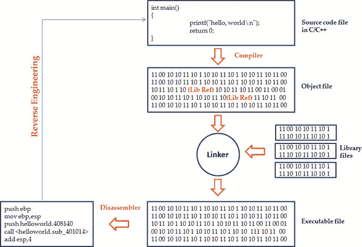

**图 1.2：** 反向工程的作用

零和一是不可读的。为了将机器代码转换回人类可读的格式，会使用一种称为反编译器的工具。反编译器的作用是将二进制代码转换为人类可读的格式并从中重新生成代码。我们将在 *第三章，使用反向工程工具* 中讨论此类工具

## 结论

在本章中，我们了解了反向工程是如何开始的，以及它在当今时代发挥着怎样的重要作用。我们还研究了反向工程的重要性及其对软件行业的影响。我们讨论了与反向工程相关的机会，以及恶意软件编写者如何利用它来攻击大公司的软件。在下一章中，我们将从反向工程的角度研究计算系统的内部结构。

# 第 2 章

## 理解 x86 机器的架构

在未来，每台设备或机器都将变得‘智能’。普通设备（或我们称之为‘传统设备’）与智能设备之间的主要区别在于智能设备具有互联网功能。所谓智能，是指设备被编程为以智能方式运行，并且可以通过互联网功能远程操作。今天，我们家庭中使用的大多数设备都已接入互联网，或者我们可以说，是智能设备。电视现在是智能电视，洗衣机现在是智能洗衣机，我们使用的冰箱现在也是智能冰箱，还有很多。所有这一切都得益于在电视、洗衣机、冰箱等传统设备中引入小型计算机而成为可能。现在一个大问题是，这些小型计算机内部有什么，它们是如何工作的？这些小型计算机由小型组件组成，其中每个组件在整个系统的运行中都发挥着重要作用。想象一下，这些小型计算机是个人计算机的缩小版。

所有这些设备都被称作现代计算设备。这些计算设备由多个组件组成，用于处理、数据存储、数据传输等。与软件结合的现代计算设备被编程为执行许多任务。要理解 **反向工程** (`RE`) 在现代计算设备上，我们首先需要了解这些计算设备内部有什么以及它们如何工作。

## 结构

在本章中，我们将涵盖以下主题：

* 计算系统的架构
* 计算系统的构建块
* 不同类型处理器的历史
* 寄存器、寄存器类型及其作用
* 栈的概念

## 目标

在本章中，我们将讨论计算系统及其类型。我们还将讨论现代计算系统的组件。然后我们将介绍处理器的主题以及处理器变体之间的差异及其编号方案。我们还将研究栈在反向工程中的作用，以了解调用者和被调用者之间的区别。

## 计算系统的架构

我们周围看到的任何计算系统都由一些基本构建块组成。当我们说计算系统时，可以是你的电脑、笔记本电脑、手机、物联网设备以及其他能够执行任务的设备。基本上，有两种类型的计算系统：

* **固定程序计算系统**：这些系统被设计为执行特定任务。例如，计算器。
* **存储程序计算系统**：另一方面，这些系统被设计成可以根据需要进行编程。它们可以同时运行许多任务，我们可以在其上存储和运行应用程序。例如，计算机。这些系统的架构由 John von Neumann 于 1945 年提出。

冯·诺依曼架构基于存储程序概念，其中程序数据和指令数据存储在同一内存中。这种设计被现代计算系统使用，现代计算系统由以下构建块组成：

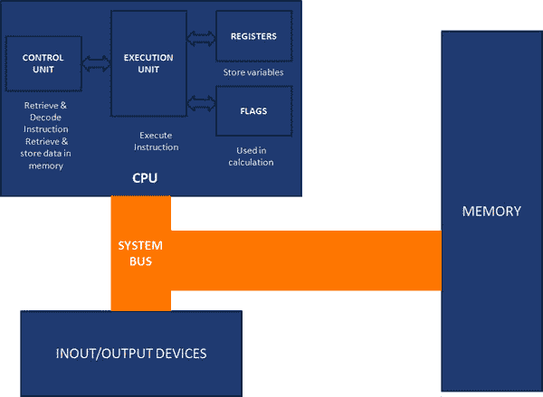

**图 2.1：** 计算系统的架构

### CPU

中央处理器控制我们的计算设备或系统的操作。在我们的计算系统中，CPU 也被称为处理器，是我们计算系统的“大脑”。CPU 的工作是从内存中获取指令，将指令解码为一系列操作，并按顺序执行这些步骤。CPU 内部有几个组件。其中一些是：

* **控制单元**：负责从内存或 RAM 中检索和解码指令。
* **执行单元**：该单元负责在寄存器的帮助下执行指令。
* **寄存器**：为了节省时间，CPU 并非每次获取指令时都访问 RAM。因此 CPU 本身具有称为寄存器的基本存储单元。寄存器有许多类型，我们将在以下章节中研究。其中之一是 `Instruction Pointer` 寄存器，它存储下一个要执行的指令的内存地址。
* **标志**：这些只是寄存器，但它们记录算术计算后 CPU 的状态。

### 内存

这可以是 **随机访问内存** (`RAM`) 或 **只读内存** (`ROM`)。它也可以是外部存储设备，例如 **硬盘** (`HDD`)、光盘等。内存的主要目的是存储我们的计算机或计算系统执行的指令序列。这也称为程序代码。内存的第二个目的是存储数据，我们的计算机在其上工作。

### 输入/输出设备

所有与我们的计算系统接口的设备都称为 `I/O`（输入/输出）设备。这可以是我们的键盘、鼠标、显示器等。这些设备通过端口进行接口，端口有两种类型，输入端口和输出端口。输入端口用于将数据从这些外围设备读入计算系统。输出端口用于将数据从计算系统发送到外围设备，如视频显示器、打印机等。

### 系统总线

系统总线可以想象成一组在我们的计算系统中不同组件之间传输信息或数据的电线。根据组件之间传输的信息类型，总线分为地址总线、数据总线和控制总线。

* **地址总线**：这些是并行信号线，用于发送要读取或写入的内存位置的地址。CPU 可以寻址的内存位置数量由信号线或地址线的数量计算得出。假设 CPU 有 `N` 条地址线，那么 CPU 可以寻址的内存位置总数为 `2^N`。例如，CPU 有 8 条地址线。该 CPU 可以寻址 256 个内存位置。如果 CPU 有 16 条地址线，则 CPU 可以寻址 65,536 个内存位置。
* **数据总线**：这些也是并行信号线，用于在 CPU 和内存之间传输数据。


## 控制总线
A `Control Bus` 包含并行信号线，用于向连接到 `CPU` 的各种外围设备传输同步信号。These are used to transfer information required to coordinate multiple tasks. This consists of 4-10 parallel signal lines to send out signals on the control bus. Typical control bus signals are `I/O Read`、`I/O Write`、`Memory Read`，and `Memory Write`。Suppose a `CPU` needs to read a byte of data from the memory location. In this process, the following activities will happen:
- The `CPU` will send the memory address of the desired byte on the `Address Bus`。
- The `CPU` will then send the `Memory Read` signal on the `Control Bus`。
- The `Memory Read` signal will enable the addressed memory device to output data (or byte) on to the `Data Bus`。
- The Data (or byte) travels from the desired memory address to the `CPU` using the `Data Bus`。

## 计算系统的构建块
To understand reverse engineering, knowledge of the basic data building blocks is a must. These data building blocks include the meaning of `Bit`、`Nibble`、`Byte`、`Word`，and `DWORD`。All of these can be explained from the following figure:

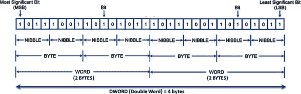

**图 2.2：** 理解位、半字节、字节

Humans can communicate with each other in different languages based on the countries they reside in. But when we talk about a computing system like computers, they can only understand binary, which is 0 or 1. Computers communicate with each other by sending or exchanging data. The smallest unit of data is called `bit`，which can be 0 or 1。

1 个 `Nibble` 表示 4 个 `bits`。Similarly, we can refer to `BYTE`、`WORD`，and `DWORD` as:
- 1 `BYTE` = 2 `NIBBLES` = 8 `bits`
- 1 `WORD` = 2 `BYTES` = 16 `bits`
- 1 `DWORD` = 4 `BYTES` = 32 `bits`

## 微处理器
As we know, the `CPU` is the brain of a computing system. The `CPU` is surrounded by circuitry which in its whole is referred to as the microprocessor. A microprocessor can have more than one `CPU`，like graphics processor. So, the `CPU` is actually a part of the microprocessor, but microprocessors can have more than one `CPU`。There are many types of microprocessors. You must have heard of companies like Intel, AMD, and many more. They are the top manufacturers of microprocessors. Some of the most popular models of the first generation microprocessors are:

| `8086` |
| --- |
| Intel `8086` 于 1978 年推出，是首款 Intel 16 位微处理器。This gave rise to the `x86` architecture processor that became a successful segment of processors. The specification of the Intel `8086` processor were:
- 数据总线宽度：16 位
- 地址总线：20 位
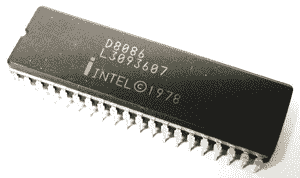 |

| `80186` |
| --- |
| Intel `80186` 于 1982 年推出。It was the second model in the Intel family. The specification of the Intel `80186` processor were:
- 数据总线宽度：16 位
- 地址总线：20 位
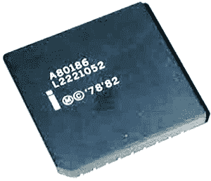 |

| `80286` |
| --- |
| Intel `80286` 于 1982 年推出。It was the third model in the Intel family. The specification of the Intel `80286` processor were:
- 数据总线宽度：16 位
- 地址总线：24 位
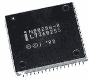 |

| `80386` |
| --- |
| Intel `80386` 于 1985 年推出。It was the fourth model in the Intel family. The specification of the Intel `80386` processor were:
- 数据总线宽度：32 位
- 地址总线：32 位
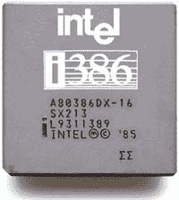 |

| `80486` |
| --- |
| Intel `80486` 于 1989 年推出。It was the fifth model in the Intel family. The specifications of the Intel `80486` processor were:
- 数据总线宽度：32 位
- 地址总线：32 位
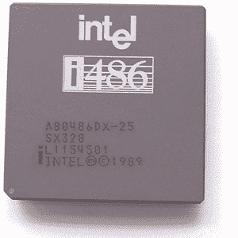 |

So collectively, all the processors are referred to as the `x86` Intel family。

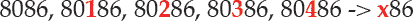

Generally, we refer to the Intel processor as follows:
- `x86-16`：表示 16 位处理器。
- `x86-32`（又名 `IA32`）：表示 32 位处理器（`IA` 表示：Intel Architecture），也仅称为 `x86`。
- `x86-64`：表示 64 位处理器，也称为 `x64`。

**注意：** Throughout this book, we will focus on the Intel `x86-32` processor。

## 内存
The memory, which we call RAM, for a single process running on the `x86-32` architecture is divided into the following sections:

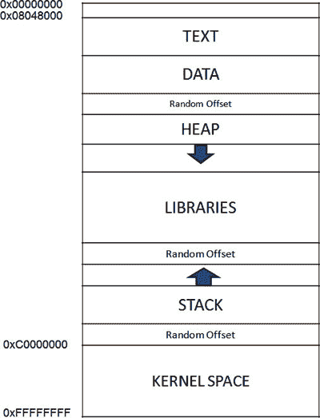

**图 2.3：** 进程地址空间

The memory address is ranged from `0x00000000` – `0xFFFFFFFF`。The prefix 0x refers to hexadecimal numbers. Every hexadecimal number is 4 bit in size, so any memory address of `x86-32` architecture is referred by a combination of 8 hexadecimal numbers, which make 4 x 8 = 32 bits in size. This is why, the memory address of `x86-32` computer is 32 bits in size。
- `Kernel Space`：为操作系统内核保留 1GB。
- `Stack`：这是为函数局部变量和参数保留的空间。A stack grows up to a fixed memory size. It grows from a higher memory address to a lower memory address。
- `Libraries`：这里加载我们的共享库。The common dialog box like *保存对话框* is stored in library which is shared among many programs。
- `Heap`：堆向下增长。When an image is loaded, depending on the size of the image, dynamic memory is required to load an image during the program execution. This memory is freed when the program finishes. This heap memory dynamically changes during program execution. It grows from a lower memory address to a higher memory address。
- `Data`：这是用于存储代码中的静态变量和全局变量的内存部分。
- `Text`：此内存部分保存要执行的指令或代码以执行某些操作。

## 寄存器
To save time, a small amount of temporary storage is available with the `CPU` called **寄存器**。In the `x86` processor, registers are divided into the following categories:

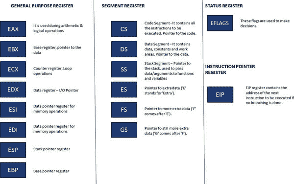

**图 2.4：** 寄存器

### 通用寄存器
`X86` architecture has 8 general purpose registers:
- `EAX` 用于算术和逻辑运算。It is also used to store the function return value。
- `EBX` 用作数据指针。
- `ECX` 用于循环操作。
- `EDX` 用于 I/O 和算术运算。
- `ESI` 在字符串操作中用作源指针。
- `EDI` 在字符串操作中用作目标指针。
- `ESP` 是指向堆栈顶部的指针。
- `EBP` 是指向堆栈帧基址的指针。

All general purpose registers are 32 bits in size and they can also be referred in the sizes of 16 bits and 8 bits. The smaller unit of any register can be referred as shown below。

The size of the `EAX` is 4 byte (32 bits). The “E” in `EAX` stands for Extended。

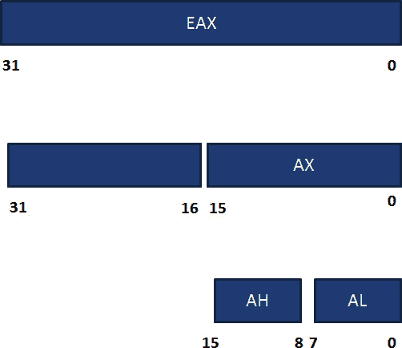

**图 2.5：** 寄存器的较小单元

`AX` 是 `EAX` 寄存器的下半部分，大小为 16 位。`AX` 进一步分为 `AH`（A-High）和 `AL`（A-Low），每个大小为 8 位。The same goes for other general purpose registers。
- 通用寄存器的 32 位版本：`EAX`、`EBX`、`ECX`、`EDX`、`ESI`、`EDI`、`EBP`、`ESP`
- 通用寄存器的 16 位版本：`AX`、`BX`、`CX`、`DX`、`SI`、`DI`、`BP`、`SP`
- 通用寄存器的 8 位版本：`AH`、`AL`、`BH`、`BL`、`CH`、`CL`、`DH`、`DL`

### 段寄存器
The segment registers `CS`、`DS`、`SS`、`ES`、`FS` and `GS` are 16 bits in size. A segment register points at the start of a segment in memory. Segments can be categorized based on the three types of storage: Code, Data, and Stack。
- `Code Segment`：此段包含所有要执行的指令，而 `Code Segment`（`CS`）寄存器包含指向代码的指针。
- `Stack Segment`：此段保存函数的数据、变量和参数。`Stack Segment`（`SS`）寄存器保存指向堆栈的指针。


# 数据段

为了代码效率和安全性，创建了四个独立的数据段。它们是：
- 用于当前加载模块的数据结构
- 从其他第三方模块导出的<|message|>数据
- 动态创建的数据结构
- 在不同程序之间共享的数据

为了访问不同类型的数据结构和附加数据段，使用 `DS`、`ES`、`FS`、`GS` 寄存器。

# 状态寄存器

状态寄存器是 `EEFLAGS` 寄存器。该寄存器大小也为 4 字节。该寄存器的每一位代表一个标志，可以是零 (0) 或一 (1)。每一位的状态代表 CPU 操作的某个结果。在进行逆向工程时使用的一些常见标志有：
- `Zero Flag (ZF)`: 当操作结果为零时，该标志被置为 1。否则，它将被清除。
- `Carry Flag (CF)`: 当操作结果对于目标来说过大或过小时，该标志被置为 1。否则，它将被清除。
- `Sign Flag (SF)`: 当操作结果为负数时，该标志被置为 1。当操作结果为正值时，该标志被清除，或者可以说为 0。
- `Trap Flag (TF)`: 当处理器一次执行一条指令时，该标志被置为 1，并且用于调试。
- `Parity Flag (PF)`: 当结果的 `Least Significant Bit` (`LSB`) 包含偶数时，它被置为 1。否则，它将被清除。
- `Overflow Flag (OF)`: 当操作结果太大而无法容纳时，该标志被置为 1。

# 指令指针寄存器

指令指针也称为 `EIP`。该寄存器包含下一条要执行的指令的内存地址。`EIP` 告诉处理器下一步该做什么。从安全角度来看，`EIP` 非常重要。攻击者通过控制指令指针来入侵任何系统。一旦 `EIP` 被攻击者控制，恶意代码就可以被执行以执行任何任务。

# 栈的概念

这是逆向工程中最重要的概念。想象一下栈就像在你当地的餐馆或食堂里一叠叠放的午餐盘子。要拿起一个盘子，我们从顶部取出盘子，往堆里添加更多盘子时也是遵循同样的过程。添加到堆中的盘子将被放在顶部。如果我们必须取出堆底的盘子，就必须一个一个地取出它上面的所有盘子。暂时假设向堆中添加盘子称为 `PUSH`，从堆中取出盘子称为 `POP`。

栈的工作方式相同，`Last In First Out` (`LIFO`)。这意味着最后添加（压入）的东西将是第一个被取出（弹出）的东西。为了理解栈的工作原理，我们来看一段伪代码：

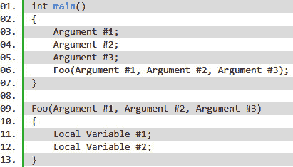

**图 2.6：** 伪代码

在此伪代码中，有两个函数：一个是代码执行开始的 `main` 函数，另一个是 `Foo` 函数。`Foo` 函数有 3 个参数，这些参数对 `main` 函数是局部的，还有 2 个局部变量。在代码执行期间，`Foo` 函数由 `main` 函数调用。在此代码中，`main` 函数是调用者，而 `Foo` 函数是被调用者。

我们假设代码中提到的 3 个参数和 2 个局部变量的类型都是 `int`。`int` 数据类型在内存中占用 4 字节，因为 `sizeof(int)` 为 4 字节。

当我们的执行进入 `Foo` 函数内部时，典型的栈状态将如下所示：

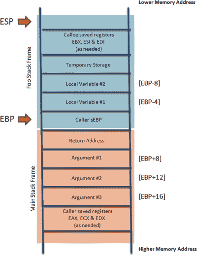

**图 2.7：** 栈

每个函数都有一个栈帧。由于我们有两个函数 `main` 和 `Foo`，我们将有两个栈帧。栈帧的最高地址是该栈帧的 `EBP`。

让我们逐步了解栈帧是如何在函数返回时设置和清理的。

## 调用者在调用被调用者之前

在本节中，我们将查看 `main` 函数即将调用 `Foo` 函数时的栈状态。考虑 `Foo` 函数调用如下：

```
int main()
{
FooReturnValue = Foo(10, 20, 30);
}
```

调用者是我们的 `main` 函数，即将调用被调用者 `Foo` 函数。`main` 函数有自己的栈帧，其中 `ESP` 指向栈顶，`EBP` 是 `main` 函数栈帧的基指针。

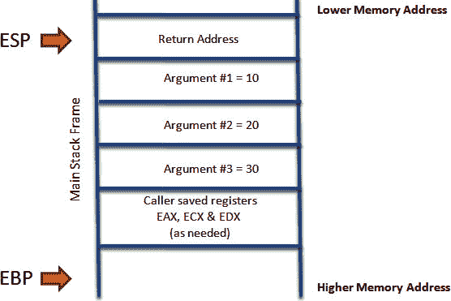

**图 2.8：** 调用者在调用被调用者之前

在调用 `Foo` 函数之前，`main` 函数仅在需要保留这些寄存器的内容时，才将 `EAX`、`ECX` 和 `EDX` 寄存器压入栈中。接下来，`main` 函数将 `Foo` 函数的参数一个一个压入栈中。

`FooReturnValue = Foo(10, 20, 30);` //Foo 函数参数为 10、20、30

参数按从右到左的顺序压入，因此首先压入 *30*，然后是 *20*，最后是 *10*。相应的汇编指令为：

```
PUSH 30
PUSH 20
PUSH 10
```

将 `Foo` 参数压入栈后，使用汇编语言中的 `CALL` 指令调用 `Foo` 函数：

```
CALL Foo
```

当执行 `CALL` 指令时，`EIP` 寄存器的内容将被压入栈中，因为 `EIP` 指向 `CALL` 指令之后 `main` 中的下一条指令。将 `EIP` 压入栈后，栈顶将有返回地址。此返回地址将在 `Foo` 函数执行完毕后帮助指令指针恢复在 `main` 中的执行。

## 被调用者在函数调用之后

当 `Foo` 函数获得控制权时，它将执行以下三个任务：
- 设置 `Foo` 函数的栈帧。
- 为 `Foo` 函数的局部变量分配空间。
- 如有需要，保留 `EBX`、`ESI` 和 `EDI` 的内容。

`Foo` 函数的栈帧使用以下汇编指令设置：

```
PUSH EBP
MOV EBP, ESP
```

为了为 `Foo` 函数设置栈帧，我们首先通过将其压入栈来保存 `main` 的 `EBP`（即 `main` 函数的基指针）。


**图 2.9：** 被调用者在函数调用之后

将 `main` 的 `EBP` 压入栈后，`ESP`（指向栈顶）将成为新的 `EBP`（`Foo` 函数的基指针）。此 `EBP` 连同偏移量将用于引用栈上的变量。如前图所示，我们可以看到第一个参数可以通过 `EBP` 加上 8 字节（`main` 的 `EBP` 占 4 字节 + 返回地址占 4 字节）来访问。

现在我们需要在栈上为 `Foo` 函数的局部变量分配空间。这是通过从栈指针中减去 20 字节来实现的，其中 20 字节包括 8 字节（2 个变量各 4 字节的空间）和 12 字节的临时存储空间。这将使用以下指令完成：

```
SUB ESP, 20
```

局部变量和临时变量可以通过相对于 `EBP` 的偏移量访问。在为局部变量在栈上分配空间后，`EBX`、`ESI` 和 `EDI` 寄存器通过压栈的方式得到保存。

保存 `EBX`、`ESI` 和 `EDI` 的内容后的栈状态如下所示：

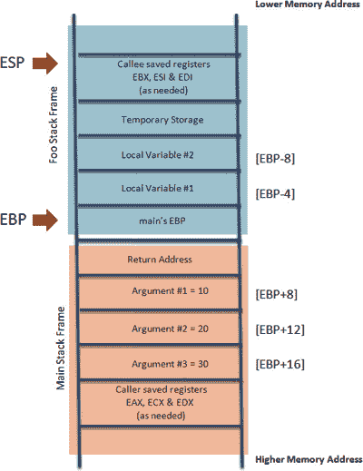

**图 2.10：** Foo 和 Main 的栈帧

在 `Foo` 函数执行期间，栈上可能会有多次压栈和弹栈操作。在这种情况下，`ESP` 会上下移动，但 `EBP` 保持不变。在 `EBP` 的帮助下，可以使用相对于 `EBP` 的偏移量访问变量。

## 被调用者在返回之前


现在假设 `Foo` 函数的执行已完成。在返回之前，被调用方会安排将 `Foo` 函数的返回值保存在 `EAX` 寄存器中。其次，`EBX`、`EDI` 和 `ESI` 的值将被恢复。`Foo` 函数的栈帧将由以下汇编指令拆除：

`MOV ESP, EBP`

`POP EBP`

`RET`

这些指令将通过将栈指针 `ESP` 移回 `EBP`（`Foo` 函数的基指针）使栈恢复到以下状态，并且通过从栈中弹出 `EBP` 来恢复旧的 `EBP`（`main`’s `EBP`）。

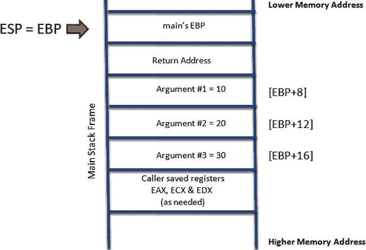

**Figure 2.11:** 返回前被调用方

`RET`，返回指令将从栈中弹出返回地址并将其移动到 `EIP`。这将使 **指令指针**（`EIP`）指向 `main` 函数，以恢复 `main` 函数的执行。

## 返回后调用者

由于指令指针已返回到 `main` 函数，现在我们不再需要在栈上保留参数。

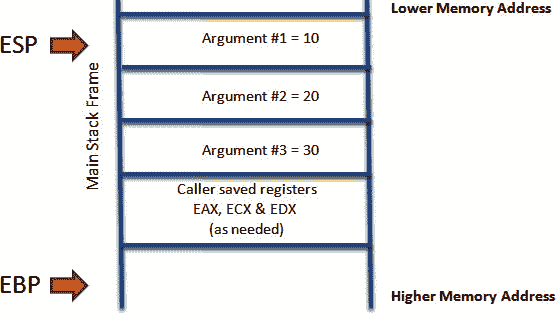

**Figure 2.12:** 返回后调用方

栈上的所有参数都通过将 `ESP` 增加 12 字节来清理（每个参数 4 字节，乘以参数数量 3）。

`ADD ESP, 12`

由于 `EAX` 寄存器保存着 `Foo` 函数的返回值，`EAX` 寄存器的内容可以移动到其他寄存器。最后，保存的寄存器 `EAX`、`ECX` 和 `EDX` 从栈中弹出，并且 `ESP` 被指向栈上它开始时的同一位置。

## 结论

我们介绍了现代计算设备的架构以及构成计算设备的不同组件。我们还介绍了计算设备中使用的不同组件的功能。这涵盖了微处理器、内存和不同类型寄存器的基础知识。还讨论了不同的处理器变体以及 x86 编号约定的相关性。

我们介绍了栈的一个重要方面。在伪代码的帮助下，我们理解了调用者和被调用者之间的区别。理解栈在任何应用程序的逆向工程中都起着重要作用。所以不要跳过栈部分。在下一章中，我们将讨论行业专业人士使用的不同逆向工程工具。

# 第 3 章

## 使用逆向工程工具入门

工具在生活的方方面面都发挥着至关重要的作用。我们经常使用移动计算器来在日常生活中进行基础数学运算。在移动计算器之前，我们使用硬件计算器来进行数学计算。这个计算器是我们用来执行特定任务的工具的一个简单例子。简单的计算可以口头完成，但在复杂的情况下，使用工具变得必要。同样地，对于逆向工程，市场上有大量可用的工具。有些是商业的，有些是免费使用或开源的。为了选择正确的工具，对该主题的概念知识变得至关重要。

如果你在互联网上搜索逆向工程工具，你会找到很多。根据你的需求选择合适的工具总是很重要的。在本章中，我们将首先了解逆向工程中工具的概念，然后理解这些工具在逆向工程过程中的重要性。我们将讨论那些易于获取且免费的工具。

### 结构

在本章中，我们将涵盖以下主题：

* 逆向工程中工具的重要性
* 逆向工程工具
* 可移植可执行文件编辑器
* 反汇编器
* 调试器

### 目标

本章的目标是理解工具背后的基本概念以及为什么它们在逆向工程过程中是必需的。然后我们将讨论一些读取二进制格式所需的工具。我们还将介绍与 `Portable Executable (PE)` 编辑器、反汇编器和调试器相关的一些概念。

### 逆向工程中工具的重要性

当我们使用 C/C++ 等高级语言编译程序时，它会被转换为 CPU 可以理解的一系列字节。这就是机器码，人类难以理解。为了使此代码更易于理解，我们使用一种称为反汇编器的工具。此反汇编器将机器码翻译为人类可读的格式。这种格式称为汇编代码，使用汇编语言的语法。以下图表将帮助你终身理解这个概念：

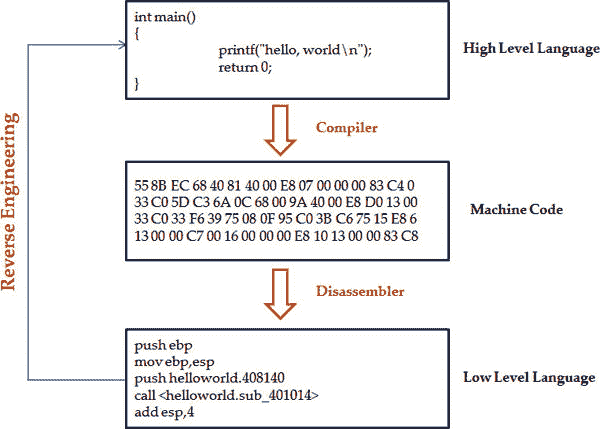

**Figure 3.1:** RE 工具的重要性

逆向工程有助于在没有应用程序或程序源代码的情况下重新生成应用程序逻辑。恶意软件研究人员遵循这一概念来执行逆向工程任务。

现在我们将讨论逆向工程所需的几个工具。我们还将在本书中全程使用这些工具。

### 逆向工程工具

为了便于理解，逆向工程工具分为不同的类别，如 PE 编辑器、反汇编器和调试器。在每个类别中，我们都有免费或开源工具可用，并且给定类别内的所有工具都具有相同的目的，只是功能略有差异。我们将重点关注具有图形用户界面的免费和开源工具。所有这些工具都在本书中全程使用。

#### 可移植可执行文件编辑器

`PE` 代表 `Portable Executable`。可移植可执行文件是标准 Windows 文件格式。每个 Windows 可执行文件都使用此文件格式。`Dynamic Link Library`（`DLL`）、`Component Object Model`（`COM`）文件和 .NET 可执行文件使用 `PE` 文件格式。以下图表显示了 `PE` 的基本结构：

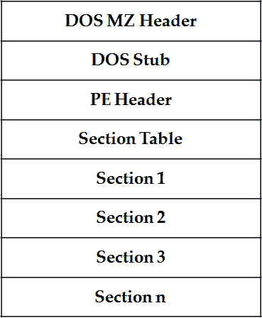

**Figure 3.2:** PE 结构

所有 `PE` 文件都以 DOS 头开始，然后是 `PE` 头也称为 `NT` 头，以及可执行文件中常见的节。这些常见节如下：

* `.text`：此节包含实际的二进制可执行代码。
* `.bss`：此节表示未初始化数据。
* `.rdata`：此节包含只读数据，例如常量、字符串。
* `.rsrc`：此节是资源节，其中存储资源信息。
* `.edata`：这是导出数据节，包含有关导出函数的信息。
* `.idata`：这是导入数据节，其中包含有关导入函数的信息以及导入目录和导入地址表。
* `.debug`：最初，调试信息被放在此调试信息节中。`PE` 文件还支持具有 `.dbg` 扩展名的单独调试文件。

要查看和编辑所有这些详细信息，我们可以使用以下工具。

##### CFF Explorer

此工具旨在在不丢失 `PE` 文件内部结构的情况下查看和编辑 `PE` 文件。此工具不仅被逆向工程师使用，也被应用程序开发者使用。

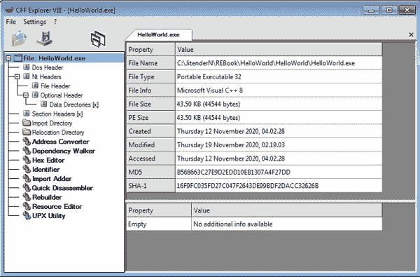

**Figure 3.3:** CFF Explorer

我们将在后续章节中使用此 CFF Explorer 来编辑 `PE` 文件。

#### 反汇编器

正如我们在前面部分讨论的那样，机器码是不可读的，我们需要一些工具将机器码转换为人类可读的格式。这就是反汇编器发挥作用的地方。反汇编器用于将机器码转换为人类可读的汇编代码。以下是本书中使用的一些反汇编器。

##### Ghidra

这是一个由 `National Security Agency`（`NSA`）开发的开源工具。它是免费的，用于逆向工程。其源代码于 2019 年 4 月 4 日发布。此工具被恶意软件研究人员和逆向工程师用于分析恶意软件并查找应用程序中的漏洞。


**图 3.4：** Ghidra

##### Cutter

Cutter 是 `Radare2` 反向工程框架的开源接口。`Radare2` 是用于反向工程的命令行工具，用于在不同平台和架构上对二进制格式进行静态和动态分析。Cutter 是 `Radare2` 的图形用户界面。

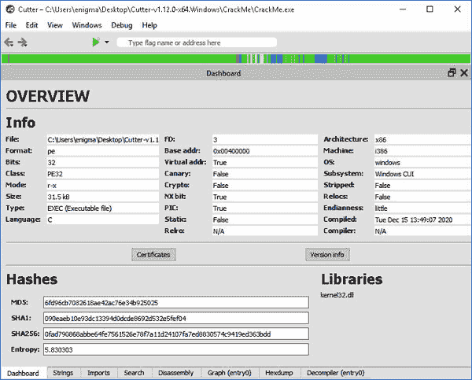

**图 3.5：** Cutter

## 调试器

当我们运行应用程序或二进制文件时，我们会检查正在运行程序的状态。调试器在二进制文件在内存中执行时提供其动态状态。一些漏洞在开发人员编写或执行代码时并未被捕获。这时我们使用调试器运行代码并监控寄存器、内存位置和其他参数。我们将在本书中大量使用以下调试器。

## x32dbg

调试器有两种类型：32 位和 64 位。`x32dbg` 用于 x86（32 位）二进制文件。另一个版本是 `x64dbg`，用于 x64（64 位）二进制文件。如以下图所示，`x32dbg` 分为 4 个部分：

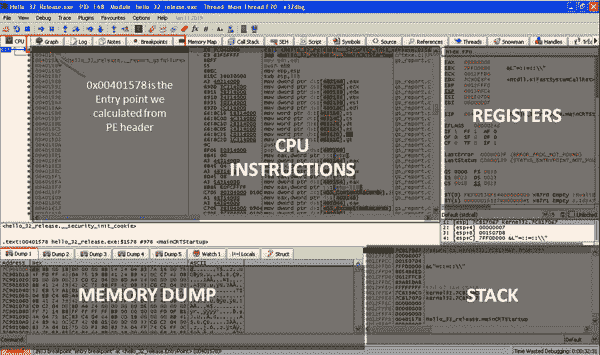

**图 3.6：** `x32dbg`

如前图所示，这四个部分如下：

* **反汇编或 CPU 指令**：此处显示机器码转换成的汇编代码。第一列是指令的内存地址。第二列是 `opcode`，也称为 **操作码**。第三列是汇编指令。第四列显示指令的注释。
* **寄存器和标志**：此部分在二进制文件的动态分析期间显示寄存器及其值。它还显示标志的值以显示处理器的当前状态。
* **堆栈**：如前一章所述，堆栈是 **后进先出** (**LIFO**)。这意味着最后添加的内容（压入）将是第一个被取出（弹出）的。堆栈从较高的内存地址向较低的内存地址增长。
* **内存转储**：它类似于十六进制编辑器，显示内存中二进制文件的十六进制代码。它以十六进制和 ASCII 格式显示原始数据。可以通过双击相应的内存位置来更改特定内存地址上的值。

## 结论

在本章中，我们介绍了本书中使用的不同反向工程工具。我们还讨论了反汇编器和调试器之间的区别。还讨论了反向工程中工具的重要性，然后我们列出了一些 PE 编辑器、反汇编器和调试器。在下一章中，我们将逐步介绍汇编指令，这将帮助我们阅读和理解反汇编的汇编代码。

# 第 4 章

## 逐步了解汇编指令

在上一章中，我们介绍了某些汇编语言指令。汇编语言中有许多类型的指令，可以将它们分组在一起，以便更清晰地理解和掌握特定汇编指令集的目标。为了理解在反向工程中逐步学习基本汇编指令的相关性，我们将举一个现实生活中的例子。

你小时候有没有打开过玩具？打开玩具并检查其内部组件总是很有趣。今天，如果你想了解玩具的内部工作原理，你首先需要了解安装在玩具硬件设计内部的不同组件。现在，要揭示玩具的内部工作原理，我们必须了解安装在其内部的每个组件的工作原理。整个过程可以与玩具的逆向工程 somewhat 相比。

同样，对于任何软件或应用程序的逆向工程，我们需要将其拆分为不同的指令，并且对反汇编的汇编指令的理解变得必不可少。因此，要了解任何软件或应用程序的工作原理，我们需要清楚地了解指令及其执行路径。这就是需要了解汇编语言中不同指令的地方。

### 结构

在本章中，我们将涵盖以下主题：

* 不同的汇编语言指令
* 汇编指令的语法
* 汇编指令的分组

### 目标

阅读完本章后，你将能够理解反向工程中使用的重要的汇编指令，以及这些指令如何分组到各个部分以便于理解并附带一些示例。我们还将学习指令的语法、其内部工作原理以及不同类型指令背后的基本概念。

### 不同的汇编语言指令

指令是汇编代码的基本构建块。指令是操作码和零个或多个操作数的组合。


**图 4.1：** 汇编指令语法

操作码通常称为 `opcode`。操作数可以有三种类型：

* **立即操作数**：这些是固定的十六进制值，如 `0x0A`。
* **寄存器操作数**：它们可以是任何寄存器，例如 `ECX`、`EAX` 等。
* **内存地址操作数**：这些是内存地址，用方括号表示，如 `[EAX]`。

程序代码以操作码（或 `opcode`）和操作数的序列保存在内存中。它们保存在连续的内存位置中。如以下图像所示，指令 1 占用两个内存位置，指令 2 占用相同的两个内存位置，指令 3 仅占用一个内存位置。

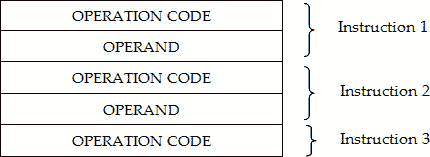

**图 4.2：** 内存中的程序代码

请看以下带有寄存器操作数的汇编指令示例：

指令格式：

`OPERATION_CODE DESTINATION_OPERAND SOURCE_OPERAND`

**示例**

`MOV EAX, ECX`

`OPERATION_CODE = MOV`，表示 move

`DESTINATION_OPERAND = EAX`，是目标寄存器

`SOURCE_OPERAND = ECX`，是源寄存器

此指令将数据从 `ECX` 寄存器移动到 `EAX` 寄存器。现在，每个由操作码表示的指令也称为操作码。这些操作码告诉 CPU 程序想要执行什么操作。因此，前述指令的操作码为 `89 C8`，这是指令的十六进制表示。反汇编器将这些操作码转换为人类可读的格式。因此，`89 C8` 将被转换为 `MOV EAX, ECX`。

现在我们对汇编指令的概念已经清楚，我们将继续解释理解反向工程过程中遇到的主要汇编指令。这些汇编指令可以分为不同的部分以便于理解。汇编指令的分组可以大致分为以下几类：

* 堆栈指令
* 数据传输指令
* 算术指令
* 程序执行指令
* 分支指令
* 位操作指令
* 处理器控制指令
* 字符串指令

让我们逐一介绍每个部分并了解属于每个类别的汇编指令。

#### 堆栈指令

这些是用于在堆栈之间进行传输操作的通用指令。

##### PUSH

指令格式：

`PUSH SOURCE_OPERAND`

**含义：**

`PUSH` 将值从源操作数复制到堆栈顶部并递减 `ESP` 寄存器。

**影响的标志：** 无

##### PUSHAD

指令格式：

`PUSHAD`

**含义：**

`PUSHAD` 将所有寄存器的值压入堆栈。寄存器按 `EAX`、`ECX`、`EDX`、`EBX`、`ESP`、`EBP`、`ESI` 和 `EDI` 的顺序压入。

**影响的标志：** 无


##### PUSHFD
指令格式：
`PUSHFD`
**含义：**
此指令将标志寄存器压入堆栈。
**影响的标志：** 无

## POP
指令格式：
`POP DESTINATION_OPERAND`
**含义：**
`POP` 从堆栈顶部检索值并将其复制到目的操作数。它递增 `ESP` 寄存器。
**影响的标志：** 无

## POPAD
指令格式：
`POPAD`
**含义：**
此指令弹出堆栈的值并将其复制到所有寄存器。寄存器按 `EDI`、`ESI`、`EBP`、`ESP`、`EDX`、`ECX` 和 `EAX` 的顺序弹出。`ESP` 值在 `POPAD` 中被忽略。
**影响的标志：** 无

## POPFD
指令格式：
`POPFD`
**含义：**
此指令从堆栈弹出 DWORD 到标志寄存器。
**影响的标志：** 无

## RET
指令格式：
`RET [nBytes]`
**含义：**
当一个函数调用另一个函数时，调用另一个函数的函数称为‘调用者’，而被调用的函数称为‘被调用者’。`RET` 将控制权从被调用者转移到调用者，到堆栈上保存的返回地址。`nBytes` 是可选的；当提到 `nBytes` 时，表示释放 n 个字节以清理堆栈。

#### 数据传输指令
这些是用于数据传输操作的通用指令。

## MOV
**指令格式：**
`MOV DESTINATION_OPERAND SOURCE_OPERAND`
**含义：**
将数据从源操作数移动到目的操作数，结果存储在目的操作数中。
**影响的标志：** 无

## LEA
指令格式：
`LEA REGISTER OPERAND`
**含义：**
`LEA` 代表加载有效地址，它将操作数的内存地址加载到寄存器中。
**影响的标志：** 无

## XCHG
指令格式：
`XCHG DESTINATION_OPERAND SOURCE_OPERAND`
**含义：**
`XCHG` 指令在源操作数和目的操作数之间交换值。
**影响的标志：** 无

## CMPXCHG
**指令格式：**
`CMPXCHG DESTINATION_OPERAND SOURCE_OPERAND`
**含义：**
此指令用于比较和交换。`EAX` 与 `DESTINATION_OPERAND` 进行比较，
如果 `EAX` 等于 `DESTINATION_OPERAND` 则 `DESTINATION_OPERAND` 用 `SOURCE_OPERAND` 加载。
如果 `EAX` 不等于 `DESTINATION_OPERAND` 则 `EAX` 用 `DESTINATION_OPERAND` 加载。
**影响的标志：** `CF` `ZF` `SF` `AF` `PF` `OF`

## LAHF
**指令格式：**
`LAHF`
**含义：**
此指令从标志中加载 `AH`。它将状态复制到 `AH` 寄存器，并且只有 5 个标志被复制到 `AH` 寄存器的位 7、6、4、2 和 0；`AH` 寄存器的位 5、3 和 1 将不受影响。
运行此指令后 `AH` 寄存器：
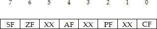
**图 4.3：** 从标志加载 AH
**影响的标志：** 无

## SAHF
指令格式：
`SAHF`
**含义：**
它将 `AH` 存储到标志中。此指令将 `AH` 寄存器的位（位 7、6、4、2 和 0）复制到 `SF`、`ZF`、`AF`、`PF` 和 `CF` 标志。
**影响的标志：** `SF`、`ZF`、`AF`、`PF` 和 `CF`

## LAR
**指令格式：**
`LAR DESTINATION_OPERAND SOURCE_OPERAND`
**含义：**
从 `SOURCE_OPERAND` 指定的段描述符加载有效权限到 `DESTINATION_OPERAND` 中。
**影响的标志：** `ZF`

## MOVSX
指令格式：
`MOVSX DESTINATION_OPERAND SOURCE_OPERAND`
**含义：**
带符号扩展的移动。假设你有一个较小的值并想将其复制到一个大寄存器。在这种情况下，我们将使用 `MOVSX`；它将 `SOURCE_OPERAND` 复制到 `DESTINATION_OPERAND` 并用符号位填充 `SOURCE_OPERAND` 未提供的位。
**影响的标志：** 无

## MOVZX
**指令格式：**
`MOVZX DESTINATION_OPERAND SOURCE_OPERAND`
**含义：**
带零扩展的移动。假设你有一个较小的值并想将其复制到一个大寄存器。在这种情况下，我们将使用 `MOVSX`；它将 `SOURCE_OPERAND` 复制到 `DESTINATION_OPERAND` 并用零填充 `SOURCE_OPERAND` 未提供的位。
**影响的标志：** 无

## XLAT
**指令格式：**
`XLAT`
**含义：**
`XLAT` 指令用表项替换 `AL` 寄存器的表索引。它将 `AL` 设置为 `DS:[EBX + unsigned AL]`。`AL` 的值被视为无符号索引，加上 `EBX` 寄存器以获取表项。`EBX` 包含表的基地址。

## MOVS
**指令格式：**
`MOVS DESTINATION_STRING SOURCE_STRING`
**含义：**
此指令将数据（字节、字、双字）从 `SOURCE_STRING` 复制到 `DESTINATION_STRING`，其中：
`SOURCE_STRING` 由 `DS:SI`（或 `ESI`）指向
`DESTINATION_STRING` 由 `ES:DI`（或 `EDI`）指向
`SI` 是 **数据段** `DS` 中的偏移地址
`DI` 是 **附加段** `ES` 中的偏移地址
**影响的标志：** 无

#### 算术指令
这些指令用于汇编语言中的算术运算。

## AAA
指令格式：
`AAA`
**含义：**
此指令在加法后调整 ASCII。`AAA` 指令用于在两个未打包 BCD 数字相加（`ADD` 指令）之后。未打包 BCD 数字是 ASCII 单数字 0 到 9 或 0x30 到 0x39。当 `AAA` 指令在 `ADD` 指令之后使用时，它将结果转换为两位 BCD 数字。有关 ASCII 代码，请参阅 *附录*。
当两个 ASCII 编码的数字相加时，结果不是 ASCII。要将其转换为 ASCII，在 `ADD` 之后使用 `AAA`。
**影响的标志：** `AF` `CF` (`SF`,`ZF`,`OF`,`PF` 未定义)
**示例**
```
XOR AH, AH        ;clear AH register
MOV AL, 32H      ;move ASCII 2 in AL
ADD AL, 39H      ;add ASCII 9, the result should be ASCII 11, but we get 6B in AL
AAA                     ;AH=0x01, AL=0x01 and AX=0x0101
```

## AAS
指令格式：
`AAS`
**含义：**
指令在减法后调整 ASCII。`AAS` 指令用于在两个未打包 BCD 数字相减（`SUB` 指令）之后。未打包 BCD 数字是 ASCII 单数字 0 到 9 或 0x30 到 0x39。当 `AAS` 指令在 `SUB` 指令之后使用时，它将结果转换为两位 BCD 数字。
**影响的标志：** `AF` `CF` (`SF`,`ZF`,`OF`,`PF` 未定义)

## AAD
**指令格式：**
`AAD`
**含义：**
除法前调整 ASCII。此指令在除法指令之前使用，以将 `AH` 和 `AL` 中的未打包 BCD 数字转换为二进制等价物。商将保存在 `AL` 中，余数将保存在 `AH` 中；两者都是未打包 BCD。
**影响的标志：** `PF`、`SF`、`ZF`
**示例**
将 68 除以 8。
```
MOV AX, 0608H      ;AH=0x06, AL=0x08 and AX=0x0608
MOV CH, 08H          ;divide ASCII 8, the result should be 8 in quotient and 4 in remainder
AAD                          ;AX = 0044 = 44H = 68
DIV CH                     ;Divide AX by in CH, result: AL = 08, AH = 04 unpacked BCD
```

## AAM
指令格式：
`AAM`
**含义：**
乘法时调整 ASCII。此指令用于两个 ASCII 数字的乘法。当未打包 BCD 数字相乘时，存储在 `AX` 中的结果转换为 `AH` 和 `AL` 中的未打包 BCD 数字。
**影响的标志：** `PF`、`SF`、`ZF`
**示例**
```
MOV AL, 00000111      ;move 7 in AL, masking upper 4 bits
MOV BH, 00000101     ;move 5 in BH, masking upper 4 bits
MUL BH                        ;AX = 23H, 35 in decimal
AAM                              ;result: AX = 0203H, AH = 02H, AL = 03H unpacked BCD
```

## ADC
指令格式：
`ADC DESTINATION_OPERAND SOURCE_OPERAND`
**含义：**


添加两个操作数，源操作数和目的操作数。结果存储在目的操作数中。如果 CF 标志被设置为 1，则向目的操作数加 1。

**受影响的标志：** AF CF OF PF SF ZF

## ADD
指令格式：
`ADD DESTINATION_OPERAND SOURCE_OPERAND`
**含义：**
该指令将两个操作数相加，源操作数和目的操作数。结果存储在目的操作数中。
**受影响的标志：** AF CF OF PF SF ZF

## CMP
**指令格式：**
`CMP DESTINATION_OPERAND SOURCE_OPERAND`
**含义：**
它将源操作数和目的操作数相减。结果不被保存，但标志会被更新。随后在指令中会检查这些标志。
**受影响的标志：** AF CF OF PF SF ZF

## DAA
**指令格式：**
`DAA`
**含义：**
加法后进行十进制调整。该指令在 `ADD` 或 `ADC` 指令之后使用，以调整 BCD 中的最终结果。这仅适用于 `AL` 寄存器。
**受影响的标志：** AF CF (OF, PF, SF, ZF 未定义)
**示例**
```
MOV DX, 1122H     ;load 1122H BCD
MOV BX, 3088H     ;load 3088H BCD
MOV AL, BL        ;only AL register works for DAA
ADD AL, DL        ;
DAA               ; BCD adjusted result, answer saved in AL
```

## DAS
**指令格式：**
`DAS`
**含义：**
减法后进行十进制调整。该指令在 `SUB` 或 `SBB` 指令之后使用，以调整 BCD 中的最终结果。这仅适用于 `AL` 寄存器。
**受影响的标志：** AF CF (OF, PF, SF, ZF 未定义)
**示例：**
```
MOV DX, 1122H     ;load 1122H BCD
MOV BX, 3088H     ;load 3088H BCD
MOV AL, BL        ;only AL register works for DAA
SUB AL, DL        ;
DAS               ; BCD adjusted result, answer saved in AL
```

## DEC
指令格式：
`DEC DESTINATION_OPERAND`
**含义：**
该指令从目的操作数中减去一，目的操作数可以是寄存器或内存位置。结果保存回寄存器或内存位置。
**受影响的标志：** AF OF PF SF ZF
**示例：**
```
MOV EAX, 02H      ;load EAX with 02H
DEC EAX           ;EAX will be 01H
```

## DIV
**指令格式：**
`DIV SOURCE_OPERAND`
**含义：**
`DIV` 指令用于将无符号的 QWORD/DWORD/WORD 除以 DWORD/WORD/BYTE。
当 WORD 被字节除时，被除数，即 WORD，必须在 `AX` 寄存器中，除数，即源操作数，可以在寄存器或内存位置中。除法后，商将被保存到 `AL`，余数将被保存到 `AH`。
当 DWORD 被 WORD 除时，被除数，即 DWORD，必须在 `DX:AX` 中（`DX` 中为最高有效位 WORD，`AX` 中为最低有效位 WORD）。除数，即源操作数，可以在寄存器或内存位置中。除法后，商将被保存到 `AX`，余数将被保存到 `DX`。
当双 DWORD (QWORD) 被 DWORD 除时，被除数，即双 DWORD (QWORD)，必须在 `EDX:EAX` 中（`EDX` 中为高位 DWORD，`EAX` 中为低位 DWORD）。除数，即源操作数，可以在寄存器或内存位置中。除法后，商将被保存到 `EAX`，余数保存到 `EDX`。
**受影响的标志：** 无
**示例**
```
MOX DX, 0          ;load DX with 00H
MOV AX, 0x8003     ;load AX with 8003H
MOV CX, 0x100      ;load CX with 100H
DIV CX             ;AX=80H, DX=03H
```

## IDIV
指令格式：
`IDIV SOURCE_OPERAND`
**含义：**
`DIV` 指令（整数除法）用于有符号数据的除法。关于被除数、除数、商和余数，其余部分与 `DIV` 指令相同。
**受影响的标志：** 无

## MUL
指令格式：
`MUL SOURCE_OPERAND`
**含义：**
`MUL` 指令用于将无符号的 DWORD/WORD/BYTE 乘以 DWORD/WORD/BYTE。
当 BYTE 与 BYTE 相乘时，被乘数，即 BYTE，必须在 `AL` 寄存器中，乘数，即源操作数，可以在寄存器或内存位置中。乘法后，结果将被保存到 `AX`。高 8 位存储在 `AH` 中，低 8 位存储在 `AL` 中。
当 WORD 与 WORD 相乘时，被乘数，即 WORD，必须在 `AX` 寄存器中，乘数，即源操作数，可以在寄存器或内存位置中。乘法后，结果为 DWORD，保存到 `DX:AX`。高位 WORD 存储在 `DX` 中，低位 WORD 存储在 `AX` 中。
当 DWORD 与 DWORD 相乘时，被乘数，即 DWORD，必须在 `EAX` 寄存器中，乘数，即源操作数，可以在寄存器或内存位置中。乘法后，结果为 QWORD，保存到 `EDX:EAX`。高位 DWORD 存储在 `EDX` 中，低位 DWORD 存储在 `EAX` 中。
**受影响的标志：** OF, CF
**示例**
```
MOV AX, 0x8003     ;load AX with 8003H
MOV CX, 0x100      ;load AX with 100H
MUL CX             ;DX=80H, AX=0300H
```

## IMUL
指令格式：
`IMUL SOURCE_OPERAND`
**含义：**
整数乘法 (`IMUL`) 指令用于乘以有符号数据。关于乘数和被乘数，其余部分与 `MUL` 指令相同。
**受影响的标志：** OF, CF

## INC
指令格式：
`INC DESTINATION_OPERAND`
**含义：**
它将目的操作数递增或加一，目的操作数可以是寄存器或内存位置。结果保存回寄存器或内存位置。
**受影响的标志：** AF OF PF SF ZF
**示例**
```
MOV EAX, 02H     ;load EAX with 02H
INC EAX          ;EAX will be 03H
```

## NEG
**指令格式：**
`NEG DESTINATION_OPERAND`
**含义：**
该指令将目的操作数的符号从正数变为负数，或从负数变为正数。基本上，它从目的操作数中减去 0 并执行 2’s complement 以将结果保存回目的操作数。8 位数字 00100101 的 2’s complement -> 11011010（反转位）-> 然后加 00000001 = 11011011
**受影响的标志：** AF OF PF SF ZF
**示例**
```
MOV EAX, 02H     ;load EAX with 02H, (2 in decimal)
NEG EAX          ;EAX will be FFFFFFFEH, (-2 in decimal)
```

## SBB
指令格式：
`SBB DESTINATION_OPERAND SOURCE_OPERAND`
**含义：**
它从目的操作数中减去源操作数。结果存储在目的操作数中。如果 CF 标志被设置为 1，则从目的操作数中减去 1。
**受影响的标志：** AF CF OF PF SF ZF

## SUB
**指令格式：**
`SUB DESTINATION_OPERAND SOURCE_OPERAND`
**含义：**
从目的操作数中减去源操作数。结果存储在目的操作数中。
**受影响的标志：** AF CF OF PF SF ZF

## XADD
**指令格式：**
`XADD DESTINATION_OPERAND SOURCE_OPERAND`
**含义：**
交换并加 (`XADD`) 指令与 `ADD` 指令相同，它将源操作数和目的操作数相加，将结果存储在目的操作数中。与 `ADD` 指令的不同之处在于，在 `XADD` 指令之后，目的操作数的原始值会被复制到源操作数。
**受影响的标志：** AF CF OF PF SF ZF
**示例**
```
MOV EAX, 0x00000001    ; load EAX with 01H, (1 in decimal)
MOV EBX, 0x00000002    ; load EBX with 02H, (2 in decimal)
XADD EAX,EBX          ; EAX= 03H (3 in decimal), EBX=01H
```

#### 程序执行指令
这些指令用于控制程序执行流程和标志。

## CALL
**指令格式：**
`CALL DESTINATION_OPERAND`
**含义：**


程序执行期间，一个过程会被另一个函数调用；此时使用 `CALL` 指令。使用 `CALL` 指令，指针会跳转到函数内被调用过程的代码。当 `CALL` 指令执行时，`CALL` 指令之后下一条指令的内存地址会被压入栈。被调用过程执行结束后，该内存地址会通过 `RET` 指令从栈中弹出。

**受影响的标志：** 无

**示例**

`CALL PROC_LABEL` ; 程序流程被转移到过程标签的内存位置

## `进入`

指令格式：

`ENTER Storage, Level`

**含义：**

在 Intel 架构中，使用 `ENTER` 和 `LEAVE` 指令提供了另一种执行过程调用的方法。这些指令为过程创建和释放栈帧，用于存储变量和返回执行所需的指针。在 C 和 Pascal 等块结构语言中，这些指令为过程调用提供了机器语言支持。

`ENTER` 指令有 2 个操作数：

*   `Storage`：这表示为过程调用在栈上预留的字节数。
*   `Level`：也称为词法嵌套级别（从 0 到 31），它是过程调用链中过程的深度。

**受影响的标志：** 无

## `离开`

指令格式：

`LEAVE`

**含义：**

该指令通过恢复 `(E)SP`/`(E)BP` 来释放为过程创建的栈帧，该栈帧用于存储变量和返回执行的指针。

**受影响的标志：** 无

## `中断`

指令格式：

`INT <type>`

`type` 在 0 到 255 之间。

**含义：**

中断是一种使处理器暂停以暂时处理其他任务然后返回主任务的条件。中断是请求 CPU 注意的事件或信号。外围硬件设备使用它来访问 CPU。每当中断发生时，处理器会完成当前的一组指令，然后启动中断服务例程（`ISR`）或中断处理程序。`ISR` 是一个包含处理特定中断的一组指令的例程。该 `ISR` 告诉处理器在中断发生时该做什么。

现在，`INT` 指令允许程序显式调用中断处理程序。当调用 `INT` 指令时执行以下任务：

*   `FLAGS` 寄存器被压入栈。
*   代码段（`CS`）被压入栈。
*   `INT` 指令之后下一条指令的偏移量被压入栈。
*   `IP`（指令指针）从绝对内存地址加载，该地址是中断类型乘以 4 的倍数。如果 `INT` 为 8，则 `IP`（指令指针）将从 8 * 4 = 32 十进制 = 0x00020 内存位置读取。
*   代码段将是下一个 WORD 位置。`CS` 将为 0x00022（0x00020 + 2）。
*   重置 `TF` 陷阱标志（`TF`）和 `IF` 中断标志（`IF`）。

**受影响的标志：** `IF`、`TF`

## `中断溢出`

指令格式：

`INTO`

**含义：**

`Interrupt Overflow`（`INTO`）：如果溢出标志（`OF`）被置位，则该指令会引发溢出异常。如果 `OF` 未被置位，则指令执行继续而不引发异常。这有助于检查溢出条件。当调用 `INT` 指令时执行以下任务：

*   `FLAGS` 寄存器被压入栈。
*   `CS`（代码段）被压入栈。
*   `INT` 指令之后下一条指令的偏移量被压入栈。
*   `IP`（指令指针）从绝对内存地址加载，该地址是中断类型乘以 4 的倍数。
*   如果溢出条件为 `INT` 4，则 `IP`（指令指针）将从 4 * 4 = 16 十进制 = 0x00010 内存位置读取。
*   代码段将是下一个 WORD 位置。`CS` 将为 0x00012（0x00010 + 2）。
*   将中断标志和陷阱标志重置为 0。

**受影响的标志：** `IF`、`TF`

## `中断返回`

指令格式：

`IRET`

**含义：**

`Interrupt Return`（`IRET`）：该指令用于结束中断服务例程（`ISR`）或中断处理程序并将执行返回到被中断的程序。当中断服务例程（`ISR`）被调用时，指令指针、代码段和标志寄存器会被压入栈。从 `ISR` 返回时，指令指针、代码段和标志会从栈中恢复以继续执行被中断的程序。

**受影响的标志：** `AF`、`CF`、`DF`、`IF`、`ZF`、`SF`、`TF`、`PF`

## `循环`

指令格式：

`LOOP DESTINATION`

**含义：**

在 `LOOP` 指令中，`(E)CX` 寄存器减 1。如果 `(E)CX` 寄存器中的新值非零，则会跳转到指令中提到的目标。如果 `(E)CX` 寄存器递减且 `ECX` 等于 0，则不会采取任何操作，并且会执行 `LOOPE` 指令之后的下一条指令。

**受影响的标志：** 无

**示例**

```
LOOPE MEM_LOC     ; Program will jump to the memory location if ECX is non-zero
                  ; after decrementing
```

## `循环相等`

指令格式：

`LOOPE DESTINATION`

**含义：**

在 `LOOPE` 指令中，`(E)CX` 寄存器减 1。如果 `(E)CX` 寄存器中的新值非零且 `ZF` 标志被置为 1，则会跳转到指令中提到的目标。如果 `(E)CX` 寄存器递减且 `ECX` 等于 0，则不会采取任何操作，并且会执行 `LOOPE` 指令之后的下一条指令。

**受影响的标志：** 无

**示例**

```
LOOPE MEM_LOC     ; Program will jump to the memory location if ECX is non-zero
                  ; after decrementing and ZF=1 due to the previous instruction
```

## `循环不相等`

指令格式：

`LOOPNE DESTINATION`

**含义：**

在 `LOOPNE` 指令中，`(E)CX` 寄存器减 1。如果 `(E)CX` 寄存器中的新值非零且 `ZF` 标志被置为 0，则会跳转到指令中提到的目标。如果 `(E)CX` 寄存器递减且 `ECX` 等于 0，则不会采取任何操作，并且会执行 `LOOPNE` 指令之后的下一条指令。

**受影响的标志：** 无

**示例**

```
LOOPNE MEM_LOC    ; Program will jump to the memory location if ECX is non-zero
                  ; after decrementing and ZF=0 due to the previous instruction
```

## `测试`

指令格式：

`TEST DESTINATION_OPERAND SOURCE_OPERAND`

**含义：**

该指令在源操作数和目标操作数之间执行逻辑 AND。与 `AND` 指令不同，`TEST` 指令不会更新任何操作数。它在不保存结果的情况下更新标志。该指令用于在不改变其值的情况下检查寄存器是否为零。

**受影响的标志：** `SF`、`ZF` 和 `PF`

**示例**

```
TEST EAX, 01H    ; IF EAX=01H
                 ; 01H AND 01H = 01H (non-zero value)
                 ; Result is non-zero value, ZF is not set, ZF=0
TEST EAX, 02H    ; IF EAX=01H
                 ; 01H AND 02H = 00H (zero value)
                 ; Result is zero value, ZF is set, ZF=1
TEST EAX, EAX    ; if EAX is equal to 0, set ZF to 1
```

## `分支指令`

这包括有助于控制代码流程的指令。x86 中有两种类型的跳转：

*   `Unconditional jump`：指令指针跳转到提及的代码路径。


#### 条件跳转指令

`Conditional jump`: 指令指针在评估条件后跳转。条件通常使用两条指令进行评估。 这两条指令都不存储任何结果，但会更改 `EFLAGS` 寄存器中的标志。

`TEST` instruction: 它执行逻辑与运算。

`CMP` instruction: 它执行减法运算。

**注意：** 在分支指令中使用的 `DESTINATION_OPERAND` 也被命名为 `LABEL` 或 `DESTINATION LABEL` 或 `DESTINATION ADDRESS`。 这是从无条件/条件跳转指令本身的地址的位移或绝对地址。

## JMP

**指令格式：**

`JMP DESTINATION_OPERAND`

**含义：**

这是一条无条件跳转指令，在执行期间指令指针会跳转到目的操作数。

**受影响的标志：** None

**示例**

```
JMP PROC_LABEL   ;Program flow jumps to the procedure label memory location
```

## JZ

**指令格式：**

`JZ DESTINATION_OPERAND`

**含义：**

这是一条条件跳转指令，如果零标志 (`ZF`) 被设置为 1，则跳转到目的操作数。 如果 `ZF` 被设置为 0，则不采取任何操作，并且会执行其后的下一条指令。

**受影响的标志：** None

**示例**

```
JZ MEM_LOC   ; Program will jump to the memory location if ZF=1
```

## JNZ

**指令格式：**

`JNZ DESTINATION_OPERAND`

**含义：**

这是一条条件跳转指令，如果零标志 (`ZF`) 被设置为 0，则跳转到目的操作数。 如果 `ZF` 被设置为 1，则不采取任何操作，并且会执行其后的下一条指令。

**受影响的标志：** None

**示例**

```
JNZ MEM_LOC    ; The program will jump to the memory location if ZF=0
```

## JE

**指令格式：**

`JE DESTINATION_OPERAND`

**含义：**

这条指令与 `JZ` 相同。 `Jump if Equal (JE)` 是一条条件跳转指令，通常在 `CMP` 指令之后使用。 如果条件跳转中目的操作数等于源操作数，则会发生跳转。

**受影响的标志：** None

**示例**

```
CMP EAX, 01H    ; Compare the EAX value with 01H
JE MEM_LO        ; The program will jump to the memory location if EAX = 01H and ZF = 1
```

## JNE

**指令格式：**

`JNE DESTINATION_OPERAND`

**含义：**

这条指令与 `JNZ` 相同。 `Jump if Not Equal (JNE)` 是一条条件跳转指令，通常在 `CMP` 指令之后使用。 如果目的操作数不等于源操作数，则会发生跳转。

**受影响的标志：** None

**示例**

```
CMP EAX, 01H    ; Compare the EAX value with 01H
JNE MEM_LO      ; The program will jump to the memory location if EAX != 01H and ZF = 0
```

## JG

**指令格式：**

`JG DESTINATION_OPERAND`

**含义：**

`Jump if Greater (JG)` 是一条条件跳转指令，通常在 `CMP` 指令之后使用，其中它在目的操作数和源操作数之间执行有符号比较。 如果目的操作数大于源操作数，则会发生跳转。

**受影响的标志：** None

**示例**

```
CMP EAX, 02H    ; Compare the EAX value with 02H
JG MEM_LO        ; The program will jump to the memory location if EAX > 02H
```

## JGE

**指令格式：**

`JGE DESTINATION_OPERAND`

**含义：**

`Jump if Greater or Equal` (`JGE`) 是一条条件跳转指令，因此通常在 `CMP` 指令之后使用，其中它在目的操作数和源操作数之间执行有符号比较。 如果目的操作数大于或等于源操作数，则会发生跳转。

**受影响的标志：** None

**示例**

```
CMP EAX, 02H     ; Compare the EAX value with 02H by subtracting 02H from EAX
JGE MEM_LO      ; The program will jump to the memory location if EAX ≥ 02H
```

## JA

**指令格式：**

`JA DESTINATION_OPERAND`

**含义：**

这条指令与 `JG` 相同。 `Jump if above` (`JA`) 是一条条件跳转指令，通常在 `CMP` 指令之后使用，其中它在目的操作数和源操作数之间执行无符号比较。 如果目的操作数高于源操作数，则会发生跳转。

**受影响的标志：** None

**示例**

```
CMP EAX, 04H    ; Compare the EAX value with 04H by subtracting 04H from EAX
JA MEM_LO        ; The program will jump to the memory location if EAX is above 04H
```

## JAE

**指令格式：**

`JAE DESTINATION_OPERAND`

**含义：**

这条指令与 `JGE` 相同。 `Jump if above or equal` (`JAE`) 是一条条件跳转指令，通常在 `CMP` 指令之后使用，其中它在目的操作数和源操作数之间执行无符号比较。 如果目的操作数高于或等于源操作数，则会发生跳转。

**受影响的标志：** None

**示例**

```
CMP EAX, 04H    ; Compare the EAX value with 04H, by subtracting 04H from EAX
JAE MEM_LO     ; The program will jump to the memory location if EAX is above or equal to 04H
```

## JL

**指令格式：**

`JL DESTINATION_OPERAND`

**含义：**

`Jump if Less` (`JL`) 是一条条件跳转指令，通常在 `CMP` 指令之后使用，其中它在目的操作数和源操作数之间执行有符号比较。 如果目的操作数小于源操作数，则会发生跳转。

**受影响的标志：** None

**示例**

```
CMP EAX, 02H    ; Compare the EAX value with 02H by subtracting 02H from EAX
JL MEM_LO        ; The program will jump to the memory location if EAX < 02H
```

## JLE

**指令格式：**

`JLE DESTINATION_OPERAND`

**含义：**

`Jump if Less or equal` (`JLE`) 是一条条件跳转指令。 它通常在 `CMP` 指令之后使用，其中它在目的操作数和源操作数之间执行有符号比较。 如果目的操作数小于或等于源操作数，则会发生跳转。

**受影响的标志：** None

**示例**

```
CMP EAX, 02H    ; Compare the EAX value with 02H by subtracting 02H from EAX
JLE MEM_LO      ; The program will jump to the memory location if EAX ≤ 02H
```

## JB

**指令格式：**

`JB DESTINATION_OPERAND`

**含义：**

这条指令与 `JL` 相同。 `Jump if below` (`JB`) 是一条条件跳转指令，通常在 `CMP` 指令之后使用，其中它在目的操作数和源操作数之间执行无符号比较。 如果目的操作数低于源操作数，则会发生跳转。

**受影响的标志：** None

**示例**

```
CMP EAX, 04H    ; Compare the EAX value with 04H by subtracting 04H from EAX
JB MEM_LO        ; The program will jump to the memory location if EAX is below 04H
```

## JBE

**指令格式：**

`JBE DESTINATION_OPERAND`

**含义：**

这条指令与 `JLE` 相同。 `Jump if below or equal` (`JBE`) 是一条条件跳转指令，通常在 `CMP` 指令之后使用以在目的操作数和源操作数之间执行无符号比较。 如果目的操作数低于或等于源操作数，则会发生跳转。

**受影响的标志：** None

**示例**

```
CMP EAX, 04H    ; Compare the EAX value with 04H by subtracting 04H from EAX
JBE MEM_LO     ; The program will jump to the memory location if EAX is below or equal to ; 04H
```

## JO

**指令格式：**

`JO DESTINATION_OPERAND`

**含义：**

这是一条条件跳转指令，如果 `overflow flag (OF)` 被设置为 1，则跳转到目的操作数。 如果 `OF` 被设置为 0，则不采取任何操作，并且会执行其后的下一条指令。

**受影响的标志：** None

**示例**


```
ADD AL, BL       ; Add the signed bytes in AL and BL

JO MEM_LOC   ; The program will jump to the memory location if OF=1, due to addition ; above
```

## JS

**指令格式：**

`JS DESTINATION_OPERAND`

**含义：**

这是一条条件跳转指令，如果符号标志 (`SF`) 被设置为 1，则跳转到目的操作数。如果 `SF` 被设置为 0，则不采取任何操作，并且执行其后的下一条指令。

**受影响的标志：** 无

**示例**

```
ADD AL, BL       ; Add signed bytes in AL and BL

JS MEM_LOC   ; The program will jump to the memory location if SF=1, due to addition ; above
```

## JECXZ

**指令格式：**

`JECXZ DESTINATION_OPERAND`

**含义：**

这是一条条件跳转指令，如果 `ECX` 寄存器等于 0，则跳转到目的操作数。

**受影响的标志：** 无

**示例**

```
JECXZ MEM_LOC   ; The program will jump to the memory location if ECX = 0
```

## 位操作指令

这包括用于位操作运算的指令。在开始介绍指令之前，让我们先了解一下真值表：

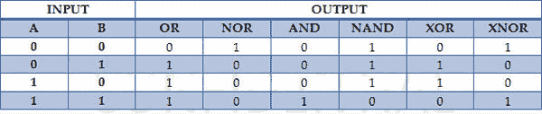

**图 4.4：** 真值表

## BSWAP

**指令格式：**

`BSWAP REGISTER32`

**含义：**

该指令将寄存器的字节顺序从大端转换为小端，或从小端转换为大端。

**受影响的标志：** 无

**示例**

```
MOV EAX, 87654321H    ; EAX is 87654321H

BSWAP EAX                     ; EAX will become 21436587H
```

## AND

**指令格式：**

`AND DESTINATION_OPERAND SOURCE_OPERAND`

**含义：**

该指令在目的操作数和源操作数之间执行逻辑与操作。与操作的结果保存在目的操作数中。

**受影响的标志：** `CF` `OF` `PF` `SF` `ZF`

**示例**

```
MOV EAX, 87654321H    ; EAX is 87654321H

MOV EBX, 21436587H    ; EBX is 21436587H

AND EAX, EBX               ; EAX will become 0x01414101
```

## NOT

**指令格式：**

`NOT DESTINATION_OPERAND`

**含义：**

该指令反转目的操作数的所有位。所有 1 将变为 0，所有 0 将变为 1，通过取反码实现。反码是通过切换所有位得到的。

**受影响的标志：** 无

**示例**

```
MOV EAX, 12121212H    ; EAX is 12121212H

NOT EAX                          ; EAX will become EDEDEDEDH
```

## OR

**指令格式：**

`OR DESTINATION_OPERAND SOURCE_OPERAND`

**含义：**

该指令在目的操作数和源操作数之间执行逻辑或操作。逻辑或操作的结果保存在目的操作数中。

**受影响的标志：** `CF` `OF` `PF` `SF` `ZF`

**示例**

```
MOV EAX, 87654321H    ; EAX is 87654321H

MOV EBX, 21436587H    ; EBX is 21436587H

OR EAX, EBX                  ; EAX will become 0xA76767A7
```

## XOR

**指令格式：**

`XOR DESTINATION_OPERAND SOURCE_OPERAND`

**含义：**

该指令在目的操作数和源操作数之间执行异或操作。XOR 操作的结果保存在目的操作数中。

**受影响的标志：** `CF` `OF` `PF` `SF` `ZF`

**示例**

```
MOV EAX, 87654321H    ; EAX is 87654321H

XOR EAX, EAX               ; EAX will become 0x00000000
```

## RCL

**指令格式：**

`RCL DESTINATION_OPERAND COUNT`

**含义：**

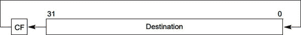

**图 4.5：** RCL

**通过进位左旋转** (`RCL`) 将目的操作数中的位通过 `CF` 标志从右向左旋转 n (`count`) 次。每次旋转时，**最高有效位** (`MSB`) 移至 `CF` 标志，而 `CF` 标志进入 **最低有效位** (`LSB`)。

**受影响的标志：** `CF` `OF`

**示例**

```
MOV EAX, 01H    ; EAX is 00000001H and CF=0

RCL EAX, 2          ; RCL EAX bits 2 times, EAX will become 0x00000004
```

## RCR

**指令格式：**

`RCR DESTINATION_OPERAND COUNT`

**含义：**

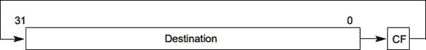

**图 4.6：** RCR

**通过进位右旋转** (`RCR`) 将目的操作数中的位通过 `CF` 标志从左向右旋转 n (`count`) 次。每次旋转时，`LSB` 移至 `CF` 标志，而 `CF` 标志进入 `MSB`。

**受影响的标志：** `CF` `OF`

**示例**

```
MOV EAX, 01H    ; EAX is 00000001H and CF=0

RCR EAX, 2          ; RCR EAX bits 2 times, EAX will become 0x80000000
```

## ROL

**指令格式：**

`ROL DESTINATION_OPERAND COUNT`

**含义：**

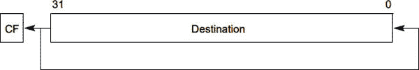

**图 4.7：** ROL

**左旋转** (`ROL`) 将目的操作数中的位从右向左旋转 n (`count`) 次，且 `CF` 标志将具有最后一次旋转的位的值。

**受影响的标志：** `CF` `OF`

**示例**

```
MOV EAX, 40000001H      ; EAX is 40000001H and CF=0

ROL EAX, 2                    ; ROL EAX bits 2 times, EAX will become 0x00000005 and ; CF will set to 1
```

## ROR

**指令格式：**

`ROR DESTINATION_OPERAND COUNT`

**含义：**

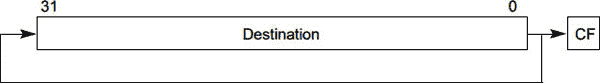

**图 4.8：** ROR

**右旋转** (`ROR`) 将目的操作数中的位从左向右旋转 n (`count`) 次，且 `CF` 标志将具有最后一次旋转的位的值。

**受影响的标志：** `CF` `OF`

**示例**

```
MOV EAX, 40000001H     ; EAX is 40000001H and CF=1

ROR EAX, 2                   ; ROR EAX bits 2 times, EAX will become 0x50000000 and ; CF will set to 0
```

## SHR

**指令格式：**

`SHR DESTINATION_OPERAND COUNT`

**含义：**

要了解位移位概念，请参考 *附录* 中的说明：

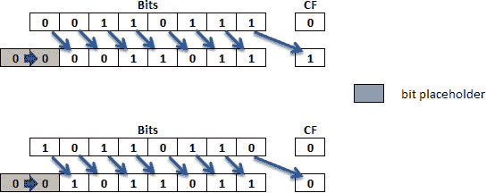

**图 4.9：** SHR

**逻辑右移** (`SHR`) 将目的操作数中的位从左向右移位 n (`count`) 次，且 `CF` 标志将具有最后移出的位的值。由于是逻辑移位，每次移位计数的位占位符都设置为 0。

**受影响的标志：** `CF` `OF` `PF` `SF` `ZF` (`AF` undefined)

**示例**

```
MOV EAX, 40000001H     ; EAX is 40000001H and CF=0

SHR EAX, 2                    ; SHR EAX bits 2 times, EAX will become 0x10000000 and ; CF will set to 0
```

## SHL

**指令格式：**

`SHL DESTINATION_OPERAND COUNT`

**含义：**

如上所述，要了解位移位概念，请参考 *附录* 中的位移位部分：


**图 4.10：** SHL

**逻辑左移** (`SHL`) 将目的操作数中的位从右向左移位 n (`count`) 次，且 `CF` 标志将具有最后移出的位的值。由于是逻辑移位，每次移位计数的位占位符都设置为 0。

**受影响的标志：** `CF` `OF` `PF` `SF` `ZF` (`AF` undefined)

**示例**

```
MOV EAX, 40000001H      ; EAX is 40000001H and CF=0

SHL EAX, 2                     ; SHL EAX bits 2 times, EAX will become 0x00000004 and ; CF will set to 1
```

## SAR

**指令格式：**

`SAR DESTINATION_OPERAND COUNT`

**含义：**

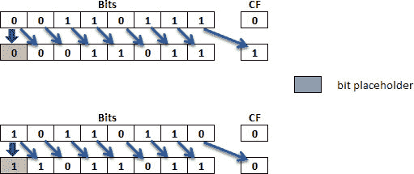

**图 4.11：** SAR

**算术右移** (`SAR`) 将目的操作数中的位从左向右移位 n (`count`) 次，且 `CF` 标志将具有最后移出的位的值。由于是算术移位，位占位符由 `MSB` 决定。

**受影响的标志：** `CF` `OF` `PF` `SF` `ZF` (`AF` undefined)

**示例**

```
MOV EAX, 40000001H      ; EAX is 40000001H and CF=1

SAR EAX, 2                     ; SAR EAX bits 2 times, EAX will become 0x10000000 and ; CF will set to 0
```

## SAL

**指令格式：**

`SAL DESTINATION_OPERAND COUNT`

**含义：**

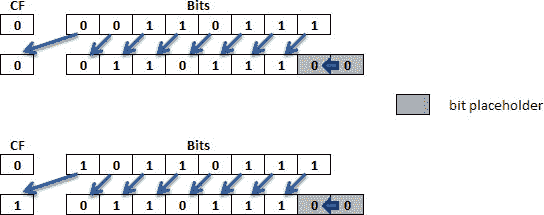

**图 4.12：** SAL


# `SAL` 算术左移

`SAL` 将目的操作数中的位向左从右向左移 `n` (`count`) 次，并且 `CF` 标志将具有最后移出的位的值。由于它是算术移位，LSB 处的位占位符将始终为 0。

### 受影响的标志
`CF` `OF` `PF` `SF` `ZF` (`AF` 未定义)

### 示例
```
MOV EAX, 40000001H      ; EAX is 40000001H and CF=0
SAL EAX, 2              ; SAL EAX bits 2 times, EAX will become 0x00000004 and CF will set to 1
```

## `SHLD`

### 指令格式
`SHLD DESTINATION_OPERAND, SOURCE_OPERAND, COUNT`

### 含义
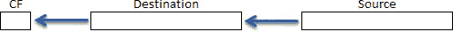

图 4.13：`SHLD`

双字左移 (`SHLD`) 将目的操作数中的位向左从右向左移 `n` (`count`) 次，并且目的操作数中的空位占位符由源操作数移出的位填充。`CF` 标志将具有最后从目的操作数移出的位的值。源操作数不会被修改。

### 受影响的标志
`CF` `OF` `PF` `SF` `ZF` (`AF` 未定义)

### 示例
```
MOV EAX, 40000001H    ; EAX is 40000001H and CF=0
MOV EBX, 50000001H    ; EBX is 50000001H and CF=0
SHLD EAX, EBX, 2      ; EAX = 0x00000005 and EAX = 0x50000001
                      ; CF will set to 1
```

## `SHRD`

### 指令格式
`SHRD DESTINATION_OPERAND, SOURCE_OPERAND, COUNT`

### 含义
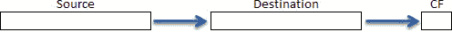

图 4.14：`SHRD`

双字右移 (`SHRD`) 将目的操作数中的位向右从左向右移 `n` (`count`) 次，并且目的操作数中的空位占位符由源操作数移出的位填充。`CF` 标志将具有最后从目的操作数移出的位的值。源操作数不会被修改。

### 受影响的标志
`CF` `OF` `PF` `SF` `ZF` (`AF` 未定义)

### 示例
```
MOV EAX, 40000001H    ; EAX is 40000001H and CF=1
MOV EBX, 50000001H    ; EBX is 50000001H and CF=1
SHRD EAX, EBX, 2      ; EAX = 0x50000000 and EAX = 0x50000001
                      ; CF will set to 0
```

# 处理器控制指令

此部分包括用于控制处理器操作的指令。

## `CLC`

### 指令格式
`CLC`

### 含义
清除进位标志 (`CLC`)：此指令清除进位标志。

### 受影响的标志
`CF`

### 示例
```
MOV EAX, 40000001H       ; EAX is 40000001H and CF=0
SAL EAX, 2               ; SAL EAX bits 2 times, EAX will become 0x00000004 and CF will set to 1
CLC                      ; Clear the CF flag, CF=0
```

## `CLD`

### 指令格式
`CLD`

### 含义
清除方向标志 (`CLD`)：此指令将方向标志清除为 0。

### 受影响的标志
`CF`

## `CLI`

### 指令格式
`CLI`

### 含义
清除中断标志 (`CLI`)：此指令将中断标志清除为 0。一旦 `IF` 标志被复位，处理器将不会响应中断信号。

### 受影响的标志
`CF`

## `CMC`

### 指令格式
`CMC`

### 含义
求反进位 (`CMC`)：此指令反转进位标志。

### 受影响的标志
`CF`

### 示例
```
MOV EAX, 40000001H       ; EAX is 40000001H and CF=0
SAL EAX, 2               ; SAL EAX bits 2 times, EAX will become 0x00000004 and CF will set to 1
CMC                      ; Toggle CF flag from 1 to 0, CF=0
```

## `ESC`

### 指令格式
`ESC OPCODE SOURCE_OPERAND`
`OPCODE = D8 to DF`
`SOURCE_OPERAND = REGISTER OR MEMORY`

### 含义
转义到浮点协处理器 (`ESC`)：此指令将指令传递给协处理器，也称为浮点或数学协处理器。微处理器获取指令字节，并且协处理器也从数据总线获取这些指令字节并将其排队。所有正常的微处理器指令都被协处理器视为 NOP，但当 `ESC` 指令被微处理器获取时，协处理器解码指令以执行操作。当 `ESC` 指令被执行时，微处理器提供内存地址，否则执行 NOP。

### 受影响的标志
无

## `LOCK`

### 指令格式
`LOCK: [INSTRUCTION]`

### 含义
`LOCK` 不是指令而是指令前缀。当 `LOCK` 用作任何指令前面的前缀时，处理器 LOCK 引脚被激活或也称为断言。当 `LOCK` 指令激活 LOCK 引脚时，在 `LOCK` 之后的指令执行之前，外部分支总线主设备和其他外设将被禁用。因此，`LOCK` 用于在关键指令前面，以在没有总线主设备（总线主设备是控制地址和控制信号流动的总线的程序）和系统总线（系统总线是地址总线和数据总线的通用术语）干扰的情况下执行。

### 受影响的标志
无

### 示例
```
LOCK: MOV EAX, EBX   ; Activate the LOCK pin of the processor for the MOV instruction execution
```

## `NOP`

### 指令格式
`NOP`

### 含义
无操作 (`NOP`)：此指令不执行任何操作。它用于消耗处理器时间和内存。

### 受影响的标志
无

### 示例
```
NOP    ; Do nothing
```

## `STC`

### 指令格式
`STC`

### 含义
置位进位标志 (`STC`)：此指令将进位标志设置为 1。

### 受影响的标志
`CF`

### 示例
```
CLC   ; Clear the CF flag, CF=0
STC   ; Set the CF flag, CF=1
```

## `STD`

### 指令格式
`STD`

### 含义
置位方向标志 (`STD`)：此指令将方向标志设置为 1。

### 受影响的标志
`DF`

## `STI`

### 指令格式
`STI`

### 含义
置位中断标志 (`STI`)：此指令将中断标志设置为 1。如上所述，当 `IF` 标志被启用时，中断事件或信号将导致处理器中断程序执行。每当中断发生时，处理器完成当前的一组指令，然后开始中断服务例程 (`ISR`) 或中断处理程序。`ISR` 是一个包含一组指令来处理特定中断的例程。此 `ISR` 告诉处理器中断发生时该做什么。

`IRET` 指令在 `ISR` 之后将执行返回到被中断的程序。

### 受影响的标志
`IF`

# 字符串指令

此部分包括用于处理字符串操作的指令。

## `CMPS`/`CMPSB`/`CMPSW`

### 指令格式
此指令可以视为 `CMP` 用于比较 + S 用于字符串 + B 用于字节或 W 用于 WORD 或 D 用于 DWORD 的组合

`CMPSB SOURCE, DESTINATION`
`CMPSW SOURCE, DESTINATION`
`CMPSD SOURCE, DESTINATION`

### 含义
此指令用于比较两个字符串，其中源字符串由 `ESI` 指向，目标字符串由 `EDI` 指向。当使用 `CMPSB` 时，比较在每个字节之间进行。当使用 `CMPSW` 时，比较在每个字之间进行。当使用 `CMPSD` 时，比较在每个 DWORD 之间进行。通过比较，是指减去由 `ESI` 和 `EDI` 寄存器指向的字节/字/dword，正如我们在 `CMP` 指令中所研究的。

`CMPS` 指令与前缀 `REPE`/`REPZ` 一起使用，这意味着重复比较直到 `ECX`=0 或 `ZF`=0。我们将在后面介绍 `REPE`/`REPZ`。

如果方向标志 `DF`=0，则在每次移动后，`ESI` 和 `EDI` 按字节递增 1，按字递增 2，按 dword 递增 4。

如果方向标志 `DF`=1，则在每次移动后，`ESI` 和 `EDI` 按字节递减 1，按字递减 2，按 dword 递减 4。

### 受影响的标志
`AF`, `CF`, `OF`, `PF`, `SF`, `ZF`

### 示例
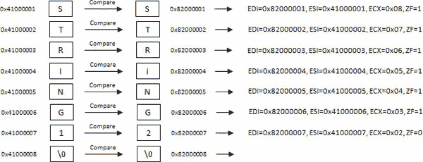


## 图 4.15：CMPSB 示例

```
MOV ESI, 0x41000001     ; ESI pointing to STRING1
MOV EDI, 0x82000001     ; ESI pointing to STRING2
MOV ECX, 0x08                ; ECX is initialized to 0x08
CLD                                     ; Clear direction flag, DF=0
REPE CMPSB                   ; Compare two strings until ECX=0 or ZF=0
```

# IN/INSB/INSW/INSD

该指令可视化为 `IN` 表示 Input 输入 + `S` 表示 String 字符串 + `B` 表示 Byte 字节 或 `W` 表示 WORD 字 或 `D` 表示 DWORD 双字 的组合。

### Meaning：

用于在处理器输入/输出端口与外围设备之间传输数据的指令有两种。这两种指令如下：

* `Register input/output instructions`：这些指令在处理器 I/O 端口与寄存器之间移动数据。
* `Block (or string) input/output instructions`：这些指令在处理器 I/O 端口与内存之间移动数据块。

### Register input instruction format：

`IN DESTINATION SOURCE`

其中，`SOURCE` 是端口地址

并且 `DESTNATION` 是寄存器，`EAX`（32-bit）寄存器或 `AX`（16-bit）寄存器或 `AL`（8-bit）寄存器。目标寄存器的长度决定了从输入端口读取的数据量，可以是字节、字或双字。目标也可以是其他通用寄存器。

```
IN EAX, 80    ; It will read dword (32-bits) from port 80 and store it in EAX.
IN AX, 80       ; It will read word (16-bits) from port 80 and store it in AX.
```

### Block (or string) input instruction format：

`INSB/INSW/INSD`

其中处理器输入端口地址指定在 `DX` 寄存器中，目标是 `EDI` 寄存器指向的内存位置。

`INSB` 指令将从 `DX` 寄存器指定的输入端口地址移动一个字节（8 位）数据到 `EDI` 寄存器指向的内存位置。为了在处理器输入端口与内存之间传输数据块，`INSB` 指令与重复前缀 `REP` 一起使用。每次在输入端口与 `EDI` 指向的内存之间传输一个字节后，`EDI` 会在 `DF=0` 时递增，或在 `DF=1` 时递减 1。

`INSW` 指令将从 `DX` 寄存器指定的输入端口地址移动一个字（16 位）数据到 `EDI` 寄存器指向的内存位置。为了在处理器输入端口与内存之间传输数据块，`INSW` 指令与重复前缀 `REP` 一起使用。每次在输入端口与 `EDI` 指向的内存之间传输一个字后，`EDI` 会在 `DF=0` 时递增，或在 `DF=1` 时递减 2。

`INSD` 指令将从 `DX` 寄存器指定的输入端口地址移动一个双字（32 位）数据到 `EDI` 寄存器指向的内存位置。为了在处理器输入端口与内存之间传输数据块，`INSD` 指令与重复前缀 `REP` 一起使用。每次在输入端口与 `EDI` 指向的内存之间传输一个双字后，`EDI` 会在 `DF=0` 时递增，或在 `DF=1` 时递减 4。

### Flags Affected：

无

### Example

```
MOV DX, PORT_ADDRESS    ; Move the input port address to the DX register
MOV EDI, offset STR                ; Move the memory offset for string to the EDI register
INSW                                       ; Move a word (16 bits) from the input port address
                                                    ; specified in the DX register to the memory location pointed
                                                    ; by EDI register
```

# OUT/OUTSB/OUTSW/OUTSD

该指令可视化为 `OUT` 表示 Output 输出 + `S` 表示 String 字符串 + `B` 表示 Byte 字节 或 `W` 表示 WORD 字 或 `D` 表示 DWORD 双字 的组合。

### Meaning：

这里重申了输入指令的相同概念。用于在处理器输入/输出端口与外围设备之间传输数据的指令有两种。这两种指令如下：

* `Register input/output instructions`：这些指令在处理器 I/O 端口与寄存器之间移动数据。
* `Block (or string) input/output instructions`：这些指令在处理器 I/O 端口与内存之间移动数据块。

### Register output instruction format：

`OUT DESTINATION SOURCE`

`SOURCE` 是寄存器，`EAX`（32 bit）寄存器或 `AX`（16 bit）寄存器或 `AL`（8 bit）寄存器。源寄存器的长度决定了从源寄存器输出到端口的数据量，可以是字节、字或双字。源也可以是其他通用寄存器。

并且 `DESTNATION` 是端口地址

```
OUT 80, EAX     ; It will output dword (32-bits) from EAX to port 80.
OUT 80, AX        ; It will output word (16-bits) from AX to port 80.
```

### Block (or string) output instruction format：

`OUTSB/OUTSW/OUTSD`

其中处理器输出端口地址指定在 `DX` 寄存器中，源是 `ESI` 寄存器指向的内存位置。

`OUTSB` 指令将从 `ESI` 寄存器指向的内存位置输出一个字节（8 位）数据到 `DX` 寄存器指定的输出端口地址。为了在内存与处理器输出端口之间传输数据块，`OUTSB` 指令与重复前缀 `REP` 一起使用。每次从 `ESI` 指向的内存向 `DX` 寄存器指定的输出端口地址输出一个字节（8 位）后，`ESI` 会在 `DF=0` 时递增，或在 `DF=1` 时递减 1。

`OUTSW` 指令将从 `ESI` 寄存器指向的内存位置输出一个字（16 位）数据到 `DX` 寄存器指定的输出端口地址。为了在内存与处理器输出端口之间传输数据块，`OUTSW` 指令与重复前缀 `REP` 一起使用。每次从 `ESI` 指向的内存向 `DX` 寄存器指定的输出端口地址输出一个字（16 位）后，`ESI` 会在 `DF=0` 时递增，或在 `DF=1` 时递减 2。

`OUTSD` 指令将从 `ESI` 寄存器指向的内存位置输出一个双字（32 位）数据到 `DX` 寄存器指定的输出端口地址。为了在内存与处理器输出端口之间传输数据块，`OUTSD` 指令与重复前缀 `REP` 一起使用。每次从 `ESI` 指向的内存向 `DX` 寄存器指定的输出端口地址输出一个双字（32 位）后，`ESI` 会在 `DF=0` 时递增，或在 `DF=1` 时递减 4。

### Flags Affected：

无

### Example

```
MOV ESI, offset STR                   ; Move memory offset for string to the ESI register
MOV DX, PORT_ADDRESS       ; Move Output Port address to the DX register
OUTSW                                         ; Output a word (16 bits) from memory location pointed
                                                       ; by ESI register to output Port address in DX register
```

# LODS/LODSB/LODSW/LODSD

### Instruction Format：

`LODSB`

`LODSW`

`LODSD`

### Meaning：

`Load String`（`LODS`）将 `ESI` 寄存器指向的字符串加载到 `EAX` 寄存器。

`Load String Byte`（`LODSB`）将 `ESI` 寄存器指向的字符串的一个字节加载到 `AL` 寄存器。

`Load String Word`（`LODSW`）将 `ESI` 寄存器指向的字符串的一个字加载到 `AX` 寄存器。

`Load String DWORD`（`LODSD`）将 `ESI` 寄存器指向的字符串的一个双字加载到 `EAX` 寄存器。

`ESI` 在 `DF=0` 时递增，或在 `DF=1` 时递减，对于 `Load String Byte`（`LODSB`）为 1，对于 `Load String Word`（`LODSW`）为 2，对于 `Load String DWORD`（`LODSD`）为 4。

### Flags Affected：

无

### Example

```
CLD                                 ; Clear Direction flag, DF=0
MOV ESI, Offset STR     ; Move memory offset of string to ESI register
LODSB                           ; Loads a byte of the string pointed by ESI register to AL
                                         ; register
```

# STOS/STOSB/STOSW

### Instruction Format：

`STOSB`

`STOSW`

`STOSD`

### Meaning：


## 存储字符串指令

存储字符串 `STOS` 将 `EAX` 寄存器中的字符串存储到 `EDI` 寄存器指向的内存位置。

存储字符串字节 `STOSB` 将 `AL` 寄存器中的字符串字节存储到 `EDI` 寄存器指向的内存位置。

存储字符串字 `STOSW` 将 `AX` 寄存器中的字符串字存储到 `EDI` 寄存器指向的内存位置。

存储字符串双字 `STOSD` 将 `EAX` 寄存器中的字符串双字存储到 `EDI` 寄存器指向的内存位置。

`EDI` 对于存储字符串字节 `STOSB` 增加（当 `DF`=0 时）或减少（当 `DF`=1 时）1，对于存储字符串字 `STOSW` 为 2，对于存储字符串双字 `STOSD` 为 4。

影响的标志：无

示例

```
CLD                               ; Clear Direction flag, DF=0
MOV ESI, Offset STR   ; Move memory offset of string to ESI register
STOSB                           ; Stores a byte of the string from AL register to memory
                                        ; pointed by EDI register
```

## 扫描字符串指令

指令格式：

`SCASB`

`SCASW`

`SCASD`

含义：

扫描字符串 `SCAS` 扫描 `EDI` 寄存器指向的内存位置中的字符串，并将其与 `EAX` 寄存器的内容进行比较（或减法）。比较或减法的结果会被丢弃，并且状态标志会相应更新。

扫描字符串字节 `SCASB` 扫描 `EDI` 寄存器指向的内存位置中的字符串字节，并将其与 `AL` 寄存器的内容进行比较。

扫描字符串字 `SCASW` 扫描 `EDI` 寄存器指向的内存位置中的字符串字，并将其与 `AX` 寄存器的内容进行比较。

扫描字符串双字 `SCASD` 扫描 `EDI` 寄存器指向的内存位置中的字符串双字，并将其与 `EAX` 寄存器的内容进行比较。

`EDI` 对于扫描字符串字节 `SCASB` 增加（当 `DF`=0 时）或减少（当 `DF`=1 时）1，对于扫描字符串字 `SCASW` 为 2，对于扫描字符串双字 `SCASD` 为 4。

影响的标志：无

示例

```
MOV ECX, 100             ; Scan a string of 100 characters
MOV EDI, offset STR   ; Move memory offset of string to ESI register
MOV AL, 0x20              ; Scanning string for space character, space=0x20
REPNE SCASB             ; Repeat until ECX=0 or ZF=1
```

## 移动字符串指令

指令格式：

`MOVSB`

`MOVSW`

`MOVSD`

含义：

移动字符串 `MOVS` 将 `ESI` 寄存器指向的内存位置中的字符串移动到 `EDI` 寄存器指向的内存位置。

移动字符串字节 `MOVSB` 将 `ESI` 寄存器指向的内存位置中的字符串字节（8 位）移动到 `EDI` 寄存器指向的内存位置。

移动字符串字 `MOVSW` 将 `ESI` 寄存器指向的内存位置中的字符串字（16 位）移动到 `EDI` 寄存器指向的内存位置。

移动字符串双字 `MOVSD` 将 `ESI` 寄存器指向的内存位置中的字符串双字（32 位）移动到 `EDI` 寄存器指向的内存位置。

`ESI` 和 `EDI` 对于移动字符串字节 `MOVSB` 增加（当 `DF`=0 时）或减少（当 `DF`=1 时）1，对于移动字符串字 `MOVSW` 为 2，对于移动字符串双字 `MOVSD` 为 4。

影响的标志：无

示例

```
MOV ESI, SRC_STR   ; Move source string location in ESI
MOV EDI, DST_STR   ; Move destination string location in EDI
MOV ECX, 05H           ; Initialize ECX to 0x05, which is string length
CLD                              ; Clear the direction flag, DF=0
REP MOVSB               ; Moves the string of length 5 bytes from src to dest
```

## 重复前缀

指令格式：

`REP <STRING-INSTRUCTION>`

含义：

重复 `REP` 并不是一条指令。它是一个前缀，用在字符串指令之前。当 `REP` 用在字符串指令之前时，它会重复该指令直到 `ECX` 计数器变为 0。每次执行 `REP` 后的指令时，`ECX` 计数器都会递减 1，直到 `ECX`=0。

影响的标志：取决于 `REP` 之后使用的指令。

示例：

```
MOV DWORD PTR DS:[0x011E8000], 0x41424344     ;write ABCD to 0x011E8000
                                                               ; memory location, ABCD will be
                                                               ; written in reverse order (little
                                                               ; endian)
MOV ESI, 0X11E8000                                                     ; Move source string location in ESI
MOV EDI, 0X11E8010                                                     ; Move source string location in EDI
MOV ECX, 0X05                                                           ; Initialize ECX to 0x05, to run iteration 5 times
CLD                                                                               ; Clear the direction flag, DF=0
REP MOVSB                                                                 ; Moves the ABCD from src
                                                                         ; to dest, until ECX=0
```

## 重复相等/重复为零

指令格式：

`REPE <STRING-INSTRUCTION>`

`REPZ <STRING-INSTRUCTION>`

含义：

重复若相等 `REPE` 和重复若为零 `REPZ` 会使前面的字符串指令重复执行，直到 `ECX`=0 或零标志（`ZF`）= 0。这些前缀与 `CMPS` 和 `SCAS` 指令一起使用。

影响的标志：取决于 `REPE`/`REPZ` 指令之后使用的指令。

## 重复不相等/重复非零

指令格式：

`REPNE <STRING-INSTRUCTION>`

`REPNZ <STRING-INSTRUCTION>`

含义：

重复若不相等 `REPNE` 和重复若非零 `REPNZ` 会使前面的字符串指令重复执行，直到 `ECX`=0 或 `ZF`=1。这些前缀与 `CMPS` 和 `SCAS` 指令一起使用。

影响的标志：取决于 `REPNE`/`REPNZ` 指令之后使用的指令。

## 结论

在本章中，我们研究了反向工程中使用的主要汇编指令的解释。我们还介绍了栈、数据传输、算术、程序执行、分支、位操作、处理器控制和字符串等不同类型的指令。还提供了一些指令的示例以阐述指令的工作原理。

在下一章中，我们将详细讨论一些基于栈的指令，并了解代码调用约定的概念。从反向工程的角度来看，这一概念很重要，在实现反向工程时你会经常遇到它。

# 第 5 章

## 代码调用约定类型

在第 2 章《理解 x86 机器的架构》中，我们了解了栈的概念。调用函数时后台会发生几件事。控制权以栈帧为局部变量分配并为被调用方理解参数传递的方式转移到新函数。在返回时，返回地址会被放置在栈上，以便调用方可以找到它，并且还会执行栈清理。想象一下，如果被调用方和调用方都清理栈，那么就会产生一种灾难性的情况，即栈会被被调用方和调用方各清理一次。因此，了解代码调用约定的差异变得很重要。由于 CPU 有许多变体，一些 CPU 对如何执行此操作有严格的协议。但当我们谈论 x86 架构时，一切都是灵活的，程序员决定如何调用方法。这就是导致不同调用约定的原因。


当你在编写使用共享库的 C/C++ 代码时，代码调用约定变得很重要，因为你交互的代码超出了你的控制范围。如果你是一名编写 C/C++ 代码的程序员，那么作为程序员，你不必担心，因为编译器会为你处理调用约定。编译器通常会根据语言自动采用默认的代码约定。在本章中，我们将了解代码调用约定的差异。

## 结构
本章将涵盖以下主题：
* 了解调用约定的类型
* 不同调用约定背后的概念

## 目标
学习完本章后，你将能够根据调用约定区分不同的汇编代码。如果收到一些汇编代码，那么通过查看汇编列表，你将能够评估所使用的调用约定。为了理解不同的代码调用约定，我们将采用一段伪代码来详细阐述每种调用约定背后的概念。

## 了解调用约定的类型
为了理解调用约定，让我们取一段基本的伪代码。在此代码中，函数 `funcA` 调用另一个函数（`funcB`）。在这种情况下，`funcA` 被称为 `caller`，而 `funcB` 被称为 `callee`。

```
FuncA()
{
Arg1;
Arg2;
FuncB(Arg1, Arg2);
}
```

现在当 `FuncB` 被调用时，它带 2 个参数（`Arg1`，`Arg2`）被调用。当此代码用不同的编译器编译时，它会生成不同的汇编代码。调用约定是一组规则，指定 C 或 C++ 函数如何转换为汇编代码。因此，调用约定基本上定义：
* 如何将参数传递给函数
* 函数如何返回值
* 调用者如何调用被调用者
* 当一个函数调用另一个函数时堆栈如何管理
* 如何清空堆栈

所有这些都由编译器使用的调用约定方法定义。在 C/C++ 语言中，主要使用三种调用约定：`CDECL`、`STDCALL` 和 `FASTCALL`。我们将逐一介绍这些调用约定。

### CDECL
`CDECL` 也可读作 C Declaration。当使用 `CDECL` 调用约定时：
* 参数按从右到左的顺序传递。在同一伪代码中，从右到左的顺序意味着 `Arg2` 首先被压入堆栈，然后 `Arg1` 被压入堆栈。
```
FuncA()
{
Arg1;
Arg2;
FuncB(Arg1, Arg2);
}
```
* 函数返回值传递到 `EAX` 寄存器中。
* 调用函数，`caller` 清理堆栈。

### STDCALL
`STDCALL` 代表 Standard Call。此调用约定由 Microsoft 定义为 Win32 API 的标准调用约定。当使用 `STDCALL` 时：
* 第一点与 `CDECL` 相同。参数按从右到左的顺序传递。
* 函数返回值传递到 `EAX` 寄存器中。这一点也与 `CDECL` 相同。
* 这一点与 `CDECL` 不同，被调用函数 `callee` 清理堆栈。

### FASTCALL
`CDECL`/`STDCALL` 与 `FASTCALL` 的主要区别在于初始参数不是压入堆栈，而是通过寄存器传递。将数据保存在寄存器中比在内存中更快，因此命名为 `FASTCALL`。在 `FASTCALL` 中，使用调用约定时：
* 前两个或三个参数通过寄存器 `EDX`、`ECX` 或 `EAX` 传递。附加参数传递到堆栈。参数按从右到左的顺序传递。
* 函数返回值传递到 `EAX` 寄存器中。
* 调用函数，`caller` 在需要时清理堆栈。

## 不同调用约定背后的概念
现在为了理解不同调用约定背后的概念，我们将用 C/C++ 编写一段简单代码。然后使用 `cl.exe`（VS 编译器），我们将用不同的调用约定编译代码并了解生成的汇编代码之间的差异。

下图显示了一段将进行加法的简单 C/C++ 代码：

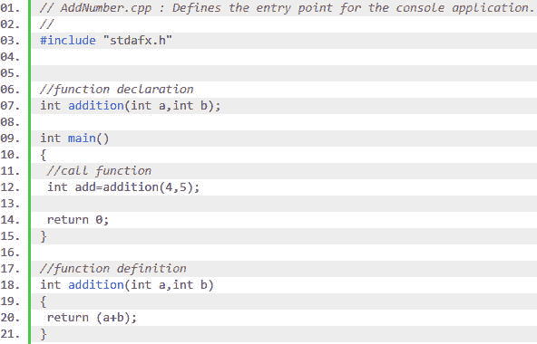

**图 5.1：** `AddNumber.cpp`

`AddNumber.cpp` 代码是一个简单的加法代码。以下是对前述程序需要注意的几点：
* `main` 函数是程序的入口点。
* `main` 函数正在调用一个 `addition` 函数。因此，`main` 函数是 `caller`，而 `addition` 函数是 `callee`。
* 在 `main` 函数和 `addition` 函数中定义的局部变量的类型为整数。
* 传递给 `callee` 的两个参数为 4 和 5。

编写代码后，我们将使用 `cl.exe` 编译代码，并使用不同的开关强制编译器更改调用约定。
* `/Gd`：使用此开关用于 `CDECL` 调用约定。
* `/Gz`：使用此开关用于 `STDCALL` 调用约定。
* `/Gr`：使用此开关用于 `FASTCALL` 调用约定。

我们将逐一介绍每种调用约定并了解它们之间的差异。

### CDECL
我们将不进行优化并使用 `CDECL` 调用约定编译 `AddNumber.cpp` 代码。我们将为此使用 `/Gd` 开关。在 Windows 命令提示符上运行以下命令以设置 `cl.exe`（VS 编译器）的环境，然后使用以下开关编译代码。
* `/Gd`：使用此开关用于 `CDECL` 调用约定。
* `/Fa`：输出汇编列表文件的名称
* `/Fe`：输出可执行文件的名称

```
cd C:\Program Files\Microsoft Visual Studio 10.0\VC
vcvarsall.bat
cd C:\JitenderN\REBook\AddNumber\AddNumber
cl AddNumber.cpp /FaAddNumber-CDECL.asm /Gd /FeAddNumber-CDECL.exe
```

运行上述命令的输出如下：

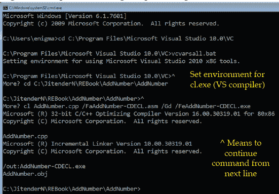

**图 5.2：** `CDECL`

这将生成 `AddNumber-CDECL.asm`。现在我们将继续分析 `AddNumber-CDECL.asm` 中生成的汇编代码：我们的 C++ 代码分为两个函数，一个是 `main` 函数（`caller`），另一个是 `addition` 函数（`callee`）。为了理解 `CDECL` 调用约定，我们将采用 `main` 函数代码从 C++ 代码到汇编的转换。

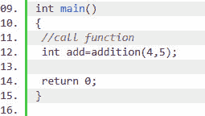

**图 5.3：** `AddNumber.cpp` 中的主函数代码

主函数的汇编代码变为：

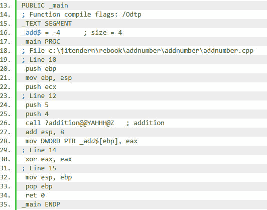

**图 5.4：** `AddNumber-CDECL.asm` 中 Main proc 的汇编代码

让我们分析 `asm` 文件中主函数的汇编代码：
* 第 20-21 行是函数序言。这些是一系列用于开始函数的指令。
* 在第 22 行，函数序言后 `PUSH ECX` 的目的不是将 `ECX` 保存到堆栈上，而是为存储局部变量 `add` 在堆栈上分配 4 个字节。
* `Add` 变量可以通过 `_add$` 宏访问，该宏等于 -4。因此，`Add` 可以在 `[EBP - 0x4]` 处访问。
* 从第 24 行开始，我们将理解 `CDECL` 的概念。让我们逐一回顾 `CDECL` 调用约定的要点，以便在实践中理解概念：
  * 参数按从右到左的顺序传递。
    * 在 `AddNumber.cpp` 的第 12 行，即 `int add=addition(4,5);`，我们将 4、5 参数传递给 `addition` 函数。现在，从右到左意味着 5 将首先被压入堆栈，然后 4 被压入堆栈，正如在 `AddNumber-CDECL.asm` 代码第 24-25 行所做的那样。参数压入堆栈后，`addition` 函数在 `AddNumber-CDECL.asm` 的第 26 行被调用。
  * `Calling function`，`caller` 清理堆栈。


* 从 `addition` 函数返回后，在 `AddNumber-CDECL.asm` 的第 27 行，指令 `add esp, 8` 将栈缩小 8 字节。这是因为调用者（在本例中为 `main`）根据 `CDECL` 的调用约定来清理栈。

* 函数返回值通过 `EAX` 寄存器传递。
  * 在 `AddNumber-CDECL.asm` 第 26 行对 `addition` 函数的调用将 `addition` 函数的返回值返回到 `EAX` 寄存器，然后将其复制到 `add` 变量位置 [`EBP – 0x4`]。此复制操作由 `AddNumber-CDECL.asm` 第 28 行的指令完成：
  * `mov DWORD PTR _add$[ebp], eax`
  * 同样，`main` 函数返回 0，这通过 `xor eax, eax` 指令实现。

* 如果您无法理解任何指令，请参阅 *第 4 章，逐步讲解汇编指令*。

# STDCALL

我们将不使用优化并使用 `STDCALL` 调用约定编译代码。我们将为此使用 `/Gz` 开关。在 Windows 命令提示符上运行下面给出的命令以设置 `cl.exe`（VS 编译器）的环境，然后使用以下开关编译代码：

* `/Gz`：使用此开关进行 `STDCALL` 调用约定。
* `/Fa`：输出汇编列表文件的名称
* `/Fe`：输出可执行文件的名称

```
cd C:\Program Files\Microsoft Visual Studio 10.0\VC
vcvarsall.bat
cd C:\JitenderN\REBook\AddNumber\AddNumber
cl AddNumber.cpp /FaAddNumber-STDCALL.asm /Gz /FeAddNumber-STDCALL.exe
```

以下是在运行上述命令后的输出：

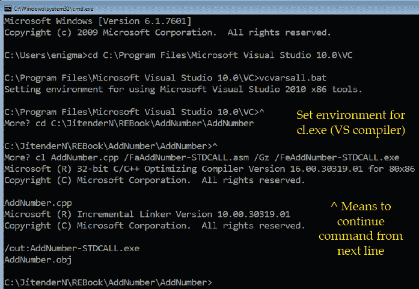

**图 5.5：STDCALL**

这将生成 `AddNumber-STDCALL.asm`。现在我们将继续分析 `AddNumber-STDCALL.asm` 中的汇编代码。为了理解 `STDCALL` 调用约定，我们将再次采用 `main` 函数代码以及 `addition` 函数代码来查看从 C++ 代码到汇编的转换。


**图 5.6：Main & addition function code in `AddNumber.cpp`**

在 `STDCALL` 调用约定中，`main` 函数和 `addition` 函数的汇编代码变为：

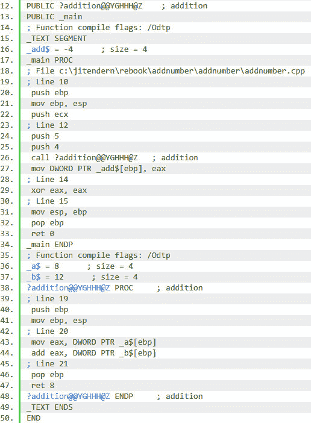

**图 5.7：Main & addition proc assembly code in `AddNumber-STDCALL.asm`**

让我们针对 `STDCALL` 分析汇编代码。大多数要点与 `CDECL` 调用约定相同。我们将在此处讨论几个差异：

* ASM 代码第 20-21 行是函数序言。这是一系列用于开始函数的指令。
* 在 ASM 代码第 22 行，函数序言后 `PUSH ECX` 的目的是不是将 `ECX` 保存到栈上，而是为存储局部变量 `add` 在栈上分配 4 字节。
* `Add` 变量可以通过 `_add$` 宏访问，该宏等于 -4。因此 `Add` 变量可以访问于 [`EBP – 0x4`]。
* 从第 24 行开始我们将理解 `STDCALL` 的概念。让我们逐一回顾 `STDCALL` 的要点：
  * 参数按从右到左的顺序传递，这与 `CDECL` 相同
    * 在 `AddNumber.cpp` 第 12 行，即 `int add=addition(4,5);`，我们将 4、5 参数传递给 `addition` 函数。现在从右到左意味着 5 将首先被压入栈，然后 4 被压入栈。这可以在 `AddNumber-STDCALL.asm` 第 26 行看到，在调用 `addition` 函数之前有 `PUSH 5` & `PUSH 4` 指令。
  * 被调用函数、被调用方清理栈。此点与 `CDECL` 不同。
    * 这可以在 `AddNumber-STDCALL.asm` 第 47 行通过 `RET 8` 指令看到。被调用方通过使用 `RET nBytes` 指令清理栈，其中 `RET` 指令将控制权从被调用方转移到调用方，转移到保存在栈上的返回地址。`nBytes`，在本例中为 8。因此，栈上释放 8 字节以清理栈。
  * 函数返回值通过 `EAX` 寄存器传递。
    * 在 `AddNumber-STDCALL.asm` 第 26 行对 `addition` 函数的调用将 `addition` 函数的返回值返回到 `EAX` 寄存器，然后将其复制到 `add` 变量位置 [`EBP – 0x4`]。此复制操作由以下指令完成：
    * `mov DWORD PTR _add$[ebp], eax`
    * 在 `AddNumber-STDCALL.asm` 第 27 行
    * 同样，`main` 函数返回 0，这通过 `xor eax, eax` 指令实现。

# FASTCALL

如前所述，`FASTCALL` 调用约定在传递参数方面主要不同。为了理解这一点，我们将关闭优化并使用 `FASTCALL` 开关编译代码。我们将为此使用 `/Gr` 开关。在 Windows 命令提示符上运行下面给出的命令以设置 `cl.exe`（VS 编译器）的环境，然后使用以下开关编译代码：

* `/Gr`：使用此开关进行 `FASTCALL` 调用约定。
* `/Fa`：输出汇编列表文件的名称
* `/Fe`：输出可执行文件的名称

```
cd C:\Program Files\Microsoft Visual Studio 10.0\VC
vcvarsall.bat
cd C:\JitenderN\REBook\AddNumber\AddNumber
cl AddNumber.cpp /FaAddNumber-FASTCALL.asm /Gr /FeAddNumber-FASTCALL.exe
```

以下是在运行上述命令后的输出：

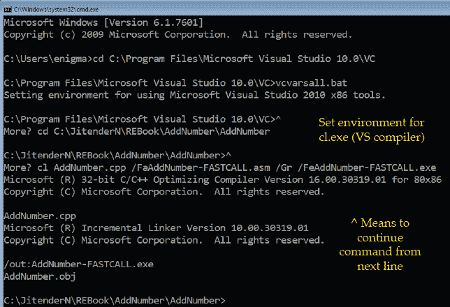

**图 5.8：FASTCALL**

这将生成 `AddNumber-FASTCALL.asm`。为了分析 `AddNumber-FASTCALL.asm` 中的汇编代码，我们将再次查看我们的 C/C++ 代码。

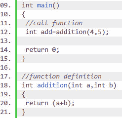

**图 5.9：Main & addition function code in `AddNumber.cpp`**

让我们如下查看生成的 `AddNumber-FASTCALL.asm`：

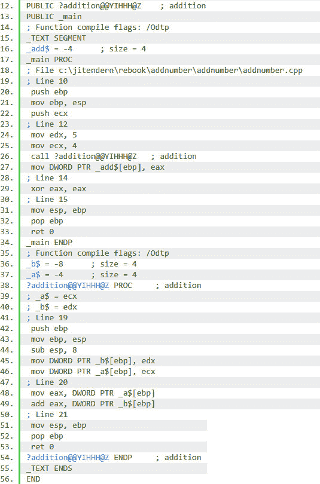

**图 5.10：Main & addition proc assembly code in `AddNumber-FASTCALL.asm`**

让我们以与其它调用约定相同顺序分析汇编代码。

* 第 20-21 行的函数序言指令是一系列用于开始函数的指令。
* 在 ASM 代码第 22 行，`PUSH ECX` 相同。它不是将 `ECX` 保存到栈上，而是为存储局部变量 `add` 在栈上分配 4 字节。
* `add` 变量可以通过 `_add$` 宏访问，该宏等于 -4。因此，`add` 可以访问于 [`EBP – 0x4`]。
* 从第 24 行开始，我们将看到传递参数给函数的不同方法。为了理解，让我们回顾 `FASTCALL` 概念：
  * 初始参数不是压入栈，而是通过寄存器传递。前两个或三个参数通过寄存器 `EDX`、`ECX` 或 `EAX` 传递。附加参数传递到栈上。参数按从右到左的顺序传递。
    * 到目前为止，我们对从右到左的方法已很清楚。这里需要注意的是，参数 5 被移动到 `EDX`，参数 4 被移动到 `ECX`，如 `AddNumber-FASTCALL.asm` 第 24-25 行所示。一旦参数被移动到寄存器，`addition` 函数的调用在 `AddNumber-FASTCALL.asm` 第 26 行进行。
    * 在 `addition` 函数执行期间，我们可以看到 `EDX`、`ECX` 中的参数在 `AddNumber-FASTCALL.asm` 第 45-49 行之间被传递到栈以进行进一步处理。
  * 调用函数，调用者清理栈。
    * 参数传递给 `EDX`、`ECX`，因此没有参数传递到栈，无需栈清理。
  * 函数返回值通过 `EAX` 寄存器传递，这与我们讨论的其他 2 种调用约定相同。重申关于 `FASTCALL` 的相同要点。
    * 在 `AddNumber-FASTCALL.asm` 第 26 行对 `addition` 函数的调用将 `addition` 函数的返回值返回到 `EAX` 寄存器，然后将其复制到 `add` 变量位置 [`EBP – 0x4`]。此复制操作由以下指令完成：
    * `mov DWORD PTR _add$[ebp], eax`
    * 在 `AddNumber-FASTCALL.asm` 第 27 行


同样地，`main` 函数返回 0，这是在 `AddNumber-FASTCALL.asm` 的第 29 行通过 `xor eax, eax` 指令实现的。

# 结论

在本章中，我们介绍了主要使用的三种代码调用约定：`CDCEL`、`STDCALL` 和 `FASTCALL`。我们了解到在 `CDCEL` 和 `STDCALL` 中，参数按从右到左的顺序传递，函数的返回值传递到 `EAX` 寄存器中。在 `CDCEL` 调用函数中，调用者清理栈，而在 `STDCALL` 中，被调用者清理栈。

在 `FASTCALL` 中，初始参数不是压入栈中，而是通过寄存器传递。其余函数的返回值传递到 `EAX` 寄存器中，在调用函数中，如果需要，调用者清理栈。在下一章中，我们将使用 C/C++ 代码并编译它们以了解汇编输出。

# 第 6 章

## 基础代码的逆向工程模式

在本章中，我们将编写小段代码并编译它们以了解汇编输出。我们将逐步浏览汇编代码中的指令，并从汇编的角度理解代码流程。

在本章编译小段代码的过程中，我们将使用 32 位环境下的 Microsoft 编译器。所有程序都在 Microsoft Windows 32 位环境下编译。我们在分析过程中也会使用代码优化。

## 结构

在本章中，我们将介绍以下主题：

* 什么是代码优化
* 理解 C/C++ 程序的汇编模式
* 代码优化的概念
* 用于生成 C/C++ 程序汇编模式的工具

## 目标

学习本章后，你应该能够：

* 理解代码优化及其重要性
* 带有优化和不带优化的汇编代码

## 什么是代码优化？

优化意味着以最佳方式做某事，以便有效利用资源。代码优化意味着转换代码以删除不必要的行，以便在执行期间消耗更少的资源（内存、CPU 等）。当编译器优化代码时，会处理以下事项：

* 在优化代码时，代码的含义不应改变。
* 优化后的代码应消耗更少的资源。
* 优化不应影响程序的编译时间。

让我们从一个小的 C/C++ 程序开始，逐步过渡到复杂的程序。这一过程将帮助你理解相对于 C/C++ 应用程序，汇编语言中代码的模式。

## 空函数

空函数是做任何事情的函数。让我们在 C/C++ 代码中创建一个空函数。这里，我们将空函数定义并声明为 `EmptyFunction()`。

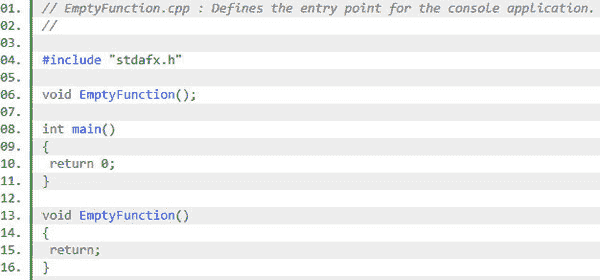

**图 6.1：** `EmptyFunction.cpp`

## 未优化的空函数

现在，让我们使用 MSVC 编译器 (`cl.exe`) 在不进行优化的情况下编译它。在 Windows 命令提示符上运行以下命令为 `cl.exe`（VS 编译器）设置环境，然后使用以下开关编译代码：

* `/Fa`：输出汇编列表文件的名称
* `/Fe`：输出可执行文件的名称

```
cd C:\Program Files\Microsoft Visual Studio 10.0\VC
vcvarsall.bat
cd C:\JitenderN\REBook\EmptyFunction\EmptyFunction
cl EmptyFunction.cpp /FaEmptyFunction.asm /FeEmptyFunction.exe
```

运行前述命令的输出如下：

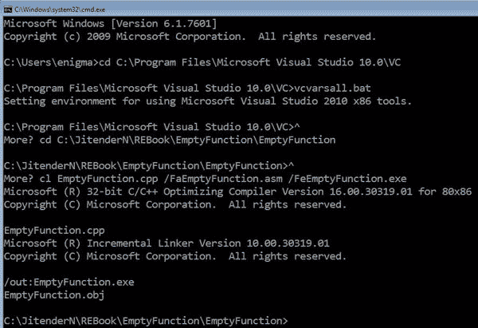

**图 6.2：** 未优化的空函数

未优化生成的汇编代码如下：

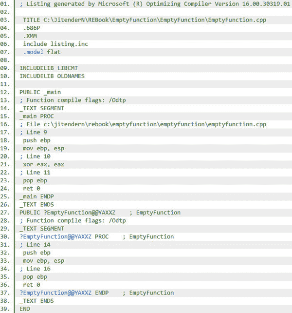

**图 6.3：** `EmptyFunction.asm`

我们将逐行浏览汇编代码以了解代码模式的含义和工作原理。第 1 行说：

**第 1 行**

`; Listing generated by Microsoft (R) Optimizing Compiler Version 16.00.30319.01`

这是一个注释，因为它以分号开头。该注释说明了我们用于生成汇编代码的编译器，即用于 80x86 的 Microsoft (R) 32 位 C/C++ 优化编译器版本 16.00.30319.01。编译器基本上将程序从一种语言翻译成另一种语言。但当我们谈论优化编译器时，它会改进代码以使其运行更快。

**第 3 行**

`TITLE C:\JitenderN\REBook\EmptyFunction\EmptyFunction\EmptyFunction.cpp`

Title 定义了 C/C++ 程序的绝对路径名称。

**第 4 行**

`.686P`

这启用了 Pentium Pro 处理器（仅限 32 位 MASM）的所有指令。

**第 5 行**

`.XMM`

这意味着程序需要具有 Streaming SIMD Extensions 指令集的 CPU。

**第 6 行**

`include listing.inc`

此 `listing.inc` 文件包含汇编宏。宏在汇编语言中用于模块化编程。Visual C++ 不会将宏代码嵌入汇编代码中以提高性能并对齐代码。你可以在 Visual C++ `include` 文件夹中找到此文件。

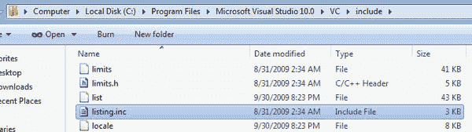

**图 6.4：** `listing.inc` 路径

**第 7 行**

`.model flat`

这是启用平坦内存模型的指令。为了理解内存模型，我们必须理解内存是通过 3 种内存模型访问的：

* **Flat**：这是一种非分段内存模型，其中整个内存对程序来说表现为一个巨大的字节数组。代码、数据和栈都驻留在同一个地址空间中。
* **Segmented**：在此模型中，内存被划分为称为段的空间组。
* **Real**：实地址内存模型是 Intel 8086 处理器中使用的非常旧的内存模型。

**第 9-10 行**

`INCLUDELIB LIBCMT`

`INCLUDELIB OLDNAMES`

使用 `INCLUDELIB` 派生，我们链接位于以下路径的 `LIBCMT.LIB` 和 `OLDNAMES.LIB` 库：

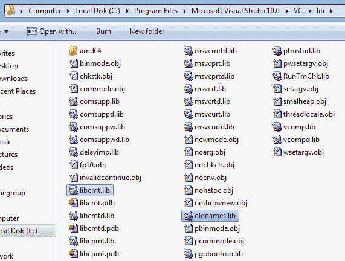

**图 6.5：** 库路径

**第 12 行**

`PUBLIC _main`

`PUBLIC` 是使 `_main` 过程变为公共的派生。派生是由汇编器用来自动执行汇编过程的指令；它还有助于提高代码可读性。

`_main`，所有函数都以下划线开头。`main` 函数被标记为公共函数，这意味着它可以被其他模块访问。

**第 13 行**

`; Function compile flags: /Odtp`

所有注释都以分号开头。此行说明代码使用 `/Odtp` 开关编译。

**第 14 行**

`_TEXT SEGMENT`

这是文本段或代码段的开始。

**第 15 行**

`_main PROC`

过程使用 `PROC` 语句定义，并且必须由 `ENDP` 语句关闭。我们可以在第 25 行看到 `_main ENDP`。

**第 16 行**

`; File c:\jitendern\rebook\emptyfunction\emptyfunction\emptyfunction.cpp`

这是一个注释，说明 C/C++ 源代码的文件路径。

**第 17 行**

`; Line 9`

这是一个注释，说明 C/C++ 源代码文件第 9 行映射到此注释之后的指令。

**第 18-19 行**

`push ebp`

`mov ebp, esp`

这是函数序言，即函数开始处的指令序列。

**第 20-21 行**

`; Line 10`

`xor eax, eax`

`XOR` 是异或。`EAX` 寄存器用于存储函数的返回值。C/C++ 代码中的 `main` 函数返回 0，因此 `XOR EAX, EAX` 将使 `EAX` 寄存器归零。此外，编译器可以使用 `MOV EAX, 0` 代替 `XOR EAX, EAX`。但 `XOR` 比 `MOV` 更受欢迎，因为 `XOR` 占用 2 字节操作码，而 `MOV` 指令占用 5 字节。

**第 22 行**

`; Line 11`

此注释说明 C/C++ 源代码文件第 12 行映射到此注释之后的指令。

**第 23 行**

`pop ebp`

`POP EBP` 是函数尾声，即结束函数的指令序列。

**第 24 行**

`ret 0`


# RET 指令概述

`RET` 是返回指令。它将指令指针返回给调用过程。`RET` 指令的语法是：

```
RET nBytes
```

返回指令有一个可选的 `nBytes` 操作数，用于指定返回后要添加到 `ESP` 寄存器值中的字节数。

▼第 25-26 行

`_main ENDP`

`_TEXT ENDS`

这是 `main` 过程的结束以及文本段或代码段的结束。

▼第 27 行

`PUBLIC ?EmptyFunction@@YAXXZ ; EmptyFunction`

内部，函数由其修饰名称表示，该名称是在编译过程中创建的编码字符串。它将调用约定、函数返回类型、函数参数和其他信息与函数名一起附加。此过程有助于链接器在链接可执行文件时找到正确的函数。名称修饰的过程也称为名称混淆。

与 `main` 类似，`EmptyFunction` 通过 `PUBLIC` 指令被设为公开。

▼第 28 行

`; Function compile flags: /Odtp`

与前面解释的相同。它表示代码是用 `/Odtp` 开关编译的。

▼第 29 行

`_TEXT SEGMENT`

这是文本段或代码段的开始。

▼第 30 行

`?EmptyFunction@@YAXXZ PROC ; EmptyFunction`

使用 `PROC` 语句开始 `EmptyFunction` 过程

▼第 31 行

`; Line 15`

该注释说明 C/C++ 源代码文件中的第 15 行映射到此注释之后的指令。

▼第 32-33 行

`push ebp`

`mov ebp, esp`

这是 `EmptyFunction` 的函数序言。

▼第 34 行

`; Line 16`

该注释说明 C/C++ 源代码文件中的第 17 行映射到此注释之后的指令。

▼第 35 行

`pop ebp`

`POP EBP` 是 `EmptyFunction` 的函数尾声。

▼第 36 行

`ret 0`

由于 `EmptyFunction` 什么都不做，它只是一个空/空白函数。因此，它只是将指令指针返回给调用者。`0` 表示 `ESP` 将保持不变。

▼第 37-38 行

`?EmptyFunction@@YAXXZ ENDP ; EmptyFunction`

`_TEXT ENDS`

这是 `EmptyFunction` 过程的结束以及文本段或代码段的结束。

▼第 39 行

`END`

`END` 语句结束源代码。

# 使用优化的空函数

现在让我们使用 `/0x` 开关在 x86 平台上对代码进行优化编译。在 Windows 命令提示符上运行以下命令以设置 `cl.exe`（VS 编译器）的环境，然后使用以下开关编译代码：

* `/Ox`：启用最大优化
* `/Fa`：输出汇编列表文件的名称
* `/Fe`：输出可执行文件的名称

```
cd C:\Program Files\Microsoft Visual Studio 10.0\VC
vcvarsall.bat
cd C:\JitenderN\REBook\EmptyFunction\EmptyFunction
cl EmptyFunction.cpp /FaEmptyFunction-Optimized.asm /Ox /FeEmptyFunction-Optimized.exe
```

以下是运行上述命令的输出：


**Figure 6.6:** 使用优化的空函数

我们得到的汇编代码如下：


**Figure 6.7:** EmptyFunction-Optimized.asm

正如我们所见，当代码被优化时，它会转换代码以删除不必要的行。在此优化过程中，代码的含义保持不变。如今的编译器在优化方面做得很好。因此，作为一名逆向工程师，理解代码背后的概念或逻辑而不是原始代码始终是一个良好的实践。如果我们能理解逻辑，那么我们就可以编写我们的原型。

回到代码，我们可以看到代码的大部分行与前面章节中解释的相同。因此，我们不会重复陈述所有内容。我们将采用特定于代码优化的指令。

▼第 18 行

`xor eax, eax`

`main` 过程对 `EAX` 进行 XOR 操作以返回零，因为 `EAX` 寄存器用于存储函数的返回值。

▼第 28 行

`ret 0`

`EmptyFunction` 仅使用 `RET` 指令将指令指针返回给调用者。

# 返回值

在本节中，我们将在 C/C++ 代码中创建一个函数以返回一个常量值。我们将定义并声明一个 `ReturningValue()`。


**Figure 6.8:** ReturningValues.cpp

## 不使用优化返回一个值

在同一 x86 Windows 机器上的 `MSVC` 编译器中不使用优化编译代码。在 Windows 命令提示符上运行以下命令以设置 `cl.exe`（VS 编译器）的环境，然后使用以下开关编译代码：

* `/Fa`：输出汇编列表文件的名称
* `/Fe`：输出可执行文件的名称

```
cd C:\Program Files\Microsoft Visual Studio 10.0\VC
vcvarsall.bat
cd C:\JitenderN\REBook\ReturningValue\ReturningValue
cl ReturningValue.cpp /FaReturningValue.asm /FeReturningValue.exe
```

以下是运行上述命令的输出：


**Figure 6.9:** 不使用优化返回一个值

编译后我们得到以下内容：


**Figure 6.10:** ReturningValue.asm

我们已在前一节中讨论了代码中的大部分行。因此，我们将重点关注主要指令。

▼第 20-24 行

`; Line 10`

`xor eax, eax`

`; Line 11`

`pop ebp`

`ret 0`

这是来自 `main` 函数的指令部分，其中我们对 `EAX` 进行 XOR 操作以使 `EAX` 等于零。一旦 `EAX` 为零，我们使用 `POP` 指令调用函数尾声。`RET` 指令将执行返回给调用者，调用者可以从 `EAX` 寄存器中获取返回值。

▼第 34-38 行

`; Line 15`

`mov eax, 2020 ; 000007e4H`

`; Line 16`

`pop ebp`

`ret 0`

现在，我们转向 `ReturningValue` 函数，其中 `EAX` 被填充为 `2020`，这是 `ReturningValue` 函数的返回值。`POP` 指令是函数尾声，最后，`RET` 将指令指针传回调用者，调用者将在 `EAX` 寄存器中获取结果。

## 使用优化返回一个值

使用优化（使用 `/0x` 开关）在 x86 平台上的 `MSVC` 编译器中编译代码。在 Windows 命令提示符上运行以下命令以设置 `cl.exe`（VS 编译器）的环境，然后使用以下开关编译代码：

* `/Ox`：启用最大优化
* `/Fa`：输出汇编列表文件的名称
* `/Fe`：输出可执行文件的名称

```
cd C:\Program Files\Microsoft Visual Studio 10.0\VC
vcvarsall.bat
cd C:\JitenderN\REBook\ReturningValue\ReturningValue
cl ReturningValue.cpp /FaReturningValue-Optimized.asm /Ox /FeReturningValue-Optimized.exe
```

以下是运行上述命令的输出：


**Figure 6.11:** 使用优化返回一个值

生成的汇编代码将是：


**Figure 6.12:** ReturningValue-Optimized.asm

我们可以在优化后的代码中观察到所有不必要的代码行都被删除了。

`main` 函数仅显示 2 条指令：

▼第 18,20 行

`xor eax, eax`

`ret 0`

`EAX` 被 XOR 以将 `EAX` 重置为 0，返回值存储在 `EAX` 中。`RET` 指令将指令指针传回调用者。

`ReturningValue` 函数也仅显示 2 条指令：

▼第 28, 30 行

`mov eax, 2020 ; 000007e4H`

`ret 0`

`MOV` 用返回值 `2020` 填充 `EAX`，而 `RET` 指令将指令指针传回调用者。

# 基本 “Hello, World” 程序

在这个简单的 C/C++ 代码中，我们只是在控制台上打印“hello, world”。我们使用 `printf()` 函数打印它。


**Figure 6.13:** HelloWorld.cpp

## 基本 “Hello, World” 程序不使用优化


## 未优化的基础“Hello, World”程序

编译代码时不使用优化，使用 MSVC 编译器在 x86 平台上编译。在 Windows 命令提示符上运行以下命令以设置 `cl.exe`（VS 编译器）的环境，然后使用以下开关编译代码：

* `/Fa`：输出汇编列表文件的名称
* `/Fe`：输出可执行文件的名称

```
cd C:\Program Files\Microsoft Visual Studio 10.0\VC
vcvarsall.bat
cd C:\JitenderN\REBook\HelloWorld\HelloWorld
cl HelloWorld.cpp /FaHelloWorld.asm /FeHelloWorld.exe
```

运行上述命令后的输出如下：


**Figure 6.14:** 未优化的基础“Hello, World”程序

以下是生成的汇编代码，我们现在将对其进行分析：


**Figure 6.15:** `HelloWorld.asm`

让我们逐行分析汇编代码：

### 第 1-10 行

我们已在 EmptyFunction 部分讨论过此内容。

### 第 12-14 行

```
CONST SEGMENT
$SG4677 DB 'hello, world', 0aH, 00H
CONST ENDS
```

字符串常量，在我们的例子中是“hello, world”，被分配在常量段中。`CONST SEGMENT` 指令用于在内存中定义常量段的开始。在我们的例子中，链接器将 `CONST SEGMENT` 重命名为 `.rdata`，可使用任何调试器转储。在下面的屏幕截图中，您可以看到我们已在 `x32dbg` 中打开了 EXE 文件（编译后生成），并且在此 EXE 文件中，我们使用 `CFF Explorer` 禁用了 **地址空间布局随机化**（**ASLR**）。请按照附录中提到的步骤在 EXE 文件上禁用 ASLR。禁用 EXE 文件上的 ASLR 将有助于我们在每次在调试器中打开 EXE 文件时将其加载到相同的内存空间中：


**Figure 6.16:** `.rdata`

`$SG4677` 是编译器为处理字符串常量而给出的内部名称。`DB` 定义字节，即数据类型。`'hello, world', 0aH, 00H` 是字符串数据，即以 null 结尾的 ASCII 字符串。

通过 `CONST END`，常量段结束。

### 第 15 行

```
PUBLIC _main
```

`PUBLIC` 是使 `_main` 过程公开的指令，以便其他模块访问。

### 第 16 行

```
EXTRN _printf:PROC
```

**Note:** 代码放在 `.code` 段中，常量字符串放在 `CONST`（`.rdata`）段中，如果它不是常量，则放在 `.data` 段中。

`EXTRN` 指令声明 `extern` 函数，在我们的例子中是 `printf`。所有函数都以下划线开头。

### 第 18 行

```
_TEXT SEGMENT
```

这开始了 `_TEXT` 段或代码段，我们的 `main` 函数代码位于此处。

### 第 19 行

```
_main PROC
```

这是 `main` 过程的开始。

### 第 20-23 行

```
; File c:\jitendern\rebook\helloworld\helloworld\helloworld.cpp
; Line 8
push ebp
mov ebp, esp
```

这里与我们之前讨论的一样，所有注释都以分号开头。一个注释说明 C/C++ 源代码文件路径，另一个注释定义 C/C++ 源代码中的行号与此注释后指令的映射关系。`PUSH` 开始 `main` 函数的序言代码。

### 第 25-27 行

```
push OFFSET $SG4677
call _printf
add esp, 4
```

在调用 `printf` 函数之前，我们借助 `PUSH` 指令将指向常量字符串的指针压入栈。`CALL` 指令调用 `printf` 函数。

`printf` 函数执行后，控制权转移回调用者，在我们的例子中是 `main` 函数。在 `printf` 函数执行期间，字符串指针将位于栈上。因此，当执行返回到 `main` 函数时，需要清理栈，因为我们不再需要字符串指针。

由于我们遵循 `CDECL` 调用约定，清理栈是调用者的责任，在我们的例子中是通过 `add esp, 4` 指令完成的。

32 位程序使用 4 字节进行寻址。因此，当我们向 `ESP` 添加 4 字节时，我们将 `ESP` 增加 4 字节以清理栈并移除栈上的常量字符串指针。`ADD` 指令的等价物也可以是 `POP <some-register>`，这通常被其他编译器使用。

### 第 28-29 行

```
; Line 10
xor eax, eax
```

由于 `main` 在 C/C++ 代码中返回 0，并且我们知道函数的返回值存储在 `EAX` 寄存器中，因此 `EAX` 被 XOR 以返回 0。

### 第 30-32 行

```
; Line 11
pop ebp
ret 0
```

它调用 `main` 函数的尾声代码，`RET` 指令将执行返回给调用者，调用者可以从 `EAX` 寄存器获取返回值。

### 第 33 行

```
_main ENDP
```

这样，`_main` 函数就关闭了。

### 第 34-35 行

```
_TEXT ENDS
END
```

这结束了 `_TEXT` 代码段和源代码。

## 优化的基础“Hello, World”程序

使用优化标志 `/Ox` 编译代码。在 Windows 命令提示符上运行以下命令以设置 `cl.exe`（VS 编译器）的环境，然后使用以下开关编译代码：

* `/Ox`：启用最大优化
* `/Fa`：输出汇编列表文件的名称
* `/Fe`：输出可执行文件的名称

```
cd C:\Program Files\Microsoft Visual Studio 10.0\VC
vcvarsall.bat
cd C:\JitenderN\REBook\HelloWorld\HelloWorld
cl HelloWorld.cpp /FaHelloWorld-Optimized.asm /Ox /FeHelloWorld-Optimized.exe
```

运行上述命令后的输出如下：


**Figure 6.17:** 优化的基础“Hello, World”程序

生成的汇编代码如下：


**Figure 6.18:** `HelloWorld-Optimized.asm`

所有代码行与我们在前一节讨论的相同。唯一的区别是编译器移除了函数序言和尾声代码以消耗更少的资源（内存、CPU 等）。

其余所有指令与未优化部分讨论的相同。这里需要注意的是，代码的含义与未优化代码相同。我们将指向常量字符串的指针压入栈以调用 `printf` 函数。

`printf` 函数执行后将执行返回给 `main`（调用者）以清理栈并用 0 填充 `EAX` 以返回 `EAX` 中的内容。

## 结论

在本章中，我们理解了代码优化的概念。我们以空函数、返回值的函数和打印“hello, world”的程序为例来理解优化和非优化代码的汇编列表。在下一章中，我们将讨论使用 printf 函数的程序上的代码优化概念，并讨论整数、浮点数和字符变量如何在内存中存储。

# 第 7 章

## Printf 程序的逆向工程模式

每当我们编写程序时，我们都会使用 `printf` 函数在输出屏幕上打印一些内容。它可以是为程序的最终用户准备的内容，也可以是为了调试目的或简单的欢迎信息。恶意软件或病毒编写者遵循相同的逻辑。程序被编码为使用 `printf` 函数打印一些内容。因此，作为逆向工程师，在逆向任何被编码为病毒或恶意软件行为的程序时，我们应该理解 `printf` 函数的模式。大多数病毒或恶意软件编写者在编码时会打印一些内容以满足自己的目的或让目标采取行动。


所以，了解使用 `printf` 函数在控制台打印消息的程序非常重要。同时，我们还将讨论 `printf` 与不同变量的用法。不同类型的变量分配不同的内存量，这非常有趣。在本章中，我们使用 `printf` 函数在控制台打印整数、浮点数和字符的 C/C++ 程序。每个程序将单独进行，以便在逆向工程时理解 `printf` 程序的模式。

## 结构

本章将涵盖以下主题：

* 理解 `printf` 与整数的汇编模式
* 理解 `printf` 与浮点数的汇编模式
* 理解 `printf` 与字符的汇编模式

## 目标

学习完本章后，我们将能够理解使用 `printf` 函数的程序中的代码优化概念。我们将了解带优化的汇编代码与不带优化的汇编代码有何不同。在此过程中，我们还将讨论整数、浮点数和字符变量如何在内存中存储。浮点变量的工作方式与整数或字符不同。我们将通过详细的示例介绍这种方法。

## 函数 printf 与整数

在这个简单的 C/C++ 代码中，我们在控制台打印 4 个整数。我们使用 `printf` 函数来打印整数。


**图 7.1:** `printfWithIntegers.cpp`

## 函数 printf 在不进行优化的情况下打印整数

使用 MSVC 编译器在 x86 平台上不进行优化编译代码。在 Windows 命令提示符上运行以下命令以设置 `cl.exe`（VS 编译器）的环境，然后使用以下开关编译代码：

* `/Fa`：输出汇编列表文件的名称
* `/Fe`：输出可执行文件的名称

```
cd C:\Program Files\Microsoft Visual Studio 10.0\VC
vcvarsall.bat
cd C:\JitenderN\REBook\printfWithIntegers\printfWithIntegers
cl printfWithIntegers.cpp /FaprintfWithIntegers.asm /FeprintfWithIntegers.exe
```

运行上述命令的输出如下：


**图 7.2:** 函数 `printf` 在不进行优化的情况下打印整数

生成的汇编代码如下：


**图 7.3:** `printfWithIntegers.asm`

我们已经在 *第 6 章，基本代码的逆向工程模式* 中讨论了生成的汇编代码的初始指令，因此我们将从第 12 行开始。

▼**第 12-14 行**

`CONST SEGMENT`

`$SG4677 DB 'integer1=%d; integer2=%d; integer3=%d, integer4=%d', 00H`

`CONST ENDS`

它是内存中 `CONST SEGMENT` 的开始和结束，其中定义了字符串常量 `$SG4677`。这可以通过使用任何调试器转储 `.rdata`（链接器将 `CONST SEGMENT` 重命名为 `.rdata`）在内存中查看。你可以使用 `x32dbg` 调试器按如下方式查看字符串常量：


**图 7.4:** `.rdata`

▼**第 15 行**

`PUBLIC _main`

所有函数都以以下划线开头。`main` 函数被标记为公共函数，这意味着它可以被其他模块访问。

▼**第 16 行**

`EXTRN _printf:PROC`

使用 `EXTRN` 指令，它定义了名称为 `_printf` 的外部符号和过程类型。

**提示：** `EXTRN` 指令的语法是 `label:type`，其中 label 可以是变量/函数，Label Type 可以如下：

| 标签类型 | 含义 |
| --- | --- |
| `BYTE` | 8 位变量 |
| `WORD` | 16 位变量 |
| `DWORD` | 32 位变量 |
| `QWORD` | 64 位变量 |
| `PROC` | 过程名称 |

**表 7.1**

▼**第 18、19 行**

`_TEXT SEGMENT`

`_main PROC`

这开始了 `_TEXT` 段，其中包含我们的 `main` 函数代码。这也可以在 `x32dbg` 调试器中可视化：

`.text` 段 of `printfWithIntegers.exe` 从 `0x00401000` 地址开始，我们可以看到 `main` 函数/过程代码也从同一地址开始。


**图 7.5:** `.text`

▼**第 20-23 行**

`; File c:\jitendern\rebook\helloworld\helloworld\helloworld.cpp`

`; Line 8`

`push ebp`

`mov ebp, esp`

这与之前相同。此注释说明了 C/C++ 源代码文件路径以及与此注释后指令映射的 C/C++ 源代码中的其他定义行号。使用 `PUSH` 指令，`main` 函数序言代码开始。

▼**第 25-30 行**

`push4`

`push3`

`push2`

`push1`

`push OFFSET $SG4677`

`call_printf`

从这里开始，有趣的事情开始了。`printf` 函数的所有参数都以相反的顺序压入堆栈。每个参数都是整数类型。在 32 位环境中，每个整数占用 4 字节大小。为了了解执行期间的堆栈状态，我们可以在 `x32dbg` 调试器中对 `printf` 函数的调用设置断点。一旦设置断点，我们将运行代码以查看断点命中时的堆栈状态。这将帮助我们可视化参数是如何压入堆栈的。


**图 7.6:** 在 `printf` 调用上设置断点

我们可以看到参数整数 4 首先被压入堆栈，然后是 3、2 和 1。断点命中时堆栈状态的解释如下：

```
0012FF2C  00408140  "integer1=%d; integer2=%d; integer3=%d, integer4=%d"
0012FF30  00000001  Argument 1 of type int is pushed on stack
0012FF34  00000002  Argument 2 of type int is pushed on stack
0012FF38  00000003  Argument 3 of type int is pushed on stack
0012FF3C  00000004  Argument 4 of type int is pushed on stack
```

在 `0x0012FF2C` 位置，常量字符串的指针（即 `0x00408140`）被压入堆栈。我们可以在 `x32dbg` 中转储该位置以查看常量字符串 `$SG4677`。


**图 7.7:** 转储字符串

一旦所有参数都压入堆栈，`printf` 函数的调用通过以下方式进行：

▼**第 30 行**

`call _printf`

这将执行 `printf` 函数，并在 `printf` 函数执行后，指令指针将执行指针返回给调用者。

▼**第 31 行**

`add esp, 20     ; 00000014H`

由于我们使用的是 `CDECL` 调用约定，调用者负责清理堆栈。因此，从 `printf` 函数返回后，`add esp, 20` 将堆栈缩小 `0x20`。

20 字节是通过将 4 个参数的大小相加计算得出的，每个参数 4 字节，外加指向常量字符串的指针参数 4 字节大小。这总共为 4x5 字节，等于 20 字节（十六进制为 `00000014H`）。

现在，我们将了解与堆栈上的垃圾相关的更有趣的事情。为了理解垃圾的概念，我们在 `add esp, 20` 之后的指令上设置断点。我们在堆栈上看到如下内容：


**图 7.8:** 堆栈上的垃圾

根据 `CDECL` 调用约定，调用者负责清理堆栈，这通过使用 `ADD` 指令将 `ESP` 移回 20 字节来完成。如我们所见，`ESP` 已移回至 `0x0012FF40`，但所有参数和指向常量字符串的指针仍在堆栈上。这些值未被清除或设置为零。`ESP` 值之上的所有内容都是无意义的垃圾。

▼**第 34-39 行**

`; Line 9`

`xor eax, eax`

`; Line 10`

`pop ebp`

`ret 0`

`_main ENDP`

`_TEXT ENDS`

`END`

剩余的所有指令与我们在前几章中讨论的相同。`main` 函数通过将 `EAX` 置零来返回零。

使用 `END`，一切都已关闭，程序结束。

## 函数 printf 在进行优化的情况下打印整数


## 使用优化标志编译

使用优化标志 `/Ox` 编译代码。在 Windows 命令提示符上运行以下命令为 `cl.exe`（VS 编译器）设置环境，然后使用以下开关编译代码：

* `/Ox`: 启用最大优化
* `/Fa`: 输出汇编列表文件的名称
* `/Fe`: 输出可执行文件的名称

```
cd C:\Program Files\Microsoft Visual Studio 10.0\VC
vcvarsall.bat
cd C:\JitenderN\REBook\printfWithIntegers\printfWithIntegers
cl printfWithIntegers.cpp /FaprintfWithIntegers-Optimized.asm /Ox /FeprintfWithIntegers-Optimized.exe
```

以下是在运行上述命令后的输出：


**图 7.9:** 使用优化的函数 printf 打印整数

生成的汇编代码如下：


**图 7.10:** printfWithIntegers-Optimized.asm

在优化后的代码中，除了编译器移除了 `main` 函数的序言和尾声代码以消耗更少资源外，其他一切都相同。

## 函数 printf 使用浮点数

大部分计算都是使用整数进行的，但在精度方面，浮点数发挥着重要作用。早期的 x86 处理器家族有单独的协处理器用于处理浮点数的数学计算。但后来，处理浮点数的能力被集成到微处理器本身。此单元集成到微处理器中以处理浮点数，被称为浮点单元（`FPU`）。现在要处理浮点数，需要两件事：

* 应有空间存储浮点数。
* 必须有指令来处理和对浮点数进行操作。

现在，关于存储浮点数的空间，`FPU` 有 8 个寄存器构成一个栈，即从 `ST0` 到 `ST7`。`FPU` 也被称为“`x87`”部分或“FPU 寄存器栈”即 "`x87` 栈”。处理浮点数的指令被称为 "`x87` 指令集”。

浮点数通常对于 `float` 类型为 32 位长，对于 `double` 类型为 64 位长。因此，为了保持浮点数的最大精度，`FPU` 栈寄存器为 80 位宽。为了更深入地了解浮点数，我们将使用一个简单的 C/C++ 代码在控制台上打印两个浮点数。我们使用 `printf` 来打印浮点数。


**图 7.11:** printfWithFloat.cpp

## 函数 printf 未优化时打印浮点数

在同一台 x86 Windows 机器上的 MSVC 编译器中不使用优化编译代码。在 Windows 命令提示符上运行以下命令为 `cl.exe`（VS 编译器）设置环境，然后使用以下开关编译代码：

* `/Fa`: 输出汇编列表文件的名称
* `/Fe`: 输出可执行文件的名称

```
cd C:\Program Files\Microsoft Visual Studio 10.0\VC
vcvarsall.bat
cd C:\JitenderN\REBook\printfWithFloat\printfWithFloat
cl printfWithFloat.cpp /FaprintfWithFloat.asm /FeprintfWithFloat.exe
```

以下是在运行上述命令后的输出：


**图 7.12:** 函数 printf 在未优化时打印浮点数

生成的汇编代码如下：


**图 7.13:** printfWithFloat.asm

让我们开始逐行理解生成的汇编代码：

### 行 1-10

```
; Listing generated by Microsoft (R) Optimizing Compiler Version 16.00.30319.01
TITLE C:\JitenderN\REBook\printfWithFloat\printfWithFloat\printfWithFloat.cpp
.686P
.XMM
include listing.inc
.model flat
INCLUDELIB LIBCMT
INCLUDELIB OLDNAMES
```

我们已经在前面的章节中讨论过这一点，因此我们将继续下一个指令。

### 行 12-14

```
CONST SEGMENT
$SG4677 DB 'float1=%f, float2=%f', 00H
CONST ENDS
```

这是由链接器命名为 `.rdata` 的 `CONST SEGMENT` 的开始。编译器使用 `$SG4677` 名称来处理字符串常量。`DB` 是定义字节的数据类型，字符串以空字符 `00H` 终止。`.rdata` 可以被转储以查看常量字符串。


**图 7.14:** .rdata

### 行 15-16

```
PUBLIC __real@3ff0000000000000
PUBLIC __real@40011eb851eb851f
```

浮点数可以用二进制数字格式表示，并且这种二进制编号格式是标准化的。实数格式、短/单精度和长/双精度实数有三种大小：

* `REAL4`，32 位，短实数或单精度
* `REAL8`，64 位，长实数或双精度
* `REAL10`，80 位，临时实数或扩展精度

`REAL4`、`REAL8`、`REAL10` 有不同的格式：`REAL4` 的格式为：


**图 7.15:** REAL4 格式

其中：

`S` = sign bit (0=positive, 1=negative)

`E` = exponent bits

`F` = fraction bits of the significand

`REAL8` 的格式为：


**图 7.16:** REAL8 格式

`REAL10` 的格式为：


**图 7.17:** REAL10 格式

为了保持简单易懂，我们将不详细讨论各个格式。记住实数编号格式（`REAL8`，即 64 位长实数或双精度在我们的代码中使用），我们将继续相同的指令：

```
PUBLIC __real@3ff0000000000000
PUBLIC __real@40011eb851eb851f
```

`Public` 是一个派生属性，使变量变为公共并使其在模块间可用。`real` 表示实数格式，后跟我们函数参数的十六进制值。让我们使用在线行转换器将这些十六进制值转换为浮点数（[`gregstoll.com/~gregstoll/floattohex/`](https://gregstoll.com/~gregstoll/floattohex/)）：


**图 7.18:** 十六进制值转换为 float1

这个十六进制 `3ff0000000000000` 等同于我们 C/C++ 代码中的 `float1(1.0)` 参数。


**图 7.19:** 十六进制值转换为 float2

这个十六进制 `40011eb851eb851f` 等同于我们 C/C++ 代码中的 `float2(2.14)` 参数。

### 行 17

```
PUBLIC _main
```

`main` 函数被标记为公共函数，这意味着它可以被其他模块访问。

### 行 18-20

```
EXTRN _printf:PROC
EXTRN __fltused:DWORD
; COMDAT __real@3ff0000000000000
```

`EXTRN` 派生声明外部函数，在我们的例子中是 `printf`。所有函数都以下划线开头。

### 行 22-29

```
CONST SEGMENT
__real@3ff0000000000000 DQ 03ff0000000000000r ; 1
CONST ENDS
; COMDAT __real@40011eb851eb851f
CONST SEGMENT
__real@40011eb851eb851f DQ 040011eb851eb851fr ; 2.14
; Function compile flags: /Odtp
CONST ENDS
```

这是 `CONST SEGMENT` 的开始/结束。在此段内，我们的函数参数 `2.14` 由十六进制表示法 `40011eb851eb851f` 表示，被存储在 `CONST SEGMENT` 中，或者我们可以说 `.rdata`。让我们使用任何调试器转储 `.rdata` 以查看我们 C/C++ 代码中的 `float2` 参数。由于我们处理的是小端模式，浮点参数的十六进制表示将被以相反顺序存储。

`40011eb851eb851f` 将以 `1F 85 EB 51 B8 1E 01 40` 的形式存储在 `.rdata` 段中，如我们在 `x32dbg` 中在内存位置 `0x0040C158` 所见。如果你正在考虑 `.rdata` 段中的其他浮点变量，那么请稍等。几条指令后事情就会变得清晰。


**图 7.20:** .rdata 中的浮点参数

### 行 30-34

```
_TEXT SEGMENT
_main PROC
; Line 7
push ebp
mov ebp, esp
```

在 `TEXT` 段中，我们有 `main` 过程，它以函数序言开始。

### 行 36

```
sub esp, 8
```

为 `main` 函数的局部变量在栈上分配 8 个字节，该变量是传递给 `printf` 函数的第三个参数（`2.14`）。

### 行 37

```
```


`fld QWORD PTR __real@40011eb851eb851f`

FLD 代表浮点加载。 该指令将浮点值压入 FPU 栈，该栈从 `ST0` 到 `ST7`。 你可以在运行此指令前后看到调试器输出如下：

**提示**： 你可以在 `main` 的开头插入断点。 要插入断点，请滚动到 `.text` 段的顶部，你会发现与我们的汇编文件 `printfWithFloat.asm` 中的指令集相同的指令。 一旦设置断点，你可以 `step into` 指令逐条执行。

`x32dbg` 在执行此指令之前的输出：

`fld QWORD PTR __real@40011eb851eb851f`


**图 7.21：** `ST0` 之前

执行此指令后：


**图 7.22：** `ST0` 之后

### 第 38 行

`fstp QWORD PTR [esp]`

`FSTP` 表示浮点存储并弹出。 它将浮点值从 `ST0` 移动到栈顶 `PTR [esp]` 并完全从 `ST0` 弹出该值。


**图 7.23：** 浮点存储和弹出

### 第 39 行

`sub esp, 8`

再次在栈上为 `main` 函数的局部变量分配 8 个字节，即传递给 `printf` 函数的第二个参数 `1.0`。 让我们看看它在 `x32dbg` 中的样子。


**图 7.24：** 在栈上分配空间

### 第 40 行

`fld1`

此指令在 FPU 栈上加载浮点值 `1.0`。


**图 7.25：** 加载浮点值 `1.0`

### 第 41 行

`fstp QWORD PTR [esp]`

`FSTP` 表示浮点存储并弹出，它将浮点值 `1.0` 从 `ST0` 移动到栈顶 `PTR [esp]` 并完全从 `ST0` 弹出该值。


**图 7.26：** 浮点存储和弹出

### 第 42 行

`push OFFSET $SG4677`

现在在调用 `printf` 函数之前，我们必须将剩余的字符串常量传递到栈上。 此 `PUSH` 指令将字符串常量 `$SG4677` 压入栈。


**图 7.27：** 压入字符串

### 第 43 行

`call _printf`

在调用 `printf` 函数的 `CALL` 指令之前，所有传递给 `printf` 函数的参数都已压入栈。 执行此指令后，两个变量都将打印到控制台上。

### 第 44 行

`add esp, 20 ; 00000014H`

由于我们遵循 CDECL 调用约定，是调用者负责清理栈。 从 `printf` 函数返回时，`main` 通过将栈指针回移 20 字节来清理栈（我们使用了 4 字节来压入字符串常量，8 字节来压入 `1.0` 浮点十六进制值，另外 8 字节用于压入 `2.14` 浮点十六进制值）。

在此指令之前，`x32dbg` 屏幕如下所示：

**提示**： 要直接移动到 `add` 指令，可以使用 `step over` 执行 `print` 函数并在 `add` 指令处停止。 或者你可以在 `add` 指令处插入断点以在 `add` 指令处停止执行。


**图 7.28：** 调用 `printf` 之后

此指令之后：


**图 7.29：** 栈已清理

### 第 45-52 行

```
; Line 9
xor eax, eax
; Line 10
pop ebp
ret 0
_main ENDP
_TEXT ENDS
END
```

剩余的指令使 `EAX` 为零，因为在 C/C++ 代码中 `main` 返回 0。 最后它调用函数尾声以结束 `main`、`TEXT` 段和代码。

# 使用优化的 printf 打印浮点数

使用优化标志 `/Ox` 编译代码。 在 Windows 命令提示符上运行以下命令为 `cl.exe`（VS 编译器）设置环境，然后使用以下开关编译代码：

* `/Ox`： 启用最大优化
* `/Fa`： 输出汇编列表文件的名称
* `/Fe`： 输出可执行文件的名称

```
cd C:\Program Files\Microsoft Visual Studio 10.0\VC
vcvarsall.bat
cd C:\JitenderN\REBook\printfWithFloat\printfWithFloat
cl printfWithFloat.cpp /FaprintfWithFloat-Optimized.asm /Ox /FeprintfWithFloat-Optimized.exe
```

运行上述命令的输出如下：


**图 7.30：** 使用优化的函数 `printf` 打印浮点数

生成的汇编代码如下：


**图 7.31：** `printfWithFloat-Optimized.asm`

列表中的所有指令都相同，除了第 33 行。 由于代码已优化，函数序言和尾声被移除，我们将在本节中讨论。

### 第 33 行

`fld QWORD PTR __real@40011eb851eb851f`

与之前相同。 此指令将浮点值 `2.14` 压入 FPU 栈，`ST0`。

### 第 34 行

`sub esp, 16 ; 00000010H`

如非优化代码所示，`SUB` 被调用两次以分配 `main` 函数局部变量的内存。 但在优化中，这两个指令合并为从 `ESP` 减去 16 字节，以为浮点变量 `1.0` 和 `2.14` 分配 8+8 字节。

### 第 35 行

`fstp QWORD PTR [esp+8]`

它将浮点值 `2.14` 从 `ST0` 移动到栈顶 `PTR [esp+8]` 并完全从 `ST0` 弹出该值。

### 第 36 行

`fld1`

与之前相同。 此指令在 FPU 栈上加载浮点值 `1.0`。

### 第 37 行

`fstp QWORD PTR [esp]`

它将浮点值 `1.0` 从 `ST0` 移动到栈顶 `PTR [esp]` 并完全从 `ST0` 弹出该值。

### 第 38-39 行

`push OFFSET $SG4677`

`call _printf`

将字符串常量偏移量压入栈以调用 `printf` 函数。

### 第 40-47 行

```
add esp, 20 ; 00000014H
; Line 9
xor eax, eax
; Line 10
ret 0
_main ENDP
_TEXT ENDS
END
```

根据 CDECL 调用约定，调用者清理栈。 剩余的指令通过对 `EAX` 寄存器进行异或操作返回 0，并在第 45-47 行结束 `main` 过程、文本段和代码。

# 函数 printf 使用字符

在这个简单的 C/C++ 代码中，我们在控制台上打印 2 个字符。 我们使用 `printf` 函数来打印字符。


**图 7.32：** `printfWithChar.cpp`

# 未优化时函数 printf 打印字符

在同一台 x86 Windows 机器上使用 MSVC 编译器不使用优化编译代码。 在 Windows 命令提示符上运行以下命令为 `cl.exe`（VS 编译器）设置环境，然后使用以下开关编译代码：

* `/Fa`： 输出汇编列表文件的名称
* `/Fe`： 输出可执行文件的名称

```
cd C:\Program Files\Microsoft Visual Studio 10.0\VC
vcvarsall.bat
cd C:\JitenderN\REBook\printfWithChar\printfWithChar
cl printfWithChar.cpp /FaprintfWithChar.asm /FeprintfWithChar.exe
```

运行上述命令的输出如下：


**图 7.33：** 未优化时函数 `printf` 打印字符

生成的汇编代码如下：


**图 7.34：** `printfWithChar.asm`

汇编列表的大部分内容已在前一节中讨论过。 让我们继续到第 25 行。

### 第 25-28 行

```
push 98 ; 00000062H
push 97 ; 00000061H
push OFFSET $SG4677
call _printf
```

在调用 `printf` 函数之前，三个参数被压入栈。 第一个 `PUSH` 指令是 `PUSH 98`，其中 98 是字符 ‘b’ 的 ASCII 值，十六进制等价为 `62H`。 请参阅附录中的 ASCII 表以获取完整的 ASCII 列表。

第二个 `PUSH` 指令是 `PUSH 97`，其中 97 是 ‘a’ 的 ASCII 值，十六进制等价为 `61H`。

而 `printf` 的第三个参数是字符串常量 `$SG4677`，定义在 `CONST SEGMENT` 中。 这是在 `CALL` 指令之前 `x32dbg` 中栈的显示方式。 你可以通过在调用 `printf` 函数的 `CALL` 处插入断点来检查栈状态。


**图 7.35：** 栈状态

`1: [esp] 00408140 Memory location of $SG4677, "char1=%c, char2=%c"`

`2: [esp+4] 00000061 Hex value of char ‘a’ is PUSHed`

`3: [esp+8] 00000062 Hex value of char ‘b’ is PUSHed`

`4: [esp+C] 0012FF88 [EBP]`

`5: [esp+10] 00401209 return to printfwithchar.00401209 from printfwithchar.00401000`

返回 `CALL` 后，调用方使用 `ADD ESP, 12` 指令清理栈，如我们在 `CDECL` 调用约定中讨论的那样。此外，代码以 `EAX` 中的 0 结束，这是通过对 `EAX` 进行 `XOR` 实现的。如我们之前讨论的那样，该函数返回值存储在 `EAX` 中。

# 使用优化的 printf 打印字符函数

使用优化标志 `/Ox` 编译代码。在 Windows 命令提示符上运行以下命令为 `cl.exe`（VS 编译器）设置环境，然后使用以下开关编译代码：

*   `/Ox`：启用最大优化
*   `/Fa`：输出汇编列表文件的名称
*   `/Fe`：输出可执行文件的名称

```
cd C:\Program Files\Microsoft Visual Studio 10.0\VC
vcvarsall.bat
cd C:\JitenderN\REBook\printfWithChar\printfWithChar
cl printfWithChar.cpp /FaprintfWithChar-Optimized.asm /Ox /FeprintfWithChar-Optimized.exe
```

以下是在运行上述命令后的输出：


**图 7.36：** 使用优化的 printf 打印字符函数

生成的汇编代码如下：


**图 7.37：** printfWithChar-Optimized.asm

优化代码中的所有内容都相同，只是函数序言和尾声在优化代码中被消除了。

# 结论

本章中，我们学习了如何使用 `printf` 函数逆向工程程序或应用程序。我们还讨论了使用 `printf` 函数的程序中的代码优化概念。我们还讨论了整数、浮点数和字符变量如何在内存中存储。浮点变量的工作方式与整数或字符不同。在下一章中，我们将讨论指针以及它们在逆向工程中的处理方式。

# 第 8 章

## 指针程序的逆向工程模式

我们大多数人觉得理解指针很困难，但它是编程中最有趣的主题之一。在现实生活中，你是否想象过指针无处不在？当我们使用有线连接观看电视时，我们有许多频道可供观看。每个频道都与我们通常称为频道号的数字相关联。当这个频道号在有线调制解调器的遥控器上按下时，相应的频道广播就会在电视上开始。在指针的上下文中，这个频道号就是指向该频道的指针。这是当按下遥控器时频道被存储和播放的编号。

因此，现在为了理解指针的概念，我们将通过编程来了解其概念。在 C/C++ 中，有各种类型的变量来保存不同类型的值。我们有存储整数值的整数变量、存储实数的浮点变量、存储字符的字符变量等。同样，指针是一个存储其他变量内存地址的变量。在本章中，我们将了解汇编代码中指针的模式。

### 结构

本章将涵盖以下主题：

*   指针
*   未优化的指针
*   优化的指针

### 目标

学习本章后，我们应该能够理解指针在编程中的使用方式。我们将从整数到浮点数和字符学习指针的基础知识。这将帮助你理解指针相对于内存分配的处理方式。在理解指针后，我们将编写一个简单的 C/C++ 程序来生成优化和非优化的 ASM 代码，并检查有无优化的指针汇编模式。

### 指针

为了理解指针，让我们看一个简单的声明：

`int iNumber = 3;`

这里，我们正在定义一个名为 `iNumber` 的整数变量。我们使用匈牙利命名法作为变量命名约定。此声明由编译器用于：

*   为内存中的整数变量预留空间
*   将名称与内存位置关联
*   在预留的内存位置存储 3

你可以这样想象：


`0x0012FF3C` 是内存位置地址，它保存的值为 `0x00000003`。

所以我们看到了变量如何在内存中存储。现在，我们将使用一个 C/C++ 程序来理解指针及其相关概念：


**图 8.1：** Pointers.cpp

C/C++ 代码的第 8 行定义了一个整数类型的变量。第 9 行和第 10 行中，我们看到两个运算符，`*` 和 `&`。

*   首先，我们将讨论 `&` 运算符。它表示地址运算符。因此，`&iNumber` 返回变量 `iNumber` 的内存地址，在前面的情况下为 `0x0012FF3C`。
*   其次是 `*` 运算符。它被称为值在地址运算符。它给出特定地址存储的值。因此，`*(&iNumber)` 返回 `0x0012FF3C` 内存位置的值，为 3。

在第 9 行，`piNumber` 被声明为指针变量，这意味着它能够保存内存地址。声明 `int *piNumber` 并不意味着 `piNumber` 包含一个整数值。它的意思是 `piNumber` 将保存一个整数变量的内存地址。同样，`Float *pf` 意味着 `pf` 将保存一个浮点变量的地址。前述 C/C++ 程序的输出是：

`Address of iNumber = 0x0012FF3C`

`Address of iNumber = 0x0012FF3C`

`Address of piNumber = 0x0012FF38`

`Value of piNumber = 0012FF3C`

`Value of iNumber = 3`

`Value of iNumber = 3`

`Value of iNumber = 3`


**图 8.2：** Pointers.exe 输出

执行前述代码时你会得到不同的输出。让我们看看在有无优化编译代码时我们得到什么。

### 未优化的指针

在同一 x86 Windows 机器上的 MSVC 编译器中不使用优化编译代码。在 Windows 命令提示符上运行以下命令为 `cl.exe`（VS 编译器）设置环境，然后使用以下开关编译代码：

*   `/Fa`：输出汇编列表文件的名称
*   `/Fe`：输出可执行文件的名称

```
cd C:\Program Files\Microsoft Visual Studio 10.0\VC
vcvarsall.bat
cd C:\JitenderN\REBook\Pointers\Pointers
cl Pointers.cpp /FaPointers.asm /FePointers.exe
```

以下是在运行上述命令后的输出：


**图 8.3：** 未优化的指针

生成的汇编代码如下：


**图 8.4：** Pointers.asm-第 1 部分


**图 8.5：** Pointers.asm-第 2 部分


**图 8.6：** Pointers.asm-第 3 部分

生成代码包含两个段：`CONST`（由链接器命名为 `.rdata`）和 `_TEXT` 段（用于代码）。让我们在汇编列表中逐步了解这些段：

**第 12-24 行**

```
CONST SEGMENT
$SG4679 DB 0aH, 'Address of iNumber = 0x%p', 00H
ORG $+1
$SG4680 DB 0aH, 'Address of iNumber = 0x%p', 00H
ORG $+1
$SG4681 DB 0aH, 'Address of piNumber = 0x%p', 00H
$SG4682 DB 0aH, 'Value of piNumber = %p', 00H
$SG4683 DB 0aH, 'Value of iNumber = %d', 00H
ORG $+1
$SG4684 DB 0aH, 'Value of iNumber = %d', 00H
ORG $+1
$SG4685 DB 0aH, 'Value of iNumber = %d', 00H
CONST ENDS
```

代码中的常量字符串以零字节终止，并分配在 `CONST` 段中，这可以通过使用 `x32dbg` 转储 `.rdata` 来看到。


**图 8.7：** `.rdata`

### 行 28-30
`_TEXT SEGMENT`
`_piNumber$ = -8      ; size = 4`
`_iNumber$ = -4      ; size = 4`

为了访问栈帧上的局部变量，我们必须将 `_<variable-name>$` 加到 `EBP` 地址上。因此，要在栈上访问 `piNumber` 变量，必须将 -8 加到 `EBP` 地址上，而要访问 `iNumber` 变量则将 -4 加到 `EBP` 上。

### 行 31-38
`_main PROC`
`; File c:\jitendern\rebook\pointers\pointers\pointers.cpp`
`; Line 7`
`push ebp`
`mov ebp, esp`
`sub esp, 8`
`; Line 8`
`mov DWORD PTR _iNumber$[ebp], 3`

让我们通过在 `main` 调用的开始处设置断点来理解 `main` 过程（`main` 可以通过滚动到反汇编代码顶部来定位）。设置断点后，运行程序并逐条进入指令。`main` 过程以通常的函数序言开始，然后是一个 `SUB` 指令。`SUB` 指令为 `main` 函数的局部变量在栈上分配 8 个字节。一旦在栈上分配了空间，`MOV` 指令将在主栈帧的 `[EBP-0x4]` 处写入 3，如以下屏幕截图所示：


**图 8.8：** 栈状态

### 行 39-40
`; Line 10`
`lea eax, DWORD PTR _iNumber$[ebp]`

加载有效地址 (`LEA`) 将 `[EBP-0x4]` 的地址加载到 `EAX` 中。如我们所知，`iNumber = 3`，它存储在栈上的 `[EBP-0x4] = 0x0012FF3C` 内存位置。此指令将 `EAX` 加载为 `0x0012FF3C`，如以下屏幕截图所示：


**图 8.9：** LEA 输出

### 行 41
`mov DWORD PTR _piNumber$[ebp], eax`

这将把存储在 `EAX` 中的内存位置移动到栈上的 `[EBP-0x8]`。现在我们有两个值存储在栈上，即整数值 0x00000003 和指向该整数值的指针，如以下屏幕截图所示：


**图 8.10：** 栈上的 piNumber

### 行 42-45
`; Line 12`
`lea ecx, DWORD PTR _iNumber$[ebp]`
`push ecx`

在调用第一个 `printf` 函数之前，我们必须将参数压入栈。第一个被压入栈的参数将是 `iNumber` 的地址。`LEA` 将 `iNumber` 的地址加载到 `ECX` 中，然后将其压入栈，如以下屏幕截图所示：


**图 8.11：** 在调用第一个 printf 函数之前

### 行 45-46
`push OFFSET $SG4679`
`call _printf`

此 push 指令将另一个参数推送给 `printf`，即由 `$SG4679` 引用的字符串常量。一旦两个参数都被推送，就会对 `printf` 函数进行调用。在 `x32dbg` 中调试时，我们在 `printf` 调用期间进行步过（使用 `Debug` > `Step Over` 选项）。从 `printf` 函数调用返回后，将在控制台上打印 `Address of iNumber`，如以下屏幕截图所示：


**图 8.12：** Pointer.exe 输出

### 行 47
`add esp, 8`

从 `printf` 过程返回时，通过向 `ESP` 添加 8 个字节来清理栈，如以下屏幕截图所示：


**图 8.13：** 栈清理

### 行 48-50
`; Line 13`
`mov edx, DWORD PTR _piNumber$[ebp]`
`push edx`

现在这是在为第二次 `printf` 函数调用准备栈。它首先将 `[EBP-0x8]` 处存储的值 `MOV` 到 `EDX` 寄存器中，然后将 `EDX` 压入栈，如以下屏幕截图所示：


**图 8.14：** EDX 压入栈

### 行 51-53
`push OFFSET $SG4680`
`call _printf`
`add esp, 8`

这是在将另一个参数推送给 `printf` 函数，即字符串常量压入栈。现在 `printf` 的两个参数再次被压入栈。对 `printf` 函数的调用被执行。返回时，`printf` 将打印 `Address of iNumber = piNumber`，并且在返回后栈将被再次清理。

### 行 54-59
`; Line 14`
`lea eax, DWORD PTR _piNumber$[ebp]`
`push eax`
`push OFFSET $SG4681`
`call _printf`
`add esp, 8`

在第三次 `printf` 调用中，我们必须打印 `piNumber` 的地址，即 `&piNumber`。为此，使用 `LEA` 将 `[EBP-0x8]` 的地址加载到 `EAX`，然后在 `printf` 调用之前将其压入栈。字符串常量 `$SG4681` 也在另一次 `printf` 调用之前被压入栈，如以下屏幕截图所示：


**图 8.15：** 打印 piNumber 的地址

### 行 60-62
`; Line 15`
`mov ecx, DWORD PTR _piNumber$[ebp]`
`push ecx`

现在我们必须打印 `piNumber` 的值。因此 `MOV` 指令将 `[EBP-0x8]` 处的 `piNumber` 变量值移入 `ECX`。在下一条指令中，它将在 `printf` 调用之前将 `ECX` 压入栈。

### 行 63-65
`push OFFSET $SG4682`
`call _printf`
`add esp, 8`

这些与我们在之前的 `printf` 调用中所做的相同。然后它使用 `ADD` 指令清理栈。

### 行 66-71
`; Line 16`
`mov edx, DWORD PTR _iNumber$[ebp]`
`push edx`
`push OFFSET $SG4683`
`call _printf`
`add esp, 8`

此指令将 `[EBP-0x4]` 处的 `iNumber` 变量值移入 `EDX`。在 `printf` 调用之前，它将两个参数（字符串常量和 `EDX` 值）压入栈。在推送字符串常量之前压入栈的任何内容都将在输出控制台上打印，如以下屏幕截图所示：


**图 8.16：** 打印 iNumber

### 行 72-77
`; Line 17`
`mov eax, DWORD PTR _iNumber$[ebp]`
`push eax`
`push OFFSET $SG4684`
`call _printf`
`add esp, 8`

这些指令与之前的指令做的事情相同，只是它们使用 `EAX` 将 `[EBP-0x4]` 处的 `iNumber` 变量值压入栈。

### 行 78-80
`; Line 18`
`mov ecx, DWORD PTR _piNumber$[ebp]`
`mov edx, DWORD PTR [ecx]`

第一个 `MOV` 指令将 `[EBP-0x8]` 处的 `piNumber` 变量值移入 `ECX`。第二个指令将 `ECX` 指向的内存位置存储的值移入 `EDX`，如以下屏幕截图所示：


**图 8.17：** MOV `[ECX]` 到 `EDX`

### 行 81-84
`push edx`
`push OFFSET $SG4685`
`call _printf`
`add esp, 8`

push 指令在 `printf` 调用之前将参数压入栈。从 `printf` 函数返回后，`iNumber` 的值将被打印到控制台。栈清理通过 `ADD` 指令完成，如以下屏幕截图所示：


**图 8.18：** iNumber 将被打印

### 行 85-92
`; Line 19`
`xor eax, eax`
`mov esp, ebp`
`pop ebp`
`ret 0`
`_main ENDP`
`_TEXT ENDS`
`END`

剩余的指令与我们在前面章节中讨论的相同。调用 main 函数的尾声以结束段和代码。

# 使用优化的指针

编译代码时使用优化标志 `/Ox` 标志。在 Windows 命令提示符上运行以下命令以设置 `cl.exe`（VS 编译器）的环境，然后使用以下开关编译代码：

* `/Ox`：启用最大优化
* `/Fa`：输出汇编列表文件的名称
* `/Fe`：输出可执行文件的名称

| `cd C:\Program Files\Microsoft Visual Studio 10.0\VC` `vcvarsall.bat` `^` `cd C:\JitenderN\REBook\Pointers\Pointers` `^` `cl Pointers.cpp /FaPointers-Optimized.asm /Ox /FePointers-Optimized.exe` |
| --- |

以下是在运行上述命令后的输出：


**图 8.19：** 使用优化的指针

生成的汇编代码如下：


**图 8.20：** Pointers-Optimized.asm-Part 1


**图 8.21：** Pointers-Optimized.asm-Part 2


# 优化汇编逐步分析

首先，我们将讨论优化和非优化代码生成的差异。在优化代码中，函数序言被移除，因此所有引用 `EBP` 的地方都被替换为 `ESP`。因此，在优化的汇编列表中，我们会看到 `ESP` 的引用代替 `EBP`，正如我们在非优化汇编列表中观察到的那样。为了解释这一概念，我们将详细检查栈状态以便更好地理解。让我们通过在 `main` 过程开始处设置断点来逐步分析汇编列表：

### Line 33-34

`; 第 7 行`

```
sub esp, 8
```

这是 `main` 过程的开始，其中 `ESP` 减去 8 字节，为 `main` 函数的局部变量腾出空间，这些变量是整数变量（`iNumber`）和指向该整数变量的指针（`piNumber`）。在执行此指令之前，栈将如下所示：


图 8.22：main 过程的开始

### Line 35-36

`; 第 10 行`

```
lea eax, DWORD PTR _iNumber$[esp+8]
```

加载有效地址（`LEA`）将 `EAX` 加载为 `_iNumber$[esp+8]` 的地址，其求值为：

```
lea eax, DWORD PTR ss:[esp]
```

因为 `_iNumber$ = -8`

如我们所见，`EAX` 被填入 `0x0012FF3C`，这就是 `ESP` 本身。现在，`EAX` 也指向栈顶，如下所示：


图 8.23：EAX 也指向栈顶

### Line 37-39

`; 第 12 行`

```
mov ecx, eax
push ecx
```

将 `EAX` 移动到 `ECX`。现在，`ECX` 也被填入 `0x0012FF3C`，该值通过 `push ecx` 指令压入栈中。借此，我们的 `printf` 函数的一个参数被压入栈中。

### Line 40

```
push OFFSET $SG4679
```

这将把字符串常量压入栈中，这是 `printf` 函数的另一个参数。如我们所见，`printf` 函数的两个参数都被压入栈中。栈状态在以下截图中显示，可按如下方式理解：

```
[ESP] 0012FF34 00408140 “\nAddress of iNumber = 0x%p”, arg to printf()
[ESP+0x4] 0012FF38 0012FF3C &iNumber is stored here, argument to printf()
[ESP+0x8] 0012FF3C JUNKJUNK This where we will store iNumber
[ESP+0xC] 0012FF40 JUNKJUNK This where we will store &iNumber
[ESP+0x10] 0012FF44 00401272 return to 0x00401272 from 0x401000
```


图 8.24：栈状态

### Line 41-42

```
mov DWORD PTR _iNumber$[esp+16], 3
mov DWORD PTR _piNumber$[esp+16], eax
```

这两条指令求值为：

```
mov dword ptr ss:[esp+0x8], 0x3
mov dword ptr ss:[esp+0xC], eax
```

之前，在栈状态中，我们在栈上为 `main` 函数的局部变量分配了空间（在栈状态中显示为 `JUNKJUNK`）。现在，使用这些指令，我们将整数变量 `0x00000003` 存储在 `[ESP+0x8]`，并将指向该变量的指针存储在 `[ESP+0xC]`。现在，栈将如下所示：

```
[ESP] 0012FF34 00408140 "\nAddress of iNumber = 0x%p", argument to printf()
[ESP+0x4] 0012FF38 0012FF3C &iNumber is stored here, argument to printf()
[ESP+0x8] 0012FF3C 00000003 iNumber is stored here
[ESP+0xC] 0012FF40 0012FF3C &iNumber is stored here
[ESP+0x10] 0012FF44 00401272 return to 0x00401272 from 0x401000
```


图 8.25：执行第 41-42 行后

### Line 43

```
call _printf
```

一旦参数被压入栈中，就会调用 `printf`。根据第 12 行的 C/C++ 代码：

```
printf ("\nAddress of iNumber = 0x%p", &iNumber) ;
```

因此，在从 `printf` 调用返回后，控制台上将打印以下内容：


图 8.26：printf 执行后

### Line 44-48

`; 第 13 行`

```
mov edx, DWORD PTR _piNumber$[esp+16]
push edx
push OFFSET $SG4680
call _printf
```

第 13 行的 C/C++ 代码打印 `piNumber`，即 `iNumber` 的内存位置：

```
printf ("\nAddress of iNumber = 0x%p", piNumber) ;
```

在我们的汇编代码中，`printf` 函数的参数通过先将指向整数变量的指针移动到 `EDX` 而压入栈中。然后 `EDX` 与另一个字符串常量的压栈一起被压入栈。一旦 `printf` 函数的两个参数都在栈上，就会调用 `printf` 函数。如栈状态和以下截图所示：

```
[ESP] 0012FF2C 0040815C "\nAddress of iNumber = 0x%p", argument to printf()
[ESP+0x04] 0012FF30 0012FF3C piNumber is stored here, argument to printf()
[ESP+0x08] 0012FF34 00408140 "\nAddress of iNumber = 0x%p", argument to printf()
[ESP+0x0C] 0012FF38 0012FF3C &iNumber is stored here, argument to printf()
[ESP+0x10] 0012FF3C 00000003 iNumber is stored here
[ESP+0x14] 0012FF40 0012FF3C &iNumber is stored here
[ESP+0x18] 0012FF44 00401272 return to 0x00401272 from 0x401000
```


图 8.27：第二次 printf 执行后

### Line 49-53

`; 第 14 行`

```
lea eax, DWORD PTR _piNumber$[esp+24]
push eax
push OFFSET $SG4681
call _printf
```

第 14 行的 C/C++ 代码打印 `&piNumber`，即 `piNumber` 的内存位置：

```
printf ("\nAddress of piNumber = 0x%p", &piNumber) ;
```

在我们的汇编代码中，`LEA` 指令将求值为：

```
lea eax, ss:[esp+0x14]
```

`LEA` 将 `EAX` 加载为 `ss:[esp+0x14]` 的内存地址，即 `piNumber` 的地址。一旦 `EAX` 被加载地址，它将与另一个字符串常量的压栈一起被压入栈。一旦 `printf` 函数的两个参数都在栈上，就会调用 `printf` 函数。这在以下截图中显示：

```
[ESP] 0012FF24 00408178 "\nAddress of piNumber = 0x%p", argument to printf()
[ESP+0x04] 0012FF28 0012FF40 &piNumber is stored here, argument to printf()
[ESP+0x08] 0012FF2C 0040815C "\nAddress of iNumber = 0x%p", argument to printf()
[ESP+0x0C] 0012FF30 0012FF3C piNumber is stored here, argument to printf()
[ESP+0x10] 0012FF34 00408140 "\nAddress of iNumber = 0x%p", argument to printf()
[ESP+0x14] 0012FF38 0012FF3C &iNumber is stored here, argument to printf()
[ESP+0x18] 0012FF3C 00000003 iNumber is stored here
[ESP+0x1C] 0012FF40 0012FF3C &iNumber is stored here
[ESP+0x20] 0012FF44 00401272 return to 0x00401272 from 0x401000
```


图 8.28：第三次 printf 执行后

### Line 54-58

`; 第 15 行`

```
mov ecx, DWORD PTR _piNumber$[esp+32]
push ecx
push OFFSET $SG4682
call _printf
```

第 15 行的 C/C++ 代码打印 `piNumber`，即 `iNumber` 的内存位置：

```
printf ("\nValue of piNumber = %p", piNumber) ;
```

在我们的汇编代码中，`MOV` 指令将求值为：

```
mov ecx, dword ptr ss:[esp+0x1C]
```

`MOV` 将 `ss:[esp+0x1C]` 处的值移动到 `ECX`，该值指向 `iNumber` 的内存位置。现在，参数再次被压入栈以调用 `printf` 函数。这在以下截图中显示：

```
[ESP] 0012FF1C 00408194 "\nValue of piNumber = %p", argument to printf()
[ESP+0x04] 0012FF20 0012FF3C piNumber is stored here, argument to printf()
[ESP+0x08] 0012FF24 00408178 "\nAddress of piNumber = 0x%p", argument to printf()
[ESP+0x0C] 0012FF28 0012FF40 &piNumber is stored here, argument to printf()
[ESP+0x10] 0012FF2C 0040815C "\nAddress of iNumber = 0x%p", argument to printf()
[ESP+0x14] 0012FF30 0012FF3C piNumber is stored here, argument to printf()
[ESP+0x18] 0012FF34 00408140 "\nAddress of iNumber = 0x%p", argument to printf()
[ESP+0x1C] 0012FF38 0012FF3C &iNumber is stored here, argument to printf()
[ESP+0x20] 0012FF3C 00000003 iNumber is stored here
[ESP+0x24] 0012FF40 0012FF3C &iNumber is stored here
[ESP+0x28] 0012FF44 00401272 return to 0x00401272 from 0x401000
```


图 8.29：第四次 printf 执行后

### Line 59-63

`; 第 16 行`


## 第 16 行

```
mov edx, DWORD PTR _iNumber$[esp+40]
push edx
push OFFSET $SG4683
call _printf
```

第 16 行的 C/C++ 代码打印 `iNumber`，它就是 `iNumber` 的值：

`printf ("\nValue of iNumber = %d", iNumber) ;`

在我们的汇编代码中，`MOV` 指令将被求值为：

```
mov edx, dword ptr ss:[esp+0x20]
```

`MOV` 将把 `ss:[esp+0x20]` 处的值移动到 `EDX`，它就是 `iNumber` 的值。现在，参数再次被压入栈以调用 `printf` 函数。这在以下截图中显示：

```
[ESP] 0012FF14 004081AC "\nValue of iNumber = %d", argument to printf()
[ESP+0x04] 0012FF18 00000003 iNumber is stored here, argument to printf()
[ESP+0x08] 0012FF1C 00408194 "\nValue of piNumber = %p", argument to printf()
[ESP+0x0C] 0012FF20 0012FF3C piNumber is stored here, argument to printf()
[ESP+0x10] 0012FF24 00408178 "\nAddress of piNumber = 0x%p", argument to printf()
[ESP+0x14] 0012FF28 0012FF40 &piNumber is stored here, argument to printf()
[ESP+0x18] 0012FF2C 0040815C "\nAddress of iNumber = 0x%p", argument to printf()
[ESP+0x1C] 0012FF30 0012FF3C piNumber is stored here, argument to printf()
[ESP+0x20] 0012FF34 00408140 "\nAddress of iNumber = 0x%p", argument to printf()
[ESP+0x24] 0012FF38 0012FF3C &iNumber is stored here, argument to printf()
[ESP+0x28] 0012FF3C 00000003 iNumber is stored here
[ESP+0x2C] 0012FF40 0012FF3C &iNumber is stored here
[ESP+0x30] 0012FF44 00401272 return to 0x00401272 from 0x401000
```


**Figure 8.30:** 第五次 printf 执行后

## 第 64-68 行

`; 第 17 行`

```
mov eax, DWORD PTR _iNumber$[esp+48]
push eax
push OFFSET $SG4684
call _printf
```

第 17 行的 C/C++ 代码打印 `*(&iNumber)`，它本身就是 `iNumber` 的值：

`printf ("\nValue of iNumber = %d", *(&iNumber)) ;`

在我们的汇编代码中，`MOV` 指令将被求值为：

```
mov eax, dword ptr ss:[esp+0x28]
```

`MOV` 将把 `ss:[esp+0x28]` 处的值移动到 `EAX`，它就是 `iNumber` 的值。现在，参数再次被压入栈以调用 `printf` 函数。如栈状态和以下截图所示：

```
[ESP] 0012FF0C 004081C4 "\nValue of iNumber = %d", argument to printf()
[ESP+0x04] 0012FF10 00000003 *(&iNumber) is stored here, argument to printf()
[ESP+0x08] 0012FF14 004081AC "\nValue of iNumber = %d", argument to printf()
[ESP+0x0C] 0012FF18 00000003 iNumber is stored here, argument to printf()
[ESP+0x10] 0012FF1C 00408194 "\nValue of piNumber = %p", argument to printf()
[ESP+0x14] 0012FF20 0012FF3C piNumber is stored here, argument to printf()
[ESP+0x18] 0012FF24 00408178 "\nAddress of piNumber = 0x%p", argument to printf()
[ESP+0x1C] 0012FF28 0012FF40 &piNumber is stored here, argument to printf()
[ESP+0x20] 0012FF2C 0040815C "\nAddress of iNumber = 0x%p", argument to printf()
[ESP+0x24] 0012FF30 0012FF3C piNumber is stored here, argument to printf()
[ESP+0x28] 0012FF34 00408140 "\nAddress of iNumber = 0x%p", argument to printf()
[ESP+0x2C] 0012FF38 0012FF3C &iNumber is stored here, argument to printf()
[ESP+0x30] 0012FF3C 00000003 iNumber is stored here
[ESP+0x34] 0012FF40 0012FF3C &iNumber is stored here
[ESP+0x38] 0012FF44 00401272 return to 0x00401272 from 0x401000
```


**Figure 8.31:** 第六次 printf 执行后

## 第 69-74 行

`; 第 18 行`

```
mov ecx, DWORD PTR _piNumber$[esp+56]
mov edx, DWORD PTR [ecx]
push edx
push OFFSET $SG4685
call _printf
```

第 17 行的 C/C++ 代码打印 `*piNumber`，它本身就是 `iNumber` 的值：

`printf ("\nValue of iNumber = %d", *piNumber) ;`

在我们的汇编代码中，我们看到两个 `MOV` 指令，其中一个移动指令获取 `iNumber` 的内存位置，另一个从该内存地址获取存储的值。第一个 `MOV` 指令被解析为：

`mov ecx, dword ptr ss:[esp+0x34]`

此 `MOV` 将把 `ss:[esp+0x34]` 处的值移动到 `ECX`，它就是 `iNumber` 的内存位置。第二个 `MOV` 从 `ECX` 中的内存地址获取存储的值并将其移动到 `EDX`。现在，参数再次被压入栈以调用 `printf` 函数。这在以下截图中显示：

```
[ESP] 0012FF04 004081DC "\nValue of iNumber = %d", argument to printf()
[ESP+0x04] 0012FF08 00000003 *piNumber is stored here, argument to printf()
[ESP+0x08] 0012FF0C 004081C4 "\nValue of iNumber = %d", argument to printf()
[ESP+0x0C] 0012FF10 00000003 *(&iNumber) is stored here, argument to printf()
[ESP+0x10] 0012FF14 004081AC "\nValue of iNumber = %d", argument to printf()
[ESP+0x14] 0012FF18 00000003 iNumber is stored here, argument to printf()
[ESP+0x18] 0012FF1C 00408194 "\nValue of piNumber = %p", argument to printf()
[ESP+0x1C] 0012FF20 0012FF3C piNumber is stored here, argument to printf()
[ESP+0x20] 0012FF24 00408178 "\nAddress of piNumber = 0x%p", argument to printf()
[ESP+0x24] 0012FF28 0012FF40 &piNumber is stored here, argument to printf()
[ESP+0x28] 0012FF2C 0040815C "\nAddress of iNumber = 0x%p", argument to printf()
[ESP+0x2C] 0012FF30 0012FF3C piNumber is stored here, argument to printf()
[ESP+0x30] 0012FF34 00408140 "\nAddress of iNumber = 0x%p", argument to printf()
[ESP+0x34] 0012FF38 0012FF3C &iNumber is stored here, argument to printf()
[ESP+0x38] 0012FF3C 00000003 iNumber is stored here
[ESP+0x3C] 0012FF40 0012FF3C &iNumber is stored here
[ESP+0x40] 0012FF44 00401272 return to 0x00401272 from 0x401000
```


**Figure 8.32:** 第七次 printf 执行后

## 第 75-81 行

`; 第 19 行`

```
xor eax, eax
add esp, 64     ; 00000040H
ret 0
_main ENDP
_TEXT ENDS
END
```

`XOR` 和 `ADD` 将分别清理 `EAX` 和栈，并通过返回 0 来结束代码。`ADD` 指令一次性清理了栈，这与非优化代码不同，在非优化代码中我们在每次 `printf` 调用后清理栈。这在下面的栈状态和以下截图中显示：

```
[ESP] 0012FF44 00401272 return to 0x00401272 from 0x401000
```


**Figure 8.33:** 清理栈

## 结论

在本章中，我们学习了关于指针的概念性知识。我们还学习了指针在内存中相对于整数、浮点数和字符指针的存储方式。我们还发现了非优化代码与优化汇编代码的不同。非优化代码使用 `EBP` 来引用栈上的参数，并且在每次 `printf` 调用后进行栈清理。但在优化代码的情况下，使用 `ESP` 来引用参数，并且栈清理在代码的末尾一次性完成。在下一章中，我们将讨论另一个有趣的话题，即决策。我们将看到决策语句在汇编编程中是如何处理的。

# 第 9 章

## 决策控制结构的逆向工程模式

在我们的日常生活中，我们会做出许多决定，每个决定都与一个结果相关。让我们举个例子。在离开家去办公室之前，我们都喜欢查看 Google maps，如果交通拥堵，我们可能会向老板请求在家工作的许可。另一个例子是如果我赚得更多，我会购买一辆漂亮的豪华车和一栋大房子。所有这些决定都与某些条件相关联，并导致一定的结果。


类似地，计算机也被编程为基于条件做出决策。C/C++ 编程也提供了决策语句，帮助程序员编写涉及基于条件决策的代码。不同的条件与结果相连，以自然的方式表现。本章将帮助你从逆向工程的角度理解这些条件在组装列表中的模式。

# 结构

本章将涵盖以下主题：

* If-else 语句
* 未优化的 If-else 语句
* 带优化的 If-else 语句

## 目标

本章的目标是理解程序流程中用于决策的汇编指令的概念。我们将在汇编代码中学习 `CMP` 和 `Jump` 指令。正如我们在日常生活中为一个问题做出多个决策一样，为了处理汇编中的问题或条件，我们在汇编中有 `CMP` 和 `jump` 指令。我们还将理解决策控制结构的优化与非优化汇编代码之间的差异。

## If-else 语句

在本节中，我们将介绍带有 if-else 语句的简单 C/C++ 代码，其中我们将要求用户输入两个整数。如果两个数字相等，则在控制台上打印出两个数字相等的信息。但如果输入的两个数字不相等，代码将使用 else 语句打印数字不相等。此代码还包括我们的 C/C++ 代码中的 `scanf` 和 `printf`。建议阅读 *第 7 章，Printf 程序的逆向工程模式*，以便更好地理解。


**图 9.1：** `ifelse.cpp`

## 未优化的 If-else 语句

在同一台 x86 Windows 机器上，使用 MSVC 编译器在不进行优化的情况下编译代码。在 Windows 命令提示符上运行以下命令以设置 `cl.exe`（VS 编译器）的环境，然后使用以下开关编译代码：

* `/Fa`：输出汇编列表文件名
* `/Fe`：输出可执行文件名

| `cd C:\Program Files\Microsoft Visual Studio 10.0\VC` `vcvarsall.bat` `^` `cd C:\JitenderN\REBook\ifelse\ifelse` `^` `cl ifelse.cpp /Faifelse.asm /Feifelse.exe` |
| --- |

运行前述命令的输出如下：


**图 9.2：** If-else 语句未优化

这将生成汇编代码和 EXE 文件。为分析目的，我们将禁用 **地址空间布局随机化** (**ASLR**)。这是一种安全机制，通过它使用我们的 MSVC 编译器生成的 **可移植可执行** (**PE**) 文件在每次加载时其基地址都会随机化。要禁用 ASLR，请使用 `CFF explorer` 遵循相同的步骤并更改 `DllCharacteristics` 参数以取消选中 **DLL 可移动**。有关更多详细信息，请参阅附录。

现在，让我们继续查看生成的汇编列表：


**图 9.3：** `ifelse.asm-Part-1`


**图 9.4：** `ifelse.asm-Part-2`

让我们逐行浏览汇编代码。正如我们在前几章中讨论了大部分初始汇编列表，我们将从 `main` 过程的开始处继续指令。

▼**行 34-37**

`; Line 7`

`push ebp`

`mov ebp, esp`

`sub esp, 8`

它以 `main` 函数序言开始。使用 `SUB` 指令，我们为 `main` 的局部变量创建空间，这些变量是 `iNumber1` 和 `iNumber2`。每个数字将占用 4 字节空间，总共 8 字节。

为了分析栈状态，让我们在 `x32dbg` 中打开生成的 PE 文件，并在 `main` 过程的开始处设置断点。我们将逐步进入代码以查看 `SUB` 指令后的栈状态。

`[ESP] 0012FF38 004038DD [EBP-8] now JUNK, Input placeholder for iNumber1`

`[ESP+0x4] 0012FF3C 0040445A [EBP-4] now JUNK, Input placeholder for iNumber2`

`[ESP+0x8] 0012FF40 0012FF88 [EBP]`

`[ESP+0xC] 0012FF44 004012F7 return to ifelse.004012F7 from ifelse.00401000`

可以使用 `_iNumber1$` 宏访问 `iNumber1`，其等于 -8。因此，`iNumber1` 可以通过将 `EBP` 与 `_iNumber1$` 宏相加来访问，等于 `[EBP-8].`


**图 9.5：** 为我们的局部变量创建空间

▼**行 38-41**

`; Line 10`

`push OFFSET $SG4679`

`call _printf`

`add esp, 4`

第 10 行的 C/C++ 代码在控制台上打印字符串：

`printf("Input Number1 : ");`

在我们的汇编代码中，`printf` 函数的参数首先被压入栈。`printf` 的参数是一个存储在 `.rdata` 段中的字符串常量，内部定义为 `$SG4679`。对 `printf` 的调用将在控制台上打印 `$SG4679`，而调用 `printf` 后的 `ADD` 指令通过 4 字节清理栈。

`[ESP-0x4] 0012FF34 0040A140 "Input Number1 : ", parameter to 1st printf()`

`[ESP] 0012FF38 004038DD [EBP-8] now JUNK, Input placeholder for iNumber1`

`[ESP+0x4] 0012FF3C 0040445A [EBP-4] now JUNK, Input placeholder for iNumber2`

`[ESP+0x8] 0012FF40 0012FF88 [EBP]`

`[ESP+0xC] 0012FF44 004012F7 return to ifelse.004012F7 from ifelse.00401000`


**图 9.6：** 调用 printf

▼**行 42-47**

`; Line 11`

`lea eax, DWORD PTR _iNumber1$[ebp]`

`push eax`

`push OFFSET $SG4680`

`call _scanf`

`add esp, 8`

第 11 行的 C/C++ 代码从用户处获取输入整数并将其存储在 `&iNumber1` 内存位置：

`scanf("%d", &iNumber1);`

在我们的汇编代码中，`LEA` 将有效地将 `_iNumber1$[ebp]` 的地址，即 `0x0012FF38`，加载到 `EAX` 寄存器中。将 `EAX` 加载 `_iNumber1$[ebp]` 地址的目的是将 `EAX` 寄存器与字符串常量 `$SG4680` 一起压入栈。地址（`0x0012FF38`）和字符串 `$SG4680` 都是 `scanf` 函数的参数。

要检查 `scanf` 函数调用后的栈状态，请在 `scanf` 调用后的 `ADD` 指令处设置另一个断点。现在逐条逐步进入指令，并在调用 `scanf` 时执行一步跳过。它将在控制台上提示你输入第一个数字。我们将输入数字 7 并按 *ENTER*。按 *ENTER* 后，数字 7 将保存在栈上 `iNumber1` 内存位置的输入占位符处，`0x0012FF38`。使用 `scanf` 调用，用户输入的数字将保存在栈上。调用后，是时候再次使用 `ADD` 指令清理栈了。`ADD` 将栈指针移动 8 字节进行清理。栈状态显示在以下屏幕截图中：

`[ESP-0x8] 0012FF30 0040A154 "%d", parameter to 1st scanf()`

`[ESP-0x4] 0012FF34 0012FF38 Memory location of placeholder for iNumber1`

`[ESP] 0012FF38 00000007 [EBP-8] 7 is stored, Input placeholder for iNumber1`

`[ESP+0xC] 0012FF3C 0040445A [EBP-4] now JUNK, Input placeholder for iNumber2`

`[ESP+0x10] 0012FF40 0012FF88 [EBP]`

`[ESP+0x14] 0012FF44 004012F7 return to ifelse.004012F7 from ifelse.00401000`


**图 9.7：** scanf 之后

▼**行 48-51**

`; Line 12`

`push OFFSET $SG4681`

`call _printf`

`add esp, 4`

第 12 行的 C/C++ 代码在控制台上打印字符串：

`printf("Input Number2 : ");`

它与之前相同。`printf` 函数的参数首先被压入栈。`printf` 的参数是一个存储在 `.rdata` 段中的字符串常量，内部定义为 `$SG4681`。对 `printf` 的调用将在控制台上打印 `$SG4681`，而调用 `printf` 后的 `ADD` 指令将通过 4 字节清理栈。栈状态显示在以下屏幕截图中：

`[ESP-0x4] 0012FF34 0040A158 "Input Number2 : ", parameter to 2nd printf()`


```
[ESP] 0012FF38 00000007 [EBP-8] 7 is stored, Input placeholder for iNumber1
[ESP+0xC] 0012FF3C 0040445A [EBP-4] now JUNK, Input placeholder for iNumber2
[ESP+0x10] 0012FF40 0012FF88 [EBP]
[ESP+0x14] 0012FF44 004012F7 return to ifelse.004012F7 from ifelse.00401000
```


### 图 9.8：再次调用 printf

### 第 52-57 行

```asm
; Line 13
lea ecx, DWORD PTR _iNumber2$[ebp]
push ecx
push OFFSET $SG4682
call _scanf
add esp, 8
```

第 13 行的 C/C++ 代码从用户处获取输入整数并将其存储在 `&iNumber2` 内存位置：

`scanf("%d", &iNumber2);`

与之前的 `scanf` 代码相同。`LEA` 将有效地将地址 of `_iNumber2$[ebp]`，即 `0x0012FF3C`，加载到 `ECX` 寄存器中。将 `ECX` 加载 `_iNumber2$[ebp]` 地址的目的，是将 `ECX` 寄存器连同字符串常量 `$SG4682` 一起压入栈中。地址 `0x0012FF3C` 和字符串 `$SG4682` 都是 `scanf` 函数的参数。

要检查 `scanf` 函数调用后的堆栈状态，请在 `scanf` 调用后的 `ADD` 指令处设置另一个断点。现在逐条进入指令，并在调用 `scanf` 时执行一次步过。它会提示你在控制台上输入第二个数字。我们将输入数字 8 并按 *ENTER*。按 *ENTER* 后，数字 8 将保存在堆栈中 `iNumber2` 内存位置的输入占位符处，`0x0012FF3C`。通过 `scanf` 调用，用户输入的数字会保存到堆栈上。调用后，是时候再次使用 `ADD` 指令清理堆栈了。`ADD` 将使堆栈指针移动 8 字节以进行清理。堆栈状态显示在以下屏幕截图中：

```
[ESP-0x8] 0012FF30 0040A16C "%d", parameter to 2nd scanf()
[ESP-0x4] 0012FF34 0012FF3C Memory location of placeholder for iNumber2
[ESP] 0012FF38 00000007 [EBP-8] 7 is stored, Input placeholder for iNumber1
[ESP+0xC] 0012FF3C 00000008 [EBP-4] 8 is stored, Input placeholder for iNumber2
[ESP+0x10] 0012FF40 0012FF88 [EBP]
[ESP+0x14] 0012FF44 004012F7 return to ifelse.004012F7 from ifelse.00401000
```


### 图 9.9：再次进行 scanf 之后

### 第 58-61 行

```asm
; Line 14
mov edx, DWORD PTR _iNumber1$[ebp]
cmp edx, DWORD PTR _iNumber2$[ebp]
jne SHORT $LN2@main
```

第 14 行的 C/C++ 代码比较两个数字：

`if (iNumber1 == iNumber2)`

现在我们有两个数字 `iNumber1` 和 `iNumber2` 分别存储在 `[EBP-8]` 和 `[EBP-4]` 中。为了比较这两个数字，第一个 `MOV` 指令会将存储在 `[EBP-8]` 中的值移动到 `EDX` 寄存器中，即数字 `0x00000007`，然后使用 `CMP` 指令将存储在 `[EBP-4]` 中的值与 `EDX` 寄存器的值进行比较。

在我们的例子中，`EDX` = `0x00000007` 与 `[EBP-8]` = `0x00000008` 进行比较。

`CMP` 指令可以视为 `SUB` 指令，并且由于它是条件 `JMP`，其工作方式如下：

`[EDX] - [EBP-8]`, based on the subtraction result, the control flag is set

`0x00000007 - 0x00000008 != 0`, so it sets `ZF` `Zero Flag` = 0

`CMP` 之后是 `JNE`，即 `Jump if Not Equal`。由于两个数字不相等且 `ZF=0`，跳转将发生到 `JNE` 指令后指定的位置，即 `$LN2@main`。让我们在 `JNE` 指令之前检查堆栈状态和 `x32dbg` 的屏幕截图：

```
[ESP-0x8] 0012FF30 0040A16C "%d", parameter to 2nd scanf()
[ESP-0x4] 0012FF34 0012FF3C Memory location of placeholder for iNumber2
[ESP] 0012FF38 00000007 [EBP-8] 7 is stored, Input placeholder for iNumber1
[ESP+0xC] 0012FF3C 00000008 [EBP-4] 8 is stored, Input placeholder for iNumber2
[ESP+0x10] 0012FF40 0012FF88 [EBP]
[ESP+0x14] 0012FF44 004012F7 return to ifelse.004012F7 from ifelse.00401000
```


### 图 9.10：JNE 指令之前

在我们的例子中，`JNE` 将指令指针移动到 `$LN2@main` 位置。如果用户输入相同的数字，`CMP` 指令将导致 `ZF` `Zero Flag` = 1。这将使指令指针移动到在控制台上打印 `“Number1 and Number2 are equal”`，随后是第 67 行的无条件跳转指令到 `$LN3@main` `JMP SHORT $LN3@main`，其中 `$LN3@main` 是 `main` 函数和代码的结束。堆栈状态显示在以下屏幕截图中：

### 第 68-72 行

```asm
$LN2@main:
; Line 17
push OFFSET $SG4686
call _printf
add esp, 4
```

C/C++ 等价物是：

`printf("Number1 and Number2 are not equal\n");`

它打印 ‘Number1 and Numver2 are not equal’。ASM 代码将字符串常量 `$SG4686` 压入栈中，供 `printf` 函数作为参数使用。这将在控制台上打印 `‘Number1 and Number2 are not equal’`。接下来是 `ADD` 指令，它将通过 4 字节清理堆栈，这是由 `PUSH` 操作中的字符串常量 `$SG4686` 使用的。之后的堆栈状态如下：

```
[ESP-0x4] 0012FF34 0040A190 "Number1 and Number2 are not equal\n", arg to printf
[ESP] 0012FF38 00000007 [EBP-8] 7 is stored, Input placeholder for iNumber1
[ESP+0xC] 0012FF3C 00000008 [EBP-4] 8 is stored, Input placeholder for iNumber2
[ESP+0x10] 0012FF40 0012FF88 [EBP]
[ESP+0x14] 0012FF44 004012F7 return to ifelse.004012F7 from ifelse.00401000
```


### 图 9.11：打印 “Number1 and Number2 are not equal”

### 第 73-81 行

```asm
$LN3@main:
; Line 18
xor eax, eax
mov esp, ebp
pop ebp
ret 0
_main ENDP
_TEXT ENDS
END
```

`XOR` 和函数尾声将分别清理 `EAX` 和堆栈。`END` 将通过返回 0 来结束代码。堆栈状态显示在以下屏幕截图中：

```
[ESP-0x10] 0012FF34 0040A190 JUNK
[ESP-0xC] 0012FF38 00000007 JUNK
[ESP-0x8] 0012FF3C 00000008 JUNK
[ESP-0x4] 0012FF40 0012FF88 [EBP] popped up
[ESP] 0012FF44 004012F7 return to ifelse.004012F7 from ifelse.00401000
```


### 图 9.12：堆栈已清理

# 使用优化的 if-else 语句

使用优化标志 `/Ox` 编译代码。在 Windows 命令提示符下运行以下命令以设置 `cl.exe` `VS compiler` 的环境，然后使用以下开关编译代码：

* `/Ox`: 启用最大优化
* `/Fa`: 输出汇编列表文件的名称
* `/Fe`: 输出可执行文件的名称

```
cd C:\Program Files\Microsoft Visual Studio 10.0\VC
vcvarsall.bat
cd C:\JitenderN\REBook\ifelse\ifelse
cl ifelse.cpp /Faifelse-Optimized.asm /Ox /Feifelse-Optimized.exe
```

运行上述命令的输出如下：


### 图 9.13：使用优化的 if-else 语句

这将生成汇编代码和 EXE 文件。为了分析目的，我们将禁用 `ASLR`。它是一种安全机制，通过该机制，使用我们的 `MSVC` 编译器生成的 `PE` 文件在每次加载时其基地址都会被随机化。要禁用 `ASLR`，请使用 `CFF explorer` 按照相同的步骤操作，并更改 `DllCharacteristics` 参数以取消选中 `DLL can move`。有关禁用 `ASLR` 的逐步参考，请参阅附录。

现在，让我们继续查看生成的汇编列表：


### 图 9.14：ifelse-Optimized.asm-第 1 部分


### 图 9.15：ifelse-Optimized.asm-第 2 部分

此汇编代码通过删除不必要的行来优化，以消耗更少的资源。在此代码中，我们将看不到函数序言和尾声。我们还可以观察到 `ESP` 被用作引用而不是 `EBP`；这是由于缺少函数序言和尾声所致。让我们开始分析，这次我们将输入相同的数字。

### 第 34-35 行

```asm
; Line 7
sub esp, 8
```


`SUB` 指令正在为 `main` 函数的局部变量在栈上创建空间，`iNumber1` 和 `iNumber2`。为了检查栈状态，我们将在 `x32dbg` 中打开 PE 文件，并在 `main` 过程的开始处设置第一个断点。`SUB` 指令之后的栈状态和 `x32dbg` 截图如下：

```
[ESP] 0012FF3C 0040444A right now is JUNK, Input placeholder for `iNumber1`
[ESP+0x4] 0012FF40 00000000 right now is JUNK, Input placeholder for `iNumber2`
[ESP+0x8] 0012FF44 004012F3 return to 0x004012F3 from 0x00401000
```


图 9.16：为我们的局部变量创建空间

### 第 36-38 行

```
; Line 10
push OFFSET $SG4679
call _printf
```

ASM 的 C/C++ 等价物是：

`printf(“Input Number1 : “);`

它将把字符串常量 `$SG4679` 打印到控制台上。`$SG4679` 在调用 `printf` 函数之前被压入栈中。`CALL` 指令之后的栈状态如下：

```
[ESP] 0012FF38 0040A140 “Input Number1 : “, parameter to `printf()`
[ESP+0x4] 0012FF3C 0040444A right now is JUNK, Input placeholder for `iNumber1`
[ESP+0x8] 0012FF40 00000000 right now is JUNK, Input placeholder for `iNumber2`
[ESP+0xC] 0012FF44 004012F3 return to 0x004012F3 from 0x00401000
```

### 第 39-43 行

```
; Line 11
lea eax, DWORD PTR _iNumber1$[esp+12]
push eax
push OFFSET $SG4680
call _scanf
```

第 11 行的 C/C++ 代码要求用户输入第一个数字，`iNumber1`。该数字将存储在 `&iNumber1` 位置。

`scanf("%d", &iNumber1);`

在 ASM 中，LEA 指令被求值为：

`lea eax, ss:[esp+0x4]`

这将把 `ESP+0x4` 的有效地址加载到 `EAX`。这是栈上用户输入的 `iNumber1` 将被存储的内存位置。由于 `scanf` 函数期望两个参数，因此在 `CALL` 指令之前将两个参数都压入栈中。`scanf` 的参数是 `iNumber1` 存储的内存位置，以及字符串常量 `$SG4680`。当调用 `scanf` 时，它会要求用户输入数字。我们在 `scanf` 函数之后插入了另一个断点，以查看 `scanf` 调用后的栈。参考以下截图中的栈状态和 `x32dbg`：

```
[ESP] 0012FF30 0040A154 “%d”, parameter to `scanf()`
[ESP+0x4] 0012FF34 0012FF3C Memory location of Input placeholder for `iNumber1`
[ESP+0x8] 0012FF38 0040A140 “Input Number1 : “, parameter to `printf()`
[ESP+0xC] 0012FF3C 00000007 7 is stored here, Input placeholder for `iNumber1`
[ESP+0x10] 0012FF40 00000000 right now is JUNK, Input placeholder for `iNumber2`
[ESP+0x14] 0012FF44 004012F3 return to 0x004012F3 from 0x00401000
```


图 9.17：第一个 scanf 之后的断点

### 第 44-46 行

```
; Line 12
push OFFSET $SG4681
call _printf
```

第 12 行的 C/C++ 代码在控制台上打印以下消息：

`printf(“Input Number2 : “);`

在 ASM 中，它通过将字符串常量 `$SG4681` 压入栈并调用 `printf` 函数来实现相同的功能。

```
[ESP] 0012FF2C 0040A158 “Input Number2 : “, parameter to `printf()`
[ESP+0x4] 0012FF30 0040A154 “%d”, parameter to `scanf()`
[ESP+0x8] 0012FF34 0012FF3C Memory location of Input placeholder for `iNumber1`
[ESP+0xC] 0012FF38 0040A140 “Input Number1 : “, parameter to `printf()`
[ESP+0x10] 0012FF3C 00000007 7 is stored here, Input placeholder for `iNumber1`
[ESP+0x14] 0012FF40 00000000 right now is JUNK, Input placeholder for `iNumber2`
[ESP+0x18] 0012FF44 004012F3 return to 0x004012F3 from 0x00401000
```

### 第 47-51 行

```
; Line 13
lea ecx, DWORD PTR _iNumber2$[esp+24]
push ecx
push OFFSET $SG4682
call _scanf
```

第 13 行的 C/C++ 代码要求用户输入第二个数字，`iNumber2`。该数字将存储在 `&iNumber2` 位置。

`scanf("%d", &iNumber2);`

在 ASM 中，LEA 指令被求值为：

`lea ecx, ss:[esp+0x14]`

这将把 `ESP+0x14` 的有效地址加载到 `ECX`。这是栈上用户输入的 `iNumber2` 将被存储的内存位置。由于 `scanf` 函数期望两个参数，因此在调用 `scanf` 函数之前将两个参数都压入栈中。`scanf` 的参数是 `iNumber2` 和字符串常量 `$SG4682`。当调用 `scanf` 时，它会要求用户输入数字。这次，我们输入了相同的数字 7。我们在 `scanf` 函数之后插入了另一个断点，以查看 `scanf` 调用后的栈。参考以下截图中的栈状态和 `x32dbg`：

```
[ESP] 0012FF24 0040A16C "%d"
[ESP+0x4] 0012FF28 0012FF40
[ESP+0x8] 0012FF2C 0040A158 "Input Number2 : ", parameter to `printf()`
[ESP+0xC] 0012FF30 0040A154 "%d", parameter to `scanf()`
[ESP+0x10] 0012FF34 0012FF3C Memory location of Input placeholder for `iNumber1`
[ESP+0x14] 0012FF38 0040A140 "Input Number1 : ", parameter to `printf()`
[ESP+0x18] 0012FF3C 00000007 7 is stored here, Input placeholder for `iNumber1`
[ESP+0x1C] 0012FF40 00000007 7 is stored here, Input placeholder for `iNumber2`
[ESP+0x20] 0012FF44 004012F3 return to 0x004012F3 from 0x00401000
```


图 9.18：第二个 scanf 之后的断点

### 第 51-56 行

```
; Line 14
mov edx, DWORD PTR _iNumber1$[esp+32]
add esp, 24     ; 00000018H
cmp edx, DWORD PTR _iNumber2$[esp+8]
jne SHORT $LN2@main
```

第 14 行的 C/C++ 代码比较这两个数字：

`if (iNumber1 == iNumber2)`

在 ASM 中，`MOV` 指令将把存储在 `ss:[esp+0x18]` 的 `iNumber1` 移动到 `EDX`。`ADD` 指令将通过向 `ESP` 添加 24 字节来清理栈。一旦栈被清理，`CMP` 指令将 `EDX` 的值与 `ss:[esp+0x4].` 进行比较。由于两个数字相等，它将设置 `ZF=1`。由于 Jump if Not Equal (`JNE`) 条件未满足，指令指针将移动到 `JNE` 之后的下一条指令。参考以下截图中 `JNE` 指令执行后的栈状态和 `x32dbg`：

```
[ESP-0x18] 0012FF24 0040A16C JUNK
[ESP-0x14] 0012FF28 0012FF40 JUNK
[ESP-0x10] 0012FF2C 0040A158 JUNK
[ESP-0xC] 0012FF30 0040A154 JUNK
[ESP-0x8] 0012FF34 0012FF3C JUNK
[ESP-0x4] 0012FF38 0040A140 JUNK
[ESP] 0012FF3C 00000007 7 is stored here, Input placeholder for `iNumber1`
[ESP+0x4] 0012FF40 00000007 7 is stored here, Input placeholder for `iNumber2`
[ESP+0x8] 0012FF44 004012F3 return to 0x004012F3 from 0x00401000
```


图 9.19：JNE 之后的栈状态

### 第 57-61 行

```
; Line 15
push OFFSET $SG4684
; Line 17
call _printf
add esp, 4
```

这将把字符串常量 `$SG4684` 压入栈，以便 `printf` 函数在控制台上打印。`ADD` 指令将执行栈清理。参考以下截图中 `ADD` 指令之后的栈状态和 `x32dbg`：

```
[ESP-0x4] 0012FF38 0040A170 Now JUNK, "Number1 and Number2 are equal\n"
[ESP] 0012FF3C 00000007 7 is stored here, Input placeholder for `iNumber1`
[ESP+0x4] 0012FF40 00000007 7 is stored here, Input placeholder for `iNumber2`
[ESP+0x8] 0012FF44 004012F3 return to 0x004012F3 from 0x00401000
```


图 9.20：ADD 指令之后的栈状态

### 第 62-65 行

```
; Line 18
xor eax, eax
add esp, 8
ret 0
_main ENDP
_TEXT ENDS
END
```

`XOR` 和函数尾声将分别清理 `EAX` 和栈。`END` 将通过返回 0 来结束代码。参考栈清理之后的栈状态和 `x32dbg` 在以下截图中：

```
[ESP-0xC] 0012FF38 0040A170 Now JUNK, "Number1 and Number2 are equal\n"
[ESP-0x8] 0012FF3C 00000007 Now JUNK, `iNumber1` number 7 entered was stored here
[ESP-0x4] 0012FF40 00000007 Now JUNK, `iNumber1` number 7 entered was stored here
```


`[ESP] 0012FF44 004012F3 return to 0x004012F3 from 0x00401000`


图 9.21: 栈已清理

## 结论

在本章中，我们学习了用于在程序流程中进行决策的汇编指令的概念。我们还学习了汇编代码中 `CMP` 和 `Jump` 指令的使用。此外，我们还理解了决策控制结构在优化和非优化汇编代码之间的差异化模式。在下一章中，我们将学习具有循环控制语句的程序的反汇编。

# 第 10 章

## 循环控制结构的逆向工程模式

在上一章中，我们讨论了与某些决策控制语句相关联的程序。在我们的日常生活中，我们倾向于反复做很多事情。比如我们每天早上起床，晚上大约在同一时间睡觉。这就是我们每天看到例行程序在循环中发生的地方。

每种编程语言都配备了类似的循环控制结构，其中程序以在某些条件下循环运行的方式编写。作为一名逆向工程师，这个主题可以从恶意软件编写者的角度来理解，其中恶意软件被编写成感染目标计算机上的所有文件。当恶意软件被执行时，计算机中的文件会通过循环条件运行，以便针对整个计算机数据。理解如何在汇编中识别循环模式将帮助你解码使用循环控制结构的程序。大多数计算机程序都是使用这些循环控制结构编写的。对我们来说，理解逆向工程时这些程序的模式很重要。

## 结构

在本章中，我们将涵盖以下主题：
* 了解循环控制结构
* 汇编中如何处理循环

## 目标

本章的目标是学习 C/C++ 中的不同循环语句并理解反汇编代码中的代码模式。我们还将学习在代码执行中设置条件断点。在从循环语句程序生成的汇编列表中，我们将检查汇编中 `CMP` 和 `JMP` 指令模式，并注意它们在优化和非优化代码中的差异。

## While 条件

在此 C/C++ 代码中，我们将使用 `while` 条件在控制台/屏幕上打印 1 到 10 的数字。这也将在我们的 C/C++ 代码中包含 `printf` 函数。


图 10.1: while.cpp

## 未优化的 While 条件

在同一台 x86 Windows 机器上，使用 MSVC 编译器在不进行优化的情况下编译代码。在 Windows 命令提示符上运行以下命令以设置 `cl.exe`（VS 编译器）的环境，然后使用以下开关编译代码：
* `/Fa`：输出汇编列表文件的名称
* `/Fe`：输出可执行文件的名称

```
cd C:\Program Files\Microsoft Visual Studio 10.0\VC
vcvarsall.bat
cd C:\JitenderN\REBook\while\while
cl while.cpp /Fawhile.asm /Fewhile.exe
```

运行上述命令的输出如下：


图 10.2: 未优化的 While 条件

这将生成汇编代码和 EXE 文件。为了进一步分析，我们已手动禁用 ASLR。要禁用 ASLR，请使用 CFF explorer 按照相同的步骤操作，并更改 `DllCharacteristics` 参数以取消选中 `DLL can move`。有关逐步说明，请参阅 *Appendix*。

现在让我们继续查看生成的汇编列表：


图 10.3: while.asm

让我们逐行分析汇编代码。正如我们在前几章中讨论了汇编列表的大部分初始指令，我们将从 `main` 过程的开始处继续查看指令。

### 行 22-25

`; Line 7`
```
push ebp
mov ebp, esp
push ecx
```

汇编代码首先以 `PUSH` 指令开始 `main` 函数序言，然后是 `MOV` 指令。`ECX` 被压入栈中以为大小为 4 字节的 `iNumber` 整数变量腾出空间。

### 行 26-27

`; Line 8`
```
mov DWORD PTR _iNumber$[ebp], 1
```

此处的 C/C++ 代码如下：
```
int iNumber = 1 ;
```

`iNumber` 整数变量被初始化为 1。

在 ASM 代码中，我们通过将 `ECX` 压入栈中为 `main` 函数的 `iNumber` 局部变量腾出了空间。1 被移动到栈上的此内存位置 `[EBP-4]`（我们通过将 `iNumber` 宏，即 `_iNumber$ = -4` 与 `EBP` 相加得到）。让我们通过在 `main` 过程开始处设置断点然后单步执行指令来检查栈状态。请参考以下栈状态和 x32dbg 的屏幕截图：
```
[ESP] 0012FF3C 00000001 iNumber is stored here
[ESP+0x4] 0012FF40 0012FF88 [EBP]
[ESP+0x4] 0012FF44 00401224 return to while.00401224 from while.00401000
```

图 10.4: iNumber 存储在栈上

### 行 28-31

```
$LN2@main:
; Line 9
cmp DWORD PTR _iNumber$[ebp], 10 ; 0000000aH
jg SHORT $LN3@main
```

此处的 C/C++ 代码如下：
```
while (iNumber <= 10)
```

正如我们在 C/C++ 代码中看到的，`while` 条件检查 `iNumber` 值是否小于或等于 10（0x0A）。在 ASM 代码中，栈上 `[EBP-4]` 处存储的值与值 10 通过 `CMP` 指令进行比较。由于当前状态下两个操作数不相等，执行 `CMP` 指令将设置 ZF=0。

当 `[EBP-4]` 处的值大于 10 时，`JG`（`Jump Greater`）将跳转到标签 `$LN3@main`，而标签 `$LN3@main` 将指向 `main` 函数的结束。

考虑到当前 `iNumber` 为 1 的情况，栈状态和 x32dbg 的屏幕截图如下：
```
[ESP] 0012FF3C 00000001 iNumber is stored here
[ESP+0x4] 0012FF40 0012FF88 [EBP]
[ESP+0x4] 0012FF44 00401224 return to while.00401224 from while.00401000
```

图 10.5: 比较指令执行后当 iNumber=1 时

### 行 32-37

`; Line 11`
```
mov eax, DWORD PTR _iNumber$[ebp]
push eax
push OFFSET $SG4681
call _printf
add esp, 8
```

C/C++ 代码第 11 行是用于在控制台上打印 `iNumber` 的 `printf` 函数。

ASM 代码将栈上 `[EBP-4]` 处存储的值移动到 `EAX` 寄存器中，然后在下一条指令中连同另一个参数、字符串常量 `$SG4681` 一起压入栈。当 `printf` 函数的两个参数都传递到栈上时，会进行对 `printf` 的调用。从 `printf` 函数返回后，执行 `ADD` 以通过向 `ESP` 添加 8 字节来清理栈。

`ADD` 指令之前的栈状态和 x32dbg 屏幕截图如下：
```
[ESP] 0012FF34 00408140 "%d\n", as a parameter to printf()
[ESP+0x4] 0012FF38 00000001 iNumber is pushed as a parameter to printf()
[ESP+0x8] 0012FF3C 00000001 iNumber is stored here
[ESP+0xC] 0012FF40 0012FF88 [EBP]
[ESP+0x10] 0012FF44 00401224 return to while.00401224 from while.00401000
```

图 10.6: printf 之后

### 行 38-41

`; Line 12`
```
mov ecx, DWORD PTR _iNumber$[ebp]
add ecx, 1
mov DWORD PTR _iNumber$[ebp], ecx
```

C/C++ 代码第 12 行将 `iNumber` 值递增 1。
```
iNumber = iNumber + 1 ;
```

在 ASM 中，我们首先将存储在 `[EBP-4]` 处的 `iNumber` 值移动到 `ECX`，然后将 `ECX` 递增 1 来递增 `iNumber` 值。递增后，我们将 `ECX` 移回 `[EBP-4]` 内存位置。此过程或迭代会重复进行，直到 `iNumber` 小于或等于 10（0x0A）。


The stack state and the screenshot of x32dbg when `iNumber` is incremented by 1 will be as follows:

`[ESP] 0012FF3C 00000002 iNumber is stored here, now its incremented by 1`

`[ESP+0x4] 0012FF40 0012FF88 [EBP]`

`[ESP+0x4] 0012FF44 00401224 return to while.00401224 from while.00401000`


**图 10.7：** 当 `iNumber` 增加 1 时

### Line 42-43

`; Line 13`

`jmp SHORT $LN2@main`

这是一个无条件跳转到 `$LN2@main` 标签，在那里存储在 `[EBP-4]` 中的值将再次与值 10 (0x0A) 进行比较。如果该值小于或等于 10，则相同的指令将把 `iNumber` 打印到屏幕上，同时将 `[EBP-4]` 处的 `iNumber` 值递增 1。

在 `JMP` 之后，堆栈状态将与之前相同。

`[ESP] 0012FF3C 00000002 iNumber is stored here, now its incremented by 1`

`[ESP+0x4] 0012FF40 0012FF88 [EBP]`

`[ESP+0x4] 0012FF44 00401224 return to while.00401224 from while.00401000`

指令指针将被指向 `0x0040100B`，如下所示：


**图 10.8：** 无条件跳转到 `$LN2@main`

现在，我们将看到当 `iNumber` 变为 10 (0x0A) 时会发生什么。分析代码有两种方法：

1. 手动 **单步进入** 代码逐条指令。这是一个耗时过程。
2. 在存储在 `[EBP-4]` 中的值变为 `0x0A` 或 `ECX == 0x0A` 时设置断点。我们将在 x32dbg 中设置条件断点，当 `ECX == 0x0A` 时。

* 现在，要设置条件断点，首先在以下位置设置软件断点（按 `F2` 键）：

`0x00401025 add ecx, 1`

* 然后右键单击该指令并从上下文菜单中选择 **编辑断点** 命令。填写以下条件表达式，然后确认并关闭对话框，如以下屏幕截图所示：


**图 10.9：** 在条件上设置断点

* 运行代码直到命中条件断点。从那里，我们可以手动 **单步进入** 指令。此时的堆栈状态和 x32dbg 的屏幕截图如下：

`[ESP] 0012FF3C 0000000A iNumber is stored here, now its incremented to 0xA`

`[ESP+0x4] 0012FF40 0012FF88 [EBP]`

`[ESP+0x4] 0012FF44 00401224 return to while.00401224 from while.00401000`


**图 10.10：** 当 `iNumber` 递增到 0x0A 时

* 当我们 **单步进入** 时，`ECX` 和 `[EBP-4]` 将变为 0x0B。


**图 10.11：** 当 `iNumber` 递增到 0x0B 时

* 在下一次迭代中，`JG` 指令将跳转指令指针到 `$LN3@main` 标签，我们将在下一部分讨论它。

### Line 44-52

```
$LN3@main:
; Line 14
xor eax, eax
mov esp, ebp
pop ebp
ret 0
_main ENDP
_TEXT ENDS
END
```

这将清零 `EAX` 并调用 `main` 函数的尾声。至此，`TEXT` 段和代码结束。

# 使用优化的 While 条件

使用优化标志 `/Ox` 编译代码。在 Windows 命令提示符下运行以下命令为 `cl.exe`（VS 编译器）设置环境，然后使用以下开关编译代码：

* `/Ox`: 启用最大优化
* `/Fa`: 输出汇编列表文件的名称
* `/Fe`: 输出可执行文件的名称

```
cd C:\Program Files\Microsoft Visual Studio 10.0\VC
vcvarsall.bat
cd C:\JitenderN\REBook\while\while
cl while.cpp /Fawhile-Optimized.asm /Ox /Fewhile-Optimized.exe
```

运行上述命令的输出如下：


**图 10.12：** 使用优化的 While 条件

它将生成汇编代码和 EXE 文件。按照相同的过程手动禁用 ASLR。要禁用 ASLR，请使用 CFF explorer 按照相同的步骤操作，并更改 `DllCharacteristics` 参数以取消选中 **DLL 可以移动**。有关禁用 ASLR 的逐步过程，请参阅 *附录*。

现在，让我们继续查看生成的汇编列表：


**图 10.13：** `while-Optimized.asm`

我们将逐条指令 walk through 生成的汇编代码：

### Line 21-22

`; Line 7`

`push esi`

`main` 过程首先推送 `ESI` 寄存器。通过将 `ESI` 压入堆栈，我们保留了 `ESI` 寄存器的值。`ESI` 在 `main` 过程结束时使用 `POP ESI` 指令恢复。因此，它基本上是在函数的开始和结束时使用 `PUSH` 和 `POP` 指令分别保存和恢复寄存器值。

### Line 23-25

`; Line 8`

`mov esi, 1`

`npad 10`

C/C++ 代码第 8 行初始化 `iNumber` 变量：

`int iNumber = 1 ;`

在 ASM 代码中，`ESI` 寄存器将用于保存 `iNumber` 值并进行后续操作。`MOV` 指令通过将 0x01 移动到 `ESI` 寄存器来初始化 `iNumber`。

接下来是 `npad` 宏，它插入非破坏性和非操作指令。这意味着它将插入一条不执行任何操作的指令。有关 `npad` 的信息，请参阅 *附录* 部分。我们的汇编列表使用 `npad 10`，它在 `LISTING.INC` 中定义为 `jmp .+A; .npad 7; .npad 1`，其中

`npad 10` is


**图 10.14：** `npad 10`

`npad 7` is


**图 10.15：** `npad 7`

`npad 1` is


**图 10.16：** `npad 1`

Together, `npad 10` makes:

`jmp .+A -> It will add 0x0A to instruction location (0x00401006 + 0x0A)`

`lea esp, [esp+00000000]`

`nop`

让我们看看 `npad 10` 宏在 x32dbg 屏幕截图中是如何解析的：


**图 10.17：** x32dbg 中的 `npad 10`

标记为 RED 的三条指令对代码流程没有任何影响；它们只是相当于大小为 10 字节的一系列 NOP。编译器在 `mov esi,1` 指令和标签 `$LL2@main`（接下来定义）之间填充了 10 个字节。

### Line 26-30

```
$LL2@main:
; Line 11
push esi
push OFFSET $SG4681
call _printf
```

`$LL2@main` 标签在注释为第 11 行后定义。C/C++ 代码的第 11 行使用 `printf` 函数将 `iNumber` 打印到屏幕上。

`printf("%d\n", iNumber);`

在 ASM 代码中，在调用 `printf` 函数之前，两个 `printf` 参数被压入堆栈。第一个是保存 `iNumber` 的 `ESI`，另一个是由 `$SG4681` 定义的字符串常量。`printf` 调用后的堆栈状态如下所示，同时附有 x32dbg 屏幕截图以便更好地理解：

`[ESP] 0012FF38 00408140 "%d\n", parameter to printf()`

`[ESP+0x4] 0012FF3C 00000001 iNumber is pushed as a parameter to printf()`

`[ESP+0x8] 0012FF40 00000000 Old value of ESI is preserved`

`[ESP+0xC] 0012FF44 00401219 return to 0x00401219 from 0x00401000`


**图 10.18：** `printf` 之后

### Line 31-35

`; Line 12`

`inc esi`

`add esp, 8`

`cmp esi, 10 ; 0000000aH`

`jle SHORT $LL2@main`

第 12 行的 C/C++ 代码将 `iNumber` 递增 1。

`iNumber = iNumber + 1 ;`

在 ASM 中，我们使用 `INC` 指令递增存储在 `ESI` 中的 `iNumber`。`INC` 将 1 加到 `ESI` 并将结果写回 `ESI` 寄存器。`ADD` 指令通过向 `ESP` 添加 8 个字节来清理堆栈。堆栈清理后，`ESI` 中的值与 10 (0x0A) 进行比较。如果 `ESI` 中的值小于或等于 10 (0x0A)，则在 `CMP` 指令后执行有符号比较跳转。


在我们的例子中，自增后 `ESI = 0x02` 的当前值。因此，指令指针将被跳转到 `$LL2@main` 标签。`ESI` 再次在控制台上打印。此循环迭代直到 `ESI` 变为 `0x0B`。当 `ESI` 自增到 `0x0B` 时，`CMP` 指令之后的有符号比较跳转将不会发生。因此，指令指针将移动到汇编代码的末尾。此时堆栈状态为：
```
[ESP-0x8] 0012FF38  00408140  NOW JUNK
[ESP-0x4] 0012FF3C  0000000A  NOW JUNK
[ESP]  0012FF40  00000000  Old value of ESI is preserved
[ESP+0xC] 0012FF44  00401219  return to 0x00401219 from 0x00401000
```

**图 10.19：** ESI 自增到 0x0B

### ▼ 第 36-42 行
```
; Line 14
xor eax, eax
pop esi
ret 0
_main ENDP
_TEXT ENDS
END
```
这与在其他章节中解释的内容相同。`EAX` 被 XOR 以返回 0。这里需要注意的一点是，`ESI` 的值使用 `POP ESI` 指令恢复回来。至此，我们的 `main` 过程、`TEXT` 段和代码结束。弹出 `ESI` 后的堆栈状态如下：
```
[ESP-0x8] 0012FF38  00408140  NOW JUNK
[ESP-0x4] 0012FF3C  0000000A  NOW JUNK
[ESP]  0012FF40  00000000  NOW JUNK
[ESP+0xC] 0012FF44  00401219  return to 0x00401219 from 0x00401000
```

**图 10.20：** 堆栈已清理

# For 循环
在本节中，我们将在 C/C++ 代码中使用 `for` 循环，它初始化一个整数变量并将其递增 2 以在屏幕或控制台上打印出来。

**图 10.21：** for.cpp

# 未优化的 For 循环
在同一台 x86 Windows 机器上使用 `MSVC` 编译器不进行优化地编译代码。在 Windows 命令提示符上运行以下命令以设置 `cl.exe`（VS 编译器）的环境，然后使用以下开关编译代码：
*   `/Fa`: 输出汇编列表文件的名称
*   `/Fe`: 输出可执行文件的名称
```
cd C:\Program Files\Microsoft Visual Studio 10.0\VC
vcvarsall.bat
cd C:\JitenderN\REBook\for\for
cl for.cpp /Fafor.asm /Fefor.exe
```
运行上述命令的输出如下：

**图 10.22：** 未优化的 For 循环
编译生成汇编代码和 EXE 文件。要手动禁用 ASLR，请使用 CFF explorer 并更改 `DllCharacteristics` 参数以取消选中 **DLL 可以移动**。
现在，让我们继续查看生成的汇编列表：

**图 10.23：** for.asm

### ▼ 第 22-25 行
```
; Line 7
push ebp
mov ebp, esp
push ecx
```
ASM 代码以 `main` 函数序言开始。第一个 `PUSH ECX` 将在堆栈上为 `iNumber` 整数变量创建空间。

### ▼ 第 26-27 行
```
; Line 8
mov DWORD PTR _iNumber$[ebp], 1
```
以下 C/C++ 代码第 8 行将 `iNumber` 变量初始化为 1，这对应于前面的 ASM 代码：
```
int iNumber = 1;
```
在 ASM 代码中，`iNumber` 宏定义为：
```
_iNumber$ = -4; size = 4
```
因此，前面的 ASM 代码在 `x32dbg` 中解析为以下指令：
```
mov dword ptr ss:[ebp-0x4], 0x1
```
`MOV` 将堆栈上 `ss:[ebp-0x4]` 处的 `iNumber` 变量初始化为 `0x01`。这是为创建 `iNumber` 变量空间而推送 `ECX` 的同一内存位置。执行此指令后堆栈状态如下：
```
[ESP]  0012FF3C  00000001  iNumber variable is stored here
[ESP+0x4] 0012FF40  0012FF88  [EBP]
[ESP+0x8] 0012FF44  0040122D  return to for.0040122D from for.00401000
```

**图 10.24：** iNumber 在堆栈上

### ▼ 第 28-30 行
```
; Line 9
mov DWORD PTR _iNumber$[ebp], 1
jmp SHORT $LN3@main
```
此 ASM 代码对应于 C/C++ 代码第 9 行，其中 `iNumber` 再次被初始化并且循环开始。
```
for (iNumber = 1 ; iNumber <= 10 ; iNumber = iNumber + 2)
```
在 ASM 中，`MOV` 指令再次初始化 `iNumber` 变量。由于代码未进行优化，编译器不会删除不需要或重复的指令。`JMP` 是对 `$LN3@main` 标签的无条件跳转，在该标签处 `iNumber` 与 10(`0x0A`) 进行比较以进入循环。我们将在下一个 ASM 解释中看到 `$LN3@main` 标签。此无条件跳转后的堆栈状态将相同：
```
[ESP]  0012FF3C  00000001  iNumber variable is stored here
[ESP+0x4] 0012FF40  0012FF88  [EBP]
[ESP+0x8] 0012FF44  0040122D  return to for.0040122D from for.00401000
```

### ▼ 第 35-44 行
```
$LN3@main:
cmp DWORD PTR _iNumber$[ebp], 10  ; 0000000aH
jg SHORT $LN4@main
; Line 10
mov ecx, DWORD PTR _iNumber$[ebp]
push ecx
push OFFSET $SG4681
call _printf
add esp, 8
jmp SHORT $LN2@main
```
前面的 ASM 代码对应于以下 C/C++ 代码第 9-10 行，该行比较 `iNumber` 与 10 (`0x0A`)。
```
for (iNumber = 1 ; iNumber <= 10 ; iNumber = iNumber + 2)
printf ("%d\n", iNumber);
```
让我们逐步分析 ASM 代码。`CMP` 指令将堆栈上存储的 `iNumber` 值与 10 (`0x0A`) 进行比较。如果 `[EBP-0x04]` 处的 `iNumber` 大于 10 (`0x0A`)，它将执行有符号比较跳转。目前 `iNumber` 为 1，因此不会发生跳转，指令指针将移动到汇编列表中第 10 行注释之后的下一部分。`CMP` 指令还设置 `ZF=0`。
第 10 行注释之后的指令将 `[EBP-4]` 处的 `iNumber` 值移动到 `ECX` 寄存器，以便 `ECX` 可以连同字符串常量 `$SG4681` 一起作为 `printf` 的参数推回堆栈。在调用 `printf` 函数时，`iNumber` 值 = 1 将在屏幕上打印出来。
从 `printf` 调用返回时，堆栈通过 `ADD` 指令向 `ESP` 添加 8 个字节来清理。`JMP` 是无条件跳转，使指令指针移动到 `$LN2@main` 标签，在该标签处 `iNumber` 将递增 2。无条件跳转后的堆栈状态如下：
```
[ESP-0x8] 0012FF34  00408140  Now JUNK, "%d\n", parameter to print() was pushed
[ESP-0x4] 0012FF38  00000001  Now JUNK, iNumber parameter to print() was pushed
[ESP]  0012FF3C  00000001  iNumber variable is stored here
[ESP+0x4] 0012FF40  0012FF88  [EBP]
[ESP+0x8] 0012FF44  0040122D  return to for.0040122D from for.00401000
```

**图 10.25：** 无条件跳转后的堆栈状态

### ▼ 第 31-34 行
```
$LN2@main:
mov eax, DWORD PTR _iNumber$[ebp]
add eax, 2
mov DWORD PTR _iNumber$[ebp], eax
```
此 ASM 代码对应于以下 C/C++ 代码第 9 行，其中 `iNumber` 递增 2。
```
for (iNumber = 1 ; iNumber <= 10 ; iNumber = iNumber + 2)
```
在 ASM 中，`MOV` 指令将 `[EBP-0x4]` 的 `iNumber` 值取到 `EAX` 寄存器中，其中 `EAX` 使用 `ADD` 指令递增 2 并移回 `[EBP-0x4]`，即 `iNumber` 的内存占位符。随后是之前讨论过的 `iNumber` 与 10 (`0x0A`) 进行比较的相同指令。递增后的堆栈状态如下：
```
[ESP-0x8] 0012FF34  00408140  Now JUNK, "%d\n", parameter to print() was pushed
[ESP-0x4] 0012FF38  00000001  Now JUNK, iNumber parameter to print() was pushed
[ESP]  0012FF3C  00000003  iNumber variable is stored here
[ESP+0x4] 0012FF40  0012FF88  [EBP]
[ESP+0x8] 0012FF44  0040122D  return to for.0040122D from for.00401000
```

**图 10.26：** iNumber 在堆栈上递增

### ▼ 第 35-37 行
```
$LN3@main:
cmp DWORD PTR _iNumber$[ebp], 10  ; 0000000aH
jg SHORT $LN4@main
```
此 ASM 代码对应于以下 C/C++ 代码第 9 行，该行比较 `iNumber` 与 10 (`0x0A`)。
```
for (iNumber = 1 ; iNumber <= 10 ; iNumber = iNumber + 2)
```


现在，我们将取 `iNumber` 增加到 11 (0xB) 的那次迭代。此时，它将执行有符号比较跳转，因为 `[EBP-0x04]` 处的 `iNumber` 大于 10 (0x0A)。`iNumber` 为 11 (0xB)，因此跳转将发生到 `$LN4@main` 标签。`JG (JUMP if Greater)` 之后的堆栈状态如下：

```
[ESP-0x8] 0012FF34 00408140 Now JUNK, "%d\n", parameter to print() was pushed
[ESP-0x4] 0012FF38 00000009 Now JUNK, last iNumber value pushed as arg to print
[ESP] 0012FF3C 0000000B iNumber variable is stored here
[ESP+0x4] 0012FF40 0012FF88 [EBP]
[ESP+0x8] 0012FF44 0040122D return to for.0040122D from for.00401000
```


**图 10.27：** `iNumber` 增加到 11 (0x0B)

### Line 45-53

```
$LN4@main:
; Line 11
xor eax, eax
mov esp, ebp
pop ebp
ret 0
_main ENDP
_TEXT ENDS
END
```

在这个 `$LN4@main` 标签中，`EAX` 被清零以返回 0。函数尾声被调用以结束 `main` 函数、TEXT 段和代码。堆栈状态将如下所示：

```
[ESP-0x10] 0012FF34 00408140 Now JUNK, "%d\n", parameter to print() was pushed
[ESP-0xC] 0012FF38 00000009 Now JUNK, last iNumber value pushed as arg to print
[ESP-0x8] 0012FF3C 0000000B Now JUNK, iNumber variable is stored here
[ESP-0x4] 0012FF40 0012FF88 Now JUNK, EBP popped
[ESP] 0012FF44 0040122D return to for.0040122D from for.00401000
```


**图 10.28：** 堆栈已清理

# 使用优化的 For 循环

使用优化标志 `/Ox` 编译代码。在 Windows 命令提示符上运行以下命令以设置 `cl.exe`（VS 编译器）的环境，然后使用以下开关编译代码：

* `/Ox`：启用最大优化
* `/Fa`：输出汇编列表文件的名称
* `/Fe`：输出可执行文件的名称

```
cd C:\Program Files\Microsoft Visual Studio 10.0\VC
vcvarsall.bat
cd C:\JitenderN\REBook\for\for
cl for.cpp /Fafor-Optimized.asm /Ox /Fefor-Optimized.exe
```

运行上述命令的输出如下：


**图 10.29：** 使用优化的 For 循环

要手动禁用 ASLR，请使用 CFF explorer 并更改 `DllCharacteristics` 参数以取消选中 **DLL 可以移动**。

现在，让我们继续查看生成的汇编列表：


**图 10.30：** For-Optimized.asm

让我们使用优化标志逐步分析生成的 ASM 代码。

### Line 21-22

```
; Line 7
push esi
```

在函数序言中，`ESI` 被压入堆栈，在函数尾声中，`ESI` 被弹出。`ESI` 将用作 `iNumber` 的占位符。因此，在将其用作 `iNumber` 的占位符之前，旧的 `ESI` 值会保存在堆栈上，并在 `main` 过程尾声中，使用 `POP ESI` 将 `ESI` 值恢复为旧值。

### Line 23-25

```
; Line 9
mov esi, 1
npad 10
```

C/C++ 代码的第 9 行初始化 `iNumber` 变量：

```
for (iNumber = 1 ; iNumber <= 10 ; iNumber = iNumber + 2)
```

在 ASM 代码中，`ESI` 寄存器将用作 `iNumber` 值的占位符。因此，0x01 被移入 `ESI` 寄存器以初始化 `iNumber`。

`npad` 宏插入非破坏性非操作指令。有关 `npad` 的信息，请参阅 *附录* 部分。

编译器插入三条指令，这些指令对代码流程没有影响；它们只是相当于一系列大小为 10 字节的 NOP。在 x32dbg 中，`npad` 宏被解析为红色框中标记的内容：


**图 10.31：** `npad 10`

编译器在 `mov esi,1` 指令和标签 `$LL3@main`（接下来定义）之间填充 10 个字节。

### Line 26-34

```
$LL3@main:
; Line 10
push esi
push OFFSET $SG4681
call _printf
add esi, 2
add esp, 8
cmp esi, 10 ; 0000000aH
jle SHORT $LL3@main
```

C/C++ 代码的第 9-10 行初始化 `iNumber` 值以进入循环打印 `iNumber` 并在每次 `iNumber` 迭代时递增 2。

```
for (iNumber = 1 ; iNumber <= 10 ; iNumber = iNumber + 2)
printf ("%d\n", iNumber);
```

在 ASM 中，这是通过将 `ESI` 和字符串常量 `$SG4681` 压入堆栈来完成的。一旦 `printf` 函数的两个参数都在堆栈上，就会进行对 `printf` 函数的调用。这将把存储在 `ESI` 寄存器中的 `iNumber` 的当前值打印到屏幕上。

现在，`ESI` 通过向 `ESI` 寄存器添加 0x02 而增加 2。这是为了使 `iNumber` 值增加 2。

接下来，`ADD` 指令通过向 `ESP` 寄存器添加 8 个字节来清理堆栈。

`CMP` 将比较 `ESI` 中的值与 0x10。如果 `ESI` 中的值小于或等于 10 (0x0A)，它将在 `CMP` 指令后执行有符号比较跳转。

在我们的例子中，递增后 `ESI` 的当前值为 0x03，小于 10 (0x0A)。因此，指令指针将跳转到 `$LL3@main` 标签。此时的堆栈状态和 x32dbg 截图如下：

```
[ESP-0x8] 0012FF38 00408140 "%d\n", parameter to printf()
[ESP-0x4] 0012FF3C 00000001 ESI holding iNumber is pushed, as arg to printf
[ESP] 0012FF40 00000000 Old value of ESI is preserved on stack
[ESP+0x4] 0012FF44 0040121B return to 0x0040121B from 0x00401000
```


**图 10.32：** 跳转后

此循环迭代直到 `ESI` 变成 0x0B。当 `ESI` 增加到 0x0B 时，`CMP` 指令后的有符号比较跳转将不会发生。因此，指令指针将移动到汇编代码的末尾。此时的堆栈状态如下：

```
[ESP-0x8] 0012FF38 00408140 "%d\n", parameter to printf()
[ESP-0x4] 0012FF3C 00000009 ESI holding iNumber is pushed, as arg to printf
[ESP] 0012FF40 00000000 Old value of ESI is preserved on stack
[ESP+0x4] 0012FF44 0040121B return to 0x0040121B from 0x00401000
```


**图 10.33：** `ESI` 增加到 0x0B

### Line 35-41

```
; Line 11
xor eax, eax
pop esi
ret 0
_main ENDP
_TEXT ENDS
END
```

这样，通过 XOR `EAX` 使其返回 0 来结束 `main` 函数、TEXT 段和代码，并通过 `POP ESI` 指令从堆栈中恢复 `ESI` 的旧值。此时的堆栈状态如下：

```
[ESP-0xC] 0012FF38 00408140 Now JUNK
[ESP-0x8] 0012FF3C 00000009 Now JUNK
[ESP-0x4] 0012FF40 00000000 Now JUNK
[ESP] 0012FF44 0040121B return to 0x0040121B from 0x00401000
```

# 结论

在本章中，我们学习了 C/C++ 中的不同循环语句以及如何在反汇编代码中识别不同循环语句的代码模式。我们还了解了如何设置条件断点来检查堆栈状态和主要标志位。在从循环语句程序生成的汇编列表中，我们检查了汇编中的 CMP 和跳转指令模式，并学习了优化代码和非优化代码之间的区别。在后续章节中，我们将讨论实际问题及其解决方案。

# 第 11 章

## 逆向工程中的数组代码模式

想象一下，你是一名在某公司工作的程序员，负责开发一个用于标记班级 50 名学生出勤的软件。现在，作为软件开发人员，你可以选择为学生定义单独的变量，这在管理上相当困难，并且在未来学生人数增加时也不合适。为了管理具有相似数据类型变量的情况，每种编程语言都配备了数组的概念。数组是存储在连续内存位置的相似元素的集合。因此，在为班级开发出勤软件时，数组将是最合适的。


我们已经在前一章研究过指针的模式。指针和数组彼此相关。在逆向工程中，数组的重要性非常重要。有时，恶意软件编写者会以这样的方式编写恶意软件，使其感染具有特定扩展名的文件列表。在大多数情况下，所有特定的文件扩展名都定义在一个数组中。因此，未来向恶意软件添加其他扩展名对恶意软件编写者来说变得很容易。在本章中，我们将通过使用数组编写相同的程序然后对其进行逆向来理解其模式，从而解决这个现实世界的问题。

## 结构

在本章中，我们将涵盖以下主题：
*   理解数组
*   未优化的数组循环
*   优化的数组循环

## 目标

本章的目的是了解数组相对于逆向工程的工作原理。我们将讨论反汇编代码中的数组代码模式以及数组如何在内存中存储。数组存储在连续的内存位置中，并且根据数组的数据类型，在内存中分配存储。我们还将学习如何在代码执行中设置条件断点。我们还将介绍代码未优化和已优化时数组程序模式。

## 理解数组

在此示例中，我们声明并定义了一个名为 `iArray` 的数组。我们将遍历数组直到其长度，并在屏幕上打印每个元素以及索引。


**图 11.1：** Array.cpp

## 未优化的数组循环

在同一台 x86 Windows 机器上在 MSVC 编译器中不使用优化编译代码。在 Windows 命令提示符上运行以下命令为 `cl.exe`（VS 编译器）设置环境，然后使用以下开关编译代码：
*   `/Fa`：输出汇编列表文件的名称
*   `/Fe`：输出可执行文件的名称

| `cd C:\Program Files\Microsoft Visual Studio 10.0\VC` `vcvarsall.bat` `^` `cd C:\JitenderN\REBook\Array\Array` `^` `cl Array.cpp /FaArray.asm /FeArray.exe` |
| --- |

以下是运行上述命令的输出：


**图 11.2：** Array Loop without Optimization

编译生成 EXE 文件和汇编代码。手动禁用 ASLR。要禁用 ASLR，请使用 CFF explorer 并更改 **DllCharacteristics** 参数以取消选中 **DLL 可以移动**。有关如何禁用 ASLR 的详细步骤，请参阅附录。

现在，让我们继续查看生成的汇编列表：


**图 11.3：** Array.asm-Part-1


**图 11.4：** Array.asm-Part-2

### Line 12-14
`CONST SEGMENT`
`$SG4682 DB 'iArray[%d]=%d', 0aH, 00H`
`CONST ENDS`

代码定义了两个段，其中一个是 `CONST SEGMENT`。此派生用于定义内存中常量段的开始。链接器将 `CONST SEGMENT` 重命名为 `.rdata` 代码放置在 `.code` 段中，常量字符串放置在 `CONST(.rdata)` 段中，如果不是常量，则放置在 `.data` 段中]，可以使用任何调试器转储。下面的屏幕截图显示了内存转储中的 `$SG4682`：


**图 11.5：** .rdata

`$SG4682` 是编译器为处理字符串常量而给出的内部名称。DB 定义字节，即数据类型。`'iArray[%d]=%d', 0aH, 00H` 是字符串数据，即以 null 结尾的 ASCII 字符串。

通过 `CONST END`，常量段结束。

### Line 15-16
`PUBLIC __$ArrayPad$`
`PUBLIC _main`
`PUBLIC` 是使 `_main` 过程和 `__$ArrayPad$` 宏公开的派生，使其可供其他模块访问。

### Line 17-19
`EXTRN _printf:PROC`
`EXTRN ___security_cookie:DWORD`
`EXTRN @__security_check_cookie@4:PROC`

`EXTRN` 派生声明外部函数，在我们的例子中是 `printf`。所有函数都以下划线开头。

### Line 21-24
`_TEXT SEGMENT`
`_iArray$ = -48      ; size = 40`
`__$ArrayPad$ = -8     ; size = 4`
`_iLoop$ = -4      ; size = 4`

这是 `_TEXT` 段的开始，我们的主函数代码位于此处。在 `_TEXT` 之后，我们有不同的变量宏定义。要在堆栈帧上访问局部变量，我们必须将 `_<variable-name>$` 添加到 `EBP` 地址。

### Line 25
`_main PROC`

这是 `main` 过程的开始。

### Line 27-30
`; Line 7`
`push ebp`
`mov ebp, esp`
`sub esp, 48; 00000030H`

C/C++ 代码第 7 行开始 `main` 函数。
`int main() {`

ASM 代码以 `main` 函数序言的 `PUSH` 和 `MOV` 开始。`SUB` 通过从 `ESP` 中减去 48（0x30）为堆栈上的变量腾出空间。

### Line 31-33
`mov eax, DWORD PTR ___security_cookie`
`xor eax, ebp`
`mov DWORD PTR __$ArrayPad$[ebp], eax`

要理解这三个指令，我们首先必须理解栈 cookie 的概念。栈 cookie 是针对缓冲区溢出攻击的保护机制。用外行的话来说，想象一下有人往杯子里倒太多咖啡；倒出的多余咖啡会洒在桌子上。同样，当存储在内存中的缓冲区被填充的数据超过其大小时，多余的数据会被溢出，导致关键内存位置被覆盖。栈 cookie 是在每次执行时生成的随机值。此值与 `EBP` 进行 XOR，然后放置在堆栈上。堆栈上存储的此值放置在局部变量（在我们的例子中是缓冲区或数组）和 `EBP` 之间。


**图 11.6：** Stack cookie

一旦此值在函数序言后存储在堆栈上，为防止缓冲区溢出攻击，在函数尾声之前会检查此值。如果在函数尾声之前此值不相同，则意味着发生了缓冲区溢出利用。

现在回到第一个 `MOV` 指令，它将存储在栈 cookie 位置的值移动到 `EAX`。`EAX` 与 `EBP` 进行 XOR，XOR 的结果存储在 `EAX` 中。存储在 `EAX` 中的此 XOR 值被移动到堆栈上的 `ss:[ebp-0x8]` 位置。这就是我们的栈 cookie 存储在堆栈上的位置。让我们查看堆栈状态和内存转储中的栈 cookie 值。

Stack Cookie stored at `0x0040B000` location is = `0xED4B8BCF`
`EBP` = `0x0012FF40`
Stack Cookie XOR `EBP` = `0xED4B8BCF` XOR `0x0012FF40` = `0xED59748F`
`[ESP]  0012FF10  0012FEFC [EBP-0x30] JUNK Right Now`
`[ESP+0x4] 0012FF14  00000004 [EBP-0x2C] JUNK Right Now`
`[ESP+0x8] 0012FF18  0012FF78 [EBP-0x28] JUNK Right Now`
`[ESP+0xC] 0012FF1C  004024E0 [EBP-0x24] JUNK Right Now`
`[ESP+0x10] 0012FF20  ED0B1017 [EBP-0x20] JUNK Right Now`
`[ESP+0x14] 0012FF24  FFFFFFFE [EBP-0x1C] JUNK Right Now  `
`[ESP+0x18] 0012FF28  0040548C [EBP-0x18] JUNK Right Now`
`[ESP+0x1C] 0012FF2C  004054A0 [EBP-0x14]  JUNK Right Now`
`[ESP+0x20] 0012FF30  0040343B [EBP-0x10] JUNK Right Now`
`[ESP+0x24] 0012FF34  0012FF48 [EBP-0x0C] JUNK Right Now`
`[ESP+0x28] 0012FF38  ED59748F [EBP-0x08] Stack Cookie xor EBP value placed here`
`[ESP+0x2C] 0012FF3C  0040343B [EBP-0x04] JUNK Right Now`
`[ESP+0x30] 0012FF40  0012FF88 [EBP]`
`[ESP+0x34] 0012FF44  00401299 return to array.00401299 from array.00401000`


**图 11.7：** Stack cookie on stack

### Line 34-44
`; Line 8`
`mov DWORD PTR _iArray$[ebp], 0`
`mov DWORD PTR _iArray$[ebp+4], 1`
`mov DWORD PTR _iArray$[ebp+8], 2`
`mov DWORD PTR _iArray$[ebp+12], 3`
`mov DWORD PTR _iArray$[ebp+16], 4`
`mov DWORD PTR _iArray$[ebp+20], 5`
`mov DWORD PTR _iArray$[ebp+24], 6`
`mov DWORD PTR _iArray$[ebp+28], 7`
`mov DWORD PTR _iArray$[ebp+32], 8`
`mov DWORD PTR _iArray$[ebp+36], 9`

C/C++ 代码第 8 行定义了类型为 int 的 `iArray`。


```
int iArray[10] = {0, 1, 2, 3, 4, 5, 6, 7, 8, 9};
```

在 ASM 中，`iArray` 的类型为 integer，因此数组的每个元素将占用 4 字节的空间，以满足该 integer 的要求。所有这些移动指令会将 `iArray` 的元素放置在栈上。`iArray` 宏定义为：

```
_iArray$ = -48 (-0x30)
```

因此 `_iArray$[ebp]` 将对应于 `ss:[ebp-0x30]`。类似地，其他 `iArray` 元素可以通过将 `_<variable-name>$` 加到 `EBP` 地址上来在栈上访问。执行前述指令后，栈状态如下：

[ESP] 0012FF10 00000000 [EBP-0x30] iArray 第一个元素
[ESP+0x4] 0012FF14 00000001 [EBP-0x2C] iArray 第二个元素
[ESP+0x8] 0012FF18 00000002 [EBP-0x28] iArray 第三个元素
[ESP+0xC] 0012FF1C 00000003 [EBP-0x24] iArray 第四元素
[ESP+0x10] 0012FF20 00000004 [EBP-0x20] iArray 第五个元素
[ESP+0x14] 0012FF24 00000005 [EBP-0x1C] iArray 第六个元素
[ESP+0x18] 0012FF28 00000006 [EBP-0x18] iArray 第七个元素
[ESP+0x1C] 0012FF2C 00000007 [EBP-0x14] iArray 第八个元素
[ESP+0x20] 0012FF30 00000008 [EBP-0x10] iArray 第九个元素
[ESP+0x24] 0012FF34 00000009 [EBP-0x0C] iArray 第十个元素
[ESP+0x28] 0012FF38 ED59748F [EBP-0x08] Stack Cookie xor EBP 值已放置
[ESP+0x2C] 0012FF3C 0040343B [EBP-0x04] JUNK 现在
[ESP+0x30] 0012FF40 0012FF88 [EBP]
[ESP+0x34] 0012FF44 00401299 返回到 array.00401299 来自 array.00401000

Figure 11.8: `iArray` 在栈上

### 第 35-47 行

```
; Line 11
mov DWORD PTR _iLoop$[ebp], 0
jmp SHORT $LN3@main
```

C/C++ 代码的第 11 行初始化 `iLoop` 变量以遍历 `iArray` 元素。`MOV` 指令将 `0x00` 放置在栈上 `ss:[ebp-0x4]` 处的 `iLoop` 变量占位符上。`JMP` 指令对 `$LN3@main` 标签进行无条件跳转。

### 第 52-54 行

```
$LN3@main:
cmp DWORD PTR _iLoop$[ebp], 10  ; 0000000aH
jge SHORT $LN1@main
```

`CMP` 指令将栈上存储的 `iLoop` 值与 `10(0x0A)` 进行比较。如果 `[EBP-0x04]` 处的 `iLoop` 大于或等于 `10(0x0A)`，它将执行有符号比较跳转。目前，`iLoop` 为 0，因此不会发生跳转，指令指针将移动到下一条指令。栈状态如下：

[ESP] 0012FF10 00000000 [EBP-0x30] iArray 第一个元素
[ESP+0x4] 0012FF14 00000001 [EBP-0x2C] iArray 第二个元素
[ESP+0x8] 0012FF18 00000002 [EBP-0x28] iArray 第三个元素
[ESP+0xC] 0012FF1C 00000003 [EBP-0x24] iArray 第四元素
[ESP+0x10] 0012FF20 00000004 [EBP-0x20] iArray 第五个元素
[ESP+0x14] 0012FF24 00000005 [EBP-0x1C] iArray 第六个元素
[ESP+0x18] 0012FF28 00000006 [EBP-0x18] iArray 第七个元素
[ESP+0x1C] 0012FF2C 00000007 [EBP-0x14] iArray 第八个元素
[ESP+0x20] 0012FF30 00000008 [EBP-0x10] iArray 第九个元素
[ESP+0x24] 0012FF34 00000009 [EBP-0x0C] iArray 第十个元素
[ESP+0x28] 0012FF38 ED59748F [EBP-0x08] Stack Cookie xor EBP 值已放置
[ESP+0x2C] 0012FF3C 00000000 [EBP-0x04] iLoop 占位符在此处
[ESP+0x30] 0012FF40 0012FF88 [EBP]
[ESP+0x34] 0012FF44 00401299 返回到 array.00401299 来自 array.00401000

Figure 11.9: `iLoop` 为 0

### 第 55-64 行

```
; Line 12
mov ecx, DWORD PTR _iLoop$[ebp]
mov edx, DWORD PTR _iArray$[ebp+ecx*4]
push edx
mov eax, DWORD PTR _iLoop$[ebp]
push eax
push OFFSET $SG4682
call _printf
add esp, 12     ; 0000000cH
jmp SHORT $LN2@main
```

C/C++ 代码的第 12 行在屏幕上打印 `iArray` 数组的元素以及索引。

`printf ("iArray[%d]=%d\n", iLoop, iArray[iLoop]);`

由于 `printf` 函数需要三个参数在屏幕上打印，因此在调用 `printf` 函数之前，这三个参数都需要被压入栈。在 ASM 代码中，首先压入栈的参数将是 `iArray[iLoop]`。为了将该值压入栈，存储在 `[EBP-0x04]` 处的 `iLoop` 值被移动到 `ECX`。`ECX` 是当前数组索引值。它乘以 4（integer 的大小），然后加到 `iArray` 宏上，以计算特定数组索引所存储元素的内存位置。这将使我们在 `EDX` 寄存器中得到第一个数组元素的值。因此，通过将 `EDX` 压入栈，我们将 `printf` 的第一个参数压入了栈。

下一个参数，`iLoop` 是通过先将存储在 `[EBP-0x04]` 处的 `iLoop` 值推送到 `EAX`，然后 push `EAX`，即 `printf` 的第二个参数，来压入栈的。

最后一个参数，字符串常量是通过 `push OFFSET $SG4682` 压入的。

现在，三个参数都在栈上。因此对 `printf` 进行调用。此时的栈状态如下：

[ESP] 0012FF04 00408140 [EBP-0x40] "iArray[%d]=%d\n"，作为 printf 的参数
[ESP+0x4] 0012FF08 00000000 [EBP-0x38] iLoop 值作为 printf 参数被压入
[ESP+0x8] 0012FF0C 00000000 [EBP-0x34] iArray 第一个元素作为 printf 参数被压入
ESP+0xC] 0012FF10 00000000 [EBP-0x30] iArray 第一个元素
[ESP+0x10] 0012FF14 00000001 [EBP-0x2C] iArray 第二个元素
[ESP+0x14] 0012FF18 00000002 [EBP-0x28] iArray 第三个元素
[ESP+0x18] 0012FF1C 00000003 [EBP-0x24] iArray 第四元素
[ESP+0x1C] 0012FF20 00000004 [EBP-0x20] iArray 第五个元素
[ESP+0x20] 0012FF24 00000005 [EBP-0x1C] iArray 第六个元素
[ESP+0x24] 0012FF28 00000006 [EBP-0x18] iArray 第七个元素
[ESP+0x28] 0012FF2C 00000007 [EBP-0x14] iArray 第八个元素
[ESP+0x2C] 0012FF30 00000008 [EBP-0x10] iArray 第九个元素
[ESP+0x30] 0012FF34 00000009 [EBP-0x0C] iArray 第十个元素
[ESP+0x34] 0012FF38 ED59748F [EBP-0x08] Stack Cookie xor EBP 值已放置
[ESP+0x38] 0012FF3C 00000000 [EBP-0x04] iLoop 占位符在此处
[ESP+0x3C] 0012FF40 0012FF88 [EBP]
[ESP+0x40] 0012FF44 00401299 返回到 array.00401299 来自 array.00401000

Figure 11.10: Printf 参数在栈上

从调用 `printf` 函数返回后，栈由 `ADD` 指令清理 12 字节。接下来，对 `$LN2@main` 标签进行无条件跳转。无条件跳转后的栈状态如下：

[ESP-0x0C] 0012FF04 00408140 [EBP-0x40] 现在为 JUNK
[ESP-0x8] 0012FF08 00000000 [EBP-0x38] 现在为 JUNK
[ESP-0x4] 0012FF0C 00000000 [EBP-0x34] 现在为 JUNK
[ESP] 0012FF10 00000000 [EBP-0x30] iArray 第一个元素
[ESP+0x4] 0012FF14 00000001 [EBP-0x2C] iArray 第二个元素
[ESP+0x8] 0012FF18 00000002 [EBP-0x28] iArray 第三个元素
[ESP+0xC] 0012FF1C 00000003 [EBP-0x24] iArray 第四元素
[ESP+0x10] 0012FF20 00000004 [EBP-0x20] iArray 第五个元素
[ESP+0x14] 0012FF24 00000005 [EBP-0x1C] iArray 第六个元素
[ESP+0x18] 0012FF28 00000006 [EBP-0x18] iArray 第七个元素
[ESP+0x1C] 0012FF2C 00000007 [EBP-0x14] iArray 第八个元素
[ESP+0x20] 0012FF30 00000008 [EBP-0x10] iArray 第九个元素
[ESP+0x24] 0012FF34 00000009 [EBP-0x0C] iArray 第十个元素
[ESP+0x28] 0012FF38 ED59748F [EBP-0x08] Stack Cookie xor EBP 值已放置
[ESP+0x2C] 0012FF3C 00000000 [EBP-0x04] iLoop 占位符在此处
[ESP+0x30] 0012FF40 0012FF88 [EBP]
[ESP+0x34] 0012FF44 00401299 返回到 array.00401299 来自 array.00401000

Figure 11.11: 栈已清理

### 第 48-51 行

```
$LN2@main:
mov eax, DWORD PTR _iLoop$[ebp]
add eax, 1
mov DWORD PTR _iLoop$[ebp], eax
```

在此标签处，`[EBP-0x04]` 处的 `iLoop` 值被移动到 `EAX` 并加 1。该增量被放回 `[EBP-0x4]`。指令指针将再次迭代到 `$LN3@main` 标签以将 `iLoop` 值与 `10(0x0A)` 进行比较。

### 第 52-54 行

```
$LN3@main:
cmp DWORD PTR _iLoop$[ebp], 10  ; 0000000aH
jge SHORT $LN1@main
```


现在，假设我们对指令迭代了 9 次，并且 `iLoop` 的值已变为 `10 (0x0A)`。此时，`CMP` 指令将执行有符号比较跳转，因为位于 `[EBP-0x04]` 的 `iLoop` 等于 `10(0x0A)`，并且它还会设置 `ZF=1`。由于 `iLoop` 为 `10(0xA),` 因此跳转将发生到 `$LN1@main` 标签。`JGE` 之后的堆栈状态如下：

```
[ESP-0x0C] 0012FF04  00408140  [EBP-0x40] NOW JUNK
[ESP-0x8] 0012FF08  00000009  [EBP-0x38] NOW JUNK
[ESP-0x4] 0012FF0C  00000009  [EBP-0x34] NOW JUNK
[ESP]  0012FF10  00000000  [EBP-0x30] iArray first element
[ESP+0x4] 0012FF14  00000001  [EBP-0x2C] iArray second element
[ESP+0x8] 0012FF18  00000002  [EBP-0x28] iArray third element
[ESP+0xC] 0012FF1C  00000003  [EBP-0x24] iArray forth element
[ESP+0x10] 0012FF20  00000004  [EBP-0x20] iArray fifth element
[ESP+0x14] 0012FF24  00000005  [EBP-0x1C] iArray sixth element
[ESP+0x18] 0012FF28  00000006  [EBP-0x18] iArray seventh element
[ESP+0x1C] 0012FF2C  00000007  [EBP-0x14] iArray eighth element
[ESP+0x20] 0012FF30  00000008  [EBP-0x10] iArray ninth element
[ESP+0x24] 0012FF34  00000009  [EBP-0x0C] iArray tenth element
[ESP+0x28] 0012FF38  ED59748F  [EBP-0x08] Stack Cookie xor EBP value placed
[ESP+0x2C] 0012FF3C  0000000A  [EBP-0x04] iLoop placeholder here
[ESP+0x30] 0012FF40  0012FF88  [EBP]
[ESP+0x34] 0012FF44  00401299  return to array.00401299 from array.00401000
```

**图 11.12：** `JGE` 之后的堆栈状态

### 第 65-77 行

```
$LN1@main:
; Line 14
xor eax, eax
; Line 15
mov ecx, DWORD PTR __$ArrayPad$[ebp]
xor ecx, ebp
call @__security_check_cookie@4
mov esp, ebp
pop ebp
ret 0
_main ENDP
_TEXT ENDS
END
```

在此标签处，`EAX` 使用 `XOR` 置零，以根据 C/C++ 代码第 14 行返回 0。

在函数尾声之前会检查 Security Cookie，首先将存储在 `[EBP-0x08]` 的 Security Cookie 移动到 `ECX`，然后用 `EBP` 对 `ECX` 进行 `XOR`。会调用 `security_check_cookie` 过程以防止缓冲区溢出攻击。

存储在 `[EBP-0x08]` 的 Security Cookie = `0xED59748F`

`EBP` = `0x0012FF40`

`ECX XOR EBP` = `0xED59748F` XOR `0x0012FF40` = `0xED4B8BCF`

结果将保存在 `ECX` 中。

如我们所见，此值与生成并存储在 `0x0040B000` 内存位置的值相同。由于我们处理的是小端模式，因此该值以反转顺序存储。此时的堆栈状态与之前相同：

```
[ESP-0x0C] 0012FF04  00408140  [EBP-0x40] NOW JUNK
[ESP-0x8] 0012FF08  00000009  [EBP-0x38] NOW JUNK
[ESP-0x4] 0012FF0C  00000009  [EBP-0x34] NOW JUNK
[ESP]  0012FF10  00000000  [EBP-0x30] iArray first element
[ESP+0x4] 0012FF14  00000001  [EBP-0x2C] iArray second element
[ESP+0x8] 0012FF18  00000002  [EBP-0x28] iArray third element
[ESP+0xC] 0012FF1C  00000003  [EBP-0x24] iArray forth element
[ESP+0x10] 0012FF20  00000004  [EBP-0x20] iArray fifth element
[ESP+0x14] 0012FF24  00000005  [EBP-0x1C] iArray sixth element
[ESP+0x18] 0012FF28  00000006  [EBP-0x18] iArray seventh element
[ESP+0x1C] 0012FF2C  00000007  [EBP-0x14]  iArray eighth element
[ESP+0x20] 0012FF30  00000008  [EBP-0x10] iArray ninth element
[ESP+0x24] 0012FF34  00000009  [EBP-0x0C] iArray tenth element
[ESP+0x28] 0012FF38  ED59748F  [EBP-0x08] Stack Cookie xor EBP value placed
[ESP+0x2C] 0012FF3C  0000000A  [EBP-0x04] iLoop placeholder here
[ESP+0x30] 0012FF40  0012FF88  [EBP]
[ESP+0x34] 0012FF44  00401299  return to array.00401299 from array.00401000
```

**图 11.13：** 调用 `security_check_cookie`

如果我们进入 `call` `@__security_check_cookie@4`，我们可以看到保存在 `ECX` 中的 `XOR` 结果与存储在 `0x0040B000` 的安全 cookie 进行比较。

**图 11.14：** `Security_check_cookie` 函数

由于我们存储在 `0x0040B000` 的安全 cookie 与 `ECX` 中的相同，`ZF=1`，指令指针将返回到 `main` 函数。返回时，会调用函数尾声以结束 `main` 函数、`TEXT` 段和代码。下面是在返回指令之前解释的堆栈状态：

```
[ESP-0x34] 0012FF10  00000000  NOW JUNK
[ESP-0x30] 0012FF14  00000001  NOW JUNK
[ESP-0x2C] 0012FF18  00000002  NOW JUNK
[ESP-0x28] 0012FF1C  00000003  NOW JUNK
[ESP-0x24] 0012FF20  00000004  NOW JUNK
[ESP-0x20] 0012FF24  00000005  NOW JUNK
[ESP-0x1C] 0012FF28  00000006  NOW JUNK
[ESP-0x18] 0012FF2C  00000007  NOW JUNK
[ESP-0x14] 0012FF30  00000008  NOW JUNK
[ESP-0x10] 0012FF34  00000009  NOW JUNK
[ESP-0x0C] 0012FF38  ED59748F  NOW JUNK
[ESP-0x08] 0012FF3C  0000000A  NOW JUNK
[ESP-0x04] 0012FF40  0012FF88  NOW JUNK
[ESP]  0012FF44  00401299  return to array.00401299 from array.00401000
```

**图 11.15：** 堆栈已清理

## 数组循环优化

使用优化标志 `/Ox` 编译代码。在 Windows 命令提示符上运行以下命令以设置 `cl.exe`（VS 编译器）的环境，然后使用以下开关编译代码：

* `/Ox`：启用最大优化
* `/Fa`：输出汇编列表文件的名称
* `/Fe`：输出可执行文件的名称

```
cd C:\Program Files\Microsoft Visual Studio 10.0\VC
vcvarsall.bat
cd C:\JitenderN\REBook\Array\Array
cl Array.cpp /FaArray-Optimized.asm /Ox /FeArray-Optimized.exe
```

以下是在运行上述命令后的输出：

**图 11.16：** 数组循环优化

编译生成 EXE 文件和汇编代码。手动禁用 ASLR。要禁用 ASLR，请使用 CFF explorer 并更改 `DllCharacteristics` 参数以取消选中 `DLL can move`。有关禁用 ASLR 的详细步骤，请参阅 *附录*。

现在，让我们继续查看生成的汇编列表：

**图 11.17：** Array-Optimized.asm-Part-1

**图 11.18：** Array-Optimized.asm-Part-2

启用优化后，ASM 列表中删除了所有不需要的代码。在浏览 ASM 代码时，我们看到标准函数序言和尾声不在优化代码中。因此，所有指令中的 `EBP` 引用都被 `ESP` 替换。

我们将直接跳转到指令，因为我们在前一节中已经介绍了一些常见的 ASM 列表。

### 第 26-31 行

```
; Line 7
sub esp, 44     ; 0000002cH
mov eax, DWORD PTR ___security_cookie
xor eax, esp
mov DWORD PTR __$ArrayPad$[esp+44], eax
push esi
```

`SUB` 指令通过向 `ESP` 添加 `44 (0x2C)` 字节为堆栈上的局部变量创建空间。44 字节来自 `iArray` 的 10 个元素，其中每个元素为 4 字节，以及 4 字节用于在堆栈上存储堆栈 cookie 以防止缓冲区溢出，如前所述。

`MOV` 指令将存储在 `.data` 段中的堆栈 cookie 移动到 `EAX` 寄存器，其中它与 `ESP` 进行 `XOR`。`XOR` 的结果被放置在堆栈上以防止缓冲区溢出利用发生。此 `XOR` 值将在 `main` 函数尾声之前进行检查。

`ESI` 将用于 `iLoop` 变量的占位符；`ESI` 的旧值使用 `PUSH` 指令保存在堆栈上。推送 `ESI` 寄存器后的堆栈状态如下：

```
[ESP]  0012FF14  00000000  old ESI value is preserved here
[ESP+0x04] 0012FF18  0012FF78  JUNK
[ESP+0x08] 0012FF1C  004024D0  JUNK
[ESP+0x0C] 0012FF20  132AFDF8  JUNK
[ESP+0x010] 0012FF24  FFFFFFFE  JUNK
[ESP+0x014] 0012FF28  0040547C  JUNK
[ESP+0x18] 0012FF2C  00405490  JUNK
[ESP+0x1C] 0012FF30  0040342B  JUNK
[ESP+0x20] 0012FF34  0012FF48  JUNK
[ESP+0x24] 0012FF38  004028AE  JUNK
[ESP+0x28] 0012FF3C  0040342B  JUNK
```


```
[ESP+0x2C] 0012FF40  13789938  XOR of stack cookie and ESP is stored here
[ESP+0x30] 0012FF44  0040128B  ESP before ‘sub esp, 44’ instruction
```


### 图 11.19：旧 ESI 值被保留

## 第 32-44 行

```
; Line 8
xor esi, esi
mov DWORD PTR _iArray$[esp+48], esi
mov DWORD PTR _iArray$[esp+52], 1
mov DWORD PTR _iArray$[esp+56], 2
mov DWORD PTR _iArray$[esp+60], 3
mov DWORD PTR _iArray$[esp+64], 4
mov DWORD PTR _iArray$[esp+68], 5
mov DWORD PTR _iArray$[esp+72], 6
mov DWORD PTR _iArray$[esp+76], 7
mov DWORD PTR _iArray$[esp+80], 8
mov DWORD PTR _iArray$[esp+84], 9
npad 3
```

第 8 行的 C/C++ 代码初始化 `iArray`：
`int iArray[10] = {0, 1, 2, 3, 4, 5, 6, 7, 8, 9};`

在 ASM 代码中，`XOR` 指令将 `ESI` 寄存器重置为 `0x00`，然后将 `ESI` 移动到 `[ESP+0x04]` 位置作为 `iArray` 的第一个元素。所有其他 `MOV` 指令将 `iArray` 的剩余元素推送到堆栈上。

我们看到 `npad` 宏，它插入非破坏性和非操作指令，而不是一系列 NOP 指令。`Npad 3` 对应于 `lea ecx, [ecx+00]`。有关 `npad` 的更多详细信息，请参阅附录。`npad` 宏执行后立即的堆栈状态如下：

```
[ESP]  0012FF14  00000000   old ESI value is preserved here
[ESP+0x04] 0012FF18  00000000   iArray first element pushed here
[ESP+0x08] 0012FF1C  00000001   iArray second element pushed here
[ESP+0x0C] 0012FF20  00000002   iArray third element pushed here
[ESP+0x010] 0012FF24  00000003   iArray forth element pushed here
[ESP+0x014] 0012FF28  00000004   iArray fifth element pushed here
[ESP+0x18] 0012FF2C  00000005   iArray sixth element pushed here
[ESP+0x1C] 0012FF30  00000006   iArray seventh element pushed here
[ESP+0x20] 0012FF34  00000007   iArray eighth element pushed here
[ESP+0x24] 0012FF38  00000008   iArray ninth element pushed here
[ESP+0x28] 0012FF3C  00000009   iArray tenth element pushed here
[ESP+0x2C] 0012FF40  13789938   XOR of stack cookie and ESP is stored here
[ESP+0x30] 0012FF44  0040128B   ESP before ‘sub esp, 44’ instruction
```


### 图 11.20：npad 之后的堆栈状态

## 第 45-55 行

```
$LL3@main:
; Line 12
mov eax, DWORD PTR _iArray$[esp+esi*4+48]
push eax
push esi
push OFFSET $SG4682
call _printf
inc esi
add esp, 12     ; 0000000cH
cmp esi, 10     ; 0000000aH
jl SHORT $LL3@main
```

C/C++ 代码的第 12 行在屏幕上打印 `iArray` 的元素以及索引。
`printf ("iArray[%d]=%d\n", iLoop, iArray[iLoop]);`

同样的概念在上一节中已在未优化的情况下讨论过。`printf` 函数接受三个参数来打印屏幕上的 `iArray` 元素和索引。因此，在调用 `printf` 函数之前，这三个参数都需要被压入堆栈。

在 ASM 代码中，第一个被压入堆栈的参数将是 `iArray[iLoop]`。为了将该值压入堆栈，存储在 `ESI` 寄存器中的 `iLoop` 值乘以 4（整数的大小），然后加上 `_iArray$` 宏和 48 字节的偏移量，以计算为特定 `iLoop` 值存储的元素的内存位置。因此，在第一次迭代时，当存储在 `ESI` 中的 `iLoop` = 0 时，第一个 `MOV` 指令的结果为：
`mov eax, DWORD PTR _iArray$[esp+esi*4+48]`
`mov eax, dword ptr ss:[esp+esi*4+0x4], as ESI = 0`
`mov eax, dword ptr ss:[esp+0x4]`

这将使我们得到 `EAX` 寄存器中的第一个数组元素的值。因此，通过将 `EAX` 压入堆栈，我们将 `printf` 的第一个参数压入了堆栈。

`printf` 的下一个参数是 `iLoop` 值。它是通过压入 `ESI` 寄存器来压入堆栈的。

最后一个参数，即字符串常量，是由 `push OFFSET $SG4682` 压入的。

现在三个参数都在堆栈上，`printf` 被调用。此时堆栈如下：

```
[ESP]  0012FF08  00408140   "iArray[%d]=%d\n", string argument to printf
[ESP+0x04] 0012FF0C  00000000   iLoop value, ESI is pushed as printf argument
[ESP+0x08] 0012FF10  00000000   iArray first element is pushed as printf argument
[ESP+0x0C] 0012FF14  00000000   old ESI value is preserved here
[ESP+0x10] 0012FF18  00000000   iArray first element pushed here
[ESP+0x14] 0012FF1C  00000001   iArray second element pushed here
[ESP+0x18] 0012FF20  00000002   iArray third element pushed here
[ESP+0x1C] 0012FF24  00000003   iArray forth element pushed here
[ESP+0x20] 0012FF28  00000004   iArray fifth element pushed here
[ESP+0x24] 0012FF2C  00000005   iArray sixth element pushed here
[ESP+0x2C] 0012FF30  00000006   iArray seventh element pushed here
[ESP+0x30] 0012FF34  00000007   iArray eighth element pushed here
[ESP+0x34] 0012FF38  00000008   iArray ninth element pushed here
```


### 图 11.21：printf 的参数在堆栈上

`INC` 指令将递增 `ESI` 寄存器。这意味着它递增存储在 `ESI` 中的 `iLoop` 值。

`ADD` 指令通过 12 字节清理堆栈。接下来，`ESI` 与 `10 (0x0A)` 进行比较。此时，`CMP` 指令将执行有符号比较跳转到标签 `$LL3@main`，因为 `ESI` 处的 `iLoop` 小于 `10(0x0A)`。小于时跳转 `JL` 后的堆栈状态如下：

```
[ESP-0x0C] 0012FF08  00408140   Now JUNK
[ESP-0x08] 0012FF0C  00000000   Now JUNK
[ESP-0x04] 0012FF10  00000000   Now JUNK
[ESP]  0012FF14  00000000   old ESI value is preserved here
[ESP+0x04] 0012FF18  00000000   iArray first element pushed here
[ESP+0x08] 0012FF1C  00000001   iArray second element pushed here
[ESP+0x0C] 0012FF20  00000002   iArray third element pushed here
[ESP+0x010] 0012FF24  00000003   iArray forth element pushed here
[ESP+0x014] 0012FF28  00000004   iArray fifth element pushed here
[ESP+0x18] 0012FF2C  00000005   iArray sixth element pushed here
[ESP+0x1C] 0012FF30  00000006   iArray seventh element pushed here
[ESP+0x20] 0012FF34  00000007   iArray eighth element pushed here
[ESP+0x24] 0012FF38  00000008   iArray ninth element pushed here
[ESP+0x28] 0012FF3C  00000009   iArray tenth element pushed here
[ESP+0x2C] 0012FF40  13789938   XOR of stack cookie and ESP is stored here
[ESP+0x30] 0012FF44  0040128B   ESP before ‘sub esp, 44’ instruction
```


### 图 11.22：JL 之后的堆栈状态

现在，假设我们对指令迭代了 10 次，并且 `ESI` 处的 `iLoop` 值已变为 `10 (0x0A)`。此时，`CMP` 指令将导致 `ZF=1`，并且不会跳转到 `$LL3@main` 标签。指令指针将移动到下一条指令。此阶段的堆栈状态将为：

```
[ESP-0x0C] 0012FF08  00408140   Now JUNK
[ESP-0x08] 0012FF0C  00000009   Now JUNK
[ESP-0x04] 0012FF10  00000009   Now JUNK
[ESP]  0012FF14  00000000   old ESI value is preserved here
[ESP+0x04] 0012FF18  00000000   iArray first element pushed here
[ESP+0x08] 0012FF1C  00000001   iArray second element pushed here
[ESP+0x0C] 0012FF20  00000002   iArray third element pushed here
[ESP+0x010] 0012FF24  00000003   iArray forth element pushed here
[ESP+0x014] 0012FF28  00000004   iArray fifth element pushed here
[ESP+0x18] 0012FF2C  00000005   iArray sixth element pushed here
[ESP+0x1C] 0012FF30  00000006   iArray seventh element pushed here
[ESP+0x20] 0012FF34  00000007   iArray eighth element pushed here
[ESP+0x24] 0012FF38  00000008   iArray ninth element pushed here
[ESP+0x28] 0012FF3C  00000009   iArray tenth element pushed here
[ESP+0x2C] 0012FF40  13789938   XOR of stack cookie and ESP is stored here
[ESP+0x30] 0012FF44  0040128B   ESP before ‘sub esp, 44’ instruction
```


### 图 11.23：堆栈状态在 `ESI` 为 `0x0A` 之后

#### 行 56-66

```
; Line 15
mov ecx, DWORD PTR __$ArrayPad$[esp+48]
pop esi
xor ecx, esp
xor eax, eax
call @__security_check_cookie@4
add esp, 44     ; 0000002cH
ret 0
_main ENDP
_TEXT ENDS
END
```

`MOV` 指令将 `[ESP+0x2C]` 处存储的堆栈 cookie 移动到 `ECX`。

`POP` 指令从堆栈中恢复 `ESI` 的值。

`XOR` 指令将移动到 `ECX` 的堆栈 cookie 与 `ESP` 进行异或，并将异或结果写回 `ECX` 寄存器。在调用 `security_check_cookie` 过程时，此 `ECX` 值会与 `.data` 段中存储的堆栈 cookie 进行比较。


### 图 11.24：调用 `security_check_cookie`

由于堆栈 cookie 值未改变，指令指针将返回到 `main`。返回时，`EAX` 与 `EAX` 进行异或以返回 0，`ADD` 指令将清理堆栈以结束 `main` 过程、`TEXT` 段和代码。最终的堆栈状态如下：

```
[ESP-0x3C] 0012FF08  00408140   Now JUNK
[ESP-0x38] 0012FF0C  00000009   Now JUNK
[ESP-0x34] 0012FF10  00000009   Now JUNK
ESP-0x30] 0012FF14  00401087   Now JUNK
[ESP-0x2C] 0012FF18  00000000   Now JUNK
[ESP-0x28] 0012FF1C  00000001   Now JUNK
[ESP-0x24] 0012FF20  00000002   Now JUNK
[ESP-0x20] 0012FF24  00000003   Now JUNK
[ESP-0x1C] 0012FF28  00000004   Now JUNK
[ESP-0x18] 0012FF2C  00000005   Now JUNK
[ESP-0x14] 0012FF30  00000006   Now JUNK
[ESP-0x10] 0012FF34  00000007   Now JUNK
[ESP-0x0C] 0012FF38  00000008   Now JUNK
[ESP-0x08] 0012FF3C  00000009   Now JUNK
[ESP-0x04] 0012FF40  13789938   Now JUNK
[ESP]  0012FF44  0040128B   ESP at the start of main function
```


### 图 11.25：最终的堆栈状态

## 结论

本章中，我们讨论了数组在反向工程中的工作原理。我们看到了反汇编代码中的数组代码模式，并理解了数组如何在连续的内存位置中存储。由于一个整数占用 4 字节内存，因此整数数组占用 4 字节乘以数组中元素的数量。我们看到了堆栈中如何分配连续的内存位置。我们还介绍了代码未优化和已优化时数组程序模式。在下一章中，我们将讨论可以处理不同数据类型结构的反向工程。

# 第 12 章

## 逆向工程中的结构代码模式

在现实世界中，我们可以用多个属性来描述一个个体。这些属性，或我们可以称之为参数或特征，有助于我们唯一地识别一个个体。可以唯一识别一个个体的属性可以是其姓名、年龄、性别、身高、体重、国籍等。所有这些属性都对应于不同类型的数据。这意味着年龄是一个整数，性别是一个字符串，体重可以是浮点数，国籍是一个字符串。

现在，作为一名计算机程序员，如果我们必须编写一个应用程序来记录某个地理位置中所有个体的详细信息，那么我们必须以一种能够以良好管理且易于的方式处理个体数据的方式编写应用程序。在上一章中，我们已经看到了可以保存单个信息片段的普通变量。我们也看到了数组如何保存相同数据类型的。 但在记录个体数据的情况下，我们必须使用结构，结构用于记录不同数据类型的数据。在本章中，我们将反向分析一种在许多应用程序中使用的结构。

## 结构

本章将涵盖以下主题：

* 结构理解
* 未优化的结构
* 优化的结构

### 目标

在本章中，我们将研究关于反向工程中指向结构的指针。我们将讨论反汇编代码中的结构代码模式以及结构如何在内存中存储。我们还将介绍优化和未优化代码的结构程序。

### 结构理解

在此示例中，让我们演示结构指针。正如我们有一个指向整数的指针或指向字符的指针一样，我们也有指向结构的指针。在 C 语言中，我们有一个箭头运算符来引用结构的元素。


**图 12.1：** Structures.cpp

### 未优化的结构

在同一 x86 Windows 机器上使用 `MSVC` 编译器不进行优化编译代码。在 Windows 命令提示符上运行以下命令为 `cl.exe`（VS 编译器）设置环境，然后使用以下开关编译代码：

* `/Fa`：输出汇编列表文件的名称
* `/Fe`：输出可执行文件的名称

```
cd C:\Program Files\Microsoft Visual Studio 10.0\VC
vcvarsall.bat
cd C:\JitenderN\REBook\Structures\Structures
cl Structures.cpp /FaStructures.asm /FeStructures.exe
```

以下为运行上述命令的输出：


**图 12.2：** 未优化的结构

编译生成 EXE 文件和汇编代码。手动禁用 `ASLR`。要禁用 `ASLR`，请使用 `CFF explorer` 并更改 `DllCharacteristics` 参数以取消选中 `DLL can move`。

现在，让我们继续生成的汇编列表：


**图 12.3：** Structures.asm-Part-1


**图 12.4：** Structures.asm-Part-2


**图 12.5：** Structures.asm-Part-3

让我们继续解释 ASM 代码：

#### 行 30-33

`; Line 9`
```
push ebp
mov ebp, esp
sub esp, 64     ; 00000040H
```

它以 `main` 函数序言开始，其中旧的 `EBP` 被压入堆栈，当前的 `ESP` 被移动到新的 `EBP`。

`SUB` 指令通过从 `ESP` 寄存器中减去 64 字节为安全 cookie 和局部变量创建空间。堆栈上为变量分配的空间可以细分为如下：

`char rgName[40]; = 40 bytes`
`int iAge; = 4 bytes`
`unsigned long long uMobile; = 8 bytes`
`struct SSubscriber *puser; = 4 bytes`
`Stack Cookie = 4 bytes`

#### 行 34-36

```
mov eax, DWORD PTR ___security_cookie
xor eax, ebp
mov DWORD PTR __$ArrayPad$[ebp], eax
```

如以下屏幕截图所示，存储在 `0x0040B000` 的堆栈 cookie 被移动到 `EAX`，其中它与 `EBP` 进行异或。`EAX` 的异或结果被移回 `__$ArrayPad$[ebp]`，即 `[EBP-0x08]`。此时堆栈如下：

```
[ESP]  0012FF00  00000000  Right now JUNK, space for local variables
[ESP+0x04] 0012FF04  00000000  Right now JUNK, space for local variables
[ESP+0x08] 0012FF08  7FFDE000  Right now JUNK, space for local variables
[ESP+0x0C] 0012FF0C  0040345B  Right now JUNK, space for local variables
[ESP+0x10] 0012FF10  0012FEFC  Right now JUNK, space for local variables
[ESP+0x14] 0012FF14  00000004  Right now JUNK, space for local variables
[ESP+0x18] 0012FF18  0012FF78  Right now JUNK, space for local variables
[ESP+0x1C] 0012FF1C  00402500  Right now JUNK, space for local variables
[ESP+0x20] 0012FF20  0185B22A  Right now JUNK, space for local variables
[ESP+0x24] 0012FF24  FFFFFFFE  Right now JUNK, space for local variables
[ESP+0x28] 0012FF28  004054AC  Right now JUNK, space for local variables
[ESP+0x2C] 0012FF2C  004054C0  Right now JUNK, space for local variables
[ESP+0x30] 0012FF30  0040345B  Right now JUNK, space for local variables
[ESP+0x34] 0012FF34  0012FF48  Right now JUNK, space for local variables
[ESP+0x38] 0012FF38  01D7D682  XOR of Stack Cookie and EAX is stored here
```


```
[ESP+0x3C] 0012FF3C  0040345B  Right now JUNK, space for local variables
[ESP+0x40] 0012FF40  0012FF88  [EBP]
[ESP+0x44] 0012FF44  004012B3  return to structures.004012B3
```


### 图 12.6：堆栈 cookie

### 第 37-56 行

```
; Line 18
mov eax, DWORD PTR $SG5660
mov DWORD PTR _user$[ebp], eax
mov ecx, DWORD PTR $SG5660+4
mov DWORD PTR _user$[ebp+4], ecx
mov dl, BYTE PTR $SG5660+8
mov BYTE PTR _user$[ebp+8], dl
xor eax, eax
mov DWORD PTR _user$[ebp+9], eax
mov DWORD PTR _user$[ebp+13], eax
mov DWORD PTR _user$[ebp+17], eax
mov DWORD PTR _user$[ebp+21], eax
mov DWORD PTR _user$[ebp+25], eax
mov DWORD PTR _user$[ebp+29], eax
mov DWORD PTR _user$[ebp+33], eax
mov WORD PTR _user$[ebp+37], ax
mov BYTE PTR _user$[ebp+39], al
mov DWORD PTR _user$[ebp+40], 30  ; 0000001eH
mov DWORD PTR _user$[ebp+48], -691168947 ; d6cd994dH
mov DWORD PTR _user$[ebp+52], 1
; Line 18
```

此注释说明其前面的 ASM 指令将代表 C/C++ 代码的第 18 行，即：

`struct SSubscriber user = {"Jitender", 30, 7898765645};    // Structure Variable`

在 ASM 代码中，我们看到多个 `MOV` 指令。要理解这些指令，我们必须理解结构的元素始终存储在连续的内存位置中。所有 `MOV` 指令都将结构的元素存储到堆栈上。为了理解堆栈状态，让我们首先以十六进制表示形式列出结构的每个元素，如下所示：

`char rgName[40]; = 40 bytes = Jitender (0x4A6974656E646572)`

| 4A || 69 || 74 || 65 || 6e || 64 || 65 || 72 || 00 || 00 || 00 || 00 || 00 || 00 || 00 || 00 || 00 || 00 || 00 || 00 |
| --- | --- | --- | --- | --- | --- | --- | --- | --- | --- | --- | --- | --- | --- | --- | --- | --- | --- | --- | --- |
| 00 || 00 || 00 || 00 || 00 || 00 || 00 || 00 || 00 || 00 || 00 || 00 || 00 || 00 || 00 || 00 || 00 || 00 || 00 || 00 |
| --- | --- | --- | --- | --- | --- | --- | --- | --- | --- | --- | --- | --- | --- | --- | --- | --- | --- | --- | --- |

`int iAge; = 4 bytes = 30 (0x0000001E)`

| 00 || 00 || 00 || 1E |
| --- | --- | --- | --- |

`unsigned long long uMobile; = 8 bytes = 7898765645 (0x00000001D6CD994D)`

| 00 || 00 || 00 || 01 || D6 || CD || 99 || 4D |
| --- | --- | --- | --- | --- | --- | --- | --- |

执行完所有 `MOV` 指令后，堆栈状态如下：

```
[ESP]  0012FF00  6574694A  4 bytes of array, rgName in little-endian etiJ
[ESP+0x04] 0012FF04  7265646E  4 bytes of array, rgName in little-endian redn
[ESP+0x08] 0012FF08  00000000  String terminator with NULL in remaining array
[ESP+0x0C] 0012FF0C  00000000  NULL values in char array of size 40 bytes
[ESP+0x10] 0012FF10  00000000  NULL values in char array of size 40 bytes
[ESP+0x14] 0012FF14  00000000  NULL values in char array of size 40 bytes
[ESP+0x18] 0012FF18  00000000  NULL values in char array of size 40 bytes
[ESP+0x1C] 0012FF1C  00000000  NULL values in char array of size 40 bytes
[ESP+0x20] 0012FF20  00000000  NULL values in char array of size 40 bytes
[ESP+0x24] 0012FF24  00000000  array from 0x0012FF00 to 0x0012FF28, total 40 bytes
[ESP+0x28] 0012FF28  0000001E  Second element of Structure, iAge is stored here
[ESP+0x2C] 0012FF2C  004054C0  return to 0x004054C0 from 0x00405477
[ESP+0x30] 0012FF30  D6CD994D  4 bytes of uMobile stored here
[ESP+0x34] 0012FF34  00000001  remaining 4 bytes of uMobile stored here
[ESP+0x38] 0012FF38  01D7D682  XOR of Stack Cookie and EAX is stored here
[ESP+0x3C] 0012FF3C  0040345B  structures.0040345B
[ESP+0x40] 0012FF40  0012FF88  [EBP]
[ESP+0x44] 0012FF44  004012B3  return to 0x004012B3 from 0x00401000
```


### 图 12.7：执行完所有 MOV 指令后的堆栈

### 第 57-59 行

```
; Line 21
lea ecx, DWORD PTR _user$[ebp]
mov DWORD PTR _puser$[ebp], ecx
```

此注释说明其前面的 ASM 指令将代表 C/C++ 代码的第 21 行，即：

`puser = &user;`

在 ASM 代码中，结构指针使用加载有效地址指令推入 `ECX` 寄存器。结构指针指向结构的第一个元素，因为结构始终存储在连续的内存位置中。

`MOV` 指令将把结构指针推到堆栈的 `[EBP-0x04]` 处。此指令后的堆栈状态如下：

```
[ESP]  0012FF00  6574694A  4 bytes of array, rgName in little-endian etiJ
[ESP+0x04] 0012FF04  7265646E  4 bytes of array, rgName in little-endian redn
[ESP+0x08] 0012FF08  00000000  String terminator with NULL in remaining array
[ESP+0x0C] 0012FF0C  00000000  NULL values in char array of size 40 bytes
[ESP+0x10] 0012FF10  00000000  NULL values in char array of size 40 bytes
[ESP+0x14] 0012FF14  00000000  NULL values in char array of size 40 bytes
[ESP+0x18] 0012FF18  00000000  NULL values in char array of size 40 bytes
[ESP+0x1C] 0012FF1C  00000000  NULL values in char array of size 40 bytes
[ESP+0x20] 0012FF20  00000000  NULL values in char array of size 40 bytes
[ESP+0x24] 0012FF24  00000000  rgName from 0x0012FF00 to 0x0012FF28, total 40 bytes    
[ESP+0x28] 0012FF28  0000001E  Second element of Structure, iAge is stored here
[ESP+0x2C] 0012FF2C  004054C0  return to 0x004054C0 from 0x00405477
[ESP+0x30] 0012FF30  D6CD994D  4 bytes of uMobile stored here
[ESP+0x34] 0012FF34  00000001  remaining 4 bytes of uMobile stored here
[ESP+0x38] 0012FF38  01D7D682  XOR of Stack Cookie and EAX is stored here
[ESP+0x3C] 0012FF3C  0012FF00  Pointer to structure is stored here, puser
[ESP+0x40] 0012FF40  0012FF88  [EBP]
[ESP+0x44] 0012FF44  004012B3   return to 0x004012B3 from 0x00401000
```


### 图 12.8：堆栈上的结构指针

### 第 60-71 行

```
; Line 22
mov edx, DWORD PTR _user$[ebp+52]
push edx
mov eax, DWORD PTR _user$[ebp+48]
push eax
mov ecx, DWORD PTR _user$[ebp+40]
push ecx
lea edx, DWORD PTR _user$[ebp]
push edx
push OFFSET $SG5662
call _printf
add esp, 20     ; 00000014H
```

此注释说明其前面的 ASM 指令将代表 C/C++ 代码的第 22 行，即：

`printf("\n%s %d %llu", user.rgName, user.iAge, user.uMobile);`

在 ASM 代码中，我们将所有参数逐一推入堆栈，然后进行对 `printf` 函数的调用。调用 `printf` 函数之前的堆栈状态如下：

```
[ESP]  0012FEEC  0040814C  "\n%s %d %llu", argument to printf() is pushed here
[ESP+0x04] 0012FEF0  0012FF00  pointer to rgName array is pushed here
[ESP+0x08] 0012FEF4  0000001E  iAge value is pushed here
[ESP+0x0C] 0012FEF8  D6CD994D  uMobile value is pushed here
[ESP+0x10] 0012FEFC  00000001  uMobile value is pushed here
[ESP+0x14] 0012FF00  6574694A  4 bytes of array, rgName in little-endian etiJ
[ESP+0x18] 0012FF04  7265646E  4 bytes of array, rgName in little-endian redn
[ESP+0x1C] 0012FF08  00000000  String terminator with NULL in remaining array
[ESP+0x20] 0012FF0C  00000000  NULL values in char array of size 40 bytes
[ESP+0x24] 0012FF10  00000000  NULL values in char array of size 40 bytes
[ESP+0x28] 0012FF14  00000000  NULL values in char array of size 40 bytes
[ESP+0x2C] 0012FF18  00000000  NULL values in char array of size 40 bytes
[ESP+0x30] 0012FF1C  00000000  NULL values in char array of size 40 bytes
[ESP+0x34] 0012FF20  00000000  NULL values in char array of size 40 bytes
[ESP+0x38] 0012FF24  00000000  rgName from 0x0012FF00 to 0x0012FF28, total 40 bytes    
[ESP+0x3C] 0012FF28  0000001E  Second element of Structure, iAge is stored here
[ESP+0x40] 0012FF2C  004054C0  return to 0x004054C0 from 0x00405477
[ESP+0x44] 0012FF30  D6CD994D  4 bytes of uMobile stored here
```


```
[ESP+0x48] 0012FF34  00000001  remaining 4 bytes of uMobile stored here
[ESP+0x50] 0012FF38  01D7D682  XOR of Stack Cookie and EAX is stored here
[ESP+0x54] 0012FF3C  0012FF00  Pointer to structure is stored here, puser
[ESP+0x58] 0012FF40  0012FF88  [EBP]
[ESP+0x5C] 0012FF44  004012B3   return to 0x004012B3 from 0x00401000
```


### 图 12.9：调用 printf 之前

调用 `printf` 函数后，栈使用 `ADD` 指令进行清理。

### 行 72-85

`; Line 23`
```
mov eax, DWORD PTR _puser$[ebp]
mov ecx, DWORD PTR [eax+52]
push ecx
mov edx, DWORD PTR [eax+48]
push edx
mov eax, DWORD PTR _puser$[ebp]
mov ecx, DWORD PTR [eax+40]
push ecx
mov edx, DWORD PTR _puser$[ebp]
push edx
push OFFSET $SG5663
call _printf
add esp, 20     ; 00000014H
```

这是一条注释，说明其之前的 ASM 指令将代表 C/C++ 代码的第 23 行，即：

`printf("\n%s %d %llu", puser->rgName, puser->iAge, puser->uMobile);`

在 C/C++ 代码中，我们使用指向结构的指针并使用 `->` 运算符访问结构的所有元素。因此，在 ASM 中可以观察到，在第一个 `MOV` 指令中，指向结构的指针被推入 `EAX` 寄存器，然后所有后续的 `MOV` 指令都使用 `EAX` 寄存器引用元素，因为 `EAX` 指向结构内存的开始。在所有后续指令中，我们使用 `MOV` 和 `PUSH` 指令的组合将结构元素推入栈。

所有 `MOV` 指令都使用 `EAX+offset` 访问变量（其中 offset 是字节数。加到 `EAX` 上时，它给出栈上存储的元素值的位置）并将其移动到可用寄存器。接下来，`PUSH` 指令将结构元素值推入栈。一旦所有元素都推入栈，就会调用 `printf` 函数。调用第二个 `printf` 函数之前的栈状态如下：

```
[ESP]  0012FEEC  00408158  "\n%s %d %llu", argument to printf() is pushed here
[ESP+0x04] 0012FEF0  0012FF00  pointer to rgName array is pushed here
[ESP+0x08] 0012FEF4  0000001E  iAge value is pushed here
[ESP+0x0C] 0012FEF8  D6CD994D  uMobile value is pushed here
[ESP+0x10] 0012FEFC  00000001  uMobile value is pushed here
[ESP+0x14] 0012FF00  6574694A  4 bytes of array, rgName in little-endian etiJ
[ESP+0x18] 0012FF04  7265646E  4 bytes of array, rgName in little-endian redn
[ESP+0x1C] 0012FF08  00000000  String terminator with NULL in remaining array
[ESP+0x20] 0012FF0C  00000000  NULL values in char array of size 40 bytes
[ESP+0x24] 0012FF10  00000000  NULL values in char array of size 40 bytes
[ESP+0x28] 0012FF14  00000000  NULL values in char array of size 40 bytes
[ESP+0x2C] 0012FF18  00000000  NULL values in char array of size 40 bytes
[ESP+0x30] 0012FF1C  00000000  NULL values in char array of size 40 bytes
[ESP+0x34] 0012FF20  00000000  NULL values in char array of size 40 bytes
[ESP+0x38] 0012FF24  00000000  rgName from 0x0012FF00 to 0x0012FF28, total 40 bytes
[ESP+0x3C] 0012FF28  0000001E  Second element of Structure, iAge is stored here
[ESP+0x40] 0012FF2C  004054C0  return to 0x004054C0 from 0x00405477
[ESP+0x44] 0012FF30  D6CD994D  4 bytes of uMobile stored here
[ESP+0x48] 0012FF34  00000001  remaining 4 bytes of uMobile stored here
[ESP+0x50] 0012FF38  01D7D682  XOR of Stack Cookie and EAX is stored here
[ESP+0x54] 0012FF3C  0012FF00  Pointer to structure is stored here, puser
[ESP+0x58] 0012FF40  0012FF88  [EBP]
[ESP+0x5C] 0012FF44  004012B3    return to 0x004012B3 from 0x00401000
```


### 图 12.10：在第二次调用 printf 之前

调用 `printf` 函数后，栈使用 ADD 指令进行清理。

### 行 86-87

`; Line 25`
```
xor eax, eax
```

这是一条注释，说明其之前的 ASM 指令将代表 C/C++ 代码的第 25 行，即：

`return 0;`

在 ASM 代码中，`EAX` 被清零以返回 0，正如我们之前讨论的那样，函数的返回值存储在 `EAX` 寄存器中。

### 行 88-97

`; Line 26`
```
mov ecx, DWORD PTR __$ArrayPad$[ebp]
xor ecx, ebp
call @__security_check_cookie@4
mov esp, ebp
pop ebp
ret 0
_main ENDP
_TEXT ENDS
END
```

此 ASM 代码从 `[EBP-0x08]` 检索栈 cookie 值并与 `EBP` 进行 XOR，以匹配存储在 `0x0040B000` 的栈 cookie 值。从 `security_check_cookie` 过程返回后，调用函数尾声以返回 0 并结束 `main` 过程、TEXT 段和代码。返回前的栈状态如下：

```
[ESP-0x44] 0012FF00  6574694A   Now JUNK
[ESP-0x40] 0012FF04  7265646E   Now JUNK
[ESP-0x3C] 0012FF08  00000000   Now JUNK
[ESP-0x38] 0012FF0C  00000000   Now JUNK
[ESP-0x34] 0012FF10  00000000   Now JUNK
[ESP-0x30] 0012FF14  00000000   Now JUNK
[ESP-0x2C] 0012FF18  00000000   Now JUNK
[ESP-0x28] 0012FF1C  00000000   Now JUNK
[ESP-0x24] 0012FF20  00000000   Now JUNK
[ESP-0x20] 0012FF24  00000000   Now JUNK
[ESP-0x1C] 0012FF28  0000001E   Now JUNK
[ESP-0x18] 0012FF2C  004054C0   return to 0x004054C0 from 0x00405477
[ESP-0x14] 0012FF30  D6CD994D   Now JUNK
[ESP-0x10] 0012FF34  00000001   Now JUNK
[ESP-0x0C] 0012FF38  01D7D682   Now JUNK
[ESP-0x08] 0012FF3C  0012FF00   Now JUNK
[ESP-0x04] 0012FF40  0012FF88   Now JUNK
[ESP]  0012FF44  004012B3   return to 0x004012B3 from 0x00401000
```


### 图 12.11：栈已清理

# 结构优化

使用优化标志 `/Ox` 编译代码。在 Windows 命令提示符上运行以下命令为 `cl.exe`（VS 编译器）设置环境，然后使用以下开关编译代码：

* `/Ox`：启用最大优化
* `/Fa`：输出汇编列表文件的名称
* `/Fe`：输出可执行文件的名称

```
cd C:\Program Files\Microsoft Visual Studio 10.0\VC
vcvarsall.bat
cd C:\JitenderN\REBook\Structures\Structures
cl Structures.cpp /FaStructures-Optimized.asm /Ox /FeStructures-Optimized.exe
```

以下是运行上述命令的输出：


### 图 12.12：结构优化

编译生成 EXE 文件和汇编代码。手动禁用 ASLR。要禁用 ASLR，请使用 CFF Explorer 并更改 `DllCharacteristics` 参数以取消选中 `DLL can move`。

现在，让我们转向生成的汇编列表：


### 图 12.13：Structures-Optimized.asm-第 1 部分


### 图 12.14：Structures-Optimized.asm-第 2 部分

让我们分析 ASM 代码：

### 行 29-33

`; Line 9`
```
sub esp, 60     ; 0000003cH
mov eax, DWORD PTR ___security_cookie
xor eax, esp
mov DWORD PTR __$ArrayPad$[esp+60], eax
```

在 ASM 代码中，从 `ESP` 中减去 60 字节以在栈上为变量创建空间。`MOV` 指令将存储在 `0x0040B000` 的栈 cookie 移动到 `EAX`，其中它与 `ESP` 进行 XOR，<|message|>


```
[ESP+0x2C] 0012FF34 0012FF48 JUNK
[ESP+0x30] 0012FF38 004028DE JUNK
[ESP+0x34] 0012FF3C 0040345B JUNK
[ESP+0x38] 0012FF40 85D99E8B XOR of Stack Cookie and ESP is stored here
[ESP+0x3C] 0012FF44 004012B4 return to structures-optimized.004012B4
```


### 图 12.15：栈 Cookie

### 第 34-37 行

```
; Line 18
mov eax, DWORD PTR $SG5660
mov ecx, DWORD PTR $SG5660+4
mov dl, BYTE PTR $SG5660+8
```

这些指令将 `rgName` 数组的前 4 个字节以小端格式移入 `EAX` 寄存器，将接下来的 4 个字节移入 `ECX` 寄存器。空终止字符被移入 `DL` 寄存器。

### 第 38-61 行

```
; Line 22
push 1
mov DWORD PTR _user$[esp+64], eax
xor eax, eax
push -691168947    ; d6cd994dH
mov DWORD PTR _user$[esp+77], eax
mov DWORD PTR _user$[esp+81], eax
mov DWORD PTR _user$[esp+85], eax
mov DWORD PTR _user$[esp+89], eax
mov DWORD PTR _user$[esp+93], eax
mov DWORD PTR _user$[esp+97], eax
mov DWORD PTR _user$[esp+101], eax
mov WORD PTR _user$[esp+105], ax
mov BYTE PTR _user$[esp+107], al
push 30     ; 0000001eH
lea eax, DWORD PTR _user$[esp+72]
push eax
push OFFSET $SG5662
mov DWORD PTR _user$[esp+84], ecx
mov BYTE PTR _user$[esp+88], dl
mov DWORD PTR _user$[esp+120], 30  ; 0000001eH
mov DWORD PTR _user$[esp+128], -691168947 ; d6cd994dH
mov DWORD PTR _user$[esp+132], 1
call _printf
```

在非优化部分，我们看到如何通过引用 `EBP` 来访问栈上的结构元素。在前面的 ASM 代码中，栈也是通过使用 `ESP+offset` 引用栈内存来填充结构元素。同样，对于第一次 `printf` 函数调用，参数会被压入栈中。调用 `printf` 前的栈状态如下：

```
[ESP]  0012FEF4  0040814C  "\n%s %d %llu", argument to printf() is pushed here
[ESP+0x4] 0012FEF8  0012FF08  pointer to rgName array is pushed here
[ESP+0x8] 0012FEFC  0000001E  iAge value is pushed here
[ESP+0xC] 0012FF00  D6CD994D  uMobile value is pushed here
[ESP+0x10] 0012FF04  00000001  uMobile value is pushed here
[ESP+0x14] 0012FF08  6574694A  4 bytes of array, rgName in little-endian etiJ
[ESP+0x18] 0012FF0C  7265646E  4 bytes of array, rgName in little-endian redn
[ESP+0x1C] 0012FF10  00000000  String terminator with NULL values in array
[ESP+0x20] 0012FF14  00000000  NULL values in char array of size 40 bytes
[ESP+0x24] 0012FF18  00000000  NULL values in char array of size 40 bytes
[ESP+0x28] 0012FF1C  00000000  NULL values in char array of size 40 bytes
[ESP+0x2C] 0012FF20  00000000  NULL values in char array of size 40 bytes
[ESP+0x30] 0012FF24  00000000  NULL values in char array of size 40 bytes
[ESP+0x34] 0012FF28  00000000  NULL values in char array of size 40 bytes
[ESP+0x38] 0012FF2C  00000000  rgName from 0x0012FF08 to 0x0012FF30, total 40 bytes
[ESP+0x3C] 0012FF30  0000001E  Second element of Structure, iAge is stored here
[ESP+0x40] 0012FF34  0012FF48  Pointer to structure is stored here, puser
[ESP+0x44] 0012FF38  D6CD994D  4 bytes of uMobile stored here
[ESP+0x48] 0012FF3C  00000001  remaining 4 bytes of uMobile stored here
[ESP+0x4C] 0012FF40  85D99E8B  XOR of Stack Cookie and EAX is stored here
[ESP+0x50] 0012FF44  004012B4  return to structures-optimized.004012B4
```


### 图 12.16：调用 printf 前的栈状态

### 第 62-72 行

```
; Line 23
mov ecx, DWORD PTR _user$[esp+132]
mov edx, DWORD PTR _user$[esp+128]
mov eax, DWORD PTR _user$[esp+120]
push ecx
push edx
push eax
lea ecx, DWORD PTR _user$[esp+92]
push ecx
push OFFSET $SG5663
call _printf
```

前三个 `MOV` 和 `PUSH` 指令将 `uMobile` 和 `iAge` 值压入栈中。加载有效地址 (`LEA`) 将结构指针移入 `ECX` 寄存器，然后再移入栈中。现在，我们已将所有三个 `printf` 参数放在栈上。可以调用 `printf` 函数。调用第二个 `printf` 前的栈状态如下：

```
[ESP]  0012FEE0  00408158  "\n%s %d %llu", arg to 2nd printf() pushed here
[ESP+0x4] 0012FEE4  0012FF08  pointer to rgName array is pushed here
[ESP+0x8] 0012FEE8  0000001E  iAge value is pushed here
[ESP+0x0C] 0012FEEC  D6CD994D  uMobile value is pushed here
[ESP+0x10] 0012FEF0  00000001  uMobile value is pushed here
[ESP+0x14] 0012FEF4  0040814C  "\n%s %d %llu", arg to 1st printf() pushed here
[ESP+0x18] 0012FEF8  0012FF08  pointer to rgName array is pushed here
[ESP+0x1C] 0012FEFC  0000001E  iAge value is pushed here
[ESP+0x20] 0012FF00  D6CD994D  uMobile value is pushed here
[ESP+0x24] 0012FF04  00000001  uMobile value is pushed here
[ESP+0x28] 0012FF08  6574694A  4 bytes of array, rgName in little-endian etiJ
[ESP+0x2C] 0012FF0C  7265646E  4 bytes of array, rgName in little-endian redn
[ESP+0x30] 0012FF10  00000000  String terminator with NULL in remaining array
[ESP+0x34] 0012FF14  00000000  NULL values in char array of size 40 bytes
[ESP+0x38] 0012FF18  00000000  NULL values in char array of size 40 bytes
[ESP+0x3C] 0012FF1C  00000000  NULL values in char array of size 40 bytes
[ESP+0x40] 0012FF20  00000000  NULL values in char array of size 40 bytes
[ESP+0x44] 0012FF24  00000000  NULL values in char array of size 40 bytes
[ESP+0x48] 0012FF28  00000000  NULL values in char array of size 40 bytes
[ESP+0x4C] 0012FF2C  00000000  rgName from 0x0012FF08 to 0x0012FF30, total 40 bytes
[ESP+0x50] 0012FF30  0000001E  Second element of Structure, iAge is stored here
[ESP+0x54] 0012FF34  0012FF48  Pointer to structure is stored here, puser
[ESP+0x58] 0012FF38  D6CD994D  4 bytes of uMobile stored here
[ESP+0x6C] 0012FF3C  00000001  remaining 4 bytes of uMobile stored here
[ESP+0x64] 0012FF40  85D99E8B  XOR of Stack Cookie and EAX is stored here
[ESP+0x68] 0012FF44  004012B4  return to structures-optimized.004012B4
```


### 图 12.17：调用第二个 printf 前的栈状态

### 第 73-83 行

```
; Line 26
mov ecx, DWORD PTR __$ArrayPad$[esp+100]
add esp, 40     ; 00000028H
xor ecx, esp
xor eax, eax
call @__security_check_cookie@4
add esp, 60     ; 0000003cH
ret 0
_main ENDP
_TEXT ENDS
END
```

其余的 ASM 代码相同，其中使用 `ADD` 指令清理栈以匹配缓冲区溢出的栈 cookie。最后，在调用 `security_check_cookie` 过程后，栈再次被清理以返回 0，从而结束 `main` 函数、`TEXT` 段和代码。`x32dbg` 中的栈状态如下：

```
[ESP-0x40] 0012FF08  6574694A   Now JUNK
[ESP-0x38] 0012FF0C  7265646E   Now JUNK
[ESP-0x34] 0012FF10  00000000   Now JUNK
[ESP-0x30] 0012FF14  00000000   Now JUNK
[ESP-0x2C] 0012FF18  00000000   Now JUNK
[ESP-0x28] 0012FF1C  00000000   Now JUNK
[ESP-0x24] 0012FF20  00000000   Now JUNK
[ESP-0x20] 0012FF24  00000000   Now JUNK
[ESP-0x1C] 0012FF28  00000000   Now JUNK
[ESP-0x18] 0012FF2C  00000000   Now JUNK
[ESP-0x14] 0012FF30  0000001E   Now JUNK
[ESP-0x10] 0012FF34  0012FF48   Now JUNK
[ESP-0x0C] 0012FF38  D6CD994D   Now JUNK
[ESP-0x08] 0012FF3C  00000001   Now JUNK
[ESP-0x04] 0012FF40  85D99E8B   Now JUNK
[ESP]  0012FF44  004012B4   return to structures-optimized.004012B4
```


### 图 12.18：栈已被清理

## 结论


在本章中，我们学习了关于逆向工程的结构指针。我们讨论了反汇编代码中的结构代码模式以及结构在内存中的存储方式。需要理解的主要点是，结构指针指向结构的第一个元素，因为结构总是存储在连续的内存位置中。我们还介绍了使用优化和非优化代码的结构程序。

# 第 13 章

## 逆向工程中的 Scanf 程序模式

想象一下，你从互联网上下载了一些黑客软件。运行此软件时，它会要求你输入密码。从你下载该软件的网站上任何地方都没有提及密码。使用逆向工程，我们可以破解密码。破解密码是不道德的，并且违反法律，除非我们被允许这样做。现在你一定在想如何破解密码。破解密码取决于软件代码的质量。如果代码是考虑到安全性而编写的，那么很可能使用了更强大的机制。

在本章中，我们将讨论软件开发人员用于捕获用户输入的机制的逆向工程部分。我们将讨论 `scanf` 函数，该函数用于从控制台捕获用户输入。

### 结构

在本章中，我们将涵盖以下主题：

* 使用整数的 `scanf` 函数
* 未优化的 `scanf` 函数
* 优化的 `scanf` 函数

### 目标

在本章中，我们将了解 `scanf` 函数与逆向工程的关系。我们将讨论反汇编代码中的 `scanf` 代码模式，并了解 `scanf` 输入如何在内存中存储。我们还将介绍使用优化和非优化代码的 `scanf` 程序。

### 使用整数的 scanf 函数

在这个简单的 C/C++ 代码中，我们要求用户输入一个整数类型的数字并将其打印到控制台。我们使用 `scanf` 捕获用户输入，并使用 `printf` 在我们的 C/C++ 代码中打印用户输入的数字：


**图 13.1：** `scanfWithIntegers.cpp`

### 未优化的 scanf 函数

在同一台 x86 Windows 机器上，使用 MSVC 编译器不进行优化地编译代码。在 Windows 命令提示符上运行以下命令以设置 `cl.exe`（VS 编译器）的环境，然后使用以下开关编译代码：

* `/Fa`：输出汇编列表文件的名称
* `/Fe`：输出可执行文件的名称

```
cd C:\Program Files\Microsoft Visual Studio 10.0\VC
vcvarsall.bat
cd C:\JitenderN\REBook\scanfWithIntegers\scanfWithIntegers
cl scanfWithIntegers.cpp /FascanfWithIntegers.asm /FescanfWithIntegers.exe
```

运行上述命令的输出如下：


**图 13.2：** 未优化的 `scanf` 函数

这将生成汇编代码和 EXE 文件。这次，在分析之前，我们将禁用 **地址空间布局随机化** (**ASLR**)。这是一种安全机制，通过该机制，使用我们的 MSVC 编译器生成的 **可移植可执行文件** (**PE**) 文件在每次加载时其基地址都会被随机化。这将帮助我们在不随机化其基地址的情况下重新加载 PE 文件。要禁用 ASLR，请参阅 *附录*。

我们现在将使用禁用 ASLR 的 PE 文件，使用 `x32dbg` 进行进一步分析。让我们转向生成的汇编列表：


**图 13.3：** `scanfWithIntegers.asm`-Part-1


**图 13.4：** `scanfWithIntegers.asm`-Part-2

让我们逐步分析代码：

**第 27-30 行**

```
; Line 7
push ebp
mov ebp, esp
push ecx
```

代码以简单的 `main` 函数序言开始。

**第 31-34 行**

```
; Line 9
push OFFSET $SG4678
call _printf
add esp, 4
```

第 9 行的 C/C++ 代码在控制台上打印字符串常量：

`printf ("Enter a Number: ");`

在我们的汇编代码中，在调用 `printf` 函数之前，存储在 `.rdata` 段中的字符串常量 `$SG4678` 被压入堆栈。一旦 `printf` 函数的参数被压入堆栈，就会进行对 `printf` 函数的调用。返回时，`ESP` 增加 4 个字节以清理堆栈。为了分析汇编指令，我们将在 `x32dbg` 中加载 PE 文件，然后设置两个断点。第一个断点位于 .TEXT 段的开始处，另一个断点位于 `scanf` 函数返回之后。现在，在 `x32dbg` 中加载 PE 文件后，运行代码。执行将在第一个断点处停止。从第一个断点使用 `x32dbg` **单步进入**代码，直到命中前面的 `add esp,4` 指令。`ADD` 指令清理堆栈，执行 `ADD` 指令后堆栈如下所示：

`[ESP-0x4] 0012FF38 0040A140 "Enter a Number: ", arg to 1st printf`

`[ESP] 0012FF3C 00000001 ECX pushed, later to store Integer input passed`

`[ESP+0x4] 0012FF40 0012FF88 [EBP]`

`[ESP+0x8] 0012FF44 004012C4 return to 0x004012C4 from 0x00401000`


**图 13.5：** 堆栈在 ADD 指令之后

**第 35-40 行**

```
; Line 10
lea eax, DWORD PTR _iInput$[ebp]
push eax
push OFFSET $SG4679
call _scanf
add esp, 8
```

第 10 行的 C/C++ 代码调用 `scanf` 函数，该函数接受以下两个参数：

`scanf ("%d", &iInput);`

在汇编代码中，`LEA` 指令被求值为：

`lea eax, ss:[ebp-0x4]`

`LEA` 将在 `EAX` 中存储输入占位符内存位置。通过“输入占位符内存位置”，我们指的是将用于存储用户输入的整数的内存位置。一旦此输入占位符内存位置存储在 `EAX` 中，它就会作为 `scanf` 函数的参数被压入堆栈。然后另一个 push 指令将字符串常量 `$SG4679` 压入堆栈。

在推送两个参数后进行对 `scanf` 的调用。返回时，`ESP` 增加 8 个字节以清理堆栈。在 `0x0040101F` 内存位置添加断点。断点处的堆栈状态如下：

`[ESP] 0012FF34 0040A154 "%d", parameter to scanf ()`

`[ESP+0x4] 0012FF38 0012FF3C Input placeholder memory location`

`[ESP+0x8] 0012FF3C 00000007 Input placeholder, Number 7 is entered by user`

`[ESP+0xC] 0012FF40 0012FF88 [EBP]`

`[ESP+0x10] 0012FF44 004012C4 return to 0x004012C4 from 0x00401000`


**图 13.6：** 堆栈上的用户输入数字

**第 41-46 行**

```
; Line 11
mov ecx, DWORD PTR _iInput$[ebp]
push ecx
push OFFSET $SG4680
call _printf
add esp, 8
```

第 11 行的 C/C++ 代码调用 `printf` 函数。这将打印用户输入的数字：

`printf ("Number you entered is %d\n", iInput);`

在汇编代码中，`MOV` 指令被求值为：

`mov ecx, dword ptr ss:[ebp-0x4]`

`MOV` 指令将 `ss:[ebp-0x4]` 处存储的用户输入移动到 `ECX`。现在，两个参数——第一个是字符串常量，第二个是用户输入给 `printf` 函数的数字——都被压入堆栈：

`[ESP-0x8] 0012FF34 0040A158 "Number you entered is %d\n", arg to 2nd printf()`

`[ESP-0x4] 0012FF38 00000007 Number 7 is entered by user, arg to 2nd printf()`

`[ESP] 0012FF3C 00000007 Input placeholder, Number 7 is entered by user`

`[ESP+0x4] 0012FF40 0012FF88 [EBP]`

`[ESP+0x8] 0012FF44 004012C4 return to 0x004012C4 from 0x00401000`


**图 13.7：** `printf` 函数之后

**第 47-55 行**

```
; Line 12
xor eax, eax
; Line 13
mov esp, ebp
pop ebp
ret 0
_main ENDP
_TEXT ENDS
END
```


`XOR` 和函数尾声将分别清理 `EAX` 和栈。`EAX` 被 `XOR`’ed 以返回 0。`ENDP` 将结束 `main` 过程，而 `ENDS` 将结束文本段。栈将如下所示：

`[ESP+0x10] 0012FF34  0040A158  JUNK`

`[ESP+0xC] 0012FF38  00000007  JUNK`

`[ESP+0x8] 0012FF3C  00000007  JUNK`

`[ESP+0x4] 0012FF40  0012FF88  [EBP] popped up`

`[ESP]  0012FF44  004012C4  return to 0x004012C4 from 0x00401000`


**Figure 13.8:** 栈已清理

# 使用优化的 scanf 函数

使用优化标志 `/Ox` 编译代码。在 Windows 命令提示符上运行以下命令以设置 `cl.exe`（VS 编译器）的环境，然后使用以下开关编译代码：

*   `/Ox`: 启用最大优化
*   `/Fa`: 输出汇编列表文件的名称
*   `/Fe`: 输出可执行文件的名称

```
cd C:\Program Files\Microsoft Visual Studio 10.0\VC
vcvarsall.bat
cd C:\JitenderN\REBook\scanfWithIntegers\scanfWithIntegers
cl scanfWithIntegers.cpp /FascanfWithIntegers-Optimized.asm /Ox /FescanfWithIntegers-Optimized.exe
```

以下是在运行上述命令后的输出：


**Figure 13.9:** 使用优化的 scanf 函数

让我们转向生成的汇编列表：


**Figure 13.10:** scanfWithIntegers-Optimized.asm-Part-1


**Figure 13.11:** scanfWithIntegers-Optimized.asm-Part-2

优化代码与非优化代码的主要区别在于，优化代码中函数序言和尾声被消除。其次，栈清理不是在每次函数调用后进行，而是在 `main` 函数的末尾进行。我们将通过在 `x32dbg` 中设置断点，以与非优化部分相同的方式逐步分析汇编指令：

### Line 27-31

```
; Line 7
push ecx
; Line 9
push OFFSET $SG4678
call _printf
```

第 9 行的 C/C++ 代码在控制台上打印字符串常量：

`printf("Enter a Number: ");`

字符串常量 `$SG4678` 存储在 `.rdata` 段中，在调用 `printf` 函数之前被压入栈。注意，函数序言以及 `printf` 函数调用后的栈清理都被消除。我们还将看到栈在末尾被清理。执行前述指令后，栈状态如下：

`[ESP]  0012FF3C  0040A140  "Enter a Number: ", parameter to 1st printf()`

`[ESP+0x4] 0012FF40  00000001  ECX is pushed, used later to store Integer input`

`[ESP+0x8] 0012FF44  004012BA  return to 0x004012BA from 0x00401000`


**Figure 13.12:** printf 之后

### Line 32-36

```
; Line 10
lea eax, DWORD PTR _iInput$[esp+8]
push eax
push OFFSET $SG4679
call _scanf
```

第 10 行的 C/C++ 代码调用 `scanf` 函数，该函数接受以下两个参数：

`scanf("%d", &iInput);`

在汇编代码中，`LEA` 指令被求值为：

`lea eax, ss:[esp+0x4]`

`LEA` 将在 `EAX` 中加载输入占位符内存位置的有效地址。如非优化部分所述，输入占位符内存位置是指将用于存储用户整数输入的内存位置。`Scanf` 函数接受两个参数，一个是用户输入将被存储的内存位置，另一个是字符串常量 `$SG4679`。

一旦两个参数都被压入栈，就会进行对 `scanf` 的调用。在调用期间，会提示用户输入数字。用户提供的整数将被存储在输入占位符内存位置。我们还可以注意到，函数调用后没有进行栈清理。断点已添加到 `0x0040101A` 内存位置。断点处的栈状态如下：

`[ESP]  0012FF34  0040A154  "%d", parameter to scanf()`

`[ESP+0x4] 0012FF38  0012FF40  Input placeholder memory location`

`[ESP+0x8] 0012FF3C  0040A140  "Enter a Number: ", parameter to 1st printf()`

`[ESP+0xC] 0012FF40  00000007  Input placeholder, Number 7 is entered by user`

`[ESP+0x10] 0012FF44  004012BA  return to 0x004012BA from 0x00401000`


**Figure 13.13:** scanf 之后

### Line 37-41

```
; Line 11
mov ecx, DWORD PTR _iInput$[esp+16]
push ecx
push OFFSET $SG4680
call _printf
```

第 11 行的 C/C++ 代码调用 `printf` 函数。这将打印用户输入的数字：

`printf("Number you entered is %d\n", iInput);`

在汇编代码中，`MOV` 指令被求值为：

`mov ecx, dword ptr ss:[esp+0xC]`

`MOV` 指令将存储在 `ss:[esp+0xC]` 中的用户整数输入移动到 `ECX`。现在，`printf` 函数的两个参数（第一个是字符串常量，第二个是用户输入的整数）在 `printf` 调用之前被压入栈。`CALL` 指令后的栈状态将为：

`[ESP]  0012FF2C  0040A158  "Number you entered is %d\n", arg to 2nd printf()`

`[ESP+0x4] 0012FF30  00000007  Number 7 is entered by user, arg to 2nd printf()`

`[ESP+0x8] 0012FF34  0040A154  "%d", parameter to scanf()`

`[ESP+0xC] 0012FF38  0012FF40  Input placeholder memory location`

`[ESP+0x10] 0012FF3C  0040A140  "Enter a Number: ", parameter to 1st printf()`

`[ESP+0x14] 0012FF40  00000007  Input placeholder, Number 7 is entered by user`

`[ESP+0x18] 0012FF44  004012BA  return to 0x004012BA from 0x00401000`


**Figure 13.14:** 第二次 printf 之后

### Line 42-49

```
; Line 12
xor eax, eax
; Line 13
add esp, 24     ; 00000018H
ret 0
_main ENDP
_TEXT ENDS
END
```

`XOR` 将清理 `EAX` 以返回 0。你可以注意到栈是在 `main` 函数末尾通过 `ADD` 指令清理的。`ADD` 指令通过向 `ESP` 添加 24 字节来清理栈。`END` 派生结束代码。栈状态将如下所示：

`[ESP-0x18] 0012FF2C  0040A158  JUNK`

`[ESP-0x14] 0012FF30  00000007  JUNK`

`[ESP-0x10] 0012FF34  0040A154  JUNK`

`[ESP-0xC] 0012FF38  0012FF40  JUNK`

`[ESP-0x8] 0012FF3C  0040A140  JUNK`

`[ESP-0x4] 0012FF40  00000007  JUNK`

`[ESP]  0012FF44  004012BA  return to 0x004012BA from 0x00401000`


**Figure 13.15:** 栈已清理

# 结论

在本章中，我们了解了如何使用 `scanf` 函数将用户捕获的输入存储在内存中。我们看到了在优化和非优化代码的反汇编代码中 `scanf` 的代码模式。在下一章中，我们将研究 `strcpy` 函数及其在逆向工程中的模式。

# 第 14 章

## 逆向工程中的 Strcpy 程序模式

我们在前几章中了解了数组和指针的模式。现在我们将讨论一些使用这些作为单个程序一部分的代码的真实示例。有时你想将数据从一个地方复制到另一个地方。为此，我们使用一些标准预定义函数。但在本章中，我们将讨论 `strcpy` 的实现，该实现用于将数据从源复制到目标。

`strcpy` 的实现将帮助你学习单个程序中指针和数组的组合，并了解汇编中的代码模式。这些模式可以在许多应用程序或软件中看到，你会发现有趣的是，这将使你能够在其中找到漏洞。

## 结构

本章将涵盖以下主题：

*   了解 `strcpy` 函数
*   `Strcpy` 无优化
*   `Strcpy` 优化

## 目标


本章中，我们将讨论 `strcpy` 函数实现与逆向工程的关系。该函数在软件实现中非常流行，用于执行从源位置到目的地的字符串复制操作。我们还将讨论 `strcpy` 执行期间发生的逐字节操作。我们还将介绍 `strcpy` 程序的汇编模式，包括优化和非优化代码。

# Strcpy

在本示例中，我们将使用名为 `xstrcpy` 的 `strcpy` 函数来复制字符串。


**图 14.1：** `strcpy.cpp`

## 未优化的 Strcpy

在同一台 `x86` `Windows` 机器上，使用 `MSVC` 编译器不进行优化编译代码。在 `Windows` 命令提示符上运行以下命令以设置 `cl.exe`（VS 编译器）的环境，然后使用以下开关编译代码：
* `/Fa`：输出汇编列表文件的名称
* `/Fe`：输出可执行文件的名称

```
cd C:\Program Files\Microsoft Visual Studio 10.0\VC
vcvarsall.bat
cd C:\JitenderN\REBook\strcpy\strcpy
cl strcpy.cpp /Fa strcpy.asm /Fe strcpy.exe
```

运行上述命令后的输出如下：


**图 14.2：** 未优化的 Strcpy

编译生成 `EXE` 文件和汇编代码。手动禁用 `ASLR`。要禁用 `ASLR`，请使用 `CFF explorer` 并更改 `DllCharacteristics` 参数以取消选中 `DLL can move`。

现在，让我们继续查看生成的汇编列表：


**图 14.3：** `strcpy.asm`-第 1 部分


**图 14.4：** `strcpy.asm`-第 2 部分


**图 14.5：** `strcpy.asm`-第 3 部分


**图 14.6：** `strcpy.asm`-第 4 部分

**第 12-15 行**
```
CONST SEGMENT
$SG4688 DB 'ReverseEngg', 00H
$SG4690 DB '%s', 0aH, 00H
CONST ENDS
```
常量段定义了两个字符串常量，`$SG4688` 和 `$SG4690`。链接器将 `CONST SEGMENT` 重命名为 `.rdata`（代码放置在 `.code` 段，常量字符串放置在 `CONST`（`.rdata`）段中，如果不是，则常量放置在 `.data` 段中），这可以使用 `x32dbg` 在内存转储中查看，如下所示：


**图 14.7：** `.rdata`

`$SG4688` 和 `$SG4690` 是编译器为处理字符串常量而给出的内部名称。`DB` 定义字节，即数据类型。

`'ReverseEngg', 00H` 是字符串数据，即以空字符结尾的 ASCII 字符串。

`'%s', 0aH, 00H` 也是字符串数据。

通过 `CONST END`，常量段结束。

首先，我们将从以下内容开始查看 main 代码：

**第 72-73 行**
```
PUBLIC __$ArrayPad$
PUBLIC _main
```
`PUBLIC` 是使 `_main` 过程和 `__$ArrayPad$` 宏公开的派生，可以被其他模块访问：

**第 74-76 行**
```
EXTRN _printf:PROC
EXTRN ___security_cookie:DWORD
EXTRN @__security_check_cookie@4:PROC
```
`EXTRN` 派生声明外部函数，在我们的例子中是 `printf`。所有函数都以下划线开头。

**第 78-81 行**
```
_TEXT SEGMENT
_src$ = -44      ; size = 12
_dest$ = -32      ; size = 25
__$ArrayPad$ = -4     ; size = 4
```
这是 `_TEXT` 段的开始，我们的 `main` 函数代码位于此处。`_TEXT` 之后，我们定义了不同的变量宏。可以通过向 `EBP` 地址添加 `_<variable-name>$` 来访问栈帧上的局部变量。

**第 82 行**
```
_main PROC
```
这是 `main` 过程的开始。

**第 83-89 行**
```
; Line 35
push ebp
mov ebp, esp
sub esp, 44     ; 0000002cH
mov eax, DWORD PTR ___security_cookie
xor eax, ebp
mov DWORD PTR __$ArrayPad$[ebp], eax
```
C/C++ 代码的第 35 行开始 `main` 函数：
`int main() {`
ASM 代码以 `PUSH` 和 `MOV` 指令的 `main` 函数序言开始。`SUB` 指令通过从 `ESP` 中减去 44（0x2C）字节为栈上的变量腾出空间。44 字节可以可视化为 4 字节的 `security_cookie`、12 字节的 `src` 数组和 28 字节的 `dest` 数组。`src` 和 `dest` 数组大小已四舍五入到 4 字节的倍数。

**第 87-89 行**
```
mov eax, DWORD PTR ___security_cookie
xor eax, ebp
mov DWORD PTR __$ArrayPad$[ebp], eax
```
我们已经讨论过栈 cookie 的概念。在前面的指令中，栈 cookie 从 `EAX` 移动后与 `EBP` 进行 XOR，并将结果 XOR 值放置在栈上。该值存储在旧 `EBP` 正上方的栈上。在 `main` 函数尾声之前将验证该值以检查缓冲区溢出条件。现在，让我们继续查看下一条指令：

**第 90-96 行**
```
; Line 36
mov eax, DWORD PTR $SG4688
mov DWORD PTR _src$[ebp], eax
mov ecx, DWORD PTR $SG4688+4
mov DWORD PTR _src$[ebp+4], ecx
mov edx, DWORD PTR $SG4688+8
mov DWORD PTR _src$[ebp+8], edx
```
C/C++ 代码的第 36 行是：
`char src[] = "ReverseEngg";`
在 ASM 代码中，我们可以看到字符串 `$SG4688` 被分三步、通过六条 `MOV` 指令移动到栈上。前两条 `MOV` 指令将字符串的前 4 个字节（“Reve”）移动到 `EAX`，然后从 `EAX` 推送到栈上的 `[EBP - 0x2C]` 位置。类似地，字符串的下一个 4 个字节（“rseE”）被移动到 `ECX`，然后从 `ECX` 推送到栈上的 `[EBP - 0x28]` 位置。然后，剩余字节填充 NULL（“ngg” + “0x00”）被移动到 `EDX`，然后从 `EDX` 移动到栈上的 `[EBP - 0x24]` 位置。在 `x32dbg` 中执行前一条指令后，栈状态如下：
`[ESP] 0012FF14 65766552 [EBP-0x2C] “eveR” is pushed here, in little endian`
`[ESP+0x04] 0012FF18 45657372 [EBP-0x28] “Eesr” is pushed here, little endian`
`[ESP+0x08] 0012FF1C 0067676E [EBP-0x24] “ ggn” is pushed here, little endian`
`[ESP+0x0C] 0012FF20 AC9802CF [EBP-0x20] JUNK HERE`
`[ESP+0x10] 0012FF24 FFFFFFFE [EBP-0x1C] JUNK HERE`
`[ESP+0x14] 0012FF28 0040549C [EBP-0x18] JUNK HERE`
`[ESP+0x18] 0012FF2C 004054B0 [EBP-0x14] JUNK HERE`
`[ESP+0x1C] 0012FF30 0040344B [EBP-0x10] JUNK HERE`
`[ESP+0x20] 0012FF34 0012FF48 [EBP-0x0C] JUNK HERE`
`[ESP+0x24] 0012FF38 004028CE [EBP-0x08] JUNK HERE`
`[ESP+0x28] 0012FF3C ACCA6657 [EBP-0x04] XOR of stack cookie and EBP stored here`
`[ESP+0x2C] 0012FF40 0012FF88 [EBP] EBP of earlier stack frame stored here`
`[ESP+0x30] 0012FF44 004012A8 [EBP+0x04] return to 0x004012A8 from 0x00401050`


**图 14.8：** `$SG4688` is moved to the stack

**第 97-102 行**
```
; Line 39
lea eax, DWORD PTR _src$[ebp]
push eax
lea ecx, DWORD PTR _dest$[ebp]
push ecx
call ?xstrcpy@@YAPADPADPBD@Z   ; xstrcpy
```
C/C++ 代码的第 39 行是：
`printf("%s\n", xstrcpy(dest, src));`


在 ASM 代码中，在进行 `printf` 函数调用之前，我们需要将 `xstrcpy` 函数的返回值和字符串 `$SG4690` 压入栈。为了求值 `xstrcpy` 函数的返回值，函数的参数会被压入栈。因此，第一个 `LEA`（Load Effective Address，加载有效地址）将栈上的地址（即 `[EBP - 0x2C]`、`0x0012FF14`）加载到 `EAX` 寄存器中，该地址指向源数组。随后从 `EAX` 再压入栈。类似地，第二个 `LEA` 指令将栈上的地址（即 `[EBP - 0x20]`、`0x0012FF20`）加载到 `ECX` 寄存器中，该地址指向目标数组。随后从 `ECX` 再压入栈。由于目标数组在 C/C++ 代码中未初始化，它指向栈上未初始化的内存位置（即 `[EBP - 0x20]`、`0x0012FF20`）。一旦 `xstrcpy` 函数的两个参数都压入栈后，就会调用 `xstrcpy` 函数。调用 `xstrcpy` 函数之前的栈状态如下：

```
[ESP]  0012FF0C  0012FF20   [EBP-0x34]  2nd arg to xstrcpy, ptr to dest array
[ESP+0x04] 0012FF10  0012FF14   [EBP-0x30]  1st arg to xstrcpy(),ptr to src array
[ESP+0x08] 0012FF14  65766552   [EBP-0x2C] “eveR” is pushed here, in little endian
[ESP+0x0C] 0012FF18  45657372   [EBP-0x28]  “Eesr” is pushed here, little endian
[ESP+0x10] 0012FF1C  0067676E   [EBP-0x24]  “ ggn” is pushed here, little endian
[ESP+0x14] 0012FF20  AC9802CF   [EBP-0x20]  dest array start, uninitialized JUNK
[ESP+0x18] 0012FF24  FFFFFFFE   [EBP-0x1C]  JUNK HERE
[ESP+0x1C] 0012FF28  0040549C   [EBP-0x18]  JUNK HERE
[ESP+0x20] 0012FF2C  004054B0   [EBP-0x14]  JUNK HERE
[ESP+0x24] 0012FF30  0040344B   [EBP-0x10]  JUNK HERE
[ESP+0x28] 0012FF34  0012FF48   [EBP-0x0C]  JUNK HERE
[ESP+0x2C] 0012FF38  004028CE   [EBP-0x08]  JUNK HERE
[ESP+0x30] 0012FF3C  ACCA6657   [EBP-0x04]  XOR of stack cookie and EBP stored here
[ESP+0x34] 0012FF40  0012FF88   [EBP]       EBP of earlier stack frame stored here
[ESP+0x38] 0012FF44  004012A8   [EBP+0x04]   return to 0x004012A8 from 0x00401050
```


**图 14.9：** 调用 xstrcpy 之前

以下是 `xstrcpy` 函数的开始：

### 第 24-27 行

`; Line 9`
```
push ebp
mov ebp, esp
push ecx
```

`xstrcpy` 函数序言被调用。`ECX` 寄存器保存着指向 `dest` 数组的指针，因此通过压栈 `ECX` 寄存器将其保存到栈上。压栈 `ECX` 寄存器之后的栈状态如下。从此时起，两个栈帧已通过上标标记的 `EBP` 进行区分，即 `main` 和 `xstrcpy` 的 `EBP`。

```
[ESP]  0012FF00  0012FF20    [EBPmain-0x40][EBPxstrcpy-0x04]  Pointer to dest
[ESP+0x04] 0012FF04  0012FF40    [EBPmain-0x3C][EBPxstrcpy] EBP of main() stack frame
[ESP+0x08] 0012FF08  00401087    [EBPmain-0x38] [EBPxstrcpy+0x04] return to main()
[ESP+0x0C] 0012FF0C  0012FF20    [EBPmain-0x34] [EBPxstrcpy+0x08]  2nd arg to xstrcpy
[ESP+0x10] 0012FF10  0012FF14    [EBPmain-0x30] [EBPxstrcpy+0x0C]  1st arg to xstrcpy
[ESP+0x14] 0012FF14  65766552    [EBPmain-0x2C] “eveR” is pushed here
[ESP+0x18] 0012FF18  45657372    [EBPmain-0x28] “Eesr” is pushed here
[ESP+0x1C] 0012FF1C  0067676E    [EBPmain-0x24] “ ggn” is pushed here
[ESP+0x20] 0012FF20  AC9802CF    [EBPmain-0x20] uninitialized dest array
[ESP+0x24] 0012FF24  FFFFFFFE    [EBPmain-0x1C] JUNK HERE
[ESP+0x28] 0012FF28  0040549C    [EBPmain-0x18] JUNK HERE
[ESP+0x2C] 0012FF2C  004054B0    [EBPmain-0x14] JUNK HERE
[ESP+0x30] 0012FF30  0040344B    [EBPmain-0x10] JUNK HERE
[ESP+0x34] 0012FF34  0012FF48    [EBPmain-0x0C] JUNK HERE
[ESP+0x38] 0012FF38  004028CE    [EBPmain-0x08] JUNK HERE
[ESP+0x3C] 0012FF3C  ACCA6657    [EBPmain-0x04] XOR of stack cookie and EBP
[ESP+0x40] 0012FF40  0012FF88    [EBPmain]      EBP of earlier stack frame
[ESP+0x44] 0012FF44  004012A8    [EBPmain+0x04] return to 0x004012A8 from 0x00401050
```


**图 14.10：** 压栈 ECX 之后的状态

### 第 28-30 行

`; Line 11`
```
cmp DWORD PTR _dest$[ebp], 0
jne SHORT $LN3@xstrcpy
```

C/C++ 代码的第 11 行是：
```
if (dest == NULL)
```

ASM 代码将 `[EBP^(xstrcpy)+0x08]` 处的值与 NULL 进行比较。当 `[EBP^(xstrcpy)+0x08]` 处的值不等于 NULL 时会发生跳转。由于 `dest` 数组的内存已在 `[EBP^(xstrcpy)+0x08]` 处分配，其值不等于 NULL，因此跳转会转到 `$LN3@xstrcpy` 标签。跳转指令之后的栈状态与之前相同。

### 第 34-37 行

`$LN3@xstrcpy:`
`; Line 15`
```
mov eax, DWORD PTR _dest$[ebp]
mov DWORD PTR _ptr$[ebp], eax
```

C/C++ 代码的第 11 行是：
```
char *ptr = dest;
```

在 ASM 代码中，它只是将 `dest` 数组的指针 `[EBP^(xstrcpy)+0x08]` 取到 `EAX` 中，然后将其压入栈中 `[EBP^(xstrcpy)-0x04]` 处。如果你还记得，我们在 `xstrcpy` 函数开始时将 `ECX` 保存到栈上的同一位置 `[EBP^(xstrcpy)-0x04]`。`ECX` 具有指向 `dest` 数组的相同指针。因此基本上在这两个指令中，我们是用相同的值覆盖 `[EBP^(xstrcpy)-0x04]`。因此栈状态与之前相同：


**图 14.11：** 第 37 行之后的栈状态

### 第 38-43 行

`$LN2@xstrcpy:`
`; Line 19`
```
mov ecx, DWORD PTR _src$[ebp]
movsx edx, BYTE PTR [ecx]
test edx, edx
je SHORT $LN1@xstrcpy
```

C/C++ 代码的第 19 行是：
```
while (*src != '\0')
```

在 ASM 代码中，`MOV` 指令将 `src` 数组的指针 `[EBP^(xstrcpy)+0x0C]` 移动到 `ECX` 寄存器中。下一个 `MOV` 指令将 `src` 数组的第一个字节移动到 `EDX` 中，使 `EDX`=`0x00000052`（ASCII “R”）。

`TEST` 指令将对 `EDX` 执行与其自身的 `AND` 操作，导致 `EDX` 中为非零值且 ZF=0。因此，不会跳转到标签 `$LN1@xstrcpy`。指令指针将移动到下一条指令。栈状态与之前相同：


**图 14.12：** je 之后的栈状态

### 第 44-48 行

`; Line 21`
```
mov eax, DWORD PTR _dest$[ebp]
mov ecx, DWORD PTR _src$[ebp]
mov dl, BYTE PTR [ecx]
mov BYTE PTR [eax], dl
```

C/C++ 代码的第 21 行是：
```
*dest = *src;
```

由于此 ASM 代码未优化，我们会遇到许多重复操作的指令。可以看到 `MOV` 指令再次将 `dest` 数组的指针 `[EBP^(xstrcpy)+0x08]` 移动到 `EAX` 寄存器，并将 `src` 数组的指针 `[EBP^(xstrcpy)+0x0C]` 移动到 `ECX` 寄存器。现在，在剩余的两个 `MOV` 指令中，我们使用 `DL` 寄存器将 `src` 数组的第一个字节复制到 `dest` 数组中。这是通过将 `ECX` 寄存器指向的内存（指向 src 数组）中的一个字节复制到 `DL` 寄存器，然后再从 `DL` 寄存器复制到 `EAX` 寄存器指向的内存（指向 `dest` 数组）中完成的。这些指令之后的栈状态为：

```
[ESP]  0012FF00  0012FF20  [EBPmain-0x40][EBPxstrcpy-0x04]  Pointer to dest
[ESP+0x04] 0012FF04  0012FF40  [EBPmain-0x3C][EBPxstrcpy] EBP of main() stack frame
[ESP+0x08] 0012FF08  00401087  [EBPmain-0x38] [EBPxstrcpy+0x04] return to main()
[ESP+0x0C] 0012FF0C  0012FF20  [EBPmain-0x34] [EBPxstrcpy+0x08]  2nd arg to xstrcpy
[ESP+0x10] 0012FF10  0012FF14  [EBPmain-0x30] [EBPxstrcpy+0x0C]  1st arg to xstrcpy
[ESP+0x14] 0012FF14  65766552  [EBPmain-0x2C] “eveR” is pushed here
[ESP+0x18] 0012FF18  45657372  [EBPmain-0x28] “Eesr” is pushed here
[ESP+0x1C] 0012FF1C  0067676E  [EBPmain-0x24] “ ggn” is pushed here
[ESP+0x20] 0012FF20  AC980252  [EBPmain-0x20] only “R” is copied here at dest array
[ESP+0x24] 0012FF24  FFFFFFFE  [EBPmain-0x1C] JUNK HERE
```


```
[ESP+0x28] 0012FF28 0040549C [EBPmain-0x18] JUNK HERE
[ESP+0x2C] 0012FF2C 004054B0 [EBPmain-0x14] JUNK HERE
[ESP+0x30] 0012FF30 0040344B [EBPmain-0x10] JUNK HERE
[ESP+0x34] 0012FF34 0012FF48 [EBPmain-0x0C] JUNK HERE
[ESP+0x38] 0012FF38 004028CE [EBPmain-0x08] JUNK HERE
[ESP+0x3C] 0012FF3C ACCA6657 [EBPmain-0x04] XOR of stack cookie and EBP
[ESP+0x40] 0012FF40 0012FF88 [EBPmain] EBP of earlier stack frame stored here
[ESP+0x44] 0012FF44 004012A8 [EBPmain+0x04] return to 0x004012A8 from 0x00401050
```


### 图 14.13：48 行之后的栈状态

## 第 49-52 行

```
; Line 22
mov eax, DWORD PTR _dest$[ebp]
add eax, 1
mov DWORD PTR _dest$[ebp], eax
```

C/C++ 代码的第 22 行是：

`dest++;`

在本段 ASM 中，指向 `dest` 数组 `[EBP^(xstrcpy)+0x08]` 的指针再次被移动到 `EAX` 寄存器，以便通过 `ADD` 指令将其递增到 1。指向 `dest` 数组的此递增后的指针值被移回栈中 `[EBP^(xstrcpy)+0x08]` 位置。执行这些指令后的栈状态如下：

```
[ESP] 0012FF00 0012FF20 [EBPmain-0x40][EBPxstrcpy-0x04] Pointer to dest
[ESP+0x04] 0012FF04 0012FF40 [EBPmain-0x3C][EBPxstrcpy] EBP of main() stack frame
[ESP+0x08] 0012FF08 00401087 [EBPmain-0x38] [EBPxstrcpy+0x04] return to main()
[ESP+0x0C] 0012FF0C 0012FF21 [EBPmain-0x34] [EBPxstrcpy+0x08] dest array incremented
[ESP+0x10] 0012FF10 0012FF14 [EBPmain-0x30] [EBPxstrcpy+0x0C] First arg to xstrcpy
[ESP+0x14] 0012FF14 65766552 [EBPmain-0x2C] “eveR” is pushed here
[ESP+0x18] 0012FF18 45657372 [EBPmain-0x28] “Eesr” is pushed here
[ESP+0x1C] 0012FF1C 0067676E [EBPmain-0x24] “ ggn” is pushed here
[ESP+0x20] 0012FF20 AC980252 [EBPmain-0x20] only “R” is copied here at dest array
[ESP+0x24] 0012FF24 FFFFFFFE [EBPmain-0x1C] JUNK HERE
[ESP+0x28] 0012FF28 0040549C [EBPmain-0x18] JUNK HERE
[ESP+0x2C] 0012FF2C 004054B0 [EBPmain-0x14] JUNK HERE
[ESP+0x30] 0012FF30 0040344B [EBPmain-0x10] JUNK HERE
[ESP+0x34] 0012FF34 0012FF48 [EBPmain-0x0C] JUNK HERE
[ESP+0x38] 0012FF38 004028CE [EBPmain-0x08] JUNK HERE
[ESP+0x3C] 0012FF3C ACCA6657 [EBPmain-0x04] XOR of stack cookie and EBP
[ESP+0x40] 0012FF40 0012FF88 [EBPmain] EBP of earlier stack frame stored here
[ESP+0x44] 0012FF44 004012A8 [EBPmain+0x04] return to 0x004012A8 from 0x00401050
```


### 图 14.14：dest 数组已递增

## 第 53-56 行

```
; Line 23
mov ecx, DWORD PTR _src$[ebp]
add ecx, 1
mov DWORD PTR _src$[ebp], ecx
```

C/C++ 代码的第 23 行是：

`src++;`

在本段 ASM 中，对 `src` 数组执行与前述相同的步骤。`src` 数组 `[EBP^(xstrcpy)+0x0C]` 被移动到 `ECX` 寄存器，以便通过 `ADD` 指令将其递增到 1。指向 `src` 数组的此递增后的指针值被移回栈中 `[EBP^(xstrcpy)+0x0C]` 位置。执行这些指令后的栈状态如下：

```
[ESP] 0012FF00 0012FF20 [EBPmain-0x40] [EBPxstrcpy-0x04] Pointer to dest array
[ESP+0x04] 0012FF04 0012FF40 [EBPmain-0x3C] [EBPxstrcpy] EBP of main() stack frame
[ESP+0x08] 0012FF08 00401087 [EBPmain-0x38] [EBPxstrcpy+0x04] return to main()
[ESP+0x0C] 0012FF0C 0012FF21 [EBPmain-0x34] [EBPxstrcpy+0x08] dest array incremented
[ESP+0x10] 0012FF10 0012FF15 [EBPmain-0x30] [EBPxstrcpy+0x0C] src array incremented
[ESP+0x14] 0012FF14 65766552 [EBPmain-0x2C] “eveR” is pushed here
[ESP+0x18] 0012FF18 45657372 [EBPmain-0x28] “Eesr” is pushed here
[ESP+0x1C] 0012FF1C 0067676E [EBPmain-0x24] “ ggn” is pushed here
[ESP+0x20] 0012FF20 AC980252 [EBPmain-0x20] only “R” is copied here at dest array
[ESP+0x24] 0012FF24 FFFFFFFE [EBPmain-0x1C] JUNK HERE
[ESP+0x28] 0012FF28 0040549C [EBPmain-0x18] JUNK HERE
[ESP+0x2C] 0012FF2C 004054B0 [EBPmain-0x14] JUNK HERE
[ESP+0x30] 0012FF30 0040344B [EBPmain-0x10] JUNK HERE
[ESP+0x34] 0012FF34 0012FF48 [EBPmain-0x0C] JUNK HERE
[ESP+0x38] 0012FF38 004028CE [EBPmain-0x08] JUNK HERE
[ESP+0x3C] 0012FF3C ACCA6657 [EBPmain-0x04] XOR of stack cookie and EBP
[ESP+0x40] 0012FF40 0012FF88 [EBPmain] EBP of earlier stack frame stored here
[ESP+0x44] 0012FF44 004012A8 [EBPmain+0x04] return to 0x004012A8 from 0x00401050
```


### 图 14.15：src 数组已递增

## 第 57-58 行

```
; Line 24
jmp SHORT $LN2@xstrcpy
```

C/C++ 代码的第 24 行是：

`} //while loop closing`

此 ASM 指令将执行无条件跳转到标签 `$LN2@xstrcpy`。此无条件跳转将把剩余的字节从 `src` 数组（存储在 `[0012FF14]`）复制到 `dest` 数组（存储在 `[0012FF20]`）。现在我们将考虑 `src` 数组的所有字节都被复制到 `dest` 数组的迭代。复制完所有字节后的栈状态如下：

```
[ESP] 0012FF00 0012FF20 [EBPmain-0x40][EBPxstrcpy-0x04] Pointer to dest array
[ESP+0x04] 0012FF04 0012FF40 [EBPmain-0x3C][EBPxstrcpy] EBP of main() stack frame
[ESP+0x08] 0012FF08 00401087 [EBPmain-0x38][EBPxstrcpy+0x04] return to main()
[ESP+0x0C] 0012FF0C 0012FF2B [EBPmain-0x34][EBPxstrcpy+0x08] dest array incremented
[ESP+0x10] 0012FF10 0012FF1F [EBPmain-0x30][EBPxstrcpy+0x0C] src array incremented
[ESP+0x14] 0012FF14 65766552 [EBPmain-0x2C] “eveR” is pushed here
[ESP+0x18] 0012FF18 45657372 [EBPmain-0x28] “Eesr” is pushed here
[ESP+0x1C] 0012FF1C 0067676E [EBPmain-0x24] “ ggn” is pushed here
[ESP+0x20] 0012FF20 65766552 [EBPmain-0x20] “eveR” is copied here at dest array
[ESP+0x24] 0012FF24 45657372 [EBPmain-0x1C] “Eesr” is copied here at dest array
[ESP+0x28] 0012FF28 0067676E [EBPmain-0x18] “ggn” is copied here at dest array
[ESP+0x2C] 0012FF2C 004054B0 [EBPmain-0x14] JUNK HERE
[ESP+0x30] 0012FF30 0040344B [EBPmain-0x10] JUNK HERE
[ESP+0x34] 0012FF34 0012FF48 [EBPmain-0x0C] JUNK HERE
[ESP+0x38] 0012FF38 004028CE [EBPmain-0x08] JUNK HERE
[ESP+0x3C] 0012FF3C ACCA6657 [EBPmain-0x04] XOR of stack cookie and EBP
[ESP+0x40] 0012FF40 0012FF88 [EBPmain] EBP of earlier stack frame stored here
[ESP+0x44] 0012FF44 004012A8 [EBPmain+0x04] return to 0x004012A8 from 0x00401050
```


### 图 14.16：src 数组被复制到 dest 数组

现在，我们将考虑在所有字节从 `src` 数组复制到 `dest` 数组之后进行的迭代（其中对标签 `$LN2@xstrcpy` 进行了无条件跳转）。

## 第 38-43 行

```
$LN2@xstrcpy:
; Line 19
mov ecx, DWORD PTR _src$[ebp]
movsx edx, BYTE PTR [ecx]
test edx, edx
je SHORT $LN1@xstrcpy
```

C/C++ 代码的第 19 行是：

`while (*src != '\0')`

在 ASM 代码中，`MOV` 指令将来自 `src` 数组字节的指针（0x0012FF1F 在 `[EBP^(xstrcpy)+0x0C]`）移动到 `ECX` 寄存器。下一个 `MOV` 指令将存储在 0x0012FF1F 的字节移动到 `EDX`，使 `EDX`=`0x00000000`。

`TEST` 指令将对 `EDX` 执行自身与自身的 `AND` 操作，导致 `EDX` 中为零值且 ZF=1。因此，将跳转到标签 `$LN1@xstrcpy`。栈状态与之前相同：


### 图 14.17：EDX 为 0x00

## 第 59-62 行

```
$LN1@xstrcpy:
; Line 27
mov edx, DWORD PTR _dest$[ebp]
mov BYTE PTR [edx], 0
```

C/C++ 代码的第 27 行是：

`*dest = '\0';`

在 ASM 代码中，指向 `dest` 数组的指针（0x0012FF2B 在 `[EBP^(xstrcpy)+0x08]`）被推送到 `EDX` 寄存器，其中填充了空字符字节。栈状态与之前相同：

## 第 63-69 行

```
; Line 30
mov eax, DWORD PTR _ptr$[ebp]
$LN4@xstrcpy:
; Line 31
mov esp, ebp
pop ebp
ret 0
```

C/C++ 代码的第 30 行是：

`return ptr;`


在 ASM 代码中，存储在 `[EBP^xstrcpy-0x04]` 处的 `dest` 数组指针被推入到 `EAX` 寄存器，因为函数返回值将存储在 `EAX` 寄存器中。一旦该值被移动到 `EAX`，`xstrcpy` 函数的尾声将通过 `RET` 指令调用。`RET` 指令会将指令指针移回 `main` 函数。`RET` 指令前的栈状态如下：

`[ESP-0x08] 0012FF00  0012FF20   [EBPmain-0x40] 现在为垃圾数据  `
`[ESP-0x04] 0012FF04  0012FF40   [EBPmain-0x3C] 现在为垃圾数据  `
`[ESP]  0012FF08  00401087   [EBPmain-0x38] 返回到 main() 的地址`
`[ESP+0x04] 0012FF0C  0012FF2B   [EBPmain-0x34] 指向 dest 数组的指针已递增`
`[ESP+0x08] 0012FF10  0012FF1F   [EBPmain-0x30] 指向 src 数组的指针已递增`
`[ESP+0x0C] 0012FF14  65766552   [EBPmain-0x2C] “eveR” 在此处被压入`
`[ESP+0x10] 0012FF18  45657372   [EBPmain-0x28] “Eesr” 在此处被压入`
`[ESP+0x14] 0012FF1C  0067676E   [EBPmain-0x24] “ ggn” 在此处被压入`
`[ESP+0x18] 0012FF20  65766552   [EBPmain-0x20] “eveR” 在此处被复制到 dest 数组`
`[ESP+0x1C] 0012FF24  45657372   [EBPmain-0x1C] “Eesr” 在此处被复制到 dest 数组`
`[ESP+0x20] 0012FF28  0067676E   [EBPmain-0x18] “ggn” 在此处被复制到 dest 数组`
`[ESP+0x24] 0012FF2C  004054B0   [EBPmain-0x14] 此处为垃圾数据`
`[ESP+0x28] 0012FF30  0040344B   [EBPmain-0x10] 此处为垃圾数据`
`[ESP+0x2C] 0012FF34  0012FF48   [EBPmain-0x0C] 此处为垃圾数据`
`[ESP+0x30] 0012FF38  004028CE   [EBPmain-0x08] 此处为垃圾数据`
`[ESP+0x34] 0012FF3C  ACCA6657   [EBPmain-0x04] 栈 cookie 与 EBP 的异或`
`[ESP+0x38] 0012FF40  0012FF88   [EBPmain]      早期栈帧的 EBP`
`[ESP+0x3C] 0012FF44  004012A8   [EBPmain+0x04]   返回到 0x004012A8`


**图 14.18:** 栈状态在 RET 之前

### 第 103-107 行

```asm
add esp, 8
push eax
push OFFSET $SG4690
call _printf
add esp, 8
```

C/C++ 代码的第 30 行是：

`printf("%s\n", xstrcpy(dest, src));`

返回时，`ADD` 指令会通过 8 字节清理栈。

`printf` 函数通过将 `xstrcpy` 的返回值推入栈以及字符串常量 `$SG4690`（其为 `$SG4690 DB '%s', 0aH, 00H`）来调用 `printf` 函数。

这将把复制的字符串打印到屏幕上。

`printf` 之后的 `ADD` 指令用于通过 8 字节清理栈。`ADD` 指令前的栈状态如下：

`[ESP]  0012FF0C  0040814C  [EBPmain-0x34] "%s\n", 传递给 printf() 的参数`
`[ESP+0x04] 0012FF10  0012FF20  [EBPmain-0x30] "ReverseEngg", 传递给 printf() 的参数`
`[ESP+0x08] 0012FF14  65766552  [EBPmain-0x2C] “eveR” 在此处被压入`
`[ESP+0x0C] 0012FF18  45657372  [EBPmain-0x28] “Eesr” 在此处被压入`
`[ESP+0x10] 0012FF1C  0067676E  [EBPmain-0x24] “ ggn” 在此处被压入`
`[ESP+0x14] 0012FF20  65766552  [EBPmain-0x20] “eveR” 在此处被复制到 dest 数组`
`[ESP+0x18] 0012FF24  45657372  [EBPmain-0x1C] “Eesr” 在此处被复制到 dest 数组`
`[ESP+0x1C] 0012FF28  0067676E  [EBPmain-0x18] “ggn” 在此处被复制到 dest 数组`
`[ESP+0x20] 0012FF2C  004054B0  [EBPmain-0x14] 此处为垃圾数据`
`[ESP+0x24] 0012FF30  0040344B  [EBPmain-0x10] 此处为垃圾数据`
`[ESP+0x28] 0012FF34  0012FF48  [EBPmain-0x0C] 此处为垃圾数据`
`[ESP+0x2C] 0012FF38  004028CE  [EBPmain-0x08] 此处为垃圾数据`
`[ESP+0x30] 0012FF3C  ACCA6657  [EBPmain-0x04] 栈 cookie 与 EBP 的异或`
`[ESP+0x34] 0012FF40  0012FF88  [EBPmain]      存储在此处的早期栈帧的 EBP`
`[ESP+0x38] 0012FF44  004012A8  [EBPmain+0x04] 返回到 0x004012A8`


**图 14.19:** ADD 指令前的栈状态

### 第 108-119 行

```asm
; Line 41
xor eax, eax
; Line 42
mov ecx, DWORD PTR __$ArrayPad$[ebp]
xor ecx, ebp
call @__security_check_cookie@4
mov esp, ebp
pop ebp
ret 0
_main ENDP
_TEXT ENDS
END
```

C/C++ 代码的第 30 行是：

`return 0;`

`}`

在 ASM 代码中，`EAX` 通过 XOR 清零，然后通过调用 `security_check_cookie` 过程检查栈 cookie 是否存在缓冲区溢出攻击。返回后，`main` 函数的尾声被调用以返回 0 并结束 `main` 函数、`TEXT` 段和代码。`RET` 指令前的栈状态如下：

`[ESP-0x0C] 0012FF38  004028CE   现在此处为垃圾数据`
`[ESP-0x08] 0012FF3C  ACCA6657   现在此处为垃圾数据`
`[ESP-0x04] 0012FF40  0012FF88   现在此处为垃圾数据`
`[ESP]  0012FF44  004012A8   从 strcpy.00401050 返回到 strcpy.004012A8`


**图 14.20:** RET 指令前的栈状态

# 使用优化的 Strcpy

使用优化标志 `/Ox` 编译代码。运行以下命令在 Windows 命令提示符上为 `cl.exe`（VS 编译器）设置环境，然后使用以下开关编译代码：

*   `/Ox`: 启用最大优化
*   `/Fa`: 输出汇编列表文件的名称
*   `/Fe`: 输出可执行文件的名称

| `cd C:\Program Files\Microsoft Visual Studio 10.0\VC` `vcvarsall.bat` ^ `cd C:\JitenderN\REBook\strcpy\strcpy` ^ `cl strcpy.cpp /Fastrcpy-Optimized.asm /Ox /Festrcpy-Optimized.exe` |
| --- |

运行上述命令的输出如下：


**图 14.21:** 使用优化的 Strcpy

编译生成 EXE 文件和汇编代码。我们将再次手动禁用 ASLR。要禁用 ASLR，请使用 CFF explorer 并更改 `DllCharacteristics` 参数以取消选中 **DLL 可以移动**。

现在，让我们继续查看生成的汇编列表：


**图 14.22:** strcpy-Optimized.asm-Part-1


**图 14.23:** strcpy-Optimized.asm-Part-2


**图 14.24:** strcpy-Optimized.asm-Part-3

让我们直接跳到 `_main` 函数的 `TEXT` 段的开始。

### 第 63-67 行

```asm
_TEXT SEGMENT
_src$ = -44      ; size = 12
_dest$ = -32      ; size = 25
__$ArrayPad$ = -4     ; size = 4
_main PROC
```

可以通过向 `EBP` 地址添加 `_<variable-name>$` 来访问栈帧上的局部变量。

### 第 67 行

`_main PROC`

`main` 过程的开始。

### 第 68-72 行

```asm
; Line 35
sub esp, 44     ; 0000002cH
mov eax, DWORD PTR ___security_cookie
xor eax, esp
mov DWORD PTR __$ArrayPad$[esp+44], eax
```

C/C++ 代码的第 35 行开始 `main` 函数。

`int main() {`

此 ASM 代码经过优化，并通过将 `ESP` 减去 44(0x2C) 字节开始为局部变量创建空间。44 字节可以视为 4 字节的 `security_cookie` 加上 `src` 数组的 12 字节，以及 `dest` 数组的 28 字节。`src` 和 `dest` 数组的大小已四舍五入为 4 字节的倍数。

下一个 `MOV` 指令将栈 cookie 从 `EAX` 寄存器移动到与 `ESP` 进行 XOR 并将结果存储在栈上。在非优化代码中，此 XOR 过程是与 `EBP` 发生的。让我们看看将栈 cookie 移动到栈上后的栈状态：

`[ESP]  0012FF18  0012FF78  此处为垃圾数据`
`[ESP+0x04] 0012FF1C  004024F0  此处为垃圾数据`
`[ESP+0x08] 0012FF20  8E50CA61  此处为垃圾数据`
`[ESP+0x0C] 0012FF24  FFFFFFFE  此处为垃圾数据`
`[ESP+0x10] 0012FF28  0040549C  此处为垃圾数据`
`[ESP+0x14] 0012FF2C  004054B0  此处为垃圾数据`
`[ESP+0x18] 0012FF30  0040344B  此处为垃圾数据`
`[ESP+0x1C] 0012FF34  0012FF48  此处为垃圾数据`
`[ESP+0x20] 0012FF38  004028CE  此处为垃圾数据`
`[ESP+0x24] 0012FF3C  0040344B  此处为垃圾数据`
`[ESP+0x28] 0012FF40  8E02AEA1  栈 cookie 与 EBP 的异或存储于此`
`[ESP+0x2C] 0012FF44  004012A0  main 过程开始时的 ESP`


**图 14.25:** 栈上的栈 cookie

### 第 73-79 行

```asm
; Line 36
mov eax, DWORD PTR $SG4688
mov edx, DWORD PTR $SG4688+8
mov ecx, DWORD PTR $SG4688+4
mov DWORD PTR _src$[esp+44], eax
push esi
mov DWORD PTR _src$[esp+56], edx
```

C/C++ 代码的第 36 行开始 `src` 数组初始化：

`char src[] = "ReverseEngg";`


## ASM 代码概述

在 ASM 代码中，我们看到三个 `MOV` 指令将字符串 `$SG4688` 分成三部分（4 字节 + 4 字节 + 4 字节）移动到不同的寄存器。第一个 `MOV` 指令将字符串的最初 4 个字节（“Reve”）移动到 `EAX`，字符串的另外 4 个字节（“ngg” + “0x00”）被移动到 `EDX`，然后剩余的字节（“rseE”）被移动到 `ECX` 寄存器。

在下一个 `MOV` 指令中，字符串 `$SG4688` 的第一部分被移动到栈顶。

`PUSH` 指令将 `ESI` 值存储在栈上，以便稍后恢复。

最后一个 `MOV` 指令将存储在 `EDX` 中的字符串 `$SG4688` 的第三部分移动到栈的 `[ESP+0x0C]` 处。

在 `x32dbg` 中执行前述指令后的栈状态将为：
```
[ESP] 0012FF14 00000000 ESI is saved here
[ESP+0x04] 0012FF18 65766552 “eveR” is pushed here, in little endian
[ESP+0x08] 0012FF1C 004024F0 “Eesr” will be pushed here, in little endian
[ESP+0x0C] 0012FF20 0067676E “ ggn” is pushed here, little endian
[ESP+0x10] 0012FF24 FFFFFFFE JUNK HERE
[ESP+0x14] 0012FF28 0040549C JUNK HERE
[ESP+0x18] 0012FF2C 004054B0 JUNK HERE
[ESP+0x1C] 0012FF30 0040344B JUNK HERE
[ESP+0x20] 0012FF34 0012FF48 JUNK HERE
[ESP+0x24] 0012FF38 004028CE JUNK HERE
[ESP+0x28] 0012FF3C 0040344B JUNK HERE
[ESP+0x2C] 0012FF40 8E02AEA1 XOR of stack cookie and EBP stored here
[ESP+0x30] 0012FF44 004012A0 ESP at the start of main procedure
```


### 图 14.26：堆栈上的字符串 `$SG4688`

### 行 80-88
```
; Line 39
lea eax, DWORD PTR _dest$[esp+48]
mov esi, eax
lea edx, DWORD PTR _src$[esp+48]
mov DWORD PTR _src$[esp+52], ecx
sub edx, esi
mov cl, 82     ; 00000052H
pop esi
npad 6
```

第 39 行的 C/C++ 代码开始了 `printf` 函数。

`printf("%s\n", xstrcpy(dest, src));`

在 ASM 部分，加载有效地址（`LEA`）指令将 `dest` 数组的地址 `[ESP+0x10]` 加载到 `EAX` 寄存器。这在栈上为 `dest` 数组分配空间。然后使用 `MOV` 指令将 `EAX` 移动到 `ESI` 寄存器。这是为了将 `dest` 数组的地址存储在 `ESI` 寄存器中，并且 `src` 数组将被复制到该地址。`ESI` 将变为 `0x0012FF24`。

下一个 `LEA` 指令对 `src` 数组执行相同的操作。它将 `src` 数组的地址 `[ESP+0x04]` 加载到 `EDX` 寄存器。`EDX` 将变为 `0x0012FF18`。

`MOV` 指令将存储在 `ECX` 中的字符串 `$SG4688` 的第二部分移动到栈的 `[ESP+0x08]` 处。

`SUB` 指令将通过用 `ESI` 减去 `EDX` 来计算 `dest` 数组与 `src` 数组之间的偏移量。所得的偏移量将保存在 `EDX` 中以供后续计算。`EDX`=`0x0012FF18`

`ESI=0x0012FF24`

`SUB= EDX-ESI = 0xFFFFFFF4`

使用 `MOV` 指令，`CL` 寄存器被加载为 `src` 数组的第一个字节 52（“R”）。

使用 `POP ESI`，`ESI` 被恢复到旧值。

接下来是 `npad` 宏，它插入非破坏性、非操作指令。有关 `npad` 的信息，请参阅附录部分。我们的汇编列表使用 `npad 6`，它在 `LISTING.INC` 中定义为 `lea ebx, [ebx+00000000].` `npad` 宏之后的栈状态如下：
```
[ESP-0x04] 0012FF14 00000000 JUNK HERE
[ESP] 0012FF18 65766552 “eveR” is pushed here, in little endian
[ESP+0x04] 0012FF1C 45657372 “Eesr” will be pushed here, in little endian
[ESP+0x08] 0012FF20 0067676E “ ggn” is pushed here, in little endian
[ESP+0x0C] 0012FF24 FFFFFFFE Space for dest array
[ESP+0x10] 0012FF28 0040549C JUNK HERE
[ESP+0x14] 0012FF2C 004054B0 JUNK HERE
[ESP+0x18] 0012FF30 0040344B JUNK HERE
[ESP+0x1C] 0012FF34 0012FF48 JUNK HERE
[ESP+0x20] 0012FF38 004028CE JUNK HERE
[ESP+0x24] 0012FF3C 0040344B JUNK HERE
[ESP+0x28] 0012FF40 8E02AEA1 XOR of stack cookie and EBP stored here
[ESP+0x2C] 0012FF44 004012A0 ESP at the start of main procedure
```


### 图 14.27：npad 之后的栈状态

### 行 89-94
```
$LL4@main:
mov BYTE PTR [eax], cl
mov cl, BYTE PTR [edx+eax+1]
inc eax
test cl, cl
jne SHORT $LL4@main
```

这段 ASM 代码是 `src` 数组逐字节复制到 `dest` 数组内存位置的地方。第一个 `MOV` 指令将 `src` 数组中的“R”（第一个字符或字节）复制到 `dest` 数组内存位置的起始处，`0x0012FF24`。带有 `src` 和 `dest` 数组的栈可以可视化如下：

| 65 “e”0x0012FF1B || 76 “v”0x0012FF1A || 65 “e”0x0012FF19 || 52 “R”0x0012FF18 |
| --- | --- | --- | --- |
| 45 “E”0x0012FF1F || 65 “e”0x0012FF1E || 73 “s”0x0012FF1D || 72 “r”0x0012FF1C |
| 000x0012FF23 || 67 “g”0x0012FF22 || 67 “g”0x0012FF21 || 6E “n”0x0012FF20 |
| 0x0012FF27 || 0x0012FF26 || 0x0012FF25 || 52 “R”0x0012FF24 |
| 0x0012FF2B || 0x0012FF2A || 0x0012FF29 || 0x0012FF28 |
| 0x0012FF2F || 0x0012FF2E || 0x0012FF2D || 0x0012FF2C |

表 14.1：带有 src 和 dest 数组的栈 - 第 1 部分

一旦第一个字节从 `src` 数组复制到 `dest` 数组，`CL` 寄存器将使用第二个 `MOV` 指令填充 `src` 数组的下一个字节，计算说明如下：

`mov cl, BYTE PTR [edx+eax+1]`

`EDX = 0XFFFFFFF4`

`EAX = 0x0012FF24 (this is the memory address of the start of dest array)`

`EDX+EAX+1 = 0x0012FF19`

现在，字节将从 `0x0012FF19`（即“e”或 0x65）复制到 `CL` 寄存器。

由于复制到 `CL` 寄存器的字节需要移动到下一个内存位置，因此使用 `INC` 指令将 `EAX` 增加 1。`EAX` 将变为 `0x0012FF25`。

`TEST` 指令对 `CL` 执行与自身 `AND` 操作，导致 `CL` 中出现非零输出且 `ZF=0`。因此，将跳转到标签 `$LL4@main`。此相同 ASM 代码的下一次迭代将导致下一个字节被复制到 `dest` 数组。栈状态将变为如下：

| 65 “e”0x0012FF1B || 76 “v”0x0012FF1A || 65 “e”0x0012FF19 || 52 “R”0x0012FF18 |
| --- | --- | --- | --- |
| 45 “E”0x0012FF1F || 65 “e”0x0012FF1E || 73 “s”0x0012FF1D || 72 “r”0x0012FF1C |
| 000x0012FF23 || 67 “g”0x0012FF22 || 67 “g”0x0012FF21 || 6E “n”0x0012FF20 |
| 0x0012FF27 || 0x0012FF26 || 65 “e”0x0012FF25 || 52 “R”0x0012FF24 |
| 0x0012FF2B || 0x0012FF2A || 0x0012FF29 || 0x0012FF28 |
| 0x0012FF2F || 0x0012FF2E || 0x0012FF2D || 0x0012FF2C |

表 14.2：带有 src 和 dest 数组的栈 - 第 2 部分

现在，想象一下我们到达以下栈状态的迭代，在该状态下我们将所有字节从 `src` 数组复制到 `dest` 数组，直到 0x67 或“g”。

| 65 “e”0x0012FF1B || 76 “v”0x0012FF1A || 65 “e”0x0012FF19 || 52 “R”0x0012FF18 |
| --- | --- | --- | --- |
| 45 “E”0x0012FF1F || 65 “e”0x0012FF1E || 73 “s”0x0012FF1D || 72 “r”0x0012FF1C |
| 000x0012FF23 || 67 “g”0x0012FF22 || 67 “g”0x0012FF21 || 6E “n”0x0012FF20 |
| 65 “e”0x0012FF27 || 76 “v”0x0012FF26 || 65 “e”0x0012FF25 || 52 “R”0x0012FF24 |
| 45 “E”0x0012FF2B || 65 “e”0x0012FF2A || 73 “s”0x0012FF29 || 72 “r”0x0012FF28 |
| 0x0012FF2F || 67 “g”0x0012FF2E || 67 “g”0x0012FF2D || 6E “n”0x0012FF2C |

表 14.3：带有 src 和 dest 数组的栈 - 第 3 部分

在此迭代中，0x67 或“g”使用第一个 `MOV` 指令复制到 `0x0012FF2E` 内存位置。此时：

`EAX=0x0012FF2E`

`EDX=0xFFFFFFF4`

因此，第二个 `MOV` 指令将被计算为：

`mov cl, byte ptr ds:[edx+eax*1+0x1]`

`mov cl, byte ptr ds:[0x0012FF23]`

这将把 0x00 复制到 `CL` 寄存器。下一个 `INC` 指令将把 `EAX` 增加到 `0x0012FF2F`。

这次 `TEST` 指令将设置 `ZF=1`，因为 `CL=0x00`，停止跳转指令并中断循环以继续执行下一条指令。此部分 ASM 代码之后的栈状态将为：
```
[ESP-0x04] 0012FF14 00000000 JUNK HERE
```


```
[ESP] 0012FF18 65766552 “eveR” is pushed here, in little endian
[ESP+0x04] 0012FF1C 45657372 “Eesr” will be pushed here, in little endian
[ESP+0x08] 0012FF20 0067676E “ ggn” is pushed here, in little endian
[ESP+0x0C] 0012FF24 65766552 “eveR” is pushed here in dest array
[ESP+0x10] 0012FF28 45657372 “Eesr” will be pushed here in dest array
[ESP+0x14] 0012FF2C 0067676E “ggn” is pushed here in dest array
[ESP+0x18] 0012FF30 0040344B JUNK HERE
[ESP+0x1C] 0012FF34 0012FF48 JUNK HERE
[ESP+0x20] 0012FF38 004028CE JUNK HERE
[ESP+0x24] 0012FF3C 0040344B JUNK HERE
[ESP+0x28] 0012FF40 8E02AEA1 XOR of stack cookie and EBP stored here
[ESP+0x2C] 0012FF44 004012A0 ESP at the start of main procedure
```


**图 14.28:** Stack with src and dest array

正如我们在前面的指令中所看到的，在将 NULL 复制到 `0x0012FF2F` 之前，我们在循环外移动，`dest` 数组未以 NULL 结尾。答案在于下一条指令。让我们继续查看下一条指令：

### 行 95-99

```
mov BYTE PTR [eax], cl
lea eax, DWORD PTR _dest$[esp+44]
push eax
push OFFSET $SG4690
call _printf
```

在第一个前面的 `MOV` 指令中，ASM 代码将 0x00 字节从 `CL` 寄存器移动到 `0x0012FF2F`。这将使 `dest` 数组以 NULL 结尾，如下所示：

| 65 “e”0x0012FF1B || 76 “v”0x0012FF1A || 65 “e”0x0012FF19 || 52 “R”0x0012FF18 |
| --- | --- | --- | --- |
| 45 “E”0x0012FF1F || 65 “e”0x0012FF1E || 73 “s”0x0012FF1D || 72 “r”0x0012FF1C |
| 000x0012FF23 || 67 “g”0x0012FF22 || 67 “g”0x0012FF21 || 6E “n”0x0012FF20 |
| 65 “e”0x0012FF27 || 76 “v”0x0012FF26 || 65 “e”0x0012FF25 || 52 “R”0x0012FF24 |
| 45 “E”0x0012FF2B || 65 “e”0x0012FF2A || 73 “s”0x0012FF29 || 72 “r”0x0012FF28 |
| 00 “\0”0x0012FF2F || 67 “g”0x0012FF2E || 67 “g”0x0012FF2D || 6E “n”0x0012FF2C |

**表 14.4:** Stack with the src and dest array - Part-4

现在，我们在堆栈上有指向 `src` 数组 (`0x0012FF18`) 的指针和指向 `dest` 数组 (`0x0012FF24`) 的指针。接下来，我们需要调用 `printf` 函数，为此需要将 `printf` 的参数压入堆栈。

`LEA` 指令将 `dest` 数组的指针移动到 `EAX`。`PUSH` 指令通过 `PUSH EAX` 将第一个参数压入堆栈。

第二个 `PUSH` 指令将字符串常量压入堆栈，这是 `printf` 的第二个参数。一旦两个参数都被压入，就会进行对 `printf` 的调用。执行 `CALL` 指令之前的堆栈状态如下：

```
[ESP] 0012FF10 0040814C "%s\n", second argument to printf is pushed here
[ESP+0x04] 0012FF14 0012FF24 "ReverseEngg", second argument to printf()is pushed
[ESP+0x08] 0012FF18 65766552 “eveR” is pushed here, in little endian
[ESP+0x0C] 0012FF1C 45657372 “Eesr” will be pushed here, in little endian
[ESP+0x10] 0012FF20 0067676E “ ggn” is pushed here, in little endian
[ESP+0x14] 0012FF24 65766552 “eveR” is pushed here in dest array
[ESP+0x18] 0012FF28 45657372 “Eesr” will be pushed here in dest array
[ESP+0x1C] 0012FF2C 0067676E “ggn” is pushed here in dest array
[ESP+0x20] 0012FF30 0040344B JUNK HERE
[ESP+0x24] 0012FF34 0012FF48 JUNK HERE
[ESP+0x28] 0012FF38 004028CE JUNK HERE
[ESP+0x2C] 0012FF3C 0040344B JUNK HERE
[ESP+0x30] 0012FF40 8E02AEA1 XOR of stack cookie and EBP stored here
[ESP+0x34] 0012FF44 004012A0 ESP at the start of main procedure
```


**图 14.29:** Stack before CALL instruction

### 行 100-110

```
; Line 42
mov ecx, DWORD PTR __$ArrayPad$[esp+52]
add esp, 8
xor ecx, esp
xor eax, eax
call @__security_check_cookie@4
add esp, 44     ; 0000002cH
ret 0
_main ENDP
_TEXT ENDS
END
```

在前面的 ASM 代码中，`MOV` 指令将存储在 `[ESP+0x30]` 处的堆栈 cookie 移动到 `ECX`，其中它与 `ECX` 进行 XOR 操作，通过调用 `security_check_cookie` 过程来检查缓冲区溢出条件。其余的 `ADD` 指令清理堆栈以结束 `main` 过程、TEXT 段和代码。执行 `RET` 指令之前的堆栈状态如下：

```
[ESP-0x34] 0012FF10 0040814C Now JUNK HERE
[ESP-0x30] 0012FF14 0012FF24 Now JUNK HERE
[ESP-0x2C] 0012FF18 65766552 Now JUNK HERE
[ESP-0x28] 0012FF1C 45657372 Now JUNK HERE
[ESP-0x24] 0012FF20 0067676E Now JUNK HERE
[ESP-0x20] 0012FF24 65766552 Now JUNK HERE
[ESP-0x1C] 0012FF28 45657372 Now JUNK HERE
[ESP-0x18] 0012FF2C 0067676E Now JUNK HERE
[ESP-0x14] 0012FF30 0040344B Now JUNK HERE
[ESP-0x10] 0012FF34 0012FF48 Now JUNK HERE
[ESP-0x0C] 0012FF38 004028CE Now JUNK HERE
[ESP-0x08] 0012FF3C 0040344B Now JUNK HERE
[ESP-0x04] 0012FF40 8E02AEA1 Now JUNK HERE
[ESP] 0012FF44 004012A0 ESP at the start of main procedure
```


**图 14.30:** Stack cleaned

# 结论

在本章中，我们介绍了 `strcpy` 函数的实现，即在反向工程方面将数据从一个内存位置复制到另一个内存位置。我们还了解了在 `strcpy` 执行期间发生的逐字节操作。在优化的汇编列表中，在堆栈 cookie 操作期间，`XOR` 过程与 `ESP` 发生，而在非优化的汇编列表中，它与 `EBP` 发生。我们还介绍了 `strcpy` 程序汇编模式的优化代码和非优化代码之间的差异。在下一章中，我们将讨论另一个现实世界的示例，其中我们将编写一个计算简单利息的代码程序。

# 第 15 章

## 反向工程中的简单利息代码模式

我们都梦想着买一栋漂亮的房子和一辆好车。现在要买这些东西，我们需要钱，这些钱要么靠我们的技能赚取，要么可以从银行借来。这就是利息等术语出现的地方。想象一个名叫 Atul Narula 的人，他在国际网络安全学院工作，想要买一辆车。现在，Atul 有 10,000 美元的积蓄，并决定从银行借剩下的 10,000 美元。银行以 5 年期、年利率 2% 的简单利率向他提供贷款。Atul 去银行并询问银行职员他在贷款期限内需要支付的利息。银行职员使用一个软件，该软件使用数学公式来计算利息。进入软件的数学公式将是 $10,000 乘以 2% 乘以 5 年，或 10,000 x .02 x 5。这是在整个贷款期限内 Atul 需要支付的利息金额。

现在想象一下，作为一名逆向工程师，你需要在没有任何软件代码访问权限的情况下提取该银行软件的数学公式。在本章中，我们将使用这个现实生活中的软件示例来了解此类软件的汇编模式。这种类型的逆向工程将帮助你了解恶意软件作者使用的一些模式。

## 结构

在本章中，我们将介绍以下主题：

* 计算简单利息的程序
* 无优化计算简单利息

## 目标

在本章中，我们将讨论一个使用内部数学公式计算简单利息的现实生活软件。我们将了解整数和浮点数如何在内存中一起处理。逆向工程一个具有数学计算的软件将帮助我们了解软件的汇编模式以及数学计算。

## 计算简单利息的程序

让我们写一个 C/C++ 程序来根据本金金额、利息金额和年数等一组值计算简单利息。


**图 15.1:** `SimpleInterestCalculation.cpp`


# 无优化计算简单利息

在同一台 x86 Windows 机器上使用 MSVC 编译器不启用优化编译代码。在 Windows 命令提示符上运行以下命令为 `cl.exe`（VS 编译器）设置环境，然后使用以下开关编译代码：

* `/Fa`：输出汇编列表文件的名称
* `/Fe`：输出可执行文件的名称

```
cd C:\Program Files\Microsoft Visual Studio 10.0\VC
vcvarsall.bat
cd C:\JitenderN\REBook\SimpleInterestCalculation\SimpleInterestCalculation
cl SimpleInterestCalculation.cpp /FaSimpleInterestCalculation.asm /FeSimpleInterestCalculation.exe
```

以下是在运行上述命令后的输出：


**图 15.2:** 无优化的简单利息

生成的汇编代码如下：


**图 15.3:** SimpleInterestCalculation.asm-第 1 部分


**图 15.4:** SimpleInterestCalculation.asm-第 2 部分


**图 15.5:** SimpleInterestCalculation.asm-第 3 部分

我们已经在前几章中讨论了列表中的大部分内容。让我们继续看第 12 行。

### Line 12-14

```asm
CONST SEGMENT
$SG4681 DB '%f', 00H
CONST ENDS
```

字符串常量分配在常量段中。在我们的例子中，链接器将 `CONST SEGMENT` 重命名为 `.rdata`（代码放在 `.code` 段，常量字符串放在 `CONST (.rdata)` 段，如果不是常量，则放在 `.data` 段），可以使用任何调试器转储。以下截图演示了内存转储中字符串 `$SG4681`：


**图 15.6:** .rdata

### Line 15-21

```asm
PUBLIC __real@4059000000000000
PUBLIC __real@40f00000
PUBLIC _main
EXTRN _printf:PROC
EXTRN __fltused:DWORD
; COMDAT __real@4059000000000000
; File c:\jitendern\rebook\simpleinterestcalculation\simpleinterestcalculation\simpleinterestcalculation.cpp
```

public 声明是为了使实数变量公开，以便在模块间可用。`EXTRN` 声明声明了外部函数，即 `printf` 和 `_fltused`。其余的都是注释。

### Line 22-29

```asm
CONST SEGMENT
__real@4059000000000000 DQ 04059000000000000r ; 100
CONST ENDS
; COMDAT __real@40f00000
CONST SEGMENT
__real@40f00000 DD 040f00000r ; 7.5
; Function compile flags: /Odtp
CONST ENDS
```

这里，实数变量/数字分配在 `.rdata` 段中。两者都可以通过转储 `.rdata` 段来查看：


**图 15.7:** 浮点数 7.5 转十六进制

浮点参数的十六进制表示将以相反的顺序存储，因为我们处理的是小端模式。


**图 15.8:** 带有浮点十六进制的 .rdata

### Line 30-35

```asm
_TEXT SEGMENT
tv76 = -20 ; size = 4
_fInterestAmt$ = -16 ; size = 4
_iPrincipalAmt$ = -12 ; size = 4
_iNoOfYrs$ = -8 ; size = 4
_fSimpleInterest$ = -4 ; size = 4
```

从这里开始，我们的文本段开始。要访问栈帧上的局部变量，我们必须将 `_<variable-name>$` 加到 `EBP` 地址上。以下图将帮助我们理解访问栈上参数背后的概念：


**图 15.9:** 栈视图

要访问栈帧上的局部变量 `fInterestAmt`，我们必须将 `_fInterestAmt$` 加到 `EBP` 地址上。因此，要访问栈上的 `fInterestAmt` 变量，我们必须将 -16 加到 `EBP` 地址上。其他变量也适用，每个变量大小为 4 字节。前面相同的栈可以可视化如下：


**图 15.10:** 栈上的变量

### Line 36-40

```asm
_main PROC
; Line 7
push ebp
mov ebp, esp
sub esp, 20 ; 00000014H
```

`main` 过程从这里开始，真正的代码以函数序言开始。`SUB` 指令通过减去 20 字节（十六进制 14H）为局部变量创建空间，相当于 5 个局部变量的空间，如以下截图所示。


**图 15.11:** 在栈上为变量创建空间

由于我们只有 4 个局部变量，你可能会想知道为什么需要为 5 个局部变量分配空间。为了理解这一点，我们将通过在 `main` 过程调用上设置断点，按指令逐步走查代码。我们将使用 `x32dbg` 进入下一条指令：

### Line 41-42

```asm
; Line 11
mov DWORD PTR _iPrincipalAmt$[ebp], 10000 ; 00002710H
```

该指令将第一个变量，即 `iPrincipalAmt`，移动到栈上 `[EBP-12]` 处，如以下截图所示。


**图 15.12:** 栈上的 iPrincipalAmt

### Line 43-44

```asm
; Line 12
mov DWORD PTR _iNoOfYrs$[ebp], 5
```

该指令将第二个变量，即 `iNoOfYrs`，移动到栈上 `[EBP-8]` 处。

### Line 45-46

```asm
; Line 13
fld DWORD PTR __real@40f00000
```

`Floating Point Load`（`FLD`）会将浮点值压入 FPU 栈。在 `x32dbg` 中，我们可以看到同一指令如下：

```
fld st0, dword ptr ds:[0x0100C150]
```

这意味着将存储在 `ds:[0x0100C150]` 的浮点值推送到 `ST(0)` 寄存器，如下所示。


**图 15.13:** FPU 栈上的浮点值

### Line 47

```asm
fstp DWORD PTR _fInterestAmt$[ebp]
```

这会将存储在 `ST(0)` 的 `fInterestAmt` 浮点值移动到栈 `[EBP-0x10]` 并将变量从 FPU 栈弹出。同一指令在 `x32dbg` 中如下所示：

```
fstp dword ptr ss:[ebp-0x10], st0
```


**图 15.14:** 栈上的 fInterestAmt

### Line 49

```asm
mov eax, DWORD PTR _iPrincipalAmt$[ebp]
```

它会将 `iPrincipalAmt` 变量值移动到 `EAX` 以进行进一步计算。

### Line 50

```asm
imul eax, DWORD PTR _iNoOfYrs$[ebp]
```

这将栈上 `[EBP-8]` 存储的 `iNoOfYrs` 变量与存储在 `EAX` 中的 `iPrincipalAmt` 变量相乘。乘法结果存储在 `EAX` 寄存器中。

### Line 51

```asm
mov DWORD PTR tv76[ebp], eax
```

同样可以在 `x32dbg` 中如下查看：

```
mov dword ptr ss:[ebp-0x14], eax
```

`MOV` 会将 `iPrincipalAmt` 和 `iNoOfYrs` 的乘法值移动到栈上 `[EBP-0x14]` 作为临时位置。我们可以将此乘法结果想象为 `main` 过程的局部变量。这就是我们的第 5 个变量出现的地方，如下截图所示。


**图 15.15:** 栈上的乘法值

### Line 52

```asm
fild DWORD PTR tv76[ebp] ;In x32dbg, fild st0, dword ptr ss:[ebp-0x14]
```

存储在 `[EBP-0x14]` 的 `iPrincipalAmt` 和 `iNoOfYrs` 的乘法结果是有符号整数。如果它必须移动到 FPU 栈，则必须转换为浮点格式。`FILD` 指令将有符号整数转换为浮点格式，然后将值压入 FPU 寄存器栈。


**图 15.16:** FILD 指令输出

### Line 53

```asm
fmul DWORD PTR _fInterestAmt$[ebp] ;in x32dbg, fmul st0, dword ptr ss:[ebp-0x10]
```

它会将栈上存储的 `fInterestAmt` 变量与存储在 `ST(0)` 的值相乘。因此，这基本上是将 `iPrincipalAmt` 和 `iNoOfYrs` 的乘法结果（存储在 `ST(0)`）与 `fInterestAmt`（存储在栈 `[EBP-0x10]`）相乘。


**图 15.17:** FMUL 指令输出

### Line 54

```asm
fdiv QWORD PTR __real@4059000000000000
; in x32dbg, fdiv st0, qword ptr ds:[0x0100C148]
```


到目前为止，我们已经将三者相乘，`iPrincipalAmt * iNoOfYrs * fInterestAmt`，并且其结果存储在 `FPU` 栈的 `ST(0)` 中。现在，根据我们的 C/C++ 代码，这将用 100 除该结果。`FDIV` 将除以存储在 `ds:[0x0100C148]` 的 `QWORD`（1 `QWORD` = 8 字节）与 `FPU` 栈上的值。

### 第 55 行
`fstp DWORD PTR _fSimpleInterest$[ebp]`
`;In x32dbg, fstp dword ptr ss:[ebp-0x4], st0`
这将把我们从 `ST(0)` 得到 的 `fSimpleInterest` 移动到栈 `[EBP-0x4]` 并从 `FPU` 栈弹出该变量，如以下截图所示。


**图 15.18：** FSTP 指令输出

### 第 57 行
`fld DWORD PTR _fSimpleInterest$[ebp]`
`;In x32dbg, fld st0, dword ptr ss:[ebp-0x4]`
这会将 `fSimpleInterest` 浮点值压入 `FPU` 栈。

### 第 58 行
`sub esp, 8`
在调用 `printf` 函数之前，它会在栈上为参数创建 8 字节的空间。

### 第 59 行
`fstp QWORD PTR [esp]`
`;In x32dbg, fstp qword ptr ss:[esp], st0`
这会将 `fSimpleInterest` 从 `ST(0)` 以 `QWORD` 格式移动到栈 `[ESP]`，然后从 `FPU` 栈弹出该变量。在以下截图中，变量已在栈上标记以便正确理解。


**图 15.19：** fSimpleInterest 从 ST(0) 到栈

### 第 60 行
`push OFFSET $SG4681`
`; in x32dbg, push 0x100C140`
这会将字符串常量压入栈。


**图 15.20：** 调用 `printf` 之前

### 第 61-62 行
```
call _printf
add esp, 12     ; 0000000cH
xor eax, eax
mov esp, ebp
pop ebp
ret 0
_main ENDP
_TEXT ENDS
END
```
现在，`printf` 函数参数已压入栈；`CALL` 指令将调用 `printf` 函数。根据 `CDECL` 调用约定返回时，调用者清理栈。至此，列表通过调用函数尾声并返回 0 结束。

## 结论
在本章中，我们学习了使用内部数学公式计算简单利息的真实软件。我们看到了整数和浮点数如何在内存中一起处理。我们研究了具有数学计算的软件的汇编模式。在下一章中，我们将对一种流行的勒索软件进行逆向工程以破解。

# 第 16 章
## 使用逆向工程破解 Wannacry 勒索软件
勒索软件是一种恶意软件，它会加密受害者的文件并要求支付赎金来解密这些文件。如果在规定时间内未支付赎金，受害者的计算机数据将被删除或永久加密，有时甚至会被卖到黑市。Wannacry 就是这样一种勒索软件，它通过加密数据然后要求支付赎金来解密数据来攻击 Windows 计算机。赎金以比特币加密货币的形式索取。Wannacry 的影响非常巨大，它在全球感染了数百万台计算机，而且还感染了 Apple & 其他服务器的操作系统。信息安全报纸报道称，像本田这样的许多大公司的制造工厂在部分计算机感染 Wannacry 后被迫关闭。请参考以下链接：

**[`www.securitynewspaper.com/2017/06/21/one-month-later-wannacry-ransomware-still-shutting-factories/`](https://www.securitynewspaper.com/2017/06/21/one-month-later-wannacry-ransomware-still-shutting-factories/)**

作为一名逆向工程师，我们将分析和破解 Wannacry 勒索软件。当我们说“破解它”时，是指我们将尝试深入 Wannacry 的代码流程，找到可以改变其操作使其失效的东西。我们将使用名为 `Ghidra` 的逆向工程框架来分析和破解 Wannacry 勒索软件。

### 结构
在本章中，我们将涵盖以下主题：
* 安装名为 `Ghidra` 的逆向工程框架
* 如何使用逆向工程分析恶意软件
* 如何杀死 Wannacry 恶意软件

### 目标
本章的目标是了解安装名为 `Ghidra` 的逆向工程框架所涉及的步骤。安装后，我们将分析 Wannacry 恶意软件并找到 Wannacry 的终止开关。Wannacry 的攻击在发现终止开关后几天就停止了。它影响了 150 个国家的数千台计算机，造成数十亿美元的损失。

### 安装
正如我们在 *第 3 章，使用逆向工程工具入门* 中介绍过 `Ghidra` 的基本介绍，本章我们将介绍逆向工程框架的安装。`Ghidra` 安装非常简单，我们将使用 Windows 10 64 位版本来进行 `Ghidra` 安装。请按照以下步骤逐步安装 `Ghidra`：
1. 从 Oracle 官方网站下载并安装 `JDK 11` – 
    **[`www.oracle.com/java/technologies/javase-jdk11-downloads.html`](https://www.oracle.com/java/technologies/javase-jdk11-downloads.html)**
2. 选择 `Windows x64 Installer` 进行下载。
3. 在下载 `JDK` 时，您将被重定向到在 Oracle 网站上创建账户，如下所示： 
    **[`profile.oracle.com/myprofile/account/create-account.jspx`](https://profile.oracle.com/myprofile/account/create-account.jspx)**
    
    **图 16.1：** JDK 下载注册
4. 创建账户后，登录下载并在您的机器上安装 `JDK`。
5. 将 `JDK` bin 目录添加到您的 Windows 机器 `PATH` 变量中。为此，请执行以下操作： 
    1. 右键单击 Windows `Start` 按钮并单击 `System`。
    2. 单击 `Advanced system settings`。
    3. 在 `System Properties` 窗口的 **高级** 选项卡下，单击 `Environment Variables`。
    4. 在 `System variables` 下，编辑 `PATH` 变量。在变量末尾添加分号，后跟 <installation path of JDK dir>\\bin 如下所示：
    
    **图 16.2：** 将 JDK 添加到 PATH
6. 现在 `JDK` 路径已设置。是时候下载 `Ghidra` 了。从以下链接下载： 
    **[`ghidra-sre.org/`](https://ghidra-sre.org/)**
7. 解压下载的文件夹并按如下方式运行 `ghidraRun.bat`： 
    
    **图 16.3：** 启动 Ghidra
8. 它会提示您 **同意 Ghidra 用户协议**。接受后，您将看到 `NO ACTIVE PROJECT` 屏幕，因为我们目前在 `Ghidra` 上没有活动项目。 
    
    **图 16.4：** Ghidra 首次屏幕
9. 至此，我们已成功安装并启动了 `Ghidra`。

### 分析和破解 Wannacry
在分析 Wannacry 勒索软件之前，我们需要从以下网站获取勒索软件的副本。这是勒索软件二进制文件的 32 位版本。
**[`www.ghidra.ninja/samples/wannacry.zip`](https://www.ghidra.ninja/samples/wannacry.zip)**
**注意：** 不要在您的机器上运行 Wannacry zip 文件中压缩的可执行文件。如果您想运行并检查 Wannacry 恶意软件的工作方式，请在没有任何重要数据的虚拟机上进行。一旦该二进制文件在机器上执行，您将无法访问该虚拟机上的文件。
如果您在虚拟机上运行 Wannacry 可执行文件或二进制文件，请禁用 `Defender` 以获得以下屏幕：

**图 16.5：** Wannacry
让我们通过从前述链接下载 Wannacry zip（密码：`ghidra.ninja`）并解压它，将 Wannacry 加载到 `Ghidra` 中。打开 `Ghidra` 从 `File > New Project` 创建新项目。将其命名为 `wannacry`。

**图 16.6：** Ghidra 新项目屏幕

**图 16.7：** 项目名称


# Wannacry 项目分析

点击 `Finish` 后，你的 Wannacry 项目将进入 `Active Project`。将 Wannacry 可执行文件拖放到 `Active Project` 下，它将导入二进制文件并显示以下屏幕：


**Figure 16.8:** 拖放 wannacry 二进制文件

点击 `OK` 后，下一个屏幕将显示 Wannacry 二进制文件的 `Import Result Summary`。它将列出可执行文件格式、编译器 ID、处理器、字节序以及许多其他组件，如下所示：


**Figure 16.9:** 导入结果摘要

按 `OK` 并双击 `wannacry` 项目以按如下方式打开 `CodeBrowser`。在 `CodeBrowser` 中，它会要求你分析可执行文件。


**Figure 16.10:** Wannacry 分析现在屏幕

点击 `Yes` 继续。你需要启用一些分析选项，如 `WindowsPE x86 Propagate External Parameter` 和 `Decompiler Parameter ID`。


**Figure 16.11:** 启用分析选项

启用后，点击 `Analyze` 并忽略任何警告。


**Figure 16.12:** 反汇编视图

右侧我们看到 `Program Trees`，它显示 PE 部分的详细信息。在 `Symbol Tree` 中，它显示程序中当前定义的符号。中间屏幕是二进制文件的反汇编视图，左侧我们看到 `Decompiler`。它显示 `No Function`，因为我们尚未从 `Decompiler` 窗口底部的 `Functions TAB` 中选择任何函数。要查看此可执行文件的入口点，请在 functions 选项卡中输入 `entry` 并双击入口函数以查看其反汇编和反编译代码。


**Figure 16.13:** 入口函数

我们在前一张截图的列表部分看到的汇编代码是二进制文件的入口代码。此入口函数是 `main()` 或 `WinMain()` 函数。为了破解 Wannacry，我们必须分析和理解代码流程。在理解代码流程的过程中，我们首先会看到从入口反汇编函数发出的所有函数调用。这是通过进入菜单 `Windows > Function Call Graph` 完成的。会以图形方式显示一个窗口，其中包含从入口函数发出的所有调用：


**Figure 16.14:** 入口函数调用图

大多数调用都是对内部库函数的调用。让我们分析我们感兴趣的函数。


**Figure 16.15:** FUN_00409ba1

`FUN_00409ba1` 只是一个 `RET`，因此它没有透露任何信息。按如下方式移动到下一个函数：


**Figure 16.16:** FUN_00409b8c

`FUN_00409b8c` 也没有透露任何信息。让我们按如下方式移动到下一个函数 `FUN_00408140`：


**Figure 16.17:** FUN_00408140-第 1 部分


**Figure 16.18:** FUN_00408140-第 2 部分

这个函数是我们感兴趣的。我们将根据之前章节学到的内容分析反汇编代码。Ghidra 也会反编译二进制文件，但我们首先将逐步浏览反汇编代码以回顾我们的学习。在逐行分析反汇编代码时，我们将可视化堆栈状态，以了解代码流程期间的堆栈状态。

注意：我们将对反汇编代码进行静态分析。在分析过程中我们不会执行此二进制文件。静态分析将帮助我们理解代码流程以及勒索软件的工作原理。

在开始分析之前，让我们可视化一个堆栈，其中 `ESP` 指向堆栈顶部。在下面的截图中，你可以看到堆栈的可视化，是一系列 4 个单元格，上下排列。每个单元格表示一个字节，内存寻址在左侧完成，从较高的内存位置到较低的内存位置，随着我们向上移动。标记为绿色的内存位置是 `ESP` 的位置，指向堆栈顶部，上面有一些标记为 XX 字节的数据。开始 `FUN_00408140` 函数之前的初始堆栈状态如下。目前，所有单元格都填有一些标记为 JUNK 的数据。随着指令流程，字节将被压入和弹出堆栈。


**Figure 16.19:** 初始堆栈状态

▼ Line 01-18

```
undefined4 __stdcall FUN_00408140(void)
undefined4        EAX:4          <RETURN>
undefined1        Stack[-0x1]:1  local_1    XREF[1]:     00408177(W)
undefined2        Stack[-0x3]:2  local_3    XREF[1]:     0040816c(W)
undefined4        Stack[-0x7]:4  local_7    XREF[1]:     00408168(W)
undefined4        Stack[-0xb]:4  local_b    XREF[1]:     00408164(W)
undefined4        Stack[-0xf]:4  local_f    XREF[1]:     00408160(W)
undefined4        Stack[-0x13]:4 local_13   XREF[1]:     0040815c(W)
undefined4        Stack[-0x17]:4 local_17   XREF[1]:     00408158(W)
undefined1        Stack[-0x50]:1 local_50   XREF[2]:     0040814f(*),
SUB ESP,0x50
PUSH ESI
PUSH EDI
```

在 `FUN_00408140` 开始时，我们看到定义了不同的变量宏。`SUB` 通过从 `ESP` 中减去 0x50 为堆栈上的变量创建空间。创建一些空间后，`ESI` 和 `EDI` 值通过将它们压入堆栈而保存在堆栈上。这些指令之后的堆栈状态如下：


**Figure 16.20:** 为局部变量创建空间后

▼ Line 19-32

```
MOV ECX,0xe
MOV ESI,s_http://www.iuqerfsodp9ifjaposdfj_004313d0
LEA EDI=>local_50,[ESP + 0x8]
XOR EAX,EAX
MOVSD.REP ES:EDI,ESI=>s_http://www.iuqerfsodp9ifjaposdfj
MOVSB ES:EDI,ESI=>s_http://www.iuqerfsodp9ifjaposdfj
MOV dword ptr [ESP + local_17],EAX
MOV dword ptr [ESP + local_13],EAX
MOV dword ptr [ESP + local_f],EAX
MOV dword ptr [ESP + local_b],EAX
MOV dword ptr [ESP + local_7],EAX
MOV word ptr [ESP + local_3],AX
```

使用 `MOV` 指令，`ECX` 被填入 0x0E，这将在之后充当循环指令的计数器。

`ESI` 指向偏移 `[`www.iuqerfsodp9ifjaposdfjhgosurijfaewrwergwea.com`](http://www.iuqerfsodp9ifjaposdfjhgosurijfaewrwergwea.com)`,0

此 URL 字符串的长度为 57 字节，其中一个字节用于空终止。

Load effective address `LEA` 指令将 `ESP+0x08` 的地址加载到 `EDI` 中。

在这些指令中，你会看到 `REP` 和 `MOVS` 指令。`REP` 指令重复字符串操作 `ECX` 次，其中 `ECX` 初始化为 0x0E，即十进制的 14。由于 `MOVSD` 指令是以 4 字节的块，即 DWORD 从 `ESI` 复制到 `EDI`。因此，使用 `MOVSD.REP` 操作复制的字节总数为 14 乘以 4 字节（1 个 DWORD 有 4 字节）= 56 字节。使用 `MOVSB` 操作额外复制一个空终止字节，导致从 `ESI` 到 `EDI` 总共复制 57 字节。这与此 URL 字符串的长度相同，为 57 字节。

在函数开始时，我们通过从 `ESP` 中减去 0x50（十进制 80 字节）为局部变量创建了空间。复制 URL 字符串到此 80 字节空间后，堆栈上内存位置剩余的 23 字节（80 字节减去 57 字节）将使用 `XOR` 和多个 `MOV` 指令清除。`EAX` 使用 XOR 操作清除，并且使用剩余的 `MOV` 指令，内存位置的 22 字节将被清除，如以下堆栈状态截图所示。黄色标记的单元格是 URL 字符串数据从 `ESI` 复制到 `EDI` 到堆栈上。用 0x00 标记的空白单元格显示了 XOR 和 `MOV` `XOR` 操作的结果。剩余的 1 字节将在随后的 `MOV` 指令中清除。


**Figure 16.21:** URL 从 ESI 复制到 EDI


### 第 34-40 行

```
PUSH    EAX  ; dwFlags
PUSH    EAX  ; lpszProxyBypass
PUSH    EAX  ; lpszProxy
PUSH    0x1  ; dwAccessType
PUSH    EAX  ; lpszAgent
MOV     byte ptr [ESP + local_1],AL
CALL    dword ptr [->WININET.DLL::InternetOpenA]
```

`InternetOpenA` 函数被调用，正如我们在这组汇编列表中所看到的那样。根据微软文档，`InternetOpenA` 的语法定义如下：

```
void InternetOpenA(
LPCSTR lpszAgent,
DWORD dwAccessType,
LPCSTR lpszProxy,
LPCSTR lpszProxyBypass,
DWORD dwFlags
);
```

所有传递给 `InternetOpenA` 的参数都使用 `PUSH` 指令逐一压入栈中。这在下面的栈状态中进行了标记，以便更好地理解。`MOV` 指令正在清除栈上剩余的 1 字节位置，如下面的栈状态所示：


**图 16.22：** InternetOpenA 调用

### 第 42-51 行

```
PUSH 0x0       ; dwContext
PUSH 0x84000000      ; dwFlags
PUSH 0x0       ; dwHeadersLength
LEA ECX=>local_50,[ESP + 0x14]
MOV ESI,EAX
PUSH 0x0       ; lpszHeaders
PUSH ECX       ; lpszUrl
PUSH ESI       ; hInternet
CALL dword ptr [->WININET.DLL::InternetOpenUrlA]
```

`wininet.dll`（32 位）中的 `InternetOpenA` 函数使用 `RETN 0x14` 指令返回，这在 `RET` 时清除栈上 `InternetOpenA` 函数的已压入参数。现在，通过前面的指令，栈再次被填充为 `InternetOpenUrlA` 函数的参数。根据微软文档，`InternetOpenUrlA` 函数的语法是：

```
void InternetOpenUrlA(
HINTERNET hInternet,
LPCSTR    lpszUrl,
LPCSTR    lpszHeaders,
DWORD     dwHeadersLength,
DWORD     dwFlags,
DWORD_PTR dwContext
);
```

`InternetOpenA` 函数的返回值存储在 `EAX` 寄存器中，并通过 `MOV ESI, EAX` 和 `PUSH ESI` 指令作为参数压入栈以传递给 `InternetOpenUrlA` 函数。`LEA` 指令将 `[ESP + 0x14]` 处的 URL 字符串地址加载到 `ECX` 中，后者随后作为参数压入栈传递给 `InternetOpenUrlA` 函数。调用 `InternetOpenUrlA` 函数之前的栈状态如下：


**图 16.23：** Before call to InternetOpenUrlA

### 第 53-77 行

```
MOV    EDI,EAX
PUSH   ESI
MOV    ESI,dword ptr [->WININET.DLL::InternetCloseHan   = 0000a7b2
TEST   EDI,EDI
JNZ    LAB_004081bc
CALL   ESI=>WININET.DLL::InternetCloseHandle
PUSH   0x0
CALL   ESI=>WININET.DLL::InternetCloseHandle
CALL   FUN_00408090  
POP    EDI
XOR    EAX,EAX
POP    ESI
ADD    ESP,0x50
RET    0x10
LAB_004081bc   XREF[1]:     004081a5(j)
CALL   ESI=>WININET.DLL::InternetCloseHandle
PUSH   EDI
CALL   ESI=>WININET.DLL::InternetCloseHandle
POP    EDI
XOR    EAX,EAX
POP    ESI
ADD    ESP,0x50
RET    0x10
```

`wininet.dll`（32 位）中的 `InternetOpenUrlA` 函数使用 `RETN 0x18` 指令返回，这会清除栈上 `InternetOpenUrlA` 函数的已压入参数。在这组汇编指令中，我们看到了一些非常有趣的内容。`InternetOpenUrlA` 函数在 `EAX` 中的返回值被移动到 `EDI`。根据微软对 `InternetOpenUrlA` 函数的文档，如果返回值为空，则表示对 URL 的连接失败。如果返回值是 URL 的有效句柄，则表示对 URL 的连接已成功建立。此条件在前面的汇编列表中通过 `TEST` 指令进行检查。这使我们从 **函数图** 得出了一些有趣的结论。


**图 16.24：** TEST condition

```
TEST   EDI,EDI
JNZ    LAB_004081bc
```

`TEST` 指令在 `EDI` 和 `EDI` 之间执行逻辑与操作。此指令用于在不改变其值的情况下检查寄存器是否为零。如果 `EDI` 等于 0，则将 ZF 设置为 1。如果 ZF 被设置为 1，则不会采取任何操作，并且将执行其后的下一条指令。这是一条条件跳转指令，如果零标志（ZF）被设置为 0，则跳转到 `LAB_004081bc` 位置。

`TEST` 指令检查 `InternetOpenUrlA` 函数的返回值。如果对 `http://www.iuqerfsodp9ifjaposdfjhgosurijfaewrwergwea.com` 的请求失败，`InternetOpenUrlA` 函数将返回空句柄，然后关闭句柄以调用 `FUN_00408090` 函数。这就是勒索软件执行所有工作的所在。

但如果对 `http://www.iuqerfsodp9ifjaposdfjhgosurijfaewrwergwea.com` 的请求成功，它只是关闭句柄然后退出 Wannacry 程序以使勒索软件失效。

根据信息安全报纸，链接如下所述：

(`https://www.securitynewspaper.com/2018/06/09/marcus-hutchins-engineer-who-stopped-wannacry-virus-imputed-in-new-accusations/`), Marcus Hutchins 是 Wannacry 开关背后的英雄。一旦他注册了此域名，Wannacry 就被关闭了。

因此，通过理解汇编列表，我们能够解码恶意软件的功能并找到破坏 Wannacry 勒索软件的方法。现在，我们可以使用 Ghidra 生成的反编译代码来验证我们对代码流程的理解，如下所示：


**图 16.25：** Decompiled code

我们从逐步汇编指令中分析的内容与 Ghidra 生成的反编译代码一致。如果 `InternetOpenUrlA` 函数返回空句柄，勒索软件将使用 `FUN_00408090` 函数执行所有工作。否则，它只是关闭句柄然后退出 Wannacry 程序。

# 结论

在本章中，我们介绍了安装名为 **Ghidra** 的逆向工程框架的步骤。使用 Ghidra，我们分析了 Wannacry 恶意软件以反汇编该恶意软件。结合之前章节学到的知识，我们通过在指令流程中可视化栈状态来分析代码流程。这帮助我们理解了代码流程并找到了 Wannacry 的终止开关。

# 第 17 章

# 从二进制文件生成伪代码

在前一章中，我们介绍了各种 C/C++ 应用程序的汇编代码不同模式以及一些实际案例。逆向工程师的工作是获取二进制副本以进行逆向工程并理解代码流程。此二进制文件可以是任何软件或应用程序，也可以是恶意软件。所有现代恶意软件都使用某些 URL 与服务器通信以上传数据或发送恶意软件活动的反馈。因此，这些 URL 并非以明文格式硬编码，而是以加密或编码的形式存在于代码内部。

在本章中，我们将从二进制文件生成伪代码以破解此类加密 URL。此类情况下使用的加密逻辑可以是标准的，也可以是定制的，完全取决于恶意软件编写者。我们将使用 **Cutter**，它是一个开源的 Radare2 逆向工程框架的界面。Radare2 用于在不同平台和架构上对二进制格式进行静态和动态分析。Radare2 面向喜欢在命令行界面上工作的人。Cutter 是 Radare2 的图形用户界面。

# 结构

在本章中，我们将介绍以下主题：

*   安装名为 Cutter 的逆向工程框架
*   使用 Cutter 进行二进制分析
*   解密隐藏的 URL

# 目标


本章的目标是了解安装逆向工程框架 `Cutter` 所涉及的步骤。安装后，我们将分析二进制文件以生成伪代码来提取加密密钥。该加密密钥用于加密二进制文件中的 URL。我们还将看到这种 URL 加密是如何用于逃避逆向工程的。

# Cutter 安装

`Cutter` 可以从 GitHub 仓库下载。它可以从源代码编译，也可以作为二进制文件下载。它适用于不同的平台（Windows、Linux、macOS）。我们将使用 Windows 10 64 位版本来进行 `Cutter` 安装。以下是安装 `Cutter` 的逐步操作流程：

1. 从 GitHub 仓库下载并解压 zip 文件：
   [`https://github.com/rizinorg/cutter/releases/download/v1.12.0/Cutter-v1.12.0-x64.Windows.zip`](https://github.com/rizinorg/cutter/releases/download/v1.12.0/Cutter-v1.12.0-x64.Windows.zip)

2. 在解压后的文件夹中，运行 `cutter.exe` 以打开 `Cutter` 的首屏。这是我们需要选择并打开要分析的二进制文件的屏幕。
   
   图 17.1：Cutter 首屏

3. 从以下链接下载此 `CrackMe.exe`：
   [`https://github.com/bpbpublications/Implementing-Reverse-Engineering`](https://github.com/bpbpublications/Implementing-Reverse-Engineering)

4. 选择好要分析的二进制文件后，点击 `Open` 以获取 `Cutter` 的 `Load Options`。我们保持所有设置默认。如果您有符号文件，可以选择 `Load PDB` 选项。
   
   图 17.2：Cutter 加载选项

5. 点击 `Ok` 后，您将看到二进制文件的反汇编视图。同时，我们可以看到窗口底部的多个标签页。
   
   图 17.3：二进制反汇编视图

6. 至此，我们已成功启动 `Cutter` 进行进一步分析。但在开始分析之前，我们将介绍 `Cutter` 图形用户界面中的不同功能和术语。

# 使用 Cutter 进行二进制分析

`Cutter` 用户界面有许多标签页。我们将逐一介绍每个标签页并解释其在分析任何二进制文件中的相关性。

## Dashboard

`Dashboard` 标签页显示二进制路径、架构、字节序以及许多其他详细信息。我们的二进制文件是可移植可执行文件（`PE`）格式文件，并且按如下方式编译为 32 位架构。`Hashes` 部分中的值用于确保文件未被损坏或被未经授权的用户篡改。一些杀毒软件公司使用这些值来判断文件是否具有恶意性。他们维护已知恶意软件的哈希数据库，并在扫描时评估文件哈希以与数据库中的进行比较。如果哈希值与数据库中的值匹配，则会触发文件感染。

图 17.4：Dashboard 视图

## Strings

`Strings` 标签页显示二进制文件中找到的文本字符串。它是任何二进制文件的第一层分析，因为有时它会提供有关二进制内部的许多线索。想象一下，如果某些 IP 地址或 URL 以明文格式用于恶意代码中，那么该 IP 或 URL 将会反映在 `Strings` 标签页中。

图 17.5：Strings 视图

## Imports

此标签页显示二进制文件导入的库。如果二进制文件使用互联网连接到某些服务，则可以通过用于连接互联网的相关函数来确定。

图 17.6：Imports 视图

## Disassembly

此标签页显示二进制文件的反汇编视图。我们在前几章中学到的概念和指令将帮助我们理解此流程。第一次查看可能会让您感到不知所措，但不用担心，我们将以逐步的方式理解它。

图 17.7：反汇编视图

## Graph

如前一图所示，此标签页命名为 Graph（Empty）。后缀 Empty 是因为我们尚未选择任何函数。选择此标签页后，我们会看到一个空屏幕，并显示相同的消息提示选择一个函数。

## Hexdump

这显示了二进制文件的十六进制转储，并由 3 列表示。第一列显示偏移量，第二列显示十六进制输出，第三列是数据的 ASCII 格式表示。

图 17.8：Hexdump 视图

## Decompiler

要填充此标签页，我们首先进入 Windows 菜单并选择 `Functions` 以获取二进制文件中的函数列表。在过滤器中，搜索 `main` 函数，因为它是二进制文件的起点。双击 `main` 函数后，反编译器将分析二进制文件以在 `Decompiler` 标签页中显示汇编代码的高级表示。`Cutter` 支持多个反编译器的插件，例如 `RetDec` 和 `Ghidra`。

图 17.9：Decompiler 视图

# 解密隐藏的 URL

现在我们将返回到 Graph 部分，该部分显示 `main` 函数的视觉流程图。此图形视图可以使用 `Ctrl++` 或 `Ctrl—` 快捷键进行缩放。我们将以逐步的方式理解执行路径，以了解二进制文件实际在做什么。以下是在 `main` 函数的图形视图中获得的屏幕截图。在图形视图中，我们看到由箭头连接的块。箭头代表不同的跳转，例如 `JMP`、`JGE`、`JE`。绿色箭头显示跳转发生时发生的情况。红色箭头显示如果不发生跳转。蓝色箭头显示循环。

图 17.10：main 的导出图形

让我们逐一查看反汇编的代码块以了解代码流程：

图 17.11：main 的导出图形-块-1

在函数序言之后，`SUB` 指令通过将 `ESP` 减去 0x3C（十进制 60 字节）为局部变量创建空间。在 `[EBP-0x08]` 处，通过 `XOR` `EAX` 和 `EBP` 存储栈 cookie。在随后的 `MOV` 指令中，文本字符串“`yyy0kke{dgtugewtkv{0eqo`”字符串长度为 24（十进制）被复制到栈上。此文本字符串似乎是某物的加密版本。我们称之为加密文本字符串。在栈上的 60 字节（十进制）中，我们已消耗 24 字节（十进制）用于加密文本字符串和 4 字节用于栈 cookie。栈上剩余的内存位置在 `XOR` `EAX` 指令后使用 `MOV` 指令清除。这以 `JMP` 指令结束块。让我们继续查看块中的剩余指令。

图 17.12：main 剩余块的导出图形

我们看到由蓝色箭头表示的循环箭头。它表示 `ECX` 被初始化为 0x32（十进制 50）以使用 `CMP` 和 `JGE` 指令进行循环。右侧的绿色箭头表示 `ECX` 达到十进制 50 的计数。此绿色箭头移动到代码块的末尾。红色箭头表示我们处于循环内部。


The `MOVSX` instruction is copying every `char` from the encrypted text string on the stack to `EAX`. 检查它是否为 `NULL`。 If it is `NULL`, then move to the end of the code block at the bottom right. Or else, again copy the first byte (`char`) from the encrypted text string on the stack to `EDX` using the `MOVSX` instruction. The `SUB` instruction subtracts 2 from the HEX value of the `char` copied in `EDX`. From `EDX`, it is moved to overwrite the first `char` of the encrypted text string on the stack in the first loop. This loop is carried out until all the HEX values of the characters of the encrypted text string are subtracted by 2. Thus, 2 is the encrypting key used to encrypt some text string.

With this, we can generate a high-level pseudo code for the binary as follows:

```
EncryptedText = “yyy0kke{dgtugewtkv{0eqo”
for(iteration=50, EncryptedText !=’\0’, iteration++)
{
EncryptedText[iteration] = EncryptedText[iteration] -2;
}
return 0;
```

So, we saw how to generate the pseudo code by stepping over the assembly instructions and extracting the meaning out of it. Your pseudo code might not be the same as the original binary code, but it’s a glimpse of what’s happening inside the binary working. With this, we are now clear on how to extract the hidden text behind the encrypted text string.

To extract the original text string, we can either follow a manual or automated process. Manually, it can be done as follows. Refer to the ASCII table in the *Appendix* for the `char` to hex conversion.


**Figure 17.13:** 解密文本

So, the decrypted text is a URL, which is **[www.iicybersecurity.com](http://www.iicybersecurity.com)**. This was a simple custom encryption to hide the URL in the code. If a plain text URL is used in the code, then it would be visible in the Strings tab of the Cutter graphical interface.

The automated approach to extract the URL from an encrypted URL is to write the Python code as follows:


**Figure 17.14:** 获取解密文本的 Python 代码

The output of the preceding Python program is as follows:

**[www.iicybersecurity.com](http://www.iicybersecurity.com)**

In the preceding Python code, we are iterating over every `char` of `encstr` and subtracting the encryption key 2 from the ASCII value to get the decrypted `char` using the `chr` function.

It is time to check the original C++ code from which the `CrackMe` binary is generated.


**Figure 17.15:** 二进制 C++ 代码

With this, we are able to crack the simple encryption used in the binary.

## 结论

We covered the steps involved in the installation of the reverse engineering framework called **Cutter**. With what we have learned in the previous chapters, we were able to analyze the binary to generate a pseudo code to extract the encryption key. We also covered the manual as well as the automated way to extract a hidden URL from the encrypted text. In the next chapter, we will learn some new things about the well-known Windows application.

# 第 18 章

## 使用逆向工程玩转 Windows 计算器

In this chapter, we will take up an example to understand how we can use reverse engineering to modify applications or software behaviour without having access to the source code. We will take a well-known Windows application used by everyone. Even those who know the basics of computer use it. We are talking about the Windows Calculator. It is used by computer learners, intermediates, and experts. Everyone uses it for basic and advance calculations. So, what are we going to do with this calculator? This will be an interesting real-life example where, as a reverse engineer, we will change the working of an application with having its source code.

If you are reverse engineering a malware, then this type of real-life scenario will help you change the execution flow of any malware. We will also talk in detail about many concepts involved in this process. This will be a fun exercise to understand.

### 结构

In this chapter, we will cover the following topics:

*   Reverse engineering a calculator
*   Understanding the code flow with breakpoints
*   Finding a placeholder to call our code
*   Writing our code in the Code Cave
*   Patching the binary

### 目标

In this chapter, using reverse engineering, we will change the working of a calculator by modifying its behaviour to output our defined string for any calculation that we perform. It means that rather than getting 8 as an output to 2+6 or any other calculation, the calculator will display our defined message on the press of **equal to** button. For this, we will use the Win32 Calculator available in the old Windows XP.

### 逆向工程计算器

If we want to change the behaviour of any application, we can do so in the application source code and recompile it to get the desired result on execution. In this case, we only have the calculator binary or **Portable Executable** `PE` file. We will use engineering to modify the calculator binary by writing our code to work as desired. To get the desired result, we will follow a 4-step process to modify the calculator binary:

1.  Understanding the code flow with breakpoints
2.  Finding a placeholder to call our code
3.  Writing our code in the Code Cave
4.  Patching the binary

#### 使用断点理解代码流程

This step involves understanding the code flow of an application, the calculator in our case, using `x32dbg` or Ollydbg. Our objective is to modify the calculator is such a way that if somebody presses the **equal to** button, the user will be presented with our desired string rather than the calculated output. To start, take a copy of `calc.exe` from the `WinXP system32` folder.


**Figure 18.1:** 计算器二进制路径

CFF Explorer shows that the binary is Portable Executable 32. Open this binary in `x32dbg` and go to `Debug | Run` to start the calculator. Or you can also press `F9` to run.


**Figure 18.2:** 在 `x32dbg` 中打开计算器二进制文件

First, we will check the list of Win32 function calls in our binary by going to the **CPU** tab, right-clicking to get the context menu, and then going to `Search for -> All Modules -> Intermodular calls`:


**Figure 18.3:** 模块间调用

This will bring up the `All Modules (Calls)` tab, where we can see a bunch of function calls and in the bottom, we have a filter option to find any specific function call reference. Now, Win32 offers the `SetWindowText` function to change the text of control.

```
BOOL SetWindowTextW(
HWND    hWnd,
LPCWSTR lpString
);
```

It takes 2 parameters:

`hWnd` is the handle to the window or control whose text is to be changed.

`lpString` is the control text

Let’s find this function in the `Search` filter to find all the references to the function call in our code and set the breakpoint.


**Figure 18.4:** 搜索 `SetWindowTextW` 并设置断点

Now, we are all set to understand the code flow of the application. We will perform a calculation of 2+6 to see if our breakpoint is hit or not. Let’s begin by first pressing the button for the digit **2**. As soon as **2** is pressed on the calculator, our breakpoint is hit.


**Figure 18.5:** 按下 2 时断点被命中

The breakpoint is set at the `SetWindowTextW` function call and we can see that before the `CALL` to `SetWindowTextW`, the arguments to the function are pushed onto the stack.

| `01002621` || `FF7424 10` || `push dword ptr ss:[esp+10]` || `LPCTSTR lpString, 第二个参数` |

| --- | --- | --- | --- |

| `01002625` || `8BF8` || `mov edi,eax` ||  |


| `01002627` || `56` || `push esi` || `HWND` `hWnd`, 第一个参数 |
| `01002628` || `FF15 10110001` || `call dword ptr ds:[<&SetWindowTextW>]` || `SetWindowTextW` |

`SetWindowTextW` 的第二个参数是 `LPCWSTR` `lpString`，它由以下指令首先压入栈中：

`push dword ptr ss:[esp+0x10]`

这将 `[ESP+0x10]` 压入栈中。在执行此 push 指令时，`[ESP+0x10]` 指向 `0x0006F7E0`，这是我们在计算器上按下的数字 **2** 的内存位置。因此，我们在计算器上按下的数字 **2** 的内存位置被压入了栈中。

让我们通过在内存转储中转储 `0x0006F7E0` 来看看数字 2 在内存中是如何存储的。我们可以观察到该数字以 Unicode 格式存储。有关 ASCII 和 Unicode 的理解，请参阅 *附录*。


**Figure 18.6:** 数字 2 的内存位置

`SetWindowTextW` 的第一个参数是 `HWND` `hWnd`，它是文本将被更改的控件的句柄。这是由 `PUSH ESI` 指令压入栈的。

我们现在理解了我们在计算器上按下的数字是如何存储在内存中的。现在我们将在 `x32dbg` 中按 `Run` 将控制权返回给计算器。一旦计算器获得控制权，请在计算器上按 `plus (+)`。按下 `plus (+)` 后，断点再次被命中。


**Figure 18.7:** 按下 + 时断点命中

此时所有寄存器均未发生变化，我们看到没有任何标识符可以区分何时在计算器上按下 `plus (+)`。再次在 `x32dbg` 中按 `Run` 将控制权返回给计算器。

现在我们将在计算器上按下下一个数字，即 **6**。我们再次可以看到断点被命中，并且栈中被压入了数字 **6** 的内存位置。之前观察到的行为相同，其中 `SetWindowTextW` 函数的参数被压入栈中。


**Figure 18.8:** 按下 6 时断点命中

接下来，为了计算 2+6，我们将按下计算器上的 **equal to** 按钮。按下 `equal to` 后，我们的断点被命中，但在栈或寄存器值上没有观察到任何特殊情况来帮助我们区分何时在计算器上按下 `equal to` 按钮。


**Figure 18.9:** 按下 = 时断点命中

因此，我们将通过再次按下 `Run` 来通过执行。这次断点被命中时，我们可以看到 2+6 的结果，即 **8**，被压入栈中。


**Figure 18.10:** 和 8 被压入栈

同样，`0x0006F7E0` 是计算结果的内存位置，即 **8**。通过在内存转储中转储 `0x0006F7E0`，我们可以观察到结果以 Unicode 格式存储。

在 `x32dbg` 中的下一次 `Run` 时，我们的计算值 **8** 会显示在计算器上。


**Figure 18.11:** 和 8 显示在计算器上

我们可以观察到，每次我们在计算器上按下任何数字时，都会调用 `SetWindowTextW` 函数，该函数将数字的内存位置压入栈中。但到目前为止，我们无法找到任何标识符或差异化流程来帮助我们识别用户何时按下计算器上的 `equal to` 按钮。

## 查找调用我们代码的占位符

此步骤的目标是确定一个条件，以便我们可以在计算器上按下 **equal to** 按钮与按下其他数字或按钮之间进行区分。我们必须能够找到该差异化流程或某些寄存器值，以帮助我们识别 `equal to` 按钮的按下。使用该条件或触发器，我们可以跳转到我们编写的代码，以便在按下 **equal to** 按钮时在计算器上闪烁我们定义的字符串。

为了找到该区分参数，我们将遵循一个简单的过程，即在计算器上按下任何按钮时记录所有寄存器和栈的值。由于我们已将 `x32dbg` 调试器附加到计算器，我们将遵循以下步骤：

1. 首先在计算器上按下 **2** 以命中断点。当执行在断点处暂停时，记下寄存器值和栈。
2. 现在在 `x32dbg` 中按 `Run` 将控制权返回给计算器。按下 `plus (+)` 按钮再次命中断点并记下寄存器值和栈。
3. 再次在 `x32dbg` 中按 `Run`，然后按下 **6** 以命中断点以记下寄存器值和栈。
4. 再次在 `x32dbg` 中按 `Run` 将控制权返回给计算器。然后按下 `equal to (=)` 以命中断点。此时，你会看到计算值 **8** 未被压入栈中。再次在 `x32dbg` 中按 `Run` 并记下寄存器值和栈。
5. 现在如果再次在 `x32dbg` 中按 `Run`，它将用计算值更新计算器，即 2+6 = 8。

为了更好地理解，我们已将前述步骤的输出以表格格式放置。这也有助于我们分析所有寄存器和栈，以找到任何区分参数来帮助我们识别计算器上 `equal to` 按钮的按下。


**Table 18.1:** BP 在 CALL 时寄存器和栈的比较

从表中可以看出，按下计算器上的不同键时寄存器值相同。这并不能帮助我们找到任何区分参数来确定用户是按下了 `equal to` 按钮还是其他数字。让我们将断点位置移动到过程的开始处，看看是否可以在那里找到一些东西来区分计算器上按下的键。在过程开始处设置断点并遵循相同的调试过程在计算器上计算 2+6。


**Table 18.2:** BP 在 PROC 开始时寄存器和栈的比较

在此练习中，我们可以观察到两点：

* 首先，`EAX` 持有计算结果的内存位置（即 2 + 6 = 8），我们知道 `EAX` 持有调用者函数的返回值。
* 其次，`ESI` 寄存器可能引起我们的兴趣。当在计算器上按下 **2** 或 **plus (+)** 或 **6** 时，`ESI` 的值始终低于例如约 1000（十进制）（十六进制 `0x3E8`）。但当在计算器上按下 `equal to` 按钮时，`ESI` 值大于 1000（十进制）（十六进制 `0x3E8`）。此条件将帮助我们在按下的其他按钮和计算器上按下 `equal to` 按钮之间进行区分。

因此，我们可以将此用作触发条件来跳转到我们的代码并自动化整个检查何时按下计算器上 **equal to** 按钮的过程。此伪代码如下：

```
If (ESI ≤ 0x3E8)  // 2 or plus (+) or 6 button is pressed on the calculator
{
Continue execution normally
} else    // equal to button is pressed on the calculator
{
Run our code to print text on calculator screen
}
```

现在，我们将继续编写我们的代码。但大问题是，**我们要把代码写在哪里？**

问题的答案是，我们将在代码洞中编写我们的代码。但首先，我们将在下一节中了解代码洞是什么。

## 在代码洞中编写我们的代码

要修改任何应用程序或向任何应用程序添加一些功能，我们需要有源代码。拥有源代码并对其进行修改是最简单的解决方案来向应用程序添加功能。但如果我们没有源代码怎么办？


在这种情况下，我们必须修改应用程序二进制文件并向其中添加我们的代码。为了将我们的代码添加到编译后的应用程序或二进制文件中，我们将使用代码洞。

为了添加代码，我们必须在编译后的应用程序或 exe 文件中找到一个未使用的区域。这个未使用的空间将是我们的 `cave`。我们将在此洞中插入自定义代码。最后，在原始二进制文件的某处，我们将添加跳转到我们的代码洞，以便它与原始二进制执行一起执行。最后，为了将执行从我们的代码洞返回到原始二进制文件，我们将向我们的代码洞添加返回。此过程被许多恶意软件编写者用于向编译的应用程序添加自定义代码。


**图 18.12：** 代码洞概念

有时，空闲空间不足以编写大量代码。在这种情况下，可以向二进制文件添加具有可执行权限的新节。然后我们可以跳转到该节并返回。此技术在此未涉及，因此让我们继续讨论代码洞。

在洞中编写代码时，我们始终必须记住每个字节都很重要。代码的大小应尽可能小。为了找到我们可用的空间，让我们浏览计算器的编译二进制文件，并据此做出决定。

编译的应用程序、exe、可移植 exe、二进制文件——所有这些含义相同。

当我们接近计算器可执行文件的末尾时，我们看到足够空间来编写我们的代码（如下截图所示）。我们将选择空间中的某些部分并用 `NOP` 指令填充它。此部分可以称为洞。


**图 18.13：** 带 NOP 的代码洞

用 `NOPs` 填充洞后，我们就可以开始编写代码了。此代码的目标是在某人执行某些计算并按下 `equal to` 按钮获取结果时，在计算器上打印 `JITENDER NARULA IS WATCHING YOU`。此输出文本可以自定义为您选择的任何内容。进入洞的代码是：


**图 18.14：** 代码洞

代码已按如下方式解释：

| 010136BB || `cmp esi,3E8` || 按下 `equal to` 按钮时，`ESI` 值区分参数。当 `ESI` > `1000d` (`0x3E8`) 时，用户按下了 `equal to` 按钮。 |
| 010136C1 || `jle calc.1013739` || 如果用户按下除 `equal to` 之外的任何内容，则跳转并正常执行。否则，跳转以打印文本‘JITENDER NARULA IS WATCHING YOU’。 |
| 010136C3 || `mov dword ptr ds:[eax],49004A` || 由于 `EAX`= `0x0006F7E0`，它是计算结果 - 8 的内存位置。在这里，我们正在修改 `0x0006F7E0` 内存位置的内容并递增内存位置，直到我们打印我们的自定义文本消息，即 JITENDER NARULA IS WATCHING YOU。第一个 `MOV` 指令以 Unicode（UTF-16）和小端格式在 `0x0006F7E0` 处写入 JI，即内存位置。请参阅附录中的 ASCII 和 Unicode 部分。同样，在 `EAX+4`==`0x0006F7E4` 处，我们的文本的下一个两个字符（TE）使用 Unicode 和小端格式被覆盖。剩余字符也使用 `MOV` 指令完成。最后添加字符串分隔符。 |
| 010136C9 || `mov dword ptr ds:[eax+4],450054` ||  |
| 010136D0 || `mov dword ptr ds:[eax+8],44004E` ||  |
| 010136D7 || `mov dword ptr ds:[eax+C],520045` ||  |
| 010136DE || `mov dword ptr ds:[eax+10],4E0020` ||  |
| 010136E5 || `mov dword ptr ds:[eax+14],520041` ||  |
| 010136EC || `mov dword ptr ds:[eax+18],4C0055` ||  |
| 010136F3 || `mov dword ptr ds:[eax+1C],200041` ||  |
| 010136FA || `mov dword ptr ds:[eax+20],530049` ||  |
| 01013701 || `mov dword ptr ds:[eax+24],570020` ||  |
| 01013708 || `mov dword ptr ds:[eax+28],540041` ||  |
| 0101370F || `mov dword ptr ds:[eax+2C],480043` ||  |
| 01013716 || `mov dword ptr ds:[eax+30],4E0049` ||  |
| 0101371D || `mov dword ptr ds:[eax+34],200047` ||  |
| 01013724 || `mov dword ptr ds:[eax+38],4F0059` ||  |
| 0101372B || `mov dword ptr ds:[eax+3C],55` ||  |
| 01013732 || `mov dword ptr ds:[eax+40],0` ||  |
| 01013739 || `push esi` || 如果用户按下除 `equal to` 之外的任何内容，指令指针将跳转到此处。这些指令是原始编译二进制文件的一部分，我们已在此处添加了跳转到代码洞。 |
| 0101373A || `push edi` ||  |
| 0101373B || `push 193` ||  |
| 01013740 || `jmp calc.100260B` || 跳转以返回到可执行代码。 |

**表 18.3：** 代码洞按指令逐条解释

现在我们已在洞中编写了代码。为了在计算器执行期间调用此代码，我们必须修改可执行文件的执行流程，如 *图 18.12* 中所述。为此，我们可以使用 `CALL` 指令或 `JMP` 指令。我们可以使用 `CALL` 指令调用我们的代码，但由于我们没有空间限制，我们将使用基本的 `JMP` 指令以便于理解。按照以下屏幕在我们插入断点以比较寄存器和堆栈以获取触发条件在 *表 18.2* 中的过程开始处修改可执行代码流程。


**图 18.15：** 原始可执行文件


**图 18.16：** 添加跳转到代码洞后

`JMP` 指令指向代码洞，并且被 `NOP` 占用的指令在代码洞中被调用。现在我们在编译的二进制文件中完成了代码插入。我们现在将修补此二进制文件以保存计算器 exe 中的更改。

# 修补二进制文件

修补将帮助我们在磁盘上的编译计算器应用程序中编写我们的代码。要修补，请转到 `File -> Patch File`，`Select All to Patch File`。指定保存文件的路径和文件名。

现在，通过在我们修补的计算器二进制文件上执行任何计算，按下 `equal to` 按钮时将产生以下结果。例如，如果我们按下 `2+6` 然后按下 `equal to` 按钮，我们将得到以下结果：


**图 18.17：** 已修补的计算器

在我们的代码洞中设置断点显示我们已用自定义文本 `JITENDER NARULA IS WATCHING YOU` 覆盖了内存中的计算器结果。


**图 18.18：** x32dbg 中的已修补计算器

# 结论

在本章中，我们学习了通过修改其行为来反向工程计算器，以便对任何计算输出我们定义的字符串。这意味着，与其将 `2+6` 或其他任何计算的输出得到 `8`，计算器将在按下 `equal to` 按钮时显示我们定义的消息。我们还学习了在封闭二进制文件中查找洞的概念以及编写代码洞以更改二进制文件的执行路径。此外，我们还学习了如何修补二进制文件以永久将更改写入磁盘。

# 附录

## 宏

汇编语言中的宏用于编写模块化程序。宏是按名称分配的指令序列。它们可以在代码中的任何位置使用。宏使程序更短且可读。

## 过程

过程或子程序是一系列执行特定任务的指令。它们在汇编语言中非常重要。它们以名称标识，过程的结束由 `RET` 语句标识。

## npad

`npad` 是在 MSVC 的 `Root_Folder\VC\include` 文件夹中 `listing.inc` 中定义的一个宏。`npad` 宏插入非破坏性和非操作指令，而不是一系列 `NOP` 指令。在进行优化时，编译器插入非操作指令以强制数据对齐。也可以使用一系列 `NOP`，但单条指令对于更好的 CPU 性能始终是好的。


**Figure A.1:** Listing.inc 文件路径

`npad` macro is accompanied by a number (`X`). Where number `X` can be from 1 to 15, this number defines the amount of memory alignment or padding required by the compiler during optimization. Compiler pads the extra space between the previous instruction/data and the one after `npad` macro.

如果我们查看 `LISTING.INC`：

* `npad 1` defines padding of 1 byte `NOP`
* `npad 2` defines padding of 2 bytes with `mov edi, edi` instruction.
* `npad 2` defines padding of 3 bytes with `lea ecx, [ecx+00]` instruction, so on

所有这些基本上都是 `NOP` 的不同变体，对代码流程没有影响。

`LISTING.INC` 供参考：

```
;; LISTING.INC
;;
;; This file contains assembler macros and is included by the files created
;; with the -FA compiler switch to be assembled by MASM (Microsoft Macro
;; Assembler).
;;
;; Copyright (c) 1993-2003, Microsoft Corporation. All rights reserved.
;; non-destructive nops
npad macro size
if size eq 1
nop
else
if size eq 2
mov edi, edi
else
if size eq 3
; lea ecx, [ecx+00]
DB 8DH, 49H, 00H
else
if size eq 4
; lea esp, [esp+00]
DB 8DH, 64H, 24H, 00H
else
if size eq 5
add eax, DWORD PTR 0
else
if size eq 6
; lea ebx, [ebx+00000000]
DB 8DH, 9BH, 00H, 00H, 00H, 00H
else
if size eq 7
; lea esp, [esp+00000000]
DB 8DH, 0A4H, 24H, 00H, 00H, 00H, 00H
else
if size eq 8
; jmp .+8; .npad 6
DB 0EBH, 06H, 8DH, 9BH, 00H, 00H, 00H, 00H
else
if size eq 9
; jmp .+9; .npad 7
DB 0EBH, 07H, 8DH, 0A4H, 24H, 00H, 00H, 00H, 00H
else
if size eq 10
; jmp .+A; .npad 7; .npad 1
DB 0EBH, 08H, 8DH, 0A4H, 24H, 00H, 00H, 00H, 00H, 90H
else
if size eq 11
; jmp .+B; .npad 7; .npad 2
DB 0EBH, 09H, 8DH, 0A4H, 24H, 00H, 00H, 00H, 00H, 8BH, 0FFH
else
if size eq 12
; jmp .+C; .npad 7; .npad 3
DB 0EBH, 0AH, 8DH, 0A4H, 24H, 00H, 00H, 00H, 00H, 8DH, 49H, 00H
else
if size eq 13
; jmp .+D; .npad 7; .npad 4
DB 0EBH, 0BH, 8DH, 0A4H, 24H, 00H, 00H, 00H, 00H, 8DH, 64H, 24H, 00H
else
if size eq 14
; jmp .+E; .npad 7; .npad 5
DB 0EBH, 0CH, 8DH, 0A4H, 24H, 00H, 00H, 00H, 00H, 05H, 00H, 00H, 00H, 00H
else
if size eq 15
; jmp .+F; .npad 7; .npad 6
DB 0EBH, 0DH, 8DH, 0A4H, 24H, 00H, 00H, 00H, 00H, 8DH, 9BH, 00H, 00H, 00H, 00H
else
%out error: unsupported npad size
.err
endif
endif
endif
endif
endif
endif
endif
endif
endif
endif
endif
endif
endif
endif
endif
endm
;; destructive nops
dpad macro size, reg
if size eq 1
inc reg
else
%out error: unsupported dpad size
.err
endif
endm
```

# 最低有效位和最高有效位

为了理解 **最低有效位** (`LSB`) 和 **最高有效位** (`MSB`)，我们将以字节为例：

0000 0001

在上面的字节示例中，最右端的位被设为 1。这就是所指的 `LSB`。现在再举一个例子：

1000 0000

在前面的字节示例中，最左端的位被设为 1。这就是所指的 `MSB`。

这一相同概念也适用于 `WORD`、`DWORD` 等。

`WORD`

(MSB) 1000 0000 0000 0001 (LSB)

`DWORD`

(MSB) 1000 0000 0000 0000 0000 0000 0000 0001 (LSB)

# 有符号和无符号

在数学中我们有正数（1、2、3、4 等）和负数（-1、-2、-3、-4 等）。同样地，为了在编程中表示正负数概念，使用了有符号和无符号术语。

## 无符号

数据由字节表示，其中 00 是字节中的最小数字，FF 是字节中的最大数字。正十进制数在字节中的表示如下所示，同样数字也可以在 `WORD`、`DWORD` 中表示：


**Figure A.2:** 字节中的正十进制数

对于 `WORD`，该范围是从 0000 到 FFFF，对于 `DWORD`，则是从 00000000 到 FFFFFFFF。所有这些都被称为无符号数。

## 有符号

当数据以有符号形式表示时，则 0x00 到 0x7F 被视为正数，0x80 到 0xFF 被视为负数：


**Figure A.3:** 字节中的有符号数

正如我们所观察到的，所有负数的 `MSB` 被设为 1，而正数的 `MSB` 被设为 0。考虑十进制中的 -4 和 + 4，其字节和二进制表示为：

+4 = 0x04 = 0000 0100, `MSB` = 0

\-4 = 0xFC = 1111 1100, `MSB` = 1

但当同一个十进制数在 `WORD` 中表示时，-4（十进制）不会变成 0x00FC。因为 0x00FC 不是负数，它表示介于 0000 和 7FFF 之间的正数。要在 `WORD` 中表示 -4，我们需要将其扩展为 0xFFFC，在 `DWORD` 中则是 0xFFFFFFFC。

现在我们明白了，仅仅改变 `MSB` 位不会改变数字的极性。要将正数转换为负数，反之亦然，可以通过对数字执行 2’s complement of the number。计算数字的 2 的补码遵循以下过程：

* 反转字节或 `WORD` 或 `DWORD` 中的所有位
* 反转所有位后，给数字加 1


# 位移位

要理解位移位概念，以 `0x44` 为例，其二进制为：

0100 0100

在位移位中，位向右或向左移动。当向右移位时，`0x44` 将变为：

?0100 010

向左移位时，`0x44` 将变为：

100 0100?

当我们向右或向左移位时，会创建一个位占位符位置，以上方的问号 (?) 表示。现在这个问号可以是 0 或 1，这由所执行的移位类型决定 .i.e. Logical and Arithmetic shifting。

## 逻辑位移位

在逻辑位移位中，当位向右移位时，位占位符即问号始终设为 0。示例：

0100 0100

`0x44` 的逻辑右移变为，

00100 010

当向左进行位移位时，`LSB` 始终设为 0：

0100 0100

`0x44` 的逻辑左移变为，

100 01000

## 算术位移位

在算术位移位中，当位向右移位时，位占位符即问号由最高有效位 (`MSB`) 决定。示例：

0100 0100

`0x44` 的算术右移变为，

00100 010

再举一个例子：

100 01000

`0x44` 的算术右移变为，

1100 0100

当向左进行位移位时，`LSB` 始终设为 0：

0100 0100

`0x44` 的算术左移变为，

100 01000

# ASCII

我们都熟悉 `ASCII`，其中使用 7 位表示 128 个字符并将其存储在 8 位中。每个字符占用 1 个字节。下面是供参考的 ASCII 表：

| **十进制** || **十六进制** || **符号** ||  |
| --- | --- | --- | --- |
| **0** || 00 || NULL || (空字符) |
| **1** || 01 || SOH || (报头开始) |
| **2** || 02 || STX || (文本开始) |
| **3** || 03 || ETX || (文本结束) |
| **4** || 04 || EOT || (传输结束) |
| **5** || 05 || ENQ || (询问) |
| **6** || 06 || ACK || (确认) |
| **7** || 07 || BEL || (铃) |
| **8** || 08 || BS || (退格) |
| **9** || 09 || HT || (水平制表符) |
| **10** || 0A || LF || (换行) |
| **11** || 0B || VT || (垂直制表符) |
| **12** || 0C || FF || (换页) |
| **13** || 0D || CR || (回车) |
| **14** || 0E || SO || (移出) |
| **15** || 0F || SI || (移入) |
| **16** || 10 || DLE || (数据链路转义) |
| **17** || 11 || DC1 || (设备控制 1) |
| **18** || 12 || DC2 || (设备控制 2) |
| **19** || 13 || DC3 || (设备控制 3) |
| **20** || 14 || DC4 || (设备控制 4) |
| **21** || 15 || NAK || (否定确认) |
| **22** || 16 || SYN || (同步空闲) |
| **23** || 17 || ETB || (传输块结束) |
| **24** || 18 || CAN || (取消) |
| **25** || 19 || EM || (介质结束) |
| **26** || 1A || SUB || (替换) |


| **27** || 1B || ESC || (转义) |
| **28** || 1C || FS || (文件分隔符) |
| **29** || 1D || GS || (组分隔符) |
| **30** || 1E || RS || (记录分隔符) |
| **31** || 1F || US || (单元分隔符) |
| **32** || 20 ||  || (空格) |
| **33** || 21 || ! || (感叹号) |
| **34** || 22 || " || (引号；引号) |
| **35** || 23 || # || (数字符号) |
| **36** || 24 || $ || (美元符号) |
| **37** || 25 || % || (百分号) |
| **38** || 26 || & || (和号) |
| **39** || 27 || ' || (撇号) |
| **40** || 28 || ( || (圆括号或括号) |
| **41** || 29 || ) || (圆括号或括号) |
| **42** || 2A || \* || (星号) |
| **43** || 2B || + || (加号) |
| **44** || 2C || , || (逗号) |
| **45** || 2D || \- || (连字符) |
| **46** || 2E || . || (点号，句号) |
| **47** || 2F || / || (斜杠) |
| **48** || 30 || 0 || (数字零) |
| **49** || 31 || 1 || (数字一) |
| **50** || 32 || 2 || (数字二) |
| **51** || 33 || 3 || (数字三) |
| **52** || 34 || 4 || (数字四) |
| **53** || 35 || 5 || (数字五) |
| **54** || 36 || 6 || (数字六) |
| **55** || 37 || 7 || (数字七) |
| **56** || 38 || 8 || (数字八) |
| **57** || 39 || 9 || (数字九) |
| **58** || 3A || : || (冒号) |
| **59** || 3B || ; || (分号) |
| **60** || 3C || < || (小于号) |
| **61** || 3D || \= || (等号) |
| **62** || 3E || \> || (大于号；不等号) |
| **63** || 3F || ? || (问号) |
| **64** || 40 || @ || (@符号) |
| **65** || 41 || A || (大写 A) |
| **66** || 42 || B || (大写 B) |
| **67** || 43 || C || (大写 C) |
| **68** || 44 || D || (大写 D) |
| **69** || 45 || E || (大写 E) |
| **70** || 46 || F || (大写 F) |
| **71** || 47 || G || (大写 G) |
| **72** || 48 || H || (大写 H) |
| **73** || 49 || I || (大写 I) |
| **74** || 4A || J || (大写 J) |
| **75** || 4B || K || (大写 K) |
| **76** || 4C || L || (大写 L) |
| **77** || 4D || M || (大写 M) |
| **78** || 4E || N || (大写 N) |
| **79** || 4F || O || (大写 O) |
| **80** || 50 || P || (大写 P) |
| **81** || 51 || Q || (大写 Q) |
| **82** || 52 || R || (大写 R) |
| **83** || 53 || S || (大写 S) |
| **84** || 54 || T || (大写 T) |
| **85** || 55 || U || (大写 U) |
| **86** || 56 || V || (大写 V) |
| **87** || 57 || W || (大写 W) |
| **88** || 58 || X || (大写 X) |
| **89** || 59 || Y || (大写 Y) |
| **90** || 5A || Z || (大写 Z) |
| **91** || 5B || \[ || (方括号或框括号) |
| **92** || 5C || \\ || (反斜杠) |
| **93** || 5D || \] || (方括号或框括号) |
| **94** || 5E || ^ || (插入符号或抑扬符) |
| **95** || 5F || \_ || (下划线，下划线，下划线或低线) |
| **96** || 60 || \` || (重音符) |
| **97** || 61 || a || (小写 a) |
| **98** || 62 || b || (小写 b) |
| **99** || 63 || c || (小写 c) |
| **100** || 64 || d || (小写 d) |
| **101** || 65 || e || (小写 e) |
| **102** || 66 || f || (小写 f) |
| **103** || 67 || g || (小写 g) |
| **104** || 68 || h || (小写 h) |
| **105** || 69 || i || (小写 i) |
| **106** || 6A || j || (小写 j) |
| **107** || 6B || k || (小写 k) |
| **108** || 6C || l || (小写 l) |
| **109** || 6D || m || (小写 m) |
| **110** || 6E || n || (小写 n) |
| **111** || 6F || o || (小写 o) |
| **112** || 70 || p || (小写 p) |
| **113** || 71 || q || (小写 q) |
| **114** || 72 || r || (小写 r) |
| **115** || 73 || s || (小写 s) |
| **116** || 74 || t || (小写 t) |
| **117** || 75 || u || (小写 u) |
| **118** || 76 || v || (小写 v) |
| **119** || 77 || w || (小写 w) |
| **120** || 78 || x || (小写 x) |
| **121** || 79 || y || (小写 y) |
| **122** || 7A || z || (小写 z) |
| **123** || 7B || { || (花括号或大括号) |
| **124** || 7C || | || (竖线，vbar，垂直线或垂直斜线) |
| **125** || 7D || } || (花括号或大括号) |
| **126** || 7E || ~ || (波浪号；摆动连字符) |
| **127** || 7F || DEL || (删除) |

**表 A.1：** ASCII 表

# Unicode

Unicode 有许多版本，`UTF-16` 是最流行的一种。它由 16 位表示，这足以高效满足任何语言。它的范围从 `0x0000` 到 `0xFFFF`。

在 `ASCII` 中无法存储不同语言的字符，因为它只有 7 位。但 Unicode 版本已扩展到 16、32 位

示例：`ASCII` 中 ‘A’ = `0x41`，而 Unicode（`UTF-16`）表示为 `0041`。

# 禁用地址空间布局随机化

`Address Space Layout Randomization` (`ASLR`) 是一种安全机制，通过该机制 `PE` 文件的基础地址在每次加载时都会随机化。为了禁用使用我们的 `MSVC` 编译器生成的 `Portable Executable` (`PE`) 文件上的 `ASLR`，我们将执行以下步骤。这将帮助我们在不随机化 `PE` 文件基础地址的情况下重新加载 `PE` 文件。为了禁用 `ASLR`，我们将使用一个 `CFF Explorer`（它可以从 **[`ntcore.com/?page_id=388`](https://ntcore.com/?page_id=388)** 下载）。在 `CFF Explorer` 中打开生成的 `PE` 文件并按照以下步骤操作：

1. 从左侧面板中选择 `Optional Header`

2. 在 `Optional Header` 中，找到 `DllCharacteristics`。


**图 A.4：** 使用 CFF Explorer 的 PE 文件可选头

3. 点击右下角的 `Click here`。

4. 取消选中 `DLL can move` 并点击 `OK`。


**图 A.5：** 在 PE 文件上禁用 ASLR

5. 现在转到 `File menu` 并 `Save` 更改。

现在使用 `x32dbg`，我们可以加载 `PE` 文件进行分析，而无需在每次加载时随机化基础地址。

# 索引

A

`AddNumber.cpp` 代码 86

`Address Space Layout Randomization` (`ASLR`)

关于 187, 460

禁用 460, 461

Advanced Micro Devices 3

架构，计算系统

关于 9

CPU 9

输入/输出设备 10

内存 10

系统总线 10

算术位移 456

算术指令

`AAA` 41

`AAD` 42

`AAM` 43

`AAS` 42

`ADC` 43

`ADD` 43

`CMP` 43, 44

`DAA` 44

`DAS` 44

`DEC` 45

`DIV` 45

`IDIV` 46

`IMUL` 47

`INC` 47

`MUL` 46, 47

`NEG` 47, 48

`SBB` 48

`SUB` 48

`XADD` 48, 49

数组

关于 247

定义 248

数组代码

逆向工程模式 247

数组循环

有优化 267-277

无优化 248-266

`ASCII` 456, 460

汇编指令

关于 20, 23

算术指令 41

位操作指令 61

分支指令 54

类别 35

数据传输指令 37

处理器控制指令 70

程序执行指令 49

堆栈指令 35

字符串指令 73

汇编指令，使用寄存器操作数


## A
示例 35
汇编语言指令 34

## B
基础代码
逆向工程模式 97
二进制分析，使用 Cutter
仪表板标签页 418, 419
反编译器标签页 422, 423
反汇编标签页 421
图形标签页 421
十六进制转储标签页 422
导入标签页 420
字符串标签页 419, 420
位操作指令
关于 61
`AND` 61, 62
`BSWAP` 61
`NOT` 62
`OR` 62
`RCL` 63
`XOR` 63
位移 455
分支指令
关于 54
`JA` 57
`JAE` 57, 58
`JB` 59
`JBE` 59
`JE` 55
`JECXZ` 60, 61
`JG` 56
`JGE` 57
`JL` 58
`JLE` 58
`JMP` 54
`JNE` 56
`JNZ` 55
`JO` 60
`JS` 60
`JZ` 55
`RCR` 64
`ROL` 64
`ROR` 65
`SAL` 68
`SAR` 67, 68
`SHL` 66, 67
`SHLD` 69
`SHR` 65, 66
`SHRD` 69
计算系统的构建块
`Bit` 11
`Byte` 11
`DWORD` 11
`Nibble` 11
`Word` 11

## C
调用约定
关于 84
`CDECL` 85
`FASTCALL` 85
`STDCALL` 85
类型 84
`CDECL` 调用约定 85
CFF Explorer, PE 28
清除进位标志 (`CLC`) 指令 70
清除方向标志 (`CLD`) 指令 70
清除中断标志 (`CLI`) 指令 71
代码洞概念 442
代码优化
关于 98
空函数 98
带优化的空函数 106, 107
不带优化的空函数 99-105
PE 常见节
`.bss` 27
`.debug` 28
`.edata` 28
`.idata` 28
`.rdata` 28
`.rsrc` 28
`.text` 27
求补进位 (`CMC`) 指令 71
组件对象模型 (`COM`) 27
计算系统
关于 8
架构 9
构建块 11
固定程序计算系统 8
存储程序计算系统 8
不同调用约定背后的概念
关于 86
`CDECL` 87-89
`FASTCALL` 93-95
`STDCALL` 89-92
条件跳转 54
CPU，计算系统
控制单元 9
执行单元 9
标志 10
寄存器 9
加密货币 4
Cutter
关于 30, 416
下载 416
安装 416-418
用于二进制分析 418

## D
数据传输指令
`CMPXCHG` 38
`LAHF` 39
`LAR` 39
`LEA` 38
`MOV` 37
`MOVS` 41
`MOVSX` 40
`MOVZX` 40
`SAHF` 39
`XCHG` 38
`XLAT` 40
调试器
关于 30
`x32dbg` 31
决策控制结构
逆向工程模式 185, 186
反汇编器
关于 29
Cutter 30
Ghidra 29
磁盘操作系统 (`DOS`) 2
DLL 可移动 187
DllCharacteristics 参数 187
动态链接库 (`DLL`) 27

## E
`EEFLAGS` 寄存器 17
`EIP`。参见指令指针寄存器
转义到浮点协处理器 (`ESC`) 指令 71
交换并加 (`XADD`) 指令 48

## F
`FASTCALL` 85
第一代微处理器
Intel 8086 12
Intel 80186 12
Intel 80286 13
Intel 80386 13
Intel 80486 13
固定程序计算系统 8
浮点单元 (`FPU`) 131
`Foo` 函数 19
for 循环
关于 230
带优化 240-245
不带优化 230-239
函数 `printf` 处理字符
关于 147
函数 `printf` 打印字符带优化 149-151
函数 `printf` 打印字符不带优化 147-149
函数 `printf` 处理浮点数
关于 131
函数 `printf` 打印浮点数带优化 143-146
函数 `printf` 打印浮点数不带优化 131-143
函数 `printf` 处理整数
关于 122
函数 `printf` 打印整数带优化 129, 130
函数 `printf` 打印整数不带优化 122-129
函数 `scanf`
处理整数 312
带优化 320-326
不带优化 312-319

## G
通用目的寄存器，x86 架构
`EAX` 16
`EBP` 16
`EBX` 16
`ECX` 16
`EDI` 16
`EDX` 16
`ESI` 16
`ESP` 16
Ghidra
关于 29
安装 394-397

## H
硬盘 (`HDD`) 10
哈希节 418
“hello, world” 程序
关于 113
带优化 117-119
不带优化 113-117
隐藏 URL
解密 423-428
匈牙利命名法 154

## I
`iArray` 248
if-else 语句
关于 186
带优化 199-210
不带优化 186-199
安装
Ghidra 394
指令指针寄存器 18
整数乘法 (`IMUL`) 指令 47
Intel 8086 12
Intel 80186 12


# I

Intel 80286 13
Intel 80386 13
Intel 80486 13

## Intel 处理器
x86-16 14
x86-32 (又名 `IA32`) 14
x86-64 14

## Intel x86-32 处理器
内存 14
寄存器 15

中断溢出 (`INTO`) 51
中断返回 (`IRET`) 指令 52
中断服务例程 (`ISR`) 52
`iNumber` 154
`I/O` (输入/输出) 设备，计算设备 10

# J

`JDK` 11
下载 394
安装 394
跳转若大于 (`JA`) 指令 57
跳转若大于或等于 (`JAE`) 指令 57
跳转若小于 (`JB`) 指令 59
跳转若小于或等于 (`JBE`) 指令 59
跳转若相等 (`JE`) 指令 55
跳转若大于 (`JG`) 指令 56
跳转若大于或等于 (`JGE`) 指令 57
跳转若小于 (`JL`) 指令 58
跳转若小于或等于 (`JLE`) 指令 58
跳转若不相等 (`JNE`) 指令 56

## x86 中的跳转
条件跳转 54
无条件跳转 54

# L

后进先出 (`LIFO`) 18
最低有效位 (`LSB`) 453
加载有效地址 (`LEA`) 162
加载字符串字节 (`LODSB`) 78
加载字符串双字 (`LODSD`) 78
加载字符串 (`LODS`) 78
加载字符串字 (`LODSW`) 78
逻辑位移 455

## 循环控制结构
逆向工程模式 211

# M

宏 449
`main` 函数 19

## 内存，计算系统
随机访问内存 (`RAM`) 10
只读内存 (`ROM`) 10

## 内存，Intel x86-32 处理器
数据 15
堆 15
内核空间 15
库 15
栈 15
文本 15

## 微处理器
关于 12
第一代微处理器型号 12
最高有效位 (`MSB`) 453
移动字符串字节 (`MOVSB`) 80
移动字符串双字 (`MOVSD`) 80
移动字符串 (`MOVS`) 80
移动字符串字 (`MOVSW`) 80

# N

国家安全局 (`NSA`) 29
无操作 (`NOP`) 指令 72
`npad` 449
`npad` 宏 450

# O

## 操作数
中间操作数 34
内存地址操作数 34
寄存器操作数 34
操作码 31, 34
优化 98
`OUTSB` 指令 77
`OUTSD` 指令 77
`OUTSW` 指令 77
溢出标志 (`OF`) 51

# P

补丁计算器 446

## 指针程序
逆向工程模式 153

## 指针
关于 154-156
带优化 169-183
无优化 156-169

`POP` 18

## 可移植可执行编辑器
关于 27
基本结构 27
`CFF Explorer` 28
常见节 27

## printf 程序
逆向工程模式 121

过程 449

## 处理器控制指令
`CLC` 70
`CLD` 70
`CLI` 71
`CMC` 71
`ESC` 71
`LOCK` 72
`NOP` 72
`STC` 72, 73
`STD` 73
`STI` 73

程序代码 34

## 程序执行指令
关于 49
`CALL` 49
`ENTER` 49, 50
`INT` 50, 51
`INTO` 51
`IRET` 51, 52
`LEAVE` 50
`LOOP` 52
`LOOPE` 52
`LOOPNE` 53
`TEST` 53

## 伪代码
关于 18
`Foo` 函数 19
`main` 函数 19

`PUSH` 18

# R

`Radare2` 30
随机访问内存 (`RAM`) 10
勒索软件 3
只读内存 (`ROM`) 10

## 寄存器，Intel x86-32 处理器
关于 15, 17
通用寄存器 16
指令指针寄存器 18
段寄存器 17

重复若相等 (`REPE`) 81
重复若不相等 (`REPNE`) 82
重复若不为零 (`REPNZ`) 82
重复若为零 (`REPZ`) 81
重复 (`REP`) 81

## 返回值
关于 108
返回值带优化 110-112
返回值无优化 108-110

## 逆向工程 (`RE`)
关于 1, 2
网络爱好者悬赏 5
示例 2, 3
现有设计，研究 4
重要性 3, 4
军事间谍 4
过时或丢失的产品，重新开发 4
产品漏洞，发现 5
角色 5, 6
安全审计 4
敏感数据，发现 4

## 逆向工程工具
类别 27
调试器 30
反汇编器 29
重要性 26
可移植可执行编辑器 27

循环左移 (`ROL`) 64
循环右移 (`ROR`) 65
通过进位循环左移 (`RCL`) 指令 63
通过进位循环右移 (`RCR`) 64

# S

## scanf 程序模式
在逆向工程中 311

扫描字符串字节 (`SCASB`) 79
扫描字符串双字 (`SCASD`) 79
扫描字符串 (`SCAS`) 79
扫描字符串字 (`SCASW`) 79

## 段寄存器，x86 架构
代码段 (`CS`) 17
数据段 (`DS`) 17
`ES` 17
`FS` 17
`GS` 17
堆栈段 (`SS`) 17

设置进位标志 (`STC`) 指令 73
设置方向标志 (`STD`) 指令 73
设置中断标志 (`STI`) 指令 73

算术左移 (`SAL`) 68
算术右移 (`SAR`) 68
双精度左移 (`SHLD`) 69
逻辑左移 (`SHL`) 67
逻辑右移 (`SHR`) 66
双精度右移 (`SHRD`) 69

有符号术语 454, 455
简单利息计算


`program`, 编写用于 376
未优化 376\-392
`simple interest code pattern`
在逆向工程中 375
`stack`
关于 18, 19
`pseudo code` 18
`stack frame`
关于 19
`Callee After Function Call` 21, 22
`Callee Before Returning` 23
`Caller After Returning` 24
`Caller Before Callee Call` 20, 21
`stack instructions`
关于 35
`POP` 36
`POPAD` 37
`POPFD` 37
`PUSH` 36
`PUSHAD` 36
`PUSHFD` 36
`RET` 37
`status register`, x86 架构
`Carry Flag (CF)` 17
`Overflow Flag (OF)` 18
`Parity Flag (PF)` 18
`Sign Flag (SF)` 17
`Trap Flag (TF)` 18
`Zero Flag (ZF)` 17
`STDCALL` 85
`stored program computing system` 8
`Store String Byte (STOSB)` 78
`Store String DWORD (STOSD)` 79
`Store String (STOS)` 78
`Store String Word (STOSW)` 79
`strcpy`
关于 328
带优化 357\-374
未优化 329\-356
`strcpy program pattern`
在逆向工程中 327
`string instructions`
`CMPS`/`CMPSB`/`CMPSW` 73, 74
`IN`/`INSB`/`INSW`/`INSD` 75, 76
`LODS`/`LODSB`/`LODSW`/`LODSD` 78
`MOVS`/`MOVSB`/`MOVSW` 80
`OUT`/`OUTSB`/`OUTSW`/`OUTSD` 76, 77
`REP` 81
`REPE`/`REPZ` 81
`REPNE`/`REPNZ` 82
`SCAS`/`SCASB`/`SCASW` 79
`STOS`/`STOSB`/`STOSW` 78
`structure`
关于 282
带优化 299\-310
未优化 282\-298
`structure code`
逆向工程模式 281
`subroutine` 449
`System Bus`, 计算系统
`Address Bus` 10
`Control Bus` 10
`Data Bus` 10

## T
`tools`, 逆向工程。参见 逆向工程工具

## U
`unconditional jump` 54
`Unicode` 460
`unsigned terms` 454
`UTF-16` 460

## V
`von Neumann architecture` 9

## W
`Wannacry ransomware`
关于 3
分析 397\-401
破解 393
反汇编 402\-414
`while condition`
关于 212
带优化 222\-229
未优化 212\-222
`Windows Calculator`
逆向工程 429
`Windows Calculator`, 逆向工程
关于 430
二进制，修补 445, 446
代码流程，带断点 430\-438
代码，在代码洞中编写 441\-445
占位符，查找以调用代码 439\-441

## X
`x32dbg`
关于 31
反汇编或 CPU 指令 31
内存转储 31
寄存器和标志 31
堆栈 31
`x86 Intel family` 14
