# 提升云计算安全性、隐私性与信任

## 作者

- **Pawan Kumar Goel**，印度 Raj Kumar Goel 科技学院
- **Hari Mohan Pandey**，英国伯恩茅大学
- **Amit Singhal**，印度 Raj Kumar Goel 科技学院
- **Sanyam Agarwal**，印度 ACE 学院集团

|  |  |

## 使命

随着数字技术在日常生活中变得无处不在，私人和公共实体日益增长的方式利用互联网，对数字威胁的关注也变得日益普遍。

《信息安全、隐私与伦理进展》(AISPE) 图书系列提供了关于各行业和环境中的信息保护及其滥用的前沿研究。该系列涵盖了身份管理、密码学、系统安全、身份验证和数据保护等主题的学术研究，是 IT 专业人员、学者和高年学生的理想参考资料。

IGI Global 目前正接受该系列的稿件。如需提交该系列书籍的提案，请通过`Acquisitions@igi-global.com`联系我们的策划编辑，或访问`http://www.igi-global.com/publish/`。

Keshav（能源研究大学）。

Rafi Ullah Khan（巴基斯坦，培沙瓦尔农业大学）。

Boussif Mohamed（突尼斯，突尼斯曼马纳尔大学）。

Amit Kumar Tyagi（印度，新德里国立时尚技术学院）。

Victor Lobo（葡萄牙，里斯本 NOVA 大学学院信息管理学院 (NOVA-IMS) & 葡萄牙，葡萄牙海军学院）以及 Anacleto Correia（葡萄牙，葡萄牙海军学院 CINAV）。

Sukanta Kumar Baral（印度，甘地·甘德迪国立部落大学）、Richa Goel（印度，诺伊达阿米提大学）、Md Mashiur Rahman（孟加拉国，亚洲银行有限公司）、Jahangir Sultan（美国，本特利大学）以及 Sarkar Jahan（加拿大，加拿大皇家银行）。

Jena Om Prakash（印度，拉文斯肖大学）、H.L. Gururaj（印度，Vidyavardhaka 工程学院）、M.R. Pooja（印度，Vidyavardhaka 工程学院）以及 S.P. Pavan Kumar（印度，Vidyavardhaka 工程学院）。

Biswa Mohan Sahoo（印度，马尼帕尔大学）、Suman Avdhesh Yadav（印度，阿米提大学）。

Guillermo A. Francia III（美国，佛罗里达大学）以及 Jeffrey（美国，杰克逊州大学）。

Nisha Dhanraj（印度，马哈拉贾·阿格拉森研究学院）、Aarushi Agarwal（印度，高塔姆佛达大学）、Shaharyar Khan（印度，曼纳夫·拉奇纳大学）。

Nabie Y. Conteh（美国，新奥尔良南方大学）。

Kamaljeet Sandhu（澳大利亚，新英大学）。

Yuri Bobbert（荷兰 ON2IT BV 与比利时安特卫普大学立大学管理学院）、Maria Chtepen（比利时法国帕莱银行集团）、Tapan Kumar（荷兰 Cognizant）、Yves Vanderbeken（比利时 DXC）和 Dennis Verslegers（比利时 Orange Cyberdefense）。

Mohamed Amine Ferrag（阿尔及利亚盖尔马大学）。

P. Shanthi Saravanan（印度提鲁奇拉帕里 J.J. 工程技术学院）和 S. R. Balasundaram（印度提鲁奇拉帕里国立学院）。

Surjit Singh（印度塔帕尔工程技术学院）和 Anca Delia Jurcut（爱尔兰都柏林大学学院）。

Meliha Nurdan Taskiran（土耳其伊斯坦布尔梅迪波尔大学）和 Fatih Pinarbaşi（土耳其伊斯坦布尔梅迪波尔大学）。

Pedro Fernandes Anunciação（葡萄牙塞图巴理工学院）、Cláudio Roberto Magalhães Pessoa（巴西米纳吉拉斯矿业学院）和 George Leal Jamil（巴西 Informações em Rede 咨询与培训公司）。

Neeraj Kumar（印度勒克纳 巴萨希布·比姆拉奥阿姆别德大学）、Alka Agrawal（印度勒克纳 巴萨希布·比姆拉奥阿姆别德大学）、Brijesh K. Chaurasia（印度信息技术学院）和 Raees Ahmad Khan（印度信息技术学院）。

Ashwani Kumar（印度瓦达曼工程学院）和 Seelam Sai Satyanaray Reddy（印度瓦达曼工程学院）。

Harshita Patel（印度韦洛尔技术学院）和 Ghanshyam Thakur（印度马乌拉纳·阿扎德国立学院）。

David Anthony Bird（英国计算机学会）。

Luisa Dall'Acqua（意大利博洛尼亚大学与 LS TCO）和 Irene Maria Gironacci（澳大利亚斯文伯科技大学）。

Maria Manuela Cruz（葡萄牙亚维亚多理工学院）和 Nuno Mateus-Coelho（Lusoona）。

Hemraj Saini（印度 Jaypee 大学）和 Dinesh Saini（索哈）。

Dev Sen（加拿大阿尔贡昆大学）和 Rukhsana Ahmed（纽约州大学 Albany 分校）。

Gregory B. White（圣安东奥大学）和 Natalie Sjelin（CIAS）。

Parag Chatterjee（阿根廷）和 Marita Shelly（St. Xavier's）。

Margaret Jackson（RMIT 大学）和 Vasim Babu（技术学院）。

## IoT 的社会、法律与伦理影响

## 智能应用的传感器网络方法论

Parikshit Narendra Mahalle（萨维特比·普莱·浦内大学）和 Gitanjali Rahul Shinde（萨维特比·普莱·浦内大学）。

## 欧盟个人数据保护与法律发展

## 数字数据的法律法规、影响与问题

K. Martin Sagayam（印度卡鲁尼亚科技与科学大学）、Bharat Bhushan（印度新德里 HMR 科技与管理学院）、A. Diana Andrushia（印度卡鲁尼亚科技与科学大学）以及 Victor Hugo C. de Albuquerque（巴西福尔塔莱萨大学）。

Shafi'i Muhammad Abdulhamid（尼日利亚米纳联邦技术大学）和 Muhammad Shafie Abd Latiff（马来西亚科技大学）。

Michael A. Yastrebenetsky（乌克兰核与辐射安全国家科学技术中心）和 Vyacheslav S. Kharchenko（乌克兰国家航空航大学 KhAI）。

Nikolaos Koumartzis（希腊塞萨洛尼亚亚里士德大学）和 Andreas Veglis（希腊塞萨洛尼亚亚里士德大学）。

David Rehak（捷克奥斯特拉瓦技术大学 VSB）、Ales Bernatik（捷克奥斯特拉瓦技术大学 VSB）、Zdenek Dvorak（斯洛洛伐克日利纳大学）以及 Martin Hromada（捷克齐林的托马斯·巴塔大学）。

信息科学参考 • 版权 2020 • 300 页 • 平装本 (ISBN: 9781799834915) • 美元 $215.00（我们的售价）。

Winfred Yaokumah（加纳大学）、Muttukrishnan Rajarajan（英国伦敦城市大学）、Jamal-Deen Abdulai（加纳大学）、Isaac Wiafe（加纳大学）以及 Ferdinand Apietu Katsriku（加纳大学）。

Brij B. Gupta（印度库鲁克什特拉国立技术学院）和 Deepak Gupta（加拿大 LoginRadius 公司）。

### 智慧城市发展的安全与隐私应用

### 未来互联网环境下的工业控制系统网络安全

Asaad Abdulrahman（伊拉克苏尔曼卡布斯大学）。

Brij B. Gupta（印度库鲁克什特拉国立技术学院）和 Srivath Srinivas（ATRIA）。

Mayank Kumar Chaubey（印度古吉拉特大学）和 Bhavesh Prajapati（古吉拉特）。

Nikolaos Koumartzis（希腊塞萨洛尼亚亚里士德大学）和 Andreas Veglis（希腊）。

Stepan Mykolovych（乌克兰国家航空航大学 KhAI）和 Saleem Issa（约旦伊卜）。

T. Gunasekhar（印度科纳鲁克什马亚教育基金）、K. Thirupathi Rao（印度科纳鲁克什马亚教育基金）、P. Sai Kiran（印度科纳鲁克什马亚教育基金）、V. Krishna Reddy（印度科纳鲁克什马亚教育基金）以及 B. Thirumala Rao（印度科纳鲁克什马亚教育基金）。

Ionica Oncioiu（比利时欧洲区域学院）。

信息科学参考 • 版权 2019 • 349 页 • 精装本 (ISBN: 9781522563136) • 美元 $215.00（我们的价格）。

信息科学参考 • 版权 2019 • 367 页 • 精装本 (ISBN: 9781522557425) • 美元 $195.00（我们的价格）。

### 智能传感器网络中的安全与隐私

Rocci Luppicini（加拿大渥太华大学）。

Chittaranjan Pradhan（印度 KIIT 大学）、Himansu Das（印度 KIIT 大学）、Bighnaraj Naik（印度 Veer Surendra Sai 技术大学 (VSSUT)）和 Nilanjan Dey（印度加尔加塔 Techno India 技术学院信息系）。

Gulshan Shrivastava（印度帕特纳国家技术学院）、Prabhat Kumar（印度帕特纳国家技术学院）、B. B. Gupta（印度库鲁克舍特拉国家技术学院）、Suman Bala（法国 Orange 实验室）和 Nilanjan Dey（印度加尔加塔 Techno India 技术学院信息系）。

Ramona S. McNeal（美国北爱荷华大学）、Susan M. Kunkle（美国肯塔基州立大学）和 Mary Schmeida（美国肯塔基州立大学）。

Yassine Maleh（摩洛哥哈桑一世大学）。

Vandana Ahuja（印度 Jaypee 信息技术学院）和 Shubhangini Rathore（印度 IBS Gurgaon）。

B. K. Tripathy（印度 VIT 大学）和 Kiran Baktha（印度 VIT 大学）。

Shadi Aljawarneh（约旦科学技术大学）和 Manisha Malhotra（印度昌加尔大学）。

John Forge（澳大利亚悉尼大学）。

Ihssan Alkadi（美国）。

Kannan Balasubramanian（印度 Mepco Schlenk 学院）、M. Rajak（印度 Mepco Schlenk 学院）。

Sunita（KIIT 大学）、Raghavendra Kumar（LNCT 集团）、Nilanjan Dey（印度加尔加塔 Techno India 技术学院信息系）。

Sharvari Dhavale（印度 MGM 学院）、Vikrant（印度国防先进学院 DIAT）。

Manish Gupta（印度）、Sharman（独立研究者）。

Saleem Zoughbi（韩国 UNICT，联合国 ESCAP）。

N. Jeyanthi（印度 VIT 大学）和 R. Thandeeswaran（印度 VIT 大学）。

S. Asharaf（印度 IIM Kerala）和 S. Adarsh（印度 IIM Kerala）。

Michelle Moore（美国乔治梅森大学）。

Mohamed Amine Ferrag（阿尔及哥格尔马大学）和 Ahmed Ahmim（摩洛哥拉比特贝西大学）。

Maximiliano E. Korstanje（阿根廷帕尔莫大学）。

（约旦科学技术大学，约旦）。

信息科学参考 • 版权所有 2017 • 312 页 • 平装本 (ISBN: `9781522508649`) • 美元 $215.00（我们的价格）。

## 开发用于国土安全威胁预防的新代对措施

Maurice Dawson（美国伊利诺伊理工大学）、Dakshina Ranjan Kisku（印度国立学院）、Phalguni Gupta（印度国家技术教师培训与研究学院）、Jamuna Kanta Sing（印度贾达普尔大学）和李为锋（中国清华大学）。

信息科学参考 • 版权所有 2017 • 428 页 • 平装本 (ISBN: `9781522507031`) • 美元 $210.00（我们的价格）。

## 泛互联与物联网的安全解决方案

Maurice Dawson（美国伊利诺伊理工大学）、Mohamed Eltayeb（美国科罗拉多技术大学）和 Marwan Omar（美国圣利奥大学）。

信息科学参考 • 版权所有 2017 • 347 页 • 平装本 (ISBN: `9781522507413`) • 美元 $215.00（我们的价格）。

## 管理安全问题与可穿戴技术的隐藏危险

Andrew Marrington（阿联酋扎耶德大学）、Don Kerr（澳大利亚阳光海岸大学）和 John Gammack（阿联酋扎耶德大学）。

信息科学参考 • 版权所有 2017 • 345 页 • 平装本 (ISBN: `9781522510161`) • 美元 $200.00（我们的价格）。

Kashif Munir（沙特阿拉伯哈夫尔巴巴廷大学）。

Kannan Balasubramanian（印度 Mepco Schlenk 工程学院）、K. Mala（印度 Mepco Schlenk 工程学院）和 M. Rajakani（印度 Mepco Schlenk 工程学院）。

Brij Gupta（台湾台中市亚洲大学）、Dharma P. Agrawal（美国辛辛那提大学）和山口信彦（日本山口大学）。

Ahmad Kamran Malik（巴基斯坦 COMSATS 信息技术学院）、Adeel Anjum（巴基斯坦 COMSATS 信息技术学院）和 Basit Raza（巴基斯坦 COMSATS 信息技术学院）。

Dileep Kumar G.（埃塞俄比亚阿达玛科学技术大学）、Manoj Kumar Singh（埃塞俄比亚阿达玛科学技术大学）和 M.K. Jayanthi（沙特阿拉伯国王哈利德大学）。

Kamaljit I. Lakhtaria（印度古拉特大学）。

Wasan Awad（巴林阿赫利亚大学）、El Sayed M. El-Alfy（沙特阿拉伯法哈德石油与矿产大学）和 Yousif Al-Bastaki（巴林巴林大学）。

信息科学参考 • 版权所有 2016 • 327 页 • 平装本 (ISBN: `9781466694262`) • 美元 $210.00（我们的价格）。

## 云计算安全考量研究手册

Kashif Munir（沙特阿拉伯法哈德石油与矿产大学）、Mubuk S. Al-Mutairi（沙特阿拉伯法哈德石油与矿产大学）和 Lawan A. Mohammed（沙特阿拉伯法哈德石油与矿产大学）。

信息科学参考 • 版权所有 2015 • 408 页 • 平装本 (ISBN: `9781466683877`) • 美元 $325.00（我们的价格）。

使用公共和私有加密的新兴解决方案

Shadi A. Aljawarneh（约旦科学技术大学，约旦）。

信息科学参考 • 版权所有 2015 • 302 页 • 平装本 (ISBN: `9781466683877`) • 美元 $225.00（我们的价格）。

数据隐私的新发展

Manish Gupta（美国布法罗大学）。

信息科学参考 • 版权所有 2015 • 507 页 • 平装本 (ISBN: `978146667316`) • 美元 $325.00（我们的价格）。

用生物识别保护数据库

Ganesh Chandra（印度国立学院）。

信息科学参考 • 版权所有 2015 • 330 页 • 平装本 (ISBN: `978146665590`) • 美元 $335.00（我们的价格）。

威胁检测与对措施

Alaa Hussein Hamami（约旦安曼大学）。

信息科学参考 • 版权所有 2015 • 426 页 • 平装本 (ISBN: `9781466659468`) • 美元 $215.00（我们的价格）。

## 移动云计算中的安全管理

Brij Gupta（台湾台中市亚洲大学）。

Danda B. Rawat（美国佐南方大学）、Bhed B. Bista（日本岩手县立大学）、龚 jun Yan（美国印第安州南部大学）。

Antonio Ruiz-Martinez（西班牙穆尔西亚大学）、Rafael Marin-Lopez（西班牙穆尔西亚大学）、Fernando Pereniguez-Garcia（西班牙穆尔西亚大学）。

Atilla Elçi（土耳其哈桑卡吕翁库大学）、Josef Pieprzyk（澳大利亚麦考瑞大学）、Alexander G. Chefranov（北塞浦路斯地中海大学）、Mehmet A. Orgun（澳大利亚麦考瑞大学）、华世雄（新加坡南洋大学）、Rajan Shankaran（澳大利亚麦考瑞大学）。

Daniel Mellado（西班牙税务局）、Luis Enrique Sánchez（西班牙卡斯蒂利亚-拉曼恰大学）、Eduardo Fernández-Medina（西班牙卡斯蒂利亚-拉曼恰大学）、Mario G. Piattini（西班牙卡斯蒂利亚-拉曼恰大学）。

Manish Gupta（美国纽约州立大学布法罗分校）、John Walp（美国 M&T 银行集团）、Raj Sharman（美国纽约州立大学）。

Alfreda Dudley（美国陶森大学）、James Braman（美国陶森大学）、Giovanni Vincenti（美国陶森大学）。

Melissa Jane Dark（美国普渡渡大学）。


# 书目信息

Santo Banerjee（意大利都灵理工大学）

Rocci Luppini（加拿大渥太华大学）

Jean-Marc Seigneur（瑞士日内瓦大学）

Adam Slagell（超级计算应用中心）


如需订购该系列书籍，请联系：`Acquisitions@igi-global.com`

周一至周五上午 8:30 至下午 5:00（东部时间），或 24 小时内传真至 `717-533-8661`

## 献词

本书献给在数字前沿迎接挑战并致力于诚信、创新以及个人和组织福祉的人。

献给不断突破技术边界的先驱，愿他们的愿景和韧性继续塑造云计算的未来，使其成为后世安全、隐私与信任的灯塔。

献给在数字时代维护个人权利的隐私守护者，愿他们的努力激发尊重个人数据和基本自主原则的文化。

献给那些提供坚定支持、理解和鼓励的家人和亲友，这部作品是对他们持久耐心和对知识追求信念的敬意。

## 作者

- Pawan Kumar Goel  
  Raj Kumar Goel 技术学院，印度

- Hari Mohan Pandey  
  伯明翰大学，英国

- Amit Singhal  
  Raj Kumar Goel 技术学院，印度  
  ACE 学院集团，印度

## 前言

当我们开启这段探索时，我们诚心希望这些页面中分享的见解和知识能够为围绕云计算中安全、隐私和信任的持续对话做出贡献。通过促进对挑战和解决方案的深层理解，我们旨在赋予个人和组织在负责任且安全地应对数字格局复杂性的同时，充分利用云计算的潜力。

《改进云计算的安全、隐私与信任》一书的创作是一段合作的旅程，如果没有许多个人和机构的支持、专业知识和鼓励，这是不可能实现的。在我们回顾这一项目的完成时，我们对那些在这一努力取得成果中发挥了关键作用的人们表示衷心的谢意。

特别感谢云计算领域的敬业专业人士，他们慷慨地分享了他们的专业知识和经验。他们的现实见解和实践知识为我们的讨论增加了一层真实性，确保了内容在快速发展的云技术格局下，对组织和个人面临的挑战保持相关性和适用性。

我们感谢编辑和制作团队，他们的勤勉和专业知识将我们的手稿变成了一部精良且呈现良好的著作。他们对卓越的追求和细节的关注对于交付符合最高标准的最终产品至关重要。

我们的感谢延伸到学术和研究机构，他们为本书的发展提供了必要的知识环境和资源。对知识的追求是一项集体事业，我们荣幸能够成为培养创新、好奇心和学术严谨性社区的一部分。

最后，我们向与我们共同这段旅程的读者表示感谢。你们对这些页面所涵盖主题的兴趣，证明了解决云计算安全、隐私和信任多方面挑战的关联性和重要性。

- Sanyam Aggarwal, ACE College of Engg. & Mgmt., Agra, India
- Pawan Kumar Goel, Raj Kumar Goel Institute of Technology, Ghaziabad, India
- Hari Mohan Pandey, Bournemouth University, United Kingdom
- Amit Singhal, Raj Kumar Goel Institute of Technology, Ghaziabad, India
- Pawan Kumar Goel, Raj Kumar Goel Institute of Technology, India
- Hari Mohan Pandey, Bournemouth University, UK
- Amit Singhal, Raj Kumar Goel Institute of Technology, India
- Sanyam Agarwal, ACE Group of Colleges, India

## 导言

在云成为我们数字基础设施支柱的时代，技术与信任的汇合比任何时候都更加重要。当我们穿行于广阔的云计算领域时，它变革我们存储、处理和共享信息方式的潜力是不言而疑的。然而，创新伴随着巨大的责任，加强安全、隐私和信任的紧迫性比任何时候都更加迫切。

《改进云计算的安全、隐私与信任》对强调技术与信任结合的关键考量进行了及时且全面的探索。云计算格局正在不断演变，本书就像一座灯塔，引导我们穿越这些复杂性。

隐私通常被视为数字时代个人自由的基石，在这次探索中占据中心位置。本书探讨了数据保护、合规性和伦理考量的复杂领域，提供了务实的方法，确保即使在云端个人权利也能得到保护。

信任，这一连接用户、提供者和利益相关者的纽带，被剖析和分析。作者们揭开了在数据跨越虚拟边界的环境中建立和维持信任的复杂之处，强调了透明度、问责和合作的重要性。

当我们站在技术创新和社会影响的十字路口时，本书当了路标，对不断演变的云安全格局提供了前瞻性的视角。作者们巧妙地弥合了理论与实践之间的鸿沟，提供了真实案例、案例研究和实践见解，使读者不仅理解挑战，还能积极参与加强云安全。

我们赞扬作者们在揭秘云安全、隐私和信任复杂性方面付出的努力。这本书证明了他们对推进这些关键问题论述的承诺，并为任何寻求负责任且有效地应对不断变化的云计算格局的人提供了一份宝贵的资源。

愿本书成为一盏明灯，照亮通往云计算与安全、隐私和信任等同的未来之路。

# 第一章

## 作者

- Ashok Kumar Nanda, Department of Computer Science and Engineering, B.V. Raju Institute of Technology, India
- P. John Augustine, Department of Information Technology, Sri Eshwar College of Engineering, India
- Venneti Kiran, Department of Computer Science and Engineering (AIML), Aditya College of Engineering, Surampalem, India
- Boopathi Sampath, Mechanical Engineering, Mythayammal Engineering College (Autonomous), India

## 摘要

### 1. 引言

云计算作为数字化转型的关键力量，通过基础设施即服务（`IaaS`）和平台即服务（`PaaS`）彻底改变了 IT 资源管理。然而，这引发了对安全的担忧，因为组织必须应对与这些云环境相关的潜在风险。在 `IaaS` 和 `PaaS` 环境中保护云基础设施不再是一个边缘考虑，而是现代业务运营的核心组成部分。本书章节为应对与云迁移相关的安全挑战和机遇提供了全面的指南，重点关注云服务提供商与客户之间的共同责任模型，使组织能够有效利用云计算(Saini et al., 2022)。

云安全是一门多化的学科，要求对云服务模型有深层理解，对威胁检测保持警惕，并对风险缓解采取主动策略。在本书中，我们将探索云安全的基础原则，深入研究不断演变的威胁态格局，并分析组织为了保护其云资产必须采用的最佳实践。无论你是经验丰富的云端从业者，还是云领域的新手，这里介绍的见解和策略将为你提供保护云数字资产所需的知识和工具。云凭借其固有的灵活性、可扩展性和成本效益，彻底改变了组织的运营方式。本书探讨了云安全的共同责任模型，重点关注身份和访问管理（`IAM`）、数据安全、网络安全、安全监控和事件响应。它强调安全实践转型的必要性，以确保提供商和客户云资源的安全(Isharufe et al., 2020)。

此外，我们还将讨论云环境中的合规性和审计，强调了遵守监管要求和标准的重要性。我们将深入探讨安全 DevOps 和自动化实践，意识到安全必须集成到开发和部署流水线的每一个环节中。本书探索了云中的灾难恢复和业务连续性，以确保组织保持韧性。它还展望了云安全的未来趋势和挑战，强调了理解这些动态对于在不断变化的云格局中保持领先地位的重要性(Bhajantri & Mujawar, 2019)。

云计算的出现使能力的获取变得民主化。小型初创公司现在可以获得与大型公司相同的实力。它通过为开发、数据分析及许多领域提供一个易于访问的平台，促进了创新(Alghofail et al., 2021)。这段引言是通往云计算的门径。我们将开启一段穿越云层的旅程，从基础设施即服务（`IaaS`）到软件即服务（`SaaS`）。无论你是经验丰富的 IT 专业人员，还是云领域的新手，这段探索都将为你提供理解、导航和利用云计算潜力所需的基础知识(Achar, 2021)。

本文深入探讨了云安全的复杂世界、其重要性以及不断演变的威胁和漏洞。随着数据泄露、合规性违规和网络攻击的持续出现，风险极高。企业对关键业务对云的依赖以及日益扩大的数字攻击面，已将安全问题提升至首要关注的程度。本文涵盖了云安全的各个方面，包括身份和访问管理、数据保护、网络安全、事件响应和合规性。它为采用云安全的组织和个人提供了全面的指南(Gozman & Willcocks, 2019; RM et al., 2020)。

云是组织运营、协作和创新的变革性转变，安全是其核心。它确保了云的优势（如灵活性、效率和创新）得到发挥，而不损害机密性、完整性和信息的可用性。理解和实施云安全的旅程是动态且不断演变的，本文为这一关键领域提供了指导。

基础设施即服务（`IaaS`）是一种云计算服务模型，它通过互联网提供虚拟化的计算资源。通过 `IaaS`，组织可以访问并管理基础 IT 基础设施组件（如虚拟机、存储和网络），而无需投资和维护物理硬件。`IaaS` 平台提供按需扩展性，允许用户根据需要配置和撤销资源。这种从本地到云的转变为企业提供了更大的灵活性、成本效益和敏捷性。客户保留对操作系统、中间件和应用程序的控制权(George & Sagayarajan, 2023)

平台即服务（`PaaS`）是另一种构建在 `IaaS` 基础上的云服务模型。`PaaS` 提供了更高层次的抽象，为应用程序开发、部署和管理提供平台和环境。`PaaS`（平台即服务）允许开发者专注于代码的编写和维护，而无需担心基础设施或运营任务。它包含了开发工具、数据库、应用程序托管和运行时环境，促进了协作开发、版本控制和自动伸缩(Isharufe et al., 2020)

`IaaS` 和 `PaaS` 都为组织提供了许多优势(Alghofaili et al., 2021; Mukhopadhyay et al., 2020; Parast et al., 2022)：

- **扩展性**：`IaaS` 和 `PaaS` 平台允许企业根据需求扩大或缩小资源，这具有成本效益并能确保最佳性能。
- **节省成本**：通过消除对大量本地基础设施的需求，组织可以减少资本支出和运营成本。
- **灵活性**：`IaaS` 和 `PaaS` 支持广泛的应用和工作负载，使其能够适应各种业务需求。
- **速度与敏捷性**：这些云服务模型实现了资源和应用程序的快速配置和部署。
- **简单性**：特别是 `PaaS`，简化了开发和部署，降低了管理基础设施的复杂性。

然而也有需要考虑的挑战：

- **安全性与合规性**：云安全是一个重大关注点，确保数据保护和合规可能是复杂的。
- **对供应商的依赖**：组织依赖云服务提供商，这可能会引入供应商锁定和可用性问题。
- **集成**：将现有应用程序和数据迁移到云端可能具有挑战性，需要仔细计划。

理解 `IaaS` 和 `PaaS` 的基础方面对于组织内部云服务的采用和优化做出明智决策至关重要。两种模型都提供了变革性的能力，但也带来了独特的考量和挑战。

责任共担模型是云安全中的一个关键概念，它在云服务提供商（CSP）和云客户之间划分了安全责任。CSP 负责云基础设施和服务的安全，而客户负责保护放置在云端的数据、应用程序和配置的安全。摘要提供了责任的详细划分(Gozman & Willcocks, 2019; Rayhan & Rayhan, 2023; RM et al., 2020)。

- **CSP 责任**：云提供商负责“云本身”的安全，包括底层基础设施、物理安全以及其提供的云服务的安全。这涵盖了网络安全、服务器和数据中心保护，以及确保服务的可用性和可靠性。
- **客户责任**：云客户负责“云内部”的安全。这包括保护其数据、应用程序、操作系统、配置和访问控制的安全。客户还对遵守相关法规和最佳实践负责。他们必须实施安全措施、身份和访问管理、加密和监控，以保护其云端资产。

责任共担模型强调云安全是一项协作努力，强调了理解责任划分对于有效降低风险重要性。

## 3.2 安全最佳实践

文中强调了实施稳健安全实践以保护云环境的重要性，并列出了几项云安全实践措施(Kavitha et al., 2023; Rahamathunnisa, Subhashini, et al., 2023; Srinivas et al., 2023)

- **访问控制**：实施严格的访问控制策略，确保只有经过授权的用户和系统可以访问云资源。利用基于角色的访问控制（RBAC）并实施强身份验证方法，如多因素身份验证（MFA）。
- **数据加密**：对传输中和存储中的数据进行加密。使用加密协议并确保适当密钥密钥，以保护敏感信息免受授权的访问。
- **安全监控**：实施持续监控和日志记录以检测并响应安全事件。利用入侵检测和防御系统（IDPS）实时识别并缓解威胁。
- **定期审计与合规**：定期对您的云环境进行审计和评估，确保符合行业标准和监管要求的合规性。保留审计和评估记录。
- **补丁管理**：确保软件、操作系统和应用程序更新至安全补丁。过时软件中的漏洞可能会被攻击者利用。
- **备份与灾难恢复**：实施稳健的备份和灾难恢复解决方案，以在发生意外数据丢失或系统故障时确保数据的完整性和可用性。
- **安全培训与意识**：向员工提供安全最佳实践教育，并确保他们意识到与云使用相关的风险。人为错误是导致安全事件的常见因素。
- **安全自动化**：利用自动化工具来执行安全策略、监控异常并实时响应安全事件。
- **云安全工具**：利用云服务提供商（CSPs）提供的云特定安全工具和服务来增强安全性。这些工具可以包括云原生防火墙、身份和访问管理（IAMIAM）工具以及安全分析平台。

责任共担模型和安全最佳实践的实施对于维护安全的云环境至关重要，因为云安全是一个持续的过程，需要警惕性、适应能力以及对保持更新的承诺。

## 3.3 合规性与规章

合规性与规章在云安全中至关重要，它们为处理敏感数据的组织定义了法律和行业特定的要求。云服务提供商（CSPs）提供服务和工具帮助客户满足这些要求（Anitha et al., 2023; Karthik et al., 2023; Kavitha et al., 2023; Maguluri et al., 2023）。

- **数据保护法规**：许多行业都遵守特定的数据保护法规。例如，医疗保健机构必须遵守《健康保险流通与责任法案》（HIPAA），而金融机构必须遵守《支付卡行业数据安全标准》（PCI DSS）。在使用云进行数据存储和处理时，组织需要确保 `CSP` 的服务满足这些监管要求。
- **国际数据传输**：如果您的组织在多个国家运营，您可能需要考虑有关国际数据传输的法规，例如欧盟的《通用数据保护条例》（GDPR）。确保您的云提供商已建立合规的国际数据传输机制。
- **数据驻留与主权**：某些国家法律要求某些数据必须存储在其边界内。了解数据驻留和主权法规，并选择数据中心位置符合这些要求的 `CSP`。
- **合规认证**：寻找已获得行业特定合规认证的 `CSPs`。许多提供商通过审计并获得认证以证明他们对安全和合规的承诺。例如，亚马逊云服务（AWS）拥有 `SOC 2`、`ISO 27001` 和 `FedRAMP` 等合规认证。
- **审计日志**：云提供商通常提供强大的日志和审计功能。这些工具帮助组织维护记录，这些记录对于合合性和事件响应至关重要。
- **法律与责任考虑**：与您的法律部门密切合作，了解使用云服务的法律影响以及任何潜在的责任问题。与 `CSPs` 起草清晰的合同协议，解决安全、隐私和合规问题。
- **安全评估与审计**：定期评估和审计您的云基础设施和数据存储，以确保符合相关法规。这可能涉及内部和外部审计或评估。
- **隐私政策与同意**：如果您收集并处理个人数据，你必须有清晰的隐私政策并在必要时获得用户同意。数据如何收集、存储和使用的透明度是合规的关键要素。
- **事件响应计划**：法规通常要求组织拥有一定义良好的事件响应计划。该计划应包括向监管机构和受影响个人报告安全事件的程序。
- **培训与意识**：确保您的员工接受过合规性要求的教育，并提供持续培训以跟上法规的变化。
- **监管变化**：关注可能影响您的云运营的法规变化。法规会更新，合规要求可能会随推移而演变。

使用云服务的组织必须遵守合规性和规章，以避免法律后果和声誉损害。与法律专家合作并选择理解且支持这些监管义务的提供商至关重要。

| 图 1 云中的威胁格局 |
| --- |
| 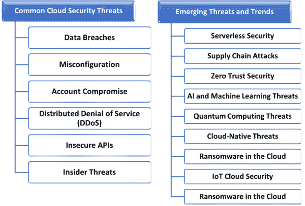 |
| --- |

## 4. 云中的威胁格局

图 1 描述了云中的威胁格局，并在下方解释。

### 4.1 常见的云安全威胁

- **数据泄露**：数据泄露仍然是云中的首要关注问题。攻击者可能获得敏感数据的非法访问，导致个人身份信息（PII）、知识产权或其他机密信息的暴露。配置不当的云资源和弱访问控制是常见的罪魁祸首（Hema et al., 2023; Rahamathunnisa, Sudhakar, et al., 2023）。
- **配置错误**：云资源的配置错误（例如未安全的存储桶或配置错误的防火墙规则）会导致关键数据暴露。攻击者经常寻找这些配置错误作为易于利用的目标。
- **账户劫持**：账户被破解（尤其是具有管理权限的账户）可能导致未经授权的访问和数据泄露。常见的攻击向量包括钓鱼、撞库攻击和暴力破解。
- **分布式拒绝服务（DDoS）攻击**：`DDoS` 攻击通过大量流量侵扰云服务。攻击者可能会针对云应用程序或服务，导致合法用户无法访问。
- **不安全的 API**：应用程序接口（API）对于云服务的通信至关重要。然而，如果这些 `API` 没有获得充分保护，它们就会成为攻击向量。`API` 漏洞会导致数据暴露、权限提升和其他安全问题。
- **内部威胁**：内部威胁源于组织内部。员工或承包商可能会滥用其访问权限窃取数据、破坏系统或进行其他恶意活动。

### 4.2 新兴威胁与趋势


## 云端威胁与趋势

### 无服务器安全

随着无服务器计算的流行，新的安全随之出现。确保无服务器函数和事件驱动架构的安全日益受到关注。组织需要考虑无服务器环境中的函数权限提升和数据暴露问题（Syamala et al., 2023; Venkateswaran, Vidhya, et al., 2023）。

### 供应链攻击

攻击者日益针对软件供应链，在开发和部署管道中引入漏洞。这可能导致分发受损的软件包和库，引发安全事件。

### 零信任安全

零信任安全模型的采用日益增加。这种方法假设可能已存在于网络或云环境中，并要求对身份、设备和服务进行持续验证以降低风险。

### AI 与机器学习威胁

随着组织在云端采用人工智能和机器学习，攻击者可能会尝试操纵或投毒机器学习模型及数据集。确保这些技术的完整性和安全性已成为日益关注的问题。

### 量子计算威胁

虽然量子计算仍处于起步阶段，但它具有破解广泛加密方法的潜力。组织已开始考虑后量子加密策略，以从长期保护数据。

### 云原生威胁

云原生技术（如容器和`Kubernetes`等编排平台）带来了独特的安全挑战。威胁因素可能会利用容器镜像、编排器或配置中的漏洞。

### 云端勒索软件

针对云数据和基础设施的勒索软件攻击变得越来越常见。攻击者可能会加密云资源并索要解密密钥的赎金。

### IoT 云安全

随着物联网（IoT）的持续增长，保护处理 IoT 数据的云基础设施变得至关重要。设备漏洞和脆弱的云集成可能会构成重大威胁。

组织必须理解常见和新兴的威胁与趋势，以制定稳健的云安全策略。这包括主动的威胁检测、缓解和安全意识。紧跟不断变化的威胁格局对于调整安全措施以应对新挑战至关重要。

## 5. 身份与访问管理 (IAM)

### 5.1 云环境中的 IAM

身份与访问管理（IAM）是云安全的关键方面，它确保云环境内用户身份和权限的妥管理，同时执行安全策略和合规性要求，以确保对资源、数据和服务的适当访问 (Agrawal et al., 2024; Satav et al., 2024)。云环境中的信息与分析管理（IAM）如下：

- **用户身份管理**：这涉及创建、管理和删除用户账户。包括分配唯一标识符（用户名或电子邮件地址）并维护用户配置文件。IAM 系统通常与`Active Directory`或`LDAP`等外部目录集成以进行用户管理。

- **身份验证**：确保用户和系统是其所声称的是 IAM 的核心功能。这通常涉及使用各种身份验证方法，包括密码、多因素身份验证（`MFA`）和生物识别。

- **授权**：一旦通过身份验证，IAM 系统将控制用户或系统可以访问哪些资源和服务。这就是访问控制策略、权限和角色发挥作用的地方。

- **访问控制**：IAM 工具提供了授予或拒绝访问资源及服务的机制。这包括对权限的细粒度控制，指定谁可以在什么种条件下读取、写入、更新或删除数据。

- **审计与合规性**：IAM 系统通常维护访问和身份验证活动的日志和记录。这些日志对于安全审计、合规性报告和安全安全事件的调查至关重要。

- **单点登录 (SSO)**：IAM 可以实施 SSO 解决方案，允许用户使用一组凭据访问多个服务和应用程序，从而增强用户的便利性和安全性。

### 5.2 基于角色的访问控制 (RBAC)

基于角色的访问控制（RBAC）是信息访问管理（IAM）系统中广泛用于控制访问权限的方法。它根据工作职能或职责为用户或实体分配角色，定义它们在系统内的行为 (Rahamathunnisa, Sudhakar, et al., 2023; Srinivas et al., 2023](#979-8-3693-1431-9.ch001.xhtml#r28))。

- **角色**：RBAC 根据工作职能分配角色，例如`System Administrator`、`Developer`或`Marketing Manager`。

- **权限**：权限是特定的操作或活动，如读取、写入或删除。

- **角色分配**：根据需求使用数字证书为用户或实体分配。

- **最小权限**：RBAC 遵循`最小权限`原则，即赋予用户或实体所需的最小访问。

- **可扩展性**：随着组织角色的演变，RBAC 具有可扩展性。

- **访问撤销**：当角色或职位发生变化时，IAM 管理员可以调整访问。

RBAC 简化了复杂环境下的访问控制，通过减少过度权限账户来增强安全性。

### 5.3 实施强身份验证

强身份验证对于增强密码之外的安全至关重要，它使得未经授权的个人或实体更难访问系统和数据 (Dhanya et al., 2023; Pramila et al., 2023](#979-8-3693-1431-9.ch001.xhtml#r26); Ramudu et al., 2023](#979-8-3693-1431-9.ch001.xhtml#r29))。

- **多因素身份验证 (MFA)**：MFA 是强身份验证的基础组件。它要求用户提供两个或多个因素：你知的（例如密码或 PIN）、你拥有的（例如智能手机或智能卡）以及你特征（例如指纹或视网膜扫描等生物识别数据）。为所有用户账户实施`MFA`。

- **使用强密码策略**：鼓励用户创建强且唯一的密码。它们应该足够长，包含大小写字母、数字和特殊字符的组合。

- **单点登录 (SSO)**：SSO 解决方案通过允许用户身份验证一次后访问多个服务来增强安全性。实施支持`MFA`的`SSO`系统。

- **生物识别认证**：在可能的情况下，利用指纹或面部识别等生物识别方法。

- **基于证书的身份验证**：这涉及向用户或设备发放数字证书。用户和设备必须出有效证书才能访问资源。

- **硬件令牌和智能卡**：实施硬件令牌或智能卡作为身份验证因素之一。

- **上下文身份验证**：实施上下文身份验证，身份验证过程会考虑用户的上下文，例如其位置、设备和行为模式。

- **会话管理**：实施会话管理控制以确保已验证的会话不被劫持。实施会话超时并为用户提供退出功能。

- **安全通信**：确保所有身份验证过程和身份验证数据的交换通过使用加密的安全通道进行。

- **定期审计与监控**：定期审计和监控身份验证日志及活动。警惕任何异常活动，并在发生未经授权访问尝试时立即采取行动。

- **用户教育**：向用户普及强身份验证的重要性以及与弱身份验证实践相关的风险。提供关于创建和管理强密码的指导。

- **合规性**：确保您的强身份验证实现符合特定的行业合规法规和要求，如适用的`HIPAA`、`GDPR`或`PCI DSS`。

- **持续改进**：定期评估您的身份验证机制，并考虑随着技术演进采用最新的安全技术和方法。

强身份验证方法可以显著减少对云环境的未经授权访问，并保护敏感数据免受潜在泄露，使其成为全面云安全策略的关键部分。

## 6. 云端数据安全

云端数据安全对于保护敏感信息至关重要，涵盖了加密、分类、处理和数据泄露防护（DLP），以确保数据保护 (图 2)）。

| 图 2. 云端数据安全 |
| --- |
| 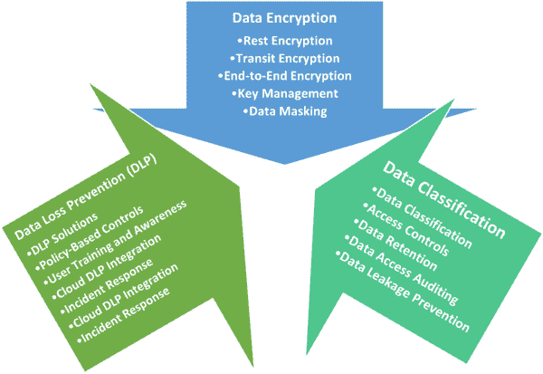 |
| --- |

### 6.1 数据加密

- **静态数据加密**：对存储在云中的数据进行加密，确保数据在未被活动访问时也能受到保护。大多数云提供商都提供静态数据的加密功能。使用加密密钥并安全地管理它们(Agrawal et al., 2023; Rahamathunnisa, Subhashini, et al., 2023; Srinivas et al., 2023)。

- **传输中数据加密**：确保在云之间传输的数据使用`HTTPS`或`SSL/TLS`等安全协议进行加密。传输过程中的加密可以保护数据在穿越互联网或内部网络时的安全。

- **端到端加密**：在适当的情况下，使用端到端加密保护数据从创建点到消费点。这确保了数据在整个生命周期内保持加密和机密状态。

- **密钥管理**：适当的密钥管理对于数据加密至关重要。安全地管理加密密钥以防止未经访问加密数据。利用硬件安全模块（`HSMs`）提供额外的保护。

- **数据脱敏**：实施数据脱敏技术以保护数据库或应用程序中的敏感信息。数据脱敏为非特权用户将敏感数据替换为虚构或部分匿名的数据。

### 6.2 数据分类与处理

- **数据分类**：根据数据的敏感性和重要性对数据进行分类。类别可能包括公共、内部、机密和限制。为数据分配清晰的标签以指示其分类级别(P. R. Kumar et al., 2023; Maguluri et al., 2023; Venkateswaran, Kumar, et al., 2023)。

- **访问控制**：实施基于角色的访问控制（`RBAC`）并根据数据分类分配权限。确保只有授权用户才能根据其角色和数据的敏感性访问、修改或删除数据。

- **数据保留与处置政策**：建立数据留存和处置政策。定期审查并清理不再需要的数据，特别是那些保留会产生安全风险的敏感数据。

- **数据访问审计**：实施审计和监控机制以跟踪谁访问和修改了数据。定期审查访问日志并调查任何异常或未经授权的活动。

- **数据泄露防护**：实施控制以防止意外的数据泄露。这包括防止数据通过电子邮件、云存储或其他手段发送到组织之外。

### 6.3 数据泄露防护 (DLP)

- **DLP 解决方案**：部署能够监控、检测和防止敏感数据未经授权传输的 DLP 解决方案。这些解决方案使用内容检查和上下文分析来执行安全策略(Agrawal et al., 2023; Rahamathunnisa, Subhashini, et al., 2023)。

- **基于策略的控制**：定义并执行 DLP 策略，规定哪些类型的数据是敏感的以及应如何处理。策略可以配置为对数据泄露事件进行拦截、隔离或发出警报。

- **用户培训与意识**：向用户普及强身份验证的重要性以及与弱身份验证实践相关的风险。提供关于创建和管理强密码的指导。

- **合规性**：确保您的强身份验证实现符合特定的行业合规法规和要求，如适用的`HIPAA`、`GDPR`或`PCI DSS`。

- **持续改进**：定期评估您的身份验证机制，并考虑随着技术演进采用最新的安全技术和方法。

实施全面的云数据保护方法，包括加密、数据分类和数据泄露防护（`DLP`），可以帮助组织减少数据破坏。

## 7. 云网络安全

云网络安全对于保护数据和资源免受威胁和未经授权的访问至关重要(Awaysheh al., 2021; R. Kumar & Goyal, 2019)。组件包括虚拟私云（`VPCs`）、防火墙和安全组，以及入侵检测与防御系统（`IDPS`），如图 3。

### 7.1 虚拟私云 (VPCs)

- **VPC 配置**：创建并配置虚拟私云（`VPCs`），将云资源与公共互联网隔离。VPC 是云中的私有网络环境，允许您控制流量流和访问。

- **子网划分**：在 VPC 内部创建子网以进一步划分和组织您的网络。例如，您可以拥有可从互联网访问的公共子网和用于内部资源的私有子网。

- **私有连接**：使用虚拟专用网络（`VPN`）或直接连接服务在本地网络与云 VPC 之间建立安全的私有连接，确保数据在传输过程中保持安全。

- **VPC 对等**：当运行多个 VPC 时，考虑使用 VPC 对等以允许它们之间的安全通信。这使得不同的 VPC 在保持网络隔离的同时可以进行相互作用。

- **网络访问控制列表 (NACLs)**：配置 NACLs 在子网级别控制入站和出站流量。NACL 充当无状态防火墙，允许您定义网络流量规则。

### 7.2 防火墙和安全组

- **安全组 (Security Groups)**：在云环境中，安全组是虚拟防火墙的一种，用于控制云资源的入站和出站流量。定义安全组规则指定允许的流量并拒绝未经的访问。

- **网络访问控制列表 (Network ACLs)**：在子网级别使用网络访问控制列表 (`NACLs`) 来控制进出`VPC`的流量。`NACLs`在安全组之外提供了额外的安全层。

- **有状态与无状态防火墙 (Stateful vs. Stateless Firewalls)**：理解有状态防火墙和无状态防火墙的区别。云安全组是有状态的，这意味着它们会自动允许出站连接的返回流量。`NACLs`是无状态的，需要为入站和出站流量显式规则。

- **应用层防火墙 (WAF)**：对于 Web 应用，可以考虑使用 Web 应用防火墙 (`WAF`) 来防止常见的 Web 应用攻击，并检查 HTTP/HTTPS 流量。

### 7.3 入侵检测与防御系统 (IDPS)

- **IDPS 部署**：部署入侵检测与防御系统 (`IDPS`) 以监控网络流量，寻找恶意活动或安全威胁的迹象。这些系统分析网络包并可以采取自动化操作阻止或遏制威胁。

- **基于签名和基于异常的检测**：`IDPS`解决方案通常使用基于签名的检测（识别已知的攻击模式）和基于异常的检测（检测偏离正常网络行为的情况）来识别威胁。

- **自定义规则**：在`IDPS`中创建自定义规则，以检测与您的环境相关的特定威胁或漏洞。

- **告警与事件响应**：配置告警机制，以便安全事件及时报告给您的事件响应团队。为不同安全告警定义响应程序。

- **定期更新与调优**：保持您的`IDPS`签名和规则更新，并根据需要进行微调，以减少误报并提高检测准确性。

云网络安全是一个动态领域，需要持续监控和适应以应对新出现的威胁。实施`VPCs`、防火墙和`IDPS`解决方案可以提供针对未经授权访问、恶意活动和网络威胁的稳健防御。

## 8. 安全监控与事件响应

安全监控、事件响应以及云取证与调查的关键考虑因素，对于维护云环境的安全性和完整性至关重要 (Al-Issa et al., 2019; Awaysheh et al., 2021; R. Kumar & Goyal, 2019)。

### 8.1 云安全监控

- **日志与审计**：对云资源和服务启用全面的记录和审计。云提供者提供了捕和存储日志的工具，这对于安全监控至关重要。

- **云原生安全服务**：利用云服务提供商提供的云原生安全服务和工具。这些服务通常包含安全信息和事件管理 (`SIEM`) 能力。

- **第三方安全解决方案**：考虑集成第三方安全解决方案以进行高级监控、威胁检测和日志分析。这些解决方案可以提供更广泛、更定制的安全监控能力。

- **实时监控**：实施实时监控，以便在安全事件发生时检测并响应。自动化告警和通知可以触发立即行动。

- **安全信息和事件管理 (SIEM)**：使用`SIEM`解决方案聚合并分析来自云环境中各种源的日志，允许事件关联并改进威胁检测。

### 8.2 事件检测与响应

- **事件响应计划**：制定一个全面的事件响应计划，概述识别、缓解和从安全事件中恢复的程序。确保计划定期更新和测试。

- **事件分类**：根据严重程度和潜在影响对事件进行分类。区分安全相关事件和非安全相关事件。

- **安全编排与自动化**：实施安全编排和自动化工具以简化事件响应流程。自动化可以协助遏制和修复。

- **事件分诊 (Incident Triage)**：根据事件的范围性和紧急性建立事件分诊流程。

- **遏制与消除**：开发遏制和消除安全威胁的程序。这可能涉及受影响系统、应用补丁或重置账户。

### 8.3 取证与调查

- **数字取证工具**：使用数字取证工具和技术调查安全事件并确定根本原因。为法律或监管要求保留证据。

- **证据链 (Chain of Custody)**：对调查调查期间收集的证据维护证据链。这确保了证据在法律程序中的可信性。

- **事件报告**：符合相关法规和内部策略要求的事件报告。必要时通知相关部门、利益相关者和受影响方。

- **教训**：进行事回顾和教训会议，以改进响应和防御策略。在组织内部共享发现。

- **法律与监管合规**：确保您的取证调查和事件响应活动符合法律和监管要求，特别是在涉及数据泄露的事件中。

- **协作**：在取证调查和事件响应工作中与内外方合作，如执法机构、网络安全专家和法律顾问。

维护云环境的安全和合规需要有效的监控、检测、响应、取证，以及持续的改进以应对不断变化的威胁和漏洞。

## 9. 合规与审计

云合规和审计对于确保符合行业法规和标准至关重要，包括监管合规、云审计和日志以及准备审计和评估的关键方面 (Agrawal et al., 2024; Satav et al., 2024; Srinivas et al., 2023)。

### 9.1 云监管合规

- **理解适用法规**：识别与您的行业和组织相关的特定监管要求。GD、HIPAA、PCI DSS 或 SOC 2 等法规可能适用于不同的云用例。

- **云服务提供者 (CSP) 合规**：评估您的云服务提供者 (`CSP`) 的合规认证和证明。许多 CSP 通过审计来证明其对各种法规的遵守。

- **数据加密**：确保敏感数据在传输和存储状态下均加密，这是许多数据保护法规共同的要求。

- **数据保留与删除**：实施数据保留和删除策略，以符合要求数据保留一段时间后进行安全销毁的法规。

- **访问控制与身份验证**：实施强有力的访问控制、用户身份验证和基于角色的访问控制 (`RBAC`)，以限制对敏感数据系统的访问。

### 9.2 云审计与日志

- **日志记录与审计**：配置云资源和服务以生成详尽日志。确保日志捕获与安全相关的事件、访问活动以及配置更改。

- **集中式日志存储**：将日志集中存储在安全且防篡改的位置，并与被监控的云环境隔离开。这可以防止日志被潜在的篡改或删除。

- **日志留存与加密**：定义符合监管要求的日志留存策略。加密日志数据以防止其受到未经授权的访问。

- **日志分析与告警**：使用日志分析工具和 SIEM（安全信息和事件管理）解决方案审查日志的可疑活动，并针对潜在的安全事件生成告警。

### 9.3 审计与评估准备

- **合规性框架**：熟悉适用于组织的特定行业合规性框架。这些框架提供了详细的指南和控制目标。

- **自评估**：进行自评估，以评估您的云环境对相关法规的合规情况。识别不合规区域并优先考虑修复工作。


**外部审计师**：聘请专于云合规的外部审计师。他们可以提供某些法规要求的独立评估和认证。

**文档记录**：维护安全策略、程序和控制措施的完整文档。记录为确保合规性所采取的步骤，并定期更新这些文档。

**内部审计**：进行内部审计和评估，验证您的云环境是否符合安全和合规策略。

**渗透测试**：考虑执行渗透测试以识别漏洞并评估安全措施的有效性。修复的任何安全缺陷。

**安全意识培训**：对员工进行合规要求和安全最佳实践的培训，确保他们意识到自己在维护合规性方面的职责。

**事件响应计划**：制定并记录一份事件响应计划，概述报告和响应安全事件的程序，因为合规性通常要求及时通报事件。

**定期审查与更新**：持续监控并审查您的合规状况，并在时进行更新，以适应变化的监管要求和不断演进的云服务。

在云中维护监管合规性需要持续的努力，包括技术控制、策略遵守和定期审计。遵循既定的合规性框架和最佳实践体现了组织对数据安全和监管义务的承诺。

## 10. 安全 DevOps 与自动化

安全 DevOps 和自动化在现代软件开发和云环境中至关重要（Boopathi, 2023; Gnanaprakasam et al., 2023; P. R. Kumar et al., 2023）。如图图 4 所示，将安全集成到 DevOps 中、处理 CI/CD 流水线中的安全并确保基础设施即代码（IaC）的安全。

| 图 4. 安全 DevOps 与自动化 |
| --- |
|  |

### 10.1 将安全集成到 DevOps

- **左移（Shift Left）**：采用`shift left`方法，这意味着在开发的早期阶段就集成安全。
- **安全培训**：为开发和运维团队提供安全培训，确保他们理解安全知识。
- **安全冠军（Security Champions）**：在开发和运维团队中指定安全冠军，担任专家角色。
- **安全工具**：将静态分析、动态分析和漏洞扫描等安全工具集成到您的流水线中。

### 10.2 持续集成与持续部署 (CI/CD)

- **自动化测试**：作为 CI/CD 的一部分，实施自动化安全测试。
- **代码审查**：进行同行评审。
- **容器安全**：通过扫描确保容器的安全。
- **密钥管理**：使用专用工具安全地管理密钥（如 API 密钥和密码）。
- **不可变基础设施**：考虑不可变基础设施的概念，通过替换实例而非修改实例来实现更改。

### 10.3 基础设施即代码 (IaC)

- **IaC 最佳实践**：开发遵循安全最佳实践的基础即代码（IaC）模板。
- **IaC 静态分析**：在部署前使用静态分析扫描`IaC`模板的配置错误。
- **版本控制**：将`IaC`模板存储在版本控制系统中跟踪更改。
- **自动化部署**：基础设施的自动化部署并验证安全性。
- **持续监控**：对您的基础设施实施持续安全监控以检测威胁。
- **备份与恢复**：定期备份`IaC`模板以确保快速恢复。

## 11. 灾难恢复与业务连续性

灾难恢复和业务连续性规划对于确保云运营的韧性至关重要（Boopathi, 2023; Ingle et al., 2023; Maheswari et al., 2023; Ramudu et al., 2023; Veeranjaneyulu et al., 2023）。

| 图 5. 灾难恢复与业务连续性规划 |
| --- |
| 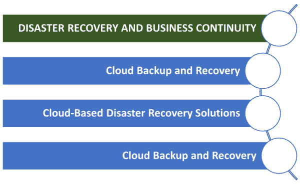 |

### 11.1 云备份与恢复

- **数据备份**：定期备份存储在云中的关键数据和配置。确保备份是自动、一致并包含所有必要资源的。
- **备份存储**：将备份存储在与主云环境隔离的安全位置，以减轻由于局部灾害导致数据丢失的风险。
- **备份频率**：根据数据重要性和潜在数据丢失的容忍度确定适当备份频率。关键数据可能需要实时或频繁备份，而不关键的数据可以采用较低频率的备份计划。
- **数据加密**：对备份数据进行加密以保护免受未经授权的访问。在传输和静态存储时均实施加密。
- **数据恢复测试**：定期测试从备份中恢复数据，以确保该过程高效且有效。测试可以验证备份的完整性以及在发生事件时恢复数据的能力。

### 11.2 高可用与冗余

- **多区域部署**：考虑在多个地理区域部署云资源和服务，以实现高可用性。这种方法有助于减轻区域性故障的影响。
- **负载均衡器**：实施负载均衡器将流量均匀地分布在多个实例或服务上，确保单点故障不会中断业务。
- **自动伸缩**：使用自动伸缩根据流量或需求自动调整资源容量，在高峰期间保持性能，并在故障时提供冗余。
- **故障转移机制**：配置故障转移机制，在系统故障时将流量重定向到健康资源。这可以最大限度地减少停机和服务中断。
- **冗余数据存储**：利用冗余数据存储解决方案（如`RAID`配置、对象存储复制或数据库复制），防止硬件故障导致的数据丢失。

### 11.3 基于云的灾难恢复解决方案

- **灾难恢复服务 (DRaaS)**：考虑使用提供云端灾难恢复能力的`DRaaS`解决方案。`DRaaS`可以在云中复制并故障转移您的工作负载，减少停机时间和数据丢失。
- **数据中心故障转移**：如果您的组织运营自己的数据中心，请建立基于云的灾难恢复解决方案，以便数据中心中心时提供冗余和故障转移能力。
- **业务连续性计划**：制定并维护业务连续性计划，概述灾难期间及之后维持关键业务的程序。定期测试这些计划以确保其有效性。
- **应急响应计划**：将定义的应急响应计划作为业务连续性工作的一部分。该计划应涵盖各种场景，包括网络攻击、数据泄露和自然灾害。
- **通信与通知**：建立清晰的通信和通知流程，在灾难期间和之后告知员工、客户和利益相关者运营状况。
- **定期测试与演练**：定期进行灾难恢复和业务连续性测试及演练，以验证您的计划和程序的有效性。

云端的灾难恢复和业务连续性对于减少中断和确保组织能够有效运行至关重要，而成功的规划、准备和测试是实现这些目标的关键。

## 12 结论

云环境对组织至关重要，因为它们日益依赖基础设施和服务。云安全策略包括基础设施安全、访问控制、数据保护和灾难恢复。主动的方法对于保护数据、应用程序和资源免受不断演变的威胁非常重要。共享责任模型是必不可少的，因为组织必须定制安全措施以满足特定需求和合规要求。将安全性集成到软件开发和部署中，可以尽早识别并修复漏洞，体现对监管标准的承诺。合规框架提供了结构化的方法来满足行业特定需求，而定期的审计和评估则验证了安全措施的有效性和合规执行情况。

云备份、恢复和灾难恢复对于云端的业务连续性至关重要。组织必须对技术故障、自然灾害或网络攻击等意外事件做好准备。云解决方案可以最大限度地减少停机时间和数据丢失。在当今动态的威胁环境中，云安全需要警惕、适应和整体方法。将安全性集成到每一层和每一个过程中，有助于组织利用云的潜力，保护数字资产并维持业务连续性。

## REFERENCES

Achar, S. (2021). An Overview of Environmental Scalability and Security in Hybrid Cloud Infrastructure Designs. Asia Pacific Journal of Energy and Environment, 8(2), 39–46. doi:`[10.18034/apjee.v8i2.650](https://doi.org/10.18034/apjee.v8i2.650)`

Agrawal, A. V., Magulur, L. P., Priya, S. G., Kaur, A., Singh, G., & Boopathi, S. (2023). Smart Precision Agriculture Using IoT and WSN. In Handbook of Research on Data Science and Cybersecurity Innovations in Industry 4.0 Technologies (pp. 524–541). IGI Global. doi:`[10.4018/978-1-6684-8145-5.ch026](https://doi.org/10.4018/978-1-6684-8145-5.ch026)`

Agrawal, A. V., Shashibhushan, G., Pradeep, S., Padhi, S. N., Sugumar, D., & Boopathi, S. (2024). Synergizing Artificial Intelligence, 5G, and Cloud Computing for Efficient Energy Conversion Using Agricultural Waste. In Practice, Progress, and Proficiency in Sustainability (pp. 475–497). IGI Global. doi:`[10.4018/979-8-3693-1186-8.ch026](https://doi.org/10.4018/979-8-3693-1186-8.ch026)`

Al-Issa, Y., Ottom, M. A., & Tamrawi, A. (2019). eHealth cloud security challenges: A survey. Journal of Healthcare Engineering, 2019.

Alghofail, Y., Albattah, A., Alazwan, M., Alawadi, S., & Pena, J. C. (2021). Secure cloud infrastructure: A survey on issues, current solutions, and open challenges. Applied Sciences (Basel), 11(19), 9005. doi:`[10.3390/app1199005](https://doi.org/10.3390/app1199005)`

Anitha, C., Komala, C., Thilagavathy, A., Prasad, D., & Boopathi, S. (2023). Artificial driven security model for Internet of Things (IoMT). IEEE Explore, 1–7.

Bhajantri, L., Mujawar, T. (2019). A survey of cloud computing challenges, issues and their countermeasures. 2019 Third International Conference on I-SMAC (IoT in Social, Mobile, Analytics and Cloud)(I-SMAC), (pp. 376–380). ACM. doi:`[10.1109/I-SMAC47947.9032545](https://doi.org/10.1109/I-SMAC47947.9032545)`

## 参考文献

Gozman, D., & Willcocks, L. (2019). 新兴的云困境：在创新与跨国隐私及外包监管之间平衡。《业务研究杂志》， 97, 235–256. doi:[10.1016/j.jbusres.2018.06.006](https://doi.org/10.1016/j.jbusres.2018.06.006)

Hema, N., Krishnamoorthy, N., Chavan, S. M., Kumar, N., Sabarimuthu, M., & Boopathi, S. (2023). 物联网（IoT）驱动的智能太阳能网格系统研究。在《云端工业物联网深度学习技术研究手册》(pp. 290–308）。IGI Global. doi:[10.4018/978-1-6684-8098-4.ch017](https://doi.org/10.4018/978-1-6684-8098-4.ch017)

Ingle, R. B., Senthil, T. S., Swathi, S., Muralidharan, N., Mahendran, G., & Boopathi, S. (2023). 使用机器学习技术的绿色精益制造的可持续性与优化。IGI Global. doi:[10.4018/978-1-6684-8238-4.ch012](https://doi.org/10.4018/978-1-6684-8238-4.ch012)

IsharufeW.JaafarF.ButakovS. (2020). 平台服务（PaaS）云模型安全问题研究。2020 年国际电气、通信与计算机工程会议 (ICECCE), (pp. 1–6)。 IEEE. doi:[10.1109/ICECCE49384.2020.9179414](https://doi.org/10.1109/ICECCE49384.2020.9179414)

Jyoti, A., Shrimali, M., Tiwari, S., & Singh, H. P. (2020). 用于 IT 服务的负载均衡和服务经纪策略云计算：一种分类与综述。《环境智能与人性化计算杂志》， 11(11), 4785–4814. doi:[10.1007/s12652-020-01747-z](https://doi.org/10.1007/s12652-020-01747-z)

Karthik, S., Hemalatha, R., Aruna, R., Deivakani, M., Reddy, R. V. K., & Boopathi, S. (2023). 医疗安全系统集成物联网（IoT）研究。在《智能系统演进的视角与考虑》(pp. 342–362)。IGI Global.

Kavitha, C. R., Varalatchoumy, M., Mithuna, H. R., Bharathi, K., Geethalakshmi, N., & Boopathi, S. (2023). 智能网格中的能源监控与控制：集成 IoT 和 ANFIS。在 Arshad, M. (编辑), (pp. 290–316)。生物信息学与生物医学工程进展。doi:[10.4018/978-1-6684-6577-ch014](https://doi.org/10.4018/978-1-6684-6577-ch014)

Kumar, P. R., Meenakshi, S., Shalini, S., Devi, S. R., & Boopathi, S. (2023). 使用深度学习和区块链的智能农业语境方法土壤质量预测。在 Kumar, R., Abdul Hamid, A. B., Binti Ya’akub, N. I. (编辑), (pp. 1–26)。计算智能与机器人进展。doi:[10.4018/978-1-6684-9151-ch001](https://doi.org/10.4018/978-1-6684-9151-ch001)

Kumar, R., & Goyal, R. (2019). 云云安全需求、威胁及应对措施：综述。《计算机科学评论》， 33, 1–48. doi:[10.1016/j.cosrev.2019.0502](https://doi.org/10.1016/j.cosrev.2019.0502)

Maguluri, L. P., Arularasan, A. N., & Boopathi, S. (2023). 智能城市中基于 AI 的无人机安全评估。在 Kumar, R., Abdul Hamid, A. B., Binti Ya’akub, N. (编辑), (pp. 27–47)。计算智能与机器人进展。

Maheswari, B. U., Imambi, S. S., Hasan, D., Meenakshi, S., Pratheep, V., & Boopathi, S. (2023). 物联网与机器学习集成的智能机器人。在《机器人与自主系统的全球视角：发展与应用》(pp. 240–258)。IGI Global. doi:[10.4018/978-1-6684-7791-ch010](https://doi.org/10.4018/978-1-6684-7791-ch010)

Mukhopadhyay, B., Bose, R., & Roy, S. (2020). 在`IaaS`环境下使用`SSL`进行负载均衡和云计算安全的新方法。国际期刊 (Toronto, Ont.), 9(2)。

Parast, F. K., Sindhav, C., Nikam, S., Yekta, H. I., Kent, K. B., & Hakak, S. (2022). 云计算安全：基于服务的模型综述。《计算机与安全》， 114, 102580. doi:[10.1016/j.cose.2021.102580](https://doi.org/10.1016/j.cose.2021.102580)

Pramila, P., Amudha, S., Saravanan, T., Sankar, S. R., Poongothai, E., & Boopathi, S. (2023). 医疗机器人的设计与开发：一种架构方法。在《数据融合的当代应用》(pp. 260–282)。IGI Global.

Rahamathunnisa, U., Subhashini, P., Meenakshi, S., Boopathi, S. (2023). 使用人工智能技术的软件需求风险解决方案。在《工业 4.0 数据科学与网络安全手册》(pp. 45–64)。IGI Global.


Rahamathunnisa, U., Sudhakar, K., Murugan, T., Thivaran, S., Rajkumar, M., & Boopathi, S. (2023). 用于机器人任务卸载的云计算原理。在《AI 驱动的护理服务机器人》(pp. 188–211)。IGI Global. doi:[10.4018/978-1-6684-8171-4.ch007](https://doi.org/10.4018/978-1-6684-8171-4.ch007)

Syamala, M., Komala, C., Pramila, P., Dash, S., Meenakshi, S., & Boopathi, S. (2023). 机器学习集成的物联网智能家居能源管理系统。在《云端物联网深度学习技术手册》(pp. 219–235)。IGI Global. doi:[10.4018/978-1-6684-8098-4.ch013](https://doi.org/10.4018/978-1-6684-8098-4.ch013)

Srinivas, B., Maguluri, L. P., Naidu, K. V., Reddy, L. C., Deivakani, M., & Boopathi, S. (2023). 云端机器人接口的架构与框架。在《工业 4.0 数据科学与网络安全手册》(pp. 542–560)。IGI Global.

Veeranjaneyulu, R., Boopathi, S., Narasimharao, J., Gupta, K. K., Reddy, R. V. K., & Ambika, R. (2023). 使用新型机器学习方法识别心脏病。IEEE-Explore, 1–6.

Venkateswaran, N., Kumar, S. S., Diwakar, G., Gnanasangeetha, D., & Boopathi, S. (2023). 废水能源化的合成生物学：IoT 与 AI 方法。In Arshad, M. (Ed.), (pp. 360–384). 生物信息学与生物医学工程进展。IGI Global. doi:[10.4018/978-1-6684-6577-6.ch017](https://doi.org/10.4018/978-1-6684-6577-6.ch017)

Venkateswaran, N., Vidhya, K., Ayyannan, M., Chavan, S. M., Sekar, K., & Boopathi, S. (2023). 基于云计算的智能能源管理框架研究。In 5G、人工智能与下一代物联网：绿色与可持续经济的数字创新 (pp. 189–212). IGI Global. doi:[10.4018/978-1-6684-8634-4.ch009](https://doi.org/10.4018/978-1-6684-8634-4.ch009)

## 缩写表

- `CI/CD`: 持续集成与持续部署
- `DRaaS`: 灾难恢复服务
- `GDPR`: 通用数据保护条例
- `HIPAA`: 健康保险流动性与责任法案
- `IaaS`: 基础设施即服务
- `IaC`: 基础设施即代码
- `IDPS`: 入侵检测与防御系统
- `MFA`: 多因素身份认证
- `NACLs`: 网络访问控制列表
- `PaaS`: 平台即服务
- `PCI DSS`: 支付卡行业数据安全标准
- `RAID`: 独立磁盘冗余阵列
- `RBAC`: 基于角色的访问控制
- `SIEM`: 安全信息和事件管理
- `SOC 2`: 组织服务标准 2
- `SSO`: 单点登录
- `WAF`: Web 应用防火墙

# 第 2 章

- I. Eugene Berna

  

  印度，Bannari Amman 学院学院

- K. Vijay

  印度，Rajalakshmi 工程学院

- S. Gnanavel

  

  印度，SRM 科学技术学院 Kattankulathur，计算技术系

- J. Jeyalakshmi

  

  印度，Amrita Vishwapeeth

### 摘要

人工智能（`AI`）和机器学习（`ML`）技术的快速发展对云安全产生了重大影响，正如其对许多行业的影响一样。本文摘要探讨了 `AI` 和 `ML` 如何影响云安全，强调了它们的挑战与潜力。这些技术擅长处理海量数据，使其能够识别异常并预测威胁。然而，`AI` 的复杂性引入了新的漏洞，例如对抗攻击和数据隐私相关的问题。为了解决这些问题，`AI` 系统的解释性至关重要。

## 引言

一种名为人工智能（`AI`）的创新工具具有提供实时安全、自动化响应和自适应防御的潜力。然而，`AI` 的日益普及引发了人们对对手如何利用它来破坏安全性的担忧。利用 `AI` 进行对抗攻击的威胁已经增加，因为它们比传统方法更快地实现漏洞发现的自动化和加速。由于 `AI` 不断演变的特性，研究人员和从业人员需要一个标准的分类法来理解并减轻这些风险。

云环境中对 `AI` 的依赖也增加了系统级故障或安全违露的影响。上述列出的五个主要问题应构成本研究的基础。

### 1.1 新工具、新威胁

然而，最令人担忧的进展之一是对手利用 `AI` 寻找云漏洞并生成恶意软件。`AI` 是网络犯罪者的强大武器，因为它可以自动化并加速漏洞的发现。他们可以使用 `AI` 分析模式、识别漏洞，并以比安全专业人员反应快的速度利用这些漏洞。`AI` 还可能产生复杂的恶意软件，这些软件会不断演变并学习规避检测，使其变得更具挑战性。

## 2. 云计算

互联网连接被用于通过云计算访问各种服务。这些服务器系统、数据库系统、网络基础设施和应用程序基础设施（Gutierrez & Lee, 2020; Halabi & Bellaiche, 2017; Kumar & Alphonse, 2018; Linguistics, 2017）。通过云计算，不再需要将数据保存在个人的电脑或其他设备上（Asharaf et al., 2023）。数字用户只要接入互联网，就可以访问应用程序和信息。

## 2.1 对云安全的威胁

| 图 3. 云安全面临威胁 |
| --- |
| 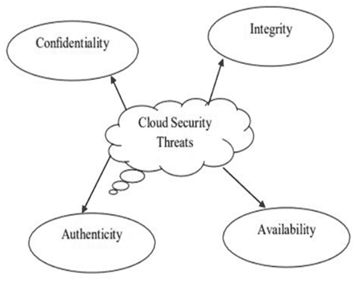 |

Figure 2 展示了云端数据安全的严重问题，考虑到云端存储和处理的数据的敏感性，这个问题显得尤为突出。个人和组织应该意识到对云安全的各种威胁，并采取预防措施来应对它们（Halabi & Bellaiche, 2018）。这些危险包括但不限于：

未经授权访问存储在云中的私有数据构成数据泄露。攻击者可能利用云架构的缺陷、松散身份验证或配置不当的访问控制来获取重要数据的未经授权访问。身份、凭据和访问管理不足：对用户身份、凭据和访问权限的管理不当可能导致未经授权的访问（Dilek et al., 2015）。如果密码规定松散、共享凭据且没有多因素身份验证，未经授权的用户有更高的概率访问云资源。

云计算（`CC`）将经历巨大且广泛的发展。存在许多可能导致保护和安全问题的风险。该分析基于 `CIA` 特性和云端危害。

为了保护云免受潜在威胁并防止损害，有必要识别并理解可能发起的攻击类型。云计算中讨论最多的攻击如下，见于 Grusho et al. (2017), Gutierrez & Lee (2020) 以及 Kumar et al. (2016)：

- a. 拒绝服务（`DoS`）攻击旨在减少用户对服务的访问。分布式拒绝服务允许多台计算机执行单次攻击（`DDoS`）。
- b. 当攻击者使用网络上的合法主机用请求轰击受害者时，这被称为僵尸攻击。这种攻击会阻止云的运行，影响云服务的可用性。
- c. 钓鱼攻击：诱骗个人点击虚假链接以获取个人信息。
- d. “中间人”攻击发生在第三方拦截或修改两个用户之间传输的数据。基于云的信息交换容易受到间谍活动。

## 系统综述分析

图 3.a 描述了研究的选择方法。在 `Scopus` 中使用关键词检索后，获取了 2395 篇研究；通过纳入和排除标准（K, 2023）进行筛选。在排除非英文论文、综述、调查、社论、书籍、章节、研讨会摘要、重复以及比较研究后，剩余 2209 篇论文。对这些论文的标题和摘要进行了阅读，如果该研究超出了综述范围，则将其排除。

| 图 4. 综述协议每个阶段的研究数量 |
| --- |
| 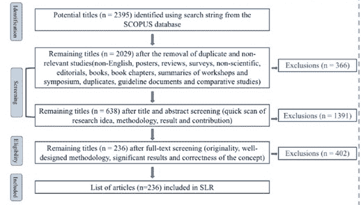 |

### 3.1 漏洞的自动评估与检测

自动漏洞评估是使用自动化工具对系统状态进行定位、分类和排序的系统性调查。解决方案利用资产管理系统、威胁情报馈对漏洞进行检测、分类和排序。

## 4. 云计算服务与模型

按需提供服务、访问海量网络、资源共享、快速扩展和个性化支持至关重要。`SaaS`、`PaaS` 和 `IaaS` 是提供云服务的三种常见方式，都包含 `NIST` 的定义中（Halabi & Bellaiche, 2017）。`NIST` 研究还讨论了四种部署模型，每种模型根据谁可以访问云进行特征。图 4.a 描述了四种云：公有、私有、社区和混合。

| 图 6. 特性、服务交付模型和部署模型 |
| --- |
| 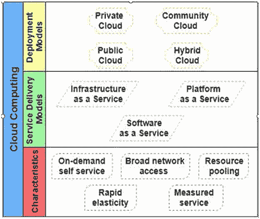 |

## 5. 拒绝服务 (DoS) 攻击

看起来是真实流量的低流量和模拟许多用户在无恶意意同时访问系统的高流量（闪洪）都可以在分布式拒绝服务（`DoS`）攻击中（Fang et al., 2012）。根据启动的协议层，`DoS` 攻击通常分类如下：

- a. 网络/传输层 `DoS` 攻击：攻击者使用网络和传输层协议来控制目标系统。`TCP`、`UDP`、`ICMP` 和 `DNS` 等协议经常用于这些任务。
- b. 应用层 `DoS` 攻击：应用层的攻击更难检测，因为它们没有区分特征且看起来像网络或传输层攻击，尽管使用的带宽少得多。由于其特定特性，`HTTP`、`DNS` 和 `SIP` 等应用协议被用于这些攻击。

除了应用层攻击，我们还需要提到 `HTTP` 洪水攻击，这类攻击分为以下四类。

- a. `Slow Header`（慢速头部）攻击也称为 `Slowworms` 攻击，其名称源于攻击中使用的工具。在这种情况下，发送到目标服务器的不完整 `HTTP` 请求（缺少标头）数量无限增长。Web 服务器的所有可用连接均被耗尽，导致服务不可用 (Nassif et al., 2021)。
- b. 在 `HTTP fragmentation`（`HTTP` 分段）攻击中，攻击者首先通过 `HTTP` 连接到目标 Web 服务器，然后将一个良性数据包拆成更小的片段，并耐心地将每个片段引导至预定的受害者方向。这使得攻击者能够长时间保持大量连接处于激活。
- c. `slow post`（慢速发布）攻击与上述攻击相似，但在这种情况下，攻击者发送第一个带有 `content-length` 值的数据包，然后逐渐传输数据量极小的 `HTTP post` 命令。
- d. 攻击者从受害者 Web 服务器读取响应需要时间，是因为攻击者的接收窗口小于受害者的发送缓冲区。通过 `TCP`，即使双方之间没有传输数据，攻击者也可以强制受害者维持高数量的连接。

| 图 7. 增强的云计算分析 |
| --- |
| 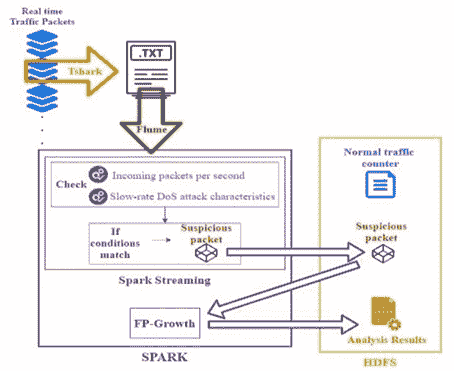 |

如图 5.a 所示，在 `HTTP DoS` 攻击期间，数据包数据会被收集并过滤，以便只检查与请求洪水或慢速请求/响应攻击相关的数据包。攻击者可能使用反射器或僵网络来模拟早期攻击的效果，以增强这些 `Slow Rate DoS`（低速率 `DoS`）攻击的效性 (Kumar & Alphonse, 2018)。至关重要的是，建议的解决方案可以检测到这些攻击的发生，从而实现快速检测并协助云管理员采取行动缓解攻击。在这种情况下，该实现还允许[某些操作]，这是另一个关键要素。

## 6. 经济可持续性拒绝攻击检测系统

`DDoS` 攻击随处可见，而 `EDoS`（经济可持续性拒绝）攻击则是较新的。但一次 `EDoS` 攻击可能会破坏云服务供应商在客户中的声誉，并可能导致破产 (Aldhyani & Alkahtani, 2022; Gutierrez & Lee, 2020)。另一方面，分布式拒绝服务（`DDoS`）攻击可以暂时阻止其目标受众访问服务。它们比 `DDoS` 攻击更先进、更现代，因此难检测。图 6.a 展示了 `EDoS` 威胁云计算的间接和直接方式。`EDoS` 攻击利用云自动启动更多虚拟机的能力来压垮其目标。这种未经授权的恶意使用产生的成本由云服务供应商承担。


`EDoS` 检测的困难已通过多种方式得到解决。`SVM` 和自组织映射 (`SOM`) 是两种机器学习方法，在识别 `DDoS` 攻击方面取得了成功 (Halabi & Bellaiche, 2017; Kumar & Alphonse, 2018)。然而，传统的机器学习方法由于依赖特征工程和选择，难以在网络应用中解释海量的 `EDoS` 数据。深度学习 (`DL`) 作为利用神经网络的 `ML`（机器学习）子集，可以用于解决 `ML` 的不足，并增加数据提取能力、检测准确性和健壮性。为了解决复杂问题，`DL` 算法利用了许多非线性处理单元以及受人脑启发的各种神经网络模型。

| 图 8. 对云服务提供商的经济可持续性拒绝威胁 |
| --- |
| 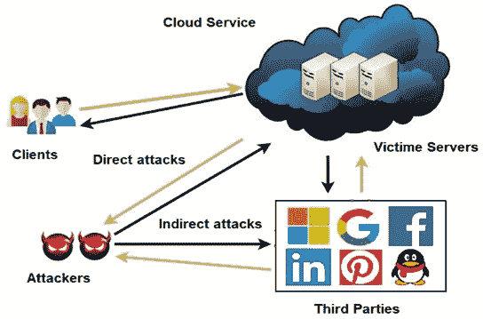 |

## 7. 人工智能与入侵检测

人工智能 (`AI`) 可以被看作：(i) 对人类如何思考的研究，以便设计出类似的智能机器；或 (ii) 研究如何解决需要智能的困难问题（例如根据大量数据做出良好的决策）。第二个定义与 `AI` 在网络防护中的应用最为相关。人工智能 (`AI`) 领域寻求创建计算机程序，通过自动化的方式执行学习、推理、规划等任务来模拟人类智能 (Chinnaiah & Niranjan, 2018; Fang et al., 2018)。

智能的基础问题已被细分为更具体的问题，每个问题都有智能系统应该具备的特性。以下列出的特性受了广泛关注 (Dilek et al., 2015; Halabi & Bellaiche, 2017; Kumar & Alphonse, 2018)：

* a. 具身智能体、神经网络
* b. 学习 (`机器学习`)、规划（多智能体规划）以及知识表示（本体论）、信息检索（文本挖掘）、自然语言处理（导航、定位）、感知（语音识别、脸部识别）仅是部分主题。

| 图 9. 典型的 IDPS |
| --- |
| 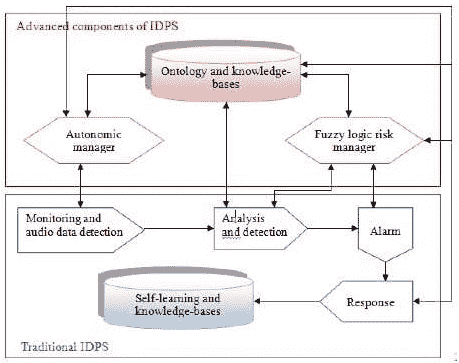 |

尽管有在网络和互联网传输过程中保护信息的既有程序（如杀毒软件、防火墙、加密和安全协议），黑客仍不断产生新方法来攻击系统。`IDPS` 是一种部署在网络中的硬件或软件，具有识别并尝试阻止入侵的能力。监控、检测、分析和响应未经授权的操作是 `IDPS` 提供的四种关键安全功能，如图所示。

## 8. 人工智能在网络犯罪防御中的应用

在打击网络犯罪方面，`AI` 方法已被广泛部署。“拒绝服务 (DoS) 检测”、“计算机虫检测”、“垃圾邮件检测”、“僵尸检测”、“恶意软件分类”和“司法调查”都是神经网络的应用 (Leo et al., 2023)。例如，神经网络可以用于检测和阻止入侵。现代杀毒解决方案集成了多种 AI 技术，包括启发式算法、数据挖掘、神经网络和 `AIS`（人工智能系统）。许多 `IDS` 使用智能体技术，并通常与移动代理技术结合。为了调查潜在的恶意活动，允许移动代理在数据收集节点之间移动 (Sarirete et al., 2022)。

### 8.1. 人工神经网络应用

`ANN` 是一种试图模拟生物神经网络结构和活动的计算机算法。它们在需要预测、分类和控制的非常复杂且不断变化的计算机环境中表现优异。这种神经网络系统可以协调来自多个源的数据收集与分析，并检测和报告异常情况、警报以及纠正措施。实验表明，`Neuro Net` 能够成功防御针对低速率 `TCP` 的分布式拒绝服务攻击。

### 8.2 智能体应用

人工智能智能体能够协作对新新状况做出响应，它们是计算机生成的、既具有自我意识又由计算机生成的团队。它们之间相互通信以共享数据。由于智能体技术具有其对部署环境的适应性、移动性以及协作本质，非常适合防范网络攻击。

### 8.3 人工免疫系统应用

`AISs` 的目的与其所模仿的生物免疫系统一样，是为了面对干扰时保持稳定性。在基于免疫的入侵检测中，免疫细胞会进化（`自我耐受`、`克隆`、`变异`等），同时对抗原进行检测。为了对抗病原体，免疫系统会产生抗体，抗体浓度的变化可用来评估入侵的剧烈程度。因此，`AISs` 对网络安全研究至关重要。

### 8.4 AI 应用于 IDPS 的优势

AI 方法为入侵检测和防御带来了许多益处（见表 1）。

表 1. AI 应用的优势

| 技术 | 优势 |
| :--- | :--- |
| 人工神经网络 | 并行信息处理；通过经验学习；在非线性方面处理复杂的非线性函数方面优于困难、复杂的微分方程；对模糊和噪声数据的韧性；在学习范式方面的灵活性和适应性；作为生物脑网络的抽象，具有直觉。 |
| 智能智能体 | 移动性；帮助性——它们始终尝试完成具有冲突目标的任务；在实现目标时具有客观性；对环境和用户偏好的适应性；协作性意味着意识到人类用户可能会出错、提供模糊信息或遗漏关键信息；因此，它们在接受指令前应经过经过思考，并与用户核对任何差异。 |
| 合成免疫系统 | 动态结构；分布式学习和并行性——利用数据网络通信以及在检测和消除任务中的并行性；自组织和自适应性，包括自动更新入侵标记的能力；健壮性；选择最佳可用技术消除有害行为；多样性：每个检测器节点产生一组在统计学上是不同的非自我检测器；资源管理：多层具有各种结构负责监控特定站点，因此攻击者无法通过仅通过一个层来实施其恶意操作。不依赖于单一的、易替换组件被称为一次性。 |

### 9. 基于属性的加密

根据 Kamara 和 Lauter (2010) 的观点，属性加密（`ABE`）是一种公共密钥加密类型，允许授权用户对共享数据进行离散且安全的访问。用户的私钥需要与访问策略关联，才能解密使用 `ABE` 特性加密的数据（Halabi & Bellaiche, 2017）。只有当用户凭据有效并符合访问规则时，解密才可行。它提供了撤销、抗合谋攻击和可扩展性。将 `ABE` 分为`密钥策略属性加密`（`KPABE`）和`密文策略属性加密`（`CPABE`）是有帮助的，它们是它的组成部分。`KPABE` 的访问规则如图 9.a 所示，用于保护密文和用户的私钥。`CPABE` 根据图 9.b 所示的方法生成用户密文和私钥。

| 图 10. 密钥策略属性加密 |
| :--- |
| 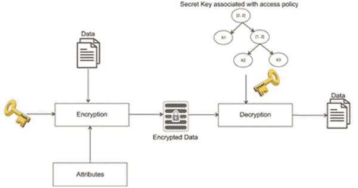 |

| 图 11. 密文策略属性加密 |
| :--- |
| 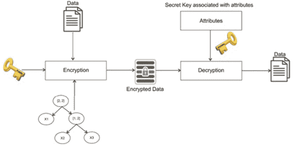 |

在加密任何数据之前，必须建立某些参数。机构、数据所有者和用户是涉及的三个方。机构使用图 9.c 所示的方法构建私钥。`[979-8-3693-1431-9.ch002.xhtml#r8]`，`[979-8-3693-1431-9.ch002.xhtml#r3]`，`[979-8-3693-1431-9.ch002.xhtml#r7]`，`[979-8-3693-1431-9.ch002.xhtml#r12]`，`[979-8-3693-1431-9.ch002.xhtml#r18]`，`[979-8-3693-1431-9.ch002.xhtml#r20]`，`[979-8-3693-1431-9.ch002.xhtml#r16]`，`[979-8-3693-1431-9.ch002.xhtml#r23]`。`ABE` 的访问规则如图 9.a 所示，用于保护密文和用户的私钥。`CPABE` 根据图 9.b 所示的方法生成用户密文和私钥。

随着人工智能（AI）不断的发展，人们对这些新技术可能如何影响我们的安全和隐私表示担忧。例如，如果 AI 被用于追踪我们的在线行为，它可能被用来收集有关我们生活的私有信息。此外，如果将 AI 用于开发自动驾驶汽车，一旦这些系统遭到破坏，可能会产生危险。

AI 系统也容易受到复杂的攻击。某些个人错误地认为 AI 解决方案是无不可摧的，但事实并非如此。优秀的攻击者可以欺骗并绕过 AI，但如果假设拥有完美的安全性，企业面临着变得掉自轻心并暴露风险的风险。

## 10.2 数据高度孤立、不完整或非结构化

人工智能的部署和应用都在快速扩展。然而，非结构化数据仍然是 AI 面临的一个问题。非结构化数据是指由于缺乏特定的数据模型或结构而难以组织和解释的数据。这可以以文本、图片或视频的形式存在。

非结构化数据的处理可能更具挑战性，但它也包含了丰富的重要信息。在做出决策时，非结构化数据往往比组织化数据更重要。这是因为非结构化数据通常比组织化数据提供更多的上下文和特定性。

随着云服务被广泛使用，保护云服务免受恶意攻击者的侵害变得日益重要。虽然有许多技术可以帮助保护云环境，但人工智能（AI）是其中最有前景的之一（Sowinski, 2023）。在其他情况下不会被注意的威胁可以在 AI 的帮助下识别并反制。然而，将 AI 应用于安全领域面临着若干困难。

* **a. 实施有效的访问控制**：你的云环境的安全取决于此。遵循最小特权原则，仅为每个用户或程序提供最少的访问权限。对于所有用户，都应要求多因素身份验证。为了进一步限制访问，考虑利用基于角色的访问控制。
* **b. 利用加密**：敏感数据在传输和存储时都应该进行加密，以防止未经授权的访问。此外，应该使用强密钥管理程序，以确保密钥频繁更换并保存在安全的地方。
* **c. 安装入侵检测和安全监控系统**：应该对你的云环境进行持续监控，以发现潜在风险和异常行为。实施具有 AI 驱动威胁分析能力的入侵检测系统可以改进这种监控。基于代理的技术相比无代理解决方案提供了特定的优势，这些技术利用了直接与你的环境接口并自动响应事件响应的能力。
* **d. 定期渗透测试和漏洞评估**：定期进行的漏洞评估可以揭示你云基础设施中的潜在缺陷。将其与渗透测试结合，以模拟实际攻击并衡量你组织对这些攻击的抵抗能力。
* **e. 采用云原生安全计划**：接受云服务提供商提供的特殊安全特性和资源。通过理解责任分担模型，确保你遵守你所负责的安全要求。使用来自 `Google Cloud Security Command Centre`、`AWS Security Hub` 和 `Azure Security Centre` 等提供者的原生云安全工具。

## 10.3 AI 对云安全的优势

在云安全方面，人工智能（AI）变得越来越重要。当公司将数据和应用程序迁移到云端时，AI 可以帮助他们更好地保护这些敏感信息。

* **a. 减少对人工干预的需求**：在云安全中使用 AI 有许多优势。AI 有潜力发现人类会忽略的危险，并揭示攻击者所使用的策略。AI 还可以用于主动响应问题并自动阻止攻击。`Azure Sentinel` 作为 `Microsoft Azure` 云平台的一部分，就是其中一个例子。根据哨兵发出的警报类型，该解决方案允许事件响应自动启动安全修复。这表明问题可以由系统发现并修复，而无需人工参与。
* **b. 处理大数据**：大数据是一个描述企业每天产生的海量数据的术语。由于难以存储和管理此类数据，组织在处理大数据时面临许多困难。然而，大数据也为企业提供了许多利益。大数据可以用来增强决策、发现新的业务机会并简化运营流程。
* **c. 使用自动化技术委托**：随着自动化技术的发展，人工智能（AI）将越来越多将任务交给它们。这样做是为了让 AI 专注于更困难或需要人类判断的工作。这种趋势具有许多优势，包括提高效率。尽管，将越来越多的工作交给自动化技术也是担忧之一。总的来说，AI 委托既有优势也有担忧。随着我们对 AI 可能性的了解，我们将更好地控制这些风险。
* **d. 事件识别与预防**：人工智能识别和预防潜在事件的能力正在增强。一种名为人工智能（AI）事件检测和阻止的方法被用于关注未来事件并防止它们发生。AI 事件检测和阻止有许多用途。它可以用于阻止恐怖袭击、阻止犯罪并泛保持人员安全。此外，它可以用于避免事故、保护机数据并应对自然灾害。飓风预测就是一个典型的例子。

## 11 结果与讨论

## 11.1 云安全领域

这些包括数据机性、数据隐私、`DoS` 和 `DDoS` 以及漏洞检测、入侵检测、恶意软件检测、隐私保护、异常检测和攻击检测。每个云安全子领域的研究文章百分比、频率和数量见表 11.1.1。表 11.1.2 包含了一些参考文献论文。

表 3. 从收集的研究文章中发现的云安全领域

表 4. 本研究项目使用的引用文献

异常检测的核心是寻找数据中偏离正常的情况。异常检测至关重要，因为数据异常值代表了重要且往往关键的信息，可以用于许多背景。总共有六篇论文涉及这一主题。然而，我们发现这些论文中有三篇专门解决异常用户行为的问题。表 11.1.3 中的前三篇论文讨论了云异常检测框架和系统。论文 A4 和 A5 也研究了异常，但它们的重点是行为异常。

表 5. 检查云异常检测安全影响的论文

| 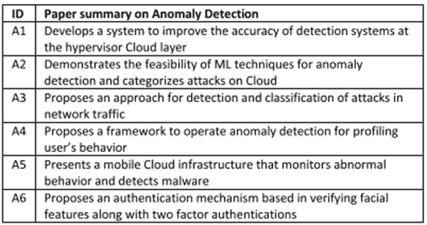 |
| --- |

# 12. 结论

总之，人工智能（AI）和机器学习（ML）对云安全产生了深远影响，既带来了进步，也带来了担忧。在积极方面，AI 和 ML 通过提高威胁检测和响应方法的有效性，显著提升了云安全。这些工具可以瞬间分析海量数据，以识别人类操作人员可能会忽略的模式和异常。因此（Dilek et al., 2015），可能的安全漏洞能更更快地识别，误报率有所降低，总事件响应时间得到了改善。AI 和 ML 也促进了云安全中预测性分析的发展。这些解决方案根据历史数据估计安全威胁和漏洞，使组织能够在不法分子利用它们之前主动修复缺陷。

此外，得益于 AI 和 ML，日志分析、身份验证和授权等常规安全流程可以从自动化中获益。这减轻了安全人员的工作负载，同时也降低了安全操作中人为错误的概率。然而，这些改进也带来了挑战。一个严重的威胁来自对抗性攻击，攻击者操纵 AI 系统以做出错误选择。此外，AI 和 ML 模型的复杂性可能使其容易受到漏洞的影响，从而成为网络攻击者的目标。人们对 AI 和 ML 在云安全中的伦理影响也存在担忧。必须解决的重要挑战包括隐私问题、存在偏见的决策以及 AI 系统缺乏透明度等。

## 参考文献

Aldhyani, T. H., & Alkahtani, H. (2022). Artificial Intelligence Algorithm-Based Economic Denial of Sustainability Attack Detection Systems: Cloud Computing Environments. Sensors (Basel), 22(13), 4685. doi:[10.3390/s22134685](https://doi.org/10.3390/s22134685)

Asharaf, Z., Ganne, A., & Mazher, N. (2023). Artificial Intelligence in Cloud Computing Security. Research Gate.

Chinnaiah, M. R., & Niranjan, N. (2018, January). Fault tolerant software systems using software configurations for cloud computing. Journal of Cloud Computing (Heidelberg, Germany), 7(1), 3. doi:[10.1186/s13677-018-0104-9](https://doi.org/10.1186/s13677-018-0104-9)

Dilek, S., Cakır, H., & Aydın, M. (2015, January). Applications of Artificial Intelligence Techniques to Combating Cyber Crimes: A Review. International Journal of Artificial Intelligence & Applications, 6(1), 21–39. doi:[10.5121/ijaia.2015.6102](https://doi.org/10.5121/ijaia.2015.6102)

FangX.KocejaN.ZhanJ.DozierG.DipankarD. (2012). An artificial immune system for phishing detection. Evolutionary Computation (CEC). IEEE. doi:[10.1109/CEC.2012.6256518](https://doi.org/10.1109/CEC.2012.6256518)

Grusho, A., Zabezhailo, M., Zatsarinnyi, A., & Piskovskii, V. (2017). On some artificial intelligence methods and technologies for cloud-computing protection. Mathematical Linguistics, 51(2), 62–74.

Gutierrez, J. N. P., & Lee, K. (2020). An Attack-based Filtering Scheme for Slow Rate Denial-of-Service Attack Detection in Cloud Environment. J. Multim. Inf. Syst., 7(2), 125–136. doi:[10.33851/JMIS.2020.7.2.125](https://doi.org/10.33851/JMIS.2020.7.2.125)

Halabi, T., & Bellaiche, M. (2017, April). Towards quantification and evaluation of security of cloud service providers. J. Inf. Secur. Appl., 33, 55–65. doi:[10.1016/j.jisa.2017.01.007](https://doi.org/10.1016/j.jisa.2017.01.007)


Halabi, T., & Bellaiche, M. (2018, June). A broker-based framework for standardization and management of cloud security-SLAs. *Computers & Security*, 75, 59–71. doi:[10.1016/j.cose.2018.01.019](https://doi.org/10.1016/j.cose.2018.01.019)

Ramanpreet, K. (2023). Artificial intelligence for cybersecurity: Literature review.

数据指的是原始的事实和数字。对数据进行处理后，就会产生信息。信息是可以被记录、存储和分析的事实或统计数据，可以以文本、数字、图像、音频或视频等多种形式存在。在当今数据驱动的世界中，每天产生的数据量使得几乎无法将其全部存储在本地。许多个人和企业正在使用云服务在云服务器上存储这些海量且巨大的数据。此外，随着对云计算的需求增长，对数据恢复方法和服务的需求也随之增加。当主服务器故障时，从备份服务器中恢复数据和信息的能力是恢复服务和技术的主要目标。一个用于存放主云服务器备份的备服务器，其成本比主服务器本身还要贵，而主服务器的构建已经非常昂贵且耗时。本章的目标是对这一紧迫问题提供现实且成本效益的解决方案。

## 1. 引言

数据指的是任何可以被记录、存储和分析的信息、事实或统计数据。它可以以文本、数字、图像、音频或视频等多种形式存在。在计算和技术背景下，数据通常指计算机系统存储和处理的数字信息。这些数据可以是结构化的或非结构化的，并可以来自传感器、软件应用程序或用户输入等各种来源。数据是商业、科学、医学和工程等许多领域的关键组成部分。它可以用于做出明智决策、发现模式或趋势，并对各种现象产生深入见解。然而，数据在被处理、分析和解释之前，本身是没用的。

电子数据的产生已达到前所未有的规模，为公司存储数据带来了巨大挑战。使用具有 TB 级容量的硬盘（`HDDs`）的传统解决方案已无法满足 IT 公司对数据存储的需求。即使建立整个存储设施也可能无法解决问题，因为公司产生的数据量仍在以指数级持续增长。

为了应对这一挑战，云计算应运而生。这项创新技术允许用户将数据存储在远程云服务器上而不是个人计算机上，从而释放宝贵的物理存储空间。访问数据就像登录云账户一样简单，而且云服务通常比构建大型存储设施更具成本效益。

云计算的广泛应用不仅限于企业，个人也寻求利用其优势进行数据存储。然而，这种需求的增加也导致了数据丢失的风险。为了降低这种风险，人们开发了基于云的数据恢复和备份程序，提供了额外的保护层，以确保宝贵的数据不会因硬件故障、网络攻击或人为错误等意外事件而丢失。

云计算的一个显著优势是其可扩展性。企业和组织可以根据不断变化的需求轻松扩大或缩小其存储和计算资源，而无需投资新的硬件或基础设施。这对于需求波动的企业特别有用，例如零售或酒店行业，这些行业的需求可能会根据季节或市场趋势而变化。通过云计算，企业可以快速方便地调整其存储和计算能力，使其对市场状况的变化更加敏捷和灵活。

云计算的另一个优点是其可访问性。基于云的存储和计算资源可以从连接互联网的任何地方访问，允许企业和个人进行远程工作或与不同地点的人进行协作。在新冠肺炎疫情之后，这一点变得越来越重要，因为越来越多的企业已转向远程办公。

## 2. 云计算

云计算作为一个概念，其根源于计算早期。访问远程资源的想法最早由`J.C.R. Licklider`提出，他是一位在 20 世纪 60 年代从事分时和网络工作的计算机科学家（大英百科全）。然而，直到 20 世纪 90 年代，云计算才开始形成我们所熟知的模样。那时，互联网正在获得广泛采用，公司开始意识到托管其在线内容的潜力。这导致了应用服务提供（`ASPs`）的发展，它们为企业提供了租赁软件的能力。

“云计算”一词最早由`Compaq Computer`在 1996 年使用，它被用来描述通过互联网交付计算服务。2002 年，亚马逊云服务（`AWS`）启动了其云计算平台，提供了对存储、计算和数据库服务等计算资源的按需访问。

虚拟化技术的发展是云计算增长的重要因素。虚拟化允许多个虚拟机在单台物理机上运行，从而提高了计算资源的效率和利用率。这项技术为云供应商向客户提供可扩展且灵活的计算服务铺平了道路。

今天，云计算已成为现代计算基础设施不可或缺的一部分，推动着从在线应用程序到科学研究项目的一切。随着物联网（`IoT`）的兴起和产生数据的增加，预计云计算将在帮助企业和个人存储、处理和分析数据方面继续发挥关键作用。今天最常用的技术之一就是云计算。本质上，它让客户能够访问在线的虚拟机或平台，他们可以在那里托管或存储自己的数据和其他文档。

| 图 1. 云计算及其用途 |
| --- |
|  |

在云计算中，数据处理被分布在通过网络连接的众多机器上（Alzoubi, K., et al., 2020）。这种云架构的系统紧密相连。通过虚拟化池，云计算（Koley, S., et al., 2014）实现了效能的最大化。它以数字形式提供服务，以保护客户的隐私。虚拟化的安全环境使得数据管理和访问成为可能（Suganya, M., et al., 2023）。用户使用计算环境的能力得到了提高（Brezany, P., et al. 2017）。为了防止其他用户访问某一用户的数据，云服务提供商定期刷新其资源，包括服务器、网络、存储、服务器和应用程序（El Haloui, M., et al., 2017）。这些组件共同工作，创建了被称为“云计算”的复杂技术。

## 3. 云备份的必要性

正如引言早期提到的，如今越来越多的人和企业正在采用云服务来托管和存储数据，使云服务器成为数据存储的首选（Dang, L. M., et al., 2019）。随着这一责任，对数据丢失的严重担忧随之产生。云服务器现在为许多企业和个人存储了各种敏感数据（Hai, T., et al., 2023）。如果云服务器泄露了数据怎么办？如果云端服务器被入侵怎么办？如果云服务器发生故障怎么办？如果数据在向云服务器发送时发生泄露怎么办？

如果地震、海啸或其他自然灾害导致云服务器被毁会发生什么？云服务器的数据丢失可以通过多种不同的方式发生。现在，云提供商有责任就数据安全和保护向客户提供保证（Hassan, H., et al., 2017）。因此，有建立恢复策略和备份，以确保即使在主云服务器发生数据泄露或丢失的情况下，数据仍能安全恢复（Khan, N., et al., 2016）。云服务器（Koley, S., et al., 2015）中资源池架构（Koley, S., et al., 2015）可以高效存储数据。

| 图 2. 云备份的必要性 |
| --- |
| 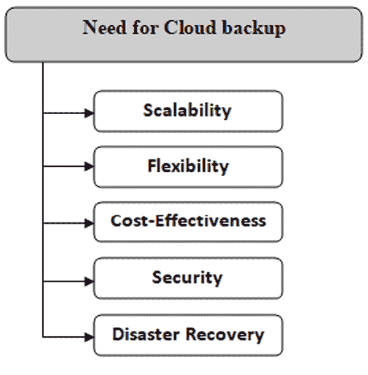 |

简而言之，云计算的优势可以总结为：

### 3.1 可扩展性

云计算的关键优势之一是其可扩展性。云提供者提供了大量计算资源池的访问，可以根据用户的需要扩大或缩小。这使得企业能够处理需求的突然激增，而无需投资额外的硬件或基础设施（Li, K. (2017)）。

### 3.2 灵活性

云计算提供了只要有互联网连接即可从世界任何地方访问数据和应用程序的灵活性。这使其成为远程工作、协作和访问关键数据的理想选择（Mahan, F., et al., 2021）。

### 3.3 成本效益

云计算通常比传统计算模型更具成本效益，因为它消除了企业投资昂贵硬件和基础设施的需求。此外，云提供者通常提供按需付费的模式，使企业只需为其使用的资源付费（Jaatun, M.G., et al., 2017）。

### 3.4 安全性

云提供者通常拥有强大的安全措施来保护用户的数据。这包括加密、访问控制和定期安全审计等功能（Wu, Y., et al., 2023）。

### 3.5 灾难恢复

云计算为用户提供了将数据应用程序备份到远程服务器的能力，在硬件故障、自然灾害或其他不可预事件发生时提供了稳健的灾难恢复解决方案（Selvarajan, S., et al., 2023）。

### 3.6 最小化风险

云计算也降低了数据丢失的风险（Hewa, T., et al., 2022）。总体，云计算改变了企业访问和存储数据的方式，实现了更高的效率、灵活性和可扩展性。

## 4. 云备份现有方法和技术

### 4.1 高安全性与分布技术 (HS-DRT)

`HS-DRT`是一种备份理念，它利用广泛分散的数据进行高高速加密（Mittal, S., et al., 2022）。它由三部分组成：`datacentre`、`supervisory server`以及各种`client nodes`（Mueller, H., et al., 2017）。`PCs`、`cell phones`、`network-attached storage`和`storage services`构成了`client nodes`。它们与`datacentre`和`supervisory server`拥有安全连接（Shakeabub, A., et al., 2021）。

该系统采取的步骤是`backup sequence`和`recovery sequence`。在`backup sequence`中接收需要备份的数据，而在`recovery sequence`中（这经常发生或在灾难发生时），接收需要恢复的数据（Teh, S., et al., 2016）。像`rake operation`一样，它从各种`clients`收集`encrypted fragmentations`（[Williams, D., et al., 2013]）。在第二阶段，一旦`fragmentations`按反序合并并解密，加密就会完成（Heilig, L., et al., 2014）。通过这些步骤，`supervisory server`可以获得需要备份的数据。

该模型也有缺点，使其难以被誉为完美的备份恢复解决方案。这些局限性包括：

- 为了充分利用`HS-DRT`，确保`web applications`配置正确以使用`engine`是关键的（Hwang, K., et al., 2014）。
- 第二，当存在多个`file data`副本时，相关的`processor`性能会受到损害（Khan, S., et al., 2015）。

| 图 3. 高安全性分布与技术 |
| --- |
| 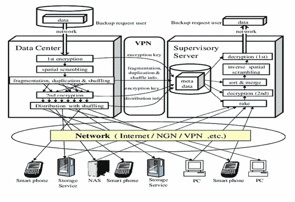 |
| *(Cloud, I., et al., 2014).* |

使用`HS-DRT`的优势：`HS-DRT`是一种可扩展的解决方案，可以随着备份需求的增加而轻松增长。用户可以根据需要添加更多服务器和存储位置，而不影响性能或可靠性（Lal, P., et al., 2015）。

- `HS-DRT`采用分布式架构来加速备份和恢复时间。这意味着备份数据被拆分成更小的分块并分布在多个服务器上，从而允许更快的备份和恢复速度（Burda, D., et al., 2015）。
- 使用`HS-DRT`的缺点：实施`HS-DRT`的成本可能非常高，特别是对于小型企业或个人而言。专用硬件、软件和维护的成本会迅速累积。
- 需要高速且可靠的互联网连接以访问数据并执行备份或恢复。
- 在`HS-DRT`中，如果云提供商没有足够的安全措施或策略，我们可能会面临某些安全风险，例如数据泄露、未经授权的访问、恶意软件攻击或违反合规性。
- 在`HS-DRT`中，用户可能对云提供商如何存储和管理其数据没有足够的可见性或控制权。
- 它增加了冗余。

### 4.2 校验云服务 (PCS)

校验云服务（`PCS`）是一种非常直观、用户友好且实用的基于校验的数据恢复方法。在`PCS`中，原始数据被划分为多个片段或数据块，并根据这些数据块生成额外的校验块。每个校验块包含关于数据块的信息，并在任何数据块丢失时用于重建数据。

`PCS`的校验块存储在与数据块不同的位置，为硬件故障、自然灾害或其他事件提供额外的保护。

通过`PCS`可以以极高的概率和合理的成本恢复数据。为了获得用户对校验服务的信任，需要实施加密、多因素身份验证等强安全措施。`PCS`可用于多种场景，包括备份、归档和灾难恢复。它可以与对象存储或文件系统等云服务集成。

保护个人数据的现代平台是校验云服务（`PCS`）Adhikari, M., et al., 2017。个人数据恢复服务需要考虑四个因素：

- 可靠性。
- 经济性。
- 便利性。
- 隐私保护。

对于数据备份，`PCS`采用了一种新方法：在用户的计算机上创建虚拟磁盘，跨虚拟磁盘创建校验组，并将校验组的校验数据存储在云端 Koley, S., et al., 2022; Koley, S., et al., 2022]。`PCS`算法利用异或运算生成校验信息。

| 图 4. 校验云服务 |
| --- |
| 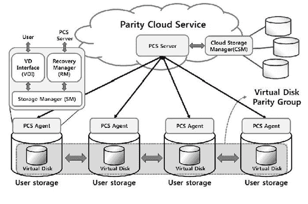 |
| *(Hyungsoo, J., et al., 2017)* |

使用`PCS`的优点：与其他技术相比，它非常可靠。

- `PCS`使用校验恢复服务保护个人数据免受未经授权的访问或泄露。
- `PCS`在云端只需要较小的存储空间，降低了云存储成本。

使用`PCS`的缺点：`PCS`的实施非常复杂。

- 用户需要高带宽连接来访问数据。
- 它将用户数据存储在第三方服务器上，可能会带来安全风险。

### 4.3 冷热备份替换策略 (CBSRS)

数据库文件的副本构成了物理备份。例如，物理备份可以将数据库数据从本地磁盘驱动器传输到另一个安全的地方。热备份和冷备份都是可能的。

#### 热备份

热备份是在数据库活动时进行的备份。热备份适用于数据库在线的多用户系统。热备份可以捕获备份过程中发生的更改。

#### 冷备份

冷备份是在数据库离线时进行的备份。冷备份需要关闭数据库。

- 随着数据量的增长，实施成本也随之增加。
- `CBSRS`可以根据业务需求轻松扩展或缩小。可以根据需要添加额外的备份服务以满足增长的需求，或在需求较低期间缩小规模。
- `CBSRS`比其他备份策略更具成本效益，特别是对于预算有限的企业。冷备份需要较少的存储和计算资源，而热备份在存储使用方面可能更高效。

### 4.4 Linux 服务器 (Linux Box)

Linux 服务器是利用免费开源 Linux 操作系统的服务器。它为企业提供了一种低成本的方法，向客户提供信息、应用程序和服务。由于 Linux 的开源特性，用户可以访问庞大的支持者社区和资源。Linux（Ostroukh, A. V., et al., 2015）被用嵌入式用于各种设备，包括网络文件系统、家电器和汽车娱乐系统。对于路由器、交换机、DNS 服务器、家庭网络设备等，存在网络操作系统。公司关心的一个关键问题是数据备份。

由于网络威胁、用户错误和系统缺陷的增加，用户数据并不安全。备份数据可以确保在发生安全违规、意外删除或系统故障时，重要的文件和文件夹不会丢失。对于个人和中小企业，使用某种云架构可以轻松地至少部分执行数据备份。然而，对于数据量巨大（达到字节级）的大型企业，数据备份是复杂的，且至少部分是在备份服务器或外部硬盘上完成的。

当用户需要备份数据时，Linux 服务器会生成一个卷并将其绑定到实例。卷是连接到虚拟机（VM）的虚拟硬盘，它可以增强性能并降低延迟。当需要对虚拟机中的数据进行备份时，通常会挂载卷。可以使用 Linux 服务器在云中频繁地备份数据，降低紧急情况下数据丢失的可能性。对于较小的数据，恢复时间被缩短了。这涉及到在硬件和基础设施上花费资金。不保证运行时间和恢复时间。

| 图 6. Linux 服务器 |
| --- |
| 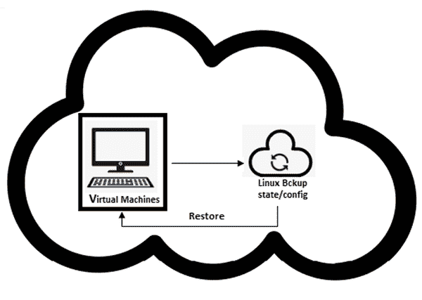 |

#### 使用 Linux 服务器的优势

使用 Linux 服务器的优势如下：

- Linux 是一个开源操作系统，这意味着它是免费提供的，并且可以根据业务需求进行定制。与专有软件相比，这可以带来更低的成本和更高的灵活性。
- Linux 以稳定和可靠著称，这在备份和灾难恢复场景中可能非常重要。它还有对病毒和恶意软件的敏感性低于其他操作系统的声誉。
- Linux 兼容广泛的备份解决方案，包括专有和开源选项。这可以为企业选择备份解决方案时提供更大的灵活性。
- 与其他选项相比，实施成本非常低。

#### 使用 Linux 服务器的劣势

使用 Linux 服务器的劣势如下：

- Linux 服务器比任何其他模型都需要更高的带宽。
- 虽然 Linux 有庞大且活跃的社区，但它可能没有其他操作系统那种程度的商业支持。这可能使得企业在遇到备份解决方案遇到问题时更难找到帮助。
- 对于习惯 Windows 或 MacOS 等操作系统的用户来说，Linux 可能更加复杂且难以学习。这可能导致负责管理备份解决方案的 IT 人员学习曲线更陡。
- 数据隐私是该模型的一个问题。

### 4.5 基于分类法的高效路由 (ERGOT)

Giuseppe Pirro, Paolo Trunfio, Domenico Talia, Paolo Missierand, Carole Goble 的基于分类法的高效路由 (ERGOT)（Pirro, G., et al., 2008）完全专注于语义分析，而不优先考虑时间或实施复杂度。该系统的核心是使云计算服务发现成为可能的语义。这种方法并不作为备份机制，此外，它提供了成功的数据检索，这完全取决于服务描述和服务请求之间的语义相似性。此外，它同时利用了细度和粗粒度的服务功能定义。


# ERGOT 的工作原理

首先根据重要性、敏感或其他标准对数据进行分类，然后根据分类将数据路由到相应的存储位置。例如，关键数据可能会被路由到多个地理不同的位置，而不太重要的数据可能存储在单个位置或较便宜的存储层中。`ERGOT` 中使用的分类法可以根据组织的特定需求定制。例如，分类法可以基于数据类型，如客户数据、财务数据或员工数据。分类法也可以基于敏感性级别，如公共、机密或高度机密。

`ERGOT` 是云备份中的一种技术，涉及根据分类组织数据并将数据路由到相应的存储位置。`ERGOT` 可以提高云备份的效率、安全灾难恢复能力，对于增强备份和存储能力的组织来说，这是一个极具吸引力的选择。

该概念包含三个组成部分：

- i) 利用 `DHT`（分布式哈希表）协议促进了带有个人本体论概念注释的语义服务描述的传播。
- ii) 在语义覆盖网络（`SON`）的帮助下，具有相似语义标注服务描述的节点可以聚类在一起，该网络通过 `DHT` 的服务广告逐步建立。
- iii) 一种确定服务描述之间相似程度的指标。

与传统的备份解决方案不同，`ERGOT` 策略提供了取决于请求和描述之间语义相似性的高效数据检索，并结合了两种网络范式，在基于 `DHT` 的系统中提供语义驱动的查询响应。尽管 `ERGOT` 在相似性搜索模型方面面临挑战，但它通过在 `DHT` 上生成 `SON` 克服了这些局限性。在各种网络条件下对其进行彻底调查后，证明了系统在搜索准确性和网络流量方面的有效性。然而，语义相似性搜索模型与基于 `DHT` 的系统整合良好。它们只运行性能限制的精确匹配搜索。

| 图 7. 基于分类法的高效路由 |
| --- |
| 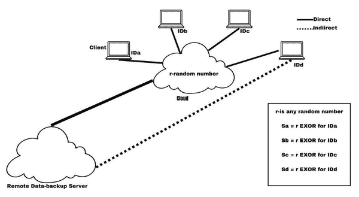 |

## 这种方法的优势

使用基于分类法的高效路由（`ERGOT`）的优势如下：

- `ERGOT` 通过将数据组织成分类法减少了需要备份的数据量。这允许更高效地利用存储资源并缩短备份时间。
- `ERGOT` 具有高度的可扩展性，可以用于保护云中的大量数据。它可以轻松地处理增长的数据量，并提供跨地理位置的高数据高可用性。
- 该技术同时利用了服务功能的高级描述和更详细的描述。
- `ERGOT` 通过在将数据碎片存储在云之前对其加密，可以在云存储备份中提供更好的数据隐私。这确保即使数据被未经授权的用户访问，他们也无法读取或使用它。

## 这种方法的缺点

使用基于分类的高效路由（`ERGOT`）的缺点如下：

- 然而，语义相似搜索范式与基于 `DHT`（分布式哈希表）系统的精确匹配搜索不兼容，后者具有对数级的性能限制。
- `ERGOT` 需要高度的技术专业知识和基础设施来实现。数据的编码和解码过程需要大量的计算资源，对于小型企业或个人来说成本高昂。
- `SONs` 必须连接到有限数量的节点，因为需要搜索的节点越少，查询效率就越高。
- `ERGOT` 可能无法与所有云存储平台兼容。这可能会限制企业和个人选择合适云存储解决方案的灵活性。

# 提议的云备份技术

我们正在提出一种新的云数据备份方法，该方法利用云服务提供者的令牌化和加密能力来增强用户数据的安全性和隐私。这种方法涉及将数据转换为数字令牌，令牌可以安全地传输和存储。然后，可以使用 `AES` 或 `RSA` 加密等高级技术对令牌进行加密，为备份过程增加额外的保护层。这种创新解决方案通过让用户对数据安全有更大的信心，有望彻底改变云数据备份领域。

一旦数据被令牌化和加密，就可以安全地存储在硬盘或安全数字卡等外部设备上，而这些设备通常没有被充分利用。为了方便这一存储过程，普通成员可以贡献这些设备，并获得加密货币作为对其宝贵贡献的回谢。这种创新方法不仅为云数据备份提供了额外的安全保护层，还激励了个人参与存储过程，最终降低了云服务提供者的成本。通过该系统，用户可以放心地知道他们的数据正以安全且成本效益的方式存储，同时也为加密货币市场的增长做出贡献。

为了获得加密货币奖励，用户必须将数据存储在本地机器上，并保持数据可供云服务器检索。如果云服务器在访问数据时遇到困难，它可以通知文件保存者并请求其提供加密文件。这种创新系统不仅为用户提供了安全存储数据的财务激励，而且在数据丢失的情况下为云服务器提供了额外的一层保护。通过激励安全数据存储，这种方法具有彻底改变云数据备份领域的潜力，并能增强云存储系统的整体安全性。

随着加入网络的贡献者数量的不断增加，加密货币令牌的实用性预计将激增，从而提升货币价值。因此，将更多人被激励贡献其闲置的存储资源，为云公司和其用户创建一个互利共利的局面。这种创新方法提供了一种在云端存储和访问数据的安全且成本效益的方法，对所有参与方都是双赢。

## 模型描述

提议的云数据备份模型涉及几个关键特征：

- 首先，数据以去中心化的方式进行令牌化和分布。这种分布由云服务提供者的中央机构进行严密监控和监管。通过去中心化的方式分布令牌化数据，显著降低了数据泄露和被窃的风险。
- 其次，云公司可以根据各种因素控制令牌数据的分布，例如个人的声誉、政治和财务稳定性、互联网连接和政府法律。此外，云公司可以创建一种加密货币令牌，用于促进数据交换。
- 为了实现该模型，云公司需要创建一种算法，可以将用户数据分解为最小的令牌，并使用强大的压缩算法将其合并。生成的文件将进行加密并发送给贡献者。为了验证数据交易并分发令牌，云公司可以使用 `proof of work`（工作量证明）方法。
- 此外，云公司可以在贡献者的内存中存储一份数据分布的加密账本。该云的每个用户都将获得一个唯一的 `hash` 数字，用于识别账本持有者。从那里，云公司可以检索用户的数据。
- 最后，如果服务器上的用户数据出现任何意外问题，我们提议的模型提供了一个稳健且有效的解决方案。云公司只需请求数据收集者提供其带有加密账本的文件，这有助于我们加密货币的交换，并使所存储的数据能够再次在线可用。这一精简流程确保了用户数据的任何问题都能快速、高效地解决，对用户操作的干扰降至最低。

总体而言，我们提议的模型为云数据备份的挑战提供了一个全面且创新的解决方案。通过利用加密和去中心化的最新进展，我们认为我们的模型代表了确保云端用户数据隐私和安全迈出的重要一步。实施该模型的云公司可以为其用户提供更可靠、更安全的备份过程，这反过来有助于增强他们在市场上的声誉和竞争力。

| 图 8. 提议技术的框图 |
| --- |
| 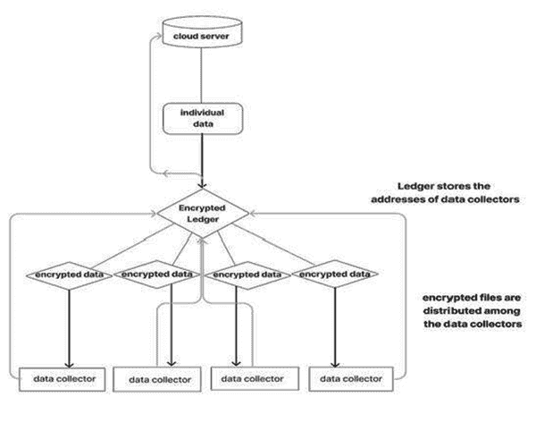 |

## 跟踪数据分布

每当云公司向用户租用数据时，公司会在贡献者的内存中存储一份数据分布的加密账本，指示数据如何以及在何处分布。云服务的每个用户将获得一个 `hash` 数字来标识账本持有者。系统将是去中心化且不可篡变的，类似于加密公共账本。`hashing` 和加密的使用防止数据被窃，并使我们能够筛选文件保存者以检索特定个人用户的数据。

- 在这种策略下，云服务提供商省去了购买额外服务器来存储主云服务器备份的费用。
- 由于即使在解密加密账本后也几乎无法找到所有系统节点，因此云计算公司无需担心数据泄露问题。
- 这种模型非常具有成本效益，而且几乎可以自给自足。
- 由于这种方法完全是基于众包的，该模型不需要正式员工。
- 由于在该模型中数据是完全去中心化的，它不会受到任何自然灾害或人为灾害的影响。
- 可以预测的是，加密货币（奖励）价值的增加将指数级地增加存储贡献者，反之亦然，因为存储租赁系统是基于加密的。

## 问题

- 尽管在这个过程中数据很容易被贡献者篡改，但该模型可以防止数据泄露或盗取。为了防止这一点，云公司必须对数据进行令牌化（`tokenization`），然后使用适当的加密。
- 云备份公司必须将令牌压缩进单个文件中，使用户能够根据令牌父节点的正确信息轻松地解密并检索数据。
- 这个过程比较耗时，因为每当服务器需要使用这些令牌备份数据时，云公司都必须等待贡献者将文件上传到服务器。（为了解决这个问题，云公司可以根据贡献者上传文件到服务器的速度为其提供奖励以鼓励他们）
- 由于它是一个基于加密的租赁系统，加密货币（奖励）价值的下降会导致公司失去存储贡献者的信任。
- 为了保持奖励的一致性，云公司可能需要对该货币进行投资。

使用众包、去中心化模型进行云备份的提议具有若干优点，例如成本效益高、自给自足和对自然灾害具有韧性。然而，也存在一些需要考虑的问题，例如需要令牌化和加密以防止数据篡改、等待贡献者上传文件的耗时过程，以及奖励货币价值波动导致失去存储贡献者信任的风险。这些问题可以通过仔细的规划和投资来解决，使该模型成为云备份极具前景的选项。

# 结论

云数据备份的所有选项都表明，目前的模型均无法解决上述问题。每种替代方法都有优缺点，具体取决于具体情况。所有这些方法都试图在保持实施成本尽可能低的情况下解决各种问题。然而，某些方法的价格会随着数据量的增加而逐渐上升。例如，以冷热备份方法为例，它是根据故障触发器的检测来执行备份和恢复的。我们概述的模型以最有效且最具成本效益的方式解决了大部分问题，这是其他任何模型都无法实现的。不仅如此，我们的模型是自给自足的，这意味着云公司不需要频繁对其进行投资以保持其运行；相反，过一段时间后，我们的模型将开始产生自己的收入，并且不再需要云公司的支持。云公司只需要确保我们的模型得到了正确实施，正因如此，我们认为在所有替代方案中，我们的数据备份解决方案是最好的。即使我们的数据备份策略解决了该领域的大多数问题，仍有巨大的创新和发展空间。我们相信，我们在这一项目中投入的工作将为学术界研究这一模型开启新的机会。

# 参考文献

Adhikari, M., Koley, S., & Arab, J. (2017). Cloud Computing: A Multi-workflow Scheduling Algorithm with Dynamic Reusability. Arabian Journal for Science and Engineering, 43(2), 645–660. doi:[10.1007/s13369-017-2739-0](https://doi.org/10.1007/s13369-017-2739-0)

Ajeh, D., Ellman, J., & Keogh, S. (2014). A cost modelling system for cloud computing. In 2014 14th International Conference on Computational Science and Its Applications, (pp. 74-84). IEEE.

Alarifi, A., Dubey, K., Amoon, M., Altameem, T., Abd El-Samie, F. E., Altameem, A., & Nasr, A. A. (2020). Energy efficient hybrid framework for green cloud computing. IEEE Access : Practical Innovations, Open Solutions, 8, 115356–115369. doi:[10.1109/ACCESS.2020.3002184](https://doi.org/10.1109/ACCESS.2020.3002184)

Alzoubi, K., Aljawarneh, N. M., Alsafadi, Y., Al-Radaideh, A. T., & Altahat, S. (2020). Role of Cloud Computing in Service Quality, Information Quality & Low Costs: An Empirical Study on Jordanian Customs. International Journal of Academic Research in Business & Social Sciences, 10(6), 522–532. doi:[10.6007/IJARBSS/v10-i6/7330](https://doi.org/10.6007/IJARBSS/v10-i6/7330)

# 第 4 章 人工智能与机器学习的角色

- Tarun Kumar Vashishth  
    
  印度 IIMT 大学

- Vikas Sharma  
    
  印度 IIMT 大学

- Kewal Krishan Sharma  
  印度 IIMT 大学

- Bhupendra Kumar  
  印度 IIMT 大学

- Sachin Chaudhary  
    
  印度 IIMT 大学

- Rajneesh Panwar  
  印度 IIMT 大学

## 摘要

云计算彻底改变了组织存储、处理和管理数据的方式，提供了灵活性和可扩展性。然而，网络威胁的增加为维护稳健的云安全带来了巨大挑战。本章将深入探讨人工智能（`AI`）和机器学习（`ML`）在增强云安全方面发挥的关键作用。通过利用 `AI` 和 `ML` 的能力，组织可以主动检测、缓解并响应不断演变的网络威胁，最终巩固其云基础设施。`AI` 驱动的技术使安全系统能够识别海量数据集中的模式、异常和潜在威胁。`ML` 算法可以从历史攻击数据中学习，从而预测未来威胁并开发更有效的防御机制。此外，`AI` 增强的身份验证和访问控制机制加强了身份管理，减少了未经授权访问和数据泄露的风险。

## 引言

在一个数字数据不断增长和云计算普及的时代，组织首要关注的是确保其数据和系统的安全完整性。云计算技术以其可扩展性、可访问性和成本效益的承诺，彻底改变了企业运营和管理信息的方式。然而，这种便利并非没有风险。不断演变的网络威胁格局构成了持续的挑战，需要能够适应并加固云端防御的创新解决方案。传统的安全机制在某种程度上是有效的，但在面对日益复杂的威胁时已显得捉不从心。解决方案似乎在于技术与智能的交叉点。人工智能（`AI`）和机器学习（`ML`）凭借其分析海量数据集、识别模式和做出实时决策的能力，已成为云安全的先锋。从网络威胁的演变到传统安全措施的局限性，我们开启了一段旅程，旨在揭示 `AI` 和 `ML` 在保护云环境方面的变革潜力。通过审视现实应用并应对面临的挑战，我们旨在为网络安全专业人士和业务领导者提供知识和见解，以便在数据成为最价值货币的时代巩固其数字资产。加入我们，导航云安全的复杂领域，揭开未来——智能与技术汇聚，守护云的大门。

## 不断演变的威胁格局

在网络空间领域，威胁格局处于永久的演变状态。这种动态且不断变化的环境对依赖云计算存储和管理数据的组织带来了巨大挑战。理解这种演变威胁格局的本质，对于理解高级安全措施的必要性至关重要，特别是由人工智能（`AI`）和机器学习（`ML`）驱动的措施。

- **1. 日益复杂的攻击技术**：数字领域的攻击者数量不仅在增加，而且在复杂性上也提升了水平。简单的病毒和恶意软件成为主要关注的时代已经过去了。如今，网络犯罪利用复杂且多层的技术来渗透云环境。这些方法旨在绕过传统的安全措施，使其变得越来越难以检测和预防。
- **2. 勒索软件攻击**：勒索软件攻击因其破坏性影响在近年来引起了极大关注。在典型的勒索软件攻击中，恶意分子加密组织的数据并索要解密密钥赎金。此类攻击不仅会导致即时的经济损失，还可能导致长时间的停机和数据丢失，严重影响组织的运营和声誉。
- **3. 数据泄露**：数据泄露涉及对敏感信息的未经授权访问，随后这些信息会被外泄或暴露给未经授权的第三方。数据泄露的后果可能是灾难性的，包括罚款、失去客户信任和法律后果。个人和财务数据的盗取已成为网络犯罪者的暴利。
- **4. 分布式拒绝服务（`DDoS`）攻击**：`DDoS` 攻击通过大量流量淹没目标系统或网络，导致合法用户无法访问。这些攻击不仅变得更加常见，而且更加强大和复杂，通常涉及对成千上万个受控设备的协调。`DDoS` 攻击背后的动机多样，从财务勒索到意识形态或政治目标。
- **5. 声誉损害**：除了直接的财务影响外，这些网络威胁还会损害组织的声誉。数据泄露或勒索软件攻击成功可能会侵蚀客户、合作伙伴和利益相关者之间的信任。重建受损的声誉是一项昂贵且耗时的工作。
- **6. IoT 设备与互联性**：物联网（`IoT`）设备的普及进一步加剧了威胁格局。`IoT` 设备通常内置安全功能有限，可以作为攻击者的切入点。此外，系统互联性的增加意味着组织基础设施中某个区域的漏洞可能会影响整个网络的安全。这种扩展的攻击面使得安全专业人士识别和缓解潜在风险更具挑战性。

| 图 1. 威胁及其安全措施 |
| :--- |
| 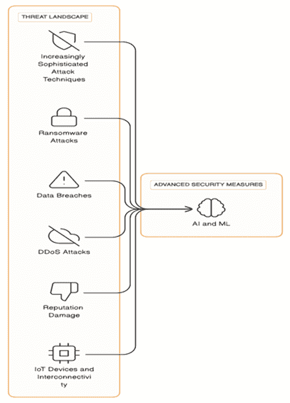 |

网络空间不断演变的威胁格局其特征是攻击技术日益复杂、勒索软件和数据泄露泛滥、`DDoS` 攻击持续，以及存在巨大的财务和声誉损害。此外，`IoT` 设备的普及和系统的互联性扩大了安全关注的范围。为了有效应对这些演变的威胁，组织必须采用先进的安全措施，包括利用 `AI` 和 `ML` 能力的措施，以比网络对手领先一步。

## 文献综述

- 在 `(Subramanian & Tamilselvan, 2019)` 中，Subramanian, E. K. 和 Latha Tamilselvan 提出了一种新的云安全解决方案，利用机器学习（`ML`），特别是卷积神经网络（`CNN`），为具有和响应功能的下一代云安全铺平道路。
- 在 `(Fernandes et al., 2014)` 中，Fernandes 对云安全问题进行了全面的文献综述，涵盖了漏洞、威胁和攻击等主题，同时对这些方面提出了分类分类法。


在`(Muralidhara, 2017)`中，`Muralidhara, Pavan`深入研究了不断演变的云计算安全领域，强调了新兴威胁以及用于保护敏感数据和云应用程序所采用的应对措施。

在`(Achar, 2022)`中，`Achar, Sandesh`对基于`AI`的云计算模型的各个方面提供了见解，包括其表现形式、作用、新兴趋势和相关挑战。

在`(Nassif et al., 2021)`中，`Nassif`讨论了机器学习技术在主动预防或识别云环境中安全泄露和漏洞方面的多种应用。

在`(Khorshed, 2011)`中，`Khorshed`提出了双重贡献：首先是对云计算的全面综述，重点关注了采纳障碍和威胁缓解问题；其次是对利用机器学习解决常见攻击向量提出了新颖见解。

在`(Kumar et al., 2016)`中，`Kumar`、`Raneel`、`Sunil Pranit Lal`和`Alok Sharma`提出了一种保护云环境中虚拟机（`VMs`）免受拒绝服务（`DoS`）攻击的方法。

在`(Moreno-Vozmediano et al., 2019)`中，`Moreno-Vozmediano`并评估了一种基于机器学习技术用于时间序列预测和排队理论的新型预测自动扩展机制。

在`(Dave et al., 2018)`中，`Dave et al.`进行的研究阐明了跨多个云相关领域的云安全问题，涵盖与云模型和云网络相关的威胁。

在`(Nenvani & Gupta, 2016)`中，`Nenvani`、`Geetanjali`和`Huma Gupta`深入研究了云计算架构的安全性，特别是基础设施即服务（`IaaS`）层。该论文全面检查了`IaaS`的漏洞，专门解决了与虚拟化相关的问题，例如针对`VM`镜像共享的攻击、`VM`隔离违反、不安全的`VM`迁移以及`VM`逸，同时也提出了相应的解决方案。

在`(Hesamifard et al., 2017)`中，`Hesamifard's et al.`的论文证明了使用加密数据训练神经网络的可行实用性，实现了加密预测并以加密形式安全地返回这些预测。

在`(He et al., 2017)`中，`He`、`Zhang`和`Lee`提出了一种论文，建议了一种利用源端机器学习技术的云`DOS`攻击检测系统。

在`(Butt et al., 2020)`中，`Butt`及其同事提供了一个全面的综述，分析了云计算中的安全威胁、问题和解决方案，重点关注各种机器学习算法的应用，包括监督学习、无监督学习、半监督学习和强化学习。

在`(Salman et al., 2017)`中，`Salman`和研究团队调查了异常的检测和分类，偏离了当代研究中仅关注检测的趋势。

## 人工智能与机器学习在云安全中的协同效应

人工智能（`AI`）与机器学习（`ML`）在云安全中的协同效应代表了一种应对现代威胁格局所带来的复杂挑战的强大且具有变革性的方法。这些技术提供了系列优势，共同增强了云安全措施的有效性和效率：

### 1. 实时威胁检测

- `AI`驱动的系统具有实时处理和分析海量数据的能力。在云安全中，这种能力是无价的，因为它允许持续监控云环境中发生的活动和事件。
- `ML`模型由于是数据驱动的，会持续学习并适应新信息。这意味着它们可以在异常和潜在威胁出现时就识别出它们，通常在安全专家或数据库正式将其正式识别并记录为威胁之前。
- 例如，如果一个`AI`系统注意到某个特定用户账户从非预期位置或设备的登录尝试出现异常激增，它可以将其标记为潜在威胁并立即采取行动。

### 2. 模式识别

- `ML`算法擅长识别数据中的模式和趋势。在云安全背景下，这种能力可以被用来检测偏离正常行为的偏差。
- 异常的用户行为，例如数据访问的突然增加或异常的数据传输模式，可以被`ML`模型标记为潜在可疑。
- 未经授权的访问尝试，即使它们没有触发传统的安全规则，也可以被`AI`系统检测到，这些系统能够识别与过去攻击一致的行为模式。

### 3. 预测分析

- `AI`和`ML`可以利用历史数据和持续观察来预测潜在的安全违露。通过识别指示即将临临威胁的模式和趋势，这些技术允许组织采取预防性行动。
- 例如，如果一个`AI`系统注意到一系列失败的登录尝试后是成功的登录，它可能预测正在进行暴力破解攻击，并通过增加安全措施做出相应响应。

### 4. 行为分析

- `ML`模型可以根据历史数据和持续行为创建详细的用户和实体画像。这些画像允许检测异常操作或偏离既定行为模式的情况。
- 例如，如果用户通常访问特定资源，但突然尝试访问敏感数据，其超出范围，`AI`驱动系统可以将其标记为潜在内部威胁或受损的账户。

### 5. 自适应响应

- `AI`系统不仅限于检测；它们还可以对安全事件采取自动化行动。这种能力对于快速缓解威胁至关重要。
- 当识别出潜在威胁时，`AI`系统可以隔离受影响资源、撤销访问或实施其他缓解措施。这减少了对人工干预的依赖，节省了关键时间。

| 图 2 人工智能（AI）与机器学习（ML）在云安全中的协同效应 |
| --- |
| 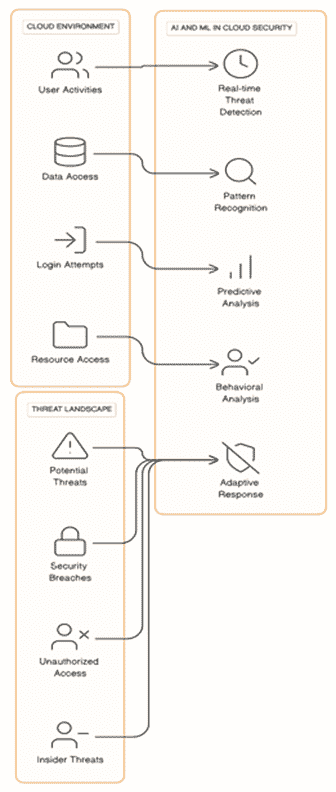 |
| --- |

`AI`和`ML`在云安全中的协同效应为组织应对演变的威胁格局提供了动态且主动的防御。这些技术在实时监控、模式识别、预测分析、行为画像和自动化事件响应方面表现出色。通过利用这些能力，组织可以显著增强其检测、响应和缓解云安全威胁的能力，从而加强其整体安全态势。

## 传统安全措施的局限性

传统安全措施（如防火墙、防病毒软件和入侵检测系统）在保护云环境方面发挥了关键作用。然而，它们也有其局限性：

### 1. 基于名的检测

签名检测是许多传统安全工具的基石。这种方法通过将与已知恶意代码或行为的签名数据库进行对比来识别威胁。虽然对于检测已知威胁有效，但它存在以下局限性：

- **无法检测零日攻击**：签名系统无法识别以前遇到过的威胁，通常称为零日攻击。由于它们依赖历史数据，因此无法识别新的和不断演变的威胁。
- **签名更新延迟**：即使发现了新威胁，更新安全工具中的签名也可能耗时。在此间隔期间，在补丁或签名更新之前，系统仍然受到最新威胁的影响。
- **多态恶意软件**：现代恶意软件可以快速更改其代码或行为，使得签名系统难以跟上。

### 2. 人工监控

传统的安全措施通常需要人工干预来进行监控和事件响应。虽然人类的专业知识无价的，但人工监控也有其缺点：

- **耗时性**：手动监控安全日志和事件非常耗时。安全人员必须筛选海量数据，这可能导致威胁检测和响应的延迟。
- **容易出错**：人类可能会出错、遗漏攻击的细微迹象或误读数据，从而导致误报或漏报。随着时间的推移，疲劳也会影响人工监控的准确性。
- **缺乏实时感知**：人工监控可能无法提供对安全事件的实时感知，而这对于及时缓解威胁至关重要。

### 3. 可扩展性

云环境以其动态性著称，资源的配置和撤销速度非常快。传统的安全措施在扩展规模以满足云环境需求方面面临着巨大挑战：

- **资源弹性**：云资源可以根据需求即时扩展或收缩。传统的安全工具可能难以适应这种弹性，导致在资源配置或撤销期间出现潜在的安全漏洞。
- **复杂性**：云环境具有具有多个服务和互连组件的复杂性，这会让传统的安全系统难以不堪，难以维持全面的安全态势。
- **成本与性能**：将传统的安全措施扩展到匹配云基础设施的规模可能成本高昂，并可能影响系统性能。

| 图 3. 传统安全措施 |
| --- |
| 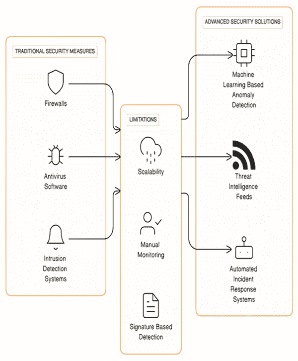 |
| --- |

虽然防火墙、防病毒软件和入侵检测系统等传统安全措施在某种程度上是有效的，但在处理不断演变的威胁格局、云环境的速度以及实时响应的需求方面面临着局限性。为了应对这些挑战，组织通常使用更先进的适应性安全解决方案来补充传统安全，例如基于机器学习的异常检测、威胁情报馈送和自动化事件响应系统，以在当今快速变化的数字格局中增强其整体安全态势。

## AI 和 ML 在云安全中的承诺

人工智能（`AI`）和机器学习（`ML`）已成为云安全领域的强大工具，提供了许多优势来克服传统安全措施的局限性。在这里，我们将详细探讨`AI`和`ML`为云安全带来的承诺：

### 1. 异常检测

`AI`和`ML`系统擅长异常检测，这涉及识别偏离既定正常行为模式的偏差。在云安全背景下：

- **基准建立**：机器学习模型可以分析由云环境生成的庞大数据集，创建一个“正常”行为基准。它们从历史数据和用户交互中学习，理解典型的网络流量、系统行为和用户活动是什么样的。
- **检测未见威胁**：与基于特征的检测不同，`AI`和`ML`可以识别以前未见过的威胁或零日攻击。任何对既定基准的偏（无论是新的攻击向量还是不断演变的威胁）都会触发警报。
- **减少误报**：基于`AI`和`ML`的异常检测往往比基于规则的系统产生更误报，因为它们能够适应威胁和云环境的演变。

### 2. 预测分析

`AI`驱动的预测分析涉及使用历史数据和当前趋势来预测潜在的安全威胁：

- **威胁预测**：`AI`系统可以分析历史攻击数据中的模式，并识别可能指示潜在威胁的趋势。这允许组织在漏洞被利用之前采取主动措施来缓解漏洞。
- **漏洞评估**：`ML`模型可以通过识别弱点或漏洞来评估云环境的安全态势。这些信息使组织能够优先考虑安全工作并对脆弱区域进行补丁或加固。

### 3. 自动化

自动化是`AI`和`ML`在云安全领域的优势：

- **威胁检测**：机器学习模型可以实时检测安全威胁，而不需要人工监控。这缩短了响应时间并最大限度地减少了人为错误的风险。
- **事件响应**：`AI`系统可以协调事件响应工作流，例如隔离受感染的资源、触发警报和启动修复操作。这减轻了安全团队的负担，并确保了快速协调的响应。
- **补丁管理**：`ML`可以通过识别哪些系统需要更新并在非关键期间调度补丁，来实现补丁管理的自动化，以减少干扰。

### 4. 可扩展性

云环境是动态的，资源根据需要扩展或收缩。`AI`和`ML`系统非常适用于云安全的可扩展性需求：

- **适应性**：`AI`和`ML`模型可以适应资源分配、网络流量模式和不断演变的威胁格局的变化。它们可以无缝扩展，提供持续的安全覆盖。
- **效率**：这些系统可以高效处理云环境中生成的不断增长的数据量。它们可以大规模处理和分析数据，确保没有安全事件被遗漏。

| 图 4. 云安全领域的人工智能（AI）和机器学习（ML） |
| --- |
| 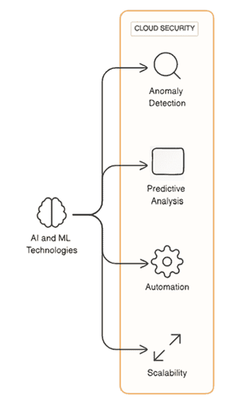 |
| --- |

`AI`和`ML`技术通过提供先进的异常检测、预测分析、自动化可扩展性为增强云安全提供了极具前景的解决方案。这些能力使组织能够更好地保护其云资产，对新出现的威胁做出快速响应，并在动态演变的云计算世界中保持稳健的安全态势。

## 现实世界应用

`AI`和`ML`已有效应用于云安全领域的各种现实世界场景。让我们详细研究这些应用：

### 1. 用户行为分析

- **概述**：用户行为分析 (`UBA`) 利用`AI`监控和分析云环境内的用户活动。其首要目标是检测可能意味着未经授权访问或内部威胁的异常行为模式。
- **工作原理**：`AI`模型（如机器学习算法）持续收集并分析用户活动数据。它们为每个用户建立正常行为基准，包括典型的登录时间、位置和数据访问模式。当发生偏离此基准的情况时，`AI`算法会触发警报，指示潜在的安全威胁。
- **益处**：`UBA`帮助组织通过尽早发现活动活动防止数据泄露。它可以识别受攻击的账户、未经授权的访问或具有恶意的内部人员。通过及时标记这些异常，组织可以采取行动防止安全事件。

### 2. 威胁情报

- **概述**：威胁情报涉及收集、分析和应用有关网络安全威胁的信息。`AI`和`ML`在处理海量威胁情报数据以识别新兴威胁和漏洞方面起着关键作用。
- **工作原理**：`AI`驱动的系统使用自然语言处理 (`NLP`) 和机器学习来解析并分类来自各种来源的威胁数据，包括安全博客、论坛和数据馈（feeds）。它们能够识别模式和趋势，帮助组织在不断演变的威胁中保持领先。
- **优势**：由`AI`驱动的威胁情报使组织能够主动更新其安全措施。通过掌握最新威胁和漏洞的动态，它们可以调整安全策略、实施补丁并加固防御，以降低成功攻击的风险。

### 3. 云工作负载保护

- **概述**：云工作负载保护涉及监控和保护运行在云资源上的工作负载和进程。`AI`驱动的工具在确保只有合法且受信任的进程在云环境中执行方面着着关重要的作用。
- **工作原理**：`AI`工具利用行为分析和机器学习来监控云端运行进程的行为。它们建立了正常行为的基准，并能够检测出表明恶意活动或代码的偏差。当检测到可疑行为时，这些工具可以隔离或终止违规进程。
- **优势**：通过防止恶意代码在云中执行，组织可以保护其云端应用程序和数据免受损害。这有助于维护云工作负载的完整性，并确保计算环境的安全性。

### 4. 事件响应

- **概述**：事件响应是网络安全的一个关键方面。`AI`和`ML`可以自动化并增强事件响应流程，缩短响应时间并最大限度地减少安全事件的影响。
- **工作原理**：机器学习模型可以经过训练以分析各种安全工具生成的安全警报。它们可以根据严重性和真实威胁的概率对警报进行优先级排序。自动化响应包括隔离受影响的系统、启动取证分析或应用预定义的安全策略。
- **优势**：事件响应中的自动化减轻了安全团队的负担并加速了威胁的缓解。它确保在响应安全事件时采取一致且快速的行动，将潜在损害或数据丢失降至最低。

| 图 5. 云安全领域的 AI 和 ML 实时应用 |
| --- |
| 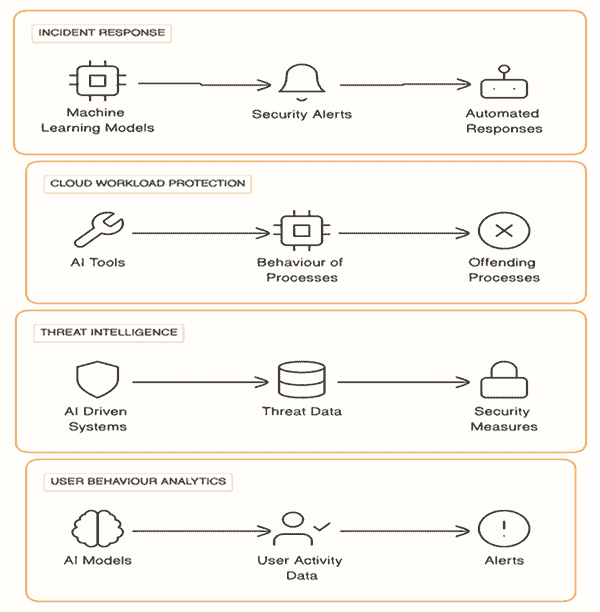 |
| --- |

`AI`和`ML`为云安全带来了变革性的能力，使组织能够主动检测用户行为中的异常，通过威胁情报在面对威胁时保持领先，保护云工作负载免受恶意进程的影响，并自动化事件响应以实现更快、更有效的云网络安全管理。这些现实应用增强了整体安全性，并帮助组织在当今复杂的数字环境中维持稳健的防御。

## 挑战与考量

通过集成人工智能 (`AI`) 和机器学习 (`ML`) 技术来增强云安全是一项极具前景途的尝试，但也面临着许多挑战和考量。让我们详细探讨这些内容：

### 1. 数据隐私与合规性

- **挑战**：`AI`和`ML`模型需要访问大量数据才能有效。然而，这些数据通常包含敏感信息，这引发了对数据隐私以及是否符合`GDPR`或`HIPAA`等法规监管要求的担忧。
- **考量**：组织必须实施稳健的数据治理策略、加密机制和访问控制以保护敏感数据。在为`AI`和`ML`收集、存储和处理数据时，也应注意监管要求。

### 2. 数据质量与多样性

- **挑战**：`AI`和`ML`模型严重依赖于高质量且多样化的数据集。数据不足或存在偏差的数据可能导致不准确的结果和可能产生危害的决策。
- **考量**：组织应努力包含多样化的来源，以减轻`AI`和`ML`中的偏差。

### 3. 模型安全与鲁棒性

- **挑战**：`AI`和`ML`模型容易受到对抗攻击，恶意攻击者操纵输入来欺骗模型做出错误的预测。
- **考量**：实施稳健的模型验证，并部署安全机制来检测和响应对抗攻击。

### 4. 互操作性与集成

- **挑战**：将`AI`和`ML`解决方案集成到现有安全架构中是复杂的，需要与现有工具和工作流进行无缝互操作。
- **考量**：确保`AI`和`ML`能够通过提供的`APIs`进行通信。

### 5. 资源需求

- **挑战**：`AI`和`ML`算法是计算密集型的，会消耗云资源并增加运营成本。
- **考量**：组织必须评估资源需求并优化`AI`和`ML`工作负载。这可能涉及云实例、利用分布式计算或使用无服务器架构。

### 6. 可解释性与透明度

- **挑战**：`AI`和`ML`模型（特别是深度学习模型）通常被视为提供结果的“黑盒”。这种透明度的缺失在关键决策场景中可能是问题。
- **考量**：探索`AI`和`ML`模型解释性技术，以使其决策更易理解。某些监管要求也强制要求解释。

### 7. 伦理考量

- **挑战**：`AI`和`ML`可能会延续训练数据中的偏差，导致歧视性结果或不伦理决策。
- **考量**：对`AI`和`ML`进行公平性和伦理审计。为`AI`的使用制定清晰的指南和伦理框架。

### 8. 专业技能

- **挑战**：组织可能缺乏开发、部署和维护云安全`AI`和`ML`解决方案所需的内部专业知识。
- **考量**：投资于培训并招聘`AI`和`ML`专家。或者，考虑利用云供应商提供的托管`AI/ML`服务来降低门槛。

### 9. 成本管理

- **挑战**：如果不有效管理，实施`AI`和`ML`解决方案会导致云基础设施成本增加。
- **考量**：密切监控资源使用情况，优化`AI`和`ML`工作负载，并进行成本效益分析，以确保增强安全的收益符合支出。

### 10. 持续监控与适应

- **挑战**：威胁格局和云环境在不断演变。`AI`和`ML`模型需要适应新威胁和不断变化。
- **考量**：建立对`AI`和`ML`模型的持续监控流程，并定期更新以对新兴威胁保持有效。实施反馈循环以随时间推移模型。

| 图 6. 云安全中 AI 和 ML 的挑战与考量 |
| --- |
| 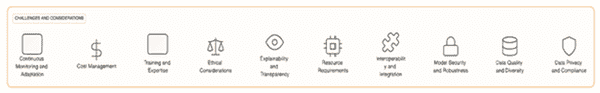 |
| --- |

虽然人工智能（`AI`）和机器学习（`ML`）在增强云安全方面具有巨大前景，但组织必须应对多种挑战和考虑以确保其成功实施。在保持透明度和适应性的同时，解决数据隐私、模型安全、集成和伦理问题，对于充分利用`AI`和`ML`在云安全中的潜力至关重要。

## AI 和 ML 在云安全中的用例


这些用例说明了 AI 和 ML 的实际应用。通过利用这些技术，组织可以构建更健壮、适应性安全措施，主动防御威胁，并对事件做出快速响应，最终加强其云安全态势。

| 图 7. AI 和 ML 增强云安全的用例 |
| --- |
| 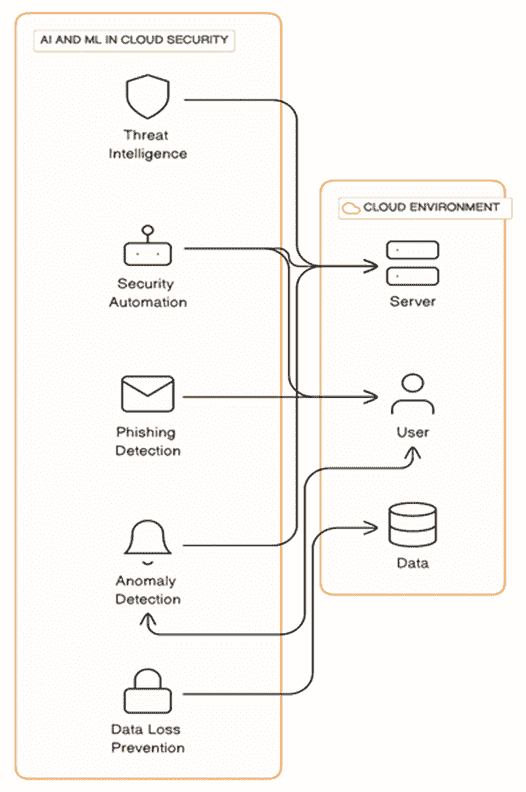 |

让我们详细探讨人工智能（AI）和机器学习（ML）在云安全中的这些每一个用例：

### 1. 异常检测

- **异常活动**：AI 驱动的系统可以持续监控并分析云环境内的活动。它们会寻找异常的登录时间、位置、访问模式或数据传输量。
- **内部威胁**：异常可能意味着潜在的内部威胁，即员工或授权用户以出乎意料的方式运行，可能危害数据或系统。
- **主动响应**：当检测到异常时，系统可以触发警报或采取自动操作，例如阻止访问或将问题升级以便进一步调查。
- **示例**：如果一个通常在办公时间访问云资源的用户突然在半夜尝试从另一个大陆登录，AI 系统可以将此标记为异常并做出相应响应。

### 2. 威胁情报

- **数据分析**：AI 和 ML 可以处理来自各种来源的威胁情报馈送的海量数据集，包括网络安全数据库、新闻报告和安全研究人员的数据。
- **新兴威胁**：通过分析这些数据，这些系统可以识别新兴威胁、零日漏洞或新的攻击向量。
- **主动防御**：组织可以利用这些威胁情报主动修补漏洞、更新安全策略或部署额外的安全措施来防御已知和潜在的威胁。
- **示例**：分析威胁馈送的 AI 算法可能会检测到针对特定软件漏洞的新型恶意软件。组织可以立即采取行动修补漏洞并增强针对这种新兴威胁的防御。

### 3. 钓鱼检测

- **邮件分析**：ML 模型可以经过训练分析邮件内容、发送者行为和附件以识别钓鱼尝试。
- **可疑指标**：ML 算法可以识别可疑链接、模仿知名品牌或组织的内容，或与典型通信模式不一致的发送者行为。
- **实时保护**：通过实时识别钓鱼邮件，这些系统可以防止用户落入陷阱或无意中泄露敏感信息。
- **示例**：ML 驱动的邮件安全可以检测出一封看似来自信誉良好的银行但包含旨在窃取登录凭据的恶意链接的钓鱼邮件。系统可以隔离该邮件或向用户发出威胁警告。

### 4. 数据泄露防护 (DLP)

- **数据分类**：AI 可以根据预定义的策略对云中的敏感数据进行分类标记。这包括识别个人身份信息 (PII)、财务数据、知识产权等。
- **访问控制**：AI 驱动的 DLP 系统可以对敏感数据执行访问控制和加密，防止未经授权的访问或数据泄露。
- **防止意外暴露**：DLP 系统有助于确保敏感数据不会在云环境中被意外泄露、共享或移动到不安全的位置。
- **示例**：如果员工尝试在公共文件夹中共享包含客户信用卡号的文件，DLP 系统可以自动阻止该共享操作，确保敏感数据得到保护。

### 5. 安全自动化

- **事件响应**：ML 驱动的自动化可以实时响应安全事件。这包括隔离受感染的系统、更改访问权限，甚至启动事件响应工作流。
- **快速缓解**：自动化缩短了响应安全事件的时间，最大限度地减少潜在损害并减少攻击者的机会。
- **人机协作**：虽然自动化可以处理例行任务，但在必要时也可以将事件升级给人工安全专家。
- **示例**：如果 AI 系统检测到对关键服务器的未经授权访问，它可以立即将服务器从网络中隔离以防止进一步侵害，同时向安全人员发出警报。

## 未来范围

### 1. 高级威胁检测与响应

- 研究如何利用 AI 和 ML 实时检测和响应零日漏洞、多态恶意软件等高级威胁。
- 探索预测性模型的开发，以预判安全漏洞并主动保护云环境。

### 2. 云安全中的可解释 AI (XAI)

- 研究将可解释 AI 集成到安全模型中，以提高决策的透明度和可信度。
- 评估可解释性对 AI 驱动的安全解决方案的接受和采用的影响。

### 3. 自动事件响应

- 研究 AI 和 ML 在自动化云事件响应流程方面的潜力，包括事件分类、优先级排序和修复。
- 探索与自动化关键安全决策相关的挑战和伦理考量。

### 4. 用于云安全的联邦学习

- 探索联邦学习技术的应用，在不损害数据隐私的前提下提高云安全，特别是在多云或混合云环境中。
- 评估联邦学习模型在缓解云威胁方面的扩展性和有效性。

### 5. 云端 IoT 设备安全

- 研究如何利用 AI 和 ML 安全连接到云平台的物联网 (IoT) 设备，重点关注异常检测和威胁预防。
- 研究管理云中海量 IoT 设备安全的挑战和潜在解决方案。

### 6. 伦理考量与偏差缓解

- 研究 AI 和 ML 在云安全中的伦理影响，包括与偏差、公平性和透明度相关的问题。
- 开发负责任且符合伦理的云安全 AI 部署策略和指南。

### 7. 量子计算与后量子安全

- 探索量子计算对云安全中传统加密技术的潜在威胁。
- 研究抗量子 AI 驱动的安全解决方案，以保护后量子时代的云数据。

### 8. 人类知识的整合

- 研究如何利用 AI 和 ML 增强云安全中人工安全专家与自动化系统之间的协作。
- 研究人机协作在应对不断演变的云安全威胁中的作用。

### 9. 监管合规与 AI

- 分析云安全中人工智能（AI）、机器学习（ML）与数据保护及网络安全法规（例如 `GDPR`、`CCPA`）的交叉领域。
- 研究在利用 AI 驱动的安全措施时确保合规的方法。

### 10. 可扩展性与资源优化

- 研究优化云端基于 AI 和 ML 安全解决方案资源利用率和扩展性的技术，特别是针对大规模云基础设施。
- 开发在多样化云环境中进行高效模型训练、部署和管理的策略。

### 11. 持续学习与适应

- 探索使 AI 和 ML 模型能够从不断演变的威胁中持续适应并学习的方法。
- 研究云环境中的强化学习和自改进安全系统。

### 12. 跨领域与跨平台安全

- 研究如何利用 AI 和 ML 弥补不同云提供商、行业和领域之间的安全漏洞。
- 研究互操作性和标准化工作，以增强跨异构云环境的安全性。

### 13. 以用户为中心的安全

- 探索由 AI 和 ML 驱动的以用户为中心的安全解决方案，根据用户的行为和偏好提供个性化安全措施。
- 评估此类系统在不同云背景下终端用户的可用性和接受度。

| 图 8. AI & ML 在云安全中的未来范围 |
| --- |
| 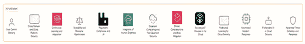 |

## 结论

### 1. 增强威胁检测与响应

- AI 和 ML 擅长实时分析海量数据集。这种能力对于识别云流量和用户行为中的异常模式和异常行为重要。
- ML 模型可以根据历史数据检测并分类已知威胁，从而对熟悉的攻击做出快速响应。
- AI 驱动的威胁检测系统可以通过学习行为来发现新威胁，从而领先于攻击者。

### 2. 安全任务自动化

- AI 和 ML 可以自动化常规安全任务，如日志分析、补丁管理和访问控制。
- 这种自动化减轻了人工安全团队的负担，让他们专注于威胁狩猎和战略安全规划等更复杂的任务。

### 3. 主动威胁预防

- 机器学习模型可以通过分析历史数据并识别导致泄露的模式，来预测潜在的安全问题。
- AI 驱动的系统可以根据不断变化的威胁格局动态地调整并应用安全策略。

### 4. 数据隐私

- 在利用 AI 和 ML 进行安全时，组织必须确保谨慎处理敏感数据。`GDPR` 和 `CCPA` 等隐私法规对数据处理有严格要求。
- `差分隐私`等技术可以在保护个人数据的同时，允许进行有效的安全分析。

### 5. 误报

- AI 和 ML 系统可能会产生误报，将合法活动标记为潜在威胁。这可能导致告警疲劳和资源浪费。
- 对机器学习模型进行持续改进和训练对于随着时间减少误报至关重要。

### 6. 对抗攻击

- 对抗攻击涉及操纵 `AI` 或 `ML` 以产生错误结果。在云安全背景下，攻击者可能试图规避检测或触发虚假报警。
- 实施针对对抗攻击的稳健防御至关重要。`模型硬化`、`对抗训练`和`异常检测`等技术有助于降低风险。

### 7. 云计算的演进

- 云计算随着新服务、架构和部署模型的出现不断演进。
- `AI` 和 `ML` 必须适应以保护这些演进的环境。例如，`无服务器计算`和`容器化`带来了独特的挑战，而 `AI` 和 `ML` 可以提供帮助。

### 8. 与人类专业知识协作

- `AI` 和 `ML` 是应该与人类专家协同工作的工具。人类专业知识对于在复杂情况下做出判断和解释事件背景至关重要。
- 人机协作可以实现更有效、更高效的事件响应。总之，`AI` 和 `ML` 是现代云安全不可或缺的。它们提供了大规模检测和响应威胁的能力、自动化安全任务并主动防御新兴风险。然而，务必审慎地使用这些技术，考虑到数据隐私、误报以及对抗攻击的可能。随着云计算的持续演进，`AI` 和 `ML` 在保障安全方面的角色也将不断演进，确保一个更安全、更有韧性的未来。

## 参考文献

Achar, S. (2022). Adopting artificial intelligence and deep learning in cloud computing for operational efficiency. International Journal of Information and Engineering, 16(12), 567–572.

Butt, U. A., Mehmood, M., Syed, B. H., Shaukat, M., Suh, D. Y., & Piran, M. J. (2020). A review of machine learning algorithms for cloud security. Electronics (Basel), 9(9), 1379. doi:10.3390/electronics909379

Dave, D., Meruliya, N., Gajjar, T., Parekh, D. H., & Sridaran, R. (2018). Cloud security issues and challenges. In Big Data Analytics: Proceedings of CSI 2015, (pp. 499-514). Springer Singapore. doi:10.1007/778-981-106620_48

Fernandes, D. A., Soares, L. F. B., Gomes, J. V., Freire, M. M., & Inácio, P. R. M. (2014). Security issues in cloud environments: A survey. International Journal of Information Security, 13(2), 113–170. doi:10.1007/s10207-013-0208-7

Gulmezoglu, B., Eisenbarth, T., Sunar, B. (2017). Cache-based application detection in the cloud using machine learning. In Proceedings of the 2017 ACM on Asia Conference on Computer and Communications Security, (pp. 288-300). ACM. doi:10.1145/3052973.30536

He, Z., Zhang, T., & Lee, R. B. (2017). Machine learning based DDoS attack detection from source side in cloud. In 2017 IEEE 4th International Conference on Cyber Security and Cloud Computing (CSCloud), (pp. 114-120). IEEE. doi:10.1109/CSCloud.2017.58

Hesamifard, E., Takabi, H., Ghasemi, M., Jones, C. (2017). Privacy-preserving machine learning in cloud. In Proceedings of the 2017 on cloud computing security workshop, (pp. 39-43). ACM. doi:10.1145/3140649.314065

Khorshed, M. T. (2011). Trust issues that create threats for cyber attacks in cloud computing. In 2011 IEEE 17th international conference on parallel and distributed systems, (pp. 900-905). IEEE. doi:10.1109/IPPADS.2011.156

Kumar, R., Lal, S. P., & Sharma, A. (2016). Detecting denial of service attacks in the cloud. In 2016 IEEE 14th Intl Conf on Dependable, Autonomic and Secure Computing, 14th Intl Conf on Pervasive Intelligence and Computing, (pp. 309-316). IEEE. doi:10.1109/DASC-PICom-DataCom-CyberSciTec.2016.70

Moreno-Vozmediano, R., Montero, R. S., Huedo, E., & Llorente, I. M. (2019). Efficient resource provisioning for elastic cloud services based on machine learning techniques. Journal of Cloud Computing (Heidelberg, Germany), 8(1), 1–18. doi:10.1186/s13677-019-0128-9

Muralidhara, P. (2017). 云计算安全性的演变：应对新兴威胁。《国际计算机科学与技术期刊》，1(4), 1–33.

Nassif, A. B., Abu Talib, M., Nasir, Q., Albadani, H., & Dakalbab, F. M. (2021). 用于云安全的机器学习：系统性综述。《IEEE Access: 实践创新、开放解决方案》，9, 20717–20735. doi:[10.1109/ACCESS.2021.305429](https://doi.org/10.1109/ACCESS.2021.305429)

NaniG. GuptaH. (2016). 使用监督学习进行云攻击检测综述。《2016 海量数据分析与网络研讨会 (CDAN)，1-5. doi:[10.1109/CDAN.2016.757087](https://doi.org/10.1109/CDAN.2016.757087)

PandeyU.RajputM.SinghR. (2023). 机器学习在云计算资源使用与安全中的作用。《2023 人工智能与智能通信国际会议 (AISC)，525-530. doi:[10.1109/AISC56616.2023.1008567](https://doi.org/10.1109/AISC56616.2023.1008567)

ParameswarappaP.ShahT.LankeG. R. (2023). 基于机器学习的安全云计算异常检测方法。《2023 智能数据技术与物联网国际会议 (IDCIoT)，931-940. doi:[10.1109/IDCIoT56793.2023.1005318](https://doi.org/10.1109/IDCIoT56793.2023.1005318)

PavithraB. (2023). 使用机器学习进行云安全分析。《2023 增强智能与可持续系统国际会议 (ICAISS)，704-708. doi:[10.1109/ICAISS58487.2023.1025094](https://doi.org/10.1109/ICAISS58487.2023.1025094)

Salman, T., Bhamare, D., Erbad, A., Jain, R., & Samaka, M. (2017). 多云环境中异常检测与分类的机器学习。《2017 IEEE 网络安全与云计算国际会议 (CSCloud)，97-103. doi:[10.1109/CSCloud.2017.15](https://doi.org/10.1109/CSCloud.2017.15)

Saxena, A., Asbe, C., & Vashishth, T. (2023). 利用新型机器学习方法预测收入与移民动态。《多学科科学期刊》，5. doi:[10.31893/multiscience.2023ss0202](https://doi.org/10.31893/multiscience.2023ss0202)

Sharma, V., Verma, V., & Sharma, A. (2019). 云计算中使用机器学习检测 DDoS 攻击。《高级计算信息研究：第三届国际会议 (ICAICR 2019)，260-273. Springer Singapore. doi:[10.1007/978-981-15-0111-1_24](https://doi.org/10.1007/978-981-15-0111-1_24)


# Sheet, M. F., & Saeed, M. J. (2022). 用户行为特征作为云计算的解决方案。《2022 第届当代信息技术与数学国际会议 (ICCITM)，25-29. doi:[10.1109/ICCITM56309.2022.1003168](https://doi.org/10.1109/ICCITM56309.2022.1003168)

# Subramanian, E. K., & Tamilselvan, L. (2019). 关注未来云：基于机器学习的云安全。《面向服务的计算与应用》，13(no. 3), 237–249. doi:[10.1007/s12602-019-00466-y](https://doi.org/10.1007/s12602-019-00466-y)

### 摘要

本章探讨了人工智能（AI）和机器学习（ML）对云安全领域的深远影响。随着机构日益将其业务和数据迁移到云环境中，确保稳健的安全措施变得至关重要。AI 和 ML 技术的整合为增强云端的威胁检测、预防和响应提供了新途径。本章深入探讨了这种协同作用的各个方面，讨论了利用 AI 和 ML 保护基础设施的优势、挑战和前景。本章还介绍了优势、挑战和未来方向。本摘要强调了 AI 和 ML 在加固云基础设施和保护敏感信息方面的变革潜力。

## 1. 引言

在快速演变的现代技术领域，人工智能（AI）和机器学习（ML）的整合被证明是一种催化力量，正在重塑各行业并重新定义传统的范式。云安全就是经历这种深刻变革的领域之一。随着机构日益将其业务和数据迁移到云环境中，确保针对一系列不断演变的网络威胁提供稳健保护已成为一项至关重要的内在需求。在这种背景下，AI、ML 与云安全之间的共生关系作为一种强大的解决方案脱颖而出，能够彻底我们在互联世界中保护数字资产的方式。

在这项探索中，我们深入探讨了人工智能（AI）和机器学习（ML）对云安全的影响，研究了它们在加强数据和应用程序完整性、可用性和机密性方面的多方面作用。从高级威胁缓解到自动化事件响应，这些技术的潜力是巨大的。随着我们开启 AI/ML 与云安全交叉领域的之旅，我们揭示了有望带来更安全、更具韧性的数字格局的变革潜力。

## 1.1 云安全格局

“云安全格局”展示了保护云端数据、应用程序和服务时面临的挑战、考虑因素以及不断演变的动态。云的本质涉及数据跨越不同的网络和地理边界传输，这要求对传统的安全措施进行全面的重新评估。它涵盖：

* I. 共同责任模型：作为云安全的基础支柱，该模型界定了云服务提供商与其客户之间安全责任的分配。
* II. 威胁向量和攻击面：云计算的广泛覆盖引入了新的威胁向量，并扩大了恶意攻击者可以利用的攻击面。本节详细分析了威胁的潜在切入点以及利用漏洞的技术。
* III. 数据机密性与隐私：将数据委托给第三方云提供商需要采取严格的措施来保护机密性和隐私。加密、访问控制和数据驻留法规在保护敏感信息方面起着至关的作用。
* IV. 身份与访问管理 (IAM)：由于云环境托管了大量的用户、设备和应用程序，有效的 IAM 对于确保授权访问和防止未经授权的突破至关重要。
* V. 云原生安全工具：云原生安全解决方案专为保护云环境而设计，通常提供云配置扫描和与云提供商安全工具的原生集成等功能。
* VI. 云安全中的 AI 和 ML：人工智能和机器学习正用于云安全的威胁检测、异常检测和自动化响应。

## 1.2 AI 和 ML 在安全中的作用

人工智能（AI）和机器学习（ML）已成为固化安全格局的关键工具。本节深入探讨了 AI 和 ML 在增强各个领域安全方面发挥的多方面作用：

* I. 威胁检测与分析：AI 和 ML 算法擅长筛选海量数据以识别异常和潜在的恶意活动。通过从历史模式中学习并适应新的威胁向量，这些技术增强了对网络攻击的早期检测，包括高级持续性威胁 (APT)、零日漏洞和内部威胁。
* II. 预测性分析：ML 算法通过分析历史数据并识别安全事件发生前的模式，可以预测潜在的漏洞和风险。
* III. 动态访问控制：AI 和 ML 技术实现了感知上下文的访问控制，根据用户行为、设备属性和环境因素动态调整访问权限。
* IV. 反欺诈：基于 AI 驱动的反欺诈检测系统分析交易数据以识别指示欺诈活动的模式。ML 模型可以适应不断演变的欺诈策略并减少假报，从而提高反欺诈机制的准确性。
* V. 恶意软件检测：ML 算法可以根据特征和行为识别并分类新变种的恶意软件。这使得开发更有效的反病毒和反恶意软件解决方案成为可能。

## 2. AI 和 ML 基础

### 2.1 人工智能概述

人工智能（AI）是计算机科学的一个多学科领域，专注于创建能够模拟人类智能并执行通常需要人类智能的任务机器和软件系统。AI 涵盖了广泛的技术、算法和方法，旨在使计算机能够从数据中学习、通过信息进行推理并适应新情况。以下是 AI 内部关键概念和领域的概述：

* I. 机器学习 (ML)：作为 AI 的子集，机器学习涉及创建算法和模型，使计算机通过从数据中学习来提高其执行任务性能。这种学习过程涉及识别模式、做出预测并根据经验做出决策。
* II. 神经网络：神经网络是一类人类大脑结构和功能启发的算法类。深度学习是机器学习的一个子领域，侧重于使用多层神经网络（深度神经网络）来自动从数据中学习特征。这在图像和语音识别等任务中取得了显著进展。
* III. 自然语言处理 (NLP)：NLP 涉及让计算机理解、解释和生成人类语言。这包括语言翻译、情感分析、机器人和文本生成等任务。
* IV. 计算机视觉：该领域专注于让计算机解释和理解来自世界的视觉信息。计算机视觉算法可以分析和解释图像和视频，实现脸部识别、目标检测和自动驾驶汽车等应用。
* V. 机器人：机器人结合了人工智能和工程，创建能够自主或半自主执行任务的智能机器（机器人）。该领域在工业自动化、医疗保健、探索等领域都有应用。
* VI. 强化学习：这种机器学习类型涉及智能体在环境中学习决策。它学习如何最大化奖励。
* VII. 专家系统：专家系统是旨在模仿人类专家决策能力的 AI 程序。它们使用规则和知识库提供专家建议。
* VIII. 云端 AI：云提供商以服务的形式提供 AI，允许组织在无需构建基础设施的情况下访问 AI 能力、工具和资源。

| 图 1. 人工智能 |
| --- |
| 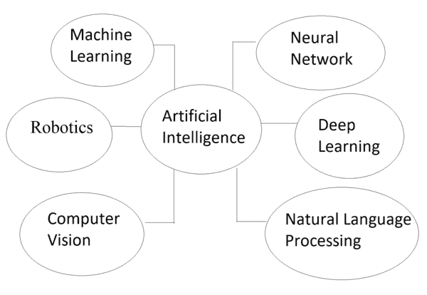 |

### 2.2 “机器学习”基础，也可以称为“算法智能”

机器学习是人工智能（AI）的一个领域，专注于开发算法和模型，使计算机能够从数据中学习并基于数据做出预测或决策。机器学习系统不是显式编程执行特定任务，而是通过数据来提高性能。机器学习可以分为不同的类型：

* I. 监督学习：在这种类型中，算法在带标签的数据上进行训练，并提供了正确输出。它通过识别训练数据中的模式和关系，学习将输入数据映射到正确输出。
* II. 无监督学习：在这里，算法被赋予了未标签的数据，任务是在数据中寻找模式或结构。它涉及将相似的数据点聚类或降低数据的维度。
* III. 强化学习：在这种方法中，算法通过与环境交互来学习决策。它根据行为接收奖励或惩罚，从而随着时间的推移学习最优策略。

## IV. 深度学习

机器学习的一个子集，它使用多层神经网络来处理和从复杂数据（如图像、文本和语音）中学习。

| 图 2. 机器学习 |
| --- |
| 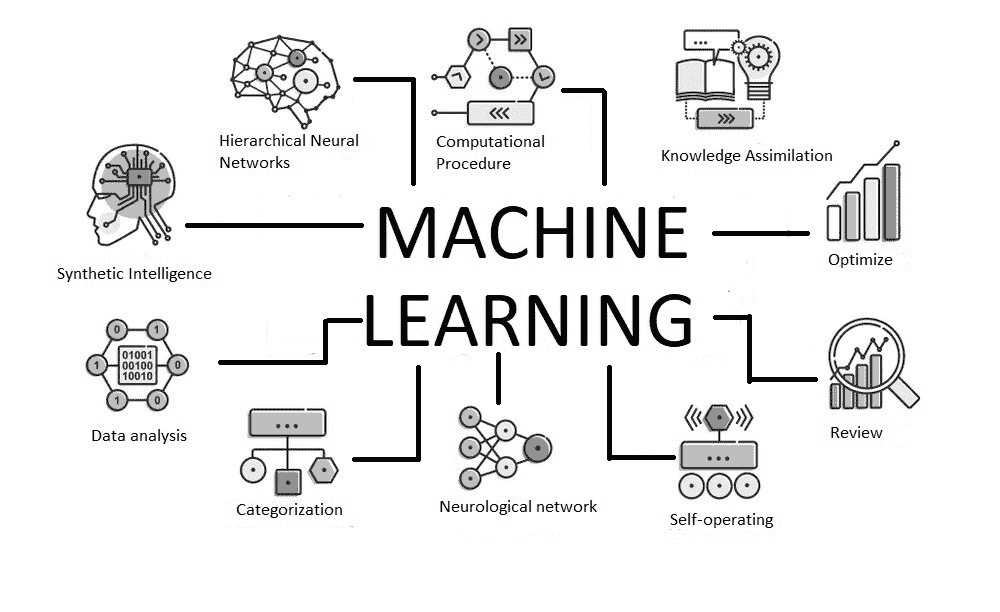 |

### 2.3 机器学习算法类型

以下是一些常见的机器学习算法类型：

* I. 监督学习：算法从带标签的训练数据中学习，以进行预测或分类。
  示例：`线性回归`、`决策树`、`支持向量机`、`随机森林`。
* II. 无监督学习：算法处理无标签数据，以寻找模式、分组或关系。
  示例：`聚类 (K-Means)`、`降维 (PCA)`、`异常检测`。
* III. 强化学习：算法通过与环境交互来学习目标，并为正确的操作获得奖励。
  示例：`Q-Learning`、`深度 Q 网络 (DQN)`、`策略梯度`方法。
* IV. 深度学习：机器学习的一个子集，使用多层深层神经网络从数据中学习表示。
  示例：用于图像的`卷积神经网络 (CNNs)`，用于序列的`循环神经网络 (RNNs)`。
* V. 神经网络：受人类大脑结构启发的算法，由相互连接的节点（神经元）组成，负责处理和传输信息。
* VI. 决策树：根据一系列条件或特征做出决策的分层结构。
* VII. K 近邻算法 (KNN)：基于实例的学习方法，根据其 k 个最近邻的多数类对数据点进行分类。
* VIII. 朴素贝叶斯：基于贝叶斯定理概率算法，通常用于文本分类和垃圾邮件过滤。
* IX. 随机森林：一种集成技术，通过结合多个决策树来提高准确性并避免过拟合。
* X. 支持向量机 (SVM)：寻找最优超平面将数据分类为不同类别的算法。
* XI. 主成分分析 (PCA)：一种降维技术，在保留方差的同时将数据转换为低维。

| 图 3. 机器学习的类型 |
| --- |
| 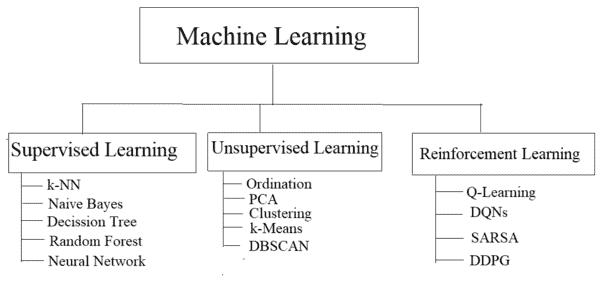 |

## 4. 云安全中的自适应访问控制

云安全中的主动漏洞管理涉及采取预防性措施，以识别、评估和缓解云基础设施及应用程序中的漏洞。以下是涉及的关键步骤的详细概述：

* I. 资产清点与发现：维护云环境中所有资产的最新条目，包括虚拟机、数据库、容器和其他资源。这种可见性对于有效的漏洞管理至关重要。
* II. 自动化漏洞扫描：使用自动化漏洞扫描工具定期扫描云资产，寻找已知漏洞、配置错误和安全漏洞。这些扫描可以按计划进行，或由于基础设施的变化而触发。
* III. 风险评估与优先级排序：评估识别出的漏洞的严重程度和潜在影响。根据 `CVSS`（通用漏洞评分系统）分数、资产的重要性以及被利用的可能性等因素对其优先级排序。
* IV. 安全配置审查：按照行业最佳实践定期审查并执行安全配置。配置错误是漏洞的常见来源，解决这些问题可以显著增强你的云安全态势。
* V. 安全培训与意识：对团队成员进行云安全最佳实践培训，强调识别和报告漏洞的重要性。在整个组织中培养安全意识文化。

| 图 4. 云安全中的主动漏洞管理 |
| --- |
| 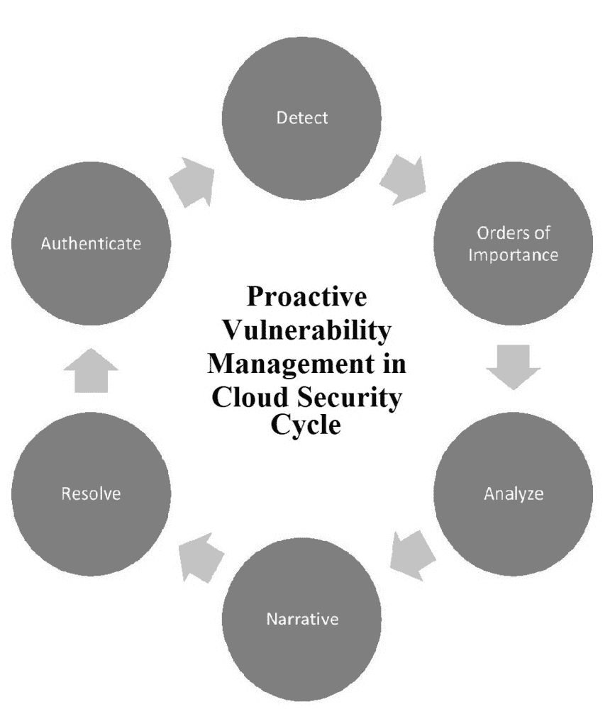 |

## 4. 自适应访问控制 (AAC)

云安全中 AI 和 ML 的自适应访问控制是指对用户访问云资源的动态且上下文感知的管理。这种方法利用 AI 和 ML 技术，根据用户行为、设备属性、位置以及所访问数据或资源的敏感性等各种因素，持续评估并调整访问权限。以下是自适应访问控制在云安全背景下的工作原理概述：

* I. 行为分析：AI 和 ML 可以分析用户行为模式以建立正常活动的基准。`AAC` 可以触发额外的身份验证步骤或阻止访问，以防止受攻击的账户或内部威胁。
* II. 上下感知：AI 和 ML 算法可以考虑上下文信息（如用户的位置、设备、时间及网络行为），以做出更明智的访问控制决策。例如，如果用户尝试从陌生位置访问敏感数据，系统可能会要求额外的身份验证步骤。
* III. 异常检测：AI 和 ML 可以识别用户行为中的异常，这些异常可能意味着未经授权的访问或数据泄露。
* IV. 威胁情报集成：基于 AI 的 `AAC` 系统可以与威胁情报源集成，以更新新兴威胁。
* V. 实时风险评估：`AAC` 评估与特定访问请求相关的风险因素。它考虑了所访问数据的敏感性、用户角色和用户位置等因素。这种动态风险评估确保访问决策与当前的威胁态势保持。

### 4.1 云安全中 AI 和 ML 自适应访问控制的益处

* I. 增强安全性：自适应访问控制响应实时威胁，减少未经授权访问、数据泄露和内部威胁的风险。
* II. 用户友好：通过仅在需要时要求额外的身份验证，在安全性和用户体验之间保持平衡，减少了合法用户的摩擦。
* III. 合规性：自适应访问控制通过提供细粒度的访问控制和强大的审计功能，有助于满足合规性。
* IV. 可扩展性：AI 和 ML 允许对大量的访问请求进行自动分析，适用于具有多样化和动态用户的云环境。
* V. 主动威胁缓解：通过早期识别异常和风险，自适应访问控制帮助组织采取主动措施缓解潜在的安全威胁。

AI 和 ML 中的自适应访问控制是一种对用户访问云资源的动态且感知上下文的方法。它通过持续评估用户行为和其他上下文因素，在做出明智访问控制决策的同时保持良好的用户体验。

## 5. 数据保护与隐私

### 5.1 基于 AI 的数据分类与加密

数据分类和加密是数据安全和隐私的重要组成部分。人工智能（AI）可以通过自动化和提高数据分类加密技术的准确性来增强这些过程。以下是 AI 如何应用于数据分类和加密：

### 5.1.1 基于 AI 的分类

* I. 内容分析与模式识别：基于 AI 的自然语言处理 (NLP) 和机器学习算法可以分析文档、电子邮件、图像和其他数据格式的内容。
* II. 上下文理解：AI 可以从上下文中学习，考虑用户角色、位置和数据用途。这有助于根据数据的相关性和上下文进行准确分类。

### III. 自动标记与标注

AI 可以根据内容自动为数据分配分类标签或标记。这些标签指示了数据的敏感程度或重要性。

### IV. 行为分析

通过研究用户行为模式，AI 可以识别数据是如何被访问、共享和使用的。这种行为分析有助于根据使用模式对数据进行分类。

### 5.1.2. 使用 AI 进行数据加密

* I. 自动密钥管理：AI 可以协助管理加密密钥、生成强且唯一的密钥，并在适当间隔内轮换。
* II. 动态加密：AI 可以根据数据的敏感性和上下文动态调整加密级别。例如，AI 可能会对高度敏感数据或特定情况执行更强的加密。
* III. 同态加密：AI 可以在不需要解密的情况下促进对加密数据进行计算，从而实现保护隐私的分析和处理。
* IV. 量子加密：AI 可以开发和实施能够抵御量子计算威胁的加密方法做出贡献。
* V. 异常检测：AI 可以识别访问加密数据的异常或未经授权的尝试，增强针对潜在泄露的安全防护能力。
* VI. 云端安全：AI 可以协助对云环境中的静态数据和传输中数据进行加密，同时确保仅在必要时才解密。

将 AI 集成到数据分类和加密过程中提供了许多优势，包括提高准确性、效率和适应性。然而，仔细实施 AI 技术以解决潜在的偏差、安全漏洞和合规性是非常重要的。

| 图 5. 数据保护与隐私 |
| --- |
| 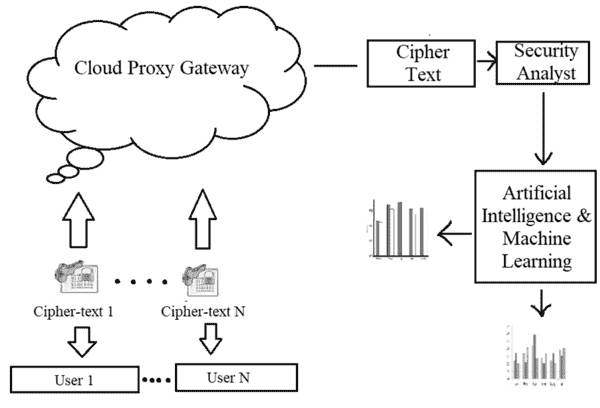 |

### 5.2. 隐私保护机器学习技术

以下是在云计算背景下可用于隐私保护机器学习的一些技术：

* I. 同态加密：同态加密允许数据在加密后仍用于计算。云服务提供商可以在加密数据上进行计算，而无需解密，从而维护数据隐私。
* II. 联邦学习：联邦学习允许跨分布式设备或服务器进行模型训练。它不共享原始数据，而是交换模型更新，从而最大限度地减少数据暴露并维护隐私。
* III. 差分隐私：差分隐私涉及在分析前向数据中添加噪声以保护个人隐私。这确保结果不会泄露关于特定数据点的敏感信息。
* IV. 安全多方计算 (SMPC)：SMPC 允许多个方对其私有数据进行联合函数计算，同时保持其输入相互隐藏。它允许在维护隐私的同时进行协作分析。

## 6. 挑战与局限性

人工智能 (AI) 和机器学习 (ML) 对各个领域（包括云安全）产生了重大影响。虽然它们为增强安全措施提供了有前景的解决方案，但也带来了需要解决的挑战和局限性。以下是 AI 和 ML 对云安全的影响、挑战和局限性的概述：

### 6.1 挑战

* I. AI 和 ML 需要大量数据来有效地进行训练和运行。在云环境中处理敏感数据引发了对数据隐私以及遵守 `GDPR` 等法规的担忧。
* II. 攻击者可以通过提供旨在误导它们的输入来操纵 AI 和 ML 算法。这可能会破坏安全系统的有效性。
* III. 如果 AI 模型在有偏差的数据上进行训练，它们可能会做出不公平或歧视性的决策。这在影响用户访问和权限的云安全系统中尤为令人担忧。
* IV. 不同的云供应商可能提供不同的 AI/ML 工具和服务，使得确保安全解决方案在不同云环境之间的互操作性和迁移性具有挑战性。
* V. 在云安全中实施 AI 和 ML 是复杂的。它需要安全和 AI/ML 方面的专业知识，而且将这些技术集成到现有的安全框架中可能非常困难。

### 6.2 局限性

* I. AI 和 ML 算法可能会产生假正性（将非威胁识别为威胁）或假阴性（未能识别出真实威胁）。平衡这种权衡具有挑战性的。
* II. 安全威胁演变迅速，攻击者可以改变策略以规避 AI 驱动的防御。更新 AI 模型以应对新威胁是一个持续的挑战。
* III. AI 和 ML 算法可能是计算密集型的，可能导致云环境中成本和资源消耗增加。
* IV. 将 AI 和 ML 集成到现有的云安全基础设施中需要专业知识和仔细规划，这对于某些组织来说是一个障碍。
* V. AI 和 ML 并不是安全领域人类专的替代品。它们应该是安全专业人员工作的补充，而不是取代他们。缺乏能够理解和管理 AI 驱动安全系统的熟练人员是一个局限性。

## 7. 未来方向

AI 和 ML 可以增强云中的威胁检测和防御机制。未来的方向包括开发先进的异常检测算法，能够以更高的准确性识别异常行为和潜在的安全泄露。ML 模型将从新数据中不断学习并适应新兴的威胁，提高云环境的整体安全态势。

通过分析历史数据和模式，这些技术可以预测潜在的攻击向量，使组织能够在漏洞被利用之前主动处理。资源优化和成本管理可以帮助识别未使用或利用不足的资源，减少攻击面和整体运营成本。

## 8. 结论

将人工智能 (AI) 和机器学习 (ML) 集成到云安全中代表了一种变革性和动态的力量，正在重塑组织保护其数字资产的方式。随着我们展望未来，显而易见，这些技术将在保护云环境受不断变化的网络威胁方面发挥着日益关重要的作用。


在自动化和人类监督之间取得正确的平衡、确保 AI 驱动决策的透明度和可解释性，以及防御针对 AI 模型的对抗攻击，都是需要仔细考虑的复杂问题。

网络安全是防御计算机、移动设备、服务器、电子设备、网络和重要数据免受恶意攻击的知识与实践。传统的安全方法在许多方面具有优势，但由于缺乏智能和活力，无法满足网络行业当前多样化的需求，有时可能显得失效，因此需要开发最新技术来应对这些威胁。人工智能（AI）技术的发展通过在包括网络安全在内的不同领域提供高效解决方案简化了生活。本章回顾了现有的网络安全工具，强调了人工智能应用于网络安全解决方案的不同方式。基于人工智能的安全系统为帮助人类做出决策，特别令人担忧的是这些系统目前没有任何道德准则，因此本章也强调了在提供网络安全人工智能解决方案时对伦理规范的需求。

## 1. 引言

在过去的二十年里，信息通信领域发生了巨大变化，带来了技术与日常生活的无缝整合。它为全球范围内的通信、联网和数字化提供了平台。信息技术的兴起改变了世界范式，人类利用它来实现各种业务的自动化和半自动化，包括商业、医疗、银行、金融、制造业、交通、物流、客户服务、人力资源、媒体、政府活动、国防及其他各个领域。因此可以说，网络空间由基于并包含重要敏感数据的各种基础设施和系统组成，服务服务于政府、公司和普通公众的利益。

网络空间的发展不仅带来了巨大的机遇，也带来了前所未有的挑战。可以认为，当前数字世界最大的挑战是保持这个公民生活各个方面交织的空间的安全，这被称为网络安全。网络安全可以解释为一组用于保护计算机软件、硬件、应用程序、网络和程序免受网络犯罪分子、恶意组织和黑客攻击的技术和通道。它还防止对公共和私营部门数据的非法访问。这是一个防御网络和数据的完整组合，适用于网络、主机、数据和应用层（Buczak & Guven, 2015）。

网络攻击可以被描述为试图破坏、阻碍、损害、获取非法访问和操纵计算机系统、网络、数字设备的恶意尝试。此类攻击可以由个人、团体或组织实施，意图包括偷取金钱、数据，或仅仅破坏关键系统和供应链。

人工智能（AI）是计算机科学的一个领域，它包含了复杂的数学模型、分析数据的相关性和模式，并利用这些模式对未来状态做出预测，以及模仿人类行为，如思考、计划、产生创意、理解语音和视觉。它可以作为工具集成在软件中，帮助我们获取智能的本质，并开发能够协助我们完成复杂任务以及实现自动化的智能机器。人工智能正在扩展我们的认知能力，并增强医疗、技术、交通、教育以及最重要的网络安全等领域（Saha et al., 2020）。由于其变革能力和灵活的性质，人工智能正被应用于网络安全，以应对动态且不断变化的网络空间的挑战。

今天，人工智能已扩展到我们的认知能力，并增强商业、医疗、技术、交通、教育以及最重要的网络安全等领域（Saha et al., 2020）。由于其变革能力和灵活的性质，人工智能正被应用于网络安全，以应对动态且不断变化的网络空间的挑战。

本文旨在介绍人工智能在网络安全领域的应用，以及它是如何增强现有的网络防御机制的。它对现有文献、行业报告进行了研究和分析，以强调当今数字世界中涉及网络安全及其人工智能实施的挑战。总体而言，本文分为三个主要部分。第一部分描述了网络安全在世界上的重要性、网络安全中使用的传统工具及其局限性。第二部分关注人工智能在网络安全中的各种技术和方法以及它们如何影响该领域。第三部分强调了在网络安全中使用人工智能的局限性和伦理问题。

## 2. 文献综述

随着计算机网络向物联网（IoT）的发展——即智能设备和家电与互联网的连接——网络安全变得更加重要，因为此类系统容易受到许多威胁。互联网在带来便利的同时，它也增加了在线威胁的数量，这可以归因于网络犯罪分子、黑客甚至恐怖组织。世界经济论坛 2019 年的《全球风险报告》将网络攻击列为全球风险来源的前五名（Taddeo et al., 2019）。

图 1 展示了主要的网络安全威胁，网络犯罪的一些形式包括网络骚扰、知识产权盗窃、钓鱼、身份盗窃、电子邮件轰炸、非法访问数据、系统黑客攻击、服务器损坏、传播恶意软件和计算机病毒。图 1 展示了主要的网络安全威胁。

| 图 1. 主要网络安全威胁 |
| --- |
| 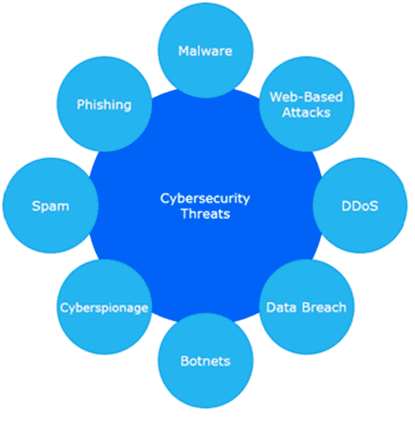 |
| --- |

根据报告和估计，到 2025 年，网络攻击造成的损失每年将达到约 10.5 万亿美元，与 2015 年的数据相比，增长了 300%（Morgan, 2022）。损失成本包括数据损坏和解构、货币资产被盗、知识产权生产力损失、个人和财务数据泄露，以及供应链、业务中断和声誉损害。这已对私营和公营企业造成了前所未有的破坏，增加了全球各种规模企业、政府和教育机构的 IT 预算。因此，针对此类威胁建立防御机制至关重要，使网络安全成为确保数字空间安全的首要任务。

`Cybersecurity` 机制应该处理海量数据，并具备足够的速度、稳健性和智能水平，以学习并适应各种生成的恶意软件。这是公共和私营部门决定整合基于 `AI` 技术以高效监控和应对威胁的主要原因（Ansari et al., 2022）。`Artificial Intelligence` 有助于定义任何系统或网络异常行为的模式。它可以协助处理内部威胁，如未经授权的访问或数据滥用。估计，`Cybersecurity` 中的 `AI` 市场将从 2016 年的 10 亿美元增长到 348 亿美元。表 2 描述了 `Cybersecurity` 中 `AI` 的市场规模趋势和预测，以直观展示其投入金额。由于 `Cybersecurity` 威胁的剧增，预计 2022-2023 年期间的复合年增长率约为 27.8%。

## 3. 网络安全中的传统工具及其局限性

在开发和应用网络安全中的 `AI` 方法时，我们首先需要了解 `Cybersecurity` 中的传统工具，如下：

### 3.1 网络杀伤链与 ISA

`cyber kill chain` 指网络攻击遵循的各个阶段。第一阶段是侦察阶段，攻击者会尝试检测整个系统中的缺陷或漏洞，以便发起攻击。一旦发现漏洞，就会准备恶意代码，并在交付阶段将其传输到确定的目标。恶意软件成功部署到目标上后，它会在系统中安装恶意代码，以破坏整个系统或其部分。这就是 `exploit phase`。由于主机系统已被破坏，它现在受攻击者的指令控制，攻击者随后利用新开发的指令执行恶意活动。通常，`Cybersecurity` 专家根据 `cyber kill chain` 部署防御措施（Yadav & Rao, 2015; Wirkuttis & Klein, 2017）。

`Cybersecurity` 处理此类分组的综合方法是集成安全方法（`Integrated Security Approach`，`ISA`）。该方法定位攻击目标区域，并在入侵发生之前收集相关信息。`Cybersecurity` 专家尝试包含补救措施，将系统恢复到原始状态（Wirkuttis & Klein, 2017

`Cybersecurity` 的常用工具入侵检测防御系统（`Intrusion Detection Prevention System`，`IDPS`），它可以是软件或硬件，负责处理给定数据。它使用两种主要方法：

1. `Misuse detection`：扫描异常行为。
2. `Anomaly detection`：根据现有知识发现任何异常（Patel et al., 2012）。

### 3.3 传统方法的局限性

**复杂攻击的增加：** 近年来，安全威胁变得更加多样化且不断变化，甚至适应了如何绕过保护措施。虽然传统方法具备防御某些类型攻击的能力，但复杂的攻击如高级持续性威胁（`Advanced Persistent Threats`，`APTs`）（Li, 2018）对传统方法提出了挑战。对约 4000 家中型企业的调查发现，威胁数量从 2021 年到 2022 年增加了一倍，且超过 40%的恶意软件从未见过过（Coro, 2022）。网络安全的主要目标是识别在整个持续攻击期间受损系统生成的指标。

**检测率低且可靠性差：** 网络空间的特性导致网络模式存在大量变异，因此模式的识别和描述不准确，导致 `IDPS` 的检测率较低（Wirkuttis & Klein, 2017）。`IDPS` 还容易将正常的系统行为误判为异常，从而产生虚假报警。这对日常流程造成了很大干扰，导致安全专家不得不投入精力寻找错误检测，而不是去做更有意义的事，从而浪费了时间精资源。

**处理能力弱且自动化程度低：** 由于需要扫描的数据量巨大，`IDPS` 在分析数据时必然缓慢（Apruzzese et al., 2023）。这也使得它们效率低下，无法应对不断扩张的数字画布的变异本质。

## 4. 网络安全中的人工智能方法

### 4.1 网络安全中的智能代理与专家系统

这些系统拥有智能代理（Intelligent Agents），它们利用智能行为，例如在实体之间共享获得的知识、主动性以及分类、量化和响应的能力，以便共同找到复杂问题的解决方案。这些代理可以被看作分布在整个系统中的对象，它们具有远见并能够相互进行通信。

此外，这些代理具有主动性，能够在任何类型的拒绝服务（DoS）攻击期间注意到环境的任何波动或变化。DoS 攻击是一种通过禁用某些资源来干扰服务正常运行的网络攻击。通过这种方式，这些去中心化的代理聚集在一起，通过相互合作和交换信息来保护系统免受 DoS 攻击（Yadav & Rao, 2015）。

此类代理有两个主要优势：

i) 代理是去中心化的并分布于系统中，它们能够从系统的各个部分收集完整数据，以便妥分析和识别威胁。

ii) 由于这些代理是“智能”的，它们可以从过去的攻击中积累经验并进行相应的调整，以便对未来的攻击做好更好的准备。

因此，这些代理在监控方面足够强大，并协助网络杀伤链（`cyber kill chain`）的各个阶段。在近年来，网络安全专家已经将智能代理组合成“网络警察”，以去中心化的方式有效对抗安全威胁。这种警察力量已显示出前景，能够尽早识别潜在的目标系统以及攻击。尽管应该注意的是，在网络环境中定义此类警察力量之前，必须获得先前的法律和行业许可，并与 ISP 以及其他可用工具建立伙伴关系以确保高效工作（Guarino, 2013）。

专家们还在使用不同类型的代理，主要是检测代理和反击代理。第一组在系统中搜寻潜在的异常行为，第二组则根据检测代理共享的去中心化数据采取应对措施。如果你注意到，这种方法在某种程度上模拟了人类的免疫系统（Patil, 2016）。

基于专家系统的系统是计算机程序，具有精制的混合工具，这些工具被组合起来协助医疗、商业、研究、技术科学等各个领域复杂问题的决策。专家系统有两个主要部分——知识库和推理引擎。前者可以认为是存储特定领域信息的数据库，而推理引擎则是可以推导出答案的地方（Patil, 2016）（Padron & Ojeda-Castro, 2017）。

在网络安全领域，专家系统可以通过两种方法应用：

i) 基于案例的推理（CBR）方法，该方法考虑过去经验的解决方案来解决新的相似问题。当我们在系统中遇到新问题时，解决方案当然会得到处理和增强。

ii) 基于规则的推理（RBR），遵循专家系统声明的准则。

通过这种方式，这些代理在监控方面足够强大，并协助网络杀伤链的各个阶段。

### 4.2 网络安全中的机器学习

机器学习（ML）是人工智能的一个子集，与计算统计密切相关，因此以预测为中心。它涉及使用数学优化和程序侧重于解释、分类、回归（Patil, 2016）。

机器学习的方法之一是人工神经网络（ANN），它们主要通过集成到所有阶段来防止恶意。不仅如此，像人类大脑一样，它们能够从过去的攻击中汲取经验（Tyugu, 2011）。

ANN 首先在正常网络上进行训练，引入系统的任何新数据都会被迅速分析并与学习模式进行比较，以确定其是否具有恶意。通过这种方式，ANN 促进了基于异常的入侵防御系统（IDPS），并解决了 IDPS 中的一个主要问题——误报。由于数据集经过了细致的处理，误报威胁的概率会降低；而传统的 IDPS 仅对已知的入侵有效，ANN 的集成方法同样能够防御未知威胁（Buczak & Guven, 2015）。

ANN 的特殊之处在于其速度快，有助于安全专业人员自动定义模式是否被感染。今天，ANN 集成在防火墙、网络集线器等多个系统中，用以对抗 DoS、入侵、计算机虫、垃圾邮件、病毒和恶意软件等威胁并监控网络流量（Bitter et al., 2010）。

另一种机器学习技术是支持向量机（SVM），它利用“边界概念”来根据类别分离元素（Ghanem et al., 2017）。

在网络安全中，SVM 主要通过以下四个步骤应用于入侵检测系统：

1. 数据预处理：分析原始数据，并在无人工干预的情况下剔除发现的所有琐碎数据。
2. SVM 可以通过分离超平面分离输入向量，从而在线性、非线性的可分的数据集上工作。
3. 在数据集不可分的情况下，它将使用适当的函数将其映射到高维空间，以便于轻松分离（Martínez Torres et al., 2019）。

决策树也是一种机器学习模型，它具有树状结构，其中类标签作为叶子或节点表示对象值，该值可以通过从根节点到叶子节点的路径得出（Raheja & Munjal, 2021）。决策树广泛应用于通过多种方式实现网络安全，包括入侵检测，在入侵检测中，它根据过去的入侵情况进行训练，并学习将入的网络流量分类为普通形式或可能导致入侵的恶意形式。

如图 2 所示，在每个节点上，都会根据归一化信息增选择将数据元素分类为子集的属性。决策由具有最高归一化信息的属性做出（Xin et al., 2018）。决策树能够自动生成在其开发过程中训练的响应性防护措施（Abubakar et al., 2015）。

它也有助于异常检测，因为通过从正常行为数据构建决策树，模型可以检测偏离所学模式的偏差，以确定系统的异常行为。它通过理解样本恶意文件的属性和模式，在恶意软件分类中也有用。另一个应用是误用检测，它将涉嫌误用行为与预设的规则集进行比较。

这种方法最大的优势是能够隐式地提取属性并提供更简单的解释。决策树也有一些缺点，包括应对未知入侵的能力有限，因此这种方法需要根据最新的入侵情况进行定期更新，并频繁进行训练以对抗高级威胁。另一个缺点是，虽然专家可以通过简单检查较小的树来有效提取知识和规则，但在处理较大的树时，过程会变得非常复杂。树越深越宽，提取规则时就越不直观，因此决策树主要应用于大型安全系统的较小部分（Buczak & Guven, 2015; Raheja et al., 2021）。

| 图 2. 决策树的结构 |
| --- |
| 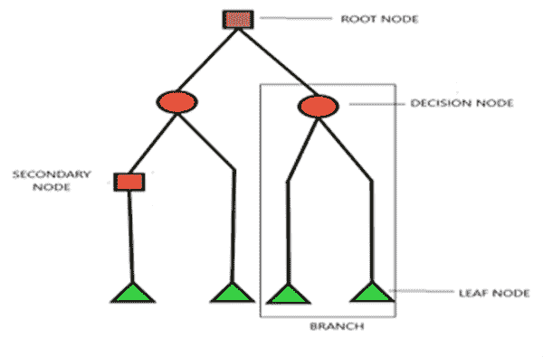 |
| --- |

k-最近邻 `k-NN` 是另一种广泛用于检测异常的机器学习方法，数据被输入 `kNN` 模型后，它计算数据集中跨数据点的元素之间的距离，并在特征空间中寻找最近的“k”个数据点（邻居）（Xin et al., 2018）。通过这种方式，算法映射出数据集并利用距离来定义其中的模式以进行自我训练（Raheja & Munjal, 2021）。

不同的研究表明，这种方法可以提供理想的结果，具有良好的检测率和低误报率。该算法的特殊之处是使用了通用的距离计算公式，使其成为一种非常方便的方法。`KNN` 技术由于能够快速理解新的流量模式，对入侵检测系统提供了极大帮助。因此，它们具备了对抗零日攻击的能力，这种攻击可以在防御措施准备好之前感染系统（Pallaprolu et al., 2017）。

`KNN` 模型已用于对抗僵尸网络，僵尸网络是由恶意实体控制的受损计算机或设备网络，用于各种非法活动，如 `DDoS`（分布式拒绝服务）攻击、垃圾邮件分发以及在所有不知情的情况下窃取数据（Hoang & Nguyen, 2018）。安全专家还利用此模型进行实时威胁检测和虚假数据注入。

由于 `kNN` 计算数据集中实例之间的距离，因此将其用于包含许多不同类别和大量实例的大型数据集并不方便，因此它们被用于网络安全系统中的较小部分（Abubakar et al., 2015; Raheja et al., 2021）。

在网络安全中，遗传算法 `GA` 用于检测 IDPS 系统中的异常，`GA` 研究现有模式以对未来将遇到的的模式获得更深入洞察和可预测性。通过这种方式，集成 `GA` 的 IDPS 可以确保快速识别新异常（Calderon, 2019）。`GA` 也用于改进防火墙以辅助网络流量。`GA` 还可以在加密方面提供帮助，因为它可以解密（Pallaprolu et al., 2017）。`GA` 的特殊特性是其自适应性，它可以适应不断的变化。该模型受到高计算复杂性的影响，需要大量的实验资源，并受多种因素影响（Padron & Ojeda, 2017; Kang & Kang, 2016）。

### 4.3 网络安全中的深度学习

深度学习 `DL` 使用更先进的算法，利用相关数据或系统进展通过连接新旧数据来形成并识别模式。`DL` 与 `ML` 的不同之处在于它可以处理大量数据（无论是监督还是无监督的）。`DL` 方法还通过使用像素强度值、边缘以及图像中各种形状来解释图像，这需要更好的硬件和知识（Calderon, 2019）。

深度置信网络 `DBN` 是一种无监督 `DL` 方法，由层级排列的相互关联层组成。在网络安全中，`DBN` 被集成到 IDPS 中，分析数据并在计算过程中估计所需的隐藏层数。训练期间，各层被单独处理，模型开始对该层的数据进行训练以识别模式并进行计算确定未来状况。训练后，一层的输出作为下一层的输入。

`DBN` 可以以高精确度确定可能的入侵，并检测 IDPS 生成的任何虚报警告。该模型的另一个特征是其“自学习”能力，因此需要的人工辅助较少，模型有改进的空间（Calderon, 2019）。由于其自学习的性质，`DBN` 对新型和高级安全威胁也是有效的，因此可以通过分析用户输入模式和 Web 服务器日志来识别 Web 中的潜在漏洞（Kang & Kang, 2016）。网络安全系统和网络具有涉及数据集的动态性质，因此 `DBN` 模型经过适应可以给出更好的结果（Berman et al., 2019）。

另一种深度学习模型是 `CNN`，它以数组的形式处理数据，能够处理结构化的网格类数据，并能以二维数组的形式表示结果（Calderon, 2019）。它包含三层：

i) `Convolution layer`（卷积层），负责根据输入的 `weights`（可学习参数）定义数据集之间的关系，以生成特征图；

ii) `pooling layer`（池化层），用于解释特征图以提取相关信息；以及


iii) `Classification layer`（分类层），负责处理后数据的高级表示和分类。

详细架构如图所示，其中输入以图像的形式给出，输出以该图像类别标签的形式获得。`CNN` 通过学习钓鱼邮件或网站的特征来用于钓鱼攻击，并分析其结构和视觉元素以防止潜在的钓鱼威胁。`CNN` 的另一个应用是生物识别认证，因为它它可以处理 2D 或 3D 元素形式的数据（Xin et al., 2018）。`CNNs` 用于破解视觉 CAPTCHA（这些字符用于防止自动化机器人访问在线服务）。`CNNs` 处理网络流量数据并分析数据包头或有效负载内容，以检测异常以及未经授权访问、入侵和网络攻击的迹象。该模型针对已知个人的数据集进行训练，以识别关键模式并进行准确的认证（Berman et al., 2019）。Figure 3 展示了基本的 `CNN` 架构。

| 图 3. 基本 `CNN` 架构 |
| --- |
| 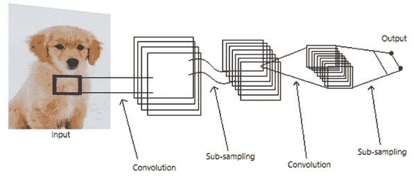 |
| --- |

`RNNs` 是先进的深度神经网络，它们在一次处理一个输入的同时，将隐藏单元的输出作为下一个元素的额外输入。它最适用于数据元素的顺序和上下文对于理解和预测至关重要的任务（Xin et al., 2018）。`RNN` 能够处理语音识别、语言翻译和时间序列问题。`RNNs` 广泛用于网络流量分析，通过识别异常模式或检测特定类型的网络攻击（如 DDoS 攻击）来发挥作用。它提立了对网络流量数据和日志文件进行实时分析，以检测异常和潜在的网络入侵（Kim et al., 2016）。由于 `RNNs` 能够进行序列分析，因此它们适用于事件日志和系统指标，以研究趋势和异常。`RNNs` 分析系统日志以识别可能指示安全违规或未经授权活动的事件序列。它还可以通过分析邮件内容并根据钓鱼邮件中词汇序列或模式检测钓鱼尝试来帮助反钓鱼。`RNNs` 还具有研究现有模式并预测未来模式的能力，因此在面对只有极少或没有过去知识的新兴入侵入侵时非常有效。`RNN` 因此被证明是解决现代安全挑战的有效方法（Berman et al., 2019; Gasmi et al., 2018）。

生成对抗网络（`GAN`）是一种深度学习模型，其中两个神经网络——一个称为 `generator`（生成器），另一个称为 `discriminator`（判别器）——以竞争的方式同时进行训练。`generator` 获取输入数据并产生与原始真实数据相同属性的输出。`discriminator` 接收 `generator` 生成的输出和真实数据，并比较这两个数据集。`GANs` 通过生成与真实数据相似的合成样本用于数据增强。这种数据集的增强有助于提高用于入侵检测、恶意软件分类和其他网络安全任务机器学习模型的性能和鲁棒性（Berman et al., 2019）。`GAN` 可以生成与给定训练数据集相似的新且真实的数据。`GANs` 在处理图像方面显示出广泛的适用性，可用于图像生成和增强等任务，因此在处理深度伪视频生成等新的网络安全问题时有用（Goodfellow et al., 2014）。`GANs` 可以为复杂的网络安全数据创建视觉表示，从而帮助分析师识别大型数据集中的模式、趋势和异常。`GANs` 分析分析内容或网页，根据文本和图像中的模式识别钓鱼尝试或可疑的社交工程学术，从而帮助钓鱼检测（Tasneem et al., 2022）。

## 5. NLP 在网络安全中的作用

自然语言处理或 `NLP` 是数学算法、统计学和语言学的结合。它有助于自动化检测，`NLP` 用于语音识别、用户行为监控、威胁分析。它还对文本进行语境化和情感分析，而不是盲目遵循规则，以便机器能够学习和适应。`NLP` 极大有助于软件漏洞并对整个代码进行扫描。它们还用于处理已识别但尚未发现补救措施的攻击（零日攻击）（Tyugu, 2011）。

## 6. AI 在网络安全中的局限性

与每种开发的技术一样，在网络安全中使用 `AI` 也有一些局限性。

### 隐私风险

引入 `AI` 的最大担忧是潜在的隐私风险。大型公司和政府担心处理网络安全的 `AI 工具` 拥有访问大量敏感或机密数据的权限。它们与使用的第三方 `AI 工具` 之间缺乏信任（Ansari et al., 2022）。

### 需要人工干预

尽管具有准确性，`AI 工具` 自身也容易产生错误和虚假警报。这浪费了需要分析整个系统的安全人员的时间。由于 `AI 模型` 非常复杂，找出错误是什么或错误实际发生在哪里变得更加困难。`AI 系统`可以自动化网络安全，但它们自身仍然不是完全自主的，需要人工监督。

### 缺乏道德

`AI` 还有道德问题，因为它在各个领域取代人类。这些系统没有道德准则。围绕 `AI` 还缺乏法律法规，这可能会被社会中的恶恶实体非法利用。

### 高成本

正如我们之前看到的，`AI` 的研究和开发是巨大的，需要组织投入大量资金且没有成功的保证。它还需要专家人才。这两点对于发展中国家或贫困国家来说都是负担不起的。

## 无法检测威胁

网络环境是一个不断演变的动态空间。近年来，网络威胁变得比以往任何时候都更加复杂和定制化。因此，尽管人工智能在网络安全中具有若干优势，但在许多情况下，它们无法检测并防御攻击，这可能导致严重损失。此外，如果给 `AI` 模型输入即使是极少量的错误数据，也会导致严重的错误（Ansari et al., 2022; Apruzzese et al., 2023）。

## 7. AI 在网络安全中使用的伦理问题

### 7.1 网络犯罪分子利用 AI 破坏网络安全

一个日益增长的问题是，黑客和恶意组织可能会使用 `AI` 本身来破坏网络安全。他们可能会开发规避所有检测并迅速攻击目标的工具。黑客能够欺骗基于 `AI` 的系统，甚至可能针对 `AI` 驱动的防护措施，从而破坏它们。他们可以操纵 `AI` 模型用于训练的数据，使其产生缺陷。对 `AI` 的攻击也很难以检测，因为它们具有复杂的内部过程。犯罪分子还可以对内部过程进行反向工程，以理解其攻击为何能够成功（Taddeo et al., 2019）。对神经网络进行某些操纵后，系统可能会显示正常行为，而漏洞只有在触发时才会被激活，通过这种方式 `AI` 被骗认为一切正常。系统将遭到损坏，以至于即使在触发后也只显示出微小的变化，直到执行致命攻击时，那时已经为时已晚。犯罪分子正在利用 `AI` 协调启动自动化攻击、开发恶意软件病毒、自动化钓鱼和洗钱、制定突破防护的方法，并实施诸如深度伪造（deep fakes）和密码破解等新威胁。

网络安全措施的复杂结构使得发现那些最终决定性的微小差异非常困难，而这些差异足以让攻击者进行其恶意活动。例如，佩戴 `AI` 图像识别系统的可能会因佩戴特制的眼镜而被欺骗，错误地分类其识别对象（Taddeo et al., 2019）。因此，建立一个健壮且专业的 `AI` 系统来防御这些日益增长的担忧是非常重要的。

### 7.2 人机界面

随着网络安全面临的挑战不断增加以及 `AI` 系统集成到其中，人机界面之间的协调和信任有着巨大的需求。在任何层面，当单个系统组件在不考虑系统级目标的情况下追求自身目标时，就会出现问题。此外，在一个虚假信息和操纵横行的时代，良好的决策需要混合方法，以利用并协调人类与 `AI` 的独特能力和视角。需要考虑和努力的重要领域是良好的人机协作、信任建立和辅助。

人类与机器的结合需要确保人类是详尽的并能够轻松解释结果。负责此类系统的人员应该能够识别目标、参与决策过程，并提供被优先处理的反馈。需要研究如何在提供稳定输出的同时最小化延迟和负面后果。在多样化的人机系统环境中，必须管理交互，目标是减少人为错误、增加安全性并提供问责机制（McDaniel et al., 2020）。

## 8. 结论与未来思考

本文讨论了随着威胁数量及其严重性的持续增长，人工智能如何成为网络安全中不可或缺的工具。在这个动态且快速变化的网络环境中，传统方法已不再足够，并讨论了 `AI` 框架是如何集成到网络安全中的。该领域投入了大量资金，并定期制定新技术。文中讨论了一些作为防御威胁工具的 `ML` 和 `DL` 方法。虽然 `AI` 发展迅速且具有巨大潜力，但其在网络安全中的应用仍存在许多需要解决的问题。技术的快速进步、新应用领域以及 `AI` 与网络安全之间的相互作用将继续带来新的机遇和挑战。随着 `IT` 行业的快速增长，网络威胁也随之增加，因此需要进行研究和开发以确保数字世界的安全。

还应通过通过投资测试床和数据集来培养可靠的 `AI` 网络安全系统，以建立安全部署未来 `AI` 系统所需的 `AI` 社区标准和指标。威胁检测机制必须定期进行测试和评估。可能包括创建和维护真实的仿真环境和领域特定数据集。测试床和数据集的设计需要确保评估是以结构化、有原则且可持续的方式进行的。它们还应该具有基准或可重复性，并在各个领域进行定期重新评估。应该提供充足的教育机会，让新鲜的人才加入这一领域。在计算机科学、数据科学、工程和统计学学科交叉的机构层面，应向年轻人普及 `AI` 的优缺点。基于 `AI` 的课程应作为认证流程的一部分。

应优先定义 `AI` 实现的标准，供应商必须在内部开发和训练其模型。测试数据和获得的知识必须由使用这些工具的系统所有者评估。这将促进相关方之间的良好连接，以及数据和模型的访问。除了检测威胁的实际系统外，还应并行运行一个镜像系统作为控制。该系统不是 `AI` 系统的精确副本，而是衡量系统行为的基准。

## 参考文献

Abdi, A., & Wardoyo, R. (2015). Time complexity analysis of support vector machines (`SVM`). International Journal of Computer Applications, `128`(3), 28–34. doi: `10.5120/ijca20159064`

Abubakar, A., Chiroma, H., Muaz, S., & Ila, L. B. (2015). A review of the advances in cyber security datasets for evaluating data-driven intrusion detection systems. Procedia Computer Science, `62`, 221–227. doi: `10.1016/j.procs.2015.08.443`

Ansari, M. F., Dash, B., Sharma, P., & Yathiraju, N. 2022 The Impact and Limitations of Artificial Intelligence in Cybersecurity: A Literature Review. International Journal of Advanced Research in Computer and Communication Engineering, `11`(9). doi: `10.17148/IJARCCE.2022.11912`

Apruzzese, G., Laskov, P., Montes de Oca, E., Mallouli, W., Brdalo Rapa, L., Grammatopoulos, A. V., & Di Franco, F. (2023). The role of machine learning in cybersecurity. Digital Threats: Research and Practice, `4`(1), 1–38. doi: `10.1145/3545574`

Berman, D. S., Buczak, A. L., Chavis, J. S., & Corbett, C. L. (2019). A survey of deep learning methods for cyber security. Information (Basel), `10`(4), 122. doi: `10.3390/info10040122`

- Bitter, C., Elizondo, D. A., & Watson, T. (2010, July). 人工神经网络及相关技术在入侵检测中的应用。在 2010 年国际神经网络联合会议 (`IJCNN`)（pp. 1–8）。`IEEE`. doi: [10.1109/IJCNN.2010.5596532](https://doi.org/10.1109/IJCNN.2010.5596532)

- Buczak, A. L., & Guven, E. (2015). 用于网络安全入侵检测的数据挖掘与机器学习方法综述。`IEEE Communications Surveys and Tutorials`, 18(2), 1153–1176。doi: [10.1109/COMST.2015.2494502](https://doi.org/10.1109/COMST.2015.2494502)

- Buczak, A. L., & Guven, E. (2015). 用于网络安全入侵检测的数据挖掘与机器学习方法综述。`IEEE Communications Surveys and Tutorials`, 18(2), 1153–1176。doi: [10.1109/COMST.2015.2494502](https://doi.org/10.1109/COMST.2015.2494502)

- Calderon, R. (2019). 人工智能在网络安全中的优势。

- Coro. (2022). 最大网络安全威胁。Coro。[`go.coro.net/cyberthreats2022`](https://go.coro.net/cyberthreats2022)

- Gasmi, H., Bouras, A., & Laval, J. (2018). 用于网络安全实体识别的 `LSTM` 递归神经网络。`ICSEA`, 11, 2018。

- Ghanem, K., Aparicio-Navarro, F. J., Kyriakopoulos, K. G., Lambotharan, S., & Chambers, J. A. (2017, December). 用于网络入侵和网络攻击检测的支持向量机。在 2017 年国防传感器信号处理会议 (`SSPD`)（pp. 1–5）。`IEEE`. doi: [10.1109/SSPD.2017.8233268](https://doi.org/10.1109/SSPD.2017.8233268)

- Goodfellow, I., Pouget-Abadie, J., Mirza, M., Xu, B., Warde-Farley, D., Ozair, S., & Bengio, Y. (2014). 生成对抗网络。`神经信息处理系统进展`, 27。

- Guarino, A. (2013, June). 网络攻击中的自主智能体。在 2013 年第 5 次国际网络冲突会议 (`CYCON 2013`)（pp. 1–12）。`IEEE`。

- Hoang, X. D., & Nguyen, Q. C. (2018). 基于使用 `DNS` 查询数据的机器学习技术的僵尸网络检测。`Future Internet`, 10(5), 43。doi: [10.3390/fi10050043](https://doi.org/10.3390/fi10050043)

- Kang, M. J., & Kang, J. W. (2016). 使用深度神经网络用于车载网络安全的入侵检测系统。`PLoS One`, 11(6), e0155781。doi: [10.1371/journal.pone.0155781](https://doi.org/10.1371/journal.pone.0155781)

- Kim, J., Kim, J., Thu, H. L. T., & Kim, H. (2016, February). 用于入侵检测的长短期记忆递归神经网络分类器。在 2016 年平台技术与服务国际会议 (`PlatCon`)（pp. 1–5）。`IEEE`。doi: [10.1109/PlatCon.2016.7456805](https://doi.org/10.1109/PlatCon.2016.7456805)

- Li, J. H. (2018). 网络安全遇到人工智能：综述。`Frontiers of Information Technology & Electronic Engineering`, 19(12), 1462–1474。doi: [10.1631/FITEE.1800573](https://doi.org/10.1631/FITEE.1800573)

- Markets and Markets. (2019). 网络安全中的人工智能市场。Markets and Markets。`www.marketsandmarkets.com`

- Martínez Torres, J., Iglesias Comesaña, C., & García-Nieto, P. J. (2019). 应用于网络安全的机器学习技术。`国际机器学习与网络安全学`, 10(10), 2823–2836。doi: [10.1007/s13042-018-00906-1](https://doi.org/10.1007/s13042-018-00906-1)

- McDaniel, P., Launchbury, J., Martin, B., Wang, C., & Kautz, H. (2020). 人工智能与网络安全：机会与挑战。网络与技术研究委员会以及机器学习与人工智能委员会。

- Morgan, S. (2022, January). 2022 网络安全年鉴：100 个事实、数据和统计。Cybersecurity Ventures。[`cybersecurity.com/cybersecurity-almanac-2022/`](https://cybersecurity.com/cybersecurity-almanac-2022/)

- Padron, J. M., & Ojeda-Castro, A. (2017). 网络战：前线的人工智能。`International Journal of Research and Review`, 4(6), 4208–4212。


- PallaprolS. SankinenR.KarabatisG.WangJ. (2017, June). 流流数据的零日攻击识别。2017 IEEE 大数据大会 (BigData Congress) (pp. 121-128). doi:[10.1109/BigData.2017.25](https://doi.org/10.1109/BigData.2017.25)

- Patel, A., Taghavi, M., Bakhtiyari, K., & Jr, J. (2012). 云计算中的入侵检测与预防系统。Journal of Network and Computer Applications, 36(1), 25–41. doi:[10.1016/j.jnca.2012.0807](https://doi.org/10.1016/j.jnca.2012.0807)

- Patil, P. (2016). 网络安全中的人工智能。International Journal of research application and robotics.

- Raheja, S., & Munjal, G. (2021). Office 漏洞分类：安全开发的进步。Bio-inspired Neurocomputing, (pp. 381-402).

- Raheja, S., Munjal, G., Jangra, J., & Garg, R. (2021). 基于规则的僵尸网络行为。智能数据分析用于恐怖预测：架构、方法论与应用，(pp. 161-179).

- Saha, M., Sengupta, A., & Das, A. (2020). 人工智能中的网络威胁。

- Taddeo, M., McCutcheon, T., & Floridi, L. (2019). 在网络安全中信任人工智能是一把双刃剑。Nature Machine Intelligence, 1(12), 557–560. doi:[10.1038/s42256-019-0109-1](https://doi.org/10.1038/s42256-019-0109-1)

- TasneemS. GuptaK. D.RoyA.DasguptaD. (2022, December). 用于网络安全的生成对抗网络 (GAN)。2022 年 IEEE 计算智能研讨会论文，(pp. 4-7)。 IEEE.

- Tyugu, E. (2011, June). 网络防御中的人工智能。在 2011 年第 3 次国际网络冲突会议 (pp. 1-11)。 IEEE.

- Wirkuttis, N., & Klein, H. (2017). 网络安全中的人工智能。Cyber, Intelligence, and Security, 1(1), 103–119.

- Xin, Y., Kong, L., Liu, Z., Chen, Y., Li, Y., Zhu, H., Gao, M., Hou, H., & Wang, C. (2018). 用于网络安全的机器学习与深度学习方法。IEEE Access: 实际创新、开放解决方案，6, 35365–35381. doi:[10.1109/ACCESS.2018.2836950](https://doi.org/10.1109/ACCESS.2018.2836950)

- Yadav, T., & Rao, A. M. (2015). 网络杀伤链的技术方面。在计算与通信安全：第三次国际研讨会，SSCC 2015。Springer International Publishing.

# 第 7 章

* S. T. Veena, Mepco Schlenk Engineering College, 印度

* N. R. Somnath Babu, Mepco Schlenk Engineering College, 印度

* P. Santosh, Mepco Schlenk Engineering College, 印度

### 摘要

最近云端数据共享被广泛使用并成为一种趋势。但保护数据的机密性和完整性至关重要。数据的机密性和完整性通过加密来维护。然而，由于它无法确保数据未被更改，仍然存在信任问题。代理重加密 (`PRE`) 技术被提出作为此问题的解决方案。它包括对数据进行两次加密，允许人们判断数据是否被更改。`PRE` 系统也容易受到伪造重加密密钥的攻击。在这里，数据被加密两次，以便检查数据是否被修改。但 `PRE` 系统容易出现重加密密钥滥用的问题。因此，提出了问责代理重加密 (`APRE`)。在这里，如果数据被代理修改，系统将检测出代理是具有恶意的，还是委托者在试图陷害代理。此外，作者扩展了算法并实现了 `base64` 编码与解码。这防止了许多被动网络攻击。

## 1. 引言

在当今数字世界中，数据是一项关键资源，并且在我们生活的各个方面正变得越来越重要。在当今互联通的世界里，数据共享也至关重要。通过共享数据，我们可以协作工作，解决复杂问题并做出更好的决策。当用户想要共享数据时，云存储是最佳选择。在云端共享数据时，数据的机密性是核心担忧。内容所有者无法确保数据的机密性和完整性。数据加密是解决这一问题的关键方法。因此，有多种加密技术可用。数据由内容所有者（或委托者）加密，其还将解密密钥分发给数据消费者。为了实现这一工作，内容所有者必须始终在线。为了解决这个问题，Blaze 等人（1998）提出了代理重加密（PRE）。在云端应用 PRE 时，最初委托者、代理和被委托者共享所有的公钥证书进行身份验证。数据由内容所有者（或委托者）加密并上传到云端。使用重加密密钥，代理对密文进行重新加密。共享的数据首先被加密，然后将密文发送给代理。内容所有者根据内容接收者的请求产生重加密密钥并提供给代理，代理随后重新加密密文并将其转发给接收者。

但代理和内容所有者共同具有发现解密密钥的能力并可能滥用数据。此外，数据所有者可以将代理陷害为恶意。

因此，为了确保数据安全并检查委托者或代理是否具有恶意，Guo 等人（2021）提出了可问责代理重加密（APRE）。在这里将有一个法院模块。任何人都可以寻求法院进行验证。代理与被委托者可以修改数据，或者委托者可以指控代理具有问责性。为了识别这一点，使用了法院模块。该模块使用一种法官算法。该算法获取初始密文，然后要求代理和委托者对其进行解密。通过观察明文，法院模块将发现代理还是委托者具有问责性。

APRE 方案并没有捕获所有攻击。网络上存在许多攻击，会导致选择明文攻击（CPA）/选择密文攻击（CCA-CCA）。这可能导致数据所有者遭受严重损失。因此，为了进一步扩展安全性，我们的系统使用了 base64 编码和解码。

## 2. 相关工作

除了代理重加密技术（Sun et al., 2018）外，还提出了一种云辅助密文演化的可撤销身份加密方案。为了防止选择密文攻击并避免伪造真实的密文或签名，他们设计了一种利用密文演化的可撤销身份加密（RIBE）方案。

作为一种安全范式，为了克服传统 PRE 方案中半信代理一旦从委托者处获得相关重加密密钥，就能将委托者的所有密文转换为被委托者的密文这一事实，（Zeng and Choo, 2018）建议了发送者指定的代理重加密（SS-PRE）技术，该技术允许为特定密文分配解密权限。该方案主要用于访问方法。随着计算效率的提高，SS-PRE 免受许多攻击的侵害。

为了防止代理重加密密钥的滥用，Liu 等人（2019）提出了一种可问责代理重加密技术，用于在各种用户之间传输加密内容。性能测试已经证明了这种方法的有效性。在这里，密钥在传输过程中被安全加密以确保安全。

云计算属性基加密（ABE）方法由（Li et al., 2019）提出，旨在降低用户和代理云服务供应商（PCSP）的存储和处理成本。在决策 q 并双线性 Diffie-Hellman 指数的假设下，该方案是安全的（BDHE）。

（Wang et al., 2019）引入了用于云存储的可变多关键词可搜索属性基加密（VMKS-ABE）技术。它能够抵抗自适应关键词和选择性明文攻击。它处理许多计算函数，并可以减少用户侧的工作负载。

内容被安全地传输。在一组广播重加密密文集中，（Wang et al., 2019）提出了一种接收者隐私方法。与之前的广播系统和当前的隐私保护方案相比，我们的方案解密所需的时间更短。

在信息中心网络（ICN）范式下，（Li et al., 2019）提出了一种有效的代理重加密（PRE）技术，降低了用户侧开销并提供了灵活的数据交换。该方法在计算成本和复杂度方面是有效的，并且在完整的 ICN 加密中能够防御自适应可重放选择密文攻击（RCCA）。

为了确保雾计算（fog-to-things computing）之间的通信安全，（Khashan, 2020）提出了一种结合轻量级和非对称算法的系统，对于雾节点执行的重加密具有非常低的计算成本。可撤销身份基广播重加密（RIB-BPRE）是由 Ge 等人（2021）开发的一种安全概念，解决了密钥撤销问题。RIB-BPRE 中的代理能够移除由委托者选择的一组被委托者。性能分析表明，该方案是有效且可行的。它分析了模型的安全性。可问责代理重加密（APRE）利用法官算法来识别解密密钥的潜在滥用，由 Guo 等人（2021）开发。代理服务器上共享的数据完整性由 APRE 方案保证。它确保了数据的完整性。为了允许授权用户访问数据，Agyekum 等人（2022）设计了基于身份加密的代理加密。使用这种技术，缓存内容可以有效地交付到物联网设备。

## 3. 提提模型

在日常生活中，数据是最宝贵的资源，确保其机密性和完整性至关重要。然而，当数据所有者通过云共享数据时，通常存在信任问题，因为他们无法判断共享的数据是否被更改。为了解决这一担忧，Guo 等人提出了可问责代理重加密（APRE）方案。APRE 引入了一种新方法来解决信任问题，法院可以根据所提供的确凿证据来判定结果。因此，如果代理与任何被委托者合谋并分发解密设备，法官算法可以识别出恶意代理，代理面临被发现并承担责任的风险。然而，现有的系统容易受到许多网络攻击的影响，这些攻击可能会捕获传输的密文并尝试通过收集多个密文来解密。因此，我们提出了一种可以应对此类网络攻击的新系统。

最初为代理服务器、数据所有者和消费者生成公钥，随后将其共享给所有方进行身份验证。在创建内容所有者的密钥后，委托者使用消费者的公钥对明文进行加密，生成第一级密文。然后，内容所有者使用其私钥、代理的公钥以及自身的公钥创建一个重加密密钥。为了防止私钥被获取并停止有害的代理行为，必须合理设计重加密密钥。

| 图 1. 数据共享阶段 |

| --- |

| 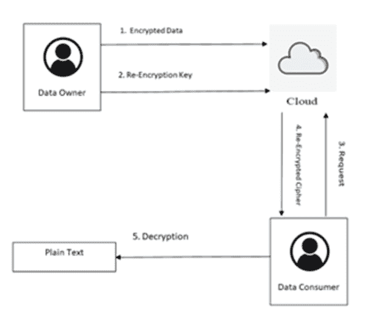 |

| --- |

在数据共享阶段，如图 1 所示，委托者使用消费者的公钥加密明文，生成第一级密文。第一级密文和重加密密钥都被传输到代理服务器。随后，代理利用重加密密钥和其私钥对第一级密文进行重加密。当消费者请求访问文件时，代理向内容接收者提供重加密后的密文。接收者使用其私钥解密重加密的密文，获取原始明文。

| 图 2. 问责阶段 |

| --- |

| 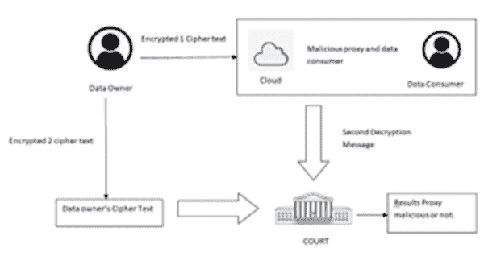 |

| --- |

在问责阶段，内容所有者通过使用自己的公钥对明文进行加密来创建第二级密文，如图 2 所示。所有者对第二级密文进行二级解密。之后，法官算法创建一个再次在二级被解密的密文。当比较两个二级解密的通信内容时，如果它们相似，则可以推断出代理正在进行恶意操作。所提模型的流程图见图 3。

APRE 方案无法防止重加密密钥滥用攻击，但它确实对恶意方产生了威慑。从结构上说，我们的基本概念是给委托者和代理提供各种“解密能力”。也就是说，他们其中之一可以针对特定的异常密文实现预期的解密结果。我们可以通过使用解密设备分析特定的密文，来识别代理或委托者是否带有恶意。为了实现这一点，我们需要在细节上投入大量精力来设计重加密密钥和密文。

如今网络上发生了许多攻击。许多如嗅探之类的被动攻击现在已可行。这将静地监听流量并观察所有数据包。这在密码学中至关重要。当攻击者获取大量密文时，可以使用许多密码分析工具获取私钥。一旦攻击者获得密钥，将造成巨大损失。为了防止这种情况，使用了许多算法。其中一种算法是 Base64 编码和解码。Base64 编码和解码主要用于数据通过网络或某些通信通道传输时。Base64 可以在通过网络发送之前编码敏感数据（如密码或信用卡号）。这可以防止攻击者拦截并窃取传输中的数据。Base64 可用于混淆代码，增加攻击者理解的难度。在将重加密密钥和密文传输到云端时，攻击者可能会窃取并用于获取私钥。这种方法可以防止攻击者的此类行为。我们的方案还针对网络上发生的被动攻击。某些攻击包括中间人攻击、监听、监视、数据包嗅探、足迹、流量分析。

| 图 3. 流程图 |

| --- |

| 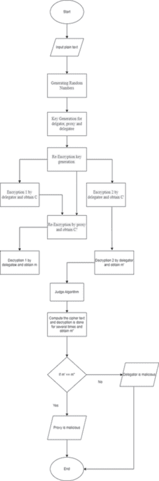 |

| --- |

## 4. 基础知识

假设 `r` 是群 `P` 的生成器，且 `R` 和 `R[T]` 是两个阶数大于或等于 2 的素数循环群，其中 `P` 表示安全强度，如果命名为 `e: R×R→R[T]` 的映射函数满足下列要求，则称为双线性映射：

第一个要求 `e: R×R→R[T]` 为双线性映射的要求是：对于属于特定群的任何值 `u`、`v`、`a` 和 `b`，`e(u^a,v^b)` 必须等于 `e(u,v)^(ab)`。

另一个条件是 `e` 必须是非退化的，这意味着如果 `R` 由 `r` 生成，那么 `R[T]` 必须由 `e(r,r)` 生成。

最后，`e` 必须能够高效计算，这是它被视为双线性映射的另一个条件。

## 5. 定义与安全模型

我们在工作中定义了一个安全参数来表示安全程度。我们展示展示一个由若干算法组成的 PRE 方案，例如：

- `Initialize()`：在提供安全参数后，由该程序产生随机选择的公共参数值。

- `ProxySet(value)`：通过此过程创建代理的公钥和私钥对，分别指定为 `pk[p]` 和 `sk[p]`。

- `KeyGeneration(value)`：通过此过程生成用户的私钥和公钥对，分别表示为 `sk[x]` 和 `pk[x]`。

- `ReKeyGeneration(sk[x],pk[y],pk[p])`：使用内容所有者的私钥 `sk[x]`、消费者的公钥 `pk[y]` 以及代理的公钥 `pk[p]`，此程序创建一个重加密密钥，记为 `rk[x→y]`。

- `Encryption1(pk[y],m)`：使用内容所有者的公钥 `pk[y]` 和消息，该算法生成一个密文，指定为 `Z[y]`。这不应被重加密。

- `Encryption2(pk[x],m)`：使用内容接收者的公钥 `pk[x]` 和消息，该算法生成另一个密文，指定为 `Z[x]`。

- `ReEncryption(rk[x→y],sk[p],Z[x])`：使用重加密密钥 `rk[x→y]`、云服务器的私钥 `sk[p]` 以及密文 `Z[x]`，该技术创建一个重加密后的密文，作为 `Z[y]`。

- `Decryption1(sk[y],Z[y])`：以私钥 `sk[y]` 以及密文 `Z[y]` 或重加密后的密文 `Z[y]` 为输入，该技术生成消息。

- `Decryption2(sk[x],Z[x])`：此程序获取私钥 `sk[x]`、密文 `Z[x]` 并创建消息。

 该技术通过提供特定的访问并以公钥 `pk[x], pk[p]` 作为输入，识别是代理还是委托者创建了解密设备。

- `Base64 Encoding(Z[x])`：该算法使用 Base64 编码用于重加密的密文 `Z[x]`，将其转换为二进制并重复 24 位组直到编码整个原始数据字节。

- `Base 64 Decoding(D[x])`：该算法解码用于重加密的密，忽略编码器使用的任何填充字符。

正确性条件是：给定从 `ProxySet(value)` 获取的任意密钥对 `(pk[p],sk[p])`、从 `KeyGeneration(value)` 获取的任意密钥对 `(pk[x],sk[x])` 和 `(pk[y],sk[y])`、从 `ReKeyGeneration(sk[x],pk[y],pk[p])` 获取的任意重加密密钥 `rk[x→y]` 以及明文空间中的任意内容，满足以下条件：

- `Decryption1(sk[y]), Encryption1(pk[y],m)=m;`

- `Decryption2(sk[x]), Encryption2(pk[x],m)=m;`

- `Decryption1(sk[y]), ReEncryption(rk[x→y],sk[p], Encryption2(pk[x],m)=m;`

## 6. 构造

本节提供了系统概述及其底层假设。系统中使用了重加密密钥，将这些密钥与代理紧密结合对于检测恶意活动至关重要。如果代理能够生成一个与自身无关的加密密钥，那么判定算法将无法识别该代理。重加密密钥还必须保持私密，以防止恶意的委托陷陷代理。开发重加密密钥是为了作为云服务器公密钥的一部分。只有对解密设备拥有特定的访问权限，才能识别设备创建者并确定责任方。密文的设计应使内容所有者和带有内容接收者的代理得出不同的结论，以便法官能够通过仔细检查解密设备的输出来识别密文的作者。

`Setup()`：假设 `λ` 是基于安全性的参数，我们有两个阶数为 `p` 的素群 `R` 和 `R[T]`，其中 `p` 大于或等于 `2` 的 `λ` 次方。我们还有一个双线性映射 `e:R×R→R[T]`。为了初始化系统，我们从群 `R` 中随机选择四个元素：`g1`、`g2`、`h1` 和 `h2`。然后我们将 `L` 计算为对 `h1` 和 `h2` 求 `e` 的结果。这些值代表系统参数。

`value= (g[1], g[2], h[1], h[2], L)`

`ProxySet(value)`：生成代理密钥对，从整数集合 `{0,1,2,...,p-1}` 中选择一个随机值 `z` 并计算 `K=g[2]`。将 `K` 分配为公钥 `pk[p]`，将 `z` 为私钥 `sk[p]`。


`KeyGeneration(value)`：生成密钥对，从整数集合 `{0,1,2,...,p-1}` 中选择两个随机值 `x[i]` 和 `y[i]`。计算 `X[i]` 和 `Y[i]`。将 `(X[i],Y[i])` 设置为公钥 `pk[i]`，将 `(x[i],y[i])` 设置为私钥 `sk[i]`。

`ReKeyGeneration(sk[x],pk[y],pk[p])`：给定私钥 `sk[i]`、公钥 `pk[y]` 和公钥 `pk[p]`，计算值 `R`。将 `R` 分配为重加密密钥 `rk[x→y]`。

`Encryption1(pk[y],m)`：给定 `pk[y]` 和 `m`，随机选择 `r←K[p]` 并计算结果。将其设置为第一级密文。

`Encryption2(pk[x]m)`：给定 `pk[x]` 和 `m`，随机选择 `r←K[p]` 并计算：

`z[a]= L^r.m`

`z[c]= e(h[1],g[2])^r`

计算 `Z[x]= (z[a],z[b],z[c],z[d])` 并设置为第二级密文。

`ReEncryption(rk[x→y],sk[p],Z[x])`：给定 `rk[x→y]`、`sk[p]` 和 `Z[x]`，它计算结果。计算结果设置为重加密密文。

`Decryption1(sk[y],Z[y])`：给定 `sk[y]` 和 `Z[y]`，它计算消息。

`Decryption2(sk[x]Z[x])`：给定 `sk[x]` 和 `Z[x]`，它计算消息。

`Decryption3(D[x])`：获取解密设备 `D[x]`、`k[x]`、`pk[p]` 并执行以下程序。迭代以下实验 `n = λ` 次。随机选择 `r`、`m∈G[r]` 并计算：

`z[a]= m.L^r`

`zc`

对 `Z` 应用解密，并获得输出 `m'`。如果 `m'` 等于 `m`，则打印 "Proxy（代理）”。否则，返回消息 "Delegator is trying to frame proxy as malicious（委托人正试图将代理陷害为恶意行为）"。

## 算法

### `Encryption(pk,m)`

**输入：** 来自用户的明文和委托代理的公钥。

**输出：** 密文。

计算 `z[a]=L^r.m`。

如果 `pk == pk[y]`：

计算 `z[c]=L^r.e(h[x],Y[y])^r`。

返回结果。

否则：

计算 `z[c]=e(h[1],g[2])^r`。

设置 `Z[x]= (z[a], z[b], z[c], z[d])`。

返回 `Z[x]`。

### `ReEncryption(rk[x→y],sk[p],Z[x])`

**输入：** 重加密密钥、代理的私钥和第二级密文。

**输出：** 密文。

计算结果。返回结果。

### `Decryption(sk,Z)`

**输入：** 消费者或内容所有者的私钥以及第一级密文或第二级密文。

**输出：** 明文，`m`。

如果 `sk == sk[y]`：

计算结果。返回 `m`。

否则：

计算结果。返回 `m`。

### `Decryption4()`

**输入：** 内容所有者的公钥和代理的公钥。

**输出：** 明文，结果。

计算 `z[a]=m.L^r`。

此输出展示了加密模块。显示了明文到密文的转换。第一次加密以明文和数据所有者的公钥为输入，生成了 `z[a]`、`z[b]`、`z[c]`。`z[a]`、`z[b]`、`z[c]`共同形成了第一级密文。第二次加密以明文和数据消费者的公钥为输入，生成了 `z[a]`、`z[b]`、`z[c]`、`z[d]`。这四个值共同形成了第二级密文。生成的输出值见图 4。

| 图 5. 解密过程 |
| --- |
| 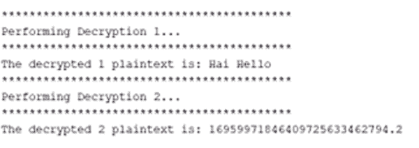 |
| --- |

此输出展示了解密模块。`decryption1` 生成数据所有者的明文，`decryption2` 值生成一个将用于判定算法的值。

| 图 6. 代理存在恶意 |
| --- |
| 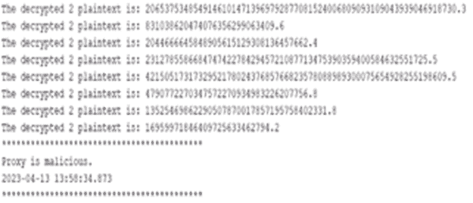 |
| --- |

图 6。展示了代理恶意的场景。判定算法将运行多次。在运行一定次数后如果输出匹配，则判定算法显示代理存在恶意。

| 图 7. 委托者诬陷代理为恶意 |
| --- |
| 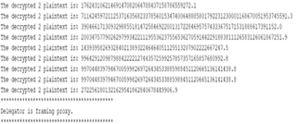 |
| --- |

图 7。展示了委托者试图诬陷代理为恶意的场景。判定算法将运行多次。在运行一定次数后如果输出不匹配，则判定算法显示委托者在诬陷代理。这证明代理是无辜的，而委托者是恶意的。

| 图 8. 代理恶意时的图表 |
| --- |
| 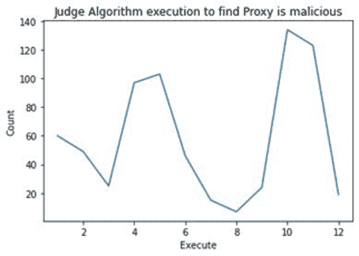 |
| --- |

该图展示了检测代理恶意的判定算法的平均执行情况。

## 9. 结论

云数据共享服务的消费者主要担忧是存在信任问题。为了克服这个问题，我们开发了可责代理重加密（Accountable PRE, APRE）的概念。我们最初形式化了可责代理重加密（APRE）的概念，其中判定算法可以识别滥用重加密密钥的代理。然后，为了防止网络风险，我们增加了 base64 编码/解码。此外，在选择性明文攻击（CPA）的前提下，它是决策性迪菲-赫曼（DBDH）安全且负责任的。与早期的系统相比，我们的系统提供了更优的性能。

## 参考文献

- Ge, C., Liu, Z., Xia, J., & Fang, L. (2019). Revocable identity-based broadcast proxy-encryption for data sharing in clouds. IEEE Transactions on Dependable and Secure Computing, 18(3), 1214–1226. doi:10.1109/TDSC.2019.2899300
- Guo, H., Zhang, Z., Xu, J., N., & Lan, X. (2018). Accountable proxy-encryption for secure data sharing. IEEE Transactions on Dependable and Secure Computing, 18(1), 145–159. doi:10.1109/TDSC.2018.287601
- Huang, Q., Yang, Y., & Fu, J. (2018). Secure data sharing and dissemination with attribute and time in the public cloud. IEEE Transactions on Services, 14(4), 1013–1025. doi:10.1109/TSC.2018.2850344
- Khan, O. A. (2020). Hybrid lightweight proxy-encryption scheme for secure fog-to-things environment. IEEE Access: Practical Innovations, Open Solutions, 8, 66878–66887. doi:10.1109/ACCESS.2020.2984317
- Kwame, O.-B. O. A., Xia, Q., Sifah, E., N., A. C., Xia, H., & Gao, J. (2022). A Proxy Re-Encryption Approach to Secure Data Sharing in the Internet of Things Based on Blockchain. IEEE, 16(1), 2164–5188.
- Li, J., Wang, S., Li, Y., Wang, H., Wang, H., Chen, J., & You, Z. (2019). An Efficient Attribute-Based Encryption Scheme With Policy Update and File Update in Cloud Computing. IEEE Transactions on Industrial Informatics, 15(2), 1919–4770. doi:10.1109/TII.2019.293116
- Sun, Y., Susilo, W., Zhang, F., & Fu, A. (2018). CCA-secure revocable identity-based encryption with ciphertext evolution in the cloud. IEEE Access: Practical Innovations, Open Solutions, 6, 56977–56983. doi:10.1109/ACCESS.2018.287301
- Wang, S., Jia, S., & Zhang, Y. (2019). Verifiable and multi-keyword searchable attribute-based encryption for cloud storage. IEEE Access: Practical Innovations, Open Solutions, 7, 50136–50147. doi:10.1109/ACCESS.2019.291082
- Zeng, P., & Choo, K.-K. R. (2018). A New Kind of Conditional Proxy-Encryption for Secure Cloud Storage. IEEE Access: Practical Innovations, Open Solutions, 6, 2169–3536. doi:10.1109/ACCESS.2018.287947
- Zahoman, L., Wu, L., Ke, J., Wang, H. (2019). Accountable Outsourcing Location-Based Services With Privacy Preservation. IEEE Access, 7, 2169–3536.

# 第 8 章：应对数字时代的风险与回报

- S. Boopathi, 机械工程, Muthayammal Engineering College (自治), 印度

## 摘要

本章探讨了数字时代创新与安全之间的复杂关系。它强调了数字时代的挑战以及云计算的变革性影响，强调了其驱动创新的作用。本章还深入介绍了云服务和部署模型，讨论了云安全的优势与挑战。此外，通过案例研究讨论了创新在推动进步和应对挑战方面的作用。本章涵盖了云风险评估与缓解、合规性、监管挑战、法律和伦理考量以及最佳实践。它还探索了人工智能和机器学习、零信任安全以及未来方向新兴技术。

## 引言

云已成为数字时代的关键工具，为企业创新和安全运营提供了灵活性、可扩展性和访问性。它彻底改变了数据存储、处理、协作和业务交付。然而，这种数字化转型也使组织面临新的安全风险。挑战在于如何在创新的潜力与保护敏感信息及关键资产受不断变化的威胁之间取得平衡。云通过实现新产品服务的快速进入市场、流程优化和收入产生，彻底改变了业务运营。本章深入探讨了云环境中创新与安全之间的复杂关系，为读者提供了应对这一动态格局所需的必要知识和策略。

本文探讨了云计算的基础知识、其服务模型和部署模型，以及对创新和安全的影响。它研究了组织使用云技术的真实案例、其面临的安全挑战以及风险缓解策略。文中还讨论了风险评估、监管环境以及保护云资产的实践建议。通过案例研究和新兴趋势，本文旨在理解云创新与安全的现状（Gozman & Willcocks, 2019）。在数字时代，使用云的决策并非在创新与安全之间的简单选择，而是一段需要审慎考虑和明智决策的复杂旅程。数字时代，也被称为信息时代或第四次工业革命，带来了前所未有的机遇与挑战，而云计算是这一范式转变的核心驱动力。本节探讨了数字时代带来的独特挑战，以及这些挑战如何与云技术的采用交织，邀请读者加入我们的这一关键旅程（RM et al., 2020）。

数字时代彻底改变了创新，云计算在快速开发和市场渗透方面发挥着至关重要的作用。然而，这种快速节奏也可能带来挑战，例如仓促的部署和安全考虑的不足。数字时代导致了数据丰裕时代，企业和个人收集并存储海量数据。这些数据产生了复杂的数据管理和安全挑战，使得保护敏感数据数据（Kunduru, 2023）。随着数字技术的进步，恶意攻击者的能力也在不断增强，使得网络安全威胁变得更加复杂、频繁且具有破坏性。云作为网络攻击的首要目标，是这些威胁的主要攻击对象，这使得保护云系统和应用程序免受这些不断变化的威胁成为了一场持久的斗争。

数字时代导致了严格的数据保护和隐私法规，影响了云端运营。组织在利用云优势的同时，必须遵守区域和全球的合规性要求。关于数据隐私、所有权以及在云应用中伦理地使用人工智能和机器学习的担忧也是关注的焦点（Rayhan & Rayhan, 2023）。法律框架正在演变以应对这些挑战，为云采用者增加了复杂性。应对数字时代的挑战需要对其中发挥作用的技术、组织和社会动态有全面的理解。在这种背景下，云计算既是一种解决方案，也是的一项挑战，它在提供创新承诺的同时，要求采取高度警觉的安全措施。本章的后续章节将深入探讨云技术在应对和加剧这些挑战方面的作用，并为组织如何如何在云端有效平衡创新与安全提供见解（Shahid et al., 2020）。

云计算是数字时代的关键支柱，影响着现代组织的每一个方面。它允许组织快速扩展其计算资源，适应波动的负载并优化资源利用。云计算通过允许企业在无需对基础设施进行巨额前期投入的情况下对其解决方案进行实验、迭代和扩展，从而赋能创新。其按需付费的模式有助于组织避免维护和升级物理硬件的高昂负担（Jyoti et al., 2020）。将基础设施和管理责任外包给云服务提供商，允许组织更高效地引导资源，将资金投入到直接影响其核心使命的创新和安全领域（Hema et al., 2023）。

云服务提供了全球访问性，实现了地理分散的远程工作、协作和服务交付。云通过允许对人工智能等新兴技术进行实验，加速了创新的进程。云提供了必要的基础设施，减少了创新所需的时间和精力（Venkatesw, Vidhya, et al., 2023）。云服务集中了数据存储，促进了成员间的协作。然而，这也引发了对数据安全的担忧。云服务提供商在安全方面投入巨大，提供了可以增强组织安全的解决方案。解决这些挑战对于成功的云采用至关重要（Srinivas et al., 2023）。

云资源在多个客户之间共享，节省了成本但也引入了安全风险。云的灵活性允许组织快速适应市场状况和客户需求，促进新功能的部署（Satav, Lamani, et al., 2024）。云服务通常内置灾难恢复和业务连续性功能，确保组织能够从中断中恢复并维持运营。云计算在数字时代至关重要，使组织能够在数据驱动的世界中快速创新并保护运营。然而，需要微妙的方法来平衡云端的创新与安全，这一主题将在后续章节进一步探讨（Syamala et al., 2023）。

## 目标

本章提供了对云计算及其各种服务和部署模型及其优势的全面理解。它探讨了云技术如何促进创新、加速产品和服务开发并增强竞争力。它还讨论了网络安全威胁和合规法规，强调了保护云运营的必要性。文中强调了云端创新与安全之间的张力，为组织有效管理风险、法律和伦理考量以及开发安全策略、治理、身份访问管理、加密和数据保护提供了实践策略。

## 理解云计算

云计算是数字时代的一个关键概念，改变了数据的存储、处理和访问。理解其服务和部署模型对于平衡云端的创新与安全至关重要，确保了高效的数据管理（Agrawal et al., 2024）、Rahamathunnisa, Sudhakar, et al., 2023）、Srinivas et al., 2023）、Syamala et al., 2023）。

## 云服务模型

云计算提供了多种服务模型，每种模型都针对特定的业务需求和目标。这些模型代表了云提供商向其客户提供的服务。理解这些模型对于如何利用云技术做出明智决策至关重要。

- **基础设施即服务 (IaaS)**：IaaS 是云服务的底层架构，提供虚拟化的计算资源，如虚拟机、存储和网络。用户对操作系统和应用程序具有控制权，使他们能够管理和自定义自己的基础设施。这种服务模型对于寻求灵活性和扩展性且不愿承担物理硬件管理负担的组织至关重要。
- **平台即服务 (PaaS)**：PaaS 将云抽象更了一层，提供了一个用于开发、测试和部署应用程序的平台。它提供了一个托管环境，并配备了工具和服务，供开发者创建和部署应用程序，让他们专注于编码而非基础设施管理。PaaS 加速了应用程序开发并利于创新。
- **软件即服务 (SaaS)**：SaaS 通过互联网向最终用户交付完全开发的软件应用程序。这些应用程序（如电子邮件服务和办公套件）无需安装或维护。SaaS 是云实现快速部署和易于访问的典型示例，但它引发了关于数据隐私和保护的安全性考量。

## 部署模型

部署模型指的是云计算资源的物理位置和管理方式。不同的部署模型满足各种安全和可扩展性需求。探索这些模型对于根据组织的特定需求定制云采用至关重要（Jyoti et al., 2020）。

- **公有云**：公云由第三方云服务提供商托管，并向公众开放。它们提供了具有成本效益且可扩展的解决方案，但由于共享基础设施，可能会带来安全隐忧。在公云环境中平衡创新与安全是一项共同挑战。
- **私有云**：私有云供单一组织专用，可以托管在本地，也可以由第三方提供商托管。它们提供了更强的控制力和安全性，但可能需要投入大量资金。对于组织而言，理解如何在私有云环境中维护安全性是一个核心考量因素。
- **混合云**：混合云结合了公云和私有云的元素，允许数据和应用程序根据需要在它们之间移动。它们提供了灵活性和安全性，成为寻求平衡创新与数据保护的组织的流行选择。
- **社区云**：社区云由多个具有相似需求的组织共享，例如同一行业内的组织。它们在提供共享资源的同时，保持了针对社区特定要求的定制程度和安全性。


本章探讨了理解云服务和部署模型对于应对云计算挑战与机遇的重要性，同时讨论了组织如何在这些语境下有效地平衡创新与安全。

## 云计算的益处

- **成本效益**：云计算消除了组织投资和维护物理基础设施的需求。这导致了硬件、维护和能耗方面的成本节省。按需付费模式确保组织仅为他们所使用的资源付费，使云计算成为一种极具成本效益的解决方案（Kavitha et al., 2023; Venkateswaran, Kumar, et al., 2023）。
- **扩展性与灵活性**：云服务具有高度的可扩展性，允许组织根据需要扩展或减少其计算资源。这种灵活性对于负载波动的业务或寻求快速响应市场需求的企业尤为宝贵。
- **全球可访问性**：只要有互联网连接，就可以从任何地方访问云服务。这种全球范围的覆盖实现了远程工作、跨地理边界协作以及服务全球客户群的能力。
- **快速部署**：云计算加速了应用程序和服务的部署。对于寻求创新、实验并更快将产品推向市场的组织至关重要。开发和测试周期被缩短，允许更频繁的更新。
- **可靠性与冗余**：领先的云提供商提供高水平的服务可用性和冗余。这降低了由于硬件故障或灾难导致停机的风险。数据通常在多个数据中心进行复制，确保持久性。
- **资源池化**：云资源在多个客户之间共享。这种共享基础设施使得组织无需维护专用硬件。
- **自动更新与维护**：云提供商处理更新和安全补丁。这让组织能够专注于应用程序和创新。

## 云计算的挑战

- **安全性考量**：安全性是云中的首要问题。数据泄露、未经授权的访问和网络攻击是持续的风险。确保数据合规是一项复杂的挑战（Koshariya, Kalaiyar, et al., 2023; Koshariya, Khatoon, et al., 2023; Venkateswaran, Vidhya, et al., 2023）。
- **数据隐私与所有权**：云提供商可能会将数据存储在不同的位置，引发了关于数据隐私和所有权的担忧。组织必须仔细考虑数据主权的法律影响。
- **合规性与法规**：全球数据保护法规和行业合规性的复杂性可能难以应对。组织需要遵守这些可能随司法管辖区的规定。
- **有限的控制**：依赖云服务的组织对底层基础设施的控制有限。在根据特定需求定制硬件或软件或维护行业合规时，这可能是一项挑战。
- **停机与连接问题**：虽然云提供商提供高可用性，但它们并非免于停机。网络问题或故障可能会中断服务，可能给组织带来生产力和财务损失。
- **数据传输与带宽成本**：在云端移动大量数据可能会产生大量的数据传输和带宽成本，影响组织的整体云支出。
- **供应商锁定**：从一个云提供商迁移到另一个可能是复杂且昂贵的，因为不同的提供商使用专利技术和格式。组织可能会被选定的供应商锁定，降低灵活性。

## 云端创新

本节探讨了云计算在推动各行业创新的作用（图 1），重点介绍了创新解决方案的案例，并讨论了组织在云端追求创新时面临的挑战（Mohanty et al., 2023; Rahamathunnisa, Subhashini, et al., 2023; Srinivas et al., 2023）。

| 图 1. 云计算在推动各行业创新中的作用 |
| --- |
| 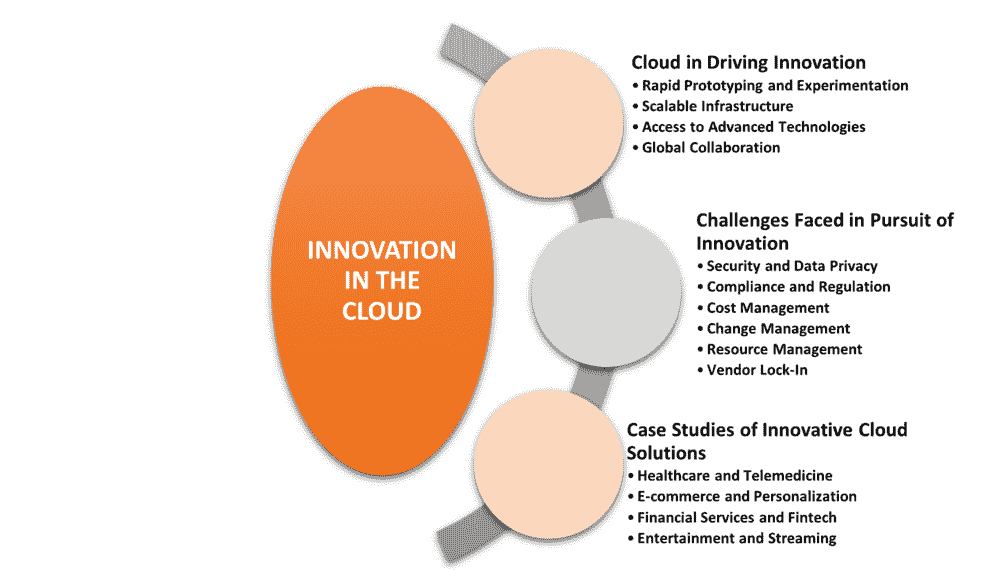 |

# 云驱动创新的角色

云通过实现新产品、服务和体验的创建、测试和交付，彻底改变了业务创新。

- **快速原型与实验**：云资源允许组织快速测试想法和原型，缩短了将创新概念变为现实的时间和成本。
- **可扩展的基础**：云的可扩展性确保了组织在无需对物理基础设施进行巨额投资的情况下，能够对不断增长的需求做出响应。这种灵活性对于需要弹性资源的创新而言至关重要。
- **获取先进技术**：云供应商提供了一系列先进技术，例如机器学习、人工智能和大数据分析。这些工具使组织能够开发出以前无法实现的创新型解决方案。
- **全球协作**：基于云的协作工具促进了全球范围内的团队合作，通过多元视角和专业知识推动创新。

## 在追求创新过程中面临的挑战

虽然云是创新的强大推动力，但它也带来了组织必须解决才能获得回报的挑战（Anitha et al., 2023; Kavitha et al., 2023; Maguluri, Arularasan, et al., 2023; Srinivas et al., 2023）。这些挑战包括：

- **安全与数据隐私**：平衡创新与数据安全及隐私之间是一项复杂的工程。在云中存储敏感数据需要强大的安全措施来防止泄露和未经授权的访问。
- **合规性与监管**：某些行业（如医疗和金融）的创新必须遵守严格的监管框架。在云端进行创新的同时应对这些要求需要周密的计划。
- **成本管理**：如果管理不当，云创新的吸引力可能导致成本不断。组织必须实施成本控制以避免意外支出。
- **变更管理**：转向以云为中心的创新模式可能需要组织文化和流程的变化。适应这些变化可能是一项挑战。
- **资源管理**：组织必须高效管理云资源，以避免利用不足或资源蔓延。优化资源分配对于成本效益至关重要。
- **供应商锁定**：使用专有的云服务可能会导致供应商锁定，限制组织过渡到替代解决方案的能力。

在对创新的追求与云技术带来的挑战之间取得平衡是一个动态过程。在本节中，我们将探索组织如何利用云驱动的创新，并研究其转型性影响以及成功所需的考量。

## 创新型云解决方案的案例研究

本节提供了各行业（包括医疗保健和电子商务）云驱动创新的真实案例，以展示组织如何有效地利用云来驱动创新。

- **医疗保健与远程医疗**：探索基于云的远程医疗平台如何彻底改变患者护理和诊断，提供及时且具有效益的医疗专业知识访问（Boopathi, 2023b; Karthik et al., 2023; Ramudu et al., 2023）。
- **电子商务与个性化**：探索电子商务巨头如何利用云来提供个性化体验。
- **金融服务与金融科技**：调查金融科技公司如何利用云提供金融服务。
- **娱乐与流媒体**：探索娱乐公司如何利用云提供流媒体内容。

# 云安全

本节探讨了云计算的重要性（979-8-3693-1431-9.ch008.xhtml#f02）以及面临的安全威胁（Arunprasad & Boopathi, 2019; Babu et al., 2022; Venkateswaran, Kumar, et al., 2023）。

| 图 2. 云计算的重要性 |
| --- |
| 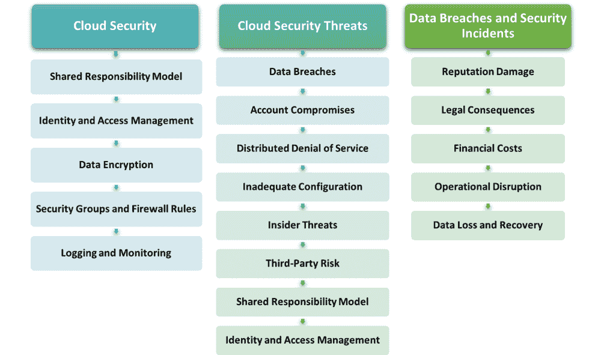 |

## 云安全基础

理解支撑云安全的原则和实践至关重要。

- **责任共担模型**：云安全是供应商与客户之间的共同责任。供应商负责基础设施的安全，而客户负责其数据和应用程序的安全。
- **身份访问管理 (IAM)**：有效的`IAM`控制对于确保授权用户和实体访问云资源至关重要。`IAM`涵盖了用户验证、授权和访问。
- **数据加密**：对传输和存储的数据进行加密是数据安全的基础。强加密方法可以防止未经授权的访问。
- **安全组与防火墙规则**：实施`安全组`和`防火墙规则`可以确保网络流量受控且仅允许授权来源访问。
- **日志与监控**：对云资源和活动进行全面的`日志记录`和`监控`可以及时发现可疑活动。它们对于事件响应和合规至关重要。

## 常见的云安全威胁

云计算带来了组织必须应对的不同安全威胁和挑战。

- **数据泄露**：对敏感数据的非法访问可能导致泄露，引发信任危机、法律后果和财务损失。
- **账户破解**：当用户账户被破解时，攻击者可能会获取云资源和数据。适当的用户验证和访问控制对于防止这种情况至关重要。
- **分布式拒绝攻击 (DDoS)**：`DDoS 攻击`通过大量流量干扰云服务。云供应商提供`DDoS 防护`，但组织必须进行正确配置。
- **配置不当**：云资源的配置错误会导致数据暴露在公共网上，从而产生安全漏洞。定期的安全审计和配置审查是必要的。
- **内部威胁**：恶意内部人员或疏忽员工可能构成重大安全风险。监控和访问控制措施可以缓解内部威胁。
- **第三方风险**：云服务通常依赖第三方供应商提供身份验证和支付处理等组件。这些供应商可能会引入安全漏洞，使得第三方风险管理变得至关重要。
- **声誉损害**：数据泄露会侵蚀客户信任并损害组织的声誉，可能导致客户流失和业务机会减少。
- **法律后果**：监管机构可能会对未能保护敏感数据的组织进行罚款和采取法律行动，特别是在受高度监管的行业。
- **财务成本**：从数据泄露中恢复的代价可能高昂，包括事件响应、取证调查、法律费用以及对受影响方的潜在赔偿费用。
- **运营中断**：安全事件可能会中断业务运营，导致停机和金钱损失。
- **数据丢失与恢复**：数据泄露可能导致数据丢失或损坏。恢复工作可能具有挑战性，某些数据可能无法找回。

# 在创新与安全之间平衡

本节深入探讨了在数字时代平衡创新与安全的复杂任务，并提供了策略和现实世界的案例来说说明成功的平衡方法（Jyoti et al., 2020; RM et al., 2020）。

## 创新与安全之间的张力

由于图 3 所示的各种动态因素，创新的追求往往带来安全风险。

- **速度 vs. 安全**：快速创新可能会超过安全措施的实施速度，导致漏洞。对快速开发的需求通常与安全对细致审查和测试的需求发生冲突。
- **开放 vs. 控制**：在创新中鼓励开放性和创造力可能与维护安全所需的严格控制（`string`）和访问限制相冲突。
- **实验 vs. 风险规避**：创新者寻求实验并承担经过计算的风险，而安全措施旨在最小化风险并保持规避风险的立场。
- **用户便利性 vs. 安全措施**：以用户为中心的创新可能强调易用性和可访问性，这有时会削弱安全实践。取得正确的平衡对于满足这两个目标至关重要。
- **合规 vs. 敏捷性**：遵守法规通常涉及严格的安全措施。然而，由于合规所需的时间和资源，这些措施可能会减慢创新速度。

| 图 3. 创新与安全之间的张力 |
| --- |
| 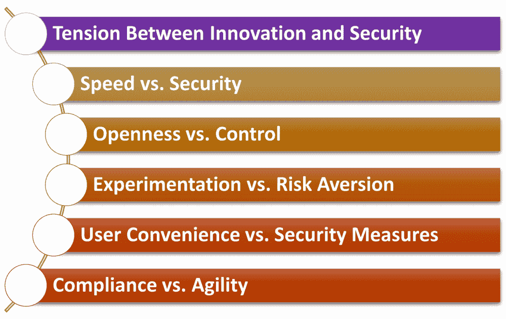 |

## 实现正确平衡的策略

组织可以利用各种策略平衡创新与安全（Rayhan & Rayhan, 2023）。

- **基于风险的方法**：实施基于风险的方法，评估创新项目的潜在风险。高风险倡议应经过严格的安全审查，而低风险项目则可以从简化的流程中获益。
- **设计安全**：从一开始就将安全考虑嵌入创新的设计和开发中。这种方法促进了主动的安全实践，这些实践是创新过程中不可或缺的一部分。
- **教育与培训**：为员工提供持续的教育和培训，强调安全最佳实践和对潜在威胁意识。知识丰富的员工有助于营造安全文化（Agrawal, Pitchai, 2020; Durai et al., 2020; Sankar et al., 2020）。
- **协作**：促进创新团队与安全团队之间的协作。
- **持续监控**：对系统进行持续监控，以便在问题出现时识别。这种主动的立场可以最小化威胁的影响（Bose et al., 2023）。
- **自适应安全**：采用能够应对威胁环境变化的自适应安全措施。

## 成功的平衡现实案例

文章提供了创新与安全成功平衡的案例。

- **零信任架构**：采用`Zero Trust`原则假设组织内部或外部的任何人都是不可信的。这种方法在适应新发展的同时增强了安全性。
- **安全开发生命周期 (SDL)**：许多组织实施了`Secure Development Lifecycle`，将安全集成到开发的每个阶段。
- **DevSecOps**：`DevSecOps`实践将安全集成到流水线中，使组织能够在保持安全的同时快速创新。
- **合规与创新**：受监管行业（如医疗保健和金融）的组织平衡了合规要求与创新。

# 风险评估与缓解

本节讨论了风险评估过程（图 4）、制定稳健的云安全策略以及有效缓解和管理风险，这些稳健策略的关键组成部分（Maguluri, Arularasan, 2023; Rahamunnisa, Subhashini, 2023）。

| 图 4. 风险评估与迁移过程 |
| --- |
| 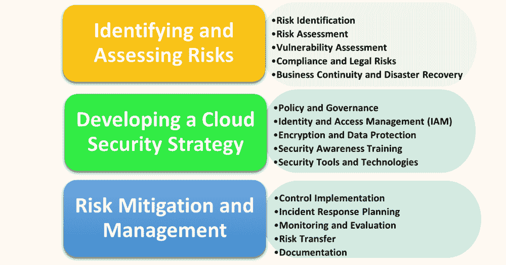 |

## 识别与评估风险

建立强大的云安全态的第一步涉及识别和评估风险。关键方面包括：

- **风险识别**：从识别与采用云相关的潜在风险开始，包括数据泄露、合规违规、内部威胁等。这一过程应涉及跨组织的全体利益相关者。
- **风险评估**：在识别风险后，评估其潜在影响和可能性。这涉及分配风险级别，并根据其潜在后果和概率对其进行优先级排序。
- **漏洞评估**：识别云基础设施和实践中的弱点或漏洞，这些漏洞可能会被威胁者利用。
- **合规与法律风险**：评估与遵守特定行业法规和法律要求相关的风险，并考虑数据保护法、知识产权和隐私法规。
- **业务连续性与灾难恢复**：评估与业务连续性和灾难恢复相关的风险。考虑服务中断或数据丢失对组织的潜在影响。

## 开发云安全策略

一个定义良好的云安全策略对于应对已识别的风险和防御潜在威胁至关重要（Reddy, Reddy, 2023）。

- **策略与治理**：制定与组织目标和监管要求一致的安全策略和治理框架。这应包括定义角色和责任、事件响应计划以及访问控制策略。
- **身份与访问管理 (IAM)**：实施稳健的`IAM`实践以控制对云资源的访问，确保只有经过授权的用户和实体才能与云环境交互。
- **加密与数据保护**：利用加密技术保护静态数据和传输中的数据。开发数据保护策略，以保护敏感信息免受未经授权的访问。
- **安全意识培训**：为员工提供安全意识培训，以营造安全文化。确保员工了解最佳实践和潜在威胁。
- **安全工具与技术**：利用安全工具和技术（如入侵检测系统、安全信息和事件管理（`SIEM`）解决方案和防火墙）来监控、检测和响应安全事件。

## 风险缓解与管理

风险缓解和管理策略对于最小化已识别风险的影响至关重要，需要考虑各种因素（Maguluri, Ananth, et al., 2023; Ugandar et al., 2023）。

- **控制实施**：实施控制和安全措施以缓解已识别的风险。这可能涉及部署技术、建立安全流程以及加强培训。
- **事件响应计划**：开发并定期更新事件响应计划，以便在安全事件发生时有效管理。这些计划应定义角色和责任、通信程序和恢复流程。
- **监控与评估**：持续监控云环境中的安全事件和漏洞。根据不断变化的风险和威胁格局定期评估并更新安全策略。
- **风险转移**：在某些情况下，组织可能选择通过保险或第三方安排来转移某些风险。这有助于减轻安全事件带来的财务影响。
- **文档记录与合规性**：对安全实践、审计和合规工作进行详尽的记录。确保组织符合相关的法规和标准。

识别、评估和缓解云风险的过程是持续且迭代的，这要求组织随着威胁格局的演变以及其在云端的创新不断调整安全策略。

## 合规与法规

本节深入探讨了不同监管框架对云安全的影响、合规面临的挑战以及云操作中的法律和伦理考量。

### 影响云安全的监管框架

组织必须理解各种监管框架和行业特定标准，以确保云安全中的合规性和数据保护（Jyoti et al., 2020; Shahid et al., 2020）。

- **通用数据保护条例 (GDPR)**：`GDPR`适用于欧盟，规范个人数据的处理，并对数据保护和隐私提出了严格要求。
- **健康保险流动性与责任法 (HIPAA)**：`HIPAA`为保护健康信息设定了标准，并对使用云服务的医疗机构提出了特定要求。
- **支付卡行业数据安全标准 (PCI DSS)**：`PCI DSS`概述了处理信用卡支付和数据的组织的安全要求，影响了电子商务企业的云安全。
- **萨班斯-奥克斯法案 (SOX)**：`SOX`强制要求上市公司执行财务报告和审计标准，对云中的数据安全和保留具有影响。
- **加州消费者隐私法案 (CCPA)**：`CCPA`监管加州居民的数据隐私权利，影响了在该州运营组织的云数据处理。

### 合规挑战与解决方案

组织可以通过实施帮助其满足监管要求的策略和解决方案，克服实现云合规过程中的挑战。

- **数据分类与保护**：对数据进行正确分类并应用适当的保护措施，以确保敏感数据的处理符合法规。
- **审计与报告工具**：实施审计和报告工具以跟踪用户活动、配置更改和数据访问，便于合规报告和验证。
- **安全的云提供商**：选择提供合规友好服务和工具的云服务供应商，以满足特定的监管要求。
- **策略与文档**：建立清晰的安全策略和文档以证明合规努力。保留安全审计和评估记录。
- **安全意识培训**：为员工和承包商提供数据保护、隐私和监管要求的培训。

### 法律与伦理考量

云安全中的法律和伦理考量超出了合规法规，涵盖了与隐私和安全相关的更广泛的问题（Maguluri, Arularasan, et al., 2023; Reddy, Reddy, et al., 2023; Ugandar et al., 2023）。

- **数据所有权**：明确数据所有权数据保护责任。解决存储在云端数据的法律考量，包括访问和传输。
- **AI 与机器学习的伦理使用**：考虑在云应用中使用人工智能和机器学习的伦理影响，特别是关于数据隐私、偏差和透明度。
- **跨境数据传输**：理解跨境数据传输的法律和监管要求，因为不同的司法管辖区在数据保护和主权方面可能有不同的规则。
- **数据保留与电子取证**：确保云数据保留政策符合电子取证和数字证据的法律要求。
- **事件响应与通知**：制定符合数据泄露通知义务的清晰事件响应计划，包括时间令和披露要求。


为了有效管理云合规和法规，组织必须理解监管框架的要求并相应调整安全实践。必须将法律和伦理考量整合到云安全策略中，以确保数据保护和云技术的伦理使用。

## 云安全最佳实践

本节强调了云安全最佳实践的重要性，包括安全策略与治理、有效的身份访问管理以及稳健的加密和数据保护措施，以维护安全的云环境（Dotson, 2023）。

## 安全策略与治理

- **制定全面的安全策略**：建立清晰全面的安全策略，定义安全目标、角色责任、事件响应程序和合规要求。
- **定期更新策略**：安全策略应该是动态的并定期更新，以适应不断变化的威胁、技术变化和法规更新。
- **安全治理框架**：实施一个定义决策过程、问责制并在整个组织内执行安全策略的治理框架。
- **风险管理**：进行风险评估并建立风险管理流程，以识别、评估和缓解与云采用相关的安全风险。
- **合规性监控**：持续监控和审计云环境，以确保符合监管要求和内部安全策略。

## 身份与访问管理 (IAM)

- **最小权限原则**：应用最小权限原则，确保个人和系统仅拥有执行其任务所需的最小访问权限（Al-Issa et al., 2019）。
- **多因素身份验证 (MFA)**：实施多因素身份验证，通过要求用户提供多种形式的验证（如密码和生物识别）来增强访问安全性。
- **单点登录 (SSO)**：使用`SSO`解决方案简化用户访问，同时实现集中控制并确保身份验证的安全。
- **用户生命周期管理**：建立稳健的用户生命周期管理流程，包括入职、离职和定期访问审查，以维护用户账户的安全性。
- **基于角色的访问控制 (RBAC)**：根据工作职能和职责分配角色和权限，确保个人拥有适当的访问级别。

## 加密与数据保护

- **数据分类**：根据数据的敏感性对数据进行分类，并相应应用加密和保护措施。确保敏感数据在静态和传输中均已加密（Kumar & Goyal, 2019）。
- **密钥管理**：实施强大的密钥管理实践以保护加密密钥，包括密钥轮换和安全存储。
- **数据泄露防护 (DLP)**：使用`DLP`解决方案监控并控制数据流，防止敏感信息的未经授权共享。
- **终端安全**：通过终端加密、防病毒软件和入侵检测等安全措施，保护访问云资源的终端和设备。
- **传输中安全**：使用安全协议（例如`HTTPS`、`SSL/TLS`）对传输中的数据进行加密，以保护数据在跨网络传输时的安全。
- **数据备份与恢复**：建立数据备份和恢复流程，确保在发生数据丢失或安全事件时可以恢复数据。

组织通过在安全策略、治理、身份与访问管理以及加密与数据保护方面实施最佳实践，可以建立稳健的云安全态，从而保护敏感数据、缓解风险并确保符合行业法规。

## 新兴技术与趋势

本节强调了云安全最佳实践的重要性，包括安全策略与治理、有效的身份与访问管理，以及用于维护安全云环境的稳健数据保护措施（Awaysheh et al., 2021; Kumar & Goyal, 2019）。图 5 概述了利用新兴技术和趋势的最佳实践。

**图 5. 新兴技术与趋势——最佳实践**

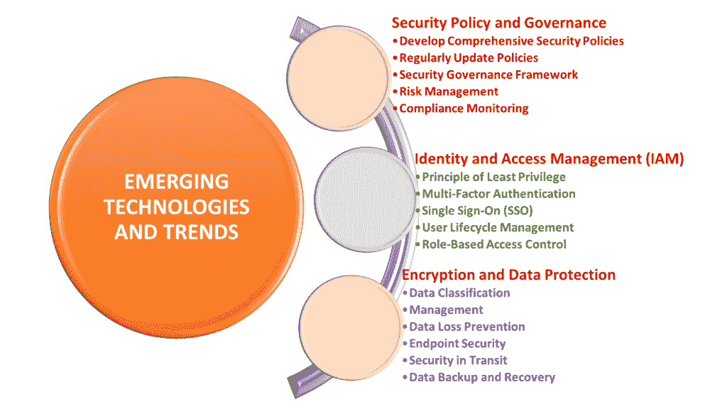

## 安全策略与治理

- **制定全面的安全策略**：建立清晰且全面的安全策略，定义安全目标、角色与职责、事件响应程序以及合规要求。
- **定期更新策略**：安全策略应当是动态的，并定期更新，以适应不断变化的威胁、技术变化和监管更新。
- **安全治理框架**：实施治理框架，定义决策流程、问责机制以及在整个组织范围内对安全策略的执行。
- **风险管理**：进行风险评估并建立风险管理流程，以识别、评估和缓解与云采用相关的安全风险。
- **合规性监控**：持续监控和审计云环境，以确保符合监管要求和内部安全策略。

## 身份与访问管理 (IAM)

- **最小权限原则**：应用最小权限原则，确保个人和系统仅拥有执行其任务所需的最小访问权限。
- **多因素身份验证 (MFA)**：实施多因素身份验证，通过要求用户提供多种形式的验证（如密码和生物识别）来增强访问安全性。
- **单点登录 (SSO)**：使用`SSO`解决方案简化用户访问，同时实现集中控制并确保身份验证的安全。
- **用户生命周期管理**：建立稳健的用户生命周期管理流程，包括入职、离职和定期访问审查，以维护用户账户的安全性。
- **基于角色的访问控制 (RBAC)**：根据工作职能和职责分配角色和权限，确保个人拥有适当的访问级别。

## 加密与数据保护

- **数据分类**：根据数据的敏感性对数据进行分类，并相应应用加密和保护措施。确保敏感数据在静态和传输中均已加密。
- **密钥管理**：实施强大的密钥管理实践以保护加密密钥，包括密钥轮换和安全存储。
- **数据泄露防护 (DLP)**：使用`DLP`解决方案监控并控制数据流，防止敏感信息的未经授权共享。
- **终端安全**：通过终端加密、防病毒软件和入侵检测等安全措施，保护访问云资源的终端和设备。
- **传输中安全**：使用安全协议（例如`HTTPS`、`SSL/TLS`）对传输中的数据进行加密，以保护数据在跨网络传输时的安全。
- **数据备份与恢复**：建立数据备份和恢复流程，确保在发生数据丢失或安全事件时可以恢复数据。

组织通过在安全策略、治理、身份与访问管理以及加密与数据保护方面实施最佳实践，可以建立稳健的云安全态，从而保护敏感数据、缓解风险并确保符合行业法规。

## 案例研究

本节探讨了真实案例，为成功的云安全实施提供了宝贵的见解和这些场景的教训。

### 案例一：医疗提供者的安全云迁移

- **场景**：一家大型医疗提供者在遵守严格的`HIPAA`法的同时，面临将敏感患者数据迁移到云端的挑战（Pramila et al., 2023; Reddy, Gaurav, et al., 2023; Sengeni et al., 2023）。
- **教训**：该案例强调了彻底的数据分类和加密的重要性。它还强调了对具有医疗特定合规能力的云提供商的需求。对监管框架的遵守可以通过技术和策略控制相结合来实现。

### 案例二：金融机构的零信任实施

- **场景**：一家金融机构决定采用零信任安全模型，以增强其整体安全态并抵御日益复杂的网络威胁（Boopathi & Kanike, 2023; Maheswari et al., 2023; Syamala et al., 2023）。
- **教训**：该案例研究证明了在零信任环境中，持续用户验证和微隔离的价值。它强调了定义良好的策略、用户培训以及对不断变化的威胁格局的适应能力的重要性。

### 案例三：科技初创公司的云原生安全

- **场景**：一家构建云原生应用的科技初创公司希望从一开始就将安全放在优先，以保护用户数据并在竞争激烈的市场中赢得信任。
- **教训**：该案例研究强调了从初期就将安全集成到开发过程中的优势。它强调了使用`DevSecOps`实践和自动化技术进行持续安全监控和漏洞检测的重要性。

### 案例四：电商巨头的 AI 驱动威胁检测

- **场景**：一家电商巨头实施了`AI`和机器学习解决方案，以增强其威胁检测能力并抵御不断演变的网络威胁。
- **教训**：该案例研究说明了`AI`和机器学习在安全领域的潜力，特别是在异常识别和早期威胁检测方面。它强调了对`AI`模型进行持续监控和调整的必要性，以保持对新兴威胁的领先地位。

### 案例五：全球性公司的合规与数据主权

- **场景**：一家在多个地区运营的跨国公司面临着遵守多种数据保护法规和确保数据主权的挑战。
- **教训**：该案例研究强调了跨境数据合规的复杂性，以及选择具有全球布局和强大数据主权解决方案的云供应商的重要性。它还强调了强大的数据分类和数据泄露防护措施的价值。

这些案例研究为各行业云安全实施的挑战和成功提供了宝贵的见解，为组织改进策略和实践提供了重要的教训。

## 结论

本章探讨了数字时代云安全的重要性，强调了其挑战与机遇。它讨论了创新与安全之间的平衡、识别风险、制定稳健策略以及缓解威胁。本章还涵盖了合规与法规，应对复杂的法律和伦理考量。它涵盖了云安全的最佳实践，包括策略与治理、身份与访问管理、加密和数据保护。它还讨论了新兴技术`AI`和`Zero Trust`安全模型。

云安全是一个受技术、法规和威胁影响的动态领域。组织必须不断适应和创新以保持领先并保护其数字资产。这段旅程仍在继续，既充满挑战也机遇。随着组织采用云技术，它们必须优先考虑安全、合规性和韧性。下一章将探索这些不断发展的领域，并就如何成功应对这些领域提供见解。

## 缩写表

- **AI**：人工智能
- **GDPR**：通用数据保护条例
- **HIPAA**：健康保险可流动性与责任法
- **PCI DSS**：支付卡行业数据安全标准
- **SOX**：班萨斯-奥克斯利法
- **CCPA**：加州消费者隐私法案
- **DLP**：数据泄露防护
- **DevSecOps**：开发、安全与运维
- **IAM**：身份与访问管理
- **SSO**：单点登录

## 参考文献

- Agrawal, A. V., Magulur, L. P., Priya, S. G., Kaur, A., Singh, G., & Boopathi, S. (2023). Smart Precision Agriculture Using `IoT` and `WSN`. In Handbook of Research on Data Science and Cybersecurity Innovations in Industry 4.0 Technologies (pp. 524–541). IGI Global. doi:[10.4018/978-1-6684-8145-5.ch026](https://doi.org/10.4018/978-1-6684-8145-5.ch026)
- Agrawal, A. V., Pitchai, R., Senthamaraikannan, C., Balaji, N. A., Sajithra, S., & Boopathi, S. (2023). Digital Education System During the COVID-19 Pandemic. In Using Assistive Technology for Inclusive Learning in K-12 Classrooms (pp. 104–126). IGI Global. doi:[10.4018/978-1-6684-6424-3.ch005](https://doi.org/10.4018/978-1-6684-6424-3.ch005)
- Agrawal, A. V., Shashibhushan, G., Pradeep, S., Padhi, S. N., Sugumar, D., & Boopathi, S. (2024). Synergizing Artificial Intelligence, `5G`, and Cloud Computing for Efficient. In `......` IGI. doi:[10.4018/978-1-6684-8145-5.ch026](https://doi.org/10.4018/978-1-6684-8145-5.ch026)
- Dotson, C. (2023). Practical Cloud Security. OReilly Media, Inc.
- Durairaj, M., Jayakumar, S., Karpagavalli, V., Maheswari, B., & Boopathi, S. (2023). Utilization of Digital Tools in the Indian Higher Education System. In Multidisciplinary Approaches to Organizational Governance during Health Crises (pp. 1–21). IGI Global. doi:[10.4018/978-1-7998-9213-7.ch001](https://doi.org/10.4018/978-1-7998-9213-7.ch001)
- Goz, D., & Willcocks, L. (2019). The emerging Cloud Dilemma: Balancing innovation with cross-border privacy and outsourcing regulations. Journal of Business Research, 97, 235–256. doi:[10.1016/j.jbusres.2018.06.006](https://doi.org/10.1016/j.jbusres.2018.06.006)
- Harikaran, M., Boopathi, S., Gokulakannan, S., & Poonguzhali, M. (2023). Study on the Source of E-Waste Management and Disposal Methods. In Sustainable Approaches and Strategies for E-Waste Management and Utilization (pp. 39–60). IGI Global. doi:[10.4018/978-1-6684-7573-7.ch003](https://doi.org/10.4018/978-1-6684-7573-7.ch003)
- Hema, N., Krishnamoorthy, N., Chavan, S. M., Kumar, N., Sabarimuthu, M., & Boopathi, S. (2023). 物联网（`IoT`）驱动的智能太阳能电网系统研究。《基于云的工业物联网深度学习技术研究手册》（pp. 290–308）。IGI Global. doi:[10.4018/978-1-6684-8098-4.ch017](https://doi.org/10.4018/978-1-6684-8098-4.ch017)
- Ingle, R. B., Senthil, T. S., Swathi, S., Muralidharan, N., Mahendran, G., & Boopathi, S. (2023). 使用机器学习技术实现绿色精益制造流程的可持续性与优化。IGI Global. doi:[10.4018/978-1-6684-8238-4.ch012](https://doi.org/10.4018/978-1-6684-8238-4.ch012)
- Jyoti, A., Shrimali, M., Tiwari, S., & Singh, H. P. (2020). 用于 IT 服务的负载均衡和服务代理策略的云计算：分类与综述。《环境智能与人性化计算杂志》，11(11), 4785–4814. doi:[10.1007/s12652-020-01747-z](https://doi.org/10.1007/s12652-020-01747-z)
- Karthik, S., Hemalatha, R., Aruna, R., Deivakani, M., Reddy, R. V. K., & Boopathi, S. (2023). 集成医疗保健安全系统的物联网（`IoT`）。《智能系统演变的视角与考虑》（pp. 342–362）。IGI Global.
- Kavitha, C. R., Varalatchoumy, M., Mithuna, H. R., Bharathi, K., Geethalakshmi, N. M., & Boopathi, S. (2023). 智能电网中的能量监控与控制：集成智能物联网与`ANFIS`。Arshad, M. (编)，(pp. 290–316)。《生物信息学与生物医学工程进展》。IGI Global. doi:[10.4018/978-1-6684-6577-6.ch014](https://doi.org/10.4018/978-1-6684-6577-6.ch014)
- Koshariya, A. K., Kalaiyarasi, D., Jovith, A. A., Sivakami, T., Hasan, D. S., & Boopathi, S. (2023). `AI`驱动物联网与`WSN`集成智能农业系统。《用于智能农业与农业实践的人工智能工具与技术》（pp. 200–218）。IGI Global. doi:[10.4018/978-1-6684-8516-3.ch011](https://doi.org/10.4018/978-1-6684-8516-3.ch011)
- Koshariya, A. K., Khatoon, S., Marathe, A. M., Suba, G. M., Baral, D., & Boopathi, S. (2023). 使用人工智能技术的农业废物管理系统。《人类护理服务中`AI`驱动的社会机器人》（pp. 236–258）。IGI Global. doi:[10.4018/978-1-6684-8171-4.ch009](https://doi.org/10.4018/978-1-6684-8171-4.ch009)
- Kumar, R., & Goyal, R. (2019). 云安全需求、威胁、漏洞及对策：综述。《计算机科学评论》，33, 1–48. doi:[10.1016/j.cosrev.2019.05.002](https://doi.org/10.1016/j.cosrev.2019.05.002)
- Kunduru, A. R. (2023). 人工智能在云应用性能改进中的应用。《中亚数学理论与计算机科学杂志》，4(8), 42–47.


- Maguluri, L. P., Ananth, J., Hariram, S., Geetha, C., Bhaskar, A., & Boopathi, S. (2023). 使用物联网（IoT）的智能车辆排放监控系统。《可持续环境城市固体废物安全处置方法方法手册》（pp. 191–211）。IGI Global。
- Maguluri, L. P., Arularasan, A. N., & Boopathi, S. (2023). 智能城市中基于 AI 的无人机安全评估。Kumar, R., Abdul Hamid, A., & Binti Yaakub, N. (编)，(pp. 27–47)。《计算智能与机器人》。doi:[10.4018/978-1-6684-9151-5.ch002](https://doi.org/10.4018/978-1-6684-9151-5.ch002)
- Maheswari, B., Imambi, S., Hasan, D., Meenakshi, S., Pratheep, V., & Boopathi, S. (2023). 物联网与机器学习集成机器人。《机器人全球视角：发展与应用》（pp. 240–258）。
- Mohanty, A., Venkateswaran, N., Ranjit, P., Tripathi, M., & Boopathi, S. (2023). 盈利性行业的创新策略：营运资本管理。《实现循环经济的设计》（pp. 412–428）。
- Pramila, P., Amudha, S., Saravanan, T., Sankar, R., Poongothai, E., & Boopathi, S. (2023). 医疗辅助机器人的设计与开发。《高级医疗的数据融合应用》（pp. 260–282）。
- Rahamathunnisa, U., Subhashini, P., Aancy, H., Meenakshi, S., & Boopathi, S. (2023). 使用人工智能的软件需求。《工业 4.0 数据科学与网络安全》（pp. 45–64）。
- Rahamathunnisa, U., Sudhakar, K., Murugan, T., Thivaharan, S., Rajkumar, M., & Boopathi, S. (2023). 机器人卸载的云计算原理。《AI 驱动的人类护理机器人》（pp. 188–211）。IGI Global. doi:[10.4018/978-1-6684-8171-4.ch007](https://doi.org/10.4018/978-1-6684-8171-4.ch007)
- Ramudu, K., Mohan, V. M., Jyothirmai, D., Prasad, D., Agrawal, R., & Boopathi, S. (2023). 疾病预测中的机器学习与人工智能：应用、挑战、案例研究与未来方向。《高级医疗的数据融合应用》（pp. 297–318）。IGI Global.
- Rayhan, R., & Rayhan, S. (2023). AI 与人权：数字时代的创新与隐私平衡。
- Reddy, M. A., Gaurav, A., Ushasukhanya, S., Rao, V. C. S., Bhattacharya, S., & Boopathi, S. (2023). COVID-19 大流行期间医疗废物处理策略。《健康危机期间的组织治理多学科方法》（pp. 90–111）。IGI Global. doi:[10.4018/978-1-7998-9213-7.ch006](https://doi.org/10.4018/978-1-7998-9213-7.ch006)
- Reddy, M. A., Reddy, B. M., Mukund, C., Venneti, K., Preethi, D., & Boopathi, S. (2023). 物联网在 COVID 疫情期间的社会健康保护。《COVID-19 大流行与外交数字化化》（pp. 204–235）。IGI Global. doi:[10.4018/978-1-7998-8394-4.ch009](https://doi.org/10.4018/978-1-7998-8394-4.ch009)
- R.M., S. P., Bhattacharya, S., Maddikunta, P. K. R., Somayaji, S. R. K., Lakshmanna, K., Kaluri, R., Hussien, A., & Gadekallu, T. R. (2020). 万物互联中使用风驱动算法和萤火虫算法的能量云负载均衡。《并行与分布式计算杂志》，142, 16–26. doi:[10.1016/j.jpdc.2020.02.010](https://doi.org/10.1016/j.jpdc.2020.02.010)
- Sankar, K., Booba, B., & Boopathi, S. (2023). 智能农业监控系统。《赛空物理系统的当代发展》（pp. 105–121）。doi:[10.4018/978-1-6684-7879-0.ch006](https://doi.org/10.4018/978-1-6684-7879-0.ch006)
- Satav, S. D., Hasan, D., Pitchai, R., Manikaprakash, T., Sultanuddin, J., & Boopathi, S. (2024). 医疗系统中的下一代物联网（NGIoT）。《实践、进展与可持续性中的》（pp. 307–330）。IGI Global. doi:[10.4018/978-1-6684-1186-8.ch017](https://doi.org/10.4018/978-1-6684-1186-8.ch017)
- Satav, S. D., & Lamani, D. G, H., Kumar, N. M. G., Manikandan, S., & Sampath, B. (2024). 云计算时代的能量与电池管理。《实践、进展与可持续性中的》（pp. 141–166）。IGI Global.
- Sengeni, D., Padmapriya, G., Imambi, S. S., Suganthi, D., Suri, A., & Boopathi, S. (2023). 使用人工智能技术的生物医学废物处理方法。于《可持续环境城市固体废物安全处置方法研究手册》(pp. 306–323)。IGI Global. doi:[10.4018/978-1-6684-8117-2.ch022](https://doi.org/10.4018/978-1-6684-8117-2.ch022)
- Shahid, M. A., Islam, N., Alam, M. M., Su’ud, M. M., & Musa, S. (2020). 云计算环境下负载均衡方法的的全面研究以及一种新型容错方法。IEEE Access: Practical Innovations, Open Solutions, 8, 130500–130526. doi:[10.1109/ACCESS.2020.3009184](https://doi.org/10.1109/ACCESS.2020.3009184)
- Srinivas, B., Maguluri, L. P., Naidu, K. V., Reddy, L. C. S., Deivakani, M., & Boopathi, S. (2023). 云端机器人接口的架构与框架。于《工业 4.0 技术数据科学与网络安全创新研究手册》(pp. 542–560)。IGI Global. doi:[10.4018/978-1-6684-8145-5.ch027](https://doi.org/10.4018/978-1-6684-8145-5.ch027)
- Syamala, M., Komala, C., Pramila, P., Dash, S., Meenakshi, S., & Boopathi, S. (2023). 集成机器学习的基于物联网的智能家居能源管理系统。于《云端工业物联网深度学习技术研究手册》(pp. 219–235)。IGI Global. doi:[10.4018/978-1-6684-8098-4.ch013](https://doi.org/10.4018/978-1-6684-8098-4.ch013)
- Ugandar, R. E., Rahamathunnisa, U., Sajithra, S., Christiana, M. B. V., Palai, B. K., & Boopathi, S. (2023). 利用物联网和深度学习进行医院废物管理：增强效率与可持续性。于 Arshad, M. (编)，《生物信息学与生物医学工程进展》(pp. 317–343)。IGI Global. doi:[10.4018/978-1-6684-6577-6.ch015](https://doi.org/10.4018/978-1-6684-6577-6.ch015)
- Venkateswaran, N., Kumar, S. S., Diwakar, G., Gnanasangeetha, D., & Boopathi, S. (2023). 用于废水能能量转换的合成生物学：物联网与人工智能方法。于 Arshad, M. (编)，《生物信息学与生物医学工程进展》(pp. 360–384)。IGI Global. doi:[10.4018/978-1-6684-6577-6.ch017](https://doi.org/10.4018/978-1-6684-6577-6.ch017)
- Venkateswaran, N., Vidhya, K., Ayyannan, M., Chavan, S. M., Sekar, K., & Boopathi, S. (2023). 基于云计算的智能能源管理框架研究。于《5G、人工智能与物联网》(pp. 189–212)。IGI Global. doi:[10.4018/978-1-6684-8117-2.ch009](https://doi.org/10.4018/978-1-6684-8117-2.ch009)

# 第 9 章 人工智能（AI）

## 摘要

云计算深刻地改变了数据面貌，各机构正在产生、收集和存储海量数据。随着云存储变得日益流行，加强安全措施的需求也日益受到关注。本研究旨在探讨 `AI` 在保护云端存储或传输过程中的数据安全方面发挥的作用。

## 引言

我们生活在大数据时代，组织每天收集、处理和分析海量数据集。由于员工办公地点比以往任何时候都远离物理办公室，组织必须设法在敏感数据移动时对其进行保护。传统的安全方法正在失效，安全团队必须重新评估现有的实践。

云计算的优点具有多样性，例如能够从任何连接互联网的设备检索数据、降低停机期间数据丢失的风险并提高可扩展性。同时，许多组织在将敏感数据迁移到云端时仍然犹豫不决，因为他们不确定安全替代方案以及如何满足法律要求。

云安全，也称为云计算安全，是一系列旨在保护云端应用、基础设施和数据的预防措施。用户和设备识别、数据和资源访问控制以及数据隐私是这些措施的一部分。它们还有助于确保合规的准确性。云安全应用于云环境，以保护公司数据免受 `DDoS` 攻击、病毒、黑客攻击以及未经授权的访问或消耗。这涉及到保护信息的技术工具、既有标准和操作方法。

数据的三个大支柱是机密性、完整性和可用性。这三个宽泛的支柱有时被称为 `CIA 三元组`（或 `CIA triad`），它们定义了构成成功安全计划的基本理念。任何种的攻击、漏洞或其他安全问题几乎不可避免会破坏这些原则中的一个或多个。这正是为什么安全专家使用这种方法来评估潜在威胁的原因。

## 云环境的类型

下方的 `图 1` 提到的云环境主要有三种类型。

在公云环境中维护安全性需要确保安全进入、维护用户身份并验证访问。

- **公有云**：托管公云服务的第三方云提供商。这些服务处理整个后端管理，消除了企业构建自身云基础设施的需求。客户通常使用 Web 浏览器访问这些基于 Web 的解决方案。
- **私有云**：私有云的安全标准通常比公有云更强。这种安全性的提高与其对特定用户群体或个人的专属关注有关，并利用了组织或用户的安全流程。这些云配置的内在隔离性由于其访问权限被限制在单一实体，起到了防止外部攻击的预防作用。
- **混合云**：混合云将公有云不断的可扩展性与私有云更好的资源管理相结合。这些云设置连接了许多环境，包括私有云和公有云，允许根据需求进行平滑扩展。执行良好的混合云配置使用户能够通过统一的内容管理系统轻松地浏览其所有环境。

随着云计算日益融入许多企业的业务运营中，对强力云安全的需求已不言而喻。Gartner 预测 2021 年全球公有云服务市场将增长 23.1%，这说明了这一趋势，强调了人们对这些解决方案的接受程度日益提高。尽管云的使用在增加，但某些 IT 专业人士对于将数据和应用程序完全迁移到云端仍犹豫不决。这种抵触源于对安全、治理和合规的担忧，当敏感数据存储在云环境中时，这些担忧会进一步加剧。人们担心由于无意泄露或更复杂的网络攻击，公司重要信息和知识产权可能会出现漏洞。为了避免数据泄露和未经授权的访问，客户订单、私人设计蓝图和财务信息等关键资产需要严格的云保护。防止数据泄露和盗窃不仅对于维护消费者信任至关重要，对于保护驱动竞争力的知识优势也同样关键。云安全措施加强数据和珍贵资产的能力似乎是通云整合之路的一个重要方面。对于任何转向云运营的组织来说，这都是关键关注的问题 (Tahir et al.,2021)。

人工智能（AI）最近成为新闻和社交媒体上的热点，因为技术进步使得 AI 比以前任何时候都更强大、更容易获取。AI 专家认为统一解决方案将极大影响云安全领域。鉴于数据安全的重要性，AI 可用于改变云安全并保护存储在云中的数据。MarketsandMarkets 预测，全球网络安全 AI 市场将从 2020 年的 88 亿美元以 23.3% 的复合年增长率扩大到 2026 年的 382 亿美元 (Siriwardhana et al.,2021)。根据 Statista，2022 年全球数据泄露的平均费用将达到 435 万美元。在云泄露方面，公有云泄露比混合云泄露更贵。拥有先进云安全解决方案的企业在数据泄露方面支付的费用比处于早期的企业少。这可能是因为更先进的安全检测和预防泄露的速度远快于低级防护。著名的德国移动通信子公司在 2023 年 5 月经历了其年度第二次数据泄露，当时的泄露泄露了 800 多名客户的 `PIN` 码、全名和电话号码，这是该公司自 2018 年以来的第九次数据泄露 (Zolfaghari,2022)。

组织通常在寻找简化流程、创建更准确的预测和洞察以及做出更明智选择的方法以增加收入。这正是人工智能声称要实现的。。AI 模拟真实人类行为（最好是大量人类行为）的能力经常被用于简化企业决策和流程。这种模拟使 AI 变得“智能”，并增加了 AI 在业务中运用的众多方式，特别是在数据利用、客户管理和营销方面。AI 正在迅速被应用于云安全，因为它可以帮助组织规避网络攻击、增强事件响应，并保护敏感数据免受未经授权的访问。许多组织和安全专业人士正寻求利用 AI 来帮助他们防御网络攻击，因为 AI 可以分析云数据并发现趋势以检测可能的威胁，还可以自动执行身份验证、访问控制和数据加密等安全操作 (Alhayani,2021)。

AI 还可以通过识别恶意活动并迅速采取行动来保护传输中的数据，将安全问题的响应过程自动化化，并设计更强大的安全规则。AI 还可以分析云数据以识别潜在的漏洞、跟踪有害活动并采取相关行动。由于其在转型云安全业务方面的巨大潜力，AI 在云安全领域正受到关注 (Salih,2021)。

《福布斯》最近的一项研究显示，AI 在云技术中的承诺投射了长远而迷人的影子。AI 已经成熟为沉浸在云世界的人们的忠实伙伴，开启了一个效率和可扩展性更大的领域。它熟练地处理重复或易分类的任务，增加了我们目前并促进了技能的提升和审慎决策。企业可以通过云访问几乎无尽的资源池来训练 AI 模型、分析海量数据集并提取有意义的见解。云的可扩展性意味着 AI 应用可以管理各种负载，从小规模测试到大规模生产部署，而不会产生昂贵的基础设施费用。此外，AI 正在民主化，因为现在可以使用各种组织级服务。这使得任何规模的组织都能掌握 AI 的潜力，同时也平衡了创新的竞争环境。例如，可访问性和灵活性允许跨国无缝协作，让开发者在无需担心底层维护的情况下快速部署 AI 应用 (Sayegh,2023)。

数据是每个组织的命脉。近年来，云端软件即服务（`SaaS`）平台（如 `Microsoft 365`、`Google Workspace` 和 `Salesforce`）的采用率急剧增长。这种增长主要源于远程员工提高生产效率的需求以及加强团队协作的需求。因此，大量数据定期被存储在云端。

然而，与传统的硬件存储空间一样，至关重要的一点是，云端并非不受数据丢失影响。根据 `HIPAA Journal` 的研究，去年有 70%的公司在公有云中发生过数据泄露。随着对数据泄露、网络攻击、工业间谍以及严厉数据隐私规则引入的担忧日益增加，使用数据泄露防护（`DLP`）技术已成为现代企业的关键需求（Hillmann,2019）。

数据丢失对任何规模的企业来说可能是灾难性的。不幸的是，没有哪种业务能免受数据丢失的影响。2021 年，每 11 秒就有一家公司成为网络攻击的受害者。企业关心的不仅是外部威胁。根据 `Verizon 2021 Data Breach Reports Report`，内部人员参与了超过 20%的安全漏洞事件。

数据丢失可能会影响贵公司的财务状况。根据 `IBM Cost of a Data Breach Report 2021`，全球数据泄露的平均成本从 2021 年的 386 万美元增长到 424 万美元。除了财务罚款外，数据丢失还可能导致生产力损失、资金耗尽和客户流失。数据丢失的长期影响之一是可能会破坏贵公司的品牌。因此，实施数据泄露防护计划对于保护公司数据、保护知识产权以及保持合规至关重要。


DLP 解决方案确保您的组织中的机密/分类数据不会丢失、被错误处理或被未经授权的人员访问（Sarker et al.,2021）。数据泄防护（DLP）是指保护组织免受数据丢失和数据泄露的过程。数据丢失被描述为企业关键数据的丢失，例如由勒索软件攻击导致的丢失。数据泄露防护涉及防止数据被传输到组织范围之外（Grispos,2019）。

DLP 是所有规模公司必不可少的工具。DLP 可以帮助组织保护其数据免受各种威胁，并确保符合数据安全法规。DLP 可用于保护云端应用程序、数据库和存储系统中的数据。DLP 广泛应用于组织，以保护个人身份信息（PII）并确保符合各项相关要求；在大型组织中，它还实现在自带设备（BYOD）环境中实现数据可视化、保护移动工作力量，并在远程云系统上执行安全和数据安全强制措施。

以下讨论了数据泄露的三个常见原因：

* **内部威胁**：敌对内部人员或拥有安全用户账户访问权限的攻击者试图通过滥用权限将数据传输到组织之外。
* **攻击者外取**：许多网络攻击针对敏感数据。攻击者利用网络钓鱼、恶意软件和代码注入等策略渗透安全边界，以获取敏感数据的访问权限。
* **无意的数据暴露**：许多数据泄露由于员工让敏感数据处于暴露状态、提供具有开放互联网访问的数据，或未能按照组织标准限制访问而导致。

# 基于 AI 和 ML 的 DLP

集成了 AI 和 ML 的 DLP 比旧系统能更出色、更快地发现业务关键数据。由于这种 DLP 还具有自学习能力，它对 IT 团队的介入需求显著减少，使他们能够专注于更高价值的活动，而不是不断响应其 DLP 解决方案产生的虚假报警。DLP 系统可能使用`ML`在您的云应用、`APIs`以及更广泛的基础设施中定位并保护敏感数据，例如客户的`PII`或`PHI`。它将从通过为 DLP 系统配置几条规则开始，使其理解要寻找什么以及如何响应。随后，DLP 的机器学习组件将允许系统对新数据进行学习和探测，从而实现对敏感材料的自动脱敏。此外，机器学习可以应用于用户行为，允许您的 DLP 系统通过脱敏、甚至阻止用户提交特定的信息片段来对不安全或异常的用户行为做出响应（Adithya，2022）。

有了 AI 后，DLP 变得具有自学习能力。即使在没有采用硬性策略的情况下，它也能利用过去的日志、规则和模式识别来检测敏感数据。此外，在发生内部攻击时，AI 驱动的 DLP 的用户行为分析能力意味着 DLP 可以实时防止数据泄露或破解，同时协助终端用户提高其对数据安全的理解（Ge,2022）。

## 云数据管理与挑战

随着数据变得越来越零散并托管在云端，数据管理和安全实践正在快速发展。AI 可以分析常规用户行为和数据访问模式，以发现可能预示着数据泄露或未经授权访问的异常。它可以检测到非典型的的登录时间、位置和访问模式，帮助防止未经授权用户导致的数据丢失。由 AI 驱动的 DLP 系统可以扫描和监控云环境内部静态、传输中和使用中的数据。这些系统可以识别并阻止诸如未经授权的数据共享、复制或下载的行为（Laurent，2023）。

基于云的数据包括软件即服务（`SaaS`）解决方案、应用程序托管、通过`S3`、`GCP`或`Azure`等平台进行的数据存储、如`Slack`、`Trello`和`Asana`等协作工具、如`Office 365`和`G Suite`等网络邮箱服务，以及如`Zoom`、`Google Meet`和`Teams`等视频会议工具。困难在于这些云服务处理了大量的敏感数据。员工从各种地点和设备（包括个人和工作相关）访问这些数据，这些数据还为了生产力和协作目的而被共享。当尝试追踪数据流向以及多个对其对其访问时，复杂性会随之增加。

考虑以下场景：一份合同以 30 个副本的形式分布在 15 个地点的 5 个唯一数据源中。这种情况凸显了数据丢失防护（`DLP`）观察和建议的需求。这些包括识别数据源、检测可能的风险和漏洞、解决安全差距、确定关键操作的优先级以及提供纠正方案。随着系统从输入和结果中吸收见解，这些测量的有效性和可能会随着时间的推移而提高（Stone,2023）。

## 加密与 AI 驱动的密钥管理

加密与 AI 驱动的密钥管理之间的协同作用，成为数据保护领域敏感信息的强有力守护，特别是在云环境复杂的格局中。加密作为一种可靠的方法，通过复杂的算法和加密密钥保护数据的完整性和机密性。然而，AI 为这些密钥的编排提供了一个和谐的指挥家，而云数据的动态性质使得这项精细的任务变得更加困难。

在这些虚拟走廊中，AI 通过协助加密和密钥管理的各个关键方面展示了其专业知识。在 AI 的严密监视下，密钥创建的加密过程变成了一门艺术与科学的技能。配备了多个参数理解能力的 AI 算法生成能够抵御暴力攻击的加密密钥。此外，AI 编排了这些密钥的安全分发，确保只有所有者参与这一交响乐。密钥轮换作为主动安全的典范，在 AI 的关注节奏中找到了节拍。AI 的自动操作完美地安排了密钥移动，以缓解任何破解。这确保了不断变化的加密交响乐让恶意攻击者无法捉摸（Fowers 等.,2018）。

AI 检查用户趋势及其对加密领域的探索。如果 AI 哨兵检测到异常行为——即未经授权进入加密领域——它就会发出警报，拦截入侵者。密钥丢失或泄露的威胁在数据安全结构中无处不在。在这种情况下，AI 充当恢复者的角色，一位数字大师，利用复杂的算法从遗忘或恶意中恢复丢失的密钥。为了强调其相关性，AI 的领域包括合规性和审计。精心保存的加密密钥相关操作记录是对安全标准的承诺，也是防御监管审计怀疑的象征。

恶意攻击都有一个共同特征：它们的行为都不同于系统或网络中的典型日常行为。公司通常可以通过使用与特定类已知攻击紧密关联的特征码来频繁检测恶意行为。然而，随着攻击者变得日益老练，他们创建了新的战术、方法和程序（TTPs），使他们不仅能够渗透薄弱环境，还能在不被察觉的情况下进行横向移动。这就是行为分析大显身场。

在海量未过滤端点数据的支持下，安全专家现在可以利用基于行为的工具、算法和`AI`来建立日常用户的典型行为模式——以及哪些不是。行为分析可以发现超出常规标准范围的当前和历史事件、趋势和模式（Zhao,2013）。

在过去的二十年里，软件和信息技术的快速扩张对我们生活的环境以及我们与之互动的方式产生了巨大影响。工程师们发现了一种保存用户如何与软件交互数据的方法，甚至精确到用户移动鼠标的方式。这些事实本身是无用的。然而，近年来，分析能力的进步（特别是在……方面）使得我们能够对海量用户数据进行分析以发现发现。行为分析就是以这种方式分析海量用户数据的过程（Kumari,2020）。

### AI 在行为分析中的作用

`AI`成为云端真正朋友的基础机制是：`AI`系统从学习给定云环境的典型行为开始。它们检查数据传输、用户交互、应用程序使用和随网络流量趋势。通过这种方式，它们为云生态系统中的不同组织设定了“正常”行为基准。

建立基准后，`AI`驱动的系统持续监控正在进行的活动。它们将实时行为与之前学习的基准进行比较，并将任何偏差标记为异常。这些异常可能指示未经授权的访问、数据外泄、恶意软件活动或其他类型的网络风险。

人工智能行为分析超越了简单的基于规则的技术。它使用先进的模式识别技术（如机器学习算法和神经网络）来检测可能规避标准安全措施的复杂且微妙异常。`AI`系统实时运行，为企业提供对可能危险的快速洞察。由于这种主动监控，攻击者利用漏洞的机会窗口缩小了。云环境可能是极动态的，负载和基础设施不断波动。`AI`驱动的系统可以轻松扩展以管理海量数据，同时适应不断变化的云格局。这种多功能性对于提供持续的安全覆盖至关重要（Zhang,2016）。

### 数据收集与基准建立

行为数据主要通过人与软件或计算机之间的交互收集。将数据上传到网站或在网站上选择产品是交互的两个示例。这些事件存储在设备的数据库中，或更常见的是存储在公司服务器上，带有易于访问的格式的时间戳。

全球数据量到 2025 年将包含约 160 z 字节（Hammoud,2020）。通过分析与云数据传输和访问相关的历史数据，`AI`系统可以建立基准行为模式。这些标准定义了什么是“正常”行为。当数据跨越云环境时，`AI`会实时将当前行为与这些基准进行比较。当发生偏差时，例如数据传输异常激增或未经授权的访问尝试，`AI`可能立即报警以便进一步调查（Alipour,2015）。

当数据穿越复杂的云环境时，`AI`实时比较当前行为与设定的基准。这种对实时行为与过去标准的密切监控使`AI`能够快速检测到偏离预期模式的情况。这些异常可能表现为数据传输的奇怪峰值、不规则的访问尝试或任何其他严重偏离既定规范的活动（Pacheco,2018）。

当检测到此类异常时，`AI`系统在生成快速报警方面起着关键作用。这些警报是提醒安全人员需要进一步调查的潜在危险或安全漏洞的重要技术。`AI`通过快速发出这些报警协助及时发现安全隐患，允许组织在威胁演变成严重危机之前采取主动行动来控制和中和可能的威胁（Rani et.al.,2021）。

### 实际示例与隐私考量

`AI`可以识别用户行为中的异常，这些异常可能暗示安全性已遭到破坏。例如，如果一个人突然开始访问他们通常不访问的文件，或从意想不到的地方登录，这可能表明账户被盗。`AI`可以检测到这些异常并警告安全团队进一步探测。

此外，我们也可以通过示例来理解行为分析中`AI`的概念，假设一个基于云的电子商务平台使用`AI`-驱动的行为分析进行安全防护。该系统发现 Web 服务器在正常运行期间来自不同区域的连续`HTTP`请求流。它突然观察到短时间内来自某个`IP`地址的请求大幅增加，远高于正常速度。`AI`系统可能会识别此为潜在的分布式拒绝服务 (`DDoS`) 攻击，并采取缓解措施，如重定向流量或应用速率限制。`AI`可能还可以协助更复杂的情况，例如识别内部威胁，在这些情况下，合法用户可能通过访问敏感数据或采取未经授权的操作进行恶意活动（[Muralidhara,2017]）。

随着组织使用`AI`强化其安全程序，在保护敏感数据与利用先进分析方法之间取得仔细平衡至关重要。这些系统的优之处在于它们能够通过一种复杂的方法保护用户隐私：它们不是关注个人活动，而是强调对聚合趋势的研究。因此，`AI`驱动的安全系统可以在不干预个人用户操作的情况下检测异常和可能的风险。这种方法不仅减少了隐私隐私的可能性，还符合法律框架和合规规范。因此，组织可以在利用`AI`能力的同时，遵守对数据隐私和监管要求的承诺，向其利益相关者确保安全性在不损害隐私的情况下得到增强（Turjman,2021）。

基于`AI`的钓鱼检测解决方案使用机器学习算法来分析邮件的内容和结构，以识别钓鱼尝试。这些算法通过从海量数据中学习来识别暗示钓鱼攻击的趋势和异常。基于`AI`的系统还可以分析用户处理邮件时的行为，以检测钓鱼攻击。例如，如果用户点击了可疑链接或响应钓鱼邮件输入了个人信息，基于`AI`的解决方案可能会检测到这种行为并通知安全专业人员（[Moisset,2023]）。

网络安全初创公司 Darktrace 使用`AI`和机器学习分析云行为。他们的“企业免疫系统”利用人工智能算法理解网络、用户或设备的典型行为。然后它检测偏离基准的偏差，这可能指示潜在危险。Darktrace 的 AI 引擎协助一家跨国保险公司在其云基础设施早期检测到了勒索软件攻击。由于 AI 系统检测到了数据访问和传输的异常模式，安全能够在能够在完全展开之前采取行动，避免了重大数据泄露。

另一个典型的例子是 Azure Sentinel，微软的云原生安全信息事件管理 (`SIEM`) 系统，它利用`AI`来识别并响应攻击。它扫描云环境中跨多个数据源的异常行为和模式。使用 Azure Sentinel 的一家零售公司在一次重大事件中观察到来自单个`IP`地址的流量异常激增。人工智能驱动的系统识别出这是分布式拒绝服务 (`DDoS`) 攻击，并自动部署防御措施以最小化危险，保持服务不受中断（[Armitage,2022]; Ceponis,2021）。

# 1.3 人工智能（AI）驱动的用户身份验证数据传输与安全：保护云环境

用户身份验证在个人尝试访问网络或计算机资源时验证其身份。它涉及对网络连接过程中传输的凭据进行批准，从而验证用户与系统接触的真实性。验证程序确保只有授权的用户才能进入系统，从而防止未经授权的用户造成、盗取信息或引起其他类型的扰动。几乎所有人机交互都需要用户身份验证，但需要访客或自动登录的情况除外。它通过有线和无线网络让用户访问网络化和连接互联网的技术及服务。以下描述了用户身份验证的三个基本因素（Chang,2011; Choudhury,2011）：

| 图 2 用户身份验证中使用的主要因素 |
| --- |
|  |
| 来源 – 作者编译 |

- **知识因素（Knowledge Factor）** - 知识组件包括用户为了启动登录程序并获得系统访问必须掌握的所有信息。此类类别包括用户名、`IDs`和个人识别数字（`PINs`）。
- **持有因素（Possession Factor）** - 用户完成登录所需的所有物品都包含在持有标准中。此类类别包括一次性密码令牌、钥匙扣、移动 App 和身份卡等产品。
- **固有因素（Inherence Factor）** - 证明其身份的个人内在特征被称为遗传因素。该领域的生物识别包括视网膜扫描、指纹扫描、面部识别和语音安全。

`SFA`是仅使用一处信息（通常是密码）来确认用户的过程。由于`SFA`依赖于单一元素（如密码），如果攻击者获取了用户的密码，它无法阻止未经授权的访问。相比之下，多因素身份验证（`MFA`）利用多种技术来验证用户的身份。例如，用户可能被要求提供密码，并正确回答安全问题。双因素身份验证（`2FA`）结合了两种类型认证的组件，而四因素身份验证（`4FA`）则结合了所有类型认证的元素。由于因素的增加提供了更高层次的保护，后者技术在防御未经授权的访问方面要强得多（Dasgupta,2017; Lal,2016）。

属于个人、组织和消费者的大量敏感机密数据存储在噪声环境中。适当的用户身份验证确保只有授权用户才能访问这些信息，降低了数据泄露和未经授权访问的风险。限制云资源访问的主要方法是用户身份验证。它确保用户仅访问他们有权访问的数据，防止无意或蓄意的误用。许多企业和地区的数据保护法律和合规性要求非常严格。适当的身份验证程序有助于遵守这些要求，这些程序确保仅允许授权人员访问数据（Alizadeh,2016）。

人工智能在信息安全领域正变得越来越重要，因为此类技术能够快速分析数百万数据集，并识别广泛的网络风险，从病毒威胁到可能导致钓鱼攻击的可疑行为。人工智能的众多优势和应用之一是网络安全。随着网络攻击的快速增长和设备数量的增加，人工智能和机器学习可以通过比传统的软件驱动或手动操作更快地自动化威胁评估和响应，帮助跟上网络犯罪的步伐（Ciolacu,2018）。

行为生物识别是人工智能变革身份验证的方式之一。为了建立独特的用户配置文件，行为生物识别分析人类行为的趋势，例如打字速度、鼠标移动和触摸屏交互。为了验证用户的身份，AI 系统可以实时分析这些数据，并将其与用户的已知行为进行比较。这种方法提供了额外的保护，因为攻击者很难有效复制个人的独特行为。

人工智能在身份验证方面取得取得重大进展的另一个领域是面部识别。深度学习算法被用于 AI 驱动的面部识别系统中，以分析面部特征并生成生物识别模板。为了验证用户的身份，会将这些模板与其记录的面部数据进行匹配。面部识别是一种非侵入性且方便的验证方法，可用于多种用途，包括解锁手机和进入受保护的设施（Sharma,2022）。

自适应身份验证利用人工智能根据位置、设备、时间以及行为等多种标准，持续分析与用户登录尝试相关的风险。系统随后修改必要的身份验证量。例如，如果用户尝试从未知区域登录，系统可能会要求额外的身份验证程序。自适应身份验证是一种根据登录尝试的上下文来验证用户的灵活且自适应能力的方法，在提高安全性的同时减少了用户摩擦（Akram,2022）。

多因素身份验证（`MFA`）优化意味着利用人工智能（`AI`）根据感知到的情况风险智能地调整身份验证程序。在实践中，这意味着当用户尝试从已知且信任的设备或位置访问云端时，身份验证过程可能会减少为单一因素——通常是密码。这种简化的程序在确保安全的同时保证了良好的用户体验。这种优化有助于在安全性和易用性之间取得平衡。在使用受信设备时，用户可以享受无缝体验，而系统检测到可能风险时会提示进行进一步的验证。这种动态修改在提高安全性的同时适应了不断变化的威胁格局。随着 AI 系统从模式和异常中学习，它们有效评估风险和更改身份验证的方法随时间推移而提高，从而产生更智能、响应更快的安全解决方案（Kavitha,2021）。

NLP 驱动的身份验证方法利用人工智能分析和解释人类语言的能力，实现更复杂且感知上下文的验证程序。`NLP`允许系统理解通信的上下文。例如，如果用户尝试访问私人财务数据，系统可能会在授权之前请求额外的身份验证元素以验证用户身份。它可以根据用户的反应调整回复。如果用户迟疑或困惑，系统可能需要额外的身份验证程序进行验证（Baclic,2020; Sun,2020）。人工智能在开发更安全的身份验证系统方面发挥着至关重要的作用。人工智能通过生物识别、面部识别、语音识别、异常检测、持续认证和自适应认证为现有的身份验证系统增加了额外的安全级别。这些人工智能驱动的身份验证解决方案针对新的安全风险提供了更高的准确性、简单性和活性，使其成为当前身份验证系统的关键组成。

## 结论

人工智能在云计算领域中的未来非常引人注目。得益于`ML`技术的快速发展以及云计算中计算力成本的降低，我们正处于在该领域取得重大进展的边缘，这将使我们能够比以往任何时候都更快、更有效地处理数据。它还帮助我们检测可能未被察觉的模式和关联。这将对医疗、银行和物流等行业产生重大影响。

例如，在医学领域，AI 经常被用于药物研发，以帮助发现新药物，并能帮助我们更好地理解和预测人类行为。AI 还将帮助我们更好地理解和预测人类行为。这对于网站和应用程序的无障碍访问以及营销和广告都很有帮助。总而言之，人工智能在云计算中的前景是光明的。

## 参考文献


- Adithya, V., Deepak, G., & Santhanavijayan, A. (2022). OntoIntAIC: An Approach for Ontology Integration Using Artificially Intelligent Cloud. In Advances in Data Computing, Communication and Security: Proceedings of I3CS2021 (pp. 3–13). Springer Nature Singapore. doi: [10.1007/978-981-16-8403-6_1](https://doi.org/10.1007/978-981-16-8403-6_1)

- Agrawal, N., & Tapaswi, S. (2019). Defense mechanisms against DDoS attacks in a cloud computing environment: State-of-the-art and research challenges. IEEE Communications Surveys and Tutorials, 21(4), 3769–3795. doi: [10.1109/COMST.2019.2934468](https://doi.org/10.1109/COMST.2019.2934468)

- AkramS. V.JoshiS. K.DeorariR. (2022, November). Web Application Based Authentication System. In 2022 International Interdisciplinary Humanitarian Conference for Sustainability (IIHC) (pp. 1439-1443). IEEE. doi: [10.1109/IIHC55949.2022.10059984](https://doi.org/10.1109/IIHC55949.2022.10059984)

- Al-Turjman, F., & Deebak, B. D. (2021). A Proxy-Authorized Public Auditing Scheme for Cyber-Medical Systems Using AI-IoT. IEEE Transactions on Industrial Informatics, 18(8), 5371–5382. doi: [10.1109/TII.2021.3126316](https://doi.org/10.1109/TII.2021.3126316)

- Alhayani, B., Mohammed, H. J., Chaloob, I. Z., & Ahmed, J. S. (2021). Effectiveness of artificial intelligence techniques against cyber security risks apply of IT industry. Materials Today: Proceedings, 531. doi: [10.1016/j.matpr.2021.02.531](https://doi.org/10.1016/j.matpr.2021.02.531)

- Alipour, H., Al-Nashif, Y. B., Satam, P., & Hariri, S. (2015). Wireless anomaly detection based on IEEE 802.11 behavior analysis. IEEE Transactions on Information Forensics and Security, 10(10), 2158–2170. doi: [10.1109/TIFS.2015.2433898](https://doi.org/10.1109/TIFS.2015.2433898)

- Alizadeh, M., Abolfazli, S., Zamani, M., Baharun, S., & Sakurai, K. (2016). Authentication in mobile cloud computing: A survey. Journal of Network and Computer Applications, 61, 59–80. doi: [10.1016/j.jnca.2015.10.005](https://doi.org/10.1016/j.jnca.2015.10.005)

- Armitage, J. (2022). Cloud Native Security Cookbook. O'Reilly Media, Inc.

- Baclic, O., Tunis, M., Young, K., Doan, C., Swerdfeger, H., & Schonfeld, J. (2020). Artificial intelligence in public health: Challenges and opportunities for public health made possible by advances in natural language processing. Canada Communicable Disease Report, 46(6), 161–168. doi: [10.14745/ccdr.v46i06a02](https://doi.org/10.14745/ccdr.v46i06a02)

- Brathwaite, S. (2022, August 19). The state of AI in Cloud Security. Software Secured. [`www.softwaresecured.com/the-state-of-ai-in-cloud-security/`](https://www.softwaresecured.com/the-state-of-ai-in-cloud-security/)

- Čeponis, D. (2021). Research of machine and deep learning application for host-level intrusion and classification [Doctoral dissertation, Vilniaus universitetas].

- Chang, H., & Choi, E. (2011). User authentication in cloud computing. In Ubiquitous Computing and Multimedia Applications: Second International Conference.

- Choudhury, A., Kumar, P., Sain, M., & Jae-Lee, H. (2011, December). A strong authentication framework for cloud computing. In IEEE Asia-Pacific Services.

- Ciolacu, M., Tehrani, A., Binder, L., & asta, P. (2018). Education 4.0-Artificial Intelligence: early recognition system with machine learning to support students' success. In IEEE 24th International Symposium for Design and Technology(SIIT).

- ROI4CIO. (2023). Darktrace the enterprise immune system. [`roi4cio.com/catalog/en/product/darktrace-immune-system`](https://roi4cio.com/catalog/en/product/darktrace-immune-system)

- Dasgupta, D., Roy, A., & Nag, A. (2017). Advances in user authentication. Springer International Publishing. doi: [10.1007/978-3-319-5808-7](https://doi.org/10.1007/978-3-319-5808-7)

- Fowers, J., Ovtcharov, K., Massengill, T., Lo, D., & Burger, D. (2018, June). A configurable cloud-scale processor for real-time AI. In 2018 ACM/IEEE 45th Annual Symposium on Computer Architecture (ISCA). doi: [10.1109/ISCA.2018.00012](https://doi.org/10.1109/ISCA.2018.00012)

- Ganne, A. (2022). Cloud data security methods: Kubernetes vs Docker swarm. Research Journal of Modernization in Engineering Technology, 4(11).

- Ge, Z. (2022). Artificial Intelligence and Machine Learning in Data Management. Future, The: Abcdi Beyond, 281.

- Grispos, G., Glisson, W., & Storer, T. (2019). How good is your data? Investigating the quality of data generated during incident response. arXiv preprint:1901.03723. doi: [10.24251/HICSS.2019.859](https://doi.org/10.24251/HICSS.2019.859)

- Hammoud, A., Sami, H., Mourad, A., Otrok, H., Mizouni, R., & Bentahar, J. (2020). AI, blockchain, and vehicular edge computing for smart and secure IoV: Challenges and directions. IEEE Internet of Things Magazine, 3(2), 68–73. doi: [10.1109/IOTM.0001.1900109](https://doi.org/10.1109/IOTM.0001.1900109)

- Hillmann, J., & Guenther, E. (2021). Organizational resilience: A valuable construct for management research? International Journal of Management Reviews, 23(1), 7–44. doi: [10.1111/ijmr.12239](https://doi.org/10.1111/ijmr.12239)

- Kavitha, S., Bora, A., Naved, M., Raj, K. B., & Singh, B. R. N. (2021). An internet of things for data security in cloud using artificial intelligence. International Journal of Grid and Distributed Computing, 14(1), 1257–1275.

- Kumar, G. (2019). A review on data protection of cloud computing security, benefits, risks and suggestions. United International Journal for Research & Technology, 1(2), 26–34.

- Kumari, A., Gupta, R., Tanwar, S., & Kumar, N. (2020). Blockchain and AI amalgamation for energy cloud management: Challenges, solutions, and future directions. Journal of Parallel and Distributed Computing, 143, 148–166. doi: [10.1016/j.jpdc.2020.05.004](https://doi.org/10.1016/j.jpdc.2020.05.004)

- Lal, N. A., Prasad, S., & Farik, M. (2016). A review of authentication methods.

- Mishra, S., & Tyagi, A. K. (2022). The role of machine learning techniques in internet of things-based cloud applications. Artificial intelligence-based internet of things systems, 105-135.

- Moisset, S. (2023, May 25). How security analysts can use AI in Cybersecurity. freeCodeCamp.org. [`www.freecodecamp.org/news/how-to-use-artificial-intelligence-in-cybersecurity/`](https://www.freecodecamp.org/news/how-to-use-artificial-intelligence-in-cybersecurity/)

- Muralidhara, P. (2017). 云计算安全的演进：应对新兴威胁。国际计算机科学与技术期刊，1(4), 1–33。

- Pacheco, J., & Hariri, S. (2018). 物联网传感器的异常行为分析。新兴电信技术交易，29(4), e3188. doi: [10.1002/ett.3188](https://doi.org/10.1002/ett.3188)

- Rani, P., Kavita, , Verma, S., Kaur, N., Wozniak, M., Shafi, J., & Ijaz, M. F. (2021). 自组网络中利用人工智能技术实现稳健且安全的数据传输。传感器（巴塞尔），22(1), 251. doi: [10.3390/s22010251](https://doi.org/10.3390/s22010251)

- Sarker, I. H., Kayes, A. S. M., Badsha, S., Alqahtani, H., Watters, P., & Ng, A. (2020). 网络安全数据科学：机器学习视角的概述。大数据期刊，7(1), 1–29。doi: [10.1186/s40537-020-00318-5](https://doi.org/10.1186/s40537-020-00318-5)

- Sayegh, E. (2023, 8 月 23 日). 人工智能与云：协作与担忧的复杂关系。福布斯。 [`www.forbes.com/sites/emilsayegh/2023/08/23/artificial-intelligence-and-clouds-a-complex-relationship-of-collaboration-and-concern/?sh=7472b5725c19`](https://www.forbes.com/sites/emilsayegh/2023/08/23/artificial-intelligence-and-clouds-a-complex-relationship-of-collaboration-and-concern/?sh=7472b5725c19)

- Sharma, M., & Elmiligi, H. (2022). 行为生物识别：过去、现在与未来。生物识别的最新进展，69。

- SiriwardhanaY.PorambageP.LiyanageM.YlianttilaM. (2021, 6 月). AI 与 6G 安全：机遇与挑战。在 2021 年欧洲欧洲网络与通信联合会议与 6G 峰会 (EuCNC/6G Summit) (pp. 616-621)。IEEE. doi: [10.1109/EuCNC/6GSummit51104.2021.9482503](https://doi.org/10.1109/EuCNC/6GSummit51104.2021.9482503)

- Srikanth. (2022, 10 月 14 日). AI 防止下一代数据丢失。Techiexpert。 [`www.techiexpert.com/ai-preventing-next-gen-data-loss/`](https://www.techiexpert.com/ai-preventing-next-gen-data-loss/)

- St. Laurent, N. (2023, 7 月 17 日). 数据泄露防护与人工智能的价值。CISCO。<https://blogs.cisco.com/government/data-loss-prevention-and-the-value-of-artificial-intelligence>


Stone, M. (2023, 1 月 17 日). 2023 云数据泄露防护 (DLP) 概览：Concentric AI。[`concentric.ai/a-deep-dive-on-cloud-data-loss-prevention-dlp/`](https://concentric.ai/a-deep-dive-on-cloud-data-loss-prevention-dlp/)

Sun, L., Jiang, X., Ren, H., & Guo, Y. (2020). 医疗物联网中的边缘云计算与人工智能：架构、技术与应用。IEEE Access：实用创新，开放解决方案，8, 101079–101092. doi:[10.1109/ACCESS.2020.2997831](https://doi.org/10.1109/ACCESS.2020.2997831)

Tahir, M., Sardaraz, M., Mehmood, Z., & Muhammad, S. (2021). CryptoGA：一种基于遗传算法的云数据安全系统。集群计算，24(2), 739–752. doi:[10.1007/s10586-020-03157-4](https://doi.org/10.1007/s10586-020-03157-4)

Wagh, N., Pawar, V., & Kharat, K. (2020). 教育云框架——寻找更好的教育私有云框架的文献综述。

Zhang, D., Wang, W., Ye, X., & Lin, X. (2016). 基于流量分析的僵尸网络检测。IEEE 信息取证与安全期刊，12(3), 662–675。

Zhao, A., Traore, I., Sayed, B., & Krz, K. (2022). 云与物联网的二元性：安全视角。arXiv 预印本 arXiv:2207.01590

# 第 10 章：印度案例

### 摘要

随着大多数人类人口接入互联网，在线活动已成为常态。这也是为什么犯罪分子会在互联网上汇合的原因。并非所有国家都有处理网络安全和隐私的法律。印度宪法承认隐私是一项基本权利，尽管受到某些限制。政府以提供安全网络空间为名，侵犯了隐私权。印度政府已建立了多种监控机制。据称，这种监控制度对言论自由构成了严重威胁，并产生了“寒蝉效应”。本章将讨论印度网络空间中的网络安全、隐私保护和监控制度。

## 1 引言

根据 Statista 报告，截至 2023 年 7 月，全球有 51.9 亿人（占世界人口的 64.6%）是互联网用户，占全球人口的一半以上。在这些互联网用户中，高达 4.88 亿人使用社交媒体([Petrosyan, 2023]）。这些数据表明，社会、政治和经济活动必然发生在网络空间。由于绝大多数人口经常使用互联网，网络空间表现出了人类的所有特征，包括参与违反隐私的非法和不道德伦理的行为。

专家认为，2016 年 11 月 8 日午夜突然取消 500 卢比和 1000 卢比面值钞的流通，促成了电子交易的增加，这也是为什么在废币政策后的印度，网络犯罪激增的原因（[表 4]）。许多缺乏计算机素养的居民被迫使用电子支付手段，这使他们暴露在网络诈骗者面前（NCRB, 2019）。2021 年 7 月中旬，媒体开始关注有关网络犯罪以及相关的隐私侵犯和电子监控制度的新闻。这是由于《线报》（The Wire）发布了关于“飞马项目”（Pegasus Project）的调查报道，该报道基于全球 17 家媒体集团联盟的结果([Varadarajan, 2021]）。

理解网络空间生态系统对于其安全是必要的。该生态系统由以下主要部分组成：(1) `互联网`和电信基础设施，通过该国的电话和移动连接数、互联网用户数、`电子商务`规模以及社交媒体用户数来衡量；(2) 监管网络空间运行的`监管框架`，例如`电子通信`、`数字签名证书`和`e-commerce 交易`；(3) 在`网络公民`在网络空间中执行日常任务时保障其安全，增强其对国家`网络基础设施`的信心，并建立用于应对`网络威胁`的应急响应系统；(4) 为开展经济活动提供一个繁荣、稳健且具有韧性的网络空间生态系统；(5) 建立一个强大且技术先进的`网络法律环境`，旨在让公民感到安全，让犯罪分子感到恐惧和不安，让政府感到诚实并不愿监视其无辜公民；(6) 准备充分的社会和武装力量，以在第五维度的任何冲突情况下（或`网络战争`）保卫其领土；以及(7) 最重要的是，通过提高数字素养水平，让其社会和公民为在网络空间过上和平满足的生活做好准备，使大部分人口能够在网络空间中工作、理解并产出供他人消费的内容（Chhibbar, 2020）。

政府为监管网络空间而发布的（根据法律）法律、法规和指令构成了网络空间的`监管框架`。印度网络空间安全和`数字隐私`这两个问题受《2000 年信息技术法》和《2023 年个人数据保护法》的管辖。通常，`隐私权`也受到《印度宪法》的保护。`印度最高法院`对《印度宪法》的解释使得公民的`隐私权`成为了一项基本权利，尽管它受到某些限制。`网络空间隐私侵权行为`变得日益频繁、执行日益简单，并可能导致灾难性的后果。公共和企业机构对目标个人和大型群体的`网络监控`是网络空间的另一个方面。根据《1885 年印度电报法》第`u/s. 5(2)`条以及在该法下公告的`Rule 419(A)`规定了印度的监控行为。

本章涵盖了印度网络空间这两个紧密相关的方面，即印度网络空间中的`网络安全`、`隐私`和`监控`。下一节及其子节将致力于涉及印度网络安全的事务。公民在网络空间中的隐私权利及相关法律在`第三节`中讨论，印度的`网络监控`机制在`第四节`中进行了讨论，其中`4.3`节涵盖了`Pegasus 项目`的各个方面。

# 2. 印度的网络空间生态系统

回顾过去，看到印度网络空间从 1976 年开始成型，当时`国家信息中心 (NIC)`开始为政府提供信息技术解决方案。随着`NICNET`的建立——这是一个由`NIC`建立的、在每个地区总部设有节点的广域网（`WAN`），印度网络空间在 1987 年见了更大的增长。`NIC`在 20 世纪 80 年代和 90 年代初曾利用极小孔径终端（`VSAT`）技术提供电子邮件和互联网服务。1986 年，`电子部`启动了`教育与研究网络`（Education and Research NETwork）。

印度设立了 36 个中央机构来保护其网络空间设施。此外，印度是首批建立《国家网络安全政策》的国家之一，但自 2013 年该政策实施以来，数字安全领域并没有发生太大变化。考虑到在 2016 年 11 月经历废除旧钞运动后，越来越多的印度普通公民（即非技术人员）开始使用电子服务进行金融交易，印度内政部于 2018 年 12 月概述了加强国家网络安全的步骤。在感知到 2013 年政策取得小微成功，并面临着诸如云服务、人工智能在破坏安全措施中的应用以及根据全球标准的数据保护需求等新挑战后，印度起草并传达了《2023 年国家网络安全战略（草案）》，用以取代 2013 年的《网络安全政策》（`Singh & Malik, 2021)`）。印度的网络安全包含以下要素：

- 印度国家安全委员会
- 国家信息委员会
- 2000 年《信息技术法》（2008 年修订）
- 2013 年《国家网络安全政策》
- 2023 年《国家网络安全战略》（建议草案）
- 印度计算机应急响应小组 (CERT-In)
- 国家技术研究组织 (NTRO)
- 国家关键信息基础设施保护中心 (NCIIPC)
- 印度网络犯罪协调中心 (I4C)
- 2021 年《信息（中间实体指南和数字媒体伦理规范）规则》
- 2023 年《信息技术修订规则》
- 2023 年《数字个人数据保护法》

### 2.1.2 网络经济

网络生态系统还包括相关领域的经济活动，例如 ICT 产物和电子商务基础设施的设计、开发、制造、出口和进口。不安全的网络空间阻碍了整体经济活动的增长（互联网与社会学会，n.d.）。

根据（`Keelery, 2020`），印度全境的互联网经济价值已从 2017 财年的 1250 亿美元增长到 2020 财年的 2500 亿美元（以十亿美元计）。在 2015-16 年，印度国内生产总值的 5.6%由互联网经济贡献。从绝对值来看，2020 年互联网经济对印度国内生产总值的贡献为 5374 亿美元。这使得互联网经济在 2020 年国家 GDP 中的占比达到 16%（`Sikdar, 2021`）中的报告进一步指出，互联网经济份额的一半来自手机应用程序（2709 亿美元）。使用移动应用的用户贡献了移动流量的 70%（`Sikdar, 2021`）。

在《2020 年全球网络安全指数》（（`表 3`））中，印度位列第 15 位，得分为 100 分中的 97.5，排名第 10。

表 3 2020 年全球网络安全指数（`GCI-ITU, 2021`）

| 国家 | 排名 | 评分 | | 国家 | 排名 | 评分 |
| :--- | :--- | :--- | :--- | :--- | :--- | :--- |
| 美国 | 1 | 100 | | 阿联酋 | 5 | 98.0 |
| 英国 | 2 | | | 马西亚 | 5 | 98.0 |
| 沙特阿拉伯 | 2 | | | 立陶宛 | 6 | 98.0 |
| 爱沙尼亚 | 3 | | | 日本 | 7 | 98.0 |
| 韩国 | 4 | | | 加拿大 | 8 | 98.0 |
| 新加坡 | 4 | | | 法国 | 9 | 98.0 |
| 西班牙 | 4 | | | 印度 | 10 | 97.5 |
| 俄罗斯联邦 | 5 | | | | | |

### 2.1.3 网络犯罪及相关法律

与任何公共生活的各个方面一样，网络空间也被运行在网络空间中的犯罪分子生态系统所侵扰。由于网络空间作为一个空间，它必须拥有一个动态的法律框架来处理商业交易，网络空间对于实体模式来说是一个噩梦（`Mehta & Singh, 2013`）；`Shah, 2016`）。

表 4 印度的网络犯罪（NCRB,2022）

| 年份 | 案件数 | | 年份 | 案件数 |
| :--- | :--- | :--- | :--- |
| 2005 | 481 | | 2014 | 9622 |
| 2006 | 453 | | 2015 | 11592 |
| 2007 | 556 | | 2016 | 12317 |
| 2008 | 464 | | 2017 | 21796 |
| 2009 | 696 | | 2018 | 27248 |
| 2010 | 1322 | | 2019 | 44546 |
| 2011 | 2213 | | 2020 | 50035 |
| 2012 | 3477 | | 2021 | 52974 |
| 2013 | 5893 | | | |

表 5 全球网络犯罪趋势（IC3,2020）

| 国家 | 占比 | | 国家 | 占比 |
| :--- | :--- | :--- | :--- |
| 美国 | 39% | | 美国 | 23.96% |
| 英国 | 8% | | 中国 | 9.63% |
| 安哥拉、中国、意大利 | 各占 3% | | 巴西 | 5.84% |
| 印度、孟加拉国、以色列 | 各占 2% | | 印度 | 5.11% |

### 2.1.4 网络素养

网络素养涉及有效利用互联网资源的认知和技术技能。2021 年，印度的互联网素养在 120 个国家中排名 73（`Basuroy, 2022`）。因此，关注数字意识和教育至关重要。为了让网络生态系统繁，它必须与大众相关。这要求公民具备网络空间活动的素养。此外，为了自持续的网络空间，一个国家还需要投入高等教育和研究资金。对服务人员、执法部门和司法部门进行大规模的网络意识计划培训也是必要的（`Mehta & Singh, 2013`）；`Shah, 2016`）。网络素养的主要组成部分包括：

**在网络空间工作**：这需要通过网络浏览器、电子邮件客户端、社交网络应用、政府和银行的公民客户服务门户、电子商务门户等工具访问网络空间的基础技术知识。在印度，通过“总理农村数字扫盲计划”（Pradhan Mantri Gramin Digital Saksharta Abhiyan）这一政府数字素养计划，在 2018-2020 年间培训了约 3000 万人。其中，仅在 2020-21 财年就有 1260 万人接受了基础数字素养培训（Statista Research Department, 2021）。

**理解网络空间**：理解网络空间的运行机制有助于在浏览和网络空间各个领域工作时，理解适当的在线行为、网络礼仪、蜜阱以及常见的禁忌。它还能帮助个人理解互联网及服务的条款，并验证互联网内容的真实性。

**创建网络空间内容**：这包括使用工具在互联网上设计、开发和发布/上传文本、超文本、图像、视频、RSS 源和博客。创建和上传活跃的互联网内容可以将互联网消费者转变为参与网民。

### 2.1.5 网络战争

对于许多人来说，网络战不再局限于科幻小说和科幻电影。未来，战争将在第五维度——即网络空间进行，这是在了陆、海、空、太空四个传统战争维度之外。一个健康安全的网络生态系统需要充满活力的网络外交、外交政策，以及在网络战领域的先发制人能力。此外，隐含的意义是，构成网络生态系统的所有组成部分都要和谐增长，这意味着网络空间的技术发展；网络空间技术的意识、教育与研究；网络空间的经济和商业活动；网络法律、网络安全政策及基础设施等都要保持同步，否则可能导致网络空间失衡。

## 2.2 印度网络空间的监管机制

主要，印度的网络空间受《2000 年信息技术法》（`Information Technology Act, 2000`）的监管，其最新修订于 2008 年实施——距离本章撰写之时已已过去了近十三年。考虑到信息技术领域的发展，十三年是一个相当长的时间。在此期间，云计算与存储、社交计算、大数据分析和区块链技术等许多技术脱颖而出。新技术为网络犯罪分子提供了若干新途径和新手段。网络空间中的各种参与者正利用高度复杂的方法，出于各种目的监视目标（Sarmah et al., 2017; Shailesh et al., 2015）。

尽管《2000 年 IT 法案》及其 2008 年的后续修订试图弥补印度缺乏完善国家网络法律的空白，但它未能达到印度网络空间不断变化领域的预期。随着 21 世纪第二个十年社交媒体的指数级增长，网络犯罪世界一天变得更加扑朔诡测，印度网络法律的现行规定在深度和广度上显得捉襟见肘（Sawaneh et al., 2021）。此外，网络空间中虚假的匿名感使得大量毫无防备且无辜的互联网用户落入网络犯罪者的陷网。《2008 年 ITA 法案》中提供的用于管理和治理网络空间的主要惩罚性条款列在表 6 中：

表 6. 信息技术法惩罚性条款 `IT Act 2000, n.d.)`）

| 网络罪行/网络犯罪描述 || 相关条款 || 罪行性质 | 惩罚/刑罚/赔偿金额上限 |
| --- | --- | --- | --- |
| 破坏计算机和通信系统 | 43 | 民事犯罪 | 100 万卢比 |
| 未能保护数据 | 43A | 民事犯罪 | 5 亿卢比 |
| 未能向机构报告 | 44A | 民事犯罪 | 每次 150 万卢比 |
| 未能提交定期报表 | 44B | 民事犯罪 | 每天 5 千卢比 |
| 未能维护记录 | 44C | 民事犯罪 | 每天 1 万卢比 |
| 违反 ITAA 2008 中未指定的规定 | 45 | 民事犯罪 | 2.5 万卢比 |
| 篡改计算机源文件 | 65 | 可认知罪、可保释 | 3 年监禁或 200 万卢比或两者兼有 |
| 未遵守控制者的指令 | 68 | 非可认知罪、可保释 | 2 年监禁或 1 万卢比或两者兼有 |
| 未能协助机构 | 69 | 可认知罪、不可保释 | 7 年监禁并罚款 |
| 接到指令时未能阻止公共访问 | 69A | 可认知罪、不可保释 | 7 年监禁并罚款 |
| 为执行机构未能解密数据 | 69B | 可认知罪、可保释 | 3 年监禁并罚款 |
| 未授权访问受保护系统 | 70 | 可认知罪、不可保释 | 10 年监禁并罚款 |
| 攻击性或虚假信息 | 66A | 可认知罪、可保释 | 3 年监禁并罚款 |
| 接收盗窃计算机 | 66B | 可认知罪、可保释 | 3 年监禁或 1 万卢比或两者兼有 |
| 身份盗窃 | 66C | 可认知罪、可保释 | 3 年监禁并 1 万卢比 |
| 冒充诈骗 | 66D | 可认知罪、可保释 | 3 年监禁并 1 万卢比 |
| 侵犯隐私 | 66E | 可认知罪、可保释 | 3 年监禁或 1 万卢比或两者兼有 |
| 网络恐怖主义 | 66F | 可认知罪、不可保释 | 无期徒刑 |
| 电子格式的淫秽 | 67 | 可认知罪、不可保释（首次定罪后） | 3 年监禁并罚款 50 万卢比（首次定罪）；5 年监禁并罚款 100 万卢比（首次定罪） |
| 电子格式的色情 | 67A | 可认知罪、不可保释（首次定罪后） | 5 年监禁并罚款 100 万卢比（首次定罪）；7 年监禁并罚款 100 万卢比（首次定罪） |
| 电子格式的恋童儿童 | 67B | 可认知罪、不可保释（首次定罪后） | 5 年监禁并罚款 100 万卢比（首次定罪）；7 年监禁并罚款 100 万卢比（首次定罪） |

在公司运营方面，涉及 2013 年公司法》（`Companies Act of 2013`）中的技术法律指令（包括网络取证和网络安全尽职调查）。《2013 年公司法》框架下起草并公布的《2014 年公司（管理与行政）规则》也规定了公司的网络安全义务，适用于《IT 法》（[Kaur & Ramkumar, 2022）。

## 3 印度网络空间的隐私

信息和通信技术以以前所未有的方式影响人类隐私。个人隐私可能会比以前受到更多方面的侵犯，数字设备增加了这种侵犯深度和范围（Schwartz, 1999）。现代智能手机都是潜在的监控设备，许多应用程序拥有访问通讯录、麦克风、摄像头、位置、图像、音频和存储在设备上的视频权限（Lindsay, 2014; Ardhapurkar et al., 2010](#979-8-3693-1431-9.ch010.xhtml#r2)）。


在印度，最高法院裁决的两个案件对其公民的“隐私权”引发了疑虑。在这两个案件中，即 1954 年的`M.P. Sharma v. Satish Chandra`和 1962 年的`Kharak Singh v. State of Uttar Pradesh`，最高法院认为隐私并非一项基本权利。这两项裁决分别由八法官法庭和六法官法庭宣布。然而，2017 年，印度最高法院的一个九名法官组成的宪法法庭在`Puttaswamy v. Union of India`案中裁定，隐私权是一项基本权利，尽管它并非绝对。

此后，独立分析师将信息隐私视为隐私权的方面之一。对信息隐私破坏的威胁可能来自国家行为者，也可能来自非国家行为者。这要求政府建立个人信息保护制度，以维护其公民的信息隐私。

### 3.2 数字化时代的隐私侵入

对他人隐私的侵入可以通过以下两种方式发生（DeVries, 2003)：

- (a) 侵入个人隐私（自主权的破坏）：这涉及通过窥视、录音或偷听他/她的私人活动来侵入个人的隐密性；或者闯入个人的私人财产。这种侵入的实际实例包括：在试衣间拍摄某人的照片、通话录音、黑入银行服务器或电子邮件服务器上的某人账户。
- (b) 滥用私人信息：这种违反涉及在未经许可的情况下披露个人的私人信息，例如病史或性取向。很多时候，这两种隐私侵入类型存在重叠，有时一种隐私违规的发生会导致另一种违规。

个人信息的泄露可能对个人的生活产生深远影响。例如，我们的个人信息如客户姓名、`Aadhaar number`（印度的国家个人 ID）、地址、收入和支出详情、通话详情、互联网访问详情、旅行详情、购买偏好、音乐和娱乐选择、信用评分和信用历史、助学贷款、驾记录、学历证明、婚姻状况等，并不是存储在我们范围和控制范围内的设备上的（DeVries, 2003）。

对某人的数字财产和个人信息的搜索、监控和查封与物理财产有很大不同。数字信息可能在所有者不知情的情况下被搜索、复制和（误）用。一旦获取了对数字资源的未经控制，数字信息可能在所有者不知情的情况下被搜索、复制和（误）用。

为了保护个人保护其个人数据的权利，并承认出于治理目的处理此类个人数据的必要性，2023 年 8 月 11 日，印度政府宣布通过了《2023 年数字个人数据保护法案》。与欧洲的`GDPR`不同，该法案高度强调将`同意`作为处理个人数据的主要法律依据。

必须满足以下要求：`同意`必须是“自愿给出的”、“特定的”、“知情的”、“无条件的”，并通过“明确的肯定行动”表现出来。然而，该法案赋予联邦政府权力，通知特定的`数据受托者`（Data Fiduciaries，任何选择处理个人数据目标和方法的组织或个人）其在某些特定要求上的可以豁免。其中一种需求是“同意通知”。对于这些实体，获得自由和知情许可的义务仍然有效。但可以主张，如果没有提供同意通知的要求，`数据主体`（Data Principal，数据被处理的人员）将无法授予知情同意（Mathias, 2023）。

然而，政府的豁免引发了质疑，这将损害该法案的预期目的。在某些情况下，`数据主体`的权利和`数据受托者`的义务（数据安全除外）并不适用。这些包括 (i) 犯罪预防和调查，以及 (ii) 维护法律权利或主张。中央政府可以通过通知将某些活动排除于法案的适用。这些包括 (i) 政府组织为了国家安全和公共秩序而的处理，以及 (ii) 出研究、存档或统计目的收集数据（Nagrajan et al., 2023）。

该法案还留下了处理个人数据可能造成的伤害。财务损失、身份盗窃、声誉损害、偏见以及不理性的监控和画像都可能由于处理个人数据而发生。`数据主体`还缺乏以互操作性格式接收数据的能力，也缺乏通过互联网限制个人数据发布的权利，这与多个司法管辖区的类似实体相比不同（Nagrajan et al., 2023）。

`DPDP Act 2023`的通过对`RTI Act 2005`产生了两种影响。`RTI Act`被明确禁止允许第三方获取个人的个人信息，尽管它改善了个人获取由`控制器`和`数据受托者`保留的个人信息的渠道。`DPDP Act`要求报告对数字存储的个人身份识别信息的特定滥用行为，但它未提及对`数据主体`的潜在伤害。然而，它确实规定了在违反规定时施以惩罚。该立法未对`数据主体`遭受的提供补偿或保险覆盖。此外，该法案未针对国家权力越界个人隐私信息提供保护措施（Nagrajan et al., 2023）。

# 4. 印度的网络监控

从`21`世纪的第二个十年开始，印度政府机构引入了一系列网络监控措施，标志着从传统手段的有针对监控转向通过数字手段的大规模监控。就本文讨论而言，监控可以分为以下两类：(i) 政府监控和私人监控，以及 (ii) 有针对监控和大规模监控。在本节中，将讨论泛指政府的有针对和大规模网络监控机制，特别是印度联邦（The Centre for Internet and Society, n.d.）。

保护人类尊严的隐私合理预期已在全球范围内民主国家的宪法框架在不同程度上得到承认并纳入。但由于宪法的起草与数字革命在时间上不同步，国家安全机构对网络空间搜索采用的标准与通常对物理证据搜查的标准不同。在范围内炒作的国家安全环境下，立法框架的数字化调整努力并未充分关注数字隐私问题（DeVries, 2003）。

在印度，联邦和省政府监视公民的巨大权力源于《1885 年印度电报法》和《2000 年信息技术法》。虽然前者颁布于殖民时代，但后者也通过`MCOCA`等州法案反映了独立后的特征，允许州政府进行拦截。

## 4.1 有针对和大规模监控

有针对的监控是在存在先怀疑的情况下，针对特定个人或组织的一种审查。在包括印度在内的大多数司法管辖区，根据《电报法》、`MCOCA`（979-8-3693-1431-9.ch010.xhtml#fn1）和`UAPA`（979-8-3693-1431-9.ch010.xhtml#fn2），存在合法监控的概念。

大规模监控涵盖了对整个或大部分人口或族群的社会、经济、政治甚至宗教互动的监控。这种监控通常由省级和联邦政府机构执行。美国的 NSA 项目`PRISM`属于此类。大规模监控的合法性由法律决定，但通常情况下，大规模监控是极权政权的指标。大规模监控通常与公民尊严和隐私受损、政治和公民权利受限以及国家安全有关。本节剩余部分将讨论各种监控机制。

根据《1885 年印度电报法》第 5 条，政府（联邦和州）有权在公共紧急情况、公共安全、国家安全、主权和完整、与外国友好关系以及预防犯罪的情况下获取任何`电报`（979-8-3693-1431-9.ch010.xhtml#fn3）或拦截任何`电报通信`（979-8-3693-1431-9.ch010.xhtml#fn4）。然而，法律预先要求内政部官员遵循法律规定的程序执行（979-8-3693-1431-9.ch010.xhtml#fn5）。在印度，尽管电话窃听被视为对个人隐私的严重侵犯，且隐私权已被维护为基本权利（979-8-3693-1431-9.ch010.xhtml#fn6）。总而言之，印度公民的隐私权不是绝对的，而是受到其最高法院规定的某些限制。

根据`MCOCA`第 14 条，在获得主管部门的事先批准后，允许拦截线路、电子或口头通信，且截获的证据在法庭上可采信。此类许可仅授予给警监职的调查人员，并进一步取决于严格的先决条件。

此外，`UAPA`被指控以任意和非法的方式干扰个人的隐私。在没有司法机关任何书面证实的情况下，调查人员的“个人知识”即足以搜查、扣押和逮捕。

### 4.1.1 合法拦截与监控

安装合法拦截机制是每家获得许可的电信网络和互联网服务供应商的先决条件。`LIM`是一个由电信开发中心（`C-DOT`）部署和运行的秘密大规模网络监控系统。该机制允许印度政府（GoI）机构拦截语音和视频通话、短信和多媒体消息、流量、订阅者详情、通话记录、充值和支付历史、电子邮件、浏览历史以及印度用户的其他此类活动。`LIM`机制部署在目标 ISP（互联网服务提供商）的网关，其功能可以绕过 ISP。最近，作为许可要求，印度的电信公司必须自行部署`LIM`，以便印度政府能够“合法拦截”用户流量（互联网与社会中心，n.d.；Xynou & Hickok, n.d.）。

`LIM`的执行依据是 1885 年《印度电报法》第`5(2)`条，并结合根据该法公告的 2007 年《印度电报（修正）规则》第`419(A)`条。此外，2014 年 1 月 2 日，印度政府电信部发布了国家通信合法拦截的标准程序（`SOPs`）（互联网与社会中心，n.d.；Xynou & Hickok, n.d.）。

### 4.1.2 国家情报网（NATGRID）

`NATGRID`于 2009 年在 2008 年孟买恐怖袭击后建立。`NATGRID`能够访问由 21 个不同机构收集的实时数据，包括银行、保险公司、铁路、移民、电信公司和所得税部门。`NATGRID`与 11 个中央机构共享信息，包括研究分析局（`RAW`）、情报局（`IB`）、国家调查局（`NIA`）、中央调查局（`CBI`）、毒品管制局（`NCB`）和执法局（`ED`）等。`NATGRID`是一个工具而非机构，它帮助安全机构通过上述 21 个机构汇总的数据集来发现和定位恐怖嫌疑人。`NATGRID`受到两项指控：以国家安全之名侵犯隐私，以及在实现预判恐怖的既定目标方面效率低下，因为它不与州机构共享信息（互联网与社会中心，n.d.；Xynou & Hickok, n.d.）。

### 4.1.3 集中监控系统（CMS）

`CMS`是一种中央化的电信拦截机制，通过绕过电信运营商筛选包括消息、语音通话和网络使用在内的所有流量。运行在`CMS`服务器上的软件旨在嗅探电信信号，并将其分类为真实通信或其他。随着引入了由数据挖掘、大数据分析、机器学习和深度学习赋能的分类技术，流量分析算法的复杂性已变得非常精密。图 1 和图 2 分别显示了 CMS 时代之前和 CMS 之后的监控机制（互联网与社会中心，n.d.；Xynou & Hickok, n.d.；Litton, 2015）。

| 图 1. CMS 之前的印度监控体制 |
| --- |
| 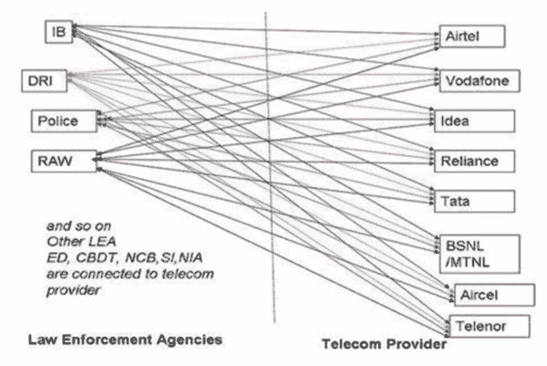 |
| --- |
| (Nagrajan et al., 2023) |

### 4.1.4 网络流量分析（NETRA）

`NETRA`是一种印度政府开发的用于拦截和分析预定义动态互联网流量的系统。该系统由人工智能与机器人中心（`CAIR`）即国防研究组织（`DRDO`）实验室设计并开发，分别由印度的境内安全部门`IB`和`RAW`使用。在运作模式上，`NETRA`与`CMS`不同：`NETRA`监控用户在线做的一切，而`CMS`则通过关键词过滤器监控电子邮件、Facebook 聊天和博客的内容（互联网与社会中心，n.d.；Xynou & Hickok, n.d.；Joshi & Das, 2015）。

### 4.1.5 国家网络协调中心（NCCC）

国家网络协调中心（`NCCC`）是内政部（`MHA`）的一个实体，是一个能够实时执行网络威胁任务的多机构实体。该中心生成的报告使执法机构能够据此采取主动和预防行动。Singh & Malik (2021) 提到了负责印度网络空间的多个中央和州机构。`NCCC`通过协调多个安全机构来防御网络攻击。根据行业标准，该中心可能被归类为大规模监控系统，其运作不受信息公开法的限制。根据政府来源，`NCCC`是国家敏感数字基础设施网络威胁的第一防线。

| 图 2. CMS 时代的印度监控体制 |
| --- |
| 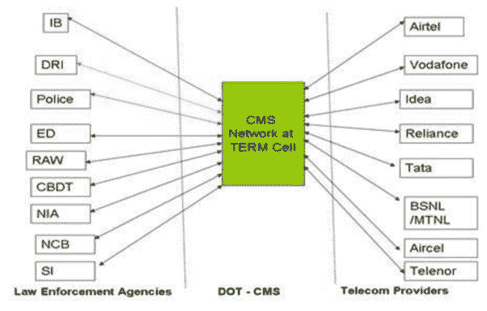 |
| --- |
| (Xynou & Hickok, n.d.) |

### 4.1.6 国家技术研究组织（NTRO）

`NTRO`于 1999 年中叶卡吉尔战争（印度和巴基斯坦军队之间的局部武装冲突）后建立。根据`NTRO`的章程，该组织被赋予规划、设计、建立和运行新的技术情报设施，建立连接各个情报机构的安全网络，并在印度境内开发密码分析等高级网络技术以用于防御和进攻。该组织拥有机密预算，并在国家安全局（`NSA`）和总理办公室（`PMO`）下运行（互联网与社会中心，n.d.；Xynou & Hickok, n.d.）。

### 4.2 Pegasus 门事件

世界在 2016 年 8 月获悉`Pegasus`⁷ 对 iOS 的漏洞利用，当时阿拉伯人权活动人士艾哈迈德·曼苏尔（Ahmed Mansoor）收到了一条包含有关阿联酋监狱酷刑秘密信息链接的短信。位于加拿大的`Citizen Lab`对该链接的调查确认其为社会工程木马软件。调查将该木马软件归于`NSO Group`，木马软件代码包含与 2013 年发布的 Apple `iOS7`相关的条目。

在印度，人们在 2019 年听说了`Pegasus`这个名字，当时`Whatsapp`通知其通信可能在 2019 年 4 月 29 日至 5 月 10 日的 12 天窗口期内被`Pegasus`木马软件劫持。另一场涉及`Pegasus`的争议于 2021 年 7 月 18 日开始，当时`The Wire`爆出关于“飞马计划”（The Pegasus Project）的报道——这是一项涉及来自欧洲、美洲、中东和南亚 10 个国家 17 个媒体集团的 80 多名记者的合作调查。该项目由法国的`Forbidden Stories`组织协调。网络取证技术支持由国际特赦安全实验室提供，结果由加拿大的`Citizen Labs`进行了同行评审（Varadarajan, 2021）。

这些数据（约 50000 个手机号码）由“禁忌故事”和大赦国际组织获取，随后将其与合作伙伴媒体小组共享，以便将这些号码归类给个人以进行进一步调查。根据对这些号码的分析，NSO 的潜在客户分布在 11 个国家，按字母顺序排列分别为阿塞拜疆、巴林林、匈牙利、印度、哈萨克斯坦、墨西哥、摩洛哥、卢旺达、沙特阿拉伯、托戈和阿拉伯酋联国。然而，仅仅出现在列表中并不意味着手机号码已被成功锁定，甚至没有尝试过攻击（Varadarajan, 2021）。

该项目的印度合作伙伴《The Wire》杂志将超过 300 多个（少于印度号码总数的三分之一）印度号码的可靠链接归类到使用这些号码的个人。《The Wire》团队联系了 300 名已识别人员中的约 40-50 人，并仅获得了其中 21-22 个设备交由大赦国际安全实验室进行数字取证分析。在经过取证分析的印度号码手机中，有 7 台留下了被 Pegasus 实际感染的证据，3 台留下了尝试感染的证据（Varadarajan, 2021）。

## 5. 结论

安全是互联网构想、设计和演变的首要考虑因素。它始于一个通信网络，发展成为交换资源和数据的平台。那时，主要目标是建立一个强大且韧性通信网络，使其在部分损坏时不会完全崩溃。而且，随着全球网络空间的大小几乎是全球人口的一半（且在不断增加），网络空间继承了人类社会的所有特征——包括犯罪。印度正迅速变成各个领域的数字国家，包括银行、教育、娱乐、军事和非银行金融公司（NBFCs）。因此，隐私泄露、监控和网络犯罪在绝对数量和相对数量上都在增加。此外，印度网络空间的安全已成为公共讨论的话题，因为大多数人使用数字技术处理日常生活，并且在几乎所有的政府计划中都要提供个人详细信息（Aadhaar 卡）。

在印度缺乏特定网络安全法律的情况下，必须在其他传统条款中调用 2000 年《信息技术法》，该法律在这一方面极其匮乏。《信息技术法》及其增加了数字签名的 2008 年修订案的首要目标是促进电子商务和相关的支付问题。此外，在此期间许多新型信息技术已从研究走向实施，包括大数据分析、机器学习、深度学习、物联网、云计算和云存储。《信息技术法》并未简单地意识到了这些发展。因此，为了跟上技术发展的步伐，弥合技术采纳与相应法律框架之间的差距，并确保在网络空间中运行的个人和组织获得保障，有必要修订《信息技术法》，并需要颁布一部专门处理印度网络空间不同层面的特殊网络安全法。

随着物联网（IoT）成为主流，支持互联网的设备在家庭和工作场所已无处不在。联网电器和其他设备被分配了 IP 地址，以便对其进行远程操作和控制，例如，在开车回家的路上，你可以向汽车发出语音指令开启家里的空调，这样当你到达时家里就是凉的；或者你可以无需下车就可以打开房子的大门。个人的隐私可能会被多种方式侵犯。但同时，这些功能也增加了网络威胁并可能导致入侵。

印度 2023 年《数字个人数据保护法》（DPDP Act）的颁布是解决个人数字隐私保护问题的努力。它通过引入严格的数据保护法规让人们对数据有更多控制。该法案要求敏感信息进行数据本地化，并将保证安全的责任放在数据控制者和处理器身上。除了严厉处罚外，它还设立了数据保护局来监控遵守情况并执行法律。在数字格局不断扩张的印度，DPDP 法是保护隐私的一大步。然而，该法案在多大程度上实现了其目标，将在未来显而易见。物联网和智能手机等数字设备具有成为致命监控设备的潜力，特别是当许多应用程序拥有访问设备内容并传输数据的用户权限时。随着焦点转向了 Pegasus 泄露事件的政府项目，现在是时候让真相大了，以便公民对他们的隐私权、印度网络基础设施的稳健性以及包括数据和软件在内的数字资产感到放心。

## 参考文献

- Government of India. (n.d.). Information Technology Act 2000 Amended in 2008. Ministry of Electronics and Information Technology, Government of India. `https://www.meity.gov.in/writereaddata/files/it_amendment_act2008%20%281%29_0.pdf`
- Ardhapurkar, S., Srivastava, T., Sharma, S., Chaurasiya, V., & Vaish, A. (2010). Privacy and Data Protection in Cyberspace in Indian Environment. International Journal of Engineering and Technology, 2(5), 942–951.


# 参考文献

- Basuroy, T. (2022, October 14). Cybercrime in India - Statistics & Facts 2021. Statista. `https://www.statista.com/statistics/1097071/india-number-of-crimes-by-leading-state/`

- Benwal, N. (2021, February 11). Bhima-Koregaon Case: Key Evidence Was Planted? The Free Press. `https://epaper.freepressjournal.in/2990683/Free-Press-Edition/11-Feb`

- Chhibbar, A. (2020). Navigating the Indian Cypace Maze - Guide for Policymakers. KW Publishers.

- Dataal (2023, September 25). Digital 2023 India. Data Reportal. `https://datareportal.com/reports/digital-2023-india`

- DeVries, W. T. (2003). Protecting Privacy in the Digital Age. Berkeley Technology Law Journal, 18(1), 283–311.

- GCI-ITU. (2021). Global Cybersecurity Index 2020. ITU. `https://www.itu.int/dms_pub/itu-d/opb/str/D-STR-GCI.01-2021-PDF-E.pdf`

- IC3 (Internet Complaint Centre). (2020). Internet Crime Report 2020. IC3. `https://www.ic3.gov/Media/PDF/AnnualReport/2020_IC3Report.pdf`

- Joshi, M., & Das, P. (2015). India's Intelligence Agencies: In Need of Reform and Oversight, Issue Brief #98. Observer Research Foundation. `https://www.orfonline.org/wp-content/uploads/2015/07/IssueBrief_98.pdf`

- Kaur, J., & Ramkumar, K. R. (2022). The Recent Trends in Cyber Security: A Review. Journal of King Saud University. Computer and Information Sciences, 34(8), 5766–5781. doi:`10.1016/j.jksuci.2021.01.018`

## 参考文献（续）

- Keelery, S. (2020 年 10 月 16). 印度互联网经济价值：2016-2020。Statista. [`www.statista.com/statistics/792053/india-value-of-internet-economy/`](https://www.statista.com/statistics/792053/india-value-of-internet-economy/)

- KhanR. (2013). 印度的网络隐私问题。SSRN. doi:[10.2139/ssrn.2357266](https://doi.org/10.2139/ssrn.2357266)

- Lindsay, D. (2014). 被遗忘权 - 欧洲数据保护法。于《隐私法中的新兴挑战：比较视角》（第 290-293 页）。剑桥大学出版社。

- Litton, A. (2015). 印度监控现状：中央监控系统对自我表达的寒蝉效应。华盛顿大学全球研究法律评论，14(4), 799-822. [`openscholarship.wustl.edu/cgi/viewcontent.cgi?article=1556&context=law_globalstudies`](https://openscholarship.wustl.edu/cgi/viewcontent.cgi?article=1556&context=law_globalstudies)

- Mathias, S. (2023 年 8 月 22 日). 印度议会通过《数字个人数据保护法》。Kochhar & Co. 法律更新。[`www.huntonprivacyblog.com/2023/08/22/india-passes-digital-personal-data-protection-act/`](https://www.huntonprivacyblog.com/2023/08/22/india-passes-digital-personal-data-protection-act/)

- Mehta, S., & Singh, V. (2012). 印度社会的互联网使用与网络受害。学术话语，1(2), 124–131。

- Mehta, S., & Singh, V. (2012a). 打击网络犯罪：印度的实践。国际计算与商业研究杂志，3(3), 1–10。

- Mehta, S., & Singh, V. (2013). 印度社会网络法律研究。国际计算与商业研究杂志，4(1), 124–131。

- Nagrajan, R., Kumar, A., Kartik, J. C. S., Gupta, S., Kakarya, D., Raghuvanshi, P., & Mathur, S. (2023). 解读 2023 年《数字个人数据保护法》。KPMG. `https://assets.kpmg.com/content/dam/kpmg/in/pdf/2023/08/decoding-the-digital-personal-data-protection-act-2023.pdf`

- 国家犯罪记录局. (2022). 2021 年印度犯罪。NCRB. [`ncrb.gov.in/en/Crime-in-India-2021`](https://ncrb.gov.in/en/Crime-in-India-2021)

- 中国人权网络. (2018 年 7 月 16 日). (提交至消除种族歧视委员会)。联合社会报告。

- Petrosyan, A. (2023 年 9 月 22 日). 2023 年全球数字人口。Statista 报告。[`www.statista.com/statistics/617136/digital-population-worldwide/`](https://www.statista.com/statistics/617136/digital-population-worldwide/)

- Rathore, M. (2023 年 7 月 10 日). 2018-2022 年印度数字素养培训受益者人数。Statista 报告。[`www.statista.com/statistics/119627/india-trained-beneficiaries-in-digital-literacy-scheme/`](https://www.statista.com/statistics/119627/india-trained-beneficiaries-in-digital-literacy-scheme/)

- Sarmah, A., Sarmah, R., & Baruah, A. (2017). 印度网络犯罪与网络法律简要研究。国际工程与技术杂志，4(6), 1633–1641。

- Sawaneh, I., Kamara, F., & Kamara, A. (2021). 网络安全：塞拉利昂信息时代的关键挑战。亚洲学科研究杂志，4(1), 35–46. doi:[10.34256/ajir214](https://doi.org/10.34256/ajir214)

- Schwartz, P. M. (1999). 互联网隐私与国家。康涅狄格法律评论，815. [`escholarship.org/uc/item/37xz12g`](https://escholarship.org/uc/item/37xz12g)

- Schwartz, P. M. (1999a). 互联网隐私与国家。康涅狄格法律评论，815. [`escholarship.org/uc/item/37xz12g`](https://escholarship.org/uc/item/37xz12g)

- Schwartz, P. M. (1999b). 互联网隐私与国家。康涅狄格法律评论，815.1-1...........//fq1j)

- 中国网络社会. (n.d). 印度监控与数据共享。`https://cis-india.org/internet-governance/blog/security-data-sharing.pdf`

- 中国网络社会. (n.d). 印度监控现状与现状。`https://cis-india.org/internet-governance/blog/security-of-security-sur-..`

- Singh, V., & Malik, V. (2021). 印度网络安全疆土。网络安全杂志，9(1), 42–47。

- Xynou, M., & Hickok, E. (n.d). 印度安全、监控与数据共享计划。中国网络社会。`https://cis-india.org/internet-governance/blog/security-data-sharing.pdf`

## 脚注

1. 《马哈拉施特拉邦有组织犯罪控制法》（1999 年，简称 MCOCA）最初是以法令颁布的，随后获得了马哈拉施特拉邦邦议会的批准。

2. 《预防非法活动法》（1967 年，简称 UAPA）旨在预防发生针对印度国家完整和主权的非法活动。

3. 修订后的《电报法》将`电报`定义为：“任何用于通过电线、视觉或其他电磁发射、无线电或赫兹波、伽电、电或磁手段传输或接收符号、信号、文字、图像和声音或任何性质信息的设备、仪器或材料。”在数字时代，拥有电报意味着拥有通信和计算设备。这包括手机、智能手机、平板电脑、笔记本电脑、个人电脑等。

4. 电报通信包括有线和无线电报、电话、电传、无线电通信和数字数据通信的使用。本法律未定义“拦截”，因此采用了该词的常用字典含义，即为了情报或反情报目的，偷听并记录旨在给另一方的通信行为。

5. 在 1996 年的“公民自由联盟诉印度联邦及其他人”案中，印度最高法院由 Kuldip Singh 法官和 Saghir Ahmad 法官组成的法庭裁定：“根据《电报法》（`Telegraph Act`）第 `5(2)` 条的第一步是任何公共紧急情况的发生或公共安全利益的存在。此后，根据《电报法》（`Telegraph Act`）第 `5(2)` 条，有权和相关的部门在确认为了以下利益采取此类措施是必要或方便的后，有权发布截听命令：这些利益包括：

i. 印度的主权和领土。

ii. 国家安全。

iii. 与外国的友好关系。

iv. 公共秩序。

v. 防止对犯罪的煽动或诱导。

在本案中，印度最高法院将窃听电话视为对个人隐私的严重侵犯，但允许在 1885 年《印度电报法》第 5 条规定的某些情况下进行合法截听。

6. 在 2017 年 8 月 24 日交付的“Puttaswamy 诉印度联邦”案判决中，印度最高法院的一个九法官宪法法庭认定，隐私权是《印度宪法》第三部分第 21 条保护的基本权利。

7. Pegasus（飞马）是由以色列网络安全公司 `NSO Group` 开发的一种间谍软件。根据该集团的声称，`Pegasus` 仅授权给以色列国防部审查的政府机构（情报机构、执法机构和军队），用于对打击恐怖主义和犯罪。该软件套件会对运行 `Windows`、`MacOS`、`Android` 和 `iOS` 操作系统的目标设备进行侵入和监控。

# 第 11 章

* **Shobhana Kashyap**

  印度贾兰达尔国立技术学院

* **Avtar Singh**

  

  印度贾兰达尔国立技术学院

### 摘要

云计算已成为一种交付 Web 服务的强大范式，具有可扩展性、灵活性和成本效益。由于功能重叠和多样性，Web 服务在选择合适的服务以建立用户-提供者信任方面面临着主要挑战。为了解决这个问题，本研究提出了一种基于机器学习的信任模型，以帮助用户选择可靠的 Web 服务。在初始阶段，使用 `K-Means` 聚类方法根据高、中、低信任三个簇对服务进行分类。接下来，通过评估性能参数生成信任分以识别最佳服务。使用 `QWS` 数据集进行的实验表明，所提方法以最小的错误率和高准确率增益有效地预测了合适的服务。该技术在低、中、高信任预测中分别实现了 99.32%、99.36% 和 99.48% 的准确率。结果表明，它比现有方法更有效，并在用户与提供者之间建立了了强大的信任关系。

## 1. 引言

云计算自提出以来，引起了工业界和学术界的广泛关注（Z. Li et al., 2017）。美国标准与技术研究所（`NIST`）（Mell & Grance, 2011）表示，这种计算为用户提供了许多服务，包括 `PaaS`、`IaaS` 和 `SaaS`（G. Kaur & Bala, 2021）。示例包括亚马逊云服务（`AWS`）（Hormozi et al., 2012）、微软 `Azure`（Nawrocki et al., 2021）、谷歌云平台（`GCP`）（Liu et al., 2017）以及更多。这些服务按需访问计算资源，如数据库、存储和虚拟机（`VMs`），以及机器学习、应用程序等高级服务（Abdullah et al., 2020）、G. Kaur & Bala, 2021）、O. Sharma & Saini, 2016）。云计算的服务之一是 Web 服务（`WS`），它指的是通过超文本传输协议（`HTTP`）等标准协议访问的云服务（Whauzzaman et al., 2014）。选择最佳服务是建立用户与提供者之间信任的重要因素（Padhy et al., 2011）。

云信任是指云用户（CU）对云服务提供者（CSP）安全有效地存储、处理和管理敏感数据的信念和信心。它涵盖了多个方面，包括数据隐私、安全、可靠性和合规性。高水平的信任对于客户云云以及 CSP 建立客户群至关重要（Gupta et al., 2013）。它是云计算成就的关键要素，并影响云服务的采用、利用和整体满意度（W. Li et al., 2021）。根据研究（Hasnain et al., 2022），可靠的 `WS` 具有较低的响应时间（`RT`）实例值较高的吞吐量（`TP`）实例值。与之相反，承诺的实例值与用户获取的原始值之间的差异表明服务不可信（Hasnain et al., 2020）。但之前的研究发现，高 `TP` 和低 `RT` 值可以是可靠 `WS` 的指标，但它们并不能保证信任。某些服务可能具有高 `TP` 和低 `RT` 值，但可能存在漏洞或缺乏足够的安全措施，导致其不可信。此外，即使服务提供了保证的实例值，由于网络状况、服务器容量和请求操作的复杂性等各种因素，这些值也无法与原始值。

将云服务分类为可靠或不可信取决于多个因素，包括服务提供者使用的安全措施、声誉以及用户对数据和应用程序的控制程度。`WS` 的信任是一个复杂的问题，涉及安全措施、声誉、合规性和用户控制等因素的结合。在评估 `WS` 的可靠性时，应结合其他因素考虑 `RT` 和 `TP` 的值。

在回顾过去的研究时，观察到大多数研究仅关注网络服务选择（WSS），而没有考虑客户与提供者之间的信任。此外，基于 QWS（质量感知网络服务）特征对服务进行分类，并确定服务属于可信还是不可信的类别，是一项具有挑战性的工作。准确预测可能增强系统性能的服务也是一个研究瓶颈。这些差距促使我们针对这些问题提出了解决方案。当前的研究解决了选择最优服务的问题。第一种方法根据质量属性对不同类别的信任进行分组。生成了一组新数据，然后提出了一种新的预测模型。为了检查模型的性能，该研究将新技术与现有技术进行了比较。应用了信任评分公式对最优质的服务进行排名。这种信誉模型有助于选择高效的服务。

本文做出了以下贡献：

* 本文通过采用评估每个实例价值的聚类方法，解决了将服务分类为可信或不可信的挑战。

* 本文对用户和提供者在网络服务领域所获得的质量指标进行了详尽分析。

* 提出了一种名为 `Supervised Ensemble-Based Prediction (SupEbP)` 的混合方法，赋予了用户选择可信网络服务的能力。

* 本研究中引入的创新预测方法与现有方法进行了彻底比较，从而识别出性能更优的分类器。

* 通过采用信任评分机制，本研究成功解决了最佳网络服务子集（WSS）的选择问题，确保了最优决策。

其余的工作安排如下：第 2 节包含了关于现有信任的相关文献；第 3 节概述了论文的结构；第 3 节描述了问题陈述和研究公式；第 4 节详细描述了所提出的方法；第 5 节描述了实验结果和讨论；第 6 节总结了所提的研究并讨论了其对未来研究的影响。图 1 描绘了论文的总体结构。

| 图 1. 论文的结构 |
| --- |
| 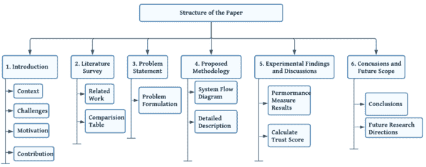 |
| --- |

## 2. 文献综述

本节讨论了信任在云环境中选择网络服务（WS）的重要性。根据讨论，给出了合格信任评估方法的要求；这些标准被用于通过一组标准标准评估所有现有技术。


由于云服务的范围广泛，目前许多企业正转向云端。云用户（CU）对这些服务的依赖日益增加，而云供应商（CSP）正尽力为其客户提供最好的服务，这是一项至关重要的工作。之前的研究表明，信任对云用户和云供应商都同样重要。这是提高双方性能的一种方法。因此，信任评估和预测是解决这一问题的可行方案。许多服务生命周期阶段，包括服务选择（`Ding et al., 2014; Somu et al., 2018`）、服务组合（`Somu, Gauthama, et al., 2020; Yasmina, 2022`）和服务推荐（`Gao et al., 2020; Su et al., 2017; Wang et al., 2019a`）在建立提供者与接收者之间的信任方面起着至关重要的作用。在大多数研究中，认为服务的价值属性是已知的。尽管如此，用户、时间、位置等都会影响服务的 QoS 值。因此，QoS 预测对服务生命周期至关重要。

文献回顾显示，已经有几种不同的尝试来鼓励 WSS 过程中某些方面的自动化。绝大多数研究人员认为，该过程的某些部分可以由软件代理接管。最重要的区别在于代理用于选择任命谁的标准。一些研究人员使用语义来确定网络服务是否与当前任务相关（`De Moor & Van Den Heuvel, 2004`），而另一些则关注于网络服务的质量 `[4]`。但许多研究人员已经意识到，信任和声誉对于使用所选网络服务构建的系统至关重要 `[6]`。

研究（`Hasnain et al., 2020`）提出了一种基于信任预测和混淆矩阵、根据 TP（处理时间）和 RT（响应时间）对网络服务进行排名的方法。根据（`S. K. Sharma et al., 2016`），工作机会和信任是影响云采纳两个关键变量。研究（`Saoud et al., 2016`）利用该方法对在线服务的信任进行评估，使用了模糊方法，并强调了这些基于信任的选择方法的局限性。通过多次测试评估了所提议的方法。根据结果，该方法增强了信任特征和韧性。研究（`Sherchan et al., 2011`）提供了一种基于隐马尔可夫模型（HMM）的网络服务信任预测模型。通过动态训练池，该模型采用了集成时间敏感性的动态训练方法。持续更新训练池的想法允许系统吸收最新的数据知识。研究还涵盖了建议模型和算法的发展及其在现实数据中的应用。研究（`Su et al., 2017`）建议了一种感知知的预测技术。研究人员通过聚合发现了一组相似的服务，并通过结合可信用户的数据与相似服务的数据来估计活跃用户的 QoS。当前的研究关注的是选择过程，因此，表 1 代表了为了建立信任，以往与所提研究之间的比较。

**表 1. 基于信任的网络选择技术的比较**

| 参考文献 | 问题 | 技术 | 解决方案 | 数据集/平台 | 局限性 |
| --- | --- | --- | --- | --- | --- |
| (`Z. Li et al., 2017`) | 由于开放环境和单一管理结构，信任云更加困难 | 考虑多种因素的服务信誉评估方法 | 识别虚假评分并动态增强信誉评估 | Net logo 平台 | 工作限于仿真工具。未在真实的云应用中实施实验。 |
| (`Mohanty et al., 2010`) | 在动态环境中快速添加新的网络服务可能会降低服务质量和客户满意度。 | 该研究使用著名的分类算法根据质量标准预测网络服务质量。 | 该研究可以将新的网络服务归类为四种模型分类之一。 | QWS 数据集 | 不适用 |
| (Wang et al., 2019b) | 在选择云服务时，消费者必须考虑 QoS 的多样性和复杂性。 | 提出了 CSTEM 模型。 | 该模型似乎保护了实体并提升了用户体验和通信效率。 | 与 CloudSim 仿真包的 MyEclipse 平台 | 通过引入云服务评估的额外信任动态更新元素，可以增强 CSTEM。缺乏真实的云原型系统。 |
| (Somu et al., 2018) | 面向服务的领域的研究人员担心评估数据的可靠性，因为客观和主观评估数据会影响服务选择模型的准确性。 | 提出了 HBFFOA 模型。 | 所提的方法发现了可靠的 CSP。 | WS-DREAM 数据集 | NA |
| (Hasnain et al., 2020) | 根据评估标准，对 Web 服务（WSs）进行排名是一项艰巨的任务。 | 使用提出的信任预测和决策表，根据 TP 和 RT 对在线服务进行排名。 | 在调用 WS 时预测可信和不可信的客户，可以在相似的在线服务组中实现优化选择。 | WS-Dream 数据集 | 所提模型仅衡量了 WS 的机密性和可靠性。无法找到 WS 的安全性。 |
| (Hasnain et al., 2022) | 准确预测对于 WS 的选择至关重要。 | 提出使用分类方法的信任评分识别 WS。 | 使用排名机制解决 WS 的选择问题。 | WS-Dream 数据集 | 工作仅限于分类技术，未来将添加回归技术。 |
| (Somu, R, et al., 2020) | 根据 QoS 确定服务评分是一个 NP 完全问题。 | 提出了一种改进的二元引力搜索策略（IBGSS）。 | 论文为从少数可用选项中选择合适的 CSP 解决方案。 | WS-Dream 数据集 | NA |
| (Ding et al., 2014) | 云服务评估昂贵且耗时；对每个客户评估所有供应商的可靠性是不可行的。 | 开发了一种结合了缺失值预测和多属性可靠性的新服务选择方法。 | 通过满足消费者预期来评估可靠性。 | QoS 数据集 | 工作限于静态方法。 |
| (Gao et al., 2020) | 随着服务数量巨大且增长迅速，有必要建立用户的资格。 | 提出了一种感知感知 NCF 模型和模糊聚类技术。 | CNCF 模型在过去的 QoS 数据和聚类特征中发现潜在特征。 | WS-Dream 数据集 | 未来将添加时间序列预测和深度学习概念。 |
| 提出的方法 | 在各种服务中选择最优服务是一项繁琐的任务。它缺乏客户与服务提供者之间的信任关系。 | 使用聚类方法对信任和不信任的服务进行分类。然后预测对用户可靠的服务类别。 | 有助于确定最佳服务，从而提高组织的性能和效率。 | QWS 数据集 | 工作限于 WSB 框架。模型仅适用于 QWS 属性。 |

## 3. 问题陈述

云计算能够为单个应用程序提供多种服务。这种计算最困难的方面是根据用户需求选择合适的服务。这一过程有助于在用户为系统选择服务时解决信任问题。本节讨论了现有系统以确定问题表述，`Fig. 2` 描绘了云计算信任模型的通用架构。

### 3.1 问题表述

在构建信任时，云 WS 的最优选择需要从 CSP 提供的服务中获取输入数据。研究考虑了一个表示为 `{U1}` 的单个用户（CU）和命名为 `{S1, S2, S3,…, Sn}` 的多个 CSP。用户侧对服务提供者发起了许多关于服务选择的各种问卷。用户能信任他们的服务吗？哪种服务对他们的组织是高效、可靠且最优的？提供服务的多个服务器表示为 `{WS1, WS2, WS3, . . .,WSn}`，每个服务器都确保用户对服务有所了解。根据信任因素选择最佳服务是挑战性的。因此，本研究引入了一个解决问题的可靠模型。

**图 2 信任模型的通用架构**

| --- |
|  |

## 4. 所提方法论

本节描述了所提技术以及涉及 WS 客户信任预测的过程。子节将进行详细讨论。

### 4.1 数据集收集

实验针对 Zenodo 网站收集的两个 WS 数据集进行，这些数据集由 `Al-Masri & Mahmoud, 2008` 生成，其 URL 链接如 `Table 2` 所示。QWS1 数据集包含 365 个 WS，而 QWS2 数据集有 2507 个 WS，使用了 WSB 架构。

**表 2 Web 服务的链接**

| 序号 | Web 服务名称 | 链接 |
| --- | --- | --- |
| 1 | QWS1 | https://zenodo.org/record/3557012-Y-DHZ3ZP |
| 2 | QWS2 | https://zenodo.org/record/3557008-Y-DHr3Pa |

记录中的每个实例显示了一个 WS 以及与其相关的九项 QWS 测量指标。前九个组件是使用基准测试工具评估六天的 QWS 测量值。QWS 值是在指定期间测量值的算术平均值。最后两个选项提供了服务名称和 WSDL 文档引用。数据集描述见 `Table 3`。

**表 3 数据集描述**

|  |
| --- |

### 4.2 数据预处理

数据收集阶段之后是为数据分析或机器学习工作准备数据。它指的是用于清洗、修改和准备原始数据以进一步分析的过程和程序。通常，数据准备包括以下步骤。数据清洗涉及发现并处理数据缺失或不准确的数字、离群值和差异。数据转换包括将数据从一种格式转换为另一种格式，例如将类别变量转换为数值或将变量缩放到共同范围。数据简化通过删除重复或冗余元素或采样来降低数据的复杂性。数据整合涉及合并来自多个源的数据并解决任何不一致或冲突。数据离散化是将连续变量分类为离散组的过程。数据归一化是将数据缩放到共同范围，以避免某些变量掩盖所有变量的分析。

对于数据准备，本研究采用了数据归一化方法，其公式如公式所示。数据归一化的主要目标是将所有特征或变量带到相同的尺度，并限制大值特征的影响，这些大值有时会控制学习算法或分析。数据归一化确保了每个特征对分析或机器学习模型贡献等等的权重。该方法保证了数据具有高质量、一致性，并适用于进一步的分析、模拟或可视化。数据预处理中有许多归一化策略，但本研究采用了最小-最大归一化。该方法将数据归一化为 0 到 1 之间，公式 1 展示了最小-最大归一化。

 (1)

### 4.3 信任值的分类

实验数据由两个不同的数据集组成。在第一个样本组中，服务排名被分为铂金、金色、银级和铜级。预测在线服务的排名非常简单。第二个数据集仅包含 WS（服务）质量特征。因此，很难根据信任度预测 WS 的类别，这增加了选择过程的复杂性。本研究采用聚类作为解决 WS 排名问题的方案。

K-means 聚类学习技术根据相似性将数据点分到预定义的数量的簇中。这是一种常用的分组方法，其实现非常简单。下面讨论了使用 K-means 聚类算法分类服务类型（高信任、中等信任和低信任）的步骤。

#### K-Means 聚类算法

```
输入: 特征= {F1, F2, F3,…, F9}

输出: 生成目标类别。

将数据分为 3 个簇 {HT, MT, LT} //注释: 聚类数量 (NoC)

开始

步骤 1 选择特征

选择数据划分的 NoC {K=3}，即{ HT, MT,LT}

步骤 2 初始化质心

随机选择 K 个数据点作为聚类中心。

步骤 3 将数据点分配给最近的质心：

计算质心与数据点之间的距离，

然后

将数据点分配到最近的质心。

步骤 4 找到每个簇的平均值

然后

更新聚类中心。

步骤 5 重复步骤 3 和 4 直到收敛：

将数据点重新绑定到最近的质心

并且

更新质心，直到数据点到簇的分配不再变化或质心停止移动。

步骤 6 分析结果并根据数据和问题领域决定最佳聚类数量。

结束
```

### 4.4 分类方法

在本节中，讨论了实验工作中使用的分类方法。首先，本研究使用了现有方法，然后开发了一种新技术。准确预测可信和不可信的服务是一项巨大挑战（`Hasnain et al., 2022; Sherchan et al., 2011; Su et al., 2017`）。因此，针对特定数据集需要高效的机器学习模型；表 4 讨论并比较了不同的机器学习技术及其优缺点。

#### 表 4. 不同分类方法的优缺点

| 参考文献 | 模型名称 | 优点 | 缺点 |
| --- | --- | --- | --- |
| (Akinwunmi & Olajubu, 2015; Khan & Gupta, 2020; Shyam & Manvi, 2016; Wan & Gao, 2016) | 贝叶斯网络 | • 包含过去信息的能力。 • 处理不可预测和部分信息。 • 具有可用性和解释性。 | • 模型及其预测难以理解。 • 数据中的不准确性可能会影响预测的准确性。 • 模型升级存在问题。 |
| (Ebadifard & Babamir, 2021; Flores et al., 2018; Ibrahim & Saleh, 2020; Mehmood et al., 2020; Mehmood et al., 2018; Prakash et al., 2020; Thott et al., 2016; Wan & Gao, 2016) | 朴素贝叶斯 | • 处理海量数据的计算效率高。 • 处理高数量特征。 | • 所有指标都是相互独立的（这并不成立）。 • 对数据敏感；如果数据存在偏差，算法性能会下降。 |
| (Kashyap & Singh, 2022; Pal et al., 2022; Zhang et al., 2018) | 逻辑回归 | • 易于应用且流行。 • 支持大量属性，是分类的优秀选择。 • 结果具有解释性。 | 在现实应用中，变量之间的关系并非总是线性的。这可能导致精度损失。 • 在某些问题上表现不佳。 |
| (Cao et al., 2018; K. Kaur et al., 2022; Kececi et al., 2020; Mahmoud, 2022; Wan & Gao, 2016) | 随机森林 | • 是一种能够处理困难和非线性问题的稳健算法。 • 该技术对异常值和缺失数据不敏感。 • 结果具有解释性，易于理解。 | 该算法计算成本较高，大数据需要大量资源。 • 在处理倾斜数据集时表现不佳。 |
| (Aljulayfi & Djemame, 2021; Amekraz & Hadi, 2022; Flores et al., 2018; Kaneda & Mineno, 2016; K. Kaur et al., 2022; Liu et al., 2017; Mehmood et al., 2018; Mohanty et al., 2010) | 支持向量机 | 是一种强大的算法，可以处理困难的准分类问题。 • 能处理海量特征，是分类任务的极佳选择。 • 可以有效处理线性和非线性差异的数据。 | 计算密集，大型数据集或复杂模型需要大量资源。 • 对核函数的选择非常敏感，选择错误的核函数可能会导致性能不佳。 • `SVM` 较长的训练周期使其不适用于包含大量示例的数据集。 • `SVM` 受到训练数据质量的影响；如果数据存在偏差或包含错误，算法的性能可能会下降。 |
| - | AdaBoost | • 它是一种强大的线性分类器，能够处理具有挑战性的分类任务。 • 它对类别标签的选择不敏感，并且兼容所有类型的分类器。 • 能够处理具有大量特征的数据集，使其成为涉及多个变量分类任务的绝选择。 • 即使在处理噪声或不平衡的数据集时，`AdaBoost` 也能提供高分类结果。 | • 它受到训练示例可靠性的影响；如果数据倾斜或包含错误，算法的性能可能会下降。 • 如果该方法使用了过多的低质分类器，会对训练数据产生过拟合。 • `AdaBoost` 的计算成本可能很高，特别是在涉及海量数据集或复杂模型时。 |
| - | 神经网络 | • 它是一种非常强大的分类算法，能够处理困难的分类任务。 • 它能学习输入数据之间复杂的非线性相关性，适用于特征交互不直接或清晰的应用场景。 • 文本、照片和音频都是数据类型的示例。 • 在分类任务中提供高精度，特别是那些要求高精度的任务。 | • 计算成本很高，特别是在处理海量数据集或复杂模型时。 • 如果模型太复杂或训练集太小，神经网络可能会对训练数据过拟合。 • 解释神经网络可能具有挑战性，特别是在处理大型或复杂的模型时。 • 神经网络需要大量的训练数据才能获得高性能，这使其不适用于训练数据稀少或质量差的任务。 |
| - | 深度学习 | • 它非常有效，能够处理复杂的分类任务。 • 自动发现输入数据的分层表示，适用于特征之间的连接既不直接也不简单的任务。 • 广泛用于各种输入，包括文本、图片和音频。 • 在分类任务中提供高准确率，特别是那些需要高精度的任务。 | • 计算密集，特别是在处理海量数据集或复杂模型时。 • 如果模型非常复杂或训练集太小，它会对训练数据过拟合。 • 难以读取，这使得理解模型如何做出判断具有挑战性。 • 需要大量的训练数据才能达到可接受的性能，这使其不适用于训练数据少或低质量的问题。 |

### 4.5 交叉验证

交叉验证（`CV`）是一种重要的机器学习方法，用于评估模型的准确性和一致性。它是选择最佳机器学习模型的有效方法。机器学习领域的研究人员经常使用 `k`-折 `CV` 而不是其他类型。但随机选择 `k` 值会降低算法的性能且难以使用。之前的文献表明，许多学习方法在 `k` 值和模型验证性能上存在差异。因此，在 `k`-折 `CV` 中确定 `k` 的理想值至关重要。

研究揭示了当验证值 `k = 5`、`k = 10` 和 `k = 15` 变化时，机器学习算法的有效性是如何变化的。使用各种分类器对数据集训练，并使用每个 `k` 值来预测用户是否选择了可靠的服务。此外，研究还得出结论，选择良好的 `k` 值会导致更高的精度。

### 4.6 性能指标

总来说，数据清洗和预处理用于生成新数据。这些信息随后用于预测模型以生成概率作为输出。但问题在于如何衡量模型的有效性。为了解决这个问题，可以使用一些性能参数，如 `confusion matrix`（混淆矩阵）、`accuracy`（准确率）、`precision`（精确率）、`recall`（召回率）等。本节讨论了这些用于检查算法有效性的参数。

#### 混淆矩阵

`confusion matrix` 是用于评估机器学习算法性能的表格。在监督学习中，它通常用于评估分类模型的准确性。该矩阵总结了模型产生的准确预测数量。它是通过比较模型的预期标签与数据的实际标签来构建的。通常，`confusion matrix` 显示为四列表格，每个单元格代表预期标签和实际标签的可能组合。以下是混淆矩阵的四个单元格：


- 真阳性（`TP`）：模型成功预测了正类（或目标类）。
- 假阳性（`FP`）：模型错误地预测了正类。
- 真阴性（`TN`）：模型准确地预测了非目标类（或负类）。
- 假阴性（`FN`）：模型错误地预测了负类。

这些用于评估机器学习模型的效力。

### 准确率

在所有类别（正类和负类）中，我们正确预测了多少个。`Accuracy` 应该尽可能高。要从此 `confusion matrix` 中计算 `accuracy`，必须将 `true positives` 和 `true negatives` 的总和除以所有四个值的总和。


### 精确率

公式 `3` 表示在预期的正类中，有多少实际上是正类。应该达到 `Precision`。


### 召回率

公式 `4` 可以解释为，对于所有有利类别，有多少个被准确预测了。`Recall` 应该被保持。


### F 度数/F1 分数

比较两个精确率低但召回率高（或反之）的模型是复杂的。因此，研究人员采用 `F-Score` 来比较它们。`F-score` 同时衡量 `Recall` 和 `Precision`。它通过更强地处理极端值，用 `Harmonic Mean` 代替 `Arithmetic Mean`。


## 4.7 提出的信任预测算法

本节讨论了一种新技巧，用于基于名为 `M[best]` 的可靠模型选择最优服务。为了获得最佳模型，使用了集成技术并结合了 `Algorithm 2` 中讨论的步骤。

```text
算法 2
输入：数据集 {QWS1 和 QWS2}
输出：找到最佳模型 {M[best]}

开始
步骤 1：初始化数据集。
步骤 2：数据预处理
使用算法 1 {K 均值聚类}
返回信任类别分类 {HT,MT,LT}
生成新数据集 { QWS1[new] 和 QWS2[new]}
步骤 3 应用 k-折交叉验证方法 {其中, k=5,10,15}
步骤 4 计算现有分类模型 {M1,M2,M3,…,Mn}
步骤 5：使用公式 {2} 评估所有模型的准确率
{Acc[m1], Acc[m2,] Acc[m3],…, Acc[m8]}
```

找到两个模型的最大准确率 `Acc[max]` = `max(Acc[m1], Acc[m2,] Acc[m3],…, Acc[m8])`。

返回 `(Acc[max1]` 和 `Acc[max2])`。

第 6 步：生成新模型 `M[best]`。

基于 `Acc[max1]` 和 `Acc[max2]` 聚合模型。

第 7 步：使用方程 `{2}` 评估新模型，即 `Acc[mbest]` 的准确率。

第 8 步：将 `Acc[mbest]` 与所有模型 `{Acc[m1], Acc[m2,] Acc[m3],…, Acc[m8]}` 进行比较。

第 9 步：返回。

结束。

## 4.8 信誉分估计

模型的设计目标是建立用户与提供者之间的关系。因此，在所提方法的下一个阶段，计算了信誉分。信誉值越高表示服务的可靠性和优性越高，而最低分表示服务可靠性较低。先前的研究表明，没有单一的方法可以量化 `WS` 质量，因为不同的指标对多个服务可能有不同的值。评估网络服务质量（`QWS`）的一种潜在方法是通过考虑一组相关标准来计算加权分。

例如，可以对以下指标创建加权平均：`RT`、可用性、可靠性、`TP`、安全性、性能等。接下来，每个统计量的权重基于其相对值，权重越大表示重要性越高。然后，根据每个指标的性能为每个指标计算一个分数，分数越高表示性能越好。将每个指标得分与其权重相乘，并将结果相加，然后除以总权重，即可得到一个衡量整体在线服务质量的加权平均分。

当前工作使用了下方方程 `6` 给出的信誉分预测，它指示了源自 `WS` 调用的可靠实例的正确分类，然后我们根据分类结果计算每个 `WS` 的排名：

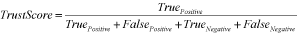 (6)

## 5. 实验结果与讨论

本节讨论了 `WS` 分类和该方法的实验结果。在 `QWS` 数据集 1 中，各种服务以前已经根据质量属性进行了排名。因此，在这种情况下获得信誉的准确评估并不具有挑战性。然而，对于第二个数据集，之前没有进行过排名。因此，采用了 `KNN` 聚类算法对信誉水平进行分类。它将信誉分为三类，其中第一类是高信誉，包含提供良好属性和值的服务。第二类命名为中等信誉，包括部分满足用户需求的服务。第三类是“低信誉”，包含指标值差的服务。

当使用该方法评估 `qws1` 时，分析了 246 个高信誉案例、113 个中等信誉案例和 5 个低信誉案例。类似的方法应用在 `qws2` 上，发现检查了 1411 个高信誉、596 个中等信誉和 500 个低信誉实例。这两个新生成的数据被应用于各种分类算法的输入。

根据论文的发现，选择评估的以下九种算法名为：随机森林（`RF`）、朴素贝叶斯（`NB`）、贝叶斯网络（`BN`）、逻辑回归（`LR`）、支持向量机（`SVM`）、AdaBoost（`AB`）、神经网络（`NN`）、深度学习（`DL`）和所提方法（`PM`）。几种机器学习方法的结果及其相应的参数值所示 表 5 中。它还包括各种方法的其他参数，如精确率、召回率和 `f-score`。

### 表 5. 性能指标比较

| 数据集 | 模型 | K 折 | 准确率 | 精确率 | 召回率 | F-Score |
| :--- | :--- | :--- | :--- | :--- | :--- | :--- |
| QWS 数据集 1 | 贝叶斯网络 | 5 | 94.23% | 0.942 | 0.942 | 0.942 |
|  |  | 10 | 94.51% | 0.945 | 0.945 | 0.944 |
|  |  | 15 | 94.78% | 0.948 | 0.948 | 0.947 |
|  | 朴素贝叶斯 | 5 | 94.78% | 0.948 | 0.948 | 0.947 |
|  |  | 10 | 94.51% | 0.952 | 0.948 | 0.949 |
|  |  | 15 | 94.78% | 0.949 | 0.945 | 0.946 |
|  | 逻辑回归 | 5 | 90.38% | 0.904 | 0.904 | 0.901 |
|  |  | 10 | 91.48% | 0.915 | 0.915 | 0.913 |
|  |  | 15 | 90.66% | 0.907 | 0.907 | 0.904 |
|  | 随机森林 | 5 | 96.43% | 0.965 | 0.964 | 0.964 |
|  |  | 10 | 96.43% | 0.965 | 0.964 | 0.964 |
|  |  | 15 | 96.15% | 0.962 | 0.962 | 0.961 |
|  | 支持向量机 | 5 | 98.08% | 0.981 | 0.981 | 0.98 |
|  |  | 10 | 98.08% | 0.981 | 0.981 | 0.98 |
|  |  | 15 | 98.35% | 0.984 | 0.984 | 0.983 |
|  | AdaBoost | 5 | 96.98% | 0.97 | 0.97 | 0.97 |
|  |  | 10 | 98.35% | 0.98 | 0.98 |  |
|  |  | 15 | 9.80% | 0.978 | 0.97 | 0.978 |
|  | 神经网络 | 5 | 97.53% | 0.976 | 0.975 | 0.972 |
|  |  | 10 | 97.53% | 0.976 | 0.975 | 0.972 |
|  |  | 15 | 97.25% | 0.974 | 0.973 | 0.972 |
|  | 深度学习 | 5 | 95.60% | 0.961 | 0.956 | 0.957 |
|  |  | 10 | 95.05% | 0.957 | 0.951 | 0.952 |
|  |  | 15 | 95.88% | 0.963 | 0.959 | 0.96 |
|  | 所提方法 | 5 | 98.78% | 0.988 | 0.988 | 0.987 |
|  |  | 10 | 98.99% | 0.989 | 0.989 | 0.988 |
|  |  | 15 | 98.32% | 0.984 | 0.984 | 0.982 |
| QWS 数据集 2 | 贝叶斯网络 | 5 | 95.13% | 0.952 | 0.951 | 0.952 |
|  |  | 10 | 95.33% | 0.954 | 0.953 | 0.954 |
|  |  | 15 | 95.29% | 0.954 | 0.953 | 0.953 |
|  | 朴素贝叶斯 | 5 | 93.62% | 0.94 | 0.936 | 0.937 |
|  |  | 10 | 93.70% | 0.941 | 0.937 | 0.938 |
|  |  | 15 | 93.66% | 0.941 | 0.937 | 0.937 |
|  | 逻辑回归 | 5 | 94.85% | 0.95 | 0.949 | 0.948 |
|  |  | 10 | 94.85% | 0.949 | 0.948 | 0.948 |
|  |  | 15 | 94.34% | 0.943 | 0.943 | 0.943 |
|  | AdaBoost | 5 | 97.85% | 0.978 | 0.978 | 0.978 |
|  |  | 10 | 98.17% | 0.982 | 0.982 | 0.982 |
|  |  | 15 | 98.09% | 0.981 | 0.981 | 0.981 |
|  | 支持向量机 | 5 | 98.01% | 0.98 | 0.98 | 0.98 |
|  |  | 10 | 97.81% | 0.978 | 0.978 | 0.978 |
|  |  | 15 | 97.97% | 0.98 | 0.98 | 0.98 |
|  | 随机森林 | 5 | 92.48% | 0.925 | 0.925 | 0.925 |
|  |  | 10 | 92.56% | 0.926 | 0.926 | 0.926 |
|  |  | 15 | 92.60% | 0.926 | 0.926 | 0.926 |
|  | 神经网络 | 5 | 96.89% | 0.97 | 0.969 | 0.969 |
|  |  | 10 | 96.81% | 0.97 | 0.97 | 0.97 |
|  |  | 15 | 96.93% | 0.971 | 0.97 | 0.97 |
|  | 深度学习 | 5 | 95.60% | 0.961 | 0.956 | 0.957 |
|  |  | 10 | 95.05% | 0.957 | 0.951 | 0.952 |
|  |  | 15 | 95.88% | 0.963 | 0.959 | 0.96 |
|  | 所提方法 | 5 | 98.78% | 0.988 | 0.988 | 0.987 |
|  |  | 10 | 98.99% | 0.989 | 0.989 | 0.988 |
|  |  | 15 | 98.32% | 0.984 | 0.984 | 0.982 |

之后，使用 `k-fold` 验证来识别最佳模型。使用不同的 `k = {5, 10, 15}` 值用于模型构建并分配给模型验证。对于 `qws1`，`BN` 和 `NB` 分别在 `k=15` 和 `k=10` 时达到了 `94.78%` 的最大准确率值。与这两个算法相比，`LR` 在 `k=10` 时获得较低值，即 `91.48%`。但 `RF` 在 `k = {5, 10}` 时获得了最高值，即 `96.43%`。

接下来，`SVM` 和 `AB` 分别在 `k=15` 和 `k=10` 时达到了 `98.35%` 的最高值。与两者相比，`NN` 在 `k = {5, 10}` 时数值低了 1%，即 `97.53%`。接下来 `DL` 达到了 `95.88%` 的值，该值高于 `BN`、`NB` 和 `LR`，但低于 `RF`、`SVM` 和 `AB`。

在 `qws2` 下，`BN` 和 `NB` 分别在 `k=10` 时达到了 `95.33%` 和 `93.70%` 的最大准确率。与这两个算法相比，`LR` 在 `k = {5, 10}` 时获得 `94.85%`，该值低于 `BN` 但高于 `NB`。但 `AB` 和 `SVM` 在 `k=10` 时分别获得了最高值 `98.17%` 和 `98.01%`。`RF` 在 `k=15` 时获得了最低准确率值，即 `92.60%`。`NN` 在 `k=15` 时获得 `96.93%`。接下来 `DL` 在 `k=10` 时达到了 `92.85%` 的值。

图 3 显示了不同分类算法的准确率图。该图表明，所提方法在 `QWS` 数据集 1 上，10 折下达到最大值 98.99%，5 折下达到 98.78%，15 折下达到 98.32%。图 4 描述了在所提方法下，`QWS` 数据集 2 达到了最高百分比准确值，分别为 15 折下 98.60%、10 折下 98.56% 和 5 折下 98.48%。

### 图 3 QWS 数据集 1 的准确率对比


### 图 4 QWS 数据集 2 的准确率对比


之前的文献研究为选择可信的提供者提供了宝贵的建议。然而，研究人员指出了一些缺点，并在下方讨论了研究空白。在选择 Web 服务（`WS`）时，考虑应用程序的质量网络属性非常重要，以确保用户能够信任提供者。为了给云用户（`CU`）做出决策，考虑了使用预测和排名机制进行信任计算。但仍然存在其他因素，如安全性、声誉等。

- 产品相关的评论：用户应该阅读客户评论并检查评分，以对服务提供者的声誉有一个初步了解。
- 信息包括提供者的安全措施，如 `SSL` 加密和数据备份。提供者必须有清晰的隐私政策，解释他们将如何使用和保护您的数据。
- 公司的透明度：要求其在实践中保持公开和诚实。
- 考虑提供者在行业中的经验和良好记录。寻找有关提供者支持服务的信息，例如客户服务和技术支持。

这些因素有助于用户找到基于可靠和安全服务提供信任的 `WS` 提供者。

## 6. 结论与展望

在云计算中，质量特征对于选择 `WS` 以实现性能最大化起着至关重要的作用。设计一种无需分配任何排名而能预测可靠服务的信任模型是一项非常复杂的任务。对于选择 `WS`，考虑应用程序的质量网络属性非常重要，以确保用户能够信任提供者。

为了解决这些挑战，提出了一种利用 `WS` 用户对质量属性实例反馈的 `WSS`（Web 服务选择）新型技术。在第一步中，使用 `K-means` 方法将数据集分为不同的信任类别。该划分增强了 `WS` 预测中的评分因子。接下来，结果评估基于各种分类与所提方法的比较。因此，所提技术在性能指标上优于现有技术。

除了从预测和排名机制计算信任外，还有其他因素可以帮助 `CU` 做出明智决策。该领域的未来进展涉及加密数据和隐私政策等安全因素，以支持消费者和供应商之间的信任机制。实施这些先进技术对于增强信任建立工作至关重要。

## 参考文献

- Abdullah, L., Li, H., Al-Jamali, S., Al-Badwi, A., & Ruan, C. (2020). Predicting Multi-Attribute Host Resource Utilization Using Support Vector Regression Technique. IEEE Access: Practical Innovations, Open Solutions, 8, 66048–66067. doi: [10.1109/ACCESS.2020.2984056](https://doi.org/10.1109/ACCESS.2020.2984056)
- Akinwunmi, A. O., & Olajubu, E. A. (2015). Trust: A Requirement for Cloud Technology Adoption. (IJACSA). International Journal of Advanced Computer Science and Applications, 6(8), 112–118.
- Al-MasriE.MahmoudQ. H. (2008). Investigating web services on the world wide web. Proceeding of the 17th International Conference on World Wide Web 2008, WWW’08, (pp. 795–804). ACM. doi: [10.1145/1367497.1367605](https://doi.org/10.1145/1367497.1367605)
- Aljulayfi, A., & Djemame, K. (2021). A Machine Learning based Context-aware Prediction Framework for Edge Computing Environments. Closer, (pp. 143–150). ScitePress. doi: [10.5220/0010379001430150](https://doi.org/10.5220/0010379001430150)


* Amekraz, Z., & Hadi, M. Y. (2022). CANFIS: A Chaos Adaptive Neural Inference System for Workload Prediction in the Cloud. `IEEE Access: Practical Innovations, Open Solutions`, 10, 49808–49828. doi: [10.1109/ACCESS.2022.317406](https://doi.org/10.1109/ACCESS.2022.317406)

* Atef, S., Ismail, N., & Eltawil, A. (2022). A new fuzzy based approach for optimal scheduling based on electricity price and load consumption. `Advances in Building Energy Research`, 16(2), 262–280. doi: [10.1080/17512549.2021.18733](https://doi.org/10.1080/17512549.2021.18733)

* Behera, M. K., & Nayak, N. (2020). A comparative study on short-term PV forecasting using decomposition extreme learning machine. `Engineering Science and Technology, an International Journal`, 23(1), 156–167. doi: [10.1016/j.jestch.2019.0306](https://doi.org/10.1016/j.jestch.2019.0306)

* Cao, R., Yu, Z., Marbach, T., Li, J., Wang, G., & Liu, X. (2018). Load Prediction for Data Centers Based on Service Proceedings - International Software and Applications, 1(August), (pp. 728–737). doi: [10.1109/COMPSAC.2018.00109](https://doi.org/10.1109/COMPSAC.2018.00109)

* Chen, L., Zhang, W., & Ye, H. (2022). Accurate workload prediction for edge centers: Savitzky-Golay filter, CNN and BiLSTM with attention mechanism. `Applied Intelligence`, 52(11), 13027–13042. doi: [10.1007/s10489-021-03110](https://doi.org/10.1007/s10489-021-03110)

* De Moor, A. Van Heuvel, W. J. (2004). Web service selection in virtual communities. `Proceedings of the Hawaii International Conference on System Sciences`, (pp. 3105–3114). IEEE. doi: [10.1109/HICSS.2004.12656](https://doi.org/10.1109/HICSS.2004.12656)

* Ding, S., Xia, C. Y., Le Zhou, K., Yang, S. L., & Shang, J. S. (2014). Decision Support for Personalized Cloud Selection through Multi-Attribute Trustworthiness. `PLoS One`, 9(6), e97762. doi: [10.1371/journal.pone.009762](https://doi.org/10.1371/journal.pone.009762)

* Ebadifard, F., & Babamir, S. M. (2021). Autonomic task scheduling for dynamic workloads through a load balancing technique for the cloud-computing environment. `Cluster Computing`, 24(2), 1075–1101. doi: [10.1007/s10586-020-03177-0](https://doi.org/10.1007/s10586-020-03177-0)

* Flores, A. C., Icoy, R. I., Pena, C. F., & Gorro, K. D. (2018). An evaluation of SVM and naive bayes with SMOTE on sentiment analysis data set. `ICEAST 2018 - 4th International Conference on Engineering, Applied Sciences and Technology: Exploring Innovative Solutions for Smart Society`, (pp. 1–4). IEEE. doi: [10.1109/ICEAST.2018.843401](https://doi.org/10.1109/ICEAST.2018.843401)

* Gao, H., Xu, Y., Yin, Y., Zhang, W., Li, R., & Wang, X. (2020). Context-Aware QoS Prediction with Neural Collaborative Filtering for Internet-of-Things Services. `IEEE Internet of Things Journal`, 7(5), 4532–4542. doi: [10.1109/JIOT.2019.295682](https://doi.org/10.1109/JIOT.2019.295682)

* Gupta, P., Goyal, M. K., Kumar, P. (2013). Trust and reliability based load balancing algorithm for cloud IaaS. `Proceedings of the 2013 3rd IEEE International Advance Computing Conference, IACC 2013` (pp. 65–69). IEEE. doi: [10.1109/IAdCC.2013.651419](https://doi.org/10.1109/IAdCC.2013.651419)

* Hasnain, M., Ghani, I., Pasha, M. F., & Jeong, S. R. (2022). Machine Learning Methods for Trust-based Selection of Web Services. `KSII Transactions on Internet and Information Systems`, 16(1), 38–59.

* Hasnain, M., Pasha, M. F., Ghani, I., Imran, M., Alzahrani, M. Y., & Budiarto, R. (2020). Web 服务排名中的信任预测评估与混淆矩阵指标。`IEEE Access: Practical Innovations, Open Solutions`, 8, 90847–90861. doi: [10.1109/ACCESS.2020.2994222](https://doi.org/10.1109/ACCESS.2020.2994222)

* Hormozi, E., Hormozi, H., Akbari, M. K., & Javan, M. S. (2012). 云环境中中机器学习的应用（综述）：云系统中的资源管理与调度。`Proceedings - 2012 7th International Conference on P2P, Parallel, Grid, Cloud and Internet Computing, 3PGCIC 2012`. IEEE. doi: [10.1109/3PGCIC.2012.69](https://doi.org/10.1109/3PGCIC.2012.69)

* Ibrahim, L. M., & Saleh, I. A. (2020). 使用蝙群算法优化的云计算负载均衡解决方案。`Journal of Engineering Science and Technology`, 15(3), 2062–2076.

* Ibrahim, L. M., & Saleh, I. A. (2022). 使用机器学习增强读取器的云计算任务失败分析与预测模型 `BASE_Analysis.pdf`. `Sensors`, 22. doi: [10.3390/s22052035](https://doi.org/10.3390/s22052035)

* Kaneda, Y., & Mineno, H. (2016). 基于滑动窗口的微气象数据预测支持机回归。`Expert Systems with Applications`, 59, 217–225. doi: [10.1016/j.eswa.2016.04.012](https://doi.org/10.1016/j.eswa.2016.04.012)

* Kashyap, S., & Singh, A. (2022). 一种基于集的 Facebook 签到预测方法。`Soft Computing: Theories and Applications`, (pp. 263–285). Springer. doi: [10.1007/978-981-16-1740-9_23](https://doi.org/10.1007/978-981-16-1740-9_23)

* Kaur, G., & Bala, A. (2021). OPSA：一种针对云环境下科学应用的优化的预测预测调度方法。在 `Cluster Computing` (Vol. 24, Issue 3, pp. 1955–1974). doi: [10.1007/s10586-021-03232-4](https://doi.org/10.1007/s10586-021-03232-4)

* Kaur, K., Garg, S., Aujla, G. S., Kumar, N., & Zomaya, A. Y. (2022). 可持续云数据中心任务调度的多目标优化方案。`IEEE Transactions on Cloud Computing`, 10(1), 172–186. doi: [10.1109/TCC.2019.2950002](https://doi.org/10.1109/TCC.2019.2950002)

* Kececi, A., Yildirak, A., Ozyazici, K., Ayluctarhan, G., Agbulut, O., & Zincir, I. (2020). 用于态识别的机器学习算法实现。`Engineering Science and Technology, an International Journal`, 23(4), 931–937. doi: [10.1016/j.jestch.2020.01.005](https://doi.org/10.1016/j.jestch.2020.01.005)

* Khan, F. M., & Gupta, R. (2020). 印度 COVID-19 病例时间序列分析的 ARIMA 和 NAR 预测模型。`Journal of Safety Science and Resilience`, 1(1), 12–18. doi: [10.1016/j.jnlssr.2020.06.007](https://doi.org/10.1016/j.jnlssr.2020.06.007)

* Li, W., Wu, J., Cao, J., Chen, N., Zhang, Q., & Buyya, R. (2021). 云计算系统中基于区块链的信任管理：分类、综述与未来方向。在 `Journal of Cloud Computing`, 10(1). doi: [10.1186/s13677-021-00247-5](https://doi.org/10.1186/s13677-021-00247-5)

* Li, Z., Liao, L., Leung, H., & Li, C. (2017). 云服务的信誉评估。`Computers & Electrical Engineering`, 58, 161–175. doi: [10.1016/j.compelec.2016.05014](https://doi.org/10.1016/j.compelec.2016.05014)

* Liu, C., Liu, C., Shang, Y., Cheng, B., & Chen, J. (2017). 云端负载判别的自适应预测。`Journal of Network and Computer Applications`, 80(December 2016), 35–44. doi: [10.1016/j.jnca.2016.12.017](https://doi.org/10.1016/j.jnca.2016.12.017)

* Mahmoud, Q. H. (2022). 使用机器学习的云计算任务失败分析与预测。`Sensors`, 22.

* Mehmood, T., Latif, S., & Malik, S. (2018). 利用 ICT 预测云资源利用率。`15th International Conference on Smart Cities: Improving Quality of Life Using ICT, HONET 2018`, (pp. 38–42). IEEE. doi: [10.1109/HONET.2018.85139](https://doi.org/10.1109/HONET.2018.85139)

* Mell, P., & Grance, T. (2011). 云计算定义的国家标准与技术研究院特别出版物。doi: [10.6028/NIST.SP.800-145](https://doi.org/10.6028/NIST.SP.800-145)

* Model, A., Users, M., Wang, H., Yang, Z., & Shi, Y. (2019). 基于 Adaboost-Markov 模型的移动位置预测。`Sensors`, 19(14), 3475–3499. doi: [10.3390/s1914375](https://doi.org/10.3390/s1914375)

* Mohanty, R., Ravi, V., & Patra, M. R. (2010). 使用智能技术的 Web 服务分类。`Expert Systems with Applications`, 37(7), 5484–5490. doi: [10.1016/j.eswa.2010.0263](https://doi.org/10.1016/j.eswa.2010.0263)

* Nawrocki, P., Osypanka, P., Nawrocki, P., & Osypanka, P. (2021). QoS 参数背景下基于机器学习的云需求预测。`Journal of Grid Computing`, 19(2), 1–20. doi: [10.1007/s10723-021-0956-3](https://doi.org/10.1007/s10723-021-0956-3)

* Okafor, C. E., Okafor, E. J., & Ikebudu, K. O. (2022). 机器学习在预测重量敏感型微波后固化复合材料最佳拉伸强度中的评估。`Engineering Science and Technology, an International Journal`, 25, 100985. doi: [10.1016/j.jestch.2021.04.004](https://doi.org/10.1016/j.jestch.2021.04.004)

* Padhy, R. P., Ratra, M. R., & Satapathy, S. C. (2011). 云计算：安全问题与研究挑战。`IRACST - International Journal of Computer Science and Information Technology & Security (IJCSITS)`, 1(2), 136–146.

* Pal, A., Das, G., Hanheide, M., Candea Leite, A., & From, P. J. (2022). 面向机器人群预见调度的农业事件预测框架：通用概念与案例研究。`Agronomy`, 12(6). doi: [10.3390/agronomy1206299](https://doi.org/10.3390/agronomy1206299)


## 参考文献

- Prakash, K. B., Imambi, S. S., Ismail, M., Kumar, T. P., & Pawan, Y. V. R. N. (2020). COVID-19 数据集的分析、预测与评估。`International Journal of Emerging Trends in Engineering Research`, 8(5), 2199–2204. doi:[10.30534/ijeter/2020/11785](https://doi.org/10.30534/ijeter/2020/11785)
- Rahimi, M., Navimipour, N., Hosseinzadeh, M., Moattar, M., & Darwesh, A. (2021). 云计算高效服务选择方法。`Emerald`. doi:[10.1108/K-02-2021](https://doi.org/10.1108/K-02-2021)
- Saoud, Z., Faci, N., Maamar, Z., & Benslimane, D. (2016). 在不确定性下评估 Web 服务的模糊信誉模型。`Journal of Systems and Software`, 122, 496–506. doi:[10.1016/j.jss.2015.09.040](https://doi.org/10.1016/j.jss.2015.09.040)
- Shu, W., Zeng, F., Ling, Z., Liu, J., Lu, T., & Chen, G. (2021). 基于注意力机制的 GRU 模型云工作负载资源需求预测. 论文集 - 2021 年第 17 届移动性、感知与网络国际会议 (MSN 2021), (第 428–437 页). IEEE. doi:[10.1109/MSN53354.2021.00071](https://doi.org/10.1109/MSN53354.2021.00071)
- Shyam, G. K., & Manvi, S. S. (2016). 云环境中的虚拟资源预测：一种贝叶斯方法. 《网络与计算机应用期刊》,65, 144–154. doi:[10.1016/j.jnca.2016.03.002](https://doi.org/10.1016/j.jnca.2016.03.002)
- Somu, N., R, G. R. M., Kirthivasan, K., & S, S. S. V. (2018). 用于云服务选择的以信任为中心的优化服务排名方法. 《未来计算机系统》,86, 234–252. doi:[10.1016/j.future.2018.04.033](https://doi.org/10.1016/j.future.2018.04.033)
- Somu, N., R, G. R. M., Kaveri, A., & K, A. R. (2020). IBGSS：一种基于改进的二进制引力搜索算法的云环境 QoS 预测与排名名的搜索策略. 《应用软件计算》,88, 105945. doi:[10.1016/j.asoc.2019.105945](https://doi.org/10.1016/j.asoc.2019.105945)
- Su, K., Xiao, B., Liu, B., Zhang, H., & Zhang, Z. (2017). TAP：用于 Web 服务推荐的个性化信任感知 QoS 预测方法. 《基于的系统》,115, 55–65. doi:[10.1016/j.knosys.2016.09.033](https://doi.org/10.1016/j.knosys.2016.09.033)
- Thottakkara, P., Ozrazgat-Baslanti, T., Hupf, B. B., Rashidi, P., Pardalos, P., Momcilovic, P., & Bihorac, A. (2016). 机器学习技术在高维临床数据中的应用：预测术后并发症. 《PLoS One》,11(5), 1–19. doi:[10.1371/journal.pone.0155705](https://doi.org/10.1371/journal.pone.0155705)
- Vahora, S. A., & Chauhan, N. C. (2019). 使用上下文关系进行活动识别的深度神经网络模型. 《工程科学与技术：国际期刊》,22(1), 47–54. doi:[10.1016/j.jestch.2018.0810](https://doi.org/10.1016/j.jestch.2018.0810)
- Wan, Y., & Gao, Q. (2016). 针对航空公司服务的 Twitter 数据集成情感情感分类. 论文集 - 第 15 届数据挖掘国际会议 (ICDMW 2015). doi:[10.1109/ICDMW.2015.7](https://doi.org/10.1109/ICDMW.2015.7)
- Wang, Y., Wen, J., Wang, X., Tao, B., & Zhou, W. (2019a). 一种基于组合权法和灰色相关性的云服务信任评估. 《安全与通信网络》,2019, 1–11. doi:[10.1155/2019/243702](https://doi.org/10.1155/2019/243702)
- Wang, Y., Wen, J., Wang, X., Tao, B., & Zhou, W. (2019b). 基于组合权法和灰色相关性的云服务信任模型. 《安全与通信网络》,2019, 2019. doi:[10.1155/2019/243702](https://doi.org/10.1155/2019/243702) （注：重复条目）
- Widuzzaman, M., Haque, M. N., Rejaul Chowdhury, M., & Gani, A. (2014). 云计算服务策略供给的研究. 《科学世界杂志》,第 2014 卷. doi:[10.1155/2014/894366](https://doi.org/10.1155/2014/894366)
- Yan, J., Rui, L., Yang, Y., Chen, S., & Chen, X. (2022). 边缘计算中基于流量的资源调度算法. 讲义录：电气工程,80. doi:[10.1007/978-6554-7](https://doi.org/10.1007/978-6554-7)
- Yasmina, R., & Saleh, I. A. (2022). 基于机器学习增强的云计算故障分析与预测模型. 《传感器》,22. doi:[10.3390/s2205035](https://doi.org/10.3390/s2205035)
- Zhang, J., Li, W., Zhang, J., Xie, N., Zhang, X., Yue, K., & Kumar, D. (2018). 云计算主机资源利用率的多属性预测支持向量回归. 《IEEE Access》,56(1), 123–135. doi:[10.1109/ACCESS.2018.0328](https://doi.org/10.1109/ACCESS.2018.0328)
- Abdiansah, A., & Wardoyo, R. (2015). LibSVM 中支持向量机（SVM）的时间复杂度分析. 《计算机应用国际期刊》,128(3), 28–34. doi:[10.5120/ijca201596480](https://doi.org/10.5120/ijca201596480)
- Abubakar, A. I., Chiroma, H., Muaz, S. A., & Ila, L. B. (2015). 用于数据驱动入侵检测系统的网络安全基准数据集进展综述. 《计算机科学进展》,62, 221–227.
- Agrawal, A. V., Shashibhushan, G., Pradeep, S., Padhi, S., Sugumar, D., & Boopathi, S. (2024). 协同人工智能、5G 和云技术实现农业废弃物的高效能量转换. 可持续性的实践、进展与精进.

## 参考文献

- Ajeh, D., Ellman, J., & Keogh, S. (2014). 云计算的成本建模系统。收于 2014 年第 14 届国际计算科学及其应用国际会议，(pp. 74-84)。IEEE。
- Akinwunmi, A. O., & Olajubu, E. A. (2015). 信任：云技术采纳的需求。(IJACSA)。国际先进计算机科学与应用期刊, 6(8), 112–118.
- Akram S. V. Joshi S. K. Deorari R. (2022, 11 月). 基于 Web 应用的身份认证系统。收于 2022 年国际可持续发展跨学科人文会议 (IIHC) (pp. 1439-1443)。IEEE. doi:[10.1109/IIHC55949.2022.10059984](https://doi.org/10.1109/IIHC55949.2022.10059984)
- Alarifi, A., Dubey, K., Amoon, M., Altameem, T., Abd El-Samie, F. E., Altameem, A., & Nasr, A. A. (2020). 绿色云计算的节能型混合框架。IEEE Access : 实践创新，开放解决方案，8, 115356–115369. doi:[10.1109/ACCESS.2020.3002184](https://doi.org/10.1109/ACCESS.2020.3002184)
- Aldhyani, T. H., & Alkahtani, H. (2022). 基于人工智能算法的经济性可持续性拒绝攻击检测系统：云计算环境。Sensors (Basel), 22(13), 4685. doi:[10.3390/s22134685](https://doi.org/10.3390/s22134685)
- Alghofaili, Y., Albattah, A., Alrajeh, N., Rassam, M. A., & Al-Rimy, B. A. S. (2021). 安全云基础设施：问题、当前解决方案和开放挑战的综述。Applied Sciences (瑞士伯塞尔), 11(19), 9005. doi:[10.3390/app11199005](https://doi.org/10.3390/app11199005)
- Alhayani, B., Mohammed, H. J., Chaloob, I. Z., & Ahmed, J. S. (2021). 人工智能技术应对 IT 行业网络安全风险的有效性。Materials Today: Proceedings, 531. doi:[10.1016/j.matpr.2021.02.531](https://doi.org/10.1016/j.matpr.2021.02.531)
- Ali, A. (2017). 使用深度学习的无监督特征学习和自动分类。Physical Communication, 25(1).
- Alipour, H., Al-Nashif, Y., Satam, P., & Hariri, S. (2015). 基于 IEEE 802.11 行为分析的无线异常检测。IEEE 信息取证与安全事务, 10(10), 2158–2170. doi:[10.1109/TIFS.2015.24338](https://doi.org/10.1109/TIFS.2015.24338)
- Al-Issa, Y., Ottom, M., & Tamrawi, A. (2019). eHealth 云安全挑战：综述。Journal of Healthcare Engineering, 2019.
- Alizadeh, M., Abolfazli, S., Zamani, M., Bahar, S., & Sakurai, K. (2016). 移动云计算中的身份认证。Journal of Network and Computer Applications, 61, 59–80. doi:[10.1016/j.jnca.2015.005](https://doi.org/10.1016/j.jnca.2015.005)
- Aljulayfi, A., & Djemame, K. (2021). 基于机器学习的边缘计算情感知预测框架。Closer, (pp. 143–150). doi:[10.5220/001037901430](https://doi.org/10.5220/001037901430)
- Al-Masri, E., Mahmoud Q. H. (2008). 世界网上的 Web 服务研究。收于第 17 届国际万维网会议，WWW’08, (pp. 795–804)。ACM. doi:[10.1145/1367497.136705](https://doi.org/10.1145/1367497.136705)
- Al-Turjman, F., & Hadi, M. Y. (2022).物联网(IoT)的 CANFIS 混沌自适应神经系统。IEEE 工业事务, 18(8), 5371–5382. doi:[10.1109/TII.2021](https://doi.org/10.1109/TII.2021)
- Alzoubi, K., Aljawar, N., Alsafadi, A., & Altahat, S. (2020). 云计算对服务质量、信息质量和低成本的影响：一项约旦实证研究。国际商业与科学学术研究期刊, 10(6), 522–532. doi:[10.6007/IJARBSS/v10-6](https://doi.org/10.6007/IJARBSS/v10-6)7-30
- Anitha, C., Komala, C., Vivekanand, C., Lalitha, S., & Boopathi, S. (2023). 用于医疗物联网(IoMT)的人工智能驱动安全模型。IEEE, (pp. 1–7).
- Ansari, M. F., Dash, B., Sharma, P., & Yathiraju, N. (2022). 人工智能在网络安全中的影响与局限性：文献综述。先进计算机与通信国际研究期刊, 11(9). doi:[10.17148/IJARCCE.2022.1192](https://doi.org/10.17148/IJARCCE.2022.1192)

## 参考文献

- Bhajantri L. B. Mujawar T. (2019). 云计算安全挑战、问题及对策综述。2019 年第三届 I-SMAC 国际会议（社交、移动、分析与云中的物联网）（I-SMAC), (pp. 376–380). ACM. doi:[10.1109/I-SMAC47947.2019.9032545](https://doi.org/10.1109/I-SMAC47947.2019.9032545)
- Bitter, C., Elizondo, D. A., & Watson, T. (2010, 七月). 人工神经网络及相关技术在入侵检测中的应用。在 2010 年国际神经网络联合会议 (IJCNN) (pp. 1-8)。 IEEE. doi:[10.1109/IJCNN.2010.5596532](https://doi.org/10.1109/IJCNN.2010.5596532)
- Boopathi, S. (2021). 污染监测与通知：使用智能遥控船的水污染监测与通知。
- Boopathi, S. (2023). 应用于自动句子生成的深度学习技术。在促进语言学习环境的多样性、公平与包容性中 (pp. 255–273)。IGI Global. doi:[10.4018/978-1-6684-3632-5.ch016](https://doi.org/10.4018/978-1-6684-3632-5.ch016)
- Boopathi, S. (2023b). 与物联网集成的医疗系统安全：基础、应用与未来趋势。在下一代群智智能健康分析动力学中 (pp. 186–209)。IGI Global.
- Boopathi, S. (2023a). 物联网集成型远程患者监控系统：医疗健康应用。在下一代群智智能健康分析动力学中 (pp. 137–161)。IGI Global. doi:[10.4018/978-1-6684-6894-4.ch008](https://doi.org/10.4018/978-1-6684-6894-4.ch008)
- Boopathi, S., & Kanike, U. K. (2023). 人工智能与机器学习技术在图像处理中的应用。在推进技术对图像处理影响的研究手册中 (pp. 151–173)。IGI Global. doi:[10.4018/978-1-6684-8618-4.ch010](https://doi.org/10.4018/978-1-6684-8618-4.ch010)
- Brathwaite, S. (2022, 八月 19 日). 云安全中的 AI 现状。Software Secured. [`www.softwaresecured.com/the-state-of-ai-in-cloud-security/`](https://www.softwaresecured.com/the-state-of-ai-in-cloud-security/)
- Bresniker, K. (2019). 重大挑战。Computer, 52(12)。https://ieeexplore.ieee.org/abstract/document/8909930
- Brezany, P., Ludescher, T., & Feilhauer, T. (2017). 云计算支持生命科学自动分析。在 2017 年第 40 届信息技术、电子与微电子国际会议 (MIPRO) 上 (365-370)。


Buczak, A., & Guven, E. (2015). 网络安全检测的数据挖掘与机器学习方法综述。IEEE Communications Surveys and Tutorials, 18(2), 1153–1176. doi:[10.1109/COMST.2015.249402](https://doi.org/10.1109/COMST.2015.249402)

Burda, D., & Teutenberg, F. (2015). 从终端用户视角理解云归档的服务质量与系统成功因素。Information Systems Management, 32(4), 266–284. doi:[10.1080/10580530.2015.107998](https://doi.org/10.1080/10580530.2015.107998)

Butt, U., Mehmood, M., Syed, B. H., Amin, R., Shaukat, M. W., Suh, D., & Piran, M. J. (2020). 云计算机器学习算法综述。Electronics (Basel), 9(9), 1379. doi:[10.3390/electronics909379](https://doi.org/10.3390/electronics909379)

Calderon, R. (2019). 人工智能在网络安全中的益处。

Cao, R., Yu, Z., Marbach, T., Li, J., Wang, G., & Liu, X. (2018). 基于服务的数据中心负载预测。国际计算机软件与应用论文集，1(八月), 728–737。

Čeponis, D. (2021). 主机级检测与分类的机器学习与深度学习研究[博士论文]。

Chang, H., & Choi, E. (2011). 云计算中的用户认证。在无处计算与多媒体应用：第二次国际会议。

Chen, L., Zhang, W., & Ye, H. (2022). 边缘数据中心的准确负载预测：带注意力机制的 Savitzky-Golay 滤波器、`CNN` 和 `BiLSTM`。Applied Intelligence, 52(11), 13027–13042. doi:[10.1007/s10489-021-0311-x](https://doi.org/10.1007/s10489-021-0311-x)

Chhibbar, A. (2020). 导航印度网络空间：决策者指南。KW Publishers. Ltd.

Chinnaiah, M. R., & Niranjan, N. (2018, 一月). 用于云计算的容错系统配置。Journal of Cloud Computing (Heidelberg, Germany), 7(1), 3. doi:[10.1186/s13677-0104-9](https://doi.org/10.1186/s13677-0104-9)

Choudhury, A. J., Kumar, P., Lim, H., & Jae-Lee, H. (2011, 十二). 云计算强用户认证框架。在 2011 IEEE IEEE 亚太服务会议。

Ciolacu, M., Tehrani, A., Binder, L., & Svasta, P. (2018, 十月). 教育 4.0-人工智能辅助的高等教育：支持学生成功的机器学习识别系统。在 2018 年 IEEE 第 24 届国际电子封装设计与技术研讨会 (SIITME) (pp. 23-30)。

Cloud, I., Miyaho, N., Suzuki, S., Tokyo, Y. (2014). 安全分布式网络备份服务概念研究。IEICE 通信协会通讯，38(3), 2。

Coro. (2022). 最大的安全威胁。Coro. [`go.coro.net/cyberthreats2022`](https://go.coro.net/cyberthreats2022)

Daabseha, T. K. I. K., Raqqada, R. A., Albayaydah, H. S., Alqarallah, R. E., Alhtibata, A., Alzbouna, E., & Aldamena, H. K. (2023). 云计算与生产力之间的联系：信息整合的中介作用。International Journal of Data and Network Science, 7, 1–8.

Dang, L. M., Piran, M. J., Han, D., Min, K., & Moon, H. (2019). 医疗健康的物联网与云计算综述。Electronics (Basel), 8(7), 768. doi:[10.3390/electronics8070768](https://doi.org/10.3390/electronics8070768)

Dasgupta, D., Roy, A., & Nag, A. (2017). 用户认证进展。Springer International Publishing. doi:[10.1007/978-3-319-5880-7](https://doi.org/10.1007/978-3-319-5880-7)

DataReport. (2023, 九月 25 日). 印度数字 2023。Data Report. [`datareportal.com/reports/digital-2023-india`](https://datareportal.com/reports/digital-2023-india)

Dave, D., Meruliya, N., Gajjar, T., Ghoda, G., Parekh, D., & Sridaran, R. (2018). 云安全问题与挑战。在大数据分析：CSI 2015 论文集中 (pp. 499-514)。Springer Singapore. doi:[10.1007/978-981-10-6620-4](https://doi.org/10.1007/978-981-10-6620-4)

De Moor A. Van Heuvel W. J. (2004). 虚拟社区中的 Web 服务选择。夏威夷国际系统会议论文集 (pp. 3105–3114)。IEEE. doi:[10.1109/HICSS.2004.1265468](https://doi.org/10.1109/HICSS.2004.1265468)

Ding, S., Xia, C. Y., Le Zhou, K., Yang, S. L., & Shang, J. S. (2014). 基于多属性信誉评估的个性化云服务选择决策支持。PLoS One, 9(6), e97762. doi:[10.1371/journal.pone.0097762](https://doi.org/10.1371/journal.pone.0097762)

Dotson, C. (2023). 实用云安全。O’Reilly Media, Inc.

Durairaj, M., Jayakumar, S., Karpagavalli, V., Maheswari, B. U., & Boopathi, S. (2023). 健康危机期间印度高等教育系统中数字工具的利用。收录于《健康危机期间组织治理的多学科方法》（pp. 1–21）。IGI Global. doi:[10.4018/978-1-7998-9213-7.ch001](https://doi.org/10.4018/978-1-7998-9213-7.ch001)

Ebadifard, F., & Babamir, S. M. (2021). 云计算环境中通过负载均衡技术的动态工作负载自律任务调度算法。Cluster Computing, 24(2), 1075–1101. doi:[10.1007/s10586-020-03177-0](https://doi.org/10.1007/s10586-020-03177-0)

El Haloui M. Kriouile A. (2017). 一种实现云采用主动愿的决策支持模型。第 2 届云计算技术与应用国际会议–CloudTech, (pp. 24-26)。IEEE.

Fang X. Koceja N. Zhan J. Dozier G. Dipankar D. (2012). 一种用于钓鱼检测的人工免疫系统。进化计算 (CEC)。IEEE. doi:[10.1109/CEC.2012.6256518](https://doi.org/10.1109/CEC.2012.6256518)

Fernandes, D. A. B., Soares, L. F. B., Gomes, J. V., Freire, M. M., & Inácio, P. R. M. (2014). 云环境中的安全问题：综述。国际信息安全期刊，13(2), 113–170. doi:[10.1007/s10207-013-0208-7](https://doi.org/10.1007/s10207-013-0208-7)

Flores, A. C., Icoy, R. I., Pena, C. F., & Gorro, K. D. (2018). 在情感分析数据集上结合 SMOTE 的 SVM 和朴素贝叶斯评估。ICEAST 2018 - 第 4 届工程、应用科学与技术国际会议：探索智能社会的创新解决方案，(pp. 1–4)。IEEE. doi:[10.1109/ICEAST.2018.8434401](https://doi.org/10.1109/ICEAST.2018.8434401)

Fowers, J., Ovtcharov, K., Papamichael, M., Massengill, T., Liu, M., Lo, D., & Burger, D. (2018, June). 一种用于实时 AI 的配置云级 DNN 处理器。收录于 2018 ACM/IEEE 第 45 届计算机架构年度国际会议 (ISCA) (pp. 1-14)。IEEE. doi:[10.1109/ISCA.2018.00012](https://doi.org/10.1109/ISCA.2018.00012)

Ganne, A. (2022). 云数据安全方法：`Kubernetes` 与 `Docker`。国际工程技术现代化研究期刊，4(11)。

Gao, H., Xu, Y., Yin, Y., Li, R., & Wang, X. (2020). 针对物联网的上下文感知神经协同过滤 QoS 预测。物联网期刊，7(5), 4532–4542. doi:[10.1109/JIOT.2019.295627](https://doi.org/10.1109/JIOT.2019.295627)

Gasmi, H., Bouras, A., & Laval, J. (2018). 用于网络安全命名实体识别的 `LSTM` 循环神经网络。ICSEA, 11.

GCI-ITU. (2021). 2020 年全球网络安全指数。[`www.itu.int/dms_pub/itu-d/str/D-STR-GCI.0021-PDF-E`](https://www.itu.int/dms_pub/itu-d/str/D-STR-GCI.0021-PDF-E)

Ge, Z. (2022). 数据管理中的人工智能与机器学习。未来：Abcdi, 281.

Ge, C., Liu, Z., Xia, J., & Fang, L. (2019). 用于数据共享的可撤销身份代理。IEEE 可靠安全计算事务，18(3), 1214–1226. doi:[10.1109/TDSC.2019.28930](https://doi.org/10.1109/TDSC.2019.28930)

George, A. & Sagayarajan, S. (2023). 安全基础设施：理解 `IaaS`、`PaaS` 和 `SaaS` 的渗透测试挑战。通用研究期刊，2(1), 24–34.

Ghanem, K., Aparicio-Navarro, F., Kyriakopoulos, K., Lambotharan, S., & Chambers, J. (2017, December). 用于网络入侵和攻击检测的支持向量机。收录于 2017 防御信号处理会议 (SSPD) (pp. 1-5)。doi:[10.1109/SSPD.2017.82336](https://doi.org/10.1109/SSPD.2017.82336)

Gnanaprakasam, C., Vankara, J., Sastry, A., Prajval, V., Gireesh, N., & Boopathi, S. (2023). 基于物联网的长程低功耗灌溉系统。收录于《当代物理系统的发展》（pp. 87–104）。

Goodfellow, I., Pouget-Abadie, J., Mirza, M., Xu, B., Warde-Farley, D., Ozair, S., & Bengio, Y. (2014). 生成对抗网络。神经信息进展，27.

Government of India. (n.d.). 2000 年信息技术法（2008 年修订）。电子和信息技术部。[`www.meity.gov.in/writereata/files/it_amendment_act2008%20%281%29_0.pdf`](https://www.meity.gov.in/writereata/files/it_amendment_act2008%20%281%29_0.pdf)

Gozman, D., & Willcocks, L. (2019). 新兴云困境：平衡创新与跨境隐私及外包。商业研究期刊，97, 235–256. doi:[10.1016/j.jbusres.2018.0606](https://doi.org/10.1016/j.jbusres.2018.0606)

Greeshman, R. C., & Shah, M. A. (2023). 使用 Martino 加密的新型安全数据保护方案。云计算期刊（德国海德堡），12(1), 47. doi:[10.1186/s13677-023-00425-7](https://doi.org/10.1186/s13677-023-00425-7)

Grispos, G., Glisson, W. B., & Storer, T. (2019). 你的数据有多好？调查安全响应期间产生的数据质量。arXiv 预印 arXiv:1901.03723. doi:[10.24251/HICSS.2019.859](https://doi.org/10.24251/HICSS.2019.859)

Grushu, A., Zabezhailo, M., Zatsarinnyi, A., & Piskovskii, V. (2017). 用于云计算保护的一些人工智能方法和技术。数学语言学，51(2), 62–74.

Guarino, A. (2013, June). 网络攻击中的自主智能体。收录于 2013 年第 5 届网络冲突国际会议 (CYCON 2013) (pp. 1-12)。IEEE.

Gulmezoglu, B., Eisenbarth, T., Sunar, B. (2017). 使用机器学习进行云端缓存应用检测。收录于 2017 年 ACM 亚洲计算机与通信安全会议（pp. 288-300）。ACM. doi:[10.1145/3052973.3053036](https://doi.org/10.1145/3052973.3053036)

Guo, H., Zhang, Z., Xu, J., & Lan, N. (2018). 数据共享的可审计代理重加密。IEEE 可靠安全计算事务，18(3), 145–159. doi:[10.1109/TDSC.2018.28930](https://doi.org/10.1109/TDSC.2018.28930)

Hai, T., Zhou, J., Lu, Y., Jawawi, D., Wang, D., Onyema, E. M., & Biamba, C. (2023). 使用多路径路由方案增强云 MANET 的安全性。云计算期刊（德国海德堡），12(1), 68. doi:[10.1186/s13677-023-00425-7](https://doi.org/10.1186/s13677-023-00425-7)

## 参考文献

- Halabi, T., & Bellaiche, M. (2018, June). 一种用于云安全服务 SLA 标准化与管理的基于代理的框架。Computers & Security, 75, 59–71. doi:[10.1016/j.cose.2018.01.019](https://doi.org/10.1016/j.cose.2018.01.019)
- Hammoud, A., Sami, H., Mourad, A., Otrok, H., Mizouni, R., & Bentahar, J. (2020). 用于智能和安全联网汽车的工、区块链和车载边缘计算：挑战与方向。IEEE Internet of Things Magazine, 3(2), 68–73. doi:[10.1109/IOTM.0001.1900109](https://doi.org/10.1109/IOTM.0001.1900109)
- Harikaran, M., Boopathi, S., Gokulakannan, S., & Poonguzhali, M. (2023). 电子垃圾管理来源与处置方法研究。在《电子垃圾管理与利用的可持续方法与策略》中 (pp. 39–60)。IGI Global. doi:[10.4018/978-1-6684-7573-7.ch003](https://doi.org/10.4018/978-1-6684-7573-7.ch003)
- Harvard Press. (n.d.). 隐私保护机器学习。Harvard Press.


# 参考文献

- Hasnain, M., Ghani, I., Pasha, M. F., & Jeong, S. R. (2022). 基于信任的网络服务选择机器学习方法。`KSII Transactions on Internet and Information Systems`, 16(1), 38–59.

- Hasnain, M., Pasha, M. F., Ghani, I., Imran, M., Alzahrani, M. Y., & Budiarto, R. (2020). 用于网络服务排序的信任预测评估与混淆矩阵。`IEEE Access : Practical Innovations, Open Solutions`, 8, 90847–90861. doi:[10.1109/ACCESS.2020.2994222](https://doi.org/10.1109/ACCESS.2020.2994222)

- Hassan, H., Nasir, M., Herry, M., Khairudin, N., & Adon, I. (2017). 影响中小企业采用云计算的因素。`Journal of Information and Communication Technology`, 16(1), 21–41. doi:[10.32890/jict2017.16.1.8216](https://doi.org/10.32890/jict2017.16.1.8216)

- He, Z., Zhang, T., & Lee, R. B. (2017). 云端源侧基于机器学习的 DDoS 攻击检测。在 2017 IEEE 第四届国际网络安全与云计算会议 (CSCloud)中，(pp. 114-120)。IEEE. doi:[10.1109/CSCloud.2017.58](https://doi.org/10.1109/CSCloud.2017.58)

- Heilig, L., & Voß, S. (2014). 云计算文献科学计量学分析。`IEEE Transactions on Cloud Computing`, 2(3), 266–278. doi:[10.1109/TCC.2014.2321168](https://doi.org/10.1109/TCC.2014.2321168)

- Hema, N., Krishnamoorthy, N., Chavan, S. M., Kumar, N., Sabarimuthu, M., & Boopathi, S. (2023). 物联网（IoT）驱动的智能太阳能网系统研究。在《基于云的工业物联网深度学习技术研究手册》中 (pp. 290–308)。IGI Global. doi:[10.4018/978-1-6684-8098-4.ch017](https://doi.org/10.4018/978-1-6684-8098-4.ch017)

- Hesamifard E. Takabi H. Ghasemi M. Jones C. (2017). 云中的隐私保护机器学习。在 2017 云计算安全研讨会议论文，(pp. 39-43)。ACM. doi:[10.1145/3140649.3140655](https://doi.org/10.1145/3140649.3140655)

- Hewa, T., Braeken, A., Liyanage, M., & Ylianttila, M. (2022). 雾计算与区块链 5G 工业物联网制造安全架构。`IEEE Transactions on Industrial Informatics`, 18(10), 7174–7185. doi:[10.1109/TII.2022.314079](https://doi.org/10.1109/TII.2022.314079)

- Hillmann, J., & Guenther, E. (2021). 组织韧性：管理中的价值构念？`International Journal of Management Reviews`, 23(1), 7–44. doi:[10.1111/ijmr.1239](https://doi.org/10.1111/ijmr.1239)

- Hoang, X. D., & Nguyen, Q. C. (2018). 基于 DNS 查询数据的机器学习僵尸网络检测。`Future Internet`, 10(5), 43. doi:[10.3390/fi1005043](https://doi.org/10.3390/fi1005043)

- Hormozi, E., Hormozi, H., Akbari, M., & Javan, M. S. (2012). 云环境中使用机器学习：云资源管理与调度。2012 第 7 届 P2P、网格与计算会议 PGCIC2012。doi:[10.1109/PGCIC.2012.69](https://doi.org/10.1109/PGCIC.2012.69)

- Huang, Q., Yang, Y., & Fu, J. (2018). 公有云中属性和时间条件的安全共享与分发。`IEEE Transactions on Services`, 14(4), 1013–1025. doi:[10.1109/TSC.2018.285034](https://doi.org/10.1109/TSC.2018.285034)

- Hwang, K., Shi, Y., & Bai, X. (2014). 用于云性能与生产力的水平扩展与垂直扩展技术。在 2014 第 6 届云计算技术科学会议中 (pp. 763-768)。

- Hyungsoo, J., Yongsu, P., Chi-Won, S., & Sooyong, K. (2017). 云中基于奇性的个人数据恢复。`Cluster Computing`, 20(3), 2655–2668. doi:[10.1007/s10586-017-085](https://doi.org/10.1007/s10586-017-085)

- Ibrahim, L. M., & Saleh, I. (2020). 群算法云计算负载均衡。`Journal of Engineering Science and Technology`, 15(3), 2062–2076.

- IC (Internet Crime Centre). (2020). 2020 年网络犯罪报告。IC3。https://www.ic3.gov/Media/AnnualReport/2020_IC3.pdf

- Engle, R. B., Senthil, T., Swathi, S., Muralidharan, N., & Boopathi, S. (2023). 使用机器学习技术实现绿色制造的可持续性与优化。IGI Global. doi:[10.4018/978-1-6684-8238-4.ch012](https://doi.org/10.4018/978-1-6684-8238-4.ch012)

- Isharufe W., Jaafar F., Butakov S. (2020). 平台即服务（paas）模型安全问题研究。2020 电力、通信与计算机工程国际会议（ICECCE），(pp. 1–6). doi:[10.1109/ICECCE49384.2020.917914](https://doi.org/10.1109/ICECCE49384.2020.917914)

- Jaatun, M.G., Lambrinoudakis, C., & Rong, C. (2017). 云计算安全特刊。`J Cloud Comp`, 17.

- Jena, M., Das, U., & Das, M. (2022). 云、雾和边缘环境安全关注问题的务实分析。在《基于 AI 的预测性数据安全：区块链、物联网与运维的洞察与问题》中。Springer Nature Singapore.

- Joshi, M., & Das, P. (2015). 印度情报机构：需要改革与监督，简报 #98。Observer Research Foundation。[`www.orfonline.org/wp-content/uploads/2015/07/IssueBrief_98.pdf`](https://www.orfonline.org/wp-content/uploads/2015/07/IssueBrief_98.pdf)

- Jyoti, A., Shrimali, M., Tiwari, S., & Singh, H. (2020). 基于信任的云负载均衡策略。`Ambient Intelligence and Humanized Computing`, 11(11), 4785–4814.

## 参考文献

- Kaur, J., & Ramkumar, K. R. (2022). 网络安全的最新趋势：综述。`Journal of King Saud University. Computer and Information Sciences`, 34(8), 5766–5781. doi:[10.1016/j.jksuci.2021.01.018](https://doi.org/10.1016/j.jksuci.2021.01.018) `106/j.jksuci.2021.01.018`

- Kaur, K., Garg, S., Aujla, G. S., Kumar, N., & Zomaya, A. Y. (2022). 可持续云数据中心作业调度的多目标优化方案。`IEEE Transactions on Cloud Computing`, 10(1), 172–186. doi:[10.1109/TCC.2019.2950002](https://doi.org/10.1109/TCC.2019.2950002) `10.1109/TCC.2019.2950002`

- Kavitha, C. R., Varalatchoumy, M., Mithuna, H. R., Bharathi, K., Geethalakshmi, N. M., & Boopathi, S. (2023). 智能电网中的能量监控与控制：集成智能物联网与 ANFIS。In Arshad, M. (Ed.), (pp. 290–316). Advances in Bioinformatics and Biomedical Engineering. IGI Global. doi:[10.4018/978-1-6684-6577-6.ch014](https://doi.org/10.4018/978-1-6684-6577-6.ch014) `10.4018/978-1-6684-6577-6.ch014`

- Kavitha, S., Bora, A., Naved, M., Raj, K. B., & Singh, B. R. N. (2021). 基于人工智能的云数据安全物联网。`International Journal of Grid and Distributed Computing`, 14(1), 1257–1275.

- Kececi, A., Yildirak, A., Ozyazici, K., Ayluctarhan, G., Agbulut, O., & Zincir, I. (2020). 用于步态识别的机器学习算法实现。`Engineering Science and Technology, an International Journal`, 23(4), 931–937. doi:[10.1016/j.jestch.2020.01.005](https://doi.org/10.1016/j.jestch.2020.01.005) `10.1016/j.jestch.2020.01.005`

- Keelery, S. (2020, 10 月 16). 印度互联网经济价值：2016-2020。Statista. [`www.statista.com/statistics/792053/india-value-of-internet-economy/`](https://www.statista.com/statistics/792053/india-value-of-internet-economy/)

- Khan, S., Al-Mogren, A. S., & AlAjmi, M. F. (2015). 使用云计算改进网络运营与管理。In 2015 第 5 次国家信息技术研讨会：迈向智能世界 (NSIT), (pp. 1-6)。

- Khan, F. M., & Gupta, R. (2020). 用于印度 COVID-19 病例时间序列分析的 ARIMA 和 NAR 预测模型。`Journal of Safety Science and Resilience`, 1(1), 12–18. doi:[10.1016/j.jnlssr.2020.0607](https://doi.org/10.1016/j.jnlssr.2020.0607) `10.1016/j.jnlssr.2020.0607`

- Khan, N., & Al-Yasiri, A. (2016). 识别云威胁以加强云采用框架。`Procedia Computer Science`, 94, 485–490. doi:[10.1016/j.procs.2016.0875](https://doi.org/10.1016/j.procs.2016.0875) `10.1016/j.procs.2016.0875`

- Khan, R. (2013). 印度的网络隐私问题。SSRN. doi:[10.2139/ssrn.235726](https://doi.org/10.2139/ssrn.235726) `10.2139/ssrn.235726`

- Khashan, O. A. (2020). 用于雾-物环境的混合代理重加密方案。`IEEE Access`, 8, 6678–6687. doi:[10.1109/ACCESS.2020.298431](https://doi.org/10.1109/ACCESS.2020.298431) `10.1109/ACCESS.2020.298431`

- Kim, J., Kim, J., Thu, H., & Kim, H. (2016, 2 月). 用于入侵的长短期记忆循环神经网络。2016 年平台与服务国际会议 (PlatCon) (pp. 1-5)。IEEE. doi:[10.1109/PlatCon.2016.74565](https://doi.org/10.1109/PlatCon.2016.74565) `10.1109/PlatCon.2016.74565`

- Koley, S., & Ghosh, S. (2015). 基于 CDroid OS 的移动云计算。双语信息技术会议：过去、现在与未来。Research Gate.

- Koley, S., & Ghosh, S. (2014). 用于移动云的 CDroid。数据分析与商业智能：新兴范式，80。

- Koley, S., & Acharjya, P. P. (2022). 云计算中的多智能体共识。多智能体系统。doi:[10.1007/978-981-19-0493_4](https://doi.org/10.1007/978-981-19-0493_4) `10.1007/978-981-19-0493_4`

- Koley, S., Acharjya, P. P., Keshari, P., & Mandal, K. K. (2022). 用于环境可持续性的生物质预测分析。绿色云计算。Springer. doi:[10.1007/978-3-031-0838-12](https://doi.org/10.1007/978-3-031-0838-12) `10.1007/978-3-031-0838-12`

- Koley, S., & Ghosh, S. (2014). 基于 CDroid OS 的移动云计算。`SKIT Research Journal.`, 4(2), 1–6。

- Koley S., Jain R. (2015). 用于移动云和共享的 CDroid OS 高级技术。双语信息技术会议：过去、今天与未来。SSRN. doi:[10.2139/ssrn.287385](https://doi.org/10.2139/ssrn.287385) `10.2139/ssrn.287385`

- Koley, S., & Singh, N. (2014). 用于移动云的 Cdroid。SSRN, 2, 1–14. doi:[10.2139/ssrn.287345](https://doi.org/10.2139/ssrn.287345) `10.2139/ssrn.287345`

- Koshariya, A. K., Kalaiyarasi, D., Jovith, A. A., Sivakami, T., Hasan, D. S., & Boopathi, S. (2023). 驱动的物联网与 WSN 集成智能农业系统。智能农业与农业实践中的人工智能工具与技术 (pp. 200–218)。 IGI Global. doi:[10.4018/978-1-6684-8516-3.ch011](https://doi.org/10.4018/978-1-6684-8516-3.ch011) `10.4018/978-1-6684-8516-3.ch011`

- Koshariya, A. K., Kalaiyarasi, D., Jovith, A. A., Sivakami, T., Hasan, D. S., & Boopathi, S. (2023). 驱动的物联网与 WSN 集成智能农业系统。智能农业与农业实践中的人工智能工具与技术 (pp. 200–218)。 IGI Global. doi:[10.4018/978-1-6684-8516-3.ch011](https://doi.org/10.4018/978-1-6684-8516-3.ch011) `10.4018/978-1-6684-8516-3.ch011`


Koshariya, A. K., Kalaiyarasi, D., Jovith, A. A., Sivakami, T., Hasan, D. S., & Boopathi, S. (2023). 驱动的物联网与 WSN 集成智能农业系统。智能农业与农业实践中的人工智能工具与技术（pp. 200–218）。IGI Global. doi: [10.4018/978-1-6684-8516-3.ch011](https://doi.org/10.4018/978-1-6684-8516-3.ch011)

Koshariya, A. K., Kalaiyarasi, D., Jovith, A. A., Sivakami, T., Hasan, D. S., & Boopathi, S. (2023). 驱动的物联网与 WSN 集成智能农业系统。智能农业与农业实践中的人工智能工具与技术（pp. 200–218）。IGI Global. doi: [10.4018/978-1-6684-8516-3.ch011](https://doi.org/10.4018/978-1-6684-8516-3.ch011)

Koshariya, A. K., Kalaiyarasi, D., Jovith, A. A., Sivakami, T., Hasan, D. S., & Boopathi, S. (2023). 驱动的物联网与 WSN 集成智能农业系统。智能农业与农业实践中的人工智能工具与技术（pp. 200–218）。IGI Global. doi: [10.4018/978-1-6684-8516-3.ch011](https://doi.org/10.4018/978-1-6684-8516-3.ch011)

Koshariya, A. K., Kalaiyarasi, D., Jovith, A. A., Sivakami, T., Hasan, D. S., & Boopathi, S. (2023). 驱动的物联网与 WSN 集成智能农业系统。智能农业与农业实践中的人工智能工具与技术（pp. 200–218）。IGI Global. doi: [10.4018/978-1-6684-8516-3.ch011](https://doi.org/10.4018/978-1-6684-8516-3.ch011)

Kunduru, A. R. (2023). 云应用性能中的人工智能使用。*Central Asian Journal of Mathematical Theory and Computer Sciences*, 4(8), 42–47。

- Li, W., Wu, J., Cao, J., Chen, N., Zhang, Q., & Buyya, R. (2021). 云计算系统中基于区块链的信任管理：分类、综述与未来方向。*Journal of Cloud Computing*, 10(1). doi: [10.1186/s13677-021-00247-5](https://doi.org/10.1186/s13677-021-00247-5)
- Licklider, J. C. R. Britannica, The Editors. 大英百科全书，[`www.britannica.com/biography/J-C-R-Licklider`](https://www.britannica.com/biography/J-C-R-Licklider)（2023 年 6 月 1 日访问）。
- Li, J. H. (2018). 网络安全遇上人工智能：调查综述。*Frontiers of Information Technology & Electronic Engineering*, 19(12), 1462–1474. doi: [10.1631/FITEE.1800573](https://doi.org/10.1631/FITEE.1800573)
- Li, J., Wang, S., Li, Y., Wang, H., Wang, H., Wang, H., Chen, J., & You, Z. (2019). 云计算中支持策略更新和文件更新的高效属性加密方案。*IEEE Transactions on Industrial Informatics*, 15(2), 1919–4770. doi: [10.1109/TII.2019.2931156](https://doi.org/10.1109/TII.2019.2931156)
- Li, K. (2017). 云计算弹性的定量建模与分析计算。*IEEE Transactions on Cloud Computing*, 8(4), 1135–1148. doi: [10.1109/TCC.2017.2665549](https://doi.org/10.1109/TCC.2017.2665549)
- Lindsay, D. (2014). 被遗忘权——欧洲数据保护法。收于《隐私法中的新兴挑战：比较视角》（pp. 290–293）。剑桥大学出版社。
- Linguistics, M. (2017). 云计算中引发网络攻击威胁的信任问题。*Proc. IEEE 17th Int. Conf. Parallel Distrib. Syst.*（pp. 900–905）。IEEE. doi: [10.1109/ICPADS.2011.156](https://doi.org/10.1109/ICPADS.2011.156)
- Litton, A. (2015). 印度监控现状：中央监控系统对自我表达的寒蝉效应。*华盛顿大学全球法律评论*, 14(4), 799–822. [`openscholarship.wustl.edu/cgi/viewcontent.cgi?article=1556&context=law_globalstudies`](https://openscholarship.wustl.edu/cgi/viewcontent.cgi?article=1556&context=law_globalstudies)
- Liu, C., Liu, C., Shang, Y., Chen, S., Cheng, B., & Chen, J. (2017). 基于云端负载模式识别的自适应预测方法。*Journal of Network and Computer Applications*, 80（2016 年 12 月）, 35–44. doi: [10.1016/j.jnca.2016.12.017](https://doi.org/10.1016/j.jnca.2016.12.017)
- Li, Z., Liao, L., Leung, H., Li, B., & Li, C. (2017). 云服务的可信度评估。*Computers & Electrical Engineering*, 58, 161–175. doi: [10.1016/j.compeleceng.2016.05.144](https://doi.org/10.1016/j.compeleceng.2016.05.144)
- Maguluri, L. P., Ananth, J., Hariram, S., Geetha, C., Bhaskar, A., & Boopathi, S. (2023). 使用物联网（`IoT`）的智能车辆排放监控系统。收于《可持续环境城市固体废物安全处置研究手册》（pp. 191–211）。IGI Global。
- Maguluri, L. P., Arularasan, A. N., & Boopathi, S. (2023). 智能城市中基于人工智能的无人机安全问题评估。收于 Kumar, R., Abdul Hamid, A., & Binti Yaakub, N. I.（编辑），《计算智能与机器人进展》（pp. 27–47）。IGI Global. doi: [10.4018/978-1-6684-9151-5.ch002](https://doi.org/10.4018/978-1-6684-9151-5.ch002)
- Mahan, F., Rozehkhani, S. M., & Pedrycz, W. (2021). 基于粒度神经网络的新型云计算资源力。*Complexity*, 2021. doi: [10.1155/2021/55678](https://doi.org/10.1155/2021/55678)
- Maheswari, B., Imambi, S., Hasan, D., Meenakshi, S., Pratheep, V., & Boopathi, S. (2023). 物联网与机器学习集成的智能机器人。收于《自主系统的全球视角》（pp. 240–258）。IGI Global. doi: [10.4018/978-1-6684-7791-5.ch010](https://doi.org/10.4018/978-1-6684-7791-5.ch010)
- Mahmoud, Q. H. (2022). 使用机器学习的云计算故障分析与预测模型。*Sensors*, 22.
- Markets and Markets (2019). 网络安全中的人工智能。Markets and Markets. [`markets.com`](https://markets.com)。
- Martínez Torres, J., Iglesias Comesaña, C., & García-Nieto, P. (2019). 应用于网络安全的机器学习技术。*International Journal of Machine Learning and Cybernetics*, 10(10), 2823–2836. doi: [10.1007/s13042-018-0096-1](https://doi.org/10.1007/s13042-018-0096-1)
- Mathias, S. (2023, 8 月 22 日). 印度议会通过数据保护法。Kochhar & Co. 法律。[`www.huntonprivacyblog.com/2023/08/22/india-passes-protection-act/`](https://www.huntonprivacyblog.com/2023/08/22/india-passes-protection-act/)
- McDaniel, P., Launchbury, J., Martin, B., Wang, C., & Kautz, H. (2020). 人工智能与网络安全：机会与挑战研讨会总结。国家科学与技术研究院机器学习与人工智能小组。
- Mehmood, T., Latif, S., & Malik, S. (2018). 云计算资源利用预测。2018 年第 15 届智能城市会议：利用 ICT 和 `IoT` 提高生活质量，HONET-ICT 2018（pp. 38–42）。IEEE. doi: [10.1109/HONET.2018.855139](https://doi.org/10.1109/HONET.2018.855139)
- Mehta, S., & Singh, V. (2012). 印度社会的互联网使用与网络受害。*Academic Discourse*, 1(2), 124–131.
- Mehta, S., & Singh, V. (2012a). 打击网络犯罪：印度社会的实践。*International Journal of Computing and Business Research*, 3(3), 1–10.
- Mehta, S., & Singh, V. (2013). 印度社会网络法律意识研究。*International Journal of Computing and Business Research*, 1(1), 124–131.
- Mell, P., & Grance, T. (2011). 国家标准与技术研究院对云计算的 `NIST` 定义。国家标准与技术研究院特别出版物。doi: [10.6028/NIST.SP.800-145](https://doi.org/10.6028/NIST.SP.800-145)
- Mishra, S., & Tyagi, A. K. (2022). 机器学习技术在基于物联网的云应用中的作用。*基于人工智能的物联网系统*, 105–135.
- Mittal, H., Tripathi, A. K., Pandey, A. C., Venu, P., Menon, V. G., & Pal, R. (2022). 云工业 `IoT` 环境中人类活动识别的新型模糊聚类方法。*Wireless Networks*, 8, 1–3. doi: [10.1007/s11276-022-03011-y](https://doi.org/10.1007/s11276-022-03011-y)
- Model, A., Users, M., Wang, H., Yang, Z., & Shi, Y. (2019). 基于移动用户 Adaboost-Markov 模型的下位置预测。*Sensors 2019*, 19(1475), 1–19. doi: [10.3390/s19061475](https://doi.org/10.3390/s19061475)
- Mohanty, R., Ravi, V., & Patra, M. R. (2010). 使用智能技术进行分类分类。*Expert Systems with Applications*, 37(7), 5484–5490. doi: [10.1016/j.eswa.2010.02.063](https://doi.org/10.1016/j.eswa.2010.02.063)
- Moisset, S. (2023, 5 月 25 日). 安全分析师如何在网络安全中使用人工智能。freeCodeCamp.org。[`www.freecodecamp.org/news/how-to-use-artificial-intelligence-in-cybersecurity/#:~:text=AI%2Dbased%20solutions%20can%20also,activity%20and%20alert%20security%20teams`](https://www.freecodecamp.org/news/how-to-use-artificial-intelligence-in-cybersecurity/#::=AI%2Dbased%20solutions%20can%20also,activity%20and%20alert%20security%20teams)
- Moremediano, R., Montero, R. S., Huedo, E., & Llorente, I. M. (2019). 基于机器学习技术的弹性服务高效资源置备。《云计算杂志》（德国海斯尔堡）, 8(1), 1–18. doi: [10.1186/s13677-019-9](https://doi.org/10.1186/s13677-019-9)
- Morgan, S. (2022, 1 月 19 日). 2022 年网络安全年鉴：100 个事实、数据与预测。网络安全创业公司。[`cybersecurityventures.com/almanac-2022/`](https://cybersecurityventures.com/almanac-2022/)
- Mueller, H., Gogouvitis, S. V., & Bruegge, B. (2017). 跨越云与边缘的工业系统无缝计算。2017 年国际高性能计算与仿真国际会议（HPCS）（pp. 209–216）。IEEE. doi: [10.1109/HPCS.2017.40](https://doi.org/10.1109/HPCS.2017.40)
- Mukhopadhyay, B., Bose, R., & Roy, S. (2020). 使用 `IaaS` 环境进行负载均衡与云安全的新颖方法。《国际期刊》（多伦多，安大略）, 9(2)。
- Muralidhara, P. (2017). 云安全：应对威胁。《国际计算机科学与技术期刊》, 1(4), 1–33。
- Muralidhara, P. (2017). 云安全的演变：新兴威胁。《国际计算机科学与技术期刊》, 1(4), 1–33。
- Nagajan, R., Kumar, A., Kartik, J. C., Gupta, S., Kakarya, D., Raghuvanshi, P., & Mathur, S. (2023). 解读 2023 年《个人数据保护法》。KPMG。[`assets.kpmg.com/content/dam/kpmg/in/pdf/2023/08/decoding-the-personal-data-protection-act-2023.pdf`](https://assets.kpmg.com/content/dam/kpmg/in/pdf/2023/08/decoding-the-personal-data-protection-act-2023.pdf)
- Nassif, B., Talib, M. A., Nasir, Q., Albadani, H., & Dakalbab, F. M. (2021). 云安全中的机器学习：系统性综述。《IEEE Access：实践创新，开放解决方案》, 9, 20717–20735. doi: [10.1109/ACCESS.2021.305429](https://doi.org/10.1109/ACCESS.2021.305429)
- 国家犯罪记录. (2022). 2021 年印度犯罪。国家犯罪记录局（NCRB）。[`ncrb.gov.in/en/Crime-in-India-2021`](https://ncrb.gov.in/en/Crime-in-India-2021)


- Nawrocki, P., Osypanka, P., Nawrocki, P., & Osypanka, P. (2021). 在 QoS 参数背景下利用机器学习进行云资源需求预测。《网格计算杂志, 19(2), 1–20. doi:[10.1007/s10723-021-09561-3](https://doi.org/10.1007/s10723-021-09561-3)

- Nenvani G. Gupta H. (2016). 监督学习技术进行云攻击检测综述。2016 年海量数据分析与网络研讨会 (`CDAN`), (pp. 1-5)。IEEE. doi:[10.1109/CDAN.2016.7570872](https://doi.org/10.1109/CDAN.2016.7570872)

- 中国人权卫者网络. (2018，7 月 16 日). (提交至)[消除种族歧视委员会]。联合公民社会报告。

- Okafor, C. E., Okafor, E. J., & Ikebudu, K. O. (2022). 机器学习方法在预测重量敏感型应用微波后固复合材料最佳抗拉强度中的评估。《工程科学与技术：国际期刊, 25, 100985. doi:[10.1016/j.jestch.2021.04004](https://doi.org/10.1016/j.jestch.2021.04004)

- Ostroukh, A. V., & Salniy, A. G. (2015). Linux 内内核文件系统性能研究。《高级研究杂志, 5(2), 12–17. doi:10.1109/HPCS.2017.40

- Pacheco, J., & Hariri, S. (2018). 针对`IoT`的异常分析。《新兴电信杂志, 29(4). doi:[10.1002/ett.3188](https://doi.org/10.1002/ett.3188)

- Padhy, R., Ratra, M., & Satapathy, S. (2011). 云计算中的入侵检测与预防系统。4(2). 国际, 计算机研究与综述 `IRAC`。

- Pal, A., Das, G., & Han, J. (2022). 针对安全云环境的流数据机器学习框架。《农学, 12(6). doi:[10.3390/agronomy29](https://doi.org/10.3390/agronomy29)

- Pallaprol, S., Sankinen, R., & Wang, J. (2017). 使用大数据进行零日攻击识别。2017 年大数据国际会议 (`BigData`), (pp. 121-128)。IEEE. doi:[10.1109/BigData.25](https://doi.org/10.1109/BigData.25)

- Pandey, U., Rajput, M., & Singh, R. (2023). 云安全中机器学习的角色。2023 年增强智能与可持续系统国际会议 (`AISC`), (pp. 525-530)。IEEE。

- Parameswara, P., Shah, T., & Lanke, G. (2023). 基于机器学习算法的云安全分析。2023 年智能数据通信与物联网国际会议 (`IDCIoT`), (pp. 931-940)。IEEE. doi:[10.1109/IDCIoT56793](https://doi.org/10.1109/IDCIoT56793)

- Petrosyan, A. (2023, 9 月 22 日). 全球数字人口 2023。Statista 报告。

- Raheja, S., & Munjal, G. (2021). Microsoft office 漏洞分类：安全软件开发的一步领先。Bio-inspired Neurocomputing, (pp. 381-402)。

- Raheja, S., Munjal, G., Jangra, J., & Garg, R. (2021). 基于规则的僵尸网络行为分析。恐怖威胁预测的智能数据分析：架构、方法论、技术与应用，pp. 161-179)。

- Rahimi, M., Navimipour, N. J., Hosseinzadeh, M., Moattar, M. H., & Darwesh, A. (2021). 面向云计算中的高效服务选择方法。Emerald. doi:10.1108/K-02-2021-0129

- Ramanpreet, K. (2023). 网络安全的人工智能：文献综述与未来研究方向。Information Fusion, 97, 101804. doi:10.1016/j.inffus.2023.101804

- Ramudu, K., Mohan, V. M., Jyothirmai, D., Prasad, D., Agrawal, R., & Boopathi, S. (2023). 疾病预测中的机器学习与人工智能：应用、挑战、局限性、案例研究与未来方向。高级医疗健康信息化数据融合的当代应用 (pp. 297–318)。IGI Global。

- Rani, P., Kavita, Verma, S., Kaur, N., Wozniak, M., Shafi, J., & Ijaz, M. F. (2021). 自组网络中使用人工智能技术进行鲁棒安全数据传输。Sensors (Basel), 22(1), 251. doi:10.3390/s22010251

- Rathore, M. (2023, July 10). 2018-2022 财年印度数字素养培训受益人数。Statista 报告。[`www.statista.com/statistics/1196927/india-trained-beneficiaries-in-digital-literacy-scheme/`](https://www.statista.com/statistics/1196927/india-trained-beneficiaries-in-digital-literacy-scheme/)

- Rawai N. M. Fathi M. S. Abedi M. Rambat S. (2013). 用于绿色建筑管理的云计算，第三届智能系统设计与工程应用国际会议，(pp. 432-435)。IEEE。

- Rayhan, R., & Rayhan, S. (2023). 人工智能与人权：数字时代平衡创新与隐私。

- Reddy, M. A., Gaurav, A., Ushukhanya, S., Rao, V. C., Bhattacharya, S., & Boopathi, S. (2023). COVID-19 大流行期间的废物处理策略。健康危机期间组织治理的跨学科方法 (pp. 90–111)。IGI Global. doi:10.4018/978-1-7998-9213.ch006

- Reddy, M. A., Reddy, B., Mukund, C., Venneti, K., Preethi, D., & Boopathi, S. (2023). COVID-19 大流行期间与数字化转型中的 IoT 社会保护。(pp. 204–235)。IGI Global. doi:10.4018/978-1-7998-8394.ch009

- Rigdon, E. E., Sarstedt, M., & Ringle, C. M. (2017). 关于 CB-SEM 和 PLS-SEM 的结果：五个视角与五个建议。营销研究与管理杂志, 39(3),–16。

- RM, S. P., Bhattacharya, S., Maddikunta, P., Somayaji, S., Lakshmann, K., Hussien, A., & Gadekall, T. (2020). 使用风驱动和萤虫算法的互联网负载均衡。并行与分布式计算期刊, 142, 16–26. doi:10.1016/j.jpdc.2020.0210

- ROI4CIO. (2023). Darktrace 免疫系统。[`roi4cio.com/catalog/en/product/darktrace-the-immune-system`](https://roi4cio.com/catalog/en/product/darktrace-the-immune-system)

- Saha, M., Sengupta, A., & Das, A. (2020). 人工智能中的网络威胁。

- Sahi, S. K. (2015). 云服务工作负载预测综述。国际计算机应用期刊, 109(9), 975–8887。

- Saini, D. K., Kumar, K., & Gupta, P. (2022). IoT 中的安全问题与解决方案。安全与通信网络, 2022. doi:10.1155/2022/49325

- Salman, T., Bhamare, D., Erbad, A., Jain, R., & Samaka, M. (2017). 多云环境下的异常检测与分类机器学习。2017 IEEE 第 4 次网络安全与云计算国际会议 (CSCloud), (pp. 97-103)。IEEE. doi:10.1109/CSCloud.2017.15

- Samuel, P., Jayashree, K., Babu, R., & Vijay, K. (2023). 支持智能治理的人工智能、机器学习与 IoT 架构。Saini, K., Mummoorthy, A., Chandrika, R., & Gowri Ganesh, N. (编辑)，电子治理中的 AI、IoT 与区块链突破。(pp. 95–113)。IGI Global. doi:10.4018/978-1-6684-7697-0.ch007

- Sankar, K. M., Booba, B., & Boopathi, S. (2023). 使用物联网的智能农业灌溉系统。农业信息物理系统的当代发展 (pp. 105–121)。IGI Global. doi:10.4018/978-1-6684-7879-0.ch006

- Saoud, Z., Faci, N., Maamar, Z., & Benslimane, D. (2016). 用于评估不确定性下 Web 服务信任的模糊信用模型。系统与软件期刊, 122, 496–506。

- Sarire, A., Balfag, Z., Brahimi, S., Lytras, M. D., & Visizi, A. (2022). 人工智能与机器学习：走向大规模转型。环境智能杂志, 7.

- Sarker, I. A., Kayes, H. S., & Ng, A. (2020). 网络安全：基于机器学习视角的概述。大数据期刊, 5. doi:10.1186/s40537-020-0038-5

- Sarma, A., Sarmah, R., & Baruah, A. (2017). 网络犯罪：印度简要研究。工程与技术国际研究期刊, 4(6), 1633–1641。

- Satav, S. D., Lamani, D. G., Kumar, N. M., & Sampath, S. (2024). 云计算时代的能量与电池管理。实践、进展与可持续性 (pp. 141–166)。IGI Global. doi:10.4018/978-1-6849-3188.ch005

- Satav, S. D., Hasan, D. S., Pitchai, R., Mohanaprakash, T. A., & Sultan, S. (2024). 医疗健康系统中的下一代物联网 (NGIoT)。实践、进展与可持续性 (pp. 307–330)。IGI Global. doi:10.4018/978-1-6849-3188.ch007

- Schneckenberg, D., Benitez, J., Klos, C., Velamuri, V. K., & Spieth, P. (2021). 软件供应商的价值创造与获取：一种云计算的数字创新模型。《信息与管理》， 58(4), 103463. doi:[10.1016/j.im.2021.103463](https://doi.org/10.1016/j.im.2021.103463)

- Schwartz, P. M. (1999). 互联网隐私与国家。《康涅狄格法学评论》， 815. [`escholarship.org/uc/item/37x3z12g`](https://escholarship.org/uc/item/37x3z12g)

- Schwartz, P. M. (1999b). 网络空间中的隐私与民主。《范德堡法学评论》， 52, 1609–1701. [`escholarship.org/uc/item/2fq3v1mj`](https://escholarship.org/uc/item/2fq3v1mj)

- Selvarajan, S., Srivastava, G., Khadidos, A. O., Khadidos, A. O., Baza, M., Alshehri, A., & Lin, J. C.-W. (2023). 一种用于工业物联网（IIoT）系统安全与隐私的人工智能轻级区块链安全模型。《云计算期刊（海德堡）》，12(1), 38. doi:[10.1186/s13677-023-00412-y](https://doi.org/10.1186/s13677-023-00412-y)

- Sengeni, D., Padmapriya, G., Imambi, S. S., Suganthi, D., Suri, A., & Boopathi, S. (2023). 利用人工智能技术的生物废物处理方法。在《可持续环境城市固体废物安全处置方法研究手册》中(pp. 306–323)。IGI Global. doi:[10.4018/978-1-6684-8117-2.ch022](https://doi.org/10.4018/978-1-6684-8117-2.ch022)

- Shahid, M. A., Islam, N., Alam, M. M., Su’ud, M. M., & Musa, S. (2020). 云计算环境下负载均衡方法的详尽研究及一种新型容错方法。《IEEE Access：实用创新、开放解决方案》，8, 130500–130526. doi:[10.1109/ACCESS.2020.3009184](https://doi.org/10.1109/ACCESS.2020.3009184)

- Shah, J. (2016). 印度青少年对网络法律意识的研究。《科学研究与发展趋势国际期刊》，1(1), 10–16. doi:[10.31142/ijts54](https://doi.org/10.31142/ijts54)

- Shakeakor, A., Sundarajan, E., & Hamdan, A. (2015). 提高研究人员生产力的云计算服务与应用。《国际信息与电子杂志》，5(2), 153. doi:[10.7763/IJIEE.2015.V521](https://doi.org/10.7763/IJIEE.2015.V521)

- Sharma, M., & Elmil, H. (2022). 行为生物识别：过去、现在与未来。《生物识别的最新进展》，69。

- Sharma, V., Verma, V., & Sharma, A. (2019). 云计算中使用机器学习检测 DDoS 攻击。在《计算研究的高级信息学：第三次国际会议，ICAIC, 2019》中(pp. 260-273)。Springer. doi:[10.1007/978-3-364-50111_24](https://doi.org/10.1007/978-3-364-50111_24)

- Sharma, O., & Saini, H. (2016). 使用中位数阈值方法进行云数据中心的虚拟机合并。《Procedia Computer Science》，89, 27–33. doi:[10.1016/j.procs.2016.0605](https://doi.org/10.1016/j.procs.2016.0605)

- Sharma, S. K., Al-Badi, A. H., Govindaluri, S. M., & Al-Kharusi, M. H. (2016). 预测云采用的动力因素：发展中国家的视角。《人类行为中的计算机》，62, 61–69. doi:[10.1016/j.chb.2016.0373](https://doi.org/10.1016/j.chb.2016.0373)

- Sheet, M. F., & Saeed, M. J. (2022). 云计算中作为解决方案的用户特征。在 2022 年第 8 次当代技术与数学国际会议（ICCITM）中(pp. 25-29)。IEEE. doi:[10.1109/ICCITM56309.2022.103168](https://doi.org/10.1109/ICCITM56309.2022.103168)

- Sherchan, W., Nepal S., Bouguettaya, A. (2011). Web 信任模型。第 10 次 IEEE 计算信任与隐私会议（TrustCom2011）、第 8 次 IEEE 嵌入式软件与系统会议（ICESS2011）、第 6 次 IEEE 故障安全会议（FCST2011）中(pp. 258–265)。IEEE. doi:[10.1109/TrustCom.2011.35](https://doi.org/10.1109/TrustCom.2011.35)

- Shu, W., Zeng, F., Ling, J., Lu, T., & Chen, G. (2021). 使用注意力机制 GRU 模型进行工作负载需求预测。2021 年第 17 次移动、感知与网络国际会议（MSN2021）中(pp. 428–437)。IEEE. doi:[10.1109/MSN53354.2021.00071](https://doi.org/10.1109/MSN53354.2021.00071)


Shyam, G. K., & Manvi, S. S. (2016). 云环境中的虚拟资源预测：贝叶斯方法。《网络与应用期刊》，65, 144–154。doi:[10.1016/j.jnca.2016.0302](https://doi.org/10.1016/j.jnca.2016.0302)

Sikdar, A. (2021, 3.10). 互联网对印度的经济影响。经济更新。《印度时报》。[timesofindia.indiati​​mes.com/blogs/economic-update/the-economic-impact-of-internet-in-india/](https://timesofindia.indiatimes.com/blogs/economic-update/the-economic-impact-of-internet-in-india/)

Singh, V., & Malik, V. (2021). 印度网络安全：《网络安全期刊》，9(1)。

Sudha, V., & Akiladevi, R. (2022). 基于去中心化应用的物联网安全技术。《万物联网：智能传感技术》，123–143。

Subramanian, E. K., & Tamilselvan, L. (2019). 关注未来：基于机器学习的云安全。《面向服务的计算与应用》，13(no. 3), 237–249。doi:[10.1007/s11761-019-00270](https://doi.org/10.1007/s11761-019-00270)

Sowinski, D. (2023). 人工智能时代的云安全。《安全情报》。[securityintelligence.com/posts/cloud-security-in-era-of-artificial-intelligence](https://securityintelligence.com/posts/cloud-security-in-era-of-artificial-intelligence)

Srikanth. (2022, 10.14). 人工智能防止生成数据丢失。Techiexpert。[www.techiexpert.com/ai-preventing-gen-loss/](https://www.techiexpert.com/ai-preventing-gen-loss/)

Srinivas, B., Maguluri, L. P., Reddy, K. C. S., Deivakani, M., & Boopathi, S. (2023). 云接口架构与框架。在《工业 4.0 中的数据科学与网络安全创新研究手册》中（pp. 542–560）。IGI Global。doi:[10.4018/978-1-6684-8117-2.ch027](https://doi.org/10.4018/978-1-6684-8117-2.ch027)

St. Laurent, N. (2023, 7.17). 数据泄露防护与人工智能的价值。CISCO。[blogs.cisco.com/government/data-loss-prevention-and-value-of-artificial-intelligence](https://blogs.cisco.com/government/data-loss-prevention-and-value-of-artificial-intelligence)

Stone, M. (2023, 1.17). 2023 云数据泄露防护（DLP）概述：Concentric。Concentric AI。[concentric.ai/a-deep-dive-on-cloud-data-loss-prevention-dlp/](https://concentric.ai/a-deep-dive-on-cloud-data-loss-prevention-dlp)

- Su, K., Xiao, B., Liu, B., Zhang, H., & Zhang, Z. (2017). TAP: 一种用于 Web 服务服务的个性化信任感知 Q 预测方法。Knowledge-Based Systems, 115, 55–65。doi:[10.1016/j.knosys.2016.09.033](https://doi.org/10.1016/j.knosys.2016.09.033)

- Sun, L., Jiang, X., Ren, H., & Guo, Y. (2020). 医疗物联网中的边缘云计算与人工智能：架构、技术与应用。IEEE Access: Practical Innovations, Open Solutions, 8, 101079–101092。doi:[10.1109/ACCESS.2020.2997831](https://doi.org/10.1109/ACCESS.2020.2997831)

- Sun, Y., Susilo, W., Zhang, F., & Fu, A. (2018). 云端中具有密文演化的 CCA 安全可撤销身份加密。IEEE Access: Practical Innovations, Open Solutions, 6, 56977–56983。doi:[10.1109/ACCESS.2018.2873019](https://doi.org/10.1109/ACCESS.2018.2873019)

- Syamala, M., Komala, C., Pramila, P., Dash, S., Meenakshi, S., & Boopathi, S. (2023). 集成机器学习的基于物联网智能家居能源管理系统。在《云端工业物联网深度学习技术研究手册》（pp. 219–235）。IGI Global。doi:[10.4018/978-1-6684-8098-4.ch013](https://doi.org/10.4018/978-1-6684-8098-4.ch013)

- Taddeo, M., McCutcheon, T., & Floridi, L. (2019). 网络安全中信任人工智能是一把双刃剑。Nature Machine Intelligence, 1(12), 557–560。doi:[10.1038/s42256-019-0109-1](https://doi.org/10.1038/s42256-019-0109-1)

- Tahir, M., Sardaraz, M., Mehmood, Z., & Muhammad, S. (2021). CryptoGA: 基于遗传算法的云数据安全加密系统。Cluster Computing, 24(2), 739–752。doi:[10.1007/s10586-020-03157-4](https://doi.org/10.1007/s10586-020-03157-4)

- Tasneem S. K. D. Roy A. Dasgupta D. (2022, December). 用于网络安全的生成对抗网络（GAN）：挑战与机遇。在《2022 年 IEEE 计算智能系列研讨会议论文》（pp. 4–7）。IEEE。

- Teh S. K. Ho S. B. Chan G. Y. Tan C. H. (2016). 一种提高工作效率的云计算使用框架。在《2016 年 IEEE 计算机应用与工业电子研讨会》（ISCAIE）（pp. 73–78）。IEEE。doi:[10.1109/ISCAIE.2016.7575040](https://doi.org/10.1109/ISCAIE.2016.7575040)

- The Centre for Internet and Society. (n.d.). 印度监控国家——印度的通信监控。CIS。[cis-india.org/internet-governance/blog/security-surveillance-and-data-sharing.pdf](https://cis-india.org/internet-governance/blog/security-surveillance-and-data-sharing.pdf)

- The Centre for Internet and Society. (n.d.). 印度的网络安全与监控现状——法律格局回顾。CIS。[cis-india.org/internet-governance/blog/state-of-cyber-security-and-surveillance-in-india.pdf](https://cis-india.org/internet-governance/blog/state-of-cyber-security-and-surveillance-in-india.pdf)

- Thottakkara, P., Ozrazgat-Baslanti, T., Hupf, B. B., Rashidi, P., Pardalos, P., Momcilovic, P., & Bihorac, A. (2016). 机器学习技术在高维临床数据中的应用以预测术后并发症。PLoS One, 11(5), 1–19。doi:[10.1371/journal.pone.0155705](https://doi.org/10.1371/journal.pone.0155705)

- TRAI（印度电信监管局）. (2023, 8). 截至 6 月 30 日的电信订阅摘要。发布号 27/2023。TRAI。[www.trai.gov.in/sites/default/files/PR_No.77of2023](https://www.trai.gov.in/sites/default/files/PR_No.77of2023)

- Tyugu, E. (2011). 网络防御中的人工智能。在《2011 年第三届国际会议》（pp. 1–11）。

- Ugandar, R., Rahamathisa, U., Sajith, S., Christiana, M., Palai, B., Boopathi, S. (2023). 利用物联网和深度学习进行废物管理。在 Arshad, M.（编辑）（pp. 317–343）。《生物信息学与生物医学工程进展》。IGI Global。doi:[10.4018/978-1-6684-6577-6.ch015](https://doi.org/10.4018/978-1-6684-6577-6.ch015)

- UNCTD. (n.d.). 全球数据保护与隐私。联合国贸易与发展会议。[unctad.org/page/data-protection-and-privacy](https://unctad.org/page/data-protection-and-privacy)

- Vahora, S., & Chauhan, N. C. (2019). 用于活动识别的深度神经网络模型。科学与技术国际期刊，22(1), 47–54。doi:[10.1016/j.jestch.2018.0810](https://doi.org/10.1016/j.jestch.2018.0810)

- Varadarajan, S. (2021, 7 月 30). 揭秘：The Wire 合作伙伴如何破解飞马计划及其对印度意味着什么。The Wire。[thewire.in/media/revealed-the-wire-partners-cracked-pegasus-project-implications-india](https://thewire.in/media/revealed-the-wire-partners-cracked-pegasus-project-implications-india)

- Vashishth, T. K., Kumar, B., Sharma, V., Chaudhary, S., Sharma, K. (2023). AI 的演进及其对计算的影响。在 Mishra, B.（编辑）《可持续性的智能工程与应用科学》（pp. 425–442）。IGI Global。doi:[10.4018/979-1-3693-0442.ch022](https://doi.org/10.4018/979-1-3693-0442.ch022)

- Vashishth, T. K., Sharma, V., Chaudhary, S., Panwar, R., Sharma, S., Kumar, P. (2023). 高科技中的 AI 物联网应用。在 Khang, A.（编辑）《AI 物联网应用研究手册》（pp. 155–166）。IGI Global。doi:[10.4018/978-1-6684-9231-4.ch008](https://doi.org/10.4018/978-1-6684-9231-4.ch008)

- Vashishth, T. K., Vikas B. (2023). 计算机视觉在人类情感识别中的作用：系统性综述与元分析。2023 年第二届增强智能与可持续系统国际会议（ICAISS），印度提里。doi:[10.1109/ICAISS58487.2023.10250614](https://doi.org/10.1109/ICAISS58487.2023.10250614)

- Veeranjaneyulu, R., Boopathi, S., Narasimharao, J., Gupta, K. K., Reddy, R. V. K., & Ambika, R. (2023). 使用新型机器学习方法识别心脏疾病。IEEE-Explore, 1–6。

- Venkateswaran, N., Vidhya, K., Ayyannan, M., Chavan, S. M., Sekar, K., & Boopathi, S. (2023). 基于云计算的智能能源管理框架研究。在《5G、人工智能与下一代物联网：绿色可持续经济》（pp. 189–212）。IGI Global。doi:[10.4018/978-1-6684-8634-4.ch009](https://doi.org/10.4018/978-1-6684-8634-4.ch009)

- Venkateswaran, N., Kumar, S. S., Diwakar, G., Gnanasangeetha, D., & Boopathi, S. (2023). 用于废水转化的合成生物学：物联网与人工智能方法。在 Arshad, M.（编辑）（pp. 360–384）。《生物信息学与生物医学工程进展》。IGI Global。doi:[10.4018/978-1-6684-6577-6.ch017](https://doi.org/10.4018/978-1-6684-6577-6.ch017)

- Wagh, N., Pawar, V., & Kharat, K. (2020). 教育云框架——寻找更好私有云的文献综述。《大数据分析中的微服务：第二届国际会议 ICETCE 2019》，印度拉斯坦。

- Wan, Y., & Gao, Q. (2016). 用于航空服务的推特数据集成情感分类系统。《论文——第 15 届 IEEE 国际数据挖掘研讨会，ICDMW 2015》。IEEE。doi:[10.1109/ICDMW.2015.7](https://doi.org/10.1109/ICDMW.2015.7)

Whaiduzzaman, M., Haque, M. N., Rejaul Karim Chowdhury, M., & Gani, A. (2014). 云计算服务策略性供给的研究。Scientific World Journal（Vol. 2014）。Hindawi Publishing Corporation。doi:[10.1155/2014/894362](https://doi.org/10.1155/2014/894362)

Williams, D. R., & Tang, Y. (2013). 办公生产力云计算对能源消耗和温室气体排放的影响。Environmental Science & Technology, 47(9), 4333–4340。doi:[10.1021/es3041362](https://doi.org/10.1021/es3041362)

Wiranda, N., & Sadikin, F. (2021). 用于安全的机器学习与面向机器学习的安全性：文献综述。2021 年第 4 届国际信息与通信技术会议（ICOIACT）（pp. 197–202）。IEEE。doi:[10.1109/ICOIACT53268.2021.9563985](https://doi.org/10.1109/ICOIACT53268.2021.9563985)

Wirkuttis, N., & Klein, H. (2017). 网络安全中的人工智能。Cyber, Intelligence, and Security, 1(1), 103–119。

Wu, Y., Wu, L., & Cai, H. (2023). 使用 Zeckendorf 表示法的车载联网云边数据数据加密。Journal of Cloud Computing（Heidelberg, Germany），12(1), 39。doi:[10.1186/s13677-023-00417-7](https://doi.org/10.1186/s13677-023-00417-7)

Xin, Y., Kong, L., Liu, Z., Chen, Y., Li, Y., Zhu, H., Gao, M., Hou, H., & Wang, C. (2018). 用于网络安全的机器学习和深度学习方法。IEEE Access: Practical Innovations, Open Solutions, 6, 35365–35381。doi:[10.1109/ACCESS.2018.2836950](https://doi.org/10.1109/ACCESS.2018.2836950)

Xynou, M., & Hickok, E. (n.d.). 印度的安全、监控与数据共享方案及机构。Centre for Internet and Society, India。[cis-india.org/internet-governance/blog/security-surveillance-and-data-sharing.pdf](https://cis-india.org/internet-governance/blog/security-surveillance-and-data-sharing.pdf)

Yadav, T., & Rao, A. M. (2015). 网络杀伤链的技术方面。《计算与通信安全：第三次国际对称会议，SSCC 2015》。Springer International Publishing。

Yan, J., Rui, L. L., Yang, Y., Chen, S., & Chen, X. (2022). 边缘计算中突发网络流量的调度算法。Lecture Notes in Electrical Engineering, 808 LNEE。Springer。doi:[10.1007/978-981-16-6554-7_173](https://doi.org/10.1007/978-981-16-6554-7_173)


Yasmina, R. Z. (2022). 基于不确定服务质量的网络服务选择与组合。Wiley. doi:`10.1002/cpe.6531`

Zahoman, LWu, LKe, JQu, WWang, WWang, H. (2019). 隐私保护的可问责基于位置的服务。IEEE Access Vol, 7, 2169–3536.

Zeng, P., & Choo, K.-K. R. (2018). 用于安全云存储的新型条件代理重加密。IEEE Access: Practical Innovations, Open Solutions, 6, 2169–3536. doi:`10.1109/ACCESS.2018.283995`

Zhang, A., Wang, L., Ye, X., & Lin, X. (2016). 用于移动健康系统的轻量级安全感知 `D2D` 传输协议。IEEE Transactions on Information Forensics and Security, 12(3), 662–675. doi:`10.1109/TIFS.2016.2631950`

Zhang, J., Li, W., Zhang, J., Xie, N., Yue, K., & Kumar, D. (2018). 基于机器学习的云计算资源分配。CMC, 56(1), 123–135. doi:`10.3970/cmc.2018.03728`

Zhao, D., Traore, I., Sayed, B., Lu, W., Ghorbani, A., & Garant, D. (2013). 基于流量行为分析的僵尸网络检测。Computers & Security, 39.

Zolfaghari, B., Yazdinejad, A., Deghantan, A., & Bibak, K. (2022). 云与物联网的二分法：从安全角度。arXiv preprint `arXiv:2207.01590`.

## 编辑与作者

- Pawan Goel - 编辑 | `c7b1ce80-62cb-465a-94b88c12`
- Hari Pandey - 编辑 | `4ce2bb7-1df5-4c93-9977-525a98cd0fe`
- Amit Singhal - 编辑 | `140c1c92-aa26-4c70-b51d-cbca8d7930`
- Sanyam Agarwal - 编辑 | `192a9c95-5641-4814-beb7-d740af8`
- Pinaki Acharya - 作者 | `55e1c3b9-44eb-4bb6-927b2401add3`
- Subhi B. - 作者 | `9d61bce7-b0c8-495d-9491-c00cd4ec44`
- Ritam Chatterjee - 作者 | `b403bfbe-5f64-43ed-d51ba6431`
- Sachin Chaudhary - 作者 | `e59f875c-7178-4702-ba45-5463b210af`
- Eugene Berna I - 作者 | `866c07d7-eb6d-405c-bc8a-4a809d4653e`
- Jeyalakshmi J - 作者 | `9bae1dd6-b605-4025-b35a-fef4098cda17`
- P. John Augustine - 作者 | `01792c5d-01d0-493f-82d2-45149e151bb`
- Vijay K - 作者 | `bd8f2a46-c373-44a1-957c-7da09fe6f4e3`
- Shobhana Kashyap - 作者 | `9d61bce7-b0c8-495d-9491-c00cd4ec44`
- Javed Akhtar Khan - 作者 | `d64896a9-42fb-4bdb-a823-d88fa9504ebe`
- Venneti Kiran - 作者 | `6f38b013-88db-413a-8a6a-7ed7999ef523`

Sachin Chaudhary 毕业于 `MJPRU`，研究生于 `AKTU`。目前正在某大学攻读计算机科学与工程博士学位。目前担任 Meerut `IIMT University` 大学计算机科学与应用系助理教授。曾获得 2019 年卓越教学奖。他是某些知名期刊的审稿人。他在国内外期刊发表了多个书籍章节和研究论文。

Eugene Berna I 目前担任 `Sathyamangalam Bannari Amman College` 人工智能与机器学习系教授。她在 `Dhanalakshmi Srinivasan Engineering College` 获得了计算机科学与工程硕士学位。她正在 `Anna University` 攻读信息与工程博士，目前从事机器学习、自然语言处理和深度学习项目。她拥有 10 年以上的教学经验。

Jeyalakshmi J 于 2005 年从印度 `Anna University` 的 `Kamaraj Engineering College` 获得信息技术学士学位，2009 年从印度 `Sathyabama University` 获得工程硕士学位。她在印度 `Anna University` 获得博士学位。她在多个国际期刊和会议上发表过文章。她的兴趣领域包括数据分析、社交媒体分析。她目前担任印度 `Amrita Vishwa Vidhyapeetham` 计算学院计算机科学与工程系高级助理教授。

Vijay K 目前担任印度泰米尔纳德邦钦奈的 `Rajalakshmi Engineering College` 计算机科学与工程系助理教授（`SG`）。他拥有学士、硕士学位，正在钦奈的 `Anna University` 攻读云计算领域的博士学位。拥有 16 年以上的教学经验。在 2016 年 `CSI` 年度大会上荣获 `CSI` 服务奖项下的“积极参与青年”奖。他于 2017 年获得 `Infosys` 颁发的“激励教职伙伴级奖”（铜奖）。他是印度计算机学会 `IEI-India` 的终身会员。他曾多次获得优秀教师奖。在各种会议和期刊上展示或发表了 30 多篇论文。他的兴趣领域包括云计算、图像处理、物联网和机器学习。

Shobhana Kashyap 自 2019 年起是印度贾兰德尔邦国家技术学院计算机科学系的博士生。她在印度帕蒂拉的 `Thapar University` 获得了硕士学位。她目前的研究关注机器学习和云计算。她拥有两年的教学经验，并在国内外会议发表过论文。

## 贡献作者

### Santanu Koley

Santanu Koley 于 2013 年在印度北方普拉什德邦坎布尔的 `CSJM University` 获得哲学博士学位（`PhD`），目前任职于印度西孟加尔邦哈尔迪亚的 `Haldia Institute of Technology`（哈尔迪亚学院）计算机科学与工程系教授。除了 16 年的教学经验外，他在印度多所经 `AICTE` 批准的工程学院拥有超过 14 年的研究经验。Koley 博士在全国及全球的期刊和会议上发表了 30 多篇研究论文。他目前正专注于的研究领域是云计算、数字图像处理、人工智能和机器学习。

`0e681559-add8-45a1-a0ec-5dc05f2a9143`

### Bhupendra Kumar

Bhupendra Kumar 在北方普拉什德邦梅拉特的 `Chaudhary Charan Singh University` 完成本科和研究生学习，并在哈普尔的 `Mewar University` 获得计算机科学与工程博士学位（`Ph.D.`）。目前他在北方普拉什德邦梅拉特的 `IIMT University` 计算机科学与应用系教授。他拥有 19 年的丰富教学经验，是某些知名期刊的审稿员。他在国内外知名期刊上发表了多个书籍章节和研究论文。

`4c844c10-0733-47ff-975e-c3e0d4e438d4`

### Keshav Kumar

`988e4f1a-fe1e-4b95-a5c8-640a14c54e57`

### Manoj Kumar

Manoj Kumar 在古鲁格拉姆的 `The Northcap University` 获得计算机科学博士（`Ph.D.`）。他在 `Kurukshetra University` 获得计算机科学学士学位（`B. Tech`）。他在都柏林的 `ITB` 获得硕士学位（`信息安全与取证学`），并在 `ITM University` 获得技术硕士学位（`M. Tech`）。Kumar 先生在研究和学术领域拥有 9.5 年以上的经验。他在知名期刊和会议上发表了 29 多篇论文。他与团队合作发表了 2 本书和 5 项专利。目前，Kumar 先生在德哈拉杜的石油石与能源研究大学（`University of Petroleum and Energy Studies`）担任助理教授（`SG`）（`SoCS`）。他是多个专业机构的成员，并曾为许多知名期刊担任审稿人。他是约旦《国际阿拉伯信息技术杂志》（`IAJIT`）和新加坡《计算机科学研究杂志》（`Journal of Computer Science Research`）的编辑委员会成员。从 2019 年 3 月起，他被 `London Journal Press` 认可为富兰克林会员（`QFM`），并代表 `Bentham Science Publisher` 担任本哈大使（`Bentham Ambassador (India)`）。他曾在国内外论坛进行过多次主题演讲和报告。他获得了 `ScenceFather` 研究社区颁发的 2020 年度最佳研究员奖。

`f9f71897-c406-4754-a702-bab6678d444e`

### Ritam Kundu

`20d8cb76-0f2e-4e32-b404-a9405d435d0f`

### Geetika Munjal

`265d5f91-33b2-4b5f-93c0-2e5a1566109f`

### Somnath Babu N. R.

`e90f1f27-e7fc-4666-b974-91b024b2d6c6`

### Ashok Nanda

`afed82d0-742c-47ca-a1c8-a625f89e6f6b`

### Ankita Nayak

`aa9b89fe-7c1c-4ab2-9d98-8078d643b9b6`

### Santosh P.

`bd91a820-0c51-4fb7-af21-49afbf436ead`

### Rajneesh Panwar

Rajneesh Panwar 在北方普拉什德邦梅拉特的 `Ch. Charan Singh University` 完成数学和计算机应用专业的本科和研究生学习，并在梅拉特的 `Shobhit University` 获得计算机科学技术硕士（`M. Tech.`）。目前任职于北方普拉什德邦梅拉特 `IIMT University` 计算机科学与应用学院助理教授。他通过了 `GATE 2021` 以及 2020 年 6 月和 122 的 `UGC-NET` 考试。他在国内外知名刊物上发表了多个书籍章节和研究论文。

`04581cdb-21cf-469b-95f5-6302f482c362`

### Atmika Patnaik

`359a318d-e6a5-440a-b5e8-3d1d4aa5728d`

### B.C.M. Patnaik

B.C.M. Patnaik 是 `KIIT University` 的经济学与金融学教授。专长农村发展、发展经济学、行为经济学和微型金融。

`ec4f8122-d681-4f83-a86c-1704`

### Biswarup Paul

`546007f-d581-4f83-a86c-170252`

### B. Rex Cyril

`c2481c24-394--88`

### Gnanavel S.

S. Gnanavel 目前担任金奈 `SRM Institute of Technology` 的副教授。在 `Anna University` 获得 `B.Tech`、`M.E` 和 `Ph.D.` 学位。他拥有 14 多年的经验。

### Boopa S.

`db2baf4-ed16-45e1-a403-1fccb1134`

### Ipseeta Satpathy

Ipseeta Satpathy 是 `KIIT` 的高级教授。专长心理学、组织行为学。

### Kewal Sharma

`0aee7017-626c-4700-a865`

### Vikas Sharma

Vikas Sharma 目前在印度旁遮普邦杰兰达尔 `Dr. B. R. Ambedkar National Institute of Technology` 的 `CSE` 系担任助理教授。他于 1999 年和 2001 年分别在俄罗斯圣彼得堡电子技术大学（`LETI`）获得计算机科学工程 `B.Tech` 和 `M.Tech` 学位。

### Avtar Singh

研究兴趣包括云计算、物联网（`IoT`）、并行分布式计算和机器学习。他是 `IEEE` 和 `ACM` 组织的成员。他在国内外期刊、会议上发表了多篇论文并拥有一个专利。他目前指导 4 名博士研究生和 3 名硕士生。他在这些领域发表了大量论文，并指导了 10 名硕士生。他组织过五场 `STC` 活动。

`4ef29f9d-a28c-4bc9-9587-62b1ad1a9bff`

### Vikram Singh

`0601806-2a2c-4a75-99e8-1647d4f01283`

### Sanyogita Singh

`c058d6b8-f261-4a30-bebb-2b0cdfea1296`

### Tarun Kumar Vashishth

Tarun Kumar Vashishth 是一位活跃在计算机科学领域的学者和研究人员，拥有 21 年的经验。他获得了数学博士学位，专攻运筹学；曾在大学中担任过多个学术职位，如 `HoD`、`Dy. Director`、`学术协调员`、系研究委员会秘书、`中心助理主任`以及大学考试主考官。他积极参与学术发展和学术活动。

他是国际工程师协会、数字信息与无线通信协会、全球教授福利协会、国际学术与企业协会（`IAAC`）、计算机科学教师协会以及互联网协会的成员。他的研究兴趣包括云计算、人工智能、机器学习和运筹学；发表了 20 多篇研究论文、1 本书以及 10 个合著书籍章节。他还以成员身份担任 `CRC Press`、`Taylor and Francis`、`Springer`、`IGI Global` 以及其他大学出版的会议和各类计算机期刊的编辑和评审委员会。

`d9bef087-10ac-42e1-8e02-4d6c5c07ee19`

### S.T. Veena

`b00fca3a-1e0a-48c1-ad1e-b36f6a760c54`
