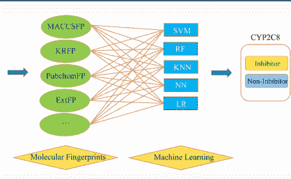
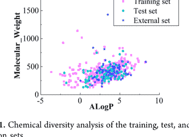
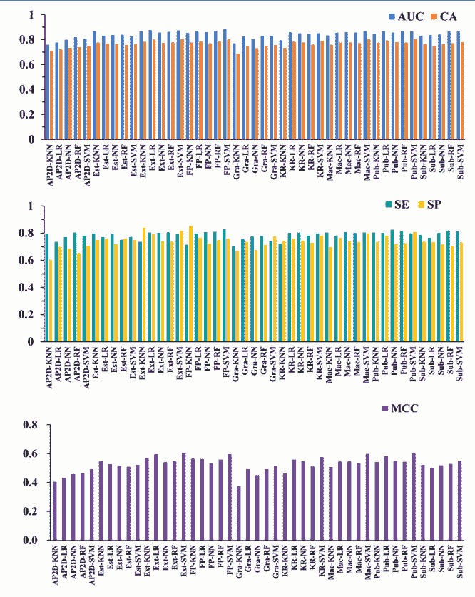
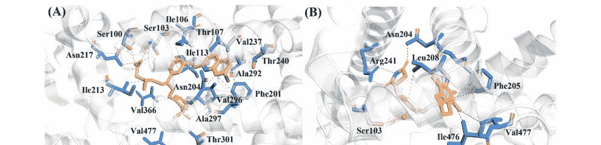

# CYP2C8抑制的机器学习方法模拟预测

文章

在线阅读

访问 | 指标与更多 | 文章推荐 | 支持信息

**摘要**：细胞色素 P450 2C8（CYP2C8）是人体主要的药物代谢酶之一，负责约 5% 临床用药的代谢。因此，CYP2C8 的抑制作用（可能导致潜在的不良反应事件）不容忽视。美国食品药品监督管理局（FDA）发布的体外药物相互作用研究工业指南也指出，在临床试验前需要确定受试药物是否为 CYP2C8 抑制剂。然而，目前的研究主要集中于预测其他主要 P450 酶的抑制剂，CYP2C8 抑制作用的重要性被忽视了。因此，需要开发模型来识别潜在的 CYP2C8 抑制剂。在本研究中，通过结合九种分子指纹的五种机器学习方法，构建了用于预测 CYP2C8 抑制作用的计算机模拟分类模型。通过测试集和外部验证集评估了所构建模型的性能。最佳模型在测试集和外部验证集中的 AUC 值分别为 0.85 和 0.90。基于分子相似性分析了适用域，并显示出其对提高预测准确率的影响。此外，通过信息增益和子结构频率分析，识别出几种代表性的特权子结构，如 1H-苯并[d]咪唑、1-苯基-1H-吡唑和喹啉。总体而言，我们的研究结果将有助于 CYP2C8 抑制作用的预测。

## 1. 引言

细胞色素 P450 酶（CYPs）的抑制作用是导致不良反应和药物退市的最重要原因之一[1]。因此，在临床试验前，需要确定药物候选者是否为主要药物代谢 P450 的抑制剂。美国食品药品监督管理局（FDA）发布的体外药物相互作用研究工业指南规定，药物开发者需要评估药物是否抑制主要的 P450 代谢酶，包括 CYP1A2、CYP2B6、CYP2C8、CYP2C9、CYP2C19、CYP2D6 和 CYP3A4[2]。

实验方法识别 P450 抑制作用通常耗时、昂贵且劳动密集。因此，已开发了许多计算机模拟模型来识别 P450 抑制作用[3–8]。目前，文献中报道的 P450 抑制作用计算机模拟预测主要基于机器学习方法，这些方法越来越多地应用于数据分析、分类问题以及其他领域[9–11]。Shao 等人使用基于规则的 C5.0 决策树算法构建五个主要 P450 抑制剂的分类模型。Rydberg 等人利用支持向量机（SVM）对五个主要 P450 酶的抑制剂和非抑制剂进行分类，并开发了用于预测 P450 抑制剂的 WhichCyp Web 服务器。我们课题组[12]利用人工神经网络开发了一种组合分类器，用于预测五个主要 P450 代谢酶的抑制剂。最近，Li 等人[13]开发了一种基于自编码器深度神经网络的多任务模型，用于区分五个主要 P450 亚型的抑制剂和非抑制剂。Wu 等人[14]使用两种集成学习方法和两种深度学习方法构建分类模型，以预测五个主要 P450 酶的抑制剂。尽管报道的模型展示了相对较高的准确率，但这些研究主要关注包括 CYP3A4、2D6、2C9、2C19 和 1A2 在内的五个主要 P450 亚型。其他主要的药物代谢 P450 尚未涉及在公开报告中。

CYP2C8 是 CYP2C 亚家族的成员，占肝脏中总 P450 酶的约 6−7%[12]。CYP2C8 负责约 5% 市售药物的代谢[13]，包括阿莫地喹（amodiaquine）、头孢拉定（ceveratinone）和艾立昔美（esziltaxeme）[14]。在过去十年中，由于药物相互作用和遗传多态性导致的不良反应，CYP2C8 在药物反应中的重要性已被认可[14]。例如，CYP2C8 的抑制剂吉非罗齐（gemfibrozil）与底物西维津（civezine）的组合导致了严重的不良反应[15]。因此，快速识别 CYP2C8 抑制作用对于指导新药的设计和发展具有重要意义。然而，目前尚未报道用于 CYP2C8 抑制作用的预测模型。

在本研究中，我们使用多种机器学习方法开发了计算机模拟模型，用于分类 CYP2C8 抑制剂和非抑制剂。通过测试集和外部验证集评估所构建模型的稳健性。基于欧几里得距离方法，定义了适用域以排除某些极端化合物。此外，通过信息增益和子结构频率分析检测抑制剂和非抑制剂之间结构特征的差异，从而推导出导致 CYP2C8 抑制作用的特权子结构。

## 2. 材料与方法

### 2.1. 数据收集与准备

在本研究中，我们从 PubChem 生物测定数据库[16]和两篇出版物[14,17]中收集了数据集。与其他文献报道相比，这两篇出版物提供的数据更全面，基本上覆盖了目前已知的 CYP2C8 抑制剂。

用于开发分类模型的数据集是从 PubChem 生物测定数据库[16]和 2005 年发表的文献[17]中手动收集的。对于来自 PubChem 的数据，活性 ≤ 50 μM 或 ChemBL 明确报告为活性的化合物在 CYP2C8 生物测定表征中被标记为活性。每种化合物使用的活性类型为 IC50、INH 和 Ki 之一。从 2005 年的文献[17]中，在 30 μM 浓度下检查了 209 种药物对 CYP2C8 的抑制作用。其中，48 种化合物表现出大于 50% 的抑制作用，并进一步评估 IC50 的测量。结果显示，6 种药物的 IC50 值小于 1 μM，17 种药物在 1 至 10 μM 之间，25 种药物在 10 至 40 μM 范围内。文献和 PubChem 中的化合物活性标准相似。因此，我们将来自 PubChem 和文献的数据中标记为“活性”的化合物视为 CYP2C8 抑制剂，将“非活性”视为非抑制剂。删除了没有化合物数值或文献支持的化学物质。从文献[17]收集的 48 种化合物被归类为抑制剂和非抑制剂。所有分子都被转换为简化分子输入线规范（SMILES）字符串。为了获得高质量数据，两个数据集通过以下步骤进行了仔细预处理：
- 保留有机物质，
- 将盐转化为相应的碱或酸，以及
- 去除重复的化学结构。

然后，CYP2C8 抑制剂被标记为“1”，非抑制剂被标记为“0”。最后，预处理的数据集通过内部 python 脚本按 8:2 的比例随机划分为训练集和测试集。

为了评估所构建模型的泛化能力，从不同来源构建了外部验证集，包括 DrugBank 数据库[18]、Backman 等人的文献[15]以及印第安纳大学医学院（ https://drug-interactions. medicine.iu.edu/Main/Table.aspx ）。与 PubChem 的数据处理类似，排除来自 DrugBank 但没有文献来源的药物。剩余的 CYP2C8 抑制剂被视为阳性数据。此外，从印第安纳大学医学院数据集收集的六种 CYP2C8 抑制剂被添加到阳性数据集中。文献中报道的 IC50 > 100 μM 的化合物被视为阴性数据。对于外部验证集，应用与训练集和测试集相同的数据预处理程序，并排除训练集或测试集中的重复数据。

数据集的多样性和质量对于构建高度稳健的模型至关重要[6,13]。在我们的工作中，我们利用化学空间分布和 Tanimoto 平均相似性指数[20]来评估数据集的化学多样性。化学空间分布定义为分子量（MW）和脂/水分配系数（ALogP）的二维空间分布图，这些值由 Pipeline Pilot 2017 R2 软件计算[19]。Tanimoto 相似性指数取值介于 0 和 1 之间，使用 python 脚本计算。数值越小，两种化合物的结构相似度越低。

### 2.2. 分子表征

使用分子指纹来表示上述数据集中的分子。分子可以通过指纹转换为结构键的二进制字符串和索引，作为机器学习模型的输入。使用 PADEL-Descriptor 软件工具[21]计算了九种类型的分子指纹，包括原子对 2D 指纹（AP2D, 780 位）、Estate 指纹（Est, 79 位）、扩展指纹（Ext, 512 位）、指纹-FP（FP, 1024 位）、仅图形指纹（Gra, 1024 位）、Klekota-Roth 指纹（KR, 4860 位）、MACCS 指纹（Mac, 166 位）、Pubchem 指纹（Pub, 881 位）和子结构指纹（Sub, 307 位）。这些指纹的详细描述可在原始文献中找到[1,2,5]。

### 2.3. 模型构建

在本研究中，采用五种广泛使用的机器学习算法来构建 CYP2C8 抑制剂和非抑制剂的预测模型，包括支持向量机（SVM）[23]、随机森林（RF）[24]、k 近邻（KNN）[25]、神经网络（NN）[26]和逻辑回归（LR）[27]。所有算法均使用 scikit-learn 包版本 0.21.4 实现。

由于几种机器学习算法受参数设置的影响较大，采用 k 折交叉验证遍历训练集中的所有数据。首先，训练集被划分为 k 个子集，k − 1 个子集首先用于构建模型，剩余的子集用于模型验证。此过程重复 k 次。然后，选择网格搜索算法为机器学习方法选择最佳参数。在本研究中，k 的值设为 10。通过交叉验证获得的前五个模型的详细参数设置如表 S1 所示。

### 2.4. 模型性能评估

在本研究中，采用训练集的 10 折交叉验证来检查所构建模型的稳健性。测试集用于进一步评估预测能力，不同来源的外部验证集用于评估模型的泛化能力。计算了几个指标以直观地评估模型质量。在二元分类模型中，数据集通常分为两类：阳性和阴性。真阳性（TP）表示 CYP2C8 抑制剂被正确预测为阳性。真阴性（TN）表示 CYP2C8 非抑制剂被准确预测为阴性。假阳性（FP）表示 CYP2C8 非抑制剂被错误预测为抑制剂，而假阴性（FN）表示 CYP2C8 抑制剂被错误预测为非抑制剂[28]。基于这些定义，使用以下公式计算灵敏度（SE）、特异性（SP）、Mathews 相关系数（MCC）和分类准确率（CA）

$$ SE = \frac{TP}{TP + FN} \quad (1) $$

$$ SP = \frac{TN}{TN + FP} \quad (2) $$

$$ CA = \frac{TP + TN}{TP + TN + FP + FN} \quad (3) $$

$$ MCC = \frac{(TP \times TN - FP \times FN)}{\sqrt{(TP + FP)(TP + FN)(TN + FP)(TN + FN)}} \quad (4) $$

其中 CA 代表所有阳性和阴性数据中准确分类化学物质总数的比例。SE 和 SP 是两个常用的分类性能指标。SE 是 CYP2C8 抑制剂的预测准确率。SP 是

正确预测了 CYP2C8 抑制剂。MCC 是观察值与预测二值分类之间的相关系数，通常被视为不平衡数据集的平衡度量。此外，还计算了受试者工作特征曲线下的面积（AUC）²⁸，以评估分类器的可靠性，其取值范围从 0.5 到 1。面积越大，分类性能越好。当 AUC 值等于 1 时，模型的预测能力完美；当 AUC 值为 0.5 时，模型没有判别能力。²,⁹

## 2.5. 模型适用域 (AD) 的定义

由于数据集化学空间的局限性，原则上构建的任何模型都需要预先定义 AD³⁰，用于合理界定分类模型的应用范围。AD 的设置可以防止因测试化学物质与训练集之间存在较大的特征差异而导致预测偏差过大。这意味着，如果查询化学物质分布在 AD 内，模型预测可被视为相对可靠；否则，其可信度较低。本研究采用基于欧氏距离的方法³¹获取 AD，该方法由训练集和测试集之间的结构相似度定义。计算测试集中每个分子与其在训练集中 k 个最近邻的距离。如果这 k 个距离中有一个超过 AD 的阈值，则查询化合物被认为在 AD 之外；³²否则，它落在域内。AD 的计算根据以下公式实施：

$$
D_x = \bar{y} + Z\sigma \quad (5)
$$

其中 $\bar{y}$ 和 $\sigma$ 分别代表计算出的欧氏距离的平均值和标准差，$Z$ 是一个任意参数，决定了 AD 的大小。

## 2.6. 特权子结构的识别

在本研究中，特权子结构是指频繁出现在 CYP2C8 抑制剂中的分子官能团。抑制剂中的这些子结构倾向于与 CYP2C8 代谢酶发生反应以发挥生物活性。因此，识别这些特权子结构对于确定潜在的 CYP2C8 抑制剂具有不可或缺的作用。³³ 在此，通过信息增益（IG）³⁴,³⁵ 和子结构频率分析³⁶来评估高频子结构。IG 计算分子中每个模式的信息熵，以评估其在验证系统中的概率。IG 值越大，子结构越可信。子结构频率可以通过以下函数公式计算：

$$
\text{fragment frequency} = \frac{N_{\text{fragment}} \times N_{\text{total}}}{N_{\text{fragment, total}} \times N} \quad (6)
$$

其中 $N_{\text{fragment}}$ 是 CYP2C8 抑制剂或非抑制剂中包含该片段的化合物数量，$N_{\text{total}}$ 是训练集中化合物的总数，$N_{\text{fragment, total}}$ 是包含该片段的化合物总数，$N$ 是 CYP2C8 抑制剂或非抑制剂的数量。

使用嵌入在 KNIME 3.0³⁷ 中的 MoSS 节点和 SARpy 软件³⁸来识别训练集中的子结构。MoSS 是一种基于图的方法，它通过嵌入片段平行于所有化合物在整个生长过程中生成子结构。³⁹ SARpy 使用“字符串挖掘”从化合物的 SMILES 表示中提取子结构，这不拆分环结构。⁴⁰ 经过多次尝试，在 MoSS 中，“最小折叠支持率（%）”设置为 10，“最大互补支持率（%）”和“最小片段大小”设置为 5，“最大片段大小”设置为 16。其余采用默认设置。在 SARpy 中，原子数设置为从 5 到 16，准确性设置为“OPTIMAL”，并选择 CYP2C8 抑制剂作为研究对象。

## 3. 结果

### 3.1. 数据集分析

我们最初从 PubChem 和文献中收集了 303 个抑制剂和 211 个非抑制剂。在数据收集过程中，我们发现 PubChem 中的三个化合物互为立体异构体，一个是 R 构型，一个是 S 构型，剩下一个是外消旋体。然而，这三个化合物都被标记为“活性”。我们在数据处理中未考虑化合物的手性，因此将其中两个化合物视为重复项并移除。从文献中提取的三个化合物与从 PubChem 中提取的不兼容。在文献中，这些化合物被视为非抑制剂，但它们在 PubChem 中被标记为“活性”。因此，我们在模型构建中移除了这些化合物。此外，在这些化学品中，11 个是重复项，1 个是无机化合物，这些也被移除了。因此，我们总共获得了 290 个抑制剂和 204 个非抑制剂。由于从 PubChem 检索到的抑制剂彼此非常相似，我们通过分子指纹相似性方法对这些抑制剂进行聚类，以获得 250 个抑制剂。对于验证数据集，我们从三个来源收集了 81 个化合物。其中，一个在训练集和测试集中重复，另一个是含硼的无机化合物。我们移除了这 2 个化合物，得到 79 个化合物作为外部验证集。最后，我们从四个不同的来源（包括文献、网站和两个公开可用的数据库）获得了 533 个有机化合物。其中，312 种化学品是阳性（抑制剂），221 种是阴性（非抑制剂）。

数据划分后，训练集、测试集和外部验证集分别包含 363、91 和 79 个化合物。每个数据集中 CYP2C8 抑制剂和非抑制剂的数量列于表 1。数据集的 SMILES 和分类信息提供支持材料（data.xlsx）。

**表 1. 训练集、测试集和外部验证集中的化学品数量**

| | 抑制剂 | 非抑制剂 | 总数 |
|---|---|---|---|
| 训练集 | 204 | 159 | 363 |
| 测试集 | 46 | 45 | 91 |
| 外部集 | 62 | 17 | 79 |
| 总数 | 312 | 221 | 533 |

先前的研究表明，数据集的质量和多样性会影响分类模型的预测性能。⁶,¹⁵ 因此，为了开发稳健的预测模型，本研究利用化学空间分布和 Tanimoto 相似性来探索三个数据集的化学多样性。由 MW 和 ALOGp 定义的化学空间分布如图 1 所示。大多数绿色圆圈（测试集）和蓝色星星（外部验证集）与粉色正方形（训练集）重叠。训练集、测试集和外部验证集中氢键供体/受体（HBD/HBA）、可旋转键（ROTB）和极性表面积（PSA）的数量已经过计算（图 S1）。三个数据集的四个理化性质曲线变化相似。这些结果表明，训练集与其他两个集合共享类似的化学空间。此外，使用 Mac 指纹计算了 Tanimoto 系数²⁰

验证应用于训练集，然后所有构建的模型均通过测试集和外部验证集进行验证。

图 2 表明，根据包括 AUC、CA、SE 和 SP 在内的四个统计参数，预测模型具有不同的性能。一般来说，AUC 值范围为 0.76 到 0.88，CA 值范围为 0.69 到 0.80，SP 值范围为 0.61 到 0.85，SE 值在 0.71 到 0.83 之间，MCC 值范围为 0.37 到 0.61。在大多数模型中，SP 值略低于 SE 值，但它们之间的差异很小。发现除了 AP2D-KNN、AP2D-LR、AP2D-NN、Gra-KNN 和 KR-KNN 模型外，其他模型的 AUC 值均大于 0.8。大多数模型的 CA 值超过 0.7。除了 AP2D-KNN、AP2D-NN、AP2D-REF、Gra-KNN、Gra-NN 和 Mac-KNN 模型外，SE 和 SP 值均高于 0.7。除了 Gra-KNN、Gra-NN、KR-KNN、Gra-LR、Gra-REF 和基于 AP2D 的五个模型外，MCC 值高于 0.5。10 折交叉验证的详细参数值总结在表 S2 中。根据 10 折交叉验证的 AUC 和 CA 值，训练集的前五个二值分类模型是 FP-SVM、Ext-LR、Ext-SVM、Pub-LR 和 Pub-SVM，如表 2 所示。这表明基于构建的模型

探索三个数据集中化学品的多样性。所有化学品相似性的频率分布显示在图 S2 中。平均 Tanimoto 指数值为 0.372，反映出我们数据集的结构相似度总体较低。

### 3.2. 模型构建与评估

在本研究中，采用 5 种机器学习算法和 9 种分子指纹构建 CYP2C8 抑制剂和非抑制剂的 45 个二值分类模型。参数优化的网格搜索和 10 折交叉

结合 Ext、FP 和 Pub 指纹的 SVM 和 LR 分类器具有更好的性能。

## 表 2. 前五个模型的 10 折交叉验证性能

| 模型 | AUC | CA | SE | SP | MCC |
| :--- | :--- | :--- | :--- | :--- | :--- |
| FP-SVM | 0.88 | 0.80 | 0.83 | 0.76 | 0.59 |
| Ext-LR | 0.88 | 0.80 | 0.81 | 0.79 | 0.60 |
| Ext-SVM | 0.87 | 0.80 | 0.79 | 0.82 | 0.61 |
| Pub-LR | 0.87 | 0.79 | 0.80 | 0.78 | 0.58 |
| Pub-SVM | 0.87 | 0.80 | 0.80 | 0.81 | 0.60 |

为了进一步评估交叉验证中前五个模型的预测能力，使用测试集和外部集对这些模型进行了验证。预测结果列于表 3 和表 4 中。对于测试集，五个模型的

## 表 3. 测试集前五个模型的验证结果

| 模型 | AUC | CA | SE | SP | MCC |
| :--- | :--- | :--- | :--- | :--- | :--- |
| FP-SVM | 0.83 | 0.73 | 0.80 | 0.64 | 0.45 |
| Ext-LR | 0.83 | 0.74 | 0.76 | 0.71 | 0.47 |
| Ext-SVM | 0.82 | 0.77 | 0.74 | 0.80 | 0.54 |
| Pub-LR | 0.85 | 0.77 | 0.83 | 0.71 | 0.54 |
| Pub-SVM | 0.85 | 0.80 | 0.83 | 0.78 | 0.60 |

## 表 4. 外部验证集前五个模型的验证结果

| 模型 | AUC | CA | SE | SP | MCC |
| :--- | :--- | :--- | :--- | :--- | :--- |
| FP-SVM | 0.90 | 0.89 | 0.92 | 0.77 | 0.67 |
| Ext-LR | 0.88 | 0.81 | 0.84 | 0.71 | 0.50 |
| Ext-SVM | 0.89 | 0.76 | 0.73 | 0.88 | 0.51 |
| Pub-LR | 0.89 | 0.80 | 0.81 | 0.76 | 0.50 |
| Pub-SVM | 0.88 | 0.76 | 0.77 | 0.71 | 0.42 |

AUC 值在 0.82 到 0.85 之间，CA 值在 0.73 到 0.80 之间，SE 值在 0.74 到 0.83 之间，SP 值在 0.64 到 0.80 之间，MCC 值在 0.45 到 0.60 之间。显然，在这五个分类模型中，综合考虑 AUC 和 CA 值，Pub-SVM 模型表现最佳。基于 FP 指纹的 SVM 分类器的 SP 值略低于其他模型。对于外部验证集，AUC 和 CA 值分别在 0.88 到 0.90 以及 0.76 到 0.89 之间。SE 值范围为 0.73 到 0.92，SP 值范围为 0.70 到 0.88。MCC 值范围为 0.42 到 0.67。FP-SVM 模型的 AUC 和 CA 值最高。综上所述，这些结果表明 SVM 和 LR 可能是 CYP2C8 抑制剂/非抑制剂的优良分类器，且基于 Ext 和 Pub 指纹的模型表现优于其他模型。

## 3.3. 适用域分析

在任何基于 QSAR 或分类的预测研究中，都应认真考虑适用域（AD）。文献中报道了多种 AD 计算方法，如基于距离的方法³¹、概率密度分布⁴⁰和凸包法⁴¹。本研究采用了广泛使用的基于欧氏距离的方法进行 AD 分析³¹,⁴²。首先，利用训练集计算相似度距离矩阵，以获得参数 $\gamma$ 和 $\sigma$ 的值，分别为 0.905 和 0.095。然后，通过调整两个变量 Z 和 k 来获得 $D_{T}$，其值分别经过从 3 到 5 和从 $-5.5$ 到 $-4.5$ 的筛选。如表 5 所示，随着 Z 值的减小和 k 值的增加，测试集中被认为与训练集结构相似的化合物数量更多。

## 表 5. 不同 Z 和 k 值下的域外化合物数量

| $D_{T}$ | Z | k | | | |
| :--- | :--- | :--- | :--- | :--- | :--- |
| | | 3 | 4 | 5 | |
| 0.478 | $-4.5$ | 5 | 6 | 7 | |
| 0.430 | $-5.0$ | 9 | 12 | 15 | |
| 0.383 | $-5.5$ | 18 | 25 | 31 | |

图 S3 表明，随着 k 值的增加，域内化合物的 AUC 和 CA 值总体呈下降趋势。因此，k 值被选为 3。此外，当 Z 值设置为 $-5$ 时，AUC 和 CA 值高于其他参数。因此，我们最终将 k 设为 3，Z 设为 $-5$。

比较了域内化合物在头五个模型上的预测结果与 AD 之外的化学物质。如表 6 所示，域内化合物的 AUC 和 CA 值

## 表 6. Z 和 k 值为 $-5$ 和 3ᵃ 时，前五个模型对 ID 和 OD 化合物的预测统计

| 模型 | AUC | | CA | |
| :--- | :--- | :--- | :--- | :--- |
| | OD | ID | OD | ID |
| FP-SVM | 0.43 | 0.85 | 0.67 | 0.73 |
| Ext-LR | 0.36 | 0.85 | 0.67 | 0.74 |
| Ext-SVM | 0.36 | 0.84 | 0.67 | 0.78 |
| Pub-LR | 0.50 | 0.86 | 0.56 | 0.79 |
| Pub-SVM | 0.50 | 0.87 | 0.67 | 0.82 |

ᵃ ID，域内；OD，域外。

分别为 0.84 到 0.87 和 0.73 到 0.82。相比之下，域外化合物的 AUC 和 CA 值分别为 0.36 到 0.5 和 0.56 到 0.67，显著低于域内化合物，这表明当 k 和 Z 分别设置为 3 和 $-5$ 时，不适合构建模型的化合物能够被良好地检测出来。

## 3.4. 特权亚结构分析

使用两种工具 MOSS 和 SARpy 来识别训练集中的特权亚结构。表 7 列出了 MOSS 检测到的 10 个特权亚结构。它们包括肼基苯、1H-苯并[d]咪唑、苯磺酰胺、N-甲基苯甲酰胺、4-甲基吡啶、N-苯基甲酰胺、N-甲基苯磺酰胺、N-乙基丙氨酸、三氟甲烷和吡啶。表 8 列出了由 SARpy 识别的 10 个特权亚结构，包括 1-苯基-1H-吡唑、联苯、1H-苯并[d]咪唑、N-(2-甲酰基甲基)甲酰胺、乙烯亚胺、N-苄基苯甲酰胺、1-氟-3-甲基苯、3-氟苯胺、N-异丙基-苯磺酰胺和 4-甲基苯甲酰胺。根据这些亚结构的数量和频率，它们在 CYP2C8 抑制剂中出现的频率比在非抑制剂中更高。其中，1H-苯并[d]咪唑是在两个数据集中都发现的共同亚结构。此外，一些类似的骨架，如苯磺酰胺、苯甲酰胺和苯胺，

## 表 7. 通过 MoSS 分析检测到的十个特权亚结构

| 描述 | 特权亚结构 | IG | Np* (Fp*) | Np' (Fp') | 代表性结构 |
| --- | --- | --- | --- | --- | --- |
| SI- cI:e:e:c:e:I:)(=O)=O |  | 0.035 | 37 (1.53) | 7 (0.35) |  |
| nI:c:c:c:c:cI:e:c:e:I:2 |  | 0.033 | 23 (1.67) | 2 (0.18) |  |
| SI-N(=)- cI:e:c:c:e:c:I:)(=O)=O |  | 0.026 | 30 (1.51) | 6 (0.37) |  |
| O-C(-N-C)- cI:e:c:c:c:e:I: |  | 0.025 | 29 (1.50) | 6 (0.38) |  |
| nI:c:c:c:c:I:e:cI: | C |  | 0.02 | 22 (1.54) | 4 (0.34) |  |
| O=C-N-CI:e:c:c:c:e:I |  | 0.019 | 32 (1.42) | 9 (0.49) |  |
| SI-N(C)- cI:e:c:c:c:cI:)(=O)=O |  | 0.016 | 22 (1.48) | 5 (0.41) |  |
| N(-cI:e:c:c:c:cI:)C-C |  | 0.014 | 30 (1.36) | 10 (0.56) |  |
| F-C(-F)(-F)-C |  | 0.012 | 5 (1.82) | 0 (0) |  |
| nI:c:c:c:c:c:c:cI: | 1 |  | 0.011 | 24 (1.36) | 8 (0.56) |  |

\*Np\* 和 Fp\* 代表该片段在抑制剂中的数量和频率。bNp' 和 Fp' 代表该片段在非抑制剂中的数量和频率。

被发现具有较高的出现频率。这些发现意味着，如果化合物包含上述亚结构片段，它更有可能抑制 CYP2C8。

### 4. 讨论

## 4.1. 不同机器学习算法的比较

构建的 45 个二分类模型表现出不同的预测性能。为了检验性能差异是否达到统计显著性阈值，我们使用 AUC 作为标准对不同类型的模型进行方差分析（表 S3 和 S4）。分析结果表明，不同模型的性能具有统计显著性。在此基础上，我们从机器学习算法和分子指纹两个方面对构建的模型进行了比较。本节重点讨论机器学习算法。

在前五个模型中，其中三个是使用 SVM 构建的，另外两个基于 LR。这表明这两种算法在预测 CYP2C8 抑制剂方面比其他算法表现更好。基于 KNN 构建的模型表现不佳。例如，Gra-KNN 和 AP2D-KNN 模型的 AUC 值排名较低，分别为 0.77 和 0.76。此外，在不同指纹中，基于 SVM 的模型表现优于 LR。如图 2 所示，在使用 AP2D 指纹时，SVM 的 AUC 值高于 LR。SVM 模型的值为 0.81，而 LR 模型为 0.78。当使用 Sub 指纹时，SVM 的 AUC 值为 0.87，而 LR 模型为 0.84。在

## 表 8. SARpy 分析检测到的十种优势亚结构

| 描述 | 优势亚结构 | IG | $N_I^*$ ($F_I^*$) | $N_N^*$ ($F_N^*$) | 代表性结构 |
| :--- | :--- | :--- | :--- | :--- | :--- |
| n1(-e2:e:x:e:x:2)e:e:c:1 | | 0.043 | 18 (1.82) | 0 (0) | |
| e1(e2:e:x:e:x:e:2)::x:e:x:e:1 | | 0.042 | 27 (1.69) | 2 (0.15) | |
| e1:c:e2:e:x:e:x:e:2:m:1 | | 0.033 | 23 (1.67) | 2 (0.18) | |
| C(-N-e1:e:x:e:x:1-C:=O):=O | | 0.033 | 14 (1.82) | 0 (0) | |
| Cl(-C#C):e:x:e:x:e:1 | | 0.031 | 13 (1.82) | 0 (0) | |
| C(-N(-C-e1:e:x:e:x:1)(=O)-c1:e:x:e:c:e:1 | | 0.023 | 10 (1.82) | 0 (0) | |
| Cl(-F):e:x:e:c:e(-C):e:1 | | 0.023 | 10 (1.82) | 0 (0) | |
| N-Cl:e:x:e:c:e(-F):e:1 | | 0.021 | 9 (1.82) | 0 (0) | |
| Cl1(-S(-N(-C(-C-C)(=O)=O):e:x:e:ee:1 | | 0.021 | 9 (1.82) | 0 (0) | |
| C(-N(=O)-c1:e:x:e(-C):e:c:e:1 | | 0.021 | 9 (1.82) | 0 (0) | |

$^*$ $N_I$ 和 $F_I$ 分别表示该片段在抑制剂中的数量和频率。$^*$ $N_N$ 和 $F_N$ 分别表示该片段在非抑制剂中的数量和频率。

此外，基于支持向量机（SVM）的九种分子指纹中有八种的 CA 值高于其他算法。

排名前五个的模型进一步通过测试集和外部集进行了验证。如表 3 和表 4 所示，这些模型的预测准确率相对较高，AUC 和 CA 值分别大于 0.8 和 0.7。在测试集和外部集中表现最佳的模型均基于 SVM 构建，即 Pub-SVM 和 FP-SVM 模型，其中 FP-SVM 模型的 AUC 值超过 0.9。这些结果表明，基于 SVM 的分类模型具有更好的稳健性和预测性能。这与我们要先前的研究结果相似。Chen 等人$^{43}$使用机器学习算法构建了 FXR 结合物和非结合物的二元分类模型。他们指出，在测试集和外部验证集中，排名前 10 的模型中有一半以上是使用 SVM 和 RF 构建的。Jiang 等人$^{44}$通过机器学习预测化合物的生殖毒性，发现 Mac-SVM 模型具有最佳的预测性能。

## 4.2. 不同分子指纹的比较。

在本研究中，使用了包含不同长度和结构信息的九种分子指纹来构建分类模型。从图 2 可以明显看出，Ext、FP 和 Pub 指纹的性能优于其他指纹。相比之下，基于 AP2D 和 Gra 指纹构建的模型在 AUC 和 CA 值方面表现较差。此外，10 折交叉验证中排名前 5 的模型中有四个是基于 Ext 和 FP 指纹构建的，它们对于测试集和外部验证集仍然具有稳健性。这意味着具有更长位数的指纹在模型构建中不一定表现更好。例如，Mac 指纹（166 位）的预测效果优于表现最差的 Gra 指纹（1024 位）。此外，由 4860 位组成的 KR 指纹在 KR-KNN 模型中表现不佳，其 AUC 值为 0.79。总之，我们的结果表明，使用 Ext 和 Pub 指纹来构建 CYP2C8 抑制的分类模型是一个很好的选择。

图 3. 孟鲁司特（A）和曲格列酮（B）在 CYP2C8 复合物晶体结构中的结合模式。配体与残基形成的氢键和疏水相互作用分别用黄色和灰色虚线表示。

## 4.3. 优势亚结构分析。

总共获得了 19 个独特的优势亚结构，如表 7 和表 8 所示。其中，含氮杂环亚结构（如 1H-苯并[d]咪唑、1-苯基-1H-吡唑和喹啉）在文献报道的 CYP2C8 抑制剂中频繁出现，例如 Azilsartan（45）、Candesartan cilexetil（14）和 Nilotinib（46）。含有这些片段的分子倾向于与 CYP2C8 相互作用，这可能是因为它可以占据活性空腔中的远端疏水口袋。例如，在 CYP2C8 复合物晶体结构（PDB 代码 2NNI）中，强效竞争性抑制剂孟鲁司特的氯喹啉环与位于螺旋 G 下方的疏水残基簇相互作用，从而稳定其结合，如 47,48 所示，见图 3A。

其余的优势亚结构具有相似的骨架，包括苯磺酰胺、苯甲酰胺和 N-苯基甲酰胺片段。事实上，许多已报道的强效 CYP2C8 抑制剂都包含上述结构片段，例如 Zafirlukast（49）、Dabrafenib（50）和 Gliburide（14）。根据 PDB 代码 2NNI 的晶体结构，孟鲁司特的末端羧酸基团与活性位点附近螺旋 B' 处的极性氨基酸簇（包括 Ser100、Ser103 和 Asn217）形成氢键（图 3A）。此外，在 CYP2C8 的另一种复合物晶体结构（PDB 代码 2VN0）中，噻唑烷二酮中的酮氧可以与螺旋 G 中的 Arg241 和螺旋 F 中的 Asn204 形成氢键。结构中间的其他氧原子通过周围的水分子与 Ser103 形成氢键 51,52（图 3B）。因此，含有磺酰胺或酰胺基团的化合物可以与 CYP2C8 螺旋 B' 附近的极性氨基酸簇或 Arg241 和 Asn204 形成极性相互作用，这可以解释为什么苯磺酰胺和苯甲酰胺片段在 CYP2C8 抑制剂中频繁存在。

此外，MoSS 和 SARy 还鉴定出一些含有氟原子的亚结构。事实上，氟原子存在于几种已知的 CYP2C8 抑制剂中，如 Dabrafenib 和 Nilotinib。作为吸电子基团，F 降低了苯环的电子云密度，从而增强了分子的疏水性 53,54，使其更容易结合到 CYP2C8 的疏水腔中。

## 4.4. 我们模型的局限性。

10 折交叉验证、测试集和外部集的总体准确率表明，我们的模型具有令人满意的预测能力，可以为分类潜在的 CYP2C8 抑制剂和非抑制剂提供有用信息。然而，我们的模型仍有一定的局限性。由于实验测定的 CYP2C8 非抑制剂数量有限，用于建模的阴性化合物较少，这可能导致我们的模型对阴性数据特征的“学习”不足。从交叉验证、测试和外部验证集的结果可以看出，一般来说 S# 值略低于 SE 值。希望随着未来 CYP2C8 生物实验数据的增加，这一问题能够得到解决。此外，在建模前移除了无机化合物。因此，我们的模型无法预测这些物种。

## 5. 结论

在本研究中，基于多样化的 CYP2C8 酶数据集，结合 SVM、RF、KNN、NN 和 LR 等 5 种机器学习算法与 9 种分子指纹，开发了 45 个二元分类模型。考虑 AUC、CA、SE、SP 和 MCC 的值，通过 10 折交叉验证获得性能最佳的 5 个模型，并进一步使用测试集和外部验证集进行评估。总体预测准确率令人满意，其中 AUC 和 CA 值分别超过 0.8 和 0.7。此外，我们的结果表明，使用 Ext 和 Pub 指纹构建的模型优于其他模型，并且 SVM 算法更适合于分类 CYP2C8 抑制剂/非抑制剂。进一步应用了基于欧氏距离的适用域计算，其值通过搜索参数 k 和 Z 获得。此外，结合信息增益和亚结构频率分析用于检测几种优势亚结构。总之，所构建的预测模型和优势亚结构可用于药物设计早期阶段快速鉴定潜在的 CYP2C8 抑制剂。

## 6 相关内容

### 支持信息

支持信息可在此免费获取：https://pubs.acs.org/doi/10.1021/acs.chemtoxtx.1c00078。

10 折交叉验证中前五个模型的参数设置；模型 10 折交叉验证的详细结果；样本的相关统计量；不同模型的方差分析；训练集、

## 作者信息

### 通信作者

**李伟华** − 华东理工大学药学院新药设计上海市重点实验室，中国上海 200237；[orcid.org/0000-0001-7055-9836](https://orcid.org/0000-0001-7055-9836)；电话：+86-21-64250811；电子邮箱：whli@ecust.edu.cn

### 作者

- **张晓晓** − 华东理工大学药学院新药设计上海市重点实验室，中国上海 200237
- **赵佩桥** − 华东理工大学药学院新药设计上海市重点实验室，中国上海 200237
- **王知远** − 华东理工大学药学院新药设计上海市重点实验室，中国上海 200237
- **徐宣** − 华东理工大学药学院新药设计上海市重点实验室，中国上海 200237
- **刘桂霞** − 华东理工大学药学院新药设计上海市重点实验室，中国上海 200237；[orcid.org/0000-0001-9648-844X](https://orcid.org/0000-0001-9648-844X)
- **汤云** − 华东理工大学药学院新药设计上海市重点实验室，中国上海 200237；[orcid.org/0000-0003-2341-1109](https://orcid.org/0000-0003-2341-1109)

完整联系方式可在以下网址获取：[https://pubs.acs.org/10.1021/acs.chemtoxicol.1c00078](https://pubs.acs.org/10.1021/acs.chemtoxicol.1c00078)

## 参考文献

1. (1) Kamel, B., and Harriman, S. (2013) 细胞色素P450酶的抑制及基于机制失活（MBI）的生物化学方面。*Drug Discovery Today: Technol.* 10, e177−e189.
2. (2) *体外药物相互作用研究−细胞色素P450酶和转运蛋白介导的药物相互作用行业指南*；美国卫生部食品和药物管理局，U.S. FDA，2020.
3. (3) Sun, H., Veth, H., Xia, M., Austin, C. P., and Huang, P. (2011) 基于定量高通量筛选数据的细胞色素P450同工酶预测模型。*J. Chem. Inf. Model.* 51, 2474−2481.
4. (4) Shao, C., Yu, Su, B., Tu, Y., Lin, C., Lin, O. A., and Tsenq, Y. J. (2015) Cyp450: 一个基于规则的CYP450抑制预测服务器。*Bioinformatics* 31, 1869−1871.
5. (5) Rostkovski, M., Spuht, O., and Rydberg, P. (2013) WhichCyp: 细胞色素P450诱导的预测。*Bioinformatics* 29, 2051−2052.
6. (6) Cheng, F., Yu, Y., Shen, J., Yang, L., Li, W., Liu, G., Lee, P. W., and Tang, Y. (2011) 使用组合分类器对细胞色素P450抑制剂和非抑制剂进行分类。*J. Chem. Inf. Model.* 51, 996−1011.
7. (7) Li, Li, Xu, Li, Liu, J., and Pei, J. (2018) 使用深度自编码器神经网络预测人细胞色素P450抑制。*Mol. Pharmacol.* 95, 4336−4345.
8. (8) Wu, Z., Lei, T., Shen, C., Wang, Z., Cao, D., and Hou, T. (2019) 药物发现中的ADMET评估。在 *使用人工智能方法可靠预测人细胞色素P450抑制*。*J. Chem. Inf. Model.* 59, 4587−4601.
9. (9) Neves, B. J., Dantas, R. F., Senger, M. L., Melo-Filho, C. C., Valente, W. C. G., De Almeida, C. M., Rezende-Neto, J. M., Lima, E. F. C., Pauley, R., Furnham, N., Murator, F., Kamenskyi, L., Gastonier, A. E., Braga, R. S., Silva-Junior, J. P., and Andrade, C. H. (2016) 通过结合基于QSAR的虚拟筛选和高内涵筛选发现新的抗血吸虫活性化合物。*J. Med. Chem.* 59, 7075−7088.
10. (10) Sun, J., Jeliazkova, N., Cupakdin, V., Goldiz-Drib, J., Engkvist, O., Carisson, L., Wegner, T. J., Cuelamas, H., Georgiev, I., Jeliazkova, V., Kocher, N., Ashley, T. J., and Chen, H. (2017) ECapADE-DB: 一个促进化学基因组学大数据分析的集成大规模数据集。*J. Cheminf.* 9, 17.
11. (11) Xing, J., Liu, Y., Liu, R., Wang, Y., Xie, Y., Zhang, H., Shi, Jiang, H., Liu, Y., Chen, K., Jiang, H., Liao, Q., and Zheng, H. (2017) 机器学习辅助发现针对含有溴结构域蛋白4的新型抑制剂的方法。*J. Chem. Inf. Model.* 57, 1677−1690.
12. (12) Achour, B., Barber, J., and Rostami-Hodjean, A. (2014) 肝脏药物代谢细胞色素P450酶及其相互关系的表达：一项荟萃分析。*Drug Metab. Dispos.* 42, 1349−1356.
13. (13) Rendic, S., and Guengerich, F. P. (2015) 参与外源性和天然化学物质代谢的人氧化还原酶和细胞色素P450酶调查。*Chem. Res. Toxicol.* 28, 38−42.
14. (14) Backman, J. T., Filppula, A. M., Niem, M., and Neuvonen, P. J. (2016) 细胞色素P450 2C8在药物代谢和相互作用中的作用。*Pharm. Rev.* 68, 168−241.
15. (15) Huang, S. M., Strong, J. M., Zhang, L., Reynolds, K. S., Nallani, S., Temple, R., Abraham, S., Habert, A. A., Bawaja, K. R., Burckart, G. J., et al. (2008) 药物相互作用评估的新时代：美国食品药品监督管理局关于CYP酶、转运蛋白和指导过程的更新。*J. Clin. Pharmacol.* 48, 662−670.
16. (16) Wang, Y., Xiao, J., Zuzek, T. O., Zhang, T., Wang, J., and Bryant, S. H. (2009) PubChem：一个用于分析小分子生物活性的公共信息系统。*Nucleic Acids Res.* 37, W623−W633.
17. (17) Walkley, R. L., Gannon, E. A., and Obach, R. S. (2005) 对209种药物对细胞色素P450 C2C8抑制作用的检验。*J. Clin. Pharmacol.* 45, 68−78.
18. (18) Wishart, D. S., Feunang, Y. U., Gao, A. C., Lo, E. J., Marcu, A., Grant, J. R., Sajed, T., John, D. S., Li, C., Sayeeda, S., Eisenmenger, N., Linskerakar, I., Liu, Y., Maciejewski, A., Gale, N., Wilson, A., Chin, L., Cummings, R., Le, D., Pon, L., Knox, C., and Wilson, M. (2018) DrugBank 5.0: DrugBank数据库的2018年重大更新。*Nucleic Acids Res.* 46, D1074−D1082.
19. (19) Muratov, E. N., Bajorat, J., Sheridan, R. P., Tetko, I. V., Filimonov, D., Porokirov, Y., Oprea, T. I., Baskin, I., Varnek, A., Rotisha, A., Isayev, A., Curatalo, S., Fourches, D., Cohen, Y., Aspuru-Guzik, A., Winkler, D. A., Agrafiotis, D., Cherkasov, A., and Tropheng, A. (2020) 无国界的QSAR。*Chem. Soc. Rev.* 49, 3525−3564.
20. (20) MACCS (Molecular Access System)；MDL信息公司：加利福尼亚州圣利安德罗，2002.
21. (21) Yap, C. W. (2011) PaDEL-descriptor: 计算分子描述符和指纹的开源软件。*J. Comput. Chem.* 32, 1466−1474.
22. (22) Klekotka, J., and Roth, F. P. (2008) 富集生物活性的化学亚结构。*Bioinformatics* 24, 2518−2525.
23. (23) Cherkassky, V. (1997) 统计学习理论的本质。*IEEE Trans. Neural Networks.* 8, 564.
24. (24) Menze, B. H., Kelm, B. M., Masuch, R., Himmlerich, U., Bachert, P., Petrich, W., and Hamprecht, F. A. (2009) 随机森林及其基尼重要性与标准化学计量方法在光谱数据特征选择和分类中的比较。*Bio* *Inform.* **10**, 2135−2143.
25. (25) Kauffman, G. W., and Jurs, P. C. (2001) 使用基于拓扑的数值描述符对选择性环氧化酶-2抑制剂进行QSAR和K近邻分类分析。*J.* *Chem.* *Inf.* *Comput.* *Sci.* **41**, 1553−1560.
26. (26) Basher, I. A., and Hajimer, M. (2000) 人工神经网络：基础、计算、设计及应用。*J.* *Microbiol.* *Methods* **43**, 3−31.
27. (27) Mood, C. (2010) 逻辑回归：为什么我们不能做我们认为我们能做的事，以及我们可以怎么做。*Eur.* *Sociol.* *Rev.* **26**, 67−82.
28. (28) Awami, A., and Jain, R. (2012) Skikit-learn：Python中的机器学习。*J.* *Mach.* *Learn.* *Res.* **12**, 2825−2830.
29. (29) Baldi, P., Brunak, S., Chauvin, Y., Andersen, C. F., and Nielsen, H. (2000) 评估分类预测算法的准确性：概述。*Bioinformatics* **16**, 412−424.
30. (30) Dragos, H., Giffels, M., and Alexandre, V. (2009) 预测可预测性：QSAR模型适用域问题的统一方法。*J.* *Chem.* *Inf.* *Model.* **49**, 1762−1776.
31. (31) Cheng, F., Kenaga, Y., Zhou, Y., Yu, Y., Li, W., Shen, J., Du, Z., Chen, L., Xu, C., Ge, L., Lo, P. W., and Tang, Y. (2012) 化学品生物降解性的计算机模拟评估。*J.* *Chem.* *Inf.* *Model.* **52**, 655−669.
32. (32) Tropsha, A., and Golbraikh, A. (2007) 预测性QSAR建模工作流程、模型适用域和虚拟筛选。*Curr.* *Pharm.* *Des.* **13**, 3494−3504.
33. (33) Benigni, R., and Bossa, C. (2008) 致癌性结构警报和Samantha检测系统：通过化学关系数据库技术的新见解。*Mutat.* *Res.* **659**, 248−61.
34. (34) Quinlan, J. R. *C45: 机器学习程序*；Morgan Kaufmann出版公司：加利福尼亚州旧金山，1993.
35. (35) Shen, J., Cheng, F., Xu, Y., Li, W., and Tang, Y. (2010) 使用结构模式识别估算ADME性质。*J.* *Chem.* *Inf.* *Model.* **50**, 1034−1041.
36. (36) Cao, Q., Liu, L., Yang, H., Cai, P., Li, W., Liu, G., Lee, P. W., and Tang, Y. (2018) 使用化学类别方法进行*计算机模拟*估算化学品对甲壳类动物的水生毒性。*Environ.* *Sci.* *Processes* *Impacts* **20**, 1234−1243.
37. (37) Berthold, M. R., Cebrón, N., Dill, F., Gabriel, T. R., Kötter, T., Meinl, T., Oth, P., Thiel, K., and Wesseleld, B. (2009) KNIME：康斯坦茨信息挖掘器：版本2.0及以后。*SIGKDD* *Explor.* *Nesui* **11**, 26−31.
38. (38) Ferrari, T., Cattaneo, D., Gini, G., Golbarkas Bakhtiarly, N., Mangano, A., and Benenati, E. (2013) 从化学结构中自动提取知识：致突变性预测的案例。*SAR* *QSAR* *Environ.* *Res.* **24**, 365−383.
39. (39) Golbarkas, A., Benenati, E., Golbarkas, N., Mangano, A., Merdvan, E., Roncaglioni, A., and Gini, G. (2016) 通过挖掘两个大型化学化合物数据集获得关于致癌性相关亚结构的新线索。*J.* *Environ.* *Sci.* *Health* *C* *Environ.* *Carcinogen* *Toxicol.* *Res.* **34**, 97−113.
40. (40) Kar, S., Roy, K., and Leszczynski, A. (2018) 适用域：迈向QSAR建模中自信预测和可预测性的一步。*Methods* *Mol.* *Biol.* **1800**, 141−169.
41. (41) Mathea, R., Klingshofer, W., and Baumann, K. (2016) 化学信息计量学分类方法及其适用域。*Mol.* *Inf.* *Res.* **35**, 160−180.
42. (42) Sun, L., Yang, H., Li, J., Wang, T., Li, W., Liu, G., and Tang, Y. (2018) 使用QSAR模型进行*计算机模拟*预测化合物与人类血浆蛋白的结合。*ChemMedChem* **13**, 572−581.
43. (43) Chen, Y., Yang, H., Wu, Z., Liu, G., Tang, Y., and Li, W. (2018) 使用机器学习方法预测法尼醇X受体干扰物。*Chem.* *Res.* *Toxicol.* **31**, 1128−1137.
44. (44) Jiang, S., Yang, H., Di, P., Li, W., Tang, Y., and Liu, G. (2019) 使用机器学习进行化学品生殖毒性的*计算机模拟*预测。*J.* *Appl.* *Toxicol.* **39**, 844−854.
45. (45) Edarbi. *药理学* *综述*；美国食品药品监督管理局，药物评估与研究中心，2011.
46. (46) Tasigna. *临床药理学* *和* *生物制药* *综述*；美国食品药品监督管理局，药物评估与研究中心，2007.
47. (47) Lai, X., Yang, L., Li, X., Liu, Y., Zhou, Z., and Zhou, Y. (2009) 人CYP2C8：结构、底物特异性、抑制剂选择性、诱导剂和多态性。*Curr.* *Drug* *Metab.* **10**, 1009−1047.
48. (48) Schoch, G. A., Yano, J. K., Sansen, S., Danette, P. M., Stout, C. D., and Johnson, E. F. (2008) 细胞色素P450 2C8底物结合的决定因素：与孟鲁司特、曲格列酮、feldipine和9-去-视黄酸的结构。*J.* *Biol.* *Chem.* **283**, 17227−17237.
49. (49) Jaakkola, T., Laillila, J., Neuvonen, P. J., and Backman, J. T. (2006) 哌替啶在*体外*由CYP2C8和CYP3A4代谢：与CYP2C8抑制剂相互作用的潜力。*Basic* *Clin.* *Pharmacol.* *Toxicol.* **99**, 44−51.
50. (50) Lawrence, S. K., Nguger, D., Bowen, C., Richards-Peterson, L., and Skordos, K. W. (2014) Debratrim复杂的药物相互作用图谱：*体外*研究和P450介导的DDI风险的定量外推。*Drug* *Metab.* *Dispos.* **42**, 1180−1190.
51. (51) Shah, P., and Westwell, A. D. (2007) 氟在药物化学中的作用。*J.* *Enzyme* *Inhib.* *Med.* *Chem.* **22**, 527−540.
52. (52) Swallow, S. (2015) 药物化学中的氟。*Prog.* *Med.* *Chem.* **54**, 65−133.

