# 原位成像结合深度学习用于结晶过程监测：头孢氨苄生产中的应用


采用了利用流体动力聚焦、背光照明和稀释来获得聚焦清晰、界限分明且不重叠的晶体图像的方法。<sup>16,18,19</sup> 图像质量有时是以不能准确代表晶体群体为代价获得的：样品环路中的条件（例如温度）可能与结晶器中的条件不匹配，通量可能较低，且充分混合的等速取样可能是一个不好的假设。除了在结晶容器内部或与其平行的外部环路中放置高分辨率相机的实际问题外，与捕获图像分析相关的各种挑战也可能阻碍从中获得可用信息。计算机视觉中的一些常见挑战是照明、旋转和变形、重叠或遮挡、背景杂乱以及类间差异，<sup>20</sup> 其中许多在结晶中很常见，尤其是在捕获的*原位*图像中。

使用成像来监测结晶过程需要（1）提供颗粒形状和纹理信息的优质图像，以及（2）稳健的图像分析，通过将图像转化为定性或定量数据来从每张图像中提取有用信息以供后续决策。第一点得益于过程分析技术 PAT 发展的最新进展。文献中用于结晶过程*原位*成像的不同商用或定制仪器有 EasyViewer、Blaze 和 EZprobe。<sup>11,12,21</sup> 例如，本研究中使用的 Mettler-Toledo 颗粒观察与测量（PVM）探头 EasyViewer 100 能够以每秒一张图像的频率捕获高分辨率图像（1500×1500 像素）。结晶学界也有大量研究使用各种图像分析方法来分析浆料图像。然而，其中大多数基于传统方法。这些方法通常首先进行一系列图像修改和增强步骤，并使用边缘检测算法，例如 Sobel 算子，来检测和表征图像中的单个物体。<sup>22–24</sup> 这种方法的主要问题是具有显著颗粒重叠的浓浆料（或密集图像）无法解析为单个物体。这部分也是为什么文献中的许多报道使用外部环路和流动池或离线成像来从晶体浆料中获取可分析图像的原因。图 1 提供了一个示例，突出了*原位*图像与从稀释样品捕获的离线图像之间的复杂性。

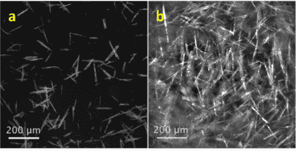

**图 1.** 离线显微镜（a）与头孢氨苄一水合物（CEX）浆料的*原位*图像（b）之间的比较。*原位*图像突出了许多典型的图像分析挑战，例如高度重叠的物体。晶体颗粒的针状形状和高数量密度进一步使*原位*图像的分析复杂化。

传统方法的另一个问题是，所开发的算法通常有几个超参数，可能显著影响图像分析结果。当目标是量化晶体尺寸分布时尤其存在问题，因为晶体尺寸分布可能受超参数选择的影响（一个简单的例子是膨胀和腐蚀操作对颗粒估计尺寸的影响）。

现代计算机视觉主要基于数据驱动模型和以卷积神经网络（CNN）形式实现的深度学习。<sup>25,26</sup> 简而言之，在典型的基于深度学习的图像分析方法中，一系列滤波器（卷积层）被应用于输入图像（可能在某些图像修改或增强步骤之后），结果是一系列特征图，突出输入图像的某些特征。然后这些特征图可以被全连接层用于不同的目的，例如分类。最后，每个滤波器和其他层的参数在训练步骤中进行优化以实现最佳性能。自然地，与其他基于深度学习的模型类似，训练这些网络需要大量的数据，尤其是对于可能拥有数百万参数的更深网络而言。<sup>26</sup> 现代*原位*成像探头每小时可捕获数千张过程时间图像，提供可用于训练这些网络的海量数据。有几种众所周知的 CNN 架构在标准图像数据集上预训练，能够提取不同的低级和高级别图像特征。这些预训练网络可以使用少量训练数据进行微调以用于特定应用（即迁移学习）。在结晶学界使用这些新型基于深度学习的模型进行应用的例子很少。最近，Chen 等人<sup>27</sup> 使用区域 CNN（R-CNN）检测并表征针状 L-谷氨酸晶体的长度。Gao 等人<sup>12</sup> 使用 Mask R-CNN 进行晶体物体分割，以监测 L-谷氨酸两种不同多晶型物 α- 和 β- 形式的形成。Mane 等人<sup>16</sup> 也使用以 RetinaNet 为支持网络的 Mask R-CNN 方法来表征 NaCl–乙醇–水抗溶剂结晶中的晶体尺寸分布。这些研究使用基于深度学习的方法并提供关于结晶过程进展的定量数据。然而，它们要么仍然处理固体密度低且捕获图像中物体重叠有限的稀释浆料，要么依赖外部环路生成可分析图像。神经网络作为回归模型也被用于基于双投影图像的板状晶体形状表征<sup>28</sup> 或从不同结晶过程中的拉曼和红外光谱中提取溶液和固相浓度信息。<sup>29,30</sup>

在本工作中，我们开发了一种基于 CNN 的计算机视觉模型，可与使用 PVM 探头的高速*原位*成像相结合，用于结晶过程的实时监测。重点是一个*原位*图像包含高度重叠物体且传统方法证明不足够的系统。目标是专门开发一种用于自动化过程监测的工具，该工具可以（1）检查使用 PVM 探头拍摄的*原位*图像以监测浆料状态，（2）检测并传达浆料中可能存在不需要晶体的情况，（3）估计不需要物体的位置以供操作员进一步检查并采取适当的控制措施。特别是，我们关注在连续制药制造工艺中应用此类工具，在这些工艺中，浆料的稳健监测对于生产符合设定质量属性标准的纯净高质量产品至关重要。我们以头孢氨苄（CEX，一种 β-内酰胺抗生素，年产量 >5,000 吨/年<sup>31</sup>）的生产为例，其中反应副产物可能在偏离过程设定点时结晶并污染产品。<sup>32</sup>

## 2. 材料与方法

### 结晶实验

头孢氨苄生产的工业工艺通常使用活化的酰基供体如苯甘氨酸甲酯（PGME）与 β-内酰胺核 7-氨基去乙酰氧基头孢烷酸（7-ADCA）之间的酶促反应。<sup>31,32</sup> 该工艺中使用的生物催化剂通常是青霉素 G 酰化酶（PGA），它催化产生头孢氨苄的主要反应以及式 1 中所示的两个水解副反应。在反应结晶过程中，条件设定为使头孢氨苄在反应器中结晶以产生 CEX 晶体，从而保护头孢氨苄免受生物催化水解。<sup>32</sup> 然而，副产物苯甘氨酸（PG）在水中的溶解度很低（~30–35 mM，25 °C，pH = 5.5–7.5<sup>33</sup>），如果生成过量可能会结晶并污染产品。

```
PGME + 7-ADCA
  → MeOH + CEX
  → CEX·H₂O (crystal)

PGME + H2O → MeOH + PG → PG (crystal)

CEX + H2O → 7-ADCA + PG → PG (crystal)    (1)
```

为了生产 CEX 晶体，使用 pH 调节来产生所需的过饱和度（水中头孢氨苄溶解度随 pH 值变化见支持信息中的图 S1）。典型的结晶实验始于在 pH 7.5 的 200 mL 去离子水中溶解足够量的 CEX 固体（RIA，Hanover，NJ）以制备饱和溶液。饱和后，将所得溶液过滤以去除未溶解固体。然后将溶液转移至夹套结晶容器中，保持温度 25 °C，并使用带四片 45° 叶片且底部间隙 1 cm 的不锈钢斜叶桨式搅拌器以 250 rpm 搅拌。通过加入 0.05 g 研磨的种子晶体并加入 2 M HCl 使溶液酸化以产生过饱和度来开始结晶。使用 Mettler-Toledo SP-50  dosing 单元在 2–3 小时内将 pH 值从初始的 7.5 降低至 5.5。pH 调节后浆料搅拌 3–5 小时，直至溶液浊度（使用 EasyViewer 探头测量）无显著变化。图 2 显示了典型的 CEX 一水合物结晶实验过程中 pH 值和浊度的变化情况。

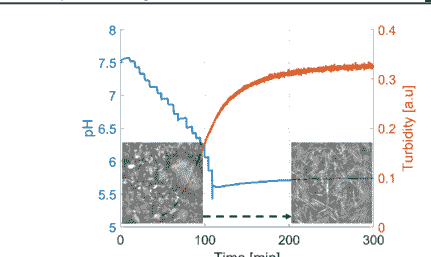

**图 2.** CEX 一水合物结晶实验过程中溶液 pH 值和浊度。左侧的*原位*图像显示初始接种溶液，右侧图像显示实验结束时的浆料。

PG 晶体在两组实验中生产。在第一组中，使用上述相同的 pH 摆动方法结晶 PG；初始和最终 pH 值范围从初始 pH 9 到最终 pH 5（水中 PG 溶解度随 pH 值变化见支持信息中的图 S1）。晶体被过滤，在室温下干燥，然后过筛以去除大团聚体（颗粒 >300 μm）。在第二组中，PG 在模拟酶促合成的条件下形成。将 PGA 生物催化剂（购自 Centrient，荷兰）以约 2 μM 的浓度加入到 pH = 7 时饱和于 PG 的 CEX 浆料中。然后给予溶液足够的时间让酶水解头孢氨苄并产生足够的 PG 过饱和度以使 PG 结晶发生（5–8 小时）。第一种方法（pH 摆动）形成的 PG 颗粒平均尺寸较大，有助于更准确地量化溶液中的数量密度。第二种方法（酶促）形成的 PG 颗粒平均尺寸较小，但更准确地代表了头孢氨苄酶促合成过程中形成的副产物颗粒的形状和特征。图 3 显示了含有每种类型 PG 颗粒（板状）与头孢氨苄（针状）的系统的*原位*图像和离线光学显微镜图像。

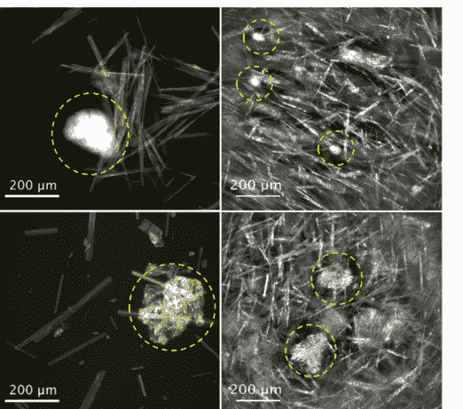

**图 3.** CEX 和 PG 晶体的光学显微镜和*原位*图像，突出了通过酶促（上）和 pH 摆动（下）方法制成的 PG 颗粒。PG 颗粒用虚线圆圈标出。

### 训练数据准备

定义了两个图像类别，“Good” 类，即浆料中纯 CEX 晶体，和 “Bad” 类，即主要为 CEX 浆料中存在的 PG 晶体（由酶促或 pH 摆动方法制成）。对于每个系统，首先使用


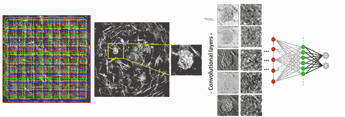

图5. 检测PG晶体的整体流程示例：用于检测通过pH摆动法生成的PG晶体的预设滑动窗口网格，在原始图像中裁剪出候选区域，并将其输入CNN以生成特征图并进行分类。

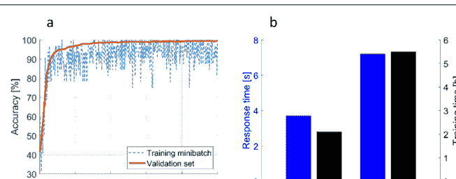

图6. 针对含pH法PG晶体的系统对ResNet-18 CNN进行微调的训练过程示例 (a)。分析单张PVM图像的总响应时间与本研究中所用两个网络的神经网络训练时间的比较 (b)。

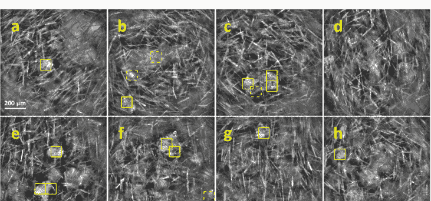

图7. 将图像分析模型（使用ResNet-18）应用于从添加了pH法PG晶体的晶体浆料中获取的一系列原位图像的结果。黄色实线框对应于根据0.9的分类阈值判定为含有PG颗粒的区域。虚线框则是根据0.8的分类阈值额外标注的区域。

在典型结晶过程的时间尺度（数百秒）上，ResNet-50较长的响应时间实际上并不限制其应用，仍然能够采取与控制相关的行动。此系统中合适的控制动作可以是调节进入容器内的酰基供体（PGME）的流速，以降低PG浓度并溶解其晶体。在其他结晶系统中，操作可能是温度循环或pH循环以溶解不需要的颗粒。

在训练好用于对各系统（pH摆动法或酶法生成的PG）两种晶体类型进行分类的主干CNN后，我们通过在一组新图像上调用图像分析模型来评估其性能。这些图像是在单独实验中获取的，并未用于CNN的训练过程（既未用作训练数据、验证数据，也未被用作测试数据）。此外，请注意，CNN是使用各类别的原位图像的相关裁剪区域（而非整张原始图像）进行训练的。如前所述，我们采用类似滑动窗口的方法，通过将图像的不同区域传递给CNN进行分析。在“坏”类别中获得高分的区域（即很可能包含PG晶体的区域）会被标记并报告。与现代计算机视觉中其他较新的方法（如EdgeBox35或选择性搜索34）相比，使用滑动窗口方法研究图像实际上不太常见。然而，在我们的案例中，目标是构建一个用于识别具有已知特征晶体的工具。例如，在酶法生成PG的过程中，通过初步实验即可知道不需要的PG颗粒的典型尺寸和形状。图7和图8展示了基于ResNet-18的图像分析模型应用于来自各系统的一系列示例图像的结果，其中使用了两种不同的分类截止值。在每张图像中，模型都能成功地识别出对应于具有PG特征的颗粒的区域。基于ResNet-50的模型的结果非常相似，并在支持信息中的图S.3和图S.4中给出。

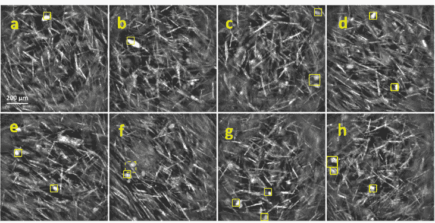

图8. 将图像分析模型（使用ResNet-18）应用于从含有酶法生成的PG颗粒的晶体浆料中获取的一系列原位图像的结果。黄色实线框对应于根据0.9的分类阈值判定为含有PG颗粒的区域。虚线框则是根据0.8的分类阈值额外标注的区域。

除了训练参数、分类阈值以及为提高原位图像质量可能采取的预处理步骤外，该模型中另一个重要的超参数是滑动窗口的大小。滑动窗口的大小应结合所研究的系统和特定晶体的特征来选择。例如，对于通过pH摆动法生成的PG晶体（图3），晶体比酶法生成的晶体相对更大。因此，该系统的滑动窗口网格选择得较大，具有更大的候选框（100–125 μm，而酶法体系为60–70 μm）。选择滑动窗口大小范围的一个好的经验法则是使用训练数据准备期间绘制的边界框的平均大小。其他方法（如构建图像金字塔来检测不同尺度的物体实例）在计算机视觉中很常见。但考虑到在我们的案例中晶体特征已知，我们将分析限制在每张图像的原始尺度上。

在某些情况下（例如图7中的面板c），会报告几个重叠或相邻的区域，这是滑动窗口网格和用于NMS的重叠阈值的结果。滑动窗口大小和NMS中使用的阈值是可针对特定情况调整的超参数，以减少重叠区域的数量；尽管如此，定位PG颗粒的主要目标已经实现。另一个观察结果是，根据所使用的分类阈值，某些区域可能会或可能不会被标记。图7和图8中的分类阈值指的是“坏”类别的得分阈值，高于该阈值模型会标记相应区域。分类阈值的选择可以是0.5–1范围内的任何数字（低于0.5则归属为另一类别），它直接影响假阳性和假阴性率。例如，在图7的面板b中，使用0.8的值会在图像中央导致一个假阳性。另一方面，使用0.9的值会在面板f中导致一个假阴性。这个阈值是模型中的一个重要超参数，应根据当前具体过程和可接受的风险程度来选择。

为了进一步测试图像分析模型的准确性和检测极限，我们进行了逐步增加PG晶体数量的实验。除了检测极限，通过在以高度受控的方式将PG晶体添加到标准CEX浆料中的实验，还获得了对模型性能、图像采集和浆料行为的深入了解。使用了足够大的晶体（75–225 μm），以便每次添加等分试样时都能加入可预测数量的晶体。正如预期的那样，在实验过程中，被标记为含有PG的图像数量随着PG固体浓度的增加而增加。最终，容器中的PG晶体数量足够多，以至于几乎每张图像都能检测到它们。该实验的示意图如图9所示。

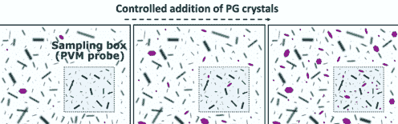

图9. 实验示意图，其中以高度受控的方式将PG晶体（紫色，低长径比）添加到CEX（绿色，高长径比）浆料中，以评估使用图像分析模型检测它们的频率。

如图所示，容器中存在两种类型的晶体（CEX和PG）。根据PG晶体的数密度和探针可观察到的溶液体积，通过探针窗口可能检测到零到几十个PG晶体。图10显示了图像分析模型在CEX浆料中检测到至少一个PG晶体的帧的百分比，作为PG晶体质量的函数。在每个PG固体浓度下，该百分比基于分析100帧计算得出，从这100帧中随机抽样50帧共30次以计算标准误差。通过分析从浆料中捕获的图像，模型能够识别PG晶体质量的增加，并更频繁地检测到它们的存在（标记相应图像）。然而，正如之前在图7中所见，模型也会报告假阳性，即纯CEX浆料的图像被标记为含有PG，尤其是在使用较低分类阈值时（在这种情况下，对于分类阈值 S* = 0.8，约有5%的图像被错误标记，对于 S* = 0.9，则为0–1%）。

PG晶体的数量 N_PG 可以根据添加的质量和它们的平均尺寸进行估算（参见支持信息）。PVM探针可见的溶液体积 V_samplingbox 估算为探针窗口面积乘以焦距范围（~1000 × 1000 × 100 μm³）。完全失焦的晶体无法高精度地进行分析，也不会从分类网络中获得高分。因此，捕获的帧中至少包含一个PG颗粒的概率等于1减去不包含任何PG颗粒的概率（等式2的推导见支持信息）。

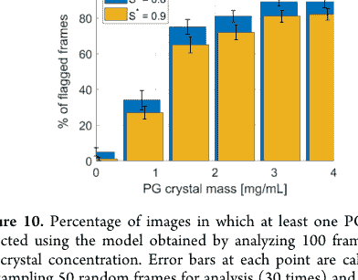

图10. 在每个PG晶体浓度下，通过分析100帧获得的模型检测到至少一个PG晶体的图像百分比。每个点的误差线通过子采样50个随机帧进行分析（30次）并计算标准差得出。顶部x轴对应于估计的PG晶体数量 [1000/mL]。略微向右偏移的条形对应于较高的分类阈值。

图11显示了使用等式2预测的、帧中PG晶体检测概率作为其在浆料中质量函数（针对不同平均尺寸）的模拟结果。模拟假设一个理想观察者，在图像分析步骤中不会漏掉任何PG颗粒。图10的实验数据（三角形标记）用于比较。最顶部的曲线对应于最小的平均尺寸。

P(N_PG) = 1 - (1 - V_samplingbox / V_vessel)^{N_PG} (2)

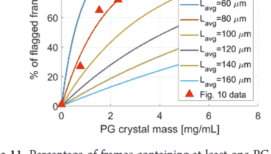

图11. 使用等式2预测的、含有至少一个PG晶体的帧的百分比作为其在浆料中质量（针对各种平均尺寸）的函数。模拟假设一个理想观察者，在图像分析步骤中不会漏掉任何PG颗粒。图10的实验数据（三角形标记）用于比较。最顶部的曲线对应于最小的平均尺寸。

模拟结果证实，在所描述的系统中，PG的观测结果应符合指数饱和曲线（类似于图10）。但是，理论计算与实验点之间的表观相似性不应被视作图像分析模型完美的标志。在使用该模型对每帧进行分析时，可能存在计算机未检测到的PG晶体，或者存在一些假阳性情况。这些模拟的重要性在于它们证实了实验曲线的整体形状。图11还强调了在类似图10所示的实验中，需要使用预先制备的且平均尺寸相对较大的PG晶体的必要性。

也可以训练一个用于细化所报告的边界框坐标的第二个回归神经网络，例如类似于Fast R-CNN中的做法。然而，采用这种方法需要对本文所述算法的前面部分进行调整，并且不能提供关于苯基甘氨酸是否已在容器中成核的重要信息。


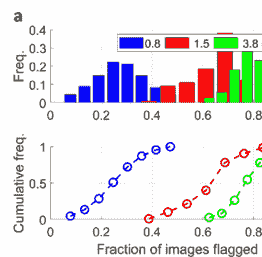

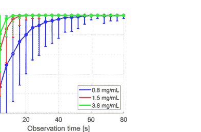

图12. (a) 在不同PG颗粒浓度（图10）下，系统在有限数量的帧（20帧）中观察时，被标记图像比例的分布。每个浓度对应的分布是通过采样该浓度下拍摄的20个随机帧，将其输入模型并计算被标记帧的比例得到的。接着对500组重复相同过程绘制直方图。(b) 使用模型在不同PG颗粒浓度（图10）下观察浆料时，检测到PG颗粒存在的概率与观察时间的关系。观察时间按拍摄图像并通过ResNet-18分析所需的时间计算（估计每帧4秒）。误差条通过对每个PG颗粒浓度下拍摄的相应数量图像进行随机采样（500组）计算得出。顶部曲线对应最高浓度3.8 mg/mL。

浆料。以图12a中0.8 mg/mL数据集为例，如果30%的帧含有PG，则系统含有至少0.8 mg/mL PG的概率为60%，但含有>1.5 mg/mL PG的概率可忽略不计。类似地，如果50%的帧含有PG，则浆料含有>3.8 mg/mL PG的概率约为0%，但含有>0.8 mg/mL PG的概率几乎为100%。这些概率可帮助控制器（人工或自动）决定采取何种行动以确保浆料纯度。如前所述，随着采样和分析图像数量的增加，分布变窄，PG浓度测量的置信度增加。或者，图12中的数据可以从检测时间的角度进行分析。在某些应用中，可能需要在尽可能短的时间内检测不需要的颗粒（此处为PG）的存在。注意，即使检测到单个PG颗粒也足以满足此目的。检测时间取决于分析每帧所需的时间以及杂质的含量。图12b显示了在三种不同PG固体浓度下，检测系统中PG颗粒存在的概率随观察浆料时间的变化。观察时间对应于拍摄图像和分析它们所需的时间。在低固体密度0.8 mg/mL下，较短的观察时间（例如，仅拍摄和处理一帧）可能无法检测到PG的存在，因此需要使用模型更长时间地观察浆料。只有在60秒后，模型才能确定检测到PG的存在。自然，在较高PG浓度下，该时间显著缩短。在所有情况下，概率值为1表示模型通过标记该时间段内拍摄和分析的至少一张图像而检测到PG的存在。如前所述，该分析直接取决于系统中不需要的颗粒的数量。对于平均尺寸较小的情况，即使很小的质量也可通过仅分析几帧即可立即检测到PG的存在。可以建立与图11类似的数学模型，将理想观察者情况下的PG检测与观察时间联系起来。最后，在结晶过程中，如果过程偏离其适当的设定点和轨迹，可能会形成不需要的晶体（如CEX结晶中作为副产物的PG，或如吡罗昔康结晶¹中的不需要的多晶型物）。尽快检测到这种偏差非常重要，以便采取适当的控制措施（如调节泵或温度循环）。不幸的是，在成核和生长的早期阶段，颗粒尺寸可能相对较小。因此，显微镜分辨率对图像分析在过程监测中的适用性构成了限制。显然，使用直接成像作为过程故障检测的稳健PAT需要足够大的晶体，以便能够通过视觉检测。在某些特定情况下，不需要颗粒的成核和生长可能导致浆料发生一些变化，例如溶液浊度的突然变化，但这是否能用作稳健的监测工具可能高度取决于具体情况。

## 4. 结论

基于深度学习和CNN的图像分析模型被开发用于对来自CEX晶体浆料的复杂原位图像进行分类。在提供足够训练数据的情况下，该模型能够通过处理原始原位显微镜图像的不同区域，检测浆料中存在的非期望晶体（例如副产物，此处为苯甘氨酸，或非期望的多晶型物）。用作分类骨干网络的两个网络ResNet-18和ResNet-50表现出较高的分类精度，能够区分不同的晶体类型。然而，考虑到CEX和PG非常明显的视觉特征，其他著名的深度甚至浅层CNN也可能能够执行分类任务。所提出的方法可扩展到其他结晶系统，在这些系统中，检测非期望晶体对于生产可接受的产品至关重要。计算机视觉的典型挑战，如高悬浮密度浆料中发现的物体重叠，会使该任务复杂化。注意，在高度受控的装置中，对处理过的浆料（如稀释）的纯净图像进行分析仍然是观察和测量过程中晶体的最佳且最稳健的方法。然而，本文提出的方法使PVM探针和原位成像能够作为一种实用且直接的方法，用于实时监测大规模过程中的晶体浆料。最后，值得强调的是，在这项工作中，分类器网络被训练用于识别具有已知特性的非期望晶体；然而，一种有些类似的方法可以应用于

网络、通信与信息系统（CNCI 2019），2019年；Atlantis Press，2019年；第371–390页。

(19) Zhang, B.; Abbas, A.; Romagnoli, J. A. 基于图像的纹理分析自动评估作为晶体生长的监测工具。*Chemom. Intell. Lab. Syst.* **2013**, *121*, 42–51。

(20) Fei-Fei, L.; Johnson, J.; Yeung, S. *视觉识别卷积神经网络课程*；斯坦福大学，2017年。

(21) BlazeMetrics. https://www.blazemetrics.com/blaze400 （访问日期：2021年4月1日）。

(22) Borsos, Á.; Szilágyi, B.; Agachi, P. Ș.; Nagy, Z. K. 基于实时图像处理的冷却分批结晶在线反馈控制系统。*Org. Process Res. Dev.* **2017**, *21*, 511–519。

(23) De Anda, J. C.; Wang, X. Z.; Lai, X.; Roberts, K. J. 通过过程图像分析和监测图跟踪多晶型与形态变化来对有机晶体进行分类。*J. Process Control* **2005**, *15*, 785–797。

(24) Huo, Y.; Liu, T.; Liu, H.; Ma, C. Y.; Wang, X. Z. 使用图像分析进行原位晶体形态识别及其在L-谷氨酸结晶中的应用。*Chem. Eng. Sci.* **2016**, *148*, 126–139。

(25) Lawrence, S.; Giles, C. L.; Ah Chung Tsoi, A. C.; Back, A. D. 人脸识别：一种卷积神经网络方法。*IEEE Trans. Neural Network* **1997**, *8*, 98–113。

(26) He, K.; Zhang, X.; Ren, S.; Sun, J. 载于：深度残差学习用于图像识别。*Proceedings of the IEEE Conference on Computer Vision and Pattern Recognition*，2016；第770–778页。

(27) Chen, S.; Liu, T.; Xu, D.; Huo, Y.; Yang, Y. 载于：基于图像的L-谷氨酸结晶群体生长速率测量。*2019 Chinese Control Conference (CCC)*；IEEE，2019；第7933–7938页。

(28) Jaeggi, A.; Rajagopalan, A. K.; Morari, M.; Mazzotti, M. 通过机器学习表征片状颗粒集合。*Ind. Eng. Chem. Res.* **2021**, *60*, 473–483。

(29) Lin, M.; Wu, Y.; Rohani, S. 利用拉曼光谱和人工神经网络同时测量溶液浓度和浆料密度。*Cryst. Growth Des.* **2020**, *20*, 1752–1759。

(30) Barmpalexis, P.; Karagianni, A.; Nikolalakis, I.; Kachrimanis, K. 人工神经网络（ANN）和偏最小二乘（PLS）回归在拉曼和ATR-FTIR光谱定量分析共晶制剂中的应用。*J. Pharm. Biomed. Anal.* **2018**, *158*, 214–224。

(31) Wegman, M. A.; Janssen, M. H. A.; van Rantwijk, F.; Sheldon, R. A. 迈向β-内酰胺抗生素的生物催化合成。*Adv. Synth. Catal.* **2001**, *343*, 559–576。

(32) McDonald, M. A.; Bommarius, A. S.; Rousseau, R. W.; Grover, M. A. 青霉素G酰化酶催化的β-内酰胺抗生素连续反应结晶。第一部分：模型开发。*Comput. Chem. Eng.* **2019**, *123*, 331–343。

(33) Samanta, M.; Ribeiro, M. P. A.; Leite, G. A.; Giordano, R. L. C.; Giordano, R. C.; Mattedi, S. 氨苄西林酶法合成底物和产物的固液平衡。*AIChE J.* **2010**, *56*, 1578–1583。

(34) Uijlings, J. J. R.; Van De Sande, K. E. A.; Gevers, T.; Smeulders, A. W. M. 用于目标识别的选择性搜索。*Int. J. Comput. Vis.* **2013**, *104*, 154–171。

(35) Zitnick, C. L.; Dollár, P. 载于：Edge boxes：从边缘定位目标候选框。*European Conference on Computer Vision*；Springer，2014；第391–405页。

(36) Girshick, R.; Donahue, J.; Darrell, T.; Malik, J. 载于：用于精确目标检测和语义分割的丰富特征层次。*Proceedings of the IEEE Conference on Computer Vision and Pattern Recognition*，2014；第580–587页。

(37) Adelson, E. H.; Anderson, C. H.; Bergen, J. R.; Burt, P. J.; Ogden, J. M. 图像处理中的金字塔方法。*RCA Eng.* **1984**, *29*, 33–41。

