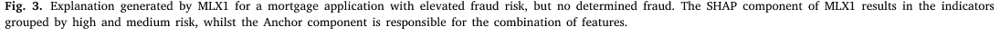
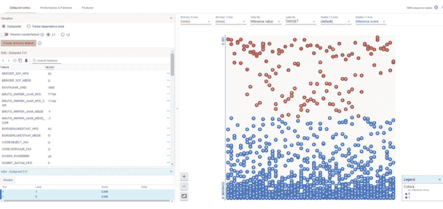
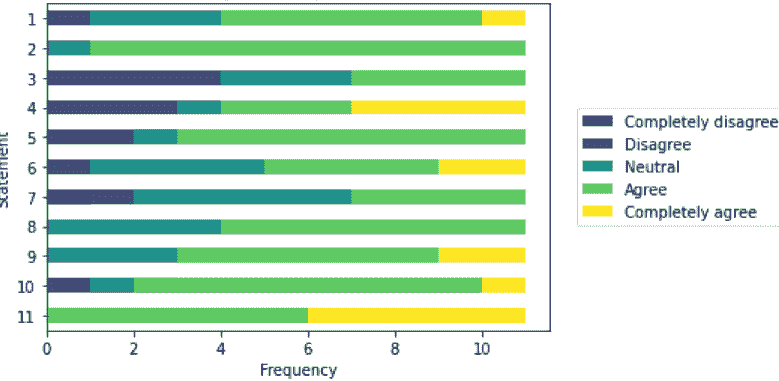

# 抵押贷款行业机器学习应用中的信任与公平性提升

# 提高抵押贷款行业机器学习应用的信任度与公平性

W. van Zetten *, G.J. Ramackers, H.H. Hoos

LIACS, 荷兰莱顿大学, Nieuw Bosch 1, Leiden, 2333 CA, The Netherlands

# 文章信息

# 摘要

* **关键词**

* 可解释人工智能

* 可解释机器学习

* 公平的人工智能

* 偏偏检测

机器学习在应用中的整合为许多机构提高效率提供了可能。然而，此类系统的部署往往由于对决策形成缺乏洞察而受到阻，导致了人们对信任和公平性的担忧。在本文中，我们调查了可解释人工智能（AI）组件在机器学习应用中缓解这些问题能做出多大贡献。作为该研究的一部分，我们针对大型机构用于抵押贷款欺诈检测的现有机器学习模型开发了 AI 功能。部署了全局和局部解释技术，以支持欺诈检测专家利用模型进行日常工作。此外，开发了第二个实现解释技术的系统以支持管理流程。我们进行了一项大规模对照实验来衡量这两个系统的有效性，定性和定量评估均表明，增加 AI 功能显著提高了用户对模型的信任度。结果发现，实施全局解释的 AI 系统大大提高了人们对合规性和公平性方面执行流程能力的信心。特别是，识别出了针对某些人口统计群体的偏见，并通过缓解策略消除了这些偏见。

# 1. 引言

人工智能正在被应用于广泛的领域，扩大了 AI 应用的范围及其对我们日常生活的程度。这些系统在医疗保健、教育、娱乐和金融等多个领域发挥着重要作用。AI 系统，或更具体说是机器学习（ML）软件，在人类无法检测解决给定问题的模式的情况下，可以实现高精度的预测。

某些系统对某些人口统计群体存在不公平的偏见。有助于了解此类不透明决策过程并确保系统做出公平决策的方法是广泛的研究。从机器学习中学习可以产生关于目标领域的知识，而确保系统在决策过程中是不偏见且公平的，是金融领域机器学习和 AI 系统伦理应用的要求。

## 1.1. 问题陈述

部署高性能机器学习系统的一个权衡是，它们往往是非常不透明的，以至于精确决策是由系统做出的，使用户很难理解为什么会获得特定的结果。这种无法检查决策过程的能力会导致许多问题。首先，验证过程的结果是可辩护的，且它遵循一条令人信服的思维路径是非常关重要的。

机器学习经常被用于的一个方面是处理欺诈风险。一个大案例是荷兰系统风险指示（SRRI），它与大量的的人口统计数据相关，并用于识别潜在的欺诈人员。由于该过程需要被公平地考虑，加上被标记为潜在欺诈者对行业产生了巨大影响，导致该系统在使用了多年后于 2020 年被禁止使用（van Dijk et al., 2020）。

保险公司和银行使用机器学习来估算贷款申请人、个人贷款以及抵押贷款申请人的欺诈风险。应用这些系统的机构希望确保系统不会受到意外偏见的影响，以帮助他们遵守反歧视法；这些机构必须避免基于机器学习系统的预测来做出自动化决策。

本指南以及其他指南源自《保险公司伦理框架》，该框架是由保险部门根据欧盟委员会的人工智能高级专家小组设立的保证审查机制（Verband van Verzekeraars, 2021）。

> * 通讯作者
> 邮箱：wvanzetten@elsevier.com (W. van Zetten), g.j.ramackers@liacs.leiden.nl (G.J. Ramackers), hh@H. Hoos).

## 1.2. 假设

在本文，我们对一家大型荷兰保险公司（下文称为“该机构”）进行了广泛的评估和案例研究。该机构提供不同领域的各种寿险和非寿险，并利用机器学习进行欺诈检测、风险定价和承保。我们的目标是进一步改进 AI 的使用，以应对监管机构的要求。为了实现这一目标，我们希望有一组工具可以帮助数据科学家解释他们使用的模型，验证决策过程，并调查和证明给定模型的公平性。此外，该机构需要解释个人结果的方法，以及让黑盒模型解释决策过程的方法。此外，该机构要求我们对机器学习的模型进行评估，因为这对员工和经理理解机器学习的预测至关重要。

在本文中，我们关注可解释人工智能系统的开发，由于本研究提出的建议有助于机构实施可解释且不偏见的机器学习，我们设定了假设：

- 1. 可解释人工智能系统有助于机构实施可解释且不偏见的机器学习。
- 2. 可解释的机器学习模型有助于数据科学家解释他们使用的模型，验证决策过程，并调查和证明给定模型的公平性。

## 1.3. 方法论

在本文，我们对一家大型荷兰保险公司（下文称为“该机构”）进行了广泛的评估和案例研究。该机构提供不同领域的各种寿险和非寿险，并利用机器学习进行欺诈检测、风险定价和承保。我们的目标是进一步改进 AI 的使用，以应对监管机构的要求。为了实现这一目标，我们希望有一组工具可以帮助数据科学家解释他们使用的模型，验证决策过程，并调查和证明给定模型的公平性。此外，该机构需要解释个人结果的方法，以及让黑盒模型解释决策过程的方法。此外，该机构要求我们对机器学习的模型进行评估，因为这对员工和经理理解机器学习的预测至关重要。

Mehrabi 等人 (2021) 综述了偏见的类型和公平性的定义。

考虑机器学习中检测偏见的两个方面：数据和偏见。在训练一个有偏的模型时，无论使用无偏见的还是有偏见的数据集，实施相关技术来挑战和识别偏见至关重要。其次，在数据集不包含偏见的情况下，训练过程可能会引入特征，如性别或种族等特征。Catan 和 Hao (2020) 综述了这些特征对于检测偏见以及提高公平性的重要性；我们以此为起点，探索了数据和模型两方面可能的技术。

除了产生特征权重或排名、或提供决定行为规则的全局解释性技术外，这种方法还通过交互式可视化来捕获模型。`What-if?` 允许用户在不进行大量编码的情况下对系统进行探查、可视化和分析（Wchsler 等人，2020）。现在，用户可以在不同的语境下检查行为，并对全局行为建立自己的理解。

## 2.2. 相关技术

根据上一节综述的论文，我们汇编了一份关注业务背景和要求的有前景技术清单。

### 2.2.1. 局部解释性技术

局部模型无关解释器 `LIME` (Ribeiro 等人，2016) 是局部技术之一。`LIME` 学习解释每个特定的预测。`LIME` 是一个线性模型，它估算每个特征的重要性，以及该特征对最终预测是有正影响还是负面影响。非线性（或基于规则的）方法也可以考虑单个预测中特征的组合效应。这些技术在二分类预测的情况下（即特征共同作用时）也可能效果不佳。此类技术的一个例子是 `SHAP` (Ribeiro 等人，2018)。解释是对局部预测的分析，以便能够做出相应的更改。由于 `SHAP` 使用规则，它可以组合特征，与 `LIME` 相比要强大得多，而且其某些优势也源于从单一角度对特征进行比较。

`Aquitas` (Salinas 等人，2018) 专注于将数据探索作为输出，使其对数据科学家和决策者都具有吸引力。总的来说，它探索了系统及其在促进和理解数据依赖关系方面的作用。`Aquitas` 专注于基于特定人口群体的偏见和可视化。该库不直接与模型交互，而是与模型的结果（即案例的正确分类）交互。公平性指标（例如假阳性率）会被详细的计算和可视化，展示出不同群体及其相应的公平性和性能得分。

即使某个特征在模型训练中没有使用（例如种族），如果它存在于训练数据中，结果也可能针对这些群体产生偏见 (Okamoto 等人，2018)，这在全局解释性小节中已经讨论过，但也可用用于查看与“预测”相关的规则。通过观察预测特征，可以确定预测特征是否被用于模型中。

### 2.2.2. 偏见检测技术

除了探索全局和局部解释性外，我们还研究了确定模型中偏见的技术。对我们来说，必须同时考虑数据中的偏见以及使用有偏数据训练模型的结果通常也会产生有偏的结果。

### 2.2.3. 全局解释性技术

`SHAP` (Lundberg & Lee, 2017) 可用于测试解释性，也可用于估计全局解释性。通过局部解释性，可以看到特征以不同的切入点对模型产生全局影响。一个实例是通过迭代观察数据集中的特征以确定并评估其对测试集的影响，使次要特征影响全局模型。这种技术被称为 `BlackBoxAuditing` (Adler 等人，2018)。由于 `SHAP` 使用规则，它可以组合特征，与 `LIME` 相比要强大得多，而且某些优势也源于从单一角度对特征进行比较。

## 2.5 机器学习模型的验收

在组织中引入项目启动文档（`PID`）是该组织项目可解释性要求之一。每个新的机器学习模型-`PID` 都包含关于偏见与歧视、可解释性以及涉及的伦理问题的的章节。在采取开发新模型或更新现有模型的任何步骤之前，它必须获得数据隐私官、合规和风险部门的接受；随后，这些将通过对所用数据的处理活动记录（`ROPA`）进行覆盖，并由合规部门进行审查。内部特定的指南和开发方法必须经过财务部门的批准。

此外，该组织有兴趣使用自动化系统来量化偏见和歧视，并对决策过程获得洞察。此外，`MLX1` 系统的开发是为了确定模型是否对某些人口群体存在偏见。我们的 `MLX2` 系统旨在支持一种通用的方法，将可解释性和偏见纳入项目启动文档中。这使得组织在接受新模型时能够简化内部流程。

# 3. 方法

本节涵盖了 `MLX1` 和 `MLX2` 两个系统的设计，以及它们如何融入上一节所述的组织业务背景和模型流程。此外，它还描述了系统的开发以及其功能的演示。最后，我们概述了这两者的验证方法。

## 3.1. 逻辑设计

局部可解释性系统涉及为被标记为高风险的应用生成解释。在图 1 中，我们看到了应用在分类后的不同处理方式。如果应用被分类为高风险，则将其转交给审核员进行审核，之后给出解释。审核员在通常操作之前会先对解释进行解读，以确保模型决策得到验证。这确保了模型决策不会在审核员做出自己的决定后受到其影响。如果应用未被判定为高风险，另一条路径遵循审核员的正常评估。根据他们的决定，申请将继续或停止。如果审核员识别出风险，审核员会将贷款申请提交给反欺诈部门，由他们对申请和决策进行更深入的研究。如果证实存在欺诈，则将其返回组织。然而，如果申请人被请求者拒绝，反欺诈官对怀疑的解决在最初拒绝申请是有效的。该决定可以申诉，支持对欺诈的怀疑但并未定性地证明它。

`MLX1` 简单地替换了目前生成解释的方法（目前是使用简单的决策规则）。它还对模型做出的决策提供了更好的洞察，识别出那些支持模型（或无风险）指示的因素。鉴于预计审核员花费 5 分钟来评估模型解释，可以这样解释其结构，以使得这种时间仍然受到限制。

组织的内部流程需要通过提供全局可解释性和偏见检测来启动新的 AI 项目。`MLX2` 的设计旨在帮助组织确保模型不含偏见，并提供决策过程的概览。

目前，对模型使用的所有数据的 `ROPA` 结果被用于确保模型是免费的，但偏见的识别仍然困难。通过识别和量化偏见，`PID` 得到了数据科学家的帮助，而这些工作在模型构建之前已获得合规、法律和风险部门的批准。`PID` 的任何元素都可能导致偏见的识别和量化变得不明确，`PID` 中的这些结果可以在未来的所有案例中简化 AI 项目的流程。

`MLX1` 和 `MLX2` 提供以下两点：首先，`MLX1` 允许局部可解释性，为贷款审核员提供了深入受局部可解释性和偏见检测影响的单个贷款申请决策过程的机会，使系统能够使用并集成现有的偏见模型，并对其行为获得整体洞察。

鉴此，我们决定使用 `SHAP` (Lundberg & Lee 2017) 进行局部可解释性，因为它能够让贷款审核员对受局部可解释性和偏见检测影响的模型决策结果产生洞察。`SHAP` 方法可以显示哪些特征对结果有大或小的影响，从而对模型行为产生洞察。`SHAP` 是基于内核的聚合解释，`TreeSHAP` 是基于树的特定解释。

我们发现 `Kernel` 在所有案例中生成局部解释的运行时间很慢，`TreeSHAP` 能够以合理的时间生成。`TreeSHAP` 的复杂度为 $O(T^L)$ (Lundberg et al. 2020)。在这个案例中，我们发现 `Kernel` 在所有案例中生成局部解释的运行时间很慢，`TreeSHAP` 能够以合理的时间生成。`TreeSHAP` 快得多。由于 `SHAP` 的重要性，我们需要运行一次，我们想要使用 `SHAP` 和 `TreeSHAP`，因为它们产生了不同的重要排名。为此，我们比较了排名前 5 的特征，这些是在我们的 `MLX` 系统中使用的特征。在实践中，这种功能差异对系统没有影响。

三个 `MLX` 系统的变体已开发并提交给数据科学家和贷款审核员 W. van Cells, J.G. Ramackers and I. Hoo Machine Learning with Applications 10 (2022) 10

怀疑解决：反欺诈官可以拒绝申请。

### 3.3. 验证

为了对 MLX 进行验证，我们招募了组织内的申请审核员经理。我们为这项测试从组织中获得了 11 名审核员，受限于组织内审核员的整体短缺。因此，这是在调查期间可用的审核员最大数量。

#### 高风险指标

- 主申请人已工作 3 个月。

#### 中低风险指标

- 距离销售日期还有 41 天。

- 专有指标

- 申请贷款金额为 415,000 欧元。

- 主申请人年龄 30 岁。

以下特征组的组合增加了此案例的风险：

- 专有指标

- 距离销售日期超过 33 天。

- 主申请人年龄小于 37 岁。

- 专有指标

在问卷计数调查中，随后将进行简短的（5 分钟）访谈以获取额外的反馈。

如第 3 节所述，我们的方法论已经得到了确凿证明。因此，MLXI 通过构建可解释的 AI 系统，使审核人员能够频繁地对可能性做出正确决策。此外，使用 MLXI 的抵押贷款审核员是欺诈检测的第一道防线，并在第 3.1 节中提到的反欺诈系统中通过。目前存在欺诈嫌疑。然而，可以量化新的 MLXI 系统是否比基于现有解释的系统有所改进：

针对全局解释和偏见检测的问题侧重于那些可能无法通过问卷问题表达的内容。关于审核员对 Anchor 解释的体验，以及他们发现如何结合那些指示欺诈风险的特征（对于一个特征计数比例组，即描述房价、抵押贷款金额、装修价格等之间关系的特征）的说明。

正如 Hoffman (2018) 考虑满意度指标的研究所示，我们对审核员关于他们感知的速度和准确性的意见进行了评估。我们还添加了两个涵盖 Anchor 组件所开发的分组的特定问题。我们分析了这些指标的结果：

- 信任

基于 Hoffman 等人 (2018) 的现有研究开发的模型信任度，使用了三个问题来评估用户对模型的信任程度，以及他们是否认为模型是可预测的、可靠的且信的。

- 解释满意度

用户认为他们理解 AI 系统或被其解释的程度。Hoffman 等人 (2018)。在这项研究中，Hoffman 等人 (2018) 也提供了一系列问题，我们使用了这些问题。

审核员的性能同样重要。通过一个可解释的系统，我们将衡量审核员的性能。对于该值，我们对欺诈案例使用了两个性能指标：

- 速度：解释是否有助于识别案例的各个方面？审核员识别出案例中潜在欺诈方面的速度越快，速度就越快。

- 准确率 —— 审核员认为在对案例做出决策时是否更有信心了？

使用了这些用于开发研究的指标组，以及 Hoffman (2018) 在五点 Likert 量表 (1932) 上可能完全不同意或完全同意的陈述。在审核员完成问卷后，我们立即进行了访谈并问了四个问题。

#### 3.4. MLXI 黑审计 (BlackAuditing)

BlackAuditing 生成的输出包含两个部分。首先，库根据特征重要性生成简单排名，重要性是通过平衡分类率 (BCR) 来衡量的，即当每个特征从模型中移除时，准确率的变化平衡。这输出了一个简单的特征列表。其次，BlackAuditing 允许数据科学家识别包含敏感个人信息的特征。然后使用 BlackAuditing 来确定在省略模型中的特征时，平衡分类率 (BCR) 的变化是否小于阈值。该阈值由组织设置。

我们简要描述了为 MLXI 选择的三个特征的使用。

# 机器学习与应用 10 (2022) 100406

**4. What (If?) 工具的第一面板，用于数据集可视化。用户可以缩放或切片到特定区域，并使用左侧面板预测案例并重新运行分类。**

**图 5. 比较荷兰、非荷兰和西方移民背景假阳性率 (FPR) 的测试 Aquitas 输出。**

数据科学家的观察以及特征的公平性衡量，以及它们的分布。

### 4.3. Aquitas

Aequitas 是 MLXI 中使用的统计库。我们选择通过荷兰中央统计局（Centra Bureau voor Statistiek，或 CBS）提供的人口统计数据来丰富数据集，该数据包含了荷兰居民的信息。MLXI 允许用户选择他们调查的特征，以及假阳性率 (FPR) 差异，这显示了较大群体内部的组情况。Aequitas 可用于测试模型在移民背景下是否公平，并包含可能欺诈的个人。

### 4.2. What (If?) 工具

What (If?) 工具是一个交互式库，允许科学家可视化其模型的结果，并对不同组进行切片、聚合和观察。数据科学家可以使用此库练习数据集中特征的分布，并查看预测结果。通过使用此库，MLXI 系统得以释放。首先，数据科学家可以使用它来可视化其模型的性能，并观察其行为是否符合预期，同时也用于检测偏见。其次，在调查特定案例时，它非常有用，例如当客户质疑模型决策时。

### 5.3. MLXI 验证

# 4. 结果

在本节中，我们展示了关于抵押贷款申请审核的问卷结果，随后是讨论和评估。

#### 4.1. MLXI 问卷

MLXI 实现了 SHAP 和 Anchor，这两种方法用于提高抵押贷款申请的可解释性。为了评估 MLXI 的有效性，我们使用了预测。在表 1 中，我们展示了所有陈述的平均同意程度，我们将其分为三组：信任、解释满意度和影响。审核员报告说这些解释是有帮助的，这可以是一个未来的研究方向。图 6 显示了这些特征。

在提交问卷后，我们进行了简短访谈，获取了最常见的反馈。

# 洞察

审核员认为，模型提供的解释增加了他们对模型的信任。

## 清晰度（解释满意度）

审核员指出，对于某些解释的比例（例如房价与装修成本之间的比例），他们并不清楚。这可以通过上下文来解决。

## 误导性（解释满意度）

某些特征可能会误导组织。审核员报告说不知道如何处理“未知”指标。某些误导信息可能是欺诈指标，然而“未知”指标没有价值。

十一名审核员对 MLXI 生成的解释持积极态度。强调了 MLXI 提供的指导意见，并节省了时间。

# H1: 允许个体预测具有解释性的技术提高了实践中机器学习模型的真实信任、满意度和可用性

图 6 显示了 Likert 量表上的同意程度，即针对 MLXI 数据的问题。可以通过所有陈述的平均同意程度进行对比分析 (Allen & Arthur, 2013)。我们根据假设的三个因素进行调查：信任、解释满意度和性能。

表 1: 涵盖对模型的信任、解释满意度以及提议解释是否帮助审核员完成任务的所有陈述的平均同意程度。

| 陈述 | 同意程度平均值 |
|------|---|
| 1 - 我喜欢这个解释，感觉模型正在正常工作 | 同意 |
| 2 - 我喜欢使用解释来做决策 | 同意 |
| 3 - 我觉得使用这个解释将做出正确的决策 | 中立 |
| 4 - 解释让我理解了模型是如何得出结论的 | 同意 |
| 5 - 我对解释感到满意 | 同意 |
| 6 - 解释非常详细 | 同意 |
| 7 - 模型工作方式的解释似乎足够 | 中立 |
| 8 - 解释告诉我们模型有多准确 |  |
| 9 - 因为案例有解释，我很快做出了决策 | 同意 |
| 10 - 因为案例有解释，我能够做出更好的决策 | 同意 |
| 11 - 我发现这些风险指标的组合很重要 |  |

## 同意程度

图 6。显示了披露者在五点 Likert 量量表上对陈述表示不同程度同意的频率。

对于解释。然而，通过解决受访者提出的局限性，该指标仍有改进空间。这种空间在图 5 中也显而易见，该图显示回答涵盖了广泛范围。满意度的提高可能是因为现有解决方案缺乏解释的深度和细节。这种可能性也从访谈者的反馈中得到了加强，我们访谈者针对某些功能和整体满意度收集了这些反馈。

满意度。回答速度方面有改进空间，导致了更强的整体认同。

性能。同时，我们衡量了当前实验与 MLX1 的感知性能。三位受访者向我们询问了他们 MLX1 以及添加 Anchor 组件的体验，该组件允许特征和标签的组合。这得到了调查的进一步支持，我们得出结论：与目前的泛化方法相比，MLX1 对感知性能有积极影响。

尽管如此，我们可以说，MLX1 系统使用了使个体具有解释性和透明性的技术，在与其日常用户的信任和易用性方面取得了统计学上的显著改进。评审人员表示，与当前方法相比，使用 MLX1 的体验改进程度略有不同。

#### 4.2. 演示结果

统计显著性。为了测试 MLX1 是否改进了我们的用户体验，我们进行了参数检验以调查结果是否具有统计学意义。根据 Norman (Norman, 2010)，参数检验在我们的情况下具有优势，因为我们拥有 Likert 型量表且样本量较小。按照 Boone 和 Boone (2012) 的建议，我们对 Likert 量表上的每个特征类型陈述使用了 t 检验。通过问卷性能衡量了 MLX1 与当前系统相比是否积极改善了用户体验。我们将 H0 设置为由于 ML 导致当前系统没有改进。将 Likert 量表解释为间隔尺度，我们观察到 m = 3.6，s = 0.86，导致 t 值为 2.5839，p 值为 0.01367。这表明在使用 MLX 生成的解释时，体验有统计学上的显著提高。

为 MLX2 了两次演示。在其中一次中，我们演示了将 MLX2 的 Anchor 组件结合 CBS 数据用于潜在的人口统计学分析。CBS 数据包含基于 100 米乘以 100 米地理基础的聚合数据，提供了（包括其他）关于居民的数据信息。参与者同意 MLX2 的 Anchor 组件将非常有用，如果进一步开发，可以被不同部门轻松使用。该实验将涵盖库的使用案例，使用 Web 界面，并更好地增强结果展示。决定这将引导工具的发展，从研究输出的可能性开始。

HI（人机交互）评估。通过评估用户体验、满意度和感知性能这三个部分，我们现在看到了第一个假设得到了证实。对住房贷款欺诈模型 MLX2 的反应是压倒性的积极。几个陈述具有较高的同意分布度，如图 6 所示。受访者还表示有改进空间，特别涉及解释。

- 示例：尽管三个库都是使用住房贷款欺诈模型和案例开发的，但科学家要求提供具体的示例。这反映了向利益相关者展示更广泛应用的需求。

- 具体阈值：MLX2 为数据科学家提供了间接影响和公平性量的识别，但反馈建议对演示期间为科学家收集的四点进行重要性排序，以及标准差。

| 反馈点 | 平均分 (1-5) | 标准差 |
| :--- | :--- | :--- |
| 清晰的重要性 | 4.25 | 0.50 |
| 具体阈值 | 4 | 0.81 |
| 清晰的指令 | 4.5 | 1.00 |
| 选择措施 | 3.75 |  |

除了演示之外，科学家表示清晰的指令是有效的，能够根据自己的需求适应系统提供的示例。数据科学家可以接触更有可能使用 MLX2 提供的全局解释的利益相关者。这种方法确保了为了有效部署 AI 而整体培训计划。

- 选择措施：Aequitas 提供了多种公平性衡量，科学家要求对这些提供额外的解释和信息，以便他们选择最符合其应用的公平性衡量。这四个主要点被收集到一份问卷中，由参加演示会议的科学家填写。

H2：ML 具有全局解释性且无偏偏的技术。表 2 表明，当问题可以解决时，MLX2 可以成为支持其量化全局解释性、信任、工作重要性和要求的巨大资产。科学家强调了理解他们所需的模型的重要性，其优先级高于理清内部流程和平衡 AI 的系统。

在从演示会议收集结果后，我们可以确认第二个假设。这些点被转换为问卷，按重要性分发在演示会议中。查看表中显示的重要性量表，我们可以推断出清晰的指令是最关键的，其次是使用示例和针对公平组的数据处理。表格还显示了需要操作说明排名最高。排名和标准差显示了通过为数据科学家添加操作说明以及提供示例，可以在多大程度上解决使用 AI 的不确定性。根据这些反馈，我们开发并更新了工作说明，并得到了组织的认可。最重要的点是解决公平性措施的具体阈值的重要性，也具有较大的标准差。在数据中，数据科学家表示清晰的阈值和措施可以极大地帮助他们填写 PID 并证明初始化或适应 ML 模型是有用的。公平性衡量这一点标准差最小，为 0.05，意味着数据科学家在很大程度上对此表示同意。

H2 评估。通过从科学家收集的反馈以及来自法律和合规官员收集的数据中，我们可以得出“如果”工具、回测和解释非常有用的结论。科学家们认为数据科学家的工作流将提高他们的效率和案例。这将促进将新模型或适应模型投入生产的流程。这些点涵盖了工作流的不同方面，正如演示会议的参与者所示。参与者对 MLX2 表现出兴趣，并解决公平性和透明度的适当阈值设置。他们发现使用工作工具有助于改进和简化部署 ML 工具的流程。这为 ML 具有全局解释性和可用性提供了清晰的技术，供任何组织简化涉及和平衡 AI 的流程，特别是通过由于 Aequitas 公平性衡量和措施产生的 PID。

MLX 并不协助训练，但它确实有助于确保人类的自主性并减少偏见。由于评审员面对的是两种解释，他们不容易受到确认偏误的影响。评审员对某个案件有自己的意见，并利用其领域知识和偏好进行判断。MLX 提供与其他评审员不同的解释，这可能会促使他们重新考虑。最终，对案件的评估仍然是评审员的责任，从而确保了人类的自主性。

(15) 在生产环境中使用数据驱动应用将始终受到充分的人类自主控制。组织使用了一个涉及在生产环境中部署预测模型的流程。正如第4.2节所述，MLX2 中使用的库（特别是 WhatIf? 和 Aequitas）有助于这一点。此外，公平性指标的开发以及对可能偏偏特征的识别可以为 PD（项目启动）过程提供帮助。

(16) 当使用数据驱动应用时，人工干预总是可能的，且适当的评审员可以理解这些解释。

由于流程的存在，人工干预是可能的，这意味着组织能够免受非意愿决策的影响。MLX 和 MLX2 可以向客户提供有关其应用结果的更多信息。根据要求，MLX 可以生成与提供给评审员相同的解释。

(17) 在不考虑基本权利的情况下，如果数据驱动应用中的不公平差异无法避免，评审员将不会使用该应用。

MLX2 中使用的所有库都用于涵盖《项目启动文档》（Project Initiation Document），并开发包含这些库输出内容的评估。此外，MLX2 帮助组织遵循这些准则。

(20) 为了使用数据驱动应用，用户必须监控多样性和包容性，特别是对于可能因偏见而面临被排除或处于劣势的群体。

MLX2 中的 Aequitas 帮助数据科学家以及法律、合规和风险官员评估人口统计群体可能的偏见率，前提是这些信息根据 GDPR 法规是可用且可访问的。评估表明，在可能的情况下将以这种方式使用 Aequitas。

(21) 用户在对客户群体做出决策时，将监控使用数据驱动应用的影响。

与 Genio 类似，Aequitas（在 MLX2 中）将通过比较人口统计群体的假阳性率（FPR）来评估数据驱动应用的公平性。可以通过输入带有聚合数据库邮政编码的数据来实现缓解。该工具可以通过 FPR 差异来评估公平性指标。

(23) 用户将为 AI 应用程序和数据源建立内部控制和问责制度。

该问责制度在两个 MLX 系统开发之前就已经建立。然而，MLX2 中包含的工具将包含在本份规范的主文——《项目启动文档》中。MLX2 中库的输出必须满足某些标准，以执行内部控制。

(24) 保险公司通过数据驱动应用提高了高管和内部审计师的知识。Aequitas（在 MLX2 中）的使用适用于高管和审计师的解读，这在向高级法律、风险和合规官员的演示中得到了证明。这一方从简单的视觉化图中获益。

(25) 数据驱动应用的使用确保了在使用《项目启动文档》和该文档的验收过程后有充分的持续跟踪；组织同意在本文档中使用 MLX2 组件，以进一步加强相关利益相关者对可能风险的认知。

(26) 保险公司针对每个数据驱动应用对直接利益相关者进行风险和影响评估。

《项目启动文档》的建立遵循了这些以及其他的准则。通过使用 Aequitas（在 MLX2 中），模型将根据迁移背景和多样性群体的差异，扩展对脆弱人口统计群体潜在影响的见解，以及每个应用在该评估中的风险。

针对风险、法律和合规经理的组织部门引起了大量讨论，参与者表示对系统中偏见的理解以及如何进行测试越深入越好。因此，我们可以说，MLX 和 MLX2 采用的解释不仅改进了用户体验并简化了内部流程，还帮助组织调整流程以符合伦理准则。

# 5. 结论与未来工作

在这项工作中，我们评估了事后（post-hoc）、无关技术在增强机器学习模型可解释性方面的有效性。我们将所有技术视为全局解释技术，并报告了两个主要发现：

- 1. 允许预测透明化的技术可以提高 ML 工具对日常用户的信任度、满意度和可用性。

- 2. 使 ML 具有全局可解释性以及消除歧视性偏见的技术使组织能够缓解。

我们的研究结果与荷兰的一家大型金融机构合作得到了验证。文中展示了一个使用模型估计抵押贷款欺诈风险的案例研究。该模型产生欺诈案件的每日报告，并附带关于为何将其标记为高风险的解释。高风险案件经过评审，并重点关注解释中提到的因素。在此项工作之前，该组织使用简单的基于规则的系统，仅展示可能特征的子集。在我们的工作中，我们使用 SHAP 和 Aequitas 的自动化方法取代了它，提供了包含所有可能特征的详细解释，并在未来进行改进。

实施这些局部解释技术的可解释 AI 系统被称为 MLX1，已用于对 11 名欺诈专的深度研究和短期访谈。调查捕捉了对透明度、可用性和性能变化的感知。这三项指标允许衡量 MLX1 是否改进了评审员使用现有抵押贷款欺诈检测 AI 模型的工作方式。结果发现，MLX1 在三个指标上均实现了统计学上的显著改进。

第二个可解释 AI 系统（MLX2）基于 WhatIf 工具、BoxAuditing 和 Aequitas，专注于市场响应的全局解释。它旨在通过量化（测量）偏见为做出投资决策提供见解。此外，还为数据科学家提供了带有库的说明和示例。这些技术通过增强的数据分类任务执行，以测试在此方面对偏见建模的可能性。

这系列全局解释技术已向数据科学家以及风险、法律和合规部门的代表演示，它帮助组织解决了与模型构建和管理有关的问题。

此外，我们认为在该工作中开发的的可解释 AI 系统还帮助组织遵守有关保险行业伦理使用机器学习的准则，提高了《保险行业伦理准则》中所述的问责制质量。这使得组织能够对 AI 系统建立人类控制，解决潜在的透明度问题。

总而言之，我们的研究结果证明了可解释技术在实践中的益处。实施和验证的机会

W. Wen, (2022). 机器学习及其应用。医学教育，10。

Jamieson, S., (2004). Likert 量表的使用。心理学进展，38(6)。

Shin, B., (2021). 可解释性与因果关系对感知、信任和接受的影响：针对可解释 AI。人机交互期刊，150。

Sullivan, G. M., & Artino, A. R. (2013). 分析和解释 Likert 型量表的数据。研究生医学教育，5(4), 541-542。http://dx.org/10.4303/jgme.0112

Rai, A. (2020). 可解释 AI：从黑盒到白盒。市场科学杂志，48(1), 137-144。

Ribeiro, M., Singh, S., & Guestrin, C. (2016). 我为什么应该信任你？分类器的预测。第 22 届 ACM SIGKDD 知识发现与数据国际会议，纽约，美国：计算机协会，http://dx.org/10.1145/293672.293977。

Ribeiro, M., et al. (2018). 锚点：高性能模型无关的解释。IEEE Access，6，42200-42216。http://dx.org/10.1109/ACCESS.2018.2853

Roscher, R., Hahn, B., Duarte, M. F., & Garcke, J. (2020). 用于科学洞察和发现的可解释机器学习。IEEE Access，8。

Salejo, P., Kuster, B., Hintikka, L., London, J., Aniefeld, A., Rodofa, K. T., & Chiao, R. (2018). 责任制：一种偏差与公平性审计工具包。预印本。

Verbond van Verzekeraars (2021). 伦理框架。URL http://www.verzekeraars.nl/media/7541/ethisch-kader。

Wexler, J., Pushkarna, M., Bohlmann, T., Wattenberg, M., Végas, F., & Wilson, J. (2019). 机器学习模型的交互探测。IEEE 视觉与计算机图形期刊，25(1), 56-66。http://dx.org/10.1109/TVCG.2019.2934619。

14
