# 工业物联网与信息物理系统：从传统到数字的变革


## 计算机与电气工程进展 (ACEE) 丛书系列

Srikanta Patnaik  
印度 SOA 大学

ISSN: 2327-039X  
EISSN: 2327-0403

### 使命

计算机工程和电气工程领域涵盖了广泛的跨学科主题，允许在多个领域进行广泛的研究发展。随着计算机和电气系统成为日常生活不可或缺的一部分，这些领域的研究不断发展并变得越来越重要。

《计算机与电气工程进展》(ACEE) 丛书系列旨在出版关于计算机工程和电气工程多样化主题的研究。ACEE 鼓励对该领域正在实施的用于设计和开发计算机和电气系统的最新应用、工具和方法进行学术讨论。

### 涵盖范围

- 应用电磁学
- 编程
- 算法
- 电路分析
- 计算机体系结构
- 光电子学
- 模拟电子学
- VLSI 制造
- 微处理器设计
- 电力转换

IGI Global 目前正在接受本系列内的出版稿件。若要提交本系列卷宗的建议，请联系我们的收购编辑 Acquisitions@igi-global.com 或访问：http://www.igi-global.com/publish/。

《计算机与电气工程进展》(ACEE) 丛书系列 (ISSN 2327-039X) 由 IGI Global 出版。地址：美国宾夕法尼亚州赫希市 Chocolate 大道东 701 号，邮编 17033-1240，www.igi-global.com。该系列由可单独购买的标题组成；每个标题的编辑内容均与本系列中的任何其他标题在语境上保持排他性。有关定价和订购信息，请访问 http://www.igi-global.com/book-series/advances-computer-electrical-engineering/73675。邮政局长：请将地址变更发送至上述地址。版权所有 © 2020 IGI Global。出版商保留所有权利，包括其他语言的翻译权。未经出版商书面许可，不得以任何形式或任何手段——图形、电子或机械，包括影印、录音、磁带或信息和检索系统——复制或传播本系列中的任何部分，非商业教育用途（包括课堂教学目的）除外。本系列中表达的观点属于作者，但不一定代表 IGI Global 的观点。

## 本系列中的标题

*欲查看本系列中更多标题列表，请访问：* http://www.igi-global.com/book-series/advances-computer-electrical-engineering/73675

### *电气与电子工程师的计算方法*

Rajiv Singh（印度 G.B. Pant 农业大学）和 Ashutosh Kumar Singh（印度阿拉哈巴德信息技术研究所）

Engineering Science Reference • © 2020 • 300页 • 精装 (ISBN: 9781799833277) • 225.00 美元

### *智能技术、优化与可再生能源的研究进展*

Pandian Vasant（马来西亚佩多纳斯理工大学）、Gerhard Weber（波兰波兹南理工大学）和 Wonsiri Punurai（泰国玛希隆大学）

Engineering Science Reference • © 2020 • 330页 • 精装 (ISBN: 9781799839705) • 225.00 美元

### *实时应用中的机器学习和深度学习*

Mehul Mahirshi（印度 Swami Keshvanand 理工学院）、Kamal Kant Hiran（丹麦奥胡斯大学）、Gautav Meena（印度拉贾斯坦中央大学）和 Paawan Sharma（印度潘迪特·登达亚尔石油大学）

Engineering Science Reference • © 2020 • 300页 • 精装 (ISBN: 9781799830955) • 245.00 美元

### *分数微分算子在科学与技术中的高级应用*

Ahmed Ezzat Matouk（沙特阿拉伯马吉马大学）

Engineering Science Reference • © 2020 • 401页 • 精装 (ISBN: 9781799831228) • 245.00 美元

### *MatConvNet 深度学习与 iOS 移动应用设计用于模式识别的新兴研究与机遇*

Jian-Ming Wu（台湾东华大学）和 Chao-Yuan Tien（台湾东华大学）

Engineering Science Reference • © 2020 • 181页 • 精装 (ISBN: 9781799815549) • 175.00 美元

### *组织中的工程创新与技术管理研究手册*

Loveleen Gaur（印度阿米蒂大学）、Arun Solanki（印度古吉拉特佛陀大学）、Vishal Jain（印度新德里巴拉蒂·维迪亚佩特计算机应用与管理研究所 (BVICAM)）和 Deepak Kharanchi（美国奥马哈内布拉斯加大学）

Engineering Science Reference • © 2020 • 500页 • 精装 (ISBN: 9781799827726) • 325.00 美元

### *用于大数据统计分析的开源软件：新兴研究与机遇*

Richard S. Segall（美国阿肯色州立大学）和 Gao Niu（美国布莱恩特大学）

Engineering Science Reference • © 2020 • 237页 • 精装 (ISBN: 9781799827689) • 225.00 美元


*编辑们将本书献给他们各自的家人。*


## 编辑咨询委员会

- Rehan Akbar，*马来西亚唐·阿卜杜勒·拉赫曼大学*
- Anupam Balliyan，*印度新德里BVICAM*
- Bhawani S. Chowdhry，*巴基斯坦Jamshoro Mehran大学*
- Ahmed A. Elngar，*埃及贝尼苏韦夫大学*
- Mesut Güneş，*德国马格德堡奥托·冯·格里克大学*
- Mohammadi Hadi Hedayati，*阿富汗喀布尔大学*
- D. M. Akbar Hussain，*丹麦奥胡斯大学*
- Low Tang Jung，*马来西亚国油科技大学*
- Khalil-ur-Rehman Khoombhati，*巴基斯坦森德省Jamshoro锡indh大学HICT*
- Salah-ddine Krit，*摩洛哥阿加迪尔伊本·佐哈尔大学*
- Xuan Liu，*中国南方大学*
- Muneer Ahmed Malik，*马来西亚马来亚大学*
- Ghulam Ali Mallah，*巴基斯坦Khairpur SALU*
- Abdul Sattar Saand，*巴基斯坦QUEST Nawabshah*
- Shazia Saqib，*巴基斯坦拉合尔卫戍大学*
- Faisal K. Shaikh，*巴基斯坦Jamshoro Mehran大学*
- Bobby Sharma，*印度阿萨姆唐·博斯科大学*
- Fayziev Shokhrud，*乌兹别克斯坦tadqiqat.uz*
- Shah Nawaz Talpur，*巴基斯坦Jamshoro MUET*
- Thien Khai Tran，*越南胡志明市大学*
- Ritika Wason，*印度新德里BVICAM*
## 第1章
### 物联网与信息物理系统中攻击与防御措施综述 ... 1

*Vasakı Ponnusamy, 敦阿都拉曼大学, 马来西亚*
*Naveena Devi Regunathan, 敦阿都拉曼大学, 马来西亚*
*Pardeep Kumar, 盖达尔·伊·阿旺工程学院与科技大学, 巴基斯坦*
*Robitoh Annur, 敦阿都拉曼大学, 马来西亚*
*Khalid Rafique, AJK 信息技术委员会, 巴基斯坦*

过去几十年中，互联网在商业和公共服务中的应用显著增加，信息的安全性对社会而言正变得越来越重要。与此同时，物联网（IoT）中的网络攻击数量也在不断上升。这些攻击包括分布式拒绝服务（DDOS）攻击、网络钓鱼、木马病毒等，它们会导致网络信息不再安全。随着工业4.0的变革，物联网作为第四次工业革命的主要资产，许多公司花费数千甚至数百万来保护其网络和服务器。不幸的是，防止网络攻击的成功率仍不理想。对物理层的攻击（如干扰、节点篡改）；对链路层的攻击（如碰撞、不公平性、电池耗尽）；对网络层的攻击（如欺骗、Hello洪泛、Sybil攻击、虫洞、DoS、DDOS）；对传输层的攻击（如洪泛、去同步）；以及对应用层的攻击（如洪泛）都令人担忧。本章回顾了攻击及其防御措施。

## 第2章
### 物联网（IoT）与基于PKI的安全架构 ... 25

*Sandeep Mathur, 阿米提信息技术学院, 阿米提大学, 印度诺伊达*
*Ankita Arora, 阿米提信息技术学院, 阿米提大学, 印度诺伊达*

物联网（IoT）被描述为物理物品——装置、汽车、建筑物和各种事物——通过配备设备、软件、传感器和框架连接性，使这些事物能够收集和数据交换的安排。无论行业如何，预计物联网将在未来几十年成为影响基本商业逻辑的最重要因素之一。PKI是服务商保护信息和相关设备的最佳选择。当成功实施时，PKI可以在物联网生态系统中建立并支撑安全感和信任。PKI在物联网中的作用提供强大的身份验证，并建立起框架、设备、应用程序和用户安全连接和交换敏感信息所需的信任基础。PKI及其提出的四个信任网络覆盖了物联网操作所需的基本安全需求，提供了建立信任基础所需的加密、验证和数据完整性。本章探讨了基于PKI的安全架构。

## 第3章
### 深度学习与物联网：迈向智能农业的赋能技术 ... 47

*Muhammad Suleman Memon, 信德大学贾姆沙罗, 达杜校区, 巴基斯坦*
*Pardeep Kumar, 盖达尔·伊·阿旺工程学院与科技大学, 巴基斯坦*
*Azeez Ayz Mirani, 信息技术系, 谢里德·贝娜齐尔·布托大学, 巴基斯坦*
*Muntaz Qubilio, 信息和通信技术学院, 信德大学, 贾姆沙罗, 巴基斯坦*
*Irum Naz Sodhar, 信息技术系, 谢里德·贝娜齐尔·布托大学, 巴基斯坦*

农业部门在任何国家的整体经济中发挥着重要作用。世界人口逐日增加，这也增加了整体的粮食需求。由于各种疾病和土壤性质，满足整体粮食需求变得困难。农学家和农民在农业领域也面临许多问题，如疾病识别、了解土壤性质、农药管理等。传统的作物管理方法无法有效地满足日益增长的粮食需求。现代方法如物联网、机器、深度学习和图像处理有助于识别作物健康状况并预测作物产量。本章通常讨论了各种最先进的技术和方法，用于预测作物产量和识别疾病。

## 第4章
### 绿色建筑的基于云的物联网架构 ... 61

*Rejo Rajan Mathew, 穆克什·帕特尔技术、管理与工程学校, NMIMS大学, 印度*
*Vikram Kulkarni, 穆克什·帕特尔技术、管理与工程学校, NMIMS大学, 印度*

随着世界朝着节约资源的方向发展，绿色建筑（GB）是一个改变游戏规则的因素。目前可用的绿色建筑管理系统过于昂贵，无法满足中小型建筑的需求。基于物联网的系统使用简单的低成本传感器、信号处理和高水平学习方法。关于建筑占用率和人类活动的研究有助于改进设计并推动能源转换水平。随着大量数据和改进的学习系统，重点在于捕捉信息并有效利用，以改进设计并证明绿色建筑概念的合理性。基于云的架构有助于监控、捕捉和处理数据，这些数据作为智能学习系统的输入，反过来帮助改进当前绿色建筑管理系统的设计和性能。本章讨论了基于云的物联网架构在改进当前建筑管理系统的设计和性能方面的作用。

## 第5章
### 无处不在的物联网（IoT）用于智能音箱发现与播放连续性

*Aun Yichiet, 敦阿都拉曼大学, 马来西亚*
*Jasmina Khaw Yen Min, 敦阿都拉曼大学, 马来西亚*
*Gan Ming Lee, 敦阿都拉曼大学, 马来西亚*

物联网的核心功能之一是全局设备发现，允许人们在互联网的任何地方控制和管理其连接设备。在无处不在的物联网中，设备管理通过AI实现无缝和自动化，包括基于自管理设备范式中的上下文信息进行设备配对、内容发现、动作信号处理和命令调度。本章提出了一种新的智能音箱切换技术，以确保用户在由多个可发现音箱组成的智能空间内移动时保持播放连续性。当前的实现包括Spotify Connect，它是特定于服务的，因此在发现的鲁棒性方面存在不足。所提出的切换在设备级别而非服务级别发现设备，通过自学习拓扑发现（SLTD）方法来提高设备可见性和互操作性。为了及时切换，设计了一种快速先占式切换方法（RPF）来优化TCP握手机制，并使用内容预缓存技术来最小化软切换期间的播放间隙。

## 第6章
### 物联网安全：使用安全协议通过双因素认证保护物联网设备

*Khuda Bux Jalbani, Ripah系统工程研究所, Ripah国际大学, 巴基斯坦伊斯兰堡*
*Akhtar Hussain Jalbani, 信息技术系, 盖达尔·伊·阿旺工程学院与科技大学, 巴基斯坦*
*Saima Siraj Soomro, 信息技术系, 盖达尔·伊·阿旺工程学院与科技大学, 巴基斯坦*

物联网（IoT）设备的使用随着生活便利性的提高而增长。从智能家庭到智能汽车，从智能交通到智能城市，从智能医院到智能高速公路，这些物联网设备发送和接收关于用户隐私或用户从一个位置移动到另一个位置的其他信息的高度敏感数据。时间踪迹记录用户在家中和家外的位置。但是如何保护这些信息免受攻击者侵害？有必要保护物联网设备的安全性。由于物联网设备有三个层级——应用层、网络层和感知层——这三个层级都需要安全保护。物联网设备具有异构性并限制能源消耗。本章提出的解决方案是通过从设备序列号和网络层的少量配置设备生成令牌，对物联网设备进行三方认证。为了确保物联网设备服务的高可用性，在网络层实现了针对分布式拒绝服务攻击的保护。

## 第7章
### 面向未来物联网部署的有线和无线网络入侵检测综述

*Vasakı Ponnusamy, 敦阿都拉曼大学, 马来西亚*
*Saeid Bakhshad, 敦阿都拉曼大学, 马来西亚*
*Bobby Sharma, 多博斯科大学, 阿萨姆, 马来西亚*
*Robithoh Amur, 敦阿都拉曼大学, 马来西亚*
*Teh Boon Seong, 敦阿都拉曼大学, 马来西亚*

入侵检测系统（IDS）作为计算机系统的报警机制运行。它检测任何


针对计算机系统中发生的恶意活动，系统会发出警报消息以通知用户存在恶意活动。存在能够检测到恶意或异常网络并采取行动的入侵检测系统（IDS），其中包括暂停来自可疑 IP 地址的流量。本项目的研究问题是找出最准确的机器学习算法以及采用不同部署策略的 IDS 类型。在部署无线网络时，IDS 的部署不像部署传统网络 IDS 那么容易。在无线网络上，可靠入侵检测的问题存在许多意想不到的复杂性。本研究旨在找出最合适的分类技术，以提高 IDS 的准确性。机器学习对未来的趋势非常有用；它提高了恶意流量检测的准确性。

## 第 8 章

### 无线体域网（WBANs）路由协议综述

- Ali Raza, Quaid-e-Awam 工程科技大学，巴基斯坦
- Pardeep Kumar, Quaid-e-Awam 工程科技大学，巴基斯坦
- Adnan Ahmed, Quaid-e-Awam 工程科技大学，巴基斯坦
- Umair Ali Khan, Quaid-e-Awam 工程科技大学，巴基斯坦

无线体域网（WBANs）是物联网（IoT）的应用之一，负责远程传输患者数据。健康相关数据具有高度敏感性。关键数据包的丢失可能会使患者陷入尴尬的境地。因此，WBANs 需要安全且高效的数据传输机制。然而，无线传输传统上容易受到许多安全攻击，例如节点误行为攻击。路由协议在延长网络寿命方面起着关键作用。然而，WBAN 中高效的数据路由是一项具有挑战性的任务。此外，传感器节点由于无线通信产生被人体吸收的电磁辐射，导致体温升高。因此，路由协议在解决安全问题时，必须考虑体温升高以确保安全的无线传输。本章中，作者对最相关的安全和隐私问题以及解决上述路由问题的相关路由协议进行了全面回顾。

## 第 9 章

### 用于安全 WBAN 的医疗物联网关键研究

- Saima Sultana, 哈姆达德大学，巴基斯坦
- Shamim Akhtar, 麦吉玛大学，沙特阿拉伯
- Sadia Nazim, 哈姆达德大学，巴基斯坦
- Pardeep Kumar, Quaid-e-Awam 工程科技大学，巴基斯坦
- Manzoor Ahmed Hashmani, PETRONAS 大学，马来西亚
- Syed Sajjad Hussain Rizvi, 哈姆达德大学，巴基斯坦

在最近十年中，无线体域网（WBAN）得到了开发并被赋予优先级。这带来了可靠性、能效和保证的结果。此外，医疗物联网（IoMT）也增强了 WBAN 网络的重要性。与通用无线传感器网络相比，为了实现高吞吐量、性能和效率，WBAN 值得定义新的协议，并配备更增强的框架。PHY 和 MAC 层遵循 802.15.6 标准的 WBAN 标准化。在 IoMT 存在的情况下，网络的无线性质和各种传感器使得开发新的、有效的、创新的、以需求为驱动的健康改善和服务质量解决方案成为可能。在最近的文献中，研究人员提出了一种基于 IoMT 的 WBAN 安全框架。本章重点介绍了无线网络中基于 IoMT 框架的安全问题的深入和全面描述，该框架在 WBAN 网络的不同层级中集成了安全措施。

## 第 10 章

### 网络安全与物联网

- Shahzadi Tayyaba, 拉合尔大学计算机工程系，巴基斯坦
- Salman Ayub Khan, 拉合尔大学计算机工程系，巴基斯坦
- Muhhammad Tariq, 拉合尔 Superior 大学，巴基斯坦
- Muhhammad Waseem Ashraf, 拉合尔 GC 大学物理系（电子），巴基斯坦

信息安全是信息系统中最关键的组成部分。建立安全的网络也是组织面临的挑战。每个开发组织网络的组织都曾面临安全攻击、安全风险和漏洞。物联网（IoT）基于相互连接以形成复杂网络的智能设备。因此，为了构建安全的传统网络和 IoT 网络，了解网络层基础、网络安全和不同类型的网络攻击对于致力于信息安全领域的网络安全初学者来说是必不可少的。在本章中，作者回顾和解释了信息安全、IoT 的基本和最重要的概念，并以易于理解的方式解释这些主题。此外，本章讨论了信息安全的基本层面挑战，以帮助本科生和研究生以及 IoT 信息安全从业人员熟悉相关情况。

## 第 11 章

### 无线传感器网络的安全：当前趋势与问题

- Mumtaz Qabulio, 信德大学信息与通信技术研究所，巴基斯坦 Jamshoro
- Yasir Arfat Malkani, 信德大学数学与计算机科学学院，巴基斯坦 Jamshoro
- Muhhamad S. Memon, 信德大学 Dadu 校区信息技术系，巴基斯坦
- Ayz Kerkio, 信德大学数学与计算机科学学院，巴基斯坦 Jamshoro

无线传感器网络（WSNs）由大量具有低运行功率、低内存空间和有限处理能力的小型设备组成，这些设备被称为传感器节点。WSN 中的节点能够感知、记录和环境条件监测。如今，各种 WSN 应用可以在许多领域找到，如医疗保健、农业、工业、军事、家庭、办公室、医院、智能交通和智能建筑。虽然 WSN 提供了许多有用的应用，但它们面临着许多部署问题。安全问题就是其中之一。由于使用无导向介质以及部署在恶劣、无物理保护且无人看管的环境中，WSN 的安全性值得重视。本章旨在讨论 WSN 的各种安全目标和安全攻击，并根据其类别总结所讨论的攻击。本章还讨论了为防止、检测和恢复 WSN 免受各种安全攻击而提出的不同安全协议。

## 第 12 章

### 迁移遗留应用至云的流程框架：LAM2PC

- Sanjeev Kumar Yadav, 杰奥蒂维达佩大学，印度斋浦尔
- Akhil Khare, CSED MVSR 工程学院，印度海得拉巴
- Kavita Choudhary, 杰奥蒂维达佩大学，印度斋浦尔

企业面临跟上快速演变技术的挑战。最大的挑战在于将遗留应用迁移到云等技术。遗留应用迁移应在最初就经过深思熟虑（即，在迁移前并由迁移框架支持）。在本章中，作者提出了一种专注于迁移前领域的遗留应用迁移框架。基于企业的关注参数，在迁移前对现有/遗留应用进行稳健的技术和业务分析，为框架的后续领域设定了迁移路径。所提出的迁移前数学评估帮助企业了解遗留应用的当前状态，也有助于挖掘关于候选应用的信息，并帮助做出明智的决策，例如关于遗留应用迁移的 GO 或 NO-GO。考虑到应用迁移是一段旅程，重要的是它到达目的地，因此迁移前是迁移旅程中重要的领域。

## 第 13 章

### 光保真：通过照明传输数据

- Neha, 印度 Jamia Hamdard
- Pooja Gupta, 印度 Jamia Hamdard

本章讨论了 Li-Fi 技术在数据传输中的相关影响。本章应使读者能够识别并与不断发展的数据传输技术建立联系。本章详述了 Li-Fi 的基本组件。本章还讨论了通过光进行数据传输。本章应使读者能够识别 VLC 和 Li-Fi 通信之间的区别。本章还讨论了这种新兴技术的重要特性、误解和局限性。此外，本章还介绍了在 Li-Fi 中使用的各种调制技术及其相对于 Wi-Fi 技术的优势。作者阐明了 Li-Fi 的主要挑战和领域。

## 第 14 章

### 视频的语义分析用于标签预测与分割

- Umair Ali Khan, Quaid-e-Awam 工程科技大学，巴基斯坦

由于近年来多媒体数据生成量的增长，手动分析数据并从中提取有用信息变得极其困难。特别是涉及监控、视频、社交媒体、教育等不同领域的视频分析，无法通过手动方法高效完成。这需要能够智能分析视频并从中推导突出信息的自动分析算法。这些信息在许多任务中很有用，例如视频分割、事件检测、异常检测、基于查询的视频检索和内容背书。本章详细回顾了为提供紧凑视频标签集合而提出的视频分析技术。本章将其视为联合标签-分割问题，并批判性地分析相关文献，突出其各自的优缺点。最后，讨论了该领域的潜在研究领域和改进建议。


## 第 15 章
基于蚁群算法的无线传感器网络算法
*雷努·杨格拉，印度库尔加大学*
*拉梅什·凯特，印度库尔加大学*
*萨尔韦什·库马尔，印度斋浦尔普尔尼玛大学*

无线传感器网络（WSN）提供了强大的专业知识，将传感、执行、通信和网络技术与微电子及微机械器件结合在一起，以研究环境。这是一个新的概念，是通信领域取得若干进展的结果。如果这种新网络的原始愿景能够按照计划的概念运行，它将取代目前在消费者、医疗、工业和军事领域用于环境的检查和控制系统。无线技术提供了降低成本的优点，相比最近系统中使用的电缆操作，它还使得在无法到达的地方进行测量成为可能。许多应用都可以基于这项技术的概念运行。

## 第 16 章
利用数据挖掘技术分析巴基斯坦的气候预测和气候变化
*苏比亚·萨义德，马来西亚理工大学软件工程系*
*N. Z. 詹吉，马来西亚泰勒大学计算与信息技术学院（SoCIT）*
*梅姆伍德·纳克维，加拿大多伦多应用艺术与技术学院电气与计算机工程技术学院*
*瓦苏基·庞努萨米，马来西亚敦阿卜杜勒·拉赫曼大学*
*马穆娜·胡迈恩，沙特阿拉伯朱夫大学计算机与信息科学学院*

天气预报是一项重要的气象任务，上个世纪以来，它从理性和革命性的角度来看，成为最困难的问题之一。作者正在本综述中研究使用数据挖掘技术来测量最高气温、降水量、蒸发量和风速。这是利用向量辅助配置文件、决策树以及 2015 年和 2019 年在巴基斯坦获得的气象数据完成的。为了规划电子表格账户，使用了气象信息信息系统。这些计算的结果展示考虑了使用标准的实施步骤，以及为生成中间环境变量处置规则产生最佳结果的估计值。同样，已创建了用于气候展望计划的预测网络模型、矛盾的结果以及预测时期的真实气候信息。结果表明，在拥有足够案例信息的情况下，可以使用数据挖掘策略来估计其关注的气候和环境变化。

## 第 17 章
深度学习算法综述
*因杜·P·梅农，印度杰恩工程与技术学院*

在过去几年中，人工神经网络获得了相当大的发展势头。如果能使层数更深，其结果可以得到增强。近年来，产生了大量数据，这导致了大数据的出现。这伴随着许多挑战，其中质量是最重要的一项。深度学习模型可以提高数据质量。在本章中，尝试回顾了深度监督和深度无监督学习算法以及使用的各种激活函数。还讨论了深度学习中的挑战。

## 第 18 章
使用聚类分析 IT 合规审计模块的性能和效率

*   苏比亚·萨义德，马来西亚理工大学软件工程系
*   N. Z. 詹吉，马来西亚泰勒大学
*   梅姆伍德·纳克维，加拿大多伦多应用艺术与技术学院电气与计算机工程技术学院
*   马穆娜·胡迈恩，沙特阿拉伯朱夫大学计算机与信息科学学院
*   瓦苏基·庞努萨米，马来西亚敦阿卜杜勒·拉赫曼大学

人类天生容易犯错。当效率和快速进步取决于识别故障和错误并快速修复的能力时，就需要采取无效行动来以最短时间指定和纠正此类错误。本评论审视了在 IT 投诉中的应用作为审计模块的软件，这是数据解析领域创建的另一个重要工具，该工具深入挖掘，以快速且成功地评估用户在特定公司中识别的不精确性或投诉。本研究的目标是评估客户报告态度与客户可靠性之间的统计显著关系，评估强响应性对客户可靠性的影响，测量客户投诉行为对服务质量的统计显著影响，并测试服务质量对客户忠诚度的影响。

参考文献汇编
关于贡献者
索引

## 前言

物联网是一个由具有内置传感、计算和通信设施的设备、物体和机器组成的巨大网络。它将收集的数据整合到现有的互联网中，并应用智能和解析功能以充分利用这些数据。因此，物联网在物体之间产生了有效、高效和上下文相关的互动的机会，从而提高生产和服务质量，同时节省我们的时间、金钱和精力。物联网在工业和商业流程、医疗、监控、安全、教育、交通、环境、治理以及许多其他领域提供重大变革方面具有巨大潜力。

本书解决了物联网的主要方面，特别是与工业革命和 cyber-physical 系统相关的方面，这确实是时代的需求。本书不同章节的作者展示了物联网在这些领域中多样化的应用和实施。

总而言之，本卷的最终目标是为学术界、工业界和地方政府的社区提供基于物联网的 cyber-physical 系统和工业 4.0 流程在开发和实施方面的最新进展，这些进展注定要有效应对不断增长的人口和未来发展经济的需求。

*巴万尼·S·乔德里*

*巴基斯坦谢赫扎德德·穆罕默德·汗·沙希德大学工程技术学院，贾姆舍多罗*

## 序言

“物联网（IoT）”一词最早由凯文·阿什顿在 1999 年提出，但如今人们对它的感觉和体验比以往任何时候都更强烈。全球各地的研究人员、学者、工业家、从业者、政府机构和其他利益相关者都在努力探索互连不同物理对象和设备的方法，以实现物联网的愿景，使我们的世界能够有效且高效地转移到数字世界。这也使物联网成为“未来互联网”的组成部分，旨在增加当前互联网的连接主机、用户和服务的数量。因此，物联网注定要解决各种应用、服务、系统、协议、架构和技术，以实现其主要目标。

随着工业 4.0 的热潮和 cyber-physical 系统（CPS）的实现，物联网正在为从传统业务流程到数字化的一次完全工业转型铺平道路。借助人工智能、机器学习大数据分析，物联网正在帮助创建一个“智能自动化行业”，其中机器、流程和人类相互通信，以便从制造到订购、交付到维护等协调和监控进度。这使得根据消费者偏好快速设计、更便宜地制造和有效定制产品，从而无缝满足不断增长的世界人口的尖锐供需需求。

本书试图收集和发表有关物联网通用使能技术及其在工业 4.0 中特定用途的创新想法、新兴趋势、实施经验和用例，目的是以更好的方式服务人类和社会。因此，本卷介绍了物联网技术在可持续社会发展和提高生活质量方面的最新进展、实施和业务影响。

总体而言，本书主要侧重于面向物联网 cyber-physical 系统和工业 4.0 实现的数字化转型方法的想法和经验集合，这注定将革命化当今和明天世界的经济和商业。

## 书籍组织

### 第 1 章：物联网和 cyber-physical 系统中攻击与对策的综述

在这个现代时代，过去几十年来，互联网在商业和公共服务中的使用显著增加，其中信息的安全成为社会日益重要的问题。在


与此同时，物联网中网络攻击的数量逐年增加，例如分布式拒绝服务（DoS/DDoS）攻击、网络钓鱼、特洛伊木马等，这会导致网络信息变得不安全。随着工业4.0的变革，物联网成为第四次工业革命的核心资产，许多公司投入成千上万甚至数百万的资金来保护其网络和服务器。但遗憾的是，预防网络攻击的成功率仍不尽如人意。物理层的攻击，如干扰和节点篡改；链路层的攻击，如冲突、不公平性和电池耗尽；网络层的攻击，如欺骗、Hello泛洪、女巫攻击、虫洞、DoS和DDoS；传输层的攻击，如泛洪和去同步；以及应用层的攻击，如泛洪，都令人担忧。

## 第2章：深度学习与物联网——通往智慧农业的使能技术

农业部门在任何国家的整体经济中占据重要地位。世界人口日益增长，食品总需求也随之增加。由于各种疾病和土壤性质的影响，满足食品总需求变得困难。农学家和农民在农业领域也面临许多问题，如疾病识别、了解土壤性质、农药管理等。传统的作物管理方法无法有效地满足日益增长的食品需求。现代技术如物联网、机器学习、深度学习和图像处理有助于识别作物健康状况并预测作物产量。本章主要讨论了预测作物产量和识别疾病的各种最新技术。

## 第3章：基于云的物联网建筑用于绿色建筑

随着世界朝着节约资源的方向发展，绿色建筑（GB）概念是一个变革者。现有的绿色建筑管理系统过于昂贵，无法满足中小型建筑的需求。基于物联网的系统使用简单的低成本传感器、信号处理和高阶学习方法。关于建筑占用率和人类活动的研究有助于改进设计，并大幅提高能源节约水平。凭借大量的数据和改进的学习系统，重点是捕捉信息并妥善使用，以改进设计并证明绿色建筑概念的有效性。基于云的架构有助于监控、捕捉和处理数据，这些数据作为智能学习系统的输入，进而有助于改进当前绿色建筑管理系统的设计与性能。本章讨论了基于云的物联网架构在改进当前建筑管理系统设计和性能方面的作用。

## 第4章：泛在物联网（IoT）在智能音箱发现与播放连续性中的应用

物联网的核心功能之一是全局设备发现；允许人们在全球任何地方通过互联网控制和管理其连接设备。在泛在物联网中，利用人工智能进行设备配对、内容发现、动作信号传递和基于上下文信息的命令调度，使得设备管理在自管理设备范式中变得无缝且自动化。本章提出了一种新颖的智能音箱切换技术，以确保用户在由多个可发现音箱组成的智能空间中移动时的播放连续性。当前的实现（如 Spotify Connect）是特定于服务的，因此在发现健壮性方面存在不足。所提出的切换技术在设备级别而非服务级别进行发现，以通过自学习拓扑发现（SLTD）方法提高设备可见性和互操作性。为了实现及时切换，设计了一种快速抢占式切换方法（RPF）来优化 TCP 握手机制，并使用内容预缓存技术来最小化软切换期间的播放间隙。

## 第5章：物联网安全——使用安全协议通过双因素认证保护物联网设备

随着物联网（IoT）设备在生活中应用日益普及，从智能家居到智能汽车，从智能交通到智慧城市，从智能医院到智能高速公路。这些物联网设备发送和接收高度敏感的数据，涉及用户隐私或用户从一位置到另一位置移动的其他信息。这包括用户在家和外出时的时间轨迹。如何保护这些信息免受攻击者侵害？我们需要物联网设备的安全保障。由于物联网设备分为三层——应用层、网络层和感知层——这三层都需要安全保护。物联网设备具有异构性，并受能耗限制。本章提出的解决方案是在网络层通过生成设备序列号和配置设备中的一些数字生成的令牌，对物联网设备进行三方认证。为了高可用性的物联网设备服务，根据现有知识体系，在网络层实施了对抗分布式拒绝服务攻击的保护。文章随后展示了某些国家如何采用这种安全的在线投票系统，为安全的数字选举治理开辟了一条途径。

## 第6章：物联网（IoT）与基于公钥基础设施的安全架构

物联网（IoT）被描述为物理物品——装置、汽车、结构以及各种物品——配备了设备、编程、传感器和框架连接性，使这些物品能够积累和交换数据。实际上，无论行业如何，预计物联网将在未来几十年内成为影响基本业务逻辑的最重要因素。PKI是供应商保护信息和相关设备的最佳替代方案。当PKI得到有效执行时，它可以在物联网生物系统中构建并支持安全和信任。PKI在物联网中的角色提供了坚实的身份验证，并建立了框架、设备、应用程序和用户安全连接和交换敏感信息所需的信任基础。PKI和引入的信任网络满足了物联网业务所需的基本安全需求，提供了使建立信任成为可能的加密、验证和数据完整性。

## 第7章：面向未来物联网部署的有线和无线网络安全入侵检测综述

入侵检测系统（IDS）作为计算机系统的警报机制运行。它检测针对计算机系统的任何恶意活动，并发出警报消息以通知用户存在恶意活动。有一些IDS能够在检测到恶意或异常网络活动时采取行动，包括暂停从可疑IP地址发送的流量。本项目的陈述问题是找出最准确的机器学习算法和具有不同放置策略的IDS类型。当涉及无线网络的部署时，IDS不像部署传统网络IDS那样容易。在无线网络中，可靠的入侵检测问题有许多意想不到的复杂性。本研究的动机是找出最合适的分类技术，以增加IDS的准确性。机器学习对于即将到来的趋势非常有用；它在检测恶意流量方面提供了更好的准确性。

## 第8章：无线体域网（WBANs）路由协议综合综述

无线体域网（WBANs）是物联网的应用之一，涉及患者数据的远程传输。健康相关数据具有高度敏感性；关键数据包的丢失可能会使患者处于尴尬的境地。因此，WBANs需要安全且高效的数据传输机制。然而，无线传输传统上容易受到许多安全攻击，如节点行为不良攻击。路由协议在延长网络寿命方面起着关键作用。然而，WBAN中的高效数据路由是一项具有挑战性的任务。此外，传感器节点由于无线通信产生电磁辐射，这些辐射被人体吸收并导致温度升高。因此，路由协议连同安全问题必须考虑温度升高，以确保安全的无线传输。在本章中，我们提供了针对上述路由问题的最相关的安全和隐私问题及相关路由协议的全面综述。

## 第9章：面向安全WBAN的医疗物联网关键研究

在过去十年中，WBAN（无线体域网）得到了开发和优先发展。这提供了可靠性、能源效率和保证的结果。此外，IoMT（医疗物联网）也增强了WBAN网络的重要性。为了实现高吞吐量、性能和效率，与通用无线传感器网络相比，WBAN值得定义新的协议，并配备更增强的框架。标准的802.15.6具有PHY和MAC层，遵循WBAN的标准化。网络的无线特性以及在IoMT存在下的各种众多传感器变体，使得开发各种新的、有效的、创新的和以需求为导向的解决方案成为可能，以改善健康和服务质量。在近期文献中，研究人员提出了基于IoMT的WBAN安全框架。在本文中，重点介绍了对无线网络的基于IoMT框架的安全问题进行了详细和全面的描述，其中涵盖了WBAN网络不同层级的安全措施。

## 第10章：网络安全与物联网

信息安全是信息系统的最关键组成部分，也是组织构建安全网络面临的挑战。每个开发了组织网络的组织都面临着安全攻击、安全风险和漏洞。物联网（IoT）基于相互连接以形成复杂网络的智能设备。因此，为了构建安全的传统网络和物联网网络，对于希望在信息安全领域工作的网络安全初学者来说，了解网络层、网络安全基础知识以及不同类型的网络攻击是至关重要的。在本章中，作者回顾了信息安全和物联网的基本且最重要的概念，并以易于理解的方式解释了这些主题。


理解礼仪的一种方式。此外，本书章节还探讨了信息安全挑战的基础层面，旨在让本科生、研究生以及物联网信息安全从业者熟悉相关知识。

## 第11章：无线传感器网络的安全——当前趋势与问题

无线传感器网络（WSNs）由大量小型设备组成，这些设备被称为传感器节点，具有低运行功耗、低内存空间和有限的处理能力。WSN中的节点能够感知、记录和监测环境条件。如今，各种WSN应用可以在许多领域找到，例如医疗保健、农业、工业、军事、家庭、办公室、医院、智能交通和智能建筑。虽然WSN提供了许多有用的应用，但它面临着许多部署问题；安全问题就是其中之一。由于使用非导引介质以及部署在恶劣、物理上未受保护且无人值守的环境中，WSN的安全性至关重要。本章旨在讨论WSN的各种安全目标和安全攻击，并根据其类别总结所讨论的攻击。本章还讨论了为防止、检测和恢复WSN免受各种安全攻击而提出的不同安全协议。

## 第12章：迁移遗留应用程序到云的过程框架 – LAMP2C

企业在跟上快速演变的技术方面面临挑战。最大的挑战在于将遗留应用程序迁移到如云计算等技术上。遗留应用程序的迁移在最初阶段即预迁移阶段就需要经过深思熟虑，并得到迁移框架的支持。在本章中，作者提出了一种聚焦于预迁移领域的遗留应用程序迁移框架。在预迁移阶段，对现有/遗留应用程序进行稳健的技术和业务分析，并基于企业的关注参数，将为框架的后续阶段设定迁移路径。提出的预迁移数学评估有助于企业了解遗留应用程序的现状，也有助于挖掘关于候选应用程序的信息，并帮助做出关于遗留应用程序迁移的知情决策（如GO或NO-GO）。考虑到应用程序迁移是一段旅程，重要的是它要到达目的地，因此预迁移成为迁移旅程中一个重要的领域。

## 第13章：光保真度 – 通过照明传输数据

本章讨论了Li-Fi（光保真度）技术在数据传输中的相关效应。本章应使读者能够识别并联系到不断发展的数据传输技术。本章详细介绍了Li-Fi的基本组件。本章还讨论了通过光传输数据。本章应使读者能够识别VLC（可见光通信）与Li-Fi通信之间的区别。本章还讨论了这一新兴技术的重要特性、误解和局限性。此外，本章提到了Li-Fi中使用的各种调制技术及其相对于Wi-Fi技术的优势。作者阐明了Li-Fi的主要挑战和应用程序领域。

## 第14章：视频的语义分析用于标签预测和分段

由于如今产生的多媒体数据量不断增长，手动分析数据并从中提取有用信息变得极其困难。特别是，涉及监控、视频、社交媒体、教育等不同领域的视频分析无法通过手动方法高效完成。这需要能够智能分析视频并从中提取显著信息的自动分析算法。这些信息在许多任务中非常有用，例如视频分段、事件检测、异常检测、基于查询的视频检索和内容审查等。本章对提出的用于提供紧凑视频标签集的视频分析技术进行了详细回顾。本章将此视为一个联合标签-分段问题，并批判性地分析了相关文献，以突出其各自的优缺点。最后，讨论了该领域的潜在研究方向和改进建议。

## 第15：基于ACO的算法在无线传感器网络中的应用

无线传感器网络（WSN）提供了一项强大的专业能力，它将传感、执行、通信和网络技术与微电子和微机械装置结合起来，共同研究环境。这是一个新概念，也是通信领域几个步骤的结果。如果这种新网络的原始前景按照计划的概念运作，它将取代目前用于环境、消费、医疗、工业和军事部门的检查和控制系统。无线技术提供了降低成本的优势，因为它比近期系统中的布线操作更具优势，并且使得在无法到达的地方进行测量成为可能。许多应用程序可以基于这项技术的概念运行。

## 第16：使用数据挖掘技术分析巴基斯坦的气候预测和气候变化

天气预报是一项重要的气象任务，并在上个世纪从理性和革命性的观点中脱颖而出，成为最困难的问题之一。我们在这项综述中研究使用信息挖掘技术来测量最高温度、降水、蒸散和风速。这是使用矢量帮助轮廓、决策树以及2015年和2019年在巴基斯坦获得的天气数据完成的。对于工作簿账户的规划，使用了一个用于气象信息的信息系统。这些计算的展示考虑了使用标准的实施步骤，以及为生成中间环境变量处置规则而提供最佳结果的估计。同样，为气候展望计划创建了一个预言网络模型，矛盾的结论，以及针对预测时期的真实气候信息。结果表明，如果有足够的案例信息，可以使用数据挖掘策略来估计其关注的气候和环境变化。

## 第17：关于深度学习中算法的综述

在过去几年中，人工神经网络获得了相当大的势头。如果层数可以变得更深，其结果可以得到增强。最近，生成了大量数据，这导致了“大数据”一词的产生。这伴随着许多挑战，其中质量是最重要的挑战之一。深度学习模型可以提高数据质量。在这篇文章中，尝试回顾了深度有监督和无监督学习算法以及各种使用的激活函数。还讨论了深度学习中的挑战。

## 第18：分析IT合规审计模块在使用聚类方法时的性能和效率

人类天生容易犯错，这是我们的本性。在最短的时间内指定和纠正此类错误的反效行动，是当今时代所需具备的能力，因为效率和快速进步极大程度上依赖于识别故障和错误并快速修复的能力。本文评论中审查的IT合规中的软件作为审计模块应用，是数据分析领域中创建的另一个重要工具，它深入挖掘以快速和成功地评估用户在特定公司中识别的不精确或投诉。本研究的目标是评估客户报告态度与客户可靠性之间的统计显著性关系，评估强响应性对客户可靠性的影响；测量客户投诉行为对服务质量的统计显著影响，并测试服务质量对客户忠诚度的影响。

**Pardeep Kumar**  
巴基斯坦奎德阿瓦姆工程科技大学

**Vasaki Ponnusamy**  
马来西亚敦阿都拉萨大学

**Vishal Jain**  
印度巴拉蒂·维迪亚佩斯计算机应用与管理研究所（BVICAM）


## 致谢

我们衷心感谢所有在该项目期间与我们愉快地合作过的人。如果没有他们的支持，该项目是无法完成的。

首先，编辑们希望向所有作者表达深深的感激之情。他们通过向本书提交章节并严格遵守时间安排，分享了他们的想法、专业知识和经验。

其次，编辑们希望感谢审稿人的非凡贡献。他们提出了宝贵且具有建设性的建议，以改善章节的质量、连贯性和内容呈现。大多数作者也担任了审稿人。他们如此慷慨地贡献时间，令人高度感激。

最后，我们衷心感谢我们的家人和朋友，感谢他们在按时圆满完成该项目过程中给予的爱、祈祷、关心和牺牲。

*Pardeep Kumar*  
*巴基斯坦卡伊德·阿万姆工程科技大学*

*Vasuki Ponnusamy*  
*马来西亚邓禄卜大学*

*Vishal Jain*  
*印度巴拉蒂·维达佩特计算机应用与管理研究所 (BVICAM)*

## 第 1 章

### 物联网与物理信息系统中攻击及对策综述

Vasuki Ponnusamy  
马来西亚邓禄卜大学

Naveena Devi Reginathan  
马来西亚邓禄卜大学

Pardeep Kumar  
ORCID: https://orcid.org/0000-0002-8624-9020  
巴基斯坦卡伊德·阿万姆工程科技大学

Robithoh Annur  
马来西亚邓禄卜大学

Khalid Rafique  
巴基斯坦AJK信息技术委员会

#### 摘要

在过去的几十年里，互联网在商业和公共服务中的使用显著增加，信息安全已成为社会更加重视的问题。与此同时，物联网（IoT）中的网络攻击数量正在增加。这些包括分布式拒绝服务（DDOS）攻击、钓鱼攻击、木马等，这些将导致网络信息不安全。随着工业 4.0 的变革以及物联网作为第四次工业革命的主要资产，许多公司花费数千甚至数百万美元来保护其网络和服务器。不幸的是，防止网络攻击的成功率仍然令人失望。对物理层的攻击，如干扰、节点篡改；链路层的攻击，如碰撞、不公平性、电池耗尽；网络层的攻击，如欺骗、洪泛攻击、Sybil 攻击、虫洞、DOS、DDOS；传输层的攻击，如洪泛、去同步；应用层的攻击，如洪泛，都令人担忧。本章综述了这些攻击及其对策。

DOI: 10.4018/978-1-7998-2803-7.ch001

#### 引言

自从技术诞生之日起，它就在不断演变。我们目前正从工业 3.0 过渡到工业 4.0，这是技术的全新领域。工业 3.0 涉及计算机、自动化、最后一公里/公里接入以及数字化销售和购买，而工业 4.0 则完全专注于自动物理系统、智慧城市、物联网（IoT）、机器人技术、人工智能（AI）和区块链。这种变化定义了全球几乎在所有行业中工作文化的转变。这一时代被称为物理信息系统的结合，工业 4.0 由物联网和系统互联网实现，并使智能工厂成为现实。

凡事有利必有弊。工业 4.0 也是如此，因为它与网络安全密切相关。在这种情况下，需要良好的网络安全治理和安全系统。这项调查工作是之前关于网络安全治理和安全系统已发表作品（Ponnamany. V et al. 2020）的延伸。攻击案例每天都在迅速增加，这强调了加强网络韧性的必要性。在物联网出现之前，网络安全专家只处理有线网络上的攻击，而现在他们必须处理无线网络上的攻击，这些攻击可以从物理层、网络层、处理层和应用层发起。物理层可以进行的攻击包括无线传感器网络（WSN）中的干扰、节点篡改、物理损坏和社会工程。对于网络层，攻击包括流量分析攻击、RFID 克隆、中间人攻击、睡眠剥夺攻击、RFID 欺骗和恶意代码攻击。另一方面，在处理层，攻击可以通过未授权访问、恶意内部人员、数据安全、虚拟化威胁和应用安全进行。最后，对于应用层；攻击包括钓鱼攻击、睡眠剥夺攻击、RFID 欺骗、木马攻击、恶意脚本、加密攻击、侧信道攻击和分布式拒绝服务。一旦黑客使用这些方法中的任何一种绕过任何层的安全，受害者的资金或个人信息就可能被窃取或篡改。黑客将使用他们收集的所有信息来勒索受害者，甚至冒充他们。他们还可以使用受害者的个人信息进行欺诈，甚至危及受害者的生命。如果被黑客入侵，这也可能会干扰物联网服务。例如，在一个正在打印文件的物联网打印机中，黑客可以入侵设备并查看所有重要文件，如财务报告和个人银行信息。

### 什么是物联网（IoT）和工业物联网？

物联网（图 1），或称 IoT，是连接互联网的全球数十亿物理设备。它们都在传输、接收和共享数据。任何事物都可能变成物联网。例如，自动驾驶汽车就是物联网的一部分。物联网是物理世界和数字世界的融合，它赋予设备智能水平，使它们能够在没有人类在场的情况下进行实时通信。工业物联网（IIoT）是使用智能传感器和执行器来增强制造和工业过程。也称为工业互联网或工业 4.0，IIoT 利用智能机器和实时分析的力量，利用笨机器在工业环境中多年来产生的数据。IIoT 背后的驱动哲学是，智能机器不仅在实时捕获和分析数据方面比人类做得更好，而且在传递重要信息方面做得更好，这些信息可以用来更快、更准确地推动业务决策。

图 1. 物联网（IoT）的组成部分

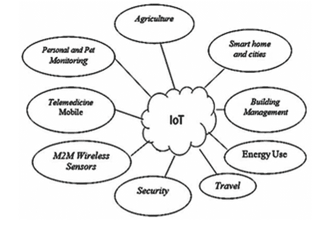

### 什么是物理信息系统（CPS）？

物理信息系统（CPSs）是通过将物理世界与网络生态系统整合，旨在带来前所未有的技术变革的大规模异构网络。与物联网类似，CPS 也有几个应用领域；美国政府的网络信息技术研究与开发（NITRD）项目强调了九个不同的领域，即农业、工业、医疗保健、制造业、交通、建筑、国防、能源和应急响应。然而，大规模可扩展性和异构性给 CPS 带来了许多跨领域挑战，包括但不限于集成、互操作性、可扩展性、可靠性、能源效率、网络安全、安全性、大数据管理、社会和经济相关方面等。为了充分利用这些创新系统，需要妥善处理这些问题。本节讨论了 CPS 的一些网络安全漏洞、此类攻击的历史和统计数据，并提出了针对这些攻击的一些可能对策。

Helen Gill 在 2006 年提出了“物理信息系统”这一术语，而“物联网”一词最早由 Kevin Ashton 在 1999 年使用。这两个术语的背景虽然不同，但它们的


各定义之间存在交叉并有许多相似之处。总的来说，CPS（信息物理系统）和 IoT（物联网）都通过促进通信和数字计算，增强物理设备/物体的能力，使它们能够与数字组件或数字世界互动（Burg 等, 2017）。CPS 概念是在将信息、计算和工程技术与传统嵌入式系统领域及机电一体化领域整合后出现的（Greer 等, 2019）。CPS 本质上是混合型的，它将计算设备与通信系统的功能相结合，旨在监控和控制物理世界的异构系统。CPS 的组件包括传感器、执行器、换能器、通信与计算系统、被控元件，有时人类也被视为组件（Wang 等, 2015）。机械和电气系统通过软件组件进行交互。这些组件的集成产生了一代新型的、具有自治理能力的智能系统，这些系统能够感知并与物理世界互动，以收集具有保证性能实时数据（Sanilsay 和 Miclea, 2012）。CPS 注定将在各种安全关键应用中发挥极其重要的作用，包括但不限于基础设施、物流、制造业、汽车、各种工业控制流程、医疗保健、建筑控制、智能电网、智慧城市等（Mosterman 和 Zander, 2016; Sabalauskite 和 Matur, 2013）。因此，CPS 和 IoT 是当今任何国家在竞争性经济中获取优势的决定性来源。

同时，CPS 在日常生活中的快速兴起也开启了不同种类网络安全风险和网络攻击的挑战之门，这些攻击可能对人类生活和环境产生令人不安的影响。这些攻击在类型、严重程度、规模和影响方面各不相同，需要积极主动、协调一致且智能的努力来应对。本章的这一部分首先概述了 CPS 的安全挑战和漏洞，然后讨论了针对 CPS 的不同网络攻击、其类别以及一些相关统计数据。最后，提出了一些针对这些网络攻击的对策。

## 物联网（IoT）中的攻击与对策

在这几年里，互联网的使用量显著增加，越来越多的人接入互联网以促进该行业的发展。然而，攻击的数量也随之增加，且攻击变得更加复杂和先进。如图 2 所示，IoT 攻击从 2017 年到 2018 年急剧增加。安全已成为一个重要问题，因为它给用户带来了很多后果。例如，2019 年 Avast 智能家居报告显示，他们扫描了全球一千六百万个智能家居网络，其中 40.8% 的数字家庭（五分之二的数字家庭）存在漏洞，容易成为攻击者的目标。对于用户来说，这可能导致隐私信息向公众披露、经济损失或重要数据丢失。如果一家流行电子商务服务器遭到攻击并关闭，公司将面临多少损失？攻击者访问并泄露了其用户的所有个人数据和所有财务数据。

IoT 的隐私和安全存在几项风险。由于服务提供商缺乏安全架构以及用户缺乏意识，IoT 的机密性常受威胁。下一项是数据不安全传输，因为该技术依赖物理设备来传输和收集数据。如果设备中存在一个漏洞，所有数据都可能被泄露。应用风险是 IoT 需要关注的另一个安全问题。应用程序只是黑客执行攻击的另一个表面，由于其弱点，可被黑客利用。

图 2。*2017 年和 2018 年的 IoT 攻击*
*（2019 年网络威胁报告）*

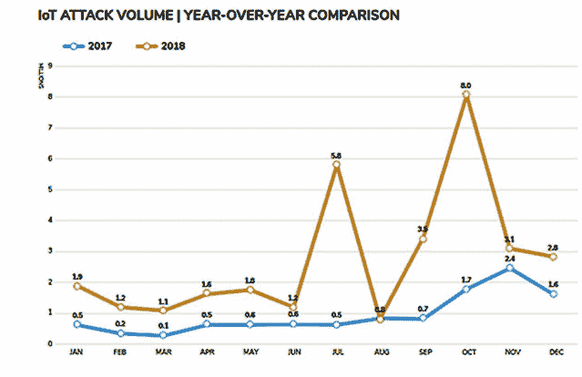

## 拒绝服务（DOS）

见图 3。

图 3。*拒绝服务（DOS）示意图*
*（Rashid, 2016）*

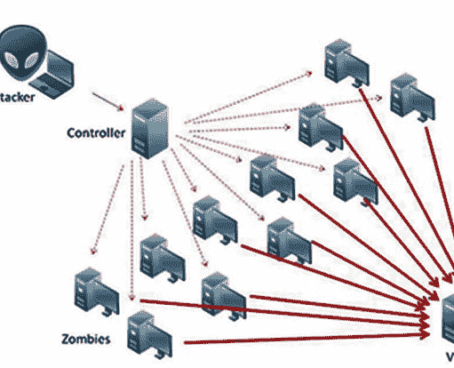

## 永久拒绝服务（PDOS）

永久拒绝服务（PDOS）攻击是指硬件因拒绝服务而遭到破坏。这种攻击通常被称为“刷写”（flashing）。自 2017 年以来，此类攻击有所上升。攻击由黑客使 IoT 设备变砖（bricking）或破坏其固件，从而使整个设备或系统失效（图 3）。如果发生这种情况，受害者别无选择，只能修复受损设备或更换设备以恢复运作。PDOS 可以通过对受害者硬件接口的远程或物理管理来实现。如果黑客决定使用固件进行攻击，那么黑客可能会寻找漏洞以替换设备的基本软件，意图修改、损坏或缺陷固件镜像。另一种攻击是过载电池或电源系统。它与分布式拒绝服务（DDOS）类似，但唯一区别在于 DDOS 通过大量传入消息和连接请求淹没目标系统，导致其变慢甚至崩溃和关闭，从而拒绝向用户或系统提供服务；而 PDOS 会损坏设备直到其无法使用，必须维修。

PDOS 通过黑客直接上传损坏的 BIOS 到设备或通过管理界面的远程管理来运作。PDOS 攻击可以在物理上执行，例如使用 USB 驱动器。helpnetsecurity.com 发布了一篇名为“USB Killer 2.0”的文章，其中名为 Dark Purple 的研究人员创建了一种 USB，它从设备本身汲取电力（Zorr, 2015）。借助电压转换器，设备的电容器被充电至 220V，并向 USB 端口释放负电流。第一次电流“烧坏”USB 端口，但此过程可以重复，直到设备不再汲取电力。这将使设备不可用，因此必须更换设备才能再次使用其服务。USB Killer 2.0 不仅限于计算机，还适用于任何具有 USB 端口的设备。有一种日益增长的担忧，如果恶意软件或机器人的远程过热设备的能力很高，设备最终可能会损坏甚至起火。

图 4 显示了全球范围内 Radware 的蜜罐在四天内容纳的 PDOS 攻击数量。在那四天中有 1,895 次 PDOS 尝试。其唯一目的是损坏并 compromising 存储和 IoT 设备。图 5 显示了那几天最初 12 小时的机器人数量。PDOS 攻击有严重后果。首先，如果攻击针对一个组织，由于所有系统都将处于离线模式，将会导致收入损失。其次是生产力损失，因为在攻击进行期间无法访问和执行任何任务。此外，组织声誉可能会受损，因为可能发生数据泄露或用户无法访问组织网站。下一后果是组织必须花费大量资金来修复所有损坏设备，如果设备全天候运行，它们可能因设备过热而有纵火风险。最后但同样重要的是，可能会有资金、知识产权和客户个人数据（如信用卡号、电话号码甚至电子邮件地址）被盗。

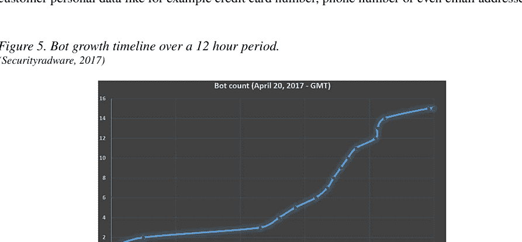

PDOS 攻击的一个例子是 2017 年 3 月 20 日发生的事件，当时发生了第一次 BrickerBot 1.0 攻击，就在同一天，在第一次攻击停止后，发生了 BrickerBot 2.0 攻击。下一个事件恰好在一个月后，发生了 BrickerBot 3.0。这被称为 BrickerBot 的复仇。BrickerBot 使用名为 busybox 的命令来攻击全球各地的 IoT 设备。Busybox 基于一个公开的 Telnet 未受保护且保留制造厂默认凭据的 Linux 设备，这些设备是潜在受害者。它与 Mirai 僵尸网络攻击类似。

## Brickerbot

BrickerBot 是一种恶意软件，它针对运行 BusyBox 工具包且 Telnet 端口开放并公开暴露的基于 Linux 的 IoT 设备。它通过使用已知默认凭据列表对设备进行暴力破解攻击。这与 Mirai 僵尸网络执行的攻击向量类似。一旦 BrickerBot 获得对易受攻击设备的访问权限，它通过部署一组旨在损坏存储、破坏互联网连接并删除设备所有文件的 Linux 命令来进行永久拒绝服务（PDos）攻击。它向存储驱动器写入随机位，使设备的闪存存储不可用，禁用 TCP 时间戳以阻碍互联网连接，停止所有内核


操作，随后重启设备。感染后几秒钟内，目标设备将停止工作，受害者只剩下两个选择：重新安装固件或更换设备。图6展示了2016年Brickerbot攻击的流行程度。网络安全公司Radware在2017年3月20日起的四天内，其蜜罐系统遭受了1,895次PDoS（物理拒绝服务）尝试时发现了Brickerbot。Radware指出了两个BrickerBot变种——BrickerBot.1和BrickerBot.2。BrickerBot.1的攻击源自全球各地的IP地址，且似乎被分配给了运行旧版Dropbear SSH服务器的Ubiquiti网络设备。BrickerBot.2是该恶意软件的更高级版本。它执行额外的命令，并且由于流量被Tor出口节点掩盖，攻击来源难以追踪。

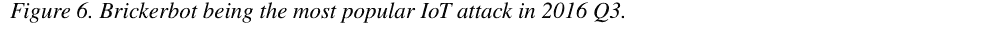

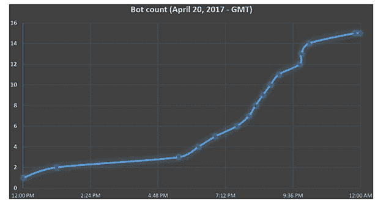

针对BrickerBot最有效的对策是更改并强化设备的默认凭据，以降低其遭受未授权访问的易感性。还应考虑禁用诸如远程管理功能（如Telnet——BrickerBot已知会利用此功能）等组件。除此之外，企业和最终用户可以通过保持设备及其固件更新来防止BrickerBot“砖化”其物联网设备，从而修补可被用作进入设备入口点的漏洞。在网关中部署入侵预防系统（IPS）也可以通过检测和阻止网关中的入侵行为，提供额外的安全层。IT管理员和信息安全专业人员还应主动发现其组织网络内的可疑或恶意活动。

## Mirai 僵尸网络

僵尸网络（Botnet）是由攻击者攻陷的互联互联网设备集合。僵尸网络充当个体攻击者、网络犯罪组织和旨在破坏或入侵其目标系统的国家行为者的力量倍增器。僵尸网络常用于分布式拒绝服务（DDoS）攻击，还可以利用其集体计算能力发送大量垃圾邮件、大规模窃取凭据，或监视个人和组织（Korolov, 2019）。Mirai已感染超过380,000台设备，图7展示了Mirai攻击按地理分布的影响。

为了对抗Mirai攻击，蜜罐（Honeypot）是一种故意开放让攻击者渗透和感染的系统。这使得安全研究人员能够研究其行为。专注于该技术的安保公司Cymmetria在Github上发布了一个专为Mirai僵尸网络设计的开源蜜罐。在该公司标记了暗网上的一个人肉搜索服务后，我们采访了Cymmetria。互联网风暴中心（Internet Storm Center）将使用此蜜罐来防范Mirai，包括其未来的迭代版本（Dale, B., & Dale, B. 2018）。

防止PDoS攻击的对策是发展对组织环境中使用的独特固件适应、并行处理、芯片级编程（如ASIC和FPGA）以及创新的合理理解。下一个对策是确保考虑到电池、电源和风扇系统的漏洞。此外，为防止物理攻击，确保设备对外部人员不可访问，或为设备使用者设置权限级别。此外，应禁用设备上的Telnet。

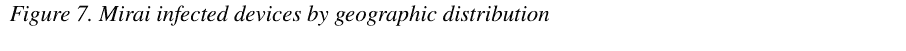

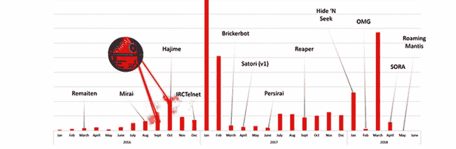

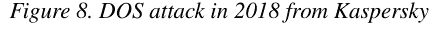

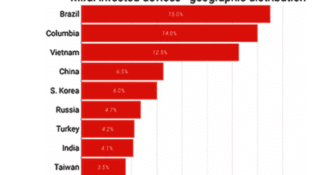

## 去认证攻击

去认证攻击（Deauthentication Attack）是一种拒绝服务攻击（DoS）类型，旨在使物联网设备与接入点断连。例如，当此攻击在智能工业中执行时，物联网设备将被接入点强制断连，从而无法向网络传输数据以供进一步分析（Noman et al. 2015）。入侵者会伪造一个去认证帧，并将其传输给物联网设备或接入点，以导致WLAN网络中处于断连状态。对于智能工业而言，物联网设备从网络断开连接可能会导致整个工业生产流程停摆，或导致设备不遵循指令，从而造成一些意外的损害。

从图8可以看出，2017年DoS攻击的百分比在每个会话中均稳定在100%。2018年，我们可以看到Q1会话为83.30%，Q2会话下降至75.50%，Q3会话增加至132.40%，但最重要的是在Q3会话中，百分比增加到了500%。

## 女巫攻击（Sybil Attack）

女巫攻击可以由攻击者通过窃取身份或创建伪造身份来进行（Rajan et al. 2017）。当IOT设备无法区分每个节点的唯一身份时，就会触发女巫攻击。通过女巫攻击，攻击者可以使用伪造身份加入IOT设备网络。女巫攻击通过执行自私行为（如丢弃某些数据包或伪造某些假数据包）会影响网络中的数据完整性。对于缓解措施，最著名的防御机制之一是Sybil Defender（Rajan et al. 2017）。Sybil Defender分为两部分：Sybil识别算法和Sybil社区检测算法。Sybil识别算法将IOT设备的节点标记为诚实节点或可疑节点。检测到Sybil节点后，Sybil社区检测算法将被运行以检测周围的Sybil节点。Sybil Defender始终考虑两条规则。首先，诚实节点与Sybil节点之间的链接是有限的。其次，诚实社区的规模始终大于Sybil社区的规模。

## 中间人攻击

中间人（MITM）攻击（图9）是指第三方或外部实体在受害者之间的双向通信中进行的拦截。这可能发生在任何平台的任何人身上，例如电子邮件、社交媒体、网页浏览、应用程序、物联网设备，甚至Wi-Fi窃听。MITM攻击不仅用于窃听，还用于窃取受害者的个人信息。举例来说，黑客位于受害者及其访问的社交媒体网站之间，以拦截和捕获受害者提交给该网站的任何数据，例如密码和用户名。

有几种类型的MITM攻击。第一种是电子邮件劫持，黑客使用此策略针对大型组织的电子邮件账户。一旦获得对所有重要电子邮件账户的访问权限，黑客将监视交易，以使他们的攻击更具影响力。接下来是Wi-Fi窃听，黑客使用Wi-Fi连接，首选公共网络，如机场和咖啡店。黑客会设置一个名称听起来可信的Wi-Fi连接。然后他们等待潜在受害者连接，并立即访问已连接的设备。

下一种类别是会话劫持，受害者登录到网站，计算机与网站之间建立连接。黑客通过窃取受害者的浏览器Cookie来劫持与该网站的会话。Cookie是存储少量信息以简化网页浏览的地方。它可以预填充表单、记录在线活动，在某些情况下还可记录受害者的位置。

另一种类型的攻击是利用安全套接层（SSL）或传输层安全性（TLS）在不安全的网络上创建安全通道。攻击从使用HTTP上的SSL（也称为HTTPS）开始，因为它是最常见的SSL。黑客拦截客户机（cli-

*图9. MITM攻击的一个示例。*
*(Cekerevac, 2017)*

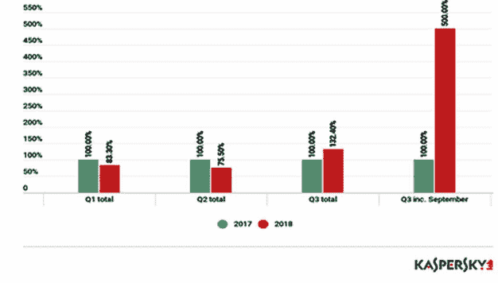

*图10. MITM攻击的类型*

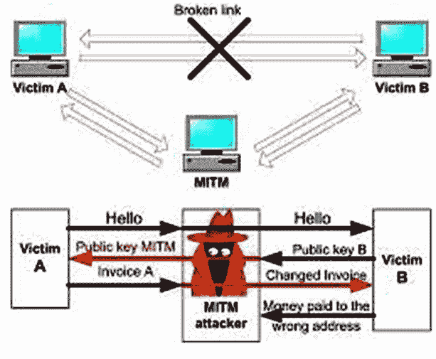


以及 web 服务器。当找到 HTTPS 网址时，sslstrip 会将其替换为 HTTP 链接，并保留变更的映射关系。发起攻击的机器向 web 服务器提供证书，并冒充客户端，从而从安全网站接收流量并将其回传给客户端。

如图 10 所示，2016 年发生了两种类型的中间人攻击：浏览器漏洞（36%）和 SSL（11%）。2017 年仅有一种攻击，即浏览器漏洞（20%）。我们可以看到，浏览器的易受攻击性正在降低。中间人攻击的后果是，受害者的所有个人信息都可能被黑客读取，并可能以各种方式伤害受害者。另一个后果是，发送或接收的数据可能会被黑客篡改。

2015 年 7 月发生了一起事件，两名黑客因某款 Jeep Cherokee 的安全防护缺陷而夺取了该车的控制权。这两名黑客通过克莱斯勒（该车的制造商）的 Wi-Fi 连接，入侵了该车的多媒体系统。事实证明，Wi-Fi 之所以被攻破，是因为在车辆和多媒体系统首次启动时，密码是自动生成的。在连接到该单元后，这两名黑客能够入侵运行 Linux 操作系统的多媒体计算机。他们可以控制音乐播放器、调整收音机设置，并可以根据车辆 GPS 追踪车辆位置。

中间人攻击也成为物联网网络中著名的攻击方式，因为这种攻击允许入侵者从行业收集信息（Aziz and Haq, 2018）。攻击者无需实际出现在网络位置，只需使用物联网的通信协议干扰两个传感器节点，从而获取机密信息。中间人攻击还可以在数据从物联网传输到网络的过程中改变数据值。这可能导致行业从物联网设备接收错误的信息或数据，从而做出错误的分析和决策。根据 IBM X-Force 2018 年威胁情报指数，35% 的利用活动涉及攻击者尝试中间人攻击（图 11）（Dobran, 2019）。

### 图 11. 来自 IBM 威胁指数的针对意外弱点的利用类型


防止物联网中间人攻击的对策是确保使用数字证书来建立 VPN，从而对两个或多个设备之间的通信进行加密，无论信息是传入还是传出。VPN 需要数字证书，在此之后，设备与每个通信对象都需要使用公钥和私钥进行认证。在通信过程中，所需的密钥在握手中交换，所有信息保持加密状态，直到到达其最终目的地。下一个对策是使用强大的加密标准，如高级加密标准（AES），来加密从物联网传输到网络的数据，允许服务器认证客户端，然后验证客户端的数字证书。验证成功后，客户端和服务器才能建立连接。物联网设备制造商在设计和制造设备并投放市场之前，必须考虑到身份识别和认证。除此之外，还可以使用入侵检测系统来监控和分析流量模式，以识别异常行为。

## 通用异步收发器（UART）访问攻击

通用异步收发器（UART）也称为 UART，是一种串行通信协议。在图 12 中，红圈显示了设备中 UART 引脚的一个示例。这是一种物理层攻击。由于 UART 是异步的，因此在与另一台设备通信时不使用时钟。在传输数据包时，应格外小心以防止数据包丢失。攻击者可以使用 UART 通过串行电缆连接物理访问和修改物联网设备，以绕过正常的认证。UART 接口通常授予 root 访问权限，远超普通客户端的权限。

*图 12. 通用异步收发器（UART）*

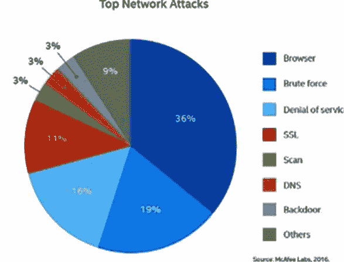

UART 被用于设备的“越狱”或“获取 root 权限”。这可能导致某些漏洞，进而引发攻击。像 UART 这样的物联网设备如果被篡改或被修改，会显示出证据。黑客在尝试访问 UART 控制台时采取的第一步是找到电路板上的三个连接：RX、TX 和 GND。找到这三个连接后，将设备连接到排针上。接下来，黑客使用逻辑分析仪，例如 Saleae 产品。它使用解码协议分析异步串行通信。一旦 UART 连接被激活和识别，就可以从黑客的桌面操作系统连接到目标设备的界面。

图 13 显示了 2017 年的统计数据，物理篡改占物联网相关漏洞类型的 7%。这是两年来的统计数据。2016 年发生了一起事件，由于 UART 访问攻击，Wi-Fi 婴儿心率监护器被攻破（Garlali, 2016）。该设备在婴儿袜子上装有传感器，用于监测婴儿的心跳，并将数据无线传输到附近的集线器。如果婴儿的心率出现异常，消息将发送给婴儿的父母。UART 访问的后果是，它可作为设备上的调试接口，用于查看串行日志，攻击者可能会获得 shell 或 root shell 访问权限。一旦攻击者获得 root shell 访问权限，他们就可以逆向工程固件并获取敏感信息。他们还可以获取存储的 API 密钥，并识别目标设备的通信协议。这将使他们能够针对其他设备或组织。该设备的代码没有软件更新机制来修复此问题。它非常脆弱，容易被攻击者入侵。UART 访问的对策包括启用密码以保护设备

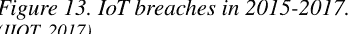

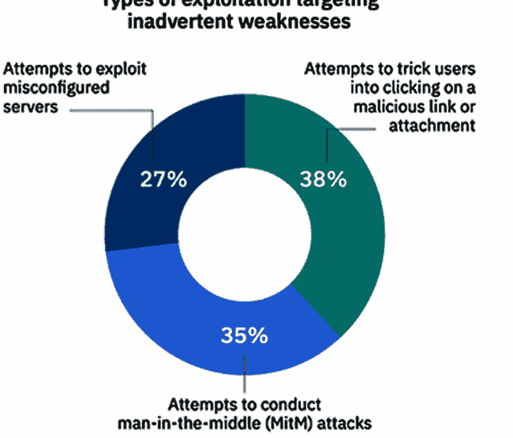

不被黑客入侵。下一个对策是使用另一个芯片阻止 UART 访问，以防止黑客利用该设备。

## Stuxnet

Stuxnet 是一种极其复杂的计算机蠕虫，它利用多个先前未知的 Windows 零日漏洞来感染计算机并传播。其目的不仅是感染 PC，还要造成现实世界中的物理影响。具体而言，它针对用于生产浓缩铀（核武器和反应堆的动力来源）的离心机。Stuxnet 最初由信息安全社区在 2010 年的攻击后识别，如图 14 所示，但其开发可能始于 2005 年。尽管其传播能力无与伦比且感染率广泛，Stuxnet 对未参与铀浓缩的计算机造成的损害很小或没有损害。当它感染计算机时，它会检查该计算机是否连接到由西门子制造的特定制程逻辑控制器（PLC）。PLC 是计算机与离心机、铀浓缩机等工业机械交互和控制的方式。然后，蠕虫修改 PLC 的编程，导致离心机旋转过快且时间过长，在此过程中损坏或摧毁精密设备。在此期间，PLC 告诉控制计算机一切运行正常，使得在过晚之前难以检测或诊断出哪里出了问题（Frühlinger, J. 2017）。

图 14. 2010 年 Stuxnet 感染主机按国家分布。

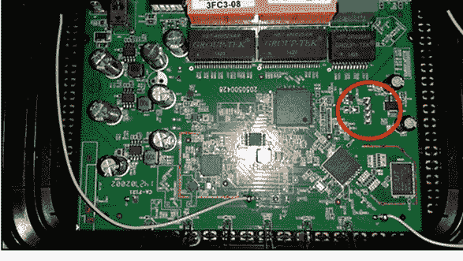

为了防止 Stuxnet 攻击，事件日志不应在生成日志的同一设备上执行，而应将相同的日志写入单独的设备，以便进行事前和事后分析。这也有助于最小化攻击者“隐藏踪迹”或篡改系统日志的可能性。安全信息和事件管理（SIEM）系统正是为此目的设计的，无论控制系统网络上的其他系统受到何种攻击，它都会安全地维护审计跟踪（Joel Langill, 2010）。


## 蠕虫攻击

蠕虫与病毒相似，它们自我复制，并可能对设备或系统造成相同类型的损害（Edwards and Protettis, 2016）。入侵者会扫描网络，以查看工业物联网（IoT）设备中哪些端口是开放的。由于物联网设备没有防止或检测网络攻击的安全层，入侵者可以轻易地将蠕虫传播到工业物联网设备中。当特定的蠕虫成功进入物联网系统时，它不仅可能损坏整个物联网设备，还可能抹除固件。

图 15 展示了网络攻击的类型。我们可以看到，网络攻击种类繁多，包括浏览器攻击、拒绝服务攻击以及蠕虫攻击。在 8 种网络攻击中，蠕虫攻击占比 13% 以上。基本上，为了防止遭受蠕虫攻击，最好更新防病毒软件，使软件具备识别最新蠕虫行为的能力，从而将蠕虫从系统中清除。此外，用户应避免使用公司计算机打开垃圾邮件或浏览器。（Deogirikar and Vidhate, 2017）。

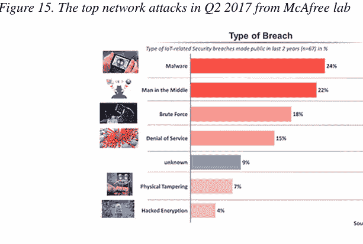

## 黑洞攻击

第一种攻击是黑洞攻击，也称为沉洞攻击（Sinkhole Attack）（Ali et al., 2018）。如图 16 所示，攻击者将试图在受害者网络附近创建一个恶意节点。然后，该恶意节点向其他节点广播错误信息。恶意节点会试图引诱其他节点通过它发送数据。恶意节点会声称自己是到达目的地的最短路径。随后，各节点会将所有数据包发送给该恶意节点。然后，恶意节点会丢弃这些数据包，而不是将它们重定向到目的地。

黑洞攻击被分为两类：单黑洞攻击和协同黑洞攻击（Ali et al., 2018）。单黑洞攻击是使用单个恶意节点对受害者进行攻击。而协同黑洞攻击则是使用多个恶意节点来执行黑洞攻击。协同黑洞攻击比单黑洞攻击危险得多，因为与仅使用单个节点相比，网络吞吐量和节点电量会受到更大程度的影响。

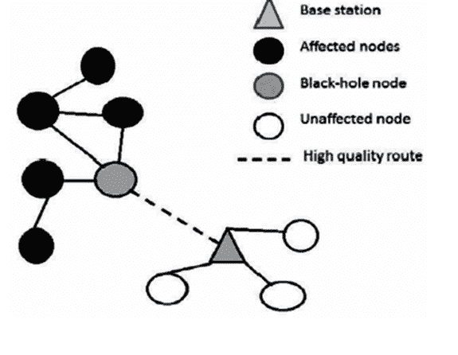
图 16. 黑洞攻击（Alattas, 2016）

Alattas 在 2016 年提出了一种对抗黑洞攻击的方案，该方案使用多个基站和检查代理来检测黑洞攻击。系统中的每个节点都维护一张邻居节点表。检查代理（网络中的特殊节点）也被添加到网络中。检查代理将尝试监控这些节点的传入和传出数据包。一旦检测到某个节点的传入和传出流量为零，该节点就会被标记为可疑节点。然后，多个基站的算法将被执行。数据包或路由请求会被发送给这些可疑节点。如果可疑节点在限定时间内未回复，该节点将被标记为恶意节点。随后，该恶意节点将被踢出系统。带有检查代理的结果在消息复杂度方面显示出良好的表现（图 17）。

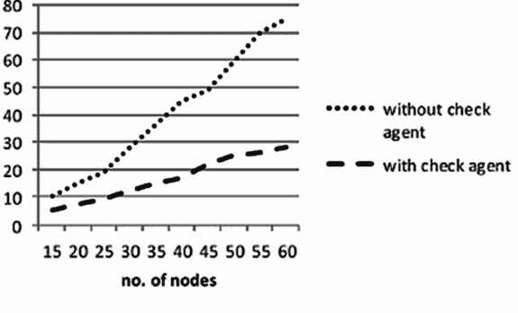
图 17. 消息复杂度与节点数量（Alattas, 2016）

## 能量耗尽攻击

如图 18 所示，能量耗尽攻击（Energy Drain Attack, EDA）主要是针对电源有限的移动设备实施的电池耗尽攻击（Nguyen, 2019）。EDA 攻击的真实动机是通过让设备反复运行一些能耗极高的程序来耗尽受害者的电池。攻击者可以执行攻击，并针对受害者在系统中承担重要角色的一些传感器实施攻击。EDA 攻击的影响令人困扰，因为那些传感器节点通常部署在难以到达的偏远地点，例如森林中或山上。这可能导致因更换电池而产生的维护成本增加。

最常见的 EDA 攻击之一是通过广播向受害者节点发送伪造数据包（Nguyen, 2019）。诸如充满无用数据的加密数据等伪造数据包可能导致受害者执行一些不必要的处理，例如签名认证。受害者节点将浪费大量能量来处理那些甚至可能无法通过完整性测试的伪造数据包。攻击者可能对 EDA 采取不同的策略，有些人喜欢在短时间内耗尽能量，而有些人则希望缓慢地耗尽受害者的电池以避免被检测到。

缓解 EDA 最有效的方法是进行设备固件或软件更新（Nguyen, 2019）。一旦部署了最新版本的固件，就应更新固件以防止 EDA 攻击。此外，保护物联网设备的数据帧头也是缓解 EDA 的最佳方式之一。这可能有助于防止利用发送加密无用数据包进行签名验证，从而避免在那些不必要的验证任务中耗尽电池。

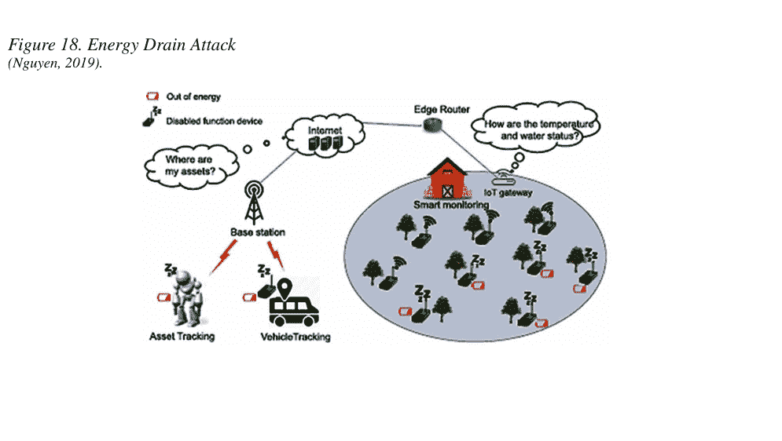

## 信息物理系统（CPS）中的攻击与对策

除了集成、异构性、互操作性、可扩展性、可靠性、复杂性、资源共享、分布式管理与控制、功耗、大数据管理等诸多问题外，CPS 还面临若干安全和隐私相关的挑战 [6 - 10]。其中一些挑战包括：

- 由于大规模、分布式和地理分散的 CPS 所带来的物理安全问题
- 认证与强加密
- 对资源的未授权访问
- 受损或热点节点
- 由于大规模 CPS（如电网）被多个运营者共享、访问和管理而产生的多租户问题
- 未知的肇事者和多个攻击点
- 未指定或定义不良的信息流、控制流和访问流机制
- 服务中断或终止
- 利用软件漏洞

保护各种类型的设备免受未授权访问非常重要，以确保它们能正常运行。通过使用强大的安全机制，我们可以保护服务、通信路径、存储资源、计算组件及其他硬件系统 [10]。CPS 的可靠性可以通过自主和智能控制方法来解决，这些方法能够处理受损或热点节点，并防止任何破坏 CPS 功能的阴谋。一种节能且主权的入侵检测系统（IDS）可能有助于收集有关此类阴谋和可疑情况的资料和数据，并对收集到的信息进行分析（Sadeghi et al., 2015）（Giraldo et al. 2018）。收集信息的例子包括本地节点或整个网络的日志文件，以及设备之间通信数据的记录。数据分析机制高效地审计收集到的信息，并为任何未来的响应生成有意义的报告或模式（Mitchell and Chen, 2014）。

## 针对 CPS 的网络攻击

一般而言，网络攻击分为主动攻击和被动攻击。在主动攻击中，入侵者直接攻击数据并对其进行修改；而在被动攻击中，入侵者监控数据或用户行为，并不立即修改数据。然而，随着时间的推移，大多数被动攻击会转变为主动攻击。基于网络的攻击包括窥探、数据篡改、重放、欺骗、拒绝服务、嗅探器、应用层攻击等（Mitchell and Chen, 2014）。

- **密码学攻击：** 在密码学攻击中，攻击者识别安全系统的弱点，即密码、密钥管理设计、密码协议、操作系统或安全算法中的弱点。密码学攻击包括选定明文、加密锁、选定密文和密钥、暴力破解攻击、识别明文和密文等（Giraldo et al., 2018）。
- **网络威胁：** 网络威胁也被称为恶意团体。在这类攻击中，攻击者试图找到信息物理系统中受保护方案的弱点，意图破坏系统的集成。存在各种类别的网络攻击。它们可以


源于地震、断层线、硬件故障、洪水、电磁干扰和泄漏等关键来源（Singh 和 Jain, 2018）。

- **恶意软件：** 在此类攻击中，入侵者可以窃取网络信息并绕过 CPS（信息物理系统）的访问控制。该攻击的核心目的是破坏宿主系统。此类攻击的例子包括广告软件、间谍软件、网络钓鱼、僵尸网络、特洛伊木马、病毒、黑客和蠕虫等（Beek 等, 2017）。
- **欺骗（欺诈）：** 攻击者可以通过改变数据采集设备的工作特性或行为来对系统实施欺诈。这些攻击也被称为虚假数据注入、隐蔽性欺骗和秘密攻击（Abomhara, 2015）。
- **拒绝服务：** 拒绝服务攻击可能通过干扰通信系统的信道来进行操作，导致资源不可访问（Mitchell 和 Chen, 2014）。
- **重放攻击：** 在此类攻击中，入侵者捕获并记录网络收集的数据，然后故意重复发送相同的数据（Singh 和 Jain, 2018）。
- **韧性控制问题：** 此类攻击基于人为因素的参与。在此类攻击中，对手可以破坏网络为通信目的生成的控制数据包（Giraldo 等, 2018）。

## CPS 中的漏洞识别

安全策略、规则、系统组织、战略或硬件/软件方面的任何其他问题中的弱点都可能导致 CPS 的漏洞。CPS 的这一弱点为攻击者入侵系统和损害其效率敞开了大门。CPS 系统的漏洞根据硬件、平台、网络、软件和管理漏洞等不同因素而有所差异（Singh 和 Jain, 2018）。在检测网络中的网络攻击方面，CPS 和 ICT（信息通信技术）之间存在若干差异。在 ICT 中，监控活动基于主机/网络层面的活动、用户触发、非零日攻击，且不涉及遗留组件及用户/机器活动。CPS 活动基于设备行为、时间驱动、零日攻击及遗留技术（Albright 等, 2014）。

基本上，CPS 使用两种基于知识和行为的检测技术来识别网络攻击。一些研究人员还将行为规范定义的技术定义为基于行为技术的子部分。基于知识的技术查找特定的预定义模式匹配。然而，这种技术不适合检测新型网络攻击。基于行为的技术不寻找特定模式，因此其检测新型网络攻击的机会更大，但也存在假阳性的漏洞（Abomhara, 2015）。如今，由于网络攻击率不断增加，安全和隐私成为消费者和企业之间的重要关注点。有许多研究小组专注于为 CPS 的所有利益相关者提供可接受的隐私保护（Mitchell 和 Chen, 2014）。

## CPS 网络攻击的对策

设计网络安全措施、机制、流程和协议以保护 CPS 系统、网络、数据、物理及通信资源，并避免未经授权访问系统组件的需求日益增长。下面讨论了一些基于层级的安全措施（Singh 和 Jain, 2018）。

## 物理层的网络安全措施

在物理层，信息物理系统的主要关注点是不同设备的物理安全，即传感器、执行器和射频识别设备。管理员/用户必须考虑以下针对 CPS 抵御网络攻击的建议指令，即数据备份系统与恢复计划、用户意识、定期分析与监控流量、访问控制、灾难保护、追踪恶意活动以及限制本地管理权限等（Huang 等, 2015）。

## 传输层的网络安全措施

此层的目的是保护通信流量和系统。点对点加密保证了数据的保护。通过端到端机制获得端到端机密信息。安全机制包括密钥管理、安全协议、防火墙和身份验证（Giraldo 等, 2018）。

## 应用层的网络安全措施

此层的主要目的是对信息物理系统执行决策。该层对 CPS 的安全性产生影响，因为许多应用具有其自身的威胁。以下是该 CPS 层的一些安全措施：更新访问控制策略、部署检测和身份验证流程、安全支付协议和安全 HTTP（Singh 和 Jain, 2018）。

## 结论

近年来，物联网（IoT）和 CPS 已成为热门话题。物联网和 CPS 是 4.0 工业的主要资产，因此许多公司仍在努力保护其网络和服务，尽管结果并不令人满意。简而言之，物联网存在许多需要尽快解决的安全缺陷。在本文中，我们介绍了物联网、工业物联网（IIoT）和 CPS 及其可能给用户和行业带来后果的攻击。例如，DNS 洪水、鱼叉式网络钓鱼、SQL 注入、勒索软件、ARP 欺骗、永久拒绝服务（PDOS）、中间人攻击、UART 访问攻击和后门攻击。提供了统计数据以证明这些攻击的出现及其重要性。还讨论了可能的对策和政策，以减轻或防止这些攻击。这些攻击的后果对受害者非常有害。某些攻击甚至可能毁掉个人或组织的声誉。如果有人具备实施这些攻击的知识，他们绝不应滥用它，而应遵守伦理规范。

## 参考文献

- Abomhara, M. (2015). Cyber security and the internet of things: Vulnerabilities, threats, intruders and attacks. *Journal of Cyber Security and Mobility*, 4(1), 65–88. doi: 10.13052/jcsm2245-1439.414
- Alattas, R. (2016). Detecting black-hole attacks in WSNs using multiple base stations and check agents. In *2016 Future Technologies Conference (FTC)* (pp. 1020-1024). IEEE. doi: 10.1109/FTC.2016.7821728
- Albright, D., Brannan, P., & Walrond, C. (2010). *Did Stuxnet take out 1,000 centrifuges at the Natanz enrichment plant?* Institute for Science and International Security.
- Ali, S., Khan, M. A., Ahmad, J., & Malik, A. W., & ur Rehman, A. (2018). Detection and prevention of Black Hole Attacks in IOT & WSN. In *2018 Third International Conference on Fog and Mobile Edge Computing (FMEC)* (pp. 217-226). IEEE. 10.1109/FMEC.2018.8364068
- *Avast smart home security report*. (2019). Avast.
- Beek, C., Frost, D., Greve, P., Gund, Y., Moreno, F., Peterson, E., & Tiwari, R. (2017). *Mcafee labs threats report*. McAfee. Santa Clara, CA: Tech. Rep.
- BrickerBot Malware Emerges. (n.d.). *Permanently Bricks IoT Devices*. Retrieved from https://www.trend micro.com/vinfo/us/security/news/internet-of-things/brickerbot-malware-permanently-bricks-iot-devices
- Burg, A., Chatterpadhyay, A., & Lam, K. Y. (2017). Wireless communication and security issues for cyber-physical systems and the Internet-of-Things. *Proceedings of the IEEE*, 106(1), 38–60. doi:10.1109/ JPROC.2017.2780172
- Cekerevac, Z., Dvorak, Z., Prigoda, L., & Cekerevac, P. (2017). *Internet of Things and The Man-In the-Middle Attacks – Security and Economic Risks*. MEST Journal. doi:10.12709/mest.05.05.02.03
- Dale, B., & Dale, B. (2018, January 22). *Three Whitehat Countermeasures to the Botnet Threat*. Retrieved from https://observer.com/2016/11/mirai-bestbuy-popopret-imperiva-cymmetria-virgil-security-spiffy/
- Deogirankar, J., & Vidthate, A. (2017, February). Security attacks in IoT: A survey. In *2017 International Conference on I-SMAC (IoT in Social, Mobile, Analytics and Cloud) (I-SMAC)* (pp. 32-37). IEEE. 10.1109/I-SMAC.2017.8058363
- Dobran, B. (2019). *The Ultimate Guide to Man in the Middle Attacks: Prevention is Key*. Retrieved from https://phenixnap.com/man-in-the-middle-attacks-prevention
- Edwards, S., & Prophet, I. (2016). Hajime: Analysis of a decentralized internet worm for IoT devices. *Rapidity Networks*, 16.
- Frühlinger, J. (2017). *What is Stuxnet, who created it and how does it work?* Retrieved from https://www. csoonline.com/article/3218104/what-is-stuxnet-who-created-it-and-how-does-it-work.html
- Garlati, Z. (2016). *Owlet Baby Wi-Fi Monitor “Worst IoT Security of 2016”*. Retrieved from: https:// www.informationsecuritybuzz.com/expert-comments/owlet-baby-wi-fi-monitor-worst-iot-security-2016/


Giraldio, J., Urbina, D., Cardenas, A., Valente, J., Faisal, M., Ruths, J., ... Candell, R. (2018). A survey of physics-based attack detection in cyber-physical systems. *ACM Computing Surveys*, 51(4), 76. doi:10.1145/3203245 PMID:31092968

Greer, C., Burns, M., Wollman, D., & Griffor, E. (2019). Cyber-Physical Systems & the Internet of Things. *NIST Special Publication*, 202, 2019.

Huang, S., Zhou, C. J., Yang, S. H., & Qin, Y. Q. (2015). Cyber-physical system security for networked Industrial processes. *International Journal of Automation and Computing*, 12(6), 567–578. doi:10.1007/s11633-015-0923-9

IIOT. (2017). *物联网安全市场报告 2017-2022 概览*. 取自：https://iiot-world.com/reports/an-overview-of-the-iot-security-market-report-2017-2022/

Korolov, M. (2019). *什么是僵尸网络？当被感染的物联网设备大军发起攻击时*. 取自：https://www.csoonline.com/article/3240364/what-is-a-botnet.html

Langill, J., & Mitigation, S. (2010, November 17). *需要纵深防御*. 取自：https://issource.com/stuxnet-mitigation-defense-in-depth-needed/

Letsisoalo, E., & Ojo, S. (2017). 无线网状网络中的会话劫持攻击：现有缓解技术综述。收录于 *2017 年 IST-Africa 周会议 (IST-Africa)* (第 1-9 页)。IEEE。doi:10.23919/ISTAFRICA.2017.8102284

Mitchell, R., & Chen, I. R. (2014). 信息物理系统入侵检测技术综述。*ACM Computing Surveys*, 46(4), 55. doi:10.1145/2542049

Mosterman, P. J., & Zander, J. (2016). 工业 4.0 作为信息物理系统研究。*Software & Systems Modeling*, 15(1), 17–29. doi:10.1007/s10270-015-0493-x

Nguyen, V. L., Lin, P. C., & Hwang, R. H. (2019). 低功耗无线网状网络中的能量耗尽攻击。*IEEE Access: Practical Innovations, Open Solutions*, 7, 51915–51932. doi:10.1109/ACCESS.2019.2911424

Noman, H. A., Abdullah, S. M., & Mohammed, H. I. (2015). 一种自动检测无线 802.11 网络中去认证和解关联 DoS 攻击的方法。*International Journal of Computer Science Issues*, 12(4), 107.

Pasqualetti, F., Dörfler, F., & Bullo, F. (2013). 信息物理系统中的攻击检测与识别。*IEEE Transactions on Automatic Control*, 58(11), 2715–2729. doi:10.1109/TAC.2013.2266831

Ponnumasy, V., Jhanjhi, N. Z., & Humayun, M. (2020). 促进公私合营：政府与技术人员之间在制定国家网络安全框架方面的合作。收录于 *Empower Digital Governance* (第 237–255 页)。IGI Global。doi:10.4018/978-1-7998-1851-9.ch012

Ponnumasy, V., Selvam, L. M. P., & Rafique, K. (2020). 社交工程意识的网络安全治理。收录于 *Empower Digital Governance* (第 210–236 页)。IGI Global。doi:10.4018/978-1-7998-1851-9.ch011

Rajan, A., Ithiish, J., & Sankaran, S. (2017). 物联网中的 Sybil 攻击：建模与防御。收录于 *2017 年计算、通信和信息学进展国际会议 (ICACCI)* (第 2323-2327 页)。IEEE。doi:10.1109/ICACCI.2017.8126193

Rao, T. A. (2018). 物联网各层面临的安全挑战及其保护措施。*International Journal of Computers and Applications*, 975, 8887.

Rashid, F. Y. (2016). *NTP 修复拒绝服务漏洞*. 取自：https://www.infoworld.com/article/3144471/security/ntp-fixes-denial-of-service-flaws.html

Sabaliauškite, G., & Mathur, A. P. (2013). 改善信息物理系统攻击检测的智能检查器。收录于 *2013 年基于网络的分布式计算和知识发现国际会议* (第 27-30 页)。IEEE。doi:10.1109/CyberC.2013.14

Sadeghi, A. R., Wachsman, C., & Waidner, M. (2015). 工业物联网中的安全与隐私挑战。收录于 *2015 年第 52 届 ACM/EDAC/IEEE 设计自动化会议 (DAC)* (第 1-6 页)。IEEE。doi:10.1145/2744769.2747942

Sanislav, T., & Miclea, L. (2012). 信息物理系统：概念、挑战与研究领域。*Journal of Control Engineering and Applied Informatics*, 14(2), 28–33.

Securityradware. (2017). *BrickerBot PDoS 攻击：卷土重来*. 取自：https://security.radware.com/ddos-threats-attacks/brickerbot-pdos-back-with-vengeance/

Selvam, L. M. P., Ponnusamy, V., & Rafique, K. (2020). 民主治理：安全数字选举服务基础设施综述。收录于 *Empower Digital Governance* (第 256–272 页)。IGI Global。doi:10.4018/978-1-7998-1851-9.ch013

Singh, A., & Jain, A. (2018). 信息物理系统的网络攻击研究。收录于 *第 3 届物联网与连接技术国际会议论文集 (IcIoTCT)* (第 26-27 页)。doi:10.2139srn.3170288

Wang, L., Törngren, M., & Onori, M. (2015). 制造业中信息物理系统的现状与进展。*Journal of Manufacturing Systems*, 37, 517–527. doi:10.1016/j.jmsy.2015.04.008

Yampolskiy, M., Horvath, P., Koutsoukos, X. D., Xue, Y., & Szpitanovits, J. (2012). 信息物理系统网络攻击的系统分析 - 评估基于 DFD 方法的适用性。收录于 *2012 年第 5 届容错控制系统国际研讨会* (第 55-62 页)。IEEE。doi:10.1109/ISRCS.2012.6309293

Zorz, Z. (2015). *USB Killer 2.0：一款外表无害但能摧毁计算机的 U 盘*. 取自：https://www.helpnetsecurity.com/2015/10/15/usb-killer-20-a-harmless-looking-usb-stick-that-destroys-computers/

## 第 2 章

# 物联网（IoT）与基于 PKI 的安全架构

**Sandeep Mathur**
Amity 信息技术学院，Amity 大学，印度新德里

**Ankita Arora**
Amity 信息技术学院，Amity 大学，印度新德里

## 摘要

物联网（IoT）被描述为物理物品（如设备、汽车、建筑物和其他事物）的集合，这些物品配备了传感器、软件、设备以及网络访问能力，使其能够收集和交流数据。无论处于何种行业，物联网预计将在未来几十年内成为影响基本商业逻辑的最重要因素之一。PKI 是服务提供商保护数据和关联设备的最佳选择。当成功实施时，PKI 可以构建并支持物联网生态系统中的安全性和信任。PKI 在物联网中的作用提供了强大的身份验证，并建立了信任基础，使系统、设备、应用程序和用户能够安全地连接和交换敏感信息。PKI 以及由此产生的信任网络满足了物联网运营所需的基本安全需求，提供了加密、认证和数据完整性，从而建立信任基础。本章探讨基于 PKI 的安全架构。

## 引言

物联网（IoT）被描述为物理物品、设备、汽车、建筑物和其他事物的集合，这些物品配备了硬件、软件设备以及网络访问能力，使其能够收集和交流数据。无论处于何种行业，物联网预计将在未来几十年内成为影响基本商业逻辑的最重要因素之一。物联网网络是一种由相互连接的处理器组件、机械和虚拟技术、物品、生物或人组成的结构，它们通过精确的属性以及通过无人类参与或非人与系统交互的网络分配信息的能力而得到增强。它可以是一个带有心率监测器的特定对象，一个带有微芯片电气设备的农场动物，或者一个装备了警报思维功率模式的汽车，一个可以被分配 IP 地址并能够通过网络切换记录的物体。逐渐地，分布在各行业的企业利用物联网更高效地运行，以更多捕获客户、提供卓越的客户服务、改进决策制定以及降低业务成本。在麻省理工学院建立“自动 ID 中心”的 Kevin Ashton 首次提出“物联网”的概念，这是在 1999 年与宝洁公司（P&G）合作完成的。为了将无线射频识别技术带入 P&G 老一辈社群的概念，物联网是新的呈现方式，Ashton 于 1999 年赋予这个酷炫新例子的名称。麻省理工学院讲师 Neil Gershenfeld 的书《当事物开始思考》，也是在 1999 年出版的，虽然没有使用确切的术语，但提供了一个理想的愿景，即物联网成为主导技术。物联网充当无线进步、微机电系统（MEMS）、微服务以及网络的结合体。尽管其演变为物联网网络的主要声明，但相关技术的知识自 20 世纪 70 年代以来就已根深蒂固，被称为嵌入式网络和无处不在的计算。例如，早期的无线路由器在 20 世纪 80 年代中期成为卡内基梅隆大学的第一台物联网设备。随着“机器对机器（M2M）”发布的诞生，即通过一个不需要人类交互的议程相互连接的技术，可以发明出一种向云方向收缩并引导至社会事件评估的机制。就其引人入胜的程度而言，物联网是一个将众多智能设备连接起来的设计，这些设备将个人、组织和各种声明连接起来以收集和评估知识片段。物联网网络也是监控与数据采集（SCADA）的扩展，这是一种用于处理公共事件记录实时远程获取的设备，以管理设备和情况的应用软件程序数据库。

图 1 和图 2 展示了物联网环境的潜在形态，可能包括当今世界上使用的各种可能设备。

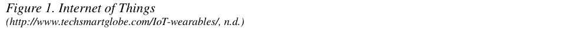

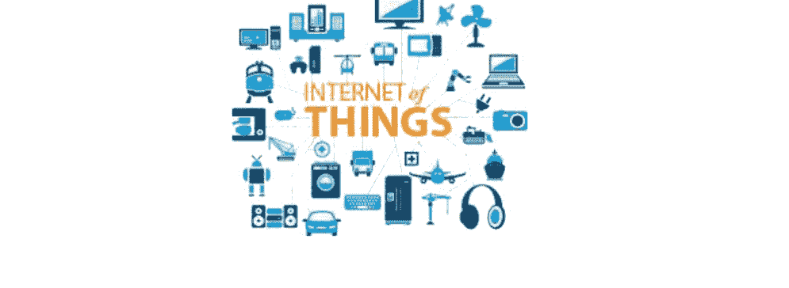


## 图 2. 物联网系统

*(物联网解析：什么是物联网？，无日期)*

### 物联网系统示例

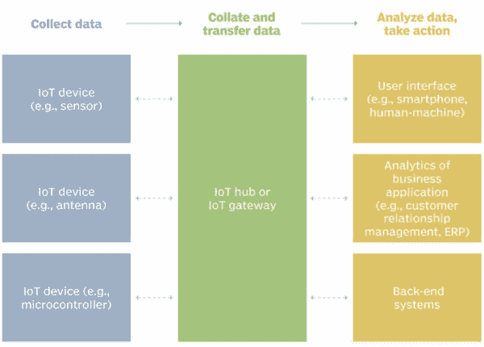

## 物联网的执行

物联网空中融合了联网的洞察型设备，这些设备用于嵌入式工作站、仪表和通信设备，以存储、引导并监视其估值，并从大气中收集数据。物联网设备通过连接到物联网门户或不同的边缘设备来扩展它们收集的设备事实，在那里数据也会传输到云端以便进行本地分析。有时，这些设备会与相互关联的其他设备交换信息，并基于它们从个体那里获得的事实进行操作。设备确保在没有人工干预的情况下对创作进行限制，在个人可以与设备互动的某些情况下——例如，部署它们、向其发出指令或访问记录。与这些联网设备关联的可用性、日程安排和功能展示，最终取决于所传输的独特物联网项目。

## 物联网标准与框架

- 6LoWPAN（基于低控制远程个人区域网络的 IPv6），由互联网工程任务组（IETF）定义的一种开放通用标准。6LoWPAN 允许任何低功耗无线电与网络通信，包括 804.15.4、蓝牙低功耗和 Z-Wave（用于本地自动化）。
- ZIGBEE0，一种低质量、低速率的无线系统，专门用于商业环境。ZIGBEE 主要依赖于基于 IEEE 802.15.4 标准的架构。ZIGBEE 联盟创建了 ZigBee，这是一种流行的物联网语言，允许聪明的事物在最小的系统上安全地运作并相互识别。
- LiteOS，一种用于无线设备系统的类 Unix 操作系统。LiteOS 支持智能手机、合理的产品组合、可穿戴设备、智能家居以及车联网（IOV）。该操作系统还作为一个智能设备开发平台发挥作用。
- OneM2M，一种机器到机器（M2M）供应商规范，可植入软件系统和硬件中以连接设备。全球标准化大纲 oneM2M 旨在增加可重复使用的前置条件，使跨越不同垂直领域的物联网产品能够通信。
- 数据分发服务（DDS）由对象管理组（OMG）转换为先进标准，是物联网中用于实时、灵活和高性能设备到框架通信的首选方案。
- 高级消息队列协议（AMQP），一种未开发的库存，广泛用于通过线束进行非典型消息传递。AMQP 支持服务和应用程序之间的加密和互操作性消息传递。该协议用于客户端/服务器消息传递以及物联网设备管理。
- 受限应用协议（CoAP），由 IETF 设计的协议，确定了低控制过程受限设备如何在对象互联网中工作。
- 长距离广域网（LoRaWAN），一种用于综合区域网络的展示，旨在支持大型系统，如附近的智慧大都市，具有大量低控制设备。

物联网框架包括：

- AWS IoT，一个由亚马逊驱动的用于物联网的云平台。该框架旨在使智能设备能够有效地连接，并与 AWS 云及各种相关设备安全协作。
- ARM Mbed IoT，一个基于 ARM 微控制器的平台，用于增加物联网应用程序。Mbed IoT 平台支持的目标是通过整合 Mbed 工具和服务，为物联网设备提供一个便携、互联且安静环境。
- 微软 Blue IoT 组，一个由服务组成的平台，使客户端能够接触并获取物联网设备的度量数据，同时对事实执行不同的任务，包括多维分析、变更和汇总，并以适合企业任务的方式想象这些操作。
- Google 的 Brillo/Nest，一个用于快速部署物联网产品框架的平台。该平台包含两个主要支柱：Brillo，一个基于安卓的操作系统，用于开发嵌入式低质量设备；以及 Nest，一个基于物联网的口头交换协议，作为设备与云之间的对话语言。
- Calvin，一个未开发的物联网平台库存，可由爱立信发布，用于构建和管理分布式项目，使设备能够相互通信。Calvin 包括为公用事业工程师提供的开发结构，以及用于适应走动式软件的运行时环境。

## 物联网应用

物联网应用证明了为我们的生存带来巨大动力。随着日益先进的远程框架、卓越传感器和动态招募限制，物联网可能是争夺大量案例的下一个野兽。

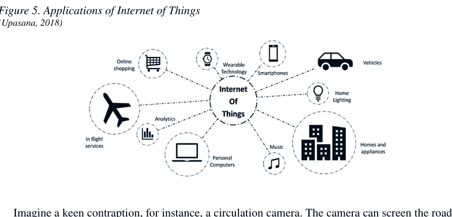

想象一下一个智能设备，例如一辆流量相机。该相机可以监控道路的交通堵塞、事故、气候状况，并将这些信息传递给公共门户。这一部分同时还接收来自其他类似相机的数据，然后将证据添加到城市范围的交通监控结构中。现在，例如，公共公司决定修复某条特定街道。这可能会导致前往全国高速公路上途中的排队堵塞。这一知识被发布到大都市范围的排队监控框架中。现在，由于这是一个智慧交通框架，它快速吸收并利用 AI 预测高峰时段的交通拥堵模式。智慧框架可以分析这些状况，预测其影响，并将数据传输给与同一路段连接的其他城市，通过它们自己的智慧框架。交通管理系统可以分析获得的数据，并确定绕过工程的路径以避免瓶颈。该结构还可以通过智能设备和无线基站向驾驶员发送实时方向指示。同时，靠近工程地点的市政机构和工作场所也可以被要求更改其时间表。

## 图 6. 互联网应用模型

*(Upsana, 2018)*

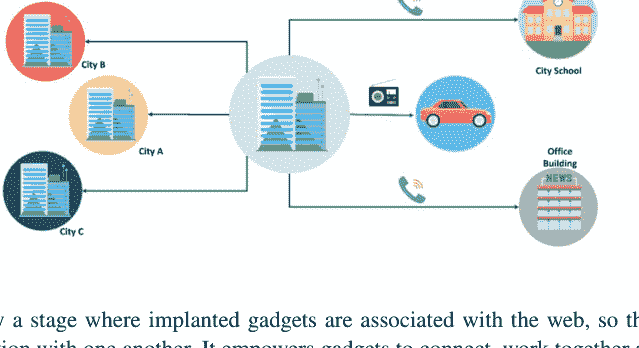

物联网基本上是一个嵌入设备与互联网连接的平台，因此它们可以相互收集和交流信息。它使设备能够连接、协作并像人一样从彼此的体验中学习。预计物联网应用将通过网络和智能处理大量普通物品。它已被广泛实施，用于不同领域，具体包括：

### 物联网应用 – 可穿戴设备

这是物联网应用的现代化标志，也可能是最早将物联网与其管理结合起来的制造方式。如今，我们在任何地方都能看到智能手表、耳塞和数字手表。通过设备和软件设计的可穿戴电器可以收集和解析个人数据，并将通信传输给附近操作员的各类技术，目的是使客户的生活更简单、更安全。可穿戴设备用于瞄准社区安全——例如，通过改进对地点的导航或在危险现场监控生产员工或消防员的关键体征，从而增强急救人员在危机中的反应时间。图 6 和 7 代表了物联网在现实生活中常见的应用。

较少被认可的可穿戴设备包括 Protector 血糖检测设备。该设备旨在帮助人们应对糖尿病。葡萄糖传感器是一种使用小阴极识别体内葡萄糖点的设备。它置于皮下，并通过无线事件将数据传输到监测收缩装置。


## 物联网应用 – 智能家居应用

一旦我们讨论物联网应用，智能家居通常是我们首要考虑的核心问题。无论何时考察物联网结构，最基础且高效且独树一帜的操作领域就是智能家居，它统领着全站最具代表性的物联网操作。寻求智能家居方案的人数每月增长约60,000人。一个更令人感兴趣的事实是，专门针对物联网评估的智能家居记录融合了256家现有机构和新成立的协会。目前有更多协会相当合理地关注智能家居，同时也密切关注该领域的应用程序。针对新成立协会的智能家居融资评估规模超过25亿美元，并正以快速的速度增长。新组织的名录中包括无可争议的知名科技商业品牌，例如Alert Me或Nest，以及其他全球性协会，如飞利浦、海尔或Belkin。

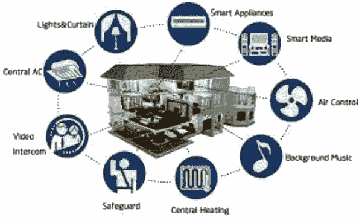

## 物联网应用 – 医疗保健

在医疗保健领域，物联网提供了许多优势，包括能够更仔细地展示患者情况，利用真正生成的事实数据并对其进行分析。物联网执行变革性响应式康复基础建设，依赖于积极的健康构建框架。那些节奏运动有益的分析实践带来的收益需要基本的真实信息。它用于最远端部分习俗的残留信息、测量状况以及治疗评估的辅助工具。物联网发布习俗以处理大量重要信息，包括研究、稳定地面信息和测试。医院经常使用物联网结构来完成库存管理等工作，包括处方药和医疗单位。物联网还进一步提升了控制、精度和透明度方面的现有收缩率。物联网基于在物联网中创建结构，每个平面由其功能及该平面中使用的收缩率来定义，而不仅仅是设备。图9展示了物联网与其他技术领域（如医疗和健康护理领域中的人机交互）的协作。

图9. 物联网在医疗保健系统中的应用  
(The Importance of UX in IoT \ HCL Blogs, n.d.)

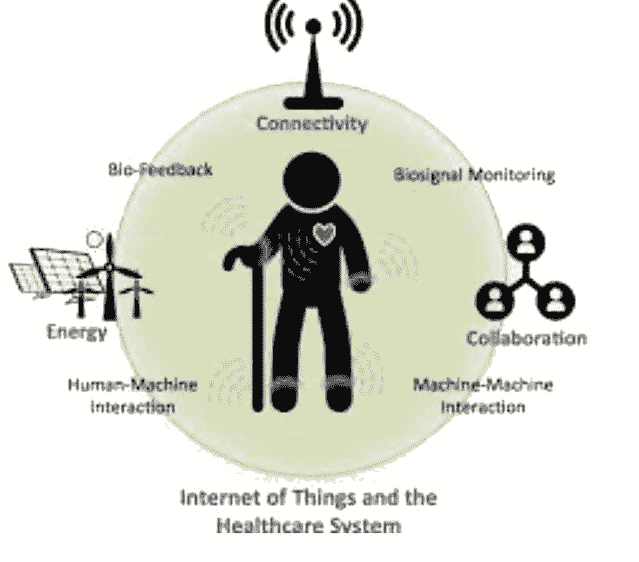

## 物联网应用 – 智慧城市

您几乎肯定对“智慧城市”这一时期有一些答案。那是推进队列结构的理论。我此前已经指派，构成辉煌城市的多种视角之一。紧邻令人惊叹的城市思想的关键在于它对城市而言是极其确定的。在孟买看到的挑战与在德里看到的挑战完全不同。香港的问题也不等同于纽约的问题。毫无疑问，尽管存在整体变化的问题，如受限制的卫生消耗液体、自毁性的空气优越性以及不断增长的城区密度，这些问题在横贯各城市的不同力量中发生。因此，它们以不可预测的方式影响每个城市。

管理层和设计师可以利用物联网来暂停城市放置中常见的令人困惑的基本要素，并将其简化以适应每个城市。物联网投标的操作可以在水资源管理、能源浪费以及灾难等领域提供支持。帕洛阿尔托是智慧城市的一个真实案例。它是同类中第一个采取完全不同交通策略的城镇。他们意识到，城市中大多数车辆都在同一个广场周围绕圈，寻找停车位。这是城市交通堵塞的根本原因。在城市所有的停车位都安装了设备。这些设备允许居民定位到云端的每个广告位置。少量的习俗可以利用这些数据进行使用。它可以控制驾驶员沿最受限路线前往未开发地点。这里的方案结合了支持向后的设备包的使用，表明数据和习俗用于不同的思维方式。

## 物联网应用 — 农业

在农业中，物联网基本上由严苛的生成框架组成，可以帮助监控作为例子的平滑度、持久性以及作物田地的土壤湿度质量，并操作相关设备。物联网在自动化水系统结构方面同样有用。知识片段检查自然生成的完整质量，预计到2050年将达到近100亿。为了维持一种巨量人群类型，其中一种需要将农业与进步结合以实现最佳结果。在这个领域有许多潜在成果。例如智能温室。植物销售终端的发展框架通过监测生物限制来改善作物收成。然而，手动处理导致进度事故、基本需求困难和劳动力费用，使得这些技术在少数情况下变得不可行。植物销售终端的引入使其更容易仅通过切换气候特权来定位。仪器显示根据植物基本需求所示的各种限制数量，然后将该信息参考到云端。随后，它构建数据并应用控制动作。

> *图10. 物联网在农业中的应用*  
> *(Citing Images and Tables Found Online \ UNSW Current Students, 2019)*

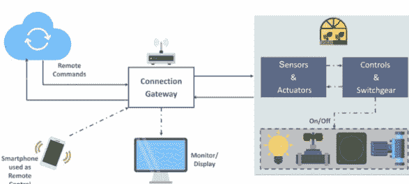

基于PKI安全的物联网架构

## 物联网应用 – 工业自动化

这是一个独立领域，所有的快速重构，就像物的可能性一样，对于大量抵达投资而言都是至关重要的部分。通过物联网的应用，个人可以统一重构事物，并将其推向在共同支出和消费技能方面传递良好行为的方向。此时，物联网可以展示通过用于其军火库中所有随行领域的方案向下移动的方向。

- 加工厂数字化
- 物品流监控
- 库存管理
- 健康与可靠性
- 调查
- 捆绑流优化
- 协调与来源链接优化

仅在1年内，相关的网络策略从500万增长到数十亿。Commercial Insider Intellectual观察到，到2020年将发布240亿个物联网设备，产生超过3000亿的结果。物联网专注于、推进并持续构建。它的系统并不预先堆积，而是在一段时间后形成。物联网（IoT）已将硬件和软件融入通往互联网的路径，以创建越来越智能的生成。它一直像一个基本步骤在生长，并建议用于管理和商业的巨大机会。老实说，物联网专家的开始数量接近完美顶点。

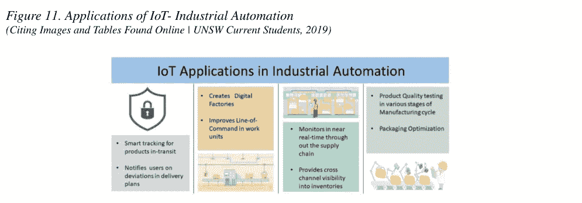

## 物联网架构

在物联网中，每个平面由其功能及该平面中使用的设备来定义。关于如何确定物联网中的平面有许多结论。然而，根据各种研究员的说法，物联网基本上通过三个名为感知层、网络层和应用层的平面进行工作。物联网的每个平面都与其固有的安全问题相关联。以下展示了物联网的三层基本辅助架构，以及对通往设备的接入以及结合每个平面的技术的说明。

### 感知层

感知层通常被称为物联网中的“仪器”层。这一层的目的通过传感器和执行器的帮助从环境中获取信息。这一层识别、收集和过程数据，随后将其传输到网络层。这一层同样在执行物联网中心点联合作业方面在近距离和短途框架中发挥作用。

### 网络层

物联网的网络层协助数据协调限制以及向不同物联网中心点和通过Web完成的收缩的广播。在这一层，传输计算平台、互联网入口、交易以及导向设备等通过部分极其连续的技术工作，例如Wi-Fi、LTE、蓝牙、3G、Zigbee等。网络开口充当许多物联网中心的中间个人，通过收集、隔离以及向不同设备传递数据来发挥作用。

### 应用层

它确保数据的完整性、公正性以及数据的一致性。在此层中，物联网的原因或智能区域的管理得以培育。

## 物联网的重要性

万物互联网络帮助个人保持并创作更智能的作品，同时为他们的生活带来整体优势。除了提供智能设备来自动化房屋外，物联网对于商业企业至关重要。物联网与持续的探索有关，通过这种方式，组织结构真正精通表现，从技术引入到供应链和协调任务提供过度体验。物联网授权协会系统化流程并减少努力费用。它还能消除浪费并升级承载运输，显著降低制造和交付产品的成本，同时为客户提供交易透明度。物联网将每个工厂与人类设施、货币、贸易和聚集联系起来。智慧城市团队支持居民减少非标准使用和高质量接入，相关设备在农业中统一使用以支持展示作物和牲畜产量并预期增加模式。总之，物联网是最重大的标准生活方式技术之一，随着越来越多的组织认识到相关设备使其保持竞争力的限度，它将继续获得动力。


# 物联网当前面临的挑战

物联网提供了另一种视角，它能够实现组装和交换那些此前无法触及的数据。它已准备以绝对安全的方式传递和报告客户信息。思科专家的报告指出，到 2020 年，物联网将拥有超过 500 亿个绝妙的传感器以及其他出色的设备或装置，它们将相互协作并通过网络传输持续数据。这将通过物联网视角进一步提供数据评估，以开发新业务、提高效率和充足性，并创造创意收益流。此外，物联网架构可能整合由不同方法提出的特性和技术。由于该体系结构建立在虚拟世界和物理世界不断结合和协作的地方，各种技术进步被整合以形成物联网，例如识别技术、云计算、数据处理、网络展示、智能物体、嵌入式组件等。当普通设备使用智能管理器时，它就变成了一个智能物体。因此，它不仅用于收集地球信息或与物理世界接口，更重要的是，它必须与各种框架设备互连，以便在网络上交换和收集数据。因此，由大量互连装置传输的海量公开数据将为创建提供经济基础要素的数据创造机会。计算物体和物体的开发已配备了通信和嵌入式知识的智能能力。这种开发涵盖了物联网领域的快速进步。在新兴的物联网视角下，一个全球性的杰出框架将通过限制联合和可寻址设备的虚拟链接来连接一切和所有事物。

因此，其结果将支持客户开发新颖的解决方案，以成为全球强大且重要的关键结构。因此，本论文从不同的研究领域视角讨论了物联网空间的示例，例如结构、数据准备、安全性和保护。最后，我们分析了基本的物联网基本原理以及执行挑战，特别是其未来的需求路径。

# “物联网”中的安全性

可靠性已证明存在明显的缺陷，此外，也不具备现有计算机结构的安全程度。尽管物联网在最近的几年中迅速增长，但核心安全关注并未跟上。物联网引入了大量新的限制和挑战，期望安全能够以不同于现有信息系统常见的方式加以应对。虽然现有系统采用易于实施且适用于大多数通信和存储类型的措施，但由于不同收缩之间存在变化的障碍，以及物联网内部存在意识方案，因此不存在能够处理物联网中每个设备的标准委托。该理论建立了物联网内部应如何处理安全的框架，既适用于当前也适用于未来的系统。各个领域中使用不同技术的现有设备已被分析，以形成清晰、可靠的当今物联网挑战及其解决方案图景。物联网中的三个主要限制——计算、带宽和能量——已被描述并用于构建所展示挑战的基础。物联网的各种潜在未来及其将面临的挑战也得到了描述。挑战的解决方案将在可用资源之间进行调和，因此，基于可用资源的潜在解决方案的全面介绍已得到阐明。为了提高工程师对安全重要问题的关注度，从物联网中设备的结构设计、开发到维护的完整规则被依次展示，面向具备或不具备数据安全深入知识的工程师。潜在的解决方案、选择以及使工程师在过程中考虑决策结果的关键问题也被展示。当前物联网中的安全性并未达到应有水平。此提案展示了现有产品中的一些明显缺陷，这通常是由于工程师的疏忽造成的，因为物联网中存在的限制需要比桌面计算更审慎的视角。由于有限的电力、数据传输容量和处理能力，一切都需要简化至最低限度，同时保持优良的安全特性。

安全性在许多项目中是一个盲点。利用过去研究的模型，并对现有产品进行特殊分析，证明了许多工程师几乎忽略了与安全相关的所有事项（如宝马、Home Easy、Sonos），或者创建了带有明显缺陷的自有加密算法（如 Eye-Fi、OSQP 智能电网）。为确保物联网的未来是安全的，此提案旨在让工程师考虑存在的限制，并为设计物联网设备时将出现的问题提供解决方案。物联网的验证对消费者至关重要。通过过去的研究，清楚地表明不关注物联网设备安全性的毁灭性后果，大多数消费者（62%）“感到完全被欺骗，愤怒到采取行动的程度”。如果系统中发现缺陷，近一半（48%）的所有客户认为制造商是可靠的，这表明不适当验证设备带来了巨大的高效风险。部分引入的挑战主题在信息安全中很常见，但由于独特的需求，提出了新的挑战。IT 系统的验证需要保密性、完整性和授权。虽然这通常由 OpenSSL 等库和在工作站上使用 TLS 来处理，但在物联网上设置加密、认证和签名算法并不像调用另一种方法那么简单。受限的电力、数据传输能力和处理能力需要一种细致的思维方式，以选择如何既高效又充分地保护设备。其他挑战更具体地针对物联网。在标准工作站处理中，通常可以访问高级 UI，并且在设备使用期间物理丢失的情况极为罕见。相反，物联网设备通常具有非常有限的 UI，并且经常被放置在露天区域，并在高物理压力的环境中使用。安全应该是贯穿整个项目的考量。早在第一个原型 PCB 设计被发送到处理工厂之前，关于安全的关键决策就应该已经确定。这些包括密钥应如何分发到每个设备、是否应使用硬件加速、如何处理更新、PKI 是否是设备的合理答案、应使用何种类型的加密算法等。物联网将在任何地方产生数十亿装置、个人和组织，以相互关联并交换数据和愉悦信息。由于物联网建筑将是全面且不可避免的，不同的健康和认证问题将会出现。在日常基础上，物联网愿景、当前安全威胁以及物联网领域公开的挑战被审视。关于物联网安全需求分析的双向运动被辩论，此外还展示了关于物联网安全和覆盖的未来分析方向。物联网是一个独特的整体框架基础，具有自组织限制，受标准和互操作性通信展示影响。物理和功能物体消耗角色，

## 图 13. 安全中的物联网
(*Seouser, 2017*)


...身体特征，以及计算机生成的角色，使用巧妙的边缘，这些数据形式完美结合。物联网的理念是使个人、物体和效果能够在任何地点、任何时间，与所有事物和任何人相关联，通过最低限度的方法/系统和关联技术，实现完美的创造。区分性证据技术，例如 RFID 及其相关工具，将成为未来物联网的基础。预计智能部件将具备执行多种操作的能力，以适应其环境和既定任务。这些智能事物可执行的操作和任务将不受限制；例如，设备很可能协调其交易，适应其特定环境，自我组织，自我维护，自我修复，并最终甚至在其特定的交易领域承担工作职责。物联网使我们能够建立各种有意或正当适用于我们当前生活的应用，例如个人和通用领域、移动性和通信领域、业务和行业领域，以及管理和公用事业监控领域。为了使物联网服务在大量相互通信的设备上可用，需要克服许多挑战。与安全防范措施相关的安全冲突已被研究，例如验证、隐私、可靠性和端到端安全。总而言之，为了实现物联网，需要采用更强的安全表现形式，利用基于上下文的安全措施，从而使居民能够对这些新技术建立信任和信心，而不是对全面监控环境产生恐惧。本文的主要目标是对物联网最关键的部分提供一个明确的综述，特别关注物联网相关的理念以及安全问题。物联网的理念将使个人和物品在尽可能多的情况下，以任何方式/系统和任何组织，与所有事物和任何人相关联。尽管无线事件身份证明机制和相关技术使物联网的理念成为可能，但智能对象有许多潜在的应用领域。物联网的主要目标包括创建智能环境和自主设备，例如智能汽车、智能物品、智慧城市、智能健康、智能家居等。随后，与物联网相关的许多问题和炎症也随之浮现。互操作性认证、通过目录使大量物品相互关联的策略、以及用于材料出现认证和授权的安全和声明操作等挑战被展示出来。在未来几年中，解决这些挑战将持续成为学术界和工业研究领域中系统架构和通信研究的核心和重点任务。

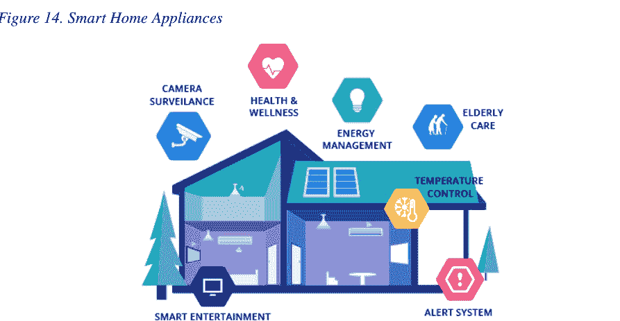

## 公钥基础设施 (PKI)

> *“公钥基础设施 (PKI) 允许互联网和其他开放系统的用户参与安全的通信、数据交换和资金交易”。*

公钥基础设施 (PKI) 保护公钥，同时允许追踪其来源。每个 PKI 通常至少包含一个 CA（证书颁发机构），该 CA 创建并发布数字认证。每个证书包含私钥持有者的公钥、私钥持有者的名称、序列号、认证机构的名称以及其他选定且重要的中心。证书由 CA 仔细标记，以确保其完整性和合理性。PKI 具有多层安全性，既非常安全又可靠。该方法结合了多层安全措施，包括验证嵌入到证书中的认证机构签名的选项。一旦验证通过，接收方将对比公钥并解读数据。PKI 系统存在缺点：成本高、复杂、需要良好的规划，且建立和维护组织可能很困难。实施方法可能会给 IT 人员带来压力，因为 PKI 系统要求个人提交的硬件和服务器运行在最大极限。用户通常难以应对复杂的系统以建立健康。应提供安全意识培训，以平滑处理任何用户请求或顾虑，并确保结构被正确使用。此类培训应教导用户如何通过一些安全最佳实践来保障其私钥，例如安全限制、异地移动工作站保险、防恶意软件框架以及如何选择强大的登录密码。PKI 也可以作为双因素认证的一种形式。该技术将与其他认证设备配合使用，提供比单一验证方法更高的安全性。

## CA 层级结构

由于庞大的系统和全球通信的需求，实际上不可能仅由一个受信任的 CA 向所有用户提供声明。在这种情况下，分层认证模型非常有趣，因为它允许在不具有相同 CA 信任关系的两个通信方之间使用公钥声明。根 CA 位于 CA 层级的最顶端，根 CA 的证书是一个自签名证书。直接隶属于根 CA 的证书颁发机构（例如中央机构 1 和中央机构 2）拥有的 CA 证书由根 CA 签名。声明机构层级系统体现在认证链中。认证链追踪一条从层级系统中的出口到基础的路径。以下图表展示了一个 CA 层级结构，其认证链从元素认证出发，通过两个下级 CA 声明（CA6 和 CA3），到达中央机构起源的 CA 证书。

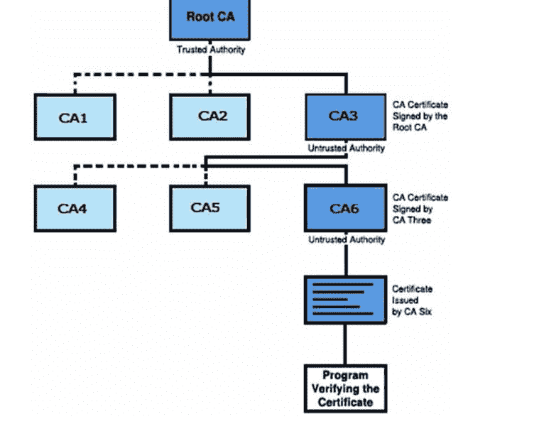

### 图 15. 证书颁发机构层级
(公钥基础设施 – 教程点, 未注明日期)

验证认证链是确保证书链合法、有效签名且可信的过程。以下策略用于验证认证链，从需要验证的证书开始 –

- 正在检查合法性的用户提交其认证，通常还包含指向中央机构根的有效证书链。
- 验证器接收认证，并使用支持者的公钥进行验证。支持者的公钥位于用户声明中的支持者证书里。
- 如今，验证器识别出已认证支持者授权的层级 CA，交叉检查在此生效并中断。
- 否则，支持者的证书将按照上述步骤中对用户所做的那样进行检查。此过程持续进行，直到在中间遇到受信任的中央机构，或者持续到根中央机构。

## PKI 管理功能

- **注册：** 需要注册机构 (RA) 认证，以确保从自动化管理传输的所有数据都被仔细标记。自动化管理 (AA) 还利用 RA 声明向 Symantec 的签发中心进行身份验证。证书可以存储在软件库中（软件签名选项），或存储在已认证的硬件安全模块中（硬件签名选项）。默认情况下，签名设备是软件签名选项。然而，硬件签名选项提供更强的安全性，因为当 Luna CA 卡未使用时，可以将其存储在受保护的存储区域中。签名设备驻留在运行自动化管理服务器的计算机上。当 AA 和密钥管理服务 (KMS) 选项一起使用时，签名设备驻留在 KMS 服务器上。

- **初始化：** 注册开始于初始化。至少，这包括将相关的信任保持与终端实体进行初始化。还可以提供诸如适当证书配置等其他数据。同样，此步骤通常涉及将终端实体与其相关的密钥对进行初始化。密钥对生成包括创建与终端实体相关的公钥/私钥对。密钥对生成可以在终端实体注册过程之前发生，也可以在其之后发生。密钥集可以由终端实体客户框架、RA、CA 或其他部件（如硬件安全模块）生成。密钥对生成的位置由运营限制和适当策略管理。通常，密钥材料的预期使用在确定密钥集应生成在哪里方面起着关键作用。

- **认证：** 认证是终端实体注册过程的常见结束。顾名思义，此步骤包括 CA 发布终端实体公钥证书。如果密钥对在 CA 外部生成，则公钥部分必须

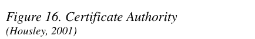
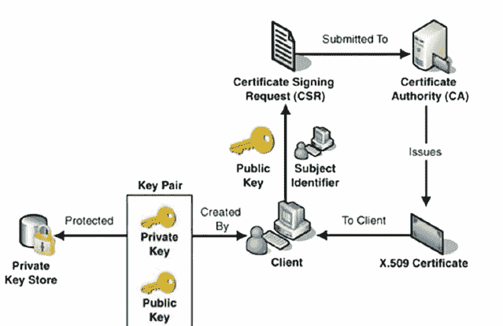


安全地传递至 CA。一旦生成，证书就会返回给最终实体（End Entity）或潜在地分发至身份认证档案。尽管我们将注册（enrollment）、安装（instatement）和认证（accreditation）展示为独立的行政职能，但请注意，其中至少两项可以整合到单一的操作流程中。例如，在 PKIX 证书管理协议中，情况便是如此。

-   **密钥对恢复：** 密钥集可用于辅助数字签名的生成与验证、加密与解密，或两者兼有。当密钥对用于加密/解密时，必须提供一套机制，以便在无法通过“常规”方式访问密钥材料时，能够恢复关键的**两个**解密密钥，否则将无法恢复被加密的数据。⁴ 对解密密钥的常规访问可能因遗忘密码/PIN、磁盘驱动器受损、硬件令牌损坏等原因而失效。密钥对恢复允许最终实体从一个授权的密钥保管办公室（通常是签发该最终实体证书的 CA）恢复其加密/解密密钥对。此外，最终实体与组织的关系可能会发生变化（例如，由于员工辞职、被解雇或遭受个人伤害），而组织可能确实有需求去恢复由该最终实体加密的信息。也有可能需要访问密钥材料以满足法律执法需求。密钥对恢复可用于协助满足上述这两种需求。

-   **密钥对更新：** 证书具有固定的有效期（分配为证书的“有效期限”）。虽然这些固定有效期可以较长（例如表达为两年至五年之间），但证书最终会过期。由于证书吊销的原因（参见第 3.2.6 节），可能还需要进行密钥对更新。密钥对更新包括生成新的密钥对，以及签发新的公钥证书。⁵ 密钥对更新可以在给定密钥对过期之前提前进行。这将有助于确保最终实体始终拥有一个有效的密钥对。尽管 PKIX 工作组建议不要在 Web 上使用此功能，但也可以为用于签名和验证的私钥和公钥设置不同的有效期。这将强制在相关公钥真正过期之前进行密钥对更新。它还提供了一个时间窗口，在此期间，未过期的公钥证书可用于验证使用当前已过期的私钥生成的数字签名。这将限制以某种方式显示给最终实体的无效警告消息。

-   **交叉验证：** 交叉验证发生在中心机构（CA）之间。交叉声明是由一个 CA 颁发给另一个 CA 的公钥证书。换言之，交叉证书是一个持有某个 CA 的公钥，并且完全由另一个 CA 签署的公钥证书。许多翻译将交叉验证译为“跨域”交叉认证。然而，“域内”交叉认证也是可能的。例如，可以使用加拿大政府（GOC）PKI 来说明这一点。GOC PKI 内部的主要部门与加拿大中央机构进行交叉验证，后者充当这些部门之间的连接 CA。由于这些机构都“属于” GOC PKI，因此这是“域内”交叉验证。加拿大中央机构还负责与外部 PKI 域（例如美国国务院桥接 CA）的交叉验证。这是“跨域”交叉验证。还应该指出，交叉验证可以是双向的或单向的。双向交叉验证通常发生在如前所述的对等 CA 之间。单向交叉验证通常发生在层级信任模型中，上级 CA 颁发交叉证书给下级 CA，但反之不成立。

## 物联网的未来方面

如图 17 所示，世界正以前所未有的速度前进，这归功于不断发展的技术。其中一个概念是物联网（IoT），它使得自动化不再是科幻。IoT 通过互联网连接各种非生物物体，并使它们能够将数据传输给其区域网络，从而为人类自动化流程并简化他们的生活。本文介绍了 IoT 面临的未来挑战，例如技术挑战（网络、兼容性和寿命、标准、智能分析和操作、安全性）、业务挑战（投资、收入模式等）、文化挑战（不断变化的需求、新设备、成本、用户信心等）和法律挑战（法律、法规、方法、政策等）。其中一个章节还讨论了可能阻碍 IoT 发展的各种障碍，其中数据安全是最基本的因素。采用一种积极的方式让人们接受 IoT 带来的不可逆转的变化，也将有助于其发展。谨慎利用从设备收集的数据，关注 IoT 对移动网络的依赖、由不同设备生成的数据的重要性、靠近数据中心网络的能量、带有脱机控制器决策的已认证组织结构的需求、互操作性标准的进展、异构性和透明度，这些都是需要关注的问题。数据的安全性和隐私将在未来几十年物联网的样子中发挥重要作用，无论是柔性框架、由不同设备产生的数据的重要性、靠近数据中心系统的巨大性、带有远程控制选项的已认证组织系统的必要性、互操作性检查的进步、异构性和透明度，都是需要警惕的问题，数据和信息的保护将展示在物联网未来演变中的关键作用。与此同时，也是这项技术面临的挑战，对其成功构成了威胁。未来物联网最根本的挑战是连接多个设备，这种通信将反过来对抗目前存在的结构及其相关进步。直接地，一个集中的服务器/客户架构被用来验证、批准和连接网络中的多个终端。包括技术、业务、社会和法律在内的每个方面都对抗着物联网的成功速度。人们对技术的接受也很重要，应在其发展过程中加以考虑，因为那些不喜欢使用设备、智能设备或不习惯处理技术的人，在与物联网的复杂性和无效率互动时将面临困难。已经过去了足够的时间来处理那些可能从根本上削弱物联网强大未来的因素。

*图 17. 物联网的未来*

*(Zhang et al., 2014)*

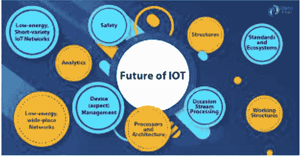

## 参考文献

- Abomhara, M., & Køien, G. M. (2014, May). Security and privacy in the Internet of Things: Current status and open issues. In *2014 international conference on privacy and security in mobile systems (PRISM)* (pp. 1-8). IEEE.
- Alavi, A. H., Jiao, P., Buttler, W. G., & Lajnef, N. (2018). Internet of Things-enabled smart cities: State-of-the-art and future trends. *Measurement, 129*, 589–606. doi:10.1016/j.measurement.2018.07.067
- Atzori, L., Iera, A., Morabito, G., & Nitti, M. (2012). The social internet of things (siot)–when social networks meet the internet of things: Concept, architecture and network characterization. *Computer Networks, 56*(16), 3594–3608. doi:10.1016/j.comnet.2012.07.010
- Chen, S., Xu, H., Liu, D., Hu, B., & Wang, H. (2014). A vision of IoT: Applications, challenges, and opportunities with china perspective. *IEEE Internet of Things Journal, 1*(4), 349-359.
- Citing Images and Tables Found Online | UNSW Current Students. (2019). https://student.unsw.edu.au/citing-images-and-tables-found-online https://dzone.com/articles/the-internet-of-thingsgateways-and-next-generation
- Conoscenti, M., Vetro, A., & De Martin, J. C. (2016, November). Blockchain for the Internet of Things: A systematic literature review. In *2016 IEEE/ACM 13th International Conference of Computer Systems and Applications (AICCSA)* (pp. 1-6). IEEE. 10.1109/AICCSA.2016.7945805
- Hern, C. (2016, October 23). *IoT Smart City – What is a Smart City?* https://www.infiniteinformation-technology.com/IoT-smart-city-what-is-smart-home
- Hierarchies, C. A. (Sun Directory Server Enterprise Edition 7.0 Reference). (n.d.). https://docs.oracle.com/cd/E19424-01/820-4811/gdzdp/index.html
- Housley, R., & Polk, T. (2001). *Planning for PKI: best practices guide for deploying public key infrastructure*. John Wiley & Sons, Inc.
- IoT explained: What is the internet of things? (n.d.). *IoT Agenda*. Retrieved February 23, 2020, from https://internetofthingsagenda.techtarget.com/feature/Explained-What-is-the-Internet-of-Things
- Khan, M. A., & Salah, K. (2018). IoT security: Review, blockchain solutions, and open challenges. *Future Generation Computer Systems, 82*, 395–411. doi:10.1016/j.future.2017.11.022


Khan, R., Khan, S. U., Zaeher, R., & Khan, S. (2012). 未来互联网：物联网架构、潜在应用与关键挑战。载 *2012年第10届信息科技前沿国际会议* (pp. 257-260)。IEEE。10.1109/FIT.2012.53

Lee, I., & Lee, K. (2015)。物联网（IoT）：企业应用、投资与挑战。*Business Horizons*，*58*(4), 431–440。doi:10.1016/j.bushor.2015.03.008

Leo, M., Battisti, F., Carli, M., & Neri, A. (2014, 11月)。物联网安全的联邦架构方法。载 *2014年欧洲地中海电信会议（EMTC）* (pp. 1-5)。IEEE。10.1109/EMTC.2014.6996632

Madakam, S., Lake, V., Lake, V., & Lake, V. (2015)。物联网（IoT）：文献综述。*Journal of Computer and Communications*，*3*(05), 164–173。doi:10.4236/jcc.2015.35021

Mahmoud, R., Yousuf, T., Aloul, F., & Zualkernan, I. (2015, 12月)。物联网（IoT）安全：现状、挑战与前瞻性措施。载 *2015年第10届互联网技术与安全事务国际会议（ICITST）* (pp. 336-341)。IEEE。

Pasluosta, C. F., Gasser, H., Winkler, J., Klucken, J., & Eskofier, B. M. (2015)。帕金森病管理的新兴时代：可穿戴技术与物联网。*IEEE Journal of Biomedical and Health Informatics*，*19*(6), 1873–1881。doi:10.1109/JBHI.2015.2461555 PMID:26241979

公钥基础设施 – Tutorials point。（无日期）。www.Tutorialspoint.Com。https://www.tutorialspoint.com/cryptography/public_key_infrastructure.htm

Seouser。（2017, 10月10日）。物联网安全：理解PKI在保障物联网安全中的作用。*关于SSL证书*。https://cheapsllsecurity.com/blog/iot-security-understanding-pki-role-in-securing-internet-of-things/

Team, D.（2018, 6月16日）。*关于物联网未来的十大有趣事实*。https://data-flair.training/blogs/future-of-IoT/

物联网中用户体验的重要性 | HCL博客。（无日期）。*物联网中用户体验的重要性*。https://www.hcltech.com/blogs/importance-ux-IoT

Tuen, C. D.（2015）。*物联网系统中的安全*（硕士论文）。NTNU。

Upasana。（2018, 9月20日）。不同领域中的现实物联网应用。*Edureka*。https://internetingthingssagenda.techtarget.com/definition/Internet-of-Things-IoT

Zhang, Z. K., Cho, M. C. Y., Wang, C. W., Hsu, C. W., Chen, C. K., & Shieh, S.（2014, 11月）。物联网安全：持续挑战与研究机遇。载 *2014年IEEE第7届面向服务计算与应用国际会议* (pp. 230-234)。IEEE。10.1109/SOCA.2014.58

Zhao, K., & Ge, L.（2013, 12月）。物联网安全综述。载 *2013年第九届计算智能与安全国际会议* (pp. 663-667)。IEEE。10.1109/CIS.2013.145

## 第3章

# 深度学习与物联网：迈向智慧农业的赋能技术

Muhammad Suleman Memon  
https://orcid.org/0000-0002-0418-0681  
巴基斯坦信德大学贾姆沙罗、达杜分校

Pardeep Kumar  
https://orcid.org/0000-0002-8624-9020  
巴基斯坦卡伊德·阿瓦姆工程科技大学

Azem Ayaz Mirani  
https://orcid.org/0000-0003-2083-9391  
巴基斯坦谢希德·贝娜齐尔·布托大学信息技术系

Muntaz Qabulio  
https://orcid.org/0000-0002-9294-2657  
巴基斯坦信德大学信息技术与通信研究所，贾姆沙罗分校

Irum Naz Sodhar  
https://orcid.org/0000-0001-9082-4924  
巴基斯坦谢希德·贝娜齐尔·布托大学信息技术系

## 摘要

农业部门在任何国家的整体经济中都发挥着重要作用。世界人口逐日增加，这也推高了整体的粮食需求。由于多种疾病和土壤特性，满足整体粮食需求变得困难。农学家和农民在农业领域也面临许多问题，如疾病识别、了解土壤性质、农药管理等。传统的作物管理方法无法有效地满足日益增长的粮食需求。现代方法如物联网（IOT）、机器（学习）、深度学习和图像处理有助于识别作物健康状况并预测作物产量。本章主要讨论了预测作物产量和识别疾病的最新各种技术方法。

DOI: 10.4018/978-1-7998-2803-7.ch003

## 引言

世界人口正在迅速增长，粮食需求随之增加。世界各国正借助物联网、云计算、机器学习和深度学习等现代智慧农业技术来提高作物产量。深度学习是人工智能和机器学习的子领域。为了满足日益增长的粮食需求，粮食安全与作物产量预测至关重要。这可以通过使用深度学习等技术来实现。作物疾病会给作物带来巨大损害。疾病会影响叶片、花朵、茎等不同部位。早期疾病识别困难、耗时且成本高昂。由于作物患有多种疾病，产量不足，无法满足整体的粮食需求。使用人工方法（如聘请专家实地访问土地）进行作物疾病识别是一项非常艰难的任务，因为要巡视整块土地并识别感染区域并不容易。人类可能会疏忽而留下感染区域未受关注。这不利于正确评估作物。因此，技术可以帮助在该领域早期识别疾病，即在疾病初次出现时进行评估。正确且及时的疾病识别有助于农民和农学家保护作物免受损失，提高作物产量并满足粮食需求。深度学习是人工智能的一个新领域，它在及时有效地识别作物疾病方面有很大帮助。正确的疾病识别（Kamilaris 和 Prenafeta-Boldú, 2018）是一项艰难的任务。疾病识别的第一步是通过移动相机、无人机相机或不同的传感设备（如采用不同的相机传感器）捕获图像，然后根据图像中包含的疾病进行分析和分类。用于远程获取图像的传感方法包括卫星、多光谱、高光谱、近红外等等。有许多常用的技术可用于处理数字图像，并根据叶片、果实或茎的感染部分对图像进行分类。常用于分析和分类图像的技术包括机器学习、K-Means算法和支持向量机（SVM）。深度学习（DL）类似于人工神经网络（ANN）。上述所有技术在某些方面都表现良好，但当需要深入了解内部机制时，深度学习是解决此类问题的更强大技术。

## 深度学习

人工智能是一个广泛的领域，且已存在很长时间。深度学习是人工智能的子领域。人脑包含约860亿个神经元。人体脊髓及其他部位的活动由脑中的神经元执行。天然神经元包含非常复杂的结构。人工神经网络模拟天然神经网络。人工神经元的工作方式与自然神经元相同，其中一个神经元携带信息并将其传递给另一个神经元。深度学习处理具有超过两层的神经网络。深度学习方法（LeCun, Bengio, 和 Hinton, 2015）也称为表示学习方法。它们提供多层级的表示。以图像为例，我们知道图像由像素值组成，并以数组形式表示。第一层通常表示图像某位置处边缘的存在或缺失。第二层检测动机（motifs）。第三层将动机组合成较大的组合，这些组合与已知物体部分形成紧密关系，随后所有部分被结合起来。深度学习模型（Pamima 和 Raja, 2019）应至少包含三层。深度学习中的每一层都从上一层接收数据，并将其发送到下一层。深度学习模型在处理海量数据方面比处理少量数据表现更好。图像分类为在农业领域的研究扩展提供了绝佳机会。


## 图 1. 人工智能与深度学习

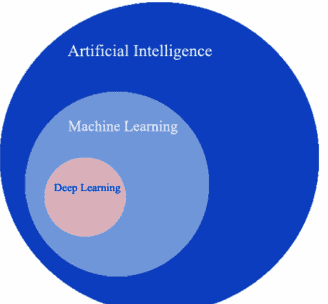

图 2 展示了深度学习的功能。该模型经过训练以识别输入。图 2 中说明的示例是一个汽车识别模型。该网络包含多个隐藏层。

## 图 2. 深度学习功能


# 深度神经网络

感知器（Perceptron）是深度学习的基本构建块，它是神经网络中的一个单个神经元。图 3 展示了神经网络的工作机制。网络具有 n 个输入，每个输入都乘以一个权重。然后对 n 个输入的加权组合进行求和。深度神经网络包含多个隐藏层。

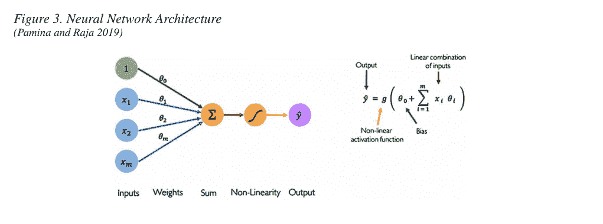

# 卷积神经网络

卷积神经网络 [4-5] 是用于大规模图像（Xiao et al. 2018）的最广泛使用的深度学习模型，用于执行目标检测和图像分类。在大多数情况下，CNN 应用于图像处理。它用于图像识别、分类、文本分析和视频标记。卷积神经网络由三层组成，第一层是卷积层，第二层是池化层，第三层是全连接层。CNN 的输出通常使用 SoftMax 激活函数进行归一化。卷积神经网络因其图像识别和分类的优异结果而被最广泛使用。深度学习模型 CNN（Yamashita et al. 2018）处理具有网格模式的数据，并自动适应以从低到高学习层级模式。CNN 模型包含卷积，用于处理二维图像，因为图像呈数组形式并包含像素值。CNN 用于从图像中提取特征，因为图像的性质可能包含任何位置的，所以 CNN 是提取图像特征的最佳模型。CNN 模型的性能通过损失函数来衡量。卷积层（Yamashita et al. 2018）是 CNN 中的基本层，用于从图像中提取特征。近年来，深度学习的 CNN 模型被用于发现各种疾病，如昆虫识别、杂草检测、害虫分类（Thenmozhi and Srinivasulu Reddy, 2019）。

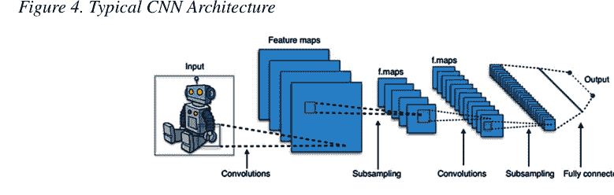

## 深度学习与物联网

### 卷积神经网络架构

- GoogleNet
- AlexNet
- ResNet
- CifarNet

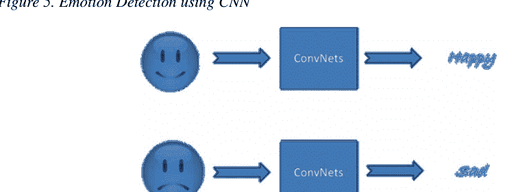

### 深度卷积神经网络

深度卷积神经网络因其提供图像分类准确度的能力而受到大量关注。

### 循环神经网络

循环神经网络（Zhang et al. 2018）是一种序列学习模型。该模型从先前的输入数据中学习以预测下一个输入。对于输入单元，模型包含 {x0,x1, ……xt,xt+1,……}，对于隐藏单元包含 {s0,s1, ……st,st+1,……}，对于输出单元包含 {y0,y1,………yt+1,……}。

### 迁移学习

迁移学习（Bosilj et al. 2019, 2019; Coulibaly et al. 2019; Kaya et al. 2019; Mehdipour Ghazi, Yanikoglu, and Aptoula 2017）使用预训练模型，如 ResNet、VGG、GoogleNet、AlexNet。迁移学习允许从之前训练过的数据中学习。例如，应用于识别苹果的迁移学习可能有助于识别梨（Pan and Yang, 2010）。迁移学习技术分为三种方式：转移什么、如何转移以及何时转移。该技术通过利用先验知识帮助解决问题。

## 深度学习的应用

- 模式分析
- 分类
- 语音识别
- 音频处理
- 自然语言处理 (NLP)
- 计算机视觉

# 农业中的物联网与深度学习

物联网（IOT）是现代研究中的一种新方法，对于人类轻松与物理对象交互并控制它们非常有帮助。物联网（IOT）提供了一种机制，为每个物理对象分配唯一的 IP 地址。物联网在家用自动化、医疗保健、智慧城市、工业、精准农业以及更多领域有许多应用。物联网中使用的传感器（Verma et al. 2018）从环境中收集数据并在中心点存储数据，数据可以通过互联网访问以进行进一步分析。IOT 设备使用较少的电力，可以轻松地在太阳能下运行。这也节省了电力成本。IOT 在农业中有无数应用。传统方法应用于监测作物健康、测量 PH 值、测量土壤性质等。手动方法不准确、耗时且依赖人力。IOT 在精准农业中发挥着重要作用。IOT 在农业中的使用（Puranik et al. 2019）有助于农业自动化，如减少人力劳动、提供作物和土壤健康的快速访问、远程监测作物等。不同的传感器，如 PH 传感器、DHT 传感器、土壤传感器等，被部署在农业领域以定期收集作物数据。图 6 展示了无人机被部署在田间收集作物的一系列图像，并存储在中枢数据库中。农民可以实时访问田间图像。这对农民了解作物性质非常有帮助。及时且准确地从作物中收集数据有助于在农场管理中做出及时的决策。过去许多年来，对无人地面车辆（UGVs）和无人空中车辆（UAVs）（Bacco et al. 2018）的研究正在进行。UAVs 利用无人机中的微型传感器使其体积小且重量轻。UAVs 在农业行业中已得到商业化利用。无人机在农业领域的各个地方被用于监测植物健康状况。UGVs 因减少人工旅行而被更广泛使用。与 UAVs 相比，UGVs 更安全可靠。UAVs 可能会造成损害，如与其他物体或地面的飞行碰撞。

一旦数据被收集，深度学习非常有帮助。反向传播神经网络（Abouzahr et al. 2017）像人脑一样工作。该网络解决了各种分割问题。K-means 聚类算法通过结合图像的相似像素值进行图像分割。仅部署土壤传感器等不会提供清晰的数据。一旦收集了关于土壤性质的数据，就可以应用深度学习。深度学习（Aruul Mozhi Varman et al. 2017）将预测哪种作物适合根据土壤性质。

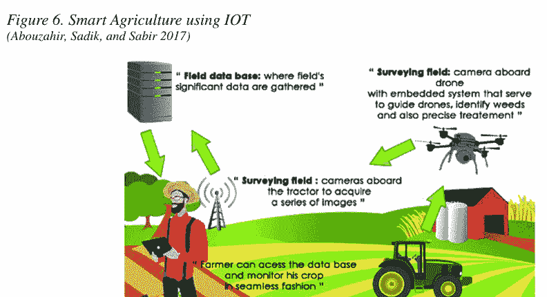

# 农业中用于识别作物健康的深度学习

作物病害是农业中的主要问题。疾病造成的作物损害导致重大的经济损失（Kamilaris and Prenaafeta-Boldú, 2018）。在早期阶段诊断作物疾病以阻止其进一步传播非常重要。传统的作物病害识别方法依赖于人工，且是一项耗时的工作。近年来，技术取得了巨大进步。计算机视觉和机器学习在过去在作物病害识别中发挥了重要作用。但近期的方法如深度学习（Thenmozhi and Srinivasulu Reddy, 2019）

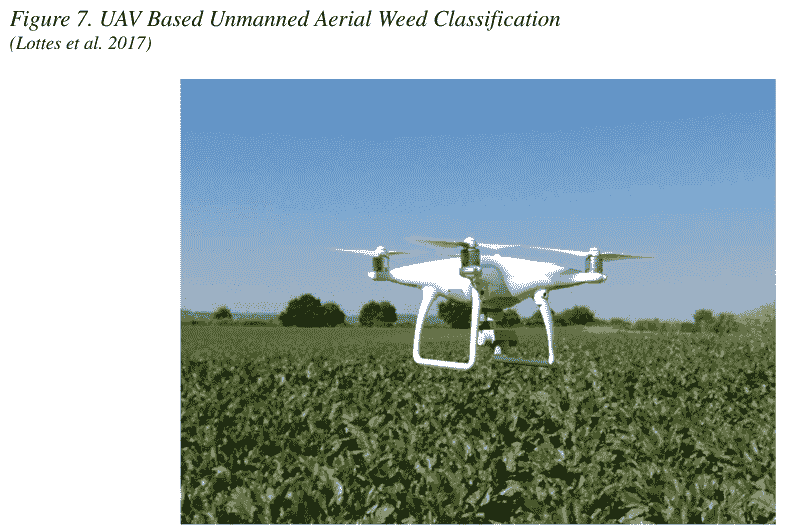

有助于更准确地识别作物病害、分类水果、识别杂草和识别作物害虫。小麦、玉米、水稻、甘蔗和大豆等不同作物的生长因遭受各种害虫侵袭而受到严重影响，因此作物产量降低。由于外观相似，农民发现很难对受感染的作物进行分类。由于作物生长早期外观相似，正确分类和识别所有类型的作物昆虫对农业专家和农民来说是一项艰巨的任务。具有深层架构的卷积神经网络（CNN）有助于自动特征提取。深度学习人工神经网络架构（Ferentinos, 2018）与其他使用浅层方法的技术相比，包含大量的层。CNNs 使用最强大的技术来建模复杂问题，例如从图像中进行模式识别。为了识别图像，已成功将几种 CNN 架构应用于非常复杂的图像。

# 农业中的物联网

精准农业对人类社会文明的文化、社会和经济增长产生了巨大影响。由于农业在人类生活中的重要性，这一领域发展出了更多的历史技能和经济管理。大多数国家的经济依赖于农业，这得益于肥沃的土壤和良好的天气条件。精准农业依赖于许多关键属性，如地形、空气、快速天气变化、土壤性质、氮和肥料管理、适当的灌溉控制和管理。这些属性由许多子属性组成，每个子属性对农作物产量都有非常敏感的影响。物联网技术通过部署称为传感器和执行器的小型设备，在精准农业（PA）中进行操作活动，从而引入了一种有效的方法来测量这些参数（Dlodlo and Kalezhi, 2015）。卫星、空中扫描、视频捕获、照片捕获使精准农业的管理更加先进。物联网数字设备使精准农业敏感参数监测在时间上更加有效。下图：展示了物联网在精准农业中应用的概览。

世界正在从传统作物耕作方法转向更先进的数字农业，以帮助监测和提高作物产量。对遥感技术日益增长的兴趣给精准农业带来了革命性的变化，并用于不同的作物物种，如棉花、小麦、玉米、甘蔗和水果种植。下面详细讨论了精准农业中物联网的一些重要应用：

# 智能灌溉与水资源管理

水资源管理直接影响水文、气候和农学平衡。植物生长和有效的作物产量取决于土壤中的适当浇水。在季节性作物种植期间，土壤中的水分保持对植物至关重要。在全世界范围内，水资源保护和用水需求管理是当前的重要议题。农业领域中高效的灌溉供水管理通常通过不同的渠道和运河实现。然而，传统的水资源控制方法耗时且导致水资源浪费（Kirby et al. 2017）。灌溉方法因地区而异，水资源供应是适当喂养和营养的重要因素。不规律和不可预测的干旱条件和洪水可能导致植物生长遭受重大损害。水文效应对于管理农业领域的水资源需求至关重要。许多因素可能影响作物产量，这是需要考虑的重要因素。土壤蒸散量是衡量农业土地上水资源需求效应的重要方式。土壤含水量（MC）利用生态-


根据农业土地要求校准土壤有效参数。农业土地中的水分管理是无线传感器网络（WSN）和物联网（IoT）在研发中的重要应用（Goap 等人，2018）。然而，在考虑环境、土壤和水质数据等多种因素的情况下，在密集区域实现水的有效且均匀分布至关重要。高效监测环境参数可以改善灌溉管理。物联网通过部署与小型微控制器相连的传感器，引入了环境和水土监测的数字化方法，以监测和收集实时数据。水量需求取决于土壤质量、水位以及水是否适当到达所有区域等因素。环境的生态变化可能导致田间需水量增加。环境因素的波动也会影响土壤水分的可持续性。蒸发量，如最低气温（$T_{min}$）、最高气温、太阳辐射（SR）、平均相对湿度（RH）和风速（WP），对于控制和估算气候因素下的需水量至关重要。而不同性质的土壤具有不同的特性和吸水能力，这导致维持农田所需作物水量的需水量各异。这可以通过部署物联网和 WSN 智能框架，基于农田感知数据来控制和协调灌溉活动来实现。物联网和 WSN 设备还可以通过 WiFi 和 4G LTE 等接口连接，以便在云端处理记录的数据，从而进行在线监测。实时监测（Shah 和 Yaqoob，2016）使得维持农业用水需求变得容易，从而更好地提高作物产量。这对于那些对水分敏感且无法在炎热干燥条件下存活的作物尤为重要。用于高效灌溉管理的不同设备被用来解决高效利用水资源的问题。引入了优化技术，例如基于神经网络算法的共轭梯度 BFGS 拟网络（Mohapatra 和 Lenka，2016）。这些技术通过应用不同的机器学习技术，优化水分管理并控制水资源浪费。基于微控制器的小型设备用于记录实时输入数据，以便进行进一步的数据分析。这些基于微控制器的技术非常智能，并且也有现成的完善模块可用于实施实时监测。Arduino Uno、MeGA（Canales-Ide, Zubezulu 和 Rodriguez-Sinobas，2019）、Raspberry Pi 和 Arduino Ultra 等微控制器板对于收集用于决策的实时准确数据至关重要。树莓派模块套件也配备了多种传感器，可用于固定指定区域，进行灌溉的实时监测。

## 作物产量预测

作物产量预测旨在预测作物产量的增长率。然而，传统方法使得这一任务变得极其关键且困难。具备计算机智能的现代农业方法简化了作物产量的预测。部署在农业土地上的物联网数字化设备用于监测关键参数。土壤、空气和水等作物参数直接影响作物生产。从传感器收集的数据是作物产量预测的重要组成部分（Gandhi, Petkar 和 Armstrong，2016）。使用不同的数据分类和数据回归级别，采用监督式的机器学习模型（如分类和回归）、无监督方法（如聚类、关联）以及半监督模型。引入了不同的方法，如支持向量机（SVM）、随机森林（RF）和卷积神经网络（CNN）等监督式和无监督计算方法，以处理高效且可靠的数据预测。然而，数据是通过应用机器学习方法进行分析的。快速的数据收集方法和设备使得计算方法在预测作物产量方面变得更加简便和高效。

## 智能农业与仓库监测

智能农业是物联网在农业产业中的重要应用。物联网数字设备涉及多种传感器和执行器，以自动执行监测任务。物联网设备可以自动控制农业活动，如喷洒、除草、浇水和土壤监测。智能农业涉及多种新趋势，如垂直农业、自主农业控制以及及时监测参数，这些都可以帮助农民。农业仓库监测也是物联网研究中非常有效的领域。监测仓库中的气体控制、检测威胁以及进行物体检测以避免农场盗窃，对于使人们了解仓库场地状况至关重要（Kamilaris 和 Prenafta-Boldú，2018）。最重要的是确保仓库活动得到有效监测。仓库内的所有活动都可以通过智能传感技术进行控制。在仓库场地部署传感器可以确保安全性和隐私。数字报警系统是物联网在威胁检测中的重要应用，它可以使人们意识到仓库内任何不需要的活动。

## 作物土壤监测

土壤科学包含许多关键的土壤因素。农业土壤是一种异质性自然资源，具有复杂的多个管理过程。其特性可能因地区而异，因为温度和土壤含量可能会增加或减少。土壤肥力对植物生长具有更重要的意义。几种土壤制图因素会影响植物生长，而其特性直接取决于足够的土壤约束要求及其有效管理。土壤的重要参数，如土壤 pH 值、电导率、太阳辐射、土壤盐分和其他重要因素，会对作物产量产生深远影响（Reshma 和 Pillai，2016）。土壤参数的缺乏会导致植物叶片、茎、根和开花过程出现疾病。物联网引入了一种称为数字土壤制图（DSM）的土壤制图方法。在过去十年中，DSM 在精准农业（PA）中占据了重要地位。如今，DSM 是一种记录和数字化土壤约束的简便快速方式。相比之下，传统方法风险极高且耗时，因为它依赖人工猜测和预测。人工猜测可能会忽略和误判，从而导致管理不善。计算机的数据处理能力、数据挖掘工具和地理信息系统（GIS）是现代计算机世界中评估获得统计数据的重要工具和技术。统计数据分析可能会引发许多新问题，用于分析关键因素，这有助于避免危急情况。通过应用物联网土壤制图数字传感器（Ananthi 等人，2017），土壤制图可以更准确和快速。土壤参数，如有机碳（SOC）、碳酸钙当量以及粘土含量，是数字土壤制图的重要应用。通过在土壤层中部署张力计和体积传感器来监测土壤湿度。石膏块用于测量土壤水张力，时域反射技术（TDR）用于测量实际土壤水含量。土壤电导率用于测量土壤导电效率。将机器学习的分类和回归方法应用于从土壤中获得的统计数据，将有助于预测未来土壤和水分含量的状况。线性、非线性模型和多元线性回归算法有助于研究土壤特性，并高效利用肥料、水和其他重要的土壤参数。

## 环境空气监测

农业作物产品是作物栽培的主要目标，它取决于田间内外多个因素。环境因素是农业植物的基本方面，可能导致空气污染。通过应用物联网和新兴技术，可以轻松检测和监测对作物植物的有害和负面影响。物联网增加了盈利能力，并快速满足市场需求。这种采纳为研究人员发明新的趋势和技术创造了诸多新机会，以实现农业产业中更先进和准确的监测。由于环境中烟雾和有毒气体的增加，环境污染日益严重，这是人类健康损害以及更重要的是植物健康损害的原因。温度、湿度、风速和有毒气体等环境参数的监测对于植物的有效生长测量至关重要（Talavera 等人，2017）。此外，物联网通过部署名为“传感器”的小型纳米技术设备，提供了解决有效参数问题的方案。这些传感器具有不同的特性，用于测量不同的参数，如相对湿度（SHT15）和温度（DHT11）。这些参数对于植物健康评估和识别影响植物生长的因素也很重要。然而，通过传统方法很难让前人对环境因素保持警觉。物联网及其支持技术使得监测环境变得更加容易，并提高了测量的准确性。目前，数据收集是研究的一个重要阶段，通过应用机器学习模型进行准确预测和分析，以此评估以支持决策。物联网有助于监测和记录环境参数，用于数据收集；通过云连接将数据发送到云端。监督式和无监督学习模型（SVM、RFM、CNN）等机器学习模型可以进一步实验，用于未来作物状况、生长比率及高效作物产量预测和推荐的预测。农业环境和野外监测中的常见设备和传感器

## 结论

本章讨论了使用机器、深度学习和物联网管理农业作物的各种方法和技术。迄今为止讨论的详细技术为实施物联网、机器学习和深度学习等技术提供了见解，用于监测作物、识别作物健康状况（如叶片疾病）以及预测作物生产。本章强调了不同技术（如 CNN、SVM、RFM 等）在农业中的应用和重要性。


## 参考文献

Abouzahr, S., Sadik, M., & Sabir, E. (2017). 物联网赋能的智慧农业：一种实时轻量级嵌入式分割系统。收录于《普遍网络》。Cham: Springer International Publishing. doi:10.1007/978-3-319-68179-5_28

Ananthi, N., Divya, J., Divya, M., & Janani, V. (2017). 基于物联网的智能土壤监测系统用于农业生产。收录于2017年IEEE农业与农村发展ICT技术创新会议（TIAR）。Chennai: IEEE. doi:10.1109/TIAR.2017.8237317

Arul Mozhi Varman, S., & Arvind Ram Basakaran, S. (2017). 使用WSN实现基于深度学习和物联网的智慧农业。收录于2017年IEEE计算智能与计算研究国际会议（CICR）。Coimbatore: IEEE. 10.1109/CICIR.2017.8524140

Bacco, M., Berton, A., Ferro, E., Gennaro, C., Gotta, A., Matteoli, S., . . . Zanella, A. (2018). 智慧农业：机遇、挑战与技术推动因素。收录于2018年物联网农业垂直领域与专题峰会 - 托斯卡纳（IOT Tuscany）。Tuscany: IEEE.

Bosilji, Aptoula, Duckett, & Cielniak. (2019). 精准农业中作物与杂草语义分割的跨作物类型迁移学习。《野外机器人学杂志》。

Canales-Ide, F., Zubezu, S., & Rodriguez-Sinobas, L. (2019). 应对水资源短缺的智慧城市灌溉系统：西班牙马德里Valdebebas案例。《环境管理杂志》，247, 187-195. doi:10.1016/j.jenvman.2019.06.062 PMID:31252223

Coulibaly, S., Kamsu-Foguem, B., Kamissoko, D., & Traore, D. (2019). 使用迁移学习的谷子作物图像深度神经网络。《工业计算机》，108, 115-120. doi:10.1016/j.compind.2019.02.003

Dlodlo, N., & Kalezhi, J. (2015). 面向可持续农村发展的农业物联网。收录于2015年新兴网络与计算机通信趋势国际会议（ETNCC）。Windhoek, Namibia: IEEE. 10.1109/ETNCC.2015.7184801

Ferentinos, K. P. (2018). 用于植物病害检测和诊断的深度学习模型。《农业计算机与电子学》，145, 311-318. doi:10.1016/j.compag.2018.01.009

Gandhi, N., Petkar, O., & Armstrong, L. J. (2016). 使用人工神经网络预测水稻作物产量。收录于2016年IEEE农业与农村发展ICT技术创新会议（TIAR）。Chennai, India: IEEE. doi:10.1109/TIAR.2016.7801222

Kamilaris, A., & Prenafeta-Boldú, F. X. (2018). 农业中的深度学习：综述。*《农业计算机与电子学》*，147, 70–90. doi:10.1016/j.compag.2018.02.016

Kaya, A., Keceli, A. S., Catal, C., Yalic, H. Y., Tuncin, H., & Tekinierdogan, B. (2019). 基于深度神经网络植物分类模型的迁移学习分析。*《农业计算机与电子学》*，158, 20–29. doi:10.1016/j.compag.2019.01.041

Kirby, Ahmad, Mainuddin, Khaliq, & Cheema. (2017). 巴基斯坦的农业生产、水资源利用与食物供给：历史趋势及至2050年的预测。*《农业水资源管理》*，179, 34–46.

LeCun, Y., Bengio, Y., & Hinton, G. (2015). 深度学习。*《自然》*，521(7553), 436–444. doi:10.1038/nature.14539 PMID:26017442

Lottes, P., Khanna, R., Pfeifer, J., Siegwart, R., & Stachniss, C. (2017). 基于无人机的智慧农业作物与杂草分类。收录于*《2017年IEEE机器人自动化国际会议（ICRA）》*。Singapore: IEEE. 10.1109/ICRA.2017.7989347

Mohapatra, A. G., & Lenka, S. K. (2016). 基于WSN精准农业的神经网络模式分类及基于天气的模糊逻辑模型用于灌溉控制。*《计算机科学与算法程序》*，78, 499–506. doi:10.1016/j.procs.2016.02.094

Pamina, J., & Beschi Raja, J. (2019). *《深度学习算法综述》*。Academic Press。

Pan, S. J., & Yang, Q. (2010). 迁移学习综述。*《IEEE知识发现与数据工程汇刊》*，22(10), 1345–1359. doi:10.1109/TKDE.2009.191

Puranik, V., Sharmila, A. R., & Kumari, A. (2019). 农业自动化与物联网。收录于*《2019年第4届物联网国际会议：智能创新与应用（IoT-SIU）》*。Ghaziabad, India: IEEE. 10.1109/IoT-SIU.2019.8777619

Qin, Z., Yu, F., Liu, C., & Chen, X. (2018). *《卷积神经网络如何看世界 - 卷积神经网络可视化方法综述》*。arXiv:1804.11191 [cs]

Reshma, Juhi, & Pillai. (2016). 机器学习与物联网对农业的影响：最新进展。收录于*《软计算与模式识别国际会议》*。Springer。

Shah, S. H., & Yaqoob, I. (2016). 综述：物联网（IOT）技术、应用与挑战。收录于*《2016年IEEE智能能源电网工程会议（SEGE）》*。Oshawa, Canada: IEEE.

Talavera, J. M., Tobón, L. E., Gómez, J. A., Culman, M. A., Aranda, J. M., Parra, D. T., ... Garretà, L. E. (2017). 农业工业与环境领域物联网应用综述。*《农业计算机与电子学》*，142, 283–297. doi:10.1016/j.compag.2017.09.015

Thenmozhi, K., & Srinivasulu Reddy, U. (2019). 基于深度卷积神经网络和迁移学习的作物害虫分类。*《农业计算机与电子学》*，164, 104906. doi:10.1016/j.compag.2019.104906

Verma, S., & Gala, R. (2018). 用于智慧农业的物联网（IoT）架构。收录于*《2018年第四次计算通信控制与自动化国际会议（ICCCUBEA）》*。Pune, India: IEEE. 10.1109/ICCCUBEA.2018.8697707

Xiao, Q., Li, G., Xie, L., & Chen, Q. (2018). 基于深度卷积神经网络和视觉注意力的现实世界植物物种识别。*《生态信息学》*，48, 117-124. doi:10.1016/j.ecoinf.2018.09.001

Yamashita, R., Nishio, M., Richard, K. G. D., & Togashi, K. (2018). 卷积神经网络：概述及其在放射学中的应用。*《成像洞察》*，9(4), 611-629. doi:10.1007/s12353-018-0639-9 PMID:29934920

Zhang, Q., Yang, L. T., Chen, Z., & Li, P. (2018). 大数据深度学习综述。*《信息融合》*，42, 146-157. doi:10.1016/j.inffus.2017.10.006

## 第4章

### 绿色建筑基于云的物联网架构

**Rejo Rajan Mathew**
https://orcid.org/0000-0002-0549-2695
*印度NMIMS大学Mukesh Patel技术、管理和工程学院*

**Vikram Kulkarni**
*印度NMIMS大学Mukesh Patel技术、管理和工程学院*

## 摘要

*随着世界向保护资源方向发展，绿色建筑（GB）是一个改变游戏规则的因素。如今现有的绿色建筑管理系统成本过高，无法满足小型或中型建筑的需求。基于物联网的系统使用简单的低成本传感器、信号处理和高水平学习方法。关于建筑占用率和人类活动的研究有助于改进设计并推动能效提升。凭借海量数据和改进的学习系统，重点在于捕捉信息并有效利用，以改进设计并证明绿色建筑概念的合理性。基于云的架构有助于监控、捕捉和处理数据，这些数据作为输入传递给智能学习系统，进而帮助改进当前绿色建筑管理系统的设计和性能。本章讨论了基于云的物联网架构在改进当前建筑管理系统设计和性能中的作用。*

## 引言

### 可持续绿色建筑的基本原则

绿色建筑（GB）概念旨在定义室内环境与自然环境之间的关系（B. Campbell et al., 2016）。近年来，通过采用高效的建筑材料和设备来提高能效等方式，绿色建筑计划变得非常重要并正在提高意识。建筑对自然环境和每日居住其中的居民都有正面和负面的影响（Latif Onur Üğur, 2018）。GB的主要目标是减少负面


通过减少水资源和电力的使用以及降低辐射排放，对环境产生积极影响是一些预期目标（Ziwun Liu, 2017）。现代家庭自动化技术创造了许多机遇，并为绿色建筑（GBs）社会所识别的问题提出了许多智能解决方案。在许多基于现代家庭自动化技术的绿色建筑中，许多研究小组已经确定**物联网（IoT）** 是最适合的，并且能够解决所有必要的需求（Yujie Lu et al., 2017）。

物联网是一个先进的系统，它嵌入了诸如现代仪表（智能传感器和智能执行器）、信息和数据通信以及**云计算**等技术（S. D. T. Kelly et al. 2013）, (Georgios Lillis et al. 2014）。因此，现代绿色建筑正在成为生成海量数据的数据中心（Andreas P et al. 2018）。绿色建筑技术的快速进步在诸如**能源管理（智能电网）**（S. Sofana Reka et al., 2018）、克服所面临挑战的**高级医疗保健**（Ana Reyna et al. 2018）等领域创造了许多新的机遇 [10]。IT技术和**数据分析**的进步在绿色建筑向“连接建筑中枢”转变的方式中找到了越来越高的相关性（Dragos Mocri et al. 2018）。

建筑中枢在能源使用、出于安全原因的数据识别、智慧城市、医疗保健、控制与自动化以及可再生能源整合方面生成海量数据。这些海量数据需要被正确识别并利用起来，以便做出适当的决策，因此这就导致了**大数据**解决方案（D. E. Bouiche et al. 2018）的出现。

物联网与**普适计算**相结合，提供了关于建筑物的巨大数据量信息（M. W. Condry et al. 2016）。这些关系使绿色建筑能够预测、预测并优化其运营和需求。绿色建筑具备自我意识、自我调节和优化的能力，使其转变为“可持续绿色建筑”。物联网与绿色建筑关联生成大数据目前仍处于初级阶段。不同技术的结合正在影响着绿色建筑行业。绿色建筑的机制如**图 1** 所示。

# 图 1. 绿色建筑的机制

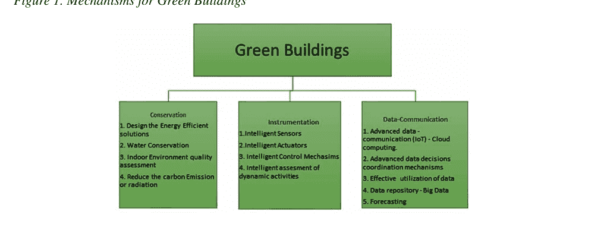

## 场地与结构设计的效率

建筑物的位置、在不牺牲性能的情况下成本效益高的设计定义了效率。建筑行业并未标准化，因建筑而异。由于变量太多，复杂性增加。即使单个变量的变化也会影响整体计算。低能耗住宅采用太阳能设计以平衡整体可行性。规划和开发阶段是最关键的阶段，因为所有未来的决策都是基于初始设计做出的。整体成本节约和绿色影响取决于初始阶段考虑的所有因素。第一阶段需要考虑的因素包括地形、对齐和朝向、材料、化学成分、外部和内部设计、供暖/制冷系统、海拔高度、全年气候条件、住宅或商业空间、居住人数、使用的能源资源、备用电源系统、废物管理系统。

## 能源效率

能源成本每天都在增加，影响所有消费者的日常预算。最大限度地利用自然光有助于避免成本上升。对于日光照明的窗户定位、建筑对齐和朝向、屋顶和墙体的遮阳、以及建筑材料选择的适当性。利用太阳能、水力、热能、生物质等自然资源为建筑消耗生产能源，减少了对人造资源的需求。超现代的废物管理系统有助于减少影响，同时也补充了当地能源生产。建筑物的设计使得在夏季可以储存热量并稍后重新使用，并在寒冷季节最大化室内的太阳能。鼓励最少使用照明、制冷/加热系统、电梯、喷洒水，并建议消费者始终做出最佳使用并避免任何浪费。

## 水资源效率

节约水资源并确保向每个人提供纯净和可饮用水是建筑物关注的焦点。人数越多，日常消耗所需的水就越多。特别是在夏季，消耗量增加，导致该国许多地区出现水资源短缺。需要大量的资金和能源才能到达这些地区，这导致了水资源的垄断和黑市交易。地下水位正在下降，因此水资源重复利用是主要重点。使用非污水和中水在一定程度上有助于减少消耗。大多数建筑物正在部署低冲水马桶和低流量淋浴器，以最大限度地减少过度用水。水净化、氯化、脱盐、处理和加热对能源、成本和水资源节约有着巨大影响。许多公司使用的双管系统有助于保持相同的水循环。

## 材料效率

使用生态友好的聚氨酯泡沫块可以降低成本，增加速度，并具有兼容性和耐用性。通过使用环境友好的产品来减少碳足迹是必须的。在施工现场使用的材料应场外制造，这有助于减少废物和污染，专注于使用环境友好的优质产品，并改善 OHS（职业健康与安全）管理。EPA（环境保护局）指南关注在项目中使用回收和重新开发的材料，如碎石、沙子、可燃材料。

## 室内空气质量

重点是减少空气污染并提高空气质量，为所有居住者提供清晰和新鲜的空气。微生物、细菌、花粉颗粒、病毒和挥发性化合物污染空气。隔离干燥区、厨房区、洗涤区、工作区，并为每个区域提供适当的通风，是主要的决定因素。许多使用的物质含有有害的化学成分，因此应优先考虑生态友好型产品。特别是油漆、玻璃、成品含有化学物质并释放有毒气体。这些对周围环境的所有生物有害，阻碍了周围气候。基于建筑物位置、朝向和通风设计的完善的 HVAC 系统将有助于在建筑物中提供最大化的自然光。自然光和清洁的空气也将有助于提高生活质量。绿色建筑带来清洁和绿色的城市，从而影响和减少全球变暖的影响。垂直花园正在各国开发和使用，以节省空间和成本，并有助于绿色地球。垂直花园是天然的空气净化系统，可改善呼吸状况并促进健康的生活方式。它们有助于减少噪音污染，为员工提供平静、宁静和安详的氛围，以便放松并专注于工作。我们的世界因全球变暖导致气温升高、污染导致的空气质量标准不佳、致命的紫外线辐射以及不规律的降雨而受苦。外部垂直花园在夏季进行蒸腾作用，有助于冷却空气并保护免受所有这些问题的影响。

## 运营与维护优化

绿色建筑的挑战不仅在于初始投资，还在于持续的升级和维护。一种方法是让所有团队成员从一开始的决策过程和整个流程都参与其中。初步规划将有助于 O&M（运营与维护）人员日后寻找各种手段，在各种领域中成功维持绿色建筑。需要研究和实施新的绿色技术。必须对回收和处理进行工作。废物管理、空气净化、水资源和能源节约等领域将是他们的首要关注点。

## 减少废弃材料

由于建筑数量的增加，填埋区正在增加，填埋量正以巨大数量出现。一个目标应该是尽量减少影响填埋并间接污染环境废物。具有适当设计的建筑物有助于最大限度地减少输出废物，并为现场废物处理提供解决方案，以便没有任何废物被送往填埋场。“中水”，来自水源的废水用于灌溉或非饮用水活动，例如洗涤和清洁。雨水排水沟和水库很受欢迎，甚至得到当地政府的资助。现代废水处理系统成本高昂且消耗大量能源。将其用作生物废物可以避免这些成本并显示其他好处。使用技术去除二氧化碳并控制温室排放。

## 成本

现在投资于绿色计算就是投资于国家和未来几代的未来。按照目前的资源消耗速率，未来几代将面临无资源可用。


企业发现很难在初始成本和终身成本之间取得平衡。随着绿色计算投资的增加，降低初始成本变得至关重要。如今，企业已经开展了研究，指出绿色计算对人类和其他资源的长期影响，这为公司和地球带来了整体益处。其他成本可以通过提高员工绩效、削减成本和其他服务费用来覆盖。更好的生活标准、卫生条件、较低的死亡率推动了对绿色计算理念的发展。每个人都为保护自然和为后代建设做出贡献的理念正在全球范围内获得动力。

## 架构

最近的调查和研究表明，60%的能源消耗归因于建筑（W. Tushar, C. Yuen, W.-T. Li, D. Smith, T. Saha, & K. L. Wood, 2018）。因此，目前有许多研究致力于有效管理消耗，使绿色建筑既高效又经济。物联网使用各种低成本传感器收集数据并将其提供给学习系统，以修改当前昂贵的设计并将效率提升到可接受和合理的成本范围。图2展示了基于云的物联网架构，用于绿色建筑管理系统。它由以下组件组成

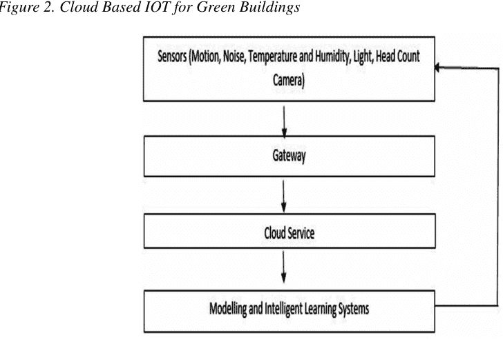

## 传感器

不同的物联网传感器、智能电表和执行器可以集成到当前管理系统中，以监控以下方面：

- **照明：** 重点是以低能耗获得所需的照明。自然采光（Daylighting）和日光收集（Daylight harvesting）利用自然资源（自然采光：整体建筑设计指南）并减少对人工资源的使用和浪费（Sandhyalaxmi G. Navada, Chandrashekara S. Adiga, and Savitha G. Kini, 2013）。关于智能建筑设计、适当材料使用等的研究已被许多研究人员涵盖（Izzet Yüksek & Tülay Tıınsanakaradayi, 2017）。基于占用率的最佳预测进行智能照明和控制系统的研究。这些方法通过获取占用率数据并计算最低光照条件以满足所有人的需求，从而关注降低电力需求。高效的传感器技术结合快速响应信号技术有助于实现优化结果（Z. Cheng, Q. Zhao, F. Wang, Y. Jiang, L. Xia, & J. Ding, 2016）（S. Jain & V. Garg, 2018）（A. Pandhripande & D. Caicedo, 2015）（X. Guo, D. Tiller, F. Henze & C. Waters, 2010）

- **柔性负载：** 这包括热水器、冰箱、电视、洗衣机、洗碗机、能源存储系统等负载。随着各国生活标准的提高，电子系统的使用和电力消耗急剧增加。人类控制和干预在控制这种负载方面有很多局限性。每栋建筑内置自动化技术的非侵入式负载监控能带来最佳效果。通过结合行为和使用模式、占用率以及需求变化来计算负载需求。这些数据存储在内存系统中，随后输入到学习管理系统中，以预测和预测建筑物的未来需求。自动控制器限制对这些高耗能负载的输入，并在这些服务器上维护的常规日志作为管理这些系统以及负载计算系统的报告工具。大多数设备利用自然资源有助于降低成本并实现绿色计算。正在进行的研究强调监控使用模式并控制其操作以实现有效的能源管理。（A. Belmonte-Hernandez, G. Hernandez-Penalosa, F. Alvarez, & G. Conti, 2017）（S. Singh & A. Majumdar, 2017）（D. Zhang, S. Li, M. Sun, & Z. O’Neill, 2016）（W. Kong, Z. Y. Song, D. J. Hill, F. Luo & Y. Xu, 2017）

- **暖通空调（HVAC）：** 这是主要电力消费者（W. Tushar et al., 2018）。主要重点已集中在不降低舒适度水平的情况下减少暖通空调系统的电力消耗。大多数重型机械和电气设备已被高端电子系统取代。随着引入更多自动化，能源和成本的节省相当可观。先进的故障检测和报警系统提高了暖通空调系统的标准。正在构建具有更高容错能力的建筑，使用智能传感器、控制器和执行器。执行器、传感器、控制器信息存储在云中和网络托管服务中，并与物联网系统集成。汇总的数据输入基于物联网的系统，进行细粒度级别分析，利用商业智能和深度学习算法形成准确决策，并使用信号为暖通空调系统提供即时反馈。正在进行的研究强调改进故障预防和使用环保电力资源。研究重点在于控制温度水平，同时更加关注减少暖通空调系统的电力消耗。（S. Ali & D.-H. Kim, 2013）（B. Sun, P. B. Luh, Q. S. Jia, Z. O’Neill & F. Song, 2014）（A. Mirakhorli & B. Dong, 2016）（A. Javed, H. Larijani, A. Ahmadi & D. Gibson, 2017）（A. Al-Ali, I. A. Zualkerman, M. Rashid, R. Gupta & M. Ali Karar, 2017）（M. Aftab, C. Chen, C.-K. Chau & T. Rahwan, 2017）

- **占用检测：** 使用不同的机器学习算法来检测人类占用情况并分类其活动。现代摄像头和传感器技术，如人脸识别标签、头部计数以及不同的热成像机制，辅助人类追踪和检测。使用红外线的先进运动传感器技术与参数化和非参数化算法同步，提高了准确性。正在尝试背景减除模型和其他机器学习算法来预测、追踪和分类占用者活动。如今，声音传感器也在许多情况下被使用。早期方法有很多假阳性，导致错误结果和不正确的预测。随着时间推移，这一问题已得到克服，并获得了更好的结果。研究人员在最终确定结果之前会进行大量的归一化、采样和测试。如今，低光条件摄像头被用于在所有条件下工作。监督学习方法使用预设数据来训练实时数据。（J. Salamon & J. P. Bello, 2015）（A. Tyndall, R. Cardell-Oliver, and A. Keating, 2016）（Y. P. Raykov, E. Ozer, G. Dasika, A. Boukoulas, and M. A. Little, 2016）（W. Li, Y. Lu, J. Sun, Q. Chen, T. Dong, L. Zhou, Q. Zhang, and L. Wei, 2017）

- **诊断与预测：** 电力系统的故障检测和维护已变得繁琐。为了减少负载，长期以来使用了不同的工具。但监控这些单独的工具并报告差异更是乏味的。缺乏标准化和不兼容性使事情变得更加复杂。物联网帮助从不同来源收集所有数据，并以一种标准格式输入进行处理，这有助于减少复杂任务。数据驱动的故障预防将其提升到了下一个层次。将所有能源管理系统集成在一起，并进行深入分析，减少了人工干预，在不超支的情况下优化了效率。物联网提供先进的数据驱动应用程序，用于检测故障、预测维护问题以及对暖通空调系统进行定期诊断。（B. Sun, P. B. Luh, Q. S. Jia, Z. O’Neill & F. Song, 2014）

- **物联网在设计能效解决方案中的作用：** 保护自然资源对于地球上的延续生命非常重要。消耗煤炭和石油产品等自然资源进行发电是不可持续的，因为这会导致未来几代的资源短缺（Kumar et al. 2014）。政府和公用事业公司应该认真考虑使用非传统能源资源来满足电力需求（Myers T et al. 2017）。为了实现来自替代能源的100%发电，应采用系统性的政策（Y. Liu et al. 2018）。在现代，公用事业公司正在利用所有高效方式来节约发电并明智地利用所发电力。公用事业公司正在采用基于物联网的云计算技术进行能源节约。像西门子这样的公司专门为公用事业和消费者设计软件，以有效地控制调节电力使用的电子设备。电气工程行业中有一句谚语：“节省一个单位能源，就利用一个单位能源。”基于物联网设备生成的关于电力使用的数据，最终用户或公用事业公司可以控制电力浪费。Rexel是众多公司之一，通过基于物联网的云计算技术有效地维护其发电、传输、分配和利用系统。通过向公用事业中心高效传输能源数据，基于云的物联网操作系统连接设备、应用程序、工厂、系统和机器，使集成所有这些实体成为可能，从而能够对物联网的大量数据进行综合分析。因此，这些数据可以被精确使用来分析并制定行动建议（S. Pérez et al. 2018）（Ankit Singh et al. 2018）。

用于能源的最新标准向客户提供所有信息，如账单、使用变化、事件、预付和后付方式，ZigBee Smart Energy 1.x、Smart Energy Profile 2.0 / IEEE


## 2030.5-2013，绿钮 / 能源服务提供商接口（ESPI）/ NAESB 请求 21 (NAESB) / 智能能源消费者标准

如今，物联网（IoT）为零售商提供的不同平台主要由三部分组成：感知、控制和计量。数据采集、预处理和监控由不同的传感器完成，用于检测湿度、热量、压力、噪声、移动、光线和物体。控制器用于根据传感器的输入来控制环境，这些输入包括开关、执行器、智能插座和恒温器。计量用于精确测量信息，以跟踪消耗量和能源需求的变化。这包括电表、水表等。

目前的趋势显示，正在使用诸如无电池能量收集开关和传感器（Cherry, EnOcean, ZF KNX 模块）以及低成本 Wi-Fi 控制器（Particle, Ayla Networks, Exosite, Relay, FogHorn, Plat.One, Rivian, LoneStar, SAP, xPic, Microchip）等物联网设备（倾向于使用微控制器，因为它们提供简单性、安全性和成本效益）。显著的例子包括 Google 的 Nest、EchoBee、Netatmo、SimpliSafe、TenDril、Canary、Quby、iSmartAlarm 等等。其理念是确保使用基于物联网的系统实现如适应性、灵活性、兼容性、低延迟、互操作性、可扩展性和可行性等功能（S. K. Viswanath, C. Yuen, W. Tushar, W.-T. Li, C.-K. Wen, K. Hu, C. Chen, 和 X. Liu, 2016）。

### 网关

它执行从特定设备数据到特定云数据的转换。来自不同传感器的数据通过适配器连接，这些适配器提供双方的连接性和兼容性。它确保以各种格式（Wi-Fi、ZigBee、蓝牙、6LoWPAN）接收的数据被转换为标准格式。例如，它将 6LoWPAN 消息转换为 IPv4 格式，以便进一步存储和处理。传感器/设备将数据发送到网关，然后网关通过高速连接将数据回传至云端。

这允许传感器在短距离内进行通信，从而延长电池寿命，这对大多数应用至关重要，并进而延长每个传感器/设备的使用寿命。有时捕获的数据量巨大，这使得在后期阶段分离数据变得非常困难。

如今，在将数据推送到云端之前，会进行大量的过滤和预处理，这有助于减少过载和时间。它还有助于减少整体需求并节省存储成本。这对于实时应用的无延迟操作是有益的。总体性能将会提高。图 3 展示了一种高效的设备到网关通信系统的后端共享设计；它收集来自单个物联网设备的数据以供分析。这种主动的实际后端信息共享设计为用户提供在物联网设备之间切换的灵活性，克服了传统信息存储系统的模式。

### 云服务

云服务主要由云服务经纪人组成，它们从网关或其他设备同化信息，并在以特定格式存入本地数据库之前进行预处理。分析后的数据可以显示出来，以监控并检查任何设备中的错误。事件管理器制定规则，并在检测到故障或紧急情况下触发警报。例如，基于温度传感器的数据，它将检查是否超过了设定的阈值水平，从而触发警报并进一步处理。控制模块将监控设备的健康状况，并通过移动或 Web 应用程序显示当前状态。它识别并监控关键的能源变量，以计算供暖和能源需求，以保持建筑的健康并智能地评估子系统的行为。

### 绿色建筑的基于云的物联网架构

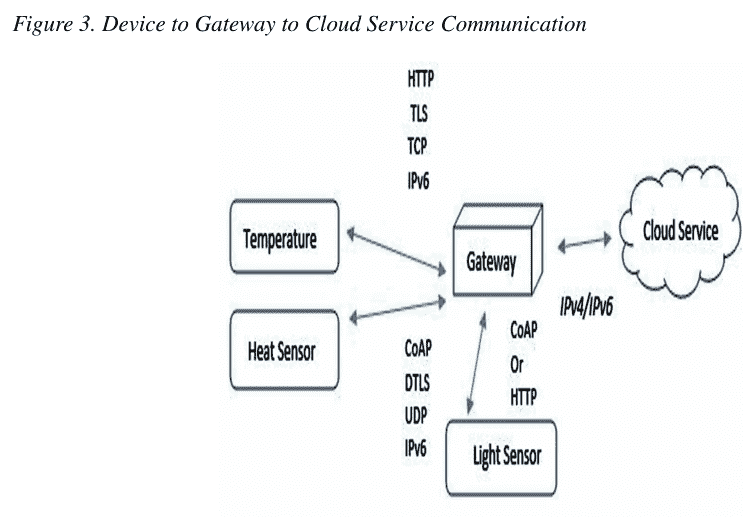

一个集成的云启用物联网系统具有开放架构，允许建筑管理员查看建筑的所有参数。输入参数将从电表、水传感器、热传感器、噪声传感器和运动传感器中收集。关于占用者及其移动的数据将由相应的传感器追踪。过去和现在的整体能耗记录将被测量。这些数据将作为输入提供给智能系统，该系统将分析和预测输出。一旦基于设计规则和潜力完成分析，控制器就会被启用。执行器在执行方面发挥着重要作用。恒温器、控制器和开关有助于利用来自智能系统的反馈。

### 建模和智能学习系统

它以云模型中的能源使用信息作为输入，有助于物联网系统的状态监控、预测性维护、智能能源控制、故障检测和维护。主要关注领域是暖通空调（HVAC），其数据集庞大且复杂。大多数研究将机器学习与人工控制结合使用。许多研究人员使用了无监督学习方法，但最终结果表明需要人工解释和干预。（L. P L. Billy, N. Wijeratne, B. K. K. Ng, 和 C. Yuen, 2017）（Fernanda Cruz Rios, Kristen Parrish, Wai K Chong, 2016）。

### 基于参数的详细建模

考虑如占用率、湿度、温度、降水、PPM 水平、电器、定位、通风和其他能源变量等参数，以设计优化资源利用并降低绿色建筑整体成本的新模型。这些参数对于设计和优化至关重要。

- **占用率：** 预测占用者及其在不同时间间隔的活动对于建模系统至关重要。更多的误报会导致预测不准确，从而导致向控制系统发送错误信号，这将破坏用技术提升舒适度的完整理念。
- **湿度、降水和温度：** 由于气候全年不断变化，它成为最关键的参数。外部和内部条件以及湿度比必须精确。
- **百万分比（PPM 水平）：** 这也有助于预测和设计系统。百万分比（PPM 水平）取决于区域是城市还是农村，人口是密集还是稀疏，以及是工业区还是住宅区。这导致了空气净化器等系统使用量的增加，导致能源资源成本和使用量的上升。这影响了环境。
- **电器：** 必须考虑并计算占用者人数以及电器数量，以便进行准确测量。随着生活水平的提高，电器数量不断增加，电力负荷也随之增加。产生的电子废物数量也加上了这个清单。
- **定位：** 它变得至关重要，因为它有助于更准确的预测，且拓扑结构是一个固定参数。此外，全球各地的位置将对整体计算产生影响。
- **通风：** 将有助于识别自然光和日光的使用，从而使人工资源的使用量较少。

分割云上的可用数据，创建新的算法/方法，以减轻人工资源的负担并专注于可再生能源。实时数据预测和对物联网设备的及时反馈将增强监控和控制，提供即时结果。这将导致系统适当的调度并减少人为错误。

许多学习算法已经在收集的大量数据上进行了测试和应用。专家单独以及以各种组合尝试并测试了机器学习以及深度学习算法。从大多数这些论文中可以得出结论，像支持向量机（SVM）以及神经网络这样的著名模型（Giovanni Tardiolli, Ruth Kerrigan, Mike Oates, James O’Donnell, Donal Finn, 2015）无法用于长期和大规模预测。即使在详细的建筑画像中，准确性也是最低的。（Lai Wei, Wei Tian, Elisabete A Silva, Ruchi Choudhary, QingXinMeng & Song Yang, 2015）（Kadir Amasayi & Nora El-Gohany, 2016）。少数研究表明，深度极端学习机（DELM）在小时和每周能源消耗预测方面比其他神经网络更准确且更好。（Muhammad Fafaz and DoHyun Kim, 2018）。还观察到，深度自编码器表现优于主成分分析（Hinton, G.E.; Salakhutidinov, R.R, 2006）。这些研究极具挑战性，并依赖于众多因素，因此它们的结果不能被视为统一且有效的。此外，这些算法中用于时间序列预测的数据集中的数据少于该领域的其他研究。试错预测机制在小型或受控环境中有效，而在开放和大型商业空间中则不然。

### 用于预测性维护的异常检测

从预处理的数据中，机器学习可以检测系统或过程中的异常或故障。这将有助于定位并找出导致故障或影响系统性能的问题根源。它将有助于扫描所有资源，这些资源可能具有集成且成本效益高的解决方案。它可以帮助预测改造候选者，从而帮助削减成本。（Daniel E Marsaco, Constantine E. Kontokosta, 2016）


## 从复杂到简单

将复杂的数据集进行分解，并应用机器学习来分析来自所有设备的数据。定性分析和定量分析将有助于构建智能学习系统。分析结果将帮助系统变得智能化，从而有效地控制环境。学习并调整，正如我们称这个过程一样。例如，室内空气质量取决于加热/冷却、通风以及建筑物的位置。基于不同参数创建智能建筑 (Szilagyi & P. Wira, 2018) (M. Manic, D. Wijayasekara, K. Amarasinha and J. J. Rodriguez-Andina, 2016) (M. Manic, K. Amarasinha, J. J. Rodriguez-Andina & C. Rieger, 2016)。

新加坡科技工程有限公司、Allied Digital Services有限公司、NG Bailey集团、施耐德电气SE、台达电子股份有限公司、西门子有限公司、太平洋控制系统、Larsen & Toubro有限公司、T-Systems International GmbH和Advanced Control Corporation等公司，通过将智能物联网解决方案与云架构集成，已经创建了有效的设计解决方案。其主要特点是具有单个前端接口的定制集成解决方案、减少能耗并降低运营成本以及低碳足迹、审计已数字化且无人工干预从而规范合规性。电梯、消防/防洪、生命安全和安全系统是即时的，且报告非常优秀。(Enertiv – 智能建筑解决方案) (M. Manic, K. Amarasinha, J. J. Rodriguez-Andina & C. Rieger, 2016)。

## 参考文献

- Advanced Control Corp. (无日期). 取自 https://advancedcontrolcorp.com
- Aftab, M., Chen, C., Chau, C.-K., & Rahwan, T. (2017). 在低成本嵌入式系统中实现基于实时占用识别和模拟引导模型预测控制的自动暖通空调控制。*Energy and Building, 154*, 141–156. doi:10.1016/j.enbuild.2017.07.077
- Al-Ali, A., Zualkernan, I. A., Rashid, M., Gupta, R., & Alakarar, M. (2017). 使用物联网和大数据分析方法的智能家居能源管理系统。*IEEE Transactions on Consumer Electronics, 63*(4), 426–434. doi:10.1109/TCE.2017.015014
- Ali, S., & Kim, D.-H. (2013). 使用卡尔曼滤波器进行建筑能源管理的高效舒适电力控制模型。*Wireless Personal Communications*, 73(4), 1439–1453. doi:10.1007/11277-013-1259-9
- Amasaly & El-Gohary. (2016). 支持能源数据分析的建筑照明能耗预测。*Procedia Engineering, 145*, 511-517.
- Andreas, P. (2018). 智能建筑中基于物联网的高效传感器大数据收集、处理与分析。*Future Generation Computer Systems*, 82, 349–357. doi:10.1016/j.future.2017.09.082
- Belmonte-Hernandez, A., Hernandez-Penaloza, G., Alvarez, F., & Conti, G. (2017). 多传感器融合中用于精确室内跟踪的自适应指纹识别。*IEEE Sensors Journal, 17*(15), 4983–4998, doi:10.1109/JSEN.2017.2715978
- Billy, Wijerathne, Ng, & Yuen. (2017). 智慧城市中用于公共空间利用监测的传感器融合。*IEEE Internet of Things Journal*.
- Bouibiche, D. E., Pathan, A.-S. K., Lloretn, J., Zhou, H., Hong, S., Amin, S. O., & Feki, M. A. (2018). 先进工业无线传感器网络和智能物联网。*IEEE Communications Magazine, 56*(2), 14–15. doi:10.1109/MCOM.2018.8291108
- Campbell, B., Clark, M., DeBruin, S., Ghena, B., Jackson, N., Kuo, Y.-S., & Dutta, P. (2016). 针对建筑环境的永久性感知。*IEEE Pervasive Computing, 15*(4), 45–55. doi:10.1109/MPRV.2016.66
- Cheng, Z., Zhao, Q., Wang, F., Jiang, Y., Xia, L., & Ding, J. (2016). 基于满意度的Q学习用于集成照明和百叶窗控制。*Energy and Building, 127*, 43–55. doi:10.1016/j.enbuild.2016.05.067
- Condry, M. W., & Nelson, C. B. (2016). 使用智能边缘物联网设备进行更安全、快速响应工业物联网控制操作。*Proceedings of the IEEE, 104*(5), 938–946. 10.1109/JPROC.2015.2513672
- 采光: 整体建筑设计指南. (无日期). 取自 https://www.wbdg.org/resources/daylighting
- Enertiv – 智能建筑解决方案. (无日期). 取自 https://www.enertiv.com
- Fayaz & Kim. (2018). *基于深度极限学习机的能耗预测方法及住宅建筑中的比较分析*. Academic Press.
- Gebreslassie, B., Zayegh, A., & Kalam, A. (2017). 使用执行器传感器接口网络协议设计、建模智能绿色建筑。*Australasian Universities Power Engineering Conference (AUPEC)*, 1-6. 10.1109/AUPEC.2017.8282492
- Guo, X., Tiller, D., Henze, G., & Waters, C. (2010). 基于占用的照明控制系统性能：综述。*Lighting Research & Technology, 42*(4), 415–431. doi:10.1177/1477153510376225
- Hinton, G. E., & Salakhutdinov, R. R. (2006). 使用神经网络降低数据维度。*Science, 2006*(313), 504–507. doi:10.1126/science.1127647 PMID:16873662
- Jain, S., & Garg, V. (2018). 使用实时日光预测方法对遮阳板、百叶窗和集成照明进行开环控制策略的综述。*Building and Environment, 135*, 352–364. doi:10.1016/j.buildenv.2018.03.018
- Javed, A., Larijani, H., Ahmadian, A., & Gibson, D. (2017). 使用云计算技术的智能随机神经网络暖通空调控制器。*IEEE Transactions on Industrial Informatics, 13*(1), 351–360. doi:10.1109/TII.2016.2597746
- Kelly, S. D. T., Suryadevara, N. K., & Mukhopadhyay, S. C. (2013). 迈向物联网在家庭环境条件监测中的实施。*IEEE Sensors Journal, 13*(10), 3846–3853. doi:10.1109/JSEN.2013.22623379
- Kong, W., Dong, Z. Y., Hill, D. J., Luo, F., & Xu, Y. (2017). *基于随机行为学习的短期居民负荷预测，IEEE Transactions on Power Systems*. 预印本. doi:10.1109/TPWRS.2017.2688178
- Kumar, A., & Hancke, G. P. (2014). 基于IEEE 1451标准的绿色建筑节能智能舒适传感系统。*IEEE Sensors Journal*, 14(12), 4245-4252. doi:10.1109/JSEN.2014.2356651
- Li, W., Lu, Y., Sun, J., Chen, Q., Dong, T., Zhou, L., . . . Wei, L. (2017). 基于改进高斯过程回归的人员计数。*Proc. of International Conference on Security, Pattern Analysis, and Cybernetics (SPAC)*, 603-608.
- Lilis, G., Conus, G., Asadi, N., & Kayal, M. (2017). 迈向下一代智能建筑：当前自动化和未来基于物联网的系统的评估研究及过渡性设计提案。*Sustainable Cities and Society*, 28, 473-481. doi:10.1016/j.scs.2016.08.019
- Liu, Y., Akram Hassan, K., Karlsson, M., Weister, O., & Gong, S. (2018). 基于云和物联网的绿色室内气候主动植物墙。*IEEE Access: Practical Innovations, Open Solutions*, 6, 33631-33644. doi:10.1109/ACCESS.2018.2847440
- Liu, Z., Chen, D. K., Peh, D. L., & Tan, D. K. W. (2017). 建筑信息模型在绿色标记新非住宅建筑 (NRB) 中的可行性研究：2015年分析。*Energy Procedia*, 143, 80-87. doi:10.1016/j.egypro.2017.12.651
- Lu, Y., Wu, Z., Chang, R., & Li, Y. (2017). 绿色建筑的BIM：关键综述与未来方向。*Automation in Construction*, 83, 134-148. doi:10.1016/j.autcon.2017.08.024
- Manic, M., Amarasinghe, K., Rodriguez-Andina, J. J., & Rieger, C. (2016). 未来的智能建筑：具备网络感知能力、由深度学习驱动并有人类交互。*IEEE Industrial Electronics Magazine*, 10(4), 32-49. doi:10.1109/MIE.2016.2615575
- Manic, M., Wijayasekara, D., Amarasinghe, K., & Rodriguez-Andina, J. J. (2016). 建筑能源管理系统：智能和自适应建筑的时代。*IEEE Industrial Electronics Magazine*, 10(1), 25-39. doi:10.1109/MIE.2015.2513749
- Marasco & Koutkosta. (2016). 机器学习方法在识别和预测建筑节能改造机会中的应用。*Energy and Buildings*, 431-441.


## 参考文献

Pérez, S., Hernandez-Ramos, J. L., Matheu-Garcia, S. N., Rotondi, D., Skarmeta, A. F., Straniero, L., & Pedone, D. (2018). A Lightweight and Flexible Encryption Scheme to Protect Sensitive Data in Smart Building Scenarios. *IEEE Access: Practical Innovations, Open Solutions*, 6, 11738–11750. doi:10.1109/ACCESS.2018.2801383

Raykov, Y. P., Ozer, E., Dasika, G., Boukouvalas, A., & Little, M. A. (2016). Predicting room occupancy with a single passive infrared (PIR) sensor through behavior extraction. *Proceedings of ACM International Joint Conference on Pervasive and Ubiquitous Computing*, 1016–1027. 10.1145/2971648.2971746

Reka, S. S., & Dragecevic, T. (2018). Future effectual role of energy delivery: A comprehensive review of Internet of Things and smart grid. *Renewable & Sustainable Energy Reviews*, 91, 90–108. doi:10.1016/j.rser.2018.03.089

Reyna, A., Martín, C., Chen, J., Soler, E., & Díaz, M. (2018). On blockchain and its integration with IoT. Challenges and opportunities. *Future Generation Computer Systems*, 88, 173–190. doi:10.1016/j.fgcs.2018.05.046

Rios, F. C., Parrish, K., & Chong, W. K. (2016). Low-investment energy retrofit framework for small and medium office buildings. *Procedia Engineering*, 145, 172–179. doi:10.1016/j.proeng.2016.04.057

Salamon, J., & Bello, J. P. (2015). Unsupervised feature learning for urban sound classification. *Proceedings of IEEE International Conference on Acoustics, Speech and Signal Processing (ICASSP)*, 171–175. 10.1109/ICASSP.2015.7177954

Singh, A., Kumar, D., & Hötzel, J. (2018). IoT Based information and communication system for enhancing underground mines safety and productivity: Genesis, taxonomy and open issues. *Ad Hoc Networks*, 78, 115–129. doi:10.1016/j.adhoc.2018.06.008

Singh, S., & Majumdar, A. (2017). Deep sparse coding for non-intrusive load monitoring. *IEEE Transactions on Smart Grid*.

Suh, C., & Ko, Y. (2008). Design and implementation of intelligent home control systems based on active sensor networks. *IEEE Transactions on Consumer Electronics*, 54(3), 1177–1184. doi:10.1109/TCE.2008.4637604

Sun, B., Luh, P. B., Jia, Q. S., O'Neill, Z., & Song, F. (2014). Building energy doctors: An SPC and Kalman filter-based method for system-level fault detection in HVAC systems. *IEEE Transactions on Automation Science and Engineering*, 11(1), 215–229. doi:10.1109/TASE.2012.2226155

Szilagyi & Wira. (2018). An intelligent system for smart buildings using machine learning and semantic technologies: A hybrid data-knowledge approach. In *IEEE Industrial Cyber-Physical Systems* (pp. 20–25). St. Petersburg: ICPS.

Tardioli, G., Kerrigan, R., Oates, M., O'Donnell, J., & Finn, D. (2015). Data driven approaches for prediction of building energy consumption at urban level. Published in *Energy Procedia*, 78, 3378–3383. doi:10.1016/j.egpro.2015.11.754

Tushar, W., Yuen, C., Li, W.-T., Smith, D., Saha, T., & Wood, K. L. (2018). Motivational psychology driven AC management scheme: A responsive design approach. *IEEE Transactions on Computational Social Systems*, 5(1), 289–301. doi:10.1109/TCSS.2017.2788922

Tyndall, A., Cardell-Oliver, R., & Keating, A. (2016). Occupancy estimation using a low-pixel count thermal imager. *IEEE Sensors Journal*, 16(10), 3784–3791. doi:10.1109/JSEN.2016.2530824

Uğur, L. O., & Leblebci, N. (2018). An examination of the LEED green building certification system in terms of construction costs. *Renewable & Sustainable Energy Reviews*, 81(Part 1), 1476–1483. doi:10.1016/j.rser.2017.05.210

Visvanath, S. K., Yuen, C., Tushar, W., Li, W.-T., Wen, C.-K., Hu, K., ... Liu, X. (2016). System design of the internet of things for residential smart grid. *IEEE Wireless Communications*, 23(5), 90–98. doi:10.1109/MWC.2016.7721747

Wei, Tian, Silva, Choudhary, Meng, & Yang. (2015). Comparative Study on Machine Learning for Urban Building Energy Analysis. *Procedia Engineering*, (121), 285-292.

Yükseky Karadayi. (2017). Energy-Efficient Building Design in the Context of Building Life Cycle. In *Energy Efficient Buildings*. IGI.

Zhang, D., Li, S., Sun, M., & O'Neill, Z. (2016). An optimal and learning-based demand response and home energy management system. *IEEE Transactions on Smart Grid*, 7(4), 1790–1801. doi:10.1109/TSG.2016.2552169

# 第5章：用于智能音箱发现与播放连续性的泛在物联网（IoT）

**作者：**
- Aun Yichiet, 马来西亚敦阿都拉曼大学
- Jasmina Khaw Yen Min, 马来西亚敦阿都拉曼大学
- Gan Ming Lee, 马来西亚敦阿都拉曼大学 (ORCID: 0000-0002-0993-1130)

## 摘要

物联网（IoT）的核心功能之一是全局设备发现，它允许人们在整个互联网范围内控制和连接的设备。在泛在物联网中，利用人工智能进行设备配对、内容发现、动作信号发送以及基于上下文信息的命令调度，可以实现设备管理无缝且自动化，从而建立在自管理设备范式之上。本章提出了一种用于智能音箱的新型切换技术，以确保当用户在由多个可发现音箱组成的智能空间中移动时，保持播放连续性。目前的实现方案包括 Spotify Connect，它是特定于服务的，因此缺乏发现功能的稳健性。提出的切换发现器在设备层面而非服务层面进行操作，以通过自学习拓扑发现（SLTD）方法提高设备的可见性和互操作性。为了实现及时切换，设计了一种快速抢占式切换方法（RPF）来优化 TCP 握手机制，并使用内容预缓存技术来最小化软切换期间的播放间隙。

DOI: 10.4018/978-1-7998-2803-7.ch005

## 引言

面向云计算和边缘计算，为了进行主动设备参与和网络构建，设备可发现性变得越来越普遍（Tianfield, 2018; Hong, 2017）。在早期，*数字生活网络联盟*（DLNA）是检测设备存在的通用协议，但它支持的设备有限，因此缺乏稳健性。SNMPv3 作为一种现代发现协议，可以识别设备直到传感器级别，但其知识局限于设备属性，而缺乏对周围网络的全球感知（Yin, 2012）。物联网的诞生进一步增强了连接设备的可达性，依赖于流行的应用协议，如 *XMPP*、*CoAP*、*MQTT* 以及一些专有平台，如 *Apple Home*、*Google Home* 和 *Amazon Alexa*（Luzuriaga, 2015）。如今，设备之间的广泛连接使现代应用程序能够利用设备间的互操作性来提升用户体验，例如实现服务的无缝连接（Kang, 2013; N. Fathima, 2017; Barnaghi, 2016）。

在下一代物联网中，设备到设备的通信正逐渐取代人到设备的通信，迈向由人工智能驱动的物联网网络（Dawod, Georgakopoulos, Jayaraman, & Nirmalathas, 2019）。传统上使用 *IFTTT* 和 *Siri* 快捷方式调用的用户命令（Vongchumn, 2019），现在可以通过概率推理委托给人工智能进行命令预测（Képúska, 2018; Pham, 2018）。一个朴素的例子是，用户通过 *MQTT* 发布消息来开启连接空气净化器的行为，现在由 PM2.5 传感器检测空气质量不佳并自动开启空气净化器（Luzuriaga, 2015）。PM2.5 读数称为环境数据，用作推理的线索；当结合位置、距离、用户身份、活动信息等线索时，它们可以外推到多维感知系统（Vishwakarma, 2019; Fortunato, 2019）。得益于现代物联网设备传感器配置的增多，情境感知系统取得了巨大进步（Valarmathi, 2016）。物联网设备现在可以从环境智能中受益，使其摆脱有限的位置约束，以便物联网设备之间能够无缝工作和同步，以执行更复杂和协调的任务。

本章提出了一种通过室内空间中的用户位置追踪来实现智能音箱切换的新技术。对于声学社区而言，实现理想音频体验的两个最常见挑战是：(1) 音频保真度和 (2) 覆盖区域；现在可以使用基于位置感知的音箱来解决这些问题。传统上，音乐被流式传输到连接到附近接入点（AP）的音箱，该智能空间由多个独立的音箱单元组成。目前，如 *Spotify* 等服务提供了发现所有具备播放能力节点的 API；然后，用户可以根据个人偏好手动选择主音箱。本章提出了一种自动音箱选择技术，将播放设备选择委托给人工智能推理，以满足平衡音频播放的空间需求。其直觉在于，在多个音箱以近网格拓扑连接的智能空间中，音乐应该由距离听众最近的音箱播放。利用空间感知，通过追踪用户移动和室内位置变化，音乐可以在一组音箱上连续播放。例如，在音箱集合 $S_x = \{S_1, S_2, S_3...S_n\}$ 中；该算法在离散时间 $t_f$ 基于用户 ($U_j$) 和音箱节点 ($S_j$) 之间的距离 (*d*) 选择一个活动音箱 (S)。切换方法通过音箱选择和跳跃，确保音频播放向相关联的轨道持续进行。


## 服务连续性的临时设备移交

物联网（IoT）将设备发现带入了新的领域。通过 MQTT，传统上受限于专有协议的设备现在对任何经过授权的连接设备可见（Lu, 2009）。这为诸如设备间同步、设备跳频（device hopping）以及跨平台设备自动化等服务中前所未有类型的连续性铺平了道路。在连续性方面观察到一个显著特征：当特定的上下文、设备运行状态或环境条件发生变化时，物联网设备可以将其中部分角色智能地移交给一组潜在设备；具体取决于设备的分类（Bashah, 2011; Sharma, 2018; Marbukk, 2019）。其直观逻辑在于，鉴于连接设备的大量可用性，泛在物联网面临的挑战是自主识别最合适的候选设备以满足特定用户请求。移交（handoff）的概念已在电信领域应用多年；移动手机在移动过程中会不断连接到不同的基站（Hashem, 2000; Dutta, 2006）。类似地，将一个物联网设备的服务转移到另一个设备的能力可以深刻影响用户体验。

## 移交技术

移交可以定义为将活跃的用户请求或会话从一个或多个“当前”设备转移到某些“下一个”设备。下一个设备可以是设备分类学中的同一类别，或者当服务上下文发生变化时来自其他类别。移交通常通过握手传输算法实现，并可定制为设备对设备或控制器对设备的通信拓扑，以满足物联网需求（Sharma, 2018; Klems, 2010）。本节讨论一些常用的移交技术。

- **周期性移交** – 当满足某些时间约束时，服务请求从设备 A 转移到设备 B。周期性移交处理时间触发器，它可以是设备或协议设计期间定义的阈值，或者是用户指定的偏好。周期性移交的概念是在同类设备之间进行轮换；出于许多原因，例如（1）在时间上对负载均衡用户请求，（2）防止某些设备独占资源，（3）解决硬件限制（冷却、计算负载），以及（4）偶尔促进服务多样性（Kaur, 2018; Nishad, Kumar, & Bola, 2016）。有几种策略，但它们主要围绕阈值进行；阈值可以以秒或毫秒为单位预设。常见的移交模式包括轮询（round-robin）、最小加权（least weighted）和自定义调度。例如，在满足阈值 $x_1=10\text{ms}$ 后，A 将活跃角色转移给 B；在下一个 $x_2=10\text{ms}$ 后，B 转移给 C。周期性移交在物联网照明中很常见；不同的光源轮流点亮以节约能源。另一个用例可见于最近的奥运会，英特尔展示了一场无人机灯光秀；其中每架无人机在时间上受到控制以点亮并形成特定的独特编队。

- **基于位置的移交** – 是一种位置感知的移交技术，考虑智能空间中的设备定位。智能空间是一个由彼此可见的智能设备集合组成的区域。为了简单起见，考虑一个拥有 3 个房间和一个大厅的标准布局房屋。四个连接式扬声器分别安装在每个房间内（Weitrathmüller, 2007; Morhart, 2009; Dong, 2016）。基于位置的移交的目标是为音乐播放选择理想的扬声器；这本身就是一个选择问题。涉及两个重要组件：跟踪机制和选择策略。这里的跟踪指的是用户跟踪，使得感兴趣的人（POI）的移动可以在智能空间中进行测量。许多跟踪技术将在下一节中详细讨论。室内场景的物联网用例通常使 GPS 三角测量无效；然而，共识认为，鉴于物联网设备之间的空间余量，准确性有一定的宽松度（Hashem, 2000; Gu, 2009）。对于设备选择，主要直观想法是根据用户与设备的距离，不断在物联网设备链中转移服务请求，以保持服务连续性。大多数选择策略都是距离近似的衍生形式，但针对不同约束进行了优化。重复选择处理在饱和空间中从许多相似设备中选择一个；意图感知选择在算法推理之上评估用户的需求和欲望，而基于机器学习的技术则根据用户行为增强设备选择。例如，音乐播放可以随着用户移动从扬声器 A->B->C 进行移交。基于位置的移交的缺点是缺乏意图感知；例如，当用户在房间 A 中打算停留，但为了取一杯水短暂移动到房间 B，然后移回 A。尽管如此，基于定位的移交因其通用性而日益受到重视，类似于在 20 世纪早期流行的近程传感器启用的照明。

- **基于配置的移交** – 是一种基于设备角色和功能的连续性设备选择技术。现代物联网设备嵌入了丰富的元数据，描述设备信息；其中一个重要条目是设备“类型”。类似于 UPnP；设备在网络上广播其角色；例如“智能电视”、“hue 灯光”、空气净化器等（Lu, 2009）。还有主动发现，无论是特定协议的，如 Apple Bonjour 服务，还是启用回声的设备（Yin, 2012; Vongchurney, 2019）。为了通用使用，许多研究探索设备指纹识别以揭示设备角色和功能。物联网移交的区别在于如何利用这些信息来丰富用户体验。这种移交的主要策略是根据兼容性指数选择合适的设备；例如设备 A 最适合执行特定服务。例如，智能电视很可能是电影播放的首选（尽管声音也是一个主要因素）；但不是音乐播放；与此同时，专用扬声器对于音频保真度更为理想。其想法是没有一种“一刀切”的设备可以满足多样化的用户请求，但每项任务都存在一个合适的设备。移交可以以顺序模式发生，其中 A 传递给 B，B 传递给 C，当任务的阶段被执行时；或以复合模式发生；其中 {A, B, C} 共同工作以解决一个服务请求。如果设备角色高度可见且可发现，基于配置的移交可以有效防止单一物联网设备的主导地位，并不同专业能力的物联网节点委托服务。

大量可见的智能扬声器增加了设备选择的复杂性（Huang, 1997; Venkataram, 2000）。在扬声器覆盖区域重叠的智能空间中，需要选择标准来选择“最匹配”的设备以满足用户请求。该问题被形式化为给定一组物联网设备，$S = \langle D_1, D_b, D_z \rangle$；设计 $f(s)$ 基于上下文和约束选择最优设备 $D_x$。与传统的设计用于负载均衡的选择不同，物联网连续性需要理解设备角色、功能以及服务请求语义（Wong, 2008）。本节展示智能扬声器连续性的其他一些考虑因素。

- **保持输出（Hold out）** – 是添加到预期移交之前的时序延迟。这在适用时防止立即移交，以适应短暂的移交；例如，用户从节点 A 移动到节点 B 片刻，但随后很快返回节点 A。保持输出试图在设备对设备握手的开始添加延迟；因此得名保持输出（Moon, 2018）。一种常见的实现是为每个即将发生的移交添加 $x$ 毫秒延迟；如果下一个移交是可感知的；则下一个移交的 $x$ 减小；否则增加。

- **空间感知** – 用于评估设备选择的结构线索。虽然仅对声学设备有用；但在有许多物理障碍的智能空间中，它对智能扬声器的选择尤为重要。该技术使用空间引擎工作；扬声器发出声波（全向）并感知回声返回时间以猜测周围物体。然后选择被建模为选择朝向源拥有较少障碍物的扬声器。考虑一个案例，用户离扬声器 A 比 B 更近；但有一堵墙将用户与扬声器 B 隔开。传统移交偏爱 B（距离越小越好）。空间感知选择考虑物理和声学特性；并选择扬声器 A，因为知道声学信号在穿透刚性结构时会急剧衰减（Chu, 2012; Wright, 1995; Evers, 2016）。

- **预测技术** – 利用机器学习；AI 用于对扬声器移交模式进行建模（从 Spotify connect 或 AirPlay 的手动移交中），以猜测如果移交即将发生时的潜在下一跳扬声器。移交模式通常是确定性的；因为用户的顺序动作是重复的；并且在智能区域中的路由（移动方式）相当有限。使用轨迹数据集，特定的用户机器学习模型可以使用结合活动和时间信息的 KNN、SVM 或 RNN 进行训练。因此，选择问题被定义为给定集合 $S = \{D_i, D_j, D_k\}$；下一个节点 $D_k$ 是最有可能访问的节点，使得 $D_k = f(D_i \to D_j, \to D_k)$；基于 RNN 轨迹模型进行推断。显然，这种选择在声学领域更为重要，因为预先移交允许平滑的音频过渡，而不是减少设备之间的播放间隙（Weirathmüller, 2007; Evers, 2016）。

- **公平性和排队论** – 轮询（Round-robin）是一种基于回合的朴素选择技术，用于委托用户请求。在轮询中，如果用户靠近多个扬声器，每个扬声器轮流进行音乐播放（Datta, 2016; Kaur, 2018; Joshi, 2018）。这是一种快速的选择方案，缺乏上下文感知；但对于通用移交很有用。有两个衍生形式；（1）窄域网络和（2）宽域网络。在（1）中，考虑本地化；选择算法在具有重叠覆盖的一组相邻节点中选择最优节点（Wright, 1995）。在（2）中，选择发生在物联网节点的全局视图中，没有接近线索。一种流行的实现是通过扬声器令牌化，其中每个扬声器将令牌传递给下一个相邻扬声器（需要扬声器形成预先同步网络）。托管这些扬声器成员资格的多播网络是弹性的；因为扬声器可以根据网络发现状态随时加入或退出组。该方法对扬声器（在任务委托和资源管理方面）更有益，而不是对改善用户体验。加权 RR 是一个自定义版本，其中从设备元数据（如声学评级）抓取扬声器技术规范作为额外的选择规则。

## 室内跟踪机制概述

无缝播放的一个决定因素由基于位置的移交的准确性决定。跟踪通常分为户外和室内跟踪；然而，它们并不互换使用。户外跟踪由 GPS 三角测量主导，但 GPS 信号在穿透室内场所时严重退化。与此同时，室内跟踪利用传感器的空间位置线索来近似位置信息。一些有用的室内跟踪技术如下：


### 往返时间近似值 (RTTA)

尝试估算设备到接入点的距离。为了让这发挥作用，必须使用全局坐标或相对标注的室内点来定义 AP 的位置。此方法使用探测包从设备传输到 AP 再返回到设备（即一个往返）所需的时间作为这些设备之间距离的指标。距离是相对于所有参与节点进行近似的，但并非离散值（Morhart, 2009）。其直觉在于，如果设备位于 AP 附近，那么向目的地传输的介质上的数据包比来自远处设备的数据包更短。在单个 AP 场景中，设备位置仅被近似为在 AP 附近 x 个单位处；x 以米为单位。在这种情况下，设备 Da 可能看起来距离目标 AP 有 10 米远，但在 AP 覆盖范围内的任何方向上都可能是这样。为了改进精确定位，使用向多个仔细定位的 AP 的平均 RTT 进行三角测量。RTTA 方法相对来说不太可靠，因为不可避免的声音噪声会扭曲由设备干扰和路由器处理延迟引起的 RTT 读数（Alessandretti, 2018）。

*图 1. 节点 A 到 B 的相对距离为 2x 毫秒，而节点 A 到 C 在 Echo Request/Reply 中的往返时间为 3x 毫秒*

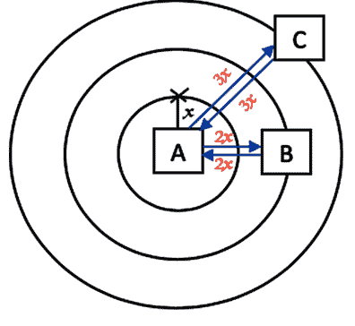

### 无线信号强度 (RSS) 指示器

根据两个节点之间的 RSS 值猜测设备位置。RSS 衡量的是信号强度，从发送方-接收方增益到目的地方-接收方增益。理论上，当两个设备彼此靠近时，RSS 值更高（Lee, 2016）。因此，RSS 的降低表明节点之间的距离增加。与 RTT 类似，RSS 易受干扰噪声影响，在使用相同无线电频率和 Wi-Fi 通道的饱和智能空间中可靠性降低。然而，RSS 对其他类型的延迟不敏感，例如处理延迟和传输延迟。与 RTT 相比，RSS 可以更容易实现，因为不需要建立网络会话。RSS 的优势在 Ad-hoc 模式下更为明显；测量追踪设备和被追踪设备之间的 RSS 意味着没有主从架构，这与 RTTA 中使用 AP（控制器）容易拥塞的情况不同（Karakuşak, 2016）。

*图 2. 当两个节点之间的距离增加时 RSS 值的变化；以 dBm 格式测量（-100 到 0）。由于距离较短，从 B 到 A 的理论 RSS 值比 C 到 A 更强，而 C 到 A 比 D 到 A 更强，这是由于障碍物造成的干扰*

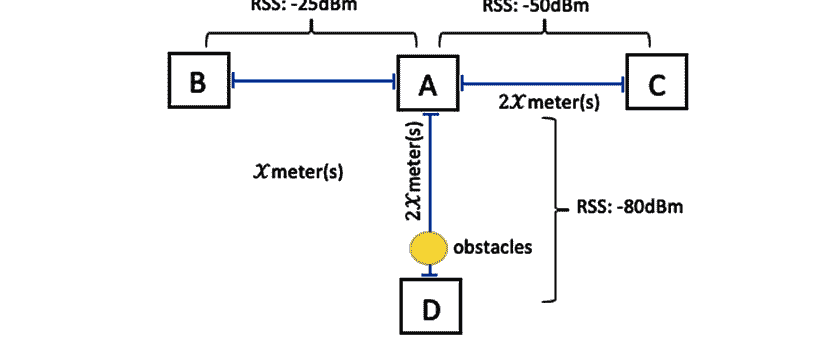

- **视觉映射** – 从机器人吸尘器中发现的定位和映射算法中获取线索；可以使用预测模型估算用户和 IoT 设备的位置（Dong, 2016; Xu, 2017）。利用计算机视觉，可以使用 YOLO 等对象模型或同时定位与映射 (SLAM) 来识别智能空间中 IoT 设备的类型和位置（Evers, 2016）。YOLO 使用单个神经网络在全图像上进行对象检测，基于全局上下文。该网络将图像划分为区域，并为每个区域预测边界框和概率。这些边界框由预测的概率加权。YOLO 还内置了一种追踪方法，用于支持快速移动物体的目标机动性。可以使用优化的库训练和部署自定义模型，利用 YOLO 进行实时识别。另一种流行的平台无关方法使用多个容器（或 Kubernetes），利用混合云（如 Google Cloud ML 或 AWS Sagemaker）上可用的公共视觉模型。

- **空间感知** – 是使用声学感知来近似设备到设备距离的映射方法的一个子集（Wright, 1995）。利用生物声纳和声音定位，可以通过评估发出信号和回声返回之间非常小的时间差来确定设备位置（类似于波束/回声）。该方法更多是感知性的而非算法性的；因此，没有诸如协议或 IoT 设备上的特殊传感器支持之类的前提条件（Chu, 2012; Martin, 2015）。有趣的是，在扬声器连续性的背景下，扬声器本身是向目标用户发射声纳信号的源节点。这些扬声器随后加入一个多播组，在聚合距离信息后，选举最接近的扬声器。空间感知的有效性可能好坏参半，并且极大地取决于智能空间的结构设计。在障碍物较少的开放空间中，空间感知可以准确确定被 ping 的目标位置；但在拥挤的环境中表现不佳。另一个缺点是缺乏多用户支持，因为空间线索不区分物理空间中的对象，只提供到这些对象的距离（Weirathmuller, 2007）。空间感知对处理延迟免疫，但对传输和传播延迟非常敏感。图 3 显示了 UI 芯片向空间感知设备发射超宽带无线电波信号；当信号与物体碰撞时，信号会反弹回来，带有距离和设备 ID 信息。

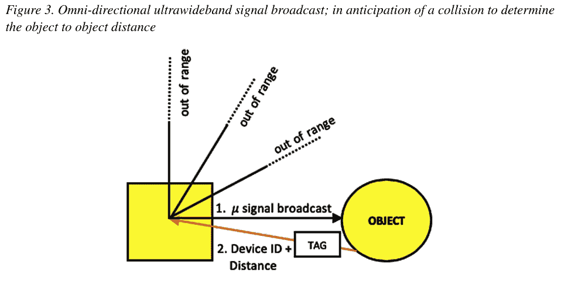

- **分区技术** – 该方法基于蓝牙、红外线和 802.11x 协议覆盖范围的技术规范来近似用户位置。其直觉是，可以根据用户各自的可见性以及他们对这些连接相应的信号强度来猜测用户位置。例如，可以将智能空间划分为不同的区域，每个区域由一个 AP 覆盖。在 AP 覆盖重叠的区域，根据用户（移动电话 Wi-Fi 信号）对 AP 集合的信号强度来猜测用户邻近程度。如果发现 2 个 AP 且增益 A 高于增益 B，则推断用户更接近 AP A。与 RTTA 类似，分区技术容易受到干扰导致的 Wi-Fi 信号波动的影响。分区技术解决了每个区域中存在多个 AP 的问题。覆盖重叠使得在使用更多 AP 空间线索进行三角测量时改进近似效果（Kho, 2015）。

## IoT 连续性的挑战

连续性的概念已被大量探索；显然体现在移动基站切换、Apple iOS 生态系统中的跨设备连续性以及许多其他屏幕共享协议（如 AirPlay）中。与这些服务类似，通用连续性的目标是根据诸如位置、用户意图和服务类型等上下文，将活动角色从设备转移到设备。本节讨论 IoT 设备连续性特有的某些挑战；范围从普遍追踪到设备选择。

## 关于用户追踪方法

普遍连续性是用户感知和位置感知的。与手动切换不同，连续性是非监督的；它仔细评估用户的实时位置，并结合其他上下文（如距离、环境线索和意图）进行推理，以做出设备切换的明智决策。传统的追踪方法如 GPS 在室内使用时是不稳定的；正如前几节所述，提出了许多替代方案。用户可追踪性有许多假设；例如移动电话位置等于用户实时位置，或者用户 24/7 佩戴可穿戴设备（Bashah, 2011）。准确性成为重要决定因素；鉴于所关注的室内空间范围相当小，追踪必须精确到米级差异。其理由在于，智能空间中“功能实体”之间的距离相对较小。例如，在室外场景中，商店之间的距离测量可达一百米；而在室内场景中，两个扬声器之间的距离则以几米来衡量。移动节点需要能量保存；这意味着像知道何时刷新用户位置这样的机会性追踪方法比连续追踪更受青睐（Klems, 2010）。图 4 比较了室内和室外追踪在标量挑战上的差异。

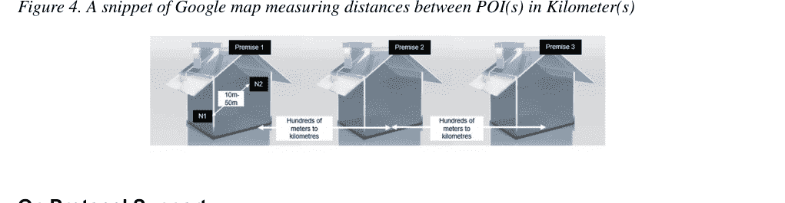

## 关于协议支持

设备跳转和设备连续性之间存在明显区别。在设备跳转中，服务请求可以从节点 A 转移到节点 B，而无需真正的延续。例如，如果 A 和 B 没有重叠的覆盖范围，音乐播放可以在从 A 转移到 B 之前暂停。同时，设备连续性要求播放无缝切换到 B，这被称为软切换。为保证连续性，协议支持对于设备发现（可见性）和实际切换都是重要因素。考虑两种具有相似节点规格的案例：5 个扬声器，每个线性间隔 10 米，但案例 (1) 支持多种协议，案例 (2) 支持同构协议。假设每个扬声器的覆盖范围与相邻扬声器重叠（Barnaghi, 2016）。在案例 (1) 中，浓缩的网络中切换更精细，例如如果用户从扬声器 A 移动到 E，每个扬声器按顺序轮流播放。至于案例 (2)，稀疏的网络中，切换发生在 n+1 跳处的扬声器，因为下一个相邻扬声器虽然位于同一 LAN 中，但不共享相同的 IoT 协议。一些常见的变通方法是使用中间层进行发现和切换，或者在设备中嵌入流行的 IoT 平台（Alexa, Apple HomeKit, 和 Google Home）支持。图 5 显示了一个物理上浓缩但逻辑上稀疏的网络示例（由于缺乏互操作性）。图 6 显示了一个具有完全互操作性的 IoT 网络。


## 设备发现与选择

*图 5。稀疏网络中可发现的节点较少，且同质节点出现饱和分离*

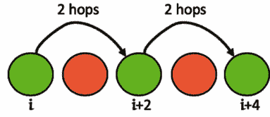

*图 6。密集网络是异构物联网（IoT）节点的丰富集合*

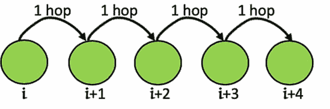

基于距离的设备选择已应用于许多智能设备中；例如，智能电视利用接近传感器跟踪用户的眼动以自动暂停播放。使用接近传感器、陀螺仪和光线传感器等初级传感器进行跟踪在单一设备与用户的关系中表现良好；但它们缺乏全局的设备间可见性。切换（Handoff）处理的是一组设备与用户的关系，而物联网通过网络发现为后续选择提供了所需的设备可见性。接近感知仅解决了发现问题，而非同步问题。例如，考虑 5 个配备相同接近传感器的扬声器呈球形布局排列。直观来看，距离用户较近的扬声器（接近距离）将成为活动扬声器。这种方法假设下一个附近的扬声器没有检测到用户；否则，由于没有控制器来分配这些用户请求，扬声器将同时播放。现在，考虑用户移动到球体中心点的情况；在此情况下，由于所有节点之间的接近性，所有 5 个扬声器将同时播放。图 7 展示了等距切换的一种可能场景（Wong, 2008; Venkataram, 2000）。

此外，发现协议向实际切换的协同作用仍处于起步阶段。通用协议如 UPnP 能很好地发现相邻设备，但缺乏切换实现（Kang, 2013）。同时，平台特定协议如 Airplay 和 Alexa 拥有无缝切换技术，但跨平台设备可见性有限。在最佳情况下（完全可见且无切换约束），物联网仅提供一个带有基础设备选择规则（距离越小越好）的操作平台。诸如两个等距节点、具有同质角色但异构规范的设备等琐碎问题，应使用机器学习推理来解决。

*图 7。设备选择算法选择下一个节点 $x = \{A, B, C, D, E\}$，前提是距离 $d(x,u)$ 最小。在等距节点的情况下，切换暂停，直到检测到新的 $d(x,u)$。在许多情况下，扬声器会同步进行环绕声播放，如杜比全景声（Dolby Atmos）技术所示*

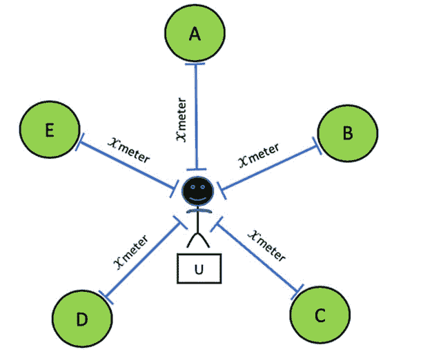

## 基于用户定位的智能扬声器切换

通过基于用户定位自动选择智能空间中的智能扬声器实现普遍切换（pervasive handoff），从而启用音乐播放连续性。图 8 直观展示了整体扬声器切换的概览，从发现到设备选择，最后是切换过程本身。

在第一个阶段，AP（充当控制器）被修改为使用波束成形天线向 $360$ 度角发送多个发现信号，用于**设备发现**。具备物联网功能的扬声器持续发送*hello 信号*，直到完全收敛，此时所有扬声器节点都可以通过空间映射被识别。第二个阶段处理**设备定位**；这对于使用称为往返时间（RTT）的技术来近似路由器遍历延迟以实现空间感知至关重要。路由器与扬声器之间的距离通过波束成形信号进行三角测量，以在智能空间中进行精确定位。核心部分设计了一种感知遮挡的路径查找算法，用于识别朝无运动目标（用户）最近的邻居（扬声器）。不是手动映射物理环境，而是基于许多商用无人机用于墙壁检测的*空气障碍物规避*技术，设计了碰撞检测和避免技术；这对室内环境很重要，因为声学信号无法有效穿透硬质墙壁。同时，用户轨迹跟踪可以通过穿戴设备位置数据、手机或相机感知的图像处理三角测量来精确定位。为了实现普遍性，算法使用传感器特有的线索不断监测用户移动；例如智能手表上的心率增加，或手机上的 RSS 变化。为了增加鲁棒性，算法使用连续的 RTT 监测定期检查位置变化。在单用户用例中，可以建立常见轨迹模型以用于后续的早期检测。AI 驱动的物联网扬声器现在可以将类似的分类设备视为一个整体，而不是孤立的实体，这些实体现在可以基于共享责任模型，根据与用户的接近程度选择性地轮流播放音乐。支持多设备流媒体的一些流行音乐流媒体应用（如 Spotify）继承了该实现。基于 Spotify 发现的设备，所提出的算法根据接近程度自动选择首选播放设备。


## 拓扑发现与快速切换管道

全面的节点发现和快速切换仍然是普遍计算中的既定挑战。本章提出了一种自学习拓扑发现（SLTD）方法，使用第 3 节中讨论的一些技术来映射相邻节点。然后，设计了一个快速先觉切换（RPF）模块，在预测模块之上优化 TCP 握手机制，以提高连续性。下一节将详细讨论这些组件。

## 自学习拓扑发现（SLTD）

SLTD 利用任何提供空间线索的传感器类型。有两种实现方式：(1) 使用 U1（超宽带）芯片；超宽带是一种低能耗、短距离无线电技术，主要用于无线数据传输。两个配备超宽带的设备之间的距离可以通过计算无线电波在两个设备之间传播所需的时间来更精确地测量。(2) 使用针对现有具备 802.11x 芯片的物联网设备的定制 RTT 三角测量。使用 RTT 平滑来最小化来自处理延迟和传播延迟的噪声；例如，使用较空闲的无线电通道以及对发现数据包使用优先 QoS 处理。在波动网络中，像聚合发现（AD）这样的快速收敛技术对于检测成员加入和离开网络的快速转换很有用。AD 是一种拓扑共享方法；其直觉是“对于每两个具有 1 个共同节点的自组网（ad-hoc network）；这些网络可以收敛为一个更大的网络，最终形成一个由所有相邻节点的全局知识组成的全网格网络。” AD 的 ground truth（基本事实）定义为：

1. 对于任何两个自组网，设为 N_a 和 N_b。收敛网络 N_converged 可以通过聚合 N_a 和 N_b 的节点信息得出；使得 N_converged = f(N_a & N_b)。F(x) 是标准化重复节点的函数。
2. 对于没有邻接信息的两个网络；构建两个具有唯一根节点的不同自组网。
3. 对于 N_converged 中重复出现的节点，根据重复频率为节点分配新权重。
4. 如果节点 i 直接连接到节点 i；并且节点 i 也连接到节点 j；则在节点 i 和节点 j 之间形成邻接连接。
5. 当节点邻域信息冲突时；优先给予权重较高的节点到节点链接。
6. 如果新的节点链接信息通告给 N；如“将节点 i 添加到节点 j”，但节点 i 在 N 中已经可见；丢弃此链接。这些规则赋予本地链接信息优先于通告信息。本地网络不从外部网络学习本地节点信息。
7. 重复节点发现以寻找新的邻接连接，直到所有根节点都连接到原始本地拓扑中未找到的新的邻接连接；以形成全网格网络。

## 快速先觉切换（RPF）

快速先觉切换是一种预测性切换技术，旨在减少大规模物联网网格网络中设备跳转时的切换间隙。RPF 是一种整体方法，用于调整现有的切换方法。它包括两个组件：(1) 使用快速握手进行预同步和 (2) 内容预缓存。

在预同步阶段，RPF 在实际数据传输发生之前就在相邻节点之间建立会话。早期连接允许即时切换；即使节点刚刚加入网络。另一个含义是延迟减少；这从当前节点中最后一字节数据发送到下一相邻节点第一字节数据所需的时间来衡量。这种方法是对标准 TCP/IP 实践的偏离；标准实践中，节点仅通过三次握手按需建立会话。预同步是发现协议的扩展；现有的发现仅使设备可见，但节点之间没有后续控制流量流。通过预同步，设备在发现后尝试通信，并将会话置于挂起状态，以预期任何切换传输。快速握手是一种轻量级握手，供物联网节点建立会话以实现预同步。类似于 MQTT 取代 HTTP；快速握手的目标是减少大规模网格网络中会话创建期间的开销。在快速握手中，总握手次数从三次减少到两次；第一次和第三次握手合并为 SYN（发往目标）和 ACK（发往目标）。这意味着发送方不需要显式确认来自目标方的连接请求；这是对初始连接请求的响应。第二次握手的主要变化是在标准 SYN+ACK 之上支持 PSH 和 RST 标志。这使得在发现后可以进行即时数据传输（从而切换），并假设如果相邻节点可见，则它们已获授权。上层协议可以施加额外的安全措施。


并可根据事件响应和非法访问撤销访问权限。本章中的快速握手机制在自定义的 TCP/IP 堆栈上实现。


为选择性的预抢占式切换设计了一个内容预缓存模块。类似于内容分发网络（CDN）中的缓存；这里的预缓存是指将数据预先存储在网状网络中潜在的下一节点上。缓存数据意味着更快的数据访问速度；因此，当 `node_a` 切换到 `node_c` 时，它只需处理控制流量，而用户流量的子集已存储在 `node_b` 的本地。预缓存数据的数量以及参与预缓存的邻居（邻居）程度取决于应用上下文。随着网络密度的增加，缓存的复杂性也会增加；在 2 度网络中缓存 1 个数据字节需要 2n 的数据开销。而不是泛洪（Flooding）；使用基于设备到用户渐进空间距离或接收信号功率（RSP）值的多项式回归模型来确定一组潜在的下一相邻候选者。图 10 可视化了当用户在完全网状拓扑中从左向右线性移动时，用于预缓存的节点选择。

## 性能比较

本节通过 SLTD-RPF 与现有切换方法对比，评估了一些关键性能指标。第一个实验评估全局节点发现的延迟。第二个实验评估节点到节点切换的延迟。搭建了一个由 12 个智能音箱组成的智能空间，如图 10 所示，这些设备编程了自定义固件（以支持 SLTD-RPF）。为了测试发现的鲁棒性；使用了 5 种不同的音箱；每种两个单元，包括 Amazon Echo (Alexa)、LG 回音壁、Sonos 音箱、Apple HomePod 和小米 AI 音箱。添加两个安装了常见物联网协议（如 MQTT、CoAP）的白盒设备，以模拟对通用物联网协议支持（这些设备不用于发现，但可以被其他智能音箱发现）。所有音箱的位置相距 10 米。使用网络数据包时间戳测量音箱之间的切换。感知测试测量了用户在 U 形路径上从位置 X₁->X₂->X₃... 移动时，音乐播放的体验。用户被要求根据音频在音箱之间过渡的平滑性和及时性对体验进行评级（以 MoS 衡量）。


### 节点到节点发现中的延迟

邻居发现的延迟指示了发现协议的可靠性。这通过 (1) 发现的节点数量和 (2) 检测这些邻居所用的时间来衡量。对于 (1)，表示更通用发现的较高数量更受青睐；对于 (2)，表示更快发现的较短时间更好。表 1 总结了一些流行物联网协议发现延迟。第三列“完整性”表示在所有可用节点中发现了多少个节点；表示为：


***表 1. 流行物联网协议/平台的发现延迟性能评估***

| 协议 | 发现的节点数 | 平均发现延迟（秒） | 完整性 [n=12] |
| :--- | :---: | :---: | :---: |
| Apple Homekit | 4 | 5.36 | 0.33 |
| Alexa (Echo) | 10 | 12.08 | 0.83 |
| LG Musicflow | 2 | 23.17 | 0.17 |
| Google Home (Sonos) | 6 | 11.98 | 0.50 |
| Xiaomi Home | 2 | 15.2 | 0.17 |
| Whitebox (custom IoT) | - | - | - |

C = 发现的节点数/拓扑中节点总数

实验结果表明，Alexa 支持的设备数量最多；其次是 Google Home、Apple Homekit、LG Musicflow 和 Xiaomi Home。注意，音箱制造商通常设计自己的物联网协议；虽然像 Alexa 这样的某些协议可以通过 API 调用来访问；但并非所有协议都受到大多数音箱的支持。调查结果证实，物联网协议的适配率对于确保护全发现覆盖范围至关重要；这显然体现在行业在智能音箱中对 Alexa 的大量集成上。使用 LG 和 Xiaomi 等专有协议导致仅可见 2 个设备；意味着物联网设备仅与制造商特定协议和谐共处。在现代化物联网中，将设备锁定到特定协议会限制发现网络的规模；除非整个网络设计都使用某一家特定供应商。同时，Apple Homekit 的延迟最短；可能是因为 Apple 对其软件和硬件进行了优化集成。Google Home 排名第二，为 11.98，紧随其后的是排名第三的 Alexa，为 12.08。由于 Alexa 有更多的参与设备，且评估期间未将网络延迟计入因素，因此微小的差异可以忽略不计。研究发现，消费者采用率最高的三个物联网平台在发现可用设备方面具有快速收敛性。就拓扑发现而言，鉴于 Alexa 生态系统的大量采用，Alexa 仍是首选方案；值得注意的是，通过固件更新，任何协议都可以轻松地在任何智能音箱上获得。图 12 可视化了完整发现后各自协议的设备可见性。

### 节点到节点切换中的延迟

过渡时间衡量会话携带到下一跳节点的间隙（以秒为单位）。构建了一个由 10 个相同音箱单元组成的音箱网络。使用具有不同协议支持的音箱，在相同的设置下对 LG Music Flow、Google Home 和 SLTD-RPF 重复进行实验。在测试时，Homekit、Xiaomi Home 和 Alexa 不支持原生切换。实验在完整拓扑收敛后进行。

理论上，拓扑涵盖握手期、处理延迟（从音箱 A 到路由器再到音箱 A+1）以及取决于网络环境的传播延迟。为简化起见，实验测量时间戳差异；节点 A 中的最后一个数据包和节点 A+1 中的第一个数据包表明过渡时间；表示为切换延迟。在智能音箱的上下文中，更短的切换意味着从节点 A 到节点 A+1 的音乐播放之间的暂停更少（减少了抖动感知）。表 2 总结了所研究的物联网协议的平均切换情况；只要适用。第二列显示了如果下一跳智能音箱在用户邻近度变化时触发，成功的切换测量次数。其余列显示了从跳 n$_{i}$ 到 n$_{i}+1$ 的延迟。

** pervasive 物联网（IoT）用于智能音箱发现和播放连续性**

图 12。


图 13. 设备发现完整性性能评估（可用设备数量与基于图 10 拓扑的可见设备数量）


注意，尽管两种情况下的 RSS 有些相似；但 SLTD-RPF 中的实际切换发生得更早，分别反应时间为 2.12 秒和 1.96 秒。同时，Musicflow 仅在 hop1-hop2 的 5.12 秒后以及 hop2-hop3 的 8.33 秒后才反应。切换时间的减少是 SLTD-RPF 切换方法中使用的预抢占式切换和快速握手机制的复合产物。图 14 显示了 Musicflow、Google 和 SLTD-RPF 分别选择的实际音箱节点。研究发现表明，切换协议当前可能遵循大多数“RSS”路径；它们可能对用户追踪方式略显敏感，从而导致切换期间节点选择具有非确定性。节点选择的准确性通过准确的追踪来解决；这超出了本章的范围。

***表 2. 比较成功切换次数和切换及时性***

| 协议 | 成功切换次数 [n=10] | 跳 1-跳 2（秒） | 跳 2-跳 3（秒） |
| :--- | :---: | :---: | :---: |
| Apple HomeKit | - | - | - |
| Alexa | - | - | - |
| LG MusicFlow | 4 | 5.12 | 8.33 |
| Google Home | 3 | 6.27 | 5.39 |
| Xiaomi Home | - | - | - |
| SLTD-RPF | 4 | 2.12 | 1.96 |

### 感知测试

感知测试在 50 名不同的听众中进行，他们在智能空间中聆听混合流派音乐，基于音箱之间的切换，根据评分中位数（MoS）进行评估。MoS 值取平均值

*图 14. 可视化 Google Home、LG Musicflow 和 SLTD-RPF 选择的音箱*


来自三项声学基准测试指标。保真度是语音和人声精确度与清晰度的度量。响度是对振幅变化如何影响聆听体验的度量。可听度是对音频在遇到障碍物或用户远离扬声器一定距离时是否仍可被感知的度量。表 3 显示了平均感知评分，范围为 1-5（分数越高越好）。

表 3. 使用扬声器连续性时，50 名听众对播放体验的 MoS 平均值

| | 指标 | 保真度 | 响度（变化后） | 可听度 | MoS |
| :--- | :--- | :--- | :--- | :--- | :--- |
| 得分 | 4.5 | 4.3 | 4.8 | 4.53 |

## 结论

本章讨论了一个使用新颖的设备发现和快速切换技术实现智能扬声器 IoT 设备连续性的用例。借助 IoT 连接性，智能扬声器现在可以准确追踪室内空间中的用户，并无缝地将音频播放切换到物理位置更接近用户的扬声器。解决了第 4 节中讨论的一些领域特定约束后，播放连续性获得了可感知的改善。与传统切换不同，SLTD-RPF 通过通用发现方法解决了 IoT 设备的互操作性问题，同时利用优化的 TCP 握手方法提高了设备切换的及时性。SLTD-RPF 使用保留法减少意外切换，并利用 A.I. 预测在下一个潜在扬声器上进行内容预缓存，从而减少切换间隙。涉及 50 名多样化听众和混合类型的实验结果共同表明，在模拟（受控）环境中，当音乐播放跟随用户移动从房间跳到房间时，音频保真度、响度和可听范围的感知分别改善至 4.5、4.3 和 4.8。当扬声器随机分布时，感知测试显示平均得分 (MoS) 略有下降；这是由于在选择算法决定可听度区域重叠的近距离扬声器时的复杂性所致。

展望未来，可以设计更复杂的 A.I. 来解决这些局限性；例如，对实际环境结构进行建模以更好地评估声学信号抽象，对扬声器的技术规格进行画像以在两个紧密放置的扬声器中更好地匹配音乐流派，或通过自适应推荐将扬声器配对以进行立体声播放。

## 参考文献

Alessandretti, A. A. (2018). A Model Predictive Cloud-based Control Scheme for Trajectory-Tracking: Effects of Round-trip Time Over-estimates. In 13th APcA International Conference on Automatic Control and Soft Computing (CONTROL0) (pp. 183-188). Ponta Delgada, Portugal: IEEE. 10.1109/CONTROLO.2018.8516416

Barnaghi, P. S., & Sheth, A. (2016). On Searching the Internet of Things: Requirements and Challenges. *IEEE 智能系统*, 31(6), 71–75. doi:10.1109/MIS.2016.102

Bashah, N. S. (2011). A Mobile Service Architecture for Improving Availability and Continuity. In *IEEE 计算机与信息学研讨会* (pp. 380-384). Kuala Lumpur, Malaysia: IEEE. 10.1109/ICSCI.2011.5958945

Chu, T. S. (2012). Acoustic Sensor Array for Determination of Undersea Acoustic Signatures. In *IEEE 国际电子/信息学技术会议*. Indianapolis, IN: IEEE. 10.1109/EIT.2012.6220770

Datta, L. (2016). A new Task Scheduling method for 2 Level Load Balancing in homogeneous distributed system. In *国际电气、电子和优化学术会议 (ICEEOT)* (pp. 4320-4325). Chennai, India: IEEE. 10.1109/ICEEOT.2016.7755534

Dawod, A., Georgakopoulos, D., Jayaraman, P. P., & Nirmalathas, A. (2019). Advancements Towards Global IoT Device Discovery and Integration. In *IEEE 国际物联网大会 (ICIOT)* (pp. 147-155). IEEE. 10.1109/ICIOT.2019.00034

Dong, Y. L. (2016). *基于稀疏表示纹理边缘特征的深度图上采样*. In *视觉通信与图像处理 (VCIP)*. Chengdu, China: IEEE.

Dutta, A. M. (2006). GPS Assisted Fast-Handoff Mechanism for Real-Time Communication. In *IEEE Sarnoff 研讨会*. Princeton, NJ: IEEE. 10.1109/SARNOFF.2006.4534769

Evers, C. M. (2016). Acoustic simultaneous localization and mapping (A-SLAM) of a moving microphone array and its surrounding speakers. In *IEEE 国际声学、言语和信号处理会议 (ICASSP)* (pp. 6-10). Shanghai, China: IEEE. 10.1109/ICASSP.2016.7471626

Fathima, N., A. A. (2017). Optimized Neighbor Discovery in Internet of Things (IoT). In *国际电气、电子、通信、计算机和优化学术会议 (ICEECOT)* (pp. 594-598). IEEE. 10.1109/ICEECCOT.2017.8284573

Fortunato, M. C.-M. (2019). Enabling High Accuracy Dynamic Applications in Urban Environments Using PPP and RTK on Android Multi-Frequency and Multi-GNSS Smartphones. In *欧洲导航会议 (ENC)*. Warsaw, Poland: IEEE. 10.1109/EURONAV.2019.8714140

Gu, C. S. (2009). GPS information assisted handoff mechanism in heterogeneous wireless networks. In *IEEE 国际通信技术与应用会议*. Beijing, China: IEEE.

Hashem, B. K. (2000). A new algorithm to reduce the deviation in the base stations transmitted powers during soft handoff in CDMA cellular systems. In *IEEE 无线通信和网络会议. 会议记录 (Cat. No.00TH8540)*. Chicago, IL: IEEE. 10.1109/WCNC.2000.894620

Hong, H. (2017). From Cloud Computing to Fog Computing: Unleash the Power of Edge and End Devices. In *IEEE 第 9 届云计算技术与科学国际会议* (pp. 331-334). IEEE.

Huang, C. M. (1997). Handoff Architectures Akhd Protocols For Transmitting Compressed Multimedia Information In Mobile PCSs. In *国际消费电子会议* (pp. 784-794). Rosemont, IL: IEEE.

Joshi, N. K. (2018). Implementation of Novel Load Balancing Technique in Cloud Computing Environ-ments. In 国际计算机通信与信息学会议 (ICCCI). Coimbatore, India: IEEE. 10.1109/ICCCI.2018.8441212

Kang, J. S. (2013). Universal UPnP Bridge for Embedded Non-IP Device with Heterogeneous Network Interfaces. In 第 13 届控制、自动化和系统国际会议 (ICCAS 2013) (pp. 561-563). Gwangju, Korea: IEEE. 10.1109/ICCAS.2013.6704002

Karakuşak, M. Z. (2016). The use of RSS and NI filtering for the Wireless Indoor Localization and Tracking of Mobile Robots with Different Motion Models. In 第 24 届信号处理与通信应用会议 (SIU). Zonguldak, Turkey: IEEE. 10.1109/SIU.2016.7496088

Kaur, S. S. (2018). Efficient Load Balancing using Improved Central Load Balancing Technique. In 第二届创新系统和控制国际会议论文集 (ICISC 2018) (pp. 1-5). Coimbatore, India: IEEE. 10.1109/ICISC.2018.8398857

Képúška, V. (2018). Next-Generation of Virtual Personal Assistants (Microsoft Cortana, Apple Siri, Amazon Alexa and Google Home). In IEEE 第 8 届计算与通信工作坊和会议 (CCWC) (pp. 99-103). Las Vegas, NV: IEEE.

Kho, Y. H. (2015). Exploiting RF Signal Attenuation for Passive Indoor Location Tracking of an Object. In IEEE 2015 国际计算机、通信和控制技术会议 (4CC T 2015) (pp. 152-156). Kuching, Malaysia: IEEE.

Klems, M. T. (2010). Automating the Delivery of IT Service Continuity Management through Cloud Service Orchestration. In IEEE 网络运营和管理研讨会 - NOMS 2010. Osaka, Japan: IEEE. 10.1109/NOMS.2010.5488437

Lee, W. C. (2016). RSS-based Localization Algorithm for Indoor Patient Tracking. In IEEE 第 14 届工业信息学国际会议 (INDIN) (pp. 1060-1064). Poitiers, France: IEEE.

Lu, Y. F. (2009). Home Networking and Control based on UPnP: An Implementation. In 第二届计算机科学工程国际研讨会 (pp. 385-389). Qingdao, China: IEEE.

Luzuriaga, J. E. (2015). Handling Mobility in IoT applications using the MQTT protocol. Internet Tech-nol. Appl.

Marbuh, V. (2019). Towards Fog Network Utility Maximization (FoNUM) for Managing Fog Computing Resources. In IEEE 国际雾计算会议 (ICFC) (pp. 195-200). Prague, Czech Republic: IEEE. 10.1109/ICFC.2019.00032

Martin, E. Z. (2015). Rapid spatial mapping of the acoustic pressure in high intensity focused ultrasound fields at clinical intensities using a novel planar Fabry-Pérot interferometer. In IEEE 国际超声研讨会 (IUS). Taipei, Taiwan: IEEE. 10.1109/ULTSYM.2015.0229

Moon, Y. H. (2018). A Methodology of NB-IoT Mobility Optimization. In 全球物联网峰会 (GIoTS). Bilbao, Spain: IEEE.

Morhart, C. B. (2009). Cooperative Multi-User Detection and Localization for Pedestrian Protection. In 德国微波会议. Munich, Germany: IEEE. 10.1109/GEMIC.2009.4815863


## 参考文献

Nishad, L. S., Kumar, S., & Bola, S. K. (2016). 基于负载均衡技术提高Cloudsim和Cloud Analyst架构效率的轮询数据中心模拟技术选择。载于 *第3届国际可持续全球计算会议 (INDIACom)*。印度新德里：IEEE。

Pham, C. L. (2018). 将Alexa语音服务集成到基于ECHONET智能家居的平台。载于 *IEEE国际消费电子-台湾会议 (ICCE-TW)*。台湾台中：IEEE。10.1109/ICCE-China.2018.8448893

Sharma, P. K. (2018). 物联网的安全与软切换技术：综述。载于 *第2届国际电子学与资讯技术趋势会议 (ICoEI 2018) 论文集* (第271-276页)。印度蒂鲁内鲁韦利：IEEE。10.1109/ICoEI.2018.8553740

Tianfield, H. (2018). 迈向边缘-云计算。载于 *IEEE国际大数据会议 (Big Data)* (第4883-4885页)。IEEE。10.1109/BigData.2018.8622052

Valarmathi, M. L. (2016). 移动物联网(IoT)场景中节点发现综述。载于 *国际高级计算与通信系统会议 (ICACCS -2016), 2016年1月22日 & 23日, 科伊姆巴杜尔*。印度科伊姆巴杜尔：IEEE。10.1109/ICACCS.2016.7586400

Venkataram, P. L. (2000). 移动多媒体网络中切换期间数据传输控制的方法。载于 *IEEE国际个人无线通信会议论文集 (Cat. No.00TH8488)*。印度海得拉巴：IEEE。10.1109/ICPWC.2000.905774

Vishwakarma, S. K. (2019). 使用物联网的智能节能家庭自动化系统。载于 *第4届国际物联网会议：智能创新与应用 (IoT-SIU)*。印度贾吉布尔：IEEE。10.1109/IoT-SIU.2019.8777607

Vongchuuyen, C. T. (2019). 带有HomeKit应用的家庭电器控制平台。载于 *第5届国际工程、应用科学与技术会议 (ICEAST)*。老挝琅勃拉邦：IEEE。

Weirathmuller, M. W. (2007). 新罕布什尔州朴茨茅斯港的声学定位与跟踪。载于 *OCEANS会议*。加拿大温哥华：IEEE。

Wong, S. P. (2008). 音视频服务的连续性。载于 *IEEE国际消费电子技术研讨会*。葡萄牙维劳摩尔：IEEE。

Wright, O. (1995). 使用机械和超快光学技术的局部声学探测。载于 *IEEE超声学会会议论文集。国际研讨会* (第567-575页)。美国华盛顿州西雅图：IEEE。

Xu, W. W. (2017). 基于带几何方向的多类字典学习的深度图超分辨率。载于 *IEEE视觉通信与图像处理 (VCIP)*。美国佛罗里达州圣彼得堡：IEEE。

Yin, J. B. (2012). 基于SNMP的网络拓扑发现算法及其实现。载于 *第9届国际模糊系统与知识发现会议 (FSKD 2012)* (第2241-2244页)。IEEE。10.1109/FSKD.2012.6233879

## 第6章

物联网安全：使用安全协议通过双因素认证保护物联网设备

**Khuda Bux Jalbani**
*Riphah系统工程学院，Riphah国际大学，巴基斯坦伊斯兰堡*

**Akhtar Hussain Jalbani**
*信息技术系，Quaid-e-Awam工程、科学与技术大学，巴基斯坦*

**Saima Siraj Soomro**
*信息技术系，Quaid-e-Awam工程、科学与技术大学，巴基斯坦*

### 摘要

物联网（IoT）设备的使用正在增长，以方便生活。从智能家居到智能汽车，从智能交通到智能城市，从智能医院到智能高速公路，这些物联网设备发送和接收关于用户隐私或用户从一个位置移动到另一个位置的其他信息的高度敏感数据。当用户在家或在外面时，时间踪迹会跟踪用户。但如何保护这些信息免受攻击者侵害？物联网设备安全是必要的。由于物联网设备有三个层——应用层、网络层和感知层——因此这三个层需要安全。物联网设备是异构的，并限制能源消耗。本章提出的解决方案是生成设备序列号和网络层少数配置设备的令牌，进行物联网设备的三方认证。为了物联网设备服务的高可用性，在网络层实施了对分布式拒绝服务攻击的保护。

DOI: 10.4018/978-1-7998-2803-7.ch006

### 引言

物联网（IoT）的使用正在迅速增长，以从这项技术中获得更多的好处，同时减少任何人类的交互。这些物联网设备用于智能家居、智能家电、智能汽车、安全城市、医疗传感器、智能农业设备和用于安全道路的智能高速公路/公路。物联网网络可以分类为分布式、混合、通用和车辆传感器网络等。传感器无处不在，从家庭安全到农业水位观察，从集装箱跟踪到患者健康状况监测，从diversless汽车到高速公路上的车辆速度检查。在互联网的早期设计中，安全不被认为是主要部分。今天，物联网在每个层面临着相同的安全威胁和漏洞。针对特定数据的分布式数据收集、处理、聚合和分析主要通过在云服务上执行。这些数据是从部署为服务的传感器收集的。存在安全泄露威胁，因为这些物联网设备部署在客户所在地。这些设备未能及时更新固件的漏洞修复和供应商针对最新漏洞修复所需的其他设置。

商业界希望尽早将这些设备推向市场。他们只考虑与刺激制造相关的法律和规则，但几乎不关注安全考虑。这导致设计易受攻击的物联网设备，为攻击者打开了大门。收集数据或为用户或环境处理任何功能的物联网设备应用可能会使他们处于风险之中。例如，通过出租车服务应用，可以追踪用户位置。未经用户许可锁定/解锁房屋门，开启/关闭加热器，锁定/解锁汽车门是物联网设备的潜在威胁。在物联网设备安全的每个层中，使用了不同的工具和技术。对于物联网设备之间的数据传输安全，使用非对称加密算法。非对称算法使用公钥算法，因为它将提供密钥管理、节点认证、第三方密钥管理和安全。对于安全通信，需要轻量级安全密钥分发。密钥分发技术用于无线传感器网络（WSN）作为通信、收集、主密钥和共享密钥appropriation (Jing et al., 2014)。物联网设备的一个主要限制是低功率计算和存储。从大型到可穿戴设备，电源存储是嵌入在内部的。由于这种低功率存储，无法实施这些重量级安全算法。提议坚固的加密技术或数字签名用于信息确认、收集和分发，这需要信任管理 (Jing et al., 2014)。物联网是不同异构系统的协调，从现在开始有其自己独特的接近性和安全问题。很难在异构领域中感知可信中心。异构性，物联网设备的性质是安全标准采用的主要障碍 (Roman et al., 2013)。安全访问控制是物联网的基本测试。通常，云中的信息由各种组件和处理器收集。同样，获取类似数据的粒度级别对于不同的检索者有所不同。在物联网框架中为数十亿客户提供安全是基本的。必须保持客户的匿名性。访问控制一次必须由专家保持。在整个物联网生命周期中，必须给予安全其应有的重要性。集中式或关联的物联网系统具有分离的信息获取远程实体，它们将收集的信息提供给集成的云计算，执行收集、处理、分析和分发的职责。此外，数据流到集中专家遵循分层设计。这具有更好的集中安全控制，但一旦受到脆弱性影响，整个结构就会受到威胁。随着物联网设备数量逐步增加，它面临信息泄露的高风险。分布式拒绝


Service DDoS 攻击，数据欺诈，以及这些设备的安全与防护。物联网（IoT）的每一层都需要安全保护。这些层被称为应用层、网络层和感知层。应为 IoT 设备开发安全应用程序，以顾及用户隐私（Almusaylim, & Jhanjhi, 2019）。IoT 设备的主要部分是网络层，在此处执行所有关于 IoT 设备或传感器的配置。因此，应使用双因素或三因素认证来保护该层免受攻击者侵害。此认证应用于在 IoT 网络中添加新设备或传感器，以及用于收集信息的应用程序。由于现有的云计算、互联网和无线传感器网络（WSN）安全威胁同样适用于 IoT 网络，因为 IoT 是设备、传感器网络和云计算的结合，数据在其中存储、处理和分析（Jeyanthy et al., 2019）。以及检测未授权使用，并使用入侵检测系统检查 IoT 设备中的用户行为（Anthony et al., 2018）。

物联网的概念由麻省理工学院（MIT）自动识别实验室于 1999 年提出（Jeyanthy, 2016）。由于 IoT 设备的本质是异构的并受能耗限制，为此为服务器或计算机系统设计的安保方法无法应用于它们。为了实现机器到机器、设备到网络以及设备到应用的安全通信，推荐使用带公钥认证的高速 UDP 互联网连接（QUIC）协议（Hamilton et al., 2016）。其次，本章推荐双因素认证来保护免受伪设备侵害。双因素认证将与用户名和 PIN 码一起使用。PIN 码将从设备的物理地址和网关媒体访问控制（MAC）地址生成。为了实现服务的高可用性，借助开源框架防火墙敲击操作符（fwknop）实施对 DDoS 的保护（Rash, 2007）。在本章中，将讨论与安全性相关的威胁、IoT 服务的可用性以及如何保护它们。

## 相关工作

本节将讨论当前哪些设备和系统用于 IoT 装置的安全性、防护以及可访问性？研究人员推荐了各种装置和策略，用于 IoT 装置的安全性、防护以及 IoT 服务的高可访问性。IoT 设备及其环境的安全性无法通过任何软件或框架来判断，即使其实施是安全且受保护的。研究人员提出了 SOTERIA（Celik et al., 2018），这是一个旨在检查 IoT 应用程序模型的框架。SOTERIA 随后从 SmartThings IoT 应用程序中移除状态模型，并应用模型检查以查找属性违规。作者提出了解决方案 Tyche（Rahmati et al., 2018），这是一种受保护的改进方法，利用了这种直观的风险不对称性，并将物理设备活动收集到风险相似类中。学者们提出了区块链（BC），除了币的需求外，不涉及工作量证明（POW）概念（Dorri et al., 2017）。作者已将区块链的安全和防护应用于 IoT 的特定需求。研究人员提出了一种新型结构 IoTsan（即 IoT 净化器）（Nguyen et al., 2018）。IoTsan 将模型检查作为基本结构块使用。为了缓解与模型检查相关的状态空间爆炸问题（Clarke et al., 2011），作者在 IoTsan 中规划了两项改进：(I) 仅考虑相互协作的应用程序，以及 (II) 移除不太可能产生有害行为有价值评估的多余交织。由于 IoT 设备产生的数据具有异构性，这对当前数据处理工具提出了新的挑战。因此，为了利用 IoT 生成数据的价值，需要新的系统。在这种情况下，机器学习（ML）被认为是最合适的计算理想模型之一，可以为 IoT 装置提供嵌入式洞察（Mahdavejad et al., 2018）。ML 方法已用于诸如分类和回归密度估计等任务。诸如计算机视觉、欺诈检测、生物信息学、恶意软件发现、验证和语音识别等多种应用使用 ML 算法和策略。因此，ML 可用于 IoT 以提供智能服务。研究人员已提出利用 ML（Hussain et al., 2019）为 IoT 系统提供服务的安全性和隐私保护。IoTMon（Ding, & Hu, 2018）由分析师提出，它可以获取跨应用程序的所有潜在物理关联，并启用 IoT 平台上的安全协作控制。以报告由意外物理关联引发的问题。IoTMon 主要执行应用程序内协作分析，利用静态程序分析提取主要应用程序数据（包括触发器、设备和操作），以构建应用程序内关联。除了利用静态分析外，IoTMon 还利用自然语言处理（NLP）系统分离应用程序描述，以感知 IoT 组织中的物理通道，然后将物理和框架通道上的应用程序内通信关联起来，以生成跨应用程序通信链。IoT 网关有限的资源促使了物理不可克隆函数（PUF）的发展（Suh, & Devadas, 2007）。PUF 能够提取独特的激励，这些激励源自集成电路（ICs）的起始过程变异，这些变异发生在制造过程和进程偏差中，利用二进制序列。PUF 用于在线密钥生成或验证。分析师提出了两种基于异或的可重构 PUF 电路（即基于异或的可配置双稳态环 PUF（XBRB PUF）和基于异或的可重构环振荡器 PUF（XRRO PUF））（Liu et al., 2019），作为智能可重构 PUF（RPUF）设计的合理理由。这两种设计在字段可编程门阵列（FPGAs）上实现，并与过去的 RPUF 结构进行对比。研究的贡献有三点：首先，本评估应用了操作基本威胁、资源和弱点评估（OCTAVE）（Al, & Awad, 2018），一种名为 OCTAVE Allegro 风险评估框架的技术，用于感知源自内部和外部智能家居的安全威胁。其次，它考虑了在基于 IoT 的智能家居领域内数字和物理安全风险的双重视角。第三，研究提出了若干缓解已感知安全威胁的反制措施。作者（Ammar et al., 2018）选择了一组 IoT 平台：来自亚马逊的 AWS IoT，来自 ARM 及其合作伙伴的 ARM Bed，来自微软的 Azure IoT Suite，来自谷歌的 Brillo/Weave，来自爱立信的 Calvin，来自苹果的 HomeKit，来自 Eclipse 的 Kura，以及来自三星的 SmartThings。选择这些平台是基于上述衡量标准：(1) 卖方产品加硬件业务的知名度，(2) 快速应用开发的支持及应用商店上应用的数量，(3) 结构的整合和利用，以及其在 IoT 市场中的差异。由于作者（Bhattacharjya et al., 2019）选择了依赖于标准协议栈的数据报传输层安全（DTLS）作为安全协议。传统框架（如基于互联网的三个安全目标：身份验证、完整性和机密性）具有相同的安全需求。DTLS 实现了这些目标。验证是在完全认证的 DTLS 握手中开发的，依赖于包含 Rivest–Shamir–Adleman（RSA）密钥的 X.509 证书交换。作为一种无约束网络（UCN）通常由互联网签名，而包括低功耗低带宽个人区域网络（LoWPAN）的 IoT 则在受限区域签名。放置在受限网络（CN）和 UCN 边缘的 IoT 章节改变了通信


位于这两个区域之间。其活动通常涵盖各种约定层执行之间的变化。科学家（Mukherjee 等人，2018）通过提出一种从端到端的云-雾通信（cloud-fog correspondence）的可适应物联网（IoT）安全中间件结构，解决了广泛的基于物联网的应用安全需求，并对框架边缘资源目标进行了分组。这基本上将保护部署在客户雾（fog）中的框架，即物联网设备所在的位置。然而，利用中间件的系统级或应用级设计方案，它还将实现与现有中心云框架的安全紧密连接。该中间件使用一种新颖的“最优方案决策器”（Optimal Scheme Decider）算法，使客户能够设计最佳的端到端说服性方案选择，以匹配给定的设备资源需求计划。研究人员提出了安全框架 SIOTOME（Haddadi 等人，2018），该框架通过学习并适应不断变化的环境，以快速且独立的方式应对突发事件，方法包括收集信息、执行分析、创建网络访问规则以及控制流量以进行防御。由于独特的物联网威胁检测需要对来自用户设备的流量进行近距离观察，因此必须使用确保原始用户数据隐私保护的安全分析技术。此外，我们需要开发工具以防范广泛的基于网络的攻击，例如漏洞扫描、中断攻击、网络窃听、数据篡改以及拒绝服务（DoS）攻击。SIOTOME 将有助于在边缘组织和 ISP（互联网服务提供商）之间进行设计，以便早期检测和缓解因物联网设备配置错误和恶意攻击造成的安全漏洞和威胁。FACT（Lee 等人，2017）由作者提出，是一种效用驱动访问控制系统，用于安全管理物联网设备。在 FACT 中，控制和使用的基本单位不是设备，而是效用（convenience/utility）。这种效用驱动的方法解决了现有物联网框架的安全问题。首先，FACT 分析应用程序是否有权访问其请求的功能，以防止未经授权的访问。客户再也不必担心因权限较低的应用程序而产生的安全问题。其次，FACT 将物联网设备的每个效用分离，以增加功能的整体可用性。即使面对恶意或受损应用程序的攻击（例如 DoS 攻击），这种分离机制也能检查攻击，防止其影响其余功能，最终目标是使这些功能可以分配给不同的应用程序。随着机器学习（ML）（Xiao 等人，2018）和智能攻击的发展，物联网设备需要在异构和动态系统中选择监督方法，并确定安全展示中的关键参数，以进行权衡。包括监督学习、独立学习和强化学习（RL）在内的机器学习方法已被广泛关联以改善排序安全。为了填补空白，研究者（Zhou 等人，2018）从另一个角度讨论和研究物联网安全问题——物联网特征。“物联网特征”指的是物联网设备、组织和应用程序的独特特征，这些特征与手机和计算机截然不同。例如，物联网设备具有更少的计算限制、收集资源和电力供应，因此“受限”是一个物联网特征。

## 物联网安全的提出方法论与解决方案

在本章中，定义了用于物联网设备安全的不同类型框架、工具和方法。这些工具或框架将为物联网不同层的安全问题提供解决方案，以保护物联网用户免受个人身份信息（PII）、用户位置、健康信息以及其他财务信息泄露等的侵害。安全问题、威胁和攻击存在于物联网网络的每一层。这些攻击可以作为主动攻击或被动攻击进行。主动攻击容易处理，因为它们是明面上的敌人，通过这些攻击，物联网网络服务将变得不可用。另一方面，被动攻击因为它们是隐藏的敌人，所以很难检测。这类攻击对物联网网络或其他互联网服务更具危险性。由于这些被动攻击，用户隐私的主要特征将受到损害。

### 基础物联网架构概述

在描述物联网的安全问题、挑战和威胁之前，有必要了解如图 1 所示的基础物联网架构。关于物联网的结构，特别是物联网的层次结构（Madakam 等人，2015），存在多种观点。然而，许多分析人士将物联网视为三层设计。这三层分别被归纳为感知层、系统层和应用层。每一层在物联网结构中都有其特定的功能。


### 感知层

感知层通常负责事件的发生并向网络层传输数据。连接到物联网设备的各种传感器可以测量重要的物理量，例如温度、湿度、光照强度以及声音强度。在数据传输之前，收集的数据可能会在感知层进行预处理。感知层还可以使设备与短程网络相关的各种设备进行交互。这里提到的设备包括无线传感器网络（WSN）、射频识别（RFID）以及控制组件。应用层融合了两种模糊性：扫描仪标签标签查看设备、RFID 名称、摄像头开口传感器以及机器对机器（M2M）终端、手持终端、传感器主控和传感器网关。感知层需要突破的只是获得更敏锐和合理的智慧能力，并解决低功耗、缩小尺寸和低价值观点的问题。

### 网络层

网络层负责通过促进组织来引导和传输由感知层收集的数据。数据被传输到互联网上的各种设备或物联网目标。常用的网络技术示例包括 WiFi、蓝牙、3G/LTE、Zigbee、Lora 等。如前所述，物联网的网络层是基于现有的移动媒体传输和互联网建立的。其主要功能是进行长距离数据传输。
网络层涉及不同的通信网络和基于互联网的集成系统，这通常被认为是最先进的部分。此外，它包括巧妙处理海量数据的组成部分。物联网数据中心、雾-云计算、平台、主控框架等服务中心，也就是说，网络层不仅具有系统活动能力，还具有数据活动能力。

### 应用层

应用层是物联网结构的顶层，它实现了服务系统的最终目标。该层的示例包括智能家居、智慧城市、智能汽车、智能电网、智能医院和智能工厂等。应用层接收通过网络层传输的数据，并使用这些数据来实现提供物联网系统智能组织的最终目标。应用层的主要任务是发现服务并采用该服务。应用层是物联网技术与分段专业技能技术的结合，是一个通过提供不同解决方案来实现广泛智能应用的层次。最终是应用层实现了信息技术与分段的深度融合，并广泛影响国民经济社会的发展。对于应用层而言，关键问题是与网络共享数据并确保数据安全。应用层是物联网发展的最终目标，软件开发和智能控制技术将提供物联网的明亮应用。不同部分和家庭应用的进步将推动物联网的普及，并使整个物联网产业链受益。

### 物联网安全问题

与物联网相关的安全问题不仅存在于无线、无线传感器网络（WSN）和互联网的安全中。此外，还包括物联网设备访问控制、审批、数据完整性、可用性以及用户安全问题。

- **嵌入式设备中的电力限制：** 物联网用户或研究人员主要关注这些设备的计算能力和存储大小。运行安全加密算法需要高计算能力和存储容量，而这些要求既沉重又昂贵。因此，这些加密算法无法在资源受限的设备上执行，例如嵌入式设备、可穿戴设备、传感器以及其他无线设备。


- **异构设备或协议**：鉴于物联网（IoT）设备的异构性理念，由于每个制造商都根据自己的需求制造设备，且缺乏针对这些设备的普遍标准，因此很难从集中式框架对其进行监控。在这一约束条件下，物联网设备和协议在分布式系统上进行管理。

- **数据完整性**：这需要确保收集并与其他应用程序或设备共享的数据的完整性。为确保接收数据的真实性，建议使用加密算法和数字签名（Jing 等人，2014）。然而，为了处理这一问题，物联网设备的计算能力和存储容量受到较大限制。

- **访问控制安全**：物联网网络的保护性访问控制是一项主要任务。通常情况下，云中的信息可通过多种组件和技术进行访问。此外，对于获取相似数据的粒度级别因不同的检索者而异。因此，设计进入控制方法并检查通道是真正的难题之一（Roman 等人，2013）。

- **身份验证控制**：需要仔细区分物联网矛盾，并为所有设备提供验证和认证。确认确保了通过设备流动的数据的真实性，而授权则确保了受控的访问控制。物联网框架中的组件可能在逻辑上集成，因此，带有授权的角色管理变得越来越具有挑战性。

- **分布式物联网网络**：集中式或关联式物联网网络具有独立的数据采集潜在组件，它们将累积的数据提供给一个集中式云服务，该服务负责收集、整理、分解和分配。此外，流向中央主机的信息流遵循分层设计。这具有更好绑定的安全控制，但一旦受到漏洞攻击，整个结构就会受到削弱。在分布式物联网网络中，每个组件都能完成数据收集、处理、比较和分发信息的任务，因此也是一个攻击向量。

- **物理环境**：物联网系统部署在异常物理域中。因此，物理攻击已加入传统安全威胁的列表。例如，在网络上插入伪造设备或窃取设备。

- **信任管理**：信任管理在实体之间的对应关系以及组件与客户之间发挥着基本作用。需要信誉算法来选择一个受信任的实体。对中心组件的总体观点有助于解释其余实体的信誉。信誉值的不一致性可以通过共享来自不同中心实体的信任数据来解决。大多数情况下，实体与客户之间的信任管理由第三方提供，例如，用于安全通信的公钥加密认证。

- **隐私问题**：物联网用户对用户的主要威胁是他们的隐私；用户的位置、家庭出入时间以及其他个人信息可能会泄露。至关重要的是，物联网框架中的数十亿客户需要获得保险。必须维护客户的匿名性。任何专业社区都必须坚持执行一次即可的访问控制。在整个物联网生命周期中，保护必须得到应有的重视。

## 物联网安全挑战

物联网安全的主要挑战取决于设备、软件、网络和物理位置的局限性。设备障碍是计算和能源需求、内存基础以及变更安全封装。编程限制是嵌入式软件约束和独特的安全补丁。网络连接的限制包括易变性、适应性、多种设备和通信介质、多网络协议以及系统拓扑。

## 物联网设备

物联网设备包括传感器、可穿戴设备、数字设备；以及带有嵌入式硬件的微控制器，如 Arduino、Raspberry Pi。物联网设备随时可供用户使用，嵌入在其他设备中，并可能用作可穿戴设备，或者可能与网络精彩地关联。因此，这些设备对安全攻击越来越脆弱，并且容易被篡改。硬件设备制造商越来越关注物联网设备的规划部分，而非安全视角。因此，用户面临更多的风险（Veracode，2019）。尺寸减小和处理能力有限限制了物联网设备的安全功能（Hajarbegoic，2019）。由于物联网设备的大量存在，很难为安全更新提供产品补丁。由于缺乏制造前的机构化，此外还揭示了物联网硬件面临的安全威胁。物联网硬件面临着所有联网设备所面临的攻击，例如 DOS 和 DDoS。

为了保护硬件，诸如硬件生命周期、软件更新、访问控制和设备验证等问题必须得到处理。企业应加强工作，验证所有物联网设备配置，执行漏洞清除并检查以理清关联关系（Lews，2015）。

关于物联网发展的主要担忧与嵌入式框架安全相关。不同的物联网联盟正在处理一种结构，以一致地实现角色、设备暴露、确认和安全控制。在丢弃之前，必须仔细验证硬件中存在的私有数据。在选择与网络通信的设备时，必须验证安全关注点，例如其独特的角色以及用于加密密钥的确认收集。需要进行评估以检查修改存储在设备中的确认集的困难程度。

## 中间人攻击

物联网网络层是中间人攻击的主要威胁。由于物联网设备的低计算强度，这是由弱加密或未使用加密机制导致的。通过这种攻击，用户的安全将受到损害，物联网系统上的数据完整性也会受到影响。这种攻击之后会跟踪隐蔽的窃听。这种攻击本质上是潜在的，目的是让攻击者能够调查流量，并且也可以被动地监控它。

## 窃听

由于源和目的地之间通信不安全，信息可能会被妥协，这被称为窃听。攻击者将通过使用窃听来掩盖用户在网络上的身份。

## 物联网安全

### 服务可用性

可访问性意味着传感器能够持续无中断地收集信息。云用户完全依赖于云服务提供商来管理他们的信息和数据，因为他们将数据存储在服务提供商拥有的远程区域。偶尔，供应商端框架故障可能使信息所有者难以在所需时间访问信息。任何类型的洪水攻击（例如，拒绝服务）都可能导致服务在特定时间段内受到干扰（Bhandari 和 Zheng，2018）。

### 物联网固件和应用

物联网应用部分包括用于物联网的嵌入式软件、操作系统，例如 Android、Tiny OS、雾计算、Nimbis 和 Hadoop。大多数物联网软件管理数据收集、集成设备、应用程序以及处理接口和实时分析。与互联网连接的物联网设备在其固件中嵌入了操作系统。这些操作系统未针对安全顾虑进行组织，因此容易受到恶意软件袭击。设备、PDA 和具有网络限制的可穿戴设备中的嵌入式数据对外部攻击越来越脆弱。这是因为它们与其他相关设备共享数据，并且安装的数据比硬件本身存在更长的生命周期。由于硬件成本远低于软件和安全更新，企业忽视了安全视角。配置不当的与框架关联的限制设备，以及从家庭使用的设备，也是重要的危险来源。这些设备生成了大量数据。很难选择数据是否必须经过验证。特洛伊木马或蠕虫可用于将恶意代码混入软件中。

验证嵌入式程序的最经济明智的反应是监控并保护入口处的流量。用于人类服务、收集部分以及可穿戴设备的保险威胁可以通过禁用通信蓝牙、地理围栏、限时通信以及通过外部应用程序获得访问控制来限制。旧操作系统和没有补丁的软件必须保持一条至关重要的途径以确保安全。

### 明文通信

由于与框架关联的物联网设备数量巨大，自定义框架安全、角色和密钥组织部分很难执行。添加到 IP 地址或 URL 的任何设备或方法都伴随着相关危险。鉴于攻击者可能利用单个交易中心点以平坦方式袭击整个组织，很难将与所有物联网关联的事物纳入受控梦想的范围。观察和隔离需要访问专用虚拟局域网 VLAN 或网络片段的物联网设备可能会减少安全危险。由于它是自排序、自愈合且可适应的，工作组织被提议作为关联物联网设备的解决方案。由于人际通信目的和物联网产生的大量信息导致的传输速度需求意外增加，将模拟攻击，例如 DoS。物联网枢纽之间的远程通信使它们面临主动和被动攻击。工作网络是通过连接远程设备而形成的，而没有


# 设备互操作性

物联网具有高度专注的特性，使得实现设备间的互操作性成为一项日益棘手的任务。此外，远程通信技术正在快速进步和发展。这进一步增加了在物联网中实现互操作性通信的复杂性（Elkhod 等人，2016）。这种现状导致了各种设备无法相互通信，从而引发了物联网中的诸多混合问题。在服务描述、常规实践、基准测试和发现机制等方面，在实现设备间互操作性之前也需要考虑众多不同的挑战。物联网面临着一个由多种设备组成的分割且通常不一致的阵列（例如，低功耗、低能力的设备与更高效率的设备并存）。不可否认，这确立了在物联网中实现互操作性的潜在限制。同样，当前专注于低功耗远程领域的市场，各阵营都在努力推动自己的标准，这也加剧了物联网组件之间互操作性缺失的风险，并引发了妥协问题。虽然向终端用户提供更多进展的确定性很重要，但必须保持警惕。这意味着物联网预期该机制应支持即使是可以传输、可操作和可跨组件编程的平台，而无需考虑其品牌、型号、制造商或工业应用。

# 雾计算中的数据丢失

数据存储在云中，其基本视角是共享。访问控制列表中明确授权的源需要访问数据。一家服务提供商负责任何从云泄露的数据。配置错误的云将导致数据受损。必须限制对敏感数据和日志的外部访问。破坏者可能会访问任何内部服务器，并滥用、重新分配某些组织，从而带来数据受损的潜在危险。云环境需要持续的监控和干扰检测。它需要监控和记录虚拟机日志以及共享组织。建议云采用干扰检测和平衡操作系统，以维持数据泄漏的重要良好途径。

# 解决方案和建议

保护物联网设备对于研究社区和这些设备的制造商来说是一个巨大的挑战。这是因为设备的异构性、低计算能力、小存储容量以及电池备份限制。随着物联网设备、传感器和射频识别（RFID）的使用日益增长，它们需要安全保障。这些设备在不安全的网络上生成大量数据。为了保护用户隐私以及关于用户位置和出入家庭时间的其他机密信息，保护机器对机器、设备对网络或网络对应用程序之间的通信是必要的。为此，推荐结合公钥认证的QUIC协议以确保通信安全和信息完整性。另一个挑战是物联网网络上的假冒设备或网关，因为其物理位置对攻击者开放。因此，需要低计算能力和低开销的认证。本章将使用双因素认证。为了保护物联网网络免受分布式拒绝服务（DDoS）攻击，使用了Fwnkop，这是一个开源工具。

## 安全通信

物联网设备在网络上生成大量信息。为了在通信期间保护设备的信息，使用了一种轻量级协议。并且由于设备计算能力低，传统超文本传输协议（HTTP）或DTLS（Ammar 等人，2018）的地方，使用了公钥加密认证以及QUIC协议（Hamilton 等人，2016）。QUIC 是一种基于 UDP 的多路复用和安全传输协议，旨在从早期阶段开始，并针对 HTTP/2 或 HTTP/3 语义进行了优化。QUIC 提供与 HTTP/2 相当的多路复用和流控制，与 TLS 相同的安全防护，以及与 TCP 相当的连接语义、可靠性和拥塞控制。与 TCP+TLS 所需的 1-3 个往返相比，QUIC 握手有时在发送负载前需要零个往返，如图 2 所示。当 QUIC 客户端希望与服务器建立连接时，客户端需要执行 1 个往返以启动连接，以收集完成握手所需的信息。


客户端将发送一个带有空客户端问候（CHLO）消息的请求到服务器。随后，服务器将发送一个拒绝（REJ）消息，作为对客户端建立连接所需信息的响应。该信息包含服务器的证书，以及用于在后续 CHLO 中验证客户端互联网协议（IP）的源地址令牌。如果客户端第二次发送 CHLO 消息，将从早期连接的缓存消息中快速使用以发送安全请求到服务器。QUIC 具有可插拔的拥塞控制，并且比 TCP 具有更宽松的动机，因此它比 TCP 能为拥塞控制算法提供日益丰富的信息。QUIC 约定始终使用加密的头部和负载进行验证。虽然 QUIC 数据包头部的一些比特没有加密，但它们至今由接收方确认，以阻止任何数据包混合或非授权控制。QUIC 保护通信免受有意的或偶然的中间盒控制。然而，传输控制协议（TCP）头部在链路上以明文出现且未经验证，导致 TCP 产生大量的植入和头部控制问题，例如获取窗口控制和序列号重写。虽然其中一部分是动态攻击，但其他是中间盒在框架中偶尔使用的机制，试图明确改进 TCP 性能。

## 用于信息安全的安全 QUIC

为了验证物联网设备的端到端通信数据，使用传输层安全 TLS 1.3 结合安全 QUIC。TLS（Thomson & Turner, 2019）为两个端点提供了一种方法，用于在不受信任的介质（即互联网）上建立通信策略，确保交换的消息无法被检查、修改或伪造。记录仅经过密码学验证，随后通过强大的载体（通常是 TCP）传输，该载体提供排序和保证交付。数据包的隐私和完整性安全将由 QUIC 管理。TLS 记录，例如 TLS 握手和警报消息，直接在 QUIC 传输上发出。所有 TLS 记录层的义务将由 QUI 承担，因为 QUIC 的安全和性能的基础部分依赖于 TLS 验证和参数交换。与 TCP 上的 TLS 不同，需要发送数据的 QUIC 应用程序不会通过 TLS“应用程序数据”记录发送。或者，它们将其作为 QUIC 流图发送，然后通过 QUIC 数据包传输。QUIC 在 CRYPTO 图中传输 TLS 握手数据，这些都包含握手数据的接触平方，由平衡和长度识别。这些容器被封装到 QUIC 数据包中，并基于当前的 TLS 加密级别进行编码（Jager 等人，2015）。同样，与 TCP 上的 TLS 类似，当 TLS 握手数据传递给 QUIC 后，可靠地传输它是 QUIC 的义务。通过 TLS 传输的每一段数据都与 TLS 当前使用的密钥计划相关联。如果 QUIC 需要重新传输该数据，无论 TLS 是否已更新到更新的密钥，它都必须使用等效的密钥。这对物联网设备非常有用，因为 QUIC 协议占用更少的资源，且设备验证仅需 1 个往返即可完成，而不是 3 个往返（用于 TCP）（Lopez 等人，2015）。由于需求是低计算能力和小存储尺寸，使用基于 UDP 的 QUIC 协议提供了最佳结果。此外，使用此协议还执行了最新的 TLS 1.3 和 HTTP/2 或 HTTP/3。

## 双因素认证

为了防止伪造或假冒设备，需要对网络上的物联网设备进行强认证。当前的双因素认证仅使用物理不可克隆函数 PUF（Suh & Devadas, 2007），但我们建议注册设备，连同其用户/管理员电子邮件地址以及设备的序列号或其他物理地址。在本章中，个人主页 PHP 和 MySQL 数据库用于设备的双因素认证。这里仅讨论用 PHP 编写的核心三个功能。使用这些建议的双因素认证功能，将不会面临物联网设备中存储容量小的问题。


## 设备注册

首先，必须注册将在物联网（IoT）网络中使用的设备。此处使用的程序是用 PHP 开发的，并使用了 MySQL 数据库来存储记录。对于设备注册，下面给出的该功能需要设备的电子邮件地址和序列号或物理地址。该序列号或物理地址将与该物联网网络中已注册用户或管理员的电子邮件地址相关联并保存到数据库中。如果设备注册所需的任何信息字段为空，则该设备不会被注册到网络中。所有这些程序都存储在基于 Debian 9 的网关上，该网关还配备了单包授权（SPA）的防火墙和 fwknop。

```php
//The function to Register Devices for IoT network
function registerDevice()
{
    $request = $_POST;
    $email = isset($request['email']) ? $request['email'] : '';
    $serial_number = isset($request['serial_number']) ? $request['serial_number'] : '';
    if (!empty($email) || !empty($serial_number)) {
        registerDevice($email, $serial_number);
        response("Success", 1);
    } else {
        response("Failure", 0);
    }
}
```

## PIN 码生成、存储和管理员登录

本推荐方案的核心功能是物联网设备个人识别码（PIN）码的生成。在之前的 PHP 函数中，设备已注册并将在网络中使用。作为物联网网络的管理员或用户，登录以便安装和配置这些设备。他们将收到通过电子邮件发送的 PIN 码，以验证那些已注册到网络中的设备。PHP `rand` 函数将为这些设备生成唯一的 PIN 码，并将其与电子邮件地址以及设备的序列号或物理地址关联。该 PIN 码将存储在数据库中，用于设备的验证，作为双因素认证。已使用免费的应用程序编程接口（API）通过电子邮件发送 PIN 码，对于短信，也有付费的 API 可用。为确保设备免受伪造或假冒设备的威胁，PIN 码将在半小时内过期。

```php
//The function for storing PIN Code against User email address and serial number
function adminLogin()
{
    $request = $_POST;
    $email = isset($request['email']) ? $request['email']: '';
    if (!empty($email)) {
        $code = rand(200000, 999900);
        updateDevicePINCode($email, $code);
        /////// SEND EMAIL TO Admin or User of IoT devices ///////
        $message="Use `.$code.` to verify Admin login";
        $subject = "PIN Code "
        send_email($subject, $message, $email);
        response("Approved", 1);
    } else {
        response("Fail", 0);
    }
}
```

## 设备验证

当网络管理员或设备用户的登录获得批准后，设备的验证由下面给出的函数进行校验。对于验证过程，电子邮件地址和 PIN 码都是必需的，如果缺少任何字段，则设备验证将失败。PIN 码针对电子邮件地址和序列号或物理地址生成，长度为 5 个字符，以确保强大的安全性。如果对设备 PIN 码进行了三次错误尝试，则该设备将在网络上被封锁 48 小时。由于这些功能，伪造或假冒设备已在网络上被阻止。

```php
function deviceVerified()
{
    $request=$_POST;
    $email = isset($request['email']) ? $request['email']: '';
    $pin_code = isset($request['pin_code']) ? $request['pin_code']: '';
    if (!empty($email) && !empty($pin_code)) {
        //The PIN code will be generated and stored into databases of admin login
        $cust=getCustomerDetail($email, $pin_code);
        //The verification of PIN code which is already generated for registered devices
        if (empty($cust) || $cust['pin_code'] != $pin_code) {
            response("Invalid Pin code",0);
            return ;
        }
    }
    response("PIN Verified", 1);
    } else {
        response("Invalid Pin",0);
    }
}
```

## DDoS 攻击防护

为了防范物联网网络遭受 DDoS 攻击，在网关处使用了结合 fwknop 的单包授权（SPA）。在此实现中，Debian 9 被用作防火墙和网关。由于物联网设备计算能力低且存储容量小，且因产生大量信息，存在严重的 DDoS 攻击威胁。已经实施了基于 Debian 9 的防火墙来保护物联网网络。但该防火墙仅是对恶意源地址进行阻断或在网络内过滤进出包的一种防御手段。因此，为了增加 DDoS 攻击防护的额外安全层，建议采用如图 3 所示的带有 SPA 的 fwknop。fwknop 由 Michael Rash（Rash, 2004, Rash, 2006）已实施。当时在启动端口敲击时，fwknop（用 Perl 开发）被用作一种概念，而现在它已演变为单包授权的新概念，它是 UDP 上的默认操作模式（但也支持 TCP 和 ICMP）。


这提供了对客户引用背书到服务器的有效确认，并验证以防止重放，尽管 fwknop 中使用的timestamp（时间戳）通常不像服务器时钟那样进行常规检查。时间戳和离散数据字段均用作新鲜特性或“随机化器”，有助于确保每个背书数据包产生独特的 MD5 摘要，可以记录以检查重放。这些“DDoS 和重放”攻击问题可以通过与“确认窗口”进行通信来减少，在采取任何操作之前，时间戳都会针对该窗口进行检查。确认窗口可以设置为补偿标准时钟漂移，但具有不恰当时间的客户可能会遇到组织拒绝，因为客户的时间戳在检查时无法与服务器上的实际时间匹配。通过检查时间戳并确保其在确认窗口内，服务器可以排除在已知时间包之外的任何潜在重放，与端口敲击相比，SPA 在资源需求方面更少。单包授权（SPA）与端口敲击有着不明确的目标，同时，与将确认信息编码在一组端口号码中不同，它将其编码在单个 UDP 数据报的有效负载中。由于 UDP 服务不需要响应它们接收到的消息，且展示不会因此产生任何响应，不响应的 UDP 服务对于打开端口上的结构默默地丢弃意外数据包而言，从本地端口到端口范围是可疑的。因此，SPA 服务器可以作为一个常规框架组织创建，无需依赖数据包嗅探器或任何阶段显式部分。由于在打开关联之前只需发送单个数据包，SPA 认证交易所需时间大大减少。与端口敲击相比，它对群体退步更不脆弱，除了对数据包重排具有免疫力。

## 未来研究方向

由于物联网安排基于物理层安全方面仍有许多工作要做，因为设备部署在智慧家庭、智能车辆、智能立交桥和智慧城市中的开放区域。应该有一个标准机构，建议这些设备用于通信和数据共享的独特标准协议。因为目前每个设备制造商都根据其需求设计协议或通信方法。由于异构设备的特性，在物联网安排中完全实施安全非常困难。我们推荐的双因素认证、DDoS 攻击防护以及安全通信协议使用的实施正在进行中。在智能家居行业项目中部署后，我们将在下一版中介绍其结果和该功能。

## 结论

随着物联网设备使用数量的增加，攻击者被吸引去破坏这些设备的安全性。因此，需要识别物联网的安全问题和挑战，以保护其用户。本章描述了当前用于安全的工具、框架，物联网的安全问题，其挑战及针对这些安全问题的解决方案。关于物联网设备客户端的保护和安全存在重大担忧。为了验证物联网网络的对应关系，已建议使用 QUIQ 协议，因为 QUIQ 在 UDP 或 HTTP/2 或 HTTP/3 之上运行，并与 TLS 1.3 一起编码所有流量，包括握手包。QUIQ 是轻量级的，建立从客户端到服务器的连接，只需 1 个往返时间，最适合物联网设备中计算能力低和存储容量小的情况，因此确保了物联网网络上的认证和信息完整性。为了防范假冒设备，已推荐双因素认证。物联网设备的注册通过电子邮件地址和物理地址或序列号的信息完成。在网关系统中，使用 PHP 程序和 MySQL 为已注册设备生成 PIN 码。为了物联网网络的高可用性，使用带有单包授权的 fwknop 进行 DDoS 攻击防护。

## 致谢

感谢巴基斯坦伊斯兰堡里法系统工程学院的访问学者 Muhammad Abid Saleem 博士，他以此方式支持我们并为本书章节提供宝贵评论。


# IoT 安全

## 参考文献

- Ali, B., & Awad, A. (2018). 基于物联网的智能家庭网络与物理安全漏洞评估。*Sensors (Basel), 18*(3), 817. doi:10.3390/s18030817 PMID:29518023
- Almusaylim, Z. A., & Jhanjhi, N. Z. (2019). 综合综述：移动云计算中基于位置的服务用户隐私保护。*Wireless Personal Communications*, *88*8, 1–24.
- Ammar, M., Russello, G., & Crispo, B. (2018). 物联网：物联网框架安全综述。*Journal of Information Security and Applications*, *38*, 8–27. doi:10.1016/j.jisa.2017.11.002
- Anthon, O., Odeyabin, J., & Emmanuel, S. (2018). 物联网（IoT）中的入侵检测。*International Journal of Advanced Research in Computer Science*, *9*(1).
- Bhandari, B., & Zheng, J. (2018). *对新兴云计算安全挑战的初步研究*。arXiv 预印本 arXiv:1808.04143
- Bhattacharya, A., Zhong, X., Wang, J., & Li, X. (2019). 物联网（IoT）的安全挑战与关注点。收录于《*Cyber-Physical Systems: Architecture, Security and Application*》（第 153–185 页）。Cham: Springer。doi:10.1007/978-3-319-92564-6_7
- Celik, Z. B., McDaniel, P., & Tan, G. (2018). Soteria：自动化物联网安全与安保分析。收录于《*2018 (USENIX) Annual Technical Conference (USENIX/ATC’18)*》（第 147-158 页）。USENIX。
- Clarke, E. M., Klieber, W., Novák, M., & Zuliani, P. (2011 年 9 月)。模型检测与状态爆炸问题。收录于《*LASER Summer School on Software Engineering*》（第 1–30 页）。Berlin: Springer。
- Ding, W., & Hu, H. (2018 年 10 月)。关于物联网设备物理交互控制的安全性。收录于《*Proceedings of the 2018 ACM SIGSAC Conference on Computer and Communications Security*》（第 832-846 页）。ACM。10.1145/3243734.3243865
- Dorri, A., Kanhere, S. S., Jurdak, R., & Gauravarani, P. (2017 年 3 月)。用于物联网安全与隐私的区块链：智能家居案例研究。收录于《*2017 IEEE international conference on pervasive computing and communications workshops (PerCom Workshops)*》（第 618-623 页）。IEEE。
- Elkhodri, M., Shahrdestani, S., & Cheung, H. (2016). *物联网：新的互操作性、管理和安全挑战*。arXiv 预印本 arXiv:1604.04824
- Haddadi, H., Christophides, V., Teixeira, R., Cho, K., Suzuki, S., & Perig, A. (2018 年 4 月)。SIOTOME：一种用于物联网安全的边缘-ISP 协作架构。*Proc. IoTSec*。
- Hajdarbejovic, N. (2019). *我们正在创建不安全的物联网吗？安全挑战与关注点*。取自 https://www.total.com/it/are-we-creating-an-insecure-internet-of-things
- Hamilton, R., Iyengar, J., Swett, I., & Wilk, A. (2016)。Quic：一种基于 UDP 的 Web 安全可靠传输协议。*IETF, draft-tsvwg-quic-protocol-02*。
- Hussain, F., Hussain, R., Hassan, S. A., & Hossain, E. (2019). *物联网安全中的机器学习：当前解决方案与未来挑战*。arXiv 预印本 arXiv:1904.05735
- Jager, T., Schwenk, J., & Somorovksy, J. (2015 年 10 月)。关于 TLS 1.3 和 QUIC 在 PKCS# 1 v 1. 5 加密弱点面前的安全性。收录于《Proceedings of the 22nd ACM SIGSAC Conference on Computer and Communications Security》（第 1185-1196 页）。ACM。
- Jeyanthi, N. (2016)。物联网（IoT）作为威胁互连（IoT）。收录于《Security and Privacy in the Internet of Things (IoT)》（第 21-39 页）。CRC Press。doi:10.1201/b19516-3
- Jeyanthi, N., Abraham, A., & Mheick, H. (2019)。Studies in Big Data 47 Ubiquitous Computing and Computing Security of IoT。Springer。doi:10.1007/978-3-030-01566-4
- Jing, Q., Vasilakos, A. V., Wan, J., Lu, J., & Qiu, D. (2014)。物联网的安全性：视角与挑战。Wireless Networks, 20(8), 2481-2501。doi:10.1007/11276-014-0761-7
- Lee, S., Choi, J., Kim, J., Cho, B., Lee, S., Kim, H., & Kim, J. (2017 年 6 月)。FACT：面向物联网编程框架的功能中心访问控制系统。收录于《Proceedings of the 22nd ACM on Symposium on Access Control Models and Technologies》（第 43-54 页）。ACM。10.1145/3078861.3078864
- Lewis, N. (2015)。在为时过晚之前预防物联网安全威胁和攻击。取自 https://internetofthingsagenda.techtarget.com/tip/Prevent-IoT-security-threats-and-attacks-before-its-too-late
- Liu, W., Zhang, L., Zhang, Z., Gu, C., Wang, C., O’Neill, M., & Lombardi, F. (2019)。用于物联网安全的基于 XOR 的低成本可重构 PUF。ACM Transactions on Embedded Computing Systems, 18(3), 25。doi:10.1145/3274666
- Lopez, J. A., Sun, Y., Blair, P. B., & Mukhtar, M. S. (2015)。TCP 三次握手：将发育过程与植物免疫联系起来。Trends in Plant Science, 20(4), 238-245。doi:10.1016/j. tplans.2015.01.005 PMID:25655280
- Madakam, S., Ramaswamy, R., & Tripathi, S. (2015)。物联网（IoT）：文献综述。Journal of Computer and Communications, 3(05), 164-173。doi:10.4236/jcc.2015.35021
- Mahdavinejad, M. S., Rezvan, M., Barekatain, M., Adibi, P., Barnaghi, P., & Sheth, A. P. (2018)。物联网数据分析的机器学习：综述。Digital Communications and Networks, 4(3), 161-175。doi:10.1016/j.dcan.2017.10.002
- Mukherjee, B., Wang, S., Lu, W., Neupane, R. L., Dunn, D., Ren, Y., & Cayam, P. (2018)。用于端到端云-雾通信的灵活物联网安全中间件。Future Generation Computer Systems, 87, 688-703。doi:10.1016/j.future.2017.12.031
- Nguyen, D. T., Song, C., Qian, Z., Krishnamurthy, S. V., Colbert, E. J., & McDaniel, P. (2018 年 12 月)。IoTan：加固物联网系统的安全性。收录于《Proceedings of the 14th International Conference on emerging Networking EXperiments and Technologies》（第 191-203 页）。ACM。10.1145/3281411.3281440
- Rahmati, A., Fernandes, E., Eykholt, K., & Prakash, A. (2018 年 9 月)。Tyche：智能家居的风险基于权限模型。收录于《2018 IEEE Cybersecurity Development (SecDev)》（第 29-36 页）。IEEE。doi:10.1109/SecDev.2018.00012
- Rash, M. (2004)。结合端口敲击和被动操作系统指纹识别与 fwnp。USENIX; login. Magazine, 29(6), 19-25。
- Rash, M. (2006)。使用 fwknop 的单包授权。Login. The USENIX Magazine, 31(1), 63–69。
- Rash, M. (2007)。单包授权。Linux Journal, 156, 1。
- Roman, R., Zhou, J., & Lopez, J. (2013)。分布式物联网的安全与隐私特征及挑战。Computer Networks, 57(10), 2266–2279。doi: 10.1016/j.comnet.2012.12.018
- Suh, G. E., & Devadas, S. (2007 年 6 月)。用于设备认证和密钥生成的物理不可克隆函数。收录于《2007 44th ACM/IEEE Design Automation Conference》（第 9-14 页）。IEEE。
- Thomson, M., & Turner, S. (2019)。使用 TLS 保护 QUIC。Internet Engineering Task Force, Internet-Draft draft-ietf-quic-tls-22。
- Veracode white paper. (2019)。物联网：一项安全研究。取自 https://www.veracode.com/sites/default/files/Resources/Whitepapers/internet-of-things-whitepaper.pdf/
- Xiao, L., Wan, X., Lu, X., Zhang, Y., & Wu, D. (2018)。基于机器学习的物联网安全技术。arXiv 预印本 arXiv:1801.06275
- Zhou, W., Jia, Y., Peng, A., Zhang, Y., & Liu, P. (2018)。物联网新特性对安全与隐私的影响：新威胁、现有解决方案及尚未解决挑战。IEEE Internet of Things Journal, 6(2), 1606–1616。doi:10.1109/JIOT.2018.2847733

## 延伸阅读

- Celik, Z. B., Babun, L., Sikder, A. K., Aksu, H., Tan, G., McDaniel, P., & Uludagac, A. S. (2018)。普通物联网中的敏感信息追踪。收录于《27th {USENIX} Security Symposium ({USENIX} Security 18)》（第 1687-1704 页）。
- Dehghanianha, A., & Choo, K. K. R. (Eds.). (2019)。大数据与物联网安全手册。Springer。doi:10.1007/978-3-030-10543-3
- Fernandes, E., Jung, J., & Prakash, A. (2016 年 5 月)。新兴智能家居应用的安全分析。收录于《2016 IEEE Symposium on Security and Privacy (SP)》（第 636-654 页）。IEEE。10.1109/SP.2016.44
- He, W., Golla, M., Padhi, R., Ofek, J., Dürmuth, M., Fernandes, E., & Ur, B. (2018)。重新思考家庭物联网（IoT）的访问控制和身份验证。收录于《27th {USENIX} Security Symposium ({USENIX} Security 18)》（第 255-272 页）。
- Hu, F. (2016)。物联网（IoTs）的安全与隐私：模型、算法和实现。CRC Press。doi:10.1201/b19516
- Jain, A., & Singh, T. (2020)。物联网生态系统的安全挑战与解决方案。收录于《Information and Communication Technology for Sustainable Development》（第 259–270 页）。Singapore: Springer。doi:10.1007/978-981-13-7166-0_25


Khan, M. A., & Salah, K. (2018). IoT security: Review, blockchain solutions, and open challenges. *《Future Generation Computer Systems》，第82卷*，395–411页。doi:10.1016/j.future.2017.11.022

Khanna, A., Arora, S., Chhabra, A., Bhardwaj, K. K., & Sharma, D. K. (2019). IoT Architecture for Preventive Energy Conservation of Smart Buildings. 收录于*《物联网设备的能源保护》*（第179–208页）。新加坡：Springer出版社。doi:10.1007/978-981-13-7399-2_8

## 术语与定义

- **认证（Authentication）：** 在计算中，验证客户端或进程身份的过程或活动。
- **可用性（Availability）：** 确保在用户需要时，系统、应用程序和信息对客户是可访问的。
- **密码学（Cryptography）：** 将信息转换为秘密代码以便通过公共系统传输的技术。
- **雾计算（Fog Computing）：** 这是云计算的一种替代方案，它将某些类型的交易和资源放置在网络边缘，而不是建立用于云存储和使用的通道。
- **完整性（Integrity）：** 涉及在整个生命周期内保持数据的一致性、准确性和可靠性。
- **安全性（Security）：** 保护数据系统免受硬件、软件及其上数据的盗窃或损坏，以及防止对其所提供服务的干扰或重定向。
- **传感器（Sensors）：** 对物理增强（例如，热量、光、稳定性、重量、吸引力或特定运动）做出反应并传输后续脉冲（关于估计或控制操作）的设备。

## 第7章
未来物联网部署中有线和无线网络入侵检测综述

**Vasaki Ponnusamy**
马来西亚昌兴大学 (Universiti Tunku Abdul Rahman)

**Said Bakhshad**
马来西亚昌兴大学 (Universiti Tunku Abdul Rahman)

**Bobby Sharma**
缅甸邦拉维利大学 (Don Bosco University) *注：原文此处标注为 Assam, Malaysia，但在地理上 Assam 位于印度，此处暂按原文直译或保留原校名信息，若需严谨可核对原文语境，通常 Don Bosco University 在印度那加兰邦*

**Robithoh Annur**
马来西亚昌兴大学 (Universiti Tunku Abdul Rahman)

**Teh Boon Seong**
马来西亚昌兴大学 (Universiti Tunku Abdul Rahman)

## 摘要

入侵检测系统（IDS）充当计算机系统的报警机制。它检测发生在计算机系统上的任何恶意活动，并发出报警消息以通知用户存在恶意活动。有些 IDS 能够在必定恶意或异常网络时采取行动，这包括暂停来自可疑 IP 地址的流量。本项目的陈述问题是找出最准确的机器学习算法以及具有不同放置策略的 IDS 类型。在部署无线网络时，IDS 不像部署传统网络 IDS 那样容易。在无线网络中，可靠的入侵检测问题存在许多不可预见的复杂性。这项研究的动机是找到最合适的分类技术，以能够提高 IDS 的准确性。机器学习对即将到来的趋势很有用；它在检测恶意流量方面提供了更好的准确性。

DOI: 10.4018/978-1-7998-2803-7.ch007

## 引言

IDS 是一个监控系统，它观察网络并在出现可疑或恶意活动时向管理员推送通知。除了入侵检测系统之外，另一个具有类似入侵检测系统角色并额外具备拒绝或丢弃恶意网络流量数据包功能的系统也值得一提，然而，本项目的重点仅限于入侵检测。入侵检测系统的准确性由入侵检测的 4 种状态决定，分别列示为：真阳性（True Positive）、真阴性（True Negative）、假阳性（False Positive）和假阴性（False Negative）。当检测指的是以恶意数据包形式进入网络的攻击向量并被入侵检测系统检测到，随后向管理员发送通知的情景时，这被称为真阳性。真阴性状态描述了网络流量中不存在攻击向量。假阳性状态指的是 IDS 对通常由入侵检测事件规定的行动做出响应，而实际上网络流量是正常的。这些状态中最令人担忧的是假阴性，即 IDS 在网络监控期间发布了阴性结果，无法就潜在的具有网络破坏性的恶意流量向管理员发出任何通知。

为了缓解由检测状态带来的风险，本文利用机器学习过程的结果中的见解，创建了一项关于入侵检测系统的综述，如图1所示，其目标是建立一个能够预测传入网络流量的恶意性或正常性的模型。本项目使用了诸如决策树分类器（decision Tree Classifier）、随机森林（Random Forest）和朴素贝叶斯（Naïve Bayes）等分类器，这些分类器由不同种类的网络流量预测算法组成，用于开发机器学习环境。重点将放在如图2所示的有线、无线和自组织网络上，并基于如图3所示的入侵检测系统类型以及如图8所示的不同部署方法。


## 入侵检测综述

### 有线网络

有线网络由一组通过物理网络链路连接的计算机或设备组成，其目的是使用光纤或传输介质在计算机或设备之间传输数据或共享资源。由于通过物理访问网络需要所需的硬件才能访问传输的数据，因此与无线网络相比，有线网络暴露在攻击下的风险较小，这使得有线网络在相对意义上比无线网络更安全。然而，也不能绝对地声称其对外部攻击免疫，因为拥有网络和数据的合法访问权的恶意用户可能会从内部构成风险。由于在速度方面具有优势，成本主要由网络元素特性（如计算机数量和电缆要求）决定，这使得使用有线网络比使用无线网络更便宜、更实惠。此外，对无线网络的干扰可能会导致信号丢失或衰落 (Radja, 2015)。话虽如此，如果部分网络无法使用，有线网络容易遭受系统级崩溃，正如在有线网络故障影响煤炭生产安全时所见证的那样。(Zhang & Mao 2015)。

### 无线网络

现代时代看到智能手机连接操作大量使用各种无线网络，如无线局域网（Wi-Fi）、蜂窝网络和蓝牙。该技术被社交媒体、聊天和视频流应用程序用来传输数据。由于其普遍可访问、易于获得且经济实惠，Wi-Fi 和蜂窝网络成为无线网络中的主要使用方式。(Rattan, 2016) 虽然凭借无线局域网的优势，通过智能手机用户连接公共 Wi-Fi 无线互联网连接为应用程序带来市场优势，但它确实使用户暴露于 Wi-Fi 攻击和/或入侵脆弱性之下。黑客可能通过窃取个人信息来伤害用户，进而演变为身份盗窃以及潜在的欺诈行为。攻击者可以建立一个流氓接入点作为真正的互联网接入点，以引诱不知情的用户，同时该接入点被用于监测通过该接入点通信的用户。(Vanjale & Mane & V.Patil, 2015)。Wi-Fi 在高速局域网连接中的广泛使用已导致攻击数量的指数级增加。为了缓解这一问题，Wi-Fi 使用 IDS 作为一种安全工具，它被广泛用于为其他网络基础设施提供安全 (Aminanto et al. 2017) 。通过观察和收集 Wi-Fi 网络上的足够流量，由于其密码学弱点，网络可以轻易被破解。数据链路层协议设计中不加密的要求进一步使网络容易遭受诸如拒绝服务（DOS）之类的攻击，这些攻击是通过数据包伪造实现的。企业机构实施使用接入点预认证的 Wi-Fi 网络，以便在大范围内为用户提供接入点连接，无论其物理位置如何。虽然这种设置仍然容易遭受 DOS 攻击和数据包伪造，但网络实施的分布式特性使管理员能够响应攻击并确定网络中攻击者的位置，从而将损害限制在网络内部 (Satam, 2017)。

### 关于无线网络入侵检测的现有研究

互联网在每个人的日常生活中的使用近年来显著增加。如 Google、Facebook 和 Twitch 等公司利用互联网为客户提供了各种服务，范围从电子邮件、在线支付、社交媒体等。然而，无线网络伴随着各种安全漏洞。例如，黑客可以通过向网络发送流量洪水来执行 DOS 攻击，消耗网络资源，最终导致整个网络瘫痪。因此，开发入侵检测系统和入侵防御系统以检测和防止恶意流量数据包访问网络。(Bradley, CISSP-ISSAP, 2018), (Pirc, 2017)。在 IDS 领域有许多研究，例如 Humayun et al 2020，SH Kok et al 2019 和 Adeyemo et al 2019。

### 自组织网络（Ad Hoc Network）

一种由可以相互通信而无需特定基础设施存在的移动节点组成的网络被称为自组织网络。通过无线链路相互通信的自给自足的移动节点被称为移动自组织网络（MANET）。因此，自组织网络在它们通信的物理范围内有限，这是因为数据包从源转发到附近的主机，最终到达其目的地。然而，由于物理保护的有限限制，移动自组织网络（MANET）在安全攻击检测灵敏度方面占据优势，这使得声誉管理比传统入侵检测更适合作为安全实施，正如一些研究者所声称的那样。自组织网络中连接短暂的特点将 IDS 的重点转移到了分布式设计上。基于签名的入侵检测是自组织网络 IDS 部署的合适方法，其中入侵检测系统时刻寻找特定于不良行为的流量模式，从而带来低假阳性检测率的优势，因为系统只对事先已知的恶意行为（在签名存档中）做出反应，而正常节点显示不出类似攻击的签名。相反，该技术有一个先决条件集——


**它必须在其自身的数据存储区内匹配攻击模式，这一点被证明是其缺点**，因为它需要在字典中详细列出所有攻击向量，并随着当前威胁保持更新，而更新本身极具挑战性。基于签名的入侵检测系统的效率取决于签名的长度，较长的签名需要更多的资源（如内存和处理器）进行检测。在渗透网络过程中，若能获取外部攻击者签名的准确且详尽的信息，这种方法便是有效的（Mitchell & Ing-ray 2014）。自组网（Ad-hoc networks）通常被发现有 2 种架构：独立型和集成型。在同一物理网络内相互通信的节点被称为独立型自组网，它进一步细分为 2 种类型，即大规模和小规模独立型自组网。大规模独立型自组网可能由成千上万个节点组成，由于架构成本高且流量性能低，加之出于安全担忧，使其不适合用于大量数据传输，这是此类网络的一个弱点。小规模独立型自组网能够提升在商业领域的应用，例如智能家居、商务会议场所、热点区域以及一些私人区域。数字设备上的互联网热点和 GPRS 是集成型自组网的实用示例，两者都可以用于为计算机、手机和其他设备提供互联网连接。尽管与热点相比，GPRS 的数据传输速率较低，但它确实能为位于非常规地点（如交通枢纽：机场、火车站）的用户提供连接服务（Sharmilla & Shanthi, 2016）。

## 入侵检测系统的类型

### 基于签名的入侵检测系统

基于签名的入侵检测系统（Signature based IDS，图 4）通过将当前观察到的网络流量模式与其入侵检测系统（IDS）数据库中的攻击签名进行匹配来检测入侵。如果流量具有与其数据库中攻击签名相匹配的签名模式，IDS 会将其标记为恶意流量并检测到攻击。比较工具通过将数据与 IDS 数据库进行匹配来验证数据，如果数据未显示出恶意模式，则允许数据包的传输网络目的地。同名（基于签名的）IDS 的签名匹配机制导致产生误报警报的概率较低，同时也使其成为针对已知模式的更合适的检测方法，这是因为未受损害节点缺乏攻击签名模式（B.I. Santoso et al. 2016）。此外，由于攻击者在尝试破坏网络时具有特定的模式，基于签名的 IDS 对外部威胁提供了更好的安全性。然而，基于签名的 IDS 性能的提升确立了保持其攻击模式数据库和/或字典与最新恶意模式同步更新的需求。如果未能做到这一点，可能会观察到潜在攻击者使用了新的恶意流量签名，而 IDS 可能会因没有可匹配的查询而忽略它（Mitchell & Ing-Ray 2014）。

### 基于异常的入侵检测系统

基于异常的 IDS（图 5）通过识别网络流量中的任何差异来执行检测入侵的任务，它是通过观察一段时间内累积的流量来建立正常流量特征的。流量中任何与之前观察到的网络正常交互不协调的活动都将指示入侵，作为响应，数据会被路由回给攻击者（N.T Van & T.N Thinh & L.T. Sach 2017）。数据挖掘方法，如关联规则学习、聚类、分类和回归，被各种异常检测环境使用。基于聚类方法的异常检测技术的工作原理是将数据集中具有相似特征的数据点聚集在一起，这使得基于聚类的算法能够在没有任何先前信息的情况下检测入侵。


图 5. Aumreesh 等人（2017）描述了基于异常的 IDS


基于分类的异常检测通过根据已知类别成员的数据集（已对其进行训练）来确定被监测数据的类别来工作。实施分类的算法被称为分类器，被认为是监督学习的一种例证。在单个算法无法提供合适结果的情况下，不同的算法可以通过混合方法结合起来。监督式异常检测是一种监督训练方法，其中评估用正常或异常等类别标记的训练数据集的预测，从而可以创建预测模型以进行正常类和异常类之间的进一步比较（Amanpreet & Mishra & Kumar 2012）。监督式异常检测导致两个问题，即训练数据集中正常实例的数量多于异常实例的数量，以及第二个问题是设置准确且具有代表性的异常类标签的难度。第一个问题是由于数据挖掘中类分布不平衡而引起的。仅使用正常类进行训练的半监督异常检测不需要异常类的水平，与监督学习相比，它是一种更合适的机器学习方法。传统上，在这种方法下，与正常行为相关的类被建模，以确定测试数据中的任何异常。无监督异常检测在没有指导、不需要训练数据的情况下运行，使其适用于大多数场景。假设测试数据中正常实例的数量高于异常发生的情况，如果假设错误，则存在高误报率的风险（Mitchell & Ing-Ray 2014）。

### 基于网络的入侵检测系统

在网络上全面实施以检测入侵的方法被称为基于网络的 IDS（图 6），它监控通过网络路由的所有流量。能够实时检测网络攻击以及随后减少因攻击造成的网络损害，使其成为一种成本高效的解决方案（Muhammad K. Asif et. al. 2013）。此外，基于网络的 IDS 还能够为网络中的其他计算机（可能使用自己的 IDS）提供安全保护，同时可以监控外部机器，并将其路由信息提供给 IDS。然而，如果数据报通过加密算法加密，基于网络的 IDS 将无法读取该数据，这是一个主要障碍（A.T Taha et. al. 2015）。话虽如此，由于具备观察攻击的有利观点并监控整个网络流量，基于网络的 IDS 具有通过其持续警惕性提供增强型入侵检测的优势（Aumreesh et al. 2017）。


### 基于主机的入侵检测系统

部署在网络中特定主机上的基于主机的 IDS（图 7）通过为单台计算机提供保护来接近入侵检测，防止恶意代码在该系统上执行。基于主机的 IDS 选择指标，然后将其作为输入提供给决策引擎。从系统上发生的各种活动的日志文件中收集的数据为所使用的指标提供了依据。（Sandeep & Thaksen 2016）如果新记录的任何属性值超过系统测量阈值，IDS 将生成入侵通知。对审计记录使用多元统计分析来识别异常。此外，基于频率分布的异常检测可用于 shell 命令日志。此外，还存在另一种基于主机的 IDS，它针对系统调用的正常软件行为训练单独的算法，在观察到未知软件行为时引发异常检测通知。（Murtaza et al. 2013）基于主机的 IDS 的一个主要优势是其能够分析已成功入侵网络的攻击。系统下级框架可以创建关于与攻击密切相关的任何活动的预防区域。在安排好的活动发生混乱时，由基于主机的监控框架以解码形式完成运动入口。（Aumreesh et al. 2017）然而，日志文件的使用确实暴露了一些弱点，例如由系统活动监控守护程序产生的日志文件所表示的解读数据，提供的是粗略的数据源。此外，磁盘区域在创建和管理日志文件方面的效率


图 8. 入侵检测系统（IDS）的部署


包含大量同等优先级且至关重要的数据，然而，潜在无关的数据也增加了基于主机的入侵检测系统（Host-based IDS）所面临的不便。（Creech & Hu 2014）

## 入侵检测系统的部署

### 集中式入侵检测系统

在集中式 IDS（图 9）中，数据包分析在一个或少数节点上进行，审计组件呈分布式部署；然而，累积的审计日志会被转发到指定位置以进行分析。（Toulouse & Minh & Curtis 2015）在集中式 IDS 中，通过代理对网络节点或主机进行分析，生成各种类型的警报，随后警报被传输至负责分析和得出正确最终结论的中央指挥与控制（C&C）处理器。（L.N. Tidian & M. Frappier & A. Mammur 2019）。

### 分布式入侵检测系统

分布式 IDS（图 10）可以通过在一个大型网络中捆绑一组入侵检测系统来建立，并通过集中通信方法在单一服务器和多个客户端之间建立通信。（J. Amudhavel et al. 2016）这种分布式 IDS 的集中式架构能够检测针对组织的协同攻击以及任何相关的分布式资源。（Vandana P et. al. 2014）分布式 IDS 是网络型 IDS 和主机型 IDS 的混合体现。检测机制和关联管理器是 IDS 的主要组件，其中检测机制负责检查和/或监控整个网络流量，收集到的信息被传输给关联管理器，关联管理器针对不同 IDS 收集的信息执行全局关联，并在发生入侵和/或攻击时发出警报通知。分布式入侵检测的全局关联，加上针对单个入侵检测的检测机制，使分布式 IDS 在云计算环境中非常有用。（Y. Mehmood et. al. 2015）

*图 9. Gorbani 等人 (2009) 描述的集中式 IDS*


*图 10. Huang 等人 (2010) 描述的分布式 IDS*


### 移动代理入侵检测系统

移动代理（图 11）是一种能够执行不同任务以实现某些目标的自动实体。移动代理是一种软件，即使用户未连接到网络也能运行，它能够在网络中穿梭并实现用户定义的目标（图 12）。移动代理通过执行关于移动方向的决策结构来控制自身的能力，使其能够执行用户指定的任务，这也是代理与普通应用程序的区别所在。（Y. EL. Mourabit et. al. 2014）移动代理具有一些独特的优势，其中最明显的是通过代理本身执行处理算法而不是将全部数据路由到数据预处理单元，从而减少网络负载。此外，由于代理直接对主机进行操作，相比于将信息路由到不在同一网络中的中央控制器（通过树状分支架构），响应时间更快，因此可以缓解网络延迟问题。此外，代理具有动态自适应能力，拥有可重新配置的移动权限，使其能够在独立于操作系统的不同环境中进行层插入。通过部署专用代理从攻击位置收集数据。利用移动代理替代中央处理单元并将负载分担到不同机器所带来的网络负载降低，最终观察到的优势是 scalability（可扩展性）。（Yousef EL. Mourabit et. al. 2014）


## 数据收集方法

### 基于行为的收集方法

在数据收集方法（图 13）中，基于行为的收集方法分析节点维护的日志和/或其他审计数据，以确定网络安全是否受到损害。这种数据收集方法的一个巨大优势是其扩展能力，能够处理大规模网络（如无线传感器网络和移动通信）的负载。此外，基于行为的收集方法中去中心化、不依赖基础设施的运行状态使其更适合自组织网络（Adhoc networks）。然而，尽管该收集方法具有上述所有优势，但由于收集数据所需的额外工作，入侵检测系统的工作量会增加。此外，观察到基于行为的数据收集方法相对于基于流量的收集方法（Mitchell & Chen 2014）效率较低。


### 基于流量的收集方法

基于流量的数据收集是另一种数据收集形式，通过对网络活动进行通用或特定协议的检查来确定节点是否感染。由于无需维护或分析单个节点的日志，基于流量的收集方法在资源管理方面具有优势。话虽如此，基于流量的数据收集方法在节点审计数据收集的透明度方面受到限制，但在无线网络环境中，其表现优于基于行为的数据收集方法（Mitchell & Chen 2014）。

## 物联网（IOT）

“物联网”一词由“Internet”（互联网）和“Things”（物品）两个词组成，人们立即将其识别为 IoT。其中主要词汇“Internet”指的是利用 IP 和 TCP 等标准互联网协议进行连接的系统接口，而第二个词“Things”指的是任何现实世界中的物体。目前没有单一的、被用户社区广泛认可的物联网定义（Madakam and Ramaswamy 2015），(Elrawy et al., 2018) 将其描述为：“一个开放且深远的智能物品系统，这些物品具有自动分类、交换数据、信息和资源的能力，并能在面对环境和自然变化时做出反应和行动”。

物联网（IoT）通过对唯一标识的实体提供全球网络互操作来运作。通过与现实世界物体接口并将知识植入框架中，IoT 智能处理与物品相关的数据，以便以自包含的方式做出相关决策。IoT 使互联网与特定物理区域内的物理物品之间能够协调，这在家庭计算机化、机械流程、人类健康和生态监测等应用示例中可以看到。在日常人类交互中发展与互联网相关设备的亲近性，提供了一种多样的优势，同时也引发了已识别的安全问题。入侵检测系统（IDS）在过去二十多年来一直是系统安全和数据框架保障的重要设备。话虽如此，由于 IoT 具有特定特征，如原则、受限资源设备和明确的协议栈，将传统 IDS 方法应用于 IoT 存在问题。由于涉及的多种标准和通信栈、有限的计算能力以及大量互联设备，传统的安全对策在 IoT 框架中的表现不如预期。这使得为 IoT 提供特定的安全解决方案变得至关重要，以便允许用户（个人和组织）充分发挥其潜力（Sicari et al., 2015）。

### 物联网中的入侵检测 (IDS)

在 IoT 环境中进行入侵检测是一种系统性的程序性练习，有系统地寻找恶意行为或对管理策略和数据流的滥用，一旦识别出这些行为，它会向管理端提供反馈以便采取重要措施。它监控所有可能在系统中进出的数据的部署，以识别任何可能引起中断的恶意设计数据。IDS 揭示了物联网抵御攻击的程度，同时也概述了攻击识别，以防止遭受重大伤害。它通过突出风险、弱点、攻击和潜在策略来识别攻击者，以保护框架免受持续损害。

### 入侵者与入侵行为

入侵者的主要形式是伪装者（Masquerader），即被禁止使用系统但冒充真实用户进入安全框架的用户。其次是失职者（Misfeasor），进一步分为两类：受应用程序特定权限限制的正常用户和滥用特权的认证客户端。第三种类型的入侵者是隐匿者（Clandestine），可能是内部或外部的，但这类入侵者试图利用管理员凭据来访问系统。IoT 环境开放访问和信息共享的特性使得创建具有数据流动的安全系统成为 IDS 的一项关键任务（Gandhi et.al. 2018），这是一项艰巨的任务，由...


## 关于有线和无线网络中入侵检测在面向未来物联网部署的研究综述

### 表 1. 与物联网相关的攻击

| 攻击名称 | 描述 | 技术手段 | 入侵物联网的目的 |
| --- | --- | --- | --- |
| 僵尸网络 | 由一组系统组成的网络，用于分发恶意软件以进行远程控制 | 通过僵尸网络操作以及命令与控制服务器 (C&C 服务器) 进行控制 | 犯罪分子利用其窃取私人数据、滥用在线银行数据、发动 DDoS 攻击、发送垃圾邮件和钓鱼邮件 |
| 物联网中间人攻击 | 通过伪造消息实现交互和中断突破，以达成入侵目的 | 中断网络设备并捕获原始消息，然后发送自己的伪造消息 | 被黑化的车辆、智能冰箱、智能电视和机械、自动门等 |
| 数据与身份盗窃物联网网络攻击 | 未经授权的数据源收集。大多数人通常保护与其互联网连接的智能设备，如智能手机、笔记本电脑和智能手表等。黑客轻易窃取数据以发起身份盗窃。 | 身份盗窃（来自用户的互联网连接设备） | 窃取个人用户数据以用于其自身目的 |
| 拒绝服务 (DoS) 攻击 | 缩短目标可用的服务时间 | 分布式拒绝服务 (DDoS)，通常通过僵尸网络实现。 | 导致合法的互联网活动广泛中断。 |
| 社会工程学 | 获取机密信息，如银行信息和密码。 | 操纵用户或秘密安装恶意软件的行为 | 通过巧妙的钓鱼邮件、披露相关信息，或将用户重定向到某些重要网站和网页来获取其详细信息 |

当前的研究人员。尽管在保护物联网环境方面做出了各种尝试，但仍需进一步工作，以提供一个有效且安全的物联网网络。

与物联网环境相关的某些类型的攻击如表所示：

### 物联网网络中的漏洞

物联网网络的漏洞被入侵者利用，使入侵者能够在物联网网络中有效实施入侵。物联网网络内的这些安全担忧会相应地增加物联网网络入侵的比例，这取决于物联网网络中设备数量的增加。存在众多物联网安全漏洞（Okpe, et. al. 2018），然而，一些基本漏洞描述如下。

- **易受攻击的物联网网络接口：** 大多数物联网 (IoT) 组织客户端过度依赖默认密钥、脆弱的短语或利用疏忽的密码恢复功能。导致不可靠网络接口的其他功能包括跨站脚本、跨站请求伪造以及 SQL 注入。

- **认证或授权不足：** 确认用户的验证过程。传统上，系统要求用户输入 ID 和密码以执行认证，而授权是用户为了执行特定操作而获得批准的过程。用户对物联网接口的访问代表某种风险。用户的授权方法对物联网网络的安全性非常重要。未经授权的用户访问系统接口是一个安全风险，可能会对网络造成危害。这使得存在适当增强的认证和授权程序对物联网网络的安全使用至关重要，所有其他实体如服务器、用户和设备都应拥有其独特的身份以安全使用网络。

- **物联网支持不安全：** 所有连接设备的开放端口需要检查和验证，以确保设备不易受到入侵，从而增强物联网网络对网络攻击的保护。

- **传输加密/完整性验证不良：** 诸如管理网络和便携式应用程序数据移动，以及通过加密协议如安全套接字层 (SSL) 和更新的传输层安全性 (TLS) 禁止任何数据进入传输层等策略，可用于抑制此类漏洞。

- **易受攻击的云接口：** 首先，需要对所有云接口进行基本漏洞检查。大多数非专业用户倾向于使用默认的用户名和密码，这是一个需要避免的情况，以便使云接口的安全性更加健壮。

- **易受攻击的移动接口：** 通过移动接口实现物联网设备无线联网的便利性需要验证安全准则，以检查与远程系统相关的信息呈现。

- **缺乏适当的安全配置：** 多种策略，如为网络客户端提供不同级别的访问、加密和使用健壮的密钥，可用于增强物联网网络的安全设计，使其能够执行对网络的基本中断识别。

- **不安全的软件/固件：** 随着时间和环境的变化，以及物联网环境中需求的动态特性，物联网设备需要确保物联网设备的更新文档被编码并通过加密接口传输。此外，更新及其来源的更新服务器应进行签名和确认，以减少物联网联网设备被入侵的可能性。

- **低物理安全性：** 物联网网络被入侵的概率与物联网网络的物理安全性成反比。网络中使用的物理介质需要保护免受基本替换、数据加密及其后续存储，并阻止恶意用户访问端口。还需要确保强设备组装以保护设备免受拆解。

### 建议的 IOT 入侵检测技术

- **物联网中的 SVELTE 入侵检测系统：** 为 IOT 网络设计，这种类型的 IDS 利用网络映射信息进行分析，以识别任何对物联网网络的入侵。由内置防火墙和 6LoWPAN 映射器组成，用于收集有关物联网网络的信息并使用 RPL（低功耗 IPv6 路由协议）构建，它是资源友好且成功的 IDS。

SVELTE（图 14）是一个实时 IDS，专门旨在满足通过 IPv6 连接的物联网设备的需求（Shahid Raza, Linus Wallgren 和 Thiemio Voigt, 2013）。SVELTE 收集有关其连接节点的信息以创建网络图（图 15）。一旦检测到网络中的不一致模式，它将阻止流量进入网络并标记攻击。SVELTE 能够检测诸如伪装、下沉和选择性转发等攻击。


- **基于自动机的入侵检测方法：** 使用自动机模型（图 16）在广泛异构的物联网网络中进行入侵检测，IDS 使用此技术检测各种攻击，特别是虚假攻击、回复攻击和干扰攻击，并附带自动攻击报告。基于自动机的 IDS 使用自动机转换来监控和映射 IoT 不同案例的流量流到一个代数空间（Yulong Fu, Zheng Yan, Jin Cao, Ousmane Kone 和 Xuefei Cao, 2017）。由于 IDS 中使用的算法的通用性，这种 IDS 概念适用于无线网络、MANET 等所有类型的网络。


- **混合入侵检测策略：** 使用游戏模型，该模型由入侵者和正常用户组成，用于 IoI 中的 IDS，此策略检测物联网网络中的签名和异常入侵。

- **复杂事件处理 IDS：** 由 J. Chen 和 C. Chen 为实时物联网联网设备提出，匹配模式系统不同于常规 IDS 技术，它利用复杂事件处理 (CEP)，重点关注事件流的使用特性，并尽量减少误报数量，以检查物联网网络入侵。

- **人工神经网络 (ANN) 入侵检测系统：** 这是一种有监督类型的 ANN 和多级感知器，已准备好利用互联网数据包跟踪器，并调查其在互连设备网络（即物联网设备）中阻止分布式拒绝服务 (DDoS/DoS) 攻击的能力 [20]。入侵检测过程实际上基于攻击模式和正常模式的分类。它能够有效地区分各种类型的攻击，并在明显和误报率方面表现出良好的性能。

人工神经网络 (ANN) 旨在创建一个可以离线工作以检测 DDoS 攻击的 IDS。它通过从物联网网络收集信息并分析其入侵模式/特征来实现这一点。该 IDS 由三层 ANN 组成，如图 2.14 所示。ANN 可以使用 2 种算法学习攻击，即前馈学习算法和反向学习算法。Elike Hodo, Xavier Bellekens, Andrew Hamilton, Pierre-Louis Dubouih, Ephraim Iorkayse, Chistos Tachtazis 和 Robert Atkinson 对他们的设计进行了测试，并对攻击达到了 99% 的检测率。


## 物联网新型入侵检测系统

Pavan Pongles 和 Gurunath Chavan 提出了一种能够检测虫洞攻击的入侵检测系统（图 17）。该 IDS 在 IPv6 环境下运行，并采用混合方法进行攻击检测。它由两个模块组成：集中式模块和分布式模块。该系统使用 6BR 来获取节点的位置和 ID 信息，并在检测到攻击时利用 RSSI 定位攻击位置。这使得 IDS 能够从内到外保护网络。

### 解决方案的优势与劣势

*图 17. Pavan Pongle 和 Gurunath Chavan（2015）提出的新型 IDS 架构。*


## 物联网深度学习

被称为深度学习的先进机器学习是人工智能领域的前沿部分，具有强大的研究能力，已被 PC 视觉、生物信息学和自然语言处理等物联网应用所采用（Otoum 等，2019）。相较于某些机器学习算法，它展示了关键的执行增强，并最近被应用于边缘计算和雾计算中的物联网应用。上述应用通过物联网网络传输大量数据，而深度学习倾向于通过处理广泛的信息来超越机器学习。此外，深度学习无需人工交互即可处理新见解和解决问题。

最近，众多物联网应用在智能生活的不同方面兴起，即智能家居、城市教育、医疗、自动交通、智能农业等。AI 学习技术，如预测（即发布、安排和聚类）、记录挖掘、信息调查和模型识别，是这些应用的重要组成部分。在众多机器学习方法中，深度学习（DL）近期已被有效地应用于许多物联网应用中（Diro & Chilamkurti, 2018）。技术进展使深度学习和物联网被列为 2017 年报告的三大关键创新模式之一，如 Gartner Symposium/ITXpo2016 所宣布。

传统机器学习机制无法应对物联网框架日益增长的研究需求，这是深度学习受到集中关注的一个间接原因。物联网信息生成和管理的层次结构导致了多样化、现代信息架构方案以及需要由物联网框架采用的智能自动化推理方法。通常，深度学习模型分为三类：生成式、判别式和混合式模型（图 18）。虽然不是绝对的规则，但判别式模型主要产生监督学习，而生成式模型用于无监督学习。混合模型结合了判别式和生成式模型的优点（Mohammadi 等，2018）。深度学习的半监督模型是利用部分监督和部分无监督数据并受益于两者结合的技术。它增强了更高的准确性能力，这就是它被称为混合模型的原因。所有这些模型的说明在图 18 中展示。在给出的图表中，判别式模型是全监督技术，混合模型是半监督的，而生成式模型可以是监督、无监督或半监督的，例如分别为 RBM、DBN 和 VAE。

> 图 18. 物联网中常用的深度学习模型类型


### 表 2. IDS 的优势

| IDS 类型 | 优势 |
| :--- | :--- |
| **基于异常的检测 IDS** | |
| 基于统计 | 能够阻止来自攻击者的未知攻击 |
| 基于知识 | 误报率极低。 |
| 基于机器学习 | IDS 能够学习新的攻击 |
| **基于特征的检测 IDS** | |
| | 能够快速连续识别已知攻击 |
| | 资源消耗少，因为它只负责检测入侵事件 |
| **基于规范的检测 IDS** | |
| | 能够利用特征检测系统检测已知攻击 |
| | 能够利用异常检测系统检测未知攻击 |
| **基于主机的 IDS** | |
| | 提供系统日志和操作系统审计特征 |
| **基于网络的 IDS** | |
| | 易于实施到网络中 |
| | 网络中的实时检测 |
| **基于 VMM/虚拟机的 IDS** | |
| | 可以在虚拟网络中运行。 |
| | 作为各级别通信的平台（虚拟机到虚拟机管理器，虚拟机到虚拟机） |
| **分布式 IDS** | |
| | 灵活性 |
| | 由于存在多个 IDS，可以处理已知和未知攻击。 |
| **用于物联网的基于自动机的 IDS** | |
| | 能够检测广泛范围的攻击 |
| | 由于算法的通用性，可用于不同的网络（WSN、MANET） |
| **物联网中的 SVELTE** | |
| | 低功耗，可部署在 WSN 中 |
| | 低内存和处理器消耗 |
| **用于物联网的人工神经网络 IDS** | |
| | 高检测率 |
| | 可以离线运行 |
| | 自我学习能力 |
| **物联网新型 IDS** | |
| | 低功耗 |
| | 高检测率 |
| | 检测内部或外部攻击 |

### 表 3. IDS 的劣势

| IDS 类型 | 劣势 |
| :--- | :--- |
| **基于异常的检测 IDS** | |
| 基于统计 | 高带宽消耗 |
| 基于知识 | 没有数据集无法工作。制作数据集需要大量时间 |
| 基于机器学习 | 高计算复杂性。维持需要高计算能力。 |
| **基于特征的检测 IDS** | |
| | 需要不断更新特征数据库才能检测新攻击 |
| | 如果攻击者先攻击特征数据库，IDS 将失效。 |
| **基于规范的防御 IDS** | |
| | 校准系统以达到最佳状态需要时间。（更少误报，更多检测） |
| | 需要专业的 IT 知识来维护 IDS |
| **基于主机的 IDS** | |
| | 在主机上消耗大量资源 |
| | 如果主机被感染，代理将无用。 |
| | 部署成本高（网络中的每个设备都必须安装软件） |
| **基于网络的 IDS** | |
| | NIDS 无法处理加密数据包。在虚拟网络中无法运行 |
| **基于 VMM/虚拟机的 IDS** | |
| | 需要关于该技术的专业知识。 |
| | 高网络负载 |
| **分布式 IDS** | |
| | 校准系统以使其可用于正常使用需要大量时间。 |
| | 仍然容易受到针对所用 IDS 的攻击，以及针对特征服务器的攻击，导致 DID5 的该部分无法运行。 |
| **用于物联网的基于自动机的 IDS** | |
| | 复杂的算法 |
| | 高功率、内存和处理器消耗 |
| **物联网中的 SVELTE** | |
| | 系统可检测的攻击类型有限 |
| **用于物联网的人工神经网络 IDS** | |
| | 训练时间长 |
| | 需要大量参考数据用于攻击模式 |
| **物联网新型 IDS** | |
| | 只能检测虫洞攻击 |

## 结论

最近，深度学习变得广为人知并吸引了许多人的关注。深度学习可以被视为机器学习的子集，因为它与机器学习的工作方式非常相似，但两者之间存在区别。无论其功能如何，ML 模型和深度学习模型在训练后都会变得更好。但在 ML 中，当预测结果不准确时，需要人类帮助进行微调。另一方面，深度学习模型可以自己判断结果是否精确。深度模型被设计为以逻辑方式频繁分析数据，就像人得出结论一样。为了实现这一点，深度学习使用被称为人工神经网络（ANN）的算法分层结构。本文提出的综述工作可以为设计物联网网络中的深度学习入侵检测提供良好指导。这项综述工作是对之前已发布作品（Ponnusamy, V 等 2020）的延伸，这些作品涉及网络安全治理和需要良好入侵检测系统的安全系统。

## 参考文献

- Agrawal, S., & Agrawal, J. (2015). Survey on anomaly detection using data mining techniques. *Procedia Computer Science, 60*, 708–713. doi:10.1016/j.procs.2015.08.220
- Amudhavel, J., Brindha, V., Anantharaj, B., Karthikeyan, P., Bhuvaneswari, B., & Vasanthi, M. (2016). A survey on intrusion detection system: State of the art review. *Indian Journal of Science and Technology, 9*(11), 1–9.
- Anthony, O., Odeyabinya, J., & Emmanuel, S. (2018). Intrusion detection in internet of things (IoT). *International Journal of Advanced Research in Computer Science, 9*(1).
- Asif, M. K., Khan, T. A., Taj, T. A., Naeem, U., & Yakoob, S. (2013, April). Network intrusion detection and its strategic importance. In *2013 IEEE Business Engineering and Industrial Applications Colloquium (BEIAC)* (pp. 140–144). IEEE. doi:10.1109/BEIAC.2013.6560100
- Bradley, T. (2000). *CISSP-ISSAP. Introduction to Packet Sniffing, former About. com Guide.*
- Buczak, A. L., & Guven, E. (2015). A survey of data mining and machine learning methods for cyber security intrusion detection. *IEEE Communications Surveys and Tutorials, 18*(2), 1153–1176. doi:10.1109/COMST.2015.2494502
- Changsen, Z., & Yan, M. (2015, December). Study on Mine Communication Network Based on Ethernet and WSN. In *2015 International Conference on Computational Intelligence and Communication Networks (CICN)* (pp. 183–187). IEEE. 10.1109/CICN.2015.43
- Crech, G., & Hu, J. (2013). A semantic approach to host-based intrusion detection systems using contiguous and discontinuous system call patterns. *IEEE Transactions on Computers, 63*(4), 807–819. doi:10.1109/TC.2013.13
- Dhanabal, L., & Shantharajah, S. P. (2015). A study on NSL-KDD dataset for intrusion detection system based on classification algorithms. *International Journal of Advanced Research in Computer and Communication Engineering, 4*(6), 446–452.
- Diro, A. A., & Chilamkurti, N. (2018). Distributed attack detection scheme using deep learning approach for Internet of Things. *Future Generation Computer Systems, 82*, 761–768. doi:10.1016/j.future.2017.08.043
- El Mourabit, Y., Toumanari, A., & Zouaghi, H. (2014). A Mobile Agent Approach for IDS in Mobile Ad Hoc Network. *International Journal of Computer Science Issues, 11*(1), 148.
- Elijah, Abdullah, Jinjhi, Supramaniam, & Abdulateef. (2019). Ensemble and Deep-Learning Methods for Two-Class and Multi-Attack Anomaly Intrusion Detection: An Empirical Study. *International Journal of Advanced Computer Science and Applications, 10*(9), 520–528.


Elrawy, M. F., Awad, A. I., & Hamed, H. F. A. (2018). 基于物联网的智能环境中入侵检测系统：综述。*《云计算杂志》*，7(1), 1–20。doi:10.1186/13677-0188-0123-6

Freeman, I., Haigler, A., Schmeelk, S., Ellrodt, L., & Fields, T. (2018). 他们在研究什么？通过机器学习的视角审视基于行业的博士论文研究。收录于 *《2018年 IEEE 机器学习与应用第17届国际会议 (ICMLA)》* (pp. 1338–1340)。IEEE。

Fu, Y., Yan, Z., Cao, J., Koné, O., & Cao, X. (2017). 一种基于自动机的物联网入侵检测方法。*《移动信息系统》*，2017。

Gandhi, U. D., Kumar, P. M., Varatharajan, R., Manogaran, G., Sundarasekar, R., & Kadu, S. (2018). HloPToT：针对近期威胁对物联网设备进行监控。*《无线个人通信》*，*103*(2), 1179–1194。doi:10.1007/11277-0188-5307-3

Garg, A., & Maheshwari, P. (2016, 一月). 混合入侵检测系统：综述。收录于 *《2016年 智能系统与控制第10届国际会议 (ISCO)》* (pp. 1-5)。IEEE。10.1109/ ISCO.2016.77726909

Geetha, V., Aithal, S., & ChandraSekaran, K. (2006). 移动性对 Ad hoc 网络性能的影响。收录于 *《2006年 国际自组织与普适计算研讨会》* (pp. 138-141)。IEEE。10.1109/ISAHC.2006.4290661

Gupta, G. (2014). 决策树分类器的自解释综述。收录于 *《2014年 工程领域最新进展与创新国际会议 (ICRAIE-2014)》* (pp. 1-7)。IEEE。

Hodo, E., Bellekens, X., Hamilton, A., Dubouilh, P. L., Iorkyse, E., Tachtatizis, C., & Atkinson, R. (2016). 使用人工神经网络入侵检测系统对物联网网络进行威胁分析。收录于 *《2016年 网络、计算机与通信国际研讨会 (ISNCC)》* (pp. 1-6)。IEEE。10.1109/ISNCC.2016.7746067

Humayun, M., Niazi, M., Jhanjhi, N. Z., Alshayeb, M., & Mahmood, S. (2020). 网络安全威胁与漏洞：一项系统映射研究。*《阿拉伯科学与工程杂志》*，*1*–19。doi:10.1007/13369-019-04319-2

Janeja, V. P., Azari, A., Namayanja, J. M., & Heilig, B. (2014). B-dids：在大规模分布式入侵检测系统中挖掘异常。收录于 *《2014年 IEEE 大数据国际会议 (Big Data)》* (pp. 32-34)。IEEE。10.1109/BigData.2014.7004484

Jing, X., Yan, Z., & Pedrycz, W. (2018). 互联网中的安全数据采集与数据分析：综述。*《IEEE 通信综述与教程》*，*21*(1), 586–618。doi:10.1109/COMST.2018.2863942

Kok, Abdullah, Jhanjhi, & Supramaniam. (2019). 使用机器学习方法的入侵检测系统综述。*《国际工程与研究杂志》*，*12*(1), 8-15。

Kurnudkar, G. D., Naik, N. A., & Khamitkar, S. D. (2012). 使用 Snort 进行网络入侵检测。*《国际工程研究与应用杂志》*，*2*(2), 1288–1296。

Madakam, S., Ramaswamy, R., & Tripathi, S. (2015). 物联网 (IoT)：文献综述。*《计算机与通信杂志》*，*3*(05), 164–173。doi:10.4236/jcc.2015.35021

Mehmood, Y. E., Shibli, M. A., Kanwal, A., & Masood, R. (2015). 云计算环境中使用移动代理的分布式入侵检测系统。收录于 *《2015年 信息安全与网络安全会议 (CIACS)》* (pp. 1-8)。IEEE。10.1109/CIACS.2015.7395559

Mitchell, R., & Chen, R. (2014). 无线网络应用中的入侵检测综述。*《计算机通信》*，*42*, 1–23。doi:10.1016/j.comcom.2014.01.012

Mohammadi, M., Al-Fuquha, A., Sorour, S., & Guizani, M. (2018). 用于物联网大数据和流分析的深度学习：综述。*《IEEE 通信综述与教程》*，*20*(4), 2923–2960。doi:10.1109/COMST.2018.2844341

Mourabit, Y. E., Toumaniari, A., Bouriden, A., Zouaghi, H., & Latif, R. (2014). 基于移动代理的无线传感器网络入侵检测系统。收录于 *《2014年 IEEE 第二届复杂系统世界大会 (WCCS)》* (pp. 248-251)。IEEE。10.1109/ICoCS.2014.7060910

Murtaza, S. S., Khrich, W., Hamou-Lhadj, A., & Couture, M. (2013). 通过将系统调用表示为内核模块状态的主机异常检测方法。收录于 *《2013年 IEEE 第24届软件可靠性工程国际研讨会 (ISSRE)》* (pp. 431-440)。IEEE。10.1109/ISSRE.2013.6698896

Otoun, S., Kantarci, B., & Mouftah, H. T. (2019). *传感器网络中深度学习的可行性*。Academic Press。

Parveen Sdotra & Sharma. (2016). 网络安全中集成入侵检测系统的综述。Academic Press。

Pongle, P., & Chavan, G. (2015). 物联网中的实时入侵和虫洞攻击检测。*《计算机与应用国际杂志》*，*121*(9)。

Ponnusamy, V., Jhanjhi, N. Z., & Humayun, M. (2020). 促进公私合作：政府与技术专家在开发国家网络安全框架中的关系。收录于 *《采用最新技术改善数字治理》* (pp. 237-255)。IGI Global。

Ponnusamy, V., Selvam, L. M. P., & Rafique, K. (2020). 社会工程意识中的网络安全治理。收录于 *《采用最新技术改善数字治理》* (pp. 210–236)。IGI Global。doi:10.4018/978-1-7998-1851-9.ch011

Prasad. (2015). 入侵检测系统。*《工具与技术——概述》*，*8*(35), 1–2。

Radja. (2015). *有线和无线网络概述以及从有线网络向无线网络过渡的需求*。Academic Press。

Rattagan, E. (2016). Wi-Fi 使用监控和智能手机后台应用的电源管理策略。收录于 *《2016年 管理与创新技术国际会议 (MiTicon)》*。IEEE。10.1109/MITICON.2016.8025223

Raza, S., Wallgren, L., & Voigt, T. (2013), SVELTE：物联网中的实时入侵检测。*《Ad Hoc 网络》*，*11*(8), 2661–2674。doi:10.1016/j.adhoc.2013.04.014

Santoso, B. I., Idrus, M. R. S., & Gunawan, I. P. (2016). 使用基于签名的方法设计网络入侵与检测系统，以保护 OpenStack 私有云。收录于 *《2016年 国际年度工程研讨会 (InAES) 第6届》* (pp. 61-66)。IEEE。10.1109/InAES.2016.7821908

Satam, P. (2017). 基于异常的 Wi-Fi 入侵检测系统。收录于 *《2017年 IEEE 第二届关于自*系统 (FAS* W) 基础与应用国际研讨会》* (pp. 377-378)。IEEE。doi: 10.1109/FAS-W.2017.180

Saxena, A. K., Sinha, S., & Shukla, P. (2017). 入侵检测系统的一般研究及基于代理的入侵检测系统综述。收录于 *《2017年 计算、通信与自动化国际会议 (ICCCA)》* (pp. 471-421)。IEEE。10.1109/CCAA.2017.8229866

Selvam, L. M. P., Ponnusamy, V., & Rafique, R. (2020). 民主治理：安全数字选举服务基础设施综述。收录于 *《采用最新技术改善数字治理》* (pp. 256-272)。IGI Global。doi:10.4018/978-1-7998-1851-9.ch013

Shalev-Shwartz, S., & Ben-David, S. (2014). *理解机器学习：从理论到算法。* 剑桥大学出版社。入侵检测。*《IEEE 网络快报》*，*1*(2), 68–71。

Sharmila, S., & Shanthi, T. (2016). 无线 Ad hoc 网络综述：问题与实现。收录于 *《2016年 工程技术科学新兴趋势国际会议 (ICETETS)》* (pp. 1-6)。IEEE。10.1109/ICETETS.2016.7603071

Sicari, S., Rizzardi, A., Grieco, L. A., & Coen-Porsini, A. (2015). 物联网中的安全、隐私与信任：前路漫漫。*《计算机网络》*，*76*, 146–164。doi:10.1016/j.comnet.2014.11.008

Tchakoutch, T. A., Ezziyani, M., Jbilou, M., & Salaun, M. (2015). 入侵检测的行为方法。收录于 *《2015年 IEEE/ACS 第12届计算机系统与应用国际会议 (AICCSA)》* (pp. 1-5)。IEEE。10.1109/AICCSA.2015.7507118

Van, N. T., Thin, T. N., & Sach, L. T. (2017). 使用深度学习的基于异常的网络入侵检测系统。收录于 *《2017年 系统科学与工程国际会议 (ICSSE)》* (pp. 210-214)。IEEE。

Vanjale, S. B., Mane, P. B., & Patil, S. V. (2015). 用于恶意接入点的无线局域网入侵检测与防御系统。收录于 *《2015年 可持续全球发展计算第2届国际会议 (ICCSG)》* (pp. 487-490)。IEEE。

Wang, Y., Xia, S. T., Tang, Q., Wang, J., & Zhu, X. (2017). 一种新颖的一致性随机森林框架：伯努利随机森林。*《IEEE 神经网络与学习系统汇刊》*，*29*(8), 3510–3523。PMID:28816676

Wang, Z.-Q. (2016). 分布式入侵检测系统的研究。Academic Press。

Yang, H., Xu, A., Chen, H., & Yuan, C. (2014). 综述：不完美数据对增量决策树的影响。收录于 *《2014年 第9届 P2P、并行、网格、云与互联网计算国际会议》* (pp. 34-41)。IEEE。

Yeo, L. H., Che, X., & Lakkajaraju, S. (2017). *理解现代入侵检测系统：综述。* arXiv 预印本 arXiv:1708.07174


Zhao, S., Li, W., Zia, T., & Zomaya, A. Y. (2018). A dimension reduction model and classifier for anomaly-based intrusion detection in internet of things. Proceedings - 2017 IEEE 15th International Conference on Dependable, Autonomic and Secure Computing, 2017 IEEE 15th International Conference on Pervasive Intelligence and Computing, 2017 IEEE 3rd International Conference on Big Data Intelligence and Computing and 2017 IEEE Cyber Science and Technology Congress, DASC-PICom-DataCom-CyberSciTec 2017, 2018-January, 836–843. 10.1109/DASC-PICom-DataCom-CyberSciTec.2017.141

Zulfikar, W. B., Gerhana, Y. A., & Rahmania, A. F. (2018, August). An Approach to Classify Eligibility Blood Donors Using Decision Tree and Naive Bayes Classifier. In 2018 6th International Conference on Cyber and IT Service Management (CITSM) (pp. 1-5). IEEE. 10.1109/CITSM.2018.8674353

## 第 8 章

### 无线体域网 (WBANs) 路由协议综合调研

**Ali Raza**
*巴基斯坦 Awam 工程科技大学*

**Pardeep Kumar**
*巴基斯坦 Awam 工程科技大学*

**Adnan Ahmed**
*巴基斯坦 Awam 工程科技大学*

**Umair Ali Khan**
*巴基斯坦 Awam 工程科技大学*

### 摘要

无线体域网 (WBANs) 是物联网的一项应用，涉及患者数据的远程传输。健康相关数据具有高度敏感性。关键数据包的丢失可能会使患者陷入尴尬境地。因此，WBANs 需要一种安全且高效的数据传输机制。然而，无线传输传统上容易遭受多种安全攻击，例如节点恶意行为攻击。路由协议在延长网络寿命方面起着关键作用。然而，在 WBAN 中实现高效的数据路由是一项具有挑战性的任务。此外，传感器节点由于无线通信会产生电磁辐射，这些辐射被人体吸收会导致体温升高。因此，路由协议在考虑安全问题的同时，还必须考虑体温升高，以确保无线传输的安全性。在本章中，作者对解决上述路由问题的最相关的安全和隐私问题以及相关路由协议进行了全面综述。

DOI: 10.4018/978-1-7998-2803-7.ch008

### 引言

无线技术多年来不断演进，如今，家庭和办公室中大多数电器和装置均通过无线方式操作。记录数据并依据应用将记录的数据无线传输到基站的设备组被称为无线传感器网络 (WSNs)。最初，WSNs 的应用范围仅限于军事、科学和工程实验。然而如今，WSNs 已适用于其他各种领域，例如用于管理河流水位的供水监测系统、用于保护森林免受灾难影响的火灾监测系统、地震监测、栖息地监测、军事等。尽管传感器节点在资源拥有量（如内存和处理能力）方面并不丰富，但在无人值守区域大规模部署这些传感器节点有助于监测更大的地理区域。同样，WSNs 的医疗保健应用也经历了革命性的变化，并在近期获得了显著认可。低成本、无危害且尺寸极小的侵入式和非侵入式传感器节点能够即时向患者本人、医院管理系统或在某些情况下直接向医生指示任何异常健康状况。

由放置于、围绕或植入人体内的这些微型生物传感器节点组成的网络被称为无线体域网 (WBANs)。WBANs 的主要目标是以低成本和简便的方式为患者/老年人提供健康管理便利。然而，WBANs 中的传感器节点在内存、处理能力、电池存储、通信范围等方面资源有限。因此，在可扩展性、可靠性、部署等方面，WBANs 与传统资源高效的 WSNs 有着显著不同。WSN 通常是一个独立网络，其中传感器节点能够自我调节以适应环境条件。同构传感器节点通常被大规模部署以覆盖显著的地理区域，且数据速率主要取决于应用；而 WBAN 中的节点具有异构性质，节点部署受限于人体尺寸，且大多数情况下需要高数据速率来监测心电图 (ECG) 和血压等生理特征 (Kumar & Lee, 2012)。为了更好地理解这两种技术之间的区别，以下小节提供了一个简要的比较，在正式采用 WBANs 以改善人类生活之前，突出强调了 WBANs 的关键特征及其相关约束。由于 WBAN 中的节点需要以协作方式使用多跳环境将患者数据传输到目标节点。因此，路由协议在延长网络寿命方面起着关键作用。在 WSNs 中可以看到各种能够高效路由数据的路由协议。然而，这些路由协议在其原始形式下不能应用于 WBANs 中的患者数据传输。WSN 和 WBAN 之间的比较将揭示 WBAN 的各种特性，这需要开发全新的适用于 WBANs 的高效路由协议。

### WSN 与 WBAN 的比较

虽然 WBAN 被认为是 WSN 的一个子领域，但二者并不相同。这两种技术都表现出一些独特的约束和挑战。WSN 和 WBAN 的区分特征在表 1 (Khan & Pathan, 2018; Latré, Braem, Moerman, Blondia, & Develder, 2011; Movassaghi, Abolhasan, Lipman, Smith, & Jamalipour, 2014) 中进行了详细描述。然而，一些区分 WSNs 和 WBANs 的独特挑战简要描述如下。

- **网络规模：** WSNs 的网络规模可以从几米到几公里不等，根据监测区域和应用不同，可以部署成千上万个冗余传感器节点。然而，体域网的网络规模受限于人体尺寸。典型的 BAN 可能包含少量异构的侵入式或非侵入式生物医学传感器节点，用于记录人体生理特征。
- **资源限制：** 与 WBANs 相比，WSN 中的传感器节点在电力供应、处理和计算能力以及内存存储方面拥有更丰富的资源。然而，由于节点尺寸的限制，WBANs 中的资源有限。资源有限的植入式节点几乎不可能被更换，即使对于需要长寿命的设备也是如此。
- **数据要求：** WSN 中的冗余节点需要根据事件检测来收集数据。然而，WBANs 中的传感器节点需要定期将数据传输到基站，或在基站请求数据时传输数据。
- **信号传播：** 在 WSN 中，波传播取决于应用；其信号可以传播几公里。另一方面，由于人体的损耗特性，人体周围的信号在到达接收节点之前会被衰减。因此，信号只能传播几米。
- **安全性：** 安全是 WBANs 的主要关注点，因为患者数据关乎生命，需要向基站的可靠传输。而在 WSN 中，安全性要求较低，且通常取决于应用。

表 1. WSN 与 WBAN 的比较分析

| 标准 | WSN | WBAN |
| :--- | :--- | :--- |
| 网络规模 | 平方公里内的数百到数千个节点 | 少量节点，受限于人体尺寸 |
| 拓扑设计 | 随机、有时固定且静态 | 单跳或多跳星型拓扑 |
| 节点尺寸 | 偏好小尺寸 | 需要微型化 |
| 准确性 | 通过冗余节点实现 | 每个节点独立于其他节点，需要高精度和鲁棒性 |
| 节点更换 | 非常容易 | 侵入式节点非常困难，非侵入式节点非常容易 |
| 生物相容性 | 在大多数应用中并非关注点 | 对植入式节点至关重要 |
| 电源 & 电池 | 可更换，可通过太阳能充电 | 植入式节点难以更换，电池可通过体温充电 |
| 节点寿命 | 年/月/周 | 年/月 |
| 无线技术 | WLAN, Zig-bee, 蓝牙, GPRS 和 RF | IEEE 802.15.6, Zig-bee, 蓝牙 |
| 数据速率 | 同构 | 异构 |
| 安全性 | 大多数情况下为应用相关的低级别安全 | 高度敏感数据需要可靠的数据传输 |


## WBAN 的应用

WBAN 旨在提高生活质量，因此支持各种医疗保健和消费电子应用。然而，IEEE 802.15.6 [13] 将 WBAN 广泛分为医疗和非医疗应用。患者健康监测、评估士兵疲劳度、运动员体能监测等是 WBAN 的一些常见医疗应用。另一方面，手势识别、驾驶辅助、娱乐等是 WBAN 的一些常见非医疗应用。

### 医疗应用

WBAN 具有将当前医疗系统转变为实时主动医疗管理系统的巨大潜力，因为它提供了一个易于使用的医疗系统，能够在疾病早期阶段进行诊断。例如，心血管疾病、癌症、哮喘等慢性疾病需要实时监控，以便在任何阶段为患者提供援助。WBAN 的医疗应用可分为可穿戴、植入式和远程控制式 WBAN。

- **可穿戴 WBAN：** 可放置在身体上以记录生理属性的传感器节点，例如在战场上评估士兵疲劳度、在训练期间观察运动员体能水平、睡眠障碍监测、哮喘监测等。
- **植入式 WBAN：** 可植入皮肤内部以记录生理属性的传感器节点。如起搏器、药物泵、植入式心脏除颤器等设备是在人体中广泛使用的一些常见设备。
- **远程控制 WBAN：** 远程健康监测被认为是 WBAN 最具吸引力的应用之一。此类应用的主要和核心目标是为老年人提供支持，使他们能够独立生活。远程医疗、智能家居、智能公寓是环境辅助生活（AAL）的一些常见例子。

### 非医疗应用

这一类应用包括实时流传输（视频和音频捕获）、社交媒体上的娱乐和游戏应用、情绪检测、安全认证（指纹、虹膜识别、面部识别）、安装在家庭中的应急系统（火灾和烟雾检测系统）以及更多。表 2（Ullah 等人，2012）描述了 WBAN 医疗和非医疗应用的属性和特征。

因此，鉴于 WBAN 及其应用的广泛范围，多个团队开发了各种健康监测项目，如 CodeBlue（Welsh, Matt；Moulton, Steve；Fulford-Jones, Thaddeus；Malan, 2004）、MobiHealth（Wac 等人，2009）、Alarm-Net（Wood 等人，2008）、UbiMob（Jwp, Lo, & Wells, 2004）、ReMoTeCare（Fischer, Lim, Lawrence, & Ganguli, 2008）、LifeGuard（Montgomery 等人，2005）、AID-\N（T. Gao 等人，2007）、CareNet（Jiang 等人，2009）。这些项目表明，医疗系统是 WBAN 最吸引的应用，可以使人类在任何地方受益，如家庭、医院、办公室、灾害现场等。

### 表 2. 医疗和非医疗应用及其特征

| 应用领域 | 生物医学传感器节点 | 数据速率 | 功耗利用 | QoS 支持 | 隐私 |
| :--- | :--- | :--- | :--- | :--- | :--- |
| 植入式医疗应用 | 葡萄糖传感器 | 几 Kbps | 极低 | 是 | 高 |
| | 起搏器 | 几 Kbps | 低 | 是 | 高 |
| | 内镜胶囊 | > 2 Mbps | 低 | 是 | 中 |
| 体表医疗应用 | 心电图 (ECG) | 3 Kbps | 低 | 是 | 高 |
| | 血氧饱和度 (SpO2) | 32 Kbps | 低 | 是 | 高 |
| | 血压 | < 10 bps | 高 | 是 | 中 |
| 可穿戴非医疗应用 | 耳机音乐 | 1.4 Mbps | 相对较高 | 是 | 低 |
| | 遗忘物品监测 | 256 Kbps | 低 | 否 | 低 |
| | 社交网络 | < 200 bps | 低 | 否 | 高 |

## WBAN 的挑战和需求

尽管无线技术取得了很大发展，但 WBAN 的技术和社会需求具有相当大的挑战性，且与其他无线技术不同。在正式采用这些网络之前，必须解决独特的挑战和约束。表 3 列出了典型 WBAN 的一些基本需求。

### WBAN 的安全和隐私需求

为 WBAN 开发的第一个通信标准是 IEEE 802.15.6，其初稿于 2010 年 4 月提交，考虑到人体近距离内医疗和消费电子的需求（Latré 等人，2011）。该草案于 2012 年正式批准，旨在制定一种通信标准，使无线设备能够在人体附近运行。然而，在全面采用 WBAN 之前，需要解决一些独特的挑战，例如安全可靠的数据传输、节点移动性、实时数据传输、植入节点的体温升高以及电源管理（He, Chen, Chan, Bu, & Vasilakos, 2012；Jamil, Iqbal, Amin, & Kim, 2019；Karthik & Ananthanarayanan, 2018；Kim 等人，2018）。此外，医疗数据的敏感性要求从源节点到目的节点始终保护患者数据的安全和隐私。例如，如果患者患有慢性病，其数据泄露可能会使其处于尴尬的境地。此外，有时如果有关慢性疾病的敏感信息泄露，患者可能会失去工作。因此可以得出结论，攻击者出于恶意目的滥用患者数据可能会导致患者面临危及生命的风险。在某些情况下，攻击者可能会在社交网站上发布患者的医疗数据，如图 1 所示。

毫无疑问，未来医疗系统采用 WBAN 将显著降低医疗成本，并让患者在无任何不适的情况下受益。然而，管理患者的记录和隐私是未来医疗系统面临的一大挑战（Al-Janabi, Al-Shourbaji, Shohani, & Shamsirband, 2017；Kang & Adibi, 2015；Saleem, 2009）。此外，由于资源有限，为 WSN 开发的传统安全机制无法在 WBAN 中采用（He 等人，2012）。文献（Movassaghi 等人，2014）的作者讨论了 WBAN 的全面安全需求，这些需求必须在为患者福利系统采用 WBAN 之前得到解决。

### 安全管理

在 WBAN 中，与加密和解密相关的操作需要协调节点进行一些安全管理，以实现密钥的安全分发。此外，协调节点在关联和去关联过程中添加和删除传感器节点，因此也需要安全管理。

### 数据可用性

患者数据高度敏感，必须随时向护理人员开放。然而，任何针对数据可用性的攻击都可能危及患者的生命。因此，医疗系统应始终确保数据可用性，在数据可用性发生任何事故时切换到其他 WBAN。

### 数据认证

数据认证是 WBAN 的关键需求之一。因此，协调节点和传感器节点在参与数据包转发之前，应确认接收到的数据来自受信任的节点。

### 数据完整性

攻击者可能会参与源节点和协调节点之间的数据包转发，以向中心位置或直接发送给医生发送修改后的数据，这可能导致对患者健康状况的错误诊断。因此，必须通过一切手段确保数据完整性。

### 数据机密性

WBAN 的医疗应用通过脆弱且不安全的无线介质传输敏感的患者数据。因此，窃听和患者数据泄露是有可能的，这可能使患者陷入尴尬的境地。例如，窃听者可能在社交网站上披露患者数据，导致其失去工作。可以通过使用参与数据包转发的传感器节点和协调节点之间的共享密钥进行数据加密来实现数据机密性。

### 数据新鲜度

数据新鲜度确保记录的患者生理属性是新的且重新发送的。攻击者没有通过某种方式重放旧消息。数据新鲜度需求可以通过*强新鲜度*和*弱新鲜度*来实现。强新鲜度确认无延迟和数据帧的正确排序，而弱新鲜度仅符合数据帧的正确排序。

### 表 3. WBAN 的技术需求

| WBAN 特性 | 需求 |
| :--- | :--- |
| 数据速率 | 不同的 WBAN 应用需要可扩展的数据速率，其预期范围在 Kbps 到 Mbps 之间。 |
| 有效区域 | 传感器可以放置在人体上、周围和内部，但最大网络尺寸受限于人体大小。 |
| 网络寿命 | 网络寿命取决于应用：典型的植入节点寿命应为多年。然而，对于可穿戴节点则为几周左右。 |
| 安全 | 高度敏感和机密的患者数据需要强大但轻量级的安全解决方案，因为资源有限。 |
| 设置时间 | 需要极快的设置时间，可能少于几秒钟。 |
| 生物相容性 | 传感器节点必须获得监管机构的批准，并应与人体相容。 |
| 故障管理 | 网络应能够从任何故障中恢复。节点必须具有自愈能力。 |
| 定制化 | 传感器节点应可重新配置，并具有远程访问能力。 |
| 拓扑设计 | 通常是具有多跳能力的星型、网状或混合拓扑。 |
| QoS | 可靠的通信、更高的吞吐量和延迟控制机制 |
| 能源与功耗 | 节点在通信时应消耗最少的能量；待机模式下的功耗应低于 0.1mW，活动模式下为 30mW。 |
| 兼容性 | 与其他电子设备的通信能力 |

### 图 1. 患者隐私泄露


## WBAN 的安全攻击

患者数据的高度敏感性要求通信必须是安全且可靠的。然而，由于无线通信的特性，WBAN（人体无线体域网络）容易受到多种安全攻击，例如节点行为异常攻击。行为异常的节点会在数据包到达目的节点之前异常地丢弃数据包。部分被篡改的数据到达中央站点供医生分析时，可能导致错误诊断，甚至危及患者生命。因此，WBAN 必须保证患者数据的安全性和隐私性。在下文中，将简要讨论一些可能对无线医疗系统有害的常见安全攻击。关于这些攻击模型的详细描述，请参阅（Khan & Pathan, 2018; Kumar & Lee, 2012）。

### 监控与窃听攻击

这是针对患者隐私最常见的攻击类型，攻击者通过窃听患者的生命体征，可以发现患者信息。此外，在某些情况下，窃听者可能能够追踪患者的物理位置，这可能对患者造成严重后果。因此，监控和窃听被视为对患者隐私最严重的威胁（Dimitriou & Ioannis, 2008; P. Zhang & Ma, 2018）。

### 消息损坏攻击

这种攻击可以被称为窃听攻击的高级版本。在这种攻击中，攻击者可能会部分修改或删除某些数据。因此，会导致消息损坏，使其无法用于后续处理 [8]。

### 身份冒用攻击

攻击者通过某种手段在网络中冒充合法节点的身份。在成功的身份冒用攻击后，攻击者可以访问患者数据，这些数据可能会被用于非法目的 [8]。

### 消息重放攻击

攻击节点通过重复发送接收到的信号多次，耗尽网络宝贵的资源 [8]。

### 节点行为异常攻击

节点行为异常攻击是 WBAN 中最具干扰性的攻击之一，攻击节点将自己伪装成最适合通信且资源充足以满足所有要求的节点。然而，在接收到数据包后，它会在数据包到达目的节点之前异常地丢弃部分或全部接收到的数据包 [15]。

## WBAN 中的安全路由机制

检测、防止和恢复安全攻击的过程被称为安全机制。虽然针对 WSN（无线传感器网络）开发了多种安全机制，但这些安全机制以其原始形式无法直接应用于 WBAN，因为它们主要是为资源高效的传感器网络开发的，且大多数基于传统的加密和认证机制。以下是针对 WBAN 开发的现有安全机制的简要概述，详见下文子章节。

### 密码学

通过无线介质传输高度个人敏感的患者数据，容易受到前一节讨论的多种安全威胁。因此，强大的密码学功能是无线传感器网络安全应用的绝对要求。密码学功能提供了强大的安全机制，以保护免受各种安全威胁。然而，这些功能需要大量的计算资源，因此这些机制以其原始形式不适合用于 WBAN（Le, Khalid, Sankar, & Lee, 2011）。因此，为 WBAN 等资源受限网络开发强大的密码学函数是一项极具挑战性的任务。在为 WBAN 设计和开发安全的密码学函数时，必须考虑资源的可用性。

### 密钥管理

密钥管理是为 WBAN 开发安全路由方案的另一个基本要求。在密钥管理方案中，多个加密密钥分布在网络中的传感器节点之间。密钥管理协议可分为三种密钥管理方案（即可信服务器、密钥预分发和自我执行）（Ng, Sim, & Tan, 2006; Shaikh, Lee, Khan, & Song, 2006）。可信服务器路由协议完全依赖可信基站来维持整个网络中的信任密钥协商。然而，这类协议容易受到单点故障的影响。因此，这些路由协议不适合用于 WBAN（Ng et al., 2006）。

### 安全路由

安全数据传输是无线网络中的基本问题之一。通过无线介质进行的数据传输容易受到许多安全攻击，如拒绝服务（DoS）攻击和恶意路由攻击。虽然已经为 WSN 开发了各种安全路由协议，但没有一个能满足 WBAN 的严格要求（Nasser & Chen, 2007）。此外，大多数这些路由协议都是为静态 WSN 设计的，因此移动性问题仍未解决，而这对于 WBAN 来说是最终要求。

### 对节点捕获的韧性

WBAN 中的网络由放置在人身上的一些小型传感器节点和安装在医院场所内的一些节点组成，后者用于收集环境数据。由于节点间的无线通信，网络节点暴露于许多安全威胁之下。例如，攻击者可能通过某种手段捕获传感器节点，访问其嵌入的数据并将其重编程为恶意行为。被入侵节点的异常行为可能导致错误诊断，从而危及患者生命（Ekong & Ekong, 2016）。加密算法在防御外部攻击方面表现良好。然而，这些方案无法立即检测被入侵的节点，因此，在被入侵节点被检测之前，数据丢失的比例非常高。此外，这些算法无法应对节点行为异常攻击，其中合法节点可能会表现异常。

### 安全定位

生物医学传感器节点需要监测患者的生理属性，并将这些属性传输到中心位置。在患者移动时连续记录其生理属性需要确定患者的确切位置，这被称为定位。作者在（Boukerche, Oliveira, Nakamura, & Loureiro, 2008）中讨论了 WBAN 中定位的各种问题及其可能受到的攻击。因此，在开发支持 WBAN 中移动性的安全机制时，必须理解定位问题及其对策。

### 信任管理

在无线体域网络中，患者病历的可靠和安全传输始终是一项具有挑战性的任务。为了解决可靠数据投递问题，研究人员探索新的机制以可靠地将数据传输到中心位置。因此，提出了“信任”这一术语，用于为资源受限的无线传感器网络提供可靠的数据投递。作者在（Boukerche & Ren, 2009）中将信任定义为“在与其他节点的任何交互过程中，节点应被信任、安全或可靠的程度”。然而，信任机制在医疗系统中尚未得到广泛利用；因此，在将这些机制应用于 WBAN 之前，必须解决与信任评估相关的问题。

### 对拒绝服务攻击的韧性

在 DoS（拒绝服务）攻击中，攻击者通过广播无限数量的高能量信号来使网络通信中断，从而超载原本可供网络中其他节点使用的通信信道。研究人员讨论了各种克服 DoS 攻击的机制。然而，大多数解决方案都是为资源高效的 WSN 开发的。因此，这些提议的解决方案以其原始形式不适合用于 WBAN。此外，WBAN 应用本质上是移动的，因此需要进一步的探索来应对 WBAN 中的 DoS 攻击。

从上述讨论中可以看出，已经设计了许多稳健且高效的安全机制来处理 WSN 中的安全问题。然而，这些解决方案以其原始形式不适合资源受限的 WBAN。因此，解决 WBAN 中安全问题的对策需要进一步的探索以填补安全空白。下一节将进一步详细阐述 WBAN 中与 secure routing（安全路由）特别相关的挑战。


## WBAN的路由挑战

过去几十年见证了WSN和MANET中各种路由协议的发展。在拓扑变化方面，WBAN表现出与MANET相似的特性。然而，与由于WBAN节点安装在人体上而支持基于节点移动的WSN不同，WBAN支持基于组的移动。此外，WBAN是资源受限网络，因此与WSN和MANET相比，在发射功率方面具有更严格的能量约束。在某些情况下，节点被植入人体组织内部；此类植入节点的能量快速耗尽肯定需要手术，而这是一项相当复杂的任务。因此，WBAN需要运行更长的时间以避免频繁更换节点。因此，可以得出结论，由于独特特性和挑战，原本为WSN和自组织网络开发的路由协议不能直接应用于WBAN（Ullah等人，2012）。如（Movassaghi等人，2014）所讨论的，以下是开发WBAN路由协议时需要解决的最常见路由挑战。

### 体位移动

虽然节点在人体上的位置是固定的，但由于各种身体运动，网络的性质是移动的。由于频繁的拓扑变化，节点间的链路质量随时间变化，从而加剧了服务质量（QoS）的复杂性（Maskooki、Soh、Gunawan & Low，2011）。此外，由于人体和衣物的特性，信号衰减非常严重，导致信号阻塞。因此，为WBAN开发的路由协议应能适应频繁的拓扑变化。

### 温升与干扰

人体吸收的电磁辐射会导致敏感身体组织周围的温度升高。长时间的高温可能导致敏感组织损伤（Tang、Tummala、Gupta & Schieber，2005a）。因此，为了保护敏感组织，路由协议应设计为具有极低的发射功率（Ullah等人，2012）。

### 局部能量感知

WBAN中传感器节点微小的尺寸意味着其能量非常有限，因此需要高效设计路由算法，该算法应均匀分配数据包到整个网络，以防止特定节点的能量快速耗尽。

### 全局网络寿命

在某些情况下，传感器节点通过外科手术安装在人体内，因此由于能量快速耗尽而更换节点是完全不可行的。因此，WBAN中的节点能量比其他传感器网络更为重要，需要更长的网络寿命，可能长达数年。

### 高效传输范围

众所周知，传感器节点较高的传输范围需要更多的功率来传输数据包，而较低的传输范围消耗较少的能量。然而，较低的传输范围可能导致频繁的网络分区和断连。这肯定会增加重传次数。因此，应根据应用需求仔细考虑高效且合适的传输范围。

### 数据包跳数限制

IEEE 802.15.6草案建议WBAN的拓扑设计应遵循一跳或两跳星型拓扑，人体上最多可安装256个节点（Kwak、Ullah & Ullah，2010）。然而，从实际角度来看，WBAN中传感器节点的部署受限于人体尺寸。事实是，单跳通信需要较大的发射功率来传输数据包。相反，多跳通信肯定会增加系统复杂性并导致更高的能量消耗（Braem B.、Latre B.、Moerman I.、Blondia C. & Demeester，2006）。因此，仔细选择添加中继节点的拓扑可能是节省这种宝贵资源（能量）的更优选择（Liang、Ge、Feng、Ni & Phyo Wai，2012）。

### 异构环境

在WBAN中，传感器节点安装用于记录人体的各种属性。然而，这些传感器节点具有异构性质，且仅设计用于执行专用任务。因此，满足WBAN中的QoS要求比在WSN中更为困难。

## 信任概述

由于具有成本效益和主动的健康监测系统，WBAN在我们的生活中获得了显著的应用。传感器节点安装在人体上以记录各种身体属性，这些属性被无线传输到医院管理系统或直接传输给位于远程位置的护理人员，用于诊断和后续使用。患者记录的数据具有高度个人化和敏感性，因此必须得到充分保护。然而，在WBAN中满足严格的安全和性能要求是一项具有挑战性的任务。由于必须确保患者数据的安全性和可靠性始终得到保障，因此WBAN需要安全机制来防止对医疗系统的恶意干预。例如，窃听者拦截无线通信并通过某种手段修改患者敏感数据的攻击，这会导致患者隐私泄露以及对这些系统的信任丧失。此外，在某些情况下，修改的数据可能对患者生命构成严重威胁。研究人员已引入了各种安全路由协议来保护患者的敏感数据（Agha、Khan、Shams、Rizvi & Qazi，2018；Raja & Kiruthika，2015；Ramli、Ahmad & Abdollah，2013；H. Wang、Fang、Xing & Chen，2011；Xuemin Shen、Rongxing Lu、Kato、Xiaodong Lin & Nemoto，2009）。然而，大多数这些路由协议利用传统的基于认证和加密的路由机制，且最初是为资源丰富的传感器网络开发的。因此，这些路由协议在原始形式下不能用于资源受限的WBAN。此外，加密和认证方案无法应对节点误用行为攻击（Boukerche & Ren，2009；Y. Gao & Liu，2014a；Karthik & Ananthanaranyana，2018；Kumar、Lee & Lee，2012）。

在最近的研究中，基于信任的路由方案概念被引入WBAN，以应对节点的误用行为，特别是节点误用行为攻击（Y. Gao & Liu，2014a；He等人，2012）。基于信任的路由在不使用传统基于加密和认证的路由方法的情况下，提供安全和可靠的数据传输（Bhangwar、Kumar、Ahmed & Channa，2017；Devisri & Balasubramaniam，2013）。无线系统中的信任是通过记录网络中节点的交易来维持的。信任值有助于确定节点的 future 行动，并根据为网络中每个节点维护的记录计算得出。与传统的加密方法相比，用于对抗节点误用行为的基于信任的路由方法已被证明是轻量级且有效的（Karthik & Ananthanaranyana，2018）。在基于信任的路由方案中，可以根据节点的 past 行为将其分类为可信任或不可信任节点。如果节点表现积极，即转发所有接收到的数据包，则该节点被视为可信任节点。相反，如果某个节点表现异常，即丢弃大多数接收到的数据包，则该节点将被视为不可信任节点。信任的概念已被广泛应用于许多流行的无线网络，如WSN（Liu、Dong、Qta & Liu，2016；Yang、Xiangyang、Peng、Tonghui & Leina，2018）、MANET（Devi & Hegde，2018；Merlin & Ravi，2019）、VANET（S. Ahmed等人，2018；Xia、Zhang、Li、Li & Cheng，2018）、DTN（Singh、Juyal & Sagar，2017）和WMSN（Aswale & Ghorpade，2015）。然而，WBAN中基于信任的路由研究仍处于初级阶段。在讨论信任估计和传播中涉及的各种因素之前，有必要讨论它如何影响无线网络安全系统。

### 节点误用行为攻击的分类

无线医疗传感器网络（WMSN）的发展对于电子健康医疗系统是至关重要的，但就可靠性和隐私而言，安全是一个尚未解决的艰巨挑战。由于传感器节点之间的通信具有无线特性，WMSN暴露于各种节点误用行为攻击之下，对手可能会接管一些关键节点并将其重新编程以表现异常。结果，被攻破的节点可能导致患者关键信息的泄露，并可能破坏网络的整体通信。误用行为的节点主要分类为自私节点和恶意节点。自私节点由于各种原因（如资源不足）而不参与数据包转发，从而表现异常。而恶意节点则意图破坏网络资源。（Sun & Li，2017）对节点误用行为攻击进行了全面综述。然而，节点误用行为攻击主要可从以下角度进行分类。

### 拥有的能力和资源

在这种分类中，攻击被分为外部攻击和内部攻击。在外部攻击中，对手不属于网络系统，需要认证和密钥信息来访问网络资源。因此，使用传统的认证和加密方法可以轻松抵御此类攻击。然而，在内部攻击中，对手是网络的一部分，并拥有所有网络相关信息，如认证密钥和加密信息；因此，无法用传统方法解决。


...[/content]` 中。

开始执行翻译：

## 信任管理与网络相关攻击

在信任管理相关攻击中，对手方的意图是破坏信任管理系统，使得信任管理系统无法针对节点行为做出正确决策；而在网络相关攻击中，对手方则意图彻底扰乱网络性能。例如，攻击者捕获并重编程某个节点，使其丢弃所有数据包。信任管理系统具备应对此类攻击的能力。

## 对策的效率

节点恶意行为攻击也可以根据用于对抗此类攻击的安全解决方案进行分类，例如传统的认证和加密方法以及基于信任的方法。表 4 对传统安全方法与基于信任的方法在对抗节点恶意行为攻击方面的对比分析进行了展示（Adnan Ahmed, Abu Bakar, Channa, Haseeb, & Khan, 2015）。

**表 4. 传统方法与基于信任方法在对抗节点恶意行为攻击中的效力**

| 攻击类型 | 内部攻击 | 外部攻击 | 信任管理相关攻击 | 网络相关攻击 | 传统解决方案 | 基于信任的解决方案 |
| :--- | :---: | :---: | :---: | :---: | :---: | :---: |
| 选择性转发 | 是 | 否 | 是 | 否 | 否 | 是 |
| Hello 泛洪 | 否 | 是 | 否 | 是 | 是 | 否 |
| 虫洞 | 是 | 否 | 否 | 是 | 否 | 是 |
| 女巫 | 是 | 否 | 是 | 否 | 否 | 是 |
| 灰洞 | 是 | 否 | 否 | 是 | 否 | 是 |
| 黑洞 | 是 | 否 | 否 | 是 | 否 | 是 |
| 路由环路 | 否 | 是 | 否 | 是 | 是 | 否 |
| 数据包注入 | 否 | 是 | 否 | 是 | 是 | 否 |
| 冲突行为 | 是 | 否 | 是 | 否 | 否 | 是 |
| 数据包延迟 | 是 | 是 | 是 | 否 | 是 | 是 |
| 恶意中伤 | 是 | 否 | 否 | 否 | 否 | 是 |
| 自利行为 | 是 | 否 | 是 | 否 | 否 | 是 |
| 开关攻击 | 是 | 否 | 是 | 否 | 否 | 是 |
| 拒绝服务 (DoS) | 是 | 是 | 否 | 是 | 是 | 是 |

## 信任估计因子

在估计节点信任度时可以使用多种因子，例如引导（bootstrapping）、信任证据、信任评估和决策制定。关于这些因子的详细讨论见 (Gonzalez, Anwar, & Joshi, 2011)。其中，引导是任何信任与声誉管理器 (TRM) 系统的第一步。初始化 TRM 系统主要有三种方式：(i) 通过初始分配高信任值，将每个网络节点视为可信节点；(ii) 通过初始分配低信任值，将每个节点视为不可信节点；以及 (iii) 通过初始分配中性信任值，将每个节点视为中性节点，既非可信也非不可信。每种信任值分配方法都有其优缺点；例如，初始分配高信任值会导致降低恶意行为节点信任度需要相当长的时间。相反，初始分配低信任值则导致提升良好行为节点信任度需要一些时间。另一方面，初始分配中性信任值的优势在于，与其他两种方法相比，它能以显著更少的时间识别并隔离恶意行为节点。

TRM 中的信任评估可以仅基于 *直接信任*，由节点通过其与相邻节点的个人经历进行评估；也可以仅基于 *间接信任*，即从拥有对其直接邻居观测信息的相邻节点处获取；或者是直接信任和间接信任的组合方法。例如，(Channa & Ahmed, 2011; Gidijala, Datla, & Joshi, 2010; Reddy & Selmic, 2011) 的作者仅考虑使用直接信任，而在 (Buchegger, n.d.) 中，作者仅考虑使用间接信任。然而，大多数研究人员侧重于使用直接信任和间接信任的组合方法，因为这种方法具有信任快速收敛的额外优势 (Adnan Ahmed, Ashraf, Tunio, Abu Bakar, & Al-Zahrani, 2018; Aierhough, Gutierrez, & Ray, 2019; Yang et al., 2018)。

研究人员提出了许多信任评估方法，如基于概率、基于博弈论、基于加权、基于神经网络、基于贝叶斯和基于熵的方法等。其中，基于概率的信任评估方法在 WSNs 中得到广泛应用。然而，在基于概率的方法中，Beta 分布（其他包括高斯、泊松和二项分布）因其简单且易于实现的信任估计机制而受到研究人员的广泛接受。TRM 中的决策组件用于将不可信节点从网络中排除。TRM 中决策制定主要有三种广泛使用的方法，即基于排名、基于权重和基于阈值的方法 (Gonzalez et al., 2011)。在基于排名的方法中，根据节点的行为为其分配某些等级；所分配等级的值有助于确定可信和不可信节点 (Manikandan & Manimegalai, 2013)。在基于权重的方法中，关于节点的决策基于其声誉的聚合值 (Zahiaridis, Takadas, Leiguog, Maniatas, & Karkazis, 2013)。而基于阈值的方法则过滤来自网络中其他节点收集的信息 (Sun & Li, 2017)。例如，在基于阈值的方法中，网络中的每个节点都关联一个信任值，该值决定了该节点的可信程度。基于信任系统中信任值的取决于节点的数据包转发行为，其值在每次成功转发数据包后增加。因此，为了确定节点的可信度，其信任值与预定义的信任阈值进行比较。如果评估的信任值大于信任阈值，则该节点被视为可信节点。否则，它被视为不可信节点，可能会在数据包传输过程中表现出异常行为。下一节将介绍利用上述信任估计因子评估节点可信度，从而服务于 WBANs 的最先进安全路由协议。

## WBANs 的安全路由协议

本节对旨在基于传统安全方法和信任感知路由方案在 WBANs 中实现可靠通信的最相关文献进行了批判性综述。

### 基于传统安全原语的安全路由方案

安全数据路由是 WBANs 的主要关注点之一，因为必须保证患者隐私的始终如一。WBANs 中安全数据传输的关键实践之一是生物识别技术。生物识别技术是通过检查和分析人类的生理特征（如 DNA、虹膜识别、指纹、视网膜等）来唯一地识别个人的过程。例如，通过战略性地放置在身体上的电极记录心脏的电气活动，可以诊断心脏相关疾病。心脏活动基本上是一个信号，利用这些信号可以生成能够唯一识别个人的加密密钥 (Ramli et al., 2013; Z. Zhang, Wang, Vasilakos, & Fang, 2012)。已经开发了几种基于人类生物识别技术的安全数据传输路由方案。这些方案的简要摘要如下。

一种基于人类生物识别技术的 WBANs 安全路由分布式密钥管理方案，通常称为 BARI+ (Muthama, Lee, & Lee, 2010)。BARIA+ 引入了密钥刷新计划，以管理网络中所有节点之间的密钥。BARIA+ 的系统模型由 strategically 放置在身体上的传感器节点 (SNs) 组成，用于收集生理属性；以及个人服务器 (PS)，可能是任何手持设备或笔记本电脑，用于从 SNs 收集数据并将收集的信息中继到医疗服务器 (MS)。PS 负责定期发布密钥刷新计划，并有权因能量资源不足而豁免任何节点的密钥管理职责。为了管理 WBAN，该方案使用了在 SNs 和 MNs 之间共享的四种不同密钥，即通信密钥、管理密钥、基本密钥和秘密密钥。该方案围绕三个不同阶段运行：初始部署阶段、重新加钥阶段和节点添加阶段。在初始部署阶段，所有初始密钥都部署在 PS、MS 和 WBAN 中。在重新加钥阶段，PS 在整个网络中广播一个从患者生物特征信息中获得的加密值，用于刷新通信密钥。在节点添加阶段，如果网络中添加了新节点，MS 负责通过向 PS 发送其身份、基本密钥和其他相关信息来通知 PS。此外，为了维护机密性，该方案采用了 RC5 块密码和 SHA-1 进行哈希处理。

(Waluyo, Pek, Chen, & Yeoh, 2009) 提出了一种基于高重用代码的轻量级中间件方案。该中间件方案的共同特点包括数据采集、传感器在线重新配置、即插即用功能以及资源管理。此外，该方案确保患者的关键数据免受未经授权用户的访问。而且，为确保机密性，使用了 64 位 SkipJack 轻量级块密码加密系统。

(Huang, Hsieh, Chao, Hung, & Park, 2009) 的作者提出了 WBSN 的安全访问机制架构。提出的架构由传感器层、移动层和后端网络组成。作者声称，所提出的架构适用于家庭内部应用、基于医院的网络和养老院。生理属性和环境特征分别通过生物传感器节点和无线网关节点收集。然而，收集的信息由传感器节点和网关节点安全地广播到上层。传感器节点使用高级加密标准 (AES) 广播收集的信息，而基于多项式的加密则用于 WSMs 之间的点对点通信。数据包通过移动计算设备 (MCD)（如 PDA）以多跳方式路由到移动层的本地站点。而后端层与固定站点和服务器耦合，负责为下层提供应用层服务。

[content]
## 信任管理与网络相关攻击

在信任管理相关攻击中，对手方的意图是破坏信任管理系统，使得信任管理系统无法针对节点行为做出正确决策；而在网络相关攻击中，对手方则意图彻底扰乱网络性能。例如，攻击者捕获并重编程某个节点，使其丢弃所有数据包。信任管理系统具备应对此类攻击的能力。

## 对策的效率

节点恶意行为攻击也可以根据用于对抗此类攻击的安全解决方案进行分类，例如传统的认证和加密方法以及基于信任的方法。表 4 对传统安全方法与基于信任的方法在对抗节点恶意行为攻击方面的对比分析进行了展示（Adnan Ahmed, Abu Bakar, Channa, Haseeb, & Khan, 2015）。

**表 4. 传统方法与基于信任方法在对抗节点恶意行为攻击中的效力**

| 攻击类型 | 内部攻击 | 外部攻击 | 信任管理相关攻击 | 网络相关攻击 | 传统解决方案 | 基于信任的解决方案 |
| :--- | :---: | :---: | :---: | :---: | :---: | :---: |
| 选择性转发 | 是 | 否 | 是 | 否 | 否 | 是 |
| Hello 泛洪 | 否 | 是 | 否 | 是 | 是 | 否 |
| 虫洞 | 是 | 否 | 否 | 是 | 否 | 是 |
| 女巫 | 是 | 否 | 是 | 否 | 否 | 是 |
| 灰洞 | 是 | 否 | 否 | 是 | 否 | 是 |
| 黑洞 | 是 | 否 | 否 | 是 | 否 | 是 |
| 路由环路 | 否 | 是 | 否 | 是 | 是 | 否 |
| 数据包注入 | 否 | 是 | 否 | 是 | 是 | 否 |
| 冲突行为 | 是 | 否 | 是 | 否 | 否 | 是 |
| 数据包延迟 | 是 | 是 | 是 | 否 | 是 | 是 |
| 恶意中伤 | 是 | 否 | 否 | 否 | 否 | 是 |
| 自利行为 | 是 | 否 | 是 | 否 | 否 | 是 |
| 开关攻击 | 是 | 否 | 是 | 否 | 否 | 是 |
| 拒绝服务 (DoS) | 是 | 是 | 否 | 是 | 是 | 是 |

## 信任估计因子

在估计节点信任度时可以使用多种因子，例如引导（bootstrapping）、信任证据、信任评估和决策制定。关于这些因子的详细讨论见 (Gonzalez, Anwar, & Joshi, 2011)。其中，引导是任何信任与声誉管理器 (TRM) 系统的第一步。初始化 TRM 系统主要有三种方式：(i) 通过初始分配高信任值，将每个网络节点视为可信节点；(ii) 通过初始分配低信任值，将每个节点视为不可信节点；以及 (iii) 通过初始分配中性信任值，将每个节点视为中性节点，既非可信也非不可信。每种信任值分配方法都有其优缺点；例如，初始分配高信任值会导致降低恶意行为节点信任度需要相当长的时间。相反，初始分配低信任值则导致提升良好行为节点信任度需要一些时间。另一方面，初始分配中性信任值的优势在于，与其他两种方法相比，它能以显著更少的时间识别并隔离恶意行为节点。

TRM 中的信任评估可以仅基于 *直接信任*，由节点通过其与相邻节点的个人经历进行评估；也可以仅基于 *间接信任*，即从拥有对其直接邻居观测信息的相邻节点处获取；或者是直接信任和间接信任的组合方法。例如，(Channa & Ahmed, 2011; Gidijala, Datla, & Joshi, 2010; Reddy & Selmic, 2011) 的作者仅考虑使用直接信任，而在 (Buchegger, n.d.) 中，作者仅考虑使用间接信任。然而，大多数研究人员侧重于使用直接信任和间接信任的组合方法，因为这种方法具有信任快速收敛的额外优势 (Adnan Ahmed, Ashraf, Tunio, Abu Bakar, & Al-Zahrani, 2018; Aierhough, Gutierrez, & Ray, 2019; Yang et al., 2018)。

研究人员提出了许多信任评估方法，如基于概率、基于博弈论、基于加权、基于神经网络、基于贝叶斯和基于熵的方法等。其中，基于概率的信任评估方法在 WSNs 中得到广泛应用。然而，在基于概率的方法中，Beta 分布（其他包括高斯、泊松和二项分布）因其简单且易于实现的信任估计机制而受到研究人员的广泛接受。TRM 中的决策组件用于将不可信节点从网络中排除。TRM 中决策制定主要有三种广泛使用的方法，即基于排名、基于权重和基于阈值的方法 (Gonzalez et al., 2011)。在基于排名的方法中，根据节点的行为为其分配某些等级；所分配等级的值有助于确定可信和不可信节点 (Manikandan & Manimegalai, 2013)。在基于权重的方法中，关于节点的决策基于其声誉的聚合值 (Zahiaridis, Takadas, Leiguog, Maniatas, & Karkazis, 2013)。而基于阈值的方法则过滤来自网络中其他节点收集的信息 (Sun & Li, 2017)。例如，在基于阈值的方法中，网络中的每个节点都关联一个信任值，该值决定了该节点的可信程度。基于信任系统中信任值的取决于节点的数据包转发行为，其值在每次成功转发数据包后增加。因此，为了确定节点的可信度，其信任值与预定义的信任阈值进行比较。如果评估的信任值大于信任阈值，则该节点被视为可信节点。否则，它被视为不可信节点，可能会在数据包传输过程中表现出异常行为。下一节将介绍利用上述信任估计因子评估节点可信度，从而服务于 WBANs 的最先进安全路由协议。

## WBANs 的安全路由协议

本节对旨在基于传统安全方法和信任感知路由方案在 WBANs 中实现可靠通信的最相关文献进行了批判性综述。

### 基于传统安全原语的安全路由方案

安全数据路由是 WBANs 的主要关注点之一，因为必须保证患者隐私的始终如一。WBANs 中安全数据传输的关键实践之一是生物识别技术。生物识别技术是通过检查和分析人类的生理特征（如 DNA、虹膜识别、指纹、视网膜等）来唯一地识别个人的过程。例如，通过战略性地放置在身体上的电极记录心脏的电气活动，可以诊断心脏相关疾病。心脏活动基本上是一个信号，利用这些信号可以生成能够唯一识别个人的加密密钥 (Ramli et al., 2013; Z. Zhang, Wang, Vasilakos, & Fang, 2012)。已经开发了几种基于人类生物识别技术的安全数据传输路由方案。这些方案的简要摘要如下。

一种基于人类生物识别技术的 WBANs 安全路由分布式密钥管理方案，通常称为 BARI+ (Muthama, Lee, & Lee, 2010)。BARIA+ 引入了密钥刷新计划，以管理网络中所有节点之间的密钥。BARIA+ 的系统模型由 strategically 放置在身体上的传感器节点 (SNs) 组成，用于收集生理属性；以及个人服务器 (PS)，可能是任何手持设备或笔记本电脑，用于从 SNs 收集数据并将收集的信息中继到医疗服务器 (MS)。PS 负责定期发布密钥刷新计划，并有权因能量资源不足而豁免任何节点的密钥管理职责。为了管理 WBAN，该方案使用了在 SNs 和 MNs 之间共享的四种不同密钥，即通信密钥、管理密钥、基本密钥和秘密密钥。该方案围绕三个不同阶段运行：初始部署阶段、重新加钥阶段和节点添加阶段。在初始部署阶段，所有初始密钥都部署在 PS、MS 和 WBAN 中。在重新加钥阶段，PS 在整个网络中广播一个从患者生物特征信息中获得的加密值，用于刷新通信密钥。在节点添加阶段，如果网络中添加了新节点，MS 负责通过向 PS 发送其身份、基本密钥和其他相关信息来通知 PS。此外，为了维护机密性，该方案采用了 RC5 块密码和 SHA-1 进行哈希处理。

(Waluyo, Pek, Chen, & Yeoh, 2009) 提出了一种基于高重用代码的轻量级中间件方案。该中间件方案的共同特点包括数据采集、传感器在线重新配置、即插即用功能以及资源管理。此外，该方案确保患者的关键数据免受未经授权用户的访问。而且，为确保机密性，使用了 64 位 SkipJack 轻量级块密码加密系统。

(Huang, Hsieh, Chao, Hung, & Park, 2009) 的作者提出了 WBSN 的安全访问机制架构。提出的架构由传感器层、移动层和后端网络组成。作者声称，所提出的架构适用于家庭内部应用、基于医院的网络和养老院。生理属性和环境特征分别通过生物传感器节点和无线网关节点收集。然而，收集的信息由传感器节点和网关节点安全地广播到上层。传感器节点使用高级加密标准 (AES) 广播收集的信息，而基于多项式的加密则用于 WSMs 之间的点对点通信。数据包通过移动计算设备 (MCD)（如 PDA）以多跳方式路由到移动层的本地站点。而后端层与固定站点和服务器耦合，负责为下层提供应用层服务。


(Le et al., 2011) 提出了一种基于椭圆曲线密码学（ECC）的 WBAN 双向认证方案。该方案中的网络由传感器层组成，该层利用安装在人体上的生物医学传感器节点收集生理属性，并将记录的信息传输到协调器层。协调器层将接收到的数据转发到数据访问层以便日后存档。数据访问层在数据库服务器中管理所有数据，并确保授权医生在需要时可以访问这些数据。该方案能够处理 DoS 攻击等攻击，但此方案未解决患者隐私问题。

(Malasri & Wang, 2009) 提出了一种用于无线微型传感器网络（WMSNs）的安全方案。该方案提出了一种基于患者生物特征和生理数据的两层认证机制，以保护免受欺骗和节点物理损害。生物传感器节点与基站之间的对称密钥共享采用椭圆曲线密码学（ECC）实现。通过使用基于对称加解密算法，确保数据的机密性和完整性。每个微型传感器都连接了指纹扫描设备，以记录患者生物特征，从而在基站识别其身份。提出的方案足以应对欺骗攻击和物理捕获。然而，在实际实施过程中涉及显著的额外计算开销。

(Hu, Jiang, Wagner, & Dong, 2007) 提出了一种用于心脏健康患者监测系统的基于集群的路由协议，称为远程心电传感器网络（TSN）。该方案最初是为美国医疗社区设计的，目的是收集老年人的健康相关数据。该网络通过在人体上安装节点来记录患者的生理属性（如心电数据）来构建，随后将记录的信息无线传输至心电服务器。该方案将网络划分为集群以节省能源资源。TSN 通过促进机密性和完整性来维护患者隐私，并使用 SkipJack 分组密码算法保护患者的生理数据。

(Dağtas, Pekhteryev, Şahioğlu, Çam, & Challa, 2008) 提出了一种基于 ZigBee 的智能家居医疗保健系统安全架构。所提出方案的主要特点如下：
- 该方案动态检测身体传感器网络（BSN）区域内的信号，
- 使用要求低发射功率的 ZigBee 技术确保证可靠通信，
- 患者数据通过身体传感器网络（BSN）安全传输；
- 在无线网络上进行高效的媒体分配以及
- 使用增强计算和处理能力的自适应框架进行优化的数据分析。

通过使用安全密钥管理协议确保安全会话，并通过使用手持设备与安装在人体上的传感器节点之间的某些认证算法来支持患者的移动性，从而确保患者生理数据的安全性。然而，作者未提及该方案中使用的密码算法。但是，在考虑安全关切的同时，该方案未研究能源效率。

(Xuemian Shen et al., 2009) 提出了一种用于确保电子医疗系统中内容和上下文隐私的安全方案，称为 SAGE。在该系统中，患者的健康相关信息由传感器节点记录并传输到中央数据库。记录的数据随后广播到系统中注册的所有医生。然而，信息仅对合法医生可访问。为了实现访问控制，仅允许合法患者和医生从数据库存储和检索信息。此外，使用椭圆曲线密码学提供隐私解决方案。

在 (Cherukuri, Venkatasubramanian, & Gupta, 2003) 中，作者提出了一种基于人体生物特征的密钥分发方案，以保护通信安全。生成的伪随机数基于人体生物特征，用于加密和解密目的。作者声称，与传统的密码方法相比，由于可用资源有限，该方案更适合 WBAN。

(H. Wang et al., 2011) 提出了一种基于人体生物特征的 WBAN 轻量级安全框架，以确保通信安全。数据使用时间高效的分类模型进行认证。生物特征密钥从发送者的心电信号中选择，并使用小波域隐马尔可夫模型（HMM）区分生物特征。此外，结合了一种轻量级加密方法，以实现无线人体区域网络中的通信机密性。

从文献中观察到，基于生物特征的安全路由方案在资源消耗方面是轻量级的，然而，由于密钥可恢复率始终低于 100%，这些方案的准确性较低 (Mana, Feham, & Bensaber, 2011)。此外，这些基于密码学的安全路由协议无法处理节点的恶意行为，可能会导致关键健康相关数据泄露或丢失。使用基于生物特征的密码学方法有助于保护数据免受外部攻击。但是，网络可能仍容易受到内部攻击。另一方面，基于信任的路由方案能够对抗内部攻击，并确保只有可信节点参与数据包转发。此外，与基于密码学的安全路由方案相比，基于信任的路由方案在计算和处理能力、内存和能源资源方面所需资源极少 (Adnan Ahmed, Bakar, Channa, Haseeb, & Khan, 2015)。

# 用于 WBAN 可靠通信的信任基于安全路由方案

与传统安全原语不同，基于信任的路由方案是轻量级的，并且不使用复杂且资源效率低的基于密码学和认证的算法即可提供安全性，其中节点的可信度是根据其过去的行为进行评估的。(Boukerche & Ren, 2009) 提出了一种用于医疗保健系统的新颖多播信任路由协议，称为 TrE。TrE 整合了分布式信任模型，以去中心化的方式评估信任。此外，提出了一种基于信任评估（TrE）模型的安全多播机制，用于网络中传感器节点之间的通信。TrE 采用对称密码算法进行机密性保护，采用非对称算法进行认证。每个节点的信任评估基于历史记录。安全多播机制和信任评估过程的结合确保了只有可信节点参与数据包转发。然而，该方案仅考虑使用直接信任来评估节点行为，这不仅使其容易受到节点合谋攻击，而且信任收敛过程非常缓慢。因此，恶意节点可能会在系统中保留很长时间，这削弱了在资源受限的身体传感器网络中使用此类协议的可行性。

(He et al., 2012) 提出了一种基于信任的轻量级安全路由方案，通常称为 ReTrust，用于医疗传感器网络。在该方案中，提出了一个两层架构，以减少 WBAN 架构中涉及的各种复杂性，以实现安全路由。作者声称 ReTrust 是一种轻量级路由方案，因为它不考虑资源受限传感器节点（SNs）上的任何计算开销，所有关于信任评估的计算均由网络中的主节点（MN）完成。该方案围绕两种拓扑工作，即内部细胞和外部细胞。在内部细胞中，MN 负责管理所有 SN 的信任记录，而在外部细胞中，MN 负责管理其邻近 MN 的信任记录。该方案中的信任计算基于直接信任、推荐和间接信任。一个滑动时间窗口机制


## 无线体域网（WBAN）路由协议综合综述

已将其用于计算更新的信任值。尽管 ReTrust 被声称是一种轻量级安全路由方案，但管理主节点稍微复杂；此外，任意单元格中主节点故障都可能导致患者关键数据的丢失。

(Y. Gao & Liu, 2014b) 提出了一种基于 Tsallis 熵的信任评估模型，用于评估医疗传感器网络中路径的可靠性。该方案采用双层架构将网络划分为不同的集群，其中每个集群中的主节点负责信任评估并将数据包转发到相邻集群的主节点。仿真结果证实，所提出的方案能够成功评估最可靠的路由并避免低信任度的主节点。然而，管理每个集群中的集群和主节点需要额外的资源；因此，此类方案在资源受限的传感器网络中的适用性值得怀疑。

在 (Tajeddine, Kayssi, Chehab, Elhaij, & Itani, 2015) 中，提出了一种常见的名为 CENTERA 的高效基于信任的 WSN 路由方案。CENTERA 基于数据包转发行为评估网络中节点的可靠性。CENTERA 结合了 MAC 以确保节点和传感数据包的有效性。网络中的节点需要定期将它们的邻居信息及其数据包转发行为广播到基站。此外，传感器节点在将数据包转发到目标节点之前还要求对生成的数据包进行签名。然而，在每个中间节点在数据包到达基站之前，都会执行验证过程，使用其自身的密钥来验证接收到的数据包。该方案具备抵御重放、修改和冒充攻击的能力。然而，该方案无法抵御内部攻击。CENTERA 方案基于集中式信任概念，要求基站从系统中过滤掉恶意节点。因此，信任收敛速度相对较慢。此外，它没有提供防止合法但被攻陷的节点交换有关受信任节点的错误信息的机制，从而影响信任度。而且，在发现路由过程中，每个中间节点都进行加密，导致计算成本、开销和能耗增加。此外，CENTERA 由于其集中式特性，易受单点故障的影响。

在 (B. Wang, Chen, & Chang, 2014) 中，为自组按需无线网络提出了一种新颖的基于信任且感知服务质量（QoS）的路由算法（TQR）。网络中节点的可靠性使用直接信任和间接信任进行评估。此外，为了满足 QoS 要求，通过预期传输计数（ETX）来估计链路质量。该方案中的每个节点需要在固定的时间间隔后广播一个探针数据包，以计算 ETX 指标，同时包含一个数据包，其中包含有关在最后一个时间间隔内从每个邻近节点接收到的探针数据包总数的信息。然而，频繁交换探针和 Hello 数据包会导致较高的开销。而且，链路质量是一个动态实体；将其纳入信任估计过程可能会由于无线链路的易变性导致做出不当决策。(Duan, Yang, Zhu, Zhang, & Zhao, 2014) 提出了一个常见的名为 TSRF 的信任感知路由框架，以应对节点恶意行为攻击。整合了看门狗机制以评估邻居的信任度。TSRF 暗示了一种不一致检查机制，以规避虚假推荐。最初，网络中的每个节点被赋予一个中立的信任值，该值随每次成功的数据包转发而增加，否则减少。TSRF 成功识别并排除了网络中的恶意行为节点。然而，由于忽略了能耗考虑及其他相关因素，该方案表现出较低的网络寿命。此外，未优化的路由导致选择较长的路径，从而增加路由不稳定性和延迟的概率。

(A1-hamadi & Allen, 2014) 提出了一个名为 RAAODV 的感知声誉 AODV 路由协议，以解决节点的自私行为。自私节点由于各种原因（如能量低）而不合作进行数据包转发。该方案由三个主要组件组成：
- 一个监控组件，通过看门狗机制基于数据包转发感知节点行为。
- 一个声誉管理器，用于评估节点的信任度。
- 一个路径管理器，用于稳定受信任的路由，并在主动路由中节点行为异常或因拥塞或网络故障导致链路中断时发起路由维护。

为了防范虚假报告攻击，RAAODV 仅采用直接信任机制。然而，RAAODV 设置了一个救赎间隔时间，允许恶意行为节点在重新分配中立声誉值后重新成为网络的一部分。RAAODV 仅解决了节点的自私行为。然而，它没有重视稀缺的能量资源和路径长度，从而导致较低的网络寿命和更长的端到端路由选择。此外，仅整合直接信任机制导致信任收敛缓慢，因为节点仅能观察其 1 跳邻居的行为；因此，自私节点的检测和从网络隔离稍微缓慢。而且，救赎机制允许恶意行为节点参与数据包转发；因此，直到恶意行为节点再次从网络隔离之前，数据包会以频繁的速度丢失。

(Eissa, Abdul Razak, Khokhar, & Samian, 2013) 提出了一种常见的名为 Fr-AODV 的感知信任的安全 WSN 路由方案，以保护网络免受恶意节点的影响。节点的可靠性基于包含特定属性数量的某些特征进行评估，这些特征随每个转发的数据包交换。该方案通过交换 Hello 消息来验证节点的真实性。如果经过认证的被攻陷节点在交换特征属性数量方面提供虚假信息，该方案中的信任模型可能导致做出错误决策。此外，Fr-AODV 仅考虑使用直接信任模型，这导致信任收敛缓慢。因此，由于频繁的路由维护调用和 Hello 数据包交换，它会产生较高的通信开销。

(Marichang & Datta, 2012) 提出了一种基于信任的名为 LTB-AODV 的安全路由协议，以对抗黑洞和灰洞攻击。使用入侵检测系统（IDS）来估计节点的可靠性。网络中的每个节点需要观察其每个直接邻近节点的活动以评估信任度。此外，除了直接信任，LTB-AODV 还通过与其他邻近节点的交互获得间接信任。使用 IDS 进行信任估计是该方案的主要缺点，因为 IDS 易受节点恶意行为攻击，其中合法被攻陷节点可能丢弃随机数量的数据包或发送虚假的路由请求；从而显示出不一致的流量模式。而 IDS 是基于流量模式始终保持一致的假设工作的。此外，该方案没有提供任何机制来对抗虚假报告攻击，其中被攻陷的传感器节点可能在网络中交换有关受信任节点的错误信息。整合 IDS 以评估信任可能导致虚假警报风暴，这可能导致能量快速耗尽，影响网络寿命。

另一种基于信任的路由协议，名为 R-AODV，在 (Channa & Ahmed, 2011) 中提出，以抵御恶意和故障节点。节点以混杂模式交换其邻近节点的包转发统计信息，并基于聚合的包转发比率评估节点的可靠性。然而，信任计算仅基于直接信任。在恶意节点检测方面，R-AODV 工作良好。然而，过多的路由维护调用导致通信开销增加。此外，仅整合直接信任导致信任收敛缓慢。而且，R-AODV 不在网络中所有受信任节点之间共享流量负载；因此，这导致主动路由上受信任节点的快速能量耗尽，从而损害网络寿命。


## 无线人体区域网络（WBAN）路由协议综合综述

### 表 5. 基于信任的安全路由方案评估

| 方案 | 模型 | 信任收敛性 | 误报机制 | 能量感知 | 网络开销 | 故障检测 |
| :--- | :--- | :--- | :--- | :--- | :--- | :--- |
| TRÉ (Boukerche & Ren, 2009) | 数据包转发比例的聚合总和 | 否 | 否 | 否 | 高 | 否 |
| Re-Trust (He et al., 2012) | 数据包转发比例的聚合总和 | 否 | 否 | 否 | 高 | 否 |
| ReTrust (Y, Gao & Liu, 2014a) | 基于权重的数据包转发比例聚合总和 | 否 | 否 | 否 | 高 | 否 |
| CATMS (Karthik & Anantharamya, 2018) | 基于权重的数据包转发比例聚合总和 | 否 | 否 | 否 | 高 | 是 |
| CENTRA (Tajeddine et al., 2015) | 数据包转发比例的聚合总和 | 慢 | 否 | 否 | 高 | 否 |
| TQR (B. Wang et al., 2014) | 基于权重的直接和间接信任聚合总和 | 中等 | 否 | 否 | 高 | 否 |
| TSRF (Duan et al., 2014) | 基于权重的直接和间接信任聚合总和 | 中等 | 是 | 否 | 低 | 否 |
| RA-AODV (Al-hammadani & Allen, 2014) | 数据包转发比例的聚合总和 | 慢 | 否 | 否 | 中等 | 否 |
| FR-AODV (Eissa et al., 2013) | 特征属性（声誉和身份） | 慢 | 否 | 否 | 中等 | 否 |
| LTB-AODV (Marching & Data, 2012) | 入侵检测系统 | 中等 | 是 | 否 | 高 | 否 |
| R-AODV (Channa & Ahmed, 2011) | 数据包转发比例的聚合总和 | 慢 | 否 | 否 | 高 | 是 |
| SORI (Qi He et al., 2008) | 数据包转发比例的聚合总和 | 慢 | 否 | 否 | 高 | 否 |

为了防止节点的自私行为，文献 (Qi He, Dapeng Wu, & Khosla, 2008) 中提出了一种被称为 SORI 的安全路由方案。SORI 引入了一种基于惩罚和奖励的体系，以鼓励节点参与数据包转发。该方案由三个主要组件组成：(i) 监控组件，用于观察邻近节点的行为；(ii) 声誉传播组件，负责评估节点的可信度；以及 (iii) 惩罚组件，用于惩罚自私节点的不良行为。如果某节点收到的数据包来自声誉值低于阈值值的节点，该节点将丢弃该数据包并降低其声誉值。此外，该节点还负责向网络中的其他节点通报自私节点的行为，以便这些行为也能受到其他节点的惩罚。SORI 通过结合一个哈希函数和消息认证码（MAC）来对每个节点和数据包进行认证。然而，在资源受限的无线传感器网络中引入这些复杂方法是不可行的。

上述感知信任路由方案在最常见的相关信任参数方面的摘要和对比以表格形式展示在表 5 中，重绘自 (Adnan Ahmed, Abu Bakar, et al., 2015)。

## WBAN 的热量和能量感知路由协议

热量感知路由协议旨在通过从不同路径路由数据包，以最小化网络中传感器节点的温度升高。因此，网络中节点的温度保持在预定义阈值以下，从而避免因过热导致的敏感组织损伤。然而，将数据包分散到各种路径会增加复杂性和开销。温度升高的主要原因是人体组织因无线通信而吸收电磁辐射，这导致敏感组织损伤 (Tang et al., 2005a)。近年来，已提出多种针对 WBAN 的热量感知方案，旨在减少温度升高并保留频繁的热区节点（即温度超过指定温度阈值的节点）。据我们所知，第一个处理 WBAN 中温度问题的热量感知方案被称为 TARA，由 (Tang, Tummala, Gupta, & Schwiebert, 2005b) 提出。TARA 维护簇节点的领导历史以及传感器节点的位置，以减少人体内敏感组织周围的温度升高。在 TARA 中，节点通过窃听转发的数据包总数、估算人体吸收的辐射能量以及功率消耗来估算其附近节点的温度变化。TARA 将数据包转向替代路径以避开热区（温度高于特定阈值的区域）。TARA 定义了一种数据包撤回策略，如果发现通往目的地的下一跳是热区节点，则返回早先接收的数据包。然而，热区节点在保持沉默一段时间后温度会下降，该节点将在未来路由中被考虑。TARA 结合了有限差分时间域（FDTD）(Tang et al., 2005a) 方法和 Penne 生物热方程 (Hirata, Matsuyama, & Shiozawa, 2000) 来估算温度升高和比吸收率。仿真结果表明最大温度升高很低。然而，由于热区区域的数据包撤回策略，数据包重传率非常高。因此，这导致高丢包率、低网络寿命、高延迟和低可靠性。

在 (A. Bag & Bassiouni, 2006) 中，提出了一种用于身体传感器网络的最少温度路由（LTR）算法，以解决温度升高问题和数据包传输延迟。与 TARA 类似，LTR 也将热区定义为当前时刻具有高温度的区域。在此方案中，每个节点维护其每个邻近节点的温度记录，并将数据包转发给朝汇合点方向最冷的邻居。此外，每个数据包都有一个相关的跳数字段，当数据包被任何节点转发时，该字段增加 1。然而，每个数据包还定义了一个最大跳数字段。如果数据包的跳数超过数据包的最大跳数字段，则丢弃该数据包。由于数据包通过最少温度节点转发，网络中的大多数节点都有可能参与数据包转发，从而导致网络中温度升高。此外，没有保证数据包在遵循网络中最少温度路由策略时总会转发到预期的目的节点。因此，通往目的节点的路径可能不是最优的。因此，该方案经历高网络延迟。LTR 的升级版是自适应 LTR（ALTR），其中为每个数据包引入了一个最大跳数自适应字段。与 LTR 不同，如果数据包超过其最大跳数字段，在 LTR 中会被丢弃。在 ALTR 中，如果数据包超过其最大跳数自适应限制，数据包将使用最短跳数路由进行转发。此外，ALTR 中的节点使用延迟策略来冷却温度。如果其邻近节点的温度较高，数据包将延迟一个时间单位，这导致高端到端延迟。此外，最短跳数路由策略也可能导致选择包含热区节点的路径，从而浪费宝贵的资源。

在 (Takahashi, Xiao, & Hu, 2007) 中，提出了一种针对 WBAN 的混合方案，旨在基于网络中路由的总温度升高和冗余跳数来优化路由。在此方案中，每个节点的温度被分配为一个加权图，随后这些权重被传输到相连节点的出边。使用 Dijkstra 算法根据网络中节点的最小温度选择最少温度路径。最后，定期更新路由，以避免传感器节点的温度过度升高。(A. Bag & Bassiouani, 2006) 中的作者比较了 LTRT 与 LTR 和 ALTR 的仿真结果，并得出结论，LTRT 的性能优于 LTR 和 ALTR。在 (A. Bag & Bassiouani, 2007) 中，为 WBAN 提出了一种防止热区的路由算法，称为 HPR，旨在以最小的数据包传输延迟将数据包传输到目的节点。在 HPR 中，通过计算特定节点在特定会话中转发的数据包总数来估算邻近节点的温度变化。HPR 中的数据包转发基于最短跳数路由算法，除非活动路径上存在热区节点。然而，数据包可以转发至数据包的最大跳数，如果超过其最大跳数字段则被丢弃。此外，为避免路由环路，每个数据包都维护一个最近遍历过的节点列表。路由选择过程由两个阶段组成。在第一阶段，网络节点需要通过使用朝目的节点的最短跳数路由来交换其初始温度。在第二阶段，允许每个节点转发数据包。然而，如果下一跳是目的节点，则立即转发数据包。否则，按照最短跳数路由转发给下一个温度相对较低且低于温度阈值值的节点。否则，当前节点意识到下一跳温度以某种方式高于温度阈值。因此，该路径经过热区节点；因此，它向第二冷且未访问过的节点转发数据包。仿真结果表明，与 TARA 相比，HPR 经历非常低的温度升高、低数据包传输延迟和几乎为零的丢包率。

在 (a. Bag & Bassiouni, 2008) 中，提出了一种称为 RAIN 的容错且高效的路由算法。该方案的设计方式是，它有效且独立地运行，无论某些节点的能量耗尽如何。RAIN 在三个不同阶段运行。第一阶段是网络初始化阶段，其中每个节点需要生成一个随机数，该随机数将作为节点 ID，并通过 hello 消息在所有节点之间共享。然而，“0”节点 ID 保留给汇合节点，不能分配给网络中的任何其他节点。在第二阶段，数据包从源节点路由到汇合节点，其中每个数据包都有一个跳数，在每个节点增加“1”以避免无限路由循环。此外，每个节点需要维护一个队列，记录在上一个时间间隔内接收的数据包的 packet-id。此外，通过窃听其数据包传输，通过计算邻近节点传输的数据包总数来估算每个节点的温度。节点在接收到数据包时，逐步执行以下操作：

- 如果跳数 > TTL，则丢弃数据包。
- 如果其 ID 已在队列中可用，则丢弃数据包。
- 如果 (跳数 > hop_threshold 且 packet-id 在 id-queue 中不可用)，则在队列中记录接收数据包的 packet-id。
- 如果目的节点在邻居列表中可用，则将数据包投递到目的节点。否则，数据包以概率 Pn 转发给第 n 个邻近节点，该概率与邻近节点的估算温度成反比。
- 最后，将数据包转发给最冷的邻近节点或温度最低的节点。


## 无线体域网络（WBANs）路由协议综合综述

在第三阶段，汇聚节点在接收到数据包后，广播一条包含其邻近节点数据包标识符（packet-id）的更新消息。任何节点在接收到更新消息后，都必须将*packet-id*添加到*id队列*（id-queue）中。

作者声称，由于重复数据包概率最低且向热点节点转发数据包，RAIN 的能耗非常低。这对最小化端到端时延和实现高吞吐量具有积极作用。

(Tabandeh, Jahed, Ahourai, & Moradi, 2009) 中的作者提出了一种针对体传感器网络的温度感知路由协议，称为 TSHR，旨在在转发数据包时减少温度升高，同时保持最小的数据包投递时延和最低功耗。TSHR 专为需要高优先级数据包投递的 WBAN 应用而设计。此外，如果在通信过程中某些数据包丢失，TSHR 支持数据包重传。该方案围绕两个不同阶段运作：*路由建立阶段*，用于初始化网络节点并构建路由表；以及*路由阶段*，网络中的每个节点使用最短跳数路由将数据包传输到目标节点。TSHR 提出了为网络中节点定义两个阈值来控制温度的想法，例如 (i) $T_{D_{n}}$，$T_{s}$ 对所有节点固定，每个节点必须将其温度限制在此阈值以下；而 $T_{D_{n}}$ 是基于节点自身温度和邻近节点平均温度的动态温度阈值。如果某节点的 $T_{s}$ 被发现大于 $T_{D_{n}}$，则该节点被视为热点节点。仿真结果表明，TSHR 的网络寿命较长，其数据包丢失率几乎为零。然而，HPR 在数据包投递时延方面表现优于 TSHR。

在 (A. Ahmed et al., 2014) 中，作者提出了一种针对 WBAN 的温度感知且节能的路由方案，称为 M-ATTEMPT，旨在降低节点温度升高和关键数据包的投递时延。在该方案中，网络拓扑被仔细设计，使得汇聚节点对每个节点均为 1-hop 可达。然而，传感器节点在人体上的放置位置根据其数据速率决定，以便携带关键数据包的节点能以最小的可能时延直接将数据包发送至汇聚节点；而普通数据包则通过最短跳数路由和多跳方式使用高能量节点进行路由。此外，还定义了一个温度阈值以控制温度升高。如果节点发现其温度超过阈值，则必须断开与其所有邻近节点的路由。然而，它必须将接收到的数据包重发给其前一个节点。此外，在数据包传输的任何阶段，如果揭示某节点的温度已达到阈值，则由其前一个节点负责将该高温节点标记为热点节点。

传感器节点体积小且能量有限，要求仔细利用可用的能量资源，因为在某些情况下，生物医学传感器节点被植入人体内，这需要手术，是一项相当复杂的任务。因此，为 WBAN 设计的路由协议必须节能，并严格遵守节能目标。为解决 WBAN 中的有限能量问题，已开发了几种节能方案，其中一些讨论如下。

在 (Movassaghi, Abolhasan, & Lipman, 2012) 中，提出了一种针对 WBAN 的称为 ETPA 的路由方案，以应对因温度升高导致的快速能量耗尽和敏感组织损伤。在该方案中，基于节点能量、温度和接收信号强度引入了成本函数，用于选择高效路由。网络节点被要求广播包含其温度和能量水平的 hello 消息，用于网络初始化。然而，每个节点仅被允许在其分配的时间槽内传输数据包。在网络初始化之后，每个节点计算从邻近节点接收的 hello 数据包的信号强度，然后计算成本函数的值。最后，在下一帧中，节点将数据包转发给成本函数值最小的邻近节点。此外，数据包可以被转发到下一跳，直到达到其最大跳数计数。仿真结果显示其性能优于对比方案，但未给出网络负载均匀分布的理由。

在 (Ha, 2016) 中，提出了一种针对 WBAN 的高效路由方案，以改善网络寿命并解决由于体位移动导致的人体背部路径损耗问题。该方案通过考虑转发节点剩余能量的标准差来实现均匀能耗目标。基于标准差最小值选举转发节点。该方案由四个主要阶段组成：

- **初始化阶段**：在此阶段，每个节点被要求广播包含至汇聚节点跳数的 hello 数据包。
- **路由阶段**：在此阶段，每个节点被要求建立到汇聚节点的路由。
- **调度阶段**：在此阶段，使用 TDMA 方案为每个节点分配用于数据传输的时间槽。
- **数据传输阶段**：在此阶段，基于分配的时间槽为数据传输分配按需时段。此外，通过利用“selection_optimal_route”程序的多跳路由策略，解决因体位移动导致的频繁路由断开问题。

在 (Khanna, Chaudhary, & Gupta, 2018) 中，通过引入单跳和多跳路由相结合的混合方法，提出了一种针对 WBAN 的基于簇的路由方案，以实现节能目标。该方案围绕两个阶段运作：一个用于初始化网络节点的建立阶段，以及一个运行阶段，在此阶段中，拥有数据包的节点基于两种可用选择选择转发节点：(i) 如果朝向目标节点的下一跳距离小于该节点本身与汇聚节点之间的距离，且能量水平高于阈值。(ii) 如果目标节点在源节点的直接范围内，则数据包应使用单跳通信直接转发。在 (Mohammadiani et al., 2018) 中，为 WBAN 提出了一种节能路由协议。该方案的架构由八个传感器节点组成，其中两个传感器节点专门用于记录关键数据包，而其他六个节点执行感知事件和转发数据包的双重任务。关键数据包通过单跳路由方案转发，而普通数据包通过多跳路由方案传输。然而，在多跳路由中，选择至汇聚节点距离最短且可用能量资源最多的下一跳。尽管如此，节点仅被允许在其分配的时间槽（即 TDMA）中发送数据包。

温度和能量感知路由方案的总结如表 6 所示（Bangash, Abdullah, Anisi, & Khan, 2014; Movassaghi et al., 2014），突出了每个路由方案的整体目标、温度升高程度、端到端时延、数据包投递率和能耗。

### 表 6. 温度感知路由协议对比

| 协议 | 目标 | 温度升高 | 时延 | 数据包投递率 | 能耗 |
| :--- | :--- | :--- | :--- | :--- | :--- |
| **TARA** (Tang et al., 2005b) | 减少过热可能性 | 非常高 | 非常高 | 非常低 | 非常高 |
| **LTR** (A. Bag & Bassiouni, 2006) | 温度最小化和节能 | 高 | 高 | 低 | 高 |
| **ALTR** (A. Bag & Bassiouni, 2006) | 温度升高问题、能耗及时延 | 高 | 中等 | 高 | 高 |
| **LTRT** (Takahashi et al., 2007) | 寻找温度最低的路由 | 低 | 低 | 非常高 | 低 |
| **HPR** (A. Bag & Bassiouni, 2007) | 避免热点形成并最小化数据包投递时延 | 非常低 | 低 | 高 | 高 |
| **RAIN** (A. Bag & Bassiouni, 2008) | 减少平均温升和平均时延 | 非常低 | 低 | 高 | 低 |
| **TSHR** (Tabandeh et al., 2009) | 减少温升、能量耗尽及时延 | 非常低 | 中等 | 非常高 | 低 |
| **M-ATTEMPT** (A. Ahmed et al., 2014) | 减少温升、能量耗尽及时延 | 低 | 低 | 高 | 低 |
| **ETPA** (Movassaghi et al., 2012) | 能效和温度最小化 | 低 | 低 | 高 | 低 |
| **EECBR** (Ha, 2016) | 减少数据包丢失率和能量耗尽 | 未解决 | 低 | 低 | 低 |
| **M-SIMPLE** (Khanna et al., 2018) | 能效 | 未解决 | 高 | 低 | 高 |
| **EER** (Mohammadiani et al., 2018) | 能效 | 未解决 | 高 | 低 | 低 |

## 总结

文献综述强调了健康相关数据的重要性、其安全要求和漏洞，并将路由攻击分为两大类，即内部攻击和外部攻击。详细阐述了一种针对 WBAN 中安全问题的安全路由协议综合综述，观察发现这些路由方案主要依赖于传统的安全方法，其中认证和加密密钥源自人体生物特征。虽然这些路由方案被视为轻量级路由方案；但它们仅能抵御外部攻击。另一方面，网络内部拥有所有网络相关权限并持有认证和加密密钥的合法节点可能表现异常，并可能导致关键数据包丢失。这会负面影响并可能导致错误诊断或隐私泄露。因此，为应对内部攻击，过去近年来广泛使用了信任感知路由方案的概念，并证明这是一种在不使用复杂加密方法的情况下提供安全的有前途的方法。

此外，已观察到传感器节点由于无线通信产生电磁辐射，这些辐射被人体吸收，从而升高了人体内部温度，这对敏感组织有害。因此，安全和温度感知的

路由协议对于 WBAN 至关重要。然而，温度感知路由方案主要侧重于降低温度升高，却忽视了其他关键因素，如能量、安全性、可靠性和 QoS。因此，这导致网络寿命缩短、传输延迟增加、热点节点频繁形成以及网络吞吐量降低。文献综述强调，单独处理安全性、温度和能量问题对于 WBAN 来说并非恰当的选择，因此，需要一种新颖的路由方法来处理 WBAN 中的各种问题。

## 参考文献

- Agha, D. S., Khan, F. H., Shams, R., Rizvi, H. H., & Qazi, F. (2018). A Secure Crypto Base Authentication and Communication Suite in Wireless Body Area Network (WBAN) for IoT Applications. *Wireless Personal Communications*, 103(4), 2877–2890. doi:10.1007/11277-018-5968-y

- Ahmed, A., Abu Bakar, K., Channa, M. I., Haseeb, K., & Khan, A. W. (2015). A survey on trust based detection and isolation of malicious nodes in ad-hoc and sensor networks. *Frontiers of Computer Science*, 9(2), 280–296. doi:10.1007/11704-014-4212-5

- Ahmed, A., Ashraf, U., Tunio, F., Abu Bakar, K., & AL-Zahrani, M. S. (2018). Stealth Jamming Attack in WSNs: Effects and Countermeasure. *IEEE Sensors Journal*, 18(17), 7106–7113. doi:10.1109/JSEN.2018.2852358

- Ahmed, A., Bakar, K. A., Channa, M. I., Haseeb, K., & Khan, A. W. (2015). TERP: A Trust and Energy Aware Routing Protocol for Wireless Sensor Network. *IEEE Sensors Journal*, 15(12), 6962–6972. doi:10.1109/JSEN.2015.2468576

- Ahmed, A., Javed, N., Qasim, U., Ishfaq, M., Khan, Z. A., & Alhaidi, T. (2014). RE-ATTEMPT: A New Energy-Efficient Routing Protocol for Wireless Body Area Sensor Networks. *International Journal of Distributed Sensor Networks*, 10(4), 464010. doi:10.1155/2014/464010

- Ahmed, S., Rehman, M. U., Ishaq, A., Khan, S., Ali, A., & Begum, S. (2018). VANSec: Attack-Resistant VANET Security Algorithm in Terms of Trust Computation Error and Normalized Routing Overhead. *Journal of Sensors*, 2018, 1–17. doi:10.1155/2018/6576841

- Airehour, D., Gutierrez, J. A., & Ray, S. K. (2019, April). SecTrust-RPL: A secure trust-aware RPL routing protocol for Internet of Things. *Future Generation Computer Systems*, 93, 860–876. doi:10.1016/j.future.2018.03.021

- Al-hamadani, A., & Allen, W. H. (2014). RAAODV: A reputation-aware AODV for mobile ad hoc networks. In *Proceedings of the 2014 ACM Southeast Regional Conference on - ACM SE '14* (pp. 1–6). New York: ACM Press. 10.1145/2638404.2638462

- Al-Janabi, S., Al-Shourbaji, I., Shojafar, M., & Shamshirband, S. (2017). Survey of main challenges (security and privacy) in wireless body area networks for healthcare applications. *Egyptian Informatics Journal*, 18(2), 113–122. doi:10.1016/j.eij.2016.11.001

- Aswale, S., & Ghorpade, V. R. (2015). Survey of QoS Routing Protocols in Wireless Multimedia Sensor Networks. *Journal of Computer Networks and Communications*, 2015, 1–29. doi:10.1155/2015/824619

- Bag, A., & Bassiouni, M. A. (2006). Energy efficient thermal aware routing algorithms for embedded biomedical sensor networks. In 2006 IEEE International Conference on Mobile Ad Hoc and Sensor Systems, MASS (Vol. 1, pp. 604–609). 10.1109/Mobhoc.2006.278619

- Bag, A., & Bassiouni, M. A. (2007). Hotspot Preventing Routing Algorithm for Delay-Sensitive Bio-medical Sensor Networks. In 2007 IEEE International Conference on Portable Information Devices, PIDs 2007 (pp. 1–5). 10.1109/PORTABLE.2007.30

- Bag, A., & Bassiouni, M. A. (2008). Routing algorithm for network of homogeneous and id-less biomedical sensor nodes (RAIN). In 2008 IEEE Sensors Applications Symposium (pp. 68–73). IEEE.

- Bangash, J. I., Abdullah, A. H., Anisi, M. H., & Khan, A. W. (2014). A survey of routing protocols in wireless body sensor networks. *Sensors (Switzerland)*, 14(1), 1322–1357. doi:10.3390/s140101322 PMID:24419163

- Bhangwar, A. R., Kumar, P., Ahmed, A., & Channa, M. I. (2017). Trust and Thermal Aware Routing Protocol (TTRP) for Wireless Body Area Networks. *Wireless Personal Communications*, 97(1), 349–364. doi:10.1007/s11277-017-4508-5

- Boukerche, A., Oliveira, H. H. A. B. F., Nakamura, E. F., & Loureiro, A. A. F. (2008). Secure localization algorithms for wireless sensor networks. *IEEE Communications Magazine*, 46(4), 96–101. doi:10.1109/MCOM.2008.4481347

- Boukerche, A., & Ren, Y. (2009). A secure mobile healthcare system using trust-based multicast scheme. *IEEE Journal on Selected Areas in Communications*, 27(4), 387–399. doi:10.1109/JSAC.2009.090504

- Braem, B., Latre, B., Moerman, I., Blondia, C., & Demeester, P. (2006). The wireless autonomous spanning tree protocol for multihop wireless body area networks. In *Networking & Services, 2006 Third Annual International Conference* (pp. 1–8). Academic Press.

- Bucegher, S. (n. d.). Performance Analysis of the CONFIDANT Protocol (Cooperation Of Nodes : Fair- ness In Dynamic Ad-hoc NeTworks) Background : the DSR Protocol. In *Components* (pp. 226–236). Academic Press.

- Channa, M. I., & Ahmed, K. M. (2011). A reliable routing scheme for post-disaster ad hoc communication networks. *Journal of Communication*, 6(7), 549–557. doi:10.4304/jcm.6.7.549-557

- Cherukuri, S., Venkatasubramanian, K. K., & Gupta, S. K. S. (2003). Biosec: A biometric based approach for securing communication in wireless networks of biosensors implanted in the human body. In *Proceedings of the International Conference on Parallel Processing Workshops* (pp. 432–439). 10.1109/ICPPW.2003.1240399

- Dağtaş, S., Pektiryeş, G., Şahinoğlu, Z., Çam, H., & Challá, N. (2008). Real-time and secure wireless health monitoring. *International Journal of Telemedicine and Applications*, 2008, 1–10. doi:10.1155/2008/135808 PMID:18497866

- Devi, V. S., & Heggé, N. P. (2018). Multipath Security Aware Routing Protocol for MANET Based on Trust Enhanced Cluster Mechanism for Lossless Multimedia Data Transfer. *Wireless Personal Communications*, 100(3), 923–940. doi:10.1007/s11277-018-5358-5

- Devisi, S., & Balasubramaniam, C. (2013). Secure Routing Using Trust Based Mechanism in Wireless Sensor Networks (WSNs). *International Journal of Scientific and Engineering Research*, 4(2), 1–7.

- Dimitriou, T., & Ioanns, K. (2008). Security issues in biomedical wireless sensor networks. In *2008 1st International Symposium on Applied Sciences in Biomedical and Communication Technologies, ISABEL 2008* (pp. 1–5). 10.1109/ISABEL.2008.4712577

- Duan, J., Yang, D., Zhu, H., Zhang, S., & Zhao, J. (2014). TSRF: A trust-aware secure routing framework in wireless sensor networks. *International Journal of Distributed Sensor Networks*, 2014(1), 209436. doi:10.1155/2014/209436

- Eissa, T., Abdul Razak, S., Khokhar, R. H., & Samin, N. (2013). Trust-based routing mechanism in MANET: Design and implementation. *Mobile Networks and Applications*, 18(5), 666–677. doi:10.1007/11036-011-0328-0

- Ekong, V., & Ekong, U. (2016). A Survey of Security Vulnerabilities in Wireless Sensor Networks. *Nigerian Journal of Technology*, 35(2), 392. doi:10.4314/njt.v35i2.21

- Fischer, M., Lim, Y. Y., Lawrence, E., & Ganguli, L. K. (2008). ReMoteCare: health monitoring with streaming video. In *Proceedings - 7th International Conference on Mobile Business, ICMB 2008, Creativity and Convergence* (pp. 280–286). 10.1109/ICMB.2008.16

- Gao, T., Massey, T., Selavo, L., Crawford, D., Chen, B. R., Lorincz, K., ... Welsh, M. (2007). The advanced health and disaster aid network: A light-weight wireless medical system for triage. *IEEE Transactions on Biomedical Circuits and Systems*, 1(3), 203–216. doi:10.1109/TBCAS.2007.910901 PMID:23852414

- Gao, Y., & Liu, W. (2014a). BeTrust: A Dynamic Trust Model Based on Bayesian Inference and Tsallis Entropy for Medical Sensor Networks. Academic Press.

- Gao, Y., & Liu, W. (2014b). BeTrust: A dynamic trust model based on Bayesian inference and Tsallis entropy for medical sensor networks. *Journal of Sensors*, 2014, 1–10. doi:10.1155/2014/649392

- Gidijala, N. S., Datta, S., & Joshi, R. C. (2010). A Robust Trust Mechanism Algorithm for Secure Power Aware AODV Routing in Mobile Ad Hoc Networks. doi:10.1007/978-3-642-14834-7_4

- Gonzalez, J. M., Anwar, M., & Joshi, J. B. D. (2011). Trust-based approaches to solve routing issues in ad-hoc wireless networks: A survey. In *Proc. 10th IEEE Int. Conf. on Trust, Security and Privacy in Computing and Communications, TrustCom 2011, 8th IEEE Int. Conf. on Embedded Software and Systems, ICESS 2011, 6th Int. Conf. on FCST 2011* (pp. 556–563). 10.1109/TrustCom.2011.72

- Ha, I. (2016). Even energy consumption and backside routing: An improved routing protocol for effective data transmission in wireless body area networks. *International Journal of Distributed Sensor Networks*, 12(7), 1–11. doi:10.1177/15501477716657932

- He, D., Chen, C., Chan, S., Bu, J., & Vasilakos, A. V. (2012). ReTrust: Attack-resistant and lightweight trust management for medical sensor networks. *IEEE Transactions on Information Technology in Biomedicine*, 16(4), 623–632. doi:10.1109/TITB.2012.2194788 PMID:22531816


## 参考文献

He, Q., Wu, D., & Khosla, P. (2008). SORI: a secure and objective reputation-based incentive scheme for ad-hoc networks. In *2004 IEEE Wireless Communications and Networking Conference* (IEEE Cat. No.04TH8753) (vol. 2, pp. 825–830). doi:10.1109/wcnc.2004.1311293

Hirata, A., Matsuyama, S. I., & Shiozawa, T. (2000). Temperature rises in the human eye exposed to EM waves in the frequency range 0.6–6 GHz. *IEEE Transactions on Electromagnetic Compatibility*, 42(4), 386–393. doi:10.1109/15.902308

Hu, F., Jiang, M., Wagner, M., & Dong, D. C. (2007). Privacy-preserving telecardiology sensor networks: Toward a low-cost portable wireless hardware/software codesign. *IEEE Transactions on Information Technology in Biomedicine*, 11(6), 619–627. doi:10.1109/TITB.2007.894818 PMID:18046937

Huang, Y. M., Hsieh, M. Y., Chao, H. C., Hung, S. H., & Park, J. H. (2009). Pervasive, secure access to a hierarchical sensor-based healthcare monitoring architecture in wireless heterogeneous networks. *IEEE Journal on Selected Areas in Communications*, 27(4), 400–411. doi:10.1109/JSAC.2009.090505

Jamil, F., Iqbal, M., Amin, R., & Kim, D. (2019). Adaptive Thermal-Aware Routing Protocol for Wireless Body Area Network. *Electronics (Basel)*, 8(1), 47. doi:10.3390/electronics8010047

Jiang, S., Cao, Y., Iyengar, S., Kuryloski, P., Jafari, R., Xue, Y., ... Wicker, S. (2009). *CareNet: An Integrated Wireless Sensor Networking Environment for Remote Healthcare*. doi:10.4108/icst.bodynets2008.2965

Jwp, Lo, B., & Wells, O. (2004). Ubiquitous monitoring environment for wearable and implantable sensors (UbiMon). In *Imperial College London* (pp. 3–4). Retrieved from http://ubicomp.org/ubicomp2004/adjunct/posters/ng.pdf

Kang, J., & Adibi, S. (2015). *A Review of Security Protocols in mHealth Wireless Body Area Networks*. WBAN. doi:10.1007/978-3-319-19210-9_5

Karthik, N., & Anithanarayanan, V. S. (2018). Context Aware Trust Management Scheme for Pervasive Healthcare. *Wireless Personal Communications*, 105(3), 725–736. doi:10.1007/11277-018-6091-9

Khan, R. A., & Pathan, A. S. K. (2018). The state-of-the-art wireless body area sensor networks: A survey. *International Journal of Distributed Sensor Networks*, 14(4). doi:10.1177/1550147718768894

Khanna, A., Chaudhary, V., & Gupta, S. H. (2018). Design and Analysis of Energy Efficient Wireless Body Area Network (WBAN) for Health Monitoring. Lecture Notes in Computer Science, 10990, 25–39. doi:10.1007/978-3-662-58039-4_2

Kim, B.-S., Shah, B., Al-Obiedat, F., Ullah, S., Kim, K., & Kim, K.-I. (2018). An Enhanced Mobility and Temperature Aware Routing Protocol through Multi-Criteria Decision Making Method in Wireless Body Area Networks. *Applied Sciences (Basel, Switzerland)*, 8(11), 2245. doi:10.3390/app8112245

Kumar, P., & Lee, H. J. (2012). Security issues in healthcare applications using wireless medical sensor networks: A survey. *Sensors (Basel)*, 12(1), 55–91. doi:10.3390/s12010055 PMID:22368458

Kumar, P., Lee, S. G., & Lee, H. J. (2012). E-SAP: Efficient-strong authentication protocol for healthcare applications using wireless medical sensor networks. *Sensors (Basel)*, 12(2), 1625–1647. doi:10.3390/s120201625 PMID:22438729

Kwak, K. S., Ullah, S., & Ullah, N. (2010). An overview of IEEE 802.15.6 standard. In *2010 3rd International Symposium on Applied Sciences in Biomedical and Communication Technologies, ISABEL 2010* (pp. 2–7). 10.1109/ISABEL.2010.5702867

Latré, B., Braem, B., Moerman, I., Blondia, C., & Demeester, P. (2011). A survey on wireless body area networks. *Wireless Networks*, 17(1), 1–18. doi:10.1007/1276-010-0252-4

Le, X. H., Khalid, M., Sankar, R., & Lee, S. (2011). An Efficient Mutual Authentication and Access Control Scheme for Wireless Sensor Networks in Healthcare. *Journal of Networks*, 6(3), 355–364. doi:10.4304/jnw.6.3.355-364

Liang, L., Ge, Y., Feng, G., Ni, W., & Phy Wai, A. A. (2012). Experimental study on adaptive power control based routing in multi-hop Wireless Body Area Networks. In *GLOBECOM - IEEE Global Telecommunications Conference* (pp. 572–577). 10.1109/GLOCOM.2012.6503174

Liu, Y., Dong, M., Ota, K., & Liu, A. (2016). ActiveTrust: Secure and Trustable Routing in Wireless Sensor Networks. *IEEE Transactions on Information Forensics and Security*, 11(9), 2013–2027. doi:10.1109/TIFS.2016.2570740

Malasri, K., & Wang, L. (2009). Design and implementation of a secure wireless mote-based medical sensor network. *Sensors (Basel)*, 9(8), 6273–6297. doi:10.3390/s08086273 PMID:22454585

Mana, M., Feham, M., & Bensaber, B. A. (2011). Trust key management scheme for wireless body area networks. *International Journal of Network Security*, 12(2), 75–83.

Manikandan, S. P., & Manimegalai, R. (2013). Trust based routing to mitigate black hole attack in MANET. *Life Science Journal*, 10(SUPPL.4), 490–498.

Marchang, N., & Datta, R. (2012). Light-weight trust-based routing protocol for mobile ad hoc networks. *IET Information Security*, 6(2), 77. doi:10.1049/iet-ifs.2010.0160

Maskooki, A., Soh, C. B., Gunawan, E., & Low, K. S. (2011). Opportunistic routing for body area network. *2011 IEEE Consumer Communications and Networking Conference. CCNC*, 237–241. doi:10.1109/CCNC.2011.5766463

Merlin, R. T., & Ravi, R. (2019). Novel Trust Based Energy Aware Routing Mechanism for Mitigation of Black Hole Attacks in MANET. *Wireless Personal Communications*, 104(4), 1599–1636. doi:10.1007/11277-019-06120-8

Mohammadani, K. H., Hussain, J., Khan, R. A., Arain, T. H., Soomro, A. A., Khan, S., & Zafar, H. (2018). An Energy Efficient Routing Protocol for Wireless Body Area Sensor Networks. *Wireless Personal Communications*, 99(4), 1443–1454. doi:10.1007/11277-018-5285-5

Montgomery, K., Mund, C., Thonier, G., Tellier, A., Udoh, U., Barker, V., … Kovacs, G. (2005). *Lifeguard - a personal physiological monitor for extreme environments*. doi:10.1109/ieimbs.2004.1403640

Movassaghi, S., Abolhasan, M., & Lipman, J. (2012). Energy efficient thermal and power aware (ETPA) routing in Body Area Networks. *IEEE International Symposium on Personal, Indoor and Mobile Radio Communications, PIMRC*, 13(3), 1108–1113. 10.1109/PIMRC.2012.6362511

Movassaghi, S., Abolhasan, M., Lipman, J., Smith, D., & Jamalipour, A. (2014). Wireless body area networks: A survey. *IEEE Communications Surveys and Tutorials*, 16(3), 1658–1686. doi:10.1109/SURV.2013.121313.00064

Muhammad, K. (2010). BARI+: A biometric based distributed key management approach for wireless body area networks. *Sensors (Basel)*, 10(4), 3911–3933. doi:10.3390/s100403911 PMID:22319333

Nasser, N., & Chen, Y. (2007). Secure multipath routing protocol for wireless sensor networks. *Proceedings - International Conference on Distributed Computing Systems*. 10.1109/ICDCSW.2007.72

Ng, H. S., Sim, M. L., & Tan, C. M. (2006). Security issues of wireless sensor networks in healthcare applications. *BT Technology Journal*, 24(2), 138–144. doi:10.1007/10550-006-0051-8

Raja, K. S., & Kiruthika, U. (2015). An Energy Efficient Method for Secure and Reliable Data Transmission in Wireless Body Area Networks Using RelAODV. *Wireless Personal Communications*, 83(4), 2975–2997. doi:10.1007/11277-015-2577-x

Rami, S. N., Ahmad, R., & Abdollah, M. F. (2013). Electrocardiogram (ECG) signals as biometrics in securing wireless body area network. In *2013 8th International Conference for Internet Technology and Secured Transactions, ICITST 2013* (pp. 536–541). 10.1109/ICITST.2013.6750259

Reddy, Y. B., & Selmic, R. (2011). Trust-based Packet Transfer in Wireless Sensor Networks. *International Journal on Advances in Network Security*, 4(3), 198–207. doi:10.2316/jp.2010.726-009

Saleem. (2009). On the Security Issues in Wireless Body Area Networks. *International Journal of Digital Content Technology and Its Applications*, 3(3), 1–4. doi:10.4156/jdcta.vol3.issue3.22

Shaikh, R. A., Lee, S., Khan, M. A. U., & Song, Y. J. (2006). LSec: Lightweight Security Protocol for Distributed Wireless Sensor Network. In *IFIP International Conference on Personal Wireless Communications* (pp. 367–377). 10.1007/11872153_32

Shen, X., Lu, R., Kato, N., Lin, X., & Nemoto, Y. (2009). Sage: A strong privacy-preserving scheme against global eavesdropping for eHealth systems. *IEEE Journal on Selected Areas in Communications*, 27(4), 365–378. doi:10.1109/JSAC.2009.090502

Singh, A. V., Juyal, V., & Sagar, R. (2017). Trust based Intelligent Routing Algorithm for Delay Tolerant Network using Artificial Neural Network. *Wireless Networks*, 23(3), 693–702. doi:10.1007/11276-015-1166-y

Sun, B., & Li, D. (2017). A Comprehensive Trust-Aware Routing Protocol with Multi-Attributes for WSNs. *IEEE Access: Practical Innovations, Open Solutions*, 6, 4725–4741. doi:10.1109/ACCESS.2017.2786944

Tabandeh, M., Jahed, M., Ahourai, F., & Moradi, S. (2009). A thermal-aware shortest hop routing algorithm for in vivo biomedical sensor networks. In *ITNG 2009 - 6th International Conference on Information Technology: New Generations* (pp. 1612–1613). 10.1109/ITNG.2009.274

Tajeddine, A., Kayssi, A., Chehab, A., Elhaji, I., & Itani, W. (2015). CENTERA: A centralized trust-based efficient routing protocol with authentication for wireless sensor networks. *Sensors (Switzerland)*, 15(2), 3299–3333. doi:10.3390/s150203299 PMID:25648712


Takahashi, D., Xiao, Y., & Hu, F. (2007). LTRT: Least total-route temperature routing for embedded biomedical sensor networks. 载于 *GLOBECOM - IEEE Global Telecommunications Conference* (第 641–645 页). IEEE. 10.1109/GLOCOM.2007.125

Tang, Q., Tummala, N., Gupta, S. K. S., & Schwiebert, L. (2005a). 通信调度以最小化均匀组织中植入式生物传感器网络的热效应。*IEEE Biomedical Engineering Transactions*, 52(7), 1285–1294. doi:10.1109/TBME.2005.847527 PMID:16041992

Tang, Q., Tummala, N., Gupta, S. K. S., & Schwiebert, L. (2005b). TARA: 面向植入式传感器网络的热感知路由算法。载于 *第 1 届 IEEE 分布式计算传感器系统国际会议论文集* (第 206–217 页). 10.1007/11502593_17

Ullah, S., Higgins, H., Braem, B., Late, B., Blondia, C., Moerman, I., ... Kwak, K. S. (2012). 无线体域网络在 PHY、MAC 和网络层解决方案方面的综合综述。*Journal of Medical Systems*, 36(3), 1065–1094. doi:10.1007/10916-010-9571-3 PMID:20721685

Wac, K., Bults, R., Van Beijnnum, B., Widy, I., Jones, V. M., & Konstantas, D., ... Hermens, H. (2009). 移动患者监测：MobiHealth 系统。载于 *IEEE 工程在生物医学和生物学中的第 31 届年度国际会议：工程生物医学的未来, EMBC 2009* (第 1238–1241 页). 10.1109/EMBS.2009.5333477

Walujo, A. B., Pek, I., Chen, X., & Yeoh, W. S. (2009). 个人无线体域网络轻量级中间件的设计与评估。载于 *Personal and Ubiquitous Computing* (第 13 卷, 第 509–525 页). doi:10.100700779-009-0222-y

Wang, B., Chen, X., & Chang, W. (2014). 适用于自组织网络的轻量级基于信任的 QoS 路由算法。*Pervasive and Mobile Computing*, 13, 164–180. doi:10.1016/j.pmcj.2013.06.004

Wang, H., Fang, H., Xing, L., & Chen, M. (2011). 一种基于小波域 HMM 的生物特征认证安全框架用于无线体域网络 (WBAN)。载于 *IEEE 国际通信会议*. 10.1109/icc.2011.5962757

Welsh, M., Moulton, L., Fulford-Jones, T., & Malan, D. J. (2004). CodeBlue：一种用于紧急医疗护理的自组织传感器网络基础设施。载于 *可穿戴和植入式体传感器网络国际研讨会* (第 5 页). 取自 http://nrs.harvard.edu/urn-3:HUL.InstRepos:3191012

Wood, A. D., Stankovic, J. A., Wirone, G., Selavo, L., He, Z., Cao, Q., ... Stoleru, R. (2008). 用于辅助生活和住宅监测的上下文感知无线传感器网络。*IEEE Network* (第 22 卷). doi:10.1109/MNET.2008.4579768

Xia, H., Zhang, S., Li, B., Li, L., & Cheng, X. (2018). 迈向 VANET 的新型基于信任的多播路由。*Security and Communication Networks*, 2018, 1–12. doi:10.1155/2018/7608198

Yang, T., Xiangyang, X., Peng, L., Tonghui, L., & Leina, P. (2018). 基于信任评估模型的无线传感器网络安全路由。*Procedia Computer Science*, 131, 1156–1163. doi:10.1016/j.procs.2018.04.289

Zahariadis, T., Trakadas, P., Leligou, H. C., Maniatis, S., & Karkazis, P. (2013). 面向无线传感器网络的新型信任感知地理路由方案。*Wireless Personal Communications*, 69(2), 805–826. doi:10.100711277-012-0613-7

Zhang, P., & Ma, J. (2018). WBAN 中感知信道特性的隐私保护机制。*Sensors (Switzerland)*, 18(8), 2403. doi:10.339018082403 PMID:30042302

Zhang, Z., Wang, H., Vasilakos, A. V., & Fang, H. (2012). 体域网络中的 ECG-密码学与认证。*IEEE Transactions on Information Technology in Biomedicine*, 16(6), 1070–1078. doi:10.1109/TITB.2012.2206115 PMID:22752143

# 第 9 章
## 医疗物联网在安全 WBAN 中的关键研究

**Saima Sultana**
*巴基斯坦汉达德大学*

**Shamim Akhtar**
*沙特阿拉伯麦加大学*

**Sadia Nazim**
*巴基斯坦汉达德大学*

**Pardeep Kumar**
https://orcid.org/0000-0002-8624-9020
*巴基斯坦 Quaid-e-Awam 工程、科学与技术大学*

**Manzoor Ahmed Hashmani**
*马来西亚国油科技大学*

**Syed Sajjad Hussain Rizvi**
*巴基斯坦汉达德大学*

# 摘要

在近十年间，无线体域网络（WBAN）得到开发并受到重视。这提供了可靠性、能源效率和保证的结果。此外，医疗物联网（IoMT）也增强了 WBAN 网络的重要性。为了实现高吞吐量、性能和效率，与普通无线传感器网络相比，WBAN 需要一个新的协议定义以及一个更增强的框架。标准 802.15.6 的 PHY 和 MAC 层遵循 WBAN 的标准化。网络的无线特性以及 IoMT 存在下的各种类型的传感器使得为健康改善和服务质量开发新的、有效的、创新的和面向需求驱动的解决方案成为可能。在最近的文献中，研究人员提出了一个基于 IoMT 的 WBAN 安全框架。本章重点介绍了无线网络中基于 IoMT 的框架的安全问题的深入和全面的描述，该框架在 WBAN 网络的不同层面集成了安全措施。

DOI: 10.4018/978-1-7998-2803-7_ch009

# 引言

世界人口的激增推动了技术范式，以驱动解决方案应对问题时代。在衰退边缘，人类生活的各种自动化阶段与技术增强简洁地互动，以有效地寻求价值、快乐和舒适性。根据一项调查，截至 2019 年 7 月，基于联合国最新估算，巴基斯坦总人口约为 207,774,000。巴基斯坦人口占世界总人口的 2.65%。这宣告了一个关于包括老年人在内的显著且可标记的数字。图 1 展示了年龄与可用人口百分比之间的图形比较，而表 1 显示了进一步的规格。为了生存健康的生活，老年人承受着主要问题之一，即高昂的医疗保健成本。照顾老年人或身体不适可能有一些医疗保健问题的患者非常关键 (Singh & Singh, 2016)。对于一些主导方面来说，他的护理在于成本、安全、舒适和可靠性问题。在许多情况下，如受伤或严重事故后，患者必须得到深入和敏感的护理。有时留在医院会给带来焦虑和沮丧。成本、隐私和对患者的限制是其他主要关注点 (Hayajneh, Almasqaheh, Ullah, & Vasilakos, 2014) (Van Daele, Moerman, & Demester, 2014)。

现有的解决方案可能是使用技术，因为一些微小、便宜且重量较轻的智能传感器被发明。这些传感器可以穿戴或嵌入在身体侧面或周围 (Cavallari, Martelli, Rosini, Buratti, & Verdone, 2014)。这些传感器将其数据（即生命体征）发送到连接的服务器，无论是有线还是无线。有线版本部署和维护起来要复杂且昂贵得多。无线系统更具有成本效益且易于使用。为了实现通过身体上或体内传感器进行无线系统，无线传感器网络发挥作用。特别是为了获得整体成就，一个新网络应运而生，称为无线体域网络（WBAN）(Van Daele et al., 2014)。为了将患者的生命体征传输给远程位置的医疗专家。需要一个高效、安全、可靠且最新的框架。因此，在这篇研究论文中，提出了一个基于 IoMT 的 WBAN 安全框架。


| 年龄 | 年龄百分比 | 男性 | 女性 |
|---|---|---|---|
| 0-14 岁 | 31.36% | 33,005,623 | 31,265,463 |
| 15-24 岁 | 21.14% | 22,337,897 | 20,980,455 |
| 25-54 岁 | 37.45% | 39,864,417 | 36,907,683 |
| 55-64 岁 | 5.57% | 5,739,817 | 5,669,495 |
| 65+ | 4.48% | 4,261,917 | 4,910,095 |

提出的框架由三层组成；Tier 1、Tier 2 和 Tier 3。所有三个层级层次共同工作以形成一个安全框架。

WBAN 这个术语最早由 Van Dam 等人创造。WBAN 由一些小型智能节点组成，称为传感节点。这些节点连接到 GUI 设备，可能是平板电脑或智能手机。该设备有时被称为网关，它提供 WBAN 传感器和互联网之间的连接 (Van Daele et al., 2014)。

如今，WBAN 对研究人员最具吸引力，因为 WBAN 的非侵入性性质使得能够自动获取患者健康状态而不干扰个人生活，然后将其报告给附近的协调节点。

该节点基本上负责将患者的生命体征转发到医院或医疗专业人员。这种监测机制节省时间、节省成本，及时触发警报可以在不中断的情况下挽救生命进入关键阶段 (Hayajneh et al., 2014)。

WBAN 是一种方便、可靠、非侵入且准确的网络，为电子健康问题解决提供良好的解决方案。WBAN 用于诊断不同的危及生命的疾病。在工作在密切距离，在人体上和内部工作。WBAN 通过其智能行为保护患者免受之前和即将到来的疾病危险以及预铸警报。

患者体验更多的移动性，并且不建议长时间停留在医院。随着技术时代的传播，世界积极且迅速地走向便利和舒适。因此，追踪患者变得更加容易。WBAN 是一个由节点组成的网络，它们收集和处理患者所需的必要信息并将其传输到集中式智能设备，它们消耗能量。该智能设备可以是芯片、智能手机或计算机，负责以定时方式正确通信生命体征。现在的问题是保存/消耗较少的能量。为此，使用了不同的技术。IETF（互联网工程任务组）定义了 WBAN 标准，即 802.15.6。这个新的和吸引人的标准被提出以定义 WBAN 的第一个物理（PHY）和第二个介质访问控制（MAC）层 (Kwak, Ullah, & Ullah, 2010)。

# 研究动机

基本研究动机是通过讨论其应用区域、识别常见问题并突出 WBAN 的基于 IoMT 框架的安全关注点，来研究 WBAN 的基于 IoMT 的安全框架。论文的其余部分组织如下：第一部分涵盖 WBAN，第二部分专注于安全框架或架构，第三部分总结 WBAN 的分类法和安全关注点，第四部分涵盖基于 IoMT 的 WBAN 框架的开放问题和挑战，第五部分得出结论并展望未来的方向。


## 医疗物联网

医疗物联网（Internet of Medical Things, IoMT）是一种互联物理设备的方案，其可用性通过互联网实现（Senthilkumar, Manikandan, Devi, & Lokesh, 2018）。

## 医疗物联网的补贴与优势

- 无论时间和地点，均可实现持续监控。
- 在需要立即采取医疗措施的紧急情况下，证明了其效率。
- 当医疗专家位于远程地点时，能高效且完美地运作。
- 管理系统的多样性和互操作性（Senthilkumar 等人, 2018）。

## 无线体域网

无线体域网（WBAN）是一项令世界着迷的新技术，因此 WBAN 的一个后果领域仍处于研发阶段，尚不明确（Latré, Braem, Moerman, Blondia, & Demeester, 2011）。WBAN 基本上是无线传感器网络（WSN）的扩展和专用形式。WBAN 增强了 WSN 的市场，其设计受新范式和协议的影响（Cavallari 等人, 2014）。无线体域网（WBAN）也被称为无线传感器网络（WSN）或体传感器网络（BSN），由通过局域网（LAN）或自组织网络连接的传感器和计算设备组成，这些设备是嵌入体内或附着在体外。这些传感器设备可以手持或放在口袋里，连接到一个提供图形用户界面（GUI）和数据集线器的标签或平板上（Hayajneh 等人, 2014）。为了收集生命体征并将其发送给相关人员，需要人体与计算机设备之间的交互。对于数据通信，需要网络的支持。使用来自无线传感器网络（WSN）和自组织网络的不同技术，通过传感器实现通信。这些传感器可以是植入式或部署在人体上，并连接到一个使用 WSN 技术的网络，称为无线体域网（WBAN）。但两者有许多共性，也有一些差异，为了突出基本元素，表 1 使用了一些基本参数进行了比较。虽然 WBAN 源自 WSN，但比较表详细说明了影响两者的参数（Arya & Bilandi, 2007）（Fernández-Caramés & Fraga-Lamas, 2018）。医疗物联网（IoMT）工作在高于 WBAN 框架的某处。只有在紧急情况下通过它才能实现持续监控。

## WBAN 和 WSN 的比较

见表 2。

### 表 2. WBAN 与 WSN 的比较

| 参数 | WBAN | WSN |
| :--- | :--- | :--- |
| 部署 | 许多设备，需要时增加更多 | 需要更多设备以补偿节点故障 |
| 移动性 | 容易，共享相同模式 | 静态，固定 |
| 数据速率 | 周期性，稳定的数据速率，异构 | 基于事件的监控，不规则，同质 |
| 规模 | 厘米/米 | 米/公里 |
| 节点数量 | 少，有限 | 冗余 |
| 结果准确性 | 通过节点准确性 | 通过节点冗余 |
| 节点寿命 | 数年 | 数年 |
| 节点任务 | 多任务 | 专用任务 |
| 节点尺寸 | 小是必须的 | 小是可取的 |
| 网络拓扑 | 可移动 | 固定，静止 |
| 节点放置 | 困难 | 容易 |
| 电源供应 | 难以访问，难以管理 | 可访问，易于维护 |
| 功耗需求 | 低，困难 | 大，能量供应容易 |
| 生物兼容性 | 必须 | 未考虑 |
| 安全级别 | 高，保护患者数据 | 低 |
| 技术 | 需要低功耗技术 | 蓝牙、Zigbee、WLAN、GPRS |

## 文献综述

（Singh & Singh, 2016） 对无线体域网（WBAN）领域的现有工作提供了综述。传感器节点之间的高效、可靠且安全的网络通信消耗能量。为应对与能源相关的问题，探索了许多方法，但发现有效的很少。簇头选择成为某些能效协议的主要问题。随后，数据丢失是一个大问题，会导致延迟。讨论了主要组件以及各种设备。

（Hayajneh 等人, 2014） 关于 E 健康监测提供了广泛的研究，这在过去的若干十年中变得非常流行。对于概率信道接入，推导了与 WBAN 相关的公式的多种数学分析。详细阐述了 WBAN 架构及其共存对某些现实后果的影响。

（Van Daele 等人, 2014） 根据研究，物联网捕获的帧是由于无线网络的累积规模以及电气设备的萎缩。两者都促进了 WBAN 的同步成熟。本文提供了对 WBAN 现状和机会的广泛研究。它将向物联网发展的两个例子等同起来。该研究详细阐述了 WBAN 的挑战以及 WBAN 的美妙之处，以及现有的测试平台。

（Cavallari 等人, 2014） 在研究中，WBAN 的主要适用技术、各种标准、设计问题和演进更新被有效突出。详细阐述了用于调查和证词的案例研究。

（Kwak 等人, 2010） 为了 WBAN 的校准，开发了 IEEE 802.15.6 作为通信标准，增强了对小型低功率传感器。该通信标准在中层（MAC）和物理层（PHY）上确立其核心价值。阐述了在特定频率带通信的一些安全问题，以确保通信安全。

（Senthilkumar 等人, 2018） 该研究证明了医疗物联网（IoMT）优缺点的良好比较及其影响。该研究揭示了无线通信的许多技术方面，并从横向角度突出了 WBAN 的许多定制应用领域。

（Látré 等人, 2011） 研究论文强调了 WBAN 的出现对患者敏捷性和舒适性的影响。还描绘了 WBAN 与 WSN 的细微差异，以及 WBAN 架构的进步。提出了多种协议的创新普遍概念印象。通过在 WBAN 领域的最新趋势中勾勒出来，强调了需求。

（Arya & Bilandi, 2007） 聚焦研究从多个角度简要介绍了 WBAN 的适用性、局限性和挑战。针对老年人及其护理，结合多种附加设施，使用现有的 MAC 和网络协议进行了表述。它还涵盖了使 WBAN 安全和可靠的密码学重大问题。

（Fernández-Caramés & Fraga-Lamas, 2018）的文章分析了智能服装作为 WBAN 出现的 importance。从智能服装到由物联网赋能的服装，生活的各个方面都促进了自动化。这项研究展示了智能服装的各种过去和未来方面。

（Yaseen 等人, 2018） 强调了传感器节点在各种通信时代版本之间的工作流程。这些传感器是从电子医疗保健系统的角度出发的视角。该调查激励了关于网络准确通信的一些安全顾虑。还就精确的安全指标探讨了开放问题和未来挑战的分类。

（Salayma, Al-Dubai, Romdhani, & Nasser, 2017） 代表了 WBAN 的两个主要关切。最初，它描绘了 WBAN 可靠性的必要性，随后提供了当前艺术状态的关键经验。

（Qureshi & Krishnan, 2018） 表达了医疗物联网（IoMT）普及背后的原因，如技术的充分使用、医疗保健支出的庞大数字、拉伸的暂停延迟时间以及对培养生活质量认知的较少把握。该研究探讨了医疗物联网（IoMT）设备所需的硬件机械，用于融合 WBAN 和 IoMT。

通过汇集不同收集的 WSN 草案了一个分类体系，根据其可用性角度描述了提供的各种服务。以分类顺序讨论了各种 WSN 应用及其表征特征。

（N. & H., 2016） 发现了体域网的各种应用，提供了对当前艺术状态研究工作的详尽调查。当前涵盖的安全方面在使 WBAN 强安全的本质中得到了强调。

（Movassaghi, Abolhasan, Lipman, Smith, & Jamalipour, 2014） 引导 WBAN 进入多个领域。它在医疗领域之外的众多应用中进行分类，同时详细说明了通信通道的协议规格，涉及能量收集和secure传输。包括当前艺术状态。

（Khan & Pathan, 2018） 讨论了在 WSN 成熟存在后 WBAN 的演变。这一转变的可能性仅因遵守巨大的技术成就而发生。微型电子组件神奇地工作，因此在当前主题中获得了显著的关注，主要朝向人类健康范式。

（Al-Janabi, Al-Shourbaji, Shojafar, & Shamshirband, 2017） 这项研究是 WBAN 的有益补充，与各种类型的传感器节点及其用途以及 WBAN 多领域架构观点（就数据传输流而言）进行了讨论。多级访问


...层级结构向WBAN提供有价值的信息。该研究从多个角度合理地部署了安全关注点，以实现传感器节点之间的有效通信。还讨论了一些安全威胁及其可能的解决方案。这项研究澄清了重要的安全措施以及其根据当代迫切需求更新的解决方案。

(Anwar, Bakhtiar, Zainal, Hanan Abdullah, & Qureshi, 2014) 提供了一项关于无线传感器网络的并发研究，涉及其相当严重的安全问题和威胁。研究描绘出众多关键威胁和攻击在较小的时间域内侵犯了安全暴力。最初它发现了无线传感器网络的主要设计遭遇，随后它展示了安全攻击的完整分类。一些主要且显著的威胁和攻击与其技术澄清进行了深入的审议。

(Abdullah, Butt, Ashraf, Qureshi, & Ullah, 2018) 涵盖了WBAN中可行的问题、合理的关注点以及具有挑战性的数据隐私。提出了一种基于数字签名密码学技术的混合安全解决方案以实现安全通信。对最新的安全和隐私机制在作用功能方面进行了评估和分析。基于数字签名机制，预期了一个集成的生物特征安全系统。对WBAN安全生存协议的深入判断在性能关键性方面进行了衡量。

(Al Ameen, Liu, & Kwak, 2012) 与医疗保健相关的网络耗尽受到典型的关注。衡量健康状况的多个可行方面在未来状况中起着关键作用。这项研究的主要重点是新兴技术和WBAN的可靠安全通信。研究的首要关注点是考虑架构解释下的数据安全报警触发器及其措施。一项深入研究揭示了WSN芯片组市场销售的事实和数据，以实施数百万的增长率和收入产生。

(Seliem & Elgazar, 2019) 带来了针对基于IPv6低功耗网络的IoT可靠框架IoEWay，在实验智能家居应用的同时探索理论安全弹性。该应用被分为智能设备层、平台和基础设施层，以及应用层。为了缓解海量数据，云端支持层能够提供服务。

(Hudson & Clark, 2019) 专注于WBAN医疗器械的关键部分，并提供了对植入式和可穿戴标准的增强研究。

(Ullagee, Lee, Beyah, & Copeland, 2008) 这项研究揭示了这样一个事实：在众多的网络路由协议中，只有一些是在考虑安全的情况下开发的。由于低功率和存储对WBAN设备来说是一个相当重要的问题，因此非对称加密算法是不合适的。障碍物安全威胁根据其根据WSN的共同缺点和优点被密集讨论。

(Kang & Adibi, 2015) 这是一项WBAN综述研究，揭示了mHealth安全和保密的节点。还针对人体健康作为WBAN、WSN、CT和MC提出了观察和比较。研究继续使人们意识到WBAN或WSN上个人的和累积的攻击，这些攻击会导致患者健康不可修复的损害或导致生命威胁。还指出了一些安全威胁目标区域，并将知识根据WBAN、WSN、MC和CT的适用性分为OSI层。

(Mary & Kannammal, 2017) 这里是一项关于多个WSN安全协议的比较研究，遵循常见OSI架构并提取架构和安全争议的精髓。与WSN应用和安全要求之间的对应关系相比，或多或少所有相关安全协议都根据其独特特征进行了比较。

(Mainwal, Gupta, & Upadhyay, 2015) 比较了多种多样化的安全威胁问题。

## WBAN的基本观点

虽然无线身体区域网络是一个完整的系统，但被分配用于特定任务，其功能和性能取决于组成整个系统的基本元素。

### 感知节点

感知节点的主要目的是从人体或其周围环境进行感知、观察和采样。这种属性可以是物理的、化学的、生物的或心理的。它们由协调节点进行监督和控制 (Hayajneh et al., 2014)。感知到该输入信号/信号后，进行处理并临时存储。之后，通过无线网络将其传输到网关。然后，该数据通过WLAN、GPRS和无线电网络传输，以进行实时处理以进行分析或可能重新定向 (Singh & Singh, 2016)。目标是在不干扰患者日常生活的情况下，为他们提供健康的和风险生存的保障 (Hayajneh et al., 2014)。这些感知节点放置于身体表面或内部，并具备移动能力 (Yaseen et al., 2018)。传感器及其分类如下。

*图 2. WBAN 基本描述*


感知节点由四个组件组成：收发器、电池、微处理器和一个感知组件 (Salayma et al., 2017)。感知设备感知信号，配备了感知硬件、电源设备和收发器。第二部分是执行器，它是类别硬件，负责根据感知节点的功能描述对响应采取单一或一系列行动。可能包括药物供应器、库存保持器和存储卡。第三个设备是个人设备；这可能是一台计算机、平板电脑或手机。该设备的主要目的是保存和处理感知节点和执行器的信息 (Singh & Singh, 2016)。WBAN由少量或大量低范围（体内3米及体间3米）非常小的传感器组成，基本上属于两种类型。(Cavallari et al., 2014) (Qureshi & Krishna, 2018)

-   可穿戴传感器：正如单词描述的那样可穿戴，这些是部署在身体上或缝在衣服内的电磁传感器，甚至可以被佩戴以收集生命体征 (Arya & Bilandi, 2007)。如体温、血压和SpO2，后者检查氧气饱和度水平并与心脏循环相关。两者都保护一个人免受预期的心脏病发作。ECG传感器还根据时间获取心跳体征。EEG传感器感知大脑活动并对即将到来的情况进行警报 (Fernández-Caramés & Fraga-Lamas, 2018) (Salayma et al., 2017)。
-   植入式传感器：这些设备可以由医生处方注入皮肤下或植入体内，与移植或受影响的器官一起，以监控功能并观察杂质 (Arya & Bilandi, 2007)。植入式设备可以是胰岛素泵、心脏除颤器/起搏器、深部脑神经元刺激器、癌症检测、胃模拟器、足下垂植入物 (Salayma et al., 2017)。

### 执行器

执行器是WSN中在接收到来自传感器的数据后激活的移动部分。它们的结构与传感器相似，由收发器、电池、内存和执行单元组成。执行器用于按照医生预先定义的顺序定期向患者提供药物，或在传感器检测到异常时提供。该药物可能有助于维持或控制血糖水平、体温水平，或可用于伸展下颌并抬起身体上侧作为可能即将到来的心脏病发作的指示 (Qureshi & Krishnan, 2018) (Salayma et al., 2017)。

### 无线个人设备 (PD)

PD 充当传感器、执行器和处理设备（笔记本电脑、计算机或智能手机）之间的桥梁 (Yaseen et al., 2018)。它由收发器、丰富的电源、处理器和大容量内存组成 (Salayma et al., 2017)。这个复杂的单元被称为身体控制单元 (BCU)、汇聚点、身体网关 (Arya & Bilandi, 2007)。

## 通信架构

### 802.15.6 标准

在WBAN中传输和接收信令数据的最新可用标准是由任务组TG6（2007年11月）指定的IEEE 802.15.6标准 (Cavallari et al., 2014)。一个更新版本后来在2012年2月发布。它介于400 MHz到11.2 GHz之间。它提供低功率、低成本且最小数据率设备在人体上、表面和内部工作时之间的通信。它包括PHY和MAC的2层 (Kwak et al., 2010)。

*表 3. IEEE 802.15.6*

| 技术 | IEEE 802.15.6 |
| :--- | :--- |
| 标准 | 身体区域网络 |
| 频率波段 | 402 – 50MHz |
| 数据速率 | 0.9714Mbps |
| 覆盖范围 | 2 到 5 米 |
| 调制方案 | DPSK |
| 网络拓扑 | 星型或 2 hopfree |


## 物理层

由于应用范围广泛，物理层提供 3 个频段：窄带（NB）、超宽带（UWB）和人体通信（HBC）(Kwak et al., 2010) (Cavallari et al., 2014) (Hayajneh et al., 2014)。物理层帧头包含带有前导码（SFD）的同步头，以及固定有效载荷大小为 127 字节的（PHR）。总帧大小应小于 127 字节 (Perillo & Heinzelman, 2005)。

### 表 4. 物理层频段

| 频段 | 频率 | 应用 |
|---|---|---|
| NB | 400,800,900 MHz, 2.3, 2.4 GHz | 防止相邻信道干扰 |
| UWB | 3.1-11.2 GHz | 供授权用户使用 |
| HBC | 10-50 GHz | 不支持视频、语音流 |

## MAC 层

IETF 仅定义了单一 MAC 层，以获取所有三种物理层类型的信道访问。介质访问控制（MAC）层定义了如何高效、可靠且有益地访问介质。MAC 层应尽可能提供灵活性、低功耗和低延迟 (Arya & Bilandi, 2007)。MAC 层主要涉及信道访问，由超帧组成。基本的信道访问机制通过占用超帧来实现。超帧结构覆盖整个信道，并包含一个信标期。信标期为整个超帧提供了边界。为了支持可能的数据流，WBAN 结合了竞争访问和无竞争技术。WBAN 802.15.6 工作在活跃和非活跃模式下。非活跃模式用于无通信。在活跃模式下，无线个人设备选择以下三种模式之一进行操作：带信标期（超帧）的信标模式、带超帧的非信标模式，以及无超帧的非信标模式。体域网协调器或无线个人设备描述了一种工作在三种模式之一的状态 (Yaseen et al., 2018) (Qureshi & Krishnan, 2018) (Salamya et al., 2017) (Cavallari et al., 2014)。

### 图 3. 超帧结构


### 带信标期（超帧）的信标模式

图 3 展示了一种超帧结构，该结构划分为不同的阶段：独占访问期（EAP1）、随机访问期（RAP1）、类型 I/II 阶段、独占访问期（EAP2）、随机访问期（RAP2）和竞争访问期（CAP）。在 EAP、RAP 和 CAP 期间，传输通过竞争使用 CSMA/CA 机制进行资源分配。该 CSMA/CA 机制是无线传输的基础。在无线传输中，数据流量可以是两种类型：正常/常规或紧急数据。RAP1、RAP2 和 CAP 仅处理正常的常规流量。而 EAP1 和 EAP2 在紧急情况下使用。在 WBAN 中，节点传感器以常规方式收集生命体征。但如果发现测量的生命体征存在异常，生命体征样本将以快速且周期性的方式采集，结果导致在紧急情况下数据流量变得高或密集。类型 I/II 阶段专门用于上行、下行、双向链路和延迟双向链路的间隔分配。它使用轮询方式进行资源分配。无线个人设备控制所有间隔的分配，并可以通过将任何间隔设置为 0 来禁用 (Qureshi & Krishnan, 2018) (N. & H., 2016)。

### 无信标模式带超帧

该访问模式允许 WBAN 节点在任一阶段，即阶段 I 或 II 中进行通信。

### 无信标模式无超帧

在此模式下，无线个人设备仅允许在类型 II 无调度下进行通信 (Kwak et al., 2010) (Cavallari et al., 2014) (Qureshi & Krishnan, 2018)。

## 所提出的 WBAN 通信架构

WBAN 的架构简洁地取决于节点的部署，且 IoMT 设备是应用特定和按需驱动的。IoMT 设备的基本框架分布在体内、体表或体周。由于身体移动，节点位置并非静态，因此 WBAN 框架的拓扑结构会动态变化。大多数 WBAN 遵循星形或单跳路由方案。但基于 IoMT 的框架保持不变。根据研究，WBAN 的协议定义涵盖了从附着于身体（如老年人）的 IoMT 节点到相关机构（医院、医生、急诊）通过 IoMT 设备的通信。由于数据的传输，IoMT 框架架构可以划分为 3 层，如 (Latré et al., 2011) (N. & H., 2016) (Hayajneh et al., 2014) (Movassaghí et al., 2014) (Khan & Pathan, 2018) 中所定义。该框架的设计目标基于安全性和可用性。图 4 也清晰地展示了这一概念。

- **第一层：** WBAN 内部结构：涵盖节点及其作为无线个人设备的网关之间的体内通信，并与 IoMT 和节点本身连接。它由许多微型传感器设备、执行器和无线个人设备组成。由于非常接近人体（范围约 3 米），关键性因素很高。第一层的目标是将数据安全地转换到下一层称为 IoMT 的接入点 (Fernández-Caramés & Fraga-Lamas, 2018) (Movassaghí et al., 2014)。


- **第二层：** WBAN 互联结构：第二层连接第一层和第三层之间的差距。它是 IoMT。它通过 IoMT 设备连接 WBAN 内部结构与结构外部的通信。第二层充当无线个人设备与外部网络之间安全传输的桥梁。

- **第三层：** WBAN 结构外扩展：通过 IoMT 设备将 WBAN 连接到相关工作人员/护理人员/医务人员并传输信息。在数据库的医疗服务器上存储接收的数据，以便基于包含值的实体，可以及时触发适当的决策。

## 分类学

参见图 5。

*图 5. WBAN 分类学*


## WBAN 的应用

尽管 WBAN 在体域上或周围的部署有许多方面，主要领域如下 (N. & H., 2016) (Khan & Pathan, 2018)。

### 医疗保健

乍一看，这是 WBAN 部署的一个吸引人领域，通过该领域可以关注老年人或患者的需求。尽早以持续和常规的方式提供治疗并获得充足且必要的关注。WBAN 通过体内或体周无限数量的传感器节点进行部署，这些节点有助于以生命体征形式收集来自患者的数据，例如心脏和大脑的持续监测、血糖水平的监测等。通过部署 WBAN，不会遗漏任何不规则情况，也不会无法预见任何异常事件。WBAN 还用于心电图（ECG）、脑电图（EEG）、肌电图（EMG）、脉搏血氧饱和度、药物递送、术后和体温监测、血糖水平、毒素、血液水平等 (Cavallari et al., 2014)。

### 体育与娱乐

WBAN 也可以部署在体育和娱乐领域。WBAN 采集如生命体征等数据，用于评估血压、心跳率、主要关节运动中的摩擦、病毒侵袭等。WBAN 还可以对脊髓和脑活动中的任何未预见到的变化触发警报。因此，它有助于维持真正健康的生活方式，并在自由中防止受伤。WBAN 有助于使娱乐行业更加闪耀。身体部位的运动通过动捕捉技术控制，该方式通过连接到一个中心节点的陀螺仪和加速度计，并由演员和相关团队佩戴。在游戏领域，WBAN 不仅控制身体的地理运动，还具体涉及创意方面 (Cavallari et al., 2014)。

### 军事与国防

军队使用网络使能能力（NEC）作为信息技术来增强个人或小组的表现 (Cavallari et al., 2014)。WBAN 提供了对运动的良好预判，无论是友方还是敌方 (Cavallari et al., 2014)。

## 基于 IoMT 的 WBAN 安全关切

WBAN 系统源自无线传感器网络系统，旨在收集对生命敏感且关键的病人数据。其基础设施旨在传输收集到的数据。由于病人数据包含重要和关键的事实和数字，在传输过程中，保密性、隐私性和真实性是需要考虑的关键且重要因素。隐私和安全意味着数据的收集、处理和存储，而不更改或破坏终端数据。

## 参考文献中的安全问题比较

### 表 5. 各种参考文献中安全问题的比较

| 安全问题/参考文献 | 11 | 12 | 13 | 14 | 15 | 16 | 17 | 18 | 19 | 20 | 21 | 22 | 23 | 24 |
| :--- | :---: | :---: | :---: | :---: | :---: | :---: | :---: | :---: | :---: | :---: | :---: | :---: | :---: | :---: |
| 数据机密性 | √ | | √ | √ | √ | | | √ | | | | | | |
| 数据完整性 | √ | √ | √ | | √ | √ | √ | √ | √ | √ | √ | √ | | √ |
| 数据新鲜度 | √ | | | √ | √ | √ | | | | | | | √ | √ |
| 数据认证 | √ | | | | | | | √ | √ | √ | √ | √ | √ | √ |
| 可用性 | | √ | √ | | | | | | √ | | | | √ | √ |
| 数据加密 | | | | | | | √ | √ | √ | | √ | | | | √ |
| 安全管理 | √ | | | √ | | | | | | √ | | √ | | |
| 可靠性 | √ | | | | | | | | √ | | | | | |
| 安全定位 | √ | | √ | | | | √ | √ | | √ | | √ | √ | |
| 可问责性 | √ | | | | | | | | | | | | | |
| 灵活性 | √ | | | | | | | √ | √ | √ | | | | |

- **数据机密性：** 数据机密性指的是保护病人数据不被篡改，必须防止未经授权的访问和篡改；否则可能会造成危害 (Al-Janabi et al., 2017)。有时无线传感器网络包含敏感和关键数据，因此需要更高级别的机密性 (Anwar et al., 2014) (Abdullah et al., 2018)，并可通过数据加密技术实现 (Moschaddique Al Ameen, Jingwei Liu, 2015)，包括数字签名和证书，以及密码。系统仅通过认证即可访问 (Seliem & Elgazzar, 2019)。

- **数据完整性：** 数据完整性由保护数据时考虑的因素组成。与数据机密性不同，它保护数据免受未经授权的修改 (Khan & Pathan, 2018) (Hudson & Clark, 2019)。数据修改简单地说是操作、集成或隐藏事实。这些


- **可用性：** 所有WBAN数据都承载着关键、重要且显著的生命体征信息，这些数据需要及时且准确地传输给执业医生。用户网络会检查目标节点是否处于活动模式（Anwar et al., 2014）。假设在无线网络中促进的所有服务都能被执行（Yaseen et al., 2018）（Mainanwal et al., 2015）。IoMT提供了可用性的基本特性，其益处体现为系统的成功执行（Selim & Elgazzar, 2019）。

- **数据加密：** WBAN系统的核心问题是保护患者的医疗信息。为了维护数据机密性，数据通过向各种信道应用加密算法进行传输（Mary & Kannammal, 2017）。患者的生命体征数据不仅需要防止向无关人员泄露，还需保护免受外部和邻近网络的攻击（Khan & Pathan, 2018）（Mary & Kannammal, 2017）（Mainanwal et al., 2015）（Hudson & Clark, 2019）。

- **安全管理：** WBAN由协调节点管理的节点组成。协调节点负责相应新节点的安全关联以及旧不可用节点的解除关联（Al-Janabi et al., 2017）。为了安全地管理整个网络，使用了许多加密技术。处理各种类型的加密密钥（Abdullah et al., 2018）（Mainanwal et al., 2015）。

- **防止未授权访问：** 为了隐私安全，患者的信息不会与保险公司共享，因为这一步会导致保险承保受到限制。WBAN传感器生成更关键和敏感的数据，如果数据不正确、损坏、以某种方式被篡改或发现任何缺陷，篡改会导致医生误诊，患者可能面临不可预测的情况甚至死亡。数据泄露会导致精神失常、社会耻辱和失业（Al-Janabi et al., 2017）（Abdullah et al., 2018）。

- **数据新鲜度：** 这是一种确保数据机密性和完整性得到安全应用的技术。该技术防止过时信息通过WBAN传输，因为过时信息会导致不必要或遗漏的数据（Al-Janabi et al., 2017）。为了确保新鲜度，时间戳确保有效性（Anwar et al., 2014）。为了确保新鲜度，在一个间隔内验证状态代码（Moshaddique Al Ameen, Jingwei Liu, 2015）。为了拒绝重复，应定义数据的年龄（Yaseen et al., 2018）（Khan & Pathan, 2018）（Perillo & Heinzelman, 2005）（Mainanwal et al., 2015）（Kang & Adibi, 2015）。

- **数据认证：** 在WBAN系统中，数据认证应当在每个节点接收数据时以及协调节点处执行。这可以通过匹配秘密代码来实现（Khan & Pathan, 2018）（Al-Janabi et al., 2017）。在无线传感器网络环境中，强烈建议数据必须要求和提供真实的或原始的来源，即期望进行通信的来源（Mary & Kannammal, 2017）。在缺乏真实性的情况下，无线网络可能被导向虚假操作（Yaseen et al., 2018）（Perillo & Heinzelman, 2005）（Mainanwal et al., 2015）。

- **可靠性：** 可靠性和保证是WBAN系统的关键特性，在任何地方如果可靠性在数据传输过程中丧失，可能会出现危及生命的情景（Al-Janabi et al., 2017）。

- **安全定位：** 在紧急情况下，WBAN的位置准确性是先决条件。利用当前位置信息的泄露，任何人都可以传输被篡改或伪造的信号（Khan & Pathan, 2018）（Al-Janabi et al., 2017）。为了确保所有系统在任何地理区域都能运行，无线传感器网络利用其独特的定位特性（Anwar et al., 2014）。定位是无线网络的关键技术（Yaseen et al., 2018）（Mainanwal et al., 2015）。

- **责任追溯：** 所有医疗记录都是个人的，可能需要隐藏以免被过度使用，并进一步劝阻滥用（Al-Janabi et al., 2017）。

- **灵活性：** WBAN系统的访问控制应该是灵活的。在任何不确定的情况下，数据可能会转移给医生以寻求第二意见，可能并未获得授权（Al-Janabi et al., 2017）（Mary & Kannammal, 2017）。

## 开放问题与挑战

WSN转换为一种特殊类型的网络即WBAN，尽管有许多问题需要妥善解决。WBAN的基本和主要目标是最大限度地减少延迟并最大化吞吐量，以实现具有可靠性且容错能力的网络（Salayma et al., 2017）。WBAN的担忧包括传感器的正确部署、收集和保存真实且有效的结果数据，以及在不需要的情况下保存电池电量或采用较少通信策略。整个研究仅强调了功率节省这一主要问题（Mary & Kannammal, 2017）。

### 功率优化

WBAN在许多不同领域中使用，但在医疗领域的部署最具前景。患者因某些健康问题被监控，监控设备需要能源供应，这是最重要的问题之一，减少由能源供应/电池更换造成的压力（在某些情况下需要手术）（Cavallari et al., 2014）。

随着WBAN在新时代的增多，能源保存是一项挑战。一旦节点安装，它应该保持活跃数年甚至数十年，对于植入式设备更是如此（Van Daele et al., 2014）。如果单个节点能源不足，会影响整个网络，因此每个节点应该是传输、接收、空闲或休眠状态。此外，许多设备（尤其是嵌入式传感器）在整个生命周期内无法重新充电或更换电池。某些算法和路由调度将这些问题处理为：如果任何节点在传输、接收或空闲，它会消耗能源；如果任何节点在休眠，它则节省能源（Singh & Singh, 2016）（Van Daele et al., 2014）。减少能源消耗的问题可以通过使用节能的MAC层和PHY层来解决。

WBAN中的设备通常由电池供电，在执行任务时消耗一定能量。感知、通信和数据处理是主要任务。其中，通信消耗的能量最多（Lâtré et al., 2011）（Arya & Bilandi, 2007）。一旦WBAN部署，能源供应是一个关键问题。在选择无线技术时，必须考虑功率限制。无线技术专注于通过各种可靠技术最小化电流。功率需求和消耗因应用而异。事实上，一些WBAN传感器植入体内，因此能源供应触及了关键底线。待植入的节点被指定使用多年。因此，要么强制设计超低功耗收发器，要么强制为WBAN定义新的协议，以消耗适量的能量。另一个可能的解决方案是在未使用时让节点进入睡眠模式。这降低了占空比（Salayma et al., 2017）。

为了节省能源，发明了低功耗微传感器，它们具有成本效益，但可靠性没有保证。不过，它们的尺寸和成本吸引许多应用嵌入成百上千的系统以实现容错和质量。昂贵的宏传感器保证可靠性（Singh & Singh, 2016）（Khan & Pathan, 2018）。

### 性能依赖性

WBAN基本上是为远程医疗的功能增强和易用性而发明的。它要么嵌入，要么使用可穿戴技术固定安装。由于WBAN针对可穿戴技术工作，因此在移动情况下，WBAN应对拓扑变化具有鲁棒性（Van Daele et al., 2014）。WBAN的性能依赖性不仅依赖于簇头，还包括不同的参数，如节点之间的距离、数据传输期间的功率消耗（Singh & Singh, 2016）。在数据传输期间，需要高可靠性和最低延迟以获得高性能（Fernández-Caramés & Fraga-Lamas, 2018）（Van Daele et al., 2014）。

## 结论

整个研究从多个角度智能地描绘了WBAN。讨论了许多应用领域并突出了多个安全问题。详细描述了WBAN的基于IoT框架及其主要安全关切。WBAN的分类法以层次格式描述。IoMT框架架构的多层划分阐明了数据从传感器节点到医生、护理者，通过IoMT网络的数据流。该研究还定义了WBAN的通信层。

## 参考文献

Abdullah, A. H., Butt, R. A., Ashraf, M. W., Qureshi, K. N., & Ullah, F. (2018). Securing Data Communication in Wireless Body Area Networks Using Digital Signatures. *Technical Journal*, 23(2), 50–55. Retrieved from https://tj.uettaxila.edu.pk/index.php/technical-journal/article/view/757

Al Mameen & Liu. (2015). Security and privacy issues in wireless sensor networks for healthcare. *Lecture Notes of the Institute for Computer Sciences, Social-Informatics and Telecommunications Engineering*, 150, 223–228. doi: 10.1007/978-3-319-19656-5_32


## 参考文献

Al Ameen, M., Liu, J., & Kwak, K. (2012). 面向医疗保健应用的无线传感器网络中的安全与隐私问题。*Journal of Medical Systems*（《医学系统杂志》），*36*(1), 93–101。doi:10.1007/10916-010-9449-4 PMID:20703745

Al-Janabi, S., Al-Shourbaji, I., Shojafar, M., & Shamshirband, S. (2017). 面向医疗保健应用的无线体域网主要挑战（安全与隐私）综述。*Egyptian Informatics Journal*（《埃及信息学杂志》），*18*(2), 113–122。doi:10.1016/j.eij.2016.11.001

Anwar, R. W., Bakhtiari, M., Zainal, A., Hanan Abdullah, A., & Qureshi, K. N. (2014)。无线传感器网络中的安全问题与攻击。*World Applied Sciences Journal*（《世界应用科学杂志》），*30*(10), 1224–1227。doi:10.5829/idosi.wasj.2014.30.10.334

Arya, A., & Bilandi, N. (2007)。综述：用于医疗保健的无线体域网。*International Journal of Innovative Research in Computer and Communication Engineering*（《国际创新计算机与通信工程研究杂志》），*3297*(4), 3800–3806。检索自 www.ijrjcece.com

Cavallari, R., Martelli, F., Rosini, R., Buratti, C., & Verdone, R. (2014)。无线体域网综述：技术与设计挑战。*IEEE Communications Surveys and Tutorials*（《IEEE 通信综述与教程》），*16*(3), 1635–1657。doi:10.1109/SURV.2014.012214.00007

Fernández-Caramés, T. M., & Fraga-Lamas, P. (2018)。迈向智能服装互联网：关于用于创建智能互联电子纺织品的物联网可穿戴设备与服装综述。*Electronics (Switzerland)*（《电子学（瑞士）》），*7*(12), 405。doi:10.3390/electronics7120405

Hayajneh, T., Almasbahqeh, G., Ullah, S., & Vasilakos, A. V. (2014)。WBAN 中无线技术共存的综述：分析与开放研究问题。*In Wireless Networks (Vol. 20)*（《在无线网络（第20卷）》）中。doi:10.1007/11276-014-0736-8

Hudson, F., & Clark, C. (2019)。可穿戴设备与医疗互操作性：不断演变的前沿领域。*Computer*（《计算机》），*51*(9), 86–90。doi:10.1109/MC.2018.3620987

N., S., & H., R. (2016)。无线体域网的最新研究：综述。*International Journal of Computers and Applications*（《国际计算机与应用期刊》），*142*(11), 42–48。doi:10.5120/ijca201690893

Kang, J., & Adibi, S. (2015)。mHealth 无线体域网（WBAN）中安全协议的综述。*Communications in Computer and Information Science*（《计算机与信息科学通讯》），*523*, 61–83。doi:10.1007/978-3-319-19210-9_5

Khan, R. A., & Pathan, A. S. K. (2018)。先进无线体域传感器网络：综述。*International Journal of Distributed Sensor Networks*（《国际分布式传感器网络杂志》），*14*(4)。doi:10.1177/1550147718768894

Kwak, K. S., Ullah, S., & Ullah, N. (2010)。IEEE 802.15.6 标准概述。*2010 3rd International Symposium on Applied Sciences in Biomedical and Communication Technologies, ISABEL 2010*（《2010年第三届生物医学与通信技术应用科学国际研讨会，ISABEL 2010》），*2–7*。10.1109/ISABEL.2010.5702867

Latre, B., Braem, B., Moerman, I., Blondia, C., & Demeester, P. (2011)。无线体域网综述。*Wireless Networks*（《无线网络》），*17*(1), 1–18。doi:10.1007/11276-010-0252-4

Mainanwal, V., Gupta, M., & Upadhyay, S. K. (2015)。无线体域网综述：安全技术及其设计方法学问题。*ICIIECS 2015 - 2015 IEEE International Conference on Innovations in Information, Embedded and Communication Systems*（《2015年IEEE信息、嵌入式与通信系统创新国际会议》），(1), 1–5。10.1109/ICIIECS.2015.7193088

Mary, J. R., & Kannammal, N. (2017)。*无线传感器网络安全协议的比较研究*，2(5), 573–578。

Movassaghi, S., Abolhasan, M., Lipman, J., Smith, D., & Jamalipour, A. (2014)。无线体域网：综述。*IEEE Communications Surveys and Tutorials*（《IEEE 通信综述与教程》），16(3), 1658–1686。doi:10.1109/SURV.2013.121313.00064

Perillo, M., & Heinzelman, W. (2005)。*无线传感器网络协议*。36-813-36–842。doi:10.1201/9781420035094.sec8

Qureshi, F., & Krishnan, S. (2018)。面向医疗物联网（IoMT）的可穿戴硬件设计。*Sensors (Switzerland)*（《传感器（瑞士）》），18(11), 3812。doi:10.339018113812 PMID:30405026

Salayna, M., Al-Dubai, A., Romdhani, I., & Nasser, Y. (2017)。*无线体域网（WBAN）：关于可靠性、容错性、技术共存的综述。ACM Computing Surveys*（《ACM 计算综述》），50(1), 1–35。doi:10.1145/3041956

Selim, M., & Elgazzar, K. (2019)。IoTeWay：基于 6LoWPAN 的物联网应用的安全框架架构。*2018 IEEE Global Conference on Internet of Things, GCIoT 2018*（《2018年IEEE全球物联网大会》），1–5。10.1109/GCIoT.2018.8620137

Senthilkumar, T., Manikandan, B., Devi, M. R., & Lokesh, S. (2018)。CSEIT1835133 | 在智能医疗系统中经久不衰的医疗物联网（IoMT）技术。*International Journal of Scientific Research in Computer Science, Engineering and Information Technology*（《国际计算机科学、工程与信息科学研究期刊》），5(3), 2456–3307。

Singh, R., & Singh, A. (2016)。*综述：无线体域网性能依赖性*。学术出版社。

Ulugac, A. S., Lee, C. P., Beyah, R. A., & Copeland, J. A. (2008)。文章。*无线传感器网络中安全协议的设计*，6(5), 503–514。doi:10.1007/978-3-540-88582-5_47

Van Daele, P., Moerman, I., & Demeester, P. (2014)。无线体域网：现状与机遇。*2014 31th URSI General Assembly and Scientific Symposium, URSI GASS 2014*（《2014年第31届 URSI 大会与科学研讨会，URSI GASS 2014》），2–5。10.1109/URSIGASS.2014.6929369

Yaseen, M., Saleem, K., Orgun, M. A., Derhab, A., Abbas, H., Al-Muhtadi, J., ..., Rashid, I. (2018)。电子医疗保健中安全传感器数据采集与通信保护：先进技术综述。*Telematics and Informatics*（《远程信息学》），35(4), 702–726。doi:10.1016/j.tele.2017.08.005

## 第10章
网络安全与物联网

Shahzadi Tayyaba
*拉合尔大学计算机工程系，巴基斯坦*

Salman Ayub Khan
*拉合尔大学计算机工程系，巴基斯坦*

Muhammad Tariq
https://orcid.org/0000-0003-2787-8334
*卓越大学，巴基斯坦拉合尔*

Muhammad Waseem Ashraf
https://orcid.org/0000-0002-7776-2746
*拉合尔 GC 大学物理系（电子方向），巴基斯坦*

## 摘要

信息安全是信息系统中最关键的组成部分。对组织而言，构建安全的网络也是一项挑战。每一个发展了组织网络的组织都面临着安全攻击、安全风险和漏洞。物联网（IoT）基于相互连接以构成复杂网络的智能设备。因此，为了构建安全的传统网络和物联网，了解网络层基础、网络安全以及不同类型的网络攻击对于对信息安全领域感兴趣的网络安全初学者来说是必不可少的。在本章中，作者们回顾了信息安全、物联网的重要且最核心的概念，并以易于理解的方式解释了这些主题。此外，本章讨论了信息安全的基本挑战，以帮助本科生、研究生学生以及物联网信息安全从业者熟悉相关内容。

DOI: 10.4018/978-1-7998-2803-7.ch010

## 引言

有意义的数据称为信息。互联网是全球共享和分发信息的来源。互联网也被称为互联网络。互联网将人与人联系起来，并提供帮助以查找有用的信息。网络间的通信也称为互联网络。网络由主机和端系统组成。主机和端系统可以是计算机、笔记本电脑、移动电话、平板电脑以及所有具有连接互联网能力的其他设备。路由器和交换机用于连接主机和端系统。信息可以通过有线或无线介质传输。网络可以归类为两种常见类型，即局域网（LAN）和广域网（WAN）。

在同一建筑物、公司或组织的同一网络内，设备之间的连接称为局域网（LAN）。在局域网中，每个主机都有唯一的地址或标识符。图1展示了局域网扩展到小区域的情况。该图描绘了局域网的简单架构。主机通过交换机连接到同一网络中，并且可以相互通信。交换机在同一建筑物中使用，并支持主机在安全传输方面相互通信。交换机是连接主机的二层设备。它可以根据信息的传输路径做出决策。在同一网络中的主机之间传输信息不需要路由器。


广域网（WAN）也用于连接设备。WAN 将路由器和交换机相互连接。WAN 连接组织、城市以及全球范围。路由器用于将局域网连接到广域网。交换机用于连接主机以共享信息。交换机用于局域网。图2展示了互联网络的架构。WAN 用于在组织、城市和国境外进行通信。路由器是一种智能设备，用于远距离传输信息并可以决定前往目的地的最短路径。路由器是三层设备。网络由路由器识别。左侧的路由器 A 连接到路由器 B。主机在局域网中通过交换机连接，而交换机则连接到路由器。作为主机的用户 1 希望与作为主机的用户 4 连接。用户 1 和用户 4 属于不同的网络，这些网络可以是相同的类别或不同的类别。路由器 A 将信息路由到路由器 B。路由器 B 将此信息发送给主机 4。这是一种安全的通信。

介质是网络的重要组成部分。传输介质可分为有线和无线。有线介质可分为三种类型，即非屏蔽双绞线（UTP）、屏蔽双绞


**对等**（STP）、同轴电缆和光纤。**无向导**介质为自由空间或空气。天线用于传输信息。电磁波用于承载信息。**有向导**介质的数据传输速率高于**无向导**介质。

TCP/IP 协议族用于使设备和主机之间相互通信。**开放系统互联**（OSI）被用于设计网络架构。协议栈应用于 **OSI** 模型，允许并支持设备之间的相互通信。协议是互联网用户必须遵循的规则。**OSI** 模型有七层。每一层都定义了协议。五层被用于构建一个协议栈。TCP/IP 套件中的每一层都有重要作用。每一层都可以独立工作。

**OSI** 模型中的用户层是第一层，也被称为应用层。开发人员在为用户开发界面时负责定义协议。为应用层定义的协议命名为**超文本传输协议**（HTTP）、**万维网**（www）、安全外壳、**文件传输协议**（FTP）、**域名系统**（DNS）和**简单邮件传输协议**（SMTP）。

传输层用于实现数据从源到目的地的传输。传输层是第二层，其两侧使用端口号。端口号定义了目的地址。用于连接源和目的地的协议可分为两类，即**传输控制协议**（TCP）和**用户数据报协议**（UDP）。

TCP/IP 套件中有一个网络层，也被称为互联网层。路由器是一种用于将信息从一个主机路由到另一个主机的设备。路由器用于在网络中找到最短路径，以节省时间和距离。网络层中定义的协议是**互联网协议**（IP）。IP 是一个唯一标识符。它包含信息、源地址和目的地址。IP 地址可分为五类。每一类都有重要作用。每一类定义了组织中的用户数量。

TCP/IP 套件中有一个链接层，也被称为数据链路层。数据链路层没有特定的协议。交换机在数据链路层中用作链接。交换机将设备相互连接。数据链路层使用以太网协议。

物理层是 TCP/IP 套件中的最后一层。物理层没有任何协议（Behrouz, Network Model, 2013）。

## 网络安全与物联网


图 3 描绘了两个网络的简单架构。网络 1 和网络 2 可以相互通信。网络之间存在双向通信。网络 1 上的用户通过作为用户层的应用层发送消息。通信移至传输层。信息被用于分解为称为片段的小部分。端口号和头部被附加到片段上。片段在网络层（也被称为分组）被转换为 IP 地址。分组在数据链路层被转换为帧。错误检测和流量控制是数据链路层的职责。帧是必须传输的信封。物理层的帧被转换为位。位不能直接传输给接收器。传输介质是架构中的最低层。它用于传输信号。位被转换为信号，然后传输给接收器。接收器以自下而上的方式重复相同的过程。用户在设备上看到消息。将消息转换为信号以及将信号转换回消息的过程在后端完成。用户只能在前端或用户界面上看到他们的消息。

**虚拟 - ARP**（ARP）系统与传统的临时路由约定相比，呈现出一些显著的焦点，如更好的安全性、更低的引导开销和更高的适应性（Mehran, Mahrokh, Wei, Abbas, & Negin, 2018）。据报道，参与过程包含两个阶段，连接器的确定和互连路的产生。这两个由请求引导。此外，利用设计的方法，四个常规复杂系统模型开发了一个组织框架的联合基础。该方法在满足请求方面表现更好，并且通过改变系数的估计值，可以将该方法应用于其他请求（WANGING, XIANGMING, LUHAN, & ZHAOMING, 2018）。

**雾无线接入网**（F-RAN）已得到开发，它可以为小区边缘用户设备（UE）实现最大吞吐量，同时保持其余区域的大部分最佳性能。这导致了在直接配合差的回程信道时分配无线资源的最强大程序，同时将负担从信令处理服务器转移到网络边缘（ZIFAN, MIHAIL, & XUESONG, 2018）。

已开发了一种残留定义的网络架构，它能够提供传输级安全，并以亚毫秒级的故障恢复实现超低延迟通信（Alexian, Magnos, Roberta, Arash, & Emilio, 2018）。

迁移方法用于发现重定位路径。该方法具有适应性，可以用于具有任意用户定义重定位窗口的移动性研究。通过启发式算法修剪搜索树，减少时间乘性复杂度，该方法可以得到改进（Sai, Elena, Wolfgang, & Carmen, 2019）。

开发了一种结构，依赖于高等委员会和实用切分来将流量引导至合适的系统区域，并利用 INRM 计划来分配和共享各切分之间的系统资源。此外，提议的设计利用 HEC 概念增强了适应性和动态性，以实施前端的有组织的切分，并根据切分需求安排和调整资源分配过程（Chuang, et. al., 2019）。

基于生命周期的网络状态路由算法已被创建并在软件定义网络 - 移动边缘计算（SDN-MEC）服务器中执行，以在车对车通信中寻找具有最长生命周期的路由路径，基于当前的系统拓扑（Chung, Meng, Duy, Wei, & Shouzhi, 2018）。

已建立了一个快速转换系统，它依赖于服务器农场组织中的预计算交换。它可以避免计算时间的路径，并确保必要的恢复资源的可用性（Yu, Yuanyuan, Bin, Ruyan, & George, 2018）。

已创建了一种潜在的光学服务器农场设计。其束惯性为 19 µs，并实现了 100% 的吞吐量。与电气数据中心网络相比，即使在高输入负载下，它也表现出较低的惯性和较高的吞吐量（Maotong, Chong, & Suresh, 2018）。

基于**超核**的负载已得到创建。它用于在距离、切分宽度、稳定性、成本和能耗之间寻找某种平衡，而不是采用一流的服务器农场架构（Zhen, et. al., 2019）。

传统机器学习算法在基于软件定义网络系统中的应用，以及基于软件定义网络设计的当前系统应用。相关的机器学习算法已得到讨论（Yanling, et. al., 2019）。

## 信息安全性

每个个人和组织都希望保护信息。信息必须是保密的，并受到来自未授权访问的保护。如今，数据可以被共享并传播到世界各地。几年前，数据由组织收集并保存在文件中，该文件是保密的，只有授权人员可以访问和更改数据。计算机的发明（始于上个十年）。信息被用于保存在计算机的硬盘中（Behrouz & Debbede, Introduction, 2015）。

计算机网络是第五代技术，用于共享远距离的信息。分布式信息必须是安全的。网络管理员和数据库管理员负责为每个组织更改、检索和删除信息。

公共和私人机构都有信息需要保护以防止盗窃。保护信息的目的使其保密，意思是从未知人员那里隐藏信息。组织希望他们的数据受到保护，不被未授权人员访问。银行隐藏与客户账户相关的信息，并不提供给任何未知人员。军事数据也是机密的，不希望与恶意人员共享。数据隐藏不仅适用于保存在计算机中的信息，还适用于数据在网络上传输时。

信息安全的另一个目标是完整性。信息可以被任何人更改。但只有授权人员有权更改保密的数据。最后的目标是信息对授权人员的可用性。对于授权人员不可用的信息


授权人员，例如，如果某人在银行拥有账户但无法访问该账户，这可能会对组织造成破坏性影响。在这种情况下，该组织缺乏信息的封装，如图 4 所示。

### 图 4. 组织的角色


国际电信联盟设计了标准，提供服务及其解决方案，以保持信息安全，防止未授权人员访问。ITU 提供了五项服务，相关标准为 X.800。所定义的服务用于实现信息安全的目标。

服务可用于一个或多个目标，以保护组织的信息。服务可以归类为数据封装、变更预防、授权、保留以及基于密码的身份验证。保留服务提供对发送者和接收者信息的保护。发送者或接收者提供创建和相互识别的证明。基于密码的身份验证意味着保护数据，也称为访问控制。组织还提供数据保护方式以保护信息并支持覆盖信息安全目标的服务。他们需要对数据进行安全保护。为此，使用密码学将数据封装起来以防止未授权人员访问，也称为加密。使用三方握手机制来保护信息中的任何变更。该机制生成一些随机值，并在两端比较这些值。保护数据的另一种方式是进行电子签名，称为数字签名。发送者发送签名，接收者必须验证签名。公钥和私钥用于认证。在传输过程中插入原始数据以迷惑攻击者。在两个组织之间的传输中，涉及诚实人员的数据路径修改，使得两个组织事后都无法抵赖。已报道基于网格的非有序总量标记图。所创建的方案利用交叉点技术，并使用各种公开密钥解决网格标记的非有序总量问题。它被用于保持与标记请求限制和单一标记虚假风险的战略距离。该方案遵循了改进的安全模型（Xiuhua, Wei, Qiaoyan, Zhenqing, & Wenmin, 2018）。名为 Copher 的加密系统已被构建，用于在中央处理单元内部实现公钥加密，而不将任何明文敏感信息存储在易失性内存中。它被用于提供加密服务，该服务可针对冷启动攻击进行验证并引入合理的开销（Le, et al., 2018）。基于 SensorAuth 的用户验证框架已开发，用于利用普遍集成在智能手机中的加速度计和陀螺仪，根据用户的个人行为模式进行实时用户验证。SensorAuth 可以实现高精度和时间高效的持续验证，通过达到 4.66% 的最小中位等效错误率，并消耗大约 5 秒的短暂验证时间（Yantao, Hailong, & Gang, 2018）。已讨论了从物理层角度研究的安防威胁的应对方案，因为物理层安全技术具有实现完美保密性、低计算复杂度和资源利用率高以及对信道变化适应性强等优点。特别是，针对新兴的安全挑战，分析了安全窃听编码、资源分配、信号准备、多节点协作，以及物理层密钥生成和验证（Dong, et al., 2019）。已利用青年健康状态联盟审查方法，以识别可能导致事件的最可能的中心人为错误原因，其可能性，可能受影响的最可能任务，建议的治疗和保护措施，以及可能受人为错误影响的系统或程序，并建立了风险暴露程度。由员工提供的回应表明，通过减少人为错误来改进数据保护法并降低相关数据安全事件的可能性，从而改进组织对其员工及其办公室的关注。保护组织数据资源需要所有员工在数据安全同步斗争中的合作，以减轻数据安全破裂和事件的影响。数据分析揭示个人标准、组织及其对组织的承诺显著影响员工对数据安全合作的态度期望（Nader, Carsten, Tim, & Steve, 2018）。已分析了加密中主要本地数据理论安全的验证：私钥加密和密钥理解（Mitsugu, Kazuo, & Junji, 2018）。计算机审查中对数据库系统内部进行的 PC 框架数据安全机密评估通常使用主观方法。通过模糊逻辑计算数据库系统的数据安全威胁，创建了模型，该模型有价值并扩展了数据安全风险评估的结果（Yasser, Vivian, & Natalia, 2018）。

## 网络安全

两个或更多通过网络连接在一起的网络设备称为网络。组织可以拥有有线或无线网络来存储和共享信息。组织的每个员工在内部网络中都有专用计算机，所有工作站都可以由服务器控制。在计算机网络中安装硬件和软件以保护信息。如果工作站连接到了不安全的互联网，攻击者可以轻易窃取信息。基于分组购买拍卖的标识符网络 AID 重排工具已被建立，用于映射服务器，获取交换交换机和终端。设计的模块可以获得具有最低计算复杂度的升级方案，并在确保如单一客观性、支出平衡和诚实等属性的同时实现最大数量的成功交易（Jianfeng, Ying, Su, & Lili, 2019）。

有线和远程系统中存在的常见弱点是对系统的“未知访问”。攻击者可以将设备连接到系统中的某个未绑定核心/交换机端口。因此，远程系统被认为比有线系统安全性较低，因为远程系统可以没有任何物理连接即可轻松访问。TCP/IP 协议栈中有五层。奇怪的是，在基于 TCP/IP 的系统通信中，如果一层被黑客攻击，其他层不会意识到这次黑客攻击，整个通信都会受到影响。因此，需要在每一层使用安全控制以确保完全的安全性。在协议设计和执行期间对安全视角的轻微担忧已成为系统安全威胁的一个基本驱动因素。系统中存在大量漏洞。因此，在传输期间，信息极易受到攻击。已详细讨论 IoT 系统的安全威胁和保护，并描述和分析了软件定义网络和 IoT 系统网络功能虚拟化中的安全措施（Ivan, Tark, Yacine, & Jaeseung, 2018）。

攻击者可以强调网络上的传输，获取材料，阅读相同内容或重新嵌入虚假消息以实现其卑鄙目的。安全不仅用于保护信息，而且旨在承诺整个系统是安全的。网络安全涉及确认日常、公司完整性、正直性以及结构和材料的舒适性和安全性。为了成功实施安全，它被用于克服来自网络传入或传出的一系列风险。旨在在较高层工作的安全组件无法为最低层的信息提供保证。因此，可能需要传达不同的安全系统以改进系统安全。已定义了一种方法论，用于在组织功能虚拟化系统中计划实施安全措施，并动态适应网络变化。该方法论基于细化模型，用于允许将高级安全要求动态更改为系统安全功能的配置设置，以及用于允许选择系统安全能力的增强模型（Cataldo, Fulvio, Antonio, Diego, & Antonio, 2019）。已开发了用于软件定义网络的交错分布式监控和修复结构。借助独特的安全管道，它对大量流提供了轻量级可见性。已评估了低休眠检测和保证能力以及大型系统中自适应监控的潜力（Lyndon, Sandra, Matthew, & Andrew, 2018）。已制定车辆系统的安全策略。系统的等级结构由软件定义的思想建立，以解耦网络管理并衰减控制平面和数据平面。与未受系统负载限制的典型系统相比，安全方案可用于实现更好的系统性能，如系统吞吐量和控制开销（Rong, Xiaoje, & Jun, 2018）。已详细讨论了长期演进网络架构、针对网络的攻击以及安全措施。

已介绍了安全数据中心及其安全措施，用于安全数据传输（Limei, Zheng, & Mohammed, 2018）。网络安全编码系统已设计，采用密钥生成方法，并在 NSCS 的密钥生成过程中应用自适应定量算法（Yuanyuan, Bin, Feng, & Zhen, 2018）。系统安全相关信息收集对于识别系统攻击和中断至关重要，从而有助于保证整个系统框架的安全性。信息收集技术及其科学分类和分组。就信息收集技术而言，通常评估信息收集中心、信息收集设备和特定的信息收集工具。

根据已开发的实际和安全目标，对当前信息收集技术进行了研究，以分析其优点和缺点（Huaqing, Zheng, Yu, & Lifang, 2018）。已讨论节点安全量化模型。节点安全能力包含一个结合入侵者警告与系统通信模式的安全指标模型，以评估强制节点的安全级别和用户消耗传感器数据。节点安全能力指标提供的安全意识支持用户和系统管理员的决策。实验结果表明，节点安全能力以极低的能量和执行开销精确评估安全级别（Alex, Ronaldo, Raimir, & Joel, 2019）。在理想情况下基于安全


通过网络分发安全策略和安全组织限制所体现出的实用性，已被创造出来。测试结果表明，在所保护的所有场景中，针对系统、资产定位以及灵活性的日益熟练的结构已得到验证（Alireza, Ysor, Makan, & Mohamed, 2016）。在基于分布式运动管理的智能家居系统中，安全路径完善规则被深切期望能够带来管理安排的重要移动性，以及具有 Burrows–Abadi–Needham 推理和自动安全分析装置的安全机制，这些都已经得到了分析（Daemin, et al., 2019）。基于策略的安全机制已在分布式软件定义网络中建立，用于支持不同终端在多个区域之间的安全交互和流（Vijay, Kallol, Uday, & Michael, 2018）。应用框架安全区域应用于安全意识，并制定了安全隔离策略。区域策略的优点在于避免复杂的迭代操作，同时减少在所有环境中部署的计算（Jun, Baoqiang, & Fengzhang, 2019）。远程传感器系统中的安全攻击被分类为基于网络层级的多种类型。评估标准在安全数据收集和分析识别方面已得到系统化整理（Haomeng, Zheng, Zhen, & Mohammed, 2018）。

图 5 描绘了受保护网络简单架构。组织服务器连接局域网（LAN）和广域网（WAN）。互联网服务提供商根据组织的需求，为小型或大型组织提供互联网设施。组织服务器用于控制整个网络以进行安全传输。所有规则和权限均适用于用户的服务器。连接到 ISP 路由器的路由器必须通过安装的固件软件或硬件进行保护。

*图 5. 安全网络架构简单示意图*


## 网络安全攻击

系统安全攻击是针对孤立、公司或立法信息技术资产的未知事件，旨在破坏、篡改它们或窃取敏感数据。随着越来越多的冒险者邀请代表从手机获取数据，系统变得易受数据窃取或数据/框架完全破坏的影响（William, 2017）。针对应用于机械结构的地下网络所识别的安全问题已进行讨论，并指出了当信息技术与运营技术融合时新的脆弱点（Cristina, Giuseppe, Federica, Javier, & Roberto, 2019）。已研究了随机变化窃听信道容量函数的重要特性，如相干性和超可加性。这些特性对于设计坚固的安全通信结构和优化媒体访问控制至关重要（Holger & Christian, 2018）。专为直接电路微电网定制的数字物理设计，利用了微电网电气设备中的通信潜力。开发的架构可用于提高安全性（对抗拒绝服务攻击的韧性）和控制质量（确定一组推进预定义指标的 VSC）（Pietro, Marko, Cedomir, & Tomislav, 2018）。通过 AN 辅助方案评估了远程信道停电对需求侧管理可靠性的负面影响，以及以美元为单位估算的能量需求估算误差造成的经济损失。它被用于改进编码设计，以提高需求侧管理的安全性并减少公用事业公司的经济损失（Ahmed, Dusit, Ridha, & Naofal, 2017）。通过一对带反馈的线，结合片段密度估计和隐藏马尔可夫模型，开发了创新的远程干扰检测框架。所开发策略的性能已得到暂定批准，并揭示该预测策略可以以 98% 的精度识别之前提到的攻击（Sibi, Sangeetha, & Vaidehi, 2019）。已检查了三种类型的计算，目的是实现系统调度、不规则早期检测和随机指数检查。已证明动态线计算，例如随机早期发现和随机指数标记，在中等和小规模拒绝服务攻击下比非主动线计算显示出更强大的防护能力（Wei, Houbing, Huihui, & Xiumei, 2017）。有两类网络安全攻击如下所述。

- 主动攻击
- 被动攻击

### 主动攻击

主动攻击试图调整框架资产或影响其操作。动态攻击涉及对实体流的某些修改或伪造声明。主动攻击很容易被感知。主动攻击用于破坏网络中的信息系统。安全目标受到主动攻击的威胁。主动攻击可以分为两类，它们旨在改变信息。已设计了一种三方 Stackelberg 博弈策略来展示攻击者的行为，以及发送方、转发方和攻击者之间的竞争。通过找到所开发策略的 Stackelberg 均衡，真实用户可以实现有益的通信，以提高保密限制并防御全双工动态窃听攻击（He, Li, Yulong, Xianbin, & Kim, 2018）。已研究了安全物理层通信策略的性能，针对基于传输辅助的大规模多单元和多输出下行链路，涉及不完全评估的机密信号、信道估计误差、动态导数污染以及在各个接收导线簇中的空间相关模糊。通过推导可达保密速率来评估动态导数污染攻击的影响。秘密速率间隙在窃听窃听和动态攻击之间已被探索。分析揭示，动态导数污染攻击可能严重损害安全性（Dhanushka, Santosh, & Gayan, 2019）。已在受控节点头部执行了 Tale 动态站点指纹攻击。通过有效延迟超文本传输协议请求，提高了准确性。使用两种计算来探索效用，并与使用 kNN 分类器进行比较，获得的最大准确性为 0.9864（Ming, Xiaodan, Zhen, Changxin, & Junzhou, 2017）。

### 完整性威胁

各种类型的攻击用于破坏信息。

- 这建议数据的某些部分被篡改，或者消息被延迟或重新排序以产生未知影响。银行账户持有人需要向其员工进行在线汇款，但信息被攻击者拦截，银行将钱转入攻击者的账户。这被称为在接收端修改数据，如图 6 所示。


- 仿造发生在攻击者模仿另一个人时。如果攻击者获得了银行客户的密码，并告知银行他是/她是该银行的客户。攻击者因密码而显示其身份并进行在线汇款。这种类型的攻击被称为伪装，如图 7 所示。

*网络安全与物联网*

*图 7. 攻击者破解密码*


- 攻击者获取用户发送的消息副本，并稍后尝试重放它。假设 Hallen 先生发送一条消息给后台，将钱转账给 Alezea。Alezea 表现得像攻击者，并尝试利用相同消息进行另一笔交易。这种类型的攻击被称为重放，如图 8 所示。

- 这种刺伤行为由通信方或收集方结束。通信方或接收方可以稍后拒绝承认他/她已发送或获取信息。消费者向其银行询问“向个人转移总数”，而通信方随后拒绝承认他已提出此类请求。图 9 描绘了否认的过程。Collin 购买了产品并通过银行向名为 Donald 的卖方付款。一段时间后，Donald 否认收到付款，并通过银行向买方索赔产品款项。这种类型的攻击称为否认。

这些类型的攻击用于修改和破坏数据的完整性。

- 它想象了通信场所的传统使用。此攻击可能有特定目标。例如，一个组件可能覆盖发送给特定目标的所有消息。另一种组织拒绝服务类型是通过削弱框架或通过使用消息过度困扰框架以退化性能，从而对整体框架产生不安定的影响，如图 10 所示。

### 被动攻击

被动攻击操作用于获取或利用系统信息，但不影响系统资源。被动攻击处于窃听或观察传输的线索中。竞争的目标是获取用于在网络上传输的消息。已探讨了可搜索加密方案的弱点，该弱点基于对攻击者被允许获取多少先前信息的假设。一些被动攻击，仅利用...


*图 8. 接收方充当攻击者*


*图 9. Donald 抵赖的简单架构*


利用实践中的信息来揭示口令与搜索令牌之间的关系。分离的攻击可以被推进为一种独特的可搜索加密方案，该方案旨在“掩盖”记录访问设计，并充分破解查询（Jianting, Jia, Kaitai, Fan, & Ee, 2018）。

- 电话交谈、电子邮件通信或移动文件可能包含敏感或机密信息。我们必须防止对手学习这些传输的内容。
- 假设我们有一种覆盖信息的方法，其目的是无论攻击者是否获得消息，都无法从消息中提取任何信息。对手可以选择授权主机的区域和特征，并监视正在交换的消息的重新发送和长度。这些信息对于估算正在发生的通信的可能性可能很重要。Laxman 向 David 发送信息，表明信息可以是机密的。攻击者持续监控 Laxman 通过网络发送的信息。如图 11 所示，这种类型的攻击破坏了数据机密性。子大规模攻击不会干扰网络传输。这些攻击用于监控和获取数据。被动攻击不容易被检测到。被动攻击通过数据封装来防止。


## 应用层

TCP/IP 套件和 OSI 模型的第一层是应用层。应用层也被称为用户层。消息在应用层发送和处理。应用层中使用了一些预定义协议。基于视频事物的互联网的视频监控和非独占设计以及不同的应用层协议已被目前的测试所探索。调查结果可用于支持用户选择适合不同侦查应用的应用层协议，并可以确定其在视频事物互联网系统各个节点上的适用性（Tann & Khan, 2019）。定义应用层的规则和规范是开发者的责任。安全性对于处理用户信息也很重要。

### 应用层安全

服务器用于向连接到网络中服务器的每台计算机提供服务。服务器在传输过程中提供信息安全。组织具有客户端-服务器架构。客户端必须遵守服务器在网络中应用的规则和法规。服务器提供许多服务，例如电子邮件服务、Web 服务、DNS 服务和 DHCP。服务器保留 Web、电子邮件和数据的记录。已建立完善的设计，允许整合各种安全工具，从而消除应用程序开发生命周期中验证、共同确认、持续验证和会话管理的负担。它被用于消除对会话饼干、会话令牌以及当前使用的任何类似系统的需求（Zahoor, Hasan, Malik, Shahaib, & Klaus, 2019）。已检查使用危险结构的应用层拒绝服务事件的完整范围，以及这些事件如何被实施。保护政策也以不同的重要性讨论用于支持揭示不同攻击的结构（Amit & P., 2018）。已创建有效的抵抗框架，该框架使用草图材料建筑快速识别和缓解应用层拒绝服务攻击。防御系统的创建模型经过仔细评估其有效性，使用从大型 Web 集群收集的真实攻击数据。防御系统可用于减少恶意请求，同时对普通用户产生有限的影响（Chenxu, Tony, Xiapu, & Jinhe, 2017）。针对能够执行高级应用层筛选的商业设备产生了演示模型，特别是传输控制协议流量。多个实验证明了评估的性能与设备实际行为之间的良好通信（Manuel, Luca, Lucia, & Adriano, 2018）。讨论了不同的观点，例如适应性、中断后的调整能力、异构底层系统、分散的安全性和逐步建立的系统服务（Jörg, Majid, & Tony, 2019）。节奏矩阵已整理以识别拒绝服务攻击。该模型可用于区分这些模拟攻击，并精确、高效地识别恶意行为（Huan, Shouteng, Jiayan, Zhenzhong, & Fengyu, 2019）。遗传算法被用于为输入参数提供增强的值范围。改进的特性应用于模糊逻辑，以确定访问 Web 的客户是否表现出攻击、典型或突发事件的行为。通过不同的评估证明，模糊遗传算法模型在识别拒绝服务攻击方面的准确率为 98.4%，在识别突发事件方面的准确率为 97.3%（Khundrkapam, Khelchandra, & Tanmay, 2018）。使用原始 Senshi 网络数据创建了优秀的垃圾邮件模型，该模型可以读取 7.62% 的活跃访客点击率。从 Internet 收集电子邮件地址，使用其公开的社交网络配置文件信息补全电子邮件所有者数据，并通过使用虚假站点分析根据用户配置文件发送给用户的定制垃圾邮件的响应（Enaïtz, Urko, & José, 2017）。讨论了利用特征用户验证部分客户端设备验证系统的目的。服务器提供电子邮件安全（Napa, Jonathon, Nasir, Janusz, & Prakash, 2019）。为了在应用层保护电子邮件，有两个协议分别名为 PGP 和 SMIME，用于保护电子邮件系统。

### 电子邮件交换结构

电子邮件是单向通信。发送者发送消息，接收者回复发送者的这条消息。组织拥有电子邮件服务器以执行两个用户之间的通信并保留电子邮件记录。假设 Mr. Halen 在教育机构担任招聘责任经理。他向 Mr. Laxman 发送电子邮件发布空缺公告。服务器用于提供两个人之间的通信路径。传输电子邮件需要三个代理。一个是用户代理，用于向服务器发送和接收电子邮件。邮件传输代理用于将消息传输到接收者邮箱。被称为 MTA 的代理是交付服务器的一部分，并在发送者和接收者两侧起作用。通信获取代理被称为 MAA，用于在邮箱中接收电子邮件并向接收者侧的用户代理显示，如图 12 所示。

### 电子邮件系统安全

创建电子邮件通信用于巨大且紧迫的交易需求某些基本安全效益的制定，如下所述。电子邮件不应被任何人审查


然而这是通常的做法。接收电子邮件必须检查发送者的验证。向接收者证明消息自由发送者提供以来未被调整。电子邮件接收者可以向电子邮件系统责任的公司证明发送者确实发送了消息。通信方获得消息已提交给邮件交付框架的确认。通信方获得接收者已收到电子邮件的确认。已开发名为 THEMIS 的新钓鱼电子邮件发现模型，该模型用于同时基于改进的重复卷积神经网络模型（具有交错向量和注意力机制）在头部、正文、字符级别和单词级别显示消息。THEMIS 的总体准确率通过实验评估达到 99.848%（Yong, Cheng, Cheng, Liang, & Yue, 2019）。手动策略实现用户验证的缺点可以通过自动化过程克服。证书用于批准用户具有程序化系统基础，并获取自独特的韧性电源（Krishna, Balachandra, & Vasundhara, 2019）。讨论了识别组织内部斜向长矛钓鱼攻击的方法。该方法用于从区域数据中分离特征，并检查与此类攻击相关的属性，结合其评分策略，该策略尝试处理未命名数据组（Aniket & Sunil, 2019）。公钥加密用于提供安全设施。有两种协议用于安全服务。

- PGP
- MIME

### 良好隐私

它提供通信期间电子邮件的安全服务。PGP 用于提供机密性、对应方验证、消息完整性和消息证明。除了这些安全管理之外，它还提供了数据和管理支持。PGP 利用现有的加密算法。

### *良好隐私算法*

PGP 的工作原理如下：

- 信息发送给接收者。信息以纯文本形式。接收者在邮箱中接收信息。
- 发送者生成一个随机数，并使用其私钥将带有随机数的数据发送给接收者。接收者接收数据并使用发送者的公钥验证材料。存在用于验证材料的对应方的对称和非对称密钥。
- 压缩后通过网络传输数据和随机数。这不会在传输过程中对网络造成过载。
- 电子邮件中可能存在 ASCII 代码。PGP 也用于转换 ASCII 字符。ASCII 字符可以在传输到接收者之前被隐藏。
- PGP 用于统一数据的大小。


# PGP 协议
## 多用途互联网邮件扩展
### 安全多用途互联网邮件扩展
### 传输层

PGP（Pretty Good Privacy，优良隐私）协议使用 RSA 公钥算法。RSA 算法用于数据加密。IDEA，一种对称密钥算法，用于密码处理。MD5 是一种用于消息认证的哈希算法，称为消息摘要。信息使用 ZIP 算法进行压缩。压缩本身不提高数据的安全性，它只是通过减小数据体积来优化信息传输的流畅性。

密钥认证定期通过信任链进行解决。任何客户端都可以充当担保方。任何 PGP 客户端都可以确认另一个 PGP 客户端的公钥。然而，这种认证仅对认可该担保人可靠性的其他客户端有效。这种认证机制存在一些缺陷。可能很难找到一条从已知且受信任的公钥通往目标密钥的链。此外，可能存在多条通往不同密钥的路径，指向不同的目标客户端。X.509 是一种用于任何凭据的可靠咨询方的证书。发送方以明文形式发送数据以便接收方接收。在明文阶段执行加密以保护数据，并将加密后的数据发送给接收方。使用哈希算法和发送方的公钥将数据解密为明文。接收方接收到的信息如图 13 所示。


增强电子邮件信息处理流程的简单规则包括字符集，以及声音、视频和图片。信息包含多个部分，地址可以解析为 ASCII 字符。多用途互联网邮件扩展（MIME）通常与电子邮件数据一起通过 SMTP、POP（邮局协议）和 IMAP（互联网消息访问协议）等协议在客户端-服务器范式下发送。

尽管 MIME 内容主要是为简单邮件传输协议（SMTP）而构建的，但其内容类型在其他通信协议中也很重要。在万维网的超文本传输协议（HTTP）中，服务器在任何 Web 传输的开始处嵌入一个 MIME 头字段。用户利用子类型或媒体类型头来选择适合所显示信息类型的查看应用程序。MIME 头由四个部分组成。头字段与消息结合并传输给接收方。头字段定义了消息的格式。

MIME 版本定义为“1.1”。Content-type 定义媒体格式。使用多部分类型，MIME 允许信息具有按树结构组织的部分，其中叶节点可以是任何非多部分内容类型，而非叶节点可以是多种多部分类型中的一种。最初的 MIME 细节仅描述了信息的组装。它们没有报告呈现样式的主题。内联内容部件，意味着当消息显示时应该相应地显示出来，或者是附件内容部件，在这种情况下它不会自动显示，需要客户端采取某种操作来打开它。

定义了除 ASCII 字符集外用于二进制信息的许多技术。传输编码定义了以下值，这些值不区分大小写。注意，“7bit”、“8bit” 和 “binary” 意味着在原始编码之上没有使用 base-64 或 quoted-printable 编码。在这种情况下，该头字段对于电子邮件客户端来说在解析消息正文时其实是冗余的，但尽管如此，它可能仍有用，作为指示正在发送何种类型附件的标志。值 ‘quoted-printable’ 和 ‘base64’ 告知电子邮件客户端，使用了对成内容编码方案，并且在阅读具有原始编码的消息之前，需要进行适当的初始解码。

AL-DOCX 是一种建立的结构，用于准确识别新的、未知的恶意 Docx 文档，这些文档能够随着时间的推移有效增强系统的检测能力。与反病毒软件（总体物理响应率 85.9%）相比，恶意 Docx 记录的高定位率（总体物理响应率 94.44%）得以实现，且误报率极低（0.19%）（Nir, Aviad, & Yuval, 2016）。讨论了不同的秘密词汇和安全威胁。结果、分析和发现的含义，旨在帮助秘密短语用户和框架领导更深入地理解真实密码相对于先进密码破解算法的脆弱性（Shouling, et al., 2017）。

已提出多种经过验证的密钥交换协议，以验证客户端的有效性以及通过不确定远程通信通道发送的消息的完整性。Tsai 等人设计了两种认证密钥交换协议，用于远程系统框架。这些协议在展示强大攻击的情况下，被证明对离线秘密词汇猜测攻击是脆弱的，尽管它们声称是安全的（Min, Xiaotong, Li, Kim, & Debiao, 2017）。已创建一种系统来对抗网络钓鱼消息。安全 PC 旨在识别新的网络钓鱼企图，这些企图是从早期的企图发展而来的（Christopher, Taeyou, Raffaele, Jeffrey, & Dan, 2018）。已制定一种安排，用于识别和报告与基于 Android 的移动电话相关的潜在危险状况，并开发了一个应用程序，基于预定义列表检查移动电话扫描危险用户配置（Klever, Edejar, & Fernando, 2017）。

透明策略被用于提供另一种方法，以在缺乏策略的情况下创建协议。已开发一种新的基于区块链的电子邮件认证协议，该协议整合了普通电子邮件基础设施，而无需常规方法。该协议在安全、效率和实用性方面都是合理的（M, Josep, & Lorenç, 2019）。

S/MIME 用于提供比简单 MIME 更高级的安全服务。向 MIME 添加内容类型以提供安全服务。这种类型的内容包括公钥加密。S/MIME 提供的安全服务包括验证、数据完整性、使用电子签名验证发送方、保密性以及消息封装。S/MIME 具有一种用于将数据封装在单个实体中的内容类型。

signed-data 内容提供数据完整性，这意味着数字签名。数字签名可以是各种类型的二进制数。通过将数据封装到单个对象中提供数据保密性。摘要由内容生成。数据内容用于使用任意密钥进行封装。可以使用消息认证码（MAC）密钥来验证信息。需要使用加密算法来确保使用 S/MIME 的电子邮件系统的安全性。

- 发送方支持三重数据加密标准（3DES）或公钥加密，接收方也使用相同的加密标准。
- 使用 RSA 公钥加密算法进行会话加密。
- 使用 SHA-1 进行信息认证。
- 使用 DSS 方案生成称为摘要的随机数。
- 消息认证码和安全哈希算法-1（SHA-1）用于双方进行消息认证。

传输层是 TCP/IP 套件中的第 2 层，也是开放系统互连（OSI）模型中的第 4 层。传输层用于在网络设备之间建立连接。使用端口号来定义源地址和目的地址。端口号与 IP 地址组合后发送到目的地，这被称为套接字。源端口号可以是动态的，因为操作系统在每个时间间隔都会生成它。目的端口号不变，例如，HTTP 的端口号是 80，HTTPS 是 443。端口号的范围是 $2^{16}$（65535）。为套接字提供安全，以便通过网络进行安全的数据传输。

已研究了多数字签名集合的常规行为以及传输层安全 1.3 的逆向相似性安全。在模型中检查了针对传输层安全的交叉数字签名套件攻击，并证明传输层安全 1.3 握手协议已满足多数字签名集合安全，强调了在签名中记住更多数据的严格需求（Xiao, Jing, Zhen, & Wen, 2017）。已结构化和实现了用于数据报 TLS 协议的硬件，以允许物联网的端到端安全。该设计的一个重要部分可用于配置素数域椭圆加密加速器，其能效比软件和现代硬件更高（Utsav, et al., 2019）。已扩展了对组聚焦的端到端安全，并引入了新的安全模式。具体来说，在受信应用程序协议客户端和一组受信应用程序协议服务器之间建立了安全关联，同时，可以执行细粒度访问控制，使得每个受信应用程序协议客户端都可以访问组中预定数量的受信应用程序协议服务器。一


打开关键活动，姑且不论，对于后续的数据报 TLS 握手来说并非必需，因此可以降低整体计算负载（Chang & Wang, 2018）。

### 传输层安全

上述应用于传输层的技术被称为套接字层安全性，如图 14 所示。它用于 Web 安全，提供客户端 Web 浏览器与服务器之间数据的安全性。服务器用于提供服务，而 Web 服务器用于记录网站信息。

*图 14. TCP/IP 协议套件中 TLS 的框图*


安全套接字层使用了四种类型的协议，分别是 SSL 记录协议、面向连接的协议、状态转换协议和警报协议。安全套接字协议栈属于 TCP/IP 协议套件。它提供建立用户之间以及用户与大型机之间数据传输链接的服务。客户端和服务器之间也会建立会话。对于会话来说，临时时间周期也很重要。会话通过握手协议创建和结束。一个会话可以包含多个连接。

会话参数如下所示：

- 会话标识符
- 客户端证书（X.509 公钥或签名参数）
- 用于减小数据大小的压缩方法，它不提供安全性，但减少了破坏性传输。
- 密钥空间，其中加密算法用于数据封装，消息认证码（MAC）用于数据机密性。
- 主密钥用于在客户端和服务器之间共享。
- 1s 重传标志（Resemble Flag）用于指示连接状态。

这些参数用于在用户和服务器之间共享每个链接。连接状态参数如下所示：

- 随机字节序列在服务器和客户端之间完成。
- 发送方服务器生成 MAC 密钥用于身份验证。
- 发送方客户端生成 MAC 密钥用于身份验证。
- 发送方使用常规加密方法生成密钥。
- 客户端写入密钥，即共享密钥。
- 初始化向量用于建立连接。
- 序列号

安全套接字层通过一组协议实现。SSL 记录协议实现于传输控制协议（TCP）之上，因为它是面向连接的。SSL 记录协议用于数据安全。

### 安全套接字层记录协议的工作原理

SSL 记录协议的实现过程如下：

- 应用层消息被处理到传输层。
- 数据被分解为分段
- 在分段数据上应用压缩功能。压缩功能可以是 ZIP 编码。
- 将消息认证码（MAC）添加到压缩数据中。MAC 可以使用哈希函数（MD5 或安全哈希算法-1）生成。
- 应用常规加密方法来封装 MAC 和压缩数据。
- 将 SSL 头部附加到加密数据后面，并发送给接收方。

图 15 描绘了 SSL 记录协议的过程。

### SSL 记录头

SSL 记录头由四个字段组成，即数据格式、最大类型：3，最小类型：0，以及截断长度。

- 数据格式用于定义分段过程。
- SSL 记录头的版本为 3:0。
- 最大压缩长度为 4 字节

如何使用 MD-5 或 SHA-1 计算消息认证码：Hash(消息认证密钥 // 附加位-2 // Hash(消息认证密钥 // 附加位-1 // 序列号 // SSL 压缩长度 // SSL 压缩类型 // SSL 压缩分段))。消息认证密钥 = 集体密钥。附加位-2: 0101 0110（MD-5 重复 48 次） & （安全哈希算法-1 重复 40 次）。附加位-1: 0111 0110（MD-5 重复 48 次） & （安全哈希算法-1 重复 40 次）。


### 握手协议

握手协议涉及三个字段，分别称为内容类型、数据长度和内容。

- 内容类型的大小为 1 字节。用于在更高层应用以进行分段过程。
- 消息长度最大为 3 字节。
- 与消息关联的参数长度可以大于 0 字节。

客户端和服务器之间的通信分四个阶段完成。阶段用于建立用户和服务器之间的链接。

### 第一阶段

第一阶段的目的是初始化密码套件、压缩方法和协议。

- 客户端向服务器发送消息以建立连接。此消息称为 Hello 消息。
- 服务器就 Hello 消息响应客户端。

*网络安全与物联网*

### 第二阶段

服务器和客户端在第二阶段交换证书。

- 指向客户端的大型机凭证。
- 服务器与客户端交换密钥。
- 服务器向客户端发送证书请求。
- 服务器完成存活消息（alive message）。

### 第三阶段

- 客户端向服务器交换证书。
- 客户端交换密钥。
- 服务器验证证书。

### 第四阶段

- 客户端和服务器已完成变更密码规格（Change-cipher specifications）。

在第四阶段结束时，客户端和服务器之间已建立连接。信息正在网络上传输。

基于改进椭圆曲线迪菲-赫尔曼（Diffie Hellman）的握手协议旨在用于产品特征系统远程刷新计划，特别是非对称 Open 函数握手协议。该协议将显著的计算任务从受限的物联网设备转移到电源中心。该协议的安全性已被分析。可以通过测试证明，椭圆曲线迪菲-赫尔曼比传输层安全握手协议和安全套接字层握手协议更轻量级（Jiaren, et al., 2018）。绿色支持型云端通信网络已创建，通过合并生成的算法和虚拟化方案并增加用户数量中的一个直接选项，坚持云通信收益的理念，以略微增加的功耗和增加的安全性为代价。在生成的协议通信期间，功耗总体增加（H, S, U, & B, 2017）。长扩展延迟用于水下声学信道，并将网络拓扑的稀疏性以及节点可以在任何情况下传输的条件形式化，即使它位于参与通信会话的节点的通信范围内。基于条件规划的限制并提出了一种基于握手的干扰规避协议，通过同时应用空间和时间重用策略，极大地提高了信道利用率（Roee, Weno, Wee, & Lutz, 2013）。通过利用由握手产生的设备运动信号，设计了一种安全腕戴智能设备混合方案，以在用户之间建立可靠的密钥。一种新颖的模糊加密算法已被创建以确保密钥安排的安全性。生成的基于握手加速的匹配方案是鲁棒、安全且高效的，可以通过广泛的实验证明（Qi, et al., 2019）。已建立的结构用于通过设计不同的手持机参数来促进多接入远程系统，在消除隐藏节点的同时提供更强的空间重用。双接口拓扑的理想模型和一个近似算法
221


## 变更密码协议
它定义了密码的状态。对于变更密码语句，其值为 1 字节。它将待定状态转换为当前状态。

## 警报
有两个字段被使用，例如级别和警报字段。级别的长度为 1 字节。级别可以分类为两种类型，例如警告和致命错误。

服务器以以下消息形式生成错误：
- 意外数据
- 无用的记录 - 消息认证码
- 数据压缩失败
- 链接失败
- 非法约束

服务器以警告消息的形式发送给客户端，该警告消息可以是：
- 关闭凭据的通知
- 未验证的文档
- 撤回
- 未授权
- 未识别

# 网络层
这是 TCP/IP 协议套件中的第 3$^{nd}$ 层，也是 OSI 模型中的第 5$^{th}$ 层。网络层的职责是路由数据包。路由器在网络层使用。为网络定义的协议称为互联网协议（Internet Protocol）。路由器是一种智能设备，它为 IP 查找最短路径。IP 由源地址、目的地址以及要传输的数据组成。网络层不提供 IP 的错误控制和流量控制。

## 网络层安全
路由器用于路由数据包。数据包在通过网络传输时必须受到保护。为数据包安全定义的协议称为 IP 安全（IP Security）。网络层通过 IPsec 进行保护。IPsec 用于在高于网络层且低于传输层的地方实施安全。IPsec 可以在不同部分实现。它可以用于为应用程序提供安全性。IPsec 为传输层提供安全服务。它为网络中的每个节点提供安全性，例如域内或域间协议。它用于封装信息。它阻止任何其他通信通道的干扰。它提供来自源的数据认证，并验证数据已传输到接收器。它允许秘密密钥的交换并管理它们。在一个完美的世界中，任何机构都需要其自己的专用通信系统以保证安全。然而，在拓扑分散的区域建立和维护这样一个专用系统可能非常昂贵。这将需要管理复杂的通信链路和交换机基础设施。IPsec 为这些组织执行虚拟专用网络（Virtual Private Network, VPN）提供了一个简单组件。VPN 技术允许机构的官方流量在加密进入公共互联网之前通过公共互联网传输，并将其与其他网络传输连贯地隔离开来。

### IPsec 的工作模式
IPsec 可以以两种工作模式运行，即传输模式或隧道模式。传输模式用于保护来自传输层的数据包。它为来自传输层的网络层信息提供安全性。在传输模式下，头部不被 IPsec 保护，完整的数据包也不被保护。它为整个数据包中的信息提供保护。IPsec 用于保护点对点传输。

信息在上层被加密后到达网络层。在隧道模式下，使用一个新头部与加密数据一起添加。IPsec 应用于包括 IP 头部在内的完整数据包。原始头部与新添加的头部不同。隧道模式用于广域网，这意味着路由器可以与不同网络中的其他路由器或主机通信。在发送方和接收方之间创建隧道以进行安全数据传输。这是保护初始 IP 头部的虚拟路径。

### IPsec 协议
IPsec 有两个协议用于为整个数据包的头部和信息提供安全性。这些协议是 AH（认证头）和 ESP（封装安全载荷）。AH 协议不提供信息的机密性。它用于提供源验证，并对数据包中的信息进行验证。散列函数（MD5）用于认证和传统私钥。AH 通过消息摘要添加。操作模式用于定义 AH 在传输中的位置。AH 的长度为 32 位。互联网协议头部的实际极限值为 51。AH 由六个字段组成，例如下一头部、信息跨度、预留、安全约束、分类数量和用于认证的散列。

每个字段都有自己的职责。下一头部用于定义在 IP 数据包中承载的信息格式。下一头部的大小为 8 位。在数据加密之前，头部的值为 51。AH 中数据的长度可以是四字的倍数，但不包含前 8 位。从安全关联中，当识别出安全约定为 AH 时，AH 头部的参数被确定。该过程与安全参数索引相关联。并且 SPI 的最大长度定义为 32 位。序列号可以是 32 位长，并定义信息的流动。当 IP 重新传输时，序列号不会改变；它不会重复其序列。散列函数用于数据认证，其长度可变。

AH 协议不关心数据的机密性。在这种情况下，IPsec 引入了另一个名为封装安全载荷（Encapsulation Security Payload, ESP）的协议。它用于提供源验证、数据有效性以及数据机密性。为了更容易做出决定，验证数据被添加到 IP 数据包的最后一个位置。头部中协议的值为 50。封装头部和尾部被添加到 IP 数据包中。封装安全载荷中的头部有两个字段，即 SPI 和序列号。头部的大小为 32 位。头部的特性与认证头相似。封装安全载荷的尾部长度为 32 位。尾部的字段已定义为填充和长度。封装安全载荷的工作原理如下：
- 信息通过尾部添加。
- 信息和尾部使用传统对称密钥算法进行封装。
- 头部在传输前被添加。
- 数据验证由封装安全载荷的头部、信息和尾部生成。
- MD5 算法用于创建认证数据。
- 生成的摘要被添加到尾部的最后位置。
- 最后，在修改协议和分配给头部的值为 50 之后，IP 头部被附加。

IPsec 传输的发起基于安全关联。连接由发送方生成，接收方是安全关联的功能。当连接成功链接时，数据被传输。数据的封装和验证以各种方式进行。IPsec 用于提供数据隐藏和确认的选项。安全关联有助于确定封装算法以及用于两个用户的散列算法。安全关联给出定义系统之间关系的参数。系统之间的双向通信可以在安全关联的帮助下完成。SPI 用于确定系统中的安全关联。IPsec 用于快速传输数据。

SPI 的最大大小为 32 位长。它设置了安全关联的值，最大可以是 32 位长。它用于在具有类似 IPsec 的两个安全关联之间提供区别。IPsec 有两个类型的数据库，名为安全关联数据库（Security Association Database, SAD）和安全策略数据库（Security Policy Database, SPD）。安全关联数据库保存端点安全关联的状态。SAD 中定义了九种条件。

用于出站传输的序列号以及溢出标志被用于认证头和封装安全载荷。最大长度可以是 32 位长。重放防止由单独的窗口确定。安全关联的生存时间（time to live）在数据库中定义。认证和封装安全载荷的头部算法用于定义数据库。IPsec 的工作也在数据库中定义。分片防止也在数据库中完成。

安全关联数据库有三个部分，即 SPI、参数和目的 IP 地址。安全策略数据库的目的是路由数据包。它指示安全关联


在数据库中。它还指示了用于绕过 IPsec 协议的流量。安全策略数据库用于过滤数据包，其调度依据是安全关联（Security Association）程序的激发。

IPsec 还为网络层的信息提供安全服务，以满足信息安全的目标。安全关联数据库用于访问控制。如果目的地没有安全关联，则 IP 数据报将被丢弃。IPsec 的两种协议用于保护信息的准确性。接收方会检查由发送方通过哈希算法创建的认证码。信息的来源通过 IPsec 中的两种协议进行认证。机密信息由封装安全有效载荷（ESP）提供。用于重放信息攻击的行为可以通过认证头（AH）和封装安全有效载荷（ESP）协议来防止。

## 安全系统

这是所有内涵的基础，以便在它们旨在传输代表和用户所需的管理措施时保护其结构。从长远来看，这会确认你公司的不良声誉。借助软件并逐步变得更加精妙，使用组织安全设备的需求变得越来越微弱。保护组织网络有多种方式。需要以下系统来保护组织中网络上的信息。

- 用于保护系统的软件称为杀毒软件和反恶意软件。杀毒软件用于扫描系统中的任何威胁、蠕虫和病毒。它用于修复蠕虫和病毒，并为系统中的文件提供完全保护。
- 应用程序的安全至关重要，以便在没有任何请求完美完成的同时确保安全。任何请求都存在可被攻击者利用的漏洞，以进入你的结构。因此，请求安全包括完成已启动程序所需的商品、设备和措施。
- 为了识别异常的结构方式，你必须了解行为模式。行为分析工具能够清晰地识别偏离规则的工作负荷。因此，你的安全人员将能够高效地识别代表潜在问题的妥协迹象，并迅速解决威胁。
- 组织应确保其员工不向未经授权的网络泄露敏感数据。因此，员工必须预先使用数据丢失保护和组织保护措施，以防止个人以危险的方式分发或传输敏感数据。
- 电子邮件网关被视为安全破裂的核心风险。攻击使用公开的欺骗手段和分离统计数据，以模拟复杂的努力来欺骗接收者，随后引导他们访问助长病毒传播的区域。电子邮件安全措施适用于干扰性攻击和监控邮件，以防止敏感资料的丢失。
- 防火墙在你受限制的内部结构和来自外部结构（如互联网互连）之间设置了一道屏障。使用各种准则来允许传输。在网络上使用两种类型的防火墙来保护信息，即软件防火墙和硬件防火墙。免费防火墙有效地监控你个人计算机和笔记本上的传输，并在浏览信息时验证所有链接。
- 入侵防护系统是一种用于检查传输以高效检测攻击的保护系统。入侵防护系统用于为分离器设计规则集更新。可以设计规则集更新，使它们随后在精确的时间间隔运行，并保持最新状态。
- 手机和软件越来越多地实际被攻击者吸收。信息技术链接可能在短时间内改变，帮助公司在本地设备上运行程序。实际上，你需要做的是切换可以访问你系统的设备。同样重要的是，构建其关联以防止写入私人传输。
- 编程分类分区用于将流量组织到不同的命令中，并简化对未授权传输的检测。可以根据区域、交易以及目的进行策略调整，以确保正确的人获得访问权限，而可疑设备处于可控行为之下。
- 数据安全和事件管理软件用于结合你的安全团队所需的所有数据，以识别和响应威胁。这种类型的软件在包括计算机生成和实体设备以及网络程序的独立方案中本地化。
- VPN 是一种能够编码公司以保护整个系统或主要通过网络的安全结构。远程系统到虚拟专用网络通常使用互联网协议安全（IPsec）来验证系统和设备之间的通信。
- 理想的网络安全程序将有助于监督你团队的网络使用，拒绝访问恶意网页，并延迟处理。
- 网络安排安全流程有助于切换谁可以访问网络。需要注意每个设备和消费者，以阻止潜在的攻击者。这将有助于你实施安全策略。叛逆设备可以简单地被阻止。
- 专用网格盾（Specialized Grid Shield）用于保护系统内部的信息。专用结构保险监控存储中和传输中的信息，以防范恶意软件和未经授权的人员。
- 物理网络安全是一种旨在阻止未经授权人员物理干涉网络组件的网络安全措施。入口锁和 ID 卡是物理网络安全的基本组成部分。
- 行政系统安全（Authoritative System Safety）是一种切换用户系统行为和访问的安全策略。它还为 IT 主管在实施 IT 框架变更时提供标准操作程序。组织方针和系统属于组织系统保险的类别。

物理层安全可以通过多跳辅助远程通信来实现，其相同信道栅格可作为安全评估栅格使用。增加盒子数量将提高保密速率（Lyu, Han, & Fu, 2018）。已研究了超厚结构中物理层的物理层，因为用户相对于电话的接近程度。使用随机空间模式，以便在考虑瑞利衰落分集的主波束和泄漏联合时，为平均保密速率提供可处理的表述。设计物理层安全模型以保护多条传输消息的安全。开发了辅助最佳波束成形设计，以确保分层数据安全。使用基于排列的凸优化算法来处理问题的非凸性，随后研究了低不确定性零驱动波束成形设计。分层物理安全中的保密性能提升可以通过分析建模来证明（Wei, Jian, Yonghong, & Yuchen, Artificial-Noise-Aided Optimal Beamforming in Layered Physical Layer Security, 2018）。一种旨在对资源受限的真实设备对手引起伪符号间干扰的史诗级设计已被创建并探索（Sasi & Ranjan, 2019）。物理层安全考察了各种有能力的第五代技术，包括物理层安全软件、大规模 MIMO、毫米波传输、混合结构、非平衡多入口、双向通信（Yongpeng, et al., 2018）。创建了一种有诅咒的物理层安全模型，这是传统物理层安全向多层数据安全领域的扩展。该数据安全结构可用于传输具有安全级别的消息，而每个用户都有可信状态。消息必须由安全级别低于或等于其自由度的用户解码，否则将被视为干扰者（Wei, Jian, Yonghong, & Yuchen, Transmit Beamforming for Layered Physical Layer Security, 2019）。讨论了保密中断概率的结构表述，这可以被认为是远程条件的衰落特性、干扰源的位置和数量，以及基站的发射功率和干扰（Dimitrios, Alexandros, George, & Arumugam, 2017）。基于源、可靠接收者和跨多路径的两种衰落无线信号干扰模型的无线便携式传感器通信网络的保密性能已被探索。两个发射接收天线选择方案的中断概率和精确的积极保密界限表述已被推导，并且可以通过重新安排来研究发射接收设备数量并改善保密性能（Han, Lingwei, Wenzhong, Pingping, & Ruhong, 2019）。讨论了蜂窝系统中远程用户的数字保护结构，其中每个用户为未来在个人中断突出时进行财务恢复的备份计划支付保费。通过在建基站准备更多接收天线或增加系统频率复用，可以有效降低安全网提供者的残留概率（Xiao, Duit, Nicolas, Hai, & Ping, 2018）。利用随机几何工具，创建移动计算水平在移动安全数字物理框架中物理层安全图。围绕典型移动用户的发射区域表述已被推导，以满足保密概率、目标中断概率和延迟边缘限制（Rachad, et al., 2017）。

## 物联网基础与物联网架构

被称为互联网的计算机网络用于连接对象和设备。传感器或无线连接设备用于通过网络传输数据。传感系统可以是自动无线可重构的，以感知数据并将其发送给用户应用程序。通过 IPv6 的发明，对象是可寻址的。每个对象都有一个 IP 地址，可以随时浏览它。物联网使用三种类型的协议用于通信目的，可归类为人对人、物对人和物对物。物品可以是机器、工具或设备。普适计算是

用于通过反馈系统进行处理和控制。用户界面需要用于处理和显示结果。用户界面可以是图形用户界面或菜单驱动架构。

物联网不过是一种菜单驱动架构，它由三个主要组件组成：嵌入式系统、基于云的系统以及用户端。这三个组件可以进一步划分为三个层。每个层在完整架构中都有特定的角色。第一层是应用层，它可以是用户层，用于查看需要测量的参数。在智能地球中，需要随时随地控制和测量的参数包括温度、湿度、水流、仓储和物流、智能家居以及智慧城市。应用程序的开发旨在支持用户监控和控制任何连接到互联网的设备。

最后一层是嵌入式系统层。该层由传感器、用于定位的设备以及射频标签组成。传感器用于感知物理参数并将其传输到第二层。传感器无线连接以监控和控制诸如气压、火灾和烟雾检测等参数。无线传感器网络也称为节点，它们分布在不同位置，收集感测信息并通过互联网发送。使用无线技术来监控和控制，如 Zigbee、蓝牙、GSM/GPRS 和 Wi-Fi，具有不同的数据速率和频率。射频识别是物联网的基础。RFID 标签用于定位和跟踪物体。IP 用于自动跟踪和浏览全球各地的物体信息。快递服务是物联网的一个例子，提供已被标记物体的完整信息。计算机可以自动检测标记的物体。GPS 用于向用户提供基于位置的服务。GPS 被称为全球定位系统，用于实时跟踪。雷达使用电磁波进行定位。激光雷达（Lidar）使用光信号进行定位。声呐（Sonar）基于声学信号检测物体。已开发出一种用于智能无线电系统的系统强度思维分组约定。范围要素和活力利用之所以如此，是因为整个系统都被纳入了系统安全感知分组约定计划中 (Meng, Si, Wei, & Min, 2019) (Almusaylim & Zaman, 2019) (Hussain & Hussain, 2019) (Humayun, Niazi, Jianjing, Alshayeb, & Mahmood, 2020)。

物联网的一个主要关注点是确保与网络连接的物联网相关设备的安全性。物联网具有许多优势，例如保持连接、高效用电、道路安全、医疗保健、成本效益、安全性、隐私、一致性、快速响应、互操作性、韧性、一致性、降低复杂性以及更多便利性。物联网也存在劣势，例如数据量大、环境问题、数据安全、个人隐私、工作岗位减少、对生活失去控制、环境影响、数据泄露高风险、复杂性、人力减少、生活方式转向技术驱动以及额外的故障点。在过去的一段时间里，已经发生了各种物联网安全事件，物联网用户仍然担心他们的数据。为了增强安全性，IT 管理员应定期运行物联网安全测试，部署访问控制，在组织中实施物联网安全标准，专门针对物联网网络部署风险管理，实施物联网识别仿冒攻击措施，保护网络连接，避免由物联网设备首先发起网络连接，建立自己的物联网网络，在 Wi-Fi 上实施强加密方法，给路由器起特定且唯一的名称，设置独立的访客物联网网络，更改工厂默认的 username 和密码，保持设置安全，更新所有物联网软件，定期进行物联网网络审计，实施双因素身份验证，实施网络监控工具，跟踪网络带宽使用情况，并在物联网供应链中实施安全措施。物联网设备还面临各种挑战，如安全性、连接性、标准、智能分析与行动、身份验证、访问控制、策略执行、信任、移动安全、安全中间件、保密性、保密性、法律与法规、商业政策、物联网供应商、网络连接、专家团队、基础设施、实施问题、技术增强、高实施费用、保护担忧、不确定性、数据流、业务损失、伦理问题、唯一寻址、标准化、技能缺乏、存储、处理能力和时间、可扩展性、本地化和合规性、组织规模、意识与采用、延迟和复杂性、设备身份验证、安全通信、策略执行、缺乏预算、网络安全、网络犯罪、知识产权法、通信法、攻击检测以及实时保护。

通过移动和网络以及信息网络连接的设备。云计算在物联网中发挥着至关重要的作用。云计算是完整模型的中间层。云计算用于存储由通过网络连接的设备发送的信息。这些信息可供用户在全球任何时间和任何地点访问。云可以是提供面向服务架构的 web 或网格系统。在长期评估基于单元的系统之上，提出了一个多层解决方案，以安全地建立端到端的基于 TCP/IP 的物联网通信。该系统包括基于准则的互锁实用组件，在安全架构的传输器组织中进行传输，为物联网设备应用程序提供受保护的端到端通信通道 (Craig & Andrea, 2019)。作者讨论了先进工程设计、架构、物联网以及信息物理系统 (Kai, Geoffrey, & Jack, 2012)。图 16 展示了物联网的架构。

验证物联网是一项多面工作，需要巨大的行动以及微小的改变，以确保系统、框架、数据和设备得到保护。物联网的目的是支持人类。保护设备和网络传输更为重要。保护设备和网络上信息的一种方式包括，如果你不需要发送或审查信息，就不要连接到网络，因为信息是一项资产。为了保护设备信息，必须设置强密码。在浏览或共享信息时，无需打开“即插即用”按钮。建议安装最新固件并使用安全的云服务来存储网络上的信息。

## 讨论与建议

设备相互连接以执行某些任务，这被称为网络。网络可以是有线或无线的。网络用于共享或分发信息，人们可以利用有意义的信息。网络的使用对于更快的数据传输至关重要。组织希望在通过网络传输时保护信息，这被称为信息安全。信息安全有三个目标：数据的保密性、数据的真实性以及授权人员对数据的可访问性。

网络由 OSI 模型设计，并将协议应用于 OSI 模型以实现网络实施。OSI 模型稳健且易于在网络设计中实施。用户在应用层上编写消息。消息处理到传输层并被划分为称为段的小部分。网络层用于处理 IP。IP 也称为数据包，包含要传输的信息以及源地址和目的地址。数据链路层用于创建帧以封装数据包。物理层用于将帧转换为位，此外，位转换为用于传输的单一形式。

为了保护网络以实现信息安全目标，需要保护网络，这被称为网络安全。TCP/IP 套件中定义了协议。每一层都有用于实施通过网络的预定义协议的数据传输。网络安全用于在上层实施，下层不用于保护传输。电子邮件在应用层进行处理。应用层负责保护电子邮件内容。电子邮件可以通过使用应用层的两个协议来保护，协议名称为 PGP 和 S/MIME。PGP 用于保护一对一的电子邮件消息，S/MIME 用于保护电子邮件正文中的附件文件。

传输层用于建立客户端与客户端或客户端与服务器之间的连接。传输通过端口号完成。端口号和信息组合在称为套接字的单一实体中。传输层负责在源端和目的端提供套接字的安全性，这被称为 TLS（传输层安全）。传输层安全可以实施在传输层之上，并用于 Web 安全。TLS 也称为安全套接字层。TLS 有四种协议，用于在浏览 Web 时提供安全性。

网络层用于将数据包从源路由到目的。IP 被称为互联网协议，具有源地址、目的地址和信息。网络层还负责为 IP 提供安全性。IPsec 是用于网络层之上的层。IPsec 有两种操作模式：传输模式和隧道模式。为 IPsec 层定义的协议是 AH 和 ESP。

消费系统安全的责任不能推迟。每一份文档、材料和个别统计数据都受到谨慎对待，并防止来自结构内部和外部人员的匿名访问。因此，它常用于工作场所、银行和其他机构。该


蓝图和其他系统安全方法帮助系统权限方筛查对 PC 制造的任何滥用、更改或未授权访问。可以通过将私人框架与网络隔离来保护其免受外部攻击。框架安全使其免受危险攻击。

物联网支持对智能地球的监控和控制。物联网是用于追踪所需信息的最新技术。物联网是降低复杂性、增强物流、医疗和 cyber 系统性能的方案。物联网依赖于普适计算来处理信息并通过图形用户界面显示所需结果。云计算是一种数据库系统，可随时随地访问信息。为了提供安全性，同样需要使用防火墙、密码和 VPN 来保护设备。

## 结论

互联网是共享全球重要信息的来源。保护互联网上的信息被称为网络安全。规则和法规用于阻止未授权个人的访问。存在一些目标，如可用性、机密性和完整性，以在数据传输期间保护数据免受攻击者侵害。网络安全被组织采用，可用于保护私人数据或为公众提供开放访问。各种类型的网络安全用于保护网络上的全部信息免受入侵者侵害，如 web 安全、电子邮件安全和无线安全。使用密钥或密码进行身份验证。网络安全的优势在于保护信息，并可在任何时刻发挥作用。

通过网络连接相互通信的对象和设备被称为物联网。IPv6 的发明使得使用无线技术控制、监控和识别对象成为可能。物联网安全旨在保护通过信道传输的数据。物联网提高了生活质量，降低了复杂性，并增强了系统的效率。

在本章中，作者将强调网络、信息安全和网络安全的基本概念，介绍可能的网络安全攻击，详细讨论应用层安全，简要讨论传输层及其安全协议，描述网络层之上的 IP 安全，安全系统，物联网基础及物联网架构，并进行最终讨论和建议。

## 参考文献

Ahmed, E. S., Dusit, N., Ridha, H., & Naofal, A. (2017). Impact of the Wireless Network’s PHY Security and Reliability on Demand-Side Management Cost in the Smart Grid. *IEEE Access: Practical Innovations, Open Solutions, 5*, 5678–5689. doi:10.1109/ACCESS.2017.2695520

Alex, R., Ronaldo, T. P., Raimir, H. F., & Joel, J. P. (2019). Enabling Online Quantitative Security Analysis in 6LoWPAN Networks. *IEEE Internet of Things Journal, 6*(3), 5631–5638. doi:10.1109/JIOT.2019.2904302

Aletian, L., Magnos, M., Roberta, L. G., Arash, F. B., & Emilio, S. (2018). RDNA: Residue-Defined Networking Architecture Enabling Ultra-Reliable Low-Latency Datacenters. *IEEE eTransactions on Network and Service Management*, 15(4), 1473–1487. doi:10.1109/TNSM.2018.2876845

Alireza, S., Yusr, J., Makan, P., & Mohamed, C. (2016). Efficient Provisioning of Security Service Function Chaining Using Network Security Defense Patterns. *IEEE Transactions on Services Computing*, 12(4), 534–549.

Almusaylim, Z. A., & Zaman, N. (2019). A review on smart home present state and challenges: Linked to context-awareness internet of things (IoT). *Wireless Networks*, 25(6), 3193–3204. doi:10.1007/1276-018-1712-5

Amir, P., & P. S. (2018). DDoS Attacks at the Application Layer: Challenges and Research Perspectives for Safeguarding Web Applications. *IEEE Communications Surveys and Tutorials*, 21(1), 661–685.

Aniket, B., & Sunil, B. (2019). Detecting lateral spear phishing attacks in organisations. *IET Information Security*, 13(2), 133–140. doi:10.1049/iet-ifs.2018.5090

Behrouz, A. F. (2013). Network Model. In *Data Communication and Networking* (pp. 74–80). New York: Mc Graw Hill.

Behrouz, A. F., & Debdeep, M. (2015). Introduction. In *Cryptograpy and Network Security* (pp. 1–2). New York: Mc Graw Hill.

Cataldo, B., Fulvio, V., Antonio, L., Diego, R. L., & Antonio, P. P. (2019). Adding Support for Automatic Enforcement of Security Policies in NFV Networks. *IEEE/ACM Transactions on Networking*, 27(2), 707–720. doi:10.1109/TNET.2019.2895278

Chang, S. P., & Wang, S. P. (2018). A Group-Oriented DTLS Handshake for Secure IoT Applications. *IEEE Transactions on Automation Science and Engineering*, 15(4), 1920–1929. doi:10.1109/TASE.2018.2855640

Chenxu, W., Tony, T. N., Xiapu, L., & Jinhe, W. (2017). SkyShield: A Sketch-Based Defense System Against Application Layer DDoS Attacks. *IEEE Transactions on Information Forensics and Security*, 13(3), 559–573.

Christoper, N. G., Taegyu, K., Raffaele, D. C., Jeffery, A., & Dan, G. (2018). Learning from the Ones That Got Away: Detecting New Forms of Phishing Attacks. *IEEE Transactions on Dependable and Secure Computing*, 15(6), 988–1001. doi:10.1109/TDSC.2018.2864993

Chuang, S., Min, Z., Yueying, Z., Danshi, W., Luyao, G., Wei, L., ..., Siya, X. (2019). Hierarchical Edge Cloud Enabling Network Slicing For 5G Optional Fronthaul. *Journal of Optical Communications and Networking*, 11(4), B60–B70. doi:10.1364/JOCN.11.000B60

Chung, M. H., Meng, S. C., Duy, T. D., Wei, L. S., & Shouzhi, X. (2018). V2V Data Offloading for Cellular Network Based on the Software Defined Network (SDN) Inside Mobile Edge Computing (MEC) Architecture. *IEEE Access: Practical Innovations, Open Solutions*, 6, 17741–17755. doi:10.1109/ACCESS.2018.2820679

Cristina, A., Giuseppe, B., Federica, P., Javier, L., & Roberto, S. (2019). Covert Channels-Based Stealth Attacks in Industry 4.0. *IEEE Systems Journal*, 13(4), 3980–3988. doi:10.1109/JSYST.2019.2912308

Daemin, S., Keon, Y., Jiyoon, K., Philip, V. A., Jeong, N. K., & Ilssu, Y. (2019). A Security Protocol for Route Optimization in DMM-Based Smart Home IoT Networks. *IEEE Access: Practical Innovations, Open Solutions*, 7, 142531–142550. doi:10.1109/ACCESS.2019.2943929

Dhanushka, K., Santosh, T., & Gyan, A. A. (2019). Secure Communication in Relay-Assisted Massive MIMO Downlink With Active Pilot Attacks. *IEEE Transactions on Information Forensics and Security*, 14(11), 2819–2833. doi:10.1109/TIFS.2019.2901825

Dimitrios, S. K., Alexandros, A. A., George, K. K., & Arumugam, N. (2017). Physical Layer Security in the Presence of Interference. *IEEE Wireless Communications Letters*, 6(6), 802–805. doi:10.1109/LWC.2017.2743716

Dong, W., Bo, B., Kai, L., Wenbo, Z., Yanping, Y., & Zhu, H. (2019). Enhancing Information Security via Physical Layer Approaches in Heterogeneous IoT With Multiple Access Mobile Edge Computing in Smart City. *IEEE Access: Practical Innovations, Open Solutions*, 7, 54508–54521. doi:10.1109/ACCESS.2019.2913438

Enaïtz, E., Urko, Z., & José, M. G. (2017). A study of the personalization of spam content using Facebook public information. *Logic Journal of the IGPL*, 25(1), 30–41. doi:10.1093/jigpal/jzw040

Guan, W., Wen, X., Wang, L., & Lu, Z. (2018). On-Demand Cooperation Among Multiple Infrastructure Networks For Multi-Tenant Slicing: A Complex Network Perspective. *IEEE Access: Practical Innovations, Open Solutions*, 6, 78689–78699. doi:10.1109/ACCESS.2018.2885143

H, D. M., S, N. M., U, B. D., & B, M. B. (2017). Green Symbiotic Cloud Communications: Virtualized Transport Layer and Cognitive Decision Function. *IEEE Access*, 5, 13409–13421.

Han, W., Lingwei, X., Wenzhong, L., Pingping, X., & Ruhong, W. (2019). Physical Layer Security Performance of Wireless Mobile Sensor Networks in Smart City. *IEEE Access: Practical Innovations, Open Solutions*, 7, 15436–15443. doi:10.1109/ACCESS.2019.2895338

Haomeng, X., Zheng, Y., Zhen, Y., & Mohammed, A. (2018). Data Collection for Security Measurement in Wireless Sensor Networks: A Survey. *IEEE Internet of Things Journal*, 6(2), 2205–2224.

He, F., Li, X., Yulong, Z., Xianbin, W., & Kim, K. R. (2018). Three-Stage Stackelberg Game for Defending Against Full-Duplex Active Eavesdropping Attacks in Cooperative Communication. *IEEE Transactions on Vehicular Technology*, 67(11), 10788–10799. doi:10.1109/TVT.2018.2868900

Holger, B., & Christian, D. (2018). Secure Identification Under Passive Eavesdroppers and Active Jamming Attacks. *IEEE Transactions on Information Forensics and Security*, 14(2), 472–485.

Huan, L., Shoufeng, C., Jiayan, W., Zhenzhong, C., & Fengyu, W. (2019). Identifying Application-Layer DDoS Attacks Based on Request Rhythm Matrices. *IEEE Access: Practical Innovations, Open Solutions*, 7, 164480–164491. doi:10.1109/ACCESS.2019.2950820


Huaqing, L., Zheng, Y., Yu, C., & Lifang, Z. (2018). 网络安全相关数据采集技术综述。*IEEE Access: Practical Innovations, Open Solutions*, 6, 18345–18365. doi:10.1109/ACCESS.2018.2817921

Humayun, M., Niazi, M., Janjhi, N. Z., Alshayeb, M., & Mahmood, S. (2020). 网络安全威胁与漏洞：一项系统性映射研究。*Arabian Journal for Science and Engineering*, 45, 1–19. doi:10.1007/s13369-019-04319-2

Hussain, K., Hussain, S. J., Janjhi, N. Z., & Humayun, M. (2019, April). 基于贝叶斯估计器的移动自组网 SYN 泛洪攻击检测（SFADBE）。In *2019 年国际计算机与信息科学会议（ICCIS）* (pp. 1-4). IEEE. doi:10.1109/ICCISci.2019.8716416

Ivan, F., Tarik, T., Yacine, K., & Jaeseung, S. (2018). 面向物联网系统的 SDN 和 NFV 新兴安全机制综述。*IEEE Communications Surveys and Tutorials*, 21(1), 812–837.

Jianfeng, G., Ying, Z., Su, Y., & Lili, W. (2019). 基于团购拍卖的标识网络 AID 混淆机制。*IEEE Access: Practical Innovations, Open Solutions*, 7, 123746–123756. doi:10.1109/ACCESS.2019.2936043

Jianting, N., Jia, X., Kaitai, L., Fan, Z., & Ee, C. C. (2018). 针对可搜索加密的被动攻击。*IEEE Transactions on Information Forensics and Security*, 14(3), 789–802.

Jiaren, C., Xin, H., Jie, Z., Jiawei, Y., Yaxi, L., Dawei, L., & Xiaofeng, M. (2018). 一种具有非平衡成本的无线更新握手协议。*IEEE Access: Practical Innovations, Open Solutions*, 6, 18570–18581. doi:10.1109/ACCESS.2018.2820086

Jörg, L., Majid, V., & Tony, Y. Z. (2019). 自适应自组织网络的应用层内部互联要素。*Proceedings of the IEEE*, 107(4), 797–818. doi:10.1109/JPROC.2019.2894291

Jun, X., Baoqiang, Z., & Fengzhang, L. (2019). 基于安全距离的配电网安全态势感知方法。*IEEE Access: Practical Innovations, Open Solutions*, 7, 37855–37864. doi:10.1109/ACCESS.2019.2906779

Khundrakpam, J. S., Khelchandra, T., & Tanmay, D. (2018). 利用模糊-GA 计算检测和应用层 DDoS 攻击与闪充事件的区分。*IET Information Security*, 12(6), 502–512. doi:10.1049/iet-ifs.2017.0500

Klever, R. P., Edejaiv, V., & Fernando, A. A. (2017). 基于 Android 平台改进移动设备安全的一体化解决方案。*IEEE Latin America Transactions*, 15(11), 2171–2176. doi:10.1109/TLA.2017.8070423

Krishna, P., Balachandra, M., & Vasundhara, A. (2019). 利用 Aadhar 卡在移动设备无线公钥基础设施中实现自动化用户认证。*IEEE Access: Practical Innovations, Open Solutions*, 7, 17981–18007. doi:10.1109/ACCESS.2019.2896324

Le, G., Jingqiang, L., Ziqiang, M., Bo, L., Luning, X., & Jiuw, J. (2018). Coperk：一种抵御冷启动攻击的加密引擎。*IEEE Transactions on Dependable and Secure Computing*, 15(5), 742–754. doi:10.1109/TDSC.2016.2631548

Limei, H., Zheng, Y., & Mohammed, A. (2018). 用于安全测量的 LTE/LTE-A 网络安全数据采集与分析：综述。*IEEE Access: Practical Innovations, Open Solutions*, 6, 4220–4242. doi:10.1109/ACCESS.2018.2792534

Lyndon, F., Sandra, S., Matthew, B., & Andrew, W. (2018). Tennison：一种用于可扩展网络安全的分布式 SDN 框架。*IEEE Journal on Selected Areas in Communications*, 36(12), 2805–2818. doi:10.1109/JSAC.2018.2871313

Lyu, Q., Han, G., & Fu, X. (2018). 基于压缩感知的多跳 AF 中继网络物理层安全。*IEEE Communications Letters*, 22(9), 1882–1885. doi:10.1109/LCOMM.2018.2853101

M, F. H., Joseph, L. F., & Llorenç, H. (2019). 一种利用区块链作为安全消息板的电子邮件安全认证解决方案。*IEEE Access*, 7, 31330–31341.

Mahmoud, K., & Wala, H. (2017). 超密集网络中的物理层安全。*IEEE Wireless Communications Letters*, 6(5), 690–693. doi:10.1109/LWC.2017.2731840

Manuel, C., Luca, D., Lucía, S., & Adriano, V. (2018). 工业应用层防火墙的性能评估与建模。*IEEE Transactions on Industrial Informatics*, 14(5), 2159–2170. doi:10.1109/TII.2018.2802903

Maotong, X., Chong, L., & Suresh, S. (2018). PODCA：一种被动光数据中心网络架构。*Journal of Optical Communications and Networking*, 10(4), 409–420. doi:10.1364/JOCN.10.000409

Mark, E., Ying, H., Cunjin, L., Iryna, Y., Helge, J., & Leandro, A. M. (2019). 医疗保健中信息安全相关人为错误的员工视角：问卷调查中 IS-CHEC 的主动使用。*IEEE Access: Practical Innovations, Open Solutions*, 7, 102087–102101. doi:10.1109/ACCESS.2019.2927195

Mehran, A., Mahrok, A., Wei, N., Abbas, J., & Negin, S. (2018). 一种将蜂窝网络流量卸载至基于 SDN 的多跳设备到设备网络的路由框架。*IEEE Transactions on Network and Service Management*, 15(4), 1516–1531. doi:10.1109/TNSM.2018.2875696

Min, L., Xiaotong, Z., Li, L., Kim, K. R., & Debiao, H. (2017). 两种密码认证多密钥交换协议的安全性分析。*IEEE Access: Practical Innovations, Open Solutions*, 5, 8017–8024. doi:10.1109/ACCESS.2017.2698390

Ming, Y., Xiaodan, G., Zhen, L., Changxin, Y., & Junzhou, L. (2017). 针对网页流量的主动去匿名化攻击。*Tsinghua Science and Technology*, 22(6), 702–713. doi:10.23919/TST.2017.8195352

Mitsugu, I., Kazuo, O., & Junji, S. (2018). 信息论密码学中加密与密钥协商的安全性形式化及其关系。*IEEE Transactions on Information Theory*, 64(1), 654–685. doi:10.1109/TIT.2017.2744650

Nader, S. S., Carsten, M., Tim, W., & Steve, F. (2018). 组织中的信息安全协作形成。*IET Information Security*, 12(3), 238–245. doi:10.1049/iet-ifs.2017.0257

Napa, S., Jonathan, W., Nasir, M., Janusz, K., & Prakash, I. (2019). 基于 NUI 的用户认证新兴方法：新的分类学与综述。*IEEE Transactions on Biometrics, Behavior, and Identity Science*, 1(1), 5–31. doi:10.1109/TBIOM.2019.2893297

Nir, N., Aviad, C., & Yuval, E. (2016). ALDOCX：利用基于新结构特征提取方法论的指定主动学习方法检测未知的恶意 Microsoft Office 文档。*IEEE Transactions on Information Forensics and Security*, 12(3), 631–646.

Pietro, D., Marko, A., Čedomir, S., & Tomislav, D. (2018). 软件定义微电网控制以增强抵御拒绝服务攻击的弹性。*IEEE Transactions on Smart Grid*, 10(5), 5258–5268.

Qi, J., Xiaohan, H., Ning, Z., Kuan, Z., Xindi, M., & Jianfeng, M. (2019). 摇动即通讯：基于安全握手加速的手腕佩戴设备配对机制。*IEEE Internet of Things Journal*, 6(3), 5618–5630. doi:10.1109/JIOT.2019.2904177

Rachad, A., Lingjia, L., Jonathan, A., Michael, J. M., John, D. M., & Yang, Y. (2017). 面向移动医疗信息物理系统的物理层安全方案。*IEEE Internet of Things Journal*, 5(1), 295–309.

Roee, D., Wenbo, S., Wee, S. S., & Lutz, L. (2013). 水下声学通信网络的时间与空间复用联合握手协议。*IEEE Journal of Oceanic Engineering*, 38(3), 470–483. doi:10.1109/JOE.2012.2229065

Rong, G., Xiaojie, W., & Jun, L. (2018). 面向软件定义网络的车辆网络安全方案。*IEEE Access: Practical Innovations, Open Solutions*, 6, 58195–58203. doi:10.1109/ACCESS.2018.2875104

Sai, K. P., Elena, G., Wolfgang, K., & Carmen, M. M. (2019). 用于战略性融合网络迁移规划有理智能体决策算法。*Journal of Optical Communications and Networking*, 11(7), 371–382. doi:10.1364/JOCN.11.000371

Sasi, V. P., & Ranjan, B. (2019). 信道感知人工符号间干扰以增强物理层安全。*IEEE Communications Letters*, 23(2), 1182–1185. doi:10.1109/LCOMM.2019.2915076

Shouling, J., Shukun, Y., Xin, H., Weili, H., Zhigong, L., & Raheem, B. (2017). 零和破解密码游戏：关于密码可破解性、相关性及安全性的大规模实证研究。*IEEE Transactions on Dependable and Secure Computing*, 14(5), 550–564. doi:10.1109/TDSC.2015.2481884

Sibi, C. S., Sangeetha, D., & Vaidehi, V. (2019). 用于检测 IEEE 802.11 网络中无线攻击的入侵检测系统。*IET Networks*, 8(4), 219–232. doi:10.1049/iet-net.2018.5050

Tanim, S., & Khan, A. W. (2019). 使用视频事物互联网进行下一代视频监控的应用层协议选择。*IEEE Access: Practical Innovations, Open Solutions*, 7, 41607–41624. doi:10.1109/ACCESS.2019.2907525

Utsav, B., Andrew, W., Chiraag, J., & Madeleine, W. (2019). 一种节能可重构 DTLS 加密引擎用于保护物联网应用。*IEEE Journal of Solid-State Circuits*, 54(8), 2339–2352. doi:10.1109/JSSC.2019.2915203

Vijay, V., Kallol, K., Uday, T., & Michael, H. (2018). 软件定义网络的基于策略的安全架构。*IEEE Transactions on Information Forensics and Security*, 14(4), 897–912.


Vinay, K., Saqib, R., & Naël, B. A. (2014). Interaction Engineering: Achieving Perfect CSMA Handshakes in Wireless Networks. *IEEE Transactions on Mobile Computing, 13*(11), 2552–2565. doi:10.1109/TMC.2014.2314130

Wei, W., Houbing, S., Huihui, W., & Xiumei, F. (2017). Research and Simulation of Queue Management Algorithms in Ad Hoc Networks Under DDoS Attack. *IEEE Access: Practical Innovations, Open Solutions, 5*, 27810–27810. doi:10.1109/ACCESS.2017.2681684

Wei, Z., Jian, C., Yonghong, K., & Yuchen, Z. (2018). Artificial-Noise-Aided Optimal Beamforming in Layered Physical Layer Security. *IEEE Communications Letters, 23*(1), 72–75.

Wei, Z., Jian, C., Yonghong, K., & Yuchen, Z. (2019). Transmit Beamforming for Layered Physical Layer Security. *IEEE Transactions on Vehicular Technology, 68*(10), 9747–9760. doi:10.1109/TVT.2019.2932753

William, S. (2017). Computer and Network Security Concept. In *Cryptography and Network Security: Principle and Practice* (pp. 37–40). Uttar Pradesh, India: Pearson.

Xiao, L., Dudit, N., Nicolas, P, Hai, J., & Ping, W. (2018). Managing Physical Layer Security in Wireless Cellular Networks: A Cyber Insurance Approach. *IEEE Journal on Selected Areas in Communications, 36*(7), 1648–1661. doi:10.1109/JSAc.2018.2825518

Xiao, L., Jing, X., Zhen, F. Z., & Wen, T. Z. (2017). Investigating the Multi-Ciphersuite and Backwards-Compatibility Security of the Upcoming TLS 1.3. *IEEE Transactions on Dependable and Secure Computing, 16*(2), 272–286.

Xihua, L., Wei, Y., Qiaoyan, W., Zhengping, J., & Wenmin, L. (2018). A Lattice-Based Unordered Aggregate Signature Scheme Based on the Intersection Method. *IEEE Access: Practical Innovations, Open Solutions, 6*, 33986–33994. doi:10.1109/ACCESS.2018.2847411

Yanling, Z., Ye, L., Xinchang, Z., Guanggang, G., Wei, Z., & Yanjie, S. (2019). A Survey of Networking Applications Applying the Software Defined Networking Concept Based on Machine Learning. *IEEE Access: Practical Innovations, Open Solutions, 7*, 95397–95417. doi:10.1109/ACCESS.2019.2928564

Yantao, S., Hailong, H., & Gang, Z. (2018). Using Data Augmentation in Continuous Authentication on Smartphones. *IEEE Internet of Things Journal, 6*(1), 628–640.

Yasser, A. B., Vivian, E. S., & Natalia, M. S. (2018). Artificial intelligence techniques for information security risk assessment. *IEEE Latin America Transactions, 16*(3), 897–901. doi:10.1109/TLA.2018.8358671

Yong, F., Cheng, Z., Cheng, H., Liang, L., & Yue, Y. (2019). Phishing Email Detection Using Improved RCNN Model With Multi-Level Vectors and Attention Mechanism. *IEEE Access: Practical Innovations, Open Solutions, 7*, 56329–56340. doi:10.1109/ACCESS.2019.2913705

Yongpeng, W., Ashish, K., Chengshan, X., Giuseppe, C., Kai, K. W., & Xiqi, G. (2018). A Survey of Physical Layer Security Techniques for 5G Wireless Networks and Challenges Ahead. *IEEE Journal on Selected Areas in Communications, 36*(4), 679–695. doi:10.1109/JSAc.2018.2825560

Yu, X., Yuanyuan, L., Bin, Z., Ruyan, W., & George, N. R. (2018). SDN enabled restoration with triggered precomputation in elastic optical inter-datacenter networks. *Journal of Optical Communications and Networking*, *11*(1), 24–34.

Yuanyuan, K., Bin, L., Feng, C., & Zhen, Y. (2018). The Security Network Coding System With Physical Layer Key Generation in Two-Way Relay Networks. *IEEE Access: Practical Innovations, Open Solutions*, *6*, 40673–40681. doi:10.1109/ACCESS.2018.2858282

Zahoor, A. A., Hasan, T., Malik, H. M., Shahzaib, T., & Klaus, M. (2019). Key-Based Cookie-Less Session Management Framework for Application Layer Security. *IEEE Access: Practical Innovations, Open Solutions*, *7*, 128544–128554. doi:10.1109/ACCESS.2019.2940331

Zhen, Z., Yuhui, D., Geoyong, M., Junjie, X., Laurence, T. Y., & Yongtao, Z. (2019). HSDC: A Highly Scalable Data Center Network Architecture for Greater Incremental Scalability. *IEEE Transactions on Parallel and Distributed Systems*, *30*(5), 1105–1119. doi:10.1109/TPDS.2018.2874659

Zifan, L., Mihail, L. S., & Xuesong, Q. (2018). Fog Radio Access Network: A New Wireless backhaul Architecture For Small Cell Networks. *IEEE Access: Practical Innovations, Open Solutions*, *7*, 14150–14161.

## 第11章
无线传感器网络的安全：当前趋势与问题

Muntas Qabulio
https://orcid.org/0000-0002-9294-2657
*信德大学信息与通信技术学院，巴基斯坦 Jamshoro*

Yasir Arfat Malkani
*信德大学数学与计算机科学学院，巴基斯坦 Jamshoro*

Muhammad S. Memon
*信德大学信息技术系，巴基斯坦 Dadu 校区*

Ayaz Keerio
*信德大学数学与计算机科学学院，巴基斯坦 Jamshoro*

## 摘要

无线传感器网络（WSNs）由大量具有低工作功率、低内存空间和有限处理能力的小型设备（称为传感器节点）组成。WSN 中的节点能够感知、记录和监测环境状况。如今，WSN 的应用多种多样，涉及医疗、农业、工业、军事、家庭、办公室、医院、智能交通和智能建筑等众多领域。尽管 WSN 提供了许多有用的应用，但它们面临许多部署问题，安全问题便是其中之一。由于使用无向导介质以及部署在恶劣、缺乏物理保护且无人值守的环境中，WSN 的安全性至关重要。本章旨在讨论 WSN 的各种安全目标和安全攻击，并根据其类别对讨论的攻击进行总结。本章还介绍了为防止、检测和恢复 WSN 免受各种安全攻击而提出的不同安全协议。

DOI: 10.4018/978-1-7998-2803-7.ch011

## 引言

WSN 是紧密部署的自组织和自愈网络。WSN 由称为传感器节点的小型设备组成。这些节点配备了有限的电力、内存和处理能力（Muntas Qabulio, 2015）。传感器节点被设计用于测量环境状况，例如光照、温度、热量、压力、烟雾、火灾、灰尘、湿度、土壤、物体运动和人类活动识别（Jordao, Torres, & Schwartz, 2018）等。如今，WSN 因其支持的应用范围广泛且成本下降而变得越来越流行并被广泛部署。WSN 的一些具有吸引力且新兴的应用包括环境监测、环境控制（例如火灾检测、空气污染监测、洪水、交通控制系统）、军事（例如设备监测）、可穿戴计算（例如腕带集成健康监测设备）、上下文感知普适应用（例如感知计算、环境智能、互动游戏和玩具、增强现实）。WSN 也是使物联网（IoT）成为可能的一项强大技术（Khalil, Abid, Benhaddou, & Gerndt, 2014; Patil & Chen, 2017）。

图1展示了 WSN 的抽象架构，该架构由三层组成（例如传感器场层、最终用户层和互联网/卫星层）。传感器场由传感器节点组成；传感器节点是无线传感器网络的基本和重要组成部分（Michal, 2013），因为它们负责执行网络的核心任务（例如感知、通信、处理）。


传感器节点配备了各种单元（例如感知、处理、通信和电源单元）。这些节点可能还配备有位置寻找和移动器模块（Mishra & Thakkar, 2012）。所有传感器节点单元和模块也在图1中展示。每个单元和模块都被设计用于执行特定任务，例如感知单元包含传感器，用于测量环境状况，并包含模数转换器，用于将接收到的模拟信号转换为数字形式。处理单元由处理器和多个存储器（如 RAM 和 ROM）组成，用于存储数据并执行数据处理操作。通信单元由无线电收发器组成，用于向其他网络节点发送和接收数据。电源单元容纳能量源，旨在为所有传感器节点提供不间断的电力供应


单元。基于 GPS 设备的位置查找系统负责检测网络中传感器节点的位置（Malkani, Keerio, Mahar, Memon, & Keerio, 2015）。与此同时，它还负责发现网络中特定节点的邻居节点（Shikha, 2016）。此外，节点的位置信息也被各种路由协议用于识别相应节点的路由信息。各种基于位置的路由协议在文献（Niculescu & Nath, 2003; Roychoudhury & Patra, 2010; Xing, Lu, Pless, & Huang, 2004; Yu, Govindan, & Estrin, 2001; Zorzi & Rao, 2003）中均有讨论。然而，也存在不依赖位置的路由协议。最终，传感器节点可能配备移动装置或执行器；移动装置用于为传感器节点提供移动能力。

此外，从功能角度来看，WSN（无线传感器网络）节点被分类为汇聚节点或基站（BS）以及网络的普通节点。普通节点的处理器、电源和存储资源有限。这些节点旨在以模拟形式感知环境条件，并将其转换为数字形式，然后将感知数据中继到基站。普通节点可以在向汇聚节点传输数据之前对数据进行处理。相比之下，BS 是一个强大的节点，配备更好、更高性能的处理器、存储和电源资源。汇聚节点具有更快的处理器、大容量存储，并连接着更好或恒定的电源供应源（例如，使用电网而非电池）。基站可以是个人电脑或台式电脑、笔记本电脑、PDA 设备，或者是任何配备了更好、更可靠资源的强大传感器节点（Malkani, et al., 2015）。基站就像网络节点与最终用户之间的协调者。它不仅负责将传感器数据中继给最终用户，还必须分析数据并以可理解的形式向最终用户呈现收到的数据。由于以下提及的问题，WSN 的安全性是一个主要关注点（D. S. Dr. G. Padmavathi, 2009）：

-   非导向介质：与有线介质相比，非导向或无线介质默认情况下安全性较低，入侵者可以轻易地丢弃数据包、修改数据包，或用恶意数据包替换真实数据包。由于 WSN 本质上是无线的，因此它们继承了现有无线网络的这些挑战。
-   自组织部署：WSN 具有动态拓扑，随着节点（motes）的故障、添加或替换，拓扑不断变化。在添加节点之前，对拓扑一无所知。因此，网络本身必须在如此高度动态的环境中具有自配置和可持续性。
-   敌对环境：WSN 部署在实时且开放的环境中，其节点可能被物理访问或轻易损坏。甚至恶劣的天气也可能损害传感器节点。因此，传感器节点在本质上需要具备自愈和自我组织的能力。
-   资源稀缺：由于传感器节点资源有限，在计算、电源和内存资源受限的情况下设计有效的安全机制，在无线传感器网络中又是一个巨大挑战。
-   无人值守操作：确保所有节点都得到关注也是一个挑战，特别是当节点由远程管理且没有中央协助时。如果某个节点在较长时间内无人值守，则该节点可能遭受攻击。

由于上述挑战，WSN 容易遭受众多安全攻击。这些安全攻击主要分为主动攻击和被动攻击。被动攻击侵犯数据的机密性；在被动攻击中，对手监控并窃听传输过程中的通信，因此对网络的危害较小。然而，通过被动攻击收集的数据被用于在网络中发起主动攻击。窃听、流量分析、流量监控以及对弱加密流量的解密（Chelli, 2015）是被动安全攻击的例子。

另一方面，主动攻击旨在改变系统的预期行为。在这些攻击中，对手试图获得对网络的完全控制，因此它们对网络的危害更大，并针对网络安全的完整性、数据新鲜度和可用性目标。此外，安全攻击还可以根据它们针对的安全属性（基于属性）、它们操作所在的 OSI 层（基于层）以及攻击设备的位置（基于位置）进行分类。然而，在描述上述类型的攻击之前，需要解释 WSN 的安全属性、WSN 节点的分层通信堆栈以及攻击设备的位置。因此，以下章节定义了所有这些概念。

## WSN 的安全目标

作为网络，WSN 具有与传统网络类似的安全目标（CIAA）。CIAA 代表机密性、完整性、可用性和真实性。然而，WSN 的能力和应用与传统网络不同。因此，除了主要安全目标外，还为 WSN 定义了次要安全目标。以下章节讨论文献中找到的 WSN 主要和次要安全目标（Chelli, 2015; D. S. Dr. G. Padmavathi, 2009; Kirar, 2014）。图 2 列出了 WSN 的主要和次要安全属性。

### 主要安全目标

#### 机密性

机密性目标确保数据的保密性和隐私性。它确保数据不应被网络上的未授权用户揭示和访问。机密性是网络安全的基本但核心的目标。

#### 完整性

完整性安全目标旨在保护数据不被未授权用户更改。完整性目标还维护系统的预期行为，并确保系统必须按照预期方式响应网络。

#### 可用性

*可用性*属性确保并向请求实体提供不间断、连续且可靠的系统服务，并保证系统不应拒绝由网络合法且授权实体请求的服务。

#### 真实性

真实性目标旨在唯一地验证网络中每个实体的身份。它确保实体是其所声称的那样。

### 次要安全目标

#### 数据新鲜度

数据新鲜度目标旨在确保消息的新颖性；它保证消息没有被重放或延迟。对手可以通过捕获来自网络合法节点传输的消息，然后不断将捕获的消息重新发送回网络节点，从而发起泛洪攻击，以此违反此目标。

#### 自组织

WSN 部署在未受保护、恶劣且难以到达的环境中。在此，没有为网络节点提供任何物理协助和维护。因此，传感器节点本身需要具备鲁棒性，以修复发生的问题并从中恢复攻击后的状态。

#### 时间同步

WSN 是由大量部署的传感器节点组成的集合，这些节点共同为一个共同目标工作。传感器节点要么将数据发送到 BS，要么发送到簇头（CH）（就韧性电源而言是强大的传感器节点），然后 CH 汇聚数据并将其发送至基站（强大的传感器节点、PDA、笔记本电脑或个人电脑）。基站最终处理数据并产生最终结果。因此，所有传感器节点都需要时间同步（M. D. S. Dr. G. Padmavathi, 2009）。

#### 安全定位

WSN 由分布在广阔区域各个地方的大量节点组成。定位是识别网络中传感器节点正确位置的技术。安全定位在无线传感器网络中很重要，因为其应用于路由、密钥分发方案、数据聚合以及基于位置的认证方案。不仅如此，定位在许多 WSN 应用中也起着重要作用，例如物体跟踪、车辆跟踪、环境监测、健康监测、灾害管理等。因此，及时准确地定位网络中传感器节点的位置对于 WSN 的安全同样重要（Chelli, 2015）。

#### 不可否认性

不可否认性确保任何网络实体都不能否认其之前生成和传输的数据和消息。


## 服务质量

网络安全的目标是保证网络节点之间数据包传输及接收的连续性和可信度。它侧重于优化数据传输的速度和质量。这主要集中在数据传输的时延、吞吐量和抖动属性上。

## WSNs 节点通信协议栈

无线传感器网络（WSNs）节点的协议栈由不同的层级组成，包括物理层、数据链路层、网络层、传输层和应用层。其中，通信协议栈的每一层都有明确的职责，如下所述。图 3 展示了针对 WSNs 的通信攻击。

### 物理层

WSNs 通信协议栈中的这一层提供了在通信介质上传输比特流的手段。物理层的核心职责包括调制、载波频率生成、比特传输与接收、频段选择以及数据信号分流。物理层还提供了与 MAC 层交互的机制 (Yick, Mukherjee, & Ghosal, 2008)。


### 数据链路层

通信协议栈中的这一层负责在共享单一通信通道/链路的节点之间传输数据。此外，这一层还提供诸如复用、帧检测、媒体访问控制、数据加密、差错控制和流量控制等服务。数据链路层还负责确保点对点和对多点通信的可靠连接。MAC 层提供与物理层的交互，以检测和纠正帧错误 (Yick, et al., 2008)。

### 网络层

这一层为网络节点分配地址，并负责在源和目的节点之间路由网络数据包。WSNs 的路由协议必须不同于基于 IP 网络的路由协议，因为传感器网络中的节点没有被分配 IP 地址。因此，WSNs 的路由协议必须高效地满足网络的存储、电力、带宽和处理约束。此外，这些协议应当具有可扩展性，并能够有效管理各个网络节点之间的数据传输 (Yick, et al., 2008)。

### 传输层

这一层负责安全的数据包传输和数据加密。传输层确保源端和汇端的数据是可靠且高质量的。在通信网络中，这一层应支持多种实现方式、可变可靠性、数据包丢失恢复和拥塞控制机制。

传输层协议必须是通用的且与应用无关的。因为 WSNs 的每个应用具有不同的数据包丢失率。数据包丢失可能是由节点故障、链路拥塞、数据包碰撞、干扰或节点缓冲区溢出引起的。数据包丢失会导致能量浪费并降低数据交付的服务质量。正确识别和恢复丢失的数据包将提高吞吐量并改善节点的能耗 (Yick, et al., 2008)。

### 应用层

这一层负责为最终用户提供接口，并规定用户如何请求和查询特定数据，以及网络节点如何提供数据。

## 攻击设备的位置

### 内部或内部攻击

内部攻击由内部存在的网络节点执行。在这些攻击中，WSNs 的一个合法节点以未经授权的恶意方式行事 (Wang, Attebury, & Ramamurthy, 2006)。内部攻击难以检测，且很难预测其攻击模式。数据包修改、错误路由、窃听/数据包丢弃是内部攻击的一些例子。数据包丢弃攻击还可以分为黑洞、灰洞、汇洞和虫洞攻击。这些攻击被证明对安全关键应用（例如军事监控、战场管理）构成重大威胁，这些应用负责监控战场和其他关键基础设施 (Chelli, 2015)。

### 外部或外部攻击

外部或外部攻击由 WSNs 的外部节点发起。攻击者利用这些外部节点可以发起窃听、干扰和各种洪水攻击，以压倒网络资源，从而导致拒绝服务攻击。

## 针对 WSNs 的安全攻击

本章的这一部分全面讨论了针对 WSNs 的各种旨在破坏其安全性的安全攻击。该部分首先解释了各种攻击，并在最后根据类别总结所讨论的攻击。

### 窃听

在窃听攻击中，攻击者通过通信线路秘密监听通信，通过截获传输过程中的数据包来实现。随后，攻击者揭示被丢弃数据包的内容，这可能违反数据的保密性。被泄露的数据可用于对网络发起各种主动攻击（例如重放攻击和修改攻击），下图 4 展示了窃听攻击的场景。

图 4. 窃听攻击


### 黑洞攻击

黑洞攻击是一种数据包丢弃攻击，在此类攻击中，被攻陷的节点丢弃其所有传入的数据包。黑洞节点还会丢弃其发出的数据包，而不是将其转发给预期的接收者，并且不向发送节点确认这种有意丢弃数据包的行为。这种基础攻击抑制了重要数据到达基站（BS）、簇头或网络中的其他合法节点，从而显著降低网络性能 (Brar & Angurala, 2016)。图 5 描绘了黑洞攻击的概念。

图 5. 黑洞攻击


## 无线传感器网络的安全

### 灰洞/选择性转发攻击

灰洞攻击也称为选择性转发攻击。与黑洞攻击相反，灰洞攻击中的节点不会丢弃所有传入和传出的流量，而是选择性地丢弃网络数据包。灰洞节点在特定的时间段内恶意反应，通过丢弃数据包，但随后可能恢复正常行为并转发接收到的数据包。因此，与另一种数据包丢弃攻击相比，它更难被检测到 (Brar & Angurala, 2016)。

### 虫洞攻击

在虫洞攻击中，攻击者在两个设备之间或网络的两个部分之间生成一个低延迟且高效的通信链路。然后，攻击者利用创建的链路在网络中重放接收到的消息。虫洞可以由单个节点、网络中的非相邻节点或位于网络不同位置的多个节点创建 (Palacharla, Chandan, GnanasSuryaTeja, & Varshitha, 2018)。虫洞节点通过隧道在网络的不同部分重放旧消息。图 6 展示了虫洞攻击的示意图。


### 汇洞攻击

汇洞攻击旨在将所有或主要的网络流量吸引到单一的恶意节点。该恶意节点通过传输虚假的路由信息，显示通向汇节点的最佳路径，从而迷惑邻近的传感器 (Wang, et al., 2006)。结果，其他网络节点选择恶意节点来传输其指向汇节点的消息。然后，汇节点可以轻松丢弃数据包，最终降低网络的数据包交付率。图 7 展示了汇洞攻击的场景。

图 7. 汇洞攻击  
(Choi, Cho, Kim, Hong, & Kim, 2009)


### 节点故障

在此类攻击中，网络节点产生不一致和不准确的数据，从而破坏传感器节点的完整性。如果数据汇聚节点或簇头节点开始故障，这种攻击被证明是极其有害的。

### 节点停机攻击

在这类攻击中，传感器节点拒绝执行其指定和预期的功能。所讨论的攻击可以通过两种方式发起。首先是通过物理破坏节点，其次是通过使用某些技术或其他攻击（例如洪水攻击、黑洞或汇洞攻击），导致目标节点无法运行 (Raja Wasem Anwar, 2014)。

### 干扰

干扰是针对 WSNs 的常见攻击之一。干扰是有意的干扰，旨在干扰特定的链路或整个网络。结果导致网络中的拒绝服务（DoS）攻击 (G. Jayanthi Lakshmi, 2013)。在干扰中，攻击者通过在介质上广播随机比特模式或随机信号，或通过重定向发送的流量回到发送方/节点，来干扰网络链路/信道 (Messai, 2014)。进一步的干扰攻击会导致无线电干扰、资源耗尽和网络中的拒绝服务攻击。干扰攻击可以在物理层和数据链路层两者上发起 (Law, et al., 2009)。干扰在物理层很常见，尽管干扰也会影响数据链路层。链路层干扰破坏 MAC 帧，并利用智能干扰机发起高效的干扰。与物理层干扰相比，链路层干扰更关键且难以应对。干扰攻击进一步分为恒定干扰、随机干扰、反应式干扰和欺骗性干扰。

**恒定**干扰针对物理层，其中干扰设备在介质上持续传输高功率的随机比特。这些比特不使用任何协议格式（例如 MAC）。这些干扰机试图保持信道忙碌，并阻止合法网络节点访问介质。结果，这种无休止的传输最终使网络陷入 DoS 状态 (G. Jayanthi Lakshmi, 2013)。


## 欺骗性干扰
**欺骗性**干扰是一种链路层干扰，其中欺骗性干扰器不断向介质中注入看似正常但实为虚假的数据帧，或在网络上重放旧数据帧。这些干扰器属于智能干扰器，因为它们熟悉节点所使用的链路层通信协议（Law, et al., 2009; S.M.K.Chaitanya, 2011）。因此，欺骗性干扰器发出的数据帧遵循合法节点所使用的相同协议格式，从而阻止真正的网络节点通过介质发送其数据（Aristides Mpitiopoulous, 2009; Wenyuan Xu, 2006）。

## 随机干扰
在**随机**干扰中，干扰器在活跃模式和睡眠模式之间切换。在活跃模式下，它通过介质发送数据；而在睡眠模式下，比特保持静默。然而，在活跃模式下，干扰器要么向网络注入正常数据帧，要么注入随机比特。因此，随机干扰要么针对通信栈的链路层，要么针对物理层（Aristides Mpitiopoulous, 2009; Wenyuan Xu, 2006）。


## 反应式干扰
在**反应式**干扰中，干扰器保持静默，直到感知到介质上的任何活动。这里，干扰器持续保持接收模式，监听网络介质上的活动。一旦检测到前导码比特模式，干扰器立即传输干扰信号。反应式干扰器并非能源高效的干扰器，因为它们始终处于活跃状态（例如在接收模式下）（S.M.K .Chaitanya, 2011）。一些反应式干扰器并非持续处于接收模式，而是使用信道感知机制。这些干扰器保持在睡眠模式，每当检测到信道上的任何活动时，它们立即开始发送数据，以在网络上产生碰撞（Aristides Mpitiopoulous, 2009; Wenyuan Xu, 2006）。

## 碰撞
碰撞是网络环境中常见的攻击或状况之一。当两个节点同时通过同一介质发送数据时，网络中会发生碰撞。当在目的端接收到发生碰撞的数据包时，它们的校验和值不匹配。因此，目的端会丢弃接收到的碰撞数据包。

## Sybil 攻击
在此类攻击中，被攻击节点故意且非法地复制其身份。通过 Sybil 攻击，受损节点采用多个 ID，并伪装成网络中的多个不同节点。节点可以通过生成虚假 ID 或从合法网络节点窃取 ID 来采用多个身份。下方图 9 描绘了 Sybil 攻击。


## 节点篡改或节点捕获攻击
在此类攻击中，攻击者从网络中物理获取/捕获传感器节点，并获得对受损实体的完全控制。通过部署此类攻击，攻击者可以对受损节点获得无限访问权限，并轻松获取存储在节点本地内存中的数据和共享密钥。然后，攻击者可以使用捕获的共享密钥与网络中其余的合法节点建立虚假连接。

## 环境篡改
通过此类攻击，攻击者破坏了传感器数据的完整性。这里的攻击者可以通过在磁强计上安装磁铁来篡改网络的部署区域。他/她还可以篡改部署在网中的接近度、温度、压力或土壤传感器，使这些传感器在网络中产生不准确的读数（Roosta, 2008）。

## 节点复制或克隆节点攻击
这是一种主动的和内部类型的攻击，其中对手首先物理捕获一个或多个网络节点，检索存储在节点内存中的安全相关信息（例如密钥和 ID），将该信息复制到网络中的各个节点，并将这些克隆节点重新部署在网络的关键位置（Mumtaz Qabulio, 2015）。此外，对手还可以利用这些克隆发起其他各种攻击，例如黑洞攻击（Zhang, Liu, Bai, & Zheng, 2018）、 wormhole 攻击（Giri, Borah, & Pradhan, 2018）、灰洞攻击、黑洞攻击（Kaur & Kumar, 2018）、干扰攻击、重放攻击、选择性转发攻击、网络上的修改攻击等。

## 节点故障攻击
在节点故障攻击中，被攻击节点产生不正确、虚假和不一致的数据。此攻击违反了传感器节点的*完整性*，并可能违反传感器网络的*数据新鲜度*。

## 拒绝服务（DoS）攻击
这是一种主动攻击类型，可以从网络内部或外部发起。DoS 攻击破坏了节点的整体功能，并使被攻击节点进入非工作状态（Stankovic, 2002）。DoS 攻击禁止合法节点访问网络资源，并可能导致整个网络崩溃（M. D. a. R. Singh, 2015）。DoS 实际上并非单一攻击；然而，有许多主动攻击会导致拒绝服务攻击。例如，物理破坏网络硬件、使用恶意代码使网络硬件崩溃、资源耗尽以及广播虚假连接请求都可能导致 DoS 攻击。干扰攻击也会产生 DoS 影响。此外，在 WSN 中，可以执行各种类型的 DoS 攻击。例如，在物理层，*信号干扰、节点篡改和节点失效*攻击可能导致 DoS 情况；在链路层，*碰撞*和*资源耗尽*可能导致 DoS 攻击。在网络层，*黑洞攻击、sinkhole、灰洞、wormhole*攻击将使网络陷入 DoS 状态。最后，在传输层，*确认泛洪、HELLO 泛洪、SYN 泛洪和去同步化*攻击可能在网络上产生 DoS 攻击（D. S. Dr. G. Padmavathi, 2009）。

## 资源耗尽攻击
耗尽攻击旨在压倒受害节点的可用资源。这可以通过让受害节点进行过多的处理和计算，或向受害节点传输大量不必要的流量来实现（Messai, 2014）。

## 泛洪攻击
泛洪攻击是主动且内部类型的攻击，旨在用虚假流量淹没网络，从而压倒网络，最终导致 DoS 攻击。泛洪攻击包括 HELLO 泛洪攻击、确认泛洪攻击。在这些攻击中，攻击节点请求虚假连接，而这些连接从未完成（Chelli, 2015）。Hello 泛洪攻击如下图所示（图 10）。

图 10. Hello 泛洪攻击


## 去同步化攻击
在去同步化攻击中，被攻击节点无限地请求重传丢失的数据帧，因此发送节点将重新传输数据包。如果攻击者保持正确的时间同步，它可以阻止合法节点传输其数据（Chelli, 2015）。

## SYN 泛洪攻击
由于 SYN 泛洪攻击是泛洪攻击之一，这里的攻击者也持续向 BS 发送虚假的 SYN 请求。此攻击旨在压倒 BS 资源，使其无法响应来自网络合法节点的请求（Hussain, Hussain, Jhanjhi, & Humayun, 2019）。图 11 展示了该攻击的图形表示。

## 篡改、重放数据包攻击
消息回复和消息修改 collectively 被称为消息修改攻击。在前者中，对手通过发起窃听、wormhole 或 sinkhole 攻击来收集从网络合法节点发送的消息。然后，攻击者将捕获的消息发送给网络节点，伪装成授权节点。在后者中，攻击者通过操纵消息顺序或仅保留消息，并在稍后重新发送以造成非预期结果，从而修改捕获消息的内容（Almusaylim & Zaman, 2019）。

下表 1 根据攻击位置、它们破坏的安全属性以及它们针对的层次，总结了所讨论的安全攻击。


# 传统安全机制

## 对称加密

对称加密使用秘密信息（例如密钥或生成密钥所需的信息），这些信息在部署到无线传感器网络（WSNS）之前预加载到节点的本地内存中。随后，合法节点使用该公共密钥进行安全通信。然而，在此方案中存在严重的安全威胁：如果攻击者成功对网络进行物理破坏，那么攻击者就可以获取预加载的密钥，从而绕过身份验证检查。因此，许多研究人员使用并建议在无线传感器网络中建立安全通信时使用成对密钥，而非单一的全局密钥。以下是基于成对密钥的一些协议，用于管理无线传感器网络中的安全通信。

Perrig 等人（Perrig, Szewczyk, Tygar, Wen, & Culler, 2002）提出了名为 SPINS 的密钥管理协议，该协议采用可信汇聚节点来分派成对密钥。SPINS 支持许多安全服务，包括语义安全性、身份验证、重放保护和数据新鲜度。SPINS 具有最小的通信开销，适合资源有限的网络。

LEAP 代表局部加密和认证协议（Localized Encryption and Authentication Protocol）（Alsoufi, Elleithy, Abuzaghleh, & Nassar, 2012），是一种密钥管理协议。它使用四个秘密密钥（例如个体密钥、成对密钥、簇密钥和组密钥）。所有密钥都与不同的网络节点共享；例如，相应节点将其个体密钥与基站共享；节点将其成对密钥与其所有邻居节点共享。簇密钥在属于同一簇的所有节点之间共享。组密钥是全局密钥，网络中的所有节点通用。使用不同的密钥增强了真实性水平，并使网络通信更加安全。

TinySec（链路层安全架构）（Karlof, Sastry, & Wagner, 2004）是一个轻量级安全包，旨在确保网络中的身份验证。它随 TinyOS 的高级分发版本提供。

BRSK（BRoAdcast Session Key negotiation protocol，广播会话密钥协商协议）（Lai, Kim, & Verbaauwhe, 2002）是另一种成对密钥管理协议，其中每个网络节点都应广播一个包含随机数（nonce）的消息。然后，网络中的邻居节点生成公共密钥，使得该密钥是其随机数的函数。节点使用预部署密钥来相互认证；该密钥被视为安全密钥，并且假设无法被捕获的节点获取。

Eschenauer 和 Gligor 在（Yagan, 2012）中提出了一种基于随机密钥预分发的方案。在他们提出的解决方案中，每个节点在部署之前会从给定的密钥池中选择一组密钥和 ID。之后，为了相互认证，每当两个相邻节点在网络中相遇时，它们首先相互交换 ID，然后从其存储的密钥链中找到共同的标识和密钥。

## 非对称加密

现有的对称加密解决方案依赖于在不同网络节点之间建立密钥的有效方式；在这些解决方案中，密钥一旦分配就永远不会刷新，这是对对称加密解决方案的限制。与对称加密解决方案相反，非对称加密侧重于刷新密钥，这使得密钥管理变得动态，并提高了安全通信的水平。除此之外，对称解决方案不可扩展，并且不考虑节点捕获攻击的情况（Wang, et al., 2006）。然而，非对称加密涉及繁重的数学运算，这可能会压垮资源受限的传感器节点。但最近的研究表明，非对称加密在那些低功率和弱处理能力的传感设备上的实施是成功的。Gura 等人。根据 Wander 在（Wander, Gura, Eberle, Gupta, & Shantz, 2005）中的观点，两种非对称加密方案（例如 RSA 和椭圆曲线密码学）都可以实现在有限资源设备上，而无需任何硬件升级。在具有 8 位处理器的 CPU 中，ECC（椭圆曲线密码学）与 RSA 相比表现出更好的性能。除此之外，ECC 支持 160 位密钥大小，这导致在传输期间比 1024 位 RSA 密钥产生更短的消息。Watro 等人在 [34] 中讨论了，限制版本的 RSA 可以成功应用于无线传感器网络节点。

Malan 等人（Malan, Welsh, & Smith, 2004）实现了采用椭圆曲线离散对数问题的 Diffie-Hellman 密钥。作者还表明，公钥可以在 34 秒的时间段内生成，并且生成的密钥可以很容易地在网络节点之间分散，这些节点仅拥有略多于 1 KB 的静态 RAM 和 34 千字节的 ROM。Joseph 等人（Liu, BaeK, Zhou, Yang, & Wong, 2010）在 TinyPBC 中为 8 位处理器实现了基于配对的密码学（PBC）基元。他们表明，TinyPBC 仅需 5.45 秒即可在基于 ATmega128L 处理器的微节点（例如 MicAz）上计算配对。

# 分层安全措施

## 针对物理层攻击的安全防护

干扰是无线传感器网络在物理层的主要攻击之一，尽管无线传感器网络也容易受到环境篡改和节点捕获攻击的影响。节点捕获攻击进一步导致克隆节点攻击、节点故障和节点中断攻击。虽然针对物理层的攻击很少，但由于它们是最难防范的，因为无线传感器网络部署在开放、恶劣且无人值守的物理环境中，攻击者可以轻易捕获和破坏它们。物理层攻击破坏了安全性的可用性属性。这意味着任何物理层安全攻击最终都会导致拒绝服务攻击（Chelli, 2015）。下表列出了用于处理物理层攻击或物理攻击的安全机制和协议。

扩频技术（FHSS、CDMA）是处理无线传感器网络中干扰的传统方法。在 FHSS（跳频扩频）中，数据使用多个载波频率传输，而不是单一频率。CDMA（码分多址）采用编码方案，其中每个发射机都被分配一个代码。尽管这些方案在计算上很密集，且 FHSS 需要多个频率，但传感器节点是资源有限的设备，通常使用单一载波频率；这就是为什么无线传感器网络极易受到

### 表 1. 安全攻击摘要

| 攻击 | 攻击性质 | 受损安全属性 | 目标网络层 | 攻击位置 |
| :--- | :--- | :--- | :--- | :--- |
| 信号/无线电干扰 | 主动 | 可用性 | 物理层 | 外部、内部 |
| 窃听 | 被动 | 机密性 | 物理层 | 外部 |
| 节点捕获或节点篡改攻击 | 主动 | 可用性、机密性、完整性、真实性 | 物理层 | 外部 |
| 节点故障 | 主动 | 完整性 | 物理层 | 内部 |
| 节点中断攻击 | 主动 | 可用性 | 物理层 | 内部 |
| 克隆节点攻击 | 主动 | 机密性、完整性、可用性、数据新鲜度 | 物理层 | 内部 |
| 碰撞 | 主动 | 可用性 | 数据链路层 | 内部、外部 |
| 资源耗尽攻击 | 主动 | 可用性 | 数据链路层 | 外部 |
| 黑洞攻击 | 被动 | 机密性、完整性、可用性、不可否认性 | 网络层、路由攻击 | 内部 |
| 虫洞攻击 | 被动 | 机密性、完整性、数据新鲜度 | 网络层、路由攻击 | 内部 |
| 沉洞攻击 | 被动 | 机密性、完整性、可用性 | 网络层 | 内部 |
| 灰洞/选择性转发攻击 | 主动 | 完整性、不可否认性 | 网络层 | 内部 |
| 篡改、重放数据包攻击 | 主动 | 完整性、数据新鲜度 | 网络层 | 内部 |
| 泛洪攻击 | 主动 | 可用性、数据新鲜度 | 传输层 | 内部 |
| 去同步化攻击 | 主动 | 可用性 | 传输层 | 内部 |
| SYN 泛洪攻击 | 主动 | 可用性 | 传输层 | 内部攻击 |
| Sxibl 攻击 | 主动 | 身份验证 | 网络层 | 内部攻击 |
| 确认欺骗攻击 | 主动 | 可用性、数据新鲜度 | 传输层 | 内部 |
| 拒绝服务 | 主动 | 可用性、不可否认性 | 所有层 | 内部、外部 |


干扰攻击。就节点捕获和克隆节点攻击而言，它们更难应对。节点捕获攻击是克隆节点及其他篡改攻击的基础。在相关文献中（Bekara & Laurent, 2007; Bryan Parno; Chakib Bekara; Chia-Mu Yu, 2012; Glory Rashmi. Al; Mauro Conti; Ming Zhang, 2009; Wazir Zada Khan, 2013; Xiaoming Deng），发现了一些应对克隆节点和节点捕获攻击的解决方案，如下表所示。

## 表 2. 物理层各种攻击及对策

| 攻击 | 对策 |
| :--- | :--- |
| 干扰攻击 | 扩频技术（跳频、码分扩频） |
| 窃听攻击 | 加密技术 |
| 节点捕获攻击和克隆节点攻击 | 随机多播、节点间广播、线路选择多播、确定性多播、随机高效分布式、随机游走、表辅助随机游走、随机导向探索、基于压缩感知的克隆节点识别 |

## 针对数据链路层攻击的安全防护

资源耗尽和冲突是针对数据链路层的两种攻击。应对冲突攻击的解决方案之一是使用纠错码；许多纠错码在处理由环境干扰或概率性错误引起的冲突时效果最佳。此外，纠错码也能检测恶意的、故意的冲突。不过，目前尚未提出针对恶意冲突的独立复杂防御措施（Wang, et al., 2006）。为了缓解资源耗尽攻击，需要对MAC协议的请求数量施加限制；限制MAC速率可以节省节点的能量消耗。应对此类攻击的另一方案是利用时分复用技术，该技术限制网络节点按顺序访问介质，并限定访问时间（Wang, et al., 2006）。

## 针对网络层攻击的安全防护

在网络层可能发起两种不同类型的攻击：数据包丢弃攻击（例如，陷阱、黑洞、蠕虫洞、灰洞/选择性转发）和修改攻击（例如，伪装、篡改或重放攻击）。攻击者可以篡改或伪装消息，也可以在网络上重放数据包。攻击者还可以对路由信息进行伪装、篡改或重放（例如，创建路由环路，延长或缩短源路由）以扰乱网络流量。

## 表 3. 数据链路层各种攻击及其对策总结

| 攻击 | 对策 |
| :--- | :--- |
| 冲突 | 纠错码 |
| 资源耗尽 | 时分复用；限制MAC以处理过多请求 |

需要安全的路由协议来应对这两种类型的攻击。已提出多种路由协议以应对无线传感器网络（WSN）中的路由攻击。然而，基于簇的分层协议被认为是一种节能的协议（Sharma & Jena, 2011）。下面介绍了为缓解无线传感器网络中各种数据包丢弃和重放攻击而提出的基于簇的协议。下表总结了这些已提出的协议、它们所缓解的攻击以及它们满足的安全目标。

此外，为了缓解无线传感器网络中消息的篡改和伪装，采用了哈希函数、数字签名和MAC（消息认证码）等传统方法。然而，为了保持数据的新鲜性并防御重放攻击，会在消息中附带时间戳（Wang, et al., 2006）。

## 表 4. 应对数据包丢弃和修改攻击的各种分层路由协议总结

| 协议 | 安全属性 | 缓解的攻击 |
| :--- | :--- | :--- |
| SLEACH (Islam, Islam, & Islam, 2007) | 完整性、真实性 | 重放/修改、选择性转发、陷阱 |
| F-LEACH (Zheng & Hu, 2009) | 保密性、完整性、数据新鲜性、真实性 | 重放/修改、Sybil攻击 |
| R-LEACH (Sundararajan & Arumugam, 2015) | 保密性、完整性、真实性 | 重放/修改、选择性转发、陷阱、Sybil攻击、蠕虫洞 |
| Sec-LEACH (Sharma & Jena, 2011) | 保密性、完整性、数据新鲜性、真实性 | 重放/修改、选择性转发、Sybil攻击 |
| SS-LEACH (Sharma & Jena, 2011) | 保密性、完整性、真实性 | 重放/修改、选择性转发、Sybil攻击 |
| SRPSN (Ouaifa, Mustapha, Salah-dinne, & Jalal, 2016) | 保密性、完整性、真实性 | 重放/修改、选择性转发 |
| LHA-SP (Oliveira, Wang, & Loureiro, 2005) | 保密性、真实性 | - |
| ESMR (Vijendran & Grpsy, 2014) | 保密性 | 重放/修改 |
| SRPBCG (Ouaifa, Mustapha, Salah-dinne, & Said, 2016) | 保密性、真实性 | 重放/修改 |
| M. Bohang et al. | 完整性、真实性 | 重放/修改 |
| SHEER (Ouaifa, Mustapha, Salah-dinne, & Jalal, 2016) | 保密性、完整性、数据新鲜性、真实性 | 重放/修改、选择性转发、Sybil攻击 |

## 针对传输层攻击的安全防护

该层极易受到洪水攻击、确认伪装和去同步攻击的影响。洪水攻击可以通过连接认证来防止。对于去同步攻击，需要对每种类型的网络数据包（例如，控制包和数据包）进行认证。头部或完整数据包认证可用于防止去同步攻击。在此，防火墙可用于保护网络免受洪水和去同步攻击。防火墙旨在为两个数据传输节点提供可靠、经过认证且安全的连接。文献中提出了AEGIS (Hossain & Raghunathan, 2010) 和 S_Firewall (Ma, Yi, Zhong, & Zhang, 2006) 两种防火墙，旨在提供节点间的安全数据传输并过滤掉虚假的入站和出站流量。此外，在(Hussain, et al., 2019)中，作者提出了一种名为SFADBE的基于AI的方法来应对无线传感器网络中的SYN洪水攻击。在此，也使用谜题算法来限制虚假连接的创建。在谜题算法中，如果任何用户打算建立连接，他/她在建立新连接之前必须解决一个谜题。为每个连接解决谜题需要时间；因此，对手将无法快速打开足够多的连接来压倒网络节点（Wang, et al., 2006）。最后，在(Almulhim & Zaman, 2018)中，作者提出了一种轻量级认证方案。该方案基于网络节点和BS之间的会话密钥协商。他们的方案特别能够保护网络免受中间人攻击和伪装攻击。

## 结论

本章详细阐述了无线传感器网络及其架构和关键应用。本章的主要目标是提供有关WSN安全问题的综合详细信息。根据这一目标，本章首先描述了WSN安全的主要和次要目标，并讨论了大多数损害和违反WSN安全的攻击。本章最后提供了一些用于保护WSN免受所讨论攻击的对策。

## 参考文献

- Almulhim, M., & Zaman, N. (2018). *Proposing secure and lightweight authentication scheme for IoT based E-health applications*. Paper presented at the 2018 20th International Conference on Advanced Communication Technology (ICACT).
- Almusaylim, Z. A., & Zaman, N. (2019). A review on smart home present state and challenges: Linked to context-awareness internet of things (IoT). *Wireless Networks, 25*(6), 3193–3204. doi:10.1007/s11276-018-1712-5
- Alsoufi, D., Elieithy, K. M., Abuzaghleh, T., & Nassar, A. (2012). *Security in wireless sensor networks- Improving the leap protocol*. Academic Press.
- Anwar, Zainal, Abdullah, & Qureshi. (2014). Security Issues and Attacks in Wireless Sensor Network. *World Applied Sciences Journal, 30*(10).
- Bekara, C., & Laurent, M. (2007). *Defending against nodes replication attacks on wireless sensor networks*. Paper presented at the SAR-SSI 2007: 2nd Conference on Security in Network Architectures and Information Systems.
- Brar, S., & Angurala, M. (2016). Review on grey-hole attack detection and prevention. *International Journal of Advance research. Ideas and Innovations in Technology, 2*(5), 1–4.
- Chaitanya, Ayyappa, & Ravindra. (2011). Analysis and Study of Denial of Service Attacks in Wireless Mobile Jammers. *International Journal of Computer Science and Telecommunications, 2*(5).


Chelli, K. (2015). 无线传感器网络中的安全问题：攻击与对策。*世界工程大会论文集*。

Choi, B. G., Cho, E. J., Kim, J. H., Hong, C. S., & Kim, J. H. (2009). *基于WSN中LQI的网格路由的水坑攻击检测机制*。论文发表于2009年国际信息联网会议。

Conti, Mancini, & Mei. (n.d.). 无线传感器网络中克隆攻击的分布式检测。*IEEE 可靠与安全计算学报*。

Deng & Chen (n.d.). *移动无线传感器网络中复制攻击的 mobility 辅助检测*。Academic Press。

Dr, G., & Padmavathi, D. S. (2009). 无线传感器网络中攻击、安全机制与挑战综述。*国际计算机科学与信息安全杂志*, 4(1).

Dr, G., & Padmavathi, M. D. S. (2009). 无线传感器网络中攻击、安全机制与挑战综述。*国际计算机科学与信息安全杂志*, 4(1).

Giri, D., Borah, S., & Pradhan, R. (2018). *检测无线传感器网络中虫洞攻击的方法与措施：综述*。收录于*通信、设备与网络进展* (第855–864页)。Springer。doi:10.1007/978-981-10-7901-6_92

Hossain, M. S., & Raghunathan, V. (2010). *Aegis: 一种轻量级无线传感器网络防火墙*。论文发表于分布式传感器系统国际会议。 10.1007/978-3-642-13651-1_19

Hussain, K., Hussain, S. J., Jhanjhi, N., & Humayun, M. (2019). *基于贝叶斯估计器的SYN泛洪攻击检测 (SFADBE) 用于 MANET*。论文发表于2019年国际计算机与信息科学会议 (ICCIS)。 10.1109/ICCISci.2019.8716416

Islam, J., Islam, M., & Islam, N. (2007). *A-sleach: 一种先进的太阳能感知 LEACH 协议，用于无线传感器网络中的节能路由*。论文发表于第六届国际网络会议 (ICN’07)。 10.1109/ICN.2007.14

Jordao, A., Torres, L. A. B., & Schwartz, W. R. (2018). 基于加速度计数据的人体活动识别的新方法。*信号、图像与视频处理*, 12(7), 1–8. doi:10.1007/s11760-018-1293-x

Karlov, C., Sastry, N., & Wagner, D. (2004). TinySec: 一种用于无线传感器网络的链路层安全架构。*第二届嵌入式网络传感器系统国际会议论文集*。 10.1145/1031495.1031515

Kaur, R., & Kumar, T. (2018). *使用 AODV 协议缓解无线传感器网络中的黑洞攻击和虫洞攻击*。论文发表于2018年 IEEE 智能能源电网工程国际会议 (SEGE)。 10.1109/SEGE.2018.8499473

Khalil, N., Abid, M. R., Benhaddou, D., & Gerndt, M. (2014). *面向物联网的无线传感器网络*。论文发表于智能传感器、传感器网络与信息处理 (ISSNIP)，2014年 IEEE 第九届国际会议。 10.1109/ISSNIP.2014.6827681

Khan, Saad, & Xiang. (2013). 无线传感器网络中节点复制攻击的检测与缓解：综述。*国际分布式传感器网络杂志*。

Kirar, V. P. S. (2014). 无线传感器网络中攻击与安全需求综述。*国际计算机、电气、自动化、控制与信息工程杂志*, 8(12), 2198–2203.

Kocakulak, M., & Butun, I. (2017). *面向物联网的无线传感器网络概述*。论文发表于2017年 IEEE 第七届年度计算与通信研讨会 (CCWC)。 10.1109/CCWC.2017.7868374

Lai, B., Kim, S., & Verbaauwede, I. (2002). *无线传感器网络的可扩展会话密钥构建协议*。论文发表于 IEEE 大规模实时与嵌入式系统研讨会 (LARTES)。

Lakshmi, Rao, Mohan, & Kumar. (2013). 使用安全数据包隐藏方法防止无线传感器网络中的干扰攻击。*先进计算机与通信工程研究国际杂志*, 2(9).

Law, Y. W., Palaniswami, M., HoeseL, L. V., Doumen, J., Hartel, P., & Havinga, P. (2009). 针对无线传感器网络 MAC 协议的节能链路层干扰攻击。*ACM 传感器网络学报*, 5(1), 6. doi:10.1145/1464420.1464426

Liu, J. K., Baek, J., Zhou, J., Yang, Y., & Wong, J. W. (2010). 用于无线传感器网络的高效在线/离线基于身份的签名。*国际信息安全杂志*, 9(4), 287–296. doi:10.1007/s10207-010-0109-y

Ma, J., Yi, P., Zhong, Y., & Zhang, S. (2006). *S_Firewall: 无线传感器网络中的防火墙*。论文发表于2006年国际无线通信、网络与移动计算会议。 10.1109/WiCOM.2006.280

Malan, D. J., Welsh, M., & Smith, M. D. (2004). *基于椭圆曲线密码学的 TinyOS 密钥分发公钥基础设施*。论文发表于2004年 IEEE 通信学会第一届传感器与自组通信和网络会议，2004。IEEE SECON 2004。 10.1109/SAHCN.2004.1381904

Malkani, Y., Keerio, A., Mahar, J., Memon, G., & Keerio, H. (2015). 无线传感器网络 (WSN) 中的定位、路由与数据汇聚。*信德大学研究杂志，44*(1).

Messai, M.-L. (2014). *无线传感器网络中攻击的分类*。论文发表于国际电信与应用大会。

Michal, M. (2013). *无线传感器网络的基站* (未发表文凭论文)。Masryk 大学。

Mishra, S., & Thakkar, H. (2012). WSN 特性及 WSN 中的数据聚合技术：综述。*国际工程创新技术杂志*, 1(4), 264–273.

Mptziopoulos, DKonstantopoulos, & Pantziou. (2009). *关于 WSN 中干扰攻击及对策的综述*。论文发表于 IEEE 通信综述与教程。

Mumtaz Qabulio, Y. (2015). 无线传感器网络中的节点复制攻击。* Mehran 大学工程与技术研究杂志，34*(4).

Niculescu, D., & Nath, B. (2003). 基于轨迹的数据包转发及其应用。*第九届移动计算与网络国际会议论文集*。

Oliveira, L. B., Wang, H. C., & Loureiro, A. A. (2005). *LHA-SP: 分层无线传感器网络的安全协议。* 论文发表于2005年 IFIP/IEEE 集成网络管理国际研讨会，2005。 10.1109/INM.2005.1440767

Ouafaa, I., Mustapha, E., Salah-dine, K., & Jalal, L. (2016). *无线传感器网络中安全分层路由协议的深入分析。* 论文发表于2016年工程与管理信息系统国际会议 (ICEMIS)。 10.1109/ICEMIS.2016.7745375

Ouafaa, I., Mustapha, E., Salah-dine, K., & Said, E. H. (2016). 无线传感器网络中的安全分层路由协议：比较分析。*软件工程及其应用国际杂志，10*(11), 95–108. doi:10.14257/ijisea.2016.10.11.08

Palacharla, S., Chandan, M., GnanaSuryaTeja, K., & Varshitha, G. (2018). 虫洞攻击：物联网 (IoT) 中的主要安全隐患。*工程与技术国际杂志，7*(3.27), 147–150.

Patil, H. K., & Chen, T. M. (2017). *无线传感器网络安全：物联网。* 收录于*计算机与信息安全手册* (第3版，第317–337页)。Elsevier。doi:10.1016/B978-0-12-803843-7.00018-1

Perrig, A., Szewczyk, R., Tygar, J. D., Wen, V., & Culler, D. E. (2002). SPINS: 传感器网络安全协议。*无线网络，8*(5), 521–534. doi:10.1023/A:1016598314198

Rashmi. (n.d.). A1, M. C. M. 使用高效局部化检测算法检测移动传感器网络中的节点复制攻击。*国际工程研究与应用杂志*。

Roosta, T. G. (2008). *泛在传感器网络的攻击与防御。* Academic Press。

Roychowdhury, S., & Patra, C. (2010). *自组路由中的地理自适应保真度与地理能耗感知路由。* 论文发表于国际会议。

Shaon, M. (2015). *一种计算智能方法用于检测无线传感器网络中的虫洞攻击。* Academic Press。

Sharma, S., & Jena, S. K. (2011). 无线传感器网络中安全分层路由协议综述。*2011年国际通信、计算与安全会议论文集。* 10.1145/1947940.1947972

Shikha. (2016). 无线传感器网络中节点定位的研究。*计算机科学与工程技术国际杂志，7*(3).

Singh, M. D. R. (2015). 无线传感器网络中的安全问题与服务拒绝攻击综述。*计算机科学与信息技术研究国际杂志，3*(1).


## 参考文献

Singh, R., Singh, J., & Singh, R. (2016). TBSD: A defend against Sybil attack in wireless sensor networks. *国际计算机科学与网络安全杂志*, 16(11), 90–99.

Stankovic, D. W. a. J. A. (2002). Denial of Service in Sensor Networks. *IEEE 计算机*, 35(10).

Sundararajan, R. K., & Arumugam, U. (2015). 用于缓解无线传感器网络中 LEACH 协议黑洞攻击的入侵检测算法. *传感器期刊*, 2015, 2015. doi:10.1155/2015/203814

Vijendran, A. S., & Grippsy, J. V. (2014). 增强移动 Ad Hoc 和传感器网络中的安全多路径路由方案. 论文发表于第二届当前工程与技术趋势国际会议 - ICCTET 2014. 10.1109/ICCTET.2014.6966289

Wander, A. S., Gura, N., Eberle, H., Gupta, V., & Shantz, S. C. (2005). 无线传感器网络公钥密码学的能量分析. 论文发表于第三届 IEEE 普适计算与通信国际会议. 10.1109/PERCOM.2005.18

Wang, Y., Attebury, G., & Ramamurthy, B. (2006). 无线传感器网络安全问题综述. 学术出版社.

Xing, G., Lu, C., Pless, R., & Huang, Q. (2004). 关于传感覆盖网络中的贪婪地理路由算法. 第五届 ACM 移动 Ad Hoc 网络与计算国际研讨会论文集. 10.1145/989459.989465

Xu, Trappe, & Zhang. (2006). 干扰传感器网络：攻击与防御策略. *IEEE 网络*.

Yagan, O. (2012). Eschenauer–Gligor 密钥分发方案在开/关信道下的性能. *IEEE 信息论汇刊*, 58(6), 3821–3835. doi:10.1109/TIT.2012.2189353

Yick, J., Mukherjee, B., & Ghosal, D. (2008). 无线传感器网络综述. *计算机网络*, 52(12), 2292–2330. doi:10.1016/j.comnet.2008.04.002

Yu, L., & Kuo. (2012). CSI：基于压缩感知的传感器网络克隆识别. 论文发表于第 8 届 IEEE 传感器网络与普适计算系统国际研讨会. 10.1109/PerComW.2012.6197497

Yu, Y., Govindan, R., & Estrin, D. (2001). 地理和能量感知路由：一种用于无线传感器网络的递归数据分发协议. 学术出版社.

Zhang, M. (2009). 检测无线传感器网络中节点复制攻击的内存高效协议. 学术出版社.

Zhang, Z., Liu, S., Bai, Y., & Zheng, Y. (2018). M 最优路由跳数策略：检测无线传感器网络中的黑洞攻击. *集群计算*, 1–9.

Zheng, G., & Hu, Z. (2009). 基于概率衰落策略的 WSN 集群协议. 论文发表于 2009 年信息工程与计算机科学国际会议. 10.1109/ICIECS.2009.5366020

Zorzi, M., & Rao, R. R. (2003). Ad Hoc 和传感器网络的地理随机转发（GeRaF）：能量和延迟性能. *IEEE 移动计算汇刊*, 2(4), 349–365. doi:10.1109/TMC.2003.1255650

## 延伸阅读

Al-Suhail, G. A., Mehdi, J., & Nikolakopoulos, G. (2017). 无线传感器网络平台实用综述. *通信技术、电子学与计算机科学期刊*, 13, 23–30.

Atwady, Y., & Hammoudeh, M. (2017). *物联网认证技术综述.* 论文发表于未来网络与分布式系统国际会议论文集. 10.1145/3102304.3102312

Dhand, G., & Tyagi, S. (2016). WSN 中的数据聚合技术：综述. *计算机科学过程*, 92, 378–384. doi:10.1016/j.procs.2016.07.393

Han, G., Jiang, J., Zhang, C., Duong, T. Q., Guizani, M., & Karagiannidis, G. K. (2016). 移动锚点节点辅助无线传感器网络定位综述. *IEEE 通信综述与教程*, 18(3), 2220–2243. doi:10.1109/COMST.2016.2544751

Li, M., Li, Z., & Vasilakos, A. V. (2013). 无线传感器网络拓扑控制综述：分类、比较研究和开放性问题. *IEEE 汇刊*, 101(12), 2538–2557. doi:10.1109/JPROC.2013.2257631

Mateen, A., Javadi, N., & Iqbal, S. (2019). *通过恢复空洞实现基于区块链的水下 WSN 中能量高效路由.* MS 论文，巴基斯坦伊斯兰堡 COMSATS 大学 (CUD)，伊斯兰堡 44000。

Ndiaye, M., Haneke, G., & Abu-Mahfouz, A. (2017). 用于改进无线传感器网络管理的软件定义网络：综述. *传感器（巴塞尔）*, 17(5), 1031. doi:10.3390/s17051031 PMID:28471390

Rashid, B., & Rehmani, M. H. (2016). 无线传感器网络在城市地区的应用：综述. *网络与计算机应用期刊*, 60, 192–219. doi:10.1016/j.jnca.2015.09.008

# 第 12 章

## 将遗留应用程序迁移到云的过程框架：LAMP2C

**Sanjeev Kumar Yadav**
*贾ipur Jyoti Vidyapeeth 大学，印度*

**Akhil Khare**
*CSED MVSRC 工程学院，海得拉巴，印度*

**Kavita Choudhary**
*贾ipur Jyoti Vidyapeeth 大学，印度*

## 摘要

企业在跟上快速演变的技术方面面临挑战。最大的挑战在于将遗留应用程序迁移到云等技术。在最初阶段（即预迁移阶段，并由迁移框架支持）应充分思考遗留应用程序的迁移。在本章中，作者提出了一种侧重于预迁移领域的遗留应用程序迁移框架。在预迁移期间，基于企业的关注参数对现有/遗留应用程序进行稳健的技术和业务分析，为框架后续领域的迁移路径奠定基础。所提出的预迁移数学评估有助于企业了解遗留应用程序的当前状态，并有助于挖掘有关候选应用程序的信息，从而帮助就遗留应用程序迁移做出明智的决策，例如是否迁移（GO 或 NO-GO）。考虑到应用程序迁移是一次旅程，它必须到达目的地，因此预迁移是迁移旅程中的一个重要领域。

## 引言

自技术诞生以来，技术格局一直在演变，但自互联网出现以来，技术格局的变化速度比以往任何时候都快。跟上不断变化的技术本身已成为企业的一项挑战，然而重要的是，企业不能忽视这些技术增强，即它必须采用这些新技术，以保持竞争力，并最大限度地利用现有应用程序或应用程序组合。

遗留应用程序是使用当时相关的硬件、软件和编码平台开发的。这些应用程序是企业的支柱，如今依然如此，但随着技术的增强，企业在熟练人力短缺、知识保留、软件和维护成本增加、无法扩展软件、操作员效率和效力降低等方面面临诸多其他挑战，这将影响业务进展、客户印象或理解以及公司服务客户的敏捷度（Ali Khajeh-Hosseini, 等., 2010）。上述挑战是特定于企业或遗留应用程序的，然而，无论企业的规模、软件、硬件等如何，有几个挑战是共有的。见图 1

*图 1. 遗留应用程序的维护与增强挑战*


1.  客户
    a.  应用程序是应对竞争的重要因素。应用程序的低效可能会影响企业的商业利益。
    b.  应用程序在以下方面可能无法满足客户期望：
        i.  应用程序效率，这可能导致客户不满并影响未来业务。
        ii. 功能/特性，这将提供竞争优势，即应用程序无法跟上业务增长。
        iii. 低效的应用程序将导致客户不满。
2.  知识
    a.  缺乏广泛的遗留应用程序知识可能会影响：
        i.  向应用程序添加附加功能
        ii. 应用程序的增强。
        iii. 系统维护
    b.  许多了解遗留应用程序的资源不可用，在分享遗留应用程序知识及其最佳实践方面面临挑战。
    c.  知识集中在少数人手中，增加了对固定人数人员的依赖。
3.  资源
    a.  由于员工流失或其希望学习市场相关技术（Rashmi Rai, *等.*, 2013）或其他原因导致资源池减少，将影响市场上遗留应用程序维护（包括增强）的资源可用性。
    b.  由于应用程序知识和理解集中在有限数量的资源中；员工保留成本将增加。相关方面将是 - 以更高成本获取具备所需技术的人员。
4.  技术
    a.  现有的企业关键应用程序可能使用多种技术，因此在熟练人力、许可证等方面应用程序维护成本较高（Rashmi Rai, *等.*, 2013）。
    b.  产品供应商的产品支持不存在，可能会影响遗留应用程序的支持活动。这还将直接影响熟练人力的可用性。
    c.  应用程序依赖于设备，即这些应用程序无法在任何其他机器/设备上访问，除了办公电脑。
5.  合规性
    a.  如果对遗留应用程序不进行增强；它可能会导致监管不合规（Rashmi Rai, *等.*, 2013）。
    b.  与通过迁移遗留应用程序采用相关技术相比，监管不合规对企业来说是一个更大的风险。
6.  高运营成本（支持和维护）
    a.  由于硬件、员工培训、低效、停机等原因，遗留系统的运营成本增加。一些通常不在预算中列出的成本是客户忠诚度、员工满意度和品牌形象。


b. 由于竞争对手使用更优工具和新技术所获得的收入，应被视为因无法使用相关技术而导致的收入损失。然而，企业可能无法确定因未投资最新技术而造成的具体收入损失。

面对所有这些挑战，关于遗留软件或硬件出现的一个关键问题是：企业应该如何处理遗留应用程序、软件或硬件？换句话说，由于各种原因（例如，这些应用程序随着时间的推移已成为业务的核心，或者其规模过大，单个人难以完全理解等），企业可能无法直接放弃遗留应用程序，那么企业如何避免遗留问题呢？在这种情况下，企业有哪些处理遗留应用程序的选择？

关于企业针对遗留应用程序的长期目标，在初始开发阶段和维护阶段之后，企业在处理其遗留应用程序时有以下三个主要选项：

- 1. 迁移 - 将现有应用程序迁移到新平台。
- 2. 替换 - 使用市场上可用的合适现成应用程序（即标准商业应用程序）替换现有的应用程序（即被称为遗留应用程序的应用程序）。
- 3. 重新开发 - 使用当前市场相关的技术，重新开发现有应用程序。

*替换或重新开发*可能不是可行的选项，因为公司不太可能从头开始开发一个已经成为组织“生命线”的应用程序，因此对一家公司来说，可行的选项是将*当前*软件*迁移*到新技术和/或新平台。企业意识到，迁移当前应用程序符合其利益，也是前进的方向，但遗留应用程序迁移的最大挑战在于保留在应用程序上做出的当前投资，即在更新的环境中重用现有能力。

云计算是众多最新新兴技术中最受欢迎的平台之一，因为它为企业提供了多种优势。企业规划向云迁移的原因可能与其他企业不同且具有独特性，然而存在两个挑战：

- 1. 一是在不丢弃当前投资的情况下进行迁移，即在更新或更稳定的环境中重用大部分现有能力。
- 2. 二是云计算的概念和方法与传统方法不同。

应用程序迁移并不像看起来那么简单（Rashmi, et al., 2012; Stavros, et al., 2013），因为与遗留应用程序（特别是当遗留应用程序紧密耦合时）不同，所有云层都被涵盖在内（Muhammad Aueef, et al., 2012; Jesus Bisbal, et al., 1997），而云应用程序则不然。因此，迁移需要结构化方法以确保实现一致的价值。提出的迁移框架 LAMP2C，全称为“遗留应用程序向云迁移过程框架”（Legacy Application Migration Process Framework to Cloud）。LAMP2C 的一个重点领域是迁移前阶段，而 LAMP2C 作为一个整体，为迁移过程提供一站式服务，解决与迁移相关的活动。

## 背景

研究了互联网上自由获得的的相关研究论文，以了解目前在遗留应用程序向云迁移方面所进行的研究。

- Arooj Hussain, *et al.*, 2017; 作者认为，公司正在将数据和资源迁移到云端，因为云计算提供了多种好处。作者强调，从传统系统切换到基于云的系统时，公司可能会遇到挑战，伴随着云计算自身带来的各种问题和不成熟，这可能会给选择将遗留应用程序迁移到云的公司团队带来噩梦。与此同时，作者强调，如果在迁移和维护阶段采取适当的措施，这些问题和挑战是可以被解决的。
- Muhammad Shoaib, *et al.*, 2017; 作者审查和回顾了当前的迁移框架，考虑了流程、活动、挑战及其解决方案，提供了增强迁移过程的指导方针。作者认为，由于技术的快速增强，组织需要从平台迁移到另一个平台，例如基于云的迁移，然而，由于资源不可用，迁移可能无法最优执行。在迁移活动期间也存在风险，但如果迁移得当，这些风险可以减少。通过比较多项选定的研究，指出了现有的差距并探索了未来的工作方向。结论是需要提出一个关于软件迁移和软件工程的通用框架。
- Khadija SABIRI 和 Faouzia BENABBBOU, 2015; 作者强调了云计算提供的效益，许多公司因此期望将他们的应用程序迁移到云端，然而，由于预期的挑战以及迁移项目的潜在规模和复杂性，小型和中型公司往往对迁移到云端感到犹豫。与此同时，作者评论说，几乎没有关于遗留应用程序向云迁移的指导方针，因此，组织为了在将遗留应用程序迁移到云的过程中应对预期的挑战而进行规划是符合其利益的。
- Flavio Corradini, *et al.*, 2015; 作者强调，新范式（云技术和在云中托管应用程序/服务）导致了将现有软件迁移到云环境的重新工程阶段。根据作者的观点，在启动迁移程序之前，分析应用程序的云合规性、迁移后的预期以及将软件迁移到云所需的努力是重要的。目前，作者决定只考虑迁移的技术部分，而忽略业务方面。
- K C Gouda, *et al.*, 2014; 根据作者的观点，云迁移可以分为大爆炸迁移（Big Bang Migration）和涓流迁移（Trickle Migration）。作者还建议了十二种分类的迁移模式。用户可以按照最适合迁移需求的要求选择任何建议的迁移模式，以迁移到云端。迁移模式最好由个人兴趣来选择。作者认为，如果迁移没有以正确的方式进行，它可能会破坏受保护的数据和应用程序，并且其他不便是无法避免的；否则，它将带来奇迹。
- Poojan Jamshidi, *et al.*, 2013; 作者选择了从2010年到2013年发表的23项研究进行系统文献综述。以框架特征化作为这些选定研究进行分类和比较的基础，重点在于将本地部署的遗留应用程序迁移到云所需的努力。在这篇论文中，迁移框架的需求显而易见；它揭示了由于缺乏框架，人们不信任云迁移这一事实，然而框架的存在可以帮助恢复对云迁移的信任。作者的审查还显示，缺乏支持自动迁移及其任务的工具。
- Muhammad Aneefer Chauhan 和 Muhammad Ali Babarha, 2012; 作者强调，只有在有定义的过程支持时，成功的迁移才会发生。这有助于 a) 识别迁移挑战（如果有）并解决这些问题 b) 平台评估策略和任何特定领域的需求。在这篇论文中分享了一个基于迁移经验的框架，支持开源系统（OSS）的迁移。作者通过相对分析迁移所需的努力，报告可能的挑战、合适的解决方案和经验教训，来解释该过程。作者期望这些经验能够为计划迁移遗留应用程序的个人提供指导原则。
- Juncal Alonso, et al., 2013; 作者认为 a) 许多公司正在制定将内部托管的应用程序迁移到云端的计划，并且 b) 由于不确定性，特别是当公司不知道投资是否会收回时，迁移到云端是一个有风险的提议。该论文提出了一个现代化评估框架，评估计划将产品迁移到云的公司，考虑因素如成本估算、投资回报率、努力和迁移。此外，提出的评估框架为公司提供了关于迁移到云所需的努力和成本的见解，还提供了关于因迁移而导致的组织流程变化的信息。这将帮助公司决定他们是需要迁移还是从头开始。

## 框架概述

迁移需要结构化方法以确保实现一致的价值；LAMP2C 作为指导原则，提供了在遗留应用程序迁移过程中需要遵循的过程指导方针。框架支持高效迁移，通过制定详尽的前期综合迁移计划，以及利益相关者之间持续且相关的沟通及其在整个迁移过程中的参与，增加成功云迁移的可能性。LAMP2C 建议采用分阶段方法，并不强制要求从头到尾地执行所有活动。LAMP2C 支持所有与迁移相关的活动，有助于以有效和高效的方式加速迁移。它可以用于评估和增强企业现有的迁移过程。

提出的 LAMP2C 框架分为三个部分。最高级别是**区域**（Area）。区域细分为**阶段**（Phases）。阶段进一步细分为**活动**（Activities）。参见图2。

- **区域** - 区域是提出框架中的最高层级单位。LAMP2C 遵循四种区域方法，贯穿三层云架构：
  - **迁移前区域** - 需要在实际迁移前完成的活动被归类到 LAMP2C 的这个区域。它帮助利益相关者详细分析识别出的企业当前 IT 环境。它帮助基于对企业重要的各种参数做出知情的决策。迁移前区域的结果将是关于应用程序迁移的“执行”或“不执行”的最终答案。


## 图 2. LAMP2C - 组件


b. 迁移区域 - 迁移区域是 LAMP2C 框架中第二个且活动最频繁的区域。它可以被称为 LAMP2C 框架的**心脏**，因为实际的迁移就发生在该框架的这个区域。

c. 迁移后区域 - 实际迁移完成后需要完成的活动都包含在这个 LAMP2C 区域中。迁移后区域的操作基于框架的先前区域，即迁移前区域和迁移区域。

d. 治理区域 - 治理区域是 LAMP2C 的重要区域之一，它贯穿框架的所有三个区域。治理通常是指企业被指导和控制的规则、实践和流程体系，因此治理区域有助于检查跨层迁移的进度。

区域是一个或多个阶段的集合。

2. 阶段 - 区域划分为属于给定区域的阶段。阶段是活动的集合。

3. 活动 - 活动是框架的最小单位，是阶段下的可执行项。活动不能再进一步细分。

## 迁移前

迁移前区域是迁移项目的起点，也是 LAMP2C 框架中最重要的区域；它是迁移之旅的起点（Juncal Alonso，*等*，2013）。迁移项目的成功在很大程度上取决于在踏上实际遗留应用迁移之旅之前所做的初始评估。在迁移前区域进行的评估必须彻底进行，它有助于利益相关者理解将遗留应用迁移到云端在经济上是否可行且有益，或者是否需要选择/识别替代方法（Juncal Alonso，*等*，2013）。评估应在高层次上揭示依赖关系或差距；未能揭示依赖关系或差距可能会危及项目的可行性。

在详细讨论迁移前阶段之前，让我们先了解一下迁移前的一些好处：

- 通过提供高质量的信息和事实，验证并支持利益相关者对项目的决策。
- 作为迁移前一部分开展的可行性研究，有助于识别项目可能面临的限制（如果有），包括内部和外部限制。
- 通过评估多个参数并早期缓解可能影响项目成功的因素，提高成功率。
- 帮助进行项目相关的决策制定，使利益相关者更好地为踏上迁移之旅做好准备。
- 为“GO/NO-GO”（通过/不通过）决策提供重要事实。

在迁移前区域，企业需要结合企业的战略目标来审视应用程序或应用程序投资组合（Juncal Alonso，*等*，2013）。在高层次上，根据企业的需求和关注点，在以下类别下进行迁移前评估：a) 技术评估、b) 业务评估或 c) 两者皆有。流程细节如图 3 所示。

## 图 3.


在通过迁移前阶段踏上迁移之旅之前；作为迁移前的一部分，企业需要决定需要进行哪种类型的评估：技术评估、业务评估，或同时执行这两种评估。评估决策因组织而异，但为了讨论目的，我们将同时考虑两者。

对于投资组合或应用程序重要或被认为重要的参数被归入评估类别，原因是：

1. 技术评估提供了对应用程序迁移需求和依赖关系的早期洞察，这些在迁移过程中需要就遗留应用程序或投资组合的技术属性加以关注。
2. 业务评估提供了对组织为执行云端迁移可能产生的潜在成本的早期洞察，就遗留系统或投资组合的业务属性而言。

迁移前区域的划线目标（Underline target，此处指核心/潜在目标）是确定与迁移成本相关的业务和技术收益（Leire Oroue-Echevarria，*等*，2012）。并帮助利益相关者就应用程序迁移做出最终的、信息充分的决策，即应用程序迁移是 GO（通过）还是 NO-GO（不通过）。

迁移前评估提供：

1. 创建遗留应用程序迁移策略的输入（如果最终评估答案对于迁移是 GO）。
2. 详细说明应用程序或投资组合迁移中涉及的风险和问题的输入，以便可以考虑适当的缓解计划或策略，以尽量减少潜在的额外成本。
3. 创建迁移路线图和执行计划的输入。
4. 创建整个迁移项目期间 RACI 矩阵的输入。

## 技术可行性评估

对拟议的遗留应用程序或投资组合的技术可行性评估至关重要，它有助于确定迁移在“技术上”是否可行。进而，它以架构图、依赖关系、风险因素、集成应用程序列表等术语提供应用程序快照（Juncal Alonso，*等*，2013）。其重点在于理解“能否做到”或“是否有效”，同时也有助于识别任何差距。

技术可行性有助于识别优势和劣势领域，并评估拟议系统的软件、硬件及其他需求。它有助于知道应将进一步规划和资源导向何处。

除了任何可行性评估带来的好处列表外，技术可行性评估的好处如下：

1. 通过多参数评估提高成功率。
2. 可行性研究有助于挖掘迁移项目可能面临的限制（如果有）。限制包括内部和外部限制。
3. 挖掘需要特别关注的领域。
4. 识别受迁移影响的遗留应用程序模块以及迁移这些模块所需的工作量。
5. 结合任何限制，帮助进行决策制定

云涵盖三种服务模型，因此重要的是技术可行性应涵盖与这三种服务模型及其相关方面链接的所有必要参数，以揭露任何差距。利益相关者可以自由根据迁移项目范围内考虑的服务模型和/或选定的评估区域来选择或添加任何额外参数。

评估中考虑的参数将基于企业环境、项目需求等。在识别参数时，一个好实践是按服务模型对参数进行分类，以便在 LAMP2C 框架的下一个区域，即迁移区域中，映射将更容易。

## 通用参数

通用参数是那些跨越多个服务模型且被考虑用于评估的参数。如果必要，所有这些参数都归入一个“通用参数”组。这有助于避免在跨服务模型时考虑相似的参数，从而节省评估工作量。然而，具体如何处理这些通用参数以用于迁移前分析，取决于个人偏好。

## 数学评估方法

LAMP2C 迁移前区域的技术可行性评估是一种基于参数的数学评估方法；参数对于企业和应用程序重要或被认为相关。这被称为 LAMP2C-ASK，是 LAMP2C 的一个关键组件（如果可以这样称呼的话）。LAMP2C-ASK 帮助公司全面审视其 IT 景观并详细分析其应用程序投资组合。

LAMP2C-ASK 分为五个阶段，需要按顺序执行，因为每个阶段的输出都是下一个阶段的输入，除了第一阶段（参数识别阶段）：

1. 识别参数
2. ASK 点
3. ASK 置信水平
4. ASK 保险层（Belt）
5. 绘制图表

上述所有阶段按图 4 所示依次执行。

## 识别参数

LAMP2C-ASK 采用基于参数的方法；需要首先隔离并列出所需的相关参数和子参数。识别参数并准备全面的参数列表将是其中最繁琐的任务之一，因为作为遗留应用程序，许多信息——


# 将遗留应用程序迁移到云的过程框架


所需的文档可能并不容易获取；即使可以获取，由于文档缺失、资源（人力）不可用等各种原因，其内容可能也不完整。

## ASK 要点

一旦识别出参数，就会根据参数对特定应用程序的影响程度为其分配“影响评级”（Impact Rating），如表 1 所示。重要性范围从“极低”到“极高”，其影响评级范围从 0.1 到 5.0。0.1 为最低“影响评级”，5.0 为最高。

表 1. 影响评级范围

| 重要性 | 影响评级范围 |
|---|---|
| 极高 | 4.1 至 5.0 |
| 高 | 3.1 至 4.0 |
| 中等 | 2.1 至 3.0 |
| 低 | 1.1 至 2.0 |
| 极低 | 0.1 至 1.0 |

假设有参数 C1、C2、C3，…… 直到 Ch。其中“n”是最大参数数量。根据每个参数的重要性（范围从 0.1 到 5.0）分配影响评级。将所有评级相加并除以参数总数（在本例中为“n”），即可得出所考虑参数的平均值。这被称为“ASK 点”（ASKP），即 $\mu_c$。

$$
ASKP = \mu_c = \frac{\int C_1+\int C_2+\int C_3+\int C_i...+\int C_n}{n}
$$

$$
ASKP = \mu_c = \text{参数平均值}
$$

$$
n = \text{参数数量}
$$

$$
i = \text{参数重要性}
$$

以摘要形式表示，公式可重写为：

$$
ASKP = \mu_c = \sum_{1}^{n} \frac{\int C_n}{n}
$$

## ASK 置信水平

使用相同数据计算标准差。标准差被称为 **ASK 置信水平 (ACL)**。ACL 的计算方法是：对于每个参数值，减去 ASKP 后取平方，然后求和，并将总和除以参数总数，从而得到标准差 $\sigma_c$，即 ACL。

$$
ACL = \sigma_c = \frac{\left(\int C_1 - \mu_c\right)^2 + \left(\int C_2 - \mu_c\right)^2 + \left(\int C_3 - \mu_c\right)^2 + ... \left(\int C_n - \mu_c\right)^2}{n}
$$

$$
ACL = \sigma_c = \text{参数标准差}
$$

$$
ASKP = \mu_c = \text{参数平均值}
$$

$$
n = \text{参数数量}
$$

以摘要形式表示，公式可重写为：

$$
ACL = \sigma_{c} = \sum_{i}^{n} \frac{(fC_{n} - \mu_{c})^{2}}{n}
$$

## ASK 带

ASKB 由两部分组成：一部分是 ASKB 右侧，即 ASKB$_{\mathrm{R}}$；另一部分是 ASKB 左侧，即 ASKB$_{\mathrm{L}}$。ASKB$_{\mathrm{R}}$ 和 ASKB$_{\mathrm{L}}$ 可按如下方式计算：

ASKB$_{\mathrm{R}}$ = ASKP + ACL

ASKB$_{\mathrm{L}}$ = ASKP - ACL

**ASK 带** (ASKB) 借助 ASKP 和 ACL 为已识别的参数创建边界。ASKP、ASKB（ASKB$_{\mathrm{R}}$ 和 ASKB$_{\mathrm{L}}$）以及 ACL 有助于使用以下公式计算 $f(x)$：

$$
f(x) = \frac{1}{\sqrt{2\pi\sigma^{2}_{c}}} e^{\frac{-(x-\mu_{c})^{2}}{2\sigma_{c}}}
$$

上述公式中的常数值和其他值如下：

- $\pi=3.14$
- $e=2.71$
- $x=\text{参数影响}$
- $\mu_{c}=\text{ASKP}$
- $\sigma_{c}=\text{ACL}$

## 绘制图表

将参数的 $f(x)$ 值按影响评级升序排列以便绘制图表。绘制 $f(x)$ 值与 x 值的关系图，可得到如下钟形曲线：


落在 ASKB$_{\mathrm{R}}$ 和 ASKB$_{\mathrm{L}}$ 范围内的参数列表可被视为安全的迁移范围，而超出该范围的参数将被视为迁移范围之外。然而，对于超出限制的参数列表，需要重新审视或给予特别关注，或者由企业采取适当措施将其纳入迁移范围（如果需要），因为企业更了解实际情况。

## 业务可行性评估

企业中许多利益相关者的实际关切点在于将遗留应用程序迁移到云的实际成本，特别是相对于在本地基础设施和软件上所进行的投资。通常认为并广泛讨论的是，现有系统（即遗留系统）向云迁移可以或将会减少与硬件（服务器及其他设备）成本、操作系统环境、操作系统和数据库产品许可费用、数据库产品部署以及用于维护系统的员工招聘及运营费用相关的资本支出。然而挑战在于，希望开始迁移旅程的企业需要在迁移开始前衡量投资回报率（ROI），但问题是计算 ROI 并没有正确且简便的方法，因为向云迁移会极大地影响成本和人员配置以及速度，这使得明确认识到云的价值变得更加困难。

业务可行性评估旨在揭示和评估以回答“从业务角度看是否应该这样做”。鉴于此，企业了解这一信念背后的经济学原理（即组织执行云迁移所需的潜在成本和努力）至关重要，这将有助于他们在开始迁移旅程之前做出正确的决策。为了了解经济学原理，需要对成本及其收益进行详尽分析，其中涉及基础设施、基础设施支持、法律要求、运营人员和安全性。此外，了解本地基础设施也很重要：a) 当前的使用状态，b) 企业为何拥有多余容量，以及 c) 这些容量是否处于最优使用水平。

业务可行性评估将在预估成本、迁移运营风险、收益等方面支持企业的决策者。换句话说，它将帮助理解财务收益是否明显超过迁移成本。在此阶段，我想强调以下几点：

- 1. 迁移所需的投资可以是多种类型的，例如增加收入、降低成本或合规方面的强制性投资。云投资通常分为增加收入和降低成本两类。
- 2. 组织需要改变其流程和策略以使变更生效，因为与本地部署相比，云所需的资产投资较少。
- 3. 由于不需要高额资本投资，预算支出、分配或其管理方式将发生变化，这意味着从资本支出（CapEx）向运营支出（OpEx）的转变。

毕马威（KPMG）2017 年的文章《通往云之旅》列出了企业采用云计算的一系列原因，但成本节约仅排在第三位。这表明企业采取的是长期的战略视角，而非追求即时成本节约。（David Conroy, *et al.*, 2017）。对于任何在将遗留应用程序迁移到云的旅程中的企业，关键问题在于如何衡量“投资回报率”。挑战在于，计算投资回报率并没有简单或正确的方法。

目前有多种指标可供企业用于财务评估，并被实际使用。这些指标可以分为两类：a) 静态指标，不考虑风险和时间，例如回收期或平均年利率；b) 动态指标，考虑风险和时间，例如净现值 (NPV) 或内部收益率 (IRR)。每种财务评估都是衡量资本生产力的方法，将利润与资本投资或现金流与支出联系起来。回报率越高，资本创造的价值就越大。任何企业的最终目标都是相对于资本成本获得回报。

技术可行性和业务可行性评估应帮助/协助：

- 1. 使利益相关者清楚地理解为进行迁移可行性分析而识别或考虑的每个参数。
- 2. 使利益相关者获得一个重要问题的答案：“是否将应用程序迁移到云？”即决定云迁移是“进行”（GO）还是“不進行”（NO-GO）。
- 3. 使利益相关者了解，如果遗留应用程序整体上尚不准备好迁移到云，那么在该范式下应用程序的哪些部分可以迁移到云。
- 4. 为制定迁移战略和高级迁移路线图提供输入，使其可作为迁移旅程的指南，并纳入已记录的已知挑战（风险和问题）作为考量因素。

## 未来研究方向

LAMP2C 框架旨在帮助组织采用云技术，这是一个长期过程。因此，可以通过在框架的每个阶段设置严格的门槛标准来进一步增强该框架。此外，该框架还可以得到增强，以满足将应用程序从一个云提供商迁移到另一个提供商的需求。


# 结论

在快速变化的技术环境中保持领先是企业面临的一项挑战，这带来了多项其他挑战，例如熟练劳动力资源的短缺、知识保留问题，以及软件和硬件维护成本的增加等。鉴于技术环境变化所带来的挑战以及长期以来在遗留应用程序上的投资，最佳选择是将遗留应用程序迁移到新技术或新平台。

LAMP2C 框架的预迁移区域提供了一种基于系统数学公式的方法，用于评估技术可行性和业务可行性。数学方法有助于识别对迁移成功至关重要的关键参数。LAMP2C 框架所建议的方法易于实施，不受参数数量的限制，并且具有灵活性，可以考虑全部三种云服务模型中的任意一种。它既可以一次性考虑所有模型，也可以根据遗留应用程序迁移的适当性单独考虑云服务模型。LAMP2C 框架的预迁移区域在帮助和指导启动迁移之旅的同时，还为利益相关者提供了所需信息，以便利益相关者可以就是否继续迁移（即 GO 或 NO-GO 决策）做出知情决策。此外，拟议的 LAMP2C 迁移框架 a) 将作为迁移流程的一站式解决方案 b) 将显著有助于决策制定 c) 将解决与迁移相关的活动，并 d) 有助于增强迁移执行。

## 参考文献

- Alonso, J., Arrieta, L. O.-E., Escalante, M., Gorroñogoitia, J., & Presenza, D. (2013). Cloud modernization assessment framework: Analyzing the impact of a potential migration to Cloud. *2013 IEEE 7th International Symposium on the Maintenance and Evolution of Service-Oriented and Cloud-Based Systems.* 10.1109/MESOCA.2013.6632736
- Bisbal, J., Lawless, D., Wu, B., Grimson, J., Wade, V., & Richardson, R. (1997). An Overview of Legacy Information System Migration. *Asia-Pacific Software Engineering Conference.*
- Chauhan & Babar. (2012). Towards Process Support for Migrating Applications to Cloud Computing. *International Conference on Cloud Computing and Service Computing.*
- Conroy, D., Williams, J., Chauhan, S., Harmson, G., Snyder, M., & Symons, C. (2017). *Journey to the cloud - The creative CIO Agenda.* Retrieved from KPMG: https://assets.kpmg.com/content/dam/kpmg/xx/pdf/2017/02/the-creative-cioagenda-journey-to-cloud.PDF
- Corradini, F., De Angelis, F., Polini, A., & Sabbatini, S. (2015). Cloud Readiness Assessment of Legacy Application. *5th International Conference on Cloud Computing and Services Science (CLOSER2015).* 10.5220/00054330190126
- Gouda, Dwivedi, Patro, & Bhat. (2014). Migration Management in Cloud Computing. *International Journal of Engineering Trends and Technology*, 12(9).
- Hussain, A., Bashir, S., Akhter, K., & Rashid, I. (2017). Issues Encountered During Migration from Existing Systems to Cloud Based Systems. *IJC SMC*, 6(6).
- Jamshidi, Ahmad, & Pahl. (2013). Cloud Migration Research: A systematic Review. *Cloud Computing, IEEE Transaction on*.
- Khajeh-Hosseini, Sommerville, & Sriram. (2010). *Research Challenges for Enterprise Cloud Computing*. Academic Press.
- Orue-Echevarria, Alonso, Escalante, & Schuster. (2012). Assessing the Readiness to Move into the Cloud. Academic Press.
- Rai, Mehruz, & Sahoo. (2013). Efficient Migration of Application to Clouds: Analysis and Comparison. *GSTF Journal on Computing*, 3(3).
- Rashmi, Mehruz, & Sahoo. (2012, April). A five-phased approach for cloud migration. *International Journal of Emerging Technology and Advanced Engineering*, 2(4).
- Sabiri & Benabbou. (2015). Methods Migration from On-premise to Cloud. *IOSR Journal of Computer Engineering*, 17(2), 58-65.
- Shoailb, M., Ishaq, A., Ahmad, M. A., Talib, S., Mustafa, G., & Ahmed, A. (2017). Software Migration Frameworks for Software System Solutions: A Systematic Literature Review. *International Journal of Advanced Computer Science and Applications*, 8(11), 2017. doi:10.14569/IJACSA.2017.081126
- Stavru, S., Krateva, I., & Ilieva, S. (2012). *Challenges for Migrating to the Service Cloud Paradigm: An Agile Perspective*. Academic Press.

# 第13章
## 光保真：通过照明传输数据

**Neha**
*印度 Jamia Hamdard 学院*

**Pooja Gupta**
ORCID: https://orcid.org/0000-0003-4594-0840
*印度 Jamia Hamdard 学院*

## 摘要

> *本章探讨了 Li-Fi 技术在数据传输中的相关效应。本章应使读者能够识别并与不断演进的数据传输技术建立联系。本章详细介绍了 Li-Fi 的基本组件。本章还讨论了通过光进行数据传输。本章应使读者能够识别 VLC 与 Li-Fi 通信之间的区别。本章还讨论了这一新兴技术的重要特性、误解和局限性。此外，本章还提到了 Li-Fi 中使用的各种调制技术及其相对于 Wi-Fi 技术的优势。作者阐明了 Li-Fi 的主要挑战和应用程序领域。*

## 引言

无线技术取得了长足发展，推动了通信的进步。如今，在射频电路制造和众多交换技术的推动下，中等速率的媒体传输在全球范围内得到极大普及。当与各种设备连接时，无线通信面临速度问题。固定的传输容量限制了高数据传输速率以及与安全系统的接口。目前，人们对无线通信的兴趣日益增长，现有的低于 10 GHz 的无线电频段已显得捉襟见肘。面对无线通信不断增长的预期需求，Wi-Fi 正面临诸多挑战，包括拥堵、密度、安全性、成本效益、可访问性、效率和安全性。

Li-Fi 旨在以高达 14 Gbps 的高速率传输信息。为了克服迫在眉睫的频谱资源短缺，可以采用频率复用概念。这种方法已被有效利用，并引入了小小区的概念。然而，由于数据链路的高基础设施成本，减小小区尺寸变得越来越困难。出于这些原因，光资源非常丰富，如图 1 所示。此外，它是免许可的。目前，关于红外线和可见光的频谱尚不存在任何法规。它可以提供高达 780THz 的带宽（Kuppusamy, P., Muthuraj, S., & Gopinath, S., 2016; Ramadhavei, E., & Mahardika, G. P 2018）。Li-Fi 的发展旨在克服现有技术的不足。

Li-Fi 是 Light Fidelity（光保真度）的缩写，由德国物理学家 Harald Hass 在其“来自每一缕光的无线数据”概念中提出。在 Li-Fi 中，数据是通过光信号而非无线电波传输的。它非常适合数据传输。在未来，这项技术将被用于在封闭区域内通过光传输信息。它是一种使用发光二极管（LED）远程传输信息的技术。

它使用双向光无线通信方式。收发器将在建立节点/点之间适当的通信链路方面发挥重要作用。收发器在 Li-Fi 系统中的功能是中继和接收数据。收发器中使用的调制技术使系统中使用的 LED 知道如何使用光。这项技术适用于高密度信息区域。它也适合在受限区域内最小化无线电干扰问题。


电磁频谱可以从无线电波分类到伽马射线，如图 1 所示。Sharma, R. R., & Sanganal, A. (2014) 和 Kavehrad, M. (2010) 的作者在其研究中讨论了一些在下面提到的频谱：

- 1. 无线电波 (30 Hz-300GHz)：随着数据量的增加，这变得不够用。此外，由于频谱成本，无线电波价格昂贵。由于干扰，其安全性较低。
- 2. 红外线 (300GHz-400THz)：通常，它适用于低功率应用和有机化合物分析。使用高功率红外线时，安全性是主要关注点。因此，建议使用低功率红外线。
- 3. 可见光 (400THz-790THz)：这个频谱范围可被人眼检测到。它是电磁频谱中直到目前尚未被利用的部分。
- 4. 紫外线 (800THz-30PHz)：它会引起化学反应，并对人体产生不利影响。它具有穿透皮肤的趋势。然而，这可能用于无人员参与的现场通信目的。
- 5. X 射线 (30PHz-30EHZ)：通常用于医疗和安全目的。


6. 伽马射线（频率大于 10^20 Hz）：通常用于核医学中的临床成像。由于伽马射线对人类健康有不良影响，因此是不安全且存在风险的。

Kuppasamy 等人（2016）发现，从 300 GHz 到 790 THz（即红外光到可见光）的频率范围远高于无线电频率范围。

使用可见光进行通信有潜力彻底改变我们访问互联网的方式。由于在缺失光线时无法检索数据，因此不会对安全性产生不利影响。无线电频率通信容易受到窃听，而这项技术则可以出色地应用于高安全区域。

我们可使用的频率范围广泛，包含多种波，例如 X 射线、伽马射线、紫外线、红外线、可见光束、无线电波。任何波都可以被选用于通信，但为什么只选择可见光范围呢？对此的解释在于这些波段更容易获取，且它们造成的破坏性影响更小。可见光通信（VLC）利用介于 400 THz（780 nm）和 800 THz（375 nm）之间的光作为介质，相较于高功率应用，其安全性更高。随后，电磁频谱中的可见光（从红光到蓝光）对个体没有不良诱导，因为这些射线受到保护以用于利用、巨大的数据传输容量，并且此外还在通信领域具有更长的发展期（Sarkar, A., Agarwal, S., & Nath, A., 2015）。

## 文献综述

为了确定各研究人员的成果，已对与 Li-Fi 相关的文献进行了综述。在过去几十年中，Wi-Fi 发展非常迅速。我们日益依赖这项技术。但这项技术也有其自身的局限性。例如，它只能服务一定的距离。此外，Dimitrov, S., & Haas, H. (2015) 在 their 作品中讨论道，该技术使用的带宽和速度是有限的。互联网效率和安全性如今是主要关注点。因此，基于无线电频率的 Wi-Fi 技术并不是实现最新功能的理想途径。Harald Haas 引入了一种称为光保真度（Li-Fi）的新方法论。Li-Fi 的设计灵活性有助于克服 Wi-Fi 在适应性、速度和易用性方面的缺点。Ramadhaani, E., & Mahardhika, G. P. (2018) 在其论文中提到，Li-Fi 技术已在巴黎实施。Sarkar et al. (2015) 和 Neha, Gupta, P. (2017) 在其作品中讨论道，该方法论使用 VLC 和 LED 作为介质进行快速信息传输。Li-Fi 中使用的 LED 灯成本低廉、安全且耐用。此外，它还具有良好的性能且寿命更长。Paul, S., & Sharma, S. (2014) 在 their 研究中提到，VLC 不受任何健康问题的困扰，因为它是环境友好型、绿色技术，相比之下，微波会对人体产生不利影响。

Haas, H. (2018) 在《Li-Fi is a paradigm-shifting 5G technology》（Li-Fi 是一种范式转变的 5G 技术）中解释了各种误解，并阐述了该技术可能的影响。这篇研究文章还预测了现有无线通信将从毫米波向纳米波范围转变。

他还比较了 VLC 和 Li-Fi。

Khanda, D., & Jain, S. (2014) 发表了研究文章《Li-Fi (light fidelity): The future technology in wireless communication》（Li-Fi（光保真度）：无线通信中的未来技术），其中解释了在 Li-Fi 技术中，每个灯泡都可以作为接收器运行。该论文还提到，数据和信号的交换可以同时使用光和无线电波来实现。

Kavedhrad, M. (2010) 在《Sustainable energy-efficient wireless applications using light》（使用光线的可持续节能无线应用）中概述了可持续的无线应用。由于用 LED 取代传统灯泡可以减少 CO₂ 排放。Li-Fi 技术利用了 LED。因此，这种通信技术也有助于减缓全球变暖。该文章简要介绍了使用紫外线、红外光和光光谱的光学无线通信。他的论文还支持认为，这种新兴技术包含较少的硬件和配置，使其经济且适应性强。

Dimitrov, S., & Haas, H. (2015) 在《Principles of LED light communications: towards networked Li-Fi》（LED 光通信原理：迈向网络化 Li-Fi）中，提供了开发高效光通信所需的均衡理论和实用方法。此外，它还广泛分析了光谱和功率效率以及数据传输率。

Karthika, R., & Balakrishnan, S. (2015) 在《Wireless communication using Li-Fi technology》（使用 Li-Fi 技术的无线通信）中，提出了使用 VLC 作为串行数据通过 UART 传输数据的想法。Karthika et al. (2015) 使用微控制器在发送端切换 LED。适合的文件需由 PC 软件在接收端进行二进制转换识别。

IEEE 标准协会维护服务质量。它还遵循由国家医疗监管机构认可的现有频段，并利用其标准。它提供了用于近距离可靠无线通信的国际标准。

根据 FN Division, TEC (n.d.) 发表的论文，讨论了这种可持续技术的各种应用。它还指定了 VLC（IEEE 802.15.7）标准。

## 系统组件

Li-Fi 和 VLC 的信息媒体模式相同，即光。然而，它们在操作频谱范围上有所不同，VLC 仅限可见光范围，而 Li-Fi 包括可见光、紫外线和红外线。它们在数据流模式上也不同，VLC 为单向点对点，而 Li-Fi 为双向。VLC 最适合低数据传输率，而 Li-Fi 则用于高速无线通信。

根据 Sharma, R. R., & Sanganal, A. (2014)，Khan, L. U. (2017) 和 FN Division, TEC (n.d.) 的说法，Li-Fi 的基本组件是：

- **LEDs（发光二极管）：** 具有半导体特性的发光二极管（LED）在通过电流时可以传输光线。Li-Fi 技术使用基础 LED 家族来驱动信息传输。当收集电流的粒子（称为电子和空穴）在半导体材料内部聚集时，就会发出光线。白光 LED 灯泡通常用于 Li-Fi 的实施。通过向这些设备施加恒定电流，LED 可用于照明。

快速且简单的电流变化可以在极高速度下分离光学输出。LED 可以开/关，从而可以轻松制造各种数字 0 和 1 的组合。因此，它可以用作光源。对于人眼而言，由于 LED 的快速闪烁，其响应看起来是一致的。

- **光电二极管：** 光电二极管也具有半导体特性，当吸收光子时，它将光转化为电流。它工作在反向偏置状态下。当光子被吸收时，电流分布在光电二极管上，而未受光照时电流测量值较低。硅光电二极管作为接收器，对可见光有良好的响应。

- **图像传感器：** 它由大量光电二极管组成。它是一种光敏电子设备，将光学图像转换为电子信号。它可以用作数字成像设备中的图像接收器。CMOS 传感器是 Li-Fi 中最常用的图像传感器。它通常嵌入在相机模块和成像设备中。

## 工作原理

光保真度技术的工作原理非常简单。Saini, H. (2016) 在 their 研究工作中讨论了 Li-Fi 的原理，指出 Li-Fi 依赖于以有组织的调制信号发送。由于 LED 的工作速度小于 1 微秒，人眼无法识别 LED 的开启和关闭。当 LED 处于开启状态时，传输数字 1；当处于关闭状态时，传输数字 0。此外，这些 LED 可以迅速开和关。这种关闭操作使得使用二进制代码进行信息传输成为可能。Li-Fi 适合且高效地运行，可实现高达 1Gbps 或更高的速度。此外，Li-Fi 与光纤不同，因为 Li-Fi 协议层适用于高速下的短距离（最多 10 米）。Ramadhani, E et al. (2018) 讨论道，在高速下，Li-Fi 中的协议层适用于短距离。


图 2 展示了使用 Li-Fi 进行信息传输。首先，来自源的信息在系统上开始传输。在该系统中，发射器（LED）和互联网相连。数据随后被调整，并传递给 LED 灯。LED 灯发出光线以传递更多信息。光检测器捕获光线并接收来自发射器的信号。数据以光的形式在收集器（光检测器/光传感器）末端接收。接收到的数据在收集器末端解密。解密后的信息随后显示在与接收器连接的设备上。包含光检测器的接收器，如手机摄像头和数码相机，从光源接收信号。接收到的数据流送入解调器。最终，在末端接收到的信息格式与传输的格式相同。


## Li-Fi 的特性

1. 利用未使用的电磁波频段：该系统使用电磁波谱中尚未被广泛利用的部分，即可见光谱。
2. 基于光波的 Wi-Fi：根据 Sarkar 等人（2015）的研究，Li-Fi 在传输中使用的是光而非无线电波。收发器中使用的 LED 只能在室内传输和接收数据。由于使用的是基本光源，可以有 N 个接入点。
3. 无显著负面影响：光没有实际的有害影响。

## 调制方案

Li-Fi 的应用取决于光通信以及光无线通信（OWC）系统。载有数据的调制信号用于在理想频率下切换 LED。Li-Fi 有多种调制方案，即使在无光环境下也能有序通信。它还有助于在低光照强度区域进行通信。信息信号中报告了光强度的变化。

1. 单载波调制（SCM）：在这种调制方案中，分别使用微波和光波作为子载波和载波。它适用于低和中速率数据。开关键控（OOK）、脉冲位置调制（PPM）和脉冲幅度调制（PAM）是 SCM 中使用的显著调制技术。
2. 多载波调制（MCM）：SCM 的成就提高了其频谱潜力。当 SCM 在高数据速率下工作时，需要复杂的流程。MCM 的发展克服了 SCM 的损耗。OFDM 是 MCM 的一种流行变体。光正交频分复用（O-OFDM）是光无线通信（OWC）中使用的载波的一部分。

Haas, H. (2015)、Dimitrov 等人 (2015) 和 Khan, A. (2014) 的作者讨论了 SCM 和 MCM 的主要特征。表 1 中提到了一些重要特征。

## 挑战

Li-Fi 正在面临一些问题，如图 3 所示，例如调制、可用性、容量、效率、覆盖范围、中断和安全等。除了 Wi-Fi 技术的许多兴趣点外，Ayash, M., Elgala, H., Khrisish, A., Jungnickel, V., Little, T., Shao, S. & Freund, R. (2016) 和 Kuppusamy 等人 (2016) 讨论了一些困难。以下是一些列举出的挑战：

1. Li-Fi 必须需要视线（Line of Sight）才能成功传输信息。轻微的偏差就会表示传输中的干扰。
2. 接收器不知道如何向发射器发送回信息。
3. 外部光源，例如灯泡、日光，可能会在信息传输过程中造成干扰。这表明质量下降。
4. 如果机械装置设置在室外，需要找出如何管理周围环境的变化。
5. 由于可见光无法穿透墙壁，它很容易被基本在 LED 光源前走动的人轻松阻挡。

### 干扰

在依赖数据通信的光照明中，最难的部分是提供光上行链路服务。根据 Sharma, R. R., & Sanganal, A. (2014)，这是基于上行链路可能干扰下行链路信号的基础。这是干扰问题令人担忧之处。如果发射器能够实现数据的方向性传输，这个问题就可以避免。


### 安全性

Li-Fi 可能会遭受窃听。如果光从任何缝隙扩散，例如门和地板之间的缝隙，这种情况就会发生。裂缝和屏蔽窗户也可能导致泄漏。

### 基础设施

室内和开阔空间是 Li-Fi 的基础设施。与光学特性类似，Li-Fi 在传输过程中也会产生阴影效应。这种阴影效应会影响信息的发送和接收。

### 调制

Li-Fi 的主要关注点是调制和光强度，即照明/调光。调制、照明和调光有几种方法。在 Li-Fi 中，通过切换 LED 的开/关来实现调制。一个困难在于，如何以调制的方式增强 LED 的照明，以便在光功率过低时仍能发送数据，而调暗过程与 LED 的亮度成正比。

### 覆盖范围

Li-Fi 是一种在封闭基础设施中表现良好的创新技术。通过将其与其他支持户外网络接入的通信系统关联，可以增强户外领域的覆盖范围。如果将 Li-Fi 与 Wi-Fi 集成，可能会在各地提供更好的性能。

## LI-FI 与 WIFI 的比较

Elbasher, W. S., Mustafa, A. B., & Osman, A. A. (2015)、Neha, Gupta, P. (2017) 和 Paul, S., & Sharma, S. (2014) 的作者基于各种参数讨论了 Li-Fi 和 Wi-Fi 的比较。表 2 展示了 Li-Fi 与 Wi-Fi 系统的比较。

| 调制方案 | 调制 | 特性 |
| :--- | :--- | :--- |
| 单载波调制 (SCM) | 脉冲幅度调制 (PAM) | 易受信号失真影响，与其他调制结合使用以获得更好的结果。 |
| | 脉冲位置调制 (PPM) | 提供高效支持，适用于低照明水平。 |
| | 开关键控 (OOK) | 在低强度下，发光二极管的连续开/关会降低传输信息的可靠性。发光二极管亮度的增加和降低也会降低数据传输率。 |
| 多载波调制 (MCM) | 正交频分复用 (OFDM) | 当同时使用多个发射器时最为适合。通过将带宽移至更高频率来减少干扰。 |

## 无线电波传输的缺点、误解、LI-FI 的优势与局限

### 无线电波传输的缺点

作者 Ayyash 等人 (2016) 和 Kuppusamy 等人 (2016) 在其研究工作中提到了无线电波的几个限制。无线电波传输的基本问题如下：

1. 能源效率：在 Li-Fi 基站中，大量的能量用于冷却目的。这使得基站效率降低。
2. 容量：无线电波用于无线通信中的数据传输，既有限制又昂贵。它也有强制的传输限制。随着快速增长的技术以及 3G、4G、5G 等代际技术的改进，我们也面临着无线电频谱短缺的问题。
3. 可用性：无线电波的穿透力是一个关键问题。此外，无线电波不适合用于航空航天和高海拔地区。在无线电干扰高的地方，它可能产生严重/灾难性的后果。
4. 安全性：由于无线电波可以轻松穿透不透明结构，因此容易受到网络罪犯的滥用。射频通信易受网络攻击。这对 Wi-Fi 造成了显著的安全隐患。

| 特征 | Li-Fi | Wi-Fi |
| :--- | :--- | :--- |
| 缩写 | Light Fidelity (光保真度) | Wireless Fidelity (无线保真度) |
| 发射器 | LED | 天线 |
| 接收器 | LED | 天线 |
| 频率波段 | 无线电波频谱的 1000 倍（在 THz 范围内） | 2.4GHz, 4.9GHz 和 5GHz |
| 工作原理 | 直接二进制数据服务 | 各种技术 |
| 系统组件 | LED 灯泡和光电探测器 | 需要安装路由器、用户设备（笔记本电脑、PDA、台式机） |
| 信噪比 | 非常高 | 可能更高 |
| 用户数量 | 光源下方的区域 | 依赖接入点 |
| 数据传输速度 | 1Gbps | 提供 150Mbps (WLAN) |
| 覆盖区域 | 10 米 | 20 - 100 米，取决于传输功率和天线类型而变化 |
| 干扰 | 无/较少干扰 | 与附近路由器/设备存在干扰 |
| 拓扑结构 | 点对点 | 点对多点 |
| 通信 | 基于可见光通信 | 基于射频通信 |
| 可用性 | 任何地方 | 受限 |
| 安全(隐私) | 数据传输是安全的，因为光会被墙壁阻挡。 | 需要隐私保护，因为墙壁无法阻挡射频信号 |
| 功耗 | 低 | 高 |
| 效率 | 由于 LED 的能耗非常低，这使得 Li-Fi 更高效 | 射频基站消耗更高的能量，使得系统效率较低 |
| 环境影响 | 低 | 中等 |
| 数据密度 | 干扰低，可以在密集区域通过 | 干扰更多，可以在低密度区域通过 |


## Li-Fi 的优势

Li-Fi 是一项于 2011 年出现的新兴技术，其通讯模式依赖于光传输。该技术以成本低廉且适用于点对点操作而著称 (Ayyash et.al, 2016)。这项技术的潜在优势在于它利用了许多区域中已连接的光源。

Li-Fi 技术具有以下优势：

-   防止网络搭便车行为。
-   可扩展的网络。
-   消除相邻系统的干扰。
-   VLC 可以在移动过程中有效利用，而不会影响载波信号。
-   其他电子设备不会干扰 Li-Fi，这使其在急诊诊所和飞机等情况下更易于使用。由于光线无法穿透不透明物体，安全性得以提高。Li-Fi 互联网接入提供了防止信息滥用的保护。其访问范围被限制在操作区域之外。由于传输距离较短且无法穿透墙壁，这使传输的数据获得了更高的安全性和保护。
-   Li-Fi 的运行所需组件较少。此外，其信息传输消耗的功率几乎可以忽略不计。
-   LED 可以在少量电力下工作，且随处可得、易于获取。使用 LED 照明可以限制能源的使用。因此，信息传输所需的功率非常低。这使得其在成本和能源方面更具生产力。
-   由于干扰低、传输带宽高且输出功率高，该技术具备传输高信息速率的能力。Li-Fi 能够有效实现高达 10 Gbps 的信息传输速率。
-   由于光源丰富，可及性不成问题。只要存在光源，互联网连接将始终可用。光线易于获取，可作为数据传输的介质。它被用于所有领域，例如红外线、蓝牙、Wi-Fi 和互联网服务提供商。

## Li-Fi 的误解

Li-Fi 技术存在许多误解，其中一些如下所述：

-   照明闪烁：照明整流的最小频率在 1MHz 范围内。刷新率约为 100Hz。这意味着与屏幕相比，Li-Fi 光线的闪烁率高出（10000 倍）。因此，没有明显的闪烁。
-   照明无法降低：先进的调制技术可以使 Li-Fi 在 LED 的开启电压附近功能正常。这意味着 Li-Fi 也可以在产生低光强度的输出水平下工作，同时仍能保持相当高的数据速率。
-   这仅用于下行链路：一个重要优点是 Li-Fi 可以与 LED 灯结合使用。然而，这并不意味着照明和互联网连接这两项任务必须同时使用。这两个功能可以轻松分离。因此，上行链路通信（即不需要光的情况）也可以使用 Li-Fi 进行。
-   Li-Fi 在日光条件下无法工作，因为日光在调制所用的传输带宽之外建立了稳定的干扰信号。Li-Fi 的工作频率超过 1MHz。因此，可以通过电气滤波器去除连续的日光。事实上，日光在很大程度上是有用的，因为它可以赋能基于太阳能电池的 Li-Fi 接收器，该太阳能电池既用于接收信息，也用于收集阳光中的能量。
-   Li-Fi 具有破坏性：任何使现有成熟技术变得过时并产生完全新业务的新技术都被视为具有破坏性。例如，社交媒体破坏了电话。Li-Fi 并不具有破坏性。相反，它与 Wi-Fi 是互补的，因为现有的 Wi-Fi 网络可以被利用来实现具有增强速度和安全的网络连接 (Ayyash et.al., 2016)。

## Li-Fi 的局限性

Li-Fi 技术也有一些局限性，其中一些如下所述：

-   在 Li-Fi 技术中，必须存在光源才能运行互联网。这可能限制了 Li-Fi 可利用的区域和情况。
-   信息传输需要紧密或完美的视距线。
-   不透明的界面会阻挡通信，因此途中的不透明障碍物会影响信息传输。因此，信号范围受到限制。
-   信息传输速度可能会受到阳光、自然光的影响。
-   可能与不同光源产生干扰。一个可能的缺点是来自外部的信号阻挡。阳光干扰会导致侵入性互联网。自然光、阳光和一般电灯照明也可能影响传输速度。
-   由于来自其他光源（例如日光、电灯泡等）的干扰，运行可靠性受到影响。
-   设备通过光传输技术反馈响应的能力受限。
-   Wi-Fi 提供更大的操作范围，因为在 Li-Fi 中，光波无法通过墙壁传播。
-   建立成本高昂。
-   Li-Fi 需要开发一个完全不同的框架。
-   大规模实施仍在进行中。

## LI-FI 的各种应用

Li-Fi 技术具有广泛的应用，其中一些如下所述：

-   学术界：Li-Fi 是最近的一项发展，凭借其快速传输能力提高了互联网访问速度。因此，学术机构可以将其应用于智能教室、视频会议和数字教程下载等 (Ramadhanii et al., 2018)。
-   灾难管理：Li-Fi 可以引入地震、海啸、波浪或热带风暴等灾难性情况中。Li-Fi 灯泡可以安装在道路上，以提供网络连接以及街道两侧的照明。
-   智慧城市：Li-Fi 在智慧城市中有多种应用，范围从快速、可靠的网络连接，到废物管理、智慧农业、智慧交通管理等。它可以附加到路灯上，这些路灯随后可以作为 Li-Fi 热点，并且传感器结构可用于控制灯光和数据。
-   危险环境：基于射频的通信在矿井等地方可能是危险的。在这种情况下，Li-Fi 提供了针对电磁阻抗的屏蔽替代方案。(Gupta, N. P. 2017)。
-   移动连接/超快无线互联网：电子设备如移动笔记本电脑等可以使用 Li-Fi 明确连接。此外，Li-Fi 在短距离内以高传输速率提供更好的安全性。来自各种光源的光线可用于访问网络。Li-Fi 还提供比 Wi-Fi 更快的互联网访问。这对于音频/视频上传和下载、会议等应用特别有帮助。
-   水下通信：声学信号也会影响海洋生物。虽然其传输速率较低，但它对海洋生物有不利影响。由于强信号吸收，RF 在水中的使用是不合适的。在这样的环境中，Li-Fi 最适合信息交换。
-   交通管理：LED 用于车辆的前照灯和背光指示灯。附近的车辆随后可以使用这些 LED 灯进行通信。通过数据交换显示事故的可能性。因此，Li-Fi 也有助于减少事故。
-   国防：在 RF 技术中，信号可以中断和被困。没有适当的 RF 设备就不可能开发认证通信网络。Li-Fi 通信支持这种情况，因为光线随处可见。然而，Li-Fi 通信没有这种局限性。
-   敏感区域的应用：某些区域（如石化工业）在暴露于 RF 波时会变得危险。Wi-Fi 对脆弱地点具有极高的危险性。在其他传输介质有风险这样的工厂中，Li-Fi 创建了更好的安全无线网络。
-   航空：由于 Li-Fi 不会干扰飞机上使用的无线电波，可以实现低成本的信息快速传输。电缆系统可以最小化，从而减轻重量，并为座椅提供更多空间和灵活性。它支持机上娱乐 (IFE) 系统的工作以及与乘客电话的集成。
-   医院和医疗保健：Wi-Fi 发射极高风险的无线电波。由于 Wi-Fi 被用于手术室，且无线电波被许多医疗设备使用，它可能导致患者的健康问题。在这种场景下，可以部署 Li-Fi 代替 Wi-Fi 以实现网络连接。Li-Fi 中的电磁干扰可以忽略不计，因此不会对辅助设备或 MRI 扫描仪造成干扰。

## 结论

由于对快速信息传输的兴趣增加，许多无线技术正在发展和涌现。对于这一场景，Li-Fi 可能被证明是合适的解决方案，因为光是其基本结构。无限、精确、快速、安全且成本效益高，随着进一步的改进，Li-Fi 可能会成为 Wi-Fi 的继任者。由于该技术的高效和经济本质，以及解决现有挑战（如数据射频短缺）的能力，它具有巨大的潜力。

传输。其应用广泛，从玩具到通信领域皆有涉及，并且由于其提供通信真实性的能力，在军事和医疗等领域也能发现其用途。Li-Fi（光保真技术）的未来应用包括智能家居自动化、智慧城市、智能交通系统、安全应用、物联网（IoT）网络的数据通信以及更多领域。

## 参考文献

Ayyash, M., Elgala, H., Khrishah, A., Jungnickel, V., Little, T., Shao, S., ... Freund, R. (2016). Wi-Fi与Li-Fi在迈向5G过程中的共存：概念、机遇与挑战。*IEEE通信杂志，54*（2），64–71。doi:10.1109/MCOM.2016.7402263

Dimitrov, S., & Haas, H. (2015). *LED光通信原理：迈向网络化的Li-Fi。* 剑桥大学出版社。doi:10.1017/CBO9781107278929

Division, F. N. TEC. (n.d.). *关于Li-Fi（光保真技术）及其应用的研究论文*。取自 http://tec.gov.in/pdf/StudyPaper/lifi%20study%20paper%20%20approved.pdf

Elbasher, W. S., Mustafa, A. B., & Osman, A. A. (2015). Li-Fi、Wi-Fi和以太网标准对比。*国际科学研究期刊（印度艾哈迈达巴德），4*（12），1–4。

Gupta, N. P. (2017). 电磁污染、其影响与控制。*工程应用技术国际期刊，2*（7），61–65。

Haas, H. (2018). Li-Fi是一项范式转移的5G技术。*物理评论，3*，26–31。doi:10.1016/j.revip.2017.10.001

IEEE Standards Association. (2012). 局域网和城域网IEEE标准——第15.6部分：无线体域网络。*IEEE标准，802*（6），2012。

Karthika, R., & Balakrishnan, S. (2015). 使用Li-Fi技术的无线通信。*SSRR电子与通信工程国际期刊，2*（3），32-40。

Kavehrad, M. (2010). 利用光线的可持续节能无线应用。*IEEE通信杂志，48*（12），66–73。doi:10.1109/MCOM.2010.5673074

Khan, L. U. (2017). 可见光通信：应用、架构、标准化与研究挑战。*数字通信与网络，3*（2），78–88。doi:10.1016/j.dcan.2016.07.004

Khanda, D., & Jain, S. (2014). Li-fi（光保真技术）：无线通信中的未来技术。*信息与技术计算国际期刊，4*（16），1686–1694。

Kuppusamy, P., Muthuraj, S., & Gopinath, S. (2016, March). Li-Fi的调查与挑战及其与Wi-Fi的对比。载于 *2016年无线通信、信号处理与网络国际会议（WiSPNET）*（第896-899页）。IEEE。10.1109/WiSPNET.2016.7566262

Neha, Gupta, P. (2017). 通信未来的研究：Li-Fi。*创新科学研究、工程与技术国际期刊，6*（6），12195–12202。

Paul, S., & Sharma, S. (2014). *电信技术的未来：WI-FI与WI-MAX与Li-Fi与GI-FI对比。* ISTP电气与电子工程研究期刊。

Ramadhami, E., & Mahardika, G. P. (2018, March). Li-Fi技术：简要介绍。*IOP会议系列。材料科学与工程，325*（1），012013。doi:10.1088/1757-899X/325/1/012013

Saini, H. (2016). Li-Fi（光保真技术）——无线通信中的未来技术。*计算机应用，7*（1），13–15。

Sarkar, A., Agarwal, S., & Nath, A. (2015). Li-fi技术：通过可见光进行数据传输。*计算机科学与管理学研究进展国际期刊，3*（6），1–12。

Sharma, R. R., & Sanganal, A. (2014). Li-Fi技术：通过光传输数据。*计算机技术与应用国际期刊，5*（1），150。

## 第14章
## 用于标签预测和分段视频语义分析

**乌迈尔·阿里·汗（Umair Ali Khan）**
*巴基斯坦奎德·阿瓦姆工程、科学与技术大学*

### 摘要

鉴于如今产生的多媒体数据量日益庞大，手动分析数据并从中提取有用信息变得极其困难。尤其是针对监控、视频、社交媒体、教育等不同领域的视频分析，无法通过手动方法高效完成。这需要能够智能分析视频并从中提取显著信息的自动分析算法。这些信息可用于许多任务，如视频分段、事件检测、异常检测、基于查询的视频检索以及内容审查。本章详细回顾了一系列为提供紧凑的视频标签集而提出的视频分析技术。本章将此视为一个联合的标签-分段问题，并批判性地分析相关文献，以突出其各自的优缺点。最后，讨论了该领域的潜在研究方向及改进建议。

### 引言

如今产生的海量多媒体数据使得设想一种能够自动检查多媒体数据内容以确定其真实性并据此进行分类的技术变得异常艰难。特别是，从多媒体数据中检索所需信息以及分配适当的标签，在很大程度上仍依赖于手动处理。因此，所分配标签的质量遵循主观标准，且因人而异。我们在这方面开展的初步实验（Khan, 2017）表明，人类生成的元数据不足以对视频的主要内容提供全面洞察，且由于人类信息回忆能力的精确度缺乏，会导致不一致性。此外，手动生成的语义标签准确性较低且存在不规则性。关于此主题的进一步初步实验揭示，这一看似微不足道的任务实际上需要对视频进行智能分析，以便在无人工干预的情况下预测其代表性标签。

这种自动提取的信息在优化视频搜索、基于用户查询自动检索视频场景、物体检测与定位、自动为视频生成文本/字幕、检测视频中的特定事件、动作识别、行为识别、推荐系统等方面具有广泛的应用。在这些应用中，场景驱动检索尤为重要，因为它不仅有助于内容审查（例如，自动审查包含裸露、性、暴力、吸烟等内容的场景），还有助于按需提供从给定视频中检索期望场景的服务（例如，制作包含所有进球事件的足球比赛集锦）。与此同时，场景驱动检索对于视频摘要同样重要，例如移除所有无聊或不需要的场景。

将视频按其主要的组成主题进行分段，首先要求精确识别这些主题。然后，这些信息可用于按需场景选择、内容审查及其他任务。在本章中，作者专门探讨了以少量标签形式预测视频关键信息的问题，这些标签描述视频的整体内容。为此，不仅有必要理解单个视频帧的语义含义，还需预测视频代表性主题的紧凑集合。预测出的信息可多种用途，如视频分类、基于上下文的搜索、内容审查（例如儿童视频中的裸露、暴力和性行为）。除此之外，视频预测出的标签还可进一步用于根据用户选择对视频进行分段。

### 视频标签与分段

视频标签与分段问题尚未得到结合解决，尽管其应用显而易见。现有的视频分段方法运行于表层，和/或专注于特定视频。正如后续章节中该领域的相关工作所示，依赖手工制作的图像特征的方法无法提供足够水平的准确性来解决此问题，因此需要一种用于此语义分析的智能算法。与此同时，在视频标签背景下，视频分段问题需要重新表述。

将传统的物体检测方法应用于单个视频帧效率低下，因为我们最终会得到低层信息（例如，单个帧中物体的定位，而不是它们之间的上下文关系）。此外，处理每个视频帧还会引入计算低效率并导致冗余信息。这个问题只有通过能够训练以预测视频场景高层代表性特征的机器学习算法才能解决。

机器学习领域的巨大进展为在复杂数据中发现模式铺平了道路，其准确性在某些情况下甚至超越了人类的模式匹配性能。利用图形处理器（GPU）的低成本且可扩展的并行处理技术，使得高效地将机器学习技术应用于图像/视频分析成为可能（Charniak, 2019）。也就是说，由于这些特征众所周知的问题，如需要数学建模、有限的泛化能力、尺度和旋转方差、在不同条件下无法维持性能等，应用机器学习来学习传统图像特征对于我们解决的问题来说并不高效。

与其学习手工制作的图像特征，发现单个视频帧中的潜在特征更为高效。深度学习（Zhao, 2019）可以服务于这一目的，因为它


不需要先验的图像特征信息。相反，它在训练过程中学习复杂数据中的潜在模式。除此之外，在大数据集上训练的深度学习模型可以通过迁移学习（Yang, 2020）重新训练，用于完全不同的分类任务，且只需更小的数据集和更短的
训练时间。考虑到深度学习的优势，本章将视频标签预测问题表述为基于深度学习的分类任务。作者探讨了深度学习在预测视频关键标签集以及根据预测标签对视频进行分段方面的适用性和潜力。

本章的其余部分首先对现有的视频打标技术及其各自的优缺点进行了批判性综述。随后，回顾了视频分段的技术并进行了分析。在此基础上，讨论了机器学习（特别是深度学习）在视频打标和分段中的潜力。最后提出了该领域的建议。

## 现有视频打标方法

我们认为，视频标签预测和分段在现有文献中研究尚不充分。该领域的相关工作主要侧重于小规模的视频打标。Qi 等人（2007）利用多标签分类和类间相关性对视频中的某些概念进行了注释。Siersdorfer 等人（2009）提出的另一种视频标注方法利用了 YouTube 视频之间的冗余性，以发现视频间的关联并为相似视频分配标签。Shen 等人（2011）和 Liu 等人（2005）提出的技术利用智能手机传感器捕获的数据来生成视频标签。Steiner 等人（2014）提出的技术识别数码相机图像和视频中的基本对象，并进一步利用地理位置和日期/时间信息来预测相关标签。

Ulges 等人（2008）首先从视频中查找关键帧，然后预测每个关键帧的几个视觉特征。这些视觉特征被赋予分数，随后融合以生成视频中特定标签的最终概率。这种方法的打标性能在很大程度上取决于特征模态，因此准确率有限。Chen 等人（2010）提出了一种视频打标技术，该技术首先从互联网来源中查找视频的所有文本描述，并在描述上应用图模型来发现和评分作为标签的关键词。该技术依赖于人工生成的文本描述。在类似的技术中，Zhao 等人（2010）首先通过局部特征查找相似视频。分析相似视频的标签，以选取给定视频最相关的标签。显而易见，这种技术共享了 Chen 等人（2010）研究的局限性。

Aradhye 等人（2009）、Toderici 等人（2010）和 Yang 等人（2011）提出的某些技术不仅依赖用户提供的标签，还考虑视听特征，基于内容与用户注释标签之间的对应关系来训练分类器。然而，不一致的用户提供元数据的引入带来了上述问题。

此语境下的大部分相关文献依赖于用户注释的元数据。Chu 等人（2011）提出的类似技术首先在 Flickr 上搜索与给定视频标签相似的图像。使用二分图来描述视频关键帧与图像相关标签之间的关系。Acharya 等人（2012）提出的技术为视频选择一个或多个用户生成的标签，以描述其类别。生成了包含多个词及其各自排名的记录。基于多个词的排名，生成一个或多个标签。Chen 等人（2012）提出了一种网络视频主题检测技术。该技术利用视频相关标签信息，基于共同出现的时间轨迹确定突发标签组。从网络视频中预测的近似重复关键帧与这些标签组进行融合。随后，融合后的组进一步与从搜索引擎获得的关键词匹配以查找主题。

某些技术（Kar, 2018）（Hoang, 2018）使用视频的情节概要和摘要来预测一组标签或视频类型。这些技术需要视频的情节概要，但这并不总是随视频提供。此外，数据集由人工整理的标签组成，存在上述相同的局限性。

由于深度学习近期的突破和进展，图像和视频的语义分析研究已转向使用复杂的神经架构来学习层级特征表示。该领域的活跃研究方向包括将视觉数据转换为文本表示（Donahue, 2015）（Venugopalan, 2014），（Venugopalan, 2015），（Pan, 2016），从视频回答问题（Antol, 2015），（Malinowski, 2015），以及视频分类（Karpathy, 2014），（Zha, 2015），（Yue, 2015），（Wu, 2015）。前两个领域与标签预测不同，因为它们需要更复杂的架构，如结合循环神经网络（Donahue, 2015）和卷积神经网络（CNN）来发现连续视频帧之间的时空联系。另一方面，视频分类确实与视频打标相似，但它主要关注预测视频所属的主要类别，而不是预测与给定视频相关的扩展类别集。表 1 总结了现有的视频打标方法。

### 表 1. 现有视频打标方法总结

| 技术 | 描述 | 局限性 |
| :--- | :--- | :--- |
| 概念注释 | 多标签分类和类间相关性，发现视频间的关联。 | 人工注释元数据 |
| 智能手机和数码相机传感器 | 使用惯性测量单元的数据为视频打标 | 受限于传感器功能 |
| 视觉特征 | 检测关键帧和视觉特征 | 依赖于特征模态 |
| 视听特征 | 使用视听特征和用户注释标签训练分类器 | 人工注释元数据。特征模态。 |
| 元数据相关性 | 利用注释信息查找合适的标签 | 人工注释元数据 |

## 现有视频分段方法

相关文献中研究了许多视频分段技术。大多数这些技术使用一种通用方法：查找镜头边界，并根据视觉相似性将镜头合并为未分类的片段（场景）。镜头是一个基本结构段，定义为由单个摄像机连续拍摄的一系列图像（Boccignone, 2005）。Rashed 等人（2003）根据颜色相似度对镜头进行聚类，并基于镜头长度和运动内容查找片段边界。某些技术（Rashed, 2005），（Ngo, 2005），（Zhao, 2007）通过构建使用颜色和运动信息的镜头相似性图，并通过图分割对视频进行分段，解决了视频分段问题。某些镜头聚类技术（Zhai, 2005），（Zhai, 2006）也使用马尔可夫链蒙特卡洛技术检测片段边界，尽管这些片段是未分类的。在另一种镜头聚类方法中，Chasanis 等人（2009）应用序列对齐算法来检测镜头标签模式的变化，以确定片段边界。在另一种技术中，Chasanis 等人（2009）首先查找所有镜头关键帧的局部不变描述符，并将它们分组为簇。每个簇被视为一个视觉单词。使用高斯核平滑视觉单词直方图，其局部最大值代表片段边界。在另一种方法中，Hoai 等人（2011）通过动作识别增强视频分段。他们首先使用多类 SVM 在标记数据集上训练识别模型。使用动态规划同时进行分段和动作识别。这是第一个带有片段分类的视频分段方法，尽管形式上仅限于数量有限的动作识别。然而，它需要工程化的图像特征来训练动作识别模型。

一些方法结合视听特征进行场景分段。Sidiropoulos 等人（2011）通过利用关键帧的视听特征构建多个场景转换图（STGs）（Yeung, 1998），以语义标准为解决这一问题。概率合并过程结合 STGs 的结果检测片段边界。在类似的方法中，Bredin 等人（2012）结合说话人分离和语音识别与视觉信息扩展了这一想法。这些技术的一个缺点是，STGs 利用低层视觉特征，且没有余量来增强异构特征集。此外，某些 STG 参数的启发式设置也是必需的。在另一种技术中，Baber 等人（2011）使用帧熵查找镜头边界并确定镜头的关键帧。之后，匹配窗口内相邻关键帧的 SURF 特征以确定场景边界。在后来的一种方法中，Baber 等人（2013）计算每个镜头的视觉单词直方图。计算视觉单词直方图之间的距离，以合并空间中更接近的镜头。

在较新的方法中，Yanai 等人（2014）根据给定的关键词从网络视频中查找相关镜头。该技术首先通过匹配人工生成的标签与给定的关键词来搜索相关的网络视频。然后将选定的视频分段为镜头，并根据视觉特征的相似性对它们进行排名。排名靠前的镜头代表了感兴趣的镜头。

该领域详细的文献综述表明，视频打标和分段尚未结合研究。现有的视频打标技术要么依赖于手工制作的图像特征和用户注释的元数据，要么不提供视频主题点的扩展集，而视频分段中的语义标准在很大程度上被忽视。常用方法通过匹配连续镜头（或其关键帧）的低层视觉和/或音频特征来确定片段边界，这种方法过于简单，无法理解镜头之间的语义相关性。此外，基于单个镜头的语义理解来分段和合并所有逻辑故事单元，无法通过低层、工程化的视听特征高效完成。因此，将视频分段为由后续查询可检索的主题单元，需要对每个镜头进行智能的语义分析。这只有通过不要求低层特征先验知识的基于深度学习的算法才能高效实现。表 2 总结了现有的视频分段方法。


## 使用深度学习进行视频标签化和分段

由于深度学习能够从复杂数据中发现复杂的模式，它最适合对视频进行智能分析并提取关键信息。然而，训练深度学习模型的一个常见挑战是训练数据集的可用性，这在许多情况下很难获得。另一个挑战是训练深度学习模型所需的较长训练时间。这些挑战可以通过利用迁移学习（Yosinski, 2014）来解决，该方法提供了使用相对较小的数据集和训练时间来重新训练预训练模型的可能性。迁移学习所用的思想是利用在一个训练任务中获得的知識用于另一个任务。

(Xu, 2015) 中提出的技术结合了卷积神经网络和循环神经网络用于视频字幕生成。循环神经网络的低级输出通过标签嵌入进行增强。后一步骤根据生成句子的相关性进行评分。然而，这一任务等同于视频翻译，并不专门执行标签预测。另一种视频标签化技术 (Xu, 2015) 提出了一种使用深度学习的事件本体，包括事件及其概念。所提出的技术通过开放的网络界面实现本体浏览、语义事件搜索和视频标签化。尽管这种方法看起来很有前途，但深度学习模型、训练和标签算法的细节大部分缺失。

### 表 2. 现有视频分段方法概述

| 技术 | 描述 | 局限性 |
| --- | --- | --- |
| 镜头聚类 | 基于镜头视觉相似性的镜头边界检测和聚类 | 无法分类的镜头。手工制作的特征。 |
| 动作识别 | 使用 SVM 训练的识别模型 | 工程化的图像特征 |
| 视听特征 | 寻找关键帧并使用其视听特征构建多个场景转换图 (STG) | STG 对低级视觉特征的利用。需要启发式设置某些 STG 参数。 |

Zhou 等人 (2017) 首先使用深度学习估算帧级标签来预测视频标签。CNN 输出通过可学习的池化函数融合，以预测视频级别的标签。这是第一个将帧级预测融合为视频级标签预测的深度学习视频标签化方法。尽管在这个过程中忽略了运动信息，但该技术在视频标签化方面很有效。然而，该算法仍未完全解决本章所讨论的问题。Ilyas 等人 (2019) 提出的另一种技术首先发现视频中的关键帧，并使用这些关键帧训练深度神经网络以生成最相关的标签。

本章作者提出的一项最新技术 (Khan, 2020) 同时解决了视频标签化和分段问题。开发了一种用于帧级分析的技术，最终通过融合和过滤信息生成视频级标签。使用迁移学习在代表 50 个标签词汇表的静态视频帧上重新训练深度学习模型。代替对所有帧运行推理，仅由关键帧检测算法选择具有代表性的帧。标签预测算法减少了标签之间的冗余性，并为所有标签分配分数。最后，选择具有最高分数的标签作为视频的代表性标签。标签预测算法生成的语料库包含视频镜头的开始和结束位置、每个镜头的单个标签以及关键帧。此信息用于根据预测的标签对视频进行分段。尽管该技术基本上是为视频标签预测和分段提出的，但它可以很容易地应用于其他类型的视频。标签词汇表是可扩展的，且可以通过极少努力重新训练深度学习模型以纳入更多标签。

## 局限性与约束

相关文献并未结合讨论本章中提出的问题，除了 Khan 等人 (2020) 提出的技术。然而，该技术也没有为标签预测整合运动信息。对于视频中快速变化且高度动态的场景，运动信息在准确预测场景方面起着关键作用。

使用机器学习进行标签预测的现有技术的另一个局限是它们对人工注释数据的依赖。这些数据并不总是严谨的专家分析的结果。例如，流行视频流媒体服务（如 YouTube）视频的元数据通常是草率分配的。这限制了算法的准确性，导致搜索结果和视频推荐不准确。由于众多上述任务依赖于准确的标签，视频标签预测需要高水平的准确性。

现有的视频分段技术主要通过首先找到镜头边界，然后基于其低级手工图像特征的视听相似性将镜头聚类到同一集群中来对视频进行分段。由于工程化图像特征存在已知问题，这些技术不能高效地分段视频。

## 潜在研究领域

使用深度学习的现有视频标签预测和分段方法可以在以下方面改进：

- 通过将长短期记忆 (LSTM) 模型与卷积神经网络集成，可以将运动信息纳入特征学习。LSTM 模型对学习时空信息很有用，预计能增强高度动态场景的预测准确性。
- 某些场景的准确预测还需要整合音频信息。例如，视频中的喜剧场景只有整合音频信息才能准确预测。LSTM 模型可用于学习音频特征以及视觉特征，以预测此类视频片段的标签。
- 公共视频数据库中可用的视频/视频脚本、评论或剧情可以进一步增加标签预测准确性。这些信息是仔细编写的，通常经过数据库管理员审查。因此，它可用于进一步提高标签预测准确性。
- YouTube-8M 数据集包含 800 万个视频的视觉特征。该数据集可自由用于训练视频分类算法。该数据集可用于开发比 Khan 等人 (2020) 构建的更大且类似的标签词汇表。使用类似于 Khan 等人 (2020) 开发的技术，可以开发一种视频标签化和分段算法，能够更准确地预测视频标签并涵盖更广泛的视频主题。

## 结论

本章回顾现有的视频标签预测和分段技术。回顾显示，现有的视频标签化技术在很大程度上依赖于人工注释数据和/或没有完全解决本章中表述的问题。同时，视频分段技术主要依赖于存在已知问题的手工图像特征。结论是，此任务只能通过机器学习技术有效执行。更准确地说，基于深度学习的技术在此背景下最能实现更高的效能。此外，本章还表明将视频标签预测与分段结合具有诸多优势，应结合研究。视频标签化和分段相关的问题被强调，并描述了改进的潜在研究领域。

## 参考文献

Acharya, S. (2012). U.S. Patent No. 8,098,976. Washington, DC: U.S. Patent and Trademark Office.

Antol, S., Agrawal, A., Lu, J., Mitchell, M., Batra, D., Lawrence Zitnick, C., & Parikh, D. (2015). Vqa: Visual question answering. In Proceedings of the IEEE international conference on computer vision (pp. 2425-2433). IEEE.

Aradhye, H., Toderici, G., & Yagnik, J. (2009, December). Video2text: Learning to annotate video content. In IEEE International Conference on Data Mining Workshops (pp. 144-151). IEEE.

Baber, J., Afzulpurkar, N., & Bakhtyar, M. (2011). Video segmentation into scenes using entropy and SURF. In 7th International Conference on Emerging Technologies (pp. 1-6). 10.1109/ICET.2011.6048496

Baber, J., Satho, S. I., Afzulpurkar, N., & Keatmanee, C. (2013, August). Bag of visual words model for videos segmentation into scenes. In Proceedings of the Fifth International Conference on Internet Multimedia Computing and Service (pp. 191-194). 10.1145/2499788.2499814

Boccignone, G., Chianese, A., Moscato, V., & Picariello, A. (2005). Foveated shot detection for video segmentation. IEEE Transactions on Circuits and Systems for Video Technology, 15(3), 365–377. doi:10.1109/TCSVT.2004.842603

Bredin, H. (2012, March). Segmentation of TV shows into scenes using speaker diarization and speech recognition. In IEEE International Conference on Acoustics, Speech and Signal Processing (ICASSP) (pp. 2377-2380). 10.1109/ICASSP.2012.6288393

Charniak, E. (2019). Introduction to deep learning. The MIT Press.


- Chasanis, V., Kalogeratos, A., & Likas, A. (2009). 基于局部加权视觉词袋的视频场景与章节划分. 载于《ACM国际图像与视频检索会议论文集》(第1-7页). 10.1145/1646396.1646439
- Chasanis, V.T., Likas, A.C., & Galatsanos, N.P. (2008). 使用镜头聚类与序列对齐进行视频场景检测. 《IEEE多媒体汇刊》, 10(1), 89-100. doi: 10.1109/TMM.2008.2008924
- Chen, T., Liu, C., & Huang, Q. (2012). 用于网络视频主题检测的有效多线索融合方法. 载于《第20届ACM国际多媒体会议论文集》(第781-784页). 10.1145/2393347.2396311
- Chen, Z., Cao, J., Song, Y., Guo, J., Zhang, Y., & Li, J. (2010). 面向上下文的网络视频标签推荐. 载于《第19届国际万维网会议论文集》(第1079-1080页). 10.1145/1772690.1772813
- Chu, W. T., Li, C. J., & Chou, Y. K. (2011). 基于二分图匹配的网络视频标签建议与定位. 载于《第3届ACM SIGMM国际社交媒体研讨会论文集》(第35-40页). 10.1145/2072609.2072621
- Donahue, J., Anne Hendricks, L., Guadarrama, S., Rohrbach, M., Venugopalan, S., Saenko, K., & Darrell, T. (2015). 用于视觉识别与描述的长短期循环卷积网络. 载于《IEEE计算机视觉与模式识别会议论文集》(第2625-2634页). 10.1109/CVPR.2015.7298878
- Hoai, M., Lan, Z. Z., & De la Torre, F. (2011). 视频中人类动作的联合分割与分类. 载于《CVPR 2011》(第3265-3272页). doi:10.1109/CVPR.2011.5995470
- Hoang, Q. (2018). 基于剧情梗概预测电影类型. arXiv预印本 arXiv:1801.04813
- Ilyas, S., & Rahman, H. U. (2019). 一种基于深度学习的精准视频标注方法. 载于《第15届新兴技术国际会议(ICET)论文集》(第1-6页). 10.1109/ICET48972.2019.8994567
- Kar, S., Maharjan, S., & Solorio, T. (2018). Folksomination: 使用情感流编码神经网络从剧情梗概中预测电影标签. 载于《第27届国际计算语言学大会论文集》(第2879-2891页). Academic Press.
- Karpathy, A., Toderici, G., Shetty, S., Leung, T., Sukthankar, R., & Fei-Fei, L. (2014). 基于卷积神经网络的大规模视频分类. 载于《IEEE计算机视觉与模式识别会议论文集》(第1725-1732页). 10.1109/CVPR.2014.223
- Khan, U. A., Ejaz, N., Martínez-del-Amor, M. A., & Sparenberg, H. (2017, August). 使用深度学习提取电影标签. 载于《第14届IEEE先进视频与基于信号的监控国际会议(AVSS)论文集》(第1-6页). IEEE.
- Khan, U. A., Martínez-Del-Amor, M. Á., Altowajiri, S. M., Ahmed, A., Rahman, A. U., Sama, N. U., ... Islam, N. (2020). 使用深度学习进行电影标签预测与分割. 《IEEE访问：实用创新，开放解决方案》, 8, 6071-6086. doi:10.1109/ACCESS.2019.2963535
- Liu, X., Corner, M., & Shenoy, P. (2009). SEVA：传感器增强的视频注释. 《ACM多媒体计算、通信与应用汇刊》, 5(3), 1–26. doi:10.1145/1556134.1556141
- Malinowski, M., Rohrbach, M., & Fritz, M. (2015). 询问你的神经元：一种回答图像问题的神经方法. 载于《IEEE国际计算机视觉会议论文集》(第1-9页). 10.1109/ICCV.2015.9
- Miranda-Steiner, J. E. (2013). 美国专利申请号 13/298,310. Washington, DC: 美国专利局.
- Ngo, C. W., Ma, Y. F., & Zhang, H. J. (2005). 基于图建模的视频摘要与场景检测. 《IEEE电路与视频技术系统汇刊》, 15(2), 296–305. doi:10.1109/TCSVT.2004.841694
- Pan, Y., Mei, T., Yao, T., Li, H., & Rui, Y. (2016). 联合建模嵌入与翻译以桥接视频与语言. 载于《IEEE计算机视觉与模式识别会议论文集》(第4594–4602页). 10.1109/CVPR.2016.497
- Qi, G. J., Hua, X. S., Rui, Y., Tang, J., Mei, T., & Zhang, H. J. (2007). 相关性多标签视频注释. 载于《第15届ACM国际多媒体会议论文集》(第17-26页). 10.1145/1291233.1291245
- Rasheed, Z., & Shah, M. (2003). 好莱坞电影和电视节目中的场景检测. 载于《IEEE计算机学会计算机视觉与模式识别会议, 2003. 论文集.》, 2, II-343.
- Rasheed, Z., & Shah, M. (2005). 视频场景的检测与表示. 《IEEE多媒体汇刊》, 7(6), 1097–1105. doi:10.1109/TMM.2005.858392
- Shen, Z., Arslan Ay, S., Kim, S. H., & Zimmermann, R. (2011). 富传感器户外视频的自动标签生成与排序. 载于《第19届ACM国际多媒体会议论文集》(第93-102页). 10.1145/2072298.2072312
- Sidiroopoulos, P., Mezaris, V., Kompatsiaris, I., Meinedo, H., Bugalho, M., & Trancoso, I. (2011). 使用高级视听特征进行视频的时间场景分割. 《IEEE电路与视频技术系统汇刊》, 21(8), 1163–1177. doi:10.1109/TCSVT.2011.2138830
- Siersdorfer, S., San Pedro, J., & Andersson, M. (2009). 使用内容冗余进行自动视频标注. 载于《第32届ACM SIGIR国际信息检索研究与发展会议论文集》(第395-402页). ACM.
- Toderici, G., Aradhye, H., Pasca, M., Sbaiz, L., & Yagnik, J. (2010). 在YouTube上寻找意义：标签推荐与类别发现. 载于《IEEE计算机学会计算机视觉与模式识别会议论文集》(第3447-3454页). 10.1109/CVPR.2010.5539985
- Ulges, A., Schulze, C., Keysers, D., & Breuel, T. M. (2008). 一个通过观看YouTube视频来学习标注的系统. 载于《计算机视觉系统国际会议论文集》(第415-424页). Springer. 10.1007/978-3-540-79547-6_40
- Venugopalan, S., Rohrbach, M., Donahue, J., Mooney, R., Darrell, T., & Saenko, K. (2015). *序列到序列-视频到文本*. 载于《*IEEE国际计算机视觉会议论文集*》(第4534-4542页). IEEE.
- Venugopalan, S., Xu, H., Donahue, J., Rohrbach, M., Mooney, R., & Saenko, K. (2014). *使用深度循环神经网络将视频翻译为自然语言*. arXiv预印本 arXiv:1412.4729
- Wu, Z., Wang, X., Jiang, Y. G., Xu, H., & Xue, X. (2015). 在混合深度学习框架中建模时空线索进行视频分类. 载于《*第23届ACM国际多媒体会议论文集*》(第461-470页). 10.1145/2733373.2806222
- Xu, H., Ye, G., Li, Y., Liu, D., & Chang, S. F. (2015). 大型视频事件本体浏览、搜索与标注(EventNet演示). 载于《*第23届ACM国际多媒体会议论文集*》(第803-804页). 10.1145/2733373.2807973
- Xu, R., Xiong, C., Chen, W., & Corso, J. J. (2015). 在统一框架中联合建模深度视频与组合文本，以桥接视觉与语言. *第二十九届AAAI人工智能会议*.
- Yanai, K. (2014). 利用网络数据自动提取特定动作的相关视频镜头. *《计算机视觉与图像理解》*, 118, 2–15. doi:10.1016/j.cviu.2013.03.009
- Yang, Q., Zhang, Y., Dai, W., & Pan, S. J. (2020). *迁移学习*. Cambridge University Press. doi:10.1017/9781139061773
- Yang, W., & Toderici, G. (2011). 在YouTube视频上进行潜在子标签的判别性标签学习. 载于《CVPR 2011》(第3217-3224页). doi:10.1109/CVPR.2011.5995402
- Yeung, M., Yeo, B. L., & Liu, B. (1998). 通过聚类与图分析进行视频分割. *《计算机视觉与图像理解》*, 71(1), 94–109. doi:10.1006/cviu.1997.0628
- Yosinski, J., Clune, J., Bengio, Y., & Lipson, H. (2014) 深度神经网络中的特征可迁移性如何？ 载于《*神经信息处理系统进展*》(第3320-3328页). Academic Press.
- Yue-Hei Ng, J., Hausknecht, M., Vijayanarasimhan, S., Vinyals, O., Monga, R., & Toderici, G. (2015). 超越短片段：用于视频分类的深度网络. 载于《*IEEE计算机视觉与模式识别会议论文集*》(第4694-4702页). 10.1109/CVPR.2015.7299101
- Zha, S., Luisier, F., Andrews, W., Srivastava, V., & Salakhutdinov, R. (2015). *利用图像训练的CNN架构进行无约束视频分类*. arXiv:1503.04144
- Zhai, Y., & Shah, M. (2005). 时间视频场景分割的通用框架. 载于《*第十届IEEE国际计算机视觉会议(ICCV'05)*》(第2卷, 第1111-1116页). 10.1109/ICCV.2005.6
- Zhai, Y., & Shah, M. (2006). 使用马尔可夫链蒙特卡洛方法进行视频场景分割. *《IEEE多媒体汇刊》*, 8(4), 686–697. doi:10.1109/TMM.2006.876299
- Zhao, R., Yan, R., Chen, Z., Mao, K., Wang, P., & Gao, R. X. (2019). 深度学习及其在机械健康监测中的应用. *《机械系统与信号处理》*, 115, 213–237. doi:10.1016/j.ymssp.2018.05.050


# 用于标签预测与分割的视频语义分析

Zhao, W. L., Wu, X., & Ngo, C. W. (2010). On the annotation of web videos by efficient near-duplicate search. *IEEE Transactions on Multimedia*, 12(5), 448–461. doi:10.1109/TMM.2010.2050651

Zhao, Y., Wang, T., Wang, P., Hu, W., Du, Y., Zhang, Y., & Xu, G. (2007). Scene segmentation and categorization using neutis. In *IEEE Conference on Computer Vision and Pattern Recognition* (pp. 1-7). IEEE.

Zhou, Y., Sun, X., Liu, D., Zha, Z., & Zeng, W. (2017). Adaptive pooling in multi-instance learning for web video annotation. In *Proceedings of the IEEE International Conference on Computer Vision Workshops* (pp. 318-327). IEEE.

# 第 15 章

## 无线传感器网络中基于 ACO 的算法

**Renu Jangra**  
*Kurukshetra 大学，印度*

**Ramesh Kait**  
*Kurukshetra 大学，印度*

**Sarvesh Kumar**  
  
*Poornima 大学，印度斋浦尔*

### 摘要

无线传感器网络（WSN）提供了一项专业技术，它将传感、执行、通信和网络技术以及微电子和微型机械设备结合在一起，用于研究环境。这是一个新概念，也是通信领域几个步骤的结果。如果这种新网络的原始愿景能够按照计划的概念运行，它将恢复当今在消费者、医疗、工业和军事领域环境中使用的监测和控制系统。无线技术具有降低现代系统中布线操作成本的优势，并使在无法到达的地方进行测量成为可能。许多应用程序都可以基于此技术的概念运行。

### 引言

电池用于在节点中产生电流。但是，电池的放电速度很快，这缩短了网络的使用寿命。反复使用电池电力会破坏整个网络的正常运行。无线传感器网络中路由协议的分类基于（a）节点的功能风格（b）节点参与网络的方式（c）网络结构。因此，基于网络结构，路由协议被分为分层型、数据驱动型和基于位置型。节能路由基于分层结构。许多其他算法也属于这一组。到目前为止，研究人员已经执行了许多节能算法。为了解决能源问题，这些算法包括 LEACH、PEGASIS、TEEEN、APTEEN、HPAR 等。LEACH（低功耗自适应聚类分层）是其中之一。路由协议的基础包括不同的格式，如聚类、链式、基于成本等。无线传感器网络中存在的巨大数量的节点有时难以处理。因此，最好的方法是将一些节点合并以形成一个簇。建立簇是一种称为聚类的技术；它限制了传感器节点的能量使用。簇中节点的通信和管理是在簇头的协助下处理的。簇节点中簇头的选择是基于 ACO 的概率规则完成的。簇节点将数据发送给簇头，然后簇头将相关信息发送给基站。ACO-DEEC（基于蚁群优化的分布式节能聚类协议）计算概率规则以选择基于以下参数的簇头：节点的距离和功率。该算法与现有的 DEEC 协议相比，改善了能量使用、发送到基站的分组数量和死亡节点。

### LEACH 协议

LEACH 协议基于分层拓扑，该拓扑属于分层网络。作者（Heinzelman, 2002）提出，一个簇始终由两个以上的节点组成，其大小随网络范围而变化。为了正确利用网络中的功率，在簇中存在的所有节点中，根据轮循方式选举一个作为簇头。每个节点都有机会成为簇头。LEACH 是一种自组织网络，作为协议，它在节点之间使用任意分配的能量。由成千上万个节点组成的密集网络被划分为具有相同大小的簇。被视为簇头的节点被分为协调节点、簇成员和普通节点。LEACH 使用 TDMA 调度来分配节点能量。如果一个节点持续成为簇头（CH），其能量开始耗尽。为了克服这种状态，其他节点在几轮或特定时间后也有机会成为簇头。簇中存在的所有节点都将信息转发给簇头，簇头收集其所有成员节点的所有数据。最后，簇头收集数据并将此数据传递给基站以进行进一步处理（Liao, 2013）。LEACH 的操作分为两个阶段：a) 设置阶段 b) 稳态。

- **设置阶段：** 在设置阶段，网络中可用的所有传感器节点被分散到不同的簇中，并从每个簇中任意选择一个簇头。在簇中，传感器节点选择 0 到 1 之间的随机数。然后将该随机数与公式 1 中给出的阈值 $T(n)$ 进行比较。如果选定的值小于阈值（选定的值 < $T(n)$ 值），则该节点被视为簇头，否则该节点保持为簇成员。一旦节点被选为簇头，簇头就会发布一条作为认知的消息。

$$
T(n) = \begin{cases} 
\frac{p}{1 - p \times (r \mod 1/p)} & \text{if } n \in G \\
0 & \text{otherwise}
\end{cases} \tag{1}
$$

其中 $G$ 是未在前 $1/p$ 轮中被选为 CH 的节点分组；$p$ 是簇头的概率，$n$ 是节点，$r$ 是过程的当前轮次。LEACH 协议与轮次相关，因此在每个周期执行后或 $1/p$ 轮后，节点有资格参与簇头的选择过程。因此，每个节点都有相同的机会成为簇头。

- **稳态阶段：** 一旦在第一个设置阶段中形成簇，基于时分多址（TDMA）调度，簇头被分配给簇的所有成员节点。基于此调度，节点将其相关数据发送给各自的 CH。在从节点接收数据后，CH 计算其自身数据和从其他节点接收到的数据的总和。然后，它将此聚合值传输到基站（Khediri, 2014）。稳态阶段所花费的时间比设置阶段长。在每一轮之后，选出新的 CH，由稳态阶段和设置阶段组成的时间线操作适用。

### 能量模型

最初，使用的传输模型是无线电模型，根据节点的传输和接收距离将其分为两部分，即自由空间模型和多径衰落模型。在自由空间传播模型中有一个假设，即发射机和接收机天线位于一个空环境中，其中不考虑吸收障碍物和反射表面。但是，在多径传播模型中，考虑了障碍物和反射器。因此，接收到的信号有一组反射和/或直射波，每个都有自己特定的衰减和延迟程度。路径损耗的公式由距离$^n$给出。$n$ 的值范围约为 2（在走廊中）到 6（用于杂乱的受阻路径）。无线通信大多通过自由空间传播模型进行模拟。


该模型基于一个简单的假设，即接收信号功率与发射器（TX）和接收器（RX）之间的距离成反比。协议假定通信介质是对称的。在距离 $d$ 处将一个节点传输 ‘k’ 位到另一个节点所消耗的能量如下所示


# 无线传感器网络中的基于蚁群算法的协议

发射和接收的能量消耗模型由以下方程定义：

$$E_{TX}(k, d) = k E_c + k E_{fs} d^2, \quad d < d_0$$
$$E_{TX}(k, d) = k E_c + k E_{amp} d^4, \quad d > d_0$$
$$E_{RX}(k, d) = k E_c$$

其中 $E_{TX}$ 是发射器发送大小为 $k$ 比特的信息所消耗的能量，$E_{RX}$ 是接收器接收大小为 $k$ 比特的信息所消耗的能量，$E_c$ 是电路设备在发送和接收每个比特数据时所使用的电子能量。$E$ 取决于滤波、调制、数字编码、与接收器的距离以及比特率等特性（Correia, 2010）。在图 1 所示的能量模型中；发射器在功率放大和运行无线电电子方面损失能量，而接收器在执行无线电电子操作时损失能量。同时使用了自由空间模型和多径模型，且两者都取决于接收器和发射器之间的距离。$E_{fs}$ 和 $E_{amp}$ 分别是自由空间模型和多径模型中传输过程中放大能量的参数。阈值距离用 $d_0$ 表示。

$$d_0 = 0.08\sqrt{\frac{E_{fs}}{E_{amp}}}$$

如果 $d < d_0$，则考虑自由空间模型，能量消耗是 $d^2$ 的倍数。如果 $d > d_0$，则考虑多径模型，能量消耗是 $d^4$ 的倍数。

## 改进的 ACO LEACH 协议

无线传感器网络在传感器节点的能量管理方面面临复杂的问题。研究人员设计了许多算法来解决相关顾虑。由于节点与基站直接通信，LEACH 协议在很大程度上节约了能量。与直接传输相比，它将网络寿命提高了约八倍（Batra, 2014）。然而，基本的 LEACH 协议存在随机选择簇头以及高能耗的缺点。在 LEACH 中，簇头在几轮之后随机选出。节点的剩余能量各不相同；与其他节点相比，距离基站更远的节点在传输相同长度数据时会消耗更多能量。当同一节点被选为簇头时，由于其能量较低，很快就会死亡，从而缩短网络寿命。提出的算法旨在合理管理传感器节点的电池电力，并通过将现有 LEACH 与 ACO 概念结合来在节点中选择簇头（Jangra, 2019）。

在名为 MALP（改进型基于蚁群的 LEACH 协议）的所提出的算法中，应用 ACO 以找到从节点到基站的优化路径，从而实现高效传输。在选择簇头时，将节点的当前能量和剩余能量乘以节点数量，因为被选为簇头的节点拥有更多的电池电力。ACO 用于发现节点和基站之间的优化路径。节点选为簇头的最优选举概率公式如下：

$$ENR = \left(\frac{E_0}{E_{res}} \times NoOfNodes\right)^\rho$$

$$T(n) = \frac{p}{1-p} \times (r \mod \frac{1}{p}) \times ENR, \text{ if } n \in G$$
$$T(n) = 0, \text{ otherwise}$$

$E_0$ 和 $E_{res}$ 分别是节点的当前能量和剩余能量。$NoOfNodes$ 是网络中存在的节点数量，$\rho$ 是初始信息素值。

### 提出的算法

**开始**
*(设置阶段)*

1. 创建网络并初始化初始概率 ($p$)、节点数量 ($n$)、初始能量 $E_0$、$\rho$、$E_t$、$E_{amp}$、$E_{elec}$、$E_{fs}$。
2. 通过方程 (2) 计算簇头和非簇头的能量消耗。
3. 通过 ACO 算法计算节点与基站之间的最优距离。
4. 如果 ($E_0 > 0$) 且 $r \mod (1/p) \leq 0$，则该节点被选为当轮的簇头，否则视为普通节点并转到步骤 8。
5. 簇头向节点广播消息 *(稳定阶段)*。
6. 如果节点是簇头，则它计算从节点接收到的数据，聚合并将其发送到基站；否则，它是普通节点，将数据发送到簇头。
7. 如果 ($E_n < 0$)，则计算死亡节点。
8. 一轮完成。

**结束**

**表 1。**

| 参数 | 数值 |
| :--- | :--- |
| 协议 | LEACH 和 MALP |
| 网络面积 | 100 m * 100 m |
| $E_c$ | 50 nJ/比特 |
| $E_{fs}$ | 10 pJ/比特 / $m^2$ |
| $E_{amp}$ | 0.013 pJ/比特/$m^4$ |
| $E_0$ | 0.5 J/比特 |
| 数据包大小 (CH 到 BS) | 6400 字节 |
| 数据包大小 (节点 到 CH) | 200 字节 |
| $P$ | 0.1 |

在表 2 中，讨论并展示了不同 LEACH 版本的性能。这些 LEACH 版本包括 LEACH-C（C 代表集中式）、T-LEACH（T 代表阈值）、V-LEACH（V 代表副级/交替）和 MALP（改进型基于蚁群的 LEACH 协议）。比较内容包括：不同协议在其网络生命周期内消耗的能量、在整个通信过程中死亡的节点数量、算法执行所需的时间、对现有 LEACH 进行何种更改以提出新的增强、协议的簇头选择标准、平衡聚类限制以及协议的自组织能力（Jangra, 2019）。

**表 2。**

| 场景 | 现有 LEACH | LEACH-C | T-LEACH | V-LEACH | MALP (改进型基于蚁群的 LEACH 协议) |
| :--- | :--- | :--- | :--- | :--- | :--- |
| 消耗能量 | 更多 | 较低 | 较低 | 较低 | 最少 |
| 死亡节点 | 更多 | 少于 LEACH | 少于 LEACH | 少于 LEACH | 更少 |
| 执行时间 | 更长 | 较短 | 较短 | 较短 | 最短 |
| 分类 | 分层 | 分层 | 分层 | 链式 | 分层 |
| 自组织 | 是 | 否 | | | 是 |
| 相对于 LEACH 的增强 | 不适用 | 无论簇中节点数量如何，进行一致的中心式聚类 | 通过考虑节点的剩余能量来进行簇头选择。 | 簇形成阶段被延迟，并在服务器死亡时启动，并替换使用一个节点作为簇头。 | 它在簇头选择概率公式中使用了节点数量、剩余能量和信息素值。 |
| 平衡聚类 | 一般 | 很好 | 一般 | | 很好 |
| 簇头选择标准 | 随机 | 预分配 | 剩余能量 | 随机/预分配 | 剩余能量和信息素值 |

无线传感器网络中可用的路由协议在维持网络性能方面起着巨大作用，例如良好的能量管理组织、延长网络寿命等。路由协议的基础是不同格式，如聚类、链式等。无线传感器网络中存在的大量节点有时难以处理。因此，最好的方法是将一些节点结合并形成一个簇。形成簇是一种称为聚类的技术，它限制了传感器节点使用的能量。簇中节点的通信和管理是在簇头的辅助下处理的。簇节点中簇头的选择是通过基于 ACO 的概率规则完成的。簇节点将数据发送到簇头，簇头进而将相关信息发送到基站。提出的算法 ACO-DEEC（基于蚁群优化的分布式节能聚类协议）计算概率规则以选择基于以下参数的簇头：节点的距离和功率。与现有协议 DEEC 相比，该算法改善了能量使用率、基站接收的数据包数量以及死亡节点的情况。传感器节点被视为无线传感器网络 (WSN) 中价值极高的组件。传感器节点的能量非常有限，这会影响网络的生存期。在节点字段内部或外部有一个基站 (BS)（Jangra, 2017）。许多寻路协议被预见用于增强网络的存在、传输到基站的数据包/数据数量以及减少节点过早死亡等。在聚类方案上评估的寻路协议已用于实现所需目标。

在聚类中，一些节点的结合形成一个簇，其中一个节点是簇头 (CH)，其他是簇节点。簇头以直接方式与簇节点通信。簇头负责过滤、聚合和处理由簇成员节点发送的数据。DEEC“分布式节能聚类”协议是基于聚类方案协议中的一种。在 DEEC 中，簇头是根据节点剩余能量与节点平均能量之比的预期测度选出的（Elbhiri, 2010）。具有较高剩余能量和平均能量的节点最有可能被选为簇头。基于聚类的路由协议确定了如何选择簇头以及如何在 CH 和基站之间最小化通信路径，以实现数据的高效传输。提出了一种受生物启发的聚类协议，以估算合适的 CH。与有线介质相比，无线介质在网络可靠性和鲁棒性方面被认为较不可靠。为了改善这一点，考虑了社会昆虫群行为模型作为无线网络的蓝图（Jangra, 2017）。最近，采用生物启发标准进行 WSN 设计成为一种趋势（Jangra, 2017）。主要基于群集的路由算法易于适应拓扑变化且具有较强的韧性。该想法取自蚁群的觅食天性。在此，我们提出了算法 ACO-DEEC“基于蚁群优化的分布式蚁群节能聚类协议”，该算法根据以下参数计算选择簇头的概率律：节点的距离和功率。与现有的 DEEC 协议相比，该提出的算法改善了能量利用、基站接收的数据包数量并减少了更多的死亡节点。

- **ACO-DEEC：** 在提出的算法中，我们将蚁群优化应用于 DEEC 协议，并将其命名为 ACO-DEEC。在 DEEC 中，通过应用概率规则将节点选为 CH。它们进一步基于节点剩余能量与网络平均（标准）能量之比。然而，在 ACO-DEEC 中，簇头是通过应用…选出的


概率函数，以及作为节点功率和节点与基站之间距离的参数。认为节点间的路径越长，其拥有的能量越多，反之亦然。ACO-DEEC 中蚂蚁遵循的步骤是：蚂蚁利用启动规则选择下一个簇头，并利用修订规则选择最优的一个。

- **启动规则：** 假设一只蚂蚁位于簇头节点‘i’上，并使用公式(1)和(2)选择下一个簇头节点‘j’。

$$P = \frac{Distance_{i} * \alpha + Phero_{i} * \beta}{\sum_{i=0}^{N_{i}} \big( Distance_{i} * \alpha + Phero_{i} * \beta \big)} \tag{1}$$

其中 P = 在节点中选择一个簇头的概率函数。

Phero$_{i}$ = 信息素值。

$$Phero_{i} = \frac{\tau_{i,j}^{\alpha} * \eta_{i}^{\beta}}{\sum_{i=0}^{N_{i}} \tau_{i,j}^{\alpha} * \eta_{i}^{\beta}} \tag{2}$$

其中，$\tau^{ij}$ 是信息素的强度，$\alpha$ 和 $\beta$ 是控制参数，$\eta_{i}$ 是启发式信息。

$$\eta_{i} = \frac{1}{I_{e} - e} \tag{3}$$

其中，$I_e - e$ = 节点的原始能量。

e = 节点的实际能量。

如果任何节点的功率较低，则它被选为簇头（CH）的机会较小。

- **修订规则：** 当蚂蚁搜索下一个 CH 时，该节点上的信息素值根据公式(4)进行更新。

$$\tau_{i,j} \big( t + 1 \big) = \big( 1 - \rho \big) \tau_{i,j} \big( t \big) + \rho \Delta \tau_{i,j} \big( t \big) \tag{4}$$

其中 $\Delta \tau_{i,j} \big( t \big)$ 是信息素的更新量，$\rho$ 用于停止额外信息素的产生。

## 提出的算法 (ACO-DEEC)

1. 创建网络并初始化初始概率 ($\rho$)、节点数量 (n)、最大轮数 r max、初始能量 $E_o$、$\rho$、$E_{fs}$、$E_{amp}$、$E_{Tx}$ 和 $E_{bx}$。
2. 计算网络的标准（平均）能量。
3. 通过考虑节点的功率和节点与基站之间的距离，计算每个节点的期望函数。
4. 期望函数使用以下公式计算。

   $P = \frac{Distance_i * \alpha + Phero_i * \beta}{\sum_{i=0}^{N_i}(Distance_i * \alpha + Phero_i * \beta)}$

   $Phero_i = \frac{\tau_{ij}^\alpha * \eta_{ij}^\beta}{\sum_{i=0}^{N_i}\tau_{ij}^\alpha * \eta_{ij}^\beta}$

   $\eta_{ij} = \frac{1}{I - e}$

5. 如果一个节点在上一轮是 CH，则该节点属于组 G，其中 G 是那些有资格转变为 CH 的节点集合，且该节点选择零到一之间的一个非系统数；否则，该节点成为簇成员节点并将数据传输给相关的 CH。
6. 如果选择的非系统数小于阈值函数，则该节点是 CH；否则，该节点是簇成员并向相关的 CH 发送数据。
7. 计算节点的剩余能量、死亡节点数量以及接收到基站的数据包数量。

# 总结

无线传感器网络（WSN）是一种利用其基站和部署在周围环境中的数千个传感器节点，用于分析周围环境（如温度、压力、运动等）的网络。传感器节点之间的通信通过基站和无线无线电进行。执行感知任务的实体被称为传感器。这些传感器能够熟练地将物体或事物转化为易于分析和规划的信号。尺寸、物理安全、功率、内存存储、不可预测的通信、低成本和能效是无线传感器网络独特的属性。除了所有这些属性之外，无线传感器网络还面临许多关于节点部署、功耗、异质性、拓扑结构、可靠性和可扩展性、传输介质等方面的问题。

在上述挑战中，电力管理问题是最主要的关切点。为了使无线传感器网络顺畅运行，必须确保整个网络的电力稳定。电池用于在节点中产生电流。但是，电池的放电速度很快，这会缩短网络的使用寿命。反复使用电池电力会破坏整个网络的正常工作。通过增强簇头概率选择公式，并在簇头和基站之间选择最优路径时使用蚁群优化（ACO）方法，MALP 处理了适当的能量利用、更好的执行时间以及网络寿命的延长。

文中解释了各种基本蚁群算法的概述，并且也可用于解决未来研究问题的解决方案。ACO 在元启发式优化问题领域中表现出色，能提供更好的解决方案。无线传感器网络中的主要重大关切点是使用提出的算法 MALP 使传感器节点更高效，从而更好地利用能量。通过增强簇头概率选择公式，并在簇头和基站之间选择最优路径时使用 ACO 方法，MALP 处理了适当的能量利用、更好的执行时间以及网络寿命的延长。因此，MALP 的总体性能优于现有的 LEACH。LEACH 的主要目标是提高网络寿命并节省节点的能量消耗。

聚类已被用于 WSN 路由协议中，以节省传感器节点的能量。基于能量的路由协议 DEEC 和 ACO-DEEC 将大型网络划分为簇。无线传感器网络是研究领域发展最快的技术之一。与其他领域一样，由于其基础设施建立在无法访问的环境中，且执行感知、收集、跟踪和处理数据的关键任务，因此它也需要良好的安全性。关于 WSN 安全的研究正在以惊人的速度取得进展。目前尚没有完整的文档来编录安全问题和对无线传感器网络构成独家威胁的风险模型。只有当整个设置建立并发生安全通信时，才是有益的。因此，网络的安全对于数据的安全和正确传输是必要的。攻击者总是准备窃取数据或为了自己的用途而破坏数据。因此，需要安全，因为这些网络是为孤立的环境观察而构建的。对感知数据的非法更改可能导致错误信息到达决策制定者。为 WSN 提供安全是一个大问题，因为其基础设施建立在偏远地区。根据所研究的文献，有许多安全协议旨在为 WSN 提供安全。我们也关注同样的问题并设计了一个安全协议。我们在提出的算法 ACO-DEEC 上应用加密算法 AES 和 RSA 作为安全措施，并将它们命名为 AES ACO-DEEC 和 RSA ACO-DEEC。此外，基于不同参数比较了两种算法。在大多数情况下，AES ACO-DEEC 的表现优于 RSA ACO-DEEC。在本论文中，提出的算法提供了节能、安全且良好的路由协议。

## 结果分析

我们的目标中，我们提出了一个浪费更少能量、具有优越路由路径和良好质量安全程序的算法，该算法借助 ACO 算法及其变体、专用工具等，有助于研究人员完成其任务或研究。基本 ACO 在 TSP 问题上的分析表明，对于提供的参数值，提出算法的最佳可能结果。还讨论了 ACO 的三种替代方案，命名为 AS、ACS 和 MMAS。我们可以根据异构参数设置来探索和评估 ACO 的变体。分析

# 无线传感器网络中的 ACO 算法


显示该算法的行为随如蚂蚁数量、决定控制路径上信息素浓度的因子、信息素控制参数 ($\alpha$)、能见度决定参数 ($\beta$)、信息素处理参数 ($\rho$) 和迭代次数等因素的行为而变化。在我们的实验分析中，结论是，与其他算法相比，蚁群系统（AS、ACS 和 MMAS）中的 ACS 表现优越，其方式如下。当蚂蚁数量和迭代次数增加时，在 ACS 情况下，蚂蚁覆盖路径的消耗和所用时间较少。在处理 $\alpha$ 和 $\beta$ 参数分组以及蚂蚁访问路径长度时，算法 ACS 也表现良好。当参数值初始化为 $\alpha = 1$；$\beta = 1$；$\rho = 0.05$；Q = 1；m（蚂蚁数量）= 40 时，随着迭代次数增加，执行开始时的成本会变化，但在 100 次迭代后成本保持不变且最小。随着蚂蚁数量增加，成本下降，且在 m=50 之后保持不变。我们的实验分析表明，在 m=50 时，在成本和旅游长度方面生成了最佳可能解。$\alpha$；$\beta$、m 和 $\rho$ 值的选取取决于


研究的基础和文献研究。实验结果展示了蚁群算法在解决TSP问题时的性能。对算法结果的评估也基于额外的特征，如迭代次数、算法执行时间等。我们还阐明了受蚂蚁觅食行为启发的蚁群优化基础理论。在评估了各种蚁群优化（ACO）算法后，我们以以下观点结束讨论：当今ACO算法的变体在生成不同组合优化问题的解决方案方面是有帮助的；研究人员通常将ACO应用于标准的NP-hard优化问题，而一些人则针对相关变体进行处理。最近的研究仍在进行，目前仍处于模拟阶段；关于该算法，彻底的算术澄清和完整的理论组织尚未正式形成。ACO概念被用于设计这些算法，以在解决WSN争议方面取得进展。参数的使用因算法而异。主要使用的参数包括信息素聚集、性能指标和模拟器等，以获得最优解。修改后的ACO表示与适用于网络路由问题的现有常规路由算法进行了比较。提出的算法ACO-DEEC使用蚁群优化技术，通过概率函数选择簇头。ACO-DEEC比DEEC表现更好。使用MATLAB模拟对两者进行了比较。

## 结论

低能耗自适应聚类等级（LEACH）的主要目标是改善网络生命周期并节省节点的能耗。但是，除此之外，LEACH协议仍然存在一些缺点。为了消除或减少这些缺点，引入了一些LEACH的新版本，如LEACH-K、A-LEACH、O-LEACH、V-LEACH、EELBCRP等。未来的研究人员也可以对这些版本进行综述和研究。无线传感器网络中的主要主要关注点是使用所提出的算法MALP使传感器节点更有效地利用能源。因此，MALP的整体性能优于现有的LEACH。提出的算法ACO-DEEC改善了能量使用、BS接收到的数据包数量，并减少了死亡节点。因此，它改善了网络的能量和工作时间。

## 未来工作

ACO是解决优化难题的最先进技术之一。它有许多优点，例如当图中发生动态变化时，ACO算法可以持续执行，并调整到实际时刻的变化，超越模拟退火和遗传算法，接近相关问题。这些算法很好地提供了小问题的解决方案。蚁群优化算法适用于广泛的应用，并且对旅行商问题（Traveling Salesman Problem）和并行问题非常有效。构造性反馈说明有助于快速检测良好解决方案。许多算法已得到改进，并预测以获得更好的解决方案。先前完成的工作需要在此领域更好地表现，以生成问题的更好解决方案。如今，无线传感器网络（WSNs）是一个著名的研究主题，并逐渐变得更好实践。在过去二十年中，它监测了工业化和生物事件。同样，ACO也在现代研究中发挥着作用。我们阐述了无线传感器网络的重要性、传感器节点结构、通信协议、特征、争议、应用、安全问题和攻击、方向查找协议、ACO的基础及其算法。预计算法的组合将获得问题的最佳解决方案。在未来，研究人员也可以针对ACO算法变体在另一个参数域上进行工作，希望展示不同的性能和结果。

## 参考文献

- Batra, P. K., & Kant, K. (2014, October). Stable cluster head selection in leach protocol: a cross-layer approach. In *Proceedings of the 7th ACM India Computing Conference* (pp. 1-6). 10.1145/2675744.2675761
- Correia, L. H., Heimfarth, T., Pereira, G. M., Silva, V. F., & de Santana, J. L. (2010). Radio channel model of wireless sensor networks operating in 2.4 GHz ISM band. *INFOCOM, 9*(1), 98–106.
- Elbhiri, B., Saadane, R., & Aboutajdine, D. (2010, September). Developed Distributed Energy-Efficient Clustering (DDEEC) for heterogeneous wireless sensor networks. In *2010 5th International Symposium On IV Communications and Mobile Network* (pp. 1-4). IEEE.
- Heinzelman, W. B., Chandrakesan, A. P., & Balakrishnan, H. (2002). An application-specific protocol architecture for wireless microsensor networks. *IEEE Transactions on Wireless Communications, 1*(4), 660–670. doi:10.1109/TWC.2002.804190
- Jangra, R., & Kait, R. (2017). ACO Parameters Analysis of TSP Problem. *International Journal of Computer Science and Mobile Applications, 8*(5).
- Jangra, R., & Kait, R. (2017, February). Analysis and comparison among ant system; ant colony system and max-min ant system with different parameters setting. In *2017 3rd International Conference on Computational Intelligence & Communication Technology (CICT)* (pp. 1-4). IEEE.
- Jangra, R., & Kait, R. (2017). Principles and Concepts of Wireless Sensor Network and Ant Colony Optimization: A Review. *International Journal of Advanced Research in Computer Science, 8*(5).
- Jangra, R., & Kait, R. (2019). Modified Ant System Solving TSP Problem. *International Journal of Innovative Technology and Exploring Engineering, 8*, 328–331.
- Jangra, R., & Kait, R. (2019). *Modified Energy Proficient ACO Based LEACH Protocol in Wireless Sensor Network*. Available at SSRN 3426948
- Khediri, S. E., Nasri, N., Wei, A., & Kachouri, A. (2014). A new approach for clustering in wireless sensors networks based on LEACH. *Procedia Computer Science, 32*, 1180–1185. doi:10.1016/j.procs.2014.05.551
- Liao, Q., & Zhu, H. (2013). An energy balanced clustering algorithm based on LEACH protocol. *Applied Mechanics and Materials, 341*, 1138–1143. doi:10.4028/www.sciencedirect.net/AMM.341-342.1138

## 第16章
### 使用数据挖掘技术对巴基斯坦气候预测和气候变化的分析

Soobia Saeed
*马来西亚，马来西亚理工大学，软件工程系*

N. Z. Jhanjhi

https://orcid.org/0000-0001-8116-4733
*马来西亚，泰来大学，计算与IT学院 (SoCIT)*

Mehmood Naqvi
*加拿大，莫霍克应用艺术与科技学院，电气和计算机工程技术学院*

Vasaki Ponnusamy
*马来西亚，昌宜阿卜杜勒·拉赫曼大学*

Mamona Humayun
*沙特阿拉伯，朱夫大学，计算机与信息科学学院*

### 摘要

天气预报是一项重要的气象任务，从世纪末开始在理性与革命性的观点中成为最困难的问题之一。作者在本综述中研究信息挖掘技术的使用，以测量最高温度、降水、消散和风速。这是通过使用矢量帮助配置文件、决策树，以及2015年和2019年在巴基斯坦获得的气象数据完成的。为了规划工作簿账户，使用了一个气象信息系统。这些计算结果的介绍考虑了使用标准实施步骤，以及为生成中间环境变量的处置规则给出最佳结果的估计。同样，已经创建了一个用于气候展望计划的预言网络模型、矛盾结果和预测时期的真实气候信息。结果表明，在有关案例的足够信息下，可以使用数据挖掘策略来估计其关注的气候和环境变化。

DOI: 10.4018/978-1-7998-2803-7_ch016


# 引言

天气预报在过去一个世纪中一直是逻辑上和操作上最具挑战性的任务之一。这是两个因素共同作用的结果：首先，它被应用于一些人类活动之中，除了那些被直接识别为该坚实研究领域特征的各类创新发展外，还包括计算演进和估算框架的变化。准确的预报是全球气象界面临的重大难题之一。自古以来，对天气的期待就被列为最有趣且奇妙的领域之一。研究人员尝试使用不同的方法来估算气象特征，其中一些策略比另一些更为准确。

天气预报涉及预测当前环境将如何变化。通过地面可视化、船舶和飞机观测、无线电信号、多普勒雷达以及卫星，收集当前的天气状况。这些数据被发送至气象中心，这些中心会收集、分离并将信息转化为各种表格、地图和图表。在地面和空中地图中，快速而富有创意的计算机共享大量可视化内容。在气象学家报告任何错误的帮助下，个人计算机在图表上绘制线条。分析被视为最终的指南，通过映射计算机并投射其最终外观。机器的气候计算被视为数值天气预报。

天气预报因其众多的探索小组而备受关注，因为它有助于保护人类生命和财富。考虑到温度估算和预报对于农业企业至关重要，因此对于仓储市场的交易者亦然。服务机构使用温度计来评估未来几天的需求。由于大雨、降雪和热感知的剧烈影响，户外活动大幅减少，预测可用于组织这些场合的活动，提前安排计划以确保生存。气候预测已成为研究人员、农民、畜牧业、全球粮食、安全及灾害管理以及相关社会理解自然奇观并组织和规划未来的逐步必要性。气候变化是指气候实例在从几十年到数十年不等的时期内发生的显著且永久变化。当今的环境变化等同于人为和异常的气候变化。然而，在实验期刊中，全球温度的变化指地表温度的升高，而环境变化则涉及严重的大气推演以及其他将影响孵化气体数量扩张的因素。气候变化源于中介体的变化，这些中介体是反映大气层的标志，例如植被、冰心、神经形态学、海平面变化及冰川地理。这部分内容对改善自然灾害、开展农业工作、发展、海运路线、森林开发及保护目的具有效用。飞机场根据附近天气状况组织主要机场运营，这些状况具有可能在短时间内变化的轻参数。这些参数（如雾、降水水平等）可能对飞行安全和成本构成极大危险（S. Zainuddin et al, 2016）。

为了通过数值手段预测天气，气象学家创造了不准确的天气模型，使用科学和数学术语来描述空气温度、重量和湿度随时间的变化情况。在计算机上修改数学数据，并输入关于当前气压条件的改进信息。计算机分析数学数据以决定不同的气候变化在接下来几分钟内将如何改变。计算机反复应用此方法，将一个周期的性能作为下一个周期的信息。在稍后的一些时间（12、24、36、48、72 或 120 小时），计算机打印其验证数据。然后分割信息并绘制线条

## 使用数据挖掘技术对巴基斯坦气候预测和气候变化进行分析

针对预期位置的不同重量轮胎。最新的计算机猜测图被称为图表或预测程序。预测者将软件作为天气预报指南使用。有许多与环境模型进行对话，它们以略微不同的方式转化空气（A. M. Bagirov et al, 2017）。

为了通过数值手段预测天气，气象学家设计了使用科学比较来描述空气温度、重量和湿度随时间变化的气压模型，以改变环境。运动数据在计算机上被修改，并输入关于当前天气状况的信息。计算机检测比较以确定不同的环境变量在接下来几分钟内将如何改变。该计算机应用程序反复恢复此系统，将一个周期的性能作为下一次会话的信息。在稍后所需的一些时间（12、24、36、48、72 或 120 小时），计算机打印其计算数据。然后搜索信息，并绘制线条以标记预期位置的不同重量轮胎。最近的计算机化猜测图被称为预测图。天气预报被用作天气预报的指南。有许多与环境模型进行对话，它们以略微不同的方式分解大气层（R. Kumar, 2017）。

数据挖掘，也称为数据库发现（KDD），是一个发现新数据的领域，并且可能在大量信息中发挥作用。与标准的可衡量策略不同，信息搜索系统在没有先验理论的情况下搜索有趣的信息，且能够找到的模式类型取决于所使用的信息搜索任务。总之，有两种类型的信息探索任务：图形数据挖掘任务，代表当前信息和先前信息的总体特征；以及以前的信息挖掘任务，致力于根据可获取的信息进行预测。这些策略通常比测量技术更适应和有效，适用于探索性研究。作为信息挖掘一部分最常用的过程包括人工神经网络系统、遗传算法、基归纳、最近邻策略、基于记忆的逻辑推理、逻辑回归、判别分析以及决策树。

在本研究中，使用支持向量机（SVM）和决策树（DT）对巴基斯坦三年期间（2013 年 1 月至 2015 年 12 月）积累的气象信息进行了分类，旨在创建排列规则，以将数据挖掘技术应用于天气预报以及研究期间的气候参数，并使用可获取的记录信息预测未来的天气状况。预测目标是影响我们每日生活的气候变化，如温度和降水的最小与最大变化、消失（可能指蒸发或某种气象现象）以及风速（M. Ahmad et al., 2018）。

## 决策树（DCT）

决策树是一种树状结构的流程图。每个内部节点意味着对特征的测试。每个分支谈论测试结果。纸立方体代表流动。选择树结构为“是-那么”标准提供明确的文本（与提取的数值比较相反），使得结果易于转换。在树结构中，叶子谈论组，而分支谈论导致这些指令的组件的连接。在选举测试中，外部选举树可以明确地用于谈论选举和做出决策。添加数据的想法用于选择内部位置的一部分的估计。确定预计能产生最大数据增加的部分。正式地，数据的增加是熵。为了提高树的准确性和预测的组装和回归，采用各种策略，如强化和修剪


已引入。提升是一种通过反复应用容量并保持一致来改进预测能力准确率的策略，或者通过加权每种性能以提升其表现，从而减少总预测误差，或者并行种植几棵独立的树，然后在创建每棵树后将其加总。对树进行修剪以提高树的跨度，以此方式减少公差，这是单一综合树模型的一个问题，因为模型开始包含信息。虽然这种形式与未用于编译该形式的信息相关联，但形式尚未准备好进行总结。有几种选择树方法，这些方法包括替代决策树、Logitboost 替代决策树 (LAD)（N. Mishra 等人，2018）。


## 支持向量机 (SVM)

支持向量机的计算基于可测量的学习假设。支持向量机的标准是通过非线性映射能力和在新空间中构建完美的超链接，在 F 分量区域中定义唯一的 X 信息，具有高维度。SVM 方法可以按顺序连接并进行回归。在顺序中，发现了一个完美的超链接来隔离两个类别中的信息，同时创建了一个接近任意数量焦点的超链接，这些焦点在合理上可预测（H. Vathsala 等人，2017）。

$$G = \{\{xt, dt\}\}Nf1 \tag{1}$$

下降向量支持 (SVR) 预测区域内的最高气温。回归是一个关于根据特定信息集评估容量的问题。请注意，信息其中 xi 是数据向量，d 是期望结果，N 与信息集的范围进行比较。评估支持向量回归的一般能力类型是（A. M. Bagirov 等人，2017）

$$f = \left( \left( x \right) w \otimes \left( x \right) \right) + b \tag{2}$$

其中 w 和 b 是需要从信息中估计的系数，其中 f(x) 是特征空间中的非线性容量。

## 数据收集方法

本工作中使用的信息取自巴基斯坦气象部门，国家农业中心 (NAMC)。状态信息包含在 8 个月内，即从 2015 年 8 月到 2016 年 2 月。在此测试阶段采用了伴随的方法：数据清洗、数据选择和数据转换作为数据以及数据提取。

## 抽样技术和样本量

### 数据清洗

在此阶段，最终创建了一个未来配置；客户信息被转换为适当的机构（国家农业气象中心 (NAMC) 的巴基斯坦气象部门）以提取信息（M. Ahmad 等人，2017）。

### 数据选择

在此点，适用于测试的信息已从数据集中解析并检索。气象数据集包含 10 (10) 个字符，它们的分类和表示见表 1，而对数值特征的审查见表 2。由于云模型信息形状中两个特征相同且高比例的缺失特征未在亭子日光信息中用作研究的一部分（N. Mishra 等人，2018）。

表 1. 气象数据集的属性

| 属性 | 类型 | 描述 |
| :--- | :--- | :--- |
| 年份 | 数值 | 年度测量值 |
| 月份 | 数值 | 月度测量值 |
| 风速 | 数值 | 气流以公里计的运行 |
| 蒸发量 | 数值 | 蒸发 |
| 云形态 | 数值 | 平均云量 |
| 辐射 | 数值 | 辐射量 |
| 日照 | 数值 | 日照量 |
| 最低温度 | 数值 | 月度最低温度 |
| 降雨量 | 数值 | 月度总降雨量 |
| 最高温度 | 数值 | 极端温度 |

### 数据挖掘阶段

数据提取阶段分为三个阶段。每个账户在每个点上用于对气象数据集进行分类。信息探索侧重于揭示信息的黑暗属性。特征化是一个确定哪一类行为发生在另一种感知中，基于一个包含已知参与分类信念的知识集的问题。在减少可量化的特征时，称为各种逻辑变量、亮点等，概率分类器可以更有效地与大型机器学习公司结合，从而要么减少要么完全避免传播误差问题（H. Vatshala 和 S. G. Koolagudi. (2017)）。

### 统计技术和评估指标

在选择最能塑造气候的控制计算和参数以及定义变量时，伴随的实施措施用于数据挖掘，其计算用于在每个点对气象数据集进行分类。模型信息形状中两个特征相同的计算以及高比例的缺失特征未用于日光信息中，因为控制计算和参数通过统计技术和评估指标的使用给出最佳气候形状。

### 相关系数

这衡量预期值与实际值之间的客观关系。这种技术是独特的，因为它不随实验的属性比例尺变化。较高的数字意味着不同的模型，意味着 1，完美可测量的关系，且显著性为 0，任何方式都没有沟通，相关系数可以更有效地与更大的机器学习公司结合，从而最小化或完全避免传播误差问题（A. M. Bagirov 等人，2017）。

### 均方误差

均方误差出现在数值预测中最常见的成就指标之中。这个词通过取每个成像质量与其正确估计比较之间平方差异的常规状态来记录。误差%：误差的百分比通过以下方程，平方误差的均值是均方误差的平方。平方误差的一半给出与真实和预期属性相同维度的估计（M. Ahmad, 等人，2017）。

% 误差：由以下方程表征的百分比误差


其中

P = 产量处理组件的数量
N = 数据集中的模型数量
dij = 模型 i 在处理组件 j 的去归一化系统产量
djj = 模型 I 在制备组件的去归一化渴望产量

### 实验设计

更新的 Weka 决策树工作簿账户用于在 Weka 上检查气象信息。在完成的测试结果使用 CART 和 C4.5 计算进行相关后，选择了 Weka 算法来实施气候数据提取技术。SVM 用于那些有能力完成节约时间检查的人，具体而言：SVM 系统用于预测给定月份和年份的风速、蒸发、辐射、最低温度、最高温度和降雨的未来估计值（N. Mishra 等人，2018）。

### 管理分析

最新的信息管理以表格、一般信息和图表的形式，在提出模型后，使用数据挖掘策略呈现了天气预报和气候变化研究。自 20 世纪 50 年代中期以来，人们认识到天气状况会影响驾驶员的行为以及运输轮胎必须运行的方式。通过改变速度、不同类型的进度和参数，驾驶员的反应会影响轮胎的整体实施。这个领域提供了一个关于严重天气状况特征及其对可量化客观标准解释的书面审查。最初，介绍了此类条件对当前通行厚度的影响。这种影响与极限、延迟、尺寸和速度的修改有关，并反映了驾驶员在特定街道区域的行为。一旦在这些标准中理解修改，研究的核心部分将被检查；调查考虑气候影响与科学时间的相互作用，扫描未标记的交叉路口和可变信息标志 (VMS)。研究人员专注于天气数据并进行监控和保存。记录的参数用于预测天气。如果记录参数中有任何修改，例如风向、风速、温度、降水、附着力，那么可以使用故障神经系统、逆向扩散方法来预测出现的气候条件。扩展也将在广阔区域运作（J. Wu, J 等人，2015）。

“天气状况”对运输轮胎的影响是一个可以代表一些混乱的通用术语。专家根据这些条件与物种和尺寸形成鲜明对比的事实，使用了不同的安排计划来应对气候条件。一些天气状况具有令人信服的本质，因此可能导致驾驶员的替代反应。这些出色的条件超出了当前研究的快速中心。其他令人不快的天气状况（小雨、大雨、大雪、小雪等）为雇主提供了较不紧凑的时间段，并允许驾驶员对车辆保持令人满意的控制量；由于物理元素，这种控制可能不是完全“正常”的状态，例如感知、身体不适（热或冷温度）以及下雨或寒冷条件下沥青与轮胎的摩擦。目前大多数研究并未展示所有“气候条件-


## 使用数据挖掘技术分析巴基斯坦的气候预测与气候变化

“tions”作为客观可量化的参数，这使得难以阐明或评估这些条件对运输轮胎及其用户的影响。有几项研究支持信息检索系统与气候预测之间的相关性（D. Gupta 和 U. Ghose，(2015)）。

研究人员调查了数据挖掘策略，并发现评估气候的标准，如温度、降水、消失和风速，是最优的。通过神经模糊模型可以提高性能，以提供气候变化。此外，先验信息，如降水、风速、露点和温度，被用于使用最近邻 k 的计算来预测天气。提前在天气预报中创建准确的结果。通过示例可以看到进步。了解设计可以被使用。此外，使用数据挖掘系统，天气预报被预见并做出了决策。使用信息提取程序发现时间估计参数连接。由于气象信息量大且耗时，不仅有必要通过提取常规信息来修改它，还可以使用一些不同的方法进行改变。正如我们提到的，在特定地点，使用学习传播来预测天气时，会用到最佳信息。必须保留信息的历史记录以供天气预报使用。框架应该是通用的，以便在信息突然变化时肯定有用。在这个至关重要的信息探索中使用了策略。这些技术必须应对突然的天气变化以记录信息，使用了雷达、lid 和卫星。一些研究人员展示了使用模拟神经元系统进行气候预测的综述，并认为使用它是有利的。它产生极好的结果，可以被视为传统气象方法的不同选择。研究报告了有缺陷的神经系统预测各种气候奇迹的能力，如温度、暴雨、降水和风速，并认为如 BP、MLP 等实际工程足以预见气候赞赏。然而，由于气候数据集的非线性形式，这些程序产生的预测精度仍然低于良好品味水平（D. Gupta 和 U. Ghose，(2015)）。

此外，另一位科学家描述了一个微妙战略系统，该系统使用信息挖掘为特定地区的降水设定临时预测。对特定区域长期调查了三个月的降水信息。准确和精确的气候预测是对测试组的一大考验。使用聚合方法来描述地面层面降水的目的。使用聚合策略来聚合代表涉及降水地点并预期在特定区域有降水的组件。收到了各种直接释放模型并带有期望；然而，结果给出了一些估计值的降水信息，而不是估计值。Gaurav 建议。Saul 和 Sunil R. Gupta 模拟了一个神经系统来预测给定区域未来的天气。后增殖神经网络用于介绍性展示。当时，Hopfield 网络受到 BPN 模型产生的结果的鼓励。特征包括温度、湿度和风速。气候信息在三年期间收集，包括 15,000 个案例，具有较小的预测误差和快速学习程序。这可以被视为通常气象方法的不同选择。两个账户以可行的方式结合。你可以确定记录信息的特征与未来天气预报之间存在间接关系。

另一个世界在 CART 天气预报中使用了一点计算。收集的信息位于香港。信息记录在 2002 年至 2005 年左右。用于准备数据集的信息包括年、月和正常重量参数，以及相对湿度、雾量、降水和正常温度。WEKA，一个开源数据挖掘软件，被用于实现 CART 验证树账户。使用检查树、结果和实际数据来生成天气预报模型。标记了保存先前事件信息的方式。通过计算选择树考虑 WEKA 将有效用于天气预报的最终目标，需要信息变更。提出了一个框架，使用记录的气候信息并应用“K-Neigbor Neighbor (KNN)”信息提取账户，以在特定时间范围内提供这种慢性信息（M. A. Nayak 和 S. Ghosh，(2013)）。

然后取最近的时间间隔来预测斯里兰卡的气候。全年收集每日天气信息。它在合理的时间内为长时间提前产生准确的结果。结论是 KNN 对于要素信息以及快速进展或修订的信息有用，并与替代方法相比提供更好的实施。光固定系统的组合可以给出更准确的结果。此外，基于使用不切实际的信息提取方法通过典型 MOS 系统的 NWP 模型中的性能要素，讨论了子矩阵尺度上的气候轮胎激励。当数据挖掘系统、聚合与独特性和相对混淆连接时，可以提供洪水发展的早期迹象。使用平均 K 组获得实际降雨的两天信息。正在做出努力，使用信息挖掘策略作为 PNT 模板的附录的一部分，在这些事件中提供吉祥和具体数据。发现了一个缺陷，不能用于长期预测（M. A. Nayak 和 S. Ghosh，(2013)）。

当使用选择树时，过去存储的信息用于预测最有前途的大气。使用所有参数，期望可以得到改善和满足。此外，预测的起点将不受限制。同样，称为增强组数据管理方法（e-GMDH）的信息提取程序的自分类被用于预测和估计天气。当 E-GMDH 与更成熟的信息提取程序矛盾并验证时，它有效运作。未完全配置在账户中的 GUI 必须更新以包含当前功能。他还使用 K-Neigbor Neigbor 技术的聚合策略来定义巨大数据集中与天气相关的隐藏示例，以交换可恢复数据用于可用学习，以排列和预测大气。在特定时间段内获得温度和粗糙度。获得温度和湿度的高预测精度。产品可以与 Lumberjack 信息框架一起包含，以搜索和预测偏远地区的参数。然而，学习革命从特定地点提取信息。为此，框架应该是通用的，这样如果有任何天气修改，它也合适。使用自适应信息挖掘技术，如清理和信息管理。此外，研究检查了 MLPN、ERNM、HFM 和 RBFN 账户以选择有效的均值、中位数和标准差指标。应用于改进客观信息预测，天气可以被成功估计。另一方面，调查了关系测试，这与特定地点的季节期望有关。特定地点的降水与影响未来降水的要素之间的关系。风焦虑是作为本文一部分使用的主要参数。连接系统是准确的，但与此同时，它仍在接触中接受测试，以进行更全面的区域组成（R. Venkata Ramana 等人，2013）。

使用数据提取方法来获取气候信息，并在大数据集中放置隐藏示例，以交换恢复的数据用于可用学习，以排序和预测气候状况。信息提取程序与学习加沙市气候数据集的重点相关。这种学习可以用于获得有用的期望，并支持奶酪制作过程。


## 动态信息挖掘与天气预报

需要开发动态信息挖掘技术，使其能够逐步学习协调快速变化的气候性质和意外事件的路径。同时，信息挖掘系统正在被探索用于预测极端温度、降雨、风消散和风速。预测中使用了 C4.5 决策树和神经网络系统。气象信息约在 2009 年至 2018 年间从尼日利亚伊巴丹市收集。生成了一种气象信息表单，并用于创建工作簿账户。由于每次计算的执行结果不一致，因此使用标准化的实施度量，并以最佳结果生成用于中间气候变量的决策规则。此外，还生成了一个预测神经网络模型，用于预测天气，并将结果与计划时期的真实气候信息进行比较。结果表明，在准备充分的信息的情况下，信息提取程序可以有效地用于天气预报和气候变化研究。

同样，数据挖掘技术也被实施以控制船只的航路。GPS 被用于识别当前探索区域作为船只的一部分。气候信息特征包括大气、浊度、温度和风暴。你太阳的气候报告和当前数据库是矛盾的。决策数据集被交付给决策树账户 C4.5 和 ID3。与天气状况相关的选择与船只相关，并根据需要选择航线。现实群体和一定常量的密切合作应加以修改，因为 ID3 无法具体管理持久延伸范围（D. Gupta 和 U. Ghose，2015 年）。

## 葡萄园和农业中的气候数据挖掘

检验了信息在勘探策略中的使用，以在特别指定的气候条件下寻找示例，例如天气、一年中的月份、风向、风速和严重性，使用单一区域信息表。慢性气候信息约在 2008 年至 2012 年间使用，来自作为新西兰北部葡萄园一部分而引入的遥测设备。已证明，提取信息和记录在间歇性中间情况下的附近气候条件的方法可以提供新的知识，与葡萄园管理的信息存储中的风向设计决策保持一致；特定事件在库梅特河葡萄园为期四年（2008-2012 年）的期间内被消除。

收集的信息经过清洗，以擦除库梅特记录读数以外的所有读数。最近的事件 86,418 个被显示并在 12 个月内移动。使用的选择树账户包括 C5、Quest、CRT 和 CHAID。SOM 用于聚合目的。多层感知机（ANN）用于风风暴预测。使用 SPSS 实施信息提取和可测量策略系统。它提供了一个不错的设备来分析一种信仰数据集。ARCWC 后来使用聚合系统与 K-最近邻（K-Nearest Neighbor）策略来定义在大量数据集中指定天气下的隐藏示例，以便将恢复的数据交换为可用的信息，以提供和预测大气状态。

在特定时间段内获得温度和湿度。获得温度和湿度的高精度预报。该产品可以安装在 Lumberjack 信息框架中，以搜索和预测偏远地区的参数。此外，研究者使用信息提取系统预计阿萨姆邦每月的降雨量。传统可量化方法：使用多重线性回归。信息包括约在 2007 年至 2012 年间的六年时期，从印度阿萨姆邦古瓦哈蒂区域气象中心本地收集。信息被分为每个季节的四个月。为模型选择的参数是最低温度、最高温度、平均海平面、权重、风速和降水。该模型的实施在 C# 中更新，通过平衡的 R 平方进行测量。由于需要收集能提供更准确结果的信息，因此排除了诸如风阻力等某些参数。鉴于各种直接挫折，预测模型提供了足够的准确性（D. Gupta 和 U. Ghose，2015 年）。

## 干旱预测和季节预报

在使用数据提取方法时，研究者利用四个气候要素的特征温度——浊度、权重和海平面——预计年末降水，并因此，该小组使用数据计算拉贾斯坦邦可能的干旱结果。使用信息挖掘系统消除某些变量。在此时，关系测试与数据集绑定，且连接存在于变量之间。选择具有正相关关系的元素并用于复发研究。使用多重线性回归（MLR）进行复发测试以预测降水。此时，可测量的研究与该信息相关联，以发现干旱潜力的程度。使用干旱概率的标准差、参数波动和干旱站列表，并识别干旱站。在研究干旱季节情况时，考虑突出参数的发生，而其他天气成分可以在广泛范围内影响情况。后来其准确性不太高。在此扩展中，Z、Jean 等人使用信息探索策略和 K-最近邻（KNN），发展了新的、准确和最新的单季节框架，以取代年度大气预测。使用慢性数值信息预先预测特定地区、城市或国家的大气状况。

数据集由 10 年难忘的信息组成，包含 17 种类型，即平均温度、最高温度、最低温度、风速、最大风速、最小风速、露点、海平面、深度、降雪、雾、爆炸、海表温度（SST）、海平面气压（SLP）等，对于 10 个城市社区有 40,000 条记录，使用数据集清洗信息来管理嘈杂和丢失的特征。它保存在 MS-ACCESS 设计中。同时，你可以期待一系列具有非自然状态准确性的属性。KNN 的预期后效在实现这一目标时要求较低。它不能结合以反映全球变化（如 ENSO 事件），但它可以在那些不倾向于具有这些全球影响但同时也...的地区有效工作。同样，在任何地方都可以高效地从任何时间点预期降雨。首先确定雨滴注入。此时，只有当存在某种降水时，才每小时预期降水量。虽然他已经熟悉了大量的每小时预测计划方法，但由于存在广泛的信息和限制性信息程序，其中大多数在实施上受到限制。

Truck 和 C4.5 被用于产生结果，这些结果可以提供带有直接原因的机密和关键示例。使用了气候季节的约 18 个变体。出于批准原因，实施了 10 折双重接受策略。Truck 在 C4.5 上表现出略微更好的实施效果。鉴于可能性，只有少数事件可以预测，这使得预测变得困难（R. Venkata Ramana 等人，2013 年）。

## 使用 CART 模型的局部降水预测

同样，另一位科学家 S 促成了创建一种技术，用于在拥有广泛气候信息的流域上预测局部或邻近规模的降水。CART 模型，考虑到平均 C 如何与选择树计算结合，被用于根据大型环境变量在水道船体中压缩降水状态。每日降雨情况通过 K-mean 系统从逐日记录的多站点降水信息中获得。小组的各种法律指标与监测降水信息相关，以获得理想的组数。Truck 被用于从逐日准备长期降雨情况信息。该技术已在印度的印度河上进行测试。通过检查观测时期和预期未来中落入各种降水情况的日数，预计当前电位的变化是由于全球温度的变化。Truck 的计算以在使用可测量规模的情况下，在水道船体中对每日降雨的出色预期而结束（SubanaShannuganathan 和 Philip Sallis，2014 年）。


支持向量机（SVM）被建立并用于聚合数据库和回归数据库的计算，例如，SVM 可用于学习多项式编译、螺旋假设（RBF）和多层可视化（MLP）7。瓦普尼克（Vapnik）在 20 世纪 60 年代最初推荐了 SVM，而最近，它已成为一种危险的探索集合，可以从与扩展相关的程序和改进假设中的发布和厚度估计中推断出来。SVM 源于一个现实的学习前提；关键在于仅处理热情问题，而不将更具挑战性的问题作为过渡步骤处理。SVM 依赖于额外的风险降低标准，该标准已牢固地与监管假设相关联。这一标准融合了预期温升的控制限制，因此是对改变困境意愿的分式响应（V. B. Nikam 和 B. B. Meshram. (2013)）。

使用 SVM 的两个主要组成部分是数值编程技术和切割工作。参数是在解释带有等式和不等式直接限制的二次规划问题时找到的，这反而突出了非弯曲和无约束比率化的问题。组件功能的可适应性允许 SVM 在广泛的理论空间中进行搜索。在此我们专注于 SVM 来表征两个类别，类别 P 和 N 分别为 +1 和 -1。这可以通过开发两个类别的 k 个分类器，而无需对分离安排 k 进行许多扩展来实现 9。强化向量安排（SVC）的工程翻译在于，计算正在寻找理想的隔离表面，即可以说从两个类别中相等的超平面 10。它被区分出来。这个理想的超绝缘平面具有许多优秀的现实特性 9。SVC 首先用于直接的移除条件。部分功能熟悉不均匀表面的发展。最后，为了获取噪声信息，当两个类别的完全分离不吸引人时，停滞变量在考虑误差设置的情况下被识别出来（Pinky Saikia Dutta et al. 2014）。

## 数据挖掘技术的比较

根据科学家在编辑调查中完成的最佳工作，应该存在一种可能的相关性。各种信息挖掘系统被用来预测不同的天气参数，例如湿度、温度和风力。在链接中使用各种信用包括应用程序、创建者、信息提取系统、账户、属性、时间段、数据集大小、准确率、兴趣点和不便之处。它们产生各种不同的结果，伴随着缺点和教师。其主要结果由没有“午餐”的理论制定，该理论指出没有更好的计算用于提取信息。这导致需要为特定问题选择适当的学习账户。就气候预报而言，所选树的选择和平均 k 以提取信息的不同方法得出更准确的预测而结束。回归策略无法检测准确的预测估计。如果是这种情况，可以恢复不准确的估计。他还指出，随着数据集大小的扩展，准确率首先增加，但在达到一定程度后下降。这可能是过度调整数据集的原因之一。许多科学家完成了这项工作，并通过表格 2 中的草图进行了审查。

## 用于天气预测的数据挖掘技术的比较

见表 2。

表 2.

| 序号 | 应用 | 技术 | 算法 | 属性 | 时间段 | 数据集大小 | 准确率 | 优点 | 缺点 |
|---|---|---|---|---|---|---|---|---|---|
| 1 | 船舶导航的气候预报。 | 决策树 | C45, ID3 | 气候，湿度，风暴，温度 | 4-5 个位置 | 20, 30 个实例 | - | 结果已检查 | 不能直接处理连续范围的数据 |
| 2 | 气候预报 | 决策树 | C_A_R_T | 气压，云层量，雨，降水，温度 | 4 年 | 48 个实例 | 83% | 极高的可预测性 | 需要数据传输。需要额外的强调 |
| 3 | 每小时降雨预报 | 决策树 | C45, C_A_R_T | 温度，风向，速度，雨，湿度，气压 | 3 年 | 26280 个实例 | 99% 和 93% | 高精度预报 | 仅剩下少量数据进行预测 |
| 4 | 河流域日降雨预报 | 决策树，聚类 | CART, k-Mean 聚类 | 温度，MSLP，热，风，降水 | 50 年 | 432000 个实例 | - | 多站点降雨数据聚类 | 仅剩下少量数据进行预测。未实施验证 |
| 5 | 气候预报和气候变化研究 | 决策树，人工神经网络 | C45, C_A_R_T, T_L_F_N | 温度，降雨，风速，蒸发 | 10 年 | 36000 个实例 | 82% | 选择最佳网络用于预测 | 准确率随训练数据集大小的变化很大 |
| 6 | 阵风预报 | 决策树，人工神经网络 | C50, CRT, O_U_E_S_T, CHAID, S_O_M | 露点，湿度，风向，温度，风速 | 4 年 | 86418 个实例 | 99% 和 85% | 非常适合临时数据集审查 | 数据记录在不规则间隔。不处理连续数据 |
| 7 | 一般气候预报 | 人工神经网络 | B_P_N, 霍普菲尔德网络 | 温度，风速，湿度 | 3 年 | 15000 个实例 | - | 两者的组合提供更好的可预测性 | 需要属性归一化 |
| 8 | 斯里兰卡气候预测 | 人工神经网络 | K_N_N | 温度，湿度，降雨，风速 | 1 年 | 365 个实例 | - | 对复杂结果有利。 | 需要整合特征选择技术 |
| 9 | 湿度和温度预报 | 懒惰学习，聚类 | K_N_N, K-Mean 聚类 | 温度，湿度 | - | - | 100% 近似 | 适合多模态组 | 无法预测偏远地区的数据 |
| 10 | 季节内气候预报 | 懒惰学习 | K_N_N | 风速，露点，密封，雪湿度，雨 | 10 年 | 40000 个实例 | 96% | 具有广泛属性的精确长期性能 | 不能结合以反映全球变化 |
| 11 | 气象数据分析 | 聚类 | K-Mean 聚类 | 温度，湿度，风暴，风速 | 4 年 | 8660 个实例 | - | 良好的预测准确率 | 需要动态数据挖掘方法 |
| 12 | 暴雨预报 | 聚类 | K-Mean 聚类 | 温度，湿度 | 2 天 | 100% 实例 | 补充 NWP 模型。 | 不适合长期预测 | K. Patreja [16] |
| 13 | 降雨预报 | 回归 | M_L_R | 最低和最高温度，风向，湿度，降水 | 6 年 | 72 个实例 | 63% | 令人满意的准确率。 | 需要移除属性以提高准确率 |
| 14 | 短期降雨预报 | 回归 | M_L_R | 最低和最高温度，风向，湿度，降水 | 5 年内 3 个月 | 450 个实例 | 52% | 即使在小数据集上也能工作 | 恢复的是近似值，而非精确值 |
| 15 | 缺陷预报 | 回归 | M_L_R | 再生，海平面，雨，温度 | 1 年 | 365 个实例 | - | 还有相关性和统计分析。 | 未进行验证 |

## 结果与讨论

在这一章中，研究人员试图说明 C5 账户（在弱编程中更新）是 Quinlan 在过去二十年中对 ID3 和 C4.5 账户所做的新的变更，以下是 weka 决策树详述的结果：

### Weka 决策树结果

C5 账户（在弱编程中更新）是 Quinlan 在过去二十年中对 ID3 和 C4.5 账户所做的新的变更。Weka 账户中用于音节的规范基于信息论的概念，并经过一段时间改进。基本思想是选择一个提供更多信息的变量，以便理解分组设置在每个分支中的适当性。决策树分类器的一个兴趣点在于，可以得出结论，管理生成的树极其有益，并让用户理解他们的数据。Weka 将基于替代选择生成三棵选择树和选择规则。使用 10 折验收生成树和指导，并在最小错误的测试信息集合中收集发现。表 3 提供了从运行编号 6 获得的执行列表和选择树，其错误最小。

表 3. 选择树结果摘要

| 运行编号 | 生成的树数 | 错误 |
| :--- | :--- | :--- |
| 1 | 20 | 57.2 百分比 |
| 2 | 18 | 49.9 百分比 |
| 3 | 20 | 40.6 百分比 |
| 4 | 17 | 40.6 百分比 |
| 5 | 15 | 743.0 百分比 |
| 6 | 16 | 32.2 百分比 |
| 7 | 14 | 57.2 百分比 |
| 8 | 20 | 40.6 百分比 |
| 9 | 17 | 57.2 百分比 |
| 10 | 16 | 49.0 百分比 |
| 平均 | 17.3 | 49.7 百分比 |
| 标准差 | 0.6 | 3.7 百分比 |

选定的 Weka 树的结果也可以以最易理解和使用指导类型（Weka 规则）呈现，每个原则包括以下：

- 仅用于区分标准的原理编号
- 视觉（n, lift x）或（n / m, lift x）按标准实施


3. $n$ 是原理保证的准备案例数量，表示标准提供的类别中不合适的案例数量。原理的准确性通过拉普拉斯比率 $(n-m + 1) / (n + 2)$ 进行评估。高度 $x$ 是在配置组中通过预期类别的相对频率将估计精度从起点分离的结果。

4. 成为相关原理必须满足的一个或多个条件。

5. 原理中的预期层。

6. 一个在 0 到 1 附近的质量，确立了做出此预测的确定性，并且

7. 在应用任何原理时都使用默认层。

Weka 时代的 Weka 指南在表 4 所示的测试信息集中展示，该集使用了 10 次交叉验证，并显示了包含运行既定规则数量时最小误差的十二个操作标准 7。

## 表 4. Weka 规则生成效果的摘要

| 运行编号 | 生成的规则数量 | 误差 |
| :----- | :----- | :----- |
| 1 | 13 | 58.3% |
| 2 | 16 | 50.0% |
| 3 | 14 | 41.7% |
| 4 | 16 | 50.0% |
| 5 | 16 | 33.3% |
| 6 | 13 | 58.3% |
| 7 | 16 | 25.0% |
| 8 | 17 | 33.3% |
| 9 | 15 | 33.3% |
| 10 | 20 | 41.7% |
| 平均值 | 15.6 | 42.5% |
| 标准差 | 0.7 | 3.6% |

规则 1：表明在 2015-2019 期间的旋转速度比 2.94 km/h 更显著，而 2 月的温度介于 5.72 °C 和 19.36 °C 之间。

规则 2：建议 2015-2019 期间的旋转速度在 3.28 km/h 和 150.66 km/h 之间，而 3 月的温度介于 8.1 °C 和 19.1 °C 之间。

规则 3：结论是，2015-2019 期间的旋转速度比 3.63 km/hour 更显著，温度介于 16.6 °C 和 27.22 °C 之间，并且 4 月的降水比 33.1 mm 更显著。

规则 4：结论是，2015-2019 期间的旋转速度降低至 37.98 km/h 和 141.98 km/h 之间，5 月的温度比 20.96 °C 更清晰，降水比 37.98 mm 更清晰。

规则 5：表明 2015-2019 期间的旋转速度比 37.22 km/h 更清晰，6 月的温度介于 22.72 °C 至 37.22 °C 之间。

规则 6：结论是，2015-2019 期间的旋转速度比 36.08 km/h 更显著，7 月的太阳辐射比 24.89 更显著，最高温度约为 36.08 °C。

规则 7：表明 2015-2019 期间的辐射约为 19.87，8 月的最高温度约为 35.3 °C。

规则 8：表明 2015-2019 期间的旋转速度比 35.94 km/h 更显著，9 月的温度介于 27.89 °C 至 35.94 °C 之间。

规则 9：2015-2019 期间的旋转速度也约为 34.97 km/h，10 月的温度介于 19.15 °C 和 34.97 °C 之间。

规则 10：表明 2015-2019 期间的旋转速度约为 17.08 km/h，11 月的温度介于 10.1 °C 至 17.08 °C 之间。

规则 11：表明 2015-2019 期间的旋转速度约为 12.16 km/h，最高温度比 4.2 °C 更清晰，12 月的降水约为 12.16 mm。

可以观察到，研究期间 2 月至 4 月之间的最高温度约为 27 °C，而最低温度为 6 月和 9 月的 19.15 °C。5 月的风速最高，超过 37.98 km/h。记录的最小降水量在 9 月约为 5.9 mm，而 7 月则显著超过 34 mm。

对于神经系统构建者，使用了不同的参数来构建系统，例如内存的组成部分、封装层中处理组件的数量等，并且更改了给出最佳结果的系统。这些系统可以展示问题，尽管所用信息的测量影响了其准确性。

## 结论

在本工作中，使用了具有弱选择的树排列计算来生成选择树和标准，以请求气候参数，例如月份和年份的最高温度、最低温度、降水、消散和风速度。在巴基斯坦使用的信息来自 2013 年至 2015 年之间的某个气象站。结果表明，这些参数如何影响研究期间这些月份看到的气象。观察随时间推移跟随模型的后续信息后，突出了气候示例的变化。SVM 可以识别信息变量之间的连接，并根据信息中固有的观察设计返回生成，无需编程或创建复杂的比较来展示这些连接。因此，充分提供的 SVM 信息可以识别气候参数之间的链接，并使用它们来预测未来的天气状况。获得的结果是通过对一组与准备信息一起提供的测试信息进行评估，鉴于可以访问用于准备和测试的少量信息，被认为足够。要获得优异的结果，将需要广泛的信息，其中包括收集自许多年代的信息。在未来的探索中，将在天气预报过程中使用神经模型。这项工作对于气候变化是必要的，考虑到温度、降水和节奏等各种天气条件可以专注于使用这些信息提取策略。本章提出了支持向量的回归应用，用于预测大气温度。SVM 性能与不同阶数的 DT 决策树进行了比较。还注意到，SVM 情况下参数的选择对模型输出有显著影响。通过正确解决参数，支持向量机可以替代基于神经网络模型的某些天气预报应用。

## 参考文献

- Ahmad, M., Aftab, S., Ali, I., & Hameed, N. (2017). Hybrild Tools and Techniques for Sentiment Analysis. RE:view, 8(3).

- Ahmad, M., Aftab, S., Bashir, M. S., & Hameed, N. (2018). Sentiment Analysis using SVM: A Systematic Literature Review. IEEE.

- Ahmad, Aftab, & Muhammad. (2017). Machine Learning Techniques for Sentiment Analysis: A Review. Int. J. Multidiscip. Sci. Eng.

- Bagirov, A. M., Mahmood, A., & Barton, A. (2017). Prediction of monthly rainfall in Victoria, Australia: Clustewise linear regression approach. Atmos. Res.

- Chauhan, D., & Thakur, J. (2014). Data Mining Techniques for Weather Prediction: A Review. International Journal on Recent and Innovation Trends in Computing and Communication.

- Dutta & Tahbidler. (2014). Prediction Of Rainfall Using Data mining Technique over Assam. Indian Journal of Computer Science and Engineering (IJCSSE).

- Gupta, D., & Ghose, U. (2015). A Comparative Study of Classification Algorithms for Risk Prediction in Pregnancy. Academic Press.

- Kumar, S. R. (2017). Extensive evaluation of seven machine learning methods for rainfall prediction in weather derivatives. Expert Systems with Applications.

- Mishra, Soni, Sharma, & Upadhyay. (2018). Development and Analysis of Artificial Neural Network Models for Rainfall Predictionby Using Time- Series Data. Int. J. Intell. Syst. Appl.

- Mishra, N., Soni, H. K., Sharma, S., & Upadhyay, A. K. (2018). Development and Analysis of Artificial Neural Network Models for Rainfall Prediction by Using Time-Series Data. Int. J. Intell. Syst. Appl, 10(1), 16-23.

- Nayak, M. A., & Ghosh, S. (2013). Prediction of extreme rainfall event using weather pattern recognition and support vector machine classifier. Theor. Appl. Climatol.

- Nikam, V. B., & Meshram, B. B. (2013). Modeling Rainfall Prediction Using Data Mining Method: A Bayesian Approach. 2013 Fifth Int. Conf. Comput. Intell. Model. Simulation. 10.1109/CIMSim.2013:29

- Ramana, Krishna, Kumar, & Pandey. (2013). Monthly Rainfall Prediction Using Wavelet Neural Network Analysis. Water Resources Management.


Shanmuganathan 和 Sallis。（2014）。使用数据挖掘方法生成强阵风模型。学术出版社。

Vathasala, H., & Koolagudi, S. G.（2017）。使用数据挖掘和统计方法预测印度半岛夏季季风降雨的模型。《计算机地质学》。

Wu, J., Long, J., & Liu, M.（2015）。使用混合粒子群优化和遗传算法演化 RBF 神经网络进行降雨预测。《神经计算》。

Zainudin, S., Jasim, D. S., & Baker, A. A.（2016）。马来西亚降雨预测中数据挖掘技术的比较分析。《国际先进科学与工程信息技术杂志》，第 6 卷（第 6 期），第 1148–1153 页。

## 第 17 章
深度学习算法综述

Sindhu P. Menon
*印度 Jain 工程与技术学院*

# 摘要

在过去几年中，人工神经网络获得了相当大的动力。如果能增加网络层数，其性能可以进一步提升。最近产生了大量数据，这导致了大数据的出现。这伴随着许多挑战，其中数据质量是最重要的挑战之一。深度学习模型可以提高数据质量。本章试图对深度监督学习和深度无监督学习算法以及使用的各种激活函数进行综述。还讨论了深度学习中的挑战。

# 引言

典型的人工神经网络包含许多以所有可能方式相互连接的神经元，就像我们大脑中的神经元连接方式一样。在任何给定的时间点，并非所有神经元都需要处于激活状态。位于输入层和输出层之间的隐藏层起着非常重要的作用，随着层数的增加，它们被称为深度神经网络（DNN）。与人工神经网络相比，DNN 的主要优势在于特征可以自动识别。隐藏层的数量越多，识别到的特征就越多。这将导致更好的预测准确率。输入层中神经元的数量取决于特征的数量。例如，假设我们要训练系统以识别图 1 中的图像。可以假设这是一个尺寸为 35*35 像素的矩阵。因此，像素总数为 1225。由于这是识别到的特征数量，所以输入层中的神经元数量将是 1225。

训练此类网络的算法可分为监督学习和无监督学习。下一节将概述这些算法。

本文包含第 1 节的引言，随后是第 2 节的文献综述。第 3 节讨论了深度学习模型，第 4 节讨论了训练它们所面临的挑战。最后，文章在第 5 节得出结论。

DOI: 10.4018/978-1-7998-2803-7.ch017

### 深度学习算法综述


# 文献综述

在健康、物体检测、医学影像分析、癌症检测、农业、情感分析等多个领域已经进行了大量综述。仅 2016 年，医学影像领域就发表了近 300 篇论文。深度网络的需求源于特征需要高效学习的这一事实。CNN 是朝这个方向引入的第一个网络。自 20 世纪 70 年代初以来，已经完成了大量关于 CNN 的工作（Fukushima, 1980），并且该技术在 1995 年分析医学图像时得到了进一步发展（Lo et al. (1995). 利用这一概念，他们在 LeNet 中取得了成功，这是其第一个识别手写数字的实际应用（LeCun et al., 1998）。LeNet 和 AlexNet（Krizhevsky et al., 2012）的层数分别为两层和五层，其设计特点是较大的层更接近输入，较小的层更接近输出。AlexNet 中使用的激活函数是 RLU。但尽管取得了成功，它并没有获得足够的动力。早期的信念是训练深度网络非常困难。2006 年获得了动力，当时 (Bengio et al., 2007; Hinton and Salakhutdinov, 2006; Hinton et al., 2006) 表明，如果通过堆叠网络逐层进行训练，性能可以提高。堆叠了更复杂的层以提高这些模型的效率。引入了一个具有 22 层的 Inception 模型（Szegedy et al. (2014)），使用了不同大小的卷积。这也被称为 GoogLeNet。

在农业领域存在大量综述（Deng & Yu, 2014），（Wan, et al., 2014）。（Najafabadi, et al., 2015）。为了解决与农业相关的问题，需要智能的耕作技术（Tyagi, 2016）。关于农业实践以及如何利用它们对我们有利的综述已得到讨论（Kamilaris, Gao, Prenafeta-Boldú, & Ali, 2016）

同样，在计算机视觉领域，我们有物体检测。几十年来，该领域一直有许多研究工作在进行（Fischer and Eelschlager 1973）。其中的基本思想是识别物体并在遇到时返回其位置（Everingham et al. 2010; Russakovsky et al. 2015）。在物体检测中，我们有两种类型，第一种是检测实例，另一种是识别类别（Grauman and Leibe 2011; Zhang et al. 2013）。存在许多用于识别物体的数据集。其中一些包括 MS COCO（Lin et al. 2014）、ImageNet（Deng et al. 2009）、PASCAL VOC（Everingham et al. 2010, 2015）和 Open Images（Kuznetsova et al. 2018）。尽管在过去几年中完成了如此详尽的工作，但设计高效模型仍然是一个未解决的领域。

## 深度学习模型

深度网络可分为监督型或无监督型。在监督学习中，我们预先知道数据集中每个实体所属的类别，并据此对它们进行分类。在无监督学习中，输出类别是未知的。我们仅根据某些特征对它们进行分类。

### 自编码器

自编码器是一种基本类型的人工神经网络，属于无监督学习算法。它有两个阶段，第一阶段是编码阶段，第二阶段是解码阶段，如图 2 所示。


编码器是一个函数，它将接收识别出的特征集作为输入。例如，如果 $a^1, a^2, a^3, a^n$ 是识别出的特征集，其中如果我们考虑图 1 的例子，'n' 是 1225。这可以写为

$$h^{(n)} = f_\Theta (a^{(n)}) \quad (1)$$

其中 $h^{(n)}$ 是特征向量的压缩表示。这反过来被馈送到解码器中，解码器将特征转换回相应的输入。解码器由以下函数给出

$$x = g_\Theta (h) \quad (2)$$

一旦获得此输出，就会使用损失函数计算误差。目标是获得最小的重构误差。作为输入提供给此类模型的参数是 $\{ W, E, W', D \}$，其中 $W$ 和 $W'$ 是权重矩阵，$E$ 和 $D$ 分别是编码器和解码器。

其一种变体是堆叠自编码器，其中许多自编码器堆叠在一起。通常，编码器和解码器产生的输出是非线性的。为了将其转换为线性格式，我们使用一种激活函数。常用的各种激活函数包括 Sigmoid 函数、Tanh 函数、Relu（修正线性单元）函数、Leaky Relu、Elu 和 Maxout。目前最常用的是 Leaky Relu。Sigmoid 和 tanh 使梯度变为零。因此引入了 Relu。

## Sigmoid 函数

Sigmoid 函数是一种压缩函数，用于将输出压缩在 0 和 1 之间。当我们有一个包含两个类别（如 0 和 1）的数据集时，我们应用 Sigmoid 函数来预测类别的概率。典型的 Sigmoid 函数如图 3 所示


它应用于神经网络中的每个节点，并使用以下方程计算

$$f(x) = \frac{1}{1+e^{-x}}$$

其中 x 是神经元的输出。

## Tanh 函数

这与 Sigmoid 函数类似，但区别在于数值范围在 -1 和 1 之间。图 4 展示了一个 tanh 函数

该函数给出为

$$\tanh(x)=\frac{e^{x}-e^{-x}}{e^{x}+e^{-x}}$$


在 Sigmoid 和 Tanh 中，当误差反向传播时，它是通过剧烈的步骤完成的。有时，这会导致丢失最优误差，从而引发梯度下降问题。

## 整流线性单元 (ReLU)

这是目前最广泛使用的激活函数，因为前两者（即 sigmoid 和 tanh）会将梯度减小为零，即梯度消失问题。ReLU 克服了这一问题。如图 5 所示，该函数在输入为负值时返回零，而在输入为正值时返回该值。其表示为：

a(i) = maximum(0, i)  (5)

该函数允许学习数据中的复杂关系。可以使用简单的 if-else 语句表示为：

```
if (i>0) :
	return i
else:
	return 0
```

## Leaky ReLU

ReLU 和 Leaky ReLU 之间的区别在于，在 ReLU 中，有时由于负偏差，函数变为零，且一旦下降，它永远无法恢复；而 Leaky ReLU 始终保留一些梯度，因此它能从该问题中恢复。因此，训练速度也变得更快。

该函数定义为：


$$
\begin{aligned} \quad g(x) \quad & = \alpha * j & if\ j < 0 \\
& = j & if\ j >= 0
\end{aligned}
\tag{6}
$$

其中 $\alpha$ 是一个常数。

图 6 展示了 Leaky ReLU 的斜率。


### MaxOut

MaxOut 是另一种激活函数，用于计算输入的最大值。MaxOut 神经元的输出函数是权重与输入在矩阵形式下的乘积。图 7 展示了当 n=2 时的 MaxOut 激活函数。

$$g(x)= \max(w_1x_1,w_2x_2,\ldots,w_nx_n)
\tag{7}
$$


## 卷积神经网络 [20]

深度学习中另一种广泛使用的算法是卷积神经网络。它主要用于处理大型图像数据集。正如 LeCun Y 等人（1995）所讨论的，LeNet 风格的模型是卷积神经网络的起源基础。这些模型是卷积网络的层。在纯数学中，卷积是指一个新函数作为两个其他函数积分的输出而变换，我们可以展示其中一个函数的形状如何被另一个函数改变。在任何卷积操作中需要执行三个过程：
- 读取输入图像
- 获取特征检测器
- 输入特征图

输入图像可以是一个包含 1 和 0 的 3*3 矩阵。为了很好地学习特征，卷积操作被执行了多次。与此同时，Szegedy C 等人（2015）提出了另一种称为 Inception 架构的结构。Inception 架构出现了多个版本。最初是 Inception V1，随后是 C. Szegedy 等人（2016）提出的 Inception V2，Szegedy C 等人（2016）提出的 Inception V3，以及最近 Szegedy C 等人（2017）提出的 Inception-ResNet。这些模型就像卷积一样，但它们可以使用更少的特征进行更快的学习。

卷积层将图像作为输入，并将其转换为形式为 a=[a1, a2……aN] 的顺序向量。卷积层定义为：

x${}_{i}$=f(ã K${}_{i j}$ $\Theta$ a${}_{i}$ + b${}_{i}$) (3)

其中 x${}_{i}$ 表示层的第 y${}^{th}$ 个输出，$\Theta$ 表示卷积算子，b${}_{i}$ 表示偏差。该网络包括许多堆叠在一起的卷积层和一个子采样层，该层将特征检测器每次向右移动一个单元格。N. Kalchbrenner 等人（2014）、H. Shi 等人（2016）、O. Abdel-Hamid 等人（2012）、Y. Qian 等人（2016）、O. Abdel-Hamid 等人（2012）和 P. Swietojanski 等人（2014）在其工作中指出，这些网络也广泛用于语音处理和自然语言处理。这些网络的缺点在于它们没有考虑时间因素。为了克服这一点，引入了循环神经网络。

## 循环神经网络 (RNN)

当我们需要处理时间序列数据时，会考虑使用循环神经网络。例如，考虑预测下一年的温度。这里我们需要前几年的数据，如 Menon SP 等人（2017）所示。RNN 是一种包含输出、隐藏层和输入层的神经网络。


在图 8 中，{a_{0} , a_{1} ,…a_{n} } 表示输出单元，{h_{1} ,h_{2} …h_{t} } 表示隐藏层，{b_{0} ,b_{1} …b_{n} } 表示输入单元。在时间 t，网络考虑当前实例 h_{t} 及其前一个 h_{t-1} 来预测下一个值。

# 深度网络训练中的挑战

随着抽象程度的增加，我们在架构中可以观察到更多的非线性。由于含义的变化，一些实际上非常接近的模型可能会被以不同的方式看待。特征可能看起来复杂，因为这是从输入到特征的映射。映射之间的关系可能是简单的、线性的，或者彼此依赖。我们的信念是拥有一个概念更简单的系统。这可能以更复杂的训练为代价，其中可能涉及局部极小值。

最初，D. Erhan 等人（2010）提出逐层无监督训练优于监督训练。这由 Bengio Y 等人（2009）的工作进行了说明，其中他们说学习更简单的概念要容易得多，就像一个金字塔，困难的概念代表底部，而复杂的概念建立在顶部。但在某些情况下，任何神经网络的前两层都可能过拟合训练数据。然后，当特征从一个层级转移到另一个层级时，值可能会非常小。Bengio Y 等人（1994）说，这可能导致梯度消失，这是循环神经网络中的问题。

D.C. Ciresan 等人（2010）、Glorot X 等人（2011）、Krizhevsky A 等人（2012）和 F. Seide 等人（2011）的大量研究得出了这样一个结论：大量的标记数据可以在没有预训练的情况下有效地以监督方式训练。相关研究表明，在这种情况下，监督训练优于无监督训练，因为后者带来零或很少的积极变化。

# 结论

如今可获得的大量数据促使研究人员有效地利用这些数据，这可能导致结果具有更高的准确性。这导致了深度学习的诞生。深度学习用于许多领域，如图像处理、自然语言处理等。此外，由于高性能设备的可用，在这种大数据上的训练变得简单。因此，最近开发了许多深度学习模型。本文对其中一些模型进行了洞察。虽然数据丰富，但其质量需要保持。因此，当务之急是探索更多的深度学习模型。

# 参考文献

- Abdel-Hamid, O., Mohamed, A. R., Jiang, H., Deng, L., Penn, G., & Yu, D. (2014). 用于语音识别的卷积神经网络。*IEEE/ACM 音频、语音和语言处理汇刊*, 22(10), 1533–1545. doi:10.1109/TASLP.2014.2339736
- Abdel-Hamid, O., Mohamed, A. R., Jiang, H., & Penn, G. (2012, March). 将卷积神经网络概念应用于混合 NN-HMM 模型用于语音识别。In *2012 IEEE 声学、语音和信号处理国际会议 (ICASSP)* (pp. 4277-4280). IEEE.
- Bengio, Y., Lamblin, P., Popovic, D., & Larochelle, H. (2007). 深度网络的贪心逐层训练。神经信息处理系统进展，153–160。
- Bengio, Y., Louradour, J., Collobert, R., & Weston, J. (2009, June). 课程学习。In *第 26 届国际机器学习会议程序* (pp. 41-48). Academic Press.
- Bengio, Y., Simard, P., & Frasconi, P. (1994). 使用梯度下降法学习长期依赖关系是困难的。*IEEE 神经网络汇刊*, 5(2), 157–166. doi:10.1109/72.279181 PMID:18267787
- Ciresan, D. C., Meier, U., Gambardella, L. M., & Schmidhuber, J. (2010). 用于手写数字识别的深度、大、简单神经网络。*神经计算*, 22(12), 3207–3220. doi:10.1162/NECO_a_00052 PMID:20858131
- K. Deng, Z. Yu, S. Patnaik, & J. Wang (Eds.). (2018). 机电一体化与智能机器人最新发展。In *国际机电一体化与智能机器人会议程序 (ICMIR2018)* (Vol. 856). Springer.
- Deng, L., & Yu, D. (2014). 深度学习：方法与应用。*信号处理基础与趋势*, 7(3-4), 197–387. doi:10.1561/2000000039


Erhan, D., Bengio, Y., Courville, A., Manzagol, P. A., Vincent, P., & Bengio, S. (2010). 无监督预训练为何有助于深度学习？*《机器学习研究杂志, 11* (二月)，625–660。

Everingham, M., Eslami, S., Gool, L. V., Williams, C., Winn, J., & Zisserman, A. (2015). Pascal 视觉对象类别挑战回顾。*IJCV, 111* (1)，98–136。doi:10.1007/11263-014-0733-5

Everingham, M., Gool, L. V., Williams, C., Winn, J., & Zisserman, A. (2010). Pascal 视觉对象类别 (VOC) 挑战。*IJCV, 88* (2)，303–338。doi:10.1007/11263-009-0275-4

Fischerl, M., & Elschlager, R. (1973). 图形结构的表示与匹配。*IEEE 计算机学报, 100* (1)，67–92。doi:10.1109/T-C.1973.223602

Fukushima, K. (1980). Neocognitron：一种用于模式识别机制的自组织神经网络模型，不受位置偏移影响。*生物控制论, 36* (4)，193–202。doi:10.1007/ BF00344251 PMID:7370364

Glorot, X., Bordes, A., & Bengio, Y. (2011, June). 深度稀疏整流神经网络。载于 *第十四届人工智能与统计国际会议论文集* (第 315-323 页)。Academic Press。

Grauman, K., & Leibe, B. (2011). 视觉对象识别。*人工智能与机器学习综合教程, 5* (2)，1–181。doi:10.2200/S00332ED1Y01Y201103AIM011

Hinton, G. E., Osindero, S., & Teh, Y.-W. (2006). 深度信念网络的一种快速学习算法。*神经计算, 18* (7)，1527–1554。doi:10.1162/neco.2006.18.7.1527 PMID:16764513

Hinton, G. E., & Salakhutdinov, R. R. (2006). 使用神经网络降低数据维度。*Science, 313* (5786)，504–507。doi:10.1126/science.1127647 PMID:16873662

Ioffe, S., & Szegedy, C. (2015). *批归一化：通过减少内部协变量偏移加速深度网络训练*。arXiv 预印本 arXiv:1502.03167

Kalchbrenner, N., Grefenstette, E., & Blunsom, P. (2014). *用于建模句子的卷积神经网络*。arXiv 预印本 arXiv:1404.2188

Kamilaris, G., Gao, F., PrenaFeta-Boldú, F. X., & Ali, M. I. (2016). Agri-IoT：物联网赋能的智能农业应用语义框架。载于 *第三届物联网世界论坛 (WF-IoT)* (第 442-447 页)。Reston, VA: IEEE。

Krizhevsky, A., Sutskever, I., & Hinton, G. E. (2012). 使用深度卷积神经网络进行 ImageNet 分类。载于 *神经信息处理系统进展* (第 1097-1105 页)。Academic Press。

Kuznetsova, A., Rom, H., Alldrin, N., Uijlings, J., Krasin, I., Pont-Tuset, J., ... Ferrari, V. (2018). *Open Images 数据集 v4：大规模的统一图像分类、物体检测和视觉关系检测*。arXiv 预印本 arXiv:1811.00982

LeCun, Y., Bottou, L., Bengio, Y., & Haffner, P. (1998). 基于梯度的学习应用于文档识别。*IEEE 学报, 86* (11)，2278–2324。doi:10.1109/5.726791

LeCun, Y., Jackel, L. D., Bottou, L., Cortes, C., Denker, J. S., Drucker, H., ... Vapnik, V. (1995). 分类学习算法：在手写数字识别上的比较。*神经网络：统计力学视角*, 261, 276。

Lin, T., Maire, M., Belongie, S., Hays, J., Perona, P., Ramanan, D., ... Zitnick, L. (2014). Microsoft COCO：上下文中的常见物体。载于 *ECCV* (第 740–755 页)。Academic Press。

Lo, S.-C., Lou, S.-L., Lin, J.-S., Freedman, M. T., Chien, M. V., & Mun, S. K. (1995). 用于肺结节检测的人工卷积神经网络技术与应用。*IEEE 医学影像学报*, 14(4), 711–718。doi:10.1109/42.476112 PMID:18215875

Menon, S. P., Bharadwaj, R., Shetty, P., Sanu, P., & Nagendra, S. (2017, December). 使用线性回归预测温度。载于 *2017 年电气、电子、通信、计算机和优化技术国际会议 (ICEECCOT)* (第 1-6 页)。IEEE。

Najafabadi, M. M., Villanova, F., Khoshgoftaar, T. M., Seliya, N., Wald, R., & Muharemagic, E. (2015). 大数据分析中的深度学习应用与挑战。*大数据期刊*, 2(1), 1。doi:10.1186/40537-014-0007-7

Qian, Y., Bi, M., Tan, T., & Yu, K. (2016). 用于噪声鲁棒语音识别的超深度卷积神经网络。*IEEE/ACM 音频、语音和语言处理学报*, 24(12), 2263–2276。doi:10.1109/TASLP.2016.2602884

Rusakovskiy, O., Deng, J., Su, H., Krause, J., Satheesh, S., Ma, S., ... Berg, A. C. (2015). ImageNet 大规模视觉识别挑战。*国际计算机视觉学报*, 115(3), 211–252。doi:10.1007/11263-015-0816-y

Seide, F., Li, G., & Yu, D. (2011). 使用上下文相关深度神经网络进行对话语音转录。*国际语音通信协会第十二届年会*。

Shi, H., Ushio, T., Endo, M., Yamagami, K., & Horii, N. (2016, December). 用于跨语言对话状态跟踪的多通道卷积神经网络。载于 *2016 IEEE 语音语言技术研讨会 (SLT)* (第 559–564 页)。IEEE。10.1109/SLT.2016.7846318

Swietojanski, P., Ghoshal, A., & Renals, S. (2014). 用于远场语音识别的卷积神经网络。*IEEE 信号处理快报*, 21(9), 1120–1124。doi:10.1109/LSP.2014.2325781

Szegedy, C., Ioffe, S., Vanhoucke, V., & Alemi, A. A. (2017, February). Inception-v4, Inception-ResNet 以及残差连接对学习的影响。*第三十一届人工智能 AAAI 会议*。

Szegedy, C., Liu, W., Jia, Y., Sermanet, P., Reed, S., Anguelov, D., ... Rabinovich, A. (2014). *深入卷积*。arXiv:1409.4842

Szegedy, C., Vanhoucke, V., Ioffe, S., Shlens, J., & Wojna, Z. (2016). 重新思考计算机视觉中的 Inception 架构。载于 *IEEE 计算机视觉与模式识别会议论文集* (第 2818-2826 页)。10.1109/CVPR.2016.308

Tyagi, A. C. (2016). 迈向第二次绿色革命。*灌溉与排水*, 65(4), 388–389。doi:10.1002/ird.2076

Wan, J., Wang, D., Hoi, S. C., Wu, P., Zhu, J., Zhang, Y., & Li, J. (2014). 基于内容图像检索的深度学习：一项全面研究。载于 *第 22 届 ACM 国际多媒体会议论文集*。ACM。

Zhang, X., Yang, Y., Han, Z., Wang, H., & Gao, C. (2013). 物体类别检测：综述。*ACM 计算调查*, 46(1), 10:1–10:53。

## 第 18 章

### 使用聚类方法分析 IT 合规审计模块的性能与效率

Soobia Saeed  
马来西亚工程大学软件工程系，马来西亚  

N. Z. Jhanjhi  
https://orcid.org/0000-0001-8116-4733  
泰莱大学，马来西亚  

Mehmood Naqi  
莫哈克应用艺术与科技学院电气与计算机工程技术系，加拿大  

Mamoona Humayun  
祖夫大学计算机与信息科学学院，沙特阿拉伯  

Vasaki Ponnusamy  
敦阿都拉曼大学，马来西亚  

### 摘要

人类天生容易犯错。当效率和快速进展取决于识别故障和错误并快速修复的能力时，就需要采取有效的行动来在最短的时间内指定和纠正这些错误。本评论审视了 IT 投诉中的软件作为审计模块应用，这是数据分析领域创建的另一个重要工具，旨在深入挖掘，以快速、成功地评估用户在特定公司中识别的不精确性或投诉。本研究的目标是评估客户报告态度与客户可靠性之间关系的统计显著性，评估强响应能力对客户可靠性的影响，测量客户投诉行为对服务质量的统计显著影响，并检验服务质量对客户忠诚度的影响。

DOI: 10.4018/978-1-7998-2803-7.ch018


## 引言

在一个由计算机及其他计算设备推动信息技术取代现代生活其他所有必要需求的世界中，包括平板电脑、移动电话在内的个人数据传输工具层出不穷，各个多元化组织都倾向于获取能够帮助以最高效方式减轻工作负担的技术设备。由于故障和错误问题因人性、不可预见的情况以及自然事件而依然悬而未决，当报告此类错误并针对所面临的问题提出解决方案时，制定应急预案以作为备份显得尤为重要。此类投诉处理程序对于应对这些事件并及时给予反馈至关重要。针对这些反馈以及所采取的措施，是任何私营业或公共业组织管理机构的迫切需求，以便审查和评估客户给出的重要输入，并针对任何所述错误或令人不满的事件及时采取行动。及时解决问题以及具体报告错误或故障有助于工作场所通过减少移除错误的时间消耗，高效地消除事故和意外失败，并提升人员在其日常活动中的技能，从而加速其成果产出。困难是对运营组织（或其自身程序处理方式）所体现的某种不满的标志，在那里，批评是被迅速且彻底期望的。一个娴熟的投诉组织结构对办公室有三大主要益处：它有助于个人报告其关切事项，并以高效且节省时间的方式使其得到解决，从而使其不满情绪得到最大程度的缓解，且不会给管理层带来商业影响。宝贵的反馈和投诉被传达给管理层，以更好地弥补其管理上的不足。当烦躁的问题被熟练地处理时，令人印象深刻的结构可以使组织摆脱名誉受损的困境，并增强组织管理流程中的自主性和自我协调能力（K. Coussement 和 D. Van den Poel，2015）。

## 问题陈述

用户需要一个用户友好的投诉解决流程，包括适当的考虑和赞赏、充分的尊重和确认、真实的分析和结论、诚恳的道歉承认，以及尽可能在最短时间内迅速且高效的回复。

- 工作场所必然的需求：
- 一个方便的平台，以便接收投诉/评论；
- 为人员提供简化方案以应对任何提出的查询；
- 平台记录每项申诉以备未来参考的能力；
- 充分利用投诉以避免未来再次发生并创建顺畅的操作；
- 增强管理主体在处理特定部门局限性/优势方面的能力。

本研究旨在探讨当服务提供未达到需求标准时，典型投诉针对的主要服务领域。此外，其目的是调查如何有效地采取预防措施以防止投诉的产生，以及如果投诉发生，如何积极应对。我们将通过聚类方法（一种分组和数据分析方法）来实现这一点。这特别是关于客户评估和行政反应在投诉审计模块上的研究。通过这种方式，我们可以调查审查及其解决。因此，这指向了这些论文的主要研究目标，即：“哪些基本弱点会导致客户感到不满，以及管理层的反应是什么/应该是什么？”（V. Bosch 和 F. Enriquez，2015）。

研究的基础依赖于其主导原则，即有效解决投诉并使消费者/投诉者满意。在工作场所中，无法控制避免不便事件的发生。工作，更重要的是理念，是制定一项指导方针，帮助所有相关人员从因传统人为错误而遭受的挫折中恢复，并以一种方式消除这些错误，使得任何事故在经过适当处理后，对工作场所的日常活动无害。问题/错误/投诉必然会发生；但从中吸取教训并尽一切努力遏制它们，是繁荣工作环境的关键。公开承认的是，消费者投诉与快速解决这些问题之间的刚性纽带创造更多满意的用户，因为这向用户表明他们从与之开展业务的组织那里得到了适当的服务。这有助于用户决定未来的互动并反复继续其商业活动。那么组织期望什么？获得客户的信任！这是他们的首要目标。此外，满意的用户是广告的源泉，可以通过其满意状态轻松增加客户群。快乐的客户向那些没有机会与公司开展业务的人在评审中传递良好的氛围。当用户从其所有需求在最初开展业务的地方都能得到满足时，满意的客户为什么要尝试新的东西？他知道，如果由于任何原因他有投诉，公司会瞬间解决它们，仿佛这些投诉从未发生过。因此，对于任何给定的商业场所、工作场所或组织，至关重要的是准备一条强大且响应迅速的行动线，以便在消费者需要时提供他们所需的帮助。

任何组织的管理层必须事先意识到，花费时间向组织写投诉的客户相对于那些认为他们有权从与其开展业务的公司获得合理预期的数百万其他人来说只是极少数。消费者可以通过任何方法注册其投诉，例如通过邮件致信公司、通过电话或手机拨打投诉登记号码，甚至发送电子邮件。但在上述所有方法中，构建得最可靠的方法无疑是一个在线投诉平台。这可能听起来有些夸大，但以下是我们如何证明的方法（C. Chiao-Chen 和 C. Yang-Chieh，2011）：

消费者/客户通常是一名外行，遇到了公司提供的服务或产品中的故障，并希望对此进行投诉。他不知道该联系谁，因为他只知道问题是什么，但肯定不知道公司的哪个部门/科室导致了问题，也不知道哪个部门负责修复它。他可能不知道如何最简单、最有效地处理他的问题，以免他在写投诉时多次重复而浪费自己的时间，也不造成阅读者的时间浪费。先进的投诉审计模块可以通过一个易于使用且易于理解的平台，让用户了解如何简单地向相关部门陈述其问题，允许用户精确且清晰地通知公司他们的关切事项。普通用户不知道他的书面投诉是否会得到所需的处理。他不放心它是否会在时间内到达相关部门（如果用户的查询有时间限制的话）。他也不太确定公司是否会给予回复，以及从谁那里？用户拨打电话，期望他的电话得到适当倾听，并由电话接线员/接待员保证及时解决他的投诉。但一旦挂断电话，他就担心是否能再次联系到刚才通话的人，以及对方是否真的会记得他和他的投诉，因为他没有
## 研究背景


……对于解决其投诉有明确的时间框架。此外，如果他认为自己可能不得不再次以同样的方式向他人重复说明（就像他在早期通话中所做的那样），因为他没有及时得到回复而不得不再次致电，他也不会容忍这种情况（Abdelfattah 和 Samiha，2008）。

## 研究目标

本研究的目标是确定信息技术合规审计模块中客户投诉行为、强烈反应以及应对质量对用户可靠性的分析和效率。具体目标如下：

1. 确定信息技术合规审计模块中客户投诉行为与解决者有形性之间的相关性。
2. 评估强烈反应与客户忠诚度之间的关联。
3. 观察客户投诉表现与设施质量之间的联系。
4. 确定稳定回复对审查质量与客户忠诚度之间关联的影响。

## 文献综述

对于致力于通过以尽可能少的方式利用资源来划分任务，从而为节省员工的时间和精力以及客户对公司的时间和信任而造福于他们的职场来说，审计模块是至关重要的。根据特定组织的工作风格和业务性质，此类模块可以以不同的高效和有效的方式设计出来。不幸的是，很少有公司深入研究制定理想的投诉解决方案/程序。他们对这一事项的认识和承认非常有限，以至于他们不认为在 workplaces 中拥有这样一个平台是有用的。令人惊讶的是，该领域现有的研究非常少，这导致特定公司管理层对该领域的兴趣大幅降低。此外，目前已在运行的平台是如此刻板且单调，以至于普遍认为它们对任何人都无效。既然在这一特定领域有广阔的空间可供大量的研究工作和分析进行，人们通常认为在这方面没有多少事情可做。线性工作已经存在，因此其他人在跟进时流行使用这些工作。由于开发者甚至懒得发挥其丰富的想象力将一维工作提升到另一个层次，这些平台以类似的方式被复制并由其他用户运行。我们清楚地知道，任何被要求运行和使用某个程序/软件的用户都期望获得更大的便利和更少的麻烦。当涉及到做某件新的、富有想象力且超越已开发平台的事情时，用户友好性已成为理想主义的表现。在说完上述所有内容后，产生的最重要的问题是：组织应该向其开发者要求和索取什么，才能不仅满足其内部工作主体——员工——的需求，还能满足那些礼貌地麻烦并在线使用投诉模块登记投诉的客户，期望在他们预期的时间段内得到回复？（De Ruiter 和 Wetzel，2010）。

如今，组织对了解促使客户从竞争力和所提供服务的独特性角度评价其与该特定组织交易体验的因素表现出相对更大的兴趣。由于服务部门负责有意义地参与近日的经济发展，因此是客户端享受了多样性和轻松可访问性的果实。显然，服务部门正在通过竞争力来繁荣，以促进商业的适度发展，并得益于该部门内广告和营销改革的革命性发展。因此，组织不可避免地要制定策略，以保持客户对它们的信任，并促使他们在他人心中灌输对该公司的信任。这是在竞争无处不在的手中求生的最有效手段。此外，消费者被认可和尊为决定组织获取的服务特性的主要决策者，以匹配客户需求。然而，由于所扩展服务类型的波动性、一致性、脆弱性和融合性，服务故障是不可避免的（STAUSS, B., SCHOELER, 2004）。

促使客户做出回购决定的两个要素是所提供服务的质量以及他对这些服务的满意度。研究表明，诸如理解、响应性和可靠性等服务质量的大小*审慎地*预测了买家的忠诚度。此外，服务的质量会增强满意用户进行的口头广告和积极方式的影响；客户忠诚度的回报在行业内得到了广泛记录。客户保留率提高，市场份额增加；在减少资本投入方面，他们向同事宣传该产品，宁愿抗议也不愿留下污点。客户忠诚度的额外回报与维持现有客户群的较低成本相结合，而不是不断招募新客户，特别是在成熟、激烈的市场中，预计坚定的客户将进一步增加其产品组合的关系，从而延长并增加来自该组合的收益（Singh, J. January，1988）。

可靠消费者另一个显而易见的优势是批评，这被认为作为一种数据渠道，随意地将同事、家人和其他潜在客户的系统连接到该联合体。从计算角度看，忠诚是追求沟通和客户再次购买的行为结果。积极强化的前景说服了相对的行为。

卓越性已被证实影响行为目标和结论。买家从拥有卓越关系的供应商处购买多种服务。此外，企业采用忠诚度计划（如免费通话、免费短信和免费互联网服务）以提供经济收益来改善客户关系。然而，矛盾的是，不满但满意或快乐的买家可能是痛苦的，并且可能不忠诚。“当事关与组织的交易时，客户是放纵的”。他们发现许多客户是“忠诚的”（100% 忠诚）或“放纵的”（对任何品牌都不忠诚）。相反，大多数人都是“多维的”（忠诚于某一商品类别中的一系列品牌）。从这一观点来看，忠诚度是独特的，即“持续购买品牌的倾向，通常作为众多品牌中的一个”（Fornell, C. & Wernerfelt，2013）。

### 客户投诉行为

客户投诉表达提交由明显不满激发的反应，这种不满在商品或体验的支出中既不是敏感常规也不是快速消除的。研究提出，客户投诉行为（CGC）是多面事件，反映在旨在解释此类行为的替代意义数量中。传统上，普通论证行为的解释被描述为由于真实性、可靠性、响应性、可及性和更多功能性的不足而产生的不满。因此，客户不满是可预测表现和赞赏表现之间不一致的结果。不满基于希望的落空。它是一种低于收到的期望的客户实践（Aaker, A. A., Kumar, V. & Day，2004）。

客户投诉行为是运用不满。研究声明不满是对批评做出重要贡献的问题。一项研究由不热情的购买前景论述引发的不满，导致合法的投诉行为。许多关于客户满意和不满意的学习都涉及了不满模式。根据这一模式，客户满意或不满是陈述差异的含义，这些差异存在于商品或调校的先前预期与其真实表现之间。客户投诉行为与破坏性不适有关——当陈述的表现喷洒少量期望时，导致买家感到失望（Adams，2009）。

审查了不适对满意度的影响及其对再访收益的冲突，并确定这些与售后服务方式如恶语相向或缺乏活动相关。此外，关于投诉的成本和收益评估是进一步将不满转化为成就的特征。如果用于投诉的支出和时间被认为超过了因投诉产生的回报，客户将倾向于保持沉默并无所作为。非投诉者的温和论证是由无所事事的群体进行的，并将其视为无效（Ahlwalia, R. et al，2012）。

哀怨被描述为一种带有大量检查数据特征的正确失望术语。通过哀怨，客户可以寻找可能合并的几个可能结果。不满的消费者可以影响投诉，退出或继续忠诚于公司。口头回复基本上直接涉及向错误的服务提供者哀怨。由自己以黑白形式或通过电话联系服务提供商的客户希望获得口头回复。相反，当买家开始自我拒绝所提供的服务以避免再次进行导致不适的交易时，就会发生退出。包含“无投诉行动”，本研究将其定义为对商品和服务购买的承诺（Andreasen，1998）。

### 简明回复

据声明，简明回复是公司以对投诉满足和忠诚进行重大建设性尝试的形式完成的公司程序。然而，它侧重于六项投诉处理特征，这些特征加权评估了过程的公平性。这些简明回复代表了针对客户标准的补救、歉意、特殊待遇、澄清、努力和促进以及适当性，它们影响售后客户投诉行为。简明回复被简化为三个集合：员工表现、补偿和公司交易。关于投诉处理的简明回复仍有一个问题，这仍然是通向简明回复新闻的可能途径。

员工态度被定义为服务人员的明确、负责和教育性行为，需要员工的能力和积极倾听能力，这些能力对于哀怨者来说似乎更为重要，员工行为通过接受善意和可靠性（例如问题的澄清）结束了投诉处理的社会特征。补偿涉及公司为了以社区损失的形式协助恢复社会公平而处理客户投诉所延伸的赔偿、替代或回复答案。将补偿解释为公司为解决客户异议而提供的利益或回复产品。它象征着以财务和有形反应结果形式的可触达利益，可以衡量为 emo-


的赔偿，如忏悔或悔过。在服务故障方面，顾客预期服务提供方对因该服务崩溃而遭受的具体故障进行赔偿。消费者期待多种与服务质量崩溃造成的伤害程度相关的补偿形式。一位不快的客户可能期望对此次危机获得“合理的补偿”，而因服务故障感到“受到不当对待”的顾客则会想象获得一些特殊的补救措施（Babakus 等人，2003）。

当投诉管理程序以胜任且明确的方式进行处理时，公司政策包含可行性和适当性。速度涉及处理异议的即时和简单手段。这一考量包括服务能力和适当性，二者均取决于公司以熟练和简洁的方式管理投诉处理程序的能力。然而，这种管理回应被归类为“管理政策”，它恰当地服务于相互群体的实质，而“速度”这一术语实际上是适当性的别称。此外，有能力的工作人员应保持充足的服务信息和技能以促进更好的沟通；并且学会在解决问题的同时并行处理投诉（Andreassen，2001）。

## 服务质量

服务质量（PQ）是一种基于评估过程的观察判断，其中客户将他们所预期的服务与观察到的传统服务进行匹配。PQ是效能的一个关键方面。由于单独描述和确定它的难度，以及在对这两个阶段没有形成普遍共识的情况下，这一概念在已收集的研究著作中引发了大量的关注和争论。关于服务质量的讨论可能源于其可靠性、保证性、真实性、意识程度和理解程度等方面。特定服务的卓越性是客户感知的结果（Karatepe，2010）。

客户所察觉的服务质量可能与实际执行的服务卓越性有所不同。服务是单独知晓的过程，其中构建和接收行为即时发生。在客户与服务提供者之间产生关系，以及一系列现实时刻。这种买卖方接触或服务事件对看似完整的包裹具有危险的影响。服务质量已通过多种方法定义，但其中一个最普遍的定义是：“可预测设施与被认为的交易之间的评估”（Bagire，V. A.（2012）。这种描述是基于用户的，通过可靠的咨询或超越客户预期来获得巨大的评估价值。如今，确保服务以适当、正确和可靠的方式运行的设施主题需要最大程度的重视。早期研究指出，可靠性绝对且有意义地影响移动电信运营商客户对服务质量的认知，因为服务的一致性已被识别为移动服务质量的操作因素（Ballantyne，D.，& Varey，R.J.（2006）。

## 客户忠诚度

客户忠诚度被描述为一种强烈保持的对重新购买或重新支持某种喜爱的产品/设施在即将到来的时间里持续稳定进行，从而产生重复的同款产品或同款产品传统购买，尽管情境影响和展示部分有可能导致替换行为。或者，忠诚被描述为客户旨在继续与某个组织（如再采购目标）开展业务的目标。客户忠诚度是一种多维度的印象，已随岁月发展。早期研究通常强调忠诚度的互动维度（例如特定产品的重复购买），但也记录了态度范围和推理范围。例如，它定义服务忠诚度为客户从服务提供商那里表现出重复购买行为的程度，对该供应商持有积极的态度性质，并在需要此类服务时仅使用该供应商的行为。然而，质量难题往往主要导致实验研究中真实行为的疏忽，重点在于最高所有权上的目标，假设目标强烈标记行为（Baron，R.M. & Kenny，D. A.，1986）。

在重大客户忠诚度中的一个集体方法是区分用户的互动忠诚度和态度忠诚度。互动忠诚度被阐述为频繁的交易（或类别中总过载的测量），有时可以通过观察系统进行相当基本的评估。态度忠诚度通常表现为对关系持续性和继续意愿的积极标记，有时被区别于对应于关系义务。沟通忠诚度和态度忠诚度均极受重视，因为它们紧密纠缠：频繁购买导致积极标记，进而引导至意向忠诚度。澄清指出，态度忠诚的客户对关于产品的负面资料敏感度远不及非忠诚客户。当对产品的忠诚度增长时，来自忠诚客户的回报流量变得更加可预测且可能大幅发展。诚然，组织最终无法消除服务失败的机会。尽管如此，客户仍可能忠实于购买和公司服务的实践。因此，忠诚提及客户选择不批评但保持忠诚于交易或无声无息且惯性地容忍其失败的状态。重要的是要强调，在此情况下，信任性一词没有正当或积极的价值。这一资源在于，尽管经历了问题和随后的失望，特别是当没有可用的替代品时，客户仍保持忠诚。忠诚度是那些推理的、非行为性的反应之一，这些反应可以标记用户对问题观察的程度，甚至否认不愉快存在。可靠性因此通过比较攻击性和重复支持之间关系的强点来解决（Festinger，L.，2015）。

### 聚类方法

通过聚类方法进行数据分组是一种统一的技术，用于了解我们如何按组挖掘数据。如果我们拥有大量由聚类算法分布的数据，我们可以通过将相同类型的数据制成具有相同属性的组，在短的时间内将这个大量的信息转换为有意义且逻辑上较少的数据，这些属性可以全局定义。在许多系统中，信息分组遵循此聚类算法。它具有簇技能碎片族构建、图像分割、统计恢复、网页联系合并、市场细分以及技术和制造检验等功能。已提出许多分组技术，它们通常可归类为四类：分离方法、分类方法、基于实度的方法和基于网格的方法。其他不属于这些组别的分组方法也已被确立。它们是模糊逻辑、模拟神经网络和基本算法（Forneil，C.，& Wernrefelt，B.（2000）。

### 分区算法

分区数据的算法是通过在聚类方法中执行数据挖掘来对数据进行分组的第一类成员，K-means通常用于大型应用程序的数据挖掘（CLARE），否则围绕数据挖掘的介质（我们称之为PAM）被使用，以及CLARANS，大型分组技术中的应用数据绑定被使用。如果我们关注K-means，"k"是集合中无限n个对象的组，使得平方误差目标函数最小化。在此方程中，簇表示为Ci，簇点表示为p，上述方程显示mi为簇中Ci组的均值。我们可以将该向量的均值命名为Ci组的均值。包括每个属性，该分区聚类组中k个对象数据的向量值是我们输入簇中的参数数值，该集群的信息对象由k表示，响应因子是簇的数量k，作为一个高产过程，随着过程进行，所有组Ci的中心或首都，最多不包括不同点的组特征。通常有效的距离比率是欧几里得距离。单独针对增强标准和连续性指数，没有边界，可以根据请求或操作员的倾向来定义（Orisigher，2010）。

### 方法论

对于任何组织，客户投诉聚类/细分是数据挖掘研究中使用的重要方法之一。聚类是一种将数据聚集在分组中的技术。通过使用聚类算法，我们可以从大量的数据信息中获得定义明确且意义重大的较少数据组。聚类方法分为四类：分区、基于密度、基于网格和层次方法。在本研究中，我们使用分区方法和层次方法。文献综述中讨论了层次方法和分区方法两者的形成标准。本研究的结果基于两种类型的聚类方法。为收集本研究的客户数据如下：通过使用审计模块应用程序数据可以逐步分组收集，也可以进行数据模拟。数据模拟结果在此结果中显示，我们讨论审计模块应用程序如何通过聚类方法（分区和层次方法）收集数据。本研究将现有的客户投诉聚类/细分方法分为方法导向和应用导向的方法。大多数方法驱动的研究使用数学方法；例如统计、神经网络、通用算法（GA）和模糊集，以识别优化的细分组。

近年来，人们认识到分区聚类技术非常适合对大型数据集进行聚类，因为其计算要求相对较低。行为聚类和细分通过使用决定客户股东价值的变量来推导战略营销举措。通过在行为细分内进行人口统计聚类和细分，我们可以定义组织客户投诉数据的战术方式。然后通过创建预测模型，可以对最有可能表现出期望行为的客户进行定位。

在此工作中，使用人口统计聚类算法来识别审计模块在IT投诉中的表现和效率，用户投诉数据经过清洗并使用各种参数开发模式，随后对数据进行画像，开发聚类并识别表现


以及IT投诉中审计模块的效率。实验结果表明，所提出的方法能够从大数据中生成更多有用的模式。

### 数据收集

位于卡拉奇的巴基斯坦年轻人私营企业有限公司（Pakistan Young's Private limited）因组织规模较大而被选中，用于在IT投诉中实施审计模块，以测试其效率和性能。在应用实施后，我们收集了为期一年的最终用户投诉数据，以根据我们的目标测试结果。数据显示了相应管理员在环境中的响应，这些响应被组织内的审计模块应用所突出显示。为了收集数据，我们向每个用户提供了对该应用的访问权限。通过聚类方法构建的图形图表，我们模拟了IT投诉中审计模块的性能和效率。

### 主要数据

通过向每个最终用户开放访问权限，让他们在计算机上填写主表单“投诉表”，由Young's private limited组织的审计模块应用收集了投诉的主要数据。数据被存储在数据库中。在对这些两种类型的聚类方法与其他不同类型（如k-means、PAM（Partitioning Around Medians，围绕中心点分割）、CLARA（Clustering Large Applications，聚类大型应用）和CLARANS（Clustering Larger Application's，聚类更大应用））进行详细比较后，结果通过根据分区和层次技术挖掘数据得出结论，如文献综述中“比较与总结”部分所述。

### 抽样技术

抽样技术是在审计模块应用中应用聚类方法，以从最终用户获取数据并对其进行操作，从而了解效率和性能。

### 样本量

对于样本量，本研究仅聚焦于卡拉奇的一个组织。在应用中输入实时数据是收集数据的方式。本研究模拟了一年的用户投诉数据作为样本量。

### 数据收集工具

审计模块性能的命令链如下：如果雇主犯了错误，他会发起一个投诉，该投诉将针对其部门主管。该问题将被接受并转交给信息技术部门负责人，然后他会为假设的投诉确定一个时间框架。此外，该问题将被关注到相关的部门，在该部门中，问题将由当局控制以确定问题的适当解决方案。随后，问题状态将显示为“完成”。此时，根据命令，提出投诉的客户将得到回应，他随后将验证或确认该咨询是否已解决，或者是否仍需要来自重要部门的进一步支持或补充反馈。如果问题被优美地确定已解决，那么提出问题的客户将在其部分中对此特定代码生成的投诉进行签字确认，状态为“完成”，以表明实质已完全提交。否则，如果按照个人客户提出异议的需求，请求仍未得到解释，他将对原始不良行为构建评论。在此过程中，将赋予投诉者显著性和等级。另一方面，从方法论角度看，后果将相对于单一的初始投诉，更多地被公司软件开发者所知晓。


### 第一部分：主菜单项目的形式

上述图2展示了审计系统的基本界面，有两个不同的条带菜单。主条带菜单名为“投诉”，包含四个基本对象。第一个是投诉参数。第二个是投诉表。第三个是用户智能投诉报告。第四个是综合投诉报告。

图2. 主菜单项目的形式


### 第二部分：相关问题类型的界面

此表单是问题参数的界面，其中问题类别已得到明确定义。用户或客户端不需要此界面显示的访问权限。这仅由审计模块应用的系统管理员控制，用于对与信息技术部门相关的所有复杂问题类别进行分级。例如SSS系统、BI报告问题、相关硬件问题等。

图3. 相关问题类型的界面


### 第三部分：组织部门相关界面

如上所示，图4展示了协会中所有部门的表单或界面。此表单仅通过审计模块应用的系统管理员轻松访问，无需向用户征求任何同意。此界面连接到用户界面终端的主表单，当用户登录应用时，用户无法直接访问此表单，应用程序将通过数据库感知用户所属的部门。在数据库中，有两个与用户个人信息和部门相关的表。部门表的主键即部门代码，作为子键或外键放置在个人信息表中。

图4. 组织部门相关界面


### 第四部分：用户列表表单

图5所示的用户列表界面绝对与组织每个部分的终端用户相关联；另一方面，它仅显示协会内所有潜在用户的日程/入口。上述表单的访问权限也是组织结构主管的一项组织权限；因此，它也不对用户可用。此用户列表界面对于协调管理员增强潜在处理人/上诉人的基本数据是强制性的。系统管理员在此表单中输入数据，并在数据库中创建登录ID和设置密码。数据库包含一个密码表，其中提到了用户代码和密码字段。用户代码是从用户个人信息表中的外键。这是登录表单层级循环的开始。

图5. 用户列表表单


### 第五部分：问题解决者列表界面

图6所示的问题解决者列表界面显示了来自相应部门的整个问题解决者的梯度。问题解决者列表界面也仅对组织管理员开放，用户和部门负责人（HODs）无权使用。问题解决者与用户列表表单的区别在于，用户列表界面包含组织的所有用户，包括解决者，因为有时解决者也可能面临问题，例如简单的用户遇到的连接问题或某些硬件问题。但是问题解决者列表界面仅包含那些能够解决其限制范围内问题的特定专业用户。此表单自动生成解决者代码，它与主投诉表单链接。解决者总是使用其用户ID和密码登录，但有一个下拉菜单，解决者从中选择其姓名，以表明该投诉由他解决。当H.O.Ds在主投诉表单中进行投诉委派处理时，也会使用此解决者代码。当他们将投诉转给特定的专业用户时，他们将选择解决者代码。基于此用户代码，我们可以衡量特定解决者的性能。

图6. 问题解决者列表界面


### 第六部分：主投诉界面

图7. 主投诉界面


这是关键的界面或投诉表单，雇主在此提出他的/她的异议。雇主在此必须确保的主要机制是选择困难类型的领域。选择后，他将聚焦于一个下级条带，其中定义了与投诉类别或区域相关的问题类别的子类、分组或多样性，如下所示。第三个条带要求提供实质问题的建议或问题的详细环境。此问题将聚焦于操作员或上诉人的部门主管，此外将提升到信息技术部门负责人或结构管理员。他将为解决假设的异议设定一个时间框架。此问题还将被吸收进重要的分部，异议将由专家控制以确定问题的适当解决方案。在那之后，问题位置将显示为“完成”。此时，根据命令，上诉人将得到一次对话，他随后将验证或确认该咨询是否已解决，或者是否仍需要来自重要部门的进一步支持或额外意见。如果问题被初始确定已优美解决，那么上诉人将在其部分中对已提出的投诉进行签字确认，状态为“完成”，以表明实质已完全提交。否则，如果按照用户初始提出问题时的需求，请求仍未得到解释，他将生成对初始问题的评论。在此完整程序中，紧急程度和重要性将被指定给上诉人。


然后，以程序化的方式，该意义应被假定为软件开发人员对启动用户问题的合理估计。

## 第 7 部分：所有投诉日志


图 8“所有投诉日志”是我们的进展爆炸报告或问题状态表，其中问题的等级可以识别给所有客户。该详细日志支持申诉人和其他雇主了解特定查询在启动后的位置。

## 方法论框架

参见图 9。


## 需求与规格

- **坚固结构的原则** – 存在一种理解必须形成协会建立的基本规则的异常状态。异议和效率审计模块应用，紧张来自国家发布的原则和实际及进一步的努力：
  - **深入且明确无误的流程** – 包含逐步指令以创建，并追求为单一目的之关联的异议；关于抱怨如何处理和提升的清晰和完美回答。
  - **简单且无限制的使用权** – 对过度进入壁垒的抽象化并促进用户。
  - **强大的业务惯例** – 成功异常状态的优秀声明和执行。这些必须包含一部分广泛，确实知道和被认可的关于什么组织异议的意义；完美的录音技术包含客户参考编号基础在开始；保护且有效的信息管里；监视流程以检查客户满意度与抗议控制的方式。
  - **合理性及稳定性** – 公平且尊重地对待所有客户；采用可靠的技术来决定抱怨并确定结果。
  - **反应** – 强且合适的时间界限以决定大多数用户抗议并，本质上，弹性管理困难的异议同时保持投诉人知情。
  - **组织所有权及责任** – 在公司中，基本 required 抱怨处理流程和抱怨信息的总体审查在所有阶段和点被理解和支持。应采取严厉且有效的努力以确保最有效的组织配置和流程是完整的，包括有力的工作场所培训和监视。

### 投诉处理的 ISO 代码

1. **可见性：** 应公开告知如何以及在哪里提出投诉，以便普通人可以轻松注册他们的不满、问题或障碍。
2. **可访问性：** 投诉处理系统必须易于所有申诉人访问。所有信息应详细地可访问以做出和解决不满。异议处理程序和支持细节必须全面且可用。信息应简单方言。
3. **响应性：** 立即向申诉人确认每一项已知的异议。异议应作为当前为理想时间限制而立即处理。原告应优雅地处理并，保持知情关于他们的抗议在异议处理程序中的进展。
4. **独立性：** 每个抱怨应通过异议处理程序以公平、客观和无偏见的方式处理。
5. **监护：** 对申诉人而言，访问不满处理程序应免费。
6. **保密性：** 秘密信息不应可访问，但仅用于协会内部解决不满的目的，并应广泛保护免受暴露，除非投诉人明确同意其披露。
7. **以客户为中心的方法**：协会应接受以客户为中心的方法，应对包括异议在内的输入感兴趣，并应通过其行动展示决定异议的责任。
8. **责任**：协会应确保关于协会在不满处理方面的行为和结果的登记平等化及强调被明显感知
9. **频繁增强**：反复增强不满处理系统和商品价值必须是协会的永恒目标。

### 投诉处理不当的问题

1. **能力/公正性后果**：共同问题解决及补偿平等。
2. **入口**：接触熟练联系人的容易程度。
3. **亲切度**：礼貌，客气，对应风格。
4. **同理心**：准备采取客户视角，包括理解客户的烦恼。
5. **个性化**：处理抱怨的方式。
6. **明显的努力**：确定问题。
7. **动态批评**：包括通知关于流程，延迟，结果等。
8. **可靠性**：遵守承诺。
9. **反应速率**：对不满及确定的回应。


使用聚类方法分析 IT-投诉审计模块的性能和效率

## 可靠性测试分析

审计模块性能和效率的可靠性测试分析依赖于辩护 52%，道歉 68%，借口 4%，内部 & 外部归因 40% 到 20%。在组织 88%。客户 68%，退款和折扣投诉 8%，客户问题解释 28%。

## 结果、发现及结果解释

如在文献综述比较&摘要中所述，已证明孤立系统或任何其他数据模拟技术在不使用聚类方法的情况下不会给出最佳结果。通过在使用审计模块应用程序中应用聚类方法，数据已收集如研究方法论中讨论的，之后分组数据存储在 IT 投诉管理系统模拟过程中的审计模块数据库中，然后按步骤使用数据库中的查询，根据聚类公式我们获得目标如第 1 章中讨论的。

*图 11. 按解决者分类的投诉摘要*


图 11 按解决者分类的投诉摘要提供了整个问题解决者改进或有效性状态的完整测量。它详述了投诉解决者在整个过程中被假设用于解决查询的方式和时间多少，以及他们如何迅速完成其全部授予的工作。它还提供了关于由个人，解决者确定的问题数量的信息。这是解决者效率图表的结果，图形表示性能效率百分比在图 15 中显示为 92% 出 100% 的投诉。

有形性组件是主要 1 特征，以 68% 的百分比被抱怨。异议主要是关于组织内部的支持，部门，软件硬件。绝大多数的客户抗议似乎得到了支持，但部分异议发生，因为客户误解了组织的想法并因此对服务交付有了过于独特的标准。通过此应用程序的实施，有形性因素增加。

图 12 用户问题的记分卡是按用户的问题解决状态表。这

## 图 12. 投诉类型摘要


## 图 13. 用户问题的记分卡

| 姓名 | 总投诉 | 完成 | 进行中 | 待定 |
|---|---|---|---|---|
| MOIN | 3 | 2 | 0 | 1 |
| UMAIR | 4 | 4 | 0 | 0 |
| TAQUEER | 5 | 0 | 0 | 5 |
| SYED NASIR HASSAN | 10 | 10 | 0 | 0 |
| ASAD AIWAR | 19 | 18 | 1 | 0 |
| SHAFI UR REHMAN | 26 | 26 | 0 | 0 |
| ZOHAI B AHMED HASHMI | 29 | 25 | 4 | 0 |
| HAQ NAWAZ | 47 | 44 | 2 | 1 |
| MUHAMMAD FARAZ SIDIQUI | 64 | 63 | 0 | 1 |
| WAQAS | 81 | 81 | 0 | 0 |


## 阐明问题解决者总体解决问题的数量

本应用阐明了问题解决者总体解决问题的数量；以及有多少投诉正在处理中或有多少投诉处于待处理状态。它还可以对个人用户执行审计，这被称为追踪系统。该图表按投诉状态计算日期，提供用户投诉与问题解决者合作效率百分比的图形化表示。如图 15 所示，这一效率为 100% 中的 98%。

### 问题解决者的可靠性

数据是按问题解决者聚类的，这使我们能够计算每个问题解决者的可靠性。用户提出了 288 个问题，其中 276 个问题已由问题解决者解决。这意味着问题解决者的可靠性为 95%。通过使用此应用，问题解决者的可靠性有所提高。这些数据是通过操作分层方法收集的，如图解所示。

### 组合投诉进度摘要

图 13 的组合投诉进度摘要指定了按部门控制（92%）、按问题解决者控制（98%）和按问题类型控制（91%）的复杂情况概要。按部门的即时报告扩展了针对特定部门创建的问题数量的测量，这突出了该特定部门的改进情况。按问题解决者的即时报告提供了哪些问题解决者处理更多异议以及他们处理工作量的能力统计数据。按问题类型的即时报告具体说明了哪些类别的复杂情况/错误比其他类别造成更多困扰，从而减少在高效实施工作时的麻烦。这一难点对于检查哪些援助可以促进特定部门的发展，以管理定期出现的复杂情况至关重要。

### 问题状态的图形化表示

图 14 显示了问题状态的图形化表示，即按状态划分的投诉详细报告，是问题位置的图形化展示。它按以下类别对投诉数量进行排序：已完成 98%，待处理 2%，取消 0%，进行中 0%，拒绝 0%。

通过使用此应用，可以在问题状态的图形化表示中准确看到组织效率的清晰视图。

### 图 14. 组合投诉进度摘要

**按部门划分**

| 部门名称 | 总数 |
| :--- | :--- |
| 财务 | 4 |
| 销售 | 7 |
| 市场营销 | 4 |
| 信息技术 | 187 |
| 采购 | 1 |
| 生产 | 3 |
| 人力资源 | 3 |
| 生鲜商品 | 2 |
| 维护部 | 1 |
| 管理信息系统 | 7 |
| **投诉总数** | **229** |

**按问题类型划分**

| 问题类型描述 | 问题类型总数 |
| :--- | :--- |
| ERP 软件 | 4 |
| 硬件 | 25 |
| 网络 | 36 |
| 操作系统 | 1 |
| PC 应用程序工具 | 1 |
| 软件改进 | 1 |
| 工资 | 1 |
| PC 维护 | 1 |
| 服务器 | 15 |
| 服务 | 2 |
| SSS 软件 | 31 |
| MUSE 软件 | 4 |
| ITC 软件 | 2 |
| DYNAMICS 软件 | 28 |
| MP 软件 | 3 |
| 三级 | 3 |
| DYNAMICS AX 2012 R2 | 23 |
| 日常任务 | 36 |
| 采购 | 1 |
| **投诉总数** | **229** |

**按问题解决者划分**

| 问题解决者姓名 | 问题解决者总数 |
| :--- | :--- |
| MUHAMMAD FARAZ SEOQUI | 17 |
| HON | 48 |
| HAJJ MAMAZ | 22 |
| UMAR | 13 |
| SHAFQAT UR REHMAN | 29 |
| ASAD ANWAR | 26 |
| SYED NAEER HASSAN | 2 |
| WAGAS | 38 |
| ZOHAB AHMED HASHMI | 8 |
| NAZIR JEBAL | 3 |
| SYED MUHAMMAD AZBAR | 3 |
| Burhan | 2 |
| **已解决投诉总数** | **193** |

**按状态划分**

| 问题状态 | 问题类型总数 |
| :--- | :--- |
| 已完成 | 222 |
| **投诉总数** | **222** |

## 使用聚类方法分析 IT-投诉审计模块的性能和效率

### 图 15. 问题状态的图形化表示


上方直接显示的图解是在特定组织中正在实施的软件三个月报告。该图表实际上显示了协会中完整运行的软件/应用程序的完整审计报告。

这些是《分析 IT 合规应用中审计模块的性能和效率》所涵盖的拓扑图，它们可以帮助以一种强有力且面向进步的方式支持、减少和缓解员工在组织中的错误、失误和异议。它还支持记录特定部门、客户和演示中遇到的每个主要和次要困难的完整信息。通过模拟上述结果，问题解决者效率为 98%，问题状态“已完成”为 98%，软件流程平均用户对不同应用程序工作的舒适度增加到 98%。我们可以说，这个审计模块是节省时间的、时效有效的、可靠的、更易于接近的且目标导向的，它减少了专业工作环境中增强和生产力方面的提升，以便从基层到高层管理人员的舒适和安心。

### 图 16. 应用性能摘要


## 实验评估摘要

本研究实验评估的摘要是，在任何组织中使用此工具都可以提高员工的工作效率。如图 15 中的结果所示，用户满意度和组织图表达到 88%。此外，请注意问题解决者的可触知性，如图 15 中的结果所示；使用此工具时，可触知性因素增加到 68%。任何组织中其他应用程序的性能都可以被追踪，如图 21 中追踪的：Mp 软件 80%，Ms. Dynamics Ax 2012 50% 等。这是我们对质量审查的目标 4。此外，像目标 3 那样追踪用户和问题解决者之间的团队合作关系；已证明投诉解决进度为 98%。

## 结论

投诉效率和审计模块应用提供了重要的管理信息，如 4.2 实验评估摘要所述。通过分析投诉及其根本原因，任何组织的用户都可以从中学习，然后在绩效和服务方面进行改进，如图 21 所示。投诉效率和审计模块应用将有助于处理不断增加的投诉量，正如结果中讨论的那样（见图 20 问题状态的图形化表示）。虽然确认合规性并提高工人的生产力，但它减少了解决投诉的时间和成本（见图 19 组合投诉进度摘要）。投诉效率审计应用引导用户通过最佳实践的投诉后续处理流程，使所有用户都以一致、公平的方式得到处理（见图 5 审计模块基础设施）。它确认流程被正确遵循，并且时间表得到遵守。工作量和工作绩效控制工具使案件保持在正轨上，并确保每个人都准确知道需要做什么、何时做以及由谁做。所有内容都集中在一个地方——所有都存储、受保护且可搜索。

## 参考文献

- Aaker, D. A., Kumar, V. & Day. (2004). *Marketing Research* (7th ed.). John Wiley & Sons.
- Abdelfattah & Samiha. (2008). *Toward E-Knowledge Based Complaint Management Tunis*. University of Tunis M., 273, 293-295.
- Adams. (2009). *Inequity in social exchange: Advances in social psychology*. Academic Press.
- Ahluwalia, R., Umnaiva, H.R., & Brunkrant. (2012). *Towards Understanding the Value of a Loyal Customer: An Information-Processing Perspective*. Marketing Science Institute.
- Andreasen. (1988). Consumer complaints and redress: what we know and what we don't know. In *The Frontier of Research in the Consumer Interest*. American Council on Consumer Interests.
- Andreasen. (2001). Antecedents to satisfaction with service recovery. *European Journal of Marketing*.
- Assael. (1992). *Consumer Behavior & Marketing Action* (4th ed.). PWS-Kent Publishing Company.
- Atalık, O. (2007). Customer complaints about airline service: A preliminary study of Turkish frequent flyers. *Management Research News*.
- Aydin, S. A., & Özer, O. (2005). The analysis of antecedents of customer loyalty in the Turkish Mobile Telecom market. *European Journal of Marketing*.
- Babakus, E., Yavas, U., Karatepe, O.M., & Avci, T. (2003). The effect of management commitment to service quality on employees' affective and performance outcomes. *Journal of the Academy of Marketing Science*.
- Bagire, V. A. (2012). *Strategic configurations and performance of large non-Governmental organizations in Uganda* (PhD Thesis). University of Nairobi.
- Ballantyne, D., & Varey, R.J. (2006). Creating value-in-use through marketing interaction: the exchange logic of relating, communicating and knowing. *Marketing Theory*.
- Baron, R.M. & Kenny, D. A. (1986). The moderator Mediator Variable distinction in Social Psychological Research: Conceptual Strategic and statistical consideration. *Journal of Personality and Social Psychology*.
- Bell, S.J., & Luddington, J.A. (2006). Coping with customer complaints. *Journal of Service Research*.
- Bies R. J., Shapiro D. L., & Bernard, H. R. (2000). *Interactional fairness judgments: the influence of causal accounts*. Academic Press.
- Bloemer, J., de Ruyter, K. M., & Wetzels, M. (2015). Linking perceived service quality and service loyalty: a multi-dimensional perspective. *European Journal of Marketing*.
- Bosch, V., & Enriquez, F. (2015). TQM and QFD: Exploiting a customer complaint management system. *International Journal of Quality & Reliability Management, 22*(1), 30-37. doi: 10.1108/02656710510572977
- Chiao-Chen, C., & Yang-Chieh, C. (2011). *Comparing consumer complaint responses to online and offline environment*. Internet Research.

[/content]
</think>

[content]
## 阐明问题解决者总体解决的问题数量

本应用阐明了问题解决者总体解决的问题数量；以及有多少投诉正在处理中或处于待定状态。它还可以对个人用户执行审计，这被称为追踪系统。该图表根据投诉状态计算日期，提供用户投诉与问题解决者合作效率百分比的图形化表示。如图 15 所示，这一效率为 100% 中的 98%。

### 问题解决者的可靠性

数据按问题解决者进行聚类，使我们能够计算每个问题解决者的可靠性。用户提出了 288 个问题，其中 276 个问题已由问题解决者解决。这意味着问题解决者的可靠性为 95%。通过使用此应用，问题解决者的可靠性有所提高。这些数据是通过操作分层方法收集的，如图解所示。

### 组合投诉进度摘要

图 13 的组合投诉进度摘要指定了按部门控制（92%）、按问题解决者控制（98%）和按问题类型控制（91%）的复杂情况概要。按部门的即时报告扩展了针对特定部门创建的问题数量的测量，这突出了该特定部门的改进情况。按问题解决者的即时报告提供了哪些问题解决者处理更多异议以及他们处理工作量的能力统计数据。按问题类型的即时报告具体说明了哪些类别的复杂情况/错误比其他类别造成更多困扰，从而减少在高效实施工作时的麻烦。这一难点对于检查哪些援助可以促进特定部门的发展，以管理定期出现的复杂情况至关重要。

### 问题状态的图形化表示

图 14 显示了问题状态的图形化表示，即按状态划分的投诉详细报告，是问题位置的图形化展示。它按以下类别对投诉数量进行排序：已完成 98%，待定 2%，取消 0%，进行中 0%，拒绝 0%。

通过使用此应用，可以在问题状态的图形化表示中准确看到组织效率的清晰视图。

### 图 14. 组合投诉进度摘要

**按部门划分**

| 部门名称 | 总数 |
| :--- | :--- |
| 财务 | 4 |
| 销售 | 7 |
| 市场营销 | 4 |
| 信息技术 | 187 |
| 采购 | 1 |
| 生产 | 3 |
| 人力资源 | 3 |
| 生鲜商品 | 2 |
| 维护部 | 1 |
| 管理信息系统 | 7 |
| **投诉总数** | **229** |

**按问题类型划分**

| 问题类型描述 | 问题类型总数 |
| :--- | :--- |
| ERP 软件 | 4 |
| 硬件 | 25 |
| 网络 | 36 |
| 操作系统 | 1 |
| PC 应用程序工具 | 1 |
| 软件改进 | 1 |
| 工资 | 1 |
| PC 维护 | 1 |
| 服务器 | 15 |
| 服务 | 2 |
| SSS 软件 | 31 |
| MUSE 软件 | 4 |
| ITC 软件 | 2 |
| DYNAMICS 软件 | 28 |
| MP 软件 | 3 |
| 三级 | 3 |
| DYNAMICS AX 2012 R2 | 23 |
| 日常任务 | 36 |
| 采购 | 1 |
| **投诉总数** | **229** |

**按问题解决者划分**

| 问题解决者姓名 | 问题解决者总数 |
| :--- | :--- |
| MUHAMMAD FARAZ SEOQUI | 17 |
| HON | 48 |
| HAJJ MAMAZ | 22 |
| UMAR | 13 |
| SHAFQAT UR REHMAN | 29 |
| ASAD ANWAR | 26 |
| SYED NAEER HASSAN | 2 |
| WAGAS | 38 |
| ZOHAB AHMED HASHMI | 8 |
| NAZIR JEBAL | 3 |
| SYED MUHAMMAD AZBAR | 3 |
| Burhan | 2 |
| **已解决投诉总数** | **193** |

**按状态划分**

| 问题状态 | 问题类型总数 |
| :--- | :--- |
| 已完成 | 222 |
| **投诉总数** | **222** |

## 使用聚类方法分析 IT 投诉审计模块的性能和效率

### 图 15. 问题状态的图形化表示


上方直接显示的图解是在特定组织中正在实施的软件三个月报告。该图表实际上显示了协会中完整运行的软件/应用程序的完整审计报告。

这些是《分析 IT 合规应用中审计模块的性能和效率》所涵盖的拓扑图，它们可以帮助以一种强有力且面向进步的方式支持、减少和缓解员工在组织中的错误、失误和异议。它还支持记录特定部门、客户和演示中遇到的每个主要和次要困难的完整信息。通过模拟上述结果，问题解决者效率为 98%，问题状态“已完成”为 98%，软件流程平均用户对不同应用程序工作的舒适度增加到 98%。我们可以说，这个审计模块是节省时间的、时效有效的、可靠的、更易于接近的且目标导向的，它减少了专业工作环境中增强和生产力方面的提升，以便从基层到高层管理人员的舒适和安心。

### 图 16. 应用性能摘要


## 实验评估摘要

本研究实验评估的摘要是，在任何组织中使用此工具都可以提高员工的工作效率。如图 15 中的结果所示，用户满意度和组织图表达到 88%。此外，请注意问题解决者的可触知性，如图 15 中的结果所示；使用此工具时，可触知性因素增加到 68%。任何组织中其他应用程序的性能都可以被追踪，如图 21 中追踪的：Mp 软件 80%，Ms. Dynamics Ax 2012 50% 等。这是我们对质量审查的目标 4。此外，像目标 3 那样追踪用户和问题解决者之间的团队合作关系；已证明投诉解决进度为 98%。

## 结论

投诉效率和审计模块应用提供了重要的管理信息，如 4.2 实验评估摘要所述。通过分析投诉及其根本原因，任何组织的用户都可以从中学习，然后在绩效和服务方面进行改进，如图 21 所示。投诉效率和审计模块应用将有助于处理不断增加的投诉量，正如结果中讨论的那样（见图 20 问题状态的图形化表示）。虽然确认合规性并提高工人的生产力，但它减少了解决投诉的时间和成本（见图 19 组合投诉进度摘要）。投诉效率审计应用引导用户通过最佳实践的投诉后续处理流程，使所有用户都以一致、公平的方式得到处理（见图 5 审计模块基础设施）。它确认流程被正确遵循，并且时间表得到遵守。工作量和工作绩效控制工具使案件保持在正轨上，并确保每个人都准确知道需要做什么、何时做以及由谁做。所有内容都集中在一个地方——所有都存储、受保护且可搜索。

## 参考文献

- Aaker, D. A., Kumar, V. & Day. (2004). *市场营销研究* (第 7 版). John Wiley & Sons.
- Abdelfattah & Samiha. (2008). *走向基于电子知识的突尼斯投诉管理*. University of Tunis M., 273, 293-295.
- Adams. (2009). *社会交换中的不平等：社会心理学的进展*. Academic Press.
- Ahluwalia, R., Umnaiva, H.R., & Brunkrant. (2012). *理解忠诚客户价值：信息处理视角*. Marketing Science Institute.
- Andreasen. (1988). 消费者投诉与补救：我们知道什么和不知道什么。见 *消费者利益研究前沿*. American Council on Consumer Interests.
- Andreasen. (2001). 对服务恢复满意度的前因。*欧洲营销杂志*。
- Assael. (1992). *消费者行为与营销行动* (第 4 版). PWS-Kent Publishing Company.
- Atalık, O. (2007). 关于航空服务的客户投诉：对土耳其常旅客的初步研究。*管理研究新闻*。
- Aydin, S. A., & Özer, O. (2005). 土耳其移动电信市场客户忠诚度前因分析。*欧洲营销杂志*。
- Babakus, E., Yavas, U., Karatepe, O.M., & Avci, T. (2003). 管理层对服务质量承诺对员工情感与绩效结果的影响。*市场营销科学学会杂志*。
- Bagire, V. A. (2012). *乌干达大型非政府组织的战略配置与绩效* (博士论文). 内罗毕大学.
- Ballantyne, D., & Varey, R.J. (2006). 通过营销互动创造使用价值：关系、交流和认知的交换逻辑。*营销理论*。
- Baron, R.M. & Kenny, D. A. (1986). 社会心理研究中调节变量与中介变量的区别：概念、策略和统计考量。*人格与社会心理杂志*。
- Bell, S.J., & Luddington, J.A. (2006). 应对客户投诉。*服务研究杂志*。
- Bies R. J., Shapiro D. L., & Bernard, H. R. (2000). *交互公平判断：因果叙述的影响*. Academic Press.
- Bloemer, J., de Ruyter, K. M., & Wetzels, M. (2015). 关联感知服务质量与服务忠诚度：多维度视角。*欧洲营销杂志*。
- Bosch, V., & Enriquez, F. (2015). TQM 和 QFD：利用客户投诉管理系统。*国际质量与可靠性管理杂志, 22*(1), 30-37. doi: 10.1108/02656710510572977
- Chiao-Chen, C., & Yang-Chieh, C. (2011). *比较在线和离线环境下的消费者投诉回应*. Internet Research.


## 参考文献

Coussment, K., & Van den Poel, D. (2015). Improving customer complaint management by automatic email classification using linguistic style features as predictors. *Decision Support Systems*.

De Matos, C.A. & Rossi, C.A.V. (2008). Word-of-mouth communications in marketing: a meta-analytic review of the antecedents and moderators. *Journal of Academy of Marketing Science*.

DeCarlo, T.E., Lacznialk, R.N., Motley, C.M., & Ramaswami, S. (2007). Influence of image and familiarity on consumer response to negative word-of-mouth communication about retail entities. *Journal of Marketing Theory and Practice*.

Duffy, D. L. (2013). Internal and external factors which affect customer loyalty. *Journal of Consumer Marketing*.

Ehigie, B. (2016). Correlates of Consumer Loyalty to their bank: A case of Nigeria. *International Journal of Bank Marketing*.

Ehrenberg, A. S. C., & Scriven, J. A. (1999). Brand loyalty. In *The Elgar Companion to Consumer Research and Economic Psychology*. Edward Elgar.

Estelami, H. (2000). Competitive and procedural determinants of delight and disappointment on consumer complaint outcomes. *Journal of Service Research*.

Fairchild, A. J. & MacKinnon, D.P. (2009). A General Model for Testing Mediation and Moderation Effects. Academic Press.

Festinger, L. (2015). A theory of cognitive dissonance. Stanford, CA: Stanford University Press.

Fornell, C., & Wernerfelt, B. (1987). Defensive Marketing Strategy by Consumer Complaint Management: A Theoretical Analysis. *Journal of Marketing Research*.

Fornell, C., & Wernerfelt, B. (2000). Defensive marketing strategy by custumer complaint management: A theoretical analysis. *Journal of Marketing Research*.

Fornell, C., & Westbrook, R. A. (2010). An exploratory study of assertiveness, aggressiveness, and consumer complaining behavior. Ann Arbor, MI: Association for Consumer Research.

Karatepe. (2010). The Practice of Social Research. Wadsworth Publishers.

O’Neill, W., & Palmer, A. (2004). Cognitive dissonance and the stability of service quality perceptions. *Journal of Services Marketing*, 18(6), 433–449. doi:10.1108/08876040410557221

Orisingher, C. Valentini, S. & Angelis, M. D. (2010). A meta-analysis of satisfaction and complaint handling services. *Journal of the Academy of Marketing Science*.

De Ruyter & Wetzels. (2010). Customer equity considerations in service recovery: A crossindustry perspective. *International Journal of Service Industry Management*.

Saeed & Jaffri. (2015). Information security in the modern education system in Pakistan. *IJTNR*, 1-7.

Sheth, & Bennett. (Eds.). (2010). Toward a theory of consumer complaining behavior. In *Consumer and Industrial Buying Behavior*. North-Holland Publishing.

Singh, J. (1988). Consumer Complaint Intentions and Behavior: A Review and Prospect. *Journal of Marketing. Social Research Methods: Qualitative and Quantitative Approaches.*

Stauss & Schoeler. (2004). Complaint management profitability: what do complaint managers know? *Managing Service Quality*.

Vazquez-Casielles, R. & Diaz-Martín, A.M. (2009). Satisfaction with service recovery: Perceived justice and emotional responses. *Journal of Business Research*.

Aaker, D. A., Kumar, V. & Day. (2004). *Marketing Research* (7ᵗʰ ed.). John Willy & Sons.

Abdelfattah & Samiha. (2008). Toward E-Knowledge Based Complaint Management Tunis. *University of Tunis M*, 273, 293–295.

Abdel-Hamid, O., Mohamed, A. R., Jiang, H., & Penn, G. (2012, March). Applying convolutional neural networks concepts to hybrid NN-HMM model for speech recognition. In *2012 IEEE international conference on Acoustics, speech and signal processing (ICASSP)* (pp. 4277-4280). IEEE.

Abdel-Hamid, O., Mohamed, A. R., Jiang, H., Deng, L., Penn, G., & Yu, D. (2014). Convolutional neural networks for speech recognition. *IEEE/ACM Transactions on Audio, Speech, and Language Processing*, 22(10), 1533–1545. doi:10.1109/TASLP.2014.2339736

Abdullah, A. H., Butt, R. A., Ashraf, M. W., Qureshi, K. N., & Ullah, F. (2018). Securing Data Communication in Wireless Body Area Networks Using Digital Signatures. *Technical Journal*, 23(2), 50–55. Retrieved from https://tj.uettaxila.edu.pk/index.php/technical-journal/article/view/757

Abomohara, M., & Köien, G. M. (2014, May). Security and privacy in the Internet of Things: Current status and open issues. In *2014 international conference on privacy and security in mobile systems (PRISM)* (pp. 1-8). IEEE.

Abomohara, M. (2015). Cyber security and the internet of things: Vulnerabilities, threats, intruders and attacks. *Journal of Cyber Security and Mobility*, 4(1), 65–88. doi:10.13052/jcsm2245-1439.414

Abouzahir, S., Sadik, M., & Sabir, E. (2017). IoT-Empowered Smart Agriculture: A Real-Time Light-Weight Embedded Segmentation System. In *Ubiquitous Networking*. Cham: Springer International Publishing. doi:10.1007/978-3-319-68179-5_28

Acharaya, S. (2012). *U.S. Patent No. 8,098,976*. Washington, DC: U.S. Patent and Trademark Office.

Adams. (2009). *Inequity in social exchange: Advances in social psychology*. Academic Press.

Advanced Control Corp. (n.d.). Retrieved from https://advancedcontrolcorp.com

Aftab, M., Chen, C., Chau, C.-K., & Rahwan, T. (2017). Automatic HVAC control with real-time occupancy recognition and simulation-guided model predictive control in low-cost embedded system. *Energy and Building*, 154, 141–156. doi:10.1016/j.enbuild.2017.07.077

Agha, D. S., Khan, F. H., Shams, R., Rizvi, H. H., & Qazi, F. (2018). A Secure Crypto Base Authentication and Communication Suite in Wireless Body Area Network (WBAN) for IoT Applications. *Wireless Personal Communications*, 103(4), 2877–2890. doi:10.1007/11277-018-5968-y

Agrawal, S., & Agrawal, J. (2015). Survey on anomaly detection using data mining techniques. *Procedia Computer Science*, 60, 708–713. doi:10.1016/j.procs.2015.08.220

Ahluwalia, R., Unnava, H.R., & Brunkrant. (2012). *Towards Understanding the Value of a Loyal Customer: An Information-Processing Perspective*. Marketing Science Institute.

Ahmad, Aftab, & Muhammad. (2017). Machine Learning Techniques for Sentiment Analysis: A Review. *Int. J. Multidiscip. Sci. Eng*.

Ahmad, M., Aftab, S., Bashir, M. S., & Hameed, N. (2018). Sentiment Analysis using SVM : A Systematic Literature Review, IEEE.

Ahmad, M., Aftab, S., Ali, I., & Hameed, N. (2017). HybrId Tools and Techniques for Sentiment Analysis. *RE.view*, 8(3).

Ahmed, A., Abu Bakar, K., Channa, M. I., Haseeb, K., & Khan, A. W. (2015). A survey on trust based detection and isolation of malicious nodes in ad-hoc and sensor networks. *Frontiers of Computer Science*, 9(2), 280–296. doi:10.1007/11704-014-4212-5

Ahmed, A., Ashraf, U., Tunio, F., Abu Bakar, K., & AL-Zahrani, M. S. (2018). Stealth Jamming Attack in WSNs: Effects and Countermeasures. *IEEE Sensors Journal*, 18(17), 7106–7113. doi:10.1109/JSEN.2852558

Ahmed, A., Bakar, K. A., Channa, M. I., Haseeb, K., & Khan, A. W. (2015). TERP: A Trust and Energy Aware Routing Protocol for Wireless Sensor Network. *IEEE Sensors Journal*, 15(12), 6962–6972. doi:10.1109/JSEN.2015.2468576

Ahmed, A., Javed, N., Qasim, U., Ishaq, M., Khan, Z. A., & Alhamdi, T. (2014). RE-ATTEMPT: A New Energy-Efficient Routing Protocol for Wireless Body Area Sensor Networks. *International Journal of Distributed Sensor Networks*, 464010(4), 464010. doi:10.1155/2014/464010

Ahmed, E. S., Dusit, N., Ridha, H., & Naofal, A. (2017). Impact of the Wireless Network’s PHY Security and Reliability on Demand-Side Management Cost in the Smart Grid. *IEEE Access: Practical Innovations, Open Solutions*, 5, 5678–5689. doi:10.1109/ACCESS.2017.2695520

Ahmed, S., Rehman, M. U., Ishtiaq, A., Khan, S., Ali, A., & Begum, S. (2018). VANSec: Attack-Resistant VANET Security Algorithm in Terms of Trust Computation Error and Normalized Routing Overhead. *Journal of Sensors*, 2018, 1–17. doi:10.1155/2018/6576841

Airehrour, D., Gutierrez, J. A., & Ray, S. K. (2019, April). SecTrust-RPL: A secure trust-aware RPL routing protocol for Internet of Things. *Future Generation Computer Systems*, 93, 860–876. doi:10.1016/j.future.2018.03.021

Al Ameen & Liu. (2015). Security and privacy issues in wireless sensor networks for healthcare. *Lecture Notes of the Institute for Computer Sciences, Social-Informatics and Telecommunications Engineering*, 150, 223–228. doi:10.1007/978-3-319-19656-5_32

Al Ameen, M., Liu, J., & Kwak, K. (2012). Security and privacy issues in wireless sensor networks for healthcare applications. *Journal of Medical Systems*, 36(1), 93–101. doi:10.1007/10916-010-9449-4 PMID:2073745

Al-Ali, A., Zualkernan, I. A., Rashid, M., Gupta, R., & Alikarar, M. (2017). A smart home energy management system using Internet of Things and big data analytics approach. *IEEE Transactions on Consumer Electronics*, 63(4), 426–434. doi:10.1109/TCE.2017.015014

Alattas, R. (2016). Detecting black-hole attacks in WSNs using multiple base stations and check agents. In *2016 Future Technologies Conference (FTC)* (pp. 1020–1024). IEEE. doi:10.1109/FTC.2016.7821728


# 参考文献汇总

- Alavi, A. H., Jiao, P., Buttler, W. G., & Lajnef, N. (2018). Internet of Things-enabled smart cities: State-of-the-art and future trends. *Measurement*, 129, 589–606. doi:10.1016/j.measurement.2018.07.067
- Albright, D., Brannan, P., & Waldron, C. (2010). *Did Stuxnet take out 1,000 centrifuges at the Natanz enrichment plant?* Institute for Science and International Security.
- Alessandretti, A. A. (2018). A Model Predictive Cloud-based Control Scheme for Trajectory-Tracking: Effects of Round-trip Time Over-estimates. In *13th APCCA International Conference on Automatic Control and Soft Computing (CONTROLO)* (pp. 183-188), Ponta Delgada, Portugal: IEEE. 10.1109/CONTROLO.2018.8516416
- Alex, R., Ronaldo, T. P., Raimir, H. F., & Joël, J. P. (2019). Enabling Online Quantitative Security Analysis in 6LoWPAN Networks. *IEEE Internet of Things Journal*, 6(3), 5631–5638. doi:10.1109/IIOT.2019.2904302
- Aextian, L., Magnos, M., Roberta, L. G., Arash, F. B., & Emilio, S. (2018). RDNA: Residue-Defined Networking Architecture Enabling Ultra-Reliable Low-Latency Datacenters. *IEEE eTransactions on Network and Service Management*, 15(4), 1473–1487. doi:10.1109/TNSM.2018.2876845
- Al-hamadian, A., & Allen, W. H. (2014). RAADODV: a reputation-aware AODV for mobile ad hoc networks. In *Proceedings of the 2014 ACM Southeast Regional Conference on - ACM SE ’14* (pp. 1–6). New York: ACM Press. 10.1145/2638404.2638462
- Ali, S., Khan, M. A., Ahmad, J., & Malik, A. W., & ur Rehman, A. (2018). Detection and prevention of Black Hole Attacks in IOT & WSN. In *2018 Third International Conference on Fog and Mobile Edge Computing (FMEC)* (pp. 217-226). IEEE. 10.1109/FMEC.2018.8364068
- Ali, B., & Awad, A. (2018). Cyber and physical security vulnerability assessment for IoT-based smart homes. *Sensors (Basel)*, 18(3), 817. doi:10.3390/s18030817 PMID:29518023
- Alireza, S., Yoss, J., Makan, P., & Mohamed, C. (2016). Efficient Provisioning of Security Service Function Chaining Using Network Security Defense Patterns. *IEEE Transactions on Services Computing*, 12(4), 534–549.
- Ali, S., & Kim, D.-H. (2013). Effective and comfortable power control using Kalman filter for building energy management. *Wireless Personal Communications*, 73(4), 1439–1453. doi:10.1007/s11277-013-1259-9
- Al-Janabi, S., Al-Shourbaji, I., Shojafar, M., & Shamshirband, S. (2017). Survey of main challenges (security and privacy) in wireless body area networks for healthcare applications. *Egyptian Informatics Journal*, 18(2), 113–122. doi:10.1016/eij.2016.11.001
- Almuhim, M., & Zaman, N. (2018). *Proposing secure and lightweight authentication scheme for IoT based E-health applications.* Paper presented at the 2018 20th International Conference on Advanced Communication Technology (ICACT).
- Almusaylim, Z. A., & Jhanji, N. Z. (2019). Comprehensive Review: Privacy Protection of User in Location-Aware Services of Mobile Cloud Computing. *Wireless Personal Communications*, 888, 1–24.
- Almusaylim, Z. A., & Zaman, N. (2019). A review on smart home present state and challenges: Linked to context-awareness internet of things (IoT). *Wireless Networks*, 25(6), 3193–3204. doi:10.1007/s11276-018-1712-5
- Alonso, J., Arrieta, L. O.-E., Escalante, M., Gorrojoigüina, J., & Presenza, D. (2013). Cloud modernization assessment framework: Analyzing the impact of a potential migration to Cloud. 2013 *IEEE 7th International Symposium on the Maintenance and Evolution of Service-Oriented and Cloud-Based Systems*. 10.1109/MESOCA.2013.6632736
- Alsoufi, D., Elleithy, K. M., Abuzaghigh, T., & Nassar, A. (2012). *Security in wireless sensor networks-Improving the leap protocol.* Academic Press.
- Amasyali, P., & El-Gohary. (2016). Building Lighting energy consumption prediction for supporting energy data analytics. *Procedia Engineering, 145*, 511–517.
- Amit, P., & P., S. (2018). DDoS Attacks at the Application Layer: Challenges and Research Perspectives for Safeguarding Web Applications. *IEEE Communications Surveys and Tutorials, 21*(1), 661–685.
- Ammar, M., Russello, G., & Crispop, B. (2018). Internet of Things: A survey on the security of IoT frameworks. *Journal of Information Security and Applications, 38*, 8–27. doi:10.1016/j.jisa.2017.11.002
- Amudhavel, J., Brindha, V., Anantharaj, B., Karthikeyan, P., Bhuvaneswari, B., & Vasanthi, M. (2016). A survey on intrusion detection system: State of the art review. *Indian Journal of Science and Technology, 9*(11), 1-9.
- Ananthi, N., Divya, J., Divya, M., & Janani, V. (2017). IoT Based Smart Soil Monitoring System for Agricultural Production. *In 2017 IEEE Technological Innovations in ICT for Agriculture and Rural Development (TIAR).* Chennai: IEEE. doi:10.1109/TIAR.2017.8273717
- Andreasen. (1988). Consumer complaints and redress: what we know and what we don't know. *In The Frontier of Research in the Consumer Interest.* American Council on Consumer Interests.
- Andreas, P. (2018). Efficient IoT-based sensor BIG Data collection–processing and analysis in smart buildings. *Future Generation Computer Systems, 82*, 349–357. doi:10.1016/j.future.2017.09.082
- Andreasen. (2001). Antecedents to satisfaction with service recovery. *European Journal of Marketing*.
- Aniket, B., & Sunil, B. (2019). Detecting lateral spear phishing attacks in organisations. *IET Information Security, 13*(2), 133–140. doi:10.1049/iet-ifs.2018.5090
- Anthony, O., Odeyabinya, J., & Emmanuel, S. (2018). Intrusion detection in internet of things (IoT). *International Journal of Advanced Research in Computer Science, 9*(1).
- Antol, S., Agrawal, A., Lu, J., Mitchell, M., Batra, D., Lawrence Zitnick, C., & Parikh, D. (2015). Vqa: Visual question answering. *In Proceedings of the IEEE international conference on computer vision* (pp. 2425-2433). IEEE.
- Anwar, Zainal, Abdullah, & Qureshi. (2014). Security Issues and Attacks in Wireless Sensor Network. *World Applied Sciences Journal, 30*(10).
- Anwar, R. W., Bakhtiarl, M., Zainal, A., Hanan Abdullah, A., & Qureshi, K. N. (2014). Security issues and attacks in wireless sensor network. *World Applied Sciences Journal, 30*(10), 1224–1227. doi:10.5829/idosi.wasj.2014.30.10.334
- Aradhye, H., Toderici, G., & Yagnik, J. (2009, December). Video2text: Learning to annotate video content. *In IEEE International Conference on Data Mining Workshops* (pp. 144-151). IEEE.
- Arul Mozhi Varman, S., & Arvind Ram Baskaran, S. (2017). Deep Learning and IoT for Smart Agriculture Using WSN. *In 2017 IEEE International Conference on Computational Intelligence and Computing Research (ICCIC).* Coimbatore: IEEE. 10.1109/ICCIC.2017.8524140
- Arya, A., & Bilandi, N. (2007). A Review: Wireless Body Area Networks for Health Care. *International Journal of Innovative Research in Computer and Communication Engineering, 3297*(4), 3800–3806. Retrieved from www.ijirce.com
- Asif, M. K., Khan, T. A., Taj, T. A., Naeem, U., & Yakoob, S. (2013, April). Network intrusion detection and its strategic importance. *In 2013 IEEE Business Engineering and Industrial Applications Colloquium (BEIAC)* (pp. 140-144). IEEE. doi:10.1109/BEIAC.2013.6560100
- Assael. (1992). *Consumer Behavior & Marketing Action* (4th ed.). PWS-Kent Publishing Company.
- Aswale, S., & Ghorpade, V. R. (2015). Survey of QoS Routing Protocols in Wireless Multimedia Sensor Networks. *Journal of Computer Networks and Communications*, 2015, 1–29. doi:10.1155/2015/824619
- Atalık, O. (2007). Customer complaints about airline service: A preliminary study of Turkish frequent flyers. *Management Research News*.
- Atzori, L., Iera, A., Morabito, G., & Nitti, M. (2012). The social internet of things (siot)—when social networks meet the internet of things: Concept, architecture and network characterization. *Computer Networks*, 56(16), 3594–3608. doi:10.1016/j.comnet.2012.07.010
- Avast smart home security report. (2019). Avast.
- Aydin, S. A., & Ozer, O. (2005). The analysis of antecedents of customer loyalty in the Turkish Mobile Telecom market. *European Journal of Marketing*.
- Ayyash, M., Elgala, H., Khreishah, A., Jungnickel, V., Little, T., Shao, S., ... Freund, R. (2016). Coexistence of WiFi and LiFi toward 5G: Concepts, opportunities, and challenges. *IEEE Communications Magazine*, 54(2), 64–71. doi:10.1109/MCOM.2016.7402263
- Babakus, E., Yavas, U., Karatepe, O.M., & Avci, T. (2003). The effect of management commitment to service quality on employees’ affective and performance outcomes. *Journal of the Academy of Marketing Science*.
- Baber, J., Afälpurlkar, N., & Bakhtyar, M. (2011). Video segmentation into scenes using entropy and SURF. In *7th International Conference on Emerging Technologies* (pp. 1-6). 10.1109/ICET.2011.6048496
- Baber, J., Satho, S. I., Afülpurlkar, N., & Keatmanee, C. (2013, August). Bag of visual words model for videos segmentation into scenes. In *Proceedings of the Fifth International Conference on Internet Multimedia Computing and Service* (pp. 191-194). 10.1145/2499788.2499814
- Bacco, M., Berton, A., Ferro, E., Gennaro, C., Gotta, A., Matteoli, S., . . . Zanella, A. (2018). Smart Farming: Opportunities, Challenges and Technology Enablers. In *2018 IoT Vertical and Topical Summit on Agriculture - Tuscany (IOT Tuscany)*. Tuscany: IEEE.
- Bag, A., & Bazziouni, M. A. (2008). Routing algorithm for network of homogeneous and id-less biomedical sensor nodes (RAIN). In *2008 IEEE Sensors Applications Symposium* (pp. 68–73). IEEE.
- Bag, A., & Bazziouni, M. A. (2006). Energy efficient thermal aware routing algorithms for embedded biomedical sensor networks. In *2006 IEEE International Conference on Mobile Ad Hoc and Sensor Systems, MASS* (Vol. 1, pp. 604–609). 10.1109/MHBOC.2006.278619
- Bag, A., & Bazziouni, M. A. (2007). Hotspot Preventing Routing Algorithm for Delay-Sensitive Biomedical Sensor Networks. In *2007 IEEE International Conference on Portable Information Devices, PiDs 2007* (pp. 1–5). 10.1109/PORTABLE.2007.30
- Bagire, V. A. (2012). *Strategic configurations and performance of large non-Governmental organizations in Uganda* (PhD Thesis). University of Nairobi.
- Bagiro, A. M., Mahmood, A., & Barton, A. (2017). Prediction of monthly rainfall in Victoria, Australia: Clusterwise linear regression approach. *Atmos. Res*.
- Ballantyne, D., & Vary, R.J. (2006). Creating value-in-use through marketing interaction: the exchange logic of relating, communicating and knowing. *Marketing Theory*.


## 参考文献汇编

Bangash, J. I., Abdullah, A. H., Anisi, M. H., & Khan, A. W. (2014). 无线体域网中路由协议的综述。*Sensors (Switzerland)*, 14(1), 1322–1357. doi:10.3390/s140101322 PMID:24419163

Barnaghi, P. S., & Seth, A. (2016). 搜索物联网：需求与挑战。*IEEE Intelligent Systems*, 31(6), 71–75. doi:10.1109/MIS.2016.102

Bacon, R. M., & Kenny, D. A. (1986). 社会心理学研究中调节变量与中介变量的区分：概念、策略和统计考量。*Journal of Personality and Social Psychology*.

Bashah, N. S. (2011). 一种改善可用性和连续性的移动服务架构。载于 *IEEE Symposium on Computers & Informatics* (pp. 380-384). 吉隆坡，马来西亚：IEEE. doi:10.1109/ISCI.2011.5958945

Batra, P. K., & Kant, K. (2014, October). LEACH协议中稳定的簇头选择：一种跨层方法。载于 *Proceedings of the 7th ACM India Computing Conference* (pp. 1-6). doi:10.1145/2675744.26755761

Beek, C., Frostt, D., Greve, P., Gund, Y., Moreno, F., Peterson, E., & Tiwari, R. (2017). *麦阿菲实验室威胁报告*. McAfee, 圣克拉拉，加利福尼亚州：Tech. Rep.

Behrouz, A. F. (2013). 网络模型。载于 *Data Communication and Networking* (pp. 74–80). 纽约：McGraw-Hill.

Behrouz, A. F., & Debbep, M. (2015). 引言。载于 *Cryptography and Network Security* (pp. 1–2). 纽约：McGraw-Hill.

Bekara, C., & Laurent, M. (2007). 防御无线传感器网络中的节点复制攻击。论文发布于 SAR-SSI 2007: 第二届网络架构与信息系统安全会议。

Bell, S. J., & Luddington, J. A. (2006). 应对客户投诉。*Journal of Service Research*.

Belmonte-Hernandez, A., Hernandez-Penalosa, G., Alvarez, F., & Conti, G. (2017). 用于精确室内跟踪的多传感器融合自适应指纹识别。*IEEE Sensors Journal*, 17(15), 4983–4998. doi:10.1109/JSEN.2017.2715978

Bengio, Y., Lamblin, P., Popovici, D., & Larochelle, H. (2007). 深度网络的贪心逐层训练。*Advances in Neural Information Processing Systems*, 153–160.

Bengio, Y., Louradour, C., Collabert, R., & Weston, J. (2009, June). 课程学习。载于 *Proceedings of the 26th annual international conference on machine learning* (pp. 41-48). Academic Press.

Bengio, Y., Simard, P., & Frasconi, P. (1994). 使用梯度下降法学习长期依赖性很困难。*IEEE Transactions on Neural Networks*, 5(2), 157–166. doi:10.1109/72.279181 PMID:18267787

Bhandari, B., & Zheng, J. (2018). 新兴云计算安全挑战的初步研究。arXiv 预印本 arXiv:1808.04143.

Bhangwar, A. R., Kumar, P., Ahmed, A., & Channa, M. I. (2017). 用于无线体域网络的信任与热感知路由协议 (TTRP)。*Wireless Personal Communications*, 97(1), 349–364. doi:10.1007/s11277-017-4508-5

Bhattacharyya, A., Zhong, X., Wang, J., & Li, X. (2019). 物联网 (IoT) 的安全挑战与隐患。载于 *Cyber-Physical Systems: Architecture, Security and Application* (pp. 153–185). Cham: Springer. doi:10.1007/978-3-319-92564-6_7

Bies, R. J., Shapiro, D. L., & Bernard, H. R. (2000). 互动公平性判断：因果账户的影响。Academic Press.

Billy, Wijerathne, Ng, & Yuen. (2017). 智慧城市中公共空间利用监测的传感器融合。*IEEE Internet of Things Journal*.

Bisbal, J., Lawless, D., Wu, B., Grimson, J., Wade, V., & Richardson, R. (1997). 遗留信息系统迁移概述。*Asia-Pacific Software Engineering Conference*.

Bloomer, J., de Ruyter, K. M., & Wetzels, M. (2015). 连接感知服务质量与服务忠诚：多维视角。*European Journal of Marketing*.

Boccignone, G., Chianese, A., Moscato, V., & Picariello, A. (2005). 用于视频分割的注视点镜头检测。*IEEE Transactions on Circuits and Systems for Video Technology*, 15(3), 365–377. doi:10.1109/TCSVT.2004.842603

Bosch, V., & Enríquez, F. (2015). TQM 与 QFD：探索客户投诉管理系统。*International Journal of Quality & Reliability Management*, 22(1), 30–37. doi:10.1108/02656710510572977

Bosilj, Aptoula, Ducket, & Ciełniak. (2019). 精准农业中作物与杂草语义分割的跨作物类型迁移学习。*Journal of Field Robotics*.

Boubiche, D. E., Pathan, A.-S. K., Lloré, J., Zhou, H., Hong, S., Amin, S. O., & Feki, M. A. (2018). 先进的工业无线传感器网络和智能物联网。*IEEE Communications Magazine*, 56(2), 14–15. doi:10.1109/MCOM.2018.8291108

Boukerche, A., Oliveira, H. H. A. B. F., Nakamura, E. F., & Loureiro, A. A. F. (2008). 无线传感器网络的安全定位算法。*IEEE Communications Magazine*, 46(4), 96–101. doi:10.1109/MCOM.2008.4481347

Boukerche, A., & Ren, Y. (2009). 一种基于信任组播方案的安全移动医疗系统。*IEEE Journal on Selected Areas in Communications*, 27(4), 387–399. doi:10.1109/JSAC.2009.090504

Bradley, T. (2000). CISSP-ISSAP. *Introduction to Packet Sniffing, former About. com Guide*.

Braem, B., Late, B., Moerman, I., Blondia, C., & De Meerter, P. (2006). 用于多跳无线体域网络的无线自主生成树协议。载于 *Networking & Services, 2006 Third Annual International Conference* (pp. 1–8). Academic Press.

Brar, S., & Angurala, M. (2016). 灰洞攻击检测与预防综述。*International Journal of Advance research, Ideas and Innovations in Technology*, 2(5), 1–4.

Bredin, H. (2012, March). 使用说话人分离和语音识别将电视节目分割为场景。载于 *IEEE International Conference on Acoustics, Speech and Signal Processing (ICASSP)* (pp. 2377–2380). doi:10.1109/ICASSP.2012.6288393

BrickerBot Malware Merges. (n.d.). *永久变砖物联网设备*. 取自 https://www.trendmicro.com/vinfo/us/security/news/internet-of-things/brickerbot-malware-permanently-bricks-iot-devices

Buchegger, S. (n.d.). CONFIDENT 协议性能分析（动态自组网中节点的协作：公平性）背景：DSR 协议。载于 *Components* (pp. 226–236). Academic Press.

Buzzak, A. L., & Guven, E. (2015). 用于网络安全入侵检测的数据挖掘和机器学习方法综述。*IEEE Communications Surveys and Tutorials*, 18(2), 1153–1176. doi:10.1109/COMST.2015.2494502

Burg, A., Chattopadhyay, A., & Lam, K. Y. (2017). 信息物理系统和物联网的无线通信与安全问题。*Proceedings of the IEEE*, 106(1), 38–60. doi:10.1109/PROC.2017.2780172

Campbell, B., Clark, M., DeBrun, S., Ghena, B., Jackson, N., Kuo, Y.-S., & Dutta, P. (2016). 建筑环境的永久感知。*IEEE Pervasive Computing*, 15(4), 45–55. doi:10.1109/MPRV.2016.66

Canales-Ide, F., Zubeizu, S., & Rodríguez-Sinobas, L. (2019). 应对水资源短缺的智慧城市灌溉系统：马德里（西班牙）Valdebebas 案例。*Journal of Environmental Management*, 247, 187–195. doi:10.1016/j.jenvman.2019.06.062 PMID:31252223

Cataldo, B., Fulvio, V., Antonio, L., Diego, R. L., & Antonio, P. P. (2019). 在 NFV 网络中添加自动执行安全策略的支持。*IEEE/ACM Transactions on Networking*, 27(2), 707–720. doi:10.1109/TNET.2019.2895278

Cavallari, R., Martelli, F., Rosini, R., Buratti, C., & Verdone, R. (2014). 无线体域网综述：技术与设计挑战。*IEEE Communications Surveys and Tutorials*, 16(3), 1635–1657. doi:10.1109/SURV.2014.012214.00007

Cekerevac, Z., Dvorak, Z., Prigoda, L., & Cekerevac, P. (2017). *物联网与人肉攻击 – 安全和经济风险*. MEST Journal. doi:10.12700/mest.05.05.02.03

Celik, Z. B., McDaniel, P., & Tan, G. (2018). Soteria：自动化物联网安全与安全性分析。载于 *2018 (USENIX) Annual Technical Conference (\[USENIX\] ATC) 18* (pp. 147–158). USENIX.

Chatanya, Ayyappa, & Ravindra. (2011). 无线移动干扰器中拒绝服务攻击的分析与研究。*International Journal of Computer Science and Telecommunications*, 2(5).

Chang, S. P., & Wang, S. P. (2018). 用于安全物联网应用的面向组的 DTLS 握手。*IEEE Transactions on Automation Science and Engineering*, 15(4), 1920–1929. doi:10.1109/TASE.2018.2855640

Changsen, Z., & Yan, M. (2015, December). 基于以太网和 WSN 的矿山通信网络研究。载于 *2015 International Conference on Computational Intelligence and Communication Networks (CICN)* (pp. 183-187). IEEE. doi:10.1109/CICN.2015.43

Channa, M. I., & Ahmed, K. M. (2011). 灾后自组通信网络的可靠路由方案。*Journal of Communication*, 6(7), 549–557. doi:10.4304/jcm.6.7.549-557

Charniak, E. (2019). *深度学习入门*. The MIT Press.

Chasanis, V. T., Likas, A. C., & Galatsanos, N. P. (2008). 使用镜头聚类和序列对齐进行视频场景检测。*IEEE Transactions on Multimedia*, 11(1), 89–100. doi:10.1109/TMM.2008.2008924

Chasanis, V., Kalogeratos, A., & Likas, A. (2009). 使用局部加权视觉词袋将电影分割为场景和章节。载于 *Proceedings of the ACM International Conference on Image and Video Retrieval* (pp. 1-7). doi:10.1145/1646396.1646439

Chauhan & Babar. (2012). 迈向支持应用程序迁移到云计算的流程支持。*International Conference on Cloud Computing and Service Computing*.

Chauhan, D., & Thakur, J. (2014). *天气预测的数据挖掘技术：综述*. *International Journal on Recent and Innovation Trends in Computing and Communication*.

Chelli, K. (2015). 无线传感器网络中的安全问题：攻击与对策。*Proceedings of the World Congress on Engineering*.


## 参考文献汇编

- Chen, S., Xu, H., Liu, D., Hu, B., & Wang, H. (2014). A vision of IoT: Applications, challenges, and opportunities with china perspective. *IEEE Internet of Things Journal, 1*(4), 349-359.

- Cheng, Z., Zhao, Q., Wang, F., Jiang, Y., Xia, L., & Ding, J. (2016). Satisfaction based Q-learning for integrated lighting and blind control. *Energy and Building, 127*, 43-55. doi:10.1016/j.enbuild.2016.05.067

- Chen, T., Liu, C., & Huang, Q. (2012). An effective multi-clue fusion approach for web video topic detection. In *Proceedings of the 20th ACM international conference on World wide web* (pp. 781-784). 10.1145/2398347.2396311

- Chenxu, W., Tony, T. N., Xiaop, L., & Jinhe, W. (2017). SkyShield: A Sketch-Based Defense System Against Application Layer DDoS Attacks. *IEEE Transactions on Information Forensics and Security, 13*(3), 559-573.

- Chen, Z., Cao, J., Song, Y., Guo, J., Zhang, Y., & Li, J. (2010). Context-oriented web video tag recommendation. In *Proceedings of the 19th international conference on World wide web* (pp. 1079-1080). 10.1145/1772690.1772813

- Cherukuri, S., Venkatasubramanian, K. K., & Gupt, S. K. S. (2003). Biosec: A biometric based approach for securing communication in wireless networks of biosensors implanted into the human body. In *Proceedings of the International Conference on Parallel Processing Workshops* (pp. 432-439). 10.1109/ICPPWP.2003.1240399

- Chiao-Chen, C., & Yang-Chieh, C. (2011). *Comparing consumer complaint responses to online and offline environment*. Internet Research.

- Choi, B. G., Cho, E. J., Kim, Y. H., Hong, C. S., & Kim, J. H. (2009). *A sink hole attack detection mechanism for LQI based mesh routing in WSN*. Paper presented at the 2009 International Conference on Information Networking.

- Christopher, N. G., Taegyu, K., Raffaele, D. C., Jeffrey, A., & Dan, G. (2018). Learning from the Ones that Got Away: Detecting New Forms of Phishing Attacks. *IEEE Transactions on Dependable and Secure Computing, 15*(6), 988-1001. doi:10.1109/TDSC.2018.2864993

- Chuang, S., Min, Z., Yueying, Z., Danshi, W., Luyao, G., Wei, L., ... Siya, X. (2019). Hierarchical Edge Cloud Enabling Network Slicing For 5G Optional Fronthaul. *Journal of Optical Communications and Networking, 11*(4), B60-B70. doi:10.1364/JOCN.11.0000B60

- Chung, M. H., Meng, G., Duy, T. D., Wei, L. S., & Shouzhi, X. (2018). V2V Data Offloading for Cellular Network Based on the Software Defined Network (SDN) Inside Mobile Edge Computing (MEC) Architecture. *IEEE Access: Practical Innovations, Open Solutions, 6*, 17741-17755. doi:10.1109/ACCESS.2018.2820679

- Chu, T. S. (2012). Acoustic Sensor Array for Determination of Undersea Acoustic Signatures. In *IEEE International Conference on Electro/Information Technology*. Indianapolis, IN: IEEE. 10.1109/EIT.2012.6220770

- Chu, W. T., Li, C. J., & Chou, Y. K. (2011). Tag suggestion and localization for web videos by bipartite graph matching. In *Proceedings of the 3rd ACM SIGMM international workshop on Social media* (pp. 35-40). 10.1145/2072609.2072621

- Cirean, D. C., Meier, U., Gamberdella, L. M., & Schmidhuber, J. (2010). Deep, big, simple neural nets for handwritten digit recognition. *Neural Computation, 22*(12), 3207-3220. doi:10.1162/NECO_a_00052 PMID:208858131

- Citing Images and Tables Found Online \| UNSW Current Students. (2019). https://student.unsw.edu.au/citing-images-and-tables-found-online https://dzone.com/articles/the-internet-of-thingsgateways-and-next-generation

- Clarke, E. M., Klieber, W., Novck, M., & Zuliai, P. (2011, September). Model checking and the state explosion problem. In *LASER Summer School on Software Engineering* (pp. 1-30). Berlin: Springer.

- Condy, M. W., & Nelson, C. B. (2016). Using Smart Edge IoT Devices for Safer, Rapid Response With Industry IoT Control Operations. *Proceedings of the IEEE*, 104(5), 938–946. 10.1109/JPROC.2015.2513672

- Conoscенти, M., Vetro, A., & De Martín, J. C. (2016, November). Blockchain for the Internet of Things: A systematic literature review. In *2016 IEEE/ACS 13th International Conference of Computer Systems and Applications (ICCSCA)* (pp. 1–6). IEEE. 10.1109/AICCSCA.2016.7945805

- Conroy, D., Williams, J., Chauhan, S., Harrson, G., Snyder, M., & Symons, C. (2017). *Journey to the cloud – The creative CIO Agenda*. Retrieved from KPMG: https://assets.kpmg.com/content/dam/kpmg/xx/pdf/2017/02/the-creative-cioagenda-journey-to-cloud.PDF

- Conti, Mancini, & Mei. (n.d.). Distributed Detection of Clone Attacks in Wireless Sensor Networks. *IEEE Transactions on Dependable and Secure Computing*.

- Corradini, F., De Angelis, F., Polini, A., & Sabbatini, S. (2015). Cloud Readiness Assessment of Legacy Application. *5th International Conference on Cloud Computing and Services Science (CLOSER2015)*. 10.5220/0005443301190126

- Correia, L. H., Heimfarth, T., Pereira, G. M., Silva, V. F., & De Santana, J. L. (2010). Radio channel model of wireless sensor networks operating in 2.4 GHz ISM band. *INFOCOM*, 9(1), 98–106.

- Coulibaly, S., Kamsu-Foguem, B., Kamissoko, D., & Traore, D. (2019). Deep Neural Networks with Transfer Learning in Millet Crop Images. *Computers in Industry*, 108, 115–120. doi:10.1016/j.compind.2019.02.003

- Coussement, K., & Van den Poel, D. (2015). *Improving customer complaint management by automatic email classification using linguistic style features as predictors*. Decision Support Systems.

- Creech, G., & Hu, J. (2013). A semantic approach to host-based intrusion detection systems using contiguousand discontinuous system call patterns. *IEEE Transactions on Computers*, 63(4), 807–819. doi:10.1109/TC.2013.13

- Cristina, A., Giuseppe, B., Federica, P., Javier, L., & Roberto, S. (2019). Covert Channels–Based Stealth Attacks in Industry 4.0. *IEEE Systems Journal*, 13(4), 3980–3988. doi:10.1109/JSYST.2019.2912308

- Daemin, S., Keon, Y., Jiyoung, K., Philip, V. A., Jeong, N. K., & Ilsun, Y. (2019). A Security Protocol for Route Optimization in DMM–Based Smart Home IoT Networks. *IEEE Access: Practical Innovations, Open Solutions*, 7, 142531–142550. doi:10.1109/ACCESS.2019.2943929

- Dağtaş, S., Pekturkey, G., Şahinoğlu, Z., Çam, H., & Challa, N. (2008). Real-time and secure wireless health monitoring. *International Journal of Telemedicine and Applications*, 2008, 1–10. doi:10.1155/2008/135808 PMID:18497866

- Dale, B., & Dale, B. (2018, January 22). *Three Whitewater Countermesures to the Botnet Threat*. Retrieved from https://observer.com/2016/11/mirai-bestbuy-poporet-imperya-cybermetria-virgil-security-spiffy/

- Datta, L. (2016). A new Task Scheduling method for 2 Level Load Balancing in homogenous distributed system. In *International Conference on Electrical, Electronics, and Optimization Techniques (ICEEOT)* (pp. 4320–4325). Chennai, India: IEEE. 10.1109/ICEEOT.2016.7755534

- Dawod, A., Georgakopoulos, D., Jayaraman, P. P., & Nirmalathas, A. (2019). Advancements Towards Global IoT Device Discovery and Integration. In *IEEE International Congress on Internet of Things (ICIoT)* (pp. 147–155). IEEE. 10.1109/ICIOT.2019.00034

- Daylighting: Whole Building Design Guide. (n.d.). Retrieved from https://www.wbdg.org/resources/daylighting

- De Matos, C.A. & Rossi, C.A.V. (2008). Word-of-mouth communications in marketing: a meta-analytic review of the antecedents and moderators. *Journal of Academy of Marketing Science*.

- De Ruyer & Wetzels. (2010). Customer equity considerations in service recovery: A crossindustry perspective. *International Journal of Service Industry Management*.

- DeCarlo, T.E., Lacznak, R.N., Motley, C.M., & Ramaswami, S. (2007). Influence of image and familiarity on consumer response to negative word-of-mouth communication about retail entities. *Journal of Marketing Theory and Practice*.

- Deng & Chen. (n.d.). *Mobility-assisted Detection of the Replication Attacks in Mobile Wireless Sensor Networks*. Academic Press.

- K. Deng, Z. Yu, S. Patnaik, & J. Wang (Eds.). (2018). Recent Developments in Mechatronics and Intelligent Robotics. *In Proceedings of International Conference on Mechatronics and Intelligent Robotics (ICMIR2018)* (Vol. 856). Springer.

- Deng, L., & Yu, D. (2014). Deep learning: Methods and applications. *Foundations and Trends in Signal Processing, 7*(3-4), 197–387. doi:10.1561/2000000039

- Deogiriyar, J., & Vidhate, A. (2017, February). Security attacks in IoT: A survey. *In 2017 International Conference on I-SMAC (IoT in Social, Mobile, Cloud, Analytics and Cloud) (I-SMAC)* (pp. 32-37). IEEE. 10.1109/I-SMAC.2017.8058363

- Devisi, S., & Balasubramaniam, C. (2013). Secure Routing Using Trust Based Mechaniam in Wireless Sensor Networks (WSNs). *International Journal of Scientific and Engineering Research, 4*(2), 1–7.

- Devi, V. S., & Hegde, N. P. (2018). Multipath Security Aware Routing Protocol for MANET Based on Trust Enhanced Cluster Mechanism for Lossless Multimedia Data Transfer. *Wireless Personal Communications, 100*(3), 923–940. doi:10.10071277-018-5358-5

- Dhanabal, L., & Shantharajah, S. P. (2015). A study on NSL-KDD dataset for intrusion detection system based on classification algorithms. *International Journal of Advanced Research in Computer and Communication Engineering, 4*(6), 446–452.

- Dhanushka, K., Santosh, T., & Gayan, A. A. (2019). Secure Communication in Relay-Assisted Massive MIMO Downlink With Active Pilot Attacks. *IEEE Transactions on Information Forensics and Security, 14*(11), 2819–2833. doi:10.1109/TIFS.2019.2901825

- Dimitrios, S. K., Alexandros, A. A., George, K. K., & Arumugam, N. (2017). Physical Layer Security in the Presence of Interference. *IEEE Wireless Communications Letters, 6*(6), 802–805. doi:10.1109/LWC.2017.2743716

- Dimitrou, T., & Ioann, K. (2008). Security issues in biomedical wireless sensor networks. *In 2008 1st International Symposium on Applied Sciences in Biomedical and Communication Technologies, ISABEL 2008* (pp. 1–5). 10.1109/ISABEL.2008.4712577

- Dimitrov, S., & Haas, H. (2015). *Principles of LED light communications: towards networked Li-Fi*. Cambridge University Press. doi:10.1017/CBO9781107278929

- Ding, W., & Hu, H. (2018, October). On the safety of IoT device physical interaction control. *In Proceedings of the 2018 ACM SIGSAC Conference on Computer and Communications Security* (pp. 832-846). ACM. 10.1145/3243734.3243865

- Diro, A. A., & Chilamkuri, N. (2018). Distributed attack detection scheme using deep learning approach for Internet of Things. *Future Generation Computer Systems, 82*, 761–768. doi:10.1016/j.future.2017.08.043


## 参考文献汇编

- Division, F. N. TEC. (n.d.). *关于LiFi（光保真度）及其应用的研究论文*. 取自 http://tec.gov.in/pdf/StudyPaper/LiFi%20Study%20Paper%20-%200Approved.pdf
- Dlodlo, N., & Kalezhi, J. (2015). 可持续农村发展中的农业物联网. 载于 *2015年新兴网络与计算机通信趋势国际会议 (ETNCC)*. 纳米比亚, 温得和克: IEEE. 10.1109/ETNCC.2015.7184801
- Dobran, B. (2019). *中间人攻击终极指南：预防是关键*. 取自 https://phenixnap.com/man-in-the-middle-attacks-prevention
- Donahue, J., Anne Hendricks, L., Guadarrama, S., Rohrbach, M., Venugopalan, S., Saenko, K., & Darrell, T. (2015). 用于视觉识别和描述的长期循环卷积网络. 载于 *IEEE计算机视觉与模式识别会议论文集* (第 2625–2634 页). 10.1109/CVPR.2015.7298878
- Dong, W., Bo, B., Kai, L., Wenbo, Z., Yaping, Y., & Zhu, H. (2019). 在具有多接入移动边缘计算的智慧城市异构物联网中通过物理层方法增强信息安全. *IEEE Access: 实际创新，开放解决方案*, 7, 54508–54521. doi:10.1109/ACCESS.2019.2913438
- Dong, Y. L. (2016). *通过稀疏表示利用纹理边缘特征进行深度图超采样*. 载于 *视觉通信与图像处理 (VCIP)*. 中国, 成都: IEEE.
- Dorri, A., Kanhere, S. S., Jurdak, R., & Gauravaram, P. (2017年3月). 用于物联网安全和隐私的区块链：智能家居案例研究. 载于 *2017年IEEE普适计算与通信研讨会 (PerCom Workshops)* (第 618-623 页). IEEE.
- Dr, G., & Padmavathi, D. S. (2009). 无线传感器网络中的攻击、安全机制及挑战综述. *国际计算机科学与信息安全期刊*, 4(1).
- Duan, J., Yang, D., Zhu, H., Zhang, S., & Zhao, J. (2014). TSRF：无线传感器网络中信任感知的安全路由框架. *国际分布式传感器网络期刊*, 2014(1), 209436. doi:10.1155/2014/209436
- Duffy, D. L. (2013). 影响客户忠诚度的内部和外部因素. *消费者市场营销杂志*.
- Dutta & Tabibdar. (2014). *使用阿萨姆邦数据挖掘技术预测降雨*. *印度计算机科学与工程学期刊 (IJCSE)*.
- Dutta, A. M. (2006). 基于GPS辅助的实时通信快速切换机制. 载于 *IEEE Saranoff研讨会*. 新泽西州, 普林斯顿: IEEE. 10.1109/SARNOF.2006.4534769
- Edwards, S., & Profetis, I. (2016). Hajime：针对物联网设备的去中心化互联网蠕虫分析. *快速网络*, 16.
- Ehigie, B. (2016). 消费者对银行忠诚度的相关因素：以尼日利亚为例. *国际银行营销期刊*.
- Ehrenberg, A. S. C., & Scriven, J. A. (1999). 品牌忠诚度. 载于 *消费者研究与经济心理学Elgar伴侣*. Edward Elgar.
- Eissaz, T., Abdul Razak, S., Khokhar, R. H., & Samian, N. (2013). MANET中的基于信任的路由机制：设计与实现. *移动网络与应用*, 18(5), 666–677. doi:10.1007/s11036-011-0328-0
- Ekong, V., & Ekong, U. (2016). 无线传感器网络中安全漏洞综述. *尼日利亚技术期刊*, 35(2), 392. doi:10.4314/njt.v35i2.21
- El Mourabit, Y., Toumanari, A., & Zouggah, H. (2014). 移动自组网络中IDS的移动代理方法. *国际计算机科学问题期刊, 11*(1), 148.
- Elbasher, W. S., Mustafa, A. B., & Osman, A. A. (2015). Li-Fi、Wi-Fi和以太网标准的比较. *国际科学研究期刊 (印度, 艾哈迈达巴德), 4*(12), 1–4.
- Elbihri, B., Saadane, R., & Aoulbajtadine, D. (2010年9月). 异构无线传感器网络中分布式能效聚类的开发 (DDEEC). 载于 *2010年第五届IV通信与移动网络国际研讨会* (第 1-4 页). IEEE.
- Elijah, Abdullah, Jhanjhi, Supramaniam, & Abdullahcef. (2019). 用于两类和多攻击异常入侵检测的集成与深度学习方​​法：一项实证研究. *先进计算机科学与应用国际期刊, 10*(9), 520-528.
- Elkhodri, M., Shahresani, S., & Cheung, H. (2016). *物联网：新的互操作性、管理和安全挑战*. arXiv预印本 arXiv:1604.04824
- Elrawy, M. F., Awad, A. I., & Hamed, H. F. A. (2018). 基于物联网的智能环境入侵检测系统：综述. *云计算期刊, 7*(1), 1–20. doi:10.1186/13677-018-0-0123-6
- Enaitz, E., Urko, Z., & José, M. G. (2017). 利用Facebook公开信息进行垃圾邮件内容个性化研究. *IGPL逻辑期刊, 25*(1), 30–41. doi:10.1093/jigpal/jzw040
- Eneritv – 智能建筑解决方案. (n.d.). 取自 https://www.eneritv.com
- Erhan, D., Bengio, Y., Courville, A., Manzagol, P. A., Vincent, P., & Bengio, S. (2010). 为什么无监督预训练有助于深度学习？*机器学习研究期刊, 11*(2月), 625–660.
- Estelami, H. (2000). 消费者投诉结果中愉悦感和失望感的竞争与程序决定因素. *服务研究期刊*.
- Everingham, M., Eslami, S., Gool, L. V., Williams, C., Winn, J., & Zisserman, A. (2015). Pascal视觉对象类别挑战：回顾. *IJCV, 11*(11), 98–136. doi:10.1007/s11263-014-0733-5
- Everingham, M., Gool, L. V., Williams, C., Winn, J., & Zisserman, A. (2010). Pascal视觉对象类别 (VOC) 挑战. *IJCV, 88*(2), 303–338. doi:10.1007/s11263-009-0275-4
- Evers, C. M. (2016). 移动麦克风阵列及其周围扬声器的声学同步定位与地图创建 (A-SLAM). 载于 *IEEE声学、语音和信号处理国际会议 (ICASSP)* (第 6-10 页). 中国, 上海: IEEE. 10.1109/ICASSP.2016.7471626
- Fairchild, A. J. & MacKinnon, D. P. (2009). *测试中介和调节效应的一般模型*. 学术出版社.
- Fatihma, N, A. A. (2017). 物联网 (IoT) 中的优化邻居发现. 载于 *国际电气、电子、通信、计算机和优化技术会议 (ICEECCOT)* (第 594-598 页). IEEE. 10.1109/ICEECCOT.2017.8284573
- Fayaz & Kim. (2018). *基于深度极限学习机 (Deep Extreme Learning Machine) 的能源消耗预测方法及在住宅建筑中的比较分析*. 学术出版社.
- Ferentinos, K. P. (2018). 用于植物疾病检测和诊断的深度学习模型. *农业计算机与电子*, 145, 311–318. doi:10.1016/j.compag.2018.01.009
- Fernández-Caramés, T. M., & Fraga-Lamas, P. (2018). 迈向智能服装互联网：关于用于创建智能互联电子纺织品的物联网可穿戴设备和服装综述. *电子 (瑞士)*, 7(12), 405. doi:10.3390/electronics7120405
- Festinger, L. (1915). 认知失调理论. 加利福尼亚州, 斯坦福: 斯坦福大学出版社.
- Fischer, M., Lim, Y., Lawrence, E., & Ganguli, L. K. (2008). ReMoteCare：流媒体视频健康监测. 载于 *第7届移动商务国际会议, ICMB 2008, 创造力与融合论文集* (第 280–286 页). 10.1109/ICMB.2008.16
- Fischler, M., & Elschlager, R. (1973). 图像结构的表示与匹配. *IEEE计算机事务*, 100(1), 67–92. doi:10.1109/T-C.1973.223602
- Fornell, C., & Wernelfelt, B. (1987). 通过消费者投诉管理进行的防御性营销策略：理论分析. *JMR, 营销研究期刊*.
- Fornell, C., & Wernelfelt, B. (2000). 通过客户投诉管理进行的防御性营销策略：理论分析. *JMR, 营销研究期刊*.
- Forzell, C., & Westbrook, R. A. (2010). *关于果断性、攻击性和消费者投诉行为的探索性研究*. 密歇根州, 安阿伯: 消费者研究协会.
- Fortunato, M. C.-M. (2019). 使用Android多频率和多GNSS智能手机上的PPP和RTK在城市环境中实现高精度动态应用. 载于 *欧洲导航会议 (ENC)*. 波兰, 华沙: IEEE. 10.1109/EURONAV.2019.8714140
- Freeman, I., Haigler, A., Schnell, S., Ellrodt, L., & Fields, T. (2018). 他们正在研究什么？通过机器学习的视角审视基于行业的博士论文研究. 载于 *2018年IEEE第17届机器学习与应用国际会议 (ICMLA)* (第 1338-1340 页). IEEE.
- Frühlinger, J. (2017). *Stuxnet是什么，谁创建了它以及它是如何工作的？*. 取自 https://www.csocionline.com/article/3218104/what-is-stuxnet-who-created-it-and-how-does-it-work.html
- Fu, Y., Yan, Z., Cao, J., Koné, O., & Cao, X. (2017). 基于自动机的物联网入侵检测方法. *移动信息系统*, 2017.
- Fukushima, K. (1980). Neocognitron：一种不受位置偏移影响的模式识别机制的自组织神经网络模型. *生物控制论*, 36(4), 193–202. doi:10.1007/BF00344251 PMID:7370364
- Gandhi, N., Pektar, O., & Armstrong, L. I. (2016). 使用人工神经网络预测水稻产量. 载于 *2016年IEEE信息通信技术在水务与农村发展中的技术创新 (TIAR)*. 印度, 金奈: IEEE. doi:10.1109/TIAR.2016.7801222
- Gandhi, U. D., Kumar, P. M., Varatharajan, R., Manogaran, G., Sundaresakar, R., & Kadu, S. (2018). HIoPOT：针对最新威胁的物联网设备监控. *无线个人通信*, 103(2), 1179–1194. doi:10.1007/l1277-018-5307-3
- Gao, Y., & Liu, W. (2014a). *BeTrust：基于贝叶斯推断和Tsallis熵的医疗传感器网络动态信任模型*. 学术出版社.
- Gao, T., Massey, T., Selavo, L., Crawford, F., Chen, B. R., Lorincz, K., … Welsh, M. (2007). 高级健康与灾害援助网络：一种用于分诊的轻量级无线医疗系统. *IEEE生物医学电路与系统事务*, 1(3), 203–216. doi:10.1109/TBCAS.2007.910901 PMID:23852414


# 参考文献

Gao, Y., & Liu, W. (2014b). BeTrust：基于贝叶斯推断和Tsallis熵的医疗传感器网络动态信任模型。 *Journal of Sensors, 2014*, 1–10. doi: 10.1155/2014/649392

Garg, A., & Maheshwari, P. (2016, January). 混合入侵检测系统：综述。在 *2016 年第十届智能系统与控制国际会议 (ISCO)* 中 (第 1-5 页). IEEE. 10.1109/ISCO.2016.7726909

Garlati, Z. (2016). *Owlet 婴儿 Wi-Fi 监视器“2016 年最差物联网安全事件”*。取自：https://www.information-security-au.com/expert-comments/owlet-baby-wi-fi-monitor-worst-iot-security-2016/

Gebressllassie, B., Zayeh, A., & Kalam, A. (2017). 使用执行器传感器接口网络协议设计和建模智能绿色建筑。 *Australasian Universities Power Engineering Conference (AUPEC)*, 1-6. 10.1109/AUPEC.2017.8282492

Geetha, V., Aithal, S., & Chandrasekaran, K. (2006). 移动性对 Ad hoc 网络性能的影响。在 *2006 年 Ad Hoc 和普适计算国际研讨会* 中 (第 138-141 页). IEEE. 10.1109/ISAHUC.2006.4290661

Ghazi, M., Mostafa, B. Y., & Aptoula, E. (2017). 通过优化迁移学习参数使用深度神经网络进行植物识别。 *Neurocomputing*, 235, 228–235. doi:10.1016/j.neucom.2017.01.018

Gidijala, N. S., Datta, S., & Joshi, R. C. (2010). *一种用于移动 Ad Hoc 网络中安全电源感知 AODV 路由的鲁棒信任机制算法*. doi:10.1007/978-3-642-14834-7_4

Giraldo, J., Urbina, D., Cardenas, A., Valente, J., Faisal, M., Ruths, J., … Candell, R. (2018). 信息物理系统中基于物理的攻击检测综述。 *ACM Computing Surveys, 51*(4), 76. doi:10.1145/3203245 PMID:31092968

Giri, D., Borah, S., & Pradhan, R. (2018). *检测无线传感器网络中虫洞攻击的方法与措施：综述*, 收录于 *Advances in Communication, Devices and Networking* (第 855–864 页). Springer. doi: 10.1007/978-981-10-7901-6_92

Glorot, X., Bordes, A., & Bengio, Y. (2011, June). 深度稀疏整流器神经网络。在 *第十四届人工智能和统计国际会议论文集* 中 (第 315-323 页). Academic Press.

Goap, A., Sharma, D., Shukla, A. K., & Rama Krishna, C. (2018). 基于物联网、机器学习和开源技术的智能灌溉管理系统。 *Computers and Electronics in Agriculture, 155*(September), 41–49. doi:10.1016/j.compag.2018.09.040

Gonzalez, J. M., Anwar, M., & Joshi, J. B. D. (2011). 基于信任的方法解决 Ad-hoc 无线网络路由问题：综述，收录于 *Proc. 10th IEEE Int. Conf. on Trust, Security and Privacy in Computing and Communications, TrustCom 2011, 8th IEEE Int. Conf. on Embedded Software and Systems, ICESS 2011, 6th Int. Conf. on FCST 2011* (第 556–563 页). 10.1109/TrustCom.2011.72

Gouda, Dwivedi, Patro, & Bhat. (2014). 云计算中的迁移管理。 *International Journal of Engineering Trends and Technology, 12*(9).

Grauman, K., & Leibe, B. (2011). 视觉目标识别。 *Synthesis Lectures on Artificial Intelligence and Machine Learning, 5*(2), 1–181. doi:10.2200/S00332ED1V01Y201103AIM011

Greer, C., Burns, M., Wolman, D., & Griffor, E. (2020). 信息物理系统与物联网。 *NIST Special Publication, 202*. 2019.

Guan, W., Wen, X., Wang, L., & Lu, Z. (2018). 多租户切片中多基础设施网络的按需合作：复杂网络视角。 *IEEE Access: Practical Innovations, Open Solutions, 6*, 78689–78699. doi:10.1109/ACCESS.2018.2885143

Gu, C. S. (2009). 异构无线网络中基于 GPS 信息辅助的切换机制。在 IEEE International Conference on Communications Technology and Applications. 北京，中国: IEEE.

Guo, X., Tiller, D., Henze, G., & Waters, C. (2010). 基于占有人数的照明控制系统性能：综述。 *Lighting Research & Technology, 42* (4), 415–431. doi:10.1177/1477153510376225

Gupta, D., & Ghose, U. (2015). 用于妊娠风险预测的分类算法比较研究。Academic Press.

Gupta, G. (2014). 决策树分类器的自解释综述。在 *International conference on recent advances and innovations in engineering (ICRAIE-2014)* 中 (第 1-7 页). IEEE.

Gupta, N. P. (2017). 电磁污染及其影响与控制。 *International Journal of Engineering Applied Sciences and Technology, 2* (7), 61–65.

H, D. M., S, N. M., U, B. D., & B, M. B. (2017). 绿色共生云通信：虚拟传输层和认知决策功能。 *IEEE Access, 5*, 13409 - 13421.

Haas, H. (2018). LiFi 是一种范式转变的 5G 技术。 *Reviews in Physics, 3*, 26–31. doi:10.1016/j.revp.2017.10.001

Haddadi, H., Christofides, V., Teixeira, R., Cho, K., Suzuki, S., & Perrig, A. (2018, April). SIOTOME：一种用于物联网安全的边缘-ISP 协作架构. Proc. IoTsec.

Ha, I. (2016). 能量消耗均匀性与背面路由：用于无线人体区域网络中有效数据传输的改进路由协议。 *International Journal of Distributed Sensor Networks, 12* (7), 1–11. doi:10.1177/1550147716657932

Hajdarbegovic, N. (2019). 我们是否在创造一个不安全的物联网？安全挑战与关切。取自 https://www.totalp.com/lt/are-we-creating-an-insecure-internet-of-things

Hamilton, R., Iyengar, J., Swett, I., & Wilk, A. (2016). Quic: 基于 UDP 的安全可靠传输协议 [https://2.] *IETF, draft-tsvwg-quic-protocol-02*.

Han, W., Lingwei, X., Wenzhong, L., Pingping, X., & Ruhong, W. (2019). 智慧城市中无线移动传感器网络的物理层安全性能. *IEEE Access: Practical Innovations, Open Solutions, 7*, 15436–15443. doi:10.1109/ACCESS.2019.2895338

Haomeng, X., Zheng, Y., Zhen, Y., & Mohammed, A. (2018). 无线传感器网络中用于安全测量的数据采集：综述. *IEEE Internet of Things Journal, 6* (2), 2205–2224.

Hashem, B. K. (2000). 一种新算法，用于减少 CDMA 蜂窝系统中软切换期间基站发射功率的偏差。在 *IEEE Wireless Communications and Networking Conference. Conference Record (Cat. No.00TH8540)* 中. 芝加哥，伊利诺伊州: IEEE. 10.1109/WCNC.2000.904620

Hayajneh, T., Almasbahkeh, G., Ullah, S., & Vasilakos, A. V. (2014). 无线身体区域网络（WBAN）中无线技术共存的综述：分析与开放研究问题。在 *Wireless Networks (Vol. 20)* 中. doi:10.1007/s11276-014-0736-8

He, Q, Wu, D., & Khosla, P. (2008). SOR1：一种用于 Ad-hoc 网络的安全客观基于声誉的激励机制。在 *2004 IEEE Wireless Communications and Networking Conference (IEEE Cat. No.04TH8733)* 中 (vol. 2, pp. 825-830). doi:10.1109/wcnc.2004.1311293

He, D., Chen, C., Chan, S., Bu, J., & Vasilakos, A. V. (2012). ReTrust：医疗传感器网络中抗攻击且轻量级的信任管理。 *IEEE Transactions on Information Technology in Biomedicine*, 16(4), 623–632. doi:10.1109/TITB.2012.2194788 PMID:22531816

He, F., Li, X., Yulong, Z., Xianbin, W., & Kim, K. R. (2018). 防御合作通信中全双工主动窃听攻击的三阶段 Stackelberg 博弈。 *IEEE Transactions on Vehicular Technology*, 67(11), 10788–10799. doi:10.1109/TVT.2018.2868900

Heinzelman, W. B., Chandrakasan, A. P., & Balakrishnan, H. (2002). 无线微传感器网络的应用特定协议架构。 *IEEE Transactions on Wireless Communications*, 1(4), 660–670. doi:10.1109/TWC.2002.804190

Hern, C. (2016, October 23). *物联网@智慧城市 – 什么是智慧城市？* https://www.infiniteinformationtechnology.com/IoT-smart-city-what-is-smart-home

Hieraarches, C. A. (Sun Directory Server Enterprise Edition 7.0 Reference). (n.d.). https://docs.oracle.com/cd/E19424-01/820-4811/gdzdp/index.html

Hinton, G. E., Osindero, S., & Teh, Y.-W. (2006). 深度信念网络的快速学习算法。 *Neural Computation*, 18(7), 1527–1554. doi:10.1162/neco.2006.18.7.1527 PMID:16764513

Hinton, G. E., & Salakhutdinov, R. R. (2006). 使用神经网络降低数据维度。 *Science*, 2006(313), 504–507. doi:10.1126/science.1127647 PMID:16873662

Hirata, A., Matsuyama, S. I., & Shiozawa, T. (2000). 暴露于 0.6-6 GHz 频率范围内电磁波的人眼温度升高。 *IEEE Transactions on Electromagnetic Compatibility*, 42(4), 386–393. doi:10.1109/15.902308

Hoai, M., Lan, Z. Z., & De la Torre, F. (2011). 视频中人类动作的联合分割与分类。在 *CVPR 2011* 中 (第 3265-3272 页). doi:10.1109/CVPR.2011.5995470

Hoang, Q. (2018). *基于剧情摘要预测电影类型*. arXiv preprint arXiv:1801.04813

Hodo, E., Bellegens, X., Hamilton, A., Dubouilh, P. L., Lorkyase, E., Tachtatzis, C., & Atkinson, R. (2016). 使用人工神经网络入侵检测系统对物联网网络进行威胁分析。在 *2016 年国际网络、计算机和通信研讨会 (ISNCC)* 中 (第 1-6 页). IEEE. 10.1109/ISNCC.2016.7746067

Holger, B., & Christian, D. (2018). 被动窃听者和主动干扰攻击下的安全身份识别。 *IEEE Transactions on Information Forensics and Security*, 14(2), 472–485.

Hong, H. (2017). 从云计算到雾计算：释放边缘和终端设备的潜力。在 *IEEE 9th International Conference on Cloud Computing Technology and Science* 中 (第 331-334 页). IEEE.

Hossain, M. S., & Raghunathan, V. (2010). *Aegis：一种用于无线传感器网络的轻量级防火墙*. 在国际分布式传感器系统会议上发表。10.1007/978-3-642-13651-1_19

Housel, R., & Polk, T. (2001). *PKI 规划：部署公钥基础设施最佳实践指南*. John Wiley & Sons, Inc.

Huang, C. M. (1997). 在移动 PCS 中传输压缩多媒体信息的手切换架构与协议。在 *International Conference on Consumer Electronics* 中 (第 784-794 页). Rosemont, 伊利诺伊州: IEEE.

Huang, S., Zhou, C. J., Yang, S. H., & Qin, Y. Q. (2015). 网络化工业过程的信息物理系统安全。 *International Journal of Automation and Computing*, 12(6), 567–578. doi:10.1007/11633-015-0923-9


...[/content]`.

**Key Strategy for References:**
In academic citations, usually, authors' names, journal names, and DOIs are kept in their original language (English/Latin) to ensure traceability and correctness in citation databases. However, the prompt asks to "translate the given English text into Chinese".
If I translate *everything* including author names and journal titles, it becomes useless for academic citation.
However, looking at the provided example:
Original: `[Feynman's learning method](https://...)` -> `[费曼学习法](https://...)`
The example translates the *title/subject* of the reference if it's a specific concept.
But for a "Compilation of References" section in a document, standard practice is to keep the citation metadata (Authors, Year, Journal Name, Title, Publisher, DOI) in the original language unless it's a very localized document where even citation styles are fully Sino-centric.
Wait, let's look at the instruction: "translate the given English text into Chinese".
If I strictly translate "Huang, Y. M." it makes no sense.
If I translate the *Title* of the papers?
Let's look at the structure.
`## Compilation of References` -> `## 参考文献汇总`
The items are:
`- Huang, Y. M., ... (2009). Title. Journal, Vol(Issue), Pages. DOI`

If I translate the *Title* of the paper, it aids readability for the Chinese reader, but it breaks the standard citation format which usually requires the original title.
However, often in Chinese theses/papers, the *content* of the reference list is kept in English for international standards, OR if the paper is strictly domestic, the titles might be translated.
Given the instruction "translate the given English text into Chinese", I should interpret this as translating the *text content* that constitutes the sentence/description.
In a reference list, the "text" is the citation data.
If I translate "IEEE Journal on Selected Areas in Communications" to "IEEE 通信选区杂志", it's risky.
If I translate the *article title* "Pervasive, secure access..." to "普遍的安全访问...", it changes the citation.

Let's re-read the prompt's example.
The example was a descriptive list, not a bibliography.
The input here is a bibliography.
Standard translation of bibliographies in Chinese documents usually involves:
1.  Translating the header "Compilation of References" to "参考文献".
2.  Keeping the author names (Pinyin or original).
3.  Keeping the year.
4.  Translating the *Title* of the work? Or keeping it?
5.  Keeping the Journal Name? Or translating it?

If I look at how Chinese students usually translate their reference lists for a *translation* assignment (not a real paper), they might translate the titles.
But if I treat this as a professional task, altering the reference format breaks the "reference" utility.
However, the prompt is a generic "translate this text".
Let's look at the text content. It's a raw list of citations.
If I translate "Huang, Y. M." -> "Huang, Y. M." (names are proper nouns, usually transliterated or kept).
"IEEE Journal..." -> "IEEE 通信杂志..."
Title -> "无线异构网络中基于层级传感器医疗保健监测架构的普遍安全访问"

Let's look at similar tasks in AI prompts. Usually, for reference lists, the model is expected to **keep the references intact** because they are proper nouns/titles of specific works, OR translate the *titles* if the context implies a full localization.
Given the constraint "translate the given English text", and the fact that reference entries are data, not prose, I will adopt a middle path which is standard for "translation" of such lists in NLP tasks:
- Translate the header.
- Keep Author Names as is (or Pinyin if clearly Chinese names, but they are mixed).
- Keep Journal names as is (or translate if very generic, but usually kept for citation integrity).
- **Translate the Article Titles** to provide value to the Chinese reader, OR keep them?
Actually, in many "translation" benchmarks for reference lists, the expectation is to keep the citations valid. But the prompt says "translate".
Let's look at the example again. It translated "Feynman's learning method".
I will translate the **Article Titles** and the **Journal Names** (if they are descriptive) but keep the structure (Author, Year, Vol, Page, DOI) intact.
Actually, a safer and more professional approach for a "Senior Documentation Engineer" is to recognize that Reference Lists are typically **not** translated in their entirety because they are identifiers. Translating "IEEE Access" to "IEEE 访问" is wrong.
However, I must follow the instruction "translate... into Chinese".
Maybe I should translate the *titles* of the papers and the *journal names* where appropriate, or perhaps just translate the header and leave the list as is? No, that violates "translate the given text".
Let's assume the user wants the *titles* translated to help them understand the references.
But wait, if I translate "doi:10.1109/JCAC.2009.090505", I must keep the DOI.
If I translate "IEEE Journal on Selected Areas in Communications" to "IEEE 通信选区期刊", it's a bit weird.

Let's try a different angle. Maybe the user just wants the header translated and the items processed?
No, "translate the given English text".
Okay, I will translate the **Article Titles** and **Journal Names** into Chinese, but keep the Authors, Years, Volume/Issue numbers, Page numbers, and DOIs in their original format (as they are data). This is a common practice in "translated reference lists" where the reader wants to know what the paper is about without knowing English.

**Revised Plan:**
1.  Header: `## 参考文献汇总`
2.  For each item:
    *   Authors: Keep as is (names are proper nouns).
    *   Year: Keep.
    *   Title: **Translate** to Chinese.
    *   Journal: **Translate** to Chinese (or keep if it's a standard abbreviation like *IEEE*, usually *IEEE Access* is kept as *IEEE Access* or *IEEE 访问*. I will use Chinese for the descriptive part).
    *   Vol/Issue/Pages: Keep.
    *   DOI: Keep.
    *   Conference info: Translate the conference name.

*Self-Correction*: In academic contexts, changing the title of a paper in a reference list makes it unsearchable in databases. A "Senior Documentation Engineer" would advise keeping it in English. However, I am an AI following a "translate to Chinese" prompt.
Let's look at the prompt's example again. It translated a concept.
I will translate the **titles** of the articles and the **journal/conference names** into Chinese, while preserving the bibliographic metadata (authors, dates, vols, pages, DOIs). This balances the "translate" instruction with the "documentation engineer" persona (who knows that metadata stays structured).

*Alternative*: The user might just want the text translated literally.
"Huang, Y. M." -> "Huang, Y. M." (Cannot translate a name).
"Pervasive, secure access..." -> "普遍、安全的访问..."
"IEEE Journal..." -> "IEEE 通信选区期刊..."

Let's stick to: **Translate the descriptive text (Titles, Journal Names, Conference Names), keep the data (Authors, Years, Numbers, DOIs, URLs).**

**Specific Handling:**
- `Huang, Y. M.` -> Keep.
- `Pervasive, secure access to a hierarchical sensor-based healthcare monitoring architecture in wireless heterogeneous networks` -> `无线异构网络中基于分层传感器医疗保健监测架构的普遍安全访问`
- `*IEEE Journal on Selected Areas in Communications*` -> `*IEEE 通信选区期刊*`
- `doi:10.1109/JCAC.2009.090505` -> Keep.

This seems the most logical interpretation of "translate the text" while respecting the "documentation engineer" role (don't break the citation structure).

**Wait**, there is a risk. If I translate "IEEE Access" to "IEEE 访问", it might look unprofessional.
Standard Chinese citation styles often keep the Journal Name in English.
However, the prompt is explicit: "translate ... into Chinese".
I will translate the **Article Titles** and **Journal/Conference Names** into Chinese.
For pure data like DOIs, keep them.
For Author names, keep them (as they are proper nouns, and pinyin/English names are standard in Chinese academic papers).

Let's execute.

**Processing line by line:**

1.  `## Compilation of References` -> `## 参考文献汇总`

2.  `Huang... (2009). Pervasive, secure access... *IEEE Journal...*`
    - Title: 无线异构网络中基于分层传感器医疗保健监测架构的普遍安全访问
    - Journal: *IEEE 通信选区期刊*
    - Rest: Keep.

3.  `Huan... (2019). Identifying Application-Layer DDoS Attacks... *IEEE Access...`
    - Title: 基于请求节奏矩阵的应用层 DDoS 攻击识别
    - Journal: *IEEE Access：实用创新，开放解决方案* (Or just *IEEE Access*) -> I'll translate the subtitle too for completeness as per "translate text".

4.  `Huaqing... (2018). A Survey on Network Security-Related Data Collection Technologies...`
    - Title: 网络安全相关数据采集技术综述
    - Journal: *IEEE Access：实用创新，开放解决方案*

5.  `Hudson... (2019). Wearables and Medical Interoperability... *Computer...*`
    - Title: 可穿戴设备与医疗互操作性：不断发展的前沿
    - Journal: *计算机*

6.  `Hu... (2007). Privacy-preserving telecardiology sensor networks... *IEEE Transactions on Information Technology in Biomedicine*`
    - Title: 隐私保护的远程心电生理传感器网络：迈向低成本便携式无线硬件/软件协同设计
    - Journal: *IEEE 生物医学信息技术汇刊*

7.  `Humayun... (2020). Cyber Security Threats and Vulnerabilities... *Arabian Journal for Science and Engineering*`
    - Title: 网络威胁与漏洞：一项系统性映射研究
    - Journal: *阿拉伯科学与工程杂志*

8.  `Hussain, A.... (2017). Issues Encountered During Migration... *ICLSMC*`
    - Title: 从现有系统迁移到基于云的系统过程中遇到的问题
    - Journal: *ICLSMC* (Keep abbreviations)

9.  `Hussain, F.... (2019). Machine Learning in IoT Security... *arXiv preprint...*`
    - Title: 物联网安全中的机器学习：当前解决方案与未来挑战
    - Journal: *arXiv 预印本 arXiv:1904.05735*

10. `Hussain, K.... (2019). SYN Flood Attack Detection... In *2019 International Conference...*`
    - Title: 基于贝叶斯估计器的 SYN 洪水攻击检测 (SFADEBE) 用于 MANET
    - Conference: *2019 国际计算机与信息科学会议 (ICCIS)*

11. `IEEE Standards Association. (2012). IEEE standard for local and metropolitan area networks... *IEEE std*...`
    - Title: IEEE 本地和城域网标准 - 第 15.6 部分：无线人体区域网络
    - Journal: *IEEE 标准*

12. `IIOT. (2017). An overview of the IoT Security Market Report...`
    - Title: 2017-2022 年物联网安全市场报告概述
    - Link: Keep.

13. `Ilyas... (2019). A Deep Learning based Approach for Precise Video Tagging...`
    - Title: 基于深度学习的精确视频标记方法
    - Conference: *第 15 届新兴技术国际会议 (ICET)*

14. `Ioffe... (2015). Batch normalization...`
    - Title: 批归一化：通过减少内部协变量偏移来加速深度网络训练
    - Journal: *arXiv 预印本 arXiv:1502.03167*

15. `IoT explained: What is the internet of things? ... *IoT Agenda*...`
    - Title: 物联网科普：什么是物联网？
    - Journal: *物联网议程*

16. `Islam... (2007). A-sleach... Paper presented at the *Sixth International Conference on Networking...`
    - Title: A-sleach：一种先进的太阳感知 LEACH 协议，用于无线传感器网络中的节能路由
    - Conference: *第六届国际网络会议 (ICN '07)*

17. `Ivan... (2018). A Survey on Emerging SDN and NFV Security Mechanisms...`
    - Title: 物联网系统中新兴 SDN 和 NFV 安全机制综述
    - Journal: *IEEE 通信综述与教程*

18. `Jager... (2015). On the security of TLS 1.3 and QUIC...`
    - Title: 关于 TLS 1.3 和 QUIC 针对 PKCS#1 v1.5 加密弱点的安全性
    - Conference: *第 22 届 ACM SIGSAC 计算机与通信安全会议论文集*

19. `Jain... (2018). A review of open loop control strategies...`
    - Title: 利用实时日光预测方法对遮阳帘、百叶窗和集成照明的开环控制策略综述
    - Journal: *建筑与环境*

20. `Jamil... (2019). Adaptive Thermal-Aware Routing Protocol...`
    - Title: 无线人体区域网络的自适应热感知路由协议
    - Journal: *电子学 (巴塞尔)*

21. `Jamshidi... (2013). Cloud Migration Research... *Cloud Computing, IEEE Transactions on*`
    - Title: 云迁移研究：一项系统综述
    - Journal: *云计算，IEEE 汇刊*

22. `Janeja... (2014). B-dids: Mining anomalies...`
    - Title: B-dids：挖掘大型分布式入侵检测系统中的异常
    - Conference: *2014 IEEE 国际大数据会议 (Big Data)*

23. `Jangra... (2017). Analysis and comparison among ant system...`
    - Title: 不同参数设置下蚂蚁系统、蚁群系统和最大最小蚂蚁系统的分析与比较
    - Conference: *2017 第三届计算智能与通信技术国际会议 (CICT)*

24. `Jangra... (2019). *Modified Energy Proficient ACO Based LEACH Protocol...`
    - Title: *基于改进的高能效 ACO 的 LEACH 协议用于无线传感器网络*
    - Note: The original has the title in italics. I will keep the format.

25. `Jangra... (2017). ACO Parameters Analysis of TSP Problem.`
    - Title: TSP 问题的 ACO 参数分析
    - Journal: *国际计算机科学和移动应用杂志*

26. `Jangra... (2017). Principles and Concepts of Wireless Sensor Network...`
    - Title: 无线传感器网络与蚁群优化的原则与概念：综述
    - Journal: *国际先进计算机科学研究杂志*

27. `Jangra... (2019). Modified Ant System Solving TSP Problem.`
    - Title: 求解 TSP 问题的改进蚂蚁系统
    - Journal: *国际创新技术与工程探索杂志*

28. `Javed... (2017). Smart Random Neural Network Controller for HVAC...`
    - Title: 利用云计算技术的暖通空调智能随机神经网络控制器
    - Journal: *IEEE 工业信息学汇刊*

29. `Jeyanthi... (2016). Internet of things (IoT) as interconnection of threats...`
    - Title: 物联网（IoT）作为威胁的互联
    - Book/Report: *物联网中的安全与隐私*

30. `Jeyanthi... (2019). *Studies in Big Data 47 Ubiquitous Computing and Computing Security of IoT*`
    - Title: *大数据研究 47 泛在计算与物联网计算安全*

31. `Jianfeng... (2019). AID Shuffling Mechanism...`
    - Title: 基于团购拍卖的标识符网络安全 AID 洗牌机制
    - Journal: *IEEE Access：实用创新，开放解决方案*

32. `Jiang... (2009). *CareNet: An Integrated Wireless Sensor Networking Environment...*`
    - Title: *CareNet：远程医疗保健的集成无线传感器网络环境*

33. `Jianning... (2018). Passive Attacks Against Searchable Encryption.`
    - Title: 针对可搜索加密的被动攻击
    - Journal: *IEEE 信息取证与安全汇刊*

34. `Jiaren... (2018). A Handshake Protocol With Unbalanced Cost...`
    - Title: 具有不平衡成本的无线更新握手协议
    - Journal: *IEEE Access：实用创新，开放解决方案*

35. `Jing, Q.... (2014). Security of the Internet of Things...`
    - Title: 物联网安全：视角与挑战
    - Journal: *无线网络*

36. `Jing, X.... (2018). Security data collection and data analytics in the Internet...`
    - Title: 互联网中的安全数据采集与数据分析：综述
    - Journal: *IEEE 通信综述与教程*

37. `Jordao... (2018). Novel approaches to human activity recognition...`
    - Title: 基于加速度计数据的人类活动识别新方法
    - Journal: *信号、图像和视频处理*

38. `Jörg... (2019). Elements of Application-Layer Internetworking...`
    - Title: 自适应自组网应用层互连的关键要素
    - Journal: *IEEE 会刊*

39. `Joshi... (2018). Implementation of Novel Load Balancing Technique...`
    - Title: 云计算环境中新型负载均衡技术的实现
    - Conference: *国际计算机通信与信息学会议 (ICCCI)*

40. `Jun... (2019). Distribution Network Security Situation Awareness Method...`
    - Title: 基于安全距离的配电网安全态势感知方法
    - Journal: *IEEE Access：实用创新，开放解决方案*

41. `Jwp... (2004). Ubiquitous monitoring environment for wearable...`
    - Title: 可穿戴与植入式传感器的泛在监测环境 (UbiMon)
    - Book/Report: *帝国理工学院*

42. `Kalcchbrenner... (2014). A convolutional neural network for modelling sentences.`
    - Title: 用于句子建模的卷积神经网络
    - Journal: *arXiv 预印本 arXiv:1404.2188*

43. `Kamilaris... (2016). Agri-IoT: A semantic framework...`
    - Title: Agri-IoT：基于物联网的智能农业应用语义框架
    - Conference: *第 3 届物联网世界论坛 (WF-IoT)*

44. `Kamilaris... (2018). Deep Learning in Agriculture...`
    - Title: 农业中的深度学习：综述
    - Journal: *农业计算机与电子学*

45. `Kang, J. S. (2013). Universal UPnP Bridge...`
    - Title: 具有异构网络接口的嵌入式非 IP 设备的通用 UPnP 桥
    - Conference: *第 13 届控制、自动化与系统国际会议 (ICCAS 2013)*

46. `Kang, J.... (2015). A Review of Security Protocols in mHealth...`
    - Title: mHealth 无线人体区域网络中安全协议的综述
    - Journal: *WBAN* (Keep abbrev)

47. `Kar... (2018). Folksonomicone...`
    - Title: Folksonomicone：利用情绪流编码神经网络从剧情简介预测电影标签
    - Conference: *第 27 届计算语言学国际会议论文集*

48. `Karakusuk... (2016). The use of RSS and NI Filtering...`
    - Title: 使用 RSS 和 NI 滤波对不同运动模型的移动机器人进行无线室内定位与跟踪
    - Conference: *第 24 届信号处理与通信应用会议 (SIU)*

49. `Karatete. (2010). *The Practice of Social Research*. Wadswooth Publishers.`
    - Title: *社会研究的实践*
    - Publisher: *Wadswooth 出版社* (Keep publisher name? "Wadswooth Publishers" is likely "Wadsworth Publishers". I will keep the name or transliterate? Standard is to keep proper nouns. I will keep "Wadswooth Publishers" as is or translate to "Wadswooth 出版社". Let's translate the word Publishers).

Refinement:
- "doi:10..." stays as is.
- "PMID:18046937" stays as is.
- "Retrieved from: http..." -> "获取自：http..."
- "Retrieved February 23, 2020, from" -> "获取于 2020 年 2 月 23 日，来源："

Let's assemble the output.

[content]
## 参考文献汇总

- Huang, Y. M., Hsieh, M. Y., Chao, H. C., Hung, S. H., & Park, J. H. (2009). 无线异构网络中基于分层传感器医疗保健监测架构的普遍安全访问。*IEEE 通信选区期刊*，27(4), 400–411. doi:10.1109/JCAC.2009.090505

- Huan, L., Shoufeng, C., Jiayan, W., Zhenzhong, C., & Fengyu, W. (2019). 基于请求节奏矩阵的应用层 DDoS 攻击识别。*IEEE Access：实用创新，开放解决方案*，7, 164480–164491. doi:10.1109/ACCESS.2019.2950820

- Huaqing, L., Zheng, Y., Yu, C., & Lifang, Z. (2018). 网络安全相关数据采集技术综述。*IEEE Access：实用创新，开放解决方案*，6, 18345–18365. doi:10.1109/ACCESS.2018.2817921

- Hudson, F., & Clark, C. (2019). 可穿戴设备与医疗互操作性：不断发展的前沿。*计算机*，51(9), 86–90. doi:10.1109/MC.2018.3620987

- Hu, F., Jiang, M., Wagner, M., & Dong, D. C. (2007). 隐私保护的远程心电生理传感器网络：迈向低成本便携式无线硬件/软件协同设计。*IEEE 生物医学信息技术汇刊*，11(6), 619–627. doi:10.1109/TITB.2007.894818 PMID:18046937

- Humayun, M., Niazi, M., Jhanjhi, N. Z., Alshayeb, M., & Mahmood, S. (2020). 网络威胁与漏洞：一项系统性映射研究。*阿拉伯科学与工程杂志*，1–19. doi:10.1007/13699-019-04319-2

- Hussain, A., Bashir, S., Akhter, K., & Rashid, I. (2017). 从现有系统迁移到基于云的系统过程中遇到的问题。*ICLSMC*，6(6).

- Hussain, F., Hussain, R., Hassan, S. A., & Hossain, E. (2019). 物联网安全中的机器学习：当前解决方案与未来挑战。*arXiv 预印本 arXiv:1904.05735*

- Hussain, K., Hussain, S. J., Jhanjhi, N. Z., & Humayun, M. (2019, 4月). 基于贝叶斯估计器的 SYN 洪水攻击检测 (SFADEBE) 用于 MANET。载于*2019 国际计算机与信息科学会议 (ICCIS)* (第 1-4 页). IEEE. 10.1109/ICCIsci.2019.8716416

- IEEE Standards Association. (2012). IEEE 本地和城域网标准 - 第 15.6 部分：无线人体区域网络。*IEEE 标准*，802(6), 2012.

- IIOT. (2017). 2017-2022 年物联网安全市场报告概述。获取自：https://iiot-world.com/reports/an-overview-of-the-iot-security-market-report-2017-2022/

- Ilyas, S., & Rehman, H. U. (2019). 基于深度学习的精确视频标记方法。载于*第 15 届新兴技术国际会议 (ICET)* (第 1-6 页). 10.1109/ICET48972.2019.8994567

- Ioffe, S., & Szegedy, C. (2015). 批归一化：通过减少内部协变量偏移来加速深度网络训练。*arXiv 预印本 arXiv:1502.03167*

- 物联网科普：什么是物联网？ (n.d.). *物联网议程*. 获取于 2020 年 2 月 23 日，来源 https://internetofthingsagenda.techtarget.com/feature/Explained-What-is-the-Internet-of-Things

- Islam, J., Islam, M., & Islam, N. (2007). A-sleach：一种先进的太阳感知 LEACH 协议，用于无线传感器网络中的节能路由。论文发表于*第六届国际网络会议 (ICN '07)*. 10.1109/ICN 2007.14

- Ivan, F., Tarif, T., Yacine, K., & Jaeseung, S. (2018). 物联网系统中新兴 SDN 和 NFV 安全机制综述。*IEEE 通信综述与教程*，21(1), 812–837.

- Jager, T., Schwenn, J., & Sornorovskiy, J. (2015, 10月). 关于 TLS 1.3 和 QUIC 针对 PKCS#1 v1.5 加密弱点的安全性。载于*第 22 届 ACM SIGSAC 计算机与通信安全会议论文集* (第 1185-1196 页). ACM.

- Jain, S., & Garg, V. (2018). 利用实时日光预测方法对遮阳帘、百叶窗和集成照明的开环控制策略综述。*建筑与环境*，135, 352–364. doi:10.1016/j.buildenv.2018.03.018

- Jamil, F., Iqbal, M., Amin, R., & Kim, D. (2019). 无线人体区域网络的自适应热感知路由协议。*电子学 (巴塞尔)*，8(1), 47. doi:10.3390/electronics8010047

- Jamshidi, Ahmad, & Pahl. (2013). 云迁移研究：一项系统综述。*云计算，IEEE 汇刊*。

- Janeja, V. P., Azari, R., Namayanzi, J. M., & Heilig, B. (2014). B-dids：挖掘大型分布式入侵检测系统中的异常。载于*2014 IEEE 国际大数据会议 (Big Data)* (第 32-34 页). IEEE. 10.1109/BigData.2014.7004484

- Jangra, R., & Kait, R. (2017, 2月). 不同参数设置下蚂蚁系统、蚁群系统和最大最小蚂蚁系统的分析与比较。载于*2017 第三届计算智能与通信技术国际会议 (CICT)* (第 1-4 页). IEEE.

- Jangra, R., & Kait, R. (2019). *基于改进的高能效 ACO 的 LEACH 协议用于无线传感器网络*. 可从 SSRN 3426948 获取

- Jangra, R., & Kait, R. (2017). TSP 问题的 ACO 参数分析。*国际计算机科学和移动应用杂志*，8(5).

- Jangra, R., & Kait, R. (2017). 无线传感器网络与蚁群优化的原则与概念：综述。*国际先进计算机科学研究杂志*，8(5).

- Jangra, R., & Kait, R. (2019). 求解 TSP 问题的改进蚂蚁系统。*国际创新技术与工程探索杂志*，8, 328–331.

- Javed, A., Larijani, H., Ahmadinia, A., & Gibson, D. (2017). 利用云计算技术的暖通空调智能随机神经网络控制器。*IEEE 工业信息学汇刊*，13(1), 351–360. doi:10.1109/TII.2016.2597746

- Jeyanthi, N. (2016). 物联网（IoT）作为威胁的互联。载于*物联网中的安全与隐私* (第 21–39 页). CRC 出版社. doi:10.1201/b19516-3

- Jeyanthi, N., Abraham, A., & Meheic, H. (2019). *大数据研究 47 泛在计算与物联网计算安全*. 施普林格出版社. doi:10.1007/978-3-030-01566-4

- Jianfeng, G., Ying, Z., Su, Y., & Lili, W. (2019). 基于团购拍卖的标识符网络安全 AID 洗牌机制。*IEEE Access：实用创新，开放解决方案*，7, 123746–123756. doi:10.1109/ACCESS.2019.2936043

- Jiang, S., Cao, Y., Iyengar, S., Kuryloski, P., Jafari, R., Xue, Y., … Wicker, S. (2009). *CareNet：远程医疗保健的集成无线传感器网络环境*. doi:10.4108/ist.bodynet8.2965

- Jianning, N., Jia, X., Kaitai, L., Fan, Z., & Ee, C. C. (2018). 针对可搜索加密的被动攻击。*IEEE 信息取证与安全汇刊*，14(3), 789–802.

- Jiaren, C., Xin, H., Jie, Z., Jiawei, Z., Yaxi, L., Dawei, L., & Xiaofeng, M. (2018). 具有不平衡成本的无线更新握手协议。*IEEE Access：实用创新，开放解决方案*，6, 18570–18581. doi:10.1109/ACCESS.2018.2820086

- Jing, Q., Vasilakos, A. V., Wan, J., Lu, J., & Qiu, D. (2014). 物联网安全：视角与挑战。*无线网络*，20(8), 2481–2501. doi:10.1007/s11276-014-0761-7

- Jing, X., Yan, Z., & Pedrycz, W. (2018). 互联网中的安全数据采集与数据分析：综述。*IEEE 通信综述与教程*，21(1), 586–618. doi:10.1109/COMST.2018.2863942

- Jordao, A., Torres, L. A. B., & Schwartz, W. R. (2018). 基于加速度计数据的人类活动识别新方法。*信号、图像和视频处理*，12(7), 1–8. doi:10.1007/s11760-018-1293-x

- Jörg, L., Majid, V., & Tony, Y. Z. (2019). 自适应自组网应用层互连的关键要素。*IEEE 会刊*，107(4), 797–818. doi:10.1109/JPROC.2019.2894291

- Joshi, N. K. (2018). 云计算环境中新型负载均衡技术的实现。载于*国际计算机通信与信息学会议 (ICCCI)*. 印度 Coimbatore: IEEE. 10.1109/ICCI.2018.8441212

- Jun, X., Baoqing, Z., & Fengzhang, L. (2019). 基于安全距离的配电网安全态势感知方法。*IEEE Access：实用创新，开放解决方案*，7, 37855–37864. doi:10.1109/ACCESS.2019.2906779

- Jwp, Lo, B., & Wells, O. (2004). 可穿戴与植入式传感器的泛在监测环境 (UbiMon). 载于*帝国理工学院* (第 3–4 页). 获取自 http://ubicomp.org/ubicomp2004/adjunct/posters/ng.pdf

- Kalcchbrenner, N., Greferstette, E., & Blunsom, P. (2014). 用于句子建模的卷积神经网络。*arXiv 预印本 arXiv:1404.2188*

- Kamilaris, A., Gao, F., Prenafeta-Boldú, F. X., & Ali, M. I. (2016). Agri-IoT：基于物联网的智能农业应用语义框架。载于*第 3 届物联网世界论坛 (WF-IoT)* (第 442–447 页). 弗吉尼亚州 Reston: IEEE.

- Kamilaris, A., & Prenafeta-Boldú, F. X. (2018). 农业中的深度学习：综述。*农业计算机与电子学*，147, 70–90. doi:10.1016/j.compag.2018.02.016

- Kang, J. S. (2013). 具有异构网络接口的嵌入式非 IP 设备的通用 UPnP 桥。载于*第 13 届控制、自动化与系统国际会议 (ICCAS 2013)* (第 561–563 页). 韩国光州: IEEE. 10.1109/ICCAS.2013.6704002

- Kang, J., & Adibi, S. (2015). mHealth 无线人体区域网络中安全协议的综述。*WBAN*. doi:10.1007/978-3-319-19210-9_5

- Kar, S., Maharan, S., & Solorio, T. (2018). Folksonomicone：利用情绪流编码神经网络从剧情简介预测电影标签。载于*第 27 届计算语言学国际会议论文集* (第 2879–2891 页). 学术出版社.

- Karakusuk, M. Z. (2016). 使用 RSS 和 NI 滤波对不同运动模型的移动机器人进行无线室内定位与跟踪。载于*第 24 届信号处理与通信应用会议 (SIU)*. 土耳其宗古尔达克: IEEE. 10.1109/SIU.2016.7496088

- Karatete. (2010). *社会研究的实践*. Wadswooth 出版社.


## 参考文献汇编

Karflo, C., Sastry, N., & Wagner, D. (2004). TinySec: 用于无线传感器网络的链路层安全架构. *第2届嵌入式网络传感器系统国际会议论文集*. 10.1145/1031495.1031515

Karpathy, A., Toderici, G., Shetty, S., Leung, T., Sukthankar, R., & Fei-Fei, L. (2014). 基于卷积神经网络的大规模视频分类. *第2届国际嵌入式网络传感器系统会议论文集* (第 1725-1732 页). 10.1109/CVPR.2014.223

Karthika, R., & Balakrishnan, S. (2015). 利用Li-Fi技术的无线通信. *SSRG国际电子与通信工程杂志*, 2(3), 32-40.

Karthik, N., & Ananthanarayanan, V. S. (2018). 基于上下文的普遍医疗保健信任管理方案. *无线个人通信*, 105(3), 725-736. doi:10.1007/1277-018-6091-9

Kaur, T., & Kumar, R. (2018). *使用ODV协议在无线传感器网络中缓解黑洞攻击和蠕虫洞攻击*. 论文发表于2018年IEEE智能能源电网工程会议 (SEGE). 10.1109/SEGE.2018.8499473

Kaur, S. S. (2018). 使用改进的中心负载均衡技术实现高效负载均衡. *第二届创新系统与控制国际会议 (ICISC 2018) 论文集* (第 1-5 页). 印度哥印巴陀: IEEE. 10.1109/ICISC.2018.8398857

Kavehrad, M. (2010). 利用光实现可持续且节能的无线应用. *IEEE通讯杂志*, 48(12), 66-73. doi:10.1109/MCOM.2010.5673074

Kaya, A., Keceli, A. S., Catal, C., Yalic, H. Y., Temucin, H., & Tekinerdogan, B. (2019). 基于深度神经网络的植物分类模型中迁移学习的分析. *计算机与电子农业*, 158, 20-29. doi:10.1016/j.compag.2019.01.041

Kelly, S. D. T., Suryadevara, N. K., & Mukhopadhyay, S. C. (2013). 迈向家庭环境监测物联网的实现. *IEEE传感器期刊*, 13(10), 3846-3853. doi:10.1109/JSEN.2013.2265379

Kčpiska, V. (2018). 下一代虚拟个人助理 (Microsoft Cortana, Apple Siri, Amazon Alexa 和 Google Home). *第8届IEEE计算与通信研讨会会议 (CCWC) 论文集* (第 99-103 页). 美国内华达州拉斯维加斯: IEEE.

Khajeh-Hosseini, Sommerville, & Sriram. (2010). *企业云计算的研究挑战*. Academic Press.

Khaliil, N., Abid, M. R., Benhaddou, D., & Gerndt, M. (2014). *物联网中的无线传感器网络*. 论文发表于2014年IEEE第九届智能传感器、传感器网络与信息处理 (ISSNIP) 国际会议. 10.1109/ISSNIP.2014.6827681

Khan, R., Khan, S. U., Zaher, R., & Khan, S. (2012). 未来互联网：物联网架构、潜在应用及关键挑战. *第10届信息技术前沿国际会议论文集* (第 257-260 页). IEEE. 10.1109/FIT.2012.53

Khan, Saad, & Xiang. (2013). 无线传感器网络中节点复制攻击的检测与缓解：综述. *国际分布式传感器网络杂志*.

Khanda, D., & Jain, S. (2014). Li-fi (光保真度)：无线通信中的未来技术. *国际信息计算技术杂志*, 4(16), 1686-1694.

Khan, L. U. (2017). 可见光通信：应用、架构、标准化与研究挑战. *数字通信与网络*, 3(2), 78-88. doi:10.1016/j.dcan.2016.07.004

Khan, M. A., & Salah, K. (2018). 物联网安全：综述、区块链解决方案与开放挑战. *未来生成计算机系统*, 82, 395–411. doi:10.1016/j.future.2017.11.022

Khanna, A., Chaudhary, V., & Gupta, S. H. (2018). 用于健康监测的节能无线人体域网 (WBAN) 设计与分析. *计算机科学讲座笔记*, 10990, 25–39. doi:10.1007/978-3-662-58039-4_2

Khan, R. A., & Pathan, A. S. K. (2018). 无线人体区域传感网现状综述. *国际分布式传感器网络杂志*, 14(4). doi:10.1177/1550147718768994

Khan, U. A., Ajaz, N., Martínez-del-Amor, M. A., & Sparenberg, H. (2017, August). 基于深度学习的电影标签提取. *第14届IEEE高级视频与基于信号的监视国际会议 (AVSS) 论文集* (第 1-6 页). IEEE.

Khan, U. A., Martínez-Del-Amor, M. Á., Altonwaiji, S. M., Ahmed, A., Rahman, A. U., Sama, N. U., ... Islam, N. (2020). 基于深度学习的电影标签预测与分割. *IEEE Access: 实用创新，开放解决方案*, 8, 6071–6086. doi:10.1109/ACCESS.2019.2963535

Khediri, S. E., Nasri, N., Wei, A., & Kachroui, A. (2014). 基于LEACH的无线传感器网络聚类新方法. *程序计算机学*, 32, 1180–1185. doi:10.1016/j.procs.2014.05.551

Kho, Y. H. (2015). 利用射频信号衰减实现物体被动室内定位追踪. *2015年IEEE计算机、通信与控制技术国际会议 (4CCT 2015) 论文集* (第 152-156 页). 马来西亚古晋: IEEE.

Khundrakpam, J. S., Khelchandra, T., & Tanmay, D. (2018). 使用模糊-GA计算检测并区分应用层DDoS攻击与闪崩事件. *IET信息安全*, 12(6), 502–512. doi:10.1049/iet-ifs.2017.0500

Kim, B.-S., Shah, B., Al-Obiediat, F., Ullah, S., Kim, K., & Kim, K.-I. (2018). 在无线人体区域网络中通过多标准决策方法实现增强型移动性和温度感知路由协议. *应用科学 (瑞士巴塞尔)*, 8(11), 2245. doi:10.3390/app8112245

Kiar, V. P. S. (2014). 无线传感器网络中攻击与安全需求综述. *国际计算机、电气、自动化、控制与信息工程杂志*, 8(12), 2198–2203.

Kirby, Ahmad, Muhammadin, Khaliq, & Cheema. (2017). 巴基斯坦的农业产量、用水量和粮食供应：历史趋势及2050年预测. *农业水管理*, 179, 34–46.

Klems, M. T. (2010). 通过云服务编排自动化IT服务连续性管理交付. *IEEE网络运营与管理研讨会 - NOMS 2010*. 日本大阪: IEEE. 10.1109/NOMS.2010.5488437

Klever, R. P., Edejar, V., & Fernando, A. A. (2017). 基于Android平台的移动设备安全性提升综合解决方案. *IEEE拉丁美洲事务*, 15(11), 2171–2176. doi:10.1109/TLA.2017.8070423

Kocakusak, M., & Butun, I. (2017). *面向物联网的无线传感器网络概览*. 论文发表于2017年IEEE第7届计算与通信研讨会会议 (CCWC). 10.1109/CCWC.2017.7868374

Kok, Abdullah, Jhanji, & Supramaniam. (2019). 使用机器学习方法入侵检测系统的综述. *国际工程与研究杂志*, 12(1), 8-15.

Kong, W., Dong, Z. Y., Hill, D. J., Luo, F., & Xu, Y. (2017). *基于居民行为学习的短期居民负荷预测*. *IEEE电力系统汇刊*. 预印本. doi:10.1109/TPWR5.2017.2688178

Korolov, M. (2019). 什么是僵尸网络？当感染的物联网设备大军发起攻击时. 取自 https://www.csoonline.com/article/3240364/what-is-a-botnet.html

Krishna, P., Balachandra, M., & Vasundhara, A. (2019). 使用Aadhar卡实现移动设备无线公钥基础设施中的自动用户认证. *IEEE Access: 实用创新，开放解决方案, 7*, 17981–18007. doi:10.1109/ACCESS.2019.2896324

Krizhevsky, A., Sutskever, I., & Hinton, G. E. (2012). 基于深度卷积神经网络的ImageNet分类. *神经信息处理系统进展* (第 1097-1105 页). Academic Press.

Kumar, A., & Hancke, G. P. (2014). 基于IEEE 1451标准的绿色建筑节能智能舒适感知系统. *IEEE传感器期刊, 14*(12), 4245–4252. doi:10.1109/JSEN.2014.2356651

Kumar, P., & Lee, H. J. (2012). 使用无线医疗传感器网络在医疗应用中的安全问题：综述. *传感器 (巴塞尔), 12*(1), 55–91. doi:10.3390120100055 PMID:22364858

Kumar, P., Lee, S. G., & Lee, H. J. (2012). E-SAP: 使用无线医疗传感器网络在医疗应用中的高效强认证协议. *传感器 (巴塞尔), 12*(2), 1625–1647. doi:10.3390120201625 PMID:22438729

Kumar, S. R. (2017). 对天气衍生品中七种机器学习方法进行降雨预测的广泛评估. *专家系统与应用程序*.

Kuppusamy, P., Muthuraj, S., & Gopinath, S. (2016, March). Li-Fi与Wi-Fi对比的综述与挑战. *2016年国际无线通信、信号处理与网络会议 (WiSPNET) 论文集* (第 896-899 页). IEEE. 10.1109/WiSPNET.2016.7566262

Kurundkar, G. D., Naik, N. A., & Khamitkar, S. D. (2012). 使用Short的网络入侵检测. *国际工程研究与应用杂志, 2*(2), 1288–1296.

Kuznetsova, A., Rom, H., Alldrin, N., Uijlings, J., Krasin, I., Pont-Tuset, J., . . . Ferri, V. (2018). *开放图像数据集v4：大规模统一图像分类、目标检测和视觉关系检测*. arXiv预印本 arXiv:1811.00982

Kwak, K. S., Ullah, K. S., & Ullah, N. (2010). IEEE 802.15.6标准概览. *2010年应用科学在生物医学与通信技术中的第3届国际研讨会, ISABEL 2010* (第 2–7 页). 10.1109/ISABEL.2010.5702867

Lai, B., Kim, S., & Verbaauwede, I. (2002). *用于无线传感器网络的可扩展会话密钥构建协议*. 论文发表于IEEE大规模实时与嵌入式系统研讨会 (LARTES).

Lakshmi, Rao, Mohan, & Kumar. (2013). 使用安全数据包隐藏方法预防无线传感器网络中的干扰攻击. *先进计算机与通信工程研究国际杂志, 2*(9).

Langill, J., & Mitigation, S. (2010, November 17). *需要纵深防御*. 取自 https://issource.com/ssnnet-mitigation-defense-in-depth-needed/

Latre, B., Braem, B., Moerman, I., Blondia, C., & Demeester, P. (2011). 无线人体区域网络综述. *无线网络, 17*(1), 1–18. doi:10.1007/11276-010-0252-4

Law, Y. W., Palaniswami, M., Hoessel, L. V., Doumen, J., Hartel, P., & Havinga, P. (2009). 针对无线传感器网络MAC协议的节能链路层干扰攻击. *ACM传感器网络汇刊, 5*(1), 6. doi:10.1145/1464420.1464426


# 参考文献汇编

LeCun, Y, Jackson, L. D., Bottou, L., Cortes, C., Denker, J. S., Drucker, H., ... Vapnik, V. (1995). 用于分类的学习算法：在手写数字识别上的比较。*Neural networks: the statistical mechanics perspective*, 261, 276.

LeCun, Y, Bengio, Y., & Hinton, G. (2015). 深度学习。*Nature*, 521(7553), 436–444. doi:10.1038/nature14539 PMID:26017442

LeCun, Y, Bottou, L., Bengio, Y., & Haffner, P. (1998). 应用于文档识别的基于梯度的学习。*Proceedings of the IEEE*, 86(11), 2278–2324. doi:10.1109/5.726791

Lee, W. C. (2016). 基于RSS的室内患者跟踪定位算法。见*IEEE第14届工业信息学国际会议（INDIN）* (pp. 1060-1064). 法国普瓦捷: IEEE.

Lee, I., & Lee, K. (2015). 物联网（IoT）：企业应用、投资与挑战。*Business Horizons*, 58(4), 431–440. doi:10.1016/j.bushor.2015.03.008

Lee, S., Choi, J., Kim, J., Cho, B., Lee, S., Kim, H., & Kim, J. (2017, June). FACT：面向物联网编程框架的功能为中心访问控制系统的。见*第22届ACM访问控制模型与技术研讨会论文集* (pp. 43-54). ACM. 10.1145/3078861.3078864

Le, G., Jinjiang, L., Zhiqiang, M., Bo, L., Luning, X., & Jiwu, J. (2018). Copker：一种针对冷启动攻击的加密引擎。*IEEE Transactions on Dependable and Secure Computing*, 15(5), 742–754. doi:10.1109/TDSC.2016.2631548

Leo, M., Battisti, F., Carli, M., & Neri, A. (2014, November). 用于物联网安全的联邦架构方法。见*2014年欧洲地中海电信会议（EMTC）* (pp. 1-5). IEEE. 10.1109/EMTC.2014.6996632

Letswalo, E., & Ojo, S. (2017). 无线网络中的会话劫持攻击：现有缓解技术综述。见*2017年IST-Africa周会议（IST-Africa）* (pp. 1-9). IEEE. doi:10.23919/ISTAFRICA.2017.8102284

Lewis, N. (2015). *在太晚之前预防物联网安全威胁和攻击*。取自 https://internetofthingsagenda.techtarget.com/tip/Prevent-IoT-security-threats-and-attacks-before-its-too-late

Le, X. H., Khalid, M., Sankar, R., & Lee, S. (2011). 用于医疗保健无线传感器网络的高效互认证与访问控制方案。*Journal of Networks*, 6(3), 355–364. doi:10.4304/jnw.6.3.355-364

Li, W., Lu, Y., Sun, J., Chen, Q., Dong, T., Zhou, L., ... Wei, L. (2017). 基于改进的高斯过程回归的人员计数。*Proc. of International Conference on Security, Pattern Analysis, and Cybernetics (SPAC)*, 603–608.

Liang, L., Ge, Y., Feng, G., Ni, W., & Phyo Wai, A. A. (2012). 多跳无线体域网中基于自适应功率控制的路由实验研究。见*GLOBECOM - IEEE全球电信会议* (pp. 572–577). 10.1109/GLOCOM.2012.6503174

Liao, Q., & Zhu, H. (2013). 基于LEACH协议的能量均衡聚类算法。*Applied Mechanics and Materials*, 34/1, 1138–1143. doi:10.4028/www.scientific.net/AMM.341-342.1138

Lilis, G., Corus, G., Asadi, N., & Kayal, M. (2017). 迈向下一代智能建筑：关于情境自动化和未来基于物联网系统的评估研究，并提出过渡设计建议。*Sustainable Cities and Society*, 28, 473–481. doi:10.1016/j.scs.2016.08.019

Limei, H., Zheng, Y., & Mohammed, A. (2018). LTE/LTE-A网络安全数据收集与分析用于安全度量：综述。*IEEE Access: Practical Innovations, Open Solutions*, 6, 4220–4242. doi:10.1109/ACCESS.2018.2792534

Lin, T., Maire, M., Belongie, S., Hays, J., Perona, P., Ramanan, D., ... Zitnick, L. (2014). Microsoft COCO：情境中的常见物体。见*ECCV* (pp. 740–755). Academic Press.

Liu, J. K., Baek, Y., Zhou, J., Yang, Y., & Wong, J. W. (2010). 用于无线传感器网络的高效在线/离线基于身份的签名。*International Journal of Information Security*, 9(4), 287–296. doi:10.1007/10207-010-0109-y

Liu, W., Zhang, L., Zhang, Z., Gu, C., Wang, C. O’Neill, M., & Lombardi, F. (2019). 用于物联网安全的基于XOR的低成本可重构PUF。*ACM Transactions on Embedded Computing Systems*, 18(3), 25. doi:10.1145/3274666

Liu, X., Corner, M., & Shenoy, P. (2009). SEVA：传感器增强视频标注。*ACM Transactions on Multimedia Computing Communications and Applications*, 5(3), 1–26. doi:10.1145/156134.1556141

Liu, Y., Akrum Hassan, K., Karlsson, M., Weister, O., & Gong, S. (2018). 基于云计算和物联网的绿色室内气候主动植物墙。*IEEE Access: Practical Innovations, Open Solutions*, 6, 33631–33644. doi:10.1109/ACCESS.2018.2847440

Liu, Y., Dong, M., Ota, K., & Liu, A. (2016). ActiveTrust：无线传感器网络中安全且可信的路由。*IEEE Transactions on Information Forensics and Security*, 11(9), 2013–2027. doi:10.1109/TIFS.2016.2570740

Liu, Z., Chen, D. K., Pei, D. L., & Tan, D. K. W. (2017). 绿色建筑信息模型用于Green MarkNew非住宅建筑（NRB）的可行性研究；2015年分析。*Energy Procedia*, 143, 80–87. doi:10.1016/j.egypro.2017.12.651

Lopez, J. A., Sun, Y., Blair, P. B., & Mukhtar, M. S. (2015). TCP三次握手：将发育过程与植物免疫联系起来。*Trends in Plant Science*, 20(4), 238–245. doi:10.1016/j.plants.2015.01.005 PMID:25655280

Lo, S.-C., Lou, S.-L., Lin, J.-S., Freedman, M. T., Chien, M. V., & Mun, S. K. (1995). 人工卷积神经网络技术在肺结节检测中的应用。*IEEE Transactions on Medical Imaging*, 14(4), 711–718. doi:10.1109/42.476112 PMID:18215875

Lottes, P., Khanna, R., Pfeifer, J., Siegwart, R., & Stachniss, C. (2017). 基于UAV的智能农业作物和杂草分类。见*2017 IEEE国际机器人与自动化会议（ICRA）*. 新加坡: IEEE. 10.1109/ICRA.2017.7989347

Lu, Y. F. (2009). 基于UPnP的家庭组网与控制：一种实现。见*第二届国际计算机科学与工程研讨会* (pp. 385-389). 中国青岛: IEEE.

Lu, Y., Wu, Z., Chang, R., & Li, Y. (2017). 用于绿色建筑的建筑信息模型（BIM）：批判性回顾与未来方向。*Automation in Construction*, 83, 134–148. doi:10.1016/j.autcon.2017.08.024

Luzuriaga, J. E. (2015). *使用MQTT协议处理物联网应用中的移动性*. Internet Technol. Appl.

Lyndon, F., Sandra, S., Matthew, B., & Andrew, W. (2018). Tensionist：一种可扩展网络安全的分布式SDN框架。*IEEE Journal on Selected Areas in Communications*, 36(12), 2805–2818. doi:10.1109/JSAC.2018.2871313

Lyu, Q., Han, G., & Fu, X. (2018). 基于压缩感知的多跳AF中继网络中的物理层安全。*IEEE Communications Letters*, 22(9), 1882–1885. doi:10.1109/LCOMM.2018.2853101

M. F. H., Josep, L. F., & Lilien, H. (2019). 使用区块链作为安全公告板的解决方案，用于安全认证电子邮件。*IEEE Access*, 7, 31330–31341.

Ma, J., Yi, P., Zhong, Y., & Zhang, S. (2006). S_Firewall：无线传感器网络中的防火墙。论文发表于2006年无线通信、网络与移动计算国际会议。10.1109/WiCOM.2006.280

Madakam, S., Lake, V., Lake, V., & Lake, V. (2015). 物联网（IoT）：文献综述。*Journal of Computer and Communications*, 3(05), 164–173. doi:10.4236/jcc.2015.35021

Mahdavinejad, M. S., Rezvan, M., Barekatain, M., Adibi, P., Barnaghi, P., & Sheti, A. P. (2018). 用于物联网数据分析的机器学习：综述。*Digital Communications and Networks*, 4(3), 161–175. doi:10.1016/j.dcan.2017.10.002

Mahmoud, R., Yousuf, T., Aloul, F., & Zuaklerkan, I. (2015, December). 物联网（IoT）安全：现状、挑战与前瞻性措施。见*2015年第10届互联网技术与安全事务国际会议（ICITST）* (pp. 336-341). IEEE.

Mahmoud, K., & Walaa, H. (2017). 超密集网络中的物理层安全。*IEEE Wireless Communications Letters*, 6(5), 690–693. doi:10.1109/LWC.2017.2731840

Mainnwal, V., Gupta, M., & Upadhyay, S. K. (2015). 无线体域网综述：安全技术及其设计方法论问题。*ICIIECS 2015 - 2015 IEEE信息、嵌入式与通信系统创新国际会议*, (1), 1–5. 10.1109/ICIIECS.2015.7193088

Malan, D. J., Welsk, M., & Smith, M. D. (2004). *基于椭圆曲线密码学在TinyOS中用于密钥分配的公钥基础设施*。论文发表于2004年IEEE通信学会第一届传感器和Ad Hoc通信与网络会议，2004。IEEE SECON 2004. 10.1109/SAHCN.2004.1381904

Malasri, K., & Wang, L. (2009). 安全无线节点基于医疗传感器网络的设计与实现。*Sensors (Basel)*, 9(8), 6273–6297. doi:10.3390/s0806273 PMID:22454585

Malinowski, M., Rohrbach, M., & Fritz, M. (2015). 问我神经元：一种基于神经网络回答关于图像问题的方法。见*IEEE国际计算机视觉会议论文集* (pp. 1-9). 10.1109/ICCV.2015.9

Malkani, Y., Keerio, A., Mahar, J., Memon, G., & Keerio, H. (2015). 无线传感器网络（WSNs）中的定位、路由和数据收集。*Sindh University Research Journal*, 44(1).

Mana, M., Feham, M., & Bensaber, B. A. (2011). 无线体域网的信任密钥管理方案。*International Journal of Network Security*, 12(2), 75–83.

Manic, M., Aмарasinghe, K., Rodriguez-Andina, J. J., & Rieger, C. (2016). 未来的智能建筑：具备网络感知能力、由深度学习驱动且供人类互动的。*IEEE Industrial Electronics Magazine*, 10(4), 32–49. doi:10.1109/MIE.2016.2615575

Manic, M., Wijayasakara, D., Aмарasinghe, K., & Rodriguez-Andina, J. J. (2016). 建筑能源管理系统：智能和自适应建筑的时代。*IEEE Industrial Electronics Magazine*, 10(1), 25–39. doi:10.1109/MIE.2015.2513749

Manikandan, S. P., & Manimegalai, R. (2013). 基于信任的路由以缓解MANET中的黑洞攻击。*Life Science Journal*, 10(SUPPL.4), 490–498.

Manuel, C., Luca, D., Lucia, S., & Adriano, V. (2018). 工业应用层防火墙的性能评估与建模。*IEEE Transactions on Industrial Informatics*, 14(5), 2159–2170. doi:10.1109/TII.2018.2802903

Maotong, X., Chong, L., & Suresh, S. (2018). PODCA：一种无源光数据中心网络架构。*Journal of Optical Communications and Networking*, 10(4), 409–420. doi:10.1364/JOCN.10.000409

Marasco & Kontokosta. (2016). 机器学习方法在识别和预测建筑改造机会中的应用。*Energy and Buildings*, 431-441.


## 参考文献列表

Marbuh, V. (2019). 面向雾计算资源管理的雾网络效用最大化（FoNum）。载于*IEEE国际雾计算会议（ICFC）*（第195-200页）。捷克布拉格：IEEE。10.1109/ICFC.2019.00032

Marchang, N., & Datta, R. (2012). 移动自组网中的轻量级基于信任的路由协议。*IET信息安全*, 6*(2), 77。doi:10.1049/iet-ifs.2010.0160

Mark, E., Ying, H., Cunjin, L., Iryna, Y., Helge, J., & Leandros, A. M. (2019). 医疗保健中信息安全相关人为错误的员工视角：问卷中IS-CHEC的主动使用。*IEEE Access: 实用创新，开放解决方案*, 7, 102087-102101。doi:10.1109/ACCESS.2019.2927195

Martin, E. Z. (2015). 使用新型平面法布里-珀特干涉仪在临床强度下对高强度聚焦超声场中的声压进行快速空间映射。载于*IEEE国际超声会议（IUS）*。台北，台湾：IEEE。10.1109/ULTSYM.2015.0229

Mary, J. R., & Kannanmal, N. (2017). *无线传感器网络中安全协议的比较研究*, 2*(5), 573-578。

Maskooki, A., Soh, C. B., Gunawan, E., & Low, K. S. (2011). 体域网中的机会路由。*2011年IEEE消费者通信与网络会议。CCNC*, 237-241。doi:10.1109/CCNC.2011.5766463

Mehmood, Y., Shibli, M. A., Kanwal, A., & Masood, R. (2015). 云计算环境中使用移动代理的分布式入侵检测系统。载于*2015年信息保障与网络安全会议（CIACS）*（第1-8页）。IEEE。10.1109/CIACS.2015.7395559

Mehran, A., Mahrokh, A., Wei, N., Abbas, J., & Negin, S. (2018). 一种将从蜂窝网络卸载流量至基于SDN的多跳设备对设备网络的路由框架。*IEEE eTransactions on Network and Service Management*, 15*(4), 1516-1531。doi:10.1109/TNSM.2018.2875696

Meon, S. P., Bharadwaj, R., Shetty, P., Sanu, P., & Nagendra, S. (2017年12月)。使用线性回归预测温度。载于*2017年国际电气、电子、通信、计算机与优化技术会议（ICECOCOT）*（第1-6页）。IEEE。

Merlin, R. T., & Ravi, R. (2019)。一种新颖的基于信任且感知能量的路由机制，用于缓解MANET中的黑洞攻击。*Wireless Personal Communications（无线个人通信）*, 104*(4), 1599-1636。doi:10.1007/s11277-019-06120-8

Messai, M.-L. (2014)。*无线传感器网络中攻击的分类*。论文发表于国际电信与应用大会。

Michal, M. (2013)。*无线传感器网络的基站*（未发表学位论文）。马萨里克大学。

Ming, Y., Xiaodan, G., Zhen, L., Changxin, Y., & Junzhou, L. (2017)。针对Web流量的主动去匿名化攻击。*Tsinghua Science and Technology（清华科学和技术）*, 22*(6), 702-713。doi:10.23919/TST.2017.839532

Min, L., Xiaotong, Z., Li, L., Kim, K. R., & Debiao, H. (2017)。两个口令认证多密钥交换协议的安全性分析，*IEEE Access: 实用创新，开放解决方案*, 5, 8017-8024。doi:10.1109/ACCESS.2017.2698390

Mirakhorli, A., & Dong, B. (2016)。基于占用行为的建筑室内气候模型预测控制——一篇重要综述。*Energy and Building（能源与建筑）*, 129, 499-513。doi:10.1016/j.enbuild.2016.07.036

Miranda-Steiner, J. E. (2013)。*美国专利申请 No. 13/298,310*。华盛顿特区：美国专利局。

Mishra, Soni, Sharma, & Upadhyay. (2018)。使用时间序列数据开发和分析用于降雨预测的人工神经网络模型。*Int. J. Intell. Syst. Applied.*

Mishra, N., Soni, H. K., Sharma, S., & Upadhyay, A. K. (2018)。*使用时间序列数据开发和分析用于降雨预测的人工神经网络模型。* *Int. J. Intell. Syst. Appl.*, 10(1), 16–23。

Mishra, S., & Thakkar, H. (2012)。WSN的特征及WSN中的数据聚合技术：综述。*Int. J. Eng. Innov. Technol.*, 1(4), 264–273。

Mitchell, R., & Chen, I. R. (2014)。信息物理系统入侵检测技术综述。*ACM Computing Surveys*, 46(4), 55。doi:10.1145/2542049

Mitchell, R., & Chen, R. (2014)。无线网络应用中的入侵检测综述。*Computer Communications*, 42, 1–23。doi:10.1016/j.comcom.2014.01.012

Mitsugu, I., Kazuo, O., & Junji, S. (2018)。信息论密码学中加密与密钥协议的安全性形式化及其关系。*IEEE Transactions on Information Theory*, 64(1), 654–685。doi:10.1109/TIT.2017.2744650

Moerri, D., Chen, Y., & Musikle, P. (2018)。基于物联网的智能住宅：系统架构、软件、通信、隐私和安全综述。*Internet of Things*, 1–2, 81–98。doi:10.1016/j.iot.2018.08.009

Mohammadiani, K. H., Hussain, J., Khan, R. A., Arain, T. H., Soomro, A. A., Khan, S., & Zafar, H. (2018)。无线体域传感器网络的节能路由协议。*Wireless Personal Communications*, 99(4), 1443–1454。doi:10.1007/s11277-018-5285-5

Mohammadi, M., Al-Fuqaha, A., Sorour, S., & Guizani, M. (2018)。用于物联网大数据和流分析的深度学习：综述。*IEEE Communications Surveys and Tutorials*, 20(4), 2923–2960。doi:10.1109/COMST.2018.2844341

Mohapatra, A. G., & Lenka, S. K. (2016)。用于基于WSN精准农业灌溉控制的神经网络模式分类与天气依赖模糊逻辑模型。*Procedia Computer Science*, 78, 499–506。doi:10.1016/j.procs.2016.02.094

Montgomery, K., Mundt, C., Thonier, G., Tellier, A., Udoh, U., Barker, V., ... Kovacs, G. (2005)。**Lifeguard - 一种用于极端环境的个人生理监测仪。** doi:10.1109/fembs.2004.1403640

Moon, Y. H. (2018) *NB-IoT移动性优化的方法。载于全球物联网峰会（GIoTS）。* 西班牙毕尔巴鄂：IEEE。

Morhart, C. B. (2009)。用于行人保护的合作多用户检测与定位。*载于德国微波会议*。德国慕尼黑：IEEE。10.1109/GEMICC.2009.4815863

Mosterman, P. J., & Zander, J. (2016)。工业4.0作为信息物理系统研究。*Software & Systems Modeling*, 15(1), 17–29。doi:10.1007/s10270-015-0493-x

Mourabit, Y. E., Toumanari, M., Bouriden, A., Zouggah, H., & Latif, R. (2014)。基于移动代理的无线传感器网络中的入侵检测系统。*载于2014年第二届复杂系统世界大会（WCCS）*（第248-251页）。IEEE。10.1109/ICoCS.2014.7060910

Movassaghi, S., Abolhasan, M., & Lipman, J. (2012)。体域网中节能且感知热力和电力（ETPA）的路由。*IEEE International Symposium on Personal, Indoor and Mobile Radio Communications*, PIMRC, 13(3), 1108–1113。10.1109/PIMRC.2012.6362511

Movassaghi, S., Abolhasan, M., Lipman, J., Smith, D., & Jamalipour, A. (2014)。无线体域网：综述。*IEEE Communications Surveys and Tutorials*, 16(3), 1658–1686。doi:10.1109/SURV.2013.121313.00064

Mptizopoulos, DKonstantopoulos, & Pantziou. (2009)。关于WSN中干扰攻击及对策的综述。论文发表于IEEE通信综述与教程。

Muhammad, K. (2010)。BARI+：一种用于无线体域网的基于生物特征的分布式密钥管理方法。*Sensors (Basel)*, 10(4), 3911–3933。doi:10.3390/s100403911 PMID:22319333

Mukherjee, B., Wang, S., Lu, W., Neupane, R. L., Dunn, D., Ren, Y., & Calyam, P. (2018)。支持端到端云-雾通信的灵活物联网安全中间件。*Future Generation Computer Systems*, 87, 688–703。doi:10.1016/j.future.2017.12.031

Mumtaz Qabilio, Y. (2015)。无线传感器网络中的节点复制攻击。*Mehran University Research Journal of Engineering & Technology*, 34(4)。

Muratasa, S. S., Khrchieh, W., Hamou-Lhadj, A., & Couture, M. (2013)。一种通过将系统调用表示为内核模块状态的主机异常检测方法。载于*2013年IEEE第24届国际软件可靠性工程研讨会（ISSRE）*（第431–440页）。IEEE。10.1109/ISSRE.2013.6698896

Myers, T., Mohring, K., & Andersen, T. (2017)。语义物联网：面向高效城市户外节水管理的智能水资源管理。*Lecture Notes in Computer Science*, 10675。

N., S., & H, R. (2016)。无线体域网最新研究：综述。*International Journal of Computers and Applications*, 142(11), 42–48。doi:10.5120/ijca2016099893

Nader, S. S., Carsten, M., Tim, W., & Steve, F. (2018)。组织中的信息安全协作形成。*IET Information Security*, 12(3), 238–245。doi:10.1049/iet-is.2017.0257

Najafabadi, M. M., Villanustre, F., Khoshgoftar, T. M., Seliya, N., Wald, R., & Muharemagie, E. (2015)。深度学习在大数据分析中的应用与挑战。*Journal of Big Data*, 2(1), 1。doi:10.1186/40537-014-0007-7

Napa, S., Jonathan, W., Nair, M., Janusz, K., & Prakash, I. (2019)。新兴基于NUI的用户认证方法：一种新的分类法和综述。*IEEE Transactions on Biometrics, Behavior, and Identity Science*, 1(1), 5–31。doi:10.1109/TBIOM.2019.2893297

Nasser, N., & Chen, Y. (2007)。无线传感器网络的安全多路径路由协议。*Proceedings - International Conference on Distributed Computing Systems*。10.1109/ICDCSW.2007.72

Navada, Adiga, & Kini. (2013)。日光照度与热舒适度的结合以实现通用办公环境的节能研究。*IJOEE*, 18-22。

Nayak, M. A., & Ghosh, S. (2013)。使用天气模式识别和支持向量机分类器预测极端降雨事件。*Theor. Appl. Climatol.*

Neha, Gupta, P. (2017)。关于通信未来Li-Fi的研究。*International Journal of Innovative Research in Science, Engineering and Technology*, 6(6), 12195–12202。

Ng, H. S., Sim, M. L., & Tan, C. M. (2006)。医疗保健应用中无线传感器网络的安全问题。*BT Technology Journal*, 24(2), 138–144。doi:10.1007/10550-006-0051-8

Ngo, C. W, Ma, Y. F., & Zhang, H. J. (2005)。通过图建模进行视频摘要和场景检测。*IEEE Transactions on Circuits and Systems for Video Technology*, 15(2), 296–305。doi:10.1109/TCSVT.2004.841694


# 参考文献汇编

- Nguyen, D. T., Song, C., Qian, Z., Krishnanmurthy, S. V., Colbert, E. J., & McDaniel, P. (2018, December). IoTsan: fortifying the safety of IoT systems. In *Proceedings of the 14th International Conference on emerging Networking Experiments and Technologies* (pp. 191-203). ACM. 10.1145/3328141.33281440
- Nguyen, V. L., Lin, P. C., & Hwang, R. H. (2019). Energy Depletion Attacks in Low Power Wireless Networks. *IEEE Access: Practical Innovations, Open Solutions*, 7, 51915–51932. doi:10.1109/ACCESS.2019.2911424
- Niculescu, D., & Nath, B. (2003). Trajectory based forwarding and its applications. *Proceedings of the 9th annual international conference on Mobile computing and networking*.
- Nikam, V. B., & Meshram, B. B. (2013). Modeling Rainfall Prediction Using Data Mining Method: A Bayesian Approach. *2013 Fifth Int. Conf. Comput. Intell. Model. Simulation*. 10.1109/CIMSim.2013.29
- Nir, N., Aviad, C., & Yuval, E. (2016). ALDOCX: Detection of Unknown Malicious Microsoft Office Documents Using Designated Active Learning Methods Based on New Structural Feature Extraction Methodology. *IEEE Transactions on Information Forensics and Security*, 12(3), 631–646.
- Nishad, L. S., Kumar, S., & Bala, S. K. (2016). Round Robin Selection of Datacenter Simulation Technique Cloudsim and Cloud Analyst Architecture and Making it Efficient by Using Load Balancing Technique. In *3rd International Conference on Computing for Sustainable Global Development (INDIACom)*. New Delhi, India: IEEE.
- Noman, H. A., Abdullah, S. M., & Mohammed, H. I. (2015). An Automated Approach to Detect Deauthentication and Disassociation Dos Attacks on Wireless 802.11 Networks. *International Journal of Computer Science Issues*, 12(4), 107.
- O’Neill, W., & Palmer, A. (2004). Cognitive dissonance and the stability of service quality perceptions. *Journal of Services Marketing, 18*(6), 433–449. doi:10.1108/08876040410557221
- Oliveira, L. B., Wang, H. C., & Loureiro, A. A. (2005). *LHA-SP: Secure protocols for hierarchical wireless sensor networks*. Paper presented at the 2005 9th IFIP/IEEE International Symposium on Integrated Network Management, 2005. 10.1109/INM.2005.1440767
- Orsingher, C., Valentini, S. & Angelis, M. D. (2010). A meta-analysis of satisfaction and complaint handling services. *Journal of the Academy of Marketing Science*.
- Orue-Echevarria, Alonso, Escalante, & Schuster. (2012). Assessing the Readiness to Move into the Cloud. Academic Press.
- Otoum, S., Kantarci, B., & Mouftah, H. T. (2019). *On the feasibility of deep learning in sensor network*. Academic Press.
- Ouafaa, I., Mustapha, E., Salah-dine, K., & Jalal, L. (2016). *An advanced analysis on secure hierarchical routing protocols in wireless sensor network*. Paper presented at the 2016 International Conference on Engineering & MIS (ICEMIS). 10.1109/ICEMIS.2016.7745375
- Ouafaa, I., Mustapha, E., Salah-dine, K., & Said, E. H. (2016). Secure Hierarchical Routing Protocols in Wireless Sensor Networks: A Comparative Analysis. *International Journal of Software Engineering and Its Applications, 10*(11), 95–108. doi:10.14257/ijseia.2016.10.11.08
- Palacharla, S., Chandan, M., GnanaSuryaTeja, K., & Varshitha, G. (2018). Wormhole Attack: a Major Security Concern in Internet of Things (Iot). *International Journal of Engineering & Technology*, 7(3.27), 147-150.
- Pamina, J., & Beschi Raja, J. (2019). *Survey on deep learning algorithms*. Academic Press.
- Pandharipande, A., & Caicedo, D. (2015). Smart indoor lighting systems with luminaire-based sensing: A review of lighting control approaches. *Energy and Building, 104*, 369–377. doi:10.1016/j.enbuild.2015.07.035
- Pan, S. J., & Yang, Q. (2010). A Survey on Transfer Learning. *IEEE Transactions on Knowledge and Data Engineering*, 22(10), 1345–1359. doi:10.1109/TKDE.2009.191
- Pan, Y., Mei, T., Yao, T., Li, H., & Rui, Y. (2016). Jointly modeling embedding and translation to bridge video and language. In *Proceedings of the IEEE conference on computer vision and pattern recognition* (pp. 4594-4602). 10.1109/CVPR.2016.497
- Parveen Sadotra & Sharma. (2016). A Review on Integrated Intrusion Detection System in Cyber Security. Academic Press.
- Pasluosta, C. F., Gasser, H., Winkler, J., Klucken, J., & Eskofier, B. M. (2015). An emerging era in the management of Parkinson’s disease: Wearable technologies and the internet of things. *IEEE Journal of Biomedical and Health Informatics*, 19(6), 1873–1881. doi:10.1109/JBHI.2015.2461555 PMID:26241979
- Pasqualetti, F., Dörfler, F., & Bullo, F. (2013). Attack detection and identification in cyber-physical systems. *IEEE Transactions on Automatic Control*, 58(11), 2715–2729. doi:10.1109/TAC.2013.2266831
- Patil, H. K., & Chen, T. M. (2017). Wireless Sensor Network Security: The Internet of Things. In *Computer and Information Security Handbook* (3rd ed., pp. 317–337). Elsevier. doi:10.1016/B978-0-12-803843-7.00018-1
- Paul, S., & Sharma, S. (2014). Future of telecommunication technologies: WI-FI vs. WI-MAX vs. Li-Fi vs. GI-FI. *IJSTP Journal of Research in Electrical and Electronics Engineering*.
- Pérez, S., Hernandez-Ramos, J. L., Matheu-Garcia, S. N., Rotondi, D., Skarmeta, A. F., Straniero, L., & Pedone, D. (2018). A Lightweight and Flexible Encryption Scheme to Protect Sensitive Data in Smart Building Scenarios. *IEEE Access: Practical Innovations, Open Solutions*, 6, 11738–11750. doi:10.1109/ACCESS.2018.2801383
- Perillo, M., & Heitzelmann, W. (2005). Wireless Sensor Network Protocols. *36-813*, 36–842. doi:10.1201/9781420035094_sec8
- Perrig, A., Szewczyk, R., Tygar, J. D., Wen, V., & Culler, D. E. (2002). SPINS: Security protocols for sensor networks. *Wireless Networks*, 8(5), 521–534. doi:10.1023/A:1016598314198
- Pham, C. L. (2018). A Platform for Integrating Alexa Voice Service Into ECHONET-based Smart Homes. In *IEEE International Conference on Consumer Electronics-Taiwan (ICCCE-TW)*. Taichung, Taiwan: IEEE. 10.1109/ICCCE-China.2018.8448893
- Pietro, D., Marko, A., Ćedomiš, S., & Tomislav, D. (2018). Software-Defined Microgrid Control for Resilience Against Denial-of-Service Attacks. *IEEE Transactions on Smart Grid*, 10(5), 5258–5268.
- Pongle, P., & Chavan, G. (2015). Real time intrusion and wormhole attack detection in internet of things. *International Journal of Computers and Applications*, 12(9).
- Ponnusamy, V., Jianjhi, N. Z., & Humayun, M. (2020). Fostering Public-Private Partnership: Between Governments and Technologists in Developing National Cybersecurity Framework. In *Employing Recent Technologies for Improved Digital Governance* (pp. 237-255). IGI Global.
- Ponnusamy, V., Jianjhi, N. Z., & Humayun, M. (2020). Fostering Public-Private Partnership: Between Governments and Technologists in Developing National Cybersecurity Framework. In *Employing Recent Technologies for Improved Digital Governance* (pp. 237–255). IGI Global. doi:10.4018/978-1-7998-1851-9.ch012
- Ponnusamy, V., Selvam, L. M. P., & Rafique, K. (2020). Cybersecurity Governance on Social Engineering Awareness. In *Employing Recent Technologies for Improved Digital Governance* (pp. 210–236). IGI Global. doi:10.4018/978-1-7998-1851-9.ch011
- Prasad. (2015). Intrusion Detection Systems. Tools and Techniques-An Overview, 8(35), 1–2.
- Public Key Infrastructure - Tutorials point. (n.d.). Www.Tutorialspoint.Com. https://www.tutorialspoint.com/cryptog-raphy/public_key_infrastructure.htm
- Puranik, V., Sharmila, A. R., & Kumari, A. (2019). Automation in Agriculture and IIoT. In *2019 4th International Conference on Internet of Things: Smart Innovation and Usages (IoT-SIU)*. Ghaziabad, India: IEEE. 10.1109/IoT-SIU.2019.8777619
- Qian, Y., Bi, M., Tan, T., & Yu, K. (2016). Very deep convolutional neural networks for noise robust speech recognition. *IEEE/ACM Transactions on Audio, Speech, and Language Processing*, 24(12), 2263–2276. doi: 10.1109/TASLP.2016.2602884
- Qi, G. J., Hua, X. S., Rui, Y., Tang, J., Mei, T., & Zhang, H. J. (2007). Correlative multi-label video annotation. In *Proceedings of the 15th ACM international conference on Multimedia* (pp. 17–26). 10.1145/1291293.1291245
- Qi, J., XiaoHan, H., Ning, Z., Kuan, Z., Xindi, M., & Jianfeng, M. (2019). Shake to Communicate: Secure Handshake Acceleration-Based Pairing Mechanism for Wrist Worn Devices. *IEEE Internet of Things Journal*, 6(3), 5618–5630. doi: 10.1109/IIOT.2019.2904177
- Qin, J., Yu, F., Liu, C., & Chen, X. (2018). How Convolutional Neural Network See the World - A Survey of Convolutional Neural Network Visualization Methods. ArXiv: 1804.11191 [Cs]
- Qureshi, F., & Krishnan, S. (2018). Wearable hardware design for the internet of medical things (IoMT). *Sensors (Switzerland)*, 18(11), 3812. doi: 10.3390/s18113812 PMID: 30450526
- Rachad, A., Lingjia, L., Jonathnan, A., Michael, J. M., John, D. M., & Yang, Y. (2017). A Physical Layer Security Scheme for Mobile Health Cyber-Physical Systems. *IEEE Internet of Things Journal*, 5(1), 295–309.
- Radja. (2015). The overview of wired and wireless networks and the need for the transition from wired to wireless networks. Academic Press.
- Rahmati, A., Fernandes, E., Eykholt, K., & Prakash, A. (2018, September). Tyche: A risk-based permission model for smart homes. In *2018 IEEE Cybersecurity Development (SecDev)* (pp. 29-36). IEEE. doi: 10.1109/SecDev.2018.00012
- Rai, Mehfuz, & Sahoo. (2013). Efficient Migration of Application to Clouds: Analysis and Comparison. *GSTF Journal on Computing*, 3(3).
- Raja, K. S., & Kiriuthika, U. (2015). An Energy Efficient Method for Secure and Reliable Data Transmission in Wireless Body Area Networks Using RelAODV. *Wireless Personal Communications*, 83(4), 2975–2997. doi: 10.1007/11277-015-2577-x
- Rajan, A., Jithish, J., & Shankaran, S. (2017). Sybil attack in IOT: Modelling and defenses. In *2017 International Conference on Advances in Computing, Communications and Informatics (ICACCI)* (pp. 2323-2327). IEEE. 10.1109/ICACCI.2017.8126193
- Ramadhan, E., & Mahardika, G. P. (2018, March). The Technology of LiFi: A Brief Introduction. *IOP Conference Series. Materials Science and Engineering*, 325(1), 012013. doi: 10.1088/1757-899X/325/1/012013
- Ramana, Krishna, Kumar, & Pandey. (2013). Monthly Rainfall Prediction Using Wavelet Neural Network Analysis. *Water Resources Management*.
- Ramli, S. N., Ahmad, R., & Abdollah, M. F. (2013). Electrocardiogram (ECG) signals as biometrics in securing wireless body area network. In *2013 8th International Conference for Internet Technology and Secured Transactions, ICITST 2013* (pp. 536–541). 10.1109/ICITST.2013.6750259


## 参考文献汇总

Rao, T. A. (2018). 物联网层面面临的安全挑战及其保护措施. International Journal of Computers and Applications, 975, 8887.

Rasheed, Z., & Shah, M. (2003). 好莱坞电影和电视节目中的场景检测. 载于 IEEE Computer Society Conference on Computer Vision and Pattern Recognition, 2003. Proceedings., 2, II-343.

Rasheed, Z., & Shah, M. (2005). 视频中的场景检测与表示. IEEE Transactions on Multimedia, 7(6), 1097–1105. doi:10.1109/TMM.2005.858392

Rashid, F. Y. (2016). NTP 修复拒绝服务漏洞. 检索自：https://www.infoworld.com/article/3144471/security/ntp-fixes-denial-of-service-flaws.html

Rash, M. (2004). 结合端口敲击和被动操作系统指纹识别与 fwknop. USENIX; login. Magazine, 29(6), 19–25.

Rash, M. (2006). 使用 fwknop 的单包授权. Login. The USENIX Magazine, 31(1), 63–69.

Rash, M. (2007). 单包授权. Linux Journal, 156, 1.

Rashmi, Mehruz, & Sahoo. (2012, 四月). 一种用于云迁移的五阶段方法. International Journal of Emerging Technology and Advanced Engineering, 2(4).

Rashmi, (n.d.). A1, M. C. M. 使用高效局部检测算法检测移动传感器网络中的节点复制攻击. International Journal of Engineering Research and Applications.

Rattagan, E., (2016). 智能手机后台应用的 Wi-Fi 使用监控和电源管理策略. 载于 2016 年管理与创新技术国际会议 (MITicon). IEEE. 10.1109/MITICON.2016.8025223

Raykov, Y. P., Ozer, E., Dasika, G., Boukouvalas, A., & Little, M. A. (2016). 通过行为提取使用单个被动红外 (PIR) 传感器预测房间占用. ACM 国际普适计算与无处不在计算联合会议论文集, 1016–1027. 10.1145/2971648.2971746

Raza, S., Wallgren, L., & Voigt, T. (2013). SVELTE：物联网中的实时入侵检测. Ad Hoc Networks, 11(8), 2661–2674. doi:10.1016/j.adhoc.2013.04.014

Reddy, Y. B., & Selmic, R. (2011). 无线传感器网络中基于信任的包传输. International Journal on Advances in Network Security, 4(3), 198–207. doi:10.2316/j.2010.726-009

Reka, S. S., & Dragicevic, T. (2018). 能源传输的未来实际作用：物联网和智能电网的综合综述. Renewable & Sustainable Energy Reviews, 91, 90–108. doi:10.1016/j.rser.2018.03.089

Reshma, Juhl, & Pillai. (2016). 机器学习和物联网对农业的影响：现状. 载于 国际模糊计算与模式识别会议. Springer.

Reyna, A., Martin, C., Chen, J., Soler, E., & Diaz, M. (2018). 关于区块链及其与物联网的集成：挑战与机遇. Future Generation Computer Systems, 88, 173–190. doi:10.1016/j.future.2018.05.046

Rios, F. C., Parrish, K., & Chong, W. K. (2016). 中小型办公建筑的低投资能源改造框架. Procedia Engineering, 145, 172–179. doi:10.1016/j.proeng.2016.04.057

Roee, D., Wenbo, S., Wee, S. S., & Lutz, J. (2013). 水下声学通信网络的联合时间和空间重用握手协议. IEEE Sensor Engineering, 38(3), 470–483. doi:10.1109/OE.2012.2229065

Roman, R., Zhou, J., & Lopez, J. (2013). 分布式物联网中安全与隐私的特征与挑战. Computer Networks, 57(10), 2266–2279. doi:10.1016/j.comnet.2012.12.018

Rong, G., Xiaoje, W., & Jun, L. (2018). 面向软件定义网络的车辆网络安全方案. *IEEE Access: Practical Innovations, Open Solutions, 6*, 58195–58203. doi:10.1109/ACCESS.2018.2875104

Roosta, T. G. (2008). *普遍传感器网络的攻击与防御*. Academic Press.

Roychodhury, S., & Patra, C. (2010). *自组织网路由中的地理自适应保真度和地理能量感知路由*. 在国际会议上提交的论文.

Russakovsky, O., Deng, J., Su, H., Krause, J., Satheesh, S., Ma, S., ... Berg, A. C. (2015). ImageNet 大规模视觉识别挑战. *International Journal of Computer Vision, 115*(3), 211–252. doi:10.1007/11263-015-0816-y

Sabaliauskaite, G., & Mathur, A. P. (2013). 用于提高信息物理系统攻击检测的智能校验器. 载于 *2013 年国际基于网络的分布式计算与知识发现会议* (pp. 27-30). IEEE. 10.1109/CyberC.2013.14

Sabiri & Benabbou. (2015). 从本地到云的方法迁移. *IOSR Journal of Computer Engineering, 17*(2), 58-65.

Sadeghi, A. R., Wachsmann, C., & Waidner, M. (2015). 工业物联网的安全与隐私挑战. 载于 *2015 年第 52 届 ACM/EDAC/IEEE 设计自动化会议 (DAC)* (p. 1-6). IEEE. 10.1145/2744769.2747942

Saeed & Jaffri. (2015). 巴基斯坦现代教育系统中的信息安全. *IJTNR*, 1-7.

Sai, K. P., Elena, G., Wolfgang, K., & Carmen, M. M. (2019). 用于战略融合网络迁移规划的理性智能体决策算法. *Journal of Optical Communications and Networking, 11*(7), 371–382. doi:10.1364/JOCN.11.000371

Saini, H. (2016). Li-Fi (光保真度)-无线通信中的未来技术. *Jisuanji Yingyong, 7*(1), 13–15.

Salamon, J., & Bello, J. P. (2015). 用于城市声音分类的非监督特征学习. *Proceedings of IEEE International Conference on Acoustics, Speech and Signal Processing (ICASSP)*, 171–175. 10.1109/ICASSP.2015.7177954

Salamya, M., Al-Dubai, A., Romdhani, L., & ناصر, Y. (2017). 无线体域网络 (WBAN)：关于可靠性、容错和技术共存的综述. *ACM Computing Surveys, 50*(1), 1–35. doi:10.1145/3041956

Saleem. (2009). 关于无线体域网中的安全问题. *International Journal of Digital Content Technology and Its Applications, 3*(3), 1–4. doi:10.4156/jdcta.vol3.issue3.22

Sanislav, T., & Miclea, L. (2012). 信息物理系统-概念、挑战和研究领域. *Journal of Control Engineering and Applied Informatics, 14*(2), 28–33.

Santoso, B. I., Idrus, M. R. S., & Gunawan, I. P. (2016). 使用基于签名的方法设计网络入侵和检测系统以保护 OpenStack 私有云. 载于 *2016 年第六届国际年度工程研讨会 (InAES)* (pp. 61-66). IEEE. 10.1109/INAES.2016.7821908

Sarkar, A., Agarwal, S., & Nath, A. (2015). Li-fi 技术：通过可见光进行数据传输. *International Journal of Advance Research in Computer Science and Management Studies, 3*(6), 1–12.

Sasi, V. P., & Ranjan, B. (2019). 信道感知的人工符号间干扰以增强物理层安全性. *IEEE Communications Letters, 23*(7), 1182–1185. doi:10.1109/LCOMM.2019.2915076

Satam, P. (2017). 基于异常的 Wi-Fi 入侵检测系统. 载于 *2017 年 IEEE 第二届自组织系统基础与应用国际研讨会 (FAS* W) (pp. 377-378). IEEE. doi:10.1109/FAS-W.2017.180

Saxena, A. K., Sinha, S., & Shukla, P. (2017). 入侵检测系统的一般研究及基于智能体的入侵检测系统综述. 载于 2017 国际计算、通信与自动化会议 (ICCCA) (pp. 471–421). IEEE. 10.1109/CCAA.2017.8229866

Securityradware. (2017). *BrickerBot DDoS 攻击：卷土重来*. 检索自：https://security.radware.com/dos-threats-attacks/brickerbot-ddos-back-with-vengeance/

Seide, F., Li, G., & Yu, D. (2011). 使用上下文依赖深度神经网络的对话语音转录. *国际语音通信协会第十二届年会*.

Seliem, M., & Elgazar, K. (2019). IoTeway：基于 6LoWPAN 的物联网应用安全框架架构. *2018 IEEE 全球物联网会议, GCIoT 2018*, 1–5, 10.1109/GCIoT.2018.8620137

Selvam, L. M. P., Ponnusamy, V., & Rafique, K. (2020). 民主治理：安全数字选举服务基础设施综述. *In Employing Recent Technologies for Improved Digital Governance* (pp. 256–272). IGI Global. doi:10.4018/978-1-7998-1851-9.ch013

Senthilkumar, T., Manikandan, B., Devi, M. R., & Lokesh, S. (2018). S@S143853133 | 在智能医疗系统中持续存在的互联网医疗事务 (IoMT) 技术. *International Journal of Scientific Research in Computer Science, Engineering and Information Technology*, 5(3), 2456–3307.

Seouser. (2017, 十月 10). *物联网安全：理解 PKI 在保护物联网中的作用. 关于 SSL 证书*. https://cheappsslsecurity.com/blog/iot-security-understanding-pki-role-in-securing-internet-of-things/

Shah, S. H., & Qaqoob, I. (2016). 综述：物联网 (IoT) 技术、应用和挑战. 载于 *2016 IEEE 智能能源电网工程 (SEGE)*. 加拿大 Oshawa: IEEE.

Shaikh, R. A., Lee, S., Khan, M. A. U., & Song, Y. J. (2006). *LSec：面向分布式无线传感器网络的轻量级安全协议*. 载于 *IFIP 个人无线通信国际会议* (pp. 367–377). 10.1007/11872153_32

Shalev-Shwartz, S., & Ben-David, S. (2014). *理解机器学习：从理论到算法*. Cambridge University Press.

Shanmuganathan & Sallis. (2014). *生成强阵风模型的数据挖掘方法*. Academic Press.

Shaon, M. (2015). *一种计算智能方法用于检测无线传感器网络中的洞穿攻击*. Academic Press.

Sharma, S., & Jena, S. K. (2011). 无线传感器网络中安全层次路由协议的综述. *2011 国际通信、计算与安全会议论文集*. 10.1145/1947940.1947972

Sharma, P. K. (2018). *物联网的安全与软切换技术：综述*. 载于 *第二届电子与信息学趋势国际会议论文集 (ICOEI 2018)* (pp. 271-276). 印度 Tirunelveli: IEEE. 10.1109/ICOEI.2018.8553740

Sharma, R. R., & Sanganal, A. (2014). *Li-Fi 技术：通过光进行数据传输*. *International Journal of Computer Technology and Applications*, 5(1), 150.

Sharmila, S., & Shanithi, T. (2016). *无线自组网综述：问题与实现*. 载于 *2016 年工程、技术与科学新兴趋势国际会议 (ICETETS)* (pp. 1-6). IEEE. 10.1109/ICETETS.2016.7603071


# 参考文献汇总

-   Shen, X., Lu, R., Kato, N., Lin, X., & Nemoto, Y. (2009). Sage：一种针对医疗系统全局窃听的强隐私保护方案。*IEEE 通信汇刊（IEEE Journal on Selected Areas in Communications）*, 27(4), 365–378. doi:10.1109/JSAC.2009.090502
-   Shen, Z., Arslan Ay, S., Kim, S. H., & Zimmermann, R. (2011). 针对富传感器户外视频的自动标签生成与排序。*In Proceedings of the 19th ACM international conference on Multimedia* (pp. 93–102). 10.1145/2072298.2072312
-   Sheth, & Bennett. (Eds.). (2010). *迈向消费者投诉行为理论*. In *Consumer and Industrial Buying Behavior*. North-Holland Publishing.
-   Shi, H., Ushio, T., Endo, M., Yamagami, K., & Hori, N. (2016, December). 用于跨语言对话状态跟踪的多通道卷积神经网络。*In 2016 IEEE Spoken Language Technology Workshop (SLT)* (pp. 559–564). IEEE. 10.1109/SLT.2016.7846318
-   Shikha. (2016). 无线传感器网络中节点位置查找研究。*International Journal of Computer Science & Engineering Technology*, 7(3).
-   Shoab, M., Ishaq, A., Ahmad, M. A., Talib, S., Mustafa, G., & Ahmed, A. (2017). 软件系统解决方案的软件迁移框架：系统文献综述。*International Journal of Advanced Computer Science and Applications*, 8(11), 2017. doi:10.14569/IJACSA.2017.081126
-   Shouling, J., Shukun, Y., Xin, H., Weili, H., Zhigong, L., & Raheem, B. (2017). 零和口令破解博弈：关于口令可破解性、相关性及安全性的大规模实证研究。*IEEE Transactions on Dependable and Secure Computing*, 14(5), 550–564. doi:10.1109/TDSC.2015.2481884
-   Sibi, C. S., Sangeetha, D., & Vaidehi, V. (2019). 用于检测 IEEE 802.11 网络中无线攻击的入侵检测系统。*IET Networks*, 8(4), 219–232. doi:10.1049/iet-net.2018.5050
-   Sicari, S., Rizzardi, A., Grieco, L. A., & Coen-Porisini, A. (2015). 物联网中的安全、隐私与信任：前方的道路。*Computer Networks*, 76, 146–164. doi:10.1016/j.comnet.2014.11.008
-   Sidiropoulos, P., Mazaris, V., Kompatsiaris, I., Meinado, H., Bugalho, M., & Trancoso, I. (2011). 利用高层视听特征进行场景的时间视频分割。*IEEE Transactions on Circuits and Systems for Video Technology*, 21(8), 1163–1177. doi:10.1109/TCSVT.2011.2138380
-   Siersdorfer, S., San Pedro, J., & Sanderson, M. (2009). 利用内容冗余进行自动视频标记。*In Proceedings of the 32nd international ACM SIGIR conference on Research and development in information retrieval* (pp. 395–402). ACM.
-   Singh, J. (1988). 消费者投诉意向与行为：综述与展望。*Journal of Marketing, Social Research Methods: Qualitative and Quantitative Approaches*.
-   Singh, R., & Singh, A. (2016). *综述：无线体域网性能依赖性*. Academic Press.
-   Singh, A. V., Juyal, V., & Sagar, R. (2017). 基于人工神经网络的用于容迟网络的基于信任的智能路由算法。*Wireless Networks*, 23(3), 693–702. doi:10.1007/11276-015-1166-y
-   Singh, A., & Jain, A. (2018). 对信息物理系统网络攻击的研究。*In Proceedings of 3rd International Conference on Internet of Things and Connected Technologies (ICoCT)* (pp. 26–27). 10.2139/ssrn.3170288
-   Singh, A., Kumar, D., & Hötzel, J. (2018). 用于增强地下矿山安全性和生产力的基于物联网的信息与通信系统：起源、分类与开放问题。*Ad Hoc Networks*, 78, 115–129. doi:10.1016/j.adhoc.2018.06.008
-   Singh, M. D. R. (2015). 无线传感器网络安全问题与拒绝服务攻击综述。International Journal of Computer Science and Information Technology Research, 3(1).
-   Singh, R., Singh, J., & Singh, R. (2016). TBSD：一种针对无线传感器网络中拜占庭攻击的防御机制。International Journal of Computer Science and Network Security, 16(11), 90–99.
-   Singh, S., & Majumdar, A. (2017). 用于非侵入式负荷监测的深度稀疏编码。IEEE Transactions on Smart Grid.
-   Stankovic, D. W. a. J. A. (2002). 传感器网络中的拒绝服务攻击。IEEE Computer, 35(10).
-   Stauss & Schoeler. (2004). 投诉管理盈利能力：投诉经理知道什么？Managing Service Quality.
-   Stavru, S., Krasteva, I., & Ilieva, S. (2012). 迁移至服务云范式的挑战：敏捷视角。Academic Press.
-   Suh, G. E., & Devadas, S. (2007, June). 用于设备认证和密钥生成的物理不可克隆函数。In 2007 44th ACM/IEEE Design Automation Conference (pp. 9-14). IEEE.
-   Suh, C., & Ko, Y. (2008). 基于主动传感器网络的智能家庭控制系统设计与实现。IEEE Transactions on Consumer Electronics, 54(3), 1177–1184. doi:10.1109/ICE.2008.4637604
-   Sun, B., & Li, D. (2017). 用于无线传感器网络的多属性综合信任感知路由协议。IEEE Access: Practical Innovations, Open Solutions, 6, 4725–4741. doi:10.1109/ACCESS.2017.2778694
-   Sun, L., Luh, P. B., Jia, Q. S., O'Neil, Z., & Song, F. (2014). 建筑能源医生：基于 SPC 和卡尔曼滤波的暖通空调系统级故障检测方法。IEEE Transactions on Automation Science and Engineering, 11(1), 215–229. doi:10.1109/TASE.2012.2226155
-   Sundararajan, R. K., & Arumugam, U. (2015). 用于缓解无线传感器网络中 LEACH 协议水洞攻击的入侵检测算法。Journal of Sensors, 2015, 2015. doi:10.1155/2015/203814
-   Swietojanski, P., Ghosal, A., & Renals, S. (2014). 用于远场语音识别的卷积神经网络。IEEE Signal Processing Letters, 21(9), 1120–1124. doi:10.1109/LSP.2014.2325781
-   Szegedy, C., Liu, W., Jia, Y., Sermanet, P., Reed, S., Anguelov, D., . . . Rabinovich, A. (2014). 更深的卷积。arXiv:1409.4842
-   Szegedy, C., Ioffe, S., Vanhoucke, V., & Alemi, A. A. (2017, February). Inception-v4, Inception-ResNet 以及残差连接对学习的影响。Thirty-first AAAI conference on artificial intelligence.
-   Szegedy, C., Vanhoucke, V., Ioffe, S., Shlens, J., & Wojna, Z. (2016). 重新思考计算机视觉中的 Inception 架构。In Proceedings of the IEEE conference on computer vision and pattern recognition (pp. 2818-2826). 10.1109/ CVPR.2016.308
-   Szlagyi and Wira. (2018). 使用机器学习和语义技术的智能建筑智能系统：一种混合数据-知识方法。In IEEE Industrial Cyber-Physical Systems (pp. 20–25). St. Petersburg: ICPS.
-   Tabandeh, M., Jahed, M., Ahourai, F., & Moradi, S. (2009). 用于体内生物医学传感器网络的热感知最短跳数路由算法。In ITNG 2009 - 6th International Conference on Information Technology: New Generations (pp. 1612–1613). 10.1109/ITNG.2009.274
-   Tajeddine, A., Kaissi, A., Chehab, A., Elhaj, I., & Itani, W. (2015). CENTERA：一种用于无线传感器网络的集中式基于信任的高效路由协议及其应用。Sensors (Switzerland), 15(2), 3299–3333. doi:10.3390150203299 PMID:25648712
-   Takabashi, D., Xiao, Y., & Hu, F. (2007). LTRT：用于嵌入式生物医学传感器网络的最短总路由温度路由。In *GLOBECOM - IEEE Global Telecommunications Conference* (pp. 641–645). IEEE. 10.1109/GLO- COM.2007.125
-   Talatela, J. M., Tobón, L. E., Gómez, J. A., Culman, M. A., Aranda, J. M., Parra, D. T., ... Garreta, L. E. (2017). 农业工业和环境领域物联网应用综述。*Computers and Electronics in Agriculture, 142*, 283–297. doi:10.1016/j.compag.2017.09.015
-   Tang, Q., Tummala, N., Gupta, S. K. S., & Schwiembart, L. (2005a). 最小化同质组织中植入式生物传感器网络热效应的通信调度。*IEEE Transactions on Biomedical Engineering, 52*(7), 1285–1294. doi:10.1109/TBME.2005.847527 PMID:16041992
-   Tang, Q., Tummala, N., Gupta, S. K. S., & Schwiembart, L. (2005b). TARA：植入式传感器网络的热感知路由算法。In *Proceedings of 1st IEEE International Conference Distributed Computing in Sensor Systems* (pp. 206–217). 10.1007/11502593_17
-   Tanim, S., & Khan, A. W. (2019). 下一代视频监控应用层协议的选择。*IEEE Access: Practical Innovations, Open Solutions, 7*, 41607–41624. doi:10.1109/AC- CESS.2019.2907525
-   Tardioli, G., Kerrigan, R., Oates, M., O'Donnell, J., & Finn, D. (2015). 城市级别建筑能耗预测的数据驱动方法。*Published in Energy Procedia, 78*, 3378–3383. doi:10.1016/j.egapro.2015.11.754
-   Thakoucht, T. A., Ezzayani, M., Bhilou, M., & Salaun, M. (2015). 基于行为的入侵检测方法。In *2015 IEEE/ACS 12th International Conference of Computer Systems and Applications (ICCSA)* (pp. 1-5). IEEE. 10.1109/ AICSCA.2015.7507118
-   Team, D. (2018, June 16). *关于物联网未来的 10 个有趣事实*. https://data-flair.training/blogs/future-of-IoT
-   The Importance of UX in IoT | HCL Blogs. (n.d.). *IOT 中用户体验的重要性*. https://www.hcltech.com/blogs/importance- ux-IoT
-   Thenmozhi, K., & Srinivasulu Reddy, U. (2019). 基于深度卷积神经网络和迁移学习的作物病虫害分类。*Computers and Electronics in Agriculture, 164*, 104906. doi:10.1016/j.compag.2019.104906
-   Thomson, M., & Turner, S. (2019). 使用 TLS 保护 QUIC。*Internet Engineering Task Force, Internet-Draft draft- thomson-quic-22*.
-   Tianfield, H. (2018). 迈向边缘云计算。In *IEEE International Conference on Big Data (Big Data)* (pp. 4883-4885). IEEE. 10.1109/BigData.2018.8622052
-   Toderici, G., Aradhye, H., Pasca, M., Baiz, L., & Yagnik, J. (2010). 在 YouTube 上寻找意义：标签推荐和类别发现。In *IEEE Computer Society Conference on Computer Vision and Pattern Recognition* (pp. 3447-3454). 10.1109/CVPR.2010.5539985
-   Tuen, C. D. (2015). *物联网系统的安全* (Master’s thesis). NTNU.
-   Tushar, W., Yuen, C., Li, W.-T., Smith, D., Saha, T., & Wood, K. L. (2018). 动机心理学驱动的空调管理方案：一种响应式设计方法。*IEEE Transactions on Computational Social Systems, 5*(1), 289–301. doi:10.1109/TCSS.2017.2788922
-   Tyagi, A. C. (2016). 迈向第二次绿色革命。*Irrigation and Drainage, 65*(4), 388–389. doi:10.1002/ird.2076


## 参考文献汇编

Tyndall, A., Cardell-Oliver, R., & Keating, A. (2016). 使用低像素数热成像仪进行占用率估计。*IEEE Sensors Journal*, 16(10), 3784–3791. doi:10.1109/JSEN.2016.2530824

Uğur, L. O., & Leblebici, N. (2018). 从建筑成本角度审视 LEED 绿色建筑认证体系。*Renewable & Sustainable Energy Reviews*, 81(第一部分), 1476–1483. doi:10.1016/j.rser.2017.05.210

Ulges, A., Schulze, C., Keyters, D., & Breuïl, T. M. (2008). 一个通过观看 YouTube 学习给视频打标签的系统。收录于*国际计算机视觉系统会议* (pp. 415-424)。Springer. 10.1007/978-3-540-79547-6_40

Ullah, S., Higgins, H., Baeum, B., Lathé, B., Blondla, C., Moerman, L., ..., Kwak, K. S. (2012). 无线身体域网在物理层、媒体访问控制和网络层解决方案方面的全面综述。*Journal of Medical Systems*, 36(3), 1065–1094. doi:10.1007/10916-010-9571-3 PMID:20721685

Ulugaac, A. S., Lee, C. P., Beyah, R. A., & Copeland, J. A. (2008). 文章。*为无线传感器网络设计安全协议*, 6(5), 503–514. doi:10.1007/978-3-540-88582-5_47

Upasana. (2018, September 20). 不同领域的现实物联网应用。*Eureka*. https://internetofthingsagenda.techtarget.com/definition/Internet-of-Things-IoT

Utsav, B., Andrew, W., Chiraag, J., & Madeleine, W. (2019). 一种用于保护物联网应用的能效可重构 DTL5 加密引擎。*IEEE Journal of Solid-State Circuits*, 54(8), 2339–2352. doi:10.1109/JSSC.2019.2915203

Valarmathi, M. L. (2016). 移动物联网 (IoT) 场景中的节点发现综述。收录于*国际高级计算与通信系统会议 (ICACCS - 2016), 2016年1月22日 & 23日, 印度科伊姆巴杜尔*: IEEE. 10.1109/ICACCS.2016.7586400

Van Daelé, P., Moerman, L., & Demester, P. (2014). 无线身体域网：现状与机遇。2014 年第 31 届 *URSI 大会和科学研讨会, URSI GASS 2014*, 2–5. 10.1109/URSIGASS.2014.6929369

Vanjale, S. B., Mane, P. B., & Patil, S. V. (2015). 针对恶意接入点的无线局域网入侵检测与防御系统。收录于*2015 第二届国际可持续全球发展计算会议 (INDIACOM)* (pp. 487-490). IEEE.

Van, N. T., Thinh, T. N., & Sach, L. T. (2017). 使用深度学习的基于异常的网络入侵检测系统。收录于*2017 国际系统科学与工程会议 (ICSSE)* (pp. 210-214). IEEE.

Vathasala, H., & Koolagudi, S. G. (2017). *使用数据挖掘和统计方法预测印度半岛夏季季风降雨*. *Comput. Geoscience*.

Vazquez-Cassisles, R. & Díaz-Martín, A.M. (2009). 服务恢复满意度：感知公平性与情绪反应。*Journal of Business Research*.

Venkataram, P. L. (2000). 移动多媒体网络切换过程中的数据传输控制方法。收录于*IEEE 个人无线通信国际会议. 会议论文集* (Cat. No.00TH8488). 印度海得拉巴: IEEE. 10.1109/ICPWC.2000.905774

Venugopalan, S., Xu, H., Donahue, J., Rohrbach, M., Mooncy, R., & Saenko, K. (2014). *使用深度递归神经网络将视频翻译为自然语言*. arXiv 预印本 arXiv:1412.4729

Venugopalan, S., Rohrbach, M., Donahue, J., Mooncy, R., Darrell, T., & Saenko, K. (2015). 序列到序列：视频到文本。收录于*IEEE 国际计算机视觉会议论文集* (pp. 4534-4542). IEEE.

Veracode white paper. (2019). *物联网：一项安全研究*. 取自 https://www.veracode.com/sites/default/files/Resources/Whitepapers/internet-of-things-whitepaper.pdf/

Verma, S., & Gala, R. (2018). 智能农业的物联网 (IoT) 架构。收录于*2018 第四届国际计算、通信、控制与自动化会议 (ICCUBEA)*. 印度浦那: IEEE. 10.1109/ICCUBEA.2018.8697707

Vijay, V., Kalkol, K., Uday, T., & Michael, H. (2018). 软件定义网络的基于策略的安全架构。*IEEE Transactions on Information Forensics and Security, 14*(4), 897–912.

Vijendran, A. S., & Gripsy, J. V. (2014). *移动自组网和传感器网络中增强型安全多路径路由方案*. 论文发表于第二届工程技术当前趋势国际会议-ICCTET 2014. 10.1109/ICCTET.2014.6966289

Vinay, K., Saquib, R., & Nael, B. A. (2014). 交互工程：在无线网络中实现完美的 CSMA 握手。*IEEE Transactions on Mobile Computing, 13*(1), 2552–2565. doi:10.1109/TMC.2014.2314130

Vishwakarma, S. K. (2019). 使用 IoT 的节能智能家庭自动化系统。收录于*第 4 届国际物联网会议：智能创新与应用 (IoT-SIU)*. 印度加济阿巴德: IEEE. 10.1109/IoT-SIU.2019.8777607

Visvanath, S. K., Yuen, C., Tushar, W., Li, W.-T., Wen, C.-K., Hu, K., ..., Liu, X. (2016). 住宅智能电网的物联网系统设计。*IEEE Wireless Communications, 23*(5), 90–98. doi:10.1109/MWC.2016.7721747

Vongchumney, C. T. (2019). 带有 HomeKit 应用的家庭电器控制平台。收录于*第 5 届国际工程、应用科学与技术会议 (ICEAST)*. 老挝琅勃拉邦: IEEE.

Wac, K., Bults, R., Van Beijnum, B., Widya, I., Jones, V. M., & Konstantas, D., … Hermens, H. (2009). 移动患者监测：MobiHealth 系统。收录于*第 31 届 IEEE 医学与生物工学年会：工程生物医学的未来, EMBC 2009* (pp. 1238–1241). 10.1109/IEMBS.2009.5333477

Waluyo, A. B., Pek, I., Chen, X., & Yeoh, W. S. (2009). 个人无线身体域网轻量级中间件的设计与评估。收录于*Personal and Ubiquitous Computing* (Vol. 13, pp. 509–525). doi:10.1007/978-009-0222-y

Wander, A. S., Gura, N., Eberle, H., Gupta, V., & Shantz, S. C. (2005). *无线传感器网络中公钥密码学的能量分析*. 论文发表于第三届 IEEE 普适计算与通信国际会议. 10.1109/PERCOM.2005.18

Wang, Y., Attebury, G., & Ramanurthy, B. (2006). *无线传感器网络安全问题综述*. Academic Press.

Wang, Z.-Q. (2016). 分布式入侵检测系统研究。Academic Press.

Wang, B., Chen, X., & Chang, W. (2014). 用于自组网的多路径 QoS 路由的轻量级基于信任算法。*Pervasive and Mobile Computing, 13*, 164–180. doi:10.1016/j.pmcj.2013.06.004

Wang, H., Fang, H., Xing, L., & Chen, M. (2011). 无线身体域网 (WBAN) 中使用小波域 HMM 的集成生物特征识别安全框架。收录于*IEEE 国际通信会议*. 10.1109/icc.2011.5962757

Wang, L., Törgner, M., & Onorl, M. (2015). 制造领域信息物理系统的现状与进展。*Journal of Manufacturing Systems, 37*, 517–527. doi:10.1016/j.jmsy.2015.04.008

Wang, Y., Xia, S. T., Tang, Q., Wu, J., & Zhu, X. (2017). 一种新颖的一致随机森林框架：伯努利随机森林。*IEEE Transactions on Neural Networks and Learning Systems, 29*(8), 3510–3523. PMID:28816676

Wan, J., Wang, D., HoI, S. C., Wu, P., Zhu, J., Zhang, Y., & Li, J. (2014). 基于内容的图像检索中的深度学习：一项全面的研究。收录于*第 22 届 ACM 国际多媒体会议论文集*. ACM.

Wei, Tian, Silva, Choudhary, Meng, & Yang. (2015). 城市建筑能耗分析中的机器学习比较研究。*Procedia Engineering*, (121), 285-292.

Weirathmueller, M. W. (2007). *新罕布什尔州朴茨茅斯港的声学定位与跟踪. 收录于 OCEANS*. 加拿大温哥华: IEEE.

Wei, W., Houbing, S., Huihui, W., & Xiumei, F. (2017). 针对 DDoS 攻击下自组网队列管理算法的研究与仿真。*IEEE Access: Practical Innovations, Open Solutions*, 5, 27810–27817. doi:10.1109/ACCESS.2017.2681684

Wei, Z., Jian, C., Yonghong, K., & Yuchen, Z. (2018). 分层物理层安全中人工噪声辅助的最优波束成形。*IEEE Communications Letters, 23*(1), 72–75.

Wei, Z., Jian, C., Yonghong, K., & Yuchen, Z. (2019). 分层物理层安全的发射波束成形。*IEEE Transactions on Vehicular Technology, 68*(10), 9747–9760. doi:10.1109/TVT.2019.2932753

Welsh, M., Moulton, S., Fullford-Jones, T., & Malan, D. J. (2004). CodeBlue：一种用于急救的 Ad Hoc 传感器网络基础设施。收录于*国际可穿戴和植入式身体传感器网络研讨会* (p. 5). 取自 http://nrs.harvard.edu/urn-3:HUL:InstRepos:3191012

William, S. (2017). 计算机和网络安全概念。收录于*密码学与网络安全：原理与实践* (pp. 37–40). 印度北方邦: Pearson.

Wong, S. P. (2008). 视听服务的业务连续性。收录于*IEEE 国际消费电子研讨会*. 葡萄牙维拉莫拉: IEEE.

Wood, A. D., Stankovic, J. A., Viroine, G., Selavo, L., He, Z., Cao, Q., ..., Stolaru, R. (2008). 用于辅助生活和住宅监测的上下文感知无线传感器网络。*IEEE Network* (Vol. 22). doi:10.1109/MNET.2008.4579768

Wright, O. (1995). 使用机械和超快光学技术的局部声学探测。收录于*IEEE 超声波研讨会. 论文集. 国际研讨会* (pp. 567-575). 美国华盛顿州西雅图: IEEE.

Wu, J., Long, J., & Liu, M. (2015). *使用混合粒子群优化和遗传算法演化 RBF 神经网络进行降雨预测. Neurocomputing*.

Wu, Z., Wang, X., Jiang, Y. G., Ye, H., & Xue, X. (2015). 在混合深度学习框架中建模时空线索以用于视频分类。收录于*第 23 届 ACM 国际多媒体会议论文集* (pp. 461-470). 10.1145/2733373.2806222

Xia, H., Zhang, S., Li, B., Li, L., & Cheng, X. (2018). 迈向基于信任的 VANETs 新多播路由。*Security and Communication Networks, 2018*, 1–12. doi:10.1155/2018/7608198

Xiao, L., Wan, X., Lu, X., Zhang, Y., & Wu, D. (2018). *基于机器学习的物联网安全技术*. arXiv 预印本 arXiv:1801.06275

Xiao, L., Dusit, N., Nicolas, P., Hai, J., & Ping, W. (2018). 管理无线蜂窝网络中的物理层安全：一种网络保险方法。*IEEE Journal on Selected Areas in Communications, 36*(7), 1648–1661. doi:10.1109/J SAC.2018.2825518


## 参考文献汇编

Xiao, Q., Li, G., Xie, L., & Chen, Q. (2018). 基于深度卷积神经网络和视觉注意力的现实世界植物物种识别。*生态信息学*，48, 117–124. doi: 10.1016/j.ecoinf.2018.09.001

Xing, G., Lu, C., Pless, R., & Huang, Q. (2004). 感知覆盖网络中基于贪婪的地理路由算法。*第5届ACM国际移动自组网与计算研讨会论文集*。10.1145/989459.989465

Xiuhua, L., Wei, W., Qiaoyan, W., Zhenping, J., & Wenmin, L. (2018). 基于交集方法的一种基于格的非有序聚合签名方案。*IEEE访问：实践创新，开放解决方案*，6, 33986–33994. doi: 10.1109/ACCESS.2018.2847411

Xu, Trappe, & Zhang. (2006). 干扰传感器网络：攻击与防御策略。*IEEE网络*。

Xu, H., Ye, G., Li, Y., Liu, D., & Chang, S. F. (2015). 大型视频事件本体浏览、搜索与标记（EventNet演示）。在*第23届ACM国际多媒体会议论文集*中 (pp. 803–804). 10.1145/2733733.2807973

Xu, R., Xiong, C., Chen, W., & Corso, J. J. (2015). 联合建模深度视频和组合文本，以在统一框架下弥合视觉与语言。*第29届美国人工智能学会会议*。

Xu, W. W. (2017). 通过具有几何方向的多类字典学习实现深度图超分辨率。在*IEEE视觉通信与图像处理 (VCIP)*中。圣彼得堡，佛罗里达州：IEEE。

Yagan, O. (2012). 开/关信道下Eschenauer–Gligor密钥分发方案的性能。*IEEE信息论汇刊*，58(6), 3821–3835. doi: 10.1109/TIT.2012.2189353

Yamashita, R., Nishio, M., Richard, K. G. D., & Toghishi, K. (2018). 卷积神经网络：概述及其在放射学中的应用。*影像洞察*，9(4), 611–629. doi: 10.1007/s12341-018-0639-9 PMID: 29934920

Yampolskiy, M., Horvath, P., Koutsoukos, X. D., Xue, Y., & Sztpanovits, J. (2012). 针对CPS网络攻击的系统分析——评估基于DFD方法的可适用性。在*2012年第5届国际弹性控制系统研讨会*中 (pp. 55–62). IEEE. 10.1109/ISRCS.2012.6309293

Yanai, K. (2014). 利用网络数据自动提取特定动作的相关视频镜头。*计算机视觉与图像理解*，118, 2–15. doi: 10.1016/j.cviu.2013.03.009

Yang, H., Xu, A., Chen, H., & Yuan, C. (2014). 综述：不完美数据对增量决策树的影响。在*2014年第九届国际P2P、并行、网格、云和互联网计算会议*中 (pp. 34–41). IEEE。

Yang, W., & Toderici, G. (2011). YouTube视频上带有潜在子标签的判别性标签学习。在*CVPR 2011*中 (pp. 3217–3224). doi: 10.1109/CVPR.2011.5995402

Yang, Q., Zhang, Y., Dai, W., & Pan, S. J. (2020). 迁移学习。剑桥大学出版社. doi: 10.1017/9781139061773

Yang, T., Xiangyang, X., Peng, L., Tonghui, L., & Leina, P. (2018). 基于信任评估模型的无线传感器网络安全路由。*过程计算机*，131, 1156–1163. doi: 10.1016/j.procs.2018.04.289

Yanling, Z., Ye, L., Xinchang, Z., Guanggang, G., Wei, Z., & Yanjie, S. (2019). 基于机器学习概念应用的网络应用综述。*IEEE访问：实践创新，开放解决方案*，7, 95397–95417. doi: 10.1109/ACCESS.2019.2928564

Yantao, L., Hairong, H., & Gang, Z. (2018). 在智能手机上使用数据增强进行持续认证。*IEEE物联网期刊*，6(1), 628–640.

Yaseen, M., Saleem, K., Orgun, M. A., Derhab, A., Abbas, H., Al-Mutahidi, J., ... Rashid, I. (2018). 电子医疗保健中的安全传感器数据采集与通信保护：最新进展综述。*电信与信息学*，35(4), 702–726. doi: 10.1016/j.tele.2017.08.005

Yasser, A. B., Vivian, E. S., & Natalia, M. S. (2018). 用于信息安全风险评估的人工智能技术。*IEEE拉丁美洲汇刊*，16(3), 897–901. doi:10.1109/TLA.2018.8358671

Yeo, L., H., Che, X., & Lakkaraaju, S. (2017). *理解现代入侵检测系统：综述*。arXiv预印本 arXiv:1708.07174

Yeng, M., Yeo, B. L., & Liu, B. (1998). 通过聚类和图分析对视频进行分割。*计算机视觉与图像理解*，71(1), 94–109. doi:10.1006/cviu.1997.0628

Yick, J., Mukherjee, B., & Ghosal, D. (2008). 无线传感器网络综述。*计算机网络*，52(12), 2292–2330. doi:10.1016/j.comnet.2008.04.002

Yin, J. B. (2012). 基于SNMP的网络拓扑发现算法与实现。在*第9届模糊系统与知识发现国际会议 (FSKD 2012)*中 (pp. 2241–2244). IEEE. 10.1109/FSKD.2012.6233879

Yong, F., Cheng, Z., Cheng, H., Liang, L., & Yue, Y. (2019). 使用改进的RCNN模型及多级别向量和注意力机制进行钓鱼邮件检测。*IEEE访问：实践创新，开放解决方案*，7, 56329–56340. doi:10.1109/ACCESS.2019.2913705

Yongpeng, W., Ashish, K., Chengshan, X., Giuseppe, C., Kai, K. W., & Xiqi, G. (2018). 5G无线网络的物理层安全技术综述及未来挑战。*IEEE通信领域精选汇刊*，36(4), 679–695. doi:10.1109/JSAOC.2018.2825560

Yosinski, J., Clune, J., Bengio, Y., & Lipson, H. (2014). 深度神经网络中的特征可迁移性如何？在*神经信息处理系统进展*中 (pp. 3320–3328). 学术出版社。

Yu, L., & Kuo. (2012). *CSI：基于压缩感知的传感器网络克隆识别*。在第8届IEEE国际泛在计算传感器网络与系统研讨会上提交的论文。10.1109/PerComW.2012.6197497

Yu, Y., Govindan, R., & Estrin, D. (2001). *地理和能量感知路由：一种用于无线传感器网络的递归数据分发协议*。学术出版社。

Yuanuan, K., Bin, L., Feng, C., & Zhen, Y. (2018). 双向中继网络中带有物理层密钥生成的安全网络编码系统。*IEEE访问：实践创新，开放解决方案*，6, 40673–40681. doi:10.1109/ACCESS.2018.2858282

Yue-Hei Ng, J., Hausknecht, M., Vijayanarasimhan, S., Vinyals, O., Monga, R., & Toderici, G. (2015). 超越短片段：用于视频分类的深度网络。在*IEEE计算机视觉与模式识别会议论文集*中 (pp. 4694-4702). 10.1109/CVPR.2015.7299101

Yüksek & Karadayı. (2017). 建筑生命周期背景下的节能建筑设计。在*节能建筑*中。IGI。

Yu, A., Yuanyan, L., Bin, Z., Ruyan, W., & George, N. R. (2018). 弹性光数据中心间网络中由触发式预计算支持的SDN恢复。*光通信与网络杂志*，11(1), 24–34.

Zahariadis, T., Trakadas, P., Leigou, H. C., Maniatis, S., & Karkazis, P. (2013). 一种用于无线传感器网络的新型信任感知地理路由方案。*无线个人通信*，69(2), 805–826. doi:10.1007/S11277-012-0613-7

Zahoor, A. A., Hasan, T., Malik, H. M., Shahzaib, T., & Klaus, M. (2019). 应用层安全的基于密钥的无Cookie会话管理框架。*IEEE访问：实践创新，开放解决方案*，7, 128544–128554. doi:10.1109/ACCESS.2019.2940331

Zainudin, S., Jasim, D. S., & Baker, A. A. (2016). 马来西亚降雨预测数据挖掘技术的比较分析。*国际先进科学与工程信息技术杂志*，6(6), 1148-1153.

Zha, S., Luisier, F., Andrews, W., Srivastava, N., & Salahutdinov, R. (2015). 利用基于图像训练的CNN架构进行非约束视频分类。arXiv预印本 arXiv: 1503.04144

Zhai, Y., & Shah, M. (2005). 时间视频场景分割的一般框架。在*第十届IEEE国际计算机视觉会议 (ICCV’05)*中 (第2卷, pp. 1111-1116). 10.1109/ICCV.2005.6

Zhai, Y., & Shah, M. (2006). 使用马尔可夫链蒙特卡洛方法进行视频场景分割。*IEEE多媒体汇刊*，8(4), 686-697. doi:10.1109/TMM.2006.876299

Zhang, M. (2009). 用于检测无线传感器网络中节点复制攻击的内存高效协议。学术出版社。

Zhang, X., Yang, Y., Han, Z., Wang, H., & Gao, C. (2013). 目标类别检测：综述。*ACM计算调查*，46(1), 10:1-10:53.

Zhang, Z., Cho, M. C. Y., Wang, C. W., Hsu, C. W., Chen, C. K., & Shieh, S. (2014, 11月). 物联网安全：持续挑战与研究机遇。在*2014年IEEE第七届面向服务的计算与应用国际会议*中 (pp. 230-234). IEEE. 10.1109/SOCA.2014.58

Zhang, D., Li, S., Sun, M., & O'Neill, Z. (2016). 一种最优的基于学习的家庭能源管理系统与需求响应系统。*IEEE智能电网汇刊*，7(4), 1790-1801. doi:10.1109/TSG.2016.2552169

Zhang, P., & Ma, J. (2018). WBAN中感知信道特征的隐私保护机制。*传感器（瑞士）*，18(8), 2403. doi:10.3390/s18082403 PMID:30042302

Zhang, Q., Yang, L. T., Chen, Z., & Li, P. (2018). 大数据深度学习的综述。*信息融合*，42, 146-157. doi:10.1016/j.inffus.2017.10.006

Zhang, Z., Liu, S., Bai, Y., & Zheng, Y. (2018). M最优路由跳数策略：检测无线传感器网络中的黑洞攻击。*集群计算*，1-9.

Zhang, Z., Wang, H., Vasilakos, A. V., & Fang, H. (2012). 体域网中的ECG密码学与认证。*IEEE生物医学信息技术汇刊*，16(6), 1070-1078. doi:10.1109/TITB.2012.2206115 PMID:22752143

Zhao, K., & Ge, L. (2013, 12月). 物联网安全综述。在*2013年第九届计算智能与安全国际会议*中 (pp. 663-667). IEEE. 10.1109/CISIS.2013.145

Zhao, S., Li, W., Zia, T., & Zomaya, A. Y. (2018). 用于物联网基于异常检测的降维模型与分类器。*会议记录 - 2017年IEEE第15届可信、自治与安全计算国际会议，2017年IEEE第15届泛在智能与计算国际会议，2017年第三次大数据智能计算国际会议以及2017年IEEE网络科学与技术大会，DASC-PICom-DataCom-CyberSciTec 2017*，2018年1月，836-843. 10.1109/DASC-PCom-DataCom-CyberSciTec.2017.141

Zhao, R., Yan, R., Chen, Z., Mao, K., Wang, P., & Gao, R. X. (2019). 深度学习及其在机器健康监测中的应用。*机械系统与信号处理*，115, 213-237. doi:10.1016/j.ymssp.2018.05.050

Zhao, W. L., Wu, X., & Ngo, C. W. (2010). 基于高效近似重复搜索对网络视频进行标注。*IEEE多媒体汇刊*，12(5), 448-461. doi:10.1109/TMM.2010.2050651


## 参考文献汇编

Zhao, Y., Wang, T., Wang, P., Hu, W., Du, Y., Zhang, Y., & Xu, G. (2007). 基于 Ncuts 的场景分割与分类。载于 *IEEE 计算机视觉与模式识别会议*（第 1-7 页）。IEEE。

Zheng, G., & Hu, Z. (2009). *基于无线传感器网络中概率淡化策略的聚类协议*。论文发表于 2009 年信息工程与计算机科学国际会议。10.1109/ICIIECS.2009.5366020

Zhen, Z., Yuhui, D., Geyong, M., Junjie, X., Laurence, T. Y., & Yongtao, Z. (2019). HSDC：一种具有更高增量可扩展性的高可扩展数据中心网络架构。*IEEE 并行与分布式系统汇刊*，30(5)，1105–1119。doi:10.1109/TPDS.2018.2874659

Zhou, W., Jia, Y., Peng, A., Zhang, Y., & Liu, P. (2018). 物联网新特性对安全与隐私的影响：新威胁、现有解决方案及待解决的挑战。*IEEE 物联网汇刊*，6(2)，1606–1616。doi:10.1109/JIOT.2018.2847733

Zhou, Y., Sun, X., Liu, D., Zha, Z., & Zeng, W. (2017). 面向网络视频标注的多示例学习自适应池化。载于 *IEEE 计算机视觉国际会议研讨会论文集*（第 318-327 页）。IEEE。

Zifan, L., Mihail, L. S., & Xuesong, Q. (2018). 雾无线接入网络：小基站网络的新型无线回传架构。*IEEE 接入：实用创新，开放方案*，7，14150–14161。

Zorz, Z. (2015). *USB 杀手 2.0：一个外观无害但能摧毁计算机的 USB 闪存盘*。检索自：https://www.helpnetsecurity.com/2015/10/15/usb-killer-20-a-harmless-looking-usb-stick-that-destroys-computers/

Zorzi, M., & Rao, R. R. (2003). 用于自组织和传感器网络的地理随机转发 (GeRaF)：能量与延迟性能。*IEEE 移动计算汇刊*，2(4)，349–365。doi:10.1109/TMC.2003.1255650

Zulfikar, W. B., Gerhana, Y. A., & Rahmania, A. F. (2018, August). 一种使用决策树和朴素贝叶斯分类器对献血者资格进行分类的方法。载于 *2018 年第六届网络与 IT 服务管理国际会议 (CITSM)*（第 1-5 页）。IEEE。10.1109/CITSM.2018.8674353

## 关于贡献者

Pardeep Kumar 目前担任巴基斯坦纳瓦卜沙阿阿瓦姆工程、科学与技术大学（QUEST）计算机系统/软件工程系的教授及系主任。此外，他还兼任 QUEST 纳瓦卜沙阿大学研究、创新与商业化办公室（ORIC）的主任。此前，他曾担任 QUEST 继续教育部主任以及 QUEST 学生考勤系统协调员。他还是巴基斯坦高等教育委员会（HEC）、巴基斯坦工程委员会（PEC）、QUEST 及其他一些大学多个学术和行政委员会的成员。Kumar 博士于 2012 年在德国柏林获得博士学位。此前，他分别于 2001 年和 2004 年在巴基斯坦 Jamshoro 的 Mehran 工程与技术大学获得了计算机系统工程学士和通信系统与网络工程硕士学位。Kumar 博士于 2004 年 1 月加入 QUEST，并于 2006 年获得巴基斯坦高等教育委员会（HEC）和德国学术交流中心（DAAD）的博士奖学金。在他的博士研究期间，他设计并开发了一种新型无线传感器网络 MAC 协议，并参与了多个欧盟项目。他的研究领域包括无线通信、无线传感器网络、IEEE 802.15.4/ZigBee、物联网（IoT）、下一代网络和通信协议等。Kumar 博士在全球知名期刊和会议上发表了约 50 篇研究论文，包括一部专著和多个章节。他曾访问德国、法国、美国、澳大利亚、意大利、瑞士、捷克共和国、埃及、斯洛文尼亚等多个国家，分享他的研究工作。最近，他于 2019 年 1 月在美国夏威夷大学发表了一场关于物联网的主题演讲。

Vasaki Ponnusamy 是马来西亚 Quest 国际大学霹雳分校的助理教授。她分别从马来西亚理科大学和马来西亚 PETRONAS 科技大学（UTP）获得计算机学学士学位、计算机科学理学硕士学位以及信息技术哲学博士学位（2013 年）。她目前的研究方向包括生物启发计算、无线传感器网络和能量收集。

Vishal Jain 博士是印度新德里 BVICAM 计算机应用与管理学院（印度古尔·古拉温·辛格·因德拉普拉斯坦大学的附属机构，并获全印技术教育委员会认证）的副教授。他于 2010 年作为助理教授加入 BVICAM。在此之前，他在印度德里的 Guru Premsukh 纪念工程学院工作了几年。他在 Google Scholar 上的研究引用指数超过 300 次（h 指数得分 9，i-10 指数 9）。他的研究领域包括信息检索、语义网、本体工程、数据挖掘、Ad-hoc 网络和传感器网络。他在包括 Web of Science 和 Scopus 在内的知名会议和期刊上发表了 70 多篇研究论文。他与包括 Springer、Apple Academic Press、Scrivener、Emerald、CRC、Taylor and Francis 出版社和 IGI-Global 在内的多家知名出版社合作，撰写并编辑了 10 多本书。他荣获印度计算机学会 2012-13 年度青年活跃会员奖。

Adnan Ahmed 是巴基斯坦纳瓦卜沙阿 QUEST 大学电信系副教授。他于 2015 年在 UTM 获得计算机科学博士学位。他于 2012 年 2 月在 QUEST 获得计算机系统工程硕士学位。他是巴基斯坦工程委员会（PEC）的专业会员，并且是知名 ISI 索引期刊的定期审稿人。他的研究兴趣包括 Ad-hoc 网络路由、安全性、Ad-hoc 网络信任管理以及传感器和 Ad-hoc 网络中的 QoS 问题。

Shamim Akhtar 是一位杰出的学者和活跃的学术人员。他分别于 1996 年和 2008 年获得电气工程学士（BE）和硕士（MS）学位。Akhtar 工程师目前就职于沙特阿拉伯麦加姆应用医学院医疗设备技术系。他的主要研究兴趣包括生物医学技术、机器学习和深度学习。此外，除了丰富的学术经验外，Akhtar 工程师还具备多元化的工业经验。

Robithoh Annur 目前是 UTAR 大学信息与通信技术学院（FICT）计算机与通信技术系（DCCT）的助理教授。她分别获得印度尼西亚日惹加查马达大学和国家新加坡国立大学的工学学士（B. Eng.）和工学硕士（M. Eng.）学位。在最终完成她的博士学位之前，她曾在加查马达大学担任电气工程文凭课程的导师，其研究方向为


## 关于贡献者

泰国朱拉隆功大学。她已在国际会议和期刊上发表了一系列论文，其中一些获得了最佳论文奖，并在题为《无线通信的先进趋势，2011年》的书籍中撰写了一章。目前，她专注于RFID系统中的标签识别算法，这些算法实施简单，且性能优于现有的已知算法。

**穆罕默德·瓦西姆·阿什拉夫**（Muhammad Waseem Ashraf）于2006年从巴基斯坦旁遮普大学获得微电子工程理学硕士/M.Phil学位，并于2008年从巴基斯坦拉合尔政府学院大学获得物理（含微电子）理学硕士学位。他于2011年在泰国亚洲理工学院（AIT）获得工程（微电子）博士学位。他的研究领域包括仿真建模、MEMS、纳米技术、材料加工、模糊逻辑、云计算和信息安全。他是100多篇国家级和国际级会议及期刊出版物的作者或合著者。

**赛义德·巴赫夏德**（Said Bakhshad）目前是马来西亚敦阿都拉萨大学（UTAR）的博士生。

**卡维塔·乔杜里**（Kavita Choudhary）从拉贾斯坦邦锡卡尔县拉克什曼加尔的莫迪理工学院和科学学院（Modi Institute of Technology and Science）获得计算机科学与应用硕士学位（M.C.A.）。现任斋浦尔乔蒂维迪亚佩特大学（Jyoti Vidyapeeth University）副教授。她在计算机科学领域有十一年的教学经验，并指导电子商务、移动商务、数据挖掘、大数据和云计算领域的研究生。卡维塔博士在多份受尊敬的国家级和国际级期刊以及会议中发表了多篇研究论文。

**明李·甘**（Ming-Lee Gan）于2013年在马来西亚敦阿都拉萨大学完成计算机科学博士研究。他于2004年在马来西亚国立能源大学获得电气工程与电子工程学士学位（B.Eng.），并于2006年在马来西亚科学与工艺大学获得系统工程与管理理学硕士学位（M.Sc.）。2012年3月，他加入敦阿都拉萨大学，目前担任讲师。他的研究重点在于网络路径保护、网络路由算法和网络可靠性分析。

**普贾·古普塔**（Pooja Gupta）是德里扎米亚哈姆达尔大学（Jamia Hamdard）的助理教授。

**曼祖尔·艾哈迈德·哈希马尼**（Manzoor Ahmed Hashmani）任教于马来西亚佩特罗纳斯技术大学（Universiti Teknologi Petronas）计算机与信息科学系，职位为副教授。哈希马尼博士的研究兴趣在于人工智能、大数据和通信网络领域。

**马穆娜·胡迈恩**（Mamoona Humayun）完成了中国哈尔滨工业大学的计算机体系结构博士学位。她在国际上有12年的教学和管理经验。她是多份期刊的活跃审稿人。她指导过多个硕士和博士论文。她的研究兴趣包括全球软件研发、需求工程、知识管理、网络安全和无线传感器网络。

**阿克塔尔·贾尔巴尼**（Akhtar Jalbani）是巴基斯坦信德省纳瓦布沙赫卡齐·阿旺工程科技大学（Quaid-e-Awam University of Engineering, Science & Technology）信息技术系的副教授。

**N. Z. 詹吉**（N. Z. Janjhi）从马来西亚佩特罗纳斯大学（UTP）获得信息技术博士学位。他在学术界、研究、管理及学术质量认证方面拥有广泛的国际经验。他曾任职于巴基斯坦ILMA大学和沙特阿拉伯法赫德国王大学（KFU）十年，目前任职于马来西亚泰勒大学（Taylor’s University）。他有19年的教学和管理经验。除了科学研究活动外，他在高等教育学术质量认证方面拥有深厚的背景；他曾从事十年的学术认证工作，并为沙特阿拉伯法赫德国王大学计算机科学与系统工程系（CSST）的三个项目两次获得ABET认证。努尔·扎曼博士（Dr. Noor Zaman）最近被WoS/ISI（Publons）评为全球前1%的最佳审稿人。他主编/著述了多本由国际知名出版社出版的11部研究书籍，获得了多项研究基金，并发表了大量被索引的研究文章。他指导过多名研究生，包括硕士和博士生。詹吉博士是IEEE ACCESS的副编辑，多份知名期刊的特约编辑，多份研究期刊编辑委员会成员，全球多场IEEE国际大会的主题演讲嘉宾，以及全球多场知名会议的活跃技术计划委员会（TPC）成员。

**乌马尔·A·汗**（Umar A. Khan）分别于2010年和2013年在奥地利克恩顿阿尔彭-阿迪杰大学（Alpen-Adria University, Klagenfurt）获得硕士和博士学位。此后，他一直在巴基斯坦纳瓦布沙赫卡齐·阿旺工程科技大学（Quaid-e-Awam University of Engineering, Science & Technology）计算机系统工程系工作，担任副教授及系主任。他还曾在德国埃尔兰根的弗劳恩霍夫集成电路研究所和匈牙利布达佩斯的匈牙利科学院机器感知实验室担任研究科学家（2016-17年）。他的研究兴趣包括使用深度学习从图像和视频中进行基于上下文的信息检索。

**阿基尔·卡雷**（Akhil Khare）是海得拉巴M VSR工程学院计算机科学与系统工程系（CSED）教授。他的兴趣领域是计算机网络、软件工程和多媒体系统。他有11年的教学和科研经验。他在期刊和会议上发表了50多篇研究论文。他还指导了20名研究生，是各大学认可的博士导师。

**维克拉姆·库尔卡尼**（Vikram Kulkarni）是孟买NMIMS大学MPSTME信息技术系的助理教授。他于2019年在泰米尔纳德邦维洛雷的VIT大学完成博士学业，研究方向为智能电网应用的无线传感器网络。他分别从印度海得拉巴安得拉邦JNTU大学获得嵌入式系统技术硕士和电气电子工程学士学位，年份分别为2013年和2007年。他在学术界有11年经验。他在各种同行评审期刊和会议上发表了30篇论文。他目前从事针对工作在2.4 GHz ISM频段的智能电网应用的无线传感器网络干扰避免算法的研究工作。他还在致力于提高WSN的QoS参数。他的研究兴趣包括物联网、无线传感器网络和智能电网通信网络。

**雷乔·马修**（Rejo Mathew）是孟买NMIMS大学MPSTME信息技术系的助理教授。他于2011年获得NMIMS技术硕士学位（理学硕士），研究方向为低速拒绝服务攻击；并于2004年获得孟买大学附属拉吉夫·甘地理工学院（Rajiv Gandhi Institute of Technology）的通信电子工程技术学士学位。在加入NMIMS之前，他在电信行业拥有丰富的工作经验，曾在Orange - France Telecom工作了五年。他著有两本书，并发表了40篇论文。他是IEEE Transactions on Information Forensics & Security的审稿人。他的研究兴趣包括物联网、安全性以及通信系统的性能问题。

**桑迪普·马图尔，博士**（Sandeep Mathur, Ph.D.），拥有计算机科学（CSE）学位，是拥有12年学术和研究经验及25篇高质量研究论文的助理教授。作为主要研究者，他向印度科学技术部（DST）提交了一个关于数据分析的研究项目。其博士完成的软件及研究工作已获得版权授权，注册号为SW-9296/2017。他在就业安置、研究、创业、纪律、文化和体育委员会方面有丰富的工作经验。他是由哈里亚纳邦政府潘丘拉查尔坎迪加尔的DST办公室举办的DST“青年杰出成就与思想家”奖（DST Young Achievers and Thinkers awards）的入围者。他在校园招聘和人才招聘方面拥有丰富经验。作为企业培训师，他在众多企业和咨询培训方面有实操经验。

**穆罕默德·梅蒙**（Muhammad Memon）是巴基斯坦信德省杰姆谢罗信德大学（University of Sindh Jamshoro）信息技术系的助理教授。他是QUEST纳瓦布沙赫计算机系统工程系的博士生。他在机器学习和大数据领域拥有良好的经验。

**森杜·P·梅农**（Sindhu P. Menon）完成了机器学习和大数据领域的博士学业。她在同行评审期刊和会议上发表了约15篇出版物。她拥有16年的教学经验，引用次数为33。梅农博士目前在哈布利（Hubli）杰恩工程技术学院（Jain College of Engineering and Technology）计算机科学与工程系担任教员。

**阿齐·米拉尼**（Azee Mirani）是巴基斯坦信德省纳瓦布沙赫SBBU SBA信息技术系的讲师。

**赛义德·梅赫穆德·纳克维**（Syed Mehmood Naqvi）是加拿大谢里丹学院（Sheridan College）应用计算学院的教授。此前，他曾任巴基斯坦商业与技术学院（Institute of Business and Technology）计算机科学与信息学学院院长。他于1999年从北京航空航天大学（原北京航空航天大学，Beijing University）获得计算机应用技术博士学位。他在加拿大不列颠哥伦比亚北部大学（University of Northern British Columbia）从事信号处理领域的博士后研究。赛义德·纳克维在加拿大、巴基斯坦和阿拉伯联合酋长国的多所大学、学院和研究所拥有20多年的教学、研究和管理经验。他作为许多本科和研究生计算机科学与信息技术课程开发与修订委员会的活跃成员。他目前的研究领域包括教育技术和医学影像。

**萨迪亚·纳齐姆**（Sadia Nazim）是一位杰出的学者，目前正在攻读计算机与通信网络硕士学位。她于2003年完成了计算机科学硕士学位。她的主要研究领域是机器学习、深度学习和密码学。


# 关于贡献者

Mumtaz Qabutio 是信德大学（Jamshoro 校区）信息通信技术学院软件工程专业的讲师。

Khalid Rafique 自 2017 年 4 月起担任巴基斯坦阿扎德·查穆和克什米尔地区信息技术委员会总干事。他在阿扎德·查穆和克什米尔地区公共部门数字化转型运动中担任领导角色，并通过技术部署推动政府数字治理愿景的实现。他极具活力地推动了各项举措，通过公共部门数字化实现公众赋权与便利化的愿景。在过去两年半里，他的主要成就包括司法系统自动化、土地记录计算机化、驾照计算机化、建立电子便利中心、远程医疗中心、在线投诉处理机制、为公共部门打造动态交互式网页界面、远程出席/视频会议设施等。Dr. Khalid 曾担任巴基斯坦电信有限公司（巴基斯坦最大的混合（固定/无线）电信运营商）的高级业务发展经理。他拥有电气与电信基础工程学位以及新兴 ICT 生态系统博士学位。

Ali Raza Bhangwar 于 2012 年从巴基斯坦 Nawabshah 的 QUEST 获得计算机系统学士学位（B.Engr.）和硕士学位（M. Engr.）。他于 2019 年从巴基斯坦 Nawabshah 的 QUEST 获得计算机系统博士学位。他的研究兴趣领域包括无线通信、无线传感器和无线体域网、路由算法、网络安全等。

Naveena Regunathan 是一名即将毕业的学生，目前在马来西亚敦阿都拉萨大学（Kampar 校区）攻读通信与网络专业。她对网络安全表现出浓厚兴趣，计划在 2020 年毕业后获得道德黑客认证。她的研究涉及物联网和 cyber-physical systems（信息物理系统）中的攻击及对策。她决心在未来攻读硕士学位，开展高质量的研究。她的休闲时间主要在电脑上玩电子游戏。

Syed Sajjad Hussain Rizvi 是一位杰出的学者和活跃的学术界人士。他是计算机系统工程（CSE）的认证职业工程师（PE），拥有“电信”（MS-TEL）和“工商管理”（MBA）硕士学位。他在教育领域拥有超过 20 年的经验。Dr. Rizvi 在“图像处理与信息检索”领域获得博士学位。此外，他还获得了巴基斯坦高等教育委员会授予的“批准的博士导师”资格。他拥有丰富的教学经验，曾在本科和研究生层面教授“计算机科学”、“通信”和“管理”领域的课程。Dr. Rizvi 在研究和学术界享有很高声誉，是 IEEE、PEC、HEC、IEP、IAENG 等多个地方和国际学术组织的活跃成员。Dr. Rizvi 的研究领域包括但不限于 EEG（脑电图）信号处理与分类、优化、图像去噪与检索以及自适应滤波。

Soobia Saeed 在巴基斯坦卡拉奇的工商技术学院（IBT）担任助理教授、出版系主任以及研讨会与培训协调员。目前，她是马来西亚理科大学（UTM）软件工程专业的博士生。她曾在巴基斯坦卡拉奇的工商技术学院（IBT）获得软件工程硕士学位，并在该学院获得计算机科学硕士学位，同时还从巴基斯坦卡拉奇的联邦乌尔都大学（FUAUST）获得数学科学学士学位。她是马来西亚理工大学的 former research Analytic（前研究分析员），负责监督由 ICT 及 R&D 资助的毕业设计（FYP）。

Irum Sodhar 是巴基斯坦信德省 Nawabshah SBBU SBA 信息技术专业的讲师。

Saima Soomro 在 Quaid-awam-university of Science and Technology Nawabshah 的 IT 部门担任助理教授。她于 2008 年获得 QUEST Nawabshah 的计算机科学学士学位，并于 2015 年从 QUEST 获得信息技术硕士学位。她的兴趣领域包括人机交互、软件工程和人工智能。

Saima Sultana 是一位杰出的学术界人士。她于 2004 年完成计算机科学学士学位，目前正在攻读计算机与通信网络硕士学位。Ms. Saima 目前隶属于巴基斯坦公共财务会计师协会（PIPFA），位于卡拉奇。她的主要研究兴趣领域是生物医学技术、机器学习和深度学习。

Muhammad Irfan Tariq 是巴基斯坦拉合尔高等教育部门的讲师（计算机科学），自 2006 年起在此任职。他于 2003 年获得伊斯兰堡阿拉马·伊克巴尔大学的计算机科学学士学位，2008 年获得普雷斯顿管理科学与技术学院的计算机科学理学硕士学位，2013 年获得拉合尔大学计算机科学理学硕士学位，最终于 2019 年获得拉合尔 Superior College 的计算机科学博士学位。此外，他持有 MCSE、MCP+I、A+ 和 CCNA 认证。他的研究兴趣包括云计算、信息安全标准、服务级别协议、信息安全指标、云风险及其缓解技术、无线网络安全、图像处理、深度学习、人工智能、传感器网络、多准则决策制定、模糊逻辑和风险管理。他是多篇高影响因子研究论文和会议的作者。他还撰写了 2 本关于云安全的书籍。他是国际知名高影响因子期刊的审稿人。他是 IEEE Access 期刊的副主编，也是 SCIREA 计算机期刊编辑委员会成员。他也是云安全联盟研究小组的成员。

Shahzadi Tayyaba 分别于 2006 年和 2008 年在巴基斯坦拉合尔工程技术大学获得计算机工程科学学士学位和科学硕士学位。她于 2013 年在泰国亚洲理工学院（AIT）获得工程博士学位（微电子与嵌入式系统）。她的兴趣领域包括仿真建模、MEMS（微机电系统）、纳米技术、材料加工、模糊逻辑、云计算和信息安全。她是 100 多篇国家级/国际级会议和期刊文章的作者/共同作者。

Sanjeev Kumar Yadav 正在印度拉杰普尔（Raj. 303122）的 Jayoti Vidyapeeth 女子大学攻读计算机应用哲学博士。他被视为领导者，在投递管理、项目管理、客户互动和全球环境下的人员管理领域拥有 23 年的丰富经验。

Jasmina Khaw Yen Min 是马来西亚敦拉萨大学（Universiti Tunku Abdul Rahman）的助理教授。她于 2017 年从马来西亚理科大学（Universiti Sains Malaysia）获得计算机科学学士、硕士和博士学位（计算机科学）。她目前从事自然语言处理研究。她的学术生涯始于 2017 年。她的专长领域包括自动语音识别、语音合成和机器翻译。

Aun Yichiet 是一位热衷于认知和上下文感知系统研究的 avid researcher（狂热的研究者）。他的主要工作涵盖智能系统、交通工程，主要围绕基于意图的网络展开。他因对现代网络领域的激情和不拘一格的授课风格而闻名。

# 索引

- **A**
  - 激活函数 50, 340, 343-345
  - 蚁群优化 309, 314, 319
  - 应用迁移 265, 268-271, 273, 280
  - ASK 带 277
  - ASK 置信水平 (ACL) 276
  - ASK 点 276
  - 攻击 1-12, 14-16, 18-21, 102-103, 110, 121-123, 125-126, 132, 135-136, 145, 152-154, 156-158, 161-164, 170, 185, 198, 205, 207-209, 212, 231, 239, 241-243, 246-250, 252-253, 257-259, 320
  - 审计 15, 126-127, 130, 228, 351-354, 359-363, 369, 371-373
  - 身份验证 13, 21, 40-41, 98-101, 109-111, 114, 118, 148, 151, 153, 156-158, 161-162, 165, 170, 203, 215, 217, 219, 223-225, 228-229, 231, 243, 254, 258-259

- **B**
  - 基站 83, 146, 153, 161, 163, 227, 241, 243, 254, 309, 311, 314, 316-317

- **C**
  - 客户端 11-13, 26, 28, 44, 109, 113-114, 118, 131, 202-203, 212-213, 215-216, 218, 220-222, 227, 230, 351-358, 360-362, 369
  - 基于云 65, 228
  - 集群 163, 166, 183, 195, 243, 247, 249, 254, 258, 300, 302, 309-311, 313-315, 317, 319, 358-359, 371
  - 卷积神经网络 51, 301, 345
  - 密码学 118, 122, 153, 161, 203, 215, 221, 254, 256, 317

- **D**
  - 数据挖掘 56, 124-125, 321, 323, 326-328, 330, 332-333, 359
  - DDoS 攻击 109, 113-114
  - 决策树 120, 321, 323-324, 327, 334, 337
  - 深度学习 47-50, 52-54, 57, 70, 136, 139-140, 297-303, 339, 341, 345, 347
  - 设备发现 76, 84-86, 92, 94

- **E**
  - 能效 3, 61, 63, 161, 179
  - 能量感知 166, 169
  - 能源 71

- **F**
  - 雾计算 107-108, 118, 136

- **G**
  - 绿色建筑 61-62, 64-65, 69

- **I**
  - 入侵检测系统 (IDS) 19, 119-120, 122-128, 131, 135-136, 164, 251, 255, 363
  - 工业 4.0 1-3, 21
  - 信息安全 8, 38, 110, 198, 202-203, 225, 230-231
  - 完整性 10, 18, 101, 109, 114, 118, 151, 161, 208-209, 231, 242, 249, 251-252
  - 物联网 (IoT) 1-4, 25-30, 32, 34-39, 44, 52, 61-62, 65, 68-71, 76, 98-99, 103, 131-132, 183, 198, 227-229, 231, 240


# 索引

## I
- IoMT（物联网医疗）: 179-182, 184, 189-190, 192, 195
- IoT 设备: 7-8, 10, 12-14, 16, 18, 27, 52, 56, 77-78, 87, 91, 94, 98-100, 102, 106-111, 113-114, 228

## L
- LAMP2C: 265, 268, 270-271, 274, 279-280
- 遗留应用程序: 265-266, 268-271, 273-274, 278-280
- Li-Fi（光通信）: 282-289, 291-294
- 链路质量: 155, 163

## M
- 机器学习: 48, 53, 55-57, 69-71, 101-102, 119-120, 125, 136, 139, 202, 297-298, 302-303, 326
- 中间人攻击: 10, 21, 259
- 迁移过程: 268, 280

## N
- 网络攻击: 1, 16, 19, 198
- 网络安全: 130, 198, 204-205, 207, 230-231, 242, 244

## P
- PKI（公钥基础设施）: 25, 38, 40, 42
- 精准农业: 52, 54
- 迁移前: 265, 268, 270-275, 280
- 协议: 12-14, 28, 77-78, 84, 88, 90-92, 98, 100-101, 109-110, 114, 122, 153, 161-162, 164, 168-169, 179, 189, 195, 200, 212, 215, 218-220, 222-225, 227, 230-231, 244-245, 249-250, 254-255, 258, 286, 308-311, 313-314, 317, 319-320

## R
- 循环神经网络: 51, 299, 346
- 可靠性: 3, 19, 37, 90, 146, 156-157, 166, 171, 179-180, 184, 194-195, 314, 316, 351, 368-369
- Relu（整流线性单元）: 342-344
- 路由协议: 153, 161-162, 164, 168-169, 257, 308, 317

## S
- 安全攻击: 145, 152-153, 185, 198, 207, 231, 239, 241-242, 246, 253, 256, 259
- 安全属性: 242, 253
- 安全机制: 19, 149, 153-154, 254, 256
- 分段: 52, 296-303, 359
- 传感器节点: 154, 156, 164, 168, 195, 240-241, 243, 249, 251-252, 256, 317, 319
- 传感器: 2-4, 14, 18, 29, 36, 48, 52, 54-57, 61-62, 65, 68-69, 77, 80, 85, 87, 99-100, 103, 106-108, 118, 179-184, 186-187, 194-195, 227-228, 240, 248, 251, 298, 326
- 双曲正切函数: 342
- 智能家居自动化: 294
- 软件: 4, 6, 14, 16, 18, 20, 26, 29-30, 91, 100, 126, 129, 202, 204-207, 225, 228, 266, 268, 273, 278, 280, 285, 323, 328, 351, 354, 361, 366, 369, 372-373
- 空间感知: 77, 86
- 堆叠自编码器: 341
- 支持向量机: 70, 324, 332

## T
- 双曲正切函数: 342-343
- 温度感知: 166, 168, 171
- 信任感知: 159, 163-165, 170
- 双因素身份验证: 98, 100, 109-111, 114, 228

## U
- UART 访问攻击: 14, 21

## V
- 视频标签预测: 298, 302-303

## W
- WBAN（无线体域网）: 145-146, 148-149, 151-153, 155-156, 160, 162, 179-192, 194-195
- 天气预报: 321, 323, 327, 329-330, 336-337
- Wi-Fi: 10, 12, 14, 26-27, 35, 68, 121-122, 228, 282, 284, 287, 289, 293
- 无线传感器网络 (WSN): 99-100, 130, 146, 153-154, 185, 239-240, 243, 256, 259, 308, 314, 317

