# 物联网和金融领域区块链技术应用行业用例


这是我的第 32 本书。它献给：

- 我的（已故）父母：古拉姆·侯赛因·巴蒂和穆赫塔尔·贝古姆；  
- 我的兄弟姐妹：哈利达·巴吉、马苏德、塔希尔、扎希德和伊尔法娜；  
- 我的直系亲属：蕾哈娜、佐娅、伊姆兰、哈尼亚、阿里夫、奥扎尔、埃亚德和宰布。  

## 编辑咨询委员会

维萨姆·阿巴斯，摩洛哥拉巴特邮政电信国家学院  
达尔科·安德罗采茨，克罗地亚萨格勒布大学组织与信息学院  
德利亚·比兰特，土耳其多克兹艾吕尔大学计算机工程系  
T. Chandrakumar，印度马杜赖蒂亚加拉杰尔工学院计算机应用系  
索米娅·马达卡姆，印度新德里 FORE 管理学院  
玛丽娜·米尔恰，罗马尼亚布加勒斯特经济研究大学  
亚历山大·吴，澳大利亚拉特罗布大学  
普拉文库马尔·帕德玛普里亚，印度 SASTRA 大学（被认定大学）  
姆图·拉马钱德兰，英国利兹贝克特大学  
R. Ramanujam，印度马杜赖蒂亚加拉杰尔工学院 IT 系  
艾曼·阿卜杜勒·拉扎克，澳大利亚昆士兰科技大学  
佩图鲁·拉杰，印度班加罗尔 IBM 云卓越中心  
阿比谢克·罗伊，印度加尔各答亚当大学工程技术学院  
夸西·阿塔·萨基，赞比亚 ZCAS 大学  
达戈·沙林，德国马尔堡菲利普斯大学媒体研究系  
列昂尼德·V. 斯托伊梅诺夫，塞尔维亚尼什大学电子工程学院  
法里哈·扎法尔，巴基斯坦拉合尔政府学院大学  
赵正旭，中国河北省石家庄铁道大学  


## 前言

### 概览

当今的金融交易复杂且成本高昂。由于每个参与者都有各自独立的账本，这些交易容易出现人为错误甚至欺诈。验证还需要中介，这会导致低效率；而且常常会出现延迟和金钱损失。然而，随着区块链技术（也称为分布式账本技术）的出现，人们认识到这项新技术可以为当前存在的某些金融交易问题提供高效的解决方案，尤其是在交易涉及加密货币时。

区块链（BC）看起来复杂，当然也确实可能复杂，但其核心概念非常简单。区块链是一种特定类型的数据库：一种由不断增长的数据记录列表组成的数据结构，这些记录称为区块，并通过密码学相互链接。它是一个开放的去中心化账本，可以记录对等网络中参与者之间的交易，而无需中央认证机构。正式地，根据 Garson (2018) 中麦肯锡的定义，区块链是一种去中心化、共享且可信的分布式账本（或数据库），由添加到现有链接记录链中的加密“区块”组成。世界经济论坛预计，到 2025 年，世界 GDP（目前为 100 万亿美元）中至少 10% 将通过区块链技术进行管理（Hance, 2020）。据 Yahoo Finance (2020) 报道，区块链市场规模预计将从 2020 年的 30 亿美元增长到 2025 年的 397 亿美元。

由于区块链技术提供了众多优势，包括提高透明度、降低交易成本、加快交易结算、信息自动化、提高可追溯性、改善客户体验、改善数字身份、更好的网络安全以及实时的用户控制网络，因此它非常具吸引力。潜在应用和用例包括资金转账、智能合约、电子投票、高效的供应链管理以及使用比特币等加密货币进行的金融交易；涵盖社会的几乎每个领域，包括金融、医疗保健、法律、贸易、房地产等。与往常一样，由于这项技术的新颖性，但主要是由于缺乏适当的法规和控制，挑战和限制也存在。固有问题包括高能耗、可扩展性有限、复杂性、安全性、网络规模以及缺乏法规；还有洗钱和逃税等不道德和非法活动。尽管如此，区块链是一项有吸引力的技术，对现代工业大有裨益。

正是在此背景下，本书《物联网和金融领域区块链技术应用的行业用例》得以开发。其目标是：1）调查区块链技术及其在银行业和其他行业中的采用情况与有效性；2）展示工业和金融领域的用例；3）在建议领域填补空白并扩展现有知识体系。为实现这一目标，本卷展示了区块链技术的相关方法论和应用、社会各个领域的案例研究和重大举措，以及技术供应商的主要开发举措。

本书是由世界各地知名学者和行业从业者撰写的14章文集。希望本书能成为区块链技术、加密货币、金融交易等主题领域的参考教材，并进一步扩展这些领域的现有知识体系。

## 图书目标

本书《物联网和金融领域区块链技术应用的行业用例》旨在作为一本参考教材，展示区块链技术领域的应用、案例研究和相关方法论。其目标是讨论以下内容：

- 区块链技术和加密货币领域的当前研究与实践
- 区块链技术在银行业、工业及社会其他部门的采用
- 区块链技术的优势与固有局限性，以及建议的解决方案
- 行业和金融服务提供商的应用、举措及用例

## 目标受众

本参考教材旨在支持多种潜在受众，包括以下人群：

- 对新兴的区块链技术领域及虚拟货币用于金融交易的采用感兴趣的大学生和讲师
- 在商业和金融领域工作的信息系统专家、技术专业人员、安全专家、业务用户和经理
- 希望进一步推进分布式账本技术及数字货币交易知识体系的研究生和从业者

## 图书组织

本书分为两个部分，共14章，由世界各地31位知名学者和从业者撰写。这些章节的简要描述如下：

## 第 1 部分：区块链技术应用

本部分包含八篇贡献。第一章讨论区块链（BC）技术，并展示区块链在工业中的应用，主要是为本部分其他贡献中出现的进一步讨论设定场景。第二章介绍了一种适用于教育环境的基于区块链的机器人自动化机制。下一篇贡献侧重于应用


Blockchain technology for records management and presents its adoption in Botswana and Zimbabwe. The 4th chapter discusses the tracing and congestion mechanism using BC and presents a supply chain use case using the Hyperledger Fabric. The following contribution aims to discuss the general issue of tax evasion through financial transaction using virtual currencies. The 6th contribution examines the use of BC to improve cyber security, and presents relevant applications. Chapter 7 presents an analysis of the legal and ethical issues relating to digital transactions made via the use of cryptocurrencies. The final contribution in this section proposes a securities settlement model using Blockchain.

## Section 2: Blockchain Technology Use Cases

This section has six chapters. The first three chapters have a similar focus. The first of these discusses the Blockchain (BC) technology and presents industry initiatives and use cases, mainly to set the scene for further discussion in other contributions in this section of the book. The 2nd contribution presents the core concepts and main components of BC as well as some notable use cases. The 3rd chapter also has a similar focus on use cases from within the industry and various other sectors of the society. The next chapter in this section provides a Blockchain use case from the automotive industry and presents statistical evaluation of the case study. The fifth contribution provides an overview of the use and applications of Blockchain technology in the healthcare industry. The 6th chapter in this section and the final in the book considers the case of supply chain and provides an analysis of case studies in this subject area.

## CHAPTER DESCRIPTIONS

Full abstracts of book chapters appear in the Detailed Table of Contents section in the book. Here, we present very brief outlines of each chapter.

Chapter 1 is titled “Blockchain Technology: Applications in the Industry.” Authored by Zaigham Mahmood, it presents the essential terminology, concepts and processes relating to the Blockchain (BC) Technology, also known as Distributed Ledger Technology. This chapter presents some well-known applications of Blockchain in various sectors of the society including banking, healthcare, transportation, manufacturing, supply chain, and education. The aim is to introduce this latest technology and its uses to set the scene for further discussion on Blockchain-related topics, applications and case studies, that appear in later chapters in this book.

Chapter 2 is authored by Nhlanhla Sibanyoni. Titled as “A Blockchain-Based Robotic Process Automation Mechanism in Educational Setting,” it suggests a robotics process automation (RPA) mechanism based on the Blockchain technology. Using example of an online school registration system, the chapter illustrates how Blockchain processes can help to overcome the inherent challenges often faced by the school administration, ICT technical staff, and parents, with respect to allocation of student places in a fair, transparent and trustworthy manner. The contribution presents an application and case study in educational setting.

Chapter 3 is jointly authored by Olefihle Moswen and Forget Chaterera-Zambuko. Titled as “Blockchain Technology for Records Management in Botswana and Zimbabwe,” this contribution proposes the use of Blockchain technology for records management in Botswana and Zimbabwe. Methodology includes a survey to collect the required data. Based on the analysis, a model is proposed for the adoption of Blockchain, that also includes a proposal for a strategic roadmap for records and archives management

## Preface

professionals on how to embrace the Blockchain technology. TAM is used to investigate and review the uptake of Blockchain for records management.

Chapter 4, titled as “End-to-End Tracing and Congestion in a Blockchain: A Supply Chain Use Case in Hyperledger Fabric,” is authored by Kosala Yapa Bandara, Subhasis Thakur, and John Breslin. This chapter uses the Blockchain technology to realise a supply chain (SC) use case for a UK based company, with the aim to achieve improved transparency, trust, and end-to-end querying while also discussing potential challenges of realising large-scale enterprise Blockchain applications. The SC process is detailed, implemented and tested for end-to-end traceability and items recall. The chapter suggests a clear need for heterogeneous trade compliance and scalability.

Chapter 5 is titled as “Blockchain Technology and General Issue of Tax Evasion via Bitcoin.” Contributed by Gunes Cetin Gerger, this chapter examines the use of Blockchain technology for financial transaction of digital currencies. Discussing the advantages and limitations of trading in Bitcoin and other virtual currencies, this contribution has a focus on tax avoidance, tax evasion and money laundering scenarios. The contribution also examines the taxation regulations for cryptocurrencies, that international organizations are in the process of developing, in relation to combating tax evasion, money laundering, and related monetary fraud.

Chapter 6 is jointly developed by Muath Obaidat and Joseph Brown. Under the heading of “Perspectives of Blockchain in Cybersecurity: Applications and Future Developments,” this chapter aims at presenting an historic perspective on Blockchain technology development, and provides an overview of why Blockchain has risen so much as a popular pivot in cybersecurity. The focus is on relevant applications of the said technology within the cybersecurity field. The contribution also includes an evaluation of the possible issues and implications of a Blockchain-centric future for this emerging technology given both its influence, attraction, limitations, and advantages.

Chapter 7 is jointly authored by Neha Mason, Malka N Halgamuge and Kamalani Aiyar. Titled as “Blockchain and Cryptocurrencies: Legal and Ethical Considerations,” this chapter presents an analysis of the legal and ethical issues, and implications of transactions made via the use of cryptocurrencies using Blockchain technology. It looks into strategies to overcome the inherent issues with respect to such implications and considerations. To this end, thirty recently published scientific papers are analysed and necessary recommendations made to help with the detection and prevention of illegal activities relating to cryptocurrency trading.

Chapter 8 is titled as “A Securities Settlement Model Using Blockchain Technology: For Central Securities Depository” and developed by Andre Calitz, Jean Greyling and Steve Everett. This study has a focus on Central Securities Depositories (CSD) and discusses the application of the Blockchain technology to securities settlements. The authors have reviewed the published literature, evaluated their findings using a survey approach, and presented a suitable Blockchain-based production model for distributed securities depository. Critical success factors have been analysed; review and evaluation of the proposed model have also been presented.

Chapter 9 is developed by Zaigham Mahmood. Under the heading of “Blockchain Technology: Initiatives and Use Cases in the Industry,” the author presents the basic terminology and essential concepts relating to the Blockchain technology, also known as Distributed Ledger Technology (DLT). The chapter introduces the relevant technologies and presents some well-known use cases and initiatives in various sectors of the society, mainly from the Blockchain product vendors and service providers. Relevant technology platforms are also discussed. The aim is to set the scene for further discussion on Blockchain case studies that appear later in 2nd part of the book.

Chapter 10 is jointly authored by Somayya Madakam and Harshita Susanto. Titled as “Blockchain Technology: Concepts, Components, and Cases,” this contribution aims to present a systematic literature review of relevant research on Blockchain technology, with the objective to understand the historical evolution of the technology, current ongoing research, underlying technologies, applications, and use cases in sectors such as banking, insurance, real estate, smart cities, manufacturing, supply chain, energy, and telecommunication. In doing so, the authors also discuss the core concepts and Blockchain related mechanisms for the sake of completeness.

Chapter 11 is another collaborative effort authored by Danial Schonle, Kevin Wallis, Jan Stodt, Christoph Reich, Dominik Welte, and Axel Sikora. This contribution, under the heading of “Industry Use Cases on Blockchain Technology,” demonstrates how equipment maintenance use cases can utilize the Hyperledger Fabric for building a chain of trust relating to the maintenance processes to achieve legal certainty. It is maintained that business contracts digitized into Blockchain smart contracts, can help to automate business operations that increase security of operations and trust in the processes, and thus mitigate the error-proneness of the business processes.

Chapter 12 is authored by Atakan Gerger and titled as “Blockchain Technology in Automotive Industry: Use Cases and Statistical Evaluation.” This chapter discusses the Blockchain technology in some detail, presents relevant use cases and explores the current applications of the technology in the automotive industry. Discussing production processes, supply chain, financial transactions, vehicle safety, data security, and smart contracts, the contribution explores the inherent issues and presents strategies for more relevant process implementation. Best practices from the motor industry are highlighted and statistical evaluation is presented.

Chapter 13 is titled as “Blockchain: Reinventing the Healthcare Industry – Use Cases and Applications.” It is jointly developed by Vijayaraghavan Varadharajan, Divik Bansal, Sanal J Nair, and Rian Leevinson. Focusing on the use of Blockchain in the healthcare industry, this contribution explores the relevant use-cases and applications in this domain. The emphasis is on regulatory compliance, operational efficiencies, electronic health records, reduction in costs, and improvement in productivity. The chapter also discusses case-studies and various industry initiatives to illustrate inherent challenges in adapting the Blockchain technology in the said industry.

Chapter 14, the final contribution in this book is titled as “Blockchain Integration Into Supply Chain Operations: An Analysis With Case Studies.” Authored by Yigit Sever and Pelin Angin, it has focus on the use of the Blockchain technology on supply chain management (SCM). Discussing the potential issues in SCM, the contribution looks into the suitability of using the Blockchain technology to resolve the issues of traceability, transparency, immutability, efficiency, digitization, decentralisation, and security. Use of smart contracts and the Internet of Things paradigm are also discussed and practical suggestions provided. Various case studies are also explored.

## OTHER BOOKS BY ZAIGHAM MAHMOOD

## Web 2.0 and Cloud Technologies for Implementing Connected Government

This book is an essential reference source that presents various dimensions of the connected government visions, offering development methodologies, practical examples, best practices, case studies, and latest


## 前言
research, including in-depth examinations of mobile technologies, automation, business intelligence, as well as the ethical and security issues relating to citizens’ data. ISBN: 978-1799-84570-6

## 智慧城市智能环境的开发与监控
This reference text presents technological frameworks and device connectivity approaches, suitable for building and managing intelligent cities. The aim is to develop smart environments appropriate for Internet of Things applications such as Internet of Vehicles vision, Intelligent transportation, smart healthcare, and Industrial IoT, etc. ISBN: 978-1799-85062-5

## 云计算时代的软件工程
This book has a focus on developing scalable complex software for distributed computing applications. It presents and discusses state of the art of software engineering (SE) in terms of methodologies, trends and future direction for cloud SE. Domain modelling, SE testing in the cloud, SE analytics, and software process improvement as a service are also discussed. ISBN: 978-3030-24891-8

## 工业领域的物联网：安全与设备连接、智能环境及工业4.0
This reference text has a focus on the development and deployment of the Industrial Internet of Things (IIoT) paradigm, discussing frameworks, methodologies, benefits and inherent limitations of connected smart environments, as well as providing case studies of employing the IoT vision in the industrial domain. ISBN: 978-3030-24891-8

## 物联网环境中的安全、隐私与信任
This book has a focus on security and privacy in the Internet of Things environments. It also discusses the aspects of user trust with respect to device connectivity. Main topics covered include: principles, underlying technologies, security issues, mechanisms for trust and authentication as well as success indicators, performance metrics and future directions. ISBN: 978-3030-18074-4

## 物联网环境中无处不在智能指南：原则、技术与应用
This text discusses the AmI element of the IoT paradigm and reviews the current developments, underlying technologies, and case scenarios relating to AmI-based IoT environments. The book presents cutting-edge research, frameworks, and methodologies on device connectivity, communication protocols, and other aspects relating to the AmI-IoT vision. ISBN: 978-3-030-04172-4

## 雾计算：概念、框架与技术
This reference text describes the state of the art of Fog and Edge computing with a particular focus on development approaches, architectural mechanisms, related technologies, and measurement metrics for building smart adaptable environments. The coverage also includes topics such as device connectivity, security, interoperability, and communication methods. ISBN: 978-3319-94889-8

## 智慧城市：发展与治理框架
This text/reference investigates the state of the art in approaches to building, monitoring, managing and governing smart city environments. A particular focus is placed on the distributed computing environments within the infrastructure of smart cities and smarter living, including issues of device connectivity, communication, security and interoperability. ISBN: 978-3-319-76668-3

## 数据科学与大数据计算：框架与方法论
This book has a focus on data science, and provides practical guidance on big data analytics. Expert perspective is provided by an authoritative collection of 36 researchers and practitioners, discussing latest developments and emerging trends; presenting frameworks and innovative methodologies; and suggesting best practices for efficient data analytics. ISBN: 978-3-319-31859-2

## 物联网互联环境：挑战与解决方案
This comprehensive reference presents a broad-ranging overview of device connectivity in distributed computing environments, supporting the vision of IoT. Expert perspectives are provided, covering issues of communication, security, interoperability, networking, access control and authentication. Corporate analysis is also offered via several case studies. ISBN: 978-3-319-70102-8

## 智能设备连接框架：从分布式计算视角看物联网
This is an authoritative reference that focuses on the latest developments on the Internet of Things. It presents state of the art on the current advances in the connectivity of diverse devices; and focuses on the communication, security, privacy, access control and authentication aspects of the device connectivity in distributed environments. ISBN: 978-3-319-33122-5

## 云计算：方法与实践方法
The benefits associated with cloud computing are enormous; yet the dynamic, virtualized and multi-tenant nature of the cloud environment presents many challenges. To help tackle these, this volume provides illuminating viewpoints and case studies to present current research and best practices on approaches and technologies for the emerging cloud paradigm. ISBN: 978-1-4471-5106-7

## 云计算：挑战、局限性与研发解决方案
This text reviews the challenging issues that present barriers to greater implementation of the Cloud Computing paradigm, together with the latest research into developing potential solutions. This book presents case studies, and analysis of the implications of the cloud paradigm, from a diverse selection of researchers and practitioners of international repute. ISBN: 978-3-319-10529-1

## 云计算的持续兴起：云计算的进步与趋势
This reference volume presents latest research and trends in cloud related technologies, infrastructure, and architecture. Contributed by expert researchers and practitioners in the field, this book presents discussions on current advances and practical approaches including guidance and case studies on the provision of cloud-based services and frameworks. ISBN: 978-1-4471-6451-7

## 云计算范式的软件工程框架
This is an authoritative reference that presents the latest research on software development approaches suitable for distributed computing environments. Contributed by researchers and practitioners of international repute, the book offers practical guidance on enterprise-wide software deployment in the cloud environment. Case studies are also presented. ISBN: 978-1-4471-5030-5

## 企业架构的云计算
This text, aimed at system architects and business managers, examines the cloud paradigm from the perspective of enterprise architectures. It introduces fundamental concepts, discusses principles, and explores frameworks for the adoption of cloud computing. The book explores the inherent challenges and presents future directions for further research. ISBN: 978-1-4471-2235-7

## 云计算：概念、技术与架构
This is a text book (in English but also translated in Chinese and Korean) highly recommended for adoption for university level courses in distributed computing. It offers a detailed explanation of cloud computing concepts, architectures, frameworks, models, mechanisms, and technologies - highly suitable for both newcomers and experts. ISBN: 978-0133387520

## 分布式计算的软件项目管理：开发可扩展可靠工具的生命周期方法
This unique volume explores cutting-edge management approaches to developing complex software that is efficient, scalable, sustainable, and suitable for distributed environments. Emphasis is on the use of the latest software technologies and frameworks for life-cycle methods, including design, implementation and testing stages of software development. ISBN: 978-3319-543246

## 服务与云计算的需求工程
This text aims to present and discuss the state-of-the-art in terms of methodologies, trends and future directions for requirements engineering for the service and cloud computing paradigm. Majority of the


本书的贡献集中在需求获取；需求规格说明；需求分类以及需求验证和评估。ISBN: 978-3319513096

## 以用户为中心的电子政务：挑战与机遇

本文介绍了一种以公民为中心的电子政务开发与实施方法。其重点在于两个方面：一是讨论服务可用性、各类智能设备上电子政务服务的可操作性所面临的挑战；二是探讨为世界各国政府提供开放、响应迅速且透明运作所带来的机遇。ISBN: 978-3319594415。

## 面向互联互通政府的云计算技术

本文报道了关于电子政务的最新研究，旨在提升公共机构的透明度。涵盖的主题广泛，包括公民赋能、协作式公共服务、通过社交媒体进行沟通、云计算模式的成本效益、电子投票系统、身份管理以及法律问题。ISBN: 9781466686298

## 软件开发与设计中的人机因素

本参考文献汇集了关于普通人对软件产业影响与作用的高质量研究。其目标是提升计算机技术的质量和可用性，涵盖的主题包括全球软件开发、多代理系统、公共管理平台、社会经济因素以及以用户为中心的设计。ISBN: 9781466664852

## 公共领域中的信息技术：在行政、政府、政治和规划中的应用

本书评估了发达国家和发展中国家在电子政务技术采用方面的现有研究与最佳实践，使政府能够与现代社会中的公民和企业保持联系。涵盖的主题包括公民参与、数字技术、全球化、战略管理和城市发展。ISBN: 9781466647190

## 面向互联互通电子政务的新兴移动与 Web 2.0 技术

本参考文献讨论了包括社交媒体在内的新兴移动和通信技术，供政府和公民使用。它为研究人员、从业者、学生和管理人员提供了参考来源，这些人群有兴趣应用最近的技术创新来发展开放、透明且更高效的电子政务环境。ISBN: 9781466660823

## 发展中国家的电子政务实施与实践

本卷介绍了发展中国家在电子政务政策设计、开发和实施方面的当前举措研究。它为参与电子政务规划开发和实施的项目经理、政府官员、研究人员和从业者提出了框架和策略。ISBN: 9781466640900

## 前言

## 电子政务项目开发：框架与方法论

本文介绍了电子政务项目设计与实施策略的框架与方法论。它阐述了电子政务成功采用的最佳实践，因此对于政策制定者、从业者和研究人员来说，是成功部署电子政务规划和项目所必不可少的。ISBN: 9781466642454。

宰格姆·马哈茂德
英国北安普顿大学 & 中国石家庄铁道大学
2020年11月30日

## 参考文献

Garson, B. (2018年6月). *超越炒作的区块链*. 可访问：https://www.mckinsey.com/business-functions/mckinsey-digital/our-insights/Blockchain-beyond-the-hype-what-is-the-strategic-business-value?cid=other-eml-nsl-mip-mck-oth-18007&hlkid=5424a29008e445239371a81cc83b3dbb&hctky=10291646&hdpid=bb9f89f0-458b-4b4e-a1ee-ad99e602294e

Hance, M. (2020). *什么是区块链及其在教育中的应用？*. 可访问：https://mdreducation.com/2018/08/20/Blockchain-education/

Yahoo Finance. (2020), *预计全球区块链市场规模将从2020年的30亿美元增长到2025年的397亿美元，年复合增长率（CAGR）为67.3%*. 可访问：https://finance.yahoo.com/news/global-Blockchain-market-size-expected-140000250.html

## 致谢

编辑谨向多位同事的支持与努力表示感谢。首先，我要感谢本书的贡献者，来自世界各地学术界和工业界的31位作者和合著者，他们共同开发并提交了总共14个章节。如果没有他们在开发高质量章节、遵循所需指南并常常赶在严格截止日期之前完成方面的付出，这本文本将不可能出版。他们的姓名和简要个人简介已列在本书的单独章节中。

其次，我谨向本书咨询委员会和编辑委员会的成员表示衷心感谢，他们自愿抽出时间审阅本书章节并提供进一步的咨询和编辑支持。他们的姓名和所属机构也出现在本书的单独章节中。

最后，我想感谢我的直系家庭成员——雷哈娜、佐娅、伊姆兰、哈尼亚、阿里夫和奥扎尔，感谢他们持续的支持、爱与鼓励。同时，也向我们家庭中最年幼、最可爱的成员埃亚德·伊姆兰·拉希德·汗和宰布·乌尼萨·汗致以良好祝愿。

谢谢大家。

宰格姆·马哈茂德
英国北安普顿大学 & 中国石家庄铁道大学
2020年11月30日

## 第1部分

## 区块链技术应用

## 第1章：区块链技术：工业应用

宰格姆·马哈茂德
https://orcid.org/0000-0001-7411-7496
英国北安普顿大学 & 中国石家庄铁道大学

### 摘要

区块链技术是计算机科学领域最新的创新之一，具有全球规模和影响力。区块链是一种用于在分布式和去中心化的数字账本中存储数字交易的数学结构，该账本由多个区块组成，这些区块通过加密签名相互链接，并分布在多台计算机上。每个区块安全地记录数字交易数据，并带有一个指向网络中前一个区块的哈希链接，以高效的方式进行。新区块可以通过所有节点达成的共识进行添加和移除，这些节点共享分布式账本，无需中央控制机构。本章旨在介绍区块链技术（也称为分布式账本技术，DLT），并讨论其在社会各个领域的应用，包括银行、医疗保健、交通运输、制造业、供应链和教育。还简要讨论了使用DLT扩展物联网愿景。

### 引言

区块链技术是计算机科学领域最新的创新之一，具有全球规模和影响力。区块链长期以来一直与加密货币（例如比特币）相关联。然而，这项新兴技术注定将在可预见的未来颠覆全球经济。它对医疗保健、交通运输、制造业、金融、汽车、教育和政府等各个行业产生积极影响的潜力巨大。世界经济论坛估计，到2025年，目前为100万亿美元的全球GDP中，至少10%将通过区块链技术进行管理（Hance，2020）。

区块链的概念最初被称为“区块链”（block chain），最早于2008年提出。这本质上是一种认识：支撑比特币运行的技术可以与货币分离，并用于各种其他跨组织合作。此后，

DOI: 10.4018/978-1-7998-6650-3.ch001

在大约10年的时间里，在“智能合约”、“工作量证明”和区块链“扩展”方面实现了进一步的指数级发展。自2008年起源以来，区块链技术经历了多个阶段，但最著名的是以下三个阶段（Goyal，2018）：

- 事务型：约2012-2014年
- 基于合同型：约2014-2016年
- 应用型：2017年以后

区块链技术发展的时间轴可如下所示。

- **2009-12：**比特币白皮书；比特币加密货币的出现；区块链作为数字货币的基础；比特币杂志
- **2012-14：**比特币市场和初创公司；基于以太坊的项目；区块链对金融服务业的吸引力
- **2014-15：**超过40个区块链实现；智能合约；超级账本；技术公司对区块链的背书
- **2016-17：**区块链超越概念验证的采用；EOS.IO协议；区块链在不同行业的主流采用
- **2018-20：**区块链协议和标准；互联网服务提供商的加速投资；IPO和区块链初创生态系统的兴起
- **2020-：**结合分析、物联网和区块链的新商业模式；世界经济论坛的背书

区块链技术具有许多极具吸引力的特性，包括去中心化、透明性、不可篡改性、安全性、共识和智能合约（Roscic，2016；Tasca，2019）。Witscad（2020）将主要特性分为两种类型：功能性和涌现性。请参阅图1。这些将在本章后面部分详细说明。

由于这些功能的吸引力，自2014年以来，区块链在超越其加密货币根源的领域获得了巨大关注。这项技术已经超越了其在比特币加密货币中的首个应用；现在正被应用于社会的几乎每个领域，包括银行、医疗保健、制造业、交通运输、物流、供应链管理和教育等。其中一些应用也将在本文后面部分讨论。

本章的组织如下。下一个主要部分定义区块链技术，描述基本术语，概述特征，描述区块链的底层概念和类型，并总结通用区块链事务过程。下一部分是本章的重点，列出了包括银行、医疗保健、交通运输、制造业、供应链和教育在内的各个不同行业中目前正在推进的各种案例研究和应用。还简要讨论了使用分布式账本技术（DLT）扩展物联网（IoT）愿景。最后一部分提出了结论。

希望本章为本书后续章节中出现的各种与区块链相关的话题的进一步讨论奠定基础。


### 图 1. 区块链特性

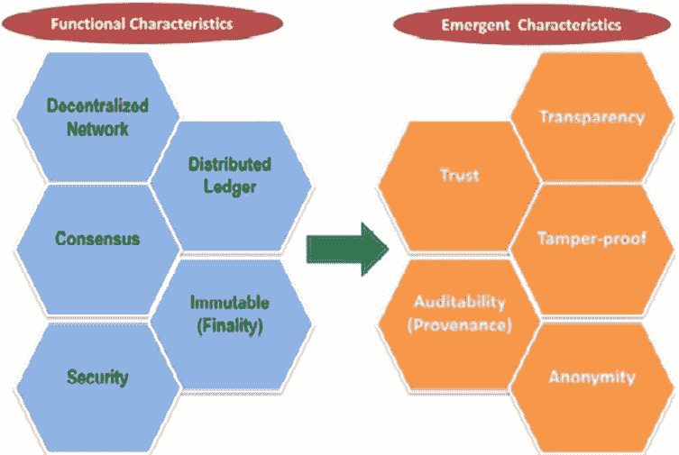

## 区块链技术

区块链是一个分布在许多计算机上的分布式数据库，没有中央控制，可以改变治理、商业模式和组织的运作方式。区块链是存储数字资产信息（代表价值、身份、协议、财产权利、凭证等）的理想场所。它承诺以更高效、安全和透明的方式处理交易，可以节省大量的行政管理、官僚主义、精力和时间。

根据 Garson (2018) 中引用的麦肯锡（McKinsey）的说法，区块链可以描述为 _一个去中心化的、共享的、可信的分布式账本（或数据库），由加密的“信息块”组成，这些信息块被添加到现有记录块链中_。该账本依赖于全球对等网络的共识来运行。在未修改整个链且未获得整个对等网络同意共识的情况下，修改一个区块中的数据是不可能的。在添加新区块之前，必须先由其他参与者（即其他区块，也称为节点）进行验证，以防止欺诈并保持安全性。区块是不可更改的，因此一旦区块中的数据被添加到链中，就无法编辑；除非区块链在最初创建时就具有编辑区块的功能，而这需要经过共识（Robinson, 2018）。区块链允许信息在不依赖第三方中央或管理机构的情况下进行验证和交换。区块链技术基于一种称为密码学的复杂数学分支。

区块链应用包括：_比特币_ (加密货币)、_Sia_ (去中心化云存储) 和 _以太坊_ (用于运行智能合约的虚拟机)。但在继续之前，有必要定义某些常用术语，以确保完整性。这些术语列于表 1 中。

| 区块链术语 | 定义 |
|---|---|
| Bitcoin | - 第一个也是最流行的使用区块链技术运行的加密货币；<br>- 货币单位，1 比特币 = 1 BTC |
| Block | - 记录入区块链的一组交易；<br>- 用于基于密码学添加新区块等的过程；<br>- 每个区块都链接到前一个区块，形成链 |
| Cryptography | - 使用个性化代码保障通信安全的科学，以便只有参与各方可以读取消息 |
| Consensus | - 区块链流程运行的机制；<br>- 指用于维护和更新账本的规则和机制，以保证记录的可信度，即其可靠性和真实性 |
| Ethereum | - 一个用于构建基于区块链应用的开源平台；<br>- 分发一种名为以太币（ETH）的货币；<br>- 允许存储和执行代码，从而实现智能合约 |
| Hash | - 区块的数字签名（包含关于数字资产和哈希指针的信息），用于身份验证 |
| Proof of Stake (PoS) | - 加密货币区块链网络实现分布式共识的共识算法；<br>- Proof of Work (PoW) 的替代方案 |
| Proof of Work (PoW) | - 用于区块链网络确认交易和生成新区块的共识算法 |
| Smart Contract | - 与区块链关联的程序代码，允许基于某个约定的触发事件添加交易；<br>- 又称链码（Chaincode） |

## 区块链特性

如前所述，区块链的一些最重要特性，也是其在各种应用中被采用的原因，包括：去中心化、透明性、不可更改性和智能合约（Rostic, 2016; Tasca, 2019）。下文将简要讨论这些特性。另请参阅图 1，以了解该技术更详细的特性集，分为功能属性和涌现属性。

- **去中心化**：传统的客户端-服务器模型是一种集中式方法，虽然对行业很有好处，但存在漏洞。在去中心化系统中，数据由网络中的所有参与者拥有。此外，网络中两个节点之间的交互不需要经过第三方。这正是比特币和区块链背后的主要理念。

- **透明性**：在区块链中，这是通过使用密码学隐藏个人身份来实现的，因此用户的真实身份是安全的。然而，交易可以通过其公开地址查看；但这是为了问责制，进而转化为客户之间交易的信任和诚实。

- **不可更改性**：在区块链中，这指的是区块的数字内容，一旦写入便保持不变；任何修改它的尝试都会被阻止。这是通过使用密码学哈希函数实现的。由于一个区块包含数据和一个哈希（指向前一个区块中的数据），这使得系统更加可靠。

- **智能合约**：对于区块链，合同的编写方式使得不需要人工干预、验证或仲裁。此外，还有一种措施可以确保冲突或重复的交易不会写入区块链。任何冲突都会自动调节，每个有效交易只添加一次（Tasca, 2019）。

图 2 说明了一种简单的方法来解释区块链流程的工作方式。

### 图 2. 区块链工作原理

- 1. 请求一笔交易（用于数字资产、资金、合同、媒体、软件应用程序等）
- 2. 交易被转换成一个区块（代表交易、软件应用程序请求、媒体使用等）
- 3. 区块被广播（到网络/区块链上的每个成员）
- 4. 征求对请求/交易/区块的批准（来自网络中的每个成员），以确认交易有效
- 5. 批准后，区块被添加到链中（提供请求/交易的透明记录）
- 6. 执行/完成请求/交易（以及数字资产/资金等转移）

## 区块链类型

通常有三种主要类型的区块链：公有链、私有链和联盟链（Bhasin, 2019）。公有链和私有链可以是许可型或无许可型（Singh, 2020）。联盟链也称为联盟。以下是对这些类型的简要说明。

- **公有链**：在这里，任何人都可以参与网络以添加和运行公共节点。这些区块链是去中心化的，与私有链相比本身较慢，但它们提供更好的匿名性。网络中的所有成员都可以查看区块并参与验证共识。这种类型具有真正的去中心化结构，并提供最大的透明性和不可更改性。示例包括：比特币 和 以太坊。

- **私有链**：在这种情况下，拥有区块链的组织有权决定谁可以加入和访问网络。因此，它是一个集中式-分布式网络；访问权限因节点而异。不提供匿名性；但是，这些网络的运行成本低于公有链。这种类型比公共网络更省电，波动性更小，并提供更好的隐私。示例包括：R3 和 Corda。

- **联邦或联盟链**：在这里，多个组织组成联邦来拥有网络。它充当多个组织共享和并发工作的枢纽。网络高度可扩展且节能，并提供最快的输出和最低的成本。这种类型提供更低的交易费用和更强的鲁棒性，因为与公有链或私有链相比，犯罪活动大幅减少。示例包括：Multichain 和 Monax。

另一种分类如下：

- **无许可链**：这些不需要许可即可加入网络（如公有链），因此非常适合运行和管理数字资产。其特征包括：匿名性、真正的去中心化、透明性、可信性以及具有增强安全性的不可更改性。这些链更难扩展，且效率较低。以太坊（ETH）就是一个示例。一些用例包括：数字身份、投票和筹资（Singh, 2020）。

- **许可链**：这些更像私有链，加入需要获得所有者组织（例如银行）的许可。特征包括：不同程度的去中心化、由拥有组织治理、高效、可扩展。这些链透明度较低但更节能。用例包括：研究、银行交易和供应链管理（Singh, 2020）。

## 行业中的区块链应用

正如 I-Scope (2020) 所述，区块链似乎比物联网（IoT）愿景要大得多。行业中的区块链应用和用例远远超出了使用比特币等加密货币的金融交易。凭借区块链提供更多透明性和鲁棒性的能力，以及诸如不可更改性等特性，这项技术正在影响包括金融、制造、供应链、物流和医疗保健在内的广泛行业。以下子部分将详细阐述上述行业及其他行业中的一些区块链应用。

### 银行业

金融机构和银行业连接各种群体的人，并为他们提供各种与贸易和商业相关的机会。在此背景下，区块链提供了一种工具，可以在更广泛的范围内、更安全、更透明地完成同样的事情。因此，区块链技术在全球商业方面具有潜力。它可以通过去除手动和基于纸张的流程，并引入简化和自动化的流程来提高贸易效率。公有链可以是一个很好的协作工具，因为它是去中心化的。此外，其运行过程中不需要人工干预。以下要点简要讨论了银行业中区块链技术的若干用例（Concise Software, 2020; Shumsky, 2019）。

- 更快的支付：银行业正在向支付和资金交易的去中心化渠道转变。因此，区块链技术已经为此目的被使用。通过采用这项技术，支付变得更快，银行能够削减处理费用以及对第三方或中介验证的需求。存在着各种


表明区块链将从根本上改变银行业，时间定在2025年（Concise Software, 2020）。

- 欺诈减少：网络攻击的可能性可能是当今银行业面临的主要挑战。区块链技术是去中心化的，因此不太容易受到此类欺诈的影响，它不仅可以实时执行支付，还可以实现完全透明，进而也能实现实时欺诈分析和预防。区块链账本还可以保存并提供所有共享操作和文档的历史记录（Shumsky, 2019）。

- 买卖资产：在证券市场，买卖高度依赖金融资产经纪商和托管银行。这也涉及需要支付的费用。使用区块链（以及比特币和以太坊等货币）可以消除中间人，免除交换费用，使流程更加自动化、弹性和安全，并有助于创建数字资产的去中心化数据库。

- 点对点转账：这允许客户在线转账，但是存在许多限制，例如高额佣金费用，有时客户数据缺乏安全性。在此，区块链技术可以帮助去中心化点对点转账应用程序，因为区块链没有地理限制。交易不可更改且可以实时进行，因此接收者不需要等待直到收到数字资产（Concise Software, 2020）。

- 会计和审计：会计和审计的数字化进程相对缓慢，主要是因为监管要求数据的完整性、准确性和有效性。因此，会计是另一个可以利用区块链技术进行转型的领域，该技术可以简化合规性并简化传统的记账系统。在此，企业能够将交易直接添加到分布式的共享账簿中。结果，记录更加透明和安全。区块链智能合约还可以用于自动支付发票。

## 医疗保健

医疗保健行业开始采用区块链技术，为患者提供综合护理，并解决在确保数据安全和隐私的同时，同步多个不同医院信息系统（HIS）中存在的患者数据所面临的挑战。它还可以提供机会，以确保互操作性、完整性、患者身份、隐私、可追溯性、降低运营成本以及其服务的普遍访问（CitiusTech, 2018）。下面简要阐述了其中一些特性。

- 全国互操作性：作为国家医疗体系一部分的医疗保健组织，在数据交换和共享方面遵循不同的标准，例如 FHIR、CDA 或 HL7 等。这可能导致不同系统之间的互操作性降低。通过综合医疗保健企业（IHE）协议交换个人健康记录和健康信息交换（HIE）数据，是解决系统互操作性和医疗记录可访问性挑战的重要部分。区块链可以通过使用API来访问和传输数据，从而帮助解决这些问题。虽然区块链技术并非数据标准化或系统集成挑战的万能药，但它确实提供了一个有前景的新分布式框架，用于扩展和支持各种用途和利益相关方之间的医疗信息集成。它解决了几个现有的痛点，并实现了一个更高效、去中介化且安全的系统。

- 安全性：医疗保健组织日益关注的问题是敏感数据被篡改以及黑客造成的各种安全漏洞的可能性。由于区块链中的数据使用发送方的私钥加密，只有预期接收方可以使用相同的密钥进行解密，因此黑客很难篡改或修改此类数据。此外，对区块中数据的修改需要链中所有其他区块的验证，因此，区块链还提供内置安全功能。

- 完整性：区块链是一种分布式账本，其交易不可更改（即保持不变）。这是一个确保交易完整性（即区块中的数据）的功能，而数据加密则增强了整个网络的安全性。随着区块链技术的实施，各种医疗保健组织中多个过时的患者数据实例被最新患者信息的单一来源所取代。

- 普遍访问：在全国分布的医疗保健组织之间管理及时访问患者数据是一项挑战。区块链技术也可以在此提供帮助。区块链架构确保所需数据存在于每个节点（即每个区块中），并基于通过智能合约或其他机制提供的访问权限，供授权用户使用。

- 维护成本：信息系统在其整个运行期间都需要维护。这包括除其他活动外的定期备份和设置恢复机制等操作。在此，区块链技术可以提供帮助。在区块链中，数据分布在整个网络中，没有可能导致固有备份机制的单点故障；此外，数据的单一版本被复制到区块链的每个节点上。这减少了各信息系统之间发生的交易量，从而减轻了医疗保健生态系统的负担。

有关医疗保健领域中区块链的更多应用，请参阅 CitiusTech (2018)。

## 制造业

制造业是区块链可能具有最大潜力创造商业价值的领域。根据 Columbus (2019) 中的 Forbes 报道，成本节约、可追溯性和透明度是行业投资区块链的三大驱动力。Mire (2018) 列出了制造业中可有效应用区块链技术的十个用例，包括供应链管理、3-D 打印、减少系统故障、提高对产品的信任、对基于 IoT 的设备进行身份验证，以及更好的跟踪和维护。下面简要讨论了其中一些内容。

- 改善供应链管理：随着时间的推移，随着企业继续全球化，供应链（SC）变得越来越复杂。该领域缺乏技能的问题也变得越来越明显，供应链的成本也越来越高。正是在此背景下，区块链解决方案可以简化 SC 管理，以帮助维持生产水平并提高效率。例如，企业可以开发系统，使供应链上的所有参与者都可以查看和更新一个所有人都可见的单一记录。这些系统随后可以使制造商减少产品损失，为向其交付成品的人员提供溯源度量，并在监管合规方面发挥重要作用。Forbes in Columbus (2019) 预测，区块链的大部分投资将用于采用以下五个领域：数字市场、跟踪供应链参数、跟踪产品质量、防止假冒、跟踪资产维护。SC 中的区块链应用将在本章后面进一步阐述。

- 减少系统性错误：制造业并非对数据泄露免疫。这个高度依赖供应链的领域可能特别容易受到攻击，因为受调查的高管中，有 39% 报告在过去 12 个月内遭遇过数据泄露；其中 38% 报告因此类泄露损失高达 1000 万美元（Mire, 2018）。区块链的一个特点是，它要求链中所有节点达成共识以批准数据录入或对账本的更改；这是区块链安全机制的一部分。由于制造业需要供应商之间近乎持续的沟通，而单次数据泄露就很容易危及各方的运营，因此区块链中适当级别的安全性可以防止欺诈企图及其导致的系统故障。

- 提高对产品的信任：制造和运输过程中的欺诈，尤其是涉及可食用产品的欺诈，尤其危险，可能导致严重的健康问题甚至死亡。制造商也要接受广泛的认证和质量流程，消费者有权了解这些信息，无理由不让他们知晓。在此背景下，区块链去中心化技术可以允许共享这些信息，但不会被泄露或更改。此外，关于供应链溯源的信息可以相当快速地访问。通过采用区块链技术，制造商可以建立其作为可靠的可信度，从而赢得更强的客户信任、忠诚度和关系。

- 网络设备身份验证：物联网（IoT）正在影响社会的几乎所有领域，包括制造业和物流。根据 Mire (2018) 报告的一项调查，2016 年至 2017 年间，制造业中基于物联网的设备连接增长了 84%。通过任何网络进行设备连接涉及的一些问题包括：生成海量多样化数据，以及此类数据的安全性和完整性。使用区块链技术提供了一种安全的网络机制，可更稳健地对基于物联网的设备进行身份验证和监控。在此，信息也可以安全地传递，并由授权用户立即共享。

## 供应链

管理当今的供应链可能极其复杂，因为成功的供应链运营依赖于跨地理上分散的合作伙伴及其他相关组织的强大、透明和端到端的沟通。由于现有供应链的复杂性和缺乏透明度，区块链在供应链管理（SCM）中的作用正成为日益受到关注的领域。SCM 认为有吸引力的区块链技术特性包括共识、溯源、不可更改性、信任和最终性（Morley, 2020）。这些特性为更高效的 SCM 带来以下好处：

- 自动化：许多供应链流程缓慢且基于纸张。区块链技术可以用端到端的数字流程取代这些流程，提供更好的可见性和透明-


ency. However, this requires the creation of 100% digitally-enabled supply chain necessary for Blockchain to operate.

- Better traceability: Increasing regulatory demand for provenance information is already driving the change. Companies are already turning to Blockchain for increased supply chain transparency, with the track and trace style application of Blockchain. This, in turn, leads to better delivery times, improved quality and traceability, and reduced loss of revenue.

- Reduced transaction costs: The ability of Blockchain-based transfer of funds without the need of an intermediary can speed up payments while saving on transaction and administration costs. Also, because of smart contracts, many operations can be triggered automatically (e.g. what should happen if the delivery is delayed), which can significantly reduce costs.

- Accelerated speed of operations: Blockchain technology protects the integrity of information and the transactions so that there are fewer errors and disputes. The entire process becomes faster as there is less need for product recalls or re-filling a missed order. In addition, the use of smart contracts means that the need for intermediaries (e.g. clearing houses) is reduced.

- More ethical operations: Consumers demand ethical operations. Here, Blockchain can help in two ways: 1) supply chain professionals can use Blockchain provenance to establish where everything they use has come from, and pass this information to customers; and 2) because of inherent transparency, customers know how products are manufactured and shipped.

## Transportation and Logistics

Opportunities that Blockchain offers to the industry are well recognised, and this is also true for the transportation sector. Blockchain in Transport Alliance (BiTA) is an example of the interest in Blockchain that was created (with members such as UPS and FedEx) as a forum for Blockchain education and standards development for the freight industry (Robinson, 2018). In transportation and logistics, Blockchain can usefully help in the following ways:

- To increase the efficiency and transparency of the entire shipping process including matching shippers with carriers - through the use of Blockchain smart contracts
- To streamline payments - through using a Blockchain platforms such as Ethereum, and without human intervention
- To reduce the number of intermediaries - as Blockchain technology does not require human intervention at any stage
- To show greater visibility of the entire supply chain - since each party in a Blockchain validates and records transactions throughout the process
- To increase transparency and tracking ability of transportation and shipping – which, in turn, would discourage attempts for cargo theft
- To enhance the level of trust in the transportation and shipping process – as, through the use of Blockchain, multiple parties would be able to validate the process.

Blockchain is changing the face of transportation and logistics in a number of other ways as well including the following (Winnesota, 2020):

- Better freight tracking: With the increase in on-demand deliveries, customer expectations are also increasing but scaling up the process has proved to be problematic, especially when it comes to authentication. By using Blockchain for data authentication, the entire network can contribute and validate data which then becomes less susceptible to tampering by malicious outsider agents; efficiency of tracking also improves.

- Reduction in costs: This is always one of the core objectives to achieve, for all businesses. In this respect, smart contracts can be the single most impactful Blockchain enabled feature to the freight industry. Smart Contracts are essentially self-executing tasks that are coded through the Blockchain and executed when certain conditions are met. Blockchain smart contracts would completely eliminate the need for various administrative steps, cutting costs and virtually also removing all possibilities of human error.

- Increased liquidity in the supply chain: There are many inefficiencies in the supply chain management mainly due to interaction between multiple partner organisations. Most of the inefficiencies can be removed by employing Blockchain based technologies stack e.g. Sweetbridge as mentioned in Winnesota (2020). Such technologies can help to improve the efficiency of settlements (in case of disputes) between parties within the supply chain, and hence increase liquidity.

## Education

The possibilities of use of Blockchain Technology (BC) in the education sector are many. As education becomes more diversified, democratised, and decentralised, there is an urgent need to maintain reputation and trust in the certification process and the learning experience, and to ensure more transparency in the educational processes. Blockchain can provide just such a system. Clark (2016) suggests ten ways where Blockchain can be used in education including: keeping a national database, organising global assessments, better continuous professional development, delivering corporate learning, providing vocation education e.g. apprenticeships, etc. Byon (2020) also suggests a number of ways that can help curb the issues with educational technologies relating to digital classrooms, smart classroom boards, remote learning, etc; and looks at what is driving the interest of educational institutes to implement Blockchain technology. Some of the ways in which Blockchain can prove useful, are briefly articulated below (Hance, 2020; Clark, 2016; Alacrity, 2020; Maaghul, 2019):

- Safe keeping of student records: These records (consisting of attendance, programmes of study, payment of fees, grades achieved, and coursework materials etc.) can become part of students’ personal Blockchain records. Since these records are immutable (i.e. cannot be deleted or modified without Blockchain consensus), it helps with the data security. Also, these records will now belong to students, rather than the institutions (Hance, 2020; Alacrity, 2020). Faculty records can also be kept safe and secure, using the same approach.

- Learning platform for all: It is important that there is a connect between students, teachers, course developers, and other academics. In this context, Blockchain and digital tokens (as part of Blockchain technology) can power an innovative learning platform to build an open-source internal learning education system where students can access materials and work on innovative projects. Digital tokens on the platform can be rewarded to students for their activities on the platform. Students can, then, use their tokens to access new study materials and keep the learning going on (Alacrity, 2020).

- Standardisation and authenticity: There is need for a unified approach to tracking and managing student certificates from educational bodies, professional societies, trade associations, and state examination boards. A single database that is digitally accessed from anywhere and anytime creates a standard for verified credentials. If data is stored on a public Blockchain, it is stored on every node on the network (of institutions and educational bodies). If one node is compromised, the ledger would remain unaffected. Additionally, if any data were tampered with, this would affect the cryptographic hashing of the block, thus breaking the chain between the blocks. In this case, the breach would be broadcast to the entire network, and the compromised block would be rejected. This provides security and authenticity of standardised data (Maaghul, 2019).

## Internet of Things (IoT)

Currently, the convergence of Blockchain and the IoT is on the agenda for many organisations, not only in the financial services sector, but in nearly all sectors of the society, as already illustrated in the previous sections above. Core benefits that can be achieved from using Blockchain for the IoT can be summarised as follows:

- Building trust between users and IoT devices and reducing risk of collusion and tampering
- Reducing costs by removing overheads associated with the involvement of middlemen
- Accelerating speed of transactions by reducing settlement time between parties
- Increasing security of device connectivity and transmission of data.

In the following bullet point, some use cases of Blockchain in the IoT based applications are presented.

- Insurance: The main use case of Blockchain and IoT in insurance is with reference to smart contracts and the enhancement of processes such as claims management. Other applications include fraud management and reduction in security related threats, legally required applications and compliance, and even the use of technologies in an insurance context. The IoT data and Blockchain can lead to smart automated insurance policies (I-Scope, 2020).
- Enterprise Resource Planning (ERP): Blockchain technology and the IoT are already playing an important role in supply chain management and production within the ERP systems domain. Blockchain can create a single version of relevant information and data, and ensure that all related systems speak through a Blockchain, without intervention of intermediaries. Blockchain can work as a complementary supplement that simplifies the integration between the parties and reduces the applications vulnerabilities due to the system’s inherent security (Active Business Systems, 2020).
- Autonomous vehicles: Currently, in terms of sharing machines like self-driving cars (e.g. through Uber or Google), data is centralised with service providers. Using a Blockchain-based service and the vehicles connected through the IoT, any number of individuals are able to form an agreement between themselves to purchase or share a self-driving vehicle and share its maintenance amongst themselves. Each cooperative group can then agree contracts with other groups and share usage of their vehicles amongst a wider group of peers (ConsenSys, 2016).


### 结论

区块链技术似乎比物联网（I-Scope, 2020）的愿景要重大得多。行业中的区块链案例研究和应用远超金融交易和加密货币转移。这归功于其透明度、开放性和公平性，加上其高度吸引人的属性（例如不可篡改性）以及节点共识等特性，这项技术正在影响金融、制造、医疗保健、物流、供应链、汽车和交通等众多行业，不胜枚举。

在本章中，我们介绍了区块链技术，并讨论了其在社会各个领域的应用和案例研究，包括银行、医疗保健、交通、制造、供应链和教育。还简要讨论了使用分布式账本技术扩展物联网（IoT）愿景。我们描述了基本术语，概述了基本特征和优势，并描述了底层概念和区块链流程。

### 参考文献

- Active Business Systems. (2020). 区块链与ERP。可在以下网址查阅：https://www.activebs.com/en/news/2018/blockchain-and-erp
- Bhasin, H. (2019, 4月). 区块链的3种主要类型：区块链分类。可在以下网址查阅：https://www.marketing91.com/types-of-blockchain/
- Byron/Alacrity. (2020, 5月). 教育中的区块链：三项有前景的改革。可在以下网址查阅：https://alacritys.net/2020/05/27/blockchain-in-education-three-promising-reforms/
- CitiusTech. (2018, 5月). 医疗保健领域的区块链。可在以下网址查阅：https://www.ehidc.org/sites/default/files/resources/files/blockchain-for-healthcare-341.pdf
- Clark, D. (2016). 区块链在教育中的10种应用方式。可在以下网址查阅：https://oeb.global/oeb-insights/10-ways-blockchain-could-be-used-in-education
- Columbus, L. (2019). 区块链如何在2019年改善制造业。可在以下网址查阅：https://www.forbes.com/sites/louiscolumbus/2018/10/28/how-blockchain-can-improve-manufacturing-in-2019
- Concise Software. (2020). 银行业中区块链的10个用例。可在以下网址查阅：https://concisesoftware.com/10-use-cases-of-blockchain-in-banking
- ConsenSys. (2016). 5个令人惊叹的区块链IoT应用。可在以下网址查阅：https://blockgeeks.com/5-incredible-blockchain-iot-applications/
- Garson, B. (2018, 6月). 炒作之外的区块链。可在以下网址查阅：https://www.mckinsey.com/business-functions/mckinsey-digital/our-insights/blockchain-beyond-the-hype-what-is-the-strategic-business-value?cid=other-eml-nsl-mip-mck-oth-1807&hlkid=5424a29008e445239371a81cc83b3dbb&htcky=10291646&hdpid=bb9f89f0-458b-4b4e-a1ee-ad99e602294e
- Goyal, S. (2018, 11月). 区块链技术的历史：必知时间线。可在以下网址查阅：https://101blockchains.com/history-of-blockchain-timeline/
- Hance, M. (2020). 什么是区块链以及它如何用于教育？可在以下网址查阅：https://mdreducation.com/2018/08/20/blockchain-education/
- I-Scope. (2020). 区块链与物联网：IoT区块链的机遇与挑战。可在以下网址查阅：https://www.i-scoop.eu/internet-of-things-guide/blockchain-iot/
- Maaghul, R. (2019, 10月). 教育中的区块链：记录管理的未来。可在以下网址查阅：https://blogs.odem.io/blockchains-bright-future-in-the-education-industry
- Mire, S. (2018, 11月). 制造业区块链：10个可能的用例。可在以下网址查阅：https://www.disruptordaily.com/blockchain-use-cases-manufacturing
- Morley, M. (2020, 2月). 2020年供应链中区块链的前5个用例。可在以下网址查阅：https://blogs.opentext.com/blockchain-in-the-supply-chain/
- Robinson, J. (2018, 8月). 交通运输中区块链的未来。可在以下网址查阅：https://www.fleetio.com/blog/future-of-blockchain-in-transportation
- Rusic, A. (2016). 什么是区块链技术？初学者逐步指南。可在以下网址查阅：https://blockgeeks.com/guides/what-is-blockchain-technology/
- Shumsky, P. (2019, 9月). 2020年银行区块链用例。可在以下网址查阅：https://www.finextra.com/blogposting/17857/blockchain-use-cases-for-banks-in-2020
- Singh, N. (2020, 5月). 许可链与非许可链：对比指南。可在以下网址查阅：https://101blockchains.com/permissioned-vs-permissionless-blockchains/
- Tasca, P., & Tessone, C. J. (2019). 区块链技术分类学：识别与分类原则，Ledger。LedgerJournal.org。
- Winnesota. (2020). 区块链如何革新交通运输和物流世界。可在以下网址查阅：https://www.winnesota.com/blockchain
- Witscad. (2020). 区块链特性。可在以下网址查阅：https://witscad.com/course/blockchain-fundamentals/chapter/blockchain-characteristics

## 补充阅读

- R3. (2020), Corda Enterprise：下一代区块链平台，可在以下网址查阅：https://www.r3.com/corda-platform/
- Consensys, (2020), 智能迪拜：阿联酋政府区块链案例研究，可在以下网址查阅：https://consensys.net/blockchain-use-cases/government-and-the-public-sector/smart-dubai/
- Consensys, (2020a), 现实世界区块链案例研究，可在以下网址查阅：https://consensys.net/blockchain-use-cases/case-studies/
- Crypto Digest. (2020), EOS平台：你应该知道的事，可在以下网址查阅：https://cryptodigestnews.com/eos-platform-what-you-should-know-58da830d2aa8
- Daley, S. (2020, 3月), 25个区块链应用及颠覆现状的现实世界用例，可在以下网址查阅：https://builtin.com/blockchain/blockchain-applications
- EconomicPoint. (2020), 什么是以太坊平台，可在以下网址查阅：https://economicpoint.com/ethereum
- Garson, B. (2018, 6月), 炒作之外的区块链，可在以下网址查阅：https://www.mckinsey.com/business-functions/mckinsey-digital/our-insights/blockchain-beyond-the-hype-what-is-the-strategic-business-value?cid=other-eml-nsl-mip-mck-oth-1807&hlkid=5424a29008e445239371a81cc83b3dbb&hctky=10291646&hdpid=bb9f89f0-458b-4b4e-a1ee-ad99e602294e
- Hyperledger Fabric. (2020), 超级账本 Fabric，可在以下网址查阅：https://hyperledger-fabric.readthedocs.io/en/release-2.0/whatis.html
- IEEE Spectrum, (2020, 4月), 西班牙研究人员利用区块链和AI压平曲线，可在以下网址查阅：https://spectrum.ieee.org/news-from-around-ieee/the-institute/ieee-member-news/researchers-spain-blockchain-ai-app-flatten-the-curve
- Infura, (2020), 与Horizon Games合作，为游戏开辟新维度，可在以下网址查阅：https://infura.io/customers/skyweaver
- ISO, (2016), 信息技术，专利号：ISO/IEC 10118–1:2016
- Kashyap, P. (2018, 2月), 区块链及其组件的不同类型有哪些？，可在以下网址查阅：http://www.beingcrypto.com/what-are-different-types-of-blockchain-and-its-components/
- Komgo, (2020), 简化贸易融资，可在以下网址查阅：https://komgo.io/
- Mahmood, Z. (2021). 区块链技术：行业中的举措与用例。在 Z. Mahmood (编), 行业区块链技术用例：行业中的举措与用例, IGI Global, 2021.
- Malhotra, M. (2020, 3月), 2020年值得关注的区块链平台综合列表，可在以下网址查阅：https://www.valuecoders.com/blog/technology-and-apps/a-comprehensive-list-of-blockchain-platforms-to-look-for-in-2019/
- MarketWatch. (2020, 6月), 区块链技术市场份额，预计到2025年将超过250亿美元 – 新闻稿，可在以下网址查阅：https://www.marketwatch.com/press-release/blockchain-technology-market-share-growth-to-record-over-us-25-billion-by-2025-2020-06-09
- MultiChain. (2020), 面向开发者的MultiChain，可在以下网址查阅：https://www.multichain.com/developers/
- OpenChain. (2020), OpenChain概述，可在以下网址查阅：https://docs.openchain.org/en/latest/general/overview.html
- OpenZeppelin. (2020), 安全区块链应用的标准，可在以下网址查阅：https://openzeppelin.com/
- Project Khokha：企业以太坊银行与金融案例研究，(2020)，可在以下网址查阅：https://pages.consensys.net/consensys-banking-and-finance-project-khokha-v2?utm_campaign=Enterprise%20Ethereum%2020&utm_source=Website&utm_medium=Direct&utm_term=EntEth&utm_content=CaseStudyKhokha


Ripple, (2020), University Blockchain Research Initiative, 可在以下网址查阅: https://ubri.ripple.com/faq/

Robinson, J. (2018, Aug), 交通运输中区块链的未来, 可在以下网址查阅: https://www.fleetio.com/blog/future-of-blockchain-in-transportation

Tepper School of Business. (2020), Tepper 区块链计划, 可在以下网址查阅: https://www.cmu.edu/tepper/faculty-and-research/initiatives/blockchain-initiative/

Zaky, D. (2020, March), 什么是区块链技术及其工作原理? 可在以下网址查阅: https://fxdailyreport.com/blockchain-technology/

## KEY TERMS AND DEFINITIONS

**Bitcoin:** 比特币是一种为点对点在线交易而创建的数字货币，于2008年推出。它是一组虚拟货币中最突出的一种。

**Blockchain:** 区块链是一种分布在许多计算机上的分布式数据库，没有中央控制，可以改变治理、商业模式和组织的运作方式。区块链存储关于数字资产的信息（代表价值、身份、协议、财产权、凭证等）。

**Chaincode:** 在区块链技术语境下，它是自执行智能合约的另一种名称。

**Consensus:** 共识是区块链系统中使用的一种容错机制，用于在分布式进程或多代理系统（如加密货币）之间就单个数据值或网络的单一状态达成必要的协议。

**Cryptography:** 这是一种使用个性化代码（例如公钥和私钥）来保护通信安全的科学，以便只有参与方可以阅读加密消息。

**Ethereum:** 一个用于构建基于区块链应用程序的开源平台。它允许分发一种名为以太币（ETH）的货币；并允许存储和执行支持智能合约的代码。

**Hash:** 这是一个区块（包含有关数字资产和哈希指针的信息）的数字签名（由公钥和私钥组成），用于身份验证和验证目的。这是区块链用于确认其状态的过程；区块链中的每笔交易都需要一个或多个数字签名。

**Hyperledger Fabric:** 它是由 IBM 开发的用于分布式账本解决方案的平台，支撑一种模块化架构，提供高度的保密性、弹性、灵活性和可扩展性。它旨在支持区块链技术不同组件的可插拔实现。

**Proof of Stake (PoS):** 这是一种共识算法类型，加密货币区块链网络通过该算法旨在实现分布式共识。在基于 PoS 的加密货币中，下一个区块的添加是根据各种随机选择组合（例如财富或龄，即“权益”）来组织的。

**Proof of Work (PoW):** 这是一种共识机制，通过要求服务请求者完成一些工作（通常是指计算机的处理时间），来帮助阻止或减少网络上的拒绝服务攻击和垃圾邮件等其他安全滥用行为。

**Smart Contract:** 智能合约是一种计算机协议，用于在双方之间便捷地转移数字资产，前提是已事先商定的条款或条件。它是一种自执行代码，在满足预先商定的条件时生效。

## Chapter 2

## 教育环境中基于区块链的机器人流程自动化机制

Nhlanhla Andrew Sibanyoni
https://orcid.org/0000-0002-5393-905X
南非约翰内斯堡大学

### ABSTRACT

区块链技术和机器人流程自动化在研究中日益受到关注，因为它们在商业、营销、制造和金融领域都已成功应用。然而，它们在教育环境中的应用仍处于萌芽阶段。本章以在线学校注册系统为例，探讨基于区块链的机器人流程自动化机制如何解决固有挑战。拟议系统允许父母为其一年级和八年级的孩子注册他们选择的学校。某些学校的学位竞争激烈，且存在教育资源不公平分配的历史；因此，存在信任缺失。为应对这一威胁，本研究提出一种基于区块链的机器人自动化流程机制，以公平、透明地分配教育资源。它建议开展进一步的设计科学研究，在其中区块链将由额外的技术流程补充，以增强教育环境中的数据共享。

### INTRODUCTION

本章以南非某地区学校群的在线学校注册系统为例进行探讨。这是一个官方的在线申请系统，家长使用该系统为其一年级和八年级的孩子在南非学校注册下一学年。该系统是面向公民的电子政务系统的一部分，因为它由国家运营，并符合 Silcock (2001) 给出的电子政务定义。

电子政务被定义为使用信息和通信技术（ICT），其中可能包括广域网、系统、互联网、物联网和移动计算，以增强政府服务的获取和交付，从而惠及公民、商业伙伴和员工 (Silcock, 2001)。这促进了一种新的公共服务模式，政府机构有机会为公民提供技术先进、集成且无缝的服务 (Bakon, Elias & Abusamhadana, 2020; Silcock, 2001)。然而，如 Bélanger and Carter (2008) 所确立，相互信任阻碍了公民对电子政务服务的采用。他们的研究得出结论，政府机构应直接回应公民关于电子政务系统可信度和可靠性的看法，以提高公民对其价值、准确性和可靠性的感知。通过提高透明度和问责制，公民采用电子服务所需的信任可以进一步增强 (Bélanger & Carter, 2008)。

值得注意的是，赢得信任已被证明是南非在线学校注册系统面临的挑战。某些公立学校的学位竞争情绪化且具有严重的个人和社会后果。不信任往往源于报纸和其他媒体的负面报道，结合系统运行环境中教育资源不公平分配的历史 (Mokhaoli, 2020)。这损害了基于在线学校注册系统感知透明度和诚信的信任问题。这些问题在当前章节中仍然重要，尽管所报告研究的重点具体在于技术解决方案。未来研究将从其他电子政务视角审视在线学校注册系统。

在本章中，提出了一种基于区块链的机器人流程自动化机制，以解决社区、学校行政部门、ICT 技术人员和系统监管政府部门在注册过程中面临的部分挑战。需要注意的是，目前在线学校注册系统 (OSRS) 不使用物联网、机器人流程自动化 (RPA) 或区块链。这些术语将在后续章节中详细定义。

DOI: 10.4018/978-1-7998-6650-3.ch002

### BACKGROUND

鼓励家长如图 1 所示通过在线系统为其子女注册。

作为流程的一部分，必须附上经认证文件的副本，例如出生证明、身份证明文件、往年成绩单和居住证明。系统还要求家长“拍摄注册过程照片”作为注册证明，并在当天向学校提交提交的文件的硬 copy (Gauteng Province, 2020)。这一额外流程（出现在图 1 左侧）旨在验证所提供的信息，从而减少故意提交虚假信息，并检查在线数据未被篡改 (Arslan, Jurdak, Jelitto & Krishnamachari, 2019)。家长可以使用各种设备访问该系统（手机、笔记本电脑、台式计算机；如图 1 顶部所示）。系统有一个密集的数据输入时段（有固定的开始和结束时间）。

尽管家长已使用在线系统，他们仍需将文件的纸质副本提交给所选学校，并出示注册证明（如图 1 左侧所示）。这一“备份系统”有助于家长证明任何指控，即他们的在线申请丢失、错放、从未被学校收到，或者他们的子女被不公平地安排在离家较远的学校。然而，保留手动流程会导致工作重复和需要在发生争议时进行核对的重复数据，且争议解决过程仍可能容易出现人为失误，包括偏见，从而再次导致学习者安排不当或不公平。


### 图 1. 在线学校注册系统流程的当前示意图

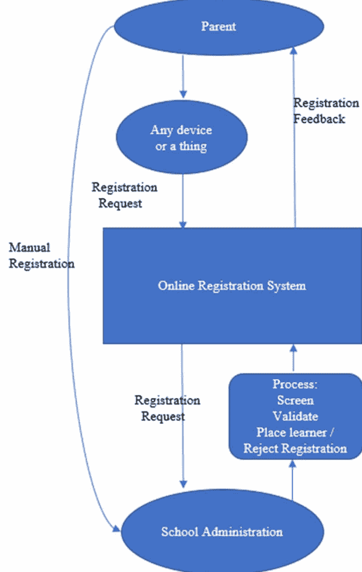

因此，当存在信息冲突且双系统导致人工管理负担增加时，信任问题仍然成立。事实上，许多自动化系统试图解决的人工系统的局限性，在使用两个并行系统时只是被放大了。

尽管具有明显优势，公民使用移动设备访问电子政务系统既带来机遇也带来挑战。数据在传输和存储过程中的安全与隐私是一大挑战。图 2 显示了源自特定基于互联网的生态系统——物联网（Lohachab, Lohachab & Jangra, 2020）的挑战，但几乎所有提到的挑战都适用于任何基于互联网的生态系统。

### 图 2. 基于物联网系统固有的挑战

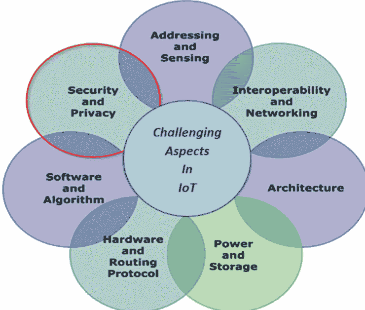

有必要应对这些挑战并吸收此类系统，因为这有助于理解连接移动设备的新范式，从而提供超可靠的通信。可以通过研究和开发用于互联网系统成功部署的通用安全架构来实现（Lohachab, et al., 2020）。

## 虚拟环境中的信任

信任主题是一个重要的研究领域，因为普遍认为虚拟环境的广泛成功取决于公众的信任（Tan & Thoen, 2001）。信任由两个要素组成：服务提供方（一方信任）和控制信任，即提供服务的机制（Bélanger & Carter, 2008）。Tan 和 Thoen (2001) 将控制机制定义为通过监控和控制确保交易成功执行的专用程序和协议。信任被定义为对个人或团体能够履行其承诺的期望。根据社会学习理论，人们由于承诺的负面或正面强化的经历而产生不同的期望。在给定场景中，一些家长的申请按预期通过，而其他人可能会像介绍中解释的那样遇到困难。本章提出，区块链技术（如 Xing 和 Marwala (2018) 所建议）可以通过改变在线交易的通常执行方式并确保成功，在机器人流程自动化（RPA）中提供确定信任的帮助（Makridakis Polemitis, Giaglis & Louca, 2018）。

## 基于区块链的 RPA 在在线学校注册系统中的潜力

本章提出的解决方案的第一部分基于这样一个主张：RPA 在一定程度上可以弥补数据传输和存储过程中的安全和隐私差距，并且还可以提高学校管理效率和注册过程的公平性。RPA 应用于重复且手动的人类基于规则的任务。例如，历史上，RPA 一直用于工业工程过程，以逐步自动化旨在实现经济效益和提高产品质量的任务（Moffitt, Rozario & Vasarhelyi, 2018）。RPA，也称为机器人或 bots，涉及模拟用户操作的软件代理，旨在提高运营效率以减轻人力工作量（Syed et al., 2020）。需要注意的是，这些并非我们熟悉的硬件机器人。

最近，RPA 已被用于自动化组织内部流程和应用程序，这些流程和应用程序可以为核心业务流程带来即时价值，包括员工薪资、员工状态变更、新员工招聘与入职、应收账款和应付账款、发票处理、库存管理、报告创建、软件安装、数据迁移和供应商入职（Madakam, Holmukhe & Jaiswal, 2019）。

所提议解决方案的第二部分涉及区块链技术，因为家长、在线学校注册系统和学校之间准确、可靠且安全地传输机密信息的需求依然存在。如前所述，信任是系统面临的主要因素，因为家长不信任该系统是公平和透明的（即，它将根据语言和位置——学校距离——将他们的孩子安置在合适的学校）。区块链为所有交互创建不可更改的记录，因为所有这些交互都经过区块链。这种方法确保数据的质量是完整、正确、持久且可检索的（Reyna, Martín, Chen, Soler & Díaz, 2018）。

人工智能（AI）体现为机器人或 bots（与 RPA 互换使用的术语）有能力执行复杂、艰巨、危险且数据密集的任务，例如监控网络安全威胁或人类的枯燥任务。AI 无处不在，以服务、交通、军事机器人等形式影响我们生活的方方面面。AI 机器人可以在没有人类控制的情况下做出决策并采取行动（Dignum, 2017）。在基于区块链的 RPA 中，可以使用机器人（bots）有效且可靠地自动化注册流程。区块链可以确保记录不被更改、历史记录保留且透明度得到维护，从而构建可信的数据共享（个人数据）（Shahaab, Hewage & Khan, 2020），以及高效有效的注册。发送到在线学校注册系统并随后发送到相关学校的学习者注册记录的透明度、验证（包括如果出生证明等存在问题，由内政部门进行验证）、可追溯性和不可更改性均得到改善。可追溯性显示交易的状态，包括其在流程（工作流）中的某个节点接收时间。这在分布式系统中尤其有用（客户不访问办公室，多个不同方——在此情况下，学校和集中注册机构——位于不同地点）。区块链应安全地存储/传输可信数据；另一方面，AI 可以确保在没有人为干预的情况下发送和接收这些数据，使其在在线系统上进行交易时更加可信。

这种组合使得区块链和 AI 成为安全存储/传输数据等复杂任务的天然选择（Makridakis et al., 2018）。

区块链由共享相同时间戳的区块中的有序和分组交易组成。区块由链接区块的矿工或节点（参与者）网络管理。由于这使得更改记录变得困难，因此创建了所有交易的强大且可审计的登记簿，尽管记录被广泛共享（Casino et al., 2019）。在在线学校注册系统中，存在可能诱使家长、学校管理人员或黑客等独立不诚实人士作弊的问题，有时是为了财务回报。由于注册系统覆盖全国所有学校和学习者，手动系统难以监控和控制。与注册相关的规则复杂；例如，如果一个较大的兄弟姐妹在该校，随后的兄弟姐妹将自动获得入学资格（因为他们排在第一位）。基于区块链的 RPA 机制可以确保这些规则被正确应用。区块链有能力使用加密技术自动验证凭据，并以去中心化、安全、透明和可信的方式提供对共享数据库、交易、记录和日志的访问。虽然以 RPA（机器人或 bots）形式的人工智能提供了模拟人类智能的决策能力，但这两种技术的结合可以为公民带来巨大益处（Salah, Rehman, Nizamuddin, & Al-Fuqaha, 2018）。

该研究通过教育环境中一个现有示例——在线学校注册系统——为区块链和 RPA 文献作出了贡献。但是，重要的是我们要承认，不能期望单一解决方案解决教育系统注册一年级和八年级儿童的所有问题；因此，应进行进一步的实证研究，以找出区块链可以通过其他解决方案补充的方式，以增强教育行政中的数据共享。

本章的组织如下：下一节从物联网、机器人流程自动化和区块链技术处理数据的角度讨论相关工作。下一节讨论了拟议的解决方案，即在线学校注册系统应如何使用基于区块链的机器人流程自动化机制来管理信任问题。在最后一节，本章以结论和该领域未来工作的展望结束。

## 相关工作

有足够的文献讨论围绕教育领域区块链技术的实施技术，涉及信任、交换、存储、验证和共享学生所取得的凭证和/或学习成果，但讨论如何使用基于区块链的机器人流程自动化来处理与教育资源不公平分配相关的挑战的实施技术的文献却有限。

## 物联网 (IoT)

物联网可能创建由数十亿或数万亿种不同智能设备（或“物”）组成的大型网络，这些设备相互连接并通信，无需任何人为交互（Arslan et al., 2019; Chen Xu, Liu, Hu & Wang, 2014）。术语“物联网”


已被定义为由多个通过关联传感器（例如 RFID 或无线射频识别 (Albishi, Soh, Ullah & Algarni, 2017)）与互联网物理连接的对象组成的组合。物联网也被定义为：1）越来越多的用于通过不可靠网络链接相互交互以实现共同目标而处理信息的连接数字设备（Arslan et al., 2019）；2）自动收集数据、相互中继信息并协作处理信息的互连智能设备（Chen, 2012）；3）使用标准通信协议的具有虚拟表示的互连设备（Barnaghi, Wang, Henson & Taylor, 2012）；以及 4）一种智能网络（即基于互联网的网络的扩展和扩展），用于根据约定的协议，通过信息感知设备扩展人与人、人与其他事物或事物与互联网之间的信息交换和通信（Chen et al., 2014）。这些定义（以及表 1 中列出的其他定义）在总体上是一致的。

在本章中，物联网被视为涉及多种技术，例如 RFID、短距离无线通信、实时定位和传感器网络，这些技术使互联网能够以最少或无需人工干预的方式延伸到物理对象或事物的现实世界（Feki, Kawsar, Boussard & Trappeniers, 2013）。其中许多技术在物联网概念提出之前就已发明；创新在于将它们组合起来并以新方式使用。

## 表 1. 物联网愿景的其他定义 [引自 Chen et al. (2014)]

| 组织 | 定义 |
| :--- | :--- |
| 加州特许学校协会 | 一种网络基础设施，通过收集、传输、分类和处理物理世界对象的信息，支持人与事物之间或事物之间的通信。因此，数据由非人类传感器收集，并通过具有感知、计算、执行和通信能力的各种部署设备进行控制。 |
| 电信标准化部门 | 一种全球网络基础设施，通过利用现有的和不断发展的互操作信息和通信技术，互连物理事物和虚拟事物，为信息社会提供先进服务。 |
| 全球 RFID 相关活动和标准化协调与支持行动 | 一种利用捕获的数据和通信能力来连接物理对象和虚拟对象的全球网络基础设施。 |
| 互联网工程任务组 | 一个通过标准通信协议唯一控制的互连对象或事物的全球性网络。 |

物联网模型被视为下一代互联网，其发展、实施、影响和价值取决于各种参与者（例如软件开发人员和接入技术提供商），以实现不同通信基础设施的融合。这种新的综合结构可以部署在多个领域，例如制造业、公用事业管理、农业和医疗保健。因此，物联网的应用领域广泛，这导致需要设计智能网关，以互联物联网基础设施和云计算以及其他 ICT 和通信技术（Hameed, Khan & Hameed, 2018）。

但是，任何物联网架构的设计都很复杂，因为系统必须能够使用链路层技术整合异构设备，以开放对选定数据子集的访问（Zanella et al., 2014）。这需要透明、安全且无缝地完成。物联网面临的复杂性和挑战（见图 2）需要以下特征（Chen et al., 2014）。请参阅表 2。

## 表 2. 物联网特征

| 全面感知 | 使用识别和认证技术随时随地自动获取对象信息，例如无线射频识别、传感器和二维条码。例如，一个使公民能够远程与现实世界交互的传感器网络。 |
| :--- | :--- |
| 可靠传输 | 物联网应当能够通过传输数据并使用随时随地、有线和无线的各种现有和新基础设施，在物理世界、虚拟世界、数字世界、机器对机器 (M2M)、移动对机器和人与机器之间创建交互，并能够在技术、网络技术和网关技术之间切换，例如云计算、电信网络、无线网络和互联网。 |
| 智能处理 | 在云计算等技术的支持下，物联网数据应在设备或事物之间高效、安全地收集，并即时处理入数据库，无需人工干预。 |

现有的在线注册系统被设计为南非公民数字平台的一个组成部分，该平台通过快速便捷的服务请求并结合跟踪功能，提供访问相关信息的途径（Gauteng Provincial Government, 2020）。其目的是利用先进的通信技术为家长提供增值服务。提议，使用基于区块链的 RPA 结合物联网架构的概念，南非教育部必须能够在不牺牲安全性的前提下，提供对选定个人数据子集的访问。

家长只能在特定时间段内（例如，2020 年 5 月 20 日至 7 月 22 日）进行在线注册。但是，在此期间收录到在线学校注册系统的数据量巨大，使得快速集成数据、处理数据并基于数据做出决策成为一项艰巨的任务。此外，一些家长表现出沮丧的迹象，并抱怨系统不方便且不可靠，因为尽管他们按时在线申请，他们的孩子仍然未被安排入学。由于这些挑战，相关教育机构不得不在 2020 年延长注册期（The Citizen, 2020）。然而，技术的进步可以改变和改善生活。它带来了体积极小、计算能力、存储容量和电池容量巨大的电子设备，并具备识别、通信和互连功能。借助这项技术，可以分析和处理海量信息（Chen, 2012）。因此，表 2 中提到的三个所需特征可以由新一代技术满足。Rejeb, Keogh and Treiblmaier (2019) 已证明，将区块链技术作为物联网基础设施的一部分部署，可以简化并有益于现代供应链，并增强价值链网络。

## 机器人流程自动化 (RPA)

RPA 软件模拟人类操作，这类操作通常具有结构化和重复性的特点（Hofmann, Samp & Urbach, 2019）。这些过程使用诸如 Microsoft 工具、ERP 系统等软件，采用基于规则的结构（if、then、else 和循环语句），通过连接客户端服务器或大型机上的 API，或使用转换为可执行脚本的 HTML 代码，通过仪表板或其他可安装在个人电脑上的用户界面进行控制（van der Aalst, Bichler & Heinzl, 2018）。

“机器人”或“机器人（bot）”一词指一种可编程并能自动执行一系列动作（有时可能复杂且智能）的机电设备。例如，Sophia 是由香港汉森机器人公司（Hanson Robotics）开发的社交类人机器人，使用人工智能软件处理虚拟和情感数据。它可以展示 50 多种面部表情，并利用这些信息与人们交谈和建立关系。群体机器人学受社会性昆虫启发，使用协调技术来控制大量相对简单的机器人。在此背景下，假设机器人具有以下重要特征：
- 机器人是部分独立的代理；
- 机器人具有有限的表示，即它们不理解整个系统；且
- 没有机器人管理整个系统，因此保持了去中心化（Zikratov, Lebedev, Gurtov & Kuzmich 2014）。机器人群可以检测并信任其对等方，其中公钥加密技术允许任何想要与特定机器人地址通信并发送信息的机器人，使用只有该机器人拥有匹配密钥才能读取的记录信息。即使公钥落入错误之手，也无风险，因为它不用于解密记录（Ferrier, 2019）。此外，永久记录可供审计，并可用于协调行动，在点对点版本的区块链同步副本中验证存储的凭据，以确保它们共享同一个公共数据库（Ferrier, 2019）。进化机器人学是一项新兴技术，受达尔文优胜劣汰选择性繁殖原理启发，用于自动创建自主机器人，这些机器人在与环境的密切交互中开发自己的技能，几乎不需要或无需人工干预。环境机器人学具有技术能力，通过关注物理环境中的协同适应和兼容性创建，以及提供辅助环境的信息感知，来降低服务机器人系统的复杂性和成本（Moore, 2016）。RPA 是基于软件的解决方案，而不是物理机器人，如上文所述。

经理们通过构建、常规化和衡量工作来实现组织效率；而如今 RPA 软件的发展可以补充和增强人类的优势（Lacity & Willcocks, 2016）。然而，使用此类软件或自动化的经理们正面临阻力，因为存在某些人类工作将变得多余的风险。自动化的优势在于，重复性、单调性和简单的人类任务负担被减少甚至消除，从而使人类劳动力可以专注于非结构化、智力、创造性和有趣的任务；日常处理效率也得到了提高（Lacity & Willcocks, 2016; Uskenbayeva, Kalpeyeva, Satybaldiyeva, et al., 2019）。因此，公司正在快速采用新兴的业务流程自动化技术，例如 RPA，它使用软件机器人或机器人来复制或取代人类任务（Geyer-Klingeberg et al., 2018）。

RPA 通常在 3-6 个月内在人机交互层部署和实施，使用基于规则且非主观的流程，以模拟人机交互行为的方式进行，而无需更改现有业务流程或信息通信与技术（ICT）基础设施。AutomationEdge、Automation Anywhere、Blue Prism、Cognizant、Conduent、Kofax、Kryon Systems、Pegasystems、Softomotive 和 UiPath 等供应商实施并提供 RPA 工具（van der Aalst, Bichler & Heinzl, 2018）。在 Lacity 和 Willcocks (2016) 进行的研究中，发现 RPA 主要用于验证保险费销售、生成公用事业账单、支付医疗保险索赔、保持员工记录最新以及生成新闻报道。同一审查还确定，采用 RPA 的公司在采用三种策略时，能够立即看到切实的效益。首先，获得高层管理对自动化实施的支持；其次，实施能够提供价值的自动化流程


同时面向客户和员工；第三，构建面向全企业的技能和能力。这些作者表示，如果实施得当，投资回报率可以在9-12个月内实现，因为部署快速且成本效益高，并且工作质量有保障（Lacity and Willcocks, 2016）。通过这种数字劳动力可以实现投资回报，因为它将降低成本并释放人力资源，使其能够更多地关注重要任务，同时让机器人执行大量经常重复、算法化和劳动密集型的人类任务（Uskenbayeva et al., 2019; Maalla, 2019）。表3描述了RPA自动化任务的标准，以便机器人正确执行其操作。

### 表 3. RPA标准 [改编自 Asatiani and Penttinen (2016)]

| 标准 | 描述 |
| :--- | :--- |
| 交易量大 | 一项任务或其子任务由一名或多名员工高频执行。 |
| 需要访问多个系统 | 重复任务的执行步骤涉及多个系统，例如，在电子表格中捕获数据并将其上传到系统中。 |
| 环境稳定 | 任务可以预定义，并且每次执行时都保持不变。 |
| 认知要求低 | 任务不涉及创造性、主观判断或复杂的解释技能。 |
| 易于分解为明确规则 | 任务没有歧义或误解风险，可以轻松分解为简单、直接且基于规则的步骤。 |
| 易发生人为错误 | 任务容易出现人为错误，但计算机不会出现此类错误。示例 - 对多列中的数字进行计数。 |
| 异常处理需求有限 | 高度标准化的任务，任务执行过程中很少或几乎没有例外。 |
| 对当前人工成本有清晰了解 | 可以使用手动任务的当前成本结构来估算和衡量RPA实施的投资回报率。 |

RPA有效实施的步骤包括业务流程分析、评估业务流程的机器人化并计算预期效果、开发、实施和扩展。请参阅图3，以下是简要说明：

### 图3. RPA有效实施步骤 [采用自 Geyer-Klingeberg et al., (2018)]


- **评估RPA潜力**：RPA有效实施的首个决策（参见图3）取决于使用表3中的标准进行的流程自动化潜力评估。为了成功实施RPA，流程应具有可扩展性、重复性和标准化。不应复制那些复杂且有许多变体的流程，因为这将需要大量投资，机器人的维护和服务成本将超过所需的节省。

- **开发RPA应用程序**：下一步是在现有工作流程中培训和开发RPA应用程序，作为试点项目。应在使用流程挖掘应用程序执行足够次数后评估生成的流程实例。应识别出最有效的RPA实施，并对不同机器人和非机器人支持流程的性能进行基准测试。

- **维持RPA效益**：最后一步是使用流程挖掘持续监控所选和已实施的RPA应用程序，以确保RPA计划的影响和投资回报率得以维持。通过流程挖掘，用户可以监控流程变化，检测流程随时间的演变，并调整机器人以适应不断变化或替代的业务环境（Geyer-Klingeberg et al., 2018）。

本研究探讨了基于区块链的RPA机制如何解决在线注册系统面临的一些挑战。如前言所述，当前系统部分自动化、部分手动，并在注册期间处理大量交易。在此情况下，可以实施RPA，通过区块链机制来管理这些交易的处理、验证和安全分发。下一节将探讨区块链技术，因为可以通过基于区块链的RPA机制使用机器人在无需控制机构参与的情况下达成协议并记录交易（Ferrer, 2019）。

## 区块链技术

区块链是一种点对点分布式数据库，为网络中参与成员共享的所有交易提供不可篡改且透明的仅追加式寄存器。每笔交易包含谁发送的、发送了什么、何时发送以及发送给谁的详细信息；交易随后按时间顺序分组为块（Reyna et al., 2018）。链是通过使用哈希函数将块链接在一起而形成的，哈希函数形成唯一标识符，并用于创建到前一块的链接。每个块使用加密技术，通过工作量证明、哈希函数、数字签名和加密机制来验证与该块相关联的数据（Dubovitskaya, Novotny, Xu & Wang, 2019）。参与者（也称为网络中的节点）的身份及其参与权利在网络中定义。从成员那里获得的共识以数字形式表示，并允许每笔交易记录在区块链中。数据库的分布式服务通过向所有参与者提供数据来验证数据自最初定义以来未被篡改，从而确保可信性。该服务还确保数据保持不可篡改（Reyna et al., 2018; Dubovitskaya et al., 2019）。一旦交易在数据库中记录，就无法删除或移除，以保留历史数据。区块链的基本特征在表4中总结。

### 表 4. 区块链的基本特征 [改编自 Cheng, Zeng & Huang (2017)]

| 特征 | 描述 |
|---|---|
| 身份 | - 使用扫描仪建立参与者的身份 |
| 数据对象 | - 顺序数据<br>- 交易按时间顺序存储在链的块中 |
| 交易结构 | - 没有受信任的中央实体<br>- 交易实体之间不需要相互信任<br>- 在区块链系统中使用智能合约进行交易 |
| 信息扩展 | - 信息始终可用且可访问<br>- 每笔交易均由所有参与者的共识记录和维护<br>- 所有交易从一开始就被保留<br>- 因此，可追溯性和可审计性是可能的 |
| 数据安全 | - 高安全性<br>- 数据存储在网络的每个节点中并公开可用<br>- 所有节点可以维护其他节点中的数据。 |

基于互联网的电子政务系统（包括物联网）中的信任问题是复杂的，尤其是在传输敏感信息且没有验证或审计机制时。保护此类系统收集的个人数据的需求已变得更加迫切，因为这些系统的基础网络以及对其的访问已变得更加普遍。这一挑战也促使参与信息安全研究和开发的计算机科学家寻找新的方式来保护数据（Reyna et al., 2018; Shahaab et al., 2020）。这种信任建立有两个组成部分：对技术的信任；以及对机构和人员的信任。这两者并不完全独立。区块链的使用主要解决对技术的信任方面，并最大限度地减少对机构和个人的信任需求。

例如，中本聪（2008）构思了一种点对点电子交易系统，该系统使用公钥加密技术来解决双重支付问题，其中为每个参与者分配一个私钥，公钥在参与者中已知。这构成了加密货币比特币的支柱，无需第三方金融机构来监督和控制交易。在此，加密证明是网络信任的基础，而不是中央金融机构或中介（Mougayar, 2016）。但是，重要的是要注意，当单个节点控制超过一半（51%）的处理能力时，区块链也容易受到攻击。

随着三代区块链的应用，金融、会计、管理和法律等领域预计将发生革命性变化。区块链1.0专注于数字货币，是第一代区块链，它使用底层技术平台，例如用于数字货币的挖矿、哈希、公共账簿和交易启用软件。区块链2.0将焦点扩大到数字经济，是第二代区块链。它涉及智能合约，即可以自动执行合同条款的计算机程序。当参与者满足智能合约中预先配置的条件后，付款会自动处理。区块链3.0将焦点进一步扩大，其受益群体是数字社会。区块链3.0指艺术、健康、科学、身份、治理、教育、公共产品以及文化和沟通的不同方面等多种应用领域。它不一定涉及经济活动（货币、代币、商业或金融市场）。区块链3.0在数字社会中的应用包括智能治理、智能移动、智能生活、对自然的智能利用


资源、智能公民和智能经济用于智慧城市。在物联网平台上使用点对点交互进行交易基于区块链技术和智能合约。同样，机器对机器（M2M）交互、去中心化概念（保留交易历史以促进可审计性、互操作性和可访问性）、数字身份机制（在通用数据保护条例的背景下，在不可变区块链上管理信息）都与面向数字社会的区块链3.0相关（Zhao, Fan & Yan, 2016; Efanov & Roschin, 2018; Shahaab, Hewage & Khan, 2020; Sun, Yan & Zhang, 2016）。

区块链与AI的结合可以弥补两种技术生态系统的不足。区块链提供了一个可信、可靠、值得信赖且安全的平台，而AI算法可以利用从区块链平台收集的数据或信息，做出明智的决策，并更快地学习和推理。这项技术可以显著促进从包括教育、物联网设备、群体机器人、智慧城市、建筑、车辆等各个来源安全传输数据。某些功能概述于表5中（Marr, 2018; Strobel, Ferrer & Dorigo, 2018; Salah et al., 2018; Senthilkumar, 2020）。

表5. 区块链与AI的集成优势 [源自 Salah et al. (2018)]

| 人工智能 | 区块链 | 集成优势 |
|---|---|---|
| 集中式 | 去中心化 | 数据安全增强：区块链因其在分布式数据库中存储敏感学术证书和个人数据而闻名。存储在区块链数据库中的数据经过数字签名，允许AI算法通过私钥对受保护的安全数据进行工作，从而确保更可信和可靠的决策结果。 |
| 动态变化 | 确定性 | 增强对机器人决策的信任：区块链以去中心化、安全、透明和值得信赖的方式保存日志。在区块链上记录决策过程，可确保AI的用户或消费者能够信任、理解和追踪AI的决策。这样一来，透明度将提高并赢得公众信任，以理解机器人决策。因此，在群体机器人生态系统中不需要第三方审计员，因为存在绝对的去中心化共识。 |
| 概率性 | 不可变 | 集体决策：机器人群体生态系统中的智能体需要协调努力以实现群体目标。去中心化和分布式算法已被证明并在许多机器人群体生态系统的应用中被采用，无需中央权威即可做出决策。群体机器人通过投票系统得出结论，多数规则决定结果。如果区块链对所有机器人公开，群体网络中的每个机器人都可以以事务的形式提交其投票，供其他机器人验证，直到达成共识。 |
| 易变性 | 数据完整性 | 智能去中心化：不同的单个网络安全AI智能体可以在涉及多个智能体处理主任务和子任务并访问相同训练数据的网络中做出智能决策，应将其结合起来，以提供更安全和协调的努力来避免调度问题。 |
| 数据；知识；和决策中心 | 抗攻击 | 提高效率：AI和区块链技术的集成可以通过使用智能去中心化自治代理，自动快速验证业务事务并在不同各方之间传输数据/价值/资产，解决涉及多用户业务流程和政府多个利益相关方的业务事务多方授权中固有的低效问题。 |

以下部分概述了区块链技术在教育环境中的应用。

## 教育环境中的区块链技术

区块链在教育中的应用仍处于萌芽阶段。它主要由少数教育机构用于验证和共享学生已取得的证书和/或学习成果。然而，研究人员设想区块链技术可以提供比验证和共享证书更多的功能。它还可以限定教育机构的中心角色，颠覆制度规范，赋予公民以信任进行交易的机会（Alammary, Alhazmi, Almasri & Gillani, 2019）。在理解区块链在教育中的相关性之前，首先了解区块链的概念很重要（Sharples & Domingue, 2016）。区块链是数字事件的分布式记录，可以描述为：每个参与者计算机上按块存储的项目链接数据，形成长链，其中网络中大多数参与者可以允许通过共识将下一个项目/事务添加到新块中。区块链有两种类型：公有链和私有链。在公有链中，任何人都可以访问并可能添加数据；在私有链中，仅限网络内的参与者，只有他们被允许访问和添加区块链数据（Nakamoto, 2008; Sharples & Domingue, 2016）。

区块链在教育中的广泛用途是存储学生的成就和学分记录，例如学位证书和绩效档案。区块链在教育中为持久和安全的公共记录提供了一个平台，可由可信机构、专家和教师直接将证书和徽章颁发给学生。学生还可以访问其证书，与潜在雇主等共享。区块链技术并不验证各方的可信度，它仅提供公开证据，证明所述学生已从某机构获得证书。区块链解决了记录事件发生情况和可靠检查学位授予的问题，这可能会暴露授予机构，例如，如果证书无效（Bartolomé Castañeda, Torlà & Adell, 2017; Sharples & Domingue, 2016）。这样一来，区块链可以引入信任、透明度和效率，并创建教育机构、教育技术公司和公民的安全连接网络，以实现安全的数据共享和可信交换。为了减轻任何问题，同时从区块链的去中心化架构、安全性、匿名性、不可变性、完整性和透明性等方面受益，这些都是有吸引力的特征。Turkanović, Hölbl, M. and Košič (2018) 提出了一种称为 EduCTX 的系统，该系统可在高等教育学分和评分系统中获得全球信任。他们的贡献具体涉及高等教育学分系统，旨在为高等教育提供一个分布式和互操作的架构模型，使学生和机构拥有统一的观点。在这里，学生可以在单一且透明的视图中访问其课程的完整历史记录，大学也可以访问学生的教育记录，无论其来源如何。此利益也可以扩展到潜在雇主，他们可以在获得学生许可后使用该系统来验证学生的证书。例如，Grech and Camilleri (2017) 预测并描述了区块链技术将影响教育领域的某些领域，即：

- 未来，资格和成就记录以及其他证书将可靠地从基于区块链的系统中获取。区块链的创新可能有助于终身学习，其中凭证被存储和验证，证书、认可和学分转移的自动颁发，并可随时访问。终结基于纸质系统的弊端。
- 区块链技术将通过提供访问证书并直接在区块链上验证其凭证的机会，消除用户联系教育机构的需求。
- 区块链技术可以通过提供数据管理结构来降低组织的数据管理成本以及数据管理责任问题的风险，这些结构使用户能够对自己的数据拥有更多所有权和控制权。
- 教育机构更有可能实施基于区块链的加密货币，以便与其他机构进行支付，提供自定义加密货币的灵活性可能会促使各国使用基于补助金或券的教育资助方式。

教育环境中区块链的另一个例子是麻省理工学院（MIT）blockcerts 项目，该项目作为参考点推出，拥有开源库、工具和移动应用等平台和标准，以提供去中心化、基于标准且以接收者为中心的生态系统。这些最终通过区块链技术实现无需信任的验证机制，以指导机构在教育项目中实施区块链技术（Bartolomè, 2017; Gräther, Schütte, Kolvenbach, et al., 2018），包含四个基本组件，即：发行者（Issuer）、证书（Certificate）、验证者（Verifier）和钱包（Wallet）。

- 发行机构或发行者，即颁发或创建数字证书的机构。
- 证书，可按要求提供 Open badges 的详细信息，例如由 Mozilla 基金会要求，其中可能包含存储在区块中的技能、成就和/或记录。
- 验证者是一个独立人员，用于确认证书的来源，方法是验证证书未被更改、颁发机构的详细信息以及相关个人的详细信息。
- 钱包，每个学生都有，使他们能够存储和共享证书给其他人，例如潜在雇主。

本研究将在线系统视为一个已经自动化的过程，且仅涉及学校的争议，如图1所示，从数字社会在教育环境中区块链3.0的角度来看。如前面章节所讨论，家长不信任该系统，并认为透明度不足。如本节所述，我们阐述了区块链在教育中的应用。区块链技术可以为教育部门提供一种技术，以挑战学校管理的集中权力。该技术将用于处理申请并创建公平、透明、可持续、安全且去中心化的注册过程。南非基础教育部可以至少部分地通过技术而非增加更多规则和法规来解决这些挑战中的一些，因为去中心化技术有潜力解决在线注册系统面临的许多最紧迫问题（Fenwick & Vermeulen, 2019）。下一节将提供不同视角，说明基于区块链的机器人流程自动化机制如何为教育部门做出贡献，如前本章引言中所述。


## 基于区块链的机器人流程自动化（RPA）机制

本节探讨南非基础教育部如何利用基于区块链的 RPA 机制来简化公立学校一年级和八年级学习者的注册流程。信任与分布式决策问题可以通过区块链技术与群体控制技术（Ferrer, 2019）的结合来解决。结合后，这些赋能技术将帮助在线学校注册系统克服与物联网数据采集相关的问题，并提供完整性、应对安全挑战、缓解可追溯性和信任问题，并减少信息不规范。出生证明、身份证明、以前年级的学校成绩单以及居住证明等文件包含儿童和家长的关键和敏感信息。因此，宣誓专员需要核对提交的纸质副本。请参见图 4。在此背景下，为了避免人为干预，拟议的新在线注册系统寻求从基于区块链的 RPA 机制中受益。区块链技术允许各机构识别参与者并验证参与者属性，以及验证提交到区块链的注册申请。

图 4. 提议的在线学校注册系统基于区块链的 RPA 机制 [改编自 Shahaab et al. (2020)]

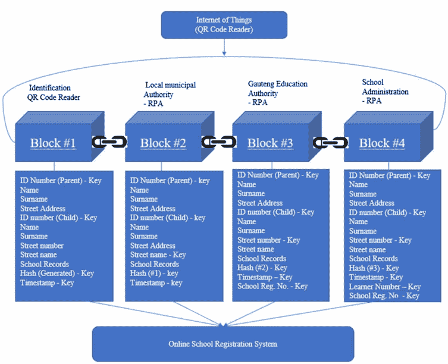

基于基于区块链的机器人流程自动化（图 4）的拟议在线注册系统，至少可以部分通过技术而非增加更多规则和法规来解决南非基础教育部面临的一些挑战。可以通过实施以下措施和流程来实现：

### 识别

提议在线注册系统必须利用物联网基础设施技术，例如条形码阅读器或二维码阅读器（可作为智能手机或任何其他带摄像头设备上的应用程序）来识别家长及其子女。换言之，用户不能手动将身份证号输入系统，而必须使用二维码或条形码阅读器。该传感器将读取代码，并自动将身份证号以及关联的姓名、姓氏和街道地址输入系统。如此一来，图 4 中的第一个区块（区块#01）将被创建。加密的私钥标识符是家长和子女的身份证号、哈希（每次扫描随机生成的数字）和时间戳。未经授权，家长的身份证号绝不可更改（可能的情况是子女有新监护人），而子女的身份证号在未满 18 岁期间也绝不可更改。南非内政部是南非签发有效身份证件的唯一机构。其他详细信息，例如住址，当然需要更新和验证（请参见下一活动）。

### 数据对象

成功识别后，提议将交易按顺序和时间顺序存储在区块链的区块中。图 4 中的下一个区块（区块#02）随后将住宅地址与最近的学校相匹配。由地方自治体“拥有”的机器人接收采用数字签名加密技术形式的公钥文件并对其解密以访问记录。机器人随后登录地方自治体系统并检索公用事业账单记录，使用图 4 中区块#01 的身份证号确认街道地址。如果地址匹配且街道地址得到确认，机器人将创建一笔交易，其私钥由家长和子女的身份证号、来自区块#01 的哈希、门牌号和时间戳组成。记录创建后，机器人将采用公钥的文件发送给基础教育部，以确认子女的学校记录。如果没有匹配，将向家长发送无效消息。基础教育部网络节点上的机器人接收采用数字签名加密技术形式的文件，并解密公钥以打开文件。它将使用图 4 中区块#02 的身份证号来访问子女的学校记录，并确认他们是否通过了 0 年级或 7 年级，以分别有资格进入一年级或八年级。机器人使用图 4 中区块#01 的地址，根据申请人的街道地址定位并检查最近学校是否有空位。如果有空位，机器人将创建一条记录，例如图 4 中的区块#03，其中私钥包含家长和子女的身份证号、来自图 4 中区块#02 的哈希、门牌号、学校注册号和时间戳，并将文件发送给学校。如果子女不符合条件或未找到之前的学校记录，消息“无效记录”将立即发送给家长和教育部门以供检查和更正。上一步骤成功完成后，机器人将采用数字签名加密技术的文件发送到下一个节点，即学校。系列步骤末端学校节点上的机器人使用其自身私钥解密文件，并检查待安置学习者人数与学校可用空间之间的比较。请注意，该节点不需要物理上位于学校，而是表示这是逻辑位置。有时，有些学习者不占用已分配的学位，但也不会将此决定告知注册系统。因此，学校节点上的机器人需要通过向现场学校管理人员发送消息来确认申请学习者的安置情况（特别是在课程开始后）。如果有空位，机器人将创建一条记录，例如图 4 中的区块#04，其中私钥组合包含家长和子女的身份证号、来自图 4 中区块#03 的哈希、门牌号、学校注册号、学习者编号和时间戳。机器人创建并发送消息“学习者已成功安置在学校”给家长、教育部门和学校。

### 信息扩展

关于学校申请和学校安置的信息始终可用且可访问。每笔交易都由所有参与者共识记录和维护。所有交易都从头开始保留，且可追溯性和可审计性是可能的。机器人通过公钥访问相关数据，每笔交易都由所有参与机器人共识记录和维护。

### 交易结构

不需要受信任的中心化实体；交易实体（机构和个人）之间不需要相互信任；并且已设置智能合约以验证区块链系统中的交易。该过程由包括主管部门在内的不同利益相关者验证，以确保没有特权实体控制注册申请流程和学习者的安置。

### 数据安全

安全性得到加强；数据存储在网络的每个节点上并公开可用，所有节点都可以协助维护其他节点的数据。学习者安置到学校是在智能网络中的所有节点或参与者验证了图 4 中的 #01 到 #03 区块的步骤后，通过 RPA 进行的。作者身份由机器人使用其自身私钥加密文件，而其他机器人使用发送者公钥解密数字签名加密技术的事实来保证。接收机器人使用发送者加密的私钥证明该文件不可能是由其他任何人发送的。

如图 4 所示的拟议解决方案中，只有第一阶段需要人工启动注册流程。此后，其余步骤是区块链和 AI（机器人）的组合，以完成注册交易。拟议解决方案建议使用机器人来检测和信任其对手方，其中公钥加密技术为任何想要与特定机器人地址通信并发送信息的机器人提供信息，即只有该机器人拥有匹配的密钥来读取记录。即使公钥落入错误之手，也无风险，因为它不用于解密记录。使用此区块链技术，机器人可以在不需要控制机构的情况下同意给定记录是可信的。一旦达成一致，该区块将无法被删除或更改，并可供网络上任何人认证。在确保所有


应计入区块 4 的新交易均有效，无需作废之前的凭证（例如，区块 01 至区块 03），如图 4 所示。

希望本节已展示如何通过基于区块链的 RPA 机制公平、透明地分配教育资源。

## 提案

本节基于本章回顾的说明性示例，阐述了实施基于区块链的 RPA 时的注意事项。表 6 中的提案为致力于创建可信在线学校注册系统的政策制定者提供了指南和参考。这些提案还可帮助改进教育资源分配流程。

### 表 6. 提案，即实施基于区块链的 RPA 时的注意事项

| | 提案 |
|---|---|
| **Decentralisation** | 如果豪登省教育部门考虑采用基于区块链的 RPA 机制（通过机器人进行去中心化验证教育凭证），则必须在政策中界定豪登省在线注册系统的相关标准和监管框架。政府应建立专业知识，以理解和支持使用基于区块链的 RPA 存储敏感数字证书、学术凭证和个人数据等领域中分布式数据库技术的实施。 |
| **Enhanced Trust on Robotic Decisions** | 能够显示谁收到了“工作”以及何时收到非常重要。因此，在分布式系统中显示申请状态（工作流）非常有用，因为家长无需前往学校及不同部门（例如内政部、中央登记机构等），它们位于不同地点。在区块链上记录决策过程，可确保家长、学校和政府信任、理解并追踪 AI 决策。 |
| **Collective Decisions** | 建议教育部门的政策制定者进一步调查并支持基于区块链的 RPA 机制，以通过其他用例支持在线学校注册系统。由于分配教育资源的决策将转移到 AI 算法，因此在引入基于区块链的 RPA 及其对现有和计划活动的影响方面，应与家长和学校开展意识沟通和协商。 |
| **Immutability** | 提议的基于区块链的 RPA 机制有望加速结束学术凭证颁发的纸质系统，因为这些凭证将通过区块链不可更改并自动验证，家长无需提供注册证明的纸质副本。由此，可解决公民对在线学校注册系统可信度和可靠性的看法，并提高公民对其价值、准确性和可靠性的认知。 |
| **Strategic Partnerships** | 实现基于区块链的 RPA 全部潜力的拟议模式是采取分阶段方法，例如，首先建立战略公私合作伙伴关系，以协调并提高对基于区块链的 RPA 机制可能应用的认识，然后再部署该机制。 |
| **Further Research** | 由于教育部门必须证明区块链能为家长、学校和其本身带来可观价值，因此基于区块链的 RPA 说明性示例作为一种方式，让部门意识到利用该机制提高教育资源分配效率和效能所具有的社会优势和潜力，从而创建可信的在线学校注册系统。尽管已有基于区块链的 RPA 示例，能够自动在分布式数据库中存储数据、验证教育凭证，并在无中央机构的情况下在机器人群之间建立共识，但建议教育部门通过试点研究开展进一步研究。拟议该试点研究应与家长、学校、私营部门、员工工会和政府机构合作，以获得支持，并为教育环境中的区块链-RPA 机制制定政策框架。需要注意的是，由于业务规则变化，机器人可能会生成错误结果，部分原因是机器人无法调整其行为以适应新的业务规则。为了减轻这些中断，需要对控制和监控机制进行研究，以便主动调整机器人来检测业务规则的变化。 |

### 结论

本章介绍了基于互联网的电子政务系统面临的一些挑战，这些系统与物联网具有相似特征。本章建议采用基于区块链的 RPA 机制作为可能的解决方案，用于在无需人工干预且无单一中央机构控制下对各学校的学习者安排进行注册的可追溯性、识别、验证和处理。此外，本章利用教育领域的示例性案例，演示了注册过程中基于区块链的 RPA 机制，其中包括密码学、智能合约、电子学校记录、机器对机器通信（机器人）以及这些技术在物联网场景中的应用。

区块链与 RPA 的结合已被证明能够存储对象及其所有变更，从而在教育环境中实现完整、开放且可靠的可追溯性。可靠的识别非常重要，因此传统上重要文件的纸质副本需由宣誓委员确认，并始终随附身份证明文件。然而，基于区块链的身份验证已被证明能够提供开放且可信的分布式账本，不仅可用于金融领域，也可用于教育环境中的身份验证。

本章阐述了不同机构如何通过机器对机器链接，利用私钥和公钥共识，在使用区块链技术将学习者安排至学校的过程中显著提高公平性和透明度。此探索性讨论仅限于单一示例。应使用更多案例开展进一步研究，以确保教育记录的安全性和隐私性。

### 参考文献

Alammary, A., Alhazmi, S., Almasri, M., & Gillani, S. (2019). 教育领域的基于区块链的应用：系统综述. 应用科学, 9(12), 2400. doi:10.3390/app9122400

Albishi, S., Soh, B., Ullah, A., & Algarni, F. (2017). 物联网应用与技术的挑战与解决方案. 程序计算机科学, 124, 608–614. doi:10.1016/j.procs.2017.12.196

Arslan, S. S., Jurdak, R., Jelitto, J., & Krishnamachari, B. (2019). 物联网分布式账本技术的进展. 物联网, 9, 100114. doi:10.1016/j.iot.2019.100114

Asatiani, A., & Penttinen, A. (2016). 将机器人流程自动化转化为商业成功——OpusCapita 案例. 信息技术教学案例杂志, 6(2), 67–74. doi:10.1057/jittc.2016.5

Bakon, K. A., Elias, N. F., & Abusamhadana, G. A. O. (2020). 文化和数字鸿沟对发展中国家政府成功的影响：文献综述. 理论与应用信息技术杂志, 98(9).

Barnaghi, P., Wang, W., Henson, C., & Taylor, K. (2012). 物联网语义学：早期进展与重返未来. 语义 Web 与信息系统国际杂志, 8(1), 1–21. doi:10.4018/jswis.2012010101

Bartolom, A., Castaeda, L., Torl, C. B., & Adell, J. (2017). 教育中的区块链：引言及现状批判性综述. EDUTEC，教育技术电子杂志.

Bélanger, F., & Carter, L. (2008). 电子政务采用中的信任与风险. 战略信息系统杂志, 17(2), 165–176. doi:10.1016/j.jsis.2007.12.002

Chen, S., Xu, H., Liu, D., Hu, B., & Wang, H. (2014). 物联网愿景：中国视角下的应用、挑战与机遇. IEEE 物联网杂志, 1(4).

Chen, Y. (2012). 物联网的挑战与机遇.载于第 17 届亚洲及南太平洋设计自动化会议（第 383–388 页）IEEE. 10.1109/ASPDAC.2012.6164978

Cheng, S., Zeng, B., & Huang, Y. Z. (2017). 勘误：分布式电力市场中区块链技术应用模式研究. IOP 会议系列：地球与环境科学, 93, 012065. doi:10.1088/1755-1315/93/1/012065

Coin Telegraph. (2015). 爱沙尼亚如何将区块链贴近公民：GovTech 案例研究. https://cointelegraph.com/news/how-estonia-brought-Blockchaincloser-to-citizens-govtech-case-studies

Dignum, V. (2017). 负责任的人工智能：为人类价值设计 AI. ITU 杂志：ICT 发现, 1.

Dubovitskaya, A., Novotny, P., Xu, Z., & Wang, F. (2019). 肿瘤学数据共享的区块链技术应用：系统文献综述结果. 肿瘤学与信息学 - 综述. doi:10.1159/000504325

Efanov, D., & Roschin, P. (2018). 区块链技术的无处不在性. 程序计算机科学, 123, 116–12. doi:10.1016/j.procs.2018.01.019

Feki, M. A., Kawsar, F., Boussard, M., & Trappeniers, L. (2013). 物联网：下一场技术革命. 计算机, 46(2), 24–25. doi:10.1109/MC.2013.63

Fenwick, M., & Vermeulen, E. P. M. (2019). 去中心化即将到来：区块链的未来. JBBA, 2(2), 2019. doi:10.31585/jbba-2-2-(8)2019

Ferrer, E. C. (2019). 区块链：机器人群系统的新框架. 未来技术会议 (FTC) 2018 论文集.

Gauteng Province. (2020). 在线入学. https://www.gdeadmissions.gov.za/Home/VideoTutorial

Gauteng Provincial Government. (2020). 数字平台. https://www.gov.za/

Gräther, W., Schütte, J., Kolvenbach, S., Torres, C. F., Ruland, R., & Wendland, F. (2018). 教育中的区块链：终身学习护照.载于 W. Prinz & P. Hoschka (编)，第 1 届 ERCIM 区块链研讨会 2018 论文集，社会嵌入技术欧洲学会报告. Academic Press.

Grech, A., & Camilleri, A. F. (2017). 教育中的区块链，JRC 科学政策报告. 欧洲委员会. doi:10.2760/60649


- Hameed, S., Khan, F. I., & Hameed, B. (2018). 物联网（IoT）安全需求与挑战理解：综述. 计算机网络与通信期刊.

- Hofmann, P., Samp, C., & Urbach, N. (2019). 机器人流程自动化. 电子市场. 在线先行出版. doi:10.1007/s12525-019-00365-8

- Lacity, L. P., & Willcocks, M. C. (2016). 服务自动化的新方法. MIT斯隆管理评论, 58(1).

- Lohachab, A., Lohachab, A., & Jangra, A. (2020). 后量子物联网网络中保障通信安全的突出密码学方面的全面调查. 物联网, 9, 100174. doi:10.1016/j.iot.2020.100174

- Madakam, S., Holmuhke, R. M., & Jaiswal, D. K. (2019). 未来数字劳动力：机器人流程自动化（RPA）. 信息系统与技术管理期刊, 16, 1–17. doi:10.4301/S1807-1775201916001

- Makridakis, S., Polemitis, A., Giaglis, G., & Louca, S. (2018). 区块链：人工智能快速进步中的下一项突破. 人工智能-新兴趋势与应用. doi:10.5772/intechopen.75668

- Marr, B. (2018). 人工智能与区块链：结合这两大超级趋势的3大主要好处. https://www.forbes.com/sites/bernardmarr/2018/03/02/artificial-intelligence-and-blockchain-3-major-benefits-of-combining-these-two-mega-trends/

- Mokhaoli, V. (2020). 家长恳请莱苏菲恢复人工学校注册，目击者新闻. https://ewn.co.za/2020/01/15/parents-plead-with-lesufi-to-bring-back-manual-school-registrations

- Moore, M. (Ed.). (2016). 网络安全泄露及在线威胁防护相关问题. IGI Global.

- Mougayar, W. (2016). 商业区块链：下一代互联网技术的承诺、实践与应用. John Wiley & Sons. http://ebookcentral.proquest.com

- Nakamoto, S. (2008). 比特币：点对点电子现金系统. https://bitcoin.org/bitcoin.pdf

- Rejeb, A., Keogh, J. G., & Treiblmaier, H. (2019). 在供应链管理中利用物联网和区块链技术. 未来互联网, 11(7), 161. doi:10.3390/fi11070161

- Reyna, A., Martín, C., Chen, J., Soler, E., & Díaz, M. (2018). 关于区块链及其与物联网的集成：挑战与机遇. 未来一代计算机系统, 88, 173–190. doi:10.1016/j.future.2018.05.046

- Salah, K., Rehman, M. H., Nizamuddin, N., & Al-Fuqaha, A. (2019). 面向人工智能的区块链：综述与开放研究挑战. IEEE Access：实用创新、开放解决方案, 7, 10127–10149. doi:10.1109/ACCESS.2018.2890507

- Senthilkumar, D. (2020). 跨行业使用区块链技术及未来机遇：区块链技术与人工智能. 载于《跨行业使用区块链技术及未来机遇：区块链技术与人工智能》. IGI Global.

- Shahaab, A., Hewage, R. M. C., & Khan, I. (2020). 在GDPR背景下管理不可变区块链上的性别变更信息. JBBA, 3(1).

- Sharples, M., & Domingue, J. (2016). 区块链与声誉：教育记录、声誉和奖励的分布式系统. 载于 K. Verbert, M. Sharples, & T. Klobučar (编), 计算机科学讲义：第9891卷. 自适应与可适应学习. EC-TEL 2016. Springer. doi:10.1007/978-3-319-45153-4_48

- Silcock, R. (2001). 什么是电子政务？. 议会事务, 54(1), 88–101. doi:10.1093/pa/54.1.88

- Strobel, V., Ferrer, E. C., & Dorigo, M. (2018). 通过区块链技术在群体机器人集体决策场景中管理拜占庭机器人. 第17届国际自主代理与多智能体系统会议论文集. 斯德哥尔摩，瑞典，541–549. 国际自主代理与多智能体系统基金会.

- Syed, R., Suriadi, S., Adams, M., Bandara, W., Leemans, S. J. J., Ouyang, C., Hofstede, A. H. M., de Weerd, I., Wynn, M. T., & Reijers, H. A. (2020). 机器人流程自动化：当代主题与挑战. 工业中的计算机, 115, 103162. doi:10.1016/j.compind.2019.103162

- Tan, Y. H., & Thoen, W. (2001). 迈向电子商务通用信任模型. 国际电子商务杂志, 5(2), 61–67.

- The Citizen. (2020). 对部门在线注册系统的沮丧与愤怒，公民报. https://citizen.co.za/news/south-africa/education/2228424/frustration-and-anger-over-depts-online-registration-system/

- Turkanović, M., Hölbl, M., Košič, K., Hericko, M., & Kamisalic, A. (2018). EduCTX：基于区块链的高等教育学分平台. IEEE Access：实用创新、开放解决方案, 6, 5112–5127. doi:10.1109/ACCESS.2018.2789929

- Uskenbayeva, R., Kalpeyeva, Z., Satybaldiyeva, R., Moldagulova, A., & Kassymova, A. (2019). 在公共行政行政流程中应用RPA. 载于 2019年IEEE第21届商业信息学会议（CBI）（第2卷，第9-12页）. IEEE.

- van der Aalst, W. M. P., Bichler, M., & Heinzl, A. (2018). 机器人流程自动化. 商业与信息系统工程, 60(4), 269–272. doi:10.1007/s12599-018-0542-4

- Xing, B., & Marwala, T. (2018). 区块链与人工智能的协同效应. https://arxiv.org/ftp/arxiv/papers/1802/1802.04451.pdf

- Zhao, J. L., Fan, S., & Yan, J. (2016). 区块链商业创新与研究机遇概述及专刊导论. 金融创新, 2(1), 28. doi:10.1186/s40854-016-0049-2

- Zikratov, I. A., Lebedev, I. S., Gurtov, A. V., & Kuzmich, E. V. (2014). 基于警局模型保障群体智能机器人安全. 2014年IEEE第8届信息通信技术应用国际会议（AICT）, 1-5. 10.1109/ICAICT.2014.7035906

## 延伸阅读

- Al-Turjman, F. (2019). 物联网赋能智慧城市中的智能. Taylor and Francis，CRC出版社，隶属于Taylor and Francis集团，T&F Informa plc的学术部门.

- Amita, K. (2019). 物联网实用人工智能：开发更智能物联网系统的专家机器学习和深度学习技术. Packt Publishing有限公司.

- Bwalya, K. (2018). 电子政务发展话语：分析发展中国家和新兴经济体的当代与未来增长前景. AOSIS出版社. doi:10.4102/aosis.2018.BK71

- Kapoor, A. (2019). 物联网实用人工智能：开发更智能物联网系统的专家机器学习和深度学习技术. Packt Publishing Ltd.

- Leben, D. (2019). 机器人伦理学：如何设计道德算法. Routledge.

- Mahmood, Z. (2009). 电子政务：成功发展的阶段模型. 第13届国际IBIMA会议论文集，摩洛哥马拉喀什，2009年11月

- Mahmood, Z. (2013). 发展中国家的电子政务实施与实践. IGI Global出版社. doi:10.4018/978-1-4666-4090-0

- Michael, E. A., Hanno, H., & Panarit, S. (2020). 第四次工业革命对工程教育的影响：第22届交互式协作学习国际会议（ICL2019）论文集，第1卷，泰国曼谷

- Oppenheimer, A. (2019). 机器人来了！：自动化时代的工作未来. Vintage Books.

- Oracle South Africa. (2020). Oracle南亚/数据库. https://www.oracle.com/za/database/what-is-database.html. 2020年7月访问

- Paul, G. N., & Vassiliki, N. K. (2019). 欧洲电子政务：重启国家. Routledge出版社.

- Stanislav, I., & Craig, W. (2019). 旅行、旅游和酒店业中的机器人、人工智能与服务自动化. Emerald Publishing Limited.

- Tan, Y., & Zheng, Z. (2013, March). 群体机器人研究进展. 国防技术, 9(1), 18–39. doi:10.1016/j.dt.2013.03.001

## 关键术语与定义

- 算法：这是指计算机通常遵循的一系列过程或有限指令清单或规则，用于计算和解决数学问题。它指的是执行计算的计算机可实现指令的有限序列。


- **人工智能：** 这指的是被编程用来模拟人类智能、像人类一样思考、模仿其行为（如解释和检测数据中的偏差，以及解决问题）的机器。

- **区块链技术：** 它是指一种以透明方式记录信息，并经其他参与者共识，使信息不可更改或难以更改的系统。它是指包含所有对所有参与者公开可用且可访问的历史记录的数据库。

- **密码学：** 又称密码学（cryptology），是使用代码保护信息并保障通信安全的实践与研究，以便只有预期接收者能够读取和处理该信息。

- **数据库：** 是指以结构化形式（通常在计算机中）存储的有组织数据或信息集合，并可通过计算机系统以电子方式访问。它通过数据库管理系统进行控制，并在一系列表格中以行和列的形式建模，以高效处理查询数据。

- **电子政务：** 它被定义为使用移动设备、计算机和互联网等信息通信技术，向一国的公民、企业及其他人员有效、高效地提供公共或政府服务。

- **物联网：** 这指的是一个互联和相关联的设备、网络、软件、电子、机械和数字机器系统，这些机器嵌入了传感器，能够自动收集和交换数据，而无需人与人或人与计算机之间的交互。

- **机构：** 它是更大流程或机械系统中执行特定功能的一小部分，换句话说，是机器内部协同工作的一组部件系统。一个机构可以是一个完整的机械系统。

- **在线学校注册系统：** 一个互联网系统，允许家长在南非学校为其一年级和八年级的孩子进行电子注册。它是由豪登省教育部门实施的电子服务或电子政务，用于分配稀缺教育资源。

- **公钥密码学：** 又称非对称加密，是一种使用一对密钥加密数据的方法，即公钥（任何人都可使用）和私钥（仅所有者知晓）。

- **机器人流程自动化：** 是指可以配置为模仿人类操作业务系统以执行业务流程的计算机软件、机器人或机器人（bot）。训练软件机器人所使用的步骤具有示例性。

- **群体机器人学：** 这指的是如何设计群体机器人算法，通过学习鸟群、哺乳动物、蜜蜂或鱼群等自然系统来解决问题。它是指去中心化协调系统的自然或人工集体行为。

## 第3章 博茨瓦纳和津巴布韦记录管理的区块链技术

Oleftile Mosweu  
https://orcid.org/0000-0003-4404-9458  
约翰内斯堡大学，南非  

Forget Chaterera-Zambuko  
https://orcid.org/0000-0002-3379-0200  
索尔本大学，阿布扎比，阿联酋 & 南非大学，南非  

### 摘要

第四次工业革命（4IR）带来了几种新兴和颠覆性技术。南部非洲的记录管理实践长期以来被报道在采用新技术方面滞后。多项研究揭示了缺乏管理电子记录所需的技能，而其他研究仍然哀叹纸质记录的非程序化管理。因此，本章的意图是发起一场话语，挑战信息管理从业者拥抱颠覆性技术，以免他们本身被颠覆。虽然有几种新兴技术，但本章专注于区块链技术及其对记录管理的潜在好处。在技术接受模型的指导下，研究确定，如果区块链易于使用且对记录管理有用，博茨瓦纳和津巴布韦的档案管理员和记录管理员将采用区块链。本章最后提出了一种采用区块链技术进行记录管理的模型。

### 研究引言与背景

新技术的采用是一个有充分文献记录的现象。信息与通信技术（ICTs）在发达国家的使用在1980年代至1990年代期间大幅增长。然而，撒哈拉以南非洲（SSA）国家却不能这么说，因为它们落在了后面，从而造成了全球数字鸿沟（Wamboye et al., 2015）。到2011年，全球一半以上人口使用手机，13%的人能够上网（ITU, 2018）。虽然这显示了ICTs采用的增长，但SSA地区在ICT实施方面仍落后于其他地区。本章聚焦于两个撒哈拉以南非洲国家：博茨瓦纳和津巴布韦。两国都有由国家政策支持的强大ICT框架（ITU, 2018）。ICTs 促进相对容易的信息捕获、处理、存储和共享（Burke, 1992）。反过来，这导致产生大量数字、电子以及纸质记录，因此有必要采用新兴技术来更好地管理大量记录。

根据 Mosweu 等人 (2017, 第97页)：越来越多的公共部门组织正在实施记录管理系统，旨在改善服务交付。然而，发现这些系统的采用和使用不尽如人意。Mnjama 和 Wamukoya (2007) 也观察到这一点，他们指出，由ICTs生成的记录管理一直是非洲公共部门档案管理员和记录管理员面临的主要挑战。在国家层面，博茨瓦纳和津巴布韦都已采用电子记录管理系统。Mosweu (2014) 和 Mosweu 等人 (2017) 使用统一技术接受与使用理论（UTAUT）模型作为框架，调查了影响贸易与工业部 EDRMS 采用和使用的因素。Mosweu (2014) 报告了一项正在进行的研究中的先导研究结果，结果显示，EDRMS 的采用和使用受计算机态度、计算机焦虑、社会影响、促进条件和绩效预期的影响。如 Mosweu 等人 (2017) 报告的最终研究结果显示，四大主要 UTAUT 构念解释了在采用和使用名为文档工作流程管理系统的 EDRMS 方面行为意向的 55% 方差。实证数据表明，影响系统采用和使用率低的关键因素包括技术恐惧症、对系统使用的消极态度、感知到的系统复杂性以及与现有信息系统的不兼容性，这些都是导致系统采用和使用率低的关键因素。

Mosweu 和 Kenosi (2018) 的另一项研究评估了法庭记录管理系统（CRMS）的实施是否改善了加博罗内治安法官区的司法交付。Motsaethebe 和 Mnjama (2007) 研究了博茨瓦纳高等法院记录管理流程的自动化。这两项先前的研究揭示，在高等法院和加博罗内治安法官区的实施改善了案件管理和交付：例如，用于辩论案件的丢失文件实例显著减少，文件检索变得更加容易，案件成功录入系统。在另一项研究中，Moathodi 和 Kalusopa (2016) 调查了劳动与内政部的电子记录准备情况，并发现存在增加电子记录准备深度的机会，因为系统实施资金可用，ICT基础设施充足，且管理层承诺得到保证。Kalusopa 和 Ngulube (2012) 以及 Moloi 和 Mutula (2007) 的研究分别关注劳工组织中的电子记录准备情况以及电子政务环境下的电子记录准备情况。Kalusopa 和 Ngulube (2012) 的研究确定，博茨瓦纳劳工组织中的电子记录准备情况明显、较低且正在发展中。其证据表现为 ICTs 采用缓慢、记录管理标准和实践不足，以及在国家电子就绪框架中集成度低。Shonhe 和 Grand (2019) 调查了特洛克温土地管理局（TLB）中 EDRMS 实施的变更管理。沟通成为 TLB 管理变革最有效的工具。然而，由于缺乏实施变更管理的能力，预期的变革尚未得到加强。Rakemane 和 Serema (2018) 调查了电子记录管理


对公司及知识产权管理局的实践进行了调查，发现 ICT 在业务流程中广泛应用，最终导致电子记录的大规模产生。然而，缺乏管理其的政策和程序。

许多其他研究者研究了电子邮件记录管理以及 EDRMS 实施中的成功因素（例如 Keakopa, 2007；Mosweu, 2016）。Keakopa (2007) 的研究聚焦于博茨瓦纳、纳米比亚和南非电子记录管理的政策与程序。调查结果显示，博茨瓦纳和纳米比亚不存在相关政策和程序，而在南非，相关政策和程序已实施并投入运行。Mosweu (2016) 评估了博茨瓦纳投资、贸易与工业部 EDRMS 实施的关键成功因素，发现其包括高层管理支持、系统用户培训、变革管理和项目治理。

在津巴布韦，已开展了多项关于电子记录管理的研究。这些研究包括但不限于：将电子邮件作为电子记录进行管理、金融服务型国营企业中的电子记录管理、电子记录准备度、EDRMS 的采用与使用、为保存目的对历史记录进行数字化以及企业数字记录管理（Sigauke & Nengomasha, 2012；Nkala et al., 2012；Chaterera, 2013；Sigauke et al., 2016；Chaterera, et al., 2018；Chikomba, 2018；以及 Nengomasha & Chikomba, 2018）。尽管这些研究在方法和侧重点上存在差异，但它们共同认为津巴布韦的电子记录管理仍处于起步阶段。在管理电子记录方面，大量的挑战、弱点和不足有待解决。

技术意识促进其采用。对于发展中国家的档案管理员和记录管理人员来说，电子记录管理仍是一种遥远的实践，因为纸质记录管理系统占据主导地位。多年来，发展中国家的档案和记录管理专业人员一直采用手工记录管理，并为传统的纸质记录开发了技能和能力。电子记录管理则不然。正如现有文献所记录的，南部非洲的记录和档案管理从业者一直在努力拥抱技术进步，而这些进步已改变了既有的档案理论、方法和实践（Turnbaugh, 1997；Duranti, 2001）。虽然世界其他地区如今已进入第四次工业革命（4IR），但撒哈拉以南非洲国家仍在为妥善管理纸质记录而苦苦挣扎。

尽管博茨瓦纳和津巴布韦的研究人员已在记录管理和技术问题方面开展了研究，但缺乏以区块链作为记录管理技术的文献，因此有必要编写本章。“区块链是一种新兴的记录保存技术，它产生新形式的记录和新的记录保存模式，记录与信息专业人员需要参与其中”（Lemieux, et al., 2019），因此有必要了解博茨瓦纳和津巴布韦在记录管理方面对区块链技术的认知与采用现状。

## 研究目标

鉴于技术采纳在非洲似乎总是滞后的普遍问题，本研究旨在加深对博茨瓦纳和津巴布韦记录管理中区块链技术的理解，并促进其应用。因此，本研究的具体目标如下：

- 确定博茨瓦纳和津巴布韦的记录管理员和档案管理员是否了解并掌握区块链技术。
- 查明博茨瓦纳和津巴布韦的档案管理员和记录管理员是否使用区块链进行记录管理。
- 确定区块链技术在记录管理中的潜在好处。
- 确定博茨瓦纳和津巴布韦的档案管理员和记录管理员若认为区块链对记录管理有用，是否打算使用它。
- 为记录和档案管理专业人员制定一条战略路线图，以指导如何采用区块链技术进行记录和档案管理。

## 区块链技术

区块链技术是一组可以以不同方式组合以产生不同结果的技术。区块链的识别因素在于：该技术在政治上是去中心化的；它没有基础设施故障点；它提供自主权；并且具有抗攻击性。Chaterera-Zambuko (2019) 中讨论的这些及其他特征（如图 1 所示）影响着区块链技术在不同学科中的采用。

图 1. 区块链技术的各个方面

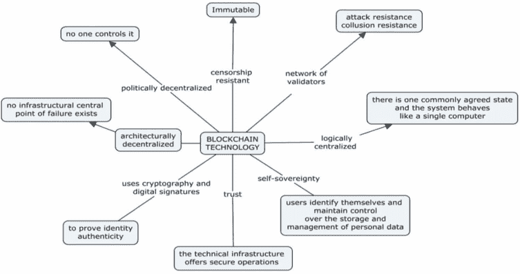

区块链技术使去中心化环境的创建成为可能，在该环境中，交易和数据不受任何第三方组织的控制。任何已完成的交易都以可验证、安全且透明的方式记录在公共账本中，并带有时间戳和其他详细信息（Holotescu, 2018）。将区块链技术类比为一本书，可以简化对其的理解。一本书由一系列页面组成，书中的每一页都包含文本以及关于该页面的信息（指的不是页面内容，而是关于该页面的信息，在技术上称为元数据）。例如，页面顶部通常是书名，有时还有章节编号或标题；页面底部通常是页码，告诉你身处书中的哪个位置。

同样，在区块链中，每个区块都包含区块内容；以及一个包含区块数据的头部，因此它包含关于区块的一些技术信息，例如对前一个区块的引用，以及该区块所含数据的指纹（哈希）等。这个哈希对于排序很重要。链中的区块引用前一个区块，就像书中的页码一样。对于书籍，可预测的页码使得知道页面顺序变得容易。如果有人把所有页面都撕下来并打乱，也可以轻松将它们按故事有意义的正确顺序重新排列。对于区块链，每个区块引用前一个区块，不是通过“区块编号”，而是通过该区块的指纹，这比页码更明智，因为指纹本身由区块的内容决定（Lewis, 2015）。引用前一个区块形成了区块链，因此得名“区块链”。

## 记录管理中的区块链技术

多项研究表明，区块链技术可以有效地用于记录管理（例如 Begley, 2017；Stančić, 2018；Lemieux et al., 2019）。因此，各国政府和组织已开始认真考虑使用区块链技术来管理记录。这是因为通过区块链技术生成的记录已被证明是不可篡改且可信的（Lemieux, 2017），这是记录与档案管理中备受推崇的特征。作为一种最著名用于支撑加密货币的相对较新的技术，区块链技术具有巨大潜力，并可能对文档和记录管理产生深远影响（Stančić, 2018, 第 71 页）。事实上，John (2019) 认为，记录管理是四项区块链商业倡议之一，它能促进成本节约、提供收入创造机会，并实际扩展记录管理流程的能力。因此，区块链适用于记录管理的各个方面，包括记录处置、促进记录真实性、记录评估、转移、记录可靠性以及记录的长期数字保存、记录隐私和安全性（Lemieux, 2016；Stančić, 2018；Lemieux et al., 2019；以及 Bhatia et al., 2020）。以下各部分将简要概述区块链技术在上述记录管理方面的应用。

## 用于数字记录真实性和可靠性的区块链

记录可以在区块链上注册以证明其真实性。这就像认证法律文件和财务报表一样。该技术能够注册审计追踪文档，以证明流程（例如谁做了什么、何时做以及持续了多久）（Jones, 2018）。真实性是记录的四个特征之一，其余三个特征是可用性、完整性和可靠性（ISO, 2016）。它是指记录未被意外或恶意篡改或损坏，因此可以被信任为已完成交易的证据（Duranti, 2009）。与集中式数字签名技术不同，区块链不使用第三方，但记录的真实性可以通过生成的签名、指纹和时间戳来证明。这些内容可以存储在分布式账本上，以提供数据完整性和真实性的证明。在区块链上存储签名连同文档的哈希，消除了顺序签名和证书的要求。这对于长期记录（如土地契据和遗嘱）尤其有用（Bhatia et al., 2020）。


Lemieux (2017) 探讨区块链技术是否能够兑现生成并保存可信记录的承诺。作为一种记录保存技术，区块链确实确保交易记录不可更改，并在创建后保持真实（Jones, 2018; Staničić, 2018; Bhatia et al., 2020）。

## 区块链与可靠性和真实性问题

可靠记录是指其内容可以被信任为对所证明的交易或活动的完整、准确表述，并在后续交易或活动中可以被依赖。另一方面，真实性依赖于从记录创建之初及之后建立和保存记录的身份和完整性（Lemieux, 2019）。

记录管理的基本问题之一一直是确保记录的真实性和完整性。区块链为记录管理人员提供了一种新方法，以确保电子系统提供完整性。记录的可靠性始于记录创建之时。基本问题包括谁创建了记录以及记录究竟是如何创建的。数字签名是确保记录可靠性的一种方式。它们是交易数据的常见形式。可以将其存储在区块链上。目前，当对 PDF 等电子文本文档进行签名时，签名存储在文档本身中。为确保记录的可靠性，签名必须按顺序应用，且如果证书过期，文档的有效性可能会受到质疑。存储签名连同文档的哈希值，消除了证书按顺序签名的要求。这对长期记录（如土地契据和遗嘱）尤其有用（NARA, 2019, p. 10）。

区块链可用于为记录提供真实性。当组织向用户提供记录时，通常会提供来源和认证，证明其为真实准确的副本。如果事后有任何疑问，会将副本与原件进行比较。如果真实性证书保存在区块链中，则可以重新对记录进行哈希处理，以确定是否进行了任何更改或篡改。研究人员可以修改、裁剪或以其他方式更改照片，如果比较时哈希值不匹配，则他们可以证明图像已被更改。为实现此目标，区块链使用加密签名和公钥形成一条链接的交易记录链，该链无法伪造（NARA, 2019, p.10）。

有大量应用程序可用于操纵视频、音频和照片文件。这给 21 世纪的记录管理员和档案员带来了严峻挑战。存在可以篡改面部外观的视频编辑应用程序，也存在高度准确的语音编辑软件，使用户能够轻松创建未被发现的假视频。区块链技术可以通过在文件元数据中使用哈希值来解决此挑战，以便外部实体能够验证数字材料未被篡改。区块链的这些特性使该技术对记录和档案管理专业人员极具吸引力。

## 区块链与记录保留和处置

记录保留和处置是有效记录管理的核心（Lemieux et al., 2019）。在有适当记录的情况下，组织能够履行其义务、执行其授权、保护和捍卫其利益。尽管记录保留至关重要，但组织面临着因记录保留计划缺失而产生的问题，这种缺失源于对记录业务价值的分歧（Lemieux et al., 2019）。此外，Lemieux et al. (2019, p. 49) 提出了一系列与记录保留相关的问题，如下所示：

- 区块链能否减少记录保留所需的任何投资？
- 它是否会带来新的挑战或风险？
- 区块链记录保留会是什么样子？

这些问题需要得到解决，因为档案和记录管理专业人员正在努力应对区块链作为一种潜在记录管理技术。从记录管理的角度来看，“使数据在加密上无法访问的功能表明，记录保留和处置并未纳入区块链开发人员的原始意图”（Bhatia et al., 2020）。在区块链中生成的记录不可更改，这既是件好事（因为它促进了记录的真实性），也对记录保留不太有利。区块链技术在记录管理方面仍处于起步阶段，其与记录保留计划和分类系统集成解决方案的能力仍未开发（Lemieux et al., 2019）。记录保留是记录管理不可或缺的方面。

## 区块链与数字记录的长期保存

为使记录在长期内保持可访问和可用，需要妥善保存。除其他记录管理功能外，区块链还可用于数字记录的长期保存（Lemieux et al., 2019）。但是，区块链并非专门为记录和档案的保存而设计。一个相关问题是：如果传统的长期存档保管方法在区块链记录保存环境中不起作用，那么会发生什么？鉴于与设计用于长期保持内容可访问性的存档系统不同，区块链系统在这方面有限，因此产生了这个问题。但是，这并不排除区块链技术作为潜在记录管理工具。区块链技术有几个积极属性，值得予以充分考虑。该技术可以有效地用于确保数字记录的完整性并保持其来源。

由克罗地亚萨格勒布大学研究人员领导的 InterPARES Trust Trustster 项目，针对区块链在记录管理中的应用，解决了存档已数字签名文档的挑战。如果签名中使用的证书过期，或者证书颁发机构停止运作，篡改此类文档就有可能发生（Chaterera et al., 2018; Bralić, 2017）。信任链（Trust Chain）解决了这一挑战，它是一种使用区块链技术对已数字签名文档进行长期保存的模型（Lemieux et al., 2019）。该系统的核心是包含数字签名哈希值的区块链（Bralić et al., 2017）。

我们提出的拟议信任链模型基于多个存档（或其他有兴趣）机构之间的合作。虽然单个机构在技术上没有理由不能运行所需的软件和硬件组件，但对设想系统的信任与独立参与机构的数量成正比。如果由单个机构运行整个系统，该机构有能力操纵记录，并且需要被隐含信任。这就是我们今天面临的情况。我们通过要求多个机构在将已数字签名的文档写入不可更改的区块链之前确认其有效性，来绕过对单个机构的信任需求（Bralić et al., 2017, p. 91）

## 区块链安全与记录机密性

记录机密性泄露将面临重罚，因为数据保护立法将其定为非法（Lemieux et al., 2019）。2019 年上半年报告了 40 亿起数据泄露事件。这些事件被分类为财务数据泄露、娱乐数据泄露、医疗数据泄露、教育数据泄露、政府数据泄露和其他商业数据泄露（Norton Life Lock, 2020）。2018 年 12 月至 2019 年 3 月的教育数据泄露报告显示，一个未知实体泄露了乔治亚理工学院运营的中央数据库中的 130 万条记录。该数据库包含该校现有和前学生、教职员工及工作人员的姓名、地址、社会安全号码和出生日期（Norton Life Lock, 2020）。使用区块链技术，组织记录得到保障，同时确保只有交易各方才能基于需要知道的原则访问记录。消除第三方提高了记录的安全性。

区块链使用分布式（点对点）网络。分布式网络没有中心，因为所有互连计算机都被平等对待。这种类型的网络没有单一控制点，因此也没有单一攻击点（Staničić, 2018, p. 62）。相比之下，集中式数据库容易发生代价高昂的安全泄露，因为它暴露了单一故障点（John, 2019）。因此，区块链技术利用公钥基础设施和密码学，这些可以成为保护数据隐私的强大工具。

## 记录管理中区块链采用概览

本节简要说明了区块链在记录管理中的一些用例。这些说明来自世界各地，旨在让人们了解对区块链技术的理解和接受程度。本节的意图是让记录管理人员有信心，该技术可以被采用，因为它在其他地方已被成功使用。但是，应当承认，区块链并非数字记录和档案管理挑战的万能药，因为该技术并非免受陷阱的影响。

由于其旨在确保记录完整性和真实性的独特特性，区块链技术已被应用于记录管理的许多领域，例如土地产权转让、健康记录和财务记录管理。几个国家正在考虑采用区块链技术进行记录保存。表 1 说明了区块链技术的一些用例（Lemieux et al., 2019）。


Table 1. Use cases of Blockchain technology

表1. 区块链技术的应用场景

| Country | Blockchain project |
| --- | --- |
| Georgia | - Piloted the registration of land titles using a private Blockchain in 2016.<br>- has plans to expand Blockchain use to sales and purchases of land titles, mortgages, rentals & new land title registration |
| Brazil | - Blockchain technology was applied to land transfer registration in the municipality of Pelotas in 2017<br>- The application was done by the local real estate registration authority |
| Estonia | - Uses Blockchain to securely keep medical records and a host of other types of government records as well |
| UK (National Archives) | - Has been experimenting with the use of Blockchains in digital preservation |

| 国家 | 区块链项目 |
| --- | --- |
| 格鲁吉亚 | - 2016年使用私有区块链试点了土地权属登记。<br>- 计划将区块链应用扩展到土地权属销售与购买、抵押、租赁及新土地权属登记 |
| 巴西 | - 2017年，区块链技术应用于佩洛塔斯市的土地转让登记<br>- 该应用由当地房地产登记机构完成 |
| 爱沙尼亚 | - 使用区块链安全保存医疗记录以及大量其他类型的政府记录 |
| 英国（国家档案馆） | - 一直在尝试在数字保存中使用区块链 |

It is disappointing to note that a thorough online literature search on Blockchain and records management could not yield any result from the African continent. In this regard, the assumptions made from this observation are that:

- 1. Either records management practitioners in Africa are not aware of the Blockchain technology
- 2. Or Blockchain technology to manage records is being used but it has not been documented and published yet.

值得注意的是，对区块链与记录管理的全面在线文献检索未能在非洲大陆得出任何结果。就此，基于这一观察得出的假设是：

- 1. 非洲的记录管理从业者可能不了解区块链技术
- 2. 或者，用于管理记录的区块链技术正在被使用，但尚未被记录和发表。

Considering the many reports that have been previously made by scholars in Africa, lamenting that professionals and practitioners lag behind in terms of adopting new technologies, the probability of assumption 1 above is likely to be true, hence the need for this chapter’s initiative to bring the attention of archivists and records managers in Africa to the existence of Blockchain and the potential it holds for them. On the academic front, a few scholars are beginning to delve into the subject, notable amongst them, e.g. Marutha (2019) who in a conference presentation proposes a framework to interconnect healthcare facilities for universal patient records access using Blockchain technology.

考虑到非洲学者此前发表的许多报告，其中哀叹专业人士和从业者在采用新技术方面滞后，上述假设1的可能性很可能是正确的，因此有必要通过本章的倡议，引起非洲档案管理员和记录管理人员对区块链存在及其对他们所具有潜力的关注。在学术界，少数学者已开始深入研究这一课题，其中值得一提的是，例如Marutha (2019)，他在一次会议演讲中提出了一种利用区块链技术实现医疗设施互联互通、以便普遍访问患者记录的框架。

Blockchain based solutions are increasing and there is added interest in using the technology to manage records (Lemieux, 2016). This calls for archives and records management professionals to gain an understanding of Blockchain as a viable technology for the management and preservation of authentic digital records. It is in this context that this study sought to take stock of Blockchain uptake for records management in Botswana and Zimbabwe.

基于区块链的解决方案在不断增加，并且人们对使用该技术来管理记录的兴趣也日益浓厚（Lemieux, 2016）。这要求档案和记录管理专业人员了解区块链作为一种可行的技术，用于管理和保存真实的数字记录。正基于这一背景，本研究试图盘点博茨瓦纳和津巴布韦在记录管理方面采用区块链的情况。

## UPTAKE OF BLOCKCHAIN TECHNOLOGY USING TAM

## 基于TAM的区块链技术采用情况

The adoption and use of ICTs is associated with success. The automation of work process brings efficiency in the form of limited errors, cost reduction and some consistency in the delivery of services. Hence, ICTs have been adopted in different sectors of the economy such as education, health, governance, manufacturing and the banking industry (Luka, 2012). In turn, researchers have focused their attention on getting to understand issues surrounding technology adoption. These include factors that promote and hinder adoption of technology, using different technology adoption models. Some of the commonly used models to anchor such studies include but are not limited to the Technology Adoption Model (TAM), Unified Theory of Acceptance and Use of Technology (UTAUT), Technology–Organization–Environment Framework (TOEF), and the Diffusion of Innovation (DOI) (Davis, 1989; Tornatzky and Fleischer, 1990; Rogers, 2003; and Venkatesh & Davis, 2003).

信息通信技术（ICTs）的采用和使用与成功相关联。工作流程的自动化以错误减少、成本降低和服务提供的一致性等形式带来了效率。因此，ICTs已被应用于经济的不同领域，如教育、医疗、治理、制造业和银行业（Luka, 2012）。与此同时，研究人员将注意力集中于了解围绕技术采用的问题。这些包括促进和阻碍技术采用的因素，以及使用不同的技术采用模型。用于支撑此类研究的常用模型包括但不限于技术接受模型（TAM）、技术接受与使用统一理论（UTAUT）、技术—组织—环境框架（TOEF）和创新扩散理论（DOI）（Davis, 1989；Tornatzky和Fleischer, 1990；Rogers, 2003；以及Venkatesh & Davis, 2003）。

Jones et al. (2005) used TAM in a descriptive case study to establish significant system factors that contributed to the success of an Online Assignment Submission, Infocom System (OASIS) used by distance learners in an Australian academic institution. Those students who were technology savvy perceived the system to be easy to use unlike those who viewed technology as difficult. The system was said to be easy to use when there were support mechanisms in place. The conclusion reached by the study was that perceptions of the ease of use of the system promoted its adoption. A similar research approach was used by Radif et al. (2016) to gauge the intention to use a Learning Management System (LMS) at Al-Qadisiyah University in Iraq. Chaterera (2012) also used the same strategy to examine the factors that influence the adoption of e-government services by citizens in Zimbabwe.

Jones et al. (2005)在一项描述性案例研究中使用TAM，以确定促成澳大利亚一所学术机构远程学习者使用的在线作业提交 Infocom 系统（OASIS）成功的重要系统因素。那些精通技术的学生认为该系统易于使用，而那些认为技术困难的学生则不这么认为。当有支持机制时，该系统被认为易于使用。该研究得出的结论是，对系统易用性的感知促进了其采用。Radif et al. (2016)采用了类似的研究方法，以评估伊拉克卡迪西耶大学使用学习管理系统（LMS）的意图。Chaterera (2012)也采用了相同的策略，以考察影响津巴布韦公民采用电子政务服务的因素。

Totolo (2007) utilised TAM to anchor a study which investigated Botswana secondary school principals’ intention to adopt computer technology. The study found that there was substantial support for respondents to adopt and use computer technology for those who found it easy to use and also useful in their work. In addition, it emerged from the study that factors such as time constraints, phobia, lack of skills or training and the lack of practice with computers were barriers to adopt computer technology.

Totolo (2007)利用TAM支撑了一项研究，该研究调查了博茨瓦纳中学校长采用计算机技术的意图。研究发现，对于那些认为计算机技术易于使用且在其工作中也有用的受访者，有大量支持其采用和使用计算机技术。此外，研究还发现，时间限制、恐惧、缺乏技能或培训以及缺乏计算机实践等因素是采用计算机技术的障碍。

In a study that sought to develop a suitable model for the adoption of an online transaction platform for retailers in Zimbabwe, it emerged that perceived ease of use of the system was the main driver for the adoption of the technology, followed by perceived usefulness among retailers (Dube and Gumbo, 2017). The third factor was the reliability of the system. For bankers, the factors that drove the acceptance of the online transaction system were system reliability and management attitude.

在一项旨在为津巴布韦零售商开发在线交易平台采用的合适模型的研究中，发现系统的感知易用性是技术采用的主要驱动力，其次是零售商之间的感知有用性（Dube and Gumbo, 2017）。第三个因素是系统可靠性。对于银行家而言，推动接受在线交易系统的因素是系统可靠性和管理态度。

The few studies explored using TAM to predict the adoption of technology show that the model is good to use for assessing technology adoption. This is true for both developed and developing countries. To this effect, the current study uses TAM to investigate the uptake of Blockchain as a records management technology among archivists and records managers in Botswana and Zimbabwe.

少数探讨使用TAM来预测技术采用的研究表明，该模型适合用于评估技术采用。这对发达国家和发展中国家都适用。为此，本研究使用TAM来调查博茨瓦纳和津巴布韦的档案管理员和记录管理人员在记录管理技术方面采用区块链的情况。

## METHODOLOGY

## 方法论

A quantitative research approach through the use of a survey monkey tool was employed to conduct the study. The survey was distributed through electronic mail and the WhatsApp platform. Target population were archivists and records managers working in the public, private and parastatal organisations in Botswana and Zimbabwe. The respondents were selected through the snowball sampling strategy. Data collection started on 19 May 2020 and ended on 5 June 2020. A total of 95 questionnaire scripts were sent out and 54 were returned, giving a response rate of 56.8%. This was deemed adequate to make conclusions from the empirical data collected.

本研究采用定量研究方法，通过SurveyMonkey工具进行调查。调查通过电子邮件和WhatsApp平台分发。目标人群是在博茨瓦纳和津巴布韦的公共、私营和准政府组织中工作的档案管理员和记录管理人员。受访者通过滚雪球抽样策略选取。数据收集于2020年5月19日开始，于2020年6月5日结束。共发出95份问卷，收回54份，回收率为56.8%。这被认为足以从收集的经验数据中得出结论。

## FINDINGS OF THE STUDY

## 研究结果

This section presents the findings of the study obtained from empirical data collected from the participants. The results are presented and discussed thematically as derived in the study’s objectives.

本部分展示了从参与者收集的经验数据中得出的研究结果。结果根据研究目标按主题进行了展示和讨论。

### Blockchain Awareness

### 区块链认知

Archives and records management does not happen in a vacuum. It takes place within an organization where transactions are documented. As such, the initial question of our study requested respondents to state the type of organization they work for. Out of the 54 study participants, 28 (51.85%) said they work for parastatals, 22 (40.74%) indicated that they work for public organisations while the remaining 5 (9.26%) worked for private organizations. Amongst the driving force of this study was to establish if records and archives management practitioners in Botswana and Zimbabwe are aware of Blockchain technology. Accordingly, question two requested study participants to indicate if they are aware of Blockchain technology. The findings revealed that 38 (70.4%) respondents answered in the affirmative while 16 (29.6%) gave a negative response.

档案和记录管理并非在真空中进行。它发生在有交易记录的组织中。因此，本研究的最初问题要求受访者说明其工作组织的类型。在54名研究参与者中，28人（51.85%）表示在准政府组织工作，22人（40.74%）表示在公共组织工作，其余5人（9.26%）在私营组织工作。推动本研究的动力之一，是确定博茨瓦纳和津巴布韦的记录与档案管理从业者是否了解区块链技术。因此，第二个问题要求研究参与者表明他们是否了解区块链技术。研究结果显示，38人（70.4%）的受访者给出了肯定回答，而16人（29.6%）给出了否定回答。

Blockchain technology has been touted to be technological innovation of the 21st century. However, since its inception in 2008, awareness about its application has not really come to the fore, except for Bitcoin, cryptocurrency that underpinned its coming into being (Nakamoto, 2008; Notheisen et al., 2017). Although Blockchain technology has been adopted in many areas including records management, its application has been largely embraced in the financial sector (Sadhya and Sadhya, 2018).

区块链技术被誉为21世纪的技术创新。然而，自2008年诞生以来，关于其应用的认识并未真正成为焦点，除了比特币（支撑其诞生的加密货币）之外（Nakamoto, 2008；Notheisen et al., 2017）。尽管区块链技术已被广泛应用于包括记录管理在内的许多领域，但其应用主要在金融领域得到拥抱（Sadhya and Sadhya, 2018）。

A follow up question on how they learnt about Blockchain technology was asked to the respondents who had indicated that they are aware of Blockchain technology. Their responses which could include more than one choice from a given list, are tabulated in Table 2.

向那些表示了解区块链技术的受访者提出了关于他们如何了解区块链技术的后续问题。他们的回答（可从给定列表中选择多个选项）已在表2中列出。

Table 2. Source of knowledge about Blockchain (sample size n = 38)

表2. 关于区块链的知识来源（样本量 n = 38）

| Source of knowledge for Blockchain | Responses |
| --- | --- |
| Internet | 32 |
| Fellow professionals | 15 |
| University/College | 2 |
| Friends | 3 |
| Other | 4 |

| 区块链知识来源 | 响应数 |
| --- | --- |
| 互联网 | 32 |
| 同行专业人员 | 15 |
| 大学/学院 | 2 |
| 朋友 | 3 |
| 其他 | 4 |

The results show that most of the respondents learnt about Blockchain technology from the Internet and from fellow professionals accounting for thirty-two and fifteen responses respectively. Four respondents indicated that they learnt about the technology through other means which they however did not specify. Three said that they learnt about Blockchain technology from friends while two indicated that they got to know about Blockchain via a university/college programme.

结果显示，大多数受访者是通过互联网和同行专业人员了解区块链技术的，分别对应三十二和十五个响应。四名受访者表示通过其他途了解了该技术，但未具体说明。三人表示从朋友那里了解区块链技术，而两人表示通过大学/学院课程了解区块链。

Another question posed to respondents was whether Blockchain could be used to manage records. Out of 54 respondents, 37 (80.43%) said it could be used to manage records, 3 (6.52%) said it cannot be used to manage records, 6 (13.04%) either gave answers such as “I don’t know” or “I am not sure” while eight respondents skipped the question. As depicted in the study’s findings, the majority of the respondents said Blockchain could be used to manage records.

向受访者提出的另一个问题是区块链是否可用于管理记录。在54名受访者中，37人（80.43%）表示可以用于管理记录，3人（6.52%）表示不可以用于管理记录，6人（13.04%）给出了诸如“我不知道”或“我不确定”之类的回答，而8名受访者跳过了该问题。如研究结果所示，大多数受访者表示区块链可以用于管理记录。

From the study’s findings, it is clear that the Internet is a major source of knowledge for archivists and records managers, at least for those in Botswana and Zimbabwe. Technological advances and the fast pace at which knowledge is acquired and gets outdated enables people to use additional forms of

从研究结果来看，很明显互联网是档案管理员和记录管理人员的主要知识来源，至少对博茨瓦纳和津巴布韦的从业者而言是这样。技术进步以及知识获取和过时的快速步伐，使人们能够使用其他形式的


为了适应瞬息万变的世界并在其中发挥作用而更新知识。互联网使得自我教育更加容易，因为网上拥有丰富的信息资源。

互联网促进了超越课堂限制的自主学习。面对2020年Covid-19疫情，这一事实变得更加明显，越来越多的人转向互联网以满足各种学习需求。信息已无处不在，技术现在在促进快速获取知识方面发挥着重要作用（Reader, 2018）。互联网促进了自主学习。影响教育中互联网使用效果的重要因素之一，是其使用户能够处理信息的能力（UNESCO, 2003）。

## 区块链在档案管理中的应用

该研究的总体目的是调查博茨瓦纳和津巴布韦在档案和档案管理方面采用区块链的情况。没有一名研究参与者表示其所在组织实际使用过区块链技术。然而，在被问及区块链是否可以用于管理记录时，研究受访者提供了如图2所示的答复。

图2. 区块链在档案管理中的应用

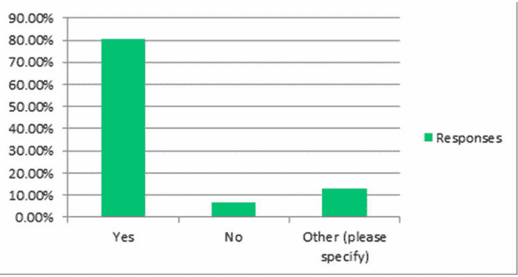

图2显示，绝大多数研究参与者认为区块链可用于档案管理。尽管如此，仍有少数人认为该技术不适合档案管理。大量受访者表示区块链可用于档案管理，这大概是因为区块链在金融、供应链管理、食品工业和能源等应用领域已被证明有益（Khatoon, 2020）。这意味着档案管理同样可以从区块链技术中受益；因此，绝大多数受访者表示区块链可用于档案管理。

### 基于感知有用性和易用性的区块链应用

该研究的目标之一是确定博茨瓦纳和津巴布韦的档案管理员和记录管理人员，如果认为区块链对档案管理有用，是否打算使用它。因此，第六到九题（6–9）以相关且相互关联的方式构建，旨在最终确定影响档案管理中区块链技术潜在应用的可能因素。问题构建如下：

- 如果您的组织为档案管理引入区块链，如果它易于使用，您会使用它吗？
- 如果区块链有用（改善档案管理），您会使用它并鼓励其他人使用吗？
- 您打算为档案管理使用区块链吗，如果它易于使用且对档案管理有用？
- 您会向他人推荐区块链作为档案管理技术吗？

54名受访者中有48人（88.9%）表示，如果区块链技术易于使用，他们愿意使用它；有两人表示不愿尝试该技术，而另外四人跳过了问题。关于鼓励他人使用区块链，54名受访者中有50人（92.6%）表示他们会鼓励他人使用；而剩下的四人（7.4%）跳过了问题。

关于如果发现区块链易于使用且对档案管理有用，是否打算将其用于档案管理的问题，48人表示“是”，1人表示“否”，4人跳过了问题，其余1人表示：“我认为目前它在管理财务记录方面更为流行。除非它涵盖各种类型记录的全面管理，例如员工档案、政策、信函等。”关于推荐区块链用于档案管理，40人表示“是”，4人表示“否”，8人跳过了问题。其余两人中的一人表示：“如果信息安全性良好且有效，我可以推荐它”，而另一人说“不确定”。

研究结果清楚表明，博茨瓦纳和津巴布韦的记录管理人员和档案管理员，如果该技术相对易于使用且易于实施，则热衷于采用区块链技术进行档案管理。感知有用性和感知易用性是影响技术采纳或拒绝的关键变量之一（Jones et al., 2005; Totolo, 2007; Chaterera, 2012 & Radif et al., 2016）。因此，在决定采用任何形式的技术时，确保建立适当的支持系统至关重要。此外，针对使用该技术的人员必须接受适当的培训和指导，了解如何使用该技术（Mosweu et al., 2016）。这对于博茨瓦纳和津巴布韦的记录管理人员和档案管理员尤其重要，因为已有多次报告指出，由于缺乏管理电子记录的培训和专业知识，导致档案管理不善。

这项研究的结果也证明，如果区块链技术要作为档案管理工具采用，就需要充分的培训。一位受访者坦率地表示，他们认为区块链技术仅用于管理财务记录。此类研究结果与Chaterera-Zambuko (2019)的研究一致，后者确定了对区块链是什么的混淆，因为她研究的受访者将其与主要是比特币，有时是数据库混淆。

### 区块链对档案管理技术的好处

意识到区块链技术作为一种潜在的档案管理技术，表明潜在用户会了解其对组织的好处。研究人员向受访者提出了一个问题，让他们从若干选项中选择使用区块链技术进行档案管理的好处。如表3所示的研究结果表明，研究受访者确实了解区块链对档案管理的好处。大多数受访者（30人，73.17%）表示，在区块链中管理记录可确保记录不可篡改、真实且具有完整性。最少的受访者（17人，41.46%）表示区块链建立了对记录有效性的信任。

表3. 区块链作为档案管理技术的好处

| 好处 | 响应数 | |
| :--- | :--- | :--- |
| 记录不可篡改、真实且具有完整性 | 30 | 73.17% |
| 灵活性 | 21 | 51.52% |
| 效率 | 23 | 56.10% |
| 成本节约（无需第三方即可缩短流程） | 22 | 53.66% |
| 安全性提升 | 27 | 65.85% |
| 建立对记录有效性的信任 | 17 | 41.46% |

随后的章节将讨论表3中显示的区块链对档案管理的好处。

### 记录不可篡改性、真实性和完整性

通过区块链进行的交易记录一旦确认，就永远无法删除，因此它们是不可篡改的。此类记录具有完整性价值（Bhatia et al., 2020），这在记录管理中至关重要。数据完整性是计算机安全技术领域中的热门问题，它与可用性和机密性共同构成了其核心特征。人们普遍存在一种错觉，认为互联网上的信息是固定且准确的（Duranti and Rogers, 2019）。记录的完整性和身份使其具有真实性。真实性、可靠性、完整性和可用性是记录的关键特征，如ISO 15489-1（ISO, 2016）所概述。

该标准将记录定义为：a) 可以证明其为所声称的内容；b) 由声称创建或发送的代理人创建或发送；以及c) 在声称的时间创建或发送（ISO, 2016, 第4页）。区块链生成的记录具有完整性、不可篡改性和真实性，这一事实使该技术对记录和档案管理具有吸引力。

### 灵活性、效率和成本节约

使用区块链技术进行交易的双方互不相识，但由于信任问题而同意进行交易。通过在交易中不涉及第三方，效率更高。区块链技术具有灵活性。该技术是一种点对


对交易进行时间戳并消除对第三方服务验证交易必要性的点对点网络（Bhatia et al., 2019）。使用区块链技术时，通常因多方参与而耗时数天的交易，其完成时间将大幅缩短（Iron Mountain, 2020）。因此，用于记录管理的区块链可促进更高效率等多重益处（John, 2019）。

区块链技术可带来显著的成本节约。其应用可涵盖多个功能领域，如支付、资本市场、贸易服务、投资与财富管理、证券和商品交易所等（Di Grigorio, 2017）。在索赔提交方面，该技术可确保索赔仅支付给应得人员。总体而言，企业预计到2022年每年可降低金融服务基础设施成本150亿至200亿美元，从而有机会退役旧系统和基础设施并显著降低IT成本（Di Grigorio, 2017）。

## 记录有效性的安全性与信任度提升

可信记录是指可作为导致其生成的交易执行证据的记录（Zhiliang et al., 2019）。在区块链系统中生成的记录被认为是可信的。区块链技术越来越多地被讨论为构建可信数字记录的解决方案（Lemieux 2016, p.11）。在区块链中生成的记录是安全的。该技术旨在每次发生新交易时更新每个成员保存的所有账本（Yoo, 2017）。作为记录的分布式数据库或所有已进行交易的公共账本，交易各方通过共识验证交易。大多数方必须同意生成的记录准确且完整。一旦录入，信息永远无法删除（Yoo, 2017）。尽管医疗领域的进步通过实施电子健康记录（EHR）和电子病历（EMR）系统提供了改进的安全性和用户体验，但安全问题依然存在。关于医疗记录安全性、用户数据所有权和数据完整性的问题仍未解决。区块链技术为存储医疗记录和其他医疗相关信息提供了一个更安全、防篡改的平台（Shahnaz et al., 2019）。

## 在记录管理中采用区块链技术的拟议模型

采用新技术可能是一项充满怀疑和不确定性的艰巨任务。各个领域都面临着拥抱新兴技术的压力，否则可能会变得多余、过时且对各自的服务社区缺乏吸引力。尽管采用颠覆性技术至关重要，但进行一些预检查和彻底考虑势在必行。图3所示的拟议模型提供了在采用区块链进行记录管理时应考虑的关键变量。这些变量是根据当前研究的发现确定的。

图3描绘了拟议模型，其中包含记录管理员和档案员在管理其保管的文献遗产时采用区块链技术应考虑的关键要素。

Figure 3. 记录与档案管理中采用区块链技术的拟议模型

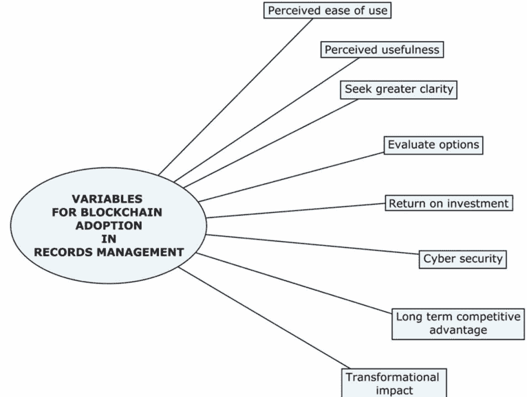

### 感知易用性

感知易用性是技术采用的一个基本要素。如本研究结果所示，如果区块链技术易于使用，记录管理员和档案员愿意采用。这也意味着，应向记录管理员和档案员提供关于如何实施该技术的充分培训。许多组织中明显的错误是，采用新技术的培训通常只保留给信息技术部门。这导致许多记录管理员和档案员成为对系统运作方式理解有限的被动用户。因此，几位记录管理员和档案员基于其复杂性而回避了技术。

### 感知有用性

感知有用性在培养使用新实施技术的意愿方面同样重要。本研究的大多数受访者表示，如果区块链技术在记录管理中有用，他们有兴趣采用。因此，采用技术不应由跟上技术进步的需求驱动。相反，应根据技术更有效地完成任务的能力对其进行评估。记录管理员和档案员应自问的实际问题是：他们希望技术为他们做什么，以及技术是否能够做到。因此，用例应驱动采用技术的需求。

世界正乘坐技术高速公路前行。许多专业人士因害怕被淘汰而渴望跟上新技术的诱惑非常大。拟议模型如图3所示，但它劝阻记录管理员和档案员仅仅因为新技术很时髦就盲目投身其中。应努力寻求技术实际运作方式的更大清晰度。在没有对其运作方式有满意理解的情况下接受技术的使用是危险的。在拥抱用于记录和档案管理的区块链技术之前，必须进行尽职调查。

### 选项评估

采用新技术不必是生死攸关的局面。应权衡和评估各种选择。在这方面应提出的关键问题是：该技术是否最适合该组织。如前所述，采用新技术不应基于“每个人都在这样做”的压力。记录管理员和档案员应列明其系统用户需求、需求和期望，然后评估所选技术按预期运行的能力。在这方面，有必要进一步探究区块链在记录管理中的应用方式和应用领域。用于记录管理的区块链技术规范需要仔细审查。

### 投资回报率

经济体随时间构建和增强，因此每个组织的支出都应物有所值。涉及财务影响的决策必须经过仔细评估。必须有有意义的投资回报。建议记录管理员和档案员在考虑采用区块链进行记录管理时进行成本效益分析。必须很好地理解技术所提供的成本效益。Ngulube (2011) 认为，成本分析在规划记录管理计划中至关重要。它有助于就可能为渴望拥有高效有效系统以获得竞争优势的组织带来的成本和收益做出明智决策。然而，撒哈拉以南非洲的现有文献表明，进行成本效益分析并非该次大陆专业人士的主要关注领域（Ngulube and Tafor, 2006; Kemoni et al., 2007; Ngoepe, 2009）。现实中，对区块链在记录管理中实施进行详细的成本效益分析是必要的，因为这将为实施组织提供选择，使其在充分了解此举将证明所花费资金是合理的情况下推进实施。

### 改进网络安全

寻求保持竞争力的现代组织被迫采用新技术以求生存（Qiang et al., 2012）。采用新技术可能给组织带来益处，但也伴随着以泄露形式出现的安全风险（Doherty et al., 2011）。实施ICT时必须谨慎。在使用区块链技术进行记录管理的感知益处方面，安全性改进的回应数量排名第二，占27项指示。这表明，技术提供安全性的能力不容过分强调。如拟议模型所示，网络安全是在采用 a


新技术。应对技术抵御内部和外部攻击（例如非法访问以及可能威胁记录真实性的不可检测的删除和篡改）的强度进行适当的检查和验证。在云计算中，就记录管理而言，数据安全性存疑（Mosweu et al., 2019）。正因如此，McKemmish（2013）提醒，技术实施的收益和益处应与安全性和隐私等风险相权衡。尽管 McKemmish（2013）的语境专门针对基于云的记录管理，但相同的风险在基于区块链的记录管理中也是令人担忧的。

## 变革性影响

如前文所述，采用新技术不应出于“每个人都在使用”这种跟风压力而驱动。记录管理人员应评估采用该技术的长期竞争优势。他们应当审视该技术的变革性影响。例如，采用新技术后，该专业或组织可能会经历哪些颠覆性变化？或者，预期能实现哪些长期和短期收益等？对这些及其他问题的解答，将有助于做出是否采用该技术的明智决定。

### 结论

第四次工业革命（I4.0）催生了许多颠覆性技术，众多专业人士和从业者难以置之不理。记录管理人员和档案员也未能置身事外，未能在这场跟上技术进步的竞赛中独善其身。总体而言，本研究表明，博茨瓦纳和津巴布韦的记录管理人员和档案员了解区块链技术的存在，尽管各自的组织尚未使用该技术。博茨瓦纳和津巴布韦的记录管理人员和档案员认可区块链技术在记录管理方面的潜在益处，若该技术确实有用且易于使用，他们愿意采用该技术。除了感知到的有用性和易用性外，还应考虑的因素包括：寻求更大清晰度、评估选项、审视投资回报率和长期竞争优势，以及网络安全。

然而，区块链技术的使用不应被视为万能钥匙。必须考虑的问题包括如何处理恶意用户、如何应用控制措施，以及实施的局限性。必须指出，基于区块链的记录保存系统并未从根本上改变现有的记录保存和档案系统，而是通过添加完整性检查层对其进行增强。不过，基于区块链的记录保存不需要证书颁发机构的存在，因为公钥-私钥对是在系统内自行生成的。因此，传入的档案记录可以在其原始证书仍然有效时重新签名，并以时间顺序方式在区块链中进行密码学保护，作为确立其持续真实性的基础。尽管该技术可能无法免疫与新技术相关的潜在风险，但仍鼓励记录管理人员和档案员拥抱该技术，因为它提供了相当大的益处。

## 进一步研究的建议

区块链技术仍然很新，应以它如何潜在地惠及记录和信息管理专业人员的思路进行调查。没有什么是永恒的这一无可争议的事实引发了以下三个关键问题（Lemieux, 2019），这些问题亟待进一步研究：

- 区块链能存续多久？
- 谁以及通过何种手段来确保用户数据的副本得到保存？
- 假设用户数据的副本已被保存，能否使用存储在区块链上的数据对其进行验证？

其他缺点包括数据挖掘过程所需的高昂硬件、能源和时间成本，以及该技术复杂且可能难以理解的事实。

### 参考文献

Begley, R. (2017). 信息与记录管理及区块链技术：理解其潜力（硕士论文）。Northumbria University, Newcastle。

Bhatia, S., Douglas, E. K., & Most, M. (2020). 区块链与记录管理：颠覆性力量还是新方法？检索于 2020 年 5 月 17 日，来自 https://www.emerald.com/insight/0956-5698.htm

Bralić, V., Kuleš, M., & Stančić, H. (2017). 数字签名有效性长期保存模型：TrustChain。载于 Future2017：将 ICT 融入社会，2017。检索于 2020 年 3 月 30 日，https://www.researchgate.net/publication/321171227_A_Model_for_Long

Burke, F. G. (1992). 通过沟通实现混沌：档案员、记录管理人员与沟通现象。载于《档案想象力：献给休·A·泰勒的致敬论文集》（第 154–77 页）。Academic Press。

Chaterera, F. (2012). 迈向利用津巴布韦电子政务采用。2012。《Mousaion：南非信息研究杂志》，30(2)，78–93。

Chaterera, F. (2013). 津巴布韦记录调查与公共记录管理（硕士论文）。University of South Africa, Pretoria。

Chaterera, F., Masuku, M., Bhebhe, S., Ngope, M. S., & Katuu, S. (2018). 津巴布韦企业数字记录管理。检索于 2020 年 4 月 16 日，来自 https://interparestrust.org/assets/public/dissemination/AF03ZimbabweLitReviewJuly2018.pdf

Chaterera-Zambuko, F. (2019). 记录的完整性与真实性：区块链是万能钥匙吗？在第 3 届记录管理与可持续发展记录管理会议上发表的论文，蒙巴萨，肯尼亚。

Chikomba, A. (2018). 津巴布韦选定金融服务公营机构数字记录管理（硕士论文）。University of South Africa, Pretoria。

Davis, F. D. (1989). 感知到的有用性、感知到的易用性以及信息技术的用户接受度。检索于 2020 年 5 月 12 日，来自 http://www.jstor.org/stable/249008

Di Grigorio, M. (2017). 区块链：削减成本的新工具。检索于 2020 年 3 月 30 日，https://www.pwc.com/ml/en/media-centre/articles/Blockchain-new-tool-to-cut-costs.html

Doherty, N. F., Anastakis, L., & Fulford, H. (2011). 强化信息资源企业安全性：可接受使用政策作用的批判性综述。《信息管理国际杂志》，31，201–209。

Dube, C., & Gumbo, V. (2017). 津巴布韦技术接受模型：津巴布韦零售业案例。《应用经济与财务》，4(3)，56–76。doi:10.11114/aef.v4i3.2208

Duranti, L. (2001). 数字技术对档案科学的影响。《档案科学》，1(1)，39–55。doi:10.1007/BF02435638

Duranti, L. (2009). 从数字外交学到数字记录取证。《Archivaria：加拿大档案员协会杂志》，68，39–66。

Duranti, L., & Rogers, C. (2019). 信任在线记录和数据。检索于 2020 年 5 月 12 日，来自 https://www.researchgate.net/publication/337398175_Trusting_Records_and_Data_in_the_Cloud_The_Creation_Management_and_Preservation_of_Trustworthy_Digital_Content

Holotescu, C. (2018). 理解区块链技术及如何参与。在第 14 届国际科学会议“电子学习与教育软件”上发表的论文，布加勒斯特，罗马尼亚。

国际标准化组织。（2016）。ISO 15489-1:2016 信息与文档——记录管理——第 1 部分：概念和原则。ISO。

Iron Mountain.（2020）。什么是区块链，记录管理专业人士为什么要关注？检索于 2020 年 5 月 6 日，来自 https://www.ironmountain.com/resources/general-articles

ITU.（2018）。衡量信息社会报告第 2 卷。检索于 2020 年 3 月 30 日，来自 https://www.itu.int/en/ITU-D/Statistics/Documents/publications/misr2018/MISR-2018-Vol-2-E.pdf

John, C. (2019). 用于合同和记录管理的区块链。检索于 2020 年 3 月 26 日，来自 https://medium.com/vdcconsortium/Blockchain

Jones, A. (2018). 区块链为记录管理带来真实性证明。检索于 2020 年 3 月 20 日，https://www.alfresco.com/blogs/digital-transformation/Blockchain

Jones, D., Cranston, M., Behrens, S., & Jamieson, K. (2005). 什么使 ICT 实施成功：在线作业提交案例研究。检索于 2020 年 3 月 29 日，来自 https://djon.es/blog/wp-content/uploads/2008/12/oasisubmit_v3.pdf

Kalusopa, T., & Ngulube, P. (2012). 为博茨瓦纳劳工组织制定电子记录就绪框架。《信息发展》，28(3)，199–215。doi:10.1177/0266666912446209

Keakopa, S. (2007). 博茨瓦纳、纳米比亚和南非电子记录管理的政策与程序。《ESARBICA 杂志》，26(1)，54–64。doi:10.4314/esarjo.v26i1.31015


Kemoni, H., Ngulube, P., & Stilwell, C. (2007). 用于良好治理的公共记录与档案：记录管理学术界与实践者社区的反思。ESARBICA期刊：国际档案理事会东非和南非区域分会期刊，26(1), 3–18. doi:10.4314/esarjo.v26i1.31012

Khatoon, A. (2020). 医疗保健管理的基于区块链的智能合约系统。Electronics (Basel), 9(94), 1–23. doi:10.3390/electronics9010094

Lemieux, V. L. (2016). 信任记录：区块链技术是答案吗？记录管理期刊，26(2), 110–139. doi:10.1108/RMJ-12-2015-0042

Lemieux, V. L. (2017). 区块链记录管理解决方案的类型学及其对未来档案保存影响的一些反思。2020年4月26日检索，来自 https://www.researchgate.net/publication/322511343

Lemieux, V. L. (2019). 区块链与公共记录管理：关于神庙、监狱与权力（重新）配置的论述。区块链前沿，2(5), 1–14. doi:10.3389/fbloc.2019.00005

Lemieux, V. L., Hofman, J. D., Batista, D., & Joo, A. (2019). 区块链技术与记录管理。2020年3月26日检索，来自 http://armaedfoundation.org/wp-content/uploads/2019/06/AIEF-Research-Paper-Blockchain-Technology-Recordkeeping.pdf

Lewis, A. (2015). 区块链技术温和介绍。2020年7月17日检索，来自 https://bitsonblocks.net/2015/09/09/gentle-introduction-Blockchain-technology/

Luka, M. (2012). ICT对银行的影响：尼日利亚银行业案例研究。先进计算机科学与应用国际期刊，3(9), 145–149.

Marutha, N. S. (2019). 利用区块链技术互联整个医疗宇宙以共享患者记录。在南非比勒陀利亚举办的艺术学院三年期会议上发表的论文。

McKemmish, S. (2013). 云端记录管理与归档：是否有银弹？2020年7月1日检索，来自 https://infoz.ffzg.hr/INFuture/2013/papers/1-02%20McKemmish,%20Recordkeeping%20and%20Archiving%20in%20the%20Cloud.pdf

Mnjama, N., & Wamukoya, J. (2007). 电子政务与记录管理：政府电子记录准备情况评估工具。电子图书馆，25(3), 274–284. doi:10.1108/02640470710754797

Moatlhodi, T., & Kalusopa, T. (2016). 博茨瓦纳加波罗内劳工与内政部电子记录准备情况评估。Mousaion：南非信息研究期刊，34(3), 1–22.

Moloij, J., & Mutula, S. (2007). 电子记录管理与记录管理。信息发展，23(4), 290–306. doi:10.1177/0266666907084765

Mosweu, O. (2014). 博茨瓦纳贸易与工业部行动官员与记录官员采用和使用文档工作流管理系统（DWMS）的影响因素（硕士论文）。博茨瓦纳大学，加波罗内。

Mosweu, O. (2016). 电子文档与记录管理的关键成功因素。ESARBICA期刊，35, 1–13.

Mosweu, O., Bwalya, J., & Mutshewa, A. (2017). 电子文档与记录管理采用与使用影响因素的探究。信息发展，33(1), 97–110. doi:10.1177/0266666916640593

Mosweu, T., Luthuli, L., & Mosweu, O. (2019). 非洲云计算服务的影响：数字时代的阿喀琉斯之踵？南非信息管理期刊，21(1), 1–12. doi:10.4102/ajim.v21i1.1069

Mosweu, T. L., & Kenosi, L. (2018). 博茨瓦纳加波罗内治安法官区法院记录管理系统在司法实施中的实施。记录管理期刊，28(3), 234–251. doi:10.1108/RMJ-11-2017-0033

Motsaaithebe, L., & Mnjama, N. (2007). 博茨瓦纳高等法院记录管理。记录管理期刊，19(3), 173–189. doi:10.1108/09565690910999175

Nakamoto, S. (2008). 比特币：一种点对点电子现金系统。2020年7月20日检索，来自 https://bitcoin.org/bitcoin.pdf

National Archives and Records Administration (NARA). (2019). 区块链白皮书。2020年5月2日检索，来自: http://www.archives.gov/policy

Nengomasha, C. T., & Chikomba, A. (2018). 津巴布韦和纳米比亚公共部门EDRMS实施状况。记录管理期刊，28(3), 252–264. doi:10.1108/RMJ-08-2017-0023

Ngoepe, M. (2009). 为实现服务交付而组织公共记录：南非国家档案和记录服务部门政府部门功能主题文件计划的作用。ESARBICA期刊：国际档案理事会东非和南非区域分会期刊，28(1), 41–56. doi:10.4314/esarjo.v28i1.44397

Ngulube, P. (2011). 全生命周期记录成本分析与有效管理。南非档案学家学会期刊，44, 3–18.

Ngulube, P., & Tafor, V. F. (2006). 国际档案理事会东非和南非区域分会（ESARBICA）成员国公共记录和档案管理概述。档案学家期刊，27, 69–86.

Nkala, G., Ngulube, P., & Mangena, S. (2012). 津巴布韦国家档案馆的电子记录准备情况。Mousaion，30(2), 108–116.

Norton Life Lock. (2020). 2019年数据泄露：迄今已有40亿条记录被泄露。2020年5月2日检索，来自: https://us.norton.com/internetsecurity-emerging-threats-2019-data-breaches.html

Notheisen, B., Hawlitschek, F., & Weinhardt, C. (2017). 打破区块链炒作——走向区块链市场工程方法。2020年5月18日检索，来自 https://www.researchgate.net/publication/317828531

Prasad, D. (2016). 帛琉、萨摩亚、基里巴斯和所罗门群岛公共部门服务交付中ICT使用研究。2020年5月19日检索，来自 https://www.researchgate.net/publication/314281757

Qiang, Y., Fang, Y., & Gonzalez, J. J. (2012). 新技术采用过程中的安全风险管理。计算机与安全，31, 859–869.

Radif, M., Fan, I. S., & McLaughlin, P. (2016). 采用技术接受模型（TAM）在伊拉克大学采用学习管理系统（LMS）。在西班牙瓦伦西亚举办的第10届国际技术、教育与发展会议上发表的论文。2020年5月2日检索，来自: https://www.researchgate.net/publication/298953343_EMPLOYMENT_TECHNOLOGY_ACCEPTANCE_MODEL_TAM

Rakemane, D., & Serema, B. C. (2018). 博茨瓦纳加波罗内公司与知识产权局的电子记录管理实践。南非档案学家学会期刊，51, 148–169.

Reader, S. (2018). 自主学习：为什么它对你在21世纪至关重要。2020年5月6日检索，来自: https://medium.com/wondr-blog/self-learning-why-its-essential-for-us-in-the-21st-century-9e9729abc4b8

Rogers, E. M. (2003). 创新扩散（第5版）。自由出版社。

Sadhya, V., & Sadhya, H. (2018). 区块链技术采用障碍。新奥尔良第24届美洲信息系统会议。

Shonhe, L., & Grand, B. (2019). 电子记录管理电子记录管理。记录管理期刊，30(1), 43–62. doi:10.1108/RMJ-03-2019-0013

Sigauke, D. T., & Nengomasha, C. (2012). 津巴布韦国家档案馆历史数字化记录保存面临的挑战与前景。在南非约翰内斯堡威特沃特斯兰德大学举办的非洲数字图书馆与档案第2届国际会议（ICADLA-2）上发表的论文。2020年4月16日检索，来自 https://core.ac.uk/download/pdf/39670341.pdf

Sigauke, D. T., Nengomasha, C., & Chabikwa, S. (2016). 津巴布韦国立大学电子邮件作为电子记录的管理：结果及其对津巴布韦国家档案馆的影响。ESARBICA期刊，35, 14–29.

Tornatzky, L. G., & Fleischer, M. (1990). 技术创新过程。学术出版社。

Totolo, A. (2007). 博茨瓦纳中学校长的信息技术采用。2020年4月30日检索，来自 https://www.researchgate.net/publication/242407711_Information_Technology_Adoption_by_Principals_in_Botswana_Secondary_Schools

Turnbaugh, R. C. (1997). 信息技术、记录与州档案。美国档案管理员，60(2), 184–200. doi:10.17723/aarc.60.2.e6247tm502671537

UNESCO. (2003). 教育中的互联网。2020年5月3日检索，来自 https://iite.unesco.org/pics/publications/en/files/3214612.pdf


Venkatesh, V., Morris, M. G., Davis, G. B., & Davis, F. D. (2003). 信息技术用户接受：迈向统一视角. 于 2020 年 4 月 16 日检索自 https://www.researchgate.net/publication/220259897

Wamboye, E., Tochkov, K., & Sergi, B. S. (2015). 撒哈拉以南非洲国家的技术采用与增长. 《比较经济研究》, 57(1), 136–167. doi:10.1057/ces.2014.38

Yoo, S. (2017). 基于区块链的金融案例分析及其启示. 《亚太创新与创业期刊》, 11(3), 312–321. doi:10.1108/APJIE-12-2017-036

Zhiliang, D., Yongjun, R., Yepeng, L., Xiang, Y., Zixuan, S., & Hye-Jin, K. (2019). 基于区块链的云存储可信电子记录保存. 于 2020 年 7 月 16 日检索自 https://vnte-chindia.com/wp-content/uploads/2020/04/004.pdf

## 附加阅读

Bhatia, S., & de Hernandez, A. W. (2019). 区块链已经来临。这对记录管理和档案馆意味着什么？《档案组织期刊》, 16(1), 75–84. doi:10.1080/15332748.2019.1655614

Body, A. (2018). 区块链：如何为您的业务选择合适的技术. 于 2020 年 7 月 13 日检索自 https://medium.com/@abody/Blockchain-how-to-choose-the-right-tech-for-your-business-aa4597d7ee7c

Bwalya, K. (2019). 第四次工业革命中档案的相关性——在人工智能和动态信息治理时代重新定义疆域. 在2019年南非档案学家协会上发表的论文，南非约翰内斯堡.

Collomosse, J., Bui, T., Brown, A., Sheridan, J., Green, A., Bell, M., Fawcett, J 和 Higgins, J. (2018). ARCHANGEL：数字公共文件的可信档案. 于 2020 年 3 月 30 日检索自 https://arxiv.org/pdf/1804.08342.pdf

Connolly, A., & Kick, A. (2015). “是什么区别了比特币的早期组织采用者与非采用者？”载于：AMCIS 2015 论文集。AIS 电子图书馆：信息系统协会 (AIS).

Consensys. (2018). 区块链基础。一份精选集合. ConsenSys 学院

Day, M. S. (2019). “关机问题：区块链系统如何结束？”可于 arXiv: 1902.07254 查阅

Dhillon, V., Metcalf, D., & Hooper, M. (2017). 区块链赋能应用：了解区块链生态系统及如何使其为您工作. Apress. doi:10.1007/978-1-4842-3081-7

Dollar, C. (1993). 信息时代的档案管理员和记录管理人员. 《档案馆》, 36, 37–52.

Fincham, J. E. (2008). 调查、标准和期刊的回应率与响应度. 《美国药学教育杂志》, 72(2), 1–3. doi:10.5688/aj720243 PMID:18483608

Hofman, D., Lemieux, V. L., Joo, A., & Batista, D. A. (2019). 世界边缘与无限可能之间的边界：区块链、GDPR和信息治理. *档案管理期刊*, 29(1/2), 240–257. doi:10.1108/RMJ-12-2018-0045

ICA. (2010). *关于档案的通用宣言*. 于 2020 年 5 月 6 日检索自 https://www.ica.org/en/universal-declaration-archives

Mearian, L. (2018). 区块链市场火热；以下是学习相关技能的方法. *计算机世界*.

Millar, L. (2009). *理解电子记录管理的背景*. http://www.irmt.org/documents/educ_training/term%20modules/IRMT%20TERM%20Module%20201.pdf

Morisse, M. (2015). “加密货币和比特币：描绘研究图景。”载于：AMCIS 2015 论文集。AIS 电子图书馆：信息系统协会 (AIS).

Mosweu, O., Bwalya, K. J., & Mutshewa, A. (2016). 使用UTAUT模型考察影响文档工作流管理系统(DWMS)采用和使用的因素. *档案管理期刊*, 26(1), 38–67. doi:10.1108/RMJ-03-2015-0012

Mothlasedi, N., & Mnjama, N. (2014). 博茨瓦纳培训管理局的电子记录管理. *神学.宗教与哲学期刊*, 4(2), 361–382.

Mothlasedi, N. Y. (2012). 博茨瓦纳培训管理局的电子记录管理. 硕士论文，博茨瓦纳大学，博茨瓦纳.

Wattenhofer, R. (2016). *区块链科学*. 倒置森林出版社.

Yaga, D., Mell, P., Roby, N., & Scarfone, K. (2018). “区块链技术概述，NISTIR 8202”，美国国家标准与技术研究院，可于以下网址查阅：https://nvlpubs.nist.gov/nistpubs/ir/2018/NIST.IR.8202.pdf

Zyskind, G., Nathan, O., & Pentland, A. (2015). 去中心化隐私：使用区块链保护个人数据. 在 *安全与隐私研讨会 (SPW)* (第 180–184 页). IEEE. doi:10.1109/SPW.2015.27

## 关键术语与定义

**采用：**采用是指对新实施技术的使用。它也等同于接受。在本章语境中，采用是指个人或机构接受在其保管的记录和档案管理中使用区块链技术。

**真实性：**这是接受记录作为所发生事情真实反映的概念。它指记录未被意外或恶意篡改或损坏，因此可以作为已完成交易的证据予以信任。

**区块链技术：**这是指可组合在一起以确保分布式账本机制安全、高效运作的一组技术。区块链的识别因素在于：该过程在政治上是去中心化的，没有基础设施故障点，提供自主权和信任，并且具有抗攻击性。

**加密货币：**这些是设计为交换媒介的数字资产，其中单个代币所有权记录存储在以计算机数据库形式存在的账本中，使用强加密技术来保护交易记录。

**数据库：**数据库是有组织的数据集合，通常以电子方式从计算机系统中存储和访问。它也可以描述为存储有组织信息的数据结构。大多数数据库包含多个表，每个表可能包含多个不同的字段。

**电子记录：**电子记录是计算机记录的信息，在机构或个人活动的发起、进行或完成过程中生成或接收。电子记录的示例包括电子邮件、文字处理文档、电子表格、数字图像。

**新兴技术：**这些是其开发、实际应用或两者仍在很大程度上未实现的技术，因此它们仿佛从不存在或默默无闻的背景中崭露头角。

**不可更改：**不可更改记录对象是指其状态在创建后无法修改，除非通过涉及所有其他参与者的“共识”机制。这意味着一旦记录创建，除非达成共识，否则不能更改或删除。

**工业革命：**这是指在相对较短的时间内，一种或多种技术被其他新颖技术取代的时期。这是一个加速技术进步的时代，其特征是新创新的快速应用和扩散通常会导致社会的突变。

**完整性：**当文档中没有任何内容被更改、添加或删除时，该文档具有完整性；它精确地代表了其作者创建的内容。完整性意味着记录完整且真实。

**记录管理：**这是指贯穿记录信息生命周期（即从创建和捕获、使用、维护到处置）的业务职能所产生的记录信息的管理职能。

**安全：**这是指保护记录免受各种形式损坏或攻击威胁。这些包括物理损坏、外部数据泄露、未经授权的更改和删除等。

## 第4章

## 区块链中的端到端追踪与拥塞：基于Hyperledger Fabric的供应链用例

Kosala Yapa Bandara
https://orcid.org/0000-0002-3616-7764
National University of Ireland Galway, Ireland

Subhasis Thakur
National University of Ireland Galway, Ireland

John G. Breslin
https://orcid.org/0000-0001-5790-050X
National University of Ireland Galway, Ireland

## 摘要

现代供应链应用是复杂系统，在众多不同领域中发挥着重要作用。供应链管理系统被实施以应对日益增加的复杂性和货物流动。然而，这些系统中的大多数也在增加在分布式供应链系统中提供信任和交易全球视图的复杂性。区块链技术引入了一种新的架构风格，以支持网络中参与者所执行交易的可追溯性和信任。本章利用这一新兴技术，实现了英国JLP Meats的一个供应链用例，在改进透明度、信任和端到端查询的同时，讨论了实现大型企业区块链应用的潜在挑战。从农场到餐桌的过程已针对可追溯性、物品召回、区块分析、拥塞（以保障食品安全）和可持续农业进行实施和测试。在需要异质贸易合规性和可扩展性的复杂供应链中，突出了潜在挑战。


## INTRODUCTION

供应链管理是将从最终用户到原始供应商的分布式和异构系统中实现的业务流程进行整合（Cooper, Lambert, & Pagh, 1997）。当前的供应链管理系统存在已知局限，而食品供应链是所有供应链中最复杂、最分散的一种（Martin, 2017）。供应链中涉及许多参与者，他们使用分布式和异构系统，增加了集成、信息共享、端到端跟踪和合规跟踪的复杂性。此外，与供应链集成的各种系统可能面临网络威胁，这将导致供应链中信息的完整性被破坏（Gao, et al., 2018）。

区块链技术已成为解决双重支付问题的方案，承诺交易的可追溯性、不可篡改性和透明性（Nakamoto, 2008）。正如 Consensys（2020）所述，区块链技术与智能合约相结合可以实现：

- 从源点到最终消费的消费品透明度
- 准确的资产跟踪
- 增强服务、产品和软件的许可

区块链的共享 IT 基础设施可以简化所有参与者的工作流程，无论业务网络的规模如何。此外，这种共享基础设施使审计师能够更清楚地查看供应链中参与者的活动。

在食品行业供应链的背景下，从农场到餐桌的食品系统是一个由孤立系统组成的复杂网络。目前还没有广泛采用的行业标准来规定如何为食品可追溯性目的记录和跟踪数据。由于区块链技术正在成为一种分布式、可信和不可篡改的账本，它可以用于记录从农场到餐桌食品系统中的交易，从而实现可追溯性（Martin, 2017）。供应链网络中的交易数量始终非常大。例如，沃尔玛每周在 28 个国家的近 12,000 家门店为 2.6 亿客户提供服务（Yiannas, 2018）。一个区块链网络中少数此类参与者会创建数百万个交易和区块，这些交易和区块在不断增长，挑战着区块链网络的可扩展性。

此外，供应链网络中的产品公司在分发给客户之前会生产成千上万种各种类型的产品。这些交易的一些细节是冗余信息。例如，数千包肉类产品由同一种商品制成，因此只有包装标识符不同。此外，这些大部分需要在某个有限的时间段内使用。因此，为这些类型创建交易块并将其存储在所有其他参与者的分布式账本中，在区块链网络拥塞和存储方面是一个昂贵的过程。另一方面，在所有账本中保存相同的记录副本支持项目可追溯性和审计。然而，在现代复杂的供应链系统中，项目的端到端追踪是必需的。

商业部门的全球化增加了商品和货物的跨境流动，从而增加了全球供应链的复杂性（Martin, 2017）。在分布于各国的各种既定旧法律、法规和机构的当前复杂供应链中，监管机构在区块链中的角色极具挑战性（Kshetri, 2018）。像 Gao 等人（2018）中那样扮演监控角色是不够的，因为监管机构需要在提供理由的情况下批准或拒绝交易。监管机构只关心合规所需的相关信息。不需要他们了解各种监管环境下发生的异构交易。

当前的区块链架构支持状态相等的分布式账本。让监管组织成为所有需要监管合规的区块链网络的参与者并维护其账本并不是一种实际的方法。因此，监管组织在区块链网络中的地位仍不清楚。

公共区块链框架针对透明性进行了优化，因此在共享私人和敏感信息以及仅允许授权参与者参与供应链方面面临挑战；例如，比特币（Bitcoin, 2020）、以太坊（Ethereum, 2020）和莱特币（Litecoin, 2020）。然而，许可型区块链平台将交易分为公共交易和私有交易，并支持授权，例如 Hyperledger Fabric（Hyperledger, 2020）和 Quorum（Quorum, 2020）。与其他私有和许可型区块链相比，Hyperledger Fabric 拥有可靠的技术栈来实现供应链应用，并已被 IBM 和沃尔玛等主要组织广泛用于试点项目（Kshetri, 2018）。Hyperledger Fabric 是一个模块化区块链框架，支持即插即用组件，旨在用于私营企业内部（Kenton, 2020）。然而，这些试点项目大多专注于端到端追踪，仍需详细阐述其他挑战，例如产品召回、区块链拥塞、数据冗余、可扩展性、监管合规等。

在本章中，作者讨论了一个在英国为 JLP Meats（JLP Meats, 2020）实施的基于 Hyperledger Fabric（Hyperledger, 2020）的供应链用例。作者选择 Hyperledger Fabric 框架是因为其在开发供应链应用程序方面的潜力，其支持私营企业所需即插即用组件的模块化架构，以及用于开发和测试的可靠技术栈。作者详细阐述了该用例在端到端追踪、产品召回、区块链拥塞、数据冗余、可扩展性以及大规模区块链网络中监管组织地位方面的应用。

本章的组织如下：共有五个主要部分。首先，作者讨论文献中的相关工作。然后，作者讨论端到端追踪、区块链拥塞以及区块链中监管机构的地位。在下一节中，本章描述了 JLP Meats 的一个用例，该公司是伦敦的一家批发肉类经销商。本章的第四部分描述了使用 Hyperledger Fabric 进行的设计、实现和测试，以详细阐述端到端追踪、产品召回和拥塞分析。最后，本章总结了贡献，并强调了未来的工作和方向。

## RELATED WORK

在本节中，作者回顾了区块链技术和供应链管理系统方面的相关工作，涵盖安全、隐私、可追溯性、产品召回和交易拥塞等方面。

供应链管理是将从最终用户到原始供应商的分布式和异构系统中实现的业务流程进行整合（Cooper, Lambert, & Pagh, 1997）。大型供应链中的参与者通常在众多国家在各种限制和法律下运营。此外，食品供应链正在努力提供更多样化、更方便、更经济的食品来源，同时面临着巨大的新挑战。而且，在当今的食品供应系统中，一种原料生产商的产出可能最终会成为杂货店货架上成千上万种新产品的一部分（Yiannas, 2018）。这种分布式行为和食品供应链的复杂性，在采取应对食品污染问题的必要行动（例如 2008 年花生酱沙门氏菌爆发¹、2016 年由受污染面粉引起的大肠杆菌疾病²、2020 年与苜蓿芽相关的大肠杆菌感染爆发³等）时变得更加复杂。食品供应链还面临着动态成本、价格和监管合规问题。

目前还没有广泛采用的行业标准来规定食品供应链的每个环节（农民、加工商、分销商、零售商等）如何为食品可追溯性目的跟踪和记录数据（Yiannas, 2018）。大多数参与者仍在纸上或使用无法实现详细可追溯性和透明度所需的必要映射记录和通信的旧系统记录数据。此外，当前的供应链应用程序在孤立系统集成以及关于交易完整性的安全漏洞方面存在问题。射频识别（RFID）、远程信息处理、条形码和 2D 码、传感器支持技术、物联网（IoT）以及许多其他技术被用于跟踪供应链中的产品（Davor & Domagoj, 2018）。然而，跟踪数据的真正潜力并未被充分利用，因为基础数据仅在公司内部或部分连接的孤立系统中可用。系统之间的通信以及系统各部分之间缺乏信任是当前供应链系统的主要问题。与供应链相关的可持续性事件表明，在全球供应链中改善环境、社会和经济成果的跨国公司面临挑战（Esteban Koberg, 2018）。公司应对其内部和供应商运营造成的环境、社会和经济成果负责。

另一方面，区块链技术已成为解决双重支付问题的方案，承诺交易的可追溯性、不可篡改性和透明性（Nakamoto, 2008）。区块链技术已从加密货币交易演变而来，并不断颠覆经济中日益扩大的领域（Davor & Domagoj, 2018）。这种技术可以为供应链系统提供更好的可追溯性、透明性和可交易性（Consensys, 2020）。因此，区块链和分布式账本技术在供应链应用领域变得越来越流行（Martin, 2017）。区块链技术承诺解决信任问题，并允许为物流和供应链提供安全且经过身份验证的系统。这促使使用区块链技术彻底变革供应链系统。大型组织中已经存在试点项目；例如，从农场到餐桌⁴ 过程可以采用物联网和区块链技术来改进控制和灵活性，同时提高食品信任度和品牌保护。

西门子将其 Mindsphere 平台、私有跟踪与追踪存储库以及区块链管理应用程序相结合，以实现图 1 所示的跟踪与追踪用例（Siemens, 2019）。这些解决方案使用区块链技术在整个过程中实施信任。该框架允许公司限制信息查看权限，从而将敏感信息保密，只向供应链的其他成员暴露关键信息。该平台进一步支持利用物联网和区块链实现“数字孪生”（Meyvaert, 2020）。物联网中的数字孪生是对物理产品或流程的虚拟表示，用于理解和预测物理对象的性能特征（Meyvaert, 2020）。数字孪生在产品生命周期中被广泛使用，而区块链使它们能够以不可篡改的记录记录所有信息。


### 图 1. 西门子Mindsphere供应链

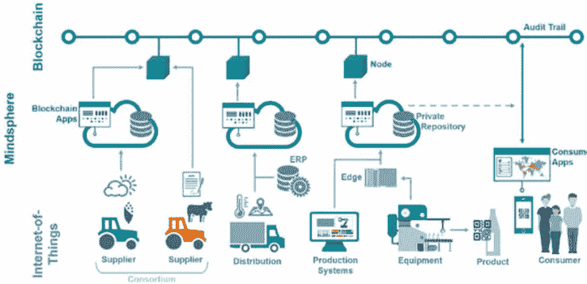

区块链技术可以实现创建一个去中心化、分布式且受信任的数字账本，该账本可用于记录复杂网络中多个实体的交易（Yiannas, 2018）。数据不可变性和数据流的公开可访问性可以支持现代供应链系统的合规性、可靠性和透明度（Perboli, Musso, & Rosano, 2018）。作为区块链的供应链，是Gao等人（2018）提出的两步块构建机制，将参与者分类为普通用户、第三方用户和具有不同角色的支持实体。在他们的方法中，监管组织专注于监控信息。Ko等人（2018）讨论了一种监控代理，用于监控和分析区块链交易、节点、块和智能合约，以确保区块链合法、高效且可靠地运行。

（Kshetri, 2018）的作者总结了一系列成功的区块链实现用例，包括：丹麦航运公司马士基（用于国际物流的区块链应用）、Provenance（印度尼西亚的一个试点项目，以实现渔业行业的可追溯性）、阿里巴巴（用于打击食品欺诈的区块链）、沃尔玛（追踪从拉丁美洲到美国的农产品，以及英特尔追踪海鲜供应链的解决方案等。

供应链中的可追溯性是一个重要的探索领域（Westerkamp, Victor, & Küpper, 2018）。在当前的区块链架构中，分布式账本提供可访问于区块链网络中所有参与者的交易信息，从而提供更大的透明度（Zheng, Xie, Dai, Chen, & Wang, 2017）。然而，组织不愿在公共账本中暴露敏感信息，因此Benhamouda, Halevi & Halevi（2018）引入了私有数据集合来管理敏感信息。隐私、可扩展性和缺乏治理仍然是大规模工业采用区块链范式的主要关注点（Li, Sforzin, Fedorov, & Karame, 2017）。

公共（无许可）区块链平台针对透明度进行了优化，交易是公开和透明的，例如，比特币（Bitcoin, 2020）、以太坊（Ethereum, 2020）和莱特币（Litecoin, 2020）。然而，许可区块链平台将交易分为公共交易和私有交易，例如，Hyperledger Fabric（Hyperledger, 2020）和 Quorum（Quorum, 2020）。私有交易在网络参与者之间共享私有和敏感数据（Hyperledger2, 2020）。

以太坊是一个安全的去中心化账本，针对透明度进行了优化，因此在该平台上共享秘密比较困难（Ethereum, 2020）。以太坊的主要组件包括以太坊虚拟机（EVM）、矿工、块、交易、共识算法、账户、智能合约、挖矿、以太币和gas（Modi, 2018）。这些在图 2 中有所说明。

### 图 2. 以太坊组件

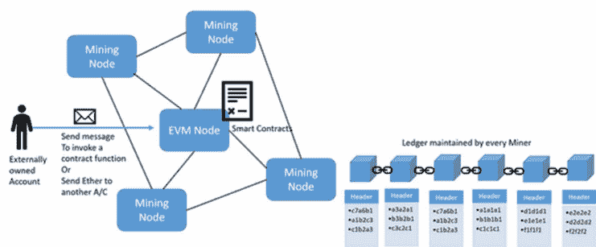

另一方面，Hyperledger Fabric 引入了私有数据集合，它允许通道上定义的组织子集有能力背书、提交或查询私有数据（Hyperledger2, 2020）。私有数据通过流言协议点对点发送给仅获授权查看的组织。排序服务不参与此过程，排序节点看不到私有数据。私有数据的哈希值会被背书、排序，并写入通道上每个对等节点的账本中，如图 3 所示（Hyperledger2, 2020）。

### 图 3. Hyperledger Fabric 中的私有数据存储

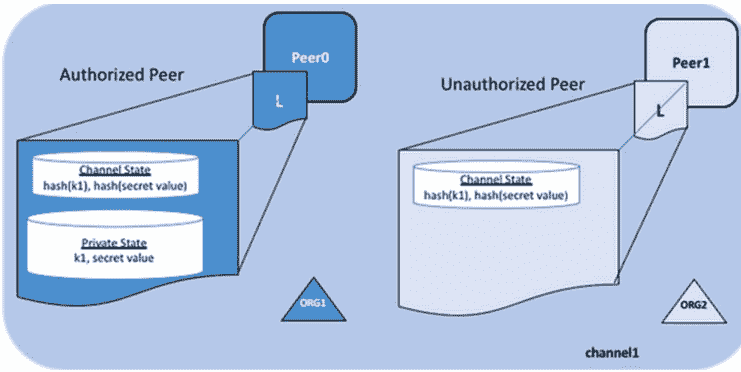

### 图 4. Hyperledger Fabric 中的交易调用

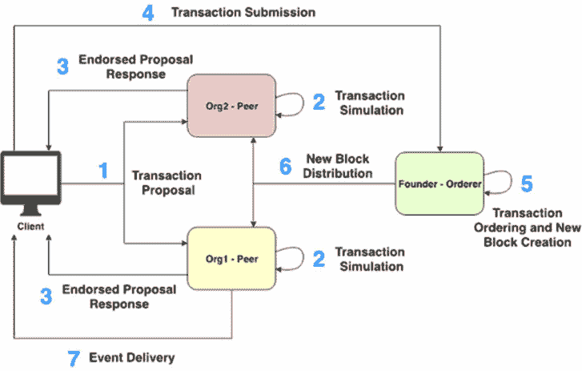

### 图 5. Hyperledger Fabric 和 Composer 技术栈

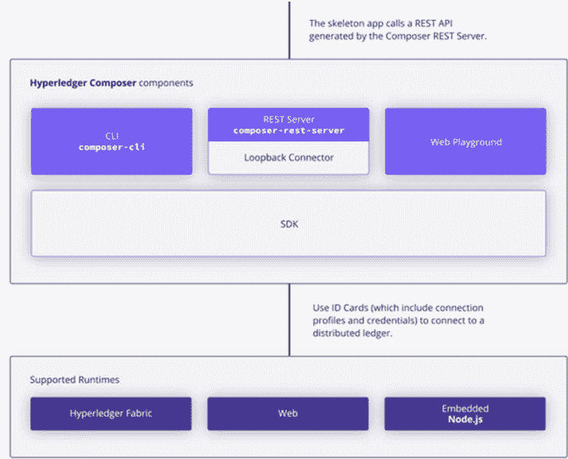

私有数据的哈希值通过排序节点进入公共账本并保护隐私。哈希值可用于状态验证和审计目的。Hyperledger Fabric 中的交易调用流程如图 4 所示（Thummavet, 2020）。

区块链应用的 Hyperledger Fabric 技术栈在图 5 中有所说明（Composer, 2020）。

图 5 中的技术栈使架构师和开发人员能够快速创建“全栈”区块链解决方案：例如，在区块链上运行的业务逻辑、向 Web 或移动应用程序公开区块链逻辑的 REST API、区块链与现有系统的集成等（Composer, 2020）。Hyperledger Composer 已设计为支持可插拔运行时。Hyperledger Fabric 的模块化架构将交易处理工作流分为三个不同的进程：名为链码的智能合约（包含系统的分布式逻辑处理和协议）、交易排序，以及交易验证和提交（Kenton, 2020）。

## 端到端追踪与拥塞

区块链按时间顺序在块中存储数据，这些块在不断增长的系列中相互链接。网络中的参与者正在贡献将交易和块提交到区块链中。向区块链添加块是无法预测的，块也不是基于交易进行排序的。然而，所有分布式账本都具有相同的状态，从而实现可靠访问，并支持从一个账本中对记录进行端到端可追溯性。

### 图 6. 区块链中的交易和块

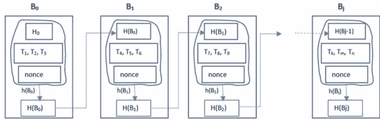

图 6 说明了一个区块链，其中 B0 到 Bj 是区块链中的组成块。H(B0) 到 H(Bj) 是块的哈希键。T1 到 Tk、T1、Tm、Tn 是交易。k、m、n 是整数。h( ) 是哈希函数。在此，作者假设一个块包含三个交易。区块链根据网络中参与者创建的交易不断增长。参与者将根据自身需求进行交易，块会被添加到不断增长的区块链中。交易信息检索是一项挑战，因为交易之间没有关系。例如，项目可追溯性需要与单个项目相关的所有交易，审计需要审计一组交易等。然而，不同的区块链平台提供各种方法来检索交易信息。Hyperledger Fabric 拥有 composer-rest-server，它为每个资产提供 REST 端点。

图 7 显示了参与者 P1...P6 和交易 T01 ... T04 及 T11 ... T14。在供应链应用中，P1 到 P6 分别可视为商品提供商、物流公司、进口商和零售商。

### 图 7. 区块链中的交易序列

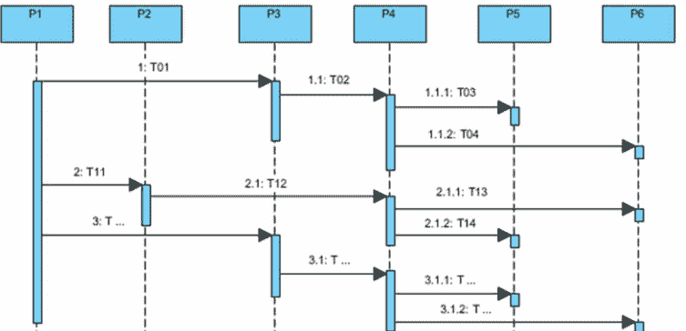

商品提供商通过物流公司不断向进口商公司提供各种商品，进口商公司将从商品中生产产品批次并供应给客户。区块链网络中的参与者贡献将块添加到区块链网络中，如图 8 所示。

### 图 8. 区块链中的状态变更


在当前的区块链架构中，终端用户查找产品端到端细节并不简单，这涉及一组分布在区块链中随机分布的块中的交易。尽管块使用块哈希机制相互连接，但链概念和随机块集成使得查找供应链中项目的演变变得复杂。然而，记录的去中心化特性以及拥有最新账本的相同副本允许参与者直接与数据的端到端细节进行交互。

作者已创建一个 REST-API，用于为区块链上的成员、资产、用户定义的查询以及区块链中的交易创建 REST 端点。定义了查询以从账本中提取所需信息。这些资源的表现状态可以被提取、过滤和连接，以查找端到端细节。这些过程应相应定义。


## 区块链拥塞

在供应链应用中，最终用户产品在将资源转化为最终用户产品的过程中经历了一系列交易。区块链网络中存在中间参与者，他们将主要资源开发成各种产品并分发给客户。这些场景将向区块链添加数百万条记录。这导致了区块链网络中区块拥塞以及参与者处的数据冗余等多个挑战。产品生命周期中发生的所有交易对区块链网络中的所有参与者并不同样重要，因此需要一种交易验证的补偿模型。如图7所示，P4从主要资源制作不同的产品并将其分发给P5和P6。

(T01, T02) -> (T1 ... Tn1), (Tn1... Tn2), (Tn2 ... Tn3), ........ 其中 n1, n2, n3 ∈ Z
(Ti1, Ti2) -> (Ti1 ... Tmi), (Tmi1... Tm2), (Tm2 ... Tm3), ... 其中 m1, m2, m3 ∈ Z
(T...) -> (T21 ... Tkl), (Tk1... Tk2), (Tk2 ... Tk3), ............ 其中 k1, k2, k3 ∈ Z

在P4处，交易T01和T02基于产品创建和客户要求创建一组交易。同样适用于T11、T12和T..。如果存在多个开发子产品的P4类型中间参与者，这将向区块链添加数百万条记录，在区块链网络中产生实时拥塞。此外，这将向区块链添加冗余数据。这是一种不断增长的实时开销，对区块链网络的可扩展性产生负面影响。为供应链应用管理时序数据以减少交易冗余和交易验证仍需要重大发展。IoT设备与供应链集成，并在整个供应链中生成数百万条记录。可以采用临时解决方案来管理这些记录，例如，Hyperledger Fabric支持即插即用本地数据存储来记录IoT数据，且只有数据集的哈希值会记录在区块链中。IoT与供应链的集成是一种常见场景，因此区块链与IoT集成需要新的标准。

此外，供应链应用需要遵守各地区制定的法规。各地区的监管组织仅对供应链交易中特定一组信息感兴趣，以进行合规性检查。在当前的区块链架构中，参与者将维护完整的区块链，因此监管者作为区块链网络参与者的角色不切实际。迄今为止，没有任何区块链架构提供将监管者定位在区块链中所需的必要标准。

如图9所示，作者提议一个私有通道，供监管组织仅与所需参与者连接以进行合规性检查。参照图9，ORG 1至4和ORG 1至3连接在两个区块链网络中。REG ORG有一个私有通道，连接两个不同区块链网络中的ORG3和ORG 2。各地区的监管组织可以成为该私有通道的授权成员，从而加快供应链交易验证速度，避免当前系统中的长时间延迟。这还可以为任何需要通过供应链发送物品的人提供透明的合规性检查支持。该主题领域需要进一步阐述，因为迄今尚无适当的标准或成熟产品来加快监管合规，且区块链技术在此领域已显示出巨大潜力。

Figure 9. Regulatory organization in blockchains

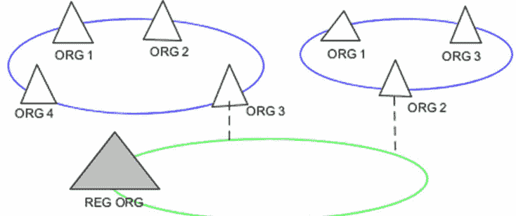

在我们提出的架构中，需要监管合规的交易将被导向监管组织，分布式账本将使用批准或拒绝交易的区块进行更新。一批批准或拒绝的交易将作为{hash(block), block}保存在监管者数据存储中。区块的哈希值记录在区块链中。在此方法中，监管者不需要保留不必要的记录，他们只保留其处理过的记录（批准或拒绝的记录）。未来应用程序可以使用这些记录的数据。例如，由于这些区块在区块链上具有必要的哈希键，审计追踪可以连接到网络中参与者的账本。

## 用例

JLP Meats Trading组织（JLP Meats，2020）从澳大利亚、南美洲和欧洲进口肉类，并在英国销售。其客户是英国的餐厅、零售店和肉铺。JLP Meats生产数百种定制肉类产品并分发给客户。农场到餐桌流程的抽象视图如图10所示。作者已使用Hyperledger Fabric实施了一个区块链解决方案，以说明端到端追踪、产品召回、交易拥塞等。

Figure 10. Use Case of JLP Meats, London

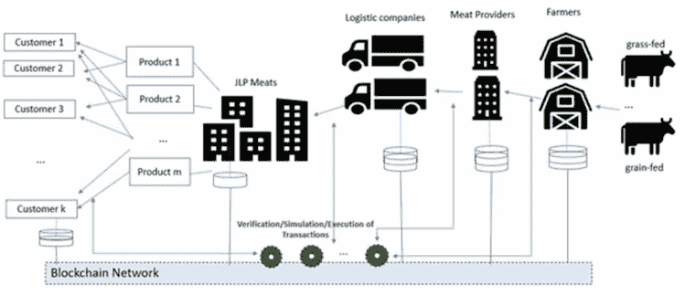

为进行说明，作者考虑了以下特定场景。农民Samex使用物流公司Sandford group将草饲和谷饲牛肉出口到英国的JLP Meats。JLP Meats将牛肉转化为300至500克的包装，并供应给其客户ASDA和TESCO商店。从TESCO（或ASDA）购买一包牛肉的买家想要了解该产品的端到端详情。在此，典型的一组交易可以按图11所示建模。

Figure 11. Transactions in the Use Case scenario

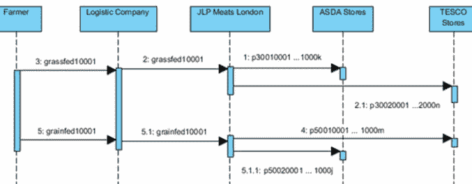

JLP Meats供应各种类型的产品，产生数千笔交易，导致区块链中的交易拥塞。交易验证由网络中获许可的验证者执行，此过程应获得补偿。然而，本章不涵盖补偿过程；质量控制由监管者管理。本章提议一个监管者私有通道网络，他们可以连接到区块链网络以执行监管活动和必要的背书，如图9所示。

## 设计、实现与测试

作者使用公共和许可的区块链，使账本去中心化，并且选定的一组节点参与共识程序。作者已在Ubuntu 18.04上使用Hyperledger Fabric⁵、Composer Playground、Hyperledger Explorer和Docker实现了上述用例。

使用Hyperledger Fabric的拟议解决方案的高层架构如图12所示。

Figure 12. The High-level Architecture Based on Hyperledger Fabric

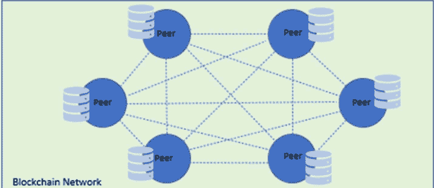

对等节点是区块链网络的成员。业务网络在上述对等节点上开发和安装，并创建了一个REST-API⁶来执行物品的端到端追踪。Hyperledger Composer Playground用于实现和测试场景，Hyperledger区块链浏览器用于可视化区块链统计信息。Swagger⁷用于可视化和测试REST端点。肉类包装的交易事务定义如图13所示。对等节点可以是授权的矿工或参与者，用于挖掘供应链交易，应为交易验证引入补偿模型。然而，迄今尚无适当的标准或可用矿工来挖掘供应链交易。这些必要的发展可以进一步革新未来的供应链系统。

Figure 13. Trading Transaction for Packets

```
/**
 * Track the trade of a packet from one trader to another
 * @param {org.jlp.trading.TradePacket} trade - the trade to be processed
 * @transaction
 */
async function tradePacket(trade) { // eslint-disable-line no-unused-vars
    // set the new owner of the packet
    trade.packet.owner = trade.newOwner;
    const assetRegistry = await getAssetRegistry('org.jlp.trading.Packet');

    // emit a notification that a trade has occurred
    const tradePacketNotification = getFactory().newEvent('org.jlp.trading', 'TradePacketNotification');
    tradePacketNotification.packet = trade.packet;
    emit(tradePacketNotification);

    // persist the state of the packet
    await assetRegistry.update(trade.packet);
}
```


参考图 13，交易事务具有三个主要功能：设置一包肉的所有权、发出交易已发生的通知，以及持久化一包肉的状态。这些大多是交易事务的常见功能。商品的交易事务在图 14 中定义。

### 图 14. 商品的交易事务

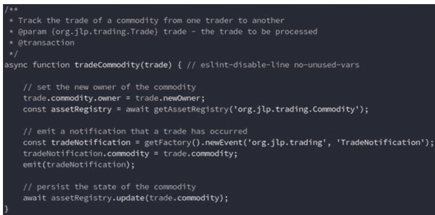

## 端到端追踪

使用 REST 端点实现了端到端细节的追踪。这些端点及其用于获取数据包、商品及其交易者详细信息的结果如下所述：

```
http://localhost:3000/api/Packet/p3001001:
{
  "$class": "org.jlp.trading.Packet",
  "packetID": "p3001001",
  "mainExchange": "GBP",
  "quantity": 300,
  "unitprice": 2,
  "commodity": "resource:org.jlp.trading.Commodity#grassfedbeef",
  "owner": "resource:org.jlp.trading.Trader#tesco"
}
```

```
http://localhost:3000/api/Commodity/grassfedbeef:
{
  "$class": "org.jlp.trading.Commodity",
  "tradingSymbol": "grassfedbeef",
  "description": "Grassfed Beef",
  "mainExchange": "AUD",
  "slaughterDates": "20th December",
  "quantity": 500,
  "owner": "resource:org.jlp.trading.Trader#jlp"
}
```

```
http://localhost:3000/api/Trader/jlp:
{
  "$class": "org.jlp.trading.Trader",
  "tradeId": "jlp",
  "name": "JLP Meat",
  "address": "London"
}
```

作者开发了查询以检索信息，并将其部署为 REST 端点。以下 REST 端点输出关于交易商品和农民详细信息的交易详情。检索农民详细信息的端点是基于查询的 REST 端点。

```
http://localhost:3000/api/Trade:
{
  "$class": "org.hyperledger.composer.system.AddAsset",
  "resource": [
    {
      "$class": "org.jlp.trading.Commodity",
      "tradingSymbol": "grassfedbeef",
      "description": "Grassfed Beef",
      "mainExchange": "AUD",
      "slaughterDates": "20th December",
      "quantity": 500,
      "owner": "resource:org.jlp.trading.Trader#samex"
    }
  ]
}
```

```
http://localhost:3000/api/queries/findAddAssetsTradeTransactions:
{
  "Packet id": "p3001001",
  "Type of Beef": "grass-fed beef",
  "Trader": "JLP Meats",
  "Logistic company used": "Sandford",
  "Farmer name": "Samex",
  "Slaughtered Date": "20th December"
}
```

作者使用 REST 端点提取了上述详细信息，并将其排列成一个流程，以生成特定数据包的端到端详细信息。也就是说，需要开发人员的干预来开发连接端点的工作流，以筛选并提供请求的信息。此请求的信息可以是简单的用户请求，也可以是复杂的审计跟踪。然而，此过程使用户、参与者和监管组织能够查看端到端详细信息，例如，农民可以了解他们的肉正在哪里销售，一些公平贸易组织可以查看记录并确保公平贸易政策得到正确实施，组织可以查看统计数据以确保可持续农业，等等。

## 商品召回

在供应链应用中，有必要快速追溯不安全产品的来源及其分销去向。

在此实现中，REST 端点 http://localhost:3000/api/Packet/p3001001 提供数据包 p3001001 的详细信息。

```
{
  "$class": "org.jlp.trading.Packet",
  "packetID": "p3001001",
  "mainExchange": "GBP",
  "quantity": 300,
  "unitprice": 2,
  "commodity": "resource:org.jlp.trading.Commodity#grassfed10001",
  "owner": "resource:org.jlp.trading.Trader#tesco"
}
```

可以使用以下 REST 端点和过滤器 http://localhost:3000/api/Packet where {::{"commodity":"resource:org.jlp.trading.Commodity#grassfed10001"}} 提取由商品“grassfed10001”制成的所有数据包。

```
[
  {
    "$class": "org.jlp.trading.Packet",
    "packetID": "p3001001",
    "mainExchange": "GBP",
    "quantity": 300,
    "unitprice": 2,
    "commodity": "resource:org.jlp.trading.Commodity#grassfed10001",
    "owner": "resource:org.jlp.trading.Trader#tesco"
  },
  {
    "$class": "org.jlp.trading.Packet",
    "packetID": "p3001002",
    "mainExchange": "GBP",
    "quantity": 300,
    "unitprice": 2,
    "commodity": "resource:org.jlp.trading.Commodity#grassfed10001",
    "owner": "resource:org.jlp.trading.Trader#tesco"
  },
  {
    "$class": "org.jlp.trading.Packet",
    "packetID": "p3001003",
    "mainExchange": "GBP",
    "quantity": 300,
    "unitprice": 2,
    "commodity": "resource:org.jlp.trading.Commodity#grassfed10001",
    "owner": "resource:org.jlp.trading.Trader#jlp"
  },
  {
    "$class": "org.jlp.trading.Packet",
    "packetID": "p3001005",
    "mainExchange": "GBP",
    "quantity": 300,
    "unitprice": 2,
    "commodity": "resource:org.jlp.trading.Commodity#grassfed10001",
    "owner": "resource:org.jlp.trading.Trader#asda"
  }
]
```

同样，也可以查找商品的农民和运输详细信息。可以针对选定的商品相应地处理物品召回。无需召回 JLP 或农民提供的所有数据包。此方法有助于更快地召回客户和商店中的所有物品，从而防止在健康和财务方面造成进一步损失。可以根据需要开发必要的工作流以进行扩展。

## 频道中的区块

使用 Hyperledger Fabric 中实现的对等频道命令来探索区块链网络中的区块和频道。在此用例实现中，使用了 CLI 命令“docker exec -it cli bash”和“peer channel getinfo -c mychannel”来连接对等节点并提取区块链信息。

区块链信息：`{“height”:37,”currentBlockHash”:“avhlTkndEjbj7GixWkvB9kC7RawTzhKmHh Cy7gXHuQ=”,”previousBlockHash”:“+d+1YUBQzoWOXIn/wCrkI7uSAAcCd1Evlozyau4jGM=”}`

### 图 15. 区块 16 的详细信息

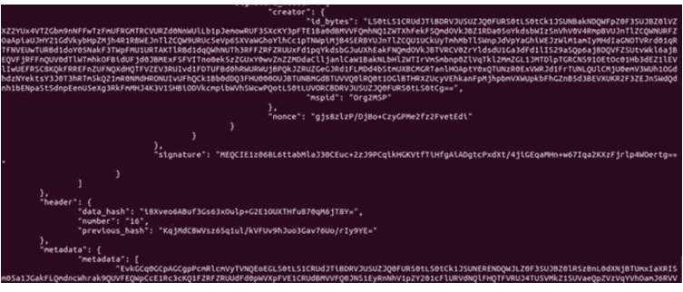

CLI 命令“peer channel fetch 16 -c mychannel”和“configtxlator proto_decode --input mychannel_16.block --type common.Block”用于获取区块 16、对其进行解码并提取区块信息。这种方法提取了区块的所有内部详细信息（数据、有效载荷、操作、创建者、随机数、MSP ID、背书、签名、背书人、链码详细信息、频道详细信息、数据哈希、前一个哈希、元数据等），如图 15 所示。

## 拥塞分析

图 16 展示了来自农民的 6 批进口中 8 成员区块链网络中的交易。作者针对 8 个参与者（p1 到 p8 – p1：农民，p2：物流公司，p3：物流公司，p4：JLP 肉类，p5 到 p6 是客户）和 6 批进口的区块链环境（如 6 个系列所示）计算了拥塞分析。这里，p4 是 JLP 肉类，它从商品中创建成千上万的产品。

大多数供应链中存在多个 P4 类型参与者，这会导致区块链上出现交易拥塞并延迟交易验证。也就是说，未来的基于区块链的供应链系统应具有管理交易拥塞的方法和标准。例如，在本地保留冗余信息，同时将该信息的哈希记录在区块链上以确保信任。然而，Hyperledger Fabric 的私有频道、本地数据存储和即插即用模块化架构可以得到改进，以开发必要的解决方案。

### 图 16. 8 成员区块链网络中 6 批进口的拥塞分析

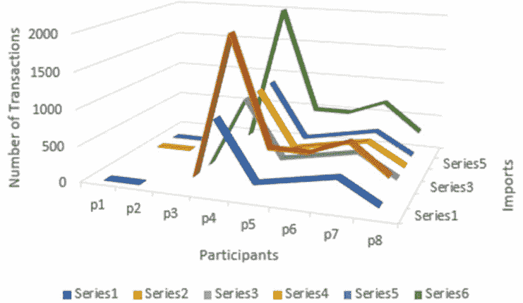

图 17 展示了每批进口的一组交易。Hyperledger Fabric 中的排序服务正在管理将区块添加到区块链网络。P4 是一名中间参与者，它从进口中创建成千上万的产品。在单个区块链网络中存在多个此类参与者会为每批进口生成许多记录，并增加区块链的拥塞。

### 图 17. 进口的交易数量

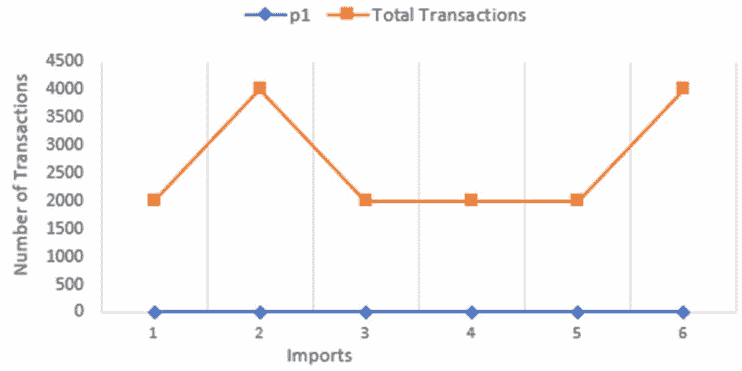

在供应链应用中，监管机构的作用是检查各类进出口的法规、批准进出口，并且只保留必要的记录。监管机构无法维护所有交易的账本，而此所提方法有助于监管机构对所有其他必要的区块链网络保持透明。此外，作者使用区块链浏览器可视化块统计信息，例如编号、块哈希和前一个哈希，如图 18、图 19 和图 20 所示。我们的 POC 源代码可在 https://github.com/kosalayb/JLPMeats 上找到。

### 图 18. 区块链详细信息

| 区块编号 | 频道名称 | 交易数量 | 数据哈希 | 块哈希 | 前一个哈希 | 交易 |
|---|---|---|---|---|---|---|
| 19 | mychannel | 1 | 9c7bd0... | c5d01c... | 7a44b2... | c396c9... |
| 18 | mychannel | 1 | 506a2... | 7c44b2... | 5796c3... | 82c0bc... |
| 17 | mychannel | 1 | c15e43... | 5796c3... | 895128... | 18c22b... |
| 16 | mychannel | 1 | 8bc5ef... | 895128... | 2aa8cc... | 027234... |
| 15 | mychannel | 1 | c40a71... | 2aa8b... | d16376... | e7f7e8... |

## 讨论与结论

由于其不可变和分布式账本的特性，区块链技术是实现复杂供应链应用的潜在技术，有助于简化可追溯性并确保异构交易的可信度。在供应链应用中，交易的可追溯性和可信度至关重要。文献中提出的大多数先导研究都讨论了可追溯性，但并未详细讨论交易验证、拥塞、监管合规和必要标准。


### 图 19. 块详细信息

| 属性 | 值 |
|---|---|
| 通道名称： | mychannel |
| 块编号 | 19 |
| 创建时间 | 2019-02-15T14:31:50.559Z |
| 交易数量 | 1 |
| 块哈希 | c5601c3092dad2fe5e6ca3a996b05baed3f89e37126f8e5124e8c3ed1b139f0f |
| 数据哈希 | 9c7b0faae5d33ab080ac1e6110e17b0365f880d07227a73b405cab688d6d468 |
| 预哈希 | 7c44b2fc000ac8abe5795ed767ec17632ebb77a7629673b6f572bcafc6044597 |

### 图 20. 交易详细信息

| 属性 | 值 |
|---|---|
| 交易 ID： | e3866f332cfd7bb9996ad597772fb3b21d84f8fd2c2782266e1340a9e143af5e7 |
| 验证代码： | VALID |
| 有效载荷提案哈希： | e324fc0e592098598fa036618d5df06aa419621a9519e14a6edd1139e5f3f7c |
| 创建者 MSP： | Org2MSP |
| 背书人： | ["Org1MSP","Org1MSP","Org2MSP","Org2MSP"] |
| 链码名称： | trade-network |
| 类型： | ENDORSER_TRANSACTION |
| 时间： | 2019-02-15T14:31:50.559Z |
| 读取： | root: [] 2 items<br>&gt; 0: {} 2 keys<br>&gt; 1: {} 2 keys |
| 写入： | root: [] 2 items<br>&gt; 0: {} 2 keys<br>&gt; 1: {} 2 keys |

本章利用 Hyperledger Fabric 实现了一个供应链用例，并阐述了与食品供应行业、可追溯性、物品召回、交易拥塞、监管合规、必要标准等相关的从农场到餐桌流程。此外，作者强调了实现复杂供应链所需的改进，包括连接位于不同国家的监管机构、与 IoT 系统集成、管理冗余数据以及管理大量交易。

值得注意的是，当前的区块链架构和键值数据存储并不直接支持资产的端到端可追溯性、物品召回，且缺乏必要的标准。因此，开发人员应当参与并开发必要的工作流。作者提出了一种私有通道概念，以在区块链网络中定位监管机构，最大限度地减少数据冗余并确保审计。然而，在实时复杂的区块链应用中，仍需持续改进以管理块拥塞、交易验证和补偿管理。

## 致谢

这份出版物部分源自爱尔兰科学基金会（SFI）和爱尔兰政府农业、食品与海洋部在资助编号 SFI 16/RC/3835（VistaMilk）下提供的研究资助，以及 SFI 在资助编号 SFI 12/RC/2289_P2（Insight）下提供的研究资助，两项资助均由欧洲区域发展基金共同资助。

## 参考文献

- Benhamouda, F., Halevi, S., & Halevi, T. (2018). 基于安全多方计算在 Hyperledger Fabric 上支持私有数据。载于 2018 年 IEEE 云工程国际会议（IC2E）。Orlando, FL: IEEE. 10.1109/IC2E.2018.00069
- Bitcoin. (2020). Bitcoin 开发者。检索自 学习比特币并开始构建基于比特币的应用程序：https://developer.bitcoin.org/
- Composer. (2020 年 6 月 23 日). 典型的 Hyperledger Composer 解决方案架构。检索自 Hyperledger Composer：https://hyperledger.github.io/composer/v0.19/introduction/solution-architecture
- Consensys. (2020). 区块链用例 - 供应链管理中的区块链。检索自 https://consensys.net/blockchain-use-cases/supply-chain-management/
- Cooper, M. C., Lambert, D. M., & Pagh, J. D. (1997). 供应链管理：不仅仅是物流的新名称。国际物流管理杂志, 8(1), 1–14. doi:10.1108/09574099710805556
- Davor, D., & Domagoj, S. (2018). 供应链中的区块链应用。SMART 供应网络, 21–46.
- Esteban Koberg, A. L. (2018). 全球供应链中可持续供应链管理的系统综述。清洁生产杂志, 1084–1098.
- Ethereum. (2020 年 6 月 23 日). Ethereum 是一个面向去中心化应用的全球开源平台。检索自 ethereum.org：https://ethereum.org/
- Gao, Z., Xu, L., Chen, L., Zhao, X., Lu, Y., & Shi, W. (2018). CoC: 基于统一分布式账本的供应链管理系统。计算机科学与技术杂志, 237–248.
- Hyperledger. (2020a, 6 月 23 日). Hyperledger Fabric。检索自 Hyperledger：https://www.hyperledger.org/use/fabric
- Hyperledger. (2020b, 6 月 23 日). 私有数据。检索自 Hyperledger Fabric：https://hyperledger-fabric.readthedocs.io/en/release-2.0/private-data/private-data.html
- Kenton, W. (2020 年 6 月 24 日). Hyperledger Fabric。检索自 Investopedia：https://www.investopedia.com/terms/h/hyperledger-fabric.asp
- Ko, K., Lee, C., Jeong, T., & Hong, J. W.-K. (2018). 基于 RPC 的区块链监控代理设计。载于 2018 年信息通信技术融合国际会议（ICTC）。韩国济州: IEEE. 10.1109/ICTC.2018.8539456
- Kshetri, N. (2018). 区块链在实现关键供应链管理目标中的作用。国际信息管理杂志, 39, 80–89. doi:10.1016/j.ijinfomgt.2017.12.005
- Li, W., Sforzin, A., Fedorov, S., & Karame, G. (2017). 面向可扩展和私有工业区块链。载于 BCC '17: ACM 区块链、加密货币和合约研讨会论文集（第 9-14 页）。ACM. 10.1145/3055518.3055531
- Litecoin. (2020 年 6 月 23 日). 用于支付的加密货币：基于区块链技术。检索自 https://litecoin.org/
- Martin, S. (2017). 食品可追溯性和控制的区块链用例。瑞典郡议会和地区: Kairos Future。检索自 Kairos Future: https://tinyurl.com/y7hh6nup
- Meyvaert, E. (2020 年 6 月 22 日). Siemens Mindsphere 和 SettleMint 的分布式中间件：完美匹配！。检索自 Medium: https://updates.settlemint.io/siemens-mindsphere-and-settlemints-distributed-middleware-the-perfect-match-b1ce77335c09
- Modi, R. (2018). Solidity 编程精要。Packt 出版社。
- Nakamoto, S. (2008). Bitcoin: 一种点对点电子现金系统。www.bitcoin.org
- Perboli, G., Musso, S., & Rosano, M. (2018). 物流和供应链中的区块链：设计现实世界用例的精益方法。IEEE Access: 实用创新, 开放解决方案, 6, 62018–62028. doi:10.1109/ACCESS.2018.2875782
- Quorum. (2020 年 6 月 23 日). 面向企业的经过验证的区块链解决方案。检索自 与 Quorum 共同发展: https://www.goquorum.com/
- Siemens. (2019). 可信可追溯性 - 区块链和物联网。德国纽伦堡: 西门子 AG 2019。检索自 https://assets.new.siemens.com/siemens/assets/api/uuid:de496ba4-0081-48f5-965b-4963879b2d43/version:1557493248/vrfb-b10033-00-7600sbbblockchainfb-144.pdf
- Thummavet, P. (2020 年 6 月 22 日). 揭秘 Hyperledger Fabric: Fabric 架构。检索自 Medium: https://tinyurl.com/y9yn33k5
- Westerkamp, M., Victor, F., & Küpper, A. (2018). 基于区块链的供应链可追溯性：代币配方模型制造流程。载于 IEEE/ACM 网络、物理和社会计算国际会议（CPSCom）。加拿大哈利法克斯: IEEE Xplore. 10.1109/Cybermatics_2018.2018.00267
- Yiannas, F. (2018). 由区块链驱动的食品透明度新时代。创新: 技术, 治理, 全球化, 12(1-2), 46–56. doi:10.1162/inov_a_00266
- Zheng, Z., Xie, S., Dai, H., Chen, X., & Wang, H. (2017). 区块链技术概述：架构、共识和未来趋势。载于 2017 年 IEEE 大数据国际大会（BigData Congress）。檀香山, HI: IEEE. 10.1109/BigDataCongress.2017.85

## 延伸阅读

- Ahamed, N. N. K. P, S. P. Anandaraj 和 V. R. 使用区块链的海鲜供应链管理。第六届先进计算与通信系统国际会议（ICACCS）, 2020, pp. 473-476.
- Du, M., Chen, Q., Xiao, J., Yang, H., & Ma, X. (2020). 使用区块链的供应链金融创新。IEEE 工程管理期刊, doi:10.1109/TEM.2020.2971858
- Hastig, G. M., & Sodhi, M. S. (2019). 用于供应链可追溯性的区块链：业务要求和关键成功因素。生产与运营管理, 935–954.
- Jabbar, A., & Dani, S. (2020). 调查区块链环境中交易成本与计算成本之间的联系。国际生产研究杂志, 58(11), 3423–3436. doi:10.1080/00207543.2020.1754487
- Li, Z., Guo, H., & Ali Vatankhah Barenji, W. M. (2020). 基于区块链、LSTM 和层次分析法的供应链网络可持续生产能力评价机制。国际生产研究杂志, 58(24), 1–21. doi:10.1080/00207543.2020.1740342
- Subramanian, N, Chaudhuri, A, & Kayikci, Y. (2020). 食品供应链中的区块链应用。区块链与供应链物流, 21-29. Springer.
- Subramanian, N, Chaudhuri, A, & Kayikci, Y. (2020). 医疗保健供应链中的区块链应用。区块链与供应链物流, 31-38. Springer.

## 关键术语和定义

- **数字孪生**: 数字孪生是指潜在和实际物理资产、流程、人员、地点、系统和设备的数字副本，可用于各种目的。
- **从农场到餐桌**: 该阶段涉及食品的种植、加工和消费——即从供应商到客户餐桌的整个食品链条。
- **物联网 (IoT)**: 物联网是一套相互关联的计算设备、机械和数字机器系统，这些设备拥有唯一标识符，并能够在无需人与人或人与计算机交互的情况下通过网络传输数据。
- **矿工**: 矿工验证新的区块链交易并将其记录在区块链上。矿工竞争解决基于加密哈希算法的困难数学问题。
- **对等 (P2P)**: P2P 计算是一种分布式应用架构，它在对等体之间划分任务。对等体在应用程序中享有同等权限。
- **REST API**: 表述性状态转移 (REST) 是一种用于创建 Web 服务的软件架构风格，定义了一组约束。应用程序编程接口 (API) 定义接口函数。
- **射频识别 (RFID)**: 射频识别 (RFID) 利用电磁场自动识别和跟踪附加到对象上的标签。


智能合约：智能合约是区块链的重要组成部分；它是由区块链管理的计算机代码中嵌入的自动执行协议。当满足某些预先商定的条件时，协议将自动生效。

## 尾注

- 1 https://www.cdc.gov/salmonella/2009/peanut-butter-2008-2009.html
- 2 https://www.cdc.gov/ecoli/2016/o121-06-16/index.html
- 3 https://www.cdc.gov/ecoli/2020/o103h2-02-20/index.html
- 4 https://www.arcweb.com/blog/supply-chain-transparency-farm-table
- 5 https://www.hyperledger.org/projects/fabric
- 6 https://github.com/hyperledger/composer/wiki/Composer-REST-Server
- 7 https://swagger.io/
- 8 https://hyperledger-fabric.readthedocs.io/en/release/commands/peerchannel.htm

## 第 5 章

区块链技术与通过比特币逃税的一般问题

Güneş Çetin Gerger
https://orcid.org/0000-0002-5823-7866
土耳其马尼萨·塞拉尔巴亚尔大学

### 摘要

加密货币常常也被用于洗钱活动、恐怖主义融资、逃税及其他非法活动，其全球市场价值超过 70 亿欧元，尽管总额难以衡量。确实，区块链技术涉及包括比特币在内的许多虚拟货币，用于在全球各经济体中进行各种金融交易相关活动。此外，其他区块链应用正在包括医疗保健、供应链、制造业等在内的广泛其他行业做出积极贡献。作为数字资产交易货币支柱的这项技术，其特征是匿名性、隐私性、安全性和速度。从这个意义上说，对于税务行政当局而言，检测金融欺诈以及关于虚拟交易征税的法规带来了新的、不断出现的挑战。本章旨在考察区块链技术、加密货币（尤其是比特币），并探讨世界各国政府为打击逃税和非法交易而制定的法规。

### 引言

区块链是新时代的软件架构结构。事实上，作为数据库的区块链，数据按顺序记录到区块中。每条记录都带有时间戳。当一个区块填满后，就会创建下一个区块，区块以链的形式相互连接。当今，在信息系统中，数据库是使用最广泛的构造。这种情况对于区块链也同样适用。可以为每个项目、每种加密货币和每个记录系统创建一个区块链。从这个意义上说，区块链是一本记录簿。我们可以称其为“总账”（Güven, Şahinöz, 2018）。

世界经济论坛将区块链技术定义如下：“区块链技术，或分布式账本技术（DLT），是一种技术协议，使双方无需中介即可交换数据。”在安全性方面，区块链是优越的，因为链中的所有记录都处于同一层级并拥有相同权限，且在未获得达成共识的情况下不能被更改。系统崩溃、被攻击或其数据被删除是不可能的。作为一项重要发现，区块链可在社会、政治和法律方面应用。区块链技术最流行的应用是在加密货币交易中。

加密货币的产生不受任何国家或政府控制，也不具有实体形式；这些是虚拟货币。加密货币由“矿工”利用区块链技术和数学加密方法创建。通过在互联网上现有的链条中添加新环节，矿工以此换取收益。这种产量对于比特币而言限制为 2100 万个单位，比特币是众多加密货币中最广泛使用的虚拟货币。在记录比特币操作的区块链中，所有过去的交易都可以被查看和监控。然而，账户所有者并不清楚，因此所有操作都以匿名方式进行。在这方面，它常常也被用于洗钱和地下经济的目的。这反过来导致逃税盛行。逃税的主要问题是匿名性，这意味着加密货币用户保持隐藏，他们的交易无法被征税，这反过来创造了一个不可检测的区域。因此，比特币有时被描述为“税务天堂”。

即国家/政府也在花费时间和精力，寻找将加密货币纳入征税系统的方法。虽然这些加密货币在某些国家现在正在被征税，但在其他国家它们仍然处于税收体系之外。目前仍未就如何将加密货币纳入所得税体系做出明确决定。一般来说，比特币收入被视为“商品”，而非货币。在加密货币情景中，货币是按照所有相关方皆知的公开可用方法，按设立时申报的金额创建的。另一方面，在传统货币体系中，国家可以通过中央银行创造其想要的任意数量的货币，国家是这一过程中的担保人（Çarkacıoğlu, 2016）。比特币生产需要一个高度困难的过程。然而，从其使用情况来看，可以看到它被全球许多大型组织使用，包括 Wikipedia、Virgin Galactic、Tesla、Microsoft、Overstock、Namecheap 等（White, 2018）。加密货币的优越特性使其普及。这些特性包括安全性、匿名性、可移植性、双向性、离线能力、无限期限、广泛接受度和用户友好性（Matonis, 1995）。这些优越特性也可能导致逃税等负面效应。

数字技术作为复杂税务欺诈和税务诈骗计划的基础，这是事实。尽管技术一直是非法经济活动的重要推动者，但网络空间包含许多用于洗钱和其他非法金融交易的工具。例如，受监管中介的银行产品和服务、作为非银行中介的电子支付系统、大多未受监管且可能去中心化的加密货币、在线服务和交易平台、在线赌博和电子商务。将加密货币转换为现金或其他传统支付方式被用作非法资金转移的常见方式（Çetin Gerger and Bozdoğanoğlu, 2017）。

世界各国政府的税收体系和税务检查形式的差异，加上它们所使用的信息和通信技术，可能导致税收损失。各国及国际组织就比特币收入征税（如有）采用不同的机制。

虽然区块链技术在某些国家有效地促进了征税，但其他一些国家尚未利用这项技术。依赖区块链技术的比特币操作既因立法不足和相关法规缺失，也因该技术尚未普及而导致税收损失。

本章的组织如下：首先从一般术语上考察区块链技术、加密货币和比特币，然后讨论比特币货币在征税方面的优缺点，最后评估国际组织可能已经有关逃税、洗钱及相关货币欺诈的法规。

### 区块链技术、加密货币和比特币

区块链可定义为：*在比特币或其他加密货币中进行的交易记录由连接在对等网络中的多台计算机维护的系统*（https://www.lexico.com/en/definition/Blockchain）。“区块链”是一种特殊的数据构造，用于某些分布式账本中，以称为“区块”的包存储和传输数据，这些区块在数字“链”中相互连接。区块链采用加密和算法技术，以不可更改的方式记录和同步网络中的数据。由多个参与者管理的去中心化数据库被称为分布式账本技术（DLT）。这些是更广泛类别“共享账本”的特定应用，后者简单定义为不同各方之间共享的数据记录（世界银行集团，2017）。

区块链应用正在四个主要领域涌现，即：数字货币、数字资产、智能合约和身份。图 1 提供了一些更多细节。“身份”类别下的应用包括医疗保健发展、产权记录、所有权、投票、AML/KYC、护照和知识产权。其他主要应用是数字货币。加密货币是一种特定的区块链产品（如比特币、以太坊、瑞波币、EOS 等），代表了一种转移数字资产的新方式；股票交易、忠诚度计划、溯源等也是区块链的其他应用。最后一个领域涉及智能合约，如抵押贷款、贷款和所有权转让（Chandrasekaran 等人，2019）。聚焦图 1，我们还可以看到区块链的固有优势。这些优势如下：

- 身份：有助于消除伪造文件等日益严重的问题，
- 智能合约：有助于对现有纸质合同进行数字化和自动化，
- 数字资产：通过去除中介，实现更快、更便宜的贸易结算
- 加密货币：可以几乎即时转移给任何人、任何地方

通常，区块链技术更接近于虚拟货币应用、支付和金融服务。但是，从理论上讲，区块链可以应用于许多不同的领域，尽管这项技术是专门针对比特币解决“双重支付”问题的。在比特币出现之前，账户持有人通过在可信独立平台上对账，从而免除了对其交易和账户余额的担忧。然而，现在，针对数字货币开发了一项关键技术，即分布式账本技术（DLT）。有了这项技术，机构层面的信任需求被消除，因为安全与防护系统基于匿名性，通过参与者网络在本地化账本中保持完整性（Natarajan 等人，2017）。


### 图 1. 区块链应用的主要领域

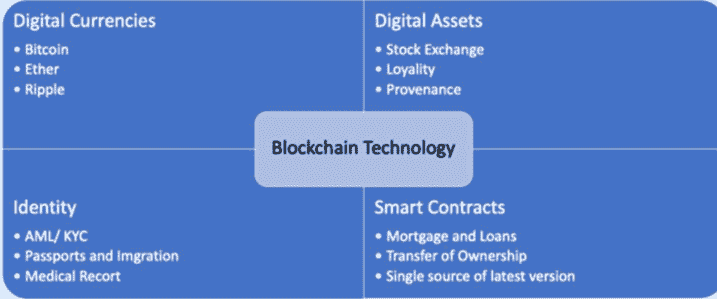

去中心化需要由比特币区块链提供的普遍共识，该区块链依赖“工作量证明”，工作量证明是基于特定前导零集合为反垃圾邮件行动谨慎开发的。工作量证明的生成被称为“挖矿”。在比特币系统中，校准的处理方式是：通过十分钟周期内的评估，将工作量证明描述为有效，较高的难度分数使协议有效，在同一时刻产生的两个中选出一个。“矿工”每产生一个有效的工作量证明即获得比特币个体报酬（Natarajan 等，2017）。

### 图 2. 比特币与区块链技术

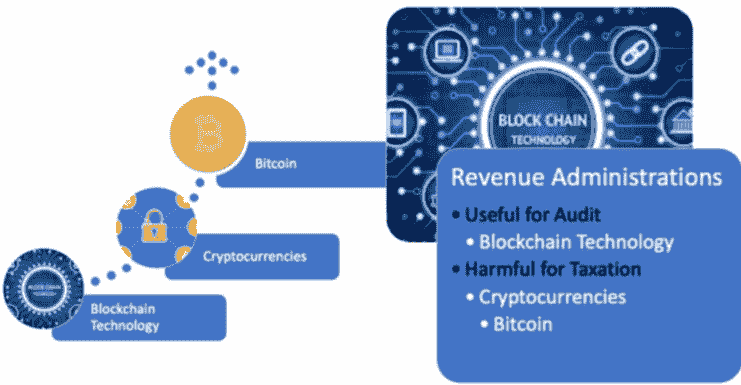

比特币是在加密货币中使用最频繁的一种。比特币使用区块链技术基础设施。从图 2 可以看出，比特币的使用（作为区块链技术的四个主要应用领域之一）可能对税务管理有害，因为其匿名特征可能导致逃税，而区块链通常是有益的。区块链对税务管理的检查和监控有益。考虑区块链的应用领域，这些可能包括监控增值税和防止转让定价。

区块链是一种特殊的分布式账本技术（DLT）系统，可在多个数据库之间提供数据记录和数据共享。尽管数据由不同来源收集，但存储的数据是唯一的，因为一个去中心化但集成的计算机服务器网络会保留并检查所有数据，以避免重复输入。基于加密的区块链使用特定的数学算法来创建或验证数据结构（Natarajan 等，2017）。借助这种加密解决方案，信任的制度性要求被消除，因为安全与保障系统在基于匿名性的参与者网络的本地化账本中具有完整性。作为一种机制或数据结构，区块链以特定方式通过加密和算法技术不可篡改地保留数据。这项技术在不同情境中具有潜力，并与另一个术语“分布式账本技术”互换使用（Natarajan 等，2017）。

在税收征收中，区块链技术将导致缺失交易者内部共同体（MTIC）欺诈的减少，这种欺诈在欧盟中经常遇到（欧洲刑警组织，2020）。它是欧洲最常见的增值税欺诈形式之一。2018-2021 年欧盟政策周期（https://www.europol.europa.eu/empact）将 MTIC 欺诈列为九种代表犯罪优先领域的罪行之一。此外，区块链实践还可以防止重复征税和转让定价。Ainsworth、Alwohaibi、Cheetham 和 Tirand（2018）开发了基于加密货币的模型。因此，在税收征收中，他们为海湾国家开发了一种“加密税收货币”系统。在这些操作中，将使用 VATCoin，且所有操作均依赖于区块链。在区块链实践中，客户向企业支付账单，企业再向其供应商支付这些账单即可（德勤，2017）。这样，就可以防止增值税欺诈。

增值税在哪里以及何时缴纳可以通过区块链技术进行监控。它为税务机关、税务检查员和其他监管机构提供安全的信息流。个人之间的小额交易也变得更加可见。在税务检查方面，区块链技术能够提供更大的优势。毕竟，检查涉及用相关、安全、客观且可确认的证据来证实记录的操作。区块链将提供积极效果，例如在雇员与雇主之间实现税收信任并提高税收征收速度（Johnston 和 Lewis，2017）。在增值税中，通过区块链实践，税务链中的几项操作可能不再必要。

使用区块链征税是提高税务办公室运营效率的一个因素。这是因为使用这种方法几乎不出错。采用区块链系统对税务机构也非常有用。在泰国，曼谷税务局自 2018 年以来一直在使用该系统（Uti，2018）。此外，英国也是先驱国家之一（HMRC，2019）。在英国，HMRC 推出了“数字化税务”项目，旨在到 2020 年摒弃基于纸质、事后很久才提交的纳税申报。HMRC 将尽可能实时收集和处理影响税务的信息，以防止应缴税款或应退税款进一步累积（Asquith，2016）。世界经济论坛讨论了各国何时开始通过区块链征税，大多数参与者认为此类实践将于 2013 年开始（Ainsworth 和 Shact，2016）。

## 加密货币与总市值

考虑与区块链技术相关的加密货币，我们看到它们今天已开始被高度广泛地使用。加密货币由私人开发者以电子方式发行，作为一种特殊记账单位下的面额，用于替代交换价值（Dong He 等，2016）。比特币成为了加密货币中最早和最有价值的货币之一。它是一种数字资产，可以在互联网上安全地在两方之间购买、出售和转让（Nooruddin，2019）。像其他加密货币一样，比特币作为一种点对点电子现金机制，可以在现实或数字世界中安全地支付购买款项。加密货币开发者使用先进系统构建这些协议，因此，使得难以复制或篡改受保护的加密货币和交易（Martucci，2018）。目前，全球有 2,247 种不同的加密货币，它们的价值、实用性和市值各不相同（Coinmarketcap，2019）。加密货币交易所在为主流加密货币创造流动性市场方面非常重要。2019 年，BitPremier 审查并列出了其前 13 家加密货币交易所（BitPremier，2019）。该列表在表 1 中呈现。

## 表 1. 前 13 家加密货币交易所

| 项目 | 名称 |
|------|------|
| 1 | Coinbase |
| 2 | Coinmama |
| 3 | Bitpanda |
| 4 | CEX.IO |
| 5 | Kraken |
| 6 | LocalBitcoins |
| 7 | Bitstamp |
| 8 | Gemini |
| 9 | 加密货币对加密货币交易所 |
| 10 | Binance |
| 11 | Changelly |
| 12 | Bittrex |
| 13 | Poloniex |

参照表 2，所有加密货币的总市值约为 1710 亿美元。总体而言，比特币是主导货币，市场份额占 54.66%，其次是以太坊，仅占 9.7%，瑞波币占 7.3%（Prewett 等，2019）。

## 表 2. 加密货币市值 [采用自 CoinMarketCap.com (2019)]

| 日期 | 加密货币数量 | 市值 |
|------|----------------------------|-----------------------|
| 2013 | 7 | $1,580,539,630 |
| 2014 | 237 | $6,085,317,610 |
| 2015 | 564 | $3,537,377,349 |
| 2016 | 577 | $8,520,778,723 |
| 2017 | 777 | $29,473,958,605 |
| 2018 | 1563 | $388,027,865,010 |
| 2019 | 2140 | $171,075,254,32 |

## 比特币（BTC）的特性

比特币通常无法转换为实物形式，因此其理想的表现形式仅仅是一个计算机文件。人们可以将比特币虚拟地保存在计算系统甚至互联网上的数字钱包中。为了使虚拟字符组合能够打印出来，原始比特币字符应保持合规（Kaplanov，2012）。

比特币可以通过使用工作量证明（PoW）共识机制的“挖矿”过程发行。在 PoW 系统中，网络的加入者必须解决所谓的“加密难题”，才被允许在区块链上引入新的“区块”。如果有人愿意，他们可以打开并与比特币网络共享用于故障排除的计算机，这涉及复杂的数学。成功解决此类问题的计算机会获得比特币奖励（Kaplanov，2012）。然而，挖矿是创建比特币的一种糟糕方式。

比特币在无需授权的免费区块链上运行，这意味着个人可以随时登录或退出全球网络，无需中央机构的任何通知（Houben 等，2018）。

比特币可从加密货币兑换为法定货币。比特币可以在多种加密货币类型中简单地与法定货币交换或购买（Houben 等，2018）。比特币被许多交易者（如大型金融公司）正式接受为交换媒介或资金来源（Houben 等，2018）。比特币是一种伪匿名硬币。

公共账本构成了类似公证人的机构，用于验证链上交易，尽管比特币似乎与个人有自由直接的联系。换句话说，匿名性并非比特币技术不可或缺的属性，即使隐藏在比特币交易中，通过合并伴随交易的技术元素，任何交易方都可被检测到（Grinberg，2012）。比特币不仅因其市场规模，还因其特性属性的优越性，在加密货币市场中占据了重要地位。

## 加密货币：优势与劣势

加密货币具有多种优势，这主要归功于其技术特性，包括网络安全、加密、信任、去中心化和透明度。通过区块链技术，重复支付问题消失了，该技术将验证权力从单一中心委托给全球网络。在这方面，数字货币市场建立在用户对传统金融的不信任基础上，第三方金融机构可能因点对点共识对其效率的否定而失去资格（Schipor，2019；Gerger，2020）。由于许多国家不对加密货币征税，它们不受任何减税或税收收入的约束。此外，由于它们没有中心，不需要管理员。在这方面，其成本和运营时间较低。操作不受任何人监控，货币易于运输、存储和保护。由于使用加密数字签名方法来保障系统安全，这防止了货币被模仿。由于创建的加密货币数量是固定的，它不存在通货膨胀或通货紧缩的风险（Kızıl，2019；Çarkacıoğlu，2016）。加密货币对恐怖主义行为、毒品交易和洗钱等非法活动具有吸引力，因为账户持有人保持匿名，并且数字交易也不需要金融中介，因此


that crime investigators can hardly get informed to catch criminals, and thereby, these stay out of their control area (Schipor, 2019).

It is suggested that the cryptocurrency exchange is a volatile and infective market influencing the overall financial system and global economy. Now that digital transactions are favorably less costly, it can be argued, without doubt, that it may establish a contemporary payment system across one nation or multiple nations (Schipor, 2019). Cryptocurrencies could become a main tool in financial systems, and there will be a risk on financial stability (Carstens, 2018). In the European Union, according to the chairman of BIS (Bank for International Settlements), the related policy intervention should be adopted, or otherwise, the financial administration will be late for averting the threat of financial instability that cryptocurrencies may pose due to their integration to the traditional financial system (Carstens, 2018).

Bitcoin is not applicable to other decentralized virtual currencies as usual, so, there exist variations in taxation of this currency (Ram, 2017). Virtual currencies are taxed as commodities because these are different to normal currencies, and this characteristic may determine taxation for consumption taxes including the value added tax (VAT), income tax including capital gains, wealth tax including wealth transfers and other potential taxable items. The rising exchange rate provides income and capital gains, though there is no actual transaction, which in turn initiates taxing the value difference. This case may occur in different situations where the rate of multiple virtual currencies even in a basket changes or where these are directly non-exchangeable to a fiat currency. Furthermore, the decrease is also equally treated as being taxed like an increase (Ram, 2018).

Cryptocurrencies are risky as there is no state or country that will act as their guarantor. Cryptocurrency exists within a virtual environment, and thus, cyberattacks may affect it. As it is anonymous, it may be used in illegal activities. It is also difficult to monitor by income tax administrations. As cryptocurrencies are not on a legal basis, they do not have a regular exchange. This increases the volatility of the currency and makes it a target for speculators. Therefore, this results in an imbalanced pricing of the currency (Kizil, 2019).

If we assess the advantages and disadvantages of cryptocurrencies in general, while privacy, security, speed and easy usage make them advantageous, their openness to cyber-attacks, threat on financial stability and usage in illegal economic activities put them in a disadvantageous position.

## TAXATION REGULATIONS FOR CRYPTOCURRENCIES AND BITCOIN

States perceive cryptocurrencies as a threat. One of the most important reasons for this is that monitoring of money laundering and terrorism financing becomes difficult, and tax evasion increases. Besides, other issues may include losing the monopoly of printing money, deprivation of seigniorage income, possibility of reducing the effectiveness of monetary policy, liquidity management becoming difficult, and concerns of deflation. For these reasons, states have rightfully approached cryptocurrencies from a certain distance (Güven and Şahinöz, 2018). To be able to eliminate such negative effects, governments have either preferred to take the usage of cryptocurrencies under control by issuing legal regulations about them or chosen to ban them by completely ignoring them.

In the 2018 Summit, G20 countries formed a mosaic of distinctive legislations for the concept of cryptocurrency on a global map and produced a list of countries displaying their status in terms of whether these currencies are designated neutral, restricted, legal or illegal (Global Cryptocurrency Report, 2018). Refer to Table 3.

### Table 3. Worldwide Legality of Cryptocurrency [Adopted from Global Cryptocurrency Report (2018)]

| Neutral | Restricted | Legal | | Illegal |
|---|---|---|---|---|
| Argentina | Mexico | Australia | Germany | China |
| Senegal | Russia | Netherlands | South Africa | |
| Rwanda | Saudi Arabia | Chile | Spain | |
| India | South Korea | Brazil | Italy | |
| Indonesia | | Canada | Turkey | |
| Jamaica | | France | UK | |
| | | Singapore | Japan | |
| | | USA | | |
| | | Malta | | |

EU members exchange information, as a matter of course, on tax issues mainly to fight against tax evasion; however, the current EU framework is limited since virtual currencies are excluded due to the anonymity of cryptocurrencies (Houben et al., 2018). The growth of virtual currencies needs appropriate regulations.

Cryptocurrencies have a lack of central authority. Japan became the first country to recognize Bitcoin and other cryptocurrencies as legal tender when it passed the Virtual Currency Act in early 2017 (Terazona, 2017). International agencies have the power to set regulations over cryptocurrency, but only a few agencies have declarations. International coordination among global regulators took risk management measures for virtual currencies at the G20 level, in 2017. The International Monetary Fund (IMF) stated that some regulation for Bitcoin is necessary (Alkhali, 2018). The US, Canada, Israel, the UK, Australia and Japan have issued guidance for taxpayers investing in virtual currencies (Bal, 2015). In the EU Parliament, the fourth anti money laundering (AML) directive passed on May 20th, 2015, and the fifth AML Directive passed on May 30th, 2018. These directives relate to virtual currencies having registration necessarily. EU member countries regulate their national laws complying with the EU’s directives and implementations. The variation between national laws of different countries makes a difference between the virtual currency markets of EU countries. Finland accepted the fifth EU AML directive on March 13th, 2019 (EC, 2019).

AMLD5 defines virtual currencies and operations of virtual currency exchange, and prescribes due diligence obligations from custodian wallet providers for customer and reporting to financial intelligence units (FIUs) for suspicious transactions. This directive has made virtual currency exchange platforms and custodian wallet providers liable for cryptocurrencies and thereby introduced the phenomenon of “virtual currencies”. When it is reported to FIU by a provider that cryptocurrency has been produced or by the platform that any transactions have been actualized, the institution informs the tax authority of potential tax evasion under the name of “suspicious transaction” (Houben et al., 2018); it then investigates such transactions (Article 32 AMLD4).

EU have also prepared a key project (called Titanium) regarding research, development and validation on innovative data-driven techniques and solutions to promote crime investigation agencies in charge of virtual currencies and/or undocumented markets on the darknet. The Titanium project was designed to digitally fight tax evasion, money laundering and terrorist financing that might occur in virtual transactions using cryptocurrencies (Keatinge et al., 2020).

According to the European Banking Authority, an EU framework concept should be adopted (Yeoh, 2017). In the description of the World Bank, cryptocurrencies are categorized under digital currencies and referred to as value representations in the electronic format via denominations in the special unit of account. Additionally, the Bank added into the definition that these are cryptography-based digital currencies for getting consensus (Natarajan et al., 2017).

The very common cryptocurrency, currently in use, is Bitcoin. Since criminals take advantage of the characteristic of anonymity, and limited regulatory framework and poor enforcement of regulations in virtual transactions, it urges them towards conducting illegal operations (Zola et al., 2019). Bitcoin processes do not collect any taxes from its users. Therefore, governments would like to regulate the organization of its citizens and businesses who wish to transact in Bitcoin. Governments should apply anti-money laundering regulations on its spread, seek to tax its use and prosecute those who use Bitcoin for illegitimate activities (IRS, 2014). It is crucial for tax administration to provide strong guidance on tax treatment of virtual currency transactions (Prewett et al., 2019). The IRS 2013 Annual Report to Congress addressed the lack of guidance. The IRS Notice 2014-21 provided the first, current and best guidance to the tax agency’s perception of Bitcoin and other cryptocurrencies (IRS, 2014). Accordingly, personal income tax rate applies to Bitcoin received in exchange for goods or services.

When we look at taxation of Bitcoin incomes, we see that there is a different practice in each country. Bitcoin incomes are considered as securities, commodities or money based on the country, and taxation is made accordingly. In the USA, Bitcoin sales are considered as real estate sales, and when one wants to purchase goods as Bitcoin sale, Capital Gains Tax is collected over the sales operation (De, 2018). While the rate of taxation is between 15% and 23.8%, for a term longer than a year, the rate may increase up to 39% for those with a term less than a year (Köse, 2018). While there is 45% of taxation in France recently, where cryptocurrencies are considered as securities, it was decided to reduce this rate to 19% with a regulation that came in force in April 2018 (Zuckerman, 2018).

Cryptocurrencies are accepted as commodity in Canada and taxed over commercial gains or increased value gains, whereas they are considered as a barter agreement when used by commercial establishments when the net profit is taxed over the country’s own currency. They are subject to corporate tax and value added tax. 50% of revenues obtained from individual purchases and sales is exempt from taxation. The tax base, on the other hand, is taxed over the normal tax regime. However, if there are short-term and continuous sales and purchases, the Canadian Tax Administration considers these activities as commercial (Uğurlu, 2018).

Australia considers and taxes purchases and sales via cryptocurrencies as barter operations. Firms are subject to corporate tax and transaction tax. For individual investors, good and service purchases made by under 10,000 Australian dollars in cryptocurrency are exempt from income and consumption taxes. Since 1 July 2017, the purchase and sale operations of cryptocurrencies have been exempted from good and service transaction taxes (Uçma Uysal and Aldemir, 2018).

In the United Kingdom, operations carried out with cryptocurrencies are exempt from value added tax. Those who take part in such operations are obligated to pay 20% corporate tax. Individual investors pay capital gains tax on the profit they make after a purchase or sale (Uğurlu, 2018). In South Korea, 22% corporate tax and 2.2% local income tax are applicable for Bitcoin revenues (Zuckerman, 2018).

## Tax Evasion Via Bitcoin

Income administrations are disturbed by the prevalence of tax evasion due to the usage of cryptocurrencies. This is because preference of cryptocurrencies due to their superior properties in the unofficial economy such as anonymity and privacy has increased the illegal exchange of goods and services between people at distant locations. Additionally, if they do not wish to do so, taxpayers might not declare the value


其加密货币的增加。尽管有可能监控大额投资，但基于一个人可以开设任意数量账户的想法，这些个人有可能将非法交易分割成小额，以不引起注意的方式进行。基于此，FBI设法击垮了丝绸之路市场，并逮捕了其领导人（Fanusie and Robinson, 2018）。目前还无法计算由比特币和其他加密货币使用产生的税收损失。加密货币可能被用于洗钱或资助恐怖主义（Güiven and Şahinöz, 2018）。

IMF于2016年编制了一份关于“虚拟货币及其 beyond”的报告。在报告中，指出加密货币已成为逃税的一种高度潜在工具。这一犯罪行为的主体倾向于使用加密货币，主要是因为他们可以在使用隐藏身份选项的同时保持匿名，并且由于虚拟交易的点对点特性以及国际操作的可能性。此类数字货币的税务影响取决于其与经济中交易媒介或价值储存的货币功能的关联。

应税虚拟货币（VC）交易应通过对图示结构和微妙操作所产生的复杂事项进行深入评估来确定（IMF, 2016）。区块链实践将使了解您的客户（KYC）和反洗钱（AML）行动既容易又高度实用。通过区块链实践，个人或公司只需进行一次 KYC 操作即可（Güiven and Şahinöz, 2018）。

利用区块链技术使用比特币等虚拟货币进行非法活动，从长远来看将比监控中央货币体系内的资金流动更容易实现监控。这就是为什么重要的是使其普及，而不是禁止它，并允许它在其自身生态系统中发展。例如，在布拉格地铁设立了加密货币 ATM（Konakçı, 2018）。同样，在瑞士，该国最大的铁路公司自 2016 年 11 月以来一直在其分布在全国各地的自有售票 ATM 上出售比特币。此类政策可能通过将加密货币拉向公共领域，帮助更轻松地监控和检查加密货币（Güiven and Şahinöz, 2018）。

## 通过区块链应用减少逃税

区块链使更快速的数字报告成为可能，并为多个授权方提供独立电子查看同一交易信息单元的能力。这未来可能使增值税申报行为更加无缝和高效（Asquith, 2016）。它从更多控制、简化合规和避免双重征税方面帮助企业和税务机关（Gerger & Firuzan, 2020）。实施此类方案将使获得各种优势成为可能，这些优势将有助于几乎完全消除逃税（Faccia and Roxana, 2019），如下所示：

- 简化税务义务，降低企业咨询成本，
- 开展具体且快速的税务规划的潜力。
- 每月支付企业所得税的潜力，但连接所开具发票的预扣税。政府还将获得持续现金流，并在监控生产和 GDP 方面获得巨大优势，
- 在计算加价时，企业可以轻松考虑与税务相关的成本。他们还可以避免仅为了降低税收负担而承担不必要的成本，而是专注于强调业务效率，
- 政府降低不可收回税收抵免，这可以同时验证未付款并防止违约公司的活动。基本上，对样本（逃税诱惑源）进行试点的自申报系统（所得税申报）将被取消。依赖于集中系统中开具的电子发票以及在付款中实施的预扣税的自动机制，将立即验证次月应缴税款的支付。

尽管比特币导致逃税，但在税务管理和商业世界中使用区块链应用进行税务和会计实践，将通过减少税收损失来提高税务合规性。此外，通过允许合法且高效地使用技术，区块链应用还将降低税务合规风险、操作风险和报告风险（Gerçek and Bakar Türegün, 2018）。

### 结论

加密货币监管是一个非常棘手的问题。因此，扩大其使用范围可能是合适的，但要实施严格的适当监管，并对使用这些货币进行的操作征收少量税收。禁止或忽视这些货币并非现实的解决方案。这是因为不确定性带来成本。这就是为什么需要澄清灰色地带。公共当局不应过度限制，而应保持平衡。

总的来说，区块链技术对各类行业都具有巨大潜力。因此，近年来，区块链技术已超越比特币，并在公共和私营部门取得进展。区块链技术是一个仍在不断发展的领域。许多公司已开始开发自己的原型技术，以了解区块链技术。区块链允许实时监控和记录两个或多个方之间数字货币、金融资产和其他数字文档的转移。特别是在公共部门方面，由中央政府通过允许条目提供的区块链技术可能使每个人更容易访问系统，并实现安全和隐私原则。

税务管理部门需要制定清晰易懂的法规，适用于一般加密货币以及特别广泛使用的比特币。比特币是一种新现象，纳税人中存在不准确的认知，他们认为使用数字货币进行交易可以减轻税务和申报义务。比特币在许多国家是合法的并需缴税。此外，税务管理部门也开始采用基于区块链技术的税务检查系统。

为了减少税收损失并制止非法金融活动，欧洲联盟正在实施一项反洗钱计划。众所周知，使用加密货币可能与非法活动相关联。比特币正被用于恐怖活动、毒品供应或洗钱等问题。通过在税务管理部门也使用区块链技术，有可能将此问题置于控制之下。此类管理部门已经在使用和开发诸如区块链技术、人工智能、云计算和物联网等技术，用于上述目的（Gerger, 2020）。

### 参考文献

Ainsworth, R., Alwohaibi, M., Cheetham, M., Tirand, C. (2018), 针对 MTIC 欺诈的 Vatcoin 解决方案：过去的努力、当前技术和欧盟 2017 年提案。波士顿大学法学院，法律与经济系列论文第 18-08 号。SSRN: https://ssrn.com/abstract=3151394

Ainsworth, R., & Shact, A. (2016). 区块链（分布式账本技术）解决增值税欺诈。SSRN. doi:10.2139/ssrn.2853428

Alkhalsi, Z. (2018). IMF 主席：加密货币监管是“不可避免的”。https://money.cnn.com/2018/02/11/investing/lagarde-bitcoin-regulation/index.html

Asquith, R. (2016). 区块链如何塑造税务自动化？https://www.avalara.com/vatlive/en/vat-news/how-Blockchain-could-shape-tax-automation.html

Bal, A. (2015). 比特币交易：最近的税务发展与监管回应。https://www.ibfd.org/sites/ibfd.org/files/content/pdf/dfi_2015_05_int_2.pdf

BitPremier. (2019). 加密货币交易所评测。https://www.bitpremier.com/best-exchanges

Çarkacıoğlu, A. (2016). 加密货币比特币。资本市场委员会研究部。

Carstens, A. (2018). 数字时代的货币：中央银行的角色？法兰克福歌德大学金融学院讲座。https://www.bis.org/speeches/sp180206.pdf

Çetin Gerger, G., & Bozoğanoğlu, B. (2017). 从非正规经济和逃税背景下评估电子商务税收问题。公共部门经济问题，Peter Lang。

Chandrasekaran, N., Somanah, R., Rugloo, D., Dree paul, R. K., Cunden, T. S. M., & Demkah, M. (2019). 利用区块链技术、人工智能、机器学习和深度学习进行数字化转型。在 S. Satapathy, V. Bhateja, R. Somanah, X. S. Yang, & R. Senkerik (编)，信息系统设计与智能应用。智能系统与计算进展（第 863 卷）。Springer. doi:10.1007/978-981-13-3338-5_25

CoinMarketCap. (2019). 所有加密货币。https://coinmarketcap.com/all/views/all

De, N. (2018). 德国不会因你用比特币买咖啡而向你征税。https://www.coindesk.com/germany-considers-crypto-legal-equivalent-to-fiat-for-tax-purposes/

Deloitte. (2017). 区块链技术及其在税务中的潜力。https://www2.deloitte.com/content/dam/Deloitte/pl/Documents/Reports/pl_Blockchain-technology-and-its-potential-in-taxes-2017-EN.PDF

EC. (2019). 亟需建立欧盟第三国黑名单，以符合反洗钱指令。https://www.europarl.europa.eu/doceo/document/TA-8-2019-0216_EN.html

Europol. (2020). 经济犯罪。https://www.europol.europa.eu/crime-areas-and-trends/crime-areas/economic-crime/mtic-missing-trader-intra-community-fraud

Faccia, N., & Mosteanu, R. (2019). 逃税信息系统与区块链。信息系统与运营管理杂志，13(1), 65-74。


Fanusie, Y. J., & Robinson, T. (2018). 比特币洗钱：流入数字货币服务的非法资金流动分析. https://www.fdd.org/analysis/2018/01/10/bitcoin-laundering-an-analysis-of-illicit-flows-into-digital-currency-services/

Gerçek, A., & Bakar Türegün, F. (2018). 企业中税务风险感知与税务风险管理研究. Muhasebe ve Vergi Uygulamaları Dergisi, 11(3), 307–332. doi:10.29067/muvu.368807

Gerger, A. (2020). 连接政府实施技术：成功因素与最佳实践. 在 Z. Mahmood (编), Web 2.0和云技术用于实施连接政府. IGI Global.

Gerger, A., & Firuzaın, A. (2020). 基于Taguchi的汽车工业案例研究：采用六西格玛方法降低不合格率. Journal of Applied Statistics, 1–17. 在线先行出版. doi:10.1080/02664763.2020.1837086

Grinberg, R. (2011). 比特币：一种创新的替代数字货币. Hastings Science & Technology Law Journal, 4, 164. https://papers.ssrn.com/sol3/papers.cfm?abstract_id=1817857

Güven, V., & Şahinöz, E. (2018). 区块链 - 加密货币 - 比特币。中本聪正在改变世界. Kronik Kitap.

He, D., Habermeier, K., Leckow, R., Haksar, V., Almeida, Y., Kashima, M., Kyriakos-Saad, N., Oura, H., Saadi Sedik, T., Stetsenko, N., & Verdugo Yepes, C. (2016). 虚拟货币及其之外：初步考虑. IMF Staff Discussion Notes, 16(3), 1. 在线先行出版. doi:10.5089/9781498363273.006

HMRC. (2019). 加密资产：个人税务. https://www.gov.uk/government/publications/tax-on-cryptoassets/cryptoassets-for-individuals

Houben, R., & Snyers, A. (2018). 加密货币与区块链. https://www.europarl.europa.eu/cmsdata/150761/TAX3%20Study%20on%20cryptocurrencies%20and%20Blockchain.pdf

IBINEX. (2019). 全球加密货币市场报告. https://www.financemagnates.com/wp-content/uploads/2018/10/Global-Cryptocurrency-Market-Report.pdf

IMF Monetary and Capital Markets, Legal and Strategy and Policy Review Departments. (2016). 虚拟货币及其之外：由IMF工作人员团队准备的初步考虑. https://www.imf.org/external/pubs/ft/sdn/2016/sdn1603.pdf

IRS. (2014). 虚拟货币指南：虚拟货币为美国联邦税务目的而被视为财产；财产交易的一般规则适用。IRS. https://www.irs.gov/uac/newsroom/irs-virtual-currency-guidance

Johnston, S., & Lewis, A. (2017). 新领域：税务机构探索区块链. Tax Notes International, 86(9), 16–19. https://www.taxnotes.com/tax-notes-international/tax-system-administration/new-frontiers-tax-agencies-explore-Blockchain/2017/04/03/18884661

Kaplanov, N. M. (2012). 极客的钱：比特币、私人数字货币及反对其监管的理由. Temple Law Review. https://papers.ssrn.com/sol3/papers.cfm?abstract_id=2115203

Keatinge, T., Carlisle, D., & Keen, F. (无日期). 虚拟货币与恐怖主义融资：风险评估与响应评价. 由内部政策总署、公民政策部委托的研究. https://www.titanium-project.eu

Kızıl, E. (2019). 土耳其加密货币的征税与会计处理. Mali Çözüm, 29(155), 179–196.

Konakçı, A. E. (2018). 布拉格地铁系统现在拥有10台比特币ATM机！https://koinbulteni.com/prag-metro-sistemi-artik-10-bitcoin-atmsine-sahip-19118

Martucci, B. (2018). 什么是加密货币：其工作原理、历史及比特币替代方案. https://www.moneycrashers.com/cryptocurrency-history-bitcoin-alternatives/

Matonis, J. W. (1995). 数字现金与货币自由. Economic Notes No. 63. http://libertarian.co.uk/lapubs/econn/econn063.pdf

Natarajan, H., Krause, S., & Gradstein, H. (2017). 分布式账本技术(DLT)与区块链. FinTech note, no. 1. http://documents.worldbank.org/curated/en/177911513714062215/pdf/122140-WP-PUBLIC-Distributed-Ledger-Technology-and-Blockchain-Fintech-Notes.pdf

Nooruddin, S. (2019). 关于区块链的一切. Vieh Group.

Prewett, K., Dorsey, R. W., & Kumar, G. (2019). 加密货币投资税收入门. Journal of Taxation of Investments, 36(4), 3. 2020年4月检索，来自 http://search.ebscohost.com/login.aspx?direct=true&db=edb&AN=138241160&site=eds-live

Ram, A. J. (2018). 比特币的征税：通过对应分析的初步洞察. Meditari Accountancy Research, 26(2), 214-240. http://www.emeraldinsight.com/doi/10.1108/MEDAR-10-2017-0229

Schipor, F. G.-L. (2019). 加密货币市场的风险与机遇. Ovidius University Annals, Series Economic Sciences, 19(2), 879–883. http://search.ebscohost.com/login.aspx?direct=true&db=obo&AN=142315464&site=eds-live

Terazono, E. (2017). 比特币在日本获得官方认可. https://www.ft.com/content/b8360e86-aceb-11e7-aab9-abaa44b1e130

Uçma Uysal, T., & Aldemir, C. (2018). 数字公共财务管理系统与区块链技术. Muhasebe ve Vergi Uygulamaları Dergisi, 11(3), 505–522. doi:10.29067/muvu.415066

Uğurlu, M. (2018). 加密货币的发展与税务话题. https://coin-turk.com/kripto-paralarin-gelismisi-ve-vergisel-konular

Uti, T. (2018). 曼谷税务局将使用区块链技术防止偷税. https://Blockchainreporter.net/bangkok-revenue-department-will-use-Blockchain-technology-to-prevent-tax-evasion/

White, A. K. (2018). 区块链：发现智能合约、钱包、挖矿和加密货币背后的技术. CreateSpace Independent Publishing Platform.

World Bank Group. (2017). 金融科技笔记第1号：分布式账本技术(DLT)与区块链. Author.

Yeoh, P. (2017). 区块链技术中的监管问题. *Journal of Financial Regulation and Compliance*, 25(2), 196–208. doi:10.1108/JFRC-08-2016-0068

Zuckerman, M. J. (2018). 韩国拟对加密货币交易所征收24.2%税收，符合现有税收政策. https://cointelegraph.com/news/s-korea-to-tax-crypto-exchanges-242-percent-in-line-with-existing-tax-policy

## 扩展阅读

Bal, A. (2015), 如何对比特币征税？http://scitechconnect.elsevier.com/wp-content/uploads/2016/01/Chapter-14-%E2%80%93How-to-Tax-Bitcoin.pdf, 2020年4月访问

Çetin, G. (2010). 信息技术领域收入在税务登记与审计实践中的影响. Ekonomi Bilimleri Dergisi, 2(1). ISSN: 1309-8020 (Online). 2012年9月3日检索，来自 http://www.sobiad.org/eJOURNALS/dergi_EBD/arsiv/2010_1/09gunes_cetin.pdf

Çetin Gerger, G. (2019). IoT与AmI环境中税务服务及税务服务提供者角色的变化. 在 Z. Mahmood (编), *Guide to Ambient Intelligence in the IoT Environment. Computer Communications and Networks*. Springer. doi:10.1007/978-3-030-04173-1_9

ECB. (2012), 虚拟货币方案, https://www.ecb.europa.eu/pub/pdf/other/virtualcurrencyschemes201210en.pdf, 2020年4月访问

European Commission. (2016), 数字经济与社会指数(DESI), 可在以下网址查阅: www.ec.europa.eu/digital-single-market/en/desi, 2020年3月访问

Francesco, Z. et al. (2019), 比特币与网络安全：对区块链数据的时间解剖以揭示实体行为模式的变化. Applied Sciences, 9(23), 5003.

Köse, B. (2018), 比特币下跌的原因可能是税收, https://uzmancoin.com/bitcoin-vergi-2/, 2020年4月访问.

Nakamoto, S. (2009), 比特币：一种点对点电子现金系统, https://bitcoin.org/bitcoin.pdf, 2020年5月访问

Gökbunar, R., & Utkuseven A. (2002). 电子商务征税中的发展：新的避税天堂还是避税港？I.Ü. Siyasal Bilgiler Fakültesi Dergisi. 27.

## 关键术语与定义

- **反洗钱：** 反洗钱（AML）是指一系列旨在防止犯罪分子将非法所得伪装成合法收入的法律、法规和流程。
- **比特币：** 这是指去中心化且最流行的虚拟货币，可以在点对点比特币网络上从用户发送到用户，无需中介。
- **区块链：** 它是指一种分布在多台计算机上的分布式账本形式，用于维护数字资产交易信息的永久且防篡改记录。
- **加密货币：** 一种使用加密方法来调节货币单位生成和验证资金转移的数字货币，独立于中央银行运行。
- **KYC（了解你的客户）：** KYC相关做法在用户与企业的业务关系中尤为重要。它是客户与公司建立良好关系的第一步。
- **工作量证明：** 在PoW系统中，网络参与者必须解决所谓的“加密难题”，才被允许向区块链中引入新的“区块”。
- **税务合规：** 税务合规是指纳税人决定按时、准确缴纳税款，以遵守税法和税务条例。
- **偷税：** 它是指任何旨在减少或不缴纳税款的刑事行为或可处以民事罚款的不诚实违法行为。


## Chapter 6
## 区块链在网络安全中的视角：应用与未来发展

Muath A. Obaidat
纽约市立大学网络犯罪研究中心，美国

Joseph Brown
纽约市立大学，美国

## 摘要

近年来，区块链已成为软件解决方案中一种流行的数据结构。然而，其迅猛崛起并非没有争议。由于其结构特性（主要是永久性和去中心化），区块链一直是网络安全领域激烈讨论的主题。然而，该领域的区块链技术也经历了严格审查并引发了诸如：区块链在该领域的应用仅仅是一种局部趋势还是投资者的诱饵，两者都没有永久性变革性解决方案的希望？以及区块链是否会导致网络安全领域持续颠覆的架构？等问题。本章旨在提供一个中立的概述，说明为什么区块链已成为网络安全中流行的支点，其在该领域的当前应用，以及鉴于该技术的局限性和优势，对其未来的评估。

## 引言

作为一种新兴技术，区块链已成为许多领域讨论和实验的核心。其中之一是网络安全——一个快节奏、不断变化的行业，始终受制于不断变化的规范。区块链技术并非专门为了网络安全而诞生，而是作为一种在维护用户之间信任的同时去中心化数据的手段。然而，随着区块链声名鹊起，其目的扩展到学术界和商业界，由于其固有特性（通常被称为不可篡改性和去中心化），它也在网络安全领域迅速发展。

网络安全是一个要求其组成行业更频繁演进的领域。随着其他技术规范同步演进，网络安全必须以相对的速率演进，以确保此类规范的安全性或其替代方案。为了既遵守不断变化的技术规范，又适应不断改进安全性和便利性的竞争，网络安全仍然是一个不断演进的领域。随着新架构和新协议进入公众意识，此类概念总能找到进入网络安全讨论和研究领域的途径。这些概念能否用于改善安全性？此类概念对该领域有何影响？其中一个概念就是区块链。关于区块链的讨论和研究的激增，很大程度上源于创新的渴望以及已经被视为标准的客户端-服务器或第三方认证模型等变化中的物流网络安全结构。区块链与历史架构和安全方法形成对比，因此为研究人员和企业带来了对未来的新希望，而其他人则对其适用性持怀疑态度。

将任何被视为突破性或颠覆性的元素引入某个领域，都会带来其自身的问题。这些元素并非孤立存在，而是伴随着不懈的创新、知名度或吸引投资者关注的竞争，而不顾拟议解决方案的完整性。在过去几年中，区块链已从一个曾经的奇特概念转变为软件、计算机科学和网络安全领域的关键讨论点。区块链受欢迎程度的指数级增长引发了严肃的辩论；一些声音宣称区块链是填补历史领域先前差距的万能解决方案，而另一些人则认为区块链仅仅是一种短暂的时尚。如上所述，在网络安全领域尤其如此，区块链一直是一个热门但也具有争议的话题。

本章旨在探讨区块链在当前网络安全领域中的地位，并评估其未来在该领域可能的存在。本章分为以下三个部分。第一部分概述了区块链与网络安全相关的特性，讨论了区块链架构的优势及其实施可能提出的局限性和责任。第二部分以第一部分为跳板，讨论并评估网络安全领域中目前讨论最多的区块链应用。第三部分讨论区块链对网络安全领域将产生的未来影响；它既讨论了区块链创造的可能继续具有影响力的机遇，也讨论了以区块链为中心的网络安全未来可能带来的问题。

## 区块链的特征

区块链在网络安全以及金融等其他垂直领域中的应用，通常依赖于区块链的核心架构特征，而非其功能的更多旁延推论。该领域中由研究和私人公司推广的可能区块链应用，包括数字身份管理（包括数字签名，这是数据结构固有功能的直接派生物）。区块链通常具有五个核心架构特征：去中心化、不可篡改、匿名性、加密性和基于信任。这些元素在网络安全领域各有其自身的推论（Yeasmin, 2019; Yassein, 2019）。简要说明如下：

- **去中心化**是指区块链网络中节点间通信的结构。这在一定程度上取决于部署的区块链类型，将在下文各节中讨论。一般来说，去中心化通常意味着没有用于分配权限和存储的集中式权威。
- **不可篡改**通常是指数据保持完整性且一旦存储就无法修改的保证；这是在区块链中通过账本之间对数据的相互协议实现的。
- **匿名性**在一定程度上通过区块链的去中心化特性来实现。由于没有中央权威，身份仅通过其通信来区分，而不是通过其身份。由于区块链通常基于非对称加密构建，身份基于密钥，而不是与个人可识别信息绑定。应当注意，区块链促进的匿名性并非缺乏身份，而是缺乏公开的集中式身份。存在的身份与密钥绑定，而不是与个人绑定。正是这种区别使智能合约得以存在。从理论上讲，区块链应用可以通过将身份分配给密钥来消除匿名性，但这将通过中间件实现完成，而不是通过区块链本身的固有功能。
- **加密**是不言自明的方面，因为区块链建立在账本存储与客户端之间的非对称加密之上。账本中的数据被加密，而相应的客户端拥有解密和管理其自身数据所需的密钥。
- **基于信任**是一个稍微复杂的特征。信任是指在更广泛网络中操纵数据的权威之间行为的整体完整性和合法性。根据区块链结构，信任的构建方式不同；“证明”机制用于促进访问控制，这是信任的基础。

虽然这些特征可能与网络安全中的基本概念重叠，但研究人员一直苦恼的一个突出问题是区块链的不精确性。由于其广泛的使用以及来自各种来源和用途的非对称、去中心化部署，很难将任何非理论特性普遍视为标准。这种缺乏标准化基础的情况意味着，尤其是在网络安全等具体领域（标准化的信息、结果和可靠性对于适用性至关重要），区块链可能很难连贯地开发解决方案或进行一致的研究。这导致了研究中的强烈微妙之处，进而引发了社区强烈希望对可访问性和适用性进行进一步判断的一般分类（Yassein, 2019）。

区块链本身的架构并非单一；存在不同类别的账本结构，例如可见性的性质或用于保证信任的算法。因此，某些架构并不适合所有领域的所有应用，有些比其他架构更适合。为了赋予区块链的适用性以可信度，已经进行了大量研究，既针对区块链本身的更一般化的通用概念，也针对不同架构之间的差异。这被称为*区块链适用性框架*。在此框架中，应用程序的功能与各种变量进行对比，以确定其生态系统如何适合（或不适合）不仅区块链本身，而且适合区块链的个别分类（例如公有链或私有链）。它分为五个领域；数据和参与、技术属性。


安全性、信任参数和性能/效率。这些域中的每一个都由多个子域组成，这些子域本身围绕上述变量构建，以确定给定系统的需求（Gourisetti, 2019）。

## 区块链架构

区块链的外推略有不同，取决于账本的架构。虽然分类之间可能存在一些重叠元素，但某些区块链类别比其他类别更适合特定应用，这取决于各个生态系统的需求。

## 区块链类型

区块链主要有三种类型，各自具有独特的结构。这些包括公有链、“联盟链”和私有链。请参阅图 1。在公有链中，账本中的每个节点都参与验证，从而创建去中心化的数据结构。公有链是无需许可的，每个节点都拥有平等的参与权。这一类别的区块链通常部署在每个节点都被视为平等的生态系统中，最常见于加密货币。在联盟链中，存在分布式权限，与公有版本不同。因此，它是部分中心化的；然而，这创造了一个更安全的环境，因为具有权限的节点允许相对的安全功能。因此，信任过程不是普遍相互的，而是基于权限的。最后，私有链是完全中心化的。这些区块链严格基于权限，通常保留给中央组织进行控制。某些功能，如读取或写入权限，由中央偏好控制。然而，由于中心化，数据不能保证完全完整性；因此，在某些环境中可能会发生数据篡改，这可能会根据区块链旨在实现的目的带来问题（Yasmin, 2019; Gourisetti, 2019; Yassein, 2019）。

图 1. 区块链架构可视化；从左到右：公有链、私有链、联盟链。

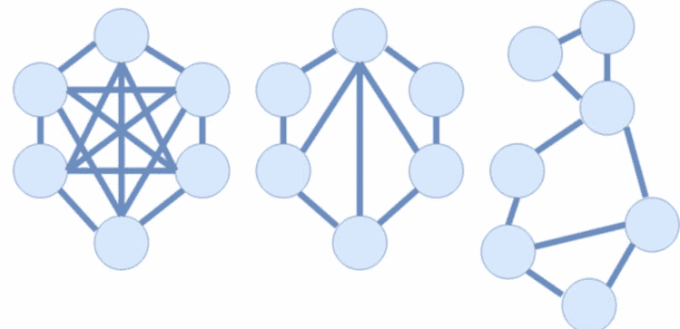

## 共识算法

如上所述，区块链建立在节点之间信任的促进之上。在给定的网络中，信任是网络安全领域任何部署系统中最重要的特征之一。为了建立信任，区块链架构实施了称为共识算法的内部方案，这些方案是节点在更广泛架构中通信方式的基本蓝图。有多种不同的算法可供选择，选择哪一种通常取决于所涉及区块链的功能以及类别。因此，选择正确的算法，就像选择正确的区块链类别一样，对应用程序的功能至关重要。这些算法用于促进可靠的数据完整性以及节点之间访问控制的分配。共有三种流行的共识算法版本：工作量证明、权益证明和权威证明。在工作量证明算法中，迭代区块是通过指数级难以创建但易于验证的挑战来创建的。因此，节点必须努力创建证明，从而创建一个环境，使区块在概率上几乎不可能被修改，并且以迭代链式方式工作。在权益证明算法中，信任是分布式的。节点通过提供其在系统中的相对权益比例来竞争，以被选为有效。选定的节点随后验证交易为有效。权威证明作为权益证明的修改版本工作；除了竞争验证外，节点本身的身份在竞争验证时也被置于风险之中。因此，有限数量的节点在任何给定时间都保留批准权限。需要注意的是，这些并非共识算法的唯一形式；至少有十几种其他流行的算法已被各种区块链应用采用。其他形式的共识算法可能包括销毁证明，这是一种算法，其中节点通过销毁系统中的一定数量的权益来证明权威。然而，上述三种算法通常是更广泛可推断讨论中最常见的（Yeasmin, 2019; Gourisetti, 2019）。

## 信任因素

如上所述，信任是区块链可以用来促进的最重要的因素之一。这在一定程度上解释了为什么区块链在信息安全领域成为如此流行的架构。信任最容易通过信息安全的集体基础概念（即机密性、完整性和可用性）来定义。研究表明，有五个主要因素支持这些操作：1）利用加密算法提供隐私，2）通过非对称或身份证明技术的基于身份的算法进行身份验证，3）通过存储和哈希签名的数据不可变性来保证完整性，4）使用签名或证书等数字操作来保证不可否认性，5）关于任何给定事务操作规范的可检查退化或可呈现证据。这五个因素为信任提供了持续的基础，信任是通过事务随时间的可验证性来建立的（Gorog, 2018）。

还可以通过区块链交易实现五种信任类别：抑制、验证、可靠性、反驳和剥夺。区块链可以通过满足这些类别来促进信任；在这样做时，区块链不仅可以提供不可变性，还可以提供可追溯性，这是一个注意事项，否则将不允许区块链在某些领域占有一席之地（Gorog, 2018）。

## 智能合约

这些是区块链架构的另一个重要方面。类似于匿名性和加密是源自区块链内在特性的特征，智能合约源自区块链固有的身份管理和完整数据存储功能。它是一种预先集成到架构事务结构中的协议。它们允许各方之间达成永久、不可更改的协议，然后以加密形式存储在区块链账本上（Yeasmin, 2019; Abbas, 2019）。这些合约在账本上的节点之间进行，并促进保证交易，以及两方之间签名的持久性。此功能与“数字签名”相关，数字签名是区块链架构的另一个方面，促进了网络安全领域内的重要需求。数字签名与身份管理相关，并允许由一致实体持有的节点签署交易。它最常通过非对称密码学来实现（Huynh, 2019）。

## 当前网络安全范式

网络安全的目标可以简洁地概括为管理风险和保护资产。信息安全作为一个流行的子类别，可以通过三个方面来概括：数据的机密性、完整性和可用性（Andriole, 2020）。研究人员指出，由于对技术的依赖呈指数级增长，对创新网络安全工具和协议的需求已有所增加。由于区块链的及时存在和流行，它已成为拟议的网络安全白皮书和研究中的热门常客。然而，有些人仍然会问，区块链是否已证明自己是一个值得如此关注的关键概念？一些学者和商人表示，现在下结论可能为时过早，但区块链的幼年状态可能预示着未来流行度的爆炸式增长，类似于云计算和基于云的解决方案的先前兴起（Andriole, 2020）。

区块链在网络安全中的迫在眉睫的存在已模仿了其在更广泛私营商业领域中的地位。由于其对投资者的趋势性和吸引力，区块链在很大程度上已被提议作为该领域弥补差距和解决未解决问题的解决方案，无论其在该子类别中的实际可行性如何。这也源于未经证实的理论；许多宣扬区块链的商业演示文稿和研究未提供概念验证或部署的解决方案，而仅仅作为可量化的模糊理论存在。然而，话虽如此，这并不意味着区块链不能单独在网络安全领域成为一种有用的工具，即使上述情况也是事实。区块链的四种特定用途被更流行地宣扬为可外推的特征：除人为监督之外的数据完整性和机密性，之前讨论过的数据不可变性和节点之间的相互性，用户规模的可扩展性，以及用户身份的持久性（Sharma, 2019）。

## 应用确定性

由于提案的爆炸式增长，已出现确定给定解决方案是否真正需要区块链的需求。先前的研究建议了一种四步评估新兴技术应用的流程，区块链属于这一范畴。这些步骤包括：1）技术背景，2）技术的潜在影响，3）试点演示识别，4）计划演示开发（Andriole, 2020）。在网络安全领域，许多区块链应用在第三步停滞不前；关于区块链的理论影响及其作为新兴技术的特征，以及在本地化领域内的理论应用，有大量讨论，但许多理论并未表现为主动演示。在商业领域，已有更多


区块链技术的演示，但许多人尚未将该概念完全外推到使此类演示比当前传统方法更实用的程度。

## 加密货币与代币

若不讨论加密货币及其在网络安全中的地位（Mohanta, 2019），也不可能探讨区块链当前的实际应用情况。虽然加密货币本身并非与网络安全天然相关的主题，但加密货币所引入概念的外推已在该领域获得了一定程度的整合——或至少是讨论。部分得益于以太坊平台推广的智能合约等功能的兴起（Polvora, 2020）。除了智能合约之外，此类外推还包括基于相对代币持有量的许可策略和/或访问控制等理念（Polvora, 2020）。此类讨论在很大程度上受到ICO（即“首次代币发行”）的影响，ICO是加密货币生态系统的初步投资轮次，模仿公开上市公司的股票发行。所涉理念包括分布式代币持有，进而与应用程序生态系统中的相对访问控制或权限相关。由于代币由与特定身份绑定的钱包不可变地持有，因此此类身份的所有者可以被视为拥有具体的相对控制权（Polvora, 2020）。尽管这些技术仍处于早期阶段，但其中许多技术仍有概念验证。尽管在某种程度上已得到证明——至少在小规模、白皮书或初始阶段——但担忧仍源于各种问题，例如身份如果通过间接手段（如网络钓鱼或其他方式）被攻破，风险会更大；此外，还有其他典型的担忧，如前文讨论的区块链网络局限性，这些问题在这里依然成立。

## 区块链与云计算

区块链已与云计算引发了大量比较。关于云分布式计算的虚拟化，请参阅图2。过去十年中，基于云的安全解决方案在受欢迎程度上显著增长，并针对类似领域中的类似解决方案。然而，与区块链不同，云计算解决方案有时会放大狭窄的漏洞，甚至可能创造新的攻击面，例如集中式数据存储或共享访问控制。区块链被提议作为一种解决方案，用分散式架构取代更集中的云计算结构，从而消除漏洞。这并非说区块链完全不可攻破，而是相对于简单的云计算解决方案，其攻击面已大幅缩小；这部分是因为大多数区块链架构实现缺乏单一的入口点（Kshetri, 2017）。

图2. 云计算可视化

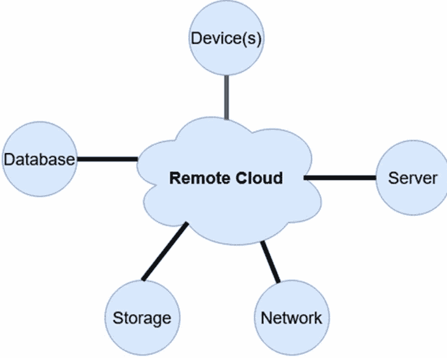

## 网络安全解决方案与讨论

区块链当前的应用——无论是在网络安全还是更广泛的领域——都难以全面评估，这反过来导致了对其用途的分段评估。这是因为当前设计差异巨大，从而使得实现以及部署和维护都变得困难。与许多当前系统不同，区块链相对处于起步阶段，结合其对高水平精密技术知识和复杂设置要求的需求，使其更难得到广泛采用（Vance, 2019）。这引发了疑问，尤其是在网络安全领域，对所使用内容的具体知识至关重要。尽管该领域对创新的渴望不断，但在专业人士中，行业内的先例也非常重要，缺乏区块链应用的大规模先例已成为其采用扩散的障碍。然而，这并非说没有成功的测试用例或概念验证，只是区块链在网络安全领域的更广泛应用因不熟悉和体面性，以及缺乏证明其相对于更传统实现和架构的有效性的历史用途而受到阻碍。

## 区块链与物联网

尽管区块链的普及度普遍呈爆炸式增长，但它在两个网络安全领域——信息安全和物联网（IoT）安全——中引起了特别的指数级兴趣。在这两个子类别中，区块链在物联网方面得到了严肃的创新关注。这是两个主要因素的结果——物联网相对处于起步阶段，因此其及时的流行度与区块链的流行度相交叉，以及目前物联网缺乏标准化和安全措施（Obaidat, 2019; Obaidat, 2020）。信息安全也一直是一个热门类别；尽管这是因为该领域与区块链特性（即数据完整性和可用性）之间存在动机重叠（Ahram, 2017）。区块链在物联网网络安全讨论领域的存在具有双重性：物联网的性质可以被认为同时支持并与区块链架构发生冲突。一方面，区块链带来的标准化身份管理、数据不可变性和点对点验证的需求，与物联网设备和软件的设计结构完美契合。另一方面，区块链的指数级资源使用量，尤其是与物联网设备有限的资源相对比时（Obaidat, 2019; Hassebo, 2018; Khodjaeva, 2019），是一个重大障碍。虽然这是一个障碍，但并未完全阻止可能解决方案的出现；许多理论已被提出来绕过这个问题并保持区块链的优势，其中一例就是“LightChain”（Doku, 2019）。区块链可能如何影响物联网领域的具体细节已分散，且在不同的建议和研究之间差异很大。一些想法包括将物联网设备作为单个认证节点，而这些设备之间的所有通信都将通过智能合约来促进，以保证有效性并跟踪交易（Kshetri, 2017）。

物联网与区块链的交叉已经引发了关于分层集成的激烈争论。物联网漏洞的严重性及其受欢迎程度导致此类研究被快速推进（Obaidat, 2019）。许多初创公司已经开始推出白皮书和原型，用于在物联网系统中使用区块链。像IBM这样的大型企业集团已经对这些产生了兴趣，并开始分发供应链依赖的区块链服务。这些跨业务协助将区块链提升到了工业级别的讨论。基于区块链的协议已被提议，用于将此类架构作为保障部署在依赖无线通信的工业系统中。利用区块链在来源之间验证身份，使其成为设备的重要讨论点，这些设备至关重要的是依赖来自一组选定的有效实体的通信（Kshetri, 2017）。然而，物联网和区块链提案的交叉并非没有问题；取决于区块链实现的基础设施（这将由区块链的类型决定），可能存在隐私问题，考虑到物联网设备之间收集和传输的大量数据。关于物联网设备交互的此类问题已经存在很大担忧，尚未通过共识解决，特别是考虑到行业范围内缺乏标准化。区块链与物联网的集成本身并不解决这些问题，并且可能因为其账本式分布结构而引入新问题。对此的可能解决方案包括分层网络，带有连接到更广泛公共区块链的单独私有区块链，并配有细粒度访问控制。然而，这些架构在很大程度上尚未经过测试。区块链也被提议作为物联网设备的管理平台，本质上充当中间件，用于管理数据、建立永久身份和代币化特权（Ali, 2019）。

## API功能的便利

区块链的网络安全功能绝不仅限于物联网设备；区块链作为非物联网数据管理平台，也已作为另一种流行手段单独进行测试。由于其基于节点的结构以及其不可变的性质，区块链已被用作一个用于简化


用户管理，特别是与基于云的应用程序相关的管理。这有助于促进访问控制，以及加强用户身份验证方法和实施单点登录功能。区块链也已通过其他方法被有系统地提出，其中一种是“API 方法”，即区块链作为 API 来促进其他功能，而不充当其本身的功能平台。其中一些用途已包括 DevOps、云集成和数据分析，特别是针对应用程序、企业和广告（Ahram, 2017）。如前所述，这可能反映云平台的特征。已投入大量精力来比较云计算和区块链平台的各个方面。研究指出，某些云平台遵循“零信任”安全模型，并与区块链类似，完全采用加密事务模型。区块链在很大程度上是一种去中心化模型（修改后的架构如联盟链除外），确实缺乏云计算允许的分段控制方案，例如管理员监督。然而，区块链可以说采用了更好的身份管理和数据不可变性，代价是客户端节点因此承担更严重的后果。然而，借助当前技术，入侵区块链节点会困难得多，因为攻击将局限于暴力破解或客户端劫持，两者的成功率都远低于中间人、冒充或重放式攻击。然而，两种模型仍然易受基于人为错误的攻击，例如网络钓鱼或社会工程学（Kshetri, 2017）。

鉴于对区块链功能的上述评估，不难看出大多数当前的区块链应用与当前的云计算应用可相比较。然而，两者之间存在细微差别，这些差异可能影响哪种方案对某个应用程序（或用户/企业）来说更可行。云计算依赖于拥有物理基础设施的第三方，而区块链通过账本实现去中心化，但可通过第三方供应商来促进。这些选项对不同公司的适用性可能不同：一些公司可能希望第三方提供验证性监督，而另一些公司可能希望消除中间商。同样，物理基础设施可能适合某些公司，而基于账本的不可变性可能更适合其他公司。区块链和云计算非常相似，然而，并非在所有方面都如此。例如，虽然两者在权限设置方面都存在细微差别，但区块链可以选择以无许可方式运行，而这在大多数云计算模式下将是一种风险。两者之间的其他细微差别，例如加密级别，将留给各个组织根据目标和供应商规范自行评估。然而，两者仍面临挑战；云计算是一个历史较短且更成熟的标准，而区块链仍面临早期实施问题，例如缺乏安全机制。从理论上讲，两者都面临资源管理问题，尽管原因不同 - 区块链是因为交易和账本大小所需资源呈指数级增长，而云计算是因为存储和速度的硬件资源有限（Kshetri, 2017）。

## 身份管理

图 3. 数字签名和签名验证过程可视化

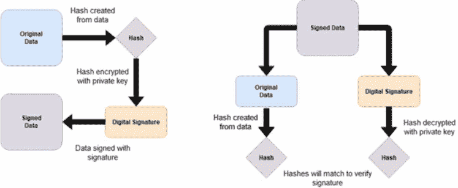

区块链的另一种功能用途是促进数字证书和签名，这是其架构固有的吸引人的特性。请参阅图 3。因此，其实施已得到简化，但尚未大规模部署。许多私营公司已开始开发或推出此类解决方案，但由于创新竞争，这些竞争品牌在很大程度上相互挤占，难以实现更广泛的可访问性。然而，Facebook 或 Twitter 等大型品牌已宣布开发基于区块链的解决方案的自身计划，其中一些与不可变身份管理和签名的需求相交汇（Ahram, 2017）。数字认证的热门应用已承诺替代公证的功能，并暗示了替代版权或许可等无形资产基础设施的想法，以及公共和私人记录的存储，并利用智能合同来实施仲裁和现实合同。许多此类做法的当前实现使系统面临数据篡改或窃取的风险；区块链解决方案承诺通过提高保密性和完整性来加强存储和交易的网络安全标准。许多私营公司已着手实施这些想法，但尚未进入主流以获得进一步的严肃考虑（Alexander, 2019）。

## 其他应用

区块链的进一步部署包括电子邮件和端点安全。当前电子邮件服务和协议的不安全问题已持续多年；区块链已被提出作为一种替代方案，并且与许多说法不同，已得到概念验证测试的支持。区块链因其不可变的交易记录和身份不可否认性，将自身定位为电子邮件的去中心化解决方案。消息真实性方面的当前问题（网络钓鱼和欺诈电子邮件目前正是由此产生）可以通过实施区块链系统来削弱。另一方面，端点安全与前述的区块链在 IoT 安全方面的受欢迎程度的交叉点相关联。大多数 IoT 设备缺乏端点安全措施，从而增加了对有效措施的需求。区块链被提出作为一种解决方案，主要是因为针对基于区块链架构的攻击会因区块链的分布式架构而被削弱，尤其是在使用数据验证节点时。与电子邮件类似，此方面也已部署了用例，并显示出有希望的结果（Vance, 2019）。

使用区块链实现上述提及应用的优势在实施上存在一定程度的细微差别，但除了去中心化之外，还呈现出某些适合某些目的胜过其他目的的优势；这包括节点之间的信任、本地-远程同步、不可更改数据的可用性以及跨节点同步。在需要各个节点之间通信的应用程序，或依赖于同步的应用程序中，区块链已成为一个重要的讨论枢纽。这一点在其在 IoT 中的受欢迎程度中非常容易看出，但也适用于其他领域，例如希望在不依赖集中式数据库的情况下同步客户端的领域。仍需要一定程度的信任认证的对等通信客户端已发现区块链是一种合适的解决方案。然而，对于较大的对等网络，区块链的资源消耗和扩展性能问题一直是一个令人沮丧的劣势（Yassein, 2019）。

## 功能性挑战

除了区块链部署之间的不一致之外，其他问题已在区块链功能的学术研究中被广泛讨论，尤其是在安全和隐私方面。区块链架构存在的问题包括权威性与完整性/数据一致性之间的平衡、账本网络中用户的比例控制，以及操作和规模的指数级增长。平衡保密性与区块链的连接特性也一直是一个问题。区块链的不可变性也可能是一把双刃剑，在用户或组织出现错误的情况下。如前所述，区块链账本的指数级成本和规模仍然是一个巨大的问题，即使对于企业组织也是如此（Yassein, 2019）。

已为解决许多这些限制提出了各种解决方案，例如进一步部署加密技术，以及实施新的数据结构（Yassein, 2019）。区块链的初级阶段和缺乏标准化一直是许多这些限制的催化剂（Ahram, 2017）。区块链不仅本身是一个复杂的系统，而且也不适合“即插即用”式的开发。这是一个潜在的缺点，原因有两个。首先，由于区块链是一种相对新兴的架构，它因为未经验证而使许多人不愿采用。然而，缺乏采用反过来意味着与传统方法相比，广泛的安全机制在大规模基础上得到的测试或开发不足，而传统方法更容易进行测试。区块链复杂且旨在大规模、去中心化的特性，使得概念验证在低密度或测试环境中难以评估（Kshetri, 2017）。然而，随着区块链作为一种架构的成熟，许多这些问题预计将得到解决，特别是随着它吸引更多的学术研究关注（Ahram, 2017; Kshetri, 2017）。


## 常见攻击和威胁

图 4. 区块链中“多数”攻击示例，其中恶意区块多于原始区块，从而覆盖它们。

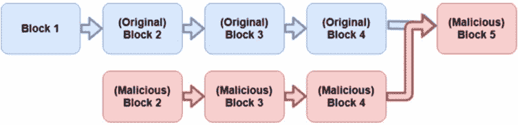

因为区块链网络的固有特性，也存在多种攻击。如图 4 所示，“多数”攻击在许多网络中仍然是一个问题，当某个节点控制给定环境中的大部分质押时即可能发生。同样，“自私挖矿”也一直是一个问题，矿工在私有分支上参与创建区块，并且只有在链比公共网络更长时才将这些区块广播到公共网络，从而取代它们（Abbas, 2019; Huynh, 2019）。分布式拒绝服务（DDoS）攻击也是区块链网络的威胁。当不诚实的节点利用大量其他节点试图压倒其余区块链账本上的请求时，可能会发生这种情况（Huynh, 2019; Oksiiuk, 2020）。

还需要注意的是，尽管区块链增强了身份验证措施，但由于其对永久性的重视以及促进数字签名和身份管理的能力，区块链上身份的不可变性也带来了自身的担忧。虽然身份验证强度部分取决于加密实现的强度，但存在一些相关漏洞，可能比其非区块链对应物更值得担忧。主要的是，与其他身份验证程序相比，网络钓鱼和社会工程学对区块链身份验证构成更严重的风险。这是因为区块链上身份的不可变、永久性质；如果关于身份的信息被泄露，取决于区块链实现的性质，它可能会永久泄露（Oksiiuk, 2020）。

## 局限性

区块链通常在信息安全讨论中被提及用于“大数据”应用程序，但存在一些常被忽略的局限性。首先，区块容量是一个重大限制。区块链的广泛实现具有较低的区块容量，虽然较大的区块可以存储更多数据，但它们会导致严重的性能和可扩展性问题。另一方面，较小的区块虽然可靠，但显然限制了记录的实际空间。其次，由于区块链是分布式账本，大型区块链的存储机制通常没有考虑到账本会被复制到所有用户端。当然，这取决于实现方式：有些可以通过使用仅仅便于访问区块链而非分发客户端节点的供应商或应用程序来规避此问题。尽管如此，对于某些实现来说，这仍然是一个问题；虽然这些数据是加密的，但它仍然根据账本的实际访问方式，使数据面临数据挖掘和其他攻击。这还意味着，攻击者可能在账本中永久存储恶意数据（Dai, 2017）。

## 未来轨迹与讨论

区块链的未来仍然不明朗；该技术光明，仍在吸引大量关注和投资，但也受到尚未得到可验证解决的局限性和担忧的困扰，尽管这些问题持续受到学术辩论。区块链在网络安全领域的未来应用将在很大程度上取决于区块链渗透到更广泛技术领域的规模。私营和公共（政府）实体都已委托开展企业实施的研究，但如前所述，许多此类研究仍局限于理论化或小规模测试，而不是大规模部署。区块链在未来可能大放异彩的大多数网络安全影响，既在于信息安全派生功能，也在于交易实体之间信任的促进（Gorog, 2018）。

在考虑区块链未来可能采取的路径时，研究大致分为两个阵营。一种立场是对公共、社区层面整合的乐观看法，取代许多实体间通信的基础（Aggarwal, 2019）。另一方面，更悲观的观点要么将区块链视为一种短暂潮流，要么提出当前区块链应用架构的局限性足以阻止它在未来变得更加普遍。源自前一种观点的许多讨论，不一定同意区块链有能力构建此类功能的可能性。在合同、金融交易或其他社区活动等区块链概念的整合方面，关于此类整合是否可行并不存在太多争论，而关于是否*应该*这样做（Aggarwal, 2019）。关于如何实现这些概念，存在很大的技术共识，但从组织角度来看，关于此类应用可以部署的现实措施，共识较少。

## 主张与框架

研究表明，区块链未来的公共实施必须是开放、透明和可审计的，以避免可能从架构性质中产生的担忧。关于区块链在网络安全领域未来的大多数研究，以及更广泛领域的部分研究，都表明该架构最强大的承诺来自其促进去中心化的能力，以及在无需任意权威的情况下进行相互、去中心化验证的能力（Oksiiuk, 2020）。此类区块链的未来实施可能不仅限于使用公共架构，但必须根据应用程序的需求，密切关注单个区块链分类中的注意事项。例如，寻求更好隐私保护和更好性能的应用程序更有可能依赖于联盟区块链模型（Cai, 2018）。然而，需要注意的是，向前推进，先前提到的“区块链适用性框架”的使用对此至关重要。错误的区块链应用不仅可能导致性能下降，还会增加安全风险。

开发去中心化应用程序是一种需求量大且有利可图的措施，但面临独特挑战。它需要额外的审查，而区块链可能无法完全自行处理。特别是在处理高层次企业的信任和资产时，去中心化应用程序必须被评估为整体安全。这意味着架构的各个部分——共识算法、区块链类别，甚至应用程序的独立结构——都必须遵循严格的安全和性能准则（Cai, 2018）。在这方面，区块链的未来机遇可能不仅仅表现为利用区块链的创新，而更可能是建立在区块链之上的创新，旨在使区块链利用对用户或商业或政府实体更加便捷和/或更安全。

## 区块链即服务

图 5. 服务基础设施对比。

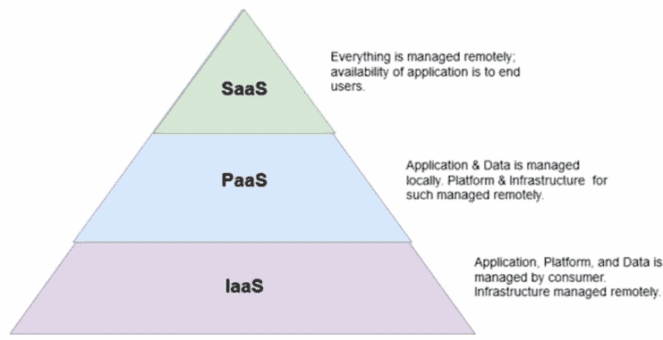

区块链未来的实施可能会复制当前云服务提供商的用法。参照图 5，就像基于云的网络安全应用程序作为一种服务提供一样，随着 SaaS（软件即服务）、PaaS（平台即服务）和 IaaS（基础设施即服务）模式的兴起，研究表明区块链的未来可能会普及区块链即服务（Blockchain-as-a-Service）模式（Andriole, 2020）。这一概念与先前提到的区块链与云计算的比较紧密相关；服务模式和专注解决方案的相似性也在这方面创造了相似之处。然而，与云计算不同，供应商将便于访问而不是便于托管。这与当前的云计算模式略有不同，因为供应商也对平台核心基础的实际维护负责。虽然核心功能将取决于所部署的区块链类别和共识算法，但在进化后的模式中，供应商将仅作为前端来提供账本访问，并在最好情况下在应用层而非区块链底层数据结构上调节数据。一些研究指出，点对点生态系统和承包商（“零工”）平台的兴起也可能通过区块链实现得到加强。这是因为该架构的身份管理功能以及去中心化结构、加密货币和代币的实现，最重要的是，智能合约功能。此类实现可能会模仿“即服务”基础设施（Fraga-Lamas, 2019）。


## 区块链作为基础设施

如前所述，关于区块链在取代和/或辅助社区及法律活动的基础架构方面的潜在地位，存在大量讨论，例如保障跨实体合同的完整性和可用性，或为投票提供安全基础（Aggarwal, 2019）。尽管迄今为止大多数此类提案尚未出现实际的大规模应用，但调查和委托研究已经确定，区块链可以作为一种网络安全工具，用于保障政府级基础设施需求；多个政府已委托开展此类研究，包括英国用于能源基础设施，美国用于官员之间的安全国内消息传递以及身份认证，以及澳大利亚用于保障更广泛“智慧城市”内部实体之间的通信（Vance, 2019）。区块链也被提出作为保障投票免受恶意影响的手段；提案指出，区块链将通过身份验证加强风险降低，同时提高数字化速度并尽量减少基础设施交互（Alexander, 2019）。在政府层面，区块链不仅被提议用于平民级交易，还用于基础设施级的交互式系统。例如，将区块链集成到电网中，可能允许对交易进行许可化、可追溯且不可篡改的记录，其安全性高于通常目前部署的纯集中式机制。智能合约被提出在基础设施问题上具有强大的用途，既类似于前面提到的电网，也适用于其他社会需求，例如现场设备或发电机（Li, et al., 2019）。

在其他地方，区块链通过关于确保复杂能源交易和数据交换的信任与网络安全的提案，继续存在于基础设施手段的讨论中（Mylrea, 2017）。研究人员指出，许多电网不仅是集中式的，而且互连性加上当前过时的技术手段，使得能源电网以及相关的电气基础设施都极其不安全。随着城市向智慧城市愿景迈进，保障基础设施变得越来越重要，因为新的攻击向量变得可用。区块链创建去中心化“能源物联网”的能力，通过去中心化漏洞，使得对基础设施电网的系统性攻击更加困难。使用智能合约还可能提高复原力，并更可靠地跟踪基础设施内的能源交易。研究人员指出，区块链的集成还将有助于在系统中识别异常实体或交易，并允许更顺畅地交汇基础设施需求，例如电力和数据报告。这些想法已在测试平台中小规模测试，但尚未推广到大城市。与其他专业的大规模理论类似，这些概念常常陷入一种僵局：因为缺乏证明而无法部署，但又因为需要大规模部署才能产生证明而无法获得证明（Mylrea, 2017）。

## 专用用途

新机会不断出现，例如最近在汽车经济领域提出的机会（Fraga-Lamas, 2019）。区块链在汽车技术领域的集成与智能汽车经济的近期兴起相交汇。“智能汽车”一词不仅适用于自动驾驶汽车：它适用于任何配备用于数据处理的车载技术的汽车。许多较新的车型配备车载计算机，其中一些至少部分依赖云端信息。鉴于汽车内部安全作为优先事项的绝对需求，随着计算机系统被嵌入其中，网络安全需求应运而生。汽车网络安全可能适用于不同的分类，不仅包括传统的防止网络攻击和确保云端信息可靠性和有效性的类别，还包括新功能，例如确保零件有效性、防止假冒，以及保护生产过程的完整性。研究表明，区块链可用于通过基于区块链的证书防止假冒；同时，生产过程中的完整性可通过使用智能合约来促进。区块链可能为智能汽车带来的其他此类好处，本质上模仿了区块链为其他集成带来的好处，即通过加密、标准化和去中心化实现信息完整性和安全性（Narbayeva, 2020）。

区块链是否能满足其他更专门的目的，仍未定论。大量研究已投入到这些更专注的领域，如上所述，尽管寻找区块链可以实现的机会的性质分散。与将区块链视为保障社区活动基础所给予的考虑类似，集成问题的大部分并不在于如何或为什么，而在于是否。调查研究发现区块链具有大量优势，毫无疑问，将会有持续的讨论，尤其是在物联网没有其他标准存在的情况下。鉴于区块链与这些狭窄实施理念相关的优点和广泛讨论，有充分理由对其未来持乐观态度。但是，非技术因素，例如商业考虑，也必须在这方面予以考虑（Ali, 2019）。

## 开放研究与当前挑战

如前所述，如果区块链将作为大规模可访问的架构部署，未来的区块链实现仍将有各种尚未解决的障碍需要克服。其中最重要的是区块链缺乏可扩展性——不是指用户数量，而是指处理交易和资源消耗方面。此外，区块链中存在一些隐私问题，例如源自账本公开性质的问题。研究还表明，引导过程可能会对区块链应用程序构成问题，这与大型商业企业文件和框架有关（Sharma, 2019）。可访问性通常在技术层面上受到限制；区块链的可访问性还必须在用户派生层面上得到改善。如前所述的评估部分所述，由于开发、部署和维护周围的复杂性，区块链的采用受到阻碍。网络安全领域的专家认为，由于具体理解所使用的指标和概念很重要，区块链应用程序的未来将取决于其开发用户友好型适配的能力（Vance, 2019）。

## 性能

先前讨论的许多区块链限制，特别是关于性能和指数级资源使用的限制，仍然是未来大规模采用的严重担忧。虽然单个实现可能由于其范围而不会发现这些限制具有压制性，但许多将区块链作为解决方案的公司产品和学术研究，旨在大规模部署。目前，这些问题通常在大规模上出现，并给许多否则可能倾向于采用此类创新措施的组织和客户带来担忧。区块链的直接采用及进一步讨论并未被这些问题完全阻挡。原因是，尽管人们对解决这些问题有很大兴趣，但进展仍然显著放缓。许多人得出结论，在区块链能够在普通公众和个别私营部门实现最佳网络安全实施之前，必须解决这些问题（或者至少部分解决），因为它们掩盖了区块链否则带来的好处（Alexander, 2019）。这些担忧延伸到许多更专注的实施理念，这些理念将区块链作为解决方案，如前面讨论的物联网，因此在区块链在这些狭窄领域中获得更广泛实施之前，这些可能是它需要克服的最大障碍之一（Ali, 2019）。

## 用户识别

尽管此前已讨论过去中心化及其带来的加强匿名措施可能是区块链平台未来的潜在优势，但这是一把双刃剑。匿名性也意味着缺乏可追溯性，这可能令人担忧，因为区块链可能会助长非法活动。由于网络安全不仅涉及防御，还涉及进攻策略，区块链架构可能会阻碍执法部门执行有关非法交易法律的能力；或者，由于数据的持久性，可能会阻碍删除非法材料在线传播的能力（Oksiuk, 2020）。

## 可访问性与传播

尤其是区块链在网络安全领域的实施未来，与其对用户可访问性的依赖并行，也将很大程度上取决于讨论该概念的研究质量。学者们指出，关于区块链的主张很难提出。例如，区块链以数据不可篡改而闻名，但也易受多数攻击或51%攻击，这允许数据被修改。这引发了担忧，即关于该概念的主张是否被充分理解，以及它们在研究人员、开发者、政府和商业人士之间传播的方式是否合理。当前的分歧，例如，关于区块链完全不可篡改的主张，由于这些攻击的存在，在技术上是不正确的。尽管如此，此类主张仍在不断提出（Vance, 2019）。

与前述主题一样，考虑到区块链的现状以及围绕某些观点达成的共识，很可能得出结论：区块链的未在于专用实施，而不是取代构成历史方法和基础的系统。这并不是说区块链在为这些系统实施时不会提供理论优势；相反，这种可行性可能仅限于理论而非实践。然而，这也不是最终结论，而是对区块链及其实施现状的评估，指出了其高度不稳定的特性（Fraga-Lamas, 2019）。

## 适用性

在这些新机会中实施的好处通常与为其他此类系统提出的好处重叠。例如，我们先前讨论过区块链作为进一步技术标准化社区活动基础的可能用途（Fraga-Lamas, 2019）。许多这些重叠，即使在这些专用系统中，如上面关于汽车的解释所示


集成，通常归结为相同的基础设施效益和局限性；这些包括标准化、身份管理和信息安全效益，以及可扩展性、复杂性和维护等局限性，还有许多其他方面。鉴于其中许多效益在具体层面上存在重叠，很难断定区块链是否真的在惠及各个领域，还是这些领域仅仅是在吸收区块链的本质。换言之，讨论的焦点常常落在“该功能如何在区块链上运行？”上，而不是“该功能如何从区块链中获益？”。因此，无论是笼统的普遍性还是这些效益，都属于区块链本身的特性，而非各个领域经过改进的特性。需要注意的是，这并不一定具有普遍性；例如物联网（IoT）等领域，对区块链实施的目的和个体化效益已经有了更具结论性的讨论。然而，从更广泛的概括视角来看，这又让人想起早期提到的“区块链适用性框架”。问题通常不在于区块链的哪些特性可以与应用集成，而在于应用是否足够从区块链中获益，以至于其集成是值得的。

## 公开研究与辩论摘要

总而言之，当前区块链的研究挑战通常可归纳为六类（Mohanta, 2019）：

- 分布式系统在更广泛可扩展性方面的效率
- 在不损害可用性和网络安全的前提下，根据区块链架构在节点之间正确分配信任和/或权限
- 指数级资源使用
- 智能合约设计的普遍性
- 区块链网络上的任务调度
- 随着网络规模呈指数级增长，节点间数据的高效验证

还有其他若干被讨论的挑战；然而，这正是区块链的复杂性及其相对初创阶段（Fraga-Lamas, 2019）以及先前提到的网络攻击的存在（Oksiuk, 2020）所致。最后，区块链本身对于某些功能相对于其他功能的实际适用性仍然是一个争论点，因此讨论中存在适用性框架（Gourisetti, 2019）。

### 结论

区块链是一种令人兴奋的、相对新的架构，在公共和私营部门都引起了广泛关注，特别是关于其在网络安全领域可能占据的位置。然而，尽管有重大的创新提议和大量正在进行的讨论，对于更广泛实施的未来前景仍然没有共识。当然，有大量的研究和理论预测区块链的未来前景光明。然而，这些有前景的实施受到当前局限性的制约，对于如何解决这些局限性尚无共识，例如可扩展性和指数级资源使用。专业细分领域，尤其是在物联网安全等狭窄应用场景中，显示出区块链作为应用架构最具潜力。

研究人员大多同意，区块链的未来在很大程度上取决于该架构适应希望采用它的企业需求的能力。尽管大家普遍认为采用区块链可能带来的安全效益，但关于其弊端，以及其实施（特别是大规模实施）所涉及的巨大复杂性和维护问题，已经成为其在网络安全领域进一步渗透的障碍。正如本章所讨论的，区块链效益的普遍性引发了关于区块链实际效益的讨论，而不是讨论区块链的使用是否真的适合某个应用，或者区块链本身仅仅携带某些特性，而采用它的应用又会反过来采用这些特性。这些讨论促成了为判断是否确实需要区块链而开发的框架。有些人可能会说，围绕区块链的兴趣在某种程度上掩盖了其采用，因为通过针对几乎所有形式网络安全缺口的更广泛提议，那些其实现更适合区块链的专业领域反而获得了较少关注。

尽管区块链继续受到大量关注，但其在网络安全领域的地位仍然不确定。尽管该架构的益处可能无可争辩，但其集成提案引发了后勤和理论方面的问题。最重要的是，出现了以下问题：应该仅仅因为可以集成就集成区块链吗？以及区块链的益处是否超过其复杂性和缺点？不幸的是，对于此类问题没有普遍的答案。相反，答案在很大程度上取决于所讨论应用的个体因素。正如更广泛的网络安全领域一样，无论区块链可能具有何种内在益处，部署的个体细微差别和注意事项比被集成对象的所谓益处更是决定集成的关键因素。因此，提出的区块链集成中最具突出性的，往往来自专业系统，例如物联网（Internet of Things）。这些系统从区块链中获益，并非仅仅因为区块链的特性，而是因为这类系统的本质与区块链架构提供的结构和功能相交汇。

### 参考文献

Abbas, Q. E., & Sung-Bong, J. (2019). A Survey of Blockchain and Its Applications. 2019 International Conference on Artificial Intelligence in Information and Communication (ICAIIC), 1–3. 10.1109/IC-AIIC.2019.8669067

Aggarwal, S., Chaudhary, R., Aujla, G. S., Kumar, N., Choo, K.-K. R., & Zomaya, A. Y. (2019). Blockchain. Journal of Network and Computer Applications, 144, 13–48. doi:10.1016/j.jnca.2019.06.018

Ahram, T., Sargolzaei, A., Sargolzaei, S., Daniels, J., & Amaba, B. (2017), Blockchain technology innovations. 2017 IEEE Technology Engineering Management Conference (TEMSCON), 137–141. 10.1109/TEMSCON.2017.7998367

Alexander, C. A., & Wang, L. (2019), Cybersecurity, Information Assurance, and Big Data Based on Blockchain. 2019 SoutheastCon, 1–7. doi:10.1109/SoutheastCon42311.2019.9020582

Ali, M. S., Vecchio, M., Pincheira, M., Dolui, K., Antonelli, F., & Rehmani, M. H. (2019). Applications of Blockchains in the Internet of Things. IEEE Communications Surveys and Tutorials, 21(2), 1676–1717. doi:10.1109/COMST.2018.2886932

Andriole, S. J. (2020). Blockchain cybersecurity. IT Professional, 22(1), 13–16. doi:10.1109/MITP.2019.2949165

Cai, C., Duan, H., & Wang, C. (2018). Tutorial: Building Secure and Trustworthy Blockchain Applications, 2018 IEEE Cybersecurity Development. SecDev. doi:10.1109/SecDev.2018.00023

Dai, F., Shi, Y., Meng, N., Wei, L., & Ye, Z. (2017), From Bitcoin to cybersecurity: A comparative study of blockchain application and security issues. 2017 4th International Conference on Systems and Informatics (ICSAI), 975–979. 10.1109/ICSAI.2017.8248427

Doku, R., Rawat, D. B., Garuba, M., & Njilla, L. (2019). LightChain: On the Lightweight Blockchain for the Internet-of-Things. 2019 IEEE International Conference on Smart Computing (SMARTCOMP), 444–448, 10.1109/SMARTCOMP.2019.00085

Fraga-Lamas, P., & Fernandez-Carames, T. M. (2019). A Review on Blockchain. IEEE Access: Practical Innovations, Open Solutions, 7, 17578–17598. doi:10.1109/ACCESS.2019.2895302

Gorog, C., & Bault, T. E. (2018). Solving Global Cybersecurity Problems by Connecting Trust Using Blockchain. 2018 IEEE International Conference on Internet of Things (iThings) and IEEE Green Computing and Communications (GreenCom) and IEEE Cyber, Physical and Social Computing (CPSCom) and IEEE Smart Data (SmartData), 1425–1432. 10.1109/Cybermatics_2018.2018.00243

Gourisetti, S. N. G., Mylrea, M., & Patangia, H. (2019). Evaluation and Demonstration of Blockchain. IEEE Transactions on Engineering Management, 1–15. doi:10.1109/TEM.2019.2928280

Hassebo, A., Obaidat, M. A., & Ali, M. (2018). Commercial 4G LTE Cellular Networks for Supporting Emerging IoT Applications in Internet of Things. Mechatronics and their Applications International Conference, as a part of the Advances in Science and Engineering Technology Multi-Conference (ASET), Dubai, UAE.

Huynh, T. T., Nguyen, T. D., & Tan, H. (2019). A Survey on Security and Privacy Issues of Blockchain Technology. 2019 International Conference on System Science and Engineering (ICSSE), 362–367. 10.1109/ICSSE.2019.8823094

Khodjaeva, M., Obaidat, M. A., & Salane, D. (2019). Mitigating Threats and Vulnerabilities of RFID in IoT through Outsourcing Computations Using Public Key Cryptography. In Security, Privacy and Trust in the IoT Environment. Springer-Cham.

Kshetri, N. (2017). Blockchain privacy. Telecommunications Policy, 41(10), 1027–1038. doi:10.1016/j.telpol.2017.09.003

Li, Z., Bahramirad, S., Paaso, A., Yan, M., & Shahidehpour, M. (2019). Blockchain. The Electricity Journal, 32(4), 58–72. doi:10.1016/j.tej.2019.03.008 PMID:32524086

Mohanta, B. K., Jena, D., Panda, S. S., & Sobhanayak, S. (2019). Blockchain privacy. Internet of Things, 8, 100107. doi:10.1016/j.iot.2019.100107

Mylrea, M., & Gourisetti, S. N. G. (2017). Blockchain for smart grid resilience: Exchanging distributed energy at speed, scale and security. Resilience Week. doi:10.1109/RWEEK.2017.8088642


Narbayeva, S., Bakibayev, T., Abeshev, K., Makarova, I., Shubenkova, K., & Pashkevich, A. (2020). 区块链技术. Transportation Research Procedia, 44, 168–175. doi:10.1016/j.trpro.2020.02.024

Obaidat, M. A., Khodjaeva, M., Obeidat, S., Salane, D., & Holst, J. (2019). 物联网安全架构框架. IEEE 10th Annual Ubiquitous Computing, Electronics & Mobile Communication Conference (UEMCON), 154–157. doi:10.1109/UEMCON47517.2019.8993096

Obaidat, M. A., Obeidat, S., Holst, J., Al Hayajneh, A., & Brown, J. (2020年5月). 物联网综合与系统调查：安全与隐私挑战、安全框架、赋能技术、威胁、漏洞与对策，载 Computers Journal. MDPI, 9, 44.

Oksiuk, O., & Dmyrieva, I. (2020). 区块链技术的安全与隐私问题. 2020 IEEE 15th International Conference on Advanced Trends in Radioelectronics, Telecommunications and Computer Engineering (TCSET), 1–5. 10.1109/TCSET49122.2020.235489

Pólvora, A., Nascimento, S., Lourenço, J. S., & Scapolo, F. (2020). 区块链. Technological Forecasting and Social Change, 157, 120091. doi:10.1016/j.techfore.2020.120091

Sharma, M. (2019). 面向网络安全的区块链：工作机制、应用领域与安全挑战. 2019 2nd International Conference on Intelligent Computing, Instrumentation and Control Technologies (ICICICT), 1, 1182–1187. 10.1109/ICICICT46008.2019.8993204

Vance, T. R., & Vance, A. (2019). 区块链时代的网络安全：基于区块链技术的关键基础设施保护研究综述. 2019 IEEE International Scientific-Practical Conference Problems of Infocommunications, Science and Technology (PIC S&T), 107–112. 10.1109/PICST47496.2019.9061242

Yassein, M. B., Shatnawi, F., Rawashdeh, S., & Mardin, W. (2019). 区块链技术：特征、安全与隐私；问题与解决方案. 2019 IEEE/ACS 16th International Conference on Computer Systems and Applications (AICCSA), 1–8, 10.1109/AICCSA47632.2019.9035216

Yeasmin, S., & Baig, A. (2019). 释放区块链的潜力. 2019 International Conference on Electrical and Computing Technologies and Applications (ICECTA), 1–5. 10.1109/ICECTA48151.2019.8959713

## 补充阅读

Hasanova, H., Baek, U., Shin, M., Cho, K., & Kim, M. (2019). 区块链网络安全漏洞及可能对策研究综述. International Journal of Network Management, 29(2), e2060. doi:10.1002/nem.2060

Zhang, X., Li, R., & Cui, B. (2018). 基于区块链和移动边缘计算的VANET安全架构. 2018 1st IEEE International Conference on Hot Information-Centric Networking (HotICN). 10.1109/HOTICN.2018.8605952

## 关键术语与定义

- **访问控制：** 网络安全的一个基本概念，通过规范谁和/或什么可以查看、维护和使用系统中的单个资源来实现。
- **可用性：** 网络安全的一项原则，规定授权用户不仅应能按需访问系统，还应能执行所需任务和数据事务。
- **云计算：** 一种分布式计算方法，其中使用远程服务器网络来远程预配、管理、存储和处理，而不是使用本地系统。
- **保密性：** 网络安全的一项原则，规定只有那些应该能够访问某些数据的人才能访问它。
- **加密货币：** 一种基于区块链的去中心化数字货币资产系统，其中数字币存储在分布式账本中，单位通过强受保护的密码学方式生成。
- **端点安全：** 一种保护系统网络的方法，依赖于参与网络的桥接设备的安全性。
- **不可篡改性：** 数据在保持定义和无可争议的完整性的同时存在于源中的能力，用于连接系统无错误地传输此类数据。
- **完整性：** 网络安全的一项原则，规定应确保数据准确且未遭任何未经授权实体的篡改。
- **物联网 (IoT)：** 分布在互联网连接的计算机和嵌入日常系统的处理器之间的互连设备网络，这些设备接收和传输数据。
- **点对点 (P2P)：** 一种网络方法，其中网络分布在互连节点之间，这些节点共享资源，没有集中源，从而在传统客户端-服务器模型之外进行协调。
- **事务：** 至少两个系统或参与者之间的事件，其中一系列信息由参与实体发送和接收。

## 第7章

## 区块链与加密货币：法律与伦理考量

Neha Mason
澳大利亚查尔斯·斯特特大学

Malka N. Halgamuge
https://orcid.org/0000-0001-9994-3778
澳大利亚墨尔本大学

Kamalani Aiyar
澳大利亚查尔斯·斯特特大学

### 摘要

在金融交易中，比特币等加密货币利用去中心化、可追溯性和匿名性特征进行交易活动。这些利用新兴区块链技术的数字货币，正在形成世界上最大的无监管市场基础。这带来了各种监管挑战，包括非法购买毒品和武器、洗钱以及资助恐怖主义活动。本章分析了各种法律和伦理影响、其影响，以及政策制定者和监管机构目前面临的固有问题的各种解决方案。作者们展示了对30篇近期发表的同行评议科学出版物的分析结果，并提出了各种机制，这些机制可以帮助检测和预防目前占加密货币交易相当比例的非法活动。他们还建议了未来可用于识别暗网市场的方法和应用。

### 引言

近年来，加密货币交易已成为一种全球现象。这些是去中心化的匿名虚拟货币，不需要任何中央机构的中央控制（Nakamoto, 2019）。加密货币可以通过众筹和点对点技术平台吸引社区参与，从而适应新兴数字经济和融资目的中的挑战（Tschorsch & Scheuermann, 2016）。因此，由于在市场规模和价值方面的快速增长，加密货币连同区块链技术的使用，自2012年左右以来一直占据新闻头条（Tschorsch & Scheuermann, 2016）。

加密货币的第一个倡议是白皮书，该白皮书于2008年由中本聪化名发布。它结合了区块链技术、去中心化、有限供应和完美匿名性的理念，为被称为比特币的第一种虚拟货币铺平了道路（Nakamoto, 2019）。区块链已被应用于大多数商业模式，包括供应链（Alvarado & Halgamuge, 2019）、多媒体（Shrestha et al., 2020）、金融和医疗保健。2010年，WordPress、微软和Expedia等商家开始接受比特币作为支付方式，这导致比特币被承认为一种合法货币。

随着比特币日益普及，加密和去中心化货币的理念出现，第一种替代性加密货币也随之出现。这种被称为山寨币（Altcoin）的货币，专注于通过提供更高速度和匿名性等多种优势来改进原始比特币设计。因此，这一时期对新创业公司具有吸引力，出现了Namecoin和Litecoin等货币。

毫不奇怪，作为一种设计之初就缺乏控制并考虑匿名性的货币，比特币证明是犯罪分子有利可图且有吸引力的目标。例如，2014年6月，名为Mt. Gox的比特币交易所下线，导致其所有者损失了近750,000个比特币。该案件仍在调查中，因为它导致总损失估计达4亿美元。由于这些原因，许多国家已经禁止使用比特币等加密货币，因为他们担心它们会被用于黑市交易等非法目的（Fraser & Bouridane 2017; Kshetri & Voas 2017; Toyota et al. 2017; Van Der Horst et al. 2017; Meiklejohn et al. 2013; Chadha & Kumar 2017）。

通过利用伪匿名性和区块链交易，比特币的滥用很容易实现。此外，比特币被用于恐怖主义融资和洗钱的证据已经被发现（Kshetri & Voas 2017; Toyota et al. 2017; Van Der Horst et al. 2017; Chadha & Kumar 2017; Liu, Chen, et al. 2017）。因此，需要政府机构与银行和其他金融监管机构等其他机构合作，制定法律框架并跟踪加密货币交易，以便将其纳入税收范围。

大多数数字货币都不受监管。一些国家将其视为合法，而另一些国家则直接禁止它们。例如，在中国禁止使用加密货币，甚至在中国申请首次代币发行（ICO）也被视为非法活动。已将其纳入金融体系的国家面临着与税收和非法活动增长相关的问题（Kshetri & Voas 2017; Toyota et al. 2017; Van Der Horst et al. 2017; Meiklejohn et al. 2013; Chadha & Kumar 2017）。因此，需要制定适当的立法（Shehhi et al., 2014）。

基于这一背景，本章试图通过使用各种相关技术来填补空白，分析数字货币的法律和伦理影响。


### 图 1. 加密货币使用的法律与伦理影响概览

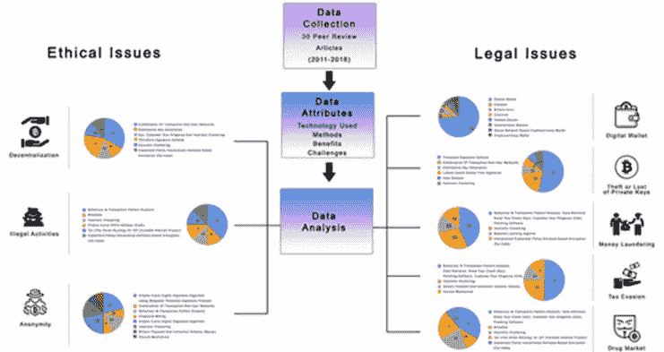

然而，迄今为止，关于加密货币使用的讨论甚少。大多数加密货币文章仅关注比特币，没有重大研究通过区块链交易描述加密货币使用中的法律和伦理问题。本章试图一窥加密货币使用中的各种问题，并提出减轻这些问题的方法和技术。

由于具有数字化和虚拟化特征，加密货币也促进了暗网市场的发展。因此，黑市的运作方式已转变为使用这些加密货币的黑市电子商务。像 FBI 这样的执法机构仍在调查和追踪在非法活动中将加密货币作为资金转移方式的罪犯。本章提出的方案是通过分析 30 篇经过同行评审的科学文章，包括各位作者提出的技术和方案，来讨论该主题的法律和伦理方面。根据分析，大多数研究者仅观察到加密货币使用中的一项或几项问题；然而，在本章中，我们分析了更多问题，并提供了切实可行的建议。还调查了可用于减轻这些问题并追踪这些交易背后罪犯的应用程序。

另一个重要的研究空白在于关于追踪那些将加密货币作为货币交易支付方式的人的法规。这源于加密货币的匿名性。因此，追踪涉及洗钱和逃税的罪犯的许多问题仍有待解决。许多研究者正在开发应用程序来追踪违约者，并对这些罪犯采取必要措施。本贡献还试图提供机制，以帮助减少犯罪活动，并协助监管机构追踪罪犯，方法是揭示加密货币使用的阴暗面。

本章的主要目的是更深入地了解使用加密货币的负面方面和挑战，以形成控制加密货币使用的法律和伦理框架。在这方面，图 1 所示的是加密货币的法律和伦理影响。本章稍后，我们将通过分析检索到的文章来调查伦理和法律影响，并提供建议。

本章分为五个部分。引言部分涉及所选主题的必要背景信息。材料和方法部分详细概述了该主题，包括数据分析的数据获取选择标准，随后是数据分析表格。结果部分展示了说明建议和推荐的图表，随后是对与文献相关的调查结果以及重要法律和伦理影响的讨论。最后，本章通过为相关主题领域的未来发展提出重要解决方案来结束。

## 材料与方法

加密货币是去中心化的结构，使其能够存在于政府机构和其他中央机构的控制之外。区块链结构也是如此，它具有匿名性、安全性的特征，并且不需要中央机构来管理交易。由于加密货币承诺在无需第三方参与的情况下更轻松地处理交易，更多资金正流入比特币、加密币和其他虚拟货币生态系统。本节将讨论正在使用加密货币的交易领域，并讨论这些交易方式带来的后果。此外，我们试图分析加密货币使用的法律和伦理影响，以便更好地理解。

### 当前研究的原始数据收集

我们收集了 30 篇近期发表的同行评审研究出版物的数据。这些出版物提及并讨论了与加密货币相关的不同方面。大多数出版物专注于比特币；然而，本章还考察了其他各种加密货币。在此，我们试图通过考虑所使用的技术、安全方法、分享的秘密方式、收益和挑战等属性，来阐明加密货币使用的法律和伦理影响；并着眼于减少不良活动（如洗钱）的不利影响。

### 数据纳入标准

对于文献分析，我们考虑了来自 30 篇研究论文的各种研究的数据，并考察了论文作者使用的算法，以评估与加密货币相关的安全性以及法律和伦理问题。比较表 1-8 总结了我们在上述研究论文中报告的法律和伦理影响方面的发现。结果，建议对用户身份加密使用分级密码策略属性基加密（CP-HABE）方案，并建议引入监管节点以防止与货币相关的问题。还建议了可用于减轻不利影响的不同技术。未经过同行评审的科学出版物被排除。

### 当前研究的原始数据分析

与法律和伦理问题相关的数据进行了分析，如表 1-8 所示。用于比较的属性包括：法律和伦理问题的更广泛影响、受影响的国家、采取的各种措施、所使用的技术、取得的收益以及使用加密货币所面临的挑战。还分析了涉及数字钱包、逃税、洗钱、毒品市场和私钥盗窃的法律问题，并以图形形式在图 2-8 中展示。涉及去中心化、非法活动和匿名性的伦理问题也进行了分析，并以图形形式在图 9-11 中展示。

在以表格形式展示这些结果时，采用了 CP-HABE 方案。CP-HABE 方法由 Wang 和 Gao (2018) 推荐。使用此方法，该方法包括用户的加密身份和用于签名的修改签名（MS）算法，交易由用户生成并首先发送到区块链。然后矿工验证交易、其签名以及所使用的加密货币的来源。最后，在交易被发现可疑的情况下，使用监管节点来解密用户的真实身份。它可以作为避免非法交易的一种措施（Wang & Gao, 2018）。这种方法连同各种其他方法，用于填补表 1-8 中提到的加密货币法律和伦理问题的空白。

通过参考相关技术研究这些差距、问题和解决方案，使监管机构能够为加密货币制定适当的法律框架。希望，这也能协助监管机构追踪非法活动和违反相关法律的幕后人员。

## 法律影响

现在在此讨论与加密货币在数字钱包、私钥、逃税、洗钱和毒品市场中的使用相关的法律影响。

### 数字钱包

数字钱包持有用户的私钥，并允许他们访问自己的公钥。数字钱包未由联邦存款保险公司（FDIC）承保，也没有受到保护。大多数数字钱包公司因此倒闭。由于加密货币交易与“数字钱包 ID”相关联，而非用户的实际姓名和身份，因此这些交易完全匿名。结果，加密货币正在被接受为非法产品和服务的交易方式，例如，“现已停运的丝绸之路”（Kshetri & Voas 2017; Toyoda et al. 2017; Van Der Horst et al. 2017; Meiklejohn et al. 2013; Chadha & Kumar 2017）。

近年来，已报告了各种与加密货币相关的威胁和黑客攻击事件。其中一些列于此。Bithumb，由朝鲜拥有的顶级加密货币交易所和世界第四大股票交易所，于 2017 年 6 月遭到黑客攻击。名为 NiceHash 的加密货币数字钱包也于 2017 年 12 月遭到黑客攻击。以太坊，即 Parity Technologies 包含以太币的数字钱包，是 2017 年 11 月发生的最大黑客攻击之一。Wannacry 勒索软件影响了近 100 个国家，要求以比特币支付赎金。Petya 网络攻击针对塔斯马尼亚的嘉士巧克力工厂，要求以比特币作为赎金（Wang & Gao, 2018）。关于管理和监管加密货币，没有法律法规。用户希望保持其交易机密，以确保其隐私得到保护。因此，要赢得这些人群的信任将很困难。

数字钱包的关键问题在于其安全性，即防止涉及私钥的内部和外部威胁。有两种数字钱包类型，称为热钱包和冷钱包。热钱包要求用户的私钥存储在连接到网络的计算机上。On


另一方面，冷钱包将私钥离线存储且未连接到网络。基于此场景，使用热钱包和冷钱包可能发生的威胁如下。

- 1. 热钱包 - 私钥在线存储：
  - a. 内部威胁
    这些钱包更容易受到内部人员的攻击，许多事件涉及私钥的盗窃或丢失。例如，在密钥被打印并存放在保险柜中的情况下，密钥被盗的风险异常高。
  - b. 外部威胁
    与网络安全相关的外部威胁很高。在过去，曾有通过网络盗取比特币的几起事件。

- 2. 冷钱包 - 私钥离线存储：
  - a. 内部威胁
    这些钱包面临与私钥物理存储相关的威胁。私钥存储在离线状态。这些密钥只能通过访问存储位置来窃取。因此，需要企业内部控制政策来减轻此类风险。
  - b. 外部威胁
    冷钱包不受外部威胁的影响，因为它们未连接到网络。因此，与网络相关的威胁得以缓解，因为冷钱包中存储的私钥无法在线获取。表1展示了与数字钱包相关的法律影响，包括其优势和挑战。

## 私钥盗窃或丢失

像Mt. Gox这样的大规模盗窃事件促使监管机构施压，对比特币交易征税并将其纳入纳税范围。由于比特币的去监管特性，用户可能会丢失私钥，之后要证明谁仍拥有这些币会更加困难。已有许多与私钥丢失相关的盗窃事件，使用拒绝服务（DoS）攻击，也称为51%攻击。在这里，需要超过51%的计算能力才能修改、排除和自行撤销交易。此类盗窃在过去的许多国家都有发生。

已制定技术以解决基于交易处理系统的比特币问题。51%攻击已通过修改块头和引入额外字节来预防。在哈希生成过程中，时间戳被有效用于解决与此盗窃相关的问题。然而，需要正确制定策略并实施安全措施来防止此类盗窃。可以通过检测区块链上没有移动的比特币来检测丢失的币。表2显示了涉及私钥盗窃或丢失的法律影响。

## 税务逃避

税务逃避主要是由于加密货币的伪匿名性造成的。用户通常倾向于隐藏资产以避免缴纳税款。可以通过使用在线私钥来逃税，因为缺乏与加密货币征税相关的适当法律框架。已有通过使用加密货币将未纳税外币带入国家的案例。然而，在一些国家，加密货币被禁止。在澳大利亚，澳大利亚税务局（ATO）将加密货币视为一种财产形式，以将其纳入纳税范围。ATO正在就制定适当制度以克服相关问题咨询税务专家和律师。为了做到这一点，政府需要跟踪加密货币交易，并确保所有税款按时支付。ATO警告说比特币既不是“货币也不是外币”，因此，应将其作为资产征税，不应征收商品和服务税（GST）。因此，应将其视为资产收入来计算资本利得税（CGT）。

许多国家正在遭受税务逃避问题的困扰。经常举行正式会议讨论税收政策。政府及其监管官员也在努力制定此类货币的适当征税方法。正在努力设计系统以检测税务逃避迹象，并使负责控制货币和支付系统的当局对交易征税负责。许多国家正在为加密货币征税制定法律框架。建议加密货币所有者妥善保存其意图、交易以及收款方记录；否则，一旦被发现，可能会面临巨额罚款。表3描绘了涉及税务逃避的法律影响。

## 洗钱

洗钱是一个关键问题，因为资金可以在国家之间转移，而没有任何人监控和追踪其流动，这是由于区块链操作的性质所致。比特币在韩国等一些国家并未被禁止。然而，在一些其他国家，涉及比特币的非法活动将面临严厉起诉。无论如何进行，洗钱始终是非法的。然而，法律框架中仍存在许多漏洞，因此，政府和其他金融监管机构正在合作制定适当的法律框架以防止洗钱。为了追踪洗钱，应建立适当的监管机构，并应相应惩罚从事此类活动的用户。表4说明了涉及洗钱的法律影响。

## 毒品市场和恐怖主义融资

加密货币正在用于在线毒品市场和资助恐怖组织。像丝绸之路（Silk Road）这样的暗市场据报道已关闭。然而，类似的场所现在正在积极交易且未被追踪，因为使用了比特币的匿名性。比特币在黑市中被用作毒贩和凶手在其非法业务中承担的合同的支付方式。加密货币被提供用于购买武器。在暗网市场网站上，与购买毒品、武器和其他非法物品相关的交易量相当大。2015年，丝绸之路网站的创始人因此类交易被送入监狱，丝绸之路被关闭。此后，丝绸之路、军械库和普通商店已被发现仍在使用加密货币进行活跃交易。每个国家目前都面临这一问题。政府和其他金融监管机构正在就此合作制定适当的法律框架。

暗网是联邦调查局（FBI）、欧洲银行管理局等机构的主要关切。分析网络运作方式及相关挖矿过程至关重要。应设立监管机构来追踪此类活动。非法交易的提取可以通过随机存取存储器（RAM）分析和硬盘分析来完成。表5描绘了加密货币在毒品市场中使用所涉及的法律影响。

## 伦理影响

现在将讨论由于加密货币的去中心化和匿名性特征以及它们与非法活动的关系所涉及的伦理影响。

### 去中心化

去中心化是加密货币的关键特征之一，使其超出任何货币控制机构的管辖。由于此原因以及区块链的运作方式，所有处理的交易均不可逆。在每个节点正确维护交易账本，并在分布式节点（而非中央机构）验证交易，是使该过程更安全所必需的。以比特币为例，用户可以查看所用验证代码的透明度并参与软件开发。然而，在这种去中心化方式下处理的交易没有政府控制。因此，法规可能有助于可持续地征税和防止黑钱。表6说明了去中心化涉及的伦理问题。

### 匿名性

由于加密货币的匿名性特征，存在无法追踪的电子转账。洋葱路由（TOR）由于分层加密过程进一步增强了匿名性。由于匿名特征，用户可以在不留下痕迹的情况下转账。此外，暗网和勒索软件因此变得流行。这些非法活动的幕后人员因这一特征而不为人知。像Tox这样的软件允许我们制作恶意软件，不幸的是，用于恶意活动。

匿名性也导致了各种伦理问题。大约100个国家受到比特币要求的WannaCry勒索软件影响。同样，Petya网络攻击针对塔斯马尼亚的卡箭巧克力工厂。此类攻击的幕后犯罪分子因匿名性而不为人知。账户无法被冻结，而且也无人知道账户持有人的真实身份。因此，实施监管节点以防止此问题。这些节点旨在揭示用户的真实身份。可疑和非法交易会被自动标记并启用进一步调查。真实身份在监管节点处被揭示。在这种情况下，用户不再被允许隐藏身份来上网。即使勒索软件被检测并停用，文件也不会被恢复，因此，在这方面制定适当的法律至关重要。表7显示了与加密货币匿名性特征相关的法律问题。


## 非法活动

如前所述，加密货币据称正被贩毒集团用于人口贩卖。用户在从事毒品和武器交易等非法活动时，会将加密货币与匿名性相结合。2013 年，丝绸之路（Silk Road）在国际刑警组织和联邦调查局的共同努力下被关闭。然而，由于对加密货币的需求量大，以及由于去中心化和匿名性，像丝绸之路 2.0、Evolution、Hydra 和 Agora 这样的其他暗网市场已经出现。因此，许多国家正受到此类非法活动的影响。

因此，有必要追踪这些活动，并对参与此类活动的罪犯施以必要的惩罚。监管交易并使用相关技术有助于追踪可疑交易。表 8 展示了各位作者提及的伦理和道德影响，以及对这些影响和应用的建议应用、益处和挑战。

## 结果

与所用技术、安全方法、密钥共享方法、收益以及加密货币使用所面临的挑战相关的法律和道德问题，在表 1-8 中呈现。已完成对 30 篇经过同行评议的科学出版物的分析，以确定每项法律和道德影响中所使用的技术。涉及数字钱包、逃税、洗钱、毒品市场和私钥盗窃的法律问题已被分析，并以图形形式在图 2-8 中呈现。涉及去中心化、非法活动和匿名性的道德问题已被检查，并以图形形式在图 9-11 中呈现。

## 法律问题评估

基于对 30 篇经过同行评议的科学出版物的分析，对法律问题、其影响及固有挑战进行了评估。我们的贡献现针对与法律问题相关的问题提供逐步建议。COUNTIF 公式被用于统计在其他应用范围内所使用应用的百分比。

COUNTIF 函数的语法为 COUNTIF(range, criteria)。例如，在 30 位不同作者中，有 23 位作者提及了 Bitcoin Wallet 应用，此时范围等于 31 个应用（一位作者比较了两个不同的钱包），条件等于 Bitcoin Wallet。在指定范围内统计 Bitcoin Wallet 的语法为 COUNTIF(C2:C33, Bitcoin Wallet)，因此答案为 74%。

### 表 1. 涉及数字钱包的法律影响

| 序号 | 作者 | 使用的技术 | 安全方法 | 益处 | 挑战 |
|---|---|---|---|---|---|
| 1 | (Dikchit & Singh, 2017) | Bitcoin Wallet | 联合控制 | Bitcoin Wallet 是存储比特币持有者数字凭据的软件或硬件。钱包存储与交易相关的信息 | 它生成并存储私钥，因此安全性至关重要 |
| 2 | (Reid & Harrigan, 2013) | Bitcoin Wallet | 热钱包 | 识别和跟踪用户活动的大部分 | 比特币交易的完整历史可用，这可能对用户匿名性和安全性产生严重影响 |
| 3 | (Gennaro et al., 2016) | Bitcoin Wallet | 热钱包和冷钱包 | Bitcoin 钱包是一种软件抽象，可无缝代表用户管理多个地址 | 钱包软件选择输入地址，更改地址，并构建交易 |
| 4 | (Narayanan et al., 2016) | Bitcoin Wallet | 热钱包和冷钱包 | 通过使用阈值密码学保护 Bitcoin 钱包 | 它使我们能够无缝代表用户管理多个地址。对比特币的内部和外部威胁是最紧迫的问题 |
| 5 | (Kshetri & Voas, 2017) | Bitcoin Wallet | 热钱包 | 分析使用钱包进行的非法活动 | 可以检测和防止勒索软件 |
| 6 | (Maurer et al., 2017) | Coinoin | 热钱包 | 多个用户将其交易合并为一笔大额交易。维持假名性 | 维持匿名性并保护钱包安全 |
| 7 | (Wang et al., 2018) | Bitcoin Wallet | 热钱包 | 可以针对比特币高收益投资计划进行模式分析 | 维持匿名性并保护钱包安全 |
| 8 | (Toyoda et al., 2017) | Bitcoin Core | 热钱包 | 比特币、其应用、比特币的存储和交易 | 研究两个钱包之间的关系，以识别两个钱包中与比特币密钥、短语和交易相关的潜在来源和相关数据。 |
| 9 | (Van Der Horst et al., 2017) | Electrum | 热钱包 | Electrum、其应用、比特币的存储和交易 | 监管比特币可能会影响匿名性和安全性 |
| | | Testnet Bitcoin | 热钱包 | 比特币支付和服务交易 | 可用于多个行业，但是：匿名性和安全性是一个问题 |
| 10 | (Chen et al., 2017) | Bitcoin Wallet | 热钱包和冷钱包 | 比特币与各种应用相关 | 购买者保护将确保比特币或任何其他加密货币的高可靠性 |
| 11 | (Tama et al., 2017) | Bitcoin Wallet | 热钱包 | 购买者保护将确保比特币或任何其他加密货币的高可靠性 | 引入该概念以帮助冲突解决 |
| 12 | (Yin et al., 2018) | 确定性钱包 | 热钱包 | 区块链用于缓解抗量子攻击 | 引入该概念以帮助冲突解决 |
| 13 | (Liu, Liu, et al., 2017) | Bitcoin Wallet | 热钱包 | 结合交易哈希和地址余额来确认交易完成。可以通过交易可塑性检测和缓解攻击 | 它与比特币网络兼容，易于使用和升级现有程序；但是，可能会对匿名性产生影响。 |
| 14 | (He et al., 2018) | 基于社交网络的加密货币钱包 | 热钱包和冷钱包 | 该方案具有高安全性和安全增强存储、不同设备间便携式登录、无密码身份验证等优势。灵活密钥委派、盲钱包恢复等。 | 部署此类方案是一项艰巨的任务 |
| 15 | (Zhang & Li, 2016) | Bitcoin Wallet | 热钱包和冷钱包 | 与其在冷钱包中存储所有私钥，作者建议结合随机种子和密码短语让用户生成私钥，从而更安全且不易受攻击 | 生成随机种子和密码短语比在冷钱包中存储私钥要复杂得多 |
| 16 | (Mehta et al., 2017) | Bitcoin Wallet | 热钱包和冷钱包 | 尝试研究保护比特币的攻击。它还建议比特币安全算法。 | 盗窃和攻击可以缓解，但无法完全消除 |
| 17 | (Meiklejohn et al., 2013) | Bitcoin Wallet | 热钱包 | 提供比特币市场的纵向变化、由此造成的压力以及将其用于欺诈目的的用户 | 可以缓解这些风险；但是，无法避免将比特币用于犯罪活动的用户 |
| 18 | (Chadha & Kumari, 2017) | Bitcoin Wallet | 热钱包 | 尝试研究各种加密货币，并选取其中最流行的一种，即比特币 | 提供了与加密货币及其影响相关的更多见解 |
| 19 | (Shehli et al., 2014) | Bitcoin Wallet | 热钱包 | 尝试使用 Bitcoin 钱包研究网络犯罪和勒索软件 | 可以缓解涉及网络犯罪的威胁；但是，无法将其消除 |
| 20 | (Upadhyay & Jain, 2016) | Bitcoin Wallet | 热钱包 | 尝试使用 Bitcoin 钱包研究暗网和勒索软件 | 可以缓解威胁，但无法完全避免 |
| 21 | (Barwalal et al., 2016) | Bitcoin Wallet | 热钱包和冷钱包 | 尝试研究比特币以实现安全的金融交易 | 可以缓解盗窃和攻击；但是，无法完全消除 |
| 22 | (Quamra & Singh, 2016) | Bitcoin Core | 热钱包 | 讨论了与比特币钱包相关的安全风险，其中最安全的是 Bitcoin Core | 可以缓解涉及比特币钱包的威胁；但是，无法将其消除 |
| 23 | (Kaushal et al., 2017) | Bitcoin Wallet | 热钱包 | 调查比特币中的安全漏洞 | 可以缓解涉及比特币钱包的威胁；但是，无法将其消除 |
| 24 | (Fraser & Bourdeau, 2017) | Bitcoin Wallet | 热钱包 | 审查网络犯罪分子使用的比特币 | 与比特币相关的安全问题很多 |
| 25 | (Shammugam et al., 2017) | Bitcoin Wallet | 热钱包 | 进行 SWOT 分析以评估比特币的优势和机遇，同时缓解其劣势和威胁 | 除了制定策略、实施和监管比特币交易（这是一个重要问题）之外 |
| 26 | (Mirzayi & Mehrzad, 2017) | 加密货币 | 热钱包 | 它用于检测勒索软件并追踪勒索软件背后的活动流程 | 很难追踪和抓捕勒索软件背后的罪犯 |
| 27 | (Liu, Chen, et al., 2017) | Bitcoin Wallet | 热钱包 | 它提供了通过比特币挖矿池获利的见解 | 实施和获利既困难又波动 |
| 28 | (Barratt et al., 2016) | Bitcoin Wallet | 热钱包 | 尝试研究洗钱原因以及可以采取的行动 | 正在提出法规以制止洗钱活动并追踪参与其中的罪犯 |
| 29 | (Tschorsch & Scheuermann, 2016) | Bitcoin Wallet | 热钱包 | 存在一个监管节点，负责交易监管和加密身份。在涉及非法活动的可疑交易中，授权的监管节点可以提供用户真实身份，并将非法身份添加到公共黑名单 | 用户偏爱匿名性和隐私权。监管节点可能会影响匿名性 |
| 30 | (Wang & Gao, 2018) | Bitcoin Wallet | 热钱包 | 存在一个监管节点，负责交易监管和加密身份。在涉及非法活动的可疑交易中，授权的监管节点可以揭示用户真实身份，并将非法身份添加到公共黑名单 | 用户偏爱匿名性和隐私权。监管节点可能会影响匿名性 |


| No | Author | Technologies Used | Secret Sharing | Benefits | Challenges |
|---|---|---|---|---|---|
| 1 | (Dikshit & Singh, 2017) | 阈值签名方案 | 联合随机零秘密共享 | 每个玩家根据权重/优先级获得一个或多个秘密密钥份额。在新方案中，每个玩家获得单个份额，同时满足权重要求 | 每个玩家处理或管理多个密钥。如果来自两个或更多不同组的玩家聚集在一起重建密钥，该方案将不再有效 |
| 2 | (Reid & Harrigan, 2013) | 交易网络与用户网络的组合 | 交易网络与用户网络的组合 | 通过结合网络分析比特币盗窃并形成模式，以追踪比特币流动并生成假设 | 可以分析和追踪私钥的盗窃和丢失，而不会影响匿名性 |
| 3 | (Gennaro et al., 2016) | 阈值签名方案 | 乘法秘密共享 | 使用阈值数字签名算法防止私钥被盗或丢失。否则，比特币将面临单点故障，持有比特币的风险很高 | 仅用于比较，不提供完整的证明安全性 |
| 4 | (Narayanan et al., 2016) | 阈值签名方案 | 乘法秘密共享 | 密钥可以存储在不同位置，以防止对私钥的不同威胁 | 使得密钥和比特币的妥协更加困难 |
| 5 | (Wang et al., 2018) | 分布式密钥生成 | 可验证秘密共享 | 它增强了匿名性 | 用户的匿名性依赖于这样一个假设：混合服务不记录或泄露输入和输出地址之间的关系 |
| 6 | (Toyoda et al., 2017) | 交易网络与用户网络的组合 | 特征提取方案 | 可以实现实时欺诈检测和服务分类 | 可以分析和追踪私钥的盗窃和丢失，而不会影响匿名性 |
| 7 | (Van Der Horst et al., 2017) | 阈值签名方案 | Ethash | 它用于降低私钥被盗或丢失的风险 | 使得密钥和比特币的妥协更加困难 |
| 8 | (Chen et al., 2017) | 阈值签名方案 | SHA-256 | 它分析了如何通过监管比特币支付来减轻密钥被盗的问题 | 它讨论了比特币 3.0 以及政府对比特币的监管 |
| 9 | (Tama et al., 2017) | 阈值签名方案 | SHA-256 | 私钥存储在钱包中，可用于各种应用程序 | 使得密钥和比特币的妥协更加困难。 |
| 10 | (Yin et al., 2018) | 阈值签名方案 | SHA-256 | 私钥存储在钱包中，可用于各种应用程序 | 使得密钥和比特币的妥协更加困难 |
| 11 | (Liu, Liu, et al., 2017) | 基于格的盆景树签名 | SHA-256 & RIPEMD 160 算法 | 它可以抵抗量子算法攻击 | 它抵抗量子攻击，并可用于降低格上的 SIS 困难问题 |
| 12 | (He et al., 2018) | 交易网络与用户网络的组合 | SHA-256 & RIPEMD 160 算法 | 它结合交易哈希和地址余额以确认交易完成。可以通过交易可延展性检测和缓解攻击 | 它在计算交易哈希之前从交易中移除一个关键脚本 |
| 13 | (Zhang & Li, 2016) | HIKE 方案 | SHA-256 (Shamir) | 它防止密钥丢失和被盗，并使钱包更安全 | 部署该方案存在困难 |
| 14 | (Mehta et al., 2017) | 阈值签名方案 | SHA-256 | 可以使用冷钱包离线存储私钥。结合随机种子和密码短语为用户生成私钥，因此可以完全避免物理存储被盗 | 部署该方案是一项繁琐的任务 |
| 15 | (Chadha & Kumar, 2017) | 启发式聚类 | SHA-256 | 通过此方法，正在尝试分析私钥的潜在威胁并加以缓解 | 风险无法完全消除。新的潜在威胁正在出现，非法活动仍在使用加密货币进行 |

## Table 3. 涉及税务逃避的法律影响

| No | Author | Technologies Used | Benefits | Challenges |
|:---|:---|:---|:---|:---|
| 1 | (Kshetri & Voas, 2017) | 行为和交易模式分析、数据检索、了解你的客户 (KYC)、补丁软件 | 它有助于监控比特币交易以将其纳入税收范围。马来西亚和印度等少数国家要求个人通过交易所进行比特币交易并提交 KYC 才能完成适当注册 | 在许多国家监控比特币交易以用于税务目的很困难 |
| 2 | (Toyoda et al., 2017) | 行为和交易模式分析 | 它有助于识别高收益投资计划 (HYIP) 等不良和欺诈活动 | 它需要研究交易和每种模式的频率，以识别非法活动 |
| 3 | (Van Der Horst et al., 2017) | KYC、客户尽职调查和启发式聚类 | 无法避免税收。FBI 高度确信，逃税者将被发现并受到巨额罚款的惩罚 | 税务机构仍然发现对从事比特币交易的用户征税存在困难 |
| 4 | (Chen et al., 2017) | 比特币支付和征收方案 (BPCSS) | 用于监管征收方案和税款支付的监管机制 | 监管可能会影响匿名性 |
| 5 | (Tama et al., 2017) | 行为和交易模式分析 | 区块链中的每个区块都可以追溯到创世区块。这可以对用户起到监管作用，因为他们知道监管机构正在监控交易，从而防止逃税 | 监管可能会影响匿名性 |
| 6 | (Yin et al., 2018) | 托管机制 | 它需要第三方持有并监管交易以保护买家。监管机构控制交易 | 监管可能会影响匿名性 |
| 7 | (Chadha & Kumar, 2017) | 启发式聚类 | 许多国家已开始制定政策，将加密货币纳入税收范围并分析其影响 | 税务机构仍然发现对从事比特币交易的用户征税存在困难 |
| 8 | (Tschorsch & Scheuermann, 2016) | 行为和交易模式分析 | 大多数国家现在都有为数字货币征税的法律框架。已制定许多税法以避免逃税。加密货币被归类为资产，以将其纳入税务领域。模式分析将有助于追踪交易 | 征税总会遇到阻力。缺乏将加密货币转换为美元等其他货币的出色且清晰的兑换机制。比特币交易所许可的监管模糊不清。应实施客户数据与了解你的客户 (KYC) 政策的合规性 |

## 与数字钱包相关的法律问题

根据 30 篇同行评议文章，对各作者使用的技术进行了分析和聚类。主要类别包括：比特币钱包、比特币核心、Coin Join、Electrum、测试网比特币、确定性钱包、加密货币钱包以及基于社交网络的加密货币钱包。图 2 展示了各研究中使用的应用程序的受欢迎程度。

## Table 4. 涉及洗钱的法律影响

| No | Author | Technology Used | Benefits | Challenges |
|---|---|---|---|---|
| 1 | (Kshetri & Voas, 2017) | 行为和交易模式分析、数据检索、了解你的客户 (KYC)、补丁软件 | 可以通过 IP 地址和资金流追踪用户。可以使用人工智能扫描和分析比特币网络，以识别比特币交易中的可疑行为模式。它可以将交易追踪到个人或群体 | 制定和监控政策，并在发生洗钱时立即检测 |
| 2 | (Toyoda et al., 2017) | 行为和交易模式分析 | 它有助于识别高收益投资计划 (HYIP) 等不良和欺诈活动 | 它需要研究交易和每种模式的频率，以识别非法活动 |
| 3 | (Van Der Horst et al., 2017) | KYC、客户尽职调查和启发式聚类 | 作者测试了逆向工程交易匿名化服务的行为 | 应该防止和追查洗钱活动 |
| 4 | (Chadha & Kumar, 2017) | 启发式聚类 | 可扩展、不可撤销和匿名支付的组合已被证明比特币对洗钱更有利。已通过聚类评估了分析洗钱活动的方法 | 执法部门在识别用户、检测可疑活动和获取交易记录方面仍面临困难 |
| 5 | (Liu, Chen, et al., 2017) | 机器学习算法 | 它用于检测勒索软件并追踪活动流 | 很难追踪和抓捕勒索软件背后的犯罪分子 |
| 6 | (Tschorsch & Scheuermann, 2016) | 行为和交易模式分析、数据检索、了解你的客户 (KYC)、补丁软件 | 通过实施监管机制追踪用户，并尝试研究实施监管中的弱点。这有助于加强监管机制 | 应该防止和追查洗钱活动；但是，执法部门仍面临困难 |
| 7 | (Wang & Gao, 2018) | 分层密文策略属性基加密 (CP-HABE) | 监管机构可以追踪丢失的加密货币。可以验证可疑和标记交易的身份。监管节点的解密 | 用户认为监管节点与保护其隐私和自由贸易的权利相冲突。用户坚持不受监管并保持匿名 |

数据分析显示，大多数作者更喜欢在研究中使用比特币钱包，因为它为用户提供完整的区块链。相比之下，Electrum 基于简化支付验证 (SPV) 钱包或轻钱包，因为它们不提供完整的区块链副本来验证交易。Electrum 依赖网络上的其他计算机提供信息；它是最有效、强大且安全的桌面钱包。

根据 30 篇同行评议文章，各作者提及的密钥存储方法（例如热钱包或冷钱包）已进行分析和聚类，现在在图 3 中展示。

## 与逃税相关的法律问题

各作者提到的防止逃税的技术包括：比特币支付和征收方案 (BPCSS)、启发式聚类、行为分析和模式分析。各研究还评估了 BPCSS、托管机制、启发式聚类以及交易网络与用户网络的组合等多种推荐方法。所有这些信息均在图 4 中总结。


## 表 5. 涉及毒品市场的法律影响

| 编号 | 作者 | 使用的技术 | 优势 | 挑战 |
|---|---|---|---|---|
| 1 | (Kshetri & Voas, 2017) | 行为与交易模式分析，数据检索，了解你的客户（KYC），修补软件 | 可通过 IP 地址和资金流追踪用户。人工智能可用于扫描和分析比特币网络，以识别比特币交易中的可疑行为模式。它可以将交易追溯至个人或团体 | 使用门罗币（Monero）、达世币（Dash）和零币（Z-Cash）等下一代加密货币进行检测的概率。这些货币具有内置匿名功能 |
| 2 | (Toyoda et al., 2017) | 行为与交易模式分析 | 有助于识别不良和欺诈活动，例如高收益投资计划（HYIP） | 需要研究交易及每种模式的频率，以识别非法活动 |
| 3 | (Van Der Horst et al., 2017) | Bit Iodine | 有助于调查与丝绸之路钱包及相关 Crypto Locker 勒索软件的地址 | 分析用于非法活动的钱包，以防止非法活动 |
| 4 | (Meiklejohn et al., 2013) | 行为与交易模式分析 | 它试图研究各种攻击，并提及此类攻击的原因，以便采取纠正措施防止此类攻击 | 比特币具有匿名性和不可追踪性。暗网用户购买毒品、武器甚至雇佣杀手的现象依然普遍 |
| 5 | (Chadha & Kumar, 2017) | 启发式聚类 | 可扩展、不可撤销和匿名支付的组合已被证明比特币更有利于洗钱目的。已通过聚类对洗钱活动的分析方法进行了评估 | 执法机构在识别用户、检测可疑活动和获取交易记录方面仍面临困难 |
| 6 | (Shehhi et al., 2014) | 启发式聚类 | 可利用交易流追踪被盗比特币。可以通过用户图分析来追踪与毒品市场相关的比特币交易 | 利用比特币追踪和惩罚涉及毒品贩卖的人员仍然是一项艰巨任务 |
| 7 | (Baravalle et al., 2016) | 洋葱路由（Tor）或隐形互联网计划（I2P） | 可以研究暗网及其他非法网站（如 Agora），并评估交易流 | 利用比特币追踪和惩罚涉及毒品贩卖的人员仍然是一项艰巨任务 |
| 8 | (Shanmugam et al., 2017) | 洋葱路由（Tor）或隐形互联网计划（I2P） | 回顾网络罪犯使用的比特币。有助于追踪交易。可揭示犯罪者身份。有助于离线备份交易并便于检索 | 与比特币相关的安全问题众多。交易所和交易的分布涉及复杂技术。与银行或任何监管机构无关联，使其在罪犯中流行 |
| 9 | (Wang & Gao, 2018) | 密文策略分级属性加密（CP-HABE） | 监管机构可以追踪丢失的加密货币。可对可疑和标记的交易进行身份验证。监管节点的解密 | 用户认为监管节点与保护其隐私和自由交易的权利相冲突。用户坚持不受监管和匿名 |

数据分析显示，大多数作者更倾向于使用行为与交易模式分析来追踪交易流，以防止逃税。需要制定一套适当的制度，应包括了解你的客户（KYC）详情、数据检索政策和客户尽职调查。

## 表 6. 涉及去中心化的伦理影响

| 编号 | 作者 | 使用的技术 | 优势 | 挑战 |
|---|---|---|---|---|
| 1 | (Reid & Harrigan, 2013) | 交易网络与用户网络的组合 | 追踪比特币流动并生成假设的能力 | 大型集中式服务可以识别和追踪相当大比例的用户活动 |
| 2 | (Wang et al., 2018) | 分布式密钥生成 | 它与比特币架构兼容，无需修改比特币规则或脚本 | 用户的匿名性基于混合服务不记录或揭示输入地址和输出地址之间关系的假设 |
| 3 | (Toyoda et al., 2017) | 交易网络与用户网络的组合 | 追踪比特币流动并生成假设的能力 | 计算每笔交易的模式是一项耗时的方法 |
| 4 | (Van Der Horst et al., 2017) | KYC、客户尽职调查和启发式聚类 | 将实施法规以避免非法活动。FBI 已评估在用户将比特币兑换为法定货币时解除其匿名性 | 去中心化仍然困难，且尚无适当机制。许多国家在这方面有各种政策和机制 |
| 5 | (Chen et al., 2017) | 阈值签名方案 | 作者提及了使用比特币的支付和征收系统，以及政府如何对其进行监管 | 用户的匿名性基于混合服务不记录或揭示输入地址和输出地址之间关系的假设 |
| 6 | (Yin et al., 2018) | 阈值签名方案 | 它正由另一个第三方节点监管，以保护买家 | 由于第三方节点控制交易，可能会影响用户的匿名性 |
| 7 | (He et al., 2018) | 交易网络与用户网络的组合 | 它结合交易哈希和地址余额来确认交易已完成。可通过交易延展性检测和缓解攻击 | 大型集中式服务可以识别和追踪相当大比例的用户活动 |
| 8 | (Chadha & Kumar, 2017) | 启发式聚类 | 可使用此技术解除窃贼匿名性并将其追踪出来。窃贼盗走数千枚比特币，此次盗窃在比特币网络中不可避免地可见，因此窃贼的初始地址已知，他无法直接将比特币从盗窃处转移到已知交易所。尽管他可能尝试使用混合服务来隐藏资金来源；然而，这些服务目前没有足够的交易量来洗掉数千枚比特币 | 窃贼已开发出各种隐藏比特币来源的策略。大多数策略已被研究并说明了原因；然而，许多策略依然存在。这留下了高风险的盗窃 |
| 9 | (Wang & Gao, 2018) | 密文策略分级属性加密（CP-HABE） | 身份与钱包地址的关系可以揭示真实身份。它还能防止罪犯进行非法行为 | 没有法律法规。实施监管节点可能会影响隐私权。赢得大众青睐将很困难 |

## 表 7. 涉及匿名性的伦理影响

| 编号 | 作者 | 使用的技术 | 优势 | 挑战 |
|---|---|---|---|---|
| 1 | (Dikshit & Singh, 2017) | 使用加权阈值签名协议的椭圆曲线数字签名算法。 | 匿名性和隐私性得到维护。交易之间没有关联，因为比特币钱包会选择输入地址、零钱地址并构建交易 | 在密钥丢失的情况下提出解决方案时，维护匿名性和安全性 |
| 2 | (Reid & Harrigan, 2013) | 交易网络与用户网络的组合 | 完整的交易历史公开可用，且可能存在与用户匿名性相关的影响 | 追踪交易，但不向监管机构以外的其他用户透露身份 |
| 3 | (Gennaro et al., 2016) | 使用加权阈值签名协议的椭圆曲线数字签名算法。 | 由于整个交易日志是公开的，将属于单个用户的各种地址关联起来并不困难。该方法提供的地址更换可提高匿名性 | 在密钥丢失的情况下提出解决方案时，维护匿名性和安全性 |
| 4 | (Narayanan et al., 2016) | 使用阈值签名协议的椭圆曲线数字签名算法。 | 有助于加强内部财务控制。该方法有可能显著提高比特币安全性，并使其更接近作为货币的广泛采用 | 在密钥丢失的情况下提出解决方案时，维护匿名性和安全性 |
| 5 | (Kshetri & Voas, 2017) | 行为与交易模式分析 | 交易记录在永久公共账本中，资金流动可被追踪 | 只有可疑交易才应向监管机构报告 |
| 6 | (Maurer et al., 2017) | 背包混合 | 通过此方法，可以引入足够的歧义，使得大多数币对在可用计算能力下很难被关联。因此，该方法的匿名性最为安全 | 混合和分析可能成本高昂 |
| 7 | (Wang et al., 2018) | 椭圆曲线数字签名算法 | 每个人只能窃听一份输出地址列表；然而，没有人能将地址与相关用户关联起来，即使是实际参与者也不知道相应关系 | 用户的匿名性基于混合服务不记录或揭示输入地址和输出地址之间关系的假设 |
| 8 | (Toyoda et al., 2017) | 行为与交易模式分析 | 最近的研究（包括 FBI 报告）显示，监管机构会追踪交易 | 主要挑战是消除使用比特币的欺诈活动 |
| 9 | (Van Der Horst et al., 2017) | 启发式聚类 | 试图通过聚类技术解除用户匿名性以追踪可疑用户 | 在追踪从事非法活动的可疑用户时，维护真实用户的匿名性和安全性 |
| 10 | (Chen et al., 2017) | 比特币支付和征收方案（BPCSS） | 用于监管受监管用户的征收方案和税款支付的监管机制 | 监管可能会影响匿名性 |
| 11 | (Yin et al., 2018) | 托管机制 | 它需要第三方持有和监管交易以保护买家。监管机构控制交易 | 监管可能会影响匿名性 |
| 12 | (He et al., 2018) | 椭圆曲线数字签名算法 | 它结合交易哈希和地址余额来确认交易已完成。可通过交易延展性检测和缓解攻击 | 它在计算交易哈希之前从交易中删除一个重要脚本 |
| 13 | (Mehta et al., 2017) | 椭圆曲线数字签名算法 | 通过结合随机种子和通行短语为用户生成私钥，可以检测和缓解攻击 | 实施困难；然而，适当的内部控制可以避免 |
| 14 | (Chadha & Kumar, 2017) | 启发式聚类 | 可通过启发式聚类检测和缓解攻击。聚类有助于评估可疑交易 | 窃贼已开发出各种隐藏比特币来源的策略。大多数策略已被研究并说明了原因；然而，许多策略依然存在。这留下了高风险的盗窃 |


## Table 8. 涉及非法活动的伦理影响

| 序号 | 作者 | 使用的技术 | 优势 | 挑战 |
|---|---|---|---|---|
| 1 | (Kshetri & Voas, 2017) | 行为与交易模式分析 | 用户可通过 IP 地址和资金流被追踪。人工智能可用于扫描和分析比特币网络，以识别比特币交易中的可疑行为模式。它可以将交易追踪至个人或团体 | 使用门罗币（Monero）、达什币（Dash）和 Z-Cash 等下一代加密货币进行检测的概率。这些货币具有内置匿名性功能 |
| 2 | (Toyoda et al., 2017) | 行为与交易模式分析 | 它有助于识别不良和欺诈活动，例如 HYIP（高收益投资计划） | 它需要研究交易及每种模式的频率，以识别非法活动 |
| 3 | (Van Der Horst et al., 2017) | Bit Iodine | 作者讨论了各种方法，以帮助追踪非法活动 | 分析用于非法活动的钱包，以防止非法活动 |
| 4 | (Meiklejohn et al., 2013) | 行为与交易模式分析 | 有必要研究交易模式并避免不可信的交易模式，从而降低各种攻击相关的风险 | 与比特币相关的风险仍然很高，而且新的风险和窃取比特币的方法仍在不断出现 |
| 5 | (Chadha & Kumar, 2017) | 启发式聚类 | 通过聚类研究丝路市场（Silk Road Marketplace）中的资金流。启发式聚类可用于研究脏钱的传播 | 监管非法活动中的资金流很困难 |
| 6 | (Upadhyaya & Jain, 2016) | 椭圆曲线 Diffie-Hellman (ECDH) | 作者讨论了各种方法，以帮助追踪非法活动 | 实施监管可能很困难 |
| 7 | (Shanmugam et al., 2017) | Tor（洋葱路由）或 I2P（隐形互联网项目） | 审查网络犯罪分子使用的比特币。它有助于追踪交易。犯罪分子的身份可以被揭露。它有助于离线备份交易并便于检索 | 与比特币相关的安全问题很多。交易所和交易的分布涉及复杂技术。与银行或任何其他监管机构没有关联，这使得它们在罪犯中很受欢迎 |
| 8 | (Wang & Gao, 2018) | 密文策略分级属性加密 (CP-HABE) | 监管机构可以追踪丢失的加密货币。可对可疑和标记的交易进行身份验证。监管节点的解密 | 用户认为监管节点与保护隐私和自由交易的权利相冲突。用户坚持不受监管且匿名 |

## 与洗钱相关的法律问题

加密货币提供安全和私密的交易。因此，它已被用于通过非法手段洗钱。由于加密货币不受监管、匿名且隐私占主导地位，它为洗钱提供了条件。各位作者提出了许多方法，并且大量研究仍在进行中。所提出的方法包括：分析行为与交易模式、数据检索、KYC 和补丁软件。这些方法在不同研究中均有应用，如图 5 所示。

数据分析显示，大多数作者倾向于 KYC 细节、客户尽职调查、启发式聚类和密文策略分级属性加密（CP-HABE）。推荐使用 CP-HABE，因为它涉及监控交易并向监管机构报告可疑交易的监管节点。因此，可以使用 CP-HABE 方法防止洗钱。

### 图 2. 不同作者讨论的不同数字钱包概览

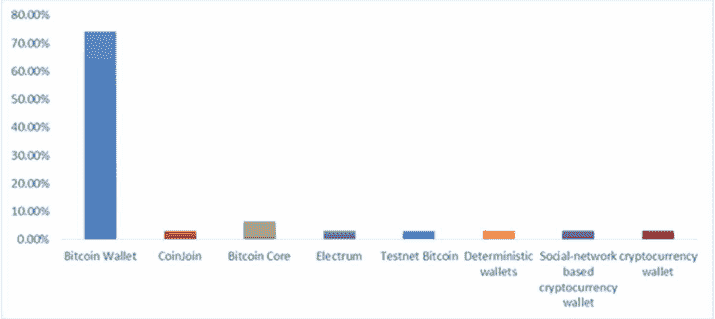

### 图 3. 数字钱包存储使用的方法概览

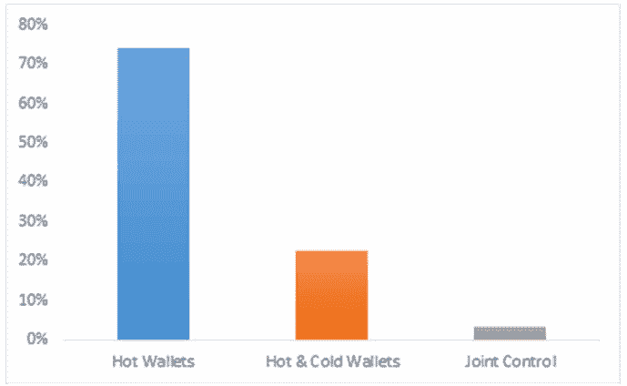

### 图 4. 防止与逃税相关的非法问题的方法概览

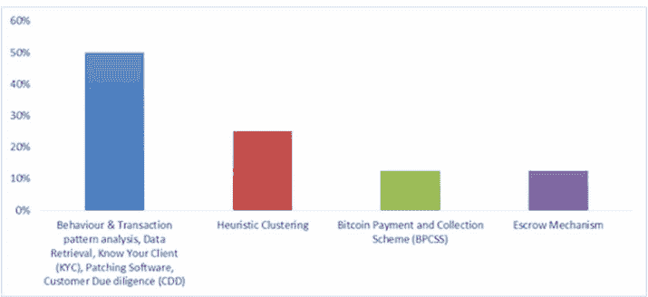

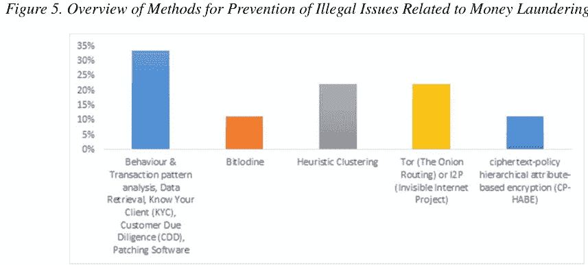

## 与毒品市场相关的法律问题

丝路毒品贩子和 WannaCry 勒索软件网络犯罪分子要求以比特币付款。各位作者提出了许多方法，并且大量研究仍在进行中，以检测非法交易。对 30 篇经过同行评审的科学文章中所提方法的相关数据进行了评估和分析，以评价这些方法。这些方法列于图 6 中。

数据分析显示，行为与交易模式分析可以检测与毒品市场相关的交易。可以分析这些模式，并追踪出被认为可疑的资金流。推荐使用 CP-HABE，因为它涉及监控交易并向监管机构报告可疑交易的监管节点。可以使用 CP-HABE 方法防止毒品营销，并将可疑交易报告给监管机构。

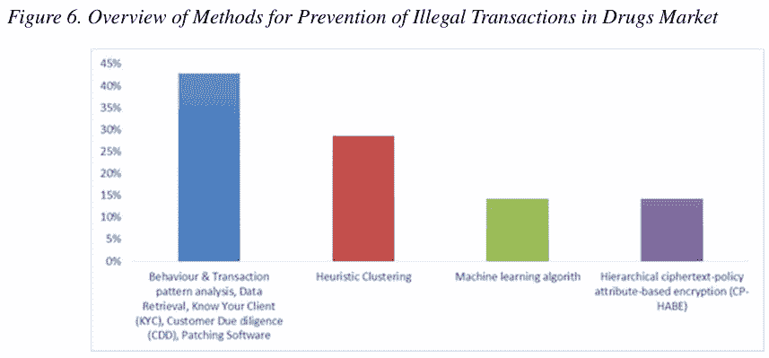

## 与私钥被盗或丢失相关的法律问题

加密货币提供安全和私密的交易，并已被用于通过非法手段洗钱。在私钥被盗或丢失的情况下，用户既无法访问也无法进行交易。各位作者提出了许多方法，并且大量研究仍在进行中，以使钱包足够安全来降低这些风险。对 30 篇经过同行评审的科学文章中所提方法的相关数据进行了评估和聚类，以得出结论。用于防止私钥被盗或丢失的方法列于图 7 中。

数据分析显示，阈值签名方案是许多研究人员最常用的方案。它是在降低与私钥丢失或被盗相关的风险方面最安全、最有用的方法。秘密共享加密技术也得到了研究，并在表 2 中列出。这些加密技术无疑将增强安全性，并有助于降低与私钥丢失或被盗相关的风险。根据经过同行评审的文章，各位作者提到的用于钱包加密的秘密共享方法已被分析、聚类并列于图 8 中。

数据分析显示，Shamir 方法和安全哈希算法-256（SHA-256）据报告是最常用的，原因包括加密强度高且与其他方法兼容，除此之外阈值签名方案也是如此。乘法秘密共享也常被使用。然而，它不够强大，且仅与少数其他方法兼容。比特币钱包使用 SHA-256 来实现更强的加密。

### 图 7. 防止私钥被盗或丢失的方法概览

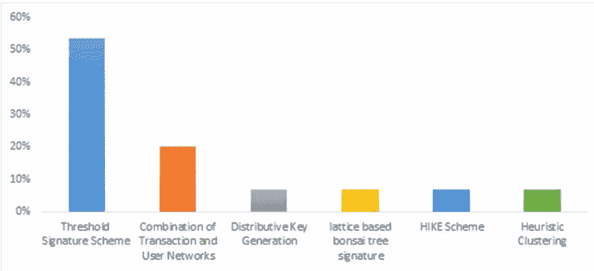

### 图 8. 用于防止私钥被盗/丢失的秘密共享方法概览

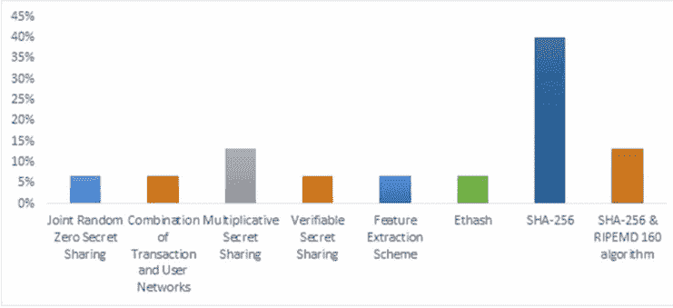

## 伦理问题评估

从 30 篇经过同行评审的科学文章中记录的去中心化、非法活动和匿名性方面的伦理问题进行了分析，并基于分析评估了伦理问题、其影响及固有挑战。本章在伦理问题标题下就各种问题提出了建议。

## 与去中心化相关的伦理问题

加密货币提供安全和私密的交易，并且完全去中心化。去中心化被用于促进非法交易并通过非法手段洗钱。各位作者提出了许多方法，并且大量研究仍在进行中，以遵循去中心化结构追踪可疑交易。本研究中评估的 30 篇经过同行评审的科学文章中所提去中心化方法的相关数据如图 9 所示。

数据分析显示，各位作者大多使用交易网络和用户网络的组合，因为它们有助于在保持去中心化和匿名性的同时追踪可疑交易。推荐使用 CP-HABE，因为它涉及监控交易并向监管机构报告可疑交易的监管节点。可以使用 CP-HABE 方法防止非法活动，并将可疑交易报告给监管机构。

### 图 9. 防止与去中心化相关的伦理问题的方法概览

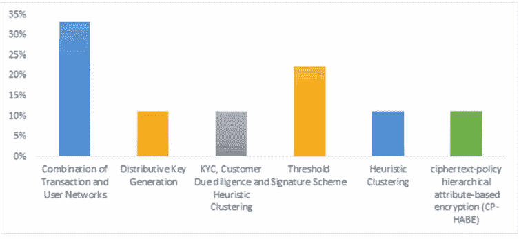


## 与非法活动相关的道德问题

不幸的是，与加密货币相关的交易为犯罪分子开展非法交易活动提供了一个安全且私密的平台。各种研究人员提出了许多方法，且仍有大量研究正在进行以追踪可疑交易。由30篇经过同行评议的科学文章所建议的用于防止非法活动的方法学相关数据，已在图10中进行评估和描绘。

图 10. 防止和检测与非法活动相关道德问题的方法概览

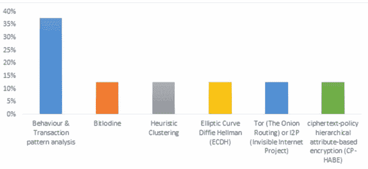

数据分析表明，可以通过用户行为和交易模式分析来追踪非法活动。许多作者倾向于这种方法，因为它分析交易流并报告可疑交易。推荐使用 CP-HABE，因为它涉及一个监管节点，用于监控交易并向监管机构报告可疑交易。可以使用 CP-HABE 方法防止非法活动，并可将可疑交易报告给监管机构。

## 与匿名性相关的道德问题

加密货币因其匿名性特征而提供安全且私密的交易。用户身份不被透露，他们保持完全匿名，这导致犯罪分子使用加密货币进行非法交易。各种作者提出了许多方法，并且仍有大量研究正在进行以追踪可疑交易。由30篇经过同行评议的科学文章所建议的用于防止与匿名性相关的非法活动的方法学，已被评估、归类并在图 11 中呈现。

数据分析表明，匿名性功能被用于处理非法活动和交易。然而，它可以通过用户行为和交易模式分析来追踪。许多作者支持这种方法，因为它分析交易流并报告可疑交易。推荐使用椭圆曲线数字签名算法（ECDSA），因为它更安全，因此常被使用。比特币钱包支持 ECDSA，因为它增强了匿名性。

图 11. 用于防止与匿名性相关道德问题的方法概览

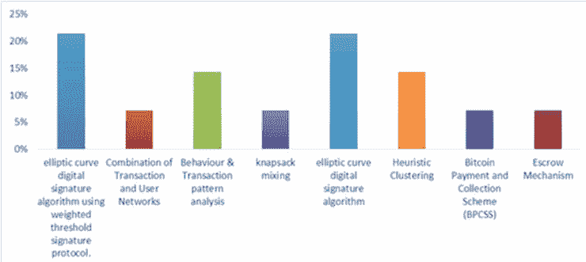

## 讨论

比特币资金转账也已成为犯罪分子进行在线交易的首选方式，原因在于其匿名性特征。因此，犯罪分子无法被追踪，其身份保持不公开。然而，中本聪在构建比特币作为虚拟货币时，最初的构想大不相同。创建比特币和其他替代数字货币的原因，是为了提供一种替代性的去中心化支付系统。自这些加密货币推出以来，它们也被用于非法交易，例如买卖非法商品、毒品和武器（Kshetri & Voas 2017; Toyoda et al. 2017; Van Der Horst et al. 2017; Meiklejohn et al. 2013; Chadha & Kumar 2017）。大多数人认为加密货币不在监管机构和当局的追踪视野之外，但事实并非如此（Reid & Harrigan 2013; Wang et al. 2018; Toyoda et al. 2017; Van Der Horst et al. 2017; Chen et al. 2017; Yin et al. 2018）。

本章重点介绍了各种研究人员用于基于加密货币检测非法活动的方法（Dikshit & Singh 2017; Reid & Harrigan 2013; Gennaro et al. 2016; Narayanan et al. 2016; Kshetri & Voas 2017; Maurer et al. 2017; Wang et al. 2018）。这些解决方案已帮助，并将继续支持政策制定者，使其在使用加密货币的背景下，就犯罪活动的安全性和不确定性做出更明智的决策。

本章的主要贡献在于关注通过比特币等数字货币在线进行的负面和非法活动领域。事实是，目前政策制定者监管加密货币的能力有限，原因在于加密货币已让犯罪分子有机可乘并将其用于非法活动。因此，本章专注于帮助监管机构和政策制定者制定法规和指南，以控制正在在线进行的非法活动。

本章的另一项贡献是介绍可用于识别非法活动和监管加密货币的新应用的讨论。讨论开发新方法（如 CP-HABE 和交易与模式分析）以及如何利用它们来检测非法活动，是本章的主要目的（Wang & Gao, 2018）。执法机关可以利用本章提到的应用作为监控机制，打击贩毒、武器买卖和洗钱等非法活动（Kshetri & Voas 2017; Toyoda et al. 2017; Van Der Horst et al. 2017; Chadha & Kumar 2017; Liu, Chen, et al. 2017）。通过上述应用追踪非法活动并对其进行监控，可以震慑正在进行的非法活动。这有望遏制加密货币中的非法交易和非法交易行为。

本章揭示了一个事实：丝绸之路等暗网市场是通过比特币和其他数字货币而出现的。人们正在暗网上购买非法武器和毒品，并利用加密货币的匿名性功能进行支付（Kshetri & Voas 2017; Toyoda et al. 2017; Van Der Horst et al. 2017; Meiklejohn et al. 2013; Chadha & Kumar 2017）。这可能是街头犯罪比例相比在线犯罪比例变小的原因。人们在贩毒和买卖非法武器等活动中，已经从街头转向线上。根据一些作者的观点，这导致街头暴力事件减少（Christin, 2014）。我们在本研究中指出，上述非法活动可以得到防范。通过本章提到的应用，可以在一定程度上防范暗网，并对加密货币的使用进行“去匿名化”以追踪犯罪分子。

本章揭示，椭圆曲线（一种使用加权阈值签名协议的数字签名）（Gennaro et al. 2016; Dikshit & Singh 2017）被采用，而不是简单的使用阈值签名协议的椭圆曲线数字签名（Narayanan et al., 2016），因为它在完成权重要求的同时，向每个参与者分配一份密钥份额。这可以作为解决匿名性问题和保障比特币钱包安全的方案。未来，本章还可帮助分析非法活动的规模，并量化和比较在线非法活动与类似街头活动的规模。本章并未量化非法网站运营的规模，但这有助于通过分析这些网站的活动（尤其是涉及加密货币交易方面）来追踪此类网站。

本章未讨论加密货币中可能出现的价格波动影响，尽管它强调了可能对价格产生巨大影响的法律和伦理含义。例如，加密货币的真实用户知晓其正在被用于非法活动，这一事实在一定程度上影响了其在线交易价格。在这种情况下，政府实施严格政策或法规可能会在很大程度上对价格产生不利影响。

对于监管机构而言，本章在上述背景下理解整体法律和伦理问题方面提供了价值。它有助于遏制与暗网相关市场的增长。除了丝绸之路 2.0、军械库和 Agora 之外，还有其他正在暗网运营且尚未被发现的暗市场。本章可以通过分析加密货币的使用行为和交易模式，帮助追踪新的暗市场。

总体而言，本章的研究结果总结了使用加密货币进行的各种非法活动，并对其进行分类，以便给出推荐应用的建议。本研究中提到的方法，如行为和交易模式分析以及网络分析，有助于追踪这些犯罪分子。本章可以帮助监管机构和政策制定者制定政策体系并监管加密货币的使用。此外，本章还通过推荐使用各种应用，为使加密货币钱包更安全提供了一些指导。这有助于降低与加密货币使用相关的风险、攻击和盗窃。


### 结论

许多国家已禁止某些虚拟货币（例如比特币），因为政府无法控制使用这些货币进行的交易。国家不应仅仅因为犯罪分子利用比特币等加密货币进行非法或不良活动，就将其定为非法。数字货币被视为未来货币，有潜力在经济金融体系中创造新的革命。因此，限制其使用并禁止它们并不是解决方案。这些货币在世界经济的进一步发展中有其应有的地位。

本章重点介绍了可用于监管和控制加密货币使用的各种应用。我们分析了从30篇经过同行评审的科学出版物（发表于2011-2018年）中提取的数据，这些出版物描述了涵盖比特币等加密货币法律和伦理方面的实验观察。我们提出了多种防止逃税和洗钱的方法，以便犯罪分子无法从犯罪活动中获利，并且监管者可以通过要求相关方缴税和披露收入来监管加密货币交易者。行为和交易模式分析、KYC、CDD以及打补丁软件可作为反洗钱和打击恐怖主义融资的手段。本章中提出了多种方法，以帮助降低私钥被盗或丢失的风险，并保障加密货币中数字钱包的安全。例如，阈值签名方案被用作保障数字钱包安全的各类方案中最高效、最优的方案。SHA-256被认为提供了最佳的加密形式。

我们的研究揭示，由于近年来比特币钱包在交易和价格波动方面非常流行，因此是使用最广泛的钱包。同时也揭示，由于匿名性，这在犯罪分子中变得流行，这意味着犯罪分子不会被追踪，其身份保持不公开。我们提到了如何利用去中心化和匿名性来追踪犯罪分子。犯罪分子可以通过交易和用户网络的结合来追踪。本章还提到了帮助防止使用加密货币进行毒品营销和其他非法活动（如武器交易和恐怖主义资助）的方法。我们强调了不同的应用来追踪非法活动，作为解决方案，例如使用先前的交易来追踪加密货币的使用。

过去许多研究已考虑和讨论与加密货币相关的法律问题，但尚未令人满意地研究整体法律和伦理问题。本章考虑了这些顾虑，并结合现有应用提供了有见地的建议，以防止与使用加密货币相关的非法活动。加密货币的匿名性功能使犯罪分子认为自己无法被追踪。本章提出了多种去匿名化加密货币并追踪犯罪分子的方法。这还可以防止未来暗网的增长。我们的当前研究还可以协助政策制定者做出更明智的决策，涉及安全增强，这些增强可以消除通过加密货币交易进行犯罪活动所导致的不确定性。

## 作者贡献

N.M. 和 M.N.H. 构思了研究思路并制定了分析计划。N.M. 分析了数据并撰写了初稿章节。M.N.H. 协助准备图表并最终定稿。K.A. 提供了最终编辑。所有作者均参与了校对。

### 参考文献

Alvarado, J., & Halgamuge, M. N. (2019). 区块链供应链管理新时代：一项综述. In Industry 4.0 and Hyper-Customized Smart Manufacturing Supply Chains (pp. 1–37). IGI Global.

Baravalle, A., Lopez, M. S., & Lee, S. W. (2016). 挖掘暗网：毒品和假身份证. 2016 IEEE 第16届数据挖掘研讨会 (ICDMW), 350–356. 10.1109/ICDMW.2016.0056

Barratt, M. J., Ferris, J. A., & Winstock, A. R. (2016). 更安全的获毒方式？暗网市场、社会供应与毒品市场暴力. 药物政策国际期刊, 35, 24–31. doi:10.1016/j.drugpo.2016.04.019 PMID:27241015

Chadha, S., & Kumar, U. (2017). 勒索软件：让我们反击！2017 计算、通信与自动化国际会议 (ICCCA), 925–930. 10.1109/CCAA.2017.8229926

Chen, P.-W., Jiang, B.-S., & Wang, C.-H. (2017). 基于区块链的使用普遍比特币数字钱包的收款监督系统. 2017 IEEE 第13届无线与移动计算、网络和通信国际会议 (WiMob), 139–146. 10.1109/WiMOB.2017.8115844

Christin, N. (2014). 对 Barratt et al. (2014) 的评论：迈向刻画在线匿名毒品市场客户的步骤 [评论]. 上瘾（阿宾登，英国）, 109(5), 784–785. doi:10.1111/add.12519 PMID:24720826

Dikshit, P., & Singh, K. (2017). 用于保障比特币钱包安全的高效加权阈值ECDSA. 2017 ISEA 亚洲安全与隐私会议 (ISEASP), 1–9. doi:10.1109/ISEASP.2017.7976994

Fraser, J. G., & Bouridane, A. (2017). 围绕比特币的安全缺陷是否影响了货币的价值？2017 第七届新兴安全技术国际会议 (EST), 50–55. 10.1109/EST.2017.8090398

Gennaro, R., Goldfeder, S., & Narayanan, A. (2016). 阈值最优 DSA/ECDSA 签名及其在比特币钱包安全中的应用. In M. Manulis, A.-R. Sadeghi, & S. Schneider (Eds.), 应用密码学与网络安全 (pp. 156–174). Springer International Publishing. doi:10.1007/978-3-319-39555-5_9

He, S., Wu, Q., Luo, X., Liang, Z., Li, D., Feng, H., Zheng, H., & Li, Y. (2018). 基于社交网络的加密货币. IEEE Access：实用创新，开放解决方案, 6, 7654–7663. doi:10.1109/ACCESS.2018.2799385

Kaushal, P. K., Bagga, A., & Sobti, R. (2017). 比特币演进与比特币钱包安全风险. 2017 计算机、通信与电子国际会议 (CompteLix), 172–177. 10.1109/COMPTELIX.2017.8003959

Kshetri, N., & Voas, J. (2017). 加密货币是否助长勒索软件？IT 专业人员, 19(5), 11–15. doi:10.1109/MITP.2017.3680961

Liu, Y., Chen, X., Zhang, L., Tang, C., & Kang, H. (2017). 比特币挖矿池盈利的智能策略. 2017 第10届计算智能与设计国际研讨会 (ISCID), 2, 427–430. 10.1109/ISCID.2017.184

Liu, Y., Liu, X., Zhang, L., Tang, C., & Kang, H. (2017). 消除比特币交易可塑性的高效策略. 2017 第4届系统与信息学国际会议 (ICSAI), 960–964. 10.1109/ICSAI.2017.8248424

Maurer, F. K., Neudecker, T., & Florian, M. (2017). 具有任意值的匿名 CoinJoin 交易. 2017 IEEE Trustcom/BigDataSE/ICESS, 522–529. doi:10.1109/Trustcom/BigDataSE/ICESS.2017.280

Mehta, I. S., Chakraborty, A., Choudhury, T., & Sharma, M. (2017). 高效比特币安全算法方法. 2017 信息通信技术与无人系统国际会议（趋势与未来方向） (ICTUS), 807–810. 10.1109/ICTUS.2017.8286117

Meiklejohn, S., Pomarole, M., Jordan, G., Levchenko, K., McCoy, D., Voelker, G. M., & Savage, S. (2013). 一把比特币：刻画无名之辈之间的支付. 2013 互联网测量会议论文集, 127–140. 10.1145/2504730.2504747

Mirzayi, S., & Mehrzad, M. (2017). 比特币：SWOT 分析. 2017 第7届计算机与知识工程国际会议 (ICCKE), 205–210. 10.1109/ICCKE.2017.8167876

Nakamoto, S. (2019). 比特币：一种点对点电子现金系统. Manubot. https://git.dhimnel.com/bitcoin-whitepaper/

Narayanan, A., Bonneau, J., Felten, E., Miller, A., & Goldfeder, S. (2016). 比特币和加密货币技术：全面介绍. Princeton University Press.

Quamara, S., & Singh, A. K. (2016). 比特币与安全金融交易处理：最新进展. 2016 第2届应用与理论计算通信技术国际会议 (ICATccT), 216–219. 10.1109/ICATCCT.2016.7911995

Reid, F., & Harrigan, M. (2013). 比特币系统中匿名性分析. In Y. Altshuler, Y. Elovici, A. B. Cremers, N. Aharony, & A. Pentland (Eds.), 社交网络的安全与隐私 (pp. 197–223). Springer. doi:10.1007/978-1-4614-4139-7_10

Shanmugam, B., Azam, S., Yeo, K. C., Jose, J., & Kannoorppatti, K. (2017). 网络犯罪分子使用比特币的批判性综述. 2017 计算机通信与信息学国际会议 (ICCCI), 1–7. 10.1109/ICCCI.2017.8117693


Shehhi, A. A., Oudah, M., & Aung, Z. (2014). 选择加密货币背后影响因素的调查. 2014 年 IEEE 工业工程与工程管理国际会议, 1443–1447. 10.1109/IEEM.2014.7058877

Shrestha, B., Halgamuge, M. N., & Treiblmaier, H. (2020). 基于区块链的在线多媒体管理：现有平台的特征. 载于《区块链和分布式账本技术用例》（第 289–303 页）. Springer.

Tama, B. A., Kweka, B. J., Park, Y., & Rhee, K.-H. (2017). 区块链及其当前应用的批判性回顾. 2017 年电气工程与计算机科学国际会议 (ICECOS), 109–113. 10.1109/ICECOS.2017.8167115

Toyoda, K., Ohtsuki, T., & Mathiopoulos, P. T. (2017). 通过交易模式分析识别比特币中的高收益投资计划. GLOBECOM 2017 - 2017 年 IEEE 全球通信会议, 1–6. 10.1109/GLOCOM.2017.8254420

Tschorsch, F., & Scheuermann, B. (2016). 比特币. IEEE 通信调查与教程, 18(3), 2084–2123. doi:10.1109/COMST.2016.2535718

Upadhyaya, R., & Jain, A. (2016). 网络伦理与网络犯罪：对合法性、勒索软件、地下网络和比特币钱包的深入研究. 2016 年计算、通信与自动化国际会议 (ICCCA), 143–148. 10.1109/CCAA.2016.7813706

Van Der Horst, L., Choo, K.-K. R., & Le-Khac, N.-A. (2017). 比特币进程内存调查. IEEE Access：实用创新，开放解决方案, 5, 22385–22398. doi:10.1109/ACCESS.2017.2759766

Wang, Q., Li, X., & Yu, Y. (2018). 匿名性. IEEE Access：实用创新，开放解决方案, 6, 12336–12341. doi:10.1109/ACCESS.2017.2787563

Wang, Y., & Gao, J. (2018). 基于比特币中密文策略分级属性加密的监管方案. IEEE Access：实用创新，开放解决方案, 6, 16267–16278. doi:10.1109/ACCESS.2018.2814620

Yin, W., Wen, Q., Li, W., Zhang, H., & Jin, Z. (2018). 区块链中抗量子交易身份验证方法. IEEE Access：实用创新，开放解决方案, 6, 5393–5401. doi:10.1109/ACCESS.2017.2788411

Zhang, Y., & Li, J. (2016 年 6 月 30 日). 基于 DWT-DCT 的自动识别真实作品防伪算法. 安全及其应用国际期刊, 10(6), 135–144. doi:10.14257/ijsia.2016.10.6.14

## 第 8 章

## 面向中央证券存管机构的基于区块链技术的证券结算模型

Andre P. Calitz
南非纳尔逊·曼德拉大学

Jean H. Greyling
https://orcid.org/0000-0002-6773-9200
南非纳尔逊·曼德拉大学

Steve Everett
南非纳尔逊·曼德拉大学

### 摘要

1980 年至 2000 年间，交易后证券结算进入电子时代。安全电子消息传递等技术的引入以及数据库技术的改进，使中央证券存管机构（CSD）作为证券结算交易后环境中的受信第三方或中介机构得以诞生。本章报道的研究重点关注 CSD 以及区块链技术在证券结算中的应用。目标是开发一个使用区块链技术为 CSD 进行证券结算的模型，因为目前在全球范围内，尚有 CSD 为证券结算引入生产就绪的基于区块链的解决方案。根据文献创建了一个概念模型，并由国际交易后证券专业人员进行了评估。研究结果促成了对模型主要组成部分的接受，重点关注解决方案的成本，并确定了此类解决方案的先决条件（例如，法律/监管支持）。

### 引言

随着新技术的出现，金融服务行业在全球范围内引入了新的支付方式和服务。移动设备和银行应用程序（Apps）的使用使银行服务更加便捷，从而改善了用户体验。电子现金现在可以以点对点方式（价值转移）发送，而无需金融服务中介（Nakamoto, 2008）。现金和股票（例如在金融交易所交易的证券）都有价值，并且通常可以在买卖双方之间转移。股票买家直接与该股票的卖方或股票发行人（例如发行股权或债务股票的公司）进行交互，并在网络中具有查看交易的能力（Gibson 和 Kirk, 2016）。

加密货币，例如比特币、莱特币和以太坊，引入了一种可在双方之间交换的数字资产。点对点交易是比特币区块链中进行的核心交易类型，该区块链使用一种称为比特币的加密货币，该加密货币使用密码学在可验证的数据库中保护点对点交易，该数据库在未被检测到的情况下无法更改或修改（Swanson, 2015）。通常，这些交易可以不受地理限制地进行，且无需使用传统银行服务。

证券结算是一种业务流程，证券在双方之间以现金支付为对价进行交付。在证券结算中实现此类点对点交易的机会（例如可以将权益或债务工具兑换为现金）在金融服务领域引起了巨大炒作，因为证券结算生态系统中存在取代金融服务中介的潜力（Gartner, 2020）。

Gartner（2020）指出，区块链技术正处于过度膨胀期待的峰值。值得注意的是，尽管该技术在当前形式中相对较新，但所采用的许多密码学技术早在 20 世纪 70 年代就已开发（KPMG, 2018）。因此，由于该技术基于众所周知的密码学技术并在比特币生态系统中得到应用，其在证券结算中的应用有待进一步探索。

在过去二十年中，证券交易所的传统交易大厅已被虚拟交易大厅取代，然而，无论是虚拟还是实体，各自都提供了连接希望买卖股票的投资者的能力（O’Connor, 2004）。随后的流程允许交易后交换现金和证券，这通常称为“交易后”流程。尽管在这一时期金融服务领域出现了各种技术进步，但该流程在过去 10 至 15 年间并未发生重大变化。

在从交易到交易后的环境中，存在多个受信第三方，例如交易所、经纪商、交易商和中央证券存管机构（CSD）。Karp（2015）强调，通过使用区块链有望颠覆金融服务的这一特定领域。例如，CSD 通常是大多数市场中的受信第三方，特定市场可能只有一个或少数几个负责证券结算的 CSD。

区块链技术作为一种平台，为证券结算创造了新的机会并具有巨大潜力。基于算法确认的点对点资产交换能力是改善任何市场效率和降低成本的诱人前景。然而，该技术并不新鲜，已被广泛开发和记录了十余年。

本章旨在探讨为什么区块链技术尚未成功转化为证券结算的基于区块链的生产系统。已使用区块链技术提出了一种证券结算模型。该模型已由一支国际参与者团队进行了评估。

### 问题陈述与研究目标

在本研究发表时，全球尚无使用区块链技术进行证券结算的中央证券存管机构（CSD），尽管许多机构已就计划中的研究和实施发布了新闻稿。此外，加密货币市场与现有证券市场同步继续增长。因此，本研究调查的研究问题如下：

目前，没有中央证券存管机构（CSD）或任何资本市场基础设施使用区块链技术进行证券结算。

本研究首先通过识别 CSD 所降低的风险（考虑到所涉及的行为者、中介机构和各种结算模型），以及现有技术和流程如何帮助实现成功结果来启动。一旦这些被识别，研究便探讨了资本市场证券结算主要参与者（即监管机构、发行人和投资者）对证券结算存在哪些期望。研究评估了在成熟证券结算市场中实施新区块链技术的最合适方法。这提供了一种平衡的评估，包括现有区块链技术的固有风险和感知收益。随后提出了一个概念模型，并评估了其接受度，不仅由 CSD，而且由行业的主要国际参与者评估。

本研究的主要研究问题是：

行业国际参与者对使用区块链技术进行证券结算的拟议模型有何看法？

本研究的主要研究目标是：

由国际参与者评估用于中央证券存管机构的基于区块链技术的证券结算拟议模型。

本研究聚焦于 CSD 以及区块链技术在证券结算中的应用。由于大多数国家只有一个或两个 CSD，因此必须从国际 CSD 以及南非的 CSD（即 Strate Ltd.）获取信息。该研究局限于评估在 CSD 内针对传统 CSD 工具（如债券、货币市场和股票）使用区块链技术进行证券结算的拟议模型。

由于该技术领域发展迅速且创新不断，本研究在两年内进行，未重新评估关于区块链技术的最新可用信息和进展。本研究未开发任何软件应用程序，因为本研究的主要目标是专注于解决应用区块链技术进行证券结算的广泛原则。


本研究旨在提供一种务实的概念设计，将区块链技术应用于证券结算，在平衡技术真正收益的同时不引入不必要的风险。中央证券存管机构（CSD）或向市场提供结算服务的系统的技术失败风险，可能对各国经济造成灾难性影响。因此，本研究旨在发挥积极作用，确保在考虑稳健模型，因为支撑这些市场的技术正在快速发展。

## 文献综述

## 交易后证券结算生态系统

在介绍交易后流程的详细信息之前，了解参与该行业的行为者、中介和监管机构的整个生态系统背景非常重要。Harris (2004) 确定，股票（例如股权或债务工具）可以采取多种形式，如股权、商品或债务工具。股票可以通过交易所成员经纪人在交易所上买卖。Harris (2004) 进一步将交易定义为一种搜索问题，即买家需要寻找卖家，卖家需要寻找买家。股票交易中涉及的主要行为者包括：

- 经纪商：他们协助客户寻找愿意与其交易的交易者；
- 交易商：他们根据客户的意愿随时与客户进行交易。交易商买入和卖出时，价格分别称为“买入价”和“卖出价”；以及
- 交易所和经纪商：它们通过将买卖双方置于同一电子交易平台，从而降低买卖双方的搜索成本，进而撮合买家与卖家，反之亦然。这些平台还提供特定股票的最佳买入价和卖出价等重要信息。

一旦买卖双方通过各自的经纪商在交易所上就价格（介于买入价和卖出价之间）达成一致，交易所就会向经纪商发送报告以确认交易。买家必须向购买股票（与证券一词互换使用）的经纪商付款，然后数天后（南非为五天），卖家收到股票的付款，而买家收到约定数量的股票，价格为已商定的价格（Harris, 2004）。

第一家电子股票交易所 NASDAQ 成立于 1971 年的美国，并于 1980 年实现完全电子化（Atack and Neal, 2009; Gorham and Singh, 2009）。用于证券交易的电子股票交易所需要更高效的交易后处理。交易后处理包括清算与结算的过程。Loader (2002) 将清算描述为“通过匹配、记录和处理交易指令为结算做准备”，将结算描述为“以其他资产交换现金或资产”，其中包括“法律所有权的交换”。Gorham and Singh (2009) 描述，手动清算和结算已匹配交易的过程既繁琐又复杂，并要求金融市场中的许多机构进行合作和协同工作。管理清算与结算的复杂性也是交易后风险管理的关键组成部分，以确保卖家收到付款，买家收到合同约定的资产，从而降低信用风险和违约风险（Gorham and Singh, 2009）。

证券结算系统（SSS），更具体地说是中央证券存管机构（CSD）的形式，是在二十多年前引入的，旨在为本地市场提供集中式的保管功能，并以集中式和电子方式加速清算与结算的处理（Loader, 2002）。本地市场发行人通常会将其全部发行量存放在 CSD 进行保管（Dickinson, 2015）。Dickinson (2015) 进一步阐述，CSD 实现了实物股票的非实物化，这些股票之前以实物证书形式保存在投资者、发行人或托管人处。这些股票除了存储成本高昂之外，还面临丢失、损坏和被盗的风险。

图 1. 交易所行业价值链 [改编自 Floreani 和 Polato (2014)]

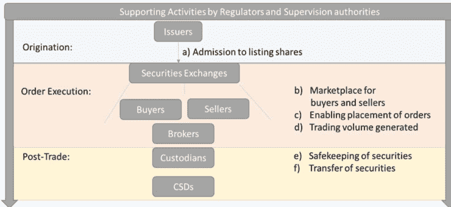

CSD 位于交易后结算流程的末端，该流程构成了整个交易所行业价值链的一个子集，如图 1 所示。图 1 表明价值链中有三个关键阶段，即发起、订单执行和交易后；并且这些活动中的每一项在给定市场或地区都受到监管和监督（Floreani and Polato, 2014）。CSD 关注证券的保管和转让等交易后活动。因此，CSD 可以被视为作为整体交易后流程的一部分，按市场或地区执行证券结算。Caprio (2013) 指出，证券结算由四项主要要求定义，即：

- 证券所有权：结算必须完成所有权转让的法律要求，在适用司法管辖区的法律框架内；
- 现金结算：虽然现金支付是证券结算的重要方面，但最重要的是交付财产（证券/股票/股份）。因此，在处理现金或证券时，买方或卖方应在中介机构破产的情况下保持所有权；
- 具有成本效益且高效的结算：这些结算还应具有全球竞争力，并能与其他全球结算系统互操作；以及
- 不改变转让证券性质的结算：如果证券对发行人拥有某项权利（例如投票权），持有该证券的人必须能够行使归属于该特定证券的权利。

然而，CSD 并不是发行人（即发行债务或股权证券以筹集资本的机构）与投资者之间进行交易后证券结算的唯一可信第三方，如图 2 所示。Dickinson (2015) 指出了以下差异，并包括对 a) 到 h) 的说明：

- (a) 直接投资者（买入或卖出证券/股票）可以委任托管人，并有权选择一家或多家经纪商；
- (b) 托管人反过来会在 CSD 中设立一个代名人账户，由直接投资者和机构投资者组成；
- (c) 直接投资者也可以选择由托管人管理的在 CSD 中设立的直接账户；
- (d) 使用经纪商的直接投资者将在经纪商处设立账户，该经纪商反过来会在 CSD 中设立一个称为“经纪商参与者账户”的账户；
- (e) 机构客户可以直接与一家或多家托管人开立账户；
- (f) 机构客户通常会向投资经理提供访问其账户的权限，由托管人提供；
- (g) 投资经理也可以委任自己的托管人；以及
- (h) 机构客户可以委任拥有自己托管人的投资经理，作为替代方案。

图 2. 交易后结算格局 [改编自 Dickinson (2015)]

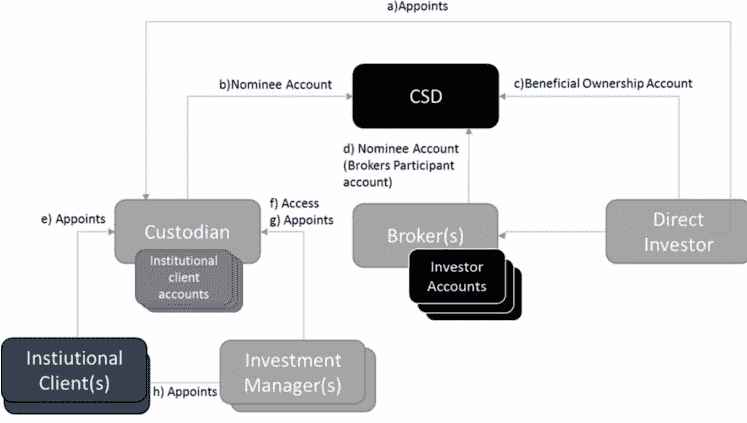

在图 2 中，假设发行人已经发行了证券（即股权或债务）。这表明 CSD 在保管和转让证券方面所发挥的系统性重要、互联互通的核心作用。资产转让和托管方式的任何商业模式变化，都将影响图 2 中描绘的所有中介，甚至可能导致全新的商业模式，世界经济论坛 (2015) 指出，对于所有中介来说，去中介化是一个明确的可能性。

通常，这些中介以某种形式相互交互，如图 2 所示。这意味着图 2 所代表的互联互通性质中涉及系统、流程和人员。比特币最初推出时，就提出了一个问题：是否有必要拥有这些中介，以及是否仅有买卖双方以点对点方式进行交易是可能的（Swan, 2015）。

## 区块链作为 CSD 的潜在颠覆者

Zohar (2015) 认为，区块链技术可能颠覆现有商业模式，因为没有单一实体能够阻止交易或收取费用。区块链技术有效地消除了对可信第三方处理交易和提供记录保存服务的需求，这对某些中介（例如 CSD）的核心业务职能构成了威胁。

Swan (2015) 认为，用于证券结算的区块链可能需要更多的开发和定制，将最终结果描述为“区块链 2.0”。这本身就是一个有趣的概念，因为截至 2015 年的区块链技术发展，自 2008 年诞生以来已经经历了广泛的改进和变化。将区块链技术应用于证券结算，需要增强 Caprio (2013) 定义的四个主要问题，才能形成 Evans (2003) 此前定义的适当商业案例。

由于证券结算的互联互通性，用于证券结算的去中心化区块链技术模型尚未得到明确定义。这将需要与监管机构、中介、发行人和投资者进行市场协调和规划，以验证商业案例，以便将该技术作为当前使用技术的替代方案推进（资本市场监管委员会, 2019）。

区块链技术在不断发展，然而，考虑到交易后环境的互联互通格局，将区块链技术应用于证券结算是一项复杂的工作。不过，可以开发一个使用区块链技术进行证券结算的理论概念模型。该模型需要确保，在不引入额外风险的情况下，可以将区块链技术的优势应用于特定市场的 CSD。

Swan (2015) 将区块链描述为一种颠覆性技术。这意味着，区块链有可能使交易在无需可信第三方的情况下进行。中央证券存管机构（CSD）是特定市场证券结算的事实上的可信第三方。因此，如果该技术引入了一套根本性的新规则，该规则可能决定资本市场结算的方式，或许无需 CSD（Karp, 2015），那么作为可信第三方的 CSD 可能变得无关紧要。

因此，理解为什么在区块链技术背景下结算证券，比使用比特币等加密货币进行点对点交易更具挑战性非常重要。几乎每周，资本市场的不同参与者都会宣布新的原型机或概念验证，旨在在区块链上结算证券（资本市场监管委员会, 2019）。如果这在技术上可行，那么除了技术本身之外，必须考虑其他条件。


颠覆性技术有潜力提升成熟行业中不知名的企业，同时淘汰经过验证甚至占据主导地位的现有企业。由于CSD在特定市场中占据“主导”地位（每个市场通常只有1-2家CSD），它们似乎是像区块链这样的颠覆性技术的理想用例，因为它在大多数市场中是“可信第三方”。CSD通常位于资本市场多个实体/中介之间的交易后结算流程的中间，尽管位于交易后流程的末端。因此，这种颠覆性技术提供了一个差异化的机会，以消除对主导中介（如CSD）的需求，并实现给定股票买卖双方之间的点对点结算交易。这一观察也可能是，CSD是使技术能够从本质上颠覆自身的明显起点。

区块链技术有潜力消除金融服务中任何流程的中介环节（《经济学人》，2014年）。这意味着，证券结算交易供应链中的所有金融服务提供商都是潜在的去中介化点，包括中央银行、经纪商、托管银行和CSD。然而，去中介化只有在技术能够提供差异化因素时才会发生，这些因素可以降低成本、提高效率并增强信息安全性（资本市场监管委员会，2019年）。撰写本文时，上述任何实体均未发生去中介化，尽管该技术自2008年以来一直在使用。全球资本市场参与者群体中有许多正在进行的倡议，但没有任何一家在交易后证券结算中端到端成功实施了该技术（资本市场监管委员会，2019年）。

要使区块链作为真正的颠覆者实现其潜力，该技术需要成为差异化因素，而不仅仅是使能者（Swan，2015年）。这或许就是迄今为止交易后证券结算中很少发生颠覆的关键所在。需要注意的是，资本市场中介群体中仍有许多实验正在进行，其中大部分都伴随着关于与新兴金融科技公司和成熟公司合资企业的新闻稿。这种实验对于理解技术是必要的；然而，这种实验并非在市场范围内进行，也没有采用市场范围的设计来实现共同目标。

## 证券托管

本节介绍证券托管的概念以及该概念在CSD角色中的应用。在去实物化之前，由于证券具有实物性质，投资者寻求托管服务以保管其证券，从而有效地创造了“间接资产持有”（Eva，2015年）。然而，技术的进步导致了电子证券持有和CSD的使用，但这并未消除间接持有，尽管它显著降低了风险并提高了效率。Eva（2015年）提到，相反的结果是，在一个或多个托管人之间增加了间接持有数量，这些托管人为投资者管理并履行安全保管职能。

虽然仍有可能成为直接投资者（买方/卖方），但投资者仍有选择指定托管人（通常是银行）的选项，并有能力选择一家或多家经纪商（Swanson，2015年）。可能在一系列“托管链”中运营的中介的不完整列表如下：

- 经纪商：在托管人处持有账户，用于其自身头寸或其客户的头寸；
- 托管人：与其他托管人持有账户，通常是次级托管人或全球托管人（欧洲中央银行，2007年）；
- 机构客户：能够直接与一家或多家托管人开立账户；他们通常会为投资经理提供访问其在托管人处账户的权限；可以指定拥有自身托管人的投资经理作为替代方案；以及
- 投资经理：也可以指定其自身的托管人。

上述托管链代表了一个多层账户和间接持有结构，它们共同协作以支持稳定的证券结算（欧洲中央银行，2016年）。虽然这些中介合作以保持证券结算稳定，但托管链有能力修改投资者的权利，因为托管人与其次级托管人之间存在多个条款和条件，这可能对投资者不利（Eva，2015年）。

发行人与投资者在托管关系方面的距离已被1至3家托管人中介，在所有权记录在CSD中实现之前。此外，投资者的权利在此过程中被改变，从而导致最终投资者出现“间接持有”案例（Eva，2015年）。另外，买方和卖方各自拥有自己的托管安排。托管服务通常作为包含税务、现金管理、投资建议和经纪服务在内的服务组合中的一项服务提供，无论是仅在国内市场还是在多个地理区域（欧洲中央银行，2007年）。结算最终性由各国的法律框架支持，是托管链中当前结算系统的关键组成部分，通常受托管人或CSD处证券账户内转账的影响（Mori，2016年）。

重要的是要理解，股票的买卖双方实际上已将结算证券所需的许多行政和运营职能外包给一系列中介，包括托管人、次级托管人、CSD、经纪商和投资经理。根据金融稳定委员会（2009年），CSD作为联合市场倡议引入，用于为国家市场（国家或地区）电子结算大量非实物化股票并维护所有权中央登记册。

Eva（2015年）断言，CSD通常位于托管链的中介之间，一家或多家托管人（次级托管人）以协调和有序的方式与CSD进行交互，以保障投资者资产安全。CSD通常服务于国家市场，并在特定国家的国家监管机构中发挥重要作用（欧洲中央银行，2007年），并在不同国家的实施中存在细微差别（Euroclear and Oliver Wyman，2016年）。Euroclear and Wyman（2016年）进一步澄清，这意味着关于CSD存在主权（即特定于国家）的要求，因为监管机构将要求基于个别市场要求的直接监督、监控和定制报告。

金融稳定委员会（2009年）得出结论，CSD是资本市场平稳运行的系统性重要市场基础设施，不仅从证券结算角度，而且从市场行为原因来看（Euroclear and Wyman，2016年）。如果CSD因资本市场内部的复杂性和相互关联性而出现困境或失败，这将对更广泛的金融体系和经济活动造成重大干扰。根据Brennan and Lunn（2016年），CSD、集中式账簿以及凭借其当前技术的记录保存结构并非不可更改，并且易受审查、伪造或交易撤销的影响。需要注意的是，尽管CSD记录并非不可更改，但存在其他逻辑和物理安全控制来管理信息安全和数据保护，并且一直这样做得非常成功。鉴于CSD在特定市场中也占据主导地位，因此CSD系统需要按照预定义的标准和协议与本地市场中各种中介和交易所的系统进行互操作。

## 分布式账本技术

本节评估分布式账本技术（DLT）是否适合证券结算的当前预期。介绍了采用DLT的各种方法，以评估DLT是否能为证券结算带来好处，或与现有做法和技术形成差异化。

在全球当前市场中，为证券结算采用新平台，伴随着渐进式技术改进或变更，通常需要多年时间才能实施。通常，市场委员会会考虑变更或改进，并按照生态系统中其他组织的时间表，采用各组织同步的时间表实施。其中一个例子是Target 2 Securities（T2S），由欧洲中央银行（2015年）推动，在欧洲实施花费了超过七年时间，以协调跨境结算。

虽然引入新的现有企业所带来的颠覆性变革无法完全消除，但鉴于受影响实体的相互关联性，采用相对较新的技术将需要类似的协作方式。摩根士丹利（2016年）、欧洲证券和市场管理局（2016年）以及Euroclear and Oliver Wyman（2016年）一致认为，对连接的旧系统、流程和组织变更的影响过于复杂，无法以“大爆炸”方式考虑，极有可能通过市场论坛或联盟采用协调方式实施。根据世界交易所联合会（2016年）的描述，已经形成了一些由银行、市场基础设施和交易所组成的区块链联盟，专注于许可型DLT解决方案。这些包括R3 CEV、Hyperledger和交易后分布式账本集团。然而，这并不意味着没有其他潜在采用方法，例如Euroclear and Oliver Wyman（2016年）所识别的那些方法。

Euroclear and Oliver Wyman（2016年）指出，协作可能是另一种替代方案。这由现有市场参与者（如CSD或行业联盟）牵头，如DTCC（2016年）所述，旨在与现有技术并行开发新技术。通常，这取决于是否存在商业案例（摩根士丹利，2016年）。最后，强制性政策是另一种替代方案，即由监管机构强制规定在市场范围内用区块链技术取代现有系统（Euroclear and Oliver Wyman，2016年）。

虽然DLT提供的功能与促进证券结算所需的功能之间可能不存在一对一的对应关系，但重要的是要承认，DLT仍然是一项新兴和不断发展的技术。Swan（2015年）提出了“区块链2.0”的潜力对DLT证券结算系统设计可能意味着什么的概念。有迹象表明该技术正在进一步发展，这需要在新的基于DLT的生态系统设计中加以考虑。

使用区块链技术具有挑战性，并且需要理解Natoli and Gramoli（2016年）所述的特定用例的底层设计及其后果。尽管有更多平台可供评估，但如前文所述，已参与交易后DLT开发的主要联盟是R3 CEV、ChinaLedger、Hyperledger和交易后账本集团（Swan，2015年）。由于资本市场中没有广泛使用的商业DLT解决方案，并且考虑到该领域新技术的快速发展和涌现，它是


调查新技术发展很重要，这些技术可以支持证券结算，并有助于开发技术框架或生态系统来支持此类服务。

## 图 3. 主权分布式证券账簿/存管平台 DLT 生态系统

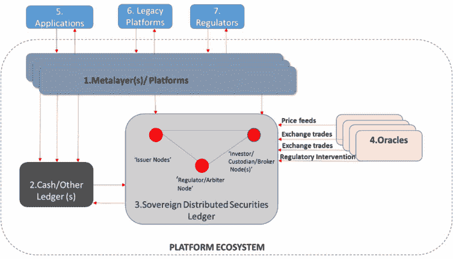

多重签名地址通常用于 Bitcoin 区块链；然而，在考虑托管链时，多重签名的概念是一个新颖的概念。通过要求多个签名（即买方、卖方以及潜在的银行）以及潜在的仲裁者签名，可以实现支付或资产转移以完成交易（Natoli and Gramoli, 2016）。该概念还通过‘阈值签名方案’的概念得到进一步支持，该方案通过使用多重签名实现拜占庭一致（Pilkington, 2015）。

此外，为了监管目的，还需要一个‘控制层’。值得注意的是，Ripple 和 Multichain 已经开展了工作，以形成‘元层’的概念，该元层独立于区块链‘层’之外运行；并与账簿/区块链本身进行交互。另一种选择是 Oracle，它在以太坊协议中被广泛使用；它允许第三方向智能合约输入数据（Wall and Malm, 2016）。

DLT 生态系统很可能是一个多账簿环境，应该能够实现跨链/跨账簿的交付对付款（DvP）（Wall and Malm, 2016）。因此，账簿之间的互操作性是未来所有 DLT 技术用于证券结算的关键要求。

## 分布式证券存管的概念模型

在本节中，介绍了主权分布式证券存管的概念模型。图 3 和图 4 分别涵盖了拟议的主权分布式证券存管的设计概念及其所需的互操作性。如图 3 所示，概念模型是一个‘主权’分布式证券存管，与今天存在的中央证券存管不同。‘主权’用例的意义在于，通常，CSD 是按国家或地区运营的。因此，拟议的概念模型应基于这一原则构建。

图形化地纳入图 3 所示概念模型的已识别设计元素总结如下：

- DLT 网络中使用的是基于实用拜占庭容错（PBFT）的许可区块链，而非非许可区块链。这在由主权证券分布式账簿表示的实际 DLT 网络中使用（图 3 中的元素 3）；
- 由于存在国内法律、法规和市场纪律，每个国内市场都需要自己的‘主权’账簿。出于这些原因，大多数国家都有自己的 CSD（Euroclear 和 Oliver Wyman, 2016）；
- 现金存储并在单独的现金账簿中跟踪，正如 Euroclear 和 Oliver Wyman (2016) 所描述的那样。‘现金/其他账簿’（图 3 中的元素 2）具备通过智能合约与主权账簿进行双向交互的能力，以实现 DvP 交易；
- 所有证券都分布在‘主权’分布式证券账簿（存管）（SDSD）中，覆盖已知节点。这些节点代表拥有已知实体/中介的托管链。这确保不会发生市场碎片化，即某些证券在一个账簿中，而其他证券在另一个账簿中；
- 账簿中的已知节点在多重签名机制下被赋予特定的角色和访问级别。例如，如果投资者打算从特定卖方处购买股票头寸，投资者会委托经纪人购买股票。经纪人可能与银行/托管人有信用额度，后者可能也为其客户在生态系统中构建了基于 Metalayer（图 3 中的元素 1）的定制应用程序。SDSD 将使用多重签名技术确保投资者直接从卖方处购买股票；但是，经纪人和银行/托管人在交易完成前对其进行签名/验证。这也意味着，由于 DLT 网络提供托管功能，银行和经纪人将专注于其他客户服务活动以留住客户；
- 监管干预和监督通过使用 Oracle 得以实现（Poelstra, 2014）。Oracle（图 3 中的元素 4）用于将数据插入智能合约或直接插入 SDSD，并通过元层平台实现监管对信息的读取访问；
- 共同使用 Oracle 和多重签名技术可以充分满足金融应用的安全性和审计要求；
- 元层平台和 Oracle 分别以类似于常规数据库的方式读取和写入区块链。它们应承担计算和存储负担，使 SDSD 尽可能具备可扩展性。这也为监管人员提供了交易‘全面视图’的机会。此外，Oracle 可以提供必要的交易流和价格信息等示例。很明显，此类模型中的区块链组件并非技术重点，但会影响整个生态系统的设计；并且
- 上述组合形成了一个平台，其中 Caprio (2013) 和 Karp (2015) 所述的应用程序、旧平台和监管机构（图 3 中的元素 5、6 和 7）可以与 DLT 结算生态系统进行交互。

鉴于 SDSD 仅适用于一个国家/地区，有一个重要方面需要考虑——与其他 SDSD 的互操作性，因为市场需要全球资产流动性，就像 Bitcoin 区块链提供的那样。图 4 说明了这些主权账簿如何相互接口的概念模型。

## 图 4. SDSD 的概念模型

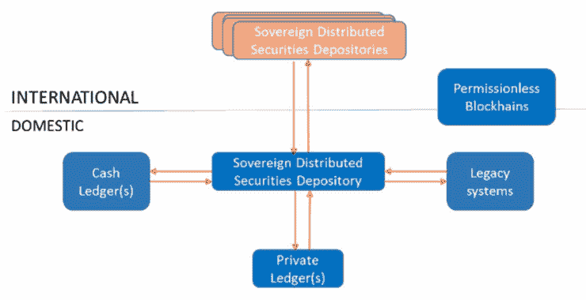

图 4 将图 3 的所有元素纳入‘主权分布式证券存管’块中。这说明了 SDSD 互操作的重要性，因为它不会孤立运行，并需要具备与链上和链下资产（例如旧系统和现金账簿）以及其他市场中其他 SDSD 进行操作的能力，就像当今的 CSD 相互互操作一样。从概念上讲，SDSD 彼此都需要是受信任且已知的法律实体，因为它们之间的网络将是另一个许可账簿，以便促进跨境交易。

## 拟议概念模型成功因素分析

以下是实施拟议概念模型（如图 4 所示）以满足结算系统要求的关键成功因素。

## 证券所有权

所使用的不可变性和共识机制（例如实用拜占庭容错（PBFT））提供了结算最终性，尤其是在 Hyperledger 的情况下。该模型旨在满足适用司法管辖区法律框架内有关所有权转让的法律要求（Dickinson, 2015）。

## 现金结算

Dickinson (2015) 指出，通过使用智能合约和基于各自账簿上资产和现金托管的 DvP 流程，在发生破产时可以保持所有权。然而，现金需要发行到区块链上，以确保与当前 DvP 处理相比提供明显增强的服务。托管方法并未改进当前存在的模型；然而，它至少需要保持其有效性。

## 成本效益和效率

缩短各类资产结算时间表的潜力既能提高效率，有助于降低资本成本，也能简化托管链中多个参与方之间的对账。

## 与其他结算系统的互操作性

该模型（如图 4 所示）在概念上设计为与其他 SDSD 以及‘链下’和其他账簿在全球范围内互操作（Dickinson, 2015）。在国内市场开发此模型的协作方法也为‘链下’交易和其他账簿的标准化提供了能力。如果没有全球计划的互操作性可能会消除该技术的任何成本节约效益。

结算不得改变被转让证券的性质。这一要求是当前交易后证券结算环境中的一个基本要素，并已纳入模型中。如果证券对发行人拥有某项权利（例如投票权），持有此类证券的人必须能够行使该特定证券所附的权利（Dickinson, 2015）。每项证券都由账簿在智能合约的帮助下进行跟踪和签名，以协助资产服务。

## 上市时间

DLT 解决方案面临的挑战在于目前还没有市场范围的采用。利用 CSD、托管人和经纪人等现有参与者，并与发行人、投资者和监管机构合作，为在不碎片化市场的情况下在国内市场实施该技术提供了一条演进路径。这也意味着，在初始阶段，大部分变化应在托管人、经纪人和 CSD 之间进行，作为一个受控且可管理的用户群。

## 研究设计与方法论

本研究基于一种研究范式，在该范式中，一种基于区块链技术的证券结算拟议概念模型被呈现为理论贡献成果，并旨在供全球 Security Settlement Systems（SSS）（如 CSD）使用。国际上为 CSD 工作的从业人员被要求评估和验证拟议模型。拟议模型是 Everett et al. (2017) 在业界认可的期刊上发表的一篇论文中包含的商业案例研究的一部分。鉴于本研究的利基性质（证券结算和交易后基础设施），意图是该领域已经有知识的受访者最能够评估该模型。

采用了实证主义研究哲学，并通过调查收集了数据。Collis 和 Hussey (2013) 断言，实证主义与定量分析方法相关，并且


需要定量研究数据。Yilmaz (2013) 提供了一组通用的定量数据特征，包括：

- 预先构建或标准化的分类问题集；
- 将数据转换为数值以用于分析和概括（寻找“常态”）；以及
- 随机选取的大型有代表性样本。请注意，这是一般要求，但就本研究而言，全球CSDs数量有限（通常每个发达国家仅1或2个），因此有代表性样本的规模受到所代表细分行业的限制。

采用了演绎法，在此方法下，开发、发表并评估了一种拟议的概念模型。考虑到目标受众（总体）的潜在规模有限，且样本单位需要由研究人员单独筛选，因此需要从南非境内和国际上识别至少30名受访者。从7个国家选取了47个经过适当判断的样本单位，最终所有7个目标国家中共有33名受访者参与。

## 问卷与评估因素

如附录A所示，问卷最初包含6个因素（图5），这些因素从文献中操作化并如下文所述。在进行详细统计分析并在大学统计学家的协助后，这六个因素被映射为10个因素（图6）。

图5. 主权分布式证券存管处调查中使用的因素

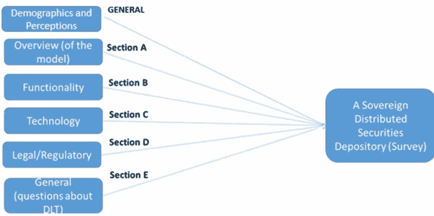

### 人口统计与认知（一般）

本因素的目的是从受访者处获取基本信息。然而，考虑到本研究的背景和性质，捕捉受访者的前期认知和观点以及其年龄和职称很重要。本因素的目的是为受访者所提供的概念模型提供一般性反馈。主要，受访者被要求验证模型的基础要素，例如其主权性质与公共账本相比，以及关于感知实施时间的一般时间表。

### 模型概览（A部分）

本因素的目的是介绍和验证概念模型，并提供概念模型的概述和说明。

### 功能性（B部分）

本因素的目的是确定概念模型中考虑的一般功能性要求。包含用于验证模型的、积极表述的功能性要求及可验证模型的问题。

### 技术（C部分）

本因素的目的是验证模型中讨论的主要技术组件。

### 法律/监管（D部分）

本因素的目的是验证关于模型的法律和监管假设，包括验证将保留在模型中的托管链。此外，还要调查适用于新技术的证券结算法律和/或监管框架。

### 关于DLT的一般问题（E部分）

本因素的目的是考虑关于DLT实施的一般性问题，特别是在回答关于拟议模型的问题之后。这很重要，因为这些问题中的每一个都有可能与其他因素相关联，并为调查早期关于模型提出的问题提供有意义的验证。

## 调查设计与抽样方法

考虑受访者稍后完成的调查中问题的性质很重要。由于概念模型是基于一项尚未在生产环境中完全验证的技术开发的，受访者可能会提供他们的意见，而不是具体的数值或标称答案。因此，问卷设计至关重要，前面讨论的各部分被用作指南以帮助受访者。所有问题均基于本研究的文献综述。问卷（附录A）发送给目标受众，并使用Statistica软件包进行分析以产生统计结果。此外，聘请了纳尔逊曼德拉大学统计顾问Danie Venter博士来制作和分析统计结果。

考虑到样本规模以及每位受访者都由研究人员单独筛选，选择了一种适当的非概率抽样方法。Saunders et al. (2012) 描述了一种称为*判断抽样*的抽样技术，允许经验丰富的个人根据对样本成员最合适特征的个人判断来选择样本单位。鉴于前文提供的信息，此选项是本研究最合乎逻辑的选择。

## 数据与统计分析

本研究使用统计分析收集和分析了定量数据。数据收集自阅读本研究病例（Everett et al., 2017）的受访者。使用描述性和推断性统计方法对概念模型（图4）进行了检验。进行了以下描述性统计：

- 受访者理解的频率分布（例如年龄、对技术的理解）；以及
- 每个因素的集中趋势和分布。

统计显著性是一项重要目标，以Alpha = 0.05且p值小于0.05表示。Cohen’s D用于单样本T检验中的实际显著性。范围如表1所示。

表1. Cohen’s d的解释区间（Gravetter and Wallnau, 2009: 第264页）

| Cohen's d的解释区间 | |
|---|---|
| <0.20 | 不显著 |
| 0.20 - 0.49 | 小 |
| 0.50 - 0.79 | 中 |
| 0.80+ | 大 |

还进行了Pearson积差相关分析，当p值为0.05且n=33时，相关系数具有统计显著性（Gravetter and Wallnau, 2009）。为研究各种人口统计变量之间的关系，还进行了Pearson卡方检验、方差分析和t检验。此外，还进行了推断性排序。

## 信度与效度

所进行的研究需要由其他研究人员重复，只要应用相同的方法即可得出类似结论（Greener, 2008）。此外，Collis and Hussey (2014) 关注问卷的稳健性，并提供三种应在设计阶段使用的可能信度测试，即：

- 重测：这涉及重新创建第一次调查的条件，然后要求参与者重新测试。该方法仅建议作为补充措施；
- 内部一致性：该方法在统计上用于将问卷中问题的回答与同一问卷中其他问题的回答进行相关性分析；以及
- 备选形式：这涉及比较对同一问题的备选/不同形式的回答。

为了本研究的目的，使用了内部一致性和备选形式来确定信度。根据Greener (2008)，研究涵盖效度的所有三个组成部分很重要，即：表面效度、构念效度和内部效度。Greener (2008) 此外还解释了这三个组成部分之间的差异及其相互关联的方式，即：

- 表面效度确保非研究人员能够轻易判断这种研究方法适合回答所提出的问题。更具体地说，测量方法应能够用于测量（Collis and Hussey, 2014）；
- 构念效度关注问卷中向受访者提出的内容的可测量性。根据Greener (2008)，这是为了确保受访者正确理解问题；以及
- 内部效度，根据Greener (2008)，是必要的，以确保自变量（或因素）对因变量（或效应）的结果负全责，并确保这些不仅仅是假设。

问卷项目从文献中操作化。此外，计算机科学系的学者和NMU统计学家能够验证问题，以确保研究工具的效度。

## 伦理要求

Collis and Hussey (2014) 指出，研究伦理对研究项目的成功至关重要。此外，他们阐述了促进伦理要求的指南，如下：

- 必须确保所有参与者的隐私、保密性和匿名性；
- 参与者需要有部分或全部退出的能力；
- 应避免任何潜在的不适、焦虑或伤害；
- 参与者有权就问卷知情同意；以及
- 信息应透明和诚实地收集。

已获得纳尔逊曼德拉大学伦理委员会（H18-SCI-CSS-006）的完整伦理批准。


## 研究结果与讨论

本节介绍并讨论了实证研究的结果。研究总体包含 47 名国际受访者，其中 33 人完成了调查，响应率为 70%。

## 人口统计学概况

下表提供了 33 名受访者的基本人口统计信息。需要注意的是，本问卷的目标受众均具备交易后证券方面相对丰富的工作知识作为先决条件。

表 2 显示了受访者根据其当前职位或雇佣情况的用户组频数分布。出现频率最高的受访者是高级管理人员，其次是技术人员/顾问，最后是法务/监管和运营受访者占比相等。

| 用户组 | n | % |
|---|---|---|
| 法务/监管 | 3 | 9% |
| 技术人员/顾问 | 6 | 18% |
| 高级管理人员 | 21 | 64% |
| 运营 | 3 | 9% |
| 总计 | 33 | 100% |

| 年龄 | n | % |
|---|---|---|
| 21-30 | 0 | 0% |
| 31-40 | 11 | 33% |
| 41-50 | 14 | 43% |
| 50+ | 8 | 24% |
| 总计 | 33 | 100% |

表 4. 频数分布 – DLT 理解

| DLT 理解 | n | % |
|---|---|---|
| 基础 | 9 | 27% |
| 中级 | 18 | 55% |
| 高级 | 6 | 18% |
| 总计 | 33 | 100% |

表 3 列出了受访者年龄的频数分布。受访者总体上为中年人群，仅 8 人年龄超过 50 岁。

### DLT 认知

表 4 提供了本研究的一个重要定性方面。它以自我评估的形式展示了受访者对 DLT 理解的频数分布。73% 的受访者对 DLT 具有中级或高级理解。

在表 5 中，展示了受访者关于如何在可能实施的背景下看待该技术的观点频数分布。需要注意的是，73% 的受访者声称自己具备中级或更好的技术知识，而 27% 的受访者保持基础理解。

### 表 5. 频数分布 – DLT 观点

| DLT 观点 | n | % |
|---|---|---|
| 变革将是渐进的 | 24 | 73% |
| 该技术不成熟且不适用 | 2 | 6% |
| 这是一种“风潮”，最终将仅用于利基应用 | 3 | 9% |
| 变革将是革命性的 | 4 | 12% |
| 总计 | 33 | 100% |

表 4 和表 5 报告的结果提出了以下几个有趣的要点，即：

- • 认为变革将是渐进的受访者人数（n=24 名受访者或 73%）与声称具备中级或更好技术知识的人数相近。经进一步调查，这 24 名受访者中有 17 人声称具备中级或更好的技术知识，而这些受访者中 21%（n=6）声称具备基础理解。此外，24 名受访者中有 17 人（71%）是高级管理人员，其余 7 名受访者（29%）由法务/监管、运营以及技术人员/顾问组成；
- • 两名受访者（6%）认为该技术不成熟且不适用于证券结算，其中一名为具备基础技术理解的高级管理人员，另一名为具备中级技术理解的运营受访者；
- • 三名受访者（9%）认为该技术是一种“风潮”，最终将仅用于利基应用，其中两名为高级管理人员，分别具备基础和中级技术理解，另一名为技术人员/顾问受访者，具备中级技术理解；以及
- • 四名受访者（12%）认为该技术对证券结算将是革命性的，他们均具备中级或高级技术理解，人员构成为一名高级管理人员、一名法务/监管受访者和两名技术人员/顾问受访者。

### 图 6. 主权分布式证券存管处的最终 10 个因子

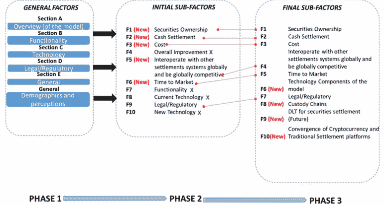

受访者观点的结果可以按以下方式进行更详细分析：

- • 六名回复的技术人员/顾问（即 18%）中没有人认为该技术不适用于证券结算。需要注意的是，技术人员/顾问对该技术的整体理解最好（在所有用户组中拥有最先进的理解）。这从更具技术导向的受访者那里获得了默认认可，即该技术适用于证券结算；
- • 五名受访者（15%，包括三名高级管理人员、一名运营人员和一名技术人员/顾问）似乎不赞成使用该技术，是唯一一个认为该技术不成熟且不适用于证券结算，并且认为这是一种“风潮”并最终将仅用于利基应用的用户组。同样重要的是，这些受访者要么具备基础理解，要么具备中级技术理解。这些受访者目前很可能在中央证券存管处、银行等中介机构就业；以及
- • 大多数高级管理人员（n=19 名受访者或 58%）认为该技术将以渐进或革命性方式实施。必须注意的是，渐进选项要受欢迎得多，约 90% 的高级管理人员更倾向于该技术的渐进式实施，而非革命式实施。

图 6 说明了与最终子因子开发相关的三个阶段。之所以开展此项练习，是应纳尔逊·曼德拉大学统计学家 Dr. Danie Venter 的建议，以便提高所收集数据的统计相关性。该练习分三个阶段进行，在第一阶段对因子进行了一组统计分析，然后在第二阶段进行调整并重复执行。最后，这些因子第三次进行调整，形成第三个也是最终的第三阶段，用于统计分析。

## 汇总得分的可靠性

为评估汇总得分的内部一致性，采用了 Cronbach’s alpha 系数。如前所述，本研究的挑战在于问卷涉及潜在的未来状态，而非针对受访者当前且具体的事物进行应用。因此，对该测量技术得出高度可靠得分的期望并不高。Hinton 等人（2004）对 Cronbach’s alpha 系数的使用提供了指示，可在求和得分并确定因子间一致性后使用。Cronbach alpha 值的解释如表 6 所示。

表 6. Cronbach’s alpha 值解释

| 不可接受 | < 0.50 |
|---|---|
| 可接受 | 0.50 - 0.69 |
| 良好 | 0.70 - 0.79 |
| 优秀 | 0.80 + |

表 7. Cronbach’s alpha 值

| 因子 | Cronbach's Alpha | 解释 |
| :--- | :--- | :--- |
| F1- 证券所有权 | 0.25 | 不可接受 |
| F2- 现金结算 | 0.48 | 不可接受 |
| F3- 成本 | 0.53 | 可接受 |
| F4- 与其他全球结算系统互操作并保持全球竞争力 | 0.16 | 不可接受 |
| F5- 上市时间 | 0.79 | 良好 |
| F6- 模型的技术组件 | 0.55 | 可接受 |
| F7- 法务/监管 | 0.60 | 可接受 |
| F8- 托管链 | 0.37 | 不可接受 |
| F9- 证券结算的 DLT（未来） | 0.57 | 可接受 |
| F10- 加密货币与传统结算平台的融合 | 0.51 | 可接受 |

正如表 7 所报告，Cronbach’s alpha 结果显示有五个可接受的因子，即 F3（成本）、F6（模型的技术组件）、F7（法务/监管）、F9（证券结算的 DLT）和 F10（加密货币与传统结算平台的融合）。在十个可能的因子中，发现了一个显示“良好”可靠性的因子，即 F5（上市时间）。

## 因子的描述性统计

以下部分讨论了每个最终商定因子的描述性统计。每个问题均设计为 5 点李克特量表的一部分，但是，出于描述这些因子的目的，非常


负面和负面被合并为负面（1.00 至 2.59），而中性保持不变，正面（3.41 至 5.00）包括正面和非常正面的组合。

| 因素 | 负面计数 | 负面百分比 | 中性计数 | 中性百分比 | 正面计数 | 正面百分比 |
| :--- | :---: | :---: | :---: | :---: | :---: | :---: |
| F1- 证券所有权 | 6 | 18% | 16 | 48% | 11 | 33% |
| F2- 现金结算 | 5 | 15% | 11 | 33% | 17 | 51% |
| F3- 成本 | 3 | 9% | 4 | 12% | 26 | 79% |
| F4- 与其他全球结算系统互操作并具有全球竞争力 | 2 | 6% | 17 | 52% | 14 | 42% |
| F5- 上市时间 | 14 | 42% | 7 | 21% | 12 | 36% |
| F6- 模型的技术组件 | 0 | 0% | 10 | 30% | 23 | 70% |
| F7- 法律/监管 | 0 | 0% | 5 | 15% | 28 | 85% |
| F8- 托管链 | 2 | 6% | 13 | 39% | 18 | 55% |
| F9- 证券结算的分布式账本技术 (未来) | 8 | 24% | 14 | 42% | 11 | 33% |
| F10- 加密货币和传统结算平台的融合 | 9 | 27% | 16 | 48% | 8 | 24% |

| 变量 | 均值 | 标准差 | H0: m | t | p | Cohen's d |
| :--- | :--- | :--- | :--- | :--- | :--- | :--- |
| F1- 证券所有权 | 3.22 | 0.69 | 3.40 | -1.48 | .148 | n/a |
| F2- 现金结算 | 3.41 | 0.84 | 3.40 | 0.06 | .951 | n/a |
| F3- 成本 | 3.65 | 0.66 | 3.40 | 2.20 | .035 | 0.38 |
| F4- 与其他全球结算系统互操作并具有全球竞争力 | 3.39 | 0.61 | 3.40 | -0.06 | .953 | n/a |
| F5- 上市时间 | 2.88 | 1.11 | 2.60 | 1.44 | .159 | n/a |
| F6- 模型的技术组件 | 3.77 | 0.48 | 3.40 | 4.39 | <.0005 | 0.77 |
| F7- 法律/监管 | 3.92 | 0.48 | 3.40 | 6.21 | <.0005 | 1.08 |
| F8- 托管链 | 3.44 | 0.47 | 3.40 | 0.44 | .660 | n/a |
| F9- 证券结算的分布式账本技术 (未来) | 3.20 | 0.78 | 3.40 | -1.46 | .154 | n/a |
| F10- 加密货币和传统结算平台的融合 | 2.96 | 0.56 | 2.60 | 3.72 | .001 | 0.64 |

表 10. 因素的皮尔逊积差矩相关系数 (n=33)

| 因素 | F1 | F2 | F3 | F4 | F5 | F6 | F7 | F8 | F9 | F10 |
| :--- | :--- | :--- | :--- | :--- | :--- | :--- | :--- | :--- | :--- | :--- |
| **F1- 证券所有权** | - | .205 | -.376 | .147 | -.316 | .295 | .186 | .211 | .036 | .265 |
| **F2- 现金结算** | .205 | - | -.342 | -.019 | -.121 | .242 | .174 | .080 | -.099 | .216 |
| **F3- 成本** | -.376 | -.342 | - | -.282 | .616 | -.027 | -.020 | -.302 | .366 | -.463 |
| **F4- 与其他全球结算系统互操作并具有全球竞争力** | .147 | -.019 | -.282 | - | -.514 | -.455 | .059 | .128 | -.040 | .521 |
| **F5- 上市时间** | -.316 | -.121 | .616 | -.514 | - | .151 | .157 | -.368 | .509 | -.473 |
| **F6- 模型的技术组件** | .295 | .242 | -.027 | -.455 | .151 | - | .318 | -.039 | .168 | -.335 |
| **F7- 法律/监管** | .186 | .174 | -.020 | .059 | .157 | .318 | - | .195 | .193 | .133 |
| **F8- 托管链** | .211 | .080 | -.302 | .128 | -.368 | -.039 | .195 | - | -.167 | .273 |
| **F9- 证券结算的分布式账本技术 (未来)** | .036 | -.099 | .366 | -.040 | .509 | .168 | .193 | -.167 | - | -.327 |
| **F10- 加密货币和传统结算平台的融合** | .265 | .216 | -.463 | .521 | -.473 | -.335 | .133 | .273 | -.327 | - |

表 10 以红色突出显示每个因素的最高描述性统计量。这说明，对于每个因素，受访者回答认为五个因素有明显积极的结果，四个因素在很大程度上被受访者视为中性。因素 F5（上市时间）是唯一具有实质性负面描述统计因素的因素。

## 因素的推断统计

使用单样本 t 检验来确定受访者各因素的平均分数是否可以描述为负面、中性或正面。这些测试的结果报告在表 9 中。

从表 9 来看，突出显示的总体均值为正面（M > 3.40）的因素是 F3（成本，M = 3.65），具有较低的实际和统计显著性。F6（模型的技术组件，M = 3.77）产生了较大的统计显著性和中等的实际显著性。F7（法律/监管，M = 3.92）同时获得了较大的统计和实际显著性。

F10（加密货币与传统结算平台的融合）的总体均值为中性（2.60 <= M <= 3.40），M = 2.9，尽管它具有中等的实际显著性。其他因素的结果不明确：F1（证券所有权）、F2（现金结算）和 F4（与其他全球结算系统互操作并具有全球竞争力）的总体均值。F8（托管链）和 F9（证券结算的分布式账本技术）可能是中性或正面。F5（上市时间）的均值可能是负面（M < 2.60）或中性，尽管它具有中等的实际显著性。

表 11. 每个因素的推断排名 (n=33)

| 因素 | 排名 | 显著性组 | 均值 | 标准差 |
|---|---|---|---|---|
| F7- 法律/监管 | 1 | 1 | 3.92 | 0.48 |
| F6- 模型的技术组件 | 1 | 1 | 3.77 | 0.48 |
| F3- 成本 | 1 | 1 | 3.65 | 0.66 |
| F8- 托管链 | 4 | 2 | 3.44 | 0.47 |
| F2- 现金结算 | 4 | 2 | 3.41 | 0.84 |
| F4- 与其他全球结算系统互操作并具有全球竞争力 | 4 | 2 | 3.39 | 0.61 |
| F1- 证券所有权 | 4 | 2 | 3.22 | 0.69 |
| F9- 证券结算的分布式账本技术 (未来) | 4 | 2 | 3.20 | 0.78 |
| F10- 加密货币和传统结算平台的融合 | 9 | 3 | 2.96 | 0.56 |
| F5- 上市时间 | 9 | 3 | 2.88 | 1.11 |

## 皮尔逊积差矩相关

Gravetter 和 Wallnau (2009) 指出，相关性在 0.3 处具有实际显著性，而高于 0.5 的相关系数被视为具有统计显著性的强相关。因此，3.44 的因素（上述内容的交汇点）既具有统计显著性也具有实际显著性。表 10 使用皮尔逊积差矩相关（n = 33），旨在得出既具有统计显著性又具有实际显著性的相关性。

表 10 显示因素之间大多为不显著的正相关或负相关。然而，突出关键的正相关和负相关并了解其解释很重要。F3（成本）与 F5（上市时间）之间存在强正相关，M = .616；F4（与其他全球结算系统互操作并具有全球竞争力）与 F10（加密货币与传统结算平台的融合）之间存在强正相关，M = .521；F5（上市时间）与 F9（证券结算的分布式账本技术）之间存在强正相关，M = .509。F3（成本）与 F9（证券结算的分布式账本技术）之间存在显著正相关，M = .366。

F4（与其他全球结算系统互操作并具有全球竞争力）与 F5（上市时间）之间存在强负相关，M = -.514。此外，F10（加密货币与传统结算平台的融合）与 F5（上市时间）之间存在显著负相关，M = -.473；F10（加密货币与传统结算平台的融合）与 F3（成本）之间存在显著负相关，M = -.463；F4（与其他全球结算系统互操作并具有全球竞争力）与 F6（模型的技术组件）之间存在显著负相关，M = -.455。F1（证券所有权）与 F3（成本）之间存在显著负相关，M = -.376；F8（托管链）与 F5（上市时间）之间存在显著负相关，M = -.368，完成了其余的显著负相关。

在表 11 中，列出了三个分组中每个排名的十个因素。第一组包括 F7（法律/监管）、F6（模型的技术组件）以及特别是 F3（成本）。

对表 11 的进一步分析表明，10 个因素可以分为 3 个统计显著性分组并进行排名：

- 第一组包括 F7（法律/监管）、F6（模型的技术组件）和 F3（成本），且这些因素具有正均值。第一组的关键推断是特别包含成本因素（F3）。鉴于该技术存在新的技术组件和更多法律和监管先决条件，因此这些因素有逻辑上的成本后果。因此，包含 F3（成本）尤为重要；
- 第二组具有中性均值，包括 F8（托管链）、F2（现金结算）、F4（与其他全球结算系统互操作并具有全球竞争力）、F1（证券所有权）和 F9（证券结算的分布式账本技术），作为一个组描述了模型的功能需求；以及
- 第三组包含最少的因素，即 F10（加密货币与传统结算平台的融合）和 F5（上市时间），因此排名最低。

这似乎也是一个合理的结论，考虑到来自第一组的额外技术要求、成本和法律先决条件以及来自第二组的模型功能需求。从该推断中得出的主要推理是，加密货币可能会继续以目前的方式与传统结算并行，并且鉴于为证券结算实施分布式账本技术可能存在的复杂性和成本，上市时间不太可能成为一个重要标准。

## 受访者评论的定性分析

研究中使用的问卷（附录 A）为受访者提供了回答开放式问题的机会。普遍反馈是该模型获得广泛接受。受访者承认，大规模行业支持、协作以及关注财务商业案例和相关成本，将是实施此类模型的关键。

从受访者的评论中出现了以下明显主题：

- 该模型在很大程度上得到了验证；
- 成本是需要考虑的主要因素；
- 向证券结算的分布式账本技术转型将是一个演进过程；
- 去中介化概念：在这种情况下，虽然现有中介机构的去中介化是可能的，但他们很可能会继续存在，尽管他们可能承担与当前不同的职能；以及
- 上市时间是另一个关键主题，非常普遍，似乎实施此类提议的模型可能需要超过十年，并且需要价值链中多个中介机构和参与者的大量协调和支持。

对该模型的一项关键批评是，现金账本应包含在整体模型中，而不是作为一个可互操作的独立账本。此外，按评论数量从高到低排序，最受评论的主题如下：

- 托管链（现有中介机构及/或这些中介机构之间的互操作性）；
- 上市时间：所有人都同意 10 到 15 年的估计；
- 现金结算：需要解决并包含在证券账本中；以及


- 潜在解决方案的成本是需要考虑的关键因素。

## 研究结果摘要

统计分析结果摘要为模型开发提供了有用信息，同时也阐述了为什么DLT尚未在全行业范围内应用于交易后证券结算。主要发现已汇总为不同主题，并在下文中讨论。

## 成本

整个研究中最一致的发现与成本因素相关，该因素具有可接受的 Cronbach Alpha 得分，由于对技术的理解程度提高，似乎更为重要，并且与上市时间（Time to Market）以及证券结算中用于DLT解决方案的模型高度相关。此外，还识别出了一些先决条件，例如额外的技术组件、法律和监管要求、新的接口要求，以及在推断排序中与现有主要参与者的集成。由于这些因素各自都涉及成本，因此在推断排序中包含成本后果是重要且相关的。这些信息既为未来在成本考虑方面实施该技术提供了模型，也提供了该技术为何尚未在生产环境中成功实施的潜在原因。

## 法律/监管要求

下一个一致主题是法律/监管考量，其也具有可接受的 Cronbach Alpha 得分，并在小组和个别问题基础上的推断排序中排名最高。此外，该因素提供了大量统计证据，很可能具有实际应用价值。这里的主要发现是，需要一个清晰的法律和监管框架，该框架先于此类模型的构建。从本质上讲，这意味着该因素也成为构建交易后证券结算解决方案的关键成功因素。

## 上市时间

上市时间与至少五个其他因素呈强正相关或强负相关，并与互操作性和全球竞争力密切相关。这意味着，一个能够解决现有主要参与者和技术互操作性需求的全球公认解决方案，将成为关键驱动因素，从而以更快的上市时间交付该技术。此外，开放式问题的迹象表明，合适的全球解决方案仍至少十年才能实现。

## 补充叙述

除了前文提到的主题外，虽然大多数受访者指出该技术的变革将是演进式的变革，但他们支持这样一种观点：区块链技术确实适用于证券结算。在此基础上，本研究的发现创造了“协作式演进挑战者”叙述，作为管理在成熟市场中实施所谓颠覆性技术（包括DLT/区块链）的方法。为解释这一点，“颠覆性”一词与区块链相关联。这种关联在实际实施技术方面对成熟市场中该技术的采用毫无帮助，无论该技术声称的益处是什么。主要参与者可能会形成技术孤岛，因此缺乏行业支持，或者转而专注于维持当前技术，因为面临颠覆威胁。

在成熟市场中，技术发展显然是演进式的。本研究中的因素，例如 F4（用于证券结算的DLT）和 F10（加密货币与传统结算及技术组件的融合），指向一种面向市场开发新技术模型的协作和包容性方法。虽然上述因素具有可接受的 Cronbach alpha 值，从本质上验证了概念模型，但现金结算（作为模型的关键组件）未得到验证。此外，现金结算在开放式问题中被证明具有分歧性。这导致的结论是，现金结算需要作为结算流程的一部分予以包含；最终，它需要与证券结算并行或在证券结算之前予以解决。

价值链中短期和孤立的颠覆威胁不太可能。为了实现新技术的及时采用，有必要在行业层面上与新技术、行业主要参与者和监管机构进行互操作和协作。本叙述需要与三个已识别的关键主题（成本、法律/监管要求和上市时间）在协作方法中进行叠加，这些主题将是实施模型的主要成功因素。总结而言，在成功实施此类模型之前，需要得出一个行业范围的商业案例。此外，引入这些新技术的方法应由此处提出的协作式演进挑战者概念指导，而非孤立的颠覆性金融科技概念。

## 拟议概念模型的实施

区块链技术有可能去中介化与金融行业相关的任何流程（《经济学人》，2014）。在证券结算交易的供应链中，所有金融服务提供商都是潜在的去中介化点，包括中央证券存管机构（CSD）。区块链技术是证券结算的合适平台。使用区块链技术实施拟议的概念模型需要各种角色和利益相关者的协作，还需要国际协作。目前，正在使用以太坊平台开发一个基于区块链的原型应用，用于研究目的。

证券结算的原型区块链项目需要与监管机构、中介、发行人和投资者进行市场协调和规划，以验证拟议的主权分布式证券存管概念模型。原型使用以太坊区块链存储数据。在此，需要对所有利益相关者的需求进行详细分析。关于如何建模价值链以及如何与所有利益相关者管理需求获取过程的决策，由NMU研究团队负责。

拟议的区块链应用包含三个不同的组件。第一个组件是智能合约，它在以太坊虚拟机上运行。智能合约组件使用 Solidity 编写，这是以太坊虚拟机当前使用的语言。需要决定如何以及在 SDSD 区块链上存储哪些数据，并考虑到某些数据可能更适合存储在私有数据库中，而其他数据则存储在区块链上。拟议应用的建模至关重要，需要仔细规划。一旦代码放置在区块链上，它将永久存在。智能合约组件的挑战不仅在于规划存储哪些信息，还在于数据和信息的存储方式。开发人员在考虑编程中使用的类时，需要对数据和信息的存储给予特别关注，这可能会带来额外成本。目标是在区块链上存储足够的数据和信息，让公众了解流程的进展情况，但不包括可能泄露或显示任何敏感或机密数据的额外数据和信息。

第二个组件是区块链与用户前端或用户界面之间通信的协议。一旦模型设计完成且智能合约创建完毕，就需要创建一个协议。该协议将规定如何、何时以及向区块链写入或从中检索哪些数据。创建协议涉及确保后端程序能够从区块链中提取足够的信息，以向前端系统用户显示相关信息。区块链数据结构与其他编程语言高度不兼容。因此，创建一种简单的数据交换方式非常重要。

最终组件是提供与区块链用户界面并展示结果的应用程序。将为所有利益相关者开发使用任何传统编程语言的程序，这些利益相关者将使用区块链而非文本文件、数据库、网络请求等来存储和读取数据。系统需要使用该协议来读取相关信息、解析它并向用户显示所需信息。程序需要向区块链写入并从中读取数据，以显示价值链的更新，并向区块链写入更新以管理 SDSD 流程。

## 管理建议

本研究的主要目标是为中央证券存管机构（CSD）使用区块链技术创建证券结算模型。目前，在全球范围内，还没有任何中央证券存管机构引入了用于证券结算的生产就绪型区块链解决方案。一个概念模型源自文献并已在国际期刊上发表。该模型构成了研究的基础，该研究已发送给全球交易后证券专业人士，以验证所开发的概念模型。

这些管理建议旨在务实地弥合研究文献结果与实证研究之间的差距。这些建议旨在改善证券结算中区块链技术的未来实施，并清晰阐述对市场的潜在收益。

研究结果表明，包含三个主要组件和设计因素，即：成本、法律/监管和上市时间。此外，为了验证托管链的纳入，加密货币和传统结算系统等技术组件最终将保持分离。然而，现金结算被发现是模型成功所需的前置或并行开发。此外，该研究提供了一种实施技术的全局方法，提出了“协作式演进挑战者”这一短语，作为一种包容性、咨询性和协作性的行业范围方法，用于为新技术构建商业案例。该方法的重点主要在于三个产生的组件和设计因素，即成本、法律/监管和上市时间。


## 证券所有权

证券所有权最初被文献强调为证券结算的关键要求。鉴于区块链的不可篡改性承诺，证券所有权最终是一个无争议的问题，因为这是技术使用中所假设的。该模型对不可篡改性的实用性提出了挑战，但提供了实用解决方案（Euroclear and Oliver Wyman, 2016）。

## 现金结算

现金结算应与证券结算包含在同一分类账中。这种方法意味着，在证券结算之前或与证券结算并行，需要纳入更广泛的行业接受度和对现金结算的参与。无论如何，这都会对潜在解决方案的上市时间产生负面影响。

## 成本

鉴于涉及的额外技术组件、法律要求以及多方利益相关者的协调，所提出模型的成本敏感性很可能存在（Euroclear and Oliver Wyman, 2016）。成本最终在研究中被列为整体最重要的因素，而提出的协作式进化挑战者方法用于市场范围商业案例开发，是本研究的一个主要发现。

## 与其他结算系统的互操作性

此因素重要，需要考虑，并被列为任何证券交易后结算系统的重要要求。需要注意的是，在基本设计要素（成本、上市时间以及法律/监管框架）得出结论之前，此要求在性质上将居于所列其他因素的次要地位。理想情况下，此要求将在上述要素得出结论后得到覆盖。

## 上市时间

市场咨询、法律/监管改革以及新技术的影响都是耗时的活动。开放式问题中的传闻反馈显示预计实施需要10-15年，这并不令人意外。这与欧洲类似T2S等大型跨地理项目的时间框架一致，这些项目也有类似的现有机构。

## 模型的技术组件

该模型中的技术组件在很大程度上是可接受的，并且受到好评。技术的进一步开发将需要重新评估，并需要面向更广泛市场建立持续的反馈机制。鉴于变化速度和市场需求的变化，这一点很重要。这些还需要持续根据本研究中已确定的先决条件框架进行管理。

## 法律/监管

在合理启动此类项目之前，需要建立支持性的法律/监管框架。需要一个清晰且支持性的法律和监管框架，并且该框架应先于此类模型的构建，这是一项明确可观察的要求。因此，此因素是以务实方式构建任何此类交易后证券结算解决方案的关键成功因素。

## 托管链

在本研究设定的10至15年时间段内，现有机构很可能会继续存在，而作为托管链一部分的这些现有机构，只要仍有作用，对于实施新技术将至关重要（Korman, 2017）。*协作式进化挑战者*方法在托管链中也将至关重要，因为该方法需要证明对现有机构和最终用户都有益。这将是推动变革以实现区块链技术在整个市场中效益的关键。

## 证券结算的DLT

85%的受访者相信未来证券结算将在DLT/区块链技术上完成，而大多数（73%）表明这一变化将是渐进式的。鉴于演进很可能始于现有机构，*协作式进化挑战者*方法将再次成为任何特定市场采用的重要方面。

## 加密货币与传统结算平台的融合

虽然加密货币存在破坏证券结算的实际影响，无论是通过犯罪活动还是欺诈，但加密货币不太可能与传统结算平台集成。已观察到潜在颠覆的逆转，即*逆向颠覆*。其解释为：与现有机构的商业模式受到威胁不同，现有机构正在提供加密货币服务（与传统证券结算中提供的类似保障和治理），并直接与试图颠覆它们的金融科技公司竞争。这是颠覆威胁的间接结果，而不是寻求一种惠及整个市场的务实解决方案的协作方法。

## 局限性与最终结论

本研究的局限性包括因因子载荷不足而被反转或删除的项目。四个因素，即证券所有权、现金结算、与其他全球结算系统的互操作性以及托管链，都具有不可接受的Cronbach’s Alpha系数。建议是，先导研究可能已指明任何不适合的问题以提高Cronbach Alpha系数。

本研究结论认为，证券所有权与现金结算、与其他全球结算系统的互操作性和全球竞争力，以及托管链，都必须从模型中移除。其余六个因素（成本、上市时间、模型的技术组件、法律/监管要求、证券结算的DLT（未来））以及加密货币和传统结算平台的融合，直接应用于验证所提出的概念模型。

本研究始于对所谓区块链技术和加密货币对交易后证券的颠覆性威胁的理解。研究完成后，似乎CSD很可能会转变为特定市场的基于区块链的分布式存管机构，并且像CSD这样的现有机构将参与逆向颠覆，并作为并行服务提供加密货币和传统结算。目前，中央银行数字货币（CBDC）代表了在链上持有现金的下一步，因此根据本研究，也是见证传统资本市场转向分布式账本平台的最重要步骤。未来研究应着重于在同一条或可互操作的链上实施CBDC和证券，这代表了在行业中实现该技术效益的最可行机会。

## 参考文献

Atack, J., & Neal, L. (2009). 金融市场和机构的起源与发展：从十七世纪至今. Cambridge University Press. doi:10.1017/CBO9780511757419

Brennan, C., & Lunn, W. (2016), 信任颠覆者, https://www.finextra.com/finextra-downloads/newsdocs/document-1063851711.pdf, 2016年8月访问

Caprio, G. (2013). 证券结算系统. 载于 全球关键金融市场、机构和基础设施手册 (pp. 547–563). Academic Press.

Collis, J., & Hussey, R. (2014). 商业研究（第4版）. Macmillan. doi:10.1007/978-1-137-03748-0

资本市场监管委员会. (2019). 区块链与证券清算和结算. https://www.capmktsreg.org/wp-content/uploads/2019/04/CCMR_statement_Blockchain_Securities_Settlement-Final.pdf

Dickinson, K. (2015). 金融市场运营管理. Wiley.

DTCC. (2016). 拥抱颠覆. https://www.dtcc.com/~/media/Files/PDFs/DTCC-Embracing-Disruption.pdf

Euroclear and Oliver Wyman. (2016). 资本市场中的区块链：奖赏与旅程. Brussels: Euroclear, Oliver Wyman. https://www.euroclear.com/en/campaigns/Blockchain-in-capital-markets.html

欧洲中央银行. (2007). 证券托管行业. https://www.ecb.europa.eu/pub/pdf/scops/ecbocp68.pdf

欧洲中央银行. (2015). TARGET2-Securities今天成功启动. https://www.ecb.europa.eu/press/pr/date/2015/html/pr150622_2.en.html

欧洲中央银行. (2016). 证券交易后的分布式账本技术. https://www.ecb.europa.eu/pub/pdf/scops/ecbop172.en.pdf


- 欧洲证券和市场管理局。(2016). 证券市场中的分布式账本技术。https://www.esma.europa.eu/press-news/esma-news/esma-assesses-usefulness-distributed-ledger-technologies

- 埃娃，M。(2015). 托管链与资产价值：为何值得思考加密证券。《剑桥法律期刊》, 73(3), 505–533.

- 埃文斯，N。(2003). 利用突破性技术优势推动商业创新与颠覆性技术。新泽西州上萨德尔河：财务时报普伦蒂斯霍尔.

- 埃弗雷特，S., 凯利茨，A. P., & 格赖林，J。(2017). 证券结算中“主权”分布式证券存管机构的论证。《证券运营与托管期刊》, 9(3), 269-292. https://www.henrystewartpublications.com/jsoc/v9

- 金融稳定委员会。(2009). 应对系统重要性金融机构。https://www.fsb.org/what-we-do/policy-development/systematically-important-financial-institutions-sifis/

- 弗洛雷安尼，J., & 波拉托，M。(2014). 全球证券交易所行业经济学。帕尔格雷夫·麦克米兰。doi:10.1057/9781137321831

- Gartner。(2020). Gartner 新兴技术炒作周期确定了组织必须跟踪以获得竞争优势的三个关键趋势。https://www.gartner.com/newsroom/id/3412017

- 吉布森，C., & 柯克，T。(2016). 资产管理人员的区块链入门。https://www.klgates.com/files/Publication/921292ec-0e76-4b4b-adf4-036b15c175fe/Presentation/PublicationAttachment/6489032d-7722-4dcc-a10c-09e7e9b4350e/Blockchain_101_for_Asset_Managers.pdf

- 戈勒姆，M., & 辛格，N。(2009). 电子交易所：从交易大厅到比特的全球转型。爱思唯尔.

- 格拉维特，F. J., & 沃尔瑙，L. B。(2009). 行为科学统计学（第8版）。沃兹沃思.

- 格里纳，S。(2008). 商业研究方法。http://web.ftvs.cuni.cz/hendl/metodologie/introduction-to-research-methods.pdf

- 哈里斯，L。(2004). 交易与交易所：从业者市场微观结构。牛津：牛津（英国）.

- 平顿，P. R., 麦克默里，I., & 布朗洛，C。(2004). SPSS 解析。劳特利奇。doi:10.4324/9780203642597

- 卡普，N。(2015). 区块链技术：金融系统的终极颠覆。https://www.bbvaresearch.com/wp-content/uploads/2015/07/150710_US_EW_Blockchain Technology.pdf

- 科尔曼，Z。(2017). 论区块链、中介与炒作。https://www.zkorman.com/writing/blockchain/

- KPMG。(2018). 颠覆性技术的不断变化的格局。https://home.kpmg/by/en/home/insights/2018/06/the-changing-landscape-of-disruptive-technologies.html

- 洛德，D。(2002). 清算、结算与托管。巴特沃思-海尼曼.

- 摩根士丹利。(2016). 全球洞察：银行业中的区块链：颠覆性威胁还是工具？https://www.the-blockchain.com/docs/Morgan-Stanley-blockchain-report.pdf

- 莫里，T。(2016). 金融技术：区块链与证券结算。德勤.

- 纳托利，C., & 格拉莫利，V。(2016). 区块链异常。https://arxiv.org/pdf/1605.05438v1.pdf

- 中本聪。(2008). 比特币：点对点电子现金系统。https://bitcoin.org/bitcoin.pdf

- 奥康纳，D。(2004). 经济学基础。格林伍德.

- 皮尔金顿，M。(2015). 区块链技术：原理与应用。http://ssrn.com/abstract=2662660

- 普尔斯特拉，A。(2014). 基于权益证明的分布式共识是不可能的。https://download.wpsoftware.net/bitcoin/old-pos.pdf

- 桑德斯，M., 刘易斯，P., & 索恩希尔，A。(2012). 商科学生的研究方法。皮尔森教育有限公司.

- 斯旺，M。(2015). 金融服务。收录于《区块链：新经济蓝图》。O'Reilly.

- 斯旺森，T。(2015). 共识即服务：关于许可型分布式账本系统出现的简要报告。https://www.weusecoins.com/assets/pdf/library/Consensus-as-a-service%20-%20a%20brief%20report%20on%20the%20emergence%20of%20permissioned%20distributed%20ledger.pdf

- 《经济学人》。(2014). 加密货币——巨大的挫折。https://www.economist.com/news/finance-and-economics/21596971-bitcoin-growing-too-fast-its-technology-keep-up-great-hiccup

- 沃尔，E., & 马尔姆，G。(2016). 利用区块链技术和智能合约创建分布式证券存管处。http://lup.lub.lu.se/student-papers/record/8885750

- 世界经济论坛。(2015). 金融服务的未来。http://www3.weforum.org/docs/WEF_The_future__of_financial_services.pdf

- 世界交易所联合会。(2016). 金融市场基础设施与分布式账本技术。https://www.world-exchanges.org/home/index.php/files/18/Studies%20-%20Reports/349/WFE%20IOSCO%20AMCC%20DLT%20report.pdf

- 亚尔马兹，K。(2013). 《欧洲教育期刊》。《欧洲教育期刊》, 48, 311–325. doi:10.1111/ejed.12014

- 佐哈尔，A。(2015). 比特币。《计算机协会通讯》。doi:10.1145/2701411

## 补充阅读

- 埃森哲。(2020). 货币的（再）演变 II：区块链赋能的央行数字货币，https://www.accenture.com/_acnmedia/PDF-105/Accenture-Revolution-of-Money-II-2019.pdf#zoom=50，2020 年 5 月查阅

- 阿莫斯，S。(2016). 区块链技术：它有什么用？SSRN：https://SSRN.com/Abstract=2832751，2017 年 9 月查阅

- 欧洲证券存管机构协会。(2015). 《证券存管机构事实手册》，第1版。http://ecsda.eu/wp-content/uploads/2014_CSD_Factbook.pdf，2020 年 5 月查阅

- 欧洲委员会。(2020). 证券集中存管机构（CSD）— 欧洲委员会，http://ec.europa.eu/finance/financial-markets/central_securities_depositories/index_en.htm，2020 年 5 月查阅

- 金融行为监管局。(2018). 证券集中存管机构，https://www.fca.org.uk/markets/central-securities-depositories，2020 年 5 月查阅

- 金融行为监管局。(2020). 证券融资交易条例（SFTR），https://www.fca.org.uk/markets/sftr，2020 年 5 月查阅

- InformIT。(2019). 区块链技术。https://www.informit.com/articles/article.aspx?p=2955143，2020 年 5 月查阅

- 摩根大通，J. P. M., & 奥立文，W。(2020). 利用区块链释放经济优势：资产管理人员指南，https://www.oliverwyman.com/content/dam/oliver-wyman/global/en/2016/july/joint-report-by-jp-morgan-and-oliver-wyman-unlocking-economic-advantage-with-blockchain-A-Guide-for-Asset-Managers.pdf，2020 年 5 月查阅

- KPMG。(2020). 抓住机遇——区块链及其延伸，https://assets.kpmg.com/content/dam/kpmg/pdf/2016/06/kpmg-blockchain-consensus-mechanism.pdf，2020 年 5 月查阅

- KPMG。(2016). 区块链崭露头角，https://home.kpmg.com/content/dam/kpmg/us/pdf/blockchain-hitting-the-big.pdf，2020 年 5 月查阅

- 拉法雷，A., & 范德尔斯特，C。(2018). 企业治理与股东行动主义的区块链技术。欧洲公司治理研究所（ECGI）- 法律工作论文第 390/2018 号，https://ssrn.com/abstract=3135209，2020 年 5 月查阅

- 迈内利，M., & 米尔恩，A。(2016). 区块链对证券交易生命周期的影响与潜力。《计算机》, 40(9), 96–99.

- SWIFT。(2020). SWIFT 历史，https://www.swift.com/about-us/history，2020 年 5 月查阅

## 关键术语与定义

- **区块链技术：** 区块链技术并非新技术，因为自 2008 年比特币协议诞生以来，它一直充当其支柱。区块链技术消除了对可信第三方来处理交易并提供记录保存服务的需求，这对某些中介机构（如证券集中存管机构）的核心业务功能构成威胁。区块链技术仍未完全成熟。

- **证券集中存管机构（CSD）：** 可信第三方，如交易所、经纪商、交易商和证券集中存管机构，在交易至交易后环境中运营。证券集中存管机构是市场联合倡议，旨在为全国市场（国家或地区）电子结算大量非实物股份，并维护所有权中央登记簿。

- **分布式账本技术（DLT）：** 分布式账本技术可被视为“区块链”，它能够在网络中分发记录，而不是将记录保存在中心化实体中。实际上，该技术结合了点对点网络、加密技术和加密哈希，以按时间顺序处理交易。

- **证券结算模型（SSM）：** 这是一个概念模型，用于评估区块链相关技术在证券结算中的应用。

- **主权分布式证券（SDS）：** 所有证券均持有在“主权”分布式证券账本（存管处）（SDSD）中，该账本分布在已知节点上。这些节点代表拥有已知实体/中介机构的托管链。在 SSM 中，SDSD 可使用多签名技术，确保投资者直接从卖方购买股票；不过，经纪商和银行/托管人会在交易完成前对其进行签署/验证。


## 附录 A：问卷

### 主权分布式证券存管处 - 试点评估研究

参与者编号：
用户群体：
- 高级管理层
- 运营技术员/顾问
- 法律/监管

一般问题：

- 您在证券行业或具体交易后（post trade）领域有多少年经验？
- a. 1-3 年
- b. 4-5 年
- c. 6-10 年
- d. 10 年以上

- 您如何评价自己对分布式账本技术（DLT）的了解程度？
- e. 基础（仅具备理论知识）
- f. 中级（我在概念上理解该技术，并且在某个时间点交易过加密货币）
- g. 高级（即，我在构建这些应用程序方面有一些经验）

- 请选择最能描述您对分布式账本技术在证券结算中应用看法的选项：
- h. 变革将是革命性的
- i. 变革将是渐进式的
- j. 技术不成熟且不适用
- k. 它是一种“昙花一现”的事物，最终将仅用于“利基”应用

- 您属于哪个年龄段？
- l. 21-30
- m. 31-40
- n. 41-50
- o. 51+

| 问题 | 强烈不同意 | 不同意 | 中立 | 同意 | 强烈同意 | 不适用 |
|---|---|---|---|---|---|---|
| **A 节 – 概述** | | | | | | |
| 5 阅读附件论文后，未来 5 到 10 年内，证券结算仍将按国家隔离。 | O | O | O | O | O | O |
| 6 利用 DLT 进行的国际证券结算，可通过连接/关联不同国家的结算系统来促进。 | O | O | O | O | O | O |
| 7 证券结算平台将同时服务于传统证券结算，并促进加密资产的买卖，尽管是在不同平台上进行。 | O | O | O | O | O | O |
| 8 论文中描述的此类模型，在未来 5 到 10 年内在您的市场中可以实施。 | O | O | O | O | O | O |
| 9 面向所有证券结算的公共账本解决方案（不特定于国家/地区），在未来 5 到 10 年内可以实施。 | O | O | O | O | O | O |
| **B 节 – 功能** | | | | | | |
| 10 在该模型中实现的 DLT 将改进证券结算的某些方面。 | O | O | O | O | O | O |
| 11 现金账本应与证券结算系统分离。 | O | O | O | O | O | O |
| 12 旧版系统与目标平台集成很重要。 | O | O | O | O | O | O |
| 13 该模型支持托管链功能很重要。 | O | O | O | O | O | O |
| 14 在需要时能够修改证券记录是一项重要要求。 | O | O | O | O | O | O |
| 15 论文中描述的此类平台，应为证券结算生态系统中的其他利益相关方（如托管人、资产管理人、交易所等）提供功能。 | O | O | O | O | O | O |
| 16 该平台应提供功能，以去中介化证券结算生态系统中的现有机构，如中央证券存管处（CSD）或托管人。 | O | O | O | O | O | O |
| 17 与其他公共账本的互操作性将是一项重要要求（例如以太坊）。 | O | O | O | O | O | O |
| **C 节 – 技术** | | | | | | |
| 18 许可账本适用于该模型。 | O | O | O | O | O | O |
| 19 预言机的使用对该模型的成功标准至关重要，尤其是作为数据馈送和监管目的。 | O | O | O | O | O | O |
| 20 元层的使用对该模型的成功至关重要。 | O | O | O | O | O | O |
| 21 针对 DLT 的技术发展将是渐进式的，而非对证券结算造成颠覆。 | O | O | O | O | O | O |
| 22 账本之间（私有或公共）的接口代表关键风险，需要在模型中加以缓解。 | O | O | O | O | O | O |
| 23 鉴于这通常是一个高价值、低交易量的环境，工作量证明（Proof of Work）将是一个合适的协议。 | O | O | O | O | O | O |
| 24 鉴于这通常是一个高价值、低交易量的环境，权益证明（Proof of Stake）将是一个合适的协议。 | O | O | O | O | O | O |
| **D 节 – 法律/监管** | | | | | | |
| 25 监管机构更倾向于区块链上的原生资产，而非代币化资产。 | O | O | O | O | O | O |
| 26 监管机构更有可能与现有机构而非新进入者一起，在此技术上试点生产结算系统。 | O | O | O | O | O | O |
| 27 在 DLT 环境中，托管链将继续存在，固有的法律风险也将继续存在。 | O | O | O | O | O | O |
| 28 法律协议需要反映与技术相关的风险（例如，公共账本网络完全失效）。 | O | O | O | O | O | O |
| 29 智能合约可以实现，以自动执行法律协议和其他具有法律约束力的结算义务。 | O | O | O | O | O | O |
| 30 监管需要扩展，以详细说明 DLT 在证券结算中的应用，适用于原生资产或代币化资产。 | O | O | O | O | O | O |
| **E 节 – 常规** | | | | | | |
| 31 DLT 的使用最终将改变整个格局，发行人和投资者将能够在无中介的情况下进行交易。 | O | O | O | O | O | O |
| 32 加密货币和证券（加密资产）最终将以相同方式交易，传统的交易后基础设施将变得多余。 | O | O | O | O | O | O |
| 33 DLT 不适合证券结算。 | O | O | O | O | O | O |
| 34 针对证券结算的 DLT 实施将比当前的交易后基础设施更复杂且成本更高。 | O | O | O | O | O | O |
| 35 由银行主导的技术联盟推动的技术，最终将推动折中方案，进一步巩固现有机构。 | O | O | O | O | O | O |
| 36 技术过于不成熟，尚未得到验证。 | O | O | O | O | O | O |
| 37 DLT 实施最终将导致网络自我监管。 | O | O | O | O | O | O |
| 38 该技术至今尚未发生重大故障，未知的影响太大，不足以冒险危害整个经济。 | O | O | O | O | O | O |
| 39 例如 DAO（以太坊）的例子证明，即使是公共账本最终也需要集中式决策。 | O | O | O | O | O | O |
| 40 记录的不可更改性并不总是一种优势。 | O | O | O | O | O | O |

请阅读解释主权分布式证券存管处提议模型的论文。
阅读论文后，请回答以下问题。

- 41. 列出该模型的积极要素：
- 42. 列出该模型的消极要素：
- 43. 该模型可以如何改进？
- 44. 如果您认为现有机构将被去中介化，请说明您认为是谁以及原因。
- 45. 对该模型有任何其他评论吗？

感谢您参与本研究。

调查结束

## 第 2 节

### 区块链技术用例

## 第 9 章

## 区块链技术：行业中的倡议与用例

Zaigham Mahmood

https://orcid.org/0000-0001-7411-7496

英国北安普顿大学 & 中国石家庄铁道大学

### 摘要

区块链技术可能是自互联网出现以来最具吸引力的创新。区块链是指分布在多台计算机上的开放式分布式账本，以更高效、透明、安全的方式持有以数字形式记录的交易。区块链由若干区块组成，每个区块包含与数字资产相关的数据以及将其链接到链中前一个区块的哈希头。区块相互链接，新区块可按照共识过程添加和删除。此外，交易各方可以共享分布式数字账本，无需中央中介。本章旨在介绍区块链技术，并讨论社会各个领域（尤其是区块链产品供应商和服务提供商）中的用例和倡议。为完整起见，还讨论了特性、优势、类型、基础技术和平台。

### 引言

区块链技术可能是自互联网出现以来最重要的创新。它承载着与印刷术或互联网相同的承诺，即允许在社会的许多不同领域和众多行业中进行新形式的安全匿名通信。区块链有望颠覆的领域包括医疗保健、交通、供应链、风险管理、制造业、旅游业、银行业、教育和政府等，仅举几例。区块链技术仍在发展中，但它已经通过流程数字化、自动化、实物资产代币化以及利益相关者之间复杂合同的代码化，推动着数字革命。公开拥抱这项技术的国家包括中国、美国、英国、阿联酋、日本、新加坡和澳大利亚。根据 Market Watch (2020) 的数据，预计到 2025 年，区块链市场份额将超过 250 亿美元。


区块链技术的理念，最初被称为 *block chain*，最初由中本聪在2008年发表的比特币白皮书中宣布。第一个实现出现在2009年（Zaky, 2020）。这本质上是一种认识，即支撑“比特币”（一种如今可被视为区块链应用的加密货币）运行的技术可以从货币中分离出来，用于各种其他组织间合作。此后，在约10年的时间里，围绕 *smart contracts*、*proofs of work* 和区块链 *scaling* 有了进一步发展。区块链技术发展的简要时间线如图1所示。

图1. 区块链技术演进时间线

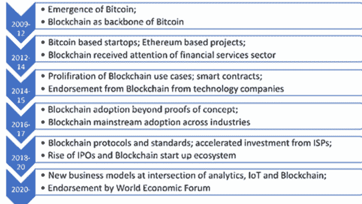

区块链技术的特性包括去中心化、不可篡改性、透明性、安全性、共识和智能合约（Rosic, 2016; Tasca and Tessone, 2019）。Witscad（2020）将特性划分为功能特性和涌现特性，如图2所示。这些内容将在本章后面部分解释。由于这些特性的吸引力，自大约2014年以来，区块链已在超出其加密货币根源的领域获得关注。该技术现已超越其最初在加密货币（如比特币）中的应用。它目前正被应用于社会几乎各个领域，包括银行、医疗保健、制造业、交通运输、物流、供应链管理和风险管理，仅举几例，如前所述。

本章组织如下。下一主要部分定义区块链技术，描述基本术语，概述主要特性和优势，描述区块链的底层概念和种类，并总结通用区块链流程。为完整起见，还总结了各种知名的区块链平台。下一主要部分列举了来自不同行业、供应商和服务提供商的各种用例；以及当前存在的各种倡议。最后部分介绍结论。

希望本章能为本书其他章节中出现的各种区块链相关研究讨论奠定基础。

## 区块链技术

区块链是一种共享的 *distributed ledger*（分布式账本，数据库），分布在许多计算机上，没有中央控制或权威机构，其中数字资产（代表价值、身份、协议、财产权利、凭证等的交易）被记录并相互链接，从而提供资产的完整历史和当前状态或来源。它承诺以更高效、安全、透明的方式处理数字资产交易，可以节省大量的行政、官僚、精力和时间。区块链技术基于一种称为 *cryptography*（密码学）的复杂数学分支。

根据Garson（2018）中麦肯锡的观点，区块链是一种 *decentralised, shared and trusted distributed ledger (or database) that consists of encrypted ‘blocks’ of information added to a chain of existing blocks of records*（去中心化、共享且可信的分布式账本（或数据库），由加密的“信息块”添加到现有记录块链中组成）。该账本依赖全球对等网络的 *consensus*（共识）来运行。未经修改整个链并获得整个对等网络共识，无法修改块中的数据——这指的是区块链特性中称为 *immutability*（不可篡改性）的特征（Robinson, 2018）。在添加新块之前，必须首先由其他参与者（即也称为节点的块）验证，以防止欺诈并提高安全性。区块链允许在不依赖中央机构或中介的情况下验证和交换信息。区块链应用包括：*Bitcoin*（加密货币）、*Sia*（去中心化云存储）和 *Ethereum*（用于运行智能合约的虚拟机），仅举几例。

在进一步讨论区块链技术之前，为完整起见，有必要定义某些常用术语和概念。如下所示。

- **Bitcoin**：使用区块链技术运行的加密货币；货币单位；1个比特币 = 1 BTC
- **Block**：由 *miner*（矿工）收集并添加到区块链的一组交易；所使用的过程称为 *cryptography*（密码学）；每个块都链接到前一个块，从而形成一个块链
- **Consensus**：区块链运行的过程；指保证记录可信度（即其可靠性和真实性）的账本维护和更新规则与机制
- **Ethereum**：用于构建基于区块链应用程序的开源平台；分发一种称为 *ether*（ETH）的货币；允许存储和执行代码以实现 *smart contracts*（智能合约）
- **Hash**：使用块的公钥和私钥的数字签名，用于身份验证
- **Proof of Stake (PoS)）：加密货币区块链网络实现分布式共识的共识算法；PoW 的替代方案
- **Proof of Work (PoW)）：用于区块链网络确认交易和生成新块的共识算法
- **Smart Contract**：与区块链关联的代码，允许根据某些约定要求添加交易，当达到约定限制时触发事件。

### 区块链优势

区块链技术承诺将彻底改变金融、商业以及行业中许多其他领域。一个证据是，目前在公共领域正在研究和进行的众多区块链项目，将在本章后面讨论。以下是区块链技术提供的一些通用优势：

- **Reduced costs**：由于区块链在单一系统中建立点对点网络，省去了中间人（如中间商）的时间和费用。
- **Quick settlement and convenience**：在交易整个生命周期中使用区块链的不同账本和流程的复杂性，例如在区块链上进行的股票购买交易，可以相当快速地结算。不需要其他实体来处理交易。
- **Better security**：每笔交易都存储在一个链接前后块的块中，这有助于提高安全性。而且，尽管没有任何东西是绝对防黑的，但区块链比当今任何其他东西都要安全得多。
- **Transparency and Incorruptibility**：区块链数据不是集中存储的，这意味着交易是真正透明且易于验证的。此外，其去中心化的事实使得任何黑客都难以损坏链或交易。

这些优势将在本章后面讨论区块链特性时进一步阐述。

虽然目前仍有许多挑战阻碍区块链技术的大规模采用，但随着进一步发展，这些问题正在得到解决。部分问题涉及通常很高的能源消耗、在某些情况下相对有限的可扩展性、由于技术新颖性而目前供应短缺的技能，以及通常缓慢的操作速度。

### 区块链特性

如前所述，区块链的一些最重要属性（构成其在各种应用中被采用的原因）是去中心化、透明性、不可篡改性和智能合约（Roscic, 2016; Tasca, 2019）。以下将简要讨论这些属性。另请参阅图2，了解按功能属性和涌现属性划分的更详细特性集。

- **Decentralisation**：这指的是区块链（即分布式账本）存在于多个计算系统（称为节点）上的事实。这与传统的客户端-服务器模式截然不同，后者是一种集中式方法，虽然对行业很有好处，但存在弱点。在去中心化系统中，数据由网络中的所有参与者拥有。此外，网络中节点之间的交互不需要经过中介。这正是比特币和区块链背后的主要理念。
- **Transparency**：在区块链中，这是通过使用密码学隐藏个人身份来实现的，因此用户的真实身份是安全的；此外，区块链上的每个操作都由数字签名驱动，从而增加安全性。但是，可以通过公共地址查看交易；这是为了问责制，进而转化为客户之间交易的信任、诚实和透明度。
- **Immutability**：这指的是系统的一种属性，即禁止对已输入系统的数据进行更改。这是区块链的一个吸引人的特性，它阻止了任何试图更改块中数字内容的行为。这是通过使用加密哈希函数实现的。由于一个块包含数据和指向前一个块的哈希（前一块数据的哈希）指针，这使得系统最可靠。


- 智能合约：这些是存储在区块链上的代码行，当满足某些预定义条件时会自动执行，无需人工干预、验证或仲裁。这些合同用于强制执行某种类型的协议。此外，冲突或重复的交易不能写入区块链。任何冲突都会自动调节，每个有效交易仅添加一次（Tasca and Tessone, 2019）。

### 图 2. 区块链特性

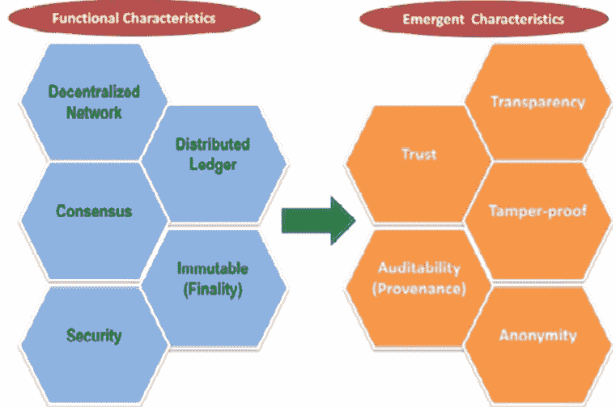

## 区块链底层技术

许多现有技术和概念共同作用，催生了名为比特币的对等验证的去中心化加密货币（最初出现于 2018 年），并随后催生了区块链技术。这些包括：密码学、分布式账本、哈希机制和共识协议。以下段落简要解释了这些是什么。

- 密码学：密码学的一般目的是为安全目的创建安全身份。密码学分为两种类型：对称和非对称。非对称密码学提供了一种更强大的算法，由公钥（对所有人可见）和私钥（仅对该密钥适用的数据所有者可用）组成。非对称密码学的应用之一是数字签名。此类签名为数据和文档提供真实性和完整性机制；并对资产（例如，数据或文档）的所有者提供强有力的控制。在区块链的情况下：1) 用户的公钥是其区块链钱包（例如，比特币或以太坊地址），对链中所有参与者可见；2) 私钥用于对交易进行数字签名，以确保特定交易确实由发送方生成，并安全存储在加密钱包中。

- **分布式账本**：账本是包含交易记录（信息和数据）的文件。分布式账本使用独立计算机（称为节点）在各自的数字账本中记录、共享和同步交易（而不是像单一传统账本那样将数据集中化）。事实上，区块链是一种分布式账本，它将数字资产和交易组织成块数据库（位于不同节点），这些块以仅追加模式相互链接。分布式账本的优势在于，由于其去中心化和自我调节，它消除了对中央控制机构或中介来处理、验证或认证交易或其他形式的数据交换的需求。

- **哈希函数**：哈希函数是区块链架构中用于确保交易不可更改性的重要元素。它是一种数学函数/过程，在区块链中用于表示其当前状态。哈希作为共识机制的一部分，用于让所有各方（节点）同意区块链状态是唯一且相同的。哈希处理包括获取任意量的输入数据，然后应用算法将其转换为称为 *hash* 的固定长度数据（ISO, 2016）。哈希处理和数字签名是支撑密码学的两个概念。

- **共识协议**：此类协议是网络中所有参与者的所有访问权利和义务的编码规则集。共识机制是一种容错进程，用于在多代理系统（例如加密货币和区块链技术）中的分布式进程中，就单个数据值或网络的单一状态达成必要的协议。它对记录保存和交易事件历史很有用。由于区块链是动态变化的，因此拥有一个高效、公平、实时、功能完善、可靠且安全的机制来确保网络中发生的所有交易都是真实的非常重要。因此，所有参与者需要就账本的状态达成共识。最常用的两种共识机制是：*工作量证明*（PoW）和*权益证明*（PoS）。

## 区块链流程

图 3 说明了解释区块链流程运作方式的简单方法。

## 区块链类型

一般来说，区块链主要有三种类型：*公有*、*私有*和*联盟*（Bhasin, 2019）。公有区块链和私有区块链可进一步分为许可型或无许可型区块链（Singh, 2020）。联盟区块链也称为联邦区块链。

- **公有**：这里，任何人都可以加入并参与网络，即下载代码、读取、写入、审计、添加并运行公共节点。这些区块链是开放的、去中心化的和透明的，但性质上相对较慢。所有加入者都可以查看账本并参与共识以验证新块。决策通过各种共识机制进行，例如 PoW 或 PoS。示例包括比特币、莱特币和以太坊。

### 图 3. 区块链的工作原理

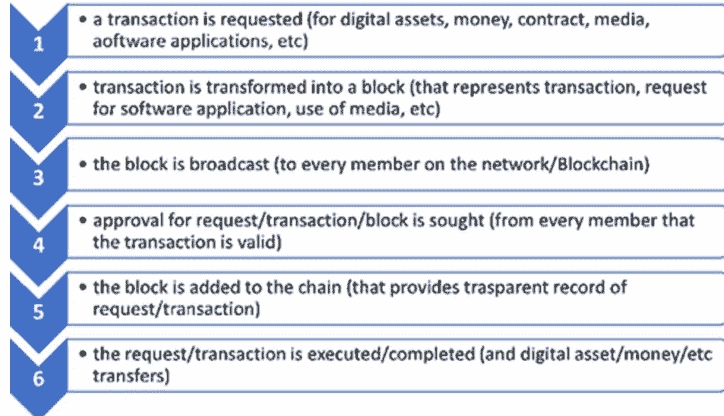

- **私有**：这里，个人或组织是区块链的所有者，并拥有谁可以加入以及拥有访问权限的权限。因此，这是一个中心化-去中心化网络。读取和写入访问权限因节点而异；且不提供匿名性。这些网络比公有区块链成本更低，但比公有网络更节能且波动性更小。示例包括：R3、Bankchain 和 Corda。

- **联盟或联邦**：这里，多个组织组成联邦并拥有网络。这就像多个组织共享并并发工作的枢纽。只有选定的成员可以运行节点或进行交易。网络可扩展且节能。这种类型提供较低的交易费用和更强的稳健性，因为犯罪活动减少了。示例包括：Multichain、R3 和 Monax。

- **无许可型区块链**：在这种类型中，任何人都可以加入、运行和管理数字资产。这些是公有区块链，真正去中心化、透明、可信、不可更改且安全性增强。然而，这些更难扩展且效率较低。这里使用 PoW 机制来达成共识。以太坊和比特币是此类区块链的示例。一些用例包括：数字身份、投票和筹资（Singh, 2020）。

- **许可型** 区块链：这些更像是私有区块链，加入需要所有者组织的许可。特征包括：去中心化程度各异，由拥有组织管理和治理，高效、可扩展、透明度较低且节能。用例包括：研究、银行交易和供应链管理（Singh, 2020）。

在这些区块链类型中，根据 Kashyap (2018) 的说法，我们可以识别出区块链通常包含的以下组件：

- 账本：由数字资产交易的元素组成
- 智能合约：当特定事件发生时生效的约定条款
- 共识网络：按特定顺序链接的区块链节点
- 事件：指区块链活动，例如添加新块
- 钱包：此元素保存和管理消费者的安全凭据
- 管理：此组件管理创建、更改和监控事件的能力
- 集成：这有助于管理区块链与外部系统之间的链接

## 区块链平台

过去几年中，区块链生态系统发展迅速。因此，市场上出现了许多实现平台。它们分为多个类别，例如区块链企业平台、区块链云平台等等。Malhotra (2020) 对十五种最常用的区块链平台进行了综述。以下部分概述了其中一些（以及其他一些）支持基于区块链的应用程序开发和实现的平台。

## 以太坊

最初于 2014 年提出，这是比特币之后第二个最具吸引力的开源去中心化公共平台，用于在定制构建的区块链网络上运行智能合约。它可以用于在区块链上设计和运行应用程序。它提供一种名为 Ether (ETH) 的加密货币。基于以太坊的程序（使用以太坊嵌入式编程语言）可以在无需人工干预的情况下安全运行，并且以 ETH 支付的款项是自动的。任何人都可以设计并将应用程序上传到以太坊网络（该网络基于分布在全世界的数千台计算机），任何人都可以作为网络中的另一个节点参与，执行应用程序并验证交易。优势包括安全性、可靠性以及无需中介（Economic Point, 2020）。

## Hyperledger Fabric

这是另一个由 IBM 开发的企业级开源许可型分布式账本技术平台，为包括银行、金融、保险、医疗保健、人力资源、供应链甚至数字音乐交付在内的广泛行业用例提供了模块化、可配置的架构和多功能性。它支持使用 Java、Python 和 Go 等通用编程语言编写的智能合约（Hyperledger Fabric, 2020）。它支持可插拔的共识协议，使平台能够更有效地定制以适应特定的用例和信任模型。Fabric 可以利用不需要原生加密货币的共识协议；并提供安全性、隐私性、保密性、可扩展性和可插拔共识（CitiusTech, 2018）。

## OpenChain

这也是基于 Coinprism 开发的安全开源分布式账本技术的最受欢迎的区块链平台之一。这是一个适合组织以健壮、安全且可扩展的方式管理和保护其数字资产的私有网络。虽然 OpenChain 不使用块的概念（其交易直接相互链接，不再分组在块中），但此分布式账本是实时的；支持 JavaScript；并且其交易


具有不同层级的自定义权限，可扩展且安全。其他功能包括：交易即时确认、不可变性、为用户分配别名、通过数字签名保护交易，以及具有多层级控制的层级账户系统（OpenChain，2020）。

## MultiChain

这是一个用于构建区块链的开源平台。一项关键设计原则是与 Bitcoin Core 实现最大兼容性，其中包括比特币的网络协议、交易格式、块格式和输出脚本。比特币开发者文档中的几乎所有信息都适用于 MultiChain。它提供诸如自定义区块链参数、使用智能过滤器、用于控制 MultiChain 的 API 命令、自定义运行时参数、细粒度权限、快速部署和无限资产等功能。有助于 MultiChain 开发的一些工具包括 MultiChain Explorer、Docker Multichain 和 MultiChain Web Demo。C#、GO、Java、PHP、Python 和 Ruby 可用于编程（MultiChain，2020）。

## R3 Corda

R3 开发的 Corda 平台是一个企业级区块链平台，提供安全性、可扩展性、企业集成和互操作性。分布式应用可以构建在开源 Corda 之上，应用于金融服务、保险、医疗保健、贸易金融和数字资产等行业（R3，2020）。企业可以直接、私密（需注意大多数平台缺乏隐私性）、安全且无缝地进行交易，降低交易和记录保存成本，并简化业务运营。使用智能合约可使平台在满足设定条件后立即执行任务。功能包括：降低运营成本、通过货币化网络增加收入，以及在各方之间提供高度信任。Corda 没有原生货币。

## EOS

这也是一个由名为 Block.One 的公司于 2018 年初推出的开源区块链平台。它允许在智能合约上安全且相对轻松地购买和交易数字资产。基于去中心化技术，与许多使用权益证明（PoS）算法的其他平台不同，EOS 使用委托权益证明（DPoS）进行共识。功能包括：商业可扩展性、广泛分布和灵活性。目前，EOS 是全球前 20 种加密货币之一，因为其代币市值为 5 亿美元（Crypto Digest，2020）。与仅在单链上运行的以太坊不同（这通常会导致容易拥堵网络的微交易），EOS 使用多条链，网络拥堵的风险可忽略不计或几乎没有，因此不会影响其他应用程序。

## 其他平台

还有许多其他区块链平台，包括 Ripple、Stellar、Quorum、Monero、IBM 区块链平台、Hyperledger Sawtooth、Neo 区块链平台、Hedera Hashgraph、Hyperledger Iroha。Malhotra（2020）对这些平台进行了很好的总结。此外，市场上还有许多其他平台，例如 Ardor、Cardano、Komodo 等。

## 区块链用例和倡议

如 I-Scope（2020）所述，区块链技术似乎比物联网（IoT）愿景更具重大意义。行业中的区块链用例和项目倡议远远超出了金融交易和加密货币转移。凭借其创造更多透明度、开放性和公平性的能力，以及不可变性等特性，这项技术正在影响包括金融、制造、医疗保健和运输在内的众多行业。行业内（尤其是区块链产品供应商和区块链服务提供商）的一些区块链用例和倡议将在下文小节中详细阐述。

## 区块链用例

以下是使用分布式账本技术提供服务的若干供应商和商业组织列表。

- **BURSTIQ**: 这是一家位于科罗拉多州丹佛的医疗保健行业公司（Daley，2020）。他们正在使用区块链合同，帮助患者和医务人员安全地转移敏感和私密的患者数据。区块链合同确定了每位患者可以存储哪些数据以及可以显示哪些信息的参数。

- **PROPY**: 这是一家位于加利福尼亚州帕洛奥图的房地产中介机构。它是一个带有去中心化产权登记系统的市场和交易平台，使用区块链技术按需实时发放产权。该中介机构使用加密货币购买房产（Daley，2020）。

- **CIRCLE**: 这是一家总部位于波士顿、在金融技术（FinTech）领域运营的点对点支付技术公司。他们每月监管约 20 亿美元的加密货币投资和交易（Daley，2020）。其组合包含七种以上的数字货币，包括比特币、Zcash 和 Monero。

- **HYPR**: 这是一家总部位于纽约、在网络安全领域运营的公司。他们使用去中心化凭据解决方案来检测和解决基于物联网的连接设备中的安全风险。他们使用生物识别和无密码解决方案；并开发几乎无法被黑客攻击的物联网设备（Daley，2020）。

- **KOMGO**: 该公司成立于 2018 年底，目前位于瑞士，由 ABN-AMRO、BNP 和 ING 等机构支持，旨在通过开发去中心化、开源且安全的大宗商品交易网络来实现全球大宗商品交易的自动化（Komgo，2020）。

- **HORIZON GAMES**: 这是一家区块链基础设施公司，正在开创一种属于其玩家和创作者的游戏新维度（Infura，2020）。对于其旗舰游戏 SkyWeaver，该游戏由玩家组成牌组的 500 张可收藏卡片组成，这些卡片是以太坊 ERC 代币，是具有现实世界所有权和交易的数字卡片。

- **OPEN ZEPPELIN**: 该公司构建 SDK（软件开发工具包）平台和其他工具，帮助开发者在以太坊平台上创建更快、更有趣的应用程序（OpenZeppelin，2020）。该公司能够降低技术开销，并将用户无缝引导至以太坊网络，以安全地更快地构建和部署应用程序，改善开发者体验。

区块链文献中有许多可用且已报告的用例。例如，请参阅 Consensys（2020a）。

## 区块链倡议

以下是来自世界各地的若干区块链相关倡议列表。

## 智慧迪拜

这是阿联酋的一项倡议，旨在让迪拜成为“地球上最幸福的城市”。目标是在 2021 年之前让迪拜成为第一个完全由区块链驱动的城市（Consensys，2020）。该项目正在使用区块链即服务，开发基于区块链的智慧城市大学，为 100% 的政府服务开发区块链生态系统，并确保无纸化流程。沙盒环境基于以太坊。

## Project Khokha 项目

该项目旨在通过南非储备银行与全国银行界的协作努力，评估分布式账本技术的应用和用例，以创建基于区块链的银行间系统。该项目已超过交易性能目标，在不到两个小时内完成了超过 70,000 笔交易（银行间清算和结算）（Project Khokha，2020a）。

## 特珀区块链倡议

卡内基梅隆大学的特珀商学院设立了一项倡议，旨在促进去中心化区块链技术的设计、应用、伦理和监管方面的创新（特珀商学院，2020）。该项目是开展研究课题、开发教育内容和推进产业合作的枢纽。该倡议还旨在促进教职员工和学生的区块链和加密货币活动。

## IEEE 新冠疫情演变项目

该项目使用区块链和 AI 技术设计和开发一款预测 2019 年冠状病毒病疫情演变的应用程序（IEEE Spectrum，2020）。该团队由西班牙萨拉曼卡的两名 IEEE 成员领导，正试图确定影响 COVID-19 冠状病毒传播的因素，为医疗保健专业人员提供决策所需的相关信息；并预测未来的流行病和大流行病。


## Ripple UBRI 项目

大学区块链研究计划 (UBRI) 是 Ripple 与世界各地领先大学之间的合作伙伴关系，旨在支持区块链、加密货币和数字支付领域的研究、技术开发和创新（Ripple，2020）。Ripple（也是一个区块链平台）正利用该计划激励学生投身于区块链、分布式计算、金融科技及相关领域的职业。

## 结论

区块链技术，也称为分布式账本技术 (DLT)，可能是自互联网出现以来最重要的创新。它承载着同样的希望，但在社会和行业的多个不同领域（包括医疗保健、交通运输、供应链、风险管理、制造业、旅游业、银行业、教育等）中提供了一种新的安全且匿名通信形式。它是计算机科学中较新的创新；然而，它正在快速发展，各行各业和学术界都在拥抱这种新兴颠覆性技术。

在本章中，我们介绍了区块链技术，并讨论了社会各个领域（尤其是产品供应商公司和区块链服务提供商）中的用例和新举措。我们描述了必要术语，概述了核心特征，列出了区块链技术承诺的好处，并描述了底层概念和区块链流程。各种著名的区块链平台也进行了总结，以确保完整性。

## 参考文献

- R3. (2020). Corda Enterprise：下一代区块链平台. 可查阅：https://www.r3.com/corda-platform/
- Bhasin, H. (2019 年 4 月). 区块链的三种主要类型：区块链分类. 可查阅：https://www.marketing91.com/types-of-Blockchain/
- CitiusTech. (2018 年 5 月). 医疗保健领域的区块链. 可查阅：https://www.ehidc.org/sites/default/files/resources/files/Blockchain-for-healthcare-341.pdf
- Consensys. (2020). 智能迪拜：阿联酋政府区块链案例研究. 可查阅：https://consensys.net/Blockchain-use-cases/government-and-the-public-sector/smart-dubai/
- Consensys. (2020a). 现实世界中的区块链案例研究. 可查阅：https://consensys.net/Blockchain-use-cases/case-studies/
- Crypto Digest. (2020). EOS 平台：你应该知道的事. 可查阅：https://cryptodigestnews.com/eos-platform-what-you-should-know-58da830d2aa8
- Daley, S. (2020 年 3 月). 25 种区块链应用及颠覆现状的现实世界用例. 可查阅：https://builtin.com/Blockchain/Blockchain-applications
- Economic Point. (2020). *什么是以太坊平台*. 可查阅：https://economicpoint.com/ethereum
- Garson, B. (2018 年 6 月). *超越炒作的区块链*. 可查阅：https://www.mckinsey.com/business-functions/mckinsey-digital/our-insights/Blockchain-beyond-the-hype-what-is-the-strategic-business-value?cid=other-eml-nsl-mip-mck-oth-1807&hlkid=5424a29008e445239371a81cc83b3dbb&hctky=10291646&hdpid=bb9f89f0-458b-4b4e-a1ee-ad99e602294e
- Hyperledger Fabric. (2020). *Hyperledger Fabric*. 可查阅：https://hyperledger-fabric.readthedocs.io/en/release-2.0/whatis.html
- I-Scope. (2020). *区块链与物联网：IoT 区块链的机遇与挑战*. 可查阅：https://www.i-scoop.eu/internet-of-things-guide/Blockchain-iot/
- IEEE Spectrum. (2020 年 4 月). *西班牙研究人员利用区块链和 AI 压平曲线*. 可查阅：https://spectrum.ieee.org/news-from-around-ieee/the-institute/ieee-member-news/researchers-spain-Blockchain-ai-app-flatten-the-curve
- Infura. (2020). *与 Horizon Games 合作，助力开启游戏新维度*. 可查阅：https://infura.io/customers/skyweaver
- ISO. (2016). *信息技术*. 专利号：ISO/IEC 10118-1:2016.
- Kashyap, P. (2018 年 2 月). *区块链及其组件有哪些不同类型？*. 可查阅：http://www.beingcrypto.com/what-are-different-types-of-Blockchain-and-its-components/
- Komgo. (2020). *简化贸易融资*. 可查阅：https://komgo.io/
- Malhotra, M. (2020 年 3 月). *2020 年值得关注的区块链平台综合列表*. 可查阅：https://www.valuecoders.com/blog/technology-and-apps/a-comprehensive-list-of-Blockchain-platforms-to-look-for-in-2019/
- MarketWatch. (2020 年 6 月). *区块链技术市场份额，预计到 2025 年将超过 250 亿美元 – 新闻稿*. 可查阅：https://www.marketwatch.com/press-release/Blockchain-technology-market-share-growth-to-record-over-us-25-billion-by-2025-2020-06-09
- MultiChain. (2020). *面向开发者的 MultiChain*. 可查阅：https://www.multichain.com/developers/
- OpenChain. (2020). *OpenChain 概述*. 可查阅：https://docs.openchain.org/en/latest/general/overview.html
- OpenZeppelin. (2020). *安全区块链应用的标准*. 可查阅：https://openzeppelin.com/
- 项目 Khokha：企业级以太坊银行与金融案例研究. (2020). 可查阅：https://pages.consensys.net/consensys-banking-and-finance-project-khokha-v2?utm_campaign=Enterprise%20Ethereum%2020&utm_source=Website&utm_medium=Direct&utm_term=EntEth&utm_content=CaseStudyKhokha
- Ripple. (2020). *大学区块链研究计划*. 可查阅：https://ubri.ripple.com/faq/
- Robinson, J. (2018 年 8 月). 交通运输领域区块链的未来. 可查阅：https://www.fleetio.com/blog/future-of-Blockchain-in-transportation
- Rosic, A. (1916). 什么是区块链技术？初学者分步指南. 可查阅：https://blockgeeks.com/guides/what-is-Blockchain-technology/
- Singh, N. (2020 年 5 月). 许可型与非许可型区块链：比较指南. 可查阅：https://101Blockchains.com/permissioned-vs-permissionless-Blockchains/
- Tasca, P., & Tessone, C. J. (2019). 区块链技术分类学：识别与分类原则，Ledger. LedgerJournal.org.
- Tepper School of Business. (2020). Tepper 区块链计划. 可查阅：https://www.cmu.edu/tepper/faculty-and-research/initiatives/Blockchain-initiative/
- Witscad. (2020). 区块链特征. 可查阅：https://witscad.com/course/Blockchain-fundamentals/chapter/Blockchain-characteristics
- Zaky, D. (2020 年 3 月). 什么是区块链技术及其工作原理？. 可查阅：https://fxdailyreport.com/Blockchain-technology/

## 延伸阅读

- Active Business Systems. (2020)，区块链与 ERP，可查阅：https://www.activebs.com/en/news/2018/Blockchain-and-erp
- Byon/Alacrity. (2020 年 5 月)，教育领域的区块链：三种有前景的改革，可查阅：https://alacritys.net/2020/05/27/Blockchain-in-education-three-promising-reforms/
- Clark, D. (2016)，区块链在教育中的 10 种应用方式，可查阅：https://oeb.global/oeb-insights/10-ways-Blockchain-could-be-used-in-education
- Columbus, L. (2019)，区块链如何在 2019 年改善制造业，可查阅：https://www.forbes.com/sites/louiscolumbus/2018/10/28/how-Blockchain-can-improve-manufacturing-in-2019/
- Concise Software. (2020)，银行业中的 10 个区块链用例，可查阅：https://concisesoftware.com/10-use-cases-of-Blockchain-in-banking/
- Consensys. (2016)，5 个令人惊叹的区块链 IoT 应用，可查阅：https://blockgeeks.com/5-incredible-Blockchain-iot-applications/
- Goyal, S. (2018 年 11 月)，区块链技术史：必须了解的时间线，可查阅：https://101Blockchains.com/history-of-Blockchain-timeline/
- Hance, M. (2020)，什么是区块链以及如何在教育中使用它？，可查阅：https://mdreducation.com/2018/08/20/Blockchain-education/
- Maaghul, R. (2019 年 10 月)，教育领域的区块链：记录管理的未来，可查阅：https://blogs.odem.io/Blockchains-bright-future-in-the-education-industry
- Mahmood, Z. (2021). 区块链技术：行业中的应用。载于 Z. Mahmood (编)，区块链技术行业用例：行业中的倡议与用例，IGI Global，2021.
- Morley, M. (2020 年 2 月)，2020 年供应链中区块链的 5 大用例，可查阅：https://blogs.opentext.com/Blockchain-in-the-supply-chain/
- Shumsky, P. (2019 年 9 月)，2020 年银行业的区块链用例，可查阅：https://www.finextra.com/blogposting/17857/Blockchain-use-cases-for-banks-in-2020
- Winnesota. (2020)，区块链如何正在颠覆交通运输和物流世界，可查阅：https://www.winnesota.com/Blockchain

## 关键术语及定义

- **Bitcoin：** 这是第一种也是最流行的加密货币，使用区块链技术进行数字交易。
- **Blockchain：** 区块链是一种用于在分布式去中心化数字账本中存储数字交易的数学结构。它由分布在多个计算节点上的多个区块组成，这些区块通过加密签名相互链接。
- **Consensus Mechanism：** 这是指用于维护和更新区块链中账本的规则和机制的过程，旨在保证记录的可信性，即其可靠性和真实性。
- **Cryptography：** 这是一种利用个性化代码（例如公钥和私钥）来保障通信安全的科学，以便只有参与各方能够读取加密消息。
- **Ethereum：** 一个用于构建基于区块链应用的开源平台。它允许分发一种名为以太币（ETH）的货币；并允许存储和执行代码，从而实现智能合约。
- **Hashing Mechanism：** 这是一个区块（包含关于数字资产和哈希指针的信息）的数字签名（包含公钥和私钥），用于身份验证和验证目的。
- **Hyperledger Fabric：** 这是一种由 IBM 开发的企业级开源许可型分布式账本技术平台。它提供模块化、可配置架构，并适用于广泛的行业。
- **Proof of Stake (PoS)：** 这是一种共识算法，加密货币区块链网络旨在通过此算法实现分布式共识。在基于 PoS 的数字货币中，下一个区块的添加会考虑各种随机选择组合，例如财富或年龄（即权益）。
- **Proof of Work (PoW)：** 这是一种共识机制，通过要求服务请求者完成一定工作（通常指计算机的处理时间），来帮助防止或减少网络上的拒绝服务攻击以及垃圾邮件等其他安全滥用行为。
- **Smart Contract：** 智能合约是一种计算机协议，用于在双方之间便捷地转移数字资产，前提是双方已事先商定相关条款或条件。


## 第10章

## 区块链技术：概念、组成部分与案例

Somayya Madakam
https://orcid.org/0000-0001-6708-2061
FORE School of Management, New Delhi, India

Harshita
Institute of Management Technology, Ghaziabad, India

## 摘要

目前，个人、组织和公司之间的财务交易都在借助银行、金融机构、标准化机构或信用卡提供商等中介的第三方批准下进行。这些交易涉及多级审批、成本，在某些情况下还存在低效率的流程，这也导致时间和资源的浪费。为了解决这些问题，区块链技术已出现为一种新的金融数字创新解决方案。在这里，财务交易是在线、开放和透明的。在本章中，作者介绍了关于区块链技术相关研究的系统性文献。目的是了解历史演进、当前正在进行的研究、基础技术和应用。作者已从EBSCO、Scopus、Web of Science和Google Scholar等科学数据库中提取了研究文章。关于区块链技术的在线博客、维基、媒体文章、YouTube视频和公司白皮书也用于内容分析。

## 引言

专家认为区块链是互联网发展以来最具颠覆性的技术。区块链技术，也称为分布式账本技术（DLT），将在未来几年为基于行业和商业的用例构建提供机会。因此，全球的软件开发公司，尤其是印度的软件开发公司，正在急切地寻求填补区块链技术领域的以下职位：区块链开发人员、区块链首席开发人员、区块链架构师、应用架构师、区块链工程师、区块链专家、区块链技术专家、区块链顾问等。这表明，海得拉巴、钦奈、加尔各答、浦那、科钦、NOIDA、艾哈迈达巴德、孟买等印度软件中心迫切需要发展区块链技术及其相关应用，以便顺畅地提供金融服务。这不仅是基于印度的金融机构、银行和IT/ITes公司的当务之急，也是全球其他部门的当务之急。以下是2020年7月5日在LinkedIn上的几个职位招聘示例，针对的职位包括：Smith + Crown Financial Services @ 美国波特兰的区块链分析师；Onchain Company @ 中国上海的区块链研究员；Blockchain Space Executive Company @ 曼谷都市区的全球公关与品牌总监；PERSOL @ 新加坡的销售主管，区块链/金融科技；以及Swisscom Blockchain @ 瑞士苏黎世的高级区块链工程师。

区块链技术的设计、开发、实施和应用涉及分布式系统和存储、区块链、加密货币、哈希函数、网络安全，以及使用不同形式化方法、工具和编程语言（如C、C#、Java、Ruby、Solidity、JavaScript、Python、R、Go、Scala、Grafana、DataDog、Bash、Perl、MongoDB、MySQL、JSON、kotlin和RESTful API）的应用密码学，这些技术在各行各业中广泛使用。区块链开发包括前端/后端、存储、网络和安全机制。这种颠覆性金融技术有许多应用，包括基于分布式账本技术（DLT）的应用，利用去中心化、数字稀缺性和彻底透明度，为废物链中的供应链和利益相关者提供信任。应用领域包括金融机构、制造业、房地产、医疗保健、司法、教育、治理、能源、电信和交通运输等。

在本书章节中，作者详细讨论了区块链技术在银行、保险、房地产、智慧城市、制造业、供应链、能源和电信领域中的应用，并结合相关测试案例以及区块链概念和底层技术。本章包含四个主要部分。前两个部分详细探讨了区块链技术，包括定义、起源、组件和不同加密货币。随后的部分解释了区块链概念、背景机制以及全球各行各业的案例研究。最后的简短部分介绍了结论。

## 区块链概念

“区块链”技术正与人工智能（AI）、机器学习（ML）、深度学习、数据分析、物联网（IoT）和云计算一起成为最受欢迎的颠覆性技术之一。关于这种新兴技术的文献大量存在，形式包括新闻脚本、期刊文章、图书章节、分析报告和书籍。在公开演讲活动、研讨会、会议、讲座、博士讨论会、网络研讨会，甚至会议兼展览等特别节目中，也有关于区块链技术的热烈讨论。这表明对这种现象存在巨大需求。以往的研究表明，对该技术的需求正在增加，因为它在金融交易和银行服务方面变得非常有吸引力。Blidholm & Johnson (2018)；Coeckelbergh & Reijers (2016)；Grigoriadou (2019)；Hütten (2017)；Khat al et al. (2020)；Lundström & Öhman (2019)；Manrique (2018)；Mihigo (2019)；Mushtaq & Haq (2019)；Nehaï & Guerard (2017)；Shi (2019)；Songara & Chouhan (2017)的研究充分揭示了对区块链技术、在线分布式账本、区块链和星际文件系统（IPFS）框架及其价值创造的需求。此外，Madakam & Kollu (2020)的开创性论文清楚地解释了区块链技术的基础知识——认知、原则、程序和实践。

以下是关于区块链及相关技术不同方面的一些重要研究。Casey (2015)在《华尔街日报》中谈及无币区块链，这在比特币社区引发了紧张局势。Dash et al. (2017)的手稿在《国际信息科学与计算杂志》中聚焦于革命性的比特币。Felin & Lakhani (2018)在《MIT斯隆管理评论》中讨论了如何利用区块链技术解决问题。Gatteschi et al. (2018)在《未来互联网》中解释了保险智能合约；Haber et al. (1991)在《密码学杂志》中描述了如何为数字文档打时间戳。Janssen et al. (2020)在《国际信息管理杂志》中报告的研究讨论了区块链技术的采用。

Köhler & Pizzol (2019)在《环境科学与技术杂志》中探讨了比特币挖矿的生命周期评估。Nian & Chuen (2015)在其《数字货币手册》中详细讨论了虚拟货币的监管。Narayanan et al. (2016)在普林斯顿出版社版本中全面讨论了比特币和加密货币技术。《自然新闻》的出版商也讨论了加密货币的未来，即比特币及其未来（Extance, 2015）。Katie Martin (2016)在《金融时报》中报道了金融服务公司CLS Group准备批准基于区块链的交易。Salsman (2013)在《福布斯》杂志中建议，金融危机是由于政府失败，而非自由市场失败。

区块链主题本质上是跨学科和技术性的。人们可以通过许多主导的出版商和论坛找到其文献，包括IGI Global、IEEE、ACM、Springer会议论文集和期刊，此外还有金融和会计相关期刊。此外，John Wiley & Sons、Reuters、Elsevier、Inderscience、Emerald、普林斯顿大学出版社和学术出版社也在积极传播区块链技术知识。过去这些出版商的研究已探索了区块链和加密货币作为信任证明、保护物联网设备的去中心化技术、对工业4.0的影响、智能电网应用，以及作为可持续发展的关键驱动力。

2019年10月，Gartner的炒作周期图表从经验上表明，到2023年，区块链平台将进步到可扩展、互操作，并将支持智能合约可移植性和跨链功能。根据Gartner的预测，未来5-10年内蓬勃发展的某些区块链子技术预计将包括：区块链UX/UI技术、去中心化身份、账本DBMS、智能合约预言机、区块链PaaS、加密货币相关软/硬件钱包、区块链元代币平台、零知识证明等。此外，在区块链商业模式、开发、区块链分布式账本、哈希函数、加密货币、稳定币、智能合约、智能资产、奖励和忠诚度、ICO、ACH支付、潜在客户开发、去中心化自治组织、战略代币化、安全性、数字签名、政策和法规等领域也在进行大量研究。

最新的区块链技术或应用可以通过提供更好的生活质量（QoL）（Madakam & Kollu, 2020）来满足人类需求，并在人们的生活中产生巨大变化。不夸张地说，似乎没有哪个领域能逃脱区块链技术应用的范围。由于其在各个领域都有应用，这项技术正在渗透到人类生活的所有学科中。尽管它最初是为银行应用而设计的，但现在它正与保险、治理、电信、教育、研发、医疗保健、石油和天然气、交通运输、零售、媒体等领域融合。


娱乐、广告、供应链与物流、公用事业、客户服务、银行、能源、智慧城市、游戏、三维（3D）打印和物联网（IoT），仅举几例。

区块链技术是指一种由不断增长的在线数据记录列表组成的数据结构，这些记录被称为区块，通过加密技术相互链接。区块链技术是一种开放、去中心化的账本，可以在点对点计算机网络中记录各方之间的交易，而无需中央金融认证机构。根据《经济学人》2015年10月31日的报道：*要了解区块链系统的能力及其能做的事情，重要的是区分通常被混淆的三个东西，即比特币货币、支撑它的特定区块链以及区块链的一般概念。*

尽管关于这个主题有大量文献，但没有标准/操作定义，尽管存在许多工作定义。来自不同会计监管机构、金融机构、投资公司和银行的专家对区块链技术的定义各有自己的方式。学者、研究人员和学生也有他们自己的解释方式。此外，技术开发人员、政策制定者和最终用户有自己的观点。为了更好地理解，我们可以参考Crosby et al.（2016）的定义：*区块链是一个分布式数据库，包含已执行并在参与各方之间共享的交易或数字事件记录。这些交易中的每一个都由系统中绝大多数参与者的共识验证。*

区块链技术是一种开放、去中心化的账本技术，在完全连接的计算机网络上的点对点交易过程中，在线分布式账本记录以块的形式存储在节点级别。这些技术是透明的，对等方参与其中，矿工是交易的见证者，无需像其他传统金融监控系统那样依赖中央机构。区块链技术是一种集成的复杂过程，包括挖矿、点对点交易、工作量证明（Proof-of-Work）等，仅举几例。

## 区块链历史

区块链技术是一种数据管理技术，允许将金融在线交易收集到区块中并最终记录。它允许在完全连接的计算机网络中由不同服务器访问生成的账本。没有信任基础的个人或实体也可以在没有中央控制机构的情况下使用它。根据Brito & Castillo（2013）的说法，最初，区块链是一个不断增长的记录列表，称为区块，通过加密技术相互链接。尽管区块链技术正在成为使用加密货币的整个金融服务业务的基础，但起初人们只知道比特币，之后它才发展成为一种技术。这表明，最初，区块链技术被用于记录比特币（Nakamoto, 2008）等加密数字货币的历史交易。因此，在比特币推出之前，我们就有了在线分布式账本交易，并且存在分布式系统记录，这些记录在计算机网络的不同节点上存储官方信息交易。一些背景文献证明，Stuart Haber和Scott Stornetta于1991年描述了第一项关于密码学保护的区块链工作（Scott, 1991）。他们希望实现一个文档时间戳无法被篡改的系统。1992年，Haber、Stornetta和Bayer将默克尔树纳入设计，通过允许将多个文档证书收集到每个区块中，提高了效率（Haber et al., 1991; Bayer et al., 1992; Narayanan et al., 2016）。这些是区块链技术发展的垫脚石。从2008年开始，许多全球技术开发公司和新创企业开始推出新的区块链相关产品和服务，因为这项技术为企业带来了许多优势。

2009年，第一个比特币被挖出并以数字形式在线上市。在随后的年份，即2010年，通过加密货币交易所，比特币推出并开始交易。2014年，微软开始接受比特币用于其业务付款。现在，比特币为加密货币创造了一个去中心化的环境，参与者可以使用数字货币购买和交换商品（Yli-Huumo et al., 2016）。

在此背景下，LeewayHertz（一家专注于构建数字解决方案的公司）正在为客户提供智能合约、dApps、安全代币发行（STO）/首次交易所发行（IEO）、稳定币以及公共和私有区块链解决方案。另一方面，Consensys正在开发和部署许多企业级以太坊解决方案，Consensys团队还提供线下和在线区块链教育。同样，ChromaWay提供了一个区块链平台，为房地产和金融行业提供智能合约解决方案。此外，Blockchain Intelligence Group（BIG）致力于为降低加密货币交易相关风险提供最佳解决方案。4IRE LABS正在使用区块链、机器学习和物联网开发强大的解决方案。在全球范围内，超过1,000家公司正在从事区块链产品和服务的生成、规划、设计、融资、教育、咨询、开发和部署。这些产品可以以区块链、加密货币、挖矿过程、交易安全、智能合约、工作量证明等形式应用于不同领域。

## 区块链加密货币

2012年，作者之一通过一名投资Onecoin并在印度孟买频繁参加相关业务会议的人了解到Onecoin。自2012年以来，出现了众多数字货币。这些包括比特币、莱特币、Blackcoin、以太坊、瑞波币、门罗币等。表1展示了某些加密货币的创世信息。

表1. 加密货币 - 创世

| 序号 | 加密货币 | 创始人/创建 | 年份 | 语言 | 开发者 | 官网 |
|---|---|---|---|---|---|---|
| 1 | Bitcoin (BTC) | Satoshi Nakamoto | 2008/2009 | C++, Java, JavaScript | Bitcoin Foundation, Seattle, WA (USA) | https://bitcoin.org/en/ |
| 2 | Litecoin (LTC) | Charlie Lee | 2011 | C++ | Under the MIT/X11 license | https://litecoin.org/ |
| 3 | Ripple (XRP) | Ryan Fugger | 2012 | C/C++, Java, JavaScript, Python, Go | Ripple Labs Inc. San Francisco, California (USA) | https://ripple.com/xrp/ |
| 4 | DigiByte (DGB) | Jared Tate | 2013/2014 | Open Source Protocol | The DigiByte Foundation (DF), DigiByte Awareness Team | https://digibyte.io/ |
| 5 | Ethereum (ETH) | Vitalik Buterin, Gavin Wood | 2013/2015 | C++, C#, Java, Python, Go, Rust | Ethereum | https://ethereum.org/ |
| 6 | Tether | Reeve Collins | 2014 | Open Source Software | Tether Limited | https://tether.to/ |
| 7 | LibrexCoin (LXC) | Anonymous | 2014 | C Innovative Libraries | Zerocoin library for native zerocash protocol support | http://www.librecoin.com/ |
| 8 | Monero (XMR) | Nicolas van Saberhagen | 2014 | Korvi, Monero Speculinker, XMR Stak, Wolfs Miner | Multiple people within a community working on the product | https://web.getmonero.org/ |
| 9 | Dash (DASH) | Evan Duffield | 2014 | C++ | Decentralized Autonomous Organization (DAO) | https://www.dash.org/ |
| 10 | Zcash (ZEC) | Zooko Wilcox-O'Hearn | 2016 | C++, Python, Rust, Kotlin, Swift, Go | Electric Coin Company (zcashd), Zcash Foundation (zebra) | https://z.cash/ |

## 区块链类型

区块链技术备受关注，主要集中在金融技术（FinTech）领域。这些区块链是在线的、以区块形式存在并通过计算机网络相互链接的公共分布式账本记录。自2017年以来，区块链行业已在全球范围内飞速发展。基于源代码、开发流程、访问权限和维护，区块链大致分为三类：公共链；私有链；和联盟链。请参见图1。

图1. 区块链类型

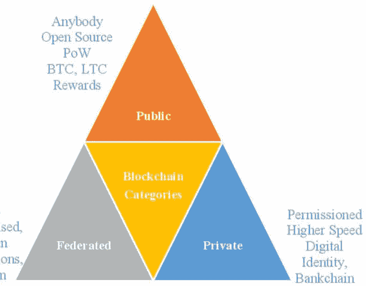

### 公共区块链

区块链的一种类别是公共区块链。这些完全基于开源技术。全球任何人都可以随时随地使用任何设备参与；公共节点可通过其个人机器或设备访问。在公共区块链中，任何人都可以作为用户、矿工、开发人员和社区成员参与。所有这些交易都是匿名且透明的。简单来说，这是一个网络中的每个参与者都可以读取和写入的平台。任何人都可以在未经他人许可的情况下使用源代码，并在公共区块链中按照预定义规则在其本地系统上运行代码。工作量证明（PoW）算法是公共区块链的支柱。然而，网络中的任何人都可以进行审计。这种公共区块链配置的主要优势之一是减少了对特殊中央数据库服务器和系统管理员的需求，从而降低成本。这些通常具有代币关联，旨在奖励网络中的参与者。此类示例包括比特币、莱特币、以太坊、门罗币和Dash等。


## 私有区块链

第二个类别是私有区块链，也称为许可区块链。区块链源代码中读取和写入权限的全部特权仅限于所有者/所有权人；因此，有时也被称为封闭区块链。这些区块链通常位于组织内部。私有区块链对访问以及谁可以参与交易和验证操作有限制。这是一个平台，只有区块链的所有者才有权更改规则或其他条款和条件。外部消费者不能运行全节点、开始挖矿、进行交易或在区块链浏览器中审计区块链。私有区块链是个人或组织的私有财产。私有区块链网络用于投票、数字身份、资产所有权和供应链管理（SCM）等。在私有区块链的情况下，每秒交易数（TPS）更高；然而，这些区块链具有高度可扩展性。私有区块链中包含的一般活动有访问、可见性、存储和执行。这种区块链的最佳示例是Bankchain。另一个示例是MONAX。

## 联邦区块链

区块链的另一个主要类别是联邦区块链或联盟区块链。这种类型继承了公有区块链和私有区块链的混合特征。因此，这些可以被视为半去中心化。联盟区块链提供公有区块链的效率和安全性，同时仍允许一定程度的中央控制、监控和保障。像公有区块链一样，这些是分布式系统；像私有区块链一样，这些是许可区块链。只有获得事先批准或投票的允许成员才能成为网络的一部分以进行交易。这种区块链用于公司之间和组织之间的日常财务业务运营。Quorum、Hyperledger和Corda区块链属于联邦/联盟区块链类别的一些最佳示例。

## 区块链组件

区块链技术现象在各个不同领域具有巨大的应用前景。由于区块链及相关技术的诸多优势，许多初创公司也在区块链解决方案的旗帜下如雨后春笋般涌现。许多现有公司也在合作进行互操作性技术开发。例如，Hyperledger是一个开源社区，专注于为企业级区块链部署开发一套稳定的框架、工具和库。在这个项目中，Intel、IBM、CISCO、CLS、IC3、Accenture、伦敦证券交易所及更多公司是成员，致力于区块链技术应用的开发。许多IT/ITeS巨头和全球金融技术公司已经在区块链全球业务中体验到了先发优势。然而，新创公司也在分享区块链商业利润。

区块链技术的目标是创建一个去中心化的环境，其中没有第三方控制交易和数据（Yli-Huumo et al., 2016）。区块链技术促进系统发展出民主、开放且可扩展的数字经济（Wang et al., 2016）。作为互联网时代的颠覆性创新，它结合了多种计算机技术，包括分布式数据存储、点对点传输、共识机制和加密算法（Zhang, 2016）。区块链概念涉及多种技术，包括分布式数字账本、挖矿过程、加密货币、工作量证明/权益证明（PoW/PoS）、智能合约、安全性等等。下一部分将详细阐述不同的区块链技术组件，包括分布式数字账本、挖矿过程、工作量证明/权益证明、智能合约、数据完整性和安全性。

## 分布式数字账本

如今，这个术语正在成为金融行业的热门词汇。在数字系统中，数字账本由数字交易记录组成，并在网络中的多个点上维护。因此，在线开放分布式数字账本由连接的区块链系统中的用户、计算机或系统形式的不同节点组成。这些用户随时进行交易。交易数据记录以块的形式保存，并添加或互联到区块链中现有的块。这些数字账本作为单独的文件保存，或者以纯文本形式保存在数据库中。这些块是一种在线数据结构，用于保存分布式网络中的所有交易。链是在共识算法的帮助下，按特定顺序排列的块序列，包含用户、金额、地点、日期和时间。所有这些块都通过块头上的哈希技术（例如，SHA256加密哈希算法）来识别。因此，分布式数字账本是整个区块链技术在后端层面的核心。

## 挖矿过程

自2017年以来，区块链业务呈指数级增长。随着区块链技术的发展，比特币挖矿已变得非常流行（Qin et al., 2018）。区块链技术中最关键的组件之一是挖矿过程。该过程类似于矿石的开采过程。为了创建新的加密货币和交易，该过程在区块链技术中发挥着重要作用。在挖矿中，大约每10分钟创建一个块，之后计算挑战的解答者会获得货币奖励（Lindman et al., 2017）。挖矿涉及使用专用计算机硬件来查找特定的数学哈希函数，成功的奖励是以新比特币/加密货币支付（Easley et al., 2019）。矿工是行动者，他们在创建新加密货币和验证区块链上的交易方面都扮演着关键角色。在基于工作量证明的区块链网络中，区块矿工参与加密谜题求解竞赛，以赢得发布（即挖出新块）的奖励（Liu et al., 2018）。在区块链池挖矿中，按最后N份份额付费是实践中最常用的奖励机制之一，其中挖矿池将奖励分配给报告的份额位于最后N份份额中的矿工，分配比例根据矿工在最后N份份额中的份额数量确定（Qin et al., 2018）。

## 工作量证明和权益证明

工作量证明和权益证明是人们在区块链技术中遇到的两个技术术语。关于这些术语存在一种误解，即它们相似。工作量证明缩写为PoW，权益证明缩写为PoS。两者都是共识机制，允许区分有效区块链和无效区块链。这意味着该算法解决了网络参与者之间的信任问题。一些研究表明，Cynthia Dwork和Moni Naor最早在1993年的一篇期刊文章中提到了工作量证明概念。然而，也有人说Markus Jakobsson和Ari Juels于1999年创造了“工作量证明”这一术语。在比特币中，哈希用于“工作量证明”，这是一种将共识与计算能力相关联的机制，使参与者的重复对共识结果具有影响力（Aste et al., 2017）。

至于权益证明，它是一种共识算法。一些研究表明，权益证明是区块链上交易验证的替代过程。权益证明的作用是在区块链网络中实现分布式共识。在基于权益证明的加密货币中，下一个块的创建者是通过随机选择和财富或年龄（即权益）的各种组合来选择的。权益证明意味着货币所有权证明的一种形式。交易消耗的币龄可以被视为一种权益证明形式。我们预计，由于消除了对能源消耗的依赖，权益证明设计将成为一种潜在的更具竞争力的点对点加密货币形式，优于工作量证明设计（King & Nadal, 2012）。权益证明共识协议是一个引人入胜的有吸引力的协议，它将块包含决策权交给系统中拥有权益的实体，而不考虑区块链的长度或公共账本的历史（Tosh et al., 2017）。

## 智能合约

在区块链技术的范畴内，新兴概念是智能合约。随着自动化成为任何业务的首要部分，两个商业方之间的合同也在变得自动化，无需任何实体存在。智能合约是关于交易协议所隐含的业务规则，相关方可以是个人或组织。该过程中不涉及第三方。这些规则和条例在区块链技术中开发和嵌入，并借助不同的编程语言进行编码。

智能合约是计算机程序，可以由互不信任的节点网络正确执行，而不需要外部可信机构（Atzei et al. 2017）。商业方之间通过签署的交易协议可以借助预定义规则自动验证。个人之间的加密货币验证过程使用数字签名和环签名来完成。建立在去中心化加密货币之上的新兴智能合约系统允许互不信任的各方在没有可信第三方的情况下安全地进行交易（Kosba et al., 2016）。因此，该过程降低了差旅成本，需要更少的材料成本，需要更少的人工流程，节省时间，并且可以实时完成。

## 数据完整性

数据是一种宝贵的资源。它指导大多数计算机辅助人类活动中的所有商业决策。因此，对数据完整性的威胁至关重要，因为篡改数据可能会恶意影响关键的商业决策（Gaetani et al., 2017）。数据也是整个金融交易过程中的重要组成部分。当不同参与者之间发生加密货币交易时，无论货币类型如何，精确的加密货币转换都会自动进行。最好的部分是，存在不同的互操作性技术，可以帮助交易顺畅运行而不出错。在大多数情况下，数据根本不是集中存储在一个地方。分布式账本的所有记录块都在分布式环境中存储，借助矿工的见证作为交易证明。就作者所知，


中心服务器、云存储和数据湖等高级存储范式可能不是必需的，因为除了大数据存储组织外，不需要中央存储库。

在区块链技术中，数据完整性是指对交易整个生命周期中数据准确性和一致性的保证。它还负责任何区块链系统的设计和使用以及数据的维护；这些数据存储、处理或检索数据。当我们在连接的网络中创建一笔交易，并将其作为区块链上的新块记录添加时，由于区块链技术的不可变性，该块信息无法被修改或更改。每条记录，一旦使用受信存储功能在 UCX 上存储，就会为文件的内容生成一个唯一哈希。简单来说，区块链集成将确保政府系统中处理的信息的透明度、可审计性和安全性。由于其强大的数据完整性保证，区块链可用于确保日志完整性，但其当前的性能限制阻碍了实际利用（Aniello et al., 2017）。因此，区块链技术中的数据完整性关乎数据更正、准确性、备份和可用性。

## 数据安全

安全和隐私是任何企业信息系统中最重要的方面之一。尽管这两个术语不同，但从更广泛的意义上说，它们的目标是确保矿工的隐私，为发送方和接收方提供身份验证，保护流程终端的交易安全，并最大限度地减少噪声错误。区块链最具吸引力的优势在于，在所有节点批准数据后，公共账本无法被修改或删除。这就是为什么区块链以其数据完整性和安全性特征而闻名（Yli-Huumo et al., 2016）。用户之间的信任程度决定了分布式账本的技术配置。在线账本在网络中共享，但与此同时，参与者可以获得其自身交易的隐私。由于隐私考虑，在线金融交易的身份不与交易相关联，然而，所有交易都经过身份验证，同时保持身份保密。此外，为了交易安全，许多密码学工具和技术在节点级别用于顺利处理这些交易。密码学技术是区块链技术的支柱。“密码学”一词源自两个拉丁单词：crypto 表示秘密，graph 表示书写。所有加密货币交易都通过两方之间的秘密书写进行。RSA（Rivest–Shamir–Adleman）算法是数据通信安全机制中广为人知的数据传输密码学技术。实际上，所有加密货币在在线交易时都使用私钥和公钥。加密密钥是公开的，并与解密密钥不同，解密密钥保密（私钥）。基于相同的技术，区块链技术的安全机制被开发用于点对点安全交易。

## 区块链案例研究

Laroiya 等人（2020）认为，区块链技术不仅有可能“革命性地”改变各行各业，还能“转变”我们的生活。作者引用了一项基于全球三千多名高管的 IBM 调查。调查报告称，大约 80% 的受访者要么已经在其业务中采用某种区块链技术，要么计划这样做。作者报告称，即使是各国政府也在部署这项技术，以实现向公众转移支付等服务的更高透明度，消除不必要的繁文缛节等。Wang 和 Filippi（2020）预见，区块链将成为实现全球自主身份系统愿景的巨大贡献者。虽然神圣不可侵犯的定义尚未出现，但自主身份可以普遍定义为一种系统，个人可以决定其个人身份信息的哪些方面在不同情境下可以披露（Wang & Filippi, 2020）。

本节的重点是收集全球不同行业的案例研究。为了更好地阐述，本节分为四个小节，每个小节关注区块链在不同领域的应用。为了展示这一现象的全球性及跨越国界，努力呈现来自不同地理区域的案例。已发达经济体和新兴经济体均力求囊括。

## 银行和保险行业

> 用 Arnold（2017）的话说：几乎没有一天不有关于银行寻求利用区块链技术转变其业务重要部分的新鲜公告……区块链是该领域最热门的流行语……

金融行业是所有行业中第一个见证区块链技术重要应用的行业——以“加密金融”的形式（Casey et al., 2018）。自那时以来，变革的潜力和进一步的潜力都非常显著。基于金融技术的文章综述发现，“区块链”是 FinTech 中最受研究的方面之一（Sangwan et al., 2020）。此外，Madakam & Kollu（2020）观察到，在区块链中，有巨大的潜力构建一个根本更好的金融体系。为了强调潜力和采用规模，Mapo（2019）提供了一份包含 200 多家银行和其他金融机构的名单，这些机构要么已经使用，要么即将使用这项技术。截至今天，距离报告已过去一年多，该数量据信已大幅增加。许多作者强调了区块链积极改变银行和保险行业的多种潜在方式（例如 Campbell, 2017; Bramblett, 2018; Harris & Wonglimpiyarat, 2019; Mapo, 2019; Laroiya et al., 2020）：

- 包括跨境支付在内的支付结算可以变得更加容易和快速
- 安全性可以得到增强，从而减少欺诈
- 通过无纸化可以最大限度地降低管理成本，从而降低交易成本
- 保险合同相关各方之间的透明度可以提高
- 信息获取可以变得更快、更准确
- 更高的效率甚至可以转化为更低的保险费
- 不同流程的周转时间可以缩短
- 由于其他好处，客户满意度可以提高。

美国市场个人汽车保险公司的用例显示出可观的节约（Bramblett, 2018）。根据《金融时报》（Arnold, 2017）对银行家、分析师和顾问进行的一项调查，预计将发生最大变化的五个领域是：i) 清算和结算，ii) 支付，iii) 贸易金融，iv) 身份（客户和其他方），v) 银团贷款。

这一变革也触及了各国的中央银行。Priyarangan 等人（2020）介绍了不同国家中央银行关于分布式账本技术应用的项目详情。Gil-Pulgar（2019）报道称，根据 IBM 的说法，预计为了确保对货币事务的持续掌控，中央银行可能在未来五年内推出加密货币（央行数字货币或 CBDC）。垄断地位的丧失也可能促使这些昔日的垄断者审视其现有系统中的任何漏洞并加以改进。这一动态的步伐可以从这样一个事实中体现出来：与这一发现形成鲜明对比。一年前的同一项研究曾报道，中央银行在近期不会推出加密货币（Esteves, 2018）。根据 IBM 区块链的说法，通过 CBDC，可以修复现有支付系统的一些漏洞。CBDC 可能带来以下优势（Esteves, 2018）：

- 可以消除信用风险，从而降低货币波动性
- 通过使中央银行能够发行代币，可以解决流动性风险
- 支付系统的运营成本和复杂性可以最小化
- 支付系统的速度和效率可以提高
- 由于去中心化，可以实现 CBDC 的实时结算。

即使保险行业也未对此发展置之不理。Bramblett（2018）报告称，预计年复合增长率（CAGR）为 84.9%，到 2023 年，保险行业的区块链市场可能增长至 13.9 亿美元（2018 年为 6450 万美元）。Accenture 进行的 Technology Vision 2019 调查报告称，超过 80% 的保险高管受访者要么已经采用，要么计划采用区块链技术。世界经济论坛和 Accenture 联合进行的另一项调查报告称，65 名受访者（保险高管）认为，采用分布式账本技术是确保竞争力的必要条件。承认区块链日益增长的重要性，Abdeen 等人（2019）为 Takaful（即伊斯兰银行业中保险合同的对应物）提出了一种基于区块链的框架。

作者 Abdeen 等人（2019）指出，区块链是目前提供安全性、透明度、资源完整性并确保客户可信度的唯一可行解决方案。此外，区块链在其他各种金融方面的应用也已被报道或探讨。Chang 等人（2020）讨论了区块链在贸易融资（信用证使用）中的可能作用。Naheem（2019）讨论了区块链技术在反洗钱法规方面可以发挥的作用。尽管区块链在金融服务行业的应用极其广泛，且可以引用许多例子来验证这一论点，但这里呈现了两个案例研究——一个来自新兴经济体（印度），另一个来自发达经济体（德国）——以阐明这一点。

## 案例：印度国家银行（SBI）

印度国家银行（SBI）在存款、资产和利润方面是印度最大的公共商业银行（State Bank of India, 2020）。SBI 还拥有商业银行中最多分支机构和员工的荣誉。它有着悠久的历史，其根源可以追溯到 1806 年。该银行拥有国际化的业务。该银行是印度最早拥抱区块链所带来机遇的银行之一。


### 图 2. 时间表与 SBI 的区块链之旅


2017 年 2 月，SBI 宣布计划采用区块链来防范欺诈（Mehta, 2017）。BankChain 是为实施这一提案（以及随后的许多其他提案）而构想的。BankChain 自称是“一个用于探索、构建和实施区块链解决方案的银行社区”（BankChain, 2020）。目前，它拥有 37 名成员，这些成员来自国外。它与微软、IBM 和 Intel 等行业巨头建立了合作伙伴关系。截至 2020 年 5 月 12 日，它列出了多达 24 个参与的项目。BankChain 的提出旨在让众多参与者加入，以确保兼容性并方便彼此共享。不仅文档可以共享，甚至资源也可以共享，以实现共生。图 2 展示了 SBI 区块链公告和实施进展的时间表。

2017 年 11 月，该银行宣布计划推出区块链支持的智能合约和了解你的客户（KYC）。该银行还透露了其即将成立的创新中心，以探索最新技术在其运营中的适用性（ET Bureau, 2017）。2018 年 2 月，该银行进一步透露了其计划，在 2019-20 财年内完全实施区块链用于对账、汇款和贸易融资的管理（Bose, 2018）。这些举措为该银行赢得了各种荣誉。该银行在印度银行协会（IBA）银行技术奖 2016-17（SBI in the news, 2018）中获奖，该奖项于 2018 年 2 月举行。SBI 凭借其为客户提供便利的交付服务，在“最佳数字和渠道技术应用”类别中获得亚军。该银行一直致力于在各项服务中应用最新技术，从而提高效率。聊天机器人就是其中一个利用区块链的示例。此外，2018 年 12 月，该银行在 AI、区块链和数字类别中获得了认知技术实施最佳 BFSI（银行、金融服务和保险）奖（IT 创新与卓越奖 2018）。该奖由印度计算机学会组织。此外，该银行还获得了其他技术的奖项。它凭借在启动基于技术的客户服务方面的持续成功，获得了年度最佳科技银行奖。该银行已成功推出基于 AI、ML 和 RPA 的流程。此外，它因其“自动化实时客户情绪反馈（ARTCEF）”项目而被选为利用信息技术（IT）的最具创新性项目的获奖者。该银行利用摄像头采用 AI、ML 和认知技术来捕捉客户情绪（从而获取反馈）。这个案例来自一个经济体（印度），2016 年该区块链采用率和成熟度被测量为较低（Yadav 等人, 2018）。由于仍有巨大潜力未被挖掘，到目前为止的区块链实施可能只是冰山一角，持续进步将改变未来银行业的面貌。

## 案例：Allianz SE（欧洲公司）

Allianz 公司成立于 1890 年的德国柏林，是德国保险领域的市场领导者（Allianz, 2020）。作为一个集团，该公司在 70 多个国家/地区开展业务，雇佣约 147,000 名人力资源。其全球客户基数超过 1 亿。该公司既经营人寿保险和非人寿保险，也经营再保险。承认保险业面临着不可否认的技术变革，Allianz 一直是欢迎变革并从中获益适应变革的先行者之一。它不仅致力于探索新解决方案，还相信同时提升现有员工的技能以保持其竞争力（Allianz Search, 2020）。图 3 展示了 Allianz 区块链相关运营公告和实施进展的时间表。


在 Allianz 颠覆性技术部门和 Nephila 的成果推动下，旅程的早期步骤之一始于 2016 年 6 月 Allianz Risk Transfer 试点成功运行。最终，Allianz 采用基于区块链的智能合约来管理与灾难债券和互换相关的合约（Bramblet, 2018）。Allianz 一直是区块链保险业倡议（B3i）的创始成员，B3i 是一个专注于保险的联盟。该联盟于 2016 年 10 月成立，目标是协助在保险领域实施区块链。它还得到了美国国际集团（AIG）和美国保险协会（AIA）等行业巨头的支持。2017 年 2 月，B3i 吸引了来自世界各地的成员，使其具有国际地位。该联盟的目标之一是改善成员之间的数据共享。人们相信，该应用程序将通过提供更好的服务来提高客户满意度。

该联盟还开发了一个原型智能合约管理系统。此外，2017 年 10 月更多成员加入；该联盟于 2018 年转型为一家初创公司（Bramblet, 2018; Allianz Search, 2020）。2018 年 3 月，区块链初创公司 B3i 在其首款产品的初步测试中展示了高达 30% 的效率提升。该初创公司旨在将基于区块链的解决方案在保险和再保险领域商业化。

2018 年 8 月，Allianz Partners 设立了三个创新中心，以进一步探索和采用包括区块链在内的颠覆性技术。由于一个中心自 2014 年起已在运行，总数增加到四个。Pirus（2019）在 2019 年 8 月报道，Allianz Global Corporate & Specialty SE 正在开发一种基于代币的电子支付系统。该公司构想了一种基于区块链的系统，用于不同类别的保险相关支付。

迄今为止观察到的频繁进展表明，区块链的采用似乎仍在进行中，许多新的惊喜希望能见天日。因此，银行和保险业正朝着采用更多区块链技术的方向发展。下一部分将讨论房地产和智慧城市两个领域特定的区块链应用。

## 房地产和智慧城市

正如我们在前面章节中讨论的那样，区块链应用广泛且不计其数。另一组采用区块链技术的领域包括房地产和智慧城市。Grover 等人（2019）报告称，区块链技术在房地产领域的应用已达到创新决策过程的确认阶段。确认阶段意味着房地产部门已开始使用区块链技术，并且其效果优于之前适用系统所获得的结果。Wouda 和 Opdenakker（2019）提出了一种基于区块链的应用程序，可改善任何商业房地产交易的效率和速度。此外，根据 Larooya 等人（2020）的说法，房地产部门预计将从区块链维护所有权记录相关数据的能力中受益，这些数据无法被篡改。Karamitsos 等人（2018）承认的好处包括更高效的数据库管理、更容易在相关各方之间建立信任、取消中介的要求以及更有效的发票管理。此外，它在智慧城市/智慧城市空间中也有应用。根据 Xie 等人（2019）的说法，作为一种新兴技术，区块链具有许多优良特性，例如无需信任、透明度、匿名性、民主性、自动化、去中心化和安全性。这些区块链特性有助于改善智慧城市服务并促进智慧城市的发展。

专注于智慧城市，Feroz（2020）表示，区块链可以处理安全、透明度、创新等问题，这些都是智慧城市的核心。对此，Shilpi 和 Ahad（2020）相信，区块链可能是智慧城市系统各个组件之间安全交换信息的答案。它也被视为高效利用资源和遏制欺诈的首选技术（Rotuna 等人, 2019）。Hakak 等人（2020）提出了一种关于应用区块链技术构建安全智慧城市的概念框架。可以在智能家居、智能建筑和土地登记目的中使用区块链应用。与前文案例模式一致，本节介绍了两个案例，一个基于发达经济体（美国），另一个基于新兴经济体（阿联酋）。


## 案例：富比士国际房地产 (SIR)

SIR 是一个旨在将房地产卖家与潜在买家联系起来的房地产平台。该公司成立于 1976 年，目前将自己定位为奢侈品牌，‘最佳’、‘最负盛名’、‘卓越’、‘非凡’、‘独特’、‘世界级’、‘最珍贵’和‘鉴赏家’等词汇遍布其网络门户（Sotheby’s International Realty, 2006-2020）。正如名称明确所示，该公司是一家全球性企业，总部位于美利坚合众国。截至 2020 年 3 月，该公司在全球 70 个国家和地区拥有业务。超过 23,000 名独立销售合伙人与 SIR 有关联，该公司 2019 年的营业额为 1140 亿美元（Couch, 2020）。

该公司多年来获得过各种荣誉，例如，连续七年获得 _房地产特许经营商满意度最佳奖项_（由 Franchise Business Review 颁发）。该品牌自称“致力于创新”，这也是为什么区块链必须走进该公司的原因。SIR 有幸将基于区块链的加密货币比特币引入房地产交易领域（Chowdhury, 2019）。2017 年 9 月，在德克萨斯州的 Kuper SIR，一栋房子以比特币出售，实现了该类型的首笔交易。

SIR 保持着另一个‘第一’。它是首家与代币化平台合作的奢侈房地产公司。2019 年 12 月，英国 SIR 与 Smartlands（代币化平台）合作，探索区块链在房地产领域的应用。该合作旨在探讨利用证券代币发行（STO）实现房地产所有权（Lane, 2019）。STO 是一种加密代币，作为投资者对底层资产投资的证明发放给投资者。与其他作为证明的文件（例如，打印或数字证书）的发行不同，STO 的不同之处在于投资记录维护在区块链上（Pauw, 2019）。此外，由于法律承认 STO，其价值得到提升。随着区块链与房地产的结合，未来预计将出现更多应用。

## 案例：迪拜智慧城市

位于西亚，迪拜是阿拉伯联合酋长国（UAE）的一个城市。它是 UAE 最富有的酋长国之一，常被称为‘摩天大楼之城’（Davidson, 2020）。作者指出，推动该市壮观增长的两个因素是：高效的行政体系和对商业友好的态度。该市已成功地将自己定位为全球城市，并在商业和旅游领域享誉全球（Bishr, 2018）。

迪拜智慧城市战略于 2014 年启动，旨在使其成为“到 2021 年世界上最智慧的城市”（Dubai, 2020）。该市目前正在推动涉及信息和通信技术（ICT）的最全面的整合计划之一，有 545 多项计划正在进行中或规划中。这些计划预计将对该市的国内生产总值（GDP）做出重大贡献。其中一些包括：

- 致力于将基本政府服务转移到在线模式
- 朝着使用智能卡的公交车、地铁、出租车智能交通系统发展
- 在全市范围内提供免费高速 Wi-Fi 接入
- 在城市轴心部署大规模技术以实现数据驱动型经济

如前所述，该市热情拥抱新技术，以在世界地图上留下印记。从 1999 年到 2015 年，迪拜推出了多项战略（Bishr, 2018）。列表中最新的是 2016 年 10 月启动的区块链战略。图 4 总结了相关项目。迪拜区块链战略的目标是成为第一个由区块链驱动的城市。

*图 4. 迪拜 ICT 计划 - 1999 年以来 [改编自 Bishr (2018)]*


不同参与者承诺，迪拜政府将为区块链在城市及各行业的应用提供有利环境。印刷媒体（《经济时报》）已将迪拜称为“全球区块链开发之都”（Mediawire, 2020）。正如智能迪拜办公室总干事所述，区块链战略有三个支柱，如图 5 所示（Bishr, 2018）。

截至 2020 年 2 月，该市已在多达八个行业中应用了 24 个区块链用例。请参阅图 6，改编自 Mediawire (2020)。此外，该市已推出迪拜区块链平台和迪拜区块链政策（Mediawire, 2020）。迪拜区块链平台与 IBM 合作，协助迪拜政府部门开发用例。迪拜区块链政策是一本涵盖迪拜在区块链实施方面所有经验的手册，旨在作为全球其他地区的指南。最有趣的是，该政策向全世界免费开放。

所有这些举措都导致迪拜区块链市场的增长率高于世界平均水平（Mediawire, 2020）。怀着将迪拜打造为“地球上最幸福城市”的激动人心的愿景（Smart Dubai, 2020），作者（以及可能的全世界）非常充满希望地期待着该市进展的发展。它可能充当“开路先锋”，将世界引向一个前所未有的新领域。目前，包括葡萄牙 PlanIT Valley、阿联酋马斯达尔、意大利帕多瓦和印度科奇智慧城市在内的全球所有即将启动的智慧城市项目，都在将这项技术作为市政服务设施的一部分进行实施头脑风暴。

图 5. 迪拜区块链战略


图 6. 迪拜区块链战略跨行业实施


## 制造和供应链公司

如 Shah (2018) 所提醒我们的：区块链是一项对希望解决问题的制造商具有吸引力的技术……但是预计……随着廉价、无处不在的计算更广泛地普及——区块链应用程序将变得对最保守的制造商也相关。

在思考区块链应用程序时，金融部门似乎是领先者，但该技术已成功展示其在各个其他部门的适用性。本小节专注于制造和供应链部门。

研究人员已确定多个领域，区块链正通过这些领域重新定义制造业和供应链，即数据保护、通信、不可见参与者之间的信任、流程改进、知识产权管理以及对某些有形资产维护的监控（Shah, 2018; Kurpjewiet et al., 2019; Kasten, 2020）。同样，对于汽车部门，Dorri et al. (2017) 提出区块链技术可以解决数据隐私和车辆安全等问题。此外，用 Fraga-Lamas 和 Fernández-Caramés (2019) 的话说，可以惠及汽车行业的最新技术之一是区块链，它可以增强其数据安全性、隐私性、匿名性、可追溯性、问责性、完整性、健壮性、透明度、可信度和身份验证，并为整个行业提供长期可持续性和更高的运营效率。本节收录了两家采用区块链技术的公司的故事，一家来自新兴经济体（中国），另一家来自发达经济体（日本）。此外，许多全球和本地的制造、汽车和供应链公司计划为其日常业务运营采用区块链技术。

## 案例：丰田汽车公司 (Toyota)

丰田汽车公司是日本汽车行业的市场领导者，在全球范围内也占据稳固地位。该公司总部位于日本，历史可追溯至 1933 年。该公司旗下拥有近 600 家子公司。该公司从事汽车、商用车、工业车辆和备件的制造（Duignan, 2020）。培育创新可以说是该公司文化的一部分。为了促进研究，丰田研究院于 2015 年在美国成立。此外，最近，该公司阐明了其在创新 CASE 领域（包括联网汽车、自动/自动驾驶、共享和电动）提供持续服务的承诺（Toyota, 2020）。该公司在区块链领域向公众展现的初步步骤可以追溯到 2016 年 12 月，当时该公司与 Digital Garage Inc. 等区块链活跃公司合作，邀请参加丰田下一代开放创新计划提案。其目的是为业务问题采用创新技术和解决方案。丰田研究院与麻省理工学院（MIT）媒体实验室及其他行业合作伙伴共同宣布，将探索区块链技术以开发移动生态系统（Toyota Canada Newsroom, 2017）。2017 年 5 月，宣布了该计划，相信这将加速自动驾驶技术的进步。2019 年 4 月，丰田汽车公司和丰田金融服务公司共同设立了丰田区块链实验室，这是一个探索区块链在商业创意中应用的虚拟组织。2019 年 5 月，该公司与东京大学和 Trende Inc. 合作，开始测试基于区块链的电力交易系统。该公司有着远大的愿景


#### 图 7. 丰田区块链之旅时间线


用于开发下一代电力系统，这些系统可以使个人和企业彼此间交易电力。

该公司于 2020 年 1 月提出计划，在日本建设丰田未来城市。怀着改善未来生活方式的愿景，它预计将成为研究人员的“活体实验室”，为他们提供开发技术的真实环境（Toyota Woven City, 2020）。丰田区块链实验室于 2020 年 3 月宣布计划吸引合作伙伴公司加入，从而以前所未有的规模扩大合作（Toyota, 2020）。该实验室还致力于丰田集团各公司之间的全球协作，以实现资源的共生利用。此外，该公司透露正在与 Securitize 合作开发基于区块链的个人及车辆 ID（标识符）平台（Bourne, 2020）。这些平台可多方面应用，即个人 ID 平台可供雇主用于维护员工相关福利；车辆 ID 平台可用于维护与车辆登记、保养等相关的记录。图 7 总结了丰田的区块链之旅。许多提案已在筹备中，丰田这个富有远见的组合中最好的可能还在后面。

### 案例：Alibaba.com

阿里巴巴集团是一家企业集团，Alibaba.com 是其运营电子商务领域的业务之一。集团总部位于中国，成立于 1999 年（Alibaba Group, 2020）。截至 2019 年底，集团雇用了超过 116,000 名员工。集团涉足多种业务，即：电商、云计算、创新、数字媒体和娱乐。它虽然成立年限不算长，但行动强劲，已在多个领域证明了其实力。Alibaba.com 是全球批发和贸易的领先平台。2018 年，该公司荣膺按收入计算中国最大的综合性国际在线批发市场（Alibaba Group, 2020）。该公司的客户群遍布 190 多个国家。此外，该公司还为其会员提供供应链服务。

阿里巴巴采用区块链技术并不令人意外，因为集团的基础本身就是建立在利用技术之上的。创始人相信，可以利用创新和技术，为与更大规模对手竞争的中小企业提供公平竞争环境。该公司致力于充当商家和其他商业参与者的平台，帮助他们利用新技术扩大市场覆盖范围。2017 年，阿里巴巴组织了年度 Computing Conference，区块链是其中的主题之一。其某项业务已提供区块链即服务（BaaS）。2018 年 10 月，集团将其 BaaS 产品的客户群扩展至亚洲、欧洲和美国。集团还拥有一个名为“链上慈善”（Charities on the Chain）的倡议，这是基于区块链的慈善记录保存，可提供捐赠的透明度和可追溯性（Ledger Insights, 2020）。

2017 年 3 月，阿里巴巴与澳大利亚邮政和 PwC 合作，旨在探索区块链在打击食品造假问题中的可能作用。一年后，即 2018 年 4 月，阿里巴巴在将产品（食品/保健品）从澳大利亚和新西兰运往中国（Barbaschow, 2018）期间，开展了将区块链应用于供应链的试点测试。集团副总裁于 2019 年 3 月宣布，集团正在考虑将区块链用于跨境供应链（Yakubowski, 2019）。2020 年 3 月，集团宣布计划为其供应链采用区块链，目的是提高链条的透明度（Kastelein, 2020）。它可以让客户追踪供应链中商品的来源和当前位置。客户可以通过扫描快速响应（QR）码来获取任何产品的物流详细信息（Peng, 2020）。Peng (2020) 还进一步报道，阿里巴巴预见到参与基于区块链的供应链将带来以下好处：

- 它可以便利货物追踪
- 它可以避免货物与物流信息不匹配的问题
- 它可以帮助明确供应链中相关各方的责任

此外，据 Sharma (2019) 报道，区块链技术还可以通过使分类账条目防篡改来帮助验证商品的真实性。预计所有这些好处都将增强消费者信心（Barbaschow, 2018）。随着另一项旨在提升消费者体验的区块链应用以及包括阿里巴巴在内的众多巨头已经入局，供应链有望见证游戏规则的变革。

## 能源和电信

随着区块链技术的兴起，正享受颠覆的另一组行业是网络运营领域，尤其是能源和电信。Andoni 等人（2019）报告称，能源领域基于区块链的初创公司和项目数量明显增加。基于他们的综述，作者得出结论，区块链可能是解决该领域某些问题的答案。Teufel 等人（即将发表）认为，区块链技术可用于能源交易、信息存储以及实现交易的更高透明度。作者创造了“区块链能源”（blockchain energy）这一术语，用于指代可应用于能源领域的区块链技术。作者承认应用也涉及挑战，并特别提到需要解决网络安全挑战。此外，Worner 等人（2019）预见，随着未来能源发电将呈现分散化趋势，区块链将在该过程中发挥重要作用。

与能源领域类似，电信领域的未来也呈现出去中心化趋势。Kabbinate 等人（2020）相信，随着去中心化的到来，区块链技术将成为以透明方式记录交易经济方面的平台。加密货币和智能合约也将发挥作用。Praveen 等人（即将发表）提出，随着 5G 技术在电信领域的推广，区块链将为相关各方提供所需的增强隐私和安全性。Khalaf 等人（2020）提出了一种新的区块链技术算法，他们认为该算法与新一代电信相关。从不同角度出发，Lee (2018) 提出将区块链用于身份即服务（BIDaaS），可用于移动用户身份管理。Wang 等人（2019）总结了区块链网络在电信领域的可能应用。

与前面几部分类似，接下来的案例基于来自新兴经济体（南非）和发达经济体（芬兰）的公司。

### 案例：Sun Exchange (SE)

Sun Exchange 是全球第一个点对点太阳能租赁平台（Sun Exchange, 2019）。该公司的安装合作伙伴为太阳能电池所有者提供安装和维护服务，这些所有者将其太阳能电池出租给企业。这项服务使普通人手中拥有了一个仅通过拥有太阳能电池并将其出租来赚钱的来源。该公司源于南非，成立于 2014 年，推动创始人的核心理念是关注气候变化。创始人意识到使用加密货币进行国际汇款的速度快、便捷且高效，这正是将区块链这一拼图碎片契合其中的关键。向太阳能电池所有者支付的款项可以使用当地货币或加密货币。截至 2018 年 3 月，该公司会员遍布 70 个国家。截至 2019 年，该数字上升至 155，一年内增长了 121%。

Sun Exchange 连续两年（2016 年和 2017 年）获得了非洲最佳比特币/区块链奖。2017 年 6 月，SE 在斯马特迪拜办公室全球区块链挑战赛中获胜，击败了来自全球的 20 家基于区块链的参赛者。2018 年 3 月，该公司向公众推出了 SUNEX 网络代币销售，这是一个通过出租太阳能电池来“货币化阳光”并赚取加密货币的平台。该平台被提议作为太阳能项目的保险基金。2019 年带来了更多奖项和认可，其中之一是 Disruptor Daily 的能源领域区块链应用案例奖。该公司运营一个基于区块链的框架，用于维护太阳能电池所有者及其收益的记录。由于这些记录是防篡改的，它们成为监管机构计算通行费并通过智能合约应用的基础。消费者和卖家的记录都记录在区块链平台上，这简化了管理这些记录的要求。

虽然这可以最大限度地减少行政费用，但区块链还预计有助于减少碳排放（Sun Exchange, 2019; Ellsmoor, 2019a）。该公司报告称，截至 2019 年已减少 1,280 吨二氧化碳排放。通过利用太阳能，SE 还为节约非可再生能源不被消耗做出了贡献。此外，这些项目还帮助消费者节省能源开支。该公司报告称，学校和其他组织节省了高达 30% 的开支。总体而言，谈论能源领域区块链的应用时，Ellsmoor (2019b) 指出：


许多新进入者正在采用区块链技术来维护智能电网。通过与消费者实时共享数据，该系统使他们能够选择能源采购来源。这反过来通过使市场具有竞争力，提高了资源分配和定价的效率。由于该公司仍然年轻，正处于探索和扩张阶段，预计区块链在能源领域的应用效益在未来将大幅增长。

## 案例：诺基亚

诺基亚是一家成立于1865年的芬兰公司，业务涵盖电信、信息技术和消费电子（Nokia, 2020b）。该公司的标语“我们创造连接世界的技术”（We create the technology to connect the world）揭示了诺基亚以技术为中心的特性。该公司自豪于……在150多年里不断适应瞬息万变的世界需求，并因……在塑造技术未来方面的领导地位而获得认可（Nokia, 2020a）。该公司面向最终消费者、服务提供商以及各行各业提供产品和服务。该公司在全球平台上提供网络设备、软件、服务及许可机会。截至2019年，诺基亚在五大洲雇佣了超过98,000名员工。2019年，据报道该公司按市场份额计位居电信服务提供商榜首（Nokia, 2019）。

2016年12月，诺基亚发起并成立了Open Ecosystem Network，这是一个作为开放协作与创新平台的枢纽。它吸引了各行各业的参与，并在运营首年启动了100个关于区块链等最新创新的项目（Cangl, 2017）。2018年4月，诺基亚宣布与一家区块链初创公司建立合作伙伴关系，旨在为偏远农村人口提供移动连接（Coleman, 2018）。2018年5月，诺基亚还宣布与区块链数据平台Streamr（以及软件公司OSIsoft）合作，帮助诺基亚客户掌控自己的数据，并与物联网设备进行交易（Floyd, 2018）。参与者可以利用智能合约，用加密货币交易实时数据。诺基亚向其客户（即运营商）提供Sensing as a Service（SaaS）。该服务使运营商能够远程监控其网络资产。在提高服务提供商运营效率的同时，这种数字化还为他们提供了新的收入来源，相关的基于区块链的智能合约会自动生成（Nokia, 2020c）。2019年4月，以色列电信公司Cellcom Israel采用了诺基亚的SaaS。两家公司还共同采用了基于区块链的物联网数据商店，以增强数据透明度并提供更好的创新机会（Kfar-Saba, 2019）。2019年8月，IBM与诺基亚及其他参与方合作，推出了区块链网络Trust Your Supplier（Crouse, 2019）。该网络旨在为供应商提供数字身份，从而改善供应商管理。据IBM Blockchain Ventures董事总经理David Post表示，诺基亚和Vodafone作为平台创始成员的存在，将有助于探索该网络如何惠及电信领域。更多创新、更多合作以及由此形成的生态系统，必将发现更多创意，并为电信领域带来更多基于区块链的新面貌。

### 结论

区块链技术现象极具吸引力。其优势和应用众多，因此这项技术引起了几乎所有企业的兴趣。这种颠覆性金融技术无非就是：任何人都可以随时随地利用任何设备进行交易，以实现网络内金融运营的顺畅。因此，金融、保险、出行、制造、供应链、司法、治理、教育、医疗保健、能源、房地产、旅游、酒店和服务等各领域的所有组织都试图采用这项技术来提升运营效率。从易货系统到铸币、货币钞票、信用卡/借记卡，乃至在线交易和金融应用，没有任何一种可与这种创新的颠覆性技术相媲美。

本章节探讨了系统性文献、概念和组成部分。此外，书中还详细讨论了不同的案例研究。目前，针对新工具、新技术、挖矿过程、新加密货币以及为实现更好的金融运营而保障交易安全等方面的开发工作，仍有大量研究正在进行。如今，我们不断听到有关加密货币的消息，它们是我们日常交易中不可或缺的一部分。比特币、黑币、莱特币、瑞波币、门罗币、泰达币、LibrexCoin和Zcash等不同的数字货币正变得流行，但也存在一些担忧。原因是政府尚未明确批准采用这些加密货币开展商业活动。然而，希望在未来几年，全球各地肯定会接受这种颠覆性技术，以满足商业及个人财务需求。

## 致谢

衷心感谢FORE School of Management, New Delhi提供的基础设施，包括图书馆、数据库、计算设备和技术支持。

### 参考文献

- Abdeen, M., Jan, S., Khan, S., & Ali, T. (2019). 通过最先进的区块链运用Takaful伊斯兰银行业务：案例研究。International Journal of Advanced Computer Science and Applications, 10(2), 648–654. doi:10.14569/IJACSA.2019.0101283
- Alibaba Group. (2020). 主页。检索自 https://www.alibabagroup.com/en/global/home
- Allianz. (2020). 概览。检索自 https://www.allianz.com/en/about-us/who-we-are/at-a-glance.html
- Andoni, M., Robu, V., Flynn, D., Abram, S., Geach, D., Jenkins, D., McCallum, P., & Peacock, A. (2019). 区块链。Renewable & Sustainable Energy Reviews, 100(February), 143–174. doi:10.1016/j.rser.2018.10.014
- Aniello, L., Baldoni, R., Gaetani, E., Lombardi, F., Margheri, A., & Sassone, V. (2017, September). 针对分布式数据库的防篡改高性能区块链交易日志的原型评估。In 2017 13th European Dependable Computing Conference (EDCC) (pp. 151-154). IEEE.
- Arnold, M. (2017). 银行使用区块链的五种方式。检索自 https://www.ft.com/content/615b3bd8-97a9-11e7-a652-cde3f882dd7b
- Aste, T., Tasca, P., & Di Matteo, T. (2017). 区块链技术：对社会和行业的可预见影响。Computer, 50(9), 18-28.
- Atzei, N., Bartoletti, M., & Cimoli, T. (2017, April). 针对以太坊智能合约攻击的调查（SOK）。In International conference on principles of security and trust (pp. 164-186). Springer.
- BankChain. (2020). 主页。检索自 https://www.bankchaintech.com/index.php
- Barbaschow, A. (2018). 阿里巴巴在澳大利亚试点区块链供应链计划。检索自 https://www.zdnet.com/article/alibaba-pilots-blockchain-supply-chain-initiative-down-under/
- Bayer, D., & Haber, S., & Stornetta, W. S. (1992, March). 提高数字时间戳的效率和可靠性。Sequences., 2, 329–334.
- Bishr, A. B. (2018). 迪拜：由区块链驱动的城市。Innovations/Blockchain for Global Development II, 12(3/4), 4-8.
- Blidholm, G., & Johnson, M. (2018). 分布式账本技术在瑞典银行贸易和出口融资运营中的应用。Academic Press.
- Bose, S. (2018). SBI计划在FY19年在三个功能中部署区块链。检索自 https://www.financialexpress.com/industry/sbi-to-deploy-blockchain-in-three-functions-in-fy19/1058852/
- Bourne, J. (2020). 丰田与Securitize开发基于区块链的身份平台。检索自 https://blockchaintechnology-news.com/2020/03/toyota-and-securitize-develop-blockchain-based-id-platform/
- Bramblett, J. (2018). 保险领域区块链终极指南。检索自 https://insuranceblog.accenture.com/ultimate-guide-to-blockchain-in-insurance
- Brito, J., & Castillo, A. (2013). 比特币：政策制定者入门。Mercatus Center at George Mason University.
- Bureau, E. T. (2017). SBI计划下月使用区块链处理智能合约和KYC。检索自 https://economictimes.indiatimes.com/industry/banking/finance/banking/sbi-to-use-blockchain-for-smart-contracts-and-kyc-by-next-month/articleshow/61715860.cms?from=mdr
- Campbell, R. (2017). 哪些主要银行已采用或正在采用区块链？检索自 https://blockchain.works-hub.com/learn/Which-Major-Banks-Have-Adopted-or-Are-Adopting-the-Blockchain
- Cangl, G. (2017). 第一年：Open Ecosystem Network有很多值得庆祝的事。检索自 https://www.nokia.com/blog/year-one-open-ecosystem-network-lot-celebrate/
- Casey, M., Crane, J., Gensler, G., Johnson, S., & Narula, N. (2018). 区块链技术对金融的影响：变革催化剂（全球经济报告第21号）。International Center for Monetary and Banking Studies.
- Casey, M. J. (2015, Apr. 15). Moneybeat/BitBeat：没有代币的区块链在比特币社区引发紧张。The Wall Street Journal.
- Chang, S. E., Luo, H. L., & Chen, Y. C. (2020). 区块链。Sustainability, 12(1), 1–16. doi:10.3390/su12010188
- Chowdhury, N. (2019). 区块链、比特币和加密货币内部揭秘。CRC Press.


Coeckelbergh, M., & Reijers, W. (2016). 作为叙事技术的加密货币. ACM SIGCAS Computers and Society, 45(3), 172–178. doi:10.1145/2874239.2874264

Coleman, L. (2018). 诺基亚为何与加密初创公司合作构建物联网网络. 检索自 https://www.cnn.com/nokia-community-hosted-networks-to-bring-revenue-opportunities-to-remote-areas/

Couch, M. (2020). 佳士得国际房地产在乌克兰开设首家办事处. 检索自 https://www.sothebysrealty.com/extraordinary-living-blog/sothebys-international-realty-opens-first-office-in-ukraine

Crosby, M. N., Pattanayak, P., Verma, S., & Kalyanaraman, V. (2016). 区块链技术：超越比特币. Applied Innovation Review, 2, 6–19.

Crouse, M. (2019). IBM 的区块链网络为供应商提供数字身份. 检索自 https://www.fiercetelecom.com/telecom/ibm-s-blockchain-network-gives-digital-identities-to-suppliers

Dash, & Behera, P. C. (2017). 区块链. International Journal of Information Science and Computing, 4(1), 27–39. doi:10.5958/2454-9533.2017.00004.7

Davidson, C. (2020). 迪拜-阿拉伯联合酋长国. 检索自 https://www.britannica.com/place/Dubai-United-Arab-Emirates

Dorri, A., Steger, M., Kanhere, S. S., & Jurdak, R. (2017). 区块链：汽车安全与隐私的分布式解决方案. IEEE Communications Magazine, 55(12), 119–125. doi:10.1109/MCOM.2017.1700879

Dubai. (2020). 先进 ICT 如何推动迪拜智慧城市发展. 检索自 https://www.visitdubai.com/en/business-in-dubai/why-dubai/news-and-insights/becoming-the-worlds-smartest-city

Duignan, B. (2020). 丰田汽车公司. 检索自 https://www.britannica.com/topic/Toyota-Motor-Corporation.

Easley, D., O’Hara, M., & Basu, S. (2019). 从挖矿谈起. Journal of Financial Economics, 134(1), 91–109. doi:10.1016/j.jfineco.2019.03.004

Ellsmoor, J. (2019a). 认识 5 家在可再生能源领域推动区块链发展的公司. 检索自 https://www.forbes.com/sites/jamesellsmoor/2019/04/27/meet-5-companies-spearheading-blockchain-for-renewable-energy/#52effb5f2ae

Ellsmoor, J. (2019b). 区块链是可再生能源的下一个重大机遇. 检索自 https://www.forbes.com/sites/jamesellsmoor/2019/04/27/blockchain-is-the-next-big-thing-for-renewable-energy/#164c089d48c1

Esteves, R. (2018). IBM 调查：没有主要央行会在近期实施 CBDC. 检索自 https://www.newsbtc.com/2018/10/27/ibm-survey-no-major-central-bank-will-implement-cbdcs-in-the-near-term/

Extance, A. (2015). 加密货币的未来：比特币及其以后. NATNews, 526(7571), 21. PMID:26432223

Felin, T., & Lakhani, K. (2018). 你将用区块链解决什么问题？MIT Sloan Management Review, 60(1), 32–38.

Feroz, N. (2020). 基于区块链的智慧城市安全升级服务系统综述. EAI Endorsed Transactions on Smart Cities. doi:10.4108/eai.13-7-2018.163840

Floyd, D. (2018). 诺基亚让消费者利用区块链变现其数据. 检索自 https://www.coindesk.com/streamr-announces-partnership-with-nokia-osisoft

Fraga-Lamas, P., & Fernández-Caramés, T. M. (2019). 面向先进且具网络韧性汽车工业的区块链技术综述. IEEE Access: Practical Innovations, Open Solutions, 7(January), 17578–17598. doi:10.1109/ACCESS.2019.2895302

Gaetani, E., Aniello, L., Baldoni, R., Lombardi, F., Margheri, A., & Sassone, V. (2017). 用于确保云计算环境中数据完整性的基于区块链的数据库. Academic Press.

Gatteschi, V., Lamberti, F., Demartini, C., Prantedra, C., & Santamaría, V. (2018). 区块链. Future Internet, 10(2), 20. doi:10.3390/fi10020020

Gil-Pulgar, J. (2019). IBM：央行将在 5 年内推出数字货币. 检索自 https://bitcoinist.com/ibm-central-bank-issued-cryptocurrency-five-years/

Grigoriadou, V. (2019). 区块链. Homo Virtualis, 2(1), 50–56. doi:10.12681/homvir.20194

Grover, P., Kar, A. K., & Janssen, M. (2019). 区块链技术的扩散——来自学术文献和社交媒体分析的见解. Journal of Enterprise Information Management, 32(5), 735–757. doi:10.1108/JEIM-06-2018-0132

Haber, S., & Stornetta, W. S. (1991 年 1 月). 如何为数字文档加时间戳. Journal of Cryptology, 3(2), 99–111. doi:10.1007/BF00196791

Hakak, S., Khan, W. Z., Gilkar, G. A., Imran, M., & Guizani, N. (2020). 保障智慧城市安全. IEEE Network, 34(1), 8–14. doi:10.1109/MNET.001.1900178

Harris, W. L., & Wonglimpiyarat, J. (2019). 区块链. Foresight, 21(6), 625–639. doi:10.1108/FS-12-2018-0113

Hütten, M. (2017). 硬代码的软肋：区块链技术的出现、扩散与陷阱（博士论文）. 法兰克福歌德大学.

Insights, L. (2020). 阿里巴巴跨境电商平台使用区块链进行可追溯性管理. 检索自 https://www.ledgerinsights.com/alibaba-blockchain-cross-border-e-commerce-kaolo-traceability/

IT Innovation & Excellence Awards 2018. (2018). 概览. 检索自 https://www.csimumbai.org/it2025-18/award.html

Janssen, M., Weerakkody, V., Ismagilova, E., Sivarajah, U., & Irani, Z. (2020). 区块链技术采用分析框架：整合制度、市场和技术因素. International Journal of Information Management, 50, 302–309. doi:10.1016/j.ijinfomgt.2019.08.012

Kabbinale, A. R., Dimogerontakis, E., Selimi, M., Ali, A., Navarro, L., Sathiaseelan, A., & Crowcroft, J. (2020). 区块链. Concurrency and Computation, 32(12), e5349. doi:10.1002/cpe.5349

Karamitsos, I., Papadaki, M., & Al Barghuthi, N. B. (2018). 区块链智能合约设计：房地产用例. Journal of Information Security, 9(03), 177–190. doi:10.4236/jis.2018.93013

Kastelein, R. (2020). 阿里巴巴集团为全球最大电子商务网站实施区块链技术. 检索自 https://www.the-blockchain.com/2020/03/23/alibaba-group-implementing-blockchain-technology-for-the-worlds-largest-ecommerce-site/

Kasten, J. E. (2020). 区块链上的工程与制造：系统综述. IEEE Engineering Management Review, 48(1), 31–47. doi:10.1109/EMR.2020.2964224

Kfar-Saba. (2019). 以色列 Cellcom 将部署诺基亚的感知即服务. 检索自 https://www.nokia.com/about-us/news/releases/2019/04/12/cellcom-israel-to-deploy-nokias-sensing-as-a-service/

Khalaf, O. I., Abdulsahib, G. M., Kasmaei, H. D., & Ogudo, K. A. (2020). 区块链技术在直播视频传输和电信领域应用的新算法. International Journal of e-Collaboration, 16(1), 16–32. doi:10.4018/IJeC.2020010102

Khatal, S., Rane, J., Patel, D., Patel, P., & Busnel, Y. (2020 年 1 月). FileShare：基于区块链和 IPFS 的安全文件共享和数据溯源框架. 模拟、仿真与智能计算国际会议（MoSICom 2020）.

King, S., & Nadal, S. (2012). Ppcoin：权益证明的点对点加密货币. 自行出版论文.

Köhler, S., & Pizzol, M. (2019). 比特币生命周期评估. Environmental Science & Technology, 53(23), 13598–13606. doi:10.1021/acs.est.9b05687 PMID:31746188

Kosba, A., Miller, A., Shi, E., Wen, Z., & Papamanthou, C. (2016 年 5 月). 鹰：区块链密码学模型和隐私保护智能合约. 载于 2016 年 IEEE 安全与隐私研讨会（SP）（第 839-858 页）. IEEE.

Kurjuweit, S., Schmidt, C. G., Klockner, M., & Wagner, S. M. (2019). 区块链. Early View, (特刊), jbl.12231. 提前在线出版. doi:10.1111/jbl.12231

Lane, M. (2019). 代币化革命：Smartlands 与佳士得联手. 检索自 https://www.propertyinvestortoday.co.uk/breaking-news/2019/12/the-tokenisation-revolution-smartlands-and-sothebys-partner-in-joint-experiment?source=trending

Laroiya, C., Saxena, D., & Komalavalli, C. (2020). 区块链技术的应用. 载于 S. Krishnan, V. E. Balas, E. G. Julie, Y. H. Robinson, S. Balaji, & R. Kumar（编），《区块链技术研究手册》（第 213–243 页）. Academic Press. doi:10.1016/B978-0-12-819816-2.00009-5

Lee, J.-H. (2018). BIDaaS：区块链. IEEE Access: Practical Innovations, Open Solutions, 6, 2274–2278. doi:10.1109/ACCESS.2017.2782733


Lindman, J., Tuunainen, V. K., & Rossi, M. (2017). 区块链技术的机遇与风险——研究议程。Academic Press.

Liu, X., Wang, W., Niyato, D., Zhao, N., & Wang, P. (2018). 面向挖矿的演化博弈。IEEE Wireless Communications Letters, 7(5), 760–763. doi:10.1109/LWC.2018.2820009

Lundström, S., & Öhman, S. (2019). 通过区块链技术创造价值：贸易融资案例。Academic Press.

Madakam, S., & Kollu, S. (2020). 区块链技术基础——认知、原则、程序与实践。社会与管理科学期刊, 345.

Manrique, S. (2018). 区块链：一种信任证明。检索自: https://repository.tudelft.nl/islandora/object/uuid%3Ac1996e12-1462-4683-8716-72110c665d4c

Mappo. (2019). 使用区块链技术的银行综合名单。检索自 https://medium.com/predict/comprehensive-list-of-banks-using-blockchain-technology-dc39ce5b6573

Martin, K. (2016, Sept. 27). CLS 涉足区块链以引入新货币。金融时报。

Mediawire. (2020). 迪拜：区块链开发世界之都。检索自 https://economictimes.indiatimes.com/tech/ites/dubai-the-world-capital-of-blockchain-development/article-show/74224682.cms

Mehta, S. (ET Bureau). (2017). SBI 在区块链领域占据领先地位，拟利用其防止欺诈。检索自 https://economictimes.indiatimes.com/markets/stocks/news/sbi-takes-lead-in-blockchain-to-use-it-to-prevent-fraud/articleshow/57178212.cms

Mihigo, E. (2019). 第四次工业革命中的文化：Botho 如何帮助区块链成为博茨瓦纳可持续发展的关键驱动力。Academic Press.

Mushtqa, A., & Haq, I. U. (2019, February). 工业 4.0 中区块链的影响。收录于 2019 工程与新兴技术国际会议 (ICEET) (pp. 1-5)。IEEE.

Naheem, M. A. (2019). 探究反洗钱、数字货币与区块链技术之间的联系。反洗钱控制期刊, 22(3), 515–526. doi:10.1108/JMLC-11-2015-0050

Nakamoto, S. (2008). 比特币：一种点对点电子现金系统。https://bitcoin.org/bitcoin.pdf

Narayanan, A., Bonneau, J., Felten, E., Miller, A., & Goldfeder, S. (2016). 比特币与加密货币技术：全面介绍。普林斯顿大学出版社。

Nehai, Z., & Guerard, G. (2017, May). 区块链在智能电网模型中的集成。收录于第 14 届青年科学家能源问题国际会议 (CYSENI 2017) 论文集，立陶宛考纳斯 (pp. 25-26)。Academic Press.

Nian, L. P., & Chuen, D. L. K. (2015). 虚拟货币的轻触式监管。收录于《数字货币手册》(pp. 309–326)。Academic Press. doi:10.1016/B978-0-12-802117-0.00016-3

Nokia. (2019). 诺基亚按市场份额排名位居电信软件行业首位。检索自 https://www.nokia.com/about-us/news/releases/2019/10/08/nokia-ranked-as-the-top-telecom-software-business-by-market-share/

Nokia. (2020a). 关于我们。检索自 https://www.nokia.com/about-us/

Nokia. (2020b). 诺基亚。检索自 https://en.wikipedia.org/wiki/Nokia

Nokia. (2020c). 搜索结果。检索自 https://www.nokia.com/search/global/en/blockchain

Pauw, C. (2019). 什么是 STO，详细解释。检索自 https://cointelegraph.com/explained/what-is-an-sto-explained

Peng, T. (2020). 阿里巴巴进口电商平台采用区块链可追溯系统。检索自 https://cointelegraph.com/news/alibaba-imports-e-commerce-platform-adopts-blockchain-traceability-system

Pirus, B. (2019). 安联正处于接受加密货币支付的“先进阶段”。检索自 https://www.forbes.com/sites/benjaminpirus/2019/08/08/allianz-among-the-latest-entrants-into-token-based-payment-space-development/#53593b935c5e

Praveen, G., Chamola, V., Hassija, V., & Kumar, N. (2020). 区块链。IEEE Network, 34(6), 106–113. 提前在线出版。doi:10.1109/MNET.001.2000005

Priyarjanjan, N., Roy, M., & Dhal, S. (2020). 分布式账本技术、区块链与中央银行。RBI 公报, (2月), 41–53.

Qin, R., Yuan, Y., Wang, S., & Wang, F. Y. (2018, June). 比特币挖矿与区块链研究中的经济问题。收录于 2018 IEEE 智能车辆研讨会 (IV) (pp. 268-273)。IEEE. 10.1109/IVS.2018.8500377

Rotuna, C., Gheorghita, A., Zamfiroiu, A., & Anagrama, D. S. (2019). 基于区块链的智慧城市生态系统。经济信息, 23(4), 41–50. doi:10.12948/issn14531305/23.4.2019.04

Salsman, R. M. (2013). 金融危机是政府的失败，而非自由市场的失败。福布斯杂志, 19.

Sangwan, V., Harshita, H., Prakash, P., & Singh, S. (2020). 金融技术：现有文献综述。经济与财务研究, 37(1), 71–88. doi:10.1108/SEF-07-2019-0270

SBI in the News. (2018). SBI 新闻。IBA 银行技术奖 2016-17 于 2018 年 2 月 27 日在孟买举行。检索自 https://www.sbi.co.in/web/sbi-in-the-news

Scott, S. (1991). 如何对数字文档进行时间戳。密码学期刊。

Search, A. (2020). 区块链。检索自 https://www.allianz.com/en/search.html#searchTerm=blockchain

Shah, A. (2018). 链条帮。机械工程 (纽约), 140(5), 30–35. doi:10.1115/1.2018-MAY-1

Sharma, T. K. (2019). 阿里巴巴拟为其复杂的供应链实施区块链。检索自 https://www.blockchain-council.org/blockchain/alibaba-looks-to-implement-blockchain-for-its-complex-supply-chains/

Shi, X. (2019). 核心开发者是否对区块链平台用户负有受托责任？可在 SSRN 3526685 上查阅。

Shilpi & Ahad, M. A. (2020). 区块链技术与智慧城市——综述。EAI 智慧城市交易。doi:10.4108/eai.13-7-2018.163846

Smart Dubai. (2020). 我们的愿景是让迪拜成为地球上最幸福的城市。检索自 https://www.smartdubai.ae/

Songara, A., & Chouhan, L. (2017, October). 区块链：一种用于保护物联网的去中心化技术。收录于工程创新与技术管理新兴趋势会议 (ICET: EITM-2017)。

Sotheby's International Realty. (2006-2020). 不寻常的历史。检索自 https://www.sothebysrealty.com/eng/history

State Bank of India. (2020). 投资者关系。检索自 https://www.sbi.co.in/web/investor-relations/investor-relations

Sun Exchange. (2019). 关于 Sun Exchange。检索自 https://thesunexchange.com/about-us

Teufel, B., Sentic, A., & Barnet, M. (2020). 区块链能源：未来能源系统中的区块链。电子科学与技术期刊。doi:10.1016/j.jnlest.2020.100011

Tosh, D. K., Shetty, S., Liang, X., Kamhoua, C., & Njilla, L. (2017, October). 基于区块链的数据来源共识协议：挑战与机遇。收录于 2017 年 IEEE 第 8 届泛在计算、电子与移动通信年会 (UEMCON) (pp. 469-474)。IEEE.

Toyota. (2020). 搜索。检索自 https://search.newsroom.toyota.co.jp/en/all/search.x?q=blockchain&pagemax=20

Toyota Canada Newsroom. (2017). 丰田研究所探索区块链技术以开发新的移动生态系统。检索自 https://media.toyota.ca/releases/toyota-research-institute-explores-blockchain-technology-for-development-of-new-mobility-ecosystem

Toyota Woven City. (2020). 欢迎来到编织城市。检索自 https://www.woven-city.global/

Wang, F., & Filippi, P. D. (2020). 全球化世界中的自主身份：基于凭证的身份系统作为经济包容性驱动力。区块链前沿, 2(1月), 1–22. doi:10.3389/fbloc.2019.00028

Wang, H., Chen, K., & Xu, D. (2016). 区块链采用成熟度模型。金融创新, 2(1), 12.

Wang, W., Hoang, D. T., Hu, P., Xiong, Z., Niyato, D., Wang, P., Wen, Y., & Kim, D. I. (2019). 区块链网络中共识机制与挖矿策略管理综述。IEEE Access: 实用创新与开放解决方案, 7, 22328–22370. doi:10.1109/ACCESS.2019.2896108


## ADDITIONAL READING

Worner, A., Meeuw, A., Ableitner, L., Wortmann, F., Schopfer, S., & Tiefenbeck, V. (2019). 在社区内交易太阳能：基于区块链的电力市场的现场实施. 能源信息学, 2(Supplement 1), 1–12. doi:10.1186/s42162-019-0092-0

Wouda, H. P., & Opdenakker, R. (2019). 商业房地产交易中的区块链技术. 房地产投资与财务杂志, 37(6), 570–579. doi:10.1108/JPIF-06-2019-0085

Xie, J., Tang, H., Huang, T., Yu, F. R., Xie, R., Liu, J., & Liu, Y. (2019). 应用于智慧城市的区块链技术调查：研究问题与挑战. IEEE通信调查与教程, 21(3), 2794–2830. doi:10.1109/COMST.2019.2899617

Yadav, S. S., Singh, S., & Harshita. (2018). FinTech：以新视角审视古老的金融世界. 于《新兴金融科技视角——专家之声》(第4-7页). 哈里亚纳：国家金融管理学院.

Yakubowski, M. (2019). 阿里巴巴高管：电子商务巨头考虑在复杂供应链中使用区块链. 从 https://cointelegraph.com/news/alibaba-exec-e-commerce-giant-considering-blockchain-use-in-complex-supply-chains 检索

Yli-Huumo, J., Ko, D., Choi, S., Park, S., & Smolander, K. (2016). 区块链技术的当前研究在哪里？一项系统综述. PLoS One, 11(10), e0163477.

Zhang, E. (2016). 蚁蚁股白皮书1.0. 学术出版社.

## KEY TERMS AND DEFINITIONS

**比特币：** 它是指作为“点对点电子现金系统”引入的一种加密货币。它允许在一个实体与另一个实体之间转移电子现金，中间不涉及任何金融机构。

**区块链技术：** 它是一种数字账本数据库技术；其中，信息块被记录下来，一个接一个地堆叠形成互联链。每个区块都有一个称为哈希的唯一标识，记录是不可更改的。

**加密货币：** 这是指一种数字货币，其单位大多在不涉及任何政府金融机构的情况下创建。加密货币的交易记录通过采用密码学技术的数字账本来维护。因此，得名“加密货币”。

**数据完整性：** 这是对数据准确性及其整个生命周期中一致性的保证。它还包括确保收集、存储、处理、传输和检索数据的系统的可靠性。区块链技术因其不可更改性，可以确保数据完整性。

**数据安全：** 数据安全是指使任何数字数据库免遭未经授权的实体和攻击。它涉及确保矿工的隐私，为发送方和接收方提供身份验证，保障过程中的交易安全，并尽量减少噪声错误。

**数字签名：** 这是一种数字身份验证机制，附加到任何数字文档上以识别发送方的身份。类似于手写签名，它被用作一种手段来验证文档内容确实是由预期方发送的。

**矿工：** 矿工是参与加密货币交易的行为体，进而在创建新的加密货币和验证区块链上的交易方面发挥着关键作用。它向现有链添加新区块，并确保这些添加是准确的。

**挖矿：** 这是矿工向区块链添加更多加密货币交易的过程。它涉及使用强大的计算机来解决复杂问题，借助哈希函数创建新的加密货币。

**工作量证明：** 工作量证明是一种共识机制，用于区分有效的区块链和无效的区块链。在比特币中，哈希被用于“工作量证明”。

**智能合约：** 智能合约是一种数字代码，可通过区块链实现两方之间合约的执行，无需任何法律系统参与。合约产生的交易也记录在区块链上，因此不可更改。

## 第11章

## 区块链技术的行业用例

Daniel Schöle
弗尔特旺根应用科学大学，
德国

Kevin Wallis
弗尔特旺根应用科学大学，
德国

Jan Stodt
https://orcid.org/0000-0001-9115-7668
弗尔特旺根应用科学大学，

Christoph Reich
弗尔特旺根大学，德国

Dominik Welte
奥芬堡应用科学大学，
德国

Axel Sikora
奥芬堡应用科学大学，
德国

## 摘要

数字化转型加强了公司之间的互联，以开发优化且更具定制化的跨公司业务模式。这些模式需要对合同约定的信息进行安全、可靠且可追溯的证据和监控，以获得利益相关者之间的信任。使用智能合约的区块链技术使行业能够建立信任并自动化跨公司业务流程，而无需冒失去数据控制权的风险。典型的跨公司行业用例是设备维护。机器制造商和服务提供商为其机器和工具提供维护，以便以低成本实现高可用性。本章的目的是演示如何利用Hyperledger Fabric来尝试维护用例，通过对维护流程进行强化证据日志记录来构建信任链，以实现法律确定性。合同被数字化为智能合约，自动化业务，从而提高安全性并降低业务流程的易错性。

## 引言

复杂的产品和服务需要多层价值链以及公司之间的协作，从而导致具有众多跨公司关系的复杂业务模式。在所有利益相关者之间以及所有交易中建立信任至关重要。需要一个安全、可靠、不可更改且可追溯的数据库来支持对操作、合同及其履行的日志记录。

区块链技术，也称为分布式账本技术（DLT），可以用来满足这些要求。区块链为涉及的利益相关者的去中心化核算提供了可靠的解决方案。它非常适合通过使用智能合约进行维护和监控的安全关键型应用，并具有不可更改的日志记录。它通过文档化的供应链提供替换零件真实性的证明。本章中的所有用例都使用私有和许可的区块链。与流行的公共区块链相反，不需要工作量证明或权益证明。所有参与者在被允许加入网络之前都必须对自己进行身份验证。数据块根据共识算法被添加到区块链中。

从传统方法转向分布式区块链通过承诺更高效的业务、故障安全、更快的市场推出、流程效率和成本降低等优势，来协助业务和服务流程。数据的不可更改性提供了安全性，并支持可靠的自动合约执行。但是，必须明智地权衡转型的利弊。区块链的智能合约允许机床、操作员和服务提供商之间进行受控的数据共享。利益相关者之间的合同协议正在被数字化，跨公司流程开始繁荣。因此，区块链技术通过威胁以中介为中心的业务模式，在数字化背景下创造了新的增值机会。公司可以联合起来组成联盟，以代表其利益，甚至构建跨行业的基础设施平台（Gratzke et al., 2017）。

截至目前，我们还不了解区块链技术在工业生产环境中的专业和大规模使用情况。然而，其他商业领域起步更早。银行业的区块链实现包括信息存储及其验证直至证券结算（Mills et al., 2016）。区块链可以在了解你的客户（KYC）流程中实现持续优化（Moyano et al., 2017）。在供应链管理（SCM）中发现了若干项目。Everledger项目（www.everledger.io）使用IBM Hyperledger Fabric来保障钻石的产地。钻石的数字指纹被创建并存储在区块链中，以验证其产地和所有权，并存储其特征，以便所有相关利益相关者（如供应商或中介）可以监控交易和每颗钻石的产地。

本章的组织如下。在关于“工业需要信任”的第一部分中，检查了行业用例和维护流程。介绍了使用区块链技术的解决方案。因此，信任、维护和工业4.0中的区块链是下一部分“相关工作”的主题，随后是关于“跨公司业务模式需要数字合同”的部分，在该部分中介绍和讨论了智能合约和智能合约模板。使用Hyperledger Fabric实现维护流程在“使用Hyperledger Fabric进行工具和机器维护”中描述。在“讨论、挑战和解决方案”部分，讨论了有关区块链和智能合约的各种挑战和解决方案。最后一部分总结了成就，并对未来工作进行了展望。


## 行业需要信任

信任无处不在，贯穿我们的日常生活（Rutter, 2001）。客户信任餐厅遵守卫生规定，信任银行妥善处理他们的资金。在商业领域，公司之间的合作涉及高达数千万美元的财务义务。没有信任，企业间的合作是不可能的。由于当今经济快节奏的特性，合作伙伴频繁更换，使得在企业间建立信任变得更加困难。Sako et al.（1998）为成功合作定义了四个核心方面，它们都归结为信任，即：

- 书面合同是企业间合作的必要条件，不仅因为法律要求，还因为它能防范欺诈活动并确保预期行为。现有的存在大量歧义的自然语言合同可以转换为具有明确合同条款的数字形式，即智能合同。请参阅“智能合同（SC）”部分。

- 由模糊合同造成的企业间合作不确定性使得决策更加困难。现有的存在大量歧义的自然语言合同可以转换为具有明确合同条款的数字形式，即智能合同。请参阅“智能合同（SC）”部分。

- 企业间双边且准确的信息交换是成功合作的核心要求，否则将会造成严重后果的错误。与允许成功协作的方面相反，也存在阻碍动态协作的方面（参见 Sako et al., 1998）。企业间的信息交换可以通过区块链中的记录信息自动化并加以验证，或通过在区块链内发起事件来通知区块链参与者。更多信息请参阅“BISS 4.0 平台”。

- 在传统的合作关系中，信任是通过在长期交易关系中展示可信度来建立的，从而防止合作伙伴快速更换。动态商业关系中的信任可以通过之前成功合作的证明来展示，该证明由区块链维护和保护。更多细节请参阅“区块链作为信任锚”。

区块链可以帮助支持这些要求，以降低复杂度、降低成本，并减少负面因素的影响——正如上述四个要点中所述。

可能从区块链实现中受益的典型工业用例可在以下领域找到：

- 供应链管理：供应链的复杂性正在稳步增加。越来越多的商品跨全球运输，而运输过程中的质量管理往往仍依赖笔和纸。作为供应链的核心组成部分，数据需要透明、可用且可靠。在与不同供应商打交道时，信任交付产品的数据质量至关重要（Uca et al., 2017）。区块链有助于与经过授权的供应链参与者共享可靠数据，打破现有的信息孤岛，并通过变革性洞察支持新网络。

- 产品可追溯性：客户对某款产品了解得越多（例如成分是什么、何时制造、谁进行了最终质量控制），他或她就越信任产品的质量。通过产品可追溯性，客户可以看到问题应由谁负责。因此，故障索赔可以更轻松地处理（Steinauer et al., 1997）。区块链技术可以帮助创建关于生产时间、地点、质量等方面的产品历史。它可以为产品加工链中所有涉及的公司创造透明度。

- 认证：为了获得认证，例如 ISO 9000（ISO & IAF, 2020），审计师需要信任公司遵循认证中规定的所需指南。信任也必须双向存在：公司需要确信审计师没有任何偏见且以完全独立的方式进行检查（Kouakou et al., 2013）。为了防止证书被滥用，可以使用区块链来验证证书，并保证证书真实且未被篡改或伪造。一旦信息存储在区块链中，公司就可以使其证书透明化，并有助于建立信心。

本章专门介绍维护用例。尽管工业不断从手工作业向自动化制造转变，但维护任务仍然以人为中心。当今，维护任务仍通过基于纸质的清单记录，这是一种不可靠的数据采集过程。关于维护正确性的疑虑可能源于不充分、不完整甚至被操纵的维护报告。通过将区块链与数字证据相结合并减轻身份欺诈，可以确保维护的可信度。例如，为了防止被篡改的 RFID 标记，标记可以作为物理不可克隆函数（PUF）（Zimmermann et al., 2019）物理嵌入部件中，或以不可移除的方式放置在表面上。对该物理证据的扫描可以证明备件的身份或指示维护流程的执行步骤。

## 工具和机器维护

由于全球化和技术变革，可用性、可靠性和法规要求在最近发生了巨大变化。它们在多个层面上挑战资产管理和维护专业人员，要求其使活动更加高效。维护方法的变化和技术的使用将变得更加重要，以确保更高效且更具成本效益的流程（Campbell & Jardine, 2010）。

根据 DIN 31051（DIN, 2012）的定义，维护包括服务、检查、大修和改进任务。Ran et al.（2019）调查了不同的维护方法，并如图 1 所示定义了三类：i）反应性维护，系统响应错误事件；在大多数情况下，错误会导致非计划生产停机。ii）预防性维护通过间隔维护实现可预测的生产停机；在此，维护计划基于预期的故障行为，该行为必须是可预测的。iii）预测性维护测量机器及其部件的状态，实现更高的准确性；它预测设备可能故障或退化的时间，以及为预防需要执行的维护活动。

在此过程中，需要平衡设备生产率、维护频率和维护成本。该过程需根据法规执行，服务提供商需要随时能够证明这一点。通过使用区块链，传统的基于纸质的维护流程可以简化，同时提高对维护流程的信心。关于使用区块链的好处的详细讨论，请参阅“使用 Hyperledger Fabric 进行工具和机器维护”。

#### 图 1. 维护计划：反应性、预防性和预测性


### 工具维护

在机械制造领域，工具被用作切割、冲压或成型金属及其他材料的精密设备（Canis, 2012）。遵循制造商规格以保持工件的高质量。例如，冲压工具的半径会随时间磨损而增加，不应大于 0.1 毫米（Canadian Fabricating & Welding, 2018）。请参阅图 2。维护需要按照规格进行磨削工艺，以去除磨损并重新磨利刃口。

通过遵循维护建议，不仅确保了工具和机器的状态，还履行了服务和保修合同。在“跨公司商业模式需要数字合同”部分，使用智能合同来自动化此过程，并利用区块链技术提供法律确定性。


图 2. 冲压工具维护规范


## 机器维护

如今，许多制造机器是协作机器复杂系统的一部分（Zeng, 1997）。随着使用和时间推移，机器状况会退化。这对于所有机械部件尤其如此。随着持续退化，生产率下降，故障敏感性增加。维护计划是根据维护概念制定的，目标是确定对设备进行维护的最佳频率，以确保其可用性（Duarte et al., 2006; Jin et al., 2009）。由于对计划的遵守可能具有法律相关性，在区块链中监控维护任务是提供确定性的简单方法。表 1 显示了冲床的典型预防性维护计划（Balram, 2015）。

## 维护合作伙伴关系

维护可以由不同方执行，无论是由熟练的内部员工、OEM 员工，还是由 OEM 授权的服务提供商执行（Tenneson, 2017）。出于各种原因会考虑第三方维护，例如降低维护成本、减少管理精力和转移雇佣风险（Bertolini et al., 2004）。第三方维护的对象可以从单台机器或机械到以工厂为中心的一般领域，如基础设施、防火、清洁或电力（Gomez et al., 2009）。维护外包涉及广泛的相关方。

表 1. 冲床预防性维护计划。

| 序号 | 机器名称 | 机器代码 | 四月 | 五月 | 六月 | 七月 | 八月 | 九月 | 十月 | 十一月 | 十二月 | 一月 | 二月 | 三月 |
|---|---|---|---|---|---|---|---|---|---|---|---|---|---|---|
| 1 | 带式落锤 1.5 吨 | FtHM-01 | O | | | | | | O | | | | | |
| 2 | 带式落锤 2.5 吨 | FtHM-02 | | O | | | | | | O | | | | |
| 3 | 功率压力机 300 吨 | FPP-01 | O | | | | | | O | | | | | |
| 4 | 感应坯料加热器 | IBH-01 | O | | | | | | O | | | | | |
| 5 | 功率压力机 300 吨 | FPP-02 | | O | | | | | | O | | | | |
| 6 | 马弗炉 | FMF-01 | | O | | | | | | O | | | | |
| 7 | 摩擦压力机 300 吨 | SFP-01 | | | O | | | | | | O | | | |
| 8 | 功率压力机 100 吨 | SPP-01 | | | O | | | | | | O | | | |
| 9 | 功率压力机 100 吨 | SPP-02 | | | O | | | | | | O | | | |

与机床维护相关的利益相关者和流程以图 3 为例进行展示，灵感来源于 Wan et al. (2017)。机床制造商制定维护计划和公差规格。提供保修合同，涉及大量此类技术信息。机床所有者签订工具保修合同，要求其根据规格检查工具。当维护计划触发维护时，工具由合同维护服务商移除。工具被发送到第二家服务提供商进行大修。这包括工具的研磨和淬火。对其进行合规性测试，并根据制造商规格重新认证。无论是作为翻新品出售还是再次使用，都必须验证证书。

图 3. 多方利益相关者参与维护


如 Castillo (2020) 所示，如果能证明翻新工艺的质量，销售翻新备件可以是一个有利可图的商业模式；该工艺可以通过利用区块链技术进行改进。

图 4 说明了在涉及维护流程的所有利益相关者组成的示例联盟中使用区块链技术。区块链（服务区块链）可用于维护合作伙伴之间交换信息。私有内部信息在“车间区块链”中保密。这些解决方案的详细信息可在“不希望的跨公司数据传输”章节中找到。

图 4. 多方利益相关者参与维护


区块链技术可以提供维护审计追踪，用于追踪相关事件。已执行的维护记录保存在区块链中，为所有利益相关者提供监控和验证。这使得事后可以调查故障原因，并可作为法律案件的证据。此外，它还可以用作提醒，以跟踪即将进行的维护。“欧盟航空安全局”为航空业定义了维护审计追踪，以界定飞机的合规维护状态（EASA, 2020）。

## 基于纸质的维护与人为错误

尽管制定了详细的维护计划和方法，以防止或至少减轻维护过程中人为错误的影响（Abbassi et al., 2015），但人为错误在文档中仍频繁发生（Dhillon, 2013）。错误来源从缺乏有效沟通到操作员疲劳和操作员培训不足不等（MacKenzie et al., 2007; Whittingham, 2004）。这些原因被归纳为人为错误，并随维护流程中涉及的利益相关者数量增加而放大。人为错误的主要来源是纸质记录及其处理（Barchard et al., 2011）。纸质文档问题的典型例子包括笔迹潦草（由于误解导致数据造假）、大量文档的昂贵运输和存储、文档被毁或丢失，以及个别文档之间难以理解的关联（Pandey, 2019）。

可以通过用数字化方法（Watson et al., 2019）替代纸质文档方法来减少人为错误，该方法使用自动数据收集（例如传感器、无法复制的物理标记（Jung et al., 2013; Wlodarczyk et al., 2017）以及其他可自动收集的数据源），并结合区块链。使用智能合约可以验证数据收集的正确性和合理性。有关更多信息，请参阅“工业中的智能合约挑战及可能的解决方案”。

## 用于质量保证和自动化的区块链

区块链还可以更高效、可验证地执行产品生产中的另一个流程：质量保证，即持续检查产品质量，并在必要时采取对策。质量决定性测量可借助传感器收集，并通过智能合约自动监控。如果检测到质量不佳，可使用智能合约自动执行生产流程调整（例如调整工艺参数）；对这些更改及其原因可以可追溯的方式记录。

## 相关工作

相关工作章节分为四个部分：区块链、可靠性与可追溯性、合同协议以及工业 4.0 中的维护。

### 工业 4.0 中的区块链

将区块链集成到工业 4.0 中，用以软件为中心且有文档记录的流程替代现有的易错流程（参见 Kshetri, 2017; Christidis et al., 2016）。Teslya et al. (2017) 提出了一种将区块链集成到工业 4.0 的架构方法。该方法建议使用智能合约控制生产流程中的资源。一种名为 IoTChain（参见 Alphand et al., 2018）的区块链安全架构，将 ACE 作为授权框架，将 OSCAR 作为应用层负载的加密框架。其他针对工业 4.0 中区块链的论文侧重于保护数据隐私。Rahulamathavan et al. (2017) 使用分散式基于属性的加密和解密来访问传感器值。Zhang et al. (2018) 引入了另一种基于智能合约的访问控制。他们使用不同的合同类型，例如：
- 用于指定多个主体-客体对访问控制的访问控制合同
- 用于评估访问控制期间用户不当行为的判断合同
- 用于管理其他合同的注册合同。
尽管区块链和工业 4.0 存在机遇，但深入理解区块链至关重要，否则可能会造成严重的财务损失（Destefanis et al., 2018）。


## 工业4.0中的可靠性与可追溯性

在各类信息数字化之后，区块链技术目前正被用于利用去中心化架构，为信任、货币价值和服务的数字化奠定基础。除了比特币和其他金融服务，当前大部分区块链工作主要集中在供应链管理领域。例如，在食品行业，运输过程中必须确保严格的环境控制（Caro et al., 2018; Tian, 2017）。这同样适用于医疗产品（Bocek et al., 2017）。

## 工业4.0中的合同协议

已有方法利用区块链技术在工业4.0中实现智能合同。Norta（2015）相当根本性地描述了将区块链引入传统业务流程的理念。Nakashima et al.（2017）引入了面向服务等级协议（SLA）合同的Web API。该工作侧重于SLA合同编排的API规范，但忽略了机器、传感器等作为SLA合同一部分的工业4.0用例。除工业4.0外，Pascale et al.（2017）还讨论了面向移动通信提供商的智能合同SLA的使用。

## 工业4.0中的维护

由于机器学习算法的兴起，工业4.0的主要维护研究集中在预测性维护领域（Spendla et al., 2017; Yan et al., 2017）。然而，Beng（2018）开展了关于工业4.0对传统维护技术影响的一般性研究。该研究指出，Garg et al.（2006）的原始维护管理模型需要更新。工业4.0、物联网和网络物理系统是新型维护策略类别。Kumar et al.（2017）描述了一种与工业4.0交互的维护模型对技术、组织和运营产生的积极影响。

## 跨公司商业模式需要数字合同

通常，合同是一份法律文件，用于定义业务伙伴之间的协议，并概述所提供的服务、成本、资源等。跨公司商业模式由多方提供的多项业务服务组成。为了为客户获得满意的服务，业务伙伴之间商定的服务质量必须数字化，以便在合同被违反时实现自动监控、合规性验证和行动启动。

## 迈向数字协议

商业合同是两个或更多人员或实体之间具有法律约束力的协议。如图5所示，不同管理层级存在不同的协议（Wallis et al., 2020），例如：

- 服务等级协议：在IT运营层面规定服务质量，并根据技术基础设施标准（例如带宽）进行测量和报告。
- 流程等级协议：在流程运营层面规定服务质量，并根据业务流程上下文（例如生产线处理时间）进行测量和报告。
- 业务等级协议：在业务运营层面规定服务质量，并根据业务成果上下文（例如生产的工件数量）进行测量和报告。

图5. 不同业务层级的智能合同


通常，复杂的报告机制足以事后记录协议。然而，为了支持业务流程的渐进式数字化，实现实时报告和启动适当操作，需要新方法来满足近乎实时的要求。将这些文档转换为数字化表示将允许：

- 在不同协议层级之间对服务依赖进行建模（参见图5）。
- 全面且不可更改地记录任意复杂系统的规定服务质量。
- 监控指定的指标和活动（工作流），并按需触发操作。

## 智能合同（SC）

区块链中智能合同的目标是实现此前基于纸质合同的不可否认性和透明可追溯性。智能合同并不取代法律业务合同，而是对待自动化的部分进行细化和明确。智能合同的实现从简单流程到非常复杂的流程不等，尽可能覆盖多种任务。简单流程的示例是监控条件，例如传感器值。简单条件的比较总是会得出明确结果。复杂流程的示例是验证涉及多个利益相关者的链式流程步骤。复杂条件的比较不一定总能得出明确结果，必须通过进一步检查来处理，以获得明确结果。需要遵守的一项限制是避免非确定性函数和值。这些包括（但不限于）以秒级精度获取当前时间、生成随机数或查询传感器值（Alharby et al., 2017; Vukolić, 2017）。为了获取这些潜在的非确定性值，例如传感器数据，它们在智能合同之外被检索，并作为智能合同的输入参数使用。

## 智能合同模板（SCT）

为保护区块链用户免受资产损失、在竞争者中失去订单等严重后果，同时仍提供易用性，引入了智能合同模板架构。SCT将创建智能合同所需的知识分为两个领域——维护和区块链——使每个领域专家能够专注于自身领域，而无需担心另一领域的内部工作原理。区块链专家开发适用于特定领域的智能合同基础。维护领域专家识别基于纸质的维护服务手册的基本属性。如图6所示，维护服务手册被分析，并识别出名称、日期、服务间隔、服务价格、错误处理行为和责任等基本属性。基本属性由维护专家填入智能合同模板，智能合同被自动生成并存储在区块链中以供执行。

图6. 智能协议合同模板工作流


## 基于Hyperledger Fabric的工具和机器维护

Hyperledger Fabric（HLF或Fabric）是由IBM开发的开源许可型区块链（Hyperledger Foundation, 2020）。许可型区块链通过限制用户群体，同时将所有信息发布给每个参与者，从而提供信任。因此，利益相关者必须彼此认识，但不需要相互信任。使用算法来达成关于什么是真相、一笔交易是否根据合同及其引用数据为真达成共识。共识算法Raft在不久的将来将变为拜占庭容错（IBM Corporation, 2020b）。在Fabric中，智能合同称为链码，可以使用Go、node.js或Java编写（IBM Corporation, 2020a）。提供了多种客户端SDK（用于构建与Fabric交互的应用程序），涵盖多种编程语言（Java、node.js、Python）（IBM Corporation, 2020c）。

### 工业机器人的维护用例

爱普生推出了T3-401S SCARA机器人（ESR），作为生产线的多功能入门级机器人解决方案（Epson, 2019）。以下小节展示了使用区块链对ESR进行典型维护工作的采用情况。这些用例依赖于后文将详细描述的BISS 4.0集成。相关利益相关者和流程如图7所示。

利益相关者组成了一个联盟，以转化涉及服务合同的业务交易。所有者使用ESR进行生产，维护任务由内部和外部人员执行。对于外部维护，会签订清洁服务合同。所有者与制造商（OEM）之间的保修合同依赖于合规的维护任务。存在用于在共享区块链上执行交易的应用程序（Capture Interface和Registry Application），在HLF中表示为一个通道。每个利益相关者都保留一份账本副本，即所有交易的完整历史记录。智能合同读取通道中新交易，判断其成功或失败，从而对合同履行情况做出判定。涉及维护的智能合同基于以下内容之一：（i）OEM提供的基于历史数据的维护计划，或（ii）预防性维护（PM），即一个观察ESR状况并自适应响应的系统。PM基于之前收集的传感器机器数据，对其进行解释并用于维护计划排程。PM使用机器学习技术来预测适当的维护间隔和类型。

图7. BISS 4.0平台集成


### 计划维护用例（PMUC）

在此用例中，计划的维护任务在没有问题的情况下执行。该任务在设备制造商提供的服务手册中定义。手册列出了维护任务（MT），


描述任务及周边信息。最相关的是检查点、运行时间、维护程序和ESR的状态（Epson，2016）。两个示例任务是：“检查是否有异常声音或振动发生”（MT1）每日执行；“检查螺栓/螺丝的松动或回程间隙。如有必要，拧紧它们”（MT2）；两者均需每12个月或运行3000小时后执行一次。请参阅图8，该图摘录自Epson T系列机器人安全与安装手册（Epson，2016）。MT1必须在ESR通电状态下执行，MT2必须在ESR断电状态下执行。假设内部员工可以执行维护，因为未定义明确的专业要求。必须记录维护数据。完整的维护程序包括以下内容：

- 1. 检测检查点。
- 2. 维护人员检查前提条件并为维护做好ESR准备。
- 3. 执行维护程序。
- 4. 数据捕获的附加步骤：记录维护事件和结果的信息。这包括员工使用捕获界面创建的手动日志数据，以及机器和工具传感器自动捕获的数据。
- 5. 新生成的维护日志被添加到区块链中，以实现可信的持久化和可追溯性。

## 维护失败用例（FMUC）

本用例涉及由清洁不足引起的故障，并展示了区块链如何在法律案件中简化证据证明。ESR在多尘环境中运行，因此需要频繁清洁以确保运行无缝。清洁任务由外部清洁服务执行。预测性维护用于调度。粉尘负荷通过测量颗粒浓度的传感器进行捕获。

图8. 摘录自Epson T系列机器人安全与安装手册

断电期间检查（机械手未运行）

| 检查点 | 检查位置 | 每日 | 每月 | 季度 | 半年度 | 每年 |
|---|---|:---:|:---:|:---:|:---:|:---:|
| 检查螺栓/螺丝的松动或回程间隙。如有必要，拧紧它们。（关于紧固扭矩，请参阅拧紧内六角圆柱头螺栓。） | 末端执行器安装螺栓 | √ | √ | √ | √ | √ |
| | 机械手安装螺栓 | √ | √ | √ | √ | √ |
| | 各关节 | √ | √ | √ | √ | √ |
| | 轴周围的螺栓/螺丝（T系列） | | | | | √ |
| | 固定电机、减速器组件等的螺栓/螺丝 | | | | | √ |

在服务期间，ESR的预测性维护模型启动一项维护任务，该任务需要对机械部件进行大修。大修必须比手册中规定的时间更早进行，造成成本和生产延误。此次事件的财务影响由所有者与制造商（OEM）之间的法律诉讼决定。双方都拒绝赔偿费用。区块链被触发以生成审计追踪。审计追踪揭示了清洁不足。清洁服务未按时完成所有所需的清洁任务。这导致由于多尘空气而增加了磨损。区块链中记录的维护日志被用于确定清洁人员的责任。

## BISS 4.0平台

BISS 4.0平台（Blockchain-Technologien im Schaltschrank或开关柜中的区块链）建立持续的信任链，数字化SLA合同，并基于策略控制公司之间的数据交换（Hochschule Furtwangen，2018）。应用用例“可靠的交互式维护计划”和“可靠的故障排除”在BISS 4.0平台上实现和演示。

图9. BISS 4.0平台


BISS 4.0的架构满足上述MT1和MT2用例的明显要求，例如框架三个具有不同访问级别的组织，提供具有关注点分离的可信区块链概念，并连接ESR等机器。除此之外，关于分布式计算还跟踪了三个目标：i) 实施所有参与者平等权利的利益相关者联盟；ii) 故障安全且冗余的平台基础设施；以及iii) 多租户架构。BISS 4.0的所有使用和开发的组件均以开源许可。超级账本Fabric（HLF）用作区块链组件。

三个组织（见图9），以三种不同颜色表示，正在使用红色的HLF通道（C1）进行协作。根据用例，这些组织分别是：i) 作为Org1/R1的清洁服务和ESR所有者；ii) 作为Org2/R2的ESR-OEM；iii) 作为Org3/R3。每个组织自行配备基础设施，如下：

- i) 两个独立的HLF Peer节点（P*.1, P*.2）连接到C1，并均维护HLF账本（L1）的副本。每个利益相关者的两个Peer相互独立，部署在不同位置的硬件上，提供故障安全性。智能合约（S1-S3）在L1上运行。
- ii) 一个辅助数据库（X*），存储代币信息。例如，传感器数据和证据图片存储在此处；区块链存储相应的哈希值。该数据库使用CouchDB（Apache Software Foundation，2020）实现，并在组织之间复制。
- iii) 一个HLF证书颁发机构，提供为身份创建证书的功能。
- iv) 一个HLF Orderer节点，参与共识过程以决定交易是否有效。有效交易被排序到区块中进行分发，构建区块链。每个组织使用其管理员权限参与网络配置（NC）的定义。这些管理员权限还用于控制通道1配置（CC1），以定义通道属性。
- v) 客户端应用程序（A1, A2）在通道内执行业务交易。A1代表捕获界面应用程序，用于捕获有关维护的信息。在技术层面，A1将数据放入C1。ESR通过传感器连接，向A1和A2提供数据。清洁服务人员使用A1记录他们的工作，A1也由所有者的维护人员使用。A1使用智能合约S1，涉及维护任务。所有者和OEM拥有一个功能丰富的应用程序（A2）相互交互，涉及维护任务、保修、零件更换、服务合同。

HLF中的身份由成员服务提供商（MSP）提供。最常用的MSP是HLF证书颁发机构（Fabric-CA）（IBM Corporation，2020d）。它使用X.509证书来验证用户并签署交易。通常，每个组织至少有一个Fabric-CA，允许管理员注册新用户。在配置的BISS 4.0（图9）中，R1（所有者）已使用CA2为A1和A2创建用户。ESR及其传感器的身份已获认证，因此在区块链中有记录。

## 机器与区块链集成

为了能够从区块链网络存储和检索信息，设备/机器需要集成到网络中。Fabric提供不同的SDK来解决此任务。这些SDK为高级编程语言提供接口。

由于工业机器是运行专有软件的封闭系统，因此无法运行自定义代码。这些机器大多运行可编程逻辑控制器（PLC），该控制器可行并可扩展额外功能。常见的选择是集成OPC UA服务器。OPC UA是一种专为工业自动化设计的机器对机器通信协议（OPC Foundation，2020）。近年来，这种面向对象的协议已成为自动化领域的事实标准。不同供应商的机器可以通过OPC UA仅使用一个协议进行集成。有多种开源客户端OPC-UA库可用，可以与不同的Fabric SDK一起使用（例如NodeOpcUa，2020；FreeOpcUa，2020）。

### 图 10. 连接机器到Hyperledger Fabric的不同方式


根据特定机器和公司的网络能力，可以在不同层级上实现区块链集成。请参阅图10。连接机器的最简单方式是通过嵌入式OPC UA服务器。Fabric SDK运行在机器旁边或机器内部的小型嵌入式工业PC上，或者作为所有车间机器连接的网关。如果获得安装软件的权限，SDK可以直接在机器上运行。

## 维护智能合约和模板

将服务手册转换为维护智能合约涉及两个领域的专家：一位熟悉维护的实体和一位熟悉区块链和智能合约的实体。该


转换包含两个主要步骤：由维护领域专家识别维护任务的基本属性，以及由区块链领域专家创建维护智能合约。

## 识别基本维护任务属性

维护领域专家分析服务手册以获取多个属性，例如：

- 维护任务类型（手动、半自动化、自动化）
- 维护任务间隔（每日、每周、每运行 X 小时等）
- 需满足的条件（例如扭矩、填充液位等）
- 所需证据（传感器值、ID 扫描、更换部件图片等）

关于两个维护案例 MT1：“检查异常声音或振动”和 MT2：“检查螺栓松动情况并在必要时拧紧”的分析结果如表 2 所示。

### 表 2. 已识别的维护属性

| 属性 | MT1 | MT2 |
| :--- | :--- | :--- |
| 维护任务类型 | 手动 | 半自动化 |
| 维护任务间隔 | 每日 | 12 个月或 3000 小时运行 |
| 需满足的条件 | 无异常声音或振动 | 螺栓扭矩：8.0 ± 0.4 N·M |
| 所需证据 | 声级计结果图片 | 扭矩仪结果 |

## 创建维护智能合约模板

基于维护专家识别的维护属性，区块链专家创建维护智能合约和模板。对 MT1 和 MT2 之间相似性的评估表明，两者都需要某种证据并包含某种比较。这些相似性被提取到模板中，以减少代码重复和潜在错误源。此外，还有包含在维护智能合约模板中的常见智能合约函数：

- 将内容保存到区块链中
- 从区块链中检索内容
- 触发事件

由区块链领域专家根据属性创建的生成的智能合约模板如算法 1 所示。需由维护专家填写的属性由占位符标记。

### 图 11. 算法 1：维护智能合约模板

```
Algorithm 1 Maintenance Smart Contract Template
1: for each Interval do
2:     Input: Value;
3:     inspection_result: Input;
4:     evidence: Evidence;
5:     if inspection_result == Condition value then
6:         execute Action;
7:         store in blockchain Values;
8:         send Event;
9:     else if inspection_result <= Condition value then
10:        execute Action;
11:        store in blockchain Values;
12:        send Event;
13:     else if .... then
14:     ...
15:     else
16:        execute Action;
17:        store in blockchain Values;
18:        send Event;
19:     end if
20: end for
```

## 生成的维护智能合约

在维护领域专家完成两个维护任务的维护智能合约模板后，维护智能合约会自动生成。两个生成的智能合约如算法 2 和算法 3 所示。

### 图 12. 算法 2：维护任务 1 的智能合约

```
Algorithm 2 Smart Contract for Maintenance Task 1
1: for each 24h do
2:     Input: “no unusual sound”, hash(picture);
3:     inspection_result: “no unusual sound”;
4:     evidence: hash(picture);
5:     if inspection_result == “no unusual sound” then
6:         store inspection_result and evidence in blockchain;
7:         send “Maintenance ok” event;
8:     else
9:         store inspection_result and evidence in blockchain;
10:        send “Maintenance failed” event;
11:    end if
12: end for
```

### 图 13. 算法 3：维护任务 2 的智能合约

```
Algorithm 3 Smart Contract for Maintenance Task 2
1: required_torque: 8.0 N·M
2: deviation: 0.4 N·M
3: for each 12 month or 3000 hours of operation do
4:     Input: 8.2 N·M
5:     measured_torque: 8.2 N·M;
6:     if (required_torque - deviation) ≤ measured_torque then
7:         store measured_torque in blockchain;
8:         send “Maintenance ok” event;
9:     else if ( required_torque + deviation) ≥ measured_torque then
10:        store measured_torque in blockchain;
11:        send “Maintenance ok” event;
12:    else
13:        store measured_torque in blockchain;
14:        send “Maintenance failed” event;
15:    end if
16: end for
```

## 讨论、挑战与解决方案

基于上述考虑的各个方面，一个实际示例将在以下小节中详细讨论。将描述问题并提出解决方案。此外，还将讨论智能合约领域的现有问题并提出解决方案。

### 图 14. 区块链多元化


## 不希望的跨公司数据传输

企业间的数据传输可能导致数据泄露。为了确保信息分离，引入了区块链多元化：除了通用区块链（外部区块链）之外，还引入包含详细信息的公司私有区块链（内部区块链）。

多元化反映了利益相关者的数据隐私边界，采用以自我为中心的视角。请参阅图 11。假设使用机器的制造商将机器使用信息放入区块链。客户、OEM 和维护提供商相连以映射业务流程。区块链上的每个人都可以读取使用统计信息的变化。可以跟读并得出关于合同的结论，例如客户订单的处理。为了解决这种跨公司数据访问问题，数据在写入此区块链（服务区块链）之前必须经过过滤。完整数据存储在私有区块链（车间区块链）中。

服务区块链存储由外部服务实体生成和使用的信息，例如维护记录。车间区块链提供数据分离，存储由制造公司生成和使用的私有信息，例如机器数据和日志文件。这种分片既保障了数据安全和数据隐私，又为所有利益相关者提供了更高的区块链性能。机器数据仅存储在车间区块链中。因此，服务提供商不受存储机器数据所带来的高交易量的影响。

防止不希望的跨公司数据传输的另一种方法是创建审计日志并使用定性描述（Stodt et al., 2020）。如果要创建可审计的数据传输审计日志，可以使用记录在区块链中的 P2P 数据传输，而无需直接了解数据传输。这样可以追踪传输的数据，但不能了解数据内容。但是，如果机密数据必须在智能合约中处理，则将数据转换为定性描述。示例是将“268 小时后维护”转换为“200 多小时后维护”。

此外，可以利用区块链多元化来解决欧洲通用数据保护条例（EU GDPR）等法律法规的问题，例如为不同目的分离数据处理。

## 工业中智能合约的挑战及可能解决方案

本节将讨论进一步的挑战及其可能解决方案。使用智能合约可能会导致以下挑战：

**部分数字化智能合约：**企业间合同的并非所有部分都可以数字化。例如，定性测量，如检查机器的清洁度，无法通过传感器实现，或实现成本过高。

- 可能解决方案：具有机器学习功能的传感器，可测量相关定性数值。

**人工操作难以集成：**人工手动任务难以集成，因为很难验证任务是否已处理且质量可接受。

- 可能解决方案：用于检查结果的传感器，例如通过 RFID 标记验证备件更换（Jung et al., 2013; Wlodarczyk et al., 2017）。


### 身份管理可能成本过高：
区块链参与者的身份验证成本高昂。例如，传输重要信息的传感器必须进行密码学识别并集成到区块链中。

- 可能的解决方案：使用网关，负责传感器与区块链之间的通信。网关需要提供不同的功能，例如密码学模块、多个传感器接口等。

### 智能合约的脆弱性：
智能合约本身可能编写不当，从而本身就构成安全风险（Atzei et al., 2017）。

- 可能的解决方案：多次测试迭代、不同的测试场景以及专家审计。

### 错误信息意外变得永久：
各方可能将伪造数据插入区块链，由于不可更改特性，这些数据随后难以删除。

- 可能的解决方案：验证系统，在每个值存储到区块链之前进行验证。需要特别注意，因为验证系统可能成为单点故障。

### 智能合约代码重复的可能性：
特定领域的智能合约可能存在代码重复，这会降低可维护性并增加潜在错误的数量。

- 可能的解决方案：引入包含常用函数的智能合约模板。

### 智能合约更新的复杂性：
用于更新灵活内容（例如条件值）的智能合约更新带来了巨大的行政负担。

- 可能的解决方案：使用占位符替换灵活内容，将灵活内容存储在区块链中，在执行智能合约时从区块链检索灵活内容。

### 结论与未来工作

随着工具和机器维护过程涉及许多交替的利益相关者，区块链应用的影响巨大。智能合约用于证明维护任务，其中每个任务步骤均有体现。正确执行的证据存储在区块链中。成功执行后，合同的最终操作（如付款）会发生以完成合同。自动化和建立信任的便捷性降低了合同处理成本。对维护的精确监控允许设备的最优运行，提高生产率并降低成本。通过建模智能协议合同模板，加速了智能合约的实现。此外，该过程出错率的降低提高了安全级别。

对所提议的维护流程转型，已使用 Hyperledger Fabric。通过使用 BISS 4.0 平台，开发了包含身份管理的基础设施。讨论了将机器集成到区块链中，并将维护流程数字化为智能合约。

尽管使用区块链技术有优势，但仍存在一些挑战，例如缺乏完全的合同数字化、可扩展性、外部信息的安全集成、数据隐私保护、访问管理等。对于其中一些挑战，本章已提出初步解决方案，尽管其中许多仍在研究中。其结果是开发关于维护主题的区块链解决方案，因为大多数区块链解决方案仅关注供应链主题中的可追溯性方面。

此外，生产行业中还有其他领域可能受益于区块链的使用。一个领域是动态机器支付，称为“机器即服务”（EXOR, 2019）。机器即服务分为两种类型：按生产单位付费和出售剩余生产产能。对于第一种类型，机器以低成本出售给客户，并按生产单位收取额外费用。对于第二种类型，公司的剩余生产产能可以出售给外部公司，以便以具成本效益的方式利用机械并产生额外收入。使用“机器即服务”，区块链扮演供需经纪人、支付服务提供商和用于保全证据的文档提供商的角色。在生产行业的环境保护和资源节约领域，使用区块链可以建立透明的分类过程。不符合一流质量的生产产出会被重新贴标签。由区块链技术记录和可追溯的透明分类过程，会建立对分类产品的信任。

## 致谢

本工作获得欧洲区域发展基金（EFRE）和巴登符腾堡邦科学、研究与艺术部（MWK）在 BISS 4.0 项目框架内的资助（biss40.in.hs-furtwangen.de）。

### 参考文献

Abbassi, R., Khan, F., Garaniya, V., Chai, S., Chin, C., & Hossain, K. A. (2015). 离岸设施维护期间人为错误概率评估的综合方法。工艺安全与环境保护，94，172–179。doi:10.1016/j.psep.2015.01.010

Alphand, O., Amoretti, M., Claeys, T., Dall'Asta, S., Duda, A., Ferrari, G., Rousseau, F., Tourancheau, B., Veltri, L., & Zanichelli, F. (2018). Itochain: 物联网的区块链安全架构。2018年IEEE无线通信与网络会议（WCNC），1–6。doi:10.1109/WCNC.2018.8377385

Apache 软件基金会。(2020)。Apache CouchDB。于 2020 年 5 月 30 日检索，来自 https://couchdb.apache.org

Atzei, N., Bartoletti, M., & Cimoli, T. (2017)。以太坊智能合约攻击调查研究。第 6 届安全与信任原则国际会议论文集，10204，164–186。doi:10.1007/978-3-662-54455-6_8

Balram, J. (2015)。预防性维护计划。Scribd。于 2020 年 5 月 30 日检索，来自 https://www.scribd.com/doc/279104286/Preventive-Maintenance-Plan

Barchard, K. A., & Pace, L. A. (2011)。防止人为错误：数据录入方法对数据准确性和统计结果的影响。人类行为中的计算机，27(5)，1834–1839。doi:10.1016/j.chb.2011.04.004

Beng, D. C. (2018)。工业 4.0 技术作为维护策略（综述论文）。doi:10.13140/rg.2.2.18116.32644

Bertolini, M., Bevilacqua, M., Braglia, M., & Frosolini, M. (2004)。维护外包服务选择的分析方法。[质量]。质量与可靠性管理国际期刊，21(7)，772–788。doi:10.1108/02656710410549118

Bocek, T., Rodrigues, B. B., Strasser, T., & Stiller, B. (2017)。无处不在的区块链 - 区块链在制药供应链中的用例。2017年IFIP/IEEE集成网络与服务管理研讨会（IM），772–777。doi:10.23919/INM.2017.7987376

Campbell, J. D., & Jardine, A. K. (2010)。维护卓越：优化设备生命周期决策。CRC Press。

Canadian Fabricating & Welding。(2018)。高效冲压。于 2020 年 5 月 30 日检索，来自 https://www.canadianmetalworking.com/canadianfabricatingandwelding/article/fabricating/punching-productively

Canis, B. (2012)。工具与模具行业：对美国制造业的贡献及联邦政策考量。国会 CRS 报告，1–17。

Caro, M. P., Ali, M. S., Vecchio, M., & Giaffreda, R. (2018)。基于区块链的农业食品供应链管理可追溯性：实用实现。2018年农业 IoT 垂直和专题峰会 - 托斯卡纳（IOT Tuscany），1–4。doi:10.1109/IOTTUSCANY.2018.8373021

del Castillo, M. (2020)。霍尼韦尔现在正在区块链上追踪价值 10 亿美元的波音零件。Forbes。于 2020 年 6 月 29 日检索，来自 https://www.forbes.com/sites/michaeldelcastillo/2020/03/07/honeywell-is-now-tracking-1-billion-in-boeing-parts-on-a-blockchain/

Christidis, K., & Devetsikiotis, M. (2016)。物联网的区块链与智能合约。IEEEAccess：实用创新，开放解决方案，4，2292–2303。doi:10.1109/ACCESS.2016.2566339

Destefanis, G., Marchesi, M., Ortu, M., Tonelli, R., Bracciali, A., & Hierons, R. (2018 年 3 月)。智能合约漏洞：区块链软件工程的号召？在 2018 年面向区块链的软件工程国际研讨会（IWBOSE）中（第 19-25 页）。IEEE。

Dhillon, B. S. (2013)。人员可靠性：附有人因工程。Elsevier。

DIN。(2012)。DIN 31051: 2012 09–维护基础。DIN。


Duarte, J. A. C., Craveiro, J. C. T. A., & Trigo, T. P. (2006). 系列部件系统预防性维护计划的优化. 国际压力容器与管道期刊, 83(4), 244–248. doi:10.1016/j.ijpvp.2006.02.016

EASA. (2020). “详细维护记录”是什么意思？2019年5月7日检索，来源 https://www.easa.europa.eu/faq/19042

Epson. (2016). 机器人系统安全与安装 (t3 / epson rc+ 7.0). 精工爱普生株式会社.

Epson. (2019). Epson SCARA t3-401s - 爱普生. 2019年5月9日检索，来源 https://www.epson.de/en/products/robot/epson-scara-t3-401s-with-controller-built-in

EXOR. (2019). 机器即服务商业模式是什么？2020年6月22日检索，来源 https://www.exorint.com/en/blog/2019/04/26/what-is-the-machines-as-a-service-business-model

FreeOpcUa. (2020). python asyncio 中的 OPC UA 协议栈. 2020年5月26日检索，来源 https://github.com/FreeOpcUa/opcua-asyncio

Garg, A., & Deshmukh, S. (2006). 维护管理：文献综述与方向. 维护工程质量期刊, 12(3), 205–238. doi:10.1108/13552510610685075

Gomez, J., Crespo, A., Moreu, P., Parra, C., & Diaz, V. G. (2009). 服务提供商的维护外包. 安全、可靠性与风险分析：理论、方法与应用, 829–837.

Gratzke, P., Schatsky, D., & Piscini, E. (2017). 战略家信号：联手推动区块链. 德勤大学出版社. 来源 https://dupress.deloitte.com/dup-us-en/focus/tech-trends/2017/blockchain-trust-economy.html

Furtwangen, H. (2018). BISS:4.0. 2020年5月30日检索，来源 https://www.hs-furtwangen.de/forschung/forschungsprojekte/biss40/

Hyperledger 基金会. (2020). Hyperledger 开源区块链技术. Hyperledger. 2020年5月30日检索，来源 https://www.hyperledger.org/

IBM 公司. (2020a). Fabric 链码. 2020年5月26日检索，来源 https://hyperledger-fabric.readthedocs.io/en/release-2.0/chaincode.html

IBM 公司. (2020b). Fabric 排序服务. 2020年5月26日检索，来源 https://hyperledger-fabric.readthedocs.io/en/release-2.0/orderer/ordering service.html#raft

IBM 公司. (2020c). Fabric SDK. 2020年5月26日检索，来源 https://hyperledger-fabric.readthedocs.io/en/release-2.0/fabric-sdks.html

IBM 公司. (2020d). Hyperledger Fabric CA. 2020年5月26日检索，来源 https://hyperledger-fabric-ca.readthedocs.io/en/release-1.4/

ISO & IAF. (2020). ISO 9001 审核实践组. 2020年5月29日检索，来源 https://committee.iso.org/home/tc176/iso-9001auditing-practices-group.html

Jin, Y.-L., Jiang, Z.-H., & Hou, W.-R. (2009). 将灵活间隔预防性维护计划与生产排程相结合. 计算机集成制造国际期刊, 22(12), 1089–1101. doi:10.1080/09511920903207449

Jung, S. W., & Jung, S. (2013). Hrp：一种基于 PUF 的 HMAC RFID 相互认证协议. 在 2013 年信息网络国际会议 (ICOIN) 上. IEEE.

Kouakou, D., Boiral, O., & Gendron, Y. (2013). ISO 审计与信任的构建. 会计、审计与问责期刊, 26(8), 1279–1305. doi:10.1108/AAAJ-03-2013-1264

Kshetri, N. (2017). 区块链能否加强物联网? IT 专业人员, 19(4), 68–72. doi:10.1109/MITP.2017.3051335

Kumar, U., & Galar, D. (2017). 工业 4.0 时代的维护：问题与挑战. 质量、IT 和业务运营. 斯普林格新加坡.

MacKenzie, C., Holmstrom, D., & Kaszniak, M. (2007). BP 德州城炼厂爆炸的人因分析. 人因工程与工效学学会年会论文集, 51(20), 1444–1448. doi:10.1177/154193120705102015

Mills, D. C., Wang, K., Malone, B., Ravi, A., Marquardt, J., Badev, A. I., & Ellithorpe, M. (2016). 支付、清算与结算中的分布式账本技术. 学术出版社.

Moyano, J. P., & Ross, O. (2017). 使用分布式账本技术优化 KYC. 商业与信息系统工程, 59(6), 411–423. doi:10.1007/s12599-017-0504-2

Nakashima, H., & Aoyama, M. (2017). 基于区块链概念的 Web API SLA 合同自动化方法及其平台. 2017 年 IEEE 认知计算国际会议 (ICCC), 32–39. doi:10.1109/IEEE.ICCC.2017.12

NodeOpcUa. (2020). node.js 中的 OPC UA 堆栈. 2020年5月26日检索，来源 https://github.com/node-opcua/node-opcua

Norta, A. (2015). 去中心化自治组织的智能合约协作创建. 商业信息学研究视角 - 第 14 届国际会议, BIR 2015, 爱沙尼亚塔尔图, 2015 年 8 月 26-28 日, 论文集, 3–17. 10.1007/978-3-319-21915-8

Pascale, E. D., McMenamy, J., Macaluso, I., & Doyle, L. (2017). 面向密集小型蜂窝即服务的智能合约 SLA. https://arxiv.org/abs/1703.04502

Rahulamathavan, Y., Phan, R. C. W., Rajarajan, M., Misra, S., & Kondo, A. (2017). 使用基于属性加密的隐私保护区块链 IoT 生态系统. 2017 年 IEEE 先进网络与电信系统国际会议 (ANTS), 1–6. doi:10.1109/ANTS.2017.8384164

Ran, Y., Zhou, X., Lin, P., Wen, Y., & Deng, R. (2019). 预测性维护调查：系统、目的与方法. arXiv 预印本 arXiv:1912.07383.

Rutter, J. (2001). 从信任社会学到“电子信任”社会学. 新产品开发与创新管理国际期刊, 2(4), 371–385.

Sako, M., & Helper, S. (1998). 信任的决定因素. 经济行为与组织期刊, 34(3), 387–417. doi:10.1016/S0167-2681(97)00082-6

Spendla, L., Kebisek, M., Tanuska, P., & Hrcak, L. (2017). 符合工业 4.0 的生产系统预测性维护概念. 2017 年 IEEE 第 15 届应用机器智能与信息学国际研讨会 (SAMI), 405–410. doi:10.1109/SAMI.2017.7880343

Steinauer, D. D., Wakid, S. A., & Rasberry, S. (1997). 电子商务中的信任与可追溯性. StandardView, 5(3), 118–124. doi:10.1145/266231.266239

Stodt, J., & Reich, C. (2020). 工业 4.0 中区块链的 P2P 通信和智能合约中的数据机密性. 未发表的手稿.

Tenneson, C. (2017). 竞争格局：与第三方维护提供商合作以优化数据中心和网络维护成本. 2019年5月7日检索，来源 https://www.gartner.com/en/documents/3756176

Teslya, N., & Ryabchikov, I. (2017). 工业 IoT 的基于区块链的平台架构. 2017 年第 21 届开放创新协会会议 (FRUCT), 321–329. doi:10.23919/FRUCT.2017.8250199

Tian, F. (2017). 基于 HACCP 和区块链物联网的食品安全供应链可追溯系统. 2017 年服务系统与服务管理国际会议, 1–6. doi:10.1109/ICSSSM.2017.7996119

Uca, N., Çemberci, M., Civelek, M., & Yilmaz, H. (2017). 供应链信任通过供应链协作与协作优势对企业绩效的影响. 美国科学期刊, 15, 215–230.

Vukolić, M. (2017). 重新思考许可型区块链. ACM 区块链、加密货币和合同研讨会论文集, 3–7.

Wallis, K., Stodt, J., Jastremskoj, E., & Reich, C. (2020). 工业 4.0 领域企业间由智能合约数字化的协议. 未发表的手稿.

Wan, S., Li, D., Gao, J., Roy, R., & Tong, Y. (2017). 高价值机床协作维护计划系统中的流程与知识管理. 工业计算机, 84, 14–24. doi:10.1016/j.compind.2016.11.002

Watson, K., & Smith, J. (2019). 减少程序中人为错误的数字方法：实现步进式变革. SPE 离岸欧洲会议与展览. doi:10.2118/195753-MS

Whittingham, R. (2004). 责备机器：为什么人为错误会导致事故. 罗特利奇. doi:10.4324/9780080472126

Włodarczyk, K. L., Ardron, M., Waddie, A. J., Taghizadeh, M. R., Weston, N. J., & Hand, D. P. (2017). 高价值金属商品的防篡改标识及其识别与可追溯性. 光学快报, 25(13), 15216–15230. doi:10.1364/OE.25.015216 PubMed


Yan, J., Meng, Y., Lu, L., & Li, L. (2017). 工业4.0环境下的工业大数据：预测性维护的挑战、方案与应用. IEEE Access: Practical Innovations, Open Solutions, 5, 23484–23491. doi:10.1109/ACCESS.2017.2765544

Zeng, S. W. (1997). 制造业中维护策略、政策及相应维护系统的讨论. Reliability Engineering & System Safety, 55(2), 151–162. doi:10.1016/S0951-8320(96)00004-X

Zhang, Y., Kasahara, S., Shen, Y., Jiang, X., & Wan, J. (2018). 基于智能合约的物联网访问控制. IEEE Internet of Things Journal, 1–1. doi:10.1109/JIOT.2018.2847705

Zimmermann, L., Scholz, A., Tahoori, M. B., Aghassi-Hagmann, J., & Sikora, A. (2019). 基于打印模拟差分物理不可克隆函数的设计与评估. IEEE Transactions on Very Large-Scale Integration (VLSI) Systems, 27(11), 2498–2510.

## KEY TERMS AND DEFINITIONS

Chaincode: 在Hyperledger Fabric中，智能合约称为链码。这些是以分布式方式执行的小型计算机程序，代表以前基于纸质的合同的数字化版本。在Hyperledger Fabric中，智能合约可以使用Go、Java或Node.js编程，从而为程序员提供易用性。执行智能合约的过程称为交易。

Channel: Hyperledger Fabric通道提供私密和机密的通信，并代表一个区块链。交易在通道上执行，并存储在通道的账本中。通道用于向特定组织隐藏某些信息。

ESR: 这是Epson T3-401S SCARA机器人，一种用于生产线的多功能入门级机器人解决方案。

Hyperledger Fabric: Hyperledger Fabric是一种许可型区块链基础架构，最初由IBM和Digital Asset贡献，提供模块化架构，在基础架构中的节点之间划分角色，执行智能合约（在Fabric中称为“链码”），并提供可配置的共识和成员服务。

Membership Service Provider: 成员服务提供者（MSP）为Hyperledger Fabric系统中的所有节点颁发和维护身份。颁发和维护身份通过基于数字签名的标准PKI方法进行。节点承担以下三种角色之一：客户端（执行智能合约）、对等节点（维护区块链副本并验证交易）和排序节点（建立所有交易的顺序）。

Orderer: 这是Hyperledger Fabric中的一种节点类型。一组排序节点形成排序服务，负责建立所有交易的正确顺序。在排序过程中，交易的共识（协议）得以实现。Hyperledger Fabric提供三种共识实现：Solo（用于开发目的）、Kafka（一种崩溃容错共识实现）和Raft（一种崩溃容错共识算法）。

Organization: Hyperledger Fabric使用组织来构建网络内的利益相关者。每个用户都是某个组织的一部分，该组织决定其访问权限。每个组织形成一个信任域，即属于该组织的节点信任组织内的所有节点，但不信任其他组织的任何节点。每个组织为其自身成员颁发身份。

Peer: 这是Hyperledger Fabric中的一种节点类型，提供对通道的访问，执行智能合约并保存账本副本。对等节点验证交易以建立共识。对等节点通过对等点对点通信相互通信。

SDK: 这是软件开发工具包的缩写。在Hyperledger Fabric中，有多种SDK可用于更轻松地与区块链交互。

Shop Floor: 车间是进行装配或生产的区域，无论是通过自动化系统还是由工人完成。这包括设备、库存和存储区域。

Smart Contract: Template: 智能合约模板（SCT）减少了定义智能合约所需的知识。一位熟悉区块链的开发人员开发一个涵盖广泛可能性的智能合约和SCT。智能合约的最终用户只需填写条件和值等参数。生成的代码代表一个功能齐全的智能合约，可以在区块链中使用。

## Chapter 12

## 汽车工业中的区块链技术：用例与统计评估

Atakan Gerger
https://orcid.org/0000-0002-3782-7613
Ege University, Turkey

## 摘要

尽管汽车工业在上个世纪的工业革命中是关键参与者之一，但直到几年前，其他部门经历的显著转变才对该行业产生重大影响。然而，技术和工业4.0的普遍进步为商业环境的重新配置提供了新机遇。特别是比特币等加密货币的发展，吸引了人们对所谓区块链技术的关注。不同行业中区块链应用的若干成功案例，诱使汽车工业迅速参与此方向的努力。因此，区块链技术在汽车工业高度多样化的领域中的应用开始启动。本章的目的是探讨区块链技术在汽车工业中的应用，分析其优缺点，并总体展示其成功应用。

## 引言

区块链（BC）技术已彻底改变了社会的多个领域，包括制造业、商业、银行业、医疗保健、汽车和供应链等，仅举几例。基于信任和价值的BC创新方法是这场革命的主要吸引点之一，它为开展业务提供了新方式。尽管汽车工业直到最近才完全实现数字化，但它拥有且仍然拥有个人出行未来的巨大潜力（Colonna，2018）。今天，随着技术的进步，汽车工业已从内燃机汽车转型为混合动力和电动汽车。得益于在工业中使用物联网（IoT）、自动导引车（AGV）、云计算、大数据分析（BDA）、机器人技术、区块链以及移动服务和技术等工业4.0技术，汽车工业开始成为最具技术先进性的行业之一，与此同时，传统车辆正在向自动驾驶汽车转型，以适应不断变化的创新。第四次工业革命代表了产品全生命周期中整个价值创造链的组织和控制的新水平。这个周期通常回应日益个性化的客户需求，涵盖从初始采购订单、开发与生产、产品交付给最终用户，直到包括相关服务的回收过程（Çetin Gerger，2019；Kern & Wolff，2019；Fraga-Lamas & Fernández-Caramés，2019；Reinsel，Gantz，& Ryding，2018）。

DOI: 10.4018/978-1-7998-6650-3.ch012

随着汽车行业开始关注自动驾驶汽车，产生的数据量非常大。例如，一辆自动驾驶汽车通常每秒产生大约1千兆字节的数据。当这一数据与单个大都市内所有自动驾驶汽车产生的数据，以及随每一天过去而增加的自动驾驶汽车数量和类似数据源进行对比时，一个规模巨大的数字呈现在眼前。伴随着如此巨量数据的产生，不仅需要安全存储数据，还需要对其进行统计分析和解释，这成为当务之急。根据国际数据公司（IDC）的估计，全球当前产生的数据量预计将在2025年达到约175泽字节（ZB），而2018年为33 ZB。考虑到1 ZB为1万亿千兆字节，即10^21（1,000,000,000,000,000,000,000）字节，其处理需要新的分析方法（Gerger，2020；Gerger，2019a；Gerger，2019b；Pepper，2012），而这正是大数据技术发挥作用的地方。

由于汽车行业与工业4.0一起进行数字化，网络攻击、意外损失、事故、高成本和运营低效率正在导致零部件和服务价格飙升以及相关的安全挑战。该行业目前出现的此类问题正在转移到车辆生产生命周期中定位的不同且多样的利益相关者；这些利益相关者包括个人和企业车辆所有者、服务用户、物流企业客户或最终用户。工业4.0为多个领域的进步做出了贡献，使得大量传感器的部署成为可能。其中一些列于下方（Fraga-Lamas & Fernández-Caramés，2019）：

- 大数据技术的实施
- 连接性和计算能力的提升
- 机器学习方法的出现
- 新计算范式的发展（例如云、雾、薄雾和边缘计算）
- 人机界面（HMI）
- 物联网的发展和机器人技术的应用

使用此类配备自主网络的复杂系统，提供了各种功能和服务。然而，它们也带来了恶意攻击和额外风险，使网络安全变得更加具有挑战性。在受控系统为车辆或车辆相关系统的场景中，公共安全成为一个重要问题。因此，提供强大的网络安全服务成为基本需求（Blanco-Novoa, Fernández-Caramés, et al., 2018; Fraga-Lamas, Fernández-Caramés, et al., 2018; Fraga-Lamas, Fernández-Caramés, et al., 2017）。


为此，汽车行业采用区块链技术，以优化供应链系统中所有合作伙伴的运作。

区块链技术是指一种共享于计算机网络的大型数据库或分布式账本系统。当双方之间进行交易时，该交易在使用区块链固有的共识机制进行验证后，会作为下一个区块（在区块链内）被添加。随后，新验证的区块会被附加并链接到之前的最后一个区块。如果交易被添加到 BC 中，它就变得不可逆，以应对篡改。智能合约是自动执行的合约，同样存储在 BC 中。它们包含管理所有相关方之间交互所需的所有规则、条款与条件、到期日以及其他相关信息。当智能合约的条款与条件得到满足时，代码会自动执行。智能合约存储在区块链中，并在向其地址发送交易后，经过验证并在整个网络上发布后变为可操作（Mohanta, Panda, & Jena, 2018; Lee, Chua, Keoh, & Ohba, 2019）。

通过使用 BC 技术，未来的智能车辆将提供先进的自动驾驶功能，并高度依赖其他车辆、道路基础设施以及各种云服务。通过无线互连获取的这些数据将被任何智能车辆用于丰富其自身数据库，该数据库由通过摄像头和雷达系统等已安装传感器收集的数据组成，目的是进一步增强自动驾驶功能的安全性。此外，它们还将有助于解决驾驶员疲劳或分心等问题。而且，从配备有限智能技术的车辆收集的数据将被远远超出仅在行程中帮助车辆驾驶员的范围进行利用（Stocker, Kaiser, & Fellmann, 2017; Stocker & Kaiser, 2016; Kaiser et al., 2018）。

本章旨在探索 BC 技术在汽车市场中的当前应用，并阐明其其他可能的应用领域。在讨论过程中，在审视 BC 技术时采用了整体视角。

## 汽车行业

汽车行业可能是工业化国家中最大的行业，因此始终处于持续发展和变化之中。一辆汽车或车辆需要组装来自世界各地数千家供应商的20,000多个零部件。从这个意义上说，它拥有世界上最复杂的供应链，并处于高度竞争的环境中。在该行业运营的公司致力于提升产品质量和交付、削减设备和劳动力成本、减少供应链中的浪费和脆弱性，并以最佳方式发展工程技能。进入供应链的低质量部件可能会导致车辆制造商出现严重问题（Kern & Wolff, 2019; Hoyle, 2005）。产品/服务满足客户需求或适合客户使用所需的主要属性是质量（Hoyle, 2000; Gerger, 2018; Gerger & Firuzan, 2020）。因此，制造商本身并不对所使用产品的所有部分承担全部责任（Clarke, 2005）；相反，供应链中的所有各方共享集体责任。在当今工业4.0时代的世界中，一切都数字化互联，所有各方已经共享责任。工业4.0代表了在产品生命周期中对整个价值创造链的组织和控制达到新水平。这场第四次工业革命的一个愿景是，基于从联网设备收集的数据，能够自动控制机器和生产系统。工业4.0最关键的特征是数字化和自动化。企业中的数字化改变了商业和运营模式，并开发和转型供应链及生产方式，以获得更高水平的可靠性、敏捷性和生产力。虽然汽车行业最初只专注于生产和销售汽车，但如今它拥有更复杂的生态系统。该生态系统的利益相关者有多个，如下列表所示（Fraga-Lamas & Fernández-Caramés, 2019; IBM Institute for Business Value, 2018; Lu et al., 2019; Kern & Wolff, 2019）：

- 消费者、汽车车主和乘客
- 汽车企业家、技术公司
- 经销商/零售商
- OEM/汽车制造商
- 保险公司
- 维修店/车库服务
- 售后服务部门
- 政府和公共机构
- 金融机构
- 电信和技术公司
- 废品经销商/回收机构
- 学术界
- 租赁和车队公司
- 监管机构和标准组织
- 供应商

当今，汽车行业旨在随着技术的发展，以最低成本在适当时间创造最佳质量，它不仅跟上这项技术发展，而且是引领该发展的行业之一。研究表明，汽车行业在智能工厂领域占据着领先实践者的地位。作为对智能工厂这一浓厚兴趣的理由，提出了从生产率提升到显著成本节约等多种原因。以下可以列出转向智能工厂的三个主要原因：

- 首先，随着运营的现代化和数字化，与以前的条件相比，它提高了工厂的生产率。
- 其次，它使得识别人类不可能或困难注意到的质量问题变得更加容易。此外，它消除了可能源于人类本性中的疲劳、心不在焉或恶意意图而产生的质量问题。
- 第三，通过融入定制或大规模定制能力，它提供了成本节约。

智能工厂利用数字技术，旨在在生产率、质量、灵活性和服务等方面取得关键发展。智能工厂专注于三项关键技术。如下所示：

- 连接性：使用工业物联网技术从现有设备和新传感器收集数据。
- 智能自动化：无人机、先进机器人（协作机器人，即cobots）、机器学习、分布式控制以及其他智能设备和技术。
- 基于云的数据管理与分析：预测分析、人工智能（AI）实践。

智能工厂的主要属性是端到端运营的闭环、基于数据的优化。最初，开发的分析用于决策支持。然而，最终目标是实现自我优化运营。在这里，工厂不断适应需求和供应的变化以及工艺偏差。观察发现，汽车行业的发展尤其在过去几年中发生。根据卡普杰米（Capgemini，2019）的研究结果，汽车公司对智能工厂的兴趣比例在2017-2018年为38%，2019年该数字达到48%（Winkler et al., 2020）。

## 区块链技术

BC 是一种技术，它能够以安全且加密的格式记录分布式账本的不可更改数据，并且绝不允许对交易进行事后篡改。区块链（BC）的概念最初由中本聪在2008年与比特币相关的背景下提出。BC 为应对挑战性商业问题提供了一种技术架构。区块链被定义为一种去中心化的分布式账本，它能够安全、可验证且透明地存储在点对点网络上执行的所有交易。这种去中心化分布式账本中的数据根据 BC 设计进行更改。如果区块链是为了资金转移（如比特币的情况）而设计的，那么有关此类交易的数据会存储在一个区块中。如果区块链是为供应链设计的，那么所有旨在在供应链范围内在系统中存储的数据都会存储在许多区块中。区块大小由系统确定。当需要创建新区块时，一种称为矿工（Miner）的结构在确定哪些区块将被添加到系统中方面发挥关键作用。这些结构使区块中存在的数据能够进行处理。在 BC 技术中，要添加到系统的新交易首先被创建。这一新操作（创建区块）会在网络上发布以进行验证和控制，当区块链上的大多数节点按照预先确定并此前授权的规则批准该交易时，该交易就会作为一个新区块被添加到链中。该交易会记录在多个分布式节点上以确保安全性。被称为智能合约（Smart Contract）并被公认为 BC 技术关键属性的特性，提供了在不涉及任何第三方的情况下进行安全交易的机会。这些交易借助名为共识（Consensus）的另一种网络机制，与一致的验证过程同时产生。在新记录被验证并添加到区块链后，会以去中心化的方式创建多个副本，以形成新的区块链。因此，凭借 BC 技术，产品/服务中的可追溯性、兼容性、灵活性和合作伙伴管理等多种问题得以消除（Emen, 2018; Güneşli, Yıldızbaşı & Eras, 2020; Kosba, Miller, Shi, et al., 2016; Saberi, Kouhizadeh, Sarkis & Shen, 2018; Liu, Kadiyala, & Cannistraci, 2018）。由于在进行交易时省略了第三方，


交易的安全性和生产力得到提升，交易成本降低（Dabbagh, Sookhak, & Safa, 2019）。

BC技术正以快速的速度被多个行业采用。各特定行业采用该技术的规模如图1所示（Pai et al., 2018）。

图1. 各特定行业采用BC技术的水平


按国家审查BC技术生态系统后发现，英国、美国和法国处于领先地位（Pai et al., 2018）。

图2. 按国家生态系统使用的区块链技术


BC技术的原则在表1中展示（Dobrovnik, Herold, Fürs, & Kummer, 2018; Iansiti & Lakhani, 2017）。

表1. 区块链技术的原则

| 分布式数据库 | BC的各方可以访问整个数据库及其历史记录。没有一方控制数据/信息，各方可以直接验证交易中其他各方的记录，无需中介。 |
| 对等传输 | 通信直接在对等节点之间进行，而非通过中心节点。每个节点存储并将数据传输到其他节点。 |
| 兼具伪匿名性的透明性 | 每个交易及其关联价值都可以被有权访问系统的各方查看。每个节点或用户都有一个唯一的字母数字地址来标识其自身，该地址由30多个字符组成。当在BC地址之间执行交易时，用户可以选择保持匿名，或向其他用户验证其身份。 |
| 记录的不可逆性 | 当交易被记录在数据库中且账户更新后，记录无法被更改，因为每笔交易都与前序交易相关联。采用各种计算算法和方法，确保数据库中的记录成为永久性、按时间排序且可被网络中所有其他用户使用。 |
| 计算逻辑 | 账本的数字结构意味着BC交易可以绑定到计算逻辑，本质上可以被编程。换句话说，用户可以创建算法和规则，并自动在节点间发起交易（例如智能合约）。 |

根据世界经济论坛准备的一份调查报告，到2027年，全球约10%的国内生产总值（GDP）将存储在区块链上（世界经济论坛，2015）。这一估计证明，对BC技术的兴趣将与日俱增，增长速度也将越来越快。

## 区块链类型

BC技术可分为三大类：公有BC、私有/许可BC和联盟BC。具体如下（Hte & Htet, 2019; Zheng, Shaoan Xie, et al., 2017）：

- **公有区块链**：面向公众开放，任何有意方均可参与网络（例如用于加密货币交易）。在普通BC中进行的所有交易均完全透明。各方可以查看交易详情。此外，用户可以参与批准交易（挖矿）或执行简单用户交易等任务的完成。

- **私有/许可区块链**：这与公有BC不同。其特征如下：
  - 加入网络需要参与方达成协议。
  - 交易是私有的，仅限生态系统授权加入网络的参与方使用。
  - 它比公有BC更具中心化性质。

私有BC由有兴趣与其他方合作并交换信息或数据，但在对公众开放的BC中保护敏感商业数据机密性的机构或企业使用。此类BC具有更集中的结构，BC的实体或成员拥有授权。

- **联盟区块链**：这种BC具备私有BC的所有优势，可被视为其子类别，而非独立的BC类型。网络中的节点分布分离，并作为处理跨网络新数据或区块的共识系统。

表2. 区块链类型

| 特性 | 公有 | 私有/许可 | 联盟 |
| :--- | :--- | :--- | :--- |
| 协议机制 | 无需批准 | 需要批准 | 需要批准 |
| 读取权限 | 公开 | 受限 | 受限 |
| 生产力 | 低 | 高 | 高 |
| 中心化 | 分布式 | 集中式 | 分布式-集中式 |
| 数据交换 | 不可能 | 可变 | 可变 |

各类区块链的特性各不相同。表2简要概述了这些特性（Baygin, Baygin, & Karakose, 2019）。

## 区块链技术的突出特性

BC技术的突出特性如下列（Singh, BLOCKCHAIN TECHNOLOGY: A POTENTIAL GAME CHANGER FOR AUTOMOTIVE INDUSTRY, 2020）：

- **实时性**：记录操作的分析立即完成，分歧被消除，风险降低。
- **可靠且可访问**：由于多个参与者共享同一BC，交易副本记录在每个用户的计算机上。由于存在公钥和私钥两种密码，因此无法读取或更改数据。
- **透明**：交易对所有参与者可见。相同副本存储在多个计算机系统中。对存储数据的控制提高了信任度。
- **不可逆**：可以使能够促进记录真实性并简化后台流程的交易变得不可逆。
- **不可更改**：在未被识别的情况下，几乎不可能在BC中进行篡改或实施欺诈。
- **数字化**：几乎所有文档或实体都以代码形式表示，并可通过账本条目引用。换句话说，BC技术具有广泛的应用范围。

## 区块链网络安全基础

如图3所示，区块链提供了若干对网络安全抵御型应用至关重要的安全优势（Fraga-Lamas & Fernández-Caramés, 2019）。

图3. 区块链与网络安全相关的关键特性


区块链中的信息以加密格式存储，为系统提供安全性（Kalita, Boro, & Bhattacharyya, 2020）。每个区块都添加到前序区块的复合值中，因此在密码学上与前序区块链接，从而确保区块链的完整性。只要攻击者没有控制网络的大部分（这不太可能），区块链就可以防止重复支付条目和逆向交易。为了接受新提议的区块，区块链系统依赖共识算法（Davi, Hatebur, Heisel, & Wirtz, 2019）。

鉴于BC技术应用的安全性和保密性目标，采取以下安全措施（Lu et al., 2019）：

- **保密性**：第三方或与交易无关的方不应获取其不拥有的对象的信息。
- **授权**：第三方不应执行与其角色无关的操作。
- **问责**：在不希望的方试图参与交易或实施恶意行为的情况下，系统应跟踪错误行为。

## 区块链在应用层面的优势与劣势

区块链相对于现有技术的主要优势在于，它允许两方或多方通过互联网安全地进行交易，无需任何第三方中介。排除第三方不仅能提升操作的安全性和生产力，还能降低交易成本（Çetin Gerger, 2013; Dabbagh, Sookhak & Safa, 2019）。在BC技术中，价值通过记录在共享账本中的交易记录来指示，这些记录提供安全且可审计的信息，可被验证并包含时间戳（English, Auer, & Domingue, 2016）。即使BC技术当前已在多个商业及其他领域主动使用，其应用领域也与日俱增。例如，Walmart正在研究BC技术


与IBM合作以保障食品安全和可追溯性。结合BC技术，沃尔玛希望提升以下所列价值的期望（Galvin, 2017）：

- 提升消费者对信任和透明度的认知。
- 改善保质期管理，防止因产品过期而造成的浪费。
- 消除危及消费者或可能导致灾难的假冒产品。
- 通过识别食品欺诈，创建更可持续的食品体系，促进食品安全，避免变质和浪费。
- 建立全球供应链。

在探讨投资BC技术的原因后，我们获得了如图4所示的结果。可以辨别出投资区块链的前三个主要因素是成本节约、可追溯性和透明度（Pai et al., 2018）。

图4. 投资区块链的原因


区块链应用因行业而异。区块链的优势和劣势因行业而异。采用区块链的行业、应用领域以及优势和劣势如表3所示（Baygin, Baygin, & Karakose, 2019）。

表3. 各行业区块链技术的优势和劣势

| Industry | Area of Application | Advantages | Disadvantages |
| :--- | :--- | :--- | :--- |
| 治理 | • 投票<br>• 土地交易<br>• 税务法规<br>• 教育<br>• 公共服务<br>• 继承<br>• 慈善组织<br>• 劳工权利<br>• 身份验证 | • 透明、可靠且可验证的系统<br>• 自然灾害情况下的数据安全<br>• 资产保护、报告与会计、可访问性、成本节约和有效抵押品管理 | • 基于互联网系统的脆弱性<br>• 因新增区块导致的系统变慢<br>• 无法在所有情况下维护隐私<br>• 自私的矿工使系统陷入困境 |
| 医疗 | • 存储医疗记录<br>• 医疗服务 | • 患者数据安全<br>• 患者积极参与的系统，而非由集中式结构控制的系统<br>• 整体健康信息的存储与分析 | • 有义务培训患者以使其能够参与系统<br>• 尽管不允许未经授权的访问，但由于技术故障，机密数据可能会被泄露 |
| 金融 | • 共同基金<br>• 加密货币交易所<br>• 股票<br>• 保险<br>• 信用记录<br>• 众筹 | • 快速、低成本且简单的系统<br>• 由于可控且不可篡改的区块而可靠的系统<br>• 故障情况下可恢复的系统 | • 由于日常生活中使用的银行系统需要一定程度的集中化，因此难以实现整个BC结构<br>• 随区块数量增加，系统验证时间延长并导致系统随之变慢 |
| 技术 | • 云存储<br>• 数据备份<br>• IoT管理<br>• 云计算<br>• 消息传递应用 | • 数据一致性和操作的快速验证<br>• 通过消除第三方代理来提高生产力和灵活性并降低成本<br>• 通过BC开源代码共享形成快速运行的系统 | • 成本和容量限制<br>• 数据篡改<br>• 云服务器在停机期间易受网络攻击<br>• 数据被盗 |
| 其他 | • 供应链<br>• 版权保护<br>• 食品安全<br>• 共享汽车<br>• 互联网广告<br>• 预测系统<br>• 能源管理<br>• 人权<br>• 客户识别系统<br>• 质量控制<br>• 物流<br>• 废弃物管理 | • 转变传统结构，以创建可靠、去中心化、可扩展且独特的结构<br>• 通过创建共享数据库来确保完整性<br>• 保护作者版权 | • 51%的BC被攻占，系统面临巨大风险<br>• 系统中的分叉问题<br>• 将现有系统基础设施转换为BC结构的高昂成本<br>• 法规不确定性<br>• 智能合约缺乏清晰度<br>• 不可互操作系统中的同步问题 |

BC技术的优缺点因应用行业而异，但也存在相似之处。因此，以针对每个行业的特定方式处理BC应用将提高成功的可能性。

图5. 汽车行业区块链技术的采用阶段


## 汽车行业的区块链技术

由于区块链提供更安全、可追溯的交易、更好的信息访问和透明度，它有潜力促进消费者甚至车辆之间的信任与合作。BC技术为汽车生态系统提供的优势在于促进参与者之间的合作，并激活新出行商业模式所需的技能。除了激活单一数据源外，区块链还可以促进设备到设备的交易、智能合约以及实时处理和定位。对于汽车行业而言，该供应链的透明度意味着在生态系统参与者之间的财务交易、汽车访问验证、客户体验和忠诚度等方面实现改进和运营生产力（IBM商业价值研究院，2018）。然而，数据安全对于汽车行业促进竞争力和保护企业秘密至关重要。如果不确保数据安全，企业承认系统应保持足够的灵活性，以应对不断变化的市场条件和客户需求，即使他们不相信新技术会被广泛使用。预计，随着数据量的增长和计算技术的进步，这一话题在未来将变得更加重要。使用当今技术分析数据异常轻松。为了消除与第三方相关的风险，企业将数据存储在拥有支持性监管框架的国家自己的服务器上。在这些国家，企业使用防火墙和无法访问互联网的系统。此外，数据通常按敏感度分类，且说明规定了要存储的数据的安全类别及其存储位置。另一方面，虽然某些数据应由企业保护，但其他一些数据应与供应链合作伙伴共享。应通过更强大的互连系统确保整个供应链的数据安全。其最薄弱环节的中断会对整个网络构成安全威胁（Kern & Wolff, 2019）。

在汽车行业，BC技术也成功应用于生产计划阶段使用的企业资源规划（ERP）软件中（Winkler et al., 2020; Gerger & Firuzan, 2010）。

IBM进行的行业特定研究特别有益，因为它展示了OEM和供应商为BC技术做好准备的程度。该研究结果如图5所示。

## 汽车行业区块链技术的用例

在汽车行业中使用BC技术可以实现的服务可列举如下（Fraga-Lamas & Fernández-Caramés, 2019; Zhao et al., 2018; Singh, 2020; Dorri, Steger, Kanhere & Jurdak, 2017; Rosado, Vasconcelos, & Correia, 2019）：

- 生产流程：生产工厂必须有效协调其供应商，以确保零部件按时交付和库存水平的优化。BC技术用于存储所有数据，包括每辆汽车从生产过程中产生的质量控制记录到最终阶段的装配WIP（在制品）数据。在引入区块链之前，汽车制造商在从进口商/分销商/卖家处收到交付车辆的款项之前，不得不等待几周或几个月。由于供应链中不同步骤由多个各方控制，制造商不得不经历缓慢的文档流程。通过基于区块链的系统，该过程得以缩短，确保多方之间信息透明，以验证银行文件并更快地处理它们。

- 供应链：汽车供应链是一个复杂的结构，由各种供应商、分销商、经销商、监管机构、保险公司等组成。基于区块链的系统可以在不同各方之间提供透明度。通过在供应链中使用BC技术，物流服务可以准时开发，错误订单的数量和成本降低，库存周转率提高。由于区块链高度安全，它非常适合在不同各方之间保存记录。原材料供应商、汽车零部件供应商、OEM、经销商、修理厂、在线售后零售商和其他利益相关者之间的关系通常涉及多方，这些各方预期就协议达成共识。各方通过区块链完全安全地执行交易，而不是直接参与验证和对账交易。例如，如果汽车零部件在运送过程中被盗、替换或损坏，制造商可以通过区块链概念对这些零部件进行完全准确的跟踪。在召回情况下，召回程序也得到便利，因为区块链包含损坏部件的历史数据。可以准确检查该部件是否有任何修改或是否发生任何制造错误。

- 财务交易：得益于BC技术，所有需要手动输入数据的交易都可以降低运营成本，并且，其中还包括便于修订。区块链将加速这些流程，并在汽车的整个生命周期内保持其最新状态。汽车金融提供商通常不了解驾驶员的真实驾驶行为或车辆的维修和保养服务历史。基于区块链的系统使各方可以通过一个所有各方都可访问的账本交换驾驶模式以及维修和保养服务历史的信息。通过区块链获得的车辆磨损数据会自动帮助金融提供商更准确地计算车辆的当前价值。自动融资包含一系列验证步骤，可以在其中实现区块链以获得更好的效率。


- **安全通信：** BC 技术在车辆到车辆和对象到对象的安全通信中均具有适用性。当今，自动驾驶汽车与其他车辆、交通信号灯及其他未经身份验证的设备建立通信。BC 技术确保通信仅在相关对象之间安全建立。因此，未经身份验证的人员被阻止黑客攻击这些操作。连接车辆包含基于软件的导航、车辆到车辆通信以及多种可能影响车辆和乘客安全的服务。区块链可用于安全存储系统发送和接收的数据。增强的加密级别防止计算机黑客访问或使用这些数据。随着自动驾驶汽车数量的增长，数百万设备之间不断相互通信。因此，必须将共享数据存储在需要高级身份验证的安全数据库中。在汽车 OEM、零部件分销商、经销商、维修店、保险公司和其他各方共享的分类账数据中，允许车辆内的零件和设备独立识别自身需求。例如，汽车的通信网络可以向驾驶员提供关于汽车维修需求的建议，并可以与远程用户通信以获取更新，或与附近的供应商通信以获取备件。它可以协商价格并安排服务预约，随后处理服务付款。

- **车辆安全与数据安全：** 如今，车辆与其他车辆或对象的通信增多，使车辆更容易受到可能导致致命后果的网络攻击。区块链是存储数据的理想场所，因为基于区块链技术强大的密码学基础，数据无法被篡改，且该技术无法被逆向工程。例如，不道德的车商常见做法是出售展厅车辆，却不向为其提供该车贷款的银行报告此次销售信息。这种做法使经销商拥有必要的营运资金，以支付员工工资和采购物资。如果银行及时发现这一不当流程，将立即对经销商采取行动。另一方面，由于车辆是合法出售的，且提供给经销商的融资已被使用，银行无法直接对车辆提出索赔。与此同时，随着数据透明度的提升，使这种做法成为可能的信息不对称将不复存在。BC 技术即时提供透明度，并随着更多各方参与而提供更有价值的服务。它完全防止了此类不道德操作。

- **电动汽车：** 随着电动汽车日益普及，它们将需要一种覆盖电力供应商、充电站、汽车制造商、零部件供应商和汽车车主的新型机器对机器基础设施。没有任何公司能够管理整合合作伙伴的复杂业务。不应由单一实体拥有平台的所有权，因为这可能导致垄断。BC 提出的安全架构允许车辆与其他物联网参与者（例如智能房屋和用户的智能设备）之间进行数据传输。其他参与者可被视为覆盖节点。为了保护机密性，车辆所有者可以单独自定义在这些实体之间共享哪些数据，并通过引入新服务来升级智能车辆及其功能。

Table 4. 通过 BC 技术克服汽车行业供应链问题

| 常规供应链中遇到的问题 | BC 技术如何解决这些问题？ |
| --- | --- |
| 缺乏可追溯性 | 授权控制所有交易 |
| 多利益相关方相关风险 | 不可逆 - 防止不希望的篡改 |
| 缺乏敏感度 | 实时 |
| 主要为人工处理 | 数字化的更快交易 |
| 法规合规 | 防篡改数据易于验证 |
| 达成共识的负担 | 唯一的共享事实来源 |

- **保险：** 保险公司监控客户的驾驶行为（刹车、加速、变道等等）并评估这些数据。起初，当车辆所有者选择这种灵活的保险模式时，保险公司通过云端账户为车辆创建一组共享/私有通行密钥。因此，保险公司知道每个账户持有人的真实身份。这组密钥由车辆用于与保险公司进行的所有交易。通过该账户，车辆将所有数据存储在云端。这些数据由保险公司用于为用户提供灵活的保险服务。由于保险公司凭借云端存储的信息了解车辆所有者的身份，公司会在发生事故或其他需要的情况下与相关各方交换信息。由于数据通过 BC 技术存储，恶意行为得以防止。车辆所有者可以随时终止与保险公司的合同或出售车辆。在这种情况下，保险公司会从云端移除相关车辆的账户。因此，车辆将无法再访问服务并在云端存储其数据。

- **智能充电服务：** 随着电动汽车数量不断增长，上升趋势提高了对高效快速车辆充电基础设施的需求。智能车辆所有者希望将车辆连接到智能房屋、移动设备等，这可能需要多种复杂服务。例如，在获取用户出行习惯信息（例如通过其日历）后，定价定制可以针对每个用户更加个性化。这些信息可用于确保车辆在用户需要时完全充电，并且还可以通过避开最繁忙的充电时段来选择最高效、最经济的充电周期。

- **共享汽车服务：** 当今，共享汽车服务正在迅速增长。为了提供这种高度去中心化的服务，有必要让智能车辆、拼车服务提供商和服务用户安全地相互连接。为了安全地更改车辆位置、车门解锁信息和用户支付数据等数据，需要一个安全的通信通道。得益于区块链的去中心化结构，只有注册并获授权的用户才被允许查找车辆位置、解锁车门并驾驶它。用户的真实身份和行驶路线等信息被安全存储。

- **智能合约：** 这些是为了在区块链用户之间创建协议而编写的计算机程序。通过智能合约，可以确保合同条款自动履行，并使合同违规变得昂贵甚至禁止。区块链创建一种基于网络节点之间最小信任的共识，以用于创建智能合约。为了确保交易的有效性，智能合约的功能生效且其条款得到履行。

未来，在汽车行业中用于收集和评估数据的区块链应用将更加普遍的其他领域如下所示（Kaiser et al., 2018）：

- 车辆排放数据
- 车辆数据（重量、乘客数量、制造年份、类型、品牌等等）
- 环境数据（路况、外部温度、降雨量等等）
- 交通数据（车辆周围识别到的实体，包括人类和车辆，街道密度率等等）
- 驾驶员数据（驾驶执照、音乐频道、精神状态、疲劳程度、驾驶表现评分、心率等等）
- 驾驶数据（GPS 位置、车内温度、开始日期、小时和目的地）
- 设备连接产生的其他相关数据

BC 技术在汽车行业中使用最密集的领域之一是供应链。区块链如何解决常规供应链中遇到的问题如表 4 所示（Pai et al., 2018）。

BC 技术的应用并不仅限于上述领域。与其他行业一样，区块链在汽车行业中的应用领域也在扩展和多样化。

## 区块链技术实施策略

在决定是否将 BC 技术应用于运营之前，首先进行结构良好的情境分析是有用的。为此，分析企业的弱点和优势对于在区块链应用方面取得强劲开局是必要的。尽管在此语境下使用了多种技术，但本章偏好 SWOT 分析，它是战略管理的强大工具之一。SWOT 名称源自 Strengths、Weaknesses、Opportunities 和 Threats 这几个单词的首字母。这种分析是将外部分析中识别出的机会和威胁与内部分析结果（即有助于改进的组织优势和劣势）进行比较（Hill & Westbrook, 1997; Özcan, Polat, Gündüzalp, & Yaraş, 2015）。在汽车行业 BC 技术应用阶段，评估优势和劣势至关重要。汽车行业的优势和劣势列于表 5（Fraga-Lamas & Fernández-Caramés, 2019）。


## 区块链技术在汽车工业中的应用

#### 表 5. 使区块链在汽车工业扩展应用的 SWOT 分析

| | 正面 | 负面 |
|---|---|---|
| | **优势** | **劣势** |
| **内部** | - 运营效率<br>- 网络韧性<br>- 无需不创造增值的中介<br>- 低成本的快速简单转账<br>- 通过智能合约实现自动化交易，支持物联网<br>- 人为错误减少<br>- 可追溯、已验证、带时间戳且不可更改的可审计数据<br>- 无数据丢失，未被篡改或歪曲<br>- 安全性和现代加密<br>- 不可否认性<br>- 透明度<br>- 全球可访问性<br>- 可靠的大数据分析平台<br>- 去中心化<br>- 可追溯性，资产来源<br>- 动态流畅的价值交换<br>- 问责制，所有权和权利证明 | - 初创，处于早期发展阶段<br>- 可扩展性问题<br>- 高功耗<br>- 低性能<br>- 缺乏互操作性<br>- 机密性问题（在某些场景下）<br>- 犯罪活动，恶意攻击<br>- 依赖外部资源输入<br>- 用户体验差，客户不熟悉<br>- 如果用户凭据丢失（例如钱包），无法联系任何中介<br>- 在特定使用场景下面临加密货币波动风险<br>- 智能合约代码编程模型的局限性<br>- 钱包和密钥管理<br>- 高素质人力资源（稀缺且昂贵）<br>- 过于复杂（掌握区块链概念困难）<br>- 对新技术供应商缺乏信任<br>- 核心业务场景或流程未必适合应用区块链<br>- 企业治理不善 |
| | **机会** | **威胁** |
| **外部** | - 工业竞争力（例如降低交易成本、增强网络安全、完全实现物联网自动化）<br>- 市场多样化（例如支持共享汽车）<br>- 实现新的商业模式<br>- 各方之间信息对称性的重新平衡<br>- 减少欺诈<br>- 降低系统性风险<br>- 网络效应<br>- 不同参与者向区块链推送大量异构数据以供数据分析（大数据应用）<br>- 开源代码<br>- 促进跨境贸易<br>- 减少验证程序数量<br>- 数字孪生支持<br>- 循环经济支持 | - 感知不安全或不可靠<br>- 技术漏洞<br>- 分叉的区块链，账本竞争<br>- 重要利益相关方采用程度低<br>- 采用的制度性障碍<br>- 中期或长期投资<br>- 对外部客户不够适用，缺乏采用准备 |

在汽车工业中，要使区块链应用取得成功，SWOT 分析是第一步，这一点很重要。

## 汽车工业中的区块链：优势与劣势

塑造未来的数字技术为汽车及其制造商提供了各种连接和软件。在 IT 数据安全背景下，这种情况已成为参与生产和交付价值链的各方的焦虑来源。然而，区块链技术的出现已在缓解这种焦虑方面发挥了关键作用。

#### 表 6. 汽车工业在区块链应用中面临的挑战

| 利益相关方 | 可能面临的挑战 |
| :--- | :--- |
| 车主和贷款人 / 二手车买卖双方 | - 车辆历史透明度不足<br>- 意外的车辆维护和修理费用<br>- 对维护和修理结果缺乏信任<br>- 缺乏知情购买选项<br>- 缺乏汽车保险选项<br>- 对自动驾驶和物联网连接车辆缺乏信任<br>- 为消费者提供高水平的交易体验，同时降低其成本 |
| 车队管理公司 / 汽车租赁或共享（共享汽车、乘车共享或叫车服务）公司 | - 车辆历史透明度不足<br>- 意外的车辆维护和修理费用<br>- 对维护和修理结果缺乏信任<br>- 与业务伙伴缺乏互操作性<br>- 运营成本高，利润率低<br>- 共享汽车、乘车共享和叫车服务经济中的高风险<br>- 对自动驾驶和物联网连接车辆缺乏信任 |
| 共享汽车、乘车共享或叫车服务的乘客 | - 更经济地驾驶/乘坐汽车<br>- 维护更好的汽车<br>- 对自动驾驶和物联网连接车辆缺乏信任<br>- 缺乏提供出行服务的共同平台<br>- 缺乏即时支付 |
| 汽车创业者 | - 车辆租赁成本高<br>- 降低共享汽车、乘车共享或叫车服务合作伙伴费用<br>- 创业困难，不公平竞争<br>- 对自动驾驶和物联网连接车辆缺乏信任<br>- 缺乏信息共享 |
| 汽车经销商和零售商 | - 更新车辆所有权记录<br>- 更新维修和保养记录<br>- 更新购买记录<br>- 对自动驾驶和物联网连接车辆缺乏信任<br>- 缺乏信息共享 |
| OEM / 汽车制造商和供应商 | - 高保修索赔成本<br>- 强迫经销商遵守推荐的维护和修理价格<br>- 由于汽车经销商违反制造商推荐的维修费用而引发的客户投诉<br>- 对授权经销商执行的车辆维护服务缺乏控制<br>- 客户忠诚度低<br>- 自动驾驶和物联网连接车辆中的网络攻击和系统故障风险<br>- 物流控制<br>- 缺乏信息共享 |
| 保险公司 | - 保单定价不灵活且未定制<br>- 全球所有索赔中有 5%-10% 是欺诈性的<br>- 索赔管理昂贵且低效<br>- 客户保单定价错误<br>- 对碰撞维修质量和定价缺乏监督 |
| 独立维修店 | - 产能利用不足<br>- 客户保留<br>- 利润率低<br>- 缺乏品牌信心 |
| 售后市场（零部件生产商、分销商和零售商，修车厂） | - 库存管理低效<br>- 假冒零部件市场<br>- 保修监控和执行缺乏透明度<br>- 利润率低<br>- 缺乏品牌信心 |
| 政府和公共组织 | - 更新州记录（例如车辆维护记录、所有权、车辆税、交通罚单记录）<br>- 对自动驾驶和物联网连接车辆缺乏信任<br>- 遵守现有法规，尤其是关于驾驶员责任或数据保护方面<br>- 通过数据云提供开源交通数据和基础设施数据，实现更强的互连互通，并支持转向数字广播和全球网络覆盖<br>- 在数据收集中更广泛地使用匿名化和去标识化，并处理全面信息，向车辆车主和驾驶员提供所收集数据及收集方的信息。<br>- 关于道路状况和交通拥堵的实时通知<br>- 关于事故研究和气囊传感器的可靠数据 |
| 金融机构 | - 更新车辆所有权记录以及汽车保险、维护和抵押记录<br>- 缺乏所有交易的单一参考点 |
| 电信和科技公司，内容和服务提供商 | - 保证车对车（V2V）和车对基础设施（V2I）的稳定安全通信，以确保车辆协调和合作的高效与安全。<br>- 车辆之间以及车辆与基础设施之间缺乏可靠连接 |
| 报废/回收和环保团体 | - 温室气体排放控制<br>- 组件全可追溯性<br>- 长期可持续性 |
| 学术界 | - 保证车辆安全、安保和自动驾驶<br>- 更高效的驾驶，开发优化的人机界面（HMI）<br>- 应对混合交通条件下高度和完全自动化车辆的交通管理 |


BC技术代表了一项突破，它消除了在记录和传播数据时为促进数字关系而依赖可信第三方的需求。尽管区块链在全球经济不同领域已有多个应用案例，但面向汽车行业的区块链应用大多仍停留在实验和环境层面。这就是为什么汽车行业的挑战在于概念化一个项目，将这种颠覆性技术的革命性优势推广到整个汽车生态系统（Carmonic，2020）。为此，汽车行业应了解在应用BC技术过程中将面临的现有情况，并寻求解决这些挑战性情况的方案。Fraga-Lamas 和 Fernández-Caramés（2017）总结了区块链在该行业应用中某些潜在的固有挑战。这些内容列于表6中。

尽管存在上述挑战，但与常规方法相比，BC技术还伴随多项优势。这些优势在表7中有所介绍（Dorri，Steger，Kanhere，& Jurdak，2017）。

表7. BC技术与常规方法的对比 - BC优势摘要

| 应用领域 | 常规方法 | 因BC带来的优势 |
|---|---|---|
| 无线远程软件更新 (WRSU) | • 集中式 – 无法扩展<br>• 参与度有限 – 未覆盖整个价值链<br>• 缺乏保密性 – 车辆与OEM之间的直接链接可能会危及驾驶员的隐私（例如，驾驶员行为或位置）。<br>• 只有OEM可以验证通信或更新历史记录 | • 支持去中心化数据交换和安全可扩展性<br>• 端到端：涉及OEM、车辆、服务中心、装配线等。<br>• 保护用户隐私（也用于身份验证）<br>• 所有各方均可验证软件的更新历史和真实性。 |
| 保险 | • 现有系统通常不安全，这危及整个车辆。<br>• 用户无法控制交换的数据。<br>• 为了获得服务，涉及隐私的敏感数据需要与保险公司不断交换。 | • 安全、去中心化且保护保密性的数据交换<br>• 用户能够控制修改后的数据。<br>• 涉及隐私的敏感数据仅在应请求时共享，而非持续进行数据交换（例如，发生事故时）。 |
| 电动汽车 | • 集中式支付和核算<br>• 用户的位置和行为可以被追踪（例如，在特定日子使用特定充电器）。 | • 私密且去中心化的安全性、支付和核算<br>• 位置数据等用户信息保持机密。 |
| 共享汽车服务 | • 集中式支付和核算<br>• 用户可以通过其身份被追踪。<br>• 集中式授权 | • 私密且去中心化的安全性、支付和核算<br>• 用户使用可修改的凭据<br>• 去中心化授权 |

这些优势不仅局限于所述领域。随着区块链素养的扩展，其应用领域和优势将不断增加。

## 最佳实践

区块链技术提供了强大的应用示例，旨在改变汽车行业的多个方面。2018年5月的移动开放区块链倡议（MOBI）事件是汽车领域区块链革命步伐加快的最明显体现。

在此次活动中，宝马、通用汽车、福特、博世和雷诺集团等大型汽车制造商，以及IBM、埃森哲和ConsenSys等领先的区块链和科技企业齐聚一堂。2019年2月，进一步为期两天的研讨会在慕尼黑宝马集团IT中心召开，汇集了所有MOBI成员。该活动的优先事项被指定为促进和制定共同标准，以便在移动行业实施区块链和分布式账本技术（DLT）。MOBI的创始人旨在使用BC技术，以塑造一个更绿色、更安全并能提升城市生活质量的移动未来。此外，该小组正在努力研究区块链的应用领域，以使移动出行更加安全、经济和便捷。

MOBI正在研究如何利用区块链来满足新型数字移动生态系统中的客户需求。MOBI的一些首批项目正在以下主题背景下专注于安全移动交易：

- 基于使用情况的移动定价和支付
- 车辆身份、历史和使用情况

MOBI合作伙伴旨在制定明确的通用标准和一个开放独立的平台，以便在整个行业应用BC技术。领先制造商目前正在推进各种区块链倡议。其中一些简要概述如下（IBM商业价值研究院，2018；Singh，2020）：

- **福特：** 该公司启动了一项试点研究，旨在确保钴的合乎道德的采购，钴是用于生产锂离子汽车电池的一种元素。因此，通过BC技术，福特有望确保在钴的开采过程中不雇佣童工（童工矿工），方法是追踪钴的生产和供应供应链。
- **大众：** 这家汽车制造商正在开发一套基于BC的追踪系统，旨在防止汽车行业中普遍存在的里程表欺诈。因此，他们旨在阻止不公正的车辆卖家实施里程表欺诈，并保护潜在买家。
- **现代：** 他们宣布与IBM建立新的合作伙伴关系，旨在开发BC技术并使用基于云的人工智能。在此合作中，IBM专注于通过开源Hyperledger Fabric为供应链创建金融生态系统。该项目旨在自动化手动流程，降低成本和交付时间，从而提升客户体验。
- **Innogy SE（RWE集团成员）：** 不久前，Innogy SE通过其子企业Share & Charge宣布，已在全国范围内启动电动汽车充电站的安装，这些充电站将通过BC技术运营。该倡议旨在帮助电动汽车车主在由Innogy Innovation Hub创办的初创企业Share & Charge建立的充电站为其车辆充电。此应用是首个依赖BC技术的电动出行社区平台。
- **戴姆勒AG：** 戴姆勒AG已向市场推出一种名为MobiCoin的基于区块链的新型加密货币。这种货币是该公司旨在奖励驾驶员环保驾驶习惯的计划的一部分。成功获得MobiCoin的驾驶员将有机会使用这些货币获取诸如梅赛德斯杯决赛或柏林时尚周等活动的VIP门票。

## 统计评估与大数据分析

大数据是指具有大容量、高速度和多样性的数据集群（Govindan，Cheng，Mishra，& Shukla，2018）。在第四次工业革命之前，为了对总体进行统计分析，需要根据感兴趣领域的特征从总体中抽取样本。然而，由于所需技术已经可用，数据访问变得容易，因此可以直接对总体进行分析。随着时间的推移，这些发展在当今超级智能社会中进一步凸显了统计学的重要性。为了从如此大量的数据中筛选必要数据并进行分析，大数据概念应运而生。大数据概念最早出现在1997年（Cox and Ellsworth，1997），并在题为《面向核外可视化的应用控制需求分页》（'Application Controlled Demand Paging for Out-of-Core Visualization'）的文章中被提及，该文章探讨了由于数据集大小较大而导致存储设备（计算机RAM、外部和内部硬盘等）不足的问题（Cox & Ellsworth，1997；Gerger，2020）。大数据是一个新概念，定义了任何通过常规数据库技术似乎无法处理的异构数据（Gahi，Guennoun，& Mouftah，2016）。大数据通过多种来源生成，其中最著名的包括传感器、智能设备（手表和手环）、医疗设备、平板电脑、手机、网站使用记录、社交媒体、模拟等（Schneider，2012）。

鉴于数据收集和数据收集能力的快速增长，构建网络逐渐变得对所有领域和行业都更加相关（Wu，Zhu，Wu，& Ding，2014）。大数据分析是补充大数据的领域，也被称为商业智能与分析。通过分析关键业务数据，企业可以更好地了解其业务和市场，并及时做出业务决策（Chen，Chiang，& Storey，2012）。

OEM能够通过“大数据”技术进行统计分析，以优化包括运输时间、卡车载重和路线在内的运输网络。一级供应商Schaeffler将数据分析视为未来的关键机遇。通过与IBM建立战略合作伙伴关系，该公司已使用专为大数据分析设计的自学习算法，在生产方面实现了效率提升。在另一个示例中，通过对装配站循环时间进行汇总和分析，以找出流程优化（例如线平衡或原材料重新布置）的可能性（Kern & Wolff，2019）。

### 结论

随着技术的快速发展，与汽车行业相关的交通拥堵也显著增加，这种情况导致联网设备产生的数据量急剧增强。以有意义的方式对从智能系统中获得的这些数据进行统计分析变得至关重要。在此情境下，BC技术可以帮助完成以下工作（Galvin，2017）：

- 节省时间，因为它可以即时执行交易。
- 消除一般费用，因为它排除了中间商。
- 降低风险，因为它防止网络犯罪和欺诈。
- 提高信任度，因为共享流程被记录下来。


为推动汽车行业的数字化转型和区块链技术的普及，相关国家主管部门应关注以下建议（Kern & Wolff, 2019）：

- **标准化**：应为参与标准化工作的机构提供资金支持。应支持标准化机构以促进国际合作，并开发免费的数据转换工具并提供使用。
- **数据安全**：应鼓励发展合作以增强数据安全，并鼓励采用打击国际网络犯罪的法律。
- **员工资格**：应加强继续教育工作，并提升该领域学校和教育的质量。

尽管汽车行业在区块链应用方面仍处于初期阶段，但可以观察到其在多个领域取得了快速进展。毫无疑问，随着时间的推移，汽车行业的数字化以及区块链技术在其他应用领域的数字化将显著扩大。因此，所有在汽车供应链中定位的股东（特别是该行业的主要参与者）投资于区块链技术，并培训员工掌握所需技能至关重要。因此，在已经竞争激烈的行业中，企业将在提升客户满意度方面获得优势。

### 参考文献

Allison, I. (2017). *马士卡和IBM希望到年底让1000万个集装箱在全球供应链区块链上运营。* 国际商业时报。

Baygin, N., Baygin, M., & Karakose, M. (2019). 区块链技术：应用、优势与挑战。*会议：2019年第1届国际信息学与软件工程会议（UBMYK）*。10.1109/UBMYK48245.2019.8965565

Blanco-Novoa, Ó., Fernández-Caramés, T. M., Fraga-Lamas, P., & Vilar-Montesinos, M. A. (2018). 工业4.0造船厂中商业工业增强现实系统的实用评估。*IEEE Access：实用创新与开放解决方案*，6，8201–8218。doi:10.1109/ACCESS.2018.2802699

Capgemini Research Institute. (2019). *区块链是否是通往供应链透明度与信任新时代的钥匙？组织如何从区块链炒作走向现实。* Capgemini Research Institute。

Carnomic. (2020). *基于区块链的汽车解决方案：白皮书1.2版本。* 于2020年5月2日检索，来自 https://www.carnomic.io/wp/Carnomic-White-Paper-en.pdf

Çetin Gerger, G. (2013). 土耳其电子税收的法律框架。在 Z. Mahmood (编)，*开发电子政务项目：框架与方法论*（第165–180页）。IGI Global。doi:10.4018/978-1-4666-4245-4.ch008

Çetin Gerger, G. (2019). 物联网和环境智能环境中税务服务及税务服务提供者不断变化的角色。在《物联网环境中环境智能指南》（第203–216页）。瑞士沙姆：Springer Nature Switzerland。doi:10.1007/978-3-030-04173-1_9

Chen, H., Chiang, R. H., & Storey, V. C. (2012). 商业智能与分析：从大数据到重大影响。管理信息系统季刊，36(4)，165–188。doi:10.2307/41703503

Christidis, K., & Devetsikiotis, M. (2018). 物联网的区块链和智能合约。IEEE Access: Practical Innovations, Open Solutions, 6, 2292–2303。

Clarke, C. (2005). 从福特到梅赛德斯-奔驰的汽车生产系统与标准化。Physica-Verlag。doi:10.1007/b138988

Colonna, S. (2018). 汽车市场中的区块链机遇 - 备件案例研究。都灵理工学院管理工程专业。

Cox, M., & Ellsworth, D. (1997). 面向核外可视化的应用控制需求分页。在第8届可视化会议论文集中（第235–244页）。凤凰城：IEEE。

Dabbagh, M., Sookhak, M., & Safa, N. S. (2019). 区块链的发展：一项文献计量研究。IEEE Access: Practical Innovations, Open Solutions, 7(8628982), 19212–19221。doi:10.1109/ACCESS.2019.2895646

Davi, L., Hatebur, D., Heisel, M., & Wirtz, R. (2019). 使用区块链技术结合自动驾驶汽车的安全与安全性。计算机安全、可靠性与安全国际会议。SAFECOMP 2019，11699，223-234。doi:10.1007/978-3-030-26250-1_18

Dedeoğlu, D. (2019). 从A到Z的区块链。Inkılap Kitapevi。

Dobrovnik, M., Herold, D. M., Fürs, E., & Kummer, S. (2018). 物流中的区块链：应采用什么及从何处开始。Logistics, 2(3)，1–14。doi:10.3390/logistics2030018

Dorri, A., Steger, M., Kanhere, S. S., & Jurdak, R. (2017). 区块链：汽车安全与隐私的分布式解决方案。IEEE Communications Magazine, 55(12)，1–7。doi:10.1109/MCOM.2017.1700879

Emen, E. (2018). 区块链（Blockchain）技术。工业与技术部工业与生产力总署《增长中的关键生产力杂志》，30(353)，46-48。从 https://anahtar.sanayi.gov.tr/Files/Pdfs/anahcta 检索

English, M., Auer, S., & Domingue, J. (2016). 区块链技术与语义网：共生发展框架。在波恩大学学生计算机科学会议中（第47–61页）。从 http://cscubs.cs.uni-bonn.de/2016/ 检索

Fraga-Lamas, P., & Fernández-Caramés, T. M. (2019). 先进和网络弹性汽车行业区块链技术综述。IEEE。

Fraga-Lamas, P., Fernández-Caramés, T. M., Blanco-Novoa, Ó., & Vilar-Montesinos, M. A. (2018). 工业4.0造船厂工业增强现实系统综述。IEEE Access: Practical Innovations, Open Solutions, 6, 3358–3375。doi:10.1109/ACCESS.2018.2808326

Fraga-Lamas, P., Fernández-Caramés, T. M., & Casteleiro, L. (2017). 走向智能列车互联网：工业物联网连接铁路综述。Sensors (Basel), 17(6)，1–44。doi:10.3390/s17061457 PMID:28635672

Gahi, Y., Guennoun, M., & Mouftah, H. (2016). 大数据分析：安全与隐私挑战。在计算机与通信研讨会（ISCC）（第1–6页）。墨西拿：IEEE。10.1109/ISCC.2016.7543859

Galvin, D. (2017). IBM和沃尔玛：用于食品安全的区块链。IBM公司。

Gerger, A. (2018). 使用小捷改善方法提高生产装配效率：一个案例研究。在《社会科学关键辩论》（第54–70页）。FrontPage Publications Limited。

Gerger, A. (2019a). 在工业4.0生产过程中平顺化方法在流程变更优化中的应用。伊兹密尔民主大学社会科学期刊，2(1)，1–17。

Gerger, A. (2019b). 社会5.0与马尼萨。在《马尼萨经济与愿景》（第239–261页）。Detay Yayıncılık。

Gerger, A. (2020). 关联政府实施中使用新兴技术的成功因素与最佳实践。在 Z. Mahmood (编)，《用于实施关联政府的Web 2.0和云技术》（第xx–xx页）。IGI Global。

Gerger, A., & Fıruzan, A. R. (2010). 精益六西格玛项目成功的原因。Yaşar大学期刊，20(5)，3383–3393。

Gerger, A., & Fıruzan, A. R. (2020). 基于Taguchi的汽车行业案例研究：使用六西格玛方法降低不合格率。应用统计学杂志，1–17。doi:10.1080/02664763.2020.1837086

Govindan, K., Cheng, T. C., Mishra, N., & Shukla, N. (2018). 物流和供应链管理的大数据分析与应用。Transportation Research Part E, Logistics and Transportation Review, 114(5月)，343–349。doi:10.1016/j.tre.2018.03.011

Güneşli, İ., Yıldırbaş, A., & Eras, E. (2020). 汽车供应链中区块链技术应用评估。工业工程杂志，31(1)，48–56。

Heutger, M., & Kueckelhaus, M. (2018). 物流中的区块链。DHL。

Hill, T., & Westbrook, R. (1997). SWOT分析：是时候召回产品了。Long Range Planning, 30(1)，46–52。doi:10.1016/S0024-6301(96)00095-7

Hoyle, D. (2000). 汽车质量系统手册。Elsevier Butterworth-Heinemann。

Hoyle, D. (2005). 质量系统手册 ISO/TS 16949:2002（第2版）。牛津：Elsevier Butterworth-Heinemann。

Htet, C. C., & Htet, M. (2019). 基于区块链技术的安全二手车交易系统。2019年第21届信息集成与基于Web的应用与服务国际会议（iiWAS'2019）。


Huckle, S., Bhattacharya, R., White, M., & Beloff, N. (2016). 物联网、区块链和共享经济应用。*Procedia Computer Science*, 98, 461–466. doi:10.1016/j.procs.2016.09.074

Iansiti, M., & Lakhani, K. R. (2017, 1月-2月). 区块链的真相。*Harvard Business Review*. 检索自 https://hbr.org/2017/01/the-truth-about-blockchain

IBM 商业价值研究院. (2018). *敢为人先：汽车先驱如何跨入区块链领域*. IBM 公司。

Kaiser, C., Steger, M., Dorri, A., Festl, A., Stocker, A., Fellmann, M., & Kanhere, S. (2018). 朝着保护隐私的车辆数据共享方式迈进——区块链技术的论证？*International Forum on Advanced Microsystems for Automotive Applications*, 111-122.

Kalita, K. P., Boro, D., & Bhattacharyya, D. K. (2020). 使用大数据应用实现最小共享区块链。*2020 第三届 ISEA 安全与隐私会议 (ISEA-ISAP)*. 10.1109/ISEA-ISAP49340.2020.235000

Kern, J., & Wolff, P. (2019). 汽车供应链的数字化转型——基于德国和中国证据的实证分析：OECD TIP 数字与开放创新项目的案例研究贡献。*Sectoral Case Study*, 1-23.

Kosba, A., Miller, A., Shi, E., Wen, Z., & Papaman, C. (2016). Hawk：区块链密码学与隐私保护智能合约模型。*2016 IEEE 安全与隐私研讨会*, 839–858. 10.1109/SP.2016.55

Kshetri, N. (2017). 区块链能否增强物联网？*IT Professional*, 19(4), 68–72. doi:10.1109/MITP.2017.3051335

Lee, Z. E., Chua, R. L., Keoh, L. S., & Ohba, Y. (2019). 面向 IoT-区块链应用的边缘大数据处理性能评估。*2019 IEEE 全球通信会议 (GLOBECOM)*. 10.1109/GLOBECOM38437.2019.9013329

Liu, J., Kadyala, A., & Cannistraci, P. (2018). *利用分布式账本技术的透明度和安全性增强供应链：由区块链和 IoT 驱动的价值驱动型供应链*. Deloitte Development LLC.

Lu, D., Moreno-Sanchez, P., Zeryihun, A., Bajpai, S., Yin, S., Feldman, K., ... Kate, A. (2019). 利用区块链降低汽车假冒伪劣产品：收益与挑战。*IEEE 去中心化应用与基础设施国际会议 (DAPPCON)*, 39-48. 10.1109/DAPPCON.2019.00015

Mathis, T. (2016). 区块链：区块链指南。*比特币和其他加密货币背后的技术*, xx, xx.

Mohanta, B. K., Panda, S. S., & Jena, D. (2018). 区块链技术中智能合约及其用例概述。*2018 年第 9 届计算、通信与网络技术国际会议 (ICCCNT)*, 1-4.

Nakamoto, S. (2008). *Bitcoin：一种点对点电子现金系统*. Bitcoin.

Nooruddin, S. (2019). *关于区块链的一切*. Vortex 道德黑客研究所。

Özan, M. B., Polat, H., Gündüzalp, S., & Yaraş, Z. (2015). 教育机构中的 SWOT 分析。土耳其教育研究杂志, 2(1), 1–28.

Pai, S., Sevilla, M., Buvat, J., Schneider-Maul, R., Lise, O., Calvyrac, A., . . . Puttur, R. (2018). 区块链是否是供应链透明度和信任新时代的关键？Capgemini.

Pepper, R. (2012, 6 月 1 日). 千兆字节世界中的移动网络：来自 Cisco 可视化网络指数的趋势。从 gsma.com 检索：https://www.gsma.com/spectrum/wp-content/uploads/2012/06/Dr_Robert_Pepper_Cisco_Public_Policy-Forum_Data_Demand.pdf

Reinsel, D., Gantz, J., & Rydning, J. (2018, 11 月 1 日). 从边缘到核心的世界数字化。从 Seagate 检索：https://www.seagate.com/files/www-content/our-story/trends/files/idc-seagate-dataage-whitepaper.pdf

Rosado, T., Vasconcelos, A., & Correia, M. (2019). 汽车登记的区块链用例。载于《区块链技术要义》(第 205-234 页)。doi:10.1201/9780429674457-10

Saberi, S., Kouhizadeh, M., Sarkis, J., & Shen, L. (2018). 区块链技术及其与可持续供应链管理的关系。国际生产研究杂志, 57(7), 2117–2135. doi:10.1080/00207543.2018.1533261

Schneider, R. D. (2012). Hadoop 傻瓜指南。密西索加：John Wiley & Sons.

Singh, K. (2020). 区块链技术：汽车行业的潜在颠覆者。先进管理与社会科学研究国际杂志, 9(3), 49–55.

Sözek, K. (2017). 区块链：理解区块链技术、比特币创建及货币未来的终极分步指南。CreateSpace 独立出版平台。

Stocker, A., & Kaiser, C. (2016). 量化汽车：潜力、商业模式与数字生态。E&i Elektrotechnik und Informationstechnik, 133(7), 334–340.

Stocker, A., Kaiser, C., & Fellmann, M. (2017). 量化车辆：车辆生命周期数据的新型服务。商业与信息系统工程杂志, 59(2), 1–6.

Timothy, L. (2017). 交通领域的区块链：未来的起点。克利夫兰：TMWSystems, Inc.

Underwood, S. (2016). 超越比特币的区块链。ACM 通讯, 59(1), 5–17.

White, G. R. (2017). 区块链在商业与管理中的未来应用：一项德尔菲研究。战略变革, 2017(26), 439–451. doi:10.1002/jsc.2144

Williams, S. P. (2019). 区块链：下一个一切。Scribner.

Winkler, M., Schneider-Maul, R., Puttur, R. K., Mehl, R., Buvat, J., & Nath, S. (2020). 汽车组织如何最大限度地发挥智能工厂潜力。Capgemini 研究院。

世界经济论坛. (2015). 深度转变：技术转折点及社会影响。调研报告。WEF。2020 年 5 月 25 日检索，来自 http://www3.weforum.org/docs/WEF_GAC15_Technological_Tipping_Points_report_2015.pdf

Wu, X., Zhu, X., Wu, G.-Q., & Ding, W. (2014). 基于大数据的数据挖掘。IEEE 知识与数据工程汇刊, 26(1), 97–107. doi:10.1109/TKDE.2013.109

Zhao, D., Jia, G., Ren, H., Chen, C., Yu, R., Ge, P., & Liu, S. (2018). 区块链在汽车行业的应用研究。载于 IOP 会议系列：材料科学与工程。IOP 出版社，doi:10.1088/1757-899X/452/3/032076

Zheng, Z., Xie, S. S., Dai, H., Chen, X., & Wang, H. (2017). 区块链技术概述：架构、共识与未来趋势。IEEE 第六届大数据国际大会 (Big Data Congress'17).

## 补充阅读

Allison, I. (2017). 马士卡和 IBM 希望到年底在全球供应链区块链上运营 1000 万个集装箱。国际商业时报。

Baygin, N., Baygin, M., & Karakose, M. (2019). 区块链技术：应用、优势与挑战。会议：2019 年第一届信息学与软件工程国际会议 (UBMYK)。安卡拉。10.1109/UBMYK48245.2019.8965565

Blanco-Novoa, Ó., Fernández-Caramés, T. M., Fraga-Lamas, P., & Vilar-Montesinos, M. A. (2018). 工业 4.0 船厂中商业工业增强现实系统的实际评估。IEEE Access: Practical Innovations, Open Solutions, 6, 8201–8218. doi:10.1109/ACCESS.2018.2802699

Capgemini 研究院. (2019). 区块链是否是供应链透明度和信任新时代的关键？组织如何从区块链炒作走向现实。Capgemini 研究院。

Carnomic. (2020). Carnomic 基于区块链的汽车解决方案：白皮书 1.2 版。2020 年 5 月 2 日检索，来自 https://www.carnomic.io/wp/Carnomic-White-Paper-en.pdf

Çetin Gerger, G. (2013). 土耳其电子税收法律框架。载于 Z. Mahmood (编), 《开发电子政务项目：框架与方法》(第 165–180 页)。IGI Global。doi:10.4018/978-1-4666-4245-4.ch008

Çetin Gerger, G. (2019). 物联网和 AmI 环境中税务服务及税务服务提供商角色的变化。载于《物联网环境中的环境智能指南》(第 203-216 页)。瑞士 Cham：Springer Nature Switzerland。doi:10.1007/978-3-030-04173-1_9

Chen, H., Chiang, R. H., & Storey, V. C. (2012). 商业智能与分析：从大数据到重大影响。管理信息系统季刊, 36(4), 165–188. doi:10.2307/41703503

Christidis, K., & Devetsikiotis, M. (2018). 面向物联网的区块链与智能合约。IEEE Access: Practical Innovations, Open Solutions, 2016(4), 2292–2303.

Clarke, C. (2005). 从福特到梅赛德斯-奔驰案例的汽车生产系统与标准化。Physica-Verlag。doi:10.1007/b138988


Colonna, S. (2018). *区块链在汽车市场的机遇 - 备件案例研究*. 都灵理工大学管理工程学位课程.

Cox, M., & Ellsworth, D. (1997). 面向核外可视化的应用控制按需分页. *可视化'97第8届会议论文集* (pp. 235-244). 凤凰城: IEEE.

Dabbagh, M., Sookhak, M., & Safa, N. S. (2019). 区块链的演变：一项文献计量研究. *IEEE Access：实用创新，开放解决方案*, 7(8628982), 19212–19221. doi:10.1109/ACCESS.2019.2895646

Davi, L., Hatebur, D., Heisel, M., & Wirtz, R. (2019). 使用区块链技术结合自动驾驶汽车的安全与安全性. *计算机安全、可靠性与安全国际会议。SAFECOMP 2019。11699*, pp. 223-234. Springer，沙姆. doi:10.1007/978-3-030-26250-1_18

Dobrovnik, M., Herold, D. M., Fürs, E., & Kummer, S. (2018). 物流中的区块链：应采用什么及从哪里开始. *物流*, 2(18), 1–14. doi:10.3390/logistics2030018

Dorri, A., Steger, M., Kanhere, S. S., & Jurdak, R. (2017). BlockChain：汽车安全与隐私的分布式解决方案. *IEEE 通信杂志*, 55(12), 1–7. doi:10.1109/MCOM.2017.1700879

Emen, E. (2018). Blokzincir (区块链) 技术. *工业与技术部工业和生产率总局《发展中的关键生产率杂志》*, 30(353), 46-48. 检索自 https://anahatar.sanayi.gov.tr/Files/Pdfs/anahita

English, M., Auer, S., & Domingue, J. (2016). 区块链技术与语义网：共生发展框架. *博恩大学生计算机科学会议*, (pp. 47-61). 博恩. 检索自 http://cscubs.cs.uni-bonn.de/2016/

Fraga-Lamas, P., & Fernández-Caramés, T. M. (2019). 面向先进网络弹性汽车工业的区块链技术综述. IEEE, 2169-3536.

Fraga-Lamas, P., Fernández-Caramés, T. M., Blanco-Novoa, Ó., & Vilar-Montesinos, M. A. (2018). 面向工业4.0船厂的工业增强现实系统综述. *IEEE Access：实用创新，开放解决方案*, 6, 3358–13375. doi:10.1109/ACCESS.2018.2808326

Fraga-Lamas, P., Fernández-Caramés, T. M., & Castedo, L. (2017). 迈向智能列车互联网：工业物联网连接铁路综述. *传感器 (巴塞尔)*, 17(6), 1–44. doi:10.3390/s17061457 PMID:28635672

Gahi, Y., Guennoun, M., & Mouftah, H. (2016). 大数据分析：安全与隐私挑战. *计算机与通信研讨会 (ISCC)* (pp. 1-6). 梅西纳: IEEE. 10.1109/ISCC.2016.7543859

Galvin, D. (2017). *IBM 与沃尔玛：食品安全区块链*. 2017 IBM 公司.

Gerger, A. (2018). 使用小瓮改善方法提高生产装配效率：一项案例研究. 在 社会科学中的关键辩论 (pp. 54-70). 英国: FrontPage 出版有限公司.

Gerger, A. (2019b). 社会5.0与马尼萨. 在 *马尼萨经济与愿景* (pp. 239–261). Detay 出版社.

Gerger, A. (2020). 成功因素与最佳实践。关于联网政府实施中使用新兴技术. 在 Z. Mahmood, Web 2.0 和云技术用于实施联网政府 (pp. xx–xx). IGI Global.

Gerger, A., & Firuzan, A. R. (2010). 精益六西格玛项目失败原因. Yaşar 大学期刊, 20(5), 3383–3393.

Gerger, A., & Firuzan, A. R. (2020). 基于 Taguchi 的汽车工业案例研究：使用六西格玛方法降低不合格率. 应用统计学杂志, •••, 1–17. doi:10.1080/02664763.2020.1837086

Govindan, K., Cheng, T. C., Mishra, N., & Shukla, N. (2018). 物流和供应链管理的大数据分析与应用. 运输研究 Part E：物流与运输评论, 114(May), 343–349. doi:10.1016/j.tre.2018.03.011

Heutger, M., & Kueckelhaus, M. (2018). 物流中的区块链. DHL.

Hill, T., & Westbrook, R. (1997). SWOT 分析：是时候进行产品召回了. 长程规划, 30(1), 46–52. doi:10.1016/S0024-6301(96)00095-7

Hoyle, D. (2000). 汽车质量体系手册. Elsevier 巴特沃斯-海因曼.

Hoyle, D. (2005). 质量体系手册 ISO/TS 16949:2002 (第 2 版). 牛津: Elsevier 巴特沃斯-海因曼.

Htet, C. C., & Htet, M. (2019). 基于区块链技术的安全二手车交易系统. 在 2019 年第 21 届信息集成与基于 Web 的应用与服务国际会议 (iiWAS'2019). 慕尼黑.

Huckle, S., Bhattacharya, R., White, M., & Beloff, N. (2016). 物联网、区块链和共享经济应用. 程序计算机科学, 98, 461–466. doi:10.1016/j.procs.2016.09.074

Iansiti, M., & Lakhani, K. R. (2017, January-February 1). 区块链的真相. 哈佛商业评论. 检索自 https://hbr.org/2017/01/the-truth-about-blockchain

IBM Institute for Business Value. (2018). 敢于成为第一：汽车先驱如何跨入区块链. IBM 公司.

Kaiser, C., Steger, M., Dorri, A., Festl, A., Stocker, A., Fellmann, M., & Kanhere, S. (2018). 迈向保护隐私的车辆数据共享方式——区块链技术的论证？ 在 汽车应用先进微系统国际论坛, 111–122.

Kalita, K. P., Boro, D., & Bhattacharyya, D. K. (2020). 使用大数据应用实现最小共享区块链. 2020 年第三届 ISEA 安全与隐私会议 (ISEA-ISAP). 瓜瓦哈蒂. 10.1109/ISEA-ISAP49340.2020.235000

Kern, J., & Wolff, P. (2019). 汽车供应链的数字化转型——基于德国和中国的实证分析：OECD TIP 数字与开放创新项目案例研究贡献. 部门案例研究, 1-23.

Kosba, A., Miller, A., Shi, E., Wen, Z., & Papaman, C. (2016). Hawk：区块链加密与保护隐私智能合约模型. 2016 IEEE 安全与隐私研讨会, (pp. 839–858). doi:10.1109/SP.2016.55

Kshetri, N. (2017). 区块链能加强物联网吗？ IT Professional, 19(4), 68–72. doi:10.1109/MITP.2017.3051335

Lee, Z. E., Chua, R. L., Keoh, L. S., & Ohba, Y. (2019). 面向 IoT-区块链应用的边缘大数据处理性能评估. 2019 IEEE 全球通信会议 (GLOBECOM). 怀科洛亚. 10.1109/GLOBECOM38437.2019.9013329

Liu, J., Kadıyala, A., & Cannistraci, P. (2018). 利用分布式账本技术的透明度和安全性增强供应链：由区块链和物联网驱动的价值驱动型供应链. 美国: 德勤发展有限责任公司.

Lu, D., Moreno-Sanchez, P., Zeryihun, A., Bajpayi, S., Yin, S., Feldman, K., ... Kate, A. (2019). 使用区块链减少汽车假冒伪劣产品：收益与挑战. IEEE 分散式应用与基础设施国际会议 (DAPPCON), 39–48. 10.1109/DAPPCON.2019.00015

Mathis, T. (2016). 区块链：区块链指南。比特币及其他加密货币背后的技术., xx, xx.

Mohanta, B. K., Panda, S. S., & Jena, D. (2018). 区块链技术中智能合约及其用例概述. 2018 年第 9 届计算、通信与网络技术国际会议 (ICCCNT), (pp. 1-4).

Nakamoto, S. (2008). Bitcoin：点对点电子现金系统. Bitcoin.

Nooruddin, S. (2019). 区块链全知道. 涡轮道德黑客研究所.

Özan, M. B., Polat, H., Gündüzalp, S., & Yaraş, Z. (2015). 教育机构中的 SWOT 分析. 土耳其教育研究期刊, 2(1), 1–28.

Pai, S., Sevilla, M., Buvat, J., Schneider-Maul, R., Lise, O., Calvayrac, A., . . . Puttur, R. (2018). 区块链是否掌握着供应链透明度和信任新时代的钥匙？ 欧盟: Capgemini.

Pepper, R. (2012, June 1). 千兆字节世界中的移动网络：来自思科可视化网络指数的趋势. 检索自 gsma.com: https://www.gsma.com/spectrum/wp-content/uploads/2012/06/Dr_Robert-_Pepper_Cisco_Public_Policy-Forum_Data_Demand.pdf

Reinsel, D., Gantz, J., & Rydning, J. (2018, November 1). 从边缘到核心的世界数字化. 检索自 Seagate: https://www.seagate.com/files/www-content/our-story/trends/files/idc-seagate-dataage-whitepaper.pdf

Rosado, T., Vasconcelos, A., & Correia, M. (2019). 车辆登记的区块链用例. 在 区块链技术精要 (pp. 205-234). doi:10.1201/9780429674457-10

Saberi, S., Kouhizadeh, M., Sarkis, J., & Shen, L. (2018). 区块链技术及其与可持续供应链管理的关系. 国际生产研究杂志, 57(7), 2117–2135. doi:10.1080/00207543.2018.1533261


- 施奈德，R. D.（2012）.《傻瓜书：Hadoop》（特别版）. 密西沙加：John Wiley & Sons.
- 索泽克，K.（2017）.《区块链：理解区块链技术、比特币创建和货币未来的终极分步指南》. CreateSpace 独立出版平台.
- 斯托克，A.，& 凯泽，C.（2016）. 量化汽车：潜力、商业模式和数字生态系统. E&i 电工技术与信息技术, 133(7), 334–340.
- 斯托克，A.，凯泽，C.，& 菲尔曼，M.（2017）. 量化车辆：车辆生命周期数据的新型服务. 商业与信息系统工程杂志, 59(2), 1–6.
- 蒂莫西，L.（2017）. 交通运输中的区块链：未来的起点. 克利夫兰：TMW Systems, Inc.
- 安德伍德，S.（2016）. 超越比特币的区块链. ACM 通讯, 59(1), 5–17.
- 怀特，G. R.（2017）. 商业与管理中区块链的未来应用：一项德尔菲研究. 战略变革, 2017(26), 439–451. doi:10.1002/jsc.2144
- 威廉姆斯，S. P.（2019）. 《区块链：下一个一切》. Scribner.
- 温克勒，M.，施耐德-莫尔，R.，普图尔，R. K.，梅尔，R.，比瓦，J.，& 纳斯，S.（2020）. 汽车组织如何最大限度地发挥智能工厂潜力. 欧洲：卡波杰米尼研究院.
- 世界经济论坛.（2015）. 深度转变：技术转折点和社会影响. 调查报告. WEF. 2020 年 5 月 25 日检索，从 http://www3.weforum.org/docs/WEF_GAC15_Technological_Tipping_Points_report_2015.pdf
- 吴，X.，朱，X.，吴，G.-Q.，& 丁，W.（2014）. 基于大数据的数据挖掘. IEEE 知识与数据工程交易, 26(1), 97–107. doi:10.1109/TKDE.2013.109
- 赵，D.，贾，G.，任，H.，陈，C.，于，R.，葛，P.，& 刘，S.（2018）. 区块链在汽车工业中的应用研究. IOP 会议系列：材料科学与工程. IOP 出版. doi:10.1088/1757-899X/452/3/032076

## 关键术语与定义

**自动导引车 (AGV):** 自动导引车是自动引导自身的运输车辆，无需直接推进，因为这些车辆配备了自推进装置。这些车辆是自动车辆，用于拖曳和/或搬运原材料到，例如，仓库。

**大数据:** 大数据是指大量无法使用常规数据库技术轻松处理的异构数据。大数据特征包括数据的体量、多样性和速度。这些数据由许多来源生成，包括智能传感器、智能手表、手环、医疗设备/装置、平板电脑、手机、网络使用记录、社交媒体和仿真。

**大数据分析:** 这是指对数据集群进行分析，以获取商业智能并确定数据中存在的逻辑和趋势。

**区块链 (BC):** 这是一个开放的分布式账本，可以更高效、安全、永久地记录两个或多个方之间的交易。

**云计算:** 这是指一个分布式环境，其中包含网络、服务器、存储空间、软件应用程序和虚拟化硬件，可以以最小的管理努力远程访问、使用和释放。该环境作为可定制的数据处理资源共享池，用于提供按需网络访问。

**工业 4.0:** 工业 4.0 于 2011 年在德国出现，旨在将数字技术应用于开发、生产和制造。它涉及自动化、使用机器学习和各种新兴技术，以实现运营的速度、效率和效果。

**物联网 (IoT):** 这是指互连智能对象（计算机、传感器、带有嵌入式处理器的设备、智能手机等）的网络。这些对象相互通信，并在连接的智能设备之间传输数据。

**机器人技术:** 这是指使用机器学习、人工智能和采用这些技术的自动化；主要用于在无需大量人工干预的情况下执行复杂操作。

**统计学:** 统计学是研究收集、分析、解释和展示数据的方法发展的科学。统计学是一门跨学科领域，应用于几乎所有科学领域。各个科学领域的研究问题为新的统计方法和理论的发展做出了贡献。

## 第 13 章

## 区块链重塑医疗健康行业：用例与应用

- 维贾亚拉加万·瓦拉达拉贾南
  Infosys Ltd, 印度
- 迪维克·班萨尔
  Infosys Ltd, 印度
- 萨纳尔·J·奈尔
  Infosys Ltd, 印度
- 瑞安·利文森 J
  Infosys Ltd, 印度

### 摘要

医疗健康领域数据的碎片化和无序性质给科学研究和医疗应用带来了各种挑战。这主要源于交易可追溯性缺失、复杂的断开网络以及数据互操作性不足。这种复杂性导致开展研究和临床试验困难，并引发市场上假药问题。这导致研究人员和医学专家缺乏数据的可用性和可访问性。区块链技术为这些问题提供了全面解决方案，因此在医疗健康领域备受关注。区块链技术凭借其内在的透明性、可追溯性、数据安全性和分布式特性，有助于克服医疗健康中的数据相关问题。本章概述了区块链在医疗健康行业中的应用，并探讨了各种用例和应用。本章还讨论了在医疗健康行业采用区块链时面临的案例研究和各种挑战。

### 介绍

区块链技术是一个去中心化的分布式数据共享平台，无需中央机构。由于密码学算法和共识算法的工作量证明特性，区块链中的交易天然安全、防篡改且可信。近年来，由于加密货币的普及，区块链和分布式账本技术的应用已获得关注并进入不同领域。区块链作为用于实现比特币加密货币的分布式账本技术而获得普及后，已在非金融领域获得普及，因此现在被视为一种通用技术（Jovanov 等人，2005）。

医疗健康领域具有极大的实施区块链赋能技术的潜力，并借助区块链开发了各种用例。研究表明，在医疗健康中使用区块链具有广泛的可能性。主要应用领域包括电子健康记录 (EHR)、个人患者数据、医疗记录存储系统、临床试验支持系统、连接设备的数据管理、行政系统以及制药行业的供应链。

区块链主要用于改进复杂的多方交易、访问控制、数据完整性和来源，这些是当今医疗健康行业面临的主要挑战之一。区块链使研究人员、医疗专业人员和患者之间能够安全地传输信息。它可用于在不同机构、医疗体系和诊所之间构建集成的健康管理系统。它还能实现高效的电子健康记录和个人健康记录管理，这些是现代医疗健康行业的重要组成部分。此外，这还为生物医学和生物信息学研究人员提供了无缝的数据可访问性，为更好的科学合作和研究铺平了道路。来源是区块链的关键优势之一，在制药供应链中发挥着无可挑剔的作用，尤其是用于防止假药和药物掺杂。

这些是可能被区块链颠覆的极其重要的应用领域。此外，区块链的使用还可以在保持数据机密性和安全性的同时提高互操作性。它符合关于敏感数据处理和存储的严格法规，并具有固有的完整性。

技术的发展为医疗健康系统的设计带来了根本性变化。传统医疗健康系统的缺陷将由下一代医疗健康系统克服，这些系统将是智能的、连接更好的、协作的、安全设计的，并将专注于包容性用户体验。人工智能可以处理分布式系统中的 PB 级数据，并在整个药物发现过程中关于化合物库、天然产物、提取物和活性剂的库中生成有意义的洞察。可穿戴手表或移动设备上的个人健康助手可以识别心力衰竭、糖尿病、哮喘发作等医疗紧急情况，并向医生发出警报。同样，增强现实正在帮助建模新发现，并使其对学术界可访问。机器学习、物联网、区块链和增强现实等数字技术的融合将带来前所未有的协作水平，触发医学研究的创新，并促进精准医学、人群健康等更新概念，帮助为医生创建决策支持系统。区块链能够在众多设备、组织、平台和算法之间移动的敏感信息中实现信任、数据完整性、数据安全性、可验证性和更好的控制。


随着人类习惯于更加久坐的生活方式，且老龄化人口迅速增加，医疗成本大幅上升，慢性病风险也在不断增长。也许更具意义和长期的益处在于精准基因医学。目前，基因组测序已应用于癌症研究、遗传病表征以及预测个体对治疗的可能反应。基因组研究的进步结合机器学习和区块链等技术，将有助于建立全球基因组知识库或决策支持数据库（Mattick et al., 2014）。全球决策支持系统可显著改善慢性疾病的诊断与治疗、个性化药物处方，并基于更广泛的人口数据预防流行病。

目前，全球医疗和生命科学组织似乎正因人口老龄化、医疗成本上升以及患有复杂健康状况的患者数量增加而面临困境。医疗服务提供者是由多学科专家和医疗专业人员组成的团队，旨在提供医疗服务。主要是，与医疗专业人员的互动长期由医生或医师主导。随着更加以患者为中心的方法得到采用，多个跨学科专业人员参与护理计划，因此集中维护患者健康记录变得至关重要。该记录必须安全，并且最重要的是，要从头至尾准确追踪患者的健康记录。

健康记录的主要问题之一是，我们可能会丢失多年前存在的健康状况记录。多家医疗初创公司和行业资深人士已接受这一挑战，利用区块链构建新一代智能解决方案。尽管已经对医疗领域涉及区块链的用例进行了大量理论研究，但在医疗部门实施此类解决方案仍面临诸多挑战和障碍。

现有系统缺乏灵活性、对变革的抵触、初始投资成本以及对区块链技术认知不足，是实际实施中的一些主要障碍。此外，当前的大部分研究集中在框架、算法、应用设计、架构或模型上。它们并未展示能够说服医疗专业人员采用基于区块链的解决方案的原型或可部署解决方案。

本章探讨区块链技术如何应用于医疗行业，并讨论各种用例和应用。本章首先简要介绍全球医疗和生命科学行业以及区块链技术。下一部分将回顾行业挑战和监管格局。随后的部分将探讨区块链技术在医疗领域的相关性及相关用例。后续章节将介绍区块链采用的关键行业倡议和挑战。

## 行业挑战

行业面临的主要挑战之一在于供应链管理。药品供应链中的欺诈和假冒商品数量极高。研究估计，全球医疗支出中近4550亿美元因欺诈或腐败而损失（Button & GEE, 2015）。世卫组织指出，假药造成的损失每年超过数十亿美元，是一个深层令人担忧的问题，尤其在发展中国家。在超过50%的案例中，从没有实体地址的网站在线购买的药品被证实为假药（世卫组织公报，2010年）。国际刑警组织表示，每年多达100万人死于假药（Southwick, 2013）。鉴于如此多的假药，药品召回数量庞大。在药品召回期间，无论是假药，还是非假药但受污染的药品，所有这些药物都需要从商店货架和人们手中撤下。问题在于，只有部分药品需要召回，而不是全部。出于宁可错杀不可放过的考虑，我们不必要地将所有药品都撤下了。

行业中的第二个重大问题是数据泄露。根据IBM的数据，医疗行业数据泄露的平均成本为650万美元（IBM Security, 2019）。仅在美国，2009年至2018年间，超过1.89亿条医疗记录被盗，占美国总人口的59%以上（HIPAA, 2019）。药物滥用是医疗行业的另一个重大问题。根据（NIDA, 2018），阿片类药物危机持续扩大，2017年有1800万人滥用药物。

在医疗和生命科学行业，健康记录并未标准化，记录的所有者是收集信息的机构。这对患者来说是一个问题，因为如果他们想更换医生或出于其他原因将记录带到其他地方，没有一个地方可以收集这些记录。结果是，患者没有一份完整的健康记录，这使得医生的诊断更加困难。

行业中的另一个问题涉及医学研究人员的相关顾虑。美国食品药品监督管理局估计，近10%的受监管临床试验存在标签错误或处理不当的数据（FDA, 2013）。医学科学家不得不自行收集患者数据，因为他们无法获得所有患者记录的同意，或者其记录不够准确。

冷链物流是医疗行业的另一项挑战。某些药品需要从生产到消费始终保持冷藏。这意味着配送卡车需要冷藏，药品温度不得超过特定的临界温度。如果药品温度高于规定温度，可能无法正常发挥作用。目前，没有专门的方法来监测单个药品的温度。虽然卡车可以配备温度控制的制冷装置，但这不一定能提供持续反馈，以便在超过临界温度时触发警报。

## 监管格局

医疗行业是受监管最严的行业之一。然而，随着技术的改进，数据泄露问题日益严重。由于这些泄露以及技术进步，规则和法规不断增加。这些法规大多涉及患者隐私。美国的HIPAA（健康保险流通与责任法案）和欧洲的GDPR（通用数据保护条例）等监管政策旨在保护个人的医疗记录和隐私。美国还有其他政策，如医疗器械报告（MDR），要求简化医疗器械问题的报告。另一项旨在简化效率并使记录报告更容易的政策是HITECH，其目标是激励采用电子健康记录（EHR）。像整合医疗企业（IHE）这样的政策为更轻松、更简化的报告制定了标准。医疗保险和医疗补助服务中心也一直在收集和分析记录以揭露欺诈。药品供应链安全法案（DSCSA）规定，到2023年，每种产品都必须在其所有权链上的所有各方处可追踪、可访问且不可篡改（DSCSA, 2015）。其目标是打击假药，并帮助药品召回，因为更容易准确知道哪些药品被污染并需要从系统中移除。

## 区块链在医疗领域的相关性

区块链技术有能力影响医疗和生命科学领域的业务，本节将探讨区块链在医疗领域的相关性及其部分用例。

### 运营效率

客户通过利用区块链技术看到了运营效率的提升。区块链可以以多种方式改善供应链的运营效率。各健康保险公司之间的共享数据库就是利用区块链改善运营效率的一个示例。这主要有助于提高医疗服务提供者数据库中人口统计数据的准确性。共享区块链网络有助于提高运营效率、数据准确性并降低成本。

### 降低费用率

一旦早期采用者实现了运营效率，他们就会开始看到费用率下降。公司将能够利用区块链技术重组其支出并节省资金。MELLODDY（用于药物发现的机器学习账本编排）是一个公司联盟，旨在共同降低这一费用率（Galtier, 2020）。该联盟的成员正在使用人工智能和联邦机器学习技术，通过区块链支持的防篡改审计记录实现安全数据共享，从而使药物发现更加高效、快速和安全。他们使用安全、可扩展且智能的框架，能够高效地训练和评估与药物发现相关的模型。此外，通过共享数据库而不共享其专利信息，他们大幅降低了费用率。

### 生产力提升

在成功实施运营效率并降低费用率后，提高生产力是公司和组织面临的关键挑战，尽管医疗组织越来越有兴趣推广电子健康记录的使用，因为这样患者就能访问自己的数据，并将大幅提高生产力。但是，每次患者拜访新医生时，都需要通过大量问答重建其档案。这种方法的问题是，患者很难记住他们看过的所有医生、接受过的所有治疗和做过的所有检查。这可能导致关键信息丢失，并且医生也很难诊断和治疗患者。患者可能认为不相关的事情，对医生来说可能至关重要，并可能影响所开的处方。

这种情况在临床试验中也会出现。在每次临床试验中，医学研究人员需要重建患者的病史，以便进行更准确的研究，但患者可能会忘记过去的治疗。通过分散式电子健康记录，每位医生都可以将信息添加到患者的长期记录中。然后患者可以将这份完整记录与任何想要的人共享。拥有分布式电子健康记录将大幅提高生产力。


## 医疗保健领域的区块链潜力

医疗保健在很大程度上归功于涉及患者和医疗保健提供者的个人医疗服务。在涉及疾病或疾病的预防、诊断和治疗的医疗实践中，已取得显著成就。与几十年前相比，世界上相当大一部分人群现在能够更好地获得医疗保健服务。已取得许多成就，但在这个数字时代，利用技术还需要在这一领域做更多工作。

世界卫生组织将患者安全定义为“在医疗保健过程中避免对患者造成可预防的伤害，并将与医疗保健相关的不必要伤害的风险降低到可接受的最低限度”。该行业一直面临压力，需要通过安全、及时地访问信息来改善患者安全、减少医疗错误，同时控制相关成本。

## 药品供应链的安全性

假药已成为发达国家和发展中国家都严重关切的问题。美国、欧盟、日本、印度、韩国、土耳其、中国等多个国家和地区的监管机构已出台严格的监管规范，以保障药品供应链安全。这主要包括对条形码和序列化的严格规定。根据世卫组织最近的估计，低收入或中等收入国家约10.5%的医疗样品被发现是劣质或伪造的（世卫组织，2017年）。

该生态系统中制药公司和其他利益相关者面临的最大挑战之一，是如何为每批货物生成、验证、共享和报告特定信息。图1展示了制药供应链中的各种利益相关者。由于需要大量点对点接口来发布、验证和报告信息，当前消息架构下的准确性问题仍将是一个挑战。

*图1. 制药供应链利益相关者*


基于区块链的供应链可追溯性解决方案具有巨大潜力，通过追踪药品全生命周期的流动来解决假药问题（Sylim，2018年）。制造、零售和采矿等多个行业已应用区块链或分布式账本技术，构建解决方案来应对供应链相关挑战，如来源证明、保管证明、库存审计和可追溯性。区块链固有的设计特点——去中心化、加密方法和不可篡改的记录保存——确保相关数据能够在利益相关者之间安全分发。在制药行业，也可以采用类似方法防止假药进入供应链。不过，不应将区块链视为替代供应链现有格局的手段。其目的是利用不可篡改的共享账本的优势来补充当前的IT系统。

区块链的一项优势是能够通过利益相关者网络安全地追踪任何物品的来源。这意味着从初始原材料一直到最终消费者，整个供应链都可以被严格监控。每次药品转手，都会记录在不可篡改的账本上。通过查看每种药品的来源，可以轻松验证药品是否为假药。

制药供应链安全的另一个问题是药品召回。由于每种药品都可以单独标记，药品召回过程会简单得多且更容易。不仅可以将受影响的药品从货架上撤下，还可以自动通知消费者停止服用这些药品。

在运输过程中，某些药品和医疗设备必须在供应链上严格遵守存储和处理要求（世卫组织公报，2010年）。要求包括控制温度、湿度和空气质量等存储条件。药品召回的主要原因包括规格不符、标签错误或药品污染。

区块链解决方案可以避免药品召回，或支持因标签错误、污染和规格不符而进行的针对性召回（Bayanna，2019年）。基于区块链的可追溯性解决方案将是安全、透明的，并能够在药品价值链上建立来源，以追溯物料和信息流动。供应链中的所有参与者和监管机构都可以利用此来确保更好的合规性。

通过结合连接的IoT传感器使用区块链，可以让温度传感器持续监测药品温度并实时反馈。技术将通过发出纠正措施警报来确保不跨越阈值温度，以维持环境条件。如果药品温度超过临界温度，货物可以自动退回，药品不会进入零售网点。

区块链技术具有高安全性、去中心化和防篡改的特点。当智能设备连接到网络，大量传感器数据被生成并用于触发自动化流程时，此类系统的安全性至关重要。可以通过密码学在区块链上确保安全性，数据在传输过程中由公私钥加密。此外，只有持有有效凭证的节点才能在网络上进行交易。智能合同中编写的合同条款规定了网络上交易的有效性。经过网络利益相关者认可并结合共识算法部署的合同，展示了这些智能设备的去中心化自治性。

## 特种药品来源

特种药品通常用于治疗慢性、复杂或罕见的疾病，如果不治疗，这些疾病可能会进展或导致死亡。此类特种药品非常昂贵，通常不会在大多数零售和社区药房配发。这会增加特殊处理、存储、运输等额外成本，此外，它们可能还需要密集监测和临床监督。药品全程分销涉及多个利益相关者。交易细节和传感器数据通常由各利益相关者孤立保存，数据共享往往效率低下。这增加了运营成本之外的复杂性。

数据或交易问题会引发复杂情况，这可能给保险带来额外负担。基于区块链的特种药品全程可追溯性，结合环境参数自动监测，并使用智能合同触发预防性维护警报或发起药品补货，将显著改善特种药品的物流。药品的补货、丢弃或更换可以实现自动化操作。患者还可以查看特种药品从制造商开始的全过程来源，包括环境条件、分销商和药房详情。此外，能够识别昂贵特种药品的保管链，还可以安全退回或重新分配未使用或捐赠的药品。

## 互操作的电子健康记录

在当前场景中，患者的电子健康记录（EHR）由医疗保健提供者管理和控制。获得病史、诊断和治疗的综合视图变得具有挑战性。例如，如果患者咨询了两家不同的医院或提供者以获取任何药物或诊断服务，患者需要回到各个提供者处获取医疗记录或处方。当前的医疗服务大多围绕医院或提供者展开。此外，数据隐私没有保障。医疗保健提供者或机构往往出于隐私顾虑，以及担心共享数据可能被其他人用于获取竞争优势，而不愿共享健康记录数据。这还会导致药物错误，因为医疗保健提供者之间的医疗记录不准确或不完整。准确的健康信息交换可以显著降低医疗成本、最大限度减少因记录缺失导致的错误，并改善不同专科和不同医疗保健提供者之间的护理协调，从而惠及患者。

大规模健康信息交换面临以下挑战：

- 与个人健康信息（PHI）相关的隐私顾虑
- 与单一集中式数据库相关的安全风险
- 由于不连贯系统中的数据不匹配而导致的数据交换错误
- 患者缺乏控制权（Trehan，2020年）

在患者、医疗保健提供者和诊断中心之间实现高效的医疗信息交换，将为患者带来显著益处，例如避免药物错误、重复检测以及改善诊断。

准确的病史是医疗保健中非常重要的部分，在任何健康状况的初步评估中至关重要。区块链可以针对唯一的患者标识符存储个人健康记录。当患者就诊于新提供者时，提供者将电子化地与患者共享诊断结果、医疗报告或处方。患者可以在自己的设备（如手机）上接收相同信息。信息可以通过二维码、电子邮件或电子消息共享（Kim J.W et al，2019年）。医疗记录的哈希值存储在区块链上，以便将来验证任何可能的篡改尝试。此类以患者为中心的医疗健康记录的所有权属于患者或其法定监护人，并可在患者时间限定的同意下提供给药房或另一提供者。接收此类医疗记录的人可以轻松地根据区块链上存储的哈希值验证记录，以确认其真实性。此类


要验证伪造，或讨论本章后面提到的可能的处方滥用场景，都需要进行验证。

为使信息能够与其他提供商互操作，健康记录上的信息应当标准化。国际标准已由 Health Level Seven International (HL7) 制定。HL7 创建了 Fast Healthcare Interoperability Resources (FHIR)，这是一种描述数据格式和元素（称为“资源”）以及用于交换电子健康记录的应用程序编程接口 (API) 的标准。可在 HL7 FHIR 网站上找到多项标准规范、相关详细文档和示例 (FHIR, 2019)。

患者可以将电子健康记录中的数据用于各种目的，例如从药店接收处方、提交保险索赔、就诊新提供者，以及向临床研究组织提供同意，允许其出于研究目的使用其医疗记录。信息接收者可以通过与存储在基于区块链的分布式账本上的哈希进行比对，在几秒钟内验证记录的合法性。

基于区块链的电子健康记录系统还可以与旧版 EHR 系统集成，通过保留大部分用户体验，使从旧系统向新系统的过渡更加容易。通过拥有电子健康记录，可以捕获患者所有医生的信息，并有助于构建患者的完整视图。拥有完整记录后，患者现在可以访问自己的记录，并与任何他们愿意共享的人共享。

## 医疗记录数据泄露

医疗数据泄露是指健康信息系统中的医疗信息、个人信息或医疗账单信息被泄露。如果被泄露，医疗记录可能被用于进行恶意活动，例如个人身份盗窃、诽谤和耸人听闻等。除了个人健康详情外，医疗保健组织保存的患者记录还可能包括患者的财务数据，例如信用卡号码、电话号码和 Aadhaar 卡号或社会安全号码等，这些数据可能被滥用以牟取财务利益。至今发生的最大医疗泄露事件中，2015 年有超过 7880 万条患者记录被未知黑客窃取 (Mathews, 2015)。数据泄露使黑客能够访问包含个人信息的数据库，例如姓名、社会安全号码、地址、电子邮件地址、雇佣信息、出生日期等 (Pierson, 2017)。

在过去两年中，近 94% 的医疗保健组织都经历过数据泄露 (York & MacAlister, 2015)。尽管泄露普遍且代价高昂，但超过一半的医疗保健组织仍然不具备防止或快速检测数据泄露所需的技术或专业知识。这种资源匮乏在行业中引发了关键性转变的需求。图 2 显示了在多个来源中公开报告的显著数据泄露事件。Joseph Conn (2016)、Steve Alder (2018)、Kate Vinton (2015)、Patrick Ouellette (2013)、Davis (2019)、Julie (2017)、Singh (2019)。

## 图 2. 医疗保健领域的一些最大数据泄露事件


基于区块链的电子健康记录将在基于区块链的分布式应用上保护患者的医疗记录。数据经过加密保护，涉及医疗记录的交易通过公私钥加密进行加密。从而确保高安全性、去中心化和防篡改的个人健康记录。数据存储在分布式网络上，仅在患者同意后才提供访问权限，这种同意通常以有时限的访问形式出现，意味着接收者只能在特定时间段内访问信息。

将所有内容存储在加密区块链中，不一定存储在个人的计算机网络上。因此，它极其安全且非常难以被攻破。然而，如果医院的计算机网络被攻破或发生重大数据泄露，医院及其数据中心无需关闭。数据可以从连接到网络的其他计算机上检索。勒索软件是一种臭名昭著的恶意软件，它会加密目标系统中的数据，使用户无法访问数据。黑客通常要求支付高额费用才能再次授予数据所有者对数据的访问权限。但在区块链网络的情况下，医院可以通过连接到区块链的另一台计算机访问记录副本。区块链上数据存储的这种分布式特性有助于解决勒索软件攻击的问题。

## 处方药滥用与误用

阿片类药物、大麻和一些类似药物已被认为可用于医疗目的；例如，作为止痛药和减压剂，并且通常用于常规药物因患者健康状况而无法开具处方的情况。

美国阿片类药物危机的根源可以追溯到 20 世纪 90 年代。它于 2017 年 10 月在美国被宣布为公共卫生紧急事件 (Hargan, 2017)。根据 CDC 的可共享图形，每天约有 184 人死于药物过量 (Wilson, 2018)。此外，从 1999 年到 2018 年，超过 450,000 人死于阿片类药物过量。过量的主要来源是处方滥用，以及合成阿片类药物的非法制造或分销。

基于区块链的处方药监控计划可以作为防止处方药滥用的可行解决方案。借助区块链技术，医疗专业人员将能够查看患者的处方历史，并在识别出潜在药物滥用时甚至可以撤销处方。药店还可以通过与存储在区块链网络上的哈希进行比对来验证处方，从而确保流程效率和合规性。

基于区块链的处方管理系统跟踪处方及允许的续方次数，确保供应链中的流程透明度和问责制。序列化药物的保管链可以建立，并有助于验证所处方药品的所有权和来源。使用该平台跟踪的药物可以连同医生和患者的详细信息一起进行验证，从而防止处方药滥用。

使用区块链系统，个人的处方历史可以存储在区块链上。凭借这些信息，可以轻松看出同一个人是否在医生之间来回就诊获取处方，并在不同药房配药。基于区块链的处方管理系统上的智能合约可以自动标记可能滥用药物的用户，医疗专业人员将能够检查和验证滥用情况。

除了严格的预防措施外，在分销过程到药店和患者的过程中，控制此类合成药物的许可、制造和分销（针对有效处方）也同样重要。使用基于区块链的处方药监控计划来跟踪合法处方的严格措施，将在互操作性、数据隐私以及患者问责制方面带来额外的好处。

## 临床试验

疫苗或药物开发是一个漫长且昂贵的过程。生产一种许可药物或疫苗可能需要数年的研究和试验，并且通常伴随着高昂的成本和失败率 (Fogel, 2018)。图 3 说明了典型临床试验的各个阶段。

图 3. 临床试验阶段


疫苗或药物开发成本的增加是制药公司开展临床试验意愿的主要限制。H1N1 流感疫苗是开发速度最快的疫苗之一，这主要归功于过去对流感疫苗所做的相似工作。然而，该疫苗直到感染高峰过后才向大众提供。随后，该疫苗被纳入商业上可获得的流感疫苗中。在其他情况下，例如 SARS、埃博拉和寨卡病毒，疫苗未能及时上市。疫情结束


在其应有进程中，导致受感染者遭受痛苦，同时也给制药厂商以及其他为其搁置的药物试验造成经济损失（Lurie et al., 2020）。

研究参与者的招募、保留和监测是一项复杂任务，可能占临床试验成本的30%左右（Sertkaya et al., 2016）。当前，在追踪临床试验物流、试验管理和患者同意管理方面仍存在挑战。许多候选人因信任问题以及担心隐私可能被泄露而不愿加入研究。在某些情况下，患者退出试验仅仅是因为他无法管理或缺乏支持，无法定期前往试验现场接受试验程序。

从整体来看，在临床试验领域众多挑战中，我们构想了一个由数字技术支持的生态系统，既能降低成本，又能在确保完全透明和隐私的前提下加速试验生命周期。一种基于去中心化区块链的解决方案可在整个供应链中追踪和追溯试验药品的流动，并利用智能物联网设备实时监控运输条件，利用连接的医疗设备实时监控患者，从而确保患者能在家中舒适地完成大部分试验程序。匿名化数据收集和同意管理流程将允许患者共享病例记录和诊断参数，而无需泄露个人可识别信息，从而提高参与率。

通过在区块链上拥有患者完整的电子健康记录，研究人员可以由于患者健康档案的可用性而了解比以前更多的内容。此外，由于记录更完善，数据处理不当的问题也会减少。患者还被允许为其健康记录的不同部分给予同意，因此对同意问题的担忧更少，因为患者可以清楚地看到谁访问了他们的数据以及访问时间。

传统上，大多数临床试验在医院或诊所等场地进行，患者在合格医疗从业者的监督下接受诊断、治疗和监测。随着无场地试验的出现，许多此类程序可以在患者家中虚拟完成，方便患者。智能医疗设备、人工智能、远程医疗和移动性在去中心化区块链平台上的融合，为虚拟无场地试验提供了所需的基础设施。患者可以注册试验，与医疗从业者进行虚拟咨询，获得药物和补充配送到家，并虚拟记录试验结果，同时仍在试验的每个步骤中保持问责。这不仅仅是方便的问题，还将使临床试验能够扩展到偏远患者，这些患者原本因健康状况、时间缺乏或个人支持不足而无法负担所需的差旅。

## 当前研究和行业倡议

关于区块链在医疗保健领域的应用，已有多种研究，主要涉及区块链数据管理、电子健康记录、药物发现和临床试验。此外，公司和研究机构正在积极探索区块链技术在医疗保健领域的前景。这些大部分工作已通过对研究论文、文章和出版物的系统性综述进行总结（Agbo 2019; Casino 2019）。它们全面概述了在医疗保健领域使用区块链时的当前格局和面临的挑战。

Yue et al. (2016) 提出了一个基于区块链存储平台的医疗数据网关（HDG），允许患者在不违反隐私的前提下处理自己的数据。MedRec是一个基于去中心化区块链的记录管理系统（Azaria et al., 2016）。Guo et al. (2018) 提出了一种多机构属性签名方案。

Guardtime 是区块链领域的先驱之一，一直致力于为英国3000万 NHS 患者推出全球首个区块链支持的个人护理记录平台（Guardtime, 2020）。在类似的努力中，新加坡国有深度技术开发公司 Innovate 正与一家新加坡本土的区块链和医疗分析初创公司 Medilot、新加坡国立大学医院及其他几家机构合作，构建一个由区块链驱动的电子健康记录，包含病史、治疗计划等内容（Sregantan, 2018）。

全球政府机构和监管机构一直关注假药和医疗器械这一重要方面，其增长速度令人震惊。此外，还存在识别导致药物召回的任何关键问题以及将召回信息定向传播给相关经销商和药房的问题。药物召回可能由多种原因引起，例如药物污染、标签错误或任何规格不合格。及早识别供应链中的此类事件并加以预防至关重要。欧洲等监管机构采用了集中式跟踪和报告解决方案来解决这一问题。同时，几家组织正在尝试使用区块链，作为解决其制药供应链问题的方案。Mediledger 由一些领先的制药公司和技术解决方案提供商支持，一直在与美国 FDA 开展一个项目，以解决序列化药物验证的问题（AmerisourceBergen, 2020）。该小组在其报告中展示，基于区块链的解决方案可以扩展，并提供一种解决方案，利用区块链上的零知识证明方案在不向公众泄露信息的情况下验证供应链中的序列化包装或一批药物。一些其他组织，如 Remedichain，致力于追踪昂贵的特种药物（例如口服化疗药物）并使其可供需要的人使用（Boxler, 2019）。其他如 Melloddy 项目（涉及领先制药公司）正在使用区块链在药物发现中强制执行数据安全和不可更改的审计追踪，防止专有信息泄露，同时实现预测性能（Galtier, 2020）。该框架旨在实现联邦机器学习，以改善制药公司之间的协作和竞争性数据共享，即数据永不离开其各自的节点。只有算法、预测模型和非敏感元数据在网络上交换。分布式账本技术在此被用于协调计算，并建立信息的可追溯性和真实性。约10家大型制药公司参与了该项目，此外还有大学、研究组织、公共机构、非营利组织和多家技术供应商。

MedBlock 也表现出高信息安全性，得益于定制的访问控制协议和对称密码学（FanKai et al., 2018）。BlockHIE 是一个用于医疗信息交换的基于区块链的平台。它使用两个区块链的组合来处理不同类型的医疗数据。它还结合了链下存储和链上验证，以满足隐私和身份验证的要求。它还使用两种基于公平性的打包算法来改进系统（Shan et al., 2018）。

诸如 Coalesce Health Alliance 之类的联盟正在致力于付费方实体之间的医疗数据交换和提供商数据目录。同样，另一个联盟 Synaptic Health Alliance 正在美国致力于处理提供商数据管理问题，这直接或间接影响索赔结算、医师目录、医师转诊、资质认证和信息交换。其他如 IBM 与美国领先的保险巨头合作，一直在致力于索赔裁决，实现健康信息交换和提供商目录。


Ancile (Dagher et al., 2018) 是一个框架，它在基于以太坊的区块链上利用智能合约实现更严格的访问控制，并采用高级加密技术提供进一步的安全性。它主要由患者、医疗服务提供者和第三方使用。DPS 是一个面向医疗数据、使用区块链的数据保存系统（Data Preservation System, DPS）。它提供了一种可靠的存储方案，在保护用户隐私的同时，确保数据的完整性和可验证性。这使用户在需要时能够保存数据，并确保数据原始性和完整性的可验证性。用户隐私通过审慎的数据存储策略和多种加密算法得到增强。

FHIRChain 是一种用于处理共享临床数据的基于区块链的架构。它遵循快速医疗互操作性资源（Fast Healthcare Interoperability Resources, FHIR）标准。FHIRChain 可用于使用数字健康身份构建去中心化应用。该解决方案已被实现并用于远程癌症护理协作决策中参与者的身份验证（Zhang et al., 2018）。

MedShare 是一种基于区块链的系统，为大数据实体之间云存储库中的共享医疗数据提供数据溯源、审计和控制。MedShare 监控从数据监护人系统访问数据以进行恶意使用的实体（Xia et al., 2017）。实体之间的数据转移、交易和数据共享，以及在 MedShare 系统上执行的所有其他操作，均以防篡改方式记录。该设计采用智能合约和访问控制机制，有效跟踪系统中数据的行为。如果检测到任何恶意活动或违规行为，访问将立即被暂停。MedShare 在与研究和医疗机构等实体共享医疗数据的同时，实现了数据溯源和审计，且对数据隐私的风险最小化。

Medium.io AG（Bocek et al., 2017）使用采用区块链技术的物联网设备，以确保数据不可篡改和记录的公开可访问性。它们还大幅降低了传统医药供应链中的运营成本。医疗行业有许多复杂且严格的环境控制流程，例如温度和湿度，以确保医疗产品运输过程中的质量控制和法规合规性。传感器设备在运输过程中监控每个包裹的温度，以确保遵守法规。这些感官数据被传输到区块链，其中智能合约会根据产品属性进行评估。

HealthChain 是一款医疗行业应用，使用 IBM 区块链倡议（Ahram et al., 2017），在区块链基础上形式化并开发而成。该系统可迁移到金融、政府和制造等多种行业，这些行业既需要安全性也需要可扩展性。信息管理是区块链技术的另一个优秀应用，其中一套系统是 MedBlock，它使用分布式账本技术实现高效的电子病历访问和检索。它使用改进的共识机制，以显著更低的能耗和网络拥塞实现电子病历共识。

多家制药公司一直在使用技术来改进临床试验支持系统。临床试验系统涉及赞助商、研究人员、患者和监管机构之间复杂的数据共享序列。Medrec 正在致力于区块链上的医疗数据管理。它让患者能够访问其透明的医疗记录。数据安全且私密，只有持有私钥的患者才能访问。数据由研究人员挖掘，数据提供者因参与试验而获得激励。Embleema 是一个由医学研究人员和患者组成的联盟，旨在向研究人员提供更好的数据，同时向参与者付费。有一个应用程序，患者可以上传其个人数据，例如医疗、基因组和生活方式数据。有了这些记录，患者在参与的每项临床研究中都不需要重建数据。这既为研究人员节省了资金，又为他们提供了更高质量的数据。

尽管该技术充满希望，但从当前采用点对点交互和有限信息共享的运营模式转型，仍存在相当大的惯性。几家行业参与者正在区块链上实施解决方案，与其他技术不同，监管机构已跟上该技术的步伐，这归功于其网络完整性、安全性、隐私性和包容性的内在原则，这有助于更广泛的采用。

## 区块链采用挑战

行业目前对区块链技术的广泛进步采用缓慢。采用进程缓慢有几个主要原因。第一个原因是缺乏法规。尽管存在采用更好技术的某些激励措施，但各机构之间法规的不同使得采用变得困难。HIPAA 和 GDPR 等监管机构希望确保患者记录的安全。然而，缺乏国际标准使得大规模解决方案难以实施。

另一个原因是网络效应。这意味着在实现广泛采用之前，该解决方案并不有效。区块链随着每个新加入的组织而变得更强大；而添加最初的几个组织是最困难的。一旦达到临界质量，采用速度将大大加快，后续收益也将更容易实现。此外，区块链行业没有广泛认可的标准。外部存在不同的区块链网络，每种都有不同的优势，但在没有标准的情况下，行业很难采用。各种类型的区块链网络不兼容，因此如果你的一位合作伙伴使用一种区块链系统，而另一位合作伙伴使用不同的系统，就很难决定采用哪一种。此外，还必须考虑不断演变的医疗法规、规则和标准。

区块链技术广泛采用缓慢的另一个原因是，很难准确预测投资回报率（Return-On-Investment, ROI）。这主要归功于医疗相关用例中缺乏大规模的实际实施。大多数试点项目和原型仍处于早期阶段，尚未部署到实际应用中，因此其影响尚未完全显现。尽管存在采用缓慢的原因，但公司和研究人员仍在继续探索区块链技术的各种实施方式。

第四个原因是初始投资成本，这通常是评估区块链用例时的主要障碍。尽管可能不会立即获得直接的投资回报，但拥有基于区块链的系统的好处最终将得到实现。投资回报应对每个参与方都清晰明了，而不仅仅是个别公司，因为除非其他利益相关者被说服，否则实施区块链系统将面临挑战。因此，利益相关者彻底了解基于区块链系统的需求至关重要，即使这涉及对现有旧系统进行彻底的改造。

区块链中的挖矿成本高昂，且需要大量计算能力。虽然随着比特币价格高企，挖矿目前很有利可图，但在医疗行业情况并非如此。挖矿应安全进行，同时仔细考虑资源密集度，因为这可能导致矿工在计算资源消耗上花费的钱超过了他们获得的回报。一些公司倾向于通过向矿工提供匿名数据访问权作为其挖矿贡献的回报来激励矿工（Azaria et al., 2016）。

在评估医疗行业的区块链系统时，还需要考虑的另一个方面是政府法规。医疗保健和生命科学行业受到高度监管，且


某产品或服务要在该领域取得成功，应遵守所有规则和法规。例如，HIPAA 或 GDPR 中的所有新规定。如果美国公司不遵守 HIPAA，或欧洲公司不遵守 GDPR 规定，则该公司及其产品通常不得用于商业用途。重要的是不仅要考虑当前的规则和法规，还要考虑未来的场景。

### 结论

借助区块链技术，可以解决医疗行业当前存在的各种问题和挑战。作为信任中介，它能够实现创新的医疗解决方案；作为激励机制，它能够实现创新的商业模式，这些模式可能会在患者和提供者等各种医疗利益相关者之间产生新的动态。同样，基于区块链的去中心化网络和服务可能有助于使医疗数据安全可靠，并在利益相关者之间提供数据完整性和数据透明度。

本章探讨了区块链的主要用例，例如医疗数据管理与存储、区块链在制药行业的应用、药物发现、临床试验等。还介绍了正在研究和开发面向医疗保健的基于区块链应用的组织和研究机构的示例。然而，尽管区块链技术潜力巨大且备受关注，但在医疗保健行业的实现、实施和应用方面，该技术仍似乎处于非常早期的阶段。大多数基于区块链的解决方案仍处于研究和实验阶段。

要在医疗保健及其他相关领域实现区块链技术的广泛实施，仍需充分解决与现有系统集成、实施和运行成本的不确定性、与旧系统缺乏灵活性和互操作性、技术和采用障碍、监管合规及可扩展性等挑战。

### 参考文献

Agbo, C. C., Mahmoud, Q. H., & Eklund, J. M. (2019). 医疗保健中的区块链技术：一项系统综述. Health Care, 7, 56. PMID:30987333

Ahram, T., Sargolzaei, A., Sargolzaei, S., Daniels, J., & Amaba, B. (2017). 区块链技术创新. 2017年IEEE技术与工程管理会议(TEMSCON)论文集, 137–141. 10.1109/TEMSCON.2017.7998367

Alder. (2018). 265万名Atrium Health患者受业务伙伴数据泄露影响. https://www.hipaajournal.com/2-65-million-atrium-health-patients-impacted-by-business-associate-data-breach/

AmerisourceBergen. (2020). MediLedger DSCSA试点项目. Chesterbrook: Mediledger.

Azaria, A., Ekblaw, A., Vieira, T., & Lippman, A. (2016). Medrec：使用区块链进行医疗数据访问和权限管理. 开放与大数据国际会议(OBD)论文集, 25–30.

BayannaK. (2019). 错误！超链接引用无效.http://mdxblocks.com/wp-content/uploads/2018/05/Product-traceability.pdf

Bocek, T., Rodrigues, B. B., Strasser, T., & Stiller, B. (2017). 无处不在的区块链——制药供应链中区块链的一个用例. 2017年IFIP/IEEE集成网络与服务管理研讨会(IM)论文集, 772–777. 10.23919/INM.2017.7987376

Boxler, D. (2019年4月). Remedichain将患者与昂贵药物连接起来. Drug Topics, •••, 42–43.

Button, M., & Gee, J. (2015). 医疗保健欺诈的财务成本. https://www.researchgate.net/publication/299378586_The_Financial_Cost_of_Healthcare_Fraud

Casino, F., Dasaklis, T. K., & Patsakis, C. (2019). 基于区块链应用的系统文献综述：现状、分类与未解决问题. Telematics and Informatics, 36, 55–81. doi:10.1016/j.tele.2018.11.006

Conn. (2016). Banner Health网络攻击影响370万人. https://www.modernhealthcare.com/article/20160803/NEWS/160809954/banner-health-cyberattack-impacts-3-7-million-people

Dagher, G. G., Mohler, J., Milojkovic, M., & Marella, P. B. (2018). Ancile：一种用于电子健康记录访问控制和互操作性的隐私保护框架，利用区块链技术. 可持续城市与社会, 39, 283–297.

Davis, J. (2019). 迄今为止2019年十大医疗保健数据泄露事件. https://healthitsecurity.com/news/the-10-biggest-healthcare-data-breaches-of-2019-so-far

Fan, K., Wang, S., Ren, Y., Li, H., & Yang, Y. (2018). MedBlock：通过区块链实现高效安全的医疗数据共享. 医学系统杂志, 42(8), 136. doi:10.100710916-018-0993-7 PMID:29931655

FDA. (2013). 行业指南：临床研究监管——基于风险的监测方法. 美国卫生与公众服务部食品药品监督管理局.

FHIR. (2019年11月1日). HL7 FHIR Release 4. 从 https://www.hl7.org/ 检索: https://www.hl7.org/fhir/

Fogel, D. B. (2018). 与临床试验失败相关的因素及改善成功可能性的机遇：一篇综述. Contemporary Clinical Trials Communications.

Galtier, M. (2020年2月17日). MELLODDY：一个由Owkin技术支持的跨公司机器学习“合竞”平台. 从 www.melloddy.eu 检索: https://www.melloddy.eu/blog/melloddy-a-co-opetitive-platform-for-machine-learning-across-companies-powered-by-owkin-technology

Guardtime. (2020). Guardtime及合作伙伴在英国为多达3000万NHS患者推出全球首个区块链支持的个人护理记录平台. 从 Guardtime 检索: https://guardtime.com/blog/world-s-first-blockchain-supported-personal-care-record-platform-launched-by-guardtime-and-partners

Guo, R., Shi, H., Zhao, Q., & Zheng, D. (2018). 电子健康记录系统中基于区块链的多权威安全属性签名方案. IEEE Access, 6, 676–686.

Hargan, E. D. (2017年6月10日). 美国卫生与公众服务部. 从 https://www.hhs.gov/sites/default/files/opioid%20PHE%20Declaration-no-sig.pdf 检索

HIPAA. (2019). 医疗保健数据泄露统计. HIPAA Journal. https://www.hipaajournal.com/healthcare-data-breach-statistics/

Jovanovic, B., & Peter, L. R. (2005). 通用技术. 经济增长手册. Elsevier. doi:10.3386/w11093

Kim, J. W., Lee, A. R., Kim, M. G., Kim, I. K., & Lee, E. J. (2019). 基于区块链的以患者为中心的用药史记录系统. 2019年IEEE生物信息学与生物医学国际会议(BIBM), 1513–1517. 10.1109/BIBM47256.2019.8983032

Lurie, N., Saville, M., Hatchett, R., & Halton, J. (2020年3月20日). 大流行速度下的COVID-19疫苗研发. NEJM.org.

Mathews, A. W. (2015). Anthem：被攻击的数据库包含7880万人. 《华尔街日报》.

Mattick, J. S., Dziadek, M. A., Terrill, B. N., Kaplan, W., Spiegelman, A. D., Bowling, F. G., & Dinger, M. E. (2014). 基因组学对未来医学和健康的影响. 《澳大利亚医学杂志》, 201(1), 17–20. doi:10.5694/mja13.10920 PMID:24999876

NIDA. (2018). 阿片类药物过量危机. https://www.drugabuse.gov/drug-topics/opioids/opioid-overdose-crisis

Ouellette. (2013). Advocate Medical Group遭遇大规模数据泄露. https://healthitsecurity.com/news/advocate-medical-group-endures-massive-data-breach

Pierson, B. (2017). Anthem同意支付创纪录的1.15亿美元以和解因数据泄露引发的美国诉讼. https://www.reuters.com/article/us-anthem-cyber-settlement/anthem-to-pay-record-115-million-to-settle-u-s-lawsuits-over-data-breach

Security, I. B. M. (2019). 数据泄露成本报告2020. https://www.ibm.com/security/digital-assets/cost-data-breach-report/#/

Sertkaya, A., Wong, H. H., Jessup, A., & Beleche, T. (2016). 制药临床试验的关键成本驱动因素. 临床试验, 13(2), 117–126. 提前在线出版. doi:10.1177/1740774515625964 PMID:26908540

Shan, J., Jiannong, C., Hanqing W., Yanni, Y., Mingyu, M., & Jianfei, H. (2018). BlocHIE：一个基于区块链的医疗信息交换平台. doi:10.1109/SMARTCOMP.2018.00073

Singh, H. (2019). 2019年十大网络安全数据泄露事件. https://www.appknox.com/blog/top-cybersecurity-data-breaches

Southwick, N. (2013). 假药每年导致100万人死亡. 国际刑警组织. https://www.insightcrime.org/news/brief/counterfeit-drugs-kill-1-million-annually-interpol/


- Spitzer. (2017). _2017年11起最大的医疗保健网络攻击_. https://www.beckershospitalreview.com/cybersecurity/11-of-the-biggest-healthcare-cyberattacks-of-2017.html

- Sregantan, N. (2018年7月17日). SGInnovate投资新加坡医疗科技初创公司MediLOT Technologies. _海峡时报_.

- Sylim, P., Liu, F., Alvin, M., & Fontelo, P. (2018). 用于检测药品分销系统中伪劣药物的区块链技术（预印本）. _JMIR研究方案_, 7. 提前在线出版. doi:10.2196/10163 PMID:30213780

- Trehan, R., Bansal, D., & Nair, S. J. (2020). _使用区块链促进互操作医疗生态系统_. 来源：www.infosys.com/：https://www.infosys.com/blockchain/documents/fostering-interoperable-healthcare-ecosystems.pdf

- Vinton. (2015). _Premera蓝十字泄露可能已暴露1100万客户的医疗和财务数据_. https://www.forbes.com/sites/katevinton/2015/03/17/11-million-customers-medical-and-financial-data-may-have-been-exposed-in-premera-blue-cross-breach/#1aa66d4675d9

- WHO公报 - 技术报告系列. (2010). _药品产品WHO良好分销规范_. WHO技术报告系列，第957号.

- WHO. (2017). 劣质和伪造医疗产品对公共卫生和社会经济影响的研究. WHO/EMP/RHT/2017.02.

- WHO公报 (2010). 假药带来的日益增长的威胁. _世界卫生组织公报_, 88(4), 241–320.

- Wilson, N., Kariisa, M., Seth, P., Smith, H. I. V., & Davis, N. L. (2018). 美国涉及药物和阿片类药物的过量死亡—2017–2018年. _MMWR. 发病率和死亡率周报_, 2020(69), 290–297. PMID:32191688

- Xia, Q., Sifah, E. B., Asamoah, K. O., Gao, J., Du, X., & Guizani, M. (2017). MeDShare：通过区块链在云服务提供商之间进行无信任医疗数据共享. _IEEE Access：实用创新，开放解决方案_, 5, 14757–14767. doi:10.1109/ACCESS.2017.2730843

- York, T. W., & MacAlister, D. (2015). _医院和医疗安全_. Academic Press.

- Yue, X., Wang, H., Jin, D., Li, M., & Jiang, W. (2016). 医疗数据网关：基于区块链和新型隐私风险控制的医疗情报构建. _医学系统杂志_, 40(10), 218.

- Zhang, P., White, J., Schmidt, D. C., Lenz, G., & Rosenbloom, S. T. (2018). FHIRChain：应用区块链安全且可扩展地共享临床数据. _计算与结构生物技术杂志_, 16, 267–278. doi:10.1016/j.csbj.2018.07.004 PMID:30108685

## 补充阅读

- DSCDA. (2015). 药品供应链安全法案，https://www.fda.gov/drugs/drug-supply-chain-security-act-dscsa/title-ii-drug-quality-and-security-act, 2020年5月访问.

- Höbl, M., Kompara, M., Kamišali´c, M., & Zlatalas, L. N. (2018). 医疗保健中区块链使用的系统综述. Symmetry, 10(10), 470. 提前在线出版. doi:10.3390/sym10100470

- Ichikawa, D., Kashiyama, M., & Ueno, T. (2017). 使用区块链技术的防篡改移动健康. JMIR mHealth and uHealth, 5(7), e111. doi:10.2196/mhealth.7938 PMID:28747296

- Katwal, G. J., Pandey, S., Hennessy, M., & Lamichhane, B. (2018). 医疗保健中区块链的应用：现状与挑战，arXiv: 1812.02776

- Li, H., Zhu, L., Shen, M., Gao, F., Tao, X., & Liu, S. (2018). 基于区块链的医疗数据保存系统. 医学系统杂志, 42(8), 141. doi:10.1007/s10916-018-0997-3 PMID:29956058

## 关键术语和定义

- CDS：CDS是指临床决策支持系统，这是一种旨在为医生和其他卫生专业人员提供临床决策支持（即临床决策制定任务协助）的健康信息技术系统。

- 分布式账本技术（DLT）：分布式账本是地理上分布在各国、各组织或各机构中的复制、共享和同步数字数据的共识。没有中央管理员或集中式数据存储。

- HL7：Health Level Seven或HL7是指一套用于各种医疗保健提供者使用的软件应用程序之间转移临床和行政数据的国际标准。

- NHS：国家保健服务（NHS）是英国公共资助医疗保健系统的统称，包括苏格兰NHS、威尔士NHS和北爱尔兰卫生与社会护理。

- NIDA：美国药物滥用研究所是美国支持药物使用科学研究的联邦机构。

- 阿片类药物：这些是具有与吗啡相似作用的物质。在医学上，它们主要用于止痛，包括麻醉。阿片类药物包括氧可酮、氢可酮、吗啡等。

- 序列化药品：药品序列化是为每个处方产品单元分配唯一编号的过程，该编号包含产品产地、批号和有效期信息。

- 智能合约：智能合约是一种旨在以数字方式促进、验证或强制执行合同谈判或履行的计算机协议。智能合约允许在没有第三方的情况下进行可信交易。这些交易可追踪且不可逆转。

- WHO：世界卫生组织（WHO）是联合国负责国际公共卫生的专门机构。WHO的广泛职责包括倡导普遍医疗保健、监测公共卫生风险、协调卫生紧急情况响应以及促进人类健康和福祉。

## 第14章

区块链整合到供应链运营：
案例研究分析

Yigit Sever
土耳其中东技术大学

Pelin Angin
土耳其中东技术大学

### 摘要

随着物流集装箱化所推动的全球化发展，通过整合颠覆性区块链技术来解决复杂全球供应链管理中的当前问题，供应链可能即将迎来另一场革命。区块链是分布式数字账本，无需中央管理机构即可运行，同时提供从一开始就防篡改且透明的每笔交易历史记录。这些账本的分布式特性确保供应链的每个参与者都能访问受信任的数据。该行业已经开始试验将区块链整合到其运营中。然而，对于大多数组织来说，这些实验仍停留在概念验证阶段或小规模试点研究中。在本章中，作者讨论了有利于区块链整合的供应链特征，为如何将区块链用于供应链运营以及迄今如何使用奠定了基础。

### 引言

供应链是创建并向客户交付产品的独立组织网络。这些复杂的来源网络通常横跨多个国家甚至多个大陆。由于供应链上的参与者数量庞大，组织只关注其直接环节：即向其采购的上游参与者和向其销售的下游参与者。碰巧的是，没有任何一个组织对整个网络拥有整体控制权，但组织必须管理其资源和资本，以在供应链上履行其利基地位。

供应链管理是链上组织在资源、时间和资本方面的协作与合作。集中化带来时间和资源的高效利用，而分散化则有助于阻止投机行为和欺诈，两者之间存在着微妙的平衡（Azzi et al., 2019; Schmidt & Wagner, 2019）。如上所述，供应链不是集中式的，因此认为组织对其下游投入品的来源拥有充足信息或有义务向上游各方提供信息是不可行的。信息缺乏导致库存空间浪费、交付时间不确定，并迫使公司以可能导致牛鞭效应的误差范围进行计划（Ivanov et al., 2018）。

区块链技术在2008年被用于支撑加密货币比特币后变得流行（Nakamoto, 2008）。此后，它在金融以外领域找到了许多用途。在供应链管理背景下，区块链技术的主要优势包括：透明度、可追溯性和分散化。区块链可以作为所有各方之间共享的防篡改、不可更改的账本使用。一旦供应链上的组织采用，参与者之间的交易可以通过某种验证数据合法性的共识过程提交到区块链上。信息的透明度和可追溯性与权限系统相结合，以便数据所有者仅允许相关各方访问。链条上的各方（包括最终客户）都可以验证其获得产品的来源，并确认该产品不是假冒产品，也不是使用不道德或可疑劳工手段采购，或以某种方式被污染。

该行业一直在进行区块链整合到供应链的试点研究，包括食品（IBM, 2017）和物流（Moise & Chopping, 2018）行业。文献还提出了可扩展框架（El Maouchi & Ersoy, 2018）和针对性应用，例如防伪电子产品供应链（Xu et al., 2019）。物联网（IoT）是另一个可以从区块链技术提供的数字化和互操作性中获益良多的领域。物联网涵盖具有网络访问权限、收集数据并自主行动的设备。随着大数据和机器学习领域的发展，收集数据以优化运营并做出明智决策具有明显的价值。

本章介绍供应链基础知识，并识别当前供应链管理解决方案的潜在问题。接着，介绍了区块链在供应链管理中的有用性。区块链整合的缺点与针对该技术的常见批评以及关于区块链何时不是可行解决方案的讨论一起进行了考察。最后，详细介绍了现实生活和文献中的用例，并回顾了开放问题以及未来研究方向。本章其余部分介绍了有关供应链及其当前问题的初步信息。

### 供应链

供应链是最终向终端客户交付价值的组织集合。供应链的典型视图（如图1所示）始于供应商为制造商提供的自然资源，这些资源随后构建成组件，最终成为消费市场产品，由分销商处理整个网络中的流动。

为了交付最终产品，中间组织与其供应商、客户和物流处理人员进行交互，在此网络中创建物料、组件、信息和资本流动。网络允许双向流动以获取反馈并处理每个层级以及最终来自最终用户的客户退款，这一点非常重要。


现代供应链在全球范围内运作。全球化始于运输成本在距离方面变得可以忽略不计，导致生产在最便宜的批次和最廉价的劳动力处进行，而不是靠近资源或运输枢纽（Levinson, 2008）。由于采购在全球范围内进行，竞争也发生在全球舞台上。

在文章 *集装箱：航运集装箱如何让世界变小、让世界经济变大*（Levinson, 2008）中，作者认为，航运集装箱的广泛采用无意中导致了运输成本的可以忽略不计，并开启了现代全球供应链。这不应与集装箱的*发明*混淆。之前采用集装箱化的尝试失败是因为实施仅针对供应链的一部分。例如，船东只实施了对其设备有意义的部分。因此，下游的下一个组织不得不处理其供应商的非标准物流决策。将已经包装好的商品再次包装，并在目的地拆包以进行分类，导致企业避免使用集装箱。然而，集装箱的好处变得明显，因为网络效应使整个供应网络支持航运集装箱；从船舶设计到码头以及产品包装。简而言之，集装箱化的真正潜力只有在企业物流方面的“旧方法”被抛弃后才得以实现。

图 1. 端到端供应链概览。


区块链是否有颠覆供应链业务的潜力，类似于之前航运集装箱所做的？区块链带来了加密货币的关联，这由比特币的成功故事引领，但也涉及恶意行为者或欺诈，例如 Onecoin（司法部，2019）。一家公司仅通过在名称中添加 *Blockchain* 就使其股价在同一天飙升 289% 然后又暴跌的故事（Shapira & Leinz, 2017），表明围绕该技术的炒作。另一个需要考虑的替代方案是这种阶段：企业尚未弄清楚如何利用区块链的潜力，类似于 1950 年代那些不理解集装箱化、认为航运集装箱不必要或试图为自身利益维持现状的企业。

世界目睹的最具颠覆性的技术之一是互联网（Babich & Hilary, 2020），它与 1990 年代的 dot-com 泡沫和区块链有相似之处。这项新奇而激动人心的技术也可能经历类似的阶段：炒作、快速采用导致泡沫，然后崩溃，然后稳定。在 dot-com 泡沫之后，互联网现在是做生意的熟悉方式。区块链可能经历类似阶段，并在其利弊得到妥善确定后找到一个稳定的利基市场。对行业中区块链采用者进行的调查（例如 Pawczuk et al., 2020）声称，区块链情绪的当前阶段已经达到稳定。

## 供应链面临的问题

在信息不对称下，物流需要协调，同时要牢记国际舞台，在产品旅程中跨境法律和意识形态各不相同（Liu & Li, 2020）。运营规划中的任何低效率都会导致库存和生产设施的非最优使用（Liotine & Ginocchio, 2020）。这与组织在全球范围内如何分离其运营直接相关（Zhang, 2019）。此外，行业专家指出，采购和库存成本是使用数据驱动的长期规划进行优化的主要目标（Kacan, 2019）。拥有制造商、零售商和物流实体层级的供应链正在努力为其组织创造价值。纸笔记录和包括发票、证书和提单在内的硬拷贝文件痕迹造成了信息短暂的环境。此外，信息的稀缺性允许恶意行为者通过伪造或“双重支付”以及集装箱内容物的抢劫来篡改文件（Kshetri, 2018）。缺乏全面的信息也有间接后果。

在商务谈判等竞争环境中，如果双方对彼此资源的了解存在不对称，谈判者往往会利用另一方（Boles et al., 2000）。这种现象也已在供应链谈判的实验室条件下进行了测试（Inderfurth et al., 2013）。在该研究中，作者解释，如果一方隐瞒信息并在其全能力范围内据此行动，利用方就会以供应链其余部分为代价获益，包括给最终客户带来更高的零售价格。为了披露信息，建议的方法是使用筛选合同。然而，这些合同是手动设置的，这阻碍了供应链的效率，尤其是考虑到倾向于按准时制（JiT）方式运营。此外，作者通过实验发现，沟通和相互信任能提高供应链绩效，但这种信任是脆弱的。问题的根源仍在于基于纸质文件痕迹的业务的繁琐性质，这使得信息共享比隐瞒信息更加困难。

在信息访问不对称且信息流动受限的环境中，缺乏信任决定了实体的行为。Babich & Hilary (2020) 认为，供应链上的零售商和供应商希望通过提供偏差信息将价格推向有利于自己的方向。例如，供应商预测较低的产量以减少表面供应，从而推高价格。另一方面，零售商通过预测更高的销售额人为夸大需求，以促使供应商增加库存，从而提高供应并降低价格。最终，双方都在利用信息不普及的问题。

鞭打效应是双方之间信息访问不对称下竞争的直接原因。该效应规定，当向制造商展示的需求方差高于该制造商的生产能力方差时，他们无法做出最优决策。该效应导致库存管理不善、客户服务质量下降以及生产设施分布效率低下（Schmidt & Wagner, 2019）。

总之，供应链方面的问题已被识别为：

- 1. 追踪和追溯困难
- 2. 对不道德行为和腐败的威慑不足
- 3. 由于全球化和纸质文件导致的协调工作艰巨

## 用于供应链管理的区块链技术

本节首先介绍区块链技术的基本属性。然后，详细介绍与供应链运营相关的区块链方面。最后，讨论供应链运营如何从与物联网技术结合的区块链集成中受益。

### 区块链

区块链是一系列经密码学连接的数据块。每个块包含时间戳、nonce 值、对前一个块的引用以及新交易列表。对前一个哈希的引用以及 nonce 值确保区块链是连续状态且无法被篡改。图 2 给出了区块链的简化结构。

对于比特币等公有区块链，工作量证明（PoW）为交易提供共识，并允许任何人在没有时间限制或中央机构批准的情况下进入系统。PoW 是寻找 nonce 值的过程，使得块中的交易列表与 nonce 值组合生成符合要求的哈希值。由于计算哈希值计算成本高昂，区块链中的参与者（称为矿工）必须耗费 CPU 算力和电力才能参与。

比特币是第一个成功的加密货币实现，是一种不以实物为支撑的去中心化价值系统。之前的“电子现金”系统失败是因为它们依赖于受信任的中央中介。另一方面，比特币本质上是防篡改的，因为攻击者被激励将其资源贡献给链上货币的价值。如果恶意行为者决定花费资源来攻击货币，他们必须拥有超过网络中 51% 参与者的算力，即使他们成功，货币也会因为他们的努力而贬值，使得收益毫无价值。

已根据不同的访问分类提出了区块链实现。比特币是一个完全公开、开放和无需许可的网络，参与者可以随时加入链。私有区块链要求在参与之前进行身份验证和授权，形式为网络访问或加密。联盟区块链网络是扩展的私有区块链。它们包含验证器节点，用于管理哪些参与者节点可以为交易提出共识（Puthal et al., 2018）。它们通常由具有共同目标但可能存在竞争利益的组织建立，这与供应链的运作方式相似。因此，联盟区块链网络通常是本章中提到的试点研究的起点。

区块链因其耗时耗电的交易而臭名昭著。这常被列为区块链实现的主要缺点之一（Puthal et al., 2018）。由于比特币是一个无需访问要求的公共账本，昂贵的 PoW 必须用于防御 51% 攻击。供应链运营的区块链实现已被设计为使用许可制或联盟结构，不需要昂贵的 PoW（Yiannas, 2018）。


图 2. 区块链的简化结构。


智能合约用于进一步扩展区块链的功能。它们是可以与其自身地址一起嵌入区块链的程序。它们根据接收到的区块链状态和交易执行自定义逻辑（Christidis & Devetsikiotis, 2016）。由于智能合约是运行任意脚本的计算机程序，因此可以对其进行编程，以使用传感器数据验证区块链输入的质量标准（Azzi et al., 2019）。

## 区块链在供应链管理中的适用性

在文献中，关于将区块链整合到供应链运营中的实证研究有限（Wamba & Queiroz, 2020）。然而，可以通过研究机构的调查、企业的试点研究以及文献中的框架提案，得出区块链技术对供应链的潜在益处。在本节中，作者介绍了某些区块链技术的适用方面，这些方面可能或已经有助于管理供应链。

在2018年关于区块链在其公司运营中潜在用途的调查中，五分之四的受访者表示，其公司将主要使用区块链以获得可追溯性和透明度的益处（Pai et al., 2018）。这些益处包括产品追踪和产地定位。

图 3. 区块链技术适用方面的关系图


在关于区块链整合到供应链的文献中，经常会遇到诸如“区块链解决的问题可以使用其他工具来解决”之类的观点。如 Babich & Hilary (2020) 所述；没有分布式账本技术，在技术上可行的东西很少。然而，其中一些可能性在经济上不可行，而且对许多人来说，分布式账本技术更为经济。Kshetri (2018) 也表达了同样的观点，称区块链解决的是消息传递问题，而非数据库问题。

以下是区块链技术可以为供应链管理提供的有益属性。这些方面的关系图如图 3 所示。

### 可追溯性

这指的是沿供应链追踪产品来源的便捷程度。将这一想法扩展到多个层级，当产品通过供应网络的路径可用且可以快速访问时，即可实现可追溯性。无需区分食品、药品或电子元件等易腐产品。直观地思考，电子产品是由从不同制造商处采购的许多组件组装而成的，但杂货架上某件商品的一种成分，很可能在供应网络的某个时点被分发用于数千种产品（Yiannas, 2018）。可追溯过程不仅应可行，还应快速。在沃尔玛的区块链整合试点研究中，一包芒果通过传统的纸质记录保存系统，大约花了一周时间追溯到了源头农场（Yiannas, 2018）。在与食品污染相关的危机中，一周的可追溯期可能无法被接受。

此外，可追溯性使公司能够在发生污染批次时将其隔离，或在可追溯至安全来源的产品无需浪费时避免不必要的指责。当公司希望展示其道德采购方式或可持续业务实践时，可追溯性是一个值得优化的宝贵目标。从整体上看，提高可追溯标准的组织可以增加道德合规性，减少整个供应网络在运输过程中丢失产品和欺诈产品的案例（Chang et al., 2019）。在电子制造中，可追溯性有助于确保真伪（Xu et al., 2019）。区块链通过以下方式帮助可追溯性：每个产品或文档都与其数字孪生体一起创建。供应链参与者之间产品或文档易手的现实交易，也会在区块链上创建一笔交易，其中数字孪生体被交换并不可撤销地提交到账本，该账本在网络中的每个实体之间共享。现实商品的最终接收者可以从创建到目的地追踪数字代币（Francisco & Swanson, 2018）。代币与实体商品之间的链接通过序列号、条形码、传感器或RFID芯片来保存（Schmidt & Wagner, 2019）。

### 透明度

透明度是获取产品信息的便捷程度。它与可追溯性有微妙的不同，因为透明度涉及产品包含什么，而非产品来自何处。具有良好透明度的可食用产品，意味着对有健康问题的人来说可随时获取过敏原信息，或对有饮食偏好的人来说可信赖的成分列表。拥有清真、犹太洁食或有机产品特征的组织可以从提高透明度中受益——即通过赢得消费者的信任（Chang et al., 2019）。由于链条上的利益相关者过多，透明度是供应链的一个未解决问题。例如，2018年，由于未披露食品中的过敏原信息，损失了超过35亿美元（Maberry, 2018）。实施区块链技术可以通过按时间顺序排列的交易列表追踪产品成分，从而满足透明度要求。

### 不可更改性

这是每笔提交到区块链的交易的最终性。更改区块链上的先前交易需要更改后续交易，而网络其余部分则以正确的共享状态继续向前。总体而言，不可更改性通过保障对区块链状态的信任，为可追溯性和透明度提供了基础。区块链整合可以缓解保护组织数据存储完整性的额外安全措施。

### 效率

区块链技术的整合使智能合约能够整合到供应网络中。借助智能合约和物联网设备的验证能力，常规采购流程可以卸载到无摩擦的自动化中，包括下单、付款和开票。去中心化和可追溯性在此对于消除牛鞭效应至关重要。如前所述，准时制运营正在得到重视，以优化库存和生产设施利用率。通过物联网传感器进行实时追踪可以实现超前运营，并能够追踪甚至微小的细节和小批量（Kshetri, 2018）。最后，买方和卖方之间的争议解决可以从效率方面受益，因为不可更改的交易历史记录可随时供任何一方审计（Chang et al., 2019）。

### 数字化

随着组织达到互操作性里程碑，提单、证书和产品信息以及产品旅程等交易数据可以作为原始数据提供。数据汇总对于决策和优化过程很有用，尤其是与大数据应用和机器学习相结合时。物联网数据、产品旅程、温度和湿度等传感器读数甚至视频数据都应为此目的随时可用（Liu & Li, 2020）。交易文档的数字化或消除纸质痕迹与交易效率相关。例如，物流公司马士基发现，由于缺少文件，其货物会在港口不必要地等待，而通过区块链整合，这些文件本可以与货物的数字孪生体关联起来（Kshetri, 2018）。

### 去中心化

就本研究而言，去中心化与消除供应链中的单点故障有关。区块链整合通过确保每个参与者都能访问共享且可信的状态，确保整个供应网络的问责制和信任。民主共识过程进一步印证了这一点。区块链整合的透明度方面同样源于去中心化；账本分发给所有各方。当前的供应链交易通过将信任仲裁分配给第三方验证者来建立验证，从而推高了交易成本（Zhang, 2019）。在广泛采用区块链后，这些验证者将转移到供应链的入口点，以确保向区块链输入正确的人工或传感器数据。供应链沿线的其余交易发生在区块链参与者之间，这些交易的验证通过共识机制来处理（Babich & Hilary, 2020）。

### 安全性

安全性源于不可更改性和去中心化。不可更改性保护记录保存系统免受完整性丢失，而去中心化提供对可访问性攻击的保护（Min, 2019）。传统数据库管理系统需要针对这些威胁进行防护，而运行在区块链技术上的账本本质上是安全的。此外，通过选择适当的共识算法和验证节点，区块链可以在...中得到保护


不可信节点 (Toyoda et al., 2017)。应注意，不可信并不必然等同于恶意。具有潜在分歧利益的竞争参与者 (Babich & Hilary, 2020) 也要求采取安全措施。最后，区块链集成用于具有加密安全性的安全文档交换和存储，并用于资产和个人的“身份验证” (Kshetri, 2018)。

### 互操作性

如前所述，当前供应链信息交换主要是手动完成的，采用笔和纸方法，但组织将其记录保存在传统数据库管理系统中。这些系统是为组织定制的，在第三方数据访问方面实际上是围墙花园。在此语境下，互操作性是指系统能够轻松接受彼此的通信和数据。标准化的区块链交易或 API 要求也是互操作性的一部分。互操作性不一定是区块链集成的直接好处，而是组织逐步采用区块链集成时的重要里程碑。在达到互操作性里程碑后的区块链集成，使得供应链数字化成为可能，并提供了使用物联网 (IoT) 设备和传感器来增强质量要求跟踪的机会。产品运输的温度、压力或其他变量可以实时跟踪，并通过智能合约自动提交到区块链。GPS 跟踪器和区块的时间顺序排列允许对货物运输过程中的实时跟踪和定位 (Kshetri, 2018)。

### 使用智能合约和物联网

在区块链技术的语境下，代币化是为实物或无形资产创建数字孪生的过程，即为其构建一种表示形式，以便输入到区块链中 (Schmidt & Wagner, 2019); (Cameron-Huff, 2017)。生成的代币是数字化资产全部或部分的所有权证明。因此，区块的所有者拥有整个实物商品（例如，一定数量的金条）、实物商品的一部分（例如，某房地产的部分股份）或，如果资产是无形的，则是排放配额或顶级域名的记录。

将数据输入区块链涉及对实物商品或数字资产进行代币化。一旦代币化，区块链就会以可加密验证的方式处理资产所有权的安全性（主要是完整性），并带有清晰的时间戳 (Christidis & Devetsikiotis, 2016)，即使存在恶意节点，甚至在许可网络中也是如此 (Azzi et al., 2019)。

借助代币化和基于区块链的安全数据传输所提供的灵活性，文献提出了利用前述智能合约来提高供应链运营效率的方法。图 4 展示了使用 IoT 传感器和区块链集成的货物运输。

Liu & Li (2020) 提出了一种具有多链结构的区块链框架，其中敏感账户数据与交易数据以及 IoT 设备生成的数据相分离。该框架解决了三种数据的单独访问频率和数据要求，同时提供了为每种数据定义访问限制的能力。El Maouchi & Ersoy (2018) 提出并实证分析了由区块链驱动的通用供应链可追溯性框架。他们的框架是为公共区块链结构提出的，并假设来自环境的安全输入。

图 4. 使用区块链和 IoT 传感器进行实时产品跟踪。


Reyna et al. (2018) 对区块链和 IoT 集成进行了文献综述。作者认为，区块链集成可以通过提供数据可靠性来帮助 IoT 通信。此外，区块链可以为网络上的每个设备提供唯一标识符和可信的身份验证方案。他们确定了三种可用于区块链集成的通信架构。第一种是 IoT-IoT，其中 IoT 设备相互直接通信以用于低延迟应用，而区块链仅提供寻址和身份验证框架。第二种架构是 IoT-Blockchain，其中 IoT 设备必须将区块链用作数据库来查询并自主行动。对于这种架构，交易不可更改地提交到区块链。第三种架构是混合方法，在适当的地方结合前两种架构，以创建完整的操作定义。作者声称，混合方法是将 IoT 集成到区块链应用程序的最佳方式，因为它利用了 IoT 的实时能力与前述区块链的优势。

Bumblauskas et al. (2020) 与一家公司合作，就美国的鸡蛋追踪进行了试点研究。该公司使用温度和湿度传感器收集鸡蛋从农场到客户运输过程中的数据。在概念验证研究期间，消费者可以在杂货店用智能手机扫描二维码，以访问他们手中鸡蛋纸箱的产地信息。Behnke & Janssen (2020) 记录了乳制品供应链以满足可追溯性要求的边界条件。作者在 4 个案例研究期间对乳制品供应链的组织进行了访谈。他们发现，数据标准化和治理结构的选择是区块链集成的主要驱动因素。

另一方面，(Marsal-Llacuna, 2018) 声称，依赖 IoT 数据的区块链集成系统需要大量计算能力，并且不可行。但是，作者只考虑了公共区块链结构，其中限制因素是昂贵的 PoW 共识算法。

## 为供应链管理采用区块链技术

虽然区块链的所有适用方面都需要一组拥有共同目标和分歧利益的组织参与区块链并为交易提供共识，但互操作性方面需要更有力的行动。虽然区块链本质上是去中心化的，但交易标准、区块链特性以及共识方法的选择或验证节点的存在等技术细节必须达成一致。区块链技术的采用可以向两个方向传播：当大型零售公司要求其供应商加入区块链时，可以实现自上而下的集成；或者当供应链起始端的供应商开始参与区块链并向分销公司展示其优势时，则采用自下而上的方法 (Kshetri, 2018)。

本节专门介绍区块链集成过程的细节，主要是区块链参数和初始数据输入问题。

### 区块链运行模式

区块链网络在两种基本访问原则下运行：许可型和无许可型。根据 Wüst & Gervais (2018)，无许可或去中心化运行模式是能够发挥区块链技术真正潜力的用例。此外，如果网络中的所有各方都完全可信，那么私有许可型区块链实现是多余的，应该改用传统数据库系统。由于所处的竞争环境，供应链并非所有各方都可信的网络。

### 从环境到区块链的输入

区块链的完整性保证在初始人工或传感器输入到区块链时处于最薄弱状态 (Schmidt & Wagner, 2019)。这里的威胁行为者是流氓/恶意人员以及故障或被篡改的传感器 (Wüst & Gervais, 2018)。Babich & Hilary (2020) 将可能不安全的输入到不可变区块链的问题称为 *零状态问题*。

区块链上的交易在共识过程中由买卖双方共同商定。Babich & Hilary (2020) 表示，这只是一个部分解决方案。但是，Rodney & Zuckerman (2019) 声称，使用 IoT 传感器可以完全解决该问题。Queiroz et al. (2019) 也支持这一发现，他们指出 IoT 设备对于确保来自环境到区块链的初始输入合法性尤其有用。这些传感器可能包括温度和重量传感器、条形码和 RFID 标签。对于药品和食品等易腐材料，可以使用不会干扰物品的凝胶状跟踪器。文献还提出了成功的 PoW 技术，可在不打开容器的情况下识别欺诈性食品 (Ha, Leng et al., 2020)。考虑到一名红酒鉴定师的说法：“流通中的欺诈性高档葡萄酒价值可能高达 10 亿美元” (Adam Lechmere, 2016)，这些提议的价值显而易见。这些方法的多样性。


强调了区块链实现的互操作性要求，以及通过使用多个传感器和感知技术可以建立的冗余。

## 共识

在交易中就资产的要求和质量标准达成共识的另一途径是依赖外部预言机。简单来说，预言机是区块链上的参与者用来验证交易真实性的第三方实体。使用预言机无意中通过将信任置于中央机构，扭曲了区块链平台的去中心化本质。公司ChainLink（Ellis et al., 2017）提出了一种去中心化的预言机结构来解决这个问题。

根据区块链网络的访问要求，应采用合适的共识算法。无需许可或公共网络使用昂贵的PoW在无信任环境中达成共识。由于供应链网络的区块链属于联盟区块链类别，昂贵的PoW并不首选。像在许可设置下工作并提供对网络中⅓节点恶意行为抵抗力的算法，如实用拜占庭容错（Practical Byzantine Fault Tolerance）是合适的。

## 案例研究

区块链最初作为一系列关联的交易出现，被视为一种新货币的驱动力。就供应链而言，保持系统内所有交易不可变时间顺序的核心思想已被延续。区块链与其比特币根源及其周围仍然存在的炒作很难分开。然而，所有交易都被商定并最终确定这一看似简单的思想可以在此基础上构建。最终，将区块链视为所有编写者和读者都可以信任的共享数据存储，是所有实现的基础。

区块链技术引起了组织的兴趣，尤其是食品行业和零售业。引起这种兴趣的最常见原因是受污染食品引发的疫情爆发。

2018年4月至5月，卡普杰米尼研究所（Capgemini Research Institute）询问了731个各供应链组织关于其组织中区块链采用进展的问题。447个组织作出了回应，在制造、零售和消费品之间平均分配。在回答中，只有3%在日常运营中使用区块链，10%正在进行区块链试点研究，而87%将其作为概念验证使用。该调查还发现，组织在供应链运营中区块链最受欢迎的好处是可追溯性和透明度。一个更具体的好处是供应商合同管理。（Pai et al., 2018）。

最近，德勤洞察（Deloitte Insights）对14个国家的1488名高级高管和从业人员进行了调查，时间为2020年2月6日至3月3日，内容涉及组织对区块链的立场（Pawczuk et al., 2020）。由于该研究机构在过去3年中一直在进行类似调查，他们收集了多年来区块链采用进展的一些数据。例如，回答称区块链是其组织前五大优先事项的受访者比例已从43%上升到53%。调查报告的作者将此发现报告为表明“区块链现在是开展业务的重要方式”。在看到积极回答增加的答复中，例如“如果我们不采用区块链技术，我的组织或项目将失去竞争优势”以及“我们的高管团队认为在我的组织或项目中使用区块链技术有充分的商业依据”都是这种采用的进一步迹象。然而，对“区块链被过度炒作”的积极回答也有所上升。

区块链技术需要工作去中心化。仅计划在组织内部使用的区块链实现是对潜力和资源的浪费。这种作为数据存储的封闭区块链实现应留给传统数据存储解决方案，如数据库（Wüst & Gervais, 2018）。此外，只有在有适当的入职程序和采用激励措施的情况下，去中心化才有可能实现，以便不同方，甚至竞争对手，参与区块链并成为民主共识过程的一部分。

为了便于库存管理，沃尔玛（Walmart）要求其前100名供应商在2005年1月前采用RFID标签。这是在“供应链中区块链的采用”部分讨论过的自上而下的采用传播示例。为了平滑过渡阶段而由零售业强制推动的一项创新采用，是网络效应的上升阶段。同样，拥有足够激励的组织可以加速区块链的采用。另一方面，根据汽车行业区块链倡议MOBI的创始人Chris Ballinger的说法，使用区块链技术的行业中*网络效应将非常强大*，*如果你不从一开始就加入，可能就太晚了*（Shiraz Ahmed, 2018）。

可追溯性是涉及食品的供应链的一个不可或缺的要求。零售商、制造商和消费者对此都有充分理由。零售商希望在发生污染或导致产品召回流程的类似问题时，能够定位物品的产地。制造商希望在其产品不是疫情爆发原因时避免被错误指责，以便他们不必发出召回或在公众面前失去与其品牌相关的声誉。最后，客户希望购买符合标准的食品（Tan et al., 2018）。Pai et al.（2018）报告称，“2017年典型的饮料召回成本为800万美元，美国456起食品召回的估计成本为35亿美元”。在大多数召回中，罪魁祸首是未申报的过敏原信息（Maberry, 2018）。换句话说，由于缺乏透明度和可追溯性，食品行业损失了高达35亿美元。难怪供应链中区块链采用的最初浪潮瞄准了食品行业。

可追溯性为希望通过关注环保事业和可持续性来赢得客户信任的组织提供了另一种价值主张。对于那些将其可持续性资质清晰化的品牌，估计存在9660亿欧元的机会（Unilever NV, 2017）。对五个国家和两万名参与者进行的调查发现，客户对其产品的环境影响有所意识，并且在有选择的情况下，更倾向于偏好那些可持续采购和生产的品牌。这对发展中国家的客户尤其如此。对于将可持续性融入其运营的组织来说，区块链是向客户传达这一立场的解决方案之一。Provenance进行的金枪鱼追踪试点研究进一步揭示了材料的初始采购过程如何输入区块链并沿供应链向上传播一直到客户。

在本章余下部分，作者根据进行研究的组织的报告，介绍了区块链与供应链集成的实际应用案例。

## Provenance的金枪鱼追踪

Provenance是一家总部位于伦敦的区块链初创公司。他们一直在为不同的供应链进行试点研究，并附有其经验的报告和文档。在这些研究中，该公司与时尚、纺织、化妆品和咖啡等行业的组织和人员合作。本章中涵盖的最详尽的报告是关于印度尼西亚黄鳍金枪鱼和条纹金枪鱼追踪的报告。

在2016年为期6个月的试点研究中，Provenance为印度尼西亚的金枪鱼构建了一个端到端可追溯性的区块链（Provenance, 2016）。由于不道德的采购行为，极端案例甚至涉及奴隶制，因此该地区的金枪鱼采购可追溯性尤为重要。Provenance发现渔民可以使用手机，并建立了系统以简单的短信作为输入。他们使用智能标签以NFC支持的智能贴纸形式对鱼进行代币化。

试点研究的目的是帮助该地区的行业证明其符合标准。渔民因其对可持续捕捞的合规性以及保护他们免受不道德劳工行为的影响而获得认证。另一个目的是防止证书的“双重花费”。关于该公司的这项研究的总体看法是“探索这些新技术如何能够成为开放系统的基础，为食品和其他实物商品面向消费者的透明度提供可追溯性”。

试点研究已成功证明将区块链集成到从源头一直到消费者的端到端供应链的可能性。流经供应链并提交到区块链的数据已被成功确保具有互操作性。

## 沃尔玛的食品追踪

改进涉及食品的供应链一直是近期研究的重点。由于食品批量运输量大，因此尤其容易受到欺诈和篡改（McKenzie, 2018）。虽然诸如掺假或造假等欺诈和篡改行为对消费者健康有害，但使用受污染食品作为疾病传播媒介的疫情爆发会带来灾难性后果。2006年一次特定的大肠杆菌爆发值得关注，因为导致102人住院并造成3人死亡的那批菠菜被发现源自同一批次（疾病控制与预防中心，2006）。能够识别食品采购情况显然具有价值。

当沃尔玛食品安全总裁意识到追溯和追踪食品来源所面临的困难时，他们进行了一个简单的实验（Yiannas, 2018）。他们购买了一包切片芒果，并在一次会议中要求他们的团队追踪他们手中所持产品的收获农场。涉及芒果的供应链使用笔和纸方法来记录芒果账本。这种纸质痕迹无法扩展，且一方可用的信息不能直接在另一方可用。此外，如前所述，由于供应链的极度复杂性，组织只了解供应链的相邻部分。最终，团队追踪到收获芒果的农场花费了6天、18小时26分钟。撇除向客户告知道德收获过程等非必要目标，在潜在的受污染食品疫情期间，组织收集数据可能需要一周的时间。

在成功的试点研究之后，沃尔玛邀请了其他食品零售公司，他们共同组成了一个由供应商和零售商组成的十家基础合作伙伴联盟，包括沃尔玛、Kroger、Wegmans、Tyson、Driscolls、Nestle、Unilever、Danone、McCormick和Dole。作为联盟，试点研究继续进行，“截至2018年5月，沃尔玛已追踪近两


数十个 SKU 涉及生产环境中区块链上 166,000 个可追溯性事件的 260 万个食品包装”。

如果去中心化系统不具备互操作性，就会失败。目前，在实地应用区块链的人士达成的共识是：正在实施具有简单接入流程和强健数据输入的开放系统。区块链应当去中心化，但其实施不应被垄断。没有单一食品零售商能够强制要求更好的食品可追溯性，一个国家的食品制造商无法单独完成，任何单一国家的监管机构也不行。更好的食品可追溯性需要协作，并且必须以人为主导、技术赋能。

消费者走进杂货店时，想知道其产品中的成分是否经过合乎道德的采购。虽然这并非始终如一的关注点，但关于无视劳工规范或通过奴隶劳动采购的新闻同样会让消费者感到不安。此外，客户偏好不损害环境的可持续方式。部分消费者有严格的饮食要求，例如素食者和纯素食者。另一些人的要求则超出成分列表，延伸至采购过程；例如，清真食品要求关注动物屠宰过程。最后，过敏原信息应纳入透明度范畴。

## Everledger 的高价值物品追踪

Everledger 是一个区块链平台，旨在满足钻石、酒类和奢侈品等高价值物品的可追溯性和来源需求。奢侈品案例与先前的案例研究形成了反差，因为食品等物品相对低价值，需要进行原子风险评估，其中产品从农场到客户餐盘的旅程可以分步规划。Everledger 处理的高价值物品由于面临日益增加的威胁，需要整体性解决方案（Kshetri, 2018）。例如，为了克服“零状态”问题，Everledger 的运营包括“在数据存储到区块链之前手动扫描并验证每颗钻石”，该公司已对超过 200 万颗钻石完成了此操作，据 2019 年的一项研究（Schmidt & Wagner, 2019）报道。

Everledger 发现，客户一直在就钻石的来源提出伦理顾虑（George, 2020b）。其采用区块链技术的举措源于该技术提供的不可篡改性（Price, 2015），而这是透明度的基础。高价值钻石的认证流程与认证和法规相关联；因此 Everledger 委托周大福珠宝集团认证可追溯性、真实性、审慎性和透明度；并委托独立钻石分级机构美国宝石学院（GIA）作为验证者，认证每颗钻石的物理属性（George, 2020a）。类似于沃尔玛展示其产品可追溯性和透明度凭证的方式，最终客户可以使用智能手机访问这些信息（George, 2020a）。

### 结论

暂不考虑实施细节，区块链技术是一种共享状态，有强有力的保证，即所述状态可以追溯到最初，并且对每个参与者都是相同的。从这个谦逊的定义出发，有可能构建一些真正具有颠覆性的系统，这些系统可以改变业务、供应链、电网或通信系统的运作方式。

在本章介绍的示例和案例研究基础上，区块链融入供应链的下一个障碍是采用阶段。网络效应表明，由于缺乏网络参与者，加入区块链的激励较低，因此采用速度将会缓慢。对行业专业人士进行的调查表明，快速采用流程可能即将到来。

区块链真正有益的方面，即数字化和效率，它们带来了自主收集、从中学习并基于数据采取行动的能力，需要互操作性。如果区块链的采用阶段使行业拥有彼此不集成的分段网络，那么每条链的价值都将降低。

本章概述了区块链对供应链参与者有益的各个方面，并介绍了一些真实应用案例，这些案例为区块链在现实市场中的理论效益提供了宝贵见解。

应当指出，区块链融入供应链的未来工作范围广阔。例如，联盟区块链的协调、满足由物联网设备产生的数据处理要求，以及保护区块链输入免受恶意行为者或传感器的攻击，都是悬而未决的问题。

### 参考文献

Ahmed, S. (2018年5月2日). 汽车制造商和供应商联手开发区块链技术. Automotive News. https://www.autonews.com/article/20180502/MOBILITY/180509974/automakers-suppliers-team-up-to-develop-blockchain-technology

Azzi, R., Chamoun, R. K., & Sokhn, M. (2019). 基于区块链的供应链的力量. 《计算机与工业工程》, 135, 582–592. doi:10.1016/j.cie.2019.06.042

Babich, V., & Hilary, G. (2020). 分布式账本与运营：运营管理研究人员应该了解的区块链技术. 《制造与服务运营管理》, 22(2), 223–240. doi:10.1287/msom.2018.0752

Behnke, K., & Janssen, M. F. W. H. A. (2020). 使用区块链技术的食品供应链可追溯性的边界条件. 《国际信息管理杂志》, 52, 101969. doi:10.1016/j.ijinfomgt.2019.05.025

Boles, T. L., Croson, R. T. A., & Murnighan, J. K. (2000). 重复最后通牒讨价还价中的欺骗与报复. 《组织行为与人类决策过程》, 83(2), 235–259. doi:10.1006/obhd.2000.2908 PMID:11056070

Bumblauskas, D., Mann, A., Dugan, B., & Rittmer, J. (2020). 食品分销中的区块链用例：你知道你的食物来自哪里吗？ 《国际信息管理杂志》, 52, 102008. doi:10.1016/j.ijinfomgt.2019.09.004

Cameron-Huff, A. (2017年3月30日). 代币化如何将现实世界资产放在区块链上：代币化如何将现实世界资产放在区块链上 | Nasdaq. https://www.nasdaq.com/articles/how-tokenization-putting-real-world-assets-blockchains-2017-03-30

Centers for Disease Control and Prevention. (2006年10月6日). 与新鲜菠菜相关的多州大肠埃希菌 O157:H7 感染暴发（最终更新）. https://www.cdc.gov/ecoli/2006/spinach-10-2006.html

Chang, Y., Iakovou, E., & Shi, W. (2019). 全球供应链和跨境贸易中的区块链：现状、挑战与机遇的关键综合. https://arxiv.org/abs/1901.02715

Christidis, K., & Devetsikiotis, M. (2016). 面向物联网的区块链与智能合约. 《IEEE Access: 实用创新、开放解决方案》, 4, 2292–2303. doi:10.1109/ACCESS.2016.2566339

Department of Justice. (2019年3月8日). 曼哈顿美国检察官宣布对“OneCoin”领导人提起指控，该涉及出售欺诈性加密货币的数十亿美元庞氏骗局. https://www.justice.gov/usao-sdny/pr/manhattan-us-attorney-announces-charges-against-leaders-onecoin-multibillion-dollar

El Maouchi, M., & Ersoy, O. (2018). TRADE：面向供应链的透明去中心化可追溯性系统. doi:10.18420/BLOCKCHAIN2018_01

Ellis, S., Juels, A., & Nazarov, S. (2017). ChainLink：去中心化预言机网络. ChainLink. https://link.smartcontract.com/whitepaper

Francisco, K., & Swanson, D. (2018). 供应链毫无遮掩：区块链在供应链透明度中的技术采用. 《物流》, 2(1), 2. doi:10.3390/logistics2010002

George, C. (2020a). 解开钻石采购中的隐藏价值. Everledger. https://www.everledger.io/concept-paper/unraveling-hidden-value-in-diamond-sourcing/

George, C. (2020b, 5月1日). 钻石在价值链每个环节的来源. Everledger. https://www.everledger.io/diamond-provenance-at-every-link-of-the-value-chain/

Ha, U., Leng, J., Khaddaj, A., & Adib, F. (2020). 使用 RFID 的实际环境中的食品和液体感知. 第 17 届 USENIX 网络系统设计与实现研讨会 (NSDI 20), 1083–1100. https://www.usenix.org/conference/nsdi20/presentation/ha

IBM. (2017年8月22日). IBM 宣布与 Dole、Driscoll's、Golden State Foods、Kroger、McCormick and Company、McLane Company、Nestlé、Tyson Foods、Unilever 和 Walmart 建立重大区块链合作，以应对全球食品安全问题. PRNewswire. https://www.prnewswire.com/news-releases/ibm-announces-major-blockchain-collaboration-with-dole-driscolls-golden-state-foods-kroger-mccormick-and-company-mclane-company-nestle-tyson-foods-unilever-and-walmart-to-address-food-safety-worldwide-300507604.html

Inderfurth, K., Sadrieh, A., & Voigt, G. (2013). 非对称信息下信息共享对供应链绩效的影响. 《生产与运营管理》, 22(2), 410–425. doi:10.1111/j.1937-5956.2012.01372.x

Ivanov, D., Tsipoulanidis, A., & Schönberger, J. (2018). 全球供应链与运营管理：价值创造的决策导向型介绍（第 2 版）. Springer.

Kačan, M. (2019年10月17日). 供应链成本的 5 大驱动因素. ICRON. https://icrontech.com/blog_item/5-main-drivers-of-supply-chain-costs/


Kshetri, N. (2018). 区块链在实现关键供应链管理目标中的作用。*信息管理国际期刊，39*，80–89. doi:10.1016/j.ijinfomgt.2017.12.005

Lechmere, A. (2016年12月5日). 数字时代酒窖提供安全保障。*Wine-Searcher*. https://www.wine-searcher.com/m/2016/12/wine-vault-offers-security-in-a-digital-age

Levinson, M. (2008). *集装箱：航运集装箱如何让世界变小、让世界经济变大*. 普林斯顿大学出版社.

Liotine, M., & Ginocchio, D. (2020). 供应链区块链：在供应链运营中集成区块链技术。载于 *供应链管理与物流技术* (pp. 57–89). Elsevier. doi:10.1016/B978-0-12-815956-9.00004-1

Liu, Z., & Li, Z. (2020). 基于区块链的跨境电子商务供应链框架。*信息管理国际期刊，52*，102059. doi:10.1016/j.ijinfomgt.2019.102059

Maberry, T. (2018年2月6日). 回顾2017年食品召回。*Food Safety Magazine*. https://www.foodsafetymagazine.com/enewsletter/a-look-back-at-2017-food-recalls/

Marsal-Llacuna, M.-L. (2018). 未来生活框架：区块链是下一个赋能网络吗？*技术预测与社会变革，128*，226–234. doi:10.1016/j.techfore.2017.12.005

McKenzie, J. (2018年2月4日). 沃尔玛和IBM希望利用区块链改善食品安全。*The Counter*. https://thecounter.org/blockchain-food-traceability-walmart-ibm/

Min, H. (2019). 用于增强供应链韧性的区块链技术。*商业展望，62(1)*, 35–45. doi:10.1016/j.bushor.2018.08.012

Moise, I., & Chopping, D. (2018年1月16日). 马士卡与IBM合作利用区块链开展全球贸易。*The Wall Street Journal*. https://www.wsj.com/articles/maersk-and-ibm-partner-on-blockchain-for-global-trade-1516111543

Nakamoto, S. (2008). *比特币：一种点对点电子现金系统*. 学术出版社.

Pai, S., Sevilla, M., Buvat, J., Schneider-Maul, R., Lise, O., Calvayrac, A., Karanam, T., & Puttur, R. (2018). 区块链是否掌握着供应链透明度和信任新时代的钥匙？Capgemini Research Institute. https://www.capgemini.com/research/does-blockchain-hold-the-key-to-a-new-age-in-supply-chain-transparency-and-trust/

Pawczuk, L., Holdowsky, J., Massey, R., & Hansen, B. (2020). *Deloitte 2020年全球区块链调查*. Deloitte Insights. https://www2.deloitte.com/content/dam/insights/us/articles/6608_2020-global-blockchain-survey/DI_CIR%20202020%20global%20blockchain%20survey.pdf

Price, R. (2015年8月28日). 这家伦敦初创公司可能让钻石盗窃成为过去式——而这仅仅是个开始。*Business Insider*. https://www.businessinsider.com/everledger-ledger-diamonds-blockchain-tech-theft-fraud-2015-8

Provenance. (2016). *从岸边到餐盘：在区块链上追踪金枪鱼*. Provenance. https://www.provenance.org/tracking-tuna-on-the-blockchain

Puthal, D., Malik, N., Mohanty, S. P., Kougianos, E., & Das, G. (2018). 你想了解的关于区块链的一切：其前景、组件、流程与问题。*IEEE消费电子杂志，7*(4), 6–14. doi:10.1109/MCE.2018.2816299

Queiroz, M. M., Telles, R., & Bonilla, S. H. (2019). 区块链与供应链管理集成：文献系统综述。*供应链管理，25*(2), 241–254. doi:10.1108/SCM-03-2018-0143

Reyna, A., Martín, C., Chen, J., Soler, E., & Díaz, M. (2018). 关于区块链及其与物联网的集成：挑战与机遇。*未来一代计算机系统，88*, 173–190. doi:10.1016/j.future.2018.05.046

Rodney, J. D., & Zuckerman, N. (2019年2月11日). 区块链如何加强军事供应链。*Vanguard Magazine*. https://vanguardcanada.com/2019/02/11/how-blockchain-can-strengthen-the-military-supply-chain/

Schmidt, C. G., & Wagner, S. M. (2019). 区块链与供应链关系：交易成本理论视角。*采购与供应管理杂志，25*(4), 100552. doi:10.1016/j.pursup.2019.100552

Shapira, A., & Leinz, K. (2017年12月21日). *长岛冰茶改名为长岛区块链后股价飙升*. Bloomberg.com. https://www.bloomberg.com/news/articles/2017-12-21/crypto-craze-sees-long-island-iced-tea-rename-as-long-blockchain

Tan, B., Yan, J., Chen, S., & Liu, X. (2018). 区块链对食品供应链的影响：沃尔玛案例。*智能区块链国际会议*, 167–177. 10.1007/978-3-030-05764-0_18

Toyoda, K., Takis Mathiopoulos, P., Sasase, I., & Ohtsuki, T. (2017). 面向后端供应链反假冒的新型基于区块链的产品所有权管理系统（POMS）。*IEEE Access, 5*, 17465–17477. doi:10.1109/ACCESS.2017.2720760

Unilever, N. V. (2017年5月1日). _报告显示三分之一的消费者偏好可持续品牌_. 联合利华全球公司网站. https://www.unilever.com/news/press-releases/2017/report-shows-a-third-of-consumers-prefer-sustainable-brands.html

Wamba, S. F., & Queiroz, M. M. (2020). 运营与供应链管理中的区块链：益处、挑战与未来研究机会。*信息管理国际期刊，52*，102064. doi:10.1016/j.ijinfomgt.2019.102064

Wüst, K., & Gervais, A. (2018). 你需要区块链吗？*2018年加密谷区块链技术会议（CVCBT）*, 45–54. 10.1109/CVCBT.2018.00011

Xu, X., Rahman, F., Shakya, B., Vassilev, A., Forte, D., & Tehranipoor, M. (2019). 由区块链赋能的电子供应链完整性。*ACM电子设计自动化交易，24*(3), 31:1–31:25. doi:10.1145/3315571

Yiannas, F. (2018). 区块链驱动下的食品透明度新时代。*创新：技术、治理与全球化，12*(1–2), 46–56. doi:10.1162/inov_a_00266

Zhang, J. (2019). 在供应链中部署区块链技术。载于 区块链与分布式账本技术（DLT）. IntechOpen. doi:10.5772/intechopen.86530

## 补充阅读

Di Vaio, A., & Varriale, L. (2020). 供应链管理中的区块链技术与可持续绩效：机场行业的证据。International Journal of Information Management, 52, 102014. doi:10.1016/j.ijinfomgt.2019.09.010

Frizzio-Barker, J., Chow-White, P. A., Adams, P. R., Mentanko, J., Ha, D., & Green, S. (2020). 区块链作为商业颠覆性技术：系统综述。International Journal of Information Management, 51, 102029. doi:10.1016/j.ijinfomgt.2019.10.014

Kamble, S. S., Gunasekaran, A., & Sharma, R. (2020). 农业供应链中区块链赋能可追溯性建模。International Journal of Information Management, 52, 101967. doi:10.1016/j.ijinfomgt.2019.05.023

Liotine, M., & Ginocchio, D. (2020). 供应链区块链：在供应链运营中集成区块链技术。载于 供应链管理与物流技术 (pp. 57–89). Elsevier. doi:10.1016/B978-0-12-815956-9.00004-1

Lu, Q., & Xu, X. (2017). 可适应的基于区块链的系统：产品可追溯性案例研究。IEEE Software, 34(6), 21–27. doi:10.1109/MS.2017.4121227

Pawczuk, L., Holdowsky, J., Massey, R., & Hansen, B. (2020). Deloitte 2020年全球区块链调查。Deloitte Insights. https://www2.deloitte.com/content/dam/insights/us/articles/6608_2020-global-blockchain-survey/DI_CIR%20202020%20global%20blockchain%20survey.pdf

Provenance. (2016). 从岸边到餐盘：在区块链上追踪金枪鱼。Provenance. https://www.provenance.org/tracking-tuna-on-the-blockchain

Tian, F. (2016). 基于RFID区块链技术的中国农业食品供应链可追溯性系统。2016年第13届服务系统与服务管理国际会议（ICSSSM），1–6. 10.1109/ICSSSM.2016.7538424

Tönnissen, S., & Teuteberg, F. (2020). 分析区块链技术对运营和供应链管理的影响：基于多案例研究的解释性模型。International Journal of Information Management, 52, 101953. doi:10.1016/j.ijinfomgt.2019.05.009

Wamba, S. F., & Queiroz, M. M. (2020). 运营与供应链管理中的区块链：益处、挑战与未来研究机会。International Journal of Information Management, 52, 102064. doi:10.1016/j.ijinfomgt.2019.102064

Wong, L.-W., Leong, L.-Y., Hew, J.-J., Tan, G. W.-H., & Ooi, K.-B. (2020). 抓住数字演进的时机：马来西亚中小企业运营和供应链管理中区块链的采用。International Journal of Information Management, 52, 101997. doi:10.1016/j.ijinfomgt.2019.08.005


## 关键术语与定义

- **区块链：** 区块链是指在各参与方之间共享的去中心化交易历史记录。区块链中的块按时间顺序连接，每个块都链接到前一个块。更改任意交易需要修改每个块，而网络的其余部分则遵循最长链。

- **物联网 (IoT)：** 这是指通过互联网连接处理设备（计算机、手机、传感器、智能手表和其他智能设备）以进行通信、共享和处理数据。应用包括车联网、工业物联网、智慧城市等。

- **互操作性：** 互操作性是指两个或多个系统之间的通信程度。当系统间互操作性高时，它们可以进行通信、共享数据并使用彼此的功能。当系统间互操作性低时，则需要额外努力将一个系统的数据类型和通信协议转换为另一个系统（如果可能的话）。

- **工作量证明 (PoW)：** 这是一种用于公开区块链网络的计算密集型任务。它要求参与者递增 nonce 值，使用待处理交易列表计算哈希值。得到的哈希值应低于设定限度。这项重复性计算工作主要用于选择要提交到区块链的交易，同时保护网络免受恶意行为者的侵害，因为对手无法调动足够的计算能力来劫持区块链。

- **智能合约：** 智能合约是可分配区块链地址的计算机程序。其代码可以根据区块链的状态或根据其接收到的基于某些预定义条款的交易，执行并向区块链上的其他方发送交易。智能合约可用于为区块链引入自动化。

- **初态问题：** 任何输入到区块链的数据都是不可逆的，因此代币化过程十分微妙。如果发生任何错误，或者恶意行为者篡改了信息，区块链将带着错误信息继续前进。如果代币化过程安全，那么区块链技术的不可篡改特性保证了区块链能够处理其余的安全要求。

- **供应链：** 供应链是指产品的原材料如何被采购、制造、组装、分销并销售给客户。这些通常由多个组织组成，且常常跨越多个国家。

- **代币化：** 这是创建用于区块链的实物项目或资产数字表示形式的过程。该代币在与资产流转过程（从发送方到接收方）相匹配的交易中进行交换。

## 参考文献

- Yiannas, F. (2018). 基于区块链的食品透明度新时代. 创新：技术、治理与全球化, 12(1–2), 46–56. doi:10.1162/inov_a_00266

- Abbas, Q. E., & Sung-Bong, J. (2019). 区块链及其应用调查. 2019年人工智能在信息与通信领域国际会议 (ICAIIC), 1–3. 10.1109/ICAIIC.2019.8669067

- Abbassi, R., Khan, F., Garaniya, V., Chai, S., Chin, C., & Hossain, K. A. (2015). 海上设施维护期间人为错误概率评估的综合方法. _过程安全与环境保护_, _94_, 172–179. doi:10.1016/j.psep.2015.01.010

- Abdeen, M., Jan, S., Khan, S., & Ali, T. (2019). 通过最先进的区块链采用塔卡富尔伊斯兰银行：一项案例研究. _先进计算机科学与应用国际期刊_, _10_(2), 648–654. doi:10.14569/IJACSA.2019.0101283

- Active Business Systems. (2020). _区块链与 ERP_. 可于以下网址查阅：https://www.activewebs.com/en/news/2018/blockchain-and-erp

- Agbo, C. C., Mahmoud, Q. H., & Eklund, J. M. (2019). 医疗保健领域的区块链技术：系统性评述. _医疗保健_, _7_, 56. PMID:30987333

- Aggarwal, S., Chaudhary, R., Aujla, G. S., Kumar, N., Choo, K.-K. R., & Zomaya, A. Y. (2019). 区块链. _网络与计算机应用期刊_, _144_, 13–48. doi:10.1016/j.jnca.2019.06.018

- Ahmed, S. (2018年5月2日). 车企与供应商联手开发区块链技术. _汽车新闻_. https://www.autonews.com/article/20180502/MOBILITY/180509974/automakers-suppliers-team-up-to-develop-blockchain-technology

- Ahram, T., Sargolzaei, A., Sargolzaei, S., Daniels, J., & Amaba, B. (2017). 区块链技术创新. _2017年IEEE技术工程管理会议 (TEMSCON)_, 137–141. 10.1109/TEMSCON.2017.7998367

- Ainsworth, R., & Shact, A. (2016). 区块链（分布式账本技术）解决增值税欺诈. SSRN. doi:10.2139/srn.2853428

- Ainsworth, R., Alwohaibi, M., Cheetham, M., & Tirand, C. (2018). 针对 MTIC 欺诈的 Vatcoin 解决方案：过去的努力、当前技术与欧盟 2017 年提案. 波士顿大学法学院，法律与经济系列论文第 18-08 号. SSRN: https://ssrn.com/abstract=3151394

- Almmary, A., Alhazmi, S., Almasri, M., & Gillani, S. (2019). 教育领域的基于区块链的应用：系统性评述. _应用科学_, _9_(12), 2400. doi:10.3390/app9122400

- Albishi, S., Soh, B., Ullah, A., & Algarni, F. (2017). 物联网中应用与技术的挑战与解决方案. _程序计算机科学_, _124_, 608–614. doi:10.1016/j.procs.2017.12.196

- Alder. (2018). 265 万 Atrium Health 患者受业务伙伴数据泄露影响. https://www.hipaa-journal.com/2-65-million-atrium-health-patients-impacted-by-business-associate-data-breach/

- Alexander, C. A., & Wang, L. (2019). 基于区块链的网络安全、信息保障与大数据. 2019年东南区会议, 1–7. doi:10.1109/SoutheastCon42311.2019.9020582

- Alibaba Group. (2020). 主页. 从以下网址检索：https://www.alibabagroup.com/en/global/home

- Ali, M. S., Vecchio, M., Pincheira, M., Dolui, K., Antonelli, F., & Rehmani, M. H. (2019). 物联网中区块链的应用. IEEE 通信调查与教程, 21(2), 1676–1717. doi:10.1109/COMST.2018.2886932

- Alkhalsi, Z. (2018). IMF 总裁：加密货币监管是“必然的”. https://money.cnn.com/2018/02/11/investing/lagarde-bitcoin-regulation/index.html

- Allianz. (2020). 一览. 从以下网址检索：https://www.allianz.com/en/about-us/who-we-are/at-a-glance.html

- Allison, I. (2017). Maersk 和 IBM 希望在年底前将 1000 万个集装箱投入全球供应链区块链. 国际商业时报.

- Alphand, O., Amoretti, M., Claeys, T., Dall’Asta, S., Duda, A., Ferrari, G., Rousseau, F., Tourancheau, B., Veltri, L., & Zanichelli, F. (2018). Iotchain：面向物联网的区块链安全架构. 2018年IEEE无线通信与网络会议 (WCNC), 1–6. doi:10.1109/WCNC.2018.8377385

- Alvarado, J., & Halgamuge, M. N. (2019). 基于区块链的供应链管理新时代：一项调查. 见《工业 4.0 与超定制智能制造供应链》（第 1–37 页）. IGI Global.

- AmerisourceBergen. (2020). MediLedger DSCSA 试点项目. Chesterbrook: Mediledger.

- Andoni, M., Robu, V., Flynn, D., Abram, S., Geach, D., Jenkins, D., McCallum, P., & Peacock, A. (2019). 区块链. 可再生能源与可持续能源评论, 100(2月), 143–174. doi:10.1016/j.rser.2018.10.014

- Andriole, S. J. (2020). 区块链网络安全. IT 专业人员, 22(1), 13–16. doi:10.1109/MITP.2019.2949165

- Aniello, L., Baldoni, R., Gaetani, E., Lombardi, F., Margheri, A., & Sassone, V. (2017年9月). 分布式数据库的防篡改高性能基于区块链的事务日志原型评估. 可见 2017年第13届欧洲可靠性计算会议 (EDCC)（第 151–154 页）. IEEE.

- Apache Software Foundation. (2020). Apache CouchDB. 于 2020年5月30日 从以下网址检索：https://couchdb.apache.org

- Arnold, M. (2017). 银行使用区块链的五种方式. 从以下网址检索：https://www.ft.com/content/615b3bd8-97a9-11e7-a652-cde3f882dd7b

- Arslan, S. S., Jurdak, R., Jelitto, J., & Krishnamachari, B. (2019). 面向物联网的分布式账本技术进展. 物联网, 9, 100114. doi:10.1016/j.iot.2019.100114

- Asatiani, A., & Penttinen, A. (2016). 将机器人流程自动化转化为商业成功——OpusCapita 案例. 信息技术教学案例期刊, 6(2), 67–74. doi:10.1057/jittc.2016.5

- Asquith, R. (2016). 区块链如何塑造税务自动化？ https://www.avalara.com/vatlive/en/vat-news/how-Blockchain-could-shape-tax-automation.html

- Aste, T., Tasca, P., & Di Matteo, T. (2017). 区块链技术：对社会和行业的可预见影响. 计算机, 50(9), 18–28.

- Atack, J., & Neal, L. (2009). 金融市场和机构的起源与发展：从十七世纪至今. 剑桥大学出版社. doi:10.1017/CBO9780511757419


## 参考文献汇编

Atzei, N., Bartoletti, M., & Cimoli, T. (2017). 以太坊智能合约攻击调查 (SOK). 第6届安全与信任原则国际会议论文集, 10204, 164–186. doi:10.1007/978-3-662-54455-6_8

Atzei, N., Bartoletti, M., & Cimoli, T. (2017年4月). 以太坊智能合约攻击调查 (SOK). 收录于: 安全与信任原则国际会议 (第164-186页). Springer.

Azaria, A., Ekblaw, A., Vieira, T., & Lippman, A. (2016). Medrec: 使用区块链进行医疗数据访问和权限管理. 开放与大数据国际会议(OBD)论文集, 25–30.

Azzi, R., Chamoun, R. K., & Sokhn, M. (2019). 基于区块链的供应链的力量. 计算机与工业工程, 135, 582–592. doi:10.1016/j.cie.2019.06.042

Babich, V., & Hilary, G. (2020). 分布式账本与运营：运营管理研究人员应该了解的区块链技术. 制造与服务运营管理, 22(2), 223–240. doi:10.1287/msom.2018.0752

Bakon, K. A., Elias, N. F., & Abusamhadana, G. A. O. (2020). 文化与数字鸿沟对发展中国家政府成功的影响：文献综述. 理论与应用信息技术期刊, 98(9).

Bal, A. (2015). 比特币交易：最近的税收进展与监管回应. https://www.ibfd.org/sites/ibfd.org/files/content/pdf/dfi_2015_05_int_2.pdf

Balram, J. (2015). 预防性维护计划. Scribd. 2020年5月30日检索, 来自 https://www.scribd.com/doc/279104286/Preventive-Maintenance-Plan

BankChain. (2020). 主页. 从 https://www.bankchaintech.com/index.php 检索

Baravalle, A., Lopez, M. S., & Lee, S. W. (2016). 挖掘暗网：毒品与假身份证. 2016年IEEE第16届数据挖掘研讨会(ICDMW), 350–356. 10.1109/ICDMW.2016.0056

Barbaschow, A. (2018). 阿里巴巴试点区块链供应链计划. 从 https://www.zdnet.com/article/alibaba-pilots-blockchain-supply-chain-initiative-down-under/ 检索

Barchard, K. A., & Pace, L. A. (2011). 防止人为错误：数据输入方法对数据准确性和统计结果的影响. 人类行为中的计算机, 27(5), 1834–1839. doi:10.1016/j.chb.2011.04.004

Barnaghi, P., Wang, W., Henson, C., & Taylor, K. (2012). 面向物联网的语义：早期进展与重返未来. 语义网与信息系统国际期刊, 8(1), 1–21. doi:10.4018/jswis.2012010101

Barratt, M. J., Ferris, J. A., & Winstock, A. R. (2016). 更安全的交易？隐秘市场、社会供应与药物市场暴力. 药物政策国际期刊, 35, 24–31. doi:10.1016/j.drugpo.2016.04.019 PMID:27241015

Bartolomé, A., Castañeda, L., Torlà, C. B., & Adell, J. (2017). 教育中的区块链：技术现状介绍与批判性综述. EDUTEC, 教育技术电子期刊.

Bayanna, K. (2019). 错误！超链接引用无效. http://mdxblocks.com/wp-content/uploads/2018/05/Product-traceability.pdf

Bayer, D., & Haber, S., & Stornetta, W. S. (1992年3月). 提高数字时间戳的效率与可靠性. 序列., 2, 329–334.

Baygin, N., Baygin, M., & Karakose, M. (2019). 区块链技术：应用、优势与挑战. 会议：2019年第1届信息学与软件工程国际会议(UBMYK). 10.1109/UBMYK48245.2019.8965565

Begley, R. (2017). *信息与记录管理及区块链技术：理解其潜力* (硕士论文). 诺森比亚大学, 纽卡斯尔.

Behnke, K., & Jansson, M. F. W. H. A. (2020). 使用区块链技术的食品供应链可追溯性的边界条件. *信息管理国际期刊*, 52, 101969. doi:10.1016/j.ijinfomgt.2019.05.025

Bélanger, F., & Carter, L. (2008). 电子政务采纳中的信任与风险. *战略信息系统期刊*, 17(2), 165–176. doi:10.1016/j.jsis.2007.12.002

Beng, D. C. (2018). 工业4.0技术作为一种维护策略 (综述论文). doi:10.13140/rg.2.2.18116.32644

Benhamouda, F., Halevi, S., & Halevi, T. (2018). 使用安全多方计算在Hyperledger Fabric上支持私有数据. 收录于: *2018年IEEE云工程国际会议(IC2E)*. 奥兰多, FL: IEEE. 10.1109/IC2E.2018.00069

Bertolini, M., Bevilacqua, M., Braglia, M., & Frosolini, M. (2004). 维护外包服务选择的分析方法. [质量]. *质量与可靠性管理国际期刊*, 21(7), 772–788. doi:10.1108/02656710410549118

Bhasin, H. (2019年4月). *区块链的3种主要类型：区块链分类*. 可在: https://www.marketing91.com/types-of-blockchain/ 查阅

Bhasin, H. (2019年4月). *区块链的3种主要类型：区块链分类*. 可在: https://www.marketing91.com/types-of-Blockchain/ 查阅

Bhatia, S., Douglas, E. K., & Most, M. (2020). *区块链与记录管理：颠覆性力量还是新方法?* 2020年5月17日检索, 来自 https://www.emerald.com/insight/0956-5698.htm

Bishr, A. B. (2018). 迪拜：一个由区块链驱动的城市. *创新/全球发展区块链II*, 12(3/4), 4-8.

Bitcoin. (2020). *比特币开发者*. 从 学习比特币并开始构建基于比特币的应用程序: https://developer.bitcoin.org/ 检索

BitPremier. (2019). *加密货币交易所评论*. https://www.bitpremier.com/best-exchanges

Blanco-Novoa, Ó., Fernández-Caramés, T. M., Fraga-Lamas, P., & Vilar-Montesinos, M. A. (2018). 工业4.0船厂中商业工业增强现实系统的实用评估. *IEEE Access：实用创新，开放解决方案*, 6, 8201–8218. doi:10.1109/ACCESS.2018.2802699

Blidholm, G., & Johnson, M. (2018). *瑞典银行贸易与出口融资运营中分布式账本技术的采用*. Academic Press.

Bocek, T., Rodrigues, B. B., Strasser, T., & Stiller, B. (2017). 无处不在的区块链 - 区块链在制药供应链中的应用案例. 2017年IFIP/IEEE集成网络与服务管理研讨会(IM), 772–777. doi:10.23919/INM.2017.7987376

Bocek, T., Rodrigues, B. B., Strasser, T., & Stiller, B. (2017). 无处不在的区块链——区块链在制药供应链中的应用案例. *2017年IFIP/IEEE集成网络与服务管理研讨会(IM)论文集*, 772–777. 10.23919/INM.2017.7987376

Boles, T. L., Croson, R. T. A., & Murnighan, J. K. (2000). 重复最后通牒讨价还价中的欺骗与报复. *组织行为与人类决策过程*, 83(2), 235–259. doi:10.1006/obhd.2000.2908 PMID:11056070

Bose, S. (2018). *SBI将在财政年度19的三个职能中部署区块链*. 从 https://www.financialexpress.com/industry/sbi-to-deploy-blockchain-in-three-functions-in-fy19/1058852/ 检索

## 参考文献汇编

Bourne, J. (2020). 丰田与Securitize开发基于区块链的ID平台. 从 https://blockchaintechnology-news.com/2020/03/toyota-and-securitize-develop-blockchain-based-id-platform/ 检索

Boxler, D. (2019年4月). Remedichain连接患者与高价药物. 药物话题, •••, 42–43.

Bralić, V., Kuleš, M., & Stančić, H. (2017). 数字签名有效性长期保存模型：信任链. 收录于: Future2017：将ICT融入社会, 2017. 2020年3月30日检索, https://www.researchgate.net/publication/321171227_A_Model_for_Long

Bramblett, J. (2018). 保险中区块链的终极指南. 从 https://insuranceblog.accenture.com/ultimate-guide-to-blockchain-in-insurance 检索

Brennan, C., & Lunn, W. (2016), 信任颠覆者, https://www.finextra.com/finextra-downloads/newsdocs/document-1063851711.pdf, 2016年8月访问

Brito, J., & Castillo, A. (2013). 比特币：政策制定者入门. 乔治梅森大学默卡图斯中心.

Bumblauskas, D., Mann, A., Dugan, B., & Rittmer, J. (2020). 食品分销中的区块链用例：你知道你的食物去过哪里吗？ 信息管理国际期刊, 52, 102008. doi:10.1016/j.ijinfomgt.2019.09.004

Bureau, E. T. (2017). SBI将于下月使用区块链进行智能合约和KYC. 从 https://economictimes.indiatimes.com/industry/banking/finance/banking/sbi-to-use-blockchain-for-smart-contracts-and-kyc-by-next-month/articleshow/61715860.cms?from=mdr 检索

Burke, F. G. (1992). 通过沟通产生混乱：档案管理员、记录管理人员与沟通现象. 收录于: 《档案想象：献给休·A·泰勒的论文集》(第154-77页). Academic Press.

Button, M., & Gee, J. (2015). 医疗保健欺诈的财务成本. https://www.researchgate.net/publication/299378586_The_Financial_Cost_of_Healthcare_Fraud

Byon/Alacrity. (2020年5月). 教育中的区块链：三项有前景的改革. 可在: https://alacritys.net/2020/05/27/blockchain-in-education-three-promising-reforms/ 查阅

Cai, C., Duan, H., & Wang, C. (2018). 教程：构建安全可信的区块链应用程序, 2018年IEEE网络安全开发. SecDev. doi:10.1109/SecDev.2018.00023

Cameron-Huff, A. (2017年3月30). 代币化如何将现实世界资产放在区块链上：代币化如何将现实世界资产放在区块链上 | Nasdaq. https://www.nasdaq.com/articles/how-tokenization-putting-real-world-assets-blockchains-2017-03-30

Campbell, R. (2017). 哪些主要银行已采用或正在采用区块链？ 从 https://blockchain.works-hub.com/learn/Which-Major-Banks-Have-Adopted-or-Are-Adopting-the-Blockchain 检索

Campbell, J. D., & Jardine, A. K. (2010). 维护卓越：优化设备生命周期决策. CRC Press.

Canadian Fabricating & Welding. (2018). 高效冲压. 2020年5月30日检索, 来自 https://www.canadian-metalworking.com/canadianfabricatingandwelding/article/fabricating/punching-productively

Cangl, G. (2017). 第一年：开放生态系统网络有很多值得庆祝的事情. 从 https://www.nokia.com/blog/year-one-open-ecosystem-network-lot-celebrate/ 检索

Canis, B. (2012). 刀具与模具行业：对美国制造业的贡献及联邦政策考量. 国会研究服务报告, 1–17.


卡普杰米尼研究院. (2019). 区块链是否是供应链透明与信任新时代的钥匙？组织如何从区块链炒作走向现实. 卡普杰米尼研究院.

Caprio, G. (2013). 证券结算系统. 收录于《关键全球金融市场、机构与基础设施手册》（第 547–563 页）. Academic Press.

Çarkacıoğlu, A. (2016). 加密货币：比特币. 资本市场委员会研究部.

Carmonic. (2020). Carmonic 基于区块链的汽车解决方案：白皮书 1.2 版. 2020 年 5 月 2 日检索，来自 https://www.carmonic.io/wp/Carmonic-White-Paper-en.pdf

Caro, M. P., Ali, M. S., Vecchio, M., & Giaffreda, R. (2018). 农业食品供应链管理中的基于区块链的可追溯性：一种实际实现. 2018 年农业物联网垂直与专题峰会 - 托斯卡纳（IOT Tuscany）, 1–4. doi:10.1109/IOTTUSCANY.2018.8373021

Carstens, A. (2018). 数字时代的货币：中央银行的角色是什么？法兰克福歌德大学财务学院演讲. https://www.bis.org/speeches/sp180206.pdf

Casey, M. J. (2015 年 4 月 15 日). 钱脉/比特币脉搏：无代币区块链在比特币社区引发紧张关系. 《华尔街日报》.

Casey, M., Crane, J., Gensler, G., Johnson, S., & Narula, N. (2018). 区块链技术对金融的影响：变革的催化剂（世界经济日内瓦报告 21）. 国际货币与银行研究中心.

Casino, F., Dasaklis, T. K., & Patsakis, C. (2019). 基于区块链的应用系统文献综述：现状、分类与未解决问题. Telematics and Informatics（信息学与远程信息处理）, 36, 55–81. doi:10.1016/j.tele.2018.11.006

疾病控制与预防中心. (2006 年 10 月 6 日). 与新鲜菠菜相关的多州大肠杆菌 O157:H7 感染暴发（最终更新）. https://www.cdc.gov/ecoli/2006/spinach-10-2006.html

Çetin Gerger, G. (2019). 物联网与环境智能环境中税务服务及其提供者角色的变迁. 收录于《物联网环境中环境智能指南》（第 203–216 页）. 瑞士沙姆：Springer Nature Switzerland. doi:10.1007/978-3-030-04173-1_9

Çetin Gerger, G. (2013). 土耳其电子税收法律框架. 收录于 Z. Mahmood（编），《开发电子政务项目：框架与方法论》（第 165–180 页）. IGI Global. doi:10.4018/978-1-4666-4245-4.ch008

Çetin Gerger, G., & Bozdoğanoğlu, B. (2017). 非正式经济与逃税背景下电子商务征税问题评述. 公共部门经济学问题, Peter Lang.

Chadha, S., & Kumar, U. (2017). 勒索软件：让我们反击！2017 年计算、通信与自动化国际会议（ICCCA）, 925–930. 10.1109/CCAA.2017.8229926

Chandrasekaran, N., Somanah, R., Rughoo, D., Dree Paul, R. K., Cunden, T. S. M., & Demkah, M. (2019). 利用区块链技术、人工智能、机器学习和深度学习实现数字化转型. 收录于 S. Satapathy, V. Bhateja, R. Somanah, X. S. Yang, & R. Senkerik（编），《信息系统设计与智能应用：智能系统与计算进展》（第 863 卷）. Springer. doi:10.1007/978-981-13-3338-5_25

Chang, Y., Iakovou, E., & Shi, W. (2019). 全球供应链与跨境贸易中的区块链：现状、挑战与机遇的关键综合. https://arxiv.org/abs/1901.02715

Chang, S. E., Luo, H. L., & Chen, Y. C. (2020). 区块链. Sustainability（可持续性）, 12(1), 1–16. doi:10.3390/su12010188

Chaterera, F. (2013). 津巴布韦公共档案调查与管理（硕士论文）. 南非大学，比勒陀利亚.

## 参考文献汇编

Chaterera, F., Masuku, M., Bhebe, S., Ngope, M. S., & Katuu, S. (2018). 津巴布韦企业数字档案管理. 2020 年 4 月 16 日检索，来自 https://interparestrust.org/assets/public/dissemination/AF03ZimbabweLit-ReviewJuly2018.pdf

Chaterera, F. (2012). 着眼于利用津巴布韦电子政务采用. 2012. Mousaion：南非信息研究杂志, 30(2), 78–93.

Chaterera-Zambuko, F. (2019). 档案的完整性与真实性：区块链是否是灵丹妙药？在第 3 届档案管理与可持续发展会议上提交的论文，蒙巴萨，肯尼亚.

Chen, P.-W., Jiang, B.-S., & Wang, C.-H. (2017). 基于普遍比特币数字钱包的区块链支付收取监督系统. 2017 年 IEEE 第 13 届无线与移动计算、网络与通信国际会议（WiMob）, 139–146. 10.1109/WiMOB.2017.8115844

Cheng, S., Zeng, B., & Huang, Y. Z. (2017). 勘误：分布式电力市场中区块链技术应用模型研究. IOP Conference Series：地球与环境科学, 93, 012065. doi:10.1088/1755-1315/93/1/012065

Chen, H., Chiang, R. H., & Storey, V. C. (2012). 商业智能与分析：从大数据到重大影响. 管理信息系统季刊, 36(4), 1165–1188. doi:10.2307/41703503

Chen, S., Xu, H., Liu, D., Hu, B., & Wang, H. (2014). 物联网愿景：中国视角下的应用、挑战与机遇. IEEE 物联网杂志, 1(4).

Chen, Y. (2012). 物联网的挑战与机遇. 收录于第 17 届亚太设计自动化会议（第 383–388 页）. IEEE. 10.1109/ASPDAC.2012.6164978

Chikomba, A. (2018). 津巴布韦选定金融服务国有企业的数字档案管理（硕士论文）. 南非大学，比勒陀利亚.

Chowdhury, N. (2019). 区块链、比特币和加密货币内部揭秘. CRC Press.

Christidis, K., & Devetsikiotis, M. (2016). 物联网的区块链与智能合约. IEEE Access：实用创新、开放解决方案, 4, 2292–2303. doi:10.1109/ACCESS.2016.2566339

Christidis, K., & Devetsikiotis, M. (2016). 物联网的区块链与智能合约. IEEE Access：实用创新、开放解决方案, 4, 2292–2303. doi:10.1109/ACCESS.2016.2566339

Christidis, K., & Devetsikiotis, M. (2018). 物联网的区块链与智能合约. IEEE Access：实用创新、开放解决方案, 4, 2292–2303.

Christin, N. (2014). 对 Barratt et al. (2014) 的评论：迈向描述在线匿名毒品市场客户的步骤 [评论]. 《成瘾》（英国阿宾登）, 109(5), 784–785. doi:10.1111/add.12519 PMID:24720826

CitiusTech. (2018 年 5 月). 医疗保健中的区块链. 可在此获取：https://www.ehidc.org/sites/default/files/resources/files/blockchain-for-healthcare-341.pdf

CitiusTech. (2018 年 5 月). 医疗保健中的区块链. 可在此获取：https://www.ehidc.org/sites/default/files/resources/files/Blockchain-for-healthcare-341.pdf

Clark, D. (2016). 区块链在教育中的 10 种应用方式. 可在此获取：https://oeb.global/oeb-insights/10-ways-blockchain-could-be-used-in-education

Clarke, C. (2005). 从福特到奔驰的汽车生产系统与标准化. Physica-Verlag. doi:10.1007/b138988

## 参考文献汇编

Coeckelbergh, M., & Reijers, W. (2016). 加密货币作为叙事技术. ACM SIGCAS 计算机与社会, 45(3), 172–178. doi:10.1145/2874239.2874264

Coin Telegraph. (2015). 爱沙尼亚如何将区块链带给公民：GovTech 案例研究. https://cointelegraph.com/news/how-estonia-brought-blockchain-closer-to-citizens-govtech-case-studies

CoinMarketCap. (2019). 所有加密货币. https://coinmarketcap.com/all/views/all

Coleman, L. (2018). 诺基亚为何与加密初创公司合作构建物联网网络. 从 https://www.ccn.com/nokia-community-hosted-networks-to-bring-revenue-opportunities-to-remote-areas/ 检索

Collis, J., & Hussey, R. (2014). 商业研究（第 4 版）. Macmillan. doi:10.1007/978-1-137-03748-0

Colonna, S. (2018). 汽车市场中的区块链机遇 - 备件案例研究. 都灵理工大学管理工程学士学位课程.

Columbus, L. (2019). 区块链如何在 2019 年改善制造业. 可在此获取：https://www.forbes.com/sites/louiscolumbus/2018/10/28/how-blockchain-can-improve-manufacturing-in-2019

资本市场监管委员会. (2019). 区块链与证券清算与结算. https://www.capmktsreg.org/wp-content/uploads/2019/04/CCMR_statement_Blockchain_Securities_Settlement-Final.pdf

Composer. (2020 年 6 月 23 日). 典型 Hyperledger Composer 解决方案架构. 从 Hyperledger Composer 检索：https://hyperledger.github.io/composer/v0.19/introduction/solution-architecture

Concise Software. (2020). 银行业中区块链的 10 个应用案例. 可在此获取：https://concisesoftware.com/10-use-cases-of-blockchain-in-banking

Conn. (2016). Banner Health 网络攻击影响 370 万人. https://www.modernhealthcare.com/article/20160803/NEWS/160809954/banner-health-cyberattack-impacts-3-7-million-people

ConsenSys. (2016). 5 个令人难以置信的区块链物联网应用. 可在此获取：https://blockgeeks.com/5-incredible-blockchain-iot-applications/

Consensys. (2020). 区块链应用案例 - 供应链管理中的区块链. 从 https://consensys.net/blockchain-use-cases/supply-chain-management/ 检索

Consensys. (2020). 智能迪拜：阿联酋政府的区块链案例研究. 可在此获取：https://consensys.net/Blockchain-use-cases/government-and-the-public-sector/smart-dubai/

Consensys. (2020a). 现实世界中的区块链案例研究. 可在此获取：https://consensys.net/Blockchain-use-cases/case-studies/

Cooper, M. C., Lambert, D. M., & Pagh, J. D. (1997). 供应链管理：不仅仅是物流的新名称. 国际物流管理杂志, 8(1), 1–14. doi:10.1108/09574099710805556

Corporation, I. B. M. (2020a). Fabric 链码. 2020 年 5 月 26 日检索，来自 https://hyperledger-fabric.readthedocs.io/en/release-2.0/chaincode.html

Corporation, I. B. M. (2020b). Fabric 排序服务. 2020 年 5 月 26 日检索，来自 https://hyperledger-fabric.readthedocs.io/en/release-2.0/orderer/ordering-service.html#raft

Corporation, I. B. M. (2020c). Fabric SDK. 2020 年 5 月 26 日检索，来自 https://hyperledger-fabric.readthedocs.io/en/release-2.0/fabric-sdks.html


## 参考文献汇编

IBM公司. (2020d). Hyperledger Fabric CA。于2020年5月26日检索，来自 https://hyperledger-fabric-ca.readthedocs.io/en/release-1.4/

Couch, M. (2020). 苏富比国际地产在乌克兰开设首个办事处。检索自 https://www.sothebysrealty.com/extraordinary-living-blog/sothebys-international-realty-opens-first-office-in-ukraine

Cox, M., & Ellsworth, D. (1997). 面向核外可视化的应用控制按需分页。载于《第8届可视化会议’97论文集》（第235–244页）。凤凰城：IEEE。

Crosby, M. N., Pattanayak, P., Verma, S., & Kalyanaraman, V. (2016). 区块链技术：超越比特币。《应用创新评论》，2，6–19。

Crouse, M. (2019). IBM的区块链网络为供应商提供数字身份。检索自 https://www.fierce-telecom.com/telecom/ibm-s-blockchain-network-gives-digital-identities-to-suppliers

Crypto Digest. (2020). EOS平台：你应该知道的事。可在此获取：https://cryptodigestnews.com/eos-platform-what-you-should-know-58da830d2aa8

Dabbagh, M., Sookhak, M., & Safa, N. S. (2019). 区块链的演变：一项文献计量研究。《IEEE Access：实用创新、开放解决方案》，7(8628982)，19212–19221。doi:10.1109/ACCESS.2019.2895646

Dagher, G. G., Mohler, J., Milojkovic, M., & Marella, P. B. (2018). Ancile：一种基于区块链技术的电子健康记录访问控制与互操作性隐私保护框架。《可持续城市与社会》，39，283–297。

Dai, F., Shi, Y., Meng, N., Wei, L., & Ye, Z. (2017). 从比特币到网络安全：区块链应用与安全问题的比较研究。2017年第4届系统与信息学国际会议（ICSAI），975–979。10.1109/ICSAI.2017.8248427

Daley, S. (2020年3月). 颠覆现状的25种区块链应用及现实世界用例。可在此获取：https://builtin.com/Blockchain/Blockchain-applications

Dash, & Behera, P. C. (2017). 区块链。《信息科学与计算国际期刊》，4(1)，27–39。doi:10.5958/2454-9533.2017.00004.7

Davidson, C. (2020). 迪拜-阿拉伯联合酋长国。检索自 https://www.britannica.com/place/Dubai-United-Arab-Emirates

Davi, L., Hatebur, D., Heisel, M., & Wirtz, R. (2019). 利用区块链技术在自动驾驶汽车中结合安全与安全性。计算机安全、可靠性与安全性国际会议。SAFECOMP 2019，11699，223-234。doi:10.1007/978-3-030-26250-1_18

Davis, F. D. (1989). 信息技术的感知有用性、感知易用性与用户接受度。于2020年5月12日检索，来自 http://www.jstor.org/stable/249008

Davis, J. (2019). 迄今2019年十大医疗数据泄露事件。https://healthitsecurity.com/news/the-10-biggest-healthcare-data-breaches-of-2019-so-far

Davor, D., & Domagoj, S. (2018). 供应链中的区块链应用。《智能供应链网络》，21-46。

De, N. (2018). 德国不会因你用比特币购买咖啡而向你征税。https://www.coindesk.com/germany-considers-crypto-legal-equivalent-to-fiat-for-tax-purposes/

Dedeoğlu, D. (2019). 从A到Z的区块链。İnklap Kitapeli。

del Castillo, M. (2020). Honeywell现在正在区块链上追踪价值10亿美元的波音零件。《福布斯》。于2020年6月29日检索，来自 https://www.forbes.com/sites/michaeldelcastillo/2020/03/07/honeywell-is-now-tracking-1-billion-in-boeing-parts-on-a-blockchain/

Deloitte. (2017). 区块链技术及其在税务领域的潜力。https://www2.deloitte.com/content/dam/Deloitte/pl/Documents/Reports/pl_Blockchain-technology-and-its-potential-in-taxes-2017-EN.PDF

Department of Justice. (2019年3月8日). 曼哈顿美国检察官宣布对“OneCoin”领导人提起指控，OneCoin是一个涉及出售欺诈性加密货币的数十亿美元庞氏骗局。https://www.justice.gov/usao-sdny/pr/manhattan-us-attorney-announces-charges-against-leaders-onecoin-multibillion-dollar

Destefanis, G., Marchesi, M., Ortu, M., Tonelli, R., Bracciali, A., & Hiorns, R. (2018年3月). 智能合约漏洞：对区块链软件工程的呼吁？载于2018年面向区块链的软件工程国际研讨会（IWBOSE）（第19-25页）。IEEE。

Dhillon, B. S. (2013). 人的可靠性：兼论人因工程。Elsevier。

Di Grigorio, M. (2017). 区块链：一种降低成本的新工具。于2020年3月30日检索 https://www.pwc.com/m1/en/media-centre/articles/Blockchain-new-tool-to-cut-costs.html

Dickinson, K. (2015). 金融市场运营管理。Wiley。

Dignum, V. (2017). 负责任的人工智能：为人类价值设计AI。《ITU期刊：ICT发现》，1。

Dikshit, P., & Singh, K. (2017). 用于保护比特币钱包的高效加权阈值ECDSA。2017年ISEA亚洲安全与隐私会议（ISEASP），1–9。doi:10.1109/ISEASP.2017.7976994

DIN. (2012). DIN 31051：2012 09–维护基础。DIN。

Dobrovnik, M., Herold, D. M., Furs, E., & Kummer, S. (2018). 物流中的及面向物流的区块链：应采用什么及从何处着手。《物流》，2(18)，1–14。doi:10.3390/logistics2030018

Doherty, N. F., Anastasisa, L., & Fulfordb, H. (2011). 强化信息资源的企业安全性：对可接受使用政策作用的批判性回顾。《信息管理国际期刊》，31，201–209。

Doku, R., Rawat, D. B., Garuba, M., & Njilla, L. (2019). LightChain：面向物联网的轻量级区块链。2019年IEEE智能计算国际会议（SMARTCOMP），444–448，10.1109/SMART-COMP.2019.00085

Dorri, A., Steger, M., Kanhere, S. S., & Jurdak, R. (2017). BlockChain：汽车安全与隐私的分布式解决方案。《IEEE通信杂志》，55(12)，119–125。doi:10.1109/MCOM.2017.1700879

DTCC. (2016). 拥抱颠覆。https://www.dtcc.com/~/media/Files/PDFs/DTCC-Embracing-Disruption.pdf

Duarte, J. A. C., Craveiro, J. C. T. A., & Trigo, T. P. (2006). 串联元件系统预防性维护计划优化。《压力容器与管道国际期刊》，83(4)，244–248。doi:10.1016/j.ijpvp.2006.02.016

Dubai. (2020). 先进的ICT如何推动迪拜智慧城市发展。检索自 https://www.visitdubai.com/en/business-in-dubai/why-dubai/news-and-insights/becoming-the-worlds-smartest-city

Dube, C., & Gumbo, V. (2017). 津巴布韦技术接受模式：津巴布韦零售业的案例。《应用经济与金融》，4(3)，56–76。doi:10.11114/aef.v4i3.2208

Dubovitskaya, A., Novotny, P., Xu, Z., & Wang, F. (2019). 区块链技术在肿瘤学数据共享中的应用：系统性文献综述的结果。肿瘤学与信息学 - 综述。doi:10.1159/000504325

## 参考文献汇编

Duignan, B. (2020). *丰田汽车公司*。检索自 https://www.britannica.com/topic/Toyota-Motor-Corporation。

Durante, L., & Rogers, C. (2019). *在线信任记录和数据*。于2020年5月12日检索，来自 https://www.researchgate.net/publication/337398175_Trusting_Records_and_Data_in_the_Cloud_The_Creation_Management_and_Preservation_of_Trustworthy_Digital_Content

Durante, L. (2001). 数字技术对档案科学的影响。*档案科学*，1(1)，39–55。doi:10.1007/BF02435638

Durante, L. (2009). 从数字外交学到数字记录取证。*Archivaria：加拿大档案管理员协会期刊*，68，39–66。

EASA. (2020). “详细维护记录”是什么意思？于2019年5月7日检索，来自 https://www.easa.europa.eu/faq/19042

Easley, D., O'Hara, M., & Basu, S. (2019). 来自采矿。*金融经济学杂志*，134(1)，91–109。doi:10.1016/j.jfineco.2019.03.004

EC. (2019). *急需制定符合反洗钱指令的欧盟第三国黑名单*。https://www.europarl.europa.eu/doceo/document/TA-8-2019-0216_EN.html

Economic Point. (2020). *什么是以太坊平台*。可在此获取：https://economicpoint.com/ethereum

Efanov, D., & Roschin, P. (2018). 区块链技术的无所不在。*计算机科学前沿*，123，116–12。doi:10.1016/j.procs.2018.01.019

El Maouchi, M., & Ersoy, O. (2018). *TRADE：供应链的透明去中心化可追溯系统*。doi:10.18420/BLOCKCHAIN2018_01

Ellis, S., Juels, A., & Nazarov, S. (2017). *ChainLink 去中心化预言机网络*。ChainLink。https://link.smart-contract.com/whitepaper

Ellsmoor, J. (2019a). *认识5家在可再生能源领域推动区块链发展的公司*。检索自 https://www.forbes.com/sites/jamesellsmoor/2019/04/27/meet-5-companies-spearheading-blockchain-for-renewable-energy/#52effb5f2ae

Ellsmoor, J. (2019b). *区块链是可再生能源的下一个大事*。检索自 https://www.forbes.com/sites/jamesellsmoor/2019/04/27/blockchain-is-the-next-big-thing-for-renewable-energy/#164c089d48c1

Emen, E. (2018). Blokzincir（区块链）技术。*土耳其工业与技术部工业生产力总司发展框架生产力期刊*，30(353)，46–48。检索自 https://anahatar.sanayi.gov.tr/Files/Pdfs/anahata

English, M., Auer, S., & Domingue, J. (2016). 区块链技术与语义网：共生发展框架。载于*波恩大学学生计算机科学会议*，（第47–61页）。检索自 http://cscubs.cs.uni-bonn.de/2016/

Epson. (2016). 机器人系统安全与安装（t3 / epson rc+ 7.0）。爱普生精工公司。

Epson. (2019). Epson SCARA t3-401s - epson。于2019年5月9日检索，来自 https://www.epson.de/en/products/robot/epson-scara-t3-401s-with-controller-built-in

Esteban Koberg, A. L. (2018). 全球供应链中可持续供应链管理的系统综述。*清洁生产杂志*，1084–1098。


## 参考文献汇编

- Esteves, R. (2018)。*IBM 调查：没有主要央行会在近期实施 CBDC*。检索自 https://www.newsbtc.com/2018/10/27/ibm-survey-no-major-central-bank-will-implement-cbdcs-in-the-near-term/

- Ethereum. (2020 年 6 月 23 日)。*以太坊是一个面向去中心化应用程序的全球开源平台*。检索自 https://ethereum.org/

- Euroclear and Oliver Wyman. (2016)。*资本市场中的区块链：奖赏与旅程*。布鲁塞尔：Euroclear, Oliver Wyman。https://www.euroclear.com/en/campaigns/Blockchain-in-capital-markets.html

- European Central Bank. (2007)。*证券托管行业*。https://www.ecb.europa.eu/pub/pdf/scops/ecbocp68.pdf

- European Central Bank. (2015)。*TARGET2-Securities 今日成功启动*。https://www.ecb.europa.eu/press/pr/date/2015/html/pr150622_2.en.html

- European Central Bank. (2016)。*证券交易后分布式账本技术*。https://www.ecb.europa.eu/pub/pdf/scops/ecbop172.en.pdf

- European Securities and Market Authority. (2016)。*证券市场中应用的分布式账本技术*。https://www.esma.europa.eu/press-news/esma-news/esma-assesses-usefulness-distributed-ledger-technologies

- Europol. (2020)。*经济犯罪*。https://www.europol.europa.eu/crime-areas-and-trends/crime-areas/economic-crime/mtic-missing-trader-intra-community-fraud

- Eva, M. (2015)。托管链与资产价值：为何值得思考加密证券。*剑桥法律期刊*，73(3)，505–533。

- Evans, N. (2003)。*利用突破性技术优势推动竞争优势的商业创新与颠覆性技术*。Upper Saddle River, NJ：Financial Times Prentice Hall。

- Everett, S., Calitz, A. P., & Greyling, J. (2017)。面向证券结算的“主权”分布式证券存管中心论证。*证券运营与托管杂志*，9(3)，269-292。https://www.henrystewartpublications.com/jsoc/v9

- EXOR. (2019)。什么是机器即服务商业模式？2020 年 6 月 22 日检索，来自 https://www.exorint.com/en/blog/2019/04/26/what-is-the-machines-as-a-service-business-model

- Extance, A. (2015)。加密货币的未来：比特币及其后。*NATNews*，526(7571)，21。PMID:26432223

- Faccia, N., & Mostoeanu, R. (2019)。税务逃避_信息系统与区块链。*信息系统与运营管理杂志*，13(1)，65-74。

- Fan, K., Wang, S., Ren, Y., Li, H., & Yang, Y. (2018)。MedBlock：通过区块链实现高效安全的医疗数据共享。*医学系统杂志*，42(8)，136。doi:10.1007/s10916-018-0993-7 PMID:29931655

- Fanusie, Y. J., & Robinson, T. (2018)。*比特币洗钱：流入数字货币服务的非法资金流动分析*。https://www.fdd.org/analysis/2018/01/10/bitcoin-laundering-an-analysis-of-illicit-flows-into-digital-currency-services/

- FDA. (2013)。*行业指南：临床研究监管——基于风险的监测方法*。美国卫生与公众服务部食品药品监督管理局。

- Feki, M. A., Kawsar, F., Boussard, M., & Trappeniers, L. (2013)。物联网：下一场技术革命。*计算机*，46(2)，24–25。doi:10.1109/MC.2013.63

- Felin, T., & Lakhani, K. (2018)。你会用区块链解决哪些问题？*麻省理工学院斯隆管理评论*，60(1)，32–38。

- Fenwick, M., & Vermeulen, E. P. M. (2019)。去中心化即将到来：区块链的未来。*JBBA*，2(2)，2019。doi:10.31585/jbba-2-2-(8)2019

- Feroz, N. (2020)。面向智慧城市安全升级的基于区块链的服务系统综述。*EAI 智慧城市事务*。doi:10.4108/eai.13-7-2018.163840

- Ferrer, E. C. (2019)。区块链：机器人群体系统的新框架。*未来技术会议（FTC）2018 论文集*。

- FHIR. (2019 年 11 月 1 日)。HL7 FHIR 发布 4。检索自 https://www.hl7.org/fhir/

- Financial Stability Board. (2009)。*应对系统重要性金融机构*。https://www.fsb.org/what-we-do/policy-development/systematically-important-financial-institutions-sifis/

- Floreani, J., & Polato, M. (2014)。*全球证券交易所行业经济学*。Palgrave Macmillan。doi:10.1057/9781137321831

- Floyd, D. (2018)。*Nokia 正在让消费者使用区块链为其数据货币化*。检索自 https://www.coindesk.com/streamr-announces-partnership-with-nokia-osisoft

- Fogel, D. B. (2018)。与临床试验失败相关的因素及改善成功可能性的机遇：一项综述。*当代临床试验通信*。

- Fraga-Lamas, P., & Fernández-Caramés, T. M. (2019)。面向先进和网络弹性汽车工业的区块链技术综述。IEEE。

- Fraga-Lamas, P., & Fernandez-Carames, T. M. (2019)。区块链综述。*IEEE Access：实用创新、开放解决方案*，7，17578–17598。doi:10.1109/ACCESS.2019.2895302

- Fraga-Lamas, P., Fernández-Caramés, T. M., Blanco-Novoa, Ó., & Vilar-Montesinos, M. A. (2018)。工业 4.0 造船厂工业增强现实系统综述。*IEEE Access：实用创新、开放解决方案*，6，3358–3375。doi:10.1109/ACCESS.2018.2808326

- Fraga-Lamas, P., Fernández-Caramés, T. M., & Castedo, L. (2017)。迈向智能火车互联网：工业物联网连接铁路综述。*传感器（巴塞尔）》，17(6)，1–44。doi:10.3390/s17061457 PMID:28635672

- Francisco, K., & Swanson, D. (2018)。供应链没有衣服：面向供应链透明度的区块链技术采用。*物流*，2(1)，2。doi:10.3390/logistics2010002

- Fraser, J. G., & Bouridane, A. (2017)。围绕比特币的安全缺陷是否影响了货币的价值？*2017 年第七届新兴安全技术国际会议（EST）》，50–55。doi:10.1109/EST.2017.8090398

- FreeOpCua. (2020)。python asyncio 中的 OPC UA 栈。2020 年 5 月 26 日检索，来自 https://github.com/FreeOpCua/opcua-asyncio

- Furtwangen, H. (2018)。BISS:4.0。2020 年 5 月 30 日检索，来自 https://www.hs-furtwangen.de/forschung/forschungsprojekte/biss40/

- Gaetani, E., Aniello, L., Baldoni, R., Lombardi, F., Margheri, A., & Sassone, V. (2017)。*基于区块链的数据库以确保云计算环境中的数据完整性*。Academic Press。

- Gahi, Y., Guennoun, M., & Mouftah, H. (2016)。大数据分析：安全与隐私挑战。载于 *计算机与通信研讨会（ISCC）*（第 1–6 页）。墨西拿：IEEE。doi:10.1109/ISCC.2016.7543859

- Galtier, M. (2020 年 2 月 17 日)。MELLODDY：由 Owkin 技术驱动的跨企业机器学习“合作”平台。检索自 https://www.melloddy.eu/blog/melloddy-a-co-operative-platform-for-machine-learning-across-companies-powered-by-owkin-technology

- Galvin, D. (2017)。IBM 与沃尔玛：面向食品安全的区块链。IBM 公司。

- Gao, Z., Xu, L., Chen, L., Zhao, X., Lu, Y., & Shi, W. (2018)。CoC：基于统一分布式账本的供应链管理系统。*计算机科学与技术杂志*，237–248。

- Garg, A., & Deshmukh, S. (2006)。维护管理：文献综述与方向。*维护工程质量杂志*，12(3)，205–238。doi:10.1108/13552510610685075

- Garson, B. (2018 年 6 月)。超越炒作的区块链。可在以下网址查阅：https://www.mckinsey.com/business-functions/mckinsey-digital/our-insights/blockchain-beyond-the-hype-what-is-the-strategic-business-value?cid=other-eml-nsl-mip-mck-oth-1807&hlkid=5424a29008e445239371a81cc83b3dbb&hctky=10291646&hdpid=bb9f89f0-458b-4b4e-a1ee-ad99e602294e

- Garson, B. (2018 年 6 月)。超越炒作的区块链。可在以下网址查阅：https://www.mckinsey.com/business-functions/mckinsey-digital/our-insights/Blockchain-beyond-the-hype-what-is-the-strategic-business-value?cid=other-eml-nsl-mip-mck-oth-1807&hlkid=5424a29008e445239371a81cc83b3dbb&hctky=10291646&hdpid=bb9f89f0-458b-4b4e-a1ee-ad99e602294e

- Gartner. (2020)。Gartner 新兴技术炒作周期识别出组织为获得竞争优势必须跟踪的三个关键趋势。https://www.gartner.com/newsroom/id/3412017

- Gatteschi, V., Lamperti, F., Demartini, C., Pranteda, C., & Santamaría, V. (2018)。区块链。*未来互联网*，10(2)，20。doi:10.3390/fi10020020

- Gauteng Province. (2020)。在线入学。https://www.gdeadmissions.gov.za/Home/VideoTutorial

- Gauteng Provincial Government. (2020)。数字平台。https://www.gov.za/

- Gennaro, R., Goldfeder, S., & Narayanan, A. (2016)。阈值最优 DSA/ECDSA 签名及其在比特币钱包安全中的应用。载于 M. Manulis, A.-R. Sadeghi, & S. Schneider (编)，*应用密码学与网络安全*（第 156–174 页）。Springer International Publishing。doi:10.1007/978-3-319-39555-5_9

- George, C. (2020a)。剖析钻石采购中的隐藏价值。Everledger。https://www.everledger.io/concept-paper/unraveling-hidden-value-in-diamond-sourcing/

- George, C. (2020b, 5 月 1 日)。价值链每个环节的钻石产地。Everledger。https://www.everledger.io/diamond-provenance-at-every-link-of-the-value-chain/

- Gerçek, A., & Bakar Türeğün, F. (2018)。关于公司税务风险反映及税务风险管理的一项研究。*会计与税务应用杂志*，11(3)，307–332。doi:10.29067/muvu.368807

- Gerger, A. (2018)。使用 Kobetsu 改善法提高生产装配效率：一项案例研究。载于 *社会科学中的关键辩论*（第 54–70 页）。FrontPage Publications Limited。

- Gerger, A. (2020)。互联政府实施技术：成功因素与最佳实践。载于 Z. Mahmood (编)，*实施互联政府的 Web 2.0 与云技术*。IGI Global。

- Gerger, A. (2019a)。工业 4.0 生产过程中平准化方法在流程价值优化中的应用。*伊兹密尔民主大学社会科学期刊*，2(1)，1–17。

- Gerger, A. (2019b)。社会 5.0 与马尼萨。载于 *马尼萨经济与愿景*（第 239–261 页）。Detay Yayıncılık。


## 参考文献汇编

- Gerger, A. (2020). 与互联政府实施中使用更新技术相关的成功因素与最佳实践. 在 Z. Mahmood (编.), 实施互联政府的 Web 2.0 和云技术 (第 xx–xx 页). IGI Global.

- Gerger, A., & Firuzan, A. (2020). 基于 Taguchi 的汽车行业案例研究：运用六西格玛方法降低不合格率. 应用统计学杂志, 1–17. 在线预出版. doi:10.1080/02664763.2020.1837086

- Gerger, A., & Firuzan, A. R. (2010). 精益六西格玛项目失败的原因. 亚萨尔大学期刊, 20(5), 3383–3393.

- Gibson, C., & Kirk, T. (2016). 资产经理的区块链入门. https://www.klgates.com/files/Publication/921292ec-0e76-4b4b-adf4-036b15c175fe/Presentation/PublicationAttachment/6489032d-7722-4dcc-a10c-09e7e9b4350e/Blockchain_101_for_Asset_Managers.pdf

- Gil-Pulgar, J. (2019). IBM：央行将在 5 年内推出数字货币. 从 https://bitcoinist.com/ibm-central-bank-issued-cryptocurrency-five-years/ 检索

- Gomez, J., Crespo, A., Moreu, P., Parra, C., & Diaz, V. G. (2009). 服务提供商的维护外包. 安全、可靠性和风险分析：理论、方法与应用, 829–837.

- Gorham, M., & Singh, N. (2009). 电子交易所：从交易大厅到比特的全球转型. Elsevier.

- Gorog, C., & Boult, T. E. (2018). 利用区块链连接信任来解决全球网络安全问题. 2018 IEEE 物联网国际会议 (iThings) 和 IEEE 绿色计算与通信国际会议 (GreenCom) 和 IEEE 网络、物理和社会计算国际会议 (CPSCom) 和 IEEE 智能数据国际会议 (SmartData), 1425–1432. 10.1109/Cybermatics_2018.2018.00243

- Gourisetti, S. N. G., Mylrea, M., & Patangia, H. (2019). 区块链的评估与演示. IEEE 工程管理期刊, 1–15. doi:10.1109/TEM.2019.2928280

- Govindan, K., Cheng, T. C., Mishra, N., & Shukla, N. (2018). 物流与供应链管理的大数据分析与应用. 运输研究 Part E：物流与运输评论, 114(5月), 343–349. doi:10.1016/j.tre.2018.03.011

- Goyal, S. (2018, 11月). 区块链技术的历史：必须了解的时间线. 可在 https://101blockchains.com/history-of-blockchain-timeline/ 获取

- Gräther, W., Schütte, J., Kolvenbach, S., Torres, C. F., Ruland, R., & Wendland, F. (2018). 教育领域的区块链：终身学习护照. 在 W. Prinz & P. Hoschka (编.), 第 1 届 ERCIM 区块链研讨会 2018 论文集, 社会嵌入式技术欧洲学会报告. Academic Press.

- Gratzke, P., Schatsky, D., & Piscini, E. (2017). 战略家信号：共同推动区块链. Deloitte University Press. 从 https://dupress.deloitte.com/dup-us-en/focus/tech-trends/2017/blockchain-trust-economy.html 检索

- Gravetter, F. J., & Wallnau, L. B. (2009). 行为科学统计学 (第 8 版). Wadsworth.

- Grech, A., & Camilleri, A. F. (2017). 教育领域的区块链，JRC 科学政策报告. 欧盟委员会. doi:10.2760/60649

- Greener, S. (2008). 商业研究方法. http://web.ftvs.cuni.cz/hendl/metodologie/introduction-to-research-methods.pdf

- Grigoriadou, V. (2019). 区块链. Homo Virtualis, 2(1), 50–56. doi:10.12681/homvir.20194

- Grinberg, R. (2011). 比特币：一种创新的替代数字货币. Hastings 科学与技术法期刊, 4, 164. https://papers.ssrn.com/sol3/papers.cfm?abstract_id=1817857

- Grover, P., Kar, A. K., & Janssen, M. (2019). 区块链技术的扩散——来自学术文献和社交媒体分析的见解. 企业信息管理期刊, 32(5), 735–757. doi:10.1108/JEIM-06-2018-0132

- Guardtime. (2020). Guardtime 及其合作伙伴在英国为多达 3000 万 NHS 患者推出全球首个区块链支持的个人健康记录平台. 从 guardtime 检索: https://guardtime.com/blog/world-s-first-blockchain-supported-personal-care-record-platform-launched-by-guardtime-and-partners

- Güneşli, İ., Yıldızbaşı, A., & Eras, E. (2020). 关于汽车供应链中区块链技术应用的评价. 工业工程期刊, 31(1), 48–56.

- Guo, R., Shi, H., Zhao, Q., & Zheng, D. (2018). 用于电子健康记录系统中区块链的多机构安全属性签名方案. IEEE Access, 6, 676–686.

- Güven, V., & Şahinöz, E. (2018). 区块链 - 加密货币 - 比特币. 圣托希正在改变世界. Kronik Kitap.

- Ha, U., Leng, J., Khaddaj, A., & Adib, F. (2020). 使用 RFID 在实际环境中进行食品和液体传感. 第 17 届 USENIX 网络系统设计与实现研讨会 (NSDI 20), 1083–1100. https://www.usenix.org/conference/nsdi20/presentation/ha

- Haber, S., & Stornetta, W. S. (1991, 1月). 如何对数字文档打时间戳. 密码学期刊, 3(2), 99–111. doi:10.1007/BF00196791

- Hakak, S., Khan, W. Z., Gilkar, G. A., Imran, M., & Guizani, N. (2020). 保障智慧城市安全. IEEE 网络, 34(1), 8–14. doi:10.1109/MNET.001.1900178

- Hameed, S., Khan, F. I., & Hameed, B. (2018). 了解物联网 (IoT) 中的安全需求与挑战：综述. 计算机网络与通信期刊.

- Hance, M. (2020). 什么是区块链及其在教育中的应用方式? 可在 https://mdreducation.com/2018/08/20/blockchain-education/ 获取

- Hargan, E. D. (2017, 6 月 10 日). 美国卫生与公共服务部. 从 https://www.hhs.gov/sites/default/files/opioid%20PHE%20Declaration-no-sig.pdf 检索

- Harris, L. (2004). 交易与交易所：从业者的市场微观结构. 牛津: 牛津, 英国

- Harris, W. L., & Wonglimpiyarat, J. (2019). 区块链. 前瞻性研究, 21(6), 625–639. doi:10.1108/FS-12-2018-0113

- Hassebo, A., Obaidat, M. A., & Ali, M. (2018). 用于支持物联网中新兴物联网应用的商业 4G LTE 蜂窝网络. 机电及其应用国际会议，作为 Advances in Science and Engineering Technology Multi-Conference (ASET) 的一部分，迪拜，阿拉伯联合酋长国.

- He, D., Habermeier, K., Leckow, R., Haksar, V., Almeida, Y., Kashima, M., Kyriakos-Saad, N., Oura, H., Saadi Sedik, T., Stetsenko, N., & Verdugo Yepes, C. (2016). 虚拟货币及其他：初步考察. IMF 工作人员讨论笔记, 16(3), 1. 在线预出版. doi:10.5089/9781498363273.006

- He, S., Wu, Q., Luo, X., Liang, Z., Li, D., Feng, H., Zheng, H., & Li, Y. (2018). 基于社交网络的加密货币. IEEE Access: 实用创新，开放解决方案, 6, 7654–7663. doi:10.1109/ACCESS.2018.2799385

- Heutger, M., & Kueckelhaus, M. (2018). 物流中的区块链. DHL.

- Hill, T., & Westbrook, R. (1997). SWOT 分析：是时候进行产品召回了. 长期规划, 30(1), 46–52. doi:10.1016/S0024-6301(96)00095-7

- Hinton, P. R., McMurray, I., & Brownlow, C. (2004). SPSS 详解. Routledge. doi:10.4324/9780203642597

- HIPAA. (2019). 医疗保健数据泄露统计. HIPAA 期刊. https://www.hipaajournal.com/healthcare-data-breach-statistics/

- HMRC. (2019). 加密资产：个人税务. https://www.gov.uk/government/publications/tax-on-cryptoassets/cryptoassets-for-individuals

- Hofmann, P., Samp, C., & Urbach, N. (2019). 机器人流程自动化. 电子市场. 在线预出版. doi:10.1007/s12525-019-00365-8

- Holotescu, C. (2018). 了解区块链技术及如何参与. 在第 14 届电子学习与教育软件国际科学会议上发表的论文，布加勒斯特，罗马尼亚.

- Houben, R., & Snyers, A. (2018). 加密货币和区块链. https://www.europarl.europa.eu/cmsdata/150761/TAX3%20Study%20on%20cryptocurrencies%20and%20Blockchain.pdf

- Hoyle, D. (2005). 质量体系手册 ISO/TS 16949:2002 (第 2 版). 牛津: Elsevier Butterworth-Heinemann.

- Hoyle, D. (2000). 汽车质量体系手册. Elsevier Butterworth-Heinemann.

- Htet, C. C., & Htet, M. (2019). 基于区块链技术的安全二手车交易系统. 2019 年第 21 届信息集成和基于 Web 的应用与服务国际会议 (iiWAS’2019).

- Huckle, S., Bhattacharya, R., White, M., & Beloff, N. (2016). 物联网、区块链和共享经济应用. Procedia Computer Science, 98, 461–466. doi:10.1016/j.procs.2016.09.074

- Hütten, M. (2017). 硬代码的软肋：区块链技术的出现、扩散与陷阱 (博士论文). 法兰克福歌德大学.

- Huynh, T. T., Nguyen, T. D., & Tan, H. (2019). 区块链技术安全与隐私问题综述. 2019 年系统科学与工程国际会议 (ICSSE), 362–367. 10.1109/ICSSE.2019.8823094

- Hyperledger Fabric. (2020). Hyperledger Fabric. 可在 https://hyperledger-fabric.readthedocs.io/en/release-2.0/whatis.html 获取

- Hyperledger Foundation. (2020). Hyperledger 开源区块链技术. Hyperledger. 于 2020 年 5 月 30 日从 https://www.hyperledger.org/ 检索

- Hyperledger. (2020a, 6 月 23 日). Hyperledger Fabric. 从 Hyperledger 检索: https://www.hyperledger.org/use/fabric

- Hyperledger. (2020b, 6 月 23 日). 私有数据. 从 Hyperledger Fabric 检索: https://hyperledger-fabric.readthedocs.io/en/release-2.0/private-data/private-data.html

- Iansiti, M., & Lakhani, K. R. (2017, 1-2 月). 区块链的真相. 哈佛商业评论. 从 https://hbr.org/2017/01/the-truth-about-blockchain 检索

- IBINEX. (2019). 全球加密货币市场报告. https://www.financemagnates.com/wp-content/uploads/2018/10/Global-Cryptocurrency-Market-Report.pdf

- IBM Institute for Business Value. (2018). 敢于第一：汽车先锋如何涉足区块链. IBM 公司.


IBM.（2017年8月22日）。IBM 宣布与 Dole、Driscoll's、Golden State Foods、Kroger、McCormick and Company、McLane Company、Nestlé、Tyson Foods、Unilever 和 Walmart 开展重大区块链合作，以应对全球食品安全问题。PRNewswire。https://www.prnewswire.com/news-releases/ibm-announces-major-blockchain-collaboration-with-dole-driscolls-golden-state-foods-kroger-mccormick-and-company-mclane-company-nestle-tyson-foods-unilever-and-walmart-to-address-food-safety-worldwide-300507604.html

IEEE Spectrum.（2020年4月）。西班牙研究人员利用区块链和人工智能压平曲线。可从以下网址获取：https://spectrum.ieee.org/news-from-around-ieee/the-institute/ieee-member-news/researchers-spain-Blockchain-ai-app-flatten-the-curve

IMF 货币与资本市场部、法律部及战略与政策审查部.（2016年）。超越虚拟货币：IMF 工作人员团队编制的初步考量。https://www.imf.org/external/pubs/ft/sdn/2016/sdn1603.pdf

Inderfurth, K., Sadrieh, A., & Voigt, G.（2013年）。不对称信息下信息共享对供应链绩效的影响。*生产与运营管理*，22(2)，410–425。doi:10.1111/j.1937-5956.2012.01372.x

Infura.（2020年）。与 Horizon Games 合作，为游戏注入新维度。可从以下网址获取：https://infura.io/customers/skyweaver

Insights, L.（2020年）。阿里巴巴跨境电商平台利用区块链实现追溯性。从以下网址获取：https://www.legerinsights.com/alibaba-blockchain-cross-border-e-commerce-kaolo-traceability/

国际标准化组织.（2016年）。ISO 15489-1:2016 信息与文档——档案管理——第1部分：概念和原则。ISO。

Iron Mountain.（2020年）。什么是区块链，档案管理专业人士为何应予关注？2020年5月6日从以下网址检索：https://www.ironmountain.com/resources/general-articles

IRS.（2014年）。虚拟货币指南：虚拟货币在美国联邦税务目的下被视为财产；财产交易的一般规则适用。IRS。https://www.irs.gov/uac/newsroom/irs-virtual-currency-guidance

I-Scope.（2020年）。区块链与物联网：IoT 区块链的机遇与挑战。可从以下网址获取：https://www.i-scoop.eu/internet-of-things-guide/blockchain-iot/

I-Scope.（2020年）。区块链与物联网：IoT 区块链的机遇与挑战。可从以下网址获取：https://www.i-scoop.eu/internet-of-things-guide/Blockchain-iot/

ISO & IAF.（2020年）。ISO 9001 审核实践组。2020年5月29日从以下网址检索：https://committee.iso.org/home/tc176/iso-9001auditing-practices-group.html

ISO.（2016年）。信息技术。专利号：ISO/IEC 10118-1:2016。

IT 创新与卓越奖 2018.（2018年）。概览。从以下网址获取：https://www.csimumbai.org/it2025-18/award.html

国际电信联盟.（2018年）。信息社会测量报告 第2卷。2020年3月30日从以下网址检索：https://www.itu.int/en/ITU-D/Statistics/Documents/publications/misr2018/MISR-2018-Vol-2-E.pdf

Ivanov, D., Tsipoulanidis, A., & Schönberger, J.（2018年）。全球供应链与运营管理：价值创造的决策导向型导论（第2版）。Springer。

## 参考文献汇编

Janssen, M., Weerakkody, V., Ismagilova, E., Sivarajah, U., & Irani, Z.（2020年）。区块链技术采用分析框架：整合制度、市场和技术因素。*信息管理国际期刊*，50，302–309。doi:10.1016/j.ijinfomgt.2019.08.012

Jin, Y.-L., Jiang, Z.-H., & Hou, W.-R.（2009年）。将灵活间隔预防性维护计划与生产排程相结合。*计算机集成制造国际期刊*，22(12)，1089–1101。doi:10.1080/09511920903207449

John, C.（2019年）。*用于合同和记录管理的区块链*。2020年3月26日从以下网址检索：https://medium.com/vdcconsortium/Blockchain

Johnston, S., & Lewis, A.（2017年）。新领域：税务机构探索区块链。*国际税务简报*，86(9)，16–19。https://www.taxnotes.com/tax-notes-international/tax-system-administration/new-frontiers-tax-agencies-explore-Blockchain/2017/04/03/18884661

Jones, A.（2018年）。*区块链为记录管理带来真实性证明*。2020年3月20日，https://www.alfresco.com/blogs/digital-transformation/Blockchain

Jones, D., Cranston, M., Behrens, S., & Jamieson, K.（2005年）。*是什么让 ICT 实施取得成功：在线作业提交案例研究*。2020年3月29日从以下网址检索：https://djon.es/blog/wp-content/uploads/2008/12/oasisubmit_v3.pdf

Jovanovic, B., & Peter, L. R.（2005年）。*通用技术*。收录于*经济增长手册*。Elsevier。doi:10.3386/w11093

Jung, S. W., & Jung, S.（2013年）。Hrp：一种基于 HMAC 的 RFID 互认证协议，使用 PUF。收录于*2013 年信息网络国际会议（ICOIN）*。IEEE。

Kabbininale, A. R., Dimogerontakis, E., Selimi, M., Ali, A., Navarro, L., Sathiaseelan, A., & Crowcroft, J.（2020年）。区块链。*并发与计算*，32(12)，e5349。doi:10.1002/cpe.5349

Kaçan, M.（2019年10月17日）。*供应链成本的 5 大主要驱动因素*。ICRON。https://icrontech.com/blog_item/5-main-drivers-of-supply-chain-costs/

Kaiser, C., Steger, M., Dorri, A., Festl, A., Stocker, A., Fellmann, M., & Kanhere, S.（2018年）。迈向隐私保护的车辆数据共享方式——区块链技术的论证？*汽车应用先进微系统国际论坛*，111–122。

Kalita, K. P., Boro, D., & Bhattacharyya, D. K.（2020年）。使用大数据应用实现最小共享区块链。*2020 年第三届 ISEA 安全与隐私会议（ISEA-ISAP）*。10.1109/ISEA-ISAP49340.2020.235000

Kalusopa, T., & Ngulube, P.（2012年）。博茨瓦纳劳工组织电子记录就绪框架的制定。*信息发展*，28(3)，199–215。doi:10.1177/0266666912446209

Kaplanov, N. M.（2012年）。极客货币：比特币、私人数字货币及反对其监管的论点。*坦普尔法学评论*。https://papers.ssrn.com/sol3/papers.cfm?abstract_id=2115203

Karamitsos, I., Papadaki, M., & Al Barghuthi, N. B.（2018年）。区块链智能合约设计：房地产用例。*信息安全期刊*，9(03)，177–190。doi:10.4236/jis.2018.93013

Karp, N.（2015年）。*区块链技术：金融系统的终极颠覆*。https://www.bbvaresearch.com/wp-content/uploads/2015/07/150710_US_EW_Blockchain Technology.pdf

Kashyap, P.（2018年2月）。什么是不同类型的区块链及其组成部分？可从以下网址获取：http://www.be-ingcrypto.com/what-are-different-types-of-Blockchain-and-its-components/

Kastelein, R.（2020年）。阿里巴巴集团正在为全球最大的电子商务网站实施区块链技术。从以下网址获取：https://www.the-blockchain.com/2020/03/23/alibaba-group-implementing-blockchain-technology-for-the-worlds-largest-e-commerce-site/

Kasten, J. E.（2020年）。区块链上的工程与制造：系统综述。IEEE 工程管理评论，48(1)，31–47。doi:10.1109/EMR.2020.2964224

Kaushal, P. K., Bagga, A., & Sobti, R.（2017年）。比特币演进与比特币钱包安全风险。2017 年计算机、通信与电子国际会议（Compitelix），172–177。10.1109/COMPTELIX.2017.8003959

Keakopa, S.（2007年）。博茨瓦纳、纳米比亚和南非电子记录管理的政策与程序。ESARBICA 期刊，26(1)，54–64。doi:10.4314/esarjo.v26i1.31015

Keatinge, T., Carlisle, D., & Keen, F.（无日期）。虚拟货币与恐怖主义融资：风险评估与响应评估。由内部政策总司公民政策部委托的研究。https://www.titanium-project.eu

Kemoni, H., Ngulube, P., & Stilwell, C.（2007年）。公共记录与档案作为良好治理工具：记录保存学术界和实践者社区的反思。ESARBICA 期刊：国际档案理事会东部和南部非洲分支机构期刊，26(1)，3–18。doi:10.4314/esarjo.v26i1.31012

Kenton, W.（2020年6月24日）。Hyperledger Fabric。从 Investopedia 检索：https://www.investopedia.com/terms/h/hyperledger-fabric.asp

Kern, J., & Wolff, P.（2019年）。汽车供应链的数字化转型——基于德国和中国证据的实证分析：OECD TIP 数字化与开放创新项目的案例研究贡献。行业案例研究，1-23。

Kfar-Saba.（2019年）。以色列 Cellcom 将部署 Nokia 的 Sensing as a Service。从以下网址获取：https://www.nokia.com/about-us/news/releases/2019/04/12/cellcom-israel-to-deploy-nokias-sensing-as-a-service/

Khalaf, O. I., Abdulsahib, G. M., Kasmaei, H. D., & Ogudo, K. A.（2020年）。区块链技术在直播视频传输和电信中的应用新算法。电子协作国际期刊，16(1)，16–32。doi:10.4018/IJeC.2020010102

Khatal, S., Rane, J., Patel, D., Patel, P., & Busnel, Y.（2020年1月）。FileShare：安全文件共享和数据溯源的区块链和 IPFS 框架。建模、仿真与智能计算国际会议（MoSiCom 2020）。

Khatoon, A.（2020年）。面向医疗管理的基于区块链的智能合约系统。电子（巴塞尔），9(94)，1–23。doi:10.3390/electronics9010094

Khodjaeva, M., Obaidat, M. A., & Salane, D.（2019年）。通过使用公钥密码学外包计算来减轻物联网中 RFID 的威胁和漏洞。收录于*物联网环境中的安全、隐私与信任*。Springer-Cham。

Kim, J. W., Lee, A. R., Kim, M. G., Kim, I. K., & Lee, E. J.（2019年）。基于区块链的以患者为中心的用药史记录系统。2019 年 IEEE 生物信息学与生物医学国际会议（BIBM），1513-1517。10.1109/BIBM47256.2019.8983032

King, S., & Nadal, S.（2012 年）。Ppcoin：基于权益证明的点对点加密货币。自出版论文。


## 参考文献汇编

Kızıl, E. (2019). 土耳其加密货币的征税与会计处理. Mali Çözüm, 29(155), 179–196.

Köhler, S., & Pizzol, M. (2019). 比特币生命周期评估. Environmental Science & Technology, 53(23), 13598–13606. doi:10.1021/acs.est.9b05687 PMID:31746188

Ko, K., Lee, C., Jeong, T., & Hong, J. W.-K. (2018). 基于RPC的区块链监控代理设计. 2018年信息通信技术融合国际会议（ICTC）论文集. 韩国济州岛: IEEE. 10.1109/ICTC.2018.8539456

Komgo. (2020). 简化贸易融资. 可查阅: https://komgo.io/

Konakçı, A. E. (2018). 布拉格地铁系统现拥有10台比特币ATM机！ https://koinbulteni.com/prag-metro-sistemi-artik-10-bitcoin-atmsine-sahip-19118

Korman, Z. (2017). 论区块链、中介与炒作. https://www.zkorman.com/writing/blockchain/

Kosba, A., Miller, A., Shi, E., Wen, Z., & Papamanthou, C. (2016, May). 鹰：区块链密码学与隐私保护智能合约模型. 2016年IEEE安全与隐私研讨会（SP）（第839-858页）. IEEE.

Kosba, A., Miller, A., Shi, E., Wen, Z., & Papamanthou, C. (2016). 鹰：区块链密码学与隐私保护智能合约模型. 2016年IEEE安全与隐私研讨会, 839–858. 10.1109/SP.2016.55

Kouakou, D., Boiral, O., & Gendron, Y. (2013). ISO审计与信任的建构. Accounting, Auditing & Accountability Journal, 26(8), 1279–1305. doi:10.1108/AAAJ-03-2013-1264

KPMG. (2018). 颠覆性技术的不断变化的格局. https://home.kpmg.com/by/en/home/insights/2018/06/the-changing-landscape-of-disruptive-technologies.html

Kshetri, N. (2017). 区块链隐私. Telecommunications Policy, 41(10), 1027–1038. doi:10.1016/j.telpol.2017.09.003

Kshetri, N. (2017). 区块链能加强物联网吗？IT Professional, 19(4), 68–72. doi:10.1109/MITP.2017.3051335

Kshetri, N. (2017). 区块链能加强物联网吗？IT Professional, 19(4), 68–72. doi:10.1109/MITP.2017.3051335

Kshetri, N. (2018). 区块链在实现关键供应链管理目标中的作用. International Journal of Information Management, 39, 80–89. doi:10.1016/j.ijinfomgt.2017.12.005

Kshetri, N., & Voas, J. (2017). 加密货币是否助长勒索软件？IT Professional, 19(5), 11–15. doi:10.1109/MITP.2017.3680961

Kumar, U., & Galar, D. (2017). 工业4.0时代的维护：问题与挑战. Quality, IT and business operations. Springer Singapore.

Kurpjuweit, S., Schmidt, C. G., Klockner, M., & Wagner, S. M. (2019). 区块链. 提前在线出版，(特刊), jbl.12231. 在线先行出版. doi:10.1111/jbl.12231

Lacity, L. P., & Willcocks, M. C. (2016). 自动化服务的新方法. MIT Sloan Management Review, 58(1).

Lane, M. (2019). 代币化革命：Smartlands与苏富比携手合作. 检索自 https://www.propertyinvestortoday.co.uk/breaking-news/2019/12/the-tokenisation-revolution-smartlands-and-sothebys-partner-in-joint-experiment?source=trending

Laroia, C., Saxena, D., & Komalavalli, C. (2020). 区块链技术的应用. 在S. Krishnan, V. E. Balas, E. G. Julie, Y. H. Robinson, S. Balaji, & R. Kumar (编), 区块链技术研究手册（第213–243页）. Academic Press. doi:10.1016/B978-0-12-819816-2.00009-5

Lechmere, A. (2016, December 5). 酒窖在数字时代提供安全保障. Wine-Searcher. https://www.wine-searcher.com/m/2016/12/wine-vault-offers-security-in-a-digital-age

Lee, J.-H. (2018). BIDaaS：区块链. IEEE Access：实用创新，开放解决方案, 6, 2274–2278. doi:10.1109/ACCESS.2017.2782733

Lee, Z. E., Chua, R. L., Keoh, L. S., & Ohba, Y. (2019). 面向IoT-区块链应用的边缘大数据处理性能评估. 2019年IEEE全球通信会议（GLOBECOM）. 10.1109/GLOBECOM38437.2019.9013329

Lemieux, V. L. (2017). 区块链归档保存解决方案的类型及其对未来档案保存影响的若干思考. 2020年4月26日检索自 https://www.researchgate.net/publication/322511343

Lemieux, V. L., Hofman, J. D., Batista, D., & Joo, A. (2019). 区块链技术与归档保存. 2020年3月26日检索自 http://armedfoundation.org/wp-content/uploads/2019/06/AIEF-Research-Paper-Blockchain-Technology-Recordkeeping.pdf

Lemieux, V. L. (2016). 信任记录：区块链技术是答案吗？Records Management Journal, 26(2), 110–139. doi:10.1108/RMJ-12-2015-0042

Lemieux, V. L. (2019). 区块链与公共档案保存：关于庙宇、监狱与权力的（重新）配置. Frontiers in Blockchain, 2(5), 1–14. doi:10.3389/fbloc.2019.00005

Levinson, M. (2008). 集装箱：运输集装箱如何让世界变小、让世界经济变大. Princeton University Press.

Lewis, A. (2015). 区块链技术温和介绍. 2020年7月17日检索自 https://bitsonblocks.net/2015/09/09/gentle-introduction-Blockchain-technology/

Lindman, J., Tuunainen, V. K., & Rossi, M. (2017). 区块链技术的机会与风险——一项研究议程. Academic Press.

Liotine, M., & Ginocchio, D. (2020). 供应链区块链：在供应链运营中集成区块链技术. 在供应链管理与物流中的技术（第57–89页）. Elsevier. doi:10.1016/B978-0-12-815956-9.00004-1

Litecoin. (2020, June 23). 用于支付的加密货币：基于区块链技术. 检索自 https://litecoin.org/

Liu, J., Kadiyala, A., & Cannistraci, P. (2018). 利用分布式账本技术的透明性和安全性增强供应链：由区块链和IoT驱动的价值驱动型供应链. Deloitte Development LLC.

Liu, Y., Chen, X., Zhang, L., Tang, C., & Kang, H. (2017). 面向比特币挖矿池获取利润的智能策略. 2017年第10届计算智能与设计国际研讨会（ISCID）, 2, 427–430. 10.1109/ISCID.2017.184

Liu, Y., Liu, X., Zhang, L., Tang, C., & Kang, H. (2017). 消除比特币交易可延展性的高效策略. 2017年第4届系统与信息学国际会议（ICSAI）, 960–964. 10.1109/ICSAI.2017.8248424

Liu, X., Wang, W., Niyato, D., Zhao, N., & Wang, P. (2018). 挖矿的演化博弈. IEEE Wireless Communications Letters, 7(5), 760–763. doi:10.1109/LWC.2018.2820009

Liu, Z., & Li, Z. (2020). 基于区块链的跨境电子商务供应链框架. International Journal of Information Management, 52, 102059. doi:10.1016/j.ijinfomgt.2019.102059

Li, W., Sforzin, A., Fedorov, S., & Karame, G. (2017). 面向可扩展和私有工业区块链. 在BCC '17：ACM区块链、加密货币与合约研讨会论文集（第9-14页）. ACM. 10.1145/3055518.3055531

Li, Z., Bahramirad, S., Paaso, A., Yan, M., & Shahidehpour, M. (2019). 区块链. The Electricity Journal, 32(4), 58–72. doi:10.1016/j.tej.2019.03.008 PMID:32524086

Loader, D. (2002). 清算、结算与托管. Butterworth-Heinemann.

Lohachab, A., & Jangra, A. (2020). 后量子IoT网络中保障通信安全的突出密码学方面综述. Internet of Things, 9, 100174. doi:10.1016/j.iot.2020.100174

Lu, D., Moreno-Sanchez, P., Zeryihun, A., Bajpai, S., Yin, S., Feldman, K., ... Kate, A. (2019). 利用区块链减少汽车假冒伪劣产品：好处与挑战. IEEE去中心化应用与基础设施国际会议（DAPPCON）, 39-48. 10.1109/DAPPCON.2019.00015

Luka, M. (2012). ICT对银行的影响：尼日利亚银行业个案研究. International Journal of Advanced Computer Science and Applications, 3(9), 145–149.

Lundström, S., & Öhman, S. (2019). 通过区块链技术创造价值：贸易融资案例. Academic Press.

Lurie, N., Saville, M., Hatchett, R., & Halton, J. (2020, March 20). 以大流行速度开发Covid-19疫苗. NEJM.org.

Maaghul, R. (2019, Oct). 教育领域的区块链：记录管理的未来. 可查阅: https://blogs.odm.io/blockchains-bright-future-in-the-education-industry

Maberry, T. (2018, February 6). 回顾2017年食品召回. Food Safety Magazine. https://www.foodsafety-magazine.com/enewsletter/a-look-back-at-2017-food-recalls/

MacKenzie, C., Holmstrom, D., & Kaszniak, M. (2007). BP德州城炼厂爆炸的人因分析. 人因工程与工效学学会年会论文集, 51(20), 1444–1448. doi:10.1177/154193120705102015

Madakam, S., & Kollu, S. (2020). 区块链技术基础——认知、原理、程序与实践. Journal of Social and Management Sciences, 345.

Madakam, S., Holmukhe, R. M., & Jaiswal, D. K. (2019). 未来的数字劳动力：机器人流程自动化（RPA）. Journal of Information Systems and Technology Management, 16, 1–17. doi:10.4301/S1807-1775201916001

Makridakis, S., Polemitis, A., Giaglis, G., & Louca, S. (2018). 区块链：AI快速进步中的下一次重大突破. Artificial Intelligence-Emerging Trends and Applications. doi:10.5772/intechopen.75668

Malhotra, M. (2020, March). 2020年值得关注的区块链平台综合列表. 可查阅: https://www.valuecoders.com/blog/technology-and-apps/a-comprehensive-list-of-Blockchain-platforms-to-look-for-in-2019/

Manrique, S. (2018). 区块链：信任的证明. 检索自: https://repository.tudelft.nl/islandora/object/uuid%3Ac1996e12-1462-4683-8716-72110c665d4c


Mappo. (2019). 使用区块链技术的银行综合列表。检索自 https://medium.com/predict/comprehensive-list-of-banks-using-blockchain-technology-dc39ce5b6573

MarketWatch. (2020, 6月). 区块链技术市场份额，增长预计到2025年将超过250亿美元 – 新闻稿。可于以下网址查阅: https://www.marketwatch.com/press-release/Blockchain-technology-market-share-growth-to-record-over-us-25-billion-by-2025-2020-06-09

Marr, B. (2018). 人工智能与区块链：结合这两大超级趋势的3大益处。https://www.forbes.com/sites/bernardmarr/2018/03/02/artificial-intelligence-and-blockchain-3-major-benefits-of-combining-these-two-mega-trends/

Marsal-Llacuna, M.-L. (2018). 未来生活框架：区块链是下一个赋能网络吗？技术预测与社会变革，128，226–234。doi:10.1016/j.techfore.2017.12.005

Martin, K. (2016, 9月27日). CLS涉足区块链以引入新货币。金融时报。

Martin, S. (2017). 区块链在食品可追溯性和控制中的应用案例。瑞典郡委员会和地区：Kairos Future。从Kairos Future检索: https://tinyurl.com/y7hh6nup

Martucci, B. (2018). 什么是加密货币：其工作原理、历史及比特币替代方案。https://www.moneycrashers.com/cryptocurrency-history-bitcoin-alternatives/

Marutha, N. S. (2019). 利用区块链技术互联整个医疗保健宇宙以共享患者记录。在比勒陀利亚，南非举行的艺术学院三年期会议上提交论文。

Mathews, A. W. (2015). Anthem：被攻击的数据库包含7880万人。华尔街日报。

Mathis, T. (2016). 区块链：区块链指南。比特币及其他加密货币背后的技术。, xx, xx.

Matonis, J. W. (1995). 数字现金与货币自由。经济笔记第63号。http://libertarian.co.uk/lapubs/econn/econn063.pdf

Mattick, J. S., Dziadek, M. A., Terrill, B. N., Kaplan, W., Spigelman, A. D., Bowling, F. G., & Dinger, M. E. (2014). 基因组学对医学和健康未来的影响。澳大利亚医学杂志，201(1)，17–20。doi:10.5694/mja13.10920 PMID:24999876

Maurer, F. K., Neudecker, T., & Florian, M. (2017). 具有任意值的匿名CoinJoin交易。2017年IEEE Trustcom/BigDataSE/ICESS，522–529。doi:10.1109/Trustcom/BigDataSE/ICESS.2017.280

McKennish, S. (2013). 云端记录保存与归档：是否有积极的一面？2020年7月1日检索自 https://infoz.ffzg.hr/INFuture/2013/papers/1-02%20McKennish,%20Recordkeeping%20and%20Archiving%20in%20the%20Cloud.pdf

McKenzie, J. (2018, 2月4日). 沃尔玛和IBM希望利用区块链改善食品安全。The Counter。https://thecounter.org/blockchain-food-traceability-walmart-ibm/

Mediawire. (2020). 迪拜-区块链开发的世界之都。检索自 https://economictimes.indiatimes.com/tech/ites/dubai-the-world-capital-of-blockchain-development/articleshow/74224682.cms

Mehta, S. (ET新闻部). (2017). SBI在区块链方面领先，将使用它来防止欺诈。检索自 https://economictimes.indiatimes.com/markets/stocks/news/sbi-takes-lead-in-blockchain-to-use-it-to-prevent-fraud/articleshow/57178212.cms

## 参考文献汇编

Mehta, I. S., Chakraborty, A., Choudhury, T., & Sharma, M. (2017). 面向比特币安全算法的高效方法。2017年Infocom技术和无人系统国际会议（趋势与未来方向）（ICTUS），807–810。10.1109/ICTUS.2017.8286117

Meiklejohn, S., Pomarole, M., Jordan, G., Levchenko, K., McCoy, D., Voelker, G. M., & Savage, S. (2013). 一把比特币：描述无名之辈之间的支付。2013年互联网测量会议论文集，127–140。10.1145/2504730.2504747

Meyvaert, E. (2020, 6月22日). 西门子思域和SettleMint的分布式中间件：完美匹配！从Medium检索: https://updates.settlemint.io/siemens-mindsphere-and-settlemints-distributed-middleware-the-perfect-match-b1ce77335c09

Mihigo, E. (2019). 第四次工业革命中的文化：Botho如何帮助区块链成为博茨瓦纳可持续发展的关键驱动力。学术出版社。

Mills, D. C., Wang, K., Malone, B., Ravi, A., Marquardt, J., Badev, A. I., & Ellithorpe, M. (2016). 支付、清算和结算中的分布式账本技术。学术出版社。

Min, H. (2019). 用于增强供应链韧性的区块链技术。商业展望，62(1)，35–45。doi:10.1016/j.bushor.2018.08.012

Mire, S. (2018, 11月). 制造业区块链：10种可能的应用场景。可于以下网址查阅: https://www.disruptordaily.com/blockchain-use-cases-manufacturing

Mirzayi, S., & Mehrzad, M. (2017). 比特币：SWOT分析。2017年第七届计算机与知识工程国际会议（ICCKE），205–210。10.1109/ICCKE.2017.8167876

Mnjama, N., & Wamukoya, J. (2007). 电子政务与记录管理：政府电子记录准备度评估工具。电子图书馆，25(3)，274–284。doi:10.1108/02640470710754797

Moatlhodi, T., & Kalusopa, T. (2016). 博茨瓦纳加博罗内劳动和内政部电子记录准备度评估。Mousaion。南非信息研究杂志，34(3)，1–22。

Modi, R. (2018). Solidity编程精要。Packt出版社。

Mohanta, B. K., Panda, S. S., & Jena, D. (2018). 区块链技术中智能合约及应用场景概述。2018年第九届计算、通信和网络技术国际会议（ICCCNT），1–4。

Mohanta, B. K., Jena, D., Panda, S. S., & Sobhanayak, S. (2019). 区块链隐私。物联网，8，100107。doi:10.1016/j.iot.2019.100107

Moise, I., & Chopping, D. (2018, 1月16日). 马士卡与IBM合作推进全球贸易区块链。华尔街日报。https://www.wsj.com/articles/maersk-and-ibm-partner-on-blockchain-for-global-trade-1516111543

Mokhaoli, V. (2020). 家长恳请Lesufi恢复手动学校注册，目击者新闻。https://ewn.co.za/2020/01/15/parents-plead-with-lesufi-to-bring-back-manual-school-registrations

Moloi, J., & Mutula, S. (2007). 电子记录管理与记录管理。信息发展，23(4)，290–306。doi:10.1177/0266666907084765

Moore, M. (编). (2016). 网络安全漏洞与围绕在线威胁防护的问题。IGI Global。

摩根士丹利. (2016). 全球洞察：银行业区块链：颠覆性威胁还是工具？https://www.the-blockchain.com/docs/Morgan-Stanley-blockchain-report.pdf

Mori, T. (2016). 金融技术：区块链与证券结算。德勤。

Morley, M. (2020, 2月). *2020年供应链中区块链的前5大应用场景*。可于以下网址查阅: https://blogs.opentext.com/blockchain-in-the-supply-chain/

Mosweu, O. (2014). *博茨瓦纳贸易和工业部行动官员和记录官员对文档工作流程管理系统（DWMS）采用与使用的影响因素*（文学硕士论文）。博茨瓦纳大学，加博罗内。

Mosweu, O. (2016). 电子文档和记录管理中的关键成功因素。*ESARBICA期刊*，35，1–13。

Mosweu, O., Bwalya, J., & Mutshewa, A. (2017). 对电子文档和记录管理采用与使用影响因素的探究。*信息发展*，33(1)，97–110。doi:10.1177/0266666916640593

Mosweu, T. L., & Kenosi, L. (2018). 在博茨瓦纳加博罗内治安法官区司法实施中法院记录管理系统。*记录管理期刊*，28(3)，234–251。doi:10.1108/RMJ-11-2017-0033

Mosweu, T., Luthuli, L., & Mosweu, O. (2019). 非洲云计算服务的影响：数字时代的阿喀琉斯之踵吗？*南非信息管理杂志*，21(1)，1–12。doi:10.4102/ajim.v21i1.1069

Motsaatthebe, L., & Mnjama, N. (2007). 博茨瓦纳高等法院记录的管理。*记录管理期刊*，19(3)，173–189。doi:10.1108/09565690710999175

Mougayar, W. (2016). *商业区块链：下一代互联网技术的承诺、实践与应用*。John Wiley & Sons。http://ebookcentral.proquest.com

Moyano, J. P., & Ross, O. (2017). 使用分布式账本技术优化KYC。*商业与信息系统工程*，59(6)，411–423。doi:10.1007/s12599-017-0504-2

MultiChain. (2020). *面向开发者的MultiChain*。可于以下网址查阅: https://www.multichain.com/developers/

Mushtaq, A., & Haq, I. U. (2019, 2月). 工业4.0中区块链的影响。在 *2019年工程与新兴技术国际会议（ICEET）*（第1-5页）。IEEE。

Mylrea, M., & Gourisetti, S. N. G. (2017). 用于智能电网韧性的区块链：以速度、规模和安全性交换分布式能源。韧性周。doi:10.1109/RWEEK.2017.8088642

Naheem, M. A. (2019). 探索反洗钱、数字货币与区块链技术之间的联系。*反洗钱控制期刊*，22(3)，515–526。doi:10.1108/JMLC-11-2015-0050

Nakamoto, S. (2008). *比特币：一种点对点电子现金系统*。比特币。

Nakamoto, S. (2008). *比特币：一种点对点电子现金系统*。学术出版社。

Nakamoto, S. (2008). *比特币：一种点对点电子现金系统*。https://bitcoin.org/bitcoin.pdf

Nakamoto, S. (2008). *比特币：一种点对点电子现金系统*。https://bitcoin.org/bitcoin.pdf

Nakamoto, S. (2008). *比特币：一种点对点电子现金系统*。https://bitcoin.org/bitcoin.pdf

Nakamoto, S. (2008). *比特币：一种点对点电子现金系统*。2020年7月20日检索自 https://bitcoin.org/bitcoin.pdf

Nakamoto, S. (2008). *比特币：一种点对点电子现金系统*。www.bitcoin.org


## 参考文献汇编

- Nakamoto, S. (2019). 比特币：点对点电子现金系统. Manubot. https://git.dhimmel.com/bitcoin-whitepaper/

- Nakashima, H., & Aoyama, M. (2017). 基于区块链概念的 Web API SLA 合同自动化方法及其平台. 2017 IEEE 国际认知计算会议 (ICCC), 32–39. doi:10.1109/ICCC.2017.12

- Narayanan, A., Bonneau, J., Felten, E., Miller, A., & Goldfeder, S. (2016). 比特币与加密货币技术：全面介绍. Princeton University Press.

- Narayanan, A., Bonneau, J., Felten, E., Miller, A., & Goldfeder, S. (2016). 比特币与加密货币技术：全面介绍. Princeton University Press.

- Narbayeva, S., Bakibayev, T., Abeshev, K., Makarova, I., Shubenkova, K., & Pashkevich, A. (2020). 区块链技术. 交通研究程刊, 44, 168–175. doi:10.1016/j.trpro.2020.02.024

- Natarajan, H., Krause, S., & Gradstein, H. (2017). 分布式账本技术 (DLT) 与区块链. 金融科技笔记, no. 1. http://documents.worldbank.org/curated/en/177911513714062215/pdf/122140-WP-PUBLIC-Distributed-Ledger-Technology-and-Blockchain-Fintech-Notes.pdf

- National Archives and Records Administration (NARA). (2019). 区块链白皮书. 于 2020 年 5 月 2 日检索，来自：http://www.archives.gov/policy

- Natoli, C., & Gramoli, V. (2016). 区块链异常. https://arxiv.org/pdf/1605.05438v1.pdf

- Nehai, Z., & Guerard, G. (2017, May). 将区块链集成到智能电网模型中. 在第 14 届青年科学家能源问题国际会议 (CYSENI 2017) 论文集，立陶宛考纳斯 (第 25–26 页). Academic Press.

- Nengomasha, C. T., & Chikomba, A. (2018). 津巴布韦和纳米比亚公共部门 EDRMS 实施现状. 记录管理期刊, 28(3), 252–264. doi:10.1108/RMJ-08-2017-0023

- Ngoepe, M. (2009). 组织公共记录以实现服务交付：南非国家档案和记录服务功能主题文件计划在政府部门中的作用. ESARBICA 期刊：国际档案理事会东非和南非地区分会期刊, 28(1), 41–56. doi:10.4314/esarjo.v28i1.44397

- Ngulube, P. (2011). 记录全生命周期成本分析与有效管理. 南非档案学家学会期刊, 44, 3–18.

- Ngulube, P., & Tafor, V. F. (2006). 国际档案理事会东非和南非地区分会 (ESARBICA) 成员国公共记录和档案管理概述. 档案学家学会期刊, 27, 69–86.

- Nian, L. P., & Chuen, D. L. K. (2015). 虚拟货币的轻触式监管. 在《数字货币手册》中 (第 309–326 页). Academic Press. doi:10.1016/B978-0-12-802117-0.00016-3

- NIDA. (2018). 阿片类药物过量危机. https://www.drugabuse.gov/drug-topics/opioids/opioid-overdose-crisis

- Nkala, G., Ngulube, P., & Mangena, S. (2012). 津巴布韦国家档案馆的电子记录准备情况. Mousaion, 30(2), 108–116.

- NodeOpCua. (2020). node.js 中的 OPC UA 堆栈. 于 2020 年 5 月 26 日检索，来自 https://github.com/node-opcua/node-opcua

- Nokia. (2019). *Nokia 按市场份额排名为顶级电信软件业务*. 从 https://www.nokia.com/about-us/news/releases/2019/10/08/nokia-ranked-as-the-top-telecom-software-business-by-market-share/ 检索

- Nokia. (2020a). *关于我们*. 从 https://www.nokia.com/about-us/ 检索

- Nokia. (2020b). *Nokia*. 从 https://en.wikipedia.org/wiki/Nokia 检索

- Nokia. (2020c). *搜索结果*. 从 https://www.nokia.com/search/global/en/blockchain 检索

- Nooruddin, S. (2019). *关于区块链的一切*. Vieh Group.

- Norte, A. (2015). 为去中心化自治组织创建智能合约协作. 商业信息学研究视角 - 第 14 届国际会议, BIR 2015, 爱沙尼亚塔尔图, 2015 年 8 月 26-28 日, 论文集, 3–17. 10.1007/978-3-319-21915-81

- Norton Life Lock. (2020). *2019 年数据泄露：迄今已泄露 40 亿条记录*. 于 2020 年 5 月 2 日检索，来自：https://us.norton.com/internetsecurity-emerging-threats-2019-data-breaches.html

- Notheisen, B., Hawlitschek, F., & Weinhardt, C. (2017). *拆解区块链炒作 - 走向区块链市场工程方法*. 于 2020 年 5 月 18 日检索，https://www.researchgate.net/publication/317828531

- O'Connor, D. (2004). *经济学基础*. Greenwood.

- Obaidat, M. A., Khodjaeva, M., Obeidat, S., Salane, D., & Holst, J. (2019). 物联网安全架构框架. IEEE 第 10 届年度泛在计算、电子与移动通信会议 (UEMCON), 154-157. doi:10.1109/UEMCON47517.2019.8993096

- Obaidat, M. A., Obeidat, S., Holst, J., Al Hayajneh, A., & Brown, J. (2020, May). 物联网全面系统综述：安全与隐私挑战、安全框架、使能技术、威胁、漏洞与对策，载《计算机期刊》. *MDPI*, 9, 44.

- Oksiuk, O., & Dmyrieva, I. (2020). 区块链技术的安全与隐私问题. *2020 年 IEEE 第 15 届无线电电子、电信与计算机工程先进趋势国际会议 (TCSET)*, 1–5. 10.1109/TCSET49122.2020.235489

- OpenChain. (2020). *OpenChain 概述*. 可在此处获取：https://docs.openchain.org/en/latest/general/overview.html

- OpenZeppelin. (2020). *安全区块链应用标准*. 可在此处获取：https://openzeppelin.com/

- Ouellette. (2013). *Advocate 医疗集团遭遇大规模数据泄露*. https://healthitsecurity.com/news/advocate-medical-group-endures-massive-data-breach

- Özan, M. B., Polat, H., Gündüzalp, S., & Yaşar, Z. (2015). 教育机构中的 SWOT 分析. *土耳其教育研究杂志*, 2(1), 1–28.

- Pai, S., Sevilla, M., Buvat, J., Schneider-Maul, R., Lise, O., Calvyrac, A., ... Puttur, R. (2018). *区块链是否是供应链透明度与信任新时代的钥匙？* Capgemini.

- Pai, S., Sevilla, M., Buvat, J., Schneider-Maul, R., Lise, O., Calvyrac, A., Karanam, T., & Puttur, R. (2018). *区块链是否是供应链透明度与信任新时代的钥匙？* Capgemini 研究院. https://www.capgemini.com/research/does-blockchain-hold-the-key-to-a-new-age-in-supply-chain-transparency-and-trust/

- Pascale, E. D., McMenamy, J., Macaluso, I., & Doyle, L. (2017). 密集型小微基站即服务的智能合约 SLA. https://arxiv.org/abs/1703.04502

- Pauw, C. (2019). *什么是 STO，详细解释*. 从 https://cointelegraph.com/explained/what-is-an-sto-explained 检索

- Pwczuk, L., Holdowsky, J., Massey, R., & Hansen, B. (2020). Deloitte 的 2020 年全球区块链调查. Deloitte Insights. https://www2.deloitte.com/content/dam/insights/us/articles/6608_2020-global-blockchain-survey/DI_CIR%202020%20global%20blockchain%20survey.pdf

- Peng, T. (2020). 阿里巴巴进口电子商务平台采用区块链追溯系统. 从 https://cointelegraph.com/news/alibaba-imports-e-commerce-platform-adopts-blockchain-traceability-system 检索

- Pepper, R. (2012, June 1). 字节世界中的移动网络：来自思科可视化网络指数的趋势. 从 https://www.gsma.com/spectrum/wp-content/uploads/2012/06/Dr_Robert_-Pepper_Cisco_Public_Policy-Forum_Data_Demand.pdf 检索

- Perboli, G., Musso, S., & Rosano, M. (2018). 物流与供应链中的区块链：设计现实世界用例的精益方法. IEEE Access：实用创新，开放解决方案, 6, 62018–62028. doi:10.1109/ACCESS.2018.2875782

- Pierson, B. (2017). Anthem 同意支付创纪录的 1.15 亿美元以和解美国因数据泄露提起的诉讼. https://www.reuters.com/article/us-anthem-cyber-settlement/anthem-to-pay-record-115-million-to-settle-u-s-lawsuits-over-data-breach

- Pilkington, M. (2015). 区块链技术：原理与应用. http://ssrn.com/abstract=2662660

- Pirus, B. (2019). Allianz 正处于接受加密货币支付的“先进阶段”. 从 https://www.forbes.com/sites/benjaminpirus/2019/08/08/allianz-among-the-latest-entrants-into-token-based-payment-space-development/#53593b935c5e 检索

- Poelstra, A. (2014). 基于权益证明的分布式共识是不可能的. https://download.wpsoftware.net/bitcoin/old-pos.pdf

- Põlvora, A., Nascimento, S., Lourenço, J. S., & Scapolo, F. (2020). 区块链. 技术预测与社会变革, 157, 120091. doi:10.1016/j.techfore.2020.120091

- Prasad, D. (2016). 帕劳、萨摩亚、基里巴斯和所罗门群岛公共部门服务交付中 ICT 使用研究. 于 2020 年 5 月 19 日检索，来自 https://www.researchgate.net/publication/314281757

- Praveen, G., Chamola, V., Hassija, V., & Kumar, N. (2020). 区块链. 早期, 34(6), 106–113. 提前在线出版. doi:10.1109/MNET.001.2000005

- Prewett, K., Dorsey, R. W., & Kumar, G. (2019). 加密货币投资税务入门. 投资税务期刊, 36(4), 3. 2020 年 4 月检索，来自 http://search.ebscohost.com/login.aspx?direct=true&db=edb&AN=138241160&site=eds-live

- Price, R. (2015, August 28). 这家伦敦初创公司或许能让钻石被盗成为过去式——而这仅仅是个开始. Business Insider. https://www.businessinsider.com/everledger-ledger-diamonds-blockchain-tech-theft-fraud-2015-8

- Priyarjanjan, N., Roy, M., & Dhal, S. (2020). 分布式账本技术、区块链与中央银行. RBI 公报, (2 月), 41–53.

- Project Khokha: An Enterprise Ethereum Banking and Finance Case Study. (2020). 可在此处获取：https://pages.consensys.net/consensys-banking-and-finance-project-khokha-v2?utm_campaign=Enterprise%20Ethereum%20and%20utm_source=Website&utm_medium=Direct&utm_term=EntEth&utm_content=CaseStudyKhokha

- Provenance. (2016). 从岸边到餐盘：在区块链上追踪金枪鱼. Provenance. https://www.provenance.org/tracking-tuna-on-the-blockchain


## 参考文献汇编

- Puthal, D., Malik, N., Mohanty, S. P., Kougianos, E., & Das, G. (2018). 关于区块链你想知道的一切：其承诺、组件、流程与问题. IEEE 消费电子杂志, 7(4), 6–14. doi:10.1109/MCE.2018.2816299

- Qiang, Y., Fang, Y., & Gonzalez, J. J. (2012). 新技术采用过程中的安全风险管理. 计算机与安全, 31, 859–869.

- Qin, R., Yuan, Y., Wang, S., & Wang, F. Y. (2018, June). 比特币挖矿和区块链研究中的经济问题. 载于 2018 年 IEEE 智能车辆研讨会 (IV) (pp. 268-273). IEEE. 10.1109/IVS.2018.8500377

- Quamara, S., & Singh, A. K. (2016). 比特币与安全金融交易处理：最近进展. 2016 年第 2 届应用与理论计算与通信技术国际会议 (ICATccT), 216–219. 10.1109/ICATCCT.2016.7911995

- Queiroz, M. M., Telles, R., & Bonilla, S. H. (2019). 区块链与供应链管理集成：文献的系统综述. 供应链管理, 25(2), 241–254. doi:10.1108/SCM-03-2018-0143

- Quorum. (2020, June 23). 面向企业的经过验证的区块链解决方案. 检索自 与 Quorum 一起发展: https://www.goquorum.com/

- R3. (2020). Corda Enterprise：下一代区块链平台. 可于：https://www.r3.com/corda-platform/

- Radif, M., Fan, I. S., & McLaughlin, P. (2016). 采用技术接受模型 (TAM) 在伊拉克大学推行学习管理系统 (LMS). Paper presented at the 第 10 届年度国际技术、教育与发展会议, Valencia, Spain. Retrieved 2 May, 2020, from: https://www.researchgate.net/publication/298953343_EMPLOYMENT_TECHNOLOGY_ACCEPTANCE_MODEL_TAM

- Rahulamathavan, Y., Phan, R. C. W., Rajarajan, M., Misra, S., & Kondoz, A. (2017). 基于属性加密的隐私保护区块链 IoT 生态系统. 2017 年 IEEE 高级网络与电信系统国际会议 (ANTS), 1–6. doi:10.1109/ANTS.2017.8384164

- Rakemane, D., & Serema, B. C. (2018). 博茨瓦纳加波罗内公司与知识产权局的电子记录管理实践. 南非档案学家学会杂志, 51, 148–169.

- Ram, A. J. (2018). 比特币税收：通过对应分析的初步洞察. Meditari 会计研究, 26(2), 214-240. http://www.emeraldinsight.com/doi/10.1108/MEDAR-10-2017-0229

- Ran, Y., Zhou, X., Lin, P., Wen, Y., & Deng, R. (2019). 预测性维护调查：系统、目的与方法. arXiv 预印本 arXiv:1912.07383.

- Reader, S. (2018). 自学：为什么在 21 世纪对你至关重要. Retrieved 6 May, 2020, from: https://medium.com/wondr-blog/self-learning-why-its-essential-for-us-in-the-21st-century-9e9729abc4b8

- Reid, F., & Harrigan, M. (2013). 比特币系统中匿名性分析. 载于 Y. Altshuler, Y. Elovici, A. B. Cremers, N. Aharony, & A. Pentland (Eds.), 社交网络中的安全与隐私 (pp. 197–223). Springer. doi:10.1007/978-1-4614-4139-7_10

- Reinsel, D., Gantz, J., & Rydning, J. (2018, November 1). 从边缘到核心的世界数字化. 检索自 希捷: https://www.seagate.com/files/www-content/our-story/trends/files/idc-seagate-dataage-whitepaper.pdf

- Rejeb, A., Keogh, J. G., & Treiblmaier, H. (2019). 在供应链管理中利用物联网和区块链技术. 未来互联网, 11(7), 161. doi:10.3390/fi11070161

- Reyna, A., Martín, C., Chen, J., Soler, E., & Díaz, M. (2018). 关于区块链及其与物联网的集成：挑战与机遇. 未来一代计算机系统, 88, 173–190. doi:10.1016/j.future.2018.05.046

- Ripple. (2020). 大学区块链研究计划. 可于：https://ubri.ripple.com/faq/

- Robinson, J. (2018, Aug). 运输业中区块链的未来. 可于：https://www.fleetio.com/blog/future-of-blockchain-in-transportation

- Robinson, J. (2018, Aug). 运输业中区块链的未来. 可于：https://www.fleetio.com/blog/future-of-Blockchain-in-transportation

- Rodney, J. D., & Zuckerman, N. (2019, February 11). 区块链如何加强军事供应链. 先锋杂志. https://vanguardcanada.com/2019/02/11/how-blockchain-can-strengthen-the-military-supply-chain/

- Rogers, E. M. (2003). 创新扩散（第 5 版）. 自由出版社.

- Rosado, T., Vasconcelos, A., & Correia, M. (2019). 汽车登记的区块链用例. 载于 区块链技术要义 (pp. 205–234). doi:10.1201/9780429674457-10

- Rosic, A. (2016). 什么是区块链技术？初学者分步指南. 可于：https://blockgeeks.com/guides/what-is-blockchain-technology/

- Rosic, A. (2016). 什么是区块链技术？初学者分步指南. 可于：https://blockgeeks.com/guides/what-is-Blockchain-technology/

- Rotuna, C., Gheorghita, A., Zamfiroiu, A., & Anagrama, D. S. (2019). 使用区块链的智慧城市生态系统. 经济信息, 23(4), 41–50. doi:10.12948/issn14531305/23.4.2019.04

- Rutter, J. (2001). 从信任社会学到“电子信任”社会学. 新产品开发与创新管理国际期刊, 2(4), 371–385.

- Saberi, S., Kouhizadeh, M., Sarkis, J., & Shen, L. (2018). 区块链技术及其与可持续供应链管理的关系. 生产研究国际期刊, 57(7), 2117–2135. doi:10.1080/00207543.2018.1533261

- Sadhya, V., & Sadhya, H. (2018), 采用区块链技术的障碍. 第 24 届美洲信息系统会议, New Orleans.

- Sako, M., & Helper, S. (1998). 信任的决定因素. 经济行为与组织杂志, 34(3), 387–417. doi:10.1016/S0167-2681(97)00082-6

- Salah, K., Rehman, M. H., Nizamuddin, N., & Al-Fuqaha, A. (2019). 面向人工智能的区块链：综述与开放研究挑战. IEEE Access：实用创新、开放解决方案, 7, 10127–10149. doi:10.1109/ACCESS.2018.2890507

- Salsman, R. M. (2013). 金融危机是政府的失败，而非自由市场的失败. 福布斯杂志, 19.

- Sangwan, V., Harshita, H., Prakash, P., & Singh, S. (2020). 金融技术：现有文献综述. 经济与金融研究, 37(1), 71–88. doi:10.1108/SEF-07-2019-0270

- Saunders, M., Lewis, P., & Thornhill, A. (2012). 商科学生研究方法. 皮尔森教育有限公司.

- SBI in the News. (2018). 2016-17 年 IBA 银行业技术奖，于 2018 年 2 月 27 日在孟买举行. Retrieved from https://www.sbi.co.in/web/sbi-in-the-news

- Schipor, F. G.-L. (2019). 加密货币市场中的风险与机遇. *奥维迪乌大学年刊，经济科学系列*, 19(2), 879–883. http://search.ebscohost.com/login.aspx?direct=true&db=obo&AN=142315464&site=eds-live

- Schmidt, C. G., & Wagner, S. M. (2019). 区块链与供应链关系：交易成本理论视角. *采购与供应管理杂志*, 25(4), 100552. doi:10.1016/j.pursup.2019.100552

- Schneider, R. D. (2012). Hadoop 入门. 密西沙加: 约翰·威利父子出版公司.

- Scott, S. (1991). 如何给数字文档加时间戳. *密码学杂志*.

- Search, A. (2020). 区块链. Retrieved from https://www.allianz.com/en/search.html#searchTerm=blockchain

- Security, I. B. M. (2019). *2020 年数据泄露成本报告*. https://www.ibm.com/security/digital-assets/cost-data-breach-report#/

- Senthilkumar, D. (2020). 跨行业使用区块链技术及未来机遇：区块链技术与人工智能. 载于 跨行业使用区块链技术及未来机遇：区块链技术与人工智能. IGI Global.

- Sertkaya, A., Wong, H. H., Jessup, A., & Beleche, T. (2016). 制药临床试验的关键成本驱动因素. *临床试验*, 13(2), 117–126. 提前在线出版. doi:10.1177/1740774515625964 PMID:26908540

- Shah, A. (2018). 链条帮. *机械工程（纽约，纽约）*, 140(5), 30–35. doi:10.1115/1.2018-MAY-1

- Shahab, A., Hewage, R. M. C., & Khan, I. (2020). 在 GDPR 背景下管理不可变区块链上的性别变更信息. The JBBA, 3(1).

- Shan, J., Jiannong, C., Hanqing W., Yanni, Y., Mingyu, M., & Jianfei, H. (2018). BlocHIE：基于区块链的医疗信息交换平台. doi:10.1109/SMARTCOMP.2018.00073

- Shannugam, B., Azam, S., Yeo, K. C., Jose, J., & Kannoorpatti, K. (2017). 网络犯罪分子使用比特币的批判性综述. 2017 年计算机通信与信息学国际会议 (ICCCI), 1–7. 10.1109/ICCCI.2017.8117693

- Shapira, A., & Leinz, K. (2017, December 21). 长岛冰茶在改名为长区块链后飙升. Bloomberg.Com. https://www.bloomberg.com/news/articles/2017-12-21/crypto-craze-sees-long-island-iced-tea-rename-as-long-blockchain

- Sharma, M. (2019). 面向网络安全的区块链：工作机制、应用领域与安全挑战. 2019 年第 2 届智能计算、仪器与控制技术国际会议 (ICICICT), 1, 1182–1187. 10.1109/ICICICT46008.2019.8993204

- Sharma, T. K. (2019). 阿里巴巴计划为其复杂的供应链实施区块链. Retrieved from https://www.blockchain-council.org/blockchain/alibaba-looks-to-implement-blockchain-for-its-complex-supply-chains/

- Sharples, M., & Domingue, J. (2016). 区块链与荣誉：面向教育记录、声誉与奖励的分布式系统. 载于 K. Verbert, M. Sharples, & T. Klobučar (Eds.), 计算机科学讲义：第 9891 卷。自适应与可适应学习。EC-TEL 2016. Springer. doi:10.1007/978-3-319-45153-4_48

- Shehhi, A. A., Oudah, M., & Aung, Z. (2014). 调查选择加密货币背后的因素. 2014 年 IEEE 工业工程与工程管理国际会议, 1443–1447. 10.1109/IEEM.2014.7058877

- Shi, X. (2019). 核心开发者是否对区块链平台用户负有受托责任？可于 SSRN 3526685 获取.


## 参考文献汇编

- Shilpi & Ahad, M. A. (2020). 区块链技术与智慧城市：综述. EAI 背书智慧城市交易期刊. doi:10.4108/eai.13-7-2018.163846

- Shonhe, L., & Grand, B. (2019). 电子记录的实施：电子记录. 记录管理杂志, 30(1), 43–62. doi:10.1108/RMJ-03-2019-0013

- Shrestha, B., Halgamuge, M. N., & Treiblmaier, H. (2020). 利用区块链进行在线多媒体管理：现有平台的特征. 在《区块链和分布式账本技术用例》中 (pp. 289–303). 施普林格.

- Shumsky, P. (2019年9月). 2020年银行区块链应用案例. 可在以下网址查阅：https://www.finextra.com/blogposting/17857/blockchain-use-cases-for-banks-in-2020

- Siemens. (2019). 可信溯源——区块链与物联网. 德国纽伦堡：西门子 AG 2019. 从以下网址检索：https://assets.new.siemens.com/siemens/assets/api/uuid:de496ba4-0081-48f5-965b-4963879b2d43/version:1557493248/vrfb-b10033-00-7600sbbblockchainfb-144.pdf

- Sigauke, D. T., & Nengomasha, C. (2012). 津巴布韦国家档案馆历史档案数字化面临的挑战与前景以供保存. 在第2届非洲数字图书馆和档案国际会议 (ICADLA-2) 上提交的论文, 威特沃特斯兰德大学, 南非约翰内斯堡. 2020年4月16日从以下网址检索：https://core.ac.uk/download/pdf/39670341.pdf

- Sigauke, D. T., Nengomasha, C., & Chabikwa, S. (2016). 津巴布韦国立大学中电子邮件作为电子记录的管理：对津巴布韦国家档案馆的发现与启示. ESARBICA 期刊, 35, 14–29.

- Silcock, R. (2001). 什么是电子政务？ 议会事务, 54(1), 88–101. doi:10.1093/pa/54.1.88

- Singh, H. (2019). 2019年十大网络安全数据泄露事件. https://www.appknox.com/blog/top-cybersecurity-data-breaches

- Singh, N. (2020年5月). 许可链与非许可链区块链：比较指南. 可在以下网址查阅：https://101blockchains.com/permissioned-vs-permissionless-blockchains/

- Singh, N. (2020年5月). 许可链与非许可链区块链：比较指南. 可在以下网址查阅：https://101Blockchains.com/permissioned-vs-permissionless-Blockchains/

- Singh, K. (2020). 区块链技术：汽车行业的潜在颠覆者. 管理与社会科学高级研究国际期刊, 9(3), 49–55.

- Smart Dubai. (2020). 我们的愿景是使迪拜成为地球上最幸福的城市. 从以下网址检索：https://www.smartdubai.ae/

- Songara, A., & Chouhan, L. (2017年10月). 区块链：一种用于保护物联网的分散式技术. 工程创新与技术管理新兴趋势会议 (ICET: EITM-2017).

- Sotheby’s International Realty. (2006-2020). 一段非凡的历史. 从以下网址检索：https://www.sothebysrealty.com/eng/history

- Southwick, N. (2013). 假药每年导致100万人丧生. 国际刑警组织. https://www.insightcrime.org/news/brief/counterfeit-drugs-kill-1-million-annually-interpol/

- Sözek, K. (2017). 区块链：理解区块链技术、比特币创造及货币未来的终极逐步指南. CreateSpace 独立出版平台.

- Spendla, L., Kebisek, M., Tanuska, P., & Hrcka, L. (2017). 符合工业4.0的生产系统预测性维护概念. 2017 IEEE 第15届应用机器智能与信息学国际研讨会 (SAMI), 405–410. doi:10.1109/SAMI.2017.7880343

- Spitzer. (2017). 2017年11起最大的医疗保健网络攻击. https://www.beckershospitalreview.com/cybersecurity/11-of-the-biggest-healthcare-cyberattacks-of-2017.html

- Sregantan, N. (2018年7月17日). SGInnovate投资新加坡医疗科技初创公司MediLOT Technologies. 时报.

- State Bank of India. (2020). 投资者关系. 从以下网址检索：https://www.sbi.co.in/web/investor-relations/investor-relations

- Steinauer, D. D., Wakid, S. A., & Rasberry, S. (1997). 电子商务中的信任与可追溯性. StandardView, 5(3), 118–124. doi:10.1145/266231.266239

- Stocker, A., & Kaiser, C. (2016). 量化汽车：潜力、商业模式与数字生态系统. E&i 电气工程与信息技术, 133(7), 334–340.

- Stocker, A., Kaiser, C., & Fellmann, M. (2017). 量化车辆：车辆生命周期数据的新型服务. 商业与信息系统工程期刊, 59(2), 1–6.

- Stodt, J., & Reich, C. (2020). 工业4.0中区块链的点对点通信和智能合约中的数据保密性. 未发表的手稿.

- Strobel, V., Ferrer, E. C., & Dorigo, M. (2018). 基于区块链技术的群体机器人集体决策场景中的拜占庭机器人管理. 第17届自主代理与多代理系统国际会议论文集. 自主代理与多代理系统国际基金会：瑞典斯德哥尔摩, 541–549.

- Sun Exchange. (2019). 关于 Sun Exchange. 从以下网址检索：https://thesunexchange.com/about-us

- Swan, M. (2015). 金融服务. 载于《区块链：新经济蓝图》. O'Reilly

- Swanson, T. (2015). 共识即服务：关于许可型分布式账本系统出现的简要报告. https://www.weusecoins.com/assets/pdf/library/Consensus-as-a-service%20-%20a%20brief%20report%20on%20the%20emergence%20of%20permissioned%20distributed%20ledger.pdf

- Syed, R., Suriadi, S., Adams, M., Bandara, W., Leemans, S. J. J., Ouyang, C., Hofstede, A. H. M., de Weerd, I., Wynn, M. T., & Reijers, H. A. (2020). 机器人流程自动化：当代主题与挑战. 工业计算机, 115, 103162. doi:10.1016/j.compind.2019.103162

- Sylim, P., Liu, F., Alvin, M., & Fontelo, P. (2018). 药品分销系统中用于检测伪劣药品的区块链技术 (预印本). JMIR 研究方案, 7. 提前在线出版. doi:10.2196/10163 PMID:30213780

- Tama, B. A., Kweka, B. J., Park, Y., & Rhee, K.-H. (2017). 区块链及其当前应用的批判性回顾. 2017 电气工程与计算机科学国际会议 (ICECOS), 109–113. 10.1109/ICECOS.2017.8167115

- Tan, B., Yan, J., Chen, S., & Liu, X. (2018). 区块链对食品供应链的影响：沃尔玛案例. 智能区块链国际会议, 167–177. 10.1007/978-3-030-05764-0_18

- Tan, Y. H., & Thoen, W. (2001). 面向电子商务的通用信任模型. 电子商务国际期刊, 5(2), 61–67.

- Tasca, P., & Tessone, C. J. (2019). 区块链技术分类学：识别与分类原则, 分类账. LedgerJournal.org.

- Tenneson, C. (2017). 竞争格局：与第三方维护服务提供商合作以优化数据中心和网络维护成本. 2019年5月7日从以下网址检索：https://www.gartner.com/en/documents/3756176

- Tepper School of Business. (2020). 特珀商学院区块链计划. 可在以下网址查阅：https://www.cmu.edu/tepper/faculty-and-research/initiatives/Blockchain-initiative/

- Terazono, E. (2017). 比特币在日本获得官方认可. https://www.ft.com/content/b8360e86-aceb-11e7-aab9-abaa44b1e130

- Teslya, N., & Ryabchikov, I. (2017). 基于区块链的工业物联网平台架构. 2017 年第 21 届开放创新协会会议 (FRUCT), 321–329. doi:10.23919/FRUCT.2017.8250199

- Teufl, B., Sentic, A., & Barnet, M. (2020). 区块链能源：未来能源系统中的区块链. 电子科学与技术期刊. doi:10.1016/j.jnlest.2020.100011

- The Citizen. (2020). 对部门在线注册系统的沮丧与愤怒, 公民报. https://citizen.co.za/news/south-africa/education/2228424/frustration-and-anger-over-depts-online-registration-system/

- The Economist. (2014). 加密货币——巨大的挫折. https://www.economist.com/news/finance-and-economics/21596971-bitcoin-growing-too-fast-its-technology-keep-up-great-hiccup

- Thummavet, P. (2020年6月22日). 解密 Hyperledger Fabric：Fabric 架构. 从 Medium 检索：https://tinyurl.com/y9yn33k5

- Tian, F. (2017). 基于 HACCP、区块链和物联网的食品安全供应链可追溯系统. 2017 服务系统与服务管理国际会议, 1–6. doi:10.1109/ICSSSM.2017.7996119

- Timothy, L. (2017). 运输领域的区块链：未来从这里开始. 克利夫兰：TMWSystems, Inc.

- Tornatzky, L. G., & Fleischer, M. (1990). 技术创新过程. Academic Press.

- Tosh, D. K., Shetty, S., Liang, X., Kamhoua, C., & Njilla, L. (2017年10月). 基于区块链的数据溯源共识协议：挑战与机遇. 在 2017 IEEE 第8届全域计算、电子与移动通信年会 (UEMCON) 中 (pp. 469-474). IEEE.

- Totolo, A. (2007). 博茨瓦纳中学校长信息技术采用. 2020年4月30日从以下网址检索：https://www.researchgate.net/publication/242407711_Information_Technology_Adoption_by_Principals_in_Botswana_Secondary_Schools

- Toyoda, K., Ohtsuki, T., & Mathiopoulos, P. T. (2017). 通过交易模式分析识别比特币高收益投资计划. GLOBECOM 2017 - 2017 IEEE 全球通信会议, 1–6. 10.1109/GLOCOM.2017.8254420

- Toyoda, K., Takis Mathiopoulos, P., Sasase, I., & Ohtsuki, T. (2017). 邮政供应链中防伪的新型基于区块链的产品所有权管理系统 (POMS). IEEE Access, 5, 17465–17477. doi:10.1109/ACCESS.2017.2720760

- Toyota Canada Newsroom. (2017). 丰田研究所探索区块链技术以开发新的移动生态系统. 从以下网址检索：https://media.toyota.ca/releases/toyota-research-institute-explores-blockchain-technology-for-development-of-new-mobility-ecosystem

- Toyota Woven City. (2020). 欢迎来到 Woven City. 从以下网址检索：https://www.woven-city.global/

- Toyota. (2020). 搜索. 从以下网址检索：https://search.newsroom.toyota.co.jp/en/all/search.x?q=blockchain&pagemax=20

- Trehan, R., Bansal, D., & Nair, S. J. (2020). 利用区块链促进互操作医疗生态系统. 从 www.infosys.com/ 检索：https://www.infosys.com/blockchain/documents/fostering-interoperable-healthcare-ecosystems.pdf


## 参考文献汇编

Tschorsch, F., & Scheuermann, B. (2016). 比特币. IEEE Communications Surveys and Tutorials, 18(3), 2084–2123. doi:10.1109/COMST.2016.2535718

Turkanović, M., Hölbl, M., Košič, K., Hericko, M., & Kamisalic, A. (2018). EduCTX：基于区块链的高等教育学分平台. IEEE Access：实用创新，开放解决方案, 6, 5112–5127. doi:10.1109/ACCESS.2018.2789929

Turnbaugh, R. C. (1997). 信息技术、档案与州档案馆. The American Archivist, 60(2), 184–200. doi:10.17723/aarc.60.2.e6247tm502671537

Uca, N., Çemberci, M., Civelek, M., & Yilmaz, H. (2017). 供应链信任通过供应链协作与协作优势对企业绩效的影响. The Journal of American Science, 15, 215–230.

Üçma Uysal, T., & Aldemir, C. (2018). 数字公共财政管理系统与区块链技术. Muhasebe ve Vergi Uygulamaları Dergisi, 11(3), 505–522. doi:10.29067/muvu.415066

Uğurlu, M. (2018). 加密货币的发展与税务问题. https://coin-turk.com/kripto-paralarin-gelistimi-ve-vergisel-konular

Underwood, S. (2016). 比特币之外的区块链. Communications of the ACM, 59(1), 5–17.

UNESCO. (2003). 教育中的互联网. 2020年5月3日检索自 https://iite.unesco.org/pics/publications/en/files/3214612.pdf

Unilever, N. V. (2017年5月1日). 报告显示三分之一的消费者偏好可持续品牌. Unilever 全球公司网站. https://www.unilever.com/news/press-releases/2017/report-shows-a-third-of-consumers-prefer-sustainable-brands.html

Upadhyaya, R., & Jain, A. (2016). 网络伦理与网络犯罪：关于合法性、勒索软件、地下网络和比特币钱包的深入研究. 2016年计算、通信与自动化国际会议（ICCCA）, 143–148. 10.1109/ICCAA.2016.7813706

Uskenbayeva, R., Kalpeyeva, Z., Satybaldiyeva, R., Moldagulova, A., & Kassymova, A. (2019). RPA在公共行政行政流程中的应用. 在2019年IEEE第21届商业信息学会议（CBI）（第2卷，第9-12页）. IEEE.

Uti, T. (2018). 曼谷税务局将使用区块链技术防止逃税. https://blockchainreporter.net/bangkoks-revenue-department-will-use-blockchain-technology-to-prevent-tax-evasion/

van der Aalst, W. M. P., Bichler, M., & Heinzl, A. (2018). 机器人流程自动化. Business & Information Systems Engineering, 60(4), 269–272. doi:10.1007/s12599-018-0542-4

Van Der Horst, L., Choo, K.-K. R., & Le-Khac, N.-A. (2017). 比特币的进程内存调查. IEEE Access：实用创新，开放解决方案, 5, 22385–22398. doi:10.1109/ACCESS.2017.2759766

Vance, T. R., & Vance, A. (2019). 区块链时代的网络安全：基于区块链技术审查关键基础设施保护的调查. 2019年IEEE国际科学-实用会议 Infocommunications、科学与技术问题（PIC S&T）, 107–112. 10.1109/PICST47496.2019.9061242

Venkatesh, V., Morris, M. G., Davis, G. B., & Davis, F. D. (2003). 信息技术用户接受：迈向统一视角. 2020年4月16日检索自 https://www.researchgate.net/publication/220259897

Vinton. (2015). *Premera Blue Cross泄露事件可能已暴露1100万客户的医疗和财务数据.* https://www.forbes.com/sites/katevinton/2015/03/17/11-million-customers-medical-and-financial-data-may-have-been-exposed-in-premera-blue-cross-breach/#1aa66d4675d9

Vukolić, M. (2017). 重新思考许可型区块链. *区块链、加密货币与合约ACM研讨会论文集*, 3–7.

Wall, E., & Malm, G. (2016). *使用区块链技术和智能合约创建分布式证券存管处.* http://lup.lub.lu.se/student-papers/record/8885750

Wallis, K., Stodt, J., Jastremskoj, E., & Reich, C. (2020). 行业4.0领域中由智能合约数字化的企业间协议. 未发表的手稿.

Wamba, S. F., & Queiroz, M. M. (2020). 运营与供应链管理中的区块链：益处、挑战与未来研究机会. *信息管理国际杂志*, 52, 102064. doi:10.1016/j.ijinfomgt.2019.102064

Wamboye, E., Tochkov, K., & Sergi, B. S. (2015). 撒哈拉以南非洲国家的技术采用与增长. *比较经济研究*, 57(1), 136–167. doi:10.1057/ces.2014.38

Wang, F., & Filippi, P. D. (2020). 全球化世界中的自主身份：基于凭证的身份系统作为经济包容性的驱动力. *区块链前沿*, 2(1月), 1–22. doi:10.3389/fbloc.2019.00028

Wang, H., Chen, K., & Xu, D. (2016). 区块链采用成熟度模型. *金融创新*, 2(1), 12.

Wang, Q., Li, X., & Yu, Y. (2018). 匿名性. *IEEE Access：实用创新，开放解决方案*, 6, 12336–12341. doi:10.1109/ACCESS.2017.2787563

Wang, W., Hoang, D. T., Hu, P., Xiong, Z., Niyato, D., Wang, P., Wen, Y., & Kim, D. I. (2019). 区块链网络中共识机制和挖矿策略管理调查. *IEEE Access：实用创新，开放解决方案*, 7, 22328–22370. doi:10.1109/ACCESS.2019.2896108

Wang, Y., & Gao, J. (2018). 基于比特币中密文策略分层属性加密的监管方案. *IEEE Access：实用创新，开放解决方案*, 6, 16267–16278. doi:10.1109/ACCESS.2018.2814620

Wan, S., Li, D., Gao, J., Roy, R., & Tong, Y. (2017). 高价值机床协作维护规划系统中的流程与知识管理. *工业计算机*, 84, 14–24. doi:10.1016/j.compind.2016.11.002

Watson, K., & Smith, J. (2019). 以数字方法在程序中减少人为错误实现重大改进. SPE欧洲海上会议与展览. doi:10.2118/195753-MS

Westerkamp, M., Victor, F., & Küpper, A. (2018). 基于区块链的供应链可追溯性：代币配方模型制造流程. 在 *IEEE/ACM网络、物理与社会计算国际会议（CPSCom）*. 加拿大新斯科舍省哈利法克斯：IEEE Xplore. 10.1109/Cybermatics_2018.2018.00267

White, A. K. (2018). *区块链：探索智能合约、钱包、挖矿和加密货币背后的技术*. CreateSpace独立出版平台.

White, G. R. (2017). 商业与管理中区块链的未来应用：一项德尔菲研究. *战略变革*, 2017(26), 439–451. doi:10.1002/jsc.2144

Whittingham, R. (2004). 责备机器：为何人为错误导致事故. Routledge. doi:10.4324/9780080472126

WHO公报 - 技术报告系列. (2010). *药品产品WHO良好分销规范*. WHO技术报告系列，第957号.

WHO公报 (2010). 假药带来的日益增长的威胁. 世界卫生组织公报, 88(4), 241–320.

WHO. (2017). 劣质和伪造医疗产品对公共卫生和社会经济影响的研究. WHO/EMP/RHT/2017.02.

Williams, S. P. (2019). 区块链：下一个一切. Scribner.

Wilson, N., Kariisa, M., Seth, P., Smith, H. I. V., & Davis, N. L. (2018). 美国涉及药物和阿片类药物的过量死亡—2017–2018年. MMWR. 发病率和死亡率周报, 2020(69), 290–297. PMID:32191688

Winkler, M., Schneider-Maul, R., Puttur, R. K., Mehl, R., Buvat, J., & Nath, S. (2020). 汽车组织如何最大限度地发挥智能工厂潜力. 卡普杰米尼研究院.

Winnesota. (2020). 区块链如何彻底改变运输和物流世界. 可在: https://www.winnesota.com/blockchain 查阅.

Witscad. (2020). 区块链特性. 可在: https://witscad.com/course/blockchain-fundamentals/chapter/blockchain-characteristics 查阅.

Witscad. (2020). 区块链特性. 可在: https://witscad.com/course/Blockchain-fundamentals/chapter/Blockchain-characteristics 查阅.

Włodarczyk, K. L., Ardron, M., Waddie, A. J., Taghizadeh, M. R., Weston, N. J., & Hand, D. P. (2017). 高价值金属商品识别与可追溯性的防篡改标记. Optics Express, 25(13), 15216–15230. doi:10.1364/OE.25.015216 PubMed

世界银行集团. (2017). 金融科技笔记第1号：分布式账本技术（DLT）与区块链. 作者.

世界经济论坛. (2015). 深刻转变：技术拐点与社会影响. 调查报告. 世界经济论坛. 2020年5月25日检索自 http://www3.weforum.org/docs/WEF_GAC15_Technological_Tipping_Points_report_2015.pdf

世界经济论坛. (2015). 金融服务的未来. http://www3.weforum.org/docs/WEF_The_future__of_financial_services.pdf

世界交易所联合会. (2016). 金融市场基础设施与分布式账本技术. https://www.world-exchanges.org/home/index.php/files/18/Studies%20-%20%20Reports/349/WFE%20IOSCO%20AMCC%20DLT%20report.pdf

Worner, A., Meeuw, A., Ableitner, L., Wortmann, F., Schopfer, S., & Tiefenbeck, V. (2019). 社区内太阳能交易：基于区块链电力市场的现场实施. 能源信息学, 2(Supplement 1), 1–12. doi:10.1186/s42162-019-0092-0

Wouda, H. P., & Opdenakker, R. (2019). 商业房地产交易中的区块链技术. 房地产投资与融资杂志, 37(6), 570–579. doi:10.1108/JPIF-06-2019-0085

Wüst, K., & Gervais, A. (2018). 你需要区块链吗？2018年加密谷区块链技术会议（CVCBT）, 45–54. 10.1109/CVCBT.2018.00011

Wu, X., Zhu, X., Wu, G.-Q., & Ding, W. (2014). 基于大数据的数据挖掘. IEEE Transactions on Knowledge and Data Engineering, 26(1), 97–107. doi:10.1109/TKDE.2013.109

Xia, Q., Sifah, E. B., Asamoah, K. O., Gao, J., Du, X., & Guizani, M. (2017). MeDShare：通过区块链在云服务提供商之间实现无信任医疗数据共享. IEEE Access：实用创新，开放解决方案, 5, 14757–14767. doi:10.1109/ACCESS.2017.2730843


## 参考文献汇编

Xie, J., Tang, H., Huang, T., Yu, F. R., Xie, R., Liu, J., & Liu, Y. (2019). 面向智慧城市的区块链技术综述：研究问题与挑战. IEEE Communications Surveys and Tutorials, 21(3), 2794–2830. doi:10.1109/COMST.2019.2899617

Xing, B., & Marwala, T. (2018). 区块链与人工智能的协同. https://arxiv.org/ftp/arxiv/papers/1802/1802.04451.pdf

Xu, X., Rahman, F., Shakya, B., Vassilev, A., Forte, D., & Tehranipoor, M. (2019). 基于区块链的电子供应链完整性. ACM Transactions on Design Automation of Electronic Systems, 24(3), 31:1–31:25. doi:10.1145/3315571

Yadav, S. S., Singh, S., & Harshita. (2018). FinTech：审视金融古老世界的全新视角. 载于 Emerging Perspectives in FinTech - The Experts' Voice (pp. 4-7). 哈里亚纳邦: 国家金融管理学院.

Yakubowski, M. (2019). 阿里巴巴高管：电子商务巨头正考虑在复杂供应链中使用区块链. 检索自 https://cointelegraph.com/news/alibaba-exec-e-commerce-giant-considering-blockchain-use-in-complex-supply-chains

Yan, J., Meng, Y., Lu, L., & Li, L. (2017). 工业 4.0 环境下的工业大数据：面向预测性维护的挑战、方案与应用. IEEE Access: Practical Innovations, Open Solutions, 5, 23484–23491. doi:10.1109/ACCESS.2017.2765544

Yassein, M. B., Shatnawi, F., Rawashdeh, S., & Mardin, W. (2019). 区块链技术：特征、安全与隐私问题及解决方案. 2019 IEEE/ACS 第 16 届计算机系统与应用国际会议 (AICCSA), 1–8, 10.1109/AICCSA47632.2019.9035216

Yeasmin, S., & Baig, A. (2019). 释放区块链潜力. 2019 电气与计算技术与应用国际会议 (ICECTA), 1–5. 10.1109/ICECTA48151.2019.8959713

Yeoh, P. (2017). 区块链技术中的监管问题. Journal of Financial Regulation and Compliance, 25(2), 196–208. doi:10.1108/JFRC-08-2016-0068

Yiannas, F. (2018). 基于区块链的食品透明度新时代. Innovations: Technology, Governance, Globalization, 12(1-2), 46–56. doi:10.1162/inov_a_00266

Yilmaz, K. (2013). 欧洲教育期刊. European Journal of Education, 48, 311–325. doi:10.1111/ejed.12014

Yin, W., Wen, Q., Li, W., Zhang, H., & Jin, Z. (2018). 区块链中抗量子事务认证方法. IEEE Access: Practical Innovations, Open Solutions, 6, 5393–5401. doi:10.1109/ACCESS.2017.2788411

Yli-Huumo, J., Ko, D., Choi, S., Park, S., & Smolander, K. (2016). 区块链技术当前研究在哪里？一项系统性综述. PLoS One, 11(10), e0163477.

Yoo, S. (2017). 基于区块链的金融案例分析及其启示. Asia Pacific Journal of Innovation and Entrepreneurship, 11(3), 312–321. doi:10.1108/APJIE-12-2017-036

York, T. W., & MacAlister, D. (2015). 医院与医疗安全. Academic Press.

Yue, X., Wang, H., Jin, D., Li, M., & Jiang, W. (2016). 医疗数据网关：基于区块链和新型隐私风险控制的医疗情报构建. Journal of Medical Systems, 40(10), 218.

Zaky, D. (2020年3月). 区块链技术是什么及其工作原理？可在以下网址找到：https://fxdailyreport.com/Blockchain-technology/

Zeng, S. W. (1997). 制造业中维护策略、政策及相应维护系统的探讨. Reliability Engineering & System Safety, 55(2), 151–162. doi:10.1016/S0951-8320(96)00004-X

Zhang, J. (2019). 供应链中区块链技术的部署. 载于《区块链与分布式账本技术 (DLT)》。IntechOpen. doi:10.5772/intechopen.86530

Zhang, Y., Kasahara, S., Shen, Y., Jiang, X., & Wan, J. (2018). 基于智能合约的物联网访问控制. IEEE Internet of Things Journal, 1–1. doi:10.1109/JIOT.2018.2847705

Zhang, E. (2016). Antshares 白皮书 1.0. Academic Press.

Zhang, P., White, J., Schmidt, D. C., Lenz, G., & Rosenbloom, S. T. (2018). FHIRChain：将区块链应用于安全可扩展的临床数据共享. Computational and Structural Biotechnology Journal, 16, 267–278. doi:10.1016/j.csbj.2018.07.004 PMID:30108685

Zhang, Y., & Li, J. (2016年6月30日). 基于 DWT-DCT 的自动识别真伪作品防伪算法. International Journal of Security and Its Applications, 10(6), 135–144. doi:10.14257/ijsia.2016.10.6.14

Zhao, D., Jia, G., Ren, H., Chen, C., Yu, R., Ge, P., & Liu, S. (2018). 区块链在汽车行业的应用研究. 载于 IOP Conference Series: Materials Science and Engineering. IOP Publishing., doi:10.1088/1757-899X/452/3/032076

Zhao, J. L., Fan, S., & Yan, J. (2016). 区块链中的商业创新与研究机遇概述及专刊导论. Financial Innovation, 2(1), 28. doi:10.1186/s40854-016-0049-2

Zheng, Z., Xie, S. S., Dai, H., Chen, X., & Wang, H. (2017). 区块链技术概述：架构、共识与未来趋势. IEEE 第 6 届大数据国际大会 (Big Data Congress 17).

Zheng, Z., Xie, S., Dai, H., Chen, X., & Wang, H. (2017). 区块链技术概述：架构、共识与未来趋势. 载于 2017 IEEE 大数据国际大会 (BigData Congress). 美国夏威夷州檀香山: IEEE. 10.1109/BigDataCongress.2017.85

Zhiliang, D., Yongjun, R., Yepeng, L., Xiang, Y., Zixuan, S., & Hye-Jin, K. (2019). 基于区块链的云存储中可信电子记录保存. 2020 年 7 月 16 日检索，源自 https://vntechindia.com/wp-content/uploads/2020/04/004.pdf

Zikratov, I. A., Lebedev, I. S., Gurtov, A. V., & Kuzmich, E. V. (2014). 基于警局模式的群体智能机器人安全. 2014 IEEE 第 8 届信息与通信技术应用国际会议 (AICT), 1-5. 10.1109/ICAICT.2014.7035906

Zimmermann, L., Scholz, A., Tahoori, M. B., Aghassi-Hagmann, J., & Sikora, A. (2019). 基于印刷模拟的差分物理不可克隆函数的设计与评估. IEEE Transactions on Very Large-Scale Integration (VLSI) Systems, 27(11), 2498–2510.

Zohar, A. (2015). 比特币. Communications of the ACM. doi:10.1145/2701411

Zuckerman, M. J. (2018). 韩国拟对加密货币交易所征收 24.2% 的税，与现行税政策一致. https://cointelegraph.com/news/s-korea-to-tax-crypto-exchanges-242-percent-in-line-with-existing-tax-policy

## 关于贡献者

Zaigham Mahmood 是三十二本图书的出版作者/编辑，涵盖电子政务、云计算、数据科学、大数据、雾计算、物联网、物联车辆、工业物联网、智慧城市、环境智能、项目管理和软件工程等主题，其中包括：《Cloud Computing: Concepts, Technology & Architecture》（亦有韩文版和中文版出版）。此外，他正在开发两本新书，计划于年内出版。他还发表了 150 多篇文章和书籍章节，并组织了众多会议专题和研讨会。Mahmood 教授是《电子政务研究与最佳实践》杂志的主编，IGI 电子政务与数字鸿沟图书系列的主编，Debesis Education UK 的技术顾问，也是中国河北省石家庄铁道大学的教授。他还在巴基斯坦伊斯兰堡的 NUST 和 IIU 担任外籍教授。他还曾担任英国德比大学的读者（副教授）和南非西北大学的特聘教授。Mahmood 教授是认证的云计算讲师，也是致力于分布式计算和电子政务的国际会议的常任演讲者。Mahmood 教授的图书出版物可在此查看：https://www.amazon.co.uk/Zaigham-Mahmood/e/B00B29OIK6.

***

Kamalani Aiyar 于 2020 年在澳大利亚墨尔本的 Charles Sturt University (CSU) 获得信息技术硕士学位。她于 2006 年在斯里兰卡科伦坡大学完成信息技术学士 (BIT) 学位。她在斯里兰卡拥有超过 10 年的 IT 学科教学经验。她当前的研究兴趣包括区块链技术、新兴技术和数据安全。

Pelin Angin 是中东技术大学计算机工程系助理教授。她于 2007 年在 Bilkent University 完成计算机工程学士学位，并于 2013 年在美国 Purdue University 完成计算机科学博士学位。2014–2016 年间，她在 Purdue University 担任访问助理教授和博士后研究员。她的研究兴趣涉及云计算与物联网安全、分布式系统、5G 网络和区块链领域。她是 Systems Security Research Laboratory 的创始成员之一，也是 METU 无线系统、网络与网络安全实验室的附属成员。她担任多家物联网和移动计算领域期刊的编辑委员会成员。她在安全领域的研究成果已发表于多本高影响力期刊。


## 关于贡献者

包括《IEEE可信与安全计算期刊》、《计算机与安全》和《IEEE Access》等期刊。

### Divik Bansal
Divik Bansal 是印度 Infosys Limited 公司区块链服务部门的首席顾问，负责全球医疗保健、生命科学、能源和公用事业领域的区块链业务。他还为高管提供咨询和思想领导，重点关注区块链如何应用于特定业务部门，以及公共或私营部门组织如何利用区块链。他还具备评估企业战略以分析区块链潜在适用性和商业影响的专长。

### John Breslin
John Breslin 是爱尔兰国立高威大学科学与工程学院电子工程个人讲席教授，同时也是 TechInnovate / AgInnovate 项目的主管。过去二十年里，John 讲授过电子工程、计算机科学、创新和创业等课程。他与三个 SFI 研究中心有关联，是 Confirm（智能制造）的联合首席研究员，Insight（数据分析）的联合首席研究员，以及 VistaMilk（农业技术）的资助研究员。他撰写了 200 多篇同行评议的学术论文（h 指数为 41，7100 次引用，获得 IoT、DL4KGS、SEMANTiCS、ICEGOV、ESWC、PELS 的最佳论文奖），并合著了《旧时爱尔兰的色彩》、《社会语义网》和《社会语义网挖掘》等书籍。他共同创建了 SIOC 框架（维基百科条目），该框架已在数百个应用程序（由 Yahoo、Boeing、Vodafone 等公司使用）中实现，至少有 65,000 个网站拥有 3500 万条数据实例。

### Joseph Brown
Joseph Brown 获得约翰·杰伊刑事司法学院计算机科学和信息安全学士学位。目前，他是约翰·杰伊刑事司法学院网络犯罪研究中心的研究员。他的研究兴趣包括身份验证技术、在线隐私、物联网安全与隐私以及数字取证。在学术之外，他还在一家多媒体消费软件公司担任项目经理并自行经营，并在 Mandala Labs 提供网络安全咨询和解决方案。

### Andre Calitz
Andre Calitz 是南非伊丽莎白港纳尔逊·曼德拉大学计算机科学系教授。他拥有两个博士学位，分别是计算机科学博士和工商管理博士（DBA）。他是 NRF 入选研究员，在国际期刊和会议上发表了大量论文。他获得了 2016 年和 2018 年纳尔逊·曼德拉大学研究卓越奖。他曾为大众汽车、梅赛德斯-奔驰、Firestone 和纳尔逊·曼德拉湾市政当局等企业项目担任 IT 顾问。他是南非信息技术专业人员学会会士。

### Güneş Çetin Gerger
Güneş Çetin Gerger 是应用科学学院的副教授。她在伊兹密尔多克尤尤尔大学获得公共财政学士学位，在马尼萨杰拉尔巴尔大学获得公共财政硕士和博士学位。她的研究主要集中在纳税人权利、税务合规行为、税务素养、电子商务税收、税务管理数字化等方面。她作为研究人员在 TÜBİTAK 完成了一项名为“借鉴各国成功应用，改善土耳其纳税人权利”的科学研究项目。她正作为研究人员在 TÜBİTAK 参与一项名为“衡量和提升土耳其税务素养，并分析其对税务合规的影响”的科学研究项目。她在马尼萨杰拉尔巴尔大学讲授公共财政、土耳其税收制度、税收理论与政策、公共预算、税法、税务审计、支出税务分析等课程已有十年。

### Forget Chaterera-Zambuko
Forget Chaterera-Zambuko 拥有信息科学文学与哲学博士学位。她拥有信息科学硕士学位、博物馆研究硕士学位、考古学荣誉学士学位和高等教育研究生文凭。她目前是索尔本大学阿布扎比分校历史学系博士后研究员，也是南非大学（UNISA）信息科学系研究员。她是南非国家研究基金会 Y 类入选研究员。Forget Chaterera-Zambuko 担任国际档案理事会（ICA）新专业人员计划（2019–2020 届）成员。她是 InterPARES 非洲团队第四阶段项目的津巴布韦首席研究员。她的研究兴趣包括文献遗产的获取与使用、流离失所档案、档案外交学、区块链及其他新兴技术。

### Steve Everett
Steve Everett 是加拿大多伦多加拿大衍生品清算公司的高级经理。他于 2017 年获得南非纳尔逊·曼德拉大学硕士学位。在目前的岗位上，他跨市场引入新技术和新产品，并利用 TMX 集团现有的能力。他在区块链技术领域积累了丰富经验，主要涉及证券结算行业。

### Atakan Gerger
Atakan Gerger 是爱琴海大学汽车技术专业毕业生，第二学位是土耳其安纳多利亚大学工商管理学位。他拥有总体质量管理硕士学位，并于 2017 年获得土耳其多克尤尤尔大学统计学博士学位。他目前在航空航天行业担任持续改进和精益生产经理。他也是精益六西格玛、工业 4.0、持续改进、质量体系、制造管理及统计方法方面的专业人士，拥有航空航天和汽车行业背景。Atakan Gerger 撰写或合著了 15 多篇文章，包括 4 个书籍章节和一本著作。Atakan 的研究领域包括统计学、质量管理、制造管理、航空航天工程、大数据、机器学习、互联政府、工业 4.0、社会 5.0、Web 2.0 和持续改进。

### Jean Greyling
Jean Greyling 是南非伊丽莎白港纳尔逊·曼德拉大学计算机科学系教授。他拥有计算机科学博士学位，专门在该系教授编程相关学科。他热衷于与学校合作，让学生了解计算领域的职业机会。这促成了一个使用移动应用程序和有形代币的项目，在不使用计算机的情况下向学生介绍编程。该项目获得了各种地方、国家和全球荣誉，包括联合国教科文组织对其在弱势社区教育领域影响的认可。

### Malka N. Halgamuge
Malka N. Halgamuge 是墨尔本大学电气电子工程系的研究员，并于 2007 年从同一系获得博士学位。她热衷于研究和教授大学生（数据科学、使用大数据的商业智能、物联网（IoT）、传感器网络、区块链、生物电磁学和高热症）。她发表了 90 多篇同行评议的技术文章，Google Scholar 引用超过 1400 次，h 指数为 21，其 Research Gate RG 评分为 38.27。她目前正在指导墨尔本大学的一名博士生，有 4 名博士生在 2013 年、2015 年和 2018 年在其作为主要指导教师的情况下完成了论文。她成功申请了世界一流大学的 7 项短期研究奖学金。她在电磁辐射危害安全性评估及大量技术报告提供等重大商业工作方面表现出色。这项工作使她能够帮助组织和个人推动技术使用的预防性方法，并参与媒体贡献。

### Harshita
Harshita 是德里国家首都辖区加齐亚巴德管理技术学院财务助理教授。她持有 CFA 学院投资基础课程证书，并获得大学拨款委员会青年研究奖学金。她的母校包括德里印度理工学院（金融博士）、斯里拉姆商学院（商业硕士）和多尔特拉姆学院（商业学士，荣誉）。她在国际知名出版社发表过期刊文章，并在著名机构和学会上发表过论文。她的一篇文章获得了埃默拉尔德文人杰出论文奖。在博士学习期间，她获得了德里印度理工学院研究促进基金的资助，用于在国际会议上发表论文。她因在十二年级会考中的出色表现获得了 CBSE 优秀奖学金，并在 CBSE 十年级会考中获得地区第一名。

### Rian Leevinson
Rian Leevinson 是印度英伟斯有限公司的高级副分析师，拥有超过 2.7 年的工作经验，从事数据科学、机器学习、NLP、统计学、计算机视觉和预测分析领域的工作。他还研究新兴技术和技术与社会的融合。他的研究领域包括工业物联网应用、智慧城市新兴技术、智慧城市智能交通管理系统、聊天机器人测试和量子机器学习。他有为工业问题构建数据驱动解决方案的经验。他精通 Python、R、Rshiny、Azure 机器学习工作室、Azure 数据服务和 Azure 自动机器学习。他有金融、电子商务、运输和物流等领域和行业的经验。他的兴趣领域包括数据科学、高级机器学习、量子计算、智能自主系统和天文学。

### Somayya Madakam
Somayya Madakam 完成 UGC 青年研究奖学金后，现任新德里 FORE 管理学院 IT 助理教授。他曾在孟买塔塔社会科学学院（TISS）担任系统分析师兼程序员。出于对研究和学术界的兴趣，他于 2012 年加入孟买国家工业工程学院（NITIE）攻读管理学院士课程，其论文题目为《智慧城市中的物联网（IoT）技术：印度探索性研究》。他已在曼谷（泰国）、迪拜（阿联酋）、阿利坎特（西班牙）、费尔法克斯（美国）和波尔图（葡萄牙）等国内外会议上展示其学术研究工作。他还在期刊或作为书籍章节和海报发表了 20 多篇文章。他是“出版物的新语言”的布道者。

### Neha Mason
Neha Mason 出生于印度德哈拉敦。她于 2010 年获得德里大学商学学士（荣誉）学位，2018 年获得澳大利亚查尔斯·斯特尔特大学（CSU）墨尔本分校信息技术硕士学位。她的专业学位包括印度特许会计师学会半合格特许会计师。她的研究兴趣包括加密货币及其法律和伦理影响。


## 关于贡献者

**OLEFHILE MOSWEU** 目前是南非约翰内斯堡大学的博士后研究员。他拥有南非大学信息科学博士学位、文学学士（英语与历史）、教育研究生文凭，以及来自博茨瓦纳大学的档案与记录管理硕士学位、来自印度阿米蒂大学的工商管理硕士学位，以及来自博茨瓦纳公开大学的人力资源管理文凭。他曾在博茨瓦纳公共部门担任档案与记录管理专业人员。他在多家知名期刊上发表过多篇文章。他定期评审东部和南部非洲地区的图书章节和期刊文章。他还是《南非档案学家学会杂志》的编辑委员会成员。他的研究兴趣包括档案教育、数字记录管理、研究方法论、知识管理以及工业4.0技术对记录管理的影响。他曾担任《永久真实电子系统记录国际研究项目》（InterPARES Trust）（2013 – 2018）的研究助理和非洲团队成员。

**Sanal Nair** 是印度Infosys有限公司区块链业务线的高级顾问。Sanal负责区块链实践中医疗保健与生命科学领域的业务解决方案开发。他拥有13年以上的IT和咨询经验。他与客户和开发团队密切合作，通过设计思维工作坊、区块链实施和企业应用集成，实现用例丰富化。

**Muath Obaidat** 是纽约市立大学John Jay刑事司法学院计算机科学与信息安全助理教授，也是网络犯罪研究中心成员。他获得纽约市立大学研究生中心电气工程系的电气工程博士学位。他拥有新泽西理工学院（NJIT）的计算机工程理学硕士学位和蒙茅斯大学的计算机科学学位。他在期刊和受尊重的会议录上发表了大量科学文章。他的研究兴趣在于数字取证、普遍物联网（IoT）安全与隐私领域。他最近的研究涵盖无线网络协议、云计算和安全领域。他担任多个会议和研讨会的项目与组织委员会成员。此外，他还是许多国际高影响力期刊的同行评审人。

**Christoph Reich** 自2002年起一直是福尔特旁根应用科学大学（HFU）计算机科学学院的教授，教授网络技术、IT协议、IT安全、云计算和机器学习。他是HFU信息与媒体中心的首席信息官（CIO），也是IT数据中心、在线服务、学习服务和图书馆部门的科学总监。他是数据科学、云计算与IT安全研究所（IDACUS；idacus.hs-furtwangen.de）的所长。多项资助研究项目（FP7 EU、BMBF、MWK）已圆满完成。

**Daniel Schöne** 是数据科学、云计算与IT安全研究所成员，也是福尔特旁根应用科学大学（HFU）计算机科学学院成员。他的研究课题包括区块链技术、机器学习、数字孪生、聊天机器人和自适应学习环境。2019年，他获得福尔特旁根应用科学大学（HFU）计算机科学理学硕士学位，侧重机器学习。2005年获得计算机科学文凭后，他主修人工智能与IT安全，并在航空航天行业和信息技术行业工作。

**Yigit Sever** 是中东技术大学计算机工程系的研究助理。他正在同一系别攻读博士学位，导师是Pelin Angin博士。他于2016年在TED大学完成计算机工程本科学位，2019年在哈切佩大学完成计算机工程硕士学位。他的研究兴趣包括区块链与网络安全。

**Nhlanhla Andrew Sibanyoni** 拥有南非大学信息系统博士学位，论文题目为《面向南非学习数学的学习者评估说服性移动技术》。他还拥有特萘瓦技术大学的商业信息系统硕士学位。他目前是一家领先国际公司的系统运营经理。他拥有超过20年的ICT行业经验，专长于SAP门户、Business Object，并持有包括商业信息仓库和ITIL IT服务管理在内的多项ICT专业认证。他在ICT、旅游、保险、政府、制药、矿业、食品与饮料以及汽车制造等多个行业拥有全生命周期项目实施经验。

**Axel Sikora** 自2011年起一直是奥芬堡应用科学大学教授，讲授嵌入式系统与通信。他也是可靠嵌入式系统与通信电子研究所（ivESK）所长。在来到奥芬堡之前，他在巴登-符腾堡合作大学勒尔拉赫校区任教十二年，并在电信与半导体行业工作。他的研究重点一直放在嵌入式连接上，特别是低功耗设备的无线连接。在职业生涯中，他著作和合著了多本书籍和论文。此外，他还担任多个国际会议的项目委员会成员。

**Jan Stodt** 是数据科学、云计算与IT安全研究所成员，也是福尔特旁根应用科学大学（HFU）计算机科学学院成员。他于2017年获得福尔特旁根应用科学大学（HFU）计算机科学理学学士学位，2019年获得该校计算机科学理学硕士学位。

**Subhasis Thakur** 于2013年获得澳大利亚格里菲斯大学博士学位。他曾担任利物浦大学、利奎拉大学和爱尔兰国立大学的研究员。他正在数据分析洞察中心主导多个区块链项目。他的研究兴趣包括多代理系统、博弈论和云计算。

**Vijayaraghavan Varadharajan** 是印度Infosys有限公司的首席研究科学家，研究领域包括量子计算、可解释AI（XAI）、FoW、安全分析、云安全、安全评估、身份认证和隐私保护。他在产业和学术界拥有超过19年的研究经验。他还专注于新兴技术与商业机会识别、孵化与风险投资评估。Vijay博士拥有六项授权的美国专利，并在关键技术领域提交了许多美国和印度专利。他已在国际期刊与会议上发表50多篇研究出版物，并曾担任全球众多会议的技术评审人、项目委员会成员和主席。

## 关于贡献者

**Kevin Wallis** 于2014年获得福尔阿尔贝格应用科学大学计算机科学与软件工程理学学士学位，2016年获得理学硕士学位。他目前在弗赖堡大学和福尔特旁根应用科学大学之间进行合作博士研究，课题为工业4.0环境下的网络安全。此外，他的研究课题还涉及区块链安全与实现，以及开发分布式数据验证系统以提升数据分析过程中的数据质量。目标之一是将对数据验证系统的攻击成功率最小化，从而提高工业系统的整体安全性。

**Dominik Welte** 是奥芬堡应用科学大学可靠嵌入式系统与通信电子研究所（ivESK）成员。他也在此处获得了计算机科学学士（2016）和硕士（2018）学位。

**Kosala Yapa Bandara** 是爱尔兰戈尔韦国立大学数据分析洞察中心的主要研究者、研究员、架构师和开发者。Kosala于2012年获得都柏林城市大学博士学位。他曾在爱尔兰的跨国软件公司担任软件工程师和高级软件工程师。Kosala曾担任讲师、高级讲师、本科生项目经理、博士生导师、博士论文评阅人、学术系主任以及包括大学理事会在内的学术委员会成员等领导职务。在加入戈尔韦国立大学之前，他曾在都柏林城市大学和科克大学学院担任博士后研究员。他的研究兴趣包括区块链、多代理系统、云计算、面向服务的架构和语义网。


## 索引

- 4IR 42, 44

### A

- 访问控制 112, 115, 118, 131, 256, 310, 321-322
- 匿名性 30, 92-96, 98, 100-101, 113, 126, 132-136, 138-140, 152-156, 233
- 反洗钱 101, 103, 108, 156, 226
- 架构 16, 20, 23-24, 30, 70, 75-80, 85, 90, 109-114, 117, 119-120, 122-123, 125, 127-128, 207, 214, 256, 263, 275, 314, 322, 339
- 人工智能 21, 25, 41, 103, 216, 308, 310, 313, 320
- 真实性 46-49, 55, 59, 66, 119, 214, 235, 249, 316, 321, 336, 341
- 自动导引车 (AGV) 277, 307
- 汽车工业 233, 277-281, 284, 288-289, 292-293, 295, 297-298, 302
- 自动驾驶汽车 278, 307
- 可用性 34, 55, 113-114, 117, 120, 124, 131, 224, 233, 248, 251, 253, 309, 320

### B

- 大数据 121, 224, 278, 297, 307, 322, 330, 337
- 大数据分析 278, 297, 307
- 比特币 1-3, 6, 16, 28, 52, 54, 70, 72, 92-95, 97-103, 108, 132-140, 143-144, 152-156, 161, 166, 170, 172, 194, 201-202, 204, 207-208, 214, 217-220, 222-223, 230, 236, 238, 246-247, 257, 277, 281, 310, 323, 330-331, 333, 341
- 区块链 (BC) 277, 281, 308
- 区块链技术 1-3, 6-9, 11, 13, 16-17, 21-22, 24, 27, 29-32, 34, 36, 41-42, 44-50, 52-60, 66, 68-72, 77, 86, 92-98, 102-103, 109, 115, 133, 160-163, 166-167, 169, 173, 186-188, 190-191, 194, 200-204, 209, 211, 214-218, 221-226, 229, 233, 235-237, 247-249, 252, 255, 257, 270, 277, 279, 281-282, 284, 288-289, 292, 295, 309-311, 313, 315, 318, 320, 322-324, 329-330, 333-335, 337-338, 340-342, 344, 350
- 博茨瓦纳 42-44, 50-54, 59

### C

- CDS 328
- 中央证券存管机构 (CSD) 162, 166, 188, 194
- 链码 16, 75, 259, 275
- 云计算 23, 59, 103, 114-116, 118, 123, 131, 216, 234, 278, 308
- 保密性 16, 49, 55, 113-114, 119-120, 131, 207, 283, 285, 310
- 共识机制 16, 98, 172, 214, 247, 279, 322
- 联盟链 112, 122, 205, 221, 333
- 加密货币 6, 13, 16, 46, 67, 92-103, 112, 123, 132-136, 138-140, 152-156, 161, 188, 191, 201, 208-209, 216-217, 219, 222-224, 236, 238, 247, 277, 310
- 加密货币 1-3, 16, 28, 52, 71, 92-94, 97-102, 108, 115, 131-134, 136, 138, 143, 148, 151, 153-156, 161-162, 166, 181, 183-185, 187, 190-191, 201-202, 204, 207, 210-211, 214, 217-219, 223, 226, 230, 236-237, 246-247, 310, 330-331, 333
- 密码学 3, 16, 25, 28, 33-34, 36, 41, 49, 67, 98, 114, 161, 195, 202, 204, 214, 216, 218, 224, 247, 315, 321
- 网络安全 21, 98, 109-112, 114-117, 119, 122-128, 131, 216, 236, 278, 284

### D

- 暗网 139-140, 155-156
- 数据完整性 46, 56, 112, 114, 117, 222-224, 247, 310, 322, 324
- 数据管理 117, 218, 310, 320-322, 324
- 数据安全 7, 34, 224, 233, 247, 268, 288, 293, 309-310, 321
- 数据库 3, 11, 16, 22, 25, 27, 41, 49, 56, 67, 92, 94, 120, 160-161, 188, 202, 218, 220, 222, 229, 247, 249, 279, 297, 307, 311, 313, 316-317, 335, 337-340
- 去中心化 95, 98, 109-110, 120, 122, 125-126, 132-133, 136, 139-140, 152, 156, 216, 229, 236, 315, 330, 337, 342
- 数字签名 16, 47-48, 98, 110, 114, 208, 217, 223, 247, 275
- 数字孪生 71, 90, 336-338
- 数字钱包 136-137, 140, 143, 149, 156
- 分布式账本 211
- 分布式账本 1-3, 13, 16, 36, 46, 66, 71, 93-94, 96, 108, 121, 163, 169, 191, 200, 202, 207, 210, 214-216, 220, 224, 226, 249, 279, 281, 296, 308, 310, 317, 321-322, 328, 335
- DLT 1-2, 94, 96, 169-170, 173, 175, 179, 181, 183-187, 190-191, 195, 211, 215-216, 249, 296, 328
- 药物发现 310, 313, 321
- 毒品市场 136, 139

### E

- 电子政务 17-19, 28, 36, 41, 43, 51
- EHR 56, 310, 312, 316-317
- 电子记录 42-44, 54, 67
- 新兴技术 42-43, 56, 58, 67, 308
- 端点安全 131
- 端到端追踪 68-70, 75, 78-79, 81
- ESR 260-263, 275
- 以太坊 3, 16, 70, 72-73, 94, 97, 115, 136, 161, 170, 187, 202, 207-208, 210, 214, 219-220
- 伦理影响 132-135, 139-140, 155

### F

- 从农场到餐桌 68-69, 71, 78, 87, 90

### H

- 哈希 1, 16, 27, 33-34, 46-47, 73, 75-76, 78, 85-86, 90, 113, 137, 152, 200, 214, 216-217, 222, 224, 247, 316-318, 333, 350
- 哈希机制 214
- 医疗保健 1-2, 6-8, 13, 23, 49-50, 56, 92, 94, 133, 200-201, 207-211, 216-217, 238, 277, 309-314, 316-318, 320-324, 328
- HL7 317, 328
- 超级账本 16, 68, 70, 72-75, 77-80, 84-85, 87, 169, 172, 207-208, 214, 221, 248-249, 251, 259, 263-264, 270, 275-276
- 超级账本 Fabric 16, 68, 70, 72-75, 77-80, 84-85, 87, 207, 214, 248-249, 251, 259, 263-264, 270, 275-276

### I

- 不可更改性 2, 4, 6, 9, 13, 21, 30, 55, 69, 71-72, 110, 113-114, 117-118, 120, 126, 131, 172, 189, 201-203, 208-209, 249, 269, 322, 336-337, 344, 350
- 不可变 3, 21, 27, 29, 41, 46-48, 55, 67, 69, 71, 86, 94, 110, 114, 117, 119, 121, 124, 126, 168, 224, 247, 249, 315, 321, 330, 337, 340
- 工业革命 42, 44, 59, 67, 277-279, 297
- 工业4.0 217, 249, 256-257, 277-280, 308
- 完整性 7, 18, 30, 32, 46-49, 55-56, 67, 69, 71, 94, 96, 110, 112-114, 117, 119-121, 124-125, 131, 222-224, 226, 233, 247, 285, 310, 322-324, 336-338, 340
- 互操作性 7, 29, 170-171, 173, 186, 189-190, 208, 223, 309-310, 317, 319, 322, 324, 330, 337-338, 340-341, 345, 350
- IoT 2, 6, 8, 12-13, 22-23, 29, 71, 77, 87, 90, 116-117, 119-120, 125-127, 131, 209, 216-218, 237, 257, 277, 308, 310, 315, 320, 322, 330, 337-340, 345, 350
- 分布式账本技术 (DLT) 195

### K

- KYC (了解你的客户) 108

### L

- 法律影响 134, 136-139

### M

- 机器维护 249, 251, 253, 259, 269
- 机制 16-18, 20, 22, 27, 29, 31-32, 35-36, 41, 67, 72, 76, 93, 96-98, 121, 144, 172, 189, 214, 223, 247, 279, 281, 322
- 成员服务提供者 263, 275
- 矿工 22, 77, 90, 93, 95, 121, 136, 218, 222-223, 247, 323, 333
- 挖矿 28, 60, 73, 95, 98, 121-122, 139, 217-219, 221-222, 238, 247, 314, 323
- 洗钱 92-94, 98-100, 102-103, 132-136, 138, 140, 148, 150, 154, 156

### N

- NHS 321, 328
- NIDA 312, 328

### O

- 在线学校注册系统 17-19, 21-22, 24, 32, 41
- 阿片类药物 318, 328
- 排序节点 73, 75, 275
- 组织 45, 47, 50, 52, 70, 78, 94, 101, 110, 112, 221, 233, 257, 263, 275, 278-279, 292, 314, 317, 323, 328-329, 331-332, 336, 341-343

### P

- 私有链 30, 112, 219, 221, 268
- 权益证明 (PoS) 16, 214
- 工作量证明 (PoW) 333, 350
- 公有链 6, 70, 112, 220-221, 249, 338, 340
- 公钥密码学 28, 41

### R

- 记录管理 42-44, 46-59, 67
- REST API 90
- RFID 23, 71, 90, 251, 336, 340, 342
- 机器人流程自动化 17-18, 21-22, 24, 31-33, 41
- 机器人技术 25, 41, 278, 308

### S

- SDK 264, 276
- 证券结算模型 (SSM) 195
- 序列化药品 321, 328
- 车间 255, 264, 268, 276
- 智能合约模板 249, 259, 265, 276
- 智能合约 2-4, 16, 28-29, 34, 36, 69, 72, 75, 94, 113, 115, 117, 119, 124-125, 170, 172-173, 201-203, 207-208, 214, 217, 219, 222-223, 227-228, 236-237, 247-249, 252, 256-260, 265-270, 275-276, 279, 288, 315, 319, 322, 328, 334, 337-338, 350
- 主权分布式证券 (SDS) 195
- 零态问题 340, 350
- 统计评估 277, 297
- 供应链 1-2, 6, 8-9, 13, 53, 68-72, 76-77, 79, 83, 85-87, 92, 133, 167, 187, 200-201, 207, 211, 216, 218, 221, 233, 235, 238, 249, 257, 270, 277, 279, 281, 288, 292, 298, 310-312, 314-315, 319-321, 329-343, 345, 350
- 群体机器人技术 25, 41
- 群体机器人 29

### T

- TAM 50-51
- 税务合规 103, 108
- 逃税 92-95, 99-103, 108, 136, 138, 140, 144-145, 149, 156
- 税收法规 99
- 代币化 200, 217, 230, 338, 350
- 工具维护 252, 254
- 可追溯性 7-8, 21, 32, 34, 36, 68-72, 75, 86-87, 113, 126, 132, 233, 235, 256-258, 270, 281, 286, 309, 314-316, 321, 330, 334-339, 341-344
- 交易 16, 20-21, 27-30, 33-34, 45, 49, 51-55-56, 67, 70, 72-73, 75, 77-81, 85-87, 93, 98-102, 119, 131, 136-137, 139, 144-145, 148, 150, 152-156, 161, 163, 167-168, 170, 187, 195, 208, 210, 218, 221, 223-224, 230, 247, 259, 275, 279, 281-282, 285, 316, 329, 336-338, 341, 350
- 透明度 2, 4, 6, 8-9, 11, 13, 18, 21, 30-31, 36, 68-73, 98, 139, 201, 203, 209, 216, 224-226, 229, 233, 235, 237, 286, 288, 309, 319-320, 324, 330, 334, 336-337, 341-344

### W

- WHO 25-27, 30, 34-35, 43, 46-47, 50-55, 76-77, 79, 85, 101, 103, 125, 131, 134, 137, 163, 167, 173, 176, 190, 219, 221-222, 226, 236-237, 247, 311, 314-315, 319-320, 322, 328, 331, 340, 344

