# 信息与计算机伦理

# 关于作者

**乔斯林·O·帕达兰**目前正在菲律宾拉古纳州理工大学攻读信息技术理学硕士学位，并持有同一大学的教育管理文学硕士学位。她热爱教学，并在菲律宾拉古纳州理工大学洛斯巴诺斯分校担任讲师。

# 前言

## 本书宗旨

在不断扩展的技术世界中，伦理问题正引起人们的关注，本书旨在传播在信息技术所有维度中合乎伦理地使用技术的理念。

## 为何编写《信息与计算机伦理手册》？

数字化及其在各领域的增长或许是二十世纪最大的恩赐之一。生活中没有哪个领域不受这一发展的影响。然而，随着数字世界的扩展，它带来了越来越多的威胁，使用者时刻铭记所面临的海量信息的伦理视角，势在必行。伦理是整个工作场所的基石，在数字世界中这一点更为重要。尽管在探索数字世界时遵循伦理规范至关重要，但在数字平台上使用或设计信息时，伦理正成为主要关注领域。本书涵盖了在使用数字技术时需要铭记的伦理要求。

所有IT使用者都必须熟悉信息伦理的概念，并了解这些知识如何能在利用这种重要的各种形式的信息源时更好地武装自己。理解伦理与信息技术之间的关系，并熟悉计算机伦理的发展，非常重要。

本书涵盖了关于计算机伦理的道德技术的重要方面，以及在开发包括机器人和虚拟游戏在内的IT系统和其他技术时至关重要的道德挑战的理解。计算机伦理的规范理论在书中得到了详细讨论，探讨了伦理的各个分支以及信息技术如何受到全球化的影响。

数字世界无法对当今的犯罪活动视而不见。本书探讨了在该领域日益猖獗的剽窃、黑客攻击和网络犯罪等活动。应对信息技术发展中伦理问题所面临挑战的国际标准是本书的重要组成部分。一个人的道德可能是另一个人的规范。本书揭示了信息技术设计者面临的伦理困境。

网络空间无法免受各国冲突的影响。本书探讨了这些冲突，并讨论了IT专业人员在设计国际代码和软件时需要遵循的各种现有ACM道德准则。确保信息技术在道德上伦理正确且具有约束力的法律框架的需求在本书中得到了详细讨论。

大量自主机构已涉足社交媒体渠道并进一步巩固其影响力。本书探讨了这些渠道在处理用户数据时需要认真负责并遵守道德准则的必要性。本书涵盖了在实施现有法规时面临的各种挑战，并以提供可能对用户构成挑战的现有恶意软件信息而告终。本手册同样有助于新手和专家，因为它引导他们了解在最优、高效地使用IT时涉及的道德和伦理这一敏感问题。

# 信息伦理导论

## 目录

- 1.1. 简介....................................................2
- 1.2. 信息作为资源伦理................................4
- 1.3. 伦理与信息伦理的关系...........7
- 1.4. 诺伯特·维纳的信息伦理基础............8
- 1.5. 计算机伦理的发展 ..............................13
- 1.6. 职业伦理与计算机伦理 ............................15
- 1.7. 影响信息伦理的因素.......................19
- 1.8. 信息与计算机伦理的指数级增长 ...21
- 1.9. 结论 ....................................................24
- 参考文献 .........................................................26

信息伦理（IE）是伦理学的一个分支，它阐明了信息的收集、组织和使用与规范个人在社会中行为的道德标准和道德准则之间的联系。本章将信息视为信息领域产品伦理的一种资源伦理进行探讨。它还强调了计算机伦理的发展，这现在已成为每个人都必须理解的内容。本章还讨论了专业计算机伦理，这将帮助读者理解在专业世界中遵循道德的重要性。

## 1.1. 简介

在日常用语和专业语境中，所有关于伦理的著作都呈现出一系列难以理解的暗示和含义。伦理和道德是两个经常互换使用的术语。这是因为两者之间的区别含糊不清。道德描述了定义社会并推动社会变革的习俗、理想和原则，并指导个人或社区区分对与错。伦理的语言就是我们在对话中翻译这些价值观和原则的方式。

> “作为一种自我指涉的过程，伦理学是对道德准则（即对个人与社会交往中的尊重或不尊重）的显性与隐性运用进行的永无止境的探索。换句话说，伦理学观察我们作为道德人的沟通方式，以及这种道德身份被理解的方式。确实，不存在无偏见的伦理观察者。”

信息和通信技术（ICTs）深刻地改变了生活的许多方面，包括娱乐、工作、沟通、教育、医疗保健、制造、商业、社会关系和冲突的性质。ICTs 对我们的道德生活和当代伦理辩论产生了、并且继续产生着难以估量且深远的影响（Floridi, 2006）。在过去十年中，信息科学领域专家的学术论著中可以看到根本性的变化。

关注点已从对技术的首要关注（包括从采集、编目和保护到用户教育及其他主题），转向其他多样化的议题，其中伦理维度更具主导性（知识产权、用户隐私和服务社会边缘群体）。

过去十年见证了信息科学领域专家的一种基础性变迁。本章的重点已从对技术的主要关注转向涉及伦理困境的一系列议题。这里所说的技术，是指从获取、编目和保护到用户教育等更多主题。首要关注的一系列议题包括知识产权、用户隐私以及服务社会各阶层。

只有通过对信息科学文献的批判性审视，才能揭示这一建议是否成立。鉴于绝大多数专业对话（无论是书面、口头还是电子）都非常技术化，且在近期不太可能发生变化，这项评估将是一项艰巨的任务。理论文献仍然致力于将信息作为一种科学现象来讨论，而非作为道德行为的产物。

在制定和执行信息政策之前，从不同视角和立场分析隐含价值至关重要。Capurro 重申道：“作为一种自我指涉的过程，伦理学是对道德准则（即对个人与社会交往中的尊重或不尊重）的显性与隐性运用进行的永无止境的探索。确实，不存在无偏见的伦理观察者。”

Berghtol 研究了伦理依据，并强调理解语境的重要性。她讨论了“文化好客”概念，它构成了组织系统伦理知识的基础。文化好客还有助于表征新的组织系统，并更新现有知识体系以及个人所属的各种族群。

IE 在二战期间才在学术界获得认可。这一学术领域并非有计划地创建，而是偶然诞生的。哲学家兼科学家诺伯特·维纳（Norbert Wiener）正在合作开展一些尖端技术的研究，包括数字计算机和雷达的发明。他们还在研发一种具有以下特点的新型防空炮：

- 它能够检测到飞机的存在；
- 它可以收集关于飞机的所有必要数据，例如其速度和飞行路径；
- 它可以预见飞机几秒后将处于什么位置；
- 它可以估计目标并计算开火位置；
- 它可以具备决策能力。

这些行动几乎要立即发生，且无需人工干预。维纳拥有非凡的洞察力和远见。他意识到，他和同事们在科学技术领域进行的新发明将具有“善与恶的巨大潜力”。

维纳预言，战后时期将以信息技术（IT）在生活各个方面的显著存在为特征。这种变化将如同19世纪和20世纪初的后工业革命时代一样深远。维纳还预言，第二次工业革命将产生新的道德冲突和机遇。这可以被称为“自动时代”。

在当今时代，“IE”已被商业伦理、信息科学、计算机科学、医学伦理、社会认识论和计算机伦理等领域的不同研究者以多种方式诠释。考虑到这是一个新领域，且信息本质多样，这种“巴别塔”式的局面是不可避免的。不幸的是，IE的详细范围和性质已造成一些困惑。这一局面可以通过统一的方法迅速得到解决，该方法有助于解释和关联IE被讨论的主要含义。

## 1.2. 信息作为资源伦理

在20世纪80年代，IE是一个广义术语，用于讨论与信息（或数据）保密性、可靠性、质量和使用相关的问题。

信息社会是一种社会秩序，其中经济和文化活动主要包括信息的创建、分发和处理。信息社会的出现归功于ICT领域的进步。信息社会的到来以根本性的道德挑战为特征。这些挑战的复杂性正在呈指数级增加。

当前最紧迫的需求是建立一个IE结构，使信息圈得以存在。信息圈是一个由信息、知识和数据以及其相关生命周期活动（如构思、分发、安全、存储以及预定用途后的销毁等）所填充的环境。人类有望在这个新环境中繁荣发展。

建立IE的目的是识别并解决在这个新环境中可能出现的技术复杂性。

这是一个新兴领域，它所提出的问题也很引人注目。此外，信息的概念及其相关现象是多方面的。

地球是一个动态星球，自诞生以来，它经历了扩张、缩小和全球化的不同阶段。当前的全球化时代显然将长期存在，因为它伴随着全球范围内运输和通信领域的显著变化（Brandt and Henning, 2002）。

这个时代最显著的特征是字节和原子的快速移动。这种移动在过去十年中一直是低成本、可靠、持续和普遍的。这导致经济交易、金融交换、社会关系、信息流动等的周转时间缩短。信息的无处不在已缩小了物理环境和人类生活。

### 1.2.1. 资源视角

从“资源”角度来看，道德机器需要大量信息才能准确运作。将信息仅视为一种资源会限制其分析范围。必须谨慎行事，以免所有伦理披露都简化为信息资源更高数量、质量和可理解性的细微差别。不能总是声称“多即是好”。移除信息（有时是显而易见且有意识的）往往会产生实质性的影响。

无论信息作为资源的（定量和定性）存在还是（完全）缺失受到质疑，显而易见的是，IE可以被描述为研究信息资源的“三A”所引发的道德问题，这是一个完全合理的含义。三A包括：

- 可用性：信息的存在；
- 准确性：信息的正确性；以及

- 可访问性：获取信息的便捷性。

信息伦理（IE）的研究必须独立于其物理载体和格式。从资源角度来看，信息伦理还需要解决其他问题，例如“数字鸿沟”、信息过载的挑战，以及评估信息来源是否真实可靠。

### 1.2.2. 信息部门的产品伦理

信息伦理基于信息可被视为产品这一前提。伦理学涵盖在立法、错误信息、问责制、宣传、广告、剽窃、证词及责任等情境中出现的道德问题，更普遍地涵盖格赖斯式的沟通实践规则。康德对撒谎不道德性的分析，是哲学文献中关于此类信息伦理最著名的案例研究之一。

可以通过研究特洛伊战争的案例来理解信息管理不当如何导致灾难性后果，其中拉奥孔和卡珊德拉未能确保特洛伊人对希腊人采取适当的谨慎态度。

“什么是对的？”和“什么是错的？”几个世纪以来一直是人类的迫切问题。在日常生活中，几乎每个男人和女人都发现区分对错具有挑战性。其结果是无休止的辩论、观点冲突、审议和争论。随着时间的推移，这些讨论只会愈发激烈。“信息社会”的诞生以及信息与通信技术（ICTs）的非凡进步，为关于什么是对的、什么是错的持续辩论增添了新的篇章。

信息专业人员现在肩负着区分对错并确定什么是伦理、什么不是伦理的重大责任。判断某项行为是否符合伦理极具挑战性。信息专业人员承担着这一责任，并正在尝试通过多种方式寻找解决方案。

信息现在已经在所有信息分支中大量增殖。ICT 工具和技术的广泛使用，在安全性、可访问性、表达权、隐私及其他相关问题上提出了非常切中要害的观点。因此，信息专业人员解决所有与信息伦理使用相关的问题，并以公平和伦理的方式为客户提供帮助，变得至关重要。

## 1.3. 伦理与信息伦理的关系

伦理，通常被称为道德哲学，是哲学中关注系统化、捍卫并提供关于伦理与非伦理行为指导的分支。道德行为意味着无论在何种情况下，都要做正确的事、采取正确的行动。然而，要决定什么是正确的、什么是错误的非常困难。伦理学关注为我们的决策提供合理的依据。它评估某项行为是道德的还是不道德的。

信息在日常决策和社会进步中的作用至关重要。缺乏精确且及时的信息将使做出正确选择和决定行动方案变得非常具有挑战性。伦理学有助于建立可在特定情境下适用的行为准则。伦理原则还能帮助制定标准，以指导信息专业人员。

信息在人类活动的所有领域中无处不在，这给人类带来了新的挑战。当前的问题是信息过剩而非匮乏。在当前情况下，要审慎地运用信息来解决日常挑战和决策问题，已变得极其困难。

信息伦理预计将为解决问题和高效利用信息铺平道路。信息伦理关注信息使用者的伦理行为。它强化了他们的问责制和义务。它处理与信息使用及其生命周期中相关活动（包括创建、保护、分发及可能的销毁）相关的道德问题。

提供信息的任务并不十分具有挑战性和艰巨。如今，我们拥有丰富的 ICT 工具和技术。信息格局已演变为极其复杂错综的信息网络。此外，全球范围内信息用户的需求已变得多样化和广泛。这些因素使情况更加复杂。因此，还需要额外努力，在正确的时间、以正确的方式将信息分发给正确的人。而且这已不再是一项容易的任务。

一个令人不安的事实是“信息鸿沟”的存在。这是各国之间财富创造与分配不平等的结果。这一现象也体现在信息的生成和使用中。

## 1.4. 诺伯特·维纳的信息伦理基础

1950 年，维纳撰写了一本关于信息技术可能影响的书籍，书名为《人类使用人类》，其中涵盖了财富、健康、满足感、自由、机遇和能力等基本人类价值。该书至今仍然适用。这个年代可以被称为“互联网时代”，其特征是对“全球信息伦理”不懈的追求。

维纳提出的概念和措施可用于识别、评估并解决信息技术出现所引发的所有社会和伦理困境。这些技术涵盖了所有信息媒介，如计算机、笔记本电脑、电视、手机、书籍、图书馆、媒体和新闻业。

“信息伦理是维纳创立的这一研究分支非常恰当的名称，因为他的哲学可以应用于各种信息技术。计算机伦理学产生于由维纳创立的信息伦理领域。多年前，维纳在其著作中评估了许多在当今时代仍然相关的问题（参见 Wiener 1948, 1950; 1954, 1964）：

> “计算机与失业、计算机与安全、计算机与学习、面向残障人士的计算机、计算机与宗教、信息网络与全球化、虚拟社区、远程办公、计算机专业人员的责任、人体与机器的融合，‘代理’伦理、人工智能（AI）以及许多其他问题”（参见 Bynum, 2000, 2004, 2005, 2006）。

维纳关于信息伦理的工作基于被称为控制论的科学分支。控制论关注人类大脑和电子机器的工作方式，并研发能够像人类大脑一样运作的机器。维纳确定了所有文明都应遵循的“正义伟大原则”。他制定了一种可行的方法来评估信息伦理问题并在问题出现时寻找解决方案。维纳并不打算建立一个新分支。相反，信息伦理是作为学术研究的一个分支偶然创立的。

该领域简单地源于他关于控制论的著作中所包含的众多伦理评论和示例。“控制论”一词源自希腊语中船舵手的含义。维纳为这门新科学分支提出了这个术语。然而，后来从他研究中衍生出的术语，如“信息伦理”和“计算机伦理学”。

尽管他于 1950 年出版了《人类使用人类》一书，该书涉及控制论和电子计算机的道德和社会后果，但维纳并未将其工作称为应用伦理学的分支。他既未将自己的工作描述为创建一个新的应用伦理学分支，也未对其工作目的作出解释。

因此，要理解维纳的信息伦理基础，我们必须观察他在著作中所做的工作，而非寻找关于其意图的元哲学解释。维纳关于人性的工作侧重于人体的物理解剖结构以及人类生理学在促进创造性行动和学习机会方面的力量。他通过将人类生理学与较低等级的生物进行比较，对这种潜力进行了澄清：

> “控制论认为，机器或有机体的结构是其可能表现的性能指标。昆虫的机械刚性限制了其智力，而人类的机械流动性则为其几乎无限的智力扩展提供了可能，这一事实与本书的观点高度相关。人类相对于自然界其余部分的优势在于，他拥有生理上的，因此也是智力上的设备，能够适应环境的剧烈变化。人类物种只有在充分利用其生理结构所能实现的与生俱来的、适应性的学习能力时才是强大的。”（Wiener, 1954, 第 57–58 页，原文使用斜体）。

### 1.4.1. 维纳与其关于美好生活的论述

根据维纳的观点，人类非常聪明，应该运用自己的决策能力来控制自身生活并活得美好。他们必须拥有从事创新和可塑行动的自由，并且这应当导致其潜能得到最大化。这应当是人类生活的目标。显而易见，一个人的成就将与任何其他个人的成就不同。这是因为不同的人类将拥有不同水平的能力和天赋。

在教师、护士、工程师、医生、会计、科学家、歌手、交易员、企业家、政客、领导者等众多领域，都有大量繁荣发展的机会。通过这种方式，有可能过上充实的人生。

维纳认为，人类生活应基于价值观和公正性。这促成了“正义的伟大原则”，根据维纳的观点，这些原则应成为形成社会的基础。维纳坚信，这些原则将使人类通过各种灵活的行动而繁荣发展。维纳的伟大原则可以称为“自由原则”、“平等原则”和“仁爱原则”。维纳并未为其原则命名；他只陈述了这些原则。以下原则列表可从其著作中得出（图 1.1）。

- **自由原则：** 为了建立正义，“每个人在自由中充分发展其内在所具有人类可能性的全部程度的自由。”
- **平等原则：** 正义要求“当 A 和 B 的位置互换时，对 A 和 B 公正的事物仍然公正的那种平等。”
- **仁爱原则：** 正义意味着“人与人之间一种不受限于人类本身边界之外的善意。”

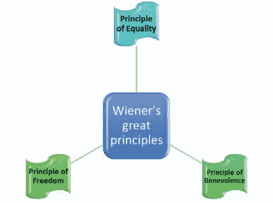

**图 1.1：** 信息伦理领域中维纳的三项正义伟大原则。

维纳的著作基于人性和理想社会。从其著作中，我们可以推断出，不同文化——其特征包括各种实践、语言、传统和宗教——可以为支持体面的人类生活提供所需的平台。维纳支持“多样性与可能性属于人类有机体的基本结构”这一观点，因此他欢迎世界上存在广泛的文化多样性，以最大化选择和创造性行动的可能性。

根据维纳的观点，社会应当支持一种促进性的环境，使人作为能够处理信息、做出选择并对自己生活负责的复杂存在，能够最大限度地发挥其潜力。要建立这样的社会秩序，社会中应当存在自由、平等和人类的同情心。伦理相对主义者认为，由于世界各地存在多样的法律、伦理和规范，伦理不可能有普遍的基础。

维纳的回应是，根据他对人类生活的研究，人类可以采纳各种文化和传统，同时仍然遵循“正义的伟大原则”。这些原则为跨文化的伦理奠定了基础。

### 1.4.2. 信息伦理的方法论

对维纳解决信息伦理问题方法的评估可以看出，他试图通过应用已存在的、在伦理上可接受的法律、规则和实践来同化新案例。这一点在他所著的《人类使用人类》一书中尤为明显。所有社会都有原则、习俗、规则和法规，它们共同塑造该社会的人类行为。

根据摩尔的观点，这些政策构成了“既定政策簇”。在一个相对公正的社会中，它们可以构成解决信息伦理问题的基础。维纳将“既定政策簇”与他对人性的论述、他的“正义的伟大原则”以及他在澄清含糊或歧义语言方面的批判技能相结合。通过这种方式，他能够建立一套高效的技术来评估以下信息伦理问题：

- 处理与 IT 融入社会相关的伦理问题或案例。一般而言，这将关注对生命、满足感、幸福、健康、自由、知识、前景和人类原则产生影响的技术所带来的机遇。
- 为可能与某个案例或任何问题相关的任何模糊或不清晰的概念和哲学提供解释。
- 检查社会中已存在的法律、规则、习俗和原则的适用可能性，以维护道德价值并引导人类走上伦理之路。
- 如果习俗、实践和政策未能提供处理问题或解决局面所需的指导，则应使用正义的伟大原则来寻找符合文明道德传统的合适解决方案。

如果所依据的传统、先例和政策植根于一个相对公正的社会中，那么这种分析和解决信息伦理问题的方法很可能提供可以被该社会同化的公正解决方案。

在 20 世纪 40 年代末和 50 年代初，维纳明确表示，引入新发明的计算和 IT 将为社会开启一个新时代。这个新的“自动时代”将是第二次工业革命。需要持续、不懈且多维度的努力，这将带来生活方方面面的变化。

根据维纳的观点，IT 戏剧性地改变了人类生活，并将人类置于“面临另一种具有前所未有的善与恶重要性的社会潜力”之中。（Wiener, 1954）维纳几十年前就预测，“信息时代”将会到来。他还预测，他设想的形而上学和科学基础可以作为指导力量，解决和解释信息技术可能引发的伦理问题。

### 1.4.3. 控制论的人性观

维纳强调了人类的生理结构，以及人类在自我发展和创新新流程方面所蕴藏的巨大潜力。维纳常将人类与进化较低的生物进行比较，以说明人类能够取得非凡成就的观点。

控制论认为，机器或有机体的配置是其预期任务执行能力的指标。昆虫的机械刚性限制了其智能，而人类的机械流动性则提供了几乎无限的智力扩展，这一事实与本书的观点高度相关。人类相对于自然界的其他部分具有生理优势和智力能力，并能够适应生活条件的根本性变化。只有人类利用其从生理结构中获得的固有适应性和学习能力，才能继续保持主导地位（Wiener, 1954, 第 57–58 页，原文为斜体）

人类的生理学使他们能够从环境中吸收广泛的信息，并获取自身内部条件和事件的信息。人体解剖学不仅能够获取所有信息，还能够对所获得的信息进行推理、分析、反思、确定以及进行智力层面的参与。维纳从其所有研究中推断出，人类生活的目标是作为信息处理有机体繁荣发展，因为他们天生具备这种能力。

显而易见，人类拥有吸收大量信息并持续获取知识的能力。人类生命中将近一半的时间可以用于学习和研究，因为人类在身体上能够做到这一点，而像蚂蚁这样的昆虫则不能。人类感官器官的两个内在特征是多样性与可能性。这是因为这两个特征是人类有机体结构的一部分（Wiener, 1954, 第 51–52 页）。

## 1.5. 计算机伦理的发展

在 20 世纪 50 年代和 60 年代，诺伯特·维纳对信息伦理领域作出了深远贡献，其范围比计算机伦理这一更具体的领域更广。维纳关于信息伦理的原则和观念不仅限于计算机伦理，还可以扩展到其他领域，如智能体伦理、互联网伦理、纳米技术伦理、生物工程伦理，甚至新闻伦理和图书馆伦理。

在 20 世纪 60 年代和 70 年代初，甚至在沃尔特·梅纳提出“计算机伦理”术语并在该领域提供定义之前，计算机伦理的精确领域就已经取得了进展。例如，SRI International 的计算机科学家唐·帕克开始关注计算机专业人员的违法行为并着手研究。这发生在 20 世纪 60 年代中期。帕克在《ACM 通讯》上发表了文章《信息处理中的伦理准则》。该文章包含了关于计算机犯罪案例的信息。

帕克还监督了计算机协会（ACM）原始《专业行为准则》的制定。1973 年，

ACM适时采纳了该代码。他还陆续发表了若干关于网络犯罪的著作。（Parker, 1979; Parker et al., 1990）。20世纪60年代后半期，麻省理工学院（MIT）的一位名叫Joseph Weizenbaum的计算机科学家创建了ELIZA。这是一个他称为ELIZA的基础计算机程序。他的意图是粗略模仿“与患者进行初次访谈的罗杰派心理治疗师”。

人们对他这个简陋程序的反应让Weizenbaum感到震惊和沮丧。例如，MIT的一些计算机科学家，尽管了解ELIZA程序的工作原理，却对其产生了情感上的投入。他们甚至将个人观点和看法分享给它。一些精神科医生认为，ELIZA证明计算机很快就能实现自动心理治疗。

他发明所引发的反应让Weizenbaum感到忧虑，即关于人类的“信息处理模型”正在加剧科学家乃至公众中已日益增长的将人类视为“单纯机器”的倾向。因此，他于1976年撰写了《计算机能力与人类理性》一书，在书中表达了自己的忧虑。许多学者受到该书以及他在全国各地发表的一些演讲的影响。他们开始思考计算对社会和道德将产生的影响。

### 1.5.1. Walter Maner及其关于计算机伦理的观点

Walter Maner与弗吉尼亚州的老多明尼昂大学（Old Dominion University）有关联，他创造了“计算机伦理”这一术语，用以指代处理由计算机引起、加剧或转化的伦理问题的研究领域。Maner甚至在自己的大学开设了关于这一主题的课程。

20世纪70年代末至80年代中期，Maner在大学开设的课程广受欢迎。他还在全美哲学和计算机科学会议上提供了大量关于计算机伦理的课程和研讨会，旨在教育人们了解计算机伦理。1978年，他独立推出了《计算机伦理入门工具包》。通过这一工具包，他意在协助大学教师规划计算机伦理课程。

该入门工具包还包含大学宣传册的建议、将该课程纳入大学课程体系的合理解释、课程目的列表、关于应采用的教学方法的一些实用指导，以及可能包含的主题，如网络犯罪、隐私和保密性、专业道德准则等。

Maner提供的课程结合入门工具包以及他举办的会议，影响了美国学生在计算机伦理领域的发展。几位学者开始关注这一新领域，开设这门课程的大学数量也有所增加。

Maner还根据他在该计划新领域中的教学经验和研究，制作了一份关于计算机伦理教学的入门工具包。他将该工具包的副本分发给他主持的研讨会与会者，以及他在美国哲学会议和计算机会议上发表演讲的听众。该入门工具包于1980年由Helvetia Press和由本文作者领导的哲学教学国家信息与资源中心以专著形式出版。

## 1.6. 职业与计算机伦理

20世纪90年代初期，Donald Gotterbarn支持计算机伦理内部一种不同的侧重点。他认为计算机伦理应被视为职业伦理。它应致力于计算机专业人员良好实践标准和行为准则的进步与完善。1991年，Gotterbarn发表了一篇题为“计算机伦理：重获责任”的文章，在文中他引用道：

> “对职业伦理领域——即指导计算机专业人员以专业人员身份开展日常活动的价值观——关注甚少。所谓计算机专业人员，是指任何参与计算机产品设计与开发的人员。在开发这些产品时所做的伦理决策，与在更广泛的计算机伦理概念下讨论的许多问题直接相关。”

Gotterbarn希望为职业伦理领域做出贡献，因此与Simon Rogerson、Keith Miller、Dianne Martin和Chuck Huff等其他职业伦理支持者合作，在大量项目中推动计算机从业者遵循职业伦理。Gotterbarn已经是ACM的一员，致力于制定其下一版《职业伦理与专业行为准则》。该准则于1992年被ACM采纳。

Gotterbarn与ACM及美国电气与电子工程师学会（IEEE）计算机协会的同事共同制定了软件工程师的执业标准。他还牵头成立这两个机构的联合工作组，开发《软件工程伦理与专业实践准则》，该准则于1999年由两者采纳。20世纪90年代末，他在田纳西州东大学（East Tennessee State University）创立了软件工程伦理研究所（SEERI）。21世纪初，他与Simon Rogerson共同开发了一款名为软件开发影响说明书（Software Development Impact Statements，SoDIS）的计算机软件。其目的是支持个人和组织制定伦理“利益相关者分析”。该分析将有助于确定软件开发项目的道德影响。

Gotterbarn及其他许多项目的努力强调了专业责任，并促进了计算机从业人员的职业化和伦理成熟。

1995年，Krystyna Górniak-Kocikowska在其ETHICOMP95会议上的题为“The Computer Revolution and the Problem of Global Ethics”的演讲中，做出了一项惊人的预言。她预测计算机伦理将逐渐渗透到世界各地的所有文化，并发展成为全球伦理。根据这一“Gorniak假说”，欧洲的边沁和康德体系等区域伦理理论，以及世界其他文化中嵌入的多样伦理体系，均源于“本地”历史和习俗，不太可能在全球范围内适用。Gorniak认为，计算机和信息伦理（IE）有可能提供一种能够适应新信息时代的全球伦理。

计算机革命预计将催生一种源自计算机伦理的新伦理理论。这一不断发展的领域预计将比其创建者和支持者所相信的更具重要性。

计算机革命的性质是独特的。这表明未来出现的伦理将得到普遍接受。它在性质上将是多维的且真正全球性的。由于它在整体上考虑人类行为和关系，因此也可以被视为全球性的。

计算机网络不受国界影响，因此可以说计算机具有普遍存在性。计算机伦理在很大程度上可以意味着不断发展的全球伦理。

有效制定有关计算机的法规至关重要。然而，如果这些规则不能得到大多数计算机用户的广泛认可，其实施将不成功。当计算机伦理发展为一种全球伦理时，它将具有全球性特征。

“Gorniak假说”旨在引发强烈反响，并在“独特性辩论”中做出了显著贡献。Maner在ETHICOMP95会议的主旨演讲中断言，信息技术（IT）“迫使我们发现新的道德价值，制定新的道德原则，制定新政策，并寻找思考所提出问题的新方式。”

Gorniak的假说重申了同样的观点。然而，Gorniak没有预见到IE将为全球适用的概念铺平道路。她预计，随着时间推移，全球伦理理论将发展起来，因为互联网是普遍的，因此围绕它的伦理对话也具有全球性特征。

Gorniak的预言是准确的。全球网络，尤其是互联网，在连接世界各地的人们方面起到了根本作用。计算机伦理今天似乎正在发展成为一个更广阔、甚至更具重要性的领域。它很有理由被称为“全球IE”。历史上第一次，正在全球层面采取措施，制定相互认可的行为准则。此外，保障人类价值并推动其发展的需求在世界范围内日益被感受到。

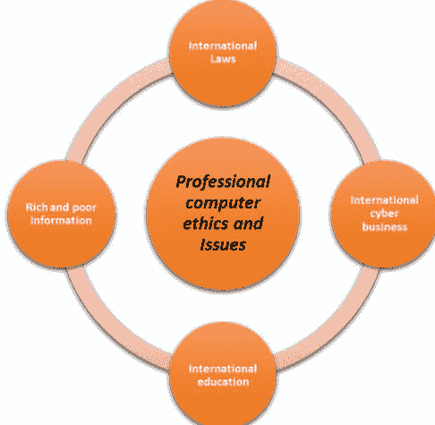

**Figure 1.2:** 职业世界中的计算机伦理及其相关问题。

首先，伦理和价值观被讨论并转化为全球语境，不局限于特定国家或地区，不受文化和宗教边界的限制。这一发展可以被视为最重要的社会发展之一，在 the

人类历史）。下面将讨论一些相关的全球问题（图 1.2）：

### 1.6.1. 国际法律

全世界两百多个国家通过互联网相互连接。一个重要的问题是应适用哪些法律。例如，如果伦敦的一名互联网用户希望保护其隐私，哪部法律能保护他的权利？

英国的本地法律不适用于世界其他地区。互联网上有许多问题需要监管，例如色情内容控制、言论自由、知识产权保护、隐私侵犯。由于涉及众多国家，这项任务更加艰巨。当两个国家的人通过互联网进行交易时，如果其中一个国家认为该活动违法，就会出现另一个国家将如何处理此事的问题。

### 1.6.2. 国际网络商业

全球化推动了“网络商业”在全球范围内的发展，并呈指数级增长。基础设施良好的国家能够利用这些设施获得经济收益。设施不完善的国家则未能做到。由此产生的一些重要问题包括：

- “网络商业”不均衡扩张的结果将会是什么？
- 一个国家的法律和法规是否会对另一个国家具有约束力？
- 随着少数几个国家变得更富裕，收入差距是否会进一步扩大？
- 这一切是否会导致政治对抗和战争？

### 1.6.3. 国际教育

信息应以人人皆可负担的价格提供给每个人，无论是发展中国家受压迫的人还是富人。如果实现这一点，将是有史以来第一次，地球上所有的人都能通过自由新闻了解时事，能够获取全球各地优秀图书馆和博物馆的艺术作品和文献，能够了解地球上所有地方的传统、习俗和政治局势。

获取这种“全球教育”的途径出乎意料且影响深远。其对政治独裁、孤立社区、统一文化、宗教习俗等的影响必须加以权衡。例如，如果世界上更多知名大学开始通过互联网提供远程教育项目，这对那些不那么知名的大学是否会产生不利影响。

### 1.6.4. 富人与穷人的信息

发展中国家与发达国家之间的差距正在扩大。即使在发达国家，贫富差距也令人震惊。一个令人担忧的问题是，当教育机会、商业和就业前景、医疗领域的服务以及人类依赖的其他公用事业都必须通过互联网获取时，富人和穷人之间的差距可能会进一步扩大，使情况更加糟糕。

## 1.7. 影响信息伦理的因素

许多因素会影响和塑造信息伦理（IE）。有些因素影响巨大，将在下面讨论：

- **全球化**：全球化无疑是本世纪最重要的发展。在这个全球化的新时代，ICTs 被广泛使用，信息交流也更加开放。这也导致个人和社会之间试图宣称对他人的至高无上而产生冲突。

- **更加强调个人主义**：在当今世界，人们往往倾向于以自我为中心，因此将个人福祉置于社会公益之上。因此，对定制化和个性化服务的需求增加了。

- **隐私与信息安全**：整个世界现在是一个巨大的网络。由此产生的一个担忧是公共和私营数据库中存储的所有数据的隐私和安全。像网站这样的信息存储库必须得到妥善保护。人们对这些数据库中保存的个人信息的机密性越来越担忧。信息的提供者和处理者有责任保持其谨慎，并防止其落入不法分子手中。

- ‘信息工作’的多元化：信息专业人员比他们的前辈承担着更大的责任。除了作为信息提供者外，他们还必须承担多种角色。他们还成为顾问、向导、教练、技术专家、翻译人员等。他们必须不断升级技能和能力，并获取新技能，以履行新的责任。

- ‘知情权’与‘信息伦理使用’之间的冲突：全世界各国都通过了法律，以保障人们获取和利用信息的权利。例如，印度于2005年通过了《知情权法》，孟加拉国于2009年通过了该法。尽管如此，出于安全顾虑等原因，公众获取机密信息受到限制。当信息专业人员在‘知情权’与‘信息受限使用’之间做出选择时，常常面临困境。

- 获取信息：许多图书馆也将不得不处理信息普遍获取的问题。根据 Fernandez-Molina，各种公共和专业声明明确指向免费和公开的信息获取。例如，根据英国图书馆协会行为准则，个人有权免费和公开地获取信息。

需要考虑的是，如果过分强调免费提供服务，可能会导致信息中心资金短缺并危及其生存。应牢记，当服务免费提供时，其价值往往会被贬低。因此，该职业的声誉和可行性将受到破坏。

- 知识产权：随着新技术的发明，通过复印、传真、扫描等方式复制信息材料变得非常容易。复制现在是一个毫无麻烦的过程，这对知识产权持有者的权利产生了不利影响。这将导致信息专业人员与信息所有者之间发生冲突，前者渴望以低价获得它，而后者则想要保护自己的利益。

由于信息现在被归类为原材料，信息的商品化已经发生。信息现在在各个领域流通并带有价格标签。这使得较不富裕的人难以获取和利用信息。

> 根据 Schiller，“在经济范围内信息资源目前从一组用户（普通民众）向另一组用户（主要是企业商业用户）重新分配的过程中，有一条原则占主导地位。即市场标准——支付能力。这决定了谁将获得信息润滑型经济的益处，谁将被排除在外。”

显然，信息专业人员现在在确定其在这一复杂‘信息圈’中的角色和责任时面临新的道德困境；同样困难的是评估他们自身支持较不特权的人群保护其免费获取信息并加以有效利用的权利的能力。

## 1.8. 信息与计算机伦理的指数级增长

新学术领域的概念化及其进步取决于学者之间的合作，以及大学和研究中心以课程、会议和学术期刊形式提供的支持服务。就此而言，1958年对信息与计算机伦理至关重要。该领域的坚实基础由 Johnson 奠定，他于1985年出版了《计算机伦理》一书以及期刊《元哲学》的特刊。Moor 撰写了文章《什么是计算机伦理？》，这也是该领域的一份出色的课程材料。

Maner 投入了巨大的努力，并影响了其他人为该领域做出贡献。因此，一代充满热情的计算机科学和哲学学者诞生了。这为指数级增长铺平了道路。需要指出的是，Maner 在20世纪40年代和50年代为计算机和信息伦理奠定基础时，就远远超前于他的时代。直到80年代，学者和社会思想家才追随他的脚步，发展了计算机和信息伦理这一新领域。20世纪80年代中期，信息与计算机领域见证了快速的发展。

伦理，在美国。计算与社会研究中心于1987年在南方康涅狄格州立大学成立。不久之后，该中心主任与Walter Maner合作，组织了“计算与价值国家会议（NCCV）”。该会议由美国国家科学基金会资助。其目的是促进计算机科学家、哲学家、公共领导人、立法者、企业家、社会学家、心理学家、记者以及其他各类专业人士之间的合作。

另一个目标是分析并取得信息与计算机伦理学一些重要子领域的进展。这些领域包括计算机隐私、知识产权所有权、计算机伦理教育以及帮助残障人士。1991年8月举行的NCCV见证了各学科的参与，以及Bynum和Maner的努力。

NCCV吸引了来自美国各州及其他国家的400多人参加。会议产生了专著、视频节目、详尽的参考书目及其他计算机伦理材料。这些材料在随后几年分发给了多所学院和大学。

各类职业伦理倡导者应运而生，其中包括Donald Gotterbarn、Keith Miller和Dianne Martin等人。专业组织也参与其中。这些组织包括计算机专业人员社会责任组织（Computer Professionals for Social Responsibility）、电子前沿基金会（Electronic Frontier Foundation）以及ACM的计算与社会特别兴趣小组（SIGCAS）。他们主导了围绕发展计算机从业者专业责任的项目。

信息与计算机伦理成为计算机科学认证委员会认证的本科计算机科学课程的重要模块。1991年，“计算机、自由与隐私”会议开始每年举办一次。1992年，ACM还采纳了升级版的《职业道德与职业行为准则》。

1995年，欧洲也被信息与计算机伦理领域的快速发展所席卷。Maner与英格兰德蒙福特大学的讲师Simon Rogerson携手合作。他们共同成立了计算与社会责任中心，并组织了欧洲第一届计算机伦理会议，名为ETHICOMP95。该次会议取得巨大成功，吸引了来自欧洲各国的与会者。该会议在欧洲孕育计算机伦理学者方面功不可没。1995年后，ETHICOMP会议游走于欧洲许多国家。它每18个月举办一次，甚至扩展到欧洲以外的国家。举办过该活动的国家包括波兰、希腊、法国、西班牙、葡萄牙、中国和日本。受到这一深远反响的鼓舞，澳大利亚学者John Weckert和Christopher Simpson在Bynum和Rogerson的支持下，于1999年成立了澳大利亚计算机伦理研究所。他们还在墨尔本举办了AICEC99会议，这是该地区首届国际计算机伦理会议。此后，举办了众多AICE会议。

Simon Rogerson是欧洲信息与计算机伦理快速发展中的一位杰出人物。他的成就包括在德蒙福特大学成立计算与社会责任中心，并共同主持有影响力的ETHICOMP会议。

他的贡献还包括：

- 他为将计算机伦理加入德蒙福特大学课程做出了贡献；
- 他还创建了一个包含博士学位的高级计算机伦理学位研究生课程；以及
- 他负责与Ben Fairweather共同创办并共同编辑两本计算机伦理期刊。这两本期刊分别是：2003年的《社会信息、传播与伦理杂志》（The Journal of Information, Communication, and Ethics in Society）和2004年的电子期刊《ETHICOMP杂志》（The ETHICOMP Journal）。

Rogerson还曾是英国议会IT委员会的成员。此后，他参与了与欧盟机构合作的各种计算机伦理项目。

在20世纪90年代末和21世纪初，欧洲发展出了各种计算机伦理。这些发展的突出例子包括：

- 在20世纪90年代，Luciano Floridi在牛津大学成立了IE研究小组。
- 1997年，Jeroen van den Hoven创建了计算机伦理：哲学探究系列会议（CEPE），该系列会议在美洲和欧洲之间轮流举办。
- 1999年，Van den Hoven创办了《伦理与信息技术》杂志（Ethics and IT）。
- 同年，Rafael Capurro成立了ICIE。
- 2004年，Rafael Capurro创办了期刊《IE国际评论》（International Review of IE）。
- 2005年，Bernd Carsten Stahl创办了《技术与人际互动国际杂志》（The International Journal of Technology and Human Interaction）。

总而言之，可以说计算机伦理的发展呈指数级增长。新的研究、新的机构、新的通讯、新的研究中心、学习材料、网站、大学课程、大学学位课程以及杰出的教授职位都为这一增长做出了贡献。随着信息与计算机伦理的进一步发展，更多学科和话题将不断涌现。

该伦理领域出现了各种新话题，包括机器人伦理、赛博格伦理、“开源运动”、电子政务、全球IE、IT与遗传学、发展中国家计算、计算与恐怖主义、伦理与纳米技术。上述子领域仅为已发展起来的各个学科中的少数。

与其他学术学科相比，计算机伦理领域相对新兴。它诞生于20世纪40年代末，由Norbert Wiener创建。由于Wiener的观念和直觉远远超前于他的时代，其进展非常缓慢。自1985年以来，信息与计算机伦理取得了指数级发展。在这方面，美国是领头羊，随后是欧洲，然后是世界其他地区。

## 1.9. 结论

多年来，IE取得了显著进步。过去几十年里，其他学科也接受了这一领域。

美国是建立这一领域的先驱。各位学者和研究者的著作在其工作中涉及了隐私政策、知情权、信息合理使用以及伦理困境等多个问题。然而，此前没有专门针对该领域伦理问题的课程。当此类课程在美国首次开设时，IE拓宽了视野，涵盖了信息技术、计算机伦理以及信息系统管理和社会信息中的道德困境。

不幸的是，即使在今天，大多数图书馆与信息科学学院也没有开设专门涉及伦理问题的课程，而这些问题通常是在其他议题的背景下呈现的。可以总结，IE是一个复杂且不断发展的领域，深受其他学科、习俗和视角的影响。

## REFERENCES

- 1. Bynum, T., (2004). 计算机伦理：基本概念与历史概述。[电子书] 可于：http://www.decc.ufrj.br/~jonathan/compsoc/Computer+Ethics%20+Basic+Concepts+and+Historical+Overview.pdf 查阅 [2018年10月31日访问]。
- 2. Carbo, T., (n.d.). 理解信息伦理与政策：将伦理反思与批判性思维融入政策制定。[pdf] 可于：https://www.ideals.illinois.edu/bitstream/handle/2142/15106/PA8_iconf08.pdf 查阅 [2018年10月31日访问]。
- 3. Floridi, L., (2006). 信息伦理、其性质与范围。[电子书] 可于：http://citeseerx.ist.psu.edu/viewdoc/download?doi=10.1.1.499.6848&rep=rep1&type=pdf 查阅 [2018年10月31日访问]。
- 4. Floridi, L., (2010). 《剑桥信息与计算机伦理手册》（第3–20页）。剑桥：剑桥大学出版社。
- 5. Himma, K., & Tavani, H., (2008). 《信息与计算机伦理手册》（第1–69页）。新泽西州霍博肯：Wiley。
- 6. 计算机伦理导论，(n.d.). 第1章。[pdf] 可于：https://www.cs.uct.ac.za/mit_notes/ethics/pdfs/chp01.pdf 查阅 [2018年10月31日访问]。
- 7. Plato.stanford.edu., (2015). 计算机与信息伦理（《斯坦福哲学百科全书》）。[在线] 可于：https://plato.stanford.edu/entries/ethics-computer/ 查阅 [2018年10月31日访问]。
- 8. Rorty, M., (n.d.). 伦理学导论。[pdf] 可于：https://www.ache.org/pubs/filer/manch1.pdf 查阅 [2018年10月31日访问]。
- 9. Ward Bynum, T., (2000). 计算机伦理简史（仅文本）– 计算与社会研究中心。可于：http://www.cs.utexas.edu/~ear/cs349/Bynum_Short_History.html 查阅 [2018年10月31日访问]。
- 10. Brandt, D. 和 Henning, K. (2002). 信息与通信技术：视角及其对社会的影响。《人工智能与社会》，[在线] 16(3), 第210-223页。可于：https://link.springer.com/article/10.1007/s001460200018 查阅 [2019年3月14日访问]。
- 11. WIENER, N. (1954). 历史上的控制论。[电子书] 可于：http://neoscenes.net/teach/cu/2012_2/atls2000_mit/pdfs/Wiener-1954-Cybernetics_in_History.pdf 查阅 [2019年3月14日访问]。

# 2
# 信息技术与道德方法论

## 内容目录

| 章节 | 页码 |
|------|------|
| 2.1. 引言 | 28 |
| 2.2. 信息技术的道德挑战 | 30 |
| 2.3. 信息技术的道德悖论 | 36 |
| 2.4. 文化层面的具体道德挑战 | 37 |
| 2.5. 恶意软件、间谍软件与信息战争 | 42 |
| 2.6. 未来关注点 | 45 |
| 2.7. 道德的信息技术 | 49 |
| 2.8. 作为道德主体的信息体 | 52 |
| 参考文献 | 54 |

信息技术（IT）被定义为后工业社会实践与制度的重要组成部分。同时，它也是艰难道德问题的根源，因此是道德理论中一个深入探究且相关的领域。本章讨论了IT与计算机伦理的道德方法论，以及IT所涉及的挑战。IT是一种通用技术。这不仅涉及计算机、网络或其他电子设备，也涉及每个人都应谨慎对待的IT所包含的信息。本章进一步描述了在变化加速、人工智能（AI）、人工生命（ALife）和机器人技术的背景下，IT的未来关注点。

## 2.1. 引言

IT被认为在全球普通民众的生活中无处不在。此类技术已采取多种形式，例如：智能手机、人工智能和机器人技术、个人计算机、互联网技术等。该列表在不断增长，而这些技术的现代形式正在渗透到日常生活的方方面面。

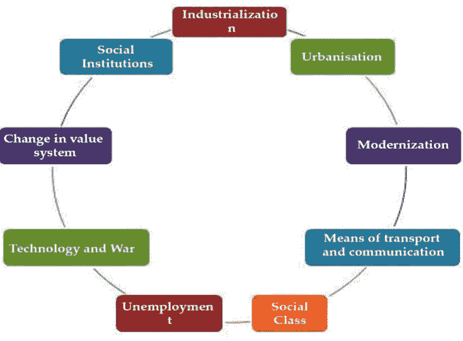

图2.1：技术变革对社会的影响。

来源：http://www.sociologyguide.com/social-change/impact-of-technology-change.php

随着各种新界面的出现，市场上催生了新型计算，用户借助先进的操作系统和各种其他应用程序，使得跨越计算机与信息伦理（IE）的道德价值成为可能。在少数情况下，这些技术正在发展人类彼此互动的先进方式。但是，通过不同技术渠道的人类互动只有在不越过道德红线时才具有成效（图2.1）。

IT被用于记录、组织相关信息、沟通，并借助计算机技术对其进行综合。信息从其自身角度而言，可以理解为任何有用的数据、现有指令，或包含有意义文本或信息的内容。

遗憾的是，不存在完全令人满意且在哲学上严谨的描述或定义可供获取，尽管至少有两个重要观点可以作为起点。

香农在20世纪40年代于贝尔实验室提出了数学通信理论（1948）。在这项工作中，各种电话技术和密码学中的经验被用来制定一种基于数学的公式，定义句法信息如何进一步转化为一种信号，从而在传输过程中减轻噪声或其他干扰信号，并可由消息接收者解码。

其断言是，可用之人将无法对输入有合理的理解，因此无法解释系统所说的所有输出内容，这随后被视为根据它们对符号进行毫无根据的操纵。

IT对信息哲学研究及逻辑学产生了重大影响。在此语境下，逻辑学领域被用作分析信息的方法，同时利用信息作为构建逻辑本身基础的方法。

所有已讨论的问题似乎都颇具吸引力，但总体而言，它们是分散的论点，可能在人们基于IT及道德价值展开讨论之前，不一定会被整理或解决。

## 2.2. 信息技术的道德挑战

从一组主导性信息技术转移到另一组在伦理上是具有对抗性的。苏格拉底经历了从口头传统到先进IT（包括将文字及信息记录下来，并最终将这些著作收集成卷轴和书籍）的漫长过渡阶段。

备受赞誉的苏格拉底对写作颇为不以为意，所有学者都声称他们从未以任何方式写下过什么会使自己贬低的内容。相比之下，几乎人人都只了解苏格拉底反对写作的论点，因为他的学生曾忽视老师，后来将其以对话形式写下，即《斐德罗篇》。

在这场对话的结尾，苏格拉底与朋友斐德罗讨论了“……使写作适当或不适当的条件”。苏格拉底讲述了一个关于埃及神祇忒乌斯的故事，忒乌斯将写作之赠予了国王塔摩斯。

### 2.2.1. 信息技术的基本特性

在IT革命的初期阶段，理查德·梅森对信息技术即将发生的转型或变化提出了建议，例如：这些技术各自的部分或角色，在教育及经济方面的影响将需要重新思考社会契约。

各研究人员深感担忧，认为这将进一步挑战隐私、准确性、财产权及可及性（PAPA），为了保障社会，他们“……应制定一项新的社会契约，保证每个人都有权实现自身的人类潜能”（梅森，1986年，第11页）。

法律理论家拉里·莱西格向他们发出警告：IT变化的速度如此之快，以至于会让与法律和政治相关的稳定及审慎的政策制定程序落后于时代，因此，所有这些的结果是，此类技术势必会变成域外法律或无法无天的技术。

这是因为，当一部法律被制定来限制某些特定文件共享技术所支持的少数形式的版权侵权时，该技术已变得过时，而用户又转向了其他能够导致更多版权侵权的东西（莱西格，1999年）。信息技术存储、传递、组织和综合信息。例如，书籍是一种信息记录，电话用于传递信息，杜威十进制分类法对信息进行分类。

最终，主要关注点不仅在于IT如何影响道德机构，还在于它如何导致道德推理的各自本质中发生特定的变化或转型。

关于信息作为道德技术的许多内容已被讨论，以及研究人员将如何编程这些应用程序和机器人，以便以一种在道德上可接受的方式与它们进行交互。

### 2.2.2. 信息记录中的道德价值

权力是对信息的控制，在信息经济中，它可能是政治权力的最终形式。如今，我们生活在一个充满数据的世界，而生成、记录和存储大量数据的技术已迅速发展。

此处首要的道德关注是，当数据被收集、存储并最终被访问时，必须以一种可以被视为公平且符合所有相关各方最大利益的方式进行。

传统上行使这些权力的各种社会机构包括：相关宗教组织、各种机构、医疗部门官员、图书馆、多个政府机关、银行以及企业。

此类实体能轻易获取存储的信息，这进而使他们对其选民和客户拥有固定的权力。如今，每个公民都能无需使用该信息的常规中介即可获取存储信息，因而拥有巨大的个人社会权力份额。

最后且最终的关注点或担忧是，当前正在将各自用户数据存储在“云端”的信息技术，意味着数据被秘密地存放在用户无法接触的设备上，因此数据并非仅由这些用户拥有或操作，但数据可从……

无论用户身处何地，以及其似乎正在使用的任何提供的设备上，都是如此。由于个人信息和数据的安全性至关重要，提供云服务的第三方需要承认用户对其所寄予的信任所承担的责任。如果一个人将他或她的所有照片上传到像 Flickr 这样的服务，而这些照片不知何故被删除或丢失，这将是一种可能可以修复的灾难性错误。

### 2.2.3. 在通信和访问信息中的道德价值

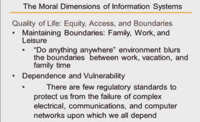

图 2.2：信息系统的道德维度。

来源：https://slideplayer.com/slide/4499359/

这些变化似乎正在给以下主要道德价值带来压力：保密性、隐私、信任、所有权以及以这些先进方式传输的信息的真实性。谁最终有权决定关于用户的某些信息是否应被传达？谁被允许出售医疗记录、电子邮件、财务记录、浏览历史记录等？如果对这一过程没有控制，那么如何强制执行隐私的道德权利？例如，艾伦·韦斯廷（Alan Westin）在先进数字信息技术的最初阶段曾就个人对某人个人信息的控制权提出论点，这被视为维护保密性或隐私的核心。进一步推论，如果重视隐私，那么人们必须将个人数据和信息的访问控制权交给个人。各种企业实体出于以下原因反对这一观点：关于用户的数据和信息在数字世界中已成为一种商品，从而增加了 Facebook 或 Google 等公司的巨额财富。当然，这些服务具有很大实用性，每个人都能从 Google 等互联网搜索公司以及 Facebook 等社交网络提供的服务中获益。

也有人可能认为，这实际上只是一种公平的交换：人们在不提供任何东西的情况下获得搜索结果以及各种其他应用程序，并通过从各个可货币化的个别用户处收集所需数据来抵消创建这些有价值服务所关联的成本，这些用户可以通过多种相关的盈利方式进行货币化。

这些公司利润模式的一个关键组成部分是基于定向广告，其中收集的用户信息被用来帮助分析广告，这些广告将基于用户的搜索历史记录和其他各种在线行为，对特定用户非常有效。

为此，他们建议我们在有限的信息访问环境下而不是严格的个人信息控制下进行设想。信息安全是另一个有效的道德价值，它影响着对用户信息的访问和信息使用。

如果信息的控制权已以所提供服务作为交换的形式授予相应的第三方，那么，此类实体也应被视为对其他人可能想为了不正当目的而利用该信息的权利的持有所施加的限制或制约负有责任。

拥有足够的信息后，一个人的完整身份可能被盗，并进一步用于促进偷窃和欺诈。自数字信息技术诞生以来，此类犯罪迅速增长。这类犯罪的受害者可能生活毁于一旦，因为他们试图重建信用评级以及银行账户等事物。

获得数字平台完全安全的复杂性或困难之处在于，与安全相关的道德价值可能会陷入与共享和开放等道德价值的冲突之中，而在这些价值之中，还有许多其他曾为众多 IT 初期建设者提供指导的价值。

如果信息技术能够使此类不道德行为更有可能发生，那么可以说，网络空间本身的结构在隐含地认可此类不道德行为。由于 IT 设计的能力影响着用户的生活，此类技术设计者的道德承诺最终可能会决定社会的发展方向，而对道德价值的承诺将由各种技术人员来决定。

假设我们有正当理由允许访问我们可能控制的少量信息存储，那么就有责任确保信息准确、有用且真实。一个简单的实验肯定会显示，信息技术在此方面可能存在一些问题。

加载许多不同的搜索引擎，然后在所有搜索引擎中输入相同的搜索术语，每个搜索引擎都会提供不同的结果，并且其中许多搜索结果之间肯定会存在很大差异。

这进一步表明，每个服务都使用一种独特的专有算法来向用户呈现搜索结果。由此可知，并非每次搜索都相同，结果的准确性、真实性和实用性主要取决于你使用的搜索提供商以及与该提供商共享的用户信息量。

所有给定的搜索都经过多种算法过滤，以确保搜索提供商认为对用户本人重要或必要的所有信息都排在前面。由于相关算法未公开，因此被视为严格保密的商业秘密，用户一直将其信任投入到此类过滤过程中。

同样，IT 提供的便利性和隐秘性可能会促成点击劫持等欺诈行为。佩蒂特（Pettit）在 2009 年建议，这必须促使我们重新审视依赖和信任等道德价值在充满信息技术的世界中所扮演的角色。

虽然这一差距在很大程度上是由各种经济因素造成的，但 Charles Ess 观察到，与新兴网络形式相关的力量存在一个问题，这些力量已经助长了民族中心主义和殖民主义，可能会限制西方以外所有参与这一新兴“全球大都市”的人所需或想要的东西。

John Weckert 指出，在责备与被责备方面的文化差异在更民主的信息技术设计中起着重要作用。其他人还争辩说，隐私等基本道德关切在亚洲文化中被赋予的权重各不相同。

### 2.2.4. 在组织和综合信息中的道德价值

此外，除了存储和传输数据和信息之外，各种信息技术还对信息的组织进行系统化，并机械地撰写、综合或处理现代信息。诺伯特·维纳（Norbert Wiener）首次建立了自动信息综合理论，他称之为控制论（Cybernetics）（Wiener, 1954）。

维纳理解到，可以设计一台机器来收集关于世界的信息，就该信息进行逻辑推断以指示积极行动，而机器最终可以实施这些行动，而无需人类代理的任何直接输入。

维纳很快意识到，如果他的控制论愿景得以实现，此类机器将引发难以置信的道德问题，并在其著作《人类对人的利用》（The Human Use of Human Beings）中勾勒出了其中的一些问题。

维纳认为，尽管此类技术类型或形式可能对道德产生重大影响，但仍然可以采取进取态度，并以多种方式提供关于技术的指导，从而帮助提升机器和人类的道德推理能力。

存在这样一种情况，即 IT 的某个部分正在就不道德活动可能发生的前景做出决策，这会对其试图帮助的人造成少量损害。渐渐地，机器在没有太多人为失误的情况下，对人们做出重大的改变人生的财务决策。

一个人是否会获得信用卡、他为保险、抵押贷款等所需支付的价格，通常由机器决定。例如，如果一个人申请信用卡，机器会查找几个数据点，如信用记录、薪水、该地区的经济状况等，然后评估该人违约的概率。

这种可能性是否会通过种种审核环节，从而帮助确定是否发放信用卡。机器具有基于其已做出的先前决策的结果来学习做出良好判断的潜力。

## 2.3. 信息技术的道德悖论

这种机器学习以及预测，都基于复杂的逻辑和数学，这种复杂性可能会导致上述轶事中定义的某些预测错误的滑稽案例，或者可能更令人兴奋。

例如，程序可能会了解某人朋友和关联人的身份数据、他或她的最新购买记录，以及其他轻易可获取的社交数据，这可能会导致将该人错误分类为潜在恐怖分子，从而以强烈负面的方式改变该人的生活。

所有这些完全依赖于学习及预测算法的结构或设计，这些事物传统上被视为机密，因此实际上很难为预测的准确性提供合理的依据。

提出的各种问题都是 IT 道德悖论的结果。各种用户都希望信息能够快速获取且可靠可用，并希望其成本非常低。

这些用户希望敏感和重要的信息保持稳定、安全和可靠。提高快速和低成本的价值会降低提供高质量安全信息的能力。反之亦然。因此，信息技术开发人员不断面临做出粗略妥协的困境。

有洞察力的网络先驱 Stewart Brand 在他广受好评的引语中很好地总结了这一点，即一方面，所提供的信息需要昂贵，但实际上它非常有价值。

在正确的时间和地点提供正确的信息，就能改变生活。然而，信息必须是免费的，因为获取其成本一直在降低。由于这些对立的道德价值观实际上无法解决，它们可能将继续成为未来几天信息技术应用和框架中道德辩论的核心。

## 2.4. 文化层面的特定道德挑战

20 世纪末，Web 2.0 这个术语开始出现，它基本上指的是一种先进的方法，即全球网络被用作信息共享、协作的方式，以及网页设计师方法的变化，以在网站上包含以用户为中心的体验。

尽管万维网在 1989 年由其创建者提出时的实际结构，始终是符合与他人见面并因此在线与他们合作的规范或背景的结构，而用户最终同意在 2004 年充分利用这种潜力，当时第一届 Web 2.0 会议由 O'Reilly Media 举办。

这种新型的“增强现实”通常由这样一个事实实现：许多人随身携带 GPS 功能的智能手机和其他各种便携式系统，他们可以在这些系统上轻松运行不同的应用程序，从而同时与邻居以及计算机进行交互，可能通过系统中的摄像头查看某个物品。这些技术基本上带来了它们自己的一套问题和挑战。

### 2.4.1. 社交媒体与网络

社交网络被定义为一个术语，用于不同的网站和应用程序，这些平台能够实现以与被称为朋友的另一位用户进行信息共享为重点的在线社交互动。今天，最流行的网站是 Facebook。除此之外，还有 Twitter、Instagram、Snapchat 等。

所有这些现有网站都要求在其中体现众多道德价值观。Shannon Vallor 对所有网站（例如 Facebook）如何转变甚至挑战相应的友谊标准进行了反思。这种友谊的基本分析完全基于亚里士多德关于友谊的理论（图 2.3）。

图 2.3：社交媒体与社交网络网站。

来源：https://online-id.nl/nl/introductie-voor-social-media/

亚里士多德辩称，人类通过有德的友谊实现真正美好的生活。此外，Vallor 指出，亚里士多德的“有德友谊”有四个主要维度，即共情、互惠、共同生活和自我认知，其中三个维度在社交媒体上以不同方式提供，有时可以增强友谊。

Johnny Hartz Soraker 主张对在线友谊采取一种相对有限的理解，而不是仓促对虚拟朋友的优点做出规范性判断。社交媒体的使用中隐私问题层出不穷。

遵循 Mason，James Parrish 建议社交媒体用户必须遵循四项关键政策，以确保对他人隐私的道德关注：

- 在社交网站上共享信息时，必须考虑特定个人的个人信息的保密性，以及与所共享信息相关联的他人信息的隐私。
- 在社交网站上共享信息时，想要共享信息的个人的主要关切是在与他人共享之前验证信息的正确性。
- 社交网站用户绝不应发布任何与其自身相关、未来可能想要撤回的信息。此外，用户不应发布任何属于他人心智产出的信息，因为一旦信息在这些网站上共享，将很难撤回。
- 社交网站每个用户的主要关切是，在允许某人访问共享信息之前验证该人的真实性。

这些系统并非旨在公然侵犯个人隐私。但是，由于这些服务是免费的，服务提供商存在潜在的经济动机，会透露至少一些有关其用户在网站上活动的信息，以便将信息出售给不同的广告商用于直接营销。

这种营销可以通过相应的提供商仅出售用户数据权限来实现，这些数据已被匿名化，因此广告商可能知道用户偏好购买牛仔裤的地点，但他们并未获得该人的具体信息或身份。

### 2.4.2. 在线游戏与虚拟世界

在预期在线游戏时遇到的第一个道德影响是，这些游戏倾向于呈现性别歧视和暴力。有各种新闻报道声称现实暴力与电脑游戏中的暴力之间存在某种因果关系。

关于电子游戏中的暴力与现实暴力发生之间存在因果联系的断言，已得到各种社会科学家的严密评估。然而，许多其他科学家认为，这种联系或关系最多也算牵强，手头的实际问题是此类游戏对相关人格品格的影响。

他们所建立的联系在于，倾向于设计的人可能意识到，他们正在创造一个人们打算花费大部分生活时间的空间，从而卷入那些现实的社会和经济活动，因此设计师需要承担道德责任，这几乎等同于可能撰写政治宪法的人。

根据 Purcell，开发和拥有在线游戏的人对平等主义或民主的义务非常小，并且需要讨论如果更多人花时间生活在虚拟社会中。

### 2.4.3. 游戏世界中虚拟的诱惑

关于使用计算机（主要是电脑游戏）的一个确定担忧是，这可能导致反社会的孤立和行为。随着大型多人游戏和为家庭目的设计的视频游戏的出现，社会孤立假说相当难以相信（图 2.4）。

图 2.4：游戏世界中虚拟的诱惑。

来源：http://www.bostonherald.com/entertainment/movies/2018/03/steven_spielberg_explores_lure_of_virtual_vs_real_worlds

然而，这些游戏加剧了性别相关的平等问题。James Ivory 应用这些游戏的在线评论进行了一项研究，该研究表明男性在游戏中多于女性，而且游戏中的图像往往过度性化。

马库斯·约翰逊（Marcus Johansson）提出，人们可能有能力通过与虚拟犯罪相关的惩罚以及虚拟处罚来消除虚拟永生，从而增强或改善虚拟伦理社区。

媒体对信息技术（IT）应用改变童年方式的问题日益增加道德担忧。现在，各种应用程序专为婴儿和幼儿设计，用于教育或有时仅为了娱乐，以便在父母忙碌时让孩子保持专注。

这鼓励儿童尽早开始与相关计算机进行交互。由于许多儿童可能容易受到媒体操纵（如广告），因此人们需要质疑此类做法在道德上是否可接受。

基于所使用的特定应用程序，它可能激励独自玩耍，进而导致孤立；但其他应用则更多涉及父母和儿童共同参与。必须指出的是，儿科医生已建议，年幼儿童早期使用媒体没有已知的优势。

### 2.4.4. 技术透明度悖论

有人可能会想，为什么社交媒体服务往往免费使用，但尽管如此，通常为提供这些服务的私营组织带来巨大利益。这些组织获利的方式并非什么深奥的秘密，即通过出售社交网站用户上传到系统中的信息。

用户越多，他们提供的信息就越多，相关信息的价值就越大。

拥有这些信息的社会价值颇具争议，但其经济价值不容否认。撰写本文时，马克·扎克伯格（Mark Zuckerberg）一直被《福布斯》杂志列为十大亿万富翁之一。

这是一种建立在向全世界提供免费服务之上的成功。像Facebook这样的公司如何为我们的服务收费，例如定向广告，这允许第三方组织使用用户提供给社交媒体应用程序的信息？

其结果是，在Facebook等应用程序上购买的广告最有可能被视为对工人有益，他们可能只是通过点击就选择这些产品。共享的个人信息越详细，对接收这些信息的组织就越有益。

广泛连接并与各种公司分享个人信息的彻底公开性已得到鼓励。所有倾向于使用这些网络技术的人通常都能获得巨大价值，这从相关技术的巨大增长中可见一斑。

哲学家肖恩·瓦洛（Shannon Vallor）将透明度趋势视为她所谓的“技术透明度悖论”的一种形式。她还指出，那些支持发展技术以鼓励彻底透明社会的人，其原则是这种直接性将提高问责制以及民主理想。

但讽刺的是，这种彻底公开的热潮通常会得到完全相反的结果，即拥有信息的组织高度问责，且未经民主选举，这些信息可以用来削弱民主社会。

事实上，用户对组织是彻底透明和开放的。用于收集数据的算法以及与之共享这些信息的第三方既不受问责制约束，也不透明。要求这些技术的用户非常透明，但从中获利的组织不需要同样透明。

## 2.5. 恶意软件、间谍软件和信息战

计算机病毒和恶意软件威胁正以惊人的速度持续增加。安全行业专业人士报告称，尽管垃圾邮件等少数恶意软件攻击正在过时，但勒索软件、加密货币和云计算基础设施黑客攻击等高级攻击正在激增，超过了旧式攻击形式放缓所带来的任何小幅缓解（图2.5）。

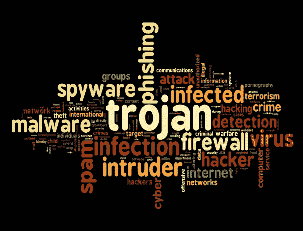

图2.5：恶意软件、间谍软件和信息战。

来源：http://globaltechconsultants.org/?q=content/what-difference-between-virus-worm-trojan-and-rootkit

此类活动在不久的将来肯定会与我们同在。在恶意软件制作等犯罪活动的背景下，还必须考虑黑客行动主义、黑客攻击、信息战和商业间谍软件等相关且更模糊的活动。

所有这些话题都有其自身的道德模棱两可性。现在需要对其中许多话题进行探讨。虽然，对于谨慎传播被认为具有可疑道德的恶意软件可能存在很大一致意见，但关于保护恶意软件以及与防病毒软件相关的软件的道德问题，存在一个引人入胜的问题。

随着恶意软件的增加，安全行业（一个数十亿美元的市场）也在持续增长。尽管在安全软件上投入了大量资金，但病毒的产量似乎并未下降。

防病毒软件的操作模式涉及接收样本、分析样本、为所需样本添加检测、执行质量保证、制作更新，并最终将这些更新发送给各自用户，这为对手留下了巨大的机会窗口，即使假设用户定期更新防病毒软件。

这种差距基本上被恶意软件制作者利用，在这个模型中，没有任何安全漏洞是无法填补的。因此，安全专业人员不应夸大其系统保护能力，因为当高级恶意程序被修补和发现时，它已经造成了特定损害，目前无法阻止这一点。

这并非全新的方法。最初，计算机科学家乔治·莱丁（George Ledin）在其ACM通讯社论《不教授病毒和蠕虫是有害的》（2005）中提出了这一建议。这一观念确实与关于学习和部署恶意软件的伦理普遍观点相悖。

这些攻击中的大多数似乎是在探测弱点，但它们可以使国家的互联网陷入混乱，例如2007年对爱沙尼亚的网络攻击以及2008年对格鲁吉亚的攻击。虽然格鲁吉亚和爱沙尼亚的攻击主要旨在模糊目标国家的通信，但最近信息战已被用于实现远程破坏。

流行的Stuxnet病毒早期曾用于攻击伊朗的核离心机，这或许被认为是武器化软件的伟大示例之一，该软件实际上能够秘密破坏物理设施。

信息战的主要挑战是定义如何利用武器化信息技术，以尊重个人对合法战争的承诺。由于战争是一种可疑的事业，如果信息技术可以被用来减少暴力战斗，那将是可取的。

有人可能会认为，战争期间向所有决策者提供的精确信息很有价值，因为它有助于他们在战场上做出更好的决策。

然而，这些先进的信息战能力可能允许国家陷入持续的低水平冲突，避免可能需要政治妥协的和平建设努力。

## 2.6. 未来关注

简介中已经提到过，信息技术正处于不断的转型与发展阶段。互联网技术推动了巨大的社会变革，在它们最初出现几年前，这种变革几乎无法想象。

尽管一个人可能无法预见所有可能的未来信息技术，但尝试预估这些变化是必不可少的，而一个人很可能在不断发展的技术中观察到这些变化。詹姆斯·穆尔（James Moor）认为，道德哲学家需要对不断发展的技术给予特别关注，并协助影响这类技术的设计，以推动有益的道德结果。以下几个部分包含了一些潜在的技术问题。

### 2.6.1. 变革加速

自工业建立以来，信息技术（IT）呈现出一种非常有趣的增长模式。英特尔工程师戈登·E·摩尔（Gordon E. Moore）发现，可安装在集成电路（IC，即集成电路）上的元件数量几乎每年翻一番，且经济成本很低，他进一步认为这种状况自1965年发现以来未来十年左右可能会持续下去。

这一过程不仅限于计算机芯片。其中包含了各种形式的信息技术。加速变革的潜在力量吸引了未来学家兼发明家雷·库兹韦尔（Ray Kurzweil）的思考。

这一论点还得到了技术界的支持，来自加速研究基金会、奇点研究所、人类未来研究所和H+等机构。哲学家们对这一假设的反应褒贬不一，但非常关键。

同样，Sullins（2006）认为，接受超人类主义通常具有一种准宗教性质，其致力于实现一些结果，例如将人类意识上传到计算机以获取永生；接受超人类主义假设会影响植入计算机技术中的价值观，这些价值观可能对人类身体持敌意或轻视态度。

并非所有哲学家都批评超人类主义，例如，牛津大学人类未来研究所的尼克·博斯特罗姆（Nick Bostrom，2008）主张，将可行性论据搁置一旁，我们必须认识到存在某些后人类主义形式，它们最终将带来漫长而有价值的生命，如果且仅有可能的话，人类成为后人类将是一件非常好的事情。

### 2.6.2. 人工智能与人工生命

人工智能（AI）被定义为各种旨在构建能够展示部分或全部问题解决能力和人类水平智能的信息技术的长期研究项目。

人工智能以及人工生命都是具有挑战性的广泛研究项目，难以简单解释。这里强调的是这些技术所影响的道德价值，以及这些技术的编程方式如何影响士气和情感关注。

- **人工智能（AI）：** 艾伦·图灵因其1950年发表的开创性论文“计算机器与智能（图2.6）”中一项重要研究项目而被提及，该项目后来被称为人工智能。

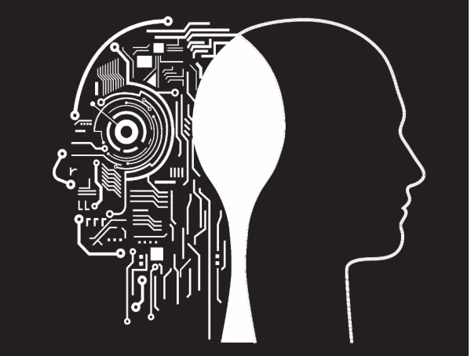

**图 2.6：** 人工智能。

来源：https://uccexpress.ie/science-corner-artificial-intelligence-its-life-jim-but-not-as-we-know-it/

他进一步定义了“模仿游戏”，其中计算机试图欺骗人类对话者，使其相信计算机不是计算机，而是另一个人类。1950年，他发表了著名的声明：“人们曾假设，在大约五十年的时间里……人们将能够与会思考的机器交谈，而不期望被拒绝。”

例如，卢西亚诺·弗洛里迪（Luciano Floridi，2011a）曾辩称，尽管人工智能作为扩展我们自身智能的来源非常有效，但作为一门关注智能生产的认知科学分支，人工智能却是一个令人失望的失败。

也有人提出了相反的观点，有些人认为图灵测试现在已经通过，或者至少程序员正处于即将通过的边缘。

例如，BBC在2014年报道，图灵测试已被一个程序通过，该程序能让评委相信它是一个13岁的乌克兰男孩，但许多专家仍持怀疑态度。

Sullins（2006）通过指出意识并非道德代理所必需，来反驳这一观点。例如，环境中存在的生物和非生物以及非人类动物都应被赋予某些道德权利，任何能够通过图灵测试的人工智能都应同时拥有道德权利和义务，无论其是否具有知觉存在的地位（Sullins, 2006）。

人工智能能够创造出能够以简单方式有效与人类对话的机器，如Apple Siri、OK Google、Amazon Alexa等，以及企业用于系统化客户服务的众多系统，但这些仍离人类之间通常进行的非脚本对话还有一段距离。

但在评估这类技术的道德影响时，这可能并不重要。此外，还有各种利用人工智能技术的应用。所有信息技术，如数据挖掘、电脑游戏、机器人技术、恶意软件过滤等，都应用了人工智能的编程技术。因此，人工智能将成为信息技术道德影响的一个领域。

- **人工生命（ALife）：** 被称为人工智能的延伸。人工生命指利用信息技术来合成或模拟生命功能。描述生命的问题一直是哲学自其创立以来感兴趣的话题。

马克·贝多（Mark Bedau）长期以来一直在阐述人工生命的哲学含义，并认为存在两种不同的人工生命形式，当各自的研究议程实现时，每种形式都会产生独特的道德影响。

一种人工生命完全是计算性的，实际上，它也是人工生命的最初形式。人工生命基本上受到数学家约翰·冯·诺依曼（John von Neumann）关于自复制元胞自动机的研究启发，他认为这必然会导致对生物学和生命科学的计算理解（1966）。

计算机科学家克里斯托弗·兰顿（Christopher Langton，1989）大大简化了冯·诺依曼的模型，并在80年代初产生了一种名为“环”的简单元胞自动机。他通过管理几次基于人工生命的会议，帮助该领域起步。

人工生命程序与人工智能程序大不相同。人工智能致力于产生或提升智能，而人工生命则满足于那些展示生命功能而非智能的极简单的程序。

这里的主要道德担忧是，这些程序被设计为自我复制，从而类似于计算机病毒，而且成功的人工生命程序确实可能成为恶意软件的载体。

第二种人工生命形式在道德上具有极强的含义。这种形式的人工生命基于部署特定的生化和生物过程，以产生自然界中不存在的新型生命形式。

克雷格·文特（Craig Venter）发起了一场公共关系活动，并试图引导关于创造生命问题的讨论。在生命合成中，这一首次事件让我们尝到了争议与兴奋的滋味。当制造出更强健且可行的人工原始细胞时，争议将会产生。

由湿人工生命（Wet ALife）引发的伦理问题，这类研究通常被称为湿人工生命，更适合由生物伦理学管辖。但它对我们这里确实有些关注，因为湿人工生命是将生命科学理论转化为信息技术过程的一部分。

这将倾向于模糊信息伦理学（IE）与生物伦理学之间的界限。正如软件人工生命可能导致危险的恶意软件一样，湿人工生命也可能导致危险的细菌或其他致病因子。

批评家建议，追求这项技术存在潜在的道德反对意见，我们必须在此采用预防原则，该原则进一步指出，如果存在某项技术造成灾难性伤害的机会，且没有科学共识表明伤害不会发生，那么那些希望开发

那项技术或遵循那项研究首先应当证明其无害。

马克·特兰特（Mark Traint）和马克·鲍多（Mark Bedau）反对对预防原则的严格奉行，建议我们在完成人类对生命理解中一个关键步骤时，应当勇于道德冒险。

他们诉诸亚里士多德关于勇气的概念，这不是一种轻率鲁莽地冲入未知，而是对这项研究所提供的潜力谨慎而坚定地向前迈进一步。

### 2.6.3. 机器人学与道德价值

信息技术并不仅限于软件实现和虚拟世界。这些技术通过机器人学的应用，与各代人直接交互。机器人学是一项不断发展的技术，但它已产生大量具有重要道德影响的应用。

医疗机器人学、个人机器人学、军事机器人学以及性爱机器人的世界等各类技术，是表达道德承诺的机器人学现有应用中的一些例子。

将半自动或完全自主的机器投入公共生活并非易事。自主机器是指在人类很少或几乎不干预的情况下自行做出决策的机器。

军事机器人学已被公认为机器人学中最具伦理争议和最具挑战性的应用之一。如今，这些机器基本上是远程操作（遥操作机器人）或半自主的，但随着时间的推移，由于现代战争的需求，这些机器有可能逐渐变得自主。

在21世纪战争的头十年里，机器人武器参与了对士兵和非战斗人员的多次杀戮，这一事实本身就引发了深刻的道德关切。格哈德·达布林格（Gerhard Dabringer）已与伦理学家和技术专家就自动化战争的推论进行了多次采访。

## 2.7. 道德的信息技术

信息技术领域的一项重大进展在于，它们不仅是道德辩论的对象，而且开始被用作道德审议的工具。

由于AI技术及其应用属于自动化问题求解器，而道德审议属于问题类型，自动化道德推理技术的出现只是时间问题（图2.7）。

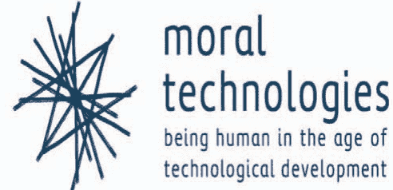

图2.7：道德的信息技术。

来源：https://moraltechnologies.com.au/articles/moral-technologies-now-and-in-the-future/

不过，这仍是一项新兴技术。它具有大量颇具趣味的道德影响，下文将描述其中一些。未来几年，该领域可能会出现大量进展，伦理学家需要关注这些发展。

苏珊·安德森（Susan Anderson）和迈克尔·安德森（Michael Anderson）在其著作《机器伦理学》（*Machine Ethics*）（2011）中收集了大量与该主题相关的文章，此外，罗基·卢皮奇尼（Rocchi Luppicini）在《技术伦理学研究手册》（*Handbook of Research on Technoethics*）（2009）中也专门设有一个章节讨论该主题。

### 2.7.1. 信息技术作为道德发现的模型

帕特里克·格里姆（Patrick Grim）一直是这一观点的坚定追随者：哲学必须运用不同的信息技术来阐述并自动化哲学思想实验。

此外，彼得·丹尼尔森（Peter Danielson）在1998年出版的《模拟理性、道德与进化》（*Modeling Rationality, Morality, and Evolution*）一书中广泛撰写了该主题，其中大量的早期研究集中在道德计算理论上，旨在利用计算机模型来解释简单软件AI或ALife代理之间合作的演化。

J.W.桑德斯（J. W. Sanders）和卢西亚诺·弗洛里迪（Luciano Floridi）认为，计算理论中使用的信息可以作为一种潜在的思路，帮助解决哲学中几个常见的道德难题，例如邪恶的本质（1999, 2001）。

### 2.7.2. 信息技术作为道德系统

20世纪初，美国哲学家约翰·杜威（John Dewey）提出了一种基于技术工具性运用的探究理论。杜威对技术有着广泛的定义，其中进一步包括机器、普通工具以及法律、逻辑和语言等信息系统（Hickman, 1990）。

此外，杜威认为，当今人们与这些技术处于一种事务性关系之中，在这种关系中，人们既在发现世界，也在构建世界（Hickman, 1990）。这是一种合作性的视角，因为它允许当前一代人推进这样一种理念：伦理和道德的信息技术是可以构想的。

这还让我们充分接受这样的观点：人类代理人之间以及人类与其人工制品之间发生的交易与关系，存在本质上的本体论比较。

虽然杜威只是亲眼目睹了即将到来的信息技术革命，但他的理论对现代一代人非常有益，因为他提出伦理是一种实践，解决伦理问题类似于解决代数问题。伦理不仅仅是一种理论（Hickman, 1990）。

如果他的观点是正确的，那么一个令人兴奋的可能性便随之产生，即道德和伦理是可以评估的问题，因此开发一种能够进一步表征道德思想系统的信息技术是可能的。

1974年，哲学家马里奥·邦格（Mario Bunge）预见到，我们应当全然接受“技术伦理”的信念，认为道德哲学家必须学习工程师处理任何问题或议题的方式。工程师从不依据确定性命令进行推理来辩论，而是采用：

> ... 形式：若 $A$ 产生 $B$，且你重视 $B$，则选择执行 $A$；若 $A$ 产生 $B$ 且 $C$ 产生 $D$，且你偏好 $B$ 而非 $D$，则选择 $A$ 而非 $C$。

简言之，已制定的规则和规章基本上取决于事实与价值，许多研究者提出，这是形成道德规则的唯一路径，具体来说，应作为源自科学陈述和价值判断的行为准则。

简言之，伦理可以被视为技术的一个分支。认真对待这一概念意味着，创建信息技术的过程也是发展特定道德系统的过程，人类以及人工代理人将在其中通过道德事务偶尔进行交互。

因此，从事建立道德系统业务的信息技术人员，无论是否意识到这一点，也无论是否渴望承担这一责任。

## 2.8. 作为道德代理人的信息生物

借助信息技术培养非道德代理人的观点，相关的包容性文献主要来自卢西亚诺·弗洛里迪（Luciano Floridi）（1999, 2002, 2003, 2010b, 2011b），以及弗洛里迪与杰夫·W·桑德斯（Jeff W. Sanders）（2003）的研究。

弗洛里迪（Floridi）（2010）在其研究中提出了若干观察，倾向于解释信息技术的伦理影响所引发的问题对所有传统道德理论都构成了压力。为了摆脱这种艰难阶段，也有人争论认为需要一种更广泛的信息哲学（2002）。

在这一转变之后，弗洛里迪（Floridi）（2003）主张，信息是一种自身的真实环境。它具有自身的基本价值，在某些方面与自然环境相关，而在其他方面则完全陌生。无论哪种方式，其结果都是信息本身就值得被道德关注。

弗洛里迪（Floridi）（2003）运用这些概念，利用面向对象编程的逻辑，发展了一个道德行为的理论模型。

他的模型有七个关键组成部分：

- 道德患者p（或者更恰当地说，受试物）；
- 道德代理人a；
- 代理人的信息框架；
- 这些代理人之间的交互；
- 交互发生的环境；以及

- 代理人在努力导航的情境中可获得的事实信息；
- 交互发生的情境。

已有大量文献对弗洛里迪等人的基本论证进行评估，旨在推进自动化道德推理的概念；因此，人们可以谈论各种自动化道德技术，从非常有限的应用一直到与人类拥有相同权利和责任的完全道德代理人。

虽然学者们指出，在未来某个时间开发中的IT将被视为人工道德代理人，但已有足够的理论论据支持：自动化道德推理是最终可能性，因此它是那些对信息技术的道德影响感兴趣的研究者的合适研究领域。

## 参考文献

- 1. Francisguison’s Weblog, (2009). 《信息与计算机伦理手册》第3章：道德方法论与信息技术。[在线] 可在以下网址查阅：https://francisguison.wordpress.com/2009/04/19/the-handbook-of-information-and-computer-ethic-chapter-3-moral-methodology-and-information-technology/ [2018年11月14日访问]。

- 2. Hoven, J., & Weckert, J., (2008). 《信息技术与道德哲学》（第10页）。[电子书]。可在以下网址查阅：http://assets.cambridge.org/97805218/55495/frontmatter/97805211855495_frontmatter.pdf [2018年11月14日访问]。

- 3. Plato.stanford.edu., (2018). 《信息技术与道德价值》（斯坦福哲学百科全书）。[在线] 可在以下网址查阅：https://plato.stanford.edu/entries/it-moral-values/#MorChaInfTec [2018年11月13日访问]。

- 4. Stahl, B., Timmermans, J., & Flick, C., (2016). 新兴信息和通信技术的伦理。《科学与公共政策》，第69页。

- 5. Ugbogbo, S., & Michael, O. A., (2016). 《信息技术伦理问题》（第2版，第70页）。[电子书]。可在以下网址查阅：https://www.iuokada.edu.ng/journals/5B6AA29B40ADBA7.pdf [2018年11月13日访问]。

- 6. Mason, R. (1986). 信息时代的四个伦理问题。《管理信息系统季刊》，[在线] 10(1)，第5页。可在以下网址查阅：https://www.scirp.org/(S(351jmbntvnsjt1aadkposzje))/reference/ReferencesPapers.aspx?ReferenceID=1667281 [2019年3月14日访问]。

- 7. Lessig, L. (2006). 《代码》。第2版。[电子书] 可在以下网址查阅：http://codev2.cc/download+remix/Lessig-Codev2.pdf [2019年3月14日访问]。

- 8. Floridi, L. (2003). 信息哲学的两种方法。《心智与机器》，13(4)，第459-469页。

- 9. E. Moore, G. (1965). 在集成电路中塞入更多元件。[电子书] 可在以下网址查阅：http://www.monolithic3d.com/uploads/6/0/5/5/6055488/gordon_moore_1965_article.pdf [2019年3月17日访问]。

- 10. Floridi, L. (1999). 《伦理与信息技术》，1(1)，第33-52页。

- 11. Floridi, L. (2002). 什么是信息哲学？。《元哲学》，33(1&2)，第123-145页。

- 12. Floridi, Luciano. (2001). 信息伦理：解决数字鸿沟的环境方法。第13-22页。

- 13. Floridi, L., (2010). 《剑桥信息与计算机伦理手册》（第3-20页）。剑桥：剑桥大学出版社。

- 14. Floridi, L., & Sanders, J.W. (2003). 抽象方法。

- 15. Hickman, L. (1990). 约翰·杜威的实用技术。布卢明顿等：印第安纳大学出版社。

- 16. Danielson, P. (1998). 模拟理性、道德与进化。纽约：牛津大学出版社。

- 17. Langton, C. (1989). 关于生命系统合成与模拟的跨学科研讨会论文集。红木城，加利福尼亚州：艾迪生-韦斯利。

- 18. P. Sullins, J. (2006). 什么时候机器人是道德代理人？。[电子书] 可在以下网址查阅：http://www.realtechsupport.org/UB/WBR/texts/Sullins_RobotMoralAgent_2006.pdf [2019年3月17日访问]。

- 19. WIENER, N. (1954). 历史上的控制论。[电子书] 可在以下网址查阅：http://neoscenes.net/teach/cu/2012_2/atls2000_mit/pdfs/Wiener-1954-Cybernetics_in_History.pdf [2019年3月14日访问]。

- 20. Bostrom, N. and Sandberg*, A. (2019). 全脑模拟：一份路线图。[电子书] 可在以下网址查阅：https://www.fhi.ox.ac.uk/brain-emulation-roadmap-report.pdf [2019年3月17日访问]。

# 3 规范理论与计算机伦理

## 目录

- 3.1. 引言....................................................58
- 3.2. 伦理学分支................................................61
- 3.3. 规范伦理理论 ..................................65
- 3.4. 职业伦理............................................68
- 3.5. 规范相对主义理论 .................................70
- 3.6. 价值多元论................................................72
- 3.7. 道德理论 ..................................................74
- 3.8. 全球化和互联网对计算机伦理的影响 ... 76
- 3.9. 未来展望.............................................77
- 参考文献............................................................84

信息伦理（IE）被定义为传统伦理理论的当前替代方案，用于解释道德现象。它是进一步研究的主题，旨在探讨如何在信息和通信技术（ICTs）的实际问题和议题中使其具有适用性，并验证其相对于传统伦理规范理论具有描述性和合理性的盈余。重构的概念不断演进，例如：争议式民主、作为数据保护的隐私、公正即公平、功能作为信息系统和ICTs应用设计与框架的高层架构原则。本章讨论伦理学的分支。主要描述规范伦理理论。本章后半部分也描述了未来展望。

## 3.1. 引言

ICTs 在当今世界的各种经济功能中不可或缺。贸易、金融、运输、医疗保健、科学、教育、行政管理、管理、通信、能源供应、工业生产、国防、工程和技术；所有这些领域都完全依赖 ICT。如果没有 ICT 的支持，就无法开展大规模项目（图 3.1）。

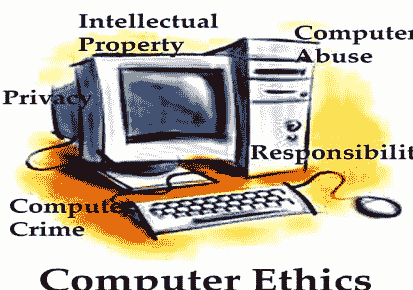

图 3.1：计算机伦理。

来源：https://www.kullabs.com/classes/subjects/units/lessons/notes/note-detail/1032

信息社会也有其道德问题。

- 首先，信息应当可信，并符合要求的质量标准。
- 应当对互联网实施适当控制。
- 数据处理应当负责任地进行。
- 软件应当符合公认的标准。
- 个人数据应当受到保护，隐私应当得到维护。
- 还存在关于商业各方权力和主导地位的问题。
- 信息应当对每个希望访问的人开放。此外，信息应当以公平的基础进行分发。

在二十一世纪，技术已经接管了我们的生活。儿童和年轻人受技术的影响最大。技术及其内容对他们产生持久影响，并塑造了他们的伦理价值观和行为成长。

随着技术的进一步发展，新的担忧将不断产生。这一问题经常在公共辩论中被讨论，并引起广泛公众关注。需要严格的法规，因为技术对生活的影响是深远的。因此，建立一套行为准则非常重要，以突出这些问题。过去几十年中，计算机与 IE 一直在尝试做到这一点。

ICTs 的特点是，我们无法直接解决不断出现的伦理问题。我们无法忽视或使技术脱离我们的生活，别无选择，只能面对所有复杂性和问题。

- ICTs 无处不在，其普及程度超过我们最常见的技术器具。如今，常见的家居用品和日常用品都可以被称为计算机，它们通常通过无线网络技术连接。逐渐地，我们日常生活中更多普通物体正受到物联网的笼罩，而物联网最终又与人际网络互联。不容易量化或评估技术和基础设施对日常任务的作用。他们对技术的依赖在不断增长，但由于技术倾向于融入背景，这种依赖并未被广泛察觉。
- ICTs 是一种通用技术，因为其“逻辑

可塑性（Moor, 1985）。数字计算机可以使用一组预定义的规则，从一组输入变量中确定结果。它有助于模拟、通信、娱乐、计算以及更多方面。

它们在生活的各个领域和社会的各个部门都无处不在。各种在机器层面受到影响的对象，被要求对每件事都有自己的看法，这些看法可以被表达，并以所提供符号的形式陈述出来。

在 ICT 的各种应用和示例中寻找共同元素并不容易。同一台机器可用于天气风暴模拟、运行制造单元、在国家部分地区分配电力以及存档政府信息。

ICT 是一种元技术；其作用领域是对现实的界定。其他技术的进步和使用都依赖于 ICT，因为 ICT 是其发展中的核心要素。

它帮助我们操作机器、执行医疗程序、提炼石油并将货物运送到世界各地。它可能会导致所呈现事实的模糊性，即与第一阶技术相伴的相关问题（已被发现）是除元技术之外的主要问题。

- ICT 是一种建设性技术。相应技术的计算过程通常会共同构成其被执行或实施的所有事物。ICT 可被归类为一种使能技术。它们赋予我们创新能力，并以新颖的方式做旧事，为我们提供全新视角。

ICT 在旧有的实践、经验、论文和关系中带来了翻天覆地的变化。它们开启了一个充满新实践的新时代。

ICT 如果用于医疗保健，将彻底改变其面貌；如果用于科学和教育，将改变科学和教育的面貌，在 ICT 环境中长大的儿童的生活经历和视角，将与在没有 ICT 的环境中长大的人截然不同。

除此之外，信息与计算机技术实际上更多是关于信息本身的。

- 信息对每个人都至关重要。有时我们往往会低估其重要性，以及我们如何不断使用和处理信息。信息对于规划、谈判、决策、考虑替代方案和判断是必需的。

如果无法获取正确信息，或者信息不准确或不完整，推理和认知将受到损害。信息以及配合各种技术呈现的计算机技术，以便能够引导和部署所有提供的基本产品，因此，这是此特定评估、结构以及规则或法规的主要动态。信息和计算机技术也已被公认为所有先前偏好、规则或标准、各种决策以及道德价值观的基本体现。

- 信息与通信技术的实施或执行不被视为非人性的，而是通常涉及所有协助构建、设计和制定它们的个人的价值观和标准。

掌握多项研究基本上倾向于提供证明，即相应软件中所有提供的标准是故意还是无意建立的。

- 归根结底，信息与通信技术倾向于围绕相关新对象（例如：软件、各种数字计算机以及呈现所需信息的产品）进行循环，从而为某些新体验和实践提供增量。

因此，这肯定会使个人以各种道德、传统和合法的认知形式来解释它们变得相当复杂。

ICT 在我们的生活中扮演着主导而又令人困惑的角色。这可以归因于上文讨论的特征。尽管通常并不立即清楚 ICT 是否值得特别关注，Computer 和 IE 旨在提供 ICT 所需的道德评估与审查。

## 3.2. 伦理学分支

根据分析哲学，伦理学被划分为各个阶段（图 3.2）：

- 规范伦理学；
- 应用伦理学；及
- 元伦理学。

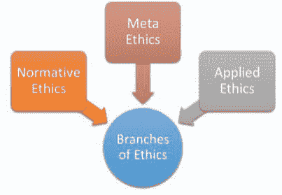

图 3.2：伦理学分支。

### 3.2.1. 元伦理学

元伦理学通常考虑道德推理的行为或性质以及完整性。关于伦理学是否被视为相对性，以及个人是否通常倾向于按照各自的自我利益行事，等各种讨论，都是与元伦理学相关的讨论的绝佳实例。

事实上，根据规范伦理学、元伦理学以及应用或执行伦理学的概念设计某些区别的过程，被视为元伦理评估或评价。

元伦理学是哲学的基本分支之一，它考察道德的一般性质，以及什么证明了道德判断的合理性。以下是元伦理学审查的三个提供的问题：

- 如果它们是“真-适”的，它们是否永远真实？如果是真实，那么它们用来代表的事实的性质是什么？
- 伦理要求是否真-适，即它们能够为真或不真，还是情感主张？以及
- 如果存在使其为真的道德真理，它们是否总是毋庸置疑地真实，还是相对于某个个人、文化或社会？

如果涉及更多事实，那么寻找是什么帮助使它们成为事实或真理的唯一方式，是恰当地利用价值系统，因此，其中产生的主要问题是是否存在任何可以被识别的价值。

各种传统哲学家属于希腊文化，例如：柏拉图和苏格拉底肯定会回应肯定，因为他们相信善占主导地位，尽管他们对什么是事实、什么不是事实并没有相同的看法。

不存在伦理真理的概念被称为“道德反实在论”。最近的实用主义者休谟占据着这样的立场，即认为道德表情基本上是所有提供的情感或感伤情绪的表达。

实际上，与相关社会价值观相关的体系，是由各位伟人（例如：作家、艺术家、诗人、领袖及更多人）形成的，或者是根据提供的道德标准或原则列表获得的，例如：宗教的道德准则，无论是否默示（图 3.3）。

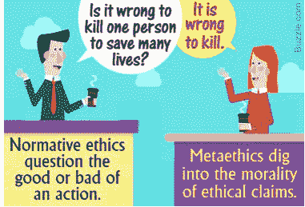

图 3.3：元伦理学与规范伦理学的比较。

来源：https://opinionfront.com/metaethics-vs-normative-ethics

### 3.2.2. 规范伦理学

在规范伦理学类别中，主要关注确定与伦理行为相关的基本概念的过程。基于规范伦理学的各种理论倾向于搜索或发现，以便能够提出行动指南；回应实际问题的某些方法。康德和边沈的道德理论是规范理论的例子，旨在为确定特定道德行动路线提供准则。

基于规范伦理学的某些研究涉及个人如何度过生活以及如何行动的问题。属于美好生活的规范伦理学理论通常倾向于探究人类的所有相关需求和要求，以便能够过上美好生活。

基于此项关于正确行动的研究的理论，基本上主要关注寻找符合既定标准的、在伦理上传统的必要行动。

或者，规范伦理学试图提供一个由原则、程序和规则组成的体系，用于确定一个人应该或不应该做什么。

“规范伦理学”的一种典型方法是将“规范”定义为有信念和感受的理由。在此过程中，最终与社会正义相关的理论被视为一种尝试，以寻找社会应当如何设计或结构化，以及如何在相关社会中分配与权力和独立相关的社会商品的方式。

### 3.2.3. 应用伦理学

在此特定的伦理学类别中，主要关注应对人类行为的特定方面，以及描述基于这些方面或层面内可能出现的各种问题进行讨论的程序的基本前景。

它被公认为伦理学的核心分支，倾向于追求探究在现实中实施或执行基于伦理的理论的过程。就其结论而言，应用伦理学倾向于突出所有原则或标准以及相关理论应当如何实施的方式中可能存在不一致性的可能性。

应用伦理学的主要领域如下：

- 生物伦理学；
- 医学伦理学；
- 公共部门伦理学；

- 商业伦理；
- 福利伦理；
- 法律伦理（正义）媒体伦理；
- 决策伦理；
- 计算机伦理；
- 环境伦理；
- 自动化伦理；
- 制造业伦理；
- 机器人伦理。

基于十诫形式或类型的严苛义务论原则，对特定案例提出了某些解释，但这些解释在国际层面不被视为常规或可接受。

例如，在医学伦理方面，与严苛义务论相关的方法绝不会同意患者对其疾病的不诚实。相比之下，功利主义方法可能允许对患者撒谎，但仅在该特定不诚实的结果有利于患者福祉时才允许。

## 3.3. 规范伦理理论

“规范”一词被视为一个形容词，源自一个基本上意味着一套原则或规定的词。因此，基于道德或伦理的规范，借助这些规范，人们被假定对事物有着合理的观察。

公众对这些标准的看法各不相同；因此，各种规范伦理理论强调它们声称使某行为成为道德行为的因素：即什么东西是好或坏，以及什么样的行为是正确的，而不是错误的（图 3.4）。

### 规范伦理理论：概念图

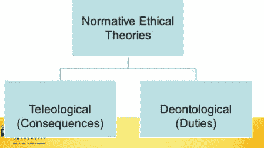

图 3.4：主要的规范伦理理论。

来源：https://slideplayer.com/slide/10296472/

本章讨论了两种规范理论。它们解释了关于道德生活方式的三组不同的思想。

### 3.3.1. 义务论理论

“义务论”这一术语源自希腊语“Deon”，意为责任、强制性、必要性以及约束过程。一般来说，这些词翻译后变为“职责”，因此各种基于义务论的理论试图确定一个人的道德职责是什么。一旦这些道德职责被列举出来，这些职责就成为道德“规则”的基础。

义务论体系强调，主要焦点应放在遵守职责和规则上，因为行为的道德价值在于此。评估行为的后果是次要的。

康德会认为，要使行为被视为道德行为，应忽略个人得利等外部原因，行为应仅仅作为对规则的服从来完成。在他的例子中，康德解释说，如果一名杂货店老板对客户友好只是为了赢得他们的忠诚，那么他不能被称为善良。

如果他确实出于道德职责而考虑善良，那么他行为的任何道德善良都被抵消了。杂货店老板不应有不可告人的动机，而应因善良的内在价值而善良。可以推断，基于义务论的伦理具有能力引导各类个体以一种倾向于产生负面后果的方式行事。

### 3.3.2. 后果论理论

根据后果论伦理理论，行为的后果应作为判断行为道德价值的基础。因此，在行为方面，好与坏通常是指在特定条件下有助于产生整体良好结果的那一种。

因此，存在某种情况：如果后果论者认为有必要，他们会准备说谎以带来最佳后果。

基于后果且广为人知的理论是功利主义，它被公认为行为后果论的伟大例子，其中所有正确行为都被视为有助于最大化有感知能力的存在的快乐，这意味着所有能够推理、感受、思考并拥有经验的个体。

与此相比，基于义务论的理论通常倾向于将主要集中于规则本身的基本或重要价值，而在基于后果的伦理中，主要关注所提供规则的后果的基本重要性。没有任何行为可以被绝对地称为正确或错误。

### 3.3.3. 目的论理论

“目的论”一词源自希腊语“telos”，意为“目标”、“终点”或“目的”。这个词已为人们所熟知，与神存在的设计论有关，也被称为目的论论证，因为它声称神的目的在关于宇宙的观察中是显而易见的。

在伦理学中，所有研究者通常倾向于发现的基本结论、目标或普遍推理，被称为基于道德或伦理或最终结果来实现特定目标所需的义务。

因此，对于基于目的论伦理的理论，如果有人需要寻求如何根据道德或伦理来约束自己的行为方式，那么该人需要决定他们在伦理方面应当拥有什么对象。此类理论也可以被视为后果论，并因此朝着设定的目标、目的或指定宗旨方向发展；基于目的论的理论也可能认为在任何提供的条件下都能取得巨大的后果。这是因为在任何特定情况下取得最佳后果通常都有助于整体目标。

### 3.3.4. 基于品格的理论

许多研究者观察到，基于后果和义务论的各种理论基本上是以行为为中心的，因此他们倾向于将它们标记为积极或消极、正确或错误的特定行为。

与此不同的是，基于品格的伦理或道德被认为是以行为主体为中心的，这意味着正义不仅涉及行为，还涉及那个特定的人；研究者们倾向于根据该行为主体各自的习惯和品格，将其标记或观察为伟大或可敬的人。

在康德的理论中，一个习惯性做好事的人不被视为道德上好人，因为道德善良需要道德行为主体根据理性决定应该做什么。

请考虑一个例子：几年前，在一个教会社区中，关于一位女士的颂词称她是最可敬的人，因为她习惯性地对每个人都很好，而不论他们是谁。

## 3.4. 职业伦理

商业或企业世界中的伦理，为各类专家或专业人员之间的联系提供建议，使他们能够以最适合的方式相互协助并协助整个相关社会，而不必担心其他专业人员会因被认为不够道德的行为而削弱他们（图 3.5）。

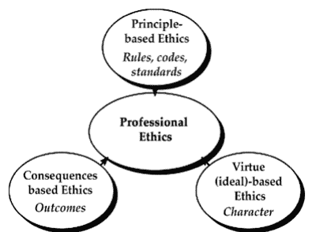

图 3.5：职业伦理。

来源：https://www.journalofnursingregulation.com/article/S2155-8256(15)30232-5/fulltext

类似于这些的守则在各个职业中都可获得，因此被认为与据称在学术界以及广泛社会的宗教中使用的道德守则不同。

伦理守则比道德守则更专业化、内部更一致，并且通常由该职业的普通从业者直接应用，而无需进行广泛的解释。

希波克拉底誓言是最原始的职业伦理守则之一，为医生的伦理执业提供了规则，以免伤害患者。誓言以及完整的守则都是以第一人称写成的。

近期的职业守则具有相同的特征或属性，尽可能明确或默示地规定主要责任是什么以及专业人员对谁负责。

以下是与守则相关的一些示例：

- 电气电子工程师学会（IEEE）的守则；
- 全国专业工程师学会（NSPE）的守则；
- 威彻斯特理工学院（WPI）为机器人工程师制定的守则；

- 美国机械工程师学会 (ASME) 的守则。

## 3.5. 规范相对主义理论

基于规范相对主义的理论主张，所有基于道德或伦理的认知，例如：所有标准、价值观以及美德，都被视为同等合法。

该理论存在内在矛盾。根据该理论，不存在普遍规范，但该理论本身却使用了一种普遍规范。这是该理论的主要缺陷。它倾向于使任何基于伦理的讨论都变得不可能。

这是一种哲学理论，并未得到文化人类学家收集的证据的充分支持，科学也无法支持关于过去和未来的理论！这是一种有反证的理论。

### 3.5.1. 促成规范相对主义理论流行的因素

以下是各种在规范伦理相对主义理论的赞誉中起作用的因素：

- 显而易见，道德规则和法律在不同国家有所不同。适用于一个国家人民的法律，不能对另一个国家的人民具有约束力。

全球各地的人们属于不同的种族，遵循不同的习俗，因此对什么是对的、什么是错的有着不同的看法。制定一项对全世界所有人都具有约束力的普遍道德标准是不现实的。

- 人们对不同价值观和信仰的日益同情与接受，以及厌恶民族中心主义危害的要求。因此，人们基本渴望接受并赞美世界的美丽与价值，而这个世界被视为多元文化的。

- 许多人的失望在于，他们持有一种想法，即可能存在一种第三种替代方案，以取代与提供的宗教以及特定文化相对主义相关联的道德或伦理专制。

因此，智者派相信，所有相关社会普遍倾向于制定各自的规则，并且不存在被全球接受的规则，也没有神来统治或制定规则。

### 3.5.2. 与规范相对主义理论相关的挑战

存在着各种与基于规范伦理或道德相对主义的理论相关的问题和批评，如下：

- 根据该理论，全球范围内没有用于评判道德和伦理问题的共同标准。

它仅在被推广的那些文化中是件好事。

它不能对所有民族进行推广。

然而，在其他一些国家，人们被灌输认为自己优越，并拥有支配和剥削他人的权利的信念。因此，那群人不会将宽容视为一种美德。

- 根据基于规范伦理相对主义的理论，每种文化都有其自身关于道德和伦理的观念或想法。规范伦理相对主义理论无法支持或解释少数群体对多数群体意见的批评。

- 如果将这一特定理论应用于在非常不同的社会环境中培育起来的各种独特文化，那么它肯定也会应用于那些与彼此分离成长的个体。

- 规范伦理相对主义理论通常倾向于作为一种普遍经验，以及各种基于伦理和道德的观念。

即使声称自己相信规范伦理相对主义理论准确的个人，也会对不同文化中人们的行为做出道德判断。例如，他们会谴责女婴杀害、生殖器切割以及其他一些行为，即使是那些延续数百年的行为。

## 3.6. 价值多元论

Christine Korsgaard 指出，人类的主要属性之一是我们亲密而无限的咨询价值的能力。这并非因为共享的价值必须彼此给予考量，而是因为赋予价值的共享能力。

换句话说，关于各自人类行为或本性的基本事实，通常就是那部分，它往往使国家中各种自由形式或类型的民主变得正确。

关于人类及人类生活的这一事实，已成为当代大量道德理论化的出发点。我们赋予不同事物以价值，但也会对同一事物赋予不同的价值。

根据不同的语境，许多国家都使用过关于刺猬与狐狸之间各种区别的传统谚语，以便能够说明或描述多元论者与一元论者之间的差异，例如：刺猬只能看到一个巨大的物体，而狐狸则能看到更多的小事物。

各种当代道德哲学家在仔细审视道德和伦理时，观察到的是许多小事物而非一件大事物：Thomas Nagel、Bernard Williams、Amartya Sen、Martha Nussbaum、Joseph Raz、John Rawls、Robert Audi (2007) 是其中最著名的几位——他们都捍卫了价值多元论的形式。事业、社会关系和人类生活都是复杂而多样的。

所有人都将要面临的各种问题是多元性或多样性，他们各自的行动或功能会产生多重后果，并对其他个体产生广泛或多样的影响。

个人有能力根据完全不同的观点或意见，目睹或感知独特的事物。

他们还可以记录各自行动的结果以及活动的机制，他们有能力根据各自特定的感知来把握独特的事物，因此可以发现或认识并同情所有其他与他们关系亲密的人，或与远方的人。

他们可能会考虑各自的状况，并从遗忘中感知，或者他们可以根据自己的观点来感知世界，而不只是认为自己的观点比他人的观点更重要。

这种认知以及价值，都被认为是平等的，其中所有其他独特的事物保持等同。

因此，从道德角度来看，结果或后果以及幸福、效用和快乐的扩展，不可能是唯一重要的事情。同样，遵守一条关于责任和人类尊严的正式道德原则，也不可能是唯一正确的标准，无论其后果如何。

即使向完美主义者或专家请求价值，询问一个完美或理想的个人应如何行为，例如：关于性、个人卫生或美学等某些事项，这些事项可能具有先前的可能性或设想性，但它们通常在所有基于与使用过程或普遍获取或权利冲突的案例中都被占据主导地位。

基于规范伦理以及公约或传统的独特理论，已经将一种单一的价值形式隔离出来，将其象征或例示，从而同时调节了其他价值的重要性，然后将其贬低到优先价值或偏好的程度，或者可能一次性将其移除。

道德理论的一元论观点假设，一个人想要知道的只是一种价值或一种表达它的简单原则。

因此，为了保持一种信念，即存在一种专家的单一价值，这种单一价值倾向于成为所有其他价值的阻碍，无论是人的尊严、最大化商品消费或效用的过程、人类的繁荣时期还是自身利益，通常都会导致对道德问题的重要性的过度狭隘视角，以及本应被忽视的人类状况的耗竭，特别是在应用伦理学的情况下，应用伦理学总是试图尽可能地与技术评估过程以及公共政策制定过程保持相关。

伦理可能涉及赞扬与责备、规定或评价、冲突解决、行动指导、性格特质与美德、许可与义务的逻辑、基本需求与人权、效用、后果与结果、福祉、金钱、理想、原则、职责、能力与责任、价值观、利益与偏好。

因此，它可能涉及广泛的一般性事实或全球事实，或涉及针对概念的特定承认。根据所提出的条件，任何此类概念以及词汇都可以被高度利用。

为了排除它们连同其相关背景观点的使用而偏向其中一个，在实际事务中似乎过于限制性和还原论。

## 3.7. 道德理论

### 3.7.1. 实践优先

伦理或道德一直被视为实用主义哲学的一个分支，因此主要关注实际问题以及所给出的行动。

基于伦理或道德的论证、此类伦理的推理以及正当判断的主要目标，被认为是连贯的解释，以及解决所有相关冲突和分歧的过程，涉及谁有意成为什么、他们应该做什么、克制自身利益的过程，以及增强所有被认为具有感知能力的各类生物之间的合作与和平共处，在相互或共同的环境中。

关于隐私的新问题，已在相关中介的协助下宣布，或者某人可能对网络空间中与隐私相关的新群体拥有需求。

相比之下，似乎并没有充分的论据支持需要一个名为“互联网伦理”的不同领域这一主张。

## 3.9. 未来展望

在此，主要关注点在于全球化进程以及互联网技术的进步如何影响信息与通信技术伦理领域中的近期或现代讨论。

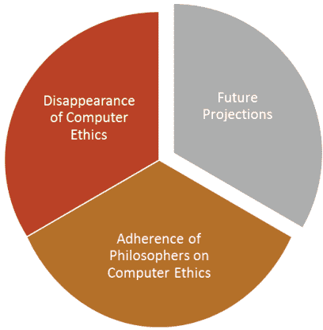

图 3.6：未来展望。

然而，与此相关的主要问题是，需要准确了解全球互动或关系持续的影响。

以及信息与通信技术伦理相关领域或方面在命运上的技术进步及多样化创新。

一些人已经提出了明确的假设，而另一些人则非正式地对该领域的未来进行了推测。关于命运的基本迷人视角已被多位研究人员描述，包括 Deborah Johnson (1999)（图 3.6）。

### 3.9.1. 计算机伦理在未来会“消失”吗？

Johnson 建议，计算机伦理领域在未来可能或应该消失。她假设，我们目前视为计算机伦理问题的任何事物，都可能充分融入“普通伦理”问题中。

Johnson 在指出或说明这些问题或议题不会自行缓解，反而不会像信息与通信技术伦理相关的问题或议题那样被操纵或提出时，被认为非常谨慎。

她认为，计算机技术倾向于以从未实施或执行过的各种方式修改或影响人类的行为。尽管如此，如果在道德过程中针对 Johnson 关于两种相关方式的要求建立了新的执行或应用，以便她能够理解或解释她关于计算机伦理消除的主张：

- 作为一门自治学科，计算机伦理将消失；以及
- 作为应用伦理的一个方面，计算机伦理将消失。

除了 Gotterbarn 和 Marturano 对 Johnson 预测提出的挑战之外，其他人也可能不同意 Johnson 的观点。

可以肯定的是，涉及道德责任的 AI 相关问题在未来将继续出现，并且这些 AI 相关问题可能从计算机伦理学家的分析中受益。

相反，人们相信，更好地了解计算机技术在过去五十年中的发展，可以帮助人们更清晰地认识未来在实现更全面的“技术融合”状态时将面临的一些问题和挑战。

在考虑计算在上个世纪下半叶对伦理的影响时，我们可以从四个不同阶段的视角来看待它。

在阶段 1（属于 20 世纪 50 年代和 60 年代）中，计算机技术通常主要包括提供的计算机的大型机，这些大型机据称不是关联或连接的机器，换句话说：独立机器。

在这个特定领域，与计算过程道德相关的所有社会及道德问题的某些后果，可以表现为当今时代与人工智能（AI）相关联的各种问题。

在此期间，另一个担忧是与“大兄弟”相关的恐惧，因为它是一个中央集权政府，可以收集大量关于其公民的信息。这些信息以电子记录的形式无限期存储在大型数据库中。

考虑阶段 2（属于 20 世纪 70 年代和 80 年代），首要步骤是开始审视合并通信设备以及各种用于计算或计算机器的想法，从而进入信息或计算机网络的时代。

在这个特定领域，各种个人计算机、大型机、微型计算机以及小型计算机都可以通过私人持有的计算机网络相互关联或连接，形式为局域网（LAN，即 local area networks）以及广域网（WAN，即 wide area networks）。

信息现在可以在数据库之间轻松交换，这些数据库可以被联网计算机访问。

互联网技术的兴起除了其他方面之外，还增强了匿名性、与言论自由、信任、权威等相关的问题，这些问题在此期间的计算机技术中不断发展。

除此之外，还有各种更令人担忧的问题，与具有私人性质或个人性质的个人信息有关，这些信息可以在网络空间轻松访问。

当前，我们正处于所谓阶段 4 的门槛上，我们开始经历前所未有的技术融合水平。在阶段 3，计算机技术的界面和隐喻与先前阶段（例如屏幕、键盘等）相同，计算机仍被视为与人们外围的东西，即人类可用于交互的外部设备。

众所周知，计算机在当今世界已几乎无处不在，并且在很大程度上已成为个体作为人类的一部分，可以合理地说，人们正处于合并过程的新颖且广泛可争议的重要时代的边缘。

当然，在未来，将生物学的某些方面与技术分开可能会变得棘手。

基于这种情况，预计在阶段 4，可能会出现一种与 Johnson 概念（如上所述）相符的观点，即计算机伦理作为一门独立的研究领域将消失。与此正好相反，人们假设，与以往相比，对信息与通信技术伦理的两个方面以及哲学家的广泛需求将会增加，以便他们能够在该特定轨道上进行研究。

### 3.9.2. 哲学家为什么应继续从事计算机伦理？

在试图解释为什么所有哲学家都需要执行与信息及通信信息相关的伦理之前，根据 Johnson 对该特定轨道命运的观点，提出一个基本区别肯定会有所帮助。下面描述了两个值得单独考虑的要点：

- 计算机伦理未来可能会消失；以及
- 计算机伦理未来应该消失。

在未来，与技术相关的某些问题作为前景之一，无疑将继续推动并扩展基于道德或伦理的理论，并持续在基于各种背景或概念的过程中引入各种困惑和混乱。

在这两个领域中，都需要哲学家提供帮助。许多研究人员已经考虑了某些方式，哲学家已通过这些方式提供了各自的回应

to the pertaining problems or the issues, possessing an involvement of the requirement to have an assessment along with the revision of the various theories, based on ethics, so that they could be able to inscribe the pertaining issues.

Let us next examine some areas in which philosophers can help to clarify some existing and future conceptual confusions associated with moral issues in computing.

Birrer goes on to specify that through various issues considered in the strained sense of computer ethics may even be normative; they are not essentially ethical in nature. Regrettably, such an essential differentiation has been often gone through, or in various cases, has been completely unnoticed, within the much of the literature related to the morality of the information as well as the communication technologies.

Philosophers can also continue to help refine our understanding of many of the standard computer ethics issues, e.g., issues involving privacy, property, crime, and so forth as these concepts become stretched and strained by changing technological innovations.

In the various previous parts of this specific chapter, an instance regarding the privacy with respect to the cyberspace, has already been defined so that they could be able to provide with an illustration regarding some of the pertaining muddles as to if there persists any of the novel of the rare issues related with the ethics or morality that has been introduced by the provided technology.

Let us now consider a different issue related to computer ethics, viz., crime comprising computer technology, to demonstrate few ways in which philosophers can help to reduce some conceptual confusions.

Confusions regarding the distinction of crimes that should or should not be considered, as a computer crime will probably become more intensified, and the devices of communication remain to merge.

Many of the researchers have observed that the generic crime, possessing an involvement of the varied cell phones, is somehow being associated with cloning i.e., the process of reprogramming the cell phone of an individual to transmit the digits of the mobile belonging to the other individual or party, so that the party, which is supposedly innocent, would be charged for all the calls that have not been made by that specified individual or the party.

Should we classify this particular criminal act as a form of computer crime or Cybercrime on the grounds that digital technology was involved in the criminal act? A question has been raised as to what will happen at the time of the occurrence of the iPhones or the internet phones, which are considered to be a great convergence of the digital telephony along with the net. And, how will all the crimes, possessing an involvement of the convergence of the advanced technologies, would be able to get understood or supported.

Thus, philosophers can aid to reduce various confusions that will be the outcome of technology convergence in the future.

Obviously, some of the provided critics would certainly be asking for as to why all the pertaining philosophers are required to devote their respective time in the process of discussion as well as the assessment or the evaluation of the varied persistent questions, having an involvement of the fortune related with the advancement in the technology of computers.

The best explanation to that question has been described by Moor (1998c) when he provided with the apt remarks as: “If philosophers do not confront the conceptual and ethical problems of the internet, who will?”

## REFERENCES

- 1. Hoven, J., (n.d.). *Information and Computer Ethics* (p. 20). [eBook]. Available at: https://d1rkak7tlqy5fl.cloudfront.net/TBM/Over%20faculteit/Afdelingen/Values%20C%20Technology%20and%20Innovation/People/Full%20Professors/The_use_of_normative_theories_in_computer_ethics.pdf [Accessed 14 Nov. 2018].
- 2. Normative ethical theories. (n.d.). *Hodder Education Draft* (p. 25). [eBook] Available at: https://www.hoddereducation.co.uk/media/Documents/RS/4_Normative_ethical_theories_Natural_moral_law.pdf [Accessed 14 Nov. 2018].
- 3. Schiaffonati, V., (2018). *Computer Ethics: Normative Ethics – Ethical Theories* (p. 27). [eBook]. Available at: http://home.deib.polimi.it/schiaffo/CE/normative%20ethics%204.pdf [Accessed 14 Nov. 2018].
- 4. Tavani, H., (2001). *The State of Computer Ethics as a Philosophical Field of Inquiry: Some Contemporary Perspectives, Future Projections, and Current Resources* (p. 12). [eBook] Netherlands: Kluwer Academic Publishers, Available at: https://static1.squarespace.com/static/52095f5de4b0bc18c96d1924/t/57d434cc15d5db80ead8f8c7/1473524941420/Tavani-++2001-++The+state+of+computer+ethics+as+a+philosophical+field+of+inquiry+Some+contemporary+perspectives%2C+future+projections%2C+and.pdf [Accessed 14 Nov. 2018].
- 5. G. Johnson, D. (1999). *Sorting Out the Uniqueness of Computer-Ethical Issues*. [ebook] Available at: https://core.ac.uk/download/pdf/41174283.pdf [Accessed 17 Mar. 2019].
- 6. Moor, T., Raisch, J. and O’Young, S. (1998). Discrete Event Dynamic Systems. Discrete Event Dynamic Systems, 12(1), pp.83-107. Marturano, A. (2000). Media ethics. Regulating the Information Society. Milano: F. Angeli.
- 7. Gotterbarn, D. (1991). Computer Ethics: Responsibility Regained. [online] Cscietsu.edu. Available at: https://csciwww.etsu.edu/gotterbarn/artpp1.htm [Accessed 17 Mar. 2019].
- 8. Van Den Hoven, J., Introna, L. D., Johnson, D. G., & Nissenbaum, H. (1999). Ethics and Information Technology: Editorial. Ethics and Information Technology, 1(1), 1-3.
- 9. Audi, R. (2007). Moral value and human diversity. New York: Oxford University Press.
- 10. MOOR, J. (1985). WHAT IS COMPUTER ETHICS?. Metaphilosophy, 16(4), pp.266-275.

# 4 Ethical Issues in the Information and Computer Sector

## CONTENTS

| Section | Page |
|---------|------|
| 4.1. Introduction | 88 |
| 4.2. Foundational Issues in Information Ethics | 90 |
| 4.3. Computer Ethics as a Sub-Area In Applied Ethics | 93 |
| 4.4. General Theories of Information Ethics | 94 |
| 4.5. The Moral Value of Information | 96 |
| 4.6. Key Technology Trends That Raise Ethical Issues | 100 |
| 4.7. Common Ethical Issues | 102 |
| 4.8. Plagiarism | 102 |
| 4.9. Hacking | 104 |
| 4.10. Computer Crime | 105 |
| 4.11. Four Main Ethical Issues That Exist In The Modern World | 106 |
| References | 113 |

The field of information technology (IT) and digitization have expanded to unrestricted boundaries, and there is no stopping this field from growing even further. These are somethings, though, that need to be curtailed as they have resulted in the degrading value of the field. Ethics have always been an important subject in any field that humanity has taken up, to ensure that humans do not indulge themselves in activities that degrade the value of the subject. In the field of IT and computer systems, also, there have been various ethical issues that concern individuals and their personal lives. In this chapter, the readers get an insight into various such issues and get to understand the flaw in the computing systems.

## 4.1. INTRODUCTION

The world that the people live in is ever evolving and ever-changing in terms of technological innovations and developments. In such a world, it is bound to be that the subject of ethical issues is brought up from time to time. This subject requires great concern and seeks the support of people in the form of best efforts they can put in to resolve the issues with ethics (Figure 4.1).

Figure 4.1: Ethics form an integral part of computer systems.

来源:https://cdn.pixabay.com/photo/2017/03/02/07/32/ethics-2110589_960_720.jpg

在IT行业最受讨论的众多问题中，与信息通信技术相关的问题通常位居榜首。ICT的无控制扩张及其在各行业技术架构中压倒性的使用，对人们的社会存在产生了一些显著影响，因此它从伦理角度看是一个值得充分关注的主题。

关于此问题的讨论以这种方式进行，以至于对它的困惑在社会中产生了不同的影响。ICT的使用所产生的各种问题包括侵犯个人或组织的隐私、侵占财产权利、触犯人们的各种社会权利，以及ICT使用后出现的情况所导致的问责制。

上述问题已引发其他相关问题，如失业、不当的工作条件以及个人个性的丧失。然而，为解决这些问题所必须采取的行动和措施并未达到应有水平。正如Fielden在2004年所述，IT领域是一个中心点，几乎应用于所有工业垂直领域，如商业部门、政府组织、制药业、教育、娱乐业、工业设置，因此以特定方式关乎整个社会。

IT行业的好处无需额外介绍。但是，就像其他不断发展的领域一样，IT的使用也伴随着某些缺陷和影响，以某种方式影响社会。它以三种主要方式促成与伦理相关的问题，也可称为伦理问题。它们是：

- 个人隐私；
- 访问权；以及
- 有害行为。

当涉及个人隐私主题时，IT可以帮助任何人从全球任何地方随时交换大量信息。这种交换增加了数据泄露和实体隐私被破坏的风险。这使得人类采取措施以维护隐私并尊重涉及不同人员的数据质量变得至关重要。这包括采取必要措施，确保数据保持准确，并防止数据被未授权实体访问或意外泄露给不应拥有该信息的人。

与伦理相关的问题的另一部分是访问内容的权利。

数字空间中的安全问题已从低优先级转变为各机构和负责组织议程上的高度优先事项。这是因为国际贸易在线市场的突然兴起所致。

由于美国洛斯阿拉莫斯国家实验室和NASA等重要机构发生数字安全漏洞，该主题近年来更加受到关注。近来，黑客多次非法入侵美国政府行政系统的事件不断发生。除非关于数字平台安全的政策和策略得到彻底确立并付诸实践，否则互联网网络上的连接不能百分之百免受漏洞影响。

## 4.2. 信息伦理的基础问题

有一些具体问题指向信息伦理（IE）的独特性。研究者和其他研究过该主题的各类人士提出了许多支持IE及其研究的观点，认为该领域具有理论重要性。在此类研究之后，数字世界及其利用引发了一些元伦理、认识论和伦理层面的障碍。这些障碍授权以需要特定培训和完善的统一类别形式来解决这些问题。

一方面，研究者和出版者认为IE在理论和本质上具有独特性；另一方面，他们往往在如何看待其独特性方面存在分歧。

### 4.2.1. 解释独特性论题

独特性论题有不同的解释。第一种解释是，人们可能会提出，计算机伦理与其他伦理不同，因为数字世界涉及的一些活动需要其他领域可能不具备的伦理品质。

### 4.2.2. 元伦理学论题

计算机伦理中有些行为无法用义务、允许、善和超额义务等传统概念充分表征。因此，元伦理学论题提出了一个非常强烈的主张：普遍伦理和应用伦理的元伦理基础似乎无法在任何现有体系中淡化这一印象。仅仅陈述义务论、功利主义、关怀伦理和基于权利的理论都得出错误结论是不够的；必须通过引用某种合理可信的概念或守则来验证这一声明。

财产权理论也面临问题。尽管该理论的支持者通常认为计算机具有伦理地位（即，被分配了一种受尊重的伦理责任），但计算机的任何独特资产在伦理地位主题方面都没有显著的伦理意义，因为这些资产似乎仅具有工具价值（即，作为达到目的的手段的价值），而缺乏被认为值得伦理赞赏或问责的内在价值（即，作为目的本身的价值）。

## 4.3. 应用伦理学中的计算机伦理学

认为存在一类主要考虑的问题，这些问题包含了数字技术的一些多样化属性，这些属性既不同又显著，这一想法显得如此明显，以至于很难想象该观念为何会被拒绝。

显而易见，关于知识产权的问题之所以出现，是因为一些专注于P2P文件共享的技术使得数字技术具有独特能力，能够反复创建和提供相同形式的数字音乐，且成本远低于原始制作成本。同样，数字平台上的言论自由伦理问题之所以产生，是因为网络技术独特地使得脚本和插图文件的大规模分发成为可能。

当然，要确定对特定问题的准确精确响应可能非常棘手；因此，在这些情况下，现有的群体和概念在认识论上是未知的。

但是，正如人们所见，这种不确定性并非仅限于任何特定的伦理困难领域。确实，将矫正道德视为一个独立领域的解释取决于各种相对普通的审慎考量。

- 首先，医学伦理学的问题是特定专业人士面临的问题——即，那些在医疗保健行业工作的人。
- 第二，这些问题对人类福祉具有伦理上的重大影响；安乐死、克隆或基因检测在道德上是否合理，可以在很大程度上影响生命的质量。
- 第三，合理地假设，那些以某种可解释方式相互关联的问题的专家，事实上最有可能产生更高质量的工作。在没有适当专业化的情况下撰写问题曾经相对容易的日子已经一去不复返了。

然而，同样的考量也适用于IE。

- 首先，数字伦理的问题为特定类别的专家提供了情境——具体来说，是那些试图配置、创建和实现数字进步的人。
- 第二，这些活动产生的问题对人类繁荣和个人满意度至关重要；对个人来说，例如，大众在其硬盘记忆和思想类型方面拥有何种产权至关重要。
- 第三，合理地认为，那些掌握此类创新的专业属性和道德问题广泛信息的个人，作为一项实验问题，极有可能提供高质量的伦理论证来应对这些问题。

## 4.4. 信息伦理学的一般理论

同样，关于数据伦理的性质和体系存在大量实质性的假设案例。这些假设中的一部分仅限于描述处理数据伦理问题的理念及其与处理不同领域问题的关系。另一些则试图阐明在处理数据伦理问题时应采用的方法或实质性规则。

然而，另一些人则将数据伦理作为发展更广泛程序以应用伦理问题的起点。下面对这些观点中的一些进行了简要概述。伯纳德·格特（Bernard Gert，1999）认为，应用伦理问题（包括数据伦理问题）应通过诉诸“基本道德”来解决。

正如格特所描述的，普通道德是“人们在面对道德问题并做出道德决策时选择可接受行为所使用的[共享]道德框架”（Gert，1999，第58页）。正如格特所指出的，在任何给定文化中，人们在道德问题上同意的远多于分歧；然而，人们非常倾向于关注大众意见不一的地方，“此类有争议的问题仅构成人们在其间做出良好选择和决定的问题的一小部分”（Gert，1999，第57页）。在格特看来，数据伦理问题（以及其他领域）应通过诉诸这些共同的良好决策来解决。

卢西亚诺·弗洛里迪（Luciano Floridi，2002）试图在四项基本道德规则的基础上，确立一种处理数据伦理问题的统一方法，这些规则管辖着“信息圈”中的行为者，正如他所描述的问题。

通过提议数据项可能需要尊重，无论其是否展示人类或自然属性，IE为道德评估提供了一个一般框架，而非一系列法令或逐点解决方案（将其与义务论方法的“空白”进行比较）。在Floridi（1999, 2001a, b, 第298页）中，这一框架已被构建为数据环境（即信息圈）的道德管理。弗洛里迪提出了四项“反数据熵的普遍法则”：

- 不应在信息圈中产生数据熵；
- 应在信息圈中抵消数据熵；
- 应从信息圈中移除数据熵；以及
- 应确保、扩展、增强、改进和升级信息圈。

耶罗恩·范登霍芬（Jeroen van den Hoven，1997）认为，数据伦理问题应通过约翰·罗尔斯创造并使之闻名的反思均衡策略来合理处理。在此观点下，道德思考应致力于建立最连贯的信念体系，其中普遍道德主张（例如，故意造成伤害是错误的）和更具体的基于案例的判断（例如，因为肯·希马的观点让人恼怒而打他的脸是错误的）相互支持、证明和阐明。

因此，捍卫数据伦理问题上的立场需要证明该立场属于最连贯的道德信念体系。一些数据伦理学家主要关注ICT或数据伦理假设中可验证的偏见问题。

例如，菲利普·布赖（Philip Brey，2001）认为，道德评估应是一项多学科和分层的调查，除其他外，还应识别和揭示ICT中的“嵌入规范性”。艾莉森·亚当（Allison Adam，2001）认为，数据伦理中的大量评估未能考虑关于性别和性别的关键问题，并主张采用女性主义关怀伦理，以实现对数据伦理中各种问题的不同视角。其他关注数据行业伦理的人士则着重于说明数据伦理领域的范围，并将其与在某种程度上尊重伦理的其他领域进行对比。

克里斯蒂娜·戈尼亚克-科奇科夫斯卡（Krystyna Gorniak-Kocikowska，1996）认为，DIGITAL的渐进整体效应指向对另一种“全球”伦理假设的需求。

戈尼亚克-科奇科夫斯卡认为，正如边沁的功利主义是由于新ICT（即印刷术）的发展而产生的，同样，另一种道德假设也可能随着尖端数字技术及相关进步的发展而出现。

此外，这种道德假设可能会产生全球影响，与功利主义在欧洲和美国有限的影响形成对比，并将取代许多国家的道德传统。德博拉·G·约翰逊（Deborah G. Johnson，1999）认为，DIGITAL和数据伦理在某种意义上将消失在一个更广泛的道德探究领域中。

在约翰逊看来，数据进步将如此彻底地融入生活，以至于大众不再将其视为非同寻常或需要一种隔离心态的东西。数据创新及相关问题将完全融入并巩固于日常生活。当这种情况发生时，对明确DIGITAL和数据伦理的需求将消失；数据和DIGITAL伦理问题将与其他问题一起被全面处理。

## 4.5. 信息的道德价值

人们可能会合理预期，与ICT相关的各种伦理问题最终将依赖于关于信息道德价值的更普遍性陈述来解决。假设在不了解智力数据价值的情况下，无法决定知识产权是否存在并受国家法律保护，这是相当实际的。

### 4.5.1. 道德地位和两种道德价值

在任何实质性道德问题之前，存在一个更广泛的问题，即关于哪些生物或要素具有“道德地位”。X具有道德地位，当且仅当，

- 某些伦理主体在对待 X 方面负有类似的一项义务；且
- 该义务是对 X 负的。

第二点的意义不容忽视。无论狗是否需要道德地位，无论如何都有人负有不踢狗的义务；但这种义务是“间接”的，因为它是对主人负的，而不是对小狗。然而，如果有人负有不踢狗的义务，那么这就是直接义务，因为它直接涉及义务所对应的存在。

因此，拥有道德地位并成为伦理患者，就是至少是某项直接义务的接受者。虽然拥有道德地位的概念通常与拥有“固有价值”相关联，但这一思想有两种特定的含义，它们与道德推理相关联。

第一种关注的是本质上理性主体天然追求的终结类型。在这种表述意义下，一个事物、状态或要素具有固有价值，当且仅当本质上正常主体经常将其视为目的本身；相比之下，一个事物仅具有工具价值，当且仅当它作为某主体目的的手段而存在。

例如，密尔广泛认为，人们独自为其本身而非为其他事物而追求的唯一事物是幸福。同样，其他每一件事物，如金钱或旅行，都在工具上很重要，作为确保内在重要的快乐这一终极目的的手段（参见 Mill, n.d.）。

关于基本价值如何在信息伦理道德理论中塑造自身，观点各异。密尔基于他的观点构建了他的功利主义，即所有人尤其关心的，这一非常基本的事情是幸福。如果幸福仍然是个人基本关心的唯一事物，那么它就将自身维持为道德评价的唯一基础。

更谦逊地说，合理地认为，个人对其独特地内在珍视的事物拥有一种在伦理上受到保障的兴趣——然而，这并未告诉我们这种兴趣的质量或性质（例如，它并未告诉我们它是否上升到权利的层面）。“自然价值”这一表述的第二种含义关注于区分一类有资格得到某种程度道德尊重的事物。在这种意义上具有特征性激励的要素，是伦理患者，理应从本质上理性的道德主体那里得到至少微不足道的尊重。

这与仅具有工具价值的实体截然不同，具有内在价值的要素不得仅被视为一个可被“利用”的项目。而决定如何对待仅具有工具价值的事物的恰当方式是成本效益分析，具有特征性价值的事物则有资格在道德主体讨论如何行动时得到某种程度的道德考量。

在这种第二种意义上具有内在激励的事物，是必须履行其特权的伦理患者。学者们已考虑过数据或数据对象在上述两个方面是否具有自然激励的问题。

### 4.5.2. “数据对象”作为具有道德地位

Luciano Floridi (2002) 将其对信息伦理（IE）的构想作为一般道德假说，建立在关于道德地位的广泛论证之上。在 Floridi 看来，人类已知的每一种实体都可以被理解为一个“数据对象”，它具有特征性重要性，因此理应得到至少微不足道的道德尊重。

每一个现存要素，无论是有意识还是无意识、生物还是非生物、自然还是人造，都具有某些微不足道的道德价值，如他所说，因其作为“数据对象”的存在本身而然。Floridi 为这一观点提出了几个论据。

首先，Floridi 认为，明显的历史趋势有利于扩大拥有道德地位的对象范围。虽然“只有人才拥有道德地位”的观点自古以来占据主导，但二十世纪出现了支持以下观点的论证：非人类生物、植物、生态系统，甚至艺术品对象拥有道德地位，且应得到尊重的义务。

在 Floridi 看来，将拥有道德地位的对象类别进一步扩展至数据对象，是非常自然的。其次，他认为，如果不预设所有对象因其作为数据对象的身份而值得尊重，大众就无法解释某些行为。事实上，即使在未能拥有通常被认为能支撑道德地位的能力之后，仍有强烈论证认为，那些思考不够主动的人也应得到一定程度的尊重，尽管这少于他们若生来拥有更积极的思想本应得到的尊重。

即使在未能拥有通常被计入以支持道德地位的能力之后，仍有强烈论证认为，那些思考不够主动的某些人，应得到一定程度的尊重，尽管这少于他们若生来拥有更积极的思想本应得到的尊重。

如果大众将这一论证理解为指代此类扩展的历史背景，认为这便是我们应将道德网络扩展至数据对象的理由，那么这便是危险的，因为学者们作为历史确定的观察事实，已将道德网络扩展至生物、植物和土地，这一微不足道的事实本身并不提供任何理由让我们认为学者们还应进一步将道德网络扩展至数据对象。完全阐明学者行为的事实，对理论应当是什么毫无规范性的含义。

其次，Mary 作为数据对象而拥有道德地位的论证，基本上无法充分解释大众对待 Mary 遗体时所做的各种事情。例如，死产婴儿受到的尊重明显多于早产胎儿；然而，两者作为数据对象完全处于同一维度。

作为数据对象，它们由大量描述其不同属性、活动和能力的命题构成。因此，Mary 作为数据对象的倾向无法解释，为什么大众对她作为死者所表现出的尊重，多于对她作为遗失物所表现出的尊重。的确，Floridi 的假设甚至缺乏足够的资源来解释大众对待死产婴儿和对待一块石头所表现出的不同尊重维度。

从认为事物因其作为数据对象的倾向而拥有道德地位的论证立场来看，Mary 作为数据对象与一块石头作为数据对象之间没有区别；用 Quine 的话说，作为数据对象即是具有特定智能结构的一组命题。因此，Floridi 的方法似乎甚至无法解释 Mary 的遗体比一块石头更值得尊重这一直觉。

## 4.6. 引发伦理问题的关键技术趋势

由于长期使用信息技术，伦理问题早已产生。然而，信息技术的广泛应用不断加剧了人们对伦理的担忧，扰乱了现有的社会事物，并导致某些关于社会的法律变得多余并受到严重破坏。

数字世界的强度每一年半翻一番，这使得大多数公司更容易利用这些数字系统来开展构成制造业最重要部分的生产过程。结果，各实体对这类系统的依赖，以及其容易受到系统所犯错误以及信息不当和低质量影响的风险，都已增加。

现有的法规和法律框架未能适应这种过度依赖。确保数据系统保持准确并具备更高可靠性的标准，尚未被全球各方普遍接受，也未得到强制执行。信息存储技术的最新进展以及成本以极快速度下降，导致了关于各类人员（包括员工、客户和潜在消费者）的不断扩大的数据库，这些数据库由多个私营和公共机构维护和更新。

这些技术和创新经常侵犯多个实体的隐私，并使此类行为变得更加廉价和高效。大公司发现使用涵盖太字节数据的存储系统来存储个人身份（主要是其客户的身份）的成本极低。

涉及海量信息的数据分析及其技术创新，是另一种增加伦理担忧的技术趋势。这是因为公司和政府机构能够以详细的方式查明关于个人的极其私密的信息。

利用长期使用的信息管理工具，组织可以收集存储在不同计算机上的关于个人的碎片化信息，并将其合并

他们能比以前轻松得多地做到这一点。人们可以想到他们将信息输入系统的所有方式，例如通过信用卡购买、来自手机的来电、订阅各种网站、视频租赁、通过电子邮件购买、银行账户记录、由州政府和联邦政府（包括警察维护的信息）维护的信息，以及浏览各种网页。如果一个人把所有这些结合起来仔细思考，所有这些数据不仅能让他们的信用信息公开，还能暴露所有日常习惯，例如品味、驾驶优先级、个人社交圈、关于他们阅读的书籍和观看的视频的偏好，以及他们的政治倾向？

数千个最受欢迎的网站允许DoubleClick（由Google拥有，一家互联网广告经纪商）追踪其访问者的活动，以换取基于DoubleClick收集的访客信息而投放的广告收入。

DoubleClick使用这些信息为每个在线访客创建档案，随着访客访问关联的DoubleClick网站，不断为档案添加更多细节。随着时间的推移，DoubleClick可以创建一个人在网络上消费和计算习惯的详细档案，并将其出售给公司，以帮助他们更精准地定位网络广告（图4.2）。

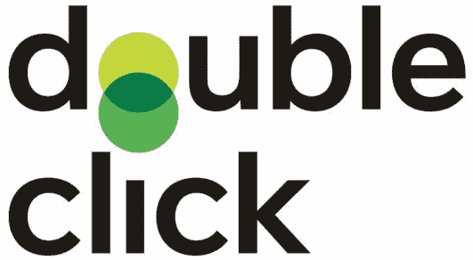

**图4.2：** 由Google提供的DoubleClick。

来源: https://upload.wikimedia.org/wikipedia/commons/thumb/4/4f/Double-Click_Logo.svg/2000px-DoubleClick_Logo.svg.png

出于国土安全目的，存在几种高度技术化的安全工具，它们工作良好，但伴随着各种隐私影响。这些隐私影响令人恐惧，因为它们展示了个人所进行活动的每一个细节。

因此，网络（包括互联网）的进步在访问大量数据以及利用小型桌面机器远程挖掘大型数据池方面既有益又具成本效益，这使得以史无前例的规模和精度侵犯隐私成为可能。

## 4.7. 常见的伦理问题

本节还将探讨以下源于信息技术的其他特定伦理问题（图4.3）：

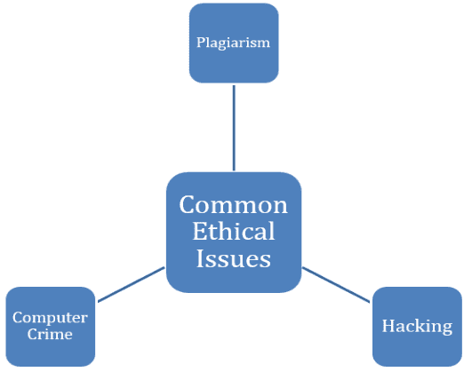

图4.3：围绕信息技术的一些常见伦理问题。

## 4.8. 剽窃

剽窃是指未经他人许可而取用某人的作品，并以某种形式呈现，声称该作品属于复制者。剽窃这种行为是数字世界中最不道德的行为之一，并且非常频繁地发生。由于这种做法在互联网上免费提供，人人皆可访问，因此变得更加便捷和频繁（图4.4）。

**图4.4：** 拒绝信息剽窃。

来源:https://cdn.pixabay.com/photo/2013/07/13/12/42/do-not-copy-160138_960_720.png

### 4.8.1. 教育领域的信息与版权

在过去几年中，由于技术和互联网的发展，商业行业在市场上获得了巨大的重要性。但是，教育领域的情况并不相似。现在的教室里比以往任何时候都有更多的电脑，但很少有证据表明它们能提高阅读、写作和算术等基本技能的学习效果。

获取数字信息很容易；同样明显的是，大多数学生现在将图书馆视为过时的机构，更适合用于他们的计算机终端，而不是用于他们的图书藏品。

对于能够以合乎道德和不道德的方式获取信息的学生来说，教育变得更加容易。相关的影响是，互联网在两个不同的方面将剽窃带入了计算机时代。

- 电子文本使学生的生活变得轻松，因为他们可以轻松地“剪切、复制和粘贴”，而不必将自己的观点融入内容中。他们准备一套完全剽窃的报告，对他们的知识毫无帮助。

- 对于学生来说，在网站上购买试卷很容易，或者他们甚至有机会复制粘贴他们为内部考试收到的作业。他们甚至会按固定费用委托撰写原创学期论文。具有讽刺意味的是，互联网所给予的，它也会夺走。

### 4.8.2. 盗版领域的信息与版权

以非合法方式复制软件是一个严重关切的问题，根据预测，运行在各种个人电脑上的大约一半程序是盗版复制品。程序员花费大量时间设计各种软件和程序，使用经过精心细化和扩展形式的代码，因此需要得到保护。

虽然有些人可能会提出观点，认为在一定程度上应该合法化盗版，因为这可以让越来越多的人熟悉计算机和数字世界的知识。但是，就主要行业和组织而言，盗版情况是一个令人严重关切的问题，可能会对公司的利润和声誉造成严重损害。

### 4.8.3. 文件共享领域的信息与版权

大学生一直是数字时代日益认识到知识产权中心地位的先锋。

录音和电影公司无法避免文件共享的特点，导致他们在光盘和数字视频驱动器上设计出新的形式和高度安全的保护形式。在一起引发大量争议的事件中，索尼公司于2005年向市场推出了受防盗版保护的CD。但是，当插入计算机系统时，其中包含的代码会像计算机病毒一样起作用。这种软件为黑客进入用户的计算机系统并控制他们的系统提供了更好的途径。

## 4.9. 黑客攻击

黑客是指具备足够知识、未经授权进入计算机系统以识别安全漏洞的个人。黑客会闯入或“黑进”一个系统。黑客攻击可以出于各种原因进行，例如想要破坏系统，或者想要了解系统的工作原理，以便从中牟利（图4.5）。

图4.5：对数据访问应有非常严格的限制。

来源:https://cdn.pixabay.com/photo/2017/01/01/14/39/hack-er-1944688_960_720.jpg

## 4.10. 计算机犯罪

在做出一些估计时，美国约有七千三百万人的记录被意外泄露。说到一起引人注目的案件，发生在一名美国退伍军人事务部专业人员家中的一起盗窃案，其中一台电脑被盗，该电脑存储了约两千六百万美国军人的数据，包括现役人员和退役人员。随后，在相应行动中，电脑被找回，声称由于小偷不知道他们拿走的机器的重要性，数据是安全的。

长期以来，计算机上一直存在多种非法活动，包括黑客攻击、欺诈、骚扰和挪用公款。还有各种伦理困境，例如复制此类文件是否和偷东西一样糟糕。

## 4.11. 现代世界存在的四大主要伦理问题

在这个数字化进步和互动的世界里，人们面临着许多挑战。这些挑战通常源于信息本身。正如所讨论的，信息是帮助个人思想扩展并延伸到新领域、增强大脑实现目标能力的媒介，通常是通过从他人的思想中获取输入来实现的。这样，信息成为一种核心且重要的资源，凭借其智识性，帮助人们以期望的方式塑造自己的生活，并建立和保护他们的尊严。

### 4.11.1. 隐私

隐私现在是人们通过各种来源最常攻击的东西。在理解隐私概念之前，需要回答几个问题。其中包括：

- 一个人应该被要求向他人披露关于自己的哪些信息？
- 在什么情况下，个人必须在未经另一方同意的情况下披露信息？
- 一个人应该能够严格为自己保留哪些信息？

如今，比以往任何时候都更需要谨慎的公民提出这些问题。

两种情况威胁着人们的隐私。第一种是信息技术的快速发展，伴随着对监控、通信、数字化、存储和检索的强度不断增加。另一种是更深层次的威胁，即在做出重要决策的过程中，信息的价值不断提高。对于制定政策的人来说，信息的价值提高得惊人。这些人渴望这些信息，即使这会侵犯他人的隐私。

旨在揭示个人个人细节的信息集合，具有最大的潜力使个人在职业和个人关系中边缘化。这是侵犯隐私的最终代价。那么，为什么人们要在

首先？这是因为将来自不同来源的数据汇集在一起，使得建立新的信息关系成为可能。

### 4.11.2. 准确性

欺骗有一种搞乱个人生活的方法，特别是当持有不正确数据的人拥有权力和权威时。考虑路易斯·马奇的情况。他是一名外来人，是个勤劳的人，他和妻子艾琳终于攒够了钱，在20世纪50年代在洛杉矶买了一套房子。

他们从克罗克国家银行贷款了一笔长期贷款。每个月，路易斯·马奇都会手持贷款付款单去当地银行，支付196.53美元。他仔细检查，确保出纳员在他单册上正确的行做了“已付”标记，即只在到期月份对应的行上做标记。而且，即使在银行改用计算机信贷处理系统很久以后，他仍然坚持这样做。

几年前的一个九月，银行通知马奇说他没有支付当期的房贷。马奇拿起他的付款单，去了银行，用一口暗示其出身的蹩脚英语，试图向出纳员解释这份催款通知是错误的。他坚称自己已经付款了。

他付款单上的印章显示他已付款。出纳员在键盘上输入马奇的账户号码，查看了显示屏上的结果。不幸的是，她无法证实马奇的说法，主管出纳员和分行经理也无法证实。面对电脑生成的、清楚显示其账户逾期的屏幕时，这支银行官员等级体系只是简单地无视了他付款单上记录的条目和他持续的抗议。困惑的马奇怏怏离开了银行。

然而到了十月，马奇乖乖地去银行支付下一期款项。他被告知无法支付十月的款项，因为他已经在财务上逾期数月。他再次向出纳员出示他盖了章的付款单。她拒绝接受，他气冲冲地走出了银行。十一月，他像过去20多年来一样按时返回，再次尝试付款，却被告知他现在在财务上逾期了两个月。情况就这样持续下去，直到不可避免地，银行没收了他的房产。

艾琳正在睡觉、从心脏病发作中恢复时，从一位热心的银行催债员那里得知了房产被没收的消息。她听到消息后摔了一跤，中了一次差点致命的中风，导致右侧身体瘫痪。在这场磨难的某个时刻，此前一直自己处理法律事务的马奇被介绍给一位同意代表他的律师。他们起诉了银行。最终，经过一段痛苦的时间后，马奇夫妇获得了268,000美元的和解金。所有出庭作证的银行官员只能说：“电脑会出错。银行也会出错。”

如今，普通公众正在生成如此多的关于众多个人及其活动的数据，以至于出错的风险巨大。而且，数据的这种增长提出了另一个问题：谁应该对此负责？

### 4.11.3. 财产

作为社会，普通公众面临的最复杂的问题之一是知识产权的话题。围绕这些权利存在重大的财务和伦理问题；这些问题围绕数据本身的独特性质及其传输方式展开。任何单独的数据项在最初创建时都可能花费极高。

但是，一旦生成，该数据就具有易于复制和与他人共享的虚幻特性。而且，这种复制可以在不销毁原件的情况下发生。这使得数据难以保护，因为与有形财产不同，它变得可转让且难以独自保留。当他人使用个人的数据时，甚至很难获得适当的补偿。

我们目前有几个有缺陷的制度试图保护知识产权。版权、专利、加密、隐私承诺以及信任和可靠性等传统价值观是保护知识产权最常用的捍卫者。然而，这个领域仍然问题重重。让我们只关注一个方面：人工智能及其不断增长的子领域——专家系统。

为了充分认识专家系统方面的伦理困境，有必要把时钟拨回大约两百年前，回到另一个社会：蒸汽工业社会的开端。从这个观察点来看，公众可能预见到信息社会的一些问题。

在信息技术时代，尤其是在人工智能领域，对人类尊严的潜在威胁最为严重。人工智能从业人员通过从专家、工人和专业人士那里提取知识，然后将其嵌入计算机软件，使其在经济意义上成为资本。

这个将知识从个人身上“非具体化”，并相应地“具体化”到机器上的过程，将财产控制权转移给了拥有硬件和软件的人。这种财产转移合理吗？考虑一下当时一些最好的商业人工智能系统。

例如，DENDRAL中包含的化学信息、MYCIN中包含的医学知识或PROSPECTOR中包含的土地信息属于谁？知识提供者如何获得补偿？随着越来越智能的信息系统被创建，这些是公众必须解决的问题之一。

对知识产权的关注涉及数据内容。围绕数据传输渠道，存在一些同样紧迫的财产权问题。带宽，即传输数据的能力，是一种稀缺且最终固定的商品。它是一个“共有资源”。共有资源类似于一个空容器，水滴可以自由轻松地加入，直到它装满并溢出。那时，它的容量就耗尽了。作为一种资源，它是有限的。

有限的带宽资源将如何分配？谁将能够访问？这引出了第四个问题。

### 4.11.4. 访问

通往数据的主要途径是识字。自公元1500年左右叙利亚人首次发明辅音字母表以来，识字一直是充分参与社会的要求。从纸张的发明到现代数字平台，每一次数据处理的进步都对识字提出了新的要求。在信息社会中，一个人要成为识字者，至少需要具备三样东西：一是必须具备管理数据的智力技能。这些包括阅读、写作、思考和计算等技能。这是教育的任务。

必须能够访问存储、传输和处理数据的数据技术。这包括图书馆、收音机、电视、电话，以及越来越多的通过网络连接到大型计算机的个人电脑或终端。这是一个社会经济问题。

最后，必须能够访问数据本身。这一要求回到了财产问题，也是一个社会经济问题。

这些教育要求既取决于个人的知识水平，也取决于其财务维度。不幸的是，对于当今世界上的一些人来说，这两个维度目前都在削弱。

暂时思考一下电子存储数据库的社会影响。在它们出现之前，关于出版物、新闻事件、财务和社会统计以及科学发现的大量信息以印刷品、微缩胶片或微胶片的形式以相对较低的成本提供。对我们大多数人来说，获取这些信息在很大程度上是免费的。

我们只需去公共图书馆或学校图书馆即可。图书馆反过来为这项服务支付了几百美元，并向任何请求的人提供。然而今天，其中大部分数据正在转换为自动数据库，访问这些数据库的费用可能高达数千美元。

通常，只有通过获得终端或个人电脑才能访问数据库。例如，如果有人想通过米德公司服务获取《纽约时报》索引，他必须先拥有终端和通信线路，然后支付额外的连接和访问费用才能获取数据。

这意味着那些希望使用此服务的人必须满足几个条件。首先，他们必须知道数据库的存在以及如何使用它。其次，他们必须已获得访问它所需的技术。第三，他们必须能够支付数据费用。因此，要玩转现代信息游戏，教育和财务障碍都极高。

许多人无法或选择不支付它，因此被排除在充分参与社会问题之外。结果，他们成为数据“辍学者”，并随着时间的推移成为许多社会问题的根源。

### 4.11.5. PAPA

安全、精确、财产和可用性，这些是数据时代数据伦理的四个值得关注的问题。1900年，马克斯·普朗克提出能量以称为“量子”的微小离散束释放出来，这一假说不仅奠定了核理论的基础，也推动了信息技术的发展。半导体、晶体管、集成电路、光电池、真空管和铁氧体磁芯均属于这一科学理论催生的技术成果。有趣的是，量子理论也构成了这四个问题的基础。

普朗克的假说及其后续发展，已将我们推向一个点：社会决策所涉及的利害关系前所未有地重大。就核能的使用而言，关乎的就是人类自身的生存。若公众行事冲动，他们要么炸毁服务器，要么用核废料永久污染环境。就日益增加的数据利用而言，关乎的就是子孙后代生活的质量。若公众行事轻率，许多人将遭受数据丢失或毁坏。

伦理基础是明确的。公众必须确保数据创新及其处理的数据被用于提升人类的尊严。为实现这些目标，公众必须制定另一项隐含协议，以保障每个人实现自身人类潜能的权利。

- 在新的隐含协议中，数据框架不应过度侵犯个人隐私，以避免塔拉哈西学生所遭受的侮辱。
- 数据框架必须准确，以避免马奇家族和布朗家族所遭受的侮辱。
- 数据框架应保护知识产权的神圣性，以避免人们信息意外“失忆”所带来的侮辱。
- 此外，数据框架应公开透明，以避免数据无能和匮乏所造成的悲剧。

这是一项艰巨的任务；然而，这是MIS群体中的公众应该解决的问题。公众必须对其设计和实施的框架中产生的隐含协议承担一定责任。总之，公众必须确保那些被称为量子的微小能量和数据包——即马克斯·普朗克约85年前留给我们的——被用来创造公众希望生活的那种世界。

## REFERENCES

- 1. Einar, H. K. (2007). 信息伦理的基础问题。Library Hi-Tech，[在线] 25(1)，第 79–94 页。可从：https://pdfs.semanticscholar.org/2257/d355376bf302055b99657b216a5efc6621a2.pdf [2018 年 11 月 15 日查阅]。
- 2. 信息系统中的伦理与社会问题，(n.d.)。[电子书] 可从：http://wiki.stoa.usp.br/images/0/02/MIS-cap4.pdf [2018 年 11 月 15 日查阅]。
- 3. Mason, R. (n.d.). 信息时代的四个伦理问题。[电子书] 可从：https://www.gdrc.org/info-design/4-ethics.html [2018 年 11 月 15 日查阅]。
- 4. Ugbogbo, S., & Michael, A. (2016). 信息技术中的伦理问题：一种概念方法。Igbinedion 大学会计期刊，[在线]，2。可从：https://www.iuokada.edu.ng/journals/5B6AA29B40ADBA7.pdf [2018 年 11 月 15 日查阅]。
- 5. Floridi, L. (2002). 什么是信息哲学？。Metaphilosophy，33(1&2)，第 123–145 页。
- 6. G. Johnson, D. (1999). 理清计算机伦理问题的独特性。[电子书] 可从：https://core.ac.uk/download/pdf/41174283.pdf [2019 年 3 月 17 日查阅]。
- 7. Gorniak-Kocikowska, K. (1996). 计算机革命与全球伦理问题。科学与工程伦理，2(2)，第 177–190 页。
- 8. A. Adam. 不同视角下的计算机伦理。信息与组织，11(4): 235–61，2001。
- 9. Brey, P. (2001). 揭示性计算机伦理。ACM SIGCAS 计算机与社会，30(4)，第 10 页。
- 10. Floridi, L. (1999). 伦理与信息技术，1(1)，第 33–52 页。
- 11. Floridi, Luciano. (2001). 信息伦理：解决数字鸿沟的环境方法。第 13–22 页。
- 12. Gert, B. (1999). 伦理与信息技术。伦理与信息技术，1(1)，第 53–60 页。

# 5 国际发展与计算机伦理

## 目录

- 5.1. 引言....................116
- 5.2. 信息伦理框架的界定....................119
- 5.3. 信息伦理的理论方法....................121
- 5.4. 系统设计的伦理方法....................126
- 5.5. 计算机伦理作为信息系统的参考话语 .129
- 5.6. 信息伦理分类法 .......130
- 5.7. 全球化与计算机伦理 .......132
- 5.8. 信息伦理的因素与价值原则...........133
- 5.9. 使用和处理信息时的伦理困境示例....................133
- 5.10. 结论 ....................................136
- 参考文献 ....................................138

信息伦理（IE）涉及与信息隐私、保护和安全相关的道德价值观和伦理标准。已讨论了IE作为一门学科的定义、起源及其各个方面。IE的主要方面是微观伦理和宏观伦理方法，已详细阐述了这些方法对IE概念的界定。各种理论方法以及不同视角（如社会哲学、信息生态视角以及系统与技术视角）已得到解释。已讨论了IE的分类、因素及不同原则。

## 5.1. 引言

IE领域已被深入研究了二十多年。IE一词最初由国际信息伦理中心（ICIE）主任拉斐尔·卡普罗（Rafael Capurro）于一九八七年提出。

伦理学研究更倾向于道德价值观及其概念。与价值相关的概念可能是善或恶、对或错的价值。这全取决于与群体和规范相关的行为。因此，伦理学及其研究深入探讨与实际决策或多或少相关的问题（Veatch, 1977）。在“计算机软件系统”的情况下，大多数决策是在通过计算机软件进行完整分析后做出的，该软件还包括数据/信息存储与操作、数据可用性以及“替代方案”的制定和选择。

由图书馆与信息科学研究生院赞助的一次IE会议召开后，此后许多新的学校、期刊和各种会议开始研究IE领域。

IE作为一项大学课程由匹兹堡大学和肯特州立大学发起。IE是一个基于社会中数据处理的各种伦理方面以及由不同个人、群体和组织绩效所获得的数据的领域。

IE表示在信息环境的各种相关因素背景下，构建一套不同的道德价值观和行为规则。专家指出，IE被理解为一种艺术与科学，它能使人们对用于获取、处理和利用信息以进行信息行为的伦理标准产生接受性和方法（Capurro, 2000; Fallis, 2010; Floridi, 2010; Froelich, 2004; Rubin and Froelich, 2010; Sturges, 2009）（图5.1）。

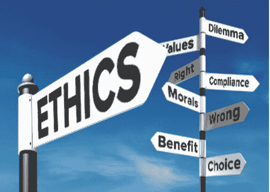

图 5.1：伦理的不同方面。

来源：https://upload.wikimedia.org/wikipedia/commons/7/7e/Business_ethics.jpg

IE是一个如此全面的主题，以至于它还涵盖了一门学科，该学科涉及评估人类行为、其价值观以及他们做出选择的方式（无论这些选择是理性的还是非理性的），而不仅仅是遵循与哲学和伦理学相关的原则。IE还与信息的其他维度相关，涉及互联网、生物学、政治、商业以及信息系统、媒体和医学的伦理。

在IE中，涉及不同类型的研究，其性质可能是规范性的、描述性的、一般性的、分析性的、应用性的或特殊的。每个专业人员（尤其是科学家）都有义务履行其道德责任，这些责任应遵循所需的职业准则。IE的主要分支包括：

- 代理人的IE；
- 用户的IE；以及
- 制作者的IE。

如上所述，任何专业人员都需要遵循的一些职业准则包括：

- IFLA、ALA、ACM的道德准则；
- ASIST和ALISE的法规；以及
- UNESCO的道德准则。

要深入了解信息伦理（IE），过去十年中举办的多次会议大多由UNESCO赞助，信息社会世界峰会也同样关注信息伦理问题。信息伦理的主要关切与信息制作者、使用者以及信息专业人员的道德责任相关。这是因为，借助技术，这两个角色可以轻易互换其角色和责任。关于人类信息行为的新知识使得构建信息伦理理论框架如今同样重要。

如弗罗利希（Froelich）在2004年所指出，除了角色和责任之外，还有其他与信息伦理相关的维度，即：信息使用伦理、信息系统与技术伦理，以及信息社会与信息策略伦理。基于这些维度，一些研究人员认为，信息是一门有助于为信息工作中不同价值方面的互联互通创建结构良好的框架的学科。

正是信息伦理有助于理解道德价值的重要性及其关键性。此处的道德价值是指个人为任何目的所使用的信息。信息伦理有助于评估和解释与信息相关的伦理问题。对信息科学中信息伦理理论与实际应用方法的调查研究，着眼于人类信息行为和信息生态的背景。

需要理解关于社会哲学方法以及不同系统和技术方法的分析。因此，下文将根据不同因素和价值分析，解释信息伦理分类的不同新颖方面。重点在于理论与实践研究，以研究借助信息伦理协助发展环境的新模型。

首先，分析了采用特定方法进行系统设计所涉及伦理的若干含义。其次，依次介绍了所描述的重要伦理问题。本章最后介绍了专业道德准则，以及采用伦理方法进行系统设计与开发的基础。

网络伦理主要关注与网络空间或互联网相关的伦理问题。该领域的主题包括人工智能（AI）、专家系统以及机器人的能力。

## 5.2. 信息伦理框架的定义

### 5.2.1. 定义

信息伦理被定义为产生数据、生成信息并传播知识的若干领域的伦理。这些领域包括图书馆与信息科学、教育、技术、审查、隐私、研究评审等。该信息伦理定义由罗伯特·豪普特曼提出，他是自1992年起出版的《信息伦理杂志》的编辑。

### 5.2.2. 信息伦理的重要方面

在定义信息伦理时，需要考虑两个重要特征，即：

- 信息；以及
- 伦理。

信息是指各种情境下的信息行为、信息系统以及一般信息。伦理是指与信息相关的道德与伦理价值。然而，需要理解这两方面框架的规范，以便它们能够规范这些方面对现实生活案例内容和具体化的影响方式。

为了在一个所需框架中获得对信息伦理的普遍方法，应当恰当认识与信息科学相关的理论，研究人员还应审视这些理论如何表征信息。解决这一问题的一种方法是识别伦理与信息之间不同层次的相互作用（个人、群体、组织、社会）。

信息被定义为一个框架，当个人试图从某事物中获得意义时，该框架将信息环境的认知、生物、社会、物理和技术组成部分整合在一起。信息是在具体的现实生活信息行为实例中被社会建构的。

每条信息都有其自身的背景，背景是一种创造出来并对该情境或相关情境或事件具有意义的环境或状况。由于背景是动态的，它取决于个人特征、社会环境和信息空间。

定义信息伦理有两种不同的方法，即：

- 微观伦理；以及
- 宏观伦理。

不同的研究人员将作为实践中应用伦理的道德与作为道德实践的道德加以区分。一方面存在理论反思，另一方面存在具体的信息行为和信息系统，两者之间存在区别。

然而，需要采用跨学科方法，融合信息科学、哲学、新媒体研究等不同分支，因为仅凭研究单一领域难以理解这个过于复杂的主题。

### 5.2.3. 微观伦理方法

根据微观伦理的定义，信息伦理是人类信息行为不可或缺的一部分，且存在若干通过信息行为所体现的与信息伦理相关的因素和背景。

微观伦理将信息伦理定义为一种过程，该过程包含人类信息利用活动的多个阶段，并按人类对信息环境的适应进行分类。调节信息伦理的因素包括人类、不同的数据来源，以及利用信息和生产信息所制成的各种产品。

借助背景，可以轻松总结信息环境中的信息所有权、信息授权使用以及信息活动。

### 5.2.4. 宏观伦理方法

宏观伦理方法更倾向于应用伦理规范。这有助于深入挖掘基于社会和全球层面的信息。在全球层面，信息伦理呈现为信息生态的形态。宏观伦理框架处理与信息社会相关的问题，特别是其数字鸿沟、环境伦理（人类作为信息环境的一部分）以及信息生命周期的生态方法。

这是一个社会框架，用于信息使用的道德价值以及社会与技术之间的互联互通。在此制定了探究信息存在的共同话语，并审查了信息环境中信息对象与人类共存的问题。

微观伦理和宏观伦理方法能够定义基于信息行为的信息伦理领域这一理念。信息伦理是一种信息行为，由创建者、使用者和信息专家实践，其中存在一种基于信息利用领域选择与问题解决的价值体系。

## 5.3. 信息伦理的理论方法

信息伦理既在理论层面也在应用信息伦理层面进行考察。在过去二十年的信息科学方法中，信息科学由知识自由、言论和新闻自由以及信息自由获取（特别是在电子环境中）的概念所主导。信息科学的理论方法能够区分信息伦理的社会哲学方法与基于系统的方法。

### 5.3.1. 信息伦理的社会哲学视角

信息伦理的社会哲学视角表明是对一般伦理的研究。信息科学中不同的社会哲学类别包括认识论、本体论和伦理学。在古希腊悲剧中，“帕尔雷西娅”（parrhesia）意为言论自由和对真理的个人奉献。这一概念最近已被纳入关于信息伦理和信息伦理使用的研究中。

在基于网络的电子环境中存在多种新理解，它们表明当使用新媒体时，会表现和产生不同的新型信息行为。卡普罗（Capurro）（2005）。

历史上有一种观点，将伦理学投射为一个会产生不同理论概念的哲学领域。目的论视角将伦理学与有用、合乎逻辑、服务于秩序且有目标的事物联系起来。

神学视角代表规范伦理学，义务论视角强调基本道德命令（源于理性——康德的定言命令），价值论视角基于价值偏好（N. 哈特曼），理性主义视角指为解决实际冲突而达成的社会共识，而功利主义视角由 J. 密尔的哲学代表，强调与实现幸福和实用主义相关的伦理价值。

对 IE 的理解取决于多种文化以及在信息社会形成中发挥作用的文化差异。例如，基于基督教基本教义的西方文化与基于佛教、印度教和伊斯兰教的东方文化在伦理和道德价值方面存在许多差异。

西方传统中关注 IE 的价值，涉及权力的界定以及可访问性、信息可靠性和数据范围等概念。（Capurro, 2005）。

关键在于将信息作为思想自由和真理探求的一部分来使用。这与在使用信息和信息技术来传递信息时的信息行为规范有关。西方方法在理论上指适用于信息使用的普遍理性主义（常为基督教）价值。东方（哲学）方法摒弃普遍的价值表征，转而偏好将人视为环境一部分的道德价值。

卢西亚诺·佛罗迪（2010）提出了与其信息哲学相关的 IE 概念。他主张 IE 是环境伦理的一部分。信息技术和信息系统也通过价值体系融入环境。

根据佛罗迪的观点，IE 包含三个主要要素。它们是：

- 信息作为资源；
- 信息作为产品；以及
- 信息作为目标。

社会主体在信息环境中启动这些关系。L. 佛罗迪的本体论概念将信息价值归属于信息环境中的每个对象。生态控制信息环境的目标是利用信息科学工具（系统、产品、服务、信息组织）在信息环境中培育信息对象并使其繁荣。

从涉及从技术、资源、社区和沟通中提取的学术信息的实证研究中获得的价值发挥着重要作用，为人们的创造力提供了重大支持。

IE 被定义为信息生态学的一个片段，是数据环境中个体代表的信息产品使用意识形态、道德和准则的结合。

相关性分析表明，对专家（认知权威）的信任价值在电子环境中进一步相关性模型中占据主导地位。

### 5.3.2. RPT 模型（资源、目标和产品模型）

这催生了一种名为 RPT 模型（资源、目标和产品模型）的模型。

- **信息作为资源：** 在 IE 中，信息作为宝贵资源的使用。
- **信息作为产品：** 由 IE 生成的信息是将信息作为产品的使用。
- **信息作为目标：** 信息环境受到 IE 的影响。

**信息作为资源的伦理：** 信息作为资源的伦理可以描述为在安全形式下存在或不存在信息资源时所融入的道德价值。道德价值涉及信息资源的可访问性、安全性、可靠性和准确性。重点在于保护匿名性，支持对信息及其资源的公平对待，并评估无私的评价。

**信息作为产品的伦理：** 信息作为产品的伦理可以描述为充当信息生产者的社会主体。生产发生在信息环境的限制和可能性之内。关于创造的责任是最重要的价值，遵守规则（立法）以及抄袭、宣传、广告和虚假信息等问题也是如此。

**信息作为目标的伦理：** 信息作为目标的伦理与对信息环境做出道德判断后产生的影响相关。一个例子可能是：故意干扰信息环境，这还将包括一方不道德或不可接受的活动，例如“黑客攻击”（未经授权访问信息系统）、侵犯隐私和盗版，以及另一方确保私有财产、言论自由、审查、过滤和内容控制。

### 5.3.3. 信息伦理的信息生态学视角

根据佛罗迪在 2010 年的观点，“IE 的生态方法将信息既视为环境和世界的方法，也视为实体。”如果信息环境中的任何对象都可被视为信息对象，那么也可考虑属于生态 IE 的信息整个生命周期的全球视角。

卡普罗和佛罗迪关于 IE 概念提出了一种本体论方法。他们提出了两个概念，即：

- 佛罗迪提出的环境方法；以及
- 卡普罗提出的数字本体论。

这两种模型在构成该分类基础的基本概念上有所不同。

**环境方法：** 将 IE 视为环境模型的观点，认为对象信息所获得的价值与对象的存在之间存在联系。信息对象需要成长；因此，信息圈的污染是 IE 的主要组成部分。

然而，佛罗迪提出的环境模型并不关注 IE 的社会问题，这是一个主要缺点。

**数字本体论：** 数字对象相对于其与周围环境以及各自的社会、跨文化和道德价值的交互作用的 IE 称为数字本体论。IE 与生态、政治、经济和文化领域的原理相关（Capurro, 2005）。

因此，有必要使 IE 适用于涉及数字鸿沟的跨文化性质的问题。它们也可能适用于目睹行为变化以及生活道德价值受信息圈和互联网发展变化影响的场景。

### 5.3.4. 系统和技术视角下的信息伦理

信息社会的 IE 与数字伦理和计算机伦理等相关领域产生的许多概念相关联。数字形式信息的广泛可用性引发了许多关于数字记录和数字信息所有权的具体问题。

与 IE 相关的各个方面被分类为不同类型（Zwass, 2010）。它们是：

- 隐私；
- 准确性；
- 财产；
- 访问。

这些是用于信息系统设计、扩展和利用的基本概念。

人们保护个人生活信息免受未经授权访问的权利称为隐私。隐私被不同的 IE 科学家视为社会科学的一个基本方面（Cibangu, 2012）。

与点击监管相关的问题通常与为了营销目的而滥用信息有关。例如，ACM 道德行为准则众所周知地要求专家将隐私视为一条基本规则，许多行业正在将这些问题视为自我监管的一个方面。正确且准确的数据与收集高标准信息以及维护信息系统的隐私和安全性有关。准确信息必须完全无误，包含所有相关内容和全面信息。

信息占有权通常必须通过遵守法律获得。因此，知识产权是伦理的一个组成部分，因为它涉及个人或组织对创意内容的非法占有。然而，互联网服务的扩张为侵犯这一权利创造了一个诱人的环境。

关于数字产品在多大程度上由个人拥有，存在重大疑问。需要最新的修订和更新的法律与伦理，来对数字产品和信息做出决策。

在信息检索方面，个人、国家和国际层面存在各种差异。

计算机伦理与信息伦理（IE）之间存在信息重叠，主要区别在于：计算机伦理关注与系统设计、系统安全管理、数据完整性和数据纠正相关的信息质量，而信息伦理关注信息安全和数据隐私维护（Froehlich, 2004）。一些伦理困境嵌入于以下问题之中：*谁是数据的所有者、如何规范其使用，以及如何建立对数字服务的信任*。

互联网上有大量称为“网络礼仪”的行为准则摘要，这些准则包括关于尊重、隐私和所有权的规则，用于防止权力滥用、规范不当数据的共享，以及在未使用他人作品的情况下发表自己的作品。

## 5.4. 系统设计的伦理方法

即使在最广泛的层面上，伦理也可以根据整体方法，实施或应用于所提供系统的结构中。然而，这种方法在各自的潜力方面可能会显著不同，以便能够应对与道德或伦理相关的问题。

针对系统增长或发展及其结构的各种常规方法，例如：分析或评估已设计系统的过程，以及各种其他结构化程序或SSADM，SSADM也被称为各国开发中最著名的程序，主要集中在技术性问题上，而非与人相关的问题。

它通常通过将系统开发分解为小任务，来考虑属于相关系统开发或增长的技术各个方面。它涉及各种层级或阶段的描述，例如：需求评估或分析、提供的需求规格说明、技术系统的替代方案、物理设计或结构、可行性、业务系统的各种替代方案以及逻辑设计。

提供的所有层级通常都包含所列步骤的枚举，因此，所有这些步骤都涉及必须执行的某些任务枚举。

在最底层，SSADM包含大约230个任务。在这230个任务中，并非所有任务都在特定实现中执行。阶段定义告知开发者哪些前馈产品将输入下一阶段，以及特定阶段将创建哪些产品。

SSADM致力于描述关于相关系统的三个视角：系统内所有数据项如何从系统中流出，所提供的数据项如何相互关联，以及数据中所有项目如何随时间过渡（Kendall and Kendall, 1999）。

虽然最近构成SSADM的230项任务并未特别关注伦理或道德问题，但可以认识到，SSADM的各种步骤、阶段或任务具有重组的潜力，从而能够协助其做到这一点。

这种方法的替代方案是CATWOE模型，它有助于识别或认识各种客户、转换过程、相应环境、世界观或看法、行为者以及所有者。

由于它明确涵盖了不同人员的角色，因此它可以支持伦理问题，特别是在通过构建伦理冲突网络的情况下（Wood-Harper et al., 1996）。

然后，所提供的方法试图识别或认识谁在做什么、为谁而做、对谁负责、对其做出了哪些期望或假设，以及该过程发生在何种环境中。

与SSADM方法相比，CATWOE方法的局限性完全不同，因为它从不提供如何构建特定系统的信息。此外，它通常假设各种员工和经理通常会公开讨论各自的问题。

所涉及信息的生态基本概念（Davenport and Prusak, 1997）被视为一种新方法，用于所提供系统的开发，该方法从各种个人、实践以及与系统使用相关的机构或组织的概念角度考虑技术。

该方法基于与生态学的类比，例如信息多样性（物种多样性）、信息环境演化（生物演化）、对观察和描述的强调，以及对人和信息行为的关注。对人及其利用信息方式的强调必须优于常规方法；然而，它缺乏Wood-Harper et al. (1996)所描述的对伦理的特别强调。

但是，根据任何与系统结构相关的程序，有一个义务：不仅要关注所有相关个人如何使用所提供的信息，还要关注当前人们如何以错误的方式使用系统或所提供的信息，从而明确或策略性地指明系统的使用方式以及不应如何使用。

**生活质量：** 各种计算机系统通常被预期能改善或提升各自的工作场所，同时也改善相关个人的私人生活。然而，当前系统实际上可能正在恶化工作人员的基本生活质量，具体表现为：
- 增加疲劳、压力、无聊和非人格化；
- 劳动力技能退化。这会降低责任感、控制力以及工作满意度；
- 安全与健康问题，如头痛、眼睛疲劳和重复性劳损（Forester and Morrison, 1994）。

各种个人计算机导致工作流程中出现某些转变。发生的关键转变源于统计软件包的可访问性更高，这些软件包将基本的复杂分析能力呈现在各类人员手中，而这些人员对统计学的了解较少。文字处理系统的普遍使用导致文档作者负责制作最终副本，而不是由秘书人员打字。

特别是，系统不应加剧对最不特权群体的损害，也不应冒风险在已受损的环境中加剧损害。

这无疑被视为所提供软件在道德和伦理方面的一种雄心勃勃的考验，该软件拥有所有现有软件都有能力具备的必要智力、财务、社会、经济和政治影响力，而这种特定的观念基于各种运作设定了限制，例如：在何种距离或以何种方式，它们需要在半影范围内进行扩展，以纳入所有受严重影响的各方。

## 5.5. 计算机伦理作为信息系统的参照话语

与信息及通信技术伦理相关的基本论点，完全取决于对计算机伦理或道德的识别，这可以被视为与道德或伦理以某种方式相关的信息系统（IS）研究的通用论文。

因此，为了对此作出判定，个人需要提供证据，表明计算机伦理的所有理论、方法和主题均已借助信息系统（IS）得到复制。重要的是要考虑，这种关系不是单向的，可以轻易地观察到一种相反的关系，即信息系统作为计算机伦理的参照话语。

作为参照话语，计算机伦理在与伦理相关的信息系统研究中的作用，在探讨所研究主题时会表现为一种更为突出的形式。

在这里，隐私被认为是与信息及通信技术伦理相关的最普遍问题，它在信息系统研究中发挥着更大的作用，因此与伦理或道德完全相关。在这里，它不仅被视为PAPA缩写词中第一个也是最重要的P，

属于梅森；也是各种突出的伦理相关 IS 研究中反复出现的主题。安全与隐私之间具有挑战性的关系也引发了 IS 研究中的反思。

与此同时，IS 中计算技术应用的伦理背景受到大量强调。尽管如此，有人认为计算机伦理与伦理相关的 IS 研究在感兴趣的主题上存在实质性的重叠。

因此，为了对此进行总结，有人可能会提出这样的观点：属于计算机的伦理倾向于在与伦理或道德相关的 IS 研究的各种参考文献的论述中发挥关键作用，因而它们各自感兴趣的大部分重要论述都可以在两者中找到。但这对两者之间关系的性质并未提出一个可靠的论断。

另一种可能性是，将这两条研究流视为对重要社会关切的公共利益的反映。就本文而言，促成此现象的机制细节属于次要问题。

尽管这一转向的基础是由从事计算机伦理的人们所准备的，但强调这一新话语及其与（传统）计算机伦理相比的优势是值得的。下一节详细阐述了这一观点，该节介绍了 ICT 中 RRI 的概念，作为在计算机伦理基础上构建的下一步。

## 5.6. 信息伦理的分类法

根据 Don Fallis (2007)，IE 理论主要分为四类，如下所示（图 5.2）：

- 基于后果的理论；
- 基于伦理的理论；
- 基于责任的理论和基于法律的理论；以及
- 基于美德的理论。

### 图 5.2: 信息伦理的分类法。

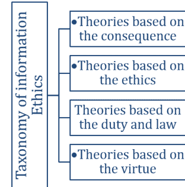

与 IE 相关的若干问题在本质上是概念性的。IE 可以在认知主义的方法论层面上确定，在该层面中，IE 构成了心智认知与建构性发展的一部分；此外，还存在以共享信息空间中的伦理概念建构为主导的社会认知方法，例如来自科学学科的概念。

对不同 IE 概念的这种理解和分析在下表中有所体现。

### 表 5.1: 信息处理过程中的信息伦理概念分类

| 获取信息 | 信息获取、选择、代码、信息正确性验证、后果预测、信息需求——上下文：任务、问题、数字鸿沟、信息匮乏 |
| :--- | :--- |
| 信息使用 | 可访问性、信息自由获取、智力自由、审查、版权、合法使用、商业使用 |
| 知识组织 | 信息准确性、知识结构、可靠性、信息质量、过滤 |
| 社交网络 | 社区、保护、权力结构、权力、责任、操纵、沟通 |
| 信息共享 | 隐私、集体智慧、知识管理、言论自由、保密性、数据保护 |
| 信息生成 | 所有权、责任、规则、智力自由、剽窃、版权、最小努力原则、道德 |
| 在线互动 | 安全、保护、真实性验证、反社会行为：盗版、网络犯罪：网络辱骂、网络挑衅、垃圾信息 |

伦理问题随信息使用与创造性方面的职责和限制而浮现（引用伦理、责任、可靠性、可用性、安全性、信息隐私的准确性），以及信息权利（信息素养、智力自由）。

## 5.7. 全球化与计算机伦理

当今，计算机伦理正在逐步演变为一个更广泛且更具重要性的领域，实际上可能被称为“全球信息伦理”。互联网及万维网等国际网络正在连接全世界的人们。

克日丝蒂娜·戈尔尼亚克-科奇科夫斯卡在其论文《计算机革命与全球伦理问题》中指出，历史上首次，“为制定共同认可的行为标准而努力，以及为推进和捍卫人类价值观而努力，正在真正的全球语境中进行。”

因此，在地球历史上，首次将在不受地理区域限制、也不受特定宗教或文化约束的语境下辩论和转变伦理与价值观。这很可能是历史上最重要的社会发展之一。不妨考虑一些全球性问题：

- **全球法律：** 如果美国的计算机用户希望在互联网上保障其言论自由。全球约有两百个国家通过互联网互联互通；因此，美国宪法在网络上仅仅是一部“地方法律”；它实际上并不适用于世界其他地区。

- **全球网络商业：** 世界已经非常接近拥有能够为国际商业交易提供足够电子隐私和安全性的互联网技术。一旦该技术到位，国际网络商业将出现强劲扩张。

- **全球教育：** 如果向富人和穷人提供低成本的全球信息网络访问——即贫民窟中的贫困人口、“第三世界”的贫困国家等——那么，历史上首次，地球上的几乎每个人都将能够获取来自自由新闻媒体的每日新闻；来自世界各地无数图书馆和博物馆的文本、艺术品和文档；以及各地人民的宗教、政治和社会实践。

这种突然而深刻的“全球教育”对孤立社区、政治独裁、宗教实践、凝聚性文化等将产生何种影响？当世界各大大学开始通过互联网提供学位和知识模块时，“较差”的大学是否会受损甚至被迫倒闭？

## 5.8. 信息伦理的因素与价值原则

存在一种被称为伦理张力的现象，它源于在大量成文和不成文规则以及制度化和个人职业原则的作用下运作的专业人员和信息机构。这可以通过企业界的一个例子来说明，伦理在决定个人在该公司中的未来方面发挥着关键作用。原因在于，这涉及雇主的伦理守则、专业公司的伦理守则、客户对服务提供的压力、个人伦理信念以及伦理和社会规范（Rubin 和 Froelich 2009）。

除了企业界，伦理因素对图书馆与信息学也有巨大影响。这些因素包括社会有用性、生存、社会责任以及对人的人格的尊重。

IE 概念正逐渐成为许多图书馆与信息科学课程中大学教育的一部分，以及美国图书馆协会（ALA）、信息科学与技术协会（ASIST）和图书馆与信息科学教育协会（ALISE）等专业组织的一部分。

## 5.9. 使用和处理信息时的伦理困境示例

IE 的主要示例是引用伦理。这与电子信息的轻松获取、使用或滥用密切相关。因此，学生作品中的剽窃问题受到了更严密的监控，而引用伦理被纳入信息素养课程。

不同的实例包括借助数字科学中新颖的信息利用方法保护知识产权的事宜，这被称为“创意共享”。当与获取知情权和言论自由相关的情况（尤其是涉及信息审查和过滤时）积累的压力导致问题状态时，就会出现这种情况。限制尤其可能适用于恶意信息的传播（这些信息可能不适合儿童阅读，或不宜他们理解）。

信息系统和技术的使用是个人遇到时产生的另一主要关切。例如，数字鸿沟、政府领域的电子信息服务提供、网络犯罪。解决伦理困境的大多数方案取决于既有法规（法律、守则），另一方面也取决于支撑人类信息行为的信息政策和信息素养的形成。

理解与 IE 相关事项的最佳方法是信息生态学（Capurro, 2005; Floridi, 2010）。它现在已成为阐释人、信息与技术之间关系不可或缺的一部分，强调培育信息环境和服务以促进社会知识进步的积极价值。

例如，大众和 YouTube 等公司建立的技术对社会产生了反思性影响，并且继续产生影响。十多年来，YouTube 塑造了人们制作、分享和消费视频内容的方式。同样，很难想象没有大众汽车的世界，因为自 20 世纪初以来，该公司一直是支柱。

事件之所以会对社会产生影响是有原因的。例如，“YouTube 有争议的推荐视频事件”和大众汽车排放丑闻等事件，对社会特别是儿童（家长的主要关切点）产生了持久影响。

为赶工期和销售产品，交付团队可能会忽略旨在消除……的安全性、单元、集成和性能测试。

有问题的 Bug 或其他问题。这正是关于为何在软件交付中，科技公司需要代码伦理以确保其在交付产品时怀有良好意图的心态典范。如同医疗行业中的希波克拉底誓言一样，一套相同的伦理准则可以成为软件行业的解决方案，同时，教导交付团队在考虑新兴创新的影响时如何提出正确问题也至关重要。不同类型组织的伦理问题也可能有所不同，更倾向于个人和组织层面的观点，而非全球性观点。

组织可以采用各种价值观，即承诺、勇气、专注、开放和尊重。它们有助于指导决策并增强团队动态（图 5.3）。

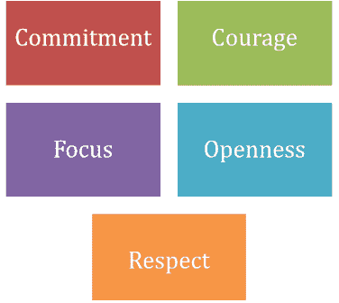

图 5.3：组织的价值观。

- **承诺：** 在信息伦理（IE）的情境下，承诺可以被描述为个人或团队对敏捷方法及其价值所持有的一种信任。通常认为，同一团队中的人们在处理问题时会采用类似的方法，但通过将承诺作为个人、团队和组织层面明确提出，他们都从同一基准线开始。这可能会导致一种情况，即某个团队成员不遵循信息伦理。

- **勇气：** 正是勇气激励个人发言，指出管理层可能影响所产出工作的不道德行为。各种组织通常认为，如果你不说话，错误的决定最终会消失。

重要的是要以一种方式激励人们，使他们在团队内保持透明，这将有助于他们以道德方式实现各自的目标。鼓励团队遵循道德准则不仅仅是领导者的责任，每个人都必须对自己的工作负有这种责任感，并应遵循道德准则来实现目标。

- **专注：** 与独立工作相比，当团队协作处理一小组客户驱动的成果时，效果更佳。因此，公司领导应授权团队在朝着最终产品努力时先处理最重要的任务。在特定时刻专注于一项任务，可确保团队仅将最佳资源用于最终产品的生产，这是任何组织都引以为豪的。

- **开放：** 领导者不仅应鼓励承诺和勇气，还应帮助团队成员之间保持开放。这将建立相互信任，并帮助他们在实现所需目标的同时，以完全积极的态度前进。团队内的开放有助于创造透明度，并为每个人提供空间和机会自行发展技能。“快速失败”一词常用于描述敏捷方法，但实际上是“快速学习”。开放是这一格言的先决条件。

- **尊重：** 首先，公司领导必须尊重团队成员的不同背景、各种技能和经验。尊重团队成员并假设他们怀有理想意图，可以轻易引发可用于解决组织内存在的冲突并提升团队绩效的对话。当人们感到受到尊重，并知道自己的声音被倾听时，他们可以完全支持公司决策，即使该决策并非他们的首选。

## 5.10. 结论

在人们逐渐习惯技术世界进步的时代，保持信息伦理（IE）是一项重大挑战。然而，焦点通常集中在 IE 的理论方面，以及对信息伦理基本社会哲学和系统/技术导向的方法及分类学的识别上。研究人员的主要挑战更倾向于信息行为理论和信息理论的发展。

关于近未来，重要问题一方面涉及知识产权、所有权、剽窃、负面现象和垃圾信息传播的法规；另一方面涉及确保访问平等的问题，例如数字鸿沟和审查。

信息伦理的最新模式已知能够提升对信息行为和信息实践社会与伦理标准的接受度，这有助于在信息特权与责任、惩罚及信息行为规则，以及信息的可接近性、坦率性和可靠性之间找到正确的平衡点。

## 参考文献

- 1. Froehlich, T., (2004). _信息伦理简史_. [online] Bid.ub.edu. Available at: http://bid.ub.edu/13froel2.htm [Accessed 22 Nov. 2018].
- 2. Oldknihovna.nkp.cz., (n.d.). _信息生态语境下的信息伦理 [Jela Steinerová]_. [online] Available at: http://oldknihovna.nkp.cz/knihovna141_suppl/1401024.htm [Accessed 15 Nov. 2018].
- 3. Stahl, B., Eden, G., Jirotka, M., & Coeckelbergh, M., (2014). 从计算机伦理到 ICT 中的负责任研究与创新. _信息与管理_, [online] _51_(6), pp. 810–818. Available at: https://www.sciencedirect.com/science/article/pii/S037872061400007X [Accessed 22 Nov. 2018].
- 4. Stanford.library.sydney.edu.au., (2018). _计算机伦理：基本概念与历史概览（斯坦福哲学百科全书/2006年春季版）_. [online] Available at: https://stanford.library.sydney.edu.au/archives/spr2006/entries/ethics-computer/ [Accessed 22 November 2018].
- 5. Thomson, A., & Schmoldt, D., (2001). _计算机软件设计与开发中的伦理_（第 85–102 页）. [eBook] Elsevier. Available at: https://www.srs.fs.usda.gov/pubs/VT_Publications/01t7.pdf [Accessed 22 Nov. 2018].
- 6. West, D., (2018). _为何科技公司需要软件开发伦理准则_. [online] Entrepreneur. Available at: https://www.entrepreneur.com/article/311410 [Accessed 22 Nov. 2018].
- 7. Floridi, L., (2010). _剑桥信息与计算机伦理手册_（第 3–20 页）. Cambridge: Cambridge University Press
- 8. Capurro, R. (2005). 隐私：一种跨文化视角. _伦理与信息技术_, _7_(1), pp.37-47.
- 9. Rubin, R. and Froehlich, T. (2009). 图书馆与信息科学的伦理方面. _图书馆与信息科学百科全书_, 第三版, pp.1743-1757.
- 10. Fallis, D. (2007). 二十世纪图书馆专业人员的信息伦理. Library Hi Tech, 25(1), pp.23-36.
- 11. Forester, T. and Morrison, P. (1994). *计算机伦理*. Cambridge, Mass.: MIT Press.
- 12. Veatch, R. (1977). *技术标准谬误*. *黑斯廷斯中心报告*, 7(4), p.15.

# 6. 网络冲突与伦理

## 目录

- 6.1. 简介....................................142
- 6.2. 伦理准则...................................146
- 6.3. 网络战......................................147
- 6.4. 联合国安理会行动与网络冲突 ............152
- 6.5 Use of Force and Cyberattack ........................155
- 6.6. 非国家行为体及其在网络战中的增加..........157
- 6.7. 将国际网络攻击作为战争行为回应：相称性................................165
- 6.8. 黑客行动主义的成因..............................166
- 参考文献 ............................................170

“网络冲突”指一国可能有意发起、旨在对其他国家造成损害的行动。建立一个法律框架以规范国家行为，从而维护人道原则至关重要。网络战中存在各种问题，本章将对其进行阐述。ACM 伦理准则是一个广泛的框架，面向 IT 专业人员，使其能够在道德准则的指导下履行职责。有一些工具可用于避免网络战。但人们承认，主动防御很重要，因为它能威慑网络攻击者。国际战争法原则也应适用于网络战争。联合国宪章的作用也至关重要，以最大限度地减少战争威胁，从而避免广泛的附带损害。已制定参数，以评估网络战的影响。随着网络战波及越来越多国家，非国家行为体在网络战中的作用日益增强，这既有利也有弊。这还涉及一些需要考虑的法律方面。相称性法则对网络战至关重要，它规定战斗人员和非战斗人员应明确划分。随着互联网波及越来越多国家，黑客行动主义也在兴起。其影响值得考虑。

## 6.1. 简介

乍一看，大多数网络攻击可以明确地被归类为非法且不道德的。网络攻击还包括为了炫耀和乐趣而实施的攻击。当今世界最常见的网络攻击是网页篡改，这些篡改是“只为了好玩”而进行的，还有几种其他计算机病毒，其后果大多被忽视。

有时，这也是出于不道德的动机，例如系统入侵以提取敏感信息、盗取银行账户；旨在使网络无法供预期用户使用或从受害者那里敲诈钱财的拒绝服务攻击；以及攻击者妥协并部署大量受害者计算机的“僵尸网络”以发送垃圾邮件或放大拒绝服务攻击的攻击。

伦理问题在网络冲突的三个主要领域中备受困扰。第一是网络战，涉及国家为维护国家安全而采取的行动。第一是网络战，涉及国家为维护国家安全而采取的行动。伦理问题所在的第一个领域是

令人困扰的是网络战。

网络战在国家一级进行，经国家安全机构批准。由于网络战安全与国家安全相关，关于执行这些网络攻击提出了若干疑问。这些问题包括，

- 一个国家发起并入侵威胁其政治和领土完整的对手系统是否道德，如果是，则应提出执行这些攻击应遵循的一般规则和指导原则。
- 为国家提供军事功能和民用功能的电力部门和电信部门，如何通过这种网络战遭到攻击。
- 另一个被提出的重要问题是，一个国家如何应对由另一个国家实施的网络攻击。
- 一个国家是否有可能攻击第三个国家，该第三国的计算机网络已被攻破或利用，以便协助发动攻击？

第二个面临伦理困境的领域涉及出于某种社会事业或政党利益而实施的行为。“黑客行动主义”是为此类冲突领域创造的术语，因为它标志着黑客行为与行动主义的融合。

如果攻击是出于对平民造成重大伤害和引发广泛恐慌的动机而策划的，则被称为“网络恐怖主义。”这是一个用来表示网络攻击与恐怖主义汇合的术语。网络恐怖主义可以明确地被标记为卑鄙和不道德；然而，黑客行动主义引发了伦理困境。例如：当黑客攻击一个主要用于交易儿童色情内容的网站时，或支持恐怖主义行动或攻击被盗信用卡号码交易的网络攻击，这种网络攻击是否可以被视为道德？

抗议政府制定的做法和政策的黑客行动主义者，通过篡改网站或进行网页“静坐”来实施的方式。黑客行动主义者有权攻击易受攻击的系统，以披露安全漏洞，进而旨在使互联网更加安全。

第三个遇到伦理困境的领域是网络防御伦理，具体称为“反击”、“主动响应”或“反黑。”网络防御的第三个领域还展示了系统管理员（受害者）如何应对和回应攻击，并了解攻击是否来自可能本身就是攻击受害者的系统。由于大多数网络攻击是通过被攻破机器的链条进行的，受害者能否沿着链条“反黑”以确定源头？

但是，本章并不探索上述问题的答案，而是详细介绍了网络冲突各个领域中的各种伦理问题，并创建一个框架，以便有效地解决所有问题。

借助示例，已经解释了原则；但是，这里的目的不是得出最终的道德结论。这需要对具体的网络攻击进行更详细的审查，并考虑动机和背景。

此处提出的框架基于武装冲突国际法。该法旨在承认和补救武装攻击威胁及主要使用武装力量的行为。然而，已有一些努力将其在网络冲突领域中的相关性。为了更好地理解框架，该法已被分为两部分：

- 诉诸战争法，或冲突管理法；及
- 交战法，或战争法。

尽管被表述为“法律”，但该法的两个部分更多地详细说明了网络冲突中的伦理行为，因为这些伦理行为充当法律规则。

伦理学是一门提供什么是对的、什么是错的指导的研究领域，它规范个人的行为并帮助采取道德立场。伦理学主要考察一个国家社会结构、政策、法律和人类行为的道德性。伦理学家的主要工作是通过参考试图保留和捕捉关于对与错的道德直觉的伦理原则或理论来证明其道德判断的合理性。最常见的理论方法有两种，即：

- 后果论；及
- 道义论。

根据后果论方法，导致不良后果的行为可以被认为是错误。而道义论方法认为，个人的道德义务必须独立于其行为的后果（无论好坏）来看待。

大多数情况下，伦理原则与法律相互关联。但发现，法律不可能作为道德的替代品。正因如此，个人和公司始终需要考虑其行为的合法性，同时也要考虑其道德性。信息技术（IT）领域隐私和安全问题的伦理分析主要发生在20世纪80年代末出现的计算机伦理中。

道德或伦理分析应被纳入，以解决这些伦理问题和疑问：旨在研究为什么某些问题可以被视为在道德上正确或在道德上错误并解决相同问题，以及做出这些判断背后的理由观点的分析。道德分析的目的是提供清晰的知识，并在多种权利、利益、价值观之间取得平衡。道德分析还应帮助评估那些处于风险中的价值观的政策和行动方案（图 6.1）。

**图 6.1：** 网络攻击及其威胁已接管IT行业。

Source: https://cdn.pixabay.com/photo/2017/10/14/17/32/cyber-security-2851201_960_720.jpg

## 6.2. 伦理守则

对伦理守则的研究能够增强更广泛的社会意识，即“不造成伤害”，并提高工作质量，从而减少危险后果。伦理守则可以在两个类别下详细研究，即：

- 计算机协会（ACM）；及
- 电气和电子工程师学会（IEEE）。

> 根据兰多2008年的观点，“ACM会员在履行工作职责时应考虑公众的健康、隐私和整体福祉。ACM会员在处理涉及个人数据时，应始终考虑个人隐私问题，并寻求以下目标：最大限度地减少数据收集；限制对数据的授权访问；为数据提供适当的安全保护；确定数据的必要保留期限；确保数据的适当处置。”

IT专业人员认证学会（ICCP）有IT专业人员必须遵守的伦理守则。该守则强调拥有高标准技能和知识的重要性，要求保持保密性，并且IT专业人员会认识到公众对行为准则和既定做法的依赖。

IT专业人员协会（AITP）成员必须遵守的伦理守则如下：

- 促进管理层对信息处理的理解；
- 避免不诚实的做法，并以尊严行事；
- 尽其所能分享IT知识；
- 保持保密性；
- 基于在教育机构获得的伦理和道德原则行事；
- 对雇主忠诚并维护其利益；及
- 珍视其国家及其生活方式。

上述七项价值观是伦理守则的核心概念，包括正义、效用、对个人的尊重、一致性、所有人的自主性、正直和能力。

## 6.3. 网络战

全球范围内重大网络攻击事件的发生，常常促使各国政府将责任推诿给其他政府。关于网络战爆发的猜测屡见不鲜。正如《牛津英语词典》所定义：“利用计算机技术破坏国家或组织的活动，尤其是为战略或军事目的而故意攻击信息系统。”

上述定义的意义在于，网络战的目的并非利用计算机技术攻击邻国，而是指针对国内银行或任何利用计算机系统作为手段发动威胁的其他行动。

网络战面临的最大挑战在于难以查明攻击的实施者是谁。一些最新技术和情报可以揭示可能承担责任的国家或团体，但通过巧妙运用技术，很容易隐藏身份、掩盖黑客攻击的来源路径，以及掩盖恶意软件感染和其他所采用的手段。

许多自由职业团体和黑客受情报机构和军事行动的招募，代表他们攻击目标。这使得受害者更难以识别实施者，以便对其犯罪行为给予应当的惩罚（图 6.2）。

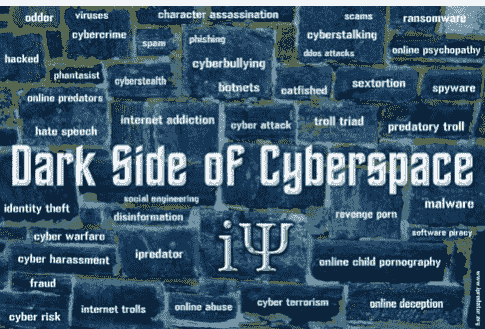

图 6.2：网络战：网络空间的黑暗面。

来源：https://c1.staticflickr.com/3/2911/33509637200_2834019633_b.jpg

### 6.3.1. 避免网络战的工具

应对网络战所使用的武器，与世界各地刑事攻击中主要使用的武器相同。因此，存在用于发动拒绝服务攻击的 DDoS 僵尸网络，这类攻击可以中断，甚至使战略服务器无法使用。DDoS 通常作为各种数据犯罪的资源，用于在网络中为其他活动制造烟幕。社交工程和鱼叉式网络钓鱼攻击也被武器化，以将攻击者引入对手的系统。内部威胁是网络战武器库中非常重要的武器，安插内鬼泄露信息亦是如此。

通过示例更好地阐释网络安全问题和挑战，以说明手头的主题。然而，在国家赞助的攻击情况下，这并不容易，因为如上所述，攻击无法指向特定个人。还有其他几个示例可被归类为网络战细节，并说明将在下文中研究的攻击类型。

最明显的网络战是 Stuxnet，最初于 2010 年被发现。Stuxnet 网络战主要涉及以色列和美国使用一种复杂的蠕虫，摧毁伊朗的核离心机，从而推迟其核武器发展计划的进度。

俄罗斯的情况可以作为一个例子。该国长期被怀疑实施了多次国家级网络攻击。它正面临着对乌克兰增加网络攻击的指控。据称，它使用了 BlackEnergy 攻击，导致该国 2015 年 7 万户家庭停电，还使用了 Not Petya 恶意软件，该软件实际上纯粹旨在破坏其感染的系统，但却伪装成勒索软件。

头条新闻中最受关注的话题是朝鲜的核姿态及其与美国动荡的外交关系，这还包括其在网络空间中的积极参与。根据研究，“朝鲜国家与代号为 HIDDEN COBRA（又名 Lazarus Group）的多产且危险的黑客组织有关联。2014 年索尼黑客攻击和 2016 年孟加拉银行黑客攻击都被归咎于这些黑客。”

### 6.3.2. 开战法与网络冲突

一个有争议的问题是：国家在何时可以采取自卫措施来应对网络攻击？战争法有明确定义，包含广泛接受的原则。然而，这些原则的应用是一个挑战。大部分战争法是为了应对传统战争方法而制定的；因此，其原则不能在所有场景中都适用于网络攻击。

在审视武装攻击的范式中，与其他网络攻击相比，攻击范围和攻击者的识别相对容易。通常，国家在网络攻击进行中很难评估其性质，并且更难以识别攻击的责任人，这导致各国不敢出于自卫对这些攻击做出反应，以免违反战争法。这种对攻击不做反应的疏忽态度，使得网络战成为国际法中的关键议题之一。

本章的核心在于发现网络攻击对战争法带来的独特挑战，并为读者提供处理这些挑战的分析框架。在充分探讨战争法的现状之后，本章将证明，各国根据国际法有权：

- 将网络攻击视为战争行为，而不仅仅是刑事问题。

- 对被认定发起网络攻击的国家，使用针对计算机网络的主动和被动防御机制。此外，各国有责任应对其境内的攻击，即使存在被动参与，也将被追究责任。

本章的关键目的是深入理解战争法。本章主要处理网络战的技术方面，并展示了每个国家作为这些网络攻击自卫手段的法律机构的存在。

以下是美国国防部总结的战争法七项原则；（DoD OGC）

- **战斗人员与非战斗人员的区分：** 使用武力的专属权利属于国家的武装部队，他们不得掩盖身份，躲在平民或民用财产后面；

- **军事必要性：** 网络攻击的目标应直接有助于战争努力或产生军事优势；

- **比例原则：** 在对合法军事目标发动攻击时，如果对平民和平民财产的附带损害不可避免，则预期的军事优势应与损害成比例；

- **非区分性武器：** 避免使用无法精确瞄准的武器。非区分性武器的一个例子是细菌武器；

- **不必要的伤害：** 避免使用可能导致不可挽回损失和致命伤害的武器；

- **背信弃义：** 受保护的标志既不得用于使军事目标免受攻击，也不得假装投降或发布虚假停火报告；以及

- **中立：** 如果国家不协助任何一方，则享有免受攻击的豁免权；否则，它们将成为合法目标。

在上述七项原则中，前三项原则涉及仅由军队执行的战争，该攻击的主要目标应为军事目标而非平民目标，无论攻击性质是网络攻击还是动能攻击。

只有在网络攻击不造成对平民财产和非战斗人员的不相称和冗余的附带损害的情况下，才允许对金融系统、平民能源分配、交通运输和电信等关键基础设施发动网络攻击。

### 6.3.3. 提案与防御

主动防御对于使国家网络防御措施有效至关重要。它还起到警示和威慑网络攻击的作用，因为攻击者不希望面对反击。为了使用主动防御，国家在实施防御性攻击前应确保拥有法律授权，这源于长期存在的一项义务，即国家有责任防止非国家行为体利用其领土实施跨境攻击。

传统上，国家的义务是阻止其事先知晓的非法活动。然而，在国际恐怖主义的背景下，这一义务已经演变，现在各国也有义务对过去有非法行为记录的团体采取行动。

在网络战爆发的背景下，国家遏制非法活动的职责应被视为一项至关重要的关切，以便制定、执行和颁布有助于减少跨境网络攻击的法律法规。如果国家不着手制定遏制网络攻击所需的措施，美国目前与中国和俄罗斯所面临的局势将继续存在。如果各国被要求制定和执行针对网络攻击的刑法，当前的敌对局势将自行化解，因为：

- 要么美国将违反其职责，而该职责有助于为受害国建立一条宪法渠道，以便在不首先进行归属的情况下，合法地追究其对攻击的责任。如果一个国家持续遭到攻击者的攻击，而该国未能采取适当行动对抗其攻击者，那么该国被视为“庇护国”，允许其他国家对其境内发起的网络攻击采取主动防御。

国际法应提供准则，以确保主动防御的适当使用，因为采用主动防御至关重要。由于各国性质的不可预测性，国际法确保各国以可预测的方式行动非常重要，这使得该国在国际社会中更具可接受性。

国际法为主动防御的适当使用制定严格准则也至关重要，这有助于将对网络攻击的不可预测和不可接受的反应降至最低。战争法非常强大，完全有能力为各国提供所需的信息；有必要对其进行仔细审查以获得指导。

如前所述，战争法分为两个部分，即 jus in bello 和 jus ad bellum，后者也被称为冲突管理法。冲突管理法处理宪法管理，该管理规范了国家从战争向和平的转变。

一般而言，冲突法表明各国在何时可以合法地回应武装冲突。另一种已知的武装冲突法是 jus in bello，它管理武装战争中武力的具体使用。为了决定网络攻击是否应以主动防御进行应对，各国应参考 jus ad bellum，因为 jus ad bellum 定义了超过该阈值的网络攻击必须被视为战争行为的标准。第2(4)条禁止各国“不得以任何方式使用武力或威胁使用武力，侵犯任何国家的领土完整或政治独立，或与联合国宗旨不符。”因此，该条款既禁止主动防御，也禁止各国以侵略性方式使用武力的威胁，并将其视为对国际和平与安全的犯罪。

联合国宪章的保护开始迅速传播，世界各国开始将第2(4)条作为习惯国际法来实施，尽管该法律最初仅制定给其缔约国，这后来导致全世界所有国家都被纳入其中。

《联合国宪章》中仅可援引少数例外情况，各国可以威胁使用主动防御或对另一国家使用武力。这一立场还得到第2(3)条的支持，该条规定各国应“以和平手段解决其国际争端，方式不得危及国际和平与安全及正义。”

## 6.4. 联合国安理会行动与网络冲突

在网络冲突期间，每个国家都必须遵守某些例外情况。联合国安理会授权的行动是对使用武力普遍禁止的首要例外。

为了恢复和维护全球和平与安全，安理会可以使用《联合国宪章》第42条，该条主要通过一个国家的军队来执行。但是，除非安理会满足第39、41和42条的条件，否则安理会不被授予根据《联合国宪章》使用军队的权力。

在安理会批准使用武力之前，必须首先审查第39条。第39条要求存在“对和平的威胁、和平的破裂或侵略行为”，这由安理会认定。只有在满足上述标准时，安理会才有权力启动恢复全球和平与安全，这应符合《联合国宪章》第41条和第42条。

第41条提供了关于使用非军事措施的指导，是宪章恢复国际和平与安全的首选方法。根据该条款，安理会有权管理一个国家使用非军事措施，以强制侵略国停止其侵略行为。联合国会员国负责实施非军事措施，其中包括“完全或部分中断经济关系、其他通信手段，以及断绝外交关系。”

当第41条规定的措施未奏效或预计不会成功时，安理会可以批准第42条项下的军事措施。虽然第41条授权安理会实施非军事力量的使用，但一个国家不能被迫援引第42条采取军事行动，安理会只能授权其这样做。

如前所述，在正常情况下禁止使用武力。然而，这一限制的另一个例外是当需要使用武力进行自卫时。《联合国宪章》第51条赋予这一权利。该条断言，“本宪章任何内容均不得损害[各国进行]个别或集体自卫的固有权利”以回应“武装攻击。”在《联合国宪章》之前，自卫就被视为一种正义行为，这一事实在第51条中也有所体现。

《联合国宪章》也在习惯国际法下认可了这一权利。自卫的基本原则是，生存权对所有国家都至关重要，各国可以使用武力保护自身及其公民。

这一权利独立于《联合国宪章》。因此，自卫分析借鉴了习惯国际法的原则和第51条的规定。

自卫原则的实质在于，面对武装攻击威胁时可以采取自卫。尽管该原则被国际法接受和承认，但什么构成武装攻击的问题尚未解决。这种缺乏清晰度的情况导致了关于在什么情况下国家有权根据自卫权进行报复的讨论。

及时援引自卫权至关重要，因此需要解决什么可以被称为武装攻击的争议。在网络攻击的情况下，与传统战争武器不同，可能存在多种解释。因此，关于什么可以被归类为武装攻击的争论变得更加突出。由于法律学者对《联合国宪章》与习惯国际法之间相互作用存在相互竞争的理论，自卫分析变得更加复杂。一些学者支持《联合国宪章》。他们的论点是，第51条对自卫权施加了限制，因为它仅允许针对实际武装行为作出回应。而另一些学者则强调习惯国际法。

他们的论点是，各国有权采取主动措施，并对即将发生的武装攻击进行报复。即将发生的武装攻击问题将在后文讨论。这里的重要点是，尽管不同的哲学提出了关于武装攻击的各种描述，但有一个共同的共识：一旦一个国家遭到另一个国家的武装部队攻击，受害国及其盟友就有法律权力对肇事者使用武力。

自卫所采用的方法必须遵守国际法。武装攻击并不会自动授权受害国对肇事者发动不受限制的战争。只有在必要且无法避免时，才应采取自卫，因为在当前情况下，替代性的和平方法已被证明无效。自卫应与武装攻击成比例。自卫行动应限制在被认为必要的武力范围内，以挫败任何推进或终止正在进行的攻击。

这一原则绝不意味着防御的规模和程度应与攻击相当。在自卫中，如果需要威慑攻击者，一个国家可以使用规模更大的武力。这里的主要考虑是确定武力的数量，以应对当前的敌对局势或防止未来的攻击发生。上述原则规定了回应必须遵守的边界。

《联合国宪章》规定，只有在迫于自卫或在安理会（第39条）主持下，一个国家才能对另一个国家使用武力。《宪章》成功地确立了一项道德原则，即国家可以在什么正当理由下攻击另一个国家，这一原则已得到普遍接受。各国仅被授权保护自己免受暴力威胁或实际侵略。

它们没有权利无端发起攻击。使用武力只能作为针对侵略的防御机制被允许。将这些道德和法律原则应用于网络战只是

在合理地得出结论认为网络攻击已使用武力之后才有可能。如果被归类为武装攻击，则将受联合国宪章管辖。国家层面的网络攻击随后将被视为自卫行为，在道德上是正当的。但如果它们不被归类为一种武力形式，则关于其使用的道德问题非常不明确，更接近“较软”的胁迫形式（如贸易限制和断绝外交关系）所引发的问题。

## 6.5. 使用武力与网络攻击

世界各地的网络攻击并不相同。造成一小时停电的网络攻击，其影响比导致飞机因空中交通信号被干扰而坠毁的攻击要轻。因此，有必要建立一个评估特定攻击或攻击类别的框架，以得出使用武装力量是否合理的结论。

1999年，德国乔治·C·马歇尔欧洲安全研究中心国际法教授、高级安全研究计划主任迈克尔·施密特（Michael Schmitt）提出了七项原则，用以区分使用武力的行动与外交、经济及其他软性措施。

当这七项标准合并为单一标准时，与使用武力相类似的高端和与软性措施相类似的低端，就是后果的关键谱系。这七项标准的描述基于国际法冲突两位作者托马斯·温菲尔德（Thomas Wingfield）和施密特的工作。

- **严重性:** 它是指对生命和财产造成的损害。它表示武装攻击会导致广泛灾难、人员伤亡和财产损失，而软性措施不会产生此类后果。

- **即时性:** 它是指攻击效果被感知所需的时间。通常，使用武装力量的效果是即时的，往往在几秒或几分钟内，而在较软措施（如实施禁令）的情况下，后果往往要过几周或几个月才会显现。

- **直接性:** 操作与操作效果之间的关联称为直接性。通常，武装攻击的效果由武力的使用引起并可归因于此，而对于较软措施，则可能有多种解释。

- **入侵性:** 涉及物理跨境进入目标国家的武装攻击被称为入侵性。与此同时，较软措施是在赞助国境内实施的。

- **可衡量性:** 这指的是量化操作效果的能力。其依据是，武装攻击的影响比较容易测量，如死亡人数、财富受损价值等，而较软措施（例如贸易限制）则不然。

- **推定合法性:** 推定合法性是指在国际社会对一项操作是否真实有效的验证。而使用武装力量通常在缺乏自卫等正当理由的情况下属于非法，而使用软性措施通常在没有被禁止的情况下是合法的。

- **责任:** 责任是指行动后果可归因于国家而非其他行为体的程度。在使用武装力量的情况下，国家可以被直接追究责任，因为这是国家的专属领域，因此可直接归因于它；而非国家行为体则能够参与此类宣传和抵制等软性活动。

让我们举一个例子来了解这些标准如何应用于网络攻击。对空中交通控制的网络入侵导致两架大型飞机进入同一空域并相撞。坠机造成的影响是毁灭性的，导致这两架飞机上500人丧生。

责任程度属于中等至较高。从理论上讲，任何人都可能犯下此罪。但大多数黑客不具备所需的技能和信息。只有国家才能拥有此类资源。综上所述，即时性、直接性、推定合法性、可衡量性和合法性等五项标准排名较高，而责任和入侵性等两项标准至少属于中等。因此，显然，这次攻击并非软性措施或合法的胁迫形式，而是一种更严重的武力运用。

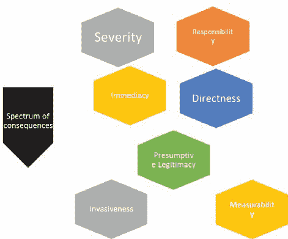

图 6.3：后果谱系。

## 6.6. 非国家行为体及其在网络战中的增加

世界各国的武装部队和情报机构已认识到，随着网络战开始在越来越多国家蔓延，迅速获得军事网络空间行动能力的紧迫性。2013年，美国国防部批准对其网军司令部进行大规模扩编。

因此，其规模扩大了五倍，达到近5000名军人和文职人员。对于发达国家来说，优先事项是构建防御能力，保护易受攻击的数字资源，例如指挥与控制系统。而发展中国家可能将网络空间行动视为一种作战打击技术，原因是这是一种相对低成本的方法，而且从政治角度看，对抗拥有动力战场优势的对手开战的风险较低。

网络战预计将涉及大量方法。其中可能包括破坏关键基础设施、造成人员重伤和生命损失、具有破坏性的心理技术。其他方法包括制造混乱，从而导致信息战，并在对手中制造不确定性。网络攻击的特点在于，它可以从远距离打击战略目标和战术目标。此外，所涉及的技术成本也较低。

然而，使用网络攻击的缺点是显著的。其弊端在于缺乏对附带损害程度及其在目标过程中价值计算的控制，而在常规战争中，相关数据更容易获得。网络空间本质上高度复杂且相互依存。

这使得难以评估，该空间内的攻击不仅会导致军事网络中断，还会对平民、非战斗人员，甚至可能是发动攻击的本人造成附带损害。因此，必须将政治风险纳入考虑，而且这种风险通常较高。意想不到的后果可能导致冲突升级，使事业在国际社会面前显得不那么合法，遭到本国民众的负面反应，并增强受攻击国家的抵抗。这些缺点将阻止国家使用网络攻击。

### 6.6.1. 参与网络战的行为体

表 6.1：网络冲突中的主要非国家行为体

| 行为体 | 动机 | 目标 | 方法 |
|---|---|---|---|
| 普通公民 | 无（或微弱） | 任意 | 间接 |
| 脚本小子 | 好奇、刺激、自我 | 个人、公司、政府 | 事先编写的脚本和工具 |
| 黑客行动主义者 | 政治或社会变革 | 决策者或无辜受害者 | 通过网页篡改或DDoS攻击进行抗议 |
| 黑帽黑客 | 自我、个人敌意、经济利益 | 任意 | 恶意软件、病毒、漏洞利用 |
| 白帽黑客 | 理想主义、创造力、尊重法律 | 任意 | 渗透测试、修补 |
| 灰帽黑客 | 模糊不清 | 任意 | 各不相同 |
| 爱国黑客 | 爱国主义 | 本国国家的对手 | DDoS攻击、网页篡改 |
| 网络内部人员 | 财务收益、报复、不满 | 雇主 | 社会工程、后门、操纵 |
| 网络恐怖分子 | 政治或社会变革 | 无辜受害者 | 基于计算机的暴力或破坏 |
| 恶意软件作者 | 经济收益、自我、个人敌意 | 任意 | 漏洞利用 |
| 网络诈骗者 | 财务收益 | 个人、小型公司 | 社会工程 |
| 有组织网络犯罪分子 | 财务收益 | 个人、公司 | 用于欺诈的恶意软件、身份盗窃、用于敲诈的DDoS |
| 公司 | 财务收益 | 基于ICT的系统和基础设施（私营或公共） | 攻击或影响行动的一系列技术 |
| 网络间谍特工 | 财务和政治收益 | 个人、公司、政府 | 获取信息的一系列技术 |
| 网络民兵 | 爱国主义、专业发展 | 本国国家的对手 | 基于团队能力 |

来源：https://www.researchgate.net/publication/310827486_Non-State_Actors_in_Cyberspace_Operations/download

### 6.6.2. 网络世界中非国家行为体的雇佣

传统作战方法可以归因于某个特定国家。在网络空间中，可以保持匿名性，并且在很大程度上，实施者可以在不面临被曝光风险的情况下进行攻击。在网络世界中雇佣非国家行为体时，各国往往缺乏对网络战具有约束力定义的支持。这种雇佣非国家行为体的做法也倾向于限制采取任何行动或对已执行的网络攻击正式承担责任的自由。

此外，在网络攻击中，资源消耗较少，并且人们相信它可以造成严重的中断，或至少会扰乱基于ICT的服务。

## 表 6.2：在网络空间行动中使用非国家行为体的优势与劣势

| 优势 | 劣势 |
|---|---|
| 抢占主动权 – 出其不意 | 对非国家行为体没有直接控制权 |
| 合理否认可能性 | 意外附带损害的风险 |
| 可选择目标和攻击向量 | 自己的资源成为目标 |
| 攻击规模和持续时间可确定 | 升级为常规战争 |
| 利用法律不确定性 | 被贴上恐怖主义赞助者标签 |
| 代理快速攻击的可能性 | 反弹（敲诈等） |

来源：https://www.researchgate.net/publication/310827486_Non-State_Actors_in_Cyberspace_Operations/download

上述表格概述了网络战中一些重要的“利与弊”，以及非国家行为体在网络空间行动中的应用。

## 使用非国家行为体的优势：

- 对攻击者而言，主要优势在于攻击可以以更安全的方式进行，从而导致巨大的意外或高度的不确定性。由于攻击者处于发起攻击的地位，防御者剩下的选择只能是应对这些攻击，而这些攻击大多已被攻击者预料到。

- 攻击者拥有时间精准性的优势，并能根据自身意愿选择特定目标，使用最合适的攻击方法。攻击者实施攻击无需多少流程或系统，仅需一个计算机系统即可。另一方面，受害者需要多种防护或防御系统才能抵御网络攻击。保护受害者计算机系统所需的防御材料费用极其昂贵。

- 攻击者可以决定攻击方式以及攻击的规模和持续时间，以产生预期影响。攻击责任也可以委托给第三方。这样一来，他们既能放大行为的影响，又不必承担直接归责的风险。

- 即使受害者识别出被告并且攻击可以归咎于肇事者，缺乏适用的相关国际法也是一个可以成功利用的漏洞，用以构建法律模糊性的屏障。

- 攻击者并非唯一应实施攻击的人。攻击可能被外包给有组织的网络犯罪分子、雇佣黑客或网络民兵。招募第三方或非国家行为体往往会增加全球社会的怀疑；然而，缺乏证据将使攻击者免受政治后果的影响。因此，受害者很难对攻击者进行反击。

- 如果雇主招募到之前已确定互联网论坛和社交网络、具备技术胜任力、动机合适并能迅速动员大量人员的非国家行为体，那么开展这些攻击的成本就会降低。

## **使用非国家行为体的弊端：**

- 在网络空间行动中，攻击者可能无法完全控制非国家行为体，尽管他指挥网络攻击中应采用的目标和方法，但对不良行为几乎无法控制，且难以终止正在进行的攻击。

- 攻击可能超出预期的范围和规模。攻击者可能误击未计划的目标并造成意外的附带损害。过于热衷的网络同伙，不受约束军事组织的限制，可能会在不考虑任何可能后果的情况下选择攻击民用目标。

- 如果启用非国家行为体发动攻击，互联网骨干连接等共同基础设施可能会过载，从而对攻击者的网络和资源产生不利影响。

- 如果攻击被转向针对民用系统，攻击者及其国家可能会被指控赞助网络恐怖主义或犯下战争罪，在国际关系方面成为人人喊打的对象。

- 如果攻击被归咎于发起的国家，政治影响将是灾难性的，尽管战争法对网络空间的规定模棱两可。如果事态升级，攻击国可能不得不面临传统手段的战争。

- 尽管非国家行为体发动的即时攻击往往会取得成功，但从长远来看，这些攻击者往往不可靠。这些攻击者随着时间的推移，可能会敲诈公共行政机构，迫使政府官员暴露与国家相关的复杂细节，而受雇的网络间谍如果获得政治庇护，可能会叛逃到敌对国家。

### 6.6.3. 网络世界中与非国家行为体相关的法律问题

网络战必须面对许多法律挑战，尤其是关于当前国家间运作框架的挑战。本章的重点并非深入分析国际法的细微差别和复杂之处。然而，现行立法和国际公约中的当前模糊性确实值得提及，并且需要辨别这种不确定性对国家赞助的网络冲突中雇佣非国家行为体的影响。

如果诉诸网络攻击，即使不被视为违反战争原则，也将违背武装冲突法的精神。甚至其他危害性较小的网络行为也可能被联合国宪章视为战争行为。因此，联合国宪章可能会授权合法的自卫武力使用。

需要牢记的重要一点是，要将某行为归类为网络攻击，该行为应包含暴力或变得暴力的可能性。这种模糊性阻止了将网络空间分类为战斗区域。因此，许多国家如果将战争法不适用于网络战，将符合其利益。

还需要注意的是，网络攻击无法在遵守法律法规的同时进行。在法律框架范围内实施攻击具有挑战性。

然而，如果修订后的网络战议定书获得全球认可，各国可能会考虑通过网络民兵实施网络攻击。这是一个可行的选择，因为网络民兵以承担此类外包工作而闻名。

不幸的是，国际法尚未修订，并且关于网络战地位的规定仍然模棱两可。攻击者似乎占据上风，而受害者则处于被动地位，几乎没有报复手段。

关于实施网络攻击的个人的地位以及他是否能获得合法交战员这一显赫地位，另一个相关问题随之产生。第三次日内瓦公约赋予交战员两种地位，即特权交战员和非特权交战员。

特权交战员被视为参与冲突的武装力量的一部分。他们享有以下特权，

- (I) 服从对其下属负责的上级的命令；
- (ii) 携带即使远处也能辨认的显著标识；
- (iii) 允许公开携带武器而无需隐藏；
- (iv) 必须在战争法的规定下开展行动。

大多数非国家行为体，如黑客、罪犯和恐怖分子，显然并不严格遵守这一范畴。一种观点认为，当国家赞助网络攻击者或网络间谍人员时，这些人员服从对其行为负责的上级命令。然而，很明显这些团体不佩戴可识别的固定显著标志，也不公开携带武器。此外，他们的许多活动可以被归类为违反战争法和习俗。

即使是正规军事网络部队，也可能无法满足日内瓦公约规定的要求。此外，参与网络战对他们可能不利，因为授予他们的特权交战员地位可能被撤销。武装部队成员可以穿着制服实施网络攻击，但受害者看不见。几乎不可能公开携带武器，因为大多数网络攻击即使被曝光也无法追溯到其原始来源。

交战员不应违反战争法或从事违反战争法的行为。例如，造成平民伤亡等行为将剥夺攻击者的特殊交战员地位。这在至少在纸面上限制了使用商业基础设施进行网络攻击。虽然特权交战员应享有与战俘同等的待遇，但非特权交战员可能会被拘留国根据其民事法律进行审判并受到同样的惩罚。

攻击者可能并不总是遵守战争法，以获取特权战斗人员身份。他们可能不会受到鼓励这样做，因为他们落入敌手的可能性不大。情况确实如此，因为受害者不知道发起攻击的战斗人员的身份。这种情况可与使用远程武器发动的攻击相比，例如无人驾驶航空器（UAV）和洲际弹道导弹（ICBM），因为在后者的情况下，攻击同样难以追踪。然而，这些武器并不十分隐蔽，可能会透露发动攻击的国家身份。但在网络武器的情况下，匿名性几乎可以确定。

即使可以将外包攻击的非国家行为体追溯到煽动国，这种联系也不能依据法律地位使攻击者成为战斗人员。我们可以以俄罗斯和格鲁吉亚之间的网络冲突为例。在2008年8月进行的这些攻击中，证据指向网站“StopGeorgia.ru”，该网站发布了针对格鲁吉亚、指向克里姆林宫的指令。

俄罗斯情报部门（GRU）和青年协会“Nashi”是下达命令所使用的媒介。这引发了怀疑，即俄罗斯政府将任务外包给非国家“黑客活动家”以实现其目标。即使考虑到个别黑客活动家可能受到某一国家支持，他们也不能获得战斗人员的法律地位。他们仍会被视为网络罪犯。

综合考虑，俄罗斯与格鲁吉亚之间的冲突展示了实施低影响网络攻击的实用模式。政府可以在不承认攻击是国家赞助的证据的情况下，实现至少部分战术目标。之所以可能，是因为煽动国通过非正式渠道聘用了爱国黑客或网络民兵，诉诸民族主义热情。

网络战争的实际性质以及参与这些活动的行为体的地位是模糊的，并且通过在媒体和文学作品中使用晦涩术语而被严密守护。政客们也夸大这些术语，留下一种持久印象，即这些概念在其本质上是独特的。网络战争缺乏坚实的经验数据集，并需要可应用于战争艺术的技术进步。

承认网络空间中各种非国家行为体的存在及其在国家赞助的网络攻击中的作用很重要。这些行为体之间可能没有明确的区分。区分脚本小子、网络罪犯和网络间谍人员，或网络民兵与爱国黑客将会很困难，因为这种区分是模糊不清的。同样，个别行为体可以开展多种活动。尽管如此，为了分析目的，区分行为体很重要。

在未来几年，随着互联网在亚洲和非洲发展中国家普及，由于这些可能在网络空间中利用的不对称优势，该领域很可能会获得更多关注。这些国家的关键基础设施也将在此过程中演变。出于政治动机实施的网络攻击将在规模和事件数量上都更加激烈。此外，这些攻击可能无法与实施者联系起来，因为互联网可以隐藏身份。

全球互联网用户数量的增加，以及国家行为体（如网络骗子和脚本小子）从事的问题性网络活动也将增长。这些用户会因以下原因造成很多困扰：

- 首先，该群体中热衷于滥用网络空间资源以谋取个人动机的用户数量众多。
- 其次，可利用的工具众多，可用于利用安全漏洞。
- 第三，社会不清楚为保障信息安全应采取的措施。

## 6.7. 作为战争行为应对国际网络攻击：比例性

从事战争的国家必须根据区分原则区分战斗人员和非战斗人员。这一原则可以被视为两项相互关联的义务。第一项原则是，平民人口应与其部队明确划分界限。其次，在攻击开始前，上级指挥官不应在平民或民用目标与军事目标之间保持明确的界限。

1949年8月12日《日内瓦公约附加议定书》第57.1条还对某些人（即“计划或决定发动攻击的人”）施加了某些限制。在本章中，他们被称为指挥官。

- 指挥官的首要职责是“切实可行地做好一切工作，核实拟攻击的目标既不是平民也不是民用客体。”
- 指挥官还负责“在选择攻击手段和方法时采取一切可行的预防措施，以避免，并且无论如何都要尽量减少平民生命的附带损失、对平民的伤害以及对民用客体的破坏。”
- 指挥官不应发起任何“预计会造成平民生命附带损失、对平民的伤害、对民用客体的破坏，或上述情况的组合，而这些损失相对于预期的具体和直接的军事优势而言过大”的攻击。

需要注意的是，比例性概念绝不以任何方式限制指挥官造成任何平民死亡或伤害或民用财产破坏。比例性规定，生命和财产的损失不应超过与“构想中的具体和直接军事优势”相比。

如果预计对平民生命造成的损害和对民用财产的破坏将超过此类攻击所预期的军事收益，则比例性原则禁止发动该攻击。为了分析比例性，应将直接的军事优势与对平民生命和财产的破坏进行评估。

## 6.8. 骇客主义的成因

《开战法》规定了国家在正常关系中禁止相互发起的行动，即使用武力的行动。同样，国内法的职责是对非国家行为体可开展的行动施加限制。

美国有关网络攻击的法律载于《美国法典》第18编第1030条（联邦层面）以及各州计算机犯罪法中。

这些法律对大多数网络攻击（如网页篡改、病毒使用、网络入侵等）施加了限制。《开战法》允许各国开展使用武力的行动以进行报复，这些行动否则可能被视为非法。国内法律学说包含自卫概念，允许受害者在其他情况下会被视为非法的情形下使用武力。

网络攻击也可以作为一种自卫机制使用，这一问题将在后文讨论。网络攻击者可以出于政治或社会事由而参与的某些伦理基础。在诸如公民不服从的情况下，黑客主义在伦理上可能是可接受的，即违反法律和政府要求，但通过和平方式进行。公民不服从是表达反对、表明异议并突出那些被视为不道德或不公平的法律、政策和做法的一种手段。

用于公民不服从的方法包括示威、设置路障、非法侵入等。它涉及违反法律，但不一定伴随着不道德行为。并非所有公民不服从运动都可以自动称为道德，但在某些情况下，它们可能会越过那条界限。例如，封锁医院急诊室入口以反对政府的医疗保健政策。

我们可以以电子骚扰剧院（Electronic Disturbance Theater，EDT）为例。EDT主要通过“网络静坐”推广电子公民不服从的应用，这些“网络静坐”被视为实体静坐和封锁的虚拟形式。每次静坐会在特定时间和日期选择一个或多个网站作为目标，并提前在公共论坛上更新。

活动人士必须访问一个网站以加入运动并选择目标。Flood Net（一种Java小程序）将被下载到他们的电脑上，以便目标网站获得一些流量。单个参与者的流量对目标网站影响微乎其微；但是，如果数千名参与者参与，其集体流量可能会在目标网站上造成严重混乱。

EDT主要使用网络静坐来抗议墨西哥和美国政府对恰帕斯产生影响的不利政策。最初，EDT用于表达对墨西哥萨帕塔主义者的团结，但后来他们也为许多其他事业而战。这一想法也得到了其他组织（如总部位于英国的Electro Hippies）的接受。

随着网络静坐日益流行，所使用的软件工具变得更加复杂。所使用的一些软件包括可以预先加载到目标系统中，然后再从参与者系统操作的软件，以及由参与者积极参与即可激活的软件。

确定网络静坐等黑客主义运动的合法性很重要。在这种情况下，可以使用施密特（Schmitt）的标准来评估一个

网络攻击是使用武力，还是采用温和合法的手段？一些合法手段包括写信、公开发声、游说、请愿等。施密特的标准将这些措施在武力使用方面排在较低位置。

由于影响可忽略，不应将其称为严重。此外，衡量其影响是一项挑战，因为其效果不是即时或直接的。它们不涉及任何非法方法。由于实施起来容易，因此其责任程度较低。

大多数网页篡改违反计算机犯罪法规。施密特的标准可用于评估网页篡改。结果显示其在四个标准上得分较高——直接性、推定合法性、可衡量性和直接性。从备份恢复网站很容易；因此其严重性不高。但如果访问者使用了错误的医疗信息、网上银行交易的安全性受到破坏，或拥有该网站的企业声誉受损，损害可能很大。入侵性和责任程度分别可排为中等和低。很少有国家在采用这些方法时声称承担责任。并非所有人都能实施网页篡改；然而，能够这样做的黑客并不缺乏。

可以推断，显然，篡改行为甚至比网络静坐更不合法，并且肯定遭到许多黑客活动者的鄙视。

其他类型的黑客行动也可以通过施密特的标准进行审查。通常，违反计算机犯罪法规的行为被排为中等至高等级。此类网络攻击的例子包括威慑儿童色情网站的行为，以及旨在指出和纠正安全系统漏洞的攻击。尽管最终目标可能是合乎道德的，但所采用的方法可能存在争议。

任何可被归类为网络恐怖主义的行为，即便在最佳情形下也会产生非常严重的后果。根据施密特的标准，不违反刑法的网络攻击被排为低等级。例如，开发新软件并将其用于书信写作运动，或通过突破防火墙创新软件以获取受审查的信息。

至少在美国，这些活动不能被视为违法，也不能与使用武力相比。按施密特标准排在较高等级的网络攻击可能需要更多辩护，但不能称为不道德。需要考虑的一个因素是，是否存在通过法律允许范围内的行动来实现活动人士目标的可能性。评估为抗议 CDA 而进行的篡改案例，可以推断黑客本可以在自己的网站上传达信息，或合法使用另一方的网站。这种方法本会让信息拥有更长的“保质期”。

## REFERENCES

- 1. Arquilla, J., (2012). 冲突、安全与计算机伦理。《信息与计算机伦理剑桥手册》（第 133–148 页）。[在线]。可用于: https://www.cambridge.org/core/books/cambridge-handbook-of-information-and-computer-ethics/conflict-security-and-computer-ethics/4BAA5CC4ACEA0FEBA962A7F2167877AD [访问于 2018 年 11 月 15 日]。

- 2. Brey, P., (2007). 信息安全与隐私的伦理方面。[电子书] 可用于: https://ethicsandtechnology.eu/wp-content/uploads/downloadable-content/Brey_2007_Information_Security.pdf [访问于 2018 年 11 月 15 日]。

- 3. Carr, J., & Sklerov, J. M., (2018). 《网络战内部：将国际网络攻击视为战争行为的应对》。[在线] O’Reilly | Safari. 可用于: https://www.oreilly.com/library/view/inside-cyberwarfare/9781449318475/ch04.html [访问于 2018 年 11 月 15 日]。

- 4. Denning, D., (n.d.). 网络冲突的伦理。《信息与计算机伦理手册》（第 407–428 页）。[在线]。可用于: https://www.researchgate.net/publication/228018156_The_Ethics_of_Cyber_Conflict [访问于 2018 年 11 月 15 日]。

- 5. Morton, O. G., (2013). 网络空间行动、Stuxnet、开战正义与交战正义。[电子书] 可用于: http://www.dtic.mil/dtic/tr/fulltext/u2/1018827.pdf [访问于 2018 年 11 月 15 日]。

- 6. Sigholm, J., (2013). 网络空间行动中的非国家行为体。《军事研究杂志》，[在线] 4(1)，第 1–37 页。可用于: https://www.researchgate.net/publication/310827486_Non-State_Actors_in_Cyberspace_Operations [访问于 2018 年 11 月 15 日]。

- 7. Titiriga, R., (2011). 网络攻击与武装冲突国际法：开战正义视角。

# 7. 自主代理技术

## 目录

- 7.1. 引言，或者：如何现在就为其开展伦理探讨？ .................... 172
- 7.2. 数字时代的伦理：道德规范在哪里？ ............ 175
- 7.3. 自主代理.................................................... 183
- 7.4. 虚拟自主的伦理 ........................................ 189
- 7.5. 自主代理的网络攻击场景 ....................... 192
- 7.6. 法律格局................................................ 197
- 7.7. 结论 ........................................................ 198
- 参考文献 ............................................................. 200

已讨论了与计算机发展相关的不同方面、其改变技术步伐的方式以及其对人类社会生活和隐私的影响。详细讨论了技术创新的必要性以及其对用户隐私和安全构成的威胁。阐述了不同类型的自主代理、其特征、分类及其与所处环境的关系。解释了网络攻击的风险及不同类型的网络攻击。解释了网络犯罪的法律框架及不同法律。

## 7.1. 引言，或者：如何现在就为其开展伦理探讨？

主要方面是理解那些技术：这些技术是使用一组选择制造而成，这些选择源自不断改进以实现成功执行的特定策略，从而产生新技术。在技术方面需要考虑的不同方面包括：不同的算法、代码、不同的拓扑结构、不同的监控系统，以及与自主技术相关的各种方面，连同用于不同自主技术的不同政策和管理机构。

当前世界已完全全球化，网络和关系是至关重要的方面，其基于一组算法，该算法决定消息需要传输多远才能到达网络。根据搜索历史记录和偏好，通过按照多项前提条件筛选不同数据来推荐此距离。数字技术基于理性思维过程和可视化来决定通信类型。

像 2011 年的埃利·帕里瑟（Eli Pariser）以及爱泼斯坦（Epstein）和罗伯逊（Robertson）等知名人士，通过解释搜索引擎操纵效应（2015）等概念并举出多个例子，对这些技术提供了各种描述。因此，所使用的技术并非中立，因为该技术深受世界各地存在的不同意见以及关于不同自主技术的不同理论的影响，而这些理论又受不同用户行为和思维的影响。

近年来出现了许多计算机技术，例如平板电脑、笔记本电脑和智能手机，连同多种新颖软件、应用程序、用户界面以及其他默认设置，它们构成了我们的“选择架构”（Thaler 和 Sunstein, 2010）和“扩展心智”（Clark 和 Chalmers, 1998）。控制已执行程序的一组操作挑战了不同的不确定性和伦理方面。

有几种思维过程和研究涉及需要融入不同技术的不同道德价值和伦理考量。整个研发过程正在关注不同的伦理和道德方面，因为许多新颖而优秀的创新曾被撤回，仅仅是因为它们无法满足伦理和道德约束。因此，计算机伦理和道德考量是任何新技术的重要方面，也是任何研发的组成部分。

研发的不同方面正在针对特定技术的不同道德和伦理方面开展重大研究。每种技术的伦理和道德价值都是动态的，并会根据地理、地区、气候和文化等不同方面发生变化。因此，需要对可能改变技术整个开发过程的不同道德和伦理方面进行充分研究。

在信息技术（IT）领域必须考虑的道德考量有两个不同方面，即：

- 首个因素是“价值转向工程设计”；
- 第二个因素是“设计转向价值思考”。

计算机最初在二十世纪中期引入时，关注点在于技术，而未对其给予过多思考：

- 计算机在现实生活中的不同应用；
- 计算机在生活各个方面的应用；
- 计算机对社会、组织和政治方面的影响。

计算机是新颖而有趣的技术机器，能够解决各种问题。这标志着价值敏感设计（VSD）在自主技术开发中的作用和重要性，后者被描述为“无上下文”、“独立于上下文”和“中立”。七八十年代初期是技术主导的年代，并

近年来，人们关注技术的发展，而如今任何技术的发展都在关注道德和伦理影响。

社会和行为科学的各个方面开始以以下形式更加关注 IT 的不同方面：

- 计算机与人类之间的通信；
- 用于技术开发的工程模型和设计；以及
- 社会信息学的其他各个方面。

技术的伦理和道德方面最初侧重于一小部分价值观，例如用户友好性和工人安全，但如今在提出一项技术之前，有许多伦理和道德方面需要仔细研究和理解。需要识别可能的障碍和风险，并理解引入一项技术的影响。

二十世纪初十年主要关注将 IT 原则有效应用于计算机。这使得人类在各种功能上完全依赖计算机。人类，无论作为雇主、消费者、公民还是患者，都拥有道德价值观、道德偏好和道德理想。

IT 需要支持人类，不得成为人类的障碍或挑战。关于隐私、安全、责任、平等、自主权和问责制正在进行大量辩论和论证。有效执行在很大程度上基于系统设计和架构过程中价值观的干预来解释。

价值观是二十一世纪技术发展的组成部分。价值观可以是伦理价值观或道德价值观，在技术发展中发挥重要作用。价值观已进入 IT 发展的第三阶段，称为“IT 中的价值转向”，它包含了与用户、患者和其他公民相关的不同价值观，他们都是技术发展的一部分。

近年来，技术伦理及其对技术伦理方面的重要性已成为一个学科，并强调在近代使用不同的伦理术语，如“善”和“应当”。必须给予技术伦理方面应有的重视，并在多个层面上进行研究，以制造出能够生存和被使用的技术。

许多道德哲学家开始阅读、观察和理解与社会政策及社区辩论相关的问题。美国出现了显著进展，使人们认识到哲学、社会和政治约束可能影响围绕技术的不同伦理和道德方面。围绕安乐死和堕胎等其他方面的许多伦理讨论正在增加任何领域中伦理方面的重要性。

然而，应用伦理领域有很多进展，它被用于机构、基础设施和技术的发展，这些都是社会生存的决定性因素。

## 7.2. 数字时代的伦理：道德规范在哪里？

必须按照道德价值观开发数字系统、机构、基础设施和应用，以便伦理在数字世界中发挥重要作用。VSD 视角是一个重要方面，不仅限于技术发展，而且是工程、医学、科学和发展等不同领域的一部分。

伦理是近代的重要学科，如果任何技术未获批准或不符合伦理标准，将在批准、接受和发展方面面临困难。因此，近代开发的不同技术都会考虑各种伦理和道德约束，并据此开发。技术中心世界向伦理方面的突然转变可以称为“应用伦理中的设计转向”（Van den Hoven et al., 2017）。

### 7.2.1. 价值敏感设计（VSD）

有一些低架地下通道，供汽车通过并阻止公共汽车通过，这些是由著名建筑师罗伯特·莫西斯（Robert Moses）设计的，他是一名城市规划师。这项主要提案旨在鼓励私人交通，尤其是在琼斯海滩地区。这引发了许多社会和政治争议，因为它阻止了大部分肤色较深的贫困人口进入琼斯海滩，因为他们大多乘坐公共交通工具。这座低架地下通道因在富人和穷人之间充当边界而受到批评。这里的主要假设是，技术对价值观并非中立。

根据 VSD，技术开发过程直接且系统地基于特定的社会、伦理和政治价值配置的实现或压制。

将社会和道德价值观融入新技术开发的理念和概念始于 20 世纪 70 年代的斯坦福大学，当时伦理是计算机科学研究的主要关注科目。它是计算机科学的核心研究课题。这种价值设计概念后来被融入不同领域，并称为 VSD。

VSD 是一个关键的研究领域，有多个研究团队正在该领域工作。VSD 的概念最初由巴蒂娅·弗里德曼（Batya Friedman, 2001）提出，随后有许多人基于价值观概念提出了不同的理论，这些理论包括加州大学（欧文分校；纽约大学）（Bowker；Gregory）的“设计中的价值观”以及“设计的价值观”。

价值观设计有很多方法或途径，其中一些重要方法如下：

- 关于价值观设计的主要主张是，存在必须被理解、分析并融入现有和未来技术的不同价值观。
- 将不同的伦理、道德和价值方面融入技术的理解、分析和嵌入过程，将为新用户或未来用户有效使用技术铺平道路。
- 次要主张是，价值观和选择对直接或间接涉及的因素具有直接且切实的影响。

数字技术是以计算机界面、应用程序、菜单和网页的形式存在的技术，搜索引擎提供了关于不同人们如何选择、行动和思考的选择性架构示例。（Alina Huldgren 的概述，“设计 IT 中的价值”）收录于 Van den Hoven, Vermaas, 和 Van de Poel，Springer，2015

第三个主张是，关于价值观的审慎而清晰的思考过程对于做出道德上正确的发明更为重要。丘吉尔在下议院曾表示：“首先我们塑造住所，随后住所开始塑造我们。”

塑造人类和社会生活的重要基础是技术和创新。必须投入足够的思考来理解技术的作用以及技术对人类的不同影响。

- 价值设计的重要且最终的主张是，在设计和开发初期阶段必须表达的道德要求将对价值设计产生重大影响。
- 这种方法相对容易，并催生了一种称为“科林里奇困境”的理论，该理论假设：“在技术开发早期，设计的自由度很大，但能够指导设计的信息相对稀缺，而在技术开发后期，随着信息开始可用，设计的自由度已减少。”

### 7.2.2. 负责任的创新

谷歌的一个名为 Google X 的创新与创意团队开发了一款名为 Google Glass 的新产品。Google Glass 具备语音控制的互联网接入和增强现实功能。Google Glass 于 2014 年开始测试；然而，存在大量隐私、安全和保障问题，因此 Google Glass 于 2015 年停止。

谷歌眼镜因通过 Google Lens 轻松拍照而被叫停，这一点不为许多人所接受。Google Lens 是一项创新项目，它给眼镜装上了一台小型摄像头，用于在观察他人时拍照。对数据的轻松访问以及 Google Lens 拍摄人们所见所及之物的能力引发了众多安全和隐私问题，因此该项目被叫停。谷歌眼镜是谷歌启动的一项创新项目；然而，该项目失败的主要原因是谷歌未能考虑的伦理和道德因素。然而，Google Lens 并非唯一因伦理和道德方面而撤回的创新项目。荷兰是另一个

因道德和伦理考虑而不得不撤回整个智能电表项目的国家。

荷兰凭借智能电表的概念在21世纪的数字创新方面走在了前列。有必要使荷兰每个家庭的电网更加高效，以实现到2020年减少环境中二氧化碳（CO2）排放的目标。

引入智能电表可以使荷兰在数字网络方面处于领先地位。智能数字电表旨在分析每个家庭的电力消耗并了解高消耗和低消耗区域。这将向公民提供有关不同电力消耗区域的信息，并相应地优化其利用，同时为他们提供降低消耗并从而减少电费的机会。智能电表的概念在议会中提出；然而，议会由于隐私和安全限制而未批准智能电表。这是另一项因隐私和安全问题而中止的创新。

该电表被称为“间谍设备”，它会损害个人私人生活的圈子，因为它几乎每七秒就会拍摄一次电力使用情况的照片/图片，并将相应数据存储在数据库中。这些数据将被公司用来了解个人家庭的运行情况。

个人观看的电影等重要个人生活数据也很容易被知晓。该提案提交给荷兰议会，但被上议院出于公民安全和隐私考虑而拒绝。荷兰议会拒绝智能电表给其他欧洲国家敲响了警钟，因为大多数计划实施智能电表概念的其他欧洲国家都已撤回了智能电表的想法。

荷兰还有一个类似于智能电表/间谍设备的不同例子，即电子病历系统的引入。电子病历系统花费了近十年的研发时间。然而，在十年的研究、准备、游说、利益相关方协商和辩论，以及3000万欧元的投资之后，该项目因隐私和安全考虑被上议院在议会中禁止。电力和医疗保健领域的新颖理念和创新本可以使荷兰降低价格、提高竞争力、使其目标更具可持续性；然而，隐私和安全顾虑是阻碍荷兰在这些方面发展的主要原因。

医疗保健领域在患者档案维护方面本可以看到重大变化，并在患者数据安全方面取得更好的成果；然而，道德和伦理方面阻止了这些领域的创新。

如果工程师考虑到道德和隐私方面并将这些方面融入其创新中，这些创新本可以取得巨大的革命性成功。在进行创新时考虑道德和伦理方面并给予应有的重视，是任何创新的重要方面。

这些例子的主要启示是，在项目开发的初始阶段，必须将道德和伦理价值视为“非功能性要求”来给予重视。道德和伦理价值被称为非功能性要求，而存储、容量、速度、带宽、遵守技术标准和协议则被称为“功能性要求”。

智能电表和电子病历系统无疑是最佳创新设计；然而，只有当一个想法或设计具备满足所有要求并有效进入市场的能力时，才被视为真正的创新。这两个项目都因为缺乏适当的价值敏感思维而失败。

价值敏感思维是理解设计的不同方面（如效率、隐私、可持续性和安全性）的过程。对所有这些因素及创新对新市场影响的事先评估可以节省大量时间、精力和资源。如果工程师仔细分析并理解了这些方面，他们本应将这些方面整合到创新中，这本可以使这些创新取得巨大成功。

由于隐私和安全顾虑，智能电表未被推出，但可以通过安装隐私和安全功能进行重新设计。关于重新设计智能电表存在大量辩论和多种反对意见，其中第一个是关于道德主义，第二个是关于相对主义。

主要辩论是关于必须内置的价值、是否需要内置价值以及内置价值的原因。存在多种不同类型的价值；然而，务实研究方法提供的价值不连贯且不稳定。与道德主义和相对主义相关的异议可以轻松解决，因为技术从来不是中立的（Van den Hoven, 2013），一种技术、应用程序或服务可以以牺牲另一种为代价而被优先选择，无论这是有意为之还是无心之举。

在技术开发过程中考虑不同价值（伦理和道德）的过程是一个重要元素，并且存在基于价值开发的多种技术。VSD（价值敏感设计）随后负责任创新的过程是在新技术开发中采用的重要策略。

道德主义和相对主义理论是影响各种技术发展的重要理论。这些理论以及技术的其他方面在围绕各种新技术发展的研究和开发阶段发挥着重要作用。

“隐私增强技术”的例子可以被考虑，重点是保护数据并确保隐私，这是欧盟通过确保隐私和安全所要求的。

全世界都在专注于开发具有更好数据安全性的网络技术，这些技术被称为隐私增强技术，这些具有更好数据安全性和隐私性的技术被称为隐私增强技术，并通过融合不同的伦理和道德考虑而被广泛使用。

数据是整个世界的核心方面，大数据和数据分析的兴起使用户能够在全世界范围内利用产品和服务，同时重视用户要求以及隐私、安全和身份等伦理价值。许多国家正在使用数据科学和分析，在其中，尤其是欧洲拥有优势，成为IT领域的关键商业参与者。

需要更多的创新，因为这能够为道德过载的情况提供答案（Van den Hoven et al., 2012）。存在一种道德过载的情况，另一种情况是需要同时了解的矛盾责任和价值的负担。需要真正的隐私和国家安全，这可以通过适当利用技术和创新来实现。

经济增长和技术的差异通过利用可持续技术得到了解决。这些问题的答案被称为“技术修复”，不被解释为对某些道德过载/问题的坦率解决方案。这些情况不需要意见，需要通过设计或创新来加以解决，以带来改变。

> “如果时间t1时世界的偶发状态不允许我们同时满足两个或多个道德价值或道德义务，并且t1时世界的创新未能带来变化以使我们在稍后的时间t2能够同时满足它们，那么在t1时就有道德义务进行创新”（Van den Hoven, 2013）。

任何创新或新产品的主要方面是对该创新的问责。道德和伦理方面是在设计任何新颖想法或进行任何创新过程中需要承担责任的主要方面。对任何创新负责并对产品进行必要的更改以使创新成功，体现了对该创新的责任感。

在进行任何创新时需要考虑许多方面，其中重要方面如下：

- 创新的隐私和安全；
- 围绕创新的道德和伦理方面；
- 创新的财务方面；
- 该创新理念的可持续性；
- 特定创新的安全和保障；

根本规则通常是“应该”意味着“可以”成立，一个显著的方面是，次要方面是它不意味着“可以”。

这指的是需要负责任地创造新技术来解决一些问题，而不保证成功。需要更高层次的道德义务，这将改变我们创新的思维过程。

有必要理解和学习在研发初始阶段所需的各种伦理和道德价值。有必要理解价值的功能和运作方面，因为它们被“功能分解”，并且有必要理解工程中的次要和主要规格。

和设计工作。负责任创新是根据道德和伦理考量而开发的不同技术的一个重要概念。负责任创新的不同阶段和重要方面如下：

- 在进行分析之前，必须从不同来源仔细获取信息和知识。
- 必须有效分析和执行不同的结果和现有选项。
- 上述两点中获取和评估的需求建议，还有一种推论称为负责任创新，它涉及相关的道德主体。
- 这些方面必须在基于道德考量设计新技术和产品的过程中加以考虑和应用。

负责任创新可以根据创新的需求及其相关事件以给定方式进行分类：负责任创新是一种新颖的过程，围绕以下相关方面展开：

- 物理世界：涉及不同建筑和基础设施的规划与开发。
- 概念世界：涉及数学、科学及其他计算机科学领域中不同概念和理论的开发。
- 制度世界：围绕不同机构和组织相关的社会与法律方面的实施展开。

有时，负责任创新围绕这些世界独立展开；而很多时候，它围绕这些世界中一个或多个元素的组合所构成的不同方面展开。

## 7.3. 自主代理

### 7.3.1. 自主代理的特征

在自主智能领域，有两个主要方面，称为“强”和“弱”。自主智能中的“强”是指开发优于人类智能且能够做得比人类更好的技术，而“弱”是指能力有限、在任何方面都不优于人类智能的实体。弱自主智能代理的示例包括计算机视觉系统、游戏软件等。

关于强 vs. 弱概念存在诸多争论，但其核心在于关于哪种更好的哲学辩论。然而，所有自主智能代理的关键在于，它们并不属于强自主智能，而大多是模仿自然智能的技术和应用。

自主代理被设计得极其智能并具有很高的智力，它们可以是软件形式，也可以是集成到物理系统中的软件（称为机器人）。软体机器人和软件运作的重大变化取决于这些软体机器人必须运行的环境类型。这些软体机器人进行交互和运作的环境称为网络空间。软体机器人能够从其虚拟世界与人类进行通信，它们是技术中有趣的方面。

软件自主代理与软体机器人/机器人相比差异不大。任何软体机器人或机器人的重要方面在于，它们内置了一个称为固件的软件系统，该系统使机器人能够根据设计的功能进行运作。

对自主代理的完整理解让我们认识到，这些是预先设计的软件程序。自主代理各自独特，因为每个计算机程序的设计和编程都不同，因此每个自主代理都不同。自主代理之间的差异使它们独具特色，且这些自主代理各自独立。

由于其独特性和独立运行能力，自主代理具有广泛的应用；因此，它们被广泛用于网络战。不同的人对自主代理有不同的定义；然而，Franklin 和 Graesser 给出了最标准的定义，如下：“自主代理是一种位于环境中并作为环境一部分的系统，它感知该环境并随时间对其采取行动，以追求自身议程并影响其未来感知的内容。”

与自主代理相关的主要方面如下（图 7.1）：

- 自主智能代理与环境完全且严格相关。
- 远离相应环境的自主代理被认为没有用处或功能，或者不被视为自主代理。
- 有用于与环境通信的适当传感器。
- 有与传感器一起用于与环境交互的适当执行器，其运作方式可以对环境产生一定影响。
- 自主代理具有明确的口号或目标，Franklin 和 Graesser 称其为“议程”。
- 用于战争的自主代理称为目标。
- 完全自主代理的功能在一段时间内建立，以便与所分配的功能具有可持续性。
- 自主代理具有某些未在此提及的特征；然而，可以从这里提到的方面所获得的知识中理解这些特征。

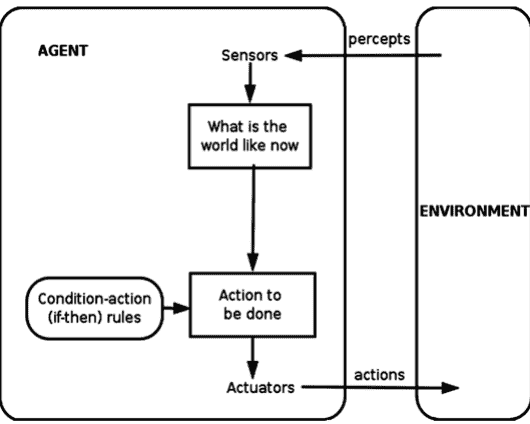

图 7.1：自主代理。

来源：https://upload.wikimedia.org/wikipedia/commons/3/3f/IntelligentAgent-SimpleReflex.png

关于自主代理的重要元素如下：

这些独立代理的主要方面在于，它们应当具有代表其运行的内部环境，这称为“信念状态”。基于其内部环境，Stuart Russell 和 Peter Norvig 在其人工智能（AI）参考书中将这些自主代理分为不同类型。分类基于这些机器人的环境，据此将这些自主代理分为以下几类。它们是：

- 简单反射依赖型自主代理——这些不依赖内部环境；
- 模型依赖型自主代理；
- 目标依赖型自主代理；
- 效用依赖型自主代理。

基于功能和利用的代理以其内部环境的描述为特征，这些描述充当推测代理行为和衡量效用的先驱，如同用于展示环境不同状态的平台。

效用函数是自主代理最重要的方面，也是 Russell 和 Norvig 在定义自主代理时使用“理性”这一术语的基本方面。

当自主代理能够基于环境以及用于执行功能的内部知识采取行动或选择功能时，它被称为理性。

给定过程对整个程序进行了总结，其中自主代理面临必须完全智能的压力，关于自主代理利用的给定内部信息必须随时间发生变化。自主代理需要从经验中学习，并存储从每次经验中获得的知识。这些变化可能以每个目标及其相应目标的调整形式出现，并可能在网络进攻领域产生相关的强烈影响。

除了上述概念之外，还有几个概念，以使自主代理真正智能。如下所示：

- 自主代理应当独立，并拥有其可运行的内部环境原型。
- 自主代理必须有自己的目标，以便根据目标确定其功能或效用。
- 自主代理必须具备理解和学习新方面的能力。
- 自主代理需要易于适应，因为它们应根据内部环境改变自身。

### 7.3.2. 与自主代理相关的分类法

自主代理的分类法是指对自主代理的分类。先前描述的不同自主代理为机器人代理和计算代理。这些代理进一步分为不同类型。

计算代理基于政策、策略以及必须集成到这些代理中的不同网络作战原则等不同方面，进一步分为两大类别。这些自主代理基于其角色进一步分为两类，例如：

- 用于获取知识的自主代理；和
- 用于军事行动的自主代理。

用于获取知识的自主代理并不危险，而用于不同军事行动的自主代理因其能够识别目标并据此行动，而被认为具有破坏性。

基于其架构，自主代理被分为两种类型。它们是：

- 单体代理；和
- 分散式代理。

单体代理：单体代理是由单一信息源构成的自主代理，其功能有限。例如，单体代理可以是任何具有不同信息的数据文件或软件库。

分散式代理或分布式智能代理：分散式代理也称为分布式智能代理，顾名思义，指的是智能分布在许多不同元素中的系统。尽管智能是分布的，这些元素相互协调运作，由于它们在生活或运作方式上表现出的相似性，被 Craig Reynolds 称为“人工群”。

已知分散式代理对去激活相关的努力和反攻的影响具有更强的抵抗力。例如，僵尸网络是各种代理的网络，取代了传统的恶意软件，后者将成为会被去激活的中央控制点。

需要考虑的重要方面是，用于网络战的独立代理是不为人知的，并且关于用于网络战的不同自主代理没有官方可用的信息。关于人工自主代理的有限知识和信息并未描述用于网络战的代理的完整信息。

计算自主代理的重要理论如下：

- 自主代理不表示其所处的环境。
- 自主代理获取新信息的效率不高。
- 自主代理无法评估目标、选择动作并据此行动。
- 自主代理无法根据时间运作，并且不表示时间的流动或连续性。
- 自主代理无法做出独立选择；但是，它们根据用于编程这些代理的一组准则来选择目标和功能。

### 7.3.3. 软机器人的环境

物理自主代理被称为机器人，它们在常规物理环境中工作，该环境中有许多计算代理，这个环境被称为赛博空间。

赛博空间有多种定义，2011 年发布的白宫赛博空间政策审查将赛博空间定义为“IT 基础设施的相互依赖网络，包括互联网、电信网络、计算机系统以及关键行业中的嵌入式处理器和控制器。”

赛博空间是由人类创造的一个不同且特定的环境，因此非常专属。赛博空间由来自不同私营和公共部门的许多人创建、保存和使用，受众的多样性要求赛博空间具有动态性。

赛博空间及其周围环境具有不同的特征，根据 Russell 和 Norvig 的分类，赛博空间的不同特性列于以下：

- 赛博空间没有完全可用的周围环境。
- 赛博空间的不同方面不会同时可用。
- 任何人在特定时间只会了解赛博空间的一个小方面。
- 赛博空间是一个非常复杂且困难的环境。
- 赛博空间是一个非常动态、多样且独特的空间，因为它不断随着其实用性和不同要求而变化。
- 赛博空间是容易遭受不同形式的战争的领域，有时极易受到攻击，尽管存在防火墙、入侵检测系统 (IDSs) 和入侵防御系统 (IPSs) 等网络安全软件。

## 7.4. 虚拟自主的伦理

我们现在转向自主权和代理权问题在我们五种选定技术中体现的具体方式（图 7.2）。

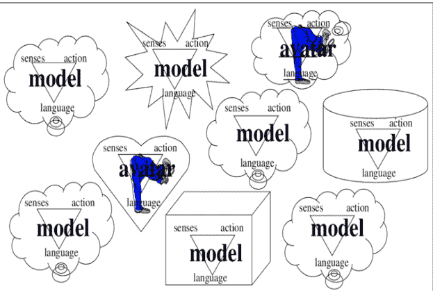

**图 7.2：** 自主权与虚拟现实。

来源：https://www.researchgate.net/figure/Autonomy-and-Virtual-Reality_fig5_239550135

### 7.4.1. ALife

在 20 世纪 60 年代，人们识别出集成电路中速度和存储容量的指数级发展，这为人们提供了如今普遍被称为摩尔定律（Moore, 1965）的概念。

部分原因在于，ALife 研究者基于研究人员已有的认知展开工作，回头看，这些关于基因型与表型联系的看法极为简单化。在生物体发育过程被完全理解之前，ALife“生物”必然会存在，但只是实际生物实体的夸张模仿。尽管 ALife 中有许多是人造的，但关于它尚未提供许多相当逼真的东西。

与技术相关的限制或局限性在这里凸显，无论是虚拟 ALife 还是物理实体化的 ALife，因此都需要缓和人们对 ALife 的担忧，这些担忧在某种程度上涉及 ALife 脱离现有科学家的掌控并失控狂奔。

### 7.4.2. 具身人工代理

具身人工代理是为在物理环境中运行而构建或设计的。赛博格被视为具身人工代理的主要类群之一，另一个主要类群是本质上完全无机的机器人。

最终，皮斯托里乌斯未能战胜进入 400 米项目的资格成绩，尽管他规定的成绩肯定远超人类的平均跑步速度。也许，词典定义通常倾向于将奥斯卡·皮斯托里乌斯排除在与赛博格相关的类别之外，理由是其猎豹刀片本应绑在身体上，而非“内置”于所提供的身体中。

将定义问题单独提出来，本章最感兴趣的赛博格类型通常是那些借助嵌入式计算设备为人类提供认知增强的类型。

只有当所有这些改进为倾向于采用它们的人提供核心钥匙时，“赛博格鸿沟”才可能被视为合理。特定的进步也引发了一些与伦理相关的问题。

### 7.4.3. 虚拟人工代理

虚拟人工代理（又称‘机器人’）已经存在。它们在计算机生成的环境中运行。一般虚拟人工代理的范围从整个互联网延伸到电子市场。电子市场通常指电子商务市场，该市场已在全球范围内开始获得动力。电子市场的著名示例包括；NASDAQ 和 eBay。虚拟人工代理的范围从电子市场延伸到计算机游戏，它们存在于诸如 Second Life 之类的联网虚拟世界中，这些世界主要为娱乐而设计，但也越来越多地用于通信和教育。

在电子市场中，存在自动交易和竞价程序，它们有助于执行所有完全基于提供的公式的交易，在某些情况下，这些公式远非依赖或依赖它们的人所能理解。

大多数人倾向于高估计算机程序的智力和关键性的事实，如今被 AI 研究者称为‘ELIZA 效应’。这只是人类倾向于将事物拟人化的前述倾向的一个体现。

通过非语言手段进行‘说服’的视角刚刚开始被探索，但在此类情况下发生伦理滥用的可能性已经十分隐晦。

### 7.4.4. 以机器为中心的 VR

在线拍卖的一般示例有助于说明这一点。由于信息提供的格式有利于机器，与人类相比，机器在精确把握最终出价时机以在拍卖最后一秒获胜方面具有更强的能力或潜力。

因此，以机器为中心的 VR 环境引发的伦理问题不仅涉及在其中运行的人工代理，还引发了人们对这类环境对试图在其中工作的人所施加的限制的担忧。

### 7.4.5. 拟人化 VR

拟人化 VR 已被用于许多目的，包括游戏、赛博空间、电话会议、飞行员培训、士兵培训、小学教育，并且正在调查用于更多应用，例如警方人员辨认。此类应用根据其中涉及的现实程度提出不同要求。例如，飞行模拟器要求在几乎所有方面都具有现实感。

当某人在远程 VR 应用中作为单一用户运行时，该特定环境中相关行为引发的伦理问题本质上是间接的。

然而，这类机会并不被视为伦理上中立的。

它们可能会直接影响其他个人，或者通过训练或强化行为习惯的过程产生间接影响，这些习惯可能会蔓延到现实世界中。

## 7.5. 自主代理人的网络攻击场景

网络战是近期的重要术语，因为近年来正在开展大量研究、讨论和辩论。关于网络战的大部分猜测和辩论主要集中在防御攻击上，其重要原因如下：

- 不同软件和应用程序中维护的保密性；
- 这些网络攻击中涉及的各种政治方面和利益相关者；
- 对信息的可访问性；
- 不同组织关于数据所维护的隐私设置。

网络战的概念主要关注防御而非攻击。有必要了解网络战的不同阶段，以便充分准备应对网络战。正确理解网络攻击的不同阶段，将使组织能够充分准备应对网络攻击，并据此制定防御策略（图 7.3）。

图 7.3：网络攻击。

来源：https://cdn.pixabay.com/photo/2018/04/17/11/02/cyber-3327240_960_720.jpg

### 7.5.1. 侦察

侦察是任何网络攻击的重要方面，因为侦察是指涉及研究、识别和选择目标的网络攻击阶段。

侦察是大多数敌对进程的起点，被称为网络攻击的初始阶段，因为它为自主代理的部署提供了理想环境。代理的部署发生在三个方向上：

- 自动发现目标系统或网络中的技术漏洞；
- 收集关于技术漏洞的信息的过程，例如不同操作系统和应用程序的组装与拓扑规格；以及
- 获取关于不同用户及其个人安全凭据的信息的过程，这些信息将使网络攻击能够获得访问权限。

在目标网络中识别弱点和可能易受攻击的环节以制定攻击策略，是规划网络攻击的重要阶段。网络攻击由网络攻击领域的先驱——熟练的专业人员进行研究、规划和执行。

软件自主代理以侦察目标、识别并区分易受攻击的环节以及制定利用这些环节的方法而闻名。虽然开发利用工具的完全自动化尚未广泛可用，但有一些场景被用于将具备该能力的代理纳入其中。

网络攻击的重要阶段如下：

- **侦察：** 侦察涉及研究对象、识别对象并选择目标的过程。
- **武器化：** 武器化过程涉及将不同的恶意软件组合到已研究的目标中。
- **投递：** 投递或发送恶意软件或病毒到已识别和选定目标的过程，通过电子邮件、消息、U 盘、不同的附件和其他途径。
- **利用：** 投递的病毒或恶意软件开始执行在恶意软件中编程的有害操作集。
- **安装：** 利用过程通过成功安装有害恶意软件而生效，这将使它们能够持续访问目标的数据。
- **命令和控制：** 已安装的恶意软件不仅提供现有信息，还使用户能够访问，从而使局外人能够在系统上建立命令并控制目标的活动。
- **目标上的行动：** 攻击者将规划并执行一组目标的攻击，这些目标通过攻击成功实现。这些目标会根据攻击者的要求而有所不同，可能包括销毁数据、访问数据或替换数据、获得网络控制权或损坏软件等。

网络攻击的规划、执行和实现预期结果的过程将造成无法衡量的损害。网络攻击的整个过程及其损害无法衡量；因此，重要策略可能是将防御策略设计进网络，而不是容易受到攻击的技术。有不同类型的保护可以确保网络中的数据隐私和安全。

- 自主代理或软件代理大多会接受训练或一组指令来攻击特定网络。
- 下一个阶段是获取针对网络所需信息的过程。
- 在信息收集阶段之外是渗透阶段，在此阶段，不同的自主代理会根据在攻击前编程到代理中的一组指令来攻击网络。
- 去中心化代理被执行以策划完美攻击，其中相同的动作被分成不同的数据包组，每个代理都被以不同方式编程来执行攻击。
- 此类行动的基本宗旨是收集数据并将其定向到命令与控制结构以进行进一步处理。关于易受攻击环节的各种技术和其他信息被收集，并利用这些信息执行攻击（图 7.4）。

### 入侵杀伤链阶段

| 阶段 | 描述 |
|---|---|
| 侦察 | 研究、识别和选择目标 |
| 武器化 | 将远程访问恶意软件与利用工具配对为可交付的有效载荷（例如 Adobe PDF 和 Microsoft Office 文件） |
| 投递 | 将武器传输到目标（例如通过电子邮件附件、网站或 USB 驱动器） |
| 利用 | 交付后，武器代码被触发，利用易受攻击的应用程序或系统 |
| 安装 | 武器在目标系统上安装后门，允许持续访问 |
| 命令与控制 | 外部服务器与武器通信，在目标网络内提供“键盘操作权限” |
| 目标上的行动 | 攻击者致力于实现入侵目标，可包括数据外泄或销毁，或入侵另一个目标 |

图 7.4：网络攻击阶段。

### 7.5.2. 渗透及之后

自主代理用于收集或获取信息，这些代理用于记住在整个侦察过程中获取的数据，这些包含不同漏洞的信息用于规划攻击。这一过程称为渗透。规划攻击或渗透的主要策略是使用“树”的方法。

树是用于表示 AI 中某些问题的不同结构。人工代理中的这些树用于在网络攻击过程中设计不同的策略。这些树作为计划中的未来攻击的模型。这些树作为代表来规划未来的渗透行为，并成功执行当前的渗透过程。对内部环境和不同漏洞的表示过程将使自主代理能够保护自己并抵御防御者。这一过程将使自主代理更加“持久”，而对这些自主代理的此类威胁被称为“高级持续性威胁”（APT）。

对可能威胁的适当知识和表示将使自主代理理解合适的防御策略，并使它们能够相应地做好准备，从而成功执行攻击。

智能自主代理将获取信息、理解可能的应对措施并相应行动。理解不同策略、针对这些策略做好准备并采取反制行动的整个过程，将使自主代理变得更强大，并运用不同的人工智能技术来保护信息并成功推进其目标。

### 7.5.3. 群体

群体被称为去中心化代理，它们被独立编程并能执行不同的命令集。这些去中心化代理尽管具有分布式功能和多样化角色，被称为“人工鸟群”，并能相互通信以有效执行任务。由一组去中心化代理形成的网络非常强大且极难对抗，应独立和集体地处理它们，以保护系统免受一组去中心化代理的攻击。

### 7.5.4. 命令和控制

网络战或网络攻击的进程始于事前研究、目标识别、渗透，随后是获取对目标数据和信息的命令和控制的过程。有许多因素决定并有助于获取对网络战的命令和控制，例如已识别的潜在漏洞以及相应的程序设计。恶意软件中有一组预编程指令，它们在攻击目标和获取对目标数据库的访问权限方面发挥着重要作用。

获取对目标数据库的命令和控制的过程是一项重大安全漏洞，因为它可能造成严重的隐私和安全威胁。如果目标是军队数据库或任何金融数据库，那么由此恶意软件攻击造成的损失无法估量。

必须预期到这些攻击，并必须更新软件的安全设置以防范这些恶意攻击，此外，有一组战术、技术和程序被用于智能自主代理，以保护它们免受恶意网络攻击。

## 7.6. 法律格局

网络攻击具有严重影响，关于将国际法应用于网络战的讨论在法律平台上日益增多。计算机和技术领域存在几个严重后果，且该领域的发展正在增加，技术使用的增加正在增加漏洞，使技术容易受到攻击。

有许多法律正在制定中，以规范这些攻击，并加重参与设计和执行攻击人员的惩罚。有几项网络法律正在实施，其中重要法律将被讨论。

管辖网络战的国际法体系基本上由两个部分组成，即：

- 开战法（Jus ad bellum）；和
- 交战法（Jus in bello）。

开战法是管辖各国诉诸武力的国际法，而交战法（即国际人道法）主要涉及各种武装冲突的管辖及中立法的实施。

### 7.6.1. 开战法

国际*开战法*的最主要基础是1945年在旧金山签署的《联合国宪章》及其后续修订。宪章第2(4)条涉及会员国使用武力：“所有会员国在其国际关系中，应避免对任何国家的领土完整或政治独立使用武力或威胁使用武力。”

根据宪章，网络战被定义为具有“与动能、化学、生物或核武器可能造成的效果可比拟”的效果的事物，就此而言，自足代理类似于网络战中使用的其他工具。

### 7.6.2. 交战法（国际人道法）

交战法被称为国际人道法。该法律用于管辖与武装部队和战争相关的活动。该法律的主要基础源自1949年的日内瓦公约，还有某些来自1977年的额外议定书，以及某些源自更早的1907年海牙公约的方面。

## 7.7. 结论

自主技术是独立的技术，基于计算机科学和工程的某些原则开发而成。自主技术可以是简单的计算机软件，也可以是带有一组预编程指令和软件的软机器人。

20世纪70年代和80年代初的技术开发主要以技术为中心，因此早期技术更侧重于概念和技术，而在新时代，尤其是21世纪，伦理是计算机科学的重要组成部分。伦理和道德是一组决定新技术开发过程的价值观。近年来对伦理的重视日益增加，对伦理价值的重视正在计算机科学、科学、医学和技术领域广泛辩论，而不仅限于计算机科学领域。基于伦理概念广泛辩论的其他领域的重要元素是安乐死和堕胎。

价值观是任何技术的组成部分，价值观可以是伦理价值观或道德价值观。因此，近年来的几种技术正在使用VSD，并且需要将这些方面纳入技术中，否则这些技术可能无法问世。谷歌眼镜、智能电表和自动化患者记录系统是因社会和伦理问题而消失的伟大创新技术失败的示例。

负责任的创新是技术开发的另一个方面，因为创造中需要负责任，仅仅在设计新技术时缺乏责任就会导致技术开发失败。

自主代理根据其功能、拓扑和架构分为不同类型。自主代理的重要类别是整体代理和分散式代理。整体代理是单个软件，例如数据文件，而分散式代理涉及在功能集体运行的多个较小代理之间划分权力。

自主代理的主要风险是网络战，网络战是为了获取数据和信息而预先策划和执行的攻击。网络攻击有不同阶段，即侦察、武器化、投递、利用、安装、命令与控制、目标行动，这些会导致数据泄露并引发不同的安全问题。

网络战通常难以阻止安全攻击；相反，大多数涉及防范网络攻击的方法都是防御策略。有必要安装强固的固件，保护代理免受数据泄露和安全问题。

数据是计算机科学的重要方面，必须给予数据隐私和安全的伦理和隐私方面应有的重视。计算机伦理学的研究极为重要，需要理解各种需要考虑并纳入技术的伦理和道德方面，以开发成功的技术。

## 参考文献

- 1. Center, L., (n.d.). [在线] 可于: https://www.lorentzcenter.nl/lc/web/2016/852/description.php3? wsid/4852&venue/4Oort [访问于 2018年11月13日].
- 2. Friedman, B., Hendry, G. D., Huldtgren, A., & Van Wynsberghe, A., (2018). [在线] 可于: https://www.researchgate.net/publication/283435670_Charting_the_Next_Decade_for_Value_Sensitive_Design [访问于 2018年11月13日].
- 3. Podins, K., Stinissen, J., & Maybaum, M., (2013). 第5届网络冲突国际会议。[在线] Ccdcoe.org. 可于: https://ccdcoe.org/cycon/2013/proceedings/cyconBOOK2013.pdf [访问于 2018年11月13日].
- 4. Van Den Hoven, J., (2017). 数字时代的伦理：道德规范在哪里？[在线] 可于: https://link.springer.com/content/pdf/10.1007%2F978-3-319-55735-9_6.pdf [访问于 2018年11月13日].
- 5. E. Moore, G. (1965). 在集成电路上塞入更多元件。[电子书] 可于: http://www.monolithic3d.com/uploads/6/0/5/5/6055488/gordon_moore_1965_article.pdf [访问于 2019年3月17日].
- 6. Van den Hoven, J., Lokhorst, G. and Van de Poel, I. (2012). 工程与道德超载问题。科学与工程伦理, 18(1), 第143-155页.
- 7. van den Hoven, J. (2013). 价值敏感设计与负责任的创新。负责任的创新, 第75-83页.
- 8. Janssen, M. and van den Hoven, J. (2015). 政府中的大数据与开放链接数据（BOLD）：透明度和隐私的挑战？政府信息季刊, 32(4), 第363-368页.
- 9. Borning, A., Friedman, B. and H. Kahn, Jr., P. (2001). 价值敏感设计：理论与方法。[电子书] 可于: https://faculty.washington.edu/pkahn/articles/vsd-theory-methods-tr.pdf [访问于 2019年3月17日].
- 10. Thaler, R., Sunstein, C. and Balz, J. (2010). 选择架构。SSRN电子期刊.
- 11. Clark, A. and Chalmers, D. (1998). 延伸心智。分析, 58(1), 第7-19页.

# 8 监管问题与挑战

## 内容

- 8.1. 简介 .................................................... 202
- 8.2. 信息技术的伦理挑战 ................. 203
- 8.3. 信息技术中的伦理问题 ..................... 206
- 8.4. 网络空间和IT社会中的伦理问题 ................... 215
- 8.5. 互联网监管：规范性问题 ......................... 218
- 8.6. 对计算机专业人员的工作替代/工作压力............................................ 220
- 8.7. 与网络犯罪相关的挑战和问题 ................... 226
- 8.8. 结论 ....................................................... 227
- 参考文献 ............................................................ 229

计算机安全是计算机伦理领域关注的话题。每个人都生活在计算机病毒和黑客国际间谍活动的时代。问题不仅在于硬件的物理安全，如防止盗窃、火灾、洪水等，还在于逻辑安全，如隐私和机密性。恶意软件，或称“程序化威胁”，对计算机安全构成重大挑战。计算机犯罪，如贪污或植入逻辑炸弹，通常由拥有计算机系统使用权限的受信任人员实施。因此，计算机安全还必须关注受信任计算机用户的行为。计算机专业人员已准备好迎接以新技术形式出现的挑战。计算机伦理中更具争议的领域之一涉及与软件所有权相关的知识产权。

## 8.1. 简介

伦理是一种积极或消极的思维方式，也可以在日常生活中专业和个人地应用。人们想要以正确的方式做事，以表现出某种专业精神。伦理可以以多种方式定义。它是特定职业的道德准则，或者是人们达成的协议，以将错误的事情转化为正确的事情。

计算机伦理可以定义为允许个人找到问题的解决方案，个人应以正确的方式工作。个人面临的最大挑战是处理艰难的情况，并使其简单而清晰，以便以正确的方式工作。

技术日新月异，影响着人们的生活。个人和组织面临的主要问题是，他们没有跟上新技术，后来面临某种伦理问题。例如，公司正式监控员工电子邮件的问题非常具有争议性。

个人有必要理解计算机伦理。如今，计算机已成为每个人的必需品，伴随着诸多挑战。许多计算机用户知识较少，发现难以克服这些情况。个人面临着多种挑战，并在表达电子邮件观点方面遇到困难。有必要理解与隐私问题和安全相关的计算机伦理。同样重要的是，借助先进的计算机技术理解IT的主要负面影响。什么是非法和什么是不道德之间的区别并不总是显而易见。IT部门和IT社会也可能变得负面，这将影响教育、社交技能、隐私和安全，这并不令人意外。

每个部门都需要技术，因此需要“计算机伦理”来分析对互联网用户来说什么是对的什么是错的。有必要找出信息技术（IT）是否正在影响社会。

据专家称，IT部门已提供了大量安全保障。有必要将信息保密，并遵循主要投影。专家认为，不应对网络空间产生IT的负面影响。

如果个人正在从事数字ID方法、加密和防火墙工作，则方法应技术性。已采用这些方法来寻找问题的解决方案，也可以采取法律行动来解决日益增加的伦理问题。

计算机伦理应是每个人关注的问题，因为信息、数据和计算机网络可能面临许多国际内部和外部危险而暴露。每个国家都有自己的政府，因此所有计算机专业人员、公共政策制定者、组织和私人公民都应关注并为国家的发展做出贡献。这种全球信息可以以社会和伦理敏感的方式，为每个人的未来利益和应用而打破。

## 8.2. 信息技术的伦理挑战

许多人面临着一些严重的伦理挑战，但主要是在美国运作的用户和IT专家已准备好迎接最大的挑战。有时，大多数用户和IT专家不知道如何应对挑战，因为越来越多新兴和不断发展的信息技术涌现于市场。

影响社会的主要问题是安全缺乏、隐私和版权侵犯。IT部门面临的主要挑战是IT部门犯罪数量增加。每个人都想以不同的方式使用互联网，但他们滥用计算机的错误可能导致犯罪。

许多组织和成功企业都担心因黑客而丢失信息或数据，黑客可以轻易入侵并为自身利益使用公司信息。应有更多隐私来控制信息。

员工也存在一些问题，因为他们不忠诚，可能利用IT实现个人目标，这可能对组织有风险和危害。IT本身并不被视为坏事，但人类为自身利益使用IT提供的工具的方式已带来一些严重挑战。

### 8.2.1. 安全

如今，许多组织长期面临这个问题，即黑客发现使用类似于连接到互联网的工具入侵系统或计算机非常容易。互联网协议是分配给任何具有计算机网络并使用互联网协议进行通信的机器的数字，黑客可以轻易利用该协议进行寻址以访问用户的计算机并出于自私目的收集数据。大多数组织认为黑客会为了自身利益收集数据。

互联网Cookie的广泛使用会在每次使用互联网时收集信息，这使得IT用户面临欺诈和利益冲突的高风险。

有许多专注于IT领域的公司，它们有使用Cookie的策略，以便控制其产品或服务。客户在将资金转移到另一个账户时也会因为黑客而遇到麻烦，因为黑客可以对银行和客户进行欺诈并将资金转移到自己的账户，这完全是非法的。

### 8.2.2. 版权侵权

各种信息都可在互联网上找到，用户在工作中使用这些信息是不被允许的。用户可以从概念中获取想法，而不是在工作生活中滥用信息。例如，许多音乐公司和照片书签网站因一些人不必要地使用和分享信息而面临困难。因此，原创者遭受损失，无法从其工作中获益。

创作音乐专辑的人可能会遭受损失，因为歌曲或音乐正在免费下载。像音乐专辑、书籍和文件下载网站这样的原创作品每天都在互联网上涌现。在这种情况下，一名真实用户会购买书籍、网页模板、软件或音乐专辑，然后将其提交到免费下载网站，其他人就可以免费下载这些数据。

政府计划已付诸实施，因为它已禁止了一些网站，如MEGAUPLOAD.COM，因为许多用户正在滥用它，这将影响原创者的工作。这对用户有好处，但不被允许。

### 8.2.3. 计算机犯罪增加

个人可以为了赚钱而实施欺诈。这成为IT专家团队照料系统、每天检查并保护免受黑客攻击的最大挑战。许多拥有使用系统知识和技能的用户应该有机会实施犯罪。例如，许多组织已制定策略并组建了强大的IT团队，随时准备以任何方式控制这些问题，并在一天内解决查询。

### 8.2.4. 数字鸿沟

国家的增长和发展主要取决于IT部门。如果IT部门有更多改进，将会有更多进步。许多发展中国家在某些方面缺乏使用新技术更新用户的能力。政府知道某些地区技术匮乏，人们想要采用新文化。发展这些地区需要时间，因为技术部门对政府来说似乎也非常昂贵。

但国家的小地区面临的问题是，他们没有足够的能力使用计算机等IT工具。在与教育相关的其他领域中，大多数这些发展中国家都有糟糕的旧教育体系，因此学生不会了解新的信息技术。

## 8.3. 信息技术中的伦理问题

只有拥有高水平的技术，企业和组织才能更加成功。例如，货物和服务可以随相关信息进行交换或转移，从而为企业带来利润。

当今，信息对于推动业务发展至关重要，IT 在业务中发挥着主要作用，并且可以借助软件、电信、计算机硬件和数字电子产品共享数据，以使业务取得成功。

根据专家的说法，有关信息和通信技术相关问题的伦理关注首次于 1992 年在《信息科学与技术年度评论》中以“信息伦理（IE）”为主题进行探讨。这表明存在与信息和通信技术使用相关的伦理计划。组织和个人在其行动和流程中组织 ICT 时，需要在伦理上保持敏感。

信息和通信技术对人际关系的影响是巨大的。信息和通信技术有助于增强和改善家庭关系，例如，现在每个人都通过手机、笔记本电脑、掌上电脑、视频会议等连接起来，但也有人认为信息和通信技术已经使家人和朋友彼此分离。

信息和通信技术促进了虚拟社区中新友谊和关系的产生，要知道这类关系是真实的。这项技术通过互联网创造了新的、不同的工作岗位，但这些变化和机遇也面临着计算机取代人类导致失业的问题。

因此，如果社会要管理由信息和通信技术带来的工作场所及其他变化和发展，就需要一系列新的法律、法规、规则和做法。因此，社会需要考虑与信息和通信技术使用相关的以下伦理和社会挑战：

- 对与信息和通信技术相关的个人和企业伦理的认可。
- 在伦理、经济、技术以及政治考量之间取得平衡。
- 知识产权问题（商标、专利、版权和商业秘密）。
- 在电子信息数据挖掘过程中不侵犯隐私及相关权利。
- 利用 ICT 犯罪的机会（计算机犯罪）。
- 法律问题与限制。
- 使用 ICT 的后果。
- 专业责任（Kallman 和 Grillo, 1996）。

个人和组织都在使用信息和通信技术，连同其支撑技术的使用，对社会产生了重大影响。有时，IT 专家无法找到解决方案，他们不知道如何解决用户的疑问，但他们会尝试进行实验并加以解决。

信息和通信技术引发的持续性问题包括对个人和商业隐私、个人及社会权利、知识产权的侵犯，以及对价值观保存和信息和通信技术使用所产生的价值观和时刻的责任等。有些问题在就业、工作条件和个性领域提出了重大挑战。但是，有些领域尚未发展，需要在 ICT 方面取得更多进展。

IT 在医疗保健、金融、商业、政府、教育、媒体和娱乐以及整个社会等各个领域都发挥着重要作用。IT 是最具挑战性的影响之一，可能对社会产生一些负面影响。

已经提出了一些问题，它们与伦理相关。这些问题可能包括有害行为、个人隐私和访问权，这些都是伦理问题的一部分。

IT 部门正在向世界其他国家和不同地点进行数据交换和高级别信息传输，这个问题需要解决，因为这涉及个人隐私。

有时，拥有信息是必要的，因为这将帮助政府找到罪犯和恐怖分子。信息应该被正确使用，不应该与太多人共享。保护个人数据的隐私和完整性现在已成为每个人的责任和挑战。

主管部门应控制个人的个人信息，没有任何人有理由未经授权披露任何信息。有必要创建 PIN 或密码，以防止信息泄露。

伦理问题的另一个方面是访问权。政府已允许使用互联网网站，但他们担心互联网上仍在运行的不可信应用程序，因为有许多黑客参与其中。他们希望尽快清除这些应用，并允许人们访问合法网站。

在美国，NASA 和洛斯阿拉莫斯国家实验室等高技术实验室一直在尝试研究不同的事物并提高人们对未来的认识。计算机黑客试图从军用计算机和美国政府办公室窃取信息，因此他们必须加强计算机安全并开发新应用程序，以便找到非法做错事的黑客。

财产损失、信息丢失、财产损坏和不良环境影响都已成为计算机伦理的一部分，被视为负面后果。

当计算机系统中出现病毒时，可能会出现问题。病毒可能会损害重要文件，这也可能包括系统中数据的丢失。系统中存储的重要数据可能会被破坏或丢失。因此，用户再次恢复丢失的文件成为一项挑战，因为这需要人类或 IT 专家的时间和精力。对于 IT 专家来说，保护计算机免受病毒侵害也是一项挑战。

### 8.3.1. 抄袭

抄袭可以定义为从他人那里复制的一定数量的作品，用户以自己的方式提交相同的复制作品。个人遵循复制作品的常规做法，这节省了个人的时间和精力。这被视为一种高度不道德的行为，因为互联网提供各种各样的信息，而且很容易做到。

教育：教育以其在线学习而闻名，学生可以使用一些工具学习新事物，但这也可能分散他们学习的注意力，因为他们在互联网上也会获得一些无用材料。互联网产生了各种影响，其中一些影响相当令人不安。

教育在方方面面都很重要，计算机在教育中发挥着主要作用，因为它有助于发展个人的技术技能。学校、学院和大学的计算机实验室增加了，以便教授更多学生。一次教更多学生可以节省教师的精力和时间，但他们应该确保怀着热情进行教学。个人进行实际工作变得很重要，以便发展将来能帮助他们的技能。

教师也发现，学生更愿意借助互联网研究论文，而不是从图书馆借书，这让他们感到轻松。在相关影响方面，互联网在两个不同的意义上将抄袭带入了计算机时代。

学生在使用系统工作时可能会觉得简单容易，因为他们拥有可以复制粘贴的电子文本，这节省了个人的时间。

互联网上有很多可用的资源，因此学生可以下载重要论文，这些论文作为学生的免费资源使用。他们不需要去购买论文，因为论文主要在互联网上提供。

教师可以轻松地给学生发邮件，因此学生可以了解课堂上学过的所有内容或为未来目的获取更新。教师现在可以访问电子提交论文的数据库，并可以轻松地将自己的学生论文与庞大的来源档案进行比较。即使是简单的在线搜索，有时也能找到某个特别精妙的短语最初出处。

### 8.3.2. 盗版

盗版是一个非常严重的问题，被视为非法复制软件，预计计算机系统中大约 50% 的程序都是盗版副本。程序员和系统用户习惯于保护系统免受代码侵害，他们花费数小时使用精巧代码创建程序，当然需要得到保护。

这是一个全球性问题，因为大型组织希望赚取更多利润，但如果软件出现问题，可能导致失业。因此，这将影响公司并损害利润率。

**文件共享：** 传输文件时这是一个非常严重的问题，因为相关人员可能会遇到传输问题。原因可能是软件发生了不允许文件共享的更改。一所美国大学里有一个学生发明了Napster，这是一个非常有用的文件共享工具，但后来又发明了其他工具来取代Napster。

Napster是一种可用于文件共享系统的工具，允许用户在线共享音乐的电子副本。录音公司因使用此工具而遭受损失并损失收入，因为一首歌曲的一份合法副本在许多人之间共享。

P2P（“人对人”）是Napster之后出现的一种工具，也用于文件共享，因为录音公司成功关闭了Napster。

Napster存在问题，但有一个名为P2P的替代方案。P2P工具在人们中变得相当流行。早期，P2P软件尚未推向市场，因为行业认为它不太有用，但他们想尝试这种工具。后来，由于它具有快速简便的音乐文件传输过程以及高速连接，因此需求量很大。

P2P软件开发者必须承受损失，并且正在遭受类似于官方文档所有者所经历的损失。为了避免焦虑和担忧，已经发明了更巧妙的方案。无法避免文件共享迫使电影和电影行业为其CD和DVD制定复杂的防复制保护方案。

索尼公司等公司在2005年将CD推向市场，但由于涉及一种特殊的类病毒代码（该代码隐藏在用户计算机上的防复制保护）而陷入麻烦（图8.1）。

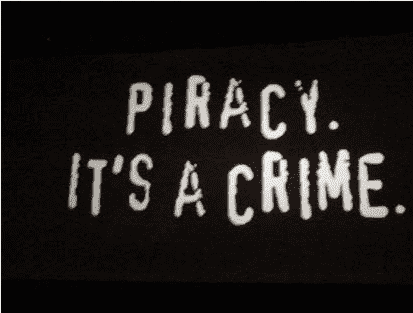

图8.1：盗版：可受惩处的犯罪。

来源：https://c1.staticflickr.com/4/3646/3558668316_0b9de4115b_b.jpg

### 8.3.3. 黑客攻击

系统黑客攻击是由在技术领域拥有各种知识的人进行的。他们甚至可以破解密码并启动系统。他们可以通过从事完全非法的事情轻易犯罪。通过黑客攻击系统来赚钱很容易，因为他们可以损坏系统或对系统进行更改（图8.2）。

图8.2：计算机黑客。

来源：https://www.maxpixel.net/Internet-Hacking-Hacker-Security-Cyber-Crime-2964100

是时候让人们意识到他们正在使用的系统可能对他们不安全了。他们需要先检查所有软件，看看是否正常工作。黑客还可以帮助人们和组织保护自己免受其他黑客的攻击。

黑客是需要许多技能的人，尤其是与技术相关的技能。通过检查系统，他们可以轻松解决用户问题。用户在赶时间工作时面临许多问题，因此备有黑客待命很重要。拥有这些技能的黑客可以轻松发现系统需要改进且不安全。

黑客在创建或损坏系统方面可以发挥重大作用。许多人说黑客能力能带来发展和改进，但它造成了如此多的干扰，以至于未来不值得这样做。

### 8.3.4. 计算机犯罪

计算机犯罪是许多国家的重大问题。在许多国家，存储在计算机系统中的个人数据被盗取和泄露，这是一种犯罪。2006年，美国约7300万人的个人记录被意外丢失、泄露或盗取。

例如，美国曾发生一起案件，涉及通过黑客攻击存储前美国军事人员个人信息的系统所犯下的罪行。根据报告，数据被盗取，信息被泄露。

政府和安全机构必须更加小心，保护其系统免受窃贼侵害。有许多经验丰富且技术知识渊博的人。他们可以轻松盗取不仅个人信息，还有信用卡号码和社会安全号码。因此，消费者可能会遭受损失，因为这会导致消费欺诈。

由于信息高度机密，政府已提供高安全性。政府还提醒人们和公司提供高安全性并保护系统。

互联网欺诈形式多样。黑客攻击系统并泄露信息变得容易了。每个政府都在其系统中存储着关于每个人的信息。犯罪可以以不同方式实施，例如信用卡交易欺诈、网上银行交易欺诈和安全系统欺诈。

涉及身份盗窃且已被抓获的罪犯报告说，他们多么容易就将被盗信息变现。有许多通过电话和电子邮件实施的欺诈行为。通过电子邮件向客户提供错误信息以赚钱。人们发送诈骗方案并欺骗客户。

互联网使用存在问题，因为可能有许多虚假事物，人们可能学到错误的信息。罪犯也可以仅凭他人借记卡号码就将钱转入自己的账户。每年，客户都会遭受可能难以计算的重大损失。

计算机犯罪也称为网络犯罪，可能存在多种不同的计算机犯罪，例如数据窃取和共享个人文件，这明显给社会提出了伦理问题。欺诈和滥用是在计算机上实施的非法行为。

系统中已应用各种策略以避免欺诈。访问网站的人应验证其账户；否则，他们可能会被该网站阻止。

### 8.3.5. 恶意代码

恶意代码是会对计算机或系统造成损害的代码。这种代码攻击几种为造成数据丢失或损坏而创建的计算机程序。恶意代码攻击的三种主要类型是病毒、木马和蠕虫。

病毒总是攻击系统。它是一种附加到另一个程序以在工作站上执行不需要功能的恶意软件。一个例子是附加到command.com（Windows系统的主要解释器）上的程序，它会删除某些文件并感染它能找到的其他版本的command.com。

木马是计算机系统中可能更改系统设置的程序。木马病毒甚至可以攻击系统，因此需要防病毒保护来防范这些攻击。

病毒甚至可以减慢系统速度，使用户非常难以工作。它们可以损坏文件以至于无法打开。它们还可能引起各种其他问题，例如难以安装应用程序或游戏应用程序。因此，有必要在计算机系统上安装一个好的防病毒软件并在需要时更新它。

计算机蠕虫也可以攻击系统并造成文件问题。在利用漏洞后，蠕虫会将其代码从受感染的主机复制到受损系统以重新启动循环。

病毒可能影响文件或任何与个人数据相关的事物，这些数据很容易丢失。一旦病毒进入系统，存储的一切都可能受到影响。然后，感染可以通过磁盘、其他存储设备、计算机网络或在线系统将自身转移到其他计算机的文件和代码中。复制的病毒通常会不断增殖，直到破坏数据或使其他程序代码变得无意义。

病毒会导致系统反复重启，使用户难以专注于工作。用户遇到系统问题时无法集中注意力。病毒可以非常快速地使系统崩溃，如果系统未定期扫描，则更加危险。

一旦病毒出现在系统中，用户就很难工作或存储数据。病毒随时可能出现，且对存储的文件不安全。因此，有必要扫描病毒；否则，用户将面临严重后果，包括系统崩溃以及组织在某些时期停止运营。防病毒软件有助于系统平稳运行，因此所有主要企业和组织都在每个人的系统上安装了防病毒软件。

有时也会埋设逻辑炸弹。目前市场上显然有大量防病毒软件可帮助应对这一日益严重的问题。

### 8.3.6. 人体工程学/健康问题

个人可能遭受各种健康问题。使用计算机引起的健康问题可能导致头痛、手臂或肩膀疼痛以及眼睛疲劳。如果长时间坐着，个人可以休息（图8.3）。

图 8.3：使用系统时的健康问题。

来源：https://www.airforcemedicine.af.mil/MTF/Joint-Base-Lewis-Mc-Chord/News-Events/Article/1143698/mo-money-no-problem-62nd-cpts-keeps-finances-straight/

如今，计算机已成为每个人的必需品，但工作量可能会给用户带来困扰。人们注意到，用户正面临一些健康问题，如眼睛疲劳、背部问题、眼部感染和重复性劳损，这些都与信息技术有关。

用户应注意自身健康，因为工作量会带来压力和紧张，因此如果用户感到不适，有必要让座椅变得舒适。有些组织会在开始工作前提供一些锻炼，让人感到精神焕发、放松。

## 8.4. 电子空间与信息技术社会中的道德问题

### 8.4.1. 立法的国际努力

各国政府部门都非常关注本国民众，世界上许多国家的现行法律很可能难以制裁此类犯罪。对个人日益增长的威胁开始在国家和国际社会引起关注。法律层面的有限安全性表明，组织和行政管理部门应完全依赖可用技术，以防范那些可能传播错误信息，或者以盗窃或销毁重要部分等非常不健康和不负责任的方式处理信息的人。

但这种方法不足以使数字世界成为开展业务的安全空间。还必须实施和遵守法律和法规，以确保安全。那些缺乏应对此类不道德行为的适当法律基础设施的国家，最终将偏离通往主要经济体的道路。

随着数字世界犯罪率的上升，并且此类犯罪在全球范围内发生，发达国家面临着数字网络上的消息被参与此类不法行为的人拦截的危险。此类国家的行政管理部门必须始终关注其现有框架在打击这些犯罪行为方面的充分性。到目前为止，只有极少数国家认真对待这一话题，并为犯此类罪行的违规者引入了法律法规。

其余国家也应紧急开始在法律框架内引入改革。很明显，需要投入大量艰苦的工作和努力，以确保没有此类网络犯罪事件发生，并且任何卷入此类犯罪的人都必须畏惧法律，这样他们就不会参与任何此类活动。

### 8.4.2. 用于最大限度减少互联网有害行为的加密技术

在二战期间，使用以秘密模式加密的乱序消息非常普遍，这样敌人即使以某种方式截获消息也无法解读。如今在互联网上，这些乱序消息很受欢迎，用于保护和防御信用卡号和私人信息免受敌方黑客的攻击。当今互联网上常见的、利用乱序词对消息进行编码的数学方法被称为“加密”。

数据可以转换为多种形式，例如电子邮件、交易、文件、Web 信息传输等。加密通常用于互联网购物、股票交易和在线银行交易，以及自动取款机和电子商务对商务交易中。

主页上发生的数据传输使用一种广为人知的方法来加密数据以确保其安全，这称为安全套接层（SSL）。这种加密很容易追溯到以“https:”开头的网页源，而不是以前常用的“http”。还有一个指示表明使用了 SSL，即可以在 Web 浏览器的状态栏上看到一个金色锁。

另一个指示是安全工具栏按钮周围锁的金色轮廓。用于加密电子邮件中重要文件和消息的最著名方法是 DES（数据加密标准）、RSA（Rivest Shamir 和 Adleman）和 PGP（非常好的隐私）。

每位员工都有一种加密数据的密钥方法，这需要使用两个密钥，即公钥和私钥。发送者使用接收者的公钥加密电子邮件，公钥广为人知，可以从互联网公钥服务器或公司获取。然后，电子邮件会以锁定、不可读的格式发送。

在这种情况下，接收消息的人会使用他们私下持有的秘密密钥，该密钥仅用于解码消息。一些时间以前，新的高级加密标准（AES）是美国政府考虑的一种安全功能。一种名为 Rijndael 的加密技术由两位来自比利时的程序员创建，其设计旨在证明比之前使用的方案更安全，并且可以在多种硬件平台上运行，并与不同软件关联。

这种编码方法使用极少内存，并作为数字世界中防御各种攻击的机制。这种技术非常重要，尤其是在数据通过共享系统或缺乏基本安全功能的网络（这可能诱使人们非法入侵数据网络）时，其重要性更加凸显。在这种情况下，属于敏感类别的数据需要加密。另一种加密技术称为“数字 ID”。

电子邮件是人们使用计算机或电子设备交换消息的方法，人们使用此来源共享某些可能对另一位用户机密且重要的信息，并确保发送的消息不能被除未来接收者以外的任何人拦截和阅读。

通过在 MS Outlook Express 中使用“数字 ID”，发送者可以在电子交易中证明其身份，就像人们兑现支票时出示驾照一样。与加密技术一样，数字 ID 由“公钥”、“私钥”和“数字签名”组成。

上述讨论的技术用于以私密和秘密的模式处理数据，以防止人们从事不道德行为。此外，这些技术还可用于避免数字网络上的加密消息遭到任何未经授权的更改。还有一种通常用于保护计算机网络的安全系统，称为防火墙。

互联网防火墙可以被视为一个控制数字网络之间信息可访问性的系统。互联网可以被视为不同数字网络的庞大网络，这些网络应相互保持隔离。

这种互联网防火墙有助于实现两个重要功能。首先，它调节外部网络对互联网系统的可访问性。其次，它确保仅可将可控数量的信息从内部网络传输到外部世界。因此，它有助于制定和发展组织可访问性控制策略。

此类策略应解决日益增多的全球社区问题，因为当社会为人们提供具有挑战性、有成就感和有趣的工作，并且企业和政府处理富裕国家和跨国集团对贫困国家的可能剥削时，这些问题就可以得到解决。

全世界的政府、教育机构、企业、公众和私人个人仍需直接关注更多道德问题。应采用策略和指南，以便以社会和伦理敏感的方式利用全球信息，造福未来应用。

## 8.5. 互联网监管：规范性问题

在其他媒体上被视为非法的许多事情在互联网上也是非法的。例如，个人不能在互联网上泄露国家或商业秘密，而且通常在其他媒体平台上构成诽谤的行为，在互联网上也是如此。

这是一项并非专门针对互联网相关犯罪的法规，而是更多关注那些试图侵入他人个人空间（而当事人不愿与他人分享）的不道德行为（图 8.4）。

## 互联网时代的公共利益：

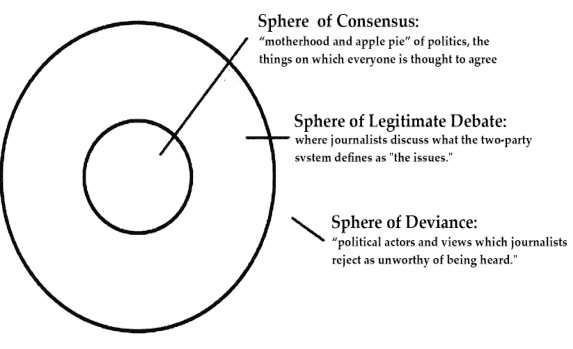

图 8.4：规范理论。

来源：https://www.slideshare.net/nadianaseem5/normative-theories

例如，在澳大利亚，诽谤法既涵盖互联网也涵盖其他媒体，对此也没有任何反对意见。本章主要关注的法规是那些试图特别限制互联网上的内容或活动的法规。

因此，问题出现了：如果，正如前文所暗示的，互联网并不真正是一个论坛（就像电视那样），而更像是一个生活空间，那么会怎样？如此一来，关于监管过程的问题，可能与社会通常意义上的监管问题更为相关。

## 8.6. 计算机专业人员面临的工作替代/工作压力

如今，计算机已应用于各个领域，无论是商业机构还是组织，都可以大规模或小规模使用。每个人的角色截然不同，各自拥有使用计算机的技巧。工作压力可能会对个人构成挑战，因为组织想知道个人是否有能力应对艰难的局面。

另一方面，许多人正在从拥有更有回报的工作中受益，他们可以在招聘网站上写下自己的技能，这有助于找到与其技能相匹配的合适工作。

个人计算技术的发展改变了21世纪人们的工作和生活方式。个人始终面临着挑战，因为他们不断学习新事物并发展自己的技能。技术在不断变化和更新，因此专家们试图向大量个人传授知识。

公司中有许多成员分布在不同领域，如IT招聘人员、中层经理和安全顾问，他们致力于帮助公司实现目标和宗旨。

以下讨论了IT专业人员在办公环境中可能遇到的一些主要问题，以及在解决此类问题时应考虑的几个重要要点：

### 8.6.1. 数字鸿沟

当今，数字鸿沟构成了严重问题。一种新的“有”和“无”者阶层正在形成，即那些能够接入并使用计算机和互联网的人，与那些无法这样做的人之间。这里存在明显的严重伦理影响。那些无法获得此类接入的人可能会受到歧视，感到“社会被排斥”，并错失许多生活机会。

云计算：云计算为IT专业人员带来了诸多挑战，因为它也具有将大量计算机连接到单一网络的能力。最棘手的问题之一是数据归谁所有，以及提供商应如何保存数据，因为这在法律执行和诉讼相关请求中是一个重要问题。

关于公司是否更愿意允许其IT相关员工访问数据，或者与专门从事安全程序和影响普通大众的规则的云服务商合作，争论仍在继续。

**网络安全：** IT专业人员现在正将其作为挑战，开发应对网络犯罪的新策略，因为罪犯犯此类罪行不需要特殊能力。人们都忙于处理事情，因为趋势在不断变化。软件始终有更新，因为技术在不断变化。

系统可能会出现问题，而且每天都会出现一些总是在系统中发生的问题。IT团队始终在组织中可用，以解决用户的问题。有时，他们会对新更新感到担忧，因为一些专家需要时间来理解个人的问题。

**远程管理：** 当视频会议、电子邮件和即时通讯等数字技术使员工能够远程工作时，传统办公室似乎不再那么合适。因此，IT专业人员必须承受很大压力，以保持网络以最高容量运行。

每个人都对自己的工作负责，IT专家负有重大责任，为个人提供合适的系统。在向个人提供系统之前，他们需要检查系统的应用程序。IT经理越来越可能在非正常工作时间排查故障。

**人才保留：** 有人认为，未来对IT工作的需求巨大，美国劳工统计局估计，2012年至2022年间IT工作的需求将增长约15%。这比所有其他职业估计的11%平均水平要快。对网络安全等特定领域的需求引发了有利于大型公司的严重竞争。

例如，《福布斯》杂志2011年6月报道，谷歌将管理人员的薪水提高了10%，以防止他们跳槽到Facebook等竞争对手。这一趋势导致小型公司在招募人才方面举步维艰，而谷歌等行业领导者则不断更换表现出色的员工，他们常常为了更好的机会而跳槽。

**新技术：** 技术日新月异，新技术迅速发展并出现在各种媒体上。这意味着竞争对手、各级管理人员和用户都会催促IT人员实施新技术，仅仅因为它是新的。

当技术发生变化时，公司面临的主要挑战便到来了。人们通常采用旧方法和旧技术，需要时间才能更好地理解新技术。当技术发生变化时，要在更高级别上工作需要时间和精力。

公司设定超额完成目标的目标，以赚取更多利润。只有当系统能够正常且流畅地运行时，个人才会提高生产力，甚至更高。这将使个人和组织都受益。

大数据、云、移动性和虚拟化现在被视为IT领域的新技术，这些工具主要由了解组织优先事项的经验丰富的IT经理使用。由于每个组织都不同，每种新技术的IT价值将根据组织的战略目标而有所不同。

### 8.6.2. 内部云计划

许多组织可以将其数据和应用程序保存在内部并自行管理一切，同时制定云计划。

有必要随着云计算技术的改进和发展，为公司可能的云端迁移制定方案，并使网络具备未来适应性。

重点在于，今天就创建可移植的应用程序，无论未来会带来什么，都不会限制公司的发展。

**为解决这个问题：** 组织将确保信息不会泄露。低层管理人员将始终征得经理的许可，以允许他们在家工作。主要优势是，对云端解决方案的任何更改都需要在不使用新应用程序的情况下完成。

### 8.6.3. 大数据分析

在分析数据时预计，五年后数据量可能增长800%。对IT专家来说最大的挑战是，超过80%的数据似乎是自由的。非结构化数据的格式各异，包括电子邮件、格式化文档、纯文本、博客、动画、标准和非标准图像、视频、声音、传感器输入，

和网络搜索日志。结构化数据比非结构化数据慢。

作为一种相对新颖且尚未开发的结构性和组织性理解来源，非结构化数据分析很可能揭示更多关于相互关系的重要数据和信息，这些关系以前很难且难以确定。其中一部分非结构化数据包含来自组织外部的社会、社区、群体和社交网络的数据，这被称为“集体”。

**为解决此问题：**非结构化数据的海量数量和增长迅速超越了传统解决方案，并要求新的数据量处理方式。大数据分析需要新的存储、获取和评估数据的方法，以便为组织提供最佳方案。

数据实时生成，需求要求有用信息随时可用。像 100 GB 以太网、并行处理和 SSD（固态硬盘）这样的解决方案提供了良好的响应时间。应从不同来源收集数据，以分析和捕获大型且合适的数据，这是组织的主要职责。组织需要了解大数据的性质和价值，从而实现组织目标。

### 8.6.4. 虚拟化

虚拟化正在从桌面扩展到服务器、交换机、路由器和防火墙。如今，虚拟化被用于对这些设备进行强有力的控制，并可应用于广泛的系统层。事实上，组织的基础设施需要高性能服务器，因为可以提供许可证。

这些任务需要扩展到虚拟化环境中，并与现有的工作流和管理流程集成。它还可用于定义硬盘以及定义硬件。

### 8.6.5. BYOD 和 BYOA

IT 部门的主要计划是保持控制，因为其已控制用户设备。该公司的首席信息官和 IT 经理决定保障：网络基础设施或组织数据。当用户自带设备时，他们还会自带自己习惯使用的应用程序（BYOA）。这对生产力是一种补充，对 IT 安全则是一项挑战。

许多人会在移动设备中存储数据以备备份，以防丢失系统中的数据。可以通过将文件复制到文件夹来完成，以防发生数据丢失，以便个人可以轻松恢复它们。如果在文档、个人文件、音乐、图片文件、电子邮件等方面遇到问题，个人可能会制定数据备份计划。

**影子 IT：**IT 团队和 IT 专家是 IT 行业的支柱，数据可能每天都在变化。即使是个人也有责任养成运行某些备份的习惯，并且应遵循存储备份的最佳实践，因为服务器可能会损坏。

还有许多其他部门，如市场、销售、会计等，正在考虑与外部 IT 服务提供商独立安排。

### 8.6.6. 婴儿潮一代

组织拥有不同的技能集以及看待和使用技术的新方式。进入职场的初级候选人通常对自己、他们所知道的以及在某些情况下对他们的同事，比对组织更加忠诚。

### 8.6.7. 互操作性

客户和用户对其移动设备和桌面上的产品要求更高。归根结底，就是要有效地相互沟通。系统需要发送和接收适用于所有用户平台的数据。

开放标准是一种在系统上拥有各种权利的标准，通常用于系统应用程序。它没有单一定义，但用于不同服务和产品之间的数据交换。

在基础层工作的个人可以轻松地与许多其他系统进行操作和交互。设计师必须避免封闭式规划，只使用开放式规划和背景。

### 8.6.8. 用户系统

笔记本电脑、台式机、笔记本、平板电脑和智能手机已经成为许多用户生活中不可或缺的一部分。人员可以使用这些电子设备中的任何一种进行工作。用户还可以使用智能手机和平板电脑作为替代方案，这对于执行与系统相关的许多任务也很有帮助。在系统中工作的个人已连接到互联网，用户正在系统中使用多个应用程序。如果系统运行流畅，他们可以更快地完成工作。

**能源效率：**根据调查，估计一个占地两万五千平方英尺的数据中心今年将使用超过 400 万美元的能源。仅剩少量数据，这些数据将留存用于未来目的，但这可能会影响 IT 部门的预算。即使是大型组织也在开发一些方法来提高能源效率和能源监控。

能源效率和监控工具在不断发展的市场中很容易获得。已观察到有超过 25 家商家进入了这个市场。这些工具在应用级别，有时在设备级别显示消耗情况。

**创造价值：**IT 部门在价值创造方面会经常面临问题。与 IT 相关的部门可以提供和增加系统数量。组织部门中系统不能短缺。IT 经理还可以将列表转发给 IT 部门，以改进其无法正常工作的系统。

创造价值是为了维护硬件或软件，中小型企业可以轻松依赖云端获得标准化服务。这意味着将非核心活动外包的一种不同方式，以便专注于价值创造。

### 8.6.9. 社交网络

像 Facebook、Twitter、YouTube 和 LinkedIn 这样的社交网络有不同的方式来连接人们。客户、供应商和其他人目前正在某种形式的社交媒体上谈论每个组织。

有许多部门，如市场部、IT 部门、医疗保健部门，需要参与讨论并在对话中展示存在感。语义分析工具可以帮助企业挖掘这些共同讨论，以找出新的升级和产品，改进客户服务，并支持营销和销售企业。

**为解决此问题：**市场的主要挑战在于客户应对产品和服务的质量感到满意。因此，这将为销售商品和服务以及接收强劲的客户反馈提供一个强大的平台（图 8.5）。

**图 8.5：**小心你分享的内容！！！社交媒体；一个引发各种不道德活动的平台。

来源：https://media.defense.gov/2016/Sep/19/2001636674/-1/-1/0/160919-F-XX000-010.JPG

## 8.7. 与网络犯罪相关的挑战和问题

网络犯罪涵盖各种活动。一端涉及个人或企业隐私的基本泄露的犯罪，例如针对存储在数值集合和仓库中的信息完整性的攻击，以及利用犯罪获得的数字信息和数据来敲诈公司或个人。

光谱中间是基于交易的犯罪，例如洗钱、欺诈、儿童色情交易、数字盗版、洗钱和假冒伪劣。很难找到在互联网上犯罪的罪犯。只有该领域的专家或有知识的人才能检查出了什么问题。

### 8.7.1. 身份盗用和隐私侵犯

网络犯罪不仅仅是窃取信息和敲诈的犯罪，它还影响真实和虚拟实体。这两种情况不同，且后果不同。例如，个人没有官方身份证，而是有一个长期作为事实上的身份识别号码的社会安全号码。被盗的信用卡信息可用于重建个人身份。税收是根据每个公民的社会安全号码征收的，许多私人

机构利用该编号来追踪其学生、员工和患者。获取个人的社会安全号码将有机会收集与该人公民身份相关的所有文件——即，窃取其身份。

### 8.7.2. 互联网欺诈

通过互联网实施欺诈的方式有很多种。欺诈可以通过发送错误的电子邮件或发送不必要的电子邮件（例如存款、安全或转账到其账户，使用多种方案诱骗对方）来实施。欺诈也可以在国境之外实施。

该消息要求接收者承担将资产和资金转移出国的相关费用，作为回报，不久将获得一大笔款项（图 8.6）。

**图 8.6：** 互联网欺诈及其后果。

来源:https://cdn.pixabay.com/photo/2018/02/28/14/19/fraud-prevention-3188092_960_720.jpg

## 8.8. 结论

过去，许多个人面临过各种IT挑战，这为客户、用户甚至部门经理提供了良好的学习，他们已准备好迎接挑战，并作为团队寻找解决方案，应对与IT相关的挑战。这揭示了当今信息安全专业人员面临的IT挑战，并且希望能为IT和组织管理在优先处理问题方面提供一些指导。以这种方式呈现，也可能向供应商展示他们可以帮助IT经理克服这些挑战的领域。

## 参考文献

- 1. Globalknowledge.com., (n.d.). *面向IT专业人员的12大挑战（以及应对方法）| 全球知识*. [在线] 可于: https://www.globalknowledge.com/us-en/content/articles/12-challenges-facing-it-professionals/ 查阅: 2018年11月14日。
- 2. Gunarto, H., (n.d.). *网络空间与IT社会中的伦理问题*，第8页。
- 3. Heibutzki, R., (n.d.). *21世纪信息技术管理的挑战*. [在线] Work.chron.com. 可于: https://work.chron.com/challenges-information-technology-management-21st-century-28780.html 查阅: 2018年11月14日。
- 4. Norton, A., (2011). *面向技术专业人员的新闻、技巧和建议 – Tech Republic*. [在线] Tech Republic. 可于: https://www.techrepublic.com/blog/10-things/10-challenges-facing-it/ 查阅: 2018年11月14日。
- 5. Ugbogbo, S., (n.d.). *信息技术伦理问题—概念方法* (第20页). [电子书]. 可于: https://www.iuokada.edu.ng/journals/5B6AA29B40ADBA7.pdf 查阅: 2018年11月14日。
- 6. Kallman, E. 和 Grillo, J. (1996). 道德决策与信息技术. 波士顿: McGraw-Hill.

## 索引

### A
- 高级加密标准 (AES) 217
- 反社会孤立 40
- 人工智能 (AI) 46
- 计算机协会 (ACM) 13, 146
- IT专业人士协会 (AITP) 146
- 自动化道德推理技术 50
- 自动化哲学 50
- 自主智能 183
- 自主技术 198

### C
- 携带特征标识 163
- 清晰区分 164
- 云计算基础设施攻击 42
- 基于通信的 172
- 计算机犯罪 212, 213
- 计算机伦理 202, 203
- 计算机伦理发展 24
- 计算机接口 176
- 计算机革命 16
- 计算机安全 202
- 计算机系统 160
- 计算机技术 173
- 计算机蠕虫 214
- 计算与社会责任 22, 23
- 会议产生的专著 22
- 传统中介 31
- 创造新颖技术 181
- 关键基础设施 150, 165
- 加密货币 42
- 习惯国际法 152, 153, 154
- 网络攻击 143, 144, 149, 150, 155, 156, 158, 160, 161, 162, 168
- 网络犯罪 226
- 跨境网络犯罪系列 226
- 有效的网络防御措施 150
- 网络安全问题 148
- 网络空间资源 165
- 网络战 143, 147, 148, 157, 158, 164, 170

### D
- 危险的黑客组织 148
- 遏制非法活动 150, 151
- 遏制国家行为体 158
- 自主技术发展 173
- 数字网络 178
- 独特的专有算法 34

### E
- 经济增长与技术 181
- 信息经济 31
- 电子干扰剧院 (EDT) 167
- 电子病历系统 178, 179
- 具身人工 190
- 新兴技术 50
- 能源效率与能源监控 225
- 伦理社区 41
- 民族中心主义 34

### F
- 计算机伦理领域 13, 15, 24
- 功能需求 179
- 通常的基本规则 181

### G
- 全球信息 203, 218
- 增长与发展 205

### H
- 巨大的革命性成功 179
- 人际交互 29
- 人类对话者 47
- 人体生理学 9

### I
- 不合法的方法 168
- 信息和通信技术的影响 206
- 信息战能力 44
- 信息和通信技术 206, 207
- 信息与计算机 22
- 信息伦理 (IE) 2, 206
- 信息材料 20
- 信息处理模型 14
- 信息安全 19
- 信息安全专业人员 228
- 像法律一样的信息系统 51
- 信息技术 30, 31, 32, 33, 34, 35, 36, 44, 45, 46, 47, 48, 49, 50, 51, 52, 203, 205
- IT专业人员认证学院 (ICCP) 146
- 电气和电子工程师学会 (IEEE) 146
- 情报生产 47
- 洲际弹道导弹 (ICBM) 164
- 内部网络 218
- 信息伦理国际中心 (ICIE) 2
- 国际法 142, 144, 149, 151, 153, 154, 155, 162
- 互联网技术 28, 45

### L
- 改变人生的财务决策 35

### M
- 取得重大进展 24
- 恶意代码 213
- 信息系统管理 24
- 信息操纵 4
- 通信理论的数学理论 29
- 道德承诺 34, 49
- 激励独自游戏 41
- 多维努力 12

### N
- 纳米技术 13, 24
- 计算与价值观全国会议 (NCCV) 22
- 自然环境 52
- 非反应性 149
- 众多系统 47

### O
- 隐秘通信 44

### P
- 社会的特定配置 176
- 个人信息 32, 38, 42
- 人体解剖学 12
- 陈旧的教育体系 205
- 信息战的主要挑战 44
- 有问题的网络活动 165
- 宣称至高无上 19
- 专业组织 22
- 在正常情况下被禁止 153
- 公共关系活动 48

### Q
- 存疑的道德 43

### R
- 信息资源重新分配 21
- 二氧化碳减少 178
- 要求的保留期 146
- 负责任的创新 180, 182, 199
- 风险直接归因 160
- 常规决策 7
- 俄罗斯情报部门 (GRU) 164

### S
- 科学现象 3
- 安全套接层 (SSL) 217
- 自复元胞自动机 48
- 严重的伦理挑战 203
- 简单程序 48
- 社交孤立假设 40
- 社交网络 37, 38, 39, 41
- 软件开发影响声明 (SoDIS) 16
- 软件工程伦理研究院 (SEERI) 16
- 计算与社会专业兴趣小组 (SIGCAS) 22
- 自主代理 172, 183, 184, 185, 186, 187, 188, 193, 195, 196, 197, 199
- 系统管理员 144

### T
- 第三方组织 41
- 基于交易的犯罪 226
- 应对网络攻击 149
- 排除故障困难 221

### U
- 最终可能性 53
- 通用技术 28
- 无人驾驶航空器 (UAV) 164

### V
- 敏感价值设计 (VSD) 173
- 敏感价值思维 179
- 电子游戏所具有的 39

### W
- 网页篡改 168
- 网页篡改违反计算机 168

## 信息与计算机伦理

在不断扩大的技术世界中，伦理问题日益受到关注，本书旨在传播在信息技术所有维度中合乎伦理地使用的理念。

数字化及其在各个领域的零星增长或许是二十世纪最大的恩赐之一。生活中没有任何领域不受这一新事物的影响。然而，随着数字世界的扩大，它也带来了更多威胁，使用户时刻牢记海量可用信息的伦理视角成为必要。伦理是整个工作场所的基石，在数字世界中尤其重要。探索数字世界时遵循伦理规范至关重要，而在数字平台上使用或设计信息时，伦理正在成为主要关注领域。本书涵盖了在使用数字技术时需要牢记的伦理要求。

所有IT用户都必须充分了解信息伦理的概念，以及这些知识如何在使用这种重要信息来源的多种形式时更好地武装自己。理解伦理与信息技术之间的关系，并熟悉计算机伦理的发展至关重要。

本书涵盖了与计算机伦理相关的道德技术的重要方面，以及在开发IT系统和其他技术（包括机器人和虚拟游戏）时至关重要的道德挑战。书中详细讨论了计算机伦理的规范理论，涉及伦理的各个分支，以及信息技术如何受全球化影响。

数字世界无法对当今时代的犯罪活动免疫。本书探讨了抄袭、黑客攻击和网络犯罪等在本领域泛滥成灾的活动。为应对信息技术发展中伦理问题所面临的挑战而制定的国际标准，是本书的重要组成部分。一个人的道德可能是另一个人的规范。本书揭示了信息技术设计者面临的伦理困境。网络空间无法免受各国冲突的影响。本书探讨了这些问题，并讨论了IT专业人员在设计国际代码和软件时需要遵循的各种现有ACM道德准则。确保信息技术在道德上伦理正确且具有约束力的法律框架要求，在本书中得到了详细讨论。

大量自治机构已涉足社交媒体渠道并不断强化其存在。本书深入探讨了这些渠道在处理用户数据时需要谨慎并遵循道德准则的必要性。本书涵盖了实施现有法规所面临的各种挑战，并以提供现有恶意软件信息作为结尾，这些恶意软件可能对用户构成挑战。本手册同样有益于该领域的新手和专家，因为它引导他们了解在最优、高效地使用IT时涉及的道德和伦理敏感问题。

Jocelyn O. Padallan 目前正在菲律宾拉古纳州理工大学攻读信息技术理学硕士学位，并持有同一大学的教育管理文学硕士学位。她热爱教学，并在菲律宾拉古纳州理工大学洛斯巴诺斯校区担任讲师。

